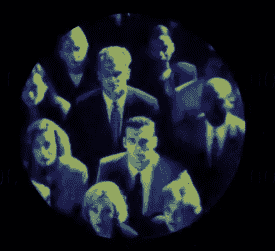
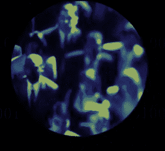
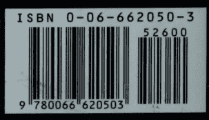

# 《人人自由：Linux与自由软件运动如何撼动高科技巨头》


## 致谢
这只是一本关于自由软件运动的书。如果没有那成千上万（甚至上百万）喜欢用业余时间编写代码的人的辛勤付出与专注投入，这本书不可能面世。向你们致敬。谢谢。
在本书编写过程中，有无数人曾与我交流，我很难在这里一一列举。首先要感谢的是，为各类自由软件邮件列表撰写内容、做出贡献的数百万人。这些列表中的邮件、笔记和帖子，是自由软件发展历程的精彩记录，也是无价的宝贵资料。
这份名单还应包括来自*Slashdot.org*、*LinuxWorld*、《Linux》杂志、《Linux每周新闻》、《内核动态》、《沙龙》以及*《纽约时报》*等媒体的数十位记者。我要特别提及乔·巴尔（Joe Barr）、杰夫·贝茨（Jeff Bates）、珍妮尔·布朗（Janelle Brown）、扎克·布朗（Zack Brown）、乔纳森·科贝特（Jonathan Corbet）、伊丽莎白·库尔博（Elizabeth Coolbaugh）、艾米·哈蒙（Amy Harmon）、安德鲁·伦纳德（Andrew Leonard）、罗布·马尔达（Rob Malda）、约翰·马克夫（John Markoff）、马克·尼尔森（Mark Nielsen）、尼古拉斯·佩特利（Nicholas Petreley）、哈拉尔德·拉德克（Harald Radke）和戴夫·惠廷格（Dave Whitinger）的作品。他们撰写的精彩报道，将成为开源运动历史的绝佳初稿。出于实际原因，本书的注释中仅直接引用了其中的少数几篇。
所有*Slashdot*、《Linux期刊》、《Linux世界》、《内核笔记》或《Linux每周新闻》这类网站的内容，都应当是所有对自由软件运动感兴趣的人的必读材料。
在Linux行业展会上，有数百位人士抽出时间向我展示他们的产品、T恤，还有一次有人甚至给我看了装满啤酒的冷藏箱。我在会议上遇到的几乎所有人，都乐于（viii）分享他们使用开源软件的经历。他们都是极佳的信息来源，而我甚至不知道他们中大多数人的名字。
有些人更是付出了额外的心力。约翰·吉尔摩（John Gilmore）、伊桑·拉西尔（Ethan Rasiel）和卡罗琳·麦凯尔丁（Caroline McKeldin）都在本书远未完成时就阅读了初稿，他们的意见至关重要。
许多朋友、熟人以及本书的受访者都很友好地阅读了修改幅度更大、但仍远未尽善尽美的版本：L. 戴维·巴伦（L. David Baron）、杰夫·贝茨（Jeff Bates）、布莱恩·贝伦多夫（Brian Behlendorf）、艾伦·考克斯（Alan Cox）、罗伯特·德雷尔（Robert Dreyer）、西奥·德·拉艾特（Theo de Raadt）、特尔萨·格温（Telsa Gwynne）、乔丹·赫伯德（Jordan Hubbard）、詹姆斯·刘易斯·莫斯（James Lewis Moss）、柯克·麦库西克（Kirk McKusick）、萨姆·奥克曼（Sam Ockman）、蒂姆·奥莱利（Tim O'Reilly）、萨米尔·帕雷克（Sameer Parekh）、布鲁斯·佩伦斯（Bruce Perens）、埃里克·雷蒙德（Eric Raymond）和理查德·斯托曼（Richard Stallman）。
还有一些人值得我以另一种方式致谢。丹尼尔·格林伯格（Daniel Greenberg）和詹姆斯·莱文（James Levine）在本书构思阶段做出了巨大贡献。我动笔时，纸上只有一些零散的想法。而我的编辑大卫·康蒂（David Conti）、劳琳·罗兰（Laureen Rowland）、德维·皮莱（Devi Pillai）和艾德里安·扎克海姆（Adrian Zackheim），很大程度上推动了这本书从想法到成稿的转变。金伯利·门罗（Kimberly Monroe）在带领本书走完全部制作流程时，忍受了我犯下的诸多错误。他们将我这堆关于社会现象的零散评论，整理成了现在这本完整的书。
最后，我要感谢我所有的家人，感谢他们在我整个人生中给予我的一切。当然还有卡罗琳，她极其严谨地校对了书中大部分内容的语法与风格。
请访问http://www.wayner.org/books/ffa/ 获取本书的更新、勘误及补充评论。


## 1. 博弈
那个现金为王、贪婪即善、金钱即权力的世界，在1999年1月偏离了轨道，哪怕只是片刻停止了运转。软件巨头、不可阻挡的现金印钞机微软，正在华盛顿特区的法庭上为自己辩护。司法部声称微软是垄断企业，正在利用这种优势打压竞争对手。微软全盘否认了所有指控，宣称外界正接连向它抛来竞争威胁。他们并非垄断企业，只是一家竞争力极强的公司，成功抵御了其他同样残酷无情的竞争对手试图抢占其市场份额的攻击。
随着律师、经济学家和程序员们用大量技术黑话和法律术语填满法庭，这场庭审很快变成了所有人的噩梦。证人席上，电脑极客们在谈论操作系统开发时，满口都是三字母缩写（TLAs）。随后，法律极客们开始把这些缩写拆解成单个字母，逐一测试到底哪个字母才是真正“犯了罪”的那个。接着经济学家们走上前，提出他们的理论：到底怎样的企业才算是垄断企业？三个字母串通一气够不够？两个呢？当微软试图否认几乎所有人心知肚明的事实时，法庭里的每一个人都开始害怕在这间小屋子里耗上一整天。
1998年秋至1999年初，司法部传唤了己方证人，这些人解释了微软如何通过倾斜合同条款、篡改软件、施加威逼利诱，确保自己独吞计算机行业的绝大部分市场份额。许多旁听者很快得出了结论：微软的手段集校园恶霸、地方黑帮头目和“地狱老妈”于一身。司法部随后传唤了多位证人，他们提供了大量证据，证明除非微软另有规定，否则全球计算机用户都会购买微软的产品。竞争对手必须受到惩罚。
到了1月，报道这场庭审的记者们已经开始私下抱怨这无休止的时间浪费。司法部的论据如此有说服力，以至于他们认为整场庭审只是在拖延时间，最终的判决或多或少都会拆分或束缚微软。但微软不愿被胁迫，也绝不会被迫拆分。庭审给了他们陈述自己立场的机会，而他们已经准备好了说辞。没错，看起来所有人都在用微软的产品，但那是因为它们足够优秀。不是因为市面上没有竞争对手，而是因为竞争对手都不够好。
1月中旬，麻省理工学院斯隆管理学院院长理查德·施马伦西厄出庭为微软辩护。施马伦西厄曾供职于联邦贸易委员会和司法部，担任经济学家，负责研究市场竞争环境以及反竞争行为的影响。他研究过垄断企业的行为模式，在他眼中，微软并不具备垄断势力。如今，微软花重金聘请他作为专家证人，在法庭上重复这一观点。

## 2. 自由竞争
施马伦西厄甚至准备好了几个竞争对手的案例。微软有一个竞争对手家喻户晓，以至于电视电影《硅谷海盗》用它来举例说明比尔·盖茨是如何大获全胜的。投资消息公布后，苹果开始在其设备上预装微软的IE浏览器作为默认浏览器。微软的竞争对手网景浏览器在iMac上的可获取性就此降低了几分。这笔交易之后，史蒂夫·乔布斯甚至公开表态：昔日死敌苹果和微软如今更像是合作伙伴，而非竞争对手。施马伦西厄没有聚焦于苹果这一新的竞争态度。
接下来，施马伦西厄又举出了BeOS的例子，这是由Be公司开发的操作系统，这是一家由前苹果高管让-路易斯·加西埃掌舵的小公司，仅约有100名员工。他说这家公司吸引了数百万美元的资金，有不少人真的喜欢这款系统，所以它算得上竞争对手。施马伦西厄没有提到，Be公司连免费赠送BeOS系统都遇到了阻碍。加西埃曾接触多家PC制造商，询问是否愿意在设备中预装BeOS，让用户有机会在两个操作系统之间切换：结果不出任何人意料，微软与制造商签订的合同让BeOS很难，甚至几乎不可能触达用户。微软掌控了用户能接触到的绝大部分内容，坚持要几乎完全控制用户的使用体验。施马伦西厄在证词中丝毫没有提及这些细节。
BeOS可能就像被关在海洋中央孤岛石砌疯人院无窗牢房里的囚犯一样被牢牢禁锢，但为了获得用户的青睐，它依然算是竞争对手。但最后一个竞争对手出乎所有人的意料。施马伦西厄将免费分发的程序Linux视为一个极具潜力的竞争对手。他所说的Linux，实际上指的是一整个被称为“开源软件”的程序集合。这些软件由一群松散联合的程序员编写，他们通过互联网共享所有软件的源代码。
开源软件在互联网上流传，受多种许可证约束，比如GNU通用公共许可证（GPL）。如果说这些软件被许可证“控制”，那多少有些夸张。恰恰相反，这些许可证的措辞恰恰是为了禁止被控制。例如GNU GPL允许用户修改程序，并分发自己修改后的版本。这份许可证的作用更多是强制共享所有源代码，而非控制或限制。它与其说是许可证，不如说是“反许可证”，其作者理查德·斯托曼常将其称为“著佐权（copyleft）”。
施马伦西厄没有提到，大多数人认为Linux是由黑客在闪烁电脑显示器的暗室里创造并使用的一款奇怪工具。他没有提及许多人在让Linux适配自己的电脑时遇到了困难。他也忘了提到，Linux手册的小标题诸如“提供类似Disk Druid的fstab编辑器”之类。他没有深入探讨这样一个事实：对许多开发者来说，Linux不过是电视上没什么好看节目时把玩的小玩意。他当然也没提到，大多数人认为整个Linux项目是一个疯天才和他那些怪门徒的成果，这些人还没反应过来苏联早就彻底垮台了。Linux的支持者们真的认为，分享能让世界变得更美好。那些把股权收益换成保时捷和香醋的富豪程序员们，此刻只会对此嗤之以鼻。施马伦西厄对这些事实只字未提。
他只是把Linux作为Windows的替代方案提及，称计算机制造商随时可能转向该系统。轻而易举。因此，微软是有竞争对手的。
庭审中，双方的论述很快演变成了关于“到底什么才算得上合格竞争对手”的争吵。Linux或Mac上有足够多的应用软件吗？怎样才算“足够”？这些真的能算合格竞争对手吗？在交叉盘问环节，施马伦西厄解释称，他并不是说Mac、BeOS或Linux是会占据50%以上市场份额的竞争对手。他只是主张，这些系统的存在证明了所谓的微软垄断制造的壁垒并没有那么高。如果理性的人愿意投资创办像BeOS这样的公司，那就说明微软的权力并非绝对。
盘问结束后，大多数人很快就下了定论。人人都听说过Macintosh，也都知道当时的主流观点认为它很快就要完蛋。但大多数人对BeOS和Linux一无所知。如果一家公司没人听说过，又怎么算得上竞争对手？苹果和微软都有电视广告。至少BeOS还有魅力十足的董事长。Linux却连一个推销员都没有，
 - [费曼学习法](https://wiki.example.org/feynmans_learning_method)的灵感源于诺贝尔物理奖获得者**理查德·费曼**。 1. 运用费曼技巧，你只需花上`20 min`就能深入理解知识点，而且记忆深刻，*难以遗忘*。 ``` if (condVar > someVal) {console.log("xxx")} ``` 


很难找到高效的方法让Linux同时处理多个连接，同时不出现降速或死锁。
与考克斯（Cox）和托瓦兹（Torvalds）共事的团队没有正式的层级架构。
数以百万计的人使用Linux运行自己的计算机，而且所有人都拥有这份源代码的副本。
20世纪80年代，大多数企业开始尽可能地将软件源码保密，因为它们担心竞争对手会盗取源码中记载的创意。
源码通常用C、Java、FORTRAN、BASIC或Pascal等语言编写，本来就是供程序员阅读的。
大多数企业都不希望其他程序员过多了解自家软件的核心细节。
信息就是力量，企业们本能地紧握自己的底牌。
然而1991年林纳斯·托瓦兹开始编写Linux时，他决定免费发布这款操作系统。
他公开了全部源码，因为他*希望*其他人能阅读、评价它，甚至改进它。
他的这个决定既是对标准编程流程的颠覆性突破，也是一项务实的选择。
当时他还只是个穷学生，开发这款操作系统不过是业余爱好。如果他当时试图售卖它，恐怕根本赚不到钱。他肯定也没钱成立公司来打磨软件、推向市场。
所以他只是通过互联网散发了系统的副本。
共享软件的理念早已得到麻省理工学院传奇程序员理查德·斯托曼（Richard Stallman）的认可，他认为将源码保密是罪孽，更是对人类的犯罪。
共享源码的程序员能让其他人学习，而这些学习者也可以将自己的创意反哺到项目中。闭源软件会让用户倍感挫败，因为他们既无法了解软件原理，也没法修复漏洞。
1984年斯托曼离开麻省理工学院，创立了自由软件基金会。这个组织赞助了斯托曼的“解放源码”宏大项目，他将其命名为GNU。
20世纪80年代，斯托曼开发了诸如GNU Emacs文本编辑器这类非常先进的工具，人们可以用它编写程序和文章。其他开发者纷纷捐赠自己的作品，很快GNU项目就覆盖了种类繁多的工具、实用程序和游戏。
所有这些都免费分发。
托瓦兹以斯托曼为榜样，决定也采用开源的方式发布自己的系统。
托瓦兹的免费软件开始吸引那些喜欢把玩技术的人。有人只是粗略看上一眼，有人会花上几个小时捣鼓它。免费是非常强大的动力，它不会让金钱、信用卡、采购单和老板的审批阻碍人们的好奇心。
少数人比如艾伦·考克斯（Alan Cox），在拆解操作系统的过程中乐在其中，于是留下来开始为项目做贡献。
后来，越来越多像考克斯这样的人在互联网上发现了托瓦兹的小项目。有人作息不规律睡懒觉，有人作息正常在办公室工作，有人只是找漏洞，有人修复漏洞，还有人添加自己需要的功能。
慢慢地，这款操作系统从满足计算机科学家好奇心的玩具，成长为一款可用的工具，驱动着全球的超级计算机、网络服务器以及数百万台其他设备。
如今，大约有一千人定期和艾伦·考克斯这样的人一起开发Linux内核——也就是托瓦兹1991年开始编写的那部分操作系统的官方名称。
这个数字可能并不准确，因为很多人在项目有需要时会参与几周。有人关注所有进展，但大多数人只对自己感兴趣的小领域上心。
还有许多其他程序员贡献了各类软件，比如文字处理器或电子表格。所有这些软件被打包成软件包，通常被称为纯Linux或GNU/Linux，由红帽（Red Hat）这类公司或是Debian这类临时性组织发布。
¹《Linux周刊新闻》保存了完整的发行版列表。这些发行版涵盖了从只有一两个人的小团队运营的项目，到红帽（Red Hat）这类规模最大的企业级发行版：
| 发行版名称 |
|------------|
| Alzza Linux |
| Apokalypse |
| Armed Linux |
| Bad Penguin Linux |
| Bastille Linux |
| Best Linux (Finnish/Swedish) |
| Bifrost |
| Black Cat Linux (Ukrainian/Russian) |
| Caldera OpenLinux |
| CCLinux |
| Chinese Linux Extension |
| Complete Linux |
| Conectiva Linux (Brazilian) |
| Debian GNU/Linux |
| Definite Linux |
| DemoLinux |
| DLD |
| DLite |
| DLX |
| DragonLinux |
| easyLinux |
| Enoch |
| Eridani Star System |
| Eonova Linux |
| e-smith server and gateway |
| Eurielec Linux (Spanish) |
| eXecutive Linux |
| floppyfw |
| Floppix |
| Green Frog Linux |
| hal91 |
| Hard Hat Linux |
| Immunix |
| Independence |
| Jurix |
| Kha0s Linux |
| KRUD |
| KSI Linux |
| Laetos |
| LEM |
| Linux Cyrillic Edition |
| LinuxGT |
| Linux-Kheops (French) |
| Linux MLD (Japanese) |
| LinuxOne OS |
| LinuxPPC |
| LinuxPPP (Mexican) |
| Linux Pro Plus |
| Linux Router Project |
| LOAF |
| LSD |
| Mandrake |
| Mastodon |
| MicroLinux |
| MkLinux |
| muLinux |
| nanoLinux II |
| NoMad Linux |
| OpenClassroom |
| Peanut Linux |
| Plamo Linux |
| PLD |
| Project Ballantain |
| PROSA |
| QuadLinux |
| Red Hat |
| Rock Linux |
| RunOnCD |
| ShareTheNet |
| Skygate |
| Slackware |
| Small Linux |
| Stampede |
| Stataboware |
| Storm Linux |
| SuSE |
| Tomsrtbt |
| Trinux |
| TurboLinux |
| uClinux |
| Vine Linux |
| WinLinux 2000 |
| Xdenu |
| XTeamLinux |
| Yellow Dog Linux |
虽然托瓦兹只编写了核心内核，但人们用他的名字Linux指代由数千名其他开发者编写的整套软件。
这其实并不公平，但大多数人都不怎么计较。
如果没有Linux内核，用户将无法在完全自由的系统上运行软件，这些自由软件只能与微软、苹果或IBM的系统交互。
当然，如果不是有来自伯克利、GNU项目以及全球数千个车库开发者的其他自由软件，Linux内核也没多少发挥作用的空间。
从官方层面来说，林纳斯·托瓦兹是内核的最终裁决者，所有新功能的最终决定都由他拍板。
在实践中，这个团队运作起来就像松散结成的“临时自治团体”。
有人可能关注某些特定功能，比如与麦金塔电脑的接口能力，他们会编写专门的代码来简化这项任务。
也有人运行超大型数据库，需要容量无上限、能存储更多信息的大文件系统。
所有人都按照自己的节奏工作：有人像艾伦·考克斯一样在家办公，有人在大学实验室工作，还有人在使用Linux的企业任职，这些企业鼓励自己的程序员投入开发，让系统更适配自身需求。
这个团队靠邮件列表联结在一起，Linux内核邮件列表把英国的考克斯、硅谷的托瓦兹以及全球各地的其他成员都串联了起来。
大家在列表里发布观点、讨论想法，有时会爆发激烈争论，有时也能达成全员共识。
有时有人会通过编写新代码切实优化内核，相当于在黑夜里点上一支蜡烛；有时大家也只是抱怨问题却毫无行动。
如今考克斯是负责协调新代码并入的几位核心成员之一，他会测试代码的兼容性，指导Linux开发者们确保彼此的工作能最优协作了。
本质上，他会测试每一份待并入的软件，确保所有组件都适配正确的标准，不会出现故障。
他会尽力清除曾经困扰Zorro版本的不兼容问题。
很多时候其他人也会重复考克斯的工作。有些新功能非常受欢迎，会有很多开发者参与打磨。
多CPU加速技术能让每台计算机发挥额外性能，因此许多邮件列表成员经常测试这项功能。他们希望自己的机器越快越好，而优化CPU之间的数据传输流就是让机器协同工作的最佳方式。
还有一些功能没那么受欢迎，由需要这些功能的开发者负责推进。
有人想把Linux设备与麦金塔电脑连接，要顺利实现这个功能可能需要对内核做一些改动。
还有人想添加特殊代码，以适配高速相机、异形硬盘这类特殊设备。
这些团队通常会独立开发，但也会和主流开发者协调解决方案。理想情况下，他们能拿出补丁解决自己的问题，又不会影响系统的其他部分。
这是一个非常社交化、也非常考验“政治智慧”的过程，通过电子邮件慢慢推进。
有人提出建议，其他人可能表示赞同，也有人会反对这个想法，觉得它不够优雅、过于草率，甚至最糟糕的是觉得它很危险。
经过一段时间的讨论，就会形成大致的共识。
简单的问题几天甚至几分钟就能解决，但复杂的决策可能要等上几年，因为相关争论会持续很久。
每一天，考克斯和他的“云同事”们都会浏览邮件列表，琢磨如何让Linux变得更好、更快、更易用。
有时他们会抽空去看电影，有时会去远足，但他们绝对不会花上好几个月挤在会议室里构思法律辩论词。
直到不久前，Linux开发者们都没钱请律师，这意味着他们不会被“如何让理查德·施马伦西（Richard Schmalensee）这样位高权重的人向法庭证明计算机操作系统市场不存在垄断”这类问题分心。

## 针对黑客的诉讼
施马伦西和考克斯两个人的差异再大不过了。一个是可以在政府和麻省理工学院之间游刃有余穿梭的职业技术官僚，另一个是过去常说的那种丢三落四的教授。


sort——那种一旦对问题真正感兴趣就会全身心投入工作的人。正巧，考克斯（Cox）对开发一款比构成微软在计算机行业统治基础的各种Windows版本更优秀的操作系统非常着迷。
Linux与微软之间的对峙，正逐渐演变成施马伦塞（Schmalensee）这类人与考克斯（Cox）这类人之间的经典交锋。
一方是由律师、说客、销售员和高薪高管组成的队伍，他们手持专利、诉讼和立法武器。他们精于操控权力的杠杆，直到所有齿轮精准咬合，数十亿美元便能流进他们的口袋。他们擅长谄媚、奉承、乞求，甚至威胁，直到他们将权威的外衣披在身上，能让全世界都对其顶礼膜拜。人们购买微软的产品，因为它是“业界标准”。这套标准从来没有人正式颁布，但不知怎么就成了默认规则。
另一方是一群只喜欢摆弄电脑、为了拆开它们愿意做任何事的人。他们不像约翰·梅伦坎普（John Mellencamp）歌里唱的那个人，歌词说“我反抗权威，权威永远胜利”。有些人可能态度强硬，但大多数人只想拆开电脑的内部，把它们改装后连上咖啡机或者网络。他们喜欢摆弄机器的核心部件。就算他们把内部焊得一团乱麻，也无所谓。
通常情况下，这些穿西装的商务人士与极客之间的交锋根本威胁不了现有秩序。全世界都有大学生在造太阳能汽车，但他们根本不会对石油或汽车行业构成威胁。纽约有一家叫“21”的餐厅，汉堡做得非常好，但他们也不会让麦当劳破产。试验主义者和完美主义者通常不会同那些靠称霸市场牟利的企业发生冲突。
除非碰到软件领域。软件和汽车、汉堡可不一样。只要有人写出了源代码，复制源代码的成本几乎为零。这使得像考克斯这样的捣鼓发明者很容易对整个世界产生影响。如果考克斯、斯托曼（Stallman）、托瓦兹（Torvalds）和他的伙伴们碰巧捣鼓出了比微软更好的东西，那全世界几乎不需要花一分钱就能共享他们的发明。这就是为什么无论考克斯、托瓦兹和他们的伙伴睡多久懒觉，他们都称得上是货真价实的威胁。

## 14 …… 全民自由软件
单是想到这个理念，就足以让人兴奋不已。
- 几个睡懒觉、在卧室里工作的家伙，按理说根本追不上微软这种印钞机。
- 他们按理说也不会创造出能控制超过一半网络的服务器引擎。
- 他们按理说也不会创造出比Windows好得多的、能在屏幕上绘制窗口和图标的图形用户界面。
- 他们按理说也不会创造出标价仅3000美元的超算。
- 按理说，金钱不应该输。
当然，从事自由软件项目的人拥有金钱买不到的优势。这些程序员不需要律师来撰写许可协议、协商合同或争论条款。他们的软件是免费的，一旦没有钱可赚，律师很快就会失去兴趣。做自由软件的人不需要审校广告文案。任何人都可以下载软件直接试用。程序员也不用在电脑崩溃时坐在角落吐槽写这个软件的傻瓜，任何人都能读取源代码修复漏洞。
换句话说，自由源代码软件圈的人都在为自由而着迷。他们为美国最初的“生命、自由和对幸福的追求”之梦而狂热。美国的建国国父们当初的目标并不是打造一个富裕的国家，让公民终日忧虑，等股票期权到手后能不能买得起新的运动型多用途车。国父们只是想为子孙后代保障自由的福祉。不知怎么的，财富随之而来。
这个美好的故事很容易被人接受：一群人最初在网上交换酷炫的软件，后来却发现他们自由的分享创造出的软件，比大公司用海量现金生产出的软件还要好。
程序员们发现，不受限制的合作让每个人都能轻松做出贡献。没有价格标签把人拒之门外，没有刻板印象或偏见排斥任何人。软件和源代码都放在网上，任何人都能阅读。
完全开放的合作同时也是完全开放的竞争，因为最优秀的软件会获得最多的关注。那些能摸到总统耳朵的企业奸商，也无法阻止自由源代码软件项目发布。如果人们想折腾自由软件，任何重组或裁员都阻挡不了他们。
创作的自由比金钱更有力量。这是一幅田园诗般的图景，而Linux、FreeBSD和其他自由软件包早期的成功，很容易让人觉得这种成功会持续积累。
如今，开源服务器支撑着超过50%的互联网网站服务器，这绝非小成就。考虑到程序员们往往性格古怪，能让成千上万甚至上百万程序员协同工作，这件事本身就十分惊人。复制几乎零成本的特点让人相信，艾伦·考克斯就算天天睡懒觉，也依然能改变世界。
但20世纪60年代据称也是一段田园诗般的时期，当时和平、爱与分享本该创造一个美好的星球，每个人都为他人付出，形成一条由相互尊重与关怀编织而成的永恒金色纽带。所有人都以为，那种迅速而轻易弥漫在大学校园和公园嬉皮聚会的氛围，注定会席卷全世界。那些公社确实热火朝天，伙计们。但不知怎么的，这种时髦的浪潮终究没有超出那些容易关怀与付出的小圈子。后来人们陆陆续续回归现实，找正式工作，背真正的房贷，重新回到了金钱至上的世界。
多年来，同样的悲剧结局也降临在许多公社、乌托邦设想和迷幻浪潮身上。
自由当然很棒。它让聪明的发明家们不用依附权力阶层就能独立工作。但资本是另一种驱动创新的强大猛兽。那些大型公社往往失败，是因为它们从未把辛苦劳作转化为金钱，难以存下钱进行再投资。免费分享东西可能确实很酷，但它攒不下积蓄。
如今，自由软件运动正站在其历史上的关键节点。过去，给予和完全共享的文化让成千上万的程序员打造出了一款很棒的操作系统，在很多方面都比最优秀的公司推出的产品更出色。很多人最初是把Linux、FreeBSD和其他上千个项目当作爱好来做，但现在他们醒来时发现，IBM、惠普、苹果和其他所有行业巨头都在敲他们的门。既然这些年轻人能创造出像Linux一样出色的东西，所有人都开始好奇，这些年轻人是不是真的有足够的好东西，能撑到最后，和业内最强大的对手们鏖战到底。

## 16 …… 全民自由软件
或许随着更多人加入，自由软件运动会发展得更快、更好。
- 更多用户意味着更多双发现bug的眼睛。
- 更多用户意味着更多程序员来编写新功能的源代码。
- 更多就是更好。
但另一方面，共享或许很酷，但它能打败资本的力量吗？微软的员工或许只是被微薄的股票期权能值到够养老的梦想驱动的农奴，但他们有堆积如山的现金推着他们前进。
资本可以非常迅速地调遣。如果比尔·盖茨想要1000名程序员做东西，他挥挥手就能办到。如果他想买1000台电脑，一秒钟就能搞定。这就是资本的力量。
林纳斯·托瓦兹就算登上杂志封面，也不可能挥挥手就办成什么事。他得哄着、劝着Linux邮件列表里的上千名用户，才能推动一次改动。很多自由软件项目或许能产出很棒的代码，但他们得乞求别人捐电脑。程序员们甚至可能给他惊喜，拿出更好的解决方案。他们过去也这么做过。但没有钱就意味着没人必须听任何人的吩咐。
过去，自由软件运动就像米基·鲁尼和朱迪·加兰在谷仓里办精彩演出的电影。这部分不会改变。有梦想的酷炫年轻人依然会创造出很棒的程序，作为送给世界的绝佳礼物。
但谷仓里看起来魅力十足、新鲜活泼的演出，放到百老汇的大舞台上就可能变得单薄无力。如果你知道Linux和自由软件是年轻人在业余时间做出来的，会觉得它们的漏洞和粗糙的功能也没那么糟糕。但要为真正的公司、普通家庭、警察局和各地严肃用户打造实用的工具，就是另一回事了。
所有人都可能盼着分享、关怀和好奇心就足够了，但没人能确定。也许最终资本会赢，也许不会。这是自由与保障的对决，是完全开放共享与股票期权的对决，是合作与恐吓的对决，是极客与西装革履的商务人士的对决，这是一场击倒对手、拼到力竭、赢家通吃的终极决战。


## 2. 列表
当艾伦·考克斯还在睡懒觉、微软正让理查德·施马伦塞出庭作证时，其余开源软件界的人正忙着解决自己的问题：有人刚起床，有人正忙到正酣，还有人刚准备睡觉。这并不仅仅是因为开源黑客喜欢昼夜颠倒地工作，确实有人如此，但他们也分布在全球各个不同的时区，开源帝国永不落幕。
比如1999年1月14日，澳大利亚人彼得·杰里米宣布，他刚刚发现用于维护FreeBSD源代码的中央数据库的控制软件中存在潜在的千年虫（Y2K）问题。他通过向邮件列表发布通知的方式公布了这一消息，该通知被转发给了许多其他FreeBSD用户。问题在于，该软件只会直接在年份前附加两个字符“19”，等一年多后新千年到来时，软件就会开始把新年份写成“19100”，真是尴尬。
这个问题基本属于表面问题，仅出现在系统使用的部分支持软件中。FreeBSD与Linux内核是近亲，在某些方面甚至比Linux更早出现。它源自加州大学伯克利分校长期的研发传统。BSD这个名字是“伯克利软件发行版”（Berkeley Software Distribution）的缩写，这是伯克利首次向全球发布的操作系统源代码版本的命名。这个小包在多年间不断成长、演变，并吸收了众多其他贡献。将Linux和FreeBSD称为表亲十分贴切，就像表亲共享部分基因一样，二者也共享大量源代码，还会互相借鉴源代码和创意。如果你从核桃溪（Walnut Creek）这类公司购买FreeBSD光盘，拿到的软件包可能和红帽Linux光盘里的相差无几。二者都包含例如GNU编译器，这类工具能将源代码转换为计算机可识别的内容。事实上FreeBSD有自己的粉丝和忠实用户，其官网列出了数千家使用该软件的大大小小企业：大型互联网目录、游戏门户和新闻服务商雅虎的部分服务器就使用了FreeBSD，常年位居最受欢迎网站之列的电子贺卡公司蓝山艺术（Blue Mountain Arts）也在使用。还有数千家企业未在FreeBSD官网列出。毕竟FreeBSD项目产出的软件是免费的，人们可以自由分发、和朋友共享，甚至可以通过在工作场合复制光盘来“假装”自己在盗版。没人知道市面上有多少份FreeBSD副本，毕竟根本没有统计的必要。微软可能需要统计用户数量，以便向所有使用Windows的用户收费，但FreeBSD不存在这个问题。
那天早上，彼得·杰里米的消息发给了所有订阅FreeBSD邮件列表的用户。关心千年虫问题的用户可以直接获取杰里米的补丁来修复自己的软件，不需要等待某个中央机构对信息做出裁决，也不需要等FreeBSD负责千年虫问题的员工有空审核修改，所有人只要拥有全部源代码就能直接应用修复补丁。
当然，大多数人从来不会用到所有自由权限。这次事件中，大多数人不必费心处理杰里米的补丁，只要等待官方版本即可。FreeBSD的基础设施会将修改纳入代码仓库，新修复会出现在下一个完整更新版本中，大多数用户也是在这个新版本中首次用上修复的。
杰里米是一名程序员，他开发的解决方案便于其他程序员使用。但大多数人不是程序员，他们希望软件易于使用，甚至大多数程序员都对摆弄设备内部毫无兴趣。大家都希望问题要么自动修复，要么尽可能接近自动修复。
杰里米的消息只是那天在FreeBSD社区内流传的数百条消息之一：有的石沉大海，有的引来刻薄评论，只有少数几条得到了真正的关注。邮件列表是相当复杂的生态系统，观点在这里萌芽生长，最终也会消逝消亡。
当然，将FreeBSD世界定性为完全去中心化的无政府状态并不公平。这里有一个由乔丹·哈伯德（Jordan Hubbard）领导的中心团队，负责管理核心忠实程序员群体的运作。该团队运营官网、维护最新的FreeBSD版本，还负责运营几十个分别聚焦不同领域或功能的邮件列表：
- 其中一个列表聚焦于连接高性能SCSI硬盘，这类硬盘受到追求高性能系统的用户的青睐。
- 另一个列表则专注于完善安全防护，抵御可能通过互联网潜入的攻击者。
1999年1月14日那天，英国人罗杰·哈迪曼（Roger Hardiman）正在帮助瑞士人雷托·特拉施尔（Reto Trachsel）将Hauppauge视频卡连接到他的设备上。二人在专门探讨为FreeBSD系统添加音视频功能的多媒体邮件列表中沟通。特拉施尔在列表中发布询问，想知道如何找到驱动程序，确保Hauppauge电视接收器输出的数据能被计算机其他部分调用。哈迪曼给出了解决方案，同时提醒道：“如果你的Hauppauge显卡搭载MSP34xx系列立体声解码器音频芯片，看电视时可能会没有声音，我会在一两周内修复这个问题。”
这类解决方案在FreeBSD社区中四处流传。大多数人并不关心能不能用电脑看电视，但少数人有这个需求。源代码和驱动程序的开放意味着少数人可以自行开展研究，不需要向大公司申请许可。比如微软、苹果这类大公司内部确实有项目在开发用于在电脑上制作和展示多媒体视听盛宴的出色软件，但它们的 worldview 非常僵化：公司是高质量工具的生产者，工具流向使用这些工具、以各种方式付费的消费者。而邮件列表生态更具有机性、非等级化：所有人都有权获取源代码，所有人都可以做出修改，所有人都能按自己的想法行事。
## 免费不等于坐享其成
还有成千上万个邮件列表连接着成千上万个其他项目，很难给这些项目准确计数，因为项目会随着用户兴趣的兴衰起伏不断生长、合并、消逝。优秀的项目蓬勃发展，其他的则逐渐淡出。邮件列表上的讨论生命周期往往比现实更残酷、更短暂。
项目工作需要拆分分配给不同参与者，志愿者们需要自我组织，才能写出优秀的软件。1999年1月14日那天，WINE邮件列表的一位新成员正在了解志愿工作的运作规则。他在列表中发布了一条消息，介绍自己的戴蒙RIO便携音乐设备——用户可以随时通过它播放MP3文件：“我认为WINE开发团队应该放下手头所有工作，优先开发能让这个程序正常运行的工具，毕竟戴蒙似乎不想发布针对RIO的Linux工具。”
WINE是“WINE不是模拟器”的缩写，这是个只有程序员和自由软件爱好者才能懂的笑话。它首先是对GNU项目递归首字母缩写的戏仿（GNU即“GNU不是UNIX”），也是程序员的一种政治表态。模拟器是一种能让一台计算机模拟另一台计算机行为的软件。比如康奈克特（Connectix）公司就出售一款模拟器，能让麦金塔电脑像Windows个人电脑一样运行，这样用户就能在麦金塔上使用Windows软件。不过模拟器的速度通常很慢，因为它们需要实时转换信息。任何尝试和说不同语言的人交谈的人都知道，需要翻译器有多么让人崩溃。


WINE项目是一项雄心勃勃的尝试，旨在破除微软垄断结构中最重要的支柱之一。专为Windows编写的软件只有在用户向微软购买Windows版本时才能运行。如果购买Mac版的Connectix模拟器，会随附一个Windows版本。
WINE项目是一群正在尝试克隆Windows的人组成的，当然，他们并非要克隆全部Windows系统。他们只想克隆被称为Win32 API的组件，这是一套让微软设备上的软件开发变得更简单的功能集合。想要为Windows电脑开发新按钮的程序员，无需编写绘制带三维阴影边框的所有指令——微软员工已经将这些指令打包进了Win32 API中。
这些工具包中有数百万个可帮助程序员的功能：部分功能可以播放音频文件，另一些则能绘制复杂图像或播放视频。这些功能让Windows软件的开发变得简单，因为部分最重复繁琐的工作已经预先完成了。
WINE对Win32的克隆，是开源项目从缓慢起步到加速发展的绝佳范例。该项目由鲍勃·阿姆施塔特于1993年发起，但很快便移交给了亚历山大·朱利亚尔，后者一直是项目背后的核心推动者。尽管项目距离完全完工仍有很大差距，但已取得了诸多瞩目的成果，使得用户无需使用Windows，就能在Linux系统上运行Microsoft Word、Microsoft Excel等大型程序。
本质上，WINE软件的Windows模拟效果已经足够出色，足以骗过Excel和Word。能骗过这两个同门应用，效果已经相当不错了。
WINE官网（www.winehq.com）估算，有超过9万人定期使用WINE运行Windows程序，无需购买Windows系统。约有140人甚至更多人通过编写代码、修复bug的方式定期为项目做贡献。其中许多是爱好者，他们享受让软件在脱离Windows的情况下运行的乐趣，也有一些是企业程序员。企业程序员希望将自己的软件销售给尽可能广泛的市场，但又不想花时间重写全部代码。如果他们的软件能和WINE良好兼容，那么使用Linux或BSD系统的用户就能用上原本为Microsoft Windows编写的软件了。

## 22 …… 人人有份
那个希望让自己RIO播放器和Linux电脑兼容的新用户，很快就遭遇了当头一棒。德国程序员安德烈亚斯·莫尔回复道：
> *“与其建议WINE团队‘放下所有工作’去让PMP300这种相对小众的设备跑通，你不如先安装WINE、测试它、阅读文档/错误报告，然后在这里提交一份有用的错误报告？外面有海量非常有用且令人印象深刻的Windoze应用……（毕竟这只是我的个人看法，可能语气有点太严厉了 ;-）”*
大多数自由软件新用户很快就会发现，自由从来都不是轻易就能得到的。如果你想获得自由软件，就必须付出相应的努力。
有时候你会很幸运。同一天发帖的那位瑞士用户发现，已经有英国的人在帮他解决问题了。然而，当时没有人正在处理RIO软件的适配工作，确保它能和WINE兼容。莫尔的建议是提交一份错误报告，对该软件的可用性进行评级，以便WINE的程序员们对其进行调优。这只是自由软件体验的第一步：总得有人发现问题并修复它。
在这个案例中，需要有人把自己的Diamond RIO MP3播放器连到Linux电脑上，用为Windows编写的软件尝试传输MP3文件。理想情况下，软件可以完美运行，届时所有Linux用户就都能使用RIO播放器了。但实际上，可能会出现各种问题或故障：部分屏幕画面显示错误，软件甚至可能完全无法下载任何内容。第一步就是得有人测试这款产品，撰写一份详细的报告，说明哪些功能正常、哪些功能异常。
在撰写本文时，还没有人站出来承担这项工作。WINE数据库中还没有关于这款Diamond播放器的任何报告。可能是新用户没时间，也可能是他技术不够娴熟，一开始就没能跑通WINE——毕竟这套系统用起来并不简单。无论如何，他的好主意最后还是石沉大海了。
邮件列表里充斥着对各种新潮、天马行空却从未落地的想法的闲聊。有些人觉得这是自由软件世界的局限所在。但企业有能力调派一整队程序员来开发解决方案，这些公司有资金投入产品打磨，确保产品正常运行。比如皮克斯这家硅谷明星企业，就开发了一款模拟器，让Mac用户能玩为索尼PlayStation开发的游戏。公司雇佣了大量员工，他们的工作就是从开头到尾通关所有索尼游戏，直到所有bug都被找出来。这工作是辛苦了点，但总得有人来做。
WINE没有资金支付人员薪酬，这也意味着一些出色的想法有时会被搁置。但自由软件社区并不一定将此视为短板。如果RIO播放器真的足够重要，总会有其他人接手这个项目，总有人会完成相关工作、提交错误报告，让所有人都能用上这款软件。如果没人愿意接手，那也许RIO软件对Linux社区来说并没有那么重要。只有当有人真的在意、愿意付诸行动时，工作才能推进。
这些邮件列表正是将开源社区联结成思维网络的纽带。在没有电子邮件的年代，他们不过是一群盘踞在荒野、在地下室里敲敲打打发明古怪机械的反叛者而已。如今他们已经成为了由信息、通知和函件协调运作的精密机制。他们不再是那些在晚宴上痛斥像博格集体一样的企业所推出的糟糕技术的狂人，如今他们已经拥有了许多同行伙伴。单个个体或许不靠谱，但一群人没准就能干成大事。

## 3. 图景
来看看这张图景：微软是一座由一位自我膨胀到极致的男人打造的巨像。把所有雷德蒙德企业格子间里的员工都归为一群没有思想的自动化部队，或许有失公平，但这个画面确实足够震撼，也不是完全失真。
微软员工都极其忠诚，往往比普通打工人更投入到公司的事业中。比尔·盖茨在几位大学朋友的帮助下白手起家创办了这家公司，这个小圈子至今仍牢牢掌控着帝国的各个部分。这家企业的风格，由那个既有能力、又极度自负到想要事无巨细一手抓的男人所塑造。

再来看看自由软件革命参与者的形象。几乎所有描述这个群体的报纸文章、专题报道，都会提到一群衣衫褴褛、胡子拉碴的程序员，他们因为整日坐在电脑屏幕前，肤色都显得过于苍白。媒体总爱渲染出一副画面：这群人仿佛刚从*疯狂的麦克斯*或*少年与犬*这类反乌托邦奇幻电影里跌跌撞撞走出来一样。他们是局外人，是一群关系紧密的反叛弃儿，他们打算把人们从微软的“奴役”中解放出来，将盖茨先生篡夺的权力交还到民众手中。他们要什么？自由！什么时候要？现在！
这个规整到可以直接拿去好莱坞用的形象，只有一个问题：它和真实情况差得太远。微软是靠管控缰绳让所有人循规蹈矩的大企业，但开源软件世界并没有任何强大乃至松散的组织能将其绑定在一起。就算能称之为运动，它也是由无数个体组成的，每个人都可自由对软件做任何想做的事。这才是核心：不再有枷锁，不再有企业霸权，只有纯净的源代码，快、干净、轻量，彻夜运行都没问题。
这并不意味着上述形象完全错误。比如理查德·斯托曼、艾伦·考克斯这样的业界大佬，确实留着能比得上《瑞普·凡·温克尔》主角的长胡子。不少人肤色苍白得显眼，有些人洗澡频率不太高，咖啡因对他们的吸引力也有点过高了。有些人看起来，就像是高中橄榄球队里的蠢货们会嘲讽的对象。但反例也有很多。
莱纳斯·托瓦尔斯开着一辆庞蒂克汽车，住着体面的房子，妻子和两个孩子都在身边。他白天在一家大公司上班，晚上则去购物、处理杂事。如果他妻子托芙不是芬兰前空手道冠军，也没有卡车成天往他家运顶级电脑——比如重达200磅、装了4个至强处理器的庞然大物的话，他的生活完全能归入20世纪50年代末的情景喜剧范畴。他曾在*VAR Business*采访时说：“一辆大卡车把这台电脑送到我家，司机特别困惑，他说‘你们家没有装卸货的平台吗？’”转念一想，这种闹剧本来就是大多数情景喜剧的卖点啊。
开源代码贡献者们形形色色，很难简单归类。很多人有孩子，也有很多没有：有些人闭口不提家人，有些人偶尔会提到，还有些人则骄傲地到处晒自己的孩子。有人已婚，有人单身，有人公开出柜，有些人还停留在青春期男孩那种近乎无性的乌托邦状态里。有些人确实还处于十几岁的年纪，有些人则不是。有些贡献者确实能称得上“衣衫褴褛”，但很多人并不是。很多是企业“工具人”，白天在格子间上班，晚上则投身自由软件项目的开发。有人在银行工作，有人做人力资源部门的数据库，有人建网站。所有人都有本职工作，很多人都把自己打理得干干净净，等着升职加薪。
布鲁斯·佩伦斯是Debian群组的领导者之一，他曾在硅谷明星企业皮克斯工作，参与编写了部分打造出热映影片*玩具总动员*的软件。即便如此，他曾告诉我：“*玩具总动员*上映的时候，有一架航天飞机正在太空中飞行，上面运行的Debian GNU/Linux系统正在控制一项生物实验。人们会问我‘你对此感到自豪吗？’”


“你在皮克斯工作？”然后我才会说，我做的业余软件现在已经在航天飞机上运行了。这是我意识到Linux可能成为我事业的转折点。
事实上，把很多自由软件程序员简单地归类为一群松散的、旨在颠覆微软的反叛程序员阵营，并不完全公平。这种形象很符合媒体渲染冲突的需求，但事实并非完全如此。自由软件运动早在微软成为家喻户晓的品牌之前就开始了。1984年，理查德·斯托曼撰写了他阐述部分主张的宣言。他特意强调，直到20世纪80年代企业开始开发预包装商业软件之前，程序员们一直都会共享软件源代码。在20世纪50、60、70年代的老时光里，程序员们始终保持着共享的习惯。尽管斯托曼曾为了*《沙龙》*杂志的一名作者撰写报道的需求，在提及比尔·盖茨的名字时比过中指，但他针对的本身并非微软。他只是想让计算领域回到源代码自由、可以随意共享的美好旧时光，大多数其他程序员的想法也和他一致。
有人贡献源代码是因为这能帮他们应对日常的工作。有人彻夜编写代码是因为对此痴迷。有人把这视为慈善行为，一种权责对等的义务。有人想修复困扰自己的bug。有人追求名声、荣耀，以及所有其他计算机程序员的尊重。全新开源软件的研发有成千上万种理由，其中极少有和微软相关的。
事实上，将自由软件革命和微软强行关联是非常错误的。就算Linux、FreeBSD及其他自由软件包最终胜出，微软大概率依然会顺利发展，这与当年IBM将“世界计算重量级冠军”头衔输给微软后，依然蓬勃发展如出一辙。
任何把时间花在聚焦由流氓和孤儿组成的乌合之众与微软这个巨头对抗形象上的人，注定会忽略真正的故事。这场对抗本质上是信息产业成熟的衍生品。计算机行业正在快速走向成熟，并逐步转型为服务业。
## # 28 …… 人人可享
过去，计算机和软件的生产都是在流水线和隔间办公区完成的。人们从货架上购买预包装的成品，这些都是*量产商品*。如今，计算机和软件都在变成极低价的商品，其唯一利润来源是定制服务和人工支持。现在真正的利润点在*服务*领域。
在这过程中，自由软件的先驱们发现了一个奇怪的事实：他们可以免费发布软件，而人们会回馈改进后的版本。软件的复制成本几乎为零，所以在完成开发后免费放出并不困难。起初这种做法有点像伪共产主义式的行为，但如今看来这似乎是绝佳的商业决策。如果软件正在变成价格趋零的商品，那何不一鼓作气，通过自由共享代码获取一切能获得的收益？利润完全可以通过销售编程、教育类服务获得。
这场革命的目的并非击败微软，它只是全世界购买和使用计算机的方式的全面变革。这场革命也是程序员与企业管理者之间的一场最新对抗。从某种程度上说，这是为了争夺那些有能力为全世界开发软件的人的认可。程序员们想写出能令同行刮目相看的挑战性工具，而企业管理者们想要约束程序员，将他们的精力导向为公司赚取更多利润的方向。管理者们希望通过发放高薪留住程序员，但程序员们是否真的贪图钱财仍未可知。能够自由随意处置源代码本身就是一种回报。管理者们想要将软件严加看管以出售软件，实现利润最大化。自由软件革命本质上就是一群程序员在说：“去他的钱财，我真正想要的是源代码。”
这场革命也是在定义网络空间的财富内涵。微软承诺打造好用的工具，帮我们抵达任何想去的地方——前提是我们不断开出越来越大的支票。开源运动则承诺提供几乎没有限制的软件。哪个更划算？微软的那些百万富翁们大概率信奉专有软件，他们认为如果微软没有提供社会需要的东西，不可能取得如此成功。他们创造了优秀的产品，民众也给予了他们回报。但开源运动同样开发出了优秀的软件，很多人都认为这些软件比微软开发的任何产品都更好。由逐利的大企业掌控计算机基础设施，对社会来说更好？还是共享源代码能创造出更优秀的软件？我们是否已经到了金钱不再是推动社会进步的最佳动力的节点？很多自由软件领域的人都在思考这些问题。
任何关注微软与全世界的对抗、期待看到一场老式的市场统治权争夺战的人，都会错过真正的精彩。没错，Linux、FreeBSD、OpenBSD、NetBSD、Mach以及成千上万其他自由软件项目都会全力出击。微软也会用上万份专利、庞大的律师团队进行回击。有些程序员可能确实有点古怪，少数人甚至配得上“乌合之众”这个形容词。但真正的革命和比尔·盖茨能否保住他的市场霸主头把交椅毫无关系。和程序员们是否熬夜、是否裸体工作也毫无关系。和邋遢的形象、浓密的胡须、瓶底眼镜、黑色风衣，以及其他所有支撑媒体刻板印象的标签都毫无关系。这场革命关乎的是软件和硬件的逐步商品化。关乎的是对自由的需求，以及开发酷炫软件的追求。关乎的是一个刚刚发现，当信息的复制成本几乎为零时，能成就多少事业的世界。真正的斗争在于，当我们被自由的浪潮席卷时，社会还能在浪潮边缘的冲浪板上悬挂多久十个脚趾？这股浪潮是否有足够的能量，社会是否有足够的余裕，能让我们乘着它一路抵达彼岸？还是会有某些邪恶、肮脏或混乱的东西冒出来，搅乱这一切？
## 4. 大学
### 说方言
我多年来一直是自由软件运动的参与者，但自己之前并不知晓。还是研究生时，我就曾发布过一个项目的源代码。1991年时，这在高校里是再正常不过的事。发布项目的源代码是发表相关论文的组成部分，而学术界对成果发布的重视程度相当高。我首次大规模发布是在1991年5月，当时我对外分发了一款可以将秘密信息隐藏为无害文本的程序。我的程序能把任何信息转换成棒球比赛的趣味解说词，比如“穆兹维尔没有接触！这是一记带翅膀的快速球！这一棒没打中！他投出的看起来像口水球。咻！三振！他出局了！”秘密信息就藏在不同的措辞选择中。“他出局了”和“他把球打向奥维尔·巴斯克特汉兹”代表的意思完全不同。这款程序能让信息转化为其他形式，就像*《X档案》*里的变形怪物一样。
我向颇具影响力的comp.risks新闻组发布了公告，很快就有数百人索要免费的软件副本。我开发这款程序是因为参议员乔·拜登在参议院提出了一项法案，要求所有计算机网络设备的制造商提供渠道，让警方能够获取任何信息的副本。联邦调查局等机构担心，如果人们可以加密数据，他们将难以获取证据。我的程序就证明了想要阻断信息流通会有多么困难。

电子邮件全面普及过程中，最棒也或许最出人意料的部分，是我从未见过的一位同行D. Jason Penney，将原本日渐式微的Pascal语言编写的程序移植到了更流行的C语言上。他完全是独立完成这项工作，并将移植后的新软件发回给了我。当我问他是否可以分发他的版本时，他说这本来就是我的程序，他只是搭了把手。直到我开始写这本书之前，我再也没怎么关注过这个项目。虽然每个月都有两三个人写信索要软件副本，但它始终不过是秘密编码基础的研究产物，和一点点数学趣味小玩意儿而已。它更像是一项学术练习，而非能与微软分庭抗礼、让我发财的原型产品。过去我一直觉得，这个项目始终没能超越可爱小玩意的范畴，根本原因是它没有市场。这款产品对商家来说没什么实用价值，而没人会创办一家公司，除非他们指望有数百万人迫切需要自己的产品。项目需要程序员，而程序员是要花钱的。我当时理所当然地认为，其他自由软件项目也会陷入同样的资金匮乏的深渊。如今，在调研了自由软件领域之后，我确信我的项目算得上一个小小的成功。佩尼的贡献并非奇怪的个例，而是互联网上相当普遍的现象。人们很乐意获取一款自己感兴趣的软件，根据自身需求修改后再回馈给全世界。诚然，大多数人每周只能在这些项目上投入几个小时，但积少成多。佩尼的工作让我的软件对许多C语言程序员更易用，也让它的传播范围更广。事实上，我可能在潜意识里一直低估了这个项目的价值。我只花了三四天时间，佩尼多花了一点点，就完成了一套运行良好的强大加密系统的完整版本。没错，这个项目没有任何资金流入，但这或许正是它更成功的原因。如果佩尼知道我要把他的C语言版本拿来卖，他大概根本不会给我。他可能会要求分一杯羹。到时候免不了要扯上律师。整个项目会被合同、发布时间、分发许可和各种杂七杂八的事务搅得一团糟，而用一套巧妙的方案隐藏信息根本不值得付出这些代价。诚然，钱是好东西，但钱也会带来一堆麻烦。

### 现金与共享
20世纪80到90年代，大学里的程序员仍然热衷于与全世界共享成果。与他人共享源代码的理念，很大程度上源于学术界发表成果的传统——发表成果就是为了让他人阅读、思考、批评，最终进一步拓展成果。美国国家科学基金会、美国国防部高级研究计划局这类政府资助机构，明确要求获得资助者无限制地向全世界公开源代码，极大地促进了这种共享行为。互联网的很大一部分正是由这类合同的制定者创建的，他们坚持采用非专有的共享标准。随着大学越来越沉迷于专利和合同研究带来的利润，这一传统逐渐式微，但它的影响力太过强大，难以被取代。自由软件运动尤其要感谢麻省理工学院。公认开启了这场运动的理查德·斯托曼，20世纪70年代就开始在麻省理工学院的计算机实验室工作。他被公认为这场革命的点燃者，是因为他在1984年撰写了*《GNU宣言》*。这份文件明确阐述了向他人共享程序源代码的必要性。斯托曼将这件事记在心里，因为他也身体力行践行自己倡导的理念，贡献了多款优秀的程序，包括一款拥有数千项功能的文本编辑器。当然，斯托曼并没有把提出共享源代码想法这一功劳揽到自己身上。他对在麻省理工学院的早年岁月记忆犹新，常常回忆起当时人们毫无限制地共享源代码和软件的情形。当时的计算机还很新颖、复杂又难以伺候，合作是任何人能做成任何事的唯一途径。这也是IBM在20世纪60年代初就共享其大型机操作系统源代码的原因。随着微机革命兴起，这一传统在80年代初开始逐渐消退。厂商们意识到，大多数人只想要能正常运行的软件。他们不需要源代码，也不需要只有程序员能看懂的各类指令。于是厂商很快就发现，他们可以把源代码攥在自己手里，既能相对让客户满意，还能把竞争对手拒之门外。

## **34 …… 全民免费**
他们是筑起高墙阻挡外敌的国王。*《GNU宣言》*正是对源代码封闭趋势最激进的回应。很多人对《GNU宣言》感到困惑不解，也有人成了它的部分拥护者。这些人开始捐赠自己编写的代码。有人随手将这些代码投入GNU项目的“池子”里，有人贡献游戏，还有人提交了能驱动打印机、网络甚至打印机网络的复杂程序包。还有少数人甚至成了彻底的追随者，开始全职为GNU项目编写代码。GNU项目的发展壮大在很大程度上被全世界忽视了，那时所有人的注意力都放在了微软的增长上。然而，越来越多的程序员开始花更多时间参与GNU项目，它的影响力也在逐渐显现。20世纪80年代初，一款名为UNIX的操作系统在高校和实验室里已经非常流行。美国电话电报公司（AT&T）在整个70年代于贝尔实验室设计并开发了这款系统。起初，这家公司会向高校的研究人员与计算机科学家公开源代码，部分原因是当时它是垄断企业，仅被允许经营电话业务。UNIX不过是该公司为了运行下一代电话交换机而启动的实验项目，而那时的电话交换机已经在向专用计算机转变。起初这个项目不过是学术练习，但所有的研究和共享促成了一款受众广泛的优秀操作系统的诞生。事实证明UNIX相当出色。1984年这家电话公司开始拆分时，AT&T的员工们纳闷，自己怎么才能从这项投入了大量时间和金钱的成果中盈利呢？他们首先要求大学里使用UNIX的人签署保密协议。斯托曼认为这是精神控制，也是一项伟大传统的终结。大学里还有很多人更务实：AT&T曾给大学提供了大量资金和资源，大学做出一些回馈难道不是理所应当的吗？但斯托曼的看法不太一样：没错，AT&T给大学拨款时确实表现得很友善，但主人给奴隶施舍粥的时候不也是“好心地”吗？AT&T开始向全世界分发的二进制版本，在斯托曼眼里不过就是施舍的稀粥。少数“高级祭司”和幸运儿才有权阅读源代码，他们能吃上牛排和龙虾大餐。斯托曼将这种集控制欲于一身的企业势力视为敌人，他开始把自己的工作命名为GNU，这是一个递归缩写，全称是“GNU's Not UNIX”（GNU不是UNIX）。GNU项目的目标是开发一套功能完整的可运行操作系统，能做到UNIX能做的所有事，且不会带来任何道德、情感或伦理层面的代价。用户能够阅读斯托曼这款操作系统的源代码并自行修改，无需签署由律师团队起草的严苛保密协议。他们可以完全自由地使用、折腾自己的软件。斯托曼指出，他从来不是要开发一款完全免费的操作系统。世人可能为零售价的概念着迷，但对斯托曼来说，这只是无限制共享带来的副作用而已。开发一套功能齐全、基于自由软件的独立操作系统是他的梦想，但这一目标还远未实现，斯托曼很明智地从一个小而可控的项目起步。他首先开发了一款名为GNU Emacs的文本编辑器。这款程序大获成功，因为它高度可定制。有些人只用它编辑文档，也有人对它编程来实现更复杂的功能，比如收发电子邮件、自动生成回复。有一位程序员被管理层要求必须在源代码里加大量注释，于是他给GNU Emacs编了个程序，让它自动插入注释。还有一位教授做了个定制版的GNU Emacs，会自动给他向秘书发送的请求里插入随机的夸奖。
¹ “我让你复印的那些报告呢？你干得太棒了，非常感谢你的帮助。”一天他这么发。“你到底什么时候才复印那些报告？你干得太棒了，非常感谢你的帮助。”第二天他发的还是这些内容。


为防止恶意代码造成破坏。如今，微软Word允许名为宏病毒的小型程序在全球传播。打开一份Word文档，可能就有病毒潜伏其中。
20世纪80年代，自由软件世界全身心投入这类项目。GNU Emacs在学术界大获成功，系统管理员可以免费安装它，无需统计学生数量，也无需协商授权许可。此外，聪明人更能体会到斯托曼为该系统打造的酷炫灵活性。有些聪明人会在文本编辑器中添加过滤器，扫描文本并将其翻译成谷仓少女腔调之类的流行语，纯属浪费时间。
GNU项目通过接纳全国各地的贡献者不断壮大。其中有些是相当成熟、吸睛的程序，比如GNU Chess，它的竞争力很强，除了顶尖的几款象棋程序外，表现不输任何同类产品。大部分则是用于处理计算机系统日常运维事务的简单工具。全国各地的系统管理员、学生和程序员经常会接下一些小任务，因为他们忍不住想要修复某些问题。完成任务后，有些人会将源代码提交给GNU项目。
20世纪80年代，斯托曼为GNU开发的最重要的编程项目是编写GNU C编译器（GCC）。这款工具可以将人类编写的C语言源代码转换为计算机可识别的机器码，非常重要。GCC套件从多个维度来说是GNU项目的重要基石。首先，它是当时最优秀的编译器之一。其次，它能够轻松在不同机器之间移植。斯托曼亲自将其移植到英特尔x86系列处理器等多个主流平台上。第三，该套件是免费的，对GNU软件而言，这意味着任何人都可以自由使用和修改这款软件。
GCC为GNU项目提供了重要的协同效应。有人在通用数据公司（Digital）的机器上编写程序，用GCC编译后，基本可以确定它能在所有装有GCC的其他机器上运行。这使得GNU软件可以在全球自由移植，从一台机器到另一台机器，从太阳微系统（Sun）到阿波罗（Apollo）、DEC再到英特尔（Intel）平台都能运行。GCC的许可证也吸引了许多开发者和好奇的工程师。任何人都可以将源代码用于自己的项目，不少人确实这么做了。随着用户不断移植，这款编译器逐渐覆盖了越来越多的机器。有时芯片公司的工程师会修改编译器，让它适配新的芯片。有时用户会为了自己的项目进行移植，有时学生失眠时也会动手做这件事。就这样，GCC不断适配新的机器，也带动了所有其他GNU软件的传播。
下一个巨大飞跃出现在20世纪90年代初，当时人们开始意识到，打造一款完全免费的操作系统是完全可以实现的。斯托曼一直梦想用一款功能同样强大且附带源代码的系统取代UNIX，但这是一项浩大的工程。这也是他发起GNU项目的原因。GNU项目正在一步一个脚印地拼齐所需的组件。已有数百款小型实用工具和大型工具被捐赠给GNU项目，这些零散组件逐渐开始汇聚成整体。
自由软件运动也离不开伯克利的贡献，更准确地说，离不开加州大学伯克利分校计算机科学系的一个小团队。这个核心黑客团队由教授、科研人员、研究生和少数本科生组成，开发出了名为BSD（伯克利软件套件）的UNIX衍生版本。AT&T曾与伯克利共享其UNIX版本，伯克利的程序员们对软件进行了修复、扩展和优化。这些扩展构成了BSD的核心。他们的工作兼具实验性和实用性，成果得到了广泛认可。硅谷的UNIX工作站公司太阳微系统（Sun Microsystems）在20世纪90年代初都在其机器上使用BSD的某个版本，后来他们整合了AT&T System V的部分内容，开发出了名为Solaris的新版本。很多人认为BSD及其方法论仍是当代操作系统的基石。
最大的问题是，该团队的版本是基于AT&T的源代码开发的。伯克利的参与者以及数百乃至数千名为该作贡献的朋友、同事和学生都开源了自己的代码，但AT&T并没有这么做。这使得AT&T可以控制所有想要使用BSD的人，而该公司根本无意加入自由软件运动。AT&T在UNIX研发上投入了数百万美元，该公司希望收回成本，赚取收益。伯克利团队奋起反抗，核心成员基思·博斯蒂克（Keith Bostic）开始组织大家编写能够替代这些AT&T专有代码的源代码。到20世纪90年代初，他说服了足够多的朋友完成了这项工作。1991年6月，该团队发布了“网络发行版2（Networking Release 2）”，这个版本几乎包含了完整可用的UNIX的全部内容。只要再添加6个文件，就能组成一套完整的操作系统。AT&T大为不满，它专门成立了UNIX系统实验室（UNIX Systems Laboratory）部门，想要借此盈利。伯克利开源的免费代码是极具威胁力的竞争对手，于是UNIX系统实验室提起了诉讼。这场诉讼标志着大学在自由软件发展中的主导地位走到了尽头。这场诉讼突然吸引了所有人的注意力，让大家意识到：接受企业资助与共享软件源代码是相冲突的。1984年，理查德·斯托曼意识到高校对资金的需求最终会压倒他对完全共享源代码的信念，于是离开了麻省理工学院（MIT）。斯托曼当时只是一名负责维护计算机正常运行的员工，他并不是有终身教职的教授，没有官方层面的决策权。于是他创立了自由软件基金会，再也没有回头。MIT起初为他提供了办公空间，但双方的关系显然已走到尽头。高校需要资金才能运转，许多机构的教授都有明确规定的科研经费筹集额度要求，斯托曼通过发布免费软件并不能带来资金收入。
与此同时，在另一端的西海岸，这场诉讼让伯克利和BSD项目缠讼多年，项目宝贵的精力与时间都耗费在了这场法律纠纷上。同期，全球还涌现了多个完全免费的其他软件项目。这些项目都起步于地下室，依赖程序员自有的设备运行。其中一个项目由林纳斯·托瓦兹（Linus Torvalds）发起，最终发展成了Linux——那个势不可挡、备受赞誉的操作系统内核。他没有伯克利计算机科学系的资金支持，也没有企业提供给后者最先进的设备。但他拥有自由，还有来自GNU这类独立、坚持原则、拒绝走捷径的免费项目的海量源代码。虽然托瓦兹当时或许并未意识到，但事实证明，自由才是最宝贵的财富。
图片内容过于模糊（接近纯白/褪化状态），无法识别任何可提取的文字、标题、列表、表格或插图。
## 5. 流沙
大学在自由软件领域的霸主地位终结的故事，是贪婪与企业权力的故事。多年来许多人早已预见这个不欢而散的结局，但很少有人能阻止加州大学伯克利分校与其前金主AT&T之间不可避免的冲突。AT&T与加州大学伯克利分校之间的诉讼，根源在于婚姻咨询师们常说的“一段从一开始就设计糟糕的关系”。
到20世纪80年代末，伯克利的计算机科学系碰到了一个难题。他们从最初就和AT&T合作开发UNIX系统，编写了不少优秀的代码，其中包括构成互联网基础的核心软件。学生、教授、科研人员，甚至华尔街交易员都喜爱UNIX的强大与灵活性，所有人都想要使用UNIX。问题在于，不是所有人都能获得UNIX。曾赞助伯克利大量研究的AT&T，对其发明进行了严格控制，如果想要运行UNIX，就需要从AT&T处获得许可，使用该系统核心的几款必要软件。他们是UNIX领域的最高统治者，想要使用UNIX，就要缴纳高额的贡金。
想要使用UNIX的人里，有一位是芬兰学生林纳斯·托瓦兹，他承担不起这笔费用。他绝非第一个为此困扰的人，这场冲突也早在1991年他着手编写Linux之前就已存在。20世纪80年代末，计算机行业的大多数人都清楚斯托曼反对AT&T和UNIX企业主导地位的运动。大多数程序员都知道GNU代表的是

“GNU并非UNIX。”对AT&T讳莫如深、拒绝签署保密协议的态度感到不满的并非只有理查德·斯托曼一人。事实上，他的态度极具感染力。伯克利的一些人看到GNU项目涌现出的工具不断增多，觉得自己被利用了。他们编写的许多代码都出现在了AT&T版的UNIX中，贡献了许多出色的创意。然而AT&T的表现却仿佛这些成果归它独家所有：伯克利的人不断付出，AT&T却只知索取。
斯托曼可以自由分发自己的源代码，可以与他人自由共享，还能借此积累业界声誉。程序员们对斯托曼开发的Emacs赞不绝口，人们在办公室里玩GNU国际象棋，还有人把自己的工具捐献给GNU项目。所有通过分享获得关注的人里，唯独没有与AT&T合作的伯克利那群人。这让大家逐渐心生不满，必须采取行动了，伯克利的人开始感受到压力。
伯克利的一些人疑惑，教授们为何要与大企业签订这种浮士德式的契约——回报真的值得他们出卖学术灵魂吗？AT&T哪来的资格告诉大家能发表什么内容？伯克利以外的人则看到了一片由学界人士编写的软件宝库：其中很多人都是朋友，有人曾在伯克利就读，还有人甚至还没毕业就编写过部分UNIX代码，有些是与AT&T竞争的企业。所有人都觉得，只要能拿到源代码，就能解决自己遇到的UNIX相关问题，肯定有办法能让这些代码公开。渐渐地，这两群人开始接触，并积极探讨如何将伯克利的UNIX版本从AT&T的控制中解放出来。
### 打破束缚
将伯克利的UNIX版本与AT&T控制剥离的第一步，严格来说并不算一场革命：没有人向萨姆特堡开炮挑起内战，也没有人往港口倾倒茶叶发起革命。事实上，这一步的起点远在相关诉讼和Linux诞生之前。
1989年，一些人想要把自己的个人电脑和其他设备连上互联网，又不想使用UNIX系统。伯克利编写了部分后来被称为TCP/IP的软件，这类软件定义了互联网上的计算机该如何通信、传输数据包。他们之所以为UNIX编写这款软件，是因为UNIX当时是实验室里最受欢迎的操作系统之一。其他企业则是通过向AT&T购买UNIX源代码许可拿到了一份代码副本，TCP/IP代码只是其中的一部分而已。
有人说这份许可的费用高达25万美元甚至更高，还要求客户每出货一件产品就要支付一笔单件授权费。这样的价格并没有吓退IBM、DEC这样的大企业：他们视UNIX为面向企业、科研人员销售的大型工作站和小型计算机所用的操作系统，这些公司有足够的预算采购大型硬件，因此把UNIX操作系统的成本算进整机售价里是可行的。
但个人电脑领域的情况截然不同，这个领域里充斥着窝在车库里、想造出能让个人电脑连上互联网的简单电路板的爱好者。这些人办事效率很高，知道怎么从全球各地淘到便宜的零件。其中有些人曾就读于伯克利，在搭载伯克利版UNIX的VAX机和Sun工作站上学过编程，还有少数人甚至参与过这些代码的编写或调试工作。他们想不通，为何要为一群非AT&T员工、在政府大额资助下编写的东西支付如此高昂的许可费用？还有人甚至供职于出资支持伯克利项目的企业，他们凭什么拿不到自己出钱参与开发的代码？
当时计算机系统研究小组的成员柯克·麦基西克回忆道：“当时有人找到我们说，'你们写了TCP/IP，总不能要求我们为这东西也买AT&T的许可吧？'这些要求听起来都很合理。我们决定先从那些明显不属于AT&T提供的UNIX的部分入手。我们很清楚，我们可以把TCP/IP协议栈剥离出来分发，不会违反AT&T的许可条款。”
因此，伯克利计算机系统研究小组（CSRG）于1989年6月推出了他们称之为“网络发行版1”的产品，定价1000美元。这其实并不算真正的售价，因为这个发行版附带的是后来被称为BSD风格许可的早期版本之一：只要你支付了这1000美元，就可以对代码自由处置，包括把它上传到网络免费公开。
麦基西克表示：“我们原本以为只有两三组人会付钱，然后把代码放到互联网上，但实际上有数百个站点真的掏了这1000美元。”他还补充道：“这些人这么做大多只是为了拿一张学校开具的证明，上面写着'你可以随意使用这份代码'。”
这一步对伯克利和UNIX来说都收获了不错的效果。伯克利的TCP/IP协议栈成了这款代码最知名的版本，相当于整个网络的参考实现：如果这个版本出了bug，其他所有实现都得绕着这个bug做适配，毕竟它的普及度太高了。哪怕是今天，Sun这类公司还喜欢吹嘘自家的TCP/IP是网络的骨干，这也是人们选择购买Sun工作站而非NT工作站的原因之一。当然，Sun操作系统里的代码有深厚的伯克利血统，可能至今还保留着部分最初用于管控网络的BSD代码。
### 一不做，二不休
后来，湾区成立的公司越来越多，也有越来越多的人意识到，伯克利的UNIX版本是互联网的参考标准，他们开始找上门来，想要这个模块、那个模块。基思·博斯蒂克听到了这些需求，决定伯克利CSRG应该尽可能多地放开源代码。所有人都觉得这是个乌托邦式的想法，只有博斯蒂克认为这事能成。
麦基西克在BSD的历史记载中写道：“我和同为软件开发者的迈克·卡雷尔斯都指出，发布系统的绝大部分代码是项大工程，但我们同意，如果他搞定那数百个工具和庞大的C库的重写问题，我们就去处理内核。私下里，我和卡雷尔斯都觉得这事说到这儿就该结束了。”
博斯蒂克的好友戴夫·希茨回忆那段时光：“博斯蒂克是很擅发号施令的性格。他直接把所有朋友都拉来收尾代码。你去他家吃晚饭，他就会说：我列了清单，你想干啥？我记得我做了cp命令，可能还有look命令。”当然，希茨很高兴自己参与了那个项目。他最近创立了网件公司（Network Appliance），这家公司把精简版的BSD打包成文件服务器，给客户用的，号称相当耐用。网件公司刚开始的时候没怎么需要做软件工程，直接把免费的BSD版本拿来用就行。
博斯蒂克到处找人来完成这项任务。他给每个人提供公开的工具说明或文档中的库部分描述，要求他们不查看源代码，重新实现对应功能。这种克隆操作被称为净室操作，因为只要工程师们完全不知道AT&T的工程师们是如何构建UNIX的，整个过程放在一个比喻意义上的“净室”里进行的话，是完全合法的。
这绝不是件容易的事，但博斯蒂克投入了极大的精力，到处拉人参与。他把所有会编程的人都拉进了项目，还经常花时间后期修bug。这项任务花了18个月，参与的400多人都只获得了曝光度和事后的几句感谢，这400多人的名字都印在了1996年他与麦基西克、卡雷尔斯合著的书籍中。
博斯蒂克快要完成自己的部分时，路过麦基西克的办公室，问内核开发进展如何。这下戳破了麦基西克和卡雷尔斯之前的托词，逼得他们不得不实打实地推进工程工作。
从某些方面来说，博斯蒂克的工作更简单：编写团队用的小工具程序确实费劲，但本质上都是已经规划好、分好模块的。多年来很多人都写了手册文件，清楚记录了每个程序该实现什么功能，每个程序都可以单独分配，大家不需要太多协调工作，这些工作就像百乐餐里每个人带一道菜一样，各司其职就行。但清理内核完全是另一回事：内核的体量远大于众多小型工具，内部满是构成高度协同机制的复杂代码。工具文件里的粗心错误大概只会影响对应工具，但内核里的一个bug往往会直接搞垮整个系统。如果博斯蒂克

当时在协调百乐餐聚会，麦库西克和卡雷尔斯不得不设法打造一家能每天为上千名顾客提供数千餐食的完整餐厅。每个细节都需要顺畅配合。
更麻烦的是，伯克利对内核的贡献和AT&T的贡献混杂在一起。多年来，双方都各自添加了模块、拼贴了新功能、拓展了新的能力，实质上是这个项目的合作伙伴。回想当年，双方毫无顾虑地共享源代码，从没考虑过长期利益。但现在AT&T宣称拥有全部代码的所有权，他们不得不设法理清所有改动，搞清楚每份代码分别出自谁之手。
> 麦库西克说：“我们逐行搭建了一个转换数据库。我们把每一行代码都录入数据库。很快就能找到代码的迁移路径，然后判断代码块的大小是否足以确定是否需要重写。”
这个数据库让他们的工作轻松了很多，得以高效推进代码梳理工作，快速重写了四处散落的AT&T代码片段。他们可以轻松调出装满源代码的文件，让数据库自动标注可能属于AT&T的所有部分。有些部分处理得很快，有些则拖了很久。
到1991年春末，他们只剩6个文件没处理完，这些文件的工作量太大了。要是能报道他们心无旁骛、勇往直前，彻底忘掉电影、咖啡馆、朋友之类的所有杂事就好了，但事实并非如此。他们索性放弃处理剩余部分，直接把所有内容打包命名为“Network Release 2”。这个名字暗示这个新版本只是他们早前产品“Network Release 1”的新修订版，这让和律师沟通起来省心不少。他们直接套用了之前那份简单的旧许可证，这也掩盖了一个事实：这堆新代码距离成熟的操作系统只差了大约6个文件。
开源的好消息是，很多项目哪怕开局不顺，最终也能取得成功。缺少了这6个文件的完整功能，商业产品根本没法发布，没几个人会买账。此外，也没人会特意跑过来揪着bug不放，主动把漏洞补上——专有源代码并不公开，没人愿意无偿帮其他商家解决问题。但这套几乎完成的UNIX不一样，它是大学项目，自然适用大学的同袍情谊和共享规则。
另一位程序员比尔·乔利茨接手了Network Release 2，很快就补上了代码填补了空白。他痴迷于让UNIX在386处理器上跑起来，这个任务差不多相当于想把最新的牵引力控制硬件和防抱死刹车系统装到儿童卡丁车上。那时候，正经的计算机科学家都在正经的工作站和微机公司生产的正经机器上做研究，PC行业做的都是玩具。当然，整个项目自带一股较劲的劲头，我当时还跟朋友开玩笑说，我们不如试着把UNIX装到新空调系统上，就为了证明这事能成。
乔利茨的项目自然在网上找到了很多不认为这只是玩具的同类。一旦他把源代码放到网上，热情的火花便传遍了全球的大学和网络节点。大家都想试试高端操作系统，而大部分人只能买得起386这类相对廉价的硬件。当然，像伯克利这样的高校能拿到政府拨款和企业大额捐赠，但另外两千多所学校只能干等。乔利茨开发的386BSD版本引起了广泛共鸣。
虽然消息传得很快，但还没传到芬兰。Network Release 2在1991年6月推出，差不多同一时间，林纳斯·托瓦兹正到处物色适合做实验的高端操作系统。乔利茨的386BSD在6个月后发布，那时托瓦兹已经开始着手开发他后来命名为Linux的操作系统了。没多久，乔利茨就对项目失去了兴趣，搁置了它，但其他人接过了火炬。事实上，NetBSD和FreeBSD两个小组成立，承接了这项工作。
看起来三个开发免费操作系统的团体互不知情地先后出现似乎很奇怪，但我们要认识到，1991到1992年的互联网和现在完全是两个世界。万维网当时还只是少数人脑中的构想，只有顶尖高校的学生能普遍接触万维网，大部分人连电子邮件地址是什么都不明白。只有IBM、施乐这类少数计算机相关企业会把员工接入互联网，当时的社群规模小，还非常封闭。信息传播的主要渠道是USENET新闻组，只有能通过大学权限接入的人才能阅读。这项技术是高效的信息共享方式，但缺陷也很明显：它的运作方式是每隔一段时间，每台电脑就会联系其上游节点，互换最新的文章。信息传播就像流言一样，传得快，但分布极不均匀。电脑总是出故障或者被升级换代，没人能保证每条消息都能传到全球的每个角落。
如今，NetBSD和FreeBSD这两个BSD内核的分支依然独立存在。NetBSD的开发者专注于让代码适配所有可能的设备，目前他们列出了21个不同的平台，覆盖范围从无处不在的英特尔486到早已停产但依然有人怀念的康懋达Amiga。而FreeBSD团队则专注于让产品在英特尔386上稳定运行，他们增加了多层次的安装工具，降低普通用户的使用门槛，如今它是市面上最受欢迎的BSD代码版本。这两个版本都使用了伯克利的最新代码。
托瓦兹则完全不知道386BSD、FreeBSD和NetBSD的存在。他说如果当时知道的话，他很可能直接下载这些版本，加入其中一个团队，为什么要另起炉灶重复造轮子呢？
### AT&T察觉到了损害
Network Release 2发布后不久，BSD便迎来了真正的麻烦。AT&T其实没太在意386BSD、NetBSD或FreeBSD，但他们注意到了伯克利软件设计公司（Berkeley Software Design Incorporated）。这家公司以Network Release 2为基础，自行补上了缺失的6个文件，开发出了自己的操作系统，但没有在网上免费发布。他们开始在行业媒体上打广告，以995美元的价格出售源代码，声称这个价格比AT&T的收费优惠得多。
身处互联网时代的现代读者会觉得这非常可笑：有两三个团体、无数个小分支都在互联网上免费分发BSD软件，这没引起AT&T的注意，但BSDI把同样的产品卖近1000美元，这下可是拉响了警报。不过那时候互联网基础设施还没普及，20世纪90年代初人们半开玩笑地说，联邦快递是当时最高效的“互联网服务提供商”：把几百兆数据拷到磁带上扔给联邦快递，比真的通过互联网传输要快得多。那时只有真正的技术宅才会上网，管理层和律师们都穿着西装，从行业媒体和广告里获取资讯。
BSDI的低价策略让AT&T头疼不已——这家小公司售卖的产品，AT&T觉得是多年来由自己主导、组织、统筹开发的。AT&T一开始声称UNIX是自家商标，威胁BSDI侵权。BSDI随即修改了广告内容，强调自己是独立公司，与AT&T及其为推广UNIX设立的子公司UNIX系统实验室（USL）毫无关联，但这招没用。USL眼看着自己的现金奶牛岌岌可危，觉得大家肯定会抢着花995美元买带完整源代码的全功能操作系统。如今这个价格看起来高得离谱，但那也是90年代激烈的价格竞争之后的事了，当时这已经是相当划算的价格了。
所以USL起诉BSDI，指控其盗取了AT&T的专有源代码，但这个论点也没站住脚。BSDI随即拿出了从伯克利拿到的Network Release 2许可证：他们从伯克利买下了除了6个文件之外的所有代码，而伯克利也声称所有源代码都有权出售；缺失的6个文件是BSDI自行编写的，他们完全确定没得到AT&T或USL的任何帮助，因此根本没有盗取任何东西。如果AT&T觉得代码被盗，应该去找伯克利理论。
法官采纳了BSDI的论点，将案件范围缩小到聚焦于6个文件。这是自由软件运动及其各类内核发展的关键节点，AT&T陷入了两难：让步意味着放弃对UNIX的所有权，以及持续涌入的丰厚许可费收入；继续推进意味着要起诉自己的老朋友、合作伙伴、大量UNIX代码的编写者——加州大学。
最终，贪婪势力与行业巨头的力量
 最终AT&T占据了上风，其子公司USL提起诉讼，将BSDI和加利福尼亚大学一并列为被告。
学术和自由软件领域的大多数人选边站队都相当简单。伯克利的计算机系统研究小组（CSRG）从事研究工作，会公开发布研究成果。大学研究理应是开放且免费向公众传播的。AT&T试图窃取数以百计乃至数千名学生、研究员、教授及其他研究人员的劳动成果，这显然有失公允。
事实上AT&T也确实为所得付出了一定代价：他们派遣员工到伯克利攻读硕士学位，共享了最初的UNIX第5、6、7版本以及32/V版本的源代码，甚至给计算机系送过一批硬件设备。UNIX的原创团队都在贝尔实验室工作，拿着AT&T的薪酬；伯克利的学生还能获得AT&T提供的暑期工作机会。双方不存在正式的权钱交易，相关约定也没写得明明白白，但AT&T确实是有实际付出的。
AT&T阵营的一部分人甚至试图把伯克利CSRG描绘成充斥着学术“揩油客”的组织，指责这些人费尽心机从大公司捞取资金，全然不计后果。伯克利的人本该清楚，AT&T的付出必然有所图，毕竟世上没有免费的午餐。这种说法也有一定道理：在一流高校运营成本高昂的研究项目，需要相当多的谋略和市场运作能力。到1990年代，顶尖高校在寻求企业捐赠时，已经非常擅长许下模糊的非正式承诺了。这种半推半就的拉扯姿态，势必会引发冲突。
比如麦库西克就表示，CSRG设计BSD许可证时特意设得非常宽松，就是为了取悦企业捐赠方。他说：“惠普投入了几十万美元，他们这么做是默认可以自由使用这些代码的。”他表示，如果BSD没有持续以清晰易用的法律形式发布代码（比如网络版2），小组的部分资金就会枯竭。
但这里也有一丝讽刺意味。麦库西克指出，AT&T远称不上是支持CSRG最慷慨的公司。他说：“事实上，我们甚至需要花钱购买UNIX的使用许可——不过当时仅需99美元。”AT&T对该系的支持相当有限。他们出具的大额支票并非无偿捐赠，而是用于支付到伯克利攻读硕士学位的AT&T员工的州外学费。虽然AT&T本可以把员工送去其他学校，但毫无疑问，给研究人员提供资助有更慷慨的方式。
麦库西克还提到，AT&T甚至没有赠送多少硬件设备。他记得收到的硬件只有一些5620终端和一个基于电路的Datakit交换机，他说这玩意儿“麻烦得要死，对我们几乎没什么实际用处”。伯克利一直走在开发分组交换标准的前沿，这类标准后来主导了整个互联网的发展。恰恰是那个老式的电路交换机让伯克利团队意识到，以旧电话系统为基础搭建互联网会是个严重的错误。更糟糕的是，AT&T还经常要求BSD团队加入特定功能，借此强迫所有BSD用户向AT&T购买更新、更昂贵的许可证。此外，许可证核查从来都不是一件轻松快捷的事。麦库西克说：“我们专门有一个人，全职工作就是讨好AT&T的许可证负责人。”他最终总结道：“他们几乎没给我们付钱，却赚得盆满钵满。”
事到如今，这场官司选边站队已经没什么意义了，毕竟最终赢的是伯克利。Bostic手下数百名志愿者的辛勤付出，加上CSRG对内核的细致梳理，终于有了回报。随着加利福尼亚大学逐步证明发布版本中的大部分内容都来自与AT&T无关的独立贡献，AT&T的诉讼主张慢慢土崩瓦解。伯克利还展开了有力的反击：他们发现AT&T在将伯克利的代码导入System V时，侵占了这些代码的版权，也未按规定注明伯克利的贡献。
BSD许可证大概是世界上限制最少的许可证之一。苹果等公司一直在使用BSD源代码，该许可证除了要求保留完整的版权声明、注明加州大学的贡献外，几乎没有其他限制。AT&T没有留意到这一点，在发布产品时也未注明伯克利的贡献。哎呀。CSRG随即提起反诉，称AT&T违反了一项堪称世界上限制最少的许可证。
这场官司在法庭上持续了一年多，从联邦法院一路打到加州州法院。法官们多次召开听证会，律师们进行庭外取证，书记员阅读各方诉状，法官则听取律师在取证后提交的诉状中的辩论意见。法律费用的消耗速度恐怕比大多数互联网初创公司的烧钱速度还快。任何一个成年人只要看过这场官司的经过，就能明白自由软件运动是如何发展到今天的。
伯克利的人还在和律师交涉、担心法官是否会做出公正判决时，林纳斯·托瓦兹已经在开发自己的操作系统内核了。他独自开启了Linux项目，也因此成为了一名不受约束的开发者。最终，在USL被雷·诺伊达掌管的Novell公司收购后，加利福尼亚大学选择了庭外和解。麦库西克认为，诺伊达对自由竞争的支持起到了关键作用，到1994年1月，这场法律纠纷终于画上了句号。1994年6月，伯克利发布了完全自由、不受任何限制的4.4BSD-Lite版本作为庆祝。
和解条款相当宽松：网络版2共包含约18000个文件，4.4BSD-Lite仅去掉了其中的3个；还有70个文件附有新增的扩展版权声明，注明了AT&T和USL的贡献，但并未限制任何人自由分发这些文件的权利。麦库西克、博西以及数百名志愿者为保障网络版2的“清洁度”付出了巨大努力。事实上，两位参与和解谈判的人士透露，伯克利只是删除了少量文件，好给USL的律师们留足面子。我们永远无法确定具体情况，因为和解细节被列为机密，麦库西克等人也不能对外透露相关内容。这是司法系统辜负美国民众、反而无意间助推自由软件世界发展的又一典型案例。公开记录中没有任何信息能为历史学家提供研究帮助，也没给后世解决类似纠纷留下任何参考。
## **6. 局外人**
加利福尼亚大学伯克利分校计算机系与AT&T之间的官司直到1992年才进入司法程序，但该系坚持开放共享的理念与AT&T执着于控制的利益诉求之间的分歧，早已有之。BSD团队还在和律师缠斗的时候，芬兰的一位独立开发者已经开始编写自己的操作系统，完全没有法律或体制上的束缚。起初他表示这个项目可能掀不起什么水花，但才过了几年，人们就开始拿“统治全世界”开玩笑了。又过了几年，人们开始认真说起这句话了。
1991年4月，林纳斯·托瓦兹遇到了一个难题：他是芬兰家境并不富裕的大学生，想深入探究计算机操作系统的内核。当时微软的机器是市面上最便宜的，但没什么意思。基础磁盘操作系统（DOS）本质上只允许单个程序控制计算机，Windows 3.1基本就是DOS的图形化前端，用漂亮的图标来代表文件而已。托瓦兹想体验真正的操作系统，这意味着要么是UNIX本身，要么是类UNIX系统。这类真正的操作系统可以同时调度数百个程序，轻松满足数十名用户的使用需求。玩DOS就像一个人单独练篮球投篮，而玩UNIX就像和一支球队打球——队伍里有5人、10人，甚至多达100人，所有人都按照复杂的精密机械模式在场上跑位。但UNIX机器的价格相当昂贵。由于高端客户有这类操作系统的需求，所以通常只有高端机器才会预装UNIX。芬兰那位贫困大学生买不起顶级的Sun Sparc工作站，他只能负担得起一台基础PC，这台电脑
基于386处理器。这在当时是顶配个人电脑，但也没什么特别让人兴奋的。当时有几家公司为这款低端机器开发了UNIX系统版本，但都要收费。
1991年6月，就在托瓦兹$^{1}$启动他的小型科研项目后不久，加州大学伯克利分校的计算机系统研究组发布了他们认为是完全无版权限制的BSD UNIX版本，名为网络发布版2。当时出现了多个项目要将该系统移植到386平台，这些项目最终演变成了如今大家熟知的FreeBSD和NetBSD版本。
托瓦兹曾多次表示，如果当初他知道能从伯克利直接下载更完整的操作系统，他可能永远不会启动Linux项目。但托瓦兹当时对BSD一无所知，幸运的是他当时不知道这件事。很快伯克利就被一场官司压得喘不过气，AT&T指控该校擅自分发其知识产权。程序员们意识到，一旦伯克利被裁定犯有分发AT&T所有的源代码的罪名，AT&T可以随时叫停他们的开发，BSD系统的开发因此戛然而止。
既然买不起UNIX机器，那他就自己写一个版本。他打算让它兼容POSIX标准——这是UNIX设计师通用的行业标准，这样其他人也能使用它。
Minix是另一位学者安德鲁·塔能鲍姆教授编写的类UNIX操作系统，目的是让学生们能实践操作系统的核心原理。托瓦兹最初曾考虑把Minix作为开发平台。塔能鲍姆在自己的项目中附上了源代码，但整套系统是要收费的，这套系统相当于全球学生用的教材。托瓦兹看到Minix要150美元的价格，觉得太贵了。理查德·斯托曼的GNU通用公共许可证的理念早已在托瓦兹心中扎下根来，他很认同对软件收费的局限性。GNU项目还开发了种类繁多的工具和实用程序，可以用在他的机器上。
Minix由塔能鲍姆掌控，不过相比当时很多其他公司，他的管理要宽松得多。
$^{1}$社区里的所有人，包括很多不认识他的人，都习惯直呼他的名字。但出于书籍的正式性要求，我不能在这里这么做。当时人们可以给Minix添加自定义功能，也确实有人这么做。他们花150美元确实能拿到一份源代码副本。但很少有人会把修改后的代码回馈到Minix项目中。塔能鲍姆希望保持系统简洁，对当时很多人想“把Minix改成BSD UNIX”的做法感到十分沮丧，他也曾公开表达过这种不满。
于是托瓦兹开始为这款386机器编写自己的小型操作系统。他本来没打算做出什么特别的东西，也没打算撼动AT&T或当时崛起的微软的地位。这不过是一次好玩的实验，他想写一款完全属于自己的计算机操作系统。
> 如果这是个正式项目，很多地方本可以做得更具可移植性。不过我也不想找太多借口：这是当初的设计决策，去年四月我启动这个项目的时候，根本没想到真的会有人想用它。
> 但托瓦兹的野心可不小。他写的只是个玩具，但他希望这个系统能具备市面上成熟UNIX版本的多数甚至全部功能。
> 各位网友好，
> 我目前在做一个项目（基于Minix开发），对POSIX标准定义很感兴趣。有没有人能告诉我最新的POSIX规则的（最好是机器可读的）格式在哪里可以找到？FTP站点也可以。
托瓦兹的问题很简单。1991年他发出这封邮件时，UNIX是全球主流操作系统之一。由AT&T和伯克利发起的UNIX项目，已经搭载在IBM、Sun、苹果等公司的电脑上，也应用于绝大多数被称为“工作站”的高性能设备上。华尔街的银行和科研人员都很青睐这些高性能设备，同时也喜欢UNIX系统的简洁性和可定制性。为了统一市场，计算机制造商推出了一套UNIX标准化规范，命名为POSIX，该标准确保了所有UNIX设备都能以统一的方式运行。
托瓦兹的开发速度很快。到9月的时候，他就开始在这个小组发布主题为“你最希望Minix增加什么功能？”的帖子。他当时正在给自己的系统克隆版添加功能，想发起投票征询接下来该优先开发哪些功能。
> 他说：“目前我已经移植了bash(1.08)和GCC(1.40)，目前一切运行正常。这意味着再过几个月我就能拿出可用的版本了。”
单看进度，他的开发速度相当惊人。不到半年他就做出了带编译器的可运行系统。但他也有优势，可以直接借助GNU项目现成的成果：斯托曼领导的GNU项目组已经开发出了编译器（GCC）和好用的文本用户界面（bash），托瓦兹直接拿来用就是了，他不过是站在了前人的肩膀上。
操作系统的核心通常被称为“内核”，这是计算机领域里一个比较晦涩的术语。严谨来说，1991年林纳斯·托瓦兹开发的是Linux内核。其余大部分软件，比如桌面环境、工具程序、编辑器、网页浏览器、游戏、编译器，几乎所有其他组件，都是其他开发者编写的。如果按磁盘空间计算，普通发行版中超过95%的代码都位于内核之外；如果按用户交互频次计算，大多数使用Linux或BSD系统的用户甚至不知道内核的存在。他们点击的按钮、浏览的网站、执行的打印操作，都是由其他程序负责完成的。当然，用这种方式衡量内核的重要性是很片面的。
内核有点像计算机的收发室、锅炉房、厨房和洗衣房的总和，它负责保障数据在硬盘、内存、打印机、显示器以及任何连接到计算机的设备之间顺畅流通。在很多方面，写得好的内核就像一家高档酒店：客人入住后会拿到房间钥匙，之后可以通过顺滑运转的服务人员，订购任何自己需要的服务。“这个新任务要多占10兆磁盘空间？没问题，先生。马上就好，我们立刻就给您安排妥当。”理想状态下，软件甚至不知道其他软件在隔壁房间运行。如果隔壁的程序是个吵吵闹闹播放摇滚MP3的工具，哪怕它崩溃烧坏了自己所在的房间，其他程序都不会察觉。酒店会一直平稳运转，照常处理各项事务。
1991年的时候，托瓦兹列了一个简短的功能清单，打算加到内核里。当时互联网还只是连接大学和部分高端实验室的小型网络，因此网络功能优先级不高。他当时的目标平台只有386，因此可以依赖其他芯片不具备的专属特性。高端图形硬件显卡当时非常昂贵，因此他专注于开发纯文本界面。这些问题他后来在Linux内核邮件列表的开发者帮助下都解决了，但当时他可以先跳过这些坑。
不过，开发内核就意味着要预判其他程序员可能会做出的破坏性操作：你永远不知道会不会有人试图占满全部128兆可用内存；你也不知道会不会有人接了一台奇怪的旧菊花轮打印机，还试图往里面输送PostScript文件；你也不知道会不会有人写了个死循环，要把随机数写到内存的各个角落。愚蠢的程序员和笨手笨脚的用户天天都会干这些事，你必须提前做好应对准备。操作系统内核必须保障系统所有不同部件之间的运作顺畅：如果某个部件因为一段写得糟糕的代码出了问题，内核就要把它切断，就像切除已经坏疽的肢体一样；如果某个任务开始占用过多资源，内核就要尽可能给它分配它能拿到的所有资源，让用户满意。内核开发者必须把所有这些情况都考虑清楚，开发这样的操作系统绝非易事。很多商用系统毫无征兆地频繁崩溃，大多数用户也只得忍了。
$^{2}$微软现在已经承认，数千万份Windows 95和Windows 98系统中存在一个bug，会导致电脑在连续运行整整49天17小时2分钟47.296秒后停止响应（也就是俗称的“死机”）……为什么是49.7天？因为计算机不是按天计数的，而是按毫秒计数。系统启动时一个计数器就开始工作，当数值达到2³²毫秒（恰好对应49.7天）时，这已经是这个计数器能容纳的最大数值了。正常情况下计数器应该自动归零重新计算，但这个bug会导致整个操作系统直接卡死。”——詹姆斯·格莱克，《*纽约时报*》

更准确地说，这是内核设计者的失误——他们没有预见到可能出现的问题。
到了20世纪70年代中期，企业和计算机科学家已经在尝试用多种不同方式开发可用的操作系统。虽然以现在的标准来看当时的计算机性能并不强，但程序员们开发的操作系统可以让数十乃至上百人同时使用一台机器。操作系统会协调不同的任务，确保用户之间不会互相干扰。
随着人们开发的操作系统越来越多，很快发现了一个棘手的问题：操作系统应该做到多大？有人认为操作系统应该尽可能大，包含用户可能用到的所有功能。另一些人则推崇精简设计：只保留很小的一部分操作系统核心，周围环绕着数千个功能相同的小程序。
从某种程度上说，这场争论更多是语义层面的分歧，而非实际差异。用户希望电脑能列出某个目录中存储的不同文件，这个问题是由大而全的操作系统直接给出答案，还是由小体积操作系统调用某个小程序得出答案，其实没有区别。工作总归要做，很多指令也是相同的，只不过这些指令是被归为“操作系统”的一部分，还是被称为辅助程序而已。
但这场争论也关乎设计思路。程序员、教师甚至乐高公司都热衷于相信：任何问题都可以拆解成多个小部分，再拼凑起来形成整体。每个程序员都希望把操作系统的设计拆成数千个可以单独解决的小问题。但这种设想通常到有人开始拼接各部分、发现它们无法完美协同运作时，就会破灭。
托瓦兹开始开发Linux内核时，决定做一个更大、集成度更高的版本，他将其称为“宏内核”。这算得上是大胆之举，因为当时的学术界正沉浸在他们所谓的“微内核”研究中。两者的差异一半是语义层面的，一半是实际存在的，可以用企业运营的类比来概括：有些公司试图打造大型、整合顺畅的运营体系，独自掌控生产的所有环节；有些公司则专注于较小的业务板块，将大部分生产工作外包给其他公司。前者规模大、整合度高、覆盖全面，后者则规模小、分散、异质性强。同一行业的两家公司采用不同路径却都认为自己走对了路，这种情况并不少见。
操作系统的设计往往归结为同一个选择：我们是想要一个内部处理所有调度工作的宏内核，还是想要一个更小、更分散的模型——只要各部件能正确交互，灵活性会更高？
后来，操作系统领域开始将这部分核心称为操作系统的*kernel（内核）*。想要开发功能丰富的大型操作系统的人会编写宏内核；而希望把操作系统拆成数百个运行在小核心上的小程序的人，则与前者立场对立，他们编写的是微内核。还有一些更极端的开发者把自己的工作称为“纳内核”，因为他们认为纳内核的功能更少，因此比那些臃肿的微内核更纯粹。
对大多数人来说，“内核”这个词有点容易让人困惑，因为他们通常用这个词指代物体的碎片或一小部分。极端的观点里可能也有一丝*真相*；灾难片总会给角色和观众留下一丝可以依循的*希望*。数学家对这个词的用法略有不同，他们强调的是这个词能通过小部分定义更大概念的特性。从技术层面来说，函数f的核是满足$f(x_i)=1$（或是该函数的单位元）的值的集合，即$x_1, x_2, \ldots x_n$。函数核的作用能够很好地定义函数在所有其他元素上的行为表现。代数学家研究函数的核，是因为它能揭示函数的整体行为特性。³ 函数f(x)=x²的核是(-1,1)，这体现了该函数拥有两条分支的特性。
例如，大多数Mac电脑偶尔会出现卡顿，是因为操作系统在处理不同进程的工作负载分配时做得不好。自早期电脑一次只能运行一个程序以来，操作系统的内核就再也没有被彻底重构过。这种卡顿情况还会持续一段时间，直到苹果推出名为MacOS X的新版本。该系统将基于Mach内核，这是卡内基梅隆大学开发、以开源软件形式发布的内核版本。史蒂夫·乔布斯在NeXT公司任职时采用了这个内核，而NeXT后来被重新并入苹果。这个内核在处理多任务调度时表现好得多，因为它采用的是抢占式多任务，而非协作式多任务。
旧版MacOS允许每个程序自行决定是否、何时交出电脑控制权以运行其他程序。这种低效的调度方式被称为协作式多任务，但当某个程序不配合时，这种模式就会失效。大多数软件开发者都会遵守规则，但错误仍然会发生。有问题的程序会导致电脑死机。抢占式多任务则剥夺了单个程序的这项权限，不需要征得同意就能在不同程序之间切换控制权。再糟糕的程序也无法拖慢整台电脑的速度。当新版MacOS X的内核开始支持抢占式多任务后，用户应该会感觉到卡顿减少，运行表现更加稳定。
托瓦兹一头扎进了开发工作，创建了宏内核。这样一来，调整程序之间各种奇怪的交互就变得容易多了。诚然，基于整洁的进程间通信架构构建的微内核是打造操作系统内部结构的一种优雅方案，但微内核也存在问题：很难处理特殊例外情况。假设你希望自己的电脑上运行的Web服务器速度非常快，那就需要以极快的速度处理从互联网传入电脑的消息，相当于要给这些消息安排特快专递或联邦快递（FedEx）级别的优先处理，你就需要为这类消息创建特殊例外。把这些例外加到原本整洁的微内核上，会让它的结构变得臃肿、不再优雅，添加几个特殊例外后，微内核的运行甚至会变得混乱。
托瓦兹的宏内核虽然没有Minix或Mach这类微内核操作系统那样优雅简洁，但更容易修改。想要添加新调整以提升某些功能的运行速度也相对简单，不需要为进程间通信系统设计全新的架构。缺点在于内核内部结构会变得极其复杂，就像大公司的官僚体系一样。过去，这种复杂性曾阻碍闭源操作系统取得成功——复杂的结构滋生bug，因为没有人能完全理解它。但托瓦兹的系统附带全部源代码，这让应用开发者能非常容易地找到导致程序故障的原因。
如果把企业官僚体系的类比再往前推一步，源代码就像无所不知的秘书，能给忙得焦头烂额的经理解释一切问题。这种对代码的充分了解降低了复杂性的成本。到1992年初，Linux已经不再是芬兰学生的业余爱好，一些有影响力的程序员开始对这个代码产生兴趣。它免费而且相对易用，能运行大部分GNU代码，这让它成为试用优秀工具的理想且低成本的选择。越来越多的人下载了这个系统，其中很大一部分人开始向托瓦兹提交bug报告和改进建议。他把这些反馈都整合进了系统里，项目就这样滚雪球般发展起来了。
### 爱好催生项目，项目催生运动
从表面上看，托瓦兹开发操作系统的决定并不算出格。数百万大学生都认为自己只要多下点功夫，就能做成任何事。大学的话剧社团、校报、幽默杂志都是源于这种冲动，而且这种想法并不只局限于大学生。数百万成年人会组建青少年棒球联盟、制作模型铁路、游说地方政府建公园，在业余时间参与大大小小数千个项目。
每个伟大的想法都需要有一个能建立体系让其持续发展的领导者。每个小镇的空地上都有孩子打棒球，但只有一些人组织了青少年棒球联盟项目，统一了规则和赛事；每个小镇都有为公园奔走的人，但只有一个小团体成立了塞拉俱乐部（Sierra Club），致力于为全球的公园保护发声。这种组织他人工作的天赋是一种稀缺资源，

而林纳斯·托瓦兹在这方面天赋异禀。他大方地将自己的系统分享给全世界，从未对任何人颐指气使。他的留言里满是玩笑和自嘲式幽默，大部分都特意加上了笑脸符号（:-）），生怕别人理解错意思。要是写了什么尖锐内容，他会先道歉说自己是个“急性子”。他总是乐于把功劳归于他人，还坦言Linux大部分内容都只是UNIX的克隆版本。这些都让他极具亲和力，也因此影响力十足。
但他最厉害的一招，是主动避开了权力核心的宝座。他在1992年曾写道：“关于‘掌握控制权’我的立场用两（三？）个字就能说清楚：我不。我对Linux唯一有效的掌控，就是我对它的了解比任何人都深。”
他指出，自己所谓的掌控不过是一种错觉，只是因为他把系统维护得足够好，才让人们产生了这种认知。“我把所有改动都放到了FTP站点等位置，这些内容实际上已经等同于官方版本，我预计这种情况短期内不会改变：倒不是我自认为拥有什么道德上的权利，只是目前还没听到太多反对的声音而已。”
每当他给操作系统添加新功能，都会频繁发布新版本，互联网让这件事变得轻而易举：他只需把新版本挂到服务器上，再发一则公告告知所有人：来下载最新版吧。他明确表示，人们随时可以投票把他“拉下马”：“如果大家觉得我干得不好，自己动手就行。”他们只需拿走他所有的Linux代码，以托瓦兹的成果为基础开发自己的版本就行。
任何人都能脱离托瓦兹的项目另起炉灶，因为托瓦兹决定按照理查德·斯托曼的GNU通用公共许可证（GPL）发布自己项目的源代码。最初他用的是一款更严格的许可证，禁止任何“商业”用途，但最终还是转用了GNU许可证。这是至关重要的决定，因为它给每一个花几分钟玩过他这台386计算机上的“玩具操作系统”的人都做下了一个承诺：托瓦兹或任何其他人编写的所有源代码都可以自由获取，向所有人共享。
这一决定对社区来说是把双刃剑：所有人都可以免费使用这款软件，但要是他们用这些代码开发了新软件并对外发布，就必须把自己的改动回馈给项目。这就像粘蝇纸：但凡参与过这个项目的人都会对它心生挂念，不可能随便甩手走人。有些程序员开玩笑说，这种粘蝇纸式的许可证就像性事：只要不小心碰了一次受GPL保护的项目，你就得永远“负责”。如果你对外发布了该项目的某个版本，就必须附带全部源代码，这些内容可以永远自由分发。
尽管有人抱怨GPL“粘人”的特性，但仍有不少人把它看作优点：他们喜欢托瓦兹的源代码，也喜欢GPL让他们成为项目的完全合作伙伴这一点。任何人都可以投入自己的时间，不用担心自己的贡献会消失。源代码成了全体人员共同托管的公共成果，没人能把它圈起来据为己有，也没人能独占控制权。
久而久之，托瓦兹的个人科研项目和黑客爱好不断壮大，因为越来越多的人对拆解机器的内部构造产生了兴趣。成本足够低，而看似无心的好奇心也能爆发出巨大的能量：有人好奇一个芬兰人拿一台386计算机能折腾出什么名堂；有人怀疑它真的能和商业公司的大型机器一样好用；有人怀疑它有没有足够强大的算力解决实验室里的问题；还有的人只是想瞎琢磨着玩。这群人都试着用了起来，其中一些人甚至开始为项目贡献代码。
托瓦兹快速迭代的内核，和GNU项目开发的工具完美契合。斯托曼及其追随者的所有成果都能轻松移植到托瓦兹当时称之为Linux的操作系统核心上。这就是可自由分发源代码的威力：任何人都能搭建起连接的桥梁，总有人会这么做。很快，大部分GNU代码都开始在Linux上运行了。这些工具让开发更多新程序变得更容易，滚雪球效应就此开始显现。
很多人都认为，林纳斯·托瓦兹真正天才的地方，是设计出了一套灵活且响应及时的更新机制，能让他的“玩具操作系统”不断成长和迭代。他频繁发布新版本，还鼓励所有人都参与测试。过去很多使用GNU GPL的开源开发者，只有到开发节点出现重大突破时才会发布新版本，和商业开发者的做派差不多：发布1.0版本后就会躲在地下室闭关开发，直到攒够了足够多的新功能、有理由发布2.0版本才会出来。托瓦兹避开了这种完美主义倾向，频繁发布更新：要是他周一修了个bug，当天下午就会发布修复了该问题的版本。每周都有两三个新版本上线互联网，这对他来说早已是常态。
这对托瓦兹来说工作量确实大了些，但也让其他人参与进来变得容易得多。人们可以关注他的开发进度，贡献自己的想法。这种自由度也吸引了更多人加入：他们知道Linux永远也有一份属于自己的部分。他们可以开发各种实用功能，直接插到Linux内核里，完全不用担心托瓦兹会过河拆桥，毁掉自己的成果。GPL是一份有效期长达未来的契约，是把所有人都绑在一起的承诺。
Linux内核能取得成功，还有一个原因是它从零开始就是为了PC平台编写的。当年伯克利UNIX的黑客们把BSD移植到PC平台时，根本没办法让它完美适配：他们拿的是一款为VAX这类老式计算机开发的软件，生生削去边角、重写部分代码才让它能在PC上运行。
> > “早期的BSD是UNIX开发者写给UNIX开发者用的东西。要安装它，你得会算数，还得要么对大型机上的BSD UNIX很了解、要么愿意啃大量文档。而且你也没法在DOS/Windows和386BSD或者它的早期分支之间共用同一块硬盘。”
> > “如今FreeBSD已经支持DOS分区、可以共用硬盘了，但当年BSD的安装过程非常劝退，”他补充道。
BSD还对某些硬件有着默认的依赖。BSD的早期版本要求配备387型号的数值协处理器，这种部件能加快浮点数的运算速度。考克斯回忆说，这个部件的价格（大约100美元）远超他的预算。那时候的自由软件世界非常拮据。托瓦兹的操作系统填补了自由源代码世界的关键空白，让用户无需向任何人支付授权费用就能运行计算机。理查德·斯托曼梦想过这一天的到来，而托瓦兹补上了这拼图的最后一块关键部分。
### 另一种考验
托瓦兹开发Linux的最初几个月里，BSD团队还深陷法律的泥潭之中。BSD团队忙着进行秘密的和解谈判和秘密的证人质询时，林纳斯·托瓦兹正开心地写着代码，通过互联网分享给全世界。他的生活也并非全是顺心事，但他遇到的所有麻烦都是公开的。
颇受敬重的知名计算机科学教授安迪·塔能鲍姆，就Linux的结构问题和托瓦兹展开了漫长的辩论。他看不上Linux，声称就Linux的结构设计而言，在他的课上这门课最多只能拿两个F（不及格）。这引发了一场激烈的骂战，其激烈程度不亚于伯克利和AT&T旗下USL的官司纠纷，甚至在外人看来，这场骂战还要更激烈些。托瓦兹用“惨败”“脑残”“烂透了”这类词回击塔能鲍姆。对于被打低分的事，他不以为意，还搬出阿尔伯特·爱因斯坦数学和物理成绩也很差的事例反驳。为AT&T和伯克利工作的高价律师们，大概会用好听又得体的措辞，掩盖他们想互相捅刀子的意图。托瓦兹和塔能鲍姆吵得不可开交，就像杰瑞·斯普林格秀上的狗血吵架现场一样互相揪着虚拟的头发不放。
但托瓦兹和塔能鲍姆的骂战是在互联网新闻组里公开进行的：其他人可以看到这场争论，思考相关内容，贡献自己的想法，甚至选边站队。这场公开的辩论揭露了Linux早期版本和塔能鲍姆的Minix的诸多缺陷，迫使托瓦兹深入思考自己对Linux的规划，也让他开始正视系统的缺陷。他不得不倾听这位批评者以及网络上诸多同行的观点，再逐一反驳，证明自己的Linux内核没那么烂。
这场公开的争论带来的效果，和法律系统里的那场斗争截然不同。因为法律阴云笼罩，开发者们和UNIX黑客们都避开了BSD的各个免费版本：一旦法官判定AT&T和USL胜诉，所有人都得放弃在这个平台上投入的所有工作。尽管CSRG（伯克利计算机系统研究小组）拼命想让BSD保持自由属性，但法官可不总会做出我们想要的判决。然而托瓦兹和塔能鲍姆的这场争吵，反而吸引了更多人加入项目，诸如大卫·米勒、特德·曹等程序员也因此入局。


 彼得·达席尔瓦发表了自己的看法。当时他只是个感兴趣的旁观者，后来逐渐成为Linux核心智囊团的一员，很快就为Linux贡献起了可运行的源代码。这场争论的激烈程度促使他开始关注托瓦兹的“玩具操作系统”，并试图判断托瓦兹的辩护是否有道理。如今，戴维·米勒是Linux内核最大的贡献者之一。
许多最初的辩论者后来都成为Linux基础架构的重要贡献者。这场争论吸引了大批参与者并让他们持续投入其中，既表明托瓦兹对这个项目的认真态度，以及他愿意思考项目缺陷的意愿，更重要的是，它暴露了这些缺陷，还激励了网络上的其他人站出来试图修复它们。所有人都可以阅读这些争论并参与其中。即便现在，你依然能找到这场争论的存档，极其详细地了解到当时人们的想法和行动。
AT&T/USL与伯克利的诉讼至今仍未公开。直到今天，各BSD系统的忠实支持者一听到Linux就恨得牙痒痒。他们认为FreeBSD、NetBSD和OpenBSD更好，而且持有这种看法有其合理依据：他们知道自己是第一个推出完整可运行系统的。但Linux登上了各类杂志的封面，所有不懂技术的普通大众现在开始把“Linux”当作免费软件的同义词。
如果AT&T当初没有提起诉讼，BSD团队现在就该享受这些荣誉了。微软需要找一个说得过去的竞争对手时，找的也会是BSD团队，他们也会更有名。但现在说这些都只是事后诸葛亮了。
伯克利CSRG（计算机系统研究小组）在大型企业和政府捐赠的滋养下过着相对优渥的生活。他们收下了这些资金，被追究只是时间问题。没错，他们最终赢了官司，但已经太迟了。托瓦兹已经抢先一步，吸引了越来越多的追随者。
> 麦库西克说：“如果你把过去五年Linux和BSD的装机量做成图表，会发现两者都呈指数级增长。但BSD大概滞后18到20个月，这差不多就是从Net Release 2发布到无版权限制的4.4BSD-Lite发布所花的时间，也是司法系统完成工作所花的时间。”

## 7. 发展
整个20世纪90年代，这个不起眼的小型玩具操作系统在越来越多程序员被卷入其中时，缓慢而安静地成长。最初，这个操作系统的功能并不丰富，虽然可以同时运行多个不同的程序，但能做的事情很有限，系统界面也仅有文本界面。不过这对全球各地实验室里的少数人来说，往往已经够用了。
有些人只是喜欢摆弄电脑，在自己的个人电脑上跑通Linux是一项挑战，就好比给本田思域加装一个后市场的涡轮增压器一样困难。但另一些人则更认真地对待这个项目，因为他们有重要的工作需要完成，微软或其他厂商提供的专有操作系统无法满足他们的需求。后来，越来越多的人开始使用这个系统，并向其中贡献自己的改进成果。
有人摸索出了如何在Linux上运行麻省理工学院的免费X Window系统，让所有人都能用上图形界面。还有人发现了将互联网接入技术整合进来的方法。这带来了巨大的改变，因为所有人都可以修改、调整、折腾代码，然后把新版本直接上传到网络上。
不言而喻，斯托曼的自由软件基金会推出的所有实用软件都被移植到了Linux上。其中一些是像GNU Chess这样的简单小工具，另一些则是推动该项目发展的关键工具。到1991年，自由软件基金会（FSF）推出的文本编辑器和编译器堪称世界上最好的，其他同类产品或许能与之比肩，但斯托曼的版本是免费的。这些关键工具让Linux得以从一个小型实验内核快速成长为一款功能齐全的操作系统，能够完成程序员想要做的所有事情。
詹姆斯·刘易斯·莫斯是众多投入时间为Linux做贡献的程序员之一，他表示GCC让程序员得以创建、修改和扩展内核。他说：“GCC是Linux成功不可或缺的一部分，这可能也是‘把它称为GNU/Linux更恰当’这一说法最重要的原因之一。”
刘易斯·莫斯还指出了自由软件领域一个由来已久的争议：所有来自GNU项目的工具和游戏，都开始被普通人简单地归入“Linux”的范畴。这个操作系统的内核名称很快就被用来指代几乎所有与它搭配运行的自由软件。这让斯托曼非常恼火，他最初主张更合适的名称应该是“Lignux”，但这个说法没流行起来，于是他改推“GNU/Linux”。一些人无视他的呼吁，直接使用“Linux”，这其实仍有点不太公平。也有人觉得“GNU/Linux”太拗口，不管好坏，直接用“Linux”作为简称都很合适。还有一些人比如刘易斯·莫斯，则坚持使用GNU/Linux。
很快有人开始将这些软件打包刻录到CD-ROM上批量售卖。这些团队会尽可能修复各类漏洞，让购买者的使用更省心。所有发行版都起了奇怪的名字，比如Yggdrasil、Slackware、SuSE、Debian或者Red Hat。其中很多项目只是车库项目，从来没赚到多少钱，但这并不重要。赚钱本来就不是重点，人们只是想折腾源代码。而且当时也没多少人觉得这个领域能赚大钱。
比如GPL就使得产品差异化变得很困难，因为它要求所有人都必须将自己的源代码向全世界公开。如果Slackware想出了一个能让其Linux版本更流畅的修复方案，Debian和SuSE也可以直接用。GPL阻止了任何人限制Linux的发展。不过只有贪婪的商人才会把共享和竞争视为负面因素。
实际上，信息的自由流通确保了Linux的稳定性和免费获取性，也扩大了它的市场。如果某位关键的CD-ROM开发商交了新女朋友、没花足够时间写代码，其他发行版就会补上缺口。如果飓风摧毁了Red Hat的所在地北卡罗来纳州罗利市，也还有其他供应商存在。Windows这类专有操作系统就像一副枷锁。要是华盛顿州雷德蒙德发生地震，所有人都会受到严重影响。

### 主流开始关注
竞争和GPL意味着用户永远不会被绑定到某一种操作系统上。如果出现问题，任何人都可以自立门户，将Linux往自己想要的方向发展。他们也确实这么做了。所有主要的系统最初都是从分裂出来的小团体发展而来，部分团体积累够了动力和能量，最终占据了主导地位。后来，最优秀的分裂团体又分裂出了自己的子团体，整个过程变得极为复杂。
到20世纪90年代中期，这个操作系统已经积累了不少拥趸。1994年，乔恩·霍尔是数字设备公司（DEC）的程序员，这家公司后来被康柏收购。霍尔留着一脸浓密的胡子，外号叫“疯狗（maddog）”。当时数字设备公司生产的工作站运行的是UNIX系统的一个版本。20世纪90年代初，数字设备公司取得了巨大突破，推出了其工作站CPU芯片Alpha的64位处理器版本，公司希望确保这款芯片能被广泛接受。
霍尔至今仍清楚地记得自己发现Linux的那一刻。他告诉《Linux Today》：
> 我一开始甚至不知道自己接触到了Linux。我买了一本《Dr. Dobb's Journal》，里面有一则广告，写着“花99美元就能拿到一款UNIX操作系统，所有源代码公开，还能在你的个人电脑上运行”。我当时想：“哇，太酷了，花99美元就能搞定。”于是我邮购了这份产品，拿到了CD。唯一的问题是当时我没有个人电脑能运行它。于是我把光盘装到了我的Ultrix系统上，翻了翻主页、目录结构之类的内容，说：“嘿，看起来挺酷的。”然后我就把它塞进了文件柜。那大概是在1994年1月。1994年5月，霍尔在数字设备公司用户协会（DECUS）的一次会议上见到了托瓦兹，从此成了他的忠实粉丝。
霍尔是一名专为其他程序员编写代码的程序员，曾为许多不同的
这些年来用过的机器，例如IBM 1130和DEC PDP-8。
他大学时最初学的是电气工程，但开始写软件是在“目睹一位朋友被13600伏电压、400安培电流电得焦黑，场面惨不忍睹”之后。
霍尔在贝尔实验室工作期间开始接触UNIX，并爱上了这款操作系统。
在那次会议上，托瓦兹帮霍尔和他的老板装了一台安装Linux系统的电脑。
这是霍尔第一次真正见到Linux运行，他感到十分惊喜。
他说道：“那时我使用UNIX大概已经有十五年了。我用过System V、伯克利UNIX，还有各种各样其他版本，而这款系统真的很有UNIX的感觉。你懂的……我的意思是，这有点像弹钢琴。哪怕钢琴很糟糕，你也能弹。但要是钢琴特别好，你的手指就会在琴键上飞舞。当时的感觉就是这样。太顺畅了，我印象特别深刻。”
这次经历让霍尔彻底转变了观念，他回到数字设备公司后坚信，Linux项目绝不仅仅是几个小孩在玩玩具操作系统。
这些所谓既没有统一管理、也没有企业支持的“业余爱好者”，却开发出了非常出色的系统，几乎不亚于那些大型商业系统。
霍尔当即就成了Linux的忠实拥趸。
许多参与过该项目的人，都以同样强烈的感受回忆起自己转变观念的那一天。
一道闪电劈开了他们眼前的迷雾，他们终于看清了真相。
霍尔开始设法说服托瓦兹重写Linux，让它能很好地在Alpha架构上运行。
这并非易事，但却推动这款操作系统向前发展了一步。
最初版本的Linux包含一些软件，这些软件默认计算机采用和英特尔386相同的架构设计。
在Linux仅支持英特尔设备时这没有问题，但去除这些预设后，软件就能在所有类型的设备上良好运行了。
霍尔曾和托瓦兹一起乘船出游，探讨Linux操作系统的核心架构。
霍尔曾告诉我：“我带他去了密西西比河，乘着内河船在河上来回航行，喝着飓风鸡尾酒，然后我问他：‘林纳斯，你有没有想过把Linux移植到Alpha这类64位处理器上？’他说：‘嗯，我考虑过这么做的，但赫尔辛基那边一直没法给我弄到开发设备，所以我估计得先做PowerPC的移植了。’我知道这个回答不对，于是回到当时所在的数字设备公司，找了我一个叫比尔·杰克逊的朋友，给林纳斯寄了一套设备，他大概两周后就收到了。后来我又在公司里找到了一些也在考虑把Linux移植到Alpha上的人，我把两组人拉到一起，之后我们就启动了Alpha Linux项目。”
这是大型企业开始关注骨灰级计算机程序员在车库里、地下室里的成果的最早案例之一。
这也是企业首次看到开源操作系统时，没有表现出恐惧或大惊小怪。
太阳微系统公司一直以来都是开源软件的重要贡献者，但他们把自己的操作系统保留为专有软件。
霍尔在数字设备公司不知疲倦地工作，确保公司理解GPL的含义，也明白这是让更多人关注Alpha芯片的好方法。
他说自己教了数字设备公司的高管如何“说出L开头的那个词（即Linux）”。
霍尔还参与发起了一个名为国际Linux协会的组织，旨在为企业界接纳Linux保驾护航。
“我们帮助厂商了解Linux市场，”霍尔告诉我，“之前有很多人对GPL的含义感到困惑，现在虽然少了一些，但仍然有不少人搞不清楚。我们帮他们找到了市场方向。”
如今，国际Linux协会负责管理Linux的商标，并确保其以开放的方式被使用。
“如果有人想给自己起名叫‘Linux大学’，我们会说这不行，因为这类机构不可能只有一个。‘北卡罗来纳Linux大学’就可以，这样就留出了命名空间。”
起初，托瓦兹很大程度上依赖霍尔这类好心陌生人的帮助。
他没什么钱，Linux项目也没给他带来很高的收入。
当然，贫困也让霍尔这类人更容易说服自己给托瓦兹提供设备。
托瓦兹并不富裕，但他“富足”在获得的各类设备上。
到1994年霍尔遇到托瓦兹时，Linux早已不再是单人科研项目了。
承载着该系统版本的软盘和CD-ROM已经进入市场，这种发行方式是凝聚社区的关键力量之一。
人们只需花几美元，就能买到几乎可以直接运行的版本。
许多人则直接从互联网免费下载版本。

## 让使用更便捷
1994年时，运行Linux可不像把CD-ROM插进光驱按个按钮那么简单。
很多程序无法适配某些显卡。
部分调制解调器无法和Linux正常通信。
并非所有打印机都能正常通信。
不过大多数软件在许多标准设备上都能正常运行。
通常需要稍微调整配置，但大多数人还是能让这款操作系统在自己的电脑上跑起来。
这对Linux操作系统来说是重大进步，因为大多数人可以快速安装新版本，无需花费太多时间下载新代码或调试问题。
哪怕对底层原理了如指掌的程序员，也觉得安装新版本是在技术细节里艰难跋涉，过程漫长且痛苦。
这些CD-ROM不仅帮助了程序员，也鼓励了普通用户尝试这套系统。
CD-ROM市场也为项目催生了一种新的志愿者角色。
总得有人从作者那里下载最新的代码。
总得有人盯着内核邮件列表，等着托瓦兹、考克斯等人发布足够稳定的新版本。
还有人需要检查GNU Emacs、GNU C编译器（GNU CC）等其他软件包，确保它们依然能正常运行。
这不需要创造内核的那种痴狂编程天赋，但确实需要一定的投入和奉献精神。
如今，有许多不同类型的志愿者在整合这些软件包。
比如Debian团队，就是最知名、也最恪守真正开源原则的团队之一。
它由伊恩·默多克创立，名字取自他自己和他女友黛布拉的名字组合。
如今的Debian团队拥有数百名正式成员，他们会核查软件是否在技术上可靠，同时在许可证层面符合开源规范。
也就是说，他们会检查软件许可证，确保所有用户都可以自由分发该软件。
他们的准则后来演变成了开源软件的官方定义。
其他CD-ROM发行团队则更偏向商业化。
Debian通过售卖磁盘赚取互联网接入费和其他开销，但本质上还是个车库作坊式的团队。
Slackware、FreeBSD、OpenBSD等团队也是如此。
而红帽这类团队则是正儿八经要打造一门蓬勃发展的生意，在很大程度上他们做到了。
他们把赚来的钱用来雇佣程序员开发更多软件，让Linux更易用。
起初，红帽这类商业化团队和Debian这类理想主义集体并没有太大区别。
当时市场小、碎片化严重，各团队也像部落一样各自为政。
但到1998年，红帽已经吸引了英特尔这类企业的巨额投资，并将越来越多的资金投入其中，力求让发行包尽可能体面、易用。
这笔投资很快有了回报：越来越多用户本能地选择红帽，其CD-ROM销量也随之暴涨。
这些开发工作大多处于自己的“香格里拉”之中，也就是各自独立的理想发展环境。
比如红帽的磁盘是收费的，但所有软件都遵循GPL协议发布。
其他人可以免费复制他们的磁盘，很多人也这么做了。
红帽虽然是一家公司，但管理层意识到，他们的产品离不开成千上万甚至数百万志愿者的无偿贡献。
循序渐进地，越来越多的人了解了Linux、GNU项目，以及FreeBSD这类同族开源系统。
没人靠这些赚到多少钱，但口碑传播的速度非常快。
磁盘定价合理，人们也充满好奇。
GPL协议鼓励人们分享。
人们开始从朋友那里借阅磁盘。
甚至有公司生产了廉价的翻录版CD-ROM，这类复制行为本身就是GPL所鼓励的。
金字塔顶端是林纳斯·托瓦兹。
许多Linux开发者把他视为自己领域里的王者，但他更像被立宪民主制架空的君主，并无实权。
他一直专注于打造快速、稳定的内核，至今仍在这条路上。
其余的热度、发行包装、功能拓展、花哨特性，都属于志愿者和贡献者的专属领域。


托瓦兹对其内核之外的世界几乎从未置评，而 Linux 也在没有他的参与下持续发展。托瓦兹移居硅谷，入职神秘程度极高的 Transmeta 公司，以协助设计下一代计算机芯片。他与公司谈成了特殊协议，允许他在业余时间从事 Linux 相关工作。他认为，若为红帽这类公司工作，会让某一版本的 Linux 被赋予官方背书的特权，而他希望规避这种情况。更何况 Transmeta 当时正在做很有意思的项目。
1999 年 1 月，世界终于追上了先行者的脚步。施马尔恩塞在庭审的证人席上提及 Linux，向全世界正式宣告微软对 Linux 的增长感到担忧。这个系统早已进入微软的关注视野。1998 年 10 月，微软一份描述该威胁的内部备忘录被泄露给了媒体。一些人认为这只是微软在反垄断调查期间讨好监管方的手段，另一些人则认为微软是严肃对待这个它此前难以理解的领域。媒体跟随施马尔恩塞的关注方向转向了相关议题。所有人都想了解 Linux、GNU、开源软件，以及无限制广泛共享带来的奇妙效应。
问题如潮水般涌来，托瓦兹试图一遍又一遍地回应它们。他是否后悔将一切都无偿公开？不。如果他收费的话，根本不会有人愿意买他的“玩具”，也不会有人愿意做出任何贡献。他是不是共产主义者？不是，他几乎不关心政治。程序员难道不用吃饭吗？是的，但他们可以通过售卖服务赚钱，而不是靠劣质的专有代码发家致富。Linux 会不会取代微软？只要他得偿所愿，会的。“全球主导”很快成了他的座右铭。
但也有一些棘手的问题：Linux 生态要如何抵御 IBM、苹果、惠普甚至微软这类大公司的招揽？这些公司规模庞大，拥有领薪水的程序员团队和需要达成的日程安排，所有开源软件对它们的自由度和对任何人都一样。这些公司会不会利用自身实力垄断 Linux？一些人担心，金钱会撕裂开源社区——当没有人获得报酬时，让大家为项目捐献时间是很容易的，但金钱会改变这套逻辑。会不会出现像红帽这样的巨头公司与无偿奉献自己劳动成果的普通程序员之间的鸿沟？
很多人都想知道，Linux 什么时候才能对非程序员更加友好易用。程序员开发这款操作系统的初衷是让它易于拆解和重组，如果你喜欢钻研内核底层，这是个极佳的特性，但它无法吸引普通电脑用户。开源社区要如何说服程序员捐献时间，修复那些让非程序员困惑恼火的日常琐碎故障？Linux 社区能不能做出连非程序员都能看懂的东西？另一些人则在想，Linux 生态是否有一天能达成足够共识，开发出具有一定连贯性的软件包。
如今，微软用户和程序员们为了分清 Windows 95、Windows 98 和 Windows NT 的区别绞尽脑汁，细小的系统特性差异会导致游戏崩溃、程序出错。微软有数百名质量保证工程师和数千名支持人员，即便如此，这些细枝末节还是让所有人都头疼不已。新的 Linux 版本几乎每天都会出现，人们经常会自己创建版本来解决特定问题，其中很多改动不会对任何人造成影响，但积少成多也会产生问题：这些版本是否有足够的统一性，让工具足够易用？
很多人都怀疑，Linux 真的适合全球普及吗？程序员可能喜欢把玩源代码，但世界上的其他人只是想要能准时发送邮件的产品，更重要的是，后者愿意为这种效率付费。这些问题困扰开源社区多年，至今仍没有轻松的答案。程序员需要吃饭，而吃饭需要钱；开发易用软件需要纪律，而纪律并不总是和绝对自由相容。当第一波关于自由软件的热潮席卷大众意识时，没人愿意集中精力思考这些棘手问题——自由操作系统的高质量，以及它们在雅虎这类高流量网站上的应用，对整个世界来说都是好消息，无条件合作的成功令人陶醉。如果自由软件能用这么少的资源做出这么多成果，那它也能克服这些棘手问题，而且它不需要完美，只要比微软好就够了。

## 8. 自由
“自由”这个词所代表的理念，是有史以来最伟大的营销手段之一。谷物制造商知道，孩子们会忍着吃下好几碗甜到发腻的麦片，就为了得到免费的赠品；商家也知道，只要人们有机会获得免费奖品，就乐意主动提供姓名和地址。汽车广告总喜欢强调新车能给车主带来多少自由，当然，微软也清楚这一点：他们的大型广告宣传活动之一就在强调，用电脑可以创建新文档、撰写长篇小说、处理照片，想做什么就做什么，微软的广告会问：“你今天想去哪里？”
微软同样清楚免费赠送产品的巨大威力。当比尔·盖茨发现网景的浏览器正成为强大的竞争对手时，他先是买下了竞品版本，随后又自主研发了浏览器版本，并免费向用户提供。这一大胆举措直接掐断了网景的收入来源，后者为了竞争不得不将产品价格降至零——当然，网景没有操作系统的收入来支付运营成本。网景提出了抗议，最终美国司法部发起诉讼，以判定微软的免费软件是否只是为了让更多人花大价钱购买其并非真正免费的 Windows 操作系统而设计的阴谋。
如今微软正被一群免费发布操作系统的人威胁，这件事本身极具讽刺意味。在自由软件运动中，“自由”这个词有着更加复杂、微妙的含义：事实上，很多发布免费软件的人甚至不喜欢这个词，更愿意用“开放”来描述共享的过程。对于自由软件而言，这并非仅仅是为了让消费者在购买产品时感到愉悦的营销活动，也不是那种把消费者的注意力吸引到免费赠品上，而商家却对产品收取全价的巧妙营销戏法，“自由”更像是一种生活方式。
编写代码的人使用这个词的方式，和美国国父们使用它的方式如出一辙。对这些人中的许多而言，自由软件革命同样诞生于自由，致力于践行某些原则——比如所有人都有不可剥夺的权利，为了追求幸福，可以自由更改、修改、随意处置自己的软件。随口说出“自由”这个词很容易，但要定义它的含义却需要漫长的时间：《独立宣言》写于 1776 年，但殖民地政府经过漫长斗争，直到 1787 年《美国宪法》获批，才建立起自由的政府，《权利法案》在此后不久出台，而美国最高法院至今仍在不断努力界定这份文件所描述的自由边界。美国的许多政治历史，都可以说是一场关于“自由国家”这个词含义的漫长争论，自由软件运动也不例外。
一个人单纯把自己的软件免费发布出去很容易，但要吸引并组织一支队伍对抗微软、实现全球主导，就难得多——这需要对“自由”做出合理的定义，让所有人都能理解这个词背后的权利与限制。要想赢得这场战役，所有人必须达成共识，所有人都需要明白“自由软件”究竟是什么意思。自由软件世界的历史也充满了关于源代码附带自由定义的漫长争论：很多人都想知道，这究竟更多是关于无偿给用户提供东西，还是关于赋予用户权力？这种自由是否附带责任？应该有哪些责任？如何保障这种自由？搭便车是否属于自由的合理组成部分？
在计算机发展早期，并没有真正的争论：软件是免费的，因为人们只是彼此共享软件。*《创意计算》*和*《字节》*这类杂志会刊载程序的源代码，因为这是分享信息的便捷方式。


人们甚至要自己录入数据。
当时计算机造价昂贵，让它们正常运行本身就是项挑战。
共享软件不过是邻里互助的寻常事而已。
要是有人需要借你的犁，你不用的时候自然会借给他。
直到企业意识到可以对软件申请版权并借此收费，这一切才改变了。
大多数人乐见其成，因为竞争会将新的软件包和工具推向市场，而人们也心甘情愿为其买单。
不然程序员和文档撰写者靠什么吃饭呢？
但少数人认为这是一场灾难。
理查德·斯托曼（Richard Stallman）在麻省理工学院（MIT）人工智能实验室的办公室里，冷眼看着这个世界的变化。
要是按“黑客”这个词的本义来说，斯托曼就是终极黑客。
起初，“黑客”这个词仅指那些编程能力高超、热衷于探究计算机内部运行机制的人。
后来媒体把所有能玩转计算机的人都归为同一类危险分子，这个词才慢慢带上了贬义。
黑客们通常用“骇客（cracker）”来指代这类人。
斯托曼就是黑客的典范。
他言辞犀利、智力超群、逻辑性极强，而且非常坦诚。
大多数企业都会把自己的程序员（黑客）关在后台，因为这些特质似乎会吓跑只想听些甜言蜜语的客户和投资者。
但斯托曼从来不是这种人。
他看着企业日渐蚕食软件控制权，对此深恶痛绝。
他的自由正在被一点一点剥夺，而他可不是那种会坐视不管、默不作声的人。
1984年斯托曼离开人工智能实验室时，他不想再受实验室规则的束缚。
20世纪80年代，大学也开始采用和企业类似的管理模式，斯托曼没法再搞特殊。
如果麻省理工学院（MIT）给他开工资，那他的代码以及由此产生的专利就都属于MIT所有。
就连麻省理工学院（MIT）这所比大多数机构都开明得多的学校，也没法留他在职。
不过他并没有搬远，因为创立自由软件基金会后，他一直在麻省理工学院（MIT）保留办公室，最初是非正式的，后来变成了正式的。
一旦他不再是MIT的员工，规则就不同了。
斯托曼靠咨询谋生，但这种咨询有个特殊前提。
他只给那些不会对他开发的软件设置任何限制的公司做咨询。
这样的条件可不好谈。
他坚持要求，他为X公司做的任何工作，也可以分享给Y公司和Z公司，哪怕他们是直接竞争对手。
这可不是20世纪80年代的行业惯例。
那个年代的企业想出了只发布机器可读版本、锁死程序源代码的方法。
他们希望借此管控自己的产品，还能限制那些可能窃取他们创意和知识产权的人。
斯托曼觉得这等于封死了他探究计算机内部、修复问题的权利。
这种保密机制也让他没法和其他程序员分享自己的思路和创意。
大多数程序员觉得，对锁死的二进制版本程序收费不过是无奈之举。
诚然，他们没法拆解微软Windows的核心代码，但这也意味着没人能拆解他们自己写的程序的核心。
这套机制把人关在门后、把世界划分成一个个孤岛，但也给了程序创造者更多的权力。
大多数程序员觉得，就算别人有更大的权力，能掌控自己的作品也相当不错。
要是所有人都被缴械、关在笼子里，自己被缴械也没什么大不了的。
但斯托曼觉得这对全世界来说都是一场灾难，他决心要让全世界认同他的观点。
1984年，他撰写了*GNU宣言*，由此开启了GNU项目，也阐述了他所领导这场革命的条件。
在罗纳德·里根执政的年代，这份文档相当惹眼，因为它详述了斯托曼构建“虚拟公社”的计划——在这个公社里，人们可以自由使用软件。
这也是最早尝试为软件用户定义“自由”这个词的案例之一。
诚然，早年的软件和创意相当自由，但直到自由消失，人们才察觉它的存在。
> 我认为黄金法则要求我：如果我喜爱一款程序，就必须和其他喜爱它的人分享。
> 软件销售商想要分化用户、各个击破，让每个用户都承诺不与他人分享。
> 我拒绝以这种方式破坏与其他用户的团结。
> ……为了能继续体面地使用计算机，我决定打造足够体量的自由软件，这样哪怕没有非自由软件，我也能自如工作。
这份文档是初生的自由软件世界的绝佳缩影，因为它既是招募成员的宣传资料，也是一篇抨击企业商业惯例的檄文。
当年美国殖民地脱离英国统治时，托马斯·潘恩就在他的小册子《常识》的第一段里数落了英国的种种问题。
而在斯托曼的宣言里，直到第六段他才开始用到“辱没”这类词。
前几段列的都是他已经开发出的实用工具：“一个用Lisp语言编写编辑器命令的Emacs文本编辑器、一个源代码级调试器、一个兼容yacc的解析器生成器、一个链接器，还有大约35款实用工具。”
随后他提到了自己计划很快完成的工作：“一个新的可移植优化C编译器已经完成了自编译，今年可能就会发布。目前已经有了初始内核，但要模拟Unix系统还需要添加更多功能。”
说白了，他这是在告诉大家，他的“公社”里已经结出了几颗诱人的桃子。
如果这还不够，他打算把GNU做得比UNIX更好。
他的操作系统将融入1984年左右计算机科学领域最新的前沿理念。
“具体来说，我们计划支持更长的文件名、文件版本号，打造一个不会崩溃的文件系统，或许还会支持文件名自动补全、跨终端显示支持，甚至最终推出一套基于Lisp的窗口系统，让多个Lisp程序和普通Unix程序可以共享屏幕。”
不过当时所有电脑极客的心愿清单上，都只缺一个藏在地下室岩洞里的秘密潜艇停靠点了。
第五段甚至向所有人解释了项目的名字：GNU是“GNU's Not UNIX（GNU不是UNIX）”的首字母缩写，发音时要用清晰的/g/音，确保没人会把它和“new（新的）”搞混。
斯托曼一直很在意词汇的用法和发音。
1984年，UNIX成了斯托曼的针对目标，因为它的原始开发者AT&T在投入重金聘请贝尔实验室的众多人员开发出UNIX后，正急于收回成本。
大多数人对这场争议都感到颇为纠结。
他们明白AT&T确实投入了大笔资金，还仗义资助了许多研究者。
这家公司掏钱、出时间，还提供闲置的计算机。
诚然，花钱向AT&T购买产品，却只拿到一帮律师起草的长长许可协议，确实很闹心。
要是我们能不用签署保密协议就能拆解UNIX的内部机制，自然再好不过。
要是我们能想做什么就做什么自然最好，但话说回来，花钱买东西的人当然有权决定它的使用方式。
大家总得吃饭嘛。
斯托曼对此完全没有困惑。
AT&T这类许可协议会限制他和他人分享的自由。
更糟糕的是，这些软件公司还要求他付费，才能获得没有源代码的软件使用权。
> “我决定写一款自由操作系统的时候，根本就没把AT&T放在眼里，因为我从来没和他们有过任何往来，也没用过UNIX系统。他们不过是众多做着同样不光彩勾当的公司之一罢了。”他最近告诉我。
> “我选用类Unix的设计，只是觉得这个设计很适合做操作系统，并非因为我对AT&T有什么特殊看法。”
撰写*GNU宣言*时，他就向全世界明确表示，他的项目核心是选择正确的道德道路，而非省钱。
他在文中写道，GNU项目“意义远不止是帮大家省下一份UNIX许可协议的钱。它意味着能避免大量系统编程工作的重复浪费，这些精力可以用来推动技术前沿的发展。”
这一点至关重要，让斯托曼免于被当成一个只会撺掇所有人都跑到极客公社里快快乐乐过日子、不切实际的共产主义怪人。
源代码对所有人来说都是宝贵的工具，因为它可以被人类读懂——至少被那些擅长编程的人读懂。
企业渐渐学会了将源代码设为私有，它

这几乎成了一种本能反应。如果人们想使用它，就需要付费来分摊它的创建成本。对于那些想靠写代码谋生甚至致富的程序员来说，这合情合理。但有时这也极其令人沮丧。许多程序员都曾经历过这样的痛苦：他们的工作被微软、IBM、苹果或其他厂商开发的专有、高度保密的软件中潜藏的某些漏洞或未记录的特性卡住，急得直抓头发。如果他们能拿到源代码，就可以四处排查，弄明白到底发生了什么。可取而代之的是，他们只能把软件当成黑箱，不断用测试程序去探测，试图揭开隐藏在其中的秘密。每位程序员都有过类似的经历，所有人都明白，只要能读取源代码，他们解决问题就能快得多。他们并非想窃取什么，只是想知道问题出在哪，这样才能让自己写的代码正常运行。
斯托曼的GNU项目将会不一样，他解释道：“完整的系统源代码将向所有人公开。如此一来，需要对系统做出修改的用户永远可以自行修改，也可以雇任何可用的程序员或公司代劳。用户再也无需受制于唯一掌握源代码、拥有修改权的程序员或公司。”他紧接着就提到，人们可以“自由雇佣任何可用的程序员”，以此确保大家明白他并不反对通过写软件赚取报酬。这完全没有问题，他自己也经常这么做。他反对的是人们用任意复杂的法律壁垒控制源代码，让包括他在内的所有人都无法顺利完成想要做的事。
当人们第一次听到他的想法时，都死死盯着“自由”这个词不放。那正是里根执政的年代。说人们应该无偿奉献自己的辛苦成果，在所有人听来都像极了共产主义，而这时距离柏林墙倒塌还早得很。斯托曼重新审视了“自由”这个词以及它所有的不同含义。他仔细斟酌了所有不同的内涵，对比了其他备选词，最终还是认定“自由”是最合适的字眼。他开始尝试解释自己追求的这个词的细微含义差别。
他的革命关乎“言论自由”，而非“免费啤酒”。这不会是一场像常旅客里程积分改变航空旅行、铝罐改变啤酒饮用方式那样的革命。不，这是一场卢梭、洛克和潘恩所使用的意义上的革命。后来他将这一点提炼为四大核心原则：¹
- 出于任何目的运行程序的自由（自由0）。
- 研究程序如何运行、并根据自己的需求修改它的自由（自由1）。
- 再分发副本以帮助他人的自由（自由2）。
- 改进程序并向公众发布改进成果，让整个社区受益的自由（自由3）。
¹ 他从0开始给这些原则编号，因为计算机科学家一直都是这么做的。有人发现数据库从0开始编号更简单，因为不用频繁减1。
### 免费啤酒
尽管斯托曼一直在淡化“免费啤酒”的概念，但毫无疑问，这一点后来成为了其策略的重要组成部分，也是其成功的基石。斯托曼坚持认为任何人都可以随心所欲地使用软件，因此他要求源代码必须自由分发。也就是说，任何人都不能就你对软件的使用施加任何限制。这虽然算不上免费啤酒，但确实意味着你可以随手把副本分享给朋友或客户，两者已经非常接近了。
斯托曼软件的“免费啤酒”属性也吸引了大量用户。如果程序员想试用新工具，可以直接下载试用，无需付费。他们不需要找老板申请预算，也不用想办法处理发票事宜。只需点击一下，软件就能到手。商业软件公司至今仍在模仿这一特性，它们分发的是要么阉割了部分功能、要么设置了几天后就会锁定的试用版。
当然，GNU项目的“免费啤酒”属性很快就带来了资金问题。GNU项目占用了他的大量时间，最初却没有带来任何实际收入。斯托曼一直生活节俭。他说自己在麻省理工每年的收入从未超过2万美元，但即便如此还是能存下钱。但他越来越难在麻省理工完成本职工作，同时编写酷炫的GNU代码。尽管斯托曼始终支持程序员靠写代码赚钱的权利，但GNU项目本身却没有任何收入。大多数人从一开始就预料到了这个矛盾。没错，斯托曼确实可以就企业软件开发抱怨一段时间，但最终他和他的追随者们还是要吃饭的。
当麻省理工的支持终止后，斯托曼偶然发现了一个令人惊讶的事实：他可以对免费分发的软件收费，以此赚取收入。人们很喜欢他的软件，但往往很难持续跟进它的更新。将软件包存储在计算机磁带或CD-ROM中寄给用户，人们就能获得一份实体副本，可以留存供日后参考或备份。在线手册也很方便，但印刷书籍仍然是存储信息非常受欢迎且易用的方式。斯托曼创立的自由软件基金会开始售卖印刷手册、磁带，后来又售卖装满软件的CD-ROM来赚钱。令人意外的是，尽管人们可以免费下载这些相同版本的软件，还是有人愿意为这些实体版本付费。
有些人热衷于指出斯托曼这一举措的虚伪之处。斯托曼之前大放厥词抨击企业软件开发者太久，许多为企业工作的“叛卖”程序员都尽情享受着这种讽刺意味。终于是那个胆小鬼开窍了。他被迫赚钱养家，也和那些他曾经抨击的人一样“叛卖”了。这些愤世嫉俗的人根本不懂斯托曼想做的事是什么。我们大多数人在这个时候都会选择放弃。自由软件听起来是个好主意，但现在钱快花完了，是时候找份正儿八经的工作了。我在撰写这本书、采访部分知名或不知名的自由软件开发者的过程中发现，有些人如今也参与营利性的、没那么自由的软件开发。
但斯托曼不愿意放弃自己的理想，他的想法开始转变，以适应这新的现实考量。他认定，只要不扣留源代码、不践踏任何人按自己意愿使用源代码的自由，销售软件副本甚至软件服务都并无不妥。斯托曼一直擅长抠字眼、钻牛角尖式地区分概念，这次的洞见是他最出色的成果之一。乍一看，这想法有点疯狂。如果人们可以随心所欲地处置软件，他们就会把副本直接送给朋友，朋友也不会往斯托曼的自由软件基金会打钱。甚至有人可以买下斯托曼的软件副本，再加价转卖给其他人，抢走斯托曼的生意。自由软件基金会和GNU通用公共许可证赋予了人们这样做的自由。
这就像电影院卖电影票，却在出口附近贴了一张大告示，写着“嘿，你们把出口撑着让朋友免费溜进来完全没问题”。尽管这种完全的自由让大多数人摸不着头脑，但这一模式并没有失败。许多人为磁带或CD-ROM版本付费，是看中了它的便利性。斯托曼销售的版本包含最新的错误修复和新功能，它们是半官方的版本。另一些人觉得付费能够支持相关工作，因此掏钱时不会有心理负担。他们喜欢自由软件基金会，希望它能产出更多代码。还有一些人只是比起电子文档更喜欢纸质书，从斯托曼那里购买比自行打印更便宜。还有一些人购买CD-ROM只是因为想支持自由软件基金会。
斯托曼还获得了其他支持。麦克阿瑟基金会授予他一笔天才奖学金，让他可以拿五年丰厚的薪酬，做任何自己想做的事。英特尔这类公司聘他当顾问，请他确保自己的一些软件能够在英特尔芯片上运行。人们非常愿意为了便利付费，因为就算免费软件也没办法满足所有需求。
斯托曼还意识到，这种自由带来了一定程度的竞争。既然他可以销售副本赚钱，别人也可以。源代码会成为全体公众的公共财富，但交付源码的渠道中会充满努力把软件分发做到最好的人。这算是一个相当硬核的铁杆里根主义理念，出自一个公认的共产主义者口中。起初没多少人愿意和他竞争，但随着时间的推移，所有GNU代码都开始被纳入电脑操作系统中。等到林纳斯·托瓦兹编写自己的操作系统时，GNU代码已经可以被纳入其中了。


### 著佐权
如果说斯托曼的第一个伟大洞见是世界不必再忍受专有源代码，那么他的第二个洞见就是：他可以通过一份名为《GNU通用公共许可证》（简称GPL）的创新性法律文件，严格管控GNU软件的使用。为了说明二者的区别，他将这份协议称为“著佐权”，并着手起草一份法律文件，明确在他看来软件“自由”的含义。说白了，这定义只是他认为自由软件该有的含义而已。
GPL是一份精心打磨的法律文件，它不会将软件纳入“公共领域”——后者意味着人们可以真的对软件为所欲为。事实上，该许可证仍会对软件进行版权登记，同时赋予用户极为宽容的权利：只要不损害其他用户使用该软件的权利，用户可以随意制作无数份副本。而“何为损害他人权利”的定义，刚好让高校的政治学系有饭可吃。各方利益群体总爱把自身的诉求包装成“保护他人权利”的论调。但在斯托曼看来，保护其他用户的权利是极为重要的事，为此他特地加入了一条颇具争议的条款，进一步强化了协议的约束力。他坚持要求：任何人发布软件的改进版本时，都必须同步公开源代码。这意味着，那些贪婪的公司没法下载他的GNU Emacs编辑器，随便加几个新功能，就把整个程序打包售卖，却不用公开他们自己编写的所有代码。既然要从GNU的共享中获益，那也必须要回馈共享。这种自由是有代价的。
这份强约束的协议，注定会制造一些颇具讽刺性的场景。当年苹果试图通过起诉微软等公司“窃取其产品外观与操作体验”，来扩张知识产权法的适用范围，斯托曼愤怒不已，决定拒绝为苹果设备开发软件，以此作为抗议，同时也是为了泄愤。既然苹果要用阻碍思想共享的恶劣条款污染法律环境，那斯托曼绝不会通过为苹果设备编写软件，帮他们卖机器。但GNU著佐权许可证明确规定，任何人都可以自由分发源代码，也可以按需随意使用。也就是说，如果有人愿意，完全可以使用GNU代码并对其进行修改，让其能在苹果设备上运行。确实有不少人将大量GNU软件移植到了Mac设备上，并且按要求随软件一同公开了源代码，以符合许可证要求。对此斯托曼无可奈何。诚然，他是自由软件基金会（FSF）的领导者，也是部分GNU代码的编写者，但他当初通过许可证已经把相关权力交出去了。他唯一能做的，就是拒绝帮助那些把软件移植到Mac的人。在原则问题上，他把使用源代码的自由放在了最高优先级。

### GNU病毒
很快就有一些程序员将许可证的这种“粘性”称为“GNU病毒”——因为这种许可证会给软件项目“传染”上自由“病毒”。如果开发者想节省时间、用上那些好用的GNU软件，那就不得不把自己其余的工作也一并做成自由软件。这些“金色手铐”常常吓退那些想靠出售自己的作品赚钱的程序员。斯托曼非常讨厌这种说法。“把任何东西比作‘病毒’都非常恶毒，说这种话的人，不过是想方设法抹黑GPL罢了。”他如是说。
为了规避这个问题，斯托曼确实尝试了解决方案：他最初将其命名为“库通用公共许可证”，后来改称“次级通用公共许可证”，这份许可证允许软件开发者以限制更少的方式互相分享小段代码。程序员可以使用LGPL来约束那些被称为“库”的代码片段。其他人可以分享这些库，也可以在自己的源代码中使用这些库，只要不把它们完全整合进自己的程序里即可。他们对库本身做出的任何修改都必须公开，但不需要公开使用该库的主程序的源代码。这份许可证本质上是为了弥合编程世界与法律世界交界处的几处粗糙棱角而做出的妥协。
尽管斯托曼下定决心要打造一套能满足所有人需求的完美自由软件集合，但他当时还远没完成这个目标。如果人们想用他的软件，那就只能在太阳公司（Sun）、AT&T、IBM或者其他附带出售专有操作系统的厂商生产的设备上使用。他明白自己必须做出妥协，至少针对系统库的部分需要如此。难题在于划定边界：哪一堆软件属于某一个人，哪一堆又属于另一个人。GPL保证GNU软件会“感染”其他软件包，迫使使用他代码的人也加入共享行列，公开自己的代码。因此他必须给出一个明确的规定，说明怎样才算使用了他的代码并将其“整合”进其他软件里。但说起来容易，做起来难。
市场已经形成了将软件作为大块头成品出售给用户的模式，但这其实是掩盖软件整合事实的假象。现实中，程序员并不会只做出像Microsoft Word或Adobe Photoshop那样一眼就能区分开的大块软件。他们会做出很多被称为“库”的小块代码，再把这些库链接到一起。实际上Microsoft Windows本身就包含大量用于创建菜单、表单、点击框等图形用户界面组件的库。程序员不需要自己编写把这些组件绘制到屏幕上、并实现交互的指令。这为程序员省下了大量时间和精力，微软售卖预装Windows的设备时，卖的核心其实就是这些现成的组件库。
斯托曼意识到，程序员有时会编写自己希望别人使用的库。毕竟这正是GNU的初衷：打造他人可以自由使用的工具。因此斯托曼做出了让步，创建了次级通用公共许可证（LGPL），允许人们创建可被整合进非完全符合GNU要求的程序中的库。库本身仍然会附带源代码，使用者需要公开自己对库做出的所有修改，但对整合了该库的更大规模的程序并无限制。这份新许可证也是对现实做出的一定妥协。
从最抽象的角度来看，程序不过是一些接收输入、产生输出的黑盒而已。把这些黑盒首尾相连，让一个的输出成为另一个的输入，可以创造出无限层级的系统，没有上限。久而久之，这些连接会变得密集成林，很难划出一条明确的界限，把某一堆盒子标成“ProprietarySoft的SUX–2000”，再把另一堆标成“GNUSoft的Wombat 3.14.15”。编写精良、高效运行的软件里，组件之间的连接数不胜数，要划出明确界限本就是难事。这个问题和生物学家试图定义生态系统和物种时遇到的难题类似。有人说大西洋里游弋着两个不同的金枪鱼种群，也有人说只有一个。如果金枪鱼种群的划分不影响国际渔业法规，那这种区分本可以是学术界内部的学术分歧。支持“单一种群”论的群体担心，大洋另一边的国家会捕捞属于他们的鱼。支持“双种群”论的群体则是想借这种划分减少对方官僚体系的干预。但没人知道该怎样划出一条合理的界限。斯托曼的LGPL正是因为以下事实才做出的妥协：有时候程序可以被当成库来使用，有时候库也可以被当成程序来使用。最终，程序员可以给某一组黑盒划出明确的边界，声明GPL仅适用于这些功能，不会“外溢”去感染与这些黑盒相连的其他软件。

### 自由软件基金会反自由吗？
然而即便如此，这些妥协仍不足以让一些人满意。仍有许多人不断抨击斯托曼对自由的定义，将GPL称为窃取所有后续程序员权利的法西斯主义文件。在他们看来，自由意味着可以随意处置代码，包括对自己的修改保密，不向任何人公开。公允地说，GPL从未强制要求你公开自己对源代码的修改。它只是要求：*如果*你要再分发该软件，就必须公开自己的修改。如果你只是在自己家里运行自己修改后的版本，那么不需要公开任何内容。但如果你要对外分享软件的二进制版本，就必须附带提供源代码。也有人认为，企业有可能钻这个空子，因为企业作为整体相当于一个“人”，可以规避相关要求。一家公司可以修改软—

只要雇任何一个愿意购买它的人，就能获得软件并“发布它”。公司的新员工或成员可以获得软件的使用权限，而无需公开源代码。由于没有公开发布，源代码永远不会被分发。没人真的会试图用如此极端的解释来利用这一条款，但这确实引出了一个问题：是否存在无漏洞的许可证？
这些细微的差别无法让许多程序员满意，他们并不认同斯托曼教条主义的自由理念。他们想要开发自由软件，同时也想拥有从中谋利的自由。这一传统比斯托曼的理念早很多年就已存在，是学术生活中根深蒂固的一部分。许多教授和学生在创办公司对相关成果进行商业化之前，会先开发软件并发布免费版本。他们用教授的薪酬或学生的生活津贴支持相关工作，向世界贡献的自由软件是这种交换的体现。在许多情况下，美国政府通过科研拨款资助软件开发，免费发布是给最终出资纳税人的一份礼物。在其他情况下，企业会资助部分研究，免费发布既是对赞助方的回馈，也能避免大学沦为企业的廉价“奴隶程序员”收容所——这些程序员只是挂名学生。很多时候，免费分发是研究人员的真诚馈赠，他们希望自己的成果能够尽可能广泛传播。他们会以名誉和学术声望作为回报，这些回报的收益几乎能与优质初创公司的IPO比肩，甚至更为丰厚。分享知识、创造更多知识本就是大学的立身之本，斯托曼正是借用了这一传统。
但另一些人则相当愤世嫉俗。他们会持续工作足够长的时间，开发出运行良好、足以让人们信服其价值的版本。等到资金到位后，他们就会将这个满是bug的版本投入“公共领域”，搬去街对面自己的新初创公司，继续开发。公共领域的版本符合大学的规则，也能安抚拨款机构，但它通常几乎无法使用。bug太多，还都藏在冗余代码里，根本不值得别人花时间修复。当然，原作者清楚问题所在，他们会在发布商业版本之前修复这些问题。
自由软件世界这一学术分支的领军者，是加州大学伯克利分校的计算机系统研究小组。20世纪70年代末，伯克利发布的伯克利软件发行版（BSD）UNIX系统开始面世。他们的成果附带一份免费许可证，赋予所有人对软件的自由使用权，包括创办公司、添加实用功能、再销售整套软件。唯一的附加条件是，用户必须完整保留版权声明，并在手册和广告中注明伯克利的贡献。1999年，这一要求被放宽，因为软件项目中需要署名的人员名单变得过长。许多团体在使用BSD许可证时，只是简单地把“加州大学”替换成自己的名称。每个新项目都会增加需要公开致谢的人员。随着发行版规模不断扩大，纳入所有这些新项目后，列出所有名称和项目的工作变得极为繁琐。加州大学删除了要求广告署名的条款，希望能起到表率作用，让其他团体效仿。
如今，许多自由软件项目在启动时都会引发“GNU对BSD”的争论，创始人们会争论限制用户对代码的使用权是否是个好主意。GNU一方始终认为应该强制程序员将自己开发的代码回馈给世界，而BSD一方则推崇近乎无限的自由。
里克·拉希德是微软Windows NT开发的核心人物之一，同时也为我们如何构建计算机操作系统做出了重要贡献。在加入微软之前，他是卡内基梅隆大学的教授。在任期间，他牵头负责开发Mach操作系统，该系统基于极小的内核，提供了相对易用的多任务功能。Mach允许程序员将软件拆分为多个“线程”，这些线程可以独立运行，同时共享同一数据访问权限。当最近被问及Mach及其许可证时，他解释说自己特意将许可证写得尽可能自由。他认为，GNU GPL许可证并不适合主要依靠政府拨款开发的技术，相关成果应该尽可能自由，不应该迫使“其他人为了获得你开发的成果，就必须做一些事（比如放弃自己的个人成果）”。他在一次电子邮件采访中表示：“我当初的意愿是鼓励该系统同时用于学术和商业场景，而它也确实在这两个领域得到了广泛应用。Mach的前身Accent已经被商业化，并被多家公司使用。Mach至今仍被广泛使用——它既是苹果新MacOS的基础，也是市场上多种Unix变体的基础（例如康柏为Alpha架构开发的64位Unix）。”

### BSD许可证的演变
BSD许可证的演变走了一条奇特的法律路径，比起斯托曼那种如激光般专注的执着，这条路更像醉汉赶牛般漫无目的。许多教授和学生在DEC VAX计算机上试验UNIX系统时积累实践经验，这些计算机通过老式电传打字机和哑终端通信。AT&T将UNIX的源代码交给了伯克利，这让师生们能够向软件中添加自己的指令和功能。他们对操作系统设计的许多洞见和大量bug修复被反馈给AT&T，并被纳入后续版本的UNIX中。当时根本没人觉得源代码公开是什么问题，因为盒装软件市场才刚刚起步。个人电脑市场直到20世纪70年代后半叶才诞生，人们又花了一段时间才逐渐认同源代码是企业应该保密和保护的东西。事实上，当时许多程序还不是用高级语言编写的，程序员会直接编写计算机指令，而这些指令虽然通常会包含一些给人看的说明，但人类写的内容和机器读取的内容几乎没有区别。
在比尔·乔伊和伯克利的其他人开发出几款优秀的软件后，其他大学开始索要副本。乔伊回忆说，当时在人们看来，计算机科学研究者真的去编写软件并分享给他人，是件不太体面的事。当时各院系里有很多接受过正规数学训练的教授，他们秉持的观点是：严谨的形式化证明和分析才是研究的理想形式。乔伊和其他几名学生开始提出反对意见，他们认为开发可运行的操作系统是必要的实验研究。物理系同时支持实验物理学家和理论物理学家，因此乔伊开始通过向其他有需求的研究人员发送副本的方式“发表”自己的代码。
虽然伯克利的许多教授和学生会为运行在DEC VAX上的软件添砖加瓦，但将这些内容整合起来并命名的人是乔伊。柯克·麦基西克在其《伯克利UNIX史》中写道：“……由于人们对Pascal编译器的错误恢复功能感兴趣，索要系统副本的请求越来越多。1977年初，乔伊整理出了‘伯克利软件发行版’。第一版发行版包含Pascal系统，而在Pascal源码的一个不起眼的子目录里，还有编辑器vi。在接下来的一年里，乔伊以发行负责人的身份，寄出了约30份系统免费副本。”
如今乔伊再讲起这段故事时，总带着几分又好气又好笑的神情。他解释说，自己只是从多伦多大学复制了一份许可证，“涂白”了“多伦多大学”的字样，替换成了“加州大学”，他当时只是想把源代码发布出去。最初，伯克利软件发行版只包含几个实用工具，但到1979年，这些代码已经与AT&T的基础UNIX代码紧密整合。伯克利免费分发了BSD收录的这套软件，但只有AT&T的许可证持有者才能使用。许多大学都被这套软件吸引，部分原因是Pascal系统对学生们来说很容易上手。但个人电脑领域当时正聚焦于一种更简单的语言——BASIC，比尔·盖茨将微软BASIC作为自己的首批产品之一。
乔伊说，他曾给AT&T写过一封信，询问与BSD代码整合的AT&T源代码的法律地位。一年后，他说：“他们回信说，对此事‘不持立场’。”后来在AT&T诉讼期间负责BSD项目的柯克·麦基西克冷冷地解释说：“后来他们可写了另一封回信。”


乔伊只是1977年至20世纪80年代初众多深度参与BSD项目的开发者之一。以如今的标准来看，这些工作属于底层又繁琐的类型。师生们殚精竭虑，只为了让UNIX适配他们新购置的机器。很多时候，操作系统的大部分核心部分都需要修改或升级，才能适配新型硬盘或文件系统。随着这类操作的次数越来越多，他们开始开发越来越多的高层抽象工具来简化工作。
最早的案例之一就是乔伊开发的屏幕编辑器vi，这是一个可用于编辑文本文件、重编程系统的简易工具包。乔伊的vi与斯托曼的Emacs之间的“较量”，也是麻省理工学院与加州大学伯克利分校分歧的另一例证。这只是BSD 2.0版本收录的新工具之一，该版本工具包曾寄送给75位不同的个人和机构。
到20世纪70年代末，随着AT&T开始将UNIX商业化，而伯克利坚持自身的教育定位，贝尔实验室和伯克利开始分道扬镳。伯克利教授鲍勃·法布里成功说服五角大楼下属的国防高级研究计划局（DARPA）签约，为伯克利的后续研发提供支持。法布里向该机构推介了一款软件包，这款软件可在全国各研究实验室新部署的多种设备上运行。这款软件的移植性更强，如此一来，每次新计算机部署到位时，都不需要中断研究进度。该项目的研发成果最终形成了BSD 3.0和4.0版本。
这一时期，AT&T与各高校的关系十分融洽。AT&T掌控着UNIX的商业市场，而伯克利则提供了许多供高校使用的版本。尽管各高校可以免费获取BSD，但仍需要与AT&T协商授权事宜，企业则需要支付高额授权费。这算不上什么大问题，因为高校往往缺乏长远眼光。只要把成果分享给其他高校和教授，他们通常就觉得分享义务已经完成了。社会上或许存在没有高校教职的群体，但这类人往往被视为可以安全忽视的怪人。偶尔会有这类怪人编写自己的操作系统，最终发展成Linux。
BSD版本的“自由”与斯托曼的理念相去甚远，但当时斯托曼尚未明确表述出自己的理念。他的宣言还要几年才会面世。20世纪80年代，斯托曼与伯克利之间的理念分歧不断加深。在许多人看来，斯托曼开启了一场堂吉诃德式的征程，目标是打造一款完全自由的操作系统；与此同时，伯克利的师生们则继续在AT&T的代码基础上叠加自己对UNIX的改进。AT&T的代码质量过硬、易于获取，而且伯克利的许多相关人员都曾直接或间接参与过其优化工作。尽管所有BSD用户都需要与AT&T协商授权，他们仍对以AT&T代码为核心的状态感到满意。随着AT&T试图从UNIX中攫取越来越多的利润，这一授权流程的成本也越来越高。
当然，斯托曼并不认可BSD风格许可证的“自由”属性。在他看来，这意味着企业可以挪用他人的心血与共享源代码，大赚一笔却分文不返。那些获取BSD网络发行版的企业和个人，得到的是伯克利及其他地区众多师生投入时间和精力打造优质操作系统的集体劳动成果。这些企业最起码应该向师生们回馈的，是他们把源代码整合进产品时做的漏洞修复、功能扩展与性能优化。斯托曼的看法不无道理。不少企业所谓的“共享”，不过是将软件卖回给这些学生和承担研发成本的纳税人而已。尽管我们无法回溯审查每一位使用过这些代码的人的动机，但的确有不少人利用BSD风格的代码牟取私利。
比如比尔·乔伊，1982年入职太阳微系统公司（Sun Microsystems）时，就带上了自己开发BSD积累的全部经验。太阳公司一直非常倚重BSD系统，许多购买太阳工作站的用户都选择运行BSD。当时AT&T仍掌控着UNIX的内核及大量使其成为可用系统的小型附加程序。
但反方也有自己的论点。乔伊的确为BSD的各个版本做出了巨大贡献。如果说有谁值得去太阳公司这样的企业赚大钱，那一定是他。此外，BSD源代码对所有索取者免费开放，所有企业起步时的条件都是平等的。由于进入门槛极低，软件行业通常被认为是自由度最高的市场之一。这意味着企业只能就自己为BSD代码增加的价值收费。诚然，整个互联网都深受TCP/IP代码的影响，但如今微软、苹果、IBM、Be公司等所有参与者都在以界面质量展开竞争。

### 完全自由的代价
BSD风格的自由与GNU风格的自由之争，是自由编程领域最重大的争论之一，随着程序员们纷纷站队、不断探索，这场争论势必会持续很长时间。约翰·吉尔摩就是一位曾使用过两类许可证下开发的软件的程序员。他是太阳微系统公司的第五号员工，软件开发工具公司Cygnus Solutions的联合创始人，也是电子前哨基金会的董事会成员之一。他在太阳公司的早期工作为他积累了足够的财富，足以支撑他开展许多独立项目；过去十年间，他一直致力于让全世界的人们都能便捷使用加密软件。他认为隐私是基本权利，也是重要的犯罪威慑手段，多年来他资助了多个推进这项权利的项目。
吉尔摩还在自己位于旧金山海特街附近、名为“蟾蜍厅”的住宅里架设了一台计算机，运行密码朋克邮件列表。该邮件列表旨在探索如何开发能保护用户隐私的强加密工具，因讨论中浓厚的自由意志主义色彩而闻名。列表中的几乎所有成员都认为（且经常重申）人们有权保护自己的隐私，免受政府和私人窃听的侵害。
*《连线》杂志*曾让吉尔摩与同好埃里克·休斯、蒂姆·梅一起登上封面。他近期的任务之一是开发一套可在网络操作系统最底层运行的自由加密工具集。这套名为Free/SWAN的工具，可以让两台在互联网上相遇的计算机自动开始用当前最顶尖的加密算法，对双方交换的数据进行编码。他预计全世界的银行、科研机构和居家办公者都会想要使用这套工具集。事实上，AT&T目前正在研究如何将这套工具集整合到自身产品中，以便向居家办公、避免通勤的员工出售更多高速服务。
吉尔摩决定使用GNU许可证来保护Free/SWAN软件，部分原因是他过去曾在完全自由软件上吃过亏。他曾经写过一款名为PDTar的小程序，是对互联网上常用标准版Tar工具的改进，可以将一组文件打包成一个体积大、易于管理的数据包，这类数据包常被亲昵地称为“tarball（tar包）”。他当时决定不折腾斯托曼的GNU许可证，也完全不会对源代码施加任何限制，只想把它发布到公共域，给所有人完全的自由。这种善举并未得到好报，不过惩罚相对轻微。他回忆道：“我从来没让PDTar能在DOS上运行，但有六到八个人做到了。软件发布后的好几年里，我总收到邮件说‘我拿到了DOS版的二进制文件，但它跑不起来’。这些人往往甚至没有对应版本的源代码，就算我想帮也帮不上。”
事实证明，完全自由带来了一定程度的混乱，让他难以管理这个项目。尽管完全自由或许鼓励了其他人开发自己的PDTar版本，但并未强制他们公开对应版本的源代码，让其他人可以学习或修正其中的错误。Free/SWAN项目的测试员之一休·丹尼尔表示，他认为GNU通用公共许可证有助于保持项目的一致性。丹尼尔说：“GPL代码有一种开源代码没有的奇妙特质。不知为何，在GPL体系下项目不会分叉。人们不会拿了代码就声称是自己的。不知为何，GPL代码里有一种社群归属感。看起来总只有一个版本：一个GPL内核，却有无数个BSD分支。”
丹尼尔的说法基本正确。BSD代码已经演化（或称分叉）出了许多不同版本，比如FreeBSD、OpenBSD和NetBSD，而斯托曼以GPL许可证发布的Linux UNIX内核

其范围仅限于一个相当连贯的软件包。不过，不同版本的BSD UNIX之间依然存在大量交叉融合。例如，NetBSD 1.0和FreeBSD 2.0都曾从4.4 BSD-Lite中借用代码。此外，许多版本的Linux也自带了源自BSD项目的工具和实用程序。但丹尼尔的观点也陷入了语义争议。市面上有数十种甚至上百种由不同厂商推出的Linux发行版。许多发行版的差异较为细微，但也有一些区别十分显著。尽管这些差异往往和不同BSD版本之间的差异一样大，但相关群体并不认为它们在心理上是相互独立的。尽管它们的代码已经分叉，但在立场上并未分裂。尽管不同版本可能适合某些项目，但对于依赖互操作性的软件包（比如Free/SWAN）来说，这可能会造成问题。如果出现多个相互竞争的Free/SWAN版本，那么所有版本都会受到影响，因为这款产品的设计初衷就是让人们能够相互通信。如果软件因版本差异无法协商安全编码，那么它的功能就会开始失效。但目前尚不能确定，这种额外的自由度就是导致分裂的原因。实际上，不同BSD群体的出现是因为他们有不同的需求。例如，NetBSD团队希望突出多平台支持和互操作性。其官网宣传称，NetBSD的发布版本可在21种不同的硬件平台上流畅运行，同时指出部分硬件平台本身的差异也相当大。搭载摩托罗拉68k芯片的麦金塔（Macintosh）共有93个不同版本，包括最早的Mac机型。其中89款可运行NetBSD的部分组件，37款可完整运行整个系统。这就是为什么他们的口号是“当然能运行NetBSD”。而OpenBSD团队则在不牺牲可移植性和互操作性的前提下，重点强化安全性。他们的目标是第一时间修复所有安全漏洞，成为市场上最安全的操作系统。另外，OpenBSD创始人西奥·德·拉特（Theo de Raadt）在被NetBSD核心团队开除后启动项目的方式，也引发了深刻的个人分歧。基于以上所有原因，很难论证BSD风格许可证所提供的自由度是造成分裂的主要原因。GNU软件用户可以自由制作新版本，只要他们能将源代码回馈至免费流通渠道即可。事实上，也可以认为部分GNU代码的Macintosh版本构成了一个分裂群体，因为尽管理查德·斯托曼（Richard Stallman）对Mac心存不满，这类版本依然诞生了。

### “开源”的融合
BSD许可证与GNU之间的紧张关系始终如同堕胎争议一般难以调和。所有人都选择了立场，极少会改变。1998年，自由软件社群的一群人试图创造一个新术语“开源”，来统一这两个阵营。为了让所有人知晓他们的严肃性，他们成立了一家非法人组织，注册了商标，还搭建了官网（www.opensource.org）。任何想要给自己的项目贴上“开源”标签的人都要接受他们的监管，因为他们掌握着该名称的商标权。Linux爱好者、企鹅计算公司（Penguin Computing）创始人萨姆·奥克曼（Sam Ockman）回忆了那次会议的举办日期，就在网景（Netscape）宣布将其源代码开源的前一天。他说：“埃里克·雷蒙德（Eric Raymond）是因为网景的事过来的。网景要开源他们的软件，所以我们开车去了超微（Transmeta），开了个会，好给网景出主意。”他解释称，该团队就组织结构考虑了多种不同方案。有人希望立刻选出领导者。有人希望效仿开源项目的模式，让领导者通过展现能力和领导力自然产生。还有人希望用选举的方式产生领导者。
“开源”的定义源自Debian项目，这个项目是多个不同团队的联合体，共同制作稳定版Linux发行的CD-ROM。这类团队经常就光盘中该收录哪些软件展开争论。有人希望保持绝对的纯粹性，只收录采用GPL许可证的软件。从某种角度来说，这能迫使其他人向项目回馈贡献，因为他们的软件只有采用GPL许可证，才能被该团队收录发行。另一些人则希望放宽要求，允许收录仍附带源代码的半商业性质项目。当时有不少出色的项目并未受GPL保护，错过将这些项目整合进软件包的机会实在太可惜。随着时间推移，Debian团队的核心成员之一布鲁斯·佩伦斯（Bruce Perens）逐渐制定出了哪些内容可被接受、哪些不可接受的定义。这一定义的范围足够宽泛，可涵盖GNU通用公共许可证、BSD风格许可证，以及麻省理工学院X联盟许可证、Artistic许可证等其他几种许可证。X-Window许可证覆盖的图形窗口界面最初由麻省理工学院开发，也以类似BSD的自由度免费分发。Artistic许可证适用于Perl编程语言，这是一种常用于文件转换的工具。Debian的元定义将所有这些许可证都纳入其中。Debian官方对可接受内容的定义更倾向于更高的自由度和更少的使用限制。当然，这也是任何人能制定出同时涵盖GNU和限制宽松得多的BSD的唯一定义方式。而这同样也是开源组织的初衷。佩伦斯和埃里克·雷蒙德认为，斯托曼的言论在“保守商人”听来仍过于偏向准共产主义，他们希望开源定义不要强制要求像斯托曼的GNU“病毒”那样的共享模式。不过这一定义仍大量借鉴了斯托曼的GNU理念，佩伦斯也承认许多Debian准则都源自GPL。一款产品的官方开源许可证必须向程序员提供人类可读的源代码。该许可证不得对软件的修改内容，或其销售、分发方式做出限制。这一定义模糊了BSD和GPL之间的差异，其中表述为：“许可证必须允许对软件进行修改和衍生创作，且必须允许这些修改和衍生作品按照原软件许可证的相同条款进行分发。”这一定义后来成为了网景公共许可证（Netscape Public License）等更多商业许可证的范本。1998年，网景公司开始分发其流行浏览器的源代码，希望借助互联网用户的力量，阻止微软逐步蚕食其市场份额。该许可证为用户提供了充足的修改和调整软件的自由，但也允许网景公司内部使用这些修改内容，且拒绝对外分享。这项特殊特权引发了一些不喜欢这种不平衡的用户的反感，但许多其他人认为，为了获得修改商业代码的机会，这是合理的妥协，并不在意。当然，网景公司也做出了一定让步，允许用户对修改内容保密，这与BSD风格许可证的规定类似。
1999年6月，开源促进会（Open Source Initiative）披露了一个令人震惊的事实。他们几乎没能成功将“开源”一词注册为商标。这个表述过于普遍，无法完成注册。于是他们转而调整方向，提出可为符合OSI自由度定义的许可证进行审核，并正式认证为“OSI认证”。这一举措引发了一些人的负面反应。理查德·斯托曼（Richard Stallman）决定，比起“开放”一词，他更喜欢“自由”。“开放”无法体现自由的本质。奥克曼说：“我觉得这不太公平。这么多年来，他一直说‘自由软件’这个词有问题，因为人们想到的是‘免费的啤酒’，而不是‘言论的自由’。我们正是想解决这个术语混淆的问题。如果大众都搞混了，那么美国企业界会混淆得更厉害。”这场争论甚至催生了更多术语。如今有人用“自由源码”来指代GPL和开源世界的总体融合。使用“自由软件”意味着你与斯托曼的自由软件基金会立场一致。使用“开源”则意味着你与更偏向商界的开源促进会立场一致。因此，“自由源码”和“开源”都属于折中方案。还有人调整了“自由”的定义，将受GPL保护的软件称为“GNU自由软件”。当然，所有这些关于自由的争论到了最后可能会显得十分滑稽。程序员找漏洞的能力几乎不逊于律师，哪怕只是因为他们要和工作崩溃的程序朝夕相处。² 而律师们只需要看着他们的客户走进监狱就行。


例如，GPL适用于GNU项目发布的所有产出物，仅许可证本身除外。许可证内容不可更改，但可以自由复制。一些人认为，如果许可证可以修改，人们就能随意增删条款，之后就能将修改后的GPL套用到软件的新版本上为所欲为。但斯托曼的初衷不会改变，GPL依然适用于所有GNU软件及其衍生版本，只是不再是原本的那个GPL了。## 9. 源码
计算机程序员都热爱*《星球大战》*。因此自由源码社区的几乎所有成员都曾说过“卢克，用源码吧”这句话，这也毫不奇怪。这句话完美诠释了自由源码世界对获取程序源码能力所抱有的近乎信仰的信任。众所周知，在原版*《星球大战》*中，义军部队靠着R2D2携带的死星*源码*设计图寻找死星的弱点。自由源码领域早就一直在刻意凸显二者的相似性。当AT&T发布带有偏移凹痕的圆形logo时，大多数自由源码爱好者都忍俊不禁。这家曾以推行知识产权规则、惹怒理查德·斯托曼而开启自由软件运动的公司，选了一个和死星几乎一模一样的logo。大家都说：“帝国主义者的想法果然都一样。”甚至有人好奇又期待乔治·卢卡斯会以“外观与操作体验侵权”之类的理由起诉AT&T。那些挥舞法律恐吓光剑的人，终将倒在法律恐吓光剑之下。
当然，自由源码爱好者们清楚，只有他们遍布全银河的松散义军联盟，才是足以匹敌帝国的力量。源码就是信息，而信息就是力量。源码也关乎自由，是周边最优质、最稳定的革命灵感来源之一。义军虽然没有驻扎在帝国星际巡洋舰上的律师团队，但他们希望借助源码凝聚起一支更强大、更高效的抵抗力量。开放获取自由源码的神话力量强大，让社区里的不少人成了真正的信徒。源码是用人类可读的编程语言编写的、供计算机执行的一系列指令。一旦编译器将源码转换成被称为二进制码或目标码的比特串，就只有计算机（以及少数极具天赋的人类）能理解这些指令。我认识几个能肉眼阅读8080二进制码的人，但他们和普通人相比还是不太一样。当企业试图通过锁死源码来保密自己的研发成果时，他们就在用户和开发者之间筑起了高墙。程序员们躲在密不透风的墙后编写源码，编译器将源码转换成计算机可读的内容后，源码会被再次锁死。购买者只能拿到二进制码，因为企业认为消费者只需要这些。企业必须对源码保密，是因为怕有人窃取其中的创意，做出自己的版本。斯托曼认为这种保密行径是巨大的犯罪。计算机用户应当能够分享源码，这样才能交流优化软件的方法。这种交流会形成正向反馈循环，推动更多的信息交换。甚至有人用“爆发”这个词来形容这股兴起的热潮和交叉反馈，其用法和生物学家用来描述藻类突然大量繁殖、席卷整片海域的用法一致。在人类好奇心被人类的慷慨精神助推下形成的知识协同效应大爆发中，巧妙的洞见、出色的bug修复、绝佳的新功能会凭空涌现。这幅场景里唯一缺少的，就是一堆毛茸茸的伊沃克人围着篝火跳舞的画面。¹
¹Linux确实有很多营销机会。托瓦兹选择了一只名叫Tux的企鹅作为吉祥物，还有几家公司专门为Linux领域制造并销售企鹅玩偶。BSD界则选择了一只可爱的恶魔作为标志，这是个视觉双关梗——因为BSD UNIX用“daemon（守护进程）”指代操作系统中那些没有用户界面的后台程序。
### 自由市场的主教
埃里克·雷蒙德算得上是开源世界的“扶手椅哲学家”，他的文章《大教堂与市集》很好地总结了这一现象，也塑造了这则神话。雷蒙德是一位敬业的程序员，曾参与过斯托曼的GNU Emacs等项目。他很早就看到了开源开发的优势，或许是因为他是个铁杆自由意志主义者：政府方案效率低下，不约束个体、赋能个体才是好事。雷蒙德比其他自由意志主义者显得更极端，部分原因是他在捍卫美国宪法第一修正案的同时，也毫不犹豫地支持第二修正案。雷蒙德毫不羞于支持普及持枪权，以此进一步赋能个体。他不喜欢美国全国步枪协会（NRA），因为该组织太愿意妥协，放弃他认为绝对的权利。有些人喜欢称他为自由源码世界的“玛格丽特·米德”，因为他曾花费不少时间研究并归纳这一领域的文化，和米德撰写*《萨摩亚人的成年》*时研究当地文化的方式如出一辙。这是一句带点刻薄的调侃，因为玛格丽特·米德早已不是过去人们心目中那座完美的智识丰碑。人类学家德里克·弗里曼等人对米德的客观性提出了严重质疑：米德是自由恋爱的忠实拥趸，不少人认为她在萨摩亚找到的那些纵欲无度的美妙故事绝非偶然。弗里曼重返萨摩亚后发现，那里根本不是米德书中描绘的那种没有负罪感的享乐之地。他记录了大量性约束、羞耻心的案例，而这些显然是米德在寻找理想乌托邦时忽略的内容。
雷蒙德观察开源开发，看到了他想看到的东西：无监管市场的奇妙效率。诚然，不少人喜欢给理查德·斯托曼贴上“共产主义者”的标签，这个说法一直让斯托曼十分恼火。雷蒙德看得更深，他发现自由软件运动成功的基础，是赋予每个用户完全修改、改进自己软件的自由。就像西格蒙德·弗洛伊德认为性是一切事物的根源，卡尔·荣格发现男性心灵中的女性面向与女性心灵中的男性面向的永恒斗争一样，这位自由意志主义者找到了“自由”这个核心。
雷蒙德的文章是最早一批试图解释：为何自由源码项目不需要传统商业软件公司的经济激励，也能成功甚至蓬勃发展的文字之一。他提出的最大原因之一是，程序员可以“挠自己的痒处”——也就是说，程序员可能对某款限制自己选择、或者存在烦人漏洞的软件感到不满。自由源码黑客无需咒骂造成问题的企业程序员的愚蠢行径，而是可以借助源码尝试定位bug。挠痒处式的开发能切实解决很多问题。有些软件bug极难识别和复现，它们只会在特殊场景下出现：比如打印机没纸了，同时调制解调器被从互联网传来的长文件压垮，只有在此时，两个缓冲区才会被填满、互相碰撞，导致计算机崩溃。其余时候，程序都运行良好，不会出现任何问题。这类bug在企业测试环境中极难发现和定位。企业会努力招聘几个年轻程序员，把他们和计算机关在一间屋里，团队成员一整天都在折腾软件，还会对要修复他们发现的问题的编程组产生强烈的敌意。他们能抓到很多简单的bug，但如果他们的机器没接打印机呢？如果他们不像一些办公用户那样持续打印文件呢？奇怪的bug就会被忽略，大概率也得不到修复。
企业开发模式试图通过向他们所谓的“beta测试者”这些有雄心的用户分发成百上千份、甚至数十万份副本来解决这个局限。其他人称他们为“冤大头”或“免费义工”，因为他们帮公司开发完软件后，还得自己花钱买。微软甚至向部分用户收费，为他们提供当beta测试者的“乐趣”。很多用户都很务实，他们往往别无选择，只能参与这套体系，因为他们的事业往往依赖于这些公司发布的软件。要是软件用不了，他们就会失业。虽然这种大规模的beta版本分发确实更有可能找到同时打印、压垮调制解调器的用户，但它并没有给用户提供定位问题的工具。用户只能给公司发邮件说“我昨天打印的时候你的软件崩了”，这根本没什么帮助。

对工程师而言，这些报告大多要么被忽视、要么迟迟得不到解决，这并不奇怪。
雷蒙德指出，自由软件社区能很好地处理这些棘手的缺陷。他用一句话概括了这一点：“只要关注的人足够多，缺陷都会显露无遗”，他将此命名为“林纳斯定律”。
这意味着，终归会有程序员开始逐行研读源代码，同时使用该系统。系统崩溃几次后，总会有某位程序员十分关注这个问题，深入挖掘自由软件的代码，四处排查，最终定位问题。最终，总会有愿意投入时间、精力和决心来诊断问题的人出现。
雷蒙德用林纳斯·托瓦兹的名字命名了这条“林纳斯定律”。雷蒙德非常崇拜托瓦兹，他认为托瓦兹真正的天才之处在于组织了一支队伍来开发Linux，编写代码本身根本排不上号。
当然，等待用户发现缺陷的前提是，得有愿意投入足够时间、有足够责任心的人。大多数用户都不是才华出众的程序员，而且大多有自己的正职工作。雷蒙德和自由软件社区的其他成员都承认这一局限性，但同时指出，如果某个缺陷足够频繁地出现、成了真正的问题，合适的人选往往就会出现。如果缺陷足够严重，非程序员甚至可能花钱雇佣程序员去排查源代码。
等待缺陷与程序员彼此相遇，就像等亚瑟拔出石中剑一样碰运气。但雷蒙德和自由软件社区的其他成员甚至把这一局限性颠倒过来，将其标榜为一种优势。
依赖用户自主解决痛点意味着：只有真正有足够多受众群体的问题才会得到处理，因为足够大的用户群才会催生出有充足时间、愿意解决问题的那位“真正信徒”。这有点像用人们的时间来修复缺陷的自由市场：只要需求存在，解决办法就会被创造出来。这句话被改编成软件开发领域的萨伊定律：“缺陷的供给会催生修复的人才”。
而另一方面，企业开发长期以来痴迷于给软件不断增加新功能，以此让用户有足够的理由购买升级版本。管理者们早就明白，比起修复缺陷，把更多时间花在给软件添各种小功能、小工具上更划算。这就是为什么微软Word能对文档的页眉页脚做这么多五花八门的事，却挡不住Word宏病毒传播。
微软的人很清楚，当企业管理者坐下来决定要不要花几千美元升级设备时，他们需要看到一套有足够吸引力的新功能。人们可不愿意为修复缺陷掏钱。
当然，企业也有自己的优势。资金能确保有人主动尝试修复程序中的缺陷。同样的自由市场逻辑也保证了一直让用户失望的公司最终会被淘汰。
这类开发者有每日反复研究同一份源代码的优势。久而久之，他会对核心源代码的架构了如指掌，效率远高于那个有着过载打印机和调制解调器线路的普通用户。只是因为他是系统专家，他定位缺陷的速度能达到自由软件业余爱好者的10倍。
雷蒙德承认存在这个问题，但他提出，尽管那些被迫解决痛点的人经验不足，自由软件模式仍然可以更高效。他再次借用了自由意志主义哲学的概念，提出自由软件世界就像一座摆满各色商贩、售卖各自商品的集市。而企业开发的结构则类似于建造中世纪大教堂的宗教行会。
集市充满竞争，却毫无秩序。大教堂由中央教士团队管理，他们调用全城的财力来实现某一位建筑师的构想。两者的差异非常简单。
如果建筑师才华出众、筹资团队运作成功、管理层能让大家专注本职工作，大教堂团队就能创造出伟大的艺术作品；否则，项目根本走不了那么远。而另一边，集市上则是无数小商贩相互竞争，最好的厨师能吸引最多的顾客，其余人很快就会被淘汰。
这种对比放到软件领域也很直接：企业会拢集资金，雇佣一位有宏大构想的核心架构师，管理程序员团队，每隔一段时间就发布一款产品。而Linux世界则允许所有人接触源代码。人们会尝试修复问题、添加新功能；最优的方案会被其他人采纳，平庸的方案则会被淘汰。虽然早期会出现大量不同的Linux版本，但久而久之，软件市场就会逐渐向最优的标准化版本靠拢。
> >“在大教堂建造者式的编程观中，缺陷和开发问题是复杂、隐蔽、深层次的现象。需要少数人经过数月的仔细审查，才有把握说所有问题都排查干净了。因此发布间隔很长，而期盼已久的新版本却不完美，这种失望也就在所难免，”雷蒙德说。
> >“而在集市式的观点中，你默认缺陷大多是浅层问题——或者说，至少当一千个热心的程序员扑向每一个新版本、反复测试时，缺陷很快就会暴露无遗。因此你会频繁发布版本以收集更多修正，附带的好处是，就算偶尔有漏洞流出，损失也不大。”
### 他们给问题标上了巨型箭头
这种集市模式对解决问题有极大的推动作用。诚然，它没有才华出众的建筑师和教士团队来掌舵，但却是完全开放的全民狂欢。
比如，那个有着过载打印机和调制解调器线路的普通用户，几乎不可能同时是才华横溢、有宏大构想、能解决这个问题的程序员。名叫亚瑟的人恰好找到刻有正确宝剑的那块石头，这种概率低得可怜。但如果备受困扰的用户能准确描述问题、提交有效报告，其他人就能解决它。
戴夫·希茨是当初帮助基思·博斯蒂克重写UNIX、使其摆脱AT&T版权限制的程序员之一。如今他经营着网威公司，这家公司生产精简版文件服务器，核心运行BSD系统。他从大学开始就一直在编写文件系统，创业时自由软件帮了他大忙。他们开始研发大型机器时，工程师们直接从操作系统的自由源代码池里捞出了大量能为服务器供电的代码。他们对代码做了大量修改，但他参与创建的那整套自由软件是一个非常棒的起点。
根据他的经验，很多人发现缺陷后，会打上一个自己用着够用的补丁。有些只是大学生，还有些程序员没有时间、也没有精力去读核心源代码、搞懂解决问题的最优解。有些人虽然给自己修好了问题，却在别处无意中引入了新的问题。要把所有这些方案里的问题筛出来，难度非常大。
但希茨说：“就算他们完全用错了修复方式，只要找到问题消失的那个位置，就等于给问题标上了巨型箭头。最终，足够多的箭头就能为后续的人提供足够的信息，把问题正确解决。”
很多人写的新版本或许会随着时间被遗忘，但这并不意味着它们对核心源代码的演进没有产生重要作用。他说：“我想很少有人会把大段的源代码当作自己一生的事业，大部分人都是业余爱好者。要传达的信息就是：别小看这些业余爱好者。”
### 自由软件如何既是集市也是大教堂
雷蒙德写这篇文章的初衷，只是想理清楚自由软件世界里几个不同派系的差异。他注意到运营自由软件项目的人有不同的协作方式，想要解释哪种自由软件开发模式比其他模式更优。直到后来，当所有人开始意识到微软或许是世界上规模最大的类大教堂开发团队时，这篇文章才开始有了更严肃的指向。
雷蒙德说：“我想我和这个圈子里的所有人一样，会根据自己的需要在这两种模式之间来回切换，因为我之前并没有相关理论，也没有意识到两者的区别。”
他认为理查德·斯托曼和GNU项目早期的实践就是大教堂式开发的例子。这些团队通常要默默研发数月甚至数年，才会把自己的工具分享给全世界。雷蒙德自己也说，他早期写的一些贡献给GNU项目的工具，也是以同样的方式开发的。


林纳斯·托瓦兹通过提升共享的速度转变了想法，雷蒙德将这一点总结为“尽早发布、频繁发布，尽可能放权，开放到近乎随意”的程度。托瓦兹尽可能公开地运营Linux，这最终吸引了不少优秀的贡献者。过去，自由软件基金会（FSF）对于纳入GNU项目的内容要谨慎得多。托瓦兹的发行版吸纳了大量内容，这些内容甚至每天都可能发生变化，偶尔一天就会发布两次新版本。当然，斯托曼和雷蒙德过去也曾有过争执。雷蒙德特意强调自己很欣赏斯托曼，也重视和他的友谊，但还是补充说斯托曼很难共事。雷蒙德说，他曾一度想重写GNU Emacs内置的大部分Lisp代码。斯托曼的Emacs允许任何用户用特殊版本的Lisp编写自己的软件，并将其接入Emacs。有人写了邮件阅读器，还有人添加了自动生成注释的代码，所有这些都用Lisp编写。雷蒙德称，1992年时“Lisp库在很多方面都状态糟糕：文档极不完善，自由软件基金会之外已经做了不少相关工作，我想接手这个项目。”雷蒙德表示，斯托曼不想让他做这项工作，拒绝将相关成果纳入发行版。斯托曼之所以能做到这一点，是因为他掌控着自由软件基金会以及软件的发行权。雷蒙德本可以开发自己的版本，但他拒绝了，因为这项工作太复杂，而且如果出现两个分支版本，最终对所有人都不利。斯托曼则解释称，他很乐意接受雷蒙德的部分成果，但不想被迫全盘接受。斯托曼说：“事实上，我接受了埃里克做的很多工作，他有很多我认同的想法，但也有一些我认为是错误的想法。只要我能逐条评判他的想法，接受其中合理的、拒绝不合理的，我很乐意接受他的帮助。”他还说：“但之后他要求我达成一个一揽子协议，让他独立负责Emacs大部分功能的开发。我觉得我还是应该逐条评判他的想法，所以拒绝了他。”雷蒙德将这段经历与观察托瓦兹团队推进Linux内核开发的经验结合起来，作为他撰写关于源代码分发论文的基础。他说：“我主要想提炼出一些我观察到的、大家未加言明的惯例做法，让人们可以将其提炼出来并进行梳理分析。”雷蒙德说：“有人指出这其中和政治有相似之处：僵化的政治和社会制度如果要变革，往往都是暴力变革，而包容性更强的制度则更容易和平演变。”开源之所以有如此强大的生命力，有很强的实证依据。毕竟，一群几乎从未见过面的人聚在一起，编写了海量源代码，在计算机领域的不少细分市场里都把微软打得落花流水。Linux服务器在互联网上已经十分普遍，而且普及度还在与日俱增，桌面端市场正等待被征服。他们做到这一切，没有股权激励，没有公务机，没有秘密合同，也没有和计算机制造商结成可能违法的同盟。GNU和Linux世界的软件取得的成就确实相当惊人。当然，神话不能当饭吃。编写计算机程序是份苦差事，而且经常令人沮丧。共享源代码并不能让bug和问题消失——它只是让其他人更容易深入程序内部排查故障。源代码可能只是一份用为便于人类阅读而设计的编程语言写成的指令列表，但这并不代表它容易理解。事实上，绝大多数人都读不懂大部分源代码，因为编程语言是设计给其他程序员理解的，而不是面向普通大众的。更糟糕的是，程序员自己理解源代码也并非易事。计算机程序通常非常复杂，要搞懂一段陌生的源代码想让计算机做什么，可能需要几天、几周甚至几个月的时间。哪怕是水平最高的程序员，要搞懂程序的运行逻辑也是项复杂的工作，绝非轻而易举之事。尽管许多程序员和开源界人士热衷于肯定这场运动，他们也都能指出源代码神话存在的问题。他们会说，源代码模式不是无效，只是它的效果很少能像宣传的那么好。产出很少像宣传的那么丰硕，改进的自由市场也远没有宣传的那么活跃。拉里·麦克沃伊是一位狂热的程序员、准学者，也是BitKeeper工具包的开发者，他很爱挑这个模式的毛病。他并非不喜欢共享源代码，只是他不够富裕，没法承担免费软件项目的开销。他说：“我们需要找到一种方法，让人们在开发免费软件的同时，还能还得起房贷、养得起家。”他还说：“如果你仔细看，根本没有什么巴扎（集市）。最上层永远是一人之力打造的大教堂，要么是林纳斯，要么是斯托曼，要么是其他人。”也就是说，巴扎是开放包容、自由竞争的代名词，这一神话并不完全属实。的确，每个人都可以下载源代码，随意修改并提出建议，但最终起决定作用的还是托瓦兹、斯托曼或其他核心人物的意见。总会有像沙特尔大教堂首席建筑师那样的人物，掌控着自己的领地。造成这一问题的部分原因在于雷蒙德的比喻实在太深入人心。他说他本来只是想给社区提供一些工具，帮助大家理解Linux的成功原因并进行梳理分析。但他提出的大教堂与巴扎两个意象太过清晰，导致人们更热衷于把世界划分为大教堂模式和巴扎模式。事实上，二者之间有很多融合的情况。如今最高效的巴扎其实是郊区的购物中心，由同一家管理公司负责建设场地、出租商铺、打造统一的消费体验。市中心的商业区往往经营不善，因为总会有某个店主开设成人用品店，搞臭整条街的声誉。另一方面，宗教从来都像是一个巴扎。马丁·路德通过引入竞争机制，实质上将基督教拆分成了不同派别。哪怕是同一个教派内部，不同的教区也会为争夺信众的灵魂而相互竞争。开源软件世界也存在同样的模糊性。例如Linux内核就有成千上万行源代码，有人估计这个数字达到了50万行。艾伦·考克斯、林纳斯·托瓦兹等少数天才型人物了解全部代码，但大多数人只熟悉自己需要用到的部分代码。这些人可能有数千人，但和使用Linux操作系统的数百万用户相比，数量少得多。有趣的是，开源世界里懂技术的核心用户和普通用户的比例，是否和微软的势力范围内的比例相近？毕竟，微软会在紧密合作伙伴签署保密协议后，向其共享源代码。<sup>2</sup>微软对合作伙伴透露信息十分谨慎，只有在有利可图时才会披露相关信息。其他公司已经抢先一步，开始向所有想查看源代码的用户开放代码。由于两个不同的原因，这个问题无法得到答案。第一，没人知道微软向合作伙伴透露了什么，因为出于习惯，这类信息都会被严格保密。相关合同通常都是在保密协议下谈判的，这家公司从不吝于利用信息不对称带来的优势。第二，出于相反的原因，没人真正知道有多少人读过Linux源代码。GNU/Linux的源代码很容易获取，下载量也很大，但这并不代表人们真的会去阅读和研究它。红帽的CD一张装满了预编译的二进制文件，另一张全是源代码。谁知道会有谁把第二张CD-ROM插进电脑里呢？每个人都可以在自己的隔间里偷偷这么做，所以不会有任何记录。如果要我打赌，我会猜Linux世界和微软世界里懂行的核心用户与普通用户的比例差不了多少。对Linux世界的很多人来说，阅读源代码需要耗费太多时间和精力，他们根本没法利用好如此海量的可用信息。如果这是真的，或者至少接近真的，那为什么开源世界的发展速度能比微软的世界快这么多？答案并不是开源世界的每个人都在使用源代码，而是每个人都可以自由使用它。当有人有问题要问，或是要解决自己的需求时，源代码触手可及，不用被问东问西，也不用找律师咨询。哪怕是凌晨三点，一个人也可以阅读源代码。而在微软等公司，人们通常需要等所在部门或分部的负责人批准，才能获取源代码。还有其他优势。开源世界会投入大量时间保持源代码整洁、易于获取。试图以粗劣的做工和糟糕的文档蒙混过关的程序员。
<sup>2</sup> 本文撰写时，微软尚未公开其源代码，但这家公司被广泛认为正在评估这一选项，作为其与司法部和解协议的一部分。


文档的缺失会在后续付出代价——等其他人冒出来问成千上万个问题的时候，这点就会显现。而企业开发人员有层层保密机制和官僚体系将他们和外界的问题、反馈隔离开来。在迷宫般的隔间办公区里，往往很难找到最初持有源代码的那个靠谱的程序员。曾有一位微软程序员这样说过：“在微软负责操作系统的开发人员没法解决他自己遇到的Excel烦心事，同理负责Excel的开发人员也没法解决他在操作系统层面遇到的烦心事——他要花上好几个月才能搞明白怎么构建、调试和安装相关组件，而且大概率根本拿不到正确的源代码访问权限。”这个问题在企业中十分普遍。客户买的是二进制版本，又不是源代码，所以企业根本没必要费心把剧院的幕后侧翼妆点得光鲜亮丽。但过了一段时间，人员换隔间、跳槽到其他公司，相关信息就彻底找不到了。虽然企业会尝试留存源代码数据库来同步开发进度，但这些努力往往最后都不了了之。

苹果取消Newton掌上电脑的开发项目后，大量Newton用户十分愤怒。他们都在这个平台上落下了大项目，根本不想从头再来。不少人问苹果能不能直接把操作系统的源代码放出来，总好过让它烂在某块硬盘里。苹果回避了这些请求，这让不少人更加愤世嫉俗。有外部开发人员推测：“现在根本不可能复刻这套操作系统了。当初的开发人员全走光了，都去了Palm公司，就算他们想，大概率也没法再把整套系统拼起来了。”

当然，企业也会试图通过要求程序员一开始就好好干活、写足量文档来对抗这种知识流失的问题。但实际上这点往往做不到，因为保密文化根本不会奖励这种行为。我认识一个参与过麻省理工学院项目的程序员，他的老板自认为很聪明，要求每个流程都要写注释，还专门搞了一个自动文本扫描机器人来审查源代码、统计注释数量。我的朋友转头就把当时流行的人工智能聊天机器人Eliza的某个版本接了上去，把聊天机器人的回复直接灌进注释栏里。之后所有人都很满意：聊天机器人填满了注释栏，自动注释检查员找到了看起来带点智能感的内容，程序员也得以把空闲时间花在其他事情上，老板始终没发现这个问题。

程序员都是一样的，就算加入自由软件世界，也不会让他们变成更好的人，也不会磨掉他们的狂妄。但如果其他人想用他们的代码，他们就会因此吃亏。如果代码晦涩难懂、粗制滥造、难以理解，其他人要么会直接忽略它，要么会追着他们问一堆问题。这会是让他们把代码写对写好的强烈动力。

### 开源与灯泡
开源能力的局限性，可以用“换一个灯泡需要多少个开源开发者？”这个问题的答案来概括：
- 17个人争论开源协议
- 17个人争论灯泡架构师的脑子有坑
- 17个人争论一种能涵盖所有照明模式的新模型，用同一个易于扩展的机制就能轻松替换蜡烛、篝火、引燃灯和天窗灯
- 17个人推测确保灯泡频繁烧毁的隐秘工业阴谋
- 1个最后真的去换灯泡的人
- 16个觉得这个方案暂时够用的人

开源开发模式是极具创造力的人产出打破范式、树立全新卓越标准的迷人软件的绝佳途径。但要说完成调优图形界面、确保高管使用的排期软件尽可能万无一失这类枯燥的工作，它可能就不是最佳选择了。虽然开放开发模式已经成功解决了打造优秀工具、构建稳定操作系统、开发像网页浏览器这类高度灵活的应用类软件的问题，但距离赢得桌面端市场的战役还有很长的路要走。部分自由软件支持者说普通用户的桌面应用已经近在咫尺，是自由软件号的下一站；也有人不那么确定。

戴维德·亨克尔-华莱士是自由软件公司Cygnus的创始人之一。这家公司靠支持斯托曼创立的自由软件基金会开发的开发工具起家。他们会和企业签订合同，回答企业使用自由软件工具时遇到的所有问题。一开始企业都不愿意为这项服务付费，直到他们发现这比自己雇内部技术人员来做要便宜得多。公司联合创始人之一约翰·吉尔莫很喜欢说一句话：“我们让自由软件变得负担得起。”

公司的发展离不开为芯片制造商调整自由软件基金会的编译器GCC适配他们的芯片。这往往是一项艰难费力的工作，但对芯片制造商来说价值极高，因为潜在客户知道他们能拿到好用的编译器来为这款芯片开发软件。虽然英特尔一直主导着桌面端市场，但随着制造商推出新芯片，让原本功能单一的设备添加智能功能变得更便宜、更简单，嵌入式芯片的市场迎来了爆发，这类芯片会被用在灶具、微波炉、录像机或者其他智能盒子里。这些企业的工程师们往往很开心地发现他们可以用GCC给新芯片写软件，这也让芯片更好卖。Cygnus一直按照GNU通用公共许可证的要求，将他们修改过的GCC版本发布到源代码平台。这没什么大不了的，因为芯片制造商本来就希望软件免费，所有人都能轻松使用。这也让Cygnus成了大量关于GCC运行原理、如何提升其运行速度的信息的集散地。

亨克尔-华莱士很快就公开赞扬了公开可用的源代码给Cygnus客户带来的好处。他们毕竟都是程序员。如果他们对GCC有什么不满意的地方，就知道怎么深入内部排查问题、修复问题，这就是他们的本职工作。他曾说：“[GCC]是个编译器工具，使用者都是开发人员，足够聪明。谁遇到问题就修，二者耦合非常紧密。”不过他也公开怀疑，普通的文字处理器或者基础工具使用者到底能做什么。

他说：“弊端在于，和非开发者用户传递相关知识非常困难。举个例子，Quicken（快记）有个专为律师设计的特殊功能，你需要有更规范的反馈模型，因为律师不是开发人员。（这点我们还算幸运。）也就是说，律师没有接受过足够的计算机开发内部原理相关教育，没法提出正确的反馈。程序员可能会说‘GCC优化掉了太多实际上没死掉的死代码’，GCC社区里的其他人就知道是怎么回事，也能修复这个问题。但律师可能只会说‘快记把我的账单搞混了，让我一天计了26小时费’。这种表述根本没法精准定位问题，其他人没法解决。律师不像程序员那样了解软件的内部原理。亨克尔-华莱士认为，在这种情况下，企业风格的团队可能是唯一能足够深入研究问题、找到解决方案的群体。

快记的开发商Intuit（财捷集团）非常有名，他们会给第一次使用自家产品的普通用户录视频。这能帮助他们定位程序里的粗糙之处，找到可以改进的地方。这种不停的打磨让这个产品成了桌面端最知名、使用最广泛的工具之一。非程序员用户就算手边有源代码可供协作，是否能做出同等质量的产品，这一点还很难说。

### 源代码与我们使用的语言
开源世界背后还有更深层、更具哲学意味的主题。个人电脑行业只有几十年的历史，虽然发展迅速，解决了很多问题，但人们对这个领域、对让电脑变得易用所需的条件，仍然知之甚少。这是整个行业一直在奋斗的核心问题，而自由软件世界可能是这段历程中不可或缺的一部分。蒂姆·奥莱利是许多计算机图书的出版人，也是开源世界的大力倡导者，他说：“我们已经走过了把程序当成人造制品的阶段，二进制文件就是一个物品。而开源是‘把计算机当成流程’这一思路的一部分。”换句话说，我们在打造可以买现成的电脑和软件这方面已经做得很好，

虽然可以用密封包装盒买回来，但我们一直没做好让普通人能和机器顺畅交流的事。在很大程度上，这一过程都是在寻找能和计算机沟通的好语言。
近年的大部分进展都沿袭了施乐帕克研究中心（Xerox PARC）的成果，他们研发了首批图形用户界面之一。苹果效仿了他们的做法，微软又效仿了苹果。双方都认同这样一个观点：在屏幕上用整洁的图片代表文件，就能形成一个直观的隐喻，让人们和计算机交互变得更容易。把文件拖到回收站，对用户来说总比输入“rm”这类晦涩的命令要简单。
在20世纪80年代，这种图形化思路被认为极为巧妙。图片比文字更美观，所以看着干净漂亮的麦金塔屏幕，人们很容易觉得它更好用——毕竟看起来赏心悦目。但这些漂亮的功能只是掩盖了海量的复杂性，用户操作机器依然困难。
苹果的人机交互工程师唐·诺曼曾写过一篇引人入胜的文章，讨论该公司电脑电源开关的设计。他指出，这个开关不能是能直接通断电源的简单电源开关，因为计算机需要协调开关机流程：要关闭文件、安全存储数据，还要确保所有内容都准备好下次启动。而且这个电源开关还有个更复杂的要求：哪怕电脑死机了也得能用。也就是说，就算糟糕的编程导致内存紊乱、中央处理器出错，电源开关还是要能关掉机器。当然，电脑死机后连两个数都算不出来，根本没法完成关机所需的一系列繁琐流程。
我写这本书用的那台麦金塔电脑死机严重时，电源开关都会失灵，我只能用回形针捅隐藏的重置孔才能重启。诺曼的研究说明，想找到一种简单的语言，让人类和计算机交流、完成以前用双位电灯开关就能解决的任务，是何等困难。这个问题在整个行业都普遍存在。一位计算机导师曾跟我说：“我烦透了告诉用户要按‘开始’按钮来关机。”微软Windows把所有功能都放在从“开始”按钮衍生出来的菜单树里。这可能是个很棒的设计，能把他们想售卖的新功能潜力都囊括进去，但对所有新用户来说依然费解——为什么要按“开始”来关机呢？
对源代码级控制权的追求会走向很多奇怪的岔路。到20世纪80年代中期，苹果的程序员意识到，他们简化麦金塔界面的步子迈得有点大了。点击图标的可视化语言对新用户可能很友好，但开始阻碍那些想要把操作自动化的资深用户了。很多平面设计师需要反复对图像文件做同样的步骤，非常枯燥。他们不禁想：为什么计算机不能直接重复他们的所有指令，省掉他们反复点按的麻烦呢？从某种角度来说，资深的麦金塔用户就是在寻找源代码。他们希望能编写和修改简单的程序，来控制自己的软件。但问题是，麦金塔的图形显示界面并不适合干这个。你怎么描述移动鼠标、点击按钮的动作？你怎么创造一种语言，来表达“把这块样本剪切，粘贴到这儿”的含义？这些操作视觉性太强，根本找不到对应的文字或语言来描述。
这个问题困扰了苹果整整10年，公司目前正在慢慢落地解决方案，也就是AppleScript。这项任务并不简单，但对那些把麦金塔作为数据处理线重要环节的用户来说，成果十分丰厚。苹果在AppleScript里加入了移动图标到指定位置、上传文件、更改图标颜色、启动程序等指令。最好的一个扩展是个小技巧，让AppleScript支持“录制”。也就是说，你可以在执行不同任务前打开录制功能，麦金塔会记录你的所有操作，自动生成可以重复执行这些操作的脚本。但生成的结果依然很难看懂、难用。下面是一段简单的AppleScript代码，会选中某个目录下所有标题带“Speckle”的文件，并用另一款应用打开它们：
```applescript
tell application "Finder"
	set theFiles to every file in folder (rootPlus) whose name contains "Speckle"
	with timeout of 600 seconds
		repeat with aFile in theFiles
			open (aFile) using (file "Macintosh HD: Make GIF (16 colors, Web)")
		end repeat
	end timeout
end tell
```
这段源代码可以反复运行来完成指定任务。把这款工具开放给用户对苹果来说是个挑战，因为这迫使他们让编程变得更简单。很多人学习AppleScript的方式是打开录制功能，观察自己执行日常操作时会发生什么，之后再学习插入额外的指令来成功完成任务。最后，他们其实已经在不知情的情况下成了操作源代码的程序员。奥莱利和其他人认为，开源运动正是这种需求的延伸。随着计算机变得越来越复杂，开发者需要让内部运行逻辑对用户越来越开放。这是用户解决问题、高效使用计算机的唯一途径。
> 他说：“计算机行业的前沿在信息软件领域。我们在八九十年代写的那种应用已经没有太大发展空间了。随着语音识别技术的成熟，我们会进一步走向开源的方向。”
> “现在有越来越多的现成方案被记录下来。这些方案会逐渐下沉到软件的更低层级，计算机的‘词汇量’也会越来越大。”
也就是说，越来越多的源代码需要向用户透明。这不仅仅是微软和全世界的政治博弈，也不只是程序员想要探入设备每个角落的挣扎，这关乎可用性。越来越多人需要编写程序来教计算机做他们想做的事，而要实现这一点，唯一途径就是获得源代码的访问权限。换句话说，计算机在我们生活中占比越来越大，它们的语言也越来越容易被人类理解，而人类也在更擅长说计算机的语言。我们正在逐渐趋同，越是这样，源代码就越重要。微软或是美国的企业界对此都无能为力，他们只能顺应趋势，只能给我们开放源代码的访问权限。

### 10. 人群
我上大学时，合唱团有个朋友总喜欢捉弄观众，让他们齐声念史蒂夫·马丁的《个人主义者信条》。所有人都会跟着一起宣称自己是与众不同、独一无二、非常古怪的个体。这个玩笑总能成功，因为所有个人主义者也都深深信奉充满讽刺精神的生活方式。自由软件世界就像是专为这类个人主义者打造的地中海俱乐部。
理查德·斯托曼成功组织起一群就业能力极强的人，靠承诺完全自由，让他们捐出自己每小时50多美元的时间投入到这场运动中。所有参与者都把自由看得比在大公司工作能赚的钱重要得多。所有自由思想者得出的生活答案都差不多，这一点也不奇怪，毕竟英雄所见略同嘛。
这群专注的个人主义者随时都能轻松玩起讽刺梗。黑色是他们的最爱，长发和胡子十分常见，天热时大家都穿T恤配短裤，天冷了就是T恤配牛仔裤占主流。没人会穿西装或其他太传统的服饰，那太蠢了，毕竟它们哪有T恤和牛仔裤舒服。
融入这些自由思想者的圈子并不难。这个群体没有特别偏向共和党或民主党，但自由意志主义政治理念很容易被理解，也广受支持。支持枪支管制通常被认为是错的，至少因为联邦政府管完这件事之后，就会去管别的了。

枪支。税收就是祸害，群里有些人总梦想着有朝一日税收会被互联网自由流动、毫无摩擦的经济彻底取代。大家总爱说诸如“政府不过是信息高速公路上的减速带”之类的话。
《第一修正案》广受欢迎，很多人都坚信，他们用电脑做的几乎所有事情都属于言论或表达的范畴。政府不该有权管控网站内容，不然日后他们肯定会滥用这份权力。甚至有人激烈反对私人机构按内容给网站评级的计划，因为他们认定这类工具迟早会被当权者掌控。最极端的人甚至认为，仅仅是把不适合儿童浏览的信息网站列成清单，就是给未来的纳粹焚烧网站搭建基础设施。
几乎所有人都认为，强加密算法和密码技术是保护线上个人隐私的必备工具。美国政府试图通过管制技术出口来控制加密技术的做法，被普遍视为政府鱼肉百姓、攫取权力的愚蠢典型案例。¹罪犯早就掌握了加密秘钥；凭什么普通公民就不能保护自己的数据？
讨论中极少出现色情内容或涉及性的言论，究其原因，只不过是性欲话题偏离了核心主题。并非自由软件社群的人想不到性，只是这类资源太过易得，根本引不起兴趣。谁都能登上www.playboy.com，但不是谁都写得出来递归下降代码优化器。人们也很少说脏话。虽说华尔街和其他高压环境里脏话连篇，但科技界这种情况非常少见。
这个社群的大部分成员是男孩和男性，更准确地说，是“家伙们”。虽说也有一些年长的程序员依然沉浸于自由软件世界的刺激与打拼，但大部分成员都是闲得发慌的高中生和大学生。他们很多人觉得上学太简单，写出色的软件才是他们热衷的挑战。年长者通常会被工作和房贷拖得脱不开身，他们很难享受到开源代码带来的自由。不过最终能坚持下来的年长者往往是最优秀的，他们既有深厚的知识积累，也有丰富的实践经验。
¹事实上，联邦政府早已将加密软件列为军需品，还总是以此为由试图管制它。不过普通人群的平均年龄正在快速上涨。随着软件越来越完善，普通工薪族把它引入工作环境也越来越容易。很多人都吹嘘自己把Linux偷偷带进办公室，换掉了藏在某个暗处的服务器上的微软系统。随着越来越多的用户找到了用自由软件赚钱的门路，越来越多的年长者（也就是25岁以上的人）得以投入时间参与这场变革。
我本希望能向大家报告自由软件世界有相当规模的女性参与，但事实并非如此。要是能让自由软件社群摆脱针对全男性群体的刻板批评就好了。从某种定义或法律逻辑来看，这群人确实存在事实上的歧视行为。说不定哪天就有人会因此起诉某人。不过女性成员确实少得可怜，很多常见的解释根本站不住脚。
毕竟软件是免费的。它甚至能在落后好几代的旧机器上流畅运行，而这些机器从企业废弃电子垃圾堆里捡出来也只要几百美元。托瓦兹当初写Linux，是因为他买不起正版的UNIX系统。没钱，或是那些吝啬又重男轻女、拒绝给女儿买电脑的父母，都不该被当成女性参与度低的原因来指责。事实上，很多线上用户根本不知道对方是什么性别。303、nomad、CmdrTaco、Hemos这类隐晦的网名十分常见。在线上没人知道你到底是男是女。
这和无性别主义的空想家提出的无性别生存理想几乎一模一样——他们写过《Free to Be You and Me》这类作品，试图让孩子们相信，他们可以自由追求任何梦想。尽管这种无性别愿景广为传播，但最终梦想全软件免费世界的，几乎全是男性。大部分男性都希望有更多女性加入。他们和其他男人一样需要约会机会。真要说什么“邪恶歧视者”的王冠，恐怕要扣在那些嘲讽极客、技术宅和书呆子的女生头上了。女生要是想找对象，这儿的男性比例可比别处好太多了。
要是像LinuxChix（www.linuxchix.org）这样的组织得偿所愿，这种情况未来可能会改变。她们运营着一个专为庆祝女性投身开源世界的网站，还在全球各地尝试建立地方分会。该网站给成员提供了发布姓名和个人履历的渠道。当然，成员里也有不少男性，还有一位正在从男性转变为女性的跨性别者。这位成员写道：“我是跨性别女性（男跨女，尚未完成手术），目前仍和妻子具有法律上的婚姻关系，这意味着如果我们继续在一起，最终会形成一段合法同性婚姻。”不过没必要对此深究，因为自由软件世界很少讨论这类话题。
所有人都可以自由使用这款软件，自由贡献自己想分享的内容。女性想来就来，不想来也不需要为了迎合某种社会要求勉强加入。没人会闲着没事争论“女性拥有一切”包不包含拥有全部源代码。这里的一切都关乎使用软件的自由，无关约会、婚恋，也无关讨论社会中的性别角色。
不过种族问题就要复杂得多了。Linux社群的大部分成员散布在全球各地。虽说很多成员来自美国，但大部分国家都有重要贡献者。当然，林纳斯·托瓦兹来自芬兰，那是全球技术最发达的国家之一。GNOME桌面环境的首席开发者米格尔·德·伊卡萨来自墨西哥，这是很多美国人眼中技术落后的国家。乔恩·霍尔，也就是大家常说的maddog，是美国企业界最早意识到开源软件世界正在发生诸多酷炫变革的人之一。他在一次会议上遇到了托瓦兹，得知托瓦兹想把他的软件移植到64位架构上测试后，就给他寄了一台搭载Alpha芯片的数字设备公司电脑。
霍尔很爱推测自由软件在全球的普及前景，他说：“谁知道下一个天才伟人会出自哪里？可能是西班牙、巴西、印度、新加坡，我斗胆说一句，也可能是芬兰？”总体而言，自由软件革命是覆盖全球的，极少受到种族和国别壁垒的阻碍。欧洲的Linux开发者和美国一样多，第三世界国家正在快速跳过昂贵的微软系统，转向价格亲民的Linux。中国和印度对Linux的兴趣正在迅猛增长。英语自然是默认通用语言，但多亏了Babelfish这类自动翻译机制的存在，其他语种依然得以保留使用。这种无国界的生存状态只会助力自由软件的普及。
很多国家出于民族自豪感，更愿意使用本土开发者开发的软件。很多国家明确不信任来自美国的软件，因为众所周知，美国会在情报机构的施压下试图限制加密这类安全软件。1999年11月，德国联邦财政与技术部宣布为GNU隐私卫士项目提供拨款。一个国家明明可以通过拥抱自由操作系统扶持本地黑客群体，为什么要心甘情愿把所有钱都送到华盛顿州雷德蒙德的微软公司手里？对所有国家而言，除了美国，安装自由操作系统甚至算得上是一种爱国行为。
#### 标志性人物
一个领域的典型形象往往由突出人物定义，而在自由软件世界里，没人比理查德·斯托曼更核心。有人像追随信徒一样追随他，也有人认为他激进的观点给整个运动抹了黑，吓退了普通大众。所有人都忍不住要夸赞他，告诉你他们有多尊重他的贡献。几乎所有人夸完他之后，都会话锋一转，带着隐晦的抱怨补一句：“和他共事可太难了。”
斯托曼是出了名的“不讲理”的人，此处用的是萧伯纳对这个词的定义：“讲理的人顺应自然，不讲理的人偏要叫自然顺应自己。因此，唯有靠不讲理的人的行动，文明才能进步。”如果斯托曼是那种讲理的人，他现在估计还在给MegaSoft的技术支持打电话占线呢——人家正拿着泡沫橄榄球玩具玩闹，嘲笑那些搞不懂专有软件的软蛋呢。我常想，只有像斯托曼这样既痴迷又天才的人，

恐怕只有他能想出GNU通用公共许可证的主意。也只有他能意识到：可以要求所有人公开源代码，同时允许他们想收费就收费。
如果我们身怀让源代码无拘无束流通的梦想，却被需要钱活下去的现实束缚住手脚，大多数人怕是早就脑子打结了。
自由软件基金会成立初期，斯托曼就曾陷入这样的困境，后来他靠售卖CD-ROM和纸质手册赚取收入，硬是闯出了这重两难困局。
其他人仍能免费复制他们得到的信息，这意味着他没有背弃自己的核心理想。
如果说斯托曼是MIT的产物，那么与他相对的，就是那批出自伯克利、开发出了FreeBSD、NetBSD和OpenBSD等知名自由软件的黑客群体。
伯克利的计算机系一直和AT&T、太阳微系统公司交情匪浅，曾和双方分享过大量早期的UNIX代码。
伯克利出过很多在开发者和黑客圈里知名的个人，但没人能像理查德·斯托曼那样声名显赫。
这是因为斯托曼是个极强的反传统斗士，而非伯克利盛产不学无术的废物。
事实上，这所大学走出的一些领导者的务实程度，几乎不亚于斯托曼的理想主义，而这份务实正是伯克利程序员圈推崇的美德之一。
比如比尔·乔伊（Bill Joy），在加入太阳微系统公司担任核心领导职位前，曾参与开发了大部分早期版本的BSD。
太阳公司和自由软件界的关系一直很紧张。它远不像红帽（Red Hat）那样是家自由软件公司，但也为开源社区贡献了大量代码行。
不过，太阳公司仍会非常激烈地维护部分软件包的知识产权，拒绝以官方开源许可证发布源代码。
相反，它将这种做法称为“社区源码许可证”，坚称这套方案对几乎所有人都够用。
用户可以阅读源代码，但不能拿着代码另起炉灶搞自己的发行版。
伯克利还有不少人追随乔伊的脚步加入了太阳公司。
约翰·奥斯特豪特（John Ousterhout）1994年辞去伯克利的教授职位，加入了太阳公司。
奥斯特豪特因开发了一款简单却功能强大的脚本工具TCL/Tk而知名。
其中一部分是工具控制语言（TCL），这是一种类似英语的直白语言，人们用它能非常轻松地把不同代码模块拼接在一起。
用户不需要是顶尖程序员就能上手用这门语言，因为它的设计初衷就是直白易用。
这门语言没有复杂的数据结构或指针，所有内容都是ASCII文本字符串。
另一部分是工具包（Tk），包含了各种可视化控件，可以用来实现程序的输入输出功能。
最简单的控件是按钮、滑块或菜单，但很多人会编写功能复杂的自定义控件来满足特定需求。
伯克利的TCL/Tk项目吸引了全网的大量关注。
和大多数学者一样，奥斯特豪特免费分发自己的代码，还尽心尽力帮助他人使用这款软件。
他和学生多次重写、拓展代码，这种持续的支持帮他收获了更多粉丝。
这款软件解决了很多学者的痛点：他们完全有能力给实验室的设备编程，但被原本要做的科研这类更重要的工作拖住了脚步。
TCL/Tk之所以能拥有广泛的受众，是因为人们能快速上手学到基础用法。
要掌握C这类语言得花一个学期甚至更久，而TCL一个下午就能学会。
很多人认为，BSD风格许可证的务实性，是伯克利黑客们顺利进入企业软件开发领域的敲门砖。
这些人会先用公共资金开发超前、未经验证的想法，之后再以BSD许可证发布成果。
之后，太阳公司这类企业就会开始转售这些成果。
当然，BSD许可证的支持者并不认为企业化开发是坏事。
他们只觉得，这是人们为专业、面向市场的团队给软件增加的那些额外功能付费的方式。
奥斯特豪特决定加入太阳公司的消息让很多人担忧，他们觉得这可能会导致这门语言商业化。
奥斯特豪特在一封回应的邮件中表示，TCL/Tk会继续保持免费，但太阳公司会通过售卖开发工具从项目中盈利。
> 我和我在太阳公司的团队未来对TCL和Tk做的所有优化，包括向Mac和PC平台的移植，都会免费开放给所有人，可用于任何用途。我和我在太阳公司的上级都认为，太阳公司根本不可能把TCL和Tk变成专有软件：总有人（很可能是我，到时候换份新工作）会拿最后一个免费版本，开启独立的开发路线。这对所有人来说都是灾难，最终会导致出现互不兼容的版本。
> > “当然，太阳公司确实需要从我团队的工作中盈利，不然就没法继续供养我们。我们目前的计划是向开发工具、有意思的扩展和应用收费。平衡公共利益和盈利对我们来说是持续的挑战，但无论是对于我还是太阳公司来说，维系现有TCL社区的支持都至关重要。”他写道。
在某些方面，奥斯特豪特的务实和斯托曼完全不同。
他公开承认赚钱的必要性，也坦言太阳公司之所以保留TCL/Tk的免费属性，是因为让它变成专有软件在现实中几乎不可能实现。
社区用户对这款软件的巨大热情，意味着免费版本肯定会持续迭代更新。
斯托曼是绝不会和一家销售专有软件的公司做这种交易的。
但在另一些方面，二者的差异仅仅是表面话术不同。
奥斯特豪特致力于达成一种妥协：既保留TCL/Tk的免费属性，又靠售卖开发工具的收入覆盖成本。
斯托曼当年想出靠售卖CD-ROM和手册创收的法子，本质也是同样的逻辑。
奥斯特豪特在太阳公司的项目后来被剥离成了一家名为Scriptics的公司，这家公司和很多其他自由软件供应商出奇地相似。
这款产品的核心，也就是当时的TCL/Tk 8.1版本，采用的是BSD风格许可证。
用户可以从官网下载到源代码。
而公司本身则销售功能更强大的增强版产品TCLPro。
从很多方面看，真正和理查德·斯托曼对立的人既不是比尔·乔伊，也不是约翰·奥斯特豪特，而是林纳斯·本纳第克特·托瓦兹（Linus Benedict Torvalds）。
斯托曼、乔伊和奥斯特豪特都是美国教育体系的产物，而托瓦兹则完全是局外人：他身处欧洲，想编程却拿不到好用的操作系统。
伯克利、MIT还有很多美国大学的学生，都能凭借当时操作系统所有者AT&T精心制定的许可证拿到UNIX的使用权，而托瓦兹这样的芬兰学生却被完全排斥在外。
“我没什么别的选择。商业版的UNIX贵得离谱，对普通人来说根本遥不可及——不只是价格上承担不起，更是因为多年前商业UNIX厂商根本不想卖给个人，他们的目标客户都是大型企业和银行。对普通人来说，根本没得选。”他在接受*《VAR商业》*采访时这样说道。
Linux开始崭露头角后，托瓦兹搬到了硅谷，入职了一家高度保密的研发公司Transmeta。
1999年11月的COMDEX展会上，托瓦兹宣布Transmeta正在研发一款代号为“Crusoe（克鲁索）”的低功耗计算芯片。
当然，有关这件事也有一些阴谋论。
Transmeta获得了多位大投资人的注资，其中包括微软联合创始人保罗·艾伦。
有人觉得，他们选择雇佣托瓦兹可能是某个计划的一部分，目的是让他分心，没法专注于Linux开发。
毕竟，Linux内核2.2版本的开发周期比很多人预期的更长，不过这可能是因为当初定下的目标太过宏大。
当微软需要向美国司法部提供一个有说服力的竞争威胁时，Transmeta很“贴心”地将托瓦兹推到了公众视野中。
没几个人真的相信这个说法，但它总被人们当成紧张焦虑时的玩笑悄悄议论。
## 网络骂战
互联网上的骂战和喷人盛会话早已闻名遐迩，而开源世界就是网络中最爱争论的角落之一。
人们经常用“脑子进水”“失败者”“烂透了”“恶心”“蠢到家”这类攻击性极强的词汇来形容彼此的观点。
如果言语是唯一的沟通方式，那么心智份额的争夺战就意味着，能说出最狠的话的人才能赢。
事实上，顶尖黑客和自由软件界的很多人都是一流的写手。
一辈子花几天、几周、几个月甚至几十年通过邮件和新闻组沟通，自然会把人锻炼成能快速写出重点明确、文笔流畅的内容。
互联网是纯文本的世界，核心程序员们都有大把撰写文本的经验。
正如每个程序员都知道的那样，你应当发送

# 134
#### 全员可参与
想约人吃午饭的话，就给旁边的人发邮件吧——对方说不定正忙得不可开交呢。
当然，断言自由软件世界满坑满谷都是优秀写手，也是有风险的。事实是，那些水平算不上顶尖、躲在网络暗处的写作者，我们很可能根本不知道他们的存在。要知道，1968年那场革命里的牵头学生有不少口才了得，但同样不容忽视的，还有一大群穿着扎染衣服的普通参与者，你根本没法忽视他们。在网上，沉默的人就是隐形的。
有人认为自由软件界之所以蓬勃发展，是因为那些沉默的人拥抱了可免费获取的源代码。任何人都能下载源代码随意折腾，不用征得同意，也无需花钱。这意味着13岁的孩子不用跟父母要钱，就能开始用这些软件。SCO Unix 和 Windows NT 动辄就要花一大笔钱。这种自由也惠及了职场程序员。不少公司的IT管理者思想僵化、好管闲事，对新技术往往条件反射式地排斥，全靠刻板印象做技术决策。Linux 这类自由软件经常被这些守门人直接一票否决，他们觉得“没人收费的软件肯定有问题”。但这种态度拦不住想尝试自由软件的工程师——毕竟这些软件不用提交采购申请走审批流程。
“隐形人”特质是自由软件世界很重要的一部分。我前面已经介绍过部分知名度较高的自由软件代表性人物，但其他大多数人根本没法一一细说。整个社区散布在全球互联网的各个角落，很多合作紧密的项目参与者从来没见过面。现实世界里那些靠层级定地位的方式全没了：没人能透过你的鞋子判断你多有钱，也没人在意你的肤色，这里只看技术和技术创意。事实上，这世界多多少少有点艾米莉·狄金森的意味——就像她只择己所好的社交圈、把其他人拒之门外一样，自由软件世界也经常拆分再拆分成更小的群体。虽然有少量交流融合，但不少人很乐意待在自己的小圈子里。OpenBSD、FreeBSD 和 NetBSD 之间的关系与其说是同伙，不如说是三个不同的国家：它们各自独立发展，偶尔偷对方的创意和代码来弥补差距。
不少作家都写过从硅谷世界挖素材时遇到的各种问题：编剧和电视制片人常想挖掘“极客乐园”的丰富素材，开机才发现根本没什么值得拍的。入眼全是钢筋混凝土大楼，里面塞了成千上万个隔间。倒也有几张乒乓球桌和弹珠机，但所有工作全在脑子里进行。眼睛总想看实打实的动作，可自由软件世界的所有精彩都在创意里。
但人就是人。虽然没法再用种族、衣着这些老掉牙的标准搞歧视，技术界还是会搞出各种分类方式，把人划进不同的阵营。自由软件界也有自己区分阵营的方法，最大的分歧大概是偏好 GPL 的人，和用 BSD 风格许可证保护自己软件的人之间的差异。这大概是自由软件创作者要做的最大决定，因为它决定了其他人能不能基于你的软件开发商业版本，而不用把新代码回馈给原项目。拥抱 GPL 的人更可能支持理查德·斯托曼，至少不太可能在公开场合骂他。这些人往往反权威、强调个人主义。GPL 项目也更容易有类似教派的氛围，混杂着强烈的个人色彩和“这玩意超酷”的狂热驱动。而另一边选择 BSD 风格许可证的人看起来更务实、更有条理、目标明确。单说 BSD Unix 就有三个主流的自由版本，它们很特别，因为每个版本都有集中管理的文件集合。受 GPL 保护的 Linux 至少有六个主流发行集团在售卖打包好的版本，每个版本里的软件包都是他们从互联网各处找来的。用 BSD 许可证的人也没那么强的教派属性。两大代表性人物托瓦兹和斯托曼都是 GPL 的支持者。BSD 的自由版本当年给 Linux 提供了大量基础，却因为各种错误原因被媒体大规模忽略。BSD 团队看起来各自为政，因为它们都是独立的自治组织，没有正式关联，贡献者众多，意味着 BSD 没有像林纳斯·托瓦兹那样有魅力、有传奇经历的核心领袖。很多贡献者都有能力挑这个担子，也有很多人的代码贡献量丝毫不亚于他。但现实（或者至少是媒体的描述）从来不公平。BSD 界的旗舰项目可能是 Apache 网页服务器团队，它为整个 BSD 平台的成功做出了巨大贡献，但这个核心团队里没有一个突出的领袖。团队里大部分人都从事 Web 相关业务的全职工作，好几个成员说过，Apache 团队只是帮他们做好本职工作的好平台，对他们来说，这根本不是要把源代码从牢笼里解放出来的理想主义事业。
Apache 网页服务器采用 BSD 风格许可证保护，允许商业复用软件而无需共享源代码。但它是个独立的程序，不少 Linux 用户也会在 Linux 系统上运行它。当然，这种对商业的投入和相对低调的特质也不是绝对的。OpenBSD 分支的领袖西奥·德·拉泰特就喜欢发表激进宣言，他在我的采访里驳斥自由软件基金会“名不副实”，因为用户并不能真正随心所欲地使用软件。事实上，把这些刻板印象往极端了推很容易。没错，GPL 阵营的人可能好斗、敢说、思维快、有驱动力、脾气也暴。确实，BSD 阵营的人有条理、严谨、主流、专注、做事精确。但总会有例外，每个阵营的人都会很快发现这些例外。有人可能会指出，GPL 保护下的 Linux 内核的坚定维护者之一艾伦·考克斯，并不算高调，也不爱在网上写长篇大论的宣言。也有人会说布莱恩·贝伦多夫一直是 Apache 项目的坚定捍卫者，他显然没少为 BSD 许可证辩护，只是方式可能不是斯托曼喜欢的。毕竟他当年就是 Apache 团队的成员之一，帮团队说服 IBM 可以放心用 Apache 网页服务器，不会有风险。
除了 BSD 和 GPL 的分歧外，下一个最大的分歧是编辑器的选择。有的人用相对简单的 vi，它出自伯克利，是早期 BSD 版本的产物。还有人死磕斯托曼开发的 Emacs，它复杂得多，风格也极端得多。vi 阵营爱它的简单，Emacs 粉丝则吹嘘自己改装的 Emacs 能闯进白宫偷拍人们的不雅照，通过匿名中继邮件转发，还能用一个复杂的 control-meta-trans 按键组合就搞定退税谈判。这场战争虽然有名，但没什么实际意义，人们可以自由选择，不会影响别人。选 GPL 还是 BSD 会影响数百万人，vi 和 Emacs 的对决根本无足轻重，不过是宇宙里无数无聊调侃式争议中的一个而已。要是 *《娱乐头条》* 要报道自由软件界，肯定会花好几个小时盘点哪些明星用 vi、哪些用 Emacs：雪莉·麦克雷恩上辈子是用 vi、Emacs 还是甚至 WordStar？
还有其他没那么明确、但实际很重要的分歧点：对很多自由软件爱好者来说，有序还是无序是很重要的区分标准，可选的跨度也很大。虽然所有源代码都可以自由再分发这一点让整个领域乱糟糟的，但不少团体还是用不同程度的秩序来管控。有的团体组织性极强，有的则更无政府主义，各有各的个性。三个 BSD 项目就以掌控发行版里所有软件的源代码闻名，它们是高度中心化管理的，还吹嘘把所有源代码都放在同一个构建树里。而 Linux 发行版则包含来自不同来源的软件：有的带 KDE 桌面，有的选 GNOME，有不少两个都带。有些团体有明确的职责划分，Debian 团体选主席，把具体板块交给不同的人负责，或者更准确地说，是个人毛遂自荐接自己能做的活，这个团体是开源软件界最接近政府的存在。开源促进会关于哪些软件符合“开源”定义的不少准则，就源自 Debian 团体早期制定的规则，用来界定什么能放进官方 Debian 发行版、什么不能。而 OpenBSD 团体则把大部分源码树向所有团队成员开放，任何人都可以修改代码，核心区域仍由核心成员管控。


一些团体已经成了非常高效的营销力量。红帽是一家运营良好的公司，其营销团队负责说服用户升级软件，工程团队则负责编写改进代码，纳入未来版本。红帽将其发行版包装成盒装产品，通过书店、产品目录等常规销售渠道售卖。他们经常出席像Linux博览会这类展会，部分原因在于他们参与组织这些活动。像斯莱克沃（Slackware）这类团体，直到最近才开通了官方网站。OpenBSD售卖副本是为了支付网络费用，而非扩充营销力量。部分发行版仅能在线上获取。

在很多情况下，秩序和无政府状态之间并没有明确的分界。这些团体只是有各自一套秩序规则。OpenBSD以堵住安全漏洞、长达两年未出现root权限级别入侵为傲，但其部分配套视觉设计显得略微粗糙。红帽这边则一直精心打磨，致力于让所有人都能轻松使用Linux，但在安全细节上的投入没那么充足。

当然，这种程度的秩序终归是个相对概念。这些团体都没有严密的管控体系，全都依赖社群成员的贡献。只有当有人有心出力时，问题才会得到解决。如今随着红帽、VA Linux这类正规公司进入这个领域，这种无序状态也发生了一些变化。这些公司雇佣全职程序员，确保产品没有漏洞、易于使用。如果他们的管理到位，开源软件世界或许会变得更有秩序，甚至能提前预判更多问题，而不用苦等恰好有时间、也有意愿解决问题的人出现。

这些都只是主要分歧中的一小部分。几乎每个项目都存在足以分裂社群的技术差异。Java是一门好语言，还是企业试图管控的又一次尝试？基础Apache Web服务器应当如何处理信用卡交易？处理64位处理器的最佳方式是什么？社群中存在着成千上万的分歧、数百条矛盾线、数十场架构争论，还有数十种许可证。但至少所有人都认同一件事：阅读源代码是必不可少的。

### 11. 政治
开源运动的一大核心问题就是其政治属性。全世界都爱把每个议题拆成对立的两派，然后让大家选边站：你要么是问题的一部分，要么是解决方案的一部分；要么是支持我们，要么是反对我们；要么在红队，要么在蓝队。“把软件和源代码免费分享出去”这个理念其实并不算激进，人们平时就经常免费送东西。但当这个过程真正跑通、越来越多的人参与进来时，情况就完全不同了。它突然不再是零散的善举、孤立的慈善行为，而是一个拥有情感惯性和政治影响力的运动。当事情开始步入正轨，人们就想知道这个团体接下来会做什么、其行动会如何影响自己；谁该获奖，谁该担责。

关于开源世界的政治问题，通常会简化成一个两难困境：一部分人认为它是共产主义乌托邦，另一部分人则认为它是自由市场的天堂。通常这两种观念处于光谱的两端，彼此带着轻蔑和鄙视对视。但在奇妙的软件世界里，观念可没那么好归类：任何人都可以随意复制软件任意多次，复制后的副本依然有用。共产主义式的平等共享理念在软件领域比在诸如粮食这类领域更容易实现——毕竟粮食需要人们在烈日下辛勤劳作才能种出来。另一方面，交换的便捷性也意味着人们可以几乎零成本、无限制地互换、交易不同版本的软件。自由市场拥趸梦寐以求的运转顺畅的市场，在软件领域也很容易搭建。把一张磁盘送给朋友，这种行为既可以是“四海皆兄弟”的真实写照，也可以是为了争取软件消费者好感、赢取其心的激烈竞争行为，全看你如何理解。

软件的特性也消解了这两个世界中天然存在的很多问题。软件没有稀缺性，因此共享没必要搞得那么复杂，也无需由苏联式的中央计划委员会来统筹安排，人们直接分享就好。另一方面，缺乏稀缺性也缩小了贫富差距：既然复制软件轻而易举，没有理由普通人无法用上和富人一样的软件。那些通过开比街上所有人都大的运动型多用途汽车来获得竞争优越感的人，在这个领域怕是要失望了。在某种程度上，开源运动的政治属性是个难解的谜题，以至于人们都会把自己的愿望投射到它身上。

约翰·吉尔摩（John Gilmore）和我吃饭时说过：“这得看情况。埃里克·雷蒙德（Eric Raymond）算是个自由意志主义者，理查德·斯托曼（Richard Stallman）则有点像共产主义者，我觉得两者都有吧。” 这种自由度让人们可以按照自己的意愿塑造这场运动。雷蒙德毫不意外地在自由软件社群中看到了自己的自由意志主义梦想成真：他看着各个团体创造自己的自由源代码版本，就像看到一个巨大的集市，商家们互相竞争，为全球计算机用户提供最好的解决方案。大家写出好用的工具，努力让他人满意，这是最纯粹的竞争，没有金钱、没有交易成本从中阻碍。大多数人很快就能敏锐察觉到这种竞争：各个开发发行版的团队都把自己的产品标榜为最好、最前沿、最容易安装、功能最丰富的。许可证的存在意味着每个团体都可以自由取用其他团体的成果，这也确保了不会出现像微软在专有操作系统世界那样建立不可阻挡的领先优势的情况。

诚然，红帽占据了大量的用户心智，人们觉得它的品牌名就是Linux的代名词，但任何人都可以下载它的最新发行版，在其基础上进行改进，几乎不费什么时间。

斯托曼和他所谓的共产主义倾向很难被简单定义。他已经和金钱达成了和解，总是飞快地强调自己不是共产主义者，也不是资本主义国家的敌人。别人作为程序员对自己的工作收费，他完全能接受，自己也经常这么做。但人们觉得他有点像共产主义者也不难理解。他有一篇名为《为什么软件不该有所有者》的文章，他本人坚持说这篇文章不算严格意义上的共产主义作品。他的一些基本理念看起来确实很有马克思主义色彩：程序的源代码往往等同于生产资料，这也是为什么运营企业的资本家总想控制它。斯托曼希望把生产资料交到每个人手中，让人们可以自由做自己想做的事。虽然斯托曼并没有抨击金钱的影响，但他拒绝接受“知识产权、也就是源代码应当被管控”这一原则。

斯托曼并没有激进到要把所有东西都免费分给所有人。他说给书籍做版权登记是可以的，因为这类版权“只限制批量复制的人，不会剥夺读者的自由。没有印刷机的普通读者只能用笔和墨水抄书，很少有读者因此被起诉”。换句话说，印刷时代的版权规则只限制了镇上那些想窃取他人生意的印刷厂主。然而计算机的出现改变了一切：当人们可以自由复制时，枷锁就会套在所有人身上。

当然，共产主义是20世纪的大输家，因此斯托曼试图把自己的GNU帝国和苏联划清界限也并不奇怪。他俏皮地指出，美国版权法的严苛效果和苏联的生活有些相似：“苏联的每台复印机都有专人看守，禁止非法复印，普通人想要复制信息只能偷偷摸摸地做，用手手相传的地下出版物（萨米兹达特）的形式流传”。不过他也提到：“当然两者有区别：苏联管控信息的动机是政治性的，而美国的动机是盈利。但影响我们的是行为本身，而非动机。任何试图阻断信息共享的行为，无论出于什么原因，最终都会采用相同的手段、展现相同的严苛性。”

斯托曼说的有道理。版权规则限制了人们对他人作品的添加、改良和使用。合理使用规则

那种允许文本作者引用部分内容进行评论的机制，在软件领域根本行不通——在这里，除了百分之百复制整份源代码之外，几乎无法复制任何其他内容。
对程序员而言，源代码的相关规则在实际执行中往往相当具有苏联式色彩。
他这个说法是正确的：有些公司根本不会把垄断整个世界当回事。
以迪士尼和其他影视巨头为代表的超大型内容公司联盟成功游说美国国会通过了一项限制复制工具的法律。这部法律表面上仅针对用于盗版电影或其他软件的计算机程序及相关软件，但实际效果可能会对整个市场造成寒蝉效应。
那些喜欢剪辑孩子生日派对录像的家庭视频爱好者，所需要的功能和内容盗版者用到的功能有很大部分是重合的。剪切粘贴就是剪切粘贴，本质上是同一回事。
相关规则在美国已经越来越有苏联的影子了。
但斯托曼刻意与苏联式共产主义划清界限是正确的，因为二者几乎没有相似之处。斯托曼的“领地”里几乎没有中央集权式的管控。斯托曼能够执行GNU通用公共许可证的唯一手段，就是向法院提起诉讼。他就像教皇一样，没有装备精良的大军来迫使人们就范。没有任何一家Linux公司有足够的权力强迫人们去做任何事。
GNU通用公共许可证就像是一份涵盖范围极广的裁军条约。任何人都可以自由地对软件做想做的事，也没有法律武器可以阻止他们。违反该许可证的唯一方式，是发布软件却不公开其源代码。
许多第一次接触自由软件世界的人，只看到了共产主义的影子。
作为企业家，鲍勃·梅特卡夫（Bob Metcalfe）创建了3Com这样的公司、发明了以太网，已经多次证明了自己的能力。然而他却批判自由软件世界，还写了一篇嘲讽性的文章，标题为《Linux的60年代技术，“开源溃疡”意识形态打不过Windows 2000，那什么能？》。使用“开源溃疡”这个词或许显得很机灵，但这恰恰暴露了他对自由软件一些基本原则的无知。
软件中的漏洞和问题是面向所有人公开的，理想情况下总有人会去修复它们。难道他更偏好闭源的私有软件世界？在那个世界里，漏洞会像变魔术一样凭空冒出来？难道他更偏好隐性的癌症，而非表皮的黑色素瘤？
这篇文章提出了更多令人困惑的观点：因为理查德·斯托曼的著作，把他和卡尔·马克思相提并论；又因为林纳斯·托瓦兹（Linus Torvalds）想要用自己的操作系统主导软件世界，把他和弗拉基米尔·列宁相提并论。不知为何，他还兴致勃勃地把埃里克·雷蒙德（Eric Raymond）比作“等待人民冰镐的托洛茨基”。眼看着类比越界，他赶紧往回找补了一点，声称：“好吧，说Linux是共产主义确实太过分了，说托瓦兹是列宁也太过分[原文如此]。”接着他又开始把开源世界和那些拥抱树木、回归自然的环保运动相提并论。
当然，我们很容易看出开源世界和苏联式的共产主义世界大相径庭。那场实验之所以失败，是因为它把集体利益置于个人自由之上。那是一个不会回避国家支持的恐怖主义、也无处不渗透着监控的独裁政权。比如说，发现东德运动员在不知情的情况下被服用了兴奋剂，这件事一点都不奇怪。这一切都是为了列宁、马克思、斯大林，或是其他当权者的所谓荣光。难道国家需要有人跑到西伯利亚去挖矿？难道国家需要大片土地来建立集体农庄？国家一声令下，人们就得照做。
苏联真正失败的原因，并不是因为它死死抱着“人不该拥有私有财产”的理念不放。它真正的失败是在它试图通过剥夺人们劳动成果的方式来推行这一理念的时候。如果有人想打造什么精巧的、实用的或有创意的成果，最好是为了苏联国家的荣光去做。这让整个国家变成了一个毫无活力的巨大臭水潭，因为所有人的辛勤劳动成果都会被立刻剥夺。
自由软件世界和那个世界截然不同。GPL和BSD许可证并没有剥夺人们的自由、让他们服从国家管控，相反，它们向人们提供源代码以及可配合使用的编译器。诚然，GPL确实限制了人们拿免费源代码加上自己的私有修改后售卖的自由，但这和把人流放到西伯利亚完全是两回事。所谓的“自由软件国家”也不会剥夺人们的劳动成果。只要你开发了代码，你依然可以使用它。GPL并不意味着只有托瓦兹能坐在自己的乡间别墅里编译代码，你同样可以使用它。事实上，人们提到参与GPL项目的理由之一，就是有法律保障他们提交的改进永远不会被剥夺，源代码将永远保持开放、可获取的状态。
梅特卡夫的观点是：共产主义行不通，所以自由软件世界也必将失败。当他把自由软件的拥趸比作抱树环保分子时，他的观点就更加明确了。他嘲讽道：“把Linux比作唯心主义者在乌托邦里种出来的有机软件怎么样？”“要是北美真的回归农业社会，你刚说出‘农业综合企业’这个词，差不多就有2.5亿人饿死了。等他们把有机水果摆上市场时，你要花更多的钱买那些带溃疡的小苹果——这就是所谓的‘开源溃疡运动’。”
这个类比的荒谬之处在于，没有人会因为在用开源软件就饿死。数据不是实物商品。农药和化肥可以提高农作物产量，但这套逻辑放在软件上根本不适用。恰恰相反，自由软件的受众比私有软件多得多：自由软件世界里每个人都能拿到图像编辑工具GIMP，但只有最富有的美国人才买得起价格极其昂贵的Adobe Photoshop。
当然，他关于开源代码打磨不足的说法倒也有一定道理。程序员们往往更愿意花时间添加自己喜欢的炫酷功能，而不是尽可能让代码更易于普通人使用。这些工具通常是由程序员为程序员量身设计的，很少有质量保障或人因工程团队要求他们调整设计，让另外95%的非专业用户也能使用这些工具。但这个问题正在逐步得到解决。像红帽（Red Hat）和Caldera这样的公司有充分的逐利动机，要让软件对普通用户更易用。这些工具的外观越来越精美，往往和私有软件公司的产品一样拿得出手，程序员们也越来越重视这类问题。
过去，自由软件世界有点像程序员们逃离普通大众编程能力不足的社会的一片“应许之地”。如今整个世界都对自由软件敞开了大门，程序员们也愿意更多考虑所有人的需求。
梅特卡夫所有类比的漏洞就在于，他默认管制实物商品世界的规则，同样适用于思想领域。软件行业喜欢把软件装进又大又空、摆在货架上很漂亮的盒子里，假装事实并非如此。交换想法是一件轻而易举的事，成本也极低。当然，苏联很忌惮思想的传播，曾试图管控媒体和一切表达形式，自由软件运动恰恰与之完全相反。事实上，只要记住自由软件世界存在于思想领域，就很容易把它看作崇尚激烈竞争和个人自由的自由意志主义理想国。这个领域的生态和大学很像，大学通常自诩是思想市场彻夜开放的大熔炉：最优质的想法会逐渐淘汰最差的想法，社会也会逐步实现对世界的全面认知。
也许我们根本不该给开源或自由软件世界的政治倾向定性。共产主义、自由意志主义、自由主义、马克思主义这类术语，都诞生于大部分人很难轻松获得充足食物和住房的时代。数据和信息不是只能被有限群体消耗的稀缺商品，一个人读一份计算机文件和一百万人读这份文件，边际成本几乎没有差别。分享的成本极低，充分利用这一优势合情合理。我们才刚刚学会如何利用大范围合作成本极低这一特点。
也许我们更应该关注开源软件社区内部真实存在的政治斗争：比起将斗争视为共产主义和自由意志主义的对抗，不如把它看作GPL与BSD许可证之间的博弈。关于许可证的争论是契合互联网世界特性的，它用普通计算机用户能够理解的方式划定了争论的边界。


### 12. 慈善
开源运动中有这样一群人：他们分析软件、查找漏洞、搜索修复方案。这些默默耕耘的前行者是整个运动成功的基石。戴维·巴伦（David Baron）就是这支队伍中的一员，1998年秋季入读哈佛大学的大一学生，和大多数学生一样，他也有一些空闲时间。
一些学生投身戏剧社团，有的加入校报，有的喜欢聚会狂欢，有的参加校队，还有的沉迷饮酒，大部分学生都会选择以上一种或多种活动打发时间。也有少数学生选择用空闲时间做慈善工作，去流浪汉收容所或医院做志愿者。法学院的学生热衷于为穷人提供免费法律援助。不过巴伦从各个角度看都是个十足的“技术宅”——而且是褒义的那种。
他一直致力于优化网景公司（Netscape）的开源浏览器项目Mozilla，认为这是一项非常有意义的慈善事业。巴伦利用空闲时间钻研Mozilla的排版引擎，负责统一管理网页中图形、文本、表单、按钮等元素的排列方式。
网页设计师们希望网络上所有浏览器都能保持一致的表现，他们一直在奔走呼吁，试图让浏览器厂商（网景、微软、iCab、WebTV和Opera）遵守由麻省理工学院（MIT）下属的万维网联盟（W3C）制定的一套标准。这些标准明确规定了浏览器处理层叠样式表（CSS）这类复杂排版指令的具体规则。
巴伦研读了这些标准，认为这个想法非常好。如果所有浏览器都以相同方式处理内容，那么那些写着“推荐使用微软IE浏览”或“推荐使用网景浏览器浏览”的小标识就会消失。浏览器厂商可以基于功能展开竞争，而不是比拼谁更能显示奇奇怪怪的网页。这也能让网页设计师摆脱微软和网景之间竞争的裹挟。
这些标准也能惠及用户，尤其是有特殊需求的用户。他曾告诉我：“标准（尤其是CSS）能够为各类残障用户提供无障碍支持，因为它允许作者按照HTML的初衷使用它——作为一种结构化的标记语言，可以被用于非视觉媒介显示的浏览器识别，也可以为视力不佳的用户提供超大字体支持。把网页上的HTML恢复为结构标记语言，也能让这些浏览器输出合理的内容。”
不过对于企业来说，推行这类标准总是会面临一定的政治难题。每个开发者都会试探风向，判断哪些标准会真正重要，哪些会被时代淘汰。微软、网景、iCab、WebTV和Opera都在观望层叠样式表的发展，因为这东西着实让他们头疼。
巴伦说：“CSS的核心逻辑不是‘页面作者完全掌控样式’。层叠的基本逻辑是用户偏好（通过浏览器界面或用户自定义CSS样式表设置）和作者建议（包含在CSS样式表中）共同决定页面的呈现效果。”
举个例子，一家现代商品目录集团可能有两个业务分支：一个面向喜欢给爱车打蜡、清洁车辆的中年男性用户，另一个面向疼爱孩子、致力于把家里打扫得一尘不染的年轻母亲。通常情况下，目录公司会聘请不同的设计师制作外观差异极大的目录：一份用复古硬朗的配图搭配赛车条纹，另一份用碎花图案。当这些目录放到网上时会发生什么？通常情况下，两位设计师会做出两个外观不同的网站。如果有一款产品，比如车轮清洁剂，同时出现在两份目录里怎么办？在层叠样式表出现之前，两位设计师必须分别单独制作每一个页面。一套设计合理的层叠样式表系统可以让同一款产品的网页在两个网站上都能正常显示，当任一网站调用该页面时，会自动适配对应的赛车条纹或碎花图案。
这些标准的落地执行难度众所周知。全球各地的军队都梦想着能培养出完美的士兵，无需额外培训就能被派往任何部队、投入任何冲突。报社梦想着有可以互换的记者，既能报道白宫新闻，也能去印度采访板球比赛。难怪互联网行业也盼着这样的标准。
巴伦告诉我：“我就是因为关心网络标准才加入Mozilla项目的。”他发现一个名为Web标准项目（Web Standards Project）的组织正在发起一场政治运动，向浏览器厂商施压，要求他们统一网页的渲染规则（官网：www.webstandards.org）。“一群开发者聚在一起说，‘浏览器不支持标准，这让我们根本做不出网页，’”巴伦解释道，“如果每个浏览器对标准的支持方式都不一样，那你就要为每个浏览器单独设计一套网站版本。或者更现实的情况是，网页设计师只能使用各种‘黑客技巧’，让页面在所有‘主流’浏览器上都能显示，但残障用户或者使用老电脑的用户却无法正常访问。”
当然，对于网页设计师或网站管理员来说，响应这个号召是一回事，但巴伦当时只是个大学新生，他把这件事当成了志愿者工作。当他偶然接触到Web标准项目时，他听到了他们的诉求，也看到了自己想去解决的问题。“我希望看到标准被正确支持，总得有人来做这件事，”他告诉我，“我与其整天无所事事、刷网站，不如做这件事。很多人会做志愿者工作，但没多少人能做这种层级的志愿者工作。这完全用得上我擅长的技能。很多非常聪明的学生最后做的志愿者工作都用不上他们的专业技能。能做自己擅长的志愿者工作，已经是非常好的事了。”
所以巴伦会下载最新版的Mozilla排版引擎Gecko，测试各种网页。他会制作一些带有奇怪样式表的怪异网页，加载后观察哪里会出错。一旦出现问题，他就会撰写详细的漏洞报告，发送给负责编码的团队成员。他是质量管控团队的一员，团队里既有网景的员工，也有网络上各种不同类型的其他用户。
这种社区参与模式正是网景公司开发Mozilla时的初衷。他们希望更多人能主动测试代码，一旦出现问题至少能提出反馈。有一位名叫詹姆斯·克拉克（James Clark）的黑客（他和网景创始人同名但没有亲属关系）直接贡献了一个完整的XML解析器——这个工具可以用来解析HTML的最新超集，是目前软件和网页设计师关注的焦点。
在我撰写这本书时遇到的开发者里，巴伦是少数几个把开源项目的工作定义为慈善的人。大多数开源爱好者加入项目是为了获得修改源代码的自由。大多数人也会提到开源的实际优势，比如漏洞修复速度快、管理规范的项目稳定性强。大多数人会特意和自由软件运动中更激进的政治派别（比如理查德·斯托曼）划清界限，称自己并不是为了推动共产主义革命第二次到来才做这件事的人。很少有人会说自己的工作是抽出时间送给世界的礼物，能让世界变得更美好。很少有人会把自己的工作和清洁流浪汉收容所、医院的工作者相提并论。当有人指出这一点时，大多数人也不会反驳，但绝大多数自由软件黑客都不会用这套慈善说辞来解释自己做的事。
这可能只是阶级差异导致的。本书撰写时巴伦是哈佛大学的大二学生，而哈佛从定义上来说就是为上流阶层打造的名校。哪怕是来自中产家庭和公立高中的大量学生，到毕业时说话做事也仿佛自己是从乔特·罗斯玛丽霍尔中学或菲利普斯·埃克塞特中学毕业的上流子弟。他们继承了肯尼迪式的贵族义务观念，觉得富人和幸运儿理应通过公开的援助行为去帮助穷人。这种思想几乎浸润了所有哈佛学生。
而另一方面，大多数自由软件运动的参与者都是某种程度上的边缘人。这些黑客来自全球各地、社会各个阶层，但极少有人是那种含着金汤匙出生、人生顺风顺水的“上流人士”。这些程序员大多脑子里都是些奇怪晦涩的数学概念，而不是——

奥林匹斯山上脱离尘世的层层云霭。他们醉心于构建整洁的软件，搭建精妙的抽象架构，这些架构以优雅的模式无尽循环、彼此嵌套衔接。如果他们追求的是权力或社会地位，绝不会整夜守在终端前等待代码编译完成。
但自由软件运动并不常打“慈善”牌，这并不意味着相关工作和无家可归者收容所的工作有多大差异。事实上，这个领域的资金流转极少，人们几乎没有理由把捐赠额从应税收入中扣除。时间捐赠不在抵扣范围内。或许有少数公司可以把这类捐赠做帐务冲销，但也仅此而已。
事实上，Baron说得没错，他这类工作确实能切实帮到他人。如今软件在电脑成本中的占比越来越高。在低端PC上，微软操作系统的价格甚至可能超过处理器或内存。一套好用的免费操作系统搭配免费的网页浏览器，能帮成千上万的学校、无家可归者收容所、医院和休闲中心以更低的成本接入互联网。
自由软件的慈善属性通常要纯粹一些。比尔·盖茨和许多微软百万富翁都不吝啬于向学校和其他有需要的机构捐赠真金白银。比尔的妻子梅琳达·盖茨运营着一家非常慷慨的慈善基金会。比如1999年，该基金会就为少数族裔学生捐赠了实实在在的学费。该基金会还为全球的医学研究资助了数百万美元。
但盖茨的善举中也暗藏心机。有时候，微软会捐赠价值数百万美元的自家软件。这能帮助孩子们习惯使用微软产品，相当于一种软广告。当然，这类慈善早已不是新鲜事。绝大多数企业都坚持要求自己的善举获得一定的曝光度，这样他们才能向股东解释善举的合理性。
软件拷贝捐赠的价值很难衡量。100万份Windows 95的零售价约为1亿美元，但微软的实际成本要低得多。CD-ROM的复制成本不到1美元，许多学校很可能只收到了一张适用于所有设备的CD-ROM。为用户提供支持是一项重要成本，但通过限制分配给特定电话线的员工数量，就可以控制和压缩这部分成本。要计算所有善举的总价值，对税务会计来说肯定是个棘手的工作。微软如何核算其捐赠额，是盖茨、美国国税局和他心中的上帝之间的私事。
我们来看一家虚构的专有软件公司SoftSoft的例子：该公司向美国各地的学校和慈善机构捐赠了100万份售价50美元的WidgetWare产品。从很多角度看这都很慷慨，因为SoftSoft的年销量仅为50万份，年总收入为2500万美元。如果SoftSoft按照产品的完全市场价值计算捐赠额，就能获得5000万美元的抵扣，这显然会让公司当年大幅亏损，完全不用缴纳企业所得税。他们很可能还能把亏损结转到下一年，抵消下一年的盈利。但会计们未必愿意采取如此激进的核算方式。美国国税局（IRS）可能会要求他们只抵扣捐赠货物的成本，而非可能虚高的市场价格。假设这家公司开发WidgetWare的总成本为2100万美元，如果没有捐赠，他们会有400万美元的净利润。SoftSoft可以把2100万美元的开发成本分摊到全部150万份出货的产品上。如此一来，他们不需要按软件的市场价值抵扣，而只需抵扣对应分摊的成本，最终仍能获得1400万美元的抵扣，这笔金额已经相当可观。更保守的企业可能会按照额外拷贝的复制成本、以及支持学校和慈善机构的支出计算抵扣额，得出的抵扣额度会更低。严格的核算标准无疑是最诚实的，但人们很难弄清楚企业实际是怎么做的，又应该怎么做。
当然，自由软件完全规避了这些文书工作和核算流程。软件本身零成本，因此捐赠不会产生任何抵扣额度，既不需要复杂的成本核算，也不需要大规模的对外宣传。软件就放在网页服务器上，人们自行下载即可。当然，也有人会统计下载量并乘以单价，算出离谱的捐赠总额。比如Windows NT的售价在200到1000美元之间，根据Netcraft的最新调查，约有370万台网页服务器运行Apache系统。如果其中1%属于慈善站点，那么就有3.7万台服务器由Apache提供服务。当然，并非所有站点都独占一台服务器，为了修正这一偏差，我们假设每台服务器托管10台设备，那么使用Apache的设备就只有3700台，但这对应的捐赠额仍有约370万美元。不过这类数字根本无法衡量捐赠的真正价值。
林纳斯·托瓦兹总喜欢说，他当初开始编写Linux，是因为没钱给自己的设备买一款体面的操作系统来做实验。谁又知道如今有多少孩子、成年人甚至退休人员在改造Linux，做高深的计算机科学实验，只是因为他们有能力这么做？我们又该如何衡量这种善意？
自由软件实质上消除了慈善领域的繁文缛节和制度化色彩。这里没有董事会，不需要统计捐赠数额，没有谄媚逢迎，也不会出现专为富豪J.亨利·P·修建的翼楼、富兰克林·P·吸金者慈善博物馆这类虚头巴脑的噱头。它仅仅是没有任何管理成本的纯粹捐赠。此外，自由软件的慈善领域还有一种行云流水的效率。
我的经济学教授过去常开玩笑说，送礼的效率极其低下。奶奶们总给孙子孙女买过时的丑毛衣，小孩子没人教的话，会在父母生日和圣诞节送糖果和毛绒玩具，这些送错的礼物最后都得退掉或扔掉，严重拉低经济效率。教授最后总结道：“所以各位，出去约会别费心思买花了，也别费钱买首饰，直接送现金就行。”
当然，自由源代码软件并不符合许多主流经济学理论模型。赠予这类软件几乎不产生成本，但接收方往往需要付出一些工作量，传统送礼和慈善的规则在这里并不适用。试想如果有位老奶奶编写了一款用于计算毛衣编织图案的复杂软件，说不定真有人做过。如果她把源代码开源出去，它就会汇入庞大的自由源代码库，其他编织爱好者可能会发现并使用它。它或许不会帮到任何孙辈，至少20到30年内不会，但会流入它能发挥最大价值、阻力最小的领域。而孩子们修改出来的软件，只会从孩子传给另一个孩子，不会传到父母手里。那些用来生成傻笑话、整理泡泡糖卡片的软件工具，能让整整一代孩子感到开心，他们可以自由交换这些软件，不会被父母或祖辈阻挠。送礼的低效往往会波及慈善机构——比起孙辈，慈善机构可没有那么多挑挑拣拣的自由。
慈善机构不能对收到的礼物挑三拣四。如果有企业要捐给女性收容所1000件全新的男士雨衣，收容所大概率会收下。拒绝捐赠可能会冒犯潜在的捐赠方，他们下个季度说不定会捐更有价值的东西。而自由源代码完全没有这类低效问题。
Slashdot、Freshmeat、Linux Weekly News、LinuxWorld、KernelTraffic这类网站，还有数百个其他Linux或项目专属门户，都出色地把软件传递给了能发挥其价值的人。人们编写代码，其他人再发现其中的价值。糟糕或没用的代码不会被强行塞给任何人。自由软件也避免了被抹黑为精于算计的税务套路。制药厂向救灾行动捐赠过剩药品的情况并不少见。有些时候，厂商会把即将过期、原本要被销毁的药品从货架上清掉，把一项负债变成了可税前抵扣的资产。如果这些药品确实有需求，这么做倒也不错，但很多时候它们根本用不上，最终只能被扔进垃圾填埋场。救援机构为了得到几千美元他们真正需要的药品，不得不接收价值数百万美元的冗余药品。
#### 慈善性开源组织
- 理查德·斯托曼（Richard Stallman）创立的自由软件基金会（Free Software Foundation）是符合美国501(c)(3)条款的免税慈善机构，负责募集资金、发起可税前抵扣的捐赠活动。所筹资金用于支付计算机设备、运营成本，以及那些拥有优秀自由软件创意的年轻程序员的薪资。
- Debian项目还有一个名为“公共利益软件”（Software in the Public Interest）的慈善分支，负责募集资金和计算机设备，以支持更多自由软件的开发。
这些组织当然属于税前抵扣、筹款活动和慈善产业化体系的一部分。自由软件

以自由软件基金会为例，该基金会指出，你可以安排将捐给联合劝募会的全部或部分捐赠转给该基金会。但两者也存在差异。以理查德·斯托曼（Stallman）为例，他为自己不向自由软件基金会领取薪资或差旅报销这一点感到自豪。他每年工作2个月养活自己，剩下的10个月都投入到筹集资金的工作中，用来支持其他程序员参与基金会的项目。这些组织的预算也相当可控。佩伦斯指出，Debian的年度预算约为1万美元，这笔钱大部分用于软件分发。支撑高流量的服务器需要不少资金，但该团队会收到硬件和带宽的捐赠。团队还会大量压制印有该软件的CD-ROM。这些组织都强调一个重点：优质代码比金钱更有价值。以自由软件基金会为例，它在发起募资呼吁的同时，还会列出亟需推进的项目，需要志愿者来编写文档、测试软件、打理办公室事务，以及编写更多代码。
FreeBSD项目的负责人乔丹·哈伯德（Jordan Hubbard）表示，金钱并不总是最好的礼物。“我几乎宁可要人，也不要六位数规模的捐款，”他说道，并解释FreeBSD正在鼓励企业捐赠员工的部分空闲时间。他建议企业如果有空闲人力，可以派一名员工到FreeBSD项目工作一两个月。“员工也能让我们了解企业的需求。所有被派过来的员工都会带回他们工作场所的需求，这些是非常有价值的工作关系，”他继续说道。
哈伯德还发现，金钱往往不是最好的激励因素。事实证明，硬件在调动程序员的工作积极性方面往往效果很好。他喜欢给程序员寄送DVD光驱或游戏手柄之类的最新外设，要求对方为这项技术编写驱动程序作为交换。“花500美元买一块硬件，就能激励对方贡献价值数千美元的工作成果，这本身是我们付不起的，性价比实在太高了，”他说道。不过金钱依然很重要，因为总有那些无法通过激发好奇心来完成的工作需要处理。“我们最需要贡献的领域是基础设施。文职类工作没什么乐趣，你也不希望让志愿者做这些事，”他说道。
随着自由软件运动日趋成熟，所有这些慈善组织在未来几年必然会不断发展壮大。有些情况下，这是因为热爱玩转计算机的黑客会发现，税收系统不过是一堆充满漏洞、等着被破解的代码而已。不过我认为大多数情况下，这是因为拥有资深税务律师的大型企业会对此产生兴趣。如果这本书的未来版本中包含对某些开源组织税务习惯的辛辣讽刺，我丝毫不会感到惊讶。一旦一个想法达到临界规模，就再也无法避免大小腐败势力的侵蚀。
#### 礼物：文化必然准则
人类学家马塞尔·莫斯（Marcel Mauss）曾研究过北美西北角的部落。他在著作*《礼物：古式社会中交换的形式与理由》*中解释道，奇努克（Chinook）、特林吉特（Tlinget）、夸扣特尔（Kwakiutl）等部落会在秋季的几个月里举办赠送仪式和大型宴会。每年部落成员都会拿出秋收的收成，为亲友举办宴会。赴宴的人虽然尽兴而归，但次年必须回请价值相当或更高的宴会。
许多研究自由软件领域的人类学家喜欢将这些被称为“散财宴”（potlatch）的部落宴会，与自由源代码软件的自由共享世界做类比。黑客们公开源代码的方式，和部落成员分发鲑鱼、鹿肉的方式如出一辙。这种类比确实能让我们洞察自由软件社区的生活：一些像LinuxExpo展会、数百场安装聚会之类的惯例，某种程度上就像派对。某家LinuxExpo展会的公司在展位提供免费啤酒以吸引关注。当然，网景公司（Netscape）当初决定启动Mozilla项目时，就举办了大型派对庆祝，之后还在该项目一周年时又举办了一场。
但这些馈赠远不止于派对和会议。发布优质的软件包能建立社会声望，就和举办奢华宴会能让你成为部落核心成员是一个道理。这里也存在一种等级秩序，Perl、Linux这类优秀系统的编写者处于等级顶层。金字塔顶层的人往往更容易向其他程序员求助，因此能更好地完成工作。许多管理者允许员工参与自由软件社区，是因为这能帮他们积累人脉，以便完成本职工作。
但部落散财宴和自由软件之间存在差异：散财宴会在同一部落相互熟识、协同工作的人之间建立非常牢固的个体联结，馈赠只在彼此属于同一小圈子的群体间流转。而自由源代码世界则是一个双向开放的大集市：代码向所有人开放供取用，只有需要的人才会深入使用，程序员和用户之间并没有强烈的联结。人们随意获取软件，甚至不知道自己欠谁人情。我仅知道少数几个编写了我桌上这台Linux设备运行代码的大牛名字，而我知道还有成千上万的人同样做出了贡献。我根本不可能还清这些人情，因为根本记不住这么多贡献者。如此庞大的贡献者群体往往消解了编写整洁代码带来的价值和声望。由于没人能追踪所有贡献，人们往往会平等对待所有陌生人的请求。自由软件世界往往有大量平等的个体，因为没有明确的等级制度让我们轻易判断彼此的位置。企业有执行副总裁、超级执行副总裁之类的头衔，军队会给人员标注列兵、中士、上尉之类的等级，但自由软件世界没有任何这样的参照标志。
不过优质的贡献最终会转化为良好的声誉。零星的漏洞修复可能不会让你声名鹊起，但一两年的积累之后就会有所回报。好声誉能打开机会之门、带来工作、缔结友谊，还能让别人对你的新项目产生兴趣。
自由软件世界也是部落散财宴仪式后形成的等级制度的诡异镜像：部落里收到贵重礼物的人，必须回赠价值更高的礼物。因此技艺精湛的猎人和采集者会送出贵重礼物，换回更丰厚的回报。富人靠分发收成变得更富，技艺不精的人则排在底层。而自由软件世界则是把财富分散给所有人。许多普通的程序员能享用优秀程序员编写的源代码，甚至可能有数十亿非程序员也能搭上便车。许多大型网站仅靠自由操作系统运行。未来会出现哪些廉价互联网工具誰知道呢？穷人也能免费享受到这些好处，不会给经济造成太大负担。这种慈善是广播给所有人，而不是窄播给少数人。效率的提升更深入。
市面上有一整类家用产品比人们实际需要的要花哨、精密得多。我家附近的一家公司卖完全适用的不粘锅，只要2.95美元。而高档百货商店卖的厚重的工业级不粘锅和前者功能相同，售价却超过100美元。为什么？因为它们是送给新婚夫妇的佳礼。这种婚礼产业综合体增添了不必要的配件、小玩意和矫情造作的元素，只是为了把产品包装成足够有吸引力的佳礼。
而自由软件世界则没有动力去制造虚假的、镀铬的华而不实的东西，让自己的馈赠变得可以接受、值得赠送。人们公开的是自己为自己编写的东西，而他们往往会编写自己需要的东西。最终形成了一套非常高效、好用的软件集合，能帮真实的人解决真实的问题。婚礼产业综合体、父亲节产业综合体、圣诞节产业综合体为了制造合适礼物而产生的低效，在这里都不存在了。
当然，这种慈善也有一定的自私成分。编写优质自由软件带来的社会声望，在就业市场上价值不菲。人们喜欢在简历上列出“编写了驱动程序”“向Linux 2.2内核贡献了代码”之类的成就。为正确的项目做贡献是一种荣誉徽章，因为做严肃工作的行内人认可这份馈赠。这往往比传统老板颁发的奖牌或奖项更有价值、更有说服力。
罗布·纽伯里（Rob Newberry）是弗吉尼亚北部小型软件公司Group Logic的程序员，我曾在该公司做过咨询。他的官方头衔是“法士达技术总监”，有时也被称为“Dude”，这个绰号来源于电影《大

勒博斯基。从技术层面来说，他的工作是搭建并维护用于印前行业自动化的产品，其中一款名为Mass Transit的产品会在互联网上传输文件，并在传输前对文件执行一系列自动化程序。印刷商用这些产品接收新任务，通过分色这类操作调整数据以满足自身需求，再将任务发送到印刷机台。这项工作要求从业者深入理解FTP、NFS等各种网络协议。
纽伯里也是个Linux爱好者。他会阅读内核邮件列表，但很少参与贡献。他在家里运行着不同版本的Linux系统，但这些系统与他的麦金塔电脑兼容性都不尽如人意。于是他自行摸索软件问题、完成修复后，将代码发给了负责内核对应模块维护的艾伦·考克斯。
> 他在《沙龙》杂志发表的文章中说道：“我贡献了一些针对Linux内核中Appletalk协议栈的修改，让Linux设备能更轻松地为麦金塔用户提供拨号服务。就目前而言，麦金塔用户一直可以拨号接入Linux设备并使用IP协议，但如果他们想通过PPP使用Appletalk协议，此前并没有对应的支持。”
当然，纽伯里完全是出于兴趣在业余时间做这些事。但他的老板德里克·内夫仍觉得，他把部分编程精力投入在这个不会立刻带来收益的项目上，这件事相当酷。
> 内夫解释道：“他深度参与那个社区和邮件列表的讨论。我们这里也有其他人在做同样的事，但开源世界有那么多现成的工具，还有很多可以整合进我们计算机项目的代码。如果能找到可用的资源，就能降低开发成本。”
当然，所有这些合理性解释都不是纽伯里花大量时间折腾Linux的主要原因。诚然，这可能有助于提升公司的收益，也可能让他能炫耀自己的代码被收入Linux内核，从而让简历更好看。但他也把这当成一种公益行为。
> 他说：“我从工作中获得了一定的满足感……但从帮助他人中获得的满足感同样如此。优化Linux，尤其是Linux与麦金塔系统的兼容性，一直以来都是我的个人兴趣项目。”
不过他表示自己真正的动力很简单：“我写软件只是因为热爱写软件这件事本身。”
或许我们只是足够幸运，才有这么多人热爱编写开源软件并将其免费分享。

### 13. 热爱
在编写优质代码的人群中，找到品行不佳的故事并不难。一位Linux大会的参会者告诉我：“林纳斯·托瓦兹的奇怪之处在于，他至今还没有得罪过所有人。其他所有领导人或多或少都曾惹怒过某些人，很难找到一个不被任何人讨厌的人。”他本意是夸赞托瓦兹，但语气听起来仿佛托瓦兹哪天做出刻薄、自私、任性的事，他也不会感到意外，这本来就是意料之中的事。
开源社区的人们互相厌恶的理由有成千上万个，而互相感到厌烦的理由更是多到数不清。这个群体里有许多意志坚定、独立自主的人，他们从不畏惧表达自己的观点。当人们试图解决诸如“用长整型还是浮点型存储以美元计价的个人资产更合理”这类技术问题时，骂战就会反复爆发。
当然，“恨”这个字实在有些过重。如果你能逮住其中一些人，直接问他们是否真的恨某个人，他们会回答：“没有。”他们其实只是不喜欢对方做出的某些技术决策而已。这些摩擦点不断发酵，最终演变成了大家通常所说的“恨”。这些技术争论对社区来说就像可怕的沥青坑，不断消耗着社区的精力。这些争论之所以让人沮丧，是因为它们有着奇特的性质：既在技术上重要，又琐碎得毫无意义。谁都想过一帆风顺的生活，不用纠结“计算该用哪种整型”这种细枝末节。这类决策有数百万个，占用的大量时间本可以用来畅想宏大的愿景：构建一个无缝的信息圈，用简洁的图形界面承载古往今来的所有智慧。但每个程序员都知道，细节才是决定成败的关键。曾有程序员在编程时使用英制单位而非公制单位，导致NASA损失了一艘航天器。所以这些工作必须要做。
偶尔，这些争论会变得有意思起来。埃里克·雷蒙德和布鲁斯·佩伦斯都是开源运动的伟大贡献者。事实上，两人曾共同着手尝试定义“开源”这一术语的含义。佩伦斯与制作Debian Linux发行版的社区合作，拟定了一份对社区而言可接受的“开源”定义。这份定义后来演变为开源促进会使用的更正式版本。两人拟定出满意的定义后，将其公开发布，并试图注册“开源”的商标，以确保该术语的使用具有一定的统一性。所有这些努力最终反而让他们渐行渐远，倒也不足为奇。
1999年4月初，苹果公司发布其操作系统的部分源代码，正式加入自由软件世界后不久，雷蒙德和佩伦斯便陷入了激烈冲突。雷蒙德曾与苹果公司密切合作，共同制定其开源许可协议，并在协议出台后不久便公开认可。苹果公司对此十分满意，将雷蒙德的认可声明放在了其官网上。这一决定对开源运动而言是一次重大胜利，也是企业界接纳开源运动的强有力证明，苹果这类大企业的高管们纷纷向开源运动递出了橄榄枝。雷蒙德认为，这次胜利会让更多人关注开源运动。但其他人觉得雷蒙德把核心利益都拱手让人了。
佩伦斯和许多其他人仔细看了这份许可协议，发现了一条看起来十分危险的细小条款：苹果可以随时撤销这份开源代码的许可。有人指出，如果在苹果系统上投入了大量精力做开发，最后却发现苹果某个书呆子律师可以直接撤销许可，那简直糟透了。没人愿意冒这个险。骂战随即爆发，佩伦斯开始公开质疑雷蒙德。在佩伦斯看来，苹果的这份许可根本不够开放，没资格被称为“开源”。
雷蒙德对此十分不满。他费尽心力搭建了一个强大的联盟，也拼命说服各大企业：开源远不是青少年花着父母的钱、借机实践共产主义的游戏。他希望开源世界是一台运转顺畅、圆滑得体的机器，能优雅地接纳苹果加入。如今他的好友布鲁斯·佩伦斯实际上是在模仿劳埃德·本特森那句怼丹·奎尔的著名名言：“我了解开源；我与开源共事；埃里克，这份许可根本不是开源。”他原本打算让这次公告像顶级企业公关一样精准有序地落地，如今却有人直接扔了颗手雷过来。
雷蒙德当即回复了一封措辞严厉的邮件：“如果你以后再在公开场合做出这种破坏秩序的事，辱骂我，损害我们整个群体的利益，我会将其视为个人冒犯——我一定会想办法让你后悔。你好自为之。”这封邮件把佩伦斯吓得不轻，他便把邮件副本发给了网络上的众人。随后他当真报了警。官方说法是，他公开此次分歧是为了保护自身安全，因为雷蒙德曾公开大力支持第二修正案（持枪权），因此“你好自为之”这句话应被视为隐晦的暴力威胁。
佩伦斯后来说自己报警是迫不得已：“如果我对某件事不满，我会写文章评论。哎，说不定埃里克只是威胁要写文章骂我呢。那封邮件末尾的签名处引用了托马斯·杰斐逊的名言，称手枪是最好的锻炼方式。第二天，佩伦斯觉得自己有点反应过度，便又发布了一封新邮件：“埃里克说，他只是要威胁我要损害我的名誉，根本不是要施加暴力。所以我想，这件事就到此为止吧。”
几个月后情绪平复，我再问起此事时，雷蒙德说两人的分歧早在苹果事件发生前几个月就开始了——当时佩伦斯和雷蒙德就图书出版商欧莱礼是否可以在其会议名称中使用“开源”一词产生了争执。雷蒙德说：“他当时在*公开发表激烈言论*，攻击的不是开源运动本身，而是一位重要的支持者。”“前一阵我不得不接受佩伦斯从开源促进会辞职的事，因为他当时在邮件列表上对公开的盟友大放厥词。既然要公开发声，就不能像得了狂犬病的疯狗一样乱咬人。”
当APSL（苹果公共源代码许可协议）出台时，他说服了其他人。


 “大家都应该去围攻埃里克和OSI，”雷蒙德说。这引发了更多不满。
佩伦斯本人则表示：“我对埃里克很失望，因为开源明明是关于言论自由的，他理应能容忍不同的声音。我们整个争论的焦点就是我不愿意屈服于他的领导地位。他认为我的异议会造成损害，但实际结果是苹果认真对待了我的批评，并采纳了所有建议。”
雷蒙德仍持批评态度。他说：“苹果在公开场合对布鲁斯的措辞比实际应有的更委婉。事实是，他的插手让苹果内部推动开源的人陷入了相当大的政治困境，这些人认为他是个搅局的混蛋。他们的老板相当合理地质疑：如果开源协议带来的唯一结果就是苹果会被每个怀有私心的怪人攻击，那苹果何必费心去做开源协议？布鲁斯破坏了OSI作为整个社区受信任代表团的地位，几乎搞砸了整件事。”
目前两人分道扬镳。佩伦斯说自己会和雷蒙德和好，但觉得这事没那么快能成。雷蒙德则乐于将重心放在开源未来的发展上，撰写更多关于这个运动的分析文章。两人已经分开一段时间，怒火也渐渐平息。

赠送软件看起来完全是利他的行为。编写代码是费力的活，把代码毫无限制地放到网上，本身就是一份非常棒的礼物，要是这份代码花了数月甚至数年才写出来，就更是如此。这种无私奉献的形象太深入人心，以至于很多人认为自由软件世界里住着一群圣人，他们总是互相做好事，看起来就像一场盛大的友爱聚会。

但爱不只是绚丽多彩的事物。它是一种奇特的纽带，在情感上将我们联系在一起，其深度远超映照着星眸的静谧池水。激情的热潮退去后，坚定的爱只会满足所有人的需求时才能长久。嬉皮士的自由恋爱文化只持续了短短几年，而婚姻制度尽管带着几乎致命的战伤与伤痕，至今仍然存在。一半可能失败，一半则能成功。

自由软件社区同样蓬勃发展，它创造了一种强大、超然的爱，并将这种爱与一份列明契约规则的法律文件绑定在一起。本书开始创作15年前，斯托曼就写下了他的第一个著佐权许可证，而这场运动才刚刚开始积蓄真正的力量。自由软件世界可不只是个迷幻的爱巢，它是一个很好的范例，说明了坚固的规则、自由和相互尊重能构建多牢固的关系。

需要认识到的重要一点是：自由软件人士并不比专有软件公司的人更接近圣人。他们同样容易被情绪、贪婪和权力欲支配，只是自由软件的规则往往会抑制他们最恶劣的本能，防止他们按本能行事。这些规则往往十分必要。

电子邮件和新闻服务让人们能快速发泄愤怒。许多程序员都是写作高手，所以他们能用言语这把手术刀把彼此批驳得体无完肤。自由软件世界分裂成了成百上千个政治阵营，很多阵营之间互相极度厌恶。有个群体曾苦苦哀求我不要问他们另一个群体的问题，因为只要听到对方的名字，就会引发痛苦与纷争的可怕回忆。

尽管有这些一触即发的争吵，尽管存在严重分歧，尽管有私人恩怨，公共许可证的原则仍让一切平稳运转。这里的人和专有软件行业迷宫里乱窜的老鼠一样都是普通人，但许可证会约束他们的行为。

#### 各式公共许可证从两个关键方面对抗人类天性
- 首先，它们让所有人都成为项目的参与者，从而鼓励辩论。每个人都有权阅读、修改软件，当然也有权对其发表评论。将一切公开敞开了讨论的大门，而讨论通常总会引发争论。
- 其次，当争论像往常一样演变成冲突时，自由软件许可证的第二重作用就会生效，它通过平等对待所有人来缓和冲突后果。如果鲍勃和约翰互相看不顺眼，他们仍然没办法阻止对方参与项目。代码对所有人免费开放，禁止切断向你敌人提供的分发渠道。你不能排斥任何人，哪怕是你讨厌的人。

任何熟悉公司政治的人都能立刻看出其中的区别。对竞争对手保密是公司的标准做法。信息是强大的资源，争夺同一笔预算的人会尽最大可能利用它。老板们经常会限制员工和其他团队接触，以控制信息流动。报复在职场也很常见。很多管理者很快会在内部树敌，各个团队经常花费时间破坏彼此的项目。请求的响应速度会根据发起人不同而忽快忽慢；工作会不会推进，取决于哪个部门提的需求。管理者常常抱怨自己的工作就是阻止下属互相残杀，转头却又和同级别的其他管理者开战。

自由软件世界里的人并不比格子间里的公司员工更好，但他们保密和报复的能力被严格限制了。GNU通用公共许可证要求，任何人对程序做出修改并发布该程序时，也必须向全世界公开源代码。不允许切断对敌人的分发。这种效果可以有很多不同的叫法，它和各国签署的相互裁军条约没什么区别。运动队雇用裁判做出艰难判罚并让所有人都按同一规则比赛，这就是在追求这种纯粹的专注。政府有时也会通过监管来试图规范自由市场的秩序。

#### 现在，我们可以把这种裁军机制和微软收购Hotmail后留守在那里的可怜员工的故事做个对比。这其实是百万个公司政治故事中的一个罢了。
罗伯特·X·克林格利在*PBS在线*的一篇文章中描述了这一情况，他引用了一位Hotmail员工的话：“他们每周都派一个新的高层团队来视察我们，但这根本毫无意义。计划总是在变。现在Hotmail主要的作用就是把新用户导流到MSN门户。我们曾短暂上线过一个叫Centerpoint的功能，用来和用户直接沟通，但这个功能因为可能和MSN门户构成竞争而被砍掉了。新功能没法添加，因为Outlook Express团队把我们当竞争对手，蓄意破坏了所有事情。”
克林格利如此解释微软内部的派系斗争和僵局：“Hotmail学到的一点是，在微软几乎所有人都能说‘不’，但几乎没人能说‘好’。微软的具体运作规则是：所有人都对组织结构里比自己层级低或者同层级的人说‘不’，对上级说‘好’。由于垂直的指挥链非常窄，这意味着人们只会附和自己的老板和老板的老板，然后想办法刁难、攻击其他所有人。”

当然，自由软件世界消除了这些障碍。如果Hotmail的那些人当时加入的是Linux团队而不是微软，他们可以自由地对网站做任何想做的事，哪怕这让林纳斯·托瓦兹、理查德·斯托曼甚至是教皇不爽。他们不会大富大贵，但这总是有代价的。

用“爱”这个词有点危险，因为它既涵盖了年轻人神魂颠倒的迷恋，也涵盖了人们对新车、餐厅菜品的喜爱。而GPL所体现的爱可没那么有趣，也没什么特别值得称道的。它只是包含了成年人之间偶尔存在的相互责任与尊重。这是圣保罗版本的无条件的永恒之爱，而非圣奥古斯丁年轻时夜不能寐的欲望煎熬。

任何在公司格子间里摸爬滚打过的人都知道，各部门之间的争斗有多浪费资源。虽然竞争有时能产生良性竞争，但往往只会加剧纷争。这些争斗的老手都能看出GPL这类裁军协议的立竿见影的价值：它们允许良性竞争继续存在，同时防止保密和自私的情绪爆发。

自由软件运动可能没有移山倒海的财力，但它有这种爱。这种爱对创造自由软件代码的黑客们也有更传统的影响：他们做这件事是因为热爱自己做的事。很多

自由源码运动的人们被编写优秀软件的热情所驱动，他们以同样才华横溢的同行的认可来评判自身的成功。来自对的人——比如理查德·斯托曼、艾伦·考克斯或林纳斯·托瓦兹——的一句“干得漂亮”，对有些人来说价值超过10万美元。这是一种奇怪的评判标准，但对自由源码领域的大多数程序员而言，这比金钱更像是某种挑战。硅谷任何一个普通人都能赚个几百万美元，但只有少数精英能够重写Linux内核的网络接口代码，将Apache服务器的吞吐量提升20%。通过统计认可你工作的人数来论功行赏是个奇怪的体系，但它提供的激励和商业体系并无二致。好的商店不会冒犯可能成为回头客的人，好的自由软件项目也不会冒犯有选择权、可以选用其他软件包的用户。优秀的商人会让人轻松找到商店、停好车并完成购买，而优秀的自由软件项目也会让人轻松下载、编译、修改、理解并使用代码。甚至有研究证实，奖励反而会削弱人的创造力。斯托曼喜欢转发1987年《波士顿环球报》的一篇文章，文中描述了多项不同的科学实验，证明领取报酬的人的创造力，反而不如出于热爱创作的人。这些研究评估了因乐趣从事工作的诗人、艺术家、教师的成就，并将其与为报酬付出努力的人做了对比。大多数情况下，这些都是很容易评估的短期练习。科学家特蕾莎·阿马比尔告诉《波士顿环球报》，她的研究“明确驳斥了创造力可以通过操作性条件作用来塑造的观点”。也就是说，你没法靠砸钱就激发创造力。很多自由软件爱好者指出，这就是为什么自由源码运动成功的概率，和那些资金雄厚的企业巨头一样高。很多人不需要科学家告诉他们，砸钱解决不了所有问题。这是管理者和企业很快就会明白的惨痛教训。但这并不意味着，自由源码运动就能赢过那些被困在企业“兔子窝”里的成千上万程序员。这些研究只是衡量了“创造力”，发现没有报酬的人更有“创造力”，这未必是夸奖。事实上，这个词常被用作“古怪”“怪异”甚至“糟糕”的委婉说法。它更多是衡量事物有多特殊，而非有多好。你愿意去一个有创意的厨师家里吃饭，还是好厨师家里？对创造力的这种追捧，可能成为自由源码领域的一个问题。大多数人不想用有创意的电子表格做账——这会让他们惹上美国证券交易委员会（SEC）或美国国税局（IRS）的麻烦。他们的很多工作要的是靠谱的团队型产品，而不是酷炫但有创意的。自由源码领域常被认为太过艺术化、情绪化，无法承担开发优质、稳定的软件，满足银行、药店、航空公司等各类机构实际需求的长期繁重任务。这些任务很多都枯燥至极又难度极高，虽然只是加几个数、匹配些数据，但必须做对，否则飞机都可能坠毁。自由源码领域没法靠热爱或创造力激励人们承担这些任务，唯一的解决办法可能还是金钱。当然，也要认识到，看似枯燥的工作也可能有极具创造性的解决方案。斯托曼开发的GNU Emacs，就是针对简单的文本处理任务，给出的极具魅力、极富创新性的解决方案。文字处理器和文本编辑器如今可能没那么让人兴奋了，但依然有可能找到创造性的方法完成这项任务。

### 14. 企业
很多青少年题材的电影都遵循一个久经考验的套路：美好的夏天一结束，小团体就要解散，再也回不到从前。鲍勃要去上大学；瑞克要结婚；哈里则会永远困在老家。如今，随着主流世界逐渐发现开源软件，自由软件领域也在上演同样的情绪波动和戏剧性变化。秋天一到，企业就要入场，过去那种靠披萨和Jolt功能饮料撑到深夜的黑客聚会的酷炫旧世界，也濒临消失。自由源码领域的一些人即将长大成人、接受教育、加入建制派；有人要结婚；也有人会被甩在后面，纳闷为什么曾经的热血事业不再酷了。自由源码领域正患着严重的“成功病”。很多像Apache、Sendmail这样的优秀项目都在成长，被有资产负债表的公司接手。准确说不是完全接管，但这些企业会入驻，试图主导项目开发。苹果、太阳微系统、网景等其他企业则在尝试开源许可证，试图在共享代码的同时赚钱。红帽这类别具一格的开源公司正通过首次公开募股（IPO）募集资金，变得越来越富有，或许还能给股东买几辆保时捷。到处都在经历着成长蜕变。表面上，这种大肆的企业化进程，本不该吓到那些在空闲时间搭建起自由软件世界的人。企业涌入自由源码领域，是因为它取得了成功。它们想沾点开源软件的“魔力”，用来驱动自身发展。那些穿西装的商务人士都在浏览Slashdot科技网站、购买T恤、阅读埃里克·雷蒙德的论文《大教堂与集市》，希望能蹭上这个伟大想法的热度。这些商务人士已经放弃了之前给出的交换条件：好好当你的技术宅，把代码跑通，就允许你在地下室办公室穿T恤。现在他们也想搬进来，过这样的生活。要是埃里克·雷蒙德卖酷爱饮料，他们肯定会抢着购买。这股风潮来势汹汹，也影响了很多老牌企业。1998年3月，网景率先打响了第一枪，发布了其浏览器开发版的源代码。苹果和太阳微系统随后跟进，开始公开其操作系统部分组件的源代码。当然，苹果操作系统的部分核心来自开源世界，但这并不是重点。他们依然在公开一部分仅属于苹果的新代码。是一部分，不是全部，但已经比之前公开的多太多了。太阳微系统甚至公开了其Java系统的源代码。只要签对文件或者点对按钮，你现在就能下载这些代码。它的许可证限制更多，但这家公司已经入伙，皈依了开源理念，赶上了这趟车。大多数真正的信徒对这股关注潮都感到不安。在过去，自由软件世界无非是深夜黑客聚会、没完没了地抨击AT&T和UNIX，很容易理解。以前只是玩些能做很酷的事的“糙”代码，一切都很简单。那时候是个超棒的、充满硬汉气概、痛恨Windows的俱乐部。但事实是，自由软件领域的一些人即将背上行囊去上大学，拿到商学学位，变成体面的正经人。比如埃里克·奥尔曼正试图开发其流行的免费软件Sendmail的商业版本。免费版依然免费，但如果你付费，就能获得更美观的界面，以及一些更酷的账号管理功能。如果顺利的话，一些使用免费版的用户会想要他加上的所有额外功能，就会给他付费。当然没人知道这会对Sendmail的长期开发产生什么影响。他会只给私有代码做新优化吗？其他人会因为看到有公司介入，就停止给这个项目做贡献吗？有迹象表明，奥尔曼已经不是那个常年在披萨店晃悠的人了。当我联系他做采访时，他把我推给了他的公关专家，对方回信说想要“确保这是一门有利可图的

消磨埃里克时间的方式。”据我们所知，埃里克在聘请企业公关团队时可能甚至身着正装。其他一些自由软件从业者打算结婚。Apache团队将其在小型服务器组织领域的成功转化为与销售高端产品的顶尖公司的合作。IBM如今是Apache的坚定支持者，它们会在自家大量系统上运行Apache。布莱恩·贝伦多夫仍然自己安排日程，经常说笑，自由地阐述他对Apache的愿景，但他和任何要养活多个孩子的已婚男人一样严谨。
这不仅仅是用来提供一些充斥着歌词或*《星球大战》*冷知识内容的网页服务。人们正在将Apache用于商业——严肃的商业。仍然可以有乐趣，但Apache必须更加确保自己没有搞砸。当然，还有成千上万的自由软件项目会被抛在身后，只能继续待在老地方的那家披萨店。总会有成千上万的项目被落下。人们总是会为新项目、更优的协议、更整洁的代码而兴奋。旧代码只会慢慢枯萎。偶尔有人会重新发现它，但它通常只是被遗忘、被取代。但这种自然演变直到成功的项目开始登上杂志封面、与风险资本家签下百万美元交易时，才变得令人痛苦。人们总会疑惑为什么自己的项目没有Linux那么大。也会有成千上万个“几乎很优秀”的项目，就一直停留在“几乎很优秀”的状态。所有发行版都附带大量能实现各种精巧功能的程序。但根本没有足够的聚光灯能覆盖所有这些项目。只会出现一位*托瓦兹*，每个人都会很欣慰，当他提醒爱慕他的媒体大部分工作是由成千上万其他无名人士完成时，他是如此谦逊。
大多数青少年电影都不屑于探究那个决定性的最后暑假之后会发生什么。最好用一场戏剧性的赛跑或舞台秀来收尾， crystallizes 这个团体在成长期积累的所有团结与热情。他们唱歌、跳舞、赢得大赛、参加毕业舞会，然后镜头总爱在电影结尾定格这一刻。而另一方面，自由软件运动太过重要和强大，不能在这本书的高潮处就划上句号。如果在林纳斯·托瓦兹和鲍勃·杨霸屏杂志的那个时刻暂停这本书会很有趣。他们的大秀很成功，但真正的问题是，当一些人去上学、一些人结婚、一些人被抛在身后时，会发生什么。在某种程度上，资金和公司的涌入已经是旧闻了。非常老的旧闻。理查德·斯托曼在20世纪80年代就面临同样的问题，当时他意识到自己需要找到一种不依赖大学薪水的生活方式。他想出了绝妙的主意：软件和源代码必须永远免费，但任何人都可以按市场承受的价格收取副本的费用。自由软件基金会本身通过制作和销售CD-ROM与印刷手册来资助大部分开发工作。这个欢迎资金加入的决定并没有摧毁自由软件。恰恰相反，它让红帽这样的公司得以成立，出售更易用的自由软件版本。这些公司相互竞争推出最优发行版，没有动用版权和其他知识产权法来互相限制。这有助于吸引更多优秀程序员加入这个领域，因为大多数人宁愿花时间写代码，也不愿在机器上折腾驱动程序。像红帽、Slackware、Debian、FreeBSD和SuSE这样的优质发行版让每个人都能更快地让机器运行起来。没有理由认为这次进入主流的浪潮会有什么不同。当然，红帽的收费越来越高，推出的软件包也越来越好，但大部分发行版仍受GPL（GNU通用公共许可证）管辖。每当有人抱怨红帽太贵时，鲍勃·杨只会指向那些盗版他的CD、每张只收2到3美元的公司。GPL让许多人不会偏离理想太远。源代码也依然可以获取。当然，企业高管可以进来做交易、发新闻稿、拉风险资本、搞IPO，但这改变不了源代码现在已经广泛分发的事实。难道这不是斯托曼革命的目标吗？他难道不希望能接触到软件的核心并修复它吗？源代码现在比以往任何时候都无处不在。这些公司 practically 在恳求人们下载它并提交bug修复。当然，能接触到源代码只是斯托曼斗争的一半。愤世嫉俗的人可能会嘟囔，这些公司似乎是在恳求人们为他们做研究、测试和开发工作。他们是在找免费劳动力。斯托曼希望有自由能对源代码做任何他想做的事，而许多公司还不准备放弃所有控制权。苹果销售自己的品牌，小心翼翼地没有开放其经典桌面界面的源代码。它们把这部分代码牢牢锁住。苹果发布的大部分源代码来自其下一代操作系统Mac OS X，这部分代码来自苹果收购NeXT公司时获得的成果。这些代码来自哪里？很大一部分来自各种BSD自由版本，比如NetBSD或Mach。当你只写了代码的一小部分时，很容易慷慨。欧内斯特·普拉巴卡尔是苹果首个开源项目Darwin的项目经理，他描述了自己为了让苹果管理层接受这个适配麦金塔硬件平台的小型BSD操作系统核心版本所采取的策略。
> 第一个催化剂是大学。有很多像麻省理工和密歇根大学这样的学校，有专门的网络基础设施需求，”他说，“我们意识到他们最感兴趣的部分是商品化程度最高的部分。我们并没有添加任何专有技术，不用担心他们复制。有比我们更了解这些的人，比如BSD社区。我们开始提出论点，如果我们真的想和大学合作，就应该开放源代码，把它作为一个完整的类BSD操作系统发布。
> 我们希望人们在课堂上使用它，真正把它融入整个教育过程，而不限制教学去适配某种企业模式，”他总结道。
当然，普拉巴卡尔也表示存在一些利己因素。苹果希望成为BSD社区的完整合作伙伴。它希望自己共享的代码能与BSD树的代码混合、交叉授粉。从长远来看，苹果的Darwin和BSD会越来越接近。在理想情况下，两个团体都会蓬勃发展，同时避免重复彼此的工作。普拉巴卡尔说：“这降低了我们的再整合成本。能把FreeBSD的标准版本直接导入我们的操作系统是一个巨大的胜利。在做开源之前，我们只做过小规模的代码回馈。”其他公司也有类似看法。IBM是一家非常优秀的硬件公司，更棒的服务公司，它卖软件一直没多大运气，至少不像微软那样卖软件。它的OS/2从未真正起步。它通过捆绑售后支持和长期服务向企业卖了很多软件，但在盒装软件业务上从未取得巨大成功。开源让它们有机会削减软件开发成本，专注于提供服务和硬件。它们能从所有人那里获得免费的开发帮助，客户也能获得更多灵活性。太阳微系统的社区源许可证也存在利己因素。该公司希望确保Java继续实现“一次编写，随处运行”，这意味着要仔细控制API和代码，确保不会出现特有故障或其他问题。想要加入社区的个人和公司必须遵守太阳公司对世界的相当慷慨、但并不完全开放的赠与。该公司的网页清楚地指出了太阳公司对其源代码施加的限制：“修改后的源代码未经太阳公司书面许可不得分发”“使用修改后的Java 2 SDK源代码构建的二进制程序，无论内部还是外部，如未满足许可协议中描述的兼容性和版权要求，不得分发。”虽然有些人将这一条款视为枷锁，比尔·乔伊解释说社区源许可证更接近我们对真正社区的定义。“这是更强意义上的社区，”他在斯坦福对观众说，“如果你做了改进，你可以拥有它们。”在你和太阳公司谈妥许可后，你可以出售它们。乔伊还指出，太阳公司的许可确实要求一些类似GNU的共享，即要求所有人报告bug。一些客户可能喜欢要求完全服从太阳公司对Java定义的独裁者，但一些用户已经有点不耐烦了。自由软

仅有查看代码的自由是不够的。他们想要添加最适合自身需求的自定义功能的自由，这一过程可能会通过创造越来越多略有差异的Java版本，开始让Java生态领域四分五裂。Sun显然担心：所有这些优化带来的收益，并不值得承受数千个微调版本并存带来的混乱。
公开源代码能让所有用户看到更多关于Sun的Java架构的信息，也帮助他们达成共识。这仍然是源代码的极佳用途，但并没有达到斯托曼想象的那种自由程度。Sun前Java部门总裁艾伦·巴拉茨表示，他们的社区源代码许可证取得了巨大成功。诚然，有些人希望能像使用BSD或GNU风格许可证保护的软件那样，获取代码并分支出自己的版本，但Java开发者真正想要的是所有版本互相兼容的保证。正如很多人说的那样：“微软曾想分支Java，好彻底毁掉它。”巴拉茨说：“现在我们已有4万名社区源代码许可用户。开发者、系统构建者和用户都想要品牌化的Java技术。他们想要知道所有应用都能正常运行。这是开发者选择该平台的第一大原因。”他们更为严格的许可证可能无法让斯托曼和其他自由软件爱好者满意，但至少Java可以在所有平台上运行。
或许在这种情况下，Sun为市场带来的统一性的质量与强度，比想做什么就做的完全自由更重要。目前已经有多个Java克隆版本可用，比如Kaffe。这些版本没有Sun的帮助就诞生了，因此其创建者不受Sun许可证的约束。但他们也特意避免与Sun分道扬镳。Kaffe的开发公司Transvirtual的CEO蒂姆·威尔金森表示，他计划继续让Kaffe保持100%的Java兼容性，无需支付版权费，也无需遵守社区源代码许可证。如果他的项目或其他类似项目持续蓬勃发展，人们就会知道，开源的自由和盲目追随Sun同等重要。
这些企业的举措在开源世界基本受到欢迎，但这种欢迎并非毫无保留，也热情有限。带有限制的源代码通常总比完全没有源代码好，但人们的猜忌仍然很深。OpenBSD项目的领导者西奥·德·拉奥特说：“这能算自由吗？我们不会看苹果的源代码，因为我们会因此‘被污染’。”德·拉奥特大概有点反应过度，但他担忧的事也不是没有道理。AT&T旗下的USL曾以诉讼困住BSD项目长达一年多，最终还败诉了。如果某些代码是否受苹果许可证约束出现争议，谁知道苹果会对OpenBSD的人做什么呢？对OpenBSD的所有人来说，避开苹果代码是最简单的选择，这样他们就能确保苹果许可证不会让某些律师拿到OpenBSD代码库的把柄。
> 理查德·斯托曼说：“Sun想要让人觉得它加入了我们的阵营，却不想缴纳会费，也不愿遵守公共服务要求。他们希望用户接受Sun允许他们拥有的那点自由碎片。”
> 他接着说：“Sun通过使用过于严格的许可证，故意拒绝了自由软件社区。你不得重新分发修改后的Sun Java软件版本。这根本不是自由软件。”
## 拿薪“肥猫”与散居“流浪猫”
企业还可以通过制造两个不同的阶层——既得利益者与一无所有者——来散布分歧与怨怼。在公司工作、领薪水的员工能为软件开发获得报酬，而其他人只能收获一个热情的笑容和几句感谢。所有人的代码依然免费，但部分贡献者获得的回报可能远多于其他人。
过去，所有人都只是在网络上消磨时光，因为乐趣而贡献自己的代码。这种分裂如今正在加剧。红帽软件公司雇用了艾伦·考克斯等一众核心Linux贡献者，他们有薪水拿，而其余贡献者一无所得。Sun、苹果和IBM的员工有薪水，但参与Apache或BSD开放版本开发的人除了能折腾有趣代码的机会外，什么也得不到。
一位不具名的微软员工预言这将是一场彻头彻尾的灾难。他说：“那些人会看到红帽的人开着保时捷到处转，然后就再也不写代码了。为什么要帮别人发财？”我指出，嫉妒并不是自由软件项目独有的问题。不是有很多微软的合同工联合起来起诉公司，要求获得股票期权吗？他们不也是被排斥在外的人吗？不过，他提出了一个有意思的观点：当没人发财的时候，让所有人为了集体目标齐心协力很容易。可当越来越多钱流入某些人的口袋时会发生什么？人们会背叛集体吗？会停止贡献吗？
反对者总会立刻举出网景的Mozilla项目这类例子，该项目公开了下一代浏览器的源代码。这个项目获得了大量关注，因为它是首家大型企业推出的重大开源项目。他们建立了专属网站，还开发了专业的bug追踪工具。但该项目至今没有推出足够优秀的浏览器，足以被认定为成功。¹ 截至本文写作时，项目发布已过去约15个月，他们仍在推出越来越完善的测试版，但没有任何一个版本能像仍属专有的网景常规版那样功能完备、特性丰富。
¹ 截至本文写作时，M13版本的Mozilla看起来非常出色，已经非常接近网景的专有版本了。
反对者喜欢指出，网景在Mozilla项目上从未获得太多外部帮助。项目的核心成员大多是网景员工，绝大多数工作也由网景员工完成。也有一些亮眼的案例，比如和网景同名创始人无关的吉姆·克拉克，他为项目贡献了完整的XML解析器；大卫·巴伦在哈佛读大一的时候就开始对Mozilla代码进行开发和测试。但除此之外，并没有出现大规模的热情浪潮。普通大众并没有奋起编写数十万行代码来拯救网景。
但把这个项目定义为成功也同样容易。Mozilla是第一个大型企业赞助的项目，此前没有任何先例，因此也无法和其他项目做对比。它既是最好的例子，也是最差的例子。民间爱好者完全可以说，他们创下了为半商业项目贡献源代码的世界纪录。是的，大部分工作名义上都是网景员工完成的，但要怎么衡量工作价值呢？很多程序员认为一份好的bug报告比一千行代码更有价值。诚然，像巴伦这样的人大部分时间都在测试源代码、寻找兼容性问题，但这依然非常有价值。他自己可能没有写新代码，但他的见解对最终依赖产品无bug的用户来说，价值可能大得多。
衡量项目的规模也很重要。Mozilla一开始的目标是重写大部分网景代码。早期，网景公司为了添加越来越多功能、保持对微软的领先，实现了爆发式增长。公司经常没有时间重构和再工程产品，许多新功能的添加方式也不是最优的。Mozilla团队一开始就尝试重写代码，为未来打下稳定的基础。这种核心的结构性工作往往没那么引人注目。普通观察者只会注意到Mozilla浏览器的功能没有旧版网景多，却没意识到它的内部已经被完全重新设计了。
Slashdot的编辑杰夫·贝茨表示，Mozilla可能正是因为网景太成功了才遭遇了困境。网景浏览器早就已经可以免费在Linux上使用了。他说：“没有什么亟待解决的痛点。我们已经有网景了，对大多数人来说够用了。这个项目吸引的人群，要比我们没有网景时少得多，所以它没有得到那么多关注。”
苹果和Sun等其他公司的经历则低调许多。这两家公司也公开了核心产品的源代码，但没有将这些发布定义为集体共建式项目，指望所有用户都起身为公司承担开发工作。有些人把Mozilla项目描绘成某种失败，因为网景员工依然承担了大部分编码工作。苹果和Sun更好地强调了开源的价值，同时避开了让购买电脑的用户也来写操作系统的这种不切实际的幻想。
并非所有开源项目与企业之间的互动，都涉及企业以新的开源

开源许可证。如今有越来越多的代码从开源社区流入各大企业。免费的东西对企业的诱惑力不亚于对普通人的吸引力。在大多数情况下，这种流动并不算新鲜事。企业选 FreeBSD 或某个Linux发行版用在设备上，和普通人的选择没什么两样。许多互联网企业会选用Linux或FreeBSD这类免费操作系统，因为它们既便宜又稳定。随着企业意识到相比购买微软这类公司的单用户授权能省下一大笔钱，这种选择会变得越来越普遍。

但在某些情况下，开源领域和企业格子间办公区之间的互动会相当新奇。当Apache web服务器开始流行时，IBM的开发者们意识到自己遇到了一个有意思的机会。如果IBM能让Apache服务器在其平台上运行，说不定就能卖出更多设备。Apache的使用率越来越高，而普及率高的软件往往能带动硬件销售。当有客户来寻找新的web服务器时，IBM的销售们觉得能提供一款大众熟知的软件再好不过。

Apache的许可协议非常宽松。IBM本来可以拿Apache的代码做些修改，然后直接以自家的名义发布。该许可唯一的要求是，IBM需要说明这个版本是从Apache衍生而来的，算作对原作者的致谢。既然拿的是免费的东西，这一点做到并不难。其他公司也有过类似的操作。Apache核心组的成员之一布莱恩·贝伦多夫曾说：“有家公司拿了Apache的代码，把它移植到了Mac平台上。他们没给Apache组回馈任何贡献，但这么做对我们其实也没什么实质伤害。”他表示苹果后来随新操作系统发布了自己版本的Apache，实际上挤压了那家公司的市场份额，算是因果报应吧。

IBM当然很擅长和客户、供应商搞好关系。他们选择雇用了Apache的核心开发者肯·科阿尔，付薪水让他负责协调各方关系，以此和Apache建立更深的合作。“我的工作内容很杂，”肯·科阿尔说，“我不碰IBM那边加了增值功能的代码，我只在能接触到的平台上做Apache基础代码的维护工作。我相当于IBM和Apache组之间的联络人，说白了就是给IBM提建议，告诉他们想做的事情是否合适。这是个很有意思也很独特的角色，我写的所有代码都会回馈到Apache的基础代码库里。”科阿尔能拿到这份工作，是因为他当初促成了IBM和Apache之间的合作谈判。他说当时双方都有很多不确定的地方。IBM这边好奇怎么能不花钱就拿到想要的东西，而Apache那边则担心IBM会不会直接过来把Apache吞并了。科阿尔说：“Apache这边当时很担心，任何和IBM的合作都会让人觉得IBM已经收购了Apache，这是我们不想看到、也不想让人觉得会发生的事。”

科阿尔说如今IBM会尽量以平级的身份参与Apache项目。IBM开发的部分代码会贡献给Apache组，另一部分则可能保留为私有代码。Apache组注册成立的时候，科阿尔和另一位IBM员工肯·斯托达德都是成员。这种长期参与能保证Apache组在开发服务器时，不会做出影响其在IBM设备上性能的改动。如果你给几个经常为项目做贡献的人付费，就能确保你的需求会被项目组听到。这当然不能打包票，但能换来不少善意和支持。

当然也得意识到，Apache组一直都比较偏向商业化。很多最初的开发者自己都运行web服务器，需要拿到源代码。他们靠给客户提供网站维护服务赚钱，而不是卖封装好的Apache软件本身。和IBM的合作并不意味着Apache改变了很多做法，只是开始和体量更大的玩家合作而已。

乍一看，这些例子都不足以说明企业的进入会给自由软件世界带来多大改变。其实很多变化在很久以前就发生了——当时人们意识到，有一定资金流入会让自由软件世界变得更好。最核心的原则至今依然成立：
- 源代码公开，黑客们才能大展身手
- 人们可以随意创建自己的版本
IBM这类公司的到来并不会改变这些原则。Apache的核心代码依然公开，依然运行稳定。模块依然可以即插即用，表现良好。没有任何代码必须运行在IBM的硬件上，而且委员会似乎也下定决心，要避免被IBM收购的情况发生。

事实上，维持原有的开发模式似乎仍符合所有人的最大利益。市场偏爱标准化产品，IBM只要提供标准版的Apache，就能卖出不少设备。当客户上门来找web服务器时，IBM的销售们只需要说：“这小东西每天能扛下X亿次访问，跑的还是业界领先的Apache服务器。”

IBM的到来和一个规规矩矩、正经务实的网友从网上逛过来，想给Apache做贡献以便在网站管理员的工作上更进一步，没什么区别。只不过这次来的不是个人，而是一家企业而已。

很多人觉得IBM会慢慢试图控制越来越多的Apache权限，因为企业都是这么做的。他们会拿出晦涩难懂的合同，出动一帮律师。这种看法太短视了，因为它忽略了IBM通过保持适当距离的关系能拿到多少好处。如果Apache是全行业设备都在用的通用程序，那IBM根本不需要教客户怎么用它。很多人要么是在大学里学的，要么是在家里的设备上自学的。还有人看第三方出版的书籍，有些人参加了其他人开设的课程。IBM实际上是把大部分培训和支持成本转嫁给了第三方服务市场。

如果Apache既是市场领先产品，又完全归IBM所有，IBM肯定会更开心，但事实并非如此。IBM设计了PC，但也没能强行让所有人都用OS/2系统。不过他们确实能造出很棒的电脑，这门生意也不差。至少Apache不被任何其他方控制，这样的妥协在自尊心上也容易接受得多。

有些人担心，企业的到来留下了一个更大的未解问题。在过去，产品的创作者和消费者之间通常是有直接关联的。如果创作者做得不好，消费者可以通过不买下一代产品的方式惩罚对方。这样的市场机制能保证只有最优质的产品能存活下来。帕特里克·赖利写道：“在自由市场中，可识别的制造商拥有产品所有权，他们对产品性能负责，也应当为不可原谅的缺陷承担赔偿责任。”

要是Linux内核的某个版本出现了bug，还被多个发行版采用了怎么办？这其实不是发行版创作者的错，因为他们只是打包了最新的内核版本而已。这也不是内核创作者的错，因为他们并没有把这个内核宣传成所有人都能直接使用的成熟产品。他们只是把好玩的软件免费放到网上而已。那这个bug该谁负责？该起诉谁？

赖利把这种情况想得更极端：假设有一家聪明的发行版公司找到了这个bug的修复方法，并且把它加进了自己的发行版里。他们拿不到任何长期回报，因为其他任何发行版公司都可以直接拿走这个bug修复补丁。他写道：“关心软件兼容性的消费者可能会买标准版。但其他消费者会从互联网上免费下载改进版的软件，这会导致企业利润受损。最终企业会被大量五花八门的产品版本搞得晕头转向，包括被奸商盗版的标准版。”

毫无疑问，赖利指出了一个确实存在的问题：本应保证自由市场公正高效的反馈机制彻底失效了。品牌很重要，而自由软件世界就是一大锅乱糟糟的品牌粥。但他也高估了所谓“能被市场惩罚”的专有软件公司出品的软件质量。很多用户经常抱怨专有代码里的bug永远修不好，部分原因是这些专有公司拼命往软件里加更多功能，好说服更多人买新版本。在专有模式下，bug也不是总能得到修复。

理查德·斯托曼理解赖利的观点，但他表示事实并非如此。斯托曼说：“他指出了一个理论上的问题，但你要是看实际事实就会发现，我们并没有遇到真的问题。所以这只是一个

这对理论而言是问题，对用户而言却不是。经济学家可能很难解释我们为何能生产出如此可靠的软件，但用户没有任何理由担忧。
# 硬件霸主的回归
自由软件革命最大的影响，可能是改变硬件与软件公司之间的权力格局。企业级开源的最大支持者包括IBM、苹果、网景/美国在线、太阳微系统（Sun）和惠普。除了网景之外，其余均为大型硬件公司，它们曾眼睁睁看着微软将PC世界变为统治商品化硬件业务的软件垄断者。自由源代码改变了这一局面，让权力从微软这类软件公司手中转移。
如果IBM和惠普能够销售预装自由操作系统的机器，它们就不再需要像过去那样受制于微软。苹果正借开源软件之力，将其用于新操作系统的核心。这些公司都清楚，客户购买它们的产品，是希望拿到手就能正常使用的电脑。谁在意软件是不是免费？只要软件能满足客户需求，它们就能通过硬件赚钱。
自由软件运动将软件推向公共领域，这让硬件公司的运营变得更容易。汽车公司不会坐在一起争论谁拥有踏板的位置归属，或是仪表盘上旋钮的设计权。这些概念和设计方案对所有汽车公司一视同仁，均可免费使用。律师根本不需要介入这类层次的汽车研发工作。
当然，自由软件运动也可能导致硬件行业的进一步整合。汽车行业经过多年发展逐渐走向集中，就是因为大公司能够利用规模经济优势排挤小公司。没有人对“汽车装四个轮子”或“活塞发动机”的概念拥有垄断权，因此效率最高的公司逐渐发展壮大。
这对计算机行业而言同样是威胁。过去微软会将操作系统授权给所有愿意向它俯首称臣的公司，无论规模大小。扶持计算机公司之间的自由竞争，符合微软的最大利益。而自由软件将这一逻辑又往前推了一步：如果没有任何公司能掌控主导地位的操作系统，那么竞争就会转向效率最高的生产商。
当年将通用汽车（GM）推上汽车行业中心地位的同样力量，也可能推动硬件行业走向整合。如果这种景象尚未成为现实，它会更令人担忧。英特尔在CPU芯片市场占据主导地位，拿走了PC价格的大部分利润。市场早已为这场竞争选出了赢家。如今，自由软件可能会让英特尔不再需要维持与微软的伙伴关系，反而变得更强大。
当然，自由操作系统也可能让英特尔面临更多竞争，从而削弱其地位。Windows 3.1、95和98始终只能运行在英特尔平台上。这层关系让英特尔更容易主导PC世界，因为市场需求最高的操作系统只能运行在英特尔或兼容的芯片上。微软曾试图打破这一紧密的伙伴关系，推出过可在Alpha芯片上运行的Windows NT版本，但这些版本从未成为市场的重要组成部分。
自由操作系统也让英特尔的大部分利润变得可争夺。Linux在英特尔芯片上运行良好，但也支持IBM、摩托罗拉、康柏等多家公司生产的芯片。NetBSD团队很喜欢夸耀自己的软件几乎能运行在所有平台上，还致力于将其移植到尽可能多的平台上。
使用Linux或NetBSD的用户根本不在乎电脑内部的芯片是谁生产的，因为操作系统在所有平台上的表现都差不多。自由源代码还威胁到计算机制造商传统的一种产品差异化方式。苹果Macintosh曾因为可用软件匮乏，失去了市场份额和潜在客户。为PC编写的软件只能通过一款转换程序才能在Mac上运行，而且速度很慢。
如今，只要所有人都能接触到源代码，就能修改软件使其在自己的机器上运行。很多情况下，这只需要简单重新编译即可，这一步耗时不到一分钟。使用NetBSD阿米加版的用户，可以拿英特尔芯片版上运行的软件重新编译使用。
这种威胁表明，自由操作系统的出现注定会让硬件公司也面临更大的竞争压力。没错，它们或许能把微软这座大山挪开，但Linux可能会让情况变得更糟。最终，自由软件的成熟，对企业旧有的生存方式的威胁，不亚于它对自由软件社区本身的冲击。
没错，黑客们会失去与他人交换代码时的轻松融洽氛围，但企业将不得不学会在无法完全掌控一切的情况下生存。软件公司将面临来自免费版本的越来越大压力，硬件公司也会震惊地发现，它们的产品会比过去更趋向于商品化。当大部分知识产权都免费时，所有人都得找到竞争和谋生的方式。
这些都是影响行业巨擘的重大变革。但对于那些熬夜编写海量代码的程序员来说，这些变革意味着什么？他们会被剥夺权益吗？会绝望地离职吗？还是会转而投身人类基因组相关的开源实验？
> “涌入的资金不会赶走人们，也不会瓦解社区，原因如下，”埃里克·雷蒙德说，“过去十年程序员的需求一直居高不下，那些真正在意钱的人早就离开了。我们是被艺术热情筛选留下来的人。”
### 15. 金钱
每个读过高中的人都清楚，金钱能改变一切。手头紧的时候，工作会消失，爱情会破碎，战争也会爆发。当然，不少自由软件的信奉者还没毕业，但他们早晚会明白这一点。
金钱只是我们购买所需之物（比如食物、衣物、住房，当然还有更新、更大、更快的电脑）的支付方式。金钱的概念一直是自由软件世界的致命弱点。
所有人都能很快意识到向他人共享源代码的好处。就像软件行业常说的，“这是不用动脑子就能做出的选择”。但想出办法让冰箱里永远装满爪爪可乐（Jolt Cola，一款高糖高咖啡因的功能性饮料），却难住了一些最优秀的自由软件倡导者。
斯托曼在《GNU宣言》中仔细阐述了他的解决方案。他写道：“希望为工作获得报酬、追求收入最大化本身并无过错，只要不采用破坏性的手段即可。但当今软件行业通行的做法正是基于破坏性逻辑：通过限制用户使用程序来榨取钱财，这种做法是破坏性的——因为限制会降低程序的使用量和适用范围，最终减少人类从该程序中获得的财富。如果刻意做出限制的选择，那么其造成的危害就是蓄意的破坏。”
乍一看，理查德·斯托曼似乎不需要为生计发愁。麻省理工学院为他提供了办公室。他获得了麦克阿瑟基金会的“天才资助”。各公司付费聘请他帮助将自己的自由软件移植到对应平台。他享誉业界的声誉加上节俭的生活方式，意味着他一年只需要做两个月的有偿工作就能养活自己。剩下的时间他都投入到自由软件基金会（FSF）的捐赠工作中。这份事业虽然不能和经营微软相提并论，但也足够他维持生计。
但斯托曼的处境远谈不上稳定。他付出了很多努力，才建立起现有的资金来源渠道。为避免利益冲突，自由软件基金会不会向斯托曼支付薪水，也不会承担他的差旅费用。斯托曼表示，接受企业付费移植软件的收入能帮他维持生计，但没法用来开发新软件。他一直在努力为FSF募集新资金，而这些钱刚一到位就会立刻被用于支付新项目的程序员薪酬。
这种为获取收入而每日奔波的状态，是当今自由软件领域最大的挑战之一。许多其他自由软件开发者都在效仿斯托曼的做法，不卖软件，而是卖服务。
例如，Apache Web服务器核心团队的许多成员都通过运营网站赚钱。他们获得报酬的原因是，客户输入www.website.com后能看到网页弹出。客户根本不在乎背后是免费软件还是微软的产品，他们只希望页面上的文字和图像能正常显示。
一些顾问也在效仿这种做法。如今不少人会提供约25%的折扣，前提是客户同意将项目的源代码作为自由软件发布。如果项目中没有多少需要保密的专有信息，客户通常会接受这个方案。
乍一看，这位顾问似乎是把自己的费率降低了25%，但细想之下，他其实只是让所有客户的效率都提高了一些。他可以对客户发布的软件进行复用，没有人比他更懂这些代码。久而久之，他所有的客户都会共享代码，降低开发成本。
卖服务而非卖源代码的模式对很多人来说效果不错，但仍然远不够完美。随盒装许可出售的软件很容易理解，也方便做预算：付钱就能拿到软件。而服务通常按小时计费，而且往往没有明确的边界。管理这些服务关系，和筹集资金开发软件、再将其作为盒装软件推向市场的难度差不多。


#### Cygnus——靠免费软件发家的一家公司
围绕销售免费软件成立的公司有不少成功的先例，其中比较知名的一个就是Cygnus，这是一家专门负责维护和移植GNU C编译器的公司。这家公司最开始是通过销售免费软件的支持服务合同起步的，后来才发现市场对编译器开发有着巨大需求。公司最初的经营理念很简单，联合创始人之一约翰·吉尔摩曾说：
> “我们让免费软件变得亲民。”

他们觉得免费软件提供了很多人们需要且想要的优秀工具，但也意识到这类软件没有配套的保障性支持服务。Cygnus会向客户出售服务合同，费用用于雇佣一名工程师，他会在等待回复问题的同时彻底吃透源代码，还能帮忙重写代码、解决其他问题。

另一位联合创始人大卫·亨克尔-华莱士说：
> “严格来说我们1989年就成立了，实际上1990年才正式运营。我们的首个办公室在帕洛阿尔托大学路的我家里，我们没有车库，只有一个车棚，那是一处公寓楼。我们租了另一套公寓，用以太网把两处连起来，等到我们从那里搬走的时候，我们已经占下了六套公寓。”

虽然当时湾区技术已经非常发达，但互联网主要还只有大学和研究实验室在使用，商业网络接入非常罕见，仅存在于施乐帕克（Xerox PARC）这类企业研发特区这样的特别区域。为了获得网络服务，Cygnus想出了一个新方案：给整栋公寓楼布线，然后把多余的带宽卖给邻居。
> “当年市面上还没有互联网服务提供商（ISP），我们就以合作形式自己搞了一个。后来人们都搬进那些公寓，就是因为那里能上网。”

公司初创时期曾希望靠免费软件打出大型厂商没有的优势：跨平台一致性。GNU软件在DEC Alpha、Sun SPARC甚至微软的系统上都能运行出一样的效果。而另一边，各大厂商都被困在自己的专有生态里，不同平台之间几乎没有互通。每家公司都各自开发自己的编辑器、编译器和源代码工具，采用的技术路径也略有差异。
> 另一位联合创始人迈克尔·蒂曼曾这样回忆那段时光：
> ‘1989年时的程序员工具市场，专有软件的表现惨不忍睹：
> - 第一，工具提供的功能都十分简陋；
> - 第二，即便有可用功能，也大多内置了限制，项目一旦变复杂就很容易出问题；
> - 第三，专有软件厂商的支持服务糟透了……
> - 最后，每家厂商都做了自己的专有扩展，一旦你用了某平台的少量功能，一开始还察觉不到，后来就会明显发现，自己已经彻底被绑死在这个平台上了。’

解决办法就是优化GNU工具，新增一些功能，然后把整套方案卖给那些摆满了不同设备的客户。亨克尔-华莱士说：“我们当时打算推出两款产品：编译器工具和Shell工具。用开放系统的人会买一堆SGI、一堆惠普（HP）的设备，还有一堆Unix机器。我们觉得，使用相同环境的人肯定也想要用一样的工具。”

这个想法最终没落地，我们一笔提供这类支持服务的合同都没卖出去。不过我们倒是发现，客户需要我们把编译器移植到其他平台上。亨克尔-华莱士说：“厂商卖给用户的编译器都不如我们的好，而且编译器业务从第一天开始就在赚钱。”

公司开始专门把GCC（理查德·斯托曼最初开发的GNU编译器）移植到不断问世的新芯片上。当时计算机业界表面的主流正在疯狂向搭载微软系统的Intel芯片集中，而在不为人知的领域，随着嵌入式系统竞争的爆发，市场正在不断碎片化。所有厂商都在做不同的芯片，用于驱动微波炉、手机、激光打印机、网络路由器和其他设备的核心系统。这些制造商根本不在乎芯片能不能跑最新的微软软件，只要能运行就行。家电制造商会让芯片厂商互相竞价，用最低的价格拿出最优的解决方案，芯片厂商也由此开始不断推出更新、更小、更快、更便宜的芯片。

Cygnus开始逐一在这些新芯片上移植GCC，通常还会先收到芯片厂商的付款。过去芯片公司要么自行开发、要么授权使用自己的专有编译器，希望能做出独特的产品吸引销量。Cygnus则反其道而行之，提供标准化且价格低廉得多的方案。芯片公司不用再费心开发自己的编译器工具，还能拿到客户非常熟悉的产品。去年还在摩托罗拉芯片上使用GCC的用户，如果国家半导体（National Semiconductor）的新芯片也能运行GCC，也会愿意尝试。

支持免费软件当时并没多少买主，但Cygnus找到了足够多的、希望为自己的嵌入式处理器用上标准系统的客户。向处理器厂商推销移植合同也容易得多。企业们都纳闷，自己花钱买免费软件到底是图什么，完全说不通。等芯片厂商意识到免费的编译器只是吸引用户用自家芯片的诱饵后，就不再纠结这个问题了。这些公司为了推广芯片，会花上百万美元购买钢笔、T恤和其他小赠品送人。那买软件又有什么区别呢？只要能让客户满意，就没问题。芯片公司并不太担心白送自己的成果会失去竞争优势，这不过是额外赠品罢了。

当然，Cygnus也得担心竞争。通常都会有这么一些人，要么在芯片公司工作，要么认识芯片公司的人，他们会说：“嗨，我对编译器的了解不亚于Cygnus的那帮人，我自己也能下载GCC，报的价格还比他们低。”

> 亨克尔-华莱士说：“我们极少是报价最低的。那些最在乎价格的人，往往本来也是最难搞的客户。我们按合理价格做交易，我觉得客户对结果都很满意。我们很少在价格上竞争。对你来说真正重要的是什么？是拿到能用的工具集，还是便宜的价格？”

#### GPL如何帮Cygnus建立起垄断地位
GNU通用公共许可证对Cygnus来说也算是一剂秘密武器。竞争对手拿到合同后，完成相关工作就必须公开自己版本的源代码，所有竞争对手开发的新功能和积累的经验都会直接回流到Cygnus手中。

谈到这一优势时，迈克尔·蒂曼说的话居然和比尔·盖茨出奇地相似：“幸运的是，开源模式再次救了场。除非竞争对手能凑齐我们目前一百多名在职工程师的水平——这些人大多是我们要支持的软件的主要作者或维护者，否则他们根本没法撼动我们作为‘真正GNU’源头的地位。他们最多只能指望加一些客户可能愿意付费购买的增量功能。但因为软件是开源的，他们添加的任何价值最终都会回流到Cygnus这边……”

只有真正热衷于免费软件的人，才能看到这些效应。大多数人看待放弃项目源代码的问题时，往往只停留在挑毛病的层面，没意识到GPL不仅影响所有用户，还会限制潜在竞争对手的发挥。这就像是一份共同裁军或共同扩军条约，给所有参与者定好了规则，而这类裁军条约往往最受实力最强的方的青睐。

Cygnus靠销售支持服务获得的收入十分可观。公司每年都在持续扩张，已经跻身规模最大、增长最快的私有软件公司之列。这项业务还是典型的自举经营模式：公司用现有合同的收入来支撑新工具的研发，直到1995年才接受外部风险投资机构的注资。这让创始人和员工们持有了公司的大部分股权，这也是每一家硅谷初创公司的梦想。

1999年，红帽（Red Hat）与Cygnus合并，旨在打造开源领域的巨头。Cygnus的成功并不意味着其他人已经找到了复制这一模式的路径。吉尔摩说：“虽然Cygnus已经取得了一些成功，也拿到了风险投资，但免费软件业务会让很多MBA毕业生犯怵。”

很多程序员都觉得免费软件只是给别人的免费大礼，自己想不到什么简单的方法给自己的劳动收费。

#### 告密软件
拉里·麦克沃伊是其中一个看到免费源代码领域就皱眉的程序员。他是Unix领域的资深元老，现在正在尝试

旨在构建一套用于存储源代码的新系统。在他看来，放开源代码无异于开往无钱可赚的单程列车。诚然，像Cygnus和Red Hat这样的公司确实可以通过提供额外附加服务盈利，但市场竞争会使得这类服务的价值逐步归零。进入该领域既无监管限制，也无大额资金门槛，因此他认为自由软件领域最终只会剩下两类人：经济独立的富裕人士，以及能住在家里的大学预科青少年。
「我们需要找到一条可持续的生存路径。程序员要写代码、养家糊口、还房贷，还要应付各种各样其他生活开销，」他说。
McVoy的解决方案是一种有些怪异的许可证，有人将其称为「告密软件」。他正在开发一款名为BitKeeper的产品，并且免费提供，但附加了几个非常规的限制条款。他从哲学层面思考这一问题。他说：「要想赚钱，我就得找到自由软件开发者不看重、但商界人士看重的东西，然后从自由软件开发者手里把它拿走。我找到的东西就是你们的隐私。」

随着软件项目规模越来越大、愈发难以管理，BitKeeper这类产品应运而生，成为了不可或缺的工具。最初，程序员写的程序就是一份逻辑连贯的单一文件，有开头、有主体、有些许旁枝末节，最后收尾。这类程序完全自包含，单人就能轻松管理。然而当多个程序员开始共同开发一个项目时，所有人都需要协调彼此的工作进度。比如一个人不能随便修改菜单的结构，因为另一个程序员可能正试图把菜单和新文件系统关联起来。如果两个人同时修改同一个部分，等工作结束后，几乎不可能理清彼此的改动差异。一旦程序员团队从这种混乱中脱身，就会寻找像BitKeeper这样的软件来整理源代码。

BitKeeper功能完善，且与互联网深度集成。程序员团队可以分布在世界各地，在约定时间互相调用、同步项目进度。无论是管控严格的大型企业团队，还是松散无序的开源开发团队，都可以使用这款工具。同步操作会生成变更日志，汇总两个项目版本之间的所有差异。这些变更日志经过优化，只会传输最少量的必要信息。如果两位程序员的改动量不大，同步操作耗时也很短。所有变更日志会汇总成项目的完整历史记录，一旦发现开发走偏，就可以将项目回滚到之前的版本节点。

McVoy的「告密软件」方案是：公开所有未购买专业许可证用户的变更日志。这些日志包含两个程序同步方式的详细信息，他认为这些信息对企业来说价值不菲，足以让他们愿意保密。日志里可能会出现这样的内容：「将拍卖控制结构从Caroline的版本迁移到Bob的版本；将新版PostScript图形引擎从Bob的版本迁移到Caroline的版本。」
McVoy说：「如果你是Sun或Boeing这类公司，肯定不希望互联网上出现「我刚加了弹舱」这类公开信息。但对自由软件开发者来说，这不仅是可以接受的，甚至是值得鼓励的。既然做的是开源项目，还有什么需要隐藏的呢？」

只要不修改那个会「告密」的部分，任何人都可以免费使用、修改和扩展BitKeeper。如果你不在乎全世界都能看到你的变更日志，那这和传统的开源许可证差别不大。用户对BitKeeper享有的扩展、修改、变更权利，和对GNU Emacs享有的权利完全一致，只有一个小例外：不能禁用告密功能。
McVoy认为这是可以理解的两害相权：「你能从商界人士身上赚到钱，哪怕只是希望他们为此付费也行。这一点是我在Schwab和Morgan Stanley做咨询时学到的重要经验：他们坚持要为用的软件付费，不愿意白嫖。我以前觉得他们蠢，现在我觉得他们太聪明了，」他说。
他解释说，这事说白了就是简单的经济学逻辑：「他们觉得只要给供应商付的钱足够多，就算出问题也不至于全盘皆输。我把这种模式叫做软件保险模式。」
愿意为BitKeeper的隐私功能付费的公司，同时也在为后续开发出资。后续开发不会再是某人在考试和校友返校球赛间隙抽空做的兼职。也不会是某人在维护网络运转、帮新秘书学Microsoft Word的间隙顺手做的。这些工作会由领薪水的专业人士负责开发。
「公司有足够的资金回流，足以支撑开发运营，」McVoy说，「这就是开源模式的核心问题所在：私有软件模式也会被滥用——先让你上钩，把你牢牢锁死，然后肆无忌惮地宰割。寄希望于对方放你一马是行不通的，你必须握有主导权。MIS主管们都坚持必须掌握主导权。」

他说的不无道理。Linux用起来很有趣，现在的稳定性也非常高，但达到这个水平花了相当长的时间。自由软件界的很多人喜欢说：「以前玩Linux最大的乐趣，就是想办法让它跑起来。」
像Morgan Stanley、Schwab、美国航空这样的公司，以及绝大多数同类企业，生死都系于计算机系统的质量。如果付费能确保系统不出问题，他们非常乐意掏钱。

McVoy的这套方案并没有让所有人都满意。开源促进会没有把他的告密软件许可证列入可接受的许可证清单。
「许可证界的共识是我的许可证不属于开源许可，而我律师的共识是它是。不过我现在已经不把它叫做开源许可了，」他说。他走自己的路：「我自己界定了操作系统社区里大家真正看重的东西：必须能免费获取源代码、修改源代码、再分发源代码，其他所有乱七八糟的规则都是无关紧要的。」
「GPL的问题在于它别有用意，为了达到自己的目的，它剥夺了代码原作者的所有权利。它满足的是社区里除原作者之外所有人的需求。」

McVoy还考虑过不少其他替代方案。他没有选择拿走自由软件开发者不看重的东西，而是考虑加入商界人士愿意花钱去掉的东西。产品可以展示从中央服务器下载的广告。这种模式在互联网上早已不新鲜，不少公司为了卖广告，免费提供电子邮件、搜索服务、目录以及海量信息。不过这种方案往往会严重影响软件的可用性。流行的电子邮件程序Eudora就支持这一选项。
McVoy还曾考虑过向BitKeeper的变更和支持服务收费。
「Cygnus的模式效果并不好，因为这会让他们变成外包服务商——这意味着你每工作一小时，就得真的干一小时活。」在他看来，开发软件并对每个版本收费，不需要额外干活就能赚钱——开发完一个版本后，后续不需要再做额外工作就能持续获利。但外包服务商必须随时有人接听电话。而销售盒装软件的公司，只要用户购买新的软件副本就能持续收钱。
McVoy并不反对把这些钱拿去给游轮上的服务员小费，但他并不打算这么做。他希望能把资金再投入到其他有意思的新项目中。他希望有稳定的现金流，这样就能组建开发团队，去研究更新、更大的项目。Cygnus的模式对他来说限制太多。他认为，依赖支持合同的公司必须为每个项目单独寻找出资客户。比如Cygnus曾经不得不说服Intel，证明他们能把GCC成功移植到i960平台上。但他们发现没多少人对GNU的通用支持感兴趣，最终只能聚焦于GCC项目。

McVoy认为，提出构想的一直是工程师。客户往往更保守，很难意识到某项新工具或软件能带来多大的实用价值。总得有人躲在车库里待上一段时间，做出能让人信服的演示，才能证明这个想法可行。要实现梦想需要资金支持。在他看来，自由软件领域缺乏资金是真正的局限，因为金钱是储存价值的一种方式。这不仅仅是为了买得起新的路虎揽胜，或是购买按重量算比可卡因还贵的陈年香醋。金钱是一种极好的方式，可以把付出过的努力储存起来，跨越时间转移。有人可以拼命干上六个月，做出一款优秀产品，卖掉后换回一大笔钱。十年后，这笔钱可以花在其他事情上。相当于把这份工作成果储存到了未来。

当然，这种设想并不完全准确。Cygnus已经成功通过合同赚到了足够的钱，支撑额外工具的研发。为某些GNU工具添加新功能并推入通用发行版，是Cygnus团队自行承担的工作内容之一。这些新功能也意味着用户需要更多支持服务。从某种程度上说，这和传统的

软件开发生命周期。赛格尼斯（Cygnus）通过订阅模式开展业务，而传统软件公司则按需求规格开发新功能。事实上，赛格尼斯长期运营表现优异，足以获得融资。吉尔摩表示：“一旦赛格尼斯展现出盈利能力和按时交付的记录，投资者就希望分一杯羹。”
红帽公司通过销售足够的CD-ROM光盘，支撑了新项目的开发。他们开发了丰富的安装工具，让用户能够相对轻松地使用Linux。他们还为艾伦·考克斯等对内核演进做出巨大贡献的人提供薪资支持。而他们在开展这些业务的同时，其他任何人都可以完全复制他们发行的光盘。
麦克沃伊并不否认这些事实，但他认为这只是暂时现象。人们对Linux的兴趣大幅增长，意味着大量新用户开始接触这款操作系统。市场对红帽提供的一站式支持与打包发行服务有着巨大需求。但终有一天，所有用户都会掌握这款产品的使用方法，随着竞争使得每张光盘卖50美元的定价策略失去可行性，红帽的收入来源也会随之消失。
当然，赛格尼斯和红帽的员工未必会反对麦克沃伊的看法。他们深知这是一个竞争激烈的市场，认为唯一的生存之道就是找到用户愿意付费的产品，以此保持竞争力。他们过去做到了这一点，未来大概率也能继续做到。永远会有新功能可供开发。

#### 快速修复拼写错误的赏金计划
部分开发者开始探索第三种将资本与开源开发结合的模式：尝试让企业和个人为源代码设置悬赏。这一概念十分简单，且完全适配开源软件领域的特性。
比方说你有个讨人嫌的习惯，总喜欢在句子中间插入法语*俏皮话*。虽然这在朋友看来十分*愚蠢*，你自己却觉得相当*时髦*。问题在于你那款旧文字处理器的拼写检查功能并不太*流行*，且只支持*单一语言*。更麻烦的是，你把太多时间花在了学习*法语*、喝*咖啡*上，却没怎么学过Java这门编程语言。你对自己的文字处理器无法适配你骨子里的*精致时髦*、也无法进行*双语*拼写检查的现状感到十分抱歉。
而悬赏机制就能解决你的这一难题。你只需要发布一条公告：“注意！任何能开发出双语拼写检查工具的人，都能获得100美元的支票奖励。” 如果你运气够好，可能会有熟悉拼写检查工具源代码的人用几分钟就能加上这个功能。几分钟的工作就能赚100美元，收益相当可观。完全可能有其他用户也面临同样的问题，他们的文字处理器无法*理解*他们的需求。这些人可能会往奖池里再投入50美元。如果这个问题确实*严重*，奖池的金额就会变得相当可观。
这种解决方案具备开源社区许多人所推崇的开放自由的市场特性。悬赏信息公开发布，任何人都有权通过完成开发工作来赚取赏金。理想情况下，最专业的人会最先完成工作，拿下赏金。
部分开发者正尝试为这一模式搭建完善的基础设施。Apache Web服务器开发团队的创始成员之一布莱恩·贝伦多夫，正在与蒂姆·奥莱利的公司合作开发一个名为SourceXchange的网站。另一个名为CoSource的团队则由伯尼·汤普森和他的妻子劳里牵头。这两个项目都将致力于开发更多开源发布的软件。
当然，这些项目远不止是网站。它们本质上是一套流程，而这套流程具体如何运作目前尚未明确。发布某人愿意为某款软件付钱的公告很容易，但真正落地这套模式完全是另一回事。软件开发是个令人沮丧的过程，很容易出现分歧。所有开发者最关心的问题是：“我如何能确保自己拿到报酬？” 而所有出资方最关心的问题则是：“我如何能确保开发出来的软件能用？” 这些问题在任何软件开发项目中都普遍存在。软件的委托方和开发方的预期之间往往存在巨大鸿沟，这种鸿沟背后满是困惑、背信与混乱。
常规的解决方案是将项目拆分为多个里程碑，每个里程碑完成后才支付对应款项。如果开发者的成果不符合要求，不支付款项就是明确的信号。SourceXchange和CoSource都计划将这套结构引入悬赏开发领域。每个项目都可能被拆分为若干步骤，每步的报酬会提前公布。两个系统都要求有第三方介入对项目收尾环节进行仲裁，以此降低拿不到报酬的风险。同行评审人员需要核查项目的需求规格和最终代码，再判定是否应该支付报酬。理想情况下，这位评审应当是中立的、且受双方信任的人。许多程序员和顾问都期盼能有这样能做出公正裁决的中立第三方。
在许多常规场景中，承包商只能诉诸法院解决纠纷，但司法系统并不具备裁决这类问题的专业能力。手握资金的资方往往可以把报酬当成诱饵，以此压迫开发者接更多额外的工作。许多程序员都有过因预期过高而遭遇糟心经历的故事。当然，能找到一位能深刻洞察问题、给出公正方案的明智中立第三方，近乎是奢望。评审本身需要花费时间。
SourceXchange承诺会向这些同行评审支付报酬，这笔钱大概率会由悬赏的出资方承担。长期来看，他们是唯一向这个体系注资的主体。此外，这套体系必须让悬赏出资方长期满意，否则就会难以为继。CoSource项目则建议由开发者自行指定负责判定项目完工情况的权威人士，并将这一人选提交给出资方。出资方在批准项目时，会决定是否信任这位同行评审。这些权威评审的考核方式与开发者一致，他们的信誉概要也会发布在网站上。
目前还不清楚评审将如何获得报酬，但可以合理预期，会有一些人愿意参与这项工作，仅仅是为了获得干预流程的成就感。比如说，有些人可能自己也想要发布悬赏，但拿不出太多资金。担任评审就能让他们在不投入大量资金的前提下，确保开发出的软件符合自己的需求。
最困难的问题之一是如何运营这个交易市场。最开放的方案是让出资方在项目成果达到预期后再支付报酬。第一个拿出符合规格的可运行代码的人，将获得报酬。之后上门的团队什么都拿不到。这种方案能最大程度保证尽快开发出运行良好的代码。开发者会有极强的动力快速满足需求规格，以赢得奖金。但缺点是价格会被推高，因为开发者需要承担更多风险。他们需要自行垫付开发成本，还要承担被别人抢先完成的风险。急需代码的焦虑出资方应当愿意承担这部分溢价。
另一种方案是在任何工作开始前就签订合同。本质上就是开发者对项目进行竞价，由出资方选中一家启动开发。这个流程比较正式，更青睐经验丰富、人脉广泛的开发者。几个利用业余时间工作的年轻人或许能赢得公开悬赏，但在这个体系下他们会处于极大劣势。CoSource和SourceXchange都表示，他们会倾向于这种前置协商的模式。如果合同在工作启动前就敲定，悬赏机制就不再像无序的混战，而更像是一个供合同工开发者达成交易的中立市场。像赛格尼斯这样的公司早已通过竞标的方式承接开源项目来获取报酬。
这类悬赏交易市场需要提供一定的规范和效率，让用户觉得花时间使用它们是值得的。悬赏机制的一个潜在优势是能够聚合许多小群体的需求。部分悬赏仅能满足发布者的个人需求，但还有很多悬赏有望惠及其他愿意出资的用户。高效的体系可以将这些用户聚合为一个群体，将他们的资金归集到同一个奖池中。CoSource表示，他们会尝试整合多个小群体的悬赏需求，并允许用户通过信用卡支付出资。它举了一个例子：一群Linux开发者会聚集在一起

为开发他们所喜爱游戏的开源版本筹集资金。每人会出资10美元、20美元或50美元，等资金池攒到足够数额时，就会有人站出来承接开发。这类平台非常适合组建凝聚力强的政治团体，高效地提供高额悬赏。
当然，这类悬赏模式背后也存在更深层的问题：资本流向如何、风险本质是什么。在传统软件开发中，一个团体出资开发软件，是希望售出所得能超过开发成本。而在悬赏模式下，程序员只要完成工作任务，就能获得固定的报酬，收益有保障。
开发者的风险并未完全消除——工作耗时可能超出预期，但基本不会承担初创企业那种传统风险。把风险承担者和实际执行工作的人割裂开来，未必是个好主意。这往往才是让成员保持专注和投入的最佳方式。
这三种模式都体现了自由软件行业为人们探索谋生之路、实现信息成功共享所付出的努力。像Cygnus、BitKeeper这样的公司都是实干派创立的，他们没办法靠大学的资助或持续不断的政府拨款过活。
他们的成功证明，盈利同时将源代码免费开放是完全可行的，但这并不轻松。而且我们无从知晓，这些公司在源代码自由流通带来的残酷竞争中能生存得如何。这个行业没有准入门槛，所以每家企业都必须时刻保持警惕。这门生意的本质是服务而非制造，这一点彻底改变了所有规则。在这个领域没有一鸣惊人的大胜，也没有一夜暴富的爆红奇迹。服务类企业靠关注细节、专注投入逐步成长。
## **16. FORK**
曾有T恤衫把这句话传遍世界：“如果你爱一个人，就放手让他自由。如果他回到你身边，说明你们注定在一起。如果他没回来，就追上他，杀了他。”自由软件世界的核心，就是让你的源代码流向全世界。如果一切顺利，其他人会喜爱你的代码，给它贡献大量漏洞修复，把这些辛劳成果回馈给你。这会成为和谐共生的典范，也是自由软件世界如此美好的又一佐证。但如果事情不如你所愿，就可能有人分叉你的项目，届时你对此毫无办法。
“Fork”是一条UNIX命令，作用是将一个任务拆成两部分。UNIX是一款操作系统，支持多人用同一台计算机执行不同任务，操作系统会通过快速在任务间切换的方式，模拟同时运行所有任务的效果。一台典型的UNIX计算机至少会同时运行100个不同的任务：有些负责监控网络传入数据，有些负责为用户运行程序，有些负责监管文件系统，还有些则从事各种杂务。如果你“分叉一个任务”，就是把它拆成两部分，计算机会将这两部分视为两个独立任务。如果两个任务都经常被中断，这个方法就非常实用——一个任务可以继续运行，另一个暂停也不影响。如果任务A和B需要相互独立完成，这个方案就格外合适。如果只用单个任务先处理A，就得等A完全结束后B才能启动，一旦A卡壳就会造成严重的效率浪费。更好的方案是把任务分叉，将A和B作为两个独立任务处理。
大多数程序员很少讨论这类技术层面的分叉，他们更关注项目组织流程中的“分叉”。程序员用“fork”描述项目组织的类似过程，但含义完全不同：团队分叉指的是团体分裂、各自朝不同方向发展。一部分人可能专注于为*行业热词*Alpha添加支持，另一部分人则致力于实现与*行业热词*Beta的完全兼容。
有些时候，分叉决策背后存在严重的立场分歧：一群人认为*行业热词*Alpha是个粗制滥造、毫无技术含量的赶工产物，过不了几年就会烂掉；另一群人则对*行业热词*Beta深恶痛绝。这类争执时有发生，通常只要有人提出能同时取代二者的*行业热词*Gamma，就能和平解决。如果始终没有Gamma出现，人们就会开始分道扬镳、分叉源代码。等风波平息后，网上就会出现两个不同的版本，争夺用户和硬件资源。有时候两个版本的差异极大，有时候又很小。但源代码的演化已经出现分叉，人们不得不开始做出选择。
自由软件社区对分叉的态度很矛盾。一方面，分叉正是斯托曼撰写自由软件宣言的初衷——他希望能合法地自由折腾自己电脑上的软件，想改就改，想优化就优化，哪天下午心情好甚至可以把代码拆得稀烂，没人能阻止他，他要的是完全的自由。另一方面，分叉也会伤害社区：重复劳动、分裂阵营、让用户感到困惑。比如如果鲍勃自己在家开发并发布了一套Linux版本，就会分散主版本的精力。用户会开始纠结自己用的是密苏里路德宗版Emacs还是基督教浸礼宗版Emacs，该把漏洞修复提交给谁？谁说了算？Debian、Red Hat这类发行版团队不得不花时间斟酌要收录哪个版本，要是两个都收，还得选一个当默认版本。有时候他们干脆两手一摊，两个都懒得管。这就是一场内战，而内战永远比普通的战争更糟糕。
有些分叉只是因为成员性格不合、彼此看不惯。我听过太多次这种说法了：“我们不得不把他踢出团队，因为他总是得罪人。”社区里很多成员都认为这类分叉是不好的。他们提到源代码分叉时的语气，和描述情侣分手时一模一样：悲伤、遗憾、不快，局外人永远无法真正理解其中的缘由，因为我们没身处其中。有时候人们会因对谁对谁错有强烈看法而选边站，通常会直接去给对应的分叉代码做贡献。还有些人不知道该怎么选，干脆闭着眼睛加入那个logo最好看的版本。
#### Forks and the Threat of Disunity
埃里克·雷蒙德曾和理查德·斯托曼就Emacs Lisp的结构大吵过一架。雷蒙德说：
> “Lisp库在很多方面都很糟糕。文档编写极差。自由软件基金会（FSF）外已经有不少值得整合的工作成果，我想把这些外部的最佳工作合并进去。”
问题是斯托曼根本不想用雷蒙德的任何工作成果。“他只说：‘我不会把这些改动纳入发行版。’他有权利这么做，”雷蒙德说。这让雷蒙德陷入了尴尬的境地：他可以选择继续做这项工作，发布自己的Emacs发行版，公开和斯托曼决裂。如果他是对的，Lisp代码确实需要优化，那他肯定能找到不少人支持他的工作，这些人会下载他的发行版，把漏洞修复发给他。当然，如果他是错的，他就会自己搭服务器、做完所有工作、发布自己的Lisp修复补丁，最后发现根本没人理他。大家会觉得直接下载斯托曼的Emacs版本更省事——在大家看来，那差不多就是官方版本（如果真的有官方版本的话）。大家平时不怎么用Lisp功能，所以根本没人在意宾夕法尼亚州某个家伙修复了这个问题，大家都直接从这位大佬那里拿正版货。

当然，很可能出现折中的情况。一些关注Lisp的人会特意下载Raymond的版本，其余的人则会继续使用常规版本。
随着时间推移，Stallman可能会软化态度、接受这些改动，但也不一定。或许会有人出现，把Raymond的改动和Stallman的改动融合成一个协调统一的版本。这本来是件好事，只不过这样一来所有人都得从三个不同的版本里选择。最终，Raymond决定放弃自己的改进方案。
他说：“Emacs太庞大也太复杂，分叉不是好事。事实上确实有个团队因为受够了和他合作，最终对Emacs进行了分叉，这也是X Emacs存在的原因。但这种大规模分叉毕竟是少数情况，我不想成为促成另一次大规模分叉的一员。”
总得有人向萨姆特堡开炮，来点燃这场内战。

#### BSD的分叉小径花园
有些分叉算不上坏事。人们总有正当理由选择不同路径的时候。什么是正当的、什么是不正当的，往往要经过一番大争论才能定论，但常见的理由和推动编程项目发展的动因是一样的。
好的分叉能让电脑运行软件的速度快上无数倍；也可能让代码更容易移植到新平台；还可能提升代码的安全性。分叉的理由千千万，根本没法真正衡量哪个才是“正确”的。唯一真正的评判标准，是每个分叉分支的追随者数量。
如果某个项目有不少忠实追随者，且漏洞修复速度很快，人们通常就会认为它是正当的。
BSD软件发行的各个版本是其中最知名的分叉案例。所有版本或多或少都源自伯克利推出的初版UNIX。目前大多数版本是从4.3BSD版本和网络发行版2（Network Release 2）演化而来，部分还整合了4.4BSD发布并开源后的代码。所有这些版本都得益于数百名利用空闲时间复刻AT&T所控制功能的开发者的工作。
所有版本都受同一条宽松的BSD许可证约束，该许可证允许使用者对代码做几乎任何想做的事。所有版本都以同一个可爱的小恶魔作为吉祥物。相似之处也就仅此而已了。
FreeBSD项目可以说是最成功的版本。它的发行范围相当广，因为开发者和Walnut Creek CD-ROM发行商达成了合作，这家公司会把网上大量的免费软件和共享软件打包成光盘出售。FreeBSD团队专注于让软件在英特尔电脑上更易用、易安装，因此这套系统认知度高、应用广泛。最近他们推出了Alpha版本，但大多数用户还是在x86芯片上运行该软件。雅虎（Yahoo!）就在使用FreeBSD。
当然，FreeBSD最初是Bill Jolitz发起的早期项目386BSD的分叉。这个版本的BSD与其说是一个旨在占领市场的大型开源项目，不如说是一个学术范例或概念验证。后来创建了386BSD分叉的Jordan Hubbard在评价Jolitz创建基于386的BSD分叉这一决定时说：“Bill的真正贡献是参与了386端口的适配工作。他当时算是局外人，没人觉得386有什么前途。伯克利对个人电脑的态度很短视，觉得那不过是玩具，没人愿意支持英特尔。当时的大环境就是这样，没人真的把个人电脑当回事。Bill的贡献就在于他意识到了个人电脑未来大有可为。”
从一开始，Hubbard和其他几个人就看出了在当时的廉价硬件上运行386版本BSD的潜力。他们开始添加功能、修复漏洞，把这些改动打包成一个可修改Jolitz的主版386BSD发行版的文件进行分发。最初改动不多的时候这种方式很实用，后来即便补丁变得复杂，他们还是出于对原作者的尊重继续沿用这种方式。
最终1993年爆发了一场争执。分叉参与者之一Jordan Hubbard在项目历史中写道：
> 386BSD是Bill Jolitz开发的操作系统，到当时为止已经差不多被搁置了一年，处境相当艰难。随着*补丁包一天天膨胀得越来越难以处理*，我们一致认为必须采取行动，决定提供这个临时的“整理版”快照来协助Bill。然而就在Bill Jolitz突然宣布撤销对项目的支持，且没有说明后续计划时，这些方案戛然而止。
尽管遭到拒绝，FreeBSD团队还是继续推进，他们决定分叉。如今386BSD largely成为计算史的一部分，而FreeBSD是仍在更新的主流操作系统，至少本书撰写时是如此。FreeBSD团队发行的版本几乎无漏洞，表现优异，他们也因此得到了回报：来自Walnut Creek的用户忠诚度、追随者、资金以及捐赠的电脑。分叉往往对社会有益，因为它能防止个人或小团体阻挠其他团队的工作。自由软件世界里充满了和企业茶水间里流传的差不多的政治故事，但这些故事的结局不必一样。如果某个老板或团体试图关闭一个自由软件项目，其实根本做不到，因为源代码是公开的，人们可以自由继续推进。FreeBSD项目就是这样的例子。
当然，优秀的软件本身也具备防止分叉的效果。Linus Torvalds在一次采访中说：“其实我甚至从来没了解过386BSD；我刚开始开发Linux的时候它还没发布（尽管Bill Jolitz在《多布斯博士杂志》上发表的关于386BSD的系列文章已经开始了，还挺有意思），等386BSD终于发布的时候，Linux已经足够好用了，我从来没想过要转去用386BSD。如果当初我开发Linux的时候386BSD已经能用了，Linux可能根本就不会诞生。”
所以如果386BSD当年在网上更容易找到、支持也更完善的话，Linux可能根本不会出现。一旦有人开始对BSD进行分叉，往往不会只分叉出一个分支。另一个名为NetBSD的团队在1993年也对386BSD的进度感到不满。但这个团队的目标是打造一个能在多种不同机器上良好运行的平台，而不仅仅是英特尔386。FreeBSD团队专注于在英特尔设备上做好优化，而NetBSD团队想要打造一个能在多种不同机器上运行的版本。他们的口号是“NetBSD当然能跑”。NetBSD几乎能在你能想到的所有机器上运行，包括Amiga、Atari这类老旧的过时设备。它还被NeXT等公司采用，NeXT把NetBSD的部分组件打包进了名为Rhapsody的麦金塔操作系统。当然，英特尔系列、Alpha这类常见芯片也都有很好的支持。
NetBSD社区和FreeBSD差不多同时出现。当时双方都不知道彼此同时在开发同一个项目，但自从开始发布自己的版本后，他们就一直分道扬镳。
Hubbard说：“NetBSD团队一直是最纯粹的。他们把NetBSD当作操作系统研究的载体，这正是CSRG（计算机系统研究小组）当初在做的事。他们唯一的任务就是做有意思的研究。这和我们在386上的目标完全不一样。我们当时最重要的是把系统打磨好，把所有精力都放在打磨上，而不是做端口适配。这是我们要把BSD带给大众的一部分。我们追求的是用户规模，追求的是大规模普及。”
这种定位使得NetBSD从未达到和FreeBSD一样的市场主导地位。该团队直到最近才开始发行CD-ROM版的NetBSD。另一方面，FreeBSD凭借和Walnut Creek的合作，一直很擅长吸引新用户和好奇的尝鲜者。很多实验者和思想开放的用户会买一张他们的光盘，少数人甚至会兴奋到真的为项目做出贡献。和Walnut Creek的合作也帮助FreeBSD团队弄明白了要让发行版更易安装、更易用需要做什么，毕竟这正是Walnut Creek的业务所在。

#### 论战、冲突与OpenBSD的诞生
分叉并未随着NetBSD的出现而停止。很快，NetBSD团队的一员Theo de Raadt就开始惹得一些人不快。OpenBSD团队的一位成员告诉我：“我们从NetBSD分离的原因是Theo被踢出了团队。我也不完全清楚具体情况，大致是说他在邮件列表里对待用户的态度”

列表排得很差。他的确说话简短晦涩，但这没什么问题。他是NetBSD的创始成员之一，对方却要求他辞职。
谈到再次分叉BSD的决定，他说：“我别无选择。我真的很喜欢自己做的工作，也很喜欢和社区一起协作。当时出事的时候，我是他们代码库里第二活跃的开发者。他们把第二活跃的开发者直接开除了。”
不过他们并没有完全开除他，只是剥夺了他向代码库提交更改并将其永久生效的权限。分叉之后，德·拉特不得不把自己做的修改通过邮件发给团队成员，由他们来提交。这让德·拉特非常不满，他觉得这既是降职，也真正阻碍了他的工作。
分叉的根源不难看出。德·拉特精力充沛，对所有事情的思考和表达都很直接迅速。他对绝大多数自由软件都有明确的看法，也毫不畏惧分享自己的观点。其他BSD成员对理查德·斯托曼多有包容和妥协，德·拉特却懒得掩饰自己对这个组织的蔑视。他说：“自由软件基金会是名字起得最错误的组织之一”，并解释只有BSD风格的许可证才真正赋予用户对软件为所欲为的自由，而GNU通用公共许可证在他看来就是一副手铐。
德·拉特住在卡尔加里，他的个人网页上放了一张自己戴着方巾站在山顶的照片。如果你有任何理由想给他送披萨，他在网页上留了自己最爱的本地披萨店的电话（403/531–3131）。不过遗憾的是，他说这家店现在不接受外国信用卡了。哪怕是面对自己表面上热爱的一些简单事物，他也总能提出相当强烈的看法。
山地骑行是他的一大爱好，但他说：“我喜欢泥地，讨厌‘林间小巷’（也就是大多数人说的伐木路）。”这可不是和那些喜欢周日骑伐木路的普通骑行爱好者交朋友的好方法。
如果你喜欢猫，最好别看他对自己宠物的评价：“我养了两只猫，叫伽利略和开普勒，现在还是小猫。开普勒这个小坏蛋据说能穿墙瞬移。伽利略是个相当酷的怪物。等它们长大了，我要把它们炖了煮汤喝。（开普勒只适合煮汤。）”
这种随口说出的评论在网络上会产生奇特的影响——在网络空间里，文字是人们唯一的交流方式，没有面部表情和语气线索来判断对方是否在开玩笑，部分人对反讽和讽刺的感知能力也不强。有些人对这种互怼和引战的言论乐在其中，有些人却只觉得厌烦，没办法对尖刻的评论一笑置之。最终，那些认为个人善意和礼貌在这个世界上依然有分量的人忍无可忍，开始试图做点什么。
这一点对NetBSD团队的影响不难想象，他们处事方式要规矩得多。比如查尔斯·汉努姆就拒绝和我谈论那次分裂，除非我承诺让他可以审阅书中提到NetBSD的部分。他还表示分叉这件事没什么好写的，不应该出现在书里。其他人则用更礼貌的信件回绝了相关问题，称分裂已经过去很久了，不值得再提。还有人指出，现在NetBSD团队的大部分成员，当年分裂发生时甚至都还没加入团队。
虽然他们的沉默或许相当审慎，也是更合理的生活方式，但这显然没法让我了解到事情的全貌。我指出，如果作者要求审阅最终发布的版本，NetBSD代码库根本不会接受他们的代码。我还说他们可以发布官方声明，或者通过邮件接受采访。有人反驳说，就算最后不得不删掉书里的几段内容，也没什么大不了的。我又说，我没法给我采访过的几百人都赋予对书稿的否决权，否则这本书根本不可能写完，毕竟它不是委员会写出来的。但NetBSD的人谁都寸步不让。
反观德·拉特，他接受采访时没有任何前提条件和限制，畅所欲言。他至今还保存着一份日志文件，里面收录了分裂期间往来的大量邮件，并且公开在他的个人网站上方便所有人阅读，这已经是最开放的态度了。而拒绝接受我采访的NetBSD成员，似乎一门心思要掌控整个事件的叙事。他们的沉默和那个公开本地披萨店电话的网站仿佛来自两个世界：前者是龙人（NetBSD的昵称）；德·拉特则是典型的“政治不正确”。
NetBSD团队做出决定后，立刻剥夺了德·拉特访问代码库的权限。他没法再像以前一样随意浏览代码、随手改动了。虽说他还能自行下载最新的发布版本研究修改，但没法对未发布的最新官方版本里的代码内容做出半官方的决策。德·拉特觉得这完全是工作的障碍。他根本看不到最新的代码，因为被刻意隔绝在外，手里的还是几个月前的旧版本。这让他处于极度劣势：他可能刚着手解决某个问题，就发现已经被别人修好或者改掉了。
克里斯·德米特里乌接下了把德·拉特踢出团队的任务。他那封至今还能在OpenBSD网站上找到的信里称，德·拉特粗鲁的行为和充满敌意的消息把潜在的项目贡献者都吓跑了。德米特里乌也拒绝谈论NetBSD，除非他能审阅书中收录他言论的相关章节。他还威胁说，任何人未经他许可就在商业书籍里引用他的信件，他都会采取一切可能的法律措施。德·拉特把德米特里乌的这封信以及后续引发的激烈争论都整理进了一个300KB的文件里，公开在他的网站上。
NetBSD核心团队一开始试图保持礼貌而坚定的态度，但这件事很快演变成了一场持续7个月的骂战。过了一段时间，人们开始就事情本身之外的话题争论：这场核心分歧到底是不是像在同一家公司上班的夫妻吵架？他们争论说夫妻应该把私人矛盾带出职场，接着又开始扯皮德·拉特发的恶意消息到底是工作范畴内的，还是他私人社交时间的言论。
整场闹剧里，德·拉特一直试图拿回NetBSD代码库的访问权限，而对方则提出各种机制，要求他保证做出“正面”贡献、和大家和睦相处。一度他们甚至让他签一份保证书。这些谈判毫无进展，因为德·拉特反对被迫做出其他贡献者不需要遵守的承诺。德·拉特写自由软件，就是希望自己能按自己的方式自由地修改代码、编写程序。如果他想要做个“正面贡献者”的样貌，大可以去企业找工作。对于有全职工作的普通人来说，放弃随意开战、畅所欲言的权利或许算不上什么大牺牲：普通人每天都会忍气吞声，普通人不会开把猫煮成汤的玩笑。但德·拉特觉得，这相当于失去了自己的一部分人性，相当于自愿给自己戴上手铐，完全没法活。这场争论持续了数月，德·拉特觉得自己为了重归项目已经一退再退，不肯放弃自己的尊严。NetBSD核心团队则称只是想确保他会做出正面贡献，保证他不会用鲁莽的举动吓跑优秀的贡献者。谈判中没人获得任何进展，最终德·拉特离开了。
好消息是这次分叉收尾并不算坏。德·拉特决定不肯接受这次降职。如果他所有的改动都要经过当初把他踢出团队的成员审批，他根本没法好好干活，审批流程太耗时间了。OpenBSD在德·拉特试图吸引更多设计师和程序员加入项目的头几个月里举步维艰，这在很多方面都像是一场人气争夺战，和高中选阵营没什么区别。小团体分裂后，所有人都得选边站。德·拉特要想把劣势变成优势，也得先拉拢一些人加入自己的阵营。
德·拉特某天突然来了灵感，那天他发现自己的网页上的骂战存档少了几封信。他说
 有人闯入了他的设备，进行了一些细微的删除操作。此人十分熟悉NetBSD系统。他在意那些所谓私人信件中所流露的原始情绪所塑造的形象。他澄清自己的言论，明确表示他不敢断定这是NetBSD核心团队成员所为。
“我从来没追查过这件事。如果发生了，那是你们自己的问题，不是他们的错，”他说。
当然，NetBSD的相关人员拒绝讨论此事，也拒绝回答问题，除非他们能先审阅这一章内容。这次入侵事件让他明确了后续的关注方向。德·拉德特审视了NetBSD，认为其安全性严重不足。他召集了一群志同道合的人，开始全面梳理代码，排查潜在的安全漏洞。
> “差不多同一时间，我参与了一家开发网络安全扫描器的公司。其中有三个人开始研究源代码树，搜寻安全漏洞。我们到处发现问题，于是开启了全面的安全审计。我们从最开始的部分查起。工作量急剧增加。有一段时间，我桌上有五张纸，上面写满了要排查的内容，”他说。
操作系统中的安全漏洞是很特殊的存在，通常是程序员做出毫无根据的假设时意外产生的。其中最著名的漏洞之一是缓冲区溢出，1988年，康奈尔大学当时的研究生罗伯特·莫里斯释放了一个利用该漏洞的程序，导致互联网多个核心部分陷入瘫痪，这个漏洞因此声名大噪。
这种情况下，程序员会创建一个缓冲区，用来存放网络上任何人可能发送的所有信息。比如网页浏览器会发送类似“GET http://www.nytimes.com”的请求，来获取*纽约时报*网站的主页。
程序员必须预留一块内存来存储这个请求，通常是大约512字节的内存块。程序员选择的容量应当足以容纳所有请求，包括最奇怪、最复杂的请求。
在该漏洞被广泛知晓之前，程序员通常会忽略请求的长度，默认512字节足以容纳任何内容。谁会输入那么长的URL？谁的电子邮箱地址会那么长？
攻击者很快发现他们可以发送超过512字节的内容，开始覆写计算机剩余的其余内存。
程序会老老实实地接收10万字节的内容，并将其持续写入内存。
攻击者可以下载任意软件并启动运行，而攻击者确实这么做了。
德·拉德特和其他许多人开始梳理代码排查漏洞。他们确保所有使用缓冲区的程序都包含一段检查代码，用来确认没有黑客试图偷偷塞入超过缓冲区容量的内容。他们排查了数千种其他可能性。每一行代码都被仔细检查，即便不存在实际方法能让外人接触到潜在漏洞，也依然会做出修改。
比如很多缓冲区只接受来自终端前操作者的信息，OpenBSD团队也修改了这些缓冲区。
这次审计在1995年从NetBSD分叉后不久就启动了，一直持续至今。大部分核心工作已经完成，该团队喜欢对外宣称：在过去两年多里，他们没有出现过任何可被远程利用、获取root权限的漏洞。
最新的Logo打出的标语是“自1995年起把所有捣蛋小鬼送进/dev/null”。也就是说，任何攻击者攻击OpenBSD都毫无收获，因为所有攻击产生的额外信息都会被导向/dev/null——这是UNIX系统中表示“擦除、忽略、遗忘”的设定。
OpenBSD的分叉是一个很好的例证，说明糟糕的政治斗争最终可能解决一些重要的技术问题。
德·拉德特宣布他再次分叉BSD世界时，所有人都焦虑担忧。他们认为这会让本就有限的资源更加分散，还会让用户感到困惑。
然而对安全性的专注为OpenBSD打造了独特的品牌辨识度，其他BSD发行版至少会关注OpenBSD团队发布的漏洞修复。这些修复常常会促使其他发行版悄悄更新自己的版本。
对安全的专注也帮他吸引了对安全领域感兴趣的新程序员。
“他们中的一些人以前是黑客，都是非常出色的人。你知道的，等他们满18岁，这就属于联邦犯罪了，”德·拉德特说。
在商业世界里，这相当于把负责安全的开发团队负责人从高级经理提拔为独立部门的高级执行副总裁。
自主权也让OpenBSD团队能够基于自身需求做出大胆的技术决策。如果他们发现某个潜在安全问题会影响可用性或可移植性，OpenBSD团队可以直接做出修改，不用担心其他团队成员会抱怨。
OpenBSD的核心就是安全。如果你想研究可移植性，就去NetBSD。如果你在意英特尔硬件上的易用性，就去FreeBSD。打造独立的OpenBSD世界，让安全性成为核心关注点成为可能。

#### 临时分叉
认为这些分叉是永远不会再交融的彻底分裂，是一种误解。尽管NetBSD和OpenBSD仍在互联网上互相较劲，但两者会频繁共享代码，因为许可证不允许任何一方排挤另一方。
> OpenBSD的开发者之一杰森·赖特说：“我们会关注对方的源代码树。我的一项业余爱好就是把FreeBSD的驱动程序提取出来移植到OpenBSD上，这样我们就能支持新的硬件了。”
> 他说他经常找比尔·保罗编写的驱动程序，“因为我已经习惯了他的代码风格。所以收到他的代码时，我知道要改什么，大概花五六个小时就能完成，至少是一个粗糙的可测试移植版本。”
不过这项工作并不总是那么简单。他说有些设备驱动程序难处理得多，因为双方在处理这个问题时采取了不同的方案。
> “SCSI驱动程序更难，”他说，“SCSI的分层结构已经出现了一些分歧。他们用的是一个叫CAM的模块，我们沿用的还是旧版本的实现。”
也就是说，FreeBSD重构了SCSI信息传输给系统请求信息部分的结构。OpenBSD没有采用他们的修改，可能是因为安全方面的考量，也可能是因为惰性，或者是因为还没人顾得上处理这事。
这种交融并不完美。NetBSD和FreeBSD也在安全领域投入精力。它们也会关注OpenBSD的变更日志，记录安全漏洞的修复节点。它们也会发现自己的漏洞，而OpenBSD可能会以此为契机，修补自己代码中的同类问题。双方在打造完美操作系统的竞争中，这些漏洞的发现和修复是双向的。
> 柯克·麦基西克说：“NetBSD和OpenBSD都有极其鲜明的个性，每一方都绝对害怕对方领先半分。”
尽管BSD的三个分叉合作可能多于竞争，Linux界仍然带着几分轻视看待BSD世界。所有分叉看起来都有些混乱，即便自由分叉的权利恰恰是斯托曼和GNU据称要争取的目标。
Linux爱好者似乎觉得：“我们的队伍整整齐齐，你们有什么问题？”这有点像军队思维：只要统一绿色、处处一致，那肯定就是好的。
BSD缺乏Linux那种偏执的凝聚力，这似乎损害了它们的公众形象。
BSD社区一直觉得Linux抢走了原本应该至少由双方平等分享的风头。
Linux其实是围绕林纳斯·托瓦尔兹的个人崇拜构建的，这让它获得了大量媒体曝光。
媒体很容易拍一个人的照片，把他放到杂志封面上。这种方式简单、干净、整洁，完美适配30秒的口播新闻片段。
而要解释清楚有FreeBSD、NetBSD、OpenBSD，还有不知道多少更小的版本在待命，就没那么好处理了。
埃里克·雷蒙德作为林纳斯·托瓦尔兹和Linux的忠实追随者，从技术层面看待这一问题。
BSD社区自豪于每个发行版都是从同一个庞大的源代码树构建而来。他们把内核、实用工具、编辑器等所有组件的源代码都整合在同一个位置，然后按下编译按钮，让大家开始工作。
这是清晰高效、管理完善的项目运作方式。然而Linux团队完全没有这么协调。托瓦尔兹只真正关心内核，那是他的心血项目。其他人负责操心GCC。每个组件都是各自维护独立的源代码树。像红帽这样的发行公司负责把这些零散的部分整合在一起。在一个发行版里找到2.0版的内核，另一个发行版搭载2.2版内核，这种情况十分常见。


雷蒙德说：“在BSD系统中，你可以进行统一的编译构建，他们对此颇为自豪。但这会造成一些固化问题，从而催生人们分叉的动力。用这种方式构建的BSD项目每周都会催生新的分叉衍生小组，而耦合度更低的Linux则不会出现分叉情况。”
他进一步解释：“有人指出这在政治领域存在相似性：僵化的政治和社会制度如果真的发生变化，往往会是剧烈变革，而灵活性更高的制度则更容易和平演变。”
但这种区别可能只是语义层面的。Linux领域确实也存在分叉，只是这种分叉表现为微小差异，人们会用其他说法来解释它。例如红帽（Red Hat）可能会选择使用GNOME桌面环境，而像SuSE这样的其他发行版则可能选择KDE。用户能明显感觉到二者的差异，因为这两款工具都创造了虚拟桌面环境，想忽略都难。但人们不会把这种情况称为分叉。这两个发行版使用的是同一个Linux内核，也没有人脱离社区宣称：“去他的林纳斯（Linus），我要打造自己的Linux版本。”从技术层面看，所有人都依然自称为Linux阵营，哪怕他们在表面上看正在构建的东西差异相当大。
OpenBSD团队的开发者之一杰森·赖特（Jason Wright）认为这种组织方式是有利的。他说：“所有BSD系统相比Linux的唯一优势，就是拥有统一的代码树。我们不会出现张三的代码树、李四的代码树这种情况。”换句话说，BSD项目一旦分叉就会官方进行，仪式感十足，还会确保全世界都知道它们的独立成果。它们会做出清晰的切割，这让开发者们省心不少。赖特表示，正是这种统一的代码树，让他们把OpenBSD打造成一款高度安全的操作系统变得容易得多。“我们的安全性能超过Linux。他们最近也在对Linux做安全审计，但会遇到更多麻烦，因为Linux没有统一的源代码获取入口。”
如果用政治术语来类比的话，Linux世界就像20世纪80年代的美国共和党——当时罗纳德·里根执政，奉行“任何共和党人都不该批评其他共和党人”的准则。当然，人们在内部会对税收、堕胎、犯罪等常规争议议题展开争论，但他们对外展现出罕见的团结。没人会批评托瓦兹（Torvalds），哪怕大家实际上通过选择不同的软件包在进行分叉，每个人都要口头上强调Linux凝聚力的重要性。
而另一方面，BSD世界就像蒙提·派森的电影 *《万世魔星》* 中的圣经王国。片中有一个角色列举了反对罗马占领的各个分裂派系：有“犹太人民阵线”、“犹大人民阵线”、“人民犹大阵线”，还有其他好几个派别。所有派别追求的目标都一样，但彼此又明显独立。BSD世界可能共享不少代码，也可能目标一致，但它就是要把这些东西说成是来自三个不同的阵营。
自由软件公司Cygnus的创始人之一、坚信GNU通用公共许可证优势的约翰·吉尔摩（John Gilmore）表示：“在Linux生态中，每个软件包都有维护者，所有发行版提交的补丁都会通过该维护者回流。整个体系有很强的凝聚力。各个发行版的开发者会努力让自己的版本和该维护者发布的版本缩小差异。而在BSD世界里，每个代码树都认为自己拥有对应程序的所有权——他们不会把改动发回中央仓库，因为这违背了他们的‘自我主导’模式。”
FreeBSD的领袖乔丹·哈伯德（Jordan Hubbard）对雷蒙德对BSD世界的描述提出了批评。谈到雷蒙德的著作 *《大教堂与集市》* 时，哈伯德说：“我一直对那篇文章情有独钟，因为他描绘了一些根本不存在的立场。你甚至可以只针对Linux社区，来判断其中哪些部分属于‘大教堂模式’、哪些属于‘集市模式’。事实上每个操作系统都有‘大教堂’和‘集市’的部分。有些开发领域你可以故意保持松散，让人们按自己的节奏贡献代码，这属于自下而上的‘集市模式’。而每个项目都有组织架构的部分，这就是‘大教堂模式’——他们是守门员和标准制定者，这部分也是必要的。”
归根结底，甚至“分叉”的定义本身都存在不少争议。当Linux团队的一些人指着BSD世界嘲笑他们分叉的时候，BSD团队会变得很抵触。BSD的人总是这么敏感，是因为他们的创始人没有登满所有杂志的封面。Linux团队暗示说，如果他们不搞分叉，说不定也能有声名远扬的带头人。哈伯德说得没错。Linux的分叉一点不少，他们只是把分叉叫做“发行版”、“实验性内核”或者“补丁包”而已。没人有那个胆量另立门户搞竞争性的组织，也没人拥有这样的政治影响力。

## 分叉、分裂与重聚
现在，在听了这么多背后捅刀、争吵不休的不愉快故事之后，我们有必要认识到，其实也有一些分叉后重新合并的佳话。其中一个最好的故事来自一家互联网安全公司C2Net，他们用非常和平的方式解决了一次分叉问题。
C2Net是一家总部位于伯克利的公司，由一批在线隐私和匿名服务的核心倡导者运营。公司最初提供的是匿名邮件转发服务，允许人们互相发送匿名邮件。他们的网站会去掉邮件的回信地址，再转交给收件人，完全不会留下发件人的痕迹。公司旨在满足举报人、泄密者以及其他想要用匿名身份躲避报复的弱势群体的需求。
公司很快就设定了更大的目标：他们决定改造流行的Apache Web服务器，加入强加密功能，让用户能够在网络上处理信用卡支付。
这项技术名为SSL（安全套接层），它会自动将远程Web服务器和用户之间的所有传输数据加密，避免任何人窃听。SSL如今是网络上非常流行的技术，因为很多公司都用它对信用卡号码加密，防范窃听者。
C2Net的创始人之一萨米尔·帕雷kh（Sameer Parekh）登上 *《福布斯》* 杂志封面时，引发了不少关注，杂志标题调侃说他想要“推翻政府”。实际上，C2Net是想将开发业务迁往海外，因为那里对加密安全软件的创建没有任何监管限制。
C2Net选择人才充足、成本合适的地方开展业务。这一次，C2Net选用了埃里克·杨（Eric Young）开发的免费SSL版本，名为SSLeay。杨的成果是另一个开源成功案例。他最初是出于爱好编写了这款软件的初始版本，并以类BSD许可证发布。大家都喜欢他的代码，纷纷下载、试验，并用它探索协议边界。杨当时就是在网上分享代码，玩得十分开心。
帕雷kh和C2Net看到了商机：他们打算将Apache Web服务器和杨的SSLeay这两款免费产品合并，打造一款安全版本，让用户能够轻松搭建安全的网络商城。他们将这款产品命名为Stronghold，并投入市场商业化销售。
C2Net决定对软件收费，这让一些人感到不满。他们拿了两款免费软件包，做出了商业产品。这不仅仅是分叉，在有些人看来这简直是抢劫。当然，这些抱怨其实并不公平。这两套代码都是以类BSD许可证发布的，该许可证赋予了所有人创建和销售产品商业衍生版本的权利，并不存在类似GNU通用公共许可证（GPL）的要求，规定必须把改动回馈给社区。如果当初不想有人做商业版本，一开始就不该用这么宽松的许可证发布代码。
帕雷kh理解这些异议，并表示自己在内部邮件列表中经受了大量批评。但他仍然认为，Stronghold产品通过为Apache正名，为Apache的普及做出了很大贡献。他说：“我对此并不感到愧疚。我认为我们并没有贡献太多源代码，而这恰恰是Apache小组用来衡量贡献的关键指标之一。在我看来，我们做出的最大贡献是市场认可度。”
帕雷kh所说的市场认可度，并不是指他在Web开发者群体中建立认可——Apache小组通过游击战术、出色的产品和免费策略，已经很好地做到了这一点。但当时没人能把信号传到计算机行业的高层，那里正在制定长期规划、敲定企业合作。帕雷kh认为，他通过打造并支持一款大企业能够成功使用的一流产品，为Apache品牌建立起了一流的信誉。他确保所有人都知道Stronghold的核心是Apache，也引起了行业的关注。
帕雷kh的首要任务是从RSA数据安全公司获得专利授权。像SSL这样的安全软件依赖RSA算法，这项技术由麻省理工学院的三位教授在20世纪70年代申请了专利，相关专利由RSA数据安全公司掌控。虽然该公司公开了部分授权条款，还大力推广这项技术，但协商授权绝非小事，不是随便哪个自由软件团队就能搞定的。谁来支付授权费？谁来

要计算免费的占多少比例吗？谁来出这笔钱？如果你们是向客户收费销售产品的企业，这些问题就好回答多了。C2Net当时正是这么做的。购买Stronghold产品的用户都能获得RSA授予的授权，确保他们使用相关技术时不会被起诉。专利只是第一道门槛。
SSL是一项试图通过加密浏览器与服务器之间的连接，为网络连接提供安全保障的技术。Netscape公司增加了一项功能：只有服务器出示能证明其身份的数字证书，才能建立连接。这类证书只会发放给向Verisign这类注册证书机构付费的企业。最初，像Verisign这样的证书机构只给Netscape、Microsoft这类大公司创建的服务器颁发证书。Apache在当时不过是网络上一个松散的群体，Verisign和其他证书机构都没把目光放在它身上。Parekh找到他们，说服他们开始给Apache颁发证书，这样他就可以开始销售Stronghold产品了。
“我们在市场份额上排到了第三，仅次于Microsoft和Netscape。后来他们看到我们从他们那里赚了多少钱，就开始给所有人都颁发证书了。”他说道。
其他使用SSL的Apache项目，在Parekh向Verisign证明靠免费软件用户也能赚得盆满钵满之后，发展顺畅多了。Parekh并不否认C2Net没有为Apache代码库做出太多贡献，但他觉得这并非衡量贡献的最佳标准。在他看来，将Apache打造为一个有价值的工具所付出的政治和营销工作，或许对其长期发展更为关键。当他开始把钱送到Verisign手上时，他让那些人意识到Apache拥有真实的市场份额。说白了就是钱能说话。
不过Stronghold的分支并没有让所有人都满意。SSL是一项重要工具，肯定有人会着手开发另一个免费版本。C2Net雇佣了Eric Young及其合作者Tim Hudson，付钱让他们为Stronghold做开发工作。Young最初的`SSLeay`核心版本始终保持开源，两人后续也持续为其添加漏洞修复和其他功能增强。Parekh对这段合作关系很满意。尽管Stronghold付给Young和Hudson工资，他们还是会抽出业余时间更新自己的`SSLeay`工具包。不过，开发SSL免费版本的想法对很多人来说都是一个极具吸引力的项目。很多人都希望有这样的版本，安全的数字商业发展也迫切需要它。经济层面的激励因素也很多，推动着这件事落地。
最终，一个名叫Ralf S. Engelschall的德国人挺身而出，编写了一个新版本，他将其命名为`mod_SSL`。Engelschall是Apache项目中广受认可的贡献者，编写或参与开发了众多可添加到Apache的不同模块。他把他开发的一个能轻松处理URL的模块称为“能文能武的`mod_rewrite module`”。
突然之间，Engelschall的新版本意味着出现了两个竞争的分支。一个分支来自澳大利亚，其开发者供职于一家销售该代码专有版本的公司。C2Net发行了澳大利亚版本的分支，专注于让自己的产品更易安装。另一个分支来自欧洲，由一位坚持开源协议的人免费发布。它的接口可能稍微粗糙一些，但完全免费，还附带源代码。`SSLeay`和`mod_SSL`之间可能爆发激烈竞争。两边都评估了自己的选择。Parekh当时想必有些挫败，还处于劣势。他的公司已经做出了不错的产品，拥有复购的客户。这时突然出现了一个开源解决方案。C2Net的Stronghold需要付费，还不提供源代码，而Engelschall的`mod_SSL`完全免费，还附带代码。这些都是重大劣势，他只能通过提升服务来对抗。
当有人问Engelschall他的免费版本会不会挤压C2Net的生存空间时，他回复了一封包含以下输入内容的邮件：“[ 咧嘴笑 ]。”
本质上，C2Net面临的处境和如今Microsoft、Apple等许多大公司如出一辙。现在客户已经有了可行的开源解决方案来解决自己的问题。没人需要再为C2Net的软件付费。美国的用户需要获得专利授权，但这项专利会在2000年底到期。
幸运的是，Parekh是开源世界的忠实信徒，尽管过去几年他一直经营着一家专有源代码公司。他审视了这个问题，认定想要活下去唯一的办法就是联手合作，弥合这个分叉。更糟糕的是，Hudson和Young离开了C2Net，去RSA Data Security工作了。Parekh失去了团队里的两名重要成员，同时还要面对激烈的竞争。幸运的是，他对开源的忠诚救了他。Hudson和Young没法带走他们在`SSLeay`上做的任何工作。这些都是开源代码，所有人都能获取。Parekh、Engelschall、几名C2Net员工以及其他一些人坐下来（通过电子邮件），创建了一个新项目，他们将其命名为OpenSSL。这个团队将承接`SSLeay`的火炬，持续对其进行更新维护。Young和Hudson停止参与贡献，把时间都花在为RSA Data Security开发商业版本上。
Parekh这样评价那段时期：
> “虽然RSA挖走我们的员工对C2Net来说是个严重挫折，但对公众而言是好事。我们启动OpenSSL之后，开发进度真的加快了。更多人参与进来，管控也不再那么集中。它变得越来越像Apache团队。规模比之前大了很多，任何人想要贡献代码都容易多了。”
Parekh还致力于和Engelschall修复关系。C2Net开始采用部分`mod_SSL`的代码，将其融合到自己最新版本的Stronghold中。为了让融合更顺利，C2Net开始把自己之前的部分专有代码开放给Engelschall，让他能以开源形式发布，和`mod_SSL`融合。本质上，C2Net是通过对竞争对手示好、共享资源，来避免灾难性的竞争。这是一个惊人的举措，在普通商业中可能不会出现。
Parekh的决定看似开放大度，背后其实也有不少利己考量。他解释道：
> “我们只是决定把自己开发的所有功能都贡献到`mod_SSL`里，这样我们就能内部使用`mod_SSL`，因为这能让我们更容易维护相关代码。我们不用再维护自己专有的`mod_SSL`版本了。诚然，我们让公开版本变得更好了，但那些功能其实算不上多重要。”
这次融合并没有特别复杂——大部分工作都集中在处理接口的源代码部分的结构上。程序员把这些部分称为“钩子”或者“API”。如果Stronghold和`mod_SSL`使用相同的钩子结构，那两者的融合就是小菜一碟。如果Engelschall修改了`mod_SSL`的钩子结构，那C2Net就得做更多工作。贡献代码的决定让Engelschall不用自己实现这些功能，否则可能会给C2Net带来更多麻烦。“他自己本来还打算实现这些功能的，所以我们贡献自己的代码反而更好，能避免兼容性问题。”Parekh说道。
也就是说，Parekh担心Engelschall会自行实现C2Net使用的所有功能，而且非常有可能Engelschall的实现方式会让Parekh没法用。那样就会出现更严重的内部分叉，进一步分裂两个团队。C2Net就没法轻松从OpenSSL的免费版本中借用代码了。所以它决定贡献出自己的代码。交出自己的代码并确保OpenSSL能完美适配Stronghold，是更轻松的选择。本质上，C2Net选择做出一点小让步，以便能持续获得未来的所有改进。
这和汽车行业没什么区别。方向盘在右侧的汽车本质上没什么更好或更差的。在英国，这类车用起来要顺手得多。但如果英国出现了一个自由的汽车工程开发团队，美国的一家汽车公司很可能会尽早捐献自己的技术成果，确保最终产品不需要大规模重新设计，就能适配左右舵方向盘。如果福特只是袖手旁观，指望抢占最终免费产品的成果，可能会发现英国工程师们只会按照他们熟悉的道路来设计。
>> Engelschall对这一变动非常满意。他在一封邮件中写道：“他们采取了唯一合理的方式：他们把自己的服务器基于`mod_SSL`搭建，因为他们知道自己靠旧的专有代码不可能敌得过开源解决方案。而且他们向`mod_SSL`贡献代码，也能反哺提升自己的产品。这样双方都能受益。”
Parekh和C2Net现在面临着一个挑战。他们必须持续让Stronghold产品包比免费版本更优秀，才能让人们觉得付费购买是值得的。不是所有的内部分叉都会以这样皆大欢喜的互助故事收场。自由软件世界里的故事也不是都会以盈利性企业回头把自己的专有代码贡献给公共项目告终。但C2Net与OpenSSL的案例说明，软件开发的特性会推动企业和个人为了满足自身的利己需求而选择贡献与合作。
软件

它能够做各种各样奇妙的事，但其架构往往决定了部分人使用它的难易程度。如果你想要确保最终产品符合你的需求，那么花些额外时间向自由软件项目做出捐赠是合理的。好消息是大多数人没有太多动力去分道扬镳、另起炉灶开发自己的分支项目。如果你留在同一个团队里，就能轻松使用其他成员产出的所有成果。合作远比内斗轻松，因此人们有极大的动力保持团结。如果不是因为其中掺杂了自私的因素，这一幕还是挺温馨的。
## 17. 核心项目
企业里的项目通常有这样的管理层级：经理向其他经理汇报，后者向CEO汇报，CEO再向董事会汇报。理论上这套体系非常简单，但在实际运作中从来不会真的按这套来。当人们结成联盟、费尽心思讨好上司时，职权界限就会变得混乱。
而开源软件领域的项目则会给所有人提供一份源代码，让用户成为运行在自己设备上的代码的主人。每个人集董事会、CEO和格子间社畜于一身。如果自由软件用户对某处不满意，他就有权力做出更改。你不喜欢那个图标？喀嚓，直接删掉。你不想在桌面上用KDE？咻的一下，它就消失了。没有任何一位来自雷德蒙德、负责MSN营销的副总裁能强迫你在桌面上保留一个方便连接微软网络的图标。也没有苹果的平面设计师能强迫你每天早上看着那个双面的、毕加索风格的MacOS标志——就为了他们市场调研说要打造强势品牌认知。
你是自由软件之船的船长，菜单、航线、甲板椅的摆放、瞭望员的站位以便观测冰山、肥皂的种类，以及每位乘客的牙签数量，全由你说了算。理论上，你是这台设备上所有大小不一、形态各异、精彩绝伦的软件，无论是解释型还是编译型的至高无上的主宰。
但在现实中，没人有精力行使所有权力。操心肥皂和牙签这类琐事简直无聊透顶。要是窗口系统不符合你对软件鱼子酱级别的挑剔口味，重新打造一套会耗光你所有精力。也没人有足够的磁盘空间，去维护堪比伊梅尔达·马科斯式的屏幕保护程序、窗口管理器、布局引擎和游戏收藏。
于是你会开始和一些有相同需求的朋友凑到一起，等反应过来的时候，你们已经形成了一个群体。群体需要领导，于是“头狼”便应运而生。没过多久，整个群体的运作模式就和企业开发团队没什么两样了。嗯，差不多是这个样子。
自由软件领域的新人常常会惊讶地发现，市面上绝大多数优质的免费源代码，都来自那些看起来和企业开发团队出奇相似的团队。尽管许可证和宣传口号都承诺人们可以自由走自己的路，但群体聚集的原因，和当年篷车队、护航队形成的原因如出一辙。人多力量大。有时候这些团体甚至会发展到非常正式的程度，注册成为正式机构。阿帕奇小组最近就成立了阿帕奇基金会，负责指导和支持Apache网络服务器的开发。整个基金会看起来非常正式。说不定他们现在就在基金会办公室里装格子间呢。
这种协作的本能在自由软件世界里的力量，和尽可能争取自由、每天使用自由的本能一样强大。如果要说有什么区别的话，这只是人类生活的本质特征罢了。美国的开国元勋们在制定整部宪法时根本没提过政党，可一旦按下“启动键”，政党就凭空冒了出来。这种“党派”也出现在开源软件的世界里。当项目的规模大到一个人无法妥善处理时，它们通常会演化成开发团队。每个群体的发展路径都不完全相同，也都会形成自己独有的风格。这类组织的实力往往就是软件实力的最重要决定因素——因为如果成员能良好协作，软件里的问题自然也能得到妥善解决。这类社区里最普遍的治理模式是开明独裁。
理查德·斯托曼编写了GNU体系中一些最重要的代码，至今他仍在编写新代码，同时帮忙维护旧有的软件。Linux内核的世界由林纳斯·托瓦兹主导。最初的创始人似乎始终对团队有着很强的掌控力。Linux内核的大部分代码由其他人编写，经过一小圈核心伙伴审核，但托瓦兹对许多改动仍然有最终决定权。他们两个当然都是开明独裁者，而且他们其实也没有别的选择。二人都手握看似绝对的权力，但这种权力建立在个人威望与技术敬重的混合基础之上。
没有任何法律条文约束所有开发者的行为，也没有关于知识产权或保密协议的规定。任何人都能拿走全部的Linux内核或GNU源代码，跑出去做任何他们想做的改动。他们可以把代码改名成FU、Bobux、Fredux或者Meganux，没人能阻止他们。过去那种律师、暴力、金钱的威胁在这里全然不见踪影。
### Debian核心团队
Debian小组血统纯正，许多人称赞它是市面上最纯粹的Linux发行版，但它最初不过是一群发起“叛变”、把理查德·斯托曼赶下船的人。不过实际情况远没有这么戏剧化。事实上，当所有人都可以随意使用源代码时，“叛变”这个词本身就不太准确。
布鲁斯·佩伦斯回忆，这次分裂发生在项目启动不到一年后，他说：“Debian当时已经启动了。自由软件基金会（FSF）已经给伊恩·默多克出资了好几个月。理查德当时要求我们发布的所有可执行文件都不要去掉调试信息。”
程序员编译软件、将人类可读的源代码转换成机器可读的二进制代码时，通常会留存一些人类可读的信息来辅助程序调试。换句话说，程序员不会把代码里的调试标记删掉。这些标记就是软件里用到的变量名，程序员可以借助它们分析软件出现故障时，每个变量存储的值是什么。
佩伦斯接着说：“他的想法是，如果出了问题，用户可以直接发回堆栈跟踪信息，不需要重新编译程序再复现故障。但这样做的问题是，未去除调试信息的可执行文件体积会变成原来的四倍，会带来额外的成本和麻烦。而且我们的软件本来就不会崩溃转储核心。这才是最关键的：这类bug出现频率没那么高，根本没必要用这种方式发布软件。”
但斯托曼仍坚持认为这是个好主意。Debian方面拒绝了，称这么做会占用太多空间，还会增加备份成本。最终，随着Debian团队走上自己的发展道路，这场争论也落下了帷幕。尽管斯托曼给默多克付了工资，光盘上也刻了不少他写的GNU代码，但GPL许可证没让他有太多话语权。项目还在继续推进，源代码留存了下来，Debian光盘也持续发行。斯托曼不再只是Debian的名义领导者。双方的分歧已经基本弥合。
如今佩伦斯对斯托曼赞誉有加，表示二人在自由软件领域最重要的问题上，哲学观点依然高度契合。而斯托曼本人在自己的设备上使用Debian，是因为他觉得和Debian的契合度最高。
佩伦斯说：“理查德这几年其实成熟了很多。他对如何对待志愿者有了更多了解，毕竟我们随时可以自由离开。”
斯托曼本人对这场争论的回忆颇为动人：“事实是，我想影响他们，但不想强迫他们。强迫他们违背了我的道德信念。我相信人们在这些事务上有权享有自由，也就是说，我不能告诉他们该怎么做，”他对我说，“我编写GPL，就是为了让所有人免于被软件作者的支配，这自然也包括我在内，不管我是哪一方。”
关于如何当一名开明独裁者，人们一直争论不休。埃里克·雷蒙德等许多人认为，托瓦兹最突出的成就，是打造了一套优秀的开发模式。托瓦兹会频繁发布内核的新版本，同时尽量公开分享开发相关的消息。这些消息大多通过一个面向所有人开放的邮件列表传播，同时也会在网站上存档。这个邮件列表有点像永不停歇的议会，人们会在里面讨论内核最新改动背后的技术问题。它常常比真实的美国国会好得多：所有人都能参与讨论，也没有明显的特殊利益集团试图把讨论引向对自己有利的方向。
经过一段时间的讨论后，最终托瓦兹会做出决定，这个决定就是最终结果。通常情况下他什么都不用做，结论对所有关注讨论的人来说都显而易见。


- 这支开发者队伍成员构成非常多元。在最近的一次Linux大会上，知名科技网站Slashdot（www.slashdot.org）的编辑之一杰夫·贝茨（Jeff Bates）把我指到了与Slashdot展位相邻的Debian展位：“你看那个展位里的地图，他们每有一个遍布全球的开发者和项目负责人，就会在地图上钉一枚图钉。中国、荷兰、索马里，世界各地都有他们的人。”
詹姆斯·刘易斯·莫斯（James LewisMoss）就是其中一员，碰巧当时就在隔壁的Debian展位。他住在北卡罗来纳州的阿什维尔，距离罗利市中心会展中心有四小时车程。Debian团队通常依靠当地志愿者驻守展位、解答疑问、分发光盘，并维持人们对项目的兴趣。
刘易斯·莫斯正式负责维护多个软件包，其中包括X Emacs——这是一个可用于编辑文本文件、收发邮件和新闻、以及完成诸多其他任务的程序。软件包是若干小型程序、文件、数据和文档的打包集合的官方名称。这些组件通常会一同安装，因为少了任何一个组成部分，软件都无法正常运行。打包者的工作是从程序员处下载最新软件，确保其能同将纳入Debian发行版的其他软件的最新版本良好兼容。正是这项关键工作，才让Debian这类团队如此必要。如果刘易斯·莫斯的工作足够到位，那么在电脑上安装Debian的用户使用X Emacs时就不会遇到任何问题。
刘易斯·莫斯的工作严格来说不算编程，但也差得不远。他需要下载源代码、编译程序、运行程序，还要确保最新版本的源代码能和最新版的Linux内核以及其他维持系统运行的操作系统组件正常协作。打包者还必须确保程序能与Debian专属的便捷安装工具良好兼容。如果存在明显的缺陷，他会自行修复；否则他会和原作者协作，定位并解决问题。
他对自己的这项工作非常谦虚，表示：“大多数Debian开发者并不会为Debian编写大量代码，我们只是做测试，确保所有组件能良好协作。要是让真正的程序员听到有人说Debian的人在编写这些程序，而实际上他们根本没写，那对人家是很冒犯的。”他补充说，许多打包者同时在其他项目中担任程序员。就拿他自己来说，他白天会给一家生产门店收银终端的公司编写Java程序。
刘易斯·莫斯得到这份工作，也算符合各类委员会和志愿者组织由来已久的惯例。“我之前向Debian报告了一个X Emacs的缺陷，当时负责这个包的人说：‘我不想干了，你要不要接？’我想这大概就是随机的运气吧，算是个意外。我本来没打算参与这件事，但刚好是我感兴趣的内容，我想‘管他呢，接就接呗’。”
Linux的开发工作正靠着成千上万像刘易斯·莫斯这样的故事缓慢向前推进。众人来来去去，查看代码，贡献一些能让代码更贴合自身需求的改动。如果改动存在争议或是会影响大量用户，邮件列表上就会展开相关讨论。这套系统在很多方面都非常高效，前提是你能承受得住讨论的火药味。
大多数美国人几乎接触不到华盛顿走廊里沸沸扬扬的热议。参众两院的会场场景很大程度上只是摆样子，因为多数议员都不会出席辩论。真正的决策都是在密室中做出的。而构成各类自由软件项目核心的邮件列表，会把所有争论直白地推送给所有项目成员。虽然部分讨论是通过私人信件甚至偶尔的电话沟通进行的，但大部分问题和争议都会摊开到台面上供所有人阅读。
这一点至关重要，因为绝大多数决策都是靠共识达成的。“大多数决策都是技术层面的，大多要么有正确答案，要么就是当下能拿出的最优解，”刘易斯·莫斯说，“很多时候事情到最后，拼的就是谁愿意动手做。如果你愿意做，而对方不愿意，那从定义上说你的方案就是对的。”
虽然邮件列表看起来像是Linux内核开发的理想化“国会”，但它并没有看起来那么完美。并非所有评论都被同等对待，因为长期下来已经形成了友谊和政治同盟。Debian团队选举出了一位负责人，用来拍板那些无法通过深度辩论和共识达成的关键决策。这位负责人在其他事务上并没有太多权力。
虽然Linux和GNU世界都被那位伟大的“太阳王”所主导，但许多其他开源项目都采用了更接近Debian的现代化治理结构。这些团队整体仍属于特设、非官方性质，但民主程度更高。个人崇拜更少，对单一个人的依赖也更低。Debian团队就是松耦合结构、弱中心化依赖的绝佳例子。
最初，伊恩·默多克（Ian Murdock）创办了这一发行版，并承担了大部分协调工作。随着时间推移，邮件列表不断壮大，吸引了布鲁斯·佩伦斯（Bruce Perens）等其他开发者。随着默多克越来越忙，他开始把工作移交给其他人。最终，他把核心管控权交给了佩伦斯，而佩伦斯又逐步将更多权力下放，直到不再有“核心维护者”这个角色。就算有人遭遇车祸去世，团队依然会存续下去。
如今，一大群人负责维护不同的软件包。任何愿意参与该项目的人都可以承担某个特定软件包的维护工作。这份工作可能对应游戏这类小型工具，也可能是C编译器这类大型工具。大多数情况下，维护者并不是软件的作者，甚至不是核心程序员。维护者的工作是确保对应软件包能持续同其他所有组件兼容。多数时候这是一份相当简单的工作，因为系统的大部分改动都不会影响到简单程序。但某些情况下这也是一项真正的挑战，维护者需要充当Debian和原作者之间的联络人。有时维护者会自行修复缺陷，有时他们只会上报问题。但无论哪种情况，维护者都必须确保代码能正常运行。
每隔一段时间，Debian就会从林纳斯·托瓦兹（Torvalds）的团队获取最新的稳定版内核，再将其与所有其他软件包整合打包。维护者们会测试各自的软件包，当所有组件都能正常协作时，Debian就会压出一张新的光盘，并将整套代码上传到网络。这就是Debian团队会执行的稳定版“封版”操作，目的是确保他们打造的平台足够稳定，用户可以随时依赖。
“仅靠一群志愿者、不花一分钱做出整套操作系统，这已经是相当了不起的成就了，这一点绝对不容忽视。红帽（Red Hat）做这事就轻松多了，毕竟他们所有人都领薪水。事实上Debian做出了不错的系统，而且至今仍保持着高水准。我觉得此前从来没有过这么复杂的无薪酬协作项目，”佩伦斯表示。
佩伦斯接手Debian后，推动了两项重大改动。第一项是创立了一家名为“公众利益软件（Software in the Public Interest）”的非营利性公司，并安排美国国税局（IRS）将其认定为合法的慈善机构。个人和企业向该项目捐赠资金或设备后，都可以抵税。佩伦斯表示，团队每年的预算大约为一万美元。“我们偶尔会采购硬件，不过也有很多硬件是捐赠来的。我们会安排人员飞去参会，推广Debian。我们还有展会展位，通常主办方会免费或大幅折后提供展位空间。我们也会承担常规的邮政信箱、记账、通讯等开销。项目没有太多资金，但花销也不算大。”
在佩伦斯负责期间，Debian团队还起草了首份可接受开源软件准则。这些准则后来演变为开放源代码促进会（Open Source Initiative）认可的官方定义。这并不让人意外，毕竟佩伦斯正是开放源代码促进会的创始人之一。
Debian的成功激励了许多后来者。比如说，红帽在打造自己的发行版时，就借用了大量Debian的成果，而Debian也借鉴了红帽的部分工具。红帽上市时，专门为Debian成员提供了购买公司预留的亲友内部股的机会。他们很清楚，Debian的软件包维护者团队帮他们的工作省了不少力气。Debian的章程和稳固的治理结构也影响了太阳微系统（Sun），后者正试图将其Java和Jini客户整合为一个社区。这家公司将支持客户的工作定位为创建一个受章程保护的社区，以往“客户支持”的老模式，正被更积极的用户参与、用户代表的模式所取代。
当然，太阳微系统对所有变化都把控得非常严格。他们用“社区源码许可（Community Source License）”来保护自己的源码，该许可对社区成员“越界”的行为做出了关键限制。用户没有真正的分叉自由。太阳微系统不愿意在这一点上效仿Debian的做法，部分原因是他们表示，担心微软会利用这一自由来打压Java。


### Apache企业的核心理念
Apache 团队是开源世界里商业化程度最高的开发团队之一，诞生于20世纪90年代中期，彼时万维网刚刚兴起。
早年，众多网站都依赖网页服务器，其中就包括来自伊利诺伊大学超级计算中心（NCSA）的免费版本——正是该中心编写了服务器和浏览器，推动了网络革命的爆发。这套代码非常出色，但几乎无法满足所有新建站点、争分夺秒开发新工具的新站长们的全部需求。
Apache 团队联合创始人之一布莱恩·贝伦多夫回忆道：“这绝非仅仅是业余爱好者的玩票之作。我们需要商用级质量的软件，那时网景（Netscape）还未发布自己的产品。我们开发了一系列补丁，像交换棒球卡一样互相分享。最后我们决定：‘我们手里有这么多重叠的补丁，为什么不自己做一套版本，独立运营呢？’”
这些开发者随后组成了核心团队，为代码搭建了框架结构。他们为自己的软件选择了宽松的 BSD 风格许可证，该许可证允许任何人出于任何目的使用代码，也无需公开自己修改后的源代码。当时团队中的不少人居住在伯克利，如今依然住在这片区域。
当然，BSD 风格许可证对许多从事商业活动、不愿跳入斯托曼（Stallman）所秉持的开源绝对主义热情所主导的开源世界的开发者来说也非常合适。企业可以放心采用 Apache 代码，不必担心许可证会强制他们日后公开自己的源代码。唯一的限制是，除非是 Apache 团队认可的产品的未修改副本，否则不得将产品命名为 Apache。
团队中有数名成员后来离开组建了自己的公司，以该代码为基础开发产品。萨米尔·帕雷克的公司为 Apache 添加了用于保护信用卡信息的加密工具后，以此为基础开发了 Stronghold 服务器产品。其他人只是用 Apache 的各种版本来搭建网站，向客户收取开发成本费用。
1999 年，该团队决定规范成员制度，成立一家非营利性公司，致力于推进 Apache 服务器源代码以及整体开源世界的发展。新成员可申请加入该公司，但必须获得现任成员的多数批准。全体成员会共同投票选出董事会，由董事会就团队相关事务做出实质性决策。
这套体系与公司成立之前的世界并无太大差异。邮件列表依旧是团队进行讨论的载体，也是维系团队凝聚力的纽带。但如今的决策流程已经规范化。此前，核心团队成员会向不同的人分配职责，但决策只能通过非正式共识达成。如果难以达成共识，这种机制往往会造成内耗、引发分歧。这迫使核心团队不得不努力寻找可能的妥协方案，也让他们回避了更艰难的决策。如今董事会可以投票决策，多数票即可通过。
这种严肃性和公司化大概是 Apache 团队唯一可能迈出的步伐。他们始终致力于维护成员的利益。其他许多开源项目（比如 Linux）最初只是业余爱好，后来才逐渐走向专业化。而 Apache 项目自始至终都由从事网络建设行业的人组成。
尽管有人可能会怀念早年那种小社区般的氛围，但公司化结构为这个领域带来了更多的确定性和可预期性。团队成为公司后，无需再刻板地要求成员穿正装办公。这套结构只是确保了艰难决策会按照可预期的节奏出台。
但制度化的流程也给结构带来了不少僵化之处。热情的新人可以加入邮件列表，编写大量代码，为 Apache 团队做出巨大贡献，但在投票通过之前也无法成为正式成员。过去，有干劲的外人可以通过努力工作轻松获得组织内的政治影响力。如今，现任成员的多数可以阻止外来者进入核心圈层。
这种官僚体系未必会带来问题，但它有可能造成社区分裂——因为它创造了一个存在“部分人比其他人更平等”的制度。如何让组织在实际运作中保持开放，将是这家新公司面临的现实挑战。

## 18. T恤
如果要说有营销天才的神殿，那么里面一定有这样一个人：他意识到，如果几美分一瓶的糖水装在印有可口可乐品牌标志的时尚瓶子里，人们愿意为它支付1美元。神殿里或许还会有另一个人：他第一个发现，在洗涤剂中添加新型蓝色晶体可以提升销量。能洞悉如何让消费者为他们不需要的东西买单的人，始终是凤毛麟角。
下一位应该入选这座神殿的，是红帽公司（Red Hat Software）的首席执行官罗伯特·杨（Robert Young）。他找到了一种为本可以免费获取的产品收费的方法，为 Linux 和开源世界做出了不可估量的贡献。这一发现让罗伯特·杨赚得盆满钵满，而这并不是自由软件世界原本预期会发生的事。但他的公司也为 Linux 市场注入了稳定性和确定性，而这正是市场迫切需要的。
许多资深程序员完全有能力免费获取所有软件，但他们依然愿意向红帽支付70美元，只因这样更加省心。或许有人会永远嫉妒罗伯特·杨口袋里的数百万美元，但所有人都必须意识到：要让 Linux 进入更多计算机文盲的视野，就需要良好的包装和配套指导服务。如果没有人找到合理的收费方式，自由软件绝不会发展到今天的规模。
想要理解为什么罗伯特·杨能和那些发现糖水售卖方法的人并列，最好的方式就是参加像 LinuxExpo 这样的展会。展场中央是红帽公司的展位——这家公司是罗伯特·杨在结束计算机租赁业务的工作后，在北卡罗来纳州罗利市创立的。如今罗伯特·杨已经年过半百，尽管他的公司的大部分拥趸都只有13岁左右，他依然带领公司存活了下来。
红帽将社区开发并在网络上分发的部分免费软件打包，放在一张相对易用的光盘中。任何想要安装 Linux 或其中某些软件包的人，只需要从红帽买一张光盘，按几个按键就能完成操作。所有信息都在这张光盘里，已经过相对完善的测试，几乎可以即插即用。如果出现问题，红帽承诺通过电子邮件或电话回答问题，帮助用户让产品正常运行。
红帽的光盘售价在29.95美元到149.95美元之间。用户买到的不止是一张光盘，还包括一个精美的包装盒、三张内含其他软件演示版的光盘、全部源代码、一本手册，以及一定的电话或邮件支持服务。这些内容和普通公司的软件盒里的东西差不多。手册虽然没有苹果或微软出品的手册精美，但也还算不错。
最大的区别在于，没人必须从红帽购买光盘。任何人都可以从网络上下载全部软件。我的朋友哈尔·斯金纳昨天就是这么做的，他告诉我：“我只要把光盘插进去，软件就会从网络上下载所有内容。我拿到了红帽6.0发行版里的所有东西，一分钱都没花。”
当然，有人不花钱就复制红帽的产品，对红帽的伤害并不大。事实上，该公司还维护了一个网站，让人们可以相对容易地做到这一点。红帽并没有编写大部分代码。他们也只是从网络上发布内容、采用 GNU 通用公共许可证的作者那里获取了代码。他们当初没有为这些代码付费，所以现在有人免费获取他们的产品，他们也不会太在意。
从网络上获取采用 GPL 授权的软件的能力，让红帽的开发成本远低于太阳微系统（Sun）、苹果或微软。他们从未为他们发行的代码的大部分作者支付过费用，只是把这些代码打包而已。其他任何人都可以自行到网络上找到并获取这些代码。这基本保证了红帽会从事商品化业务。对红帽来说更糟糕的是，潜在的竞争对手无需自己跑到网络上重新组装这套软件集合。GPL 明确禁止人们设置限-

源代码再分发的相关义务。这意味着潜在的竞争对手几乎不用费什么劲，只需买一张红帽的光盘，然后把它送到光盘压制厂就行。人们一直这么干。展会上一家公司正在出售所有主流 Linux 发行版的光盘副本，比如红帽、Slackware 和 OpenBSD，每张大概 3 美元。如果批量购买的话，25 美元就能拿到 11 张。对消费者来说这笔交易相当划算。

所以，会场的一侧，杨（Young）设了一个光鲜的展位，工作人员都在向人介绍：如果花 50 美元及以上购买搭载 GNOME 等新增强功能的红帽 6.0 版本，能获得什么服务。就在几百英尺外，一家公司正以每张 3 美元的价格出售这些 CD 的山寨副本。

能在这样的市场环境下生存下来的公司，肯定有做得对的地方。这和超市没什么区别：有人愿意花 1 美元甚至更多买两升可口可乐，也可以走几个过道去买酷爱饮料和原糖。买原材料可能便宜得多，但大多数人不会这么做。杨也很聪明，懂得利用其他廉价光盘厂商的竞争为自己谋利。他没法改变 GPL（通用公共许可证）的限制条款，这些条款强制他和山寨竞争对手共享内容，所以他只能尽可能利用这些规则。他在展会上说：“要是有人抱怨我们卖的免费软件太贵，我就让他们直接去 CheapBytes.com 看看。”

这只是定期复制红帽 CD 并转售的公司之一。红帽经常遭到一些非议，有人说这家公司只是在靠着那些通过 GPL 共享软件的人的辛勤劳动赚钱。他们凭什么有权利为他人的软件收取这么高的费用？

但杨指出，人们花 3 美元就能拿到这些软件。他们愿意买红帽，肯定有合理的理由。当然，这两种套装并不完全一样。正版和山寨 CD-ROM 的内容可能完全一致，但附加内容不同。

红帽套装附带“技术支持”，这是软件行业里相当模糊的一个概念。理论上，红帽有一支团队在公司里随时待命，勤勤恳恳地等着回答那些搞不定红帽软件的客户的问题。但实际上，这些问题往往太难或者太模糊，连技术支持团队都答不上来。我第一次尝试在旧电脑上运行红帽时，技术支持团队只能告诉我，他们从未承诺过套装能在我的奇特、冷门的赛瑞克斯（Cyrix）MediaGX 芯片上运行。这根本没什么帮助。其他人可能运气更好，因为他们用的是更标准的电脑。

当然，我在最新款机器上安装红帽时一点问题都没有，甚至不需要联系技术支持。红帽套装还附带一本手册，会提前解答部分常见问题。这本手册只描述了基本安装流程，但对发行版包含的软件没有详细说明。如果你想了解怎么运行数据库套件，就得去查阅数据库开发者提供的在线支持资料。很多人喜欢购买这类附加套装，比如配套手册和技术支持，哪怕他们从来用不上。

红帽正是靠着提供这类“手把手”服务发展壮大的。诚然，有些程序员可以自己从网上下载软件，但大多数人都不愿意花时间积累相关的专业技能。我说的“红帽软件”，其实指的是红帽从网上选取的自由源码软件，把它们整合成一套连贯的套装，理论上应该是几乎无 bug、经过测试、可直接使用的。红帽卖的就是面向普通用户的“手把手”服务和筛选服务——这些用户不想花时间在网上瞎逛、查看不同版本的软件，还要确保它们能良好兼容。

红帽的程序员花了些时间审查光盘里的软件，做了测试，偶尔还会添加新代码来优化运行效果。红帽还加了一款定制安装工具，方便想把红帽装到电脑里的用户。¹

¹ 作者注：他们本可以让这款套装安装工具变成专有软件。毕竟，红帽程序员是在公司工作时间开发的这款工具。但杨意识到，回馈社会的政治价值远比他们能靠着这款工具收取的费用要高得多，因此选择以 GNU 通用公共许可证发布这款工具。（呃，我想说的是“安装 Linux”或者“安装 GNU/Linux”。“红帽”现在是自由软件的代名词之一。）

这是刻意为之的政治策略的一部分，目的是在分发软件的程序员群体中积累善意。
许多 Linux 用户会对比不同的自由源码软件光盘发行公司，检验他们对自由软件理念的忠诚度：
- Debian 非常受欢迎，因为它是一个以志愿者为主的项目，会谨慎地只在光盘中包含经过认证的自由源码软件。
- 但 Debian 不是按商业模式运营的，也没有同样的经营理念。这种志愿者投入和对自由软件内核的清醒追求，让 Debian 发行版受到纯粹主义者的喜爱。

而像卡德拉（Caldera）这样的发行商，则会在光盘中包含非自由软件：
- 你花 29.95 到 149.95 美元买一张 CD-ROM，会得到一些非自由软件作为附赠，比如文字处理软件。如果你只打算安装一次软件，这笔交易非常划算，但非自由软件的版权禁止你将这张光盘分发给朋友。
- 卡德拉希望这些附赠的软件能引导用户选择它的光盘，进而让用户选择卡德拉版本的 Linux。

许多纯粹主义者，比如理查德·斯托曼（Richard Stallman），非常讨厌这种做法，认为这是将自由软件私有化的不太高明的伎俩。如果普通用户不能自由地再分发所有代码，那背后肯定有什么见不得人的勾当。

当然，斯托曼或其他软件作者都对此无能为力，因为他们把自己的软件做成了自由分发的形式。杨正试图在两种路线之间走钢丝，找到平衡：
- 红帽本质上是一家卖 CD-ROM 的公司。公司雇有不止数名领薪水的非志愿者程序员，负责让发行版保持更新、代码整洁。
- 但他抵制住了诱惑，没有往光盘里添加自由度不足的代码。

这让他在开发并免费发布软件的程序员中更有公信力。理论上，杨不需要去讨好各类 GPL 保护软件套件的作者，他们已经把代码免费公开了，不再掌握什么话语权。但实际上，他通过遵守他们的规则，赢得了不少业内善意。

目前已经有多家公司在工厂预装 Linux 软件生产电脑。他们本可以自己从网上下载软件，制作自己的发行包，但有不少公司选择把红帽版本和机器绑定销售。企鹅计算公司（Penguin Computing）的总经理萨姆·奥克曼（Sam Ockman）就是其中一家公司的负责人。

奥克曼是斯坦福大学刚毕业不久的学生，二十出头，是 Linux 和 GPL 世界的忠实拥趸。他说创办公司是为了证明 Linux 能提供稳定可靠的服务器，能和太阳微系统（Sun）、微软的最优产品竞争。奥克曼对斯坦福的生活心情复杂：他怀念“像高尔夫球场一样的校园”，但觉得那里的课程太简单了。尽管花了很多时间捣鼓 Linux 内核，他还是以两个专业的成绩顺利毕业。

他说是计算机科学系僵化的课程把他推向 Linux 的：“整个 CS 圈都在用 Mac 上一个愚蠢的 C 语言编译器，为什么不一开始就教 Linux 呢？等你学到 [course] 248 的时候，本就可以研究修改 Linux 内核或者自己写替代内核了。最悲剧的是，你坐在 Sun 系统前写虚拟内核，还没权限重启系统，这简直荒谬。”

本质上，斯坦福的计算机系是把学生关在泳池浅水区，而不是带他们去大海里闯荡。奥克曼利用自己的时间找到了这片海洋，开始编写 GPL 保护的代码，为自由软件的政治化发展做贡献。

奥克曼为企鹅电脑选择 Linux 版本时，最终选了红帽。鲍勃·杨的公司能拿下这笔订单，是因为它遵守游戏规则，并且以 GPL 协议回馈软件。奥克曼说：“我们每一台机器都会买全套套装。一方面是因为客户想要配套的书籍，也是出于对红帽的支持。这也是我们选择红帽的原因：在所有发行版里，它是自由度最高的。”

奥克曼承认 Debian 的自由度也很高，在理念上也很有意思，但他的公司规模太小，无力同时支持多个发行版。“我们只做红帽，这是我们非常战略性的决定。所有发行版基本都差不多，只是各处有细微差异。我们哪怕成立一个 12 人的 Debian 团队，要支持这么多不同版本的 Linux 也只会是噩梦。”

当然，企鹅计算公司原本只需买一张红帽（Red Hat）的CD-ROM，就能把软件安装到所有出货的机器上。这本能让它们的成本降低约50美元。GPL允许任何人随心所欲地多次安装该软件。但这并不算纯粹的节省，因为奥克曼（Ockman）在给自己的电脑捆绑红帽软件包时，也在分担自己的一部分工作。他补充道：“严格来说，我附带的套装允许客户联系红帽，但从来没人这么做过，我们也不指望、也不想让他们联系除我们之外的任何人。”本质上，他的公司通过附带红帽套装提供了额外的支持服务。这项支持是杨（Young）售卖的重要附加项，但他很早就意识到，红帽售卖的东西远不止这些。
红帽售卖的是品牌形象、归属感，以及那种难以言喻的酷感。汽水制造商早就意识到，任何人都能把糖和水装进瓶子里，但只有最优秀的企业才能跳出平淡乏味的日常生活，聘请全行业最出色的艺术家，给自己的糖水赋予恰到好处的潮酷感。因此杨把资金投入到了品牌形象上。他的T恤和产品包装一直是市场上视觉设计最精良的。
当有些同行找女朋友或者邻居来绘制自己图书和光盘的封面图时，红帽用的是专业团队来设计产品包装。杨就此开过玩笑。他说自己曾在一场展会上和一家小型软件公司交流，对方试图送他一件免费的宣传T恤。他说：“你们不如试试免费开放源代码，然后靠卖T恤赚钱？”
在LinuxExpo展会上，红帽也在售卖T恤。有一款设计得很时髦的T恤零售价19美元，上面用红帽标志性的复古打字机字体印着“选择的革命”。在红帽官网上售卖的其他T恤通常定价15美元及以上。我一下子就被吸引了。我在他们那里订购第一张红帽光盘时，还额外买了一件T恤凑单。
红帽的技术团队或许在用一些前沿软件让系统更易安装，但他们的营销团队完全是借鉴了耐克、百事和迪士尼的营销策略。他们售卖的不是跑鞋、糖水，也不是过山车门票——他们售卖的是体验。红帽不是把网上的某个黑客科研项目换个包装就出售，而是在给人们递上一张通往革命的门票。
²苹果在T恤营销方面可是老手，内部项目会推出纪念开发里程碑的T恤。这些图案被收录在一本书里，这本书可能是现有最优秀的苹果技术史。许多项目（包括失败的项目）都被记录在内。不少其他团体也加入了这个游戏。LinuxExpo开展后没多久，OpenBSD项目绘有其小恶魔logo线框版本的时尚T恤就售罄了。他们目前仍在官网售卖更多T恤。用户也可以在OpenBSD官网购买CD-ROM。不少参会者身着黄色著佐权T恤，上面印有倒置的版权符号（©），开口朝向左侧。整场展会最贵的T恤模仿了第一部*《星球大战》*电影早期营销海报的设计：T恤上的标语是“操作系统之战（OS Wars）”，上面印着托瓦兹（Torvalds）和斯托曼（Stallman），替代了原海报中的汉·索罗和卢克·天行者。这件T恤仅售100美元，“还附赠即将在亚特兰大举办的Linux大会免费入场资格”。
当然，穿正装的企业人士也尽可能做了调整。展会上的IBM员工都穿着统一的卡其色套装，搭配剪裁得体、价格不菲的、印有IBM标志的Polo衫。如果穿普通西装，反而比这种试图在休闲潮酷和刻板商务机器人风之间找平衡的清爽造型更不显突兀。
当然，T恤的意义绝不止于漂亮的包装和时髦的设计。这些T恤还能传递穿戴者在社区内的政治立场，也能体现其技术偏好。当然，有人穿OpenBSD的T恤可能只是喜欢那个可爱的小恶魔logo，但也可能是想表明自己重视安全。OpenBSD项目的诞生，就是因为部分用户希望打造一个安全性高得多的UNIX版本。该团队以尽早、高质量修复漏洞为傲，穿OpenBSD的T恤就等于宣告自己认同该团队对安全的追求。毕竟，T恤的部分收益会被用于支付软件的开发费用。穿对T恤就意味着选择阵营，意味着加入一个部落。
杨非常清楚，他的目标市场有很大一部分是13岁的男孩，这些孩子正在人生中第一次展现自己的个性和独立性。T恤上印着的，正是当年让詹姆斯·迪恩走红的叛逆形象。有人穿着印着“即将统治全世界（TOTAL WORLD DOMINATION SOON）”的T恤。痛斥微软早已是老生常谈，但大家依然时不时会提到。这些T恤融合了戏谑、虚张声势、机智和底气，当然，它们通常都是黑色的。人人都穿黑色。
奥克曼看着这场T恤市场竞争，觉得杨是个天才。他说：“我觉得鲍勃·杨简直太聪明了。他突然意识到，售卖大型机已经没有什么未来了。他在发现卡罗莱纳州的大学生们都在用Linux之后，实现了业务转型。他能做出这样的转型简直是太惊人了。他是个做营销的，坐下来琢磨透了这件事。”
“我每次听他演讲，”奥克曼在谈及杨时说，“他都会讲一个不同的番茄酱故事。如果你给一辈子没吃过番茄酱的人盲吃番茄酱，他们会接受不了它的味道，不喜欢它。但要是慢慢给他们吃，他们就会开始在吃汉堡的时候要求加番茄酱。”“一辈子没喝过可口可乐的人也不会喜欢可口可乐，”奥克曼接着说，“这些东西本质上都是品牌问题。只有把品牌塑造成潮酷的，人们才会愿意坐下来了解它的一切。”
本质上，杨环顾四周发现，一群邋遢的年轻极客正在开发一款操作系统，它的性能和那些售价高昂的主流操作系统相当，甚至更胜一筹。这款操作系统最大的优点是，所有人都能免费获取。但这套系统有一个问题：这些邋遢的年轻极客从未对自己的软件做任何营销。那些聪明、思想自由的黑客很快察觉到了它的酷，但普通大众却无法跨越这道认知门槛。这些年轻人根本没费心去向普通大众推广自己的产品，他们是艺术家。大多数人遇到这种情况，都会认定这个奇怪的技术圈外人群体注定永远只能游离于社会边缘。这个产品没有任何营销投入，是因为预算里没有钱，而且永远也不会有钱——因为软件是免费的。杨意识到，你即使不拥有这款软件，依然可以推销它；你即使自己一行代码都没写，依然可以给它披上一层潮酷的外衣。糖水的成本也几乎为零。杨给这款操作系统披上潮酷外衣进行品牌打造的计划，取得的成功远超所有人的想象。红帽稳居向大众提供Linux服务的市场龙头地位，尽管不少人都能、也确实在“盗用”低价版的Linux。当然，“盗用”这个词并不准确，因为红帽自己就是这么做的。“借用”也不对，“抢夺”又太随意，“与自由软件世界产生永恒的联结”又太过狂热，不够潮酷。
1999年8月，红帽完成了其股票的首次公开募股（IPO），这是硅谷这个逐利的世界里衡量成功的通用标准。8月11日红帽的股票开盘价为每股14美元，收盘时涨至52美元，当天就让红帽的许多核心成员赚得盆满钵满。红帽的CEO鲍勃·杨当天持有超过900万股公司股票，占总股本的15%。严格来说，这些股票并不全属于他：他转给了妻子南希3222746股，又给孩子各信托基金转了1418160股，即便如此，这部分股权的价值加起来也约4.68亿美元。执行副总裁兼首席技术官Marc Ewing最终到手的财富也差不多这个数，分别放在信托基金和自己的口袋里。1998年11月才加入公司担任总裁的Matthew Sulzik拿到的股票少一些，只有2736248股，毕竟他是相对晚加入的成员。其余大部分股权则被各大投资方瓜分，包括格雷洛克IX有限合伙公司（Greylock IX Limited Partnership）、基准资本Partners II（Benchmark Capital Partners II）和英特尔。
那么，那些编写代码的开发者们后来怎么样了？理查德·斯托曼（Richard Stallman）拿到股权了吗？林纳斯·托瓦兹（Linus Torvalds）呢？艾伦·考克斯（Alan Cox）、大卫·米勒（David Miller）等不少核心开发者当时已经在红帽工作，想必他们是从员工股权池里分到了股权。但还有成千上万个名字根本没出现在任何人的视野里，他们写的无数行代码都打了水漂。红帽试图缓解这一矛盾，划拨了80万股给“红帽的董事、高管、员工，以及开源

红帽认定的、为开源软件社区发展和红帽成长作出过贡献的软件开发人员及其他人士，构成了这个群体。这个群体偶尔也被称为“亲友团”，是红帽用来酬谢伙伴的一种方式。红帽拟定了开源发行版主要贡献者名单，并向相关人员发出了邀请。
“亲爱的开源社区成员”，红帽向约1000人发送的电子邮件以此开头。为感谢您对开源社区的贡献，红帽很高兴向您提供这份个人专属、不可转让的机会……
如果没有开源社区持续不断的帮助与支持，红帽不可能发展到今天这一步。因此我们从本次发行的股票中预留了一部分，用于在线分发给特定开源社区成员，诚邀您参与本次配售。
许多程序员和开发者都被这份心意打动了。这份名单覆盖范围可能不够广、不够全，没能把所有贡献者都纳入其中，但确实很好地实现了财富共沾。
然而当E*Trade开始配售股票时，这一计划开始适得其反。所有入选名单的人都填写了一份列明自身净资产的表格，E*Trade试图据此判断谁是经验丰富的投资者，谁不是。一些积蓄不多的人（或许是因为他们把太多时间花在了编写免费软件上）被排除在外了。
一位名叫C. Scott Ananian的贡献者在《沙龙》杂志上写到了自己被拒的经历：“我亲自填了资格问卷。我知道他们想筛掉没经验的投资者，所以所有和投资经验相关的问题，我都选了最高的选项。我清楚自己在做什么，而且那本来就是我的钱——我有上天赋予的权利，可以选择把它拿去冒险，投任何我觉得值得冒的险。”
这篇文章引来了大量批评，不少被排除在外的用户也传出要发起集体诉讼的声音。在极客聚集的硬核网站Slashdot上，网友们展开了讨论：有人为E*Trade辩护，指出红帽的IPO并不是稳赚不赔的财富保障。过去有太多老人被能说会道的股票推销员骗得血本无归，E*Trade把中小投资者挡在门外，是为了他们好——股票有涨有跌，亏了只能自己担着。
网站NetSlaves的“媒体从业者”史蒂夫·吉利阿德写道：“如果用普通标准衡量红帽的亲友团，美国没有哪家经纪公司会允许其中大部分人买入IPO股票，很多时候他们甚至会被拒绝开立经纪账户。穷人通常被建议选择其他投资方式，比如还清Visa和万事达卡的欠款。”
另一些人则认为这是E*Trade的套路：目的是筛掉普通投资者，确保股票能分配给自己人。被排除的中小投资者越多，大户能分到的份额就越多。
最终，这些投诉得到了回应，更多人得以“溜”进配售名单，但这个圈子始终没有大到能容纳所有人。

### 很快就要称霸世界？
红帽这笔巨额资金在开源界引发的不仅是嫉妒。嫉妒是感性反应，而对新的“微软”出现的恐惧才是理性思考的结果。在开源社区，红帽手握的巨额资金是前所未有的。人们看到大笔资金和股票期权把比尔·盖茨变成了什么样，所有人都开始担心同样的命运会不会落到红帽身上。
表面上看来，大多数开源开发者没什么好担心的。红帽光盘上的所有代码都受GNU通用公共许可证（GPL）保护，不会变成专有软件。罗伯特·杨一直公开承诺，会确保红帽所有发行的产品都遵循GPL，包括他们自行编写的发行工具。GPL是一股强大的约束力量，能阻止红帽做出许多单方面的决策。
有不少发行版都想接过最受欢迎Linux版本的衣钵，这并不难——毕竟所有源代码都是公开的。但更多懂行的内部人士在私下议论，称红帽正在复制微软“先拥抱再扩展”策略的温柔版。这家公司首先通过迎合最重要开发者的自负、塞满他们的钱包来获取控制权。久而久之，红帽的其他员工会逐渐成为最重要的开发者：他们有薪酬，可以整天投入开源项目的工作，会逐渐取代那些有本职工作的业余贡献者，慢慢占据更多用户心智。这样一场悄无声息的政变，能保证红帽持续从购买光盘的用户那里获得大笔收入。
这套阴谋论里的一部分已经成为现实：红帽确实主导了美国的Linux市场，也掌握了大量用户心智。在资金涌入的支持下，红帽稳扎稳打的发展确保了其在市场上的强势地位。1999年11月，红帽收购了Cygnus Solutions，这是另一家主营商用GPL保护软件的公司，专门负责编译器GCC的维护和扩展工作。当时红帽有235名员工，Cygnus Solutions有181名，相当于把很大一部分开源开发者都收归到了同一家公司旗下。
Cygnus的新闻稿标题是：**红帽收购Cygnus，打造开源巨头**。更糟的是，Cygnus的创始人之一迈克尔·蒂曼（Michael Tiemann）喜欢夸耀，开源软件能阻止竞争对手崛起威胁Cygnus的地位。GPL保证竞争对手也必须公开源代码，这让Cygnus有机会始终保持领先。
按照这套逻辑，任何有财力和耐力占据市场主导地位的公司，都不会被车库里创业的毛头小子击垮，这些因素叠加在一起相当可怕。我们不妨假设这套阴谋论完全成真：假设其他所有发行版都日渐衰落，企业和消费者客户都一股脑地把红帽装到自己的设备上，红帽会像如今的微软一样，成为默认的标准选项。
红帽会不会拥有和如今微软一样的权力？他们能不能强迫每个人的桌面上都必须有一个红帽网络的登录按钮？这也不是没可能。很多人会信任红帽，让他们负责做默认安装，把软件设为预装选项，确实会给他们带来一定权力。
他们能不能通过给Linux定不同的价格来挤压合作伙伴？微软的确会向自己的朋友提供更便宜的Windows，但红帽这么做可能性不大。任何人都能从CheapBytes这类光盘复制商那里买到一张红帽CD，这招权力游戏根本玩不转。
他们能不能复制竞争对手的代码，像微软做IE浏览器那样把它“集成”到自己的产品里免费分发？他们当然能做到，他们会拿走所有能拿到的最好创意。如果这些创意是开源的，就会被吸纳进红帽的生态体系；如果不是开源的，他们就会找人复制出来。
他们能不能强迫用户为了升级到最新软件而缴纳“红帽税”？可能性不大。红帽最终会是一家服务型公司，他们会靠给用户提供最好的服务来竞争。他们真正的对手会是像LinuxCare这样售卖支持合约的公司。服务行业是很辛苦的，每个客户都需要被完美照料，不然下次他们就会转投别家。
红帽和IPO获得的资金的蜜月期不会太长，最终他们必须靠赚来的钱实现投资回报，到时候他们就得接无数电话、回大量邮件了。

## 19. NEW
本书大部分内容都把整个自由源代码运动描述成新鲜、新颖的事物，把公开免费源代码的概念说得陌生又反直觉。但尽管所有宣传都把认真做事的人像大慈善家一样*免费分享成果*的事说得天花乱坠、令人兴奋，其实很容易就能论证这种事早就有人做过了。软件界不过是在重新发现整个世界早就谙熟的规律而已。
送东西出去从来不是激进的想法，人类从很久以前就懂得慷慨——好吧，从蛇把苹果给夏娃那时候就开始了。企业都喜欢送东西来吸引顾客：纸巾制造商会免费赠送托架，这些托架只能适配自家专有规格的纸巾；食品公司会免费给门店提供冷藏柜和冷冻柜，条件是门店同意不把这些设备用来存放竞争品牌的产品。
事实上，大多数行业吸引客户的手段远不止免费送赠品，大部分行业还会在竞争对手之间共享创意、策略和方案，因为合作能让所有参与者都获益成长。音响公司会生产可互操作的组件，因为他们都遵循相同的标准；律师、工程师、医生只是其中一部分例子，尽管他们是竞争对手，却一直在互相交流创意和解决方案。广泛、公共、无主的知识池能让所有人受益，这和它造福自由软件社区的道理是一样的。
真正的问题不是“这些伪康米 pinkos 以为自己是谁？”，而是“软件行业怎么花了这么久才想明白这个道理？”那些号称是一群极其聪明、硬核自由意志主义者的程序员，怎么会让一帮律师占了上风？

让你陷入格子间、阻碍彼此交流的那条路？食谱是物质世界里最接近软件的东西之一，如今很多餐厅都会广泛公开食谱。
厨师过去视之如工业机密，如今却常把食谱副本提供给杂志和报纸用作宣传。免费广告的价值远高于有人复制食谱的潜在风险。餐厅们都意识到，他们出售的绝非仅仅是独特的菜品，氛围、服务和品控往往比某一道特定食谱更受顾客青睐。
如今自由软件行业靠共享源代码取得成功，正是抓住了大多数人不想用源代码构建残酷竞争这一事实。大多数人只想高效完成工作。共享源代码的成本极低，只要有少量收益就值得这么做，一次漏洞修复或一个微小功能就能覆盖成本。
### 共享软件不是开源软件，开源软件也不是免费软件
软件行业一直在试探如何利用其产品分销成本低的优势盈利。共享软件的概念出现远早于意识形态化的自由软件运动：当时企业和个人开发者就把软件共享作为一种廉价的宣传手段。没有资金开展大型营销活动的开发者，会分发自己软件的免费版本供人试用，用户觉得符合需求就可以付费购买，不满意的话按照道义应该删除自己的副本。共享软件至今仍然流行。
靠这种方式大赚的产品寥寥无几，大多数收益都微乎其微。包括很多大厂在内的一些企业，会分发自家产品的功能残缺版供用户试用，通常会剔除打印、将文档保存到磁盘这类核心功能，以此强烈引导用户购买正式版。当然，开源产品和共享软件不是一回事，因为大多数共享软件都不会附上源代码。
程序员没有能力也没有权利修改这些软件来实现自己需要的功能。这一点对于懂编程的高端市场来说，一直都是开源软件最大的卖点之一。事实上，开源软件也绝非一文不值。在开源社区待久的人都会明白，没有免费的午餐，最终总是要付出一些成本的。
向用户隐瞒部分成本不是什么新鲜事，在自由软件领域这种情况也依然存在。这些成本可能不高，和私有软件市场相比性价比高得多，但软件终究是有成本的。最简单的成本就是时间。自由软件往往不像很多商业产品那样打磨得尽善尽美。如果你想使用很多这类工具，就必须学习手册，学会像程序员一样思考。
有些手册做得很好，但很多都比较敷衍。随着自由软件运动瞄准桌面端市场，这种情况可能会改善，但目前这些手册和帮助文档的打磨程度还不如微软推出的解决方案。当然，一位自由软件爱好者曾跟我道歉说：“你用过微软的手册或者帮助文档吗？它们也很烂。”
就算打磨得再完善，使用开源软件也需要花费时间。可用的选项越多，配置软件所需的时间就越长。而开源软件提供了海量选项。打磨不够完善对程序员来说通常不是问题，而且这也往往不会产生额外成本。程序员通常需要先了解一个系统，才能找到方法修改、扩展它，让它完成老板交代的工作。
学习一个开源软件包的核心逻辑并不会产生太多额外成本，因为就算用私有软件，他们也得去学微软产品的核心逻辑。更何况源代码还能让这个过程变得更简单。尽管如此，包括最顶尖程序员在内的大多数用户，最终还是会向红帽、卡尔德拉这类公司，或是OpenBSD这类组织付费，请他们帮忙完成搭建Linux系统的一些基础研究工作。
所有发行公司都会收取软件副本的费用，同时附赠一定的技术支持服务。虽然从技术层面来说软件是免费的，但你要为让它成功运行所需的帮助付费。
如果开源代码受GNU通用公共许可证保护，那么当你被迫将修改后的代码和你要发行的软件捆绑发布时，你实际上是在再次付费。打包整合、搭建服务器、编写文档、回复用户问题这些工作都要耗费时间。
当然，把自己的改进成果反馈给社区是公平、合理且友好的做法，但这对于一些公司来说反而可能带来更多问题。假设你不得不修改数据库来处理某项私有流程，比如某种奇怪的化学品生产工艺或奇特的零部件制造方法，将源代码开源到公共领域可能会让竞争对手获知相关信息。
大多数公司都不会遇到这种问题，但被迫重新分发代码总是会产生成本的。当然，这部分成本是否值得还有争议。举个例子，Tivo是一家生产机顶盒的公司，这类机顶盒可以通过内置硬盘录制电视内容。普通用户只能看到它外观精美、操作简单的前端界面，但整个系统底层其实运行的是Linux操作系统。Tivo在其官网发布了其设备搭载的精简版Linux副本，以此履行GNU GPL规定的义务。我发现的唯一问题是，从官网主页很难找到这个页面（www.tivo.com/linux/），如果我不知道它的存在，根本找不到这个页面。
当然，采用开源软件的企业最终也免不了要掏钱，因为他们需要雇佣程序员来维持软件的正常运行。这不一定算是额外成本，因为他们本来也会雇佣微软技术专家。有些人认为开源软件更易维护，因此使用成本更低，但这些说法很难验证。
在各个层面，自由软件社区都在免费放出相关资源以吸引关注，之后再找到办法弥补成本。社区中有人靠售卖技术支持盈利，有人则获得相关工作机会。还有人会把自己开发的扩展功能和漏洞修复贡献回社区。一个正常运转的商业体系就如同循环生态，有足够的收益被再投入，用以支撑下一代产品的研发。开源世界虽然不像电信公司、有线电视行业那样属于虚拟垄断企业，但也可以用类似的逻辑来理解。
因此，自由软件和银行免费赠送的小烤面包机、理发店免费发放的棒棒糖、或是街头毒贩免费提供的毒品没什么区别。如果你想把它放到更大的维度看待，不如将自由软件世界看作更接近海洋、高速公路系统、公用事业基础设施这类大型公共资源——这些资源平等地服务所有人，为通行和商业活动提供公共基础。当然，这是最愤世嫉俗的视角，认为自由软件和其他很多行业本质上并无不同。
### 你会找这些人授权使用车辆吗？
把软件行业和汽车行业对比一直是个热门话题。通常汽车行业看起来有点迟钝、反应迟缓，因为他们不会每年都推出速度、效率都是上年产品两倍的新品。但和软件行业的对应领域相比，汽车行业的很多部分都是自由的光辉范例。
比如那些喜欢在周六下午自己换机油、安装新化油器、更换火花塞，把车维护得正常运转的业余修车师傅。车主可以做所有这些事，不需要征得制造商的许可。拆解发动机甚至给车装一台全新的改装发动机都不属于违法行为。环保法可能会禁止加装排放污染物的发动机，但这和制造商无关。终归这是你的车，你是付了钱的。
软件完全是另一回事。你在电脑上付费购买的大部分软件，你并不拥有其所有权，你仅拥有使用它的“许可”。区别在于，如果你不遵守规则，这个许可随时可能被撤销，而有些规则可能会让人感到不适甚至苛刻。这种机制本身没有错，用对了地方反而会很便捷。比如伯克利软件发行（BSD）许可证，除了要求你注明该大学的贡献之外没有任何实质要求，而该大学刚刚撤销了这一要求。


需求。GNU通用公共许可证严格得多，但前提是你想要更改、修改和分发代码。在这种情况下，你只是被禁止对这些改动保密而已。这对我们大多数人来说不是什么大问题。其他许可证甚至更严格。微软的一款许可证禁止程序员尝试弄清软件内部的工作原理，其中规定“被许可人不得对微软代理程序进行逆向工程、反编译或反汇编。”这类条款很常见，许多软件许可证中都有。公司律师声称，这些条款表面上是防止人们盗窃软件中蕴含的机密。
这类条款有不同的解读方式。例如，视频游戏开发商Accolade就曾主张逆向工程是制作克隆产品的唯一途径，并凭借这一点赢得了对世嘉公司的诉讼。如果企业无法进行克隆，就不会有自由市场。另一方面，索尼曾起诉Connectix公司开发PlayStation的软件克隆产品，Connectix在早期的几场法庭斗争中落败。法官裁定Connectix为进行逆向工程研究制作副本时侵犯了索尼的版权。2000年2月，上诉法院推翻了这一裁决，允许Connectix再次销售模拟器。等你读到这些内容时，法律格局可能又发生了变化。
实际上，这类许可证条款只会伤害那些正试图修复棘手bug的正直程序员。大多数人并不想盗窃机密，他们只是希望自己的软件能正常运行。反编译或反汇编代码是弄清软件内部运行逻辑的好方法，能节省大量时间，免去许多麻烦。这项条款甚至近乎荒谬，因为“逆向工程”的表述非常模糊。完全可以争辩说，仅仅学习如何使用一款软件就是对它进行逆向工程。了解某项功能的工作原理，就意味着学习预测它的运行结果。很多时候，软件中的bug和故障意味着功能往往存在一定的不确定性，只有通过少量的黑盒逆向工程才能弄明白它们的运作方式，这和了解内部运行的步骤没有太大区别。折腾封装好的软件就像在折腾一个黑盒。
试想一下，如果通用汽车或福特公司出售的汽车附带这种禁止逆向工程的许可证，他们要么会把引擎盖焊死，要么加装特殊的锁，只把钥匙交给注册经销商，而经销商要签署大量文件保证对汽车的运作原理保密。没人能更换火花塞、切割引擎盖、加装氮气罐，除了以极其无聊的方式开车兜风，其他任何事情都不能对汽车做。汽车公司的一些律师可能很乐意开始销售附带这种许可证的汽车。想想看他们的服务费能多收多少钱！聪明的高管们可能会意识到，他们在伤害自己最大的粉丝——那些喜欢调校、改装、折腾自己机器的人。他们正在剥夺用户使用这些设备的一大乐趣，并且会缓慢但必然地把汽车变成让车主套上法律束缚的普通商品。
部分软件公司把许可证要求推向了更极端的程度。最有名的例子之一是微软代理（Microsoft Agent）软件，它允许程序员创建可能会给出指令的小动画角色。例如，部分版本的Microsoft Office自带一个会说话的回形针，用来指出新改进的功能。微软向广大程序员社区发布这项技术，希望人们把它添加到自己的软件中，创建属于自己的会说话的角色。这款软件是免费的，微软在其网站上发布了大量使用这些代码的好用工具。但他们就是不肯安分，任何想在自己的代码中使用这款工具的人，都需要打印一份单独的许可证并提交给微软法务部门存档。许多条款都很简单，能起到一些有用的作用，比如强制所有使用该软件的用户尽量保持版本为最新。但其中最阴险的一条规定是，任何人不得“使用角色动画数据和图像文件贬低微软、其产品或服务，不得将其用于促销商品，或用于在微软独家判断下可能会损害微软软件产品商誉的产品，包括但不限于根据适用法律可能被视为淫秽或色情的使用、过度暴力、非法或目的是鼓励非法活动的使用。”换句话说，如果你想让你制作的可爱动画角色说一些对微软不利的话，微软可以直接让你停用。更别想为你举办的感恩而死软件音乐节创建一个会吸食大麻的动画小烟卷了，在使用微软代理程序的电脑附近想不好的主意实际上都是违法的。
大多数软件许可证都不像微软代理的许可证那样糟糕或限制严格，但很多也带来不少麻烦。企业不断尝试推出更严格的防盗版方案，最终却骚扰到了合法用户。人们经常购买新电脑或升级硬盘，这两项操作都需要复制旧软件。那些让这些操作变得太困难的公司，最终只会往合法用户丢失硬盘的伤口上撒盐。在这种背景下，开源世界不是什么相互尊重、共享的新发展，只是回到了你可以拆解自己拥有的东西的美好旧时光。如果你买了软件，你就可以折腾它。这可不是宝瓶座时代，而是*《梅布里R.F.D.》*、*《家居装饰》*和*《哈扎德公爵》*这些作品的回归。
### 其他职业从一开始就开放
这种比较不必局限于车库里的修车人士。许多其他行业都能自由地共享创意，在运作时也无需遵守软件行业那样严格的约束条款。法律行业就是一个很好的例子，在这个领域里，人们可以自由地从他人那里乞求、借用、窃取创意。如果有人找到了巧妙的漏洞，他无法为这个漏洞申请专利，也无法阻止其他人利用它。一旦其他律师得知了这个漏洞，他们就会为自己的客户提起相关诉讼。
¹ 法律体系并不完美。如今太多案件都被密封存档，法院也过于愿意充当大企业的私人争议仲裁机构。当法律以这种方式被锁起来时，它就不是自由软件世界的绝佳范例。想想烟草责任领域。一旦有一个州提出法律意见，认为烟草公司要为吸烟可能引发的所有疾病的治疗费用负责，其他州和大量律师就能跟进。和解之后，律师们把目光转向了枪械公司。等你读到这些内容时，他们可能已经把目标转向了快餐行业的“肥胖输送工具”制造商和压力诱导群体，也就是你的雇主。由电影制片人、电视制作人，没错，还有图书作者组成的狂妄联盟构成的“运动减少产业”，肯定也已经在某人的目标清单上了。
² 作者建议你在踏步机或固定自行车上阅读这部分内容，但前提是你先咨询注册医生，并请教完全了解你病史的有执照的运动专家。这些医学专家能够为你调整锻炼方案，提供最佳的健身收益，这样你就能活得足够长，患上阿尔茨海默病了。
开源社区的人同样可以自由地共享创意。许多相互竞争的Linux和BSD发行版经常互相借用代码。虽然它们在争夺用户的青睐，但自由源代码规则迫使他们共享代码。如果有人为某一平台编写了一个设备驱动程序，它很快就会被修改后用于其他平台。相比之下，专有软件世界的发展速度慢得多。他们对自己的创意保密，人们花费成千上万的律师工时在项目上，只是为了理清各种许可证。代码只有在律师审核完合同后才会被共享。法律行业也是一个很好的例子，说明创意、技术和策略的自由共享并不会损害从业者的收入。事实上，律师们已经为自己争取到了国家收入的相当大的一块。大多数人都不像那些打赢烟草公司官司的幸运儿那么富有，但他们的日子过得也还不错。
### 版权，独裁者的工具
将社会其他群体描绘得远比软件行业更乐于分享、更无私，这对软件行业来说是不公平的。坦率地说，大多数其他行业都

利用法律体系以及任何必要的手段甩开竞争对手，这不过是做生意的常规操作罢了。最佳例证之一就是内容生产，迪士尼这类巨头公司正是这一领域的领头羊。
近年来，好莱坞竭力推动版权法修订，将版权保护期限从75年延长至95年。1998年，美国国会通过了《1998年桑尼·波诺版权期限延长法案》（CTEA），该法案规定1923年之后发表的作品直至2019年才进入公有领域。业界认为，这项法案为他们持续创作新产品提供了保障。米老鼠、白雪公主这类经典IP会一直待在迪士尼管控的绝对安全区，不会落入公有领域这个“恶人”手中。
哈佛大学教授劳伦斯·莱斯格、查尔斯·内森，哈佛法学院伯克曼互联网与社会中心的乔纳森·齐特林，以及波士顿黑尔与多尔律师事务所的杰弗里·斯图尔特共同提起诉讼，质疑该法案的合法性，指出宪法规定版权保护期限应为“有限”期限。艺术家、作家和创作者的版权保护本就只应在限定时间内生效，期限结束后，社会公众便可以自由借用和使用相关作品。
毫无疑问，好莱坞各大制片商都清楚公有领域文学作品宝库的价值。即便观众早已知道剧情走向，依然愿意买票进场，莎士比亚、亨利·詹姆斯、简·奥斯汀作品改编的电影源源不断地从制片厂流向市场。迪士尼自身的电影帝国，正是建立在《睡美人》《白雪公主》这类共享民间故事的基础之上。迪士尼的动画电影极少是团队从零开始原创的（《狮子王》就是少数几部之一），大部分作品都先在公有领域经过了多年的市场接受度检验。
当然，迪士尼只有在借用创意打造自己的版本时才会正视这一事实，到了捍卫自己的作品版权时就不提这茬了——他们只想要索取，不愿做出半分让步。电影行业和专有软件行业一样，似乎都忘了创意和解决方案共享库的价值有多大。
在这样的背景下，自由软件运动并非创意爆发或合作复兴，不过是回到了国会不必对内容行业言听计从的美好旧时光罢了。如果剧院老板想排演莎士比亚的戏剧，剧本属于公有领域，人人可用；如果有人想改编简·奥斯汀的作品拍出*《独领风骚》*，也完全可以自由操作。在美好的旧时光里，版权保护在限定期限到期后就会失效，公众因为授予艺术家垄断权而得到了回报；同样的，当其他艺术家的垄断权到期消散时，创作者自己也能从中获益。
这种全方位版权保护的新世界并没有产出更优质的内容，所谓原创电影其实都大差不差。所有动作片开篇两分钟内必有死亡或爆炸场面，接着都是几段追车戏，最终迎来戏剧性的终局对决。电视行业里满是30分钟的情景喜剧，讲的都是一群年轻人试图独自打拼的故事。好莱坞至今仍坚称版权法能够促进创作，这实在有些让人意外。如果部分角色能受开源协议保护，我们说不定能过得更好，这一点并不难相信。
随着负责连载的艺术家、作家不断更迭，超人和蝙蝠侠的角色形象在过去几十年里经历了多次演变。当然，这些变化都是在版权所属公司的严格管控下完成的。更有说服力的例子是成千上万的同人小说和短篇故事：*《星际迷航》*、*《星球大战》*等电影的很多粉丝经常会未经授权，使用受版权保护的角色创作自己的故事。大部分时候，持有版权的制片厂和巨头公司都会睁一只眼闭一只眼：这类创作赚不了什么钱，通常只是出于对角色的喜爱诞生的。负责捍卫版权的律师们往往也比较开明，会对此予以放行。
每一部同人作品都能让人对原有角色、以及创作者本身有更深的了解。虽说并非每位同人作者都有原版作者那样的才华，但看他人重塑角色、改写其命运，本身也是一件乐事。戏剧界一直认可导演和演员可以改编剧本、留下个人印记的做法。倘若原著作者能在短暂的独家期过后，允许其他创作者拥有同样的改编自由度，倒也不是什么坏事。
自由软件世界对社会来说有诸多陌生和新奇之处，但无限制分享创意并非其中之一。几乎所有商家都允许用户拆解、改装自己购买的产品。软件行业总爱把自己塑造成一群崇拜自由市场、崇尚自由竞争的开放意志主义者。但实际上，行业龙头们正驶在一场持续数十年的权力攫取浪潮之上。这些公司及其律师不断曲解规则，用越来越强的束缚手段捆绑用户，让他们保持忠诚、持续消费。这是影响所有行业的长久发展进程的一部分。
莱纳斯·托瓦兹在接受*《圣何塞水星报》*采访时解释了自己对这一演进过程的看法：“无论有没有开源，软件都会变得非常便宜。任何行业都会经历三个阶段：首先是开发用户需要的功能；然后是花里胡哨的升级阶段，人们购买它只是因为它看起来很酷；然后是所有人都觉得它理所当然的阶段，这时候它就变成了普通商品。嗯，我们现在仍处在“看起来很酷、不断升级”的阶段。10到15年后，你会满足于使用5年前的老软件。开源正是我们正在朝这个方向发展的信号之一。”
从这个角度看，自由软件革命根本算不上什么革命，不过是市场对某些软件公司过度贪婪做法的回应罢了。它只是回到了那个美好的旧时光：买东西意味着你拥有它，而不是你只是成了系统中某种开明的奴隶。
## 20. 国家
微软是一家美国公司，比尔·盖茨住在华盛顿州，他麾下的大部分程序员也居住在这里。他们编写的软件被全球大小国家使用，用户支付的软件费用大量流回西雅图地区，被用来购买豪华住宅、高端定制食品，以及大量高端的竞争性消费。多年来，这种经济帝国主义造就了罗马、伦敦、东京、巴塞罗那等大都市，以及无数中小城市。历史其实就是一连串漫长的时代，每个时代都有某家公司想出了巧妙的机制，把全球财富源源不断输回自家城市。英国曾靠鸦片发家，罗马靠输出法律体系获利，西班牙则通过贩卖纯金白银积累财富，而微软正通过效率极高的模式出售结构化信息。
当然，这些财富积累期总会被突如其来终结——总会被描述为“乌合之众”的某支军队突然杀到，烧杀抢掠。蒙古大军、西哥特人、维京人都是些行动迅捷的精锐队伍，他们从地平线上一出现，就击败了那些养尊处优、不思进取的守成军队。这就是繁荣与毁灭的循环，它建起了一个又一个帝国、王朝和伟大社会，又将它们一一摧毁。莱纳斯·托瓦兹身上有维京血统，说不定这只是个巧合。他虽然在芬兰长大，但属于瑞典语为母语的少数族群。二战时期著名的中立政策、臃肿迟缓的福利国家制度、诺贝尔和平奖，还有满是隐匿俄罗斯潜艇的海湾……
 人们容易误以为维京精神早已成为过眼云烟，也许只有部分旧式的蛮干冲劲还残留在血脉里。Linux运动本质上无关国家，也不同于传统意义上的战争。它是一群极客编写软件、让其他极客看到自己代码有多酷的事业；是赋能全球程序员、摆脱企业官僚束缚的事业；是整夜编写宏伟壮丽的软件——拥有巨大的柱廊、无尽的广场、巨大的铜铃和巨型蒸汽汽笛，却不用向老板请示“妈妈，我可以吗？”的事业。它极具个人主义色彩，也完全和平。
这种动人的浪漫愿景或许能打动一线奋斗的参与者，但其副作用开始在全球政治领域显现。每安装一次Linux、FreeBSD或OpenBSD，就有几美元不会流入西雅图。微软阵营可用于购买豪宅、SUV和缴纳地方税的资金就少了一点点，当地图书馆、警察局和学校的可征税地方财富也会相应减少。本质上说，Linux开发者们不用离开椅子、不用流一滴汗，就相当于“洗劫”了西雅图。
你在那些播放战争纪录片的有线频道上不会看到这场“战役”的报道，但它正在我们说话的同时上演，其影响也更为深远。微软不止是一家西雅图公司，它是美国企业，而但凡对微软有利的事，通常至少会在某种程度上对美国有利。微软和硅谷之间或许有一些家长式的争吵，但美国整体发展良好：信息繁荣为数百万人提供了就业，创造了数万亿美元的税收。而自由软件革命正以两种非常隐蔽的方式瓦解这套宏大体系。
第一种方式十分隐蔽。没有任何官方主体能完全控制一款自由软件产品，这意味着没有任何国家能将其声明为自己的专属成果。如果比尔·盖茨说日版Windows要求使用三键鼠标，那日本只能照做调整。但林纳斯·托瓦兹、理查德·斯托曼和其他自由软件开发者根本管不了其他人——人们只要重新编程鼠标就能适配需求。如果“当老板”意味着让别人按你的指令行事，那自由软件世界里没有任何人是任何事物的“老板”。自由源代码不偏向任何一方，它比二战时的瑞士还要中立。美国唯一能感到安慰的是，许多顶尖的自由软件先驱都选择居住在美国境内。
第二种影响更具破坏性。自由软件不用缴税。在过去几百年里，世界各国政府费尽心思设计各种方案，试图对他们能找到的每一笔交易征税：起初只有针对跨境商品的关税，后来胆大的政府开始征收所得税，如今销售税和增值税就是这套征税体系的最高成就。计算机强大的计算能力让这套征税体系成为可能。但你怎么向免费的东西征税？你怎么能从零成本的东西里分一杯羹？
这两种影响都暗藏隐患。政府的主要职责就是向民众征税，偶尔会有政府觊觎其他国家的税收，进而爆发战争，迫使人们选边站。GPL和BSD许可证摧毁了这套征税机制，没人知道这会带来什么后果。最能体现这种动荡的领域之一，就是美国政府试图管制全球加密软件流动的相关举措。
开源版加密技术正从精心设计的软件管制机制的缝隙中渗透而出。自二战以来，美国政府一直试图对密码技术保密。有人认为，美国正是靠着策略性的情报监听，赢得了二战和之后的诸多战争：英国和波兰的密码破译专家破译了德国的恩尼格玛密码，为盟军掌握德军的作战计划提供了关键线索；盟军还揪出了日本密码体系的漏洞，并借此赢得了无数场战役。虽然没人写过一部通史，详述密码破译如何改变了越南、朝鲜和中东冲突的走向，但这些故事注定精彩绝伦。
近年来，监听全球通讯的工作落在了美国国家安全局（NSA）肩上，它不愿失去曾为美国赢得无数胜绩的优势地位。廉价的消费级加密软件威胁到了该机构全球搜集情报的能力，必须采取行动。如果优质的加密软件被内置到每一份Eudora邮件客户端和微软Word文档里，大量文件将几乎无法被读取。
美国通过管制所有加密源代码的出口来应对这一威胁。相关法律允许美国将加密软件归入军火类别进行出口管制，这些规定给硅谷带来了无尽的麻烦：软件公司不想让别人告诉他们该写什么代码，在华盛顿特区找官僚审批一款软件真是令人头疼，本来获得自己老板的审批就已经够难了，大多数时候官僚根本不会批准合格的加密软件，这意味着美国公司面临两难选择：要么不出口产品，要么生产劣质产品。
美国政府中有些部门想要进一步收紧管制：联邦调查局（FBI）始终担心罪犯会利用加密软件阻碍调查，而普通民众也可以用加密软件保护自己的财产和隐私，这一事实给FBI的政策分析师们出了个难题。
FBI时不时会抛出全面禁止加密软件的说法。软件行业为撤销这些管制长期不懈地游说，但收效甚微：他们指出许多外国加密软件的质量不输甚至优于美国软件，哭诉自己正把市场拱手让给德国、澳大利亚、加拿大等国的海外竞争对手——这些竞争对手可以把软件进口到美国，和美国公司直接竞争。但这些论证都没什么用，因为每当总统需要做决策时，赢的总是美国情报界的利益。
自由源代码领域偶然卷入了这场争论，契机是和平活动家菲尔·齐默曼有天坐下来写出一款他命名为“优质隐私保护”（简称PGP）的程序。齐默曼的这款软件功能扎实、易用性高，还完全免费。对政府来说更糟的是，齐默曼公开了全部源代码，甚至没有使用BSD或GPL许可证，就这么直接摆在了全世界面前。
公开源代码带来了诸多影响。首先，它让所有人都能轻松学习如何搭建加密系统，并将相关功能添加到自己的软件中。说不定现在就有几个程序员收了毒贩的钱，用PGP的源代码加密他们的数据；至少有一名从事儿童色情交易的人就是用PGP加密数据时被抓的。当然，许多合法用户也接纳了这款软件：科技巨头SAIC旗下的子公司Network Solutions使用PGP生成的数字签名来保护互联网根服务器的完整性；许多公司用PGP保护自己的邮件和专有文档；银行也在持续探索使用PGP这类工具运营交易网络；家长们用PGP保护自己孩子的邮件，防止被跟踪者获取。
公开源代码同时也为公开审查打开了大门。用户、程序员和其他密码学家拆解了PGP的代码，寻找其中的漏洞和错误。经过几年的仔细排查，大家都基本认定这款软件是安全可靠的。这类认可是密码学领域非常重要的指标。旧金山密码研究公司Cryptography Research的负责人、密码学专家保罗·科赫解释道，自由源代码软件是密码学开发过程中不可或缺的一部分：“你要测试软件就需要源代码，而仔细测试是消除密码系统安全问题的唯一方式。我们需要所有人审查软件的设计和代码，找出其中的薄弱环节。”
如今，带有开源代码的安全产品是行业中最受信任的。RSA数据安全公司、Entrust这类私有企业可以吹嘘自家内部科学家的专业水平，或是审计过代码的外部承包商数量之多，但没有什么能比得上让所有人共同审查代码更可靠。不过齐默曼发布PGP时很清楚，这是一项明确的政治行为，目的是打造一层让监听者忌惮的隐私屏障。但他对自己的决定做出了清晰明确的阐释，隐晦地赋予了每个人控制自己思想和言论的权利。他在该软件配套手册的序言中写道：“这是私人的事，这是隐私，除了你本人之外管不着任何其他人。你可能在策划一场政治运动、讨论自己的税务问题，或是进行一段婚外情；也可能在做你觉得不该违法、但实际上违法的事。无论是什么，你都不希望自己的私人电子邮件（e-mail）或机密文件被其他人读到。主张自己的隐私权没有任何错。隐私权就像苹果派一样，是美国精神的体现。”


最初，齐默尔曼依据GPL（GNU通用公共许可证）分发PGP，但当他发现GPL并未赋予他对改进版本太多控制权时，便放弃了这一做法。事实上，这些改进版本层出不穷，他很难追踪清楚每个版本的创作者。
如今，PGP的源代码附带一份与BSD许可证高度相似的许可协议，允许人们随意传播源代码。
> 他在随附的文档中写道：“我允许你们为个人使用修改源代码，不做任何限制。”但随即话锋一转：“不过，未获得我的许可，请勿以‘PGP’的名义分发修改后的PGP版本。请遵守这一限制。PGP在加密完整性方面的声誉，取决于我们对PGP加密算法和协议实施的严格质量控制。”
然而，齐默尔曼的自由放任态度并不意味着这款软件没有任何使用限制。一家名为“公钥伙伴”（Public Key Partners）的控股公司掌握着多份基础专利，其中包括罗恩·李维斯特、阿迪·沙米尔和伦纳德·阿德曼发明的专利。齐默尔曼开发的PGP使用了这一算法，从技术层面来说，任何使用该软件的人都构成了专利侵权。
虽说“专利侵权”在法律上颇具分量，但其实际影响很难量化。法律赋予专利持有人阻止任何人实施专利载明技术的权利，但只允许他们通过诉讼追讨赔偿。事实上，如果专利持有人能够证明侵权者明知该专利存在，就可以主张获得三倍赔偿。
这类诉讼对微软这样的大公司来说颇为麻烦，毕竟微软靠销售产品盈利，很容易找到可乘以三倍的基数计算赔偿额。但这类诉讼对那些没什么收入、留着胡子的和平活动人士的影响就很难估量了——零的三倍是多少呢？对那些在地下室使用PGP的普通人来说，这类诉讼就更站不住脚了。
但诉讼的威胁如同一根大棒，足以让齐默尔曼忧心忡忡。不过，诉讼成本也限制了PKP能够提出的索赔要求。最终，双方达成一致：如果PGP使用PKP的姊妹公司RSA数据安全公司开发的RSAREF工具包，就可以用于非商业用途的分发。显然，此举旨在鼓励人们在商业产品中使用RSAREF，相当于为这款工具包做免费宣传。
不过，专利诉讼对齐默尔曼来说其实算不上大威胁。1994年，美国政府开始调查齐默尔曼是否通过在互联网上放出软件下载途径，变相出口加密软件。尽管齐默尔曼公开谴责违法行为，还费尽心思将软件留在美国境内，但仍有副本泄露了出去。有人推测是网上的某条发布内容被意外路由到了全球各地。齐默尔曼需要为此负责吗？美国海关在北加利福尼亚地区成立了一个刑事调查组来查清此事。
当然，要查明源代码是如何流出国境的几乎是不可能完成的任务。除非齐默尔曼认罪，或是留下了什么罪证，否则检方很难将他定罪。这款软件在美国境内可免费获取，这意味着每个人都有机会违法。没有购买记录，也没有注册记录，没人知道谁的磁盘里存有PGP。也许是有人忘了硬盘里存着源代码，稀里糊涂把它带过了边境；也许是外国人故意入境时把它带了出去。谁知道呢？齐默尔曼说它飘过边境的样子“就像蒲公英的种子随风飞舞”。
对于想要限制PGP传播的美国政府部门来说，更糟糕的是，由于各国法规不同，RSA的专利并未在海外申请。外国人可以毫无顾虑地使用这款软件，事实上也有不少人这么做了。这正是依赖大规模窃听情报的美国情报部门惧怕的噩梦场景。
最终，这次刑事调查不了了之，没有公布任何起诉，也没有开庭审理。调查结束后不久，齐默尔曼参与成立了一家公司，专门开发PGP的商业版本。
时至今日，PGP的免费版本依然可以获取，在个人用户中广泛使用；而企业通常会选择获得PKP许可的PGP商业产品。等到2000年9月RSA专利到期后，人们就可以再次自由使用PGP了。¹
¹GNU项目早已规避了其中不少障碍。他们推出的隐私保护软件包（GNU PG）采用GNU许可证发布。
齐默尔曼的经历表明，自由源代码是如何成为美国政府真正棘手的难题的。企业要么可以收买，要么可以施压；商品需要经由商店流通，而商店必须遵守法律；繁文缛节可以毁掉一切。但像蒲公英种子一样飘散的自由软件是无法被管控的。人们可以相互传递它，它传播的方式就像言论一样。突然间，它不再是被监管的商品，而是人们之间自由的思想交流，只是这些思想碰巧被固化成了计算机程序。
当然，官僚机构从未遇到过它无法监管的东西，至少从未遇到过它不想尝试监管的东西。齐默尔曼的经历或许让一些人确信，政府不过是未来信息高速公路上的减速带，但也有人认为这是对他们的挑战。直到1999年底，美国政府一直试图加严对全球流通的开源加密技术版本的管控。
问题是全球许多国家明确将开源软件排除在限制之外，而美国一直游说各国收紧这些漏洞。要讲这个故事，最好的切入点或许是美国政府系统管理员们抵御黑客的前沿阵地。
OpenBSD团队的领袖西奥·德·拉特喜欢炫耀一点：美国政府在其安全内网中使用了OpenBSD。系统设计者做出这个选择，大概率是因为OpenBSD已经过OpenBSD团队和全球开发者的全面审计，排查了安全漏洞和程序错误。他们想要最优质的代码，而且这款代码还是免费的。
> 德·拉特说：“他们用的是网络飞行记录器（Network Flight Recorder），这是一款超级嗅探工具包，同时也属于入侵检测系统。它能告诉你，你的私有小网络里是否出现了本该被防火墙拦截的恶意流量。他们在所有网络上都用OpenBSD运行NFR，还通过IPSEC VPN连接到总网络信息中心，在那里进行流量分析。”
也就是说，这些部门会在关键节点部署OpenBSD设备，扫描流量、查找可疑信息，以此防范恶意黑客。当然，这些设备必须保证安全，一旦被攻破就毫无价值。选择至少经过全面审计的OpenBSD，合情合理。
> 他说：“它能抓到不少犯错的系统管理员，完全是主动发现的结果。只要系统管理员配置错了防火墙，它就能检测到。”通常情况下，这本来会是个简单美好的故事：政府从开源操作系统上获得了极高的价值，没花一分钱就得到了大规模公开审查安全漏洞的成果。
德·拉特住在加拿大而非美国，他在那里开发OpenBSD，是因为当地的加密软件出口法规宽松得多。有一段时间，加拿大没有试图管控任何大众市场软件。最近，加拿大新增了盒装预装软件需要获得许可的要求，但该国似乎愿意较为宽松地发放许可。属于公共领域的软件完全不受限制。虽然OpenBSD不属于公共领域，但它符合规则中对该类软件的定义：这款软件的分发没有任何限制，也无需付费。
到1999年底，高级官员们意识到，加密软件管控政策产生了太多讽刺性的场景。这再次印证了自由源代码是如何让基于传统本能的监管体系陷入混乱的：企业售卖产品，产品受到监管；而公共领域的信息属于言论，至少受《美国宪法》保护，言论是自由的。把互联网网络安全寄托在加拿大身上，实在是太过离谱。
2000年1月，美国政府妥协了。在计算机行业的持续施压下，政府意识到像OpenBSD这样的高质量加密软件已遍布全球，而且其质量过硬，不少美国本土用户都会进口使用。政府放宽了限制，几乎完全取消了对开源软件的出口限制。
尽管不少人对新规仍不满意，但如今开源加密软件已经可以流出美国。分发者只需向美国政府通报软件的获取渠道即可。商业闭源加密软件就没这么幸运了：尽管新规对企业已经宽松不少，但在发放出口许可前，仍需经过严格的审查。


待遇差异或许并非源于商务部出口管理局监管人员心底对Linux或OpenBSD暗藏偏爱。这些监管人员更可能是怕输掉丹尼尔·伯恩斯坦提起的诉讼。1999年5月公布的最新裁决中，上诉庭三名法官里有两人认定，美国政府的加密法规侵犯了伯恩斯坦的言论自由权。政府方主张源代码属于器械而非言论。该案件目前正在上诉阶段。新规看起来正是为了针对性解决法院指出的现行法规存在的问题。

随着政府试图就网络上的源代码自由交换问题拿定主意，加密软件只是麻烦的开端，接下来可能轮到税务问题。

尽管有人开玩笑说，他们很乐意为他们花在GNU软件上的零美元缴纳10%的销售税，但他们没意识到税收背后更深层的哲学问题。

美国许多州并不对商品销售本身正式征税，而是向商品的使用方收钱。这意味着如果你在欧洲买了音响，即便你在某州启用这台设备，依然要缴纳一定的“使用税”。各州试图把这当成大棒，向州外目录销售和邮购商家索要销售税，但目前进展不大。不过这也没能阻止它们继续尝试。

免费软件要交什么税呢？州政府完全可以先给软件定个价，再给用户寄账单。许多州对汽车就是这么做的。哪怕你的车锈得快要散架了，他们也会用《蓝皮书》给出的车辆估值来核算年度税费，每年都会寄来新账单。

这一概念让弗吉尼亚州公民烦不胜烦，吉姆·吉尔摩正是打着废除它的旗号当选州长的。但哪怕他废除了这项政策，也不代表其他州会就此放过这个问题。

要是政府真的打算对免费软件征税，社群或许可以用“政府自己也在用免费软件，相当于已经交过税了”的说法来驳回征税要求。比如100台Apache服务器里有7台放在政府办公场所，那相当于政府已经拿回了7%的“税款”。

对很多人来说，最难的问题之一就是区分财富和金钱。自由软件运动创造了财富，却不会产生金钱流动。数字信息的自由流通让这一切成为可能。有些人可以通过售卖技术支持或提供相关服务把这份财富变现，但大部分时候，这份财富都安稳地待在公共领域。

如今，互联网热潮为整个社会创造了巨大的知识和智力财富池。有人通过开发网站或工具并成功变现，把这份财富变成了真金白银，但绝大部分智力财富依然向所有人开放，人人可及。
这份财富属于谁？谁能对它征税？谁又能控制它？最有远见的国家会克制住对其征税的冲动，但到底有多少国家真的能一直忍住不动手呢？

## 21. 财富
作家P.J.奥洛克曾指出，财富是尤其令人困惑的概念。这和出生地好不好毫无关系。非洲地底下埋满了钻石、黄金、铂金、石油以及成千上万种其他珍贵资源，而日本地下除了地铁隧道和某邪教留下的炭疽孢子外几乎一无所有。但哪怕经历了泡沫经济后漫长的低迷期，日本依然比非洲富有得多。

奥洛克还指出，财富和天生智商毫无关系。俄罗斯人把国际象棋当成国民运动，而布伦特伍德（洛杉矶富人区）里充斥着当年O.J.辛普森杀妻案庭审时我们看到的那种蠢货。但贫困在俄罗斯却十分普遍，布伦特伍德却繁荣兴旺。

没错，布伦特伍德也有人排队等位，和苏联时期的俄罗斯一样，但人家等的只是最火的新餐厅的桌位。财富是个古怪的东西，搞懂它能让经济学家忙个不停。

政府总得找点理由证明自己存在的价值，最近美国人普遍把对“经济”的看法当成衡量政府执政好坏的标尺。但他们试图用数字衡量财富和繁荣的诸多尝试，注定会以失败告终。

有一年经济学家们还在拼命对付通货紧缩，转头就滔滔不绝地大谈通货膨胀。他们放弃了通过监测货币供应量来追踪通胀的做法，有时候给人的感觉就像是在毫无把握地瞎管理经济。

当然了，他们其实根本说了不算。前一刻还说增长必然伴随通胀，下一刻就改口说不是这么回事。这活脱脱就是远古部落时期的大祭司：总得编出些理由解释火山为啥喷发为啥不喷。有时候货币供应量对我们笑脸相迎，有时候它又暴跳如雷。

自由软件世界的财富是更说不清的概念。这里甚至没有可以用来计分的货币。假设我们想搞清楚，至少是估摸一下自由源码世界算不算富裕，这也不难。大部分hacking代码的人不过是想喝点含咖啡因的饮料、玩点好玩的游戏、再写点代码而已。源源不断更新换代、速度越来越快的电脑，让这个世界几乎成了完美天地。更棒的是，印着巧妙标语的新T恤还不断冒出来。这里是极客的天堂，是所有爱捣鼓电脑的人的世外桃源。

当然，判断一个人是否富裕根本不是有趣的经济学问题，这更多关乎自尊和幸福感。需求简单的人哪怕住在窝棚里也会觉得自己相当富裕。被惯坏的孩子哪怕住在再大的宫殿里也不会开心。

自由软件世界里满足的人不少，但也有一小撮人，除非拿到拥有全球最多功能、伟大无比且没有任何bug的巨型操作系统的源码，否则绝不会开心。他们想要彻底统治世界。

更有意思的问题是，自由源码世界是否比闭源世界更富裕。这就复杂了，相当于拿苹果和橘子硬比，还要做极其复杂的对比。

从许多层面来说，比尔·盖茨都富可敌国。他拥有数十亿美元财产，大别墅、几十辆车、仆人、玩具，还有数不清的其他东西。连他的员工都有私人飞机。财富的所有排场他全都有。

而另一方面，林纳斯·托瓦兹说自己每年有大约10万美元的收入就相当满意了，不过几次IPO之后他肯定会变得十分富有。微软有上千名程序员，领着高薪，一年能写出几百万行代码。大部分开源程序员创作这些东西却没拿到多少报酬。

如果金钱是衡量标准，那闭源世界会轻松胜出。但只有当你想要的是堆满了印着美国名人头像的纸张时，金钱才是答案。拉丁美洲有好几个国家靠毒品、石油和其他自然资源赚了大量金钱，但这些国家依然相当贫穷。霸占了大部分钱的领导人或许很喜欢这种巨大的贫富差距，但这种模式有明显的局限性。

一到要上大学或者看病的时候，顶级富豪就会飞往美国。我就住在巴尔的摩附近，当地的约翰霍普金斯医院给周边社区穷人提供优质的医疗服务。医院还有专门的区域，配有豪华套房，供飞来做治疗的有钱人使用。里面住着的很多是来自全球穷国的高官和权贵。

美国人能享受到和其他受过良好教育、有创造力、有权力、积极参与社会的公民比邻而居的正向效应。而贫困社会的人没法指望别人会去修建优质公路、打造航空系统、开酷炫的咖啡店、发明新药，除了啃点漏到穷苦大众手里的残羹冷炙勉强过活，没人会替他们做这些事。

拉丁美洲的超级富豪们以为把整个蛋糕都抢过来自己占了是稳赚不赔，直到他们生病为止。到时候他们会转头飞往约翰霍普金斯医院这样的机构，而巴尔的摩的穷人也在这里享受到差不多的治疗。财富和现金完全是两回事。

自由源码世界的大部分人可能没有大额银行账户。反正那些账户不过是电脑里的一串数字而已，所有会编程的人都知道，想往电脑里塞满数字有多容易。

但自由源码世界拥有优质的软件和配套的源码。比尔·盖茨每天得多少次看到Windows软件崩溃时跳满Windows电脑屏幕的蓝屏？托瓦兹又得多少次看到Linux崩溃？谁过得更好？谁更富裕？

我们可能会问：“你的软件比四年前更好用吗？”换句话说，你的软件在收邮件、传输数据、处理文档、制作电子表格这些任务上做得更好了吗？它更易用、更强大、更稳定、功能更丰富、更有趣、表现力更强，还是单纯地更优秀？

这些问题没法用金钱来衡量。没有任何数值能解答这些问题。总有人对早期的DOS文字处理器心满意足，觉得没必要重复造轮子。也总有人还是不满意，因为他们的台式机没法读心。


对于开源信条的忠实拥趸来说，自由软件领域里的软件要好得多。理查德·斯托曼认为，GNU 代码比微软代码更出色，仅仅是因为他拥有源代码，以及随意处置它的自由。对他来说，这份自由比微软团队推出的任何“超级牛”功能都重要。毕竟，只要他能接触到基础源代码，就能添加任何想要的功能。没有源代码的生活，就意味着像听话的小雇员一样等着大公司里的好心老板大发慈悲给我们修 bug。毫无疑问，像斯托曼这样的人都钟爱拥有源代码的生活。

更深层的问题是，自由软件领域能否为普通计算机用户提供更优质的生活体验。大多数人不是程序员，而大多数程序员甚至都不是喜欢捣鼓 UNIX 内核的核心极客。我很少用过 Linux、Emacs 或是网上任何好用工具的源代码，很多时候我根本不看代码就直接重新编译了。那这个社群依然更划算吗？

看待这个问题有很多种方式，最简单的就是对比功能。不可否认，自由软件领域在研发易用、适配性强的产品方面已经取得了长足进步。在我写这篇文章的时候，最新的发行版自带多种软件包，能提供微软 Windows 的全部功能，甚至更多。编辑器很出色，浏览器性能优异，软件的可获取性也非常好。基础的 Red Hat 或 Caldera 发行版提供了非常丰富的用户界面，在很多方面都比 Windows 或 Mac 更优秀。部分稍有专业性的产品，比如视频编辑软件和音乐程序，在观感上还不够丰富，但这种情况必然会随着时间得到改善。这确实是一个非常好用的世界。

有些人抱怨说，这样对比功能对 Mac 或 Windows 领域不公平。他们指出，GNOME 工具包并非经过多年研发才问世。开始按钮和工具栏看起来一样，是因为 GNOME 的开发者只是照搬了设计。GNU/Linux 领域并没有创造自己的操作系统，他们只是克隆了所有产出 UNIX 的艰难商业研发成果。追赶永远比领先容易。想要保持前沿地位的人需要进入商业领域。写这篇文章的时候，列出一份还没有被开源开发者克隆的商业产品和工具清单非常容易：流媒体视频、矢量动画、完整的 Java API、语音识别、三维 CAD 程序、语音合成，等等。这样的清单可以一直列下去。最热门的创新永远会来自资金充足、被财富诱惑驱动的初创公司。

另一些人指出，自由软件领域产出的创新成果远超其应得的份额。互联网的大部分基础都是基于非专利标准建立的，这些标准由持有国防部合同的公司开发。斯托曼开发的 Emacs 至今仍是世界上伟大的程序之一。Apache 这类很多项目都是新思路的首个落地场景。想要做项目原型的人会发现，扩展自由软件比从头做容易得多。这些想法往往会以商业产品的形式重新面世。虽然自由软件用户可能用不上最新的商业创新成果，但开源世界涌现出了大量属于他们自己的创新。GNOME 可不只是个 Windows 克隆品——它附带数千种巧妙的扩展和改进，这些都是微软产品里没有的。斯托曼本人也表示，GNU 项目在重写各类软件时对其做了不少改进。他说：“我们在法律允许的范围内基于他们的成果进行开发（因为我们不能使用他们的任何代码），但进步就是这样实现的。几乎所有替代 Unix 组件的 GNU 程序都包含了改进。”

另一个看待这个问题的方式是观察人们的行为。有人认为，像 Red Hat 这样的公司或是 Debian 这样的组织证明，人们需要并想要商业世界提供的全方位支持。他们根本没法做到只下载代码然后自己捣鼓。大多数人并非无所事事的高中生。他们都有工作、家庭和爱好。他们愿意付费，因为付费能给自由软件世界带来连续性、规范、架构和秩序。归根结底，这些 Red Hat 用户并非斯托曼的信徒，他们只是商业羊群，对 Red Hat 的依赖程度不亚于 Windows 用户对微软的依赖。

反驳的观点认为，这种看法忽略了一个关键性的哲学差异。Red Hat 的用户可能和微软用户一样是“奴隶”，但他们依然拥有重要的自由。诚然，很多美国人都是给尽可能压榨他们的老板打工的工资奴隶，但只要他们愿意，还是可以自由选择去给另一个老板当工资奴隶。而旧时代的奴隶要是敢这么干，面临的只会是鞭抽和死亡。大多数 Linux 用户不需要重写源代码，但他们依然能享受到自由带来的好处。如果人人都有自由，那么总会有具备相应能力的人站出来，如果问题足够重要，大概率会有人这么做。换句话说，只要有人驾驶 X 翼战机冲进壕沟炸毁死星就够了。

有些人指出，自由软件领域很不错——前提是你要有时间和精力去折腾它。源代码只对愿意花时间研究它的人有帮助。你必须阅读、研究、实践它，才能从中获得任何价值。但我们大多数人只想让软件能用就行。这就好比看棒球赛放松的人和加入联赛打球的人之间的区别。观众基本都是被动的，等着比赛内容送上门来。而联赛球员不一样，不练习、不拉伸、不拼搏、不卖力，就什么收获都没有。他们必须全情投入比赛。我们都喜欢偶尔看点竞技内容，但很多时候我们需要的是一张软沙发、一打啤酒和遥控器。自由软件是个不错的展示机会，但并不是能让大众真正放松的消遣。

哪个世界更好？是每个动作都按剧本演出的精致迪士尼乐园，还是一堆等着我们赋予形态的乐高积木？我们想要被娱乐，还是想要参与互动？很多自由软件爱好者会指出，自由软件并不妨碍你投入某家公司的怀抱，舒舒服服睡上一个长冬。像 Caldera 和 Linuxcare 这样的公司非常愿意手把手教你怎么用，还给你提供源代码。还有很多其他公司也开始认同这个理念。网景率先迈出了这一步，很多像苹果、太阳微系统这样的公司也会紧随其后。等你看完这篇文章的时候，微软说不定也已经这么做了。

金钱不等于财富，而软件的特性恰恰凸显了这一点。只要有人花时间把软件做出来，把它分发给全世界的成本几乎为零。唯一的实际成本就是时间，因为裸机算力和含咖啡因的饮料都非常便宜。

### 财富与贫困
乔治·吉尔德在其有影响力的著作*财富与贫困*中阐释了财富和金钱之间的差异。这本书于 1981 年出版，刚好在罗纳德·里根上台之前，后来成为了里根政府执政初期的哲学基石之一。彼时，吉尔德的论述针对的是这样一个世界：社会主义经济体已经普遍失败，但资本主义者从未宣布胜利。苏联正一步步陷入更深的贫困。瑞典正朝着难以想象的高利率一路狂奔。但美国的报纸和高校却拒绝承认这种失败。

吉尔德想要破除那种资本主义与社会主义注定陷入永恒二元对抗日久天长的观念。在他看来，与扼杀苏联的僵化官僚体系相比，高效的市场和分散化的资本配置是巨大的成功。虽然吉尔德普遍论述的是财富的本质，但他的见解尤其能很好地解释开源世界为何能如此成功。

“资本主义始于给予，”他说道，并进一步解释，当人们可以自由地将资金投入到他们认为能获得最大回报的地方时，社会就会繁荣发展。投资就像撒种子一样分散开来，只有一部分能找到合适的土壤生根发芽。那些兼具聪明和运气的资本家会获得最多收益，随后再将收益投入社会，循环往复。没人知道什么会成功，所以鼓励大胆的冒险者是合理的。

吉尔德的赠与章节尤其能很好地解释自由软件领域的成功。他解释道，资本主义不是关于贪婪，而是关于向他人付出，默认对方会数倍回报这份善意。他大量借鉴了人类学以及克洛德·列维-斯特劳斯等学者的著作，来解释最优秀的社会如何通过带有隐性回报义务的赠与创造资本。人们之间比拼送出越来越好的礼物的竞争，会推动社会开发出改善所有人生活的新事物。吉尔德和其他人都将资本形成和财富创造的根源归结于这种赠与行为。
“企业家们永不停歇的付出——投入资本、创造产品、搭建业务、创造岗位，

囤积库存——这一切都发生在任何回报到账之前，且完全无法确保企业不会破产——这种赠与模式，无论从规模还是根本的慷慨程度来看，都远胜于任何原始交换仪式。“赠与是资本主义的核心动力与道德中心，”他写道。
那些一直抨击现实市场经济资本主义不公与残酷的社会主义者，会对其论断的力度提出异议，但这样的例子俯拾皆是。
南北战争是北方州与南方州之间的对决：北方州的工人在轮班时偶尔会被锁在织布机上，而南方州的工人则完全是奴隶。最终，相对没那么残酷的社会取得了胜利，部分原因在于其强大的工业实力与创新能力。
意识到这一点的公司蓬勃发展，没意识到的则最终走向了衰亡。
到20世纪末，美国的劳动力需求十分旺盛，各公司竞相为员工提供优厚的福利待遇。
当然，自由软件界就是散财宴利他性的完美例证。软件被无偿分发，没有任何回报保障。人们可以自由使用软件，并按需随意修改。
GNU通用公共许可证（GPL）和那种迫使部落成员第二年举办更盛大的宴会、回馈更多财物的社会粘合剂并无太大区别。如果有人以GPL代码为基础开发出了新颖有趣的新成果，就必须将代码回馈给整个社群。
当然，从吉尔德的论述中很难看出他是否认为GPL比BSD许可证更优。他不断将投资定义为“赠与”，试图弱化资本主义的逐利性。但所有经历过房屋止赎或债务再融资的人都清楚，银行的行为根本不像是在赠送礼物。
对于那些回馈不足的人，法律提供了强制执行的解决方案。他试图让读者暂时忽略这些手段，让大家意识到：就算把对方的胳膊都掰断，银行最终留下的也只是贷款产生的资产，根本无法保证所有钱都能悉数收回。
吉尔德用一个精妙的比喻掩盖了这一点。他说，每个人都有过收到尺寸、款式完全不合，甚至彻底错误的礼物时的尴尬感受。“事实上，资本主义的真正天才之处在于，它认识到了成功赠与的难度，理解到了帮助他人所需付出的努力与牺牲，并为践行有效的慈善生活提供了现实路径，”他写道。
授人以鱼不如授人以渔，教人捕鱼是更好的馈赠。一家渔场如果雇佣某人并给予其股票期权，或许就是眼下最高级的赠与形式。
吉尔德也承认，单靠赠与循环不足以构建强大的经济。他指出，无休止的散财宴最终只会产生越堆越高的椰子与鲸脂堆，这些东西确实适合举办宴会，但往往在消耗完之前就会腐烂变质。
成功的社会将赠与循环重新定义为投资与分红，货币的出现也让人们得以轻松将一项投资的收益转移到下一项投资的本金中。这种流动性让循环的效率不断提升，也为人们提供了存储财富的渠道。
当然，吉尔德也承认，货币只是暂时的存储工具，不过是把经济某一部门的财富转化为另一部门财富的媒介而已，本质上就像手推车或牛车。如果社会不认可资本家的贡献，这种转化就会失败；如果道路崎岖不平，或是被太多的收费关卡阻挡，牛车就走不到目的地。
乍一看，这些对自由软件界来说似乎都不值一提。作者无偿发布自己的产品，只要有人支付极低的存储费用，软件就不会腐坏。互联网上遍布着源代码仓库和存储站点，人们可以把自己的软件存在上面，供他人随意下载。这些站点的维护成本极低，而且费用每天都在下降。
我们没有任何理由认为，斯托曼的原创工作会像房屋、衣物、食物这类实物一样，受疾病、损耗、腐朽的诅咒而失传。
但尽管软件看似可以永久保存，所有人都知道它也会“变质”。程序员们把“比特腐烂”这个词挂在嘴边可不是开玩笑的。随着操作系统逐渐成熟、其他程序不断更新，旧的接口会慢慢失效。比如某个程序原本依赖操作系统响应指令打印文件，后来打印代码的新版本为了加入更花哨的字体和更多色彩进行了升级，接口就会突然无法正常运作。久而久之，这些成千上万的小改动会毁掉一款优质程序的核心，就像蛀虫啃食木船的船体一样。
好消息是，自由源代码软件在解决这些问题上有着天然优势。随软件一同分发源代码，能让其他人在不断变化的环境中尽最大努力维持软件的正常运行。
比如约翰·吉尔莫尔就表示，他现在支持GPL，是因为早年曾尝试过完全自由的软件分发，结果产生的版本都没有附带源代码。
坏消息是，吉尔德关于资本形成的观点确实有道理。
理查德·斯托曼在开发Emacs和GCC方面做出了卓越贡献，但赞誉不像现金那样能直接使用。斯托曼就像那个在前院堆了一堆鲸肉的人，确实能短时间内大饱口福，但人能吃的鲸肉数量是有限的。
斯托曼可以用Emacs没日没夜地编辑文本，也能沉浸于朋友和追随者们回馈到项目中的精巧功能与酷炫Emacs LISP技巧中。但他没法把这一堆“鲸肉”转化为一款能让他抛弃UNIX和Windows的自由操作系统。
虽然斯托曼没有货币资本，但他有着充足的知识资本。到1991年，他的GNU项目已经开发出了许多备受推崇的工具，在同品类中均属顶尖。
托瓦兹在决定用GPL保护自己的Linux内核之前，已经见过GPL能发挥的巨大作用，而且他手上还有一套GNU项目开发的优质工具。
GNU项目和自由软件基金会仅凭自身软件的实力就筹集到了资金。Emacs和GCC为他们打开了大门，人们捐赠的资金最终流入程序员手中。尽管没有软件销售带来的现金流，该项目还是运转得相当不错。
斯托曼的声誉能在关键时刻发挥比金钱更大的价值。他一直受到MIT的隐性支持，许多年轻程序员都以能将自己的作品贡献到他的项目中为荣。能与Linux或自由软件基金会扯上关系，本身就是一种荣誉勋章。
程序员们经常把这些经历写在简历上，这些内容确实很有分量。他的声誉也能助力他启动新项目。
我也可以写出一款新的双旋转、满堆技术术语的编辑器的框架，给它起名叫“PeteMACS”，发到网络上希望所有人都喜欢它、给它修bug、扩展功能。这种事也不是不可能发生。但我确信，斯托曼要更容易获得程序员们的心、认可度和空闲时间，毕竟他有着极好的声誉。
这种声誉或许不像金钱那样流动性强，但效果可能更好。自由软件界还不十分清楚如何在项目之间转移“财富”，但已经有了一个不错的开头。
微软凭借DOS发家，又用赚来的钱开发了Windows。如今它正疯狂地试图利用这颗摇钱树打造其他新业务：它推微软网络（MSN），希望击败美国在线（AOL）；它打造了Slate、MSNBC等内容分发平台；还创建了Travelocity这类数据操控类企业。比尔·盖茨只要有了想法，就能调集1万名程序员来实现它，他的知识流动性极强。
从这个角度看，自由软件开发与专有软件开发的竞争，就是纯粹赠与与强流动性之间的对决。GPL世界的人们无偿赠与，从不求回报，却常常从心怀感激的程序员社群那里获得千倍的回报；而专有软件世界则可以迅速将利润转移到新项目上。
这是一场轻松无拘的开源合作速度，与金钱流动驱动事物运转的闪电速度之间的较量。
当然，像红帽（Red Hat）这样的公司处于中间地带。该公司通过提供技术支持收费，再把赚来的钱投入产品改进中。它雇佣多名工程师全职优化整个Linux产品，同时通过出色的营销，为那些本可以免费获得的产品收取了溢价。
没人知道红帽、Caldera这类公司以及自由软件基金会这类组织选择的道路能否长期成功。竞争是压低产品价格的有效手段，有人担心红帽最终会被那些盗版最新发行版、只卖2美元的廉价CD挤出市场。
但就目前来看，这些公司的成功表明，人们愿意为真正好用的“手把手”服务付费。


一个更深层的问题是，开放模式与专有模式哪一个能更好打造出我们想要生活的世界。满足我们的需求是衡量社会富裕程度的终极标准。计算机、网络空间和互联网正迅速占据人们越来越多的生活时间。随着越来越多的人转向线上生活，电视收视率正在下降，降幅往往十分显著。在网络空间花费的时间将变得至关重要。
斯托曼1986年在《BYTE》杂志中写道：
> 我正努力改变人们对待知识和信息的一般方式。我认为，试图垄断知识、试图控制人们是否能使用知识，或是试图阻止他人分享知识，都是破坏行为。这种行为会让实施者获益，代价却是让整个社会变得贫困，相当于一个人通过毁灭两美元的财富来赚取一美元。
没人知道5年或10年后的线上生活会是什么样子。线上生活肯定包含网页和电子邮件，但没人知道谁来付费、付多少。成本结构和付费意愿都还没有厘清。有些公司会免费投放部分产品，以便通过其他产品盈利。还有不少公司正疯狂地免费放出所有产品，希望能吸引足够的关注，最终实现盈利。
专有模式会奖赏冒险者，会给最聪明、效率最高的程序员大笔资本，让他们可以投入下一轮竞争。它会奖赏那些满足我们需求的人，并给予他们现金，用以开发更新、更大的模式。权力的分配相当程度上是能者居之，尽管涉及垄断时这套规则会失效。但开源解决方案确实会将优质软件提供给所有愿意尝试使用的人。免费的价格让它的惠益能覆盖到形形色色的人群，没人会被排斥在外，也不会有人因为出身、教育背景、种族血统甚至发色这些因素，被排除在贡献公共福祉的行列之外。开放本身就是一种强大的工具。
理查德·斯托曼曾对我说：“你为什么总提‘资本’？这和资本毫无关系。林纳斯开发内核根本不需要资本，他只是写了出来。我们花钱雇黑客为内核工作，但把这称为资本是误导性的。”
> “自由软件之所以是个绝佳的想法，是因为开发软件其实并不需要太多钱。如果我们不能像专有软件公司那样‘募集资本’，这根本算不上什么问题。”
> “我们确实开发了大量的自由软件。如果有理论认为我们做不到，那你就得去找这个理论的漏洞。”
阐释这一困境的最佳方式之一，就是看看Hotmail员工被微软收购后的经历。诚然，他们中很多人都为从这次交易中拿到的高额回报欣喜若狂，如果有的选，不少人甚至会再做同样的选择。然而也有很多人对自己现在的公司职员身份感到挫败，他们的主要工作就是帮微软增加收益。
> 一位Hotmail的创始人曾对PBS在线专栏作家罗伯特·克林利说：“我们最后只得到了钱。没有认可，也没有乐趣。微软从这笔交易中得到的比我们多。他们根本不了解互联网。MSN是个失败品。我们当时有1000万用户，却在雷德蒙德（微软总部所在地）一点尊重都得不到。比尔·盖茨还特别说过‘别把Hotmail搞砸了’，可他们偏偏就这么做了。”

## 22. 未来
大卫·亨克尔-华莱士坐在帕洛阿尔托一家咖啡店的椅子上，平静地讲述他在自由软件公司Cygnus工作时的经历。他推着新出生的女儿，把婴儿车停在了身边。Cygnus无疑是自由软件领域里最成功的公司之一。他曾参与开发并维护理查德·斯托曼开发并免费共享的自由编译器GCC，从中赚了不少钱。即便Cygnus免费放出了所有的工作成果，他们还是实现了盈利。在谈到Cygnus和开源的话题时，他指了指自己的女儿说：“我真正担心的是，她会长大成一个软件还和今天一样bug频出的世界。”其他家长可能会担心经济、帮派、校园枪支问题，或是影视作品中的性内容含量，但亨克尔-华莱士只希望随机软件崩溃的问题能彻底消失。他已经为此尽了自己的力量。开源运动依托GCC编译器蓬勃发展，Cygnus也找到了在编译器保持更新的过程中盈利的方法。如今Linux或FreeBSD这类自由操作系统是人们极好的替代选择，它们体积小、速度快、非常稳定，和微软、苹果的旗舰产品截然不同。如果开源运动能持续成功、不断壮大，他的女儿长大之后，那个曾让微软用户胆寒的蓝屏死机，对她来说会像手动打字机一样陌生。

### 未来
没人知道开源世界是否会持续扩张。一些人十分乐观，他们指出，让自由操作系统得以兴起的所有优势都不会消失。相反，随着越来越多的人加入其中，开放交流与自由的力量只会加速增长。参与者越多，意味着bug修复越多，软件质量也会越好。另一部分人则没那么确定，其中还包括许多深度参与开源领域的人。比如亨克尔-华莱士就认为，当99%的人都不会编程时，源代码能起到的作用十分有限。诚然，Cygnus在向使用GCC的程序员共享源代码这件事上取得了巨大成功，但那些人都懂得如何阅读代码。对于一个只想查收电子邮件的普通用户来说，源代码能带来什么差别？不会读源代码的人不会为项目贡献太多，自然也不会觉得获得源代码有什么价值。像微软这样的专有公司，只要为不会编程的用户提供更贴心的服务，就能维持广泛的用户忠诚度。
本书撰写时，自由软件正站在一个有趣的十字路口。它在20世纪90年代初赢得了少数车库黑客的青睐，到90年代中期，网站管理员将它视为完全可行的选择。如今所有人都好奇，它在下个世纪能否占领桌面端市场。作者总忍不住用经典电视新闻的套路，以那句郑重的“此事是否会成真仍有待观察”来收尾。这或许是报道新闻最公平的方式，但没那么有趣。我大胆预测，开源软件将在与专有公司的长期战争中胜出，但这场战争会很血腥，代价也会比人们预期的更高。未来几年里，律师会花大量时间打官司，有人会入狱，也会有人在这场斗争中倾家荡产。尽管听起来难以置信，已经有人因为参与自由软件革命而入狱。凯文·米特尼克在1995年被捕，他被指控窃取了价值数百万乃至数十亿美元的源代码。此案没有开庭，甚至没有保释听证会。最终，在狱中待了近5年后，米特尼克对部分指控认罪，被判刑期仅比他在候审期间已服刑的时长多几个月。
米特尼克被指控通过入侵计算机、窃取公司源代码副本，偷走了公司数百万美元的财产。
> 他在获释后发表的声明中说：“……我的罪行不过是非法入侵而已。自1995年2月被捕以来，我就承认自己的行为是违法的，我实施了侵犯隐私的行为——我甚至在被捕后不久就曾提出认罪。”
> 他接着说：“事实是，我从未使本案涉及的任何公司蒙受损失。我从未对这些公司实施欺诈，也没有任何证据表明我这么做过。”
这种入侵行为当然属于违规。具有讽刺意味的是，1999年Sun公司宣布向全世界开放源代码。他们恳请所有人查看代码、排查其中的漏洞。舆论风向变了，Sun公司也随之转变。当然，入侵公司计算机系统永远是错误行为，但如今很难说米特尼克被指控的行为是什么十恶不赦的大罪。既然源代码已经基本公开，大家都推崇公共共享，他看起来越来越像禁酒令时期的私酿酒商。自由源代码革命给他添了几分叛逆魅力。他是否配得上这份青睐不得而知，但时代精神已经变了。后续还会有更多人被捕。
2000年1月，一名年轻挪威男子被挪威警方拘留，警方想了解他在开发用于破解DVD光盘视频数据的软件中所扮演的角色。采用这种格式发行电影的制片方担心，一款在互联网上流传的工具DeCSS会让盗版商更容易制作未授权电影拷贝。这名男子扬·约翰森并未编写这款工具，只是帮助优化了该工具，并在网上传播。新闻报道称，一名匿名德国程序员才是这款工具的实际开发者。即便如此，约翰森仍是警方的绝佳目标，尽管警方从未正式逮捕他，但将他带去问话。


截至本稿撰写时，尚不清楚约翰森是否正式触犯了法律。一些人认为他违反了关于非法侵入的基本禁令。另一些人则认为他传播了非法获取的商业机密。还有一部分人将电影行业的回应视为试图控制电影的分发以及用于放映电影的设备。
盗版者无需使用DeCSS工具即可破解DVD光盘上的数据，他们只需逐份复制光盘，无需理会加密设置。这让其他人怀疑，其真实目的是严格限制生产DVD电影播放设备的公司。被排除在这场纷争之外的群体是Linux社区。尽管Macintosh个人电脑和PC都有DVD电影播放软件，但Linux没有对应的此类软件。DeCSS不应被视为黑客工具，它只是一款能让Linux用户播放其购买的合法DVD拷贝的工具。将Linux排除在外，相当于将苹果和微软锁定在优势地位。在我撰写本文时，电影行业与Linux社群之间的争斗才刚刚升温。开发DeCSS的开发者以及通过网站分享该工具的人，未来可能会面临更多诉讼，甚至牢狱之灾。
大多数争斗并没有那么激烈，这些争斗大多属于技术层面，自由软件世界应该能轻松获胜。开源解决方案还未达到苹果或Windows产品那样成熟的图形界面水平。喜爱Linux或各类BSD系统的程序员大多不需要图形界面，也未必在意这一点。好消息是KDE、GNOME这类项目已经是出色的工具。开源世界必须继续攻克这一领域，努力开发出普通用户能使用的产品。好消息是，开源软件通常能赢得大多数技术层面的争斗。
UNIX的免费版本已经比微软和苹果的产品稳定得多，且这种情况似乎不会改变。苹果最新版操作系统的核心集成了BSD的免费版本，这场争斗已经胜出。微软的NT系统在个别极端情况下能胜过这些免费操作系统，但这类情况正变得越来越少。太阳公司的Solaris系统在某些方面仍更胜一筹，但该公司正以模仿开源模式的方式向用户分享源代码。更多关注意味着更多程序员参与，也能修复更多漏洞。技术层面的争斗对开源来说很容易获胜。
微软最大的资产是Windows的装机量，它会竭尽全力利用这一点来击败Linux。截至本稿撰写时，微软正在推出新版域名服务器（DNS），该服务器相当于互联网的电话簿。过去许多DNS服务器都是UNIX系统，因为UNIX参与了互联网的早期定义。Windows 2000新增了DNS扩展功能，实际上强制办公场所切换为Windows设备来运行DNS，若使用旧的Linux或UNIX设备运行DNS，Windows 2000的运行效果会差很多。这是微软的典型策略，开源项目要破解这一策略虽然困难，但并非不可能。如果这些新服务器的成本足够高，总会有某批管理者会自行开发修改版DNS服务器的开源克隆版本，这种情况已经发生过很多次，但并非每次都取得了巨大成功。
Linux设备自带Samba程序，该程序能让Linux设备充当文件服务器，它的运行效果良好，已被广泛使用。另一个项目WINE最初的目标是克隆程序员使用的所有更复杂的Windows API，这是一个很棒的项目，但远未完成，项目的规模和复杂度造成了很大差异。尽管采取这些策略，微软（以及其他专有公司）很可能将无法实现在互联网上主导标准的目标，它们每次进行垄断性抢占时，只能投入少数程序员。自由软件世界有许多愿意投身各类项目的程序员，如今参与项目的程序员数量已经足够多，克隆项目的开发者应该能应对微软抛出的任何难题，真正的争斗将是政治和法律层面的。
尽管计算机世界看似发展迅速、不断更迭，但市场中存在很强的惯性。许多人惊讶地发现，大量COBOL、FORTRAN及其他老旧软件仍在正常运行，甚至不知道如何存储两位数以上的日期。尽管千年虫事件的影响远没有媒体炒作的那么严重，但需要重新编程的系统数量仍远高于普遍预测。IBM仍在向20世纪60年代就开始购买大型机的客户销售大型机。一旦人们选择了某一品牌、产品或计算机架构，通常会一直沿用下去。这对于期望免费操作系统在5到10年内占领桌面市场的人来说是个坏消息。
负责管理员工桌面设备的企业管理者讨厌变更：变更意味着要重新培训员工，变更意味着要在整个企业内安装新软件，变更意味着要教员工一套新的文字处理软件操作指令，变更意味着额外的工作量。管理办公网络的人会根据导致工作中断的故障数量获得绩效评定。为什么要现在抛弃微软呢？
如果微软对桌面市场有这么强的情感掌控力，且计算机行业变更速度极慢，那么免费软件能否突破程序员及其朋友拥有的约1000万台桌面设备的规模？其最有力的杠杆就是价格。自由固然很棒，但企业对接近甚至等于零的成本响应更积极。微软这类大型公司是巨大的盈利机器，它们需要大量现金流入来支付员工薪酬，也不能允许股价下滑。微软的营收增长精度在美国企业中相当罕见，有股市分析师调侃道，当前股价暗示微软的营收将永远保持10%以上的增速。过去，该公司通过不断抢占更多市场份额，同时不断提高其供应软件的价格来实现这一目标。曾经使用Windows 95运行良好的企业如今正在使用Windows NT，之前使用NT的企业现在正在使用专门的服务包来处理网络管理和数据功能。尽管硬件成本在下降，企业的计算机预算却一直在上涨，这种情况必然无法持续。
很难知道价格能起到多大的杠杆作用。如果微软的营收停止增长，公司股价可能会大幅暴跌。该公司每个季度都能精准地实现营收持续增长，增长预期已经充分体现在股价中，任何一点小差错都可能导致股价骤跌。最大的问题在于，人们愿意为继续使用微软产品支付多少钱。改造办公系统是一笔昂贵的开销，购买新计算机和软件的成本通常低于重新培训员工的成本。尽管自由软件世界的方案成本低得多，但迁移并非易事，只有时间能告诉人们，愿意为不愿变更的想法付出多少代价。
微软防线的第一道裂缝已经显现：微软因价格和性能方面的劣势，将服务器市场拱手让给了Apache和Linux。网络服务器管理员是受过良好教育的计算机用户，他们可以自行做决定，无需考虑培训他人的需求。这类不为人知的计算机很容易成为目标，自由软件世界将抢占其中很大一部分，更多用户意味着更多漏洞会被修复，更优质的代码会被推广。微软防线的第二道裂缝将出现在专用计算机领域，大多数人只是想浏览网页、收发电子邮件，Red Hat或FreeBSD的基础发行版已经足够满足需求。许多人正在尝试制造按用途而非操作系统或芯片定义的计算机，自由软件包应该能轻松赢得这一领域的许多争斗，价格合适，且制造商无论如何都要雇佣程序员。
第三道裂缝将来自青少年群体，他们没有既有的品牌偏好，且热衷于学习新的计算机技术。微软的经典广告语是“你今天想去哪里？”，但他们不想和回答“我想摸透你操作系统的核心构造”的人交流。最聪慧的13岁青少年早已是自由软件的最大粉丝群体，他们热爱自由软件的强大功能和无限制访问权限。
第四道裂缝将出现在有竞标需求的企业大型部署场景中。微软向企业每台设备收取高额费用，任何参与这类合同竞标的企业如果搭载免费操作系统，就能收取低得多的费用。企业向微软支付超过100万美元的许可费并不罕见，账单金额如此之高，价格竞争的空间自然很大。不愿变更的企业很难离开Windows，但对价格敏感的企业则会因此选择迁移。
当然，自由软件并非真的免费。众多提供Linux支持的公司需要收取一定费用来覆盖运营成本。Red Hat、FreeBSD这类发行版的价格可能不高，但它们

通常都需要一定的定制化配置和人工协助。
做生意难道不就是一张票据换另一张票据吗？
Linux 的售后支持最终成本难道会和微软的产品一样高吗？
很多人都不是这么认为的。
微软目前每年都会浪费数十亿美元，用来拓展那些无法创造新收益、低效的业务线。
它曾斥资数百万美元开发了一款免费网页浏览器，和网景（Netscape）的产品竞争，之后却直接免费向用户开放了。
当初他们胁迫竞争对手排挤网景的时候，很可能白白损失了数百万美元，还丢掉了无数谈判筹码。
这些瞎折腾的成本，全靠公司那些盈利的产品来兜底。
最起码，开源操作系统的运营能省下这些成本。
开源操作系统本身的运行成本就更低。
如果你拿到源代码，说不定还能自己排查问题。
你大概率搞不定，但试试也没什么坏处。
但使用微软产品的公司连尝试的机会都没有。
信息的自由流通也有助于压低整体成本。
当然，还有实打实的数据佐证。
安德鲁·伦纳德在*《连线》*上发表的文章，引用了高德纳咨询公司（Gartner Group）最初统计的数据。
一家25人规模的公司，若全套配置微软产品需要花费21453美元，配置Linux则只需要5544.70美元。
这个估算其实还偏保守。
Linux方案里的大部分成本其实都有商榷空间：其中近3000美元是10次聘请Linux顾问提供上门服务的费用，还有约2500美元是Applixware办公套件的开销，该套件的功能和微软Office大同小异。
如果追求极致性价比、又具备一定技术能力，完全可以用网景自带的编辑器，再配一个Linux平台上的免费电子表格软件就足够日常办公使用。
不难想象，有人完成同样的配置只需要花大约3美元，这也就是一款红帽（Red Hat）最新发行版的廉价盗版光盘的价格。
当然也要明白，免费软件的售后支持同样需要投入资金。
微软的产品也不例外。
专有软件公司同样会收取费用来解答问题、提供可靠的技术支持。
目前并没有证据表明Linux的售后支持成本会比专有软件更高。
而且大大小小的公司大多都会配备自己的计算机技术人员。
没有任何理由认为Linux技术员的用人成本会比微软技术员更高或者更低。
两者的工作都是解答用户问题、保障系统稳定运行。
最起码Linux技术员还能通过查看源代码排查故障。
普通家庭用户和小微企业用户会是最后一批转向的群体。
这些用户对微软的忠诚度最高，因为他们的迁移成本比任何人都高。
他们掏不起钱雇专门的Linux专家来重构办公系统，也没时间自学相关的技术和操作知识。
这些是微软的主要软肋，而且微软已经意识到这一点了。
我觉得很多人都低估了这场战役即将到来的惨烈程度。
如果开源软件能遏制甚至逆转微软的营收增长，那肯定会有很多财力雄厚的富豪觉得自身的利益受到了威胁。
微软很可能会转而借助曾经给自己带来不少麻烦的法律体系，找个突破口切入Linux社区。
他们最大的武器就是专利和版权，用来打击那些抄袭模仿的对手。
任何一场法律战都会是一场值得关注的较量。
一方面，自由软件社区成员构成非常多元，分散在众多不同的主体中。
既没有核心管理机构，也没有唯一的源头可以被人一网打尽。
这意味着微软要打一场多线作战的战役，无论对手再有钱、再有权势，多线作战都会在精神和脑力上带来巨大消耗。
另一方面，自由软件社区并没有集中的资金库或实力储备。
每个小团体都可能被恶意的诉讼逐个击垮。
像OpenBSD这样的项目一直都靠社会捐赠维持运营。
自由软件基金会底蕴深厚、声望很高，但它的预算和太阳公司（Sun）、微软比起来，连零头都不到。
法律账单是实打实的开销，而律师总有办法把它们越滚越多。
微软可能要找几百个目标，但其中很多根本不用费什么火力就能搞定。
自由软件社区里也不是没有财力雄厚的支持者。
像IBM、康柏（Compaq）、捷威（Gateway）、太阳公司（Sun）、惠普（Hewlett-Packard）和苹果（Apple）这类传统硬件厂商，既能通过销售硬件盈利，也能通过销售软件盈利。
近些年微软对桌面市场的垄断性主导让这些厂商的利益严重受损。
微软和各家公司都签了严苛的合同，完全掌控了用户能看到的内容。
PC厂商几乎没有自定义产品的权限。
微软把他们变成了普通的代工厂，完全剥夺了他们的自主权。
这些公司都应该能看到转向并使用开源操作系统的巨大潜力。
不用承担额外成本，不用开莫名其妙的会议，不用收到隐形威胁，更不用被胁迫妥协。
突然，惠普、IBM这类品牌一旦被印在电脑上，就会有了不一样的分量。
随便哪个车库里出来的外行，都能把电路板装进盒子里，再装上微软Windows就能拿出来售卖。
而惠普、IBM这样的大公司可以做额外的适配工作，确保盒子里预装的Linux系统能和各类硬件完美兼容，给用户提供无故障的使用体验。
硬件厂商会成为开源软件领域的有力盟友，因为从开源许可协议中获取经济收益最多的，恰恰就是这些公司。
当所有软件都免费的时候，没有人能掌控它，这就剥掉了微软许多传统的施压手段。
比如说，微软当年就是靠免费发放IE浏览器，直接釜底抽薪铲掉了网景的根基。
现在开源软件世界正向微软使用同样的策略。
对大多数用户而言，微软很难比“免费”的价格更低，自然没办法用价格战取胜。
高校体系是没那么稳定的盟友。
虽然自由信息交换的理念在美国很多校园里仍有市场，但这些高校现在的商业化、逐利程度可怕得很。
微软手头资金充裕，在麻省理工学院（MIT）、哈佛大学、斯坦福大学这类高校撒钱也毫不手软。
这些高校的计算机学院都收到了比尔·盖茨捐赠的全新教学楼。
这些馈赠很难让人不动心。
微软大概会避免和这些院校的学术传统正面冲突，而是会选择把价格压到足够低，以主导校园的桌面市场。
一旦高校偏离微软认可的解决方案，微软很可能会向其捐赠“免费”软件，而且这些捐赠还能用于抵税。
实验室管理员以及负责高校计算基础设施决策的人，大概率会拿到微软或其合作伙伴给出的诱人“咨询”合同。
这虽然不至于带来完全的控制，但足以买到相当惊人的服从度。
尽管有这些馈赠，自由软件在校园里的普及还是会持续增长。
学生普遍手头拮据，而且微软给学生个人的捐赠不算应税扣除（那属于个人收入）。
宿舍里最聪明的那批学生还是会继续使用Linux系统。
很多实验室做的都是前沿研究，需要使用定制化软件。
这些团队自然会被开源代码吸引，因为这能大幅简化他们的工作流程。
自由软件非常实在的吸引力，微软很难抵消。
当然，微软也不是没有自己的武器。
微软还有专利法撑腰，这可能会成为非常致命的武器。
法律规定，专利持有人在专利有效期（目前为自申请日起20年）内，独享决定谁能使用该创意或发明的权利。
也就是说，专利持有人可以起诉任何生产了使用该发明产品的厂商。
这也意味着，专利持有人甚至可以起诉那些仅在自己车库里拼凑出该发明、且没有向任何人付费就使用该创意的人。
也就是说，哪怕是免费分发该软件的人，或是仅使用该软件的用户，都可能被追究赔偿责任。
过去很多人不信任软件专利的概念，因为原本的专利体系并不允许人们声称对自然规律拥有所有权。
但随着专利律师成功论证“软件和计算机结合后就成了一台独立的机器，而机器是可以受专利保护的”，这一解释就逐渐被废止了。
如今，为计算机网络架构、操作系统或软件工具的新创意申请专利保护已经非常容易。
唯一的要求就是这些创意足够新颖、非显而易见。
微软手里有大量这类专利。
如果一切按照微软的理想情况发展，公司就能从自己庞大的专利组合里挑出一两项，用来起诉红帽（Red Hat）、Walnut Creek以及其他几家大型发行商。
最理想的情况下，这项专利会覆盖Linux或BSD操作系统的某些核心部分。
等到第一波法律账单摆在红帽或Walnut Creek的CEO桌上时，这些公司就只能通过退出相关业务来达成和解。
最终，所有Linux发行商都会不堪重负，只能退回山间小营地舔舐伤口。
至少，这大概是微软最优秀的那些法律战高管的梦想。
这一步对微软来说远不是稳操胜券的，因为开源软件世界有不少有效的防御手段。
第一，Linux和BSD社区非常擅长公开自己的技术进展。
任何专利持有人都必须在他人公开相关创意之前提交专利申请，否则专利权无效。
Linux 讨论组和开源代码分发渠道是非常不错的公开渠道。


#### 第二道防线是适应性。
自由软件发行版可以直接移除有问题的代码。Linux和BSD发行版的模块化程度非常高，因为它们来自众多不同的来源。不同的层级和工具出自不同的作者，因此没有高度整合。这使得移除其中一部分而不会破坏整个系统成为可能。
斯托曼的GNU项目长期应对专利问题，在规避专利编程方面积累了不少经验。比如GNU Zip程序就是为了规避UNISYS和IBM对Lempel-Ziv压缩算法的专利而开发的。这款软件编写精良，运行效果不亚于、甚至优于它所替代的算法。如今它已经是网络上的通用标准，非常流行，因为它开源且无专利。它是符合政治正确的压缩算法，因为所有人都可以使用。
对于微软这类公司而言，想要找到一款足以对Linux或BSD发行版造成致命打击的专利，难度相当大。这些社区只要删掉有问题的代码，再开发替代方案即可。微软最大的希望，是用专利锁定下一代计算技术。类似流媒体、网络音频这类新技术，目前仍处于谁都可以争取的状态。尽管人们已经在大学里研究这些领域有一段时间了，但Linux社区相对滞后。微软会尝试用关键专利主导这些领域，这些专利会影响操作系统处理这类数据的方式。他们能否成功还很难预测。不过就算他们能阻碍流媒体这类新技术的普及，也不可能摧毁整个世界。

#### 自由软件理念的第三道、也是最强的一道防线，是专利法中的一个漏洞，这个漏洞或许也能帮到自由软件世界的不少人。
如果你正在开展旨在提升该领域技术水平的研发工作，那么使用受专利保护的想法并不违法。这个漏洞非常狭窄，但不少自由软件用户可能刚好符合适用条件。所有发行版都附带源代码，而当前不少用户都是正在试验这些代码的程序员。这些程序员大多会把自己的工作成果回馈给项目，这使得他们的工作大多属于非商业性质。这个漏洞大概无法保护那些仅仅因为成本低就使用自由软件的企业，但它仍然足以让创新得以延续。就算微软真的研发出一些威力极强的专利，围绕研发建立的非商业社区仍然可以蓬勃发展。
专利领域仍然可以约束自由软件领域。很多公司会投入大量精力开发新技术，然后依靠专利来保证投资回报。这些公司很难和自由软件运动良好协作，因为自由软件没有营收来源。像Adobe这类公司，可以整合某项新颖的流媒体技术或压缩算法，再将专利许可的成本加到产品价格里。但自由软件工具做不到这一点。但这并不排斥自由软件世界使用某些创意或软件。没有理由说明Linux无法运行需要付费的专有应用软件。或许人们会售卖某些发行版的许可或补丁。不过用户遇到这类软件包时，必须转变思维模式。
专利问题没有简单的解决方案。最乐观的是，受专利保护的专有技术很少能主导整个市场。通常总有办法规避现有方案，而其他工程师非常擅长找到这些方法。当然，偶尔也会有受宽泛专利保护的绝佳创意，比如灯泡、晶体管、收音机或其他解决方案，但这类情况相对罕见。
开源社区可以采取一些措施防范专利风险。目前，很多开源解决方案的研发工作都是在技术出现之后才开始的。比如，在我撰写本章的时候，开发DVD光盘的驱动程序就是当前的挑战之一，尽管这项技术已经搭载在中端电脑上销售了近一年。没有理由说明，在开源的无专利世界里，不能开展象牙塔式的、不着边际的前沿研究。很多公司已经允许自己的研究人员参加学术会议，公开发表他们的开源研究成果，并将这类研究归类为“竞争前研究”。JPEG或MPEG这类标准，是由承诺不会对成果申请专利的委员会制定的。没有理由说明，不能围绕类BSD或GNU许可证组织这类松散的研究团体，这类许可证要求开发成果必须公开。这些研究团体的资金可能很有限，但会比企业团队甚至学术团队灵活得多。它们可以围绕公共新闻组或邮件列表组织，这类平台的目的就是公开发表创意。一旦创意正式公开，就无法再为其申请专利。很多公司比如IBM和施乐，会发布学术期刊用于防御目的。
不过，关于专利的争论在相当一段时间内都会困扰整个软件行业。很多营利性的专有企业，会被授予竞争对手的一些专利搞得晕头转向。想要重塑专利体系的开源世界会拥有大量盟友。专利很可能是专有软件公司可以用来威胁开源世界的最强力的法律工具。毫无疑问，这些公司会利用专利来抵御低成本竞争对手的冲击。
自由软件社区面临的最大挑战之一，就是培养出能够承担这类法律斗争的领导者。和伙伴在车库里折腾、在某个虚构的硬汉/反微软爱好者俱乐部里凑在一起编写精巧代码是一回事；真正实现Linux世界所憧憬的“主宰世界”，完全是另一回事。
我开始写这本书的时候，还觉得自由软件运动的赞歌可能是Spinal Tap乐队的《花之国民》。现在我觉得会是Buffalo Springfield乐队的《付出的意义》，里面有句警告：“这里正发生些事 / 究竟是什么还不清楚。”蒂姆·奥莱利也强调过这一点。在被问及一些法律纠纷时，他说：“这领域肯定会爆发战争。回顾之前的几次革命，我才意识到它们变得有多暴力。他们曾威胁要把伽利略烧死在火刑柱上。他们对伽利略说‘收回你说的话’，他就退让了。但最后根本没什么用。但就算有抵制，也不代表开源从长远来看不会赢。”
微软这类公司不会轻易放手自己占有的市场和地盘。他们在软件营销上投入了巨额预算。他们知道如何营造正面舆论，也知道如何在那些必须做决策的管理者心中制造足够的恐惧。他们了解知识产权的价值，也不怕派出律师团队来确保自己的市场地位不受威胁。
不过开源社区也并非没有诸多优势，尽管它自己可能还没意识到。事实上，这种分散的力量、缺乏自我认知和组织性，本身就是它最大的优势之一。没有强大的领导层要求开源社区“必须采用这些库，按这个API编写代码。”一线的开发者在动手实践、测试代码、提出解决方案，边做边决策。这个领域不是不可阻挡的巨无霸、不是盲目跟风的潮流、不是无敌的战列舰、也不是沿着轨道呼啸而来不可阻挡的货运列车。它是蔓延的葛藤、是爆发的水华、是青少年流行风潮，也是不断涨起的潮汐，混杂在一起。
免费的价格优势绝不能低估。虽然如果把支付给Red Hat、Slackware、SuSE、Debian或其他公司的支持服务费用算进去，成本并不真的为零，但仍然比市面上的专有解决方案便宜得多。价格不是人们考虑的唯一因素，但它永远是一个重要因素。
不过最后，我认为自由软件世界会因为其秉持的理念而蓬勃发展。公开辩论、广泛传播、易于获取、完全披露的原则，对那些破解代码的孩子来说就像猫薄荷一样。


富有智慧。要是你能整晚钻研最酷的工具，谁还会愿意在有着呆伯特式老板的企业格子间里工作呢？要是你能一头扎进去，靠代码的价值获得认可，谁还会想加入没完没了的企业层级体系呢？
正因如此，自由软件领域总能招到最优秀、最聪明的人才。
这一趋势会持续下去，因为**呆伯特级别的老板**也没那么傻。我认识不少初创企业的工程师和早期员工，他们在公司首次公开募股（IPO）时拿到的股权份额极低。其中有一个人撰写了公司 Web 业务成功的6套核心系统中的3套，可他拿到的股份还不如刚入职的新CEO多——后者分到的股份还不到1%。
那些不懂编程、深耕风险投资领域的资本逐利者，他们的贪婪会持续摧毁程序员的工作体验，把不少人逼进自由软件的世界。既然他们什么都拿不到，还不如保留自己写的代码的访问权限。
开源理念还有一种奇特的力量感——它迫使所有人都放弃对权力和控制的执念。哪怕理查德·斯托曼、林纳斯·托瓦兹、埃里克·雷蒙德，还有自由软件领域的所有人都认定你是个败类、该被流放到西伯利亚，他们也夺不走你的代码。这种自由可是效力极强的“瘾药”。
自由软件运动正在重新唤醒曾推动美国殖民者反抗英国压迫势力的那些理念。当年从托马斯·潘恩、托马斯·杰斐逊、本杰明·富兰克林的笔下流淌出的文字，在今日依然意义重大。自由软件运动承认，我们人人生而平等，都享有生命权、自由权，以及追求无bug代码的权利。
这个伟大的国家历经多年演进，途中也走过不少弯路，但最终，美国总能做出正确的选择。自由软件运动也有许多缺陷、不足和弱点，但我相信它终将逐年蓬勃发展。它会走错路、遭遇重重阻碍，但最终，对自由、博爱、平等的追求会引导它做出正确抉择，超越所有专有软件竞争对手。
归根结底，对项目源代码的修改、修订、扩展、完善的完全自由，是创意人士无法抗拒的“瘾药”。盒装软件易用、开箱即用的特性对很多人来说价值很高，但它的生态是静态、滞后的。最终，写代码、改代码无需雇佣一队律师拆解公司间协议的能力，会确保自由软件领域逐步胜出。
企业机构能提供资金和稳定性，但技术领域的竞赛往往由跑得最快的人赢到最后。最终，自由软件创造的是财富，而非现金，财富可比现金有用得多：你没法拿货币当饭吃，也没法用金子造汽车。自由软件运行稳定，不会遭遇蓝屏死机，能办成各种事、完成各项任务。它赋予人力量：创造、共享自由软件的人，正在搭建所有人都能使用的真实基础设施。
企业可以试图用知识产权法控制它，可以买通人员、贿赂法官、拉拢政客，但他们能拿出的只有金钱。最终，信息总是想要自由。企业总想相信软件是汽车、烤面包机之类的制成品，想假装它是只能消费一次的东西。但实际上，它更接近笑话、想法或是流言——有谁能控制得了这些呢？
正因如此，这场盛大的自由狂欢，这场精彩的软件交换集会，这场通宵不停的知识共创睡衣派对，这个打了“激素”的超级科学项目，会以怪异的跃升和意想不到的跨度飞速发展，直到席卷整个世界。未来会有战争、有军队、有间谍、有奸诈小人、有诉讼、有法律、有烈士、有英雄，也会有叛徒。但最终，信息就是想要自由。这正是我们热爱它的原因。

## 术语表
### Apache许可证
BSD许可证的近亲，该软件的使用限制极少，没有任何条款会阻止你复制一份Apache、修改它，再售卖修改后的二进制版本。唯一的限制是你不能把它叫做Apache。比如，C2Net公司发售的Apache衍生版名为Stronghold。
### AppleScript
一种可用于控制麦金塔（Macintosh）电脑图形界面的文本语言。它的指令逻辑大致是：“打开那个文件夹，双击Adobe Photoshop启动程序，然后打开名为‘皮特的狗狗的照片’的文件”。
### 架构
计算机科学家用“架构”一词描述系统的高层级战略规划。例如，计算机架构师在分析一台计算机大概率需要执行的算术运算序列后，可能会决定新系统配备3个乘法器电路，而非4个：如果经常有3个乘法可以并行执行，那么安装3个乘法器就能提升效率；但如果极少会用到第4个乘法器，额外加装一个就是浪费精力。在大多数情况下，“计算机架构师”一词仅指硬件工程师，但所有足够复杂的软件项目也都有架构师，负责做出初始设计决策。
### Artistic许可证
一种为保护PERL原始语言而创建的许可证。部分用户不喜欢该许可证，因为它过于复杂，还充满漏洞。布鲁斯·佩伦斯写道：“Artistic许可证要求你公开的修改必须免费，但又在第7条留了个漏洞，允许你将修改私有化，甚至可以把Artistic许可证下程序的某些部分放到公共领域！”
### BeOS
由Be公司开发的操作系统，该公司由前苹果高管让-路易斯·加西厄（Jean Louis Gassée）执掌。
### BSD
伯克利软件发行版（Berkeley Software Distribution）的缩写，是比尔·乔伊（Bill Joy）在20世纪70年代首次发布的一个软件包。该词现在有两个含义：一是指该发行版包含的一类UNIX系统，二是指保护该软件的许可证。自由软件社区内有多个广受认可、支持良好的BSD UNIX免费版本，OpenBSD、NetBSD和FreeBSD就是其中三个。许多商用UNIX版本，比如太阳微系统的Solaris、NeXT的OS，都可以追溯到这一发行版。BSD最初由许可证保护，该许可证允许任何人自由复制、修改源代码，只要给加州大学伯克利分校署名即可。和GNU GPL不同，该许可证不要求用户公开对代码做出的任何修改的源代码。
### BSD许可证
BSD软件最初的许可证，对代码的使用限制极少。其中重要的条款要求你保留版权声明，在宣传产品时注明加州大学伯克利分校的贡献。后来这项署名要求被废除了，因为人们意识到，在一张CD-ROM里往往需要署上百个致谢。伯克利分校移除这一条款，是希望为整个社区树立好榜样。
### copyleft（著佐权）
有时会被用作GNU通用公共许可证（GNU GPL）的同义词。
### Debian自由软件准则
参见开源。（Debian官网：www.debian.org）
### 驱动程序
大多数电脑都被设计为可兼容调制解调器、磁盘驱动器、打印机、摄像头、键盘等可选设备。驱动程序是一段软件，能把设备发出的信号转换成操作系统可识别的信号集。大多数操作系统都采用模块化设计，因此用户接入新设备时，可以后续添加对应的驱动程序。驱动程序通常有统一的标准结构，方便其他软件与之兼容。例如，每个鼠标的驱动程序都会把鼠标发出的信号转换成标准描述，包含鼠标的位置和移动方向。驱动程序是自由软件社区争论的焦点，因为这类驱动通常需要志愿者来开发。大多数厂商只为Windows电脑开发驱动程序，因为这些用户占到了他们绝大部分的销量。厂商通常不愿意为Linux或BSD系统开发驱动，因为他们觉得相关市场规模太小。部分厂商还把GNU GPL视为阻碍，因为他们认为公开驱动的源代码会泄露重要的竞争信息。
### FreeBSD
最受欢迎的BSD版本。开发团队由乔丹·哈伯德（Jordan Hubbard）领导，致力于为搭载Intel x86架构的电脑提供易用工具。近年来，他们也尝试拓展到其他硬件产品线。（FreeBSD官网：www.freebsd.org）
### 自由软件基金会
由理查德·斯托曼创立的组织，旨在为新的自由软件开发筹款。斯托曼为该组织无偿投入时间，不领取薪水。所有资金都用于雇佣程序员开发新的自由软件。
### GIMP
GNU图像处理程序（GNU Image Manipulation Program），功能和使用方式与Adobe Photoshop类似，可对图像文件进行各类处理。（GIMP官网：www.gimp.org）
### GNOME
GNU网络对象模型环境（GNU Network Object Model Environment），可以概括为“Linux版微软Windows的全套功能”，实际上它的功能远不止于此。有许多增强功能让它比原型更易用、更灵活。

来自雷德蒙德。另见KDE，另一个能实现大部分相同功能的软件包。（www.gnome.org）
### GNU
这是一个递归缩写，全称为“GNU is Not UNIX（GNU不是UNIX）”。该项目由理查德·斯托曼于20世纪80年代发起，旨在对抗专有软件的浪潮。项目最初推出了几款非常出色的软件，比如GNU Emacs和GCC——后者是受斯托曼的GNU通用公共许可证保护的一款C语言编译器。此后项目不断发展，发布了涵盖多类任务的软件包，从游戏（GNU Chess，GNU国际象棋）到隐私保护（GNU Privacy Guard，GNU隐私卫士）应有尽有。另见GPL和自由软件基金会（www.gnu.org）。该项目的核心目标是开发一款免费操作系统，让用户能够随心所欲地使用附带源代码的软件。
### GNU/Linux
部分人士使用该名称指代Linux系统，意在肯定GNU项目在其中的领导作用及代码贡献。
### GPL
是“通用公共许可证（General Public License）”的缩写。该许可证最初由理查德·斯托曼编写，用于规范GNU项目所开发软件的使用方式。用户可以自由阅读、修改受GPL保护的软件包的源代码，但若用户分发该软件，就必须同意公开其做出的任何改动或优化。斯托曼认为，该许可证能够强制人们共享自身的改进成果，若受益于项目的辛劳付出，就需向项目回馈贡献。另见BSD。
### 高级语言
现代计算机程序员几乎总是使用C、Java、Pascal或Lisp等语言编写软件，这类语言被称为高级语言。“高级”这一修饰词用于衡量程序员可使用的抽象程度。使用高级语言时，程序员只需输入“将变量收入与变量支出相加，计算利润”这类指令，高级语言就能自动定位利润和支出信息所在的存储位置；而低级编程语言则需要软件开发者直接指明数据在内存中的具体存储地址。
### KDE（K桌面环境）
K桌面环境是另一款工具包，提供了与Windows系统大部分相似的功能。它曾引发争议，因为早期版本使用了部分专有软件，部分用户需要获取许可证才能使用。另见GNOME，这是一款在GNU GPL下分发的类似软件包。（www.kde.org）
### 内核
操作系统的核心组件，负责调度各类任务、平衡所有需求。可以将其类比为快餐店厨师：同时煎蛋、烤面包、切配食材，还能在几分钟内出餐。操作系统的内核则需要处理各类请求：向打印机发送信息、在屏幕上显示图像、从网站获取数据，乃至上千种其他任务。
### Linux
起初指由林纳斯·托瓦兹于1991年开发的操作系统核心，如今通常用来指代整套协同工作的免费软件包组合。例如Red Hat Linux就是一款大型软件包合集，其中包含许多其他无关项目开发的软件包。
### Mozilla公共许可证
Mozilla公共许可证是Netscape公共许可证的衍生版本，旨在保护对Mozilla项目源代码库的公共贡献。Netscape公司不得对受MPL保护的代码修改部分重新授权，但可以对NPL保护的代码这么做。另见Netscape公共许可证。
### NetBSD
最初的BSD自由发行版之一。开发团队致力于确保软件能在各类硬件平台上良好运行，包括Amiga这类相对冷门的平台。（www.netbsd.org）
### Netscape公共许可证
网景公司在决定将旗下浏览器以开源形式发布时创建的许可证。该许可证与BSD许可证类似，但为网景公司提供了特殊条款：允许其对开源代码进行快照，再将其转变为私有专有项目。曾协助网景公司起草该许可证的无偿顾问之一布鲁斯·佩伦斯表示，该条款的加入是因为网景公司与部分公司有特殊协议，需要提供专有工具。另见Mozilla公共许可证。
### OpenBSD
三大主流BSD发行版之一，由西奥·德·拉艾特领导的开发团队旨在通过详细审查源代码、排查潜在漏洞，提供安全性最高的系统。（www.openbsd.org）
### 开源
开源促进会（Open Source Initiative，www.opensource.org）使用的广义术语，涵盖在GNU通用公共许可证、BSD许可证、Artistic许可证、X Consortium以及Netscape许可证下开发和发布的软件，包含对源代码再分发限制较少的各类软件许可证。开源促进会的定义改编自Debian自由软件指南，其定义包含10项标准，从要求软件及源代码可自由再分发，到要求许可证不得有歧视性条款，范围涵盖多个维度。
### 开源促进会（Open Source Initiative）
由埃里克·雷蒙德、萨姆·奥克曼、布鲁斯·佩伦斯、拉里·奥古斯丁等多人共同创立的组织。该组织会对各类许可证进行审核，判断其是否符合自身的开源定义；若符合，即可获得“开源促进会认证（certified by the OSI）”的资质。
### 对称多处理（Symmetric Multi-Processing）
操作系统设计领域的近期大量工作都聚焦于寻找高效方案，以在多颗CPU芯片上同时运行多个程序。若不同软件片段相互独立运行，这项任务相对简单；但如果CPU需要交换信息以协调工作进度，复杂度会大幅提升。内核必须对信息传输流程进行调度，确保每颗CPU都能在最短的等待时间内获得足够信息继续工作。找到优秀的SMP实现方案非常重要，因为2000年后推出的大量新机型都可能配备多颗处理器。
### UNIX
由肯·汤普逊与丹尼斯·里奇在AT&T贝尔实验室开发的操作系统。该系统最初设计为可在多种不同硬件平台上支持多用户使用。为该系统编写的大部分程序都接受ASCII文本输入、输出ASCII文本，因此不同程序可以轻松串联使用。其最初名称为“unics”，是对当时流行的Multics系统的一个双关语梗。

## 参考文献
阿贝尔森，里德。《在美国的捐赠中，大量无效药物》*《纽约时报》*，1999年6月29日。
阿纳尼安，C. 斯科特。《Linux的悲歌：红帽准备上市之际，一位Linux黑客的IPO glory梦被现实击碎》*《沙龙》杂志*，1999年7月30日。（http://www.salon.com/tech/feature/1999/07/30/redhat_shares/index.html）
——同上。《在Linux内核上不该问的问题》1998年5月。（http://lwn.net/980521/a/nonfaq.html）
阿拉贡，劳伦斯，马修·A·德·贝利斯。《与林纳斯的午餐：（几乎）你需要了解的全球最热程序员的一切》*《VAR商业》*，1999年4月12日。
贝茨，大卫，乔恩·爱德华兹。《GNU不是UNIX》*《字节》杂志*，1986年7月。
布林克利，乔尔。《微软证人因观点矛盾遭抨击》*《纽约时报》*，1999年1月15日。（http://www.nytimes.com/library/1999/01/biztech/articles/15soft.html）
布朗森，波。《管理者日志：硅谷寻找自身形象》*《华尔街日报》*，1998年6月8日。
——同上。*《晚班裸奔者：硅谷其他真实故事》*。纽约：兰登书屋，1999年。
布朗，扎克。《“Linux”与“GNU/Linux”之争》*《内核动态》*，1999年4月13日。（http://www.kt.opensrc.org/kt19990408_13.html#editorial）
卡拉维塔，朱塞佩。《电信、技术与科学》《24小时太阳报》，1999年3月5日。（http://www.ilsole24ore.it/24oreinformatica/speciale_3d.19990305/INFORMATICA/Informatica/A.html）
查尔默斯，雷切尔。《Linux标准基地面临的未来挑战》《LinuxWorld》，1999年4月。（http://www.linuxworld.com/linux-world/lw-1999-04/lw-04-lsb.html）
科茨，詹姆斯。《对Linux革命的叛逆反应》《芝加哥论坛报》，1999年4月25日。（http://www.chicagotribune.com/business/printedition/article/0,1051,SA-Vo9904250051,00.html）
考克斯，艾伦。《社论》《Freshmeat》，1999年7月18日。（http://www.freshmeat.net/news/1998/07/18/900797536.html）
克林吉利，罗伯特·X。《许愿需谨慎：为何被微软收购从长远来看几乎不会让任何人开心》PBS在线，1999年8月27日。（http://www.pbs.org/cringely/pulpit/pulpit19990826.html）
达米科，玛丽·莉斯贝思。《微软德国分部抗议“明天你想去哪里”口号：案件审理期间Linux网站举办新口号征集大赛》《LinuxWorld》，1999年4月13日。（http://www.linuxworld.com/linux-world/lw-1999-04/lw-04-german.html）
戴蒙德，大卫。《解放者林纳斯》《圣何塞水星报》。（http://www.mercurycenter.com/svtech/news/special/linus/story.html）
迪博纳，克里斯，萨姆·奥克曼，马克·斯通。《开源：开源革命的声音》旧金山：O'Reilly出版社，1999年。
弗里曼，德里克。《玛格丽特·米德与萨摩亚：人类学神话的建构与解构》马萨诸塞州剑桥：哈佛大学出版社，1988年。
吉尔德，乔治。《财富与贫困》当代研究所。加利福尼亚州旧金山，1981年。


## 参考文献 ... 321
- 詹姆斯·格莱克。《控制狂》，《*纽约时报*》，1998年7月19日。
同上。《破窗理论》，《*纽约时报*》，1999年3月21日。
《对林纳斯·托瓦兹的访谈》，FatBrain.com，1999年5月。（http://www.kt.opensrc.org/interviews/ti19990528_fb.html）
- 雅各布·杰利内克。《回复：UltraPenguin 1.1.9中的Mach64问题》，《*Linux每周新闻*》，1999年4月27日。（http://www.lwn.net/1999/0429/a/up-dead.html）
- 理查德·B·约翰逊、克里斯·韦奇伍德。《syslogd中的段错误[问题展示]》，1999年4月。（http://www.kt.opensrc.org/kt19990415_14.html#8）
- 比尔·乔伊。《给斯坦福大学EE 380学生的演讲》，1999年11月。
- 戴维·卡恩。《*密码破译者*》，纽约：麦克米伦出版社，1967年。
- 利安德·卡尼。《开源大佬互怼》，《*连线新闻*》，1999年4月10日。（http://www.wired.com/news/news/technology/story/19049.html）
同上。《苹果解除许可证限制》，《*连线新闻*》，1999年4月21日。（http://www.wired.com/news/news/technology/story/19233.html）
- 埃里克·基德。《为什么你可能希望在下一个库中使用库GPL》，《*Linux公报*》，1999年3月。（http://www.linuxgazette.com/issue38/kidd.html）
- 阿尔菲·科恩。《研究发现奖励往往不是激励因素；为获取利益而完成任务会削弱创造力和内在兴趣》，《*波士顿环球报*》，1987年1月19日。
- 安德鲁·伦纳德。《开放季：为何一个残酷竞争的行业突然认定好运气是门好生意》，《*连线新闻*》，1999年5月。
- 迈克·林克斯瓦耶。《GNU一代的选择》，《*元杂志*》。（http://gondwanaland.com/meta/history/interview.html）
《Linux在Oracle性能基准测试中轻松击败Windows NT》，《*Linux每周新闻*》，1999年4月29日。（http://rpmfind.net/veillard/oracle/）
- 罗伯特·利斯顿。《*普韦布洛投降：国家安全局的秘密行动*》，纽约：埃文斯出版社，1988年。
- 达内尔·利特尔。《COMDEX问答：林纳斯·托瓦兹谈对抗微软之战》，《*芝加哥论坛报*》，1999年4月19日。（http://chicagotribune.com/business/businessnews/ws/item/0,1267,26746-27007-27361,00.html）
- 史蒂夫·洛尔。《小型软件制造商在法庭上将目标对准微软》，《*纽约时报*》，1999年5月31日。
- 马塞尔·莫斯。《*礼物：原始社会中的交换形式与理由*》，W. D. 霍尔斯译，纽约：W.W. 诺顿公司（美国再版），1950年。
- 马歇尔·柯克·麦库西克。《伯克利Unix的二十年》，载于《*开源：开源革命的声音*》，旧金山：奥莱利出版社，1999年。
- 马歇尔·柯克·麦库西克、基思·博斯蒂克、迈克尔·J·卡雷尔斯 编。《*4.4BSD操作系统的设计与实现（Unix与开放系统系列）*》，马萨诸塞州雷丁：艾迪生-韦斯利出版社，1996年。
- 罗伯特·麦克米伦、诺拉·迈克斯。《“甜蜜十六”之后：林纳斯·托瓦兹论Linux的现状》，《*LinuxWorld*》，1999年3月。（http://www.linuxworld.com/linuxworld/lw-1999-03/lw-03-torvalds.html）
- 鲍勃·梅特卡夫。《Linux的“60年代技术”：“开源溃烂”意识形态赢不了W2K，那什么能？》，1999年6月19日。（http://www.infoworld.com/articles/op/xml/990621opmetcalfe.xml）
- 克里斯·诺兰。《微软反垄断：加塞因素：据报美国调查Be操作系统的阻碍因素》，《*圣何塞水星报*》，1999年2月11日。（http://www.sjmercury.com/svtech/columns/talkischeap/docs/cn021199.html）
- 克里斯·奥克斯。《网景浏览器元老：我们失败了》，《*连线新闻*》，1999年4月2日。（http://www.wired.com/news/news/technology/story/18926.html）
- 约翰·奥斯特豪特。《免费软件需要利润》，《*Dr. Dobb's Journal*》网站，1999年。（http://www.ddj.com/oped/1999/oust.htm）
- 布鲁斯·佩伦斯、维切特·阿克曼、伊恩·杰克逊。《苹果公共源代码许可证——我们的担忧》，1999年3月。（http://perens.com/APSL.html/）
《*开源定义*》，载于《*开源：开源革命的声音*》，克里斯·迪博纳、萨姆·奥克曼、马克·斯通 编，第171–85页，旧金山：奥莱利出版社，1999年。
- 丽莎·皮卡里尔、马尔科姆·麦克拉克兰。《苹果为开源倡议辩护》，1999年3月24日。（http://www.techweb.com/wire/story/TWB19990324S0027）
- 埃里克·雷蒙德。《*大教堂与集市：一个意外革命者对Linux和开源的思考*》，旧金山：奥莱利出版社，1999年。
- 帕特里克·赖利。《纳德的微软议程：进步非营利组织的“免费”软件计划》，《*资本研究中心*》，1999年4月1日。（http://www.capitalresearch.org/trends/ot-0499a.html）
- 亚历山德罗·鲁比尼。《Linux内核源码导览》，Linux文档项目。
- 大卫·A·拉斯林。《Linux内核》。（http://metab.unc.edu/mdw/LDP/tlk/tlk-title.html）
- 理查德·施马伦西。《1999年微软反垄断案直接证词》。（http://www.courttv.com/trials/microsoft/legal-docs/ms_wit.html）
- 安德鲁·舒尔曼。《*非官方Windows 95*》，加利福尼亚州福斯特城：IDG Books，1995年。
- 多克·西尔斯。《这是一个行业》，《*Linux期刊*》，1999年5月21日。（http://www.linuxresources.com/articles/conversations/001.html）
- 维多利亚·斯林德-弗洛尔。《Linux可能改变知识产权法律格局：有人预测若Windows的替代品流行，会有更多合同工作》，《*国家法律杂志*》，1999年3月12日。（http://www.lawnewsnetwork.com/stories/mar/e030899q.html）
- 理查德·斯托曼。《*GNU宣言*》，1984年。（http://www.gnu.org/gnu/manifesto.html）
同上。《为什么软件不应有所有者》，1994年。（http://www.gnu.org/philosophy/why-free.html）
- 肯·汤普森、丹尼斯·里奇。《UNIX分时系统》，《*ACM通讯*》，1974年。
- 戈登·塞格森。《*苹果T恤：苹果计算机公司历史年鉴*》，加利福尼亚州库比蒂诺：波莫出版社，1998年
- 林纳斯·托瓦兹。《林纳斯·托瓦兹：革命领袖》，Linux操作系统创造者林纳斯·托瓦兹聊天记录，ABCNews.com。
同上。《Linux的历史》，1992年7月31日。（http://www.li.org/li/linuxhistory.shtml）
- 维诺德·瓦洛皮利尔。《开源软件：（新的？）开发方法》，微软，华盛顿州雷德蒙德，1998年8月。
- 彼得·韦纳。《如果SB266想要明文，就给他们明文……》，《*风险文摘*》，1991年5月23日。（http://catless.ncl.ac.uk/Risks/11.71.html#subj2）
同上。《黑客应该被判处多年监禁吗？》，《*沙龙*》，1999年6月9日。（http://www.salon.com/tech/feature/1999/06/09/hacker_penalties/index.html）
同上。《网景将向开发者发布新浏览器引擎》，《*纽约时报*》，1999年12月7日。
同上。《极客中的荣耀》，《*沙龙*》，1999年1月。（http://www.salon.com/21st/feature/1999/01/28feature.html）
- 戴夫·惠廷格。《疯狗语录》，《*Linux今日*》，1999年4月19日。（http://linuxtoday.com/stories/5118.html）
《网络与文件服务器对比：将微软Windows NT Server 4.0与Red Hat Linux 5.2升级至Linux 2.2.2内核》，《*Mindcraft*》，1999年4月13日。（http://www.mindcraft.com/whitepapers/nts4rhlinux.html）
- 萨姆·威廉姆斯。《林纳斯已经离开了大楼》，《*Upside*》，1999年5月5日。（http://www.upside.com/Open_Season/）
- 莱利·威廉姆斯。《Linux内核版本历史》。（http://ps.cus.umist.ac.uk/~rhw/kernel.versions.html）
- 杰米·扎温斯基。《辞职与事后复盘》。（http://www.jwz.org/gruntle/nomo.html）

#### 索引
- 重音，93
- 荣誉，258
- 阿德勒曼，伦，270
- 艾伦，保罗，133
- 奥尔曼，埃里克，172–73, 209, 211
- Alpha芯片，69–71, 93, 128, 186, 209, 211
- 阿马比尔，特蕾莎，168
- Amiga，211
- 阿姆施塔特，鲍勃，21
- Apache基金会，230
- Apache工作组
  - 核心团队，237
  - 成员资格，237–38
  - 与开源的关系，237
- Apache Web服务器，5, 136, 152–53, 173, 178, 281, 297
  - 参与开发成员的报酬，190
  - C2Net对其的修改，222–25, 237
  - IBM对其的使用，181–83
- 苹果电脑公司，2–3, 4, 15, 19, 51, 55, 60, 74, 178, 299
  - 使用其系统时崩溃，6
  - 其开发的图形用户界面，87, 121–22
  - 其发起的知识产权诉讼，87–88
  - 其开发的MacOS系统，60, 93, 175
  - 与微软的关系，2–3, 4, 87
  - 其推出的Newton掌上设备，117
  - 与开源的关系，162–64, 171, 172, 175–76, 179, 180, 185, 282, 294
  - 系统稳定性，6, 294
- AppleScript，122–23
- AppleTalk，159
- Applixware，297
- 艺术许可证，101
- AT&T
  - 其对UNIX的控制权，37–38, 49, 81–82, 93, 95, 132
  - 其发起的BSD相关诉讼，38, 41–42, 49–52, 54
  - 其使用的标志，105

### AT&T（续）
- Unix操作系统的原始开发，34–35
- 对加州大学伯克利分校的支持，50–51, 66
- 旗下的Unix系统实验室（USL），38, 49
### 雅达利，211
### 巴别鱼，128
### 艾伦·巴拉茨，177
### 戴维·巴伦，147–50, 151, 179
### BASIC语言，94
### 杰夫·贝茨，180, 233
### Be公司，3
### 布莱恩·贝伦多夫，136, 173, 181, 200, 237
### 贝尔实验室，34, 50, 70, 82, 95
### BeOS操作系统，3, 4
### 加州大学伯克利分校
- AT&T对Unix的控制及其针对该校的诉讼，38, 41–42, 49–52, 54
- AT&T对该校的支持，50–51, 66
- BSD（伯克利软件套件）的开发，17, 37–38, 66, 92, 257
- 与自由软件运动的关系，37–39
- TCP/IP协议的研发地，43–44, 97
#### 伯克利软件套件，见BSD
### 丹尼尔·伯恩斯坦，274
### 乔·拜登，31
### BitKeeper，195–98, 203
### 蓝山艺术公司，18
### 基思·博斯蒂克，38, 44–45, 51, 52, 111
### 悬赏制度与软件开发，199–203
### BSD（伯克利软件套件）
- AT&T对Unix的控制及相关诉讼，38, 41–42, 49–52, 54
- 程序员间的协作及BSD的变更，44–48
- 企业级使用，130–32
- 开发历程，37–38
- 其支持者与GNU通用公共许可证（GPL）支持者的分歧，135–38
- 演化历程，93–97
- 首次发布，94
- 互联网免费分发，48–49
- 许可证，49, 51, 92, 257–58
- 互联网共享，47
- 斯托曼的观点，96
- 与TCP/IP研发的关系，43–44, 97
- 加州大学伯克利分校及其开发，17, 37–38, 92, 257
- 名称使用，17
### BSD发行版
- 网络版1，43–44, 46, 47
- 网络版2，38, 46, 47, 48, 49–52, 54
- 386BSD，47, 48, 209–10
- 4.3BSD，208
- 4.4BSD-Lite，52, 66, 99, 208
### 商务部出口管理局，274
### 《字节》杂志，78, 288
### Caldera公司，144, 243, 255, 280, 282, 287
### 资本形成，283–89
### 卡内基梅隆大学，60, 92
### 《大教堂与集市》（雷蒙德著），107–11, 112–13, 172, 221
### GNU C编译器（GCC），119–20
- Cygnus公司在该项目上的工作，191–93, 197–99
- 与GNU项目的关系，36–37
- 斯托曼的编程工作，36–37
### CheapBytes，252
### GNU国际象棋程序，36, 42, 67
### 詹姆斯·克拉克，150, 179
### 净室操作，45
### 肯·科阿尔，181–82
### 商务部，274
### 太阳微系统的社区源码许可证，130, 176–77, 236
### 康柏公司，69, 93, 186, 299
### 竞争
- 与版权的关系，79
- 与自由的关系，86
- 与自由软件运动的关系，186–87
- 与GNU通用公共许可证（GPL）的关系，240–41
- 与微软及其市场垄断的关系，2–5, 13, 78, 187, 247, 250, 251, 252, 266, 299, 300
### 加州大学伯克利分校计算机系统研究小组（CSRG）
- AT&T对Unix的控制及其针对该小组的诉讼，38, 41–42, 49–52, 54
- AT&T对该小组的支持，50–51
- BSD（伯克利软件套件）的开发，37–38, 43–44, 54, 66, 92
- 与自由软件运动的关系，92
### Connectix公司，20, 21, 23, 258
### 著佐权，4, 87–88
### 版权
- 与BSD（伯克利软件套件）的关系，92
- 与自由软件运动的关系，261–64
- 与GNU通用公共许可证（GPL）的关系，87–88
- 与软件市场竞争的关系，79
- 斯托曼的观点，141–42
### 1998年版权期限延长法案（CETA），261–62
### 企业
- 针对源码开发设立的悬赏，199–203
- 与BSD（伯克利软件套件）的关系，130–32
- 以服务替代源码销售的商业模式，190–94
- 对开源的使用，74–75, 111–12, 171–87
### CoSource平台，200, 201–3
### 艾伦·考克斯，7–9, 12–13, 26, 64, 72, 136, 159, 168
- 就业情况，178, 199
- 在Linux内核方面的工作，8, 10, 11–12, 115
- 与托瓦尔兹的工作关系，8–9
### 特斯拉·考克斯，7, 8
### *创意计算*杂志，78
### 罗伯特·X·克林格利，166–67, 289
#### CSRG，见加州大学伯克利分校计算机系统研究小组
### CSS（层叠样式表），148
### C2Net，222–28
### Cygnus Solutions公司，119, 203, 291, 292
- 与GNU通用公共许可证（GPL）的关系，193–94
- 与红帽公司的合并，194, 251
- 对GNU C编译器（GCC）的支持，191–93, 197–99
### 休·丹尼尔，98–99
### DARPA（美国国防部高级研究计划局），33, 95
### Darwin项目，175–76
### Debian社区，10, 26, 68, 72–73, 137, 174, 281
- 预算，155, 236
- 慈善分支，154, 236
- 核心团队，231–36
- 自由软件分发，243, 244
- 与开源的关系，100–101
- 提供的支持服务，304
### DEC（数字设备公司），43, 69–71, 93
## 美国国防部高级研究计划局（DARPA），33, 95
### 克里斯·德米特里乌，214
### 商务部，274
### 司法部与微软，1–4, 5, 77, 133
### 西奥·德·拉特，99, 136, 179, 272–73
- 从NetBSD分离，211–15
- 创立OpenBSD，215–18
### 彼得·达席尔瓦，66
### 开发模式
- 与源码悬赏制度的关系，199–203
- 不同的共享方式，112–18
- 与分支的关系，221
- 局限性，118–20
- 雷蒙德的论述，107–11, 112–13
- 数字设备公司（DEC），43, 69–71, 93
- 迪士尼公司，142, 261, 262
- 域名服务器（DNS），294
### Emacs文本编辑器，9, 35, 42, 81, 95, 113, 136–37, 169, 207–8, 281, 286
#### 电子邮件列表
- Apache，238
- FreeBSD，17–20
- Linux内核，11, 12, 72, 159
- WINE项目，22–23
- 模拟器与WINE项目，20–23
- 加密软件，97–99, 267–68, 271–73
- 拉尔夫·S·恩格尔斯查尔，225, 226–27
- E*Trade（电子贸易公司），249–50
- 马克·尤因，248
- 出口管制，274
### 鲍勃·法布里，95
### 联邦调查局（FBI），31, 268
### 联邦政府监管
- 与版权的关系，261–64
- 与加密软件的关系，267–68, 271–73
### 分支
- 自由软件社区的态度，206–7
- 德·拉特从BSD分裂事件，211–18
- 合并，222–28
- 临时分支，218–21
- 分裂风险，207–8
- 与BSD（伯克利软件套件）软件版本的关系，208–11
#### BSD（伯克利软件套件）软件版本
- 4.3BSD，208
- 4.4BSD-Lite，52, 66, 99, 208
- FreeBSD，5, 27, 29, 47, 54, 64, 73, 98, 99, 130, 134, 174, 211, 297
- 与苹果开源项目的关系，176
- 企业级使用，181
- 捐赠，155
- 用于人员联结的电子邮件列表，17–20
- 分支决策，209–10
- 变更合并，18–19
- 与Linux的衍生关系，17–18, 66
- 发行市场，48, 211, 218, 291
- 用户数量，18
- 成功因素，15, 209
### 自由软件基金会（FSF），9, 38, 67, 79, 113, 286, 287, 299
- 售卖的印刷手册、磁带和CD-ROM，85, 86, 130, 174
- 斯托曼在此的工作，130, 190
- 免税资格，154–55
### 自由软件运动
- 20世纪60年代及之前的背景，15
- 参与过程中的慈善属性，147–60
- 内部协作，14–15, 32
- 与版权的关系，261–64
- 与企业级开源使用的关系，74–75, 111–12, 171–87
- 不同的源码共享方式，112–18
- 用于联结人和项目的电子邮件列表，17–23
- 与加密软件的关系，97–99, 267–68, 271–73
- 与分支的关系，206–7
- 未来展望，291–307
- 贡献者形象，25–29
- 源码的重要性，82–83
- 开源的局限性，118–20
- 与Linux内核的关系，10–11, 64
- 内部“自由”的含义，77–84
- 与微软公司的关系，27, 28–29
- 以服务替代源码销售的商业模式，190–94
- 与开源运动的对比，100–3
- 与专利的关系，303
- 程序员的批评，90–93
- 与种族和民族政治的关系，128–29
- 参与者范围，125–29
- 雷蒙德对开发模式的论述，106–11
- 参与原因，27–29
- 与共享软件的对比，254–55
- 高校内的代码共享与贡献，33–39
- 与斯托曼理念的关系，9–10, 13, 27, 33, 34–35, 41–42, 79–84, 129–30
- 所谓的共产主义倾向，140–45
- 托瓦尔兹的态度，9–10, 13, 62–63
- 志愿者修复缺陷的流程，20–23
- 女性参与情况，127–28
### Free/SWAN项目，97–98, 99
### Freshmeat网站，154
#### FSF，见自由软件基金会
### 让-路易·加西耶，3
### 比尔·盖茨，16, 25, 27, 29, 77, 94, 151–52, 167, 250, 265, 266, 278, 287, 289, 300
 盖茨，梅琳达，151
盖特威，299
GCC。参见 GNU C 编译器
盖克，149
性别，自由软件运动中的，127–28
通用公共许可证（GPL），GNU
- 与竞争的关系，240–41
- 使用受其保护的软件所产生的相关成本，255–56
- Cygnus 公司在 GNU C 编译器（GCC）方面的工作，193–94
- BSD 许可证方式支持者与该许可证支持者之间的差异，135–38
- 无法更改其中的许可条款，102–3
- 与次级通用公共许可证（LGPL）的关系，88–90
- 与开源软件的关系，3–4
- 与优质加密程序（PGP）的关系，270
- 程序员对该许可证的批评，90–93
- 与红帽软件的关系，250、251
- 要求分享源代码的相关条款，68、166、174
- 斯托曼对该许可证 Copyleft 属性的论述，87–88
- 斯托曼起草该许可证的相关内容，86、129–30、232
- 与托瓦尔兹的关系，54、62–63
德国 - 财政与技术联邦部，129
吉尔德，乔治，283–85
吉利尔德，史蒂夫，250
吉尔摩，约翰，97–98、140、191、221、286
GIMP，144
GNOME，5、128、137、220、241、280、281、294
GNU
- 其通用公共许可证（GPL）参见「通用公共许可证（GPL），GNU」
- 「GNU」缩写的含义，35、41–42、81
- 与斯托曼的关系，9、33、34、80–82、189、230
GNU C 编译器（GCC），119–20
- Cygnus 公司在该编译器方面的工作，191–93、197–99
- 与 GNU 项目的关系，36–37
- 斯托曼对该编译器的编程工作，36–37
GNU 国际象棋，36、42、67
GNU Emacs 文本编辑器，9、35–36、42、81、113、136–37、169、207–8、281、286
GNU Free，102
GNU 通用公共许可证（GPL）参见「通用公共许可证（GPL），GNU」
GNU/Linux，另见 Linux
- 名称的使用，10、68
《GNU 宣言》，33、34、80–82、189
GNU 隐私保护项目，129
GNU 项目
- 与 AT&T 控制 UNIX 的关系，34–35
- 程序员对该项目的贡献，34、36、42、63–64
- 项目融资，84–86
- 斯托曼发起该项目，9、34–35、37、281
GNU 压缩程序（GNU Zip），301
政府监管
- 与著作权相关的规定，261–64
- 与加密软件相关的规定，267–68、271–73
GPL 参见「通用公共许可证（GPL），GNU」
图形用户界面（GUI），87、121–22
霍尔，乔恩，69–71、128
汉南，查尔斯，213
哈迪曼，罗杰，19
哈佛大学，150、262、299
亨克尔-华莱士，大卫，119–20、191、192、193、291、292
惠普，15、50、74、185、298、299
希茨，戴夫，44–45、111–12
Hotmail，166–67、289
HTML，148、150
哈伯德，乔丹，19、155–56、209–10、211、221
哈德森，蒂姆，224–25、226
休斯，埃里克，97
国际商业机器公司（IBM），15、27、33、43、47、55、74、136、173、176、178、186、246、295、299、300、302、304
- 与 Apache 网页服务器的关系，181–83
- 与开源的关系，185
iCab，147、148
伊卡萨，米格尔·德，128
iMac，2–3、4
首次公开募股（IPO），174、248–50
英特尔，36、86、186、210、211、218、248
互联网浏览器（IE），3、147
互联网电影数据库，7
IPO（首次公开募股），174、248–50
杰克逊，比尔，71
Java，9、176–77、236、281
杰里米，彼得，17、18
Jini，236
乔布斯，史蒂夫，2–3、60
乔利茨，比尔，47、209、210
约翰森，简，293–94
乔伊，比尔，93–95、96、130、176
朱利亚尔，亚历山大，21
司法部与微软公司的相关诉讼，1–4、5、77、133
Kaffe，177
卡尔斯，迈克，44、45–46
KDE，5、137、220、294
内核动态（Kernel Traffic），154
科切尔，保罗，269
伦纳德，安德鲁，297
次级通用公共许可证（LGPL），88–90
莱西格，拉里，262
刘易斯-莫斯，詹姆斯，68、233–34
LGPL（次级通用公共许可证），88–90
库与 GNU 软件的关系，88–90
库通用公共许可证，88
### 许可
Apache 网页服务器，237
Perl 编程语言的 Artistic 许可证，101
AT&T 与 UNIX，41–42、43、82、94、95
BSD（伯克利软件发行版），49、51、92、94、130–32、135–38、257–58
GCC（GNU C 编译器），37、119–20
GNU 参见「通用公共许可证（GPL），GNU」
Mach，92–93
微软公司，258、259
Netscape 源代码，101–2
开源促进会，101–2
TCP/IP 开发，43–44、97
X 联盟，101
### Linux
桌面图形用户界面，6、14
FreeBSD 作为其衍生系统，17–18
为其打包源代码的团体，72–73
20 世纪 90 年代的发展，67–75
与微软公司的关系，3–5、13–14、16、27、74
作为开源软件，3–5、9–10、13
源代码，9
与托瓦尔兹的开发工作，53–66、153
名称的使用，10
广泛普及，5–6
LinuxCare，252、282
LinuxChix，127–28
LinuxExpo，138、156、239–40、241、245–46
Linux 国际组织，71
#### Linux 内核
Cox 在该内核上的工作，8–9、10、11–12、115
与自由软件运动的关系，10–11
相关邮件列表，11、12、72、159
参与开发的人数，10、15、72–73
托瓦尔兹在该内核上的工作，56–61、115、230–31
#### Linux 项目
共享方式，4
与 GNU 通用公共许可证（GPL）的关系，62–63
托瓦尔兹在项目中的定位，61–62、73–74、113
#### 索引
### Linux 周刊，154
### LinuxWorld，154
### LISP 语言，81、113、207–8、286
- 与自由软件运动的关系，33
- 斯托曼与该语言的关系，9、33、38、79、85、130、189、286
### 麦克阿瑟基金会，86、189
### 莫斯，马塞尔，156
### Mach 内核，29、60、92–93、175
### 梅，蒂姆，97
### 麦金塔电脑，186，另见苹果电脑
- 其上的 GNU 软件，88、100
- 图形用户界面，87、121–22
- 其上的 Linux 系统，12
- 其上的 NetBSD 系统，99
- 使用该系统时的崩溃问题，6
### 米德，玛格丽特，107
### 梅特卡夫，鲍勃，142、144
#### 微软基础（BASIC）语言，94
### 麦库西克，柯克，43、44、45–46、50–51、52、66、94、219
#### MacOS 系统，60、93、175
### 麦克沃伊，拉里，115、194–99
### 微软公司，19、25、34、35–36、110、178–79、255、265、278、296、299
- 邮件列表，234
- Apache 项目，238
- FreeBSD，18–20
- Linux 内核，11、12、72、159
- WINE 项目，22–23
- 与苹果电脑的关系，2–3
- 其出品的浏览器，3、77、147–48
- 使用其系统时的崩溃问题，6
- 与自由软件运动的关系，27、28–29、77
- 其赠送的软件，151–52
- 与图形用户界面的关系，121
- 与 Hotmail 网站的关系，166–67、289
- 《GNU 宣言》，33、34、80–82、189
- 与 Java 的关系，236
- 营销举措，137–38、239–52
- 与 LinuxExpo 的关系，239–40
- 与微软公司的关系，304
- 司法部对其提起的反垄断诉讼，1–4、5、77、133
- 与 NetBSD 的关系，210–11
- 与非自由软件的关系，243
- 其发布的许可证，258、259
- 与 Linux 的关系，3–5、13–14、16、27、74
- 与 OpenBSD 的关系，138、246–47
- 其市场垄断地位，2–5、13、78、187、247、250、251、252、266、299、300、304
- 与麻省理工学院（MIT）的关系，67、95、101、175、300
- 其营销活动，304
- 与 Netscape 的关系，102
- 与开源的关系，115–16、185–86、282
- 与专利的关系，301–3
- 其产品的稳定性，6、293
- 微软 Windows 系统，参见 Windows 操作系统
### 米勒，戴维，65、66
### Minix，54–55、60、65
#### 麻省理工学院（MIT），参见「麻省理工学院」
### 米特尼克，凯文，292–93
### mod_SSL，225–27、226
### 莫尔，安德烈亚斯，22
### 莫里斯，罗伯特，216
### 摩托罗拉，99、186、193
### Mozilla 项目，147–48、149、156、179–80
### MSN，166–67、287、289
### 默多克，伊恩，72–73、231、235
### 纳夫，德里克，159
### 国家科学基金会，33
### 国家半导体公司，193
### NCSA（国家超级计算应用中心），237
### 内森，查尔斯，262
### NetBSD，29、47、54、98、130、134、175、186、218
- de Raadt 的分裂，211–15、216、218
- 与 Linux 的关系，66
- 其支持的麦金塔电脑，99
- 其发布版本的市场，48、210–11
### 网景公司，3、77、100、150、297
- 其源代码许可证，101–2
#### 其旗下的开源浏览器 Mozilla 项目，147–48、149、156、179–80
#### 与开源许可证的关系，171、172、185、282
#### 与安全特性的关系，224
### 网景公共许可证，101–2
### 网络应用设备公司，45、111
### BSD 网络发行版 1，43–44、46、47
### BSD 网络发行版 2，38
- 涉及 AT&T 的诉讼，49–52、54
- 发布情况，46、47、48
- 托瓦尔兹的 Linux 工作与此版本的关联，54
### 网络解决方案公司，269
### 纽伯里，罗布，158–60
### Newton 掌上设备，117
### NeXT，60、175、211
### 诺尔达，雷，52
### 诺曼，唐，121
### Novell 公司，52
### 奥克曼，萨姆，100、102、244–45、247
### OpenBSD，29、66、73、98、99、130、134、211、255、299
- de Raadt 发起该项目，215–18
- 营销举措，138、246–47
- 与 NetBSD 的关系，218
- 与安全性的关系，271–72
### 开源，3–5
- 企业使用情况，74–75、111–12、171–87
## 开源
- 不同的共享方式，112–18
- 与自由软件运动的对比，100–3
- 局限性，118–20
- “开放”一词的使用，77
## 开源促进会
- 与BitKeeper，197
- 与Debian团体，236
- 与许可证，101–2
### OpenSSL 226–27
### 欧朋浏览器 147、148
### 蒂姆·奥莱利 120–21、123、163、200、304
### 帕特里克·奥莱利 184
### OSI认证 102
### 约翰·奥斯特豪特 130–32
### 萨米尔·帕雷克 222–27、237
### Pascal软件 94
- 分发，94
### 专利 301–3
### 比尔·保罗 218
### PGP 98
### 企鹅计算公司 100、244–45
### D. 杰森·彭尼 32
### 布鲁斯·佩伦斯 26–27、101、155
- 与Debian核心团队，231–32、235、236
- 与开源运动，162–64
### Perl编程语言 101、157
### 皮克斯 26–27
### PlayStation 23、258
### 政治
- 分叉与政治，205–6
- 与自由源代码运动，139–45
- 种族和国籍壁垒对自由源代码运动的阻碍，128–29
### 欧内斯特·普拉巴卡尔 175–76
### 良好隐私加密（PGP）268–72
### 公共领域
- 与GNU通用公共许可证（GPL），87–88
### 公钥合作伙伴（PKP）270、271
### 公共许可证，参见GNU通用公共许可证（GPL）
### 里克·拉希德 92–93
### 埃里克·雷蒙德 100、105–11、112–13、140、143、187、232、305
- 所著《大教堂与集市》，107–11、112–13、172、221
- 与开源运动，162–64、219–20
- 与斯托曼，112–13、207–8
### 红帽软件公司 10、18、68、73、116、130、140、144、171
- 首次公开募股（IPO），248–50
- 市场垄断担忧，250–52
- 营销举措，137–38
- 与Cygnus的合并，194、251
- 成功，248
- 支持服务，242–43、297、304
- 目标市场，247
### 监管，参见版权
- 与加密软件，267–68、271–73
### Rhapsody 211
### RIO软件 20–23
### 罗恩·李维斯特 270
### RSA算法 223
### RSA数据安全公司 223–24、226、269、270、271
### 销售税 274
### 《沙龙》杂志 27
### 理查德·施马伦塞 2–4、12–13、74
### 世嘉 258
### Sendmail 172
### 阿迪·沙米尔 270
### 共享软件 254–55
### 软件共享，参见自由软件运动
### 哈尔·斯金纳 240
### Slackware 68、73、138、174、305
### Slashdot 154、180、249
### 告密软件 194–99
### 公共利益软件组织 154、236
### 软件共享，参见自由软件运动
### Solaris 37、294
### 索尼 23、258
### 源代码
- 开发与悬赏，199–203
- 不同的共享方式，112–18
- 重要性，105–6
- 雷蒙德论开发模式，106–11
### SourceXchange 200、201、202
### SSL 222–24
### SSLeay 222、224–25
### 理查德·斯托曼 4、26、106、135、184–85、230、232、243
- 与BSD（伯克利软件发行版），96
- 论资本，288–89
- 薪酬，189–90
- 论版权，141–42
- 与自由软件基金会，9、38、79、130、190
- 与自由源代码运动，129–30
- 编程开发的GNU C编译器（GCC），36–37
- 编程开发的GNU Emacs文本编辑器，9、35–36、42、81、95、113、169、207–8、281、286
- 与GNU通用公共许可证（GPL），86、87–88、129–30、232
- 撰写的《GNU宣言》，33、34、80–82、189
- 发起的GNU项目，9、34–35、37、281
- 与宽松通用公共许可证（LGPL），88–90
- 与Linux命名，68
- 获麦克阿瑟基金会拨款，86、189
- 与开源促进会，102
- 与开源运动，101、102
- 与雷蒙德，112–13、207–8
- 软件共享理念，9–10、13、27、33、34–35、41–42、79–84
- 所谓共产主义倾向，140–43
### 标准 147、148–49、303
### 《星球大战》电影 105、246、263
### 杰弗里·斯图尔特 262
### 肯·斯托达德 182
### Stronghold 223–24、225、237
### 马修·苏尔齐克 248
### 太阳微系统公司 37、44、55、96、97、130–32、178、299
- 发布的社区源代码许可证，130、176–77、236
- 与Debian团体，236
- 与开源，171、172、176–77、178、180、185、282、294、295
### 超级计算机
- 运行Linux的，5–6、14
### 支持服务
- 销售模式，190–94、256
- 红帽发行版提供的支持服务，242–43、297
### SuSE 68、174、220、304
### AT&T的System V 37、51、70
### 安德鲁·塔能鲍姆 54、55、65
### Tar 98
### 税收 274
### TCL/Tk 130–32
### TCP/IP 43–44、97
### 文本编辑器
- Emacs，9、35–36、42、81、95、113、136–37、169、207–8、281、286
- vi，94、136–37
### 386BSD 47、48、209–10
### 伯尼·汤普森 200
### 劳里·汤普森 200
### 迈克尔·蒂曼 192、194、251
### 工具控制语言（TCL）130–32
### 工具包（Tk）131–32
### 林纳斯·托瓦兹 16、26、41、48、53–66、128、132–33、210、265–66
- 薪酬，278
- 与考克斯的工作关系，8–9
- 在Linux项目中拒绝掌权的决定，62
- 免费分发Linux的决定，9–10、13
- Linux内核决策，10–11、73–74
- Linux内核开发工作，56–61、115、230–31
- 发起的Linux项目，38–39、47、52、153
- 论开源运动，264
- 寻找操作系统平台，53–56
- 组织他人工作的天赋，61–62、113
- 与塔能鲍姆的论战，65–66
- 论386BSD，209
- 被Transmeta雇佣，74、133
#### 托瓦兹·托芙 26
### 雷托·特拉赫塞尔 19
### Transmeta 74、100、133
### Transvirtual 177
### 泰德·曹 65
### UNISYS 302
### 联合劝募协会 155
### 加州大学伯克利分校
- AT&T对UNIX的控制及对其的诉讼，38、41–42、49–52、54
- AT&T对其的支持，50–51、66
- BSD（伯克利软件发行版）的开发，17、37–38、92、257
- 与自由软件运动，37–39
- 本校开发的TCP/IP，43–44、97
### 伊利诺伊大学 237
### UNIX
- AT&T的控制，37–38、49、81–82、93、95、132
- 与伯克利软件开发（BSD），37
- 涉及AT&T的诉讼及控制权纠纷，38–39、41–42、49–52、54
- 最初开发，34
#### AT&T的Unix系统实验室（USL）38、49
### USENET新闻组 47–48、55
### VA Linux 138
### Verisign 224
### vi编辑器 94、136–37
### 沃尔纳特克里克 18、209、210、211、301
### 财富 277–89
- 资本形成，283–89
- 与自由源代码运动，278–81
### Web服务器
- 另见Apache Web服务器
- 运行Linux及其他免费软件的，15
### 网站
- 运行Linux的，5
### 网页标准项目 149
### WebTV 147、148
### 《为什么软件不应有所有者》（斯托曼著）141
### 蒂姆·威尔金森 177
### Windows操作系统 89、294
- 桌面界面，6
- 与自由软件运动，186
- 稳定性，6、293
- 系统崩溃情况，6
- 用户体验，75
- 与WINE项目，21–23
### WINE项目 20–23、295
### 《连线》杂志 97、297
### 自由软件运动中的女性 127–128
### 万维网 47
### 万维网联盟（W3C）147
### 杰森·赖特 218、220
### X联盟许可证 101
### XEmacs 208、233、234
### 施乐 47、303
### 施乐帕克研究中心 121、191
### XML 150
### X Window系统 67、101
### 雅虎 18、75、209
### Yggdrasil 68
### 罗伯特·扬（鲍勃） 174、239–40、241、242、243、245、247、248、250
### 埃里克·扬 222、224、226
### 菲尔·齐默尔曼 268–72
### GNU Zip程序 301
### 乔纳森·齐特林 262
### 邀请函
如果您觉得本书有用，或许您想加入其他商业领袖的行列，接收哈珀商业出版公司（HarperBusiness）发来的信息，涵盖领导力、职业选择、管理和金融领域的重要趋势与即将出版的新书——这些都是您在当今竞争中保持领先所需的最前沿资讯。
如需获取最新更新，请拨打1-800-331-3761，或致函哈珀商业出版公司，地址：纽约市东53街10号，邮编10022。（续前封底）
他们免费公开代码，威胁到了华盛顿州雷德蒙德的那家行业巨头的统治地位，并催生了整整一个与Linux相关的公司和软件的新兴行业。您还将了解Linux运动的发展方向，以及它将如何影响高科技行业，最终影响您在家和工作中使用的计算机。如同今日头条新闻和明日IPO一样新鲜激动人心，Linux的故事才刚刚开始。这是第一幕。
### 彼得·韦纳
*彼得·韦纳*为《纽约时报》*和《沙龙》杂志*报道科技类新闻。他是www.fly-zone.com的编辑，著有8本专业计算机类书籍，包括*《消失的密码学》*。他拥有康奈尔大学博士学位，以及普林斯顿大学文学学士学位，主修数学。他居住在马里兰州巴尔的摩。
### 封面设计 © 2000 马克·科恩
### 封面摄影 © 2000 斯图尔特·雷德勒/托尼·斯通图片社
### 哈珀商业出版公司
哈珀柯林斯出版集团旗下品牌
www.harpercollins.com


> “本书在此全景呈现了Linux和开源运动的历史、现状与未来——它从最初仅为学界好奇关注的毫不起眼的开端，发展到未来可能撼动微软统治地位的新阶段。彼得·韦纳将技术、政治、经济脉络编织成一张无论是技术极客还是商务人士都能读懂的画卷，贡献卓著。”
> > ——西蒙·L·加芬克尔，*波士顿环球报*
> “读完韦纳的*人人免费*一书，我既惊叹于他对蓬勃发展的开源运动的深刻洞察，也折服于其出色的文笔。”
> > ——杰夫·“赫莫斯”·贝茨，*Slashdot社区*


