# FreeBSD 5 完全参考（含CD-ROM）

## 作者简介

**Roderick W. Smith** 是一位专业的计算机书籍作者和顾问，居住在罗得岛州乌恩索凯特（Woonsocket）。自 1987 年以来，他一直是 UNIX 系统的用户，自 1994 年以来，他一直在管理包括 FreeBSD 在内的类 UNIX 系统。*FreeBSD: 完整参考指南* 是他的第十本书。他的其他作品包括《Advanced Linux Networking》（Addison-Wesley, 2002）和《The Multi-Boot Configuration Handbook》（Que, 2000）。

---

本书献给 Bethany 和 Tarl，

这两位朋友在搬到波士顿不久后便移居他乡，距离太远，时光太早。

## 致谢

虽然书籍封面印有作者的名字，但作者无法独自完成这项工作。就本书而言，我要感谢 McGraw-Hill/Osborne 的出版团队——获取编辑 Franny Kelly，她提供了宝贵的指导和反馈；帮助整理各项事务的 Emma Acker 和 Martin Przybyla；在修订过程中处理了许多琐碎细节的项目编辑 Laura Stone；以及校对编辑 Marti Paul，她纠正了语法错误并指出了别扭的措辞，以免读者看到它们。Glenn Becker 担任本书的技术编辑，这意味着他让我在技术道路上保持正轨，尽管当然，任何剩余的 errors 都是我的责任。Studio B Productions 的 Vicki Harding 和 Sherry Rogelberg 帮助我联系了 McGraw-Hill/Osborne，并帮助本书取得良好的开端，他们的贡献不可估量。我要感谢 David King 关于 FreeBSD 的有益讨论。最后但绝非最不重要的是，整个 FreeBSD 社区值得极大的感谢——没有他们的奉献，FreeBSD 将不会存在。

## 简介

某些操作系统（OS）在桌面和小服务器领域占据主导地位。其中最为普及的是微软的产品，即 Windows 2000 和 Windows XP。在其自有硬件平台上，Mac OS 也颇具分量。对这些操作系统发起挑战的是一系列开源操作系统。这些操作系统由个人和机构开发，并免费向社区贡献其成果。由此产生的产品是 UNIX 的衍生版本，UNIX 是一个影响深远的操作系统，可追溯至 20 世纪 60 年代末期，但它一直与时俱进。我们在计算机中习以为常的许多功能，例如 TCP/IP 网络，都起源于 UNIX。有两个开源类 UNIX 操作系统家族广受欢迎：一个是开源的 BSD 家族，另一个是 Linux 家族。本书主要介绍前一个家族中最受欢迎的成员——FreeBSD。本书重点介绍的是 FreeBSD 的最新版本，即截至 2003 年初的 5.0 版本。

FreeBSD 有时会被误认为是 Linux 的一个版本，但事实并非如此——尽管 FreeBSD 和 Linux 确实共享许多重要功能，甚至包括一些程序。Linux 是围绕一个操作系统内核（OS 的核心，充当普通程序和硬件之间的桥梁）构建的，该内核最初被开发为对 UNIX 内核的从头重新实现。相比之下，FreeBSD 起源于一项基于文件逐一重写 UNIX 内核的努力，详细内容将在第 1 章中描述。在某些方面同样重要的是，FreeBSD 使用的底层实用程序和配置文件组合与 Linux 不同。FreeBSD 与商业 UNIX 操作系统（如 IBM 的 AIX、Sun 的 Solaris 和 HP 的 HP/UX）之间也存在类似性质的差异。因此，即使你熟悉 Linux 或某种商业 UNIX，对 FreeBSD 仍需要一些解释。如果你对 Linux 或商业 UNIX 不熟悉，并希望学习 FreeBSD，那么一本专为 FreeBSD 编写的指南远胜于为其他操作系统（甚至是相关系统）编写的指南。这就是本书的用武之地——它是一本 FreeBSD 指南，是专门为 FreeBSD 从头撰写的。

## 谁应该购买这本书

FreeBSD 是一个功能复杂的操作系统，具有多种潜在用途。你可以将 FreeBSD 作为家庭操作系统，用于浏览网页、写信件、玩游戏等。你可以将其作为商业桌面操作系统，运行文字处理器、电子表格等。你可以将其作为科学或工程工作站操作系统，运行复杂的数据分析工具，并使用 FreeBSD 众多的开发语言自行编写新工具。你可以将 FreeBSD 运行在网络服务器计算机上，使用 Apache、Samba、sendmail 及其他流行的服务器程序，向办公室内或世界各地的客户端提供信息。你甚至可以使用 FreeBSD 作为专用路由器和防火墙计算机，以保护本地网络免受外部世界的干扰，反之亦然。FreeBSD 潜在用途的广泛性使得撰写一本厚书成为必要——尤其是一本敢于自称*FreeBSD: The Complete Reference*（FreeBSD 完整参考）的书。在某种程度上，本书涵盖了上述所有 FreeBSD 用途。

FreeBSD 用途的广泛性也意味着本书面向广泛的受众。作为一个通用规则，我在撰写本书时尽量避免对你做出太多假设。特别是，我不假设你具有 FreeBSD 或其他类 UNIX 操作系统的先前知识或经验——尽管这样的经验肯定会有所帮助。你可能是一位对 FreeBSD 甚至 UNIX 并不完全熟悉的专业系统管理员，甚至可能是一位想要或需要尝试 FreeBSD 的 Windows 管理员。另一方面，你可能是一位对尝试 FreeBSD 感兴趣的家用用户。你的 FreeBSD 系统可能只有一个用户（你自己），也可能有数百个用户。由于 FreeBSD 应用范围广泛，我无法预测你的具体需求。不过，某些章节和主题可能会侧重于某一种可能性，因为这些章节和主题可能更适合某种特定用途。

我确实做出的一个假设是你熟悉计算机的一般概念。如果你这辈子从未接触过计算机，那么这本书可能不适合你——至少不能单靠这本书。事实上，管理 FreeBSD 系统可能并不是你接触计算机的最佳入门方式。使用由他人管理的 FreeBSD 系统可能是一个更好的起点；或者你可以先从非 UNIX 操作系统开始，例如 Windows 或 Mac OS（它们最新版本实际上基于 UNIX，但掩盖得很好），然后在熟悉计算机一般知识后再升级到 FreeBSD。

还有一点值得详细阐述：本书强调 FreeBSD 的系统管理，而非普通使用。这种管理与使用的区别在 FreeBSD 中是清晰的，但在许多操作系统中是模糊的，包括 Windows 9x/Me 系列、Mac OS Classic，甚至微软和苹果最新的 Windows NT / 2000/XP 和 Mac OS X。在 FreeBSD（或一般 UNIX 中），系统管理员负责配置计算机——为普通用户设置网络、安装和卸载程序以及建立账户。这些普通用户是那些利用计算机进行生产工作的人——编写程序、计算电子表格、创建图形等。（在服务器上，系统管理员可能是唯一拥有常规账户的用户；其他用户通过网络连接远程访问计算机，有时甚至是匿名访问。）如果你在一个受限的操作系统计算机上拥有账户，但不是该计算机的系统管理员，那么这本书对你的用途有限，尽管其中的一些信息，特别是第五部分的内容，可能会有所帮助。本书的重点在于系统管理的一面。这一事实使本书成为管理 FreeBSD 系统以供其他用户使用的某人的良好选择。如果你是一个为自己使用而设置 FreeBSD 系统的个人，这也是一个很好的起点。FreeBSD 与 Windows 或 Mac OS 等的最大区别在于其管理方面。在任何操作系统中，点击图标启动程序或在文字处理器中选择文本的操作方式都非常相似，因此即使你正在设置一个单用户 FreeBSD 系统用作工作站，这本书也会提供你实现目标所需的信息。

## 本书的组织结构

本书分为六个部分，每部分包含四到九章，共计 32 章。本书的各部分如下：

- **第一部分：FreeBSD 安装** 本部分包含四章，涵盖初步问题——FreeBSD 的需求、安装操作系统、已安装操作系统的快速概览以及在多操作系统计算机上使用 FreeBSD。如果你要从头开始安装 FreeBSD，这些章节会最感兴趣。如果你坐在一台已经存在 FreeBSD 的计算机前，它们可能兴趣不大，不过如果你从未使用过类 UNIX 操作系统，第 3 章可以成为一个良好的起点，而第 4 章中的某些信息在处理来自其他计算机的可移动磁盘或在模拟器中运行程序时可能会有所帮助。

- **第二部分：基本系统管理** 共有九章，这是本书中最长的部分。它涵盖了 FreeBSD 系统管理最基础的所有任务——你用来完成工作的工具、FreeBSD 如何启动和运行程序、分区管理、文件管理、打印机配置、用户账户管理、软件安装、内核配置以及 X 窗口系统（FreeBSD 的图形用户界面环境；简称为 X）。迟早，大多数 FreeBSD 系统管理员都必须处理其中大部分或全部主题，尽管在某些系统上你可能可以跳过其中的一两章。例如，你不需要在大多数服务器上运行 X。


### 第三部分：网络配置
TCP/IP 网络是在 UNIX 系统上开发的，因此 FreeBSD 的网络配置工具与整个操作系统紧密集成。因此，网络配置实际上只是基本系统管理的一种特定类型，但我专门创建了一个包含四章的部分来涵盖这一主题，因为它可能相当复杂。各章涵盖基本网络配置、拨号网络配置、客户端和服务器基本原理以及防火墙配置。

### 第四部分：服务器
本书的这一部分由五章组成，涵盖了你可以在 FreeBSD 上运行的一些最重要的服务器程序——文件服务器、邮件服务器、Web 服务器、登录服务器和其他杂项服务器。（最后一章实际上涵盖了几个主要互不相关的小型服务器，因此本书的这一部分涵盖的服务器类型超过五种。）由于 FreeBSD 系统常被用作服务器计算机，本书的这一部分对许多 FreeBSD 管理员来说非常重要。不过，如果你想将 FreeBSD 用作专用服务器计算机，你可能希望用另一本关于特定服务器类型的书来补充本书，例如 Apache Web 服务器或 Samba 文件共享服务器。每一章都提供了指向适当书籍和其他文档来源的指引。

### 第五部分：常用用户程序
本书的这一部分偏离了全书关于管理任务的整体重点，转而专注于用户程序。尽管如此，本部分中的一些信息涉及用户程序的安装和配置。本部分的五章涵盖图形用户界面环境、网络工具、办公工具、图形工具以及多媒体应用程序（包括游戏）。

### 第六部分：系统维护
与大多数人造事物一样，FreeBSD 需要维护才能保持最佳运行状态。本部分专门致力于这一主题。这五章涵盖自动化和非自动化例行维护、安全问题、软件编译、编写脚本以及故障排除。

如果你喜欢，可以从头到尾阅读这本书，但很可能你不会想要或不需要这样做。在很大程度上，每一章都是独立存在的。不过，某些章节依赖于其他章节中提供的信息。如果你已经熟悉 FreeBSD 甚至一般的类 UNIX 操作系统，你可能可以跳过其中一些先决条件。如果没有，每一章都包含指向书中其他地方更详细讲解内容的参考，以应对你的需要。你也可以使用本书的索引和术语表，如果你需要快速查找更多信息或遇到陌生术语时提供帮助。

## 本书中使用的惯例

本书使用某些惯例来帮助理解，并将页面划分为易于浏览的块。这些惯例包括应用于特定单词和行的字体、应用于段落的特殊文本元素，以及在网络示例中使用的 IP 地址和主机名。

### 文本和字体惯例

撰写关于计算机的内容会带来某些陷阱。某些词语可能因为它们是程序名称、命令名称、计算机名称等而变得含糊不清。在展示人机文本模式交互时，可能不清楚哪些是人类输入的，哪些是计算机在屏幕上显示的。出于这些原因，本书使用某些排版惯例来帮助澄清情况。这些包括：

- 像这种正常比例间距的字体是默认字体；普通文本以这种字体显示。
- **粗体文本**用于某些项目符号列表和编号列表的开头，以总结该项中包含的信息。
- *斜体文本*表示章节中首次描述的新术语。*斜体*也用于强调。
- `等宽字体文本`用于文件名、计算机主机名、统一资源定位符（URL）、命令使用的语法、完整的或部分配置文件内容，以及计算机在文本模式显示器上显示的文字（例如运行文本模式程序时）。当程序最常被用于启动该程序的文件名所熟知时，程序名称有时也会以这种字体出现。
- **`粗体等宽字体文本`**表示用户输入的文字，通常是在 shell 命令提示符（shortly 描述）处。不过，有时你也会在与非 shell 程序交互时输入此类文字。
- `*斜体等宽字体文本*`表示变量——可能是从一个系统到另一个系统，或从一种情况到另一种情况都会变化的信息。例如，一个文件可能被称为 `*file.txt*`，这意味着任意文件，或者一个我无法知道其名称的文件。
- **`*粗体斜体等宽字体文本*`**的含义与斜体等宽字体文本相同，但指的是你输入到计算机中的内容。

当你以文本模式使用 FreeBSD 时，你是通过运行一个 *shell*（一种接受你命令的程序）来完成的。FreeBSD 在你登录时会自动启动 shell。当我展示长命令或扩展的交互系列时，我会将这些命令放在文本主体的单独行上。在这些情况下，我会展示一个 *shell 提示符*——一个 shell 用来告诉你它已准备好接收输入的字符。我使用井号（`#`）作为管理账户（`*root*`）的 shell 提示符，使用美元符号（`$`）作为普通用户账户的 shell 提示符。因此，你可能会看到类似这样的情况：

```text
$ ifconfig | grep vr0
```

这一行表明该命令可以从普通用户账户发出。（在大多数情况下，`*root*` 也可以发出相同的命令，但你不需要是 `*root*` 才能发出 `*command*`。）如果该行以井号开头，则它仅能从 `*root*` 账户正常工作。对于在正文中指定的命令，我不使用这种惯例，因为在那种情况下可能会造成更多混淆。例如，我可能会写道“输入 `ifconfig` 以查看有关你的网络接口的信息。”

一些示例行实际上比本书中单行能呈现的要长。在这种情况下，本书中的第一行以一个特殊箭头作为续行字符结束，如下所示：

```text
/usr/src -network 172.17.2 -netmask 255.255.255.0 nova nebula\
blackhole brownwarf
```

如果你看到这个符号，它意味着应将文本视为一行。许多 FreeBSD 配置文件允许你使用反斜杠字符（`\`）作为续行字符，因此在配置文件的情况下，你可能能够在多行上输入长行，并使用反斜杠代替本书中使用的续行字符。不过，此功能并不通用，因此如果有疑问，最好坚持使用长行。

### 特殊文本元素

另一组文本惯例突出了以某种方式重要或不寻常的信息。这些元素是：

**注意** *注意* 提供有趣或有用的信息，但主要讨论内容较为边缘。例如，*注意* 可能指出某命令与其他 OSS 中类似命令的差异。

**技巧** *技巧* 描述一种实践、过程或命令，它可以帮助你节省时间，或者以某种不寻常但理想的方式实现目标。

### IP 地址和主机名惯例

如果你熟悉 TCP/IP 网络，你可能知道某些 IP 地址是为私有网络保留的——那些未连接到整个互联网的网络。具体来说，范围 `10.0.0.0-10.255.255.255`、`172.16.0.0-172.31.255.255` 和 `192.168.0.0-192.168.255.255` 是为此保留的。为了避免意外使用某人的真实 IP 地址，我在大多数需要真实 IP 地址的示例中使用这些范围，即使在这些示例中，系统可能位于互联网上。

如果你在网络安全领域摸爬滚打了一段时间，你可能知道名为 RFC 1918 的互联网标准文档描述了域名保留，正如私有网络 IP 地址范围保留一样。特别是，`example.com`、`example.net` 和 `example.org` 都是保留用于文档的。虽然我在几个示例中使用了这些域名名，但它们是——嗯——乏味的！此外，许多示例需要使用多个域名名，而这三个保留名称彼此太相似，无法在大多数人的脑海中脱颖而出。因此，我通过混合使用各种当前未注册且可能永远不会注册的域来打破常规，例如 `luna.edu`、`panga.ae.edu` 和 `three.or.g.com`。如果这些域名中的任何一个将来被使用并造成混淆，我深表歉意。一些示例需要域名的使用，因为示例依赖于那些特定的域名。在这种情况下，我会使用适当的域名。

## 关于 CD-ROM

本书附带一张 FreeBSD 5.0 的 CD-ROM。FreeBSD 是一个非常大的操作系统，因此单张 CD-ROM 不包含整个操作系统。不过，随书附带的 CD-ROM 足以让你入门；它包含核心操作系统以及最重要的工具和实用程序。你可以启动 CD-ROM（或者按照第 2 章中的描述，从 CD-ROM 上的文件创建启动软盘），并使用随书附带的 CD-ROM 安装 FreeBSD。由于 FreeBSD 是开源软件，你可以在任意数量的计算机上安装它。

如果你想安装本书中描述但未在 CD-ROM 上的软件，你可以从互联网获取。最简单的方法是指定从 FTP 站点安装附加的软件包，如第 11 章中所述。实际上，你还可以启动 CD-ROM，但从 FTP 站点安装 FreeBSD 本身，这可能使你可以安装最初不包含在随附 CD-ROM 上的程序。当拥有快速网络连接时，FreeBSD 的网络安装效果最好；如果你只有一个 56Kbps 调制解调器，下载你选择安装的所有软件包可能需要数小时，因此使用 CD-ROM 然后从互联网添加更多软件包会快得多。

## 联系我

如果你对本书有任何意见或问题，请随时通过 `rogers@rogersbooks.com` 联系我。我在 `http://www.rogersbooks.com/freebsd/` 上维护了关于本书的网页。

## 完整参考

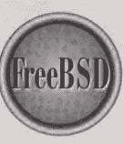

## 第一部分

FreeBSD 安装

## 完整参考


## 第 1 章

## FreeBSD 要求


本书是你 FreeBSD 操作系统的指南。然而，在你深入 FreeBSD 的旅程之前，理解一些基础知识很重要：你为什么想要运行 FreeBSD，它如何融入软件世界，以及它如何融入硬件世界。本章讨论这些问题。理解它们可以帮助你避免代价高昂的错误，例如试图在不适当的硬件上运行 FreeBSD，或在不适当的环境中使用 FreeBSD。如果你是 FreeBSD 的新手，本章至关重要。即使你已经熟悉 FreeBSD（或其他 UNIX 变体），本章也可以帮助你规划你的 FreeBSD 安装。（第 2 章继续描述安装规划和执行。）

## 为什么要运行 FreeBSD？

在任何项目中，使用正确的工具都是至关重要的，选择操作系统也不例外。FreeBSD 是一个功能强大且灵活的操作系统，因此你可以以许多不同的方式使用它。尽管有这一事实，FreeBSD 并非所有情况的完美选择。出于这个原因，本书从查看你可能想要运行 FreeBSD 的情况开始。

通常来说，FreeBSD 有两种使用方式：作为工作站或作为服务器。本节描述这些角色，并涵盖 FreeBSD 在每种情况下的优势和劣势。FreeBSD 是一组从 UNIX 操作系统衍生或建模而来的操作系统家族之一。因此，在决定使用哪个操作系统时，理解 FreeBSD（或一般 UNIX）与非 UNIX 操作系统的比较，以及 FreeBSD 在类 UNIX 操作系统家族中的定位很重要。因此，本节涵盖这些关系。

### 作为工作站操作系统的 FreeBSD

在本书中，`workstation`一词主要用于指用户坐着进行日常工作的任何计算机，例如文字处理、编程、图形设计或 Web 开发。`workstation`也可用于玩游戏。有些人喜欢将 `workstation`一词限制为用于这些功能的高性能计算机，或具有永久网络连接的系统。当 `workstation`以这种方式使用时，术语 `desktop computer`用于指较低性能或非网络化的计算机，它们在其它方面类似工作站。然而，基于计算机性能的区分必须随着技术不断改变，而由于低档系统中拨号网络链接的普及，网络区分可能模糊不清。因此，本书使用 `workstation`一词来指代履行整个最终用户功能范围的计算机。

#### 任何计算机作为工作站运行的能力

任何计算机作为工作站运行的能力取决于两个主要因素：

- `复杂的用户界面`

  如今的用户期望计算机易于使用。这种易用性因素包含许多方面，其中最明显的就是图形用户界面（GUI）。在 FreeBSD 中，第 13 章描述的 X 窗口系统（简称 X）提供了 GUI 的核心。就 GUI 而言，X 的核心非常原始，因此在其之上构建了各种元素，例如窗口管理器（控制窗口边框）和编程控件集（为程序员提供显示菜单、对话框等的工具）。这种模块化方法使 X（以及 FreeBSD）在用户界面方面非常灵活，但这种灵活性会导致应用程序之间不一致，并可能让新用户感到困惑。

- `可用的工作站应用程序`

  工作站运行终端用户应用程序，如文字处理器、电子表格、电子邮件阅读器、编译器、图形程序，甚至游戏。任何缺乏良好工作站工具选择的操作系统都是糟糕的工作站操作系统。此外，工作站工具的质量必须很高。FreeBSD 支持良好的工作站应用程序选择。不过，FreeBSD 缺少一些更常见的工作站应用程序；例如，Microsoft 流行的 Office 套件不可用于 FreeBSD。虽然存在替代品，如 OpenOffice.org（在第 25 章中描述），但如果你需要 100% 完美的文件兼容性，这些替代品可能并不足够好。FreeBSD 在工作站应用程序类别的选择上，在一些领域（如游戏）有所欠缺，但在其他领域（如科学工具）则非常出色。

总体而言，FreeBSD 可以作为工作站操作系统运行，其适合该角色的程度高度依赖于你的具体需求。FreeBSD 作为工作站操作系统的优势包括其低成本、能在旧硬件上运行、稳定性、灵活的用户界面以及与其他类 UNIX 操作系统的相似性。其缺点包括用户界面的一致性不如 Windows 或 Mac OS，且对于习惯 Windows 或 Mac OS 的用户来说界面不陌生。特定应用程序的可用性可能会根据你的需求而发生变动。如果你不依赖于特定的非 UNIX 程序或文件格式，并且你需要的应用程序在 FreeBSD 上可用，那么它可能是一个很好的选择。另一方面，如果你需要使用如 Microsoft Office 等 FreeBSD 上不可用的应用程序，你可能会发现另一种操作系统是更好的选择。

> 如果你希望将类 UNIX 操作系统作为工作站操作系统运行（例如，因为你的本地支持人员受过 UNIX 培训），但又需要运行 Microsoft Office 或其他在 FreeBSD 上不可用的面向消费者的软件包，那么 Mac OS X 可能是一个很好的折中方案。该操作系统围绕 Mach 微内核和许多 FreeBSD 组件构建。Mac OS X 不是 FreeBSD，但由于它大量借鉴了 FreeBSD 和其他类 UNIX 操作系统，Mac OS X 在许多方面对 UNIX 管理员来说应该很熟悉——比 Microsoft Windows 或旧版 Mac OS 更甚。Mac OS X 支持许多面向消费者的应用程序，包括 Microsoft Office。

如果你选择将 FreeBSD 作为工作站操作系统运行，请特别关注本书的第 V 部分。如果你正在为一个许多员工、学生等使用的网络进行配置，你还应该关注第 23 章中描述的默认 GUI 配置相关的问题。自 20 世纪 90 年代中期以来，这些环境已经取得了巨大发展，并且目前仍以快速的速度在改进。

## FreeBSD 作为服务器操作系统

`server`是 FreeBSD 的第二个主要角色。服务器是具有网络连接并响应其他联网计算机数据交换请求的计算机。这个相当枯燥的定义掩盖了服务器是网络实用性的基础这一事实。服务器的示例包括：

- `文件服务器`

  这些计算机使其他计算机能够从文件服务器系统读取或上传文件。它们可用于分发公开可用的文件（例如组成 FreeBSD 本身的文件）或作为局域网中文件的集中存储区。

- `Web 服务器`

  在某种意义上，Web 服务器只是文件服务器的一种`专门形式`。然而，Web 服务器的普及性意味着它们值得特别关注。它们通常从服务器传输文件以便在 Web 客户端程序（更为人所知的是`Web 浏览器`）中显示。

- `邮件服务器`

  邮件服务器是与其他邮件服务器或终端用户邮件程序交换电子邮件信息的计算机。整个互联网的大多数电子邮件交换至少涉及两台邮件服务器计算机，但本地邮件交换可以只使用一台邮件服务器。

- `登录服务器`

  你可以配置 FreeBSD 系统以接受远程位置的登录。如此配置后，该系统可以以类似工作站的方式使用，但是是远程的。在某种意义上，这种配置模糊了工作站和服务器之间的界限，因为网络功能使系统成为服务器，但它通常被当作工作站使用。（在某些情况下，这些功能也可以在服务器计算机上用于实现远程管理。）

- `杂项服务器`

  有一些服务器计算机提供许多网络支持功能，例如`动态主机配置协议`（DHCP），用于让一台计算机配置另一台计算机的网络设置；以及字体服务器，向工作站提供字体信息。

这些服务器功能在本书的第 IV 部分中有更详细的描述。正如你可能从这个覆盖范围所猜测的那样，FreeBSD 是一个出色的服务器操作系统。部分原因在于许多流行的服务器程序最初是为 UNIX 开发的，而 FreeBSD 能很好地运行这些 UNIX 服务器。结合 FreeBSD 运行的廉价 x86 硬件，FreeBSD 可以成为运行世界上许多最流行服务器程序的一种非常具有成本效益的方式。

## 第 1 章：FreeBSD 需求

### FreeBSD 安装

> ### 注意
>
> 单词 `server`可以指整个计算机，也可以指在计算机上运行并提供特定服务器功能的具体程序。这一事实的一个结果是，一台计算机可以提供多种网络服务器功能。例如，单个系统可能同时运行 Web 服务器和邮件服务器。在大多数情况下，`server`一词（指代计算机或程序）的含义`应该`从上下文中清晰明了。当含义可能不清晰时，我会通过指代 `server computer`或 `server program`来进行详细说明。

FreeBSD 作为服务器操作系统的另一个优势是其卓越的可靠性。尽管 x86 硬件种类繁多，有时不像传统服务器计算机（如 Sun 或 Silicon Graphics (SGI) 制造的计算机）使用的硬件那样可靠，但 FreeBSD 非常稳定。发现 FreeBSD 服务器连续数月无故障运行并不罕见。重启通常是为了执行硬件升级，而不是为了升级单个软件包或解决导致不稳定行为的问题。由于许多计算机依赖于服务器计算机，这种高可靠性在服务器操作系统中至关重要。


服务器计算机需要高效且可靠的网络子系统。这些包括它们运行的各个服务器包，以及核心操作系统功能，例如网络卡驱动程序和`传输控制协议/互联网协议`（`TCP/IP`）`协议栈`，这是负责管理网络功能的操作系统内核部分。FreeBSD 的 TCP/IP 协议栈备受尊敬且效率很高。它还包括安全功能，使你能够使用 FreeBSD 实现`包过滤防火墙`。该主题在第 17 章中介绍。包过滤防火墙使你能够根据源和目标 IP 地址等特征阻止单个网络数据包。这些在现代操作系统中越来越常见且复杂的特性，对于经常遭受攻击的服务器来说是至关重要的。许多单独的 FreeBSD 服务器程序还包括除 FreeBSD 包过滤功能外的重要安全功能。

## FreeBSD 与非 UNIX 操作系统

在决定运行哪个操作系统时，你会面临具体的选择。如果 FreeBSD 是你的选择之一（既然你正在读这本书，假设它是），那么你可以将其他潜在选择分为两组：非类 UNIX 和类 UNIX。本节描述第一组中的选项，并`总结` FreeBSD 与每个选项相比的优势和劣势。FreeBSD 是一个类 UNIX 操作系统。如果你起初广泛考虑操作系统，你可能希望先决定是否运行类 UNIX 操作系统，然后如果你决定走这条路，再确定具体的类 UNIX 操作系统。

当今可用的操作系统范围非常广泛——广到本节无法涵盖所有。相反，本节关注在常见低端硬件（x86 和 PowerPC CPU）上运行的最流行（以及一些不那么流行）的操作系统：

1. **DOS**
   *磁盘操作系统*（DOS）是 IBM PC 的原始操作系统，至今仍以各种形式可用。与现代化操作系统相比，这些形式都是原始且有限的。它们的主要优势是它们的体积小（大小方面，包括磁盘空间和内存占用），以及它们能够轻松运行实时应用程序的事实——那些需要非常精确和准确计时的应用，例如某些类型的科学数据收集软件。
- **Windows 9x/Me** 这一系列操作系统已不再流行。它构建于 DOS 核心之上，拥有高度集成的图形用户界面（GUI）和抢占式多任务处理扩展。Windows 9x/Me 在可靠性方面有限，且在许多方面存在怪癖。尽管如此，该操作系统的高普及率以及诸如 Microsoft Office 等常见工作站程序的可获得性，使其成为需要这些流行且仅限 Windows 程序的良好选择。但对于新安装系统，Windows NT 系列中的某个版本可能是更好的选择。
- **Windows NT/2000/XP** Windows NT 是对 Windows 环境从头开始的重新设计。在随后的新版本发布中，该系列改善了其用户界面，并增强了对流行软件的兼容性。2002 年，Windows 2000 是微软官方的商务和服务器操作系统，而 Windows XP 则面向家庭用户市场。两者均构建于 Windows NT 之上，比基于 DOS 的 Windows 9x/Me 系列可靠得多。FreeBSD 通常被认为比 Windows NT/2000/XP 更可靠，尽管也有人不同意这一评估。如果你需要运行仅限 Windows 的软件，Windows 2000 或 XP 可能是一个不错的选择。
- **OS/2** 尽管自 1996 年的 Warp 4 版本以来，IBM 没有发布新的 OS/2 版本，但 IBM 的 OS/2 在已经严重依赖它的环境中仍是一种可行的替代操作系统。OS/2 的可靠性与 Windows 2000/XP 相当，但它只能运行较旧的 16 位 Windows 应用程序、DOS 程序以及 OS/2 专用程序。大量传统的 UNIX 软件已被移植到 OS/2 上。2001 年，Serenity Systems（`http://www.serenity-systems.com`）获得了 OS/2 的授权，并以 eComStation 的名称发布了更新版本。
- **BeOS** BeOS 是从头开发以引领计算世界进入 21 世纪的操作 系统。该操作系统从未获得大众普及，到 2002 年似乎已陷入停滞，尽管仍有一些忠实的追随者。BeOS 稳定且快速，但在软件选择上存在不足。与 OS/2 类似，如果你正在使用 BeOS，它值得考虑；但如果你没有使用它，则可能不值得考虑。开发 BeOS 的 Be, Incorporated 公司于 2001 年被 Palm（`http://www.palm.com`）收购。
- **Mac OS** Mac OS 长期以来一直是桌面上与 Windows 竞争的主要操作系统，但这两个操作系统运行在不同的硬件上——Windows 运行在 x86 架构上，而 Mac OS 运行在 680x0 和（更近期的）PowerPC 架构上。（某些版本的 Windows NT 曾在非 x86 CPU 上运行，但除了最新的 IA64 移植版本外，这些版本均已被废弃。）Mac OS 以其用户界面而闻名，并拥有忠实的用户群。Mac OS 的最新版本，称为 Mac OS X，是围绕一个大量借鉴 FreeBSD 的 UNIX 核心构建的，因此在某种程度上，Mac OS X 实际上是一个类 UNIX 操作系统；但它在图形用户界面（GUI）等方面存在足够多的差异，以至于我将其归于此处。如果你希望拥有类 UNIX 的核心但又能访问流行的终端用户应用程序，那么 Mac OS X 可能是一个很好的折中方案——前提这些应用程序对 Mac OS X 可用。由于 FreeBSD 主要是 x86 操作系统，它不能在与 Mac OS X 相同的硬件上运行。（不过，针对 PowerPC 的 FreeBSD 移植工作正在进行中。）

将 FreeBSD 与这些操作系统作为一个整体进行比较是困难的，因为这些操作系统之间存在很大的差异性。这些竞争操作系统中最重要的当属 Windows（特别是 Windows 2000 和 XP，但也包括拥有庞大安装基础的 Windows 9x/Me 系列）和 Mac OS。

与 Windows 相比，FreeBSD 的优势主要体现在服务器领域。一些最流行的软件，如 sendmail 邮件服务器和 Apache Web 服务器，主要是为 UNIX 平台设计的，它们在 FreeBSD 上运行非常好。从 1990 年代末到 2002 年初，这些 FreeBSD 服务器受到的攻击者关注较少，因此与它们的 Windows 对应物相比，引发问题的可能性也较低。例如，2001 年，Windows Web 服务器遭遇了 Code Red 和 Ninda 等蠕虫病毒的困扰。当然，未来的漏洞可能会使 FreeBSD 的风险高于目前的表面印象。

Microsoft Office 的流行程度使得 FreeBSD 成为用于常见办公任务（如文字处理）的次要或第三选择，排在 Windows 和 Mac OS 之后——至少如果你希望与使用 Microsoft Office 的人交换文件的话。OpenOffice.org 等工具可以读取和写入 Microsoft Office 文件，但在过程中格式有时会损坏。如果你不需要 Microsoft Office 的兼容性，那么在工作站使用中你的选择会更开放。你可能需要评估单独的工作站软件，并运行那个似乎最能支持你首选程序的操作系统。X Window 系统的灵活性和以网络为中心的功能是 FreeBSD 的明确优势，但图形用户界面选择的陌生性和略显粗糙的性质是缺点，至少如果你的用户已经熟悉 Microsoft Windows 或 Mac OS 的话。

## FreeBSD 与其他类 UNIX 操作系统

如果你决定运行类 UNIX 操作系统而不是 Microsoft Windows、Mac OS 或类似系统的某个版本，那么你下一个选择就是运行哪种类 UNIX 操作系统。FreeBSD 是你可供选择的几种之一，你应该了解这些 UNIX 变体之间的一些差异。在许多情况下，这些操作系统中的任何一个都能很好地服务，但也存在 FreeBSD 比替代方案更合适（或不那么合适）于特定任务的情况。

在很大程度上，不同的类 UNIX 操作系统可以运行相同的软件。例如，大多数都能运行流行的 sendmail 和 Apache 服务器，以及 X Window 系统和基于其构建的各种用户级工具。类 UNIX 操作系统之间存在几种不同的差异：

- **内核** 内核是位于大多数操作系统核心的软件组件。内核充当普通程序和计算机硬件之间的接口，提供文件系统、进程管理等功能，并通常处理底层计算任务。因此，内核对于操作系统的稳定性至关重要，并决定了操作系统支持什么硬件等特性。（尽管有些设备是通过非内核驱动程序支持的。）当今 UNIX 世界中正在使用几种不同的内核。
- **硬件支持** 从宏观角度看，一些类 UNIX 操作系统运行在 x86 CPU 上，而其他则运行在其他 CPU 上。x86 CPU 通常被认为是性能最低档，至少对于当前通用的 CPU 而言。因此，一些非 x86 的 UNIX 变体运行在强大的超级计算机上，而像 FreeBSD 这样的 x86 操作系统无法与之竞争。（你可以将几台较弱的计算机链接在一起以匹敌超级计算机的功率，但这超出了本书的范围。）在微观层面上，内核和少数支持程序决定了给定的 UNIX 变体支持哪些具体设备（调制解调器、以太网卡、声卡等）。


### 分发政策
一些 UNIX 变体作为商业产品分发，但其他则作为*开源*软件可用，这意味着任何人可以获取源代码、修改它并重新分发它。开源软件通常比商业软件便宜。然而，在整个 1990 年代，商业 UNIX 变体变得不那么昂贵，如今有些甚至在某些用途下可以免费获得。

### 默认软件和配置
UNIX 已经存在了大约三十年，在此期间，常见实用程序和配置方法的许多变体应运而生。不同的类 UNIX 操作系统走了不同的道路。例如，一些使用 BSD 风格的配置脚本，而其他使用 System V (SysV) 配置脚本。最常见的邮件服务器是 `sendmail`，但一些 UNIX 变体附带其他邮件服务器。这些差异共同构成了类 UNIX 操作系统的整体“个性”。与任何给定的类 UNIX 操作系统与，比如说，Windows 之间的差异相比，这些差异微乎其微；但它们实质足够大，以至于习惯于一种 UNIX 变体的人可能无法在没有指南的情况下处理另一种。

FreeBSD 使用一个派生自 AT&T UNIX 内核开源重新实现的内核，如下文“FreeBSD 的开发”一节所述。FreeBSD 最初是为 Intel x86 系列 CPU 设计的，它也适用于 AMD、VIA（Cyrix）、Transmeta 和其他厂商（除 AMD 和 VIA CPU 的重新品牌外，其他现已停止运营）的类似 CPU。针对其他 CPU 的移植工作正在进行中，但在 2002 年，这些移植大多不成熟且具实验性质。Alpha CPU 移植是其中最成熟的。

FreeBSD 内核采用所谓的*单片式*设计，这意味着内核是一个单一的大型逻辑结构，使其组件能够或多或少地按设计者的意愿进行交互。单片式内核将许多工具，如文件系统驱动程序，放置在所谓的*内核空间*中，意味着这些系统对硬件和内核数据结构拥有非凡的控制权。一种由……使用的竞争性设计类型

## 第 1 章：FreeBSD 要求

一些 UNIX 变体被称为*微内核*。这种方法使用一个较小的内核，该内核与处理更传统内核任务（如访问文件系统）的独立非内核组件进行通信。微内核倾向于具有更严格的结构。单体式内核和微内核设计都有支持者。

FreeBSD 是一个开源操作系统。具体来说，大多数 FreeBSD 组件使用的通常被称为*BSD 许可证*（<http://www.opensource.org/licenses/bsd-1-license.html>）。此许可证允许以进行再分发的人所希望的任何条款进行修改和再分发。因此，从理论上讲，某人可以获取 FreeBSD，对其进行修改，并以专有商业许可证或另一种开源许可证销售结果。另一种流行的开源许可证是*GNU 通用公共许可证*（GPL），它要求修改后的版本必须以 GPL 进行分发。Linux 内核使用 GPL，这种许可证上的差异导致了 FreeBSD 和 Linux 支持者之间的一些哲学差异。（当然，并非每个人在*许可证条款*这一问题上都有强烈的观点。）作为一般规则，FreeBSD 倾向于使用采用 BSD 许可证的软件组件，而 Linux 发行版往往更依赖于使用 GPL 的软件包。虽然这些许可证并不直接影响它们的操作系统的感觉，但许多实用程序以使用不同许可证的替代形式提供；因此，由于两者使用略有不同的实用程序组合，FreeBSD 的感觉与 Linux 不同。

一些类 UNIX 操作系统使用专有（非开源）许可证。例如，Sun 的 Solaris 和 IBM 的 AIX 是商业 UNIX。有时你可以免费或以低成本使用此类操作系统，如适用于 x86 的免费 Solaris。其他时候，你必须为商业 UNIX 许可证付费。正如在开源世界中，GPL 和 BSD 许可证支持者之间存在紧张关系一样，开源软件和商业软件支持者之间也存在紧张关系。不过，这些是哲学和经济上的差异；FreeBSD 在运作上与其商业 UNIX 表亲非常相似。

> *商业软件和开源软件并不一定互不兼容。你可以在商业操作系统上运行开源程序，或者在开放操作系统上运行商业程序。尽管如此，大多数 FreeBSD 程序都使用开源许可证。*

除了 FreeBSD 之外，一些流行的 UNIX 风格操作系统包括：

- **NetBSD** NetBSD 是从 386/BSD 衍生出的三个操作系统之一（后文“FreeBSD 的发展”章节中会有描述），另外两个是 FreeBSD 和 OpenBSD。NetBSD 与 FreeBSD 的不同之处在于，NetBSD 已移植到更多的 CPU 上。其许可和总体设计与 FreeBSD 非常相似，但 FreeBSD 仍然更受欢迎，因为它得到了更大力度的推广，并且安装和使用可能相对更容易。

- **OpenBSD** OpenBSD 的声誉在于安全性。其开发人员付出了巨大努力来创建一个不容易被攻破的操作系统。与 NetBSD 一样，OpenBSD 在配置、许可和可用软件方面与 FreeBSD 非常相似。

- **Linux** 你可以将 Linux 视为一个开源操作系统家族。从技术上讲，Linux 只是内核；一个 Linux*发行版*包括内核以及创建可用操作系统的软件包。与 NetBSD 和 OpenBSD 相比，FreeBSD 在总体配置风格以及所包含工具的细节方面与 Linux 的差异更大。

> **注意**
>
> *一些不熟悉 UNIX 世界的人认为 FreeBSD 是 Linux 发行版。事实并非如此。FreeBSD 不使用 Linux 内核，也不遵循常见的 Linux 做法，例如使用 SysV 启动脚本。最好将 FreeBSD 视为直接衍生自伯克利标准分布（BSD）的操作系统，后文“FreeBSD 的发展”章节中会有描述。Linux 是 UNIX 的一种免费重新实现，与早期 BSD 和 AT&T UNIX 的关联较弱。*

- **Solaris** Sun 的 Solaris 是一种商业 UNIX 变体，通常最常见于 Sun 的服务器硬件上。这些硬件使用 SPARC CPU，并常用于与高端 x86 系统及以上级别竞争的重型服务器。Solaris 也可以在 x86 计算机上运行，因此可以用于一些运行 FreeBSD 的相同计算机上。不过，x86 上的 Solaris 驱动程序选择不如 FreeBSD 丰富。如果你需要为 Sun 计算机开发程序，在 x86 上运行 Solaris 可能是可取的；但对于大多数其他用途，对于 x86 计算机来说，BSD 或 Linux 可能是更好的选择。不过，Sun 硬件可以作为一款优秀的高端服务器计算机。

- **AIX** IBM 的商业 UNIX 变体被称为 AIX，它运行在专有的 IBM 硬件上。与 Sun 系统一样，AIX 计算机面向高端服务器市场，因此它们与 FreeBSD 的竞争力有限。

- **IRIX** SGI 的大多数工作站运行一种名为 IRIX 的商业 UNIX 变体。SGI 过去的声誉在于为高端图形工作（如为大片制作特效）进行了优化的计算机。如今，价格更低的 x86 计算机正在蚕食这一市场，但 SGI 和 IRIX 在这个领域仍然是一股强劲的力量。

总体而言，FreeBSD 最直接地与其表亲 BSD 以及 Linux 竞争。FreeBSD 是 x86 硬件上最流行的 BSD，因此在寻找支持方面具有优势。FreeBSD 的开发考虑到了易于安装和管理；NetBSD 和 OpenBSD 在这些方面相对较弱。不过，你可能希望考虑 OpenBSD 以获得增强的安全性，或考虑 NetBSD 以支持非 x86 CPU。Linux 的整体感觉与任何 BSD 都不同。Linux 支持更多的硬件和商业软件，并且许可证问题也不同。如果你是刚开始入门并希望拥有一个通用的类 UNIX 开源操作系统，FreeBSD 或 Linux 都有可能会工作得非常好。不过，Linux 世界往往有些混乱，发行版之间的差异可能会让新用户感到困惑。

在大多数情况下，FreeBSD 并不直接与商业 UNIX 变体竞争，这些变体运行在比典型 x86 硬件高出一档或两档的硬件上，特别是在浮点数学运算方面。如果你需要一些高性能系统以及成本较低的计算机，那么在 x86 系统上运行 FreeBSD 与运行 Solaris、AIX 或 IRIX 的更强大服务器的混合搭配是有意义的。虽然它们在配置上并不完全相同，但管理或使用 FreeBSD 系统所需的技能与商业 UNIX 变体上所需的技能类似。在某些情况下，高端 x86 系统可以直接与低端 Sun、IBM 或 SGI 硬件竞争。通常，运行 FreeBSD 的 x86 系统成本较低，但可能更难为 FreeBSD 找到服务协议或类似服务。

### 软件环境
前面的章节描述了 FreeBSD 在当今可用操作系统范围中的定位。这些信息可以帮助你决定是运行 FreeBSD 还是其他操作系统。不过，如果你决定运行 FreeBSD，你必须了解它如何与其他操作系统交互。这种交互包括网络上的其他计算机以及同一计算机上运行的其他操作系统。了解一些 FreeBSD 的历史也很有帮助，以便更好地理解其设计哲学及其作为操作系统的优缺点。本节将涵盖这些问题。

### FreeBSD 的发展


FreeBSD 的历史，以及 UNIX 的一般历史，是复杂的。它始于 1969 年在 AT&T 开发第一个（非常原始的）UNIX 版本。从那时起，与加州大学伯克利分校的合作、数量不断增加的志愿者的参与、现有代码的替换以及“实用”工具的开发都已发挥作用。原始的 AT&T UNIX 已经派生出多个变体（也称为代码库中的分支）。在一个分支中开发出的好想法通常会找到进入其他分支的途径，并且在 UNIX 历史上曾有过 UNIX 厂商努力减少由代码分支引起的差异的时期。尽管如此，今天的 UNIX 不是一个单一的操作系统，而是一个相关操作系统的家族。

> **注意**
>
> *从技术上讲，UNIX 名称仅适用于官方认可的操作系统的版本。有些人使用 UNIX（全大写）来指代操作系统的这些官方版本，并使用 Unix（仅首字母大写）来指代实用系统。由于这是一个非常细微的区别，本书使用 UNIX 来指代官方 UNIX 或整个操作系统家族，并在需要明确参考不仅指官方 UNIX 还指类似操作系统（如 Linux）时使用“类 UNIX 系统”或类似的措辞。*

在 1969 年 Ken Thompson 和 Dennis Ritchie 最初开发 UNIX 之后，通往 FreeBSD 的分支中的第一个重要里程碑是在 1974 年向加州大学伯克利分校交付了 UNIX 第 4 版的副本。在接下来的几年里，伯克利的教职员工和学生熟悉了 UNIX，为...

## FreeBSD：完整参考手册

操作系统本身。这些程序在 1977 年以伯克利软件发行版（BSD）的形式整合在一起，它是一组由伯克利开发或与伯克利合作开发的程序，用于 AT&T 的 UNIX。

1978 年，第二个伯克利软件发行版（2BSD）发布；该软件包改进并扩展了最初 BSD 版本中的实用工具。开发者继续进行多次 BSD 版本发布——2.11BSD、3BSD、4BSD 等。AT&T 反对 5BSD 的命名提议，因为担心与其自己的 System V (SysV) 版本的 UNIX 产生混淆。因此，随后的 BSD 版本采用了 4.1BSD、4.2BSD 等名称。其中一些版本率先推出了传输控制协议/互联网协议（TCP/IP）——这是当今互联网构建所依赖的基础网络协议栈。所有早期的 BSD 版本都是 AT&T UNIX 的附加内容或其变体；它们本身并不是完整的操作系统。此外，通过 4.3BSD 版本的变体（称为 4.3BSD-Tahoe），BSD 仅在有原始 AT&T 源代码许可证的情况下才可用——这是 1970 年代和 1980 年代大部分时间 UNIX 分销的标准方式。1989 年，这种情况发生了改变；伯克利创建了 Net/3BSD Release 1，它允许免费重新分发代码，无论接收者是否拥有 AT&T 源代码许可证。这是朝着当今开源运动和许可制度的早期且重要的一步，如果没有为 Net/3BSD Release 1 所做的许可证变更，现代 FreeBSD 就不可能存在。

1991 年，伯克利提供了网络版本 2。尽管名称相似，网络版本 2 比网络版本 1 要实质性得多。网络版本 2 几乎是一个完整的操作系统；它只缺少 AT&T UNIX 的六个内核源代码文件。在六个月内，一位名叫 Bill Lutze 的程序员重写了它们，并将生成的软件包命名为 386/BSD。该操作系统是 NetBSD 和 FreeBSD 的直接祖先。（OpenBSD 在 20 世纪 90 年代中期从 NetBSD 中分离出来。）386/BSD 操作系统创建用于在 Intel x86 CPU 上运行——或者更准确地说，是 80386，当时它是顶级 x86 CPU。如前所述，FreeBSD 在很大程度上仍是一个 x86 现象，尽管针对其他 CPU 的移植版本正变得可用。

自 1993 年（FreeBSD 作为独立项目初创的日期）以来，FreeBSD 一直是一个单一、专注的开发工作。当然，它从其他开源项目采纳了代码，并为其他项目贡献了代码。平均每两年版本主版本号就会增加一次，版本 4.5 在 2002 年初发布，版本 5.0 计划在 2002 年底发布。本书专注于 FreeBSD 的这两个版本。

### 与网络中其他计算机的交互

FreeBSD 的历史（或者根据你的观点可能是其前史）包括在 4.2BSD 中开发 TCP/IP 网络。4.2BSD 的网络代码已作为基础用于多个其他操作系统的 TCP/IP 网络协议栈。事实上，甚至一些微软网络工具至今仍保留着版权通知，表明它们源于 BSD 工具。拥有直接追溯到原始 TCP/IP 实现的谱系，你可能认为 FreeBSD 在与其他操作系统网络集成时不会有任何问题。对于某些用途而言，这是真的；但在使用 FreeBSD 进行网络连接时，你应该考虑一些注意事项和限制。这些包括

- **非 TCP/IP 协议栈**

  TCP/IP 并不是当今唯一的网络协议栈，但它是流行的。大多数局域网仍然依赖于网络协议栈，如 Apple 的 AppleTalk、Windows 使用的 NetBEUI 协议栈，或 Novell 的 IPX。与对 TCP/IP 的支持相比，FreeBSD 对这类协议栈的支持是有限的。幸运的是，当今很少有网络工具完全依赖于非 TCP/IP 网络协议栈。例如，Windows 文件和打印机共享工具可以通过 NetBIOS 或 TCP/IP 工作。Samba（在第 18 章中描述）依赖这一事实来向 Windows 系统提供文件。

- **标准漂移**

  很少有重用代码的供应商会完全按照他们发现的方式使用它。事实上，即使是原始开发者也不太可能让代码保持原样。因此，原始的 4.2BSD TCP/IP 协议栈多年来发生了变异，每个派生操作系统都托管了略微不同的实现。有些创建了完全新的 TCP/IP 实现。鉴于这种变化和实现的历史，令人惊叹的事实是大多数操作系统可以通过 TCP/IP 相互通信。作为实际问题，FreeBSD 是一个足够重要的操作系统，特别是在服务器领域，它与其他操作系统之间的 TCP/IP 兼容性问题非常罕见。你更有可能遇到的问题是特定协议，因为你选择的客户端或服务器存在怪癖。例如，许多网页是为微软的 Internet Explorer 网页浏览器设计的，其中一些在 FreeBSD 上可用的网页浏览器（如 Mozilla 或 Konqueror）上无法正常工作。

- **安全问题**

  TCP/IP 是在信任的环境中开发的，因此 TCP/IP 的核心功能在安全控制方面并不多。这一事实加上网络软件的复杂性，导致常规发现允许犯罪分子访问各种计算机的安全漏洞。总体而言，FreeBSD 在安全性方面拥有良好的声誉，但这并不意味着你可以忽视这个问题；糟糕的配置或疏忽可能会使安全漏洞几乎不可避免。本书的许多部分描述了安全问题，但第 17 章和第 29 章在这方面尤为重要。

> **注意**
>
> 安全不是一蹴而就的事情。“FreeBSD 是一个安全的操作系统”这样的陈述不应被理解为绝对声称 FreeBSD 系统无法被入侵。充其量，你可以使 FreeBSD 计算机变得如此难以被攻破，以至于只有最好和最勤勉的攻击者才能闯入它。标准也是不断变化的目标；新的安全相关漏洞不断被发现，因此今天看起来相对安全的系统可能明天就被发现极度不安全。

总体而言，FreeBSD 使许多网络功能表现出色。它有一个稳定且高效的 TCP/IP 协议栈，这对于网络服务器尤为重要。如果你适当关注安全问题，FreeBSD 系统可以相对安全。同样，FreeBSD 有许多可用的网络服务器程序，使 FreeBSD 用户能够与其他系统上运行的服务器进行交互。

### 与单台计算机上其他操作系统的交互

在 BSD 开发的相当早期，就需要 UNIX 与其他操作系统在同一台计算机上共存。例如，伯克利的第一台 UNIX 计算机 PDP 11/45 实际上只在三分之一的时间内运行 UNIX；每天其余的三分之二时间，计算机运行另一个操作系统（称为 RST）。然而，对于分时计算机来说，这种方法非常笨拙，所以 1970 年代和 1980 年代的大多数 UNIX 系统只运行一个操作系统。但是，随着 386/BSD 的发布，与其他操作系统共存的必要性变得迫切。许多业余开发者只有一台计算机；喜欢与否，他们经常发现需要使用更流行的 DOS（以及后来的 Windows）操作系统来完成一些工作。今天仍然如此。如果你打算运行专用的 FreeBSD 系统（例如，服务器或专用工作站），因为 FreeBSD 不需要与其他操作系统共存，你的任务就更简单。但是，如果你需要偶尔在另一个操作系统中运行程序，你就必须理解 FreeBSD 如何使用其硬盘，以及 x86 计算机如何启动操作系统，以便你可以有效地在你的操作系统之间切换。

理解和使用任何多操作系统的第一个关键是理解*分区*。如果硬盘像一个文件柜，那么分区就像文件柜中的一个独立抽屉——一个你可以用来存放相关文件的大存储空间的小区域。在首次准备硬盘使用时设置分区。这个过程被称为*分区*，一旦创建分区，它们就不容易修改。因此，当你获得新计算机时，重要的是以你在可预见的未来发现方便的方式设置分区。

> **注释**
>


> *一些工具允许你在分区创建后调整其大小。商业产品 Partition Magic (http://www.powerquest.com) 和 Partition Commander (http://www.v-com.com) 是两种此类产品。开源替代品包括 First Non-Destructive Interactive Partition Splitting Program (FIPS; http://www.igd.fhg.de/~aschaefe/fips/) 和 GNU Parted (http://www.gnu.org/software/parted)。这些产品往往更有限和原始，但它们可能足以完成工作。这些工具在你想在运行 DOS、Windows、OS/2、Linux 或其他操作系统的系统上安装 FreeBSD 时特别有用。*

多年来，开发出了各种分区方案。在大多数情况下，这些方案都是独立地为特定硬件平台开发的。对于 x86 计算机，分区系统支持三种不同的分区类型。这些分区类型的存在并不是因为对不同分区功能有迫切需求，而是因为有限的分区方案在显然不足时被扩展了。三种 x86 分区类型是

- **主分区**
原始的 x86 分区类型现在被称为*主分区*。x86 分区方案最多支持四个主分区。某些操作系统，如 DOS 和 Windows，必须从位于第一个物理硬盘上的主分区启动。FreeBSD 也必须驻留在主分区中，但它可以存在于第二个或后续的硬盘上。某些操作系统，如 Linux 和 OS/2 可以从非主分区引导。在规划系统安装时，您应考虑这些限制。
- **扩展**：扩展分区在某种意义上只是一种特殊类型的主分区。它占用四个可用的主分区槽位之一，并作为下一个 x86 分区类型的占位符。
- **逻辑**：逻辑分区驻留在扩展分区内。扩展分区项的存在是为了在分区表中为一个或多个逻辑分区保留空间。x86 分区方案支持的逻辑分区数量主要受磁盘大小和操作系统寻址分区方式的限制。例如，DOS 和 Windows 使用单个驱动器字母来寻址分区，因此理论上限是 26（即字母表中的字母数量）。在实践中，`A:` 和 `B:` 通常指代软盘驱动器，并且系统可能需要其他字母来标识光盘驱动器、网络共享等。在类 UNIX 操作系统中，`/dev` 目录树中的设备文件名和底层内核限制决定了逻辑分区的数量上限。无论哪种情况，很少有系统会接近这些极限。由于逻辑分区位于扩展分区内，因此逻辑分区必须占用硬盘的连续区域——它们不能通过主分区进行分割。

许多 DOS 和 Windows 计算机每块驱动器仅使用一个主分区。不过，一些 DOS 或 Windows 用户会对驱动器进行分区。此外，如果您希望在同一台计算机上安装 FreeBSD 和其他操作系统，您也需要这样做。具体来说，您应为 FreeBSD 预留一个主分区，并根据其他操作系统的需求设置相应的主分区或逻辑分区。例如，图 1-1 展示了一种可能的配置。FreeBSD 和 Windows 都拥有主引导分区，并且扩展分区内存在两个逻辑分区，用于容纳额外的 Windows 文件。

> **注意**：*基于英特尔新型 64 位 IA64 CPU 的计算机可选择使用一种比旧 x86 分区方案更灵活的新型分区方案。*

不幸的是，在处理 FreeBSD 时情况要复杂得多。您应首先明白，UNIX 系统经常使用分区来隔离不同类型的数据。这种做法使您可以使用不同的选项挂载目录，并保护一个分区中的数据免受另一个分区填满或损坏造成的影响。例如，将存储用户数据文件的 `/home` 目录与根目录（`/`）分隔开是常见的做法。在 FreeBSD 中，正如在其他 UNIX 版本中一样，每个分区都挂载在特定的目录下；没有像 DOS 或 Windows 中的驱动器字母。基于这些原因，FreeBSD 系统经常需要多个分区，即使计算机仅托管 FreeBSD。

由于其 AT&T 和 BSD UNIX 的传承，FreeBSD 依赖于一种与标准 x86 分区系统完全不同的分区方案。通常，这种 BSD 分区系统驻留在单个主分区内。在 FreeBSD 中，这个分区被称为“片区”（slice），其子分区类似于 x86 扩展分区中包含的逻辑分区。不过，只有 BSD 操作系统或支持 BSD 分区方案的其他操作系统才能读取 BSD 子分区。第 2 章描述了您可能希望为 FreeBSD 系统创建的子分区类型，无论您是否也在计算机上安装了其他操作系统。

如果您希望在不同操作系统之间交换数据，最好的方法是为这个目的预留一个分区。不幸的是，不同的操作系统使用不同的文件系统来存储数据。文件系统是一种跨越整个分区的的多数据结构，用于记录文件、其位置以及关联数据（如文件创建日期）。一般而言，DOS 文件分配表（FAT）文件系统是跨操作系统数据传输的良好选择，因为所有常见的 x86 操作系统都支持 FAT。支持 FreeBSD 原生使用的快速文件系统（FFS）的非 UNIX 操作系统很少。确实，FFS 在不同 UNIX 实现之间存在细微但重要的差异，因此，即使您想要双重引导 FreeBSD 和其他某种 UNIX，您可能仍需要使用 FAT 作为通用的交换媒介。

### 硬件环境

在将 FreeBSD 安装到任何计算机之前，您应花一些时间了解 FreeBSD 的硬件要求。x86 硬件世界极其多样，因此发现计算机包含 FreeBSD 不支持的硬件设备并不罕见。在大多数情况下，这不会阻止您安装 FreeBSD，但可能会阻止您充分利用该操作系统。

> 如果您想替换在安装过程中发现不被支持的设备，请在安装 FreeBSD 之前尝试这样做。这可能消除在更换硬件后重新配置 FreeBSD 的需要。

#### CPU 类型和速度

任何计算机的核心都是其 CPU。如本章前面所述，FreeBSD 最初是为在英特尔 x86 系列 CPU 上运行而设计的——至少是这些 CPU 的 32 位版本，从 80386 开始。2002 年，FreeBSD 支持英特尔 80386、80486、Pentium、Pentium Pro、Pentium II、Pentium III、Pentium 4 和 Celeron 系列，包括这些系列的变体，如 Pentium III Xeon。此外，FreeBSD 也在来自 AMD、VIA、Transmeta、Cyrix、IDT 和 NexGen 的同类竞争 CPU 上运行。（上述最后三家公司已经倒闭，但它们的设计已被整合到 AMD 和 VIA 的产品中。一些公司，如 Evergreen，营销 AMD 或 VIA CPU 与适配器的组合，以使旧主板能够以比正常情况下更快的速度运行。FreeBSD 适用于此类 CPU，但 CPU 本身并不总是在所有主板上完美运行。）

目前正在进行将 FreeBSD 移植到各种非 x86 平台的项目（参见 http://www.freebsd.org/platforms/ 了解这些项目的描述）。这些包括英特尔的 IA64 系列、AMD 的 x86-64（他们对英特尔 IA64 架构的回应）、康柏的 Alpha、摩托罗拉的 PowerPC，以及许多 Sun 服务器中使用的 UltraSparc。2002 年，x86 架构仍然非常流行，并且似乎最终将被 64 位平台取代。英特尔正以 Itanium、Merced 和 McKinley 等名称推动 IA64；AMD 则准备其 x86-64（又称 K8 或 Hammer）与 IA64 竞争。这些 CPU 无疑将在不太遥远的未来变得非常重要。幸运的是，无论使用什么平台，大多数 FreeBSD 操作细节都保持相同，尽管您可能需要仔细选择二进制程序，以确保它们能在您的 CPU 上运行。如果在非 x86 平台上安装 FreeBSD，分区和安装细节可能有所不同。由于 x86 硬件的持续流行，本书重点介绍该平台。

关于 CPU 速度，您需要的速度主要取决于您的需求，而不是 FreeBSD 的需求。您可以在低功耗的 386 CPU 上运行 FreeBSD，但此类系统在当今世界不太可能适合除非常有限的使用场景。例如，您可能将此系统用作小型家庭网络的专用防火墙或小型网络的 DHCP 服务器；但 386 的性能不足以处理 CPU 密集型的图形渲染，甚至无法运行图形密集型程序。大多数 386 系统在内存、磁盘空间等方面也存在不足。如果您正在组装一台新计算机，任何从英特尔、AMD、VIA 或 Transmeta 新售出的 x86 CPU 都应足以运行 FreeBSD 并执行大多数常见任务。不过，如果您打算运行 CPU 密集型程序，可能需要购买顶级 CPU，或接近顶级水平的 CPU。

- **提示**：CPU 价格通常从顶级型号迅速下降到下一级别的型号，然后随着后续速度降低而缓慢下降。因此，最佳的 CPU 性价比通常出现在中端 CPU 中。然而，这种“中端”CPU 的确切速度几乎每周都在变化，因此我无法给出一个具体的速度推荐来获得最大的性价比。

#### 内存要求


与 CPU 速度一样，FreeBSD 的内存要求以当今标准来看相当温和。官方文档声称安装 FreeBSD 最低需要 5MB，而运行它仅需 4MB。但对于除琐碎或极其专业应用外的所有应用而言，这些数量在当今标准下小得离谱。2002 年，即使是低端计算机也至少配备 128MB 内存。这个数量（甚至更少——比如 64MB）就足以安装 FreeBSD 并启动到图形工作站环境。

## 硬盘

在安装操作系统时，磁盘空间始终是一个需要考虑的问题。前文“单机系统中与其他操作系统的交互”一节概述了 FreeBSD 的某些分区需求，第二章则提供了更具体的信息。不过，在您开始安装 FreeBSD 之前，应考虑两个问题：您打算使用的硬盘类型以及您打算分配给操作系统的总空间量。

### SCSI 和 IDE 硬盘

如今销售的大多数 x86 计算机都使用增强型集成驱动器电子（`EIDE`）硬盘。现代主板无一例外地都集成了 `EIDE` 控制器，因此从系统组装的角度来看，连接这些硬盘非常容易。然而，存在一种竞争类型的硬盘：小型计算机系统接口（`SCSI`）。很少有主板包含 `SCSI` 连接器，因此若要使用 `SCSI` 硬盘，您必须添加一个 `SCSI` 主机适配器——通常是一块即插即用的 `PCI` 卡。`FreeBSD` 同时支持 `EIDE` 和 `SCSI` 硬盘，但每种类型都有其注意事项，且每种技术都有其优缺点。

`EIDE` 的主要优势在于成本。由于 `EIDE` 控制器内置于现代主板上，因此与 `SCSI` 设备不同，添加主机适配器没有额外成本。（不过，您可以添加 `PCI EIDE` 控制器以提高性能或托管超过四个设备，如后文所述。）与类似容量的 `SCSI` 驱动器相比，`EIDE` 硬盘也较为便宜。总之，使用 `EIDE` 而非 `SCSI` 可以为系统节省 100 到 500 美元甚至更多的成本。所有 `EIDE` 控制器都支持单一的最低通用硬件标准，因此单个驱动程序即可让所有控制器至少达到基本运行状态。不过，为了获得最佳速度，`FreeBSD` 需要针对您使用的特定 `IDE/EIDE` 控制器的驱动程序。

`IDE` 的主要弱点在于其灵活性较差。您只能将两个 `IDE/EIDE` 设备连接到一条链上（即连接主板或 `IDE/EIDE` 控制器卡的电缆）。大多数主板仅支持两个端口，因此总共只能支持四个 `IDE/EIDE` 设备。由于光盘驱动器、可移动介质驱动器、磁带备份驱动器等通常使用 `IDE` 或 `SCSI`，这种 4 设备限制可能会造成不便。您可以通过添加额外的 `IDE/EIDE` 控制器卡来扩展此限制，但这会占用一个 `PCI` 插槽和一个中断（一种有限的硬件资源）。此外，`EIDE` 仅允许每条链同时访问一个设备，因此在重度多任务系统中，如果需要同时访问链上的多个设备，`EIDE` 可能会成为瓶颈。

> 过去，`EIDE` 控制器仅支持程序化输入/输出（`PIO`）访问模式，这种模式要求 `CPU` 介入所有数据传输。这使得 `EIDE` 成为 `FreeBSD` 等多任务操作系统的不理想选择。不过，如今的 `EIDE` 控制器支持更先进的直接内存访问（`DMA`）传输模式，在这种模式下，控制器可以直接向内存发送数据。不过，`DMA` 传输确实需要针对正在使用的 `EIDE` 芯片的明确驱动程序支持。

与 `EIDE` 相比，`SCSI` 非常灵活。根据所使用的 `SCSI` 变体，您可以将七个或十五个设备附加到一个链上，因此，如果您希望构建一台拥有许多物理磁盘的计算机，`SCSI` 是一个极佳的选择。`SCSI` 还支持每条链同时访问多个设备，这对于多任务处理非常有用。给定容量下的 `SCSI` 硬盘通常也比相同容量的 `EIDE` 硬盘更快，尽管这一因素因驱动器而异。您可以找到更广泛的 `SCSI` 设备类型，以及一些高端设备。例如，有 `SCSI` 扫描仪可用，且高端磁带备份设备几乎总是使用 `SCSI` 接口。大多数 `SCSI` 主机适配器始终使用 `DMA` 模式，尽管一些非常便宜的适配器仅使用 `PIO` 模式。

`SCSI` 的缺点归结为成本。`SCSI` 主机适配器需要花钱（通常为 50 到 250 美元），且 `SCSI` 设备通常比其 `EIDE` 对应产品更昂贵。此外，`SCSI` 没有最低通用硬件标准，因此 `FreeBSD` 必须支持您系统所使用的任何 `SCSI` 主机适配器。

总体而言，`EIDE` 的成本优势使其成为低端和中端系统的良好选择。如果您构建一台计算机，使用 `FreeBSD` 包含 `DMA` 支持的 `EIDE` 控制器，那么从单磁盘 `EIDE` 系统中可以获得良好的性能。不过，如果您正在构建大型服务器或其他需要异常磁盘性能的设备，`SCSI` 的额外成本可能是合理的。请务必研究每个 `SCSI` 组件（包括您的硬盘和 `SCSI` 主机适配器本身）的能力和需求的详细信息。

> 您可以构建一台同时使用 `EIDE` 和 `SCSI` 的计算机。例如，您可能希望利用 `SCSI` 卓越的磁盘性能和高端磁带备份单元，同时使用 `EIDE` 来连接廉价的光盘驱动器和 `Zip` 驱动器。

在未来，其他接口可能会发挥越来越重要的作用。特别是，`IEEE-1394`（又名 `FireWire`）可能会成为 `SCSI` 在至少某些用途上的继任者。`IEEE-1394` 硬盘已经可用。`FreeBSD 5.0` 对 `FireWire` 的支持非常有限。

要了解支持哪些 `EIDE` 控制器和 `SCSI` 主机适配器，请参阅随 `FreeBSD` 提供的 `HARDWARE.TXT` 文件。请注意，该文件侧重于芯片；您计算机中特定的品牌和型号设备可能未被列出，即使它是受支持的。查看 `PCI` 卡上芯片的名称以了解您拥有的是什么。如果您的系统当前安装了 `Windows`，您可以使用 `Windows` 系统控制面板了解有关它的一些信息：点击“设备管理器”选项卡并展开“硬盘控制器”项。例如，图 1-2 显示了一台使用 `VIA EIDE` 控制器的计算机（`IDE` 是演变为 `EIDE` 的旧标准，一些实用程序仍在使用旧术语，如图 1-2 所示）。

> **注意**
>
> *您不需要针对特定 `EIDE` 或 `SCSI` 设备的驱动程序。例如，如果您将 `EIDE` 光盘驱动器更换为另一个 `EIDE` 光盘驱动器，您无需更新 `FreeBSD` 光盘驱动器，因为这些设备使用标准化的命令集。对于大多数特定的 `EIDE` 或 `SCSI` 设备类型（如硬盘或光盘驱动器），您确实需要驱动程序。这些驱动程序包含在标准 `FreeBSD` 内核中，因此其使用通常是透明的。*

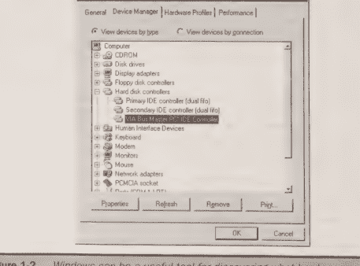

**图 1-2。** *Windows 可以作为发现计算机拥有什么硬件的有用工具。*

### 总磁盘空间需求

研究您系统中的 `EIDE` 控制器或 `SCSI` 主机适配器对于避免或解决与 `FreeBSD` 相关的磁盘问题至关重要。不过，独立于 `EIDE` 或 `SCSI` 的选择，总磁盘空间也是一个问题。官方上，`FreeBSD` 需要 100MB 的磁盘空间。然而，100MB 的安装将非常有限。正式的安装至少需要几百兆字节，可能需要 1GB 或更多。如果您想安装并试用大量软件，为 `FreeBSD` 保留 2GB 甚至 3GB 可能并不过分。如果您的系统将处理非常多或非常大的用户数据文件，或者需要支持非常多或非常大的文件的服务器，您可能[仍然]需要更多空间。您必须决定为特定站点功能分配多少磁盘空间。

2002 年，很难找到小于 20GB 的新硬盘，因此满足 `FreeBSD` 的基本磁盘空间要求并不是什么挑战。如果您将 `FreeBSD` 添加到现有系统，您有两种方法可以着手处理：

- **重新分区并共享驱动器** 您可以使用诸如商业软件 `PartitionMagic` 或开源软件 `FIPS` 等实用程序来缩小现有分区并为 `FreeBSD` 切片创建空间。如果现有硬盘上有足够的空闲空间，这种方法可以既有效又节省空间，但并非没有风险。动态分区调整工具偶尔会失败，结果可能导致数据丢失。因此，在使用此类实用程序之前，您应该备份现有数据。

- **添加新驱动器** 您可以添加一个新的硬盘驱动器供 `FreeBSD` 专用，或在 `FreeBSD` 和当前操作系统之间共享。这种方法比在单个驱动器上缩小现有分区并添加新分区更安全，但如果您已达到系统支持设备数量的限制，这可能不切实际。

在任何情况下，当安装 `FreeBSD` 时，您还必须安装一个引导加载程序。这是一个非常简单的程序，用于引导一个或多个操作系统。`FreeBSD` 附带一个引导加载程序，使您能够在系统开机时选择要引导哪个操作系统。您可以单独使用此工具，或将其与第三方引导加载程序（如 `PowerQuest` 的 `BootMagic`（`http://www.powerquest.com/eide/`）、`V-Com` 的 `System Commander`（`http://www.v-com.com/product/sc7_ind.html`）或 `Linux` 的 `LILO`）结合使用。第四章提供了有关安装和配置 `FreeBSD` 引导加载程序的更多信息。

## 视频硬件

为了在屏幕上创建显示，`FreeBSD` 必须支持您的视频硬件。监视器本身很少出现问题，并且不需要明确的驱动程序（尽管您可能需要调整某些设置以匹配您的监视器，如第十三章所述）。相反，您应该将研究重点放在您的视频适配卡上。


所有现代视频卡都支持 FreeBSD 可以使用的某些基本模式。特别是，FreeBSD 可以在文本模式和低分辨率*视频图形阵列*（VGA）640×480 模式下运行。有时更高的分辨率通用图形模式也能工作。尽管文本模式对于某些用途（例如服务器）可能已经足够，但大多数工作站用户希望使用图形用户界面（GUI）环境，这需要图形模式。VGA 模式可以使用，但表现仅勉强达标——对于严肃的使用场景，你需要使用 FreeBSD（或者更准确地说，X 窗口系统）支持的显卡，并且要运行在优于基本 VGA 的图形模式下。你所需要关注的视频支持虽然作为 FreeBSD 软件包的标准部分包含在内，但从技术角度来说，它属于一个独立项目：XFree86（http://www.xfree86.org）。XFree86 也被其他开源类 UNIX 操作系统（如 NetBSD、OpenBSD 和 Linux）所使用。它也在各种商业 UNIX 实现中可用（尽管这些系统通常也包含自己的专有 X 服务器），甚至在许多非 UNIX 系统中也能使用，包括 Windows、Mac OS 和 OS/2。

在 FreeBSD 中，XFree86 几乎是直接与视频硬件通信的，因此 XFree86 需要支持你的显卡。如果 XFree86 对你的视频硬件支持薄弱，你的视频性能将会受到影响。这可能意味着你无法像在 Windows 中那样实现较高的分辨率，或者速度较慢。（所有现代视频芯片组都包含旨在加速常见视频操作（如在屏幕上移动对象）的功能。如果驱动程序不够成熟，可能无法支持所有这些功能，从而导致视频性能不佳。）你可以在 http://www.xfree86.org/current/Status.html 找到关于 XFree86 支持的芯片组的信息。

## 警告

该网页提供了关于最新可用驱动程序的信息。根据你 FreeBSD 软件包的年代，它可能包含较旧的一组 XFree86 驱动程序，因此 XFree86 网页可能显示存在某些驱动程序，但它们可能并未包含在你的 FreeBSD 安装中。如果是这种情况，你可以升级 XFree86，或者至少单独升级你的显卡驱动程序。

与 EIDE 和 SCSI 硬件一样，受支持的视频硬件列表是围绕芯片组和芯片组制造商构建的，但一些显卡制造商并不公开这些细节。因此，你可能需要检查显卡上的芯片，或者（如果该计算机安装了 Windows）查看 Windows 系统控制面板中的“显示适配器”项。不过，一些最流行的显卡制造商，如 ATI 和 Matrox，也生产自己的芯片组，因此找到对这些芯片组的支持应该不会太困难。

## 提示

如果你购买新的显卡，请对最新型号保持谨慎。XFree86 的开发通常落后于最新芯片组几个月，因此最新型号可能支持得不好，甚至完全不受支持。XFree86 网页上的信息应有助于你找到合适的硬件。

FreeBSD 的安装例程会尝试检测并配置你的视频硬件，如第二章所述。如果此过程未正确工作，或者你需要更改配置，你可以编辑 XFree86 配置文件，如第十三章所述。

### 网络硬件

许多 FreeBSD 系统作为网络服务器运行，或者至少作为联网工作站。这类系统无不都需要某种形式的网络硬件。在 2002 年，最常见的局域网硬件类型是以太网。以太网有多种形式，主要差异体现在两个方面：

- `速度` 最低以太网速度为每秒 10 兆位（Mbps）。最易于获得的最快速度为 1000 Mbps（或 1 Gbps——通常称为千兆以太网）。在 2002 年，100 Mbps 是新安装中最常见的速度，尽管千兆速度正变得越来越流行。
- `介质` 以太网通过某种线缆工作。过去，同轴电缆的两种形式很常见——粗缆和细缆。这两种形式都类似于有线电视使用的电缆，但粗细不同。两者都使用总线拓扑结构，电缆将设备一个接一个地连接起来，形成一条单线。同轴电缆在新安装中现在很少见，已被双绞线电缆所取代。双绞线电缆类似于电话布线，但接头更宽。双绞线电缆使用中心设备（称为集线器或交换机）来连接设备；每台计算机的电缆都连接到集线器或交换机，形成星型拓扑结构，如图 1-3 所示。最近，光缆正在千兆以太网网络中作为双绞线电缆的替代方案出现。光缆通常使用星型拓扑结构。

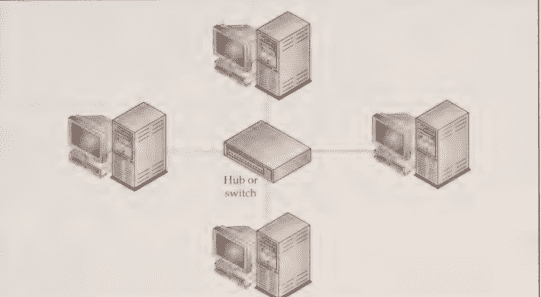

图 1-3. 星型拓扑结构使得诊断电缆故障相对简单，因为故障被隔离在一台计算机上。

大多数新网络使用 100 Mbps 双绞线硬件，但你可能需要将计算机连接到旧的 10 Mbps 双绞线或同轴电缆网络。如果你需要最快的硬件，你可能需要考虑构建一个新的千兆以太网网络，使用双绞线或光缆。

幸运的是，FreeBSD 并不关心你使用何种类型的以太网布线或拓扑结构；你只需要确保你的以太网适配器卡得到支持。（少数高端主板内置以太网支持，但这种情况很少见。）随 FreeBSD 提供的 `HARDWARE.TXT` 文件描述了 FreeBSD 支持的以太网适配器。与 EIDE、SCSI 和视频硬件一样，这种兼容性通常是根据板上使用的芯片组来指定的，因此你可能需要检查以太网卡上最大芯片上的标记，或查阅 Windows 系统属性对话框。（打开计算机机箱时，请确保先关闭计算机，并通过佩戴防静电腕带或经常触摸散热器或水龙头来给自己接地。在干燥天气下不要穿橡胶底鞋或在地毯上摩擦。这些措施可以保护你和你自己的计算机。）

**注意**

*FreeBSD 必须支持你计算机中的以太网卡，但你不需要 FreeBSD 支持你所使用的集线器或交换机，或大多数其他网络设备，如宽带路由器。不过，你可能需要 FreeBSD 支持运行在其他计算机或专用网络设备上的特定类型的服务器，如文件服务器或打印服务器。*

除了以太网，各种无线网络产品正在变得流行，尤其是在家庭和小办公室环境中。FreeBSD 包含对许多此类设备的支持，从逻辑角度看，它们的工作方式与以太网卡非常相似。描述受支持以太网卡的同一个 `HARDWARE.TXT` 文件也包含关于受支持无线网络硬件的信息。

在 FreeBSD 安装过程中，你可以配置许多网络属性，如第二章所述。如果你需要在安装操作系统后微调或更改这些设置，第十四章描述了这个过程。

另一种值得提及的网络硬件类型：调制解调器。在独立系统中，甚至有时在连接到局域网的系统中，调制解调器是通过拨号 ISP 将计算机连接到互联网的手段。FreeBSD 支持所有外部 RS-232 调制解调器和一些内部调制解调器。然而，许多内部调制解调器是*软件调制解调器*。这些设备依赖特殊的软件驱动程序来处理常规调制解调器设计中由硬件实现的一些功能，而 FreeBSD 很少拥有这些驱动程序。你应该不惜一切代价避免使用软件调制解调器。

**注意**

*设计用于提供宽带互联网接入的调制解调器（如电缆调制解调器和 DSL 调制解调器）通常使用以太网接口。对于 FreeBSD 来说，这些设备作为普通以太网网络的一部分运行，因此不需要特殊驱动程序。不过，这条规则有两个例外。首先，如果调制解调器是内置的或使用通用串行总线（USB）接口，则需要特殊驱动程序，而在 2002 年，FreeBSD 很少提供这些驱动程序。其次，一些宽带服务提供商使用一种名为 PPPoE（以太网上的 PPP）的协议来分配 IP 地址。不过，PPPoE 并不是宽带调制解调器的严格要求。你可以在 FreeBSD 系统上使用 PPPoE。*

### 打印机

迄今为止描述的大多数硬件设备是内部的——它们位于计算机内部。不过，一些硬件设备是外部的。其中最常见的是打印机。不幸的是，打印机硬件差异很大，因此 FreeBSD 需要大量驱动程序库来支持可用的众多打印机型号。

打印机驱动程序独立于打印技术（激光、喷墨等）以及打印机接口（并行端口、RS-232 串行、USB 或网络）。尽管某些驱动类型在特定打印技术中更常见，但 FreeBSD 打印机驱动程序并不真正关心图像如何在纸上形成。打印机接口更重要，因为 FreeBSD 必须包含对接口硬件的支持。并行、RS-232 串行以及各种网络协议都得到了良好支持，但 USB 支持较弱。不过，假设接口能工作，实际的打印机驱动程序并不关心这个细节。


事实上，FreeBSD 打印机驱动程序与 Xfree86 视频驱动程序有一个共同点：它们是超出 FreeBSD 之外的软件包的一部分。该软件包被称为 Ghostscript（`http://www.cs.wisc.edu/~ghost/`）。它是一个将 PostScript 文件转换为多种打印机格式之一的程序。第九章描述了 FreeBSD 的打印理念以及使用 PostScript 作为通用打印语言的原因。目前，你只需要知道 UNIX（因此也包括 FreeBSD）中打印的程序通常产生纯文本或 PostScript 输出，这些输出被送入打印队列。然后，该队列可以通过 Ghostscript 处理 PostScript 文件，生成打印机可处理的二进制文件。因此，对于 FreeBSD 来说，最好的打印机是那些原生理解 PostScript 的打印机，因为它们消除了对 Ghostscript 的需求。不过，PostScript 打印机通常比非 PostScript 型号价格更贵。如果你有一台非 PostScript 打印机，或者你计划购买新打印机但不想花额外的钱买 PostScript 型号，你应该确保你的打印机得到 Ghostscript 的支持。Linux 打印支持数据库（`http://www.linuxprinting.org/printer_list.cgi`）托管了一个打印机及其在 Ghostscript 中支持程度的数据库。（尽管网页名称如此，它对 FreeBSD 和 Linux 同样适用。）

一些打印机宣传支持 PostScript，但实际上并不支持。这些打印机依赖于类似 Ghostscript 的 Windows 软件来实现其 PostScript 功能。此类软件在 FreeBSD 中毫无用处。其他一些打印机拥有并非由 PostScript 创建者 Adobe 设计的 PostScript 解释器。此类 PostScript 兼容打印机通常没问题，尽管一些非常早期的型号（来自 20 世纪 80 年代末）在处理某些文件时存在问题。

如果你的打印机不具备 PostScript 功能，且未得到 Ghostscript 支持，你使用它的能力将受到严重限制。在某些情况下，你可能可以在 Windows 计算机上运行 Ghostscript（或其他 PostScript 解释器），将打印机连接到 Windows 系统，并使用 Windows 打印共享进行打印。不过，如果你需要更直接的访问权限，你需要用一台得到 Ghostscript 更好支持的打印机替换旧打印机。幸运的是，Ghostscript 支持当今可用的大多数打印机；主要是一些非常低端的打印机会导致问题。

### 其他硬件

如今，市面上还有许多其他硬件设备。其中许多需要 FreeBSD 的显式支持才能发挥作用。随 FreeBSD 附带的 `HARDWARE.TXT` 文件描述了 FreeBSD 对许多这些设备的支持情况。您可能需要考虑的一些主要功能和设备包括：

- **声卡** 声卡市场非常广泛。虽然 FreeBSD 支持许多最流行的声卡，但 FreeBSD 并不支持许多最新且不太流行的型号。您应该检查 `HARDWARE.TXT` 中的“音频设备”部分，以了解您的声卡是否受支持。如果不受支持，您可以选择不使用声音，或者用受支持的型号替换您的声卡。在计算机中保留不受支持的声卡不太可能导致问题。

- **USB 端口和设备** 所有现代计算机都包含 USB 端口。FreeBSD 的 USB 支持仍然比较新，但 FreeBSD 确实包含对两大主要 USB 芯片组（称为 UHCI 和 OHCI）以及少数 USB 设备的支持。与某些外部设备不同，USB 要求 FreeBSD 内核包含对特定 USB 设备或至少设备类别（如打印机或调制解调器）的显式支持。您可以在 `http://www.etla.net/~n-halma/usb/` 上了解 FreeBSD USB 支持的当前状态。由于 USB 支持正在不断演进，您可能需要更新内核以使用最新的 USB 驱动程序。第 12 章涵盖了此主题。

- **可移动媒体设备** FreeBSD 对软盘和 CD-ROM 驱动器的支持非常成熟。您可以像使用软盘一样使用可移动磁盘设备，如 Zip、LS-120 或 Jaz 驱动器。（这些设备中的一些通常像硬盘一样分区。这不会造成问题。）然而，具有 USB 接口的可移动设备由于 USB 支持有限而存在问题。可记录 CD 和 DVD 设备并不寻常，因为它们不像其他可移动媒体驱动器那样被处理。相反，您需要使用特殊的软件包来准备磁盘映像并将其“烧录”到可移动媒体上。

- **扫描仪** 扫描仪可以通过并口、SCSI 或 USB 端口进行接口连接。对 SCSI 扫描仪的支持最强，但对并口和 USB 扫描仪也有一些有限的支持。除了基本的接口支持外，扫描仪还需要特定型号的驱动程序，这些驱动程序位于 *Scanner Access Now Easy* (SANE) 软件包中（`http://www.mostang.com/sane/`）。与 XFree86 和 Ghostscript 一样，该包提供对 FreeBSD 内核之外的特定型号的支持。

- **人类输入** 人们通过键盘、鼠标以及偶尔通过其他设备输入信息与计算机交互。多年来，x86 键盘已经标准化，因此 FreeBSD 的键盘驱动程序是稳定且透明的。XFree86 支持许多不同类型的鼠标，包括所有流行的软件协议。2002 年，其中最常见的是 PS/2 鼠标协议或其变体。自 1990 年代末以来，USB 的普及使 USB 鼠标和键盘变得更加常见。FreeBSD 包含对这些设备的支持，但还不如对传统键盘和鼠标接口的支持成熟。

更奇特的设备，如相机、视频输入卡、科学数据采集卡等，支持情况较为零散。如果此类支持对您很重要，您应该研究您的特定设备。FreeBSD 支持常见设备，如标准 RS-232 串行端口和标准并行端口。如果您对某个设备有疑问，请咨询 `HARDWARE.TXT` 文件或使用您喜欢的搜索引擎进行网络搜索。

### 摘要

在安装 FreeBSD 之前，您应该了解其功能和要求的某些方面。FreeBSD 既可以作为工作站运行，也可以作为服务器运行，实际上它是 Internet 服务器的流行平台。FreeBSD 可以通过多种方式与其他操作系统交互，既可以在网络上，也可以在相同计算机上。事实上，多启动环境非常有用，但在共存和数据共享方面会带来某些挑战。FreeBSD 的硬件要求低于现代版本的 Windows，这意味着就 CPU 速度和内存而言，现代硬件对于基本的 FreeBSD 系统来说绰绰有余。不过，您可能需要仔细挑选其他组件，因为 FreeBSD 对某些辅助组件（如声卡甚至打印机）的支持弱于 Windows 等更流行的操作系统。

# 完整参考


## 第 2 章：系统安装

第 1 章总结了 FreeBSD 的历史及其硬件要求，并概述了 FreeBSD 何时是操作系统的良好选择，以及它如何与其他操作系统交互。如果您已经阅读了第 1 章并且仍在阅读本书，那么您大概已经决定 FreeBSD 值得使用。本章将引导您踏上这条道路，通过描述 FreeBSD 安装过程，包括第 1 章中介绍的一些更具体的问题示例。

本章首先讨论如何获取 FreeBSD。由于 FreeBSD 的开源性质，您可以通过几种不同的方式获取它。接下来是准备运行 FreeBSD 的计算机。接下来将介绍安装过程本身，从查看安装例程开始，继续描述您可能安装的软件类型以及初始用户账户的创建。

### 获取 FreeBSD

如果您迫不及待地想要开始，您可以立即使用随本书附带的 CD-ROM。该 CD-ROM 包含出版时可用的最新版本的 FreeBSD——5.0。不过，还有其他获取 FreeBSD 的方法，其中一些方法可能比使用本书的 CD-ROM 具有优势。事实上，取决于您的硬件和需求，您可能需要使用其他 FreeBSD 来源。大多数用户不必过于担心 FreeBSD 的许可条款，因为它们非常简单且宽松，而在某些情况下，对这些条款的基本理解是重要的。您可以从许多不同的来源获取软件，每个来源都有其优势。一旦您获得了 FreeBSD 的副本，您可能需要采取一些步骤来为安装操作系统准备您的系统。

### FreeBSD 许可问题

许多人认为 FreeBSD 使用 `BSD` 许可证。该许可证非常简短且简单。它明确授予每个人使用和重新分发软件的权利，无论是源代码还是二进制形式，无论是原始交付还是修改后的形式，唯一的注意事项是必须包含原始版权声明和（对于二进制分发）无保修条款。您可以获得使用 BSD 许可证的软件副本，并将其安装在您喜欢的任意多台计算机上。无论您是通过 Internet 免费获取软件还是支付数千美元从零售商处获取，这都是正确的。（很少有供应商能够依靠为开源软件收取数千美元而获利，但一些开源组织确实销售包含开源软件的 CD-ROM，以帮助资助进一步的开发。）


虽然许多人*认为* FreeBSD 使用 BSD 许可证，但这只部分正确。FreeBSD 内核及其许多支持程序使用该许可证，但有些使用其他许可证。例如，XFree86 使用 MIT 许可证，它与 BSD 许可证非常相似；GNU 编译器集合 (GCC) 使用 GNU *通用公共许可证* (GPL)，这是一种与 BSD 许可证条款略有不同的开源许可证。由于 GPL 非常常见，它值得多说几句。GPL 是比 BSD 许可证长得多的许可证，并且对所谓 *GPLed 软件*（在 GPL 下许可的软件）的重新分发施加限制。具体而言，GPL 要求衍生作品必须在 GPL 下分发。BSD 许可证未提及衍生许可证，因此允许分发者选择任何其他许可证用于衍生作品。GPL 支持者声称 GPL 的方法更优越，因为它确保衍生作品将保持开源（或 *自由软件*，有些人更喜欢这个词）。BSD 支持者声称 BSD 许可证更优越，因为它允许任何人做与该软件相关的任何事情，甚至创建专有作品。双方都声称他们的许可证提供了更多的“自由”，但各方对此词的定义不同以做出此声明。BSD 和 GPL 许可证信奉者之间关于这种哲学辩论是开源软件社区的一条强大潜流，如果您关注 FreeBSD 或其他开源新闻组，阅读致力于开源操作系统的网页等，您很可能会遇到关于此问题的辩论。

> **注意** “开源”一词有精确定义。要了解更多信息，请访问 http://www.opensource.org。FreeBSD 网站还包含链接到它使用的几个更重要的许可证（http://www.freebsd.org/copyright/）。

GPL、MIT 许可证和其他开源许可证都赋予您作为*系统管理员或用户*几乎相同的权利。具体而言，您可以下载或以其他方式获取开源程序的一个副本，并将其安装在您喜欢的任意多台计算机上。您可以复制程序的安装介质并将副本送给朋友或同事，甚至出售它们以牟利。如果您打算修改软件包，*那么*您可能需要进一步研究其许可条款，以确保不会违反其包含的某些条款。

大多数 FreeBSD 软件使用某种形式的开源许可证。*FreeBSD 端口集合*（一组可以轻松安装在 FreeBSD 上但不属于整个操作系统的官方部分的软件）中的一些程序使用不符合开源定义的许可证。因此，如果您使用这些软件包，可能需要考虑许可问题。在大多数情况下，许可证中的某些条款禁止在付费介质上分发、出口或所有开源软件都允许的其他使用。详情请查阅 http://www.freebsd.org/copyright/LEGAL。即使主 FreeBSD 系统中的一些软件包在技术上也不是开源的，尽管这些软件包确实允许免费重新分发。

总之，FreeBSD 作为一个整体使用混合的许可证，其中大多数符合开源标准。从 Internet 获取的 FreeBSD CD-ROM 映像以及您购买的大多数 CD-ROM 可以复制并安装在多台计算机上，但少数特定软件包具有更严格的限制条款。如果您对特定的 CD-ROM 有疑问，请查找 `README`、`LICENSE` 或 `COPYRIGHT` 文件。

### FreeBSD 资源来源

由于其开源性质，FreeBSD 可以通过多种不同的方式获取。最常见和有用的包括：

- **FreeBSD 套装** 多家公司销售一个或多个 FreeBSD CD-ROM 光盘，附带手册、额外软件或类似物品。从某种意义上说，本书及其配套 CD-ROM 就是这样一套产品。不过，本书强调其文本内容的价值；而其他一些软件包可能包含更多软件，但只提供印刷装订文档，你可以在网上找到这些文档。无论侧重如何，如果你想获得传统的软件加印刷文档套装，这些套装可能是不错的选择。

  > **注意**  
  > 本书包含“mini”FreeBSD 软件包，它适合放在单张 CD-ROM 光盘上。如果你想要更完整的系统，你需要从互联网下载一些软件，或从其他来源获取完整的多 CD 或 DVD-ROM 软件包。

- **普通 CD-ROM** 你可以购买包含 FreeBSD 的 CD-ROM、CD-ROM 套装或 DVD-ROM，没有附带任何印刷文档。这些通常比 FreeBSD 套装便宜得多，如果你想要印刷参考资料或教程，其缺乏印刷文档可能是一个缺点。这类软件包对于经验丰富的用户来说可能是不错的选择，或者用于配合附带较旧或不完整 FreeBSD 软件包的 FreeBSD 书籍使用，以获取最新软件。

- **FTP 站点** FreeBSD 在因特网上易于获取，通常来自文件传输协议（FTP）站点。如果你有快速因特网连接，你可以下载所需的所有内容，或者刻录 CD-R，或者直接从硬盘安装 FreeBSD。或者，你可以只下载一个启动软盘，并执行 netroot 安装，这直接从 FTP 站点或其他仓库将 FreeBSD 安装到你的硬盘上。查看 `http://www.freebsd.org/doc/en_US.ISO8859-1/books/handbook/mirrors-ftp.html` 以获取 FTP 镜像列表——这些站点保存着官方 FreeBSD FTP 站点的副本。这些镜像可能比官方主站点离你更近，而且它们通常拥塞程度较低，因此你可能从镜像获得比从主站点更好的下载性能。

如果你想要实体介质，你可以从许多常见的软件来源购买 FreeBSD。这些包括当地电脑商店、当地书店以及在线零售商，如 BSD Mall（`http://www.bsdmall.com`）、FreeBSD Mall（`http://www.freebsdmall.com`）和 CheapBytes（`http://www.cheapbytes.com`）。大多数这些零售商都有套装和普通 CD-ROM 两种，尽管书店不太可能出售普通 CD-ROM。

如果你擅长刻录 CD-R，你可以从 FTP 站点获取 CD-R 映像文件（逐字节复制 CD-R 内容副本的文件），并将其刻录到 CD-R 上。你可以在官方 FreeBSD 镜像站点上找到这些文件。`http://www.linuxiso.org` 站点也包含指向这些文件的指针。你以此方式创建的 CD-R 在功能上与商店购买的 FreeBSD CD-ROM 完全相同。或者，你可以下载单个文件并从硬盘安装，但在如今 CD-R 驱动器如此普遍的情况下，硬盘安装很少必要或期望。如果你拥有快速网络连接，网络安装（其中安装程序从远程文件服务器读取文件）可能非常方便。

> **提示**  
> *如果你想在局域网上几台计算机上安装 FreeBSD，你可以通过将 FreeBSD CD-ROM 或 FreeBSD 站点的 FreeBSD 目录内容复制到服务器硬盘来设置自己的 FreeBSD 安装服务器。然后，你可以运行网络安装并指向客户端你的本地文件服务器。（或者，你可以直接共享 FreeBSD CD-ROM，尽管这可能更慢。）存放 FreeBSD 文件的服务器可以运行任何操作系统，但它必须运行 FTP 或网络文件系统（NFS）服务器。*

### 准备安装介质

如果你购买了套装，你可能拥有所需的所有安装介质。然而，在某些情况下，你可能需要准备安装介质。这包括两部分：准备启动盘和准备安装源。启动盘可能是软盘、CD-ROM 光盘或其他类型的介质。当今的安装源通常是作为启动介质功能的同一张 CD-ROM，但在软盘启动的情况下，它通常是一张单独的 CD-ROM、本地硬盘或网络安装介质。

#### 启动盘

当今销售的大多数 FreeBSD CD-ROM 都是可启动的，意味着现代计算机可以直接从 CD-ROM 启动进入 FreeBSD 安装例程。如即将描述的章节“启动安装器”中所述，你可能需要调整一些 BIOS 设置来实现这一点。如果你从映像文件创建 CD-R，你的 CD-R 应该是可启动的。然而，如果你从单个文件创建 CD-R，除非你设置 CD-R 软件创建可启动盘，否则这可能并非如此。在这种情况下，或者如果你使用较旧的计算机（1990 年代中期或更早之前）缺乏从 CD-ROM 启动的能力，你将必须创建另一个启动介质来运行 FreeBSD 安装程序。

典型的选择是软盘。FreeBSD 在其 CD-ROM 或 FTP 站点上包含软盘映像。你需要的映像叫做 `kern.flp` 和 `mfsroot.flp`，它们位于 `floppies` 目录中。如果你运行 DOS 或 Windows，你可以通过更改到 CD-ROM 的 `floppies` 目录，插入一张空白格式化盘到 `A:` 驱动器，并键入以下命令（在发出第二个命令前插入一张新软盘）来将这些文件写入软盘：

```
E:\> ..\TOOLS\FDIMAGE KERN.FLP A:
E:\> ..\TOOLS\FDIMAGE MFSROOT.FLP A:
```

这些命令运行 `fdimage.exe` 程序，这是一个从磁盘映像创建软盘的 DOS 程序。完成后，你的软盘应包含 FreeBSD 安装启动系统。第一张盘（`kern.flp`）启动系统，第二张盘包含安装实用程序。如果你可以访问另一台当前运行 FreeBSD 或其他 UN*X 类操作系统的计算机，你可以通过使用标准的 UN*X `dd` 命令达到相同结果。例如，如果 FreeBSD CD-ROM 挂载在 `/cdrom`，你可以键入以下命令（同样，在命令之间插入一张新软盘）：


```
# dd if=/cdrom/floppies/kern.flp of=/dev/fd0
# dd if=/cdrom/floppies/mfsroot.flp of=/dev/fd0
```

在某些操作系统上，你可能需要更改软盘标识符（`/dev/fd0`）或 CD-ROM 挂载点，但基本方法应该在大多数 UN*X 类操作系统上有效。

## 安装源

如果你从商店购买的 CD-ROM 或官方 FreeBSD FTP 站点镜像安装，你不需要做任何事情来准备安装介质。然而，如果你下载 CD-R 映像文件，你必须使用适当的映像文件模式将其刻录到 CD-R 上。具体如何操作取决于 CD-R 软件。如果你使用 FreeBSD 或其他 UN*X 类系统，你可以使用 `cdrrecord` 程序将文件发送到 CD-R：

```
# cdrrecord dev=6,0 speed=4 freebsd.iso
```

你需要调整设备（`dev=6,0`）、速度和映像文件名以适应你的系统。如果你使用 Windows 或 Mac OS CD-R 软件包，你应该寻找名为 `burn CD-R from image file, create CD from ISO image` 或类似名称的选项。这告诉软件包从文件刻录 CD-R，而不创建文件系统，这是 Windows 和 Mac OS CD-R 程序的通常过程。

> **注意**：如果你使用通常使用的选项 `刻录` 映像文件到 CD-R，你将得到一个 `不可启动的` CD-R，其中只包含一个文件——即映像文件的名称。这个 CD-R 对于安装 FreeBSD 是 `无用的`。`正确刻录的` FreeBSD CD-R 在其根目录中包含几个文件和目录，包括前面“启动盘”中描述的 `/tools` 和 `/floppies` 目录。

### 准备运行 FreeBSD 的计算机

在你实际安装 FreeBSD 之前，你必须采取一些步骤来准备你的计算机以容纳操作系统。这些步骤中的第一步是检查你的硬件是否与 FreeBSD 兼容。如果不兼容，你必须更换硬件或获取更新的 FreeBSD 软件来使用硬件。第二步是为 FreeBSD 腾出磁盘空间以供使用。如果您打算在计算机上仅使用 `FreeBSD`，那么第二步将是最简单的。如果系统当前运行其他操作系统，您可能需要添加硬盘、缩减现有分区，或重新分配分区以供 FreeBSD 使用。

#### 检查硬件兼容性

第 1 章描述了一些硬件兼容性方面的主要关注点。在核心系统组件中，您应该检查 SCSI 主机适配器、网络卡和显卡的兼容性。所有这些组件都需要特殊的 FreeBSD 驱动程序（或 FreeBSD 内部工具中的驱动程序，例如 `Xfree86`）。FreeBSD 对大多数此类设备都有很好的支持，但少数例外。对于不太关键的系统，如声卡、视频采集卡、内置调制解调器、扫描仪和打印机，也需要驱动程序。对这些设备的支持参差不齐，但对于某些设备类型（如打印机和声卡）支持仍然良好。对于所有这些设备，请参阅随 FreeBSD 附带的 `HARDWARE.TXT` 文件，以了解对特定设备的支持情况。（该文件也可在 <ftp://ftp.FreeBSD.org/pub/FreeBSD/releases/i386/5.0-RELEASE/> 找到）

某些设备的标准化程度非常高，因此 FreeBSD 使用其标准驱动程序来支持它们，您不必过于担心兼容性。这些设备包括 CPU（如第 1 章所述，在 x86 系列内部）、主板、RS-232 串行端口、并行端口、键盘端口、PS/2 鼠标端口、软驱端口和驱动器、特定型号的硬盘和 CD-ROM 驱动器，以及在一定程度上包括 EIDE 控制器。EIDE 控制器在其最基本和低性能模式下工作方式都相同，但为了获得更好的性能，FreeBSD 需要特定的控制器驱动程序。由于 EIDE 控制器集成在调制解调器控制器芯片组上，这个问题有时被讨论为类似于主板（或主板芯片组）的问题。在最坏的情况下，您可以添加单独的 EIDE 控制器卡，以规避主板上的 EIDE 控制器加速模式缺乏支持的问题。

如果计算机当前运行 Windows，您可以通过 Windows 控制面板了解其设备的大量信息。具体来说，系统对象的设备管理器窗口（如图 2-1 所示，来自 Windows 2000），可以从“硬件”选项卡中访问，允许您浏览各种设备。您可能能够了解设备的制造商、芯片组名称或驱动程序名称。这些可能是重要的线索，但有时具有误导性。例如，设备制造商的名称可能不重要，因为大多数 FreeBSD 驱动程序都是为设备使用的 `芯片组` 编写的。（芯片组是一个或多个提供设备大部分功能的芯片。许多制造商使用其他制造商的芯片组。）

了解计算机硬件的另一种方法是自行检查芯片。查看最大的芯片。它可能带有制造商的名称或标志以及型号，如图 2-2 所示。此图显示了 Matrox Millenium 显卡上的主芯片，清楚地标识其使用了 Matrox MGA 2064W

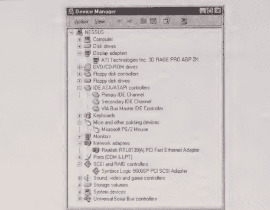

**图 2-1.** Windows 设备管理器窗口可以帮助您在安装 FreeBSD 之前了解您的计算机。

芯片组。即使信息看起来晦涩难懂，它也可能匹配您在安装或配置 FreeBSD 后找到的选项。

> **警告** 一些芯片，如许多最新的显卡和主板芯片组，产生大量热量，因此覆盖有散热片，这掩盖了芯片组标识标记。不要尝试移除这些散热片，因为这可能会损坏芯片，即使不损坏，您也会很难重新安装散热片使其正常工作。

如果您在 `HARDWARE.TXT` 中找不到该设备的提及，这并不一定意味着它不起作用。该设备可能以多个名称为人所知，您只是尚未找到它在文件中列出的那个名称。尝试使用 `http://groups.google.com` 进行 Usenet 搜索，或使用您喜欢的搜索引擎结合 FreeBSD 和您发现的名称进行网络搜索。您也可以尝试直接安装 FreeBSD；操作系统会自动检测许多设备，因此您可能会很快了解它是否有效。

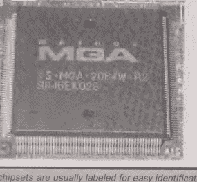

图 2-2. 设备芯片组通常贴有标签以便于识别。

如果设备不起作用，您有三种选择：

- **替换** 您可以用受支持的型号替换不起作用的设备。对于以太网或声卡等廉价设备，这通常是最有效且最简单的操作方案。虽然许多主板组件无法移除，但可以通过添加复制主板组件功能的卡来规避。不过，您可能需要在计算机的 BIOS 中禁用该主板组件。

- **变通方法** 在某些方面规避不兼容性是可能的。在某些情况下，这可能意味着使用设备的某种兼容性模式，该模式提供有限的功能。例如，一些打印机使用 FreeBSD（更确切地说是 Ghostscript）支持的通用协议以较低分辨率工作，而它们的高分辨率模式在 FreeBSD 中无法访问。在其他情况下，您可以完全不用该设备。例如，如果您主要在 Windows 中使用声卡玩游戏，那么在 FreeBSD 中您可能确实不需要声卡。

- **驱动程序开发** 如果您具备编程技能或愿意聘请具备此类技能的人，您可以自己编写驱动程序或让别人为您编写。这项任务远远超出了本书的范围，如果您自己是一个业余程序员或者替换组件的成本会非常高（例如，在大型站点更换数百张昂贵的卡），则主要对您有用。

#### 腾出磁盘空间

FreeBSD 需要磁盘空间才能运行。如果您正在将 FreeBSD 安装到新计算机或替换现有操作系统，腾出磁盘空间不需要特殊准备。如即将出现的章节“系统分区”中所述，您可以简单地告诉安装程序使用您所有的磁盘空间，它将替换磁盘上现有的任何数据。

更复杂的情况涉及在现有操作系统中添加 FreeBSD。在这种情况下，您必须按照第 1 章所述为 FreeBSD 设置一个专用的主分区。许多 FreeBSD CD-ROM 都包含一个名为 First Non-Destructive Interactive Partition Splitting Program（`fips`；[http://www.igd.fhg.de/~aschaefer/fips/](http://www.igd.fhg.de/~aschaefer/fips/)）的开源工具。您可以使用此程序将现有的主 FAT 分区拆分为两部分。然后，您可以使用 FreeBSD 安装程序删除第二个分区并使用其空间。另一个选项是使用第三方工具，如 PowerQuest 的 PartitionMagic（[http://www.powerquest.com](http://www.powerquest.com)）。此类工具通常比 `fips` 更灵活且更容易使用。PartitionMagic 相对于 `fips` 的一个潜在非常重要优点是，PartitionMagic 可以缩减 Windows NT、2000 和 XP 安装中常见的新技术文件系统（NTFS）分区。（尽管其中一些系统使用 FAT，因此不要认为 `fips` 功能不足；使用 Windows 磁盘属性对话框检查文件系统类型。）


> **警告** FIPS、PartitionMagic 和其他动态分区工具本质上是有风险的。错误、断电和其他问题可能导致数据丢失——甚至可能破坏关键的文件系统数据结构，从而使得在不进行困难且可能昂贵的修复的情况下无法访问磁盘上的所有文件。因此，在执行此类操作之前，您应该备份所有数据。

### 使用 FIPS

要使用 FIPS 缩减现有的 FAT 分区，请遵循以下步骤：

1. 在 DOS 或 Windows 中，对 `c:` 分区运行磁盘碎片整理程序。您可以使用 Windows 磁盘属性对话框中可用的磁盘碎片整理选项，如图 2-3 所示。其目的是确保所有文件都位于磁盘的前半部分，末尾只留下空白空间，位于你希望划给 FreeBSD 的区域。检查分区的完整性（通过点击图 2-3 中的“立即检查”）也是一个非常好的主意。请注意，某些磁盘实用程序会将无法移动的文件放置在磁盘末尾。你可能需要在继续之前暂时禁用此类实用程序并删除其数据文件。
2. 启动到 DOS。确保你的 DOS 软盘上有 CD-ROM 驱动程序，或者将 FreeBSD CD-ROM 的 TOOLS 目录中的 `PIPS.EXE` 程序复制到可以从 DOS 读取的软盘或硬盘分区上。如果你没有 DOS 启动软盘，可以使用 FreeDOS（`http://www.freedos.org`），它是 DOS 的一个开源重新实现版本。

> **警告**
>
> 不要*从 OS/2 或 Windows 等多任务操作系统中运行 FIPS*。（Windows 9x 的 DOS 启动盘可用，但不要*从 Windows 桌面上的 DOS 窗口中运行 FIPS*。）这样做可能会使操作系统混乱并导致文件损坏。

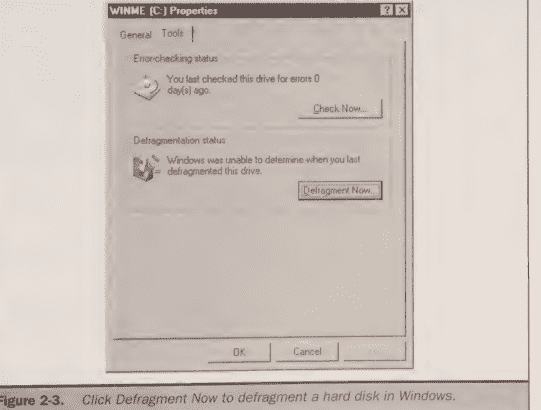

图 2-3. 点击*“立即碎片整理”*以在 Windows 中对硬盘进行碎片整理。
3. 切换到 FIPS 所在的目录并输入 `fips` 以运行该程序。程序将显示一些介绍性文本。
4. 按任意键。FIPS 显示硬盘分区表的信息。此信息仅适用于主分区；FIPS 无法在逻辑分区上运行，因此不会显示有关它们的信息。分区是根据其起始和结束圆柱头、磁头和扇区来定义的。这些所谓的 `CHS` 数字被 BIOS 用于寻址磁盘，随后你将修改结束圆柱头编号以缩小 DOS 或 Windows 分区。
5. 按任意键。FIPS 显示 `C:` 分区的信息。如果你熟悉 FAT 数据结构，你可以检查这些信息是否正确，或者至少是否合理；否则你可以忽略它。FIPS 还会询问你是否要创建根扇区和引导扇区的备份副本。建议你回答 `y` 以执行此操作，这样如果出现问题，你可以撤销操作。
6. FIPS 询问 `A:` 驱动器中是否有一个可引导的软盘。如果有必要，插入软盘并输入 `y`。然后 FIPS 会将根扇区和引导扇区保存到软盘上。
7. FIPS 计算它可以将现有 `C:` 分区减小的最小尺寸并显示此大小，以及它将创建的新主分区的大小。如果你想让 `C:` 分区更大（在大多数情况下这是明智的，以便在你的 DOS 或 Windows 安装中为新文件留出空间），请使用右箭头键增加 `C:` 的大小，以牺牲新的 FreeBSD 分区为代价。FIPS 一次修改一个圆柱头的分区大小；因此，根据你磁盘的大小，你可能看到每次按下箭头键，分区的大小都会改变几兆字节。当系统显示你想要的分配时，按 Enter 键继续。
8. FIPS 显示有关新分区布局的摘要信息，类似于第 4 步中显示的内容。如果你认可新的布局，输入 `c` 让 FIPS 继续更改。如果不认可，输入 `r` 重新更改（返回第 7 步）。
9. FIPS 显示有关新的 `C:` 分区 FAT 文件系统的摘要信息，类似于第 5 步中显示的内容。输入 `y` 继续，FIPS 将把更改写入磁盘。

此时，你将拥有两个分区来代替一个。当你安装 FreeBSD 时，你可以告诉安装程序删除第二个分区并在其位置创建一个新的 FreeBSD 分区。

不幸的是，FIPS 的功能有限。如果你想调整逻辑分区或 NTFS 分区的大小、移动分区或执行其他操作，FIPS 无法胜任。为此，你需要一个更复杂的工具，例如商业软件 PartitionMagic。

### 使用 PartitionMagic

PartitionMagic 是一个比 FIPS 灵活得多的工具。使用 PartitionMagic，你可以创建、删除、移动或调整 FAT、NTFS、高性能文件系统 `HPFS` 或第二扩展文件系统 `ext2fs` 分区的大小。（然而，HPFS 支持在软件 7.0 版本中被移除，因此如果你需要 HPFS 支持，你应该获取 6.0 或更早的版本。4.0 之前的版本不支持 Linux 的 `ext2fs`。）你在运行 PartitionMagic 之前也不需要碎片整理硬盘，但事先检查磁盘完整性是个好主意。

PartitionMagic 可以从 DOS 启动软盘或完全启动的 Windows 系统运行。两种情况下的用户界面相似，尽管 DOS 版本缺少一些功能，例如自动为各种操作系统组合设计布局的能力。系统启动后，它呈现磁盘的图形视图，包括显示你分区的条形图和文本分区列表。你可以点击任一区域的分区并选择“分区 | 调整大小”来调整分区的大小。结果是一个类似于图 2-4 所示的对话框，你可以拖动现有分区的右端或在数值数据输入字段中输入新大小来进入新的分区大小。

对于 FreeBSD 的使用，最简单的方法是留出未分配的空间给 FreeBSD；PartitionMagic 不能创建 FreeBSD 分区，所以你将不得不在 FreeBSD 安装程序中创建它。务必确保此未分配的 FreeBSD 空间*不*在扩展分区内；FreeBSD 需要为自己创建一个主分区，如果唯一的空闲空间在扩展分区内，FreeBSD 将无法使用它。（PartitionMagic 将扩展分区显示为浅蓝色框，其中包含逻辑分区。如有必要，你可以像调整其他任何分区类型一样缩小扩展分区。）

当你完成输入更改时，点击主 PartitionMagic 窗口中的“应用”按钮。然后程序将提交你输入的更改，最终为 FreeBSD 腾出空间。

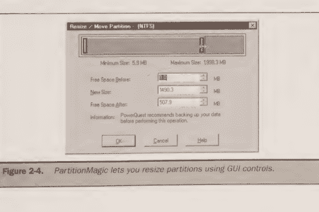

图 2-4. *PartitionMagic 允许你使用 GUI 控件调整分区大小。*

## 开始安装

一旦你为 FreeBSD 腾出了空间，你就可以开始安装过程了。这涉及启动 FreeBSD 安装程序，设置一些初始配置选项，并在该分区内为你的 FreeBSD 安装创建 FreeBSD 分区。

### 启动安装程序

要安装 FreeBSD，你必须启动其安装程序。这是一个特殊的精简版 FreeBSD 系统，包含用于从安装介质将 FreeBSD 文件复制到硬盘的软件。FreeBSD 启动介质的两种类型是：

- **CD-ROM** 大多数 FreeBSD 安装 CD-ROM，包括随本书附带的那一张，都是可启动的。要启动，你必须配置 BIOS 在从硬盘启动之前尝试从 CD-ROM 驱动器启动，将 FreeBSD CD-ROM 插入计算机，并从 BIOS 实用程序退出。如果你在 BIOS 中找不到从 CD-ROM 启动的选项，如果它不起作用，或者你没有 FreeBSD CD-ROM，你可能需要使用启动软盘。
- **软盘** 前面的部分“启动磁盘”描述了如何创建 FreeBSD 安装软盘。这些磁盘中的第一个是可启动的。如果你的 BIOS 配置为在尝试硬盘之前先尝试从软盘启动（大多数默认都是这样），你可以插入 FreeBSD 启动软盘并启动计算机。最终它会要求第二张磁盘，你应该在提示时插入，并加载 FreeBSD 安装程序。

无论你从 CD-ROM 还是软盘启动，FreeBSD 安装程序的过程都是相同的。事实上，甚至启动过程也非常相似。在两种情况下，你都会看到大量信息在屏幕上滚动。这些与内部内核检查和硬件驱动程序安装有关。其中一些信息可能滚动得太快，以至于你无法阅读。除非你在某些关键硬件组件方面遇到问题，否则不要担心这一点。在这种情况下，你可能需要暂时绕过该问题，然后进行故障排除，如第 32 章所述。例如，如果安装程序不识别你的 CD-ROM 驱动器，你可能需要进行网络安装或暂时使用另一个 CD-ROM 驱动器，然后在 FreeBSD 完全安装后着手解决问题。

一旦安装程序启动，它显示一个类似于图 2-5 所示的菜单。该程序是 `sysinstall` 实用程序，顾名思义，它安装 FreeBSD 系统。你还可以在安装 FreeBSD 之后使用它来添加或删除软件，升级系统，并对操作系统进行一些修改。

你可能需要花一些时间体验 `sysinstall` 用户界面，特别是如果你不习惯基于文本的菜单系统。箭头键移动选择点。在大多数菜单中，上箭头和下箭头在选项列表（例如图 2-5 中的 Usage、Standard、Express 等）中上下移动，而左箭头和右箭头在底部的操作按钮之间选择

#### 菜单操作说明


menu (Select and Exit Install in Figure 2-5). The `Page Up` and `Page Down` keys can be used to scroll through very long lists of options that fill more than one screen. The `space bar` may toggle an option on or off. No such options are shown in Figure 2-5, but such an option has a box formed from square braces ([ ]) to the left of the option, and this box is filled with an `X` if it's selected. Press `ENTER` to select the currently active action button. In some menus this action does the same thing as the space bar. In most menus, some options have differently colored leading letters, such as *Standard* and *Express* in Figure 2-5. You can skip directly to these options by typing the appropriate letter along with the `ALT` key, such as `ALT+E` to begin an Express installation in Figure 2-5. This procedure isn't perfectly reliable, though, particularly in menus with many options, so if it doesn't work, use the arrow keys to locate the appropriate option.

FreeBSD supports three types of installation: *standard*, *express*, and *custom*. Standard is the best choice for most new installations. Express skips some menus and checks, and so can install a system somewhat quicker if you're in a hurry; but you may need to spend more time later setting it up correctly. Custom can be useful if you're experienced with FreeBSD because it gives you somewhat greater control over certain options. The rest of this chapter assumes that you select the standard installation.

### 系统分区

Once you select the Standard option from the main *sysinstall* menu, the system tells you that you must partition your computer. As described in Chapter 1, this is actually a two-step process. First, you must create an x86 partition (aka a FreeBSD slice). Second, you create BSD-style partitions within the FreeBSD slice. A message appears immediately after you select the Standard option telling you that you’ll be creating a DOS-style partition; this is the FreeBSD slice. When you select `OK` to this message, `sysinstall` displays the FDISK Partition Editor screen shown in Figure 2-6.

#### 创建 FreeBSD 切片

Depending upon how you set aside space for FreeBSD, you may need to do one of two things:

- **使用整个磁盘** 如果你希望将整个磁盘用于 FreeBSD（这将销毁现有分区和数据），你可以输入 `A` 来执行此操作。这将创建一个单一的主 x86 分区（即 BSD 切片），FreeBSD 将驻留于此。

- **创建新分区** 如果你有空闲空间（通过 Desc 列中未使用的条目标识），你可以选中它并输入 `C` 来创建 FreeBSD 切片。随后系统会询问大小。在大多数情况下，你希望将所有空间分配给 FreeBSD，因此只需按 `ENTER` 接受默认值。否则，请按照 512 字节块或兆字节（末尾加 M，例如 `500M` 创建 500MB 切片）输入大小。如果你已经为 FreeBSD 创建了分区（例如使用 FDISK），你需要选中该分区并输入 `D` 将其删除，然后使用由此产生的空闲空间来创建 FreeBSD 切片。

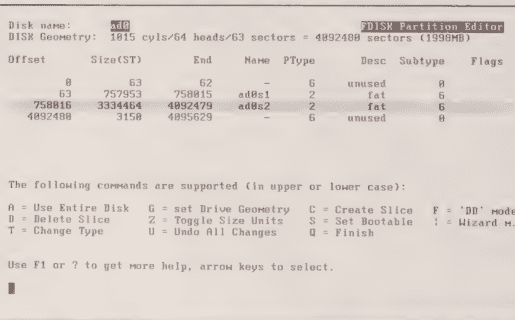

**图 2-6.** FreeBSD FDISK 分区编辑器在原理上与 DOS 或 Windows 的 FDISK 相似，但用户界面略有不同。

#### 设置引导加载器选项

一旦你对 x86 分区表进行了修改以添加一个或多个 FreeBSD 切片，请键入 `q`。此操作会将你的更改写入磁盘，并进入关于引导加载器放置位置的问题。本章稍后将在第 4 章中详细讨论此主题。目前，FreeBSD 提供三个选项：

- **BootMgr** 此选项将 x86 引导管理器安装到硬盘的*主引导记录 (MBR)*上，这是计算机启动时运行的第一段基于磁盘的代码。当 FreeBSD 是计算机上唯一的操作系统，或者你有简单的双启动配置（例如 FreeBSD 和 Windows）时，这是一个很好的选择。如果你的系统多启动了多个操作系统并且已经有一个引导加载器，你可能希望使用其他选项。

- **Standard** 此选项用标准 MBR 覆盖现有的 MBR，该 MBR 直接启动只有活动分区。如果你计划随后安装另一个引导加载器，可能会使用此选项，但即使在那种情况下，下一个选项也应该适用。

- **None** 此选项不触碰 MBR。如果你已经安装了其他引导加载器（如 System Commander 或 Linux 的 LILO），这是最佳选项。你需要重新配置该引导加载器，以便除了其他操作系统外还能引导 FreeBSD。

#### 创建 FreeBSD 分区

选择 MBR 选项后，FreeBSD 进入分区创建的第二阶段。在此阶段，你将使用一个称为 *FreeBSD Disklabel Editor*（如图 2-7 所示）的工具在 FreeBSD 切片内创建分区。每个 FreeBSD 系统至少需要两个分区：根 (/) 分区和交换 (`swap`) 分区。如果你的系统还有 DOS 或 Windows，FreeBSD Disklabel Editor 也会显示其分区，如图 2-7 所示。在全新安装中，FreeBSD Disklabel Editor 的初始状态仅显示现有的 DOS 或 Windows 分区（如果存在）。

你可以通过确保屏幕顶部的 Disk 行被高亮显示，然后按下 `c` 键来创建新分区。该实用程序将依次询问几项信息：

1. 分区大小（以块、兆字节或柱面为单位）。
2. 你正在创建文件系统还是交换分区。文件系统用于存放文件，但 FreeBSD 至少需要一个交换分区。最好将其设置得至少与计算机内存一样大，因为如果未这样做，理论上某些类型的系统崩溃可能会清除交换分区之后分区中的数据。
3. 分区的挂载点（即可访问该分区的目录名称）。稍后将更详细地描述挂载点。你至少需要一个根 (/) 分区，但可以创建更多分区。交换分区没有挂载点，因此系统不会询问交换分区的挂载点。

如果你有几百兆字节的空闲空间，可以输入 `A`，FreeBSD 将使用一些常见的分区规则设置空闲空间。这种方法可以节省一些时间，在某些情况下可能是一个有用的快捷方式，特别是如果你对 FreeBSD 不熟悉时。然而，如果你更有经验，你可能希望自行设置分区。以下是 FreeBSD 使用 `A` 选项创建的一些常见分区：

- **root (/)**


这是 FreeBSD 目录树的根目录；所有文件都可以从根目录访问。因此，这是唯一真正必需的文件系统。A 选项使根文件系统较小，因为在此选项下，大多数文件位于其他分区中。图 2-7 显示了一个较大的根文件系统，因为此安装缺少某些其他额外分区。

### `/home`
`/home` 目录存放用户的数据文件。因此，其最佳大小取决于系统支持的用户数量及其磁盘空间需求。小型单用户系统，或作为服务器功能且实际登录用户较少的计算机，`/home` 可能只需要几兆字节，甚至可能集成到根分区中。许多用户创建大文件的系统可能需要吉字节大小的 `/home` 空间。

### `/usr`
`/usr` 目录存放大多数常规程序文件。因此，在默认配置中，它是最大的分区，`/home` 可能是例外。对于完全可用的 FreeBSD 安装，`/usr` 至少应有 1GB，最好更多。（小型 FreeBSD 安装可以在 `/usr` 中使用不到 100MB，尽管这种情况很少见。）如果你没有创建单独的 `/usr` 分区，根分区应至少与此大小相当。

### `/tmp`
此目录存放临时文件。自动系统工具通常会定期清理它。FreeBSD 将 `/tmp` 放在单独的分区中，以防某些行为异常的进程创建过多或过大的临时文件，从而压倒其他重要分区。

### `/var`
此目录类似于 `/tmp`，存放大多是短暂存在的文件。不过，这些文件通常是由 FreeBSD 或其进程创建的，而不是由用户创建的。例如，此目录保存电子邮件服务器接收到的邮件文件，直到用户阅读为止。与 `/tmp` 类似，它通常放置在单独的分区中，以保护其他分区，以免在 `/var` 中创建过多文件时出现问题。典型安装创建的 `/var` 分区远小于 1GB，但某些系统需要更多的空间。例如，繁忙的邮件服务器可能需要多吉字节的 `/var`。

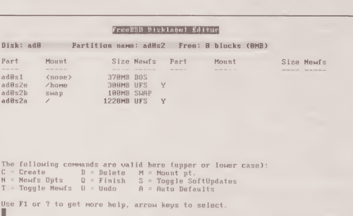

**图 2-7.** FreeBSD Disklabel Editor 允许你在 FreeBSD 切片内创建分区，并在 FreeBSD 中为它们分配挂载点。

正确设置分区大小是新 FreeBSD 管理员面临的最具挑战性的任务之一。如果你打算将系统用作典型的工作站，或者用作不接收大量数据的服务器（例如 Web 或 FTP 服务器），由 A 选项创建的默认设置效果很好。如果你有疑虑，可以考虑简化安装。例如，不要使用 A 自动创建分区，而是使用 C，仅创建一个根 `/`、一个 `/home` 和一个交换分区。这种配置存在某些风险，因为失控的进程可能会通过向 `/var` 或 `/tmp` 写入数据来填满根分区，但如果你不确定你在这些分区中需要多少空间

#### 选择要安装的软件
目录或在 `/usr` 中，使用简单的配置可能会减少分区空间不足的问题。相反，如果您经验丰富，并且知道您将在特定目录中放置大量文件，您可能希望为诸如 `/opt` 或 `/usr/X11R6` 等目录创建额外的分区。

由于交换分区在大多数安装中都被大量使用，通常将其放置在一组文件系统分区的中间。这种做法减少了从其他分区寻址到交换分区所需的时间，从而提高整体系统性能。

完成分区创建后，输入 `Q` 进入安装的下一阶段，在此阶段您选择安装介质。

告诉安装程序您想使用的安装介质后，它会显示一个您可以安装的*分发集合*列表，如第 2-8 图所示。每个分发集合是一组相关的软件包，例如开发工具或用户应用程序。您可以选择一个或多个分发集合，或者选择 `All` 来安装所有集合。每次选择后，FreeBSD 都会询问您是否要安装 ports 集合。这是一组软件“骨架”，使您能够轻松地从源代码构建软件。某些 ports 无法作为标准的预编译 FreeBSD 二进制文件使用。做出选择后，您可能还需要选择 `Exit` 选项返回到第 2-8 图中显示的选择菜单；或者您可以继续进行安装。

> **注意**
>
> *如果您对 Linux 比较熟悉，您会知道“distribution”这个词指的是整个可安装的 Linux 变体，例如 Red Hat 或 Debian。在 FreeBSD 中，分发包是 FreeBSD 操作系统内部的软件包集合，因此这个词在 FreeBSD 中的含义与在 Linux 中的含义截然不同。*

如果您打算将计算机用作基于 X（GUI）的工作站，选择 `X-User` 分发集合非常重要。实际上，大多数系统需要一个或多个开发者分发集合。大多数 UNIX 软件都以源代码形式提供，因此即使您不是程序员，拥有软件开发工具也可以让您使用没有官方 FreeBSD 二进制文件的软件；您可以下载源代码并编译自己的二进制文件，如第 11 章中简要描述的那样。一个重要的开发者分发集合是 `Kern-Developer`（及其变体 `X-Kern-Developer`），它允许您修改和重新编译 FreeBSD 内核——这是 FreeBSD 操作系统的核心。第 12 章更详细地介绍了内核及其配置。如果您拿不准，我建议您选择 `X-Developer`、`X-Kern-Developer` 和 `X-User` 分发集合。（如果您不需要 X 窗口系统，可以选择这些分发集合的非 *X* 变体。）如果您没有选择某个软件包，后来发现需要它，您可以在安装 FreeBSD 后运行 `sysinstall` 来安装它。

为了方便，我们提供了几个“预设”分发集合。这些集合选择了我们认为适合相应类型系统的默认值。如果您希望自行挑选和选择分发集合列表，只需选择“Custom”。您还可以选择一个预设分发集合，然后通过 Custom 项目进行微调。

按 `[SPACE]` 或 `[ENTER]` 选择项目。完成后，选择 Exit 项目或用 `[TAB]` 移动至 `OK` 按钮。

- [ ] 重置已选择的分发列表为无
- [ ] 完整的源代码、二进制文件和文档，但不包含游戏
- [ ] 同上 + X 窗口系统
- [ ] 完整的二进制文件和文档，仅包含内核源代码
- [ ] 同上 + X 窗口系统
- [ ] 普通用户 - 仅包含二进制文件和文档
- [ ] 所有系统源代码、二进制文件和 X 窗口系统
- [ ] 自定义
- 退出此菜单（返回上一级）


如果您熟悉 FreeBSD 软件包，您可能希望选择 Custom 分发选项，该选项允许您选择和取消选择特定的分发集合。（第 2-8 图中的菜单允许您选择分发集合；Custom 选项提供了更精细的控制，允许您选择单个分发集合，而不是整个分发集合。）

#### 选择安装介质
FreeBSD 提供了许多安装介质选项。这些包括：

- `CD/DVD`：通过选择第一个选项，您可以从本地 CD-ROM 或 DVD-ROM 驱动器安装。如果您可以访问 FreeBSD CD-ROM 或 DVD-ROM，这通常是最快且最方便的安装方法。
- `FTP` 选项：有三个 FTP 选项：`FTP`，这是最直接的选项；`FTP Passive`，使用 FTP 的被动模式，该模式可以通过一些阻止 FTP 正常操作模式的防火墙；以及 `HTTP`，使用 HTTP（Web）代理连接 FTP 服务器。所有这些选项都允许您从多个官方 FreeBSD 站点之一或您本地运营的 FTP 服务器进行安装。（要使用本地服务器，请在 FTP 站点列表中选择 URL 选项。然后您可以输入本地 FTP 站点的地址以及 FreeBSD 文件所在的目录。）如果您有快速网络连接且没有 FreeBSD CD-ROM，FTP 安装可能是一个不错的选择。
- `NFS`：*网络文件系统*（NFS）是 UNIX 网络上常见的文件共享工具。您可以将 FreeBSD 文件放在本地 NFS 服务器上，并从中安装，就像从 FTP 服务器安装一样。
- `本地文件系统`：DOS 和 *文件系统* 选项允许您从本地磁盘安装。DOS 选项会提示您从列表中选择一个分区，而 *文件系统* 选项要求您输入已挂载文件系统的路径。由于此选项要求分区已经挂载，因此对于首次安装来说并不是特别有用，但对于升级可能有用。
- `软盘或磁带`：另外两个选项是*软盘*和*磁带*。尽管这些选项曾经很常见，但现在很少使用；FreeBSD 需要消耗大量的软盘，而磁带作为安装介质远不如 CD-ROM 方便。尽管如此，只要您能找到在这些介质上分发的 FreeBSD 软件包，仍然可以使用这些方法。

大多数人使用 CD-ROM 或 FTP 安装选项，但在某些本地网络上 NFS 可能有用，而在某些有限情况下，从 DOS 分区安装也很方便。无论您使用什么介质，过程都非常相似，但当然，如果您使用可移动介质（如 CD-ROM），开始过程时如果驱动器中尚未插入介质，您会被提示插入介质。如果您选择使用网络安装方法，您会比使用 CD-ROM 更早被提示输入网络配置信息。（下一节“网络配置”涵盖了如何输入此信息。）

#### 安装 FreeBSD


选择安装介质后，安装程序会询问您是否要开始安装。FreeBSD 会显示一个确认请求，告知您这是最后一次更改或中止安装的机会。在此屏幕中选择`Yes`后，就无法回头了；安装程序会在 FreeBSD 分区上创建文件系统并将 FreeBSD 文件复制到其中。

安装过程会呈现一系列进度通知，从文件系统创建信息开始，一直到总结主要软件包集合安装进度的屏幕。这些可能包括`bin`、`doc`、`Xlib`、`ports`等，但具体细节因您的安装选项而异。这需要多长时间取决于您的硬盘速度、安装介质（通常是 CD-ROM 驱动器或网络），以及您要安装多少软件。

### 安装后配置

当`sysinstall`创建 FreeBSD 分区并将文件复制到这些分区后，它会继续提示您回答几个至关重要的系统配置问题。大多数

重要的是，你需要配置网络，配置 XFree86（如果你选择安装它），并配置用户账户。除了这些之外，还有其他一些配置细节。

#### 网络配置

安装程序会询问你是否要配置以太网或 SLIP/PPP 网络。如果你不想这样做，请选择`否`；否则，请选择`是`。以下描述假设你正在设置以太网。SLIP 和 PPP 网络（用于通过串行电缆连接计算机或使用电话调制解调器连接互联网）的具体细节有所不同。

你必须指定的第一个选项是你的网络接口，如图 2-9 所示。如果你的系统安装了以太网卡，第一个选项就对应于它，你应该选择它；否则，你可以选择`sl0`用于串行线路接口协议（SLIP）或`ppp0`用于点对点协议（PPP）连接。请注意，以太网接口的确切名称因以太网卡中使用的以太网芯片组而异。许多系统提供图 2-9 中未显示的额外选项，对应于额外的串行端口和并行端口。

选择以太网选项后，`sysinstall`会询问你是否要配置该卡以使用 IPv6 网络，即下一代网络协议。在 2002 年，它并不常用，但你可能需要咨询你的网络管理员以确认。如果你选择`否`，`sysinstall`会询问你是否要使用`动态主机配置协议`（DHCP）来配置网络。该工具允许中央服务器向 DHCP 客户端系统分配 IP 地址和其他网络选项。它可以大大简化网络配置，而当你应该使用它时却没有使用，可能会给你和其他用户带来问题。因此，你应该务必询问你的网络管理员是否应该使用 DHCP。如果你选择`是`，FreeBSD 会尝试获取网络信息并显示如图 2-10 所示的屏幕。如果你选择`否`，FreeBSD 也会显示相同的屏幕，但你需要在其中输入信息。你必须从你的网络管理员那里获取这些信息。特别关键的信息包括 IP 地址、子网掩码（也称为网络掩码或子网掩码）、网关地址和域名系统（DNS）服务器地址。这些大多数都是四字节数字的形式，每个字节由一个点分隔，例如 192.168.1.27。你的网络管理员可能会提供给你多个 DNS 服务器地址，但你只能输入一个；随机选择一个，或者使用被标识为主地址的那一个。第 14 章描述了在 FreeBSD 启动并运行后如何输入多个 DNS 服务器地址。主机名和域名在技术上对于正常运行不是必需的，但输入它们可能会帮助你的系统以某些方式工作，所以如果你知道它们，请务必输入它们。

输入这些信息后，`sysinstall`会询问你是否希望计算机作为网络网关。在大多数情况下，对这个问题的正确回答是`否`。只有当你的计算机有两个网络接口并且应该在这两个网络之间转发流量时，才回答`是`。FreeBSD 可以成为一个很好的网关计算机，但这样的配置超出了本书的范围。

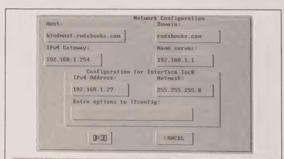

**图 2-10.** `网络配置需要向配置工具输入一系列数字。`

接下来，系统会询问你是否要配置`inetd`。这是一个`超级服务器`——一个监听尝试联系你计算机上其他服务器的程序，并相应地引导流量。并非所有服务器程序都使用`inetd`，但一些常见的程序确实使用，包括 Telnet 和 FTP 服务器。如果你不确定，请在此处选择`否`；但如果你确定想要运行 Telnet、FTP 或其他由`inetd`介导的服务器，请回答`是`。如果你这样做，`sysinstall`会警告你`inetd`及其处理的服务器会增加你的系统遇到的安全风险，并给你一个改变主意的机会。如果你仍然选择`是`，系统会通知你将运行一个编辑器，以便你可以编辑`inetd`配置文件，`/etc/inetd.conf`。你可以找到对应于你要运行的任何服务器的行并将其取消注释——也就是说，移除开头的井号（#）。完成后，按下`CTRL-L`，从生成的菜单中选择选项`a`（`离开编辑器`），并再次选择`a`（保存更改）。

接下来，你会被询问一系列关于特定服务器或服务器配置的问题：

- **匿名 FTP** 你会被询问是否要启用匿名 FTP 访问。如果你不知道那是什么意思，请在此处回答`否`。请注意，你`不需要`启用此选项来使用其他匿名 FTP 站点，只有当你想运行自己的匿名 FTP 站点时才需要。
- **NFS 服务器** 运行 NFS 服务器允许其他 FreeBSD、UNIX 或类 UNIX 系统访问你计算机上的文件，就好像它们是本地文件一样。如果你不确定，请回答`否`。如果你回答`是`，你将需要编辑 NFS 服务器配置文件，`/etc/exports`。第 18 章更详细地描述了这个文件。
- **NFS 客户端** 如果你对此选项回答`是`，你可以挂载其他类 UNIX 系统的 NFS 导出，但你此时不需要进一步配置它。
- **安全配置** FreeBSD 支持许多安全功能。通过选择安全配置问题的`是`，你可以将许多选项设置为中等或限制性设置。如果你选择`否`，则等同于选择`是`然后选择`中等`安全配置。

如果有疑问，请保持网络选项禁用。你可以像本书第三部分所述的那样，在事后启用它们。保持网络功能禁用通常比启用功能更安全，因为启用的网络服务器是潜在的安全漏洞。

#### 系统控制台设置

如果你计划在文本模式下做大量工作，你可能需要调整控制台设置。你可以从该菜单设置几个不同的选项：

- **字体** 默认字体在大多数情况下效果很好，但你可以选择几种不同的字符集，这些字符集主要用于显示非罗马字母表或罗马字母表的扩展。
- **键盘映射** 键盘映射设置主要适用于美国以外的地区使用。例如，你可以告诉 FreeBSD 你有法文或俄文键盘。
- **重复速率** 你可以选择四种键盘重复速率中的任何一种。不幸的是，在安装期间没有测试它们的方法。
- **屏幕保护程序** 保护程序选项允许你启用文本模式屏幕保护程序，当你在文本模式下一段时间未使用计算机时，它可能会显示图案或使屏幕变黑。如果你想节省电源，绿色屏幕保护程序可能特别感兴趣；现代显示器在此屏幕保护程序激活时会进入低功耗模式。
- **屏幕映射** 使用此选项，你可以选择几种将 UNIX 风格字符映射到 PC 风格字体的方法中的任何一种。如果你需要使用非罗马字体，此选项最为有用。
- **ttys 设置** 终端类型（ttys）是程序用于寻址屏幕的协议。与屏幕映射和字体设置一样，这些设置在你使用非美国计算机时最为有用。

#### 时区

时区配置非常重要，特别是对于类 UNIX 操作系统。虽然你可以跳过此配置选项，但这并不是一个好主意。你被询问的第一个问题是时钟是否设置为协调世界时（UTC），它与格林尼治平均时间（GMT）密切相关。传统上，UNIX 将所有时间存储为 UTC，并根据时区即时转换为本地时间。然而，大多数 x86 系统内部使用本地时间，并为需要 UTC 的协议进行转换。告诉 FreeBSD 你的硬件时钟是设置为 UTC 还是本地时间。

> **提示**
>
> 如果你的计算机只运行 FreeBSD，或者运行 FreeBSD 和一些其他类 UNIX 操作系统（如 Solaris 或 Linux），请将硬件时钟设置为 UTC。这样做会降低你生活在必须因夏令时而调整时钟的地区时发生问题的可能性。如果你的 FreeBSD 系统与 DOS、Windows、OS/2 或假定硬件时钟设置为本地时间的其他操作系统双启动，请使用本地时间设置。你可能每年春季或秋季至少需要重置一次系统时钟，但重新启动到另一个操作系统不会导致时钟问题。

设置实际时区是一个三步过程。首先，你必须选择你的区域，例如美洲。其次，你在该区域内选择你的国家，例如美国。最后，你在你的国家内选择时区，例如东部时间。（在某些情况下，后两个步骤之一可能不需要。）然后系统会显示你的时区的三字母缩写，例如 EST，并询问它是否看起来合理。如果你知道这个代码是错误的，请选择`否`以重复该过程；否则，请选择`是`。

#### Linux 二进制兼容性

FreeBSD 具备运行 Linux 二进制文件的能力。尽管大多数 Linux 程序都有原生的 FreeBSD 版本，但当没有可用的 FreeBSD 二进制文件，且源代码要么不可用要么难以编译时，Linux 二进制兼容性仍然非常有用。例如，如果你想运行一款商业游戏，如《文明：呼唤权力》（Civilization: Call to Power），你可以做到，但这需要 Linux 二进制兼容性来运行该游戏的 Linux 版本。


一些操作系统包含运行其他操作系统二进制文件的能力，但代价巨大。例如，OS/2 的 Win-OS/2 组件允许 OS/2 运行 16 位 Windows 程序，但 Win-OS/2 加载时间很长，且 Windows 程序的性能不如原生 OS/2 程序。这些问题不会困扰 FreeBSD 的 Linux 兼容模块，因为 Linux 和 FreeBSD 非常相似，只需少量的库和内核支持功能即可让 Linux 二进制文件在 FreeBSD 下运行。基于这些原因，你最好选择包含 Linux 二进制兼容性。这样做时，`sysinstall` 会尝试从安装介质加载该模块。第 4 章包含了关于使用 FreeBSD Linux 二进制兼容性模式的信息。

## 鼠标配置

FreeBSD 支持一种基于文本的鼠标工具，允许你在文本模式下剪切和粘贴文本。`sysinstall` 询问的第一个问题，用于确定是否以及如何配置此工具，是你是否有一个 USB 鼠标。如果有，选择“是”；否则，选择“否”。如果你选择“否”，`sysinstall` 接下来会显示一个菜单（如图 2-11 所示），在其中配置和测试你的鼠标。

你可以通过设置几个选项来配置鼠标：

- **鼠标类型**：通过选择 *Type* 选项来选择鼠标类型，这将设置鼠标使用的软件协议。如今大多数鼠标使用 *PS/2 协议*，这是通过选择 *Auto* 类型设置的。FreeBSD 还允许你选择几种常见的旧式 *RS-232 串行鼠标* 协议，例如 *Logitech* 和 *Microsoft*。
- **鼠标端口**：使用 *Port* 选项选择鼠标连接的硬件端口。选项包括 *PS/2*、*COM1*、*COM2* 到 *COM4*（用于 RS-232 串行鼠标），以及 *BusMouse*（用于旧式总线鼠标）。请注意，*PS/2 协议*（在 *Type* 菜单中设置）与 *PS/2 硬件端口* 是分开的，尽管 *PS/2* 鼠标通常同时使用两者。
- **附加选项**：如果你熟悉鼠标守护程序，可以使用 *Flags* 选项输入附加选项。不过，你可能不需要使用这个功能。
- **测试和启用**：选择 *Enable* 选项来测试鼠标守护程序。你应该会在屏幕上看到一个鼠标指针出现，并响应你的鼠标移动。（按钮不会有作用。）回答关于它是否正常工作的问题。如果不工作，请尝试其他设置，直到找到一个可用的设置。

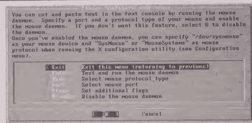

**图 2-11.** *至少需要使用* Type *和* Port *选项来配置大多数鼠标。*

如果你似乎无法让鼠标正常工作，可以选择 **Disable** 选项来禁用鼠标守护程序。随后你可能需要在 XFree86 中直接处理鼠标，或者将鼠标和 XFree86 的配置留待以后。在此期间，你仍可使用 FreeBSD 的文本模式。

完成鼠标配置后，选择 **Exit** 选项以继续基本系统设置选项。系统会询问你是否想配置 X 服务器。现在这样做可以减少以后的工作量，但某些罕见的问题可能会导致系统在配置过程中挂起。因此，如果你拥有特别新的或异类的视频硬件，你可能更喜欢跳过 X 配置，并在所有其他配置完成后，通过从正常启动的 FreeBSD 中运行 `sysinstall` 在稍后执行。不过，大多数人会选择“是”以执行初始 X 配置。

## XFree86 配置

主要的 XFree86 配置菜单提供了四个选项，除了通用的 **Exit** 选项外：

- **x86cfg**：这个程序是一个图形界面的 X 配置工具。只有当你的视频卡与标准的 X VGA 驱动程序兼容时，它才能正确工作，大多数（并非所有）显卡都支持。使用这种最小支持，你可以在 FreeBSD 完全安装后选择你的硬件以获得更优的支持。
- **xf86cfg -textmode**：此选项是第一个选项的变体；它以文本模式运行 xf86cfg，这样即使 X 的 VGA 驱动程序在你的视频卡上无法工作，你也可以配置系统。
- **xf86config**：这个程序是另一个基于文本的 X 配置工具。它会提出一系列关于你的视频硬件、鼠标等问题。这个工具肯定比 xf86cfg 更粗糙，且对错误不容忍；如果你犯了错误，必须重新运行整个程序。我建议你只有在遇到 xf86cfg 问题时才尝试它。
- **Xdesktop**：此选项不配置 X 服务器本身，只配置 X 桌面环境——也就是说，它告诉系统默认呈现哪种类型的窗口、桌面图标等。如果你的系统已经配置为使用适当的 X 服务器，而你只需要修改 X 配置的这一个特性，可以使用此选项。

大多数用户会选择 xf86cfg 选项或其文本模式变体。如果你之前配置过鼠标，`sysinstall` 会显示一条通知，告知你应该使用的鼠标设置。当你选择确定（OK）时，系统会告诉你再次按下 ENTER 键切换到图形模式。屏幕将清空并显示灰色背景和 X 形光标；然后显示 xf86cfg 主窗口（如图 2-12 所示），包括配置选项的摘要。要配置你的 X 服务器，你需要依次选择窗口顶部或主体部分的每个图标。要选择某个选项，指向它并点击鼠标右键。会出现一个弹出菜单，其中有一个名为 Configure 的选项。选择该选项以查看包含一组新的设备特定选项的新窗口。每个设备都必须命名，默认名称基于设备类型，例如键盘为 Keyboard1。在大多数情况下，这些默认名称是可以接受的。

> **提示**：如果你尝试使用 xf86cfg 且屏幕变黑或无法移动鼠标，请按 `CTRL-ALT-BACKSPACE`。此选项会终止 X 服务器，并给你重试的机会。这次，请选择 `xf86cfg -textmode` 选项，它提供与 xf86cfg 相同的功能，但以文本模式并使用键盘命令。

你必须配置的设备是：

- **鼠标**：如果你之前启用了鼠标，请从协议列表中选择 SysMouse 协议，并在 Select Mouse Device 输入框中输入 `/dev/symouse`。（鼠标守护程序读取实际的鼠标硬件，并将其输入回显到 `/dev/symouse` 伪设备，供 X 使用。）如果你之前*没有*启用鼠标，你将不得不选择适当的鼠标协议和物理设备。可能的物理设备包括用于 PS/2 鼠标的 `/dev/psm0`，用于 USB 鼠标的 `/dev/cua0`，以及用于 RS-232 串行端口 1–4（DOS 或 Windows 中的 COM1 到 COM4）的 `/dev/cua1` 到 `/dev/cua3`。你还必须选择鼠标协议，对于所有 PS/2 和 USB 鼠标，这是 PS/2。如果你有一个两键鼠标，务必选择 Emulate 3 Buttons 选项，这允许你同时点击两个按钮来模拟按下中间鼠标按钮。

> 许多 *X* 程序假设你有一个三键鼠标。如果你的鼠标只有两个按钮，你应该考虑将其更换为三键型号，因为中间键模拟使用起来很笨拙。

- **键盘**：键盘配置设置允许你更改你使用的键盘模型。在美国，101 键和 104 键型号很常见。（104 键型号在空格键附近有 Windows 徽标键。）非美国键盘的布局也略有不同。当你选择键盘时，你会看到它的图示，以便与你正在使用的键盘进行比较。
- **显卡**：视频卡配置极其重要。它让你选择视频卡，这决定了 XFree86 使用的视频驱动程序。如果你的视频卡型号在列表中，请选择它。如果没有，你可能能够识别你的视频卡使用的芯片组。如果找不到，你可能不得不选择一个通用的视频模式，您可以通过点击“Driver”（驱动）按钮，然后选择 VGA 或 VESA 选项来实现。Fdokey 设备也能与某些显卡协同工作，但通常性能会有所降低。如果在此处做出错误的选择，将导致 X 在启动时失败。
- **Monitor**（监视器）监视器配置区域列出了几种常见的监视器类型，例如 High Frequency SVGA、1024x768 @ 70 Hz。如果其中某一项描述符合您的监视器，请选择它。如果您手头有监视器的用户手册，可以利用它来查找您的监视器支持的精确水平扫描频率和垂直刷新频率范围，并在相应的字段中输入这些值。这将使 X 能够最大程度地利用您监视器的性能。

如果在超出其设计允许范围（分辨率或刷新率更高）的条件下运行，较旧的监视器可能会受损。因此，在输入监视器信息时必须非常谨慎。不要选择支持比您已知监视器能力更高分辨率或刷新率的监视器类型。幸运的是，大多数自 20 世纪 90 年代后期制造的监视器都会忽略超出范围的信号，因此不会因此受损，但如果您尝试使用此类设置，您将看不到显示画面（或者会出现一条提示，表明监视器无法处理该信号）。


进入`/path/to/xxx`目录，找到`xxx.json`。

在表达式`cvar = avar + bvar`中，加法运算符（`+`）将`avar`与`bvar`相加，得到它们的和`cvar`

在`List.of(arg0, arg1, arg2)`中，`List`接口的工厂方法`of()`接受一系列的元素，返回包含它们的只读列表。

之后我们这样调用`cmd`命令：`cmd arg0 arg1 arg2`。

```
if (condVar > someVal) {console.log("xxx")}
```


`Shell` 是一个接受用户命令并处理它们的程序。FreeBSD 支持几种基于文本的 shell 程序，例如 `csh` 和 `bash`，但默认通常是 `sh`。基于文本的 shell 信息是主要账户配置的一部分。X 选项的等效设置是选择窗口管理器或桌面环境，这可以在存储在用户主目录中的配置文件中设置。

除了普通用户的账户外，FreeBSD 还维护几个操作系统用于其内部目的的账户。这些包括 `root`、`daemon`、`bin` 和 `nobody`。某些程序需要特定的专用账户，你可能需要添加它们。大多数这些系统账户的 `UID` 在 100 或以下，而由普通用户使用的账户默认情况下 `UID` 在 1000 或以上。类似地，有几个标准的系统组，例如 `root`、`wheel` 和 `nobody`。

**注意**

并非所有类 UNIX 操作系统都从 1000 开始为普通用户分配 `UID`。例如，某些 `Linux` 发行版从 500 甚至 100 开始为普通用户分配 `UID`。由于操作系统使用 `UID` 来标识用户，这种差异在几种情况下可能很重要。例如，当 `NFS` 服务器提供文件时，它通过 `UID` 来标识用户。如果服务器和客户端上的 `UID` 不匹配，用户可能无法访问正确的文件。有方法可以纠正这个问题，但在用户较少的网络上，你应该尝试在所有计算机上给用户分配相同的 `UID`。

一些系统账户对某些文件或其他系统资源具有特权访问权限。其他一些，例如 `nobody`，具有非常有限的访问权限。FreeBSD 利用这些差异作为安全措施，授予某些进程访问一般不应广泛访问的文件或硬件的权限，或限制其他进程的访问。

一个特别重要的系统账户是 `root`。该账户的 `UID` 为 0，`GID` 为 0，并且对整个 FreeBSD 系统具有完全访问权限。系统管理员（也称为超级用户）使用 `root` 账户来维护计算机。因此，这个账户极其重要。只有少数授权人员应有权访问 `root` 账户，并且其密码应该非常安全。如果你正在设置 FreeBSD 系统，你很可能是超级用户，因此可以访问 `root` 账户，尽管将来你可能会将此责任移交给他人。

通常，超级用户也在计算机上拥有一个普通用户账户。你将使用此账户进行日常工作——发送电子邮件、浏览网络、编译软件等。当你需要时，可以使用 `su` 实用程序获取 `root` 权限，如第 3 章所述。

**警告**

不要使用 `root` 账户执行普通任务，如网络浏览或文字处理。因为 `root` 对整台计算机具有完全读/写权限，当你以 `root` 身份登录时，很容易意外造成严重损害。例如，一个简单的拼写错误可能会导致你删除计算机上的所有文件。FreeBSD 包含很少针对此类失误的保护措施；相反，它依靠授予普通用户的有限权限来防止灾难。

基于这些背景信息，现在是时候继续进行 FreeBSD 安装了，这将提供创建初始用户账户的机会。安装程序会询问你是否希望创建此类账户。我强烈建议你对此查询回答“是”。

### 创建初始组

在安装过程中，你可以创建用户和组。如果你知道将使用计算机的用户类型以及他们的组织方式，你可能希望从一开始就使用 *用户和组管理* 菜单中的 Group 选项创建一些组。当你选择此选项时，`onlyinstall` 会显示一个屏幕，你可以在其中输入组名称、`GID` 和初始组成员（除非你已创建用户，否则最后此字段将留空）。使用 1000 或以上的初始 `GID` 通常是一个好的起点。

某些 UNIX 版本的常见默认配置是支持一个名为 `users` 的组，该组包含普通用户账户。如果你的计算机只包含少数几个应该对某些文件或目录具有统一访问权限的用户，这是一个很好的方法。另一种常见的方法是为每个用户创建一个独特的组。然后，你可以将其他用户添加到每个用户的组中，以授予特定个人对第一个用户文件的特殊访问权限。

> 注意：用户可以属于多个组。因此，`users` 组可以通过其他组进行补充，以限制对特定文件或目录的访问。

如果你不想，就不需要创建任何特殊组。如果你不熟悉 UNIX 风格的权限、所有权和组，你可以从没有特殊组开始，但请留意下一节中关于 `wheel` 组的提示；或者创建一个 `users` 组，并将其设置为新用户的默认组。

### 创建初始用户账户

*用户和组管理* 屏幕上的 *User* 选项显示一个类似于图 2-13 所示的菜单。你应该在大多数字段中输入信息，如图 2-13 所示（填写其他字段后，一些字段将显示默认值）。前一部分“用户账户的作用”中描述了这些字段的大部分内容。不过，有几点值得特别注意。

*登录 ID* 是用户名，必须在计算机上唯一，但可以与另一台计算机上的用户名相同。（如果可能，最好将同一个人分配相同的用户名给多台计算机，以减少混淆的可能性。）FreeBSD 使用区分大小写的用户名，大多数 FreeBSD 用户都有全小写用户名——实用程序使得添加混合大小写用户名变得困难。*全名* 字段保存关于用户的自由格式信息——传统上是用户的完整姓名，但也可能是其他内容，如用户的办公室号码。

### 完成安装

**Group**（组）字段保存用户的初始组——即用户创建文件时分配给该文件的组、用户运行程序时使用的组等。**Member Groups**（成员组）字段保存用户所属其他组的名称。用户将能够访问这些组可访问的文件；如果用户在由该组拥有的目录中创建文件，则该文件将对该组的成员可访问。如图 2-13 所示，您可能无需在 Member Groups 字段中输入任何内容。

> **提示**
>
> `wheel` 组是 FreeBSD 维护的特殊组之一。该组的成员可以使用 `su` 命令获取与另一个用户（包括 `root`）相关的权限。当您为自己和计算机上的其他管理员创建账户时，这些用户应属于 `wheel` 组，无论是通过 **Group** 字段还是 **Member Groups** 字段。不应拥有此类访问权限的用户不应属于 `wheel` 组。

如果您对 FreeBSD 不熟悉，应保持 **Home Directory**（主目录）和 **Login Shell**（登录 Shell）字段为默认值。如果您是一位经验丰富的管理员，可能需要调整这些值。

#### 注意

如果您或您的用户喜欢 `bash` shell，请注意它默认未安装；您可能需要将其作为单独的软件包安装，然后才能指定它。安装后，它位于 `/usr/local/bin`，而非大多数 shell 所在的 `/bin`。如果您尝试指定一个不存在的 shell，`sysinstall` 会通知您这一事实。

我建议您在安装 FreeBSD 时至少为自己创建一个用户账户。如果您对 UNIX 风格的账户不熟悉，或者必须创建许多账户，您可能希望将创建额外账户推迟到稍后。安装 FreeBSD 后，您可以访问此实用程序，或使用 `adduser` 等工具甚至文本编辑器来完成这项工作。

创建完所有用户账户后，选择 **Exit**（退出）选项。FreeBSD 随后将提示您即将要求输入系统管理员（`root`）的密码。完成后，FreeBSD 会询问您是否要查看系统配置菜单。您可以使用此菜单更改各种选项。完成后，或者如果您不想检查此菜单，系统将返回 `sysinstall` 主菜单（图 2-5）。您可以更改各种选项，特别是从 **Configure**（配置）选项，或选择 **Exit Install**（退出安装）以完成安装。此时，`sysinstall` 会通知您将重启计算机。您应移除引导软盘或 CD-ROM，系统将重启。

系统重启后不久，您将看到一个引导加载器提示符。如果您使用了前文“设置引导加载器选项”中描述的默认引导加载器选项，并且除了 FreeBSD 还安装了 DOS 或 Windows，那么这通常包括 F1 DOS 和 F2 FreeBSD 选项。按 F1 启动 DOS，或按 F2 启动 FreeBSD。启动某个操作系统后，该选择将成为下一次启动的默认值，因此如果您经常在操作不同的操作系统之间切换，默认值可能会频繁变化。如果您仅在系统上安装了 FreeBSD，那么它将作为唯一的引导选项。如果您使用了第三方引导加载器，您将看到其菜单，而不是 FreeBSD 引导加载器的提示符，或者两者兼有。如果您需要重新配置引导加载器选项，请参阅第 4 章，其中对此问题进行了讨论。

### 总结

安装 FreeBSD 涉及获取操作系统、准备计算机以及运行安装程序。在安装过程中，您必须告诉 FreeBSD 其驻留位置、如何安排分区以及要安装哪些特定组件。您还必须配置各种设备和软件包，例如鼠标、显卡，可能还有几个服务器。不幸的是，您必须做出的一些决定对于初次使用 FreeBSD 的用户来说很困难，但默认值通常都是合理的，因此您可以从这些值开始，然后在熟悉操作系统后更改配置，甚至从头重新安装。本书其余部分的大部分内容都致力于进行此类更改，以帮助您使用 FreeBSD 完成各种任务。

## 第 3 章

### 系统概述


既然 FreeBSD 已安装在您的计算机上，是时候开始使用操作系统了。本章提供了 FreeBSD 的快速概述，包括启动过程、登录、运行程序、启动和使用 X、注销以及关机。如果您将 FreeBSD 用作桌面工作站，很有可能需要定期执行其中大多数操作。不过，FreeBSD 系统通常可以运行几天甚至几个月而不重启，因此启动和关机操作虽然重要，但可能不频繁。如果您的 FreeBSD 系统是服务器，您可能不会在其上运行 X，但其余主题仍然很重要。

### 启动计算机

从某种意义上说，启动 FreeBSD 计算机是一件简单的事情——您打开电源并等待系统启动。不过，您可能需要处理一两个选项，并且启动过程提供了大量您可能稍后觉得有用的信息，特别是在您需要调试问题时。因此，本节从实际角度描述启动过程。

#### 选择 FreeBSD

x86 计算机启动过程的早期阶段由系统中安装的**基本输入/输出系统**（BIOS）控制。一旦 BIOS 完成自检和其他启动程序，它将控制权交给存储在磁盘上的引导加载器——通常在启动已安装的操作系统时是硬盘，但软盘、CD-ROM 和其他可移动介质设备也可以包含引导代码。

如果您将 FreeBSD 与其他操作系统一起安装，您很可能会看到一个类似于以下内容的引导提示（FreeBSD 第 0 阶段引导提示）：

```
F1 DOS
F2 FreeBSD

Default: F2
```

FreeBSD 将 Windows 分区标记为 DOS，因此如果您看到的是这样而非 FreeBSD 分区持有 Windows，请勿担心。按下对应于您打算启动的操作系统的键（在此示例中是 F1、F2 或如果选项多于两个则是其他某个键）——在此示例中为 FreeBSD。默认值对应于您上次启动的操作系统。如果您经常启动一个操作系统，可以等待系统启动此默认操作系统，但为了更快的启动速度，请按相应的功能键。

> **注意**
>
> 如果您安装了 FreeBSD 默认以外的引导加载器，您将看到该引导加载器而非 FreeBSD 引导加载器。第 4 章包含对第三方引导加载器的讨论。

FreeBSD 开始启动后，它开始显示状态消息。第一个消息与 bootstrap loader（引导加载器）有关，它是一个二级引导加载器（在 FreeBSD 术语中也被称为第 1 阶段和第 2 阶段引导加载器；这两个是独立的程序，但作为一个功能运行）。第 0 阶段引导加载器非常小且简单；它仅仅将启动过程重定向到适当的分区。第 1/第 2 阶段引导加载器更复杂，且更具 FreeBSD 特性。它显示类似以下内容的消息：

> Hit [Enter] to boot immediately, or any other key for command prompt.
>
> Booting [/boot/kernel/kernel] in 9 seconds...

第二行中的时间会倒数。通常，您可以等待其超时以启动 FreeBSD，或者按 ENTER 键稍微加快速度。但在某些罕见情况下，您可能需要加载特殊的内核模块（即硬件驱动程序）或以其他方式配置内核。如果是这样，请按其他任意键，bootstrap loader 允许您输入命令。其中一些命令在第 4 章中有描述。

您可以输入任何用于 bootstrap loader 的特殊参数，或者让其超时，或者按 ENTER 键让其不带特殊选项继续执行。一旦发生这种情况，bootstrap loader 将 FreeBSD 内核加载到内存中，来源可以是文件 `/boot/kernel/kernel` 或者您作为选项指定的其他文件。然后内核显示状态信息并运行 FreeBSD 启动脚本。

#### 解读启动消息

与显示启动信息很少的 Windows 不同，FreeBSD 在启动时非常详细。事实上，它详细到所呈现的大量信息在您有机会阅读之前就已经从屏幕上滚过。幸运的是，内核消息在启动后保存了一段时间，您可以通过输入 `dmesg` 来查看它们。您可能希望将这些消息重定向到文件中，以便用文本编辑器阅读（例如 `dmesg > dmesg.txt`），或者通过文本查看器（例如 `less`）以管道形式传输结果，如 `dmesg | less`。不过，直到您登录后才能执行这些操作，本章后面“登录账户”一节中将对此进行描述。

> **注意**
>
> 重定向和管道是前面命令中使用的技术，用于将 `dmesg` 的输出发送到文件或通过文本查看器。这些是 FreeBSD 中让程序协同工作或捕获程序输出的常用方法。这些主题在第 5 章中有所涵盖。

无论您是快速浏览正在显示的启动消息，还是在登录后深入研究这些消息，这些消息都可以成为了解系统信息的有用来源。它们以一系列版权声明和您安装的 FreeBSD 版本信息开始。随后的行标识您的 CPU，包括其制造商、型号和时钟速度。系统还报告您安装的内存量。这包括*实际内存*（SIMM、DIMM 上的数量，
或其他已安装在计算机中的内存芯片）以及 *可用内存*（实际内存减去内核、BIOS 缓存等所占用的内存）。

内核显示的大部分信息是关于各种硬件设备的报告。这些报告通常以一个设备名称开头（该名称通常与您可能会用于该设备的名称相差甚远），一个冒号（:），以及更具描述性的扩展或详细信息报告。有些设备占用不止一行。例如，以下报告很可能在非常早期出现：

```
npx0: <math processor> on motherboard
npx0: INT 16 interface
```

这表明计算机支持数学协处理器，这是一种执行浮点运算的组件。自 486DX 系列以来的所有 CPU 都将数学协处理器作为主 CPU 的一部分，但 386、486SX 和一些 NexGen CPU 缺乏此功能。此类系统通常支持作为附加芯片的数学协处理器，这些芯片插入主板插槽中，因此 FreeBSD 声称数学协处理器在主板上。

您可能还会看到提及的其他设备包括：

- **PCI 和 ISA 总线** pcib0、pci0、isa0 和 isa4 设备与 PCI 和 ISA 总线相关——也就是说，您插入扩展卡的插槽。

- **ATA 控制器** *高级技术附件（ATA）* 接口是增强型集成磁盘电子（EIDE）硬盘接口的另一个名称。现代计算机可能具有三个 ATA 设备：*atapci0*（ATA 控制器，它内置于现代主板上）以及与两个 ATA 总线相关的设备 *ata0* 和 *ata1*。不过，某些系统可能具有更多或更少的 ATA 设备。

- **SCSI 主机适配器** 如果您的系统有 SCSI 主机适配器，您可能会看到其设备。名称取决于 SCSI 适配器使用的芯片组类型。

- **USB 控制器和设备** 您可能会看到几个名称以 *u* 开头的设备，这些设备与 USB 支持相关。大多数系统都有一个 *uhci0* 或 *ohci0* 设备，对应 USB 控制器本身，一个 *usbus0* 设备，作为 USB 控制器的抽象，以及一个 *uhub0* 设备，用于授予计算机 USB 端口的访问权限。您可能还会有额外的 *usbus0* 设备，例如用于 Zip 磁盘等大容量存储设备的 *umaas0*，或用于鼠标的 *ums0*。

- **网络设备** 您的网络设备（如果有的话）名称取决于所使用的芯片组。通常有一个 *ne* 设备，其描述包括所用芯片组的名称，以及与网络设备特定部件相关的几个额外设备。

- **键盘和鼠标** 如果您使用的是标准键盘，FreeBSD 将其报告为 *atkbd0*。鼠标可能是 *psm0*（用于 PS/2 鼠标）、*ums0*（用于 USB 鼠标），或者根据其接口类型为其他设备。

- **并行和串行设备** 并行端口（`ppc0`）可能支持用于打印机的几个子设备（`lpt0`）、通用并行端口输入/输出（`pio0`）和联网（`pip0`）。串行设备（`si0` 和 `si1`）通常可能显示点对点协议（PPP）设备（`ppp0`），但这通常只有在您明确启动 PPP 网络链路后才会出现。

- **控制台** FreeBSD 使用特殊设备来访问控制台（`sc0`）——通常是直接连接到计算机的键盘和显示器。

- **视频** 大多数系统支持用于视频卡的 `vga0` 设备。

- **磁盘设备** 软盘（`fd0`）、IDE 硬盘（`ad0` 和 `ad1`）、SCSI 硬盘（`da0` 和 `da1`）和 CD-ROM 驱动器（用于 IDE 磁盘的 `acd0`）都有各自的设备。除非您在驱动器中插入磁盘引导，否则您可能会看到关于某些可移动驱动器（例如 Zip 驱动器）无法找到设备容量的错误消息。请勿担心此类消息。

如果您注意到与这些设备中任何一个相关的错误消息，这可能表示 FreeBSD 未正确检测该设备或其无法工作。如果缺少某个重要设备，可能是因为没有用于该设备的 FreeBSD 驱动程序，或者设备可能已损坏或无法操作。某些设备可能不会立即显示。例如，未打开的外部设备不会出现。您还可能看到一些标记为 *unknown* 的设备。这些可能是 FreeBSD 找到但无法正确配置的设备。这种情况有时发生在没有 FreeBSD 驱动程序的插入式卡上。

### 理解启动脚本


在启动内核之后，FreeBSD 引导过程会运行一个名为 `init` 的程序。此程序在内核加载和运行后控制启动过程。它通过运行 `/etc` 目录中的各种启动脚本来实现这一点，从 `/etc/rc` 开始。这些脚本控制启动过程，启动服务器和其他必须在后台运行的程序。这些操作中的许多都会在屏幕上产生进一步的输出，尽管这种输出不会像内核启动消息那样通过 `dmesg` 检索而存储。

`init` 及其启动脚本执行的一些任务包括：

- **文件系统检查** 当 FreeBSD 启动时，它会检查分区以确保 *分区* 是干净的——也就是说，它们已被正确卸载。如果它们不干净，FreeBSD 将运行 `fsck` 程序，该程序检查分区并纠正可能由崩溃或其他非正常关机导致的问题。
- **挂载分区** FreeBSD 根据 `/etc/fstab` 文件的指示挂载其分区。该文件在第 7 章中进一步描述。目前，知道它包含您在安装 FreeBSD 时定义的分区和挂载点信息即可。
- **杂项配置** FreeBSD 必须执行大量的杂项启动任务，以完成诸如配置其网络接口、启用笔记本电脑上的 PC 卡以及初始化串行端口等操作。
- **运行服务器和其他程序** 某些程序必须持续运行才能发挥作用。这包括（但不限于）大多数服务器。它们通常在引导时自动启动。

> **注意**
>
> 大多数服务器作为守护进程运行。这个词源自希腊语，意思是“助手”。在 FreeBSD（以及一般的 UNIX 中），守护进程通常作为无人看管的后台运行，以提供某些必要的服务。并非所有守护进程都是服务器，但许多都是。这个词与英语单词 demon（恶魔）的相似之处促成了长角红色 FreeBSD 吉祥物的产生。

- **启用登录** 为了登录 FreeBSD 系统，该计算机必须运行某种形式的登录程序——一个接受用户名和密码并相应地授予用户系统访问权限的程序。一些登录程序是网络服务器，但其他则在本地运行。FreeBSD 通过 `/etc/ttys` 文件中的条目启动后一类。

第 6 章更详细地描述了系统启动脚本。就现在而言，重要的是知道 FreeBSD 在其启动过程中启动许多程序，包括启用您登录系统的程序。如第 6 章所述，您可以修改 FreeBSD 启动过程以添加新程序或删除您不需要的程序。

### 登录账户

系统引导后，FreeBSD 会显示某种形式的登录提示。登录涉及输入您的用户名和密码。在此之前，您应该了解不同类型的登录——文本模式与 GUI，以及用户与 root 登录。您还应该知道登录后的预期情况，以及登录到用户账户后如何获取 root 权限。

#### 文本模式和 GUI 登录

FreeBSD 的默认配置是提供文本模式登录。这意味着当引导计算机时，您将看到一个文本模式提示，类似于以下内容：

```
login:
```

这是 FreeBSD 请求您输入用户名的方式。输入后，按 ENTER。FreeBSD 会在第一个提示下方立即响应另一个提示：

```
Password:
```

## 第 3 章：系统概述

在此提示符处输入您的密码，然后再次按 ENTER 键。作为一种安全措施，您不会看到密码在屏幕上回显。（这样做的安全好处是，附近窥视的人也无法看到它。）如果您输入了正确的密码，FreeBSD 将显示一整屏信息，内容包括查找安全公告、FreeBSD 文档等信息。在屏幕底部，您会看到一个命令提示符，通常是一个美元符号（`$`）。不过，root 账户的提示符是一个井号（`#`），这有助于您识别自己是否以 root 身份登录。根据您账户的配置，您可能在提示符之前看到额外信息，例如您的用户名或此 shell 的名称。

像这样的文本模式登录允许您运行基于文本的程序并使用文本模式命令，如即将在“文本模式命令摘要”一节中描述的那样。有时您可能希望运行多个文本模式程序。两种常见的方法是：

- **虚拟控制台** FreeBSD 支持一种称为虚拟控制台的功能，它允许您多次登录。在您登录一次后，按 F2 键或 F8 键以下的任何其他功能键。您会看到另一个“login:”提示符，您可以再次登录。按 F1 键返回第一个虚拟控制台。然后您可以在不同的屏幕上运行不同的程序。您甚至可以在不同的虚拟控制台中以不同的用户身份登录。（一旦您开始运行 X，如本章稍后“启动 X”一节中所述，您必须按住 ALT 键并配合功能键才能切换到另一个虚拟控制台。X 本身运行在第 9 个虚拟控制台中，通过 F9 键访问。）
- **后台处理** 您可以在后台运行一个程序，这意味着它不再接收您的键盘输入。要做到这一点，请在运行程序时在其命令名称后附加一个和号（`&`），例如 `numbercrunch &`。或者，您可以在程序运行时按下 CTRL-Z 来暂停程序的运行；这会停止程序而不终止它，并让您返回到命令提示符。如果您想暂时退出程序然后返回，这一步骤特别有用；输入 `fg` 可让您重新进入该程序，而输入 `bg` 则让它继续后台运行，就好像它最初是用和号启动的一样。

如果您以文本模式登录，在不首先启动 X Window System（简称 X）的情况下，您将无法运行 GUI 程序，如即将在“启动 X”一节中描述的那样。您可以配置 FreeBSD 系统在启动时自动启动 X。这样的系统使用 X Display Manager (`XDM`) 程序或类似工具提供 GUI 登录屏幕，如图 3-1 所示。当您在此屏幕中输入用户名和密码时，FreeBSD 会自动启动您的 X 环境。如果您在 X 中进行大部分工作，可能会更喜欢这种配置。正确配置此类设置需要在其中一个启动脚本中启动 `XDM` 程序，您可能还需要调整用户的个性化 X 配置。第 21 章描述了如何配置 `XDM` 或类似程序，第 6 章涵盖了用户的登录控制文件，包括用于 `XDM` 的文件。

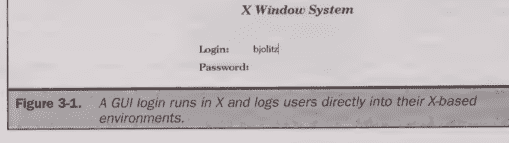

### 用户与 root 账户

如第 2 章所述，您可能会使用至少两个 FreeBSD 账户：一个普通用户账户和 root 账户。您使用用户账户执行日常用户任务，例如阅读电子邮件、浏览网页、使用电子表格以及操纵图形文件。root 账户是系统管理员（又名 *超级用户*）使用的账户。该账户提供近乎无限制的控制计算机的能力；root 可以读取、写入、移动或删除系统中的任何文件。对于大多数任务，您应该使用普通用户账户；仅在需要管理系统的情况下保留 root 登录。

> 在这本书中，您输入的命令显示在提示符之后。在大多数情况下，这个提示符要么是美元符号（`$`），要么是井号（`#`），分别表示该命令是从用户账户还是作为 root 使用的。这反映了当您以普通用户或 root 身份登录时屏幕上显示的默认提示符。

常见的一种情况是您已以普通用户身份登录，但需要超级用户权限执行某些简短操作。这个问题可以通过几种方式解决。一种方法是使用 FreeBSD 的虚拟控制台以 root 身份登录，执行所需的操作，然后注销。不过，如果您正在运行 X 并希望运行需要 root 权限的程序，同时还有其他程序在运行，这种操作可能比较麻烦。即使在文本模式下，也有一个通常更简单的方法：`su`。

`su` 程序名称代表 substitute user（替代用户）。它是一种更改已登录用户身份的方法。它可以接受多个选项和参数：

```
su [-] [-f|-fm] [-c class] [username [args]]
```

> FreeBSD 文档通常以本示例中的方式列出命令语法。方括号表示可选参数。方括号内的单字符选项可以单独添加或删除（如本例中的 -f|-fm；您可以仅使用 -f，仅使用 -l，仅使用 -m，或您喜欢的任何组合）。斜体表示变量。省略号（此处未显示）表示选项可以重复使用。垂直线（|，此处也未显示）分隔两个不一起使用的替代项。

使用 `su` 最简单的方法是单独输入它，例如 `su`。如果输入该命令的用户在 `wheel` 组中，`su` 会提示输入 `root` 密码。如果用户正确输入此密码，该用户将获得超级用户权限。如果您在 `su` 命令行中输入了用户名，您将获得该用户的身份。在任一情况下，输入 `exit` 即可结束身份变更。您还可以通过添加各种可选参数来进一步修改 `su` 的行为：

- **`-l` 或单个破折号（`-`）** 通常，`su` 创建的环境与正常的登录环境不完全相同。`-l` 选项（或单独的破折号）会丢弃用户当前的大部分环境，并创建一个新的环境，该环境应与目标用户的正常环境相匹配。
- **`-f`** 如果目标用户将 `csh` 用作 shell，此选项将导致 `su` 不读取 `csh` 配置文件 `.cshrc`。您可以使用此选项使目标环境更不像目标用户的正常环境。
- **`-m`** 此选项在不改变环境的情况下更改您的身份。例如，您将继续使用您的正常命令 shell，即使目标用户通常使用不同的 shell。
- **`-c class`** FreeBSD 支持登录类，类似于组。您可以指定一个您希望使用其设置的类。
- **`args`** 如果您希望向目标用户的命令提示符 shell 传递参数（控制参数），可以通过将它们放在 `su` 命令的末尾来实现。


您会发现 `su` 是管理 FreeBSD 的一个极其有用的工具。使用 `su`，您可以以普通用户身份登录，并在必要时通过先输入 `su` 来运行特权程序。此操作在文本模式登录和启动可输入命令的窗口后的 GUI 登录中均可正常工作。

您可以直接在控制台中以 `root` 身份登录，但作为一种安全措施，FreeBSD 不接受通过 Telnet 以 `root` 身份进行的远程登录。此限制意味着，知道 `root` 密码的远程攻击者还必须知道另一个用户的密码才能入侵系统——潜在的入侵者必须以普通用户身份登录，然后使用 `su` 获取 root 权限。当然，授权的 administrator 也面临同样的情况，这可能是一种不便。尽管如此，增加的安全性值得这种不便。事实上，即使在控制台上，最好不要直接以 `root` 身份登录。当您使用 `su` 时，FreeBSD 会记录这一事实，包括发出 `su` 命令的用户。此日志记录可以帮助您跟踪谁在执行管理任务，如果发现有人在滥用超级用户权限，这可能非常重要。

## 文本模式命令摘要

由于 FreeBSD 默认以文本模式启动，本章对 FreeBSD 工具的第一部分实际描述集中在文本模式操作上。该主题从描述开始

……即 *shell* ——接受文本模式命令的程序。当从 shell 中运行程序时，理解一些常见标准非常重要，例如 shell 如何解释文件名以及可以运行哪些类型的程序。随后，本节将介绍一些更常用的命令和 shell 操作。

> **提示** 如果你习惯于使用基于 GUI 的操作系统，如 Windows 或 Mac OS，你可能会倾向于尽快略读这部分材料。然而，许多 FreeBSD 管理任务在文本模式下比在 GUI 中执行要容易得多。尽管文本模式起初可能让人望而却步，但它非常强大——在 FreeBSD 中比在 Windows 中更为如此。因此，学习使用文本模式命令将极大地增强你处理 FreeBSD 系统的能力。

## 理解 Shells

当你以文本模式登录 FreeBSD 系统时，FreeBSD 会启动一个程序——即你的 shell。如第 2 章所述，你的 shell 名称与你的账户相关联。原则上，FreeBSD 可以使用任何程序作为 shell，但按照惯例，仅将设计为 shell 的程序用于登录账户的此用途。FreeBSD 的默认 shell 是 *sh*，但也提供其他选择。常见的选择包括 *csh*（在 FreeBSD 中由 *tcsh* 实现，因此这两者等效）、*bash*、*ksh* 和 *zsh*。这些 *shell* 是普通的 FreeBSD 程序。其中一些位于 `/bin`，但其他的位于 `/usr/local/bin`。在很大程度上，所有这些 shell 的工作方式相同，尽管它们在高级功能和一些不太高级的方式上存在差异。例如，这些 shell 显示的默认提示符不同，并且使用不同的配置文件；*sh* 使用用户主目录中的 `.shrc` 文件进行配置，而 *tcsh* 使用 `.tcshrc` 或 `.cshrc`，*bash* 则使用 `.bashrc`。这些文件的精确格式也不同，因此你不能简单地重命名，例如将 `.shrc` 重命名为 `.tcshrc` 并期望它能工作。第 6 章简要描述了这些文件的一些格式。

除了传统的 UNIX shell 之外，FreeBSD 还支持一些非传统的 shell，例如 *mudsh*，其内置命令和提示符类似于 Zork 等旧式文本模式冒险游戏；以及 *pash*，它提供了类似于 DOS 下 Norton Commander 的文本模式文件浏览器界面，如图 3-2 所示。

如果你想尝试各种 shell，请使用 FreeBSD `sysinstall` 工具的 `Configure` 选项安装它们，如第 11 章所述。有一个软件包区域专门用于 shell，因此你可以浏览它们的描述并安装任何听起来有趣的。然后，通过键入名称来运行不同的 shell。例如，如果你在 *sh* 中作为默认登录 shell，但想尝试 *tcsh*，请键入 `tcsh` 以启动它。如果你决定将默认 shell 更改为你正在尝试的那个，你可以通过修改你的账户配置来实现，如第 10 章所述。

所有 shell 都支持内置命令和外部命令的组合。你直接从 shell 使用的大多数命令都是外部命令。shell 的内部命令中，大多数（并非全部）在脚本编写方面很有趣：你可以用 shell 的命令语言编写简短的程序。这些脚本可以启动其他程序、操作文件等等。第 31 章涵盖如何创建此类脚本。

某些 shell，包括 `csh` 和 `bash`，支持一个有用的功能，称为命令补全：如果你键入部分命令，然后按 TAB，shell 会尝试补全该命令。根据你键入的内容，shell 可以做出两种响应：

- 如果你只键入了程序名称的一部分，shell 会尝试找到一个与你键入内容匹配的程序。例如，如果你键入 `chm` 然后按 TAB，系统很可能会通过将你的命令补全为 `chmod` 来响应。
- 如果你键入了完整的程序名称以及作为参数提供给该程序的文件名的一部分，shell 会尝试定位与你目前键入内容匹配的文件，就像第一种情况中尝试查找匹配的程序文件一样。

在这两种情况下，如果 shell 找到多个匹配项，它会发出蜂鸣声或显示所有可能的匹配项。在某些情况下，如果 shell 仅发出蜂鸣声，再次按 TAB 会显示所有匹配项。如果再次发出蜂鸣声，这意味着没有与你目前键入内容匹配的项。

请注意，命令补全无法补全你提供给命令的选项，除非是其他文件的名称。你需要足够了解你所使用的命令，以便指定你想要的选项。

另一个常见的快捷方式是使用文件名通配符。这是一种同时指定多个文件的方法。两个常见且有用的通配符是星号 (`*`) 和问号 (`?`)。这些通配符的工作方式与 DOS 或 Windows 命令行中的等效项非常相似。在指定文件名时使用它们，但不要用于命令——要运行命令，你必须精确输入命令名称。星号匹配任何字符或字符集，甚至包括没有任何字符。例如，如果你指定 `F*D` 作为文件名，它匹配 `FD`、`F*ed`、`FreeBSD`，或任何其他以 F 开头并以 D 结尾的文件名。相比之下，问号匹配单个字符，因此 `F??` 匹配 `FD` 和 `FPD`，但不匹配 `FPD` 或 `FreeBSD`。（注：原文此处逻辑可能有误，`F??` 应匹配三个字符长的名称，但原文举例说匹配 `FD` (2字符) 和 `FPD` (3字符)，这里遵循原文翻译，但需注意原文表述的潜在逻辑矛盾，通常 `?` 匹配单字符，所以 `F??` 应匹配如 `FPD` 这样的三字符名，而不匹配 `FD`。我将忠实翻译原文。）

FreeBSD 中可用的通配符除了星号和问号外还有其他一些。一种常见的扩展是将要匹配的字符集放在方括号 (`[ ]`) 中。如果括号中的任何一个字符出现在该位置，通配符即匹配。例如，`F[aeu]D` 匹配 `Fad`、`Fed` 和 `Fud`，但不匹配 `Fod` 或 `Feed`。除了列出单个字符外，你还可以指定一个范围，如 `F[a-c]D`，它匹配 `Fad`、`Fbd` 和 `Fcd`。

### 运行文本模式程序

要运行一个程序，你只需在 shell 的命令提示符下键入其名称。例如，要运行一个名为 `someprogram` 的程序，请键入 `someprogram`，然后按 ENTER。如果程序位于程序的常规位置，shell 会加载并运行它。根据程序的功能，它可能会接管你的屏幕、显示一些数据、请求输入，或者不产生任何可见输出。许多 UNIX 程序在正常运行时不产生输出；只有当出现问题时，它们才会产生错误消息。

当你键入程序名称时，shells 会在几个目录中查找以找到该程序。这些目录构成了路径，它通过 shell 配置文件（包括你的个人配置文件和系统范围的配置文件）中称为 `PATH` 的环境变量进行设置。通常，路径包括 `/bin`、`/usr/bin`、`/usr/X11R6/bin`、`/usr/local/bin`，以及可能包括的其他目录。`root` 账户的路径通常包括 `/sbin` 和 `/usr/sbin`。这些目录包含系统管理员可能需要运行但普通用户很少运行的程序。尽管增加了这些目录，`root` 的路径通常比普通用户的路径短。这是一种激励措施，以避免不必要地使用 `root` 账户；由于 `root` 的路径中没有常见用户工具的目录，作为 `root` 运行这些程序会比较麻烦。

如果程序不在路径上，你必须键入程序文件的完整路径。例如，如果 `someprogram` 在 `/opt/bin` 中，你需要键入 `/opt/bin/someprogram` 才能运行它。或者，你可以使用相对路径，即文件相对于当前目录的位置。相对路径不以斜杠 (`/`) 开头，但可以取其他几种形式：

- 名称可能以双点 (`..`) 开头，这是给定目录的父目录的指示符。例如，在 `/home/bjolitz` 中，`..` 指的是 `/home`。因此，从该目录开始，`../../opt/bin/someprogram` 等同于 `/opt/bin/someprogram`。


- 相对路径的另一种形式是当前目录的子目录。例如，从 `/opt` 开始，你只需键入 `bin/someprogram` 即可启动 `/opt/bin/someprogram`。

- 以 `./` 开头表示程序文件位于当前目录。有时路径中会出现当前目录 `(` `.` `)` 条目，如果是这种情况，你可以省略 `./` 字符。


> 在路径中使用当前目录 `(` `.` `)` 条目是有风险的，因为这意味着 FreeBSD 会执行当前目录中的任何程序，就好像它们位于程序的常规位置一样，而这些位置通常只有 root 可写。如果你决定在路径中放置此条目，请仅将其放在路径的末尾，以便 shell 在查看当前目录之前，先在常规位置搜索常见程序。这条建议对于 root 尤为重要，因为如果 root 的路径中有当前目录条目，恶意人员可以诱骗 root 运行存储在恶意人员主目录中的非授权程序。总体而言，最好不要在任何用户的路径中放置当前目录条目。

- 以波浪号 `(` `~` `)` 开头表示用户的主目录，因此 `~/someprogram` 指用户主目录中的 `someprogram`。

这些约定适用于任何文件规范，而不仅仅用于启动程序。例如，如果你需要在同一行命令中键入程序操作的文件名称，你可以使用其中任何方法。此外，当引用当前目录中的数据文件时，你可以省略开头的 `./`。你可能想要使用 `cd`（切换到新目录）和 `ls`（显示当前目录或指定目录的内容）来实验这些技术。如果你在使用 `cd` 时迷路了，请单独键入 `cd` 以返回你的主目录，或者使用 `pwd`（print working directory 的缩写）以了解你所在的位置。

许多程序接受选项、参数或论据，这些是提供给与命令在同一行的命令的附加信息的名称。例如，你可能会将文件名传递给编辑器，以便编辑器在加载时加载该文件。其他参数是程序特定的；它们以某种方式改变程序的操作方式。接下来的部分“文件操作命令”包括这些命令接受的参数的信息。

如果你是类 UNIX 操作系统的新手，你应该知道 FreeBSD 是一个区分大小写的操作系统，这意味着命令和文件名中字母的大小写很重要。例如，

输入 `pwd` 可以告诉你当前的目录是什么，但输入 `PWD` 很可能会产生“命令未找到”的错误消息。大多数命令也使用区分大小写的选项，尽管这个规则也有少数例外。

### 文件操作命令

本节介绍几个用于操作文件的命令。你可以使用这些命令来执行基本操作，例如列出目录中的文件、移动文件和删除文件。一些其他操作也很重要，但将在本书的其他地方进行介绍。具体来说，第 5 章介绍了使用文本编辑器；第 8 章介绍了所有权、权限以及额外的杂项文件操作工具。

#### cd：更改当前目录

`cd` 命令让你进入另一个目录。例如，如果你的主目录中有一个名为 `taxes` 的子目录，你可以通过输入 `cd taxes`（如果你当前不在主目录中，则输入 `cd ~/taxes`）来进入该目录。虽然很少需要严格地更改当前目录，但如果你打算在特定目录中对多个文件进行操作，这样做可以减少你需要输入的内容，因为无需键入扩展路径来指定这些文件。

`cd` 命令内置于你使用的任何 shell 中；与大多数命令不同，它不是一个独立的程序。

#### ls：列出文件

如果你想查看目录中的文件，请使用 `ls`。其基本输出类似于以下内容：

```
$ ls
GNUstep           Mail           XPP6Config.new  xinit.core
```

每个文件名出现时没有任何额外信息。你有几种方法可以修改 `ls` 的输出以提供额外信息。其中之一是 `-l` 选项，该选项使 `ls` 创建*长*列表，如下所示：

```
$ ls -l
total 406
drwxr-xr-x  5  rosmith  users   512 Dec 15 22:25 GNUstep
drw---x---  2  rosmith  users   512 Jan  1 20:51 Mail
-rw-r-r---  1  rosmith  users   3263 Dec 15 21:35 XPP6Config.new
-rw-------  1  rosmith  users  397312 Dec 15 20:50 xinit.core
```

此列表中的额外信息包括文件的权限（也称为文件的*模式*，由每行开头的十个字符字符串表示），与文件关联的用户名（本例中为 `rosmith`）和组（`users`），文件的大小，以及文件的创建日期和时间（如果文件超过一年，日期格式会更改为显示年份而不是时间）。

如果你在命令中添加目录名称，它将显示该目录中文件的信息。如果你添加带有通配符的部分名称，该命令将显示所有匹配通配符的文件或目录的信息。例如，输入 `ls *.txt` 会显示所有名称以 `.txt` 结尾的文件。

`ls` 命令支持大量选项。查阅 `ls` 的手册页（通过输入 `man ls`）可获取有关所有这些选项的信息。更常用的选项包括：

- `-a` 此选项使 `ls` 显示目录中的所有文件。通常，`ls` 不显示所谓的*点文件*，即名称以点开头的文件，例如 `.tcshrc`。点文件通常是其名称所对应的程序的配置文件，例如 `.tcshrc` 是 `tcsh` shell 的配置文件。

- `-R` 如果你想查看目录及其子目录中的所有文件，请使用此选项，该选项将创建此类递归列表。请注意，此命令可能会创建巨大的列表，因此你可能需要通过分页工具（如 `less`）管道化结果，例如 `ls -R /usr | less`，以便理解输出。

- `-F` 默认的*简短输出*没有提供有关列表中每个文件类型的线索。使用此选项会使 FreeBSD 在某些文件后显示一个字符，以指示它们的类型：目录用斜杠 `/` 表示，程序文件用星号 `*` 表示，符号链接用 at 符号 `@` 表示，还有一些其他字符用于更专业的文件类型。

> **注意**
>
> 符号链接是指存储在另一个名称下或另一个目录中的文件或目录的指针。符号链接占用很少的磁盘空间，但允许你用多个名称调用文件或目录。

- `-f` 通常，`ls` 会按字母顺序排列其条目。此选项会禁用此排序。

- `-n` 此选项与 `-l` 一起使用；它导致用户名和组名分别被底层用户 ID `(` `UID` `)` 和组 ID `(` `GID` `)` 替代。

你可以在单个选项字符串中组合多个选项。你还可以添加要列出其内容的目录的路径（相对或绝对）。例如，以下命令列出 `/tmp` 目录中的所有文件，并提供该目录中文件的文件类型信息：

```
$ ls -aF /tmp
. /  .X0-lock  .sawfish-rodsmit/  sample-file.txt@  tempor@
.. /  .X11-unix/  orbit-rodsmit/  sample.txt
```

#### cp：复制文件

`cp` 命令复制文件。你可以用两种方式使用此命令：

```
cp [options] source-file target-file
cp [options] source-file target-directory
```

在第一种情况下，你指定用于副本的精确文件名。该名称可以包含到文件的路径，或者它可以是你当前目录中的新文件名。在第二种形式中，你只指定文件将被复制到的目录，`cp` 在该目录中使用与原始文件相同的文件名。

与 `ls` 类似，`cp` 支持许多选项，使其能够执行递归复制（即复制整个目录树）、处理符号链接等。第 8 章介绍了这些高级 `cp` 选项。

#### mv：移动文件

`mv` 命令将文件从一个位置或名称移动到另一个位置或名称。其语法和用法与 `cp` 相似，并且与 `cp` 一样，你可以使用目标文件的完整文件名，或者使用一个目录，文件将以其原始名称移动到该目录中。

如果你熟悉 DOS 或 Windows 文本模式命令，你应该知道 `mv` 执行了两个独立 DOS 命令的工作：`MOVE` 和 `RENAME`。当你给 `mv` 一个目标目录时，它的工作方式与 DOS `MOVE` 命令非常相似，将文件移动到新目录。当你提供一个目标文件名时，`mv` 将文件重命名为使用新名称。如果你给出目标目录*并且*指定该目录内的文件名，`mv` 会同时执行这两者。例如，考虑以下三个命令：

```
$ mv file.txt /tmp
$ mv file.txt /tmp/somefile.txt
$ mv file.txt somefile.txt
```

第一个命令将 `file.txt` 复制到 `/tmp` 目录，其名称保持不变。第二个命令复制并重命名文件，第三个命令在当前目录内重命名它。当你指定目标目录但不指定文件名时，你可以使用通配符或单独列出文件来移动多个文件，如下所示：

```
$ mv file.txt morefile?.txt /tmp
```

此命令将 `file.txt` 和任何匹配 `morefile?.txt` 通配符的文件复制到 `/tmp`。


当你将文件在一个分区或可移动磁盘设备上的目录之间移动时，文件不会被重写。相反，在新位置为文件创建一个目录条目，并删除旧的目录条目。因此，分区内的移动速度非常快。然而，如果你在不同分区之间移动文件，FreeBSD 必须复制原始文件然后删除它。因此，这些操作往往较慢，尽管你只会在非常大的文件上注意到差异。

### rm：删除文件

如果不再需要某个文件，你可以使用 `rm` 命令将其删除。你也可以使用通配符一次删除许多文件。第 8 章介绍了此命令的更多高级选项，这些选项使你可以执行诸如删除整个目录树、在每次删除前请求确认，或在删除前覆盖文件内容等任务。

> **警告**
>
> 默认情况下，`rm` 在删除文件前不会提示确认。这一事实可能使 `rm` 成为一个非常危险的工具备，特别是在`超级用户`手中。结合删除整个目录树的选项，`root` 可以轻松地用一个 `rm` 命令移除 FreeBSD 系统上的所有文件。虽然 `rm` 是一个必要的工具，但在发出 `rm` 命令之前，尤其是作为 `root`，你应该仔细考虑。

### mkdir：创建目录

FreeBSD 将目录视为与文件非常相似。事实上，目录*就是*文件，但它们是包含其他文件名称及指向这些文件的指针的文件。不过，当你想创建一个目录时，你需要一个特殊工具，即 `mkdir`。此命令的语法为：

```
mkdir [-pv] [-m mode] directory-name...
```

例如，输入 `mkdir textfiles` 会在当前目录中创建一个名为 `textfiles` 的目录。自然，你可以将路径说明作为目录名称的一部分使用。此命令的选项包括：

- `-p` 通常，`mkdir` 要求指定的目录的即时父目录必须存在。例如，你可以输入 `mkdir ~/dir1/dir2`，如果 `~/dir1` 不存在，`mkdir` 将返回错误消息。`-p` 选项使 `mkdir` 改为创建任何必要的父目录，因此此命令在创建 `~/dir1/dir2` 之前会先创建 `~/dir1`。

- `-v` 此选项增加命令输出的冗长度；它会报告它创建的每个目录。

- `-m mode` 每个文件和目录都有一套权限，或*模式*。此选项允许你指定目录的模式，如第 8 章所述。

### rmdir：移除目录

如果你想移除一个目录，可以使用 `rmdir` 命令。输入此命令后跟你要移除的目录名称。该目录必须是空的，否则 `rmdir` 不会移除它。如果你在目录前输入 `-p` 选项

不过，`rmdir` 将会删除你指定的整个目录路径。例如，`rmdir -p dir1/dir2` 会先删除 `dir2`，然后删除 `dir1`，前提是当 `rmdir` 处理到这些目录时，它们都是空的。

> **提示**
>
> 如果你想删除*整个*目录树，包括非空目录，可以使用第 8 章中描述的 `rm` 命令的 `-r` 选项。

## GUI 桌面环境快速入门

在 FreeBSD 的文本模式登录中，你可以完成大量工作。事实上，对于某些用途，例如专用服务器，你可能并不希望或需要运行 X 窗口系统（或简称 X）。不过，大多数 FreeBSD 工作站确实运行 X，因此你应该熟悉它。本节介绍 X 的 GUI 环境，包括启动 X、操作文件、运行程序以及更改环境设置。

> **注意**
>
> X 是一个*异常*灵活的 GUI 环境。根据你的安装选项和个人设置，你可能会发现一个与这里描述的环境截然不同的环境。第 13 章更详细地介绍了 X 的配置选项。

### 启动 X

如果你的 FreeBSD 系统启动进入 GUI 登录提示界面，如图 3-1 所示，你无需执行任何显式操作来启动 X；它已经在运行了，当你登录时会看到某种基于 X 的界面。不过，这种模式并不是 FreeBSD 的默认配置。如本章前文所述，FreeBSD 默认在启动后立即进入文本模式。你可以通过运行 XDM 或类似程序来改变这种行为，详见第 21 章。在此期间，你可以从文本模式登录启动 X。通常的方法是输入 `startx`。此操作会启动 X 并加载默认的 GUI 环境，这是你在安装 FreeBSD 时设置的。（你可以通过编辑 `.xinitrc` 文件来更改此默认设置，详见第 13 章。）

> **注意**
>
> 有些用户需要为 `startx` 添加选项，以便以理想的分辨率或颜色深度运行 X。第 13 章介绍了如何更改默认的 X 配置，因此这种情况通常不应发生。

输入 `startx` 后，你可能会看到几行文字在屏幕上滚动；屏幕可能会清除或切换到另一个虚拟终端。如果一切正常，屏幕随后会清除并被 GUI 模式屏幕取代。根据你安装的环境，你可能会看到一些启动消息，或者只看到空白屏幕，或者一个带有几个窗口或其他小工具的屏幕。如果你安装了 GNOME 桌面环境，你的显示效果应与图 3-3 所示类似，尽管你的系统可能不会启动窗口或显示图 3-3 左侧边缘的图标。接下来的几页提供了 GNOME 的概述，因此如果你选择使用 KDE 或简单的窗口管理器，可能并不完全适用。许多功能在不同桌面环境中是共同的，或者至少是相似的，但许多细节也各不相同。

> **注意**
>
> 如果 X 未能正确启动，请检查输出的最后几行以寻找问题的线索，并查阅第 13 章和第 32 章。

你应该从测试窗口管理器和桌面环境的功能开始进行探索。大多数 FreeBSD 窗口管理器的工作原理与 Windows 或 Mac OS 的 GUI 非常相似。

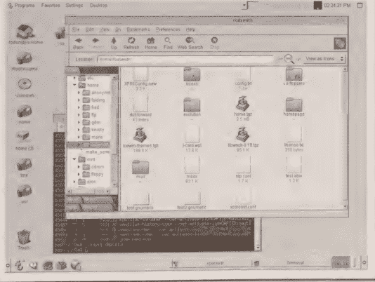

**图 3-3.** GNOME 环境与 Windows、Mac OS 或其他现代 GUI 操作系统提供的环境相似。

以下是许多 FreeBSD 窗口管理器和桌面环境之间的一些重要区别：

- **窗口焦点** 当窗口接收来自键盘或鼠标的输入时，我们说该窗口处于*焦点*状态。这类窗口通常通过标题栏（窗口顶部）的不同颜色来指示。通常，处于焦点状态的窗口也是*前台窗口*——即完全暴露的那个。例如，在图 3-3 中，文件管理器窗口（标题为 *rodsmith*）既位于前台又处于焦点状态。大多数窗口管理器在你点击窗口中的任何位置时，都会将该窗口移至前台并使其获得焦点，但有些窗口管理器在鼠标移入窗口时或仅在点击标题栏时转移焦点。请自行尝试以了解你的窗口管理器的行为。

- **窗口管理器小工具** *小工具* 是一种让你与程序进行交互的 GUI 工具。窗口管理器的小工具通常位于标题栏的右侧和左侧。有些小工具的作用与 Windows 中的类似，但有些则不同。

- **上下文菜单** 大多数 FreeBSD 窗口管理器提供菜单，其中包含与启动程序、退出窗口管理器等相关的选项。你通常可以通过在桌面上右键单击来访问这些菜单。其他环境，包括 GNOME，提供了一个可以通过点击角落附近来访问的菜单。在 GNOME 中，屏幕左下角的 G 形工具图标起到这个作用。

- **状态栏、菜单、停靠板和面板** 大多数桌面环境和一些窗口管理器提供某种固定在屏幕顶部、底部或侧边的菜单。在图 3-3 中，GNOME 被配置为在屏幕顶部和底部都有菜单（它称之为*面板*）。在 GNOME 的情况下，顶部的菜单项允许你选择 GNOME 选项并在虚拟桌面之间切换（可以容纳不同程序的虚拟屏幕，减少杂乱，类似于文本模式登录中的虚拟终端）。底部面板包括 GNOME 脚注（Foot），你可以从中启动各种程序；用于启动某些特别重要程序的图标；以及当前虚拟桌面中每个正在运行程序的按钮。

> **提示**
>
> 如果你的实验损坏了工作环境，你可以关闭 *X* 并从你的主目录中删除该环境用户级的配置文件。对于 GNOME，删除任何名称以 `.gnome` 开头的目录，包括 `.gnome` 和 `.gnome-desktop`。如果你删除了这些目录并重启 *X*，你会发现 GNOME 桌面恢复到了默认状态。

### 操作文件

如果你看到屏幕上打开了一个类似于图 3-3 中 *rodsmith* 窗口的文件浏览器窗口，你可以使用它来移动、复制以及以其他方式操作文件。如果你没有看到该窗口，但看到屏幕上对应主目录的*用户*主目录图标（例如图 3-3 中的 *rodsmith* 的主目录图标），你可以通过双击该图标来打开文件浏览器窗口。如果你没有看到该图标且正在运行 GNOME，请选择 **GNOME** **程序** **Nautilus** 来启动它，或者在如图 3-3 中文件管理器窗口那样的终端窗口中输入 `nautilus`。

你可以通过点击窗口左侧的 **Free** 并选择所需目录，来移动系统中的任何目录。（图 3-3 显示了该列表的展开形式。）如果你想移动到子目录，可以点击目录名称旁边的三角形图标来展开该目录。某些操作需要打开两个窗口。你可以通过选择 **文件** **新建窗口** 或使用*用户*主目录图标启动新窗口来实现这一点。使用 GNOME 文件管理器可以完成的一些操作包括：


## 文件操作

### 复制文件
你可以右键单击文件并从弹出的菜单中选择 `重名`（`Duplicate`）来复制它。副本与原文件同名，但名称中插入了 (*copy*)。或者，你可以右键单击图标并将其拖动到同一窗口或另一个窗口中的另一个目录（包括图标左侧的目录列表中）。这样做会生成一个菜单，允许你移动文件、复制文件、为原文件创建符号链接或取消操作。

### 移动文件
你可以右键单击文件并拖动它来移动文件，操作方式与复制类似。

### 删除文件
右键单击文件并选择 `移至回收站`（`Move to Trash`）可将文件移动到 `Nautilus` 回收站目录。或者，你可以将文件拖动到回收站图标（在图 3-3 中位于屏幕左下角附近）。这些操作将文件移动到一个特殊的回收站目录，你随后可以通过在 `Nautilus` 文件浏览器窗口中选择 `文件` `清空回收站` 来“清空”该目录。不过，如果你在清空回收站之前发现仍然需要该文件，可以将文件从回收站移回。

### 重命名文件
右键单击文件，然后从上下文菜单中选择 `重命名`（`Rename`）以重命名文件。你还可以通过右键单击文件并选择 `显示属性`（`Show Properties`）来重命名文件。图 3-4 所示的由此产生的对话框允许你重命名文件或对其执行其他操作。

### 更改权限
右键单击文件，选择 `显示属性`（`Show Properties`），并在属性对话框（图 3-4）中点击 `权限`（`Permissions`）标签页来更改文件的权限。你可以使用此功能限制或放宽对文件的访问权限，详见第 8 章。

### 启动程序
如果 `GNOME` 将某种文件类型与应用程序关联，你可以通过在浏览器窗口中双击相应类型的文件来启动该应用程序并让它加载文件。若要启动其他应用程序来加载文件，请右键单击文件并将鼠标悬停在 `打开方式`（`Open With`）上。`Nautilus` 会显示其配置为与该文件类型关联的程序列表。（第 23 章介绍了如何为特定文件类型添加关联。）选择特定程序即可启动该程序并让它加载文件。

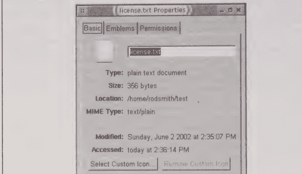

> **图 3-4。** *属性对话框允许你重命名文件、更改其所属组、修改其权限，以及其他操作。*

`KDE` 环境提供了一个类似的文件浏览器，它同时也是一个网页浏览器。除了这两个之外，`FreeBSD` 还支持更多的文件浏览器，即使你没有使用其余的环境部分，也可以使用 `GNOME` 或 `KDE` 的浏览器。

## 从 GUI 运行程序

你可以通过多种不同的方式从图形用户界面（`GUI`）环境中启动程序，包括：

- **面板上的程序图标**：图 3-3 中 `GNOME` 启动项右侧的图标提供了对四个常用程序的快速访问：`GNOME` 帮助浏览器、`GNOME` 终端（让你可以访问文本模式命令行）、`GNOME` 控制中心（将在下一节“配置环境”中介绍），以及 `Mozilla` 网页浏览器。
- **程序菜单项**：屏幕左下角的 `GNOME` 启动项和屏幕左上角的“程序”菜单项都让你可以访问各种常用程序，这些程序被分为几个类别。
- **文件浏览器**：如前所述，你可以通过在文件系统中定位并双击某个程序，或者双击与该程序关联的文件，从文件浏览器中启动程序。
- **桌面图标**：某些桌面图标可能用于启动程序。图 3-3 中显示的大多数默认图标会在各种硬盘分区上打开 `Nautilus` 窗口，但你可以重新配置桌面以包含你喜欢的程序的图标。
- **通过终端启动**：你可以使用上述方法之一打开一个终端会话，然后在终端中输入程序名称来启动该程序。终端的工作方式类似于文本模式登录；它在其中运行你的默认文本模式 `shell`（`sh`、`csh`、`bash`，或你选择使用的其他 `shell`）的一个副本。因此，你可以使用终端来运行文本模式程序。


> *`GNOME` 终端是一类用于在 `X` 中运行基于文本的 `shell` 和其他基于文本的程序的程序之一。这些程序中最通用的一个被称为 `xterm`，这类程序有时也被统称为这个名字。由于 `GNOME` 终端只是几个类 `xterm` 程序中的一个，我在这本书中使用 `xterm` 这个名称来泛指它们。*

当你运行基于 `X` 的程序时，它们会在自己的窗口中启动，尽管如果你从 `xterm` 启动这样的程序，基于 `X` 的程序仍然“拥有”该 `xterm` 的文本显示。因此，除非你按照本章前面“文本模式和 GUI 登录”中的描述，通过在程序名后加一个尾部的 `&` 符号将其置于后台运行，否则该 `xterm` 将无法使用。基于文本的程序可以配置为从菜单等处运行，但通常是通过在 `xterm` 窗口中输入其命令名称来运行的。

由于*窗口*环境差异很大，本书重点介绍通过 `xterm` 启动程序的方法。当然，如果你在某个菜单中找到了相关程序，你也可以以这种方式启动它。你甚至可以为你的桌面环境进行自定义，将该程序添加到菜单或作为桌面图标。

`FreeBSD`（或更准确地说，是 `X` 及其围绕 `X` 发展的那些程序）的一个怪癖在于，`GUI` 程序在“外观和感觉”上差异很大。这是因为 `X` 由多个层次组成，从 `X` 服务器到桌面环境。其中一些层次是由你选择的，例如窗口管理器，但其他层次则是由开发程序的程序员选择的。当两位程序员选择了不同的开发工具包时，他们的程序在诸如菜单中使用的字体和对话框中按钮的外观等细节上往往会有所不同。

## 配置环境

你几乎会立即想要重新配置桌面环境的某些元素。例如，你可能会觉得键盘重复率很荒谬，或者你想为桌面添加一个有趣的背景图片。这些细节在不同的 `GUI` 环境中设置方式不同。在 `GNOME` 中，你通过控制中心来设置它们，你可以通过点击屏幕底部面板上那个看起来像工具箱的图标来启动控制中心。如果你愿意，也可以在 `xterm` 中输入 `gnomecc` 来启动控制中心。图 3-5 展示了 `GNOME` 控制中心及其加载的一个模块。

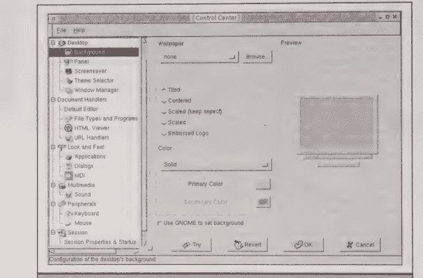

**图 3-5。** *`GNOME` 控制中心让你可以调整 `GNOME` 的设置以及相关程序的设置。*

要使用控制中心，你需要从左侧列表中选择你想要调整的设置的一般类型。图 3-5 显示了“桌面 | 背景”模块，你可以在其中设置桌面背景的颜色，或配置其使用图形文件作为替代。正如你可以从图 3-5 中看到的那样，这些设置被分为几个大类，例如：

- **桌面**：此类别包括设置背景颜色或图像、调整面板行为、启用屏幕保护程序、加载主题（在一次操作中设置各种选项）以及更改 `GNOME` 使用的窗口管理器的选项。
- **文档处理程序**：你可以告诉 `GNOME` 你偏好用什么文本编辑器、将什么文件类型与什么程序关联、如何显示 `HTML`（网络）文档，以及为特定类型的统一资源定位符（`URL`）使用什么程序。
- **外观和感觉**：此部分的模块允许你设置与 `GNOME` 程序用户界面相关的选项。不过，这些选项不适用于大多数非 `GNOME` 程序，因此如果不影响你的所有程序，你不应感到惊讶。
- **多媒体**：你可以配置一些声卡设置，并将声音与特定事件（如登录、注销和接收电子邮件）关联。
- **外围设备**：你可以使用这些模块调整键盘重复率、鼠标跟踪速度、鼠标 `handedness`（左右手设置）以及类似选项。
- **会话**：你可以使用“会话”选项下的各项设置各种登录和注销默认值，例如你希望在登录时启动哪些程序，以及 `GNOME` 是否在你注销时询问确认。

关于这些配置选项，有一件重要的事情需要牢记，即它们是*用户*配置选项。它们可以因用户而异，因此多个人可以共用同一台计算机而无需在选项上妥协。如果 `Sam` 真的很喜欢亮粉色背景，而 `Sally` 更喜欢深蓝色，他们不需要在灰色或紫色上妥协。

由于 `GNOME` 控制中心只设置用户选项，因此你无法设置某些影响整个系统的选项。例如，你不能从 `GNOME` 控制中心加载驱动程序、安装程序或格式化磁盘。这些操作是影响整个系统的管理任务，将在本书的其他章节中涵盖。

## 注销和关机

当你使用 `FreeBSD` 完毕后，你应该做两件事中的一件或两件：注销和/或关机。注销会让计算机保持运行状态，包括你运行的任何服务器，但会关闭对你账户的访问权限；若要使用你的账户，你必须重新登录。关闭计算机更为彻底；它会终止所有程序，并使系统进入一种让你可以安全关闭计算机的状态。

> **注意** 在未首先关闭 `FreeBSD` 的情况下，你绝对不应该直接关闭计算机。与大多数现代操作系统一样，`FreeBSD` 在后台执行许多操作，并对磁盘访问进行缓存——即，它在写入数据之前先保留数据，希望能够将写入合并为一个操作，从而提高性能。这些特性意味着如果你只是简单地关闭计算机，你可能会丢失数据，并且你的文件系统可能会损坏。这可能会减慢启动过程并丢失更多数据。

### 文本模式和 GUI 的注销方法

注销可以防止路人坐在计算机上使用你的账户做你可能不喜欢的操作，例如发送冒犯性的电子邮件。

使用自己的用户名登录或入侵他人的计算机。注销会关闭所有正在运行的程序，包括在后台运行的程序。


如果您使用的是文本模式登录，可以通过输入 `logout` 来注销。这将使您从当前账户退出，并在屏幕上显示新的 `login:` 提示。您可以稍后再登录，或者让其他人登录。如果您登录了多个虚拟终端，请务必将它们全部注销。

**提示** 默认情况下，FreeBSD 不会在注销过程中清除屏幕。如果屏幕上出现任何敏感数据，您可能希望在输入 `logout` 之前输入 `clear` 来清除屏幕。

如果您正在运行 X，在 xterm 窗口中输入 `logout` 不会起作用，因为这些窗口不是登录会话。相反，您必须关闭 X 或注销您的 X 会话。您可以通过选择 X 菜单上的特殊注销选项来完成其中任何一项任务。该选项的具体名称因环境而异。在 GNOME 中，它是 GNOME Foot \ Log Out。在某些独立的窗口管理器中，您可以通过在桌面上右键单击获得的菜单中找到注销选项。有时该选项被称为 Close *Window Manager*、`Exit X` 或类似内容。

选择基于 X 的注销选项后，您将会看到 XDM 登录屏幕（如果您的系统配置为使用 XDM）或最初的文本模式屏幕，屏幕上会显示 X 服务器发出的许多信息。（如果您的 X 会话工作正常，可以安全地忽略这些信息。）然后您可以输入 `logout` 来注销计算机。

**注意** 在某些情况下，选择桌面环境或窗口管理器注销选项后，X 不会正确终止。在这种情况下，您可以按 `CTRL-ALT-BACKSPACE` 来终止 X。

### 文本模式和图形用户界面关机方法

关机允许您安全地切断电源。您必须以 `root` 身份登录才能关闭计算机（以普通用户登录然后通过 `su` 获取 root 权限也可以）。涉及的命令称为 `shutdown`。您可以从文本模式登录或 X 中的 xterm 发出该命令。其语法如下：

```
shutdown [options] time [warning-message]
```

`time` 是系统关闭的时间，它可以采用以下三种形式之一：

- `now` 字符串 `now` 表示立即关机。您可以使用此时间规格来关闭仅由一个人使用的工作站。
- `+number` 要安排在未来某几分钟后关机，请在数字前加一个加号以指定分钟数。例如，+30 表示半小时后关机。
- `yy-MM-ddhh:mm` 要安排在特定时间关机，请将其指定为十位数字，从两位年份开始，依次包括月份、日期、小时和分钟。（小时必须使用 24 小时制。）

可选的 `warning-message` 是一条文本消息，将在计划关机时间前十小时开始显示在所有用户的文本模式登录控制台上。例如，您可以传入 "Shut down for disk upgrade; up at 7:00 AM" 作为警告消息，让用户知道系统为何关机以及预计何时恢复运行。

最后，当您输入时，`shutdown` 命令后立即出现的是该程序接受的几个选项之一。这些选项包括：

- `-h` 关机后系统停止运行。这种关机形式允许您手动切断电源或重启计算机。
- `-p` 关机后系统停止运行并切断电源。此选项要求您的硬件支持软件控制的断电，大多数现代计算机都支持此功能。（一些旧系统不支持此功能。）
- `-r` 关机后系统停止运行并重启。您可以使用此选项重启到另一个操作系统，或在修改 FreeBSD 内核后重启。
- `-k` 此选项会将所有用户踢出系统并禁止进一步登录，但不会实际关闭系统。如果您希望进行广泛的软件更改或在受控环境中进行测试，可能会使用此选项。
- `-o` 带有 `-h`、`-p` 或 `-r` 的关机过程通常涉及关机进程调用 `init`，由 `init` 执行实际工作。此选项使关机过程自行完成工作。通常不需要此选项。
- `-n` 此选项可以与 `-o` 结合使用，并使关机过程跳过刷新文件系统缓存。这种方法可能会导致磁盘损坏，因此通常不希望使用它。
- `-(短横线)` 如果您将单个短横线作为选项包含在内，shutdown 会提示您输入警告消息，而不是使用您在同一命令行上提供的消息。

发出 `shutdown` 命令后，FreeBSD 会撤销启动过程中采取的许多步骤。FreeBSD 终止任何正在运行的程序，包括 X、任何正在运行的服务器等。系统卸载已挂载的网络文件系统和分区，然后执行您指定的任何关机操作。如果您使用了 `-h`，您将会看到一条消息，指出系统已停止；此时，您可以通过按计算机机箱上的重置按钮来切断电源或重启它。如果您使用了 `-p` 或 `-r`，系统将分别自动断电（如果您的硬件支持此选项）或重启。

`shutdown` 命令的替代方法是在控制台键盘上按 `CTRL-ALT-DELETE`。此操作会关闭并重启 FreeBSD 系统，您可能会发现记住这个组合键比记住 shutdown 命令的细节更容易。因此，如果系统是由缺乏经验的用户使用的工作站，这种替代方法可能是一个不错的选择。当然，如果目的是关机而不是重启计算机，您必须在 FreeBSD 开始启动之前按下电源开关，否则会有文件损坏的风险。XDM 图形用户界面登录程序的一些替代方案允许用户从控制台关闭计算机。这些程序提供通过按钮或菜单项关机的选项。GDM 和 KDM 程序（分别是 GNOME 和 KDE 环境的一部分）都提供此选项。

### 何时关机

如果您参与 Usenet 新闻组或邮件列表的讨论，迟早会遇到一个永恒的辩论：什么时候关计算机是合适的？关于这个问题的两个流派是“从不关机派”和“关机以省电派”。

反对关计算机的理由是，组件故障最有可能因为开关设备所涉及的应力而发生。热量和电压的变化比持续运行对设备造成的磨损更大。以灯泡为例。它们通常是在通电时故障，而不是在打开一段时间后故障。计算机组件也是同样的道理，因此让计算机一直开着可能会延长其使用寿命。

相反的观点认为，让计算机一直开着可能会获得的使用寿命延长微乎其微，特别是考虑到相关组件在故障前很久就会过时。然而，让计算机持续运行会消耗电力，（根据这种论点）电力节省比延长组件寿命更重要。

这两种论点都有道理，您必须自己做出决定。不过，另一个因素在于 FreeBSD 的自动维护工具。FreeBSD 会在深夜运行某些程序来处理一些例行维护问题，例如清除 /tmp 目录中的旧文件，如第 28 章所述。因此，如果您决定每晚常规关机，那么偶尔应该让它整夜运行。

当然，所有这些都假设您运行的是工作站。大多数服务器需要每周 7 天、每天 24 小时运行，因此仅在硬件升级、维修或类似情况下才关机。

## 总结

在您按下计算机电源开关后不久，FreeBSD 就与 Windows 有所区别。FreeBSD 启动序列会产生大量的文本输出，总结系统启动过程中采取的步骤。此后，默认的 FreeBSD 配置会显示文本模式登录屏幕，登录即可运行文本模式程序。FreeBSD 的 UNIX 传统使得理解以下事项至关重要

至少其中一些命令，例如用于查看和操作文件的命令。

要运行 GUI 程序，你必须通过输入单个命令（`startx`）来启动 X，该命令会加载 X 以及你作为默认或作为个人用户配置的任何 X 环境。某些 FreeBSD GUI 环境与 Windows 或其他 GUI 操作系统非常相似，因此如果你熟悉这类工具，适应 FreeBSD 应该不会太困难。完成后，你应该注销你的账户，以减少被路人滥用的风险。当需要关闭计算机或重启时，你应确保使用正确的关机程序，而不是简单地按电源开关或重置按钮。


# 完整参考


## 第 4 章

与其他操作系统共存

正如前面章节所述，特别是第 2 章，FreeBSD 可以作为计算机上唯一的操作系统运行，也可以作为两个或更多操作系统之一运行。在后一种情况下，了解 FreeBSD 与你其他操作系统之间的交互方式至关重要，这样你才能最好地利用可用资源并避免错误。（例如，完全有可能从另一个操作系统彻底破坏一个操作系统的安装。）本章涵盖这些交互。它首先介绍引导过程，重点在于引导加载程序的配置和使用。下一个主题是分区管理——以不会引发问题的方式处理分区。大多数分区包含文件系统，这些文件系统通常因操作系统而异。因此，本章的大部分篇幅都致力于这一重要主题。最后，本章以如何在 FreeBSD 中运行非 FreeBSD 程序（如 Linux 或 Windows 应用程序）结束。

##### 注意

> 如果你的计算机仅运行 FreeBSD，本章的大部分内容可能对你不感兴趣。不过，如果你需要在 FreeBSD 中挂载软盘、Zip 盘等，关于文件系统的信息可能仍然相关。同样，即使在仅运行 FreeBSD 的系统中，你也可能想偶尔运行非 FreeBSD 程序。

### 配置引导过程


第 2 章包含了安装 FreeBSD 引导加载程序的基本信息。该引导加载程序在大多数简单配置下工作良好，例如单硬盘上同时安装 FreeBSD 和 Windows 而没有其他系统的情况。然而，更高级的配置可能需要你修改默认的 FreeBSD 引导加载程序配置，甚至使用其他引导加载程序。本节涵盖这些主题，以及如何使用 FreeBSD 引导加载程序向 FreeBSD 内核传递特殊选项。这些选项可以改变 FreeBSD 处理硬件的方式，从而使操作系统能够在某些可能导致默认配置出现问题的硬件上启动。

## 理解引导加载程序

当 x86 计算机启动时，它会在几个位置寻找要运行的代码，首先从计算机的*基本输入/输出系统（BIOS）*ROM 开始。BIOS 随后指示计算机在一个或多个引导设备上查找*引导扇区*。在安装期间，你可能需要重新配置 BIOS 以从软盘或 CD-ROM 驱动器启动，例如。通常，计算机从硬盘启动，要么是因为 BIOS 被配置为首先检查硬盘，要么是因为其他潜在引导设备不包含可引导介质。硬盘的引导扇区更常被称为*主引导记录（MBR）*。标准的 MBR 包含代码，在典型的 DOS 或 Windows 安装中，该代码将引导过程重定向到引导分区的引导扇区中的代码。这段代码启动 DOS 或 Windows。这种简单的单操作系统配置在图 4-1 中说明。（注意，图 4-1 显示了一个 FreeBSD 分区，但图中描绘的引导过程并不会*引导*它。）


**图 4-1.** 标准的单操作系统 x86 引导过程涉及将 CPU 重定向到从各个位置运行代码。

在多操作系统系统中，引导过程的某部分必须修改以支持操作系统的选择。使用标准 FreeBSD 工具的常见方法是替换 MBR 的引导代码为新的代码，该代码允许你在 FreeBSD 和系统中的其他操作系统之间进行选择。这种方法在简单配置下效果很好，经过一些调整，也可以在更复杂的设置中工作。然而，一些操作系统支持它们自己的引导加载程序，第三方引导加载程序也存在。这些加载程序可能会用自己的代码替换 MBR，替换 Windows 引导扇区，在 Windows 引导过程中更下游拦截引导过程，或安装一个专门用于重定向引导过程的特殊分区。如果你想使用这样的引导加载程序，你可以按照即将在“使用第三方引导加载程序”一节中描述的操作进行。

需要理解的一个重要复杂因素是所谓的 1024 柱面限制。传统上，x86 计算机使用柱面/磁头/扇区（CHS）寻址，其中三个数字唯一标识硬盘上的任何给定扇区。BIOS 最初是在硬盘比现在小得多的时候编写的，因此它包含了 CHS 数字的限制，这些限制在今天产生的最大可寻址磁盘大小仅为 8GB 以下。（旧 IDE 接口中的限制进一步将此减少到 504MB，但 20 世纪 90 年代中期的 BIOS 技巧将此限制提高到了 BIOS 的最大值，即 8GB 以下。）由于引导过程严重依赖 BIOS，这些限制，特别是 1024 柱面的限制，在引导任何操作系统时都至关重要。

到 20 世纪 90 年代末，随附的功能（称为*扩展 INT13 调用*）的 BIOS 已开始出货，这些功能使它们能够克服 1024 柱面限制，但引导加载程序需要支持这些 BIOS 功能。FreeBSD 的引导加载程序支持这一点，但你可能需要添加特殊参数才能使它从 1024 柱面限制之上引导 FreeBSD。（注意，即使磁盘大于 1024 柱面，如果 FreeBSD 引导文件位于此限制之下，仍可能不需要特殊选项。）第三方引导加载程序可能也需要支持这些扩展 INT13 调用，以便从 1024 柱面限制之上引导 FreeBSD（或任何其他操作系统）。

## 使用 FreeBSD 引导加载程序

如果你按照第 2 章中的说明以通常方式安装了 FreeBSD 引导加载程序，你的系统应该会引导 FreeBSD 以及可能的一个或多个其他操作系统，例如 DOS 或 Windows。不过，你可能想要修改此配置。例如，你可能想在计算机启动时出现的选项菜单中添加另一个操作系统。你可以通过使用 `boot0cfg` 命令重新配置引导加载程序来完成此操作。该命令的语法是：

```
boot0cfg [-Bv] [-b boot0] [-d drive] [-f file] [-m mask] 
[-o options] [-s slice] [-t ticks] disk
```

在大多数情况下，你不需要超过一两个选项。特别地，以 `root` 身份输入 `boot0cfg -B /dev/ad0` 会以传统方式在第一块 EIDE 磁盘上安装引导加载程序；该实用程序搜索所有可引导分区，并在启动时给你选择引导哪个分区的选项。（如果你的系统使用 SCSI 磁盘，则使用 `/dev/da0` 代替 `/dev/ad0`。）如果需要，该命令的选项如下：

- **-B**  
  此选项告诉 `boot0cfg` 安装 MBR 代码以允许选择你要使用的操作系统。如果你正在使用 MBR 中的其他主要引导加载程序（如下一节“使用第三方引导加载程序”中所述），请省略此选项。

- **-v**  
  通常，`boot0cfg` 提供的反馈很少。此选项使其显示额外信息（即变得冗长），例如它正在使其可引导的切片。

- **-b boot0**  
  要安装引导加载程序，`boot0cfg` 会将文件从其他地方复制到 MBR。该文件默认为 `/boot/boot0`，但如果你想使用其他引导加载程序，可以指定其他文件。如果你想尝试实验性的 FreeBSD 引导加载程序，可能会使用此选项，但其他情况下你通常不会使用它。（如果你使用第三方 MBR 引导加载程序，它应该有自己的方式在 MBR 中安装。）

- **-d disk**  
  BIOS 通过驱动器号引用硬盘。第一块物理磁盘通常是 0x80（即十六进制 80，或十进制 128），第二块是 0x81，等等。如果你已配置 BIOS 从第二块或后续磁盘启动，你可能需要使用 `-d` 选项告诉它使用哪一个。传递 BIOS 驱动器标识符，如 `0x81`，作为 `disk`。为了简单起见，安排你的驱动器，使 FreeBSD 引导加载程序和必须从第一块物理磁盘启动的任何操作系统都可以驻留在该磁盘上；这样你就不需要此选项。

- **-f file**  
  此选项告诉 `boot0cfg` 将现有的 MBR 备份到指定的文件。如果出现问题，此程序可能很有用；你可以使用 `dd` 实用程序恢复原始 MBR。

- **-m mask**  
  通常，`boot0cfg` 可以判断哪些切片应列在初始引导选择菜单中。如果它猜测错误，你可以使用此选项进行覆盖。`mask` 变量取值从 0（未启用任何切片）到 `0xf`（十进制 15；启用所有切片）。`mask` 是一个四位二进制代码，每位对应一个切片。

- **-o options**  
  你可以使用此参数指定三个特殊选项之一。在选项前加上 `no` 以反转其含义（例如，`nopacket` 与 `packet` 相对）。如果你想使用多个选项，可以用逗号将它们分隔。选项如下：

  - **packet**  
    默认值是 `nopacket`，这将使 MBR 引导加载程序使用旧的 CHS 寻址模式。此值实际上限制了 FreeBSD 将从磁盘的前 8GB 启动。另一方面，如果你指定了 `packet`，FreeBSD 将使用扩展的 `INIT13` 调用，使其能够启动位于 1024 柱面之后的操作系统。

  - **setdrv** 如果你调整了 BIOS 驱动器映射并使用了 `-d disk` 选项，请指定此选项，否则 FreeBSD 可能无法正确启动。

  - **update** 通常，每次你选择启动某个操作系统时，FreeBSD 都会改变默认的启动分区。下次启动时，你最后启动的操作系统将成为默认选项。使用 `noupdate` 选项可以使引导加载程序将 MBR 视为不可更改的，从而确保每次启动时都使用相同的默认操作系统。

- **-s slice** 此选项通常与 `-o noupdate` 配合使用。它指定你希望默认启动的切片编号。（将 `slice` 设置为 1 到 4 之间的数字。）

- **-t ticks** 通常，系统会暂停几秒钟，以便你选择要启动哪个操作系统。你可以使用此选项更改延迟时间，该参数以 `ticks`（滴答声）为单位（1 秒包含 18.2 个 `ticks`）。

- **disk** 这是 `boot0cfg` 修改其 MBR 的磁盘。对于 EIDE 磁盘，通常是 `/dev/ad0`；对于 SCSI 磁盘，通常是 `/dev/da0`。

你可能会因为多种原因运行 `boot0cfg`。其中之一是想要更改某些默认设置——例如，添加最初被遗漏的操作系统，或设置使用一致的默认启动操作系统。运行该程序的另一个常见原因是在其他操作系统将其清除后重新安装 FreeBSD 引导加载程序。（当然，如果发生这种情况，你需要紧急启动软盘来启动 FreeBSD。安装光盘或软盘可以完成这项工作。）

> **注意**


> *Microsoft 操作系统在安装时通常会安装一个新的标准 x86 MBR。因此，如果你在安装 FreeBSD 后安装了一份 Windows，你必须重新安装 FreeBSD 引导加载程序或使用第三方引导工具。*

FreeBSD 引导加载程序的一个限制是，它只能将启动过程重定向到位于 x86 主分区上的操作系统。一些操作系统，如 Linux 和 OS/2，可以从逻辑分区启动。因此，如果你将这样的操作系统安装在逻辑分区中，你必须使用另一个主引导加载程序，或者在另一个主分区中安装第三方引导加载程序，并使用该引导程序来启动逻辑分区中的操作系统。

### 设置内核选项

在计算机执行 MBR 代码后，启动过程转移到包含在其他位置的代码。对于 FreeBSD 引导加载程序，这通常被称为启动过程的 *Stage 1*（第一阶段）和 *Stage 2*（第二阶段）（MBR 代码是 *Stage 0*（第零阶段））。在 FreeBSD 中，你可以使用这些阶段向内核传递参数以修改其行为。

**提示**

*如果你需要重新安装你的 Stage 1 和 Stage 2 引导加载程序，可以通过输入 `disklabel /dev/name` 来实现，其中 `/dev/name` 是你的 FreeBSD 切片的名称，例如 `/dev/ad0s2`。理想情况下，此命令永远不需要，但如果你的磁盘已损坏，则可能是必要的。*

从启动计算机的人来说，启动过程的这一阶段以这样的提示开始：

```
Hit [Enter] to boot immediately, or any other key for command prompt.
Booting [/boot/kernel/kernel] in 9 seconds...
```

第二条消息中的时间正在倒数。如果在倒计时达到 0 之前按下除 ENTER 以外的任何键，你可以输入启动参数来修改系统的启动方式。这些选项包括

- `autoboot seconds` 此选项重新启动启动倒计时，从指定的秒数开始。

- `boot [-options] [kernelname]` 你可以使用此命令启动指定的内核并向其传递任何你喜欢的选项。

- `load [-t type] modulename` 你可以使用此选项加载内核模块。内核模块是驱动程序或其他内核扩展，因此你可以使用此选项使特殊硬件正常工作。不过，内核模块也可以在系统启动后加载，所以只有当硬件是 FreeBSD 启动所必需的（例如，用于不支持的磁盘控制器的驱动程序）时，你才需要此选项。

- `ls [-1] [path]` 此选项的工作方式与系统启动后的 `ls` 命令非常相似；它显示指定目录中的文件。不过，在启动过程的这个早期阶段，你可能无法访问所有分区。

- `lsdev [-v]` 此选项列出你可以从中加载模块的设备。添加 `-v` 会产生更详细的报告。

- `lsmod [-v]` 你可以使用此命令查看已加载模块的列表。与 `lsdev` 类似，`-v` 显示更多信息。

- `more filename` 此选项一次显示 `filename` 一屏的内容。为了阅读你想安装的模块文档，你可能需要此功能。

- `reboot` 此命令重启系统。

- `unload` 你可以使用此命令卸载所有已加载的模块。

你可以使用这些选项加载备用内核——例如，在你编译了新内核后（如第 12 章所述）出于测试目的。你可能还需要加载或卸载内核模块才能使系统启动，或者向内核传递选项。（第 12 章提供了有关其中一些参数的额外信息。）

重要的是要意识到，无论你使用 MBR 中的 FreeBSD 引导加载程序还是第三方引导加载程序，你都能看到这些启动选项。因此，如果你想使用这些功能，你并不局限于使用 FreeBSD 引导加载程序。

### 使用第三方引导加载程序

如今有数十种引导加载程序可用。大多数操作系统都附带能够处理多个操作系统（包括 FreeBSD）的引导加载程序。如果你不喜欢 FreeBSD 主引导加载程序或其他操作系统附带的引导加载程序，还有操作系统无关的引导加载程序可用。（这些通常只能从一个或两个操作系统安装，但它们不随任何操作系统附带。）常见引导加载程序的示例包括

- **LILO** *The Linux Loader*（LILO）是 Linux 传统的引导加载程序。它可以位于 MBR、Linux 引导分区或软盘上。LILO 是一个非常有弹性的引导加载程序，但访问其灵活性需要相当繁琐的配置。

- **GRUB** *The Grand Unified Bootloader*（GRUB）现在随许多 Linux 发行版提供，并且可以从其他操作系统（包括 Linux）重新配置。当然，它可以配置为启动 FreeBSD。

- **Windows OS Loader** *The OS Loader*（又称 *NTLDR*）是 Windows NT/2000/XP 的引导加载程序。它相当不灵活，通过 Windows 分区上的文件进行配置。几乎总是最好使用 FreeBSD 引导加载程序作为你的主引导加载程序。如果你安装了多个版本的 Windows，可以在 FreeBSD 引导加载程序中选择 Windows 后，将 OS Loader 用作*次要*引导加载程序。

- **OS/2 Boot Manager** *OS/2's Boot Manager* 是一个中等灵活的引导加载程序，占用其自己的专用切片。它可以启动 FreeBSD、OS/2、Linux 或几乎任何其他操作系统。

- **System Commander** 此引导加载程序来自 V-Com (`http://www.v-com.com`)，是一个非常灵活的引导加载程序。它位于 MBR 和 FAT 分区上的文件上，可以从主分区或（当操作系统支持时）逻辑 x86 分区启动几乎任何操作系统（包括 FreeBSD），还可以对 Windows 等操作系统隐藏主分区。

- **BootMagic** 此引导加载程序随 PowerQuest 的 (`http://www.powerquest.com`) PartitionMagic 提供，也可单独获得。它是一个相当完整的引导加载程序，托管在 Windows 分区的引导扇区和 FAT 文件中。它可以从主分区或（当操作系统支持时）逻辑 x86 分区启动大多数操作系统（包括 FreeBSD）。

一般来说，当你使用第三方引导加载程序时，该引导加载程序会替换基于 MBR 的 FreeBSD 引导加载程序。当你在这个第三方引导加载程序中选择 FreeBSD 时，它会运行 FreeBSD 切片中的 Stage 1 引导加载程序，因此你会看到之前“设置内核选项”中描述的启动提示。

对于大多数第三方引导加载程序，你可以通过使用某种操作系统菜单使 FreeBSD 可用。不过，LILO 值得特别提及为一个例外。使用它时，你必须创建一个类似于以下内容的 Linux `/etc/lilo.conf` 文件中的条目：

```
other = /dev/hda2
label = freebsd
table = /dev/hda
```

此条目使用存储在 `/dev/hda`（FreeBSD 中的 `/dev/ad0`）上的分区表作为参考，从 Linux 的 `/dev/hda2`（FreeBSD 术语中的 `/dev/ad0s2`）启动 FreeBSD。更复杂的配置也是可能的；详情请参阅 Linux 书籍或 Linux 中的 `lilo.conf` 手册页。创建此条目后，你需要在 Linux 中以 root 身份输入 `lilo` 来安装 LILO。然后，你应该能够通过输入 `freebsd` 或在 LILO 启动提示处从菜单中选择 FreeBSD（如果 LILO 配置为显示菜单）来启动 FreeBSD。

## 管理 FreeBSD 和 x86 分区

分区是磁盘管理的基本单位。作为初步近似，计算机上的每个操作系统都应该拥有一个或多个独占的分区，而其他操作系统不应该触碰这些分区。重要的是，你要配置系统，以确保非 FreeBSD 操作系统不会损坏你的 FreeBSD 分区。另一方面，拥有一个可以在操作系统之间交换文件的公共分区通常是有用的。这种配置显然与原始目标相矛盾，但如果你正确管理你的分区，风险可以几乎不存在。

### 分区系统回顾

第 2 章涵盖了分区、分区类型和 FreeBSD 的分区管理工具。在继续之前，你可能需要回顾这些信息。简而言之，运行 FreeBSD 的 x86 计算机可能包含几种不同类型的分区：

- **x86 主分区或 FreeBSD 切片** 原始类型的 x86 分区现在通常被称为*主分区*，但在 FreeBSD 世界中，术语*切片*（slice）常被用来指代这种分区类型。x86 分区系统限制为四个主分区，许多操作系统（包括 FreeBSD）必须从这种类型的分区启动。

- **x86 扩展** 由于四个主分区非常有限，创建了一种特殊类型的分区作为第三种分区类型的占位符。这种占位符分区被称为*扩展*分区。它消耗四个可用的主分区中的一个，但可以代表许多其他分区。

- **x86 逻辑分区**


逻辑分区位于扩展分区“内部”。在 Windows 中，这些分区会被分配 D: 或更高的盘符，具体取决于配置。大多数操作系统无法从逻辑分区启动，尽管存在例外情况。FreeBSD 默认不使用逻辑分区，尽管你可以配置 FreeBSD 以访问它们。

## FreeBSD 分区

FreeBSD 通常驻留在单个 x86 主分区上，但将其细分为独立的 FreeBSD 分区。这种布局的工作原理类似于扩展/逻辑分区的区别；FreeBSD 切片等同于扩展分区，而该切片内的 FreeBSD 分区等同于逻辑分区。

理解并配置分区的一半挑战在于理解这些分区类型之间的区别。大多数仅安装 Windows 的计算机出厂时只有一个主分区，但如果在 Windows 之外安装 FreeBSD，则需要创建一个 FreeBSD 切片，其中包含多个 FreeBSD 分区。

### 防止其他操作系统损坏 FreeBSD 分区

x86 分区方案为每个分区分配一个分区类型代码。有些（但并非所有）操作系统使用这些类型代码来避免损坏其他操作系统的分区。特别是，DOS、Windows 和 OS/2 都依赖于这些代码。因此，确保你的 FreeBSD 切片免受这些操作系统之一损坏的主要技巧是确保你的 FreeBSD 切片标记有适当的 x86 分区类型代码。在安装 FreeBSD 时，这通常会自动完成，所以这不应该是一个问题。一些磁盘维护工具可能会更改这些代码，特别是如果这些工具被不小心使用的话。表 4-1 总结了一些更常见的分区类型代码。Windows 在超过 1024 柱面限制的磁盘上使用与 LBA 模式关联的类型代码。旧版操作系统可能无法识别这些分区。

> **注意**
>
> 表 4-1 并不全面。许多更冷门的操作系统有自己独特的分区类型代码，并且常见操作系统还使用其他代码用于特殊目的。

你可以在 FreeBSD 中使用 `fdisk` 命令检查磁盘上使用的分区类型。具体来说，输入 `-s` 选项和磁盘标识符以查看主分区表，如下所示：

```
# fdisk -s /dev/ad0
/dev/ad0: 784 cyl 255 hd 63 sec
      Part    Start           Size  Type    Flags
      1:       63       4192902     0x0b    0x00
      2:    4192965       8401995    0x0b    0x80
```

| 十六进制类型代码 | 十进制类型代码 | 文件系统 | 被哪些操作系统使用 |
|---|---|---|---|

| 0x01 | 1 | FAT-12 | DOS，大多数其他操作系统 |
| 0x04 | 4 | FAT-16（小于 32MB） | DOS，大多数其他操作系统 |
| 0x05 | 5 | 扩展 | 所有 x86 操作系统 |
| 0x06 | 6 | FAT-16 | DOS，Windows，大多数其他操作系统 |
| 0x07 | 7 | HPFS 或 NTFS | OS/2，Windows NT/2000/XP |
| 0x0a | 10 | OS/2 启动管理器 | OS/2 启动管理器 |
| 0x0b | 11 | FAT-32 | Windows 95 OSR2 及以上版本 |
| 0x0c | 12 | FAT-32（LBA 模式） | Windows 95 OSR2 及以上版本 |
| 0x0e | 14 | FAT-16（LBA 模式） | Windows 95 OSR2 及以上版本 |
| 0x0f | 15 | 扩展（LBA 模式） | Windows 95 OSR2 及以上版本 |
| 0x82 | 130 | Linux 交换分区或 Solaris | Linux 或 Solaris |
| 0x83 | 131 | Linux 文件系统（ext2fs, XFS, ReiserFS 等） | Linux |
| 0xa5 | 165 | BSD 切片 | BSD 操作系统，包括 FreeBSD |
| 0xeb | 235 | BeFS | BeOS |

此命令会揭示磁盘的大小（以 CHS 值表示）、每个分区的大小（以 512 字节扇区表示）以及所有主分区的分区类型代码等信息。如果你的 FreeBSD 分区的类型代码错误，其他操作系统可能会尝试访问它，从而可能损坏它。要解决此问题，你可以对 `fdisk` 使用 `-u` 选项。这会导致 `fdisk` 询问你关于更新每条信息的问题。对于大多数信息按 ENTER 键即可，只需更改分区类型代码。

例如，以下序列更改了上述输出中第一个分区的分区类型代码：

```
The data for partition 1 is:
sysid 11, DOS or Windows 95 with 32 bit FAT
start 63, size 4192902 (2047 Meg), flag 0
beg: cyl 0/ head 1/ sector 1;
end: cyl 260/ head 254/ sector 63
Do you want to change it? [n] y
Supply a decimal value for "sysid (165=FreeBSD)" [11] 165
```

> **注意**
>
> 虽然输入 `fdisk -s /dev/ad0` 会产生十六进制（16 进制）的分区类型代码，但在输入 `fdisk -u /dev/ad0` 时的提示会显示并要求输入十进制（10 进制）的分区类型代码。表 4-1 同时展示了两种格式的分区类型代码。

某些操作系统，例如 Linux，不使用分区类型代码，除非可能在安装过程中使用。对于这些 Linux 系统，你必须配置它们以忽略 FreeBSD 切片。大多数 Linux 发行版默认执行此操作，因此这在 Linux 中应该不是问题。不过，如果你想从 Linux 访问你的 FreeBSD 分区，你必须激活 Linux 对 FreeBSD 切片和文件系统的支持，如即将出现的章节“从其他操作系统访问 FreeBSD 文件系统”中所述。从另一个 BSD 操作系统（如 OpenBSD 或 NetBSD）访问 FreeBSD 分区通常相当直接。通常，每个 BSD 操作系统都有自己的切片，但你只需指定正确的切片和分区即可挂载外部 BSD 文件系统。

### 从 FreeBSD 访问外部分区

在 FreeBSD 中，每个分区在 `/dev` 层次结构中都有唯一的标识符。此层次结构中的磁盘文件名由几个部分组成：

#### 设备类型

硬盘有两个字母的类型代码用于设备类型。IDE 磁盘使用代码 `ad`，而 SCSI 磁盘使用代码 `da`。USB 驱动器被视为 SCSI 驱动器，因此对它们使用 `da` 代码。

#### 设备编号

每个物理磁盘都有一个编号。某类的第一块磁盘通常编号为 0，第二块为 1，依此类推。对于 IDE 磁盘，设备编号与磁盘控制器及链上的位置相关：主控制器的主磁盘为 0，主控制器的从磁盘为 1，副控制器的主磁盘为 2，依此类推。SCSI 磁盘从 0 开始顺序编号，即使第一块磁盘的 SCSI ID 高于此编号。

#### 切片编号

切片编号由字母 `s` 和 1 到 4 之间的数字表示。这些编号通常从 1 开始，但一些工具以特殊顺序创建切片，或者允许你删除切片，从而在序列中产生间隙。逻辑分区被像切片一样对待，但它们的编号从 5 开始。因此，具有两个主分区和两个逻辑分区的磁盘可能有编号为 1、2、5 和 6 的切片。

#### 分区字母

切片编号之后是一个标识切片内 FreeBSD 分区的字母。这些分区字母在 FreeBSD 分区中具有特定含义，如表 4-2 所述。

在提及非 FreeBSD 切片或逻辑分区时，你应该省略分区字母；在将整个磁盘作为整体访问时（例如使用 `fdisk` 时），你应该省略切片编号。表 4-3 展示了一些示例分区标识符及其含义。此表旨在说明而非全面。

如果你已经熟悉 FreeBSD 分区标签，这些命名约定可能看起来有些奇怪，但随着你使用它们，它们会变得更加熟悉。你可能想要检查你的 `/etc/fstab` 文件的内容。此文件列出了 FreeBSD 启动时挂载的分区。第 7 章更详细地描述了这个文件。

> **注意**
>
> 如果你熟悉 Linux，你可能会注意到 FreeBSD 的磁盘标识符与 Linux 的不同。这仅仅是这两个操作系统中使用的不同约定。

除了磁盘分区外，额外的磁盘标识符指代其他磁盘设备。最重要的是，`/dev/fd0` 是软盘，`/dev/acd0`（或 `/dev/acd0a` 或 `/dev/acd0c`）是 Elide CD-ROM 驱动器，`/dev/cd0a` 是 SCSI CD-ROM 驱动器。如果系统有多个给定类型的驱动器（例如两个软盘驱动器），可以递增编号以寻址第二个驱动器（例如使用 `/dev/fd1` 显示第二个软盘驱动器）。软盘和 CD-ROM 驱动器通常不进行分区，尽管其中一些驱动器标识符暗示它们进行了分区。


Zip、LS-120、磁光盘和其他可移动介质设备像硬盘一样访问。Zip 磁盘通常包含带有单个切片（编号 4）的 x86 分区表。例如，在除 EIDE 以外的所有系统中，USB Zip 磁盘将表示为 `/dev/da0s4`。其他类型的可移动磁盘也可能被分区，但它们通常使用

| 分区字母 | 用途 |
|---|---|
| a | 根（/）分区 |
| b | 交换空间 |
| c | 整个切片（不推荐使用该选项） |
| d 及以后 | 通用分区 |

表 4-2. FreeBSD 分区字母及其用途

| FreeBSD 分区标识符 | 用途 |
| --- | --- |
| `/dev/ad0` | 整个第一个 EIDE 磁盘 |
| `/dev/da0` | 整个第一个 SCSI 磁盘 |
| `/dev/ad0s1` | 第一个 EIDE 磁盘上的第一个切片（slice） |
| `/dev/ad1s3a` | 根（/）FreeBSD 分区，存储于第二个 SCSI 磁盘上的第三个切片中 |
| `/dev/ad2s6` | 次要 EIDE 控制器主盘上的第二个逻辑分区 |

表 4-3. 分区标识符示例

第一个切片（`/dev/da0s1` 或根据硬件类型调整后的类似名称）。某些可移动磁盘未划分分区，因此你需要使用原始磁盘标识符，例如 `/dev/da0`。

### 理解文件系统

仅知道访问 FreeBSD 中分区的分区代码，并不足以实际访问该分区的文件。为了让计算机使用某个分区，通常必须在该分区上放置一个*文件系统*。这是一种填充分区并使操作系统能够其中存储文件的数据结构。不同的操作系统使用不同的文件系统，因此你必须了解一些关于文件系统的知识——包括 FreeBSD 原生使用的文件系统以及其他操作系统使用的文件系统。

#### “文件系统”的两个含义

一个重要的考量是，*文件系统*这个词有两个含义。在本章中，该词指的是填充分区（在某些情况下是整个磁盘）的数据结构。在此意义上，文件系统具有名称，并由特定的操作系统或有时由实用程序提供支持。例如，你可能会提到“ISO-9660 文件系统”，或者说你想“挂载一个文件系统”（即，使其文件在 FreeBSD 目录中可用）。

*文件系统*这个词的另一个含义是指计算机上的逻辑目录结构。例如，你可能会说“FreeBSD 文件系统锚定于其根目录”或“递归文件搜索可以在文件系统的任何目录中找到文件。”在此意义上，一个文件系统实际上可能跨越多个分区。

在这本书中，你应该能够根据上下文判断指的是哪个含义。在无法判断的情况下，我使用其他术语（如*分区*或*目录树*）或额外的词语（如*FAT 文件系统*）来澄清含义。

#### FreeBSD 文件系统的根基

FreeBSD 使用*快速文件系统（FFS）*作为其原生文件系统。该文件系统有时被称为*UNIX 文件系统（UFS）*；例如，Linux 中访问 FFS 的命令使用 UFS 缩写。当你在 FreeBSD 中使用 `mount` 命令时，FFS 类型的代码也是 ufs。

以计算标准来看，FFS 是一个相当古老的文件系统；其传承可追溯到伯克利开发的一些早期 FreeBSD 版本。顾名思义，FFS 在设计时考虑到速度。它使用许多技术来实现这一目标，包括仔细放置磁盘上的数据结构以最小化磁头移动。其中一些技术在现代 EIDE 和 SCSI 硬盘上无法正常工作，但 FFS 仍然是一个良好的表现者，尽管按照 21 世纪初的标准来看，它算不上出色。

UNIX 系统总体上，特别是 FreeBSD，都是基于文件系统提供某些特性的假设而设计的。自然，FFS 做到了这一点。这些特性包括

- **所有权** 作为一个多用户操作系统，FreeBSD 需要跟踪谁创建了文件——即它们的所有者。这是通过将用户 ID（UID）号与每个文件关联来实现的。同样，文件通过组 ID（GID）号与特定的用户组相关联。

- **权限** FreeBSD 支持基于文件所有者、文件组和所有其他用户的三级权限系统。对于这些类别中的每一个，FFS 都支持分配读取、写入和执行权限。（执行权限标记该文件为可运行的程序或脚本。）

- **特殊标志** 某些文件类型需要特殊处理。例如，目录实际上只是包含指向其他文件指针的文件。用于访问磁盘分区的设备文件名也是特殊的，还有其他例子。这些标志与文件的所有者和权限一样，存储在文件中。

- **文件名特性** FFS 支持长文件名（最多 255 个字符），这些文件名可以包含大写字母、小写字母、数字和大多数标点符号，甚至控制字符。FreeBSD 本身依赖于文件是*区分大小写*的——即，大写字母和小写字母的处理方式不同。因此，文件 FILE.TXT 与 file.txt 不同，且两者都可以无问题地存放在同一目录中。

这些特性之所以重要，是因为许多非 FreeBSD 文件系统不提供相同的一组功能。这意味着当 FreeBSD 访问这些文件系统时，它可能需要“模拟”某个功能，或者在 FreeBSD 尝试访问文件系统时可能会出现怪癖。例如，FreeBSD 必须为 FAT 文件系统上的文件分配所有者，因为 FAT 不支持此功能。第 7 章更详细地描述这些文件系统特性及其在 FreeBSD 中的使用。

#### 重要的非 FreeBSD 文件系统

当你需要与另一个操作系统交换数据时，你可能需要通过该其他操作系统的文件系统，或者通过非任一操作系统的原生文件系统来工作。本节快速概述了一些常见选项，但不详细阐述其中任何一个。这些文件系统中的大多数使用与挂载 FFS 分区通常使用的 `mount` 命令不同的挂载命令。接下来的章节，“挂载外来文件系统”，将涵盖这些命令。

### FreeBSD 文件系统的变体

由于 FFS 在 BSD 历史早期开发，它已经进入了许多类 UNIX 操作系统。FreeBSD 最近的表亲，OpenBSD 和 NetBSD，都支持 FFS。Solaris、NeXTstep、Mac OS X 以及各种其他类 UNIX 操作系统也支持。然而，许多类 UNIX 操作系统现在更青睐于它们自己的专有文件系统。这就是为什么熟悉 Linux 的人应特别关注即将出现的章节，“Ext2fs”。许多商业 UNIX 变体现在更青睐日志文件系统，将在即将出现的章节“日志文件系统”中描述。

访问由其他开源 BSD 操作系统使用的 FFS 分区应该没有任何困难；它们都保持根本相同的结构。然而，这并不一定适用于其他 FFS 实现。许多商业 UNIX 操作系统使用的 FFS 实现与 FreeBSD 使用的实现偏差太大，导致它们不兼容。如果你想与这样的操作系统交换文件，可能需要使用另一种文件系统，如 FAT，作为交换区域。

##### FAT

*文件分配表*（FAT）文件系统以其用于为文件分配磁盘空间的数据结构命名。FAT 在 DOS 中变得流行，但也是 Windows 9x/Me 系列唯一支持的硬盘文件系统。即使今天，许多 Windows 2000 和 XP 系统仍然使用 FAT，尽管这些操作系统也支持更先进的文件系统（NTFS，下文将描述）。

按照最初设计，FAT 支持文件名非常有限的文件——八个字符加上可选的三字符扩展名（所谓的*8.3 文件名*）。这些文件名以全大写字母存储（数字和某些标点也是合法的），但 FreeBSD 的 FAT 驱动程序会将其转换为小写。随着 Windows 95，微软推出了一种名为*VFAT* 的 FAT 变体，该变体扩展了文件系统以支持混合大小写的长文件名。VFAT 仍然是*不区分大小写*的，这意味着仅在大小写上有差异的文件名被视为*完全相同*，尽管文件系统记录了文件名的大小写。VFAT 的一个重要特性是它与旧系统兼容。你可以使用 VFAT 在 FAT 磁盘上存储长文件名，然后在仅支持 8.3 文件名的旧 DOS 计算机上读取这些文件。DOS 系统仅看到一个被截断的 8.3 文件名，但数据保持完整。

独立于文件名长度问题，FAT 在其 FAT 条目的*大小*（以位为单位测量）上有所不同。有 12 位、16 位和 32 位的 FAT 变体，通常称为*FAT-12、FAT-16* 和 *FAT-32*。FAT 条目越大，可支持的磁盘就越大。如今，FAT-12 几乎专门用于软盘。FAT-16 用于小硬盘分区（最大 2GB，尽管在大约 512MB 时切换到 FAT-32 通常是有利的）。大于 2GB 的分区必须使用 FAT-32，除非该分区仅由 Windows NT/2000/XP 使用——这些操作系统可以处理 4GB 的 FAT-16 分区。

FreeBSD 的 FAT 驱动程序同时支持原始 8.3 文件名格式的 FAT 和 VFAT，并且独立于这些功能，支持 12 位、16 位和 32 位的 FAT 变体。驱动程序会自动检测 FAT 的位大小，因此你无需关心这一细节。默认情况下，FreeBSD 会尝试自动检测磁盘是否使用 VFAT 并相应地挂载它，但如果你愿意，也可以强制指定其中一种行为。

FAT 不支持 UNIX 风格的文件所有者、权限或特殊标志，因此 FreeBSD 会模拟这些细节。你可以通过挂载选项来调整这些细节的处理方式。


由于 FAT 得到微软操作系统的支持，它也被其他所有主流操作系统以及大多数非 x86 架构的操作系统所支持。因此，FAT 软盘、大容量可移动磁盘以及多操作系统计算机上的数据交换分区非常常见，即使进行数据交换的两个操作系统中没有一个是微软操作系统也是如此。

> **注意**
>
> 除了常规挂载支持（将在即将出现的“挂载外部文件系统”章节中描述）之外，FreeBSD 还支持使用 `mtools` 软件包访问 FAT 文件系统（特别是软盘）。在安装程序并使用 `sysinstall` 时，该工具可在“仿真器”软件包部分找到。然后，你可以使用以 `m` 开头的命令（如 `mdirc` 和 `mcopy`）来访问 FAT 软盘上的文件。

### NTFS

微软在其 Windows NT 产品中创建了新技术文件系统（NTFS）。NTFS 支持长文件名（以不区分大小写的方式）、文件所有权以及用于安全的访问控制列表（ACL）。由于 NTFS 是 Windows NT、2000 以及现在的 XP 的首选文件系统，它未来可能会变得更加重要。

虽然 NTFS 支持文件所有权和用于访问控制的 ACL，但这些功能并不容易映射到 FreeBSD 自身的所有权和权限模型上。因此，FreeBSD 对 NTFS 中这些功能的支持基本不存在。与 FAT 一样，你可以在挂载 NTFS 文件系统时强制 FreeBSD 模拟这些功能，但这仅适用于整个文件系统；你无法修改单个文件的所有权或权限。

FreeBSD 的 NTFS 支持名义上提供读写访问权限，但写选项限制极其严格，使得 NTFS 实际上成为一个只读文件系统。这一事实以及所有权和权限问题，使得 FreeBSD 对 NTFS 的支持价值有限。如果你需要与同一台计算机上运行的 Windows NT/2000/XP 交换数据，最好使用 FAT 分区。在紧急情况下，你可以挂载 NTFS 分区并从中读取文件。

### Ext2fs

Linux 的默认文件系统被称为第二扩展文件系统（ext2fs）。该文件系统支持与 FFS 相同的所有 UNIX 特性——所有权、权限等。因此，从必须在其上读写文件的程序的角度来看，ext2fs 可以非常接近 FFS。

2002 年，许多 Linux 用户正在迁移到其他文件系统。其中一个，即第三扩展文件系统（ext3fs），是 ext2fs 的日志扩展。FreeBSD 的 ext2fs 支持应该能够处理这些分区，但我强烈建议不要尝试以完全读写支持来挂载它们，除非且直到该功能经过充分测试。Linux 的 ext3fs 是一类称为日志文件系统的新类型文件系统的例子。

### 日志文件系统

日志文件系统会在磁盘上维护一个数据结构（日志），以便在更改写入磁盘之前跟踪这些更改。其理念是，如果系统崩溃或发生电源故障，可以使用日志来简化必须运行的磁盘恢复过程。在某些文件系统（如 Linux 的 ext2fs）上，此恢复过程可能非常耗时，因此日志可以大大减少崩溃或电源故障后的系统启动时间。

> **注意**
>
> FFS 的恢复过程比 ext2fs 快，因此相比 Linux 的日志文件系统，实现原生 FreeBSD 日志文件系统 的动力较小。最近版本的 FFS 还支持一项称为软更新（soft updates）的功能。这是另一种在发生崩溃或电源故障时保证一致性的方法，这进一步消除了为 FreeBSD 创建新日志文件系统的需求。

如今有许多日志文件系统在使用。事实上，NTFS 就是其中之一。其他包括 ext3fs（ext2fs 的日志变体）、ReiserFS（为 Linux 设计的新文件系统）、XFS（由 SGI 为其 IRIX 开发，也移植到 Linux）、JFS（由 IBM 为其 AIX 和 OS/2 开发，也移植到 Linux）以及 BeFS（为 BeOS 开发）。2002 年，有人提议将这些系统中的某些移植到 FreeBSD，但尚未有可用的工作代码。（请访问 [http://sourceforge.net/projects/jfs4bsd](http://sourceforge.net/projects/jfs4bsd) 获取关于 FreeBSD 计划中的 JFS 实现的信息。）技术挑战令人望而生畏，因此 FreeBSD 支持这些文件系统可能需要一段时间。如果其中一个或多个被移植并稳定下来，最终可能会取代 FFS 成为标准的 FreeBSD 文件系统。在那之前，驱动程序可用于支持 FreeBSD 与其他操作系统之间的文件传输。

### CD-ROM 文件系统

CD-ROM 是交换中等数量数据的标准方法。标准 CD-ROM 可容纳多达 650MB 的数据，某些技术可以将此值略微提高至约 700MB。当 CD-ROM 最初开发时，它们被设想为只读介质，原始的 CD-ROM 文件系统也反映了这一事实。其中最流行的是 ISO-9660，它有几个变体，某些变体支持比 DOS 更严格的文件名——8.3 文件名长度限制，且文件名中可用的标点符号字符选择较少。

类 UNIX 系统严重依赖其独特的文件系统特性，因此许多为类 UNIX 操作系统（包括 FreeBSD）创建的 CD-ROM 都支持一种称为 Rock Ridge 的 ISO-9660 扩展。Rock Ridge CD-ROM 支持文件所有权、权限、长文件名（区分大小写）等。如果 FreeBSD 检测到 CD-ROM 上的 Rock Ridge 扩展，挂载该 CD-ROM 时会自动使用这些扩展。

随着 Windows 95 的发布，微软意识到了 ISO-9660 的原始性，并开发了其自己的新 CD-ROM 文件系统，称为 Joliet。与 Rock Ridge 一样，Joliet 支持长文件名，但不支持 UNIX 风格的所有权或权限。FreeBSD 支持 Joliet，但如果 CD-ROM 同时包含 Rock Ridge 和 Joliet 扩展，FreeBSD 会使用 Rock Ridge 扩展。

随着可写 CD 驱动器（CD-R 和 CD-RW）以及更大容量的光介质（如 DVD-ROM）的发展，ISO-9660 及其衍生版本和相关文件系统遇到了瓶颈。为了满足这些需求，开发了通用磁盘格式（UDF）。2002 年，FreeBSD 尚不支持 UDF，但相关工作正在进行中以添加此支持。请访问 `http://people.freebsd.org/~scottl/udf/` 获取有关该项目的最新信息。

## 从 FreeBSD 访问外部文件系统

在规划如何使用文件系统时，了解文件系统的定义及其之间的区别很重要。然而，实际使用它们需要了解特定的 FreeBSD 命令。本节介绍这些命令。它还包括在 FreeBSD 中使用外部文件系统的一些实际怪癖和影响。

### 挂载外部文件系统

FreeBSD 使用一个名为 `mount` 的命令来挂载文件系统。该命令将文件系统链接到一个 *挂载点*——即 FreeBSD 目录树中某处的目录。`mount` 的基本语法如下：

```
mount [选项] 设备文件 挂载点
```

*设备文件* 是与文件系统关联的设备文件名，例如 `/dev/ad0s4` 或 `/dev/fd0`。*挂载点* 是你希望文件可访问的位置。你可以指定许多选项来修改 `mount` 命令的行为。例如，`-a` 使 `mount` 挂载 `/etc/fstab` 文件中指定的所有文件系统，而 `-r` 使文件系统以只读方式挂载。第 7 章更详细地描述了这些通用的 `mount` 选项。对于外部文件系统，有两个选项值得特别关注：

- `-t fstype`：你可以使用此选项告诉 `mount` 分区或其他磁盘设备包含的文件系统类型。实际上，`mount` 使用一个名为 `mount_fstype` 的辅助程序（其中 `fstype` 是 `-t` 的参数）来挂载文件系统。例如，`mount -t msdosfs /dev/ad0s3 /windows` 会导致 `mount` 使用 `mount_msdosfs` 程序将 `/dev/ad0s3` 上的 FAT 文件系统挂载到 `/windows`。（在 FreeBSD 5.0 之前，`msdosfs` 被称为 `msdos`。）

#### -o 选项

你可以使用此选项指定各种挂载选项。其中一些适用于所有或大多数文件系统，而另一些则是特定于文件系统的。当使用特定文件系统的选项时，你可能需要将这些选项作为逗号分隔的列表进行指定，并在通常使用空格的地方使用等号（=）。（示例稍后给出。）

如果你想要挂载一个外部文件系统，你可以使用带有 `-t` 选项的 `mount` 命令，或者直接调用针对你特定文件系统的变体命令。表 4-4 总结了最常见的外部文件系统挂载命令、它们处理的文件系统以及它们使用的更流行的特定文件系统选项。

> **注意** `NFS` 是网络文件系统（Network File System），它是一种在 UNIX 网络中常见的网络文件共享工具。在第 18 章和第 24 章中对其有更详细的描述。

#### 表 4-4. 外部文件系统挂载命令

| 命令 | 处理的文件系统 | 常用选项 |
|---|---|---|


| `mount_msdosfs` 或 `mount_msdos` | FAT（包括 VFAT） | `-u uid` 设置所有文件的用户 ID（UID）；`-g gid` 设置所有文件的组 ID（GID）；`-m mask` 设置所有文件的最大权限掩码；`-s` 使 FreeBSD 忽略并生成 VFAT 长文件名；`-l` 使 FreeBSD 创建并使用 VFAT 长文件名（如果未使用 `-s` 或 `-l`，FreeBSD 会查找 VFAT 长文件名，如果存在则使用它们） |

| `mount_ntfs` | NTFS | `-u uid`、`-g gid` 和 `-m mask` 的工作方式与 `mount_msdosfs` 相同 |

| `mount_ext2fs` | ext2fs | 没有特殊选项 |

| `mount_cdfs` | ISO-9660（包括 Rock Ridge）；Joliet | `-j` 使 FreeBSD 忽略 Joliet 文件系统（如果存在）；`-r` 使 FreeBSD 忽略 Rock Ridge 扩展（如果存在） |

| `mount_nfs` | NFS | `-2` 强制使用 NFS 版本 2；`-3` 强制使用 NFS 版本 3；`-s` 使 FreeBSD 在多次访问失败后返回错误代码 |

作为这些命令实际操作的一个示例，考虑以下两个命令：

```bash
# mount_msdosfs -u 1002 -s /dev/fd0 /mnt/floppy
# mount_cd9660 -r /dev/acd0 /mnt/cdrom
```

第一个命令将一个 FAT 软盘挂载到 `/mnt/floppy`，并将所有文件的所有权赋予拥有 UID `1002` 的用户。（`/mnt/floppy` 目录必须首先存在，在标准 FreeBSD 安装中它并不存在。）`-s` 选项指定 FreeBSD 应忽略 VFAT 长文件名，因此如果软盘上存在任何长文件名，它们将被忽略；用户只能看到 8.3 格式的文件名，如果任何人将具有长文件名的文件复制到软盘上，这些名称将被截断以符合 8.3 文件名规范。

第二个命令将 CD-ROM 挂载到 `/mnt/cdrom`。（同样，你必须创建 `/mnt/cdrom` 或确保它已经存在。）`-r` 选项告诉 FreeBSD 忽略 Rock Ridge 扩展。如果 CD-ROM 具有 Joliet 文件系统，你将看到 Joliet 文件名。如果没有，你将看到 ISO-9660 文件名，这通常意味着 8.3 格式的文件名，但某些 ISO-9660 变体支持长达 32 个字符的单实例文件名。

使用 `mount` 而非特定文件系统命令的等效命令如下：

```bash
# mount -t msdosfs -O u=1002,-s /dev/fd0 /mnt/floppy
# mount -t cd9660 -O -r /dev/acd0 /mnt/cdrom
```

请注意，`-O` 位于特定文件系统选项之前。在 FAT 软盘的情况下，一个等号替换了 `-u` 和 `1002` 之间的空格，而一个逗号替换了该选项和 `-s` 之间的空格。这种格式允许你使用普通的通用文件系统选项（例如使用 `-r` 将文件系统挂载为只读），同时还能使用特定文件系统的选项。

如果你希望始终可以使用非 FreeBSD 分区，你可以为该文件系统创建 `/etc/fstab` 中的一个条目，如第 7 章所述。你可以包含特定文件系统的选项和通用选项。其结果是 FreeBSD 将自动挂载相关的文件系统。

#### 外部文件系统使用的限制

前面的章节暗示了当你使用外部文件系统时会遇到的一些怪癖。具体效果因文件系统而异，但一些更常见的包括：

- **系统不稳定性** 某些文件系统驱动程序是实验性的或调试不良，可能导致 FreeBSD 崩溃。例如，针对 `ext2fs` 就有这样的报告。你应该谨慎使用此类文件系统。请注意，流行且重要的 `msdosfs` 和 `cd9660` 文件系统不属于此类。

即使某个文件系统不会导致 FreeBSD 崩溃，它也可能损坏磁盘或相关分区上的数据，特别是当它以读写模式使用时。再次强调，FreeBSD 对 `ext2fs` 的支持属于此类，但 `msdosfs` 不是。`cd9660` 文件系统是只读的，因此这个问题不适用于它。如果你想要创建一个 ISO-9660 文件系统，你可以使用一个名为 `mkisofs` 的特殊工具，配合另一个名为 `cdrecord` 的工具将文件系统写入空白 CD-R 或 CD-RW 光盘。

如果你在没有 VFAT 扩展的情况下挂载 FAT 文件系统，你将无法创建具有长文件名的文件。VFAT 和 NTFS 均不区分大小写，因此如果你尝试复制文件名仅在大小写上不同的文件，可能会丢失文件。如果在 FFS 中指定了错误的大小写，你也可能会访问到文件。Joliet 以相同的方式工作，但 Rock Ridge 更像 FFS。

这些问题对于新的 FreeBSD 管理员来说可能是真正的麻烦。对于单用户工作站，你可能希望在 `/etc/fstab` 文件中为任何 FAT 分区、软盘或可移动介质磁盘包含 `-u=uid` 选项，以便工作站的主要用户可以轻松访问文件。（用工作站主要用户的 UID 替换 `uid`。）使用 `-m=777` 赋予所有文件完整的 0777 权限（如第 8 章所述），从而允许任何用户访问它们。若要限制仅为某些用户访问，请指定 `-g=gid`、`-m=770` 或类似选项，并确保所有应访问该文件的用户都在指定的组（`gid`）中。类似的选项也适用于 NTFS 分区。对于 Linux `ext2fs` 分区，所有权通过 UID 和 GID 映射，因此如果你的 FreeBSD 和 Linux 的 UID 和 GID 不匹配，你会看到奇怪的所有权效果。除了同步你的 FreeBSD 和 Linux 的 UID 和 GID 之外，没有简单的方法来解决这个问题。

FreeBSD 的 FFS 驱动程序经过多年优化，而对其他文件系统的支持较新且优化程度较低。因此，外部文件系统的访问速度可能无法媲美原生 FFS 分区。

总体而言，FreeBSD 的外部文件系统支持在许多情况下极其有用。ISO-9660 及相关扩展的支持在许多系统上尤为重要，FAT 的支持也是如此。这两个外部文件系统使 FreeBSD 能够与大多数非 FreeBSD 系统交换文件。对 NTFS 和 `ext2fs` 等其他文件系统的支持发展程度较低，但在某些情况下仍然有用。

### 从其他操作系统访问 FreeBSD 文件系统

在某些情况下，你可能希望从另一个操作系统访问你的 FreeBSD 文件系统。例如，如果你启动了另一个操作系统，突然发现需要读取存储在 FreeBSD 分区上的文件，这会非常方便。在某些情况下，你甚至可能希望使用这种访问方式来对 FreeBSD 配置进行紧急更改。

FreeBSD 无法启动。（你也可以使用 FreeBSD 紧急磁盘来实现此目标。）然而，在 UNIX 世界之外，对 FFS 的非 FreeBSD 支持并不常见，因此这种访问方式的选择有限。

#### 非 FreeBSD 操作系统中的支持概述

FreeBSD 的近亲开源 BSD 操作系统都使用 FFS，并且它们的实现是兼容的。因此，你可以轻松地在 OpenBSD 或 NetBSD 中挂载 FreeBSD 分区。你需要发出适当的 `mount` 命令或将在 OpenBSD 或 NetBSD 操作系统中的 `/etc/fstab` 文件添加 FreeBSD 分区。这些选项的工作方式与 FreeBSD 中非常相似。

FFS 也得到许多商业 UNIX 操作系统的支持，例如 Solaris。如前所述，FFS 多年来发生了变化，因此这些操作系统可能无法再挂载 FreeBSD 版本的 FFS。

尽管 Linux 是 UNIX 的重新实现，因此不直接继承自 BSD，但它确实包含 FFS 驱动程序，名称为 UFS（使用 Linux `mount` 命令的 `-t ufs` 参数）。实际上，Linux 的 FFS 驱动程序支持多种不同的 FFS 变体。你使用 `ufstype` 选项指定想要使用哪一种，访问 FreeBSD 分区时应将其设置为 `44bsd`。因此，你可能会使用如下命令来挂载 FreeBSD 分区：

```bash
# mount -t ufs -o ufstype=44bsd /dev/hda10 /mnt/freebsd
```


在 Linux 中挂载 FreeBSD 分区的一个重要前提是支持 BSD 分区方案。通常，Linux 使用 x86 样式的主分区、扩展分区和逻辑分区；它不使用 BSD 样式的分区。因此，要访问 BSD 分区，你必须启用名为 BSD Disklabel (BSD Partition Tables) Support 的 Linux 内核选项，该选项位于内核配置菜单中文件系统的 Partition Types 子菜单中。你的 Linux 发行版可能已经启用该选项，也可能没有。如果未激活，你必须重新编译 Linux 内核。有关如何做到这一点的更多信息，请参阅 Linux 系统管理书籍，如 Richard Petersen 的 *Linux: The Complete Reference, 4th Edition* (McGraw-Hill/Osborne, 2000) 或 Vicki Stanfield 和我的 *Linux System Administration, 2nd Edition* (Sybase, 2002)。添加此功能后，Linux 将 FreeBSD 切片视为扩展分区。切片内的 FreeBSD 分区将使用 5 及以后的分区号可用，或者从最后一个逻辑分区编号之后的数字开始。

> **注意**
>
> 如果 BSD 切片使用的分区号小于扩展分区，向 Linux 添加或移除 BSD 分区支持会改变逻辑分区的编号，因为 Linux 根据逻辑分区或 FreeBSD 分区所在的扩展分区或 FreeBSD 切片的顺序对逻辑分区或 FreeBSD 分区进行编号。这种分区编号的变化又可能导致 Linux 无法启动，直到你修改 Linux `/etc/fstab` 文件以反映此变化。如果你的扩展分区具有比 FreeBSD 切片更小的编号，这些问题就不会发生。

Linux 对 FFS 的支持并不完美。特别是，读写支持是独立于只读支持进行编译的，而且只读支持被视为实验性功能。因此，即使你已经在 Linux 内核中编译了基本的 FFS 支持，你也可能无法向 FreeBSD 分区写入数据。如果你需要向 FFS 分区写入数据，我建议你谨慎行事，因为 Linux 可能会损坏该分区。

### 关于外部访问的注意事项

从非 BSD 操作系统访问 FreeBSD 文件系统时，会遇到与从 FreeBSD 访问非 BSD 文件系统时类似的注意事项。特别是，由于多年来 FFS 的演变和差异，你可能无法从非 BSD 的类 UNIX 操作系统访问 FreeBSD 的文件系统，即使这些操作系统名义上支持 FFS。即使你可以挂载文件系统，如果你的 UID 和 GID 在安装之间不一致，你也可能会注意到文件的表观所有者和组存在差异。在创建用户和组时具备一定的前瞻性，可以极大程度地减少这些问题。

更令人担忧的是文件损坏的可能性，尤其是在使用 Linux 的读写 FFS 支持时。在你从 Linux 向 FFS 分区写入之前，应该备份你的 FreeBSD 文件。不过，Linux 的只读 FFS 支持危险程度低得多，因此如果你只是想读取一些 FreeBSD 文件，应该不会有什么大问题。

## 在 FreeBSD 中运行非 BSD 程序

FreeBSD 提供了广泛的软件，但偶尔你可能会发现需要运行一个 FreeBSD 上不可用的程序。与其使用第二台电脑或双启动进入另一个操作系统，你也许可以使用几种能够让 FreeBSD 运行旨在其他操作系统上使用的程序的工具之一。其中最为可靠的是 FreeBSD 的 Linux 仿真功能，它让 FreeBSD 可以运行 Linux 程序。其他工具可以让你运行 Windows 程序，或者在一个完整仿真的计算机中运行任何 x86 操作系统。

### 运行 Linux 程序

尽管谱系不同，但 FreeBSD 和 Linux 是非常相似的操作系统。事实上，在许多情况下，相同的源代码可以在两者上编译和运行。因此，绝大多数在其中一个操作系统上运行的开源程序也可以在另一个操作系统上原生运行。然而，并非所有程序都是开源的，而且一些商业程序仅在 Linux 上可用，而在 FreeBSD 上不可用。为此，FreeBSD 提供了运行 Linux 程序的能力。这种支持涉及一系列库和支持包。安装这些之后，你可以几乎像在 FreeBSD 上运行程序那样运行 Linux 程序。由于 FreeBSD 和 Linux 使用几乎相同的系统调用，在运行 Linux 程序时无需使用大量的仿真例程。因此，Linux 程序在 FreeBSD 下的运行速度与在 Linux 下大致相同。不过，内存会受到影响，因为 Linux 程序需要 Linux 兼容的系统库，其中许多库的功能与 FreeBSD 标准库中的功能重复。

#### 准备运行 Linux 程序

在基本安装中，FreeBSD 并未配置为运行 Linux 程序。若要执行此操作，请完成以下步骤：

- **安装 Linux 基础端口。** `linux_base` 软件包包含核心 Linux 库和支持工具。其中大部分位于 `/compat/linux` 目录树中。你可以按照第 11 章中描述的其他软件包安装方式安装此软件包。
- **配置主机名解析。** 一些 Linux 程序在使用默认配置运行时，在将主机名解析为 IP 地址时会出现问题。如果你遇到此问题，应编辑 `/compat/linux/etc/host.conf` 文件，使其包含以下内容：

```
order hosts,bind
multi on
```

- **启动 Linux 兼容模式。** 输入 `kldload linux` 以启动 Linux 兼容模式。此后，你应该能够运行 Linux 程序。如果你希望系统在启动后自动启用此模式，请确保在 `/etc/rc.conf` 文件中添加以下行（如果尚未存在）：

```
linux_enable="YES"
```

此时，FreeBSD 应支持 Linux 二进制文件。若要检查是否确实如此，你可以使用 `kldstat` 程序，它会返回有关系统上加载的内核模块的信息，包括 FreeBSD 的 Linux 兼容模块。正常工作的 Linux 支持层应产生类似于以下内容的输出：

```
$ kldstat
Id Refs Address     Size      Name
1   5   0xc0100000  3ef2dc    kernel
2   1   0xc1cb2000  16000     linux.ko
```

可能会有更多行显示额外的模块。关键在于应存在引用 `linux.ko` 内核模块的行，例如前面示例中 ID 为 2 的那一行。

#### 重新配置和运行 Linux 程序

FreeBSD 和 Linux 使用相同的基本格式来组织程序文件。这种格式被称为*可执行与链接格式*（ELF）。尽管基本格式相同，但一些细节存在差异，这有时会导致 FreeBSD 无法识别 Linux 二进制文件为有效文件。如果 FreeBSD 报告某个 Linux 二进制文件无效，你必须使用 `brandelf` 程序以 FreeBSD 能够识别的方式标记该程序文件。具体而言，你需要使用类似于以下命令：

```
# brandelf -t Linux linux-binary
```

在此示例中，`linux-binary` 是你想要运行的二进制程序文件的名称。在某些情况下，程序现在应该可以像 FreeBSD 程序一样正常工作：尝试输入其名称，看看它是否运行。文本模式程序应产生正常的输出，X 程序应打开窗口并运行。事实上，仅凭用户界面很难辨别出一个程序是 Linux 程序。

不幸的是，Linux 程序经常需要你的 FreeBSD 系统未安装的库。更准确地说，Linux 程序需要 Linux 版本的库。拥有本地 FreeBSD 版本的库是不够的；你必须安装该库的 Linux 版本。`linux_base` 软件包的大部分仅就是这些——许多 Linux 程序所依赖的库。然而，该软件包无法做到面面俱到，因此你可能需要追踪 Linux 版本的库。

追踪其中一种方法是使用 Linux 或 FreeBSD 中的 `ldd` 命令。应用于 FreeBSD 4.4 系统中 Caldera OpenLinux 3.1 的 `ls` 二进制文件的如下所示的结果应该类似于以下形式：

```
$ ldd ls
ls:
    /lib/libc.so.6: version `GLIBC_2.2' not found (required by ls)
    libc.so.6 => /lib/libc.so.6 (0x28068000)
    /lib/ld-linux.so.2 => /lib/ld-linux.so.2 (0x28053000)
```

> **注意**
>
> 此示例使用较新版本的 Linux 和较旧版本的 FreeBSD，因为它说明了旧库（在 FreeBSD 4.4 的 Linux 兼容软件包中）可能无法与新二进制文件（较新的 Caldera 3.1 中常见的 `ls` 二进制文件）配合使用的事实。


在这种情况下，`ls` 程序依赖于两个库：`libc.so.6` 和 `ld-linux.so.2`。两者都存在，但 `libc.so.6` 的版本对于所涉及的 `ls` 程序来说太旧了，因此出现了未找到 `GLIBC_2.2` 的消息。也有可能所需的库在 FreeBSD 系统上根本不存在。

无论哪种情况，解决方案都是从 Linux 系统（或 Linux 库软件包）中将所需的库复制到 FreeBSD 系统的 `/compat/linux` 目录树中。在此特定情况下，Caldera Linux 系统有一个 `/lib/libc.so.6` 文件，它实际上是指向 `/lib/libc-2.2.1.so` 的符号链接。为了使其正常工作，你应该执行以下操作：

- 将实际的库文件（`/lib/libc-2.2.1.so`）复制到你的 `/compat/linux` 目录树中——也就是说，将 `libc-2.2.1.so` 复制到 `/compat/linux/lib`。
- 创建一个符号链接，以镜像 Linux 系统上存在的链接。例如，将 `libc-2.2.1.so` 链接到 `libc.so.6`。如有必要，替换指向较旧库的任何现有链接。


你可能需要对几个库重复此过程。在某些情况下，解决一个问题会揭示另一个问题。例如，在从 FreeBSD 4.4 运行 Caldera 3.1 的 `ls` 的情况下，更新 `libc.so.6` 后发现 `ld-linux.so.2` 也需要更新，因此必须对该库重复此过程。当所有这些工作完成后，程序应该能够运行，尽管一些程序会产生无害的错误消息。例如，在 FreeBSD 4.4 中运行的 Caldera 3.1 的 `ls` 会抱怨 `fstat64` 和 `setup` 是过时的系统调用。

> **提示** 与其按个案升级库，你也许想寻找 `linux_base` 软件包的更新版本。安装它可能比追踪许多更新的库要简单得多。

Linux 二进制兼容性还有一些其他限制，你应该了解这些限制。尽管大多数在 Linux 上可用的功能在 FreeBSD 上也可用，但有些不可用，或者在 FreeBSD 中以不同的方式实现。一个重要的考量是 `/proc` 文件系统。此文件系统使程序能够访问各种类型的系统信息。其细节在 Linux 和 FreeBSD 之间有所不同，因此如果 Linux 程序依赖于从 `/proc` 获取的信息，该程序在 FreeBSD 中运行时可能无法正常工作。

总体而言，FreeBSD 的 Linux 二进制兼容性对于运行商业（或至少是非开源）程序非常有用，例如 `WordPerfect`、`StarOffice`、`Oracle`、`VMware` 和 `quake`。在大多数情况下，对于开源程序，由于可以访问源代码，Linux 二进制兼容性并不重要。

## 使用 WINE 运行 Windows 程序

不幸的是，大多数在 FreeBSD 上不可用的程序在 Linux 上也不可用，因此 FreeBSD 的 Linux 兼容性虽然有用，但适用范围有限。你可能想要运行的、通常不属于 UNIX 系统的大部分程序都是 Windows 程序。尽管 Windows 从 UNIX 世界借用了一些概念甚至代码，但它是一个非常不同的操作系统，因此在 FreeBSD 上运行 Windows 程序不像运行 Linux 程序那么容易。话虽如此，目前有一些项目正在向 FreeBSD 的功能集添加 Windows 兼容性。其中可以说最重要的一项是 **WINE**（根据询问对象不同，它代表 *Windows Emulator* 或 *WINE Is Not an Emulator*）。`WINE` 是一个开源项目，旨在在类 UNIX 操作系统（包括 FreeBSD）下实现 Windows 应用程序编程接口（API）。这意味着程序可以使用 Windows 调用来打开对话框、显示文本等。`WINE` 还包括一种加载和运行 Windows 可执行文件并提供运行 Windows 程序所需的其他各种支持的方式。最终结果是 Windows 程序可以在 FreeBSD 下运行。

`WINE` 是一个雄心勃勃的项目，特别是考虑到它的任务是瞄准一个“移动目标”——微软不断扩展和更改 Windows API，并且部分这些内容并未公开文档化。因此，尽管 `WINE` 已经存在近十年，截至 2002 年它仍然不完美。总体而言，`WINE` 足够好以运行一些程序，包括一些重要的程序；但它并不足以运行*所有* Windows 程序。你可能需要尝试调整你的 `WINE` 和应用配置才能使程序运行起来。关于 `WINE` 的最新信息，包括最近的源代码和在 `WINE` 下经过测试的程序数据库，请查阅 `WINE` 主页，地址为 `http://www.winehq.com`。

### 安装和配置 WINE

安装 `WINE` 最简单的方法是使用 `sysinstall` 下载预构建的软件包。`WINE` 列在模拟软件（Emulators）类别中。或者，你可以从 `WINE` 网站、FTP 存档站点或*版本控制系统*（`CVS`）站点下载源代码，并自行编译。这可能获得更新的 `WINE` 版本；`CVS` 总是最新的，而源代码压缩包每两或三周发布一次，但以 FreeBSD 软件包形式提供的版本可能会滞后几个月。

无论你使用哪种方法安装 `WINE`，仅安装软件包还不足以使其工作；你必须进行一些安装后配置。这主要通过 `WINE` 配置文件 `wine.conf` 来完成。在默认配置中，该文件位于 `/usr/local/etc`，因此请在那里查找。（标准安装附带一个 `wine.conf.sample` 文件，你可以将其复制或重命名为 `wine.conf`。）不过，`WINE` 本身并不总是在此目录中查找。它首先会在用户主目录下的 `.wine` 子目录中查找 `conf` 文件。你可以将 `/usr/local/etc/wine.conf` 复制到 `~/.wine/config` 或创建一个符号链接。复制文件允许不同的用户拥有不同的 `WINE` 配置。

无论你复制还是链接 `WINE` 配置文件，其格式类似于旧版 Windows 3.1 的 `WIN.INI` 文件。具体来说，该文件包含*部分*（sections），其名称以方括号（[ ]）表示。这些部分定义了 `WINE` 如何映射 FreeBSD 目录到 Windows 驱动器、`WINE` 可用的串行端口和类似硬件等。默认配置文件是一个良好的起点，但你几乎肯定需要进行一些更改。你可能想要进行的重要更改包括：

- **C 盘：** Windows 通常至少部分从它识别为 `C:` 的分区启动。在大多数情况下，某些特殊目录，如 `WINDOWS` 和 `WINDOWS\SYSTEM`，位于此分区上。如果你的系统包含 Windows 安装，你可能希望定位 `WINE` 配置文件中的 `[Drive C]` 部分，并将其指向你已挂载的 Windows 分区。例如，如果你已将 Windows `C:` 驱动器挂载在 `/windows`，请将 `Path` 选项设置为指向此目录。（在大多数安装中，`Path` 默认为 `/c`。）如果你的 FreeBSD 系统不双启动到 Windows，你应该创建一个适当的路径，并且至少创建相应的目录，即使它们是空的。例如，你可以输入 `mkdir -p /windows/windows/system`。如果 `WINE` 找不到这些目录，它将无法运行任何 Windows 程序。
- **A 盘：** Windows 将软盘识别为 `A:`。`WINE` 的默认配置文件将其映射到 `/mnt/fddo`，这在大多数 FreeBSD 安装中并不存在。你可能需要修改此路径，使其指向你通常用于软盘的挂载点。
- **数据驱动器：** 你必须让 `WINE` 指向存放你程序文件的目录。如果它们位于你的主目录中，标准的 `[Free V]` 定义应该有效；否则，你必须创建一个带有唯一字母标签的新驱动器定义。你应该能够复制默认的 `[Drive C]` 定义并对其进行修改以符合你的需求。请确保更改驱动器字母以及 `Path` 和 `Label1` 规格。
- **DLL 选项：** Windows 动态链接库（DLL）与 FreeBSD 库类似；它们包含许多程序可能使用的代码。Windows 附带许多 DLL，某些程序也附带其他 DLL。`WINE` 可以使用 Windows DLL，但在某些情况下，使用其自身的 DLL 功能重新实现效果更好。`[DllOverrides]` 部分告诉 `WINE` 是优先使用原生 Windows DLL 还是其内置 DLL。当然，要使用 Windows DLL，你必须使它们可用（通常在 `c:\WINDOWS\SYSTEM` 目录中）。
- **X 选项：** `[x11drv]` 部分托管了与 `WINE` 如何与 X 交互相关的各种选项。特别值得关注的是，`Managed` 选项决定了 `WINE` 是创建自己的窗口边框（`n`）还是使用你的标准 X 窗口管理器（`y`）；而 `Desktop`（如果取消注释）则告诉 `WINE` 创建一个单一窗口，在其中启动你运行的应用程序。


WINE 配置文件中还有许多其他选项，但描述所有选项超出了本章的范围。关于更多细节，请查阅 WINE 文档，或阅读与每个选项相关的注释。

当然，你必须让 WINE 能够获取 Windows 程序。通常，这通过上述数据驱动器配置来处理。你可以将 Windows 程序复制到你的 FreeBSD 系统，或者通过网络文件服务器运行程序，前提是你可以在 FreeBSD 中挂载文件共享。

> 你可以在 FreeBSD 系统上同时运行 Samba 和 NFS，如第 18 章所述，以便让 Windows 系统和 FreeBSD 系统都能访问这些程序。当然，你应该确保你的程序许可证允许这样做。

## 运行 Windows 程序

你通过输入其程序名称（`wine`）后跟你要运行的程序名称来调用 WINE。例如，如果 Windows `C:` 分区挂载在 `/windows`，以下命令将运行随 Windows Me 附带的 Windows 纸牌游戏程序：

```bash
$ wine /windows/windows/sol.exe
```

第一次启动 WINE 时，它可能需要相当长的时间才能启动（可能超过一分钟），因为它在解析你的字体并在你的 `~/.wine` 目录中创建自动生成的配置文件。随后的 WINE 启动应该花费较少的时间。如果一切顺利，结果就是在 FreeBSD 中运行了一个 Windows 程序。例如，图 4-2 显示了前述命令的结果。（此安装使用了 `Managed X` 选项，允许默认 X 窗口管理器处理 Windows 窗口。）

一些 Windows 程序使用相当标准的 WINE 配置就能良好运行。有些则完全无法运行。介于两者之间的是棘手的情况——那些*可以*被配置运行，但只能通过设置不寻常的 WINE 配置选项才能运行的程序。WINE 网站包含关于其中一些程序的信息。你也可能能够从 WINE Usernet 新闻组 `comp.emulators.ms-windows.wine` 获得帮助。作为一般规则，程序越小、越旧、越常见，它在 WINE 下良好运行的可能性就越大。

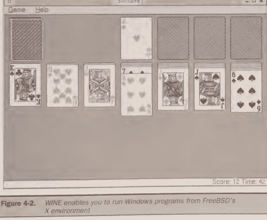

图 4-2. WINE 使你能在 FreeBSD 的 X 环境中运行 Windows 程序

#### 使用模拟器

如前所述，缩写词 WINE 代表两个相互矛盾的概念：*Windows 模拟器* 和 *WINE 不是一个模拟器*（WINE Is Not an Emulator）。这种情况之所以发生，是因为“模拟器”这个词对不同的人意味着不同的东西。对一些人来说，模拟器是指任何允许你在另一个操作系统上运行某一操作系统程序的程序。对另一些人来说，模拟器需要执行低级别的硬件模拟。在大多数人眼中，FreeBSD 的 Linux 兼容性不是模拟（尽管它在 FreeBSD 软件包列表中归类为模拟器），而 WINE 则是处于边缘地带的工具。然而，无论你如何对这些工具进行分类，FreeBSD 确实支持更明确的模拟器软件包。`sysinstall` 中的模拟软件（Emulators）软件包列表提供了许多此类软件包。

FreeBSD 中可用的许多模拟器服务于专用功能。这些工具模拟游戏控制台或晦涩的旧计算机，例如 Commodore 64。如果你怀念这些系统，你可能想研究这些模拟器。你甚至可能有实际的需要来运行这样的工具。

还有一些其他模拟器更为严肃。它们使你能在由 FreeBSD 管理的模拟计算机中运行整个现代操作系统。例如，VMware（[http://www.vmware.com](http://www.vmware.com)）设置了一个模拟的 x86 计算机，你可以在其中运行 DOS、大多数版本的 Windows、Linux、FreeBSD 或各种其他操作系统。VMware 在此任务上表现卓越，但在性能上有一定代价——模拟操作系统显得迟钝，特别是在视频操作上。尽管如此，如果你的目标是运行 Windows 程序，其兼容性比 WINE 好得多。

VMware 实际上不是一个 FreeBSD 程序；它是一个 Linux 程序。因此，你必须使用 FreeBSD 的 Linux 兼容模式运行 VMware。`sysinstall` 模拟软件包部分中提供的 VMware 软件包有助于设置 VMware 以与此模式配合工作，但它只设置程序的演示版本。要在演示期结束后继续使用该程序，你必须从 VMware 购买许可证。

## 总结

实际上，FreeBSD 系统经常需要与其他操作系统共存。在某些情况下，你可能只需要偶尔从 DOS 软盘、ISO-9660 CD-ROM 或类似介质读取文件。在其他情况下，FreeBSD 与另一个操作系统双启动，这要求配置系统以根据命令启动任一操作系统。你可能还需要一种在操作系统之间交换大文件的可靠方法。在其他情况下，你可能需要在你的 FreeBSD 系统上运行非 FreeBSD 程序。幸运的是，FreeBSD 包含了执行所有这些任务机制。FreeBSD 对 DOS 和 Windows 使用的 FAT 文件系统提供了出色的支持，并且大多数非 Microsoft 操作系统也对其给予了同等良好的支持。这种支持允许在软盘和硬盘上进行数据交换。FreeBSD 的 Linux 软件兼容性扩展了你的软件选择范围，包括那些已为 Linux 发布但未为 FreeBSD 发布的商业程序。WINE 和全功能模拟器让你能在你的 FreeBSD 系统上运行 Windows 程序，甚至其他操作系统的程序。这些工具可以帮助你从 Windows 工作站过渡到 FreeBSD 工作站，或运行 FreeBSD 上不可用的奇特程序。

# 完整参考

## 第二部分

### 基础系统管理

129

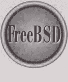


# 第 5 章

## 系统管理工具

本书第二部分专用于*系统管理*——涉及对整个操作系统、其上安装的软件或普通用户账户进行更改的任务。第三、第四和第六部分也描述了管理任务，而第二部分是关于最基础的系统管理任务的介绍。系统管理任务与普通用户任务（如运行文字处理器、执行数据分析或编写普通程序）形成对比。第五部分涵盖了这些主题。

在此背景下，本章可以被视为系统管理入门的入门。它介绍了你执行管理任务时使用的基本工具和文件。本章首先介绍了 `/etc` 目录树，这是大多数管理文件所在的地方。由于大多数 FreeBSD 系统管理都是通过对存储在 `/etc` 中的文本文件进行编辑来完成的，因此了解如何使用至少一个 FreeBSD 文本编辑器至关重要。本章介绍了几种常见的编辑器（`vi` 和 `edite`），并指引你参考其他许多编辑器。你应该熟悉许多基本的系统管理命令，因此本章将介绍它们。这些命令可以告诉你关于系统的重要信息，或者让你修改一般系统参数。最后，本章简要介绍图形用户界面（GUI）管理工具。在 Unix 世界中，这类工具传统上备受轻视，但在某些情况下它们非常有用，例如当经验不足的人员需要能够执行有限的系统管理时。

### /etc 目录及其内容

FreeBSD 鼓励程序在文件放置上遵循某些约定，当然，随 FreeBSD 提供的绝大多数程序都遵循这些标准。（第 7 章中“理解 FHS”一节更详细地涵盖了这些约定。）其中一项约定是系统配置文件驻留在 `/etc` 目录树中。在许多情况下，程序以其自身名称命名其配置文件，或创建以其自身名称命名的目录，在其中存储多个配置文件。然而，`/etc` 中的其他配置文件并不与特定程序绑定，或者以特殊方式命名。无论其名称如何，你很可能在 `/etc` 中发现的文件都在本节中涵盖，至少是概括性的。你会发现 `/etc` 中有很多文件这里没有明确提及，因为你安装了书中未描述的软件，或者因为这些文件的作用相对次要。

> **注意** 并非所有程序都将配置文件放在 `/etc` 中。有些程序根本不使用配置文件。其他程序将文件放在非标准位置。一些配置文件可以在 `/usr/local/etc` 中找到，而不是 `/etc`。还有更多程序完全依赖用户特定的配置文件，这些文件位于用户的家庭目录中。此类文件通常是点文件（其名称以点开头，以在使用 `ls` 时隐藏它们），以程序自身命名。

本讨论将 `/etc` 配置文件分为三类：系统启动文件，控制 FreeBSD 在核心加载后的启动过程；服务器配置文件，控制各种服务器的运行；以及杂项配置文件，控制用户程序或一般系统设置。

### 系统启动文件


# 第 3 章

第 3 章包含了 FreeBSD 启动过程的描述。如前所述，计算机经历几个步骤，从运行 BIOS 中的代码开始，接着是引导加载程序，然后启动 FreeBSD 内核。内核随后启动 `/sbin/init` 程序，该程序控制 FreeBSD 启动过程——即在 FreeBSD 下运行的进程，而非内核启动前运行的进程。在 FreeBSD（以及许多操作系统）中，一个程序必须由另一个程序启动。启动第二个程序的程序被称为该第二个程序的父进程，而第二个程序是第一个程序的子进程。正在运行的程序通常被称为进程，每个进程都有一个唯一的进程 ID（`PID`），这是一个与进程关联的数字。创建新进程通常被称为生成（`spawning`）。父进程、子进程、`PID` 等之间的关系与系统启动文件有关，因为 `init` 进程是所有进程的父进程（或更遥远的祖先）。内核启动时运行 `init`，而 `init` 的配置文件是 `/etc/rc`。（实际上，`/etc/rc` 是一个 shell 脚本——`init` 生成 `/bin/sh` shell 来运行 `/etc/rc` 脚本。）因此，`/etc/rc` 控制启动过程。该脚本控制系统启动时运行哪些进程。如果你更改 `/etc/rc` 或其依赖的文件，你可以更改 FreeBSD 的行为。

**注意**

_FreeBSD 使用的启动方案通常被称为 BSD 启动方法。其他一些类 UNIX 操作系统，如大多数 Linux 发行版，使用完全不同的启动系统，称为 SysV 启动脚本。BSD 方法使用少数几个大型脚本，而 SysV 方法使用许多小型脚本。SysV 还支持一种称为运行级别（`run levels`）的功能；每个编号的运行级别支持独特的运行服务器和其他进程集合。BSD 启动方法，因此 FreeBSD，不支持此功能。_

`/etc/rc` 脚本执行许多任务，例如如果磁盘未正确关闭则检查磁盘、清理 `/var` 目录树中的旧文件以及激活交换空间。它通过调用 `/etc` 中以 `rc` 开头的其他脚本来委派许多其他任务，例如 `rc.serial` 和 `rc.network`。这些文件共同控制 FreeBSD 启动过程——它们是主要的启动配置文件。这些 BSD 启动脚本确实只是脚本。因此，如果你想对系统配置进行任何非琐碎的更改，对 shell 脚本编写的了解（如第 31 章所述）会有所帮助。即使不理解 shell 脚本编写，如果你明白你想要进行的更改性质，你可能能够通过定位设置你想要调整选项的程序的调用并更改该调用来完成这些更改。（在此上下文中，*调用*是指导致程序运行的程序引用。它可能只是脚本中某行上的程序名称。）

> **警告**
>
> *修改 FreeBSD 启动脚本是一项可能有风险的行动。如果你出错，计算机可能根本无法启动。更糟糕的是，你可能直到几天、几周甚至几个月后才发现自己犯了错误。如果在做出更改后立即重新启动了计算机，我建议在修改任何系统启动脚本之前先对其进行备份，并在做出更改后立即重新启动。如果系统随后无法启动，你可以使用紧急系统恢复原始文件或再次尝试。*

你可能会编辑另外两个文件或文件类来改变启动例程：`/etc/rc.local` 脚本和 `/usr/local/etc/rc.d` 目录中的脚本。两者都设计为接受自定义，但后者是 FreeBSD 较新版本中的首选工具。第 6 章更详细地描述了自定义这些脚本。

> **注意**
>
> */etc/rc.local 文件和 /usr/local 目录名都包含单词 local。这个词指的是其中引用或包含的程序或文件的系统特定性质，与大多数 FreeBSD 系统中可以找到标准工具形成对比。*

## 服务器配置文件

在 `/etc` 中发现的第二类配置文件是与特定服务器相关的文件。本书随后的章节，特别是第四部分，更详细地涵盖了许多这些文件。作为一个快速介绍，并让你知道其中一些文件是什么，以下是几个更重要的服务器配置文件和目录：

- **X 文件** `/etc/XF86Config` 文件和 `/etc/X11` 目录控制 XFree86 X 服务器及相关程序，例如 X 显示管理器（`XDM`）图形登录程序。第 13 章更详细地涵盖了 `XF86Config` 文件。

- **Apache 文件** `/usr/local/etc/apache` 目录包含用于配置流行的 Apache Web 服务器的文件。最重要的是，`httpd.conf` 是主配置文件；目录中的其他文件是支持文件。第 20 章涵盖了 Apache 配置的基础知识。

- **`/etc/exports`** 此文件指定 FreeBSD 要通过网络文件系统（`NFS`）服务器使可用的目录，如第 18 章所述。

- **TCP Wrappers 文件** TCP Wrappers 程序是一个重要的安全包，被许多服务器使用。它使用 `/etc/hosts.allow` 和 `/etc/hosts.deny` 配置文件。第 29 章描述了这个包。

- **主机访问文件**：`/etc/hosts.equiv` 文件被多个服务器使用，用于指定可以访问本地服务器的远程计算机。`/etc/hosts.lpd` 文件具有类似的功能，但仅适用于标准的 FreeBSD 打印服务器。

- **`/etc/inetd.conf`**：此文件极其重要，因为它控制着 `inetd`，即标准的 FreeBSD **超级**（`super`）服务器。该程序代表其他多个服务器，仅在需要时才启动相应的目标服务器。当计算机运行许多很少使用的服务器时，这种配置可以减少内存消耗，并且 `inetd` 可以使用 TCP Wrappers 为其控制的所有服务器提供某种统一的访问控制机制。第 16 章的“使用超级服务器”部分介绍了 `inetd.conf` 的配置。

- **`/etc/mail`**：此目录包含 `sendmail`（标准的 FreeBSD 简单邮件传输协议（`SMTP`）服务器）的各种配置和控制文件。`/etc/mail/sendmail.cf` 文件是 `sendmail` 的主控文件，但它是根据 `/etc/mail/FreeBSD.mc` 文件生成的，如第 19 章所述。

- **`/usr/local/etc/smb.conf`**：此文件配置 Samba，即用于 Microsoft Windows 客户端的文件和打印服务器。默认的 Samba 安装会创建一个名为 `/usr/local/etc/smb.conf.default` 的文件。如果你想使用 Samba，应该将此文件复制到 `/usr/local/etc/smb.conf` 并按第 18 章所述进行修改。

- **SSH 文件**：Secure Shell（`SSH`）包提供加密的远程登录功能。`/etc/ssh` 目录包含用于配置 SSH 客户端（`ssh_config`）和服务器（`sshd_config`）的文件。

该列表并不完整；FreeBSD 有许多服务器，而本书甚至无法提及其中的一部分。如果你安装了本书未描述的服务器，它可能在 `/etc` 或 `/usr/local/etc` 中拥有一个此处未描述的配置文件。请查阅该服务器的文档以获取详细信息。此外，本列表包含的服务器配置文件可能在你的计算机上不存在，因为相关服务器可能未安装。如果你希望运行此类服务器，请查阅第 11 章以获取相关信息。

除了此处提到的服务器配置文件外，大多数服务器还需要一种启动方式。通常可以通过将文件添加到 `/etc/rc.d` 来实现，如前文“系统启动文件”所述，或者通过向 `/etc/inetd.conf` 添加条目来实现，如第 16 章所述。

## 杂项配置文件

一些配置文件与启动脚本或特定服务器相关，正如前面所述。其他文件则设置通用系统参数，或与特定服务器或启动程序的关系较松散。其中一些文件此前已提及，例如 TCP Wrappers 配置文件。本节介绍其他几个重要的配置文件。包括：

- **/etc/crontab**：FreeBSD 附带一个名为 `crontab` 的工具，用于在预定时间运行程序。这些被称为 *cron 作业*（`cron jobs`）的任务，允许你配置系统自动执行常规维护任务，如第 28 章所述。`/etc/crontab` 文件控制系统 `cron` 作业。其格式在第 6 章中有说明。

- **/etc/dhclient.conf**：一些计算机使用动态主机配置协议（`DHCP`）客户端程序 `dhclient` 从 DHCP 服务器自动获取 IP 地址及相关网络信息。`dhclient` 的配置文件是 `/etc/dhclient.conf`。通常可以保留默认设置，但在某些网络上可能需要在此文件中设置选项。第 14 章涵盖了此主题。

- **/etc/fstab**：此文件对分区和文件系统管理至关重要。其名称是 *filesystem table*（文件系统表）的缩写；该文件包含分区信息、它们使用的文件系统以及在 FreeBSD 目录树中应挂载的位置。第 7 章更详细地介绍了此主题。


- `/etc/printcap`：FreeBSD 的打印机处理依赖于一个 *打印机能力*（printer capabilities）文件，称为 `/etc/printcap`。此文件列出了打印机、FreeBSD 用于连接它们的硬件或远程计算机、FreeBSD 用于处理发送到它们的文件的软件等。第 7 章更详细地介绍了此主题。
- `/etc/resolv.conf`：此文件告诉 FreeBSD 使用哪些名称服务器将 Internet 主机名转换为 IP 地址。第 14 章更详细地描述了此文件。
- **用户和组文件**：`/etc/passwd`、`/etc/master.passwd` 和 `/etc/group` 文件保存用户账户和组的信息。在对用户账户进行更改时，你需要编辑其中一个或多个文件，如第 10 章所述。（通常最好使用专用工具来进行这些更改，而不是直接用文本编辑器编辑文件。）

与本章节中的其他配置文件列表一样，此列表也不完整。这些文件中的某些可能不存在或未在你的系统上使用，但大多数文件在大多数系统上都是存在的。对于特定配置，其他文件可能也很重要。

### FreeBSD 文本编辑器概览

在你能够编辑配置文件以让系统按你想要的方式工作之前，你必须能够一般性地编辑文件。因此，本节介绍了 FreeBSD 的一些文本编辑器选项，包括两个编辑器的示例会话。

## 第 5 章：系统管理工具

文本编辑器可以有多种不同的分类方式。最根本的区别之一是文本模式文本编辑器和 GUI 文本编辑器之间的差异。即使你更喜欢在 GUI 环境中工作，你也应该熟悉至少一个文本模式文本编辑器，因为在紧急恢复情况下你很可能不得不使用此类编辑器。有些人即使在 GUI 环境中也倾向于使用文本模式文本编辑器。

**注意**：

*文本编辑器与文字处理软件不同。前者编辑具有最小格式和没有特殊字体的纯文本文件。文本编辑器通常用于编辑配置文件、纯文本文档等。文字处理软件通常用于生成旨在打印或需要特殊排版的输出。不过，你可以使用文本编辑器配合 TeX 等格式化工包来完成文字处理软件的工作，有些人更喜欢这种方法而非使用文字处理软件。如果你想了解 FreeBSD 中的文字处理，请查阅第 25 章。*

### 文本模式文本编辑器

从某种意义上说，文本模式文本编辑器是最灵活的一类，因为它们既可以在纯文本环境中运行，也可以在 GUI 环境的 xterm 窗口中运行。因此，理论上你只需学习一个编辑器即可在 FreeBSD 中完成所有的文本编辑工作。但实际上，你很可能需要对多个编辑器至少有初步的了解，因为某个编辑器可能被设置为某些操作的默认编辑器，或者包含在紧急恢复系统中。

文本模式文本编辑器的范围相当广泛，但最流行的编辑器包括：

- **vi**：此编辑器的历史可追溯到 UNIX 早期。它使用一种不寻常的三模式用户界面，有些人觉得这令人困惑。尽管有其特殊性，vi 仍然是一个流行的编辑器。其简单性隐藏了极大的灵活性，因此多年来它保留了一批忠实的追随者。vi 还是一个小型工具，这使其成为许多紧急恢复系统中的绝佳选择。基于这些原因，即将到来的章节“示例：使用 vi 编辑文件”将更详细地描述 vi 的使用。vi 实际上是一个由类似编辑器组成的小型家族，包括 Vim 和 Elvis 等变体。但在本书描述的层面上，这些编辑器基本上是完全相同的。
- **Emacs**：在许多方面，Emacs 和 vi 是截然对立的。vi 的简洁和小巧与 Emacs 的复杂和庞大形成了鲜明对比。UNIX 世界的一个标准笑话是：UNIX 是一个程序启动器，而 Emacs 是操作系统——以及其他所有东西。除了作为文本编辑器，Emacs 还可以充当编程的集成开发环境（IDE）、Usenet 新闻阅读器、邮件阅读器、网页浏览器等等。Emacs 既提供其原始形式，也提供变体项目 XEmacs。Emacs 是一个非常流行的编辑器，但为了控制本书的篇幅，这里不详细介绍。

#### 精简版 Emacs 克隆

喜欢 Emacs 但希望在紧急磁盘等环境中使用更轻量级编辑器的用户，可以选择几种不同的精简版 Emacs 克隆程序。这些程序包括 `jed`、`joe`、`jove` 和 `uemacs`（又称 micro-Emacs）。FreeBSD 包含了许多这样的工具，因此，如果你不喜欢 vi 但需要一个小型文本模式编辑器，你可以加载这些编辑器中的一个或多个，以替代 vi 或在 vi 之外同时使用。

#### 简易编辑器

这是一个在 FreeBSD 安装过程中编辑文件时使用的小型编辑器。第 2 章简要介绍了该编辑器的使用方法。你可以通过输入 `ee` 来运行它，后面可跟你想编辑的文件名。

此编辑器列表并非旨在全面详尽。多年来，已开发了许多文本模式文本编辑器。如果你不喜欢这里描述的任何编辑器，你可以使用 sysinstall 工具浏览“编辑器”软件包部分，并尝试几种不同的编辑器。请注意，该部分包含文本模式和图形用户界面（GUI）编辑器，以及附加软件包等，因此哪些软件包是适合你尝试的编辑器可能并不显而易见。

虽然它们不是编辑器，但有一类额外的程序值得一提：分页器（pagers）。这些程序一次显示文本文件的一页。最初的 UNIX 分页器被称为 `more`，它仍然是 FreeBSD 的标准组成部分。事实上，`man` 程序（将在后续章节“man”中描述）默认使用 `more` 作为其分页器。多年来，`more` 的局限性已显现出来，出于一种幽默的巧合，一个改进版本以 `less` 的名称发布。

要使用分页器，请输入分页器名称，后跟你要查看的文件名——例如 `less file.txt`。文件应该会显示出来。按空格键可逐页浏览文档，或使用方向键逐行移动。按 ESC 键后按小于号（`<`）可移动到文件开头，按 ESC 键后按大于号（`>`）可移动到文件末尾（对于 `more`，此操作还会退出程序）。你可以通过输入斜杠（`/`）并紧接你要搜索的文本来进行搜索。这些分页器，特别是 `less`，支持多种其他功能。你可能需要查阅它们的 man 页面（通过输入 `man more` 和 `man less`）以了解更多关于它们的信息。

### 图形用户界面文本编辑器

特别是如果你从 Windows 或 Mac OS 环境转到 FreeBSD，你很可能会习惯使用 GUI 文本编辑器。你在 FreeBSD 中也会找到丰富的 GUI 文本编辑器选择，因此如果你喜欢 GUI 文本编辑器，你很可能会找到一种适合你工作风格的编辑器。此类编辑器的示例包括以下内容：

- **Emacs**：Emacs 的众多功能之一是对基于 X 操作的支持。传统 Emacs 包含的 X 支持相对有限，尽管这种支持随着每个新版本的发布而不断增加。Emacs 可以在单独的 X 窗口中运行，并提供一些菜单等，但它并没有完全集成到 X 中。XEmacs 的功能之一是增强的 X 集成，因此如果你喜欢 Emacs 但希望使用基于 X 的编辑器，你可能想要研究一下 XEmacs。（XEmacs 也可以以文本模式运行。）
- **NEdit**：这款由 http://Nedit.ORG 提供的编辑器旨在为熟悉 Windows 或 Mac OS GUI 编辑器的用户提供舒适的使用体验。虽然它不如 Emacs 功能强大，但它包含许多功能，因此可用作程序员编辑器或其他密集型文本编辑任务。
- **gEdit**：这款文本编辑器是 GNU 网络对象模型环境（GNOME）的标准组成部分，因此如果你将 GNOME 运行作为默认环境，可以很容易地从 GNOME 菜单中访问它。它是一个功能强大但相对基础的编辑器。由于它在许多默认 GNOME 安装中易于获取，它是后续章节“示例：使用 gEdit 编辑文件”中详细描述的那款编辑器。
- **xedit**：*xedit* 编辑器是一个相对简单的基于 X 的文本编辑器。它缺乏 Emacs 或 NEdit 的许多高级功能，但它相对较小，如果你运行的是一个精简版的 FreeBSD 系统且包含 X，它可以是一个不错的选择。

与基于文本的编辑器一样，此列表并不完整；它旨在仅提供一些指引。一些基于文本的编辑器，包括一些 vi 和精简版 Emacs 克隆，包含 X 扩展，但其中大多数范围有限——它们可能会打开一个单独的窗口并提供菜单栏，但并非总是充分利用 X、对话框、字体等。你可以从系统中的“编辑器”软件包菜单中找到相当数量的基于 X 的编辑器，或者你也可以尝试网络搜索以找到其他编辑器。

### 示例：使用 vi 编辑文件

vi 编辑器功能非常强大，但如前所述，以今天的标准来看，它也有点独特。特别是，vi 使用三种独立的操作模式。编辑器会根据其所处的模式对相同的按键做出不同的反应，因此理解这些模式非常重要。话虽如此，vi 支持与其他任何文本编辑器相同的一般操作类型——输入文本、删除文本、粘贴文本等。本节介绍了一些这些命令，但这远不是对 vi 功能的详尽回顾——特别是其更高级的功能。最后，任何文本编辑器如果无法保存文件都是毫无用处的，而 vi 当然提供了这种功能。

#### 使用 vi 模式

vi 的三种操作模式将编辑器的功能进行细分；大多数功能仅在一种模式下可用。这三种模式是：


### 命令模式
此模式允许你输入命令以操纵文本或执行其他操作。大多数命令都是单个字符。例如，`o` 在当前行下方打开一行。你还可以使用键盘的方向键在命令模式中在文件内移动。

### Ex 模式
此模式专门用于涉及外部文件的扩展操作。归根结底，`ex` 模式是 `vi` 灵活性的关键，因为它允许你运行外部程序来对文件进行有趣的操作，例如执行拼写检查或按标准方式格式化源代码文件。你还使用 `ex` 模式来保存文件，如后续章节“保存你的更改”中所述。要在命令模式中使用 `ex` 模式，请键入冒号（`:`）和 `ex` 模式命令。

### 编辑模式
这是与其他大多数文本编辑器最相似的模式。在此模式下，`vi` 将你输入的大多数字符放入你的文档中。对此规则的一个重要例外是 `ESC` 键，它将你返回到命令模式。

> **提示**
> 如果你不确定自己处于哪种模式，请按 `ESC`。这样做将确保你处于命令模式。

这些描述可能显得有些抽象。通过这些模式的区分，通过一个使用所有三种模式的示例编辑会话，这些区别应该变得清晰。

## 编辑文件

在使用 `vi` 编辑文件之前，你需要有一个要编辑的文件。原则上，你可以使用任何文件。此示例使用 `/etc/fstab` 文件，FreeBSD 使用它将分区映射到 FreeBSD 目录树中的目录。如果你跟随操作，你将在此文件中添加几个条目并删除另一个条目。在“现实生活”中，你可能这样做以使新的文件系统或可移动磁盘设备可用，或使当前分区不可访问。由于这是一个示例，你应该首先制作该文件的副本，以便在副本上工作。在你的主目录中，输入：

```bash
$ cp /etc/fstab ./fstab-copy
```

> **注意**
> 不要为这个示例编辑你真实的 `/etc/fstab` 文件。这样做可能会导致你的 FreeBSD 系统无法启动。将 `/etc/fstab` 复制到你的主目录并编辑副本。你作为普通（非 root）用户执行此操作也是应该的，以降低你错误地编辑真实文件并保存更改的可能性。

处理好这个初步步骤后，你可以开始你的编辑会话：

1. 通过输入 `vi fstab-copy` 启动 `vi` 并将 `fstab-copy` 加载到你的 `vi` 缓冲区中。图 5-1 显示了我的系统上从 GNOME 终端窗口运行 `vi` 的结果。如果你在其他类型的 xterm 中运行，边框、字体等会有所不同，如果你在文本模式下运行，你只会看到文本。沿着显示左侧向下延伸的波浪号（`~`）是 `vi` 表示文件结束标记的方式。

表示文件的结尾。最后一行显示状态信息。当然，您的 `/etc/fstab` 文件很可能与图 5-1 中的完全不像，但这并不重要，因为此过程仅仅是向您展示如何编辑文件中的文本。

2. 假设您想删除文件中的其中一个条目。为了演示目的，假设是 `/windows` 目录的条目。按 **向下箭头** 七次将光标移动到该行。光标应停留在以 `/dev/ad6s1` 开头的行上。

3. 删除文本的命令在命令模式下输入，而 `vi` 启动时正处于此模式。该命令为 `dd`，因此输入 `dd`，即可看到光标所在的行消失。如果您想删除多行，可以在 `dd` 前加上要删除的行数，例如输入 `3dd` 来删除三行。

4. 现在假设您想在刚才删除的行位置输入一个新行。首先打开一个空白行。通过在命令模式下输入 `o` 来完成此操作。光标所在行下方的行应向下移动，并且光标应随之移动。

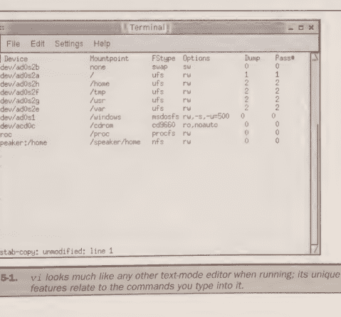

5. 要输入新行，必须使用编辑模式。您在上一步骤中输入的 `o` 命令实际上已使您进入编辑模式。如果需要从命令模式进入编辑模式，可以输入 `i` 来完成。此命令进入编辑模式并配置 `vi` 以启用文本插入。如果您打算替换现有文本，则可能更喜欢输入 `R`。输入 `a` 将进入编辑模式并将光标向前移动一个空格。

6. 输入一个新行，例如

```
/dev/da0s4 /zip msdosfs rw,noauto 0 0
```

7. 按 `ESC` 键返回命令模式。

8. 现在，假设您想创建一个刚才输入的行的变体，以便让 FreeBSD 挂载使用 FFS 而不是 FAT 的 Zip 磁盘。您可以从输入 `yy` 开始。这是提取（yank）命令，用于将文本复制到内部缓冲区。输入 `yy` 会提取一行文本，而在该字符串前加上数字（例如 `4yy`）则会提取多行文本。

9. 输入 `p`。此命令从提取缓冲区粘贴文本。此时您应该有两行相同的新行。

10. 使用方向键将光标定位到其中一行 `/zip` 后面的空格处。

11. 输入 `R` 以进入编辑模式，此时 `vi` 被配置为替换文本。

12. 输入 `-ffs`，将 `/zip` 更改为 `/zip-ffs`。

13. 按 `ESC` 键返回命令模式，然后按方向键将光标定位到您刚修改的那行中 `msdosfs` 里的 `m` 上。

14. 输入 `R` 以进入编辑模式，此时 `vi` 被配置为替换文本。

15. 输入 `ufs` 和四个空格，用 `ufs` 替换 `msdosfs`。

至此，您已用两行处理 Zip 磁盘的行替换了原始的 `/windows` 行。其他行应保持未更改。您可能希望进一步试用 `vi`，复制、删除和编辑现有行以及创建新行。您可能还想试用一些额外的功能：

- **撤销** `vi` 支持撤销功能。在命令模式下，输入 `u` 以撤销您所做的最后一次更改。`vi` 仅支持一级撤销，因此连续两次输入 `u` 将撤销撤销操作。

- **搜索** 在命令模式下，斜杠字符（`/`）启动搜索。例如，从图 5-1 中文件接近开始的位置，您可以输入 `/cd9660` 然后按 `ENTER`，以将光标定位到 `cd9660` 中的 `c` 上。问号（`?`）启动反向搜索，而不是向前搜索。

- **替换** 如果您想用另一种文本替换某些文本的所有实例，可以使用全局替换功能。为此，在命令模式下输入 `:%s/原文/替换文本`，其中 *原文* 是原始文本，*替换文本* 是新文本，然后按 `ENTER`。

有关更多 `vi` 命令的信息，请查阅 `vi` 文档。`vi` 增强版（`vi` Improved）网页 `http://www.vim.org` 是一个很好的信息来源。如果您发现自己广泛使用 `vi`，甚至可以考虑购买一本关于该编辑器的书。

## 保存您的更改

在退出 `vi` 之前，您应该知道它如何处理保存更改。您可能需要使用几个 `ex` 模式命令来操作文件并退出程序：

- **`:w`** 此命令写入您所做的更改。如果您在没有其他选项的情况下发出此命令，它将使用文件最初读取时所用的文件名来写入更改。不过，如果您更喜欢将更改写入新文件，可以添加该文件名，例如输入 `:t new-file.txt` 可将更改保存为 `new-file.txt`。

- **`:e`** 如果您在启动 `vi` 时未指定文件名，或者如果您想编辑一个新文件，此命令使您可以编辑新文件。例如，`:e /etc/printcap` 将 `/etc/printcap` 文件加载到 `vi` 中。不过，一次只能编辑一个文件，您可能需要提供稍后描述的覆盖选项，以便丢弃当前正在编辑的文件而选择一个新文件。

- **`:r`** 此命令的作用与 `:e` 类似，但它不是用新文件替换现有文件，而是将两个文件合并到第一个文件的文件名下。如果您需要将两个文件合并为一个，此命令非常有用。

- **`:q`** 此命令退出 `vi`。

您可以将这些命令中的两个或多个组合为一个命令。一个常见的例子是 `:wq`，它保存当前文件然后退出。

有时，您需要提供覆盖开关才能让 `vi` 放弃您所做的更改。如果您未保存对当前文件所做的任何更改，这在 `:e` 和 `:q` 命令中尤为常见。覆盖开关是感叹号（`!`），因此，例如，您可以输入 `:q!` 以不保存所做的更改而退出。如果您发现更改搞得一团糟，或者意识到您正在编辑错误的文件，就可以这样做。

## 示例：使用 gEdit 编辑文件

虽然文本模式编辑器完全有能力编辑所有基于文本的 FreeBSD 配置文件，但有些人更喜欢使用 GUI 文本编辑器。它们通常能让您更好地控制屏幕字体、颜色等，并且带有命令选项的菜单栏使得确定如何执行某些任务更容易。尽管每个 GUI 文本编辑器都不同，但 `gEdit` 程序是这类编辑器中相当典型的代表，并且在许多 FreeBSD 系统上唾手可得，因此我在这里描述其操作。

### 编辑文件

与前面使用 `vi` 的示例一样，此示例编辑 `/etc/fstab` 文件的一个副本。您应该使用以下命令将其复制到您的主目录：

```
$ cp /etc/fstab ./fstab-copy
```

> **注意** 请勿在此示例中编辑真实的 `/etc/fstab` 文件。这样做可能会导致您的 FreeBSD 系统无法启动。将 `/etc/fstab` 复制到您的主目录并编辑该副本。您还应该以普通（非 root）用户身份执行此操作，以降低误编辑真实文件并保存更改的可能性。

如果 X 尚未运行，您还必须按第 3 章中的描述启动 X。然后您可以按以下步骤开始编辑过程：


打开一个 `xterm` 窗口并输入 `gedit fstab-copy` 以开始编辑文件。结果应是一个类似于图 5-2 中所示的窗口。与使用 `vi` 的示例一样，文件的确切内容可能与图 5-2 中显示的不同，但这对于此示例并不重要。

假设您想从此文件中删除一个条目，例如图 5-2 中的 `/windows` 条目。您有几种方法可以做到。大多数方法涉及选中该行然后删除它。您可以通过用鼠标点击并拖拽来选中一行，或者用鼠标或方向键将光标定位在行首，然后按住 `SHIFT` 键并按下方向键。

要删除选定的行，请点击按钮栏中的“剪切”，从菜单中选择“编辑 | 剪切”，按 `CTRL-X`，或者按键盘上的 `DELETE` 或 `BACKSPACE`。`/windows` 行应会消失。如果此时有一个空白行，您可以将光标定位在该行上并按 `BACKSPACE` 键将其移除。

现在假设您想添加一个新行。您可以将光标定位在您要修改的行首，输入一个新行，例如以下各行，并按 `ENTER` 键将其与下一行隔开：

| `/dev/da0s4` | `/zip` | `msdosfs` | `rw,noauto` | 0 | 0 |
|---|---|---|---|---|---|

现在假设您想创建此行的一个变体，使 FreeBSD 能够挂载使用 FreeBSD 的 FFS 格式化的 Zip 磁盘。您可以从将刚输入的行复制到 `gEdit` 剪贴板开始。通过选中该行（如步骤 2 中所示）并点击“复制”，从菜单栏中选择“编辑 | 复制”，或按 `CTRL-C` 来执行此操作。

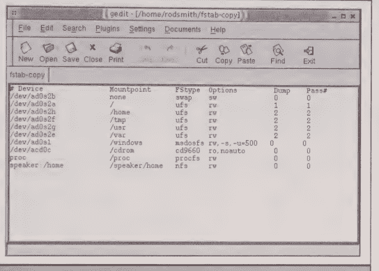

图 5-2. `gEdit` 编辑器是图形用户界面（GUI）文本编辑器的典型代表，拥有菜单栏和其他可点击选项。

- 将光标定位到另一行的开头，点击**粘贴**按钮，选择*编辑* | *粘贴*，或按*CTRL*-*V*。结果应该是你在步骤 4 中输入的那行的副本。具体取决于你选择该行的方式，你可能需要按*ENTER* 键将其与你定位光标的行隔开。

- 使用鼠标或键盘的**方向**键将光标定位到 `/zip` 的末尾。

- 键入 **-ffs** 将 `/zip` 更改为 `/zip-ffs`。你可能需要按 *DELETE* 键四次以删除四个空格，保持列对齐。

- 双击新行中的字符串 **mdosfs**。这样做应该会高亮显示该字符串。

- 键入 **uf s**，它应该会替换 **mdosfs** 为 **uf s**。你可能需要按空格键四次以保持其余列对齐。

要保存你的更改，点击保存，从菜单栏中选择文件 | 保存，或按 `CTRL-S`。或者，要将文件另存为新名称，选择文件 | 另存为。此操作会打开一个对话框，你可以在其中输入文件的新名称。

当你完全编辑完文件后，可以通过点击退出按钮、选择文件 | 退出或输入 `CTRL-Q` 来退出编辑器。如果此时 `gEdit` 注意到有任何未保存更改的打开文件，它会询问你是否要保存这些更改。

### 附加 gEdit 功能

你可能想进一步尝试 `gEdit`。其选项可通过菜单栏访问，且大多数都有清晰的标签。一些你可能想要了解的具体功能包括：

- **撤销** 选择编辑 | 撤销或按 `CTRL-Z` 会激活 `gEdit` 的撤销功能，这样你就可以回退错误的更改。你可以执行此操作多次，回退一串更改。

- **查找** 点击查找 | 查找或按 `F6` 会显示图 5-3 中所示的查找对话框。你可以在“查找内容”字段中输入搜索短语，从各种选项中进行选择，然后点击查找。要重复搜索，选择查找 | 再次查找或按 `SHIFT-F6`。

- **替换** `gEdit` 的搜索和替换功能工作方式与搜索功能非常相似。选择查找 | 替换或按 `F7` 会显示替换对话框，其外观与图 5-3 中的查找对话框非常相似，除了它有一个额外的“替换为”字段和两个额外的按钮：替换和全部替换。

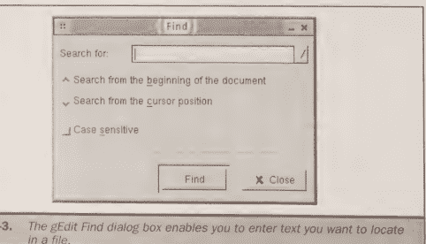

**图 5-3。** *`gEdit` 查找对话框允许你输入要在文件中定位的文本。*

这些按钮分别允许你将“查找内容”文本的单次出现或所有出现替换为“替换为”文本。

- **首选项** 选择设置 | 首选项以打开首选项对话框，其中包含多个标签页，你可以在其中设置各种默认行为。例如，你可以设置 `gEdit` 的字体和颜色，并告诉它是否自动缩进文本。

与 `vi` 不同，`gEdit` 能够同时编辑多个文件。如果你选择文件 | 打开或按 `F3`，`gEdit` 会显示一个文件选择对话框，你可以使用它来定位新文件。当你打开它时，新文件的选项卡会出现——图 5-2 只显示了一个选项卡，`fstab-copy`，但当打开多个文件时，每个文件都有自己的选项卡。你可以点击选项卡在文件之间切换。

## 重要管理命令总结

传统的 FreeBSD 管理既涉及编辑文本文件，也涉及发出文本模式命令。接下来的许多章节将详细描述特定命令，但本节对许多基本但重要的命令进行概述。你可以在文本模式登录或 `xterm` 窗口中输入这些命令。有些命令需要 `root` 权限才能工作，大多数则不需要。这些命令分为两大类：系统信息命令（提供有关系统当前状态或配置的信息）和系统操作命令（改变系统配置）。

虽然不是严格意义上的命令，但与基本命令相关的一个主题是组合命令。这通常通过管道完成，管道是一种链接，其中第一个程序的输出作为输入发送到第二个程序。你可以创建由简单程序组成的长管道以提高其实用性。一个相关的问题是重定向，其中程序的输出发送到文件，或程序将文件的内容作为输入。知道如何使用管道和重定向对于许多管理任务至关重要。

### 系统信息命令

这些命令提供有关计算机运行的信息。它们的信息在故障排除、规划如何安装软件、确定系统可以支持多少额外用户等方面非常有用。

#### dmesg

此命令重放内核消息缓冲区。第 3 章介绍了此缓冲区，以及在启动后使用 `dmesg` 显示其内容的用法。内核将其生成的消息放入其消息缓冲区中。在启动计算机后，此缓冲区可能包含有关硬件设备检测、底层硬件错误消息等的信息。随着系统运行，此缓冲区可能会收集额外的内核消息，这些消息可能与硬件或网络超时、异常程序行为等事件相关。虽然这个描述听起来像是内核消息缓冲区收集了关于严重问题的信息，但许多这些消息实际上描述的是无害事件。例如，如果你的系统配置为将硬盘放入低功耗模式，当硬盘重新加速时，消息缓冲区可能会填满超时消息。无论如何，这些消息最终可能会将原始启动消息挤出缓冲区。

`dmesg` 命令接受很少的选项。其完整语法是：

```
dmesg [-a] [-M core] [-N system]
```

`-a` 选项创建一个更详细的报告，包括控制台和 `syslog` 输出。`-M core` 选项允许你告诉 FreeBSD 分析内核核心，这是在特定类型的严重崩溃中生成的文件。你不太可能会使用此选项。同样，`-N system` 允许你分析另一个系统的内核消息缓冲区。

#### df

`df` 命令报告磁盘空闲空间。如果你计划安装新软件，这可能非常有用，因为它可能会提醒你某个分区几乎已满。此命令的完整语法是：

```
df [-b | -h | -H | -k | -m | -P] [-a|-n] [-t type] [file | filesystem ...]
```

各种选项的含义如下：

- **格式选项** 第一组选项控制用于报告磁盘空间的单位。具体来说，`-b` 代表 512 字节块，`-h` 和 `-H` 代表人类可读输出（分别使用 10 进制或 2 进制解释的千字节、兆字节等单位），`-k` 代表 1,024 字节千字节，`-m` 代表 1,048,576 字节兆字节，`-P` 创建 POSIX 标准输出。

**注意**

> 在计算机领域，大多数度量使用 2 进制倍数，其中千字节是 1,024 字节，兆字节是 1,048,576 字节，等等。硬盘制造商使用 10 进制倍数，其中千字节是 1,000 字节，兆字节是 1,000,000 字节，等等。

- `-a` 此选项使 `df` 显示所有挂载点的信息，即使对于以会导致 `df` 通常忽略它们的选项挂载的文件系统也是如此。

- `-i` 此选项使 `df` 包含有关空闲 `inode` 的信息——`inode` 是内部用于寻址文件的磁盘数据结构。如果磁盘用完 `inode`，即使有大量的空闲空间，它也无法存储更多文件。如果你在磁盘上存储许多小文件，这可能会成为一个问题。

- `-l` 此选项将显示限制在本地文件系统上——即计算机自己的硬盘、CD-ROM 驱动器等等，不包括网络文件系统。

- `-n` 此选项只显示内存中已经可用的信息。通常，`df` 会导致 FreeBSD 查询每个文件系统的当前状态。然而，如果某个文件系统变得不可用，这不起作用。例如，网络问题可能会阻止 `df` 获取网络文件系统上的信息。

- `-t type` 此选项仅显示指定类型的文件系统上的信息。你可以通过用逗号分隔类型来指定多个类型。例如，`df -t ufs,cd9660` 使 `df` 仅显示 FFS 和 ISO-9660 文件系统上的信息。


### file | filesystem

你可以通过列出某些文件系统来限制输出，通过它们的设备文件名（如 `/dev/ad0s2h`）或它们的文件系统挂载点（如 `/home`）。

此命令产生的信息包括文件系统设备、文件系统大小、已用空间、可用空间、容量填充百分比以及文件系统挂载点。例如，以下命令显示了一个系统上的信息，格式化以便人类易于阅读：

```
$ df -h
Filesystem   Size   Used Avail Capacity   Mounted on
/dev/ad0s2a  124M   62M   52M    54%      /
devfs         1.0K  1.0K    0B    100%    /dev
/dev/ad0s2h   1.8G 486M  1.2G    29%      /home
/dev/ad0s2f  145M  31M  103M    23%      /tmp
/dev/ad0s2g   1.6G  1.2G  269M    82%      /usr
/dev/ad0s2e   145M  7.4M  126M     6%      /var
/dev/ad0s1    2.0G 697M  1.3G     34%      /windows
procfs        4.0K  4.0K    0B     100%    /proc
speaker:/home  4.5G  1.7G  2.8G    38%      /speaker:/home
```

此输出揭示根 (`/`) 文件系统大小为 124MB，已用 54%，`/home` 已用 29%，等等。`/speaker:/home` 文件系统是一个网络挂载，如 `speaker:/home` 设备名称所示——这实际上是一个 NFS 挂载规格。`/dev` 和 `/proc` 文件系统是特殊的虚拟文件系统——它们不对应于物理分区或其他设备，而是根据需要动态生成。因此，它们都报告为有 0 字节空闲并不是一个问题。`/usr` 已用 82% 这一点可能更具潜在麻烦，如果需要添加超过 269MB 的新程序时。实际上，通常最好保持 `/usr` 上（或者如果没有单独的 `/usr` 分区，则在根分区上）几兆字节的空闲空间。


#### man

此命令用于进入 FreeBSD 手册系统——即其在线文档。要使用其最简单的形式，你可以键入 `man topic` 来获取关于 `topic` 的信息。(`topic` 可以是一个命令、文件名、系统调用，或其他各种选项。）你还可以使用若干选项来修改 `man` 的行为。其中一个值得尝试的选项是 `-P pager`，它告诉 `man` 使用指定的 `pager` 程序来显示信息。特别是，许多人更倾向于使用 `less` 分页器而不是默认的 `more`，因此键入 `man -P less topic` 可能是可取的。（你还可以在 shell 配置文件中设置 `PAGER` 环境变量，如第 6 章所述，以更改默认的 `man` 分页器。）

#### uptime

`uptime` 命令不接受任何参数。它显示计算机启动时长、已登录用户数量以及他们对 CPU 施加的负载量。在实际操作中，该命令如下所示：

```
$ uptime
4:38PM up 2 days, 5 mins, 5 users, load averages: 0.00, 0.00, 0.00
```

报告的用户数量实际上是正在运行的独立登录会话或 xterm 的数量。在这个特定示例中，只有一个用户登录，但该用户运行了五个 xterm。不过，仅凭 `uptime` 的输出无法知晓这一点。作为 `load averages`（平均负载）报告的三个数字代表了最近三个时间片（过去 1、5 和 15 分钟）内对 CPU 时间的需求。0.00 的数值表示系统 CPU 未承受重负载。1.00 的数值意味着系统 CPU 的平均需求达到了其全部容量。这可能是一个执行非常依赖 CPU 任务的程序，也可能是多个程序，它们对 CPU 的需求均低于其全部处理能力。如果平均负载超过 1.0，FreeBSD 将无法满足所有程序对 CPU 时间的需求。这些程序将继续运行，但它们运行的速度不会像在需求较少的系统中那样快。合理的平均负载值取决于你的硬件和需求。请注意，平均负载数值并不反映 CPU 的速度。一个计算密集型程序单独运行时，无论是在 100 MHz 的 Pentium 系统还是 2 GHz 的 Pentium 4 上，都会产生 1.0 的负载。

#### ps

此命令显示*正在运行*进程的信息。它接受数量庞大的选项——超出了此处总结的范围。欲了解更多信息，请查阅 `ps` 手册页。一些更常用的选项包括

- `-a` 显示所有用户的进程信息。（通常，`ps` 仅提供由发出 `ps` 命令的人员拥有的进程信息。）
- `-h` 重复显示标识输出列的页眉信息，以确保在长输出的每一页中都能看到页眉。
- `-j` 显示每个进程的额外信息。
- `-l` 显示每个进程的额外信息。
- `-m` 按内存使用量对输出进行排序。
- `-p *PID*` 仅显示指定进程 ID（PID）的信息。
- `-r` 按 CPU 使用量对输出进行排序。
- `-U *Username*` 显示由指定 `username` 拥有的进程信息。
- `-u` 显示每个进程的额外信息。
- `-v` 显示每个进程的额外信息。
- `-w` 创建宽（132 列）输出，而不是默认的 80 列显示。如果你有一个宽的 xterm 窗口，或者要将输出通过管道传输到文件以便随后处理或在文本编辑器中阅读，这可能很有用。
- `-x` 显示未与终端关联的进程信息，例如守护进程。

所有常见的 `ps` 输出格式中包含的一条信息是每个进程的进程 ID（PID）。你可以在其他各种命令中使用这个数字，例如 `renice` 和 `kill`（在“nice 和 renice”及“kill 和 killall” upcoming 章节中描述），以修改进程的行为。运行 `ps` 以查找特定进程的 PID 是一种常见做法。

其中几个选项被描述为显示“额外信息”。具体是什么额外信息因选项而异。可能性包括进程的父进程 ID（PPID）、启动时间、各种内存使用度量等。

一个特别有用的变体是 `ps -aux`。此命令显示所有正在运行的进程信息，包括与每个进程关联的用户名、每个进程消耗的 CPU 时间和内存百分比，以及用于启动每个进程的命令。一种常见的做法是通过管道将此命令传输到 `grep`（如在 upcoming 章节“管道”中所述），`grep` 在其输入中搜索指定字符串。这样做可以定位正在运行的程序的所有实例。例如，如果你想要查找所有正在运行的 `more` 分页器实例，你可能会使用此命令：

```
$ ps -aux | grep more
  rodsmith  7445  0.0  0.2  344   55 p3  R+  5:12PM  0:00:02 grep more
  rodsmith  7384  0.0  1.1  1372  245 p2  I+  4:57PM  0:00:08 more
```

> **注意** *此命令除了目标进程（在本例中为 more）之外，通常还会捕获到* `grep` *进程。*

#### top

在某些方面，`top` 是 `ps` 的一个变体。与 `ps` 类似，`top` 列出正在运行的进程，但它以动态方式执行此操作。默认情况下，`top` 按 CPU 时间对进程进行排序。这使得 `top` 成为发现失控进程（即那些陷入无限循环、无意义地消耗 CPU 时间的进程）的极其有用的工具。图 5-4 展示了 `top` 的运行情况。

有多种 `top` 变体可用。例如，GNOME 项目附带一个名为 `gtop` 的版本，它提供了更面向 GUI 的用户界面。这些 GUI 版本的 `top` 提供了与标准基于文本的 `top` 相似的功能，但更习惯使用 GUI 工具的用户可能会发现它们更直观。你甚至可以从其他环境中使用 GUI 版本的 `top`；例如，你可以在 KDE 中或在没有运行桌面环境时使用 `gtop`，尽管当然 X 必须正在运行并且你需要支持的 GNOME 库。

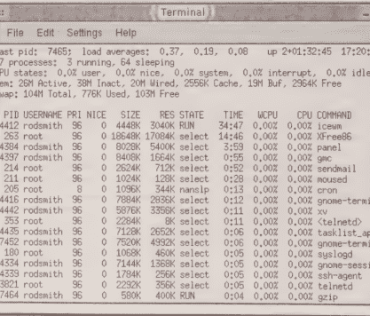

图 5-4. `top` 命令更新其显示，以展示进程对系统需求的随时间变化。

### 系统操作命令

了解关于系统的信息对于诊断问题或规划变更可能很重要，但要实际修复问题或实施变更，你需要能够更改你的系统。本书各章提供了如何操作的相关信息，但有一些杂项的系统操作命令值得在此处关注。

#### nice 和 renice


前面的讨论多次提到了各种程序对 CPU 时间的需求。FreeBSD 内核的工作之一是协调当这些需求发生冲突时的情况。例如，如果用户 `ajones` 和 `bsmith` 都运行依赖 CPU 的程序，谁获得 CPU 时间？通常，FreeBSD 在两个用户之间以 50/50 的比例分配 CPU 时间，因此任何用户的任务都不会被轻视。不过，有时你可能希望改变这种行为，赋予一个任务相对于另一个任务的优先级。这就是 `nice` 命令的作用，它允许你在启动进程时为其分配显式的优先级代码。`renice` 命令与之相关；它允许你在任务启动后调整其优先级。

`nice` 的语法如下

```
nice [-number] command [arguments]
```

`command` 和 `arguments` 是你想要运行的命令以及你想要传递给该命令的任何参数。`number` 是优先级数字。通常，FreeBSD 赋予进程优先级 0。令人困惑的是，较高的优先级（高达 20）会降低任务的优先级，而较低的优先级（低至 -20）会增加任务的优先级。更令人困惑的是，你通过在其前加一个短横线 `-` 来指定优先级数字。因此，要降低进程的优先级，你将其指定为看起来像负数的值：

```
$ nice -15 numbercrunch
```

不过，要增加优先级，你需要使用短横线后跟一个负数，如下所示：

```
# nice --15 numbercrunch
```

你可能会注意到这些示例使用了不同的提示符。这是因为任何用户在启动程序时都可以降低进程的优先级，但只有 `root` 可以增加优先级。如果你不指定优先级，`nice` 假定值为 10。

虽然你可能不会为许多程序使用 `nice`，但对于那些优先级较低但仍消耗大量 CPU 时间的进程，它可能非常有用。例如，如果你运行 SETI@Home 程序（<http://setiathome.ssl.berkeley.edu>），你很可能不希望它消耗你希望用于自己工作的 CPU 时间。

以非常低的优先级（例如，nice 值为 20）运行 SET@Home 可以确保它只在没有其他进程需要时占用 CPU 时间。

`renice` 程序扩展了 `nice` 的灵活性，允许你更改正在运行的进程的优先级。其语法如下：

```
renice priority [-p pid...] [-g pgrp...] [-u user...]
```

你可以通过 PID 来指定进程（可通过 `ps`、`top` 或其他各种工具显示）；通过其所有者的组名，或通过其所有者的用户名。例如，为了提高 `ajones` 所拥有的所有进程的优先级，你可以发出以下命令：

```
# renice -1 ajones
```

请注意，与 `nice` 不同，优先级值前面没有减号，因此提高优先级使用的是负数。在 PID、组名和用户名之间存在混淆的情况下，你可以显式地包含 `-p`、`-g` 和 `-u` 选项。与 `nice` 一样，只有 `root` 才能提高进程的优先级。非 `root` 用户只能对自己的进程使用 `renice`。

> **注意**
>
> 如果你是普通用户，并使用 `nice` 或 `renice` 来降低进程优先级，你将无法随后提高该进程的优先级，甚至无法将其恢复回原来的级别。

如果你注意到系统因某些程序的运行而变得迟缓，你可以通过 `renice` 降低它们的优先级，从而使计算机恢复一些活力。如果用户正在运行一个非常耗费 CPU 的程序，例如科学模拟或光线追踪图形软件包，这种做法通常很有效。

### kill 和 killall

`nice` 和 `renice` 命令在恢复 CPU 时间给高优先级任务方面非常有用，否则这些时间可能会被浪费在低优先级任务上。但在某些情况下，这还不够。进程偶尔会挂起——锁定在一个无果的循环中。这些进程有时会消耗大量 CPU 时间却没有产生任何效果。较不严重的程序挂起和其他问题也可能使程序无响应，或者即使它们没有挂起，你也没有方便的交互式方式从中退出。这时，`kill` 和 `killall` 命令就派上用场了：它们可以终止任意进程，即使这些进程已经挂起，或者你无法发出退出命令。

`kill` 的基本语法如下：

```
kill [-1] [-s signal_name | signal_number] PID...
```

该命令最基本的形式省略了除了 PID 号码之外的所有选项，PID 可以通过 `ps`、`top` 或类似命令获取。例如，为了定位并终止名为 `xv` 的程序，你可能使用这些命令：

```
# ps ax | grep xv
7672 p2 RN+ 0:00.02 grep xv
4442 p5 R 0:13.40 xv
# kill 4442
```

通常，`kill` 通过向进程发送*信号*来终止进程——信号是用于进程间通信的代码。`kill` 发送的默认信号编号为 15，也称为 TERM（代表 *terminate*，即终止）。大多数进程会通过以受控方式关闭来响应此信号。不幸的是，一些挂起的进程反应并不灵敏。这些进程需要更强力度的手段，这就由编号为 9 的信号 KILL 提供。例如，你可能输入 `kill -s 9 4442` 向进程 4442 发出此信号。此信号告诉内核关闭该进程，而不给它机会关闭打开的文件或执行其他例行的关闭程序。表 5-1 列出了其他几个信号及其含义。要获取完整列表，请输入 `kill -l`。

`killall` 命令提供类似的功能，但它终止所有匹配给定名称的进程。例如，与其使用前面显示的 `ps ax | grep xv` 和 `kill 4442` 命令，你可以输入 `killall xv` 来做同样的事。这个命令的问题在于，你可能会意外地终止除了你想终止之外的进程。例如，如果有两个人都在运行 `xv`，由 `root` 发出此命令时会同时终止这两个进程。

| 信号名称 | 信号编号 | 含义 |
|---|---|---|
| HUP | 1 | 挂断 |
| INT | 2 | 中断 |
| QUIT | 3 | 退出 |
| ABRT | 6 | 中止 |
| KILL | 9 | 不可忽略的终止 |
| ALRM | 14 | 报警 |
| TERM | 15 | 终止进程 |

表 5-1. 常见信号及其含义


> **注意** 某些版本的 UNIX 使用的 `killall` 命令与 FreeBSD 的不同。具体来说，这个替代的 `killall` 会终止由发出命令的用户启动的所有进程，除了那些是 `killall` 进程本身的父进程。因此，如果你发现自己在非 FreeBSD 系统上使用此命令，请在先查看 `killall` 的 man 手册页。

`kill` 和 `killall` 都可以由 `root` 和普通用户使用。不过，正如你可能预期的那样，普通用户仅限于终止自己的进程。

### 重定向

重定向的主题在之前的章节中已经出现过一两次。这个工具对于基于文本的 FreeBSD 管理至关重要，甚至对普通用户也是如此。重定向允许你将程序的输入或输出重定向，将其连接到文件而不是键盘或屏幕。

要理解重定向，首先你应该明白许多文本模式程序从多个源（通常称为流）接收输入并向多个目标发送输出。通常，程序的所有输入源都连接到用户所在的键盘，所有输出源都连接到用户正在使用的屏幕、xterm 或远程登录进程。常规输入和输出流分别被称为标准输入和标准输出（通常缩写为 `stdin` 和 `stdout`）。一个重要的第二输出流被称为标准错误（或 `stderr`）。这个次要输出源处理重要的错误消息。虽然它通常链接到与 `stdout` 相同的控制台，但 `stderr` 是独立的，以便它可以以不同的方式重定向。

重定向涉及将这些输入或输出流连接到其他源或目标。例如，你不想在屏幕上读取输出，而可能希望将其引导到一个文件中。然后，你可以将此文件包含在你正在用文字处理器撰写的文档中，或者搜索输出并在空闲时研究它。你可以使用大于号 `>` 后跟要接收输出的文件名来重定向 `stdout`。例如，为了将长的文件列表保存到一个文件中，你可能使用此命令：

```
$ ls -l > listing.txt
```

发出此命令后，你可以使用 `less` 等分页工具查看输出，将文件加载到文本编辑器中，或以任何你能操作文本文件的方式来操纵它。有些程序倾向于使用 `stderr` 多于 `stdout`，其理念是用户应该立即读取“错误”输出。不幸的是，有时此输出非常详细，因此将其重定向到文件以便稍后查阅通常是有利的。你可以通过使用 `stdout` 重定向的轻微变体来实现：使用 `2>` 而不是 `>`。例如，如果你运行一个名为 `bigerr` 的程序，它产生大量 `stderr` 输出，你可能这样重定向它：

```
$ bigerr 2> bigerr-error-output.txt
```

如果你想同时重定向 `stdout` 和 `stderr`，你可以这样做：

```
$ bigerr > bigerr-output.txt 2> bigerr-error-output.txt
```

所有这些命令都会使 FreeBSD 用重定向文件的名称覆盖已存在的文件。如果你希望将命令的输出附加到文件，而不是覆盖文件，你可以使用双大于号：


```
$ ls -l >> listing.txt
```

许多程序从键盘接收输入。如果程序结构非常好——例如，接受诸如姓名、地址和电话号码等信息的脚本——你可以使用输入重定向将文件的内容传递给程序，而不是键盘输入。输入重定向使用小于号 (`<`)。例如，如果此脚本称为 `getinfo`，你可以这样将 `address.txt` 的内容传递给它：

```
$ getinfo < address.txt
```

你可以组合输入和输出重定向：

```
$ getinfo < address.txt > get-out.txt
```

此命令将 `address.txt` 的内容作为输入传递，并将输出发送到 `get-out.txt`。这种形式的重定向在自动化脚本中很常见，如第 31 章所述。

### 管道

管道，有时也称为流水线，与重定向密切相关。本质上，管道是将两个程序链接在一起的方法，使得第一个程序将其输出作为输入发送给第二个程序。你也可以扩展管道以包含两个以上的程序；第二个将其输出传递给第三个，等等。使用此过程，你可以将许多小而简单的程序组合在一起，使它们共同完成更复杂的任务。

管道在本章之前已经出现过，在涉及使用 `ps` 和 `grep` 的示例中，分别位于“`ps`”和“kill 和 killall”小节中。`ps` 命令会产生潜在的大量输出——每个命令找到的进程对应一行，这可能导致数十甚至数百行输出，即使是在相当普通的 FreeBSD 系统上也是如此。您可能经常希望运行这样的命令，但只对其中几行输出感兴趣。这就是通过 `grep` 进行管道传输的作用所在——`grep` 是一个在输入中查找匹配指定模式的行的工具，因此，如果您可以指定一个您知道会出现在 `ps` 输出中的模式，您可以将这两个命令通过管道连接起来以过滤 `ps` 输出。通过使用垂直线 (`|`) 作为管道操作符来执行此操作，如下所示：

```
$ ps -aux | grep xv
```

该命令查找 `ps` 输出中包含字符串 `xv` 的任何行，并显示结果。这种特定技术对于筛选冗长命令的输出非常有用。当然，您也可以使用管道做其他事情。例如，您可能将 `find` 等文件定位命令的输出通过管道传输到备份实用程序，或者将多个音频处理工具链接在一起以产生不寻常的声音效果。另一种常见方法是通过 `more` 或 `less` 等分页器对大型输出进行管道传输：

```
$ ps -aux | less
```

> **注意** 第 8 章包含有关 `grep` 和 `find` 命令的更多信息。

### GUI 管理工具

尽管本章侧重于基于文本的管理工具，但有一些可用的工具可以让您使用 GUI 接口来管理 FreeBSD。大多数 FreeBSD 管理员主要依赖文本模式工具，因为 FreeBSD 管理传统上是这样进行的，并且系统的标准配置不强调 GUI 工具（除了 shortly 提到的一个部分例外）。然而，在某些情况下，您可能会想要探索 GUI 替代方案。这些情况包括：如果您不熟悉特定的管理领域，并且需要快速使该子系统正常工作；或者如果一个经验较少的人需要能够执行至少一些最基本的管理任务。在这种情况下，GUI 工具可以提供线索，帮助新手管理员完成工作。不过，GUI 工具通常比其底层的文本模式对应物功能有限，因此最好不要将它们作为长期管理选项依赖。

本节无法涵盖所有可用的 GUI 工具，甚至无法详细描述其中任何一个；相反，我提供指向这些工具的指针，并对其功能进行基本概述。这些工具包括：

- `sysinstall` 这个工具实际上并不是 GUI 工具，但它是 FreeBSD 安装的标准部分，并且充当某些 GUI 工具的功能。这个程序负责指导 FreeBSD 安装过程，如第 2 章所述。您可以通过在文本模式登录或 atxterm 中输入 `sysinstall` 来运行它。之后，您可以使用此工具安装软件、重新配置 X、设置您的时区等。本书除了第 2 章外，某些章节还提及了 `sysinstall`。

- `Webmin` 该工具可从 http://www.webmin.net 获取，是 FreeBSD 和许多其他类 UNIX 操作系统的基于 Web 的管理程序包。该工具在支持的管理任务范围上非常完整。它通过一系列广泛的管理模块工作，这些模块处理特定的服务器或配置任务。

- `SWAT` *Samba Web Administration Tool* (`SWAT`) 随 Samba（在第 18 章中描述）一起提供。与 `Webmin` 一样，`SWAT` 是一个基于 Web 的工具。它仅处理 Samba，但提供了对 Samba 几乎所有功能的访问，因此它是快速掌握相对复杂的 Samba 配置的好方法。

- `CUPS` *Common Unix Printing System* (`CUPS`) 是第 9 章中描述的标准 FreeBSD 打印工具的替代方案。我在这里提到它，因为标准 `CUPS` 安装的一部分是另一个基于 Web 的管理工具，它处理打印机配置。您可以在 http://www.cups.org 了解有关 `CUPS` 的更多信息，包括其基于 Web 的打印管理。

- **其他工具** 一些其他程序随附基于 Web 或 GUI 的管理工具，或将其作为附加组件提供。这些大多数适用于相对冷门的软件包，如 fetchmail (http://www.tuxedo.org/~esr/fetchmail/) 或 Leafnode（请访问 http://www.leafnode.org/check http://www.vision25.demon.co.uk/oss/leafwa/intro.html 查看 Leafwa GUI 管理附加组件）。

基于 Web 的工具在 GUI 管理中相当流行。这样的工具使您可以从任何支持 Web 浏览器的计算机管理 FreeBSD 计算机，无论其运行的是什么操作系统。然而，在本地网络之外使用时，由于拦截者可能拦截您的管理密码的风险，以及专门用于系统管理的服务器在管理服务器出现安全问题时带来的风险，这样的工具潜在地非常危险。实际上，即使在本地网络上，如果本地网络内部的安全性受到破坏，这样的工具也可能存在风险。总的来说，最好谨慎使用这样的工具。

### 摘要

FreeBSD 系统管理涉及运行针对特定任务的工具以及编辑包含系统默认配置文本文件。因此，理解所涉及的命令和文件对于管理 FreeBSD 系统至关重要。使用 FreeBSD 可用的众多文本编辑器之一编辑文本文件的能力也很重要。

本章仅仅是 FreeBSD 系统管理的介绍。虽然这里介绍了一些命令和文件，但管理 FreeBSD 系统所需的绝大多数内容位于后续章节中。


## 完整参考

### 第 6 章：系统启动和受控进程

最重要的管理任务之一是控制 FreeBSD 系统的启动和登录过程。如果这些过程不能正确工作，您将无法使用该系统——至少，不能以通常的方式使用。（您应该能够使用第 32 章中描述的紧急启动系统来解决此类问题。）前面的章节涵盖了 FreeBSD 启动过程的几个方面。本章涵盖了这些过程的更多方面，并研究了 FreeBSD 如何允许用户登录。即使没有人登录，FreeBSD 也在运行程序。其中许多是在系统启动过程中启动的，但有一类程序不是。这些是计划任务，您可以使用名为 `cron` 的工具来设置。本章最后对 `cron` 进行了探讨，包括如何设置用户或系统 cron 任务。

本章描述了各种在方式上相互关联的过程，图 6-1 总结了这些过程。这远非 FreeBSD 系统上运行的所有过程的完整画面，但您可能会发现它在理解常见 FreeBSD 过程之间的关系时很有用。

### 理解内核的控制

FreeBSD 内核是操作系统的核心。它在运行系统中扮演许多角色，它如此重要，以至于本书有几章都专门用章节来讨论内核。本节概述了内核在正常 FreeBSD 系统中扮演的角色，这对于理解其他内核相关主题至关重要。

#### 加载内核

第 4 章描述了如何启动内核。简而言之，它由 FreeBSD 引导加载器加载。具体来说，MBR 中的阶段 0 引导加载器加载 FreeBSD 切片中的阶段 1 引导加载器，后者将阶段 2 引导加载器作为其扩展来运行。阶段 1/阶段 2 引导加载器负责启动内核。在默认配置中，引导加载器从文件 `/boot/kernel/kernel` 读取内核，但您可以使用阶段 1/阶段 2 引导加载器中的 `boot` 命令来更改要加载的内核文件，如第 4 章所述。

一旦引导加载器运行内核，内核就控制了计算机。任何试图绕过内核直接访问计算机硬件的程序都会失败。相反，内核为计算机硬件提供高级接口。内核还为正在运行的程序提供其他重要服务，如下一节“内核在运行系统中的角色”所述。

#### 内核对后续启动步骤的控制

如第 5 章所述，内核通过运行第一个非内核程序 `init` 来控制启动过程。该程序反过来使用 `sh` shell 运行几个启动脚本，如第 5 章和下一节“自定义启动脚本”所述。

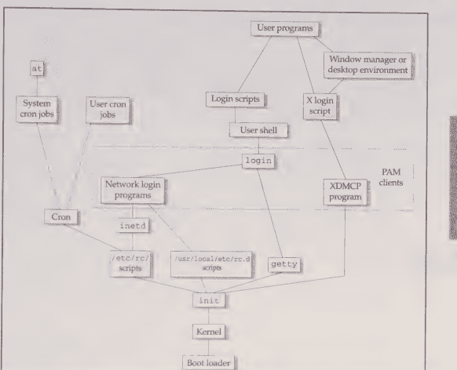


图 6-1. FreeBSD 的启动和控制流程是一个由相互依赖关系构成的、略显纠缠的树状结构。

内核实际上并不直接控制这些启动步骤，但它在两个方面至关重要。首先，内核控制着哪个程序来掌控启动序列。原则上，你可以修改内核，使其运行除 `init` 之外的其他程序作为第一个程序，从而改变系统的行为。其次，内核为 `init`、启动脚本中的 `init` 调用以及从这些启动脚本启动的程序提供关键的支持功能。这种支持的形式与提供给所有运行中程序的基础支持相同。

### 内核在运行系统中的角色

尽管用户很少会有意识地察觉到内核的存在，但它支撑着用户在系统上所做的一切。由内核提供的服务被称为运行在 *内核模式* 下。这些服务拥有对硬件和其他内核模式进程的权限访问。这与 *用户模式* 程序形成对比，后者依赖内核来进行硬件访问和其他内核模式服务。你应该意识到，即使是由 *root* 运行的程序也是用户模式进程。

内核提供的一些重要服务包括

- **硬件接口** 内核包含大多数硬件组件的关键设备驱动程序。如果一个程序需要向串行端口发送数据、从键盘读取按键、在屏幕上显示数据或使用任何其他硬件，它都会通过内核在某一层面或另一层面做到这一点。某些访问可能会通过其他内核或非内核服务（如文件系统或 XFree86）进行缓冲，但迟早内核都会介入。实际上，大多数用户模式程序通过 *设备文件* 访问内核的硬件接口，这些是特殊文件，通常位于 `/dev` 目录中。

  > 注意
  >
  > 某些设备（如调制解调器和打印机）在内核中没有直接支持。相反，它们由用户模式程序控制。这些程序通过内核管理的设备（如串行端口或并行端口）访问此类硬件。XFree86 因其不寻常的地位而值得特别提及。尽管它是一个用户模式进程，但它对视频卡硬件具有不寻常的直接访问权限。

- **内存访问** 所有程序都需要内存，为了确保程序不相互覆盖内存，内核负责分配可用内存。FreeBSD 内核以一种让每个程序都相信它是独立运行的方式来执行此操作；没有程序可以访问其他程序的内存。（某些早期的操作系统，如 Mac OS Classic 和带有 Windows 3.1 的 DOS，使用了更原始的内存分配方法，这是应用程序容易使这些操作系统崩溃的原因之一。）

- **CPU 时间** FreeBSD 是一个 *抢占式多任务* 操作系统，意味着内核控制每个进程接收多少 CPU 时间。这与 *协作式多任务* 形成对比，在协作式多任务中，进程使用它们所需的大量 CPU 时间，然后将控制权让给其他进程。协作式多任务往往导致系统对各个进程的 CPU 需求响应较慢，因为一个程序可能会占用过多的 CPU 时间。你可以使用在第五章中描述的 *nice* 或 *renice* 命令来控制 FreeBSD 中不同进程占用多少 CPU 时间。

- **文件系统** 每当访问文件时，内核都充当中介。你的应用程序要求内核从文件提供数据或将数据写入文件。因此，内核必须理解你可能想要使用的所有文件系统。这一主题在第 4 章和第 7 章中有介绍。文件系统还必须与磁盘设备的硬件接口进行交互。因此，文件系统访问涉及两个内核组件：文件系统本身以及文件系统所在的硬件。

- **网络** 除了控制网络硬件外，内核还提供更高级的网络结构，例如对传输控制协议/互联网协议（TCP/IP）*网络栈* 的支持——这是一组协议，使用户模式程序能够轻松访问网络。FreeBSD 包含许多允许你控制和接口这些网络功能的用户模式程序。本书的第三和第四部分以及各个章节的部分内容涵盖了这些工具。

拥有如此多的职责，内核是任何操作系统中异常重要的组件。FreeBSD 内核与其他开源 BSD（OpenBSD 和 NetBSD）的内核相关，但与两者都不完全相同。FreeBSD 内核与 Linux 内核完全无关，这就是为什么 FreeBSD 不是 Linux 的一个版本，尽管 FreeBSD 和 Linux 支持许多相同的高层程序，如 XFree86 和 Emacs。

幸运的是，FreeBSD 内核经过了充分测试且非常健壮，这解释了 FreeBSD 可靠性的很大一部分。即使一个用户模式程序表现不良，这样的程序也很难干扰内核级操作或其他程序。一个重要的例外是，用户级程序可以相互交互，并且根据涉及的权限和所有权，这些程序可以相互干扰。例如，由 *root* 运行的程序可以终止或以其他方式干扰由任何其他用户运行的程序——但即使是由 *root* 运行的程序也必须通过内核来访问计算机硬件、为自己获取内存等。这种级别的隔离对于提供一个稳定的系统至关重要，在该系统上可能同时有数百名用户在工作。

### 自定义启动脚本

第 5 章介绍了启动脚本。在 FreeBSD 系统中，这些脚本有两种形式：

- **系统启动脚本** 这些脚本位于 `/etc` 目录中，文件名以 *rc* 开头。`/etc/rc` 脚本是这些脚本的主控脚本，也是 `init` 首先运行的脚本。这些脚本为 FreeBSD 系统创建标准的工作配置，包括其基本操作和许多标准服务器的运行。

- **本地启动脚本** 这些脚本位于 `/usr/local/etc/rc.d`。它们为你提供启动支持，用于你可能添加到标准系统中的杂项服务器和其他程序。这些脚本应至少响应两个命令：`start` 和 `stop`，它们应分别启动和停止由这些脚本启动的程序。（系统启动过程通常在启动时自动启动这些脚本，但你可以稍后手动启动或停止它们。）

如果你想修改计算机的启动过程，你可以修改系统启动脚本或本地启动脚本。只要可能，最好使用本地启动脚本。当你想为你安装的新服务器或必须在启动时运行的其他包添加支持时，这种方法效果很好。然而，如果你需要改变系统的工作方式，可能别无选择，只能修改系统启动脚本。

#### 编辑系统启动脚本

编辑系统启动脚本可能是一项棘手的任务——一个错误可能导致系统无法引导。因此，我建议只在万不得已时才进行这样的更改——即如果你在不编辑这些脚本的情况下无法让系统按你的意愿运行。不过，这条规则有两个例外。

首先，你可以相对安全地编辑 `/etc/rc.conf` 文件。该文件设置了几个变量，其他文件使用这些变量来控制启动过程。这些变量名称相当直观，例如 `hostname`、`sendmail_enable` 和 `sshd_enable`。本书的一些章节告诉你在特定情况下编辑其中某些项目。

> **注意**
>
> `/etc/rc.conf` 文件设置的值会覆盖在 `/etc/defaults/rc.conf` 中设置的值。你可以研究后者文件以了解你可以在 `/etc/rc.conf` 中设置哪些默认值。

其次，你可以编辑 `/etc/rc.local` 文件，让系统启动你自己添加的服务器。该脚本在默认配置中实际上并不存在，但 `/etc/rc` 脚本会查找它，如果存在就会运行它。如果你编译了一个新服务器并希望 FreeBSD 在启动时启动它，可以使用这种方法。例如，清单 6-1 展示了一个 `/etc/rc.local` 脚本，它启动了 `/usr/local/bin/servera` 服务器，向其传递 `-a` 参数，并启动 `/usr/local/bin/startcheck` 脚本。

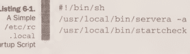

清单 6-1 以字符串 `#!/bin/sh` 开头。该字符串标识文件为一个 *shell 脚本*——一个借助 shell（在清单 6-1 的情况下是 `/bin/sh`）运行的程序。大多数脚本还设置了执行位，你可以通过输入 `chmod a+x /etc/rc.local` 在此脚本中做到这一点，但对于此脚本来说这并非严格必要。后续行可以像命令行上输入的命令一样简单。`servera` 调用后的 ampersand（&）可能不是必需的，具体取决于服务器；它在后台启动程序，使脚本中的后续项和后续脚本能够正确运行。某些服务器设计为即使没有 ampersand 启动也按此方式运行。

虽然 `/etc/rc.local` 可能是启动本地服务器的一种快速便捷方式，但此方法已废弃，意味着不建议使用，且在未来版本的 FreeBSD 中，使用该方法的能力可能会消失。相反，当前的管理建议是使用本地启动脚本，下文将对此进行说明。

#### 创建新的本地启动脚本

与其创建一个单一的一体式 `/etc/rc.local` 脚本，你可以在 `/usr/local/etc/rc.d` 中创建一个或多个脚本。这些脚本通常比 `/etc/rc/local` 脚本更复杂，因为它们需要处理发送给脚本的 `start`（启动）和 `stop`（停止）参数。列表 6-2 是一个示例。

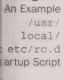

```sh
#!/bin/sh

case "$1" in
    start)
        /usr/local/bin/servera -a
    ;;
    stop)
        /usr/bin/killall servera
    ;;
esac
```


就本地启动脚本而言，列表 6-2 非常简单；它仅在脚本接收到 `start` 选项时启动 `servera`，在脚本接收到 `stop` 选项时发出 `killall` 命令。更复杂的脚本可能会将程序的 PID 记录在文件中，以便在接收到 `stop` 命令时，脚本只杀死由该脚本启动的实例；也可能在尝试启动前检查程序文件是否存在，等等。你应该通过输入 `chmod a+x /usr/local/etc/rc.d/*scriptname*` 来设置本地启动脚本的执行位，其中 `scriptname` 是脚本的名称。

许多为 FreeBSD 编译的服务器软件包都包含用于启动和停止服务器的本地启动脚本，因此你可能无需手动创建此类脚本。使用现有脚本作为模型有时可以帮助你让新脚本运行起来，但某些脚本使用了中等复杂度的 Shell 脚本技术，因此如果你不熟悉 Shell 脚本，可能难以理解它们。

### 登录流程详解

计算机启动完成后，它会显示登录提示符，如第 3 章所述。此时发生的情况很大程度上取决于所选的登录方法，但许多登录方法都使用一些 `共同特征`。在标准的 FreeBSD 配置中，假设用户输入了正确的密码，登录过程应顺利进行。不过，你可能希望更改所有系统账户的默认行为，或者改变特定用户登录时发生的情况，因此本节将描述这些选项以及支撑登录流程的过程。

#### 登录方法

FreeBSD 支持几种不同的登录方法。这些方法通过不同的方式访问，可能呈现不同的用户界面，并可能产生不同的操作，但大多数在核心层面使用相同的身份验证工具。了解这些方法有助于你配置对 FreeBSD 系统的访问。

#### 文本模式控制台登录

这是第 3 章重点介绍的登录方法。在这种登录中，用户看到文本模式的 `login:` 提示符，输入用户名，看到文本模式的 `password:` 提示符，输入密码，然后获得用户的 Shell 作为回报。标准 FreeBSD 安装使用此过程作为主要登录方法。

这种登录方法通过 `/etc/ttys` 文件进行控制，该文件包含一系列如下所示的行：

```
ttyv0    "/usr/libexec/getty Pc"    cons25    on    secure
```

这一行将 `/usr/libexec/getty` 程序链接到 `ttyv0`，这是 FreeBSD 对第一个虚拟控制台的称呼。文件中的后续行将同一程序链接到 `ttyv1` 至 `ttyv7`。可以通过按下 `ALT-Fn` 访问这些虚拟控制台，其中 `n` 是 1 到 8 之间的数字（`F1` 链接到 `ttyv0`，等等）。因此，你可以多次登录到 FreeBSD。

当 `getty` 程序运行时，它会链接到控制台并运行 `login` 程序，该程序处理实际的登录过程。具体而言，`login` 显示 `login:` 和 `password:` 提示符，处理用户输入，并调用 `Pluggable Authentication Module`（PAM，可插拔身份验证模块），这是 FreeBSD 的身份验证工具，稍后将在“通过 PAM 验证用户”中描述。如果 PAM 验证了用户，`login` 会检查 `/etc/passwd` 文件以查找用户的默认 Shell，并运行该 Shell，将其链接到控制台。此时，用户已登录，但 Shell 可能会运行额外的脚本来设置用户所需的环境，如接下来的章节“调整用户登录默认设置”和“用户登录控制文件”所述。

#### GUI 控制台和远程登录

FreeBSD 依赖一个使用 `X Display Manager Control Protocol`（XDmCP，X 显示管理器控制协议）的程序来处理 GUI 登录。XDMCP 程序将其自身绑定到 X 会话，或接受来自远程 X 服务器的访问。在这两种情况下，它都使用 X 来呈现 GUI 登录提示符。当用户输入用户名和密码时，XDMCP 程序将此信息传递给 PAM。如果 PAM 授权该用户，XDMCP 程序将在其使用的 X 会话上启动用户的默认 X 环境，如“调整用户登录默认设置”和“用户登录控制文件”中所述。

有几种不同的 XDMCP 程序可供 FreeBSD 使用，包括原始的 XDM、作为 GNOME 桌面环境一部分的 GDM 程序，以及作为 KDE 一部分的 KDM 工具。这些工具与文本模式登录的 `getty` 一样，是从 `/etc/ttys` 启动的。第 21 章将更详细地介绍这些工具的配置。

如果你想使用此类工具，一种快速的方法是在 `/etc/ttys` 中定位以下行：

```
ttyv8   "/usr/X11R6/bin/xdm -nodaemon"  xterm  off  secure
```

将此行中的 `off` 更改为 `on`，然后关闭 X（如果正在运行）并以 root 身份输入 `kill -HUP 1`。此操作告诉 `init`（其 PID 始终为 1）重新读取其配置文件（包括 `/etc/ttys`）并实施任何更改，例如你刚刚做出的更改。短暂延迟后，X 应该启动，你会看到一个如图 6-2 所示的 GUI 登录提示符。如果你使用 GDM 或 KDM，或者更改了 XDM 配置，你的提示符可能包含额外的图形、标志，甚至用于更改各种登录详情的工具。


#### 远程文本模式登录

如果你配置计算机接受远程文本模式登录（如第 21 章所述），登录服务器可能像本地登录的 `getty` 程序那样运行，也可能略有不同。特别是，Telnet 服务器监听网络连接。当发生此类连接时，Telnet 服务器启动 `login`，其功能与本地虚拟控制台上的登录类似，只是它通过网络来回传递数据，而不是使用本地键盘和显示器。

安全外壳（SSH）远程登录协议的工作方式略有不同。SSH 不调用 `login` 进行身份验证，而是直接调用 PAM，或者可以配置为绕过 PAM 并使用其自身的身份验证程序。此功能提供了更大的灵活性。无论 SSH 是否使用 PAM，其在登录身份验证通过后的操作与 Telnet 服务器或 `getty` 类似。具体而言，SSH 服务器将用户的默认 Shell 链接到远程 SSH 客户端，从而为用户提供对系统的远程访问。`rlogin` 工具是旧的 UNIX 远程登录备用方案。默认情况下，它尝试使用远程系统的 IP 地址进行身份验证，因此不使用 PAM。当 `rlogin` 检测到登录尝试时，它会对照 `/etc/hosts.allow`、` /etc/hosts.equiv` 或用户的 `.rhosts` 文件中授权地址检查远程系统的 IP 地址。如果客户端已授权且远程用户在服务器上有账户，则授予访问权限；`rlogin` 服务器启动用户的默认 Shell。

> **注意** 第 21 章涵盖了 Telnet 和 SSH 服务器的配置。以当今的标准来看，`rlogin` 协议通常被认为是不安全的，因此最好避免使用。

所有这些远程登录协议都由服务器处理，这些服务器必须以某种方式启动。本地启动脚本处理其中一些，而其他（特别是 Telnet）则是通过 `inetd` 超级服务器处理的，如第 16 章所述。系统启动脚本启动此超级服务器（参见图 6-1）。

最后，FreeBSD 支持通过串行端口登录。在多年前，大多数 UNIX 系统在其串行端口上连接了多个 `哑终端`（dumb terminals）。这些是键盘和显示器，CPU 能力有限，仅用于访问 UNIX 系统。FreeBSD 仍然支持这种配置，因此你可以使用旧的哑终端让多个用户访问系统。你也可以使用带有终端程序的普通计算机担任此角色。类似地，你可以将调制解调器连接到串行端口，并使远程用户能够拨号进入 FreeBSD 系统。这些配置通过 `/etc/ttys` 文件处理。这些设置与本地虚拟控制台的设置非常相似。例如，以下行配置 FreeBSD 系统接受来自调制解调器的登录：

```
ttyd0 "/usr/libexec/getty std.9600" dialup on secure
```

这一行告诉 `init` 启动一个附加到 `/dev/ttyd0` 的 `getty`，这是一个与第一个串行端口（Windows 下的 COM1）关联的设备。`std.9600` 字符串告诉系统以 9600 bps 运行调制解调器。`dialup` 字符串将该终端标识为拨号调制解调器连接。如果你使用硬连接到计算机的终端，请使用 `/etc/termcap` 中的代码作为其终端类型，例如 `vt100` 用于 DEC VT-100 终端。

#### 杂项服务器

一些服务器提供某种远程登录访问。例如，文件传输协议（FTP）服务器和 Samba 都让用户可以访问计算机上的文件。远程邮件传输协议也让用户可以访问计算机，但方式更为有限。这些服务器中的许多都可以配置为使用密码来实现此功能。其中一些服务器依赖 PAM 来执行其工作，但其他服务器则不依赖。在所有情况下，登录过程都具有高度的服务器特异性。有些使用系统级配置文件，而其他使用用户配置文件。你应该查阅服务器文档以了解其更多功能。本书第四部分涵盖了其中一些服务器。

#### 通过 PAM 验证用户


PAM 是 FreeBSD 身份验证过程的重要组成部分，因为它提供了集中式的身份验证方法。在 PAM 出现之前，UNIX 系统依赖每个程序从密码文件中读取加密密码、加密用户输入的密码并比较两者的能力。这种方法有效，但存在几个缺点。例如，要实施扩展的身份验证检查，需要在每个必须使用这些检查的程序中实施。类似地，如果

## 调整用户登录默认设置

如果密码文件使用的加密方法 ever 发生变更，每个程序都需要被重写以使用更新后的加密方法。通过让登录程序依赖于 PAM，这些问题被消除了。特殊的认证方法以及对密码格式的更改可以在 PAM 中实现一次。依赖 PAM 的程序（称为 PAM 客户端）甚至不需要意识到这些更改已经发生。

为了提供认证支持，PAM 使用其自身的配置文件。在 FreeBSD 5.0 中，这些文件位于 `/etc/pam.d` 目录中，每个使用 PAM 的程序都有一个以其命名的文件。FreeBSD 的早期版本使用单个配置文件，`/etc/pam.conf`。该文件的格式和选项与 `/etc/pam.d` 中的程序特定文件相同，只有一个例外，稍后将对此进行说明。

PAM 提供四种类型的认证支持：

- `用户认证` 此方法对本讨论最为重要；它允许服务器根据用户名和密码授予或拒绝计算机访问权限。此功能的模块类型名称为 `auth`。
- `账户管理` PAM 可以告诉服务器当前用户账户是否有效，这对于登录协议是一个重要的关注点，可能独立于认证。例如，如果用户密码已过期或对账户访问有时间限制，此模块可以拒绝访问。此支持的模块类型名称为 `account`。
- `密码管理` 此方法使程序能够更改用户密码。它通常不用于登录过程，但由诸如 `passwd` 之类的工具使用（在第 10 章中描述）。此支持的模块类型名称为 `password`。
- `会话管理` 此方法帮助程序设置和终止用户会话。此支持的模块类型名称为 `session`。

在大多数情况下，您不需要调整 PAM 配置。但是，如果您想改变系统的认证行为，可能需要修改一个或多个登录方法的 PAM 文件。为此，请配置 PAM 使用（或停止使用）一个或多个认证 `模块`。这些是 PAM 库，每个库提供某种认证方法。您可以在 PAM 配置文件中通过以下形式的一行来配置 PAM 使用某个库：

```
[service_name] [module_type] control_flag module [options]
```

`service_name` 字段是服务的名称，例如登录程序的 `login` 或 `su` 程序的 `su`。它在 `/etc/pam.d` 目录中的 PAM 配置文件中被省略，但包含在 `/etc/pam.conf` 文件的条目中。（这就是前面提到的单文件格式差异。）`module_type` 字段列出模块提供的服务类型。前面关于 PAM 服务的描述包含了您在 PAM 配置文件中用于 `module_type` 字段的名称。`control_flag` 可以是以下任一选项：

- `required` 此模块必须成功。如果没有成功，PAM 返回认证失败代码，但它首先运行其他模块以掩盖失败发生的位置。
- `requisite` 此模块必须成功。如果没有成功，PAM 立即返回失败代码。
- `sufficient` 只要前面的 `required` 或 `requisite` 模块没有失败，此模块就足以成功。如果此模块成功，PAM 立即返回成功代码。
- `optional` 除非该服务的其他模块返回 PAM_IGNORE，否则此模块被忽略。

大多数配置使用 `required` 标志，因为它能构建更安全的系统——攻击者不能尝试不同的登录方法来发现登录失败的原因，从而找出绕过该失败的方法。

最后，`module` 字段包含 PAM 模块的名称（可能包括路径）以支持该类型。一些模块接受选项，您可以将其作为 PAM 配置文件中的最后一个字段传递。完整的 PAM 配置行示例如下：

```
auth    required    pam_nologin.so    no_warn
auth    required    pam_unix.so    no_warn try_first_pass
account    required    pam_unix.so
session    required    pam_unix.so
password    required    pam_unix.so    no_warn try_first_pass
```

> **注意**
>
> 此示例提取自 `/etc/pam.d` 格式文件中的一行。`/etc/pam.conf` 文件将在每行开头包含服务名称，例如 `login`。实际的 PAM 配置文件通常还包括以井号（`#`）开头的注释行。这些行通常包含可通过取消注释这些注释行激活的替代配置。

在此示例中，两个 PAM 模块（`pam_nologin.so` 和 `pam_unix.so`）对于认证是必需的，而一个模块（`pam_unix.so`）用于账户管理、会话管理和密码管理。在实践中，`pam_unix.so` 是大多数配置中主要的 PAM 认证模块。您可能想要添加或更改 PAM 配置以使用某些不属于标准配置的工具。例如，您可以通过添加适当的行来添加对 Kerberos 认证的支持。（标准 FreeBSD PAM 配置中的示例被注释掉了。）

`Kerberos` 是一种在许多大型网络上使用的网络认证系统。它允许集中维护密码数据库并提供各种加密服务。其配置和使用超出了本书的范围。请查阅 Kerberos 网页，`http://web.mit.edu/kerberos/www/`，以获取更多信息。

## 调整用户登录默认设置

如前所述，文本模式登录过程涉及运行特殊脚本或读取特殊的配置文件，以设置用户的环境。涉及两个层级的配置：系统范围的默认设置和用户特定的文件。本节介绍了一些常见的系统范围登录配置文件，下一节将描述用户登录文件。

对于文本模式登录，最重要的配置文件是用户默认 shell 的文件，这在不同的 free 中有所不同。一些常见的 shell 及其默认配置文件如下

- `sh` 这是 FreeBSD 的默认 shell；如果不另做指定，用户的默认 shell 为 `sh`。其全局配置文件是 `/etc/profile`。
- `tcsh` 虽然不是默认 shell，但 `tcsh` 很受欢迎。它使用 `/etc/csh.cshrc` 和 `/etc/csh.login` 作为全局配置文件。当用户注销时，此 shell 还会执行 `/etc/csh.logout`。
- `bash` `bash` shell 受到一些用户的欢迎，但在 FreeBSD 中默认不安装。如果您安装了它，它将使用与 `sh` 相同的全局配置文件 `/etc/profile`。

FreeBSD 的默认配置使用这些 shell 的空配置文件。不过，您可能希望以某些方式修改这些配置。这些配置文件是 shell 脚本，因此您可以编写脚本让它们做几乎任何事情，如第 3 章所述。一种常见的修改是设置 `_环境变量_`。这些是程序可以通过名称访问的设置。例如，shell 本身使用 `_PATH_` 环境变量来确定在哪些目录中搜索您输入名称的程序。许多程序依赖于程序特定的环境变量来定位配置文件或设置默认选项。例如，一些程序使用 `_EDITOR_` 环境变量来确定在应该编辑文件时启动哪个编辑器。

对于 `sh` 或 `bash`，您可以按以下方式设置环境变量：

```
export VARNAME=value
```

您可以通过在变量名前加上美元符号 (`$`) 来将其他变量包括在 `_value_` 中。例如，以下行将 `/opt/bin` 添加到 `_PATH_` 环境变量中：

```
export PATH=$PATH:/opt/bin
```

对于 `tcsh`，可以使用 `setenv` 而不是 `export` 并省略等号来实现相同的目标。在引用其他变量时，可能需要将其用引号括起来。例如，以下 `tcsh` 行将 `/opt/bin` 添加到 `PATH` 环境变量中：

```bash
setenv PATH "$PATH:/opt/bin"
```

另一个有用的命令是 `alias`，它将一个命令设置为像另一个命令那样工作。例如，假设您的系统中有熟悉 DOS 或 Windows 命令行工具的用户。当他们输入 `dir` 时，他们可能期望看到长目录列表，因此您可以在 `/etc/profile` 中使用如下行：

```bash
alias dir='ls -l'
```

对于 `tcsh`，命令相同，只是应该用空格替换等号。此后，任何输入 `dir` 的用户都会收到长目录列表，就好像用户实际输入了 `ls -l` 一样。

一般来说，最好尽量减少对全局配置文件的修改。如果用户熟悉更标准的默认设置，这样的更改可能会让用户感到困惑。相反，用户可以以与修改全局文件类似的方式修改他们自己的配置文件。这意味着用户可以自定义他们的配置，使用他们发现有用的环境变量和别名，而不会给其他用户带来潜在的困惑或问题。

#### 用户登录控制文件


用户登录控制文件的工作方式与系统范围的文件非常相似。除了文本模式登录文件外，您还可以配置 GUI 登录文件以调整默认环境。

### 文本模式登录控制文件

Shell 在运行任何系统范围的控制文件之后运行用户特定的控制文件。具体来说，这些文件是：

- `sh` `sh` 的用户级配置文件称为 `.profile`。大多数配置还包括对用户主目录中 `.shrc` 的调用。`.profile` 脚本仅在登录时运行，但 `.shrc` 在每次调用 shell 时都会运行（例如，如果在 X 中启动 `xterm`）。

- `tcsh` `tcsh` shell 依次尝试读取 `.tcshrc`、`.cshrc`、`.history`、`.login`，最后是 `.cshdirs`。非登录 shell 不会尝试读取最后三个。

- `bash` 此 shell 在会话是登录会话时尝试读取 `.bash_profile`、`.bash_login`，然后是 `.profile`。注销时，`bash` 尝试运行 `.bash_logout`。对于非登录会话，如 `xterm` 会话，`bash` 在启动时尝试使用 `.bashrc`。

# 第 6 章：系统启动与控制流程

这些文件可以像它们的全球对应文件一样被修改——你可以添加别名，设置环境变量等。由于它们是用户特定的，因此也允许用户自定义其环境。如果一个用户希望输入 `d1z` 就能获得长目录列表，而另一个用户希望此命令能播放一个声音文件，两者都可以得到满足。这些文件应当设置为具有完全执行权限，如第 8 章所述。作为快速介绍，请键入 `chmod a+x login-script`，其中 `login-script` 是登录脚本的名称。

FreeBSD 将某些 shell 的默认登录文件存储在 `/usr/share/skel` 目录中。这些不是点文件，这些用户的名称以点开头，例如 `.dot.cshrc`。创建用户账户时，这些文件可以选择性地复制到新用户目录中并适当重命名。它们可以是进一步自定义的良好起点。

### 图形用户界面登录控制文件

图形用户界面（GUI）登录过程，与文本模式登录过程类似，涉及配置文件的读取和处理。在传统设置中，使用以下两个文件之一，均位于用户的家目录中：

- `.xinitrc`：这是在文本模式登录时，当用户键入 `startx` 时运行的 X 启动脚本。

- `.xsession`：此脚本相当于 `.xinitrc`，但用于通过 XDM 程序进行的图形用户界面登录。

> **注意**
>
> 如果你使用 KDM 或 GDM 程序而不是 XDM，它们可能使用也可能不使用 `.xsession`，这取决于你选择使用的会话类型。通常，这些 XDMCP 包会让你选择运行传统的 XDM 风格登录，或执行几个桌面环境之一（通常是为 KDE 和 GNOME 提供的一两个选项，可能还有其他一两个选项）。

与文本模式登录脚本一样，图形用户界面登录脚本必须是可执行的，因此在你的家目录中键入 `chmod a+x .xinitrc` 或 `chmod a+x .xsession` 来设置这些权限。与文本模式登录脚本一样，这些脚本可以设置环境变量或启动程序。最常用的是启动窗口管理器或桌面环境以及几个有用的程序。例如，清单 6-3 显示了一个启动 IceWM 窗口管理器和一个 xterm 窗口的脚本。

**清单 6-3。示例 .xinitrc 或 .xsession 登录脚本**

```sh
#!/bin/sh
/usr/X11R6/bin/xterm &
/usr/X11R6/bin/icewm
```

由于这些脚本通常运行一个或多个程序，因此密切关注使用 ampersands（`&`）作为在后台启动程序的手段至关重要。在前面的示例中，启动 xterm 的那一行使用了 ampersand，因此 xterm 在后台运行。登录脚本的执行然后继续到下一行，该行启动了 IceWM。然而，这一行缺少 ampersand。登录脚本的执行在此处停止，直到 IceWM 退出。这种配置很常见，并且有两个重要后果：

- 在 IceWM 退出（通过选择注销选项）之前，列在 IceWM 之后的程序不会执行。因此，你可能希望在 `icewm` 调用之后放置清理程序、播放注销声音的命令或类似内容，但你应该在 `icewm` 调用之前包含所有希望自动运行的程序。

- IceWM 控制 X 会话。当 IceWM 退出时，脚本继续执行。这些脚本通常在窗口管理器调用之后包含很少或没有命令，当脚本停止执行时，X 关闭，并返回到 XDMCP 登录程序。

你应该确保任何不快速终止的程序，例如清单 6-3 中的 `xterm`，后面都跟着 ampersand，以便它不会延迟或挂起脚本其余部分的执行。通常，窗口管理器本身被用作终止触发 X 会话结束的程序。虽然你也可以使用其他程序来履行此目的。例如，如果你在清单 6-3 中反转 `xterm` 和 `icewm` 调用的顺序，给 `icewm` 调用添加 ampersand，并省略 `xterm` 调用中的 ampersand，那么当你关闭 `xterm` 窗口时，你的 X 会话将结束。

当你通过键入 `startx` 启动 X 时，如果你的账户缺少 `.xinitrc` 文件，系统会改用文件 `/etc/X11/xinit/xinitrc`。如果基于 XDM 的登录缺少 `.xsession` 文件，XDM 会启动 `/usr/X11R6/lib/X11/xdm/Xsession` 而不是该文件。该脚本反过来启动 `twm` 窗口管理器和一个名为 `xsm` 的程序作为 X 会话管理器——当你在 `xsm` 中选择关机选项时，你将注销 X 会话。与文本模式登录文件一样，默认的 `.xinitrc` 和 `.xsession` 文件存在于 `/usr/share/skel` 目录中，并且 FreeBSD 可以在创建新账户时将这些文件复制到新账户中。这两个默认文件都启动 GNOME 作为默认的图形用户界面环境。

### 在预定时间运行程序：Cron

我们通常认为计算机是被动的事物，除非在人类控制下。计算机不会无缘无故地决定去做某事——尽管在调试问题时，你可能会有不同的看法！除了这些神秘的问题外，这种将计算机视为被动工具的模式有一个重要的例外：计划任务。你可能需要在你不在场时运行程序时指定时间。你可能还希望系统反复并自动执行任务。FreeBSD 支持两种主要工具来完成此任务：`at` 和 `cron`。两者中，`cron` 更复杂。你可以使用 `at` 安排一次性操作，例如在深夜运行一次 CPU 密集型任务。你可以使用 `cron` 以重复方式运行任务，例如每小时从 ISP 的邮件系统检索邮件一次。实际上，FreeBSD 配置为使用 `cron` 进行例行维护，即使你 unaware 它也在你的系统中使用。

#### 使用 at

`at` 命令允许你以指定时间运行一次程序。一个变体程序 `batch`，让系统在你告诉它当系统负载降低到足够低（具体为低于 1.5）时运行程序。这些命令的语法是

```
at [-V] [-q queue] [-f file] [-mldbv] time
batch [-V] [-q queue] [-f file] [-mv] [time]
```

这些命令的选项有：

- `-V`：显示程序的版本号。

- `-q queue`：`at` 命令支持多个队列，每个队列用一个字母（a 到 z 和 A 到 Z）标识。通常，`at` 使用小写字母队列，`batch` 使用大写字母队列。`at` 和 `batch` 的默认队列分别是 c 和 E。字母靠后的队列运行优先级较低。

- `-f file`：通常，在键入 `at` 或 `batch` 命令后，你键入想要运行的命令，然后按 CTRL-D，这是 FreeBSD 的标准文件结束指示符。或者，你可以将命令输入文件，并将文件名传递给 `at` 或 `batch`。如果你想运行脚本作为命令，这种方法特别有用；你只需将脚本名称传递给 `at`。

- `-m`：此选项在任务完成时向运行该任务的用户发送邮件。

- `-l`：使 `at` 显示当前排队中的任务。此选项等价于键入 `atq`。

- `-d`：从队列中删除任务。`at rm` 命令做同样的事。

- `-b`：使 `at` 像 `batch` 一样工作。

- `-v`：与 `-l` 一起使用时，显示已完成但尚未从队列中移除的任务。

- `time`：任务运行的时间。你可以使用几种格式来指定，包括 HH:MM 或 HH:MM 以在接下来 24 小时内的特定时间运行任务，可选 AM 或 PM 后缀。字符串 noon、midnight 和 teatime（下午 4:00。）也有效。要指定 24 小时以后的运行时间，可以在时间规范后提供日期。日期可以采用 MMDDYY、MM. DD. YY、MM/ DD/ YY 或月份名称 日 年 的形式。你还可以通过给出加号（`+`）、数值和单位（如 +30 分钟）来相对形式地给出时间。

在默认 FreeBSD 安装中，只有 root 可以运行 `at` 或其相关命令。你可以通过添加文件 `/var/at/at.allow` 或 `/var/at/at.deny` 来更改此限制。要仅允许少数特定用户使用这些命令，请创建


若要允许特定用户使用 `at`，请创建 `at.allow` 文件并将这些用户的用户名放入该文件中。若要允许除特定用户以外的所有人使用 `at`，请创建 `at.deny` 文件并将受限用户的名称放入该文件中。以 `at` 的实际运作为例，考虑以下命令：

```bash
$ at -m +2 minutes
/bin/ls > ~/listing.txt
```

您可以输入此命令，按 ENTER 键终止，然后按 CTRL-D。稍后，主目录中应出现一个名为 `listing.txt` 的文件，其中包含 `ls` 命令的输出，并且您应该会收到电子邮件，告知该命令已完成。

> **注意**
>
> `at` 命令队列由 cron 任务处理，如下一节所述。
>
> FreeBSD 的默认配置每五分钟运行一次此任务，因此此示例命令可能需要超过两分钟才能执行。

### Cron 工作原理概览

通常，计划单个任务是不够的；您需要计划任务以定期重复执行。例如，您可能希望每小时使用 `fetchmail` 程序（在第 19 章中描述）检查 ISP 的邮件，或每天使用一次时间服务器（在第 22 章中描述）来设置系统时间。这些情况正是 `cron` 发挥作用的地方；它指示您的系统在固定间隔运行特定的脚本，通常称为 cron 任务。

Cron 在安排 cron 任务执行方面提供了很大的灵活性。您可以告诉它每分钟运行一次任务，尽管在实践中您可能不太会这样做。您还可以安排任务在不同的日期或不同的时间以不同的间隔执行——例如，在工作时间的频率比深夜或周末更高。

两种基本类型的 cron 任务是系统 cron 任务，只有 root 可以创建；以及用户 cron 任务，普通用户可以创建。这两种类型的 cron 任务提供类似的功能。您通过编辑 `/etc` 中的文件作为 root 创建或编辑系统 cron 任务，但您可以通过使用 `crontab` 工具作为 root 或普通用户创建或编辑用户 cron 任务。

> **注意**
>
> 一旦创建，系统 cron 任务和用户 cron 任务具有基本相同的功能。FreeBSD 附带一组标准的系统 cron 任务，用于处理诸如轮换日志文件等函数，以防止它们增长到消耗所有磁盘空间。如果您想添加新的管理 cron 任务，您可以使用系统 cron 任务或用户 cron 任务来完成。通常，不需要 root 或其他系统账户权限的任务由用户 cron 任务处理。

FreeBSD 的 cron 功能由一个名为 *cron* 的守护进程提供。这是许多在 BSD 启动脚本中启动的守护进程之一（具体来说，在 `/etc/rc` 中；请参见图 6-1）。此守护进程持续运行，并且每分钟检查其队列，查看是否有任何 cron 任务应被执行。如果有，则运行这些任务；如果没有，则再睡眠一分钟。

### 创建系统 Cron 任务

主要的系统 cron 任务控制文件是 `/etc/crontab`。此文件以一些变量赋值开始，如下所示：

```bash
PATH=/etc:/bin:/sbin:/usr/bin:/usr/sbin
```

这些设置 cron 环境，这样您就不需要输入程序的完整路径，并且程序可以使用其依赖的环境变量。该文件还可以包含注释行，这些行以磅号（`#`）开头并被忽略。最重要的 *crontab* 条目采用以下形式：

```text
minute  hour  day-of-month  month  day-of-week  user  command
```

前五列包含代码，用于指定命令应运行的时间。您可以以多种不同形式指定时间：

- 每次
  - 星号（`*`）表示该任务在指定时间单位的任何值时都执行。例如，如果任务应每天运行，则在每月的日期列和星期列中包含星号。
  - > 如果您为每月的日期字段和星期字段都提供非星号值，cron 会在任一字段匹配当前日期时执行命令。仅为其中一个提供非星号值意味着命令仅在指定日期执行，覆盖其他字段的星号。
- 简单数字
  - 单个数字，如 7 或 23，按预期方式解释。在星期列中，0 和 7 都对应星期日。小时以 24 小时格式指定。
- 名称
  - 月份和星期列接受名称。使用月份或星期名称的前三个字母，例如使用 Nov 表示十一月或使用 Tue 表示星期二。大小写不重要。
- 范围
  - 如果您希望动作在特定范围内重复，可以使用破折号（`-`）指定范围，如星期列中的 Mon-Fri 或小时列中的 8-17。
- 列表
  - 您可以通过逗号分隔来列出特定值，例如在 *minute* 列中的 `0,20,40` 使任务每小时运行三次。
- 步长值
  - 您可以在星号或范围后跟上斜杠（`/`）和一个数字，以便跳过值。例如，*hour* 值 `*/3` 使任务每第三小时运行一次。

*user* 列列出任务应以哪个用户名运行。对于系统 cron 任务，大多数以 *root* 权限运行，但如果任务不需要 *root* 权限，您可以指定其他用户。最后，*command* 列列出要运行的命令。这可能是磁盘某处存储的 shell 脚本，或普通命令。例如，考虑以下 `/etc/crontab` 条目：

```text
4,34 8-17 * * mon-fri mailnull fetchmail
```

此条目导致 cron 每小时两次运行 `fetchmail` 命令（在每小时的 4 分和 34 分），从上午 8:04 到下午 5:34，从周一到周五，使用 `mailnull` 账户。（此账户是用于邮件操作的标准低权限账户。）此类条目是相当典型的系统 cron 任务。

> **提示**
>
> 此示例说明了您可能希望采用的原则。您可能倾向于在“逻辑”时间计划 cron 任务，例如整点和半点。然而，如果许多人这样做用于网络操作，网络服务器在这些时间的负载可能会激增，导致问题。因此，使用更特别的时间，如整点或半点后的四分钟，可以帮助减轻网络服务器的负载。当然，对于纯本地的 cron 任务，此原则可能并不重要，但对于像获取电子邮件或从外部时间服务器设置时钟这样的任务则有用。

许多 cron 任务通过 `/etc/crontab` 中的以下标准行处理：

```text
# do daily/weekly/monthly maintenance
1 3 * * * root periodic daily
15 4 * * 6 root periodic weekly
30 5 1 * * root periodic monthly
```

这些行调用 *periodic* 工具，该工具运行存储在 `/etc/periodic` 子目录中的脚本——具体是 `/etc/periodic/daily`、`/etc/periodic/weekly` 和 `/etc/periodic/monthly`。因此，添加系统 cron 任务的一个快速方法是添加一个执行任务的脚本到这些目录之一。在 FreeBSD 中，这些脚本命名为 *sequence*.*name*，其中 *sequence* 是三位数的序列号，*name* 是描述任务的名称。任务按 *sequence* 号指示的顺序运行。

### 创建用户 Cron 任务

普通用户可以通过使用 *crontab* 命令创建 cron 任务。此命令的语法如下：

```bash
crontab [-u user] [-l | -r | -e] [cronfile]
```

通常，您输入 `crontab cronfile`，其中 `cronfile` 是您想要安装的 crontab 文件的名称。此文件的格式与系统 `/etc/crontab` 文件的格式几乎相同。唯一的区别是您不需要为 cron 任务指定用户名。以这种方式使用 `crontab` 会安装指定的文件，替换之前用于用户 crontab 文件的任何文件。

`-l`、`-r` 和 `-e` 选项分别使系统显示当前 crontab 文件、删除 crontab 文件或编辑 crontab 文件。在最后一种情况下，系统使用 `EDITOR` 环境变量指定的编辑器，在标准安装中默认为 `vi`。如果您使用这些选项之一，则不要列出 `cronfile`；系统操作已为该用户安装的 crontab 文件。

`root` 用户可以使用 `crontab` 的 `-u user` 选项来替换、查看、删除或编辑用户的 crontab 文件。普通用户不能使用 `-u user` 选项。此功能的一个用途是以系统账户的名义设置 cron 任务，例如 `daemon` 或 `nullmail`。这些账户通常不能用作登录账户，因此只有 `root` 可以在它们的名称下创建 cron 任务。当然，您也可以使用此选项调试普通登录用户的 crontab 文件。

## 摘要


大多数时间，当您使用 FreeBSD 系统时，您使用它来运行程序。通常，您通过在命令提示符输入程序名称或从 GUI 环境启动程序来做到这一点。然而，一些至关重要的程序以其他方式运行。最重要的是，FreeBSD 内核本身由引导加载程序启动，内核进而运行 *init* 进程，该进程运行各种启动脚本。这些脚本启动各种守护进程和配置程序，它们定义了 FreeBSD 系统在启动后立即如何操作。能够调整此过程很重要，这样您可以自定义系统。FreeBSD 的登录过程也涉及运行各种程序。运行的程序取决于选择的登录方法，修改这些程序使您可以改变您或用户在登录时看到的环境。最后，FreeBSD 提供了在预定时间运行程序的方法，要么一次性（通过 *at* 或 *batch*），要么在固定间隔（通过 *cron*）。这些定时方法可以使您安排任务，使其不会对系统资源造成不当负担，或安排应定期执行的任务。

## 完整参考


## 第 7 章：管理分区

第 2 章介绍了 FreeBSD 分区系统的基础知识，足以让你上手操作。本章将更详细地介绍 FreeBSD 分区，包括使用分区的理由；用于创建、操作和使用分区的工具；以及 FreeBSD 分区和目录的布局。阅读完本章后，你应该能更好地理解 FreeBSD 安装例程为何以特定的方式创建分区，并且可能开始理解该系统是否适合你的需求。在后续的 FreeBSD 安装中，你可以考虑创建一个新的分区方案。

### 分区：数据文件的容器

磁盘分区类似于文件柜的抽屉：你可以在一个分区中存储有限数量的文件和文件夹（或目录）。如果一个文件柜抽屉或分区填满了，你就必须将额外的文件放在另一个抽屉或分区中。与文件柜抽屉不同，分区的大小可以差异很大——磁盘上的一个分区可能只有几百 KB，而另一个可能占用数 GB。虽然你的 FreeBSD 安装创建了分区，但你可能会想要更改该配置（这是一项困难的任务）或添加一个新的硬盘来扩展你的存储容量。

### 磁盘分区的原因

如第 2 章所述，通常对硬盘进行分区是为了为不同的操作系统提供不同的数据存储区域，为单个操作系统创建具有不同特征的数据存储区域，或者在操作系统内分离数据，以减少由失控的磁盘进程等问题引起的问题。通常，你会在安装 FreeBSD 时创建一个分区方案，然后保持原样。不过，在此之后，你可能需要分区磁盘的原因有：

- **添加磁盘** 如果当前磁盘已满，你可能想添加另一个磁盘。这样做时，你必须对新磁盘进行分区，并将其分区添加到当前的目录树中。

- **替换磁盘** 如果当前磁盘太小且无法轻松添加新磁盘，你可能想将系统迁移到替换磁盘上。与从头安装系统或添加新磁盘类似，你必须对替换磁盘进行分区。然后你必须将旧系统复制到新磁盘上，这可能是一项棘手的工作。简而言之，如果你能暂时连接两个驱动器，可以使用 *tar* 通过管道复制数据来完成此任务。然后你可能需要使用紧急启动系统在新磁盘上安装引导加载程序。例如，如果新驱动器挂载在 `/mnt`，你可以使用以下命令复制存储在根（`/`，`/usr`，`/home`）上的系统：

```bash
$ tar cpf - / /usr /home | (cd /mnt; tar xvfp -)
```

- **重新分区** 最棘手的分区任务是*重新分区*，即因为你最初对所需分区大小的估计不正确，而重新整理现有的分区方案。存在一些商业和开源工具，可以帮助以非破坏性的方式为某些文件系统进行此操作，但对于 FreeBSD 原生的快速文件系统 `FFS`，选项有限。具体来说，标准的 FreeBSD `growfs` 工具可以增大 `FFS` 文件系统的大小。该工具要求你首先使用 `disklabel` 修改分区大小，并且要求你计划扩展的分区之后必须有空闲空间。在许多情况下，而不是使用分区调整大小程序，你必须为你想要调整大小的分区上的数据找到临时存放位置。这个位置可以在另一个硬盘上、可移动磁盘上、网络文件服务器上或磁带备份驱动器上。然后你可以重新整理分区方案并恢复数据。

- **使用可移动介质** 某些可移动介质，如软盘，不进行分区。其他介质，如 Zip 磁盘，通常进行分区。这些磁盘通常以预先分区的形式出现，但你可能需要重新整理此方案，特别是如果你想使用 `FFS` 进行数据存储时。

磁盘分区本质上是一种破坏性过程，除非使用非破坏性分区工具，如 PartitionMagic (http://www.powerquest.com)、GNU Parted (http://www.gnu.org/software/parted/) 和 `growfs`。因此，分区是一项最好只执行一次且很长一段时间内不更改的任务。

> **注意**
>
> 无论你执行何种类型的分区或文件系统创建任务，务必小心使用正确的设备文件名。很容易打字错误设备文件名，从而清除分区甚至整个硬盘上的所有数据。

### 创建分区

有许多工具可以帮助你创建分区，其中一些已经在第 2 章中讨论过。尽管如此，回顾这些工具如何配合使用，并介绍一些新的完成工作的方法仍然是有用的。

#### 使用第三方工具

分区的一种方法是使用第三方工具。大多数操作系统都包含一个名为 `fdisk` 或 `FDISK` 的实用程序来对磁盘进行分区。FreeBSD 的 `fdisk` 将在稍后的“使用命令行工具”部分中介绍。其他磁盘分区工具在准备用于多操作系统环境的磁盘，或者你想在可移动磁盘上使用非 `FFS` 文件系统时最有用。这些工具通常比 FreeBSD 的 `fdisk` 更易于使用，尽管 FreeBSD 的 `sysinstall` 界面简化了 `fdisk` 的使用。

除了大多数操作系统中包含的工具之外，还有一些分区工具不属于任何操作系统。PartitionMagic 和 GNU Parted 是这类工具的两个例子。大多数此类工具比平均操作系统的分区工具功能更强大，因为它们支持非破坏性地重新分区受支持操作系统的文件系统，或者支持其他高级功能。

第三方工具用于创建 x86 分区很有用，但用于在 BSD 切片内创建 BSD 分区则不行。因此，如果你使用这种方法，至少如果你想使用 `FFS`，你只能走到一定程度。FreeBSD 会将其识别为 FreeBSD 切片，然后你可以使用其他工具在切片内创建 BSD 分区。其次，你可以在磁盘上留空空间，并使用 FreeBSD 工具创建 FreeBSD 切片以及其中的分区。

#### 使用 sysinstall

第 2 章中“对系统进行分区”一节描述了在系统安装过程中使用 `sysinstall` 来创建 FreeBSD 切片及其中的分区。作为一般规则，这是在第二个硬盘、可移动磁盘或类似设备上创建 BSD 分区的最简单方法。

安装 FreeBSD 后，你可以通过以下方式访问 `sysinstall` 分区工具：

1. 以 root 身份，输入 `/stand/sysinstall`。此命令启动 `sysinstall` 实用程序并显示主 `sysinstall` 菜单，如图所示。

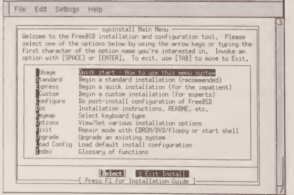

2. 使用 **ARROW** 键向下滚动到 **Configure** 选项，然后按 ENTER。打开 FreeBSD 配置菜单，如下所示。

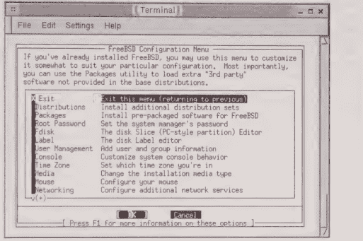

3. **Fdisk** 选项允许你编辑 x86 分区表，就像在其他操作系统中使用 *fdisk* 实用程序一样。如果你使用此选项，完成后会自动移动到下一个选项。

4. **Label** 选项允许你编辑 FreeBSD 切片内的 FreeBSD 分区表（也称为*磁盘标签*）。编辑磁盘标签允许你设置 FreeBSD 分区。

最后两步的详细信息在第 2 章中描述，因此在使用 *sysinstall* 创建新分区时请查阅该章节。使用完 FreeBSD 磁盘标签编辑器工具后，使用 *w* 选项保存你的更改。此时，*sysinstall* 运行 *newfs* 实用程序，在你的新 FreeBSD 分区上创建文件系统。因此，*sysinstall* 可以控制整个分区创建过程——创建 FreeBSD 切片、在该切片内创建 BSD 分区以及在分区上创建文件系统。

#### 使用命令行工具

*sysinstall* 实用程序是创建分区的一种便捷方式，但有时你需要深入研究其使用的底层工具。就分区创建而言，这些工具中有三个：*fdisk*、*disklabel* 和 *newfs*。最后一个工具的变体创建 `FFS` 以外的文件系统。这些工具控制 x86 主分区的创建

基本系统管理

表格、FreeBSD 分区内部的 BSD 磁盘标签，以及 BSD 分区内部的文件系统。

##### 使用 fdisk

与其他操作系统中的磁盘分区程序类似，FreeBSD 的 `fdisk` 允许您查看或编辑 x86 分区表。此程序可以显示分区表信息、从存储在配置文件中的数据写入新的分区表，或者根据通过严格的提示顺序从您那里收集的信息来写入数据。如果您想以更任意的方式更改分区，应使用 `sysinstall` 或非 FreeBSD 的分区工具。

`fdisk` 命令可以使用以下两种语法形式之一：


```
fdisk -f configfile [-itv] [disk]
fdisk [-B|a|stul] [-b bootcode] [-1234] [disk]
```

第一种形式从磁盘上存储的配置文件（`configfile`）中收集数据。如果您经常分区容量相同的磁盘，可以考虑创建一个描述这些磁盘布局的文件并使用此命令格式。结果可能是更快且更少出错率的分。此文件的格式在 `fdisk` 手册页中有说明，如果您想使用此选项，请查阅它。

该命令的第二种形式要么显示磁盘信息，要么允许您编辑分区表。如果您只指定目标磁盘（例如，第一个 EIDE 磁盘的 `/dev/ad0` 或第二个 SCSI 磁盘的 `/dev/dal`），`fdisk` 将显示分区表信息，如下所示：

```
# fdisk /dev/ad0
****** Working on device /dev/ad0 ******
parameters extracted from in-core disklabel are:
cylinders=784 heads=255 sectors/track=63 (16065 blks/cyl)

parameters to be used for BIOS calculations are:
cylinders=784 heads=255 sectors/track=63 (16065 blks/cyl)

Media sector size is 512
Warning: BIOS sector numbering starts with sector 1
Information from DOS bootblock is:
The data for partition 1 is:
sysid 12, (DOS or Windows 95 with 32 bit FAT, LBA)
start 63, size 4192902 (2047 Meg), flag 0
beg: cyl 0/ head 1/ sector 1;
end: cyl 260/ head 254/ sector 63
The data for partition 2 is:
sysid 165, (FreeBSD/NetBSD/386BSD)
start 4192965, size 8401995 (4102 Meg), flag 80 (active)
beg: cyl 261/ head 0/ sector 1;
end: cyl 783/ head 254/ sector 63
The data for partition 3 is:
<UNUSED>
The data for partition 4 is:
<UNUSED>
```

此输出包括磁盘的柱面/磁头/扇区（CHS）几何参数、扇区大小以及四个主分区的信息。特别是，本例中的分区 1 是一个 2047MB 的 DOS 或 Windows FAT 分区，而分区 2 是一个 4102MB 的 FreeBSD 切片。分区 3 和 4 未定义。

> **注意** FreeBSD 的 `fdisk` 不显示逻辑分区信息，也不允许您创建或以其他方式操作此类分区。

您可以与 `fdisk` 一起使用的选项包括：

- `-B` 重新初始化 MBR 中的引导加载器，这有助于修复一些引导问题。
- `-b bootcode` 从指定文件（默认为 `/boot/mbr`）将 MBR 中的引导加载器写入。
- `-U` 更新 MBR。该程序会提示您对磁盘几何参数和所有分区进行更改，使您可以添加、删除或编辑分区信息。
- `-I` 创建一个包含单个覆盖整个硬盘的 BSD 切片的分区表。这是如果您想将磁盘专用给 FreeBSD 时快速设置磁盘的一种方式。
- `-i` 初始化 MBR 并提示更改，作用类似于 `-u`。
- `-f configfile` 从配置文件中读取分区信息。
- `-a` 仅更改活动分区。
- `-s` 打印摘要信息并退出。
- `-t` 测试模式；执行所有常规操作，但不写入数据。
- `-v` 与 `-f` 一起使用时，使 `fdisk` 打印分区表信息。
- `-1 至 -4` 仅对指定分区进行操作。

在实践中，您可能使用 `fdisk -1 /dev/disk0` 或 `fdisk -U /dev/disk0` 进行大多数更改。使用这些命令之一将产生与之前所示类似的输出，只是 `fdisk` 会询问您是否要更改每条信息。在过程结束时，程序会询问您是否要保存更改，因此如果您犯了错误，可以撤销更改。您可能想尝试此命令（添加 `-t` 或使用备用磁盘以确保额外安全），看看它能做什么。


如果您有一个备用的 Zip 磁盘或类似设备，它可以成为一个优秀的测试平台。不过，请务必指定正确的设备标识符。

### 使用 disklabel

`disklabel` 命令允许您查看或修改存储在 FreeBSD 切片内的分区表——即磁盘标签。此命令可以以多种方式调用，每种方式都有其特定的效果。该命令的简化语法如下（如需更多选项，请参阅 `disklabel` 手册页）：

```
disklabel [-wenN] disk [disk-type | auto]
```

在此简化语法中可用的选项包括：

- `-w` 向磁盘写入新的磁盘标签。新的磁盘标签不包含任何分区。通常必须指定 `disk-type` 或使用 `auto` 关键字。
- `-e` 使用由 `EDITOR` 环境变量指定的编辑器编辑现有磁盘标签。退出编辑器后，您的更改将被保存。
- `-n` 阻止将更改写入磁盘；相反，在屏幕上显示摘要。
- `-W` 启用对磁盘标签区域的写入。FreeBSD 通常不允许对磁盘标签进行写入，因此您可能需要使用此选项来启用此类更改。
- `-N` 禁用对磁盘标签区域的写入。此选项会撤销 `-W` 选项的效果。
- `disk` 要修改的磁盘。通常，这是一个 x86 分区标识符，例如 `/dev/ad0s2` 或 `/dev/da0s1`。您可以省略标识符的 `/dev/` 部分，实际上在使用 `auto` 磁盘类型时有时甚至必须这样做。
- `disk-type | auto` `/etc/disktab` 文件包含某些常见磁盘类型的一组磁盘几何参数和分区设置。您可以指定此集合中的一个磁盘，或者传递 `auto` 作为参数让系统自动生成磁盘信息。`disktab` 中的一些磁盘是常规硬盘，但其他则是常见的可移动介质类型，例如 `zip100` 和 `orb2200`。

通常，在准备新磁盘时，您将发出至少两个 `disklabel` 命令：一个用于创建新的 FreeBSD 分区表，另一个用于编辑它。如果发现更改没有效果，可能需要使用 `-W` 和 `-N` 选项的命令来包围这些操作。例如，以下序列在 `/dev/da0s4` 上设置一个新的 Zip 磁盘：

```
# disklabel -w da0s4 auto
# disklabel -e /dev/da0s4
```

## 第 7 章：管理分区

这些命令看起来很简单，但第二个命令隐藏着相当大的复杂性，因为您需要手动编辑磁盘标签信息。您在编辑器中看到的文件开头有几行信息，例如 CHS 几何参数和扇区数。在文件末尾是分区定义。在一个新的系统上，只有一个分区，其文件系统类型（`fstype`）为 `unused`。更完整的布局类似于以下内容：

```
8 partitions:
  #           size     offset    fstype   [fsize bsize bps/cpg]
  a:  262144      0     4.2BSD    1024  8192   22  # (Cy1. 0 - 16*)
  b:  213163   262144    swap     # (Cy1. 16*- 29*)
  c:  8401995      0     unused     0     0     # (Cy1. 0 - 522)
  e:  307200   475307    4.2BSD    1024  8192   23  # (Cy1. 29*- 48*)
  f:  307200   782507    4.2BSD    1024  8192   23  # (Cy1. 48*- 67*)
  g:  3407872  1089707  4.2BSD    1024  8192   22  # (Cy1. 67*- 279*)
  h:  3904416  4497579  4.2BSD    1024  8192   22  # (Cy1. 279*- 522*)
```


第一列是分区识别号。第二列是分区的大小（以块为单位，通常为 512 字节；您可以通过查找文件中标记为 `bytes/sector` 的行来再次确认）。偏移量列是分区的起始位置。`fstype` 列是文件系统类型——对于常规 FFS 分区，请将其设置为 `4.2BSD`。`fsize`、`bsize` 和 `bps/cpg` 列指定文件系统特定的值。尝试使用此处显示的默认值（`bps/cpg` 值不是至关重要）。每行井号后的信息是描述分区所占柱面号的注释；您可以忽略此信息。

分区标识符具有特定含义。分区 `a` 保留用于根（`/`）分区，`b` 保留用于交换空间，而 `c` 指的是整个磁盘。虽然今天不再使用，但 `d` 也曾被保留，如果您使用 `d` 分区，某些实用工具可能会出现行为异常。其余的分区字母直到 `h` 都可用于常规文件系统。

以这种方式创建分区通常相当棘手，因为您必须非常小心地不要创建重叠的分区。您必须检查并重新检查大小和偏移量列；新分区的偏移量值应恰好等于前一个分区的偏移量和大小值之和。（例外情况是，就这些计算而言，分区 `c` 基本上是不存在的。）

使用 `disklabel` 工具编辑 BSD 磁盘标签是一项非常强大的功能，但造成损害的可能性极大。因此，您可能应该使用 `sysinstall` 及其交互式 `disklabel` 界面，而不是直接使用 `disklabel`。不过，如果您出于某种原因需要进行不寻常的更改，访问 `disklabel` 可能会证明是有用的。

### 使用 newfs

`newfs` 命令可用于创建新的 FFS 文件系统。其语法如下：

```
newfs [-NOU] [-S sector-size] [-b block-size] [-f frag-size] [-g file-size] [-i bytes-per-inode] [-m percent] [-o space|time] [-s size] [-v] device
```

> 注意
>
> 此语法展示了可用 `newfs` 选项的一个子集。剩余的选项大多与基于磁盘几何信息的优化有关，这些对于现代硬盘而言毫无意义。

该命令各选项的含义如下：

- `-N`：显示文件系统参数，而不实际创建文件系统。
- `-O`：创建 4.3BSD 格式的文件系统。当系统必须使用旧版 BIOS 启动时，通常使用此选项。
- `-U`：启用*软更新*，这是一种优化策略，可加快电力故障或系统崩溃后的恢复速度。
- `-S sector-size`：设置以字节为单位的扇区大小。默认值为 512，几乎永远不应更改此值。
- `-b block-size`：设置文件系统使用的块大小。这是 FreeBSD 可为文件分配的最小磁盘空间量。此值必须是 2 的幂，最小允许值为 4096。默认值为 16384。较大的值可能会在大型分区上带来适度的性能提升，但代价是浪费磁盘空间。
- `-f frag-size`：设置以字节为单位的片段大小。此值必须是介于*块大小*/8 和*块大小*之间的 2 的幂。默认值为 2048。
- `-g file-size`：设置预期的平均文件大小。
- `-i bytes-per-inode`：设置每个 inode 的字节数。每个文件都与一个 inode 相关联，因此这实际上设置了文件系统可支持的文件数量上限。默认情况下，每 4 × *片段大小* 字节的磁盘空间创建一个 inode，通常已足够。
- `-m percent`：设置保留给 root 的磁盘空间百分比。默认值为 8，这为 root 在磁盘填满时提供了一些恢复空间。如果没有此选项，root 可能甚至无法登录以修复问题。
- `-o space|time`：将 FFS 优化为空间模式（以便在分区上容纳最多的文件）或时间模式（以获得最佳磁盘速度）。如果*百分比* 为 8 或更高，则默认优化时间为目标；如果*百分比* 小于 8，则默认优化空间为目标。
- `-s size`：设置以扇区为单位的文件系统大小。此值通常由分区大小决定。
- `-v`：强制 `newfs` 在无分区设备上创建文件系统。例如，您可以使用此功能来创建 FFS 软盘。
- `device`：设置设备名称，例如 `/dev/da0s4e` 或 `/dev/ad1s2a`。

在大多数情况下，您不需要这些选项中的大部分；`newfs` 会选择合理的默认值。相反，您可以输入如下所示的命令：

```
# newfs /dev/da0s4e
```

此命令在 `/dev/da0s4e` 上创建一个新的文件系统。在某些情况下，您可能希望或需要添加一些选项。

> 对于 Zip 磁盘等可移动介质设备，通常可以设置 `-m 0`，因为这些设备通常不需要用于基本系统操作。使用 `-m 0` 可以为您提供更多的数据存储空间，这通常是可以移动介质设备的最佳配置。

FreeBSD 包含另一个与 `newfs` 相关的工具：`newfs_msdos`。该命令创建 FAT 文件系统。其操作方式与 `newfs` 类似，但选项不同。

`newfs_msdos` 最重要的选项是 `-F FAT-type`（`FAT-type` 取值可以是 12、16 或 32，代表 FAT 的位大小）和 `-L label`（允许您设置 FAT 文件系统的磁盘标签）。另一个选项是严格必要的：`newfs_msdos` 会根据分区或设备大小计算默认的 FAT 大小，标签可以留空，尽管它可能有助于在 Windows 中识别磁盘。

通常，您会使用 `newfs_msdos` 在软盘或其他可移动介质设备上放置 FAT 文件系统。如果您希望在新磁盘上为 Windows 增加空间，或在某些紧急恢复情况下（如果您使用 FreeBSD 恢复 DOS 或 Windows 系统），它也很有用。您通常不会在 FreeBSD 分区上创建 FAT 文件系统，而是在主分区或逻辑 x86 分区上，或在原始软盘设备上。

> 当在软盘上使用 DOS 和 Windows 的 `format` 命令时，它结合了低级格式化（准备磁盘以接收数据）和高级格式化（写入文件系统）。在 FreeBSD 中，这是两个独立的操作。如果软盘从未格式化过，您可以通过键入 `fdformat /dev/fd0` 对其执行低级格式化。然后，您可以使用 `newfs` 或 `newfs_msdos` 分别将 FFS 或 FAT 文件系统写入磁盘。您不需要对硬盘执行低级格式化，因为硬盘在工厂时就已经进行了低级格式化。

## 挂载分区

创建分区并在其上创建文件系统后，您必须挂载它才能使用。挂载可以通过两种方式完成：您可以使用 `mount` 命令临时挂载分区，或者通过在 `/etc/fstab` 文件中为分区创建条目来配置 FreeBSD 自动挂载分区。

> 注意
>
> 在某些情况下，无需挂载即可访问文件系统。特别是，[Mtools](http://mtools.linux.lu) 和 [HFS Utilities](http://www.mars.org/home/xob/proj/hfs/) 包分别允许您访问 DOS/Windows FAT 和 Macintosh HFS 文件系统，而无需挂载它们。这些工具最常用于访问软盘，或偶尔用于访问 Zip 磁盘或类似的可移动介质设备。一些 Macintosh 的 CD-ROM 使用 HFS，因此 HFS Utilities 对于从这些 CD-ROM 中检索文件可能很有用。

### mount 命令

如果您希望临时挂载分区、用于测试目的或访问可移动介质设备，通常的做法是使用 `mount` 命令。此命令将文件系统附加到挂载点，挂载点是目录树中的某个目录。然后，文件系统上的文件将在那个挂载点下可用。此命令的语法为：

```
mount [-adoprwx] [-o options] [-t fs-type] [device] [mount-point]
```

这些参数的含义如下：

- `-a`：此选项挂载 `/etc/fstab` 中描述的所有文件系统（见下一节），除了那些在 `/etc/fstab` 中标记为 `noauto` 的、已经挂载的或因使用 `-t` 而被排除的文件系统。
- `-d`：此选项执行挂载文件系统的所有工作，除了实际的挂载操作。它对调试很有用，特别是与 `-v` 结合使用时。
- `-f`：此选项可能产生两种效果。首先，它强制以读/写模式挂载未清理的文件系统（即上次使用时未正确卸载的文件系统），这可能存在危险。其次，当使用 `-u` 以只读模式重新挂载文件系统时，它强制撤销对任何打开文件的读/写访问。
- `-p`：此选项以 `/etc/fstab` 使用的格式显示已挂载文件系统的相关信息。
- `-r`：此选项导致文件系统以只读方式挂载。
- `-u`：使用此选项更改已挂载文件系统的状态。例如，`mount -ru /floppy` 将已挂载的 `/floppy` 重新挂载为只读文件系统。
- `-v`：此选项显示挂载过程的详细信息。
- `-w`：此选项导致文件系统以读/写方式挂载。对于大多数文件系统，这是默认行为。


- `-o options`：您可以通过各种选项参数来修改文件系统的处理方式。常见选项包括 `nodev`（忽略设备文件）、`noexec`（不允许执行可执行文件）、`nosuid`（不尊重可执行文件上的 set user ID 位）、`nosymfollow`（不跟随符号链接）以及 `union`（将文件添加到挂载点的现有文件中，而不是使现有文件不可访问）。`mount` 手册页描述了更多选项，还有一些文件系统特定的选项，其中一些在第 4 章中有介绍。

- `-t fs-type`：您可以使用此选项指定文件系统类型（*fs-type*）。默认值是 *ufs*，它会挂载 FreeBSD 的原生 FFS。其他可能的选项包括 `cd9660`（用于 ISO-9660、Joliet 和 Device CD-ROM）、`msdosfs` 或 `msdos`（用于 DOS 或 Windows FAT 软盘或分区）、`ext2fs`（用于 Linux ext2fs）、`ntfs`（用于 Windows NT/2000/XP NTFS）以及 `nfs`（用于网络文件系统或 NFS 网络文件共享导出）。

- `device`：*device* 是与分区或可移动磁盘设备相关联的设备文件名。在 NFS 的情况下，这是导出的网络规范，由服务器主机名、冒号和导出目录的路径组成，例如 *nfsserver:/home*。

- `mount-point`：这是您希望文件变得可访问的位置。通常它是一个空目录。

如果文件系统在 `/etc/fstab` 中列出，您可以使用简化的 `mount` 命令，该命令仅包含设备名称或挂载点，但不包含选项。系统会从 `/etc/fstab` 文件中恢复选项。这种方法通常用于软盘和 CD-ROM 等可移动介质设备。例如，以下命令在标准的 FreeBSD 安装中挂载 CD-ROM：

```
# mount /cdrom
```

如果您希望指定额外选项或挂载未列在 `/etc/fstab` 中的设备，您必须添加更多信息——至少包括设备文件和挂载点。例如，假设您正在安装一个新的硬盘，用作更大的 `/home` 目录。如果您按照本节前面的说明进行了准备，并在 `/dev/ad2s1e` 上创建了文件系统，您可以按如下方式将其临时挂载在 `/mnt` 上：

```
# mount /dev/ad2s1e /mnt
```

然后，您可以将现有的 `/home` 目录树复制到新分区，删除原始文件，并编辑 `/etc/fstab` 将新分区挂载在 `/home` 上。

> **注意** 在将文件复制到新磁盘时，最好在测试新配置期间保留原始文件一段时间。如果某些文件未正确复制，您可以返回原始目录以检索它们。您可以使用 `mv` 命令重命名目录，或者卸载旧分区，并在几小时或几天内不将其转换为其他用途。

在挂载非 FFS 分区或磁盘时，你可以使用此处描述的 `mount` 命令，并结合 `-t` 选项。或者，你可以使用专用于每种文件系统的命令，例如 `mount_cd9660` 和 `mount_msdosfs`。这些命令及其选项将在第 4 章中介绍。

#### 使用 /etc/fstab

`/etc/fstab` 文件控制 FreeBSD 启动时挂载哪些分区，以及哪些分区和磁盘可以使用截断选项进行挂载，如前文所述。清单 7-1 展示了一个简单的 `/etc/fstab` 文件。该清单的第一行是一个注释（由开头的井号 `#` 指示），它为文件中的每个字段提供了标签。在每一行中，一个或多个空格或制表符分隔每个字段。

| 设备 | 挂载点 | 文件系统类型 | 选项 | 转储 | 通过号 |
| :--- | :--- | :--- | :--- | :--- | :--- |
| /dev/ad0s2b | none | swap | sw | 0 | 0 |
| /dev/ad0s2a | / | ufs | rw | 1 | 1 |
| /dev/ad0s2f | /home | ufs | rw | 2 | 2 |
| /dev/ad0s1 | /windows | msdosfs | rw,-s,-u=1000 | 0 | 0 |
| /mnt/cd0 | /mnt/cdrom | cd9660 | ro,noauto | 0 | 0 |
| proc | /proc | procs | rw | 0 | 0 |
| speaker | /home/speaker/home | nfs | rw | 0 | 0 |

`/etc/fstab` 文件中的大多数信息与在挂载命令行上提供的信息相同。特别是，**设备** 字段指定与分区或磁盘关联的设备文件名，**挂载点** 字段列出挂载点，**文件系统类型** 字段指定文件系统类型。**转储** 字段提供有关转储频率的信息——如果你使用 `dump` 进行备份，这是 `dump` 实用程序备份分区的频率。**通过号** 字段是 `fsck` 在系统启动时检查文件系统的顺序——通常，根 `/` 文件系统使用顺序 1，而其他 FFS 分区使用顺序 2。

**选项** 字段需要更多解释。它列出了可以通过 `mount` 的 `-o` 参数传递的选项。其中一些选项重复了不使用 `-o` 的挂载参数的功能；其他选项是 `-o` 独有的，或仅用于 `/etc/fstab`，还有少数是特定于文件系统的。一些常见选项包括：

- **ro 和 rw** 这些选项分别指定只读或读/写挂载。初始的 FreeBSD 配置为每个文件系统指定其中一个。

- **noauto** 默认情况下，FreeBSD 在启动时挂载文件系统。某些设备，如 CD-ROM，可能更适合配置为 `noauto`，这使 FreeBSD 在启动时忽略它们。此设置允许你发出简化的挂载命令，例如 `mount /mnt/cdrom`，以挂载清单 7-1 中指定的 CD-ROM 设备。

**文件系统特定选项** 清单 7-1 展示了 `/windows` 挂载点的一些文件系统特定选项的使用。具体来说，`-s` 和 `-u=1000` 选项分别使 FreeBSD 忽略 VFAT 长文件名并将所有文件的所有权分配给用户 ID (UID) 为 1000 的用户。第 4 章介绍了此类选项，你可以从特定挂载子命令（如 `mount_msdosfs`）的手册页获取更多信息。

当你创建 `/etc/fstab` 文件时，更改不会立即生效；在你看到新添加的文件系统之前，必须键入 `mount -a` 或重新启动，并且除非你重新启动或手动卸载，否则你删除的文件系统不会消失，如即将到来的“卸载分区”部分所述。

清单 7-1 展示了一种名为 proc 文件系统的特殊文件系统的使用，它挂载在 `/proc` 上。这并非通常意义上的文件系统。相反，它是一种硬件接口方法，允许程序访问有关你硬件的信息。与磁盘文件系统一样，它必须被挂载。你应该小心不要删除此条目，因为越来越多的 FreeBSD 程序需要它。

清单 7-1 中的最后一行展示了对 NFS 导出的访问。正如使用 `mount` 挂载此类文件系统一样，你指定服务器名称和服务器上的路径。第 18 章涵盖配置 NFS 服务器。

### 卸载分区

当你使用完软盘、CD-ROM 或其他可移动介质设备后，你必须先卸载它，然后才能安全地弹出设备。卸载文件系统会告诉 FreeBSD 完成任何挂起的操作，并将该分区标记为处于稳定状态。如果你希望使某个硬盘分区不可访问，也可能需要卸载该硬盘分区。

> **注意**
>
> x86 计算机上使用的软盘驱动器有弹出按钮，允许你在先卸载软盘的情况下弹出软盘。这样做可能会损坏磁盘上的数据！请务必在弹出软盘之前先卸载它！

卸载设备的命令是 `umount`（这不是拼写错误；该命令不包含第一个 n）。该命令的语法是

```
umount [-fv] [-a | -A] [-h host] [-t type] device | mount-point
```

这些选项的含义是

- `-f` 此选项强制卸载操作，即使设备上有打开的文件。在某些情况下这可能很有用，但通常最好避免使用此选项。

- `-v` 此选项在文件系统被卸载时显示额外信息。

- `-a` 此选项卸载 `/etc/fstab` 中描述的所有文件系统，除了根 `/` 文件系统。

- `-A` 此选项卸载当前挂载的所有文件系统，除了根 `/` 文件系统。

- `-h host` 此选项通常用于从指定服务器卸载 NFS 导出。不过，如果与 `-t` 结合使用，你可以用它来卸载本地文件系统。

- `-t type` 你可以使用此选项将 `umount` 的操作限制为指定类型的文件系统。

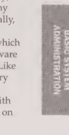

在大多数情况下，输入 `umount` 后跟设备名称或挂载点即可卸载单个文件系统。例如，你可以输入以下内容来卸载按照清单 7-1 指定的挂载的 CD-ROM：

```
# umount /mnt/cdrom
```

在某些情况下，你可能需要添加更多选项。例如，如果用户正在使用某个设备，`-f` 可能很有用——但使用此选项可能会导致文件在使用过程中消失，这可能导致许多应用程序出现不可预测的问题，因此你应仅将此选项作为最后手段使用。


### 使用传统 UNIX 分区方案

前面关于分区的描述告诉了你如何使用分区工具，从提供命令信息的意义上说。另一件事是如何应用这些工具——也就是说，你应该创建什么样的分区，它们应该挂载在哪里，等等。在某种程度上，驻留在特定位置的文件类型决定了这些事情。还有一些在 FreeBSD（或更广泛地说在 UNIX）中通用的约定，以及实际限制。

**注意** 在安装 FreeBSD 时，你将会创建分区方案。我提供本节的信息，以便你可以将其用于后续安装，或在添加或更换硬盘时提供帮助。

#### 哪些目录可以是分区？

你应该考虑的第一个问题是哪些目录可以是分区。大多数都可以。FreeBSD 的目录结构基于根 (`/`) 分区，其中包含普通目录和挂载点。自然，根目录需要自己的分区。大多数直接位于根目录下的目录也可以位于自己的分区中。主要的例外是 `/etc`, `/bin`, `/sbin` 和 `/boot`。`(/dev` 和 `/proc` 文件系统也是独立的，但它们不占用磁盘上的分区。）这些目录都包含系统启动时需要的实用程序。

除了直接位于根分区下的分区外，你还可以将子目录放在自己的分区中。例如，你可能希望将 `/usr/local` 或 `/usr/X11R6` 放在自己的分区中。无论 `/usr` 目录是位于自己的分区中，还是根分区上的普通子目录，此配置都将有效。

#### 常见分区方案

FreeBSD 安装例程可以自动创建常见的分区布局。特别是，系统可能会自动设置独立的根 (`/`)、`/home`、`/usr`、`/tmp`、`/var` 和 swap 分区，使用为平均系统设计的尺寸。第 2 章描述此安排。`/home` 目录保存用户文件，`/usr` 保存大多数程序文件，`/tmp` 保存用户临时数据，`/var` 保存系统队列和其他系统级临时数据，swap 作为系统 RAM 的扩展。如果你喜欢，你可以使用尽可能少的两个分区：一个根分区和一个 swap 分区。如果你希望增加分区的使用，你可以这样做。五分区 FreeBSD 分割的常见添加项包括 `/usr/X11R6`、`/usr/local`、`/opt` 以及用于额外用户空间的扩展目录（如果需要添加空间，用户的家庭目录可以分布在多个目录或分区中，例如单独的 `/home` 和 `/home2` 目录）。

为这些功能使用独立分区与试图使用很少的分区相比有几个优势：

- **可变的文件系统和挂载选项** 你可以对每个分区使用不同的文件系统和挂载选项，从而优化系统性能并提高安全性。例如，`/usr` 可以只读挂载，降低恶意指纹修改重要系统文件的风险；或者你可以挂载 `/var` 并带有优化磁盘速度的选项，如果它被大量使用。

- **文件系统布局** 通过仔细规划，你可以将分区放置在磁盘中的顺序以优化性能。频繁访问的分区应靠近磁盘中心，以减少磁头寻道时间。为此，使用 `fdisk` 或 `disklabel` 以期望的顺序创建分区。如果你有两个物理磁盘，你可以放置分区，使得两个频繁使用的分区每个磁盘一个，再次提高性能。

- **提高的健壮性** 磁盘在电源故障或系统崩溃后有时会丢失数据。如果你的分区较小，你很可能会丢失更少数据，从而大大简化恢复工作。

这些优势至少部分被使用少量分区的一个优势所抵消：使用独立分区意味着每个单独的分区更有可能很快填满，特别是如果你错误判断了分区大小。你通常可以通过使用符号链接将子目录放在其他分区上来解决此限制，但此配置需要额外的设置工作，并且减少了使用多个分区的好处。

### 挂载非 FreeBSD 分区

除了标准的 FreeBSD 分区外，你可能需要挂载非 FreeBSD 文件系统。这些可能是其他操作系统（如 Windows）的分区，也可能是软盘或 CD-ROM 等可移动介质设备。挂载此类文件系统有两种常见方法：

- 从根目录挂载 你可以直接从根目录挂载非 FreeBSD 文件系统。例如，默认配置包含一个用于 CD-ROM 设备的 `/cdrom` 挂载点。你可能会创建一个 `/c` 或 `/windows` 挂载点来存放 Windows 分区的内容。

- 从 /mnt 挂载 传统上，`/mnt` 目录用于存放可移动介质或其他临时文件系统。在默认配置中，`/mnt` 不包含任何子目录，但你可能会为特定目的创建子目录，例如用于软盘的 `/mnt/floppy` 或用于 CD-ROM 的 `/mnt/cdrom`。

列表 7-1 展示了这两种放置方式的示例。特别是，该列表包含一个用于 Windows 文件系统的 `/windows` 目录，一个用于存放来自演讲者文件服务器导出的 `/speaker` 目录及 `/speaker/home` 子目录，以及一个用于 CD-ROM 的 `/mnt/cdrom` 目录。最后一项与标准的 FreeBSD 配置有所不同。

### 理解 FHS

如第一章所述，UNIX 的历史包括许多分裂为竞争分支的过程，以及分支之间思想的交叉授粉。这一狂野的过去的一个后果就是文件位置方案的激增。这种情况通常被视为 UNIX 整体上的一个缺点，因为这意味着受训于一种 UNIX 变体的管理员在管理另一种变体时可能会遇到问题，仅仅因为管理员可能不知道相关文件位于何处。解决这一问题的部分方案是文件系统层次标准（FHS），它于 20 世纪 90 年代中期开发，旨在将目录用途标准乃至关键系统文件的放置正式化。本节提供 FHS 的概述。理解它将有助于你理解 FreeBSD 为何将配置、程序和用户文件放置在其所在位置。

#### FHS 的作用

FHS 在其网站 http://www.pathname.com/fhs/ 上可用文件中有完整描述。在我写这些内容时，最新版本是 2.2，发布于 2001 年 5 月。FHS 2.3 的工作正在进行中，但这里描述的基本功能在 2.2 及后续版本中应保持相关。

FHS 建立了用于描述目录的两个主要区分：

- **静态与可变文件** *静态文件* 很少更改，而 *可变* 文件则会更改。例如，程序二进制文件被视为静态，而用户数据文件则为可变。

- **可共享与不可共享文件** 在某些情况下，与其他计算机共享某些文件是有意义的，但其他文件在本质上具有本地性质，且永远不应共享。例如，用户数据文件和程序文件都可能可共享，但本地配置文件则不可共享。

> **注意** *你可以配置 NFS 服务器以共享不可共享目录，但这样做没有优势，且可能存在安全风险。*

综合来看，这些标准创建了一个 2×2 矩阵。FHS 试图将每个目录放置在此矩阵的一个单元格中。在某些情况下，直接位于根目录下的目录无法放置在单个单元格中，此时 FHS 会将子目录放置在单元格中。图 7-1 展示了此方案，它呈现了这个 2×2 矩阵以及放置在合适单元格中的目录样本。目标是能够对目录进行分类，以便尽可能将数据放置在可能只读挂载的分区上（用于静态文件），并将可能通过 NFS 共享的目录与不应如此共享的目录隔离开来。

> **注意** *静态/可变和可共享/不可共享的区分并非绝对。例如，尽管图 7-1 显示 `/home` 是可共享的，但你可能不想共享你的 `/home` 目录。*

在此层次结构中，FHS 列出了一系列必需和可选目录。为了符合 FHS，操作系统必须包含必需的目录，或指向其他位置的具有相同名称的链接。该标准还包括关于某些目录的额外信息；例如，它指出 `/bin` 不应有子目录，并提供了一些目录中应存在的最少文件集的信息。

| | 可共享 | 不可共享 |
|---|---|---|
| 静态 | `/usr`<br>`/opt` | `/etc`<br>`/boot` |
| 可变 | `/home`<br>`/var/mail` | `/var/run`<br>`/var/log` |


#### FHS 目录概览

完整的 FHS 是一份 41 页的文件，因此在本章中完全描述它是可能的。FHS 目录的亮点包括：

- 根（`/`）文件系统 此目录是文件系统树的基底。FHS 规定此目录必须包含名为 `/bin` 、 `/boot` 、 `/dev` 、 `/etc` 、 `/lib` 、 `/opt` 、 `/sbin` 、 `/tmp` 、 `/usr` 和 `/var` 的子目录或挂载点。FHS 还列出了三个在许多系统中存在的可选目录：`/home`、 `/lib<qual>` 和 `/root` 。

- `/bin` 此静态目录是可共享的，但由于其重要性，很少有系统将其作为客户端挂载。最基本的用户可访问二进制文件（程序） reside 在此处，例如 `ls`、 `cp` 和 `sh` 。其理念是，即使在非根分区无法挂载的情况下（在某些紧急情况下可能发生），这些命令也应可访问。

- `/boot` 此静态且不可共享的目录存放基本的启动文件，如 FreeBSD 内核和引导加载程序支持文件。

- `/dev` 此静态且不可共享的目录存放用于访问计算机硬件的设备文件。在 FreeBSD 5.0 中，这是通过一个特殊的文件系统 devfs 实现的，该文件系统根据实际安装在计算机中的硬件生成设备文件。

- `/etc` `/etc` 目录是静态且不可共享的；其内容在第 5 章中进一步描述。此目录存放系统配置文件。


- `/lib` 此静态且可共享的目录存放重要的系统库——支持其他程序的程序代码。（与 `/bin` 类似，`/lib` 在技术上可共享，但很少被共享。）具体来说，存储在 `/bin` 或 `/sbin` 中的程序所需的任何库都必须 reside 在此处。FreeBSD 缺少 `/lib` 目录，因为 `/bin` 和 `/sbin` 中的程序是静态编译的 ，意味着它们无需库即可运行。

- `/mnt` 这是用于临时文件系统的挂载点。在默认的 FreeBSD 安装中，它是没有子目录的单个目录，但一些管理员在此目录下创建子目录以挂载不同的特定介质，例如 `/mnt/floppy` 和 `/mnt/cdrom` 。

- `/opt` 附加软件包 reside 在此静态且可共享的目录中。在实践中，FreeBSD 系统中的大多数此类软件包由 `/usr/local` 拾取，因此 `/opt` 通常很少使用。当它被使用时，它包含以其包含的程序命名的子目录，例如用于 OpenOffice.org 的 `/opt/OpenOffice.org`。

- `/sbin` 此静态且可共享的目录与 `/bin` 非常相似，但它存放那些可能仅被系统管理员使用的程序，如 `shutdown` 和 `fsck` 。

- `/tmp` 此可变且不可共享的目录存放临时文件。它必须对所有用户和程序可访问（既可读也可写）。程序不能假设存储在 `/tmp` 中的文件在程序调用之间可访问，尽管在实践中它们通常是可访问的。

- `/usr` 此可共享且静态的目录非常大，因为它存放了系统的大部分程序文件。它包含一系列镜像根目录下某些目录的子目录，例如 `/usr/bin`、 `/usr/sbin` 和 `/usr/lib`。然而，这些目录存放的不是关键系统文件，而是系统不需要用于最小功能的普通程序。还有几个子目录本身包含重要的文件系统层次结构，其中两个将在下文描述。

- `/usr/local` 此子目录存放 *本地* 文件——即专门为其驻留的系统创建或安装的文件，区别于作为基本 OS 标准部分的文件。例如，你可能从头编译源代码，而不是从预编译包安装程序。此类文件应安全免受 OS 更新过程的自动更新。在实践中，FreeBSD 严重依赖此目录树，因为 FreeBSD 在此安装了许多软件包，包括通过 ports 系统安装的大多数程序。（安装程序的方法，包括 ports 系统，在第 11 章中描述。）

- `/usr/X11R6` 此目录树存放与 X 窗口系统相关的文件，包括 X 服务器和基于 X 的应用程序。

- `/var` 此目录存放可变数据文件。如图 7-1 所示，此目录存放可共享和不可共享的子目录。示例包括运行文件（`/var/run`，用于在程序运行时通信，可能包括其进程 ID 号），邮件 spool 文件（`/var/mail`），以及系统日志文件（`/var/log`）。

- `/home` 此可选目录存放可变且可共享的数据——具体来说是用户数据文件。在实践中，很少有系统缺少 `/home` 目录，尽管有些可能将其命名为其他名称或将其拆分到多个目录中。通常，每个用户都有一个 `/home` 子目录。也可能有存放用户在之间共享数据的 `/home` 子目录。

- `/lib<qual>` FHS 将此指定为可选目录的名称，该目录是可共享且静态的。名称中的 `<qual>` 部分是库类型规范的替代。其理念是系统可以有两个或更多库目录，每个支持某些系统功能集。此功能最常用于 64 位架构上 32 位和 64 位二进制文件的支持。因此，x86 系统上的 FreeBSD 不使用此目录。

- `/root` 此可选的不可共享且可变目录作为 *root* 的主目录；它包含 *root* 的配置文件以及 *root* 可能生成或需要在偏僻位置存储的任何文件。如果此目录不存在，则默认使用根目录（`/`）作为 *root* 的主目录。

基础系统管理员

**注意**

*尽管它们的发音相同，但 /root 目录和根（/）目录是两个不同的目录。请勿混淆它们。*

你可以通过阅读 FHS 网站（http://www.pathname.com/fhs/）上的文档来了解有关 FHS 目录的更多信息。这些文档与 FreeBSD 自身分区布局的信息（通过输入 **man** hfs 可查看）有大量的重叠部分。

总之，FHS 为类 UNIX 操作系统提供了一个结构，规定了库文件、用户程序文件、系统管理程序文件、配置文件、临时文件以及用户数据文件等重要文件类型的存放位置。在这些许多情况下，FHS 还进一步细分子文件类型，例如在 `/usr` 目录甚至 `/usr` 的子目录中，存放那些对系统运行不至关重要的程序文件。理解这种结构有助于你在需要时定位文件。

#### FreeBSD 对 FHS 的遵从程度

总体而言，FreeBSD 可以被称为在大多数方面都符合 FHS 标准。虽然 FreeBSD 包含了所有必需的目录并遵循指南的整体精神，但它并不符合 FHS 的所有细节。例如，FHS 规定 login 和 mount 程序应位于 `/bin` 中，但 FreeBSD 分别将这些程序放在 `/usr/bin` 和 `/sbin` 中。FreeBSD 还大量依赖于 FHS 未包含的目录（此类目录并不违反 FHS，但并未被其明确涵盖）。例如，FHS 未提及 `/usr/local/etc`，而许多 FreeBSD 软件包在此处放置配置文件。因此，FHS 是理解 FreeBSD 目录树的良好指南，但它并非关于内容放置位置的最高权威。

# 总结

管理分区对于 FreeBSD 系统管理至关重要。虽然分区在系统安装时定义，但当你添加或更换硬盘，或者发现原始分区布局不足时，可能需要修改或创建新分区。某些可移动媒体设备，如 Zip 磁盘，也使用分区。在 FreeBSD 中，**sysinstall** 实用程序提供了一个相当直观的交互式界面，用于管理分区和文件系统。如果你不使用此类工具，或者需要执行某些特别奇特或不寻常的操作，你可以直接运行底层程序（**fdisk**、**disklabel** 和 **newfs**）。

创建分区后，你通常需要通过挂载它们来访问，这意味着你发出 `mount` 命令，将文件系统添加到目录树中的某一点。虽然你可以将某些分区挂载在几乎任何位置，但 FreeBSD 的目录结构要求某些文件必须位于特定位置，理解这种结构有助于你将新分区或可移动媒体设备挂载到合适的位置。

# 完整参考


# 第 8 章

# 文件管理

FreeBSD 系统管理员和普通 FreeBSD 用户都需要知道如何管理文件——毕竟，使用计算机的大部分操作都涉及以某种方式操作文件。因此，本章介绍了 FreeBSD 的一般文件操作模型和工具。本章首先探讨文件所有权和权限。这些问题在之前的章节中曾提及，但本节的讨论更为深入。随后，本章继续介绍用于操作文件的许多命令，包括复制、删除和查找文件的命令，以及更改其所有权或权限的命令。最后，本章以备份计算机或其部分数据的信息作为结尾。

> **注意** 本章专注于文本模式工具。你可以使用 GUI 文件管理器通过其点击式界面完成本章描述的许多任务。然而，这些工具的标准程度不高——有许多相互竞争的 GUI 文件管理器。第 3 章介绍了 GNU 对象网络模型环境（GNOME）中可用的文件操作工具，GNOME 是 FreeBSD 中较流行的 GUI 桌面环境之一。

### 理解所有权和权限

FreeBSD 凭借其 UNIX 传统，严重依赖于文件所有权和权限的概念。这两个概念的实现是许多 FreeBSD 安全措施的核心，使许多用户能够使用同一台计算机，同时保护其文件免受意外或刻意的窥探或破坏。

每个文件都有一个所有者和一组授予或拒绝访问该文件的权限。理解这些功能如何工作以及它们如何相互作用，对于有效的文件管理至关重要。这种知识对于系统管理员尤为重要，他们必须确保系统文件和目录上的权限以适合系统的方式设置。

#### 账户与所有权的关系

第 2 章和第 3 章介绍了 FreeBSD 账户的概念。第 10 章提供了关于账户和账户管理的更多细节。目前，请记住，账户是一组相互关联的数据结构，使一个人能够使用计算机。账户也可用于内部目的，例如专门用于特定服务器的账户。多人可以共享单个账户，但不鼓励这种做法，因为它使滥用行为难以追踪，而且通常使用单独的账户对所有用户更便捷。

每个账户都链接到一个或多个*组*。每个组是一组账户的集合。例如，假设你的计算机托管了四个用户：*dana*、*fox*、*walter* 和 *monica*。这个系统可能有两个组：*research*（研究）和 *development*（开发）。用户 *dana* 和 *walter* 可能在 *research* 组中，而 *dana*、*fox* 和 *monica* 在 *development* 组中。此外，每个系统都支持几个标准系统组，这些组由系统账户使用。


从某种意义上说，每个文件都同时属于一个用户和一个组，尽管用户的所有权更为重要。所有权以用户 ID（`UID`）和组 ID（`GID`）记录。这些是与账户（或组）以及文件相关的数字。例如，文件可能记录为 `UID` 为 1021，`GID` 为 1003。这些数字可能等同于用户 `dana` 和 `development` 组。（事实上，FreeBSD 内部使用 `UID` 和 `GID`；在与用户交互时主要使用诸如 `dana` 或 `development` 这样的名称。）

当用户创建文件时，该用户拥有该文件。新文件的组通常由创建该文件的目录的组设置。例如，如果 `/home/dana` 目录属于 `research` 组，那么当 `dana` 在此目录中创建新文件时，这些文件也将属于 `research` 组。如果 `dana` 想要创建属于 `development` 组的文件，她可以使用稍后部分“更改所有权/”中描述的 `chgrp` 命令，或者她可以创建一个子目录，使用 `chgrp` 更改其组所有权，并在该子目录中创建新文件。

这些关系的性质有几个后果，在某些情况下可能很重要：

- **文件所有者和组的独立性**：拥有文件的用户和文件所属的组是独立的。尽管 `walter` 不是该组的成员，但一个文件可以属于 `walter` 但归属于 `development` 组。

- **跨系统或操作系统的 Owner/ID 编号对应**：如果个人在多个系统上拥有账户，该用户在两个系统上的 `UID` 编号可能相同，也可能不同。这种不匹配可能导致通过某些方式（如使用 FFS 的软盘或通过网络文件系统（`NFS`）网络文件传输）传输文件时，该文件看起来拥有错误的所有者。类似地，如果计算机运行多个类 UNIX 操作系统，你可能需要采取措施确保所有操作系统使用相同的 `UID`/账户名称映射，以避免在读取彼此的文件系统时出现不匹配。

- **`UID` 更改**：如果你更改账户的 `UID`（例如，为了解决上述此类问题），你需要调整该用户拥有的所有文件的所有权。

- **用户名更改**：你可以更改与账户关联的用户名而无需触及文件。不过，这种更改并不常见。与此操作相关的潜在问题是，如果你重用现在处于非活动状态的账户的 `UID`，新用户可能会发现以其姓名命名的现有文件，这可能会引起混淆，并可能导致对新用户的不当指控（如果新用户不应访问剩余文件中的信息）。

账户不仅与文件相关。正在运行的程序通过 `UID` 和 `GID` 与账户和组相关联。事实上，在技术上是这些进程的 `UID` 必须与文件的权限和 `UID` 匹配，才能访问该文件。当你登录时，FreeBSD 根据其账户文件中找到的信息，以适当的 `UID` 启动你的 shell。

### 使用权限控制文件访问

在文本模式 shell 中，输入 `ls -1`。在任何非空目录中，您应该会看到类似以下的一行或多行响应：

```
-rw-r--r--  1 fox      users       517 Jan 31 21:23 file.txt
```

这一行是文件的长目录列表。它包含诸如文件名（`file.txt`）、创建日期和时间（`Jan 31 21:23`）、大小（`517 bytes`）、组（`users`）、所有者（`fox`）、硬链接数量（`1`；链接将在本章后面“创建和使用链接”中描述）以及权限（`-rw-r--r--`）等信息。权限、所有者和组共同控制对文件的访问。您可以使用 `chown` 和 `chgrp` 命令更改所有者和组，如“更改所有权”中所述。由 `ls -1` 命令生成的权限字符串需要进一步说明。该字符串由十个字符组成。第一个字符是代表文件类型的代码，如表 8-1 所示。大多数文件都是常规数据文件，但其他文件类型对某些用途非常重要。普通用户最可能关心的是目录以及可能的符号链接。其他文件类型以相对有限但重要的方式使用。其中一些在本书其他地方有介绍。

| 字符 | 含义 |
| :--- | :--- |
| - | 常规数据文件；大多数文件使用此代码。 |
| d | 文件是目录；目录实际上是常规文件，但它们包含文件名和指向磁盘上文件的指针。 |
| l | 文件是符号链接；这是按名称指向另一个文件的指针。当程序访问符号链接时，它读取目标文件中的数据。 |
| p | 文件是命名管道；这些使得两个程序能够同时打开文件（一个用于读取，一个用于写入）进行通信。 |
| s | 文件是套接字；这些类似于命名管道，但它们支持网络通信和双向通信。 |
| b | 文件是块特殊设备；这是两种设备文件类型之一，用于接受块数据传输的设备，如硬盘。 |
| c | 文件是字符特殊设备；这是第二种类型的设备文件，用于一次接受一个字符数据的设备，如串行或并行端口。 |

**表 8-1. 文件类型代码及其含义**

权限字符串的最后九个字符在权限方面最为重要。它们被分为三个组，每组三个字符。这些组分别代表文件所有者、文件组和其他所有用户（有时称为*全局*权限）的权限。每组代表读（*r*）、写（*w*）和执行（*x*）权限的存在或缺失——当字符为短横线（-）时，表示权限缺失，当字符存在时，表示权限存在。少量特殊的权限类型，稍后描述，会在执行位置放置不同的值。

> FreeBSD 使用执行权限位来识别程序文件——包括二进制文件和脚本。（虽然可以执行没有执行位的脚本，但通常的做法是设置此位。）这与 Windows 形成对比，Windows 通过文件名扩展名（如可执行文件的 .EXE 和 .COM）来识别程序文件。FreeBSD 二进制文件通常没有此类扩展名，尽管它们可以有。

表示权限字符串最后九个字符的另一种方法是使用八进制（8进制）代码。三个权限中的每一个都被视为三位数中的一个位，因此整个权限字符串是一个三位八进制数。读权限是高位（八进制 4），写权限是中位（八进制 2），执行权限是低位（八进制 1）。您可以将这些位相加，以获得所有者、组和全局权限各自的八进制代码。例如，*rwxr-x---* 具有所有三个所有者权限，因此是 4+2+1=7；组有读和执行但没有写权限，因此是 4+1=5；没有全局权限（0）。因此，*rwxr-x---* 也可以表示为 750。表 8-2 列出了若干权限字符串、八进制权限代码及其含义。

| 权限字符串 | 八进制代码 | 含义 |
| :--- | :--- | :--- |
| *rwxrwxrwx* | 777 | 文件的所有者、文件的组以及全局用户对文件具有完整的读、写和执行访问权限。 |
| *rwxr-x-r-x* | 755 | 文件的所有者对文件具有完整的访问权限，文件的组和其他所有用户可以读取和执行文件，但不能写入。 |
| *rwxr-x--* | 750 | 文件的所有者对文件具有完整的访问权限，文件的组可以读取或执行文件，但不能写入。其他人完全无法访问该文件。 |
| `rwX--X--X` | 711 | 文件的所有者对文件具有完整的访问权限。文件的组和其他所有用户可以执行文件，但不能读取或写入。 |
| `rw-` | 666 | 文件的所有者、文件的组以及其他所有用户可以读取和写入文件，但不能执行。 |
| `rw-r--r--` | 644 | 文件的所有者可以读取或写入文件。文件的组和其他所有用户可以读取文件但不能写入。没有人可以执行文件。 |
| `r--------` | 400 | 文件的所有者可以读取文件，但不能写入或执行。文件的组和其他所有用户对文件没有任何访问权限。 |

**表 8-2. 权限代码及其含义**

> 表 8-2 只是可能权限的一个示例，但远非详尽无遗。在 9 位权限字符串中，共有 $2^9$，即 512 种可能的组合。

您可以授予全局用户对文件的访问权限大于组的访问权限。例如，`rw-`（604）授予全局用户读权限，但不授予组访问权限。在实践中，这就像 `rw-r--`（644）权限一样工作，因为给定组中的用户也属于全局类别。对于所有者和组权限通常如此，但文件的所有者可能不属于文件的组。在这种情况下，如果组权限大于所有者权限，组可能能够对该文件做所有者无法做的事情。这种配置非常奇怪，实际应用很少。

符号链接通常具有 `rwxr-xr-x`（755）权限。这些权限授予每个用户查看链接所指向的文件或目录名称的权利。链接目标文件上的权限控制对该文件本身的访问。

权限规则的一个重要例外是 `root` 账户。超级用户可以读写计算机上的任何文件，无论所有者是谁或权限是什么——`root` 甚至可以读写权限为 000（`----------`）的文件！超级用户还可以更改计算机上任何文件的所有权或权限。系统管理员需要这种级别的访问权限才能有效地管理文件系统。

在一些相对较新的配置中，`root` 并不对所有文件拥有绝对访问权限。这种配置可能是安全方面的一大福音，因为某些服务器通常以 `root` 身份运行，这赋予了它们——以及它们的 bug——在系统上的自由统治权。限制 `root` 权力的另一个方面是非 FreeBSD 文件系统。例如，当 FreeBSD 挂载 FAT 分区或软盘时，所有文件都会获得相同的所有者和权限（尽管 FAT 只读位映射为 FreeBSD 写位的逆）。除了写权限外，即使是 `root` 也无法在 FAT 分区上按文件更改权限或所有权，因为 FAT 不支持此功能。不过，您可以使用 `mount_msdosfs` 选项在 FAT 分区上更改所有权或权限，如第 4 章所述。


除了这些常见的权限外，还有三个您可以设置在文件上的特殊权限位：

- `设置用户 ID (SUID)`：此权限与可执行文件配合使用。通常，程序以启动该程序的用户的 UID 代码运行。您可以使用此位告诉 FreeBSD 改用程序文件的 UID。此功能由*某些*需要 root 权限才能正常运行的程序使用（称为 SUID root 程序）。SUID root 程序具有潜在的危险，但当程序需要访问特权文件或数据，但同时由普通用户运行时，这种技术有时是必要的。SUID 程序可以通过在其所有者执行权限位置用 *s* 代替 *x* 来识别，例如 `rwxr-x-sx-x`。

- `设置组 ID (SGID)`：此功能的工作方式与 SUID 位非常相似，但顾名思义，它将程序设置为使用其自身的 GID 而不是用户的 GID 来运行。此类程序可以通过在其组执行权限位置用 *s* 代替 *x* 来识别，例如 `rwxr-srx-x`。

- `粘滞位 (Sticky bit)`：在现代 FreeBSD 中，粘滞位用于目录，以指示只有文件的所有者可以删除该文件。（如下节所述，文件删除规则通常允许非所有者删除文件。）此位通常设置在 `/tmp` 和 `/var/tmp` 上。粘滞位通过在*全局*执行权限位置用 *t* 代替 *x* 来表示，例如 `drwx--x--t`。

作为一般规则，您不应该试图在任何文件或目录上设置这些位。如果程序文档表明它需要设置 SUID 或 SGID 位运行，或者它要求目录设置粘滞位，您可以使用 `chmod` 命令这样做，该命令将在即将到来的章节“更改权限”中描述。

### 目录的特殊注意事项

在权限方面，目录有点特殊。理解目录权限的总体原则是目录是一个文件。这个文件的内容恰好是文件名和指向磁盘索引的指针，而这些指针又指向磁盘上存储文件的扇区。与任何文件一样，目录的内容受保护

目录相关的所有权和权限。因此，如果用户对某个目录拥有写权限，该用户可以向该目录中添加文件，也可以从中删除文件——即使被删除的文件并非该用户所有！这意味着用户的家庭目录几乎总是拒绝组和用户（world/others）的写访问。这也是在诸如 `/tmp` 这样的公共目录上使用粘滞位（sticky bit）的原因。如果没有粘滞位，任何可用作公共临时区域或文件交换区域的目录都无法免受由用户执行 `rm` 命令而导致的意外或恶意破坏。

由于目录不能是可执行程序，因此执行权限位对目录具有新的含义。具体来说，这些位控制了在目录中搜索信息的能力。你仍然可以对没有执行权限的目录执行简单的目录列表（使用 `ls`），但任何尝试使用诸如 `find` 之类的工具（将在接下来的章节“使用 find”中描述）来查找文件的尝试都将失败。甚至某些 `ls` 选项（例如显示权限、文件创建时间等的 `-l`）也会在目录缺乏执行权限时失败。

### 设计系统权限策略

FreeBSD 系统管理员最重要的任务之一是设计适合系统的权限策略。当你首次安装 FreeBSD 时，默认配置授予普通用户对所有目录的完全读取访问权限。事实上，对于存放常规程序的目录（例如 `/bin` 和 `/usr/bin`），这种访问权限是必需的。某些目录（例如 `/root`）对普通用户是禁止访问的。而其他目录（例如 `/tmp`）则对普通用户的读和写操作完全开放。你可能希望对默认配置进行的几种更改包括：

- `减少系统目录的访问权限`：在某些极高安全性的环境中，你可能希望拒绝普通用户访问某些目录。例如，你可以创建一个 `xusers` 组，将 `/usr/X11R6` 目录的组所有权更改为该组，并拒绝所有用户（world）对该目录的访问。然后，你可以通过控制谁属于 `xusers` 组来控制谁可以运行基于 X 的程序。你还可以通过授予或拒绝单个程序的读取和执行权限，以逐程序的方式实现相同的效果。采用这种方法的一个主要注意事项是，由于大多数 FreeBSD 程序在互联网上可以轻松获得，用户可以通过在其家庭目录中放置重复的程序来轻松绕过这些限制中的许多。

- `共享目录`：如果你的计算机托管多个协作项目的用户，你可能希望为常见文件创建一个共享目录。实际上，你可以创建多个这样的目录，并通过将它们分配给不同的组来控制谁有权访问每个目录。例如，如果 `/home/projects/research` 和 `/home/projects/development` 分别由 `research` 和 `development` 组拥有，并且两者都具有 `rwxrwx---` (770) 权限，那么只有指定组中的用户才能从这些目录读取或写入。属于这两个组的任何用户（如前文描述的用户中的 `dana`）都可以访问这两个目录。

#### 家庭目录权限

你应该以一种适合你站点的方式调整用户家庭目录的权限。默认权限为 `rwxr-x--x-` (755)，这赋予所有用户读取所有用户家庭目录的权限。在许多情况下，`rwxr-x---` (750) 甚至 `rwx-------` (700) 是更合适的选择。在这方面，你的选择与你在系统中维护何种类型的组紧密相关，如第 10 章所述。

> **注意**
>
> 用户可以更改自己家庭目录的权限。因此，如果你运行一个极高安全性的系统，你可能需要定期进行安全审计，或者采取一些创造性措施来防止用户意外或故意破坏其目录的安全性。例如，你可以实施用户私有组安全策略（在第 10 章中描述），将家庭目录的所有权赋予 `root`，并对家庭目录使用 `rwxrwx---` (770) 权限。

### 文件操作命令

前文对文件所有权和权限的讨论是理解 FreeBSD 文件操作命令中某些细微差别所必需的。本节介绍这些命令，从更改所有权和权限的命令开始。复制和删除文件是两个常见的文件操作，仅当文件（或目录）权限允许时才能正常工作。由于链接是非常重要的工具，因此接下来将介绍链接的创建和使用。虽然从技术上讲，根据名称、内容或其他特征查找文件的工具不属于文件操作命令，但在处理文件时它们非常重要。最后，目录有其特殊的命令，尽管某些以文件为中心的命令也适用于目录。

#### 更改所有权

通常，文件由创建该文件的用户拥有。然而，在某些情况下，你可能希望更改这种所有权。例如，你可能会以 `root` 身份创建或复制一个配置文件供普通用户使用。用户应该拥有他们自己的本地配置文件，因此你应该更改文件的所有权，使该用户拥有它。你可以使用 `chown` 命令来完成此操作，其语法如下：

```
chown [-fhv] [-R [-H | -L | -P]] [owner][:group] file[...]
```

该命令的选项如下：

- `-f`：通常，`chown` 会报告失败（由于只读文件系统、权限不足等原因）。此选项使 `chown` 不报告此类问题。

- `-h`：通常，当对符号链接使用 `chown` 时，它会修改目标文件的所有权。此选项使 `chown` 修改链接本身。

- `-v`：此选项使 chown 在修改每个文件名时显示该名称。

- `-R`：此选项引起递归的所有权更改；当指定文件为目录时，chown 不仅更改目录的所有权，还更改其中每个文件和目录、每个子目录中的每个文件等的所有权。-H、-L 和 -P 选项修改该命令处理指向目录的符号链接的方式。-H 使 chown 递归进入作为文件指定的符号链接，-L 使 chown 递归进入指定目录树内的符号链接，而 -P 使 chown 不递归进入符号链接。-P 是默认值。

通常，chown 与所有者规范一起使用。除此之外或作为替代，你可以指定一个组，其名称前必须加冒号 (`:`)。所有者和组都可以通过名称或数字（UID 或 GID）指定。你必须指定所有者、组或两者；没有默认值。

该命令使用示例如下：

```
# chown walter csm.sww
# chown dana:research *.tex
# chown -R a:development /home/development
```

第一条命令将单个文件（csm.sww）的所有权给予 walter。第二条将当前目录中所有以 .tex 结尾文件的所有权更改为 dana 和 research 组。最后一个示例将 `/home/development` 目录中所有文件的组更改为 development，但不跟随符号链接，也不修改任何文件关联的所有者。最后一个示例也可以由 `chgrp` 命令处理，其工作方式与 `chown` 非常相似，区别在于你不能指定所有者，且组名前不加冒号。例如，以下命令与上述三个命令中的最后一个等效：

```
# chgrp -R development /home/development
```

虽然 root 可以发出 `chown` 和 `chgrp` 命令以将任何文件的所有权更改为任何有效用户或组，但普通用户使用这些命令受到更多限制。具体而言，用户可以将文件的所有组更改为其所属的任何组，但不能更改为其他组；并且用户不能将文件的所有权给予另一个用户。

#### 更改权限

root 和文件的所有者都可以使用 `chmod` 命令更改文件的权限。该命令的语法与 `chown` 非常相似：

```
chmod [-tfhv] [-R [-H | -L | -P]] mode file[...]
```


## 这些选项中的大多数在 `chmod` 中的含义与它们在 `chown` 中的含义相同。

这些选项中的大多数在 `chmod` 中的含义与它们在 `chown` 中的含义相同。例外是 `chmod` 特有的选项 `mode`。这是对文件权限的规定。它可以用两种形式之一来指定：*绝对* 或 *符号*。

*绝对模式* 是八进制表示，如前所述。例如，644 将权限设置为 $rw\text{-}r\text{-}r\text{-}$。您可以选择通过在前面加上另一个数字，将这个三位八进制数变成四位形式。0 等同于省略此数字，1 激活 sticky 位（粘滞位），2 激活 SGID 位，4 激活 SUID 位。您可以将这些值相加以激活其中多个位；例如，6 激活 SUID 和 SGID 位。因此，6755 设置 $rwxr\text{-}sr\text{-}x\text{-}x$ 权限。当您确切知道要设置的权限值时，绝对模式非常有用，特别是当您需要与当前值相比增加和减少权限时。

*符号模式* 使用权限字符串表示法的一个变体。不过，与其提供完整的权限字符串，这种方法依赖于您指定要更改谁的权限、权限应该被添加、删除还是设置为某个值，以及要设置或更改的权限。表 8-3 总结了可能的值。

### 表 8-3. 符号模式组件

| 谁的权限 | 含义 | 更改类型 | 含义 | 设置或更改的权限 | 含义 |
| :--- | :--- | :--- | :--- | :--- | :--- |
| `a` | 所有权限组 | `=` | 设置为 | `r` | 读取 |
| | | `+` | 添加 | `w` | 写入 |
| `u` | 所有者（用户） | `-` | 移除 | `x` | 执行 |
| `g` | 组 | | | `x` | 在目录上执行或如果已设置则执行 |
| `o` | 全局（其他） | | | `s` | SUID 或 SGID |
| | | | | `t` | Sticky 位（粘滞位） |
| | | | | `u` | 现有的所有者权限 |
| | | | | `g` | 现有的组权限 |
| | | | | `o` | 现有的全局权限 |

要使用符号模式，您结合表 8-3 中“谁的权限”的一个或多个值、“更改类型”列中的一个符号，以及“设置或更改的权限”中的一个或多个值。您可以通过构建多个更改模式并用逗号分隔来创建更复杂的更改。因为符号模式的效果取决于文件的原始模式，所以在构建符号模式时必须考虑该模式。（例外情况是如果您对所有的权限都使用 `+` 运算符。）表 8-4 给出了一些例子，包括初始权限、符号模式和最终权限。

符号模式在使用时可能会比较棘手，特别是当您难以记住正确的代码时。不过，它们也有其优势。例如，您可以使用它们来更改不同种类的一组文件中某些特征的权限，或者当您不知道当前模式且不想修改其某些特征时。例如，输入 `chmod -R a+rx somedir` 会使名为 `somedir` 的目录对所有人可读，并赋予所有用户读取该目录中所有文件的权限，而不修改这些文件的写权限。此命令还仅在子目录上或那些执行位已设置的文件的执行位上设置执行位。使用绝对模式的等效命令并不存在。

除了使用 `chmod` 之外，您还可以使用 `umask` 命令更改分配给新文件的默认权限。此命令内置于大多数 shell 中，并且设置了一个称为用户掩码（或简称为 `umask`）的功能。这是一个代表未设置的权限位的数字。例如，默认的 `umask` 是 022，这意味着所有者没有被拒绝任何权限，但组和其他用户被拒绝了对新文件的写入访问。（实际上，普通文件的执行权限也会被移除，但目录除外。）您可以使用 `umask` 命令更改 `umask` 值：

```
$ umask 027
```

此示例拒绝了非所有者和非组用户对新文件的任何访问权限。您可以在用户的登录脚本或全局登录脚本中输入此命令，如第 6 章所述。

### 表 8-4. 符号模式及其效果的示例

| 初始权限 | 模式 | 最终权限 |
| --- | --- | --- |
| rw-r--r-- | a+x | rwxr-xr-x |
| rw-r--r-- | og=r | rw------ |
| rw-r---- | gu=rwx | rwxrwx-- |
| rw-r--r-- | g=u, o-r | rw-rw--- |

#### 复制和移动文件

第 3 章介绍了一些基本的文件操作命令，包括 `cp` 和 `mv`。本节将扩展之前对这些命令的覆盖范围，并增加两个命令：`cat` 和 `dd`。所有这些命令都是用于复制或移动数据的有用工具。

##### 使用 `cp`

`cp` 命令是 FreeBSD 的主力文件复制命令。它的语法最好用两种形式来描述：

```
cp [-R [-H | -L | -P]] [-f | -i] [-pv] source target
cp [-R [-H | -L | -P]] [-f | -i] [-pv] source(…) target-dir
```

命令的第一种形式用于将单个文件复制到同一目录下的另一个名称，或不同目录下的相同或另一个名称。命令的第二种形式将一个或多个文件复制到另一个目录，使用文件的原始名称。`cp` 的选项是：

- `-R`: 此选项设置递归复制，即复制整个目录的内容。`-H`、`-L` 和 `-P` 子选项的作用与前文“更改所有权”部分中描述的 `chown` 中的对应选项相同。
- `-f`: 如果出现名称冲突，此选项会导致 `cp` 在提示前覆盖现有文件。
- `-i`: 如果副本会覆盖任何现有文件，此选项会导致 `cp` 提示您（通过 stderr）。
- `-p`: 通常，副本的某些特征（如所有者、文件创建时间和权限）不会从原始文件复制。此选项导致 `cp` 尽可能多地复制这些元素，取决于您自己的权限（例如，只有 root 可以将副本的所有者设置为另一个用户）。
- `-v`: 当提供此选项时，`cp` 在复制每个文件时显示该文件的名称。

作为 `cp` 实际操作的例子，请考虑以下命令：

```
$ cp file-2139.tex insects.tex
$ cp -Rp important-cases /mnt/zip
```

第一个命令在当前目录下创建一个名为 `insects.tex` 的 `file-2139.tex` 文件的副本。（通过添加目录说明，例如 `/home/research/insects.tex`，可以在另一个目录中创建此副本。）第二个命令将 `important-cases` 目录的整个内容复制到 `/mnt/zip`。如果 `important-cases` 是一个文件，则只复制该文件。

> 使用即将介绍的“备份”部分中描述的 `tar` 也可以完成大量文件复制。实际上，`tar` 在复制某些文件特征方面更可靠，因此如果您需要目录的最佳可能副本（例如将文件移动到新的硬盘时），则首选 `tar`。

##### 使用 `mv`

`mv` 命令在语法和操作上类似于 `cp`，但它缺乏递归功能。此命令移动文件，而不是复制文件。在实践中，它也用于重命名文件——将文件从目录“移动”到同一目录但使用另一个名称，充当了 FreeBSD 的重命名命令。此命令的语法可以描述如下：

```
mv [-f | -i] [-v] source target
mv [-f | -i] [-v] source[...] target-dir
```

此命令的选项与 `cp` 的选项相同。在实践中，`mv` 有时工作得与 `cp` 类似，通过复制文件，但它随后删除原始文件。当目标目录在另一个文件系统上时，例如挂载的软盘或 Zip 盘，会发生这种情况。然而，当在单个文件系统内移动文件时，FreeBSD 可以在目标位置创建一个新的目录项，然后删除原始目录项，而无需移动文件的内容。这个过程可以使文件系统内的移动非常快，即使文件非常大。

##### 使用 `cat`

`cat` 命令的名称是 concatenate（连接）的缩写，它是一个用于将多个文件合并为一个的工具。在实践中，它也经常用于查看单个文本文件的内容。该命令的语法是：

```
cat [-bvnetsu] [file [...]]
```

通常，`cat` 写入标准输出（stdout），因此要将其用于文件复制，您必须使用重定向，如第 5 章所述。`cat` 的选项是：

- `-b`: 此选项在输出中添加行号。（空行不编号。）
- `-n`: 此选项在输出中添加行号。（空行编号。）
- `-v`: 此选项使用可打印代码显示非打印字符，例如 ^X 表示 CTRL-X。
- `-t`: 此选项与 `-v` 相同，但 TAB 字符显示为 ^I。
- `-e`: 此选项与 `-v` 相同，但行尾用美元符号 ($) 标记。
- `-s`: 此选项会从输出中省略空白行。
- `-u`: 此选项产生无缓冲输出。缓冲在某些情况下（如复制磁盘文件）可以提高性能，但在处理某些面向文本的输出设备（如终端）时，也可能导致可靠性问题。通常，此选项对任何一方都不会产生太大影响。


`cat` 的一个常见用途是查看文件内容。例如，输入 `cat somefile.txt` 会显示 `somefile.txt` 的全部内容。对于短文件，或者当你使用 xterm 或允许回滚查看整个文件内容的类似工具时，此命令效果良好。对于长文件，你最好使用 `less`（在第 5 章中有描述）等分页器。

当你向 `cat` 传入多个文件名时，程序会依次显示所有文件。你可以将此功能与重定向结合使用，将多个文件复制到单个文件中。例如：

```
$ cat file1.txt file2.txt > combined-file.txt
```

生成的文件 `combined-file.txt` 包含 `file1.txt` 的文本，紧接着是 `file2.txt` 的文本。当然，如果你愿意，还可以添加选项来对行进行编号、显示不可打印字符等。

### 使用 dd

你可以将 `dd` 视为“加强版”的 `cp`。`dd` 命令提供许多选项，使你能对复制内容执行不寻常的转换，例如只复制文件的一部分，或将文件内容从大写转换为小写。该命令的基本语法是：

```
dd (operand[...])
```

该命令的强大之处在于其操作数。要获取这些操作数的完整描述，请参阅 `dd` 的手册页。一些更有用的操作数包括：

- `if=file` 你可以使用此操作数指定输入文件。如果省略此项，`dd` 会尝试从标准输入（stdin）读取。
- `of=file` 你可以使用此操作数指定输出文件。如果省略此项，`dd` 会尝试写入标准输出（stdout）。
- `bs=size` 此选项设置块大小。这个数字通常并不重要，但在复制文件的一部分或特定字节数时，可能有助于你的计算。例如，如果你知道要复制 23KB，可以设置 `bs=1024` 和 `count=23`。
- `count=number-of-blocks` 此选项与 `bs` 配合使用，告知 `dd` 要复制多少数据。
- `seek=skip-blocks` 此选项告知 `dd` 在将数据首次写入输出文件之前跳过指定数量的块。你可以使用此选项来覆盖文件的一部分，或者如果你想要修改硬盘等上的特定区域。
- `skip=skip-blocks` 此选项告知 `dd` 在从文件读取时跳过指定数量的块。你可以用它来在复制时省略文件的开头部分。
- `conv=value` 你可以使用此选项让 `dd` 对数据执行各种转换。例如，`conv=lcase` 将所有文本转换为小写，`conv=ucase` 将所有文本转换为大写，`conv=swap` 交换字节对（当在具有不同字节顺序要求的机器之间传输二进制数据文件时有时很有用）。`dd` 的手册页包含有关其他可能转换的信息。

实际上，`dd` 经常与各种设备文件配合使用。例如，考虑以下命令：

```
$ dd if=/dev/zero of=blank.img bs=1024 count=1440
$ dd if=floppy.img of=/dev/fd0
```

第一条命令从 `/dev/zero` 复制 1440KB 到 `blank.img`。由于 `/dev/zero` 是一个特殊文件，读取时只产生 0 值，因此该命令实际上创建了一个 1440KB 的空文件。然后，你可以使用工具创建磁盘镜像，或者使用它供需要特定大小空文件的程序使用。第二条命令向相反方向复制——它获取 `floppy.img` 文件并将其复制到 `/dev/fd0`（软盘设备）。你可以使用此命令将软盘镜像文件（如 FreeBSD 附带的用于引导安装程序的镜像）写入软盘。实际上，对于第二个任务，你可以使用 `cp` 甚至 `cat`，但 `dd` 的优势在于它报告操作的成功与否，这让人放心，特别是当你处理倾向于不可靠的介质（如软盘）时。

### 删除文件

`rm` 命令处理文件删除。在其最基本的形式中，它删除单个文件，但它支持几个选项，其中一些选项允许它执行更多操作，例如删除整个目录树。其命令语法是：

```
rm [-dfiPRrw] file(…)
```

`rm` 选项的含义如下：

- `-d` 通常，`rm` 不会删除目录。此选项告知它执行此任务，但即使有此选项，`rm` 也不会删除包含文件或子目录的目录。

#### 提示

> 如果你试图删除一个你认为为空的目录，但 `rm` 响应目录不为空，请使用 `ls -a` 检查点文件（dot files）。这些文件容易被忽略，但会阻止目录的删除。

- `-f` 使 `rm` 在删除文件时不提示确认。此选项在需要删除大量文件时很有用，但与通配符一起使用时具有潜在危险性。
- `-i` 使 `rm` 在删除文件前请求确认。
- `-P` 通常，`rm` 通过删除文件的目录项并修改其 inode 以指示其占用的磁盘空间未使用来删除文件。文件的磁盘数据仍然存在。此选项导致文件在磁盘空间被标记为未使用前被覆盖三次：先覆盖二进制 1 值，然后覆盖二进制 0 值，最后再次覆盖二进制 1 值。此过程会减慢删除速度，但使数据恢复变得困难得多，这在删除敏感文件时可能是期望的。
- `-R` 或 `-r` 使 `rm` 执行目录树的递归删除。此选项隐含了 `-d`。
- `-v` 使 `rm` 在删除文件时显示文件名。
- `-W` 使 `rm` 尝试取消删除文件。此选项在当前的软件文件系统中可能无法工作，但其功能未来可能会改进。

#### 注意

> `rm` 命令具有潜在的破坏性，特别是当 root 使用并与 `-R` 选项结合使用时。例如，假设你想删除 monica 的主目录。你可能尝试输入 `rm -R /home/monica`，这应该能完成工作。但是，如果你错误地在 / 和 /home/monica 之间插入一个多余的空格，结果将是计算机上所有文件的删除。此外，FreeBSD 用于恢复已删除文件的工具与某些 OSS（如 Windows）的工具相比非常有限。已删除的文件可能只能从备份中恢复。

`rm` 的一个变体是 `rmdir`。此命令专门设计用于删除目录。`rmdir` 的语法比 `rm` 简单得多：

```
rmdir [-p] directory[...]
```

唯一的选项 `-p` 使 `rmdir` 删除整个目录树，前提是该树内不存在常规文件。与 `rm` 一样，`rmdir` 不会删除包含文件的目录。实际上，使用 `rm -R` 删除目录树往往更容易——但如前所述，这种方法并非没有风险。

### 创建和使用链接

链接是一种指针，使一个文件可以拥有两个目录项。其他操作系统中的类似概念包括 Windows 快捷方式、OS/2 shadow 和 Mac OS alias。实现细节因操作系统而异，事实上 FreeBSD 支持两种不同类型的链接：硬链接和符号链接（或软链接）。图 8-1 说明了每种链接类型的工作原理。

硬链接实际上只是指向相同文件数据的两个目录项，通过相同的 inode。（inode 是一个数据结构，告诉 FreeBSD 在磁盘上哪里找到文件数据，文件创建时间等。）如果你删除一个目录项（例如使用 `rm`），inode 和文件保持完整且可用。通过其任何硬链接名称访问文件的速度都同样快，但目录项需要直接指向 inode 这一事实意味着硬链接只能在单个文件系统（即分区或可移动磁盘）内工作。此外，一些备份程序（如 `tar`）在硬链接存在时会备份两次，但对符号链接的处理更合理。FreeBSD 不允许目录项成为硬链接。

相比之下，符号链接是更高层的指针。图 8-1 中的符号链接目录项 1 是指向目录项 2 的链接。为了读取文件中的数据，符号链接文件将目标文件的名称作为普通文件数据保存，FreeBSD 知道如何解析此数据以到达目标文件。此查找比硬链接引用花费更多时间，尽管你不太可能注意到差异，除非它被放大（例如，由按顺序快速访问许多文件的脚本）。符号链接可以跨越文件系统指向，这使得在许多情况下它是首选的链接形式。你可以删除链接而不损坏文件数据，但如果你删除或移动目标文件，该文件将无法访问，链接将断开——除非创建一个新的具有旧目标文件名称的文件，否则它将无法使用。如果链接使用绝对路径，移动符号链接有效；但如果使用相对路径，移动符号链接可能会导致链接断开。

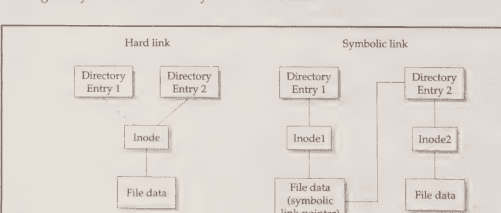

图 8-1. 硬链接是文件的替代目录项，而符号链接通过符号链接自身的文件数据将一个文件连接到另一个文件。

默认的 FreeBSD 安装会在多种场景中用到链接。例如，`/etc` 中的某些文件实际上是符号链接，指向存储在其他位置的真实配置文件。在使用系统过程中，你可能会发现需要创建链接，以更好地利用可用的磁盘空间。例如，如果你因为安装了使用 `/opt` 的大型软件包而导致根（`/`）文件系统空间不足，你可以创建一个 `/usr/opt` 目录（假设 `/usr` 位于单独的分区上），将 `/opt` 的内容移动到该目录中，删除原始的 `/opt`，并将其重新创建为指向 `/usr/opt` 的符号链接。你还可以以普通用户身份使用链接，以便更容易地访问自己主目录中的特定目录，或者更便捷地访问已挂载的可移动或网络文件系统。

你使用 `ln` 命令创建链接，其语法如下：


```
ln [-fhinsv] source-file[... ] [target-file | target-dir]
```

当你指定一个文件名作为目标时，`ln` 会以该名称创建链接。当你指定一个现有目录时，`ln` 会在该目录中创建一个以源文件命名的链接。该命令的一些选项与 `cp` 或 `mv` 的选项相似。具体而言，`-f`、`-l` 和 `-v` 在 `ln` 中的作用与在 `cp` 中相同。其余选项的含义如下：

- `-h` 或 `-n` 此选项使 `ln` 不将符号链接作为目标进行跟踪。此选项通常与 `-f` 和 `-s` 一起使用，用于将现有的指向目录的链接替换为另一个链接。
- `-s` `ln` 的默认行为是创建硬链接。此选项使其改为创建符号链接。

以下是一个展示 `ln` 实际用法的示例，请考虑这些命令：

```
$ ln deeply/buried/directory/tree/file.txt . /
# ln -s /mnt/zip/instructions.ps use-instructions.ps
# ln -s /opt/newprogram/bin/newprogram /usr/local/bin
```

这些命令中的第一条创建一个硬链接，使得深埋在目录树中的文件可以被更容易地访问。因为只提供了目录名（`./`）作为目标，所以该链接将与原始文件具有相同的名称（`file.txt`）。随后，你可以删除原始文件的目录项，而新链接仍然保持可访问状态。

接下来的两个示例创建符号链接。第一个示例将位于 `/mnt/zip` 中的文件链接到当前目录中的另一个文件名。第二个示例将一个程序可执行文件链接到一个通常位于大多数用户路径中的目录，从而使其更容易被访问。这个最后的示例通常只能由 `root` 使用，尽管该命令的基本形式普通用户也可以使用——只是由于大多数用户对 `/usr/local/bin` 没有写入权限，使得此命令需要 `root` 权限。

### 查找文件

能够操作文件非常重要，但有时挑战在于找到文件以便对其进行操作。幸运的是，FreeBSD 提供了几个有助于定位文件的工具。其中最强大的两个是 `find` 和 `grep`，它们分别让你能够基于文件的*元数据*（文件名、文件创建时间等）或文件内容进行搜索。

#### 使用 find

`find` 命令使你能够基于文件名、创建日期、最后访问时间等来搜索文件。因此，如果你不记得文件存储在哪里，但知道足够的元数据细节以创建有用的搜索规则，它可能是一种有用的定位文件的方式。基本的 `find` 语法是

```
find [-f] pathname[. . .] expression
```

> **注意** `find` 命令支持一些此处未描述的选项。请参阅 `find` 的手册页以获取更多详细信息。

`-f pathname` 选项允许你指定你希望 `find` 开始查找文件的位置。例如，如果你知道文件在 `/usr/local` 的某个位置，你可以将 `-f /usr/local` 作为命令的一部分传递给 `find`。这是一种限制搜索范围的极其有用的技术——如果没有这样的限制因素，`find` 可能需要几分钟才能返回，因为它会搜索 FreeBSD 目录树中的每个文件。在实践中，即使搜索从根（`/`）目录开始，你也需要提供搜索路径，但 `-f` 规范是可选的。

`find` 的许多复杂性在于语法中看似无害的 *expression* 部分。它可以采用几种形式，使你能够搜索各种类型的数据。你可以作为 *expression* 传递的选项示例包括

- `-atime time` 如果文件在 *time* 时间段内最后一次被访问，此选项会使 `find` 返回该文件。例如，`-atime -12h` 意味着文件在过去十二小时内被访问过。*time* 规范以负数提供，可以指定为秒（`s`）、分钟（`m`）、小时（`h`）、天（`d`）或周（`w`）。
- `-ctime time` 此选项的作用与 `-atime` 类似，但它基于文件的创建时间而不是访问时间来定位文件。
- `-delete` 与其他选项一起使用时，此选项会使 `find` 删除找到的文件。我建议你在使用该选项之前先尝试不使用该选项的 `find`，以确保不会删除错误的文件。
- `-group group-name` 此选项基于文件所属的组搜索文件。例如，`-group research` 查找属于 `research` 组的文件。你可以将 *group-name* 指定为组名或 GID。
- `-links num` 此选项搜索具有 *num* 个硬链接的文件。
- `-maxdepth depth` 此选项使 `find` 在达到 *depth* 目录层级后终止搜索，如果你知道 *file* 没有深埋在目录树中，这可以有助于限制搜索范围。
- `-mtime time` 此选项的作用与 `-atime` 类似，但它使用文件的修改时间。
- `-name pattern` 此选项基于文件名搜索文件。指定的 *pattern* 可以是简单的文件名，也可以包含各种通配符，如星号（`*`）和问号（`?`）。如果你使用通配符，可能需要用引号将 *pattern* 括起来，以防止 shell 对其进行扩展。
- `-newer filename` 你可以使用此选项查找比指定文件更新的较新的文件。
- `-perm [+|-]mode` 如果你想查找具有特定权限集的文件，请使用此选项。你可以像使用 `chmod` 一样指定 *mode*。如果不加加号或减号，此模式必须完全匹配。如果你在 *mode* 前加加号，则 `find` 匹配包含指定权限位中 *任意* 一位的文件，即使其他位也存在。如果你在 *mode* 前加减号，则 *所有* 指定的位都必须存在，其他位可能存在也可能不存在。
- `-size n[c]` 你可以使用此选项基于文件大小查找文件。在大小后跟 `c` 字符以查找特定字节大小的文件，否则 `find` 定位大小匹配 512 字节块数目的文件。
- `-type file-type` 此选项定位指定类型的文件。*type-code* 是表 8-1 中列出的代码，外加代表普通文件的 `f`。
- `-user username` 你可以使用此选项查找由特定用户拥有的文件。*username* 可以指定为用户名或 UID。

这些表达式只是 `find` 最有用的选项之一。请参阅程序的手册页以了解更多复杂的选项。以下是 `find` 实际用法的几个示例

```
$ find ./ -name "*.txt"
$ find /usr/local -perm +u+s
# find /etc -mtime -24h -name "*rc"
```

第一个示例查找当前目录中所有名称以 *txt* 结尾的文件。这是普通用户可能会执行的此类操作。第二个示例查找 `/usr/local` 中所有设置了 SUID 位的文件。虽然普通用户可以执行此类搜索，但系统管理员更有可能发现这种类型的搜索有用，以帮助定位设置为 *SUID root* 的文件。最后一个示例定位 `/etc` 目录树中所有名称以 *rc* 结尾且在过去 24 小时内被修改过的文件。普通用户可以运行此类命令，但此示例显示它需要 `root` 权限，因为 `/etc` 中的某些目录不可读取普通用户，因此不会搜索这些目录。因此，在这种情况下，`find` 可能会返回不完整的结果。

作为输出，`find` 会返回所有匹配文件的名称。如果 `find` 未找到匹配的文件，则不会返回任何输出，但有时其结果看起来好像输出了一些内容。

#### 使用 grep 和 egrep

你可以使用 `find` 根据文件名、修改日期、文件类型等来定位文件，但有时这并不够。你可能需要根据文件内容来定位文件。例如，你可能需要找到你写给一个名叫 Byers 的人的重要信件，但你可能看不到任何名称明显的文件。这时 `grep` 就派上用场了——它搜索目录（或目录树）中文件的内容，并返回包含指定字符串的文件名称。当 `grep` 找到此类信息时，即视为一个*匹配项*。对于文本文件，`grep` 会返回其中出现匹配项的任何一行文本。该命令的语法如下：

```
grep [options] [pattern] [ -E pattern | -f file] [file(…)]
```

`egrep` 命令与此相关，但其*模式*的语法略有不同。与 `find` 类似，`grep` 支持大量选项，此处仅涵盖其中一部分。详情请参阅 `grep` 的手册页。一些较常用的选项包括：

- `-A num` 此选项使 `grep` 显示每个匹配项之后的 *num* 行文本。
- `-B num` 此选项使 `grep` 显示每个匹配项之前的 *num* 行文本。
- `-c` 或 `--count` 此选项使 `grep` 显示匹配行的数量，而不是显示匹配行本身。


## grep 选项

- `-F` 通常，`grep` 将 `pattern` 解释为正则表达式（稍后描述）。此选项使其将 `pattern` 作为字面意思解释，这使得搜索某些字符串变得更加容易。
- `-i` 或 `--ignore-case` 通常，`grep` 以区分大小写的方式匹配模式。此选项使 `grep` 以不区分大小写的方式匹配。
- `-r` 或 `--recursive` 此选项使目录树的递归搜索，而不是仅搜索指定文件或单个目录而不包括其子目录。
- `-v` 或 `--invert-match` 此选项使 `grep` 反转其操作逻辑；它报告不包含指定模式的行。

你可以将匹配模式指定为选项之后的一个字符串，前面可选地加上 `-e`。（`-e` 对于区分以破折号开头的匹配项很有用，否则会被解释为 `grep` 选项。）如果你经常执行复杂的匹配，可以将模式放入文件，并使用 `-f` `file` 选项调用它。无论如何，匹配模式是一个正则表达式，它是指定字符序列（可能包含变量）的一种方式。正则表达式可能相当复杂，本章只能对此话题略知一二。有时你需要将正则表达式用引号括起来，特别是当它们包含星号或问号时，以防止 shell 试图将它们解释为文件名并进行扩展。以下是 `grep` 正则表达式中你可能觉得有用的几种用法：

### 字面字符串
大多数字符按字面解释，即它们匹配自身。例如，字符串 `trust` 匹配任何文件中的单词 `trust`。

### 字符集
由方括号括起来的字符串，例如 `[aeiou]`，匹配方括号内集合中的任何单个字符，例如本例中的任何元音。如果该列表的第一个字符是脱字符（`^`），则字符串匹配不在列表中的任何字符。可以使用方括号加上短划线分隔起止点来指定字符范围，例如 `[0-9]` 用于匹配任何数字。

### 单个字符
句点（`.`）匹配任何单个字符。字符串 `\w` 匹配任何单个字母或数字字符（任何数字、大写字母或小写字母），字符串 `\W` 匹配任何单个非字母或数字字符（标点符号、不可打印字符等）。

### 重复代码
某些代码告诉 `grep` 前面的项可以重复若干次。最重要的是，带反斜杠的问号（`\?`）表示前面的项重复零次或一次，星号（`*`）表示前面的项重复零次或多次，带反斜杠的加号（`\+`）表示前面的项重复一次或多次。在使用 `egrep` 时，`?` 和 `+` 代码省略了反斜杠。

### 两个选项
如果两个正则表达式之间用垂直线（`|`）分隔，那么匹配其中任意一个即可满足 `grep`。

这些特殊代码中的一些意味着，如果不采取额外步骤，你就无法搜索用于这些代码的字符。这一步骤是在要搜索的字符之前立即添加一个反斜杠（`\`）。例如，你要使用 `\?` 来搜索问号。这被称为转义该字符。如果需要搜索反斜杠本身，也可以对其转义。或者，你可以使用 `-F` 选项让 `grep` 将整个 `pattern` 作为字面意思解释。

默认情况下，`grep` 从标准输入（`stdin`）获取输入。这使得 `grep` 非常易于在管道中使用，如第 5 章所述。然而，如果你使用它来查找文件，`grep` 会提醒你，你需要传入文件名、目录名，或者匹配许多文件或目录名称的通配符。

以下是 `grep` 实际用途的几个示例：

```
$ grep Byers *.txt
$ grep trust.*one gullible/* paranoid!/*
$ grep "Chapter.*\.\.[0-9]" *.txt
$ egrep "Chapter.*.\+[0-9]" *.txt
$ grep -r "copyright 200[12]" ./
```

第一个示例定位当前目录中名称以 `.tex` 结尾且包含字符串 `Byers` 的任何文件。这个命令是 `grep` 的一个相对直接的应用。第二个示例定位 `gullible/` 或 `paranoid/` 目录中任何在同一行包含单词 `trust` 和 `one` 的文件。例如，此搜索将找到匹配字符串 `trust everyone` 和 `trust no one` 的文件。请注意，此搜索中的星号以两种方式使用——在 `trust.*one` 中，它是指示潜在空格的正则表达式的一部分；而在 `gullible/*` 和 `paranoid/*` 中，它是文件名规范中的通配符。第三个示例搜索任何以 `.txt` 结尾的文件，该文件包含字符串 `Chapter`，后跟零个或多个空格（`.*`），再后跟一个或多个句点（`\.` +）以及一个数字。此命令可用于匹配包含书籍目录的文件，这些文件可能具有以下类似行：

```
Chapter 23.....479
```

第四个示例是执行与第三个相同操作的另一种方式，但它使用 `egrep` 并省略了 `+` 运算符前的反斜杠。最后，第五个示例匹配整个目录树中包含字符串 `copyright 2001` 或 `copyright 2002` 的任何文件。通常，`grep` 将文件规范作为其最后一个参数，但在进行递归搜索时，你可以列出目录名称，如本示例所示。

当 `grep` 在文本文件中找到匹配项时，它显示文件名和匹配的文本行。（如果许多行匹配，它们都会显示出来。）当 `grep` 在二进制文件中找到匹配项时，它只显示消息 `binary file <filename> matches`，其中 `<filename>` 是有问题的文件名。

## 备份

在计算机上操作文件对于使用 FreeBSD 系统至关重要。然而在某些情况下，你需要将文件移出计算机。有时你可能只需要将少数几个文件复制到另一个位置，在这种情况下，使用软盘、Zip 盘或其他可移动介质的常规文件复制命令可能就足够了。将文件从计算机复制出来的另一个常见用途是备份。这是一种将文件存储在计算机之外以便在紧急情况下可以访问的做法。在这种情况下，“紧急情况”可能指从用户意外删除单个文件到计算机被破坏或被盗的任何事件。对于大多数目的来说，将备份文件存储在计算机附近的保险箱或类似地方就足够了，但为了获得最佳保护，将副本存储在另一个位置很重要。此类异地备份在发生重大灾难（如火灾或飓风）时可能非常有价值。

### 注意事项

无论使用何种备份介质，都应注意介质的安全要求。如果备份介质容易被“借用”，那么对普通用户不可访问的文件将变得对任何人皆可访问，因为常见的备份工具不强制执行 FreeBSD 的所有权和权限限制。如果系统包含敏感数据，务必确保将备份存储在安全的地方。

### 备份介质

最常见的备份介质形式是磁带。磁带驱动器的价格从一百多美元到数千美元不等，具体取决于其容量、速度和可靠性。用于 FreeBSD 工作站或小型服务器的磁带驱动器通常在 $200 到 $1500 之间。这个价位区间内，较便宜的单元是 `travan` 磁带，它们使用昂贵的（大约 $40）磁带；而较贵的单元是数字音频磁带（`DAT`）单元或其他各种介质设备，它们通常使用较便宜（$5 到 $20）的磁带。因此，归根结底，设备加上磁带的总成本差异看起来没有最初显示的那么大。

磁带具有高容量（现代单元每条磁带可存储数十 GB）、较高的速度以及适中的每 GB 备份成本等优势。潜在的竞争介质类型，如可移动磁盘，往往容量较低或成本较高。例如，要备份一台现代计算机，可能需要几十个 100MB 的 `Zip` 磁盘，但你可能只需要一条或两条磁带就能完成工作。

有一种介质类型值得特别提及：光盘。可记录光盘（`CD-R`）介质在标准光盘上存储 650MB 数据，这足以（特别是在数据压缩后）保存一个基本的 FreeBSD 安装。如果你的安装不是特别大，你可以将新安装的系统备份到 `CD-R` 用于紧急恢复，并依靠磁带恢复用户数据。`CD-R` 介质价格便宜，并且具有在任何计算机上都可读的优势，因此在网络环境中，即使客户端缺乏磁带驱动器，你也可以使用它们来恢复客户端。`CD-R` 介质也非常可靠，且预期保质期很长（根据大多数估计，在 20 到 100 年之间），因此它们是很好的归档介质。较新的可记录数字多功能光盘（`DVD`）驱动器可以记录数 GB，因此可以是更优秀的备份设备，但在 2002 年，这些驱动器仍然比 `CD-R` 更昂贵，而且即使是只读 `DVD` 驱动器也尚未普及。

### 备份工具示例

FreeBSD 支持多种备份程序。其中大多数是专为磁带设计的，但也可以用于其他备份介质。更受欢迎的备份工具包括

- `tar`：`tar` 程序是 UNIX 和 FreeBSD 世界中的古老标准。它的名称代表 `tape archiver`（磁带归档器），这就是它的功能——在磁带上创建数据归档。它也已成为在互联网上分发文件和在非磁带可移动介质设备上进行存储的流行方式；`tar` 可以创建文件（有时称为 `tarballs`），这些文件是许多其他文件的集合，从而简化了软件的分发。第 11 章涵盖了 `tar` 的这一用途方面。


- `dump`：像 `tar` 一样，`dump` 程序也是一个古老的备份工具。`dump` 的一个独特之处在于它与文件系统数据结构紧密相关。这意味着你可能无法对某些文件系统（例如 `FAT` 分区）进行 `dump`。你也可能无法将数据恢复到另一种文件系统类型。例如，如果你在 FreeBSD 上创建了 `dump` 备份，你可能无法使用 Linux 将其原生恢复到 `ext2`。与大多数备份工具不同，`dump` 使用一个名为 `restore` 的独立恢复程序。

- `cpio`：`cpio` 程序在功能和能力上大致相当于 `tar`，但某些细节不同，例如命令语法和归档格式的细节。

- CD-R 工具：如果你选择使用 CD-R 介质进行备份，必须使用特殊工具。通常，这个过程涉及两个步骤：首先，使用名为 `mkisofs` 的程序创建包含你文件的 ISO-9660 文件系统的 *镜像文件*；然后，使用 `cdrrecord` 将该 *镜像文件* 复制到空白 CD-R 上。对于备份目的，直接将文件记录在 *镜像文件* 中可能不是一个好主意，因为 *镜像文件* 会丢失一些信息——例如，文件将被剥离写权限位。相反，你可以使用 `tar`、`dump` 或 `cpio` 创建 *tarball*，然后直接将其记录到光盘，或者先将其放入 *镜像文件* 后再记录。

所有这些程序都是 FreeBSD 安装的标准组成部分。由于 `tar` 非常流行且常用于非备份目的，本章关于 `tar` 的讨论侧重于其备份用途。这里描述的基本原理适用于其他工具，但当然，命令细节有所不同。

### 使用备份工具

`tar` 程序支持大量的选项，因此这里只能描述其中的一部分。有关更多细节，请参阅 `tar` 手册页。`tar` 的基本语法是

```
tar function [function-modifier[...]] file[...]
```

`function`（功能）是要执行的一个功能，例如 `--extract`（简写为 `e`），用于从归档中提取文件。`function-modifier`（功能修饰符）是一个选项，用于调整 `tar` 的行为方式。表 8-5 和 8-6 总结了最重要的功能和功能修饰符。命令末尾的 `file`（文件）是一个或多个文件或目录的列表（列出目录通常比列出文件更简单）。

#### 表 8-5. 重要的 tar 功能

| 功能 | 缩写 | 效果 |
|---|---|---|
| `--create` | c | 创建新的归档。 |
| `--concatenate` 或 `--catenate` | A | 将一个归档的内容添加到另一个归档中。 |
| `--append` | r | 将新文件添加到现有归档中。 |
| `--update` | u | 将已更改的文件添加到现有归档中。（不适用于磁带。） |
| `--diff` 或 `--compare` | d | 将归档与文件进行比较并显示差异。 |
| `--list` | t | 显示归档的内容（文件名）。 |
| `--extract` 或 `--get` | x | 从归档中提取文件。 |
| `--delete` | (无) | 从归档中删除文件。（不适用于磁带。） |

#### 表 8-6. 重要的 tar 功能修饰符

| 功能修饰符 | 缩写 | 效果 |
|---|---|---|
| `--file [host:]file` | f | 使用指定的 `file` 作为归档文件。如果指定了 `host`，则使用网络操作访问远程计算机上的文件。 |
| `--listed-incremental` `file` | g | 执行增量备份，其中仅备份自上次备份以来修改过的文件。使用 `file` 中的数据来确定哪些文件之前已被备份。 |
| `--bunzip2`、`--bunzip` 或 `--bzip` | y 或 j | 通过 `bzip2` 包压缩归档。 |
| `--one-file-system` | i | 仅处理一个文件系统（分区）上的文件。 |
| `--tape-length N` | L | 创建一个 `N` 千字节的归档，然后暂停以便更换磁带。 |
| `--multi-volume` | M | 处理多卷归档。 |
| `--same-permissions` 或 `--preserve-permissions` | P | 处理所有权限信息。 |
| `--absolute-paths` | P | 在绝对文件名中记录前导斜杠（/`/`）。 |
| `--verbose` | v | 列出使用 --create 或 --extract 处理的文件，并在 --list 时显示更多权限信息。 |
| `--exclude pattern` | (无) | 从备份中排除匹配 `pattern`（模式）的文件。 |
| `--gzip` 或 `--gunzip` | z | 通过 `gzip` 程序压缩归档。 |

要使用 `tar`，请将一个功能与一个或多个功能修饰符结合使用。例如，要将 `/home` 和 `/var` 分区备份到 SCSI 磁带驱动器，请使用如下命令：

```
# tar --create --verbose --file /dev/sa0 /home /var
```

使用缩写可以更简洁地列出此相同命令：

```
# tar cvf /dev/sa0 /home /var
```

此命令阐明了 `tar` 和其他操作磁带的备份程序共有的一个原则：磁带驱动器被视为普通文件。具体来说，`/dev/sa0` 是一个 SCSI 磁带驱动器，而 `/dev/ast0` 是一个 IDE (ATA) 磁带驱动器。（在具有多个磁带驱动器的系统中，可以通过递增编号来访问它们，例如第二个 SCSI 磁带驱动器为 `/dev/sa1`。）

首次使用磁带时，您可能会收到错误信息。输入 `mt fsf 1`，弹出磁带，然后再次使用，通常就能正常工作。`mt` 程序可用于其他各种磁带操作，例如设置磁带驱动器的内置压缩功能。有关详细信息，请查阅 `mt` 手册页。

`tar` 程序通过创建归档然后对其进行压缩来压缩数据。这种方法的副作用之一是，如果磁带出现缺陷，那么在尝试恢复时，该缺陷之后的所有数据都将无法使用。因此，在创建磁带备份时，通常最好不要使用 `-bzip2` 或 `--gzip` 选项。磁带驱动器的内置压缩功能通常对这些问题更具鲁棒性。硬盘和 CD-R 介质通常足够可靠，在使用这些介质时，`tar` 的压缩不会成为问题。

`--one-file-system` 功能修饰符对于实际操作非常重要，因为它能防止 `tar` 尝试备份虚拟文件系统，如 `/dev` 和 `/proc`。这些文件系统（特别是 `/proc`）包含 FreeBSD 即时生成的文件，它们会不必要地占用磁盘空间。事实上，尝试恢复此类文件甚至可能会导致问题。但是，如果您使用 `--one-file-system`，则必须在 `tar` 命令行中将每个要备份的分区列为单独的文件。例如，假设您有一台计算机，拥有独立的根分区（`/`）、`/tmp`、`/var`、`/usr` 和 `/home` 分区。您可以使用如下命令备份此系统：

```sh
# tar cvqpf /dev/sa0 /home /var / /usr /tmp
```

此示例根据从分区恢复数据的可能需求（存储得早的数据比存储得晚的数据恢复得更快）对分区进行排序。您可能会合理地省略 `/tmp` 分区，因为其数据并不保证在重新启动后仍然存在。

通常，`tar` 会去除绝对文件路径中的前导斜杠，这有助于防止恢复时出现问题。例如，您可能需要使用紧急系统来恢复数据，将普通的 FreeBSD 目录树挂载到不寻常的位置，如 `/mnt`。然后，您可以切换到 `/mnt` 并使用 `--extract` 来恢复您的数据，而不会覆盖紧急系统的文件。使用 `--absolute-paths` 会告诉 `tar` 在文件名中保留前导斜杠。在创建必须位于特定目录中的程序归档文件时，您可能会这样做，但即使在这种情况下，创建标准的相对 `tar` 文件也更常见。

如果您下载了一个 `tarball`（归档文件包），请先使用 `--list` 检查其内容，不要直接解压。恶意人员或无知的人可以创建包含绝对路径的 `tarball`，并加载会覆盖您普通系统实用程序的文件，从而造成安全漏洞或使系统无法使用。

### 恢复数据

备份的有用程度取决于您从中恢复数据的能力。就 `tar` 和 `cpio` 而言，恢复数据使用的工具以及基本上与备份相同的命令。当您的系统正常工作且只需恢复少量文件时，此恢复过程最简单。例如，假设用户 `walter` 来找您，说他在主目录中误删了一个文件。如果 `walter` 记得该文件的名称是 `report78.tex`，您可以发布如下命令来恢复该文件：

```sh
# cd /
# tar xvfp /dev/sa0 home/walter/report78.tex
```


**注意**：由于 `tar` 通常存储不带前导斜杠的文件，因此您必须切换到根目录，或者切换到创建备份的目录，并在恢复文件时提供不带前导斜杠的文件名，才能成功恢复文件。

如果 `walter` 不记得文件的准确名称，您可能需要使用 `tar` 的 `--list` 功能在恢复之前定位该文件。您也可以列出目录树的名称来恢复整个目录树。如果您在恢复数据时未提供文件名，`tar` 将尝试恢复备份的整个内容，这在大多数情况下并非您所必需。

**提示**：您可以使用备用目录来练习备份。将一些文件复制到该目录，然后将其恢复到另一个目录并检查是否正确恢复。

在极端紧急情况下，您可能需要恢复整个 FreeBSD 系统或基本操作所需的文件。例如，您的硬盘可能已故障，或者有人可能入侵了您的系统并破坏了其安全性。在这种情况下，完全恢复是必要的。您可以采用以下几种方法：

- **紧急系统**：您可以使用第 32 章中描述的 FreeBSD 紧急启动系统来引导 FreeBSD，准备新分区并恢复所有数据。这种方法需要在灾难发生*之前*进行周密的计划。

- **部分正常安装**：您可以安装一个最小化的 FreeBSD 系统，并将其用作紧急系统。例如，您可能将 FreeBSD 安装在旧硬盘上，并使用它来将您的常规系统恢复到更大的磁盘，然后重新配置磁盘，使较大的磁盘成为正常的启动磁盘。

- **完全安装和修改**：您可以以正常方式重新安装 FreeBSD，然后使用您的备份仅恢复关键目录（这些目录很可能已发生变化，如 `/home`）。您的系统与标准 FreeBSD 安装偏离得越远，这种方法就越困难；即使您对自定义设置做了完整记录，将系统恢复到此前的正常操作状态也可能需要数小时。

紧急完全恢复可能是场噩梦，而如果您未做准备，这场噩梦会更糟。因此，您应该考虑如果硬盘停止工作或发生其他灾难时您会怎么做。您将如何恢复您的数据？如果您不知道，就应该仔细考虑此事并制定一个恢复计划。只要有可能，您就应该练习您的恢复计划。例如，您可能尝试将系统恢复到备用计算机上并尝试启动该计算机。（即使过程成功，硬件差异也可能导致问题。）您的 FreeBSD 系统对您或您的业务越关键，您应该在应对问题上投入的时间就越多。

## 总结

与 FreeBSD 文件相关联的各种元数据包括文件的所有者、组和权限，这些信息对于使用某些文件操作命令至关重要。例如，如果您无法读取文件，就无法复制该文件；您必须能够向目录写入，才能将文件复制或移动到该目录中。FreeBSD 依赖于一组文件操作命令来修改元数据、移动文件、复制文件、删除文件、查找文件等。熟练掌握这些命令将极大地帮助您使用和管理 FreeBSD 系统。管理文件还涉及通过将其备份到 CD-R 或磁带等外部介质来保护文件免受灾难影响。这样，在发生重大或轻微灾难时，您可以快速恢复数据。

# 第 9 章

# 打印机配置


无纸办公室长期以来一直是一个诱人的梦想。然而，这仅仅停留在梦想阶段已经相当长一段时间了，并且可能在未来一段时间内仍会如此。因此，打印对于 FreeBSD 来说是一项重要任务。如果您习惯在 Windows、OS/2、Mac OS 或类似操作系统中进行打印，您可能会觉得 FreeBSD 的打印模型很怪异。尽管 FreeBSD 的打印系统与其他系统有些相似，但也存在非常重要的差异。因此，本章首先介绍 FreeBSD 的打印理论。随后，它将介绍创建打印队列、设置 Ghostscript（充当打印机驱动）、控制现有打印队列以及控制对打印机的网络访问等实际任务。

## 理解 FreeBSD 打印模型

大多数现代操作系统使用*打印队列*，它是应打印文档的暂存区域。在 FreeBSD 中，存在各种程序将文档提交到打印队列；优先处理并操作*打印作业*（文档一旦进入队列即被称为打印作业）；将打印作业处理成打印机可理解的形式；以及将打印作业发送到打印机。了解各种 FreeBSD 打印工具如何适应此模型，将有助于您实际配置文件时配置打印队列。

### 打印队列的必要性

如果您记得 DOS 时代的岁月，您可能还记得该操作系统中打印机的工作方式：程序直接向打印机端口硬件发送数据。DOS 本身几乎没有控制对打印机的访问，程序负责以打印机能理解的格式传输数据。然而，随着多任务操作系统的出现，需要一种更复杂的模型。在像 FreeBSD 这样的操作系统中，不能信任程序直接向打印机端口发送数据。想象两个程序同时尝试发送数据。最好的情况是，一个程序被拒绝访问硬件，打印作业将失败。多个用户可能会互相争夺对打印机的访问权，每个人都试图在竞争打印作业之间的短暂间隙内提交打印作业。最坏的情况是，两个程序都写入数据，导致输出是两种作业的混合体或完全乱码。

打印队列通过使操作系统能够接受多个打印作业并安排它们依次发送到打印机来解决这个问题。当 FreeBSD 向打印机发送一个作业时，第二个作业存储在磁盘上称为*打印暂存*（print spool）的区域（通常在 `/var/spool/lpd` 的子目录中）。由于操作系统控制整个过程，它可以接受任意数量的打印作业并为打印机排队。当然，在实际操作中，作业的数量受限于 `/var` 分区或容纳 `/var/spool/lpd` 的分区中可用的磁盘空间。

### 打印队列的优势

打印队列直接或间接提供了多项优势：

- **打印任务调度**

  默认情况下，FreeBSD 打印队列按先入先出（FIFO）的原则处理任务，从而防止多个用户或程序试图访问同一有限资源时出现的问题。事实上，执行打印的应用程序可以提交一个大型任务然后终止，而打印队列仍会继续打印该任务。你还可以更改任务的打印顺序，如下一节“重新排序打印任务”中所述。

- **打印机管理**

  你为你的打印队列命名，为每个队列赋予一个用户容易记住的名称。事实上，你可以为每台打印机设置多个名称。有时这些名称完全等效，但你可以配置同一台打印机根据不同的调用方式以不同模式工作——例如，通过一个名称调用时进行双面（*duplexing*）打印，而通过另一个名称调用时则不进行。如果你更换或升级了打印机，可以将新打印机绑定到旧名称上，从而简化用户的过渡过程。

- **任务过滤**

  FreeBSD 打印队列最强大的功能之一是能够应用*过滤器*到队列中。这是一个在打印机接收任务之前处理打印任务的程序。在实践中，打印过滤器通常会调用 PostScript 程序，如接下来的章节“PostScript 作为标准打印语言”和“设置 Ghostscript”中所述。

- **网络访问**

  FreeBSD 打印系统的工作方式使其非常适合网络操作。很容易配置系统将文件发送到由另一台打印服务器共享的打印机，同样也容易配置 FreeBSD 系统以接受来自其他计算机的打印任务。（这种配置的便利性适用于使用 BSD 打印系统的系统，或设计为与其兼容的系统。与 Windows、Mac OS 或其他类型的打印客户端和服务器的互操作性更为复杂。）这些主题将在接下来的章节“创建打印队列”和“控制远程打印机访问”中涵盖。

FreeBSD 使用通常被称为 *BSD LPD* 的打印系统，其名称源自起源于该系统的操作系统（BSD）及其主要组件之一的名称，即*行式打印机守护程序*（*LPD*）。有一些可供 FreeBSD 使用的竞争性打印系统。最重要的是，LPRng 旨在比 BSD LPD 系统更新颖，同时保持兼容性。本章的大部分内容既适用于 LPRng，也适用于 BSD LPD。*通用 UNIX 打印系统*（*CUPS*）与 BSD LPD 模式的偏差更大，提供了诸如向应用程序反馈特定打印机能力等功能。代价是从配置角度来看是完全不兼容的，尽管 CUPS 包含一些与 BSD LPD 系统中用于提交打印任务的程序类似的程序，因此从用户角度来看，其工作方式相似。一些程序开始利用 CUPS 的功能，但大多数并没有。LPRng 和 CUPS 都可以从标准的 FreeBSD 安装介质获取。

假设 FreeBSD 系统已配置为使用打印机（如本章后文所述），作为普通用户使用它的第一步是提交一个打印任务。在 BSD LPD 系统中，这是通过一个名为 `lpr` 的程序完成的，如下一节“提交打印任务”中所述。`lpr` 程序可以由你直接使用（如果你想打印你目录中的文件），也可以由其他程序使用（例如，字处理程序可以通过将其创建的文件发送到 `lpr` 来向队列提交打印任务）。

在实践中，`lpr` 通过获取输入文件并将其发送到 BSD 打印系统中的下一个程序，即行式打印机守护程序（`lpd`）来工作。本质上，`lpr` 只是一个方便的中介，使你能轻松地将文件引导到你指定的任何打印队列。

> `LPD` 和 `CUPS` 打印系统也使用名为 `lpr` 的程序，其工作原理与本章描述的 BSD `lpr` 非常相似。然而，这些替代打印系统的 `lpr` 程序会将任务提交给它们自己的打印机守护程序。

请记住，打印任务就是一个文件。即使你没有明确创建文件，`lpr` 和 `lpd` 也会将其视为文件。事实上，打印任务在其生命周期的某个阶段通常以文件形式存在于你的硬盘上。

### 行式打印机守护程序的作用


FreeBSD 的大部分打印工作是由 `lpd` 程序完成的，BSD `LPD` 打印系统整体也因此得名。这个守护程序与其他所有守护程序一样，设计为在后台运行并等待输入。FreeBSD 打印系统的关键部分之一是 `lpd` 通过网络协议接受任务。因此，当你进行本地打印时，`lpr` 使用 `localhost` 网络接口将任务传递给 `lpd`。这意味着打印任务不会经过你的网络线路，但它会像网络访问一样被处理。`lpd` 程序还接受来自其他计算机 `lpr` 程序的请求（假设已进行相应配置），如下一节“控制远程打印机访问”中所述。

当 `lpd` 接受一个打印任务时，守护程序会将文件存储在你指定打印机的暂存目录中，并记录该文件在打印队列中的位置。当排在该任务之前的打印任务被清除时，`lpd` 会处理该任务。这涉及将任务通过你在队列中配置的任何过滤器，然后通过打印机端口发送出去或发送到远程计算机。当任务的最后一个字节被发送到其目的地后，`lpd` 会将该任务从打印队列中移除。

### PostScript 作为标准打印语言

打印队列的一个重要特性是它们赋予应用程序一定程度的打印机独立性。在 Windows、OS/2 或 Mac OS 中，你会为你的特定型号打印机安装打印机驱动。然后，应用程序可以使用特定于操作系统的命令打印到队列，操作系统会将这些命令转换为特定于打印机的命令。

这种交互是双向的，因此操作系统可以告知应用程序打印机支持哪些功能，例如颜色或最大页面尺寸。在 FreeBSD 中，过程略有不同。由于 UNIX 系统传统上是强大的计算机，它们通常连接着已知为*行式打印机*的高速、高容量打印机（这些打印机无法处理复杂的格式化），或者连接着 PostScript 激光打印机。因此，需要打印的 UNIX 和 FreeBSD 程序通常生成纯文本或 PostScript 输出，假设它们将打印到这两种类型的打印机之一。

PostScript 在 UNIX 和 FreeBSD 世界中的强大功能意味着 Windows 风格的打印机驱动从未流行起来。程序可以为打印输出生成 PostScript，并且这很有效。然而，这种方法的一个负面后果是，程序对其打印机的了解不如 Windows 程序多。例如，程序无法知道打印机是否支持彩色输出，或支持哪些分辨率。因此，FreeBSD 程序要么做出假设，要么要求你在正在打印的应用程序中输入此类信息，通常是在打印对话框中。克服这一限制是 CUPS 的目标之一；它允许你为每个队列关联一个 *PostScript 打印机描述*（PPD）文件，并且应用程序可以查询 CUPS 以获取存储在 PPD 文件中的信息。

> 提示：如果你需要提供访问 PostScript 或单个程序的 PostScript 代码不直接支持的打印机功能，你可能可以通过创建多个打印队列来实现。例如，你可能创建两个或三个打印队列，以便在喷墨打印机上以不同分辨率进行打印。接下来的章节“创建打印队列”和“设置 Ghostscript”涵盖了此类配置。

在桌面计算机上，纯文本输出通常不是问题，因为大多数打印机都能处理纯文本；但 PostScript 可能是一个问题，因为 PostScript 传统上大幅增加了通常与 x86 计算机关联的低端激光和喷墨打印机的成本。解决方案是使用打印队列中的过滤器，将 PostScript 转换为打印机实际接受的格式。此过滤器使用一个名为 *Ghostscript*（http://www.cs.wisc.edu/~ghost/）的程序进行转换。本质上，Ghostscript 充当在计算机上而非打印机上运行的 PostScript 解释器。接下来的部分“创建打印队列”描述了设置*没有* Ghostscript 过滤器的打印队列，如果你的打印机理解 PostScript，或者如果你想仅在打印机默认字体下打印简单文本，你可能会这样做。“设置 Ghostscript”部分描述了将 Ghostscript 添加到其中。

少数 FreeBSD 应用程序，如 The GIMP，可以生成专为特定打印机设计的输出。从这类工具获得的结果可能优于也可能不优于通过生成 PostScript 并使用常规打印队列获得的结果。你可能想尝试两种方式，看看哪种效果最好——但请注意，一些过滤器可能会错误识别打印机格式的输出并丢弃或损坏它，因此你可能需要创建一个不使用过滤器的特殊队列来打印此类输出。

### 为 FreeBSD 选择打印机

如果您正在购买一台新打印机用于 FreeBSD，最佳选择可能是 PostScript 型号的打印机。一些 PostScript 打印机配备了由 Adobe 授权的 PostScript 解释器，但其他一些则使用 PostScript 仿制软件。在大多数情况下，两者都能正常工作，但一些非常早期的 PostScript 仿制软件（来自 1980 年代末）表现并不完美。如今有些打印机被宣传为 PostScript 型号，但它们在 Windows 下使用的是类似 Ghostscript 的软件。在 FreeBSD 中，这类型号的表现并不优于非 PostScript 型号，因此请务必确认该 PostScript 型号**内置有 PostScript 功能**。不过，许多非 PostScript 型号可以通过 Ghostscript 正常工作，而“设置 Ghostscript”一节提供了查找哪些特定型号应该能正常工作的指引。在打印机硬件接口方面，FreeBSD 对并口的支持最好，但 USB 打印机通常也能很好地工作。不过，某些 USB 硬件比较挑剔，可能无法被正确识别。RS-232 串口打印机速度较慢，因此在可能的情况下最好避免使用。一些高端型号随附以太网接口。只要它们理解 BSD LPD 协议（大多数此类打印机都支持），这些接口就能正常工作。您可以将它们视为打印机与专用打印服务器的组合。

### 创建打印队列

创建打印队列涉及两个配置步骤：创建 spool 目录和编辑 `/etc/printcap` 文件，BSD LPD 系统在此文件中查找其打印机定义。但在执行这些操作之前，您应该检查您的打印机设备是否运行正常；这样做可以避免许多无意义的故障排除工作。本节还涵盖使用简单的打印过滤器。此类过滤器可以添加代码来重置打印机、将纯文本转换为 PostScript，或执行其他类似任务。

#### 使用打印机设备文件

2002 年大多数打印机使用并口或 USB 端口接口。如果您正在配置工作站以使用现有的网络打印机，可以跳过本节的大部分内容，但标题为“网络打印机的特殊说明”的小节仍然适用。FreeBSD 使用 `/dev/lp0` 设备文件来访问并口打印机。如果您的计算机有多个并口，第二个并口作为 `/dev/lpt1` 访问，依此类推。对于 USB 打印机，等效的设备名称是 `/dev/ulpt0`、`/dev/ulpt1`，依此类推。RS-232 串口打印机端口命名为 `/dev/tty00`、`/dev/tty01`，依此类推。测试和优化这些端口是打印机配置的重要步骤。

#### 测试打印机设备文件

在继续之前，您应该测试打印机端口。一种方法是复制一个小文件到该端口。例如，您可以尝试此命令：

```
cat /etc/shells > /dev/lpt0
```

> 注意 请确保以 root 身份输入此命令。默认情况下，普通用户没有访问原始打印机端口文件的权限。

一般来说，此命令应该会产生某种打印机活动。大多数喷墨打印机会打印该文件，但不会弹出最后一页。大多数此类打印机都有一个“换页”或“退纸”按钮，您可以按下以弹出页面。大多数激光打印机会闪烁一些指示灯，但在您弹出页面前不会打印任何东西。少数 PostScript 激光打印机会丢弃纯文本文件，因此您应该能够打印 PostScript 文件。如果您已在系统上安装了 Ghostscript，您应该能够在 Ghostscript 示例目录中找到样本。例如，在我的系统上，以下命令有效：

```
cat /usr/local/share/ghostscript/6.52/examples/escher.ps
```

> 注意 并非所有 PostScript 文件都会产生输出。Ghostscript 附带的 escher.ps 文件会产生输出，因此它应该与任何 PostScript 打印机兼容。此文件还产生彩色输出，因此是测试打印机彩色能力的有用工具，特别是在测试 Ghostscript 设置时，正如即将描述的章节“使用 Ghostscript 作为翻译器”和“设置智能过滤器”中所述。

如果您无法从打印机获得任何输出，可能有几种原因：

- **不支持文本的打印机** 少数打印机的文本打印能力非常有限或根本没有。这些有时被称为 WinPrinter、GDI 打印机（源自 Windows GDI 接口）或基于主机的打印机。这些打印机在 FreeBSD 下往往表现不佳。请查阅 Linux 打印网页数据库 http://www.linuxprinting.org，获取关于您的打印机及其与 Ghostscript 兼容性的信息。（尽管名称如此，此网页对 FreeBSD 的适用性与对 Linux 的一样。）如果您的打印机被列为“压书石”（paperweight，意指毫无用处），您最好就此停止并更换它。


### 格式无法识别
除非数据具有特定格式，否则某些打印机拒绝数据。某些 PostScript 型号属于此类。某些型号可能需要特定的前缀代码来告诉打印机数据的格式。此类打印机在 FreeBSD 下可能仍能工作，但简单的测试可能会失败。如果您的打印机可能属于此类的一个线索是，当向打印机端口发送数据时，数据指示灯闪烁。如果发生这种情况，尽管测试未通过，您可能仍希望继续进行打印机配置。如果您没有看到任何活动指示灯，您可能需要调查其他问题。

### 没有驱动程序
如果您重新编译内核，如第 12 章所述，您必须确保包含打印机端口的驱动程序，否则您将无法向打印机发送数据。如果您在 FreeBSD 5.0 中遗漏了这些驱动程序，那么 `/dev` 目录下可能没有设备文件，因此应该很容易发现。尝试重新构建内核，或从原始 FreeBSD 内核启动。某些 USB 型号可能无法被正确识别，因此您可能需要寻找适用于您的打印机的内核补丁，或者将其更换为其他型号。

### 并口模式
下一节描述的某些并口优化可能会导致某些打印机或并口出现问题。您可能需要尝试不同的设置以找到可行的方案。

### 平凡问题
最后，我将众多问题归为一类——硬件故障、电缆断开、打印机缺少电源等。这些问题并非 FreeBSD 特有，但其中一些是打印机特有的，因此请查阅打印机手册的故障排除部分以获取建议。如果您可以从另一个操作系统打印，那么您的问题就不属于此类。

### 优化并口操作
一旦您验证打印机端口正常工作，您可能希望优化其性能。这是并口的问题，但 USB 或 RS-232 串口不是。您可以使用 `lpcontrol` 程序优化端口性能。此命令的语法是

```
lpcontrol -i | -p | -e | -s [-d device]
```

`-i` 和 `-p` 选项分别设置中断驱动模式或轮询模式。中断模式是默认设置。在大多数硬件上，中断模式更快，但它会使并口硬件占用一个中断，而中断是一种有限的硬件资源，您可能需要将其用于其他用途。此外，据报道某些打印机在此模式下表现不佳。如果您遇到问题，可以尝试禁用此模式。

`-e` 和 `-s` 选项分别启用或禁用您的打印机端口支持的任何扩展模式。自 1990 年代中期以来制造的所有主板都支持至少一种扩展模式，例如 EPP 或 ECP。在大多数情况下，这些能产生更好的性能。检查您的主板手册或 BIOS 设置，查看它支持哪些扩展模式。`device` 是打印机端口设备，例如 `/dev/lpt0`（如果您省略此选项，默认值即为此值）。

在大多数情况下，您应该延迟并口优化，直到通过打印队列打印正常工作。然后，您可以使用常规文件测试各种选项，查看哪种产生最佳结果。如果您发现需要偏离启动默认值以获得最佳打印效果，您可以将命令添加到系统启动文件中，如第 6 章所述。

## 网络打印机的特殊说明
如果您正在配置 FreeBSD 以使用网络打印机，您将无法执行原始打印机测试。不过，您应该按照第 14 章所述验证网络是否正常工作。如果可能，您还应验证能否从打印服务器计算机本身以及另一个网络打印客户端计算机进行打印。如果您遇到的问题是首个设置的网络打印客户端，您可能需要调试客户端和服务器系统。接下来“控制远程打印机访问”一节涵盖了将系统配置为打印服务器的方法。

### 创建打印队列目录
FreeBSD 需要能够存储在打印作业的地方，因此构建打印队列的第一步是为创建适当的目录。这个目录通常称为打印队列目录（spool directory），传统上位于 `/var/spool/lpd`。打印队列目录通常由用户 `daemon` 和组 `daemon` 拥有，并且具有仅允许 `daemon` 读取或写入的权限。(`daemon` 用户和组被某些 FreeBSD 服务器使用。FreeBSD 赋予该用户和组对某些目录和文件的访问权限，以便服务器可以非 root 权限运行。）

您可以通过以下命令实现这些效果：

```
# mkdir /var/spool/lpd/hp4000
# chown daemon:daemon /var/spool/lpd/hp4000
# chmod 770 /var/spool/lpd/hp4000
```

这些命令创建一个名为 `hp4000` 的打印队列目录。通常最好创建易于与您打算用于打印队列的名称相关联的打印队列目录。在大多数情况下，使用相同的名称效果很好，因此这个打印队列目录将被一个名为 `hp4000` 的队列使用。

### /etc/printcap 文件格式
FreeBSD 打印机配置中最棘手的方面是设置 Ghostscript 和智能驱动程序，如即将出现的“设置 Ghostscript”一节所述。第二棘手的方面是配置 `/etc/printcap` 文件。该文件的名称是“打印机能力”（printer capabilities）的缩写，它告诉 `lpd` 程序如何处理特定打印机的文件——使用哪些过滤器、是否要在打印作业之间打印分隔页、使用哪个端口或网络服务器等。一些程序也参考此文件以获取可用打印机列表。

> BSD LPD 和 LPng 系统都使用 `/etc/printcap`，格式基本相同。CUPS 不使用 printcap，但由于某些程序依赖其内容，使用 CUPS 的系统通常会为其利益实现一个简化版的 printcap 文件。

`/etc/printcap` 文件支持大量选项。为了理解它们，首先查看单个打印机的示例条目，如清单 9-1 所示。（如果您的系统可以打印到多个打印机，或以多种方式使用一个打印机，您可能有几个这样的条目。）

> **清单 9-1**
>
> `/etc/printcap` 条目示例
>
> ```
> lp/hp4000:\
>   :lp=/dev/lpt0:\
>   :br#115200:\
>   :sd=/var/spool/lpd/hp4000:\
>   :mx#0:\
>   :sh:
> ```

每个条目以打印机的一个或多个名称开始。许多应用程序使用默认的打印机名称 `lp`，因此此条目将此名称包含为打印机的第一个名称。（如果您的系统支持多个打印机，只有一个应该有 `lp` 名称。）如果您使用多个名称，请用竖线 (`|`) 将它们彼此分开；在这种情况下，打印机可以同时作为 `lp` 和 `hp4000` 访问，效果相同。

`/etc/printcap` 文件格式规定每个打印机定义占一行，条目之间用冒号 (`:`) 分隔。为了提高可读性，大多数实现使用使用反斜杠 (`\`) 作为续行字符的常见做法。请注意，在清单 9-1 中，除了最后一行外，每一行都以反斜杠结尾。每个条目的第二行及后续行也进行缩进，以便更容易分辨一个条目在哪里结束，另一个在哪里开始。

大多数选项都是简短的代码，通常后面跟着等号 (`=`) 或磅号 (`#`) 来设置选项的值。`printcap` 手册页包含对这些选项的描述。最常见的是：

- `lp`：此选项设置打印机设备文件，如 `/dev/lpt0` 或 `/dev/lpt1`。如果您正在配置网络打印机（即连接到另一台计算机或直接具有网络连接打印机；如果您打算共享通过并口、RS-232 串口或 USB 端口连接的打印机，您仍然必须创建此条目），则应省略此选项。

- `br`：此选项设置 RS-232 打印机的波特率。在清单 9-1 的情况下，由于打印机设备是并口打印机，因此这不是必要的条目。因此，可以从清单 9-1 中省略。保留该条目没有害处。通常，您应将此值设置得尽可能高。清单 9-1 中的 `115200` 在大多数情况下效果良好，但有时您可能需要将其降低到 `57600` 或更低。

- `rm`：此选项仅用于网络打印机。它是远程打印服务器的名称，例如 `rm=gutenberg.threeroomco.com`。当您配置连接到本地端口的打印机时，此选项必须缺失。

- `rp`：此选项与 `rm` 配合使用，设置远程系统上打印队列的名称。例如，如果远程系统称其打印机为 `wgprint`，您应将此值设置为 `rp=wgprint`。如果您在所有系统上引用同一打印机时使用相同的队列名称，混淆就会减少，因此您可能会希望根据此处使用的任何值命名本地队列。与 `rm` 一样，如果您正在配置本地打印机，则应省略此选项。

- `sd`：您通过此选项设置打印队列目录。此目录应该是您之前创建的那个。如果您省略此选项，系统将使用 `/var/spool/lpd`。

- `mx`：为了防止滥用，您可以通过此选项限制 `lpc` 接受的文件大小。值 `0` 表示没有限制。请注意，文件大小可能与最终打印大小无关，因此限制打印作业页数（以页为单位）是一种糟糕的方法。不过，此选项对于最大程度地减少问题可能有用，例如用户提交导致 `/var` 空间耗尽的作业。

- `sh`：默认情况下，BSD LPD 在作业之间打印 `header` 变量，以标识提交作业的用户并便于区分打印作业。这对于繁忙的打印服务器来说是良好的配置，但对于较小的打印服务器和个人打印机，您可能希望抑制此页眉，这正是 `sh` 选项的作用。此选项不取参数，如清单 9-1 所示。


**if**：此选项设置 `input filter`（输入过滤器）的名称，您可以使用它以各种方式处理文件，包括将原始文本转换为 PostScript 或将 PostScript 转换为特定打印机格式。清单 9-1 缺少此选项，因此打印作业不变地发送到打印机。此配置对于 PostScript 打印机或仅向非 PostScript 打印机打印纯文本的情况效果很好，但大多数配置需要其他内容作为 `if` 值。

出于测试目的，您可能希望创建一个缺少 `if` 行的 `/etc/printcap` 文件，即使正常操作需要打印过滤器。然后，如果 `lpd` 尚未运行，您可以启动它。输入 `ps ax | grep lpd` 查看其是否正在运行，如果没有，输入 `lpd` 启动它。如果 `lpd` 在您进行更改之前正在运行，请输入 `killall lpd; lpd` 终止并重新启动它。如果启动 FreeBSD 时 `lpd` 未运行，您可能希望配置系统在后续启动时这样做。您可以使用 `sysinstall` 实用程序的配置菜单中的启动屏幕（如图 9-1 所示）在系统下次启动时启动 `lpd`。或者，您可以将以下行添加到 `/etc/rc.conf`，如果存在但设置为 `NO` 则更改它：

```
lpd_enable="YES"
```

一旦 `lpd` 正在运行，您可以通过打印之前使用的相同文件来测试它。即将到来的“提交打印作业”一节详细描述了此过程，但暂时，请尝试如下命令：

```
$ lpr -P hp4000 /etc/shells
```

此命令将文件 `/etc/shells` 打印到名为 `hp4000` 的打印机。您应该获得与使用 `cat` 将文件直接发送到打印机端口时类似的结果。如果文件未打印，请仔细检查所有 `/etc/printcap` 的名称

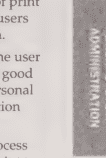

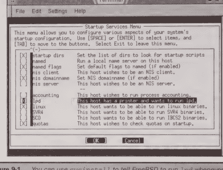

图 9-1。你可以使用 *sysinstall* 来指示 FreeBSD 在启动时运行 *lpd*。

选项，并消除多余的选项。例如，如果包含 *rm*、*rp* 和 *if* 选项但将其设置为空值，都会导致问题。你还应该尝试以 *root* 和普通用户身份进行打印；两者都应该同样正常工作。如果你正在向远程打印机打印，可能需要调整该打印服务器的配置以接受来自你客户端系统的文件。请参阅即将出现的部分“控制远程打印机访问”，了解如何执行此操作。

#### 使用简单过滤器

BSD LPD 系统的许多强大功能都在于 *if* 选项，该选项在列表 9-1 中被省略了。下一节“设置 Ghostscript”描述了使用一种称为*智能过滤器*的强大工具，结合 Ghostscript 处理多种类型的文件。在许多情况下，更简单的过滤器就可以完成这项工作。一个常见的例子是将纯文本文件转换为 PostScript 文件，以便在不知道如何解析纯文本的 PostScript 打印机上进行打印。为此，你首先需要创建一个脚本作为过滤器程序。列表 9-2 展示了一个示例。该脚本读取一个文件并查找字符串 *%!*1*，所有 PostScript 文件都以该字符串开头。如果该字符串存在，脚本将文件原样传递给打印机。如果该字符串不存在，脚本使用 *nenscript* 程序将文件转换为 PostScript。（这假设文件是纯文本；如果你尝试打印二进制文件，如图形文件，脚本将会失败。）

**注意**

> 列表 9-2 仅在你的打印机是 PostScript 型号时才有用，虽然你可以通过修改脚本使其通过 Ghostscript 传递 PostScript 文件，并且不对纯文本文件使用 nenscript，从而将其适配其他类型的打印机。

### 列表 9-2：一个简单的输入过滤器

```bash
#!/bin/sh
# Check to see if input is PostScript. If not, pass through
# nenscript

read firstline
firstchars=`expr "$firstline" : '(\\.\\.)'`

if [ "$firstchars" = "%!" ]
then
# PostScript file; pass through $firstline & rest of file
echo "$firstline" & cat & printf "\\004"
exit 0
else
# Not PostScript; use nenscript to process
(echo "$firstline"; cat) | /usr/local/bin/nenscript -p \\
& printf "\\004"
exit 0
fi
```

**警告**

> 列表 9-2 中以 firstchars= 开头的那一行包含两种类型的单引号。最外侧的一对是反引号，通常位于大多数键盘上 \ 键的左侧，与波浪号 (~) 共用一个键。最内侧的一对是普通的单引号，通常位于大多数键盘上 ENTER 键的左侧。请务必使用正确的引号类型。该行还包含一对双引号，因此也要确保适当使用它们。

列表 9-2 做了几件事。虽然解释每一行超出了本章的范围，但对脚本的基本理解是有用的。该脚本期望从标准输入接收文件，并将文件发送到标准输出。`read firstline` 行将输入文件的第一行读取到名为 `$firstline` 的变量中。下一行将此行提取的前两个字符放入名为 `$firstchars` 的变量中。`if` 行检查这些字符是否将文件标识为 PostScript 文件。如果是，脚本将回显 `$firstline` 和文件的其余部分，原样传递。如果前两个字符不能将文件标识为 PostScript 文件，脚本将通过 `nenscript` 程序发送该文件，该程序将纯文本转换为 PostScript。

要使用此脚本，你应该输入并保存在某个方便的位置，例如 `/usr/local/bin`。你可以将其命名为 `t2ps-filter`。然后你应该添加可执行权限，如下所示：

```
# chmod a+x /usr/local/bin/t2ps-filter
```

你必须修改 `/etc/printcap` 条目，使用 `if` 行指向此脚本。例如，你可能将列表 9-1 的最后一行改为两行，如下所示：

```
:sh:\\n:if=/usr/local/bin/t2ps-filter:
```

**警告**

> 记得在原来的最后一行（列表 9-1 中的 sh）后添加反斜杠，否则新行将被解释为新打印机定义的开始，这将无法正常工作。只有 `/etc/printcap` 条目中的最后一行才应该缺少反斜杠。

当你重启 `lpd` 时，它将使用输入过滤器。当你尝试打印文本文件时，它应该通过 `nenscript` 打印，该程序会添加一个包含时间和文件名（对于以这种方式打印的所有文件均为 stdin）的粗体标题行。当然，你需要安装 `nenscript` 才能使其正常工作。如果没有安装，你可以在 `sysinstall` 的 Packages 系统的 Print 区域找到它，如第 11 章所述。

#### 设置 Ghostscript

虽然像列表 9-2 中显示的过滤器在某些系统上可能有用，但如此简单的过滤器本质上存在局限性。特别是列表 9-2 受到限制，因为它假设打印机是 PostScript 型号，但许多 FreeBSD 系统使用非 PostScript 打印机。这个问题相对容易修复，只需按上述概述修改脚本即可。一个更根本的问题是列表 9-2 只处理两种文件类型：PostScript 和纯文本。如果你想打印其他类型的文件，列表 9-2 最好不产生输出，最坏的情况下会产生完全无意义的页面。解决这个问题的方法是使用智能过滤器，它本质上类似于列表 9-2，但具有更多识别文件类型并通过适当工具打印数据的规则。

**注意**

> 如果你正在配置一个用于不支持 PostScript 的网络打印机的打印队列，但该打印机由使用 Ghostscript 使打印机能够处理 PostScript 文件的 FreeBSD 或类似系统服务，请将打印机视为 PostScript 型号。在这种配置中，打印服务器将运行 Ghostscript；你不需要在打印客户端上执行此操作。

##### 将 Ghostscript 用作翻译器


# 智能过滤器的重要组成部分

智能过滤器的重要组成部分是将 `Ghostscript` 用作翻译程序。该软件包随 `FreeBSD` 一起发布，并在你的本地计算机上作为 `PostScript` 解释器。当作为 `BSD LPD` 打印机队列的一部分调用时，`Ghostscript` 实际上将任何受支持的打印机都变成了 `PostScript` 打印机。有关 `Ghostscript` 支持打印机列表，请参阅 Linux Printing 网站（[http://www.linuxprinting.org/printer_list.cgi](http://www.linuxprinting.org/printer_list.cgi)）。该网站包含比官方 `Ghostscript` 网站（[http://www.cs.wisc.edu/~ghost/](http://www.cs.wisc.edu/~ghost/)）更完整的信息，包括未随主 `Ghostscript` 软件包提供的驱动程序信息。

`Ghostscript` 并非设计为*仅*作为 `FreeBSD` 打印队列的一部分功能；它可以接受 `PostScript` 文件作为输入，并创建存储在磁盘上的输出文件。该程序的基本语法是

```text
gs [option(…)] [file(…)]
```

`gs` 手册页包含程序选项的列表。一些重要的包括

- `-sDEVICE=devicename` 此选项指定输出设备（即打印机驱动程序）；这*不是*指 `FreeBSD` 设备文件）。输入 `gs --help` 将显示包含系统中可用设备列表的帮助文本。其中一些名称可能并不一定显而易见，但 Linux Printing 网站提供了针对特定打印机使用适当设备的指示。
- `-r xres yres` 许多设备支持多种分辨率，你可以使用此选项指定。例如，`-r 360×720` 告诉 `Ghostscript` 以 360×720 点/英寸 (`dpi`) 创建输出。如果你省略 `x` 和 `y` `res`，`Ghostscript` 假设 `res` 与 `xres` 匹配。打印时，你必须指定你的打印机和你的打印机的 `Ghostscript` 驱动所支持的分辨率。
- `-sOutputFile=filename` 此选项指定输出文件名。在打印队列中使用时，`filename` 将是一个破折号 (`-`)，表示标准输出。如果你在打印队列之外调用 `gs`，你将需要提供适当的文件名。

`Ghostscript` 通常从标准输入接受输入。作为 `Ghostscript` 使用示例，假设你有一台 Hewlett Packard Laserjet 4 打印机。你可以使用类似以下命令从 `PostScript` 文件创建适当的输出文件：

```text
$ gs -sDEVICE=ljet4 -r600x600 -sOutputFile=escher.pcl escher.ps
```

## 252 FreeBSD：完整参考指南

> **提示**
>
> 除了打印机输出格式外，`Ghostscript` 还支持一些常见的图形文件输出格式。这些包括 `TIFF`（`tiff42anc` 等）、`PNG`（`png16`、`png256`、`png16m` 等）、`JPEG`（`jpeg`）、`EPS`（`epswrite`）、`PostScript`（`pswrite`）以及 `PDF`（`pdfwrite`）。虽然从 `PostScript` 输入生成 `PostScript` 输出听起来有些奇怪，但在某些情况下这非常有用，例如当您的 `PostScript` 打印机因内存不足或其他问题而无法处理原始 `PostScript` 文件时。

当输入如上述示例的 `Ghostscript` 命令时，每生成新的一页您都会看到一个提示，要求按 `ENTER`；之后您需要在提示符处输入 `quit` 以退出程序。通过在输入文件名之前添加 `-dNOPAUSE -dBATCH` 到命令中，您可以消除这些提示。如果您创建自定义滤镜来处理 `PostScript` 文件，这些选项可能极其重要。

创建输出文件后，您可以将其发送到打印机（通过 `cat` 或 `lpr`——但如果您已设置滤镜，`lpr` 可能无法正常工作）。您应该会得到合理的输出。如果没有输出，或者您得到了一页又一页的乱码，可能需要尝试另一种驱动程序。如果您看不到任何打印机活动的迹象，例如指示灯闪烁，您可能需要回过头去调查基本的打印机连接问题。

### 设置智能滤镜

`FreeBSD` 上有几种智能滤镜包可用。这些本质上是像 9-2 列表那样的滤镜，但更加复杂。它们可以识别许多不同的文件类型，并处理文件以便它们能在您的打印机上打印。最常见的是，这些滤镜调用常见的文件转换程序将输入文件转换为 `PostScript`。然后，滤镜使用 `Ghostscript` 将文件转换为您的打印机能够理解的格式。（如果您有 `PostScript` 打印机，最后这一步会被跳过。）配置完成后，打印任何受支持的文件类型只需将文件提供给该滤镜即可。两个特别流行的智能滤镜包是 `affsfilter` 和 `magicfilter`，两者都可通过 `sysinstall` 的 Print 软件部分获取。本节描述了 `magicfilter` 的配置。

使用 `magicfilter` 的正常方式有点不寻常：您将它的配置文件当作程序来调用。这种技术之所以有效，是因为配置文件被标记为可执行，并以 `FreeBSD` 用于像 shell 脚本语言一样启动 `magicfilter` 的代码开头。各种 `magicfilter` 配置文件位于 `/usr/local/libexec/magicfilter` 目录下，并以它们依赖的 `Ghostscript` 驱动程序命名。例如，针对 `ljjet4` `Ghostscript` 驱动程序的滤镜被称为 `Ljet4-filter`。作为 `magicfilter` 配置工作的一个示例，请考虑 9-3 列表，这是经过修改的 9-1 列表，用于对 Laserjet 4 或兼容打印机使用 `magicfilter`。如您所见，唯一的区别是添加了对 `magicfilter` 配置文件的调用。

**列表 9-3**

**使用 magicfilter 的 /etc/printcap 条目示例**

```text
lp|hp4000:\
:lp=/dev/lp0:\
:br#115200:\
:sd=/var/spool/lpd/hp4000:\
:mx#0:\
:s#:\n::if=/usr/local/libexec/magicfilter/ljet4-filter:
```


如果 **magicfilter** 恰好附带了适用于您打印机的滤镜，那么打印机设置就很简单——或者至少不会比设置纯文本队列更糟。然而，如果 **magicfilter** 包缺少适用于您打印机的合适滤镜，您必须自己创建一个。


`Ghostscript`——因此也包括 **magicfilter**——为打印机类别提供驱动程序。例如，许多激光打印机使用与各种 *Hewlett-Packard* 型号相同的打印机控制语言（`PCL`），因此您可能能够使用 *laserjet*、*ljet2dp*、*ljet3*、*ljet4* 以及类似的驱动程序（以及名称相似的 **magicfilter** 配置文件）来处理由 *Lexmark*、*Brother*、*Okidata* 和其他厂商销售的打印机。请咨询 **Linux Printing** 网站 (`http://www.linuxprinting.org/printer-list.cgi`) 以获取有关哪个 *Ghostscript* 驱动程序与您的打印机配合良好的信息。

如果您需要创建自定义的 **magicfilter** 配置文件，我建议从复制类似打印机的现有滤镜开始。最重要的标准是*不要*选择 `PostScript` 文件（这些文件以 `%!` 或 `%ps` 开头），因为这些文件将 `PostScript` 输出直接发送到打印机端口，而不调用 **Ghostscript**。大多数滤镜文件在文件的开头部分都包含对 **Ghostscript** 的引用，如下所示：

```text
# PostScript
0 !\t filter /usr/local/bin/gs -q -dSAFER -dNO_PAUSE -r600 -dDEVICE=ljet4 -oOutputFile-
0 `004!` filter /usr/local/bin/gs -q -dSAFER -dNO_PAUSE -r600 -dDEVICE=ljet4 -oOutputFile-
```


要修改您复制的配置文件，您必须更改由 `-SDEVICE` 选项指定的 `Ghostscript` 驱动程序名称。再次，`Linux Printing` 网站的数据库在了解此处应填写什么内容时可能非常有价值。许多 `magicfilter` 配置包含允许滤镜识别打印机原生语言文件中的行。此功能使您能够打印那些能产生原生特定输出的应用程序生成的文件。如果您使用无关打印机的滤镜作为模型，您可能希望删除这些行。如果您想在 `The GIMP` 等应用程序中打印打印机特定的驱动程序，您必须为打印机的格式创建新规则，这可能很棘手。通常，打印 PostScript 并使用 `magicfilter` 的正常 PostScript 处理规则要更容易。

即使对于 `magicfilter` 支持的打印机，您也可能想要创建现有配置文件的变体。例如，您可能想要创建配置以在不同分辨率下打印（更改对 `gs` 调用中的 `-r` 值）并设置多个打印队列，每个分辨率一个队列。例如，您可能有 `epson360` 和 `epson720` 队列，分别以 360 和 720 dpi 向 `Epson inkjet` 打印机打印。

一旦您修改了 `/etc/printcap` 文件以使用您的新滤镜，请重启 `lpd`。然后，您可以使用 `lpr` 打印各种文件来测试打印功能。翻阅您的滤镜文件以了解您的滤镜支持哪些文件类型。当您尝试打印 `magicfilter` 不支持的文件时，该文件应从队列中悄无声息地消失，从而防止可能出现的乱码纸张喷发。（尽管 `root` 用户会收到拒绝的电子邮件通知。）如果文件类型受支持，它应被处理，并且您应得到合理的输出。

### 控制打印机

如果您按照本章阅读配置了系统，您现在应该在 FreeBSD 系统上拥有一个可用的打印队列。本节描述了如何使用此打印队列，既作为普通用户，也作为系统管理员。主题包括提交打印作业、检查队列中的作业、删除作业、重新排序作业以及更改打印队列的可用性。

#### 提交打印作业

本章已经提到了 `lpr` 实用程序，它是 FreeBSD 中向队列提交打印作业的工具。这个工具非常重要，以至于它值得进行扩展描述。您还应该了解应用程序如何与 `lpr` 交互，以便您可以直接从程序打印，而不是生成 PostScript 文件然后手动使用 `lpr` 打印它。

#### 使用 lpr

`lpr` 程序接受许多选项，其中一些相当晦涩。请查阅 `lpr` 手册页以了解详细信息。简化的语法是

```bash
lpr [-P*printer*] [-*num*] [-U *user*] [-hnmrs] [*filename*...]
```

这些选项的含义是：

- `-P*printer*` 此选项设置要使用的打印机队列。在支持多台打印机的系统上，这可能是最常用的 `lpr` 选项。默认值是 `PRINTER` 环境变量的值，如果该变量不存在，则为 `lp`。某些版本的 `lpr` 要求 `-P` 和队列名称之间没有空格，但 FreeBSD 随附的 BSD LPD 可以容忍空格。

- `-#*num*` 此选项告诉 `lpr` 生成 `num` 份打印副本。例如，`lpr -#4 afile.ps` 创建 `afile.ps` 的四份副本。

- `-U *user*` FreeBSD 跟踪谁提交了打印作业。此选项仅对 `root` 和 `daemon` 可访问，使您可以指定与打印作业相关联的用户。

#### 打印选项

- `-h` 在打印作业时生成页眉页的站点上，此选项会禁用页眉。

- `-m` 如果您希望在打印作业完成时收到通知，请包含此选项，`lpc` 会在打印完成后通过电子邮件发送通知。

- `-r` 如果您希望 `lpr` 在打印后删除原始文件，请使用此选项。它最常用于脚本或由生成需打印的临时文件的程序中使用。

- `-s` 通常，打印系统会将要打印的文件复制到 spool 目录中。不过，如果您正在打印非常大的文件，这种操作可能会暂时消耗大量的磁盘空间——如果您磁盘空间不足，甚至可能足以导致打印作业失败。此选项指示系统创建符号链接而不是复制文件，从而减少临时磁盘空间的需求。

您可以提交一个或多个文件进行打印，并且可以使用通配符来提交目录中的许多文件——但在这样做时要谨慎，以免最终产生比预期更多的打印作业。如果您未指定要打印的文件，`lpr` 将从标准输入读取。此功能在脚本化或与使用管道调用其他程序时使用 `lpr` 时最为有用。文件的格式必须是您的打印队列能够理解的格式。如果您设置了不使用过滤器的简单队列，这意味着是指打印机可接受的格式。如果您使用过滤器，这意味着是指过滤器可理解的格式。大多数配置都应该能够处理纯文本或 PostScript。

## 从应用程序打印

一些程序允许您直接打印，而无需手动调用 `lpr`。实际上，这些大多数程序都会生成 PostScript 输出并将其发送到 `lpr`，通常使用 `/tmp` 中的临时文件或管道。应用程序具体如何与您交互因程序而异。有些程序会生成一个对话框，您可以在其中输入打印命令，通常已显示部分命令。然后，您可以根据需要使用正常的 `lpr` 语法修改该命令。例如，图 9-2 显示了 `xv` 图形程序的打印对话框。它使用默认打印命令 `lpr`，没有选项。您可以通过添加 `-Pprinter` 将打印作业重定向到另一台打印机，添加其他 `lpr` 选项，或者甚至使用完全不同的命令，如自定义打印脚本或 Samba 的 `smbprint` 实用工具。

其他程序提供界面，可能更容易被新用户理解。这些程序通常检查 `/etc/printcap` 或使用自己的配置文件来识别打印机。例如，图 9-3 显示了 OpenOffice.org 使用的打印对话框。在此对话框中，您可以从“名称”选项框中选择打印机，设置份数等。此类对话框可能具有应用程序特定的选项，如图 9-3 中的“打印范围”选项，它允许您打印文档中页面的子集。

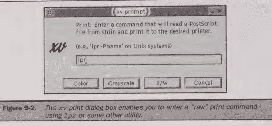

## 检查打印作业

无论您如何提交打印作业，您通常都需要检查其状态。您可以使用 `lpc` 命令做到这一点。此命令的语法是

```
lpc [-a] [-l] [-P*printer*] [*jobnum* […]] [*user* […]]]
```

`-Pprinter` 选项的含义与 `lpr` 中相同；它选择您想要检查的队列。其余选项的含义如下：

- `-a` 如果您想查看所有本地打印机的状态，请使用此选项并省略 `-Pprinter` 选项。

- `-l` 此选项显示有关打印作业的额外信息。由此产生的信息超过一行的长度。

- `jobnum` 通常，`lpc` 显示打印机上所有作业的信息。不过，如果您提供作业编号，它会显示指定作业的信息。

- `user` 您可以通过提供用户名来获取特定用户拥有的所有作业的信息。

如果打印队列为空，输入 `lpc` 会产生简单的 `no entries` 响应。不过，如果队列不为空，它会生成类似以下的输出：

```
$ lpc
waiting for lpd to become ready (offline?)
Rank Owner Job Files Total Size
1st rodmitch 35 fstab-copy 450 bytes
2nd rodmitch 37 …hostscript/6.52/examples/escher.ps 10520 bytes
3rd rodmitch 38 (standard input) 1364390 bytes
```

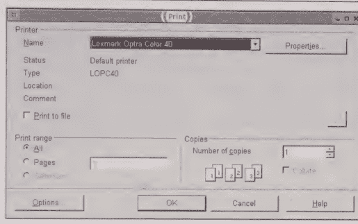

> 图 9-3。一些应用程序允许您使用下拉列表、按钮等来选择打印机和其他选项。

> 注意 如果您用 LPing 或 CUPS 替换 BSD LPD 系统，`lpq` 命令显示的信息格式与此处所示不同。

如您所见，输出包括作业的排名（即打印顺序）、所有者、作业 ID 编号、原始文件以及打印作业的大小。本示例中命令后的第一行（waiting for lpd to become ready (offline?)，意为“等待 lpd 准备就绪（离线？）”）表明打印机没有响应。如果您的打印机关闭、发生纸张卡滞、缺纸或存在其他导致无法打印的问题，您可能会看到此消息。在这种情况下，`lpd` 停止向打印机发送作业，并耐心等待您解决问题。作业 ID 编号特别重要，因为在其他打印机管理命令中会用到它。

`Total_Size` 列以字节为单位列出打印作业的大小。重要的是要认识到，此数值可能与最终打印大小没有紧密关系。在这种情况下，作业 35 (`fstab-copy`) 是一个短文本文件，作业 37 (`escher.ps`) 是生成一页输出的 PostScript 文件，而作业 38 (来自标准输入) 是一页图形打印输出。尽管它们的大小差异巨大，但这三个作业都将各生成一页输出。多页作业可能只有几字节，也可能比前一个示例中的作业 38 更大。

## 删除打印作业


如果您提交了打印作业，但后来决定不想再打印它，或者您发现用户提交了一个不应该打印的作业，您可以使用 `lprm` 命令从队列中删除该打印作业。此命令的语法相对简单：

```
lprm [-Pprinter] [-] [jobnum[...]] [user[...]]
```

与 `lpr` 和 `lpq` 一样，`-printer` 选项允许您指定非默认的打印机。正如您可能猜测的那样，`jobnum` 是由 `lpq` 揭示的作业 ID 编号。因此，普通用户或 root 可以使用如下命令取消作业：

```
$ lprm 35 38
```

此命令从队列中删除作业 35 和 38。如果普通用户发出此命令，只有当同一用户拥有指定的打印作业时，该命令才会成功，但 root 可以删除任何打印作业，无论其所有者是谁。其余选项——单个连字符 `-` 和用户名——都允许您删除许多作业。只有 root 可以指定用户名。当 root 这样做时，属于该用户的所有作业都将从队列中删除。如果普通用户想要删除他们所有的作业，他们可以使用连字符：

```
$ lprm -
```

然而，当 root 发出时，`lprm` 的这种用法具有不同的含义：它会删除队列中的所有打印作业，无论其所有者是谁。

## 重新排序打印作业

有时您可能需要重新排列打印队列中作业的优先级。例如，一个队列可能已经有十几个大型作业，但新提交的作业可能需要快速处理。在这种情况下，`lpc` 命令很有用。此命令的语法看似简单：

```
lpc [command [argument[...]] ]
```

如果调用 `lpc` 时未提供命令，它将进入交互模式，您可以在 `lpc>` 提示符下输入命令。`lpc` 程序接受十几种命令；请参阅其 man 页面以获取更多详细信息。输入 `lpc help` 会显示可用命令的简短摘要。对于重新排序打印作业，相关的命令是 `top`，它接受队列名称和一个或多个作业 ID 编号或用户名作为参数。当您输入此命令时，会移动指定的作业，或所有作业归属于指定用户，移至打印队列的顶部。例如，要将 `hp4000` 队列中的作业 38 移至队列顶部，你需要输入：

```
# lpc topq hp4000 38
```

该命令有两个重要的注意事项：

- `lpc` 命令仅供 root 用户使用。普通用户无法更改队列中作业的顺序，即使他们拥有该队列中的所有作业。
- 你移动的将在当前正在打印的作业之后开始打印。此外，如果相关队列连接到一个具有大型缓冲区或远程网络打印机，你可能无法重新排序作业，因为它们可能已经离开了本地系统的队列。

### 更改队列可用性

`lpc` 工具堪称一种重要的实用程序。除了更改队列中作业的顺序外，它还可以完全禁用或重新启用队列。几对 `lpc` 命令具有相关效果：

- **abort/start**：`abort` 命令断开 `lpq` 与指定队列的连接，并防止 `lpr` 启动新的守护进程。此命令实际上终止了队列上的所有打印，但队列中的作业不会被删除。你可以使用 `start` 命令重新开始在队列上的打印。在某些情况下有用的一个变体是 `restart`，它会终止然后重新启动打印。如果队列上的打印由于某种原因例如表现异常的过滤器而挂起，此命令可能很有用。
- **down/up**：`down` 命令停止打印，并允许你输入一条将由 `lpq` 显示的消息。例如，输入 `lpc down hp4000 Printer is out of toner` 会取消打印并向任何随后输入 `lpq -P hp4000` 的用户显示消息 *打印机墨粉耗尽*。当你发出此命令时队列中的作业将被保留，直到你使用 `up` 命令恢复队列，否则它们不会被打印。
- **disable/enable**：`disable` 命令阻止 `lpr` 接受队列的新作业，但不会终止或延迟已在队列中的作业的打印。要重新启用队列上的打印，请使用 `enable` 命令。

> **提示**
>
> 如果你想关闭一个正在使用的队列，你可以使用 `disable`，等待队列变空，然后使用 `down` 向用户提供一条消息，说明为什么该队列处于活跃状态。如果你需要更换打印机或执行可能需要较长时间的维护，这种技术很有用。当然，如果打印机严重故障，从一开始就使用 `abort` 或 `down` 是更好的做法。

在这些所有情况下，你指定 `lpc` 命令，后跟你想要影响的队列名称，或者 `all` 以影响所有队列。例如，为了打印剩余作业但拒绝所有队列上的新作业，你会输入：

```
# lpc disable all
```

### 控制远程打印机访问

如本章前文所述，BSD LPD 系统天生支持网络。前面“创建打印队列”一节包含了配置本地队列将作业转发给接受远程 BSD LPD 打印作业的其他计算机的信息。某些工作组打印机天生支持网络，并直接接受此类作业。你可能希望将打印机配置为 **打印服务器**——一台接受来自其他系统的远程打印作业的计算机。如果你的远程系统是其他 FreeBSD 系统、其他类 UNIX 系统，甚至是理解 BSD LPD 协议的非 UNIX 系统，将你的 BSD LPD 系统配置为接受打印作业相对简单。在你使其本地打印后，只需要调整打印服务器上的一个配置文件。

> 本节描述了配置计算机以使用 BSD LPD 打印协议接受打印作业的设置。LPing 和 CUPS 包可以使用这些协议，各种操作系统的客户端包也可以。但是，如果你想要配置 LPing 或 CUPS 系统以接受打印作业，*这些说明并不适用*。此外，*在处理非 UNIX 客户端时，在 FreeBSD 中实现其原生打印协议通常更可取*。Samba 包在第 18 章中描述，为 Windows 和 OS/2 执行此操作，而 Netaalk 包 http://netaalk.sourceforge.net/ 包含一个用于 Mac OS 客户端的打印服务器。

`lpd` 程序默认以相当严格的模式运行——它仅接受来自本地系统的打印作业。要更改此限制，你必须在 `/etc/hosts.lpd` 文件中列出本地队列应接受作业的计算机。你可以通过主机名带或不带域名；如果省略域名，`lpd` 假设你指的是服务器自己的域或通过 IP 地址来指定主机。例如，清单 9-4 是一个 `hosts.lpd` 文件，它授予系统 *chaucer* 位于服务器域中、*shakespeare.threeroomco.com* 和 `172.19.45.201` 访问打印服务器的权限。

```
chaucer
shakespeare.threeroomco.com
172.19.45.201
```

你还可以使用 `/etc/hosts.equiv` 文件让其他系统访问你的系统，但 `hosts.equiv` 的后果远远超出了打印的范围——它被各种其他网络工具使用。在大多数情况下，独立配置每个服务器更好，因为这使你能够微调系统的安全策略。你可能想要阅读第 17 章和第 29 章以获取更多关于配置系统以阻止不需要的网络访问的信息。

### 摘要

与大多数现代操作系统一样，FreeBSD 使用打印队列系统来处理打印。这种方案使操作系统能够控制打印作业的调度，这在多任务操作系统中很重要，在多用户操作系统或打印服务器中至关重要。FreeBSD 不像大多数操作系统那样实现打印机驱动程序，而是依靠程序生成纯文本或 PostScript 输出，然后使用打印队列中的过滤器将该输出转换为打印机可以理解的形式。打印队列本身通过 `/etc/printcap` 文件进行控制，该文件列出了队列名称、打印机功能以及队列使用的过滤器。在打印到非 PostScript 打印机时，这些过滤器通常调用 Ghostscript，将 PostScript 转换为适合常见非 PostScript 打印机的多种文件格式。无论队列如何处理数据，都可以通过少数命令来控制队列，包括 `lpr`、`lpc`、`lpq` 和 `lpstat`。某些应用程序为其中一些命令提供了图形用户界面——特别是 `lpr`，它用于向打印队列提交作业。BSD LPD 系统在设计时考虑了网络打印，因此配置 FreeBSD 接受来自其他类 UNIX 系统的远程打印作业，只需在配置文件中添加可接受的主机即可。

# 完整参考

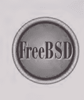

# 第 10 章

## 管理用户账户

账户是 FreeBSD 用户支持和安全模型的核心，因此你必须理解 FreeBSD 账户才能正确管理 FreeBSD 系统的这些方面。通常，每个用户恰好拥有一个账户，但有时单个用户可能需要多个账户。某些系统和管理员账户要么无人使用，要么可供一个或多个系统管理员访问。前面的章节描述了一些这些账户特别是 *root*，但本章有助于充实细节。它还提供了如何创建、修改和删除用户账户和组的实际建议。本章以查看与账户相关的安全策略作为结束。你可能希望更改某些系统默认设置，以便 FreeBSD 以更适合当地需求而非标准默认设置的方式运行。

> **注意**
>
> 账户管理与文件管理紧密相连，特别是文件的权限和权限设置。这些主题在第 8 章中涵盖。

### FreeBSD 中账户的重要性


在开始管理用户账户之前，你应该了解它们为何存在、如何使用以及如何实现。这些主题与 FreeBSD 账户的具体功能相关，理解其运作方式将帮助你设计适合系统的用户账户结构。

### 账户作为一种便利

账户存在的最明显原因之一是它们作为用户的便利设施发挥作用。某些操作系统的标准安装默认将计算机启动到单个桌面环境。任何用户都可以修改桌面默认设置并在任何目录中存储文件。此类操作系统的示例包括 DOS、Windows 9x/Me、OS/2、Mac OS Classic 和 BeOS。（其中一些提供了支持某种账户的配置选项。）对于单用户系统，这种配置可能是合理的，因为它将使用计算机所需的努力培训降至最低；用户只需打开计算机并等待桌面出现即可开始使用。

单桌面配置的一个缺点在于多用户环境。假设有两个用户，Pierre 和 Marie，共用一台计算机。如果 Pierre 喜欢淡紫色背景和快速键盘重复率的桌面环境，但 Marie 喜欢随机背景图像和没有键盘重复的环境，那么其中一人或两人不得不接受非首选环境。账户通过为每个用户单独存储偏好设置来解决这个问题。因此，系统使用登录用户的偏好设置，使两个用户都得到满足。

## 基础系统管理

账户的另一个便利功能是每个 FreeBSD 账户都拥有一个独立的文件存储区域，称为主目录（home directory）。这通常是 `/home` 下以用户名命名的子目录，例如 `/home/marie` 或 `/home/pierre`。此功能允许用户以自己喜欢的方式存储文件。如果 Marie 很讲究，将文件保存在精心组织的目录中，而 Pierre 比较随意，使用的目录较少，那么这两人的工作习惯也不会相互干扰，因为任一用户都不需要处理另一人的主目录。（根据系统的安全设置，一个用户可能或可能无法读取另一个用户的主目录。）

## 作为安全工具的账户

将用户文件放在独立的主目录中除了便利性外，还带来了安全益处。具体来说，根据对用户主目录、子目录和单个文件授予的权限，您和用户可以控制谁可以访问他们的文件以及以何种方式访问。例如，如果 Pierre 正在处理 Marie 不应有访问权限的项目，我们可以对相关文件或目录设置权限以排除 Marie 读取这些文件。对于任何多用户操作系统来说，这一功能都极其重要。第 8 章和接下来的章节“账户安全维护”将更详细地涵盖此主题。

除了控制用户之间的访问权限外，账户安全措施还有助于保持整个计算机的安全性。构成 FreeBSD 本身的大多数文件对于任何用户都是可读的，许多文件甚至可执行；但大多数文件和目录不能被任何普通用户写入。因此，Marie 和 Pierre 都无法删除关键系统文件。在大多数情况下，`root`（管理账户）拥有这些文件，只有 `root` 可以修改或删除它们。这一特性使 FreeBSD 在相对公共的环境中供相对缺乏训练的人员使用也是可行的。在公共环境中使用 Windows 9x/Me 或 Mac OS Classic 系统往往会引发问题，因为无知或恶意人员可能会损坏系统配置，但 FreeBSD 不会受到此问题影响。

### 账户和组

账户是强大的工具，但在许多环境中它们还不够充分。特别地，通常有必要基于用户组提供安全保护。FreeBSD 通过其组功能实现这种能力。组是一组账户的集合。例如，`pierre` 和 `marie` 可能属于 `physics` 组，而 `jane` 和 `charles` 可能属于 `biology` 组。如果需要，一个用户可以属于多个组。

在大多数情况下，组与文件权限结合使用，如第 8 章所述，以便通过不同用户组精细调整对文件的访问权限。接下来的章节“账户安全维护”描述了一些针对系统的可能配置。

有一个组特别重要：`wheel`。该组的成员有荣誉可以使用 `su` 命令获取其他用户（包括 `root`）的特权。该命令在第 3 章中有描述。通常，少数用户（可能只有一个）是 `wheel` 组的成员，并且知道 `root` 密码。这种组合允许这些用户使用其常规账户登录，输入 `su` 和 `root` 密码，并管理系统。任何不是 `wheel` 组成员的用户都会拒绝访问 `su`，因此即使该人是某种方式获取了 `root` 密码的恶意个人，其成功破坏系统的可能性也更小。因此，`wheel` 是 FreeBSD 安全系统的一个组成部分。

> **提示** 如果您正在管理 FreeBSD 系统，应确保您是 `wheel` 组的成员。管理时，使用普通账户登录，然后使用 `su` 变为 `root`。这比直接以 `root` 登录会在系统日志中留下更多关于您活动的痕迹。这些痕迹在追踪滥用情况时可能很重要，特别是在有多个管理者的系统中。

### 用户名、组、UID 和 GID

在核心层面，计算机基于数字运行。每当您在计算机屏幕上阅读单词或名称时，那只是将数字数据转换为对人类更方便的格式的翻译。在许多情况下，如使用文字处理器时，这种转换发生在足够低的层级，因此您可以几乎总是忽略它。这类转换涉及由 *美国信息互换标准代码* (ASCII) 控制的转换，它将数字映射为字母和其他标点，或者可能是其他编码方法。在创建屏幕字符显示时，其他映射也在起作用。但在用户名和组名的情况下，这种低级别的转换伴随着另一种在管理用户账户时更可能重要的转换。具体来说，用户名是 *用户 ID* (`UIDs`) 的便利人类表示形式，组名是 *组 ID* (`GIDs`) 的表示形式。

内部地，FreeBSD 几乎完全使用 `UIDs` 和 `GIDs`。例如，`UIDs` 和 `GIDs` 与其他文件元数据（描述文件的数据，而非文件内容）一起存储，如创建时间和大小。它们也用于标识正在运行的进程的所有者。从 FreeBSD 内部观点来看，人们使用的用户名和组名次于 `UIDs` 和 `GIDs`。

> **注意**
> 
> *可以编写脚本和程序引用用户名和组名而非 `UIDs` 和 `GIDs`。这些脚本和程序在概念上可以作为自动系统操作的一部分使用。因此，将 `UIDs` 和 `GIDs` 用于内部，而将名称仅用于与人类交互的分类并不完全准确。*

由于 FreeBSD 是面向人类的工具，它包含将 `UIDs` 和 `GIDs` 分别映射到用户名和组名的机制。因此，当您进行长目录列表时，FreeBSD 通常显示用户名和组名，而非 UID 和 GID：

```bash
$ ls -l license.txt
-rw-------    1 pierre    users    356 Mar  2  2002 license.txt
```

> **注意**
> 
> *`ls` 的 `-n` 选项使其显示 UID 和 GID，而非用户名和组名。*

通常，`UIDs` 到用户名以及 `GIDs` 到组名之间存在一一对应关系。然而，可以创建一个具有一组 UID 但多个关联用户名的账户，同样适用于 GIDs 和组。此类配置可能会令人困惑，因此通常不推荐。

> **警告**
> 
> *计算机黑客有时使用的诡计是创建一个看似普通用户名但 UID 为 0 的账户。这个 UID 是特殊的，因为它等同于 `root` 账户。因此，这个黑客的“新”账户只是获取 `root` 访问权限的另一种方式，尽管是以另一个名字。您应该注意这种可能性；如果您检查账户配置文件并看到除 `root` 外任何 UID 为 0 的账户，您的系统几乎肯定已被入侵。*

默认情况下，FreeBSD 从 1000 开始分配 `UIDs`，`GIDs` 也从同一数字开始。其他一些操作系统使用其他起始数字，有时低到 100。因为文件关联的是 `UIDs` 和 `GIDs`，任何通过支持 `UIDs` 和 `GIDs` 的介质传输文件的文件传输方法都要求用户在两个系统上拥有相同的 UID，以便权限正确工作。`GIDs` 也必须匹配等效组。用户可以在两个系统上拥有不同的用户名，但只要用户拥有相同的 UID，权限就会正常工作。在使用 FreeBSD 的快速文件系统 (`FFS`) 或通过网络文件系统 (`NFS`) 进行网络传输时，使用软盘或 Zip 盘时这是一个问题。对于那些不支持 `UIDs` 和 `GIDs` 的文件系统（如 `FAT`）或文件传输协议 (`FTP`) 网络文件传输，则不存在此因素。


## 账户和组数据结构

账户由定义在各种文件和目录中的数据结构的交织集合组成。其中最重要的是：

-   **`/etc/passwd`** 此文件是所有账户数据结构的基。它是一个文本文件，包含所有用户账户的基本信息，包括 `UIDs` 和用户名之间的映射、用户的默认组（由 `GID` 指定）、用户的主目录和用户的默认 shell。传统上，此文件保存用户的密码，但现在已不再如此。此文件可被计算机的任何用户读取。
-   **`/etc/master.passwd`** 此文件保存与 `/etc/passwd` 相同的大量信息，此外还有用户密码的*哈希值*（单向加密）和一些附加信息。由于密码的敏感性，此文件仅可由 `root` 读取。


### 二进制密码文件
虽然像 `/etc/passwd` 和 `/etc/master.passwd` 这样的基于文本的文件对于小系统是足够的，但在大型系统中搜索成千上万条目可能相当耗时。因此，FreeBSD 实现了特殊的二进制密码文件 `/etc/pwd.db` 和 `/etc/spwd.db`。这些文件提供用户信息的快速查找。

### 主目录
用户的主目录是用户账户的重要组成部分。其位置在 `/etc/passwd` 和 `/etc/master.passwd` 文件中定义，主目录持有用户的数据文件。

### 本地配置文件
用户目录经常包含定义用户环境许多默认功能的文件。例如，个性化的 shell 配置文件位于主目录中，如第 6 章所述。

### 服务器配置文件
某些服务器和其他系统进程包含对特定账户的引用，通常是为了授予或拒绝特定用户对服务器或其某些设施的访问。称这些文件为账户配置的一部分可能有点牵强，但如果您添加、删除或修改账户，记住它们很重要。细节因服务器而异。示例包括 Samba 的加密密码文件和邮件服务器的特定用户投递规则等功能。

集体而言，这些文件和功能定义了单个用户账户的许多功能。本章接下来的章节描述了如何修改这些文件，进而修改账户的访问方式或工作方式。组具有类似的配置文件，但它们往往更简单。这些组文件中最重要的是 `/etc/group`。它大致等同于 `/etc/passwd`，除了它...

...定义的是组而非账户。这种相似性包括将组名映射到 GID 以及用户列表（通过用户名指定）。组默认没有主目录，尽管如果这对您的系统合适，您可以创建目录供组成员共享文件。某些服务器可能会基于组提供差异化访问权限，但与基于用户的访问控制相比，此类配置较为罕见。

## 创建用户账户

正如第 2 章所述，当您在安装 FreeBSD 时，系统为您提供了一个创建初始用户账户的机会。系统还创建了一些特殊的系统账户（大多数 UID 小于 100，尽管有一个——nobody——其 UID 为 65534）。在日常操作中，您很有可能需要添加新用户。在拥有许多用户的系统中，例如文件服务器、邮件服务器或使用远程访问终端的系统，这种情况尤其可能发生。

通常，您将使用 `sysinstall` 或更偏向命令行的工具（如 `adduser`）来添加用户。您也可以直接编辑相关文件来添加用户，但这种做法通常过于繁琐。（这一点将在下文“修改用户账户”部分结合编辑现有账户进行介绍。）

## 用户名规则

在开始添加用户之前，您应该了解哪些名称可以与账户关联。FreeBSD 接受由小写字母、数字、下划线（`_`）和短横线（`-`）组成的用户名。用户名的最大长度为 16 个字符，但某些程序的显示仅为用户名分配 8 个字符，因此较长的用户名可能会被截断，或在用户名之后的列中对齐出现问题。

一些类似 UNIX 的系统接受混合大小写名称、长度超过 16 个字符的名称，或包含非字母字符（如标点符号）的名称。虽然您可以通过编辑 `/etc/master.passwd` 并运行 `pwd_mkdb` 在 FreeBSD 中创建至少部分此类用户名（如下一节“修改用户账户”所述），但这可能会给强制执行常规 FreeBSD 用户名规则的实用工具带来问题。

FreeBSD 用户名是区分大小写的，因此如果用户名是 `marie`，该用户无法通过输入 `Marie` 或任何其他大小写变体登录；FreeBSD 会响应为仿佛用户输入了错误的密码。同样，在账户维护工具中输入大小写不同的用户名也会失败。这一规则的一个例外是电子邮件；如果有人将 `Marie` 作为邮件消息中的用户名，它将被递送到 `marie`。

在字符和长度规则范围内，用户名几乎可以是任何东西。大多数站点基于用户的真实姓名来设置用户名，使用用户的名、姓或首字母缩写。


例如，Marie Curie 的用户名可能是 `marie_curie`、`mcurie` 或类似的东西。如果此系统导致冲突，您可能需要退而求其次，使用数字，例如，如果已经有人名为 Marie Jones 并且使用了 `marie` 用户名，您可能需要使用 `marie2`。您可能还需要截断名称，或针对拥有特别长姓名的个人调整您的系统。一些管理员喜欢使用严格定义的规则将用户的真实姓名映射到用户名，但其他人则更灵活，允许用户以他们想要的任何方式选择用户名。无论何种情况，这些策略绝对是本地性的；您可以使用您喜欢的任何系统，甚至生成不基于用户真实姓名的用户名。

### 使用 sysinstall 创建账户

`sysinstall` 软件包包含一个工具，使您可以向系统中添加用户。第 2 章包含了 `sysinstall` 用于系统安装的简介，该过程的一部分包括创建一个普通用户账户。在遵循此过程之前，您可能需要为新用户创建组。下一节“使用组”涵盖了这一主题。要使用 `sysinstall` 添加更多用户，请遵循以下步骤：

1. 作为 root，输入 `/stand/sysinstall`。此命令将启动 `sysinstall` 实用工具。
2. 从 `sysinstall` 主菜单中选择 `Configure` 选项。这将打开 FreeBSD 配置菜单。
3. 在 FreeBSD 配置菜单中，选择 `User Management`。这将创建一个小的用户和组管理菜单。
4. 在用户和组管理菜单中，选择 `User`。这将产生图 10-1 中所示的用户和组管理表单。请注意，某些信息，如 UID 和登录 Shell 字段，已经填入表单中。
5. 在 `Login ID` 字段中输入用户名。当您按下 TAB 或 ENTER 时，光标移动到 UID 字段，并且基于您输入的用户名，`Home Directory` 字段获取一个值，例如，如果您输入 `marie` 作为用户名，则可能是 `/home/marie`。
6. 如果您想更改 UID 以使其符合该用户在另一台计算机上的 UID，请更改它。如果不更改，您应该保留 UID 原样；`sysinstall` 会选择第一个可用的 UID。

> **注意：** 如果您需要在系统之间匹配 UID，您应确保不创建冲突，例如在同一系统上两个用户具有相同的 UID。您可能需要更改现有用户的 UID 以避免此类冲突。

7. 在 `Group` 字段中，输入用户的默认组。该组**必须已经存在**于系统中。如果组不存在，`sysinstall` 将无法创建用户。如果您希望此用户拥有 `su` 命令的访问权限，您可以在此处输入 `wheel` 组。如果需要为用户创建新组，请退出此过程并查阅下一节“使用 sysinstall 创建组”。
8. 在 `Password` 字段中键入密码。选择好的密码对于系统安全至关重要。第 29 章中“创建安全密码”部分详细描述了这个问题。简而言之，密码不应是词典中找到的单词或专有名词（特别是与用户相关的名字，如用户配偶的名字），它们应该是混合大小写的，并且应包含一些数字或标点符号。
9. `Full Name` 字段包含由某些实用工具显示的关于用户的自由形式信息。此信息通常是用户的完整姓名，如 `Marie Curie`，但该字段的默认值为 `User 8`。某些实用工具以特定方式解释由逗号分隔的信息——即，可以输入用户的完整姓名、办公室位置、办公室电话号码和家庭电话号码。退格键删除默认值并键入更有意义的内容。

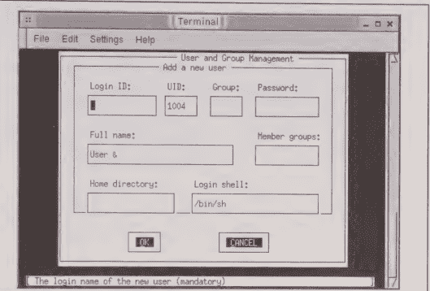


10. 如果用户应属于多个组，请在 `Member Groups` 字段中输入除步骤 7 中已输入的组之外的其他组，用逗号分隔。如果用户应仅属于一个组，此字段可以留空。
11. 您可以通过编辑 `Home Directory` 字段来更改用户的主目录，但在大多数情况下，基于用户名的默认值应该可以正常工作。
12. 为用户输入默认 shell。系统会将其与可接受的 shell 列表（存储在 `/etc/shells` 中）进行核对。如果您输入无效的 shell，当您选择 `OK` 时，`sysinstall` 会提出警告。
13. 将文本光标定位在 `OK` 上并按 ENTER。FreeBSD 现在使用您提供的信息创建一个新账户，并返回用户和组管理菜单（步骤 4）。然后您可以重复步骤 4–13 以添加更多用户，或者选择两次 `Cancel` 然后选择 `Exit Install` 以退出 `sysinstall`。

这种添加用户的程序在大多数情况下都很有效。它为每个字段中应填写的内容提供提示，并能快速添加几个用户。但是，与许多 FreeBSD 管理任务一样，`sysinstall` 仅为其他工具提供了一个基于菜单的界面。

## 使用 adduser


有时 `sysinstall` 并不足够。例如，如果您需要添加许多用户，您可能更愿意编写一个脚本来完成这项工作，而 `sysinstall` 与脚本的配合并不好。您可能也不愿意在 `sysinstall` 的菜单中摸索。在这种情况下，存在一个更简单但更强大的工具：`adduser`。该程序使用标准输入和输出以相当严格的顺序提示您输入信息，因此，如果您想以半自动化的方式创建账户，可以按照第 5 章所述，使用重定向从脚本中调用它。

第一次运行 `adduser` 时，程序试图访问其配置文件 `/etc/adduser.conf`，但在标准安装中此文件不存在。因此，程序会运行其大部分选项（如稍后所述）以获取默认值。您可以按 ENTER 接受其中大部分的默认值。如果您决定稍后更改它们，您可以编辑 `adduser.conf` 或删除该文件并再次运行 `adduser` 以生成新的默认值。

在生成 `adduser.conf` 之后，或当您运行该程序时，它开始提示您输入信息。第一个信息与用户名和用户身份有关：

```bash
# adduser
Use option '--verbose' if you want to see more warnings and
questions or try to repair bugs.

Enter username [a-z0-9_-]: marie
Enter full name []: Marie Curie
```

如本章节前面“用户名规则”部分所述，用户名应由小写字母和数字组成。*全名*通常指用户的真实姓名，但如果你愿意，也可以在此处存储其他信息。然后程序会询问与外壳（shells）、主目录（home directories）、用户 ID（UID）以及组归属相关的问题：

```
Enter shell bash csh dash ksh no nosh sh tcsh zsh [sh]: **ksh**
Enter home directory (full path) [/home/marie]:
Uid [1003]:
Enter login class: default []:
Login group marie [marie]:
Login group is ``marie''. Invite marie into other groups: guest no [no]: **users**
```

对于其中大多数选项，你可以按 ENTER 键选择默认值，正如本示例中对大多数响应所做的那样。不过，在这个示例中，*marie* 被赋予了非默认的 *ksh* 外壳，并且除了 *marie* 组之外，还被添加到了 *users* 组中。最后一个选项值得特别说明。默认情况下，*adduser* 会为每个用户创建一个专门的组。创建时，该组仅包含该用户本人，但你也可以将其他用户添加到该组中。这是一种有用的账户安全措施，但并非唯一的方法。本选项以及其他选项将在接下来的章节“确定组策略”中详细描述。如果你不想采用这种方法，可以在 *Login group* 提示处输入一个现有组的名称。

账户创建过程的下一阶段会提示输入若干与密码相关的选项：

```
Use password-based authentication (y/n) [y]:
Use an empty password (y/n) [n]:
Enter password []:
Enter password again []:
Enable account password at creation (y/n) [y]:
```

在本示例中，除了密码部分（在 *Enter password* 和 *Enter password again* 提示处），所有选项都选择了默认值，这是通常的配置方式。尽管本示例中未显示，因为密码不会回显到屏幕上，但相同的密码被输入了两次。输入两次可以降低因拼写错误而导致账户无法使用的风险，从而避免后续需要超级用户干预。输入密码信息后，*adduser* 会要求你验证目前为止输入的信息。

```
Name: marie
Password: ****
Fullname: Marie Curie
Uid: 1003
| Field | Value |
| :--- | :--- |
| Gid: | 1003 (marie) |
| Class: | |
| Groups: | marie users |
| HOME: | /home/marie |
| Shell: | /usr/local/bin/ksh |
| OK? (y/n) [y]: | **y** |
```

如果你输入 `n`，`adduser` 将返回以重新收集信息。如果你输入 `y`，`adduser` 将创建账户。然后它会提示你提供有关它向新建账户发送的电子邮件的信息：

```
Added user ``marie''
Send message to ``marie'' and: no root second_mail_address
[no]: charlesd@pangaea.edu

Marie Curie,

your account ``marie'' was created.
Have fun!

See also chpass(1), finger(1), passwd(1)

Add anything to default message (y/n) [n]: n
Send message (y/n) [y]: y
Add another user? (y/n) [y]: n
```

系统会询问你是否要将欢迎邮件的副本发送到其他任何地址。默认响应为“否”，这意味着邮件不会发送给其他人。相反，你可以输入 `root` 将邮件发送到 `root` 账户，或者任何其他电子邮件地址（例如此处显示的 `charlesd@pangaea.edu`）。系统显示消息，其默认内容并不是特别具有信息量——毕竟，任何能阅读该消息的用户可能都知道该账户的存在。此消息存储在 `/etc/adduser.message` 中，因此你可以将其编辑为更有用的内容，例如解释本地策略的消息。你还可以针对每个用户在默认消息中添加信息。如果你愿意，也可以选择不发送该消息。最后，`adduser` 会询问你是否要添加另一个用户。如果你回答 `n`，它退出；如果你回答 `y`，它重新开始该过程。

`adduser` 命令接受各种选项，这些选项会覆盖存储在 `/etc/adduser.conf` 中的默认值。例如，`-home homedir` 将主目录的基础目录（通常是 `/home`）设置为你指定的其他内容。由于这些选项会覆盖你被提示输入的项目，因此很少需要使用它们。一个例外是 `-config_create`，它会创建新的默认配置文件。你可以查阅 `adduser` 的手册页以获取有关这些选项的更多信息。

## 修改用户账户

在一个理想的世界中（从系统管理的角度来看），一旦创建了账户，你就可以不再管它了。不幸的是，情况往往并非如此。你可能需要更改已为某账户输入的一些信息。一种特别常见的变更类型是密码。良好的安全实践是经常更改密码，以最小化密码落入错手时可能造成的损害。（具体频率取决于你的环境。某些高安全环境可能要求使用一次性密码，这些密码在使用后即失效。低安全环境可能每隔几个月更改一次即可。）了解密码的工作原理、如何更改密码以及如何更改其他账户信息，对于账户管理至关重要。

## 理解影子密码

在 UNIX 的早期年份，密码与其他信息一起存储在 `/etc/passwd` 文件中。各种程序需要此文件中的信息——例如，显示系统用户信息的 `finger` 守护进程必须能够从该文件中读取用户的真实姓名。因此，该文件对所有人可读。这种系统曾被视为可接受，因为如前文“账户和组数据结构”部分所述，密码是通过哈希加密的。不幸的是，随着计算机速度和磁盘容量的增长，存储整个字典的哈希并将这些条目与 `/etc/passwd` 文件条目进行比对成为可能。弱密码很容易被这种技术发现。

解决此问题的部分方法是说服用户选择好的密码，但这项任务以困难著称。另一部分解决方案是将密码从 `/etc/passwd` 文件中移出，放入另一个更安全的文件中。在 FreeBSD 中，这是 `/etc/master.passwd` 文件及其关联的数据库格式变体 `/etc/spwd.db`。这些文件包含与其原始对应文件相同的信息，但它们仅可由 `root` 读取。相反于在 `/etc/passwd` 中放入密码，密码字段包含一个星号（`*`），这表明密码存储在安全文件中。

这种密码安全方法被称为*影子密码*。（在其他操作系统中，其实现方式并非总是完全一致，但关键点在于密码存储在仅 `root` 可读的文件中，这是不变的。）普通程序保留对 `/etc/passwd` 的访问权限，这对某些用途是必需的，而只有以 `root` 身份运行的程序才能读取密码。虽然这种方法并不提供完美的安全性；如果破解者甚至能获得有限的 `root` 访问权限，影子密码文件就容易被盗取。不过，影子密码是 FreeBSD 密码安全的重要组成部分。

## 使用 `passwd`


当你通过 `sysinstall` 或 `adduser` 创建账户时，系统会提示你为该账户输入密码。不过，有时你或账户所有者必须更改该密码。例如，你可能会鼓励或要求用户定期更改密码，以降低密码被泄露的风险。更改密码的常用工具是 `passwd`。该命令的语法相当简单：

```
passwd [-l] [user]
```

通常，FreeBSD 的 `passwd` 在本地更改密码，如果系统配置为 Kerberos 领域的一部分，它也会更改 Kerberos 密码。`-l` 选项会更改此行为，使得仅更改本地密码。

> **注意**
>
> Kerberos 是一种分布式身份验证系统，正在托管许多服务器或允许用户登录到多台工作站的网络上变得流行。不过，其特性的讨论超出了本书的范围。如需更多信息，请查阅 Kerberos 网页，http://web.mit.edu/kerberos/www/。

只有 `root` 可以使用 `user` 选项，该选项允许超级用户指定要更改密码的用户。因此，在大多数情况下，普通用户可以如下使用 `passwd`：

```
$ passwd
Changing local password for marie.
Old password:
New password:
Retype new password:
passwd: updating the database...
passwd: done
```

该程序提示输入旧密码作为一种安全措施，以确保它没有被未授权的人员调用——例如，如果账户所有者离开终端未加看管，而恶棍找到了该终端。然后它提示两次输入新密码并报告其状态。这三个密码都不会回显到屏幕上，以防被路人读取。

当 `root` 使用 `passwd` 时，程序不会提示输入旧密码。此功能允许超级用户在不知道旧密码的情况下更改普通用户的密码。此功能在用户忘记密码时非常有用——用户可以去找系统管理员，管理员可以输入新密码。

### 使用 chpass

另一个在调整账户行为时有用的工具是 `chpass`。该程序允许你更改账户的各种特性，包括密码、账户过期日期和默认外壳。其语法为：

```
chpass [-a list] [-p encpass] [-e expiretime] [-s newshell] [user]
```

**注意**

`chpasswd` 程序还支持一些与维护网络信息系统（NIS）数据库上的账户相关的选项。NIS 是一种分布式登录数据库系统，在某些方面类似于 Kerberos。请查阅 `chpasswd` 手册页以获取更多信息。

这些选项中的大多数仅对 `root` 可用。`chpasswd` 选项的含义如下：

-   `-a list` 此选项允许 `root` 提供完整的 `/etc/passwd` 格式条目。该格式将在后文的“编辑 `/etc/master.passwd`”章节中说明。
-   `-p encpass` `root` 可以使用此选项，该选项允许更改密码。密码 (`encpass`) 必须由 `crypt` 程序预先加密。此选项最常用于调用 `crypt` 并将其结果传递给 `chpasswd` 的脚本中。
-   `-e expiration` 此选项仅可由 `root` 使用，用于设置账户的过期日期。`expiration` 需加引号，格式为“月 日 年”，例如“2003年3月20日”。在此日期之后，系统将拒绝账户访问尝试。
-   `-s newshell` 此选项既可由 `root` 也可由普通用户使用，用于更改默认 `shell`。
-   `user` 只有 `root` 可以使用此选项，它指定要更改的账户。

通常，`chpasswd` 在运行时不带任何选项，或者当 `root` 运行时仅带有用户指定。这种用法会使程序启动一个编辑器，允许对账户进行动态更改，包括无法通过命令行选项更改的选项。图 10-2 展示了这样一个会话（使用第 5 章中描述的 `vi` 编辑器）。当作为普通用户运行时，`chpasswd` 仅允许编辑图 10-2 所示字段的子集。

当你在交互模式下运行 `chpasswd` 时，你可以填写或更改所提供的任何信息。许多这些字段已经描述过，但有些值得特别关注：

-   `Password` 此字段存储经过哈希（加密）的密码，因此通常不应触碰它。
-   `Change` 和 `Expire` 这些字段分别存储用户必须更改密码的日期和账户的过期日期。设置密码更改日期可用于强制密码更改，但当用户更改密码时，此字段会清除，因此除非你重置此值，否则无需进一步更改。

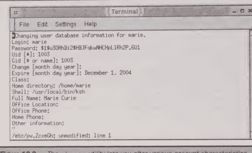

图 10-2. `chpass` 实用程序允许你更改各种账户特性。

-   `Full Name` through `Other Information` 此信息将进入 `Full Name` `/etc/passwd` 字段，正如 `sysinstall` 或 `adduser` 提示的那样。`/etc/passwd` 文件中的每个子字段由逗号分隔。一些实用程序会读取此信息并以与 `chpass` 使用的类似名称显示，但其他实用程序会忽略除用户名以外的所有内容。

## 编辑 /etc/master.passwd

如果你想深入了解 `passwd`、`chpass` 和 `adduser` 等工具背后的文件，你可以这样做。通常，如果你这样做，你将编辑 `/etc/master.passwd`，然后运行一个特殊实用程序以将更改传播到其他文件。`/etc/master.passwd` 文件由一系列行组成，每个用户一行。一个示例条目类似于以下内容：

```
marie:$1$u30R$hD125HBjFqk0wNHCHpLlRh2P.6Ul:1003:1003::0:1101877200:¢\n Marie Curie:/home/marie:/usr/local/bin/ksh
```

每个条目由一系列以冒号 (`:`) 分隔的字段组成。每个字段的含义如下：

-   `Username` 第一个字段（前一个示例中的 `marie`）是用户名。
-   `Password` 第二个字段（前一个示例中以 `$1$` 开头的 34 个字符）是加密的密码。通常，你不会触碰此字段。此字段在 `/etc/passwd` 中包含单个星号 (`*`)，表示真实密码存储在 `/etc/master.passwd` 中。`/etc/master.passwd` 中密码字段中的星号表示该账户不是登录账户；任何登录尝试都会导致错误。空密码字段表示没有密码。这种配置潜在危险，但如果你忘记了 `root` 密码，你可以使用紧急系统暂时删除此密码，然后在正常启动时输入新密码。
-   `UID` 第三个字段（前一个示例中的第一个 `1003`）保存与账户关联的 `UID`。
-   `GID` 第四个字段（前一个示例中的第二个 `1003`）保存账户的主 `GID`。如果用户属于其他组，则该信息位于 `/etc/group` 文件中，如后文的“使用组”章节所述。
-   `Class` 第五个字段保存用户的一般分类。此字段不被标准 FreeBSD 工具使用，因此通常为空。此字段不存在于 `/etc/passwd` 文件中。
-   `Password change time` 第六个字段（前一个示例中的 `0`）保存密码更改时间，表示为自 1970 年 1 月 1 日以来的秒数。此字段不存在于 `/etc/passwd` 文件中。
-   `Account expiration time` 第七个字段（前一个示例中的 `1101877200`）保存账户过期时间，表示为自 1970 年 1 月 1 日以来的秒数。此字段不存在于 `/etc/passwd` 文件中。
-   `Full name and information` 第八个字段（前一个示例中的 `Marie Curie`）保存用户的姓名。在某些情况下，此字段包括逗号分隔的办公室地址、办公电话号码、家庭电话号码和其他信息条目。
-   `Home directory` 第九个字段（前一个示例中的 `/home/marie`）是用户的主目录。
-   `Default shell` 第十个也是最后一个字段（前一个示例中的 `/bin/ksh`）保存用户的默认 `shell`。

你可以按需编辑这些字段中的任何一个或全部，但在许多情况下，使用 `chpass` 或 `passwd` 更简单。输入信息的错误会产生奇怪的结果，例如由于损坏的加密密码或不正确的默认 `shell` 规范而无法登录。然而，在某些情况下，编辑或至少查看此文件的能力很重要。例如，通过查看 `/etc/master.passwd` 文件，你可能会发现你的账户数据库被篡改。如果你看到定义了不应该定义的账户，或为不应该登录的账户输入了密码，你的系统可能已被入侵。

如果你更改了 `/etc/master.passwd`，你必须将这些更改传播到其他账户文件。使用 `pwd_mkdb` 命令执行此操作：

```
# pwd_mkdb -p /etc/master.passwd
```

**提示**


> 你可能需要检查 `/etc/passwd`、` /etc/master.passwd`、`/etc/pwd.db` 和 `/etc/spwd.db` 上的创建日期。如果可读文件（`passwd` 和 `master.passwd`）的日期比数据库文件（`pwd.db` 和 `spwd.db`）更新，那么它们中可能存在尚未传播到数据库文件的更改。这也可能是入侵的迹象；入侵者可能已将 `passwd` 和 `master.passwd` 恢复到入侵前的状态以隐藏入侵行为，但如果数据库文件持有新账户，它们仍然可用。

## 更改 UID

一个特别棘手的账户修改是更改账户的 UID。你可能需要这样做以协调使用 NFS 进行文件共享的系统之间的 UID，或同一台计算机上不同操作系统之间的 UID。你可以轻松使用 `chpass` 或编辑 `/etc/master.passwd` 然后使用 `pwd_mkdb` 来更改 UID。这样做的两个潜在问题是：

- 现有文件上的 UID 不会更改
由于 FreeBSD 基于 UID 而不是用户名记录所有权，更改 UID 会导致用户的现有文件突然看起来由未知用户拥有。你可以通过定位文件来纠正此问题，如后文的“删除游离用户文件”章节所述，然后使用 `chown` 对文件进行操作，如第 8 章所述。当修改用户的主目录时，`chown` 的 `-R` 选项特别有用。

- 如果用户已登录，登录会话可能会表现异常
如果你在更改时用户已登录，则可能会出现问题。该会话与许多正在运行的进程相关联，而这些进程的 UID 不会更改。这种情况使它们成为账户数据库中的“孤儿”，当你更改现有文件上的 UID 时，进程可能无法读取和写入用户主目录中的文件。因此，最好在用户未登录到账户时更改 UID。

通常，更改现有账户的 UID 的理由很少。如果你正确地规划了账户创建，你可以从一开始就让用户在所有系统上使用相同的 UID，这比事后重新分配 UID 更省事。

## 删除用户账户

除了创建和修改用户账户外，有时你还必须删除账户。员工转职，学生毕业或停止选课

……需要一个账户，等等。乍一看，删除未使用账户的动机似乎微乎其微；毕竟，一个未使用的账户会造成什么危害并不明确。不过，删除此类账户确实有其原因。一个原因是，这些账户中的用户文件占用了磁盘空间，而这些空间本可以更好地用于其他用途。在非常大的系统中，UID（可能还有 GID）的使用也可能是一个问题。但最重要的是，未使用的账户可能会被入侵，并被用作进一步造成破坏的楔子，因此这些账户构成了安全风险。当然，FreeBSD 提供了帮助删除未使用账户的工具。不过，即使有了这些工具，你可能仍需追踪属于前用户的零星文件。

### 使用 rmuser

删除用户账户的主要工具是 `rmuser`。该工具的语法相当简单：

```
rmuser [-y] [username]
```

通常，`rmuser` 执行多项任务：

- 删除用户配置的任何 cron 任务。（这些在第 6 章中有更详细的描述。）

- 删除用户调度的任何 at 任务。（这些在第 6 章中也有描述。）

- 终止属于该用户的任何进程。

- 从 `/etc/passwd`、`/etc/master.passwd`、`/etc/pwd.db` 和 `/etc/spwd.db` 中删除用户的密码数据库条目。

- 询问是否要删除用户的 home 目录。如果你回答肯定，`rmuser` 将删除该目录树。

- 从 `/var/mail` 中删除用户的邮件队列。

- 从 `/tmp`、`/var/tmp` 和 `/var/tmp/vi.recover` 中删除所有属于该用户的文件。

- 将用户从 `/etc/group` 中的所有组中移除，如果该用户是该组的唯一成员，则删除该组。

总之，`rmuser` 会撤销所有正常的账户创建效果，包括某些在账户使用时自动发生的效果，例如创建邮件队列和 `/tmp` 中的临时文件。在许多系统中，此命令能够彻底地移除用户。

通常，`rmuser` 会显示用户的 `/etc/master.passwd` 条目，并询问是否要删除该账户。此提示有助于提供防止意外删除的保护，因为该条目包含用户全名等信息，你可以用它来验证你正在删除的是正确的账户。但是，如果你给 `rmuser` 加上 `-y` 选项，它会跳过此查询，并假设对其可能询问的任何其他问题（例如是否删除用户的 home 目录）都回答“是”。

#### 提示

你最好在删除用户 home 目录之前对其进行备份。这样，如果你发现该账户本不该被删除，或者某人前来请求恢复该账户的文件，你就可以恢复用户的账户。

如果未在命令行中为 `rmuser` 提供用户名，当你输入命令时，该实用程序会提示你输入一个。

### 从 /etc/master.passwd 中删除用户

在极少数情况下，你可能希望从计算机中删除用户，但不执行 `rmuser` 通常执行的所有任务。例如，你可能希望保留该用户的组，以便供你即将添加的用户使用，或者保留用户的 临时 文件供他人使用。在这种情况下，你可以手动执行“使用 `rmuser`”中描述的每个你想执行的步骤来删除用户账户。其中最重要的是从密码数据库文件中移除该账户。你可以通过编辑 `/etc/master.passwd` 并使用上一节“编辑 `/etc/master.passwd`”中描述的 `pwd_mkdb` 实用程序来做到这一点。删除此文件中与用户相关的行，然后运行 `pwd_mkdb`：

```
# pwd_mkdb -p /etc/master.passwd
```

此过程将重新创建你的密码数据库而不包含该用户，从而有效地移除了该账户。然而，与现在未使用的 UID 关联的多个文件仍然存在，这可能会导致未来的混淆。如果你重用该 UID，新用户可能会找到旧用户的邮件，其中包括机密信息。

### 移除零星用户文件

尽管 `rmuser` 努力删除属于用户的所有文件，但它并不总是成功的。如果你的系统包含协作用户可以存储文件的共享文件目录，问题更有可能出现。你可以使用在第 8 章中描述的 `find` 实用程序来搜索此类文件。具体来说，你可以使用 `-user` *uname* 选项，其中 *uname* 是一个用户名（如果在删除用户之前运行命令）或一个 UID。例如，考虑以下命令：

```
# find /home -user 1003
```

此命令查找 `/home` 目录树中所有属于 UID 1003 的文件。然后你可以删除这些文件，或使用 `chown`（同样在第 8 章中描述）将这些文件的所有权重新分配给其他用户。未能执行此步骤不会使这些文件对其他人不可用，但根据权限不同，其他人可能无法修改这些文件或删除由已删除用户拥有的目录中的文件。

如果你将旧的 UID 重用于新用户，该新用户将似乎拥有这些文件，这可能会造成混淆。如果这些文件包含机密信息，新用户可能会因不当行为而被错误指控。

前面的示例仅搜索 `/home` 目录树，因为这可能会大幅减少搜索时间。不过，取决于哪些目录允许普通用户写入，你可能需要搜索多个目录，甚至整个目录树。

如果该用户是某个组的最后一个成员，出于类似原因，你可能希望搜索属于该组的文件。同样，你可以使用 `find` 来做到这一点：

```
# find /home -group 1003
```

## 使用组

本章的大部分内容集中在用户创建和管理上，但使用和管理组可能同样重要。FreeBSD 的组管理工具不如用户管理工具复杂，因为相关的组选项较少。两种最常见的方法是使用 `sysinstall` 添加组以及直接编辑 `/etc/group` 文件。

> 注意
> 如前文“使用 adduser”一节所述，`adduser` 工具会自动为其创建的每个新用户创建一个组。

为什么你想创建新的组？你可能想创建组，为正在共同项目上工作的人员提供一种通过共享常见文件进行协作的简便方式。你还可能想创建一个组，以便允许少数用户访问某些资源或程序，例如用于创建点对点协议（PPP）互联网连接的工具（在第 15 章中涵盖）。接下来的部分，“决定组策略”，涵盖了在 FreeBSD 系统上使用组的一些方法。

### 使用 sysinstall 创建组

本章早些时候，“使用 sysinstall 创建账户”一节描述了如何使用该工具创建账户。创建组的程序类似。不同之处始于该部分概述的程序中的步骤 #4。不要选择 User 来添加新用户，而应选择 Group。这样做会产生图 10-3 所示的用户和组管理表单。你可以使用此表单输入组名、GID 和组成员。

> 提示
> 如果你想创建属于新组的用户，请先创建该组。然后，你可以将新组作为用户的默认组输入。

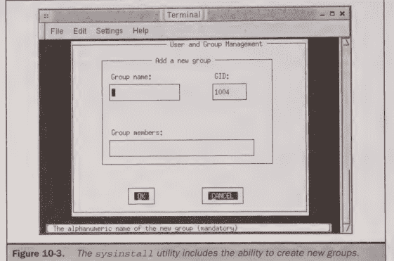

### 编辑 /etc/group

虽然 `sysinstall` 是创建新组的快速方法，但直接编辑 `/etc/group` 是另一种可能性，并且允许你更改组配置。与 `/etc/passwd` 和 `/etc/master.passwd` 类似，`/etc/group` 由行组成，每一行都是冒号分隔的字段集，定义各种组特性。`/etc/group` 条目的一个例子是

```
users:*:1001:marie,charles
```

此条目的四个字段是


- **组名** 第一个字段是组名（在本例中是 `users`）。

- **密码** 很少使用的选项是组密码，它存储在第二个字段中。在本例中，它是星号（`*`），意味着不使用密码。

- **GID** 第三个字段保存 `GID`（在本例中是 `1001`）。

■ **Members**（成员）第四个且最后的字段包含组内用户的逗号分隔列表。此列表通常仅包含将该组作为次级组的用户。例如，如果 `pierre` 的账户定义指定 `users` 为默认组，那么该组在 `/etc/group` 中的定义通常会省略 `pierre` 作为成员。因此，`/etc/group` 中列出的组通常包含一个空白的第四个字段，因为这些组有成员在其 `/etc/passwd` 条目中将该组列为所属组。

您可以通过创建符合此模式的新条目来在 `/etc/group` 中创建新组。您还可以通过多种方式编辑组，例如添加或删除成员。

## 维护账户安全性

用户账户和组是 FreeBSD 安全设置的核心。通过控制可用组、将用户分配到组、默认文件权限以及关键目录的权限，您可以控制系统的许多本地安全方面。不过，您应该意识到，用户可以控制其自身文件上的安全设置，因此您无法完全控制用户文件上的访问策略。您可以设置默认值以符合您当地的策略，但您需要教育您的用户，将安全维持在适当的水平。

## 确定组策略

如前所述，如果您使用 `adduser` 命令添加用户账户，该实用程序会自动为每个用户创建一个特殊的组。这是 *用户私有组* 安全策略的一个定义特征。还有其他策略也是可能的。其中一种涉及为不同的项目、班级或其他用户集合创建单独的组。我将其称为 *项目组* 策略。每种策略都有其独特的优点。

## 用户私有组

用户私有组安全策略始于为每个用户分配一个专用组。乍一看，这可能似乎是毫无意义的，因为它似乎会使文件的所有者和组权限变得冗余。事实上，如果保持默认设置，情况确实如此。从安全的角度来看，所有用户都变成了孤岛，非所有者权限要么可以授予所有用户，要么不授予任何用户。用户私有组的美妙之处在于将用户添加到组中的可能性。例如，假设一个系统支持用户 `marie`、`pierre`、`charles` 和 `jane`，并且假设该系统使用用户私有组策略。如果 `marie` 希望与 `pierre` 共享一些文件，可以将 `pierre` 添加到 `marie` 组中。然后，任何由 `marie`（以及 `marie` 组）拥有的文件都可以被授予组读权限（如有必要，还包括写权限），`pierre` 即可访问该文件。

用户私有组策略是一种基于用户为中心授予文件访问权限的好方法。也就是说，每个用户实际上都继承了一个其他用户列表，这些用户可能获得也可能不获得文件访问权限。如果 `marie` 只想让 `pierre` 访问文件，而 `pierre` 想让 `marie` 和 `charles` 都访问文件，这很容易安排——`marie` 组和 `pierre` 组的用户列表只需列出相应的其他用户即可。

用户私有组方法的主要缺点是，它无法使用户能够为不同的文件组提供不同的访问控制。例如，如果 `marie` 希望与 `pierre` 共享一些文件，而与 `jane` 共享其他文件，仅凭用户私有组方法是不够的。有时，您可以通过创建多个用户私有组来绕过这个问题，为每个用户提供两个或多个层级的访问控制。当然，这种限制不适用于与自身相比限制组成员的访问；组权限可以独立于所有者权限授予或拒绝。

### 项目组

组的安全项目组方法涉及创建多个组，这些组在逻辑上不与任何单个用户绑定，而是与某个用户集合相关联。例如，您的系统可能有物理组和生物组，`marie` 和 `pierre` 属于物理组，而 `charles` 和 `jane` 属于生物组。然后，用户可以设置特定文件的组权限，让组内的其他成员访问文件。如果一个用户同时属于两个组，您可以（作为用户）将文件的组所有权设置为应该拥有该文件访问权限的组，并相应地设置权限。

在用户主要分为互不相同的组的环境中，项目组表现良好，这些组应该拥有相对不受限制的权限来访问组内任何成员创建的某些类型的工作。例如，特定项目的协作者（因此得名该策略）可能从这种方法中受益。当涉及到提供组内特定成员的访问区分时，这种方法会失效。例如，如果生物组中的一些成员需要比其他成员访问更多的文件，就会出现复杂情况。有时，您可以通过创建多个层级组来解决这个问题，例如生物组，其中一些成员也属于称为遗传学或灵长类动物学的组。

### 混合方法

您可以混合用户私有组和项目组的安全方法。每个用户可以拥有一个用户私有组，您的系统也可以实施项目组，从而提供这两种方法的益处。创建多个层级的用户私有组或项目组也有帮助。实际上，这两种方法很容易融合在一起，区别变成了您如何思考这些组——作为与特定用户文件相关的权限，还是作为用户集合。

## 设置默认文件权限

安全策略的一部分是设置适当的默认文件权限。这是通过 `umask` 命令完成的，该命令设置了同名的特征。该命令在第八章中有描述。要使用它，请输入命令名称，后跟您希望从任何文件中*移除*的权限位的八进制表示：

```bash
$ umask 027
```

此示例未从所有者权限中移除任何权限，移除了组的写权限，并移除了所有世界（其他用户）权限。（无论 `umask` 值如何，FreeBSD 通常都会移除您创建的普通文件上的执行权限。）您可以将 `umask` 命令放入全局 shell 启动脚本（在第六章中描述），使该命令适用于所有用户——但请记住，普通用户可以通过在本地配置文件中重置值来覆盖您的系统范围默认 `umask`。

新安装的 FreeBSD 系统的默认 `umask` 值为 `022`，这会产生文件的 `644` (-rw-r--r--) 权限，或目录的 `755` (drwxr-xr-x) 权限。这种配置适用于许多具有适度用户间安全需求的安装；所有用户都可以读取彼此的文件，但只有所有者可以写入文件。您可能希望在某些环境中将 `umask` 值收紧到 `027` 甚至 `077`，从而阻止对文件的世界（其他用户）访问，甚至可能阻止组访问。在一个极其开放的环境中，您可能考虑放宽 `umask` 到 `002`，这将授予文件组的成员写访问权限。如果您使用用户私有组策略，并且不经常将用户添加到彼此组中，这种配置风险最小。`umask` 为 `000` 风险很大，因为它授予所有用户对彼此文件的完整读/写访问，实际上禁用了 FreeBSD 的隐私功能。

> **注意**
>
> `umask` 值影响用户创建新文件。现有文件，例如组成整个 FreeBSD 的文件，保留安装时授予它们的权限。大多数 FreeBSD 系统文件由 `root` 和 `wheel` 组拥有，并具有 `644` (rw-r--r--) 或 `755` (rwxr-xr-x) 权限。在大多数情况下，系统文件的这些默认权限是适当的。

## 总结

用户账户为 FreeBSD 提供了许多重要功能，包括用户便利性和安全元素。虽然您可能能够在系统安装时设置一个账户，并且对于单用户工作站不修改此配置，但对于多用户系统，账户管理是 FreeBSD 系统的重要组成部分

## 完整参考


### 第 11 章

## 安装软件

在安装 FreeBSD 时，你配置了一组软件包。不过，大概率的是，在安装完主系统后，你需要安装新的软件。这可能是因为你忘记了某些软件包，或者不知道它们的存在，也可能是因为在系统安装过程中 FreeBSD 没有提供安装该选项。无论何种情况，知道如何定位和安装额外的软件对于任何 FreeBSD 系统管理员来说都是一项重要技能。FreeBSD 软件有多种不同的来源，包括官方授权的程序包、常见软件的非官方移植版、来自程序作者的原始源代码，以及商业软件。每种分发方式都有其优点，且它们在重要方面存在差异，你应该对此有所理解。

除了安装新软件外，有时你还需要升级现有的软件包。在大多数情况下，你可以像安装新软件包一样进行操作，但你应该意识到偶尔会出现一些棘手的问题。（升级整个系统也很重要，将在第 28 章中描述。）即使是安装以前未安装过的软件包，也适用相应的注意事项。特别是围绕程序源代码可信性的问题尤为重要。虽然互联网上大多数软件都来自信誉良好的来源，但也有一些恶意个人开发的程序在流传，你应该避免使用此类程序。

## 软件包的形式

在深入讨论软件安装细节，甚至是在定位软件之前，有必要了解软件存在的不同形式。这些形式包括软件是以对程序员友好的源代码形式分发，还是以即开即用的二进制形式；以及分发方法，这与软件的可访问性有关。有时这些问题是相互独立的，但更多时候它们是相关的；以特定方式分发的软件可能仅以源代码或仅以二进制形式可用。这些不同的分发形式和软件包类型有其独特的优缺点。

### 源代码与二进制代码

程序员几乎总是使用高级计算机语言（如 `C`、`C++` 或 `Perl`）来编写软件。这些语言提供了便利的功能，例如变量（保存程序运行时可能改变的数据）、类似英语的重要函数名称，以及对库（执行常见编程任务的代码）的访问。虽然即使是高级计算机程序对于未受过训练的人来说可能看起来像天书，但它比另一种形式（二进制代码）要清晰得多，后者稍后会被描述。构成程序的这些高级计算机语言文件被称为源代码文件。程序员可以使用普通的文本编辑器（如 `vi` 或 `Emacs`）来编辑这些文件。通常，一个单一的程序由许多小的源代码文件组成。


虽然人类可以理解源代码文件，但计算机处理它们很困难；计算机处理的是数字，而 CPU 使用的低级指令与大多数高级语言中的命令仅松散地对应。弥合这一差距的一种常见方法是使用*编译器*，它将源代码文件转换为*二进制文件*格式。这种二进制格式非常适合在计算机上使用，因为它是 CPU 设计用来理解机器语言。当你运行 `vi` 或 Mozilla 这样的程序时，你正在运行一个二进制格式的程序。由于编译器针对特定 CPU 将源代码转换为二进制形式，程序的二进制形式仅适用于一种 CPU 型号或系列，如 `x86 CPU` 或 `PowerPC CPU`。

处理源代码的另一种方法是使用被称为*解释器*的程序直接对其进行解释。通过解释器运行的程序比以二进制形式编译并运行的同一程序运行得更慢，但由于不涉及编译步骤，使用解释型语言进行开发可能更快。此外，相同的解释型程序可以在许多不同的 CPU 类型上运行。在大多数情况下，一种语言通常仅使用编译器或解释器中的一种来实现，而不是两者都用。例如，`C` 和 `C++` 通常被编译，而 `Perl` 通常被解释，尽管也有例外。

由于 UNIX 传统上运行在各种各样的 CPU 上，在 UNIX 世界中以源代码形式分发软件很常见。这种实践使单个系统管理员能够针对任何计算机编译源代码——至少在理论上如此。源代码分发的缺点在于编译软件需要一定的时间。根据程序和 CPU 速度不同，这段时间可以从几秒到几小时；大型程序集合的概念上可能需要一天或更长时间来编译。至少作为在任意系统上编译的选项，往往只是一种理论；经常会出现阻止程序在特定操作系统或 CPU 上未经修改而编译的问题。即使是中等技能的程序员也经常能够克服此类问题，但有时这很困难。因此，在实践中，二进制程序通常更容易安装——它们安装所需时间更短，并且，只要它们是在其他软件组件方面与目标系统足够相似的系统中编译的，二进制软件包导致问题的可能性更小。

大多数 FreeBSD 软件均以二进制和源代码两种形式提供。因此，当有可用时，你可以使用易于安装的软件包；但如果你想以某种方式修改它，或者遇到二进制版本的问题（这些问题可能通过重新编译来克服），你仍可以使用源代码形式。（此类问题通常是由于试图安装比系统上其他软件新得多或旧得多的程序版本引起的。）不过，有些软件仅以其中一种形式提供。特别是，一些较为奇特的开源软件包可能未针对 FreeBSD 进行编译，因此你可能需要从源代码安装，而商业软件包通常不附带源代码，因此你必须安装二进制版本。

## 分发方法

软件分发方法会影响你获取程序的方式。在某些情况下，这也与程序的许可条款有关。FreeBSD 软件的常见分发方法包括：

- **FreeBSD 软件包**：FreeBSD 软件包是预编译的二进制程序，准备好进行快速且相对无痛的安装——前提是你安装的是适用于正确 FreeBSD 版本的软件包（为某个版本准备的软件包并不总是适用于另一个版本）。软件包随 FreeBSD 安装介质提供，并可在 FreeBSD FTP 站点上获取。

- **FreeBSD ports**：FreeBSD ports 系统是一个包含程序链接、编译信息以及 FreeBSD 特定修改的数据库，使你可以从源代码编译程序并将其安装到你的系统上。ports 系统的主要优点是，修改和编译信息使系统能够自动更改源代码，使其能够在 FreeBSD 上编译和安装，从而消除了源代码软件的一个问题。FreeBSD ports 作为指针文件存在于 `/usr/ports` 目录中。当你安装一个 port 时（如后文“使用 FreeBSD Ports”一节所述），FreeBSD 会从互联网下载实际的源代码。因此，从某种意义上说，你既从本地系统也从互联网获取 port。

- **不支持的通用 UNIX 软件**：一些开源 UNIX 软件未被官方移植到 FreeBSD，或者至少未被转换为 FreeBSD 软件包或 port。此类软件可能在 FreeBSD 下编译和运行，但管理起来通常风险更高且更困难。第 30 章更详细地描述了软件编译。通常，你可以从程序维护者的网站或 FTP 站点获取此类软件。

- **商业软件**：商业软件供应商通常仅以二进制形式提供其产品。你可能需要从供应商的网站购买此类软件，尽管在少数情况下可以在电脑商店找到。在某些情况下，这些软件通过 FreeBSD 软件包或 ports 系统安装，但在其他情况下，软件带有安装工具或手动安装说明。

作为一般规则，基于互联网的分发提供的软件比通过 CD-ROM 等物理介质分发的软件更新。不过，在某些情况下，网络分发依赖于本地信息，而本地信息可能已过时。例如，你系统上的 FreeBSD ports 目录可能包含过时的链接，因此如果使用此安装方法，你可能会最终安装旧软件包。

FreeBSD 软件包采用一种对系统维护特别有用的格式。用于添加这些软件包的工具还会向系统添加关于软件包的信息，以便于管理和删除。

## 查找 FreeBSD 软件

这是您计算机上程序和文件的数据库。该数据库使您可以相对轻松地了解已安装程序的版本，卸载该程序，或将其升级到更新的版本。这些功能对于维护 FreeBSD 系统至关重要。当您通过 ports 系统构建程序时，它会通过 package 系统进行添加，因此这些程序同样会受益于 package 格式的便利性。

除了存储关于已安装包的数据库信息外，package 格式还允许包指定其依赖的其他包（这些有时被称为依赖项）。package 工具可以利用这些信息来阻止在不满足依赖条件时安装某个包，自动下载并安装其所依赖的包，以及防止卸载其他包所依赖的包。这些功能可以帮助防止 FreeBSD 系统因可能破坏敏感依赖链的包操作而变得不可用。

一个完整的 FreeBSD 系统包含在多张 CD-ROM 上，当然，这些数据量代表了许多软件包。如果运气好，或者您的软件需求不太特殊，您很有可能在这些 CD-ROM 上找到所需的所有 FreeBSD 软件。但如果您使用的是单张 CD 的 FreeBSD 包，或者您需要某个并非附带于 FreeBSD 的程序，您可能需要到其他地方寻找。在这种情况下，知道去哪里找至关重要。您还应该知道在哪里可以找到更新的软件，特别是随着安装时间的推移。（虽然旧软件本身并没有什么错，但安全漏洞和杂项 bug 每天都在被发现和修复，因此旧安装更可能包含带有安全漏洞或 bug 的包。）

### 使用标准 FreeBSD 软件

FreeBSD 软件最重要的来源之一是 FreeBSD 集合本身。具体来说，FreeBSD packages 集合包含了 FreeBSD 最受欢迎的程序。ports 集合包含了许多作为包存在的相同程序，以及更多相对于 FreeBSD 核心程序更为外围的其他程序。

您可以在 FreeBSD FTP 站点及其镜像上，或在您的 FreeBSD 安装介质上找到包。包以 tarball 形式分发，文件名以 `.tgz` 结尾。如果您知道包的名称（即使是近似的名称），您可以检查您的安装 CD-ROM 或 FreeBSD FTP 站点以查找该文件。然后，您可以（在必要时）下载该文件并使用 `pkg_add` 进行安装，如下文“使用包工具”一节所述。如果您不确定包的准确文件名，您可以使用 `sysinstall` 来定位它，如下文“使用 sysinstall”一节所述。

**注意**

主要的 FreeBSD FTP 站点是 `ftp://ftp.freebsd.org`。但为了减轻该站点的负载，世界各地维护着多个镜像站点。这些站点保留与主站点相同的文件，对于大多数人来说，一个或多个镜像站点比主站点更近、响应更快。您可以在 `http://www.freebsdmirrors.org/FreeBSDsites.php3` 找到 FreeBSD 镜像站点的列表。

您定位 FreeBSD ports 的方式截然不同。只要您在安装 FreeBSD 时选择了安装 ports 系统（如第 2 章所述），ports 系统的核心就存在于您计算机的 `/usr/ports` 目录中。如果您没有安装 ports 系统，下文“安装和更新 ports 系统”一节将描述如何执行此操作。`/usr/ports` 目录根据程序类型划分为子目录，例如 `/usr/ports/editors` 和 `/usr/ports/science`。这些子目录中的每一个都包含专门用于特定程序的子目录。因此，您可以通过查看 ports 目录树中的一两个目录来找到合适的 port。不过，给定程序的 ports 目录并不包含整个程序，至少最初并不包含；相反，它包含有关在哪里查找程序源代码、程序补丁以及程序编译说明的信息。当您想要安装 ports 系统中可用的程序时，您可以发出命令让 FreeBSD 下载源代码、编译并安装它。`/usr/ports` 目录树中的条目只是一个方便的占位符。

### 查找通用 UNIX 软件

通过 FreeBSD packages 和 ports 系统可以获得大量的软件。如前所述，这些包可能就是您所需的一切。但在某些情况下，您可能需要其他程序。通常，此类软件仅以源代码形式提供，或者以源代码以及作者偏好的一个或两个平台的二进制形式提供——这包括或不包括 FreeBSD。

如果您知道想要查找的程序名称，您可以通过几种不同的方式进行搜索，包括：


- 网络搜索。使用 Google（`http://www.google.com`）等搜索引擎在网上搜索是寻找程序的一个好起点。特别是如果程序名称不常见，网络搜索可能会很快找到结果。
- Sourceforge。Sourceforge 网站（`http://sourceforge.net`）托管了许多开源项目，因此您很有可能在这个网站上找到您的开源程序。它包含一个搜索引擎，您可以输入项目名称或关键词。
- 其他操作系统站点。有时，其他操作系统的网站会包含链接到该其他操作系统中附带的程序。虽然该其他操作系统的二进制文件可能无法在 FreeBSD 上运行，但访问该网站是追踪程序本身站点或至少获取源代码的一种方式。

如果您正在寻找特定*类型*的程序但不知道程序名称，也可以使用这些相同的资源。例如，您可以在 Sourceforge 的搜索字段中输入 **editor** 以获得文本编辑器列表。（在这个特定案例中，您还会发现声音编辑器、二进制编辑器等。）当然，您的查询越具体，获得有用结果的可能性就越大。

### 查找商业软件

大多数 FreeBSD 软件都是开源的，随操作系统附带或可以从作者的网站或 FTP 站点下载。不过，有时您需要使用商业包。没有简单的规则来定义商业产品在何时优于开源产品——您必须根据具体情况决定。不过，如果您已经搜索了通常的开源站点但找不到您想要的东西，您可能开始寻找商业替代方案。有时商业产品*是*唯一的选择。例如，Real Networks（`http://www.real.com`）的 RealPlayer 是一款商业产品，是处理某些网页上可用的 RealPlayer 格式多媒体文件的唯一实用方法。

适用于开源产品的一些相同搜索技术也适用于商业产品。特别是，网络搜索可能会发现指向有用商业产品的指针。一个特别有帮助的网站是 FreeBSD 商业软件页面，`http://www.freebsd.org/commercial/software.html`，其中包含指向许多 FreeBSD 商业软件供应商的链接。


仅因为产品是*商业的*并不意味着它需要付费。一些商业产品是免费提供的。在某些情况下，这些产品是更昂贵的程序的精简版本。其他时候，许可证条款允许在特定情况下免费使用，例如用于教育或个人用途。FreeBSD 商业软件页面上列出的一些供应商销售服务或本来开源程序的进阶版本。

### 安装包

包是处理起来最简单的软件分发格式，尤其对于新的 FreeBSD 管理员而言。可以通过在 `sysinstall` 的菜单中选择程序，或者获取包文件并将其传递给 `pkg_add` 实用程序来安装包。FreeBSD 维护着一个通过包安装的程序数据库，因此检查版本号或查找程序是否已安装是一件相对简单的事情。（当您从 ports 系统安装程序时，FreeBSD 也会将该程序的信息添加到包数据库中，因此这种好处同样适用于 ports。）

#### 使用 sysinstall

`sysinstall` 工具已在本书前几章中多次提及。它是 FreeBSD 的通用系统管理工具，其最出色的特性之一就是能够作为软件包安装工具运行。您可以使用 `sysinstall` 查找软件包（存储在您拥有的 CD-ROM 或网络服务器上）并安装它们。如果您知道想要安装哪种类型的程序但不清楚确切的软件包名称，那么 `sysinstall` 是一个很好的起点。要使用它安装软件包，请遵循以下步骤：

1. 以 root 身份输入 `/stand/sysinstall` 以启动 `sysinstall`。
2. 在主菜单中选择 `Configure` 选项，这将调出 FreeBSD 配置菜单。
3. 在 FreeBSD 配置菜单中选择 `Packages` 选项。这将调出 `Choose Installation Media` 菜单，在此菜单中您选择软件包的来源。
4. 选择您要从中安装软件包的介质。选项包括用于本地 CD-ROM 或 DVD-ROM 的 `CD/DVD`；用于本地或远程 FTP 站点的 `FTP`、`FTP Passive` 或 `HTTP`；用于存储在本地 FAT 分区上的文件的 `DOS`；用于本地网络文件系统（NFS）服务器的 `NFS`；以及用于本地 FreeBSD 分区的 `File System`。最可能的介质是 `CD/DVD` 或其中一个 FTP 选项。如果使用前者，您必须将 CD-ROM 或 DVD-ROM 插入驱动器。如果使用后者，您必须从列表中选择一个 FTP 站点。（除了主要站点外，该列表按国家字母顺序排列，因此美国站点位于列表的底部附近。）如果您选择 URL FTP 站点，您可以输入任何喜欢的站点——包括您自己运营的站点。一旦您选择了介质，系统将从您选择的来源读取可用软件包列表。此操作可能需要从几秒到一分多钟不等。完成后，`sysinstall` 会显示软件包类别列表，如图 11-1 所示。

> **提示** 如果您维护一个 FreeBSD 系统网络，您可以将 FreeBSD FTP 站点复制到本地 FTP 服务器，然后使用本地服务器来安装和维护网络中的所有系统。

> **注意** 软件包列表可能因来源不同而异。特别是，如果您选择 `CD/DVD` 选项，列表仅包含您插入驱动器中的光盘上可用的软件包。如果您拥有多张 CD 的 FreeBSD 套装，您可能需要多次执行此过程才能找到所有可用的软件包。使用 `sysinstall` 在多 CD FreeBSD 套装中查找软件包通常比较困难，因此如果您遇到问题，最好尝试使用 FTP 选项。

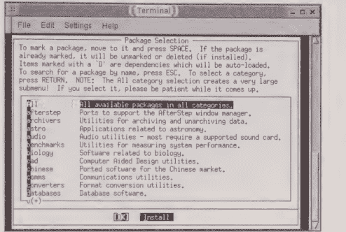

**图 11-1**。FreeBSD 将每个软件包分为一个或多个类别。

5. 选择您要安装的软件所属的类别。大多数软件包都位于多个类别中——如果什么都不选，`All` 类别包含所有软件包，所以您可以将其作为最后的手段进行检查，但由于该类别包含所有内容，在那里找到您想要的东西可能很困难。当您选择一个类别时，您将看到该类别中的软件包列表，如图 11-2 所示。
6. 一些软件包已经被选中，如软件包名称左侧框中的 X 所示。如果您要添加新软件包，请按 **空格键**，该框中会出现一个 X。
7. 当软件包选择完成后，按 **TAB** 键将光标定位到 `OK` 按钮上，然后按 **ENTER**。此步骤将返回到软件包选择屏幕（图 11-1）。
8. 如果您想从其他类别中选择软件包，请重复步骤 5–7。
9. 按 TAB 键直到选中 Install（安装）按钮，然后按 ENTER 以安装选定的软件包。`sysinstall` 工具会显示您选择安装的软件包摘要。选择 OK。系统将从网络下载文件（如适用）并进行安装，显示每个软件包的进度信息。当此过程结束时，您将看到 FreeBSD 配置菜单屏幕。
10. 选择 Cancel（取消），然后选择 Exit Install（退出安装）以退出 `sysinstall`。

当您有一些空闲时间时，您可能希望浏览通过 `sysinstall` 可用的软件包。即使您对 FreeBSD（或其他类 UNIX 操作系统）很熟悉，您也很可能会发现一些您以前不知道的但可能有用的软件包。请记住关注软件包选择菜单（图 11-2）中显示内容的最底部一行，因为该行包含软件包的简短描述，这通常比仅看软件包名称更有用。

> **注意** 令人困惑的是，退出软件包选择屏幕（见图 11-1）的 *唯一* 方法是选择 Install（安装）——即使您决定不安装任何软件包。如果没有选择任何软件包就选择 Install，`sysinstall` 会通知您没有选择软件包，并返回到 FreeBSD 配置菜单屏幕。

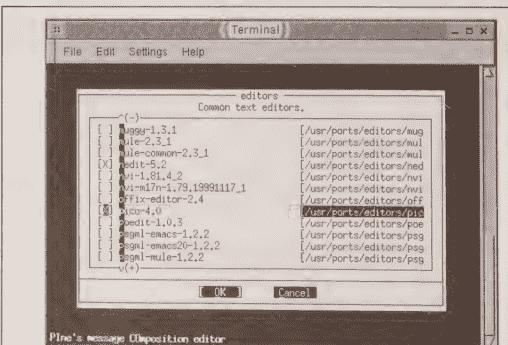

## 使用软件包工具

`sysinstall` 软件包安装方法可能很方便，但并非没有缺点。其中一个缺点是，您只能安装在 FreeBSD 介质上可用的软件包——通常是 CD-ROM、DVD-ROM 或 FTP 站点。（如果您控制本地 FTP 站点或从硬盘安装，您可以修改 INDEX 文件以添加其他软件包，但这会增加复杂性，从而削弱 `sysinstall` 的便利性。）

这种方法的另一个问题是，关于您选择的软件包大小几乎没有线索。在您开始安装后，`sysinstall` 提供每个软件包的数据传输速率信息，但如果您的可用磁盘空间有限，这些信息不足以判断是否应该尝试安装一个潜在的大型软件包。

通过使用底层的 FreeBSD 软件包工具可以克服这些问题。这些程序位于 `/usr/sbin` 目录中，文件名以 `pkg_` 开头。其中最重要的是 `pkg_add`，它将软件包添加到系统中。事实上，`sysinstall` 调用 `pkg_add` 来执行其工作，如果您在安装软件包时观察消息，您会在 `sysinstall` 软件包安装过程的某个时刻看到它正在等待 `pkg_add` 的通知。


> **警告** 由于 `pkg_add` 可以添加来自任何来源的软件包，因此可以使用它来安装不可靠的软件包。在使用 `pkg_add` 之前，特别是对于来自 FreeBSD CD-ROM、DVD-ROM 或 FTP 站点以外来源的程序，您应该注意即将出现的“验证软件真实性”部分中的建议。

`pkg_add` 的语法是

```
pkg_add [-vInfrRMS] [-t template] [-p prefix] package-name[...]
```

该命令选项的含义是

- `-v` 此选项启用详细输出，这对调试目的可能很有用。
- `-I` 软件包通常包含帮助针对您的系统定制程序的安装脚本，`pkg_add` 通常运行此类脚本。此选项禁用这些脚本。
- `-n` 此选项使 `pkg_add` 报告安装软件包时将采取的步骤，而不实际执行安装。
- `-f` 通常，`pkg_add` 在安装软件包之前检查其依赖关系是否满足。此选项禁用这些检查。通常，这是不可取的，但您可能有理由放弃这些检查；例如，您可能知道依赖关系是由未使用软件包工具安装的程序满足的。
- `-r` 通常，您向 `pkg_add` 提供软件包文件名或 URL，但如果您使用此选项，您提供软件包名称，`pkg_add` 尝试在互联网上查找该软件包。
- `-R` 此选项阻止在软件包数据库中记录有关软件包的信息。几乎从不建议使用此选项。
- `-M` 您可以使用此选项以主模式运行 `pkg_add`，这会导致它将软件包内容提取到暂存区域，并将软件包列表写入标准输出。您可以使用此模式与自定义脚本和从模式（见下一个选项）结合使用，以彻底改变 `pkg_add` 的工作方式。
- `-S` 此选项启用从模式，在此模式下，`pkg_add` 处理从标准输入获得的打包列表，以添加它预期在暂存区域中找到的文件。您可能在管道中使用此模式，并与主模式下另一个 `pkg_add` 调用以及一些自定义脚本或其他文本处理命令一起使用，以更改 `pkg_add` 的行为。
- `-t template` 此选项是文件临时存储区的名称。默认值是 `/var/tmp/instmp.XXXXXX`（`pkg_add` 将 XXXXXX 替换为唯一 ID 号）。如果您的 `/var` 分区太小，无法处理临时文件，您可以指定另一个分区上的暂存区域。确保使用以六个 X 字符结尾的名称，以便 `pkg_add` 可以将其替换为其唯一 ID 号。
- `-p prefix` 此选项指定 `pkg_add` 安装软件包文件的目录。此目录通常作为软件包本身的一部分指定，但如果您想将软件包存储在某个不寻常的位置，可以使用此选项。

通常，您使用 `pkg_add` 时除了要安装的软件包名称外，很少或没有参数。软件包名称本身可以是本地磁盘上的文件名，也可以是存储在 FTP 站点上的文件的 URL。例如，您可以发出以下任一命令：

```
# pkg_add ftp://ftp3.freebsd.org/pub/FreeBSD/ports/i386/packages-5-current/editors/zile-1.6.1.tgz
# pkg_add zile-1.6.1.tgz
```

> 在使用 `pkg_add` 之前，您可能想要使用下一节中描述的 `pkg_info` 命令，以确保没有更早版本的软件包已经安装。如果有，您应该查阅即将出现的“执行软件升级”部分。

第一个命令直接从 `ftp3.freebsd.org` FTP 站点安装 `zile` 编辑器。第二个命令从当前目录安装相同的软件包。当然，第二个命令要求该软件包已存在于硬盘上，因此您必须通过某种方式获取它。如果您拥有 FreeBSD CD-ROM，您可以通过挂载 CD-ROM 并指定 CD-ROM 上文件的完整路径来从中安装包。

> 虽然 `pkg_add` 可以从 tar 包工作，但它并不安装任意的 tar 包。特别是，FreeBSD 软件包必须包含某些特定文件，`pkg_add` 会使用这些文件来帮助将软件包信息添加到软件包数据库中。

在使用 `pkg_add` 之前，您必须有要添加的软件包，或者知道可以在网络上的哪里找到它们。您可以挂载一个 FreeBSD CD-ROM 并搜索其目录树，或者浏览 FreeBSD FTP 站点查找文件。您也可以在软件作者的站点、第三方或商业 CD-ROM 上找到软件包，等等。

# 查询软件包信息

有时，您可能想了解有关软件包的一些信息，无论是在您安装软件包之前还是之后。您可以使用 `pkg_info` 命令来实现这一目标。该命令接受大量选项，使其能够显示有关某个软件包或一组软件包的各种信息子集。详细信息请参阅 `pkg_info` 的手册页。作为一般规则，您将以几种方式之一使用此命令：

- **完整数据库查询**

  您可以仅输入 `pkg_info` 来了解所有已安装软件包的名称并显示它们的简短描述。

- **已安装软件包查询**

  您可以在 `pkg_info` 命令后输入软件包的名称（包括其版本号），以查看该软件包的多行描述。例如，输入 `pkg_info nedit-5.2` 将产生 NEdit 5.2 软件包的完整描述，前提是该软件包已安装在计算机上。

- **定位已安装软件包**

  如果您不确定软件包的确切名称或版本，您可以使用 `-x` 选项提供部分名称。例如，即使您不知道版本号，`pkg_info -x nedit` 也会显示有关 NEdit 软件包的信息。

- **未安装软件包查询**

  而不是输入已安装软件包的名称，您可以输入软件包文件的名称来了解其内容，无论该软件包是否已安装。例如，在安装之前，您可能输入 `pkg_info nedit-5.2.tgz` 来了解 `nedit-5.2.tgz` 文件的内容。

- **定位软件包中的文件**

  如果您想了解属于某个软件包的文件，可以使用 `-l` 选项。例如，`pkg_info -l nedit-5.2` 显示属于 `nedit-5.2` 软件包的文件列表。（您也可以通过提供软件包文件名，在使用 `pkg_add` 安装软件包之前，了解它将安装哪些文件。）

- **定位文件所属的软件包**

  如果您想了解某个文件所属的软件包的名称，可以使用 `-W` 选项。例如，`pkg_info -W /usr/X11R6/bin/nedit` 会导致 `pkg_info` 搜索已安装的软件包数据库，并返回 `/usr/X11R6/bin/nedit` 所安装自的软件包名称。

这些功能在安装软件包之前和之后都非常有用。使用这些工具，您可以了解与可疑或行为异常的节目关联的软件包名称，了解软件包将安装文件的位置（从而在存在冲突或磁盘空间不足时预防问题），了解软件包的功能等等。您还可以按顺序使用这些命令，如下所示：

```bash
$ pkg_info -W /usr/X11R6/bin/nedit
/usr/X11R6/bin/nedit was installed by package nedit-5.2
$ pkg_info -x nedit-5.2
```

此序列的结果（此处未显示）是关于 `nedit-5.2` 软件包的扩展信息。如果您遇到功能不明的文件，该工具对于了解您的 FreeBSD 系统非常有用。

> **提示**
>
> 如果 `-x` 选项返回的描述没有完全阐明程序的功能，请使用 `-L` 定位随软件包安装的文件，并检查输出中的文档文件。这些文件可能包括手册页（位于名称中包含 man 的目录中）或其他文档（通常存储在 `/usr/share/doc/` 或 `/usr/local/share/doc/` 的子目录中）。

## 使用 FreeBSD Ports

FreeBSD 软件包安装起来方便且简单。然而，对于所有用途来说，它们并不是完美的软件分发方式。有时，预编译的软件包不可用，或者虽然可用，但它是为您运行的较新或较旧版本的 FreeBSD 构建的。在其他情况下，您可能想要修改程序。在这些情况下，需要替代的分发方法。对于自定义软件，从源代码编译（如第 30 章所述）是合适的。编译允许您随意修改源代码，但它失去了 FreeBSD 软件包系统的优势。在其他情况下，使用 FreeBSD ports 是合适的。许多程序的 ports 可用，当使用 ports 时，如果拥有软件的所有权，您将获得部分编译的优势。在构建过程的末尾，ports 系统使用 FreeBSD 软件包工具，因此您将获得许多软件包的优势，例如使用 `pkg_info` 了解程序的能力。缺点是，ports 的安装时间比软件包长。当程序较大或有许多未安装的依赖项时，这一点尤其明显。总而言之，FreeBSD ports 在软件包和编译“原始”源代码之间起到了良好的中间作用。

> **注意**


> 术语 `port`（移植）经常用于描述将程序转换为在新平台上运行的过程，或由此产生的修改后的程序。FreeBSD ports 系统是 `port` 的一种特定类型。它使用程序的原始源代码和一组代码补丁——这些更改使代码能够在 FreeBSD 上正确编译。ports 系统自动化了将程序移植到 FreeBSD 的过程，因此得名。（这种自动化仍然依赖于开发人员来创建 `port`，尽管对于依赖原始维护者 `port` 的管理员来说，该过程是自动的。）

除了这里描述的内容外，您可以从 ports 系统手册页了解各种更高级的 ports 选项——输入 `man ports` 阅读此文档。

## 安装和更新 Ports 系统

在安装 FreeBSD 时，您被提供了安装 ports 系统的机会。如果您这样做，您将在计算机上找到 `/usr/ports` 目录，并且可以开始使用 ports 系统。但是，如果您没有安装 ports 系统，`/usr/ports` 将缺失或为空。在这种情况下，您必须首先安装 ports 系统才能使用它。您可能还希望定期更新您的 ports 系统，特别是如果您想使用它将程序更新到最新版本。

安装 ports 系统的最简单方法是使用 `sysinstall`。请遵循以下步骤：

1. 作为 `root` 用户，输入 `/stand/sysinstall` 以启动 `sysinstall`。
2. 在 `sysinstall` 主菜单中选择 `Configure option`，这将显示 FreeBSD Configuration Menu。
3. 在 FreeBSD Configuration Menu 中选择 `Distributions` 选项。这样做会显示 distributions 菜单。
4. 选择 `Ports` 发行版并选择 `OK`。`sysinstall` 实用程序会响应并询问您发行版介质。
5. 正如“使用 `sysinstall`”之前所述，选择您的发行版介质。该程序将获取并安装 ports 系统。然后您可以退出 `sysinstall`。

此时，您应该拥有一个 `/usr/ports` 目录，其中包含带有子目录的目录，这些子目录包含属于特定类别的软件，例如 `/usr/ports/x11` 和 `/usr/ports/editors`。您可以继续下一节“编译和安装 Port”，以了解如何使用该系统。

FreeBSD ports 的一个方面是，硬盘上的 ports 文件指向目标程序的具体版本。因此，ports 系统可能不会安装任何给定程序的最新版本；如果自硬盘上安装 ports 系统以来程序已更新，ports 系统将安装较旧版本的程序。如果原始程序站点已移动，ports 系统将失败。事实上，即使您安装了最新版本的 ports 系统，您也可能无法获取最新可用的

## 使用旧版本

某个程序的版本，因为最新版本可能尚未移植。为了将这个问题降到最低，您可以使用 `并发版本系统`（CVS）定期更新您的 ports 安装。为此，请遵循以下步骤：

- 1. 如有必要，使用包工具或 ports 系统本身安装 `cvsup-without-gui` 包。（该程序是使用相对罕见的 Modula-2 编译器编写的，因此通过 ports 安装它可能会涉及安装 Modula-2 及其依赖项，这可能耗时很长并需要大量磁盘空间。）
- 2. 输入 `cd /usr/ports/net/cvsup4it`。
- 3. 输入 `make; make install`。此命令安装并配置一些更新软件，并运行一个更新器（图 11-3）。

> **注意** *图 11-3 展示了使用 FreeBSD 5.0 测试版的过程。对于最终发布版本，您可能会选择一个名为 RELENG_5 的选项。*

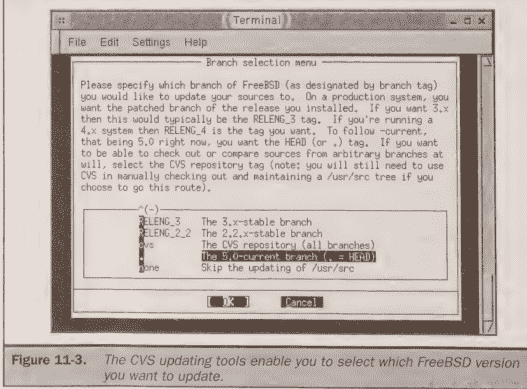

- 4. 从列表中选择您正在运行的 FreeBSD 版本。此操作会产生源选择菜单。
- 5. 在源选择菜单中，不要选择任何源包；只需按 TAB 键然后按 ENTER 键，以不更新任何源包。（此菜单中可选择的源包与 ports 系统无关。）
- 6. 系统询问您是否要跟踪 FreeBSD ports 系统。回答“是”。
- 7. 系统询问您是否要跟踪 FreeBSD 文档源。您可以回答“是”或“否”，但回答“否”会更快捷。
- 8. 系统要求输入一个基础目录。保持该值为默认值（`/usr`）。
- 9. 系统列出 CVSup 服务器列表。选择一个离您较近的服务器。
- 10. 系统询问您是否要立即运行更新。回答“否”。您应该会被返回到 shell 提示符。
- 11. 编辑 `/etc/cvsupfile` 文件。此文件控制 CVSup 过程。注释掉任何以 `src` 开头的行——通过在行首放置井号（`#`）来注释。这些行指定核心操作系统源文件，您此时无需更新它们。
- 12. 输入以下命令以更新 ports 集合：

```
# /usr/local/bin/cvsup -g -L 2 /etc/cvsupfile
```

此时，系统将更新您的 ports 目录树。您将看到检索到的文件摘要在屏幕上滚动，以便您监控更新的进度。大多数更新会很快完成，但有些更新需要更多时间，因为更改范围更广。对 `ports/INDEX` 文件的更改特别容易耗时较长，因为此文件包含系统中所有 ports 的信息。整个过程可能需要几分钟，如果您的 ports 集合特别过时或网络连接缓慢，甚至可能超过一个小时。

一旦更新了 ports 系统，您的 ports 树中将指向这些包的指针，但如果您之前已从 ports 系统安装了程序，您的计算机仍将安装旧版本。请参阅即将介绍的章节“删除和升级软件”，以获取有关升级已安装程序的信息。


## 编译和安装 Port

`/usr/ports` 目录包含与特定程序类别相关的子目录，类似于 `sysinstall` 包选择菜单（参见图 11-1）。要安装一个 port，请遵循以下步骤：

- 1. 输入 `pkg_info -x 包名称` 以确定是否已经存在与您正在安装的 port 同名的包。如果存在，您可能根本不需要安装该 port。如果您想升级现有包，请阅读即将介绍的章节“执行软件升级”，以获取如何操作的建议。
- 2. 定位程序目录。您可以通过浏览目录树或使用 `find` 或 `grep`（在第 8 章中描述）来完成。
- 3. 转到程序目录。
- 4. 以 `root` 身份输入 `make` 来构建该 port。此操作会促使 FreeBSD 检索程序的源代码，应用存在于该 port 的 `files` 子目录中的任何补丁，并构建程序。如果您选择的 port 依赖于尚未安装的软件，系统也可能自动检索、编译、构建并安装其他 ports。
- 5. 以 `root` 身份输入 `make install` 来安装程序。此操作安装程序文件并将该 port 的信息添加到包数据库中。（您可以通过仅输入 `make install` 来合并步骤 4 和 5；但是，您可能希望在提交安装软件之前监控输出并在 `make` 过程结束时阅读摘要信息。）

> **提示**
>
> 在安装任何 ports 之前，请使用 `sysinstall` 或 FreeBSD 包工具安装常见的开发软件。GNU 编译器集合（GCC）是 FreeBSD 的标准部分，应该已经安装，但您可能需要安装开发库或其他编译器，特别是用于基于 X 的程序。每个 port 目录中的 `Makefile` 很可能包含该程序主要站点的 URL，因此您可以在那里检查它使用哪些开发工具。在 `sysinstall` 包选择菜单中检查 `dev/e` 选择是否有该包。如果您不通过这种方式安装适当的开发工具，ports 系统将自行安装它们，这可能会花费更长的时间，因为开发工具本身是从头开始构建的。


此时，您的系统将表现得好像您已以包的形式安装了该 port 一样。一个重要区别是，您将拥有该包的完整源代码，位于其 ports 目录中。在某些情况下，这可能是一个好处，因为您可以检查甚至修改和重新编译源代码，以修复错误或改变其行为。然而，一个缺点是，这些源代码消耗空间，编译器在构建应用程序过程中产生的中间（目标代码）文件也如此。您可以通过在专用于该程序的 port 目录中输入 `make clean` 来删除这些源代码和目标代码文件。在 `/usr/ports` 中键入此命令将清理所有 ports 子目录，如果您构建了许多或大型 ports，这可以回收大量磁盘空间。您可以通过删除 `/usr/ports/distfiles` 中的 tar 包来释放更多空间。此目录保存从程序的 Web 或 FTP 站点获取的原始程序源代码文件。保留这些文件允许 FreeBSD 在您必须重新制作该 port 时避免再次下载程序，但会消耗磁盘空间。

如果您正在维护几个 FreeBSD 系统，可能有另一个额外选项值得关注：`make package`。在 port 目录中键入此命令会从该 port 构建一个包，如果该 port 尚未安装，则将该包安装到本地系统。然后，您可以将此包移动到其他 FreeBSD 系统，并使用 `pkg_add` 进行安装，从而避免了在所有系统上重新编译程序的需要。

## 删除和升级软件

在理想世界中，您可以安装软件包然后忘掉它。但在现实世界中，不幸的是，安装程序只是您针对该程序的管理工作的开始。本书的很大一部分致力于帮助您配置特定的程序。您偶尔可能需要执行的其他任务是删除和升级软件。您可能会删除软件，因为您发现不再需要它，或者因为它并非您希望的那样是解决方案。删除未使用的包可节省磁盘空间，并且可能是一种有用的安全措施，特别是对于服务器或使用设置用户 ID（SUID）位的程序，如第 8 章所述。升级软件是纠正错误并为您的系统添加功能的必要措施。由于某些错误与安全相关，因此从安全角度来看，这些升级也可能非常重要。

### 删除软件

如果您通过 FreeBSD 包安装了程序，删除软件相对简单——您可以使用 `pkg_delete` 命令，其语法如下：

```
pkg_delete [-dDfGinrx] [-p prefix] 包名称[...]
```

此命令的某些选项与 `package-add` 的选项类似。特别是，`-v`、`-i`、`-n` 和 `-p` 选项具有相同或几乎相同的含义。其他选项的含义是

- `-d` 通常，除非目录是包的明确部分，否则 `pkg_delete` 不会删除目录。此选项使程序删除在包移除过程中被清空的目录。

- `-D` 包可以包含卸载脚本。这些脚本可用于删除特定于服务器的用户、关闭服务器、删除不是包官方部分的配置文件等。使用此选项告诉 `pkg_delete` 不要运行这些脚本。

- `-G` 通常，将通配符和类似模式作为 `包名称` 的一部分会导致扩展并匹配所有符合模式的包。此选项禁用此扩展，因此如果您要删除的包名称包含会被错误解释的字符，您可以删除该包。

- `-i` 此选项使 `pkg_delete` 在删除每个包之前请求确认。

- `-r` 此选项激活递归删除，其中依赖于指定包的包会被删除。请谨慎使用此选项！

#### -x 选项

- `-x` 该选项让 `pkg_delete` 将*包名*视为正则表达式，因此你可以删除所有匹配指定正则表达式的包。

> **注意**
>
> `pkg_delete` 程序还支持无条件删除所有包的选项：`-a`。这是一个极其危险的选项，应避免使用。

通常，你在很少或没有选项的情况下使用 `pkg_delete`，除了指定要删除的包的名称。如果你想删除很多包（特别是使用正则表达式或 `-r` 选项时），我建议你使用 `-i` 选项，让程序在删除包前询问你确认。这样的交互可能类似于：

```
# pkg_delete -ir wmcdplay-1.0b1
delete wmcdplay-1.0b1? y
```

在这个例子中，`wmcdplay-1.0b1` 包正在被删除，连同所有依赖于它的已安装程序（实际上没有任何依赖）。由于 `-i` 选项，`pkg_delete` 在删除包前要求确认。如果多个包被列出或因为 `-r` 选项被选中删除，那么每个包都会有一次查询。

尽管 `pkg_delete` 命令可以删除通过 ports 系统安装的包，但用 ports 完成这项任务的更好方法是 `cd` 到原来的 ports 目录并输入 `make deinstall`。此命令实际上类似于 `pkg_delete`，但能处理两种程序安装方式之间的一些细微差异。

如果你通过其他方式安装了包，例如从非 ports 源码安装（如第 30 章所述），或按软件文档安装商业程序，软件移除过程将会不同。通常，你必须找出所有已安装的文件并手动删除它们。这个过程最好说是枯燥的；你可能需要使用 `find` 来定位名称与相关程序有关联的文件，然后使用 `pkg_info` 验证它们不属于某个包或 port。你还可以检查你使用的任何安装脚本，以寻找文件名称和位置线索。有些商业程序附带可卸载软件的安装程序，或者可以通过 FreeBSD 的包系统进行安装。这类程序更容易卸载。

## 执行软件升级

有时你需要用较新版本替换现有程序。你可能需要这样做以修复 bug 或安全漏洞，或者较新版本可能只是增加功能或以其他方式提升软件性能。FreeBSD 包含一个用于通过包进行此替换的命令：`pkg_update`。此命令的语法是：

```
pkg_update [-nv] [-r old-package] new-package
```

`-n` 和 `-v` 选项与 `pkg_add` 中的含义相同。通常不需要 `-r old-package` 选项，因为 `pkg_update` 可以确定新包是要替换哪个包。但偶尔，你可能想使用此选项。例如，如果你将程序的多个版本安装到不同目录，你可能只想替换其中之一，在这种情况下，你可以指定新包仅替换已安装的一个包。作为一个例子，在获取包文件后，你可能会使用以下命令安装 Samba 的新版本：

```
# pkg_update samba-2.2.2.1.tgz
```

如果你安装了某个 port 并希望升级它，或者如果你想使用更强大的工具处理包更新，你应该研究 `portupgrade` 实用程序。它可以作为 sysutils 区域的包安装，或作为 `/usr/ports/sysutils/portupgrade` 的 port 安装（port 版本依赖于可能尚未安装的若干包，因此包版本安装速度会显著快于 port）。`portupgrade` 的职责是处理包和 port 的升级。`portupgrade` 手册页包含其操作细节，但一般而言，你可以按如下方式使用它：

```
# portupgrade -P samba
```

此命令指示系统将 Samba 包升级到可用的最新版本。（当然，你可以替换为其他任何包名，或在一行中列出多个包。）`-P` 选项告诉 `portupgrade` 首先尝试使用包进行升级，如果可能的话。如果 `portupgrade` 找不到包，或者省略此选项，则仅使用 ports。许多可能感兴趣的额外选项中，包括这些：

- `-a` 此选项指示系统升级所有已安装的包。这可能需要很长时间才能完成，特别是如果没有使用 `-P` 时。

- `-f` 此选项强制进行“升级”，即使是要旧版本的程序。如果你在升级到新版本后发现 bug，并希望降级到旧版本，就可以使用此选项。

- `-i` 通常，`portupgrade` 不会在安装新包前请求许可，但此选项会使其在每次升级前暂停并询问。

- `-n` 此选项告诉 `portupgrade` 报告它将执行的操作，但不实际安装任何升级后的包或 port。

- `-N` 你可以使用此选项安装尚未在计算机上安装的包。

`portupgrade` 的一个优点是它会监控依赖项，并尝试在必要时升级它们或修复你的包数据库文件中的依赖信息。另一个有帮助的工具是 `pkgdb`，特别是其 `-F` 选项。输入 `pkgdb -F` 会让 FreeBSD 检查其包数据库并修复任何它发现的不一致之处，必要时向你请求澄清。在“安装和更新 Ports 系统”中所述，在使用 `portupgrade` 之前输入此命令并更新 ports 系统，有助于保持系统处于良好的运行状态。

## 验证软件真实性

当今计算机领域的一个主要问题是恶意代码。这个术语指的是执行有害行为的程序，例如监视你的操作或擦除你的硬盘。传递恶意代码的常见方式包括病毒、蠕虫和特洛伊木马。在 Windows 世界中，恶意代码可以通过电子邮件消息到达。虽然这些传递方式在 FreeBSD 上理论上是可能的，但 FreeBSD 用户账户系统有助于将计算机与危害隔离。一个潜在更大的威胁是伪装的软件包。如果一个恶棍将恶意代码添加到流行程序中，并诱骗软件仓库储存修改后的软件，当系统管理员下载并安装包时，破坏的潜在性很大。同样，一个恶棍可能会声称开发了一个听起来有趣但实际上是别的东西（特洛伊木马）的程序。


以下是你可以采取的几个步骤来保护自己免受这种可能性的侵害：

- **使用可信网站** 如果你仅从主要网站下载软件，例如主要的 FreeBSD 站点或官方镜像，你将大大降低使用被篡改程序的可能性。信任非官方镜像的风险更大，而从随机网络或 FTP 站点安装代码的风险最大。此措施的弱点是，网站可能被劫持——攻击者可能突破防御并替换文件，或更改名称服务器条目，将用户指向虚假站点而不是真实站点。

- **仅安装可信包** 当你寻找要安装的软件时，使用主要的已知包，例如 FreeBSD 提供的包。如果你寻找特定类型的包，你可能会被一些听起来有趣但相对不知名的程序所吸引。可能性是这是安全的，但它可能真的是一个特洛伊木马。相比之下，主要的软件产品已经通过多年的开发建立了信任的声誉。

- **检查 MD5 校验和** 如今许多软件作者和仓库为其包提供消息摘要 5（MD5）校验和。这些是由文件内容构建的 32 字节十六进制数。虽然从理论上讲可以创建一个修改后的文件，使其产生与原始文件相同的 MD5 校验和，但没有简单的方法来做到这一点，因此如果你下载的软件具有相同的

# 第 11 章：安装软件

如作者所报告的那样，如果 MD5 校验值匹配，那么该软件很可能未被篡改。当然，这就引出了一个问题：你是否信任报告的 MD5 校验值。对于安全意识较强的人来说，可以使用 Pretty Good Privacy (PGP) 的加密签名来辅助这项措施，或者将 MD5 校验值存储在处理程序文件之外的其他网站上，但迟早你必须信任某些数据。

最终，没有任何办法能 100% 确保你安装的安全软件是安全的。然而，采取一些预防措施可以大大增强系统的安全性。值得注意的是，标准的 FreeBSD 工具集成了这些方法。`install` 工具会从可信站点（你的 CD-ROM 或少数几个官方 FreeBSD 镜像站点）获取代码，并且当然只安装属于 FreeBSD 一部分的软件包。ports 系统从官方网络或 FTP 站点下载程序源代码，并使用存储在你硬盘上的 port 信息中的 MD5 校验值来确保该站点未被劫持。本章中描述的最危险的软件安装方法是通过 `pkg_add` 从不官方站点安装软件包，特别是如果你没有来自更可信站点的该软件的 MD5 校验值。如果你有一个 MD5 校验值，你可以使用 `md5` 程序将你拥有的文件与该值进行比对，如下所示：

```
$ md5 zile-1.6.1.tgz
MD5 (zile-1.6.1.tgz) = c998c146326723f8526ca6701b4bf540
```

你可以将此 32 字符的输出字符串与该程序的官方网站或某个其他可信来源报告的值进行比较。当然，MD5 校验值会在不同程序版本之间有所不同，甚至可能在同一程序的不同构建版本之间有所不同，因此你应确保比对的是相应的 MD5 校验值。

### 摘要

安装软件是 FreeBSD 系统管理的关键职责，无论你管理的是单用户工作站还是多用户服务器。FreeBSD 提供了多种程序安装和维护方法。其中大多数围绕 FreeBSD 软件包数据库展开，该数据库维护已安装软件的信息，以便你可以快速检查版本以及已安装的软件。无论是安装原始软件包还是安装 ports，都使用该系统，使用此数据库以便追踪系统软件是个好主意。如有必要，你可以在不使用软件包数据库的情况下安装软件，要么自己从一个不提供软件包或 port 的源代码编译，要么从这样的来源（很可能是商业供应商）安装二进制版本。一旦你安装了软件包，就可以使用软件包工具对其进行管理（删除、升级、检查已安装软件等）。

# 完整参考

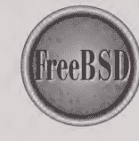

# 第 12 章

## 内核配置

你可以使用第 11 章中描述的方法升级大多数 FreeBSD 程序。然而，有一个程序值得特别关注：*内核*。如第 1 章所述，FreeBSD 内核既独特又极其重要。内核是操作系统构建的核心。它充当中央控制程序，允许所有其他程序访问计算机的硬件资源，解决程序之间的冲突等等。这些特性意味着内核必须与其他程序不同地配置、升级和运行，本章描述了这一重要主题。

本章以内核概述开始，以便你更好地理解其在运行 FreeBSD 系统中的角色。随后，本章探讨了修改内核配置的方法。其中一些方法涉及相当直接的更改，但其他更改需要重新编译内核源代码。虽然这项任务听起来令人望而生畏，但它是任何 FreeBSD 系统管理员都非常有用的技能。有时，你可能需要将内核升级到新版本。此过程通常涉及编译新内核。

## 内核概述

为了理解为什么需要独特的内核配置、安装和升级程序，有必要了解内核的作用。内核在 FreeBSD 系统中的作用如此核心，以至于升级它通常需要重启计算机——这是其他软件升级不具备的特点。

### 内核在 FreeBSD 中的角色

第 6 章，特别是其“理解内核控制”部分，描述了内核在 FreeBSD 系统中的作用。简而言之，内核是在计算机上运行的最低层软件。对于大多数类型的硬件，内核是允许直接访问硬件的唯一软件。这是通过硬件 *驱动程序* 实现的，这些驱动程序专为特定的硬件组件编写，例如 VIA Rhine 以太网板或 16550 RS-232 串行接口。然后，程序可以调用内核并告诉它们想要访问以太网或 RS-232 串行接口，内核会将这些调用转换为适用于计算机上安装的特定硬件的调用。

> **注意** 在启动过程中，甚至在某些操作系统中系统启动后，比内核更低层的代码也会运行。这是基本输入/输出系统（BIOS），旨在为操作系统和硬件之间提供接口。然而，x86 BIOS 非常原始，大多数现代操作系统（包括 FreeBSD）主要依靠它作为启动程序的一部分，因为系统在启动过程中运行 BIOS，但在那之后内核可以做得更好。

正如内核为硬件和大多数程序之间提供接口层一样，它为其他必要的计算机功能提供了类似的服务。这些服务包括文件系统，使程序能够读写文件，而无需担心文件在磁盘上具体占据哪些扇区；内存管理，使程序不能相互覆盖内存；以及网络访问，使程序可以指定它们希望与其他计算机通信，而无需决定如何构建通过网络接口传输的数据包。

内核对硬件的控制有一些例外。最值得注意的是，内核通常赋予某些程序（如第 13 章描述的 X 服务器）比普通程序更大的计算机视频硬件访问权限。一些其他硬件，如调制解调器、打印机和扫描仪，也由用户模式程序控制（即不属于内核的一部分）；但这些程序必须通过由内核控制的端口与其硬件通信。

## 安装和修改内核

安装系统时，FreeBSD 会安装其标准内核。该内核驻留在你磁盘上一个名为 `/boot/kernel/kernel`（在 5.0 之前的 FreeBSD 版本中为 `/kernel`）的文件中，并在启动计算机时由启动加载器加载，如第 6 章所述。安装新内核涉及向该目录添加一个新文件并告诉启动加载器启动它，或者替换现有的内核文件。为了做这两件事中的任何一件，你通常需要根据即将描述的“重新编译内核”部分所述，从源代码重新编译内核。不过，有时通过安装新的内核模块（如即将描述的“加载内核模块”部分所述），可以执行不那么激进的 operations。

> 除非你确定新内核可以正常工作，否则不要删除旧内核并用新的替换。FreeBSD 允许你在启动时选择使用哪个内核，因此你可以通过将新内核命名为 `kernel` 以外的名称来测试它。此过程在即将描述的“使用新内核”部分中有更详细的说明。

你为什么想要修改内核？这里有几个原因：

- **新驱动程序**：你可能需要标准内核中未包含的驱动程序。这些可能是硬件驱动程序（例如，用于新的 EIDE 控制器）或用于新网络协议、文件系统或其他高级结构的驱动程序。

- **更新和错误修复**：任何规模大的程序都不是没有 bug 的，尽管最好的程序 *已知* bug 很少。FreeBSD 也不例外，因此你可能想要升级内核以获得错误修复。更新还可能提高性能或添加功能。

- **减少内存占用**：标准的 FreeBSD 内核包含许多你没有的组件的驱动程序。这些驱动程序消耗 RAM 但不提供任何回报。创建自定义内核可以通过减小内核尺寸（从而减少其内存需求）来提高系统性能。在较旧的系统上，修改内核的这个原因最为相关，具有

有限的 RAM；拥有 128MB 或更多内存的现代系统不太可能因为内核大小减少 1MB 左右而产生明显的影响。

- **添加内核特性和优化** 尽管标准内核包含对大多数硬件组件的支持，但标准内核中的一些选项可能并未处于最优设置。例如，标准内核不支持多于一颗 CPU 的配置，因此你必须重新编译一个新的内核，才能最好地利用多处理器系统。

- **硬件冲突** 尽管罕见，但硬件冲突偶尔也会发生。这些问题会导致系统无法正常工作，因为某个组件的驱动程序干扰了另一个设备的运行。你可以通过移除你没有安装的硬件相关的驱动来消除这类问题。


你可以通过重新编译内核来实现上述任何一个目标。解决硬件冲突，有时还包括添加新的硬件驱动程序，可以通过修改内核启动选项来完成，正如下一节“内核启动选项”中所述。你有时还可以通过加载内核模块来添加新的驱动程序或特性，内核模块是独立于内核本身的、存储在文件中的内核组件。接下来的“加载内核模块”一节将描述其使用方法。你常常可以在不重启计算机的情况下加载内核模块，如果你在测试或调试配置时，这会带来极大的便利。

## 内核启动选项

修改内核最简单的方法之一就是在启动过程中向其传递启动选项。第 4 章中的“设置内核选项”一节从总体上描述了这一过程。正如该节所述，当系统提示你选择要启动的内核时，你可以按下除 ENTER 键外的任意键来调整这些设置。有两个参数与本文讨论特别相关：

- `boot [-options] [kernelName]` 你可以使用此命令启动指定的内核，并为其传递你喜欢的任何选项。
- `load [-t type] moduleName` 你可以使用此选项加载内核模块。如果系统依赖于某个模块来控制关键硬件（例如控制硬盘的 SCSI 主适配器），那么此选项特别有用。对于更外围的设备，你可以使用即将介绍的“加载内核模块”一节中描述的命令代替。

`boot` 参数很有趣，因为它允许你启动除默认 `/boot/kernel` 之外的内核。如果你构建了一个新内核，可以使用此参数来加载它以替代默认内核；或者，如即将介绍的“使用新内核”一节所述，如果新内核失败，你可以使用此命令来加载旧内核。你还可以向此参数传递影响内核启动方式的选项。这些选项中的大多数不直接影响内核中可用的特性，但其中一些非常重要。具体来说，`-s` 将系统启动到单用户模式，这对于某些紧急恢复操作可能很有用；而 `-a` 会促使 FreeBSD 询问要挂载哪个设备作为根文件系统，如果你的分区布局发生了变化，这可能很有用。

## 加载内核模块

如果你基本上对你的内核感到满意，但需要它支持一些默认情况下不具备的特性，一种潜在的简单解决方案是加载新的内核模块来处理额外任务。有时这样做是必要的，因为 FreeBSD 不会自动检测硬件，或者因为你希望使用一个并不包含在默认配置中的模块。

要检查你的内核模块状态，可以使用 `kldstat` 命令：

```
$ kldstat
Id  Refs  Address     Size    Name
1   7     0xc0000000 3ef2dc   kernel
2   1     0xc04d0000 16000    linux.ko
```

通常，此命令显示的已加载内核模块很少——可能只有内核模块，即主内核文件本身（前述示例还显示了 `linux.ko`，这是支持 Linux 二进制程序的内核模块，如第 4 章所述）。其他硬件（如 IDE 磁盘、以太网卡和 USB 设备）的模块未显示并不是令人担忧的原因；这些设备可能已编译进内核本身，在这种情况下，如果不添加额外选项，`kldstat` 命令不会显示它们。添加 `-v` 选项后，`kldstat` 将显示属于每个模块的特性。特别是 `kernel` 模块，很可能包含几十甚至几百个特性。如果你想限制 `kldstat` 的输出，可以使用 `-i` `id` 或 `-n` `name` 选项这样做。它们根据 ID 号（前述示例输出中的第一列）或名称（前述示例输出中的最后一列）限制输出。例如，要查看仅关于 `linux.ko` 模块的信息（使用前述示例），你可以输入以下两个命令中的任意一个：

```
$ kldstat -i 2
$ kldstat -n linux.ko
```

如果你想加载某个特定的内核模块，可以使用 `kldload` 命令，该命令接受内核模块名称作为输入。例如，要加载 `snd_gusc.ko` 模块，你需要输入：

```
# kldload snd_gusc.ko
```

此命令加载对 Gravis UltraSound 声卡的支持。`snd_gusc.ko` 模块与其支持的卡之间的联系部分可以从名称中看出，但有时这些联系可能晦涩难懂，因此你可能需要查阅内核发布说明以获取帮助。内核模块通常位于 `/boot/kernel` 或 `/boot/modules`；如果你将内核模块放在其他地方，必须指定文件的完整路径。如果在要加载的模块名称前加上 `-v` 参数，`kldload` 会报告它执行的操作以及分配给该模块的 ID 号。

如果你想卸载一个模块，可以使用 `kldunload` 命令来完成，其工作方式与 `kldload` 类似，但方向相反。你还可以通过在模块编号前加 `-i` 来按编号指定模块：

```
# kldunload -i 7
```

使用内核模块的巨大优势在于，你不必麻烦地重新编译内核。你也可以在不重启计算机的情况下加载和卸载内核特性。缺点是，你仅限于系统中已经作为模块可用的内核特性。（从理论上讲，你可以将新的模块文件放入模块目录，但在实践中，这样做通常需要重新编译内核以获得新模块。）

## 重新编译内核

内核配置的最高境界是重新编译内核，它使你能够微调许多内核选项，省略你永远不会使用的驱动程序以减小内核大小，并添加标准 FreeBSD 内核中可能未包含的特性。尽管重新编译内核可能看起来令人望而生畏，但掌握这项技能是非常有用的，因为它可以产生优化得更好的系统，并且在极少数情况下，这是使 FreeBSD 能够利用你系统所有特性的唯一方法。

### 获取内核源代码

重新编译内核的第一步是获取源代码。它可能已经安装在你的系统上；如果是这样，它位于 `/usr/src/sys`。如果此目录已经存在，除非你想升级到更新的内核（在这种情况下，你应该阅读下一节“升级内核”），否则你不需要做其他任何事情。幸运的是，安装内核源代码是一个相对直接的过程。你可以使用 `sysinstall` 实用程序从 FreeBSD CD-ROM 安装内核源代码，或从互联网下载。为此，请遵循以下步骤：

1. 以 root 身份输入 `/stand/sysinstall` 启动 `sysinstall`。
2. 选择 `Configure` 选项。这将调出 FreeBSD 配置菜单。
3. 选择 Distributions 选项。这将调出一个菜单，你在其中选择要安装的发行版名称。（发行版是一组 FreeBSD 程序或其他文件，如内核源代码。）
4. 选择 `src` 选项。这将调出一个子组件菜单。
5. 选择 `sys` 选项。这是内核源代码，如该选项右侧的注释所示。
6. 在子组件菜单中选择 OK，然后在 distributions 菜单中再次选择 OK。
7. 结果是一个菜单，你在其中选择你的发行版介质。
8. 选择你想从中安装源代码的介质（可能是你的 CD-ROM 或 FTP 站点）。根据你的选择，你可能需要做出额外选择，例如确切的 FTP 站点。随后你会看到一个进度指示器，当 `sysinstall` 获取内核源代码并将其安装在 `/usr/src/sys` 中时。
9. 然后你将被返回到 FreeBSD 配置菜单。
10. 通过选择 Cancel 然后 Exit Install 退出 `sysinstall`。

此时，你应该能在 `/usr/src/sys` 目录树中找到内核源文件。此目录实际上包含一个文件（`Makefile`）和一系列包含特定类型驱动程序和支持功能的子目录，例如用于文件系统 的 `fs` 和用于 PCI 卡支持的 `pci`。除非你打算进行内核开发（这是一个远远超出本书范围的主题），否则只要该目录树存在，你不必太担心其具体内容的精确细节。不过，这条规则有一个例外，即内核配置文件。

### 配置内核

重新编译你的内核并不会自动为你的系统配置最佳性能。此任务由内核配置文件处理，这是一个文本模式文件，你可以编辑或最好复制并修改它，以告知系统你希望新内核中包含或不包含哪些特性。标准 FreeBSD 内核配置文件是 `/usr/src/sys/i386/GENERIC`（如果你使用的是罕见的非 i386 版本的 FreeBSD，`i386` 部分将不同）。此文件指定了一个配置用于使用大多数编译选项的内核。结果是 `/boot/kernel/kernel` 文件非常大——对于 FreeBSD 5.0 接近 45MB。（在 FreeBSD 5.0 之前的版本中，内核是 `/kernel`，而不是 `/boot/kernel/kernel`。）

最好不要直接修改 `GENERIC` 内核配置文件；相反，将其复制为其他名称，例如 `MYCONFIG`（FreeBSD 内核配置文件名传统上全大写，但这不是必需的）。然后你可以随意编辑你的副本，如果你想重新开始，可以再次复制 `GENERIC` 内核配置文件。事实上，你可能希望将修改后的配置文件放在另一个目录中，例如 `/root`，并在 `/usr/src/sys/i386` 中创建一个指向它的符号链接。这样，如果你决定完全删除并重新安装内核源代码，就不会擦除你的内核配置文件。

内核配置文件以一系列注释开头——即那些以井号（`#`）开头的行。在这些注释下方，有一组行，例如：

```text
machine			1386
cpu			i486_CPU
cpu			i586_CPU
cpu			i686_CPU
ident			GENERIC
maxusers		0
```


`machine` 行标识通用的 CPU 架构——对于 x86 系统来说是 `1386`。你不应该更改这一行。接下来的三行标识了三种可能的 CPU 型号或家族——`486`、`586`（奔腾）和 `686`（奔腾 II 及以上）。你可以将不适用于你系统的任意行通过在该行开头放置井号 `#` 来注释掉。这样做可能会适度提高内核的效率。`ident` 行标识内核，你可能希望将其更改以匹配你的新配置名称。`maxusers` 行用于调整某些系统参数，例如 FreeBSD 支持的最大运行进程数（此值被设置为 `20 + 16 × maxusers`）。在 FreeBSD 4.5 及更高版本中，值为 `0` 会导致系统自动调整此值，但如果你更喜欢的话，也可以将其强制设置为特定值。将其设置为小于 `4`（但大于 `0`）的值通常会导致问题。大型服务器可能需要非常大的 `maxusers` 值。

### 注意

尽管你可能认为，`maxusers` 值并不直接限制可以登录的用户数，但它确实设置了与系统上用户数相关的限制。

在 FreeBSD 5.0 之前，内核配置文件中包含关于硬件配置的各种“提示”。使用提示的配置行类似于以下形式：

```text
device		ata0	at isa? port IO_WD1 irq 14
```

FreeBSD 5.0 的标准操作是简化内核配置文件，并将提示移动到一个单独的文件 `/boot/device.hints` 中。这些提示可能类似于以下形式：

```text
hint.ata.0.at="isa"
hint.ata.0.port="0x1F0"
hint.ata.0.irq="14"
```

简化的内核配置项缺乏提示信息：

```text
device		ata
```

如果你想使用旧式的配置，你应该取消注释如下所示的行：

```text
#hints             "GENERIC.hints"
```

当然，如果需要，你可以在两种配置中自行调整提示本身。默认提示在大多数系统上运行良好，但偶尔你需要调整设置，特别是当你使用以非常规方式配置的非常古老的工业标准架构（ISA）卡时。你可以使用提示文件来设置端口和中断请求（IRQ）值。

配置文件中的其余行以 `options` 或 `device` 字样开头。这些行分别指示那些未直接链接到特定硬件设备的内核功能。有时这一行可能有点模糊；例如，启用对称多处理（SMP）支持以用于多 CPU 系统的选项被称为 `option`，但显然这与硬件直接相关。大多数 `options` 和 `device` 行以描述该行启用支持的注释结尾。一些示例包括：

```text
options             INET              # InterNETworking
options             FFS               # Berkeley Fast Filesystem
device              ata
device              atadisk           # ATA disk drives
device              atapicd           # ATAPI CDROM drives
```

这五行分别启用了 TCP/IP 网络支持、FreeBSD 默认的快速文件系统（FFS）、高级技术附件（ATA；也称为 EIDE）接口、ATA 磁盘驱动程序以及 ATA CD-ROM 驱动程序。你应该查看此文件，并在任何你不想支持的选项前放置一个井号——但不要在注释掉这些选项上太过热情。有时某个选项听起来不重要，但实际上很重要。作为一般规则，如果你不明白某个选项，就保持原样。

少数选项默认被注释掉。有时这是因为该选项提供了设备的重复或旧驱动程序。其他时候，驱动程序可能会与其他硬件产生冲突，或者如果在非必需时降低系统性能。不过，如果你知道需要支持此类功能，你应该取消该选项的注释。SMP 支持之前已作为此类选项的一个例子被提及。完成后，你可能已经注释掉了最初存在的一半行。其中许多可能位于小型计算机系统接口（SCSI）和廉价磁盘冗余阵列（RAID）区域，因为大多数系统没有或最多只有一个 SCSI 或 RAID 适配器。同样，你可能会禁用大多数以太网设备，因为你可能只有一个以太网卡。

提供类似功能。）`NOTES` 文件包含了许多内核配置文件选项的扩展评论，以及关于启用或配置非常奇特的功能或驱动程序的额外选项的信息。本书其他部分描述了一些这些功能；例如，Linux ext2 文件系统的支持（在第 4 章中描述）是通过 `NOTES` 中包含但默认 `GENERIC` 配置文件中不包含的一行来启用的。

## 执行编译

编译内核涉及运行三条命令：

```sh
# cd /usr/src
# make buildkernel KERNCONF=MYCONFIG
# make installkernel KERNCONF=MYCONFIG
```

你应该用你给内核配置文件起的名字替换 `MYCONFIG`。第二条命令需要几分钟到几个小时不等才能完成，具体取决于你的 CPU 速度和你在内核中包含的内核选项数量。你会看到系统在编译大量内核文件后将它们链接成一个连贯的整体时显示信息。第三条命令安装内核，将旧的 `/boot/kernel/kernel` 重命名为 `kernel.old`。因此，当你重启计算机时，你将使用新内核。如果需要使用旧内核（例如，如果你不小心从新内核中省略了硬盘的驱动程序），旧内核仍然可用，方法是使用启动加载器的 `boot` 参数，如前面“内核启动选项”一节所述。

> **提示** *为了更安全，在执行第一次内核编译之前，最好将原始内核备份到另一个完全独立的目录，例如 `/root`。这样，即使你多次重新编译内核（这可能会销毁原始文件），你仍然有一个回退方案。*

不幸的是，内核编译失败并不罕见，特别是如果你之前从未做过一次。通常，罪魁祸首是缺少某些关键开发工具。查看错误信息，然后检查 `sysinstall` 开发包中是否有看起来有希望的东西并安装它。某些编译步骤还要求你是 `root`，因此不要尝试以普通用户身份编译新内核。

## 使用新内核

当你重启计算机时，默认会使用新内核。你可以通过检查 `dmesg` 的输出来确定你确实在使用新内核。尝试将此命令通过 `less` 或 `more` 管道，以便你可以轻松检查前几行。寻找类似以下的行：

```text
FreeBSD 5.0-20011211-CURRENT #0: Tue Dec 11 10:29:22 GMT 2001 root@sw2.freebsd.org:/usr/src/sys/i386/compile/GENERIC
```

这些行标识了 FreeBSD 版本（`5.0-20011211-CURRENT`，一个导致 FreeBSD 5.0 发布的开发版本）、其编译日期和时间（2001 年 12 月 11 日）、编译用户（`root@sw2.freebsd.org`）以及配置脚本（`GENERIC`）。你的输出应该标识你自己（或者更准确地说，是你系统上的 `root`）、你编译内核的时间以及你使用的内核配置文件。如果你看到指向原始内核的值，可能是 `make installkernel` 步骤出了问题，或者可能更早——如果编译失败，FreeBSD 将无法安装新内核。

在 FreeBSD 5.0 之前的版本中，有时需要采取一些额外步骤才能使用新内核的所有功能。最重要的是，你可能需要为新硬件驱动程序创建新的设备文件。幸运的是，这很容易完成，只需键入以下命令：

```sh
# cd /dev
# . /MAKEDEV
```

FreeBSD 5.0 及更高版本通常不需要此步骤，因为它们使用 *设备文件系统*，这是一种特殊的虚拟文件系统，它动态构建以包含当前内核支持的所有硬件的设备文件。

# 升级内核

重新编译内核最令人信服的理由之一是将其升级到更新的版本。在很大程度上，这样做与如上所述的内核编译非常相似；然而，该过程涉及一些额外的步骤和注意事项。

## 何时升级内核

出于某些原因，升级到更新的内核可能是期望的甚至是必要的，包括：

- **错误修复** 如果你的当前内核存在 bug，升级内核可能是实际上的必要条件。虽然有些 bug 可能不会影响你（例如，如果它们位于你不拥有的硬件的驱动程序中），但有些可能会。内核 bug 特别严重，因为它们可能影响整个计算机的稳定性。

- **新驱动程序** 你可能希望运行较新的内核，因为它包含较旧内核不支持的硬件驱动程序。同样，新内核可能包含现有驱动程序的更好功能，例如改进的速度或更好地利用设备的功能。

- **新的软件接口** 您可能会发现，更新的内核为计算机上运行的程序提供了改进的功能。例如，“使用新内核”中提到的设备文件系统就是一种内核功能。

升级内核需要升级内核源代码，这需要进行一些额外的工作。在许多情况下，重新编译现有的源代码更简单。另一方面，除非您非常密切地跟踪开发动态，否则您无法确定最新的内核源代码是否修复了重要的 bug；因此，如果您打算重新编译内核，可能想要执行升级到最新版本所需的额外步骤。

> **注意**


> FreeBSD 的开发分为两个分支：`STABLE`（稳定）分支和 `CURRENT`（当前）分支。大多数 FreeBSD 系统处于 `STABLE` 分支，这意味着它们是完全发布的、非 beta 版软件。`CURRENT` 分支专门用于预发布的 beta 测试软件。作为一般规则，除非您急需其实现的新功能，或者想要参与内核开发，否则不应该尝试使用 `CURRENT` 内核。以下指导将您的内核更新到系统版本和开发分支中的最新版本。

## 安装新内核

您可以通过几种不同的方式获取新的 FreeBSD 内核树。这里描述的方法与第 11 章中描述的更新 FreeBSD ports 树的方法密切相关。事实上，在继续之前，您应该回顾第 11 章中“安装和更新 Ports 系统”部分的内容。

要安装新内核，请遵循以下步骤：

1. 遵循第 11 章中关于安装和配置 `CVSup` 包的说明，但*不要*输入 `cvsup` 命令来更新系统。

2. 编辑 `/etc/cvsupfile` 文件。第 11 章中的说明指定了注释掉以 `src.` 开头的任何行。然而，要更新内核源代码，必须确保该文件*包含*如下所示的一行，以更新内核源代码：

   ```
   src-sys
   ```

3. 如果您不想更新内核以外的源代码（例如第 11 章说明中更新的 ports 系统），请注释掉 `/etc/cvsupfile` 中与此类项目相关的行。

4. 输入以下命令来更新内核源代码：

   ```
   # /usr/local/bin/cvsup -g -L 2 /etc/cvsupfile
   ```

此时，系统将更新您的内核源代码。此过程可能需要几秒钟（如果不需要更新或您的互联网连接非常快）到几分钟，甚至如果您的网络连接较慢，可能需要一个多小时。最终，您的内核源代码树将被更新。

### 编译和使用新内核

您可以像使用随 FreeBSD CD-ROM 附带内核一样编译和使用新内核。如果您已经编译了该内核，可能想要重新执行配置步骤（将 `GENERIC` 复制到新文件并编辑该文件），因为新内核可能已添加了驱动程序或更改了驱动程序名称。或者，您可以使用 diff 工具获取旧配置文件和新 `GENERIC` 文件之间不同行的列表。如果您看到新文件中列出的某个选项在旧文件中不存在，您可以将其复制到配置文件中以启用它。（如果您不熟悉 diff 的输出，解析起来可能会有些棘手。简而言之，该程序标识已更改的行，并显示以小于号符号为前缀的旧行和以大于号符号为前缀的新行。）

### 摘要

FreeBSD 内核是 FreeBSD 系统上运行的所有其他软件的基础。因此，保持其更新并针对系统需求进行调优，比其他大多数步骤更能使系统保持最佳运行状态。为此，使用系统独有的设置重新编译内核可以提高系统性能，甚至可能有助于其稳定性。要重新编译内核，您必须复制一个内核配置文件，编辑副本以反映您的本地配置，并执行几条命令。由于内核是所有其他软件的基础，您必须重新启动计算机才能使用新内核。

---

# 完整参考


# 第 13 章

# X 窗口系统

如今大多数用户期望计算机提供图形用户界面 (`GUI`) 环境，在这种环境中，应用程序在窗口中运行，许多操作可以使用鼠标完成。**FreeBSD** 提供了这样一种环境，本书前面的各个章节中，尤其是第 3 章中，都曾多次提及。该环境被称为 *X 窗口系统*，或简称为 X。第 23 章描述了 X 及其上层构建的桌面环境的许多用户级日常操作细节。本章专门介绍更底层的 X 配置。

与 Windows 和 Mac OS 等常见桌面操作系统中使用的 GUI 环境相比，X 是一种不寻常的 GUI 环境。因此，理解 X 的运作模式对于理解其功能至关重要；试图将 X 理解为与 Windows 或 Mac OS GUI 类似可能会引发问题。因此，本章首先讨论 X 的运作模式。大多数底层 X 配置是通过编辑单个文件 `XF86Config` 来完成的。通过编辑此文件，您可以更改视频分辨率、鼠标、字体等。还有工具可以帮助您创建或编辑此文件。某些设置，例如鼠标速度和键盘重复率，可以按用户为基础进行调整，通常是通过编辑用户启动脚本或使用桌面环境工具来实现。本章最后介绍了 X 的一个不寻常功能：运行多个 X 会话的能力。每个会话都可以使用独特的设置运行，例如分辨率和色深。

## 理解 X

X 在很多方面都是独特的 GUI 环境。一方面，与其他流行的 GUI 环境相比，X 本身非常精简。X 通过采用额外的工具，如窗口管理器和控件集，来弥补其简陋的本质。X 的另一个特殊性是其网络性质。X 使用网络协议将 X 与 X 程序连接起来，即使在单台计算机上也是如此。这一特性使 X 在某些类型的网络环境中非常有用，但也往往使其速度比其他 GUI 环境慢。

### X 的 GUI 模型

UNIX 应用程序中的一个共同主题是程序往往很小且模块化。这些小程序可以组合起来执行更高级的任务。这种程序设计哲学与 Windows 和 Mac OS 世界中的常见做法形成对比，在那里单个程序经常扩展以完成各种各样的任务。当然，这些操作系统中的典型程序设计哲学存在例外，但 X 不是其中之一。与其他流行的 GUI 相比，X 是一个高度模块化的环境。将几个单独的组件作为整体来看，它们构建了一个完整的 GUI 系统。其中一些组件是 X 的一部分，但另一些不是。

### X 服务器

位于 X 核心处的组件被称为 *X 服务器*。X 服务器的工作是管理显示器、键盘、鼠标以及可能其他人类输入/输出设备。X 服务器提供了一些程序可以使用例程，用于打开窗口、在窗口中显示形状、显示文本等。（X 窗口非常简单；它们只是屏幕上的矩形区域。另一个组件，将在下一节“窗口管理器”中描述，提供了大多数人认为完整的*窗口*所具备的元素。）X 服务器至少提供了处理字体的最小支持，并且如下一节“X 的网络性质”中所述，它也是支持网络的。

FreeBSD 依赖于一个名为 `XFree86`（http://www.xfree86.org）的 X 服务器，这是开源世界中非常流行的 X 服务器——它也可用于其他 BSD、Linux、Mac OS X，甚至 OS/2 和 Windows 等非 UNIX 系统。FreeBSD 5.0 及更高版本随附 `XFree86` 4.x。早期版本的 FreeBSD 随附早期版本的 `XFree86`（对于 FreeBSD 4.x 是 3.x 系列）。从 `XFree86` 3.x 过渡到 `XFree86` 4.x 时，X 服务器的设计发生了若干变化。最显著的是，`XFree86` 3.x 为不同的视频卡系列使用不同的 X 服务器。例如，如果您使用的是基于 S3 芯片组的卡，您将运行名为 `XF86_S3` 的服务器；如果您使用带有 ATI Mach64 芯片组的卡，则使用 `XF86_Mach64`。然而，在 `XFree86` 4.x 中，只有一个 X 服务器可执行文件，称为 `XFree86`。这个单一服务器加载特定视频卡芯片组的驱动程序模块。这种设计简化了配置和驱动程序开发。

由于 X 服务器控制视频卡，因此是这个组件（结合视频硬件本身）决定了您的显示速度、支持哪些分辨率等。一些全新的视频卡设计其 `XFree86` 驱动程序尚未实现硬件的所有功能，因此这些卡实际上表现不如旧卡。有时，仅升级 X 服务器（或仅升级驱动程序文件）也可以提高系统的视频性能。

### 控件集

X 服务器控制对视频硬件的访问，并为 X 程序提供低级应用程序编程接口 (`API`)。此 `API` 使程序能够打开窗口、在这些窗口中显示信息等。然而，此 `API` 非常*基本*；与 Windows、Mac OS 和其他 GUI 操作系统的 `API` 不同，X `API` 不包括显示菜单、滚动条、按钮和其他类似 GUI 基本元素的能力，这些通常被称为*控件（widgets）*。这项工作由称为*控件集（widget set）*的 X 组件处理。

X 存在几个相互竞争的控件集。其中每一个都创建了一套略有不同的 GUI 组件，并拥有自己独特的外观和感觉。一些更流行的控件集包括 Motif（早期的商用控件集）、LessTif（Motif 的开源克隆）、Qt（流行的开源控件集）和 GTK（另一个流行的开源控件集）。2002 年，Qt 和 GTK 在 FreeBSD 的控件集领域占主导地位，但许多程序使用其他控件集。

由于必须编写程序以利用特定的小部件集，程序员会选择使用哪套小部件集。作为用户或系统管理员，除了使用或不使用特定的程序外，你对此没有选择权。在某些情况下，如果你想使用某个特定程序，必须安装提供该小部件集代码的库。当安装目标程序时，`sysinstall` 或 FreeBSD 端口系统可以自动处理此任务。

## 窗口管理器

X 提供低层的窗口管理例程，而小部件集提供工具，使程序员能够在窗口内呈现有用的信息。实用 X 使用的另一个组件是窗口管理器。窗口管理器在窗口周围增加了功能。最明显的是，窗口管理器提供了多个组件，它们立即包围窗口，并允许用户控制其大小和位置。图 13-1 显示了一个典型的 X 窗口，并标识了窗口管理器的组件。这些包括：


### 标题栏
*标题栏*或*拖动栏*通常位于窗口的顶部。它包含一个标识窗口的名称，大多数窗口管理器响应在标题栏中的点击并拖动操作，从而在屏幕上移动窗口。

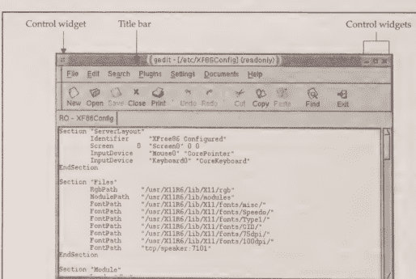

**图 13-1。** *窗口管理器在窗口周围创建边框装饰，从而实现对窗口位置和大小控制。*

### 控制小部件
窗口管理器使用一组小部件来帮助你控制窗口。在大多数情况下，这些是标题栏一端或两端的小方块，如图 13-1 所示。这些小部件具体做什么细节因窗口管理器而异。大多数允许你关闭、缩小和放大窗口，许多还提供额外选项，例如将窗口移动到另一个虚拟桌面的能力，这将很快描述。

### 窗口边框
大多数窗口管理器提供边框，允许你调整窗口大小。将鼠标指针移到边缘或角落，指针通常会发生形状变化。这是一个提示，表明你可以点击并拖动以改变窗口的大小。一些窗口管理器仅提供非常有限的调整大小控制点，例如窗口的右下角。

除了这些窗口组件外，大多数窗口管理器还提供位于桌面（屏幕上的未使用空间）上的额外控制，有时也位于屏幕的顶部、底部或两侧。在桌面上右击通常会生成一个选项菜单，用于退出窗口管理器、启动程序或执行其他任务。这些窗口管理器功能经常与桌面环境（在下一节中描述）提供的功能重叠，并可能被这些环境覆盖。

许多窗口管理器的一个特性是能够控制多个*虚拟桌面*。这些是半独立的工作区；每个工作区都可以有一组独特的打开窗口，你可以通过点击按钮或选择菜单选项在虚拟桌面之间切换。细节因窗口管理器而异。此功能也通常由桌面环境提供。

重要的是要认识到，窗口管理器提供的功能从一个窗口管理器到另一个可能会发生实质性的变化，窗口管理器的外观和感觉也是如此。为了说明这一点，请看图 13-2，它显示了与图 13-1 中相同的运行应用程序。不过，图 13-2 使用的是 WxM 窗口管理器，而图 13-1 显示的是 IceWM 窗口管理器。请注意，WxM 使用其标题栏的非常规侧装位置，并且只提供一个小部件，而 IceWM 使用了四个。图 13-1 和图 13-2 中窗口的内部，包括菜单栏、滚动条和图标，是完全相同的，因为这些元素由小部件集控制。

然而，一些差异无法通过屏幕截图显示出来。例如，每个窗口管理器支持其自己的*焦点*策略——一种确定窗口何时从键盘或鼠标接收输入的方式。最常见的默认焦点策略通常被称为*点击聚焦*，即在窗口内的任何地方点击鼠标都会赋予其焦点。另一种常见的焦点策略是*焦点跟随鼠标*，即仅仅将鼠标移过窗口就会赋予其焦点。焦点通常与堆栈中的前窗口相关联，但一些窗口管理器可以在窗口被其他窗口部分遮挡时赋予其焦点。此功能经常与焦点跟随鼠标策略结合使用，点击窗口是使其置于堆栈前部的必要条件。

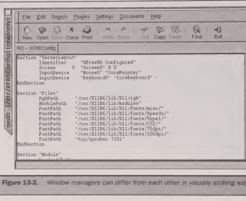

个人用户可以从系统上安装的所有窗口管理器中选择。此操作将在接下来的部分“更改窗口管理器或桌面环境”中描述。

## 桌面环境

在过去，FreeBSD 用户通常运行 X 和通过启动脚本启动的窗口管理器，如第 6 章所述。这种组合允许用户从 xterm 或窗口管理器菜单中启动程序、移动窗口等；但它提供的应用程序间集成很少，并且要求用户将各种有用的小工具，如编辑器，放置在应用程序菜单上。（系统管理员有时会为默认配置执行最后这项任务。）为了克服此类解决方案所感知到的笨拙，开发了许多*桌面环境*。这些是许多小型程序，有时是相当主要程序的集合，它们使用相同的小部件集并且彼此集成良好。结果是一个统一的桌面体验，你可以从标准化位置调用有用的实用程序来编辑文件、设置桌面背景图像、调整鼠标跟踪速度、移动文件等。

> **注意**
>
> 虽然桌面环境提供许多 inexperienced 用户所期望的集成和“视觉享受”，但它们可能是巨大的资源消耗者。一个运行精简窗口管理器和传统 UNIX 风格程序的 FreeBSD 系统可能只需 64MB 内存就能表现良好，甚至可能更少。添加 KDE 或 GNOME 以及大型集成包，128MB 可能不够。

从某种意义上说，桌面环境是窗口管理器的继任者，因为它们经常替代窗口管理器启动。但从另一个意义上说，桌面环境是窗口管理器的扩展，因为它们在核心包含窗口管理器。一些桌面环境允许你选择运行哪个窗口管理器。

两种最常见的桌面环境是 GNU 网络对象模型环境（GNOME）和 K 桌面环境（KDE）。FreeBSD 偏好 GNOME，但如果你更喜欢，也可以安装和使用 KDE。GNOME 围绕 GTK 小部件集构建，KDE 围绕 Qt 小部件集构建。不过，你可以在 KDE 中运行基于 GTK 的程序，或在 GNOME 中运行基于 Qt 的程序。事实上，你甚至可以在 KDE 中运行 GNOME 组件，或者反之。

> **注意**
>
> 有时程序被称为“GNOME 程序”或“KDE 程序”，而“GTK 程序”或“Qt 程序”会是更合适的术语。

### 杂项工具

各种附加程序适合 X 工具层级：

- **X 配置工具** 存在各种程序帮助你以低层配置 X（即设置其视频选项、鼠标选项等）。接下来的部分“帮助重新配置 X 的工具”提供了一些这些程序的指针。
- **字体服务器** 没有字体选择的 GUI 环境是不完整的。X 服务器包含内置支持，用于向应用程序提供字体，你可以按照接下来的部分“添加或删除字体”所述进行调整。此外，X 可以使用启用网络的字体*服务器*，它们可以向网络上的所有 X 工作站提供字体。第 22 章描述了字体服务器。
- **应用程序** 没有用于它的程序，X 就是多余的。许多标准的 FreeBSD 程序不依赖 X，但其他程序可以使用或必须使用 X。大型面向最终用户的程序最可能使用 X。

## X 的网络特性

与大多数 GUI 环境不同，X 是面向网络的。你可以在一台计算机上运行 X 服务器，并使用它来显示来自另一台计算机上运行的程序的输出并向其发送输入。在这种情况下，客户端/服务器术语对许多人来说是令人困惑的，因为人们通常认为服务器是一台隐藏的

...到视觉而言，客户机即用户所坐的那台计算机。为了更好地理解 X（或实际上任何情况下）中的客户机/服务器术语，可以从应用程序的角度来思考。对于像文字处理器这样的程序来说，键盘、鼠标和显示器构成了输入/输出流的一组，很像存储数据文件的文件服务器。因此，对于文字处理器而言，处理用户输入的网络服务器可能是远程的。恰好有人类坐在那台服务器计算机旁这一事实对文字处理器来说并不重要。

X 的网络特性使得可以设置一台功能强大的 FreeBSD 系统为许多用户运行应用程序，同时使用性能低得多的计算机作为 X 显示终端。事实上，有一类被称为 X 终端的计算机就是为此目的而设计的。X 终端几乎不提供独立的计算能力，但提供了键盘、鼠标和（通常非常大的）监视器。你也可以将一台 FreeBSD 系统用作另一台的 X 服务器——实际上，这种做法是榨取一台已经过时计算机剩余寿命的好方法。即使 Windows、OS/2 和其他非 UNIX 系统，如果配备了适当的软件（例如 [Hummingbird Exceed](http://www.hcl.com/products/nc/xexceed/)、Netsarang 的 [Xmanager](http://www.netsarang.com/products/xmanager.html) 或 XFree86 的 Windows 移植版本 [XFree86](http://sources.redhat.com/cygwin/xfree86/)），也可以充当 X 服务器。

当通过网络使用时，X 比 X 服务器和 X 客户机（应用程序）在同一台计算机上运行时更慢。不过，根据网络类型和应用程序的不同，这种差异可能小到无关紧要。

FreeBSD 的基本 X 配置仅将其设置为本地 X 服务器；你无法使用默认的 FreeBSD 系统来访问从另一台计算机运行的 X 应用程序。第 21 章描述了如何配置 X 以接受远程连接。

## 重新配置 X

当你按照第 2 章描述的方法安装 FreeBSD 时，系统配置了 X。然而有时，这种配置可能会出错，要么严重（导致 X 根本无法运行），要么细微（导致 X 运行效率不高）。在其他情况下，你可能需要重新配置之前正常工作的 X，例如当你更换鼠标或显卡时。无论如何，重新配置 X 有时都是必要的，本节将描述如何进行操作，从查看 XF86Config 控制文件的结构开始。然后，本节将介绍一些常见的配置更改：针对显卡、分辨率和颜色深度、鼠标以及字体。本节最后将介绍一些可以帮助你进行这些更改的工具。

> **注意** *本节描述的是 XFree86 4.x 的配置。较旧的 XFree86 3.x 配置文件格式与此处描述略有不同。*

## 进行更改的技巧


在编辑 `XF86Config` 时，最好先配置你的系统，使其在启动时*不*自动启动 X。这种配置允许你手动启动 X 以测试更改，快速退出 X，进行更多更改，然后重新启动 X。允许此测试循环的文本模式启动是 FreeBSD 的默认配置，但如果你已将系统重新配置为自动启动 X，则应撤销这些更改。自动启动 X 的一种方法（在第 6 章和第 21 章中描述）涉及从 `/etc/ttys` 运行 X 显示管理器（XDM）或类似程序。默认情况下，该文件包含如下所示的一行：

```
ttyv8	/usr/X11R6/bin/xdm -nodaemon xterm off secure
```

如果系统自动启动 X，此行中的 `off` 可能显示为 `on`。将其改回 `off`，然后输入 `kill -HUP 1`。此命令将重新配置 init，使其不再自动启动 XDM，但当前实例可能仍在运行。你可能需要注销任何正在运行的 X 会话，并在文本模式会话中输入 `killall xdm` 来终止 XDM 及其提供的 X 登录。

当你对 X 配置进行更改后，可以输入 `startx` 来测试新设置。（请尝试以普通用户身份而非 root 身份执行此操作，以确保所有必要文件对普通用户可读或可执行。）当你在窗口管理器或桌面环境中选择注销或退出选项时，X 应该关闭，并且你应返回到文本模式终端。如果未发生此情况，请尝试按下 CTRL-ALT-BACKSPACE 来终止 X 会话。在这两种情况下，你都应该看到一系列来自 X 服务器的消息行。如果一切顺利，这些消息可能无关紧要；但如果某些内容未正确工作，其中一条消息可能包含关键的调试线索。不幸的是，关键消息可能已从屏幕顶部滚动消失。要捕获这些消息，你可以使用重定向将其保存到文件中。例如，不要输入 `startx`，而是输入 `startx &> startx.out` 将 X 消息保存到 `startx.out`。然后你可以随时检查此文件，以寻找出错原因的线索。

## XF86Config 的基本结构

`XF86Config` 文件位于 `/etc/X11` 目录中。与其他大多数 FreeBSD 配置文件一样，`XF86Config` 是一个文本文件，因此你可以使用任何你喜欢的文本编辑器对其进行编辑，如第 5 章所述。与其他配置文件一样，在更改之前备份文件是个好习惯；这样，如果你使情况变得更糟，你可以恢复原始文件并重试。虽然直接编辑文件提供了最大的灵活性，但你可能更喜欢使用 GUI 或自动 X 配置工具来完成至少部分工作。“用于帮助重新配置 X 的工具”一节描述了此类工具。

`XF86Config` 文件分为几个部分，每个部分以 `Section` 关键字开始，并以 `EndSection` 结束。例如，以下是典型配置的开头部分：

```
Section "ServerLayout"
    Identifier    "XFree86 Configured"
    Screen        0        "MyScreen"  0  0
    InputDevice    "PS2Mouse"   "CorePointer"
    InputDevice    "StdKeyboard"    "CoreKeyboard"
EndSection
```

此 `ServerLayout` 部分描述了配置的其余部分——它包含配置整体的 *Identifier*、用于标识显示的 *Screen* 行，以及两行 *InputDevice*，分别对应每个输入设备（鼠标和键盘）。*Screen* 和 *InputDevice* 行指向后续的部分，这些部分提供了有关相关设备的更多详细信息。这样的后续部分可以选择引用更多的部分（如 *Screen* 部分所做的那样）。因此，典型的 *XF86Config* 文件描述了一种层次结构，如图 13-3 所示。你可以通过读取标识符（如前例中的 *MyScreen* 和 *PS2Mouse*）并在后续部分的 *Identifier* 行中找到它们来追溯这种结构。你可能希望检查当前的 *XF86Config* 文件并创建一个如图 13-3 所示的图表，以便理解其结构。（你构建的图表很可能与图 13-3 非常相似。）不过，*XF86Config* 中的某些部分不符合此图表——它们适用于整个 X 服务器。在 *XF86Config* 中你可能会找到的部分包括：

-   `ServerLayout` 正如刚才所述，此部分是顶级配置；它将大部分其他部分组合成一个连贯的整体。
-   `Files` 此部分并未明确与 `ServerLayout` 绑定，但非常重要。它定义了可以找到重要 XFree86 文件的目录，例如字体文件（由 `FontPath` 行指定）和特定硬件设备的驱动程序（由 `ModulePath` 行指定）。
-   `Module` XFree86.4.x 对驱动程序采用模块化方法，此部分指定服务器应加载的一些驱动程序模块。通常，除非你想启用或禁用高级功能，否则不要修改此部分。
-   `InputDevice` 如图 13-3 所示，通常有两个 `InputDevice` 部分，一个用于键盘，一个用于鼠标。键盘部分很少需要工作，但如果你在安装 FreeBSD 时指定了错误的鼠标，可能需要调整鼠标部分。
-   `Monitor` 此部分提供了有关监视器的信息，例如它接受的水平和垂直刷新率范围。正确配置此部分至关重要——如果其选项设置不正确，你的监视器可能不会显示图像，或者以次优的刷新率或分辨率显示图像。

> **警告**
>
> 如果你指定的刷新率过高，旧监视器可能会损坏。如果你的监视器是在 20 世纪 90 年代末之前生产的，你在调整 `Monitor` 部分时应非常谨慎。只有在手边有监视器手册以便设置正确的刷新率值时，才这样做。

-   `Device` 此部分定义了显卡，包括板卡的驱动程序以及各种其他低级详细信息，包括显示操作的分辨率。在 `XF86Config` 文件中找到多个 `Device` 部分并不常见。通常，一个定义针对你的卡优化的显示，另一个定义通用的视频图形适配器（VGA）显示，后者适用于大多数现代显卡，但只能在非常低的分辨率下工作。一旦创建了可用的优化配置，VGA 定义可能不会被使用。
-   `Screen` 此部分引用 `Monitor` 和 `Device` 部分，如图 13-3 所示，以创建集成的显示。它包括显示使用的默认颜色深度规格。

> **注意**
>
> 这些部分在你的 `XF86Config` 文件中的出现顺序可能与你在此描述的顺序不同。文件中的顺序很大程度上无关紧要，但我在此按逻辑顺序描述它们，以理解这些部分的作用。

## 设置屏幕

如图 13-3 所示，XFree86 根据显卡和监视器定义屏幕。这种配置通过一个配置部分来处理，该部分最可能出现在 `XF86Config` 文件的末尾附近：

```
Section "Screen"
Identifier "MyScreen"
Device "ATIMach64"
Monitor "EnvisionLCD"
```

DefaultDepth 16

SubSection "Display"

Depth 16

Modes "1024x768" "800x600" "640x480"

EndSubSection

SubSection "Display"

Depth 24

Modes "800x600" "640x480"

EndSubSection

EndSection

`Identifier` 行应与 `ServerLayout` 部分中为屏幕提供的名称（本例中为 `MyScreen`）相匹配。`Device` 和 `Monitor` 行分别指向显卡和监视器的定义，如接下来两节“更改显卡支持”和“调整监视器设置”中所述。

`Screen` 部分包含一个或多个标记为 `Display` 的子部分。这些子部分定义了显示的特性，其中之一是颜色深度，即用于描述像素颜色的位数。最低的颜色深度是 1 位，意味着像素可以是两种颜色（通常是黑色或白色）之一。更常见的值包括 8 位（256 种颜色）、16 位（65,536 种颜色）、24 位（16,777,216 种颜色）和 32 位（4,294,967,296 种颜色）。实际上，16 位或更高的显示器效果最佳；X 程序往往会浪费大量颜色，因此 8 位模式经常导致颜色失真。更高的位深度会减慢显示速度，因此您可能希望使用能产生可接受结果的最低位深度。


`Display` 子部分的另一个组件是支持的视频模式规范。这些设置在其他地方命名和定义（在 `Monitor` 部分中），但通常以相应的视频分辨率命名，例如 1024x768 显示器的 1024x768。通常，一行 `Modes` 定义多个模式。这些模式会按顺序尝试，直到其中一个有效，用户可以通过按下使用数字小键盘上的 `CTRL`–`ALT`–`-` 或 `CTRL`–`ALT`–`+` 来选择剩余的可用模式。在 XFree86 4.x 中，通常不会提及视频模式，因为此版本的 XFree86 可以自动设置监视器支持的最大分辨率。如果希望覆盖此设置，可以在 `Screen` 部分指定一个模式，并在 `Monitor` 部分中定义该模式。

`Screen` 部分中一行至关重要的内容是 `DefaultDepth` 行，它从各个 `Display` 子部分中定义的选择中设置默认颜色深度。由于分辨率与颜色深度一起设置，因此该行还定义了 XFree86 运行时可用的分辨率。

## 更改显卡支持

如果你更换了计算机的显卡，或者在安装 FreeBSD 时选择了错误的显卡，必须更新 `XF86Config` 文件中的 `Device` 部分。

典型的 `Device` 部分看起来像这样：

```
Section "Device"
    Identifier    "ATIMach64"
    VendorName    "NVE"
    BoardName     "XPert 98"
    Driver        "ati"
    Option        "DPMS"
    Option        "OffTime" "20"
EndSection
```

在此部分中需要考虑的关键点包括

- `Identifier` `Identifier` 必须与 `Screen` 部分中 `Device` 行使用的名称匹配。

- `VendorName` 和 `BoardName` 这些选项设置名称供你使用，以便轻松识别设备。你可以将其设置为任何喜欢的值。

- `Driver` `Driver` 行指定要使用的视频驱动程序。FreeBSD 将这些驱动程序存储在 `/usr/X11R6/lib/modules/drivers/` 目录中。驱动程序的 filename 是 `Driver` 行中指定的驱动程序名称加上 `_drv.o`。例如，此示例加载 `ati_drv.o` 驱动程序文件。

- `Option` 你可能会发现一个或多个 `Option` 行。这些设置各种选项，以修改驱动程序的工作方式。此示例设置了 `DPMS` 选项，它启用了 *显示电源管理系统*，以便你可以在计算机未使用时使用电源管理工具将监视器切换到低功耗状态。`OffTime` 选项设置了这样一个细节——它将监视器设置为在不活动 20 分钟后关闭电源。你还可以使用 `xset` 程序或桌面环境中的工具来调整许多此类设置。

如果需要配置系统以使用全新的显卡，你可能希望为该显卡创建一个新的 `Device` 部分。这样，如果新配置不起作用，你可以轻松地将系统重新配置为使用旧设备。复制一个可用的 `Device` 部分并修改它——`Identifier` 和 `Driver` 行是最需要更改的。如果不确定使用什么驱动程序，请查阅 http://www.xfree86.org/current/status.html。此页面包含有关 XFree86 对 various 显卡支持的信息。记得也要更改 `Screen` 部分中对显卡设备的引用。

## 调整监视器设置

`Monitor` 部分定义监视器的功能。一个典型的示例看起来像这样：

```
Section "Monitor"
    Identifier    "EnvisionLCD"
    VendorName    "Envision"
    ModelName     "EN-5100e"
    HorizSync     29.0 - 61.0
    VertRefresh    70 - 75.0
EndSection
```

与其他部分一样，`Identifier` 行唯一地标识了一个 `Monitor` 部分。`VendorName` 和 `ModelName` 行类似于 `Device` 部分中的 `VendorName` 和 `BoardName` 行——它们的存在是为了帮助你识别监视器。

从 X 服务器的角度来看，监视器有两个至关重要的特性：其*水平刷新率*和*垂直刷新率*。这些分别由 `HorizSync` 和 `VertRefresh` 行设置。现代监视器支持一系列水平和垂直刷新率，因此这些值通常指定为范围，如本例所示。水平刷新率以千赫兹（kHz）指定，代表监视器绘制单条水平数据线帧的速度。垂直刷新率以赫兹（Hz）指定，规定监视器显示完整屏幕数据的速度。一般来说，较高的值更好，因为较高的值意味着每秒更多的显示次数，这不太可能导致眼睛疲劳。你可以在监视器手册中找到水平和垂直刷新率。

> **注意**
>
> 正确输入这些值，不要猜测，特别是对于旧监视器。如果在过高的刷新率下驱动，旧监视器可能会损坏。（新监视器通常拒绝此类输入。）

XFree86 4.x 支持一种称为数据显示器通道（DDC）的功能，它使计算机能够查询监视器支持的分辨率以及如何创建它们。此功能通常运行良好，但如果你的监视器较旧，或者 DDC 由于某种原因失败，你可能需要在 `Monitor` 部分中添加如下行：

```
Mode "1024x768i"
 DotClock 45
 HTimings 1024 1048 1208 1264
 VTimings 768 776 784 817
 Flags "Interlace"
EndMode
```

这些行定义了一个*模式*，为特定分辨率提供详细的时序信息——在本例中是 1024x768 隔行扫描模式。（隔行扫描模式需要两次遍历才能显示整个屏幕。）创建模式*非常*棘手，因此我建议你不要尝试自己这样做。相反，尝试从某些来源复制模式，例如旧版 XFree86 3.x `XF86Config` 文件，其中模式定义更为常见。不用担心复制可能以过高分辨率驱动监视器的模式；XFree86 4.x 会检查 `HorizSync` 和 `VertRefresh` 值，如果模式会创建超出这些限制范围的显示，它将拒绝应用该模式。在大多数情况下，你不需要担心模式，因为 DDC 提供了它们，或者 XFree86 可以使用适用于大多数监视器的通用模式。但是，如果你尝试启动 X 但它抱怨找不到任何有效模式，你可能需要找到模式定义并将其插入到你的 `Monitor` 部分中。调整水平和垂直刷新率有时也能解决这些问题。

> **注意** `模式通常以单行形式指定，使用关键字 `Modeline` 而不是 `Mode`。此形式包括本例中显示的数值信息，但在单行上且没有关键字（`DotClock`、`HTimings` 等）。`

## 更改鼠标配置

让 X 正常工作时的一个常见问题在于定位和使用鼠标。此任务在 `InputDevice` 部分中完成，其形式如下：

```
Section "InputDevice"
    Identifier      "PS2Mouse"
    Driver          "mouse"
    Option          "Protocol" "auto"
    Option          "Device" "/dev/sysmouse"
EndSection
```

> **注意** `键盘也存在 `InputDevice` 部分，但由于键盘已标准化，你很少需要调整它。`

`Identifier` 行应与你在 `ServerLayout` 部分中指定鼠标时使用的名称相同。`Driver` 通常是 `mouse`，即使你使用的是轨迹球、触控板或其他替代指向设备。棘手的地方与两个 `Option` 行有关，它们设置了两个重要的鼠标特性：

- `Protocol` 鼠标协议是鼠标用来通信其移动的“语言”。XFree86 4.x 支持 `auto` 协议，其中 XFree86 尝试自动确定协议。这通常运行良好，但如果你的鼠标在此配置下无法正常工作，你可以手动设置协议。常见值包括 `PS/2`、`Microsoft` 和 `Logitech`。几乎所有使用 USB 或 PS/2 端口的现代鼠标都使用 PS/2 设备类型。大多数其他类型适用于 RS-232 串行鼠标。

- `Device` 此选项指定 XFree86 用于访问鼠标的设备文件。在前面的示例中，它设置为 `/dev/sysmouse`，这是由鼠标守护进程创建的一个伪设备，在文本模式会话中提供有限的鼠标支持。（第 2 章描述了 `oused` 的安装。）如果你没有运行 `oused`，你应该指定正确的鼠标设备文件，例如 USB 鼠标为 `/dev/ums0`，PS/2 鼠标为 `/dev/psm0`，或 RS-232 串行鼠标为 `/dev/cuaa0` 到 `/dev/cuaa3` 之一。

## 提示


如果您不确定要使用哪个设备，请尝试使用 `cat` 来检查设备文件的内容，例如 `cat /dev/ums0`。当您移动鼠标时，您应该会在屏幕上看到乱码出现。如果没有发生任何事情，请按 `CTRL-C` 并再试一次。不过，此过程可能会使您的终端进入一种异常模式（例如，显示一组奇怪的字符集）。如果发生这种情况，请输入 `reset` 以恢复正常显示。

## 添加或删除字体

Xf86Config 中的 `Files` 部分控制着 *字体路径*——这是 X 服务器搜索字体的一组目录。`Files` 部分可能如下所示：

```
Section "Files"
RgbPath "/usr/X11R6/lib/X11/rgb"
ModulePath "/usr/X11R6/lib/modules"
FontPath "/usr/X11R6/lib/X11/fonts/misc/"
FontPath "/usr/X11R6/lib/X11/fonts/Speedo/"
FontPath "/usr/X11R6/lib/X11/fonts/Type1/"
FontPath "/usr/X11R6/lib/X11/fonts/75dpi/"
FontPath "/usr/X11R6/lib/X11/fonts/100dpi/"
FontPath "tcp://server:1101"
EndSection
```

该部分前几项（`RgbPath` 和 `ModulePath`）并未设置字体路径；只有标记为 `FontPath` 的行才执行此功能。这些行中的每一行都指定一个字体源。其中大多数都是 `/usr/X11R6/lib/X11/fonts` 的子目录——这是 FreeBSD 系统上字体的标准位置。这些子目录中的每一个都包含特定类型的字体。本示例中的最后一个 `FontPath` 条目比较特殊。它并未指定目录，而是标识了一个 *字体服务器*——一个向任何请求它的 X 服务器提供字体信息的网络服务器。字体服务器的配置在第 22 章中有描述。

XFree86 理解几种不同类型的字体。许多核心 X 字体（即程序很可能假设其存在的字体）是以 *位图* 格式提供的，在此上下文中，这意味着字体是根据特定像素是亮还是暗来定义的。位图字体很小且显示迅速，但它们仅在一种尺寸和分辨率下正确显示。要增加字体的尺寸，您需要创建一个新的位图字体。另一种类型的字体是 *可缩放*（或 *轮廓*）字体，它是根据其轮廓的数学描述来定义的。两种最流行的轮廓字体格式是 Adobe 的 PostScript Type 1（也称为 Adobe Type Manager，或 ATM）和 Apple 的 TrueType。XFree86 4.x 支持这两种格式，但 XFree86 3.x 及更早版本不支持 TrueType 字体。如果您想添加字体，最好的选择是使用 Type 1 或 TrueType 字体。

> **提示**
>
> *您可以在电脑店的 CD-ROM 上找到字体集合。XFree86 期望字体存储在与 Microsoft Windows 使用的相同文件格式中，因此请获取字体的 Windows 版本，而不是 Macintosh 版本。*

添加字体的一种相对简单的方法是为您新的字体创建一个新的子目录（`/usr/local` 下的一个子目录应该是安全的）。不过，仅将字体放在此目录中是不够的；您必须创建一个摘要文件来告知 X 有关字体的信息。该文件称为 `fonts.dir`，手动生成它很繁琐。幸运的是，有用于 Type 1 和 TrueType 字体的实用程序来执行此操作：分别是 `type1inst` 和 `ttmkfdir`。两者均可作为软件包以及 FreeBSD 移植系统的一部分提供。（`type1inst` 的 FreeBSD 软件包和移植名称为 `p5-type1inst`。）要告诉 X 您已安装的字体，请遵循以下步骤：

- 1. 切换到您安装字体的目录。
- 2. 如果目录包含 TrueType 字体，输入 `ttmkfdir > fonts.scale`。此命令创建一个名为 `fonts.scale` 的中间文件。
- 3. 如果目录包含 Type 1 字体，输入 `type1inst` 以创建 `fonts.scale` 中间文件。
- 4. 输入 `mkfontdir -e /usr/X11R6/lib/X11/fonts/encodings`。此操作从 `fonts.scale` 和任何可能存在的位图字体中提取信息，以创建 `fonts.dir` 文件。
- 5. 在您的 `/etc/XF86Config` 文件中添加一行 `FontPath`，指向您新的字体目录。
- 6. 如果您想立即使用新字体，请关闭 X 并重新启动它，或者输入 `xset fp rehash` 以告诉 X 使用新的字体集。

此时，您的新字体应该在允许您选择字体的 X 应用程序中可用。您可以使用名为 `xfontsel` 的简单实用程序来测试这一点（图 13-4），该程序允许您以各种尺寸和设置各种属性来显示任何已安装的字体。

> **提示**
>
> *您可以通过安装预打包的字体集来避免其中一些麻烦。FreeBSD 移植系统在 `x11-fonts` 移植集中提供了多种字体。特别值得关注的是 `urwfonts` 软件包。这是 URW 发布的一组 Type 1 字体，用于复制 PostScript 打印机上可用的字体。*

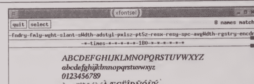

> 图 13-4。`xfontsel` 程序允许您测试已安装的字体，以确保它们按预期工作。

不幸的是，并非所有程序都完全依赖 X 的字体提供机制。原因是 X 的字体处理对于某些程序的需求来说是不充分的，因此有些程序要求您独立于 X 的字体安装字体。文字处理器特别可能有这种要求。如果您在 `xfontsel` 中看到您的字体，但在常规程序中看不到，请查阅其文档以确定您是否需要在 X 中安装字体之外还需要在程序中安装该字体。

如果您想减少字体菜单中的杂乱，您可以删除字体。您可以从字体路径中修剪整个目录，或者从 `fonts.dir` 文件中删除条目。从字体路径中删除目录可能会导致问题，除非这些是您一开始添加的目录。要从 `fonts.dir` 中删除条目，请查找包含字体名称的行。典型的条目如下所示：

```
n0210231.pfb -Adobe-Times-medium-i-normal--0-0-0-0-p-0-iso8859-1
```

某些字体为诸如粗体或斜体等字体变体提供多个条目，而位图字体为每个字体尺寸提供一个条目。因此，您可能需要删除多个字体条目。完成后，调整文件的第一行，该行列出了文件中的条目数量（行数减一）。在处理 `fonts.dir` 文件之前，备份该文件是个好主意。

> 不要删除作为 FreeBSD 标准部分提供的字体。某些程序假设这些字体中的某些存在，因此如果这些字体不存在，某些程序可能会崩溃或表现异常。不过，您可以使用此过程来修剪从字体软件包中添加的字体。

## 帮助重新配置 X 的工具

通过编辑 `XF86Config` 来重新配置 X 提供了大量的灵活性，但这可能是一个繁琐且棘手的过程，特别是对于 FreeBSD 的新手来说。幸运的是，有一些工具可以帮助您完成这项任务。本节简要介绍其中两个工具：XFree86 本身和 `xf86cfg` 工具。

XFree86 4.x 包含探测硬件并生成 `XF86Config` 文件的功能。要使用此功能，请输入 `XFree86 -configure`。此命令会生成大量状态信息，并创建一个名为 `/root/XF86Config.new` 的文件，您可以将其作为进一步修改的基础。您可以通过输入 `XFree86 -xf86config /root/XF86Config.new` 来测试此文件，这应该会使用新的配置文件启动 X。该命令在第一次尝试时可能无法正确工作，或者可能没有按您的期望工作。自动配置例程经常错过或误识别某些类型的硬件，例如通过 `moused` 服务器驱动的鼠标。

如果您生成了 `XF86Config.new` 文件并发现它有所缺失，或者如果您想要修改现有文件，您可能希望尝试使用 `xf86cfg` 进行编辑。该程序作为标准 XFree86 4.x 安装的一部分提供，并为 `XF86Config` 编辑提供了图形用户界面（GUI），如图 13-5 所示。当然，使用 GUI 界面意味着您必须在打算配置计算机上已经有一个正在运行的 X 服务器。因此，`xf86cfg` 对于调整已经工作的配置，或者在更换视频卡之前创建新配置非常有用。您可以按以下方式调用它：

```
$ xf86cfg -XF86config /path/to/XF86Config
```


`/path/to/XF86Config`可以指向`/etc/XF86Config`或测试文件（例如由 XFree86 使用其`-xf86config`选项创建的`/root/XF86Config.new`）。程序运行后，您可以右键单击组件并选择弹出菜单中的“Configure（配置）”来配置组件。此操作会创建一个对话框，您可以在其中输入或更改与设备相关的信息，如前几节所述。您还可以通过点击窗口顶部的设备图标来添加设备。要将新设备添加到布局中，请右键单击该设备并从弹出菜单中选择“Enable（启用）”。对于大多数工作站，没有太大必要添加组件；如果您想使用多个监视器来扩展工作桌面区域，或者如果您想定义一个外部 USB 键盘或鼠标以便在笔记本电脑上可选使用，那么您最有可能这样做。


**图 13-5。** *x186cfg 程序以图形化层级的形式表示 X 设备。*

## 用户级 X 选项

前一节“重新配置 X”主要讨论的是全局 X 配置——这些特性通常由系统管理员设置，以处理整体的 X 功能。然而，其他一些 X 选项也可以根据每个用户进行设置，本节将描述这些特性。两个主要的可配置更改是选择窗口管理器和选择桌面环境。另外两个更细致的更改是设置鼠标跟踪速度和键盘重复率。所有这些都属于用户偏好设置的范畴——用户对于这些特性往往会有非常不同（且通常非常强烈）的偏好。作为系统管理员，您可以为所有这些项目设置全局默认值，但个别用户可能希望覆盖这些全局默认值。

### 更改窗口管理器或桌面环境

第 6 章描述了各种系统启动脚本，其中包括两个常用于启动窗口管理器的脚本：`.xinitrc`和`.xsession`。这些脚本位于用户的家目录中，分别在用户从文本模式登录启动 X 或通过使用 XDM 图形登录工具登录时运行。要启动特定的窗口管理器或桌面环境，需要在启动脚本中包含对相关程序的引用。第 6 章，特别是“图形登录控制文件”部分，提供了有关此配置的更多详细信息。

XDM 登录程序的一些替代品，例如 GNOME 桌面管理器（`GDM`）和 KDE 显示管理器（`KDM`），允许用户在登录时选择桌面环境。例如，图 13-6 展示了 `GDM` 图形登录工具。该工具中的“会话”菜单项提供了多种选项，包括 `Xsession`（运行用户的 `.xsession` 脚本）、`Gnome`（启动 GNOME）和 `Failsafe xterm`（启动最小化的桌面环境）。`GDM` 和 `KDM` 都会在后续登录中记住用户最后一次的选择，因此它们是让经验较少的用户自定义登录选项的好方法，至少在工具的配置参数范围内如此。第 21 章更详细地描述了图形登录程序的配置。

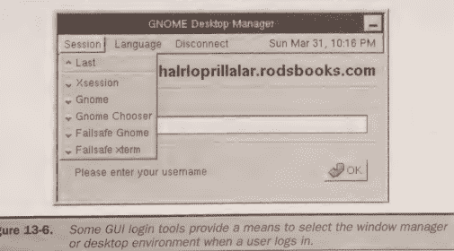

> **图 13-6。** 一些图形登录工具提供了一种在用户登录时选择窗口管理器或桌面环境的方式。

### 调整鼠标跟踪速度

鼠标跟踪速度是指鼠标硬件发生特定物理移动时，屏幕上鼠标移动的距离。有些人喜欢快速的鼠标跟踪，而另一些人则喜欢较慢的跟踪。可以通过 `xset` 命令来调整此功能，该命令通常出现在 `.xsession` 登录脚本中。具体来说，`xset` 的 `m speed` 选项决定了鼠标加速度。例如，您可以输入以下命令来调整鼠标跟踪速度：

```
$ xset m 4
```

> **注意** 此命令必须在 X 启动后在 `xterm` 窗口中输入；在启动 X 之前输入该命令会产生错误消息。

尝试使用此命令和不同的加速度值进行实验，看看您喜欢哪一个。如果您使用的是使用 `.xsession` 或 `.xinitrc` 文件的登录方法，可以将此命令包含在这些文件中，位于调用窗口管理器之前，以设置您的鼠标速度。如果系统是多用户机器，您可以指示您的用户做同样的事情。

桌面环境通常提供基于图形界面的方法来设置鼠标跟踪速度。例如，图 13-7 展示了打开鼠标配置区域的 GNOME 控制中心（从左侧窗格的 Peripherals 选项集中选择）。如果您或您的用户运行此类环境，可以使用此功能代替 `xset` 命令，并且桌面环境会在每次登录或 X 启动时恢复该设置。

### 调整键盘重复率

键盘重复率是许多用户想要个性化的另一项可自定义设置。可以通过几种方式调整此系统特性：

- **XF86Config** 您可以在 `XF86Config` 的键盘部分中设置默认的键盘重复率。特别是，您可以设置 `AutoRepeat` 选项，该选项有两个参数：按键开始重复前的延迟时间（以毫秒为单位）和每秒重复次数。例如，以下行设置了按键在延迟 250 毫秒后每秒重复十次：

```
Option "AutoRepeat" 250 10
```

- **xset** `xset` 程序也可以设置键盘重复率，但您需要通过 `xrate` 选项以及延迟和重复率参数来传递。例如，`xset r rate 250 10` 设置为在延迟 250 毫秒后每秒重复十次。用户可以将此类命令放在他们的 `.xinitrc` 或 `.xsession` 文件中，以自定义他们的键盘重复率。

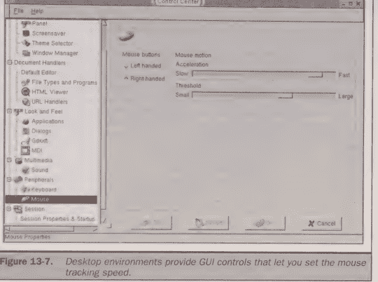

**图 13-7。** 桌面环境提供了图形控件，允许您设置鼠标跟踪速度。

- **图形工具** 与鼠标设置类似，GNOME 控制中心等图形工具允许您使用滑块调整键盘重复率。这些工具通常存储重复率，并在用户注销并再次登录后恢复该设置。

> **提示** 您可能希望实验 `xset` 以找到合理的值，然后在您的 `XF86Config` 文件中设置它。如果需要，个别用户可以覆盖此设置。

### 运行多个 X 会话

X 的一个不寻常特性是它允许您在单台计算机上运行多个 X 会话。许多用户可以没有此功能而生活，但当需要它时，它确实是一个巨大的优势，因为它允许您同时运行两个不同分辨率或颜色深度的会话，或者同时使用两个不同的窗口管理器或桌面环境运行。当您在测试程序与不同环境的兼容性时，或者喜欢为大多数用途运行一个环境但需要为某些程序运行另一个环境时，这种配置特别有用。

> **注意**
>
> 运行多个 X 会话的能力与许多窗口管理器和桌面环境维护的多个虚拟桌面是分开的。虚拟桌面都在相同的分辨率和位深度下运行，并使用相同的 X 进程，而多个 X 会话使用多个 X 进程，并可以使用不同的配置运行。

文本模式虚拟终端允许您在文本模式下运行多个程序，并通过按 `ALT-Fn` 进行切换，其中 `n` 是 1 到 8 之间的数字。通常，X 在第 9 个虚拟终端中运行，因此您可以通过输入 `ALT-F9` 从文本模式登录切换到它。当您在 X 中时，可以通过输入 `CTRL-ALT-Fn` 切换到文本模式虚拟终端。

此模型支持多个 X 会话。如果您想运行额外的 X 会话，它们将在第 10 及以后的虚拟终端中运行。棘手的部分是告诉系统在通常编号 9 以上的虚拟终端中启动 X。为此，请使用类似以下命令：

```
$ startx -- :1 vt10
```

您应该从文本模式登录输入此命令。如果您已经在运行 X，请输入 `CTRL-ALT-F1` 以进入文本模式虚拟终端，如有必要请登录，然后输入该命令。在短暂的延迟后，您应该看到一个新的 X 会话。您可以通过输入 `CTRL-ALT-F9` 和 `CTRL-ALT-F10` 在会话之间切换。第一个会话（编号 0）在虚拟终端 9 上运行，新的会话（编号 1，如启动命令中的 `:1` 所示）在虚拟终端 10 上运行。您可以扩展此原则以启动额外的会话，虽然四次之后，您用于在它们之间切换的功能键就会用完。

当为您指定不同的会话启动选项时，此方法的真正威力显现出来。例如，假设您的正常 X 会话以 16 位颜色深度运行。您可以通过在命令中包含 `-bpp 32` 选项来指定新会话以 32 位颜色深度运行，如下所示：

```
$ startx -- :1 -bpp 32 vt10
```

您也可以使用此技巧设置会话以不同的分辨率运行；定义一种颜色深度以在一种分辨率下运行（例如，1024×768），另一种颜色深度以另一种分辨率运行（例如，800×600）。您在 `XF86Config` 文件的 `Screen` 部分中设置这些选项，如前文“设置屏幕”中所述。因此，当您选择特定的颜色深度时，您也选择了相关的分辨率。或者，您可以定义多个 `XF86Config` 文件并使用 `-xf86config` 选项在它们之间进行选择，如下所示：

```
$ startx -- :1 -xf86config ./XF86Config-lores vt10
```

**注意**  

只有 `root` 用户才能使用绝对路径指定 `-xfs6Config` 选项。因此，如果普通用户必须使用特殊的 `XF86Config` 文件，该文件最好放置在用户的家庭目录中，并通过相对路径进行引用。

#### 摘要

与许多竞争性的图形用户界面（GUI）环境相比，X 的核心虽然简单，但功能强大。事实上，X 的强大部分源于其简洁性，因为更高级的工具，例如小部件集和窗口管理器，可以随时按需切换。你可以从系统全局层面，甚至按用户层面来调整这些功能的某些方面，而单个程序则设置其他功能。


大量的 X 配置位于 `/etc/XF86Config` 文件中，该文件控制视频显示分辨率和用于访问鼠标的设备等功能。这个文件的格式起初看起来可能令人困惑，但就像许多 FreeBSD 配置文件一样，通过几个关键字和原则就可以理解其关键功能。尽管如此，使用配置工具可以帮助你快速启动 X，或者在必要时以最小的麻烦重新配置系统。设置用户级选项通常涉及编辑用户的 X 登录文件（`.xsession` 或 `.xinitrc`，具体取决于系统是否配置为自动启动 X）或调整桌面环境工具。

# 第三部分

## 网络配置

### 第 14 章 基本网络配置

本章开启第三部分，重点讨论网络配置。FreeBSD 作为网络服务器非常流行，因此这一主题对许多 FreeBSD 管理员至关重要。实际上，即使是家庭休闲用户也通常需要了解 FreeBSD 的网络功能，以便将 FreeBSD 接入家庭网络，或使用其拨号功能（在第 15 章中描述）连接到互联网服务提供商（ISP）。

本章重点介绍如何设置并运行基本网络。本节后续的章节涵盖拨号网络，阐述客户端和服务器的基础知识，并描述防火墙配置。更后面的章节（特别是第四部分中的章节以及第 24 章）将介绍您可能希望在具有网络功能的 FreeBSD 系统中使用的工具。

设置并运行网络可以通过多种方式完成。为了理解这些方式，了解网络构建的原则会有所帮助，因此本章首先从这方面的讨论开始。随后，它介绍了 UNIX 系统历史上用于网络配置的方法：静态 IP 地址。一种更近期的替代方案在许多网络中很常见，即由中央服务器动态地向所有其他计算机分配 IP 地址。这种方法配置更简单，将在下文进行描述。无论你使用哪种方法，都应该使用各种基本工具测试你的配置。你可能需要调试问题，因此本章提供一些指针来帮助你这样做。最后，本章描述的一些更改是临时的，因此你可能需要对配置文件进行一些更改，以便系统在你重启后自动使用这些设置。

#### 本地和拨号网络功能

在着手配置 FreeBSD 使用网络之前，你应该理解一些基本的网络原则。如今最常见的网络硬件类型是以太网（Ethernet），它有几种不同的变体。大多数 FreeBSD 系统使用传输控制协议/网际协议（TCP/IP）来编码网络硬件上的数据。TCP/IP 是当今使用最广泛的网络协议类型，也是整个互联网的基础。互联网由许多通过路由器互连的小型网络组成。由于互联网上有如此多的互连计算机，寻址单个计算机可能是一件棘手的事情。这通过各种命名系统和名称转换方法来处理。所有这些网络功能都需要某种级别的本地配置才能正确工作。

#### 理解网络硬件

如果你想建立一个全新的网络，必须购买组成网络的所有硬件组件。如果你想将计算机添加到现有网络中，则需要的组件较少。在任何情况下，你都必须确保网络组件彼此兼容，因为存在各种网络硬件标准。在局域网（LAN）中，几种类型的网络硬件很常见：

- **网络接口**

  每台连接到网络的计算机都需要某种接口硬件。这些通常以网络接口卡（NIC）的形式出现，它们使用计算机的硬件总线（通常是 ISA 或 PCI）来添加接口硬件。一些计算机，如 Macintosh 和某些高端 x86 PC，在主板上就配有网络硬件。便携式计算机通常使用 PC 卡接口，还存在其他各种接口方法。网络接口是唯一需要 FreeBSD 驱动程序的网状硬件组件。

- **网络电缆**

  大多数网络硬件需要电缆来连接计算机。在今天的 100 Mbps 以太网硬件中，这些电缆通常以五类（Cat5，简称 Cat5）或更好规格的双绞线形式出现。这些电缆类似于普通电话线，除了插头更宽外。一些更高级的网络类型，包括某些吉比特以太网品种，使用光纤电缆。无线技术越来越流行。它们不需要电缆；它们使用无线电频率传输来携带数据。

- **集线器或交换机**

  某些形式的网络，包括常见的 100Mbps 以太网，需要使用中心设备来连接多台计算机。（尽管在两台计算机的网络中，有时可以省略这些设备。）集线器本质上是一个中继器；当一台计算机发送数据时，集线器会将数据包回显到连接到集线器的所有其他计算机。交换机稍微聪明一些，只将数据包回显到目标计算机。在 2002 年，以太网交换机仅比集线器贵一点点，因此更受青睐。某些类型的网络硬件，如旧的细同轴和粗同轴以太网品种，不使用集线器或交换机；它们将所有计算机连接在一条线上（称为总线拓扑，与集线器或交换机形成的星型拓扑相对）。

- **小型路由器**

  一些安装使用本地简单路由器，通常用于连接两个小型 LAN 或将 LAN 连接到互联网。你可以配置 FreeBSD 系统作为路由器，也可以购买专用设备来承担此角色。在某些情况下，你不需要路由器，要么是因为你没有连接多个网络，要么是因为你的互联网服务提供商（ISP）提供路由器（可能不在你的场所内）。

2002 年大多数新的局域网使用 100 Mbps 以太网硬件，使用 Cat5 电缆，并通过集线器或交换机连接计算机。旧网络通常使用 10Mbps 以太网，配备 Cat5 电缆和集线器或交换机，或者细/粗同轴电缆；一些局域网使用令牌环（Token Ring）代替以太网。令牌环使用集线器，速度可达 16 Mbps（非常新的版本可达 100 Mbps）。极少数网络使用其他类型的网络硬件。为了获得今天最佳的性能，你可以获得吉比特以太网硬件，它使用 Cat5 或光纤电缆和吉比特交换机。这种硬件比 100 Mbps 硬件昂贵，但价格正在迅速下降。在未来，更高速度将变得常见。

如果你要将 FreeBSD 连接到现有网络，了解该网络的类型至关重要。如果是常见类型，如 10 Mbps 或 100 Mbps 以太网，你应该能轻松找到与 FreeBSD 兼容的网络卡。请参阅 FreeBSD 自带的 `HARDWARE.TXT` 文件以确定哪些卡兼容（幸运的是，大多数都兼容）。不过，你可能需要了解卡使用的芯片组才能确定其兼容性。

#### TCP/IP 功能

TCP/IP 是计算机之间“交谈”的一种方式。它不局限于任何特定的网络硬件——它可以在以太网、令牌环或各种其他类型的硬件之上实现。事实上，你可以使用点对点协议（PPP）通过串行端口或调制解调器运行 TCP/IP。（这种配置足够独特，因此在自己的章节中描述——第 15 章。）TCP/IP 是当今可用的几个网络堆栈之一，但 TCP/IP 比其竞争者更常见。网络堆栈是一组协议，使计算机能够通过网络进行通信。这些协议以分层方式通信，因此得名，用户应用程序或服务器位于顶层，底层驱动和硬件位于底层。TCP/IP 受欢迎的主要原因与其设计特性有关，其中包括：

- **大地址空间**

  联网的计算机需要某种方式来相互寻址。TCP/IP，像大多数网络堆栈一样，使用数字地址（称为 IP 地址）来完成这一点。TCP/IP 地址的大小为 32 位（4 字节），意味着它支持理论上最多 $2^{32}$，即 4,294,967,296 个地址。这很大，但在 2002 年，它正变得有限，尤其是因为当前 TCP/IP 地址的分配效率不高。TCP/IP 中 IP 部分的下一代版本，称为 IPv6（当前版本为 IPv4），支持 128 位地址空间——理论上最多可容纳 $3.4 \times 10^{38}$ 个地址。这应该能支撑我们直到我们占领星系或纳米技术变得极其普遍为止。

- **主机名**

  虽然计算机使用数字（包括数字 IP 地址）工作得很好，但人类不会。因此，TCP/IP 支持一种将 IP 地址与字母主机名链接的方法。接下来的部分“IP 地址、主机名和域名”将更详细地描述 IP 地址和主机名之间的关系。

- **多端口网络**

  一台计算机可以运行许多（可能成千上万）支持网络功能的程序。每个程序链接到一个或多个网络端口，这些是计算机内部的虚拟地址，很像电话分机号使许多办公室员工能够共享一个外部电话号码。网络端口的好处是，许多程序可以同时使用网络，甚至与同一个远程系统通信，数据都会找到预期的接收者。

- **路由**

  前一节“理解网络硬件”提到了路由器。这些设备使你能够连接计算机网络

##### TCP/IP 与其他网络协议栈

将其划分为网络的网络，即互联网（internets）。互联网（注意大写）是现存最大的互联网，没有路由协议，互联网将无法存在。许多竞争性的网络协议栈对路由的支持非常初级或根本没有，因此限制了它们的覆盖范围。

跨平台支持 TCP/IP 最初是在早期的 UNIX 系统上开发的，但它是以开放的方式开发的，因此可以移植到其他操作系统。如今，TCP/IP 可用于从掌上电脑到高端 UNIX 系统的各种设备。TCP/IP 的广泛普及也推动了各种应用程序的开发。

大多数网络协议栈，包括 TCP/IP，都将网络任务分为两部分：客户端和服务器。客户端发起网络数据传输，服务器响应这些传输请求。（术语“客户端”和“服务器”既可以应用于单个程序，也可以应用于整个计算机。通常根据上下文可以明确其含义。）

上一节概述的 TCP/IP 特性也是它相对于其他网络协议栈的优势。不过，这并不是说其他所有协议栈都缺乏这些特性。在大多数情况下，2002 年仍然常见的非 TCP/IP 网络协议栈是局域网协议栈——它们在局域网（LANs）上提供网络功能，而不是在互联网络上。常见的例子包括


- `NetBEUI` 这个协议栈与 Windows 的文件和打印机共享功能联系最为紧密，但这些功能也可以通过 `TCP/IP` 实现（在 `FreeBSD` 中，你可以使用 `Samba` 通过 `TCP/IP` 实现 Windows 文件和打印机共享，但不能通过 `NetBEUI` 实现）。`NetBEUI` 是一种不可路由的协议，它使用两级命名方案（仅使用机器名称和工作组或域名称），因此不能用作互联网协议栈。
- `AppleTalk` 对于 Macintosh 系统而言，`AppleTalk` 的作用就像 `NetBEUI` 对于 Windows 系统一样——一种在本地网络上提供文件和打印机共享的方式。`AppleTalk` 使用分为两部分的 32 位地址，并支持一些路由功能，因此它比 `NetBEUI` 更适合用于互联网。然而，`AppleTalk` 在机器命名约定方面仍然有限制；与 `NetBEUI` 一样，它使用两级名称系统，这限制了其适用范围。此外，`AppleTalk` 从未在 Apple 世界之外流行起来。`FreeBSD` 可以使用 `Netatalk` 包通过 `AppleTalk` 提供文件和打印机共享功能，该包使用一种可在 `TCP/IP` 上工作的 `AppleTalk` 变体。
- `IPX` `Novell` 的互联网数据报交换（`IPX`）协议栈是为互联网设计的，但其命名不如 `TCP/IP` 灵活。`IPX` 也从未发展出 `TCP/IP` 所支持的那种网络应用程序范围。不过，它仍然是本地文件和打印机共享的有用协议。

本书的网络章节专注于 `TCP/IP`，因为它是最受欢迎的网络协议栈，而且主要竞争者总体上并没有提供更强大的功能。在某些情况下，你可以使用 `FreeBSD` 通过这些替代网络协议栈提供服务，`FreeBSD` 也确实以有限程度支持其中一些协议。

## 理解路由

如果你配置 `FreeBSD` 系统在一个完全隔离的本地网络（未连接到互联网的网络）上运行，你可能不需要处理路由。否则，路由很重要，因为它是你的网络通往互联网甚至更小规模的互联网上其他网络的网关。

路由器连接两个或更多网络。通常（但不总是）的情况下，路由器连接使用不同类型网络硬件的网络。例如，路由器可以连接使用以太网的本地网络和使用令牌环的另一个本地网络，并使用帧中继连接等长途路由协议将这两个网络连接到外部世界。图 14-1 说明了这种安排。在这种情况下，路由器是三个网络的一部分：本地以太网、本地令牌环网络和外部帧中继网络。

现在，假设图 14-1 中以太网网络上的用户想要访问位于令牌环网络上的资源。路由器使这种访问成为可能；两个系统之间的流量通过路由器传递。类似地，从两个本地网络访问互联网也必须通过路由器。事实上，可能会有许多路由器，因为图 14-1 中的互联网“云”实际上是一个复杂的相互连接的路由器及其服务的宿主集合。

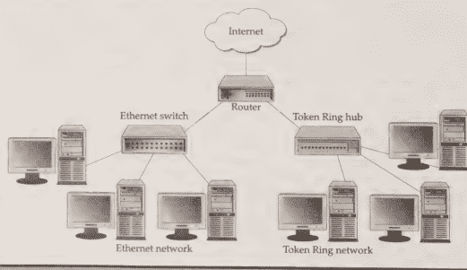

**图 14-1.** *路由器在 `TCP/IP` 网络之间中继数据，即使这些网络使用不同的物理介质。*

`TCP/IP` 的设计使得本地计算机只需了解很少的路由细节，但有一个细节它们是需要的：本地路由器的 `IP` 地址。计算机可以直接向其本地网络（即无需使用路由器即可到达的网络）上的其他计算机发送数据；这涉及将数据包寻址到目标系统并通过网络接口发送。接收方识别并处理该数据包。但对于更远的系统，这并不可能；因此，当计算机知道目标系统不在本地时，它会将数据包发送到本地路由器，路由器应该知道如何处理它。以图 14-1 中的路由器为例，它知道其两个本地网络和帧中继连接，并且知道发往广泛互联网上系统的数据包将传送到帧中继连接上的另一个路由器。那个路由器随后可以进一步中继数据包，依此类推，直到数据包到达目的地。因此，互联网流量要求客户端知道一个路由器，其余的工作由各种中间路由器以分布式、片段化的方式完成。

一个与路由器和 `IP` 地址相关的特性是网络掩码（也称为 `netmask` 或子网掩码），它是一个与 `IP` 地址一起使用的数字，用于将地址的网络部分与机器部分分开。通常，每个子网/工作组（如图 14-1 中的以太网）上的所有机器都共享其 `IP` 地址的前几位数字——这是地址的网络部分。`IP` 地址的最后几位数字对每台计算机都是唯一的。网络掩码可以解释为一个二进制数。该数字中的每个二进制 1 代表地址的网络部分，每个二进制 0 代表机器部分。例如，如果计算机的 `IP` 地址是 `192.168.0.23`，网络掩码是 `255.255.255.0`，这意味着 `IP` 地址的前三个字节（`192.168.0`）是网络地址，最后一个字节（`23`）是机器地址。网络掩码也可以表示为表示 1 位数量的十进制值，通常跟在 `IP` 地址和斜杠之后，如 `192.168.0.23/24`。提供 `IP` 地址的人也应提供网络掩码。对于 `192.168.x.x` 范围内的私有网络，典型的网络掩码是 `255.255.255.0`。路由器通过检查地址的网络部分并使用它来决定通过哪个网络连接发送数据包来工作。

网络掩码传统上按整字节值划分——也就是说，四个字节中的每一个要么是 `255`，要么是 `0`。此外，每个 `IP` 地址传统上属于一个类别，每个类别都有不同的网络掩码值。A 类地址位于巨大的网络上（网络掩码为 `255.0.0.0`），B 类地址位于中等大小的网络上（网络掩码为 `255.255.0.0`），C 类地址位于小型网络上（网络掩码为 `255.255.255.0`）。额外的类别保留用于特殊用途。如今，类别不像以前那么重要了。为了尽可能高效地利用可用的 `IP` 地址，它们根据需要以方便的最大块进行分配。尽管如此，你仍有时会看到关于地址属于特定类别的引用，并且如果你不指定网络掩码，配置工具会根据这些传统类别对网络掩码做出默认假设。

`FreeBSD` 可以被配置为路由器，但这超出了本书的范围。（第 17 章涉及某种特定的路由器配置。）在大多数情况下，你必须关注配置 `FreeBSD` 客户端或服务器以使用本地网络现有路由器的问题。该路由器可能由本地网络管理员维护，可能是由你的 `ISP` 在异地维护的设备，也可能是一个具有简单半自动化配置的小型本地设备（特别是如果你使用宽带互联网连接时）。你还必须有一种方法来告诉计算机哪些 `IP` 地址与本地网络相关联，哪些必须通过路由器。下一节“使用静态 `IP` 地址”将描述此过程。

## IP 地址、主机名和域名

如前面“`TCP/IP` 特性”一节所述，`TCP/IP` 依赖两种命名系统为其计算机命名。第一种命名系统是 `IP` 地址，大多数 `TCP/IP` 特性以最基本的方式依赖于该系统。第二种命名系统是主机名，这是一种易于人们记住的字母数字名称——至少与数字 `IP` 地址相比如此。

> **注意** 底层网络硬件使用第三种地址。这称为介质访问控制（`MAC`）地址，对于以太网，它是制造商分配给每个网络卡的 6 字节数字。`TCP/IP` 协议栈包含例程，在给定本地 `IP` 地址时发现 `MAC` 地址。

主机名分解为由点分隔的名称层次结构，如 `www.osborne.com`。最重要的区别在于机器名和域名之间。机器名是主机名的第一部分（本例中为 `www`），域名是名称的其余部分（本例中为 `osborne.com`）。主机名与计算机相关联——通常仅一台，尽管存在一些奇特的例外。域名分配给组织或个人，该组织或个人在域内分配机器名。域所有者还可以创建子域，这是（通常很大的）域中逻辑上独立的区域。例如，大学可以为院系创建子域，如 `english.pangaea.edu` 和 `physics.pangaea.edu`。然后，大学可以在这些子域内分配机器，如 `byron.english.pangaea.edu` 和 `curie.physics.pangaea.edu`。

主机名的最右侧部分是顶级域名（`TLD`），它根据地理或功能将互联网划分为不同的部分。例如，流行的 `com` `TLD` 供商业使用，而教育机构使用 `edu`。国家使用两个字母的 `TLD`，例如美国的 `us` 和日本的 `jp`。

主机名和 `IP` 地址通过域名系统（`DNS`）联系在一起，这是一个 `IP` 地址和主机名的分布式数据库。当你在互联网客户端中输入主机名时，客户端调用 `DNS` 系统进行转换。这种转换以分布式方式进行，你本地的 `DNS` 服务器查询一个 `DNS` 服务器层级结构，从知道顶级域（`TLD`）的服务器开始，到知道你输入的地址的 `DNS` 服务器结束。（如果你拼写错误，此过程最终会返回“未找到”响应。）与你的本地路由器一样，为了使此过程正常工作，你的 `FreeBSD` 客户端或服务器必须配置为使用 `DNS` 服务器。不过，这个 `DNS` 服务器可能在你的本地网络上，也可能不在。如果你没有告诉 `FreeBSD` 合适的 `DNS` 服务器，你可以使用 `IP` 地址通过网络工具，但这种做法充其量只是笨拙，即使只是用于有限的本地使用也是如此。大多数网站、电子邮件地址等都是通过主机名指定的，因此 `DNS` 是一种实际的必需项。

## 使用静态 IP 地址


由于每台计算机都需要 IP 地址来执行 TCP/IP 网络通信，因此你必须为 FreeBSD 系统分配一个 IP 地址。同样，你还必须配置系统以使用适当的路由器和 DNS 服务器。从概念上讲，提供此信息最简单的方法是明确地自行提供，如本节及其子节所述。另一种方法是使用一个本地服务器为所有其他本地计算机分配 IP 地址。此方法在即将介绍的部分“使用 DHCP”中描述。如果你是将计算机连接到现有网络，请找出你的网络使用的是哪种方法。如果你正在创建一个新的小型本地网络，使用静态 IP 地址通常更简单，至少一开始是这样，除非你使用的是同时也作为 DHCP 服务器工作的宽带路由器。

### 获取 IP 地址

配置静态 IP 地址的第一步是获取一个。在大多数情况下，你必须向外部权威机构咨询这些数据。如果你正在现有网络上设置 FreeBSD 系统，请咨询你的网络管理员。如果你正在宽带连接上安装系统，你的 ISP 应向你提供必要的信息。如果你正在设置一个小型隔离网络，你可以使用保留本地地址范围中的一个 IP 地址（`192.168.0.0–192.168.255.255`、`172.16.0.0–172.31.255.255` 和 `10.0.0.0–10.255.255.255`）。通常，IP 地址不应以 `.0` 或 `.255` 结尾，尽管也有例外。`192.168.0.1–192.168.0.254` 范围对于私有本地网络来说很受欢迎且安全。

除了 IP 地址本身，你还需要为你计算机设置一个子网掩码（`netmask`）。提供给你 IP 地址的人也应该给你一个子网掩码。对于 `192.168.x.x` 范围内的私有网络，子网掩码通常为 `255.255.255.0`。如果你设置错误的子网掩码，一些网络功能将有效，但你可能无法联系某些计算机，因为你的系统会认为它们没有被路由（而实际上它们有），或者认为它们被路由了（而实际上它们没有）。

路由器的 IP 地址是与此计算机 IP 地址相关的另一关键信息。（路由器的地址有时被称为网关地址。）你还需要一个或多个 DNS 服务器的 IP 地址（许多网络和 ISP 提供两个 DNS 服务器地址）。再次强调，提供你 IP 地址的人应该给你这些信息。如果你正在设置一个隔离的本地网络，你将没有路由器地址，但如果你使用宽带路由器连接到互联网，请使用其地址。如果你想在本地网络上使用 DNS，你需要自己运行一个 DNS 服务器。在非常小的网络中，更简单的替代方法是在每个系统上编辑 `/etc/hosts` 文件，以提供主机名和 IP 地址之间的链接。

### 使用 sysinstall 进行配置

与许多 FreeBSD 功能一样，你可以使用 `sysinstall` 来配置静态 IP 地址。为此，请遵循以下步骤：

1. 以 root 用户身份，输入 `/stand/sysinstall` 以启动 `sysinstall`。

2. 在主菜单中选择 Configure（配置）。

3. 在 FreeBSD Configuration Menu（FreeBSD 配置菜单）中选择 Networking（网络）。

4. 在 Network Services Menu（网络服务菜单）中选择 Interfaces（接口）。FreeBSD 将显示一个菜单，让你选择要配置的网络接口，如下所示。

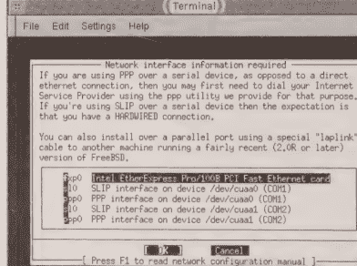

5. 从列表中选择你的网络卡。请注意，列表包括 PPP 和 SLIP 接口，它们用于串行端口或调制解调器。你的网络卡很可能是列表中的第一项，例如前面说明中的 Intel EtherExpress Pro。

6. FreeBSD 会询问你是否想要配置 IPv6 网络。由于 IPv6 仍然很少见，这里不作描述；请选择 No（否）。

7. 系统会询问你是否希望使用 DHCP 配置接口。仅当你的网络使用 DHCP 时才选择此选项；对于静态 IP 地址配置，请选择 No（否）。

8. 现在 `sysinstall` 显示一个表单，你可以在此处输入系统中的关键信息，如图 14-2 所示。最重要的字段是 IPv4 Address（你的 IP 地址）、Network（网络）、IPv4 Gateway（你的路由器 IP 地址）和 Name Server（你的 DNS 服务器地址）。在小型本地网络上，你可能会省略后两个字段中的一个或两个。**Host** 字段保存你的主机名（你可以只输入机器名称部分，`sysinstall` 稍后会将其扩展），**Domain** 字段保存你的域名。即使这些字段设置错误，FreeBSD 也能正常工作，但在某些互联网软件中你可能会遇到问题，例如发件人地址不正确等。

> **注意** 如果你的 ISP 或网络管理员提供多个 DNS 服务器地址，请在网络配置表单中填写任意一个地址，或者如果某个地址被标识为“主要”地址，则填写该地址。*即将介绍的部分，“设置主机名解析”，描述了如何输入额外的 DNS 服务器地址。这样做虽然不是必须的，但如果某个 DNS 服务器宕机，它可以提高 DNS 解析的可靠性。*

9. 系统会询问你是否希望立即启用你的接口。你最好回答 Yes（是）。

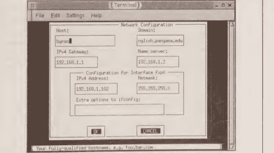

图 14-2. 网络配置表单允许你在一个屏幕上输入关键的 TCP/IP 配置选项。

此时，你的网络接口应该能正常工作。要测试它，请参阅即将介绍的部分，“测试你的配置”。

> **提示** 上述过程将信息追加到 `/etc/rc.conf` 文件。你可以手动执行此操作，如即将介绍的部分，“使你的更改永久化”中所述。`sysinstall` 工具将你的条目追加到 `rc.conf` 而不删除旧条目，因此此文件包含你所做的网络配置更改的历史记录。你可以删除新的配置以撤销其更改。

### 手动配置

有时你可能不想使用 `sysinstall`。如果你想执行一些不寻常的配置，这种情况很常见。如果 `sysinstall` 配置被证明不可靠，手动配置还提供了更多的调试机会。手动配置网络涉及使用两个主要实用程序并编辑配置文件来设置网络功能。

#### 激活接口

手动配置网络连接的第一步是激活接口。你可以使用 `ifconfig` 命令来完成此任务，该命令具有非常复杂的语法，其简化版本如下：

```
ifconfig [interface] [up | down] [address[/prefixlength]]
[netmask netmask]
```

有关更多详细信息，请参阅 `ifconfig` 手册页。此命令的选项包括：

- `interface` 此选项是网络接口的名称。不幸的是，名称因网络卡的型号而异。你通常可以在启动后立即查看 `dmesg` 输出来了解你的接口名称。输入 `dmesg | less` 并浏览此输出，直到找到识别以太网（或其他网络硬件）设备的行，例如以下行，该行将设备标识为 `fxp0`： `fxp0: Ethernet address 00:03:47:b1:ee:b8`

- `up | down` 使用 `up` 来激活接口，使用 `down` 来关闭接口。通常，`ifconfig` 假设使用 `up`，因此你可能可以完全省略此参数。

- `address[/prefixlength]` 使用此选项指定你想要的 IP 地址。你还可以包括其字节数形式（`prefixlength`）的子网掩码。

`netmask` *netmask* 如果您更喜欢以完整的四字节形式指定 `netmask`，可以通过在 `netmask` 关键字前面加上该参数来实现。如果您完全没有提供 `netmask`（无论是通过此选项还是 `prefixlength` 选项），`ifconfig` 会根据 IP 地址的类别计算一个 `netmask`。

如果您输入 `ifconfig` 时不附带任何参数，它会显示所有网络接口的摘要信息。如果您只提供网络接口名称，摘要信息将仅限于该接口。例如：

```
$ ifconfig fxp0
fxp0: <flags=8843<UP,BROADCAST,RUNNING,SIMPLEX,MULTICAST> mtu 1500
in 192.168.1.6 netmask 0xffffff00 broadcast 192.168.1.255
ether 00:03:47:b1:ee:b8
media: Ethernet autoselect (100baseTX)
status: active
```

这里展示的最关键信息是 IP 地址（位于输出的第二行 `in` 之后）。只要有 IP 地址的存在，就说明它已关联到网络硬件；该计算机将响应指向该 IP 地址的流量，并使用该地址发送流量。

至此，您应该能够通过 IP 地址访问本地网络上的其他计算机。例如，如接下来的章节“测试您的配置”所述，您应该能够使用 `ping` 并收到来自本地系统的回复。

#### 配置路由


有两个命令对于配置路由至关重要。首先，`netstat` 显示当前网络配置的信息。特别是 `-r` 选项显示路由表。（您可能想要添加 `-n` 选项以将地址显示为 IP 地址而不是主机名，特别是在您的主机名解析不起作用的情况下。）例如，您可能输入以下命令来确定路由表是如何配置的：

```
$ netstat -rn
Routing tables

Internet:
Destination Gateway Flags Refs Use Netif Expire
default 192.168.1.1 UGSc 0 13 fxp0
127.0.0.1 127.0.0.1 UH 0 48 lo0
192.168.1 link#1 UC 2 0 fxp0
192.168.1.1 0:a0:cc:24:ba:2 UHLW 3 44 fxp0 1186
192.168.1.3 0:50:bf:19:7e:99 UHLW 2 719 fxp0 551
```

该命令提供了大量信息。特别重要的特性包括：

- **本地系统** 本示例中的最后两行指定了如何联系与 FreeBSD 系统位于同一子网内的两个系统（192.168.1.1 和 192.168.1.3）。这些系统由 `Gateway` 列中的 6 字节 MAC 地址标识。FreeBSD 最终会删除这些条目（在 `Expire` 列指定的秒数之后），但如果再次需要，它可以快速自动重新生成。指向这些地址的流量通过 `fxp0` 网络接口（在 `Netif` 列中指定）传输。

- **本地网络地址** `Gateway` 列中标记为 `Link#1` 的行标识了本地网络地址。指向这些地址的流量通过 `fxp0` 网络接口传输。在实践中，FreeBSD 使用底层 TCP/IP 协议来发现目标系统的 MAC 地址，然后添加该系统的条目并使用它将数据发送到新系统。当使用 `ifconfig` 启用接口时，应自动定义此类路由。

- **本地主机地址** 本章尚未提及的 FreeBSD 网络功能之一是 `localhost` 或 `loopback` 地址——127.0.0.1。这是一个专门保留给计算机自身的特殊 IP 地址。某些底层工具使用它，并且它存在于路由表中。

- **默认路由** `default route` 指导那些没有更具体路由表条目存在的流量。对于新定义的网络接口，默认路由可能不存在，但在前面的示例中，它是那行以 `default` 开头的行。在这种情况下，默认路由将 192.168.1.1 指向路由器。

要添加默认路由，您使用 `route` 命令。与 `ifconfig` 类似，`route` 支持许多选项，因此请查阅其 man 页面了解其操作详情。使用它添加路由相当直接；您输入如下命令：

```
# route add default 192.168.1.1
```

该命令将 192.168.1.1 添加为计算机的默认路由。如果您添加了错误的路由，可以通过使用 `delete` 而不是 `add` 来删除路由（如果路由不是默认路由，请省略 `default` 关键字，并指定 `netstat -rn` 输出中 `Destination` 列中的标识符）。

至此，您应该能够使用 `ping` 或其他网络工具通过 IP 地址访问本地和远程系统。但是，主机名解析可能不起作用；这是即将出现的章节“设置主机名解析”的主题。

### 设置您的主机名

您可以使用 `hostname` 命令设置计算机的主机名。当不带任何参数输入时，该命令返回您当前的主机名；但当您在命令后输入主机名时，它会修改您的主机名。例如，您可能输入以下命令：

```
# hostname byron.english.pangaea.edu
```

以这种方式设置主机名对于大多数网络操作并非至关重要，但对某些操作很重要。例如，某些邮件阅读器在发送电子邮件时使用主机名，或者邮件服务器可能仅接受发送给指定主机名上用户的邮件。

> 在本地设置主机名并不能使您的系统在整个互联网中通过该名称被寻址。这是互联网 DNS 服务器的领域。如果您希望系统能够通过特定名称被访问，您必须咨询管理该名称所属域中 DNS 服务器的人员。

### 设置主机名解析

假设您可以访问 DNS 服务器，主机名解析涉及编辑单个配置文件：`/etc/resolv.conf`。该文件通常相当短，应包含一到三个 DNS 服务器的 IP 地址。它还可以包含计算机的域名，以及可能需要搜索的其他域列表。这两个选项都允许用户输入简短的机器名称，而不是完整的主机名。列表 14-1 显示了一个 `/etc/resolv.conf` 文件的示例。

```
domain english.pangaea.edu
search classes.pangaea.edu, pangaea.edu
nameserver 192.168.1.2
nameserver 10.40.91.4
```

使用列表 14-1 配置的计算机将首先搜索 `english`、`pangaea`、`edu` 域，然后搜索 `classes`、`pangaea`、`edu` 和 `pangaea`、`edu` 域，使用 192.168.1.2 和 10.40.91.4 DNS 服务器。您不需要使用 search 行，事实上，输入许多要搜索的域会减慢操作速度。例如，假设用户输入 `telnet shakespeare`，拼错了以著名英国诗人命名的计算机名称。FreeBSD 将向 DNS 服务器查询 `shakespeare.english.pangaea.edu`，然后是 `shakespeare.classes.pangaea.edu`，最后是 `shakespeare.pangaea.edu`，然后才放弃。这些尝试中的每一个都需要一些时间，因此在用户收到错误消息之前可能会经过几秒钟。此外，如果由于某种原因存在名为 `shakespeare.pangaea.edu` 的计算机，用户最终将访问它，这通常不会产生好的效果。

如果您的网络较小，或者如果您想维护某些非标准映射，您可能想要编辑 `/etc/hosts` 文件。该文件提供了常规 DNS 查找的替代方案。起初，该文件可能包含一两个映射，特别是将 127.0.0.1 链接到 `localhost` 主机名的映射。额外的映射采用以下形式：

```
ip-address full-hostname nickname
```

`nickname` 通常是机器名称。例如，您可能包含如下条目：

```
192.168.1.43  shakespeare.english.pangaea.edu  shakespeare
```

此配置允许您的用户即使您的 DNS 服务器无响应或未定义任何 DNS 服务器，也能访问指定名称的计算机。这是在小型网络上进行名称解析的有效手段；如果您适当编辑系统的 `/etc/hosts` 文件，则无需运行自己的 DNS 服务器。

配置名称解析后（特别是通过在 `/etc/resolv.conf` 文件中列出 DNS 服务器），您应该能够执行所有正常的网络任务，例如通过 IP 地址和主机名访问本地和远程计算机。

### 使您的更改永久生效

`ifconfig` 和 `route` 命令的效果仅在计算机启动期间持续。如果您使用这些命令配置系统的网络，重新启动计算机需要重新输入这些命令。由于 DNS 配置是通过编辑文件完成的，因此该更改在重新引导后依然有效。

为了简化重新启动时的配置，您可以将配置命令输入到启动脚本中，如第 6 章所述。事实上，通常有一个启动脚本包含网络配置信息：`/etc/rc.conf`。该文件可能包含如下行：

```
ifconfig_fxp0="inet 192.168.1.102 netmask 255.255.255.0"  
defaultrouter="192.168.1.1"  
hostname="byron.english.pangaea.edu"
```

这些行并不与控制它们的 `ifconfig`、`route` 和 `hostname` 命令完全相同，但它们包含相同的关键信息。事实上，当您使用 `sysinstall` 配置网络时，修改的正是此文件。在正常操作下，`sysinstall` 将条目附加到该文件，而不是覆盖现有条目。后面的条目优先于前面的条目。您可能希望遵循相同的做法，因为这允许您通过删除或注释掉更改的行轻松地撤销更改。

## 使用 DHCP

将计算机配置为使用静态 IP 地址并不特别困难，特别是如果您使用诸如 `sysinstall` 等工具来协助完成这项工作。尽管如此，静态 IP 地址配置存在一些缺点。例如，很容易输入错误的信息。从网络管理员的角度来看，为每台计算机分发 IP 地址很容易变成管理噩梦，特别是如果计算机被加入和移出网络的速率很高。出于这些原因，开发人员设计了各种自动分配 IP 地址的方法。在本地网络中，其中最常见的是*动态主机配置协议*（DHCP）。

> 数字用户线路（DSL）网络通常使用另一种方法，即以太网点对点协议（PPPoE），来分配 IP 地址。此方法与常规串行线路上的点对点协议（PPP）密切相关，将在第 15 章中详细介绍。


某些 DHCP 配置要求将 DHCP 客户端的 MAC 地址注册到 DHCP 服务器数据库中。如果您的网络属于这种情况，您的网络管理员或 ISP 会向您索要此信息。MAC 地址（又称以太网地址）是一个六字节的数字，通常以十六进制表示。有时它会打印在网卡上的标签上。如果没有，您可以通过 `ifconfig` 命令获取，如前一节“激活接口”所示。您还可以在启动后不久从 `dmesg` 输出中的一行获取此信息。具体来说，以下命令会返回 MAC 地址：

```
$ dmesg | grep “Ethernet address”
  fxp0: Ethernet address 00:03:47:b1:ee:b8
```

DHCP 服务器计算机在其本地网络段上监听特殊的 DHCP 请求数据包。这些数据包是*广播*，意味着它们被定向到网络段上的所有计算机。DHCP 服务器通过返回客户端的 TCP/IP 配置信息来响应 DHCP 广播，这些信息包括其 IP 地址、子网掩码、网关系统、DNS 服务器，以及可能的客户端主机名和域名。DHCP 服务器可能反复为特定计算机分配相同的 IP 地址，或者服务器可能分配一个会随时变化的地址（通常是在计算机启动之间，除非 DHCP 服务器配置发生变化或出现问题，否则客户端的 IP 地址不会无故改变。）

如果您使用*sysinstall*，配置系统使用 DHCP 与配置系统使用静态 IP 地址类似。特别是，请参考前文“使用 sysinstall 进行配置”中介绍的步骤，但在*第 7 步*中，对关于使用 DHCP 进行配置的问题回答*是*。系统将在您的网络上搜索 DHCP 服务器，然后显示网络配置屏幕（图 14-2）。如果您愿意，可以将所有字段留空。如果您的 DHCP 服务器未设置您的主机名，您可能希望设置此字段和域名字段。（在某些网络上，主机名可能被设置为乱码，因此您可能需要更正它。）

使用*sysinstall*会配置 FreeBSD 以使用*dhclient*程序获取 IP 地址。此配置存储在`/etc/rc.conf`中。具体来说，DHCP 配置依赖于类似以下的一行：

```
$ ifconfig_fxp0="DHCP"
```

如果您不想使用 `sysinstall` 但希望使用“标准”DHCP 配置，您应该编辑 `/etc/rc.conf`，使其包含这一行而不是明确的 IP 地址。当您重新启动时，您的系统应该从本地 DHCP 服务器获取其网络配置。

### 测试您的配置

无论您使用静态 IP 地址还是 DHCP 配置系统，您都应该测试您的配置。如果您遇到问题，这些测试可以帮助您定位问题，以便您将进一步的诊断精力集中在故障系统上。

#### 执行基本 ping 测试

最基本的测试类型是 ping 测试，因其依赖于 `ping` 实用程序而得名。此程序向目标系统发送非常简单的数据包，该系统应回复同样简单的数据包。这些传输依赖于基本的 TCP/IP 协议栈，但它们不依赖于更高级工具（如 web 服务器或客户端）的正确配置。因此，对远程系统进行 ping 是测试基本 TCP/IP 配置以及您和目标系统之间的物理网络连接的好方法。

尽管 `ping` 执行的任务很简单，但该程序的语法相当复杂。不过，在大多数情况下，您只需输入其名称后跟主机名或 IP 地址即可使用它。您的初始测试应使用本地计算机的 IP 地址，如下所示：

```
$ ping 192.168.1.3
PING 192.168.1.3 (192.168.1.3): 56 data bytes
64 bytes from 192.168.1.3: icmp_seq=0 ttl=255 time=0.335 ms
64 bytes from 192.168.1.3: icmp_seq=1 ttl=255 time=0.326 ms
64 bytes from 192.168.1.3: icmp_seq=2 ttl=255 time=0.318 ms
64 bytes from 192.168.1.3: icmp_seq=3 ttl=255 time=0.312 ms
^C
--- 192.168.1.3 ping statistics ---
4 packets transmitted, 4 packets received, 0% packet loss
round-trip min/avg/max/stddev = 0.312/0.323/0.335/0.009 ms
```

除非您使用 `-c` `count` 选项指定要发送的 ping 数量，否则 `ping` 会继续发送测试数据包，直到您按下 **CTRL-C**。正如您从这个示例中看到的，`ping` 会报告它从目标系统收到的每个数据包，包括收到响应所花费的时间（称为*ping 时间*或*延迟*）。在其输出的末尾，它会报告整体统计信息，包括发送和接收的数据包总数以及延迟摘要。在本地网络上，您应该几乎没有或没有数据包丢失（不过，偶尔您可能在发送数据包后但在收到回复前中断了 `ping` 测试，而且非常繁忙的网络可能会经历一些数据包丢失）。本地延迟应该非常低——通常为一毫秒或更少。

> **提示**
>
> 尝试将本地路由器作为初始*ping*测试的目标。路由器对于到达其他*网络*至关重要，因此对于最佳功能*必须*可到达。您也应该有路由器的 IP 地址，无论是用于静态 IP 配置的地址还是通过输入 `netstat -nr` 获取的地址。

如果针对本地*网络*的初始 ping 测试失败，您应该仔细检查您最基本的网络设置——您的 IP 地址和子网掩码。其中一个很可能设置错误。输入 `ifconfig` 查看您的网络配置，如前文“*激活接口*”中所述。如果您的接口未激活，请重新查看该部分。如果您正在使用 DHCP，请咨询您的日志文件（`/var/log/messages`）以查看来自*dhclient*的错误。例如，您可能会看到类似这样的消息：

```
Apr 7 22:02:25 hairloprillarl dhclient: Can't bind to dhcp address: Address already in use
Apr 7 22:02:25 hairloprillarl dhclient: exiting.
```

*Address already in use*（地址已被使用）消息表明有其它正在使用 DHCP 通常占用的*网络*端口。如果您在尝试重新配置*dhclient*时它已在运行，可能会遇到此问题。结束*dhclient*然后输入*dhclient*应该可以解决此问题。

> **注意**
>
> 有些计算机被配置为不响应*ping*测试。因此，有可能这样的测试看起来失败了，但实际上没有问题。如果一个本地*ping*测试失败，请尝试另一个系统。

除了本地设置，*ping*测试失败的另一个可能原因是硬件。诸如劣质网线、未连接的集线器或交换机等问题可能会导致故障。请尝试交换网线，如果可能，使用已知工作正常的配置的另一台计算机连接到在无法正常工作的系统所使用的相同网络硬件上，以诊断此类问题。

#### 测试主机名解析

如果您的基本*ping*测试有效，您可以尝试更高级的*ping*用法来测试您的主机名解析机制：指定主机名而不是 IP 地址。如果您有本地 DHCP 服务器或使用 `/etc/hosts` 定义本地网络的机器，这应该适用于本地地址，就像使用*ping*使用 IP 地址一样。在前面的*ping*示例中（在“*执行基本 ping 测试*”中），*ping*输出的第一行列出了两次 IP 地址。如果您使用主机名，这些中的第一个会被主机名替换，第二个是 IP 地址。如果您的主机名解析方法无法正常工作，你将看不到这一行；但如果主机名解析正常工作，而你却无法访问目标系统，你将看到该行且没有进一步的输出。

> **注意**
>
> 如果你的 DNS 服务器不在本地网络上，DNS 故障实际上可能是一个路由问题。请参阅下一节“诊断路由问题”，以获取更多相关信息。

你也可以使用此方法测试远程主机名的解析，例如互联网上的那些。如果你的 DNS 服务器位于本地网络段，即使你无法到达远程站点，这种名称解析也可能有效，因为你的本地路由配置可能不正确。

`host` 和 `nslookup` 命令也用于测试名称解析，并且比 `ping` 更直接。这些命令专门设计为在给定主机名时返回 IP 地址，或在给定 IP 地址时返回主机名。

#### 诊断路由问题

你可以使用 `ping` 测试你与远程系统之间的基本连接性。例如，你可以输入以下命令：


```
$ ping www.osborne.com
PING www.osborne.com (198.45.24.130): 56 data bytes
64 bytes from 198.45.24.130: icmp_seq=0 ttl=238 time=131.518 ms
64 bytes from 198.45.24.130: icmp_seq=1 ttl=238 time=162.523 ms
64 bytes from 198.45.24.130: icmp_seq=2 ttl=238 time=130.061 ms
64 bytes from 198.45.24.130: icmp_seq=3 ttl=238 time=134.463 ms
^C
--- www.osborne.com ping statistics ---
4 packets transmitted, 4 packets received, 0% packet loss
round-trip min/avg/max/stddev = 130.061/139.641/162.523/13.306 ms
```

该测试显示比本地网络高得多的延迟，但具体有多高取决于你的网络连接、到目标站点的距离等。此示例还演示了 `ping` 中主机名解析的使用，但你的 DNS 配置可能存在错误，而路由却是正常的。在这种情况下，如果你知道某个远程系统的 IP 地址，可以尝试输入该 IP 地址。

如果你可以访问某些外部站点但无法访问其他站点，则可能是你的子网掩码设置不正确，因此你应该仔细检查该配置。另一种可能性是某个外部路由器已停止工作或配置错误，或者问题可能存在于目标系统上。你可以使用 `traceroute` 来帮助诊断此类问题，它会生成有关你与目标系统之间每个路由器路径的统计信息。例如，你可能会输入以下命令：

```
$ traceroute -n 68.1.0.44
traceroute to 68.1.0.44 (68.1.0.44), 64 hops max, 40 byte packets
```

```
1  192.168.1.1  1.299 ms  1.185 ms  1.165 ms
2  10.1.96.1  16.236 ms  46.519 ms  68.663 ms
3  68.9.8.81  41.946 ms  10.701 ms  47.766 ms
4  68.9.14.5  37.191 ms  14.907 ms  45.332 ms
5  68.1.0.4  36.135 ms  *  45.391 ms
```

`-n` 选项使 `traceroute` 省略对目标系统的主机名查找，这可以加快过程。每个路由器使用类似 `ping` 生成的数据包接触三次，并报告延迟。在此示例中，第一个路由器是本地路由器，产生的延迟非常低。第二个路由器产生的延迟较长且变化较大（16–69 ms），后续路由器产生的延迟主要更长，但同样存在变化。目标站点仅对其发送的三个数据包中的两个做出了响应（第二个时间位置处的星号表示响应失败），因此到达该站点的任何异常行为都可能由目标系统引起。中间路由器也可能表现出类似的问题。在大多数情况下，除了向你的 ISP 或受损计算机的所有者抱怨外，我们几乎没有办法解决此类问题。

> 提示
>
> `whois` 实用程序可以返回有关负责某台计算机的人员或组织的信息。输入 `whois ip-address`，其中 `ip-address` 是相关的 IP 地址，以获取此信息。（如果你知道域名，可以提供域名而不是 IP 地址。）你应该能够获取联系信息，例如技术联系人电子邮件地址或电话号码。

#### 测试更高级的协议

如果前面的 `ping` 和 `traceroute` 测试没有发现问题，你应该继续测试更高级的协议。你可以使用 Web 浏览器浏览网页，使用 FTP 客户端登录远程 FTP 站点，等等。如果基本的 `ping` 测试通过，但更复杂的协议失败，问题最有可能出在更复杂工具的配置中。这些问题非常具体地取决于相关的工具，因此你应该查阅它们的文档或本书的相关章节（主要在第四部分和第 24 章）。

### 摘要

在当今世界，网络配置对大多数计算机都至关重要。这对 FreeBSD 系统尤其如此，因为它们经常用作网络服务器或在高度依赖网络的环境中的工作站。FreeBSD 的 `sysinstall` 实用程序提供了一种相当直接的方法来配置计算机使用静态 IP 地址或从 DHCP 服务器分配的地址。一旦你这样配置了你的计算机，几个基本测试（其中大多数使用 `ping` 实用程序）可以告诉你你的配置是否正确。

# 完整参考


# 第 15 章

# 拨号网络

377

第 14 章描述了使用以太网、令牌环或类似的专用网络硬件配置 FreeBSD 系统以连接本地网络。然而，并非所有计算机都使用这种连接；许多小型企业和家庭用户通过电话调制解调器使用点对点协议（PPP）连接到互联网，该协议允许互联网用户通过 RS-232 串行端口或调制解调器拨号连接到 ISP。即使驻留在孤立局域网上的计算机也可能使用拨号电话连接来访问互联网；笔记本电脑在离开所有者网络时也可能使用拨号访问。本章描述了在 FreeBSD 中使用此类连接的方法。它还考察了 PPP 的一种变体，称为以太网上的 PPP（PPPoE），许多宽带互联网提供商都使用这种协议，尽管它们使用以太网硬件。

本章从几个平凡但重要的初步步骤开始：寻找一个可以将你连接到互联网的互联网服务提供商（ISP）并测试你的调制解调器硬件。一旦你克服了这些障碍，你就可以继续配置你的连接。本章考察了两种方法：通过 GUI 拨号实用程序以及通过与文本模式实用程序一起使用的拨号脚本。每种方法都有其优缺点。本章最后介绍了 PPPoE 配置和使用。

### 寻找 ISP

打开你的电话簿到“互联网服务提供商”部分，你可能会找到几个列表，在大型城市中甚至可能有几页列表。如果你通过其他替代来源拥有互联网访问权，你可以查看 http://www.thelist.com 获取按各种标准排序的列表。因此，在 FreeBSD 上寻找 ISP 的问题并非选择稀缺；而是不知道哪些选择最适合 FreeBSD。大多数 ISP 首先为 Microsoft Windows 用户服务，其次为 Mac OS 用户服务。许多 ISP 不会超越这两个市场，因此如果你遇到问题，你可能会发现没有支持。话虽如此，大多数 ISP 的产品都可以与 FreeBSD 一起使用。但有一些例外。最重要的是，任何依赖高度定制的工具来建立基本连接的 ISP，例如流行的 America Online (AOL)，都会增加复杂性，因此最好避免。

如果可能，询问潜在 ISP 关于他们的 FreeBSD 支持政策，或者至少找出他们是否有 FreeBSD 用户。作为一般规则，你更有可能从小型本地 ISP 而不是巨大的国际公司那里获得良好的 FreeBSD 支持。

如果你已经通过 ISP 或你的雇主或学校拥有互联网访问权，你当然可以尝试在 FreeBSD 上使用它，并且很可能你会设法使其工作。你可能希望使用当前连接在另一个操作系统上尝试定位你的 ISP 支持区域；你可能会找到一些 FreeBSD 支持说明。Linux 支持说明也可能有价值，尽管 FreeBSD 和 Linux 在 PPP 配置的某些细节上有所不同。

### 测试调制解调器硬件

在继续之前，您应该在 FreeBSD 下测试调制解调器的功能。如今的调制解调器属于三大类，每类在 FreeBSD 下都有不同的要求：

- `RS-232` 串行调制解调器 这些调制解调器连接到计算机的外部 RS-232 串行端口，或者作为即插即用的 ISA 或 PCI 卡提供，卡上包含板载串行端口硬件。RS-232 串行调制解调器几乎总是与 FreeBSD 兼容，尽管您可能需要重新配置内部调制解调器的中断请求 (`IRQ`) 线，或者禁用主板上的 RS-232 端口才能使调制解调器正常工作。这些设备可以访问为 `/dev/cua0` 到 `/dev/cua3`。

- `内部无控制器调制解调器` 当今销售的大多数内部调制解调器都是*无控制器*的，这意味着它们缺乏传统上与调制解调器相关联的大部分硬件，而是依赖于特殊的驱动程序。这些调制解调器有时也被称为*软调制解调器*或*WinModems*。无控制器调制解调器通常根本无法在 FreeBSD 上工作。虽然某些无控制器调制解调器（特别是流行的基于 Lucent 的调制解调器）存在驱动程序，但很难找到——在撰写本文时，`comms/ltmodem` 端口是存在的，但它所指向的文件并不存在。当您阅读到这里时，这个问题可能已经得到解决。

- `USB 调制解调器` 越来越多的外部调制解调器使用通用串行总线 (`USB`) 接口，而不是 RS-232 接口。目前正在进行工作以支持其中一些（特别是基于通信数据类抽象控制模型，即 CDC-ACM 协议构建的那些），但截至 FreeBSD 5.0，其支持仍很原始。


正如您可以从上述列表中推断出的那样，调制解调器的最佳选择是 RS-232 串行调制解调器。这通常意味着是一个外部 RS-232 串行型号，尽管较旧的（20 世纪 90 年代中后期及更早）内部调制解调器也能很好地工作。

要测试您的调制解调器，请将其连接并通电，然后使用终端程序（如基于文本的 `minicom` 或基于 X 的 Seyon）来测试基本的调制解调器功能。（这两个程序都可以作为软件包或端口安装，如第 11 章所述。）您可以通过输入 `seyon -modem /dev/cua0` 来启动 Seyon（如果您的调制解调器设备文件名不是 `/dev/cua0`，请替换为您的设备文件名）。然后，您可以输入 `AT` 或其变体后跟数字，以从调制解调器获取状态信息，或者输入 `ATDT####-####` 来拨号（用您想拨打的电话号码替换 `####-####`）。您的调制解调器手册应列出您可以输入的其他命令及其效果。图 15-1 显示了正在运行的 Seyon，并显示了与调制解调器的成功连接。


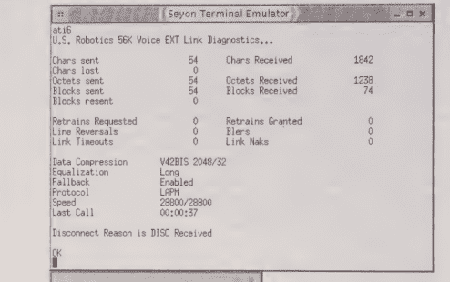

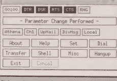

**图 15-1。** 终端程序使您能够在不使用 PPP 工具的情况下测试调制解调器。

### 使用图形界面拨号器

如果您是 FreeBSD 的新手，启动 PPP 连接的最简单方法是使用图形用户界面 `GUI` 拨号工具。这些工具的操作方式与其他操作系统（如 Windows 或 Mac OS）中类似工具的方式非常相似。您在对话框中输入关键信息（如 ISP 的电话号码），然后单击按钮以启动连接。通常，您可以配置这些工具，使普通用户也能启动连接，因此它们非常适合在工作站上使用。但是，无法通过外部脚本控制它们，因此如果您希望系统在特定时间自动上线（例如，每小时交换一次电子邮件），它们并不是最好的选择。对于这种情况，拨号脚本更优越，将在接下来的章节“使用文本模式拨号工具”中描述。

#### 查找图形界面拨号器

配置图形界面拨号器时必须克服的第一个障碍是找到它。FreeBSD 上有各种各样的此类拨号器。如果您安装了 KDE，可能已经安装了名为 KPPP 的一个拨号器。GNOME 项目提供了一个类似的拨号器，即 GNOME-PPP，但它未安装在标准的 FreeBSD GNOME 系统中，并且在此刻，它在端口系统中不可用。因此，我描述的是 X-ISP 拨号器（`http://xisp.hellug.gr`）。这是一个在 X11 环境中均可工作的图形界面拨号器，可以从 FreeBSD 软件包系统中获取，也可以作为端口安装（有关安装软件的信息，请参见第 11 章）。

如果您找到并使用了其他图形界面拨号器，这里描述的细节可能不适用，但软件的整体需求将非常相似。请参阅您的图形界面拨号器文档，或者只是浏览其菜单和对话框，以了解它与 X-ISP 的不同之处。

#### 创建 ISP 配置

配置 X-ISP 以连接到 ISP 涉及两种不同类型的配置。首先，您必须创建一个*密钥*文件，该文件在磁盘上存储您的 ISP 用户名和密码；其次，您必须告诉 X-ISP 关于您的 ISP 的电话号码、连接速度等信息。

> 一些图形界面拨号器允许您在图形界面拨号器内部配置密钥，方法是在明显的密码字段中输入密码。不过，X-ISP 依赖于手动配置这个关键文件。

##### 创建密钥文件

FreeBSD（或者更准确地说，负责建立 PPP 链接的 `pppd` 程序）将关键的认证信息存储在一个名为 `/etc/ppp/pap-secrets` 的文件中。此文件存储密码身份验证协议 `PAP` 的用户名和密码，大多数 ISP 在 2002 年使用 PAP。另一种称为质询握手身份验证协议 `CHAP` 的协议仍被一些 ISP 使用，如果您的 ISP 使用 CHAP，您应该创建一个 `/etc/ppp/chap-secrets` 文件，其格式和内容与 `pap-secrets` 完全相同。

> 过去，ISP 经常使用需要您创建脚本以响应文本模式提示回显用户名和密码的登录程序。如今这种配置很少见，但您仍可以配置 X-ISP 使用此方法。如果您的 ISP 使用这种过时的登录方法，您就不需要创建密钥文件。

密钥文件由具有以下格式的行组成：

```
client-name server-name password [ip-address[...]]
```

在此上下文中，`client-name` 通常是 ISP 签发的您的用户名。（这可能不同于您的 FreeBSD 用户名。）`server-name` 是 ISP 的拨入服务器名称。由于该名称通常未知，通常在此字段中使用星号 `*`，表示任何值都可以接受。`password` 是您登录 ISP 时使用的密码；它与您的 FreeBSD 登录密码不同。最后，您可以在密钥文件的行末尾包含一个您愿意从 ISP 接受的 IP 地址列表。通常，由于大多数 ISP 动态分配 IP 地址，此最终字段是缺失的。

> **注意**
>
> 您在密钥文件中输入的 `password` 是未加密的。您应确保 `secrets` 文件只能被 `root` 读取（它应由 `root` 拥有并具有 0600 权限），以防止普通用户或入侵者读取您的 ISP 密码。您应仅将您的 ISP 密码用于登录 ISP，而不要用于登录任何其他计算机，包括您的 FreeBSD 系统。这些步骤可以最大限度地降低在硬盘上以未加密形式存储密码带来的风险。

您可以为多个用户或 ISP 创建多个 `secrets` 文件条目。这样做时，您将使用图形界面拨号器或拨号脚本选项来选择要使用的用户名。例如，以下条目允许用户使用 `agb` 和 `alex` 用户名登录系统，每个用户名都有各自对应的密码：

```
agb * w8tS4nr6
alex * b311gm7
```

##### 配置 X-ISP

从 FreeBSD 软件包或端口安装的 X-ISP 只能由 `root` 或 `dialer` 组的成员运行。您可以利用此功能来控制谁可以配置和使用 X-ISP——如第 10 章所述，将任何授权的 PPP 用户添加到 `dialer` 组，并将其他用户排除在此组之外。

一旦您创建了密钥文件，就可以通过在 xterm 窗口中输入 `xISP` 来启动 X-ISP。结果将显示主要的 X-ISP 窗口，如图 15-2 所示。要开始配置 X-ISP 以处理您的 PPP 连接，请遵循以下步骤：

1. 选择 `选项 | 账户信息`。此操作会产生如下所示的账户信息对话框：
2. 在**账户信息**对话框中单击**添加**。X-ISP 会响应并显示一个小对话框，提示**输入 ISP 描述**。


图 15-2。X-ISP 主窗口允许你控制连接，你可以使用**选项**菜单项中的对话框来配置该程序。

3. 输入你的 ISP 名称或其他识别信息。稍后，该文本将作为选项出现在主 X-ISP 窗口的 ISP 选择框中，如图 15-2 中的“小 ISP”所示。输入此信息后，单击**确定**。你应该能在**账户信息**对话框的 ISP 名称字段中看到新添加的 ISP。
4. 将 ISP 的电话号码输入到**账户信息**对话框中的**电话号码**字段。除非你需要拨打区号才能连接到你的 ISP，否则不要包含区号；但如果你需要拨打前缀才能获取外线，则应包含这些代码（如果适用）。如果在拨号过程的任何时间点需要延迟，你可以在数字之间使用逗号来强制延迟。
5. 如果适用，单击**PAP** 或 **CHAP** 以使用这些身份验证协议之一。如果在**身份验证协议**区域保留**无**被选中，你需要定义一个拨号脚本。由于这种需求在当今非常罕见，因此我不再详细描述。
6. 在**用户名**和**远程名称**字段中输入你的用户名。根据你的 ISP 配置，你可能只需要在这些字段中的一个或两者中输入此信息。
7. 在**账户信息**对话框中单击**确定**。
8. 从主 X-ISP 窗口选择 `选项 | 通信选项`（图 15-2）。此操作将产生此处显示的通信选项对话框：


9. 你可以在**通信选项**对话框中调整各种串行端口选项。特别要注意**设备**字段，它应指向你的调制解调器设备文件。对于 RS-232 串行调制解调器，这通常是 `/dev/cuaa0` 或 `/dev/cuaa1`，但如果你有两个以上的串行端口，可能会是更高的编号；如果你使用不寻常的设备，则可能完全不同。串行端口波特率部分设置调制解调器的速度。通常，115200 效果最好，但默认值是 38400，这会产生低于最佳的速度。


10. 从主 X-ISP 窗口选择 **选项 | TCP/IP 选项**（图 15-2）。此操作将产生此处显示的 TCP/IP 选项对话框：


11. **TCP/IP 选项**对话框允许你设置与 TCP/IP 配置相关的各种选项。第 14 章介绍了其中大部分选项。你应该让大多数选项保持原样，但一个可能的例外是 DNS 支持区域。你可能需要从你的 ISP 获取一个或两个 DNS 服务器的 IP 地址，将 DNS 支持选项选择为**是**，并在主要 DNS 服务器和次要 DNS 服务器字段中输入 IP 地址。你的系统可能会作为 PPP 配置过程的一部分自动获取其 DNS 服务器地址，但这不一定总顺利，因此有时需要通过这种方式覆盖它是必要的。

X-ISP 现在已配置为建立 PPP 连接——至少在理论上如此。你的连接可能需要调整，因此你可能需要深入研究配置对话框（包括此处未描述的对话框）来调整设置。这可能是一个繁琐且令人沮丧的过程，因为错误消息往往晦涩难懂。

> 提示
>
> *X-ISP 依靠 `pppd` 来建立 PPP 连接，并且 `pppd` 在运行时会将信息记录到 `/var/log/messages`。因此，如果连接失败，你应该通过输入 `tail -n 20 /var/log/messages` 来检查 `/var/log/messages` 中的线索。*

### 发起连接

一旦你配置好 X-ISP 并为其创建了密钥文件，你就可以在主窗口（图 15-2）中选择你的 ISP 并单击**连接**。然后你应该听到调制解调器拨号（如果设置为其扬声器回显这些声音），并且你应该在主窗口 ISP 选择字段下方的显示屏上看到一些基本的进度信息。调制解调器速度字段随后将显示你的连接速度，很快之后，你应该能够使用该连接。

要检查连接是否处于活动状态，你可以使用任何 TCP/IP 程序，如 `ping`，如第 14 章所述。你应该能够使用 web 浏览器、电子邮件客户端等。其中一些可能需要重新配置以使用你的 ISP 的服务器。有关更多信息，请参见第 24 章和你的 ISP 文档。你还可以使用 `ifconfig` 来检查是否存在 `ppp0` 接口，如下所示：

```
# ifconfig ppp0
 ppp0: flags=8051<UP,POINTOPOINT,RUNNING,MULTICAST> mtu 1500
     inet 192.168.1.205 --> 192.168.1.2 netmask 0xffffff00
```

如果此命令不返回最后一行（显示本地 IP 地址及其连接到的计算机的 IP 地址），则说明有问题，或者可能你在计算机协商稳定连接之前就尝试了。当你使用完连接后，在主 X-ISP 窗口中单击**断开**。你应该看到 **PPP 链路已断开** 的显示；如果是外部模型，你还可能会听到调制解调器*咔哒*一声并看到其指示灯变化，表明其已离线。

> 注意
>
> *请记住，在使用完你的 PPP 连接后要断开连接。如果你不这样做，且你的 ISP 没有自动断开功能，而你又是按分钟计费，那么由于疏忽未断开连接，你可能会收到巨额账单！*

### 使用文本模式拨号工具

GUI PPP 拨号器对单个用户来说很方便，但它并不总是建立连接的最佳方法。你可能希望在不运行 X 的情况下使用基于文本的互联网工具，或者你可能希望运行 cron 作业来建立连接并执行某些自动化任务，例如检索电子邮件。你可以更直接地使用 X-ISP 所依赖的 `pppd` 程序来实现这些目标。要使用 `pppd`，你的内核必须包含 PPP 支持（默认情况下是包含的）。

> **注意**
>
> 除了这里描述的 kernel-mode 工具外，还有一个用户模式 PPP 工具。该用户模式工具称为 *chat*，并通过 `/etc/ppp/pap.conf` 文件进行配置。用户模式 PPP 工具在即将到来的部分“配置 PPPoE”中介绍，其中参考了 PPPoE 配置，尽管其使用不仅限于 PPPoE。

#### 编辑支持文件

在你开始配置 kernel-mode 或 user-mode PPP 之前，你应该查看某些支持文件的状态。其中之一是*密钥文件*（*pap-secrets* 或 *chap-secrets*，取决于你的 ISP 使用 PAP 还是 CHAP）。此文件在前面的“创建密钥文件”部分中描述。它为拨号脚本配置的方式与为 GUI 拨号工具配置的方式相同。

另一个重要的支持文件是 `/etc/resolv.conf` 文件，它列出了你的 ISP 的 DNS 服务器。此文件在第 14 章的“设置主机名解析”部分中描述，因此请阅读该部分以获取更多详细信息。一些 ISP 将其拨入系统配置为自动提供此信息，但此过程经常无法正常工作，因此你可能需要手动配置。如果 ISP 最初没有向你提供此信息，请向其询问其 DNS 服务器的 IP 地址。

#### 配置内核 PPP

内核 PPP 配置需要编辑或创建至少两个文件：一个 PPP 选项文件和一个 *chat 脚本*。后者是发送到调制解调器的字符串系列以及来自调制解调器的预期响应。`chat` 脚本使 `pppd` 能够拨号到调制解调器，并在必要时发出登录到你 ISP 的命令。通常，你还必须配置 `pap-secrets` 或 `chap-secrets` 文件，如前文“创建密钥文件”中所述。一旦你创建了必要的配置文件，你就可以使用调用你的 ISP 所需的选项来调用 `pppd`。

##### 编辑 `/etc/ppp/options`

`/etc/ppp/options` 文件控制大多数 `pppd` 选项，除了用于 PAP 和 CHAP 身份验证的密钥。（也可以将选项作为参数传递给 `pppd` 调用。）列表 15-1 显示了一个典型的选项文件。


```
`15.1 示例 /etc/ppp/options 文件`

    /dev/cua0 115200
    crtscts
    modem
    noipdefault
    silent
    defaultroute
```

`user agb`

`connect "/usr/bin/chat -f /etc/ppp/chat-script"`

该文件中各行的含义以及您可能希望使用的一些其他选项如下：

- **/dev/cuaa0 speed** 您必须告诉 `pppd` 使用哪个设备文件来发起连接。这通常是用于前两个 RS-232 串行端口之一的 `/dev/cuaa0` 或 `/dev/cuaa1`。您还可以设置端口速度。对于现代 56 Kbps 调制解调器，115200 通常运行良好。

- **crtscts** 此选项配置系统使用*硬件流控制*，它利用 RS-232 串行电缆中的线路来信号指示每一方何时准备好接收数据。此选项通常是为获得高速调制解调器的可靠操作所必需的。

- **modem** 您可以使用 `pppd` 在不使用调制解调器的情况下与其他计算机发起 PPP 连接，或者使用调制解调器作为中介设备。当用于后一种方式时，您必须使用 `modem` 选项，该选项告诉 `pppd` 等待载波检测信号并执行其他调制解调器特有的操作。

- **noipdefault** 大多数配置都需要此选项，它告诉 `pppd` 接受由远程系统分配给它的 IP 地址。

- **silent** 此选项与 PPP 协商的一个细节有关——哪一方先发送 *Link Control Protocol (LCP)* 数据包。`silent` 选项通常用于拨入操作；它告诉 `pppd` 其他系统应该首先发送 LCP 数据包。不过，一些 ISP 要求呼叫方发送第一个 LCP，因此您必须在某些系统上*删除*此选项。

- **defaultroute** 此选项告诉 `pppd` 创建一个路由表条目，以使用 ISP 作为默认路由。（路由基础，包括默认路由，在第 14 章中有描述。）此选项在大多数拨入 PPP 连接中是必需的。

- **user name** 此选项指定在 *client-name* 字段的 `pap-secrets` 或 `chap-secrets` 文件中指定的用户名称，用于 PAP 或 CHAP 身份验证。

- **connect script** 此选项提供了一个用引号括起来的命令，该命令将被执行以开始连接。通常，此选项指向一个拨号调制解调器的程序或脚本，如果需要，登录到 ISP 的系统并启动远程 PPP 命令。列表 15-1 中显示的脚本应该在大多数系统上运行，但需要您创建一个*聊天脚本*，如下节所述。如果您愿意，可以创建一个更复杂的启动脚本，进而调用 `chat`。这样的脚本可能会接收电子邮件或启动您希望在链接激活时运行的网络工具。

- **disconnect script** 此选项的作用与 `connect` 选项非常相似，但它指定在链接终止时要运行的命令或脚本。您可能使用此选项来终止在比列表 15-1 中显示的更复杂的连接脚本中启动的程序。


- `connect-max-attempts n` 您可以告诉 `pppd` 尝试指定次数（`n`）进行连接。如果 ISP 的拨入线路经常忙，此选项可能很有用。

- `debug` 如果您遇到问题，此选项很有用；它会生成更详细的 `pppd` 活动日志，记录到 `/var/log/messages`。

- `demand` 此选项创建一个拨号按需链接，其中 `pppd` 在检测到出站网络流量时发起连接。

- `idle n` 此选项告诉 `pppd` 如果链接空闲 `n` 秒或更长则断开连接。此功能可能是防止链接意外激活太长时间的有用预防措施，并且是使用 `demand` 选项时的实际必要性。

`pppd` 程序接受许多其他选项；有关更多详情，请查阅 `pppd` 手册页。在大多数情况下，类似于列表 15-1 中所示的配置文件将运行良好。

### 创建聊天脚本

聊天脚本，在列表 15-1 中称为 `/etc/ppp/chat-script`，控制初始连接尝试。在大多数情况下，此脚本重置调制解调器，拨号，并等待调制解调器连接（这与依赖于底层调制解调器连接的 PPP 连接不同）。列表 15-2 显示了一个典型的聊天脚本。此脚本由列表 15-1 中引用的 `/usr/bin/chat` 程序解析。它由特定于 chat 的选项设置和一系列期望-发送字符串组成——chat 在其来自调制解调器的输入中查找的字符串以及它在响应中发送的字符串。名义上，chat 将所有选项作为单行输入获取。不过，为了便于人类解析输入，通常使用反斜杠（`\`）行延续字符将输入分成列。例如，在列表 15-2 中，第一列包含期望的输入，第二列包含回复时要发送的文本。

> **列表 15-2**
>
> `/etc/ppp/chat-script` 文件示例

```text
TIMEOUT       30    \ 
ABORT         BUSY  \ 
ABORT         'NO CARRIER' \ 
''            ATZ   \ 
OK            ATDT555-1475 \ 
CONNECT       ''
```


**注意**

*在撰写本文时，chat 中的一个 bug 导致它无法正确解释使用反斜杠字符换行的行。因此，列表 15-2 无法工作，除非编辑它使其占用一个物理行。幸运的是，当您阅读本段时，这个 bug 可能已经被修复了。*

列表 15-2 的前三行为 chat 提供选项（`TIMEOUT` 和 `ABORT`），以告诉 chat 何时终止操作。具体来说，chat 等待每个命令最多 30 秒完成；如果 chat 接收到 `BUSY` 或 `NO CARRIER` 的响应，由于调制解调器未能建立连接，它会停止操作。如果调制解调器返回其他字符串作为错误条件，您可能希望添加新的 `ABORT` 行。

列表 15-2 的最后三行控制调制解调器拨号。其中第一行在响应任何输入时发送 `ATZ`。结果是，chat 一旦开始操作，就发送 `ATZ` 命令，该命令将大多数调制解调器重置为其默认值。下一行在响应 `OK` 提示时发送回车和 `ATDT555-1475`，大多数调制解调器在 `ATZ` 命令后都会生成此提示。最后一行（唯一没有尾部反斜杠的行）等待 `CONNECT` 字符串，并针对该字符串不发送任何内容。此时，聊天脚本终止，留下 `pppd` 开始连接。

**提示**

*`chat` 程序通常在每个字符串后发送回车。如果需要强制它发送额外的回车，您可以在 chat 发送的字符串中包含 `\r`。*

如果您的 ISP 不使用 PAP 或 CHAP，您可能需要扩展列表 15-2 以查找 ISP 的登录提示。例如，您可能在列表 15-2 的最后一行末尾添加反斜杠，并添加如下行：

```text
login:    agb \
password: w8tS4nr6 \
rnppt:    start-ppp
```

这些行告诉 chat 如何登录显示 `login:` 和 `password:` 提示的 ISP。然后，系统根据提示发送 `start-ppp`。当然，精确的用户名、密码和 PPP 启动命令因 ISP 和账户而异。这些期望字符串中的每个都缺少前一个或两个字符，因为它们有时会丢失或大小写发生变化。

当然，您必须根据您的调制解调器和 ISP 定制聊天脚本。事实上，这是 `pppd` 配置中最棘手的一部分。您可能希望使用 `minicom` 或 `Seyon` 等终端程序来捕获拨号 ISP 的会话，以了解您必须在此脚本中包含什么。

### 使用您的配置

一旦配置完所有文件，发起连接相对简单：输入 `pppd`。`pppd` 程序由 root 和 dialer 组拥有并可执行，因此您必须是 root 或 dialer 组的成员才能使用此命令。

一旦链接建立，您应该在 `ifconfig` 的输出中看到 `ppp0` 设备及其信息：

```bash
# ifconfig ppp0
ppp0: flags=8051<UP, POINTOPOINT, RUNNING, MULTICAST> mtu 1500
inet 192.168.1.205 --> 192.168.1.2 netmask 0xffffff00
```

如果第二行输出（列出两个 IP 地址——您的本地地址和 ISP 的 PPP 服务器的地址）未出现，则链接未建立。等待几秒钟再试；有时 `pppd` 需要一些时间来完成其工作。如果大约一分钟後仍未建立，您应查阅 `/var/log/messages` 文件以了解故障原因。如有必要，您可以启用 `/etc/ppp/options` 文件中的 `debug` 选项以增加 `pppd` 日志的详细程度。

一旦链接建立，您可以使用标准的 FreeBSD TCP/IP 工具，从 `ping` 到像 Mozilla 这样的复杂程序。第 14 章的“测试您的配置”部分在测试连接时可能很有用。当您完成使用连接时，终止 `pppd` 程序以断开链接：

```bash
# killall pppd
```

如果您发起多个 PPP 会话，您必须确定要终止的那个会话的进程 ID (`PID`) 号，并使用 `kill` 命令单独终止该链接。

### 在 DSL 上使用 PPPoE

一种 PPP 变体变得越来越重要，并不同于传统拨号 PPP 的配置方式：PPPoE。本节介绍 PPPoE，以便如果您的宽带 ISP 使用此协议，您可以配置 FreeBSD 系统以使用 PPPoE。

在 FreeBSD 上使用 PPPoE 的一个替代方案是购买一个宽带路由器，这是一种低端的路由器，它使用“对话”PPPoE 与互联网通信，并使用传统的原始 TCP/IP 与您的本地系统通信。然后您可以按照第 14 章所述配置 FreeBSD。请查阅 `http://www.practicalnetworked.com/reviews/` 获取几款宽带路由器的评测。

#### 什么是 PPPoE？

PPPoE 是一种供宽带 ISP 为客户的计算机分配 IP 地址的方式。在 2002 年，其使用主要局限于低端住宅数字用户线（DSL）账户，尽管一些商业 DSL 账户也使用 PPPoE。电缆调制解调器 ISP 通常使用 DHCP 进行 IP 地址分配，而高端 DSL 账户则通常使用静态 IP 地址分配。PPPoE 是一种使用以太网作为 PPP 封装介质的方式，而不是更常见的 RS-232 串行线。

不过，为什么要使用 PPPoE 呢？毕竟 TCP/IP 长期以来已直接在以太网上工作，因此 PPPoE 通过在互联网连接中添加额外的一层来使事情复杂化。简而言之，PPPoE 通过提供有助于管理 IP 地址和监控账户使用的工具，使 ISP 的工作变得更容易。PPPoE 为订阅者提供的益处很少；然而，对于某些 ISP，你可能别无选择只能使用它。

#### FreeBSD 的 PPPoE 软件包

在 FreeBSD 中使用 PPPoE 的两种常见方法是：

- **用户模式 PPP**：提供 RS-232 串行端口用户模式 PPP 支持的工具也支持 PPPoE。（此程序与前面章节“配置内核 PPP”中描述的内核 PPP 守护程序不同。）

- **Roaring Penguin**：Roaring Penguin 软件包（`http://www.roaringpenguin.com/PPPoE/`）提供了一种源自 Linux 世界的替代方案，但可通过 FreeBSD 的 ports 系统获得。Roaring Penguin 的优势在于提供图形用户界面（GUI）。

下一节“配置 PPPoE”描述了应用于 PPPoE 的标准 FreeBSD 用户模式 PPP 工具。

#### 配置 PPPoE

你需要调整的主要功能以使 PPPoE 正常工作是 `/etc/ppp/ppp.conf` 文件。列表 15-3 展示了一个典型的配置用于 PPPoE 的 `ppp.conf` 文件。

##### 列表 15-3. 用于 PPPoE 的 `/etc/ppp/ppp.conf` 示例文件


```
default:
    set log Phase tun command
    set ifaddr 10.0.0.1/0 10.0.0.2/0

broadband_isp_name:
    set device PPPoE:fxp0
    set authname agb
    set authkey w8tS4nr6
    set dial
    set login
    add default HISADDR
```

列表 15-3 中的几个选项需要解释或自定义：

- `broadband_isp_name`：这一行包含你的配置名称。通常将其命名为你的 ISP 名称。如果你想使用 `ppp` 发起宽频和传统电话调制解调器 PPP 连接，你可以为传统电话调制解调器连接创建另一个部分。默认的 `ppp.conf` 文件包含这样一个部分，称为 `papchap`。

- `set device PPPoE:fxp0`：此选项告诉 `ppp` 你将使用 PPPoE，并识别你的以太网设备。将 `fxp0` 更改为适合你的网络硬件的名称。输入 `ifconfig` 可以查看你的网络设备列表。第 14 章更详细地描述了如何识别你的以太网设备。某些 ISP 要求使用服务标签，这是一个标识特定 PPPoE 服务器的名称。如果你的 ISP 给了你一个，请在以太网设备名称和一个冒号后包含它，如 `set device PPPoE:fxp0:service_tag`。

- **用户名和密码**：`set authname` 和 `set authkey` 行设置由你的 ISP 分配的用户名和密码。在列表 15-3 中，它们分别设置为 `agb` 和 `w8tS4nr6`。

- **默认路由**：`add default HISADDR` 行告诉 `ppp` 为该连接添加一条默认路由。如果碰巧 PPPoE 线路连接是次要链接，你可能希望省略这一行，但对于大多数配置，你应该保留它。

### 使用 PPPoE

一旦配置好 PPPoE，你可以通过键入以下命令来使用它：

```
# ppp -d dial broadband_isp_name
```

当然，你需要根据实际情况修改 `broadband_isp_name`。此时，`ppp`“拨号”你的 ISP。系统启动 PPPoE 发现和连接过程以连接到你的 ISP 的 PPPoE 服务器。如果一切顺利，然后你就可以像使用其他互联网连接一样使用你的 PPPoE 连接。你可以用 `ping` 进行基本测试，使用电子邮件客户端等等。与基于 `pppd` 的串行线 PPP 连接一样，你通过杀死启动该连接的过程来终止 PPPoE 连接：

```
# killall ppp
```

如果你希望 FreeBSD 在每次启动时都启用 PPPoE 接口，你应该将以下行添加到 `/etc/rc.conf`：

```text
ppp_enable="YES"
ppp_mode="ddial"
ppp_nat="NO"
ppp_profile="broadband_isp_name"
```

再次，将 `broadband_isp_name` 替换为你在 `/etc/ppp/ppp.conf` 文件中给配置起的名称。此外，如果你希望你的 FreeBSD 系统作为路由器，为你的网络中的其他系统实现网络地址转换（NAT），请将 `ppp_nat="NO"` 更改为 `ppp_nat="YES"`。NAT 路由器使许多计算机能够共享单个外部 IP 地址——前面在“使用 DSL 的 PPPoE”中提到的宽带路由器实现了 NAT。第 17 章更详细地描述了 NAT 路由。

### 摘要

如今的大多数计算机都是联网的。FreeBSD 系统通常通过第 14 章中描述的永久网络连接连接到互联网；然而，拨号电话线路对许多个人和小企业仍然很重要。这些连接通常使用一种称为 PPP 的协议来实现，而 FreeBSD 支持 PPP。拨号连接可以通过 X-ISP 等图形用户界面工具或通过 `pppd` 等文本模式程序发起。PPP 的一种正在变得日益重要的变体是 PPPoE，它在以太网上工作，而不是在 RS-232 串行线或调制解调器线上。许多低端 DSL 提供商使用 PPPoE。你可以使用 `ppp` 工具或 Roaring Penguin PPPoE 客户端配置 FreeBSD 以支持 PPPoE。

# 完整参考


# 第 16 章

# 网络客户端和服务器原理

## 理解客户端和服务器的角色

在任何网络事务中，就像在任何人类对话中一样，一方必须“先说话”。在网络中，这一方是客户端。客户端向服务器请求数据传输。通常，客户端和服务器在后续交换中传输许多数据包，甚至在主要传输之前的前奏中也是如此，例如在认证过程、建立安全加密连接所需的预备步骤等。主要传输的往往是一个文件，例如通过 FTP 传输的文件或网页。免费电子邮件消息作为文件存储在客户端或服务器上。有时，主要传输不是一个完整的文件。例如，DNS 查找仅涉及从更大的文件中传输几小段信息；远程登录会话传输用户输入的信息和程序输出。

大部分数据传输方向可能是任意的。例如，在典型的网络浏览器会话中，浏览器（客户端）请求服务器发送文件，因此大部分数据从服务器流向客户端。但情况并非总是如此；例如，FTP 用户可以从客户端上传文件到服务器，在简单邮件传输协议（SMTP）邮件会话中，邮件是从客户端发送到服务器的。

*客户端*和*服务器*这两个术语可能适用于单个程序，也可能适用于运行这些程序的计算机。通常从上下文中可以清楚哪个含义是预期的。在这本书中，当这种情况不适用且区分很重要时，我通过使用“服务器计算机”这样的短语来详细阐述。在服务器程序的意义下，这些术语通常最清楚，因为单台计算机可以运行客户端和服务器程序。例如，一台计算机可能运行 Telnet 服务器以允许人们远程使用它，而这台相同的系统也可以托管电子邮件客户端程序。这样的计算机既作为客户端也作为服务器。确实，少数程序可以承担两种角色。例如，SMTP 邮件服务器通常将邮件中继到其他邮件服务器。这样的程序在接收邮件时作为服务器，但在将邮件发送到另一个系统时承担客户端角色。尽管它们具有双重角色，但这类程序通常被称为服务器。

许多人认为服务器是住在上锁房间里、神秘而强大的计算机，而客户端则是个人坐着的计算机。这种概念通常不会大错，但它不是客户端和服务器定义的一部分，其

## 理解端口及其用途

这与哪一方发起数据传输有关。服务器常见概念有一个重要案例可能导致混淆：X 服务器。这些程序为 FreeBSD 和大多数其他类 UNIX 操作系统提供图形用户界面（GUI）基础，更详细的描述见第 13 章。与其他服务器一样，X 服务器会响应来自客户端程序的数据传输请求。不过，X 服务器专门处理人类输入和输出数据——例如键盘和鼠标输入、屏幕上显示的窗口等。因此，X 服务器运行在托管这些输入和输出设备的计算机上，而客户端则运行在可能位于同一房间的另一台计算机上，甚至在全球各地的另一台计算机上，相对于用户而言。

假设你要设计一个网络栈。你希望安排事项，使得可以在单台计算机上运行多个客户端或服务器。为了实现这一目标，你需要一种方法让客户端能够寻址特定的服务器程序，并让服务器响应联系它的那个客户端。例如，你不想让邮件数据被发送到 Web 服务器。事实上，你也不想让来自一个客户端的邮件数据与来自另一个客户端的邮件数据混合在一起。理清这些问题是 TCP/IP 端口的职责，端口是与特定程序关联的数字。端口与 IP 地址组合在一起，为网络连接中的每个端点创建一个唯一标识符。

> **注意** 不要将 TCP/IP 端口号与 FreeBSD 端口系统混淆。后者是一组可在 FreeBSD 系统上轻松安装的软件集合，如第 11 章所述。

### 端口号的角色

每当具备网络功能的程序访问 TCP/IP 栈时，都是通过请求分配端口来进行的。TCP/IP 将这些端口编号从 0 到 65,535（尽管端口 0 没什么用处），因此有许多可用的端口供程序使用。其中一些端口分配给特定的服务器用途，如下一节“标准端口号分配”中所述。其他端口可供任何请求端口的程序使用。程序可以请求访问特定端口，也可以让操作系统分配最方便的端口。通常，服务器请求特定端口，而客户端让操作系统分配端口。服务器在特定端口上运行，以便其他计算机上的客户端能够访问它们，如“标准端口号分配”中所述。客户端不依赖特定的端口号；它们将端口号发送给它们联系的服务器，服务器使用此信息来寻址返回的数据包。

> **注意** TCP/IP 端口号与网络硬件端口（例如插入以太网线的插孔）不同。TCP/IP 端口是虚拟的，单个以太网连接支持完整的 TCP/IP 端口号范围。


任何给定的 TCP/IP 端口只能由一个程序使用；例如，如果 Web 服务器运行在 80 端口上，则没有其他程序可以链接到该端口。因此，TCP/IP 栈会将任何发送给该计算机 80 端口的数据发送给 Web 服务器。当 Web 服务器发送数据时，它作为标准 TCP/IP 数据包的一部分，被标识为来自 80 端口。（尽管有些程序使用多个端口。在这种情况下，程序在发送数据时会指定要打开的端口。）在许多方面，端口号类似于商务电话号码分机号。在大公司工作的员工在办公室或办公桌旁获得分机号，就像在计算机上运行的程序链接到端口号一样。在这两种情况下，外部人员都可以通过包含端口或分机号来联系个人，分机号使多个内部人员能够同时与外部通信。

通常，FreeBSD 将 1024 以上的端口号分配给未请求特定端口的程序。编号低于 1024 的端口被称为*特权端口*，意味着只有*root*可以访问这些端口。这种限制是出于安全目的。特定的服务器通常运行在特权端口上，这有助于防止恶作剧者干扰正常服务器操作。例如，普通用户无法劫持 Web 服务器的端口。某些协议依靠这一特性作为安全措施来接受客户端访问；如果客户端从特权端口调用，基于该出站连接必须由系统管理员建立或配置的理由，客户端可能会被赋予更大的访问权限。不幸的是，这种端口号的使用如今并不是万无一失的，因为恶作剧者很容易控制整个计算机，从而控制这些系统的特权端口。

## 标准端口号分配

当你给在办公室中使用电话分机的人打电话时，你必须知道该人的分机号，否则就有弄乱心智去导航公司语音邮件系统的风险。类似地，网络客户端必须知道服务器运行的端口号，以便联系该服务器。TCP/IP 的设计者没有开发一种计算机等效的语音邮件，而是开发了标准端口号分配以帮助客户端定位服务器。很少有服务器类型是特定于一台计算机的，因此可以将特定端口分配给特定类型的服务器。例如，Web 服务器运行在 80 端口，SMTP 邮件服务器运行在 25 端口，Telnet 服务器运行在 23 端口。这些服务器的客户端知道这些标准分配，并尝试建立适当的连接，即使你没有指定端口号。例如，如果你输入 `telnet jeves.threerocomo.com`，你的本地 telnet 程序知道尝试联系 23 端口。有些客户端允许你覆盖此设置；例如，你可能会输入 `telnet 23.jeeves.threerocomo.com` 80 来尝试联系 Web 服务器的常用端口。（这个技巧对于调试某些类型的网络问题很有用，因为 telnet 允许输入其他协议使用的原始命令。）

服务器端口号分配虽然很大程度上是标准化的，但通常可以被覆盖。你可能希望在一个替代端口上运行服务器，以便在一台计算机上运行两个相同类型的服务器（例如两个不同的 Web 服务器），绕过特定端口的网络封锁，或者作为普通用户在非特权端口上运行服务器。

FreeBSD 包含一个文件，`/etc/services`，它定义了标准端口号。此文件由行组成，每一行包括网络协议的名称、分配给它的端口号以及端口类型（如下节“TCP、UDP 和其他端口”所述）。例如，这里是 Telnet 端口的条目：

```
telnet 23/tcp
```

各种服务器配置文件使用 `/etc/services` 中端口号与名称的关联。最重要的是，超级服务器（将在即将出现的章节“使用超级服务器”中描述）使用服务名称，例如前面例子中的 telnet。这些关联是公认的标准，尽管对于不太流行的服务器，它们可能以临时方式扩展。网站 http://www.iana.org/assignments/port-numbers 提供了一个可能比 FreeBSD 的 `/etc/services` 提供的列表更完整的列表；如有必要，你可以编辑 `/etc/services` 来添加端口分配。删除未使用的端口分配对系统安全会有微小但有益的影响，因为这可能会破坏检查 `/etc/services` 条目的未授权服务器。

## TCP、UDP 和其他端口

TCP/IP 栈提供了几种不同的数据传输方法。其中最受欢迎的两种是传输控制协议（TCP），栈部分以此命名，以及用户数据报协议（UDP）。TCP 在两台计算机之间创建完整的单向链接，并进行错误检查。因此，当需要可靠连接且该连接很可能用于传输多个数据包时，TCP 是首选协议。TCP 的缺点是它带来大量的开销：它需要每个数据包更多的空间用于错误检查和其他功能。相比之下，UDP 不会创建稳定的双向链接。它旨在用于相对简单的协议，这些协议用于少量数据的快速传输。例如，DNS 解析使用 UDP，因为只需几个数据包就可以完成任务。UDP 很快，但如果数据包可能丢失，它可能不可靠。

前面关于端口号的描述忽略了 TCP、UDP 和其他数据包类型之间的差异。实际上，这些数据包类型中的许多都与理论上独立的端口号集合相关联。如果你检查 `/etc/services`，你会发现它充满了 TCP 和 UDP 端口的引用。理论上，特定端口号可能为 TCP 分配给一种协议，为 UDP 分配给另一种协议。在实践中，这种不一致极其罕见；大多数协议为 TCP 和 UDP 分配相同的数字，即使协议只使用其中一个。这种配置避免了由一个端口号支持两个服务器（一个用于 TCP，另一个用于 UDP）可能引起的混淆。

除了 TCP 和 UDP 之外，还有其他 TCP/IP 协议，例如互联网控制报文协议（ICMP）。这些协议在 `/etc/services` 中没有分配项，而且大多数协议本身并不使用端口号。例如，ICMP 用于底层网络堆栈消息。ICMP 消息有不同的类型，但无需创建端口号，因为很少有程序使用这种数据包类型。（第 14 章中描述的 ping 实用程序是一个例外。）

### 追踪网络连接

为了帮助理解网络操作，追踪其中一个连接可能会很有启发意义，这样你可以看到涉及的多种计算机和协议。当然，与许多事物一样，现实情况比简短的摘要所暗示的更为复杂。可能涉及比我在这里描述的更多的计算机和协议。这里描述的一些交易也可能涉及多次往返数据传输，尽管这一事实对于最终用户可能并不明显。在此描述的末尾，“偏差：防火墙和 NAT”部分中，我涵盖了对标准模型的几个重要扩展。

最好参考图 16-1 来阅读以下描述。为了简化起见，我假设客户端和服务器网络在本地都使用以太网。也可能使用其他本地网络硬件，在这种情况下，只需更改以下描述中使用的硬件名称。


**图 16-1.** 网络传输涉及客户端和服务器计算机上各种程序的交互，以及各种网络硬件，可能还涉及整个互联网上的硬件和软件。

#### 发起连接

该过程始于一个被指示传输数据的客户端程序。该指令可能由用户在实时下达，或者可以是自动数据传输过程。客户端程序带着请求联系其本地系统上的 TCP/IP 堆栈，该请求包括远程服务器程序的 IP 地址和端口号。TCP/IP 堆栈将数据打包成一个或多个数据集合。根据分析层级不同，这些集合可能被称为数据包、帧或其他各种名称。假设正在讨论的传输是一次 Web 传输。初始交换包括请求建立 TCP 连接以及从 Web 服务器计算机传输特定文件的数据包。

> **注意**
>
> 在大多数情况下，客户端程序被告知与具有给定主机名的计算机建立连接。为了将此主机名转换为 IP 地址，客户端程序与 DNS 服务器发起数据交换。这种数据交换可能像它所服务的一些交换一样复杂。

某些网络请求足够大，会被拆分成多个数据包。在这种情况下，TCP/IP 堆栈负责拆分数据并标记每个发送的数据包，以便接收系统可以重新组装原始请求，就像你搬到新家时可能会标记箱子属于哪个房间一样。客户端计算设备上的 TCP/IP 堆栈将数据打包成 TCP/IP 数据包和以太网帧，然后使用网络硬件（如以太网网卡）对这些帧进行编码。此时，数据包必须安全通过本地网络硬件。该硬件可能包括电缆、集线器或交换机、网桥及其他设备。此级别的大多数网络硬件不会更改数据帧；硬件只是将数据从一个设备中继到另一个设备。

#### 网络路由的作用

图 16-1 显示客户端网络上有一个网络路由器，服务器网络上也有另一个。如果客户端和服务器碰巧在同一个网络上，则可能不涉及路由器。在这种情况下，服务器直接检测到指向它的数据包。然而，当涉及路由器时，它会部分解码数据。具体来说，路由器必须从以太网帧中提取 TCP/IP 数据包以读取 IP 地址。一旦路由器提取了 IP 地址，它就会将数据重新封装在一个新帧中，通常是在不同的网络接口上，并将其发送出去。在某些情况下，路由器可能需要将单个帧中的数据拆分成传出连接上的多个帧。当这种情况发生时，后续的路由器或接收系统本身会将数据重新组装成一个连贯的整体。

事实上，在通过互联网的传输中，许多路由器都可能看到某个数据包。就本描述的目的而言，图 16-1 中的互联网云是一组数量的路由器——可能大约一打个——它们必须处理数据包才能使其到达目的地。在每种情况下，路由器都会剥离由前一个路由器创建的数据“包装”层，然后重新包装数据以交付给下一个路由器。当数据请求到达服务器的本地路由器时，它意识到看到的地址位于其本地网络上，因此服务器路由器不会将数据转发给另一个路由器，而是将数据封装在一个以太网帧中，该帧将数据包带到服务器计算机本身。当然，服务器系统的本地网络硬件的参与方式与客户端系统的网络硬件大致相同。

#### 服务器的响应


服务器的 TCP/IP 堆栈应当注意到来自其本地路由器的指向它的数据包，然后开始解包数据。以太网帧定界符被移除，随后是网络堆栈每一层的其他数据。最终，Web 服务器接收到连接发起和数据传输请求。

服务器可以选择响应或忽略任何给定的数据传输请求。（服务器可能出于安全原因忽略某个请求——例如，来自外部 IP 地址的请求，而该服务应仅对本地用户可用。）通常，Web 服务器配置为忽略很少或没有请求，因此在这个例子中，Web 服务器组成一个回复。Web 服务器从客户端请求中提取源 IP 地址和端口号，收集请求的文档，并将其发送出去。数据以与客户端请求非常相似的方式穿越网络，但方向相反。不过，回复数据包可能通过不同于原始路由器的另一组路由器返回。通常（但不一定），第一个和最后一个路由器是相同的，但关于不同互联网提供商之间业务关系的怪癖意味着，对于回复而言，图 16-1 互联网云中的一些机器可能与客户端初始联系时不同。事实上，在理论上，单个数据流中的不同数据包可能通过不同的计算机路由，尽管这样的事件相当罕见。

在客户端端，服务器的回复在网络堆栈中上行，直到到达客户端程序。在某些情况下，这可能触发后续请求；例如，Web 页面可能引用图形文件，客户端在接收主要文档后会立即请求这些文件。在其他情况下，客户端不会发起进一步的数据传输。对于 TCP 连接，客户端必须终止会话——通知服务器没有更多的数据传输请求挂起。如果客户端稍后需要再次联系服务器，则必须发起新连接。

### 偏差：防火墙和 NAT

与上述过程的一个重要偏差类别与防火墙有关。这些计算机（通常是路由器）被设计用来过滤它们传递的数据。通常，防火墙会阻止来自或去往特定计算机或端口的数据请求。例如，图 16-1 中服务器网络上的路由器可能被配置为允许将数据传递到 Web 服务器计算机的 80 端口，因为这是 Web 服务器的正常端口，但阻止大多数其他端口的请求，例如 23 端口（用于 Telnet 会话）。同样，客户端网络上的路由器可能被配置为阻止访问客户端系统上的服务器端口。事实上，这样的防火墙可以阻止来自某些服务器的访问。例如，如果图 16-1 客户端网络的用户不应该浏览 Web，路由器可能被配置为阻止外部计算机端口 80 的请求或响应，从而使从这些计算机直接访问 Web 变得不可能。（不过，用户可能通过使用外部 Web 代理来绕过此类限制，该代理使用替代端口号重定向 Web 访问请求。）

防火墙是一项重要的安全措施，因为它们提供某种安全网——在整个网络中很容易忽视单一运行在某个服务器上的情况，但如果恶棍定位到该服务器并能够利用漏洞或宽松的配置设置，该服务器就可能变成对其运行所在的计算机的威胁。一旦以这种方式被入侵，那台计算机就可以被用来对你的网络上的其他计算机发起攻击。防火墙还提供了一种限制访问你打算运行的服务器的手段——例如，如果你想本地运行登录服务器（在第 21 章中描述），但不让它们对外部人员可用，你可以使用防火墙来阻止外部访问这些服务器。（你也应该使用服务器特定的访问限制。这种冗余是网络安全的重要特征；如果一个限制失效，另一个可以阻止企图入侵者。）

某些路由器被配置为执行网络地址转换（NAT），这是一种允许路由器将多个地址“隐藏”在单个 IP 地址之后，或以任意方式重新映射 IP 地址的技术。NAT 在家庭网络中很受欢迎，因为它允许用户将多个系统连接到单个互联网连接。它对于拥有许多计算机但 IP 地址有限的组织也是一个有用的工具，因为它允许将这些 IP 地址“拉伸”到所有计算机上。

NAT 路由器通过修改发送计算机的 IP 地址来工作。在其最常见的配置中，路由器用路由器自身的 IP 地址及其分配的端口号替换发送系统的 IP 地址和端口号。当回复到达时，路由器可以根据其发送原始数据包时使用的端口号来识别回复应去的系统和端口。

除了有助于拉伸有限的 IP 地址供应外，NAT 还提供一些类似防火墙的安全好处，至少在我刚刚描述的常见配置中是这样。具体来说，因为 NAT 路由器按需分配外部端口号，外部攻击者无法直接向内部系统中的任意计算机发送数据包。因此，除非 NAT 路由器本身被入侵或被配置为将服务器上的端口永久链接到特定的内部系统（例如，你可以在 NAT 网络内运行服务器时所做的事情），否则这些系统免受直接外部攻击。

第 17 章更详细地描述了防火墙，包括 NAT。

## 启动服务器的方式

服务器配置中最基本的方面之一是运行服务器。实现这一目标有三种不同的方法：你可以手动运行服务器，也可以让它通过启动脚本自动运行，或者使用一个中间服务器来监控目标服务器的端口，并仅在需要其服务时才启动目标服务器。每种方法都有其独特的优缺点，更不用说它们各自特有的配置文件了。因此，了解这些方法对于管理网络服务器至关重要。

### 手动启动服务器

在你最初配置服务器时，可能希望手动启动它。这个过程与启动任何其他程序类似：你在命令提示符下输入程序名称，可能还需要附带一些选项。例如，你可以使用以下命令来启动 `smbd` 服务器（它是 Samba 包的一部分，在第 18 章中有描述）：

```bash
# smbd
```

许多服务器在这种方式下启动时会自动从你的 shell 中分离，因此你的 shell 提示符会立即返回。其他服务器则会保持连接到你的 shell，以便显示调试用的错误信息。如果你希望让这样一个程序长时间运行，可以在其名称后加上一个 Ampersand (`&`)，使其从你的 shell 中分离。

手动启动服务器的缺点在于这是一次性的行为。如果一台计算机需要始终运行半打服务器，那么每次重启计算机时都必须手动启动它们，这是非常不便的。事实上，如果计算机自动重启（例如由于电力故障），你可能在一段时间内无法启动服务器。因此，存在一些自动启动服务器的方法。

### 使用直接启动脚本

第 6 章介绍了 FreeBSD 的主要启动脚本。这些脚本控制 FreeBSD 在启动时运行的程序。因此，配置服务器自动运行的一种方式是在启动脚本中添加对服务器的引用。可能出现此类引用的两类主要脚本是：

- `/etc/rc.*` 脚本。这些脚本控制标准启动过程。`/etc/rc.d/network` 脚本尤为重要，因为它包含用于启动许多常见网络服务器的例程。`/etc/rc.conf` 文件包含启用或禁用特定服务器的配置选项。例如，在此文件中包含 `sshd_enable="YES"` 即可启用 Secure Shell (`SSH`) 服务器（在第 21 章中有描述）。

- `/usr/local/etc/rc.d` 脚本。此目录中的脚本控制安装在 `/usr/local` 目录树中的许多服务器的启动。通常，每个服务器都有自己独立的启动脚本。许多包提供以 `.sh.sample` 结尾的脚本。要启用服务器，你需要重命名脚本，使其以 `.sh` 结尾。你还必须编辑启动脚本；有关更多详细信息，请参阅本书中特定于该服务器的章节或该服务器的文档。你可以输入脚本名称后加上 `start` 或 `stop`，分别手动启动或停止服务器。

> **注意**
>
> 一些 UNIX 和类 UNIX 系统使用 SysV 启动脚本方法启动许多服务器。这种方法类似于 `/usr/local/etc/rc.d` 方法，但允许通过命令定义要运行的不同服务器集。

无论使用哪一类启动脚本，这种启动服务器方式都会使服务器始终处于运行状态（除非人工干预终止运行中的服务器）。这意味着服务器不断消耗一定量的系统资源——主要是内存，但可能还有少量的 CPU 时间。服务器绑定到其选定的端口，并随时准备立即响应请求。服务器可以在内存中维护信息，例如 DNS 服务器的主机名缓存，这可以提高服务器性能。服务器可以定期执行主动任务，例如尝试发送第一次未能发送的消息的邮件服务器。当服务器规模较大、需要跨时间维护信息或需要能够调度操作时，这种配置是很好的选择。替代方案在下一节中描述，它提供了更精简的配置和某些常见安全特性的潜力，但可能会导致服务器响应速度变慢。

### 使用超级服务器

超级服务器是一种特殊类型的服务器。超级服务器本身不处理传入请求，而是代替其他服务器，绑定到其他服务器的端口，并仅当针对该服务器有传入请求时启动目标服务器。与服务器始终运行并监听其自身端口的配置相比，这种配置更为复杂，但具有一些优势。其中一个优势是，超级服务器可能比它处理的许多服务器消耗更少的内存。如果大多数服务器大部分时间都不处理连接，这一优势就很重要；如果服务器不断处理请求，那么超级服务器在内存方面的优势就毫无意义。超级服务器的另一个优势是，它可以为所有它处理的服务器提供统一初步安全检查。对于那些本身提供有限安全检查的服务器来说，这一特性尤为重要。超级服务器提供的一个重要安全特性是能够以非 root 用户身份启动服务器。

FreeBSD 使用 `inetd` 程序作为其超级服务器。与许多其他服务器一样，`inetd` 通过标准启动脚本启动。你可以通过检查 `/etc/rc.conf` 文件来确定它是否已启用，如果 `inetd` 已启用，该文件应包含以下行：

```bash
inetd_enable="YES"
```


如果你更喜欢使用 `sysinstall`，你可以通过激活 FreeBSD 配置菜单中网络服务菜单里的 `inetd` 选项来设置此行。你也可以在 shell 中输入 `ps ax | grep inetd` 来查看 `inetd` 当前是否正在运行。如果没有，请键入 `inetd -ww` 来运行它。` -ww `选项启用了 TCP Wrappers，这是一个独立的包，`inetd` 使用它来提供它处理的服务器安全。第 29 章更详细地描述了 TCP Wrappers。

`inetd` 的配置文件是 `/etc/inetd.conf`。该文件由一系列行组成，每行采用以下形式：

```text
service type protocol wait user server options
```

以井号（`#`）开头的行是注释，将被忽略。非注释行中每个字段的含义如下：

- `service`：第一个字段是服务名称，如在 `/etc/services` 中指定的。此设置定义了 `inetd` 将为此服务监听的端口号。例如，以 `telnet` 开头的行监听端口 23，因为 `/etc/services` 将端口 23 链接到 `telnet` 名称，如前文“标准端口号分配”中所述。

- `type`：第二个字段通常由两个单词之一组成：`stream` 或 `dgram`。这些词涉及服务器处理连接的一些底层细节。

- `protocol`：第三个字段通常是 `tcp` 或 `udp`，代表 TCP 或 UDP 包类型。标准的 FreeBSD `inetd.conf` 还包括 `tcp6` 的示例，即用于 IPv6 的 TCP 服务。第 14 章简要描述了 IPv6，这在 2002 年并不常见。其他值是可能的，但不常见。

- `wait`：第四个字段是 `wait` 或 `nowait`，它标识数据报（`type` 字段中的 `dgram`）服务器如何启动自身——它是立即断开与调用程序的连接，还是保持连接直到完成工作。

- `user`：第五个字段至关重要，因为它定义了 `inetd` 启动服务器所使用的用户名。如果服务器不需要 `root` 权限即可运行，你可以通过以其他用户（如 `nobody`（一个标准的低权限账户）或专门为服务器创建的账户）身份运行服务器来降低运行服务器的安全风险。

- `server`：第六个字段是服务器本身的文件名，通常指定为完整的路径名，例如 Telnet 服务器的 `/usr/libexec/telnetd`。`inetd` 在此字段中也支持关键字 `internal`，这意味着该服务是由 `inetd` 本身提供的。

- `options`：第七个字段包含你想传递给服务器的任何选项。通常，除了意在服务器本身的选项外，此字段还包括服务器名称，例如 `telnet`。

默认的 FreeBSD `inetd.conf` 文件包含许多特定服务器的行，但它们都被注释掉了。你可以通过取消注释相关行，然后键入 `killall -HUP inetd` 来启用服务器，这告诉服务器重新读取其配置文件并实施更改。默认 `inetd.conf` 文件中列出的某些服务器通常通过启动脚本启动，在这种情况下，如果它们是通过启动脚本启动的，你不应该取消注释它们的行。

作为一个示例，考虑以下两行 `inetd.conf`：

```text
telnet stream tcp nowait root /usr/libexec/telnetd telnetd
tftp dgram udp wait root /usr/libexec/tftpd tftpboot
```

第一行是 FreeBSD Telnet 服务器的标准配置。此配置在 `inetd` 检测到 TCP 端口 23 上的传入流量时启动服务器。第二行配置了 Trivial FTP (`TFTP`) 服务器，这是一种相当简陋的类型，通常用于为从网络服务器启动的系统提供启动文件。`TFTP` *不* 是更常见的 FTP。`TFTP` 大多数选项与 Telnet 服务器的选项不同。随机更改这些选项通常不是一个好主意；在大多数情况下，这样会导致服务器无法正确运行。一个可能的例外是 `user` 选项——但即便如此，某些服务器必须以 `root` 身份运行才能正确工作。这在对登录服务器而言尤为真实，因为它们必须接受来自许多不同用户的登录。如果你安装了新的服务器并希望通过 `inetd` 启动它，请参阅该服务器的文档以了解适当的设置。


> 标准的 FreeBSD `inetd.conf` 文件相当安全；它不会启动不必要的服务器。尽管如此，你应该检查它，并确保它没有不必要地启动服务器。FreeBSD 的基本功能不依赖于通过 `inetd` 启动的任何服务器，因此如果你在 `inetd.conf` 中看到不理解的内容，你可以将其注释掉而不会冒着系统灾难性故障的风险。当然，这样做可能会导致其他系统出现问题，如果它们依赖于 FreeBSD 系统上的该服务器。


### 使用 netstat 进行网络诊断

如果幸运的话，你的网络配置不会带来太多问题。不幸的是，情况并非总是如此。第 14 章和第 15 章介绍了基本配置以及一些有助于调试这些配置问题的工具。特别是，`ping` 和 `traceroute` 可以提供有关基本网络功能的信息。更高级的工具可以帮助你诊断高层协议中的问题。特别是，`netstat` 提供有关你网络连接的信息。

`netstat` 实用程序显示各种网络数据结构的信息。此命令非常复杂；根据所给的参数不同，它可以显示各种各样的信息。某些参数的含义取决于其他参数；事实上，`netstat` 的手册页为这些含义提供了几种不同的语法说明。本节只能对该灵活命令的一些重要用途进行概述。

> **注意** *第 14 章包含使用 `netstat` 显示系统路由表的示例，因此请查阅第 14 章了解 `netstat` 的这一常见用途。*

#### 基本的 netstat 用法

最基本的 `netstat` 命令（输入不带任何选项的命令）会生成一个乍看之下令人困惑的列表。经过编辑的示例如下：

```
$ netstat
Active Internet connections
Proto Recv-Q Send-Q Local Address           Foreign Address           (state)
tcp4            0 0 hairloprillara.telnet   nessus.2467             ESTABLISHED
tcp4            0 0 hairloprillara.1024     speaker.7101            ESTABLISHED
udp4            0 0 hairloprillara.1019     speaker.nfsd

Active UNIX domain sockets
Address   Type  Recv-Q Send-Q Inode Conn Refs Nextfree Addr
 c928d780 stream      0    0    0 c928d820   0    0 /tmp/.X11-unix/X0
 c928d820 stream      0    0    0 c928d780   0    0
```

第一块输出标记为 *Active Internet connections*，指的是本地计算机与其他计算机之间的连接。在此示例中，前两个是 TCP 链接（由 *Proto* 列中的 *tcp4* 指示），分别来自本地计算机（hairloprillara）到 nessus 和 speaker。第三个连接到 speaker 的 UDP 链接。每个链接都指示端口号，或者如果它出现在 `/etc/services` 中，则显示服务名称。因此，如果你无法启动服务器并且错误日志显示该端口正在使用中，你可以使用此命令来了解谁在使用该端口。

第二块输出标记为 Active UNIX domain sockets，列出了本地到本地的连接。其中许多与 X 相关。提供的信息涉及内部网络数据结构，可能难以解释。

通常，`netstat` 不会显示正在监听连接但未实际连接到另一个系统的服务器的信息。你可以通过添加 `-a` 参数让 `netstat` 显示这些进程。这些服务器在 `(state)` 列中显示为 LISTENING。如本例所示，`netstat` 尝试将 IP 地址解析为域名。你可以通过添加 `-n` 选项来禁用此解析并获得原始 IP 地址。

#### 获取接口信息

输入 `netstat -i` 会使程序显示所有网络接口的信息，而 `netstat -i if-name` 则生成有关指定接口 `if-name` 的信息显示。例如，考虑以下示例：


```
# netstat -I fxp0 -n
Name    Mtu Network            Address                Ipkts Ierrs Opkts Oerrs Coll
fxp0 15000  <Link#1>   00:03:47:b1:ee:b8 7239   0   1982    0   0
fxp0 1500   192.168.1.1 192.168.1.6            7195   0   1944    -   -
```

对于大多数网络接口，此输出包含两个条目。一个（本例中的第一个）与底层网络硬件接口相关，另一个（本例中的第二个）显示与底层接口关联的 TCP/IP 协议栈。在某些系统上可能存在额外的网络协议栈，或者某个协议栈可能被禁用并从网络硬件中解链。两种情况下的信息都包括输入数据包（`Ipkts`）、输入错误（`Ierrs`）、输出数据包（`Opkts`）、输出错误（`Oerrs`）和冲突（`Coll`）。冲突发生在来自两个系统的数据包在同一时刻通过单根线发送时，导致两者都变得无法理解。这是某些网络硬件的不可避免的特性，但它们会降低性能。

## 获取网络使用统计信息

`netstat -s` 命令显示按协议（TCP、UDP 等）细分的网络使用情况信息（发送和接收的数据包、错误、连接请求等）。该命令可以很好地用于查看系统是否正在发送和接收数据，或者某些问题（如网络错误）是否正在影响性能。

## 在实践中使用 netstat

你可以使用 `netstat` 获取关于网络连接的大量数据。不幸的是，这个工具的功能强大，使得在你熟悉它之前很难解释其输出。此外，你应该熟悉 *你的* 网络上的流量模式。例如，一些网络会产生相当数量的冲突，而其他网络则不会。当发生冲突时，两个系统都会暂停随机一段时间并重试，因此总体吞吐量下降，从而降低性能。在某些网络硬件中，冲突是无法消除的。在这类硬件上，冲突数量必然随着网络流量而增加。旧的同轴电缆以太网网络和使用集线器的双绞线网络特别容易产生冲突。如果你在这类网络上看到百分之一点或两点的冲突率，这并不是令人担忧的问题；但在使用交换机而不是集线器的以太网中，哪怕有少量冲突也是一个潜在的红色警报。

> > **提示**
> >
> > *如果你的网络使用集线器并遭受性能不佳，升级到交换机可能会有帮助。交换机不会遭受如此多的冲突，并且它们还可以实现全双工传输，从而更好地利用网络带宽。*

最终，你必须使用 `netstat` 来学习哪些输出对于你的系统和网络是典型的。定期运行该工具可以帮助你发现在出现异常时的情况。

### 摘要

如第 14 章和第 15 章所述，基本网络配置是运行服务器或使用网络客户端的必要前提。为了做更多工作，尤其是在服务器领域，有必要更多地了解网络是如何工作的。这些知识包括客户端和服务器的角色以及端口号是如何使用的。从实际角度来看，也知道如何启动服务器是必要的。服务器可以直接在 FreeBSD 的启动脚本中启动；或者间接通过超级服务器启动。你还应该知道如何使用 `netstat` 工具来获取有关网络接口健康状态和特定网络连接的基本信息。当需要追踪连接问题时，该程序会非常有帮助。

## 完整参考


# 第 17 章：设置防火墙

对于当今许多计算机功能而言，网络极其重要。不幸的是，网络带来了风险，因为任何规模的网络都可能托管恶意个人。这些人可能以许多不同的方式攻击你的计算机，如果他们的攻击成功，他们可能会破坏你的数据，使用你的系统攻击他人，或者造成其他问题。因此，理解网络安全对于在网络上的计算机运行至关重要。事实上，第 29 章专门介绍了这个主题。本章专门介绍一种特定类型的网络安全工具：`防火墙`。这是一种可用于限制从一台计算机或一组计算机到另一台计算机或一组计算机的远程访问的工具。

要配置防火墙，你必须首先理解防火墙旨在应对的安全威胁的本质。因此，本章首先涵盖此主题。接着，它介绍了现有防火墙的类型，以及实现这些防火墙类型的 FreeBSD 工具的概述。最后，本章总结了如何在 FreeBSD 中创建一种特定类型的防火墙（称为 `包过滤防火墙`）。这样的防火墙可以保护单台计算机或（当在路由器上实现时）整个网络。

## 理解威胁

从根本上说，防火墙是一种网络访问控制工具：它旨在基于计算机名称、IP 地址或其他标准阻止访问。构建防火墙的前提是有些人怀有不良意图，并可能会试图滥用运行在你计算机上的服务器。因此，在可能的情况下，你应该限制对服务器的访问。事实也是如此，你管理的一台计算机或网络上的个人可能会试图对其他目标发起攻击。因此，防火墙通常配置为阻止此类攻击。即使你控制的一台计算机的使用者中没有“害群之马”，病毒或蠕虫也可能接管你的某台计算机，导致此类攻击源自你的网络。

> **警告**
>
> *防火墙最常阻止网络之间的访问，但网络内的安全也很重要。正确配置本地服务器有助于降低完全本地攻击的风险，使用本地网络安全工具（如 Kerberos [`http://web.mit.edu/kerberos/www`](http://web.mit.edu/kerberos/www)）也有助于此目的。*

### 试图进入的外部人员

当提到“网络安全”一词时，大多数人倾向于想到恶意外部人员试图获取网络内部计算机的访问权限。这种滥用有很多例子，但一些常见的例子包括：

- **登录服务器被入侵** 登录服务器（在第 21 章中描述）允许用户从远程站点运行程序。破解者有时会滥用此类服务器来给你带来或给他人带来麻烦。
- **服务器漏洞的利用**。黑客经常了解流行服务器中的漏洞，然后尝试通过让服务器运行未授权的程序来利用这些漏洞，从而入侵计算机。
- **开放邮件中继滥用**。垃圾邮件发送者经常寻找可以以无限制方式中继邮件的邮件服务器，并滥用这些服务器来投递垃圾邮件。第 19 章包含有关此主题的更多信息。
- **拒绝服务（DoS）攻击**。这些攻击试图通过占用网络带宽来破坏你的网络连接。

> 媒体经常使用“hacker（黑客）”一词来指代计算机罪犯，但这个词有更久远的、更崇高的含义：一个擅长计算机编程并享受为合法且富有生产力的目的编写软件的人。许多编写 FreeBSD 的人都以这种积极的意义自称为黑客，因此我不使用这个词来指代计算机罪犯；相反，我使用“cracker（破客/骇客）”这个词来指代这些罪犯。

对网络进行攻击的众多可能形式使得编写一个能够可靠地阻止所有攻击的通用工具变得不可能。然而，防火墙的设计目的是在攻击到达敏感的内部计算机之前阻止某些类型的攻击。考虑图 17-1，它展示了防火墙的典型使用方式。在此配置中，防火墙是一个路由器，它基于特定标准配置为授予或拒绝外部网络对其所服务网络的访问。


图 17-1. 防火墙根据各种标准选择性地进行访问授予或拒绝。

例如，这样的防火墙可能会拒绝外部人员访问内部登录协议（如安全外壳 `Secure Shell (SSH)`），除了来自某些受信任的外部 IP 地址的访问。因此，如果一个破客试图入侵本地系统，很可能该破客不会成功，即使本地系统的 SSH 服务器存在配置错误的漏洞。不过，防火墙仍然允许合法用户进行访问。

> **提示**
>
> 安全性的一项关键特征是冗余性。许多服务器都包含限制基于 IP 地址的外部访问的控制措施，就像防火墙可以做到那样。然而，由于可能存在漏洞或配置错误，建议使用多种访问控制措施。这样，如果一个控制措施失效，另一个可能会成功。

除了限制对已知服务器的访问外，防火墙通常也被配置为阻止对那些本不应运行的服务器的访问。例如，防火墙可以将外部对简单邮件传输协议 (`Simple Mail Transfer Protocol`, `SMTP`) 端口（25）的访问限制为仅允许邮件服务器计算机。因此，即使某台内部计算机在不该运行邮件服务器的情况下运行了配置不当的邮件服务器，外部的垃圾邮件发送者也无法滥用它。同样，你可以阻止访问那些用于纯粹本地消费协议的端口，例如文件共享和打印机共享协议（分别在第 18 章和第 9 章中有描述）。

不幸的是，防火墙不是万能的。破客可能在某个系统上拥有账户，而该系统应被给予某种类型的本地访问权限。事实上，某些类型的服务器必须对各种外部系统可用。例如，你域名的邮件服务器通常必须能够接受来自互联网上任何系统的邮件。如果你的邮件服务器存在漏洞或配置错误，即使防火墙位于它和整个互联网之间，它也可能被滥用。一些网络使用多层部署的多个防火墙，为必须处理外部请求的系统提供最低限度的安全性，并将这些系统与更敏感的全内部计算机隔离开来。

### 内部的恶意人员

尽管许多人认为防火墙是保护内部计算机免受互联网蛮荒之地侵害的手段，但这种保护——而且*应该*——是双向的。例如，假设你负责你雇主的防火墙机器，该机器保护着由十二名员工使用的十二台内部系统。如果其中一名员工实际上是一名破客，该个人可能会将你的网络作为攻击其他计算机的跳板。看似无害的工具，如 `telnet`，可能被滥用来攻击外部系统。如果这些攻击被发现，它们可能会被追溯到你的身上，最好造成尴尬，最坏则导致刑事指控。


你可以配置防火墙来阻止某些类型的未授权外部访问。例如，假设你的员工必须能够浏览网页并访问随机的 FTP 站点。你可以允许出站请求通过 80（网页）和 21（FTP）端口到达任何计算机。你可能还需要允许其他请求，例如来自本地邮件服务器的 SMTP（25 端口）访问和来自 DNS 服务器的 DNS（53 端口）访问。

然后，你可以配置防火墙阻止所有其他出站数据，从而防止你的网络被以各种方式滥用。

与入站数据一样，限制出站访问并不是绝对万无一失的。如果假设的内部破客针对的是被允许端口之一的系统，防火墙将无济于事。此外，内部破客甚至可以攻击并重新配置防火墙计算机本身。（外部攻击也存在这种可能性。）尽管如此，用于限制出站数据的防火墙可以是整体网络安全策略的一个有用组成部分。

### 内部的未授权代码

当有多人使用网络时，总是存在某个用户不可信任的可能性。在某种意义上，即使网络只有一个用户也是如此，因为有一类程序可以统称为 `未授权` 代码。这些程序是病毒、蠕虫和木马——它们是你计算机上不受欢迎的客人。在 2002 年，病毒和蠕虫在 Windows 系统上泛滥成灾，木马在这些系统上也很受欢迎，甚至在 UNIX 和类 UNIX 系统上也相当流行。病毒侵入程序并传播到同一系统上的其他程序。蠕虫在网络上传播，通常通过电子邮件附件。木马声称做一件事，但实际上做的是另一件事。（这三种恶意程序之间的界限有时是模糊的。）

> **注意**
>
> _病毒和蠕虫是 Windows 计算中的主要问题，但 FreeBSD 防火墙可以作为限制其传播的有用工具。防火墙可以保护运行任何操作系统的计算机；FreeBSD 防火墙并不关心数据包是来自 FreeBSD 系统、Windows 系统还是其他操作系统。_

防火墙可以帮助防止未授权代码的传播，方式与挫败内部破客类似。例如，如果一个蠕虫被编程为向外部系统建立 SMTP 邮件连接，那么阻止除授权邮件服务器之外的出站 SMTP 连接将防止该蠕虫在你的本地网络之外传播。然而，就像在控制内部恶意人员时一样，防火墙在阻止蠕虫方面并不完美。例如，如果蠕虫使用你的本地邮件服务器发送邮件，防火墙将无法阻止蠕虫的传播。

其他工具可以帮助对抗未授权代码。其中最重要的一项是用户教育。不要运行来自不可信来源的程序，并配置电子邮件客户端不要自动执行附件。Windows 反病毒程序，如诺顿防病毒（http://www.symantec.com）和麦咖啡病毒扫描（http://www.mcafee.com），可以检测并删除 Windows 系统上的未授权代码。

由于针对 FreeBSD 的病毒和蠕虫几乎不存在，用于检测 FreeBSD 上此类问题的工具也同样罕见。这并不意味着 FreeBSD 完全免疫于此类问题，只是它们采取不同的形式。特别是，在 FreeBSD 中，必须担心破客入侵计算机的可能性。第 29 章的大部分篇幅都用于防止和检测此类问题。

## 防火墙类型

前面的部分将防火墙作为如果它们都一样的东西来提及。事实上，有许多不同类型的防火墙和类似防火墙的设备，每种都有其自身的特征。大型网络经常结合使用多种不同类型的防火墙，但此类配置超出了本书的范围。欲了解此类复杂配置的更多信息，请查阅此类书籍，如 Zwicky 等人著的 *Building Internet Firewalls*（《构建互联网防火墙》），第二版（O'Reilly & Associates, 2000）。本节描述了三种不同类型的防火墙或类似防火墙的配置，以帮助你更好地决定哪种类型的防火墙最适合你。

### 包过滤防火墙

一种常见的防火墙类型，也是即将在“创建防火墙脚本”一节中重点介绍的，是*包过滤防火墙*。这种防火墙通过过滤单个 TCP/IP 数据包工作。例如，如果防火墙被配置为阻止入站的 139 端口（SMB/CIFS 文件共享）对本地网络的访问，防火墙将通过查找指向 139 端口的数据包并拒绝或丢弃所有此类数据包来实现这一点。结果是，本地网络上的计算机除了来自其他本地计算机的流量外，从未看到 139 端口的流量。

包过滤防火墙灵活、强大，并且可以使用标准的 FreeBSD 工具轻松实现。这种类型的过滤器可以基于网络接口、源或目标 IP 地址、源或目标端口以及各种其他标准来限制流量。一个单一的工具可以创建一个包过滤防火墙，保护网络免受针对许多不同服务器的攻击。例如，设置 139 端口数据包过滤器的同一工具也可以设置 22 端口（SSH 使用的端口）的过滤器。

FreeBSD 的包过滤防火墙规则可用于路由器以保护整个网络，如图 17-1 所示；或者用于工作站或服务器以保护单台计算机。例如，你可以使用这些规则来限制哪些远程计算机可以访问工作站的 SSH 服务器。此功能允许包过滤防火墙保护计算机免受某些类型的本地攻击。

### NAT 路由器

一种特殊的配置在小办公室和家庭中非常流行：*网络地址转换*（**Network Address Translation**, **NAT**）路由器。NAT 路由器本身并不是防火墙；但它提供了许多类似防火墙的功能，并且可能实现真正的防火墙保护。NAT 路由器的主要功能是能够透明地将一个 IP 地址转换为另一个 IP 地址。也就是说，使用一个 IP 地址的客户端发起数据传输，但 NAT 路由器更改客户端的数据包，使其看起来似乎来自另一个 IP 地址

NAT 路由器也负责服务。当响应到达时，NAT 路由器会逆转此转换，并将数据包发送到其真正的目标地址。NAT 路由器还可以以类似的方式更改目标 IP 地址。

这一描述引出了一个基本问题：为什么要这么麻烦？答案是，NAT 功能允许你完成几项任务，包括：

- **快速的网络重构** 如果你需要临时将服务器从一个地址迁移到另一个地址，你可以使用 NAT 将流量重定向到正确的地址，这种重定向可以是临时的（甚至是永久的）。
- **负载均衡** 可以配置 NAT 路由器，将发往单一地址的流量拆分到多个系统，从而提供一种“快速且粗糙”的负载均衡方法。虽然存在更优雅的手段来实现这一点，但对于简单的设置而言，NAT 仍然非常实用。
- **扩展 IP 地址** NAT 路由器允许客户端使用私有 IP 地址段（例如 192.168.*.*）进行配置，同时仍能通过单个公共 IP 地址（属于 NAT 路由器）访问互联网。此功能允许使用拨号或宽带接入（仅提供单个 IP 地址）的家庭用户和小型企业将网络连接到互联网，并允许大型企业扩展其内部网络，而无需消耗大量新的 IP 地址。

NAT 的这一最终功能可能最流行，这也是在即将描述的章节“配置 NAT”中介绍的内容。即使是一台旧的 486 计算机，也可以作为一个拥有少量甚至数十台计算机的私有网络的 NAT 路由器，使这些计算机能够共享单个外部 IP 地址。

作为“隐藏”私有网络的一种方式，NAT 提供了类似防火墙的保护。外部系统只能*看到* NAT 路由器，因此无法直接连接到运行在内部网络上的服务器；其结果非常类似于运行一个阻止外部访问请求的防火墙。（如果你愿意，可以使用端口转发技术来绕过此功能。）由内部系统发起的连接会被放行，除非 NAT 路由器使用单独的防火墙规则来限制此类出站请求。

无可否认，NAT 是一个强大的工具，但它并非没有局限性。最重要的是，某些协议与 NAT 配合不佳。其中一些协议需要出站和入站服务器连接（某些视频会议工具属于此类）。其他协议在数据包内嵌入了 IP 地址信息。NAT 实现有时包含特殊规则以克服此类问题，但偶尔这是不可能的。例如，某些安全协议会对 IP 地址信息进行加密，因此 NAT 无法解密、修改并重新加密数据。对于电子邮件、网页浏览和 FTP 等常用协议，这些问题不是障碍，但如果你使用罕见协议，尤其是那些使用加密的协议，你应该在尝试使用 NAT 之前研究它们与 FreeBSD NAT 工具的兼容性。

### 代理服务器

防火墙的最终类型是*代理服务器*。这是一台配置为接受来自内部系统的请求、部分处理它们并将处理后的请求发送到最终目的地的计算机。当代理服务器收到响应时，它会处理响应并将其转发给客户端。例如，假设你实现了一个 Web 代理服务器。当客户端发起出站连接时，客户端*实际上*将请求发送给你的内部 Web 代理服务器。该服务器生成一个基本上相同的请求并将其发送到外部 Web 服务器。然后，该服务器将响应发送给你本地的代理服务器，代理服务器再将其转发给本地 Web 浏览器。

代理服务器无需作为路由器运行；你可以将代理服务器部署在包过滤防火墙之后，并将该代理协议出站访问限制在代理服务器计算机本身。你甚至可以使用位于你自己局域网之外的代理服务器。代理服务器比包过滤防火墙更深度地处理数据，这一事实允许代理服务器基于更高级别的标准过滤数据。除了基于 IP 地址阻止数据外，代理过滤器还可以基于文件名限制数据，或者扫描数据中的病毒或蠕虫。

除了或代替作为访问控制工具之外，代理过滤器还可以提高网络性能。这些优势的一部分可能是访问控制的副作用；例如，如果代理去除了广告，网页可能会加载得更快。代理服务器还可以缓存数据，因此如果它收到对相同数据的另一个请求，代理可以在不发起另一个互联网请求的情况下提供数据。


代理服务器并不总能作为防火墙来营销，但它们可以作为防火墙策略的一部分使用。例如，请参见图 17-1。该图中标记为“路由器/防火墙”的系统实际上可能不是路由器；它可能只是为外部访问所使用的协议运行代理服务器。这种配置有效地将两个方向的访问限制在你运行的代理服务器允许的访问类型。如上所述，你也可以在内部系统上运行代理服务器，并配置路由器以将该代理协议的访问限制在该代理服务器系统上。

代理服务器的问题之一是种类繁多。通常，你需要为你想要使用的每个协议使用单独的代理服务器；例如，Web 代理服务器无法处理 SSH 访问。事实上，你可能找不到能处理某些类型协议的代理服务器。代理服务器比包过滤防火墙消耗更多的系统资源，因为代理服务器在处理请求时做了更多的工作。通常有必要配置客户端以使用代理服务器。内部黑客可能会使用不记录其活动的代理服务器来掩盖组织内谁正在发起攻击。出于这些原因，本书不会详细描述代理服务器，尽管即将描述的章节“常见代理服务器”提供了一些指向几种代理服务器工具的指针。

### FreeBSD 防火墙工具

与许多功能一样，FreeBSD 支持几种构建防火墙的工具。本节介绍其中一些更流行的工具，但还有其他可用的工具，特别是在代理服务器领域。对诸如 `firewall` 或 `proxy server` 等关键字进行网络搜索应该会返回许多结果。

#### 包过滤工具：ipfw 和 IP Filter

最终，FreeBSD 内核必须执行包过滤，因为包过滤防火墙所需的包处理是内核级别的功能。因此，FreeBSD 的包过滤防火墙工具实际上是接口——它们存在的目的是提供一种语法，使你能够告诉内核如何处理满足特定标准的数据包。通常使用两种工具来实现此目的：

- **ipfw** 该程序是 FreeBSD 自制的包过滤工具。因此，你可以在 FreeBSD 自己的文档中找到有关此工具的更多信息，包括 `ipfw` 手册页。
- **IP Filter** 该包与 FreeBSD 的关联不如 `ipfw` 紧密，但它与 FreeBSD 配合良好。它也适用于各种其他 UNIX 和类 UNIX 操作系统，包括 OpenBSD、NetBSD 和 Solaris。它随 FreeBSD 一起提供，因此可能已经安装在你的系统上。（请在 `/sbin` 中查找名为 `ipf` 和 `ipnat` 等程序。）你可以在 http://coombs.anu.edu.au/~ipfilter/ 阅读更多关于 IP Filter 的信息。

`ipfw` 和 IP Filter 都是流行的包过滤防火墙工具。由于 `ipfw` 与 FreeBSD 的关联更为紧密，即将描述的章节“创建防火墙脚本”将专注于该工具。不过，如果你有现成的 IP Filter 脚本，也可以使用它。`ipfw` 的一个优点是它允许你轻松地添加或删除单个规则，这使得调整运行中的配置相对简单；而对于 IP Filter，你必须修改主脚本并重新运行 `ipf` 以重新执行整个配置。

`ipfw` 和 IP Filter 都配有用于配置 NAT 操作的相关工具。对于 `ipfw`，该工具名为 `natd`；对于 IP Filter，它是 `ipnat`。与它们的包过滤对应物一样，这些工具在细节上有所不同，但主要目标基本相同。即将描述的章节“配置 NAT”描述了 `natd` 的配置和使用。

#### 常见代理服务器

如前文“代理服务器”中所述，有许多可用的代理服务器程序。许多这些程序旨在处理单一协议，但有些支持多种协议。一些代理服务器附带预配置为使用相应代理服务器的匹配客户端。其他则依赖客户端（如 Web 浏览器）中的配置选项，或者依赖你使用包过滤防火墙规则将传出数据包重定向到代理服务器系统的能力。图 17-2 展示了 Mozilla 配置工具，你可以在其中指定使用代理服务器。代理服务器程序的抽样包括以下内容：

- **Squid**：这是一款流行的多协议代理服务器——它支持 HTTP、FTP 和 gopher 协议。Squid 高度可配置，但其主要设计目标是缓存数据请求，从而加速经常访问相同页面的本地用户的数据传输。你可以访问其主页 http://www.squid-cache.org 阅读更多信息。
- **Proxy**：这款总部位于 http://www.proxy.org 的代理服务器，旨在移除网页上的广告并阻止 *cookies*（一种小型数据片段，Web 服务器可以将其提供给浏览器以追踪你的在线活动）。
- **DNRD**：该程序是若干代理 DNS 服务器之一。（事实上，标准的 FreeBSD DNS 服务器可以配置为代理名称服务器。）此类程序在客户端看来与正常的 DNS 服务器无异，但会将所有请求转发至外部名称服务器。你可以访问 http://dnrd.nevalabs.org 阅读有关它的更多信息。
- **jftpgw**：该程序充当 FTP 代理服务器。它可以用于为网络内部用户访问外部 FTP 站点提供受控手段，或为外部人员访问内部 FTP 服务器提供受控权限。其主页位于 http://www.mcknight.de/jftpgw。
- **任何 SMTP 服务器**：尽管通常不用这样的术语描述，但 SMTP 邮件服务器可以被视为代理服务器。这些程序可以接收发给其他站点的邮件，稍作处理，然后转发邮件。你可以配置邮件服务器根据各种标准过滤邮件，例如反垃圾邮件设置，就像你使用更传统的代理过滤器来阻止不需要的数据一样。

这些代理服务器中的一些，例如 sendmail（一种流行的 SMTP 服务器）和 Squid，随 FreeBSD 附带提供。你可能需要前往其他产品的主页来查找并安装它们。如果使用诸如“FreeBSD proxy server”等关键词进行搜索，会找到许多其他代理服务器，如果你正在寻找特定的某一种的话。不幸的是，这些工具的配置多种多样，我没法在本书中介绍大多数工具的详细信息（第 19 章涵盖了 sendmail，但未从代理过滤器的角度进行描述）。详情请参阅代理服务器的文档。在大多数情况下，代理服务器运行方式与其他服务器非常相似，如第 16 章所述。你可能需要修改客户端配置，使用选项或对话框，如图 17-2 所示的 Mozilla 代理服务器选项。

> **图 17-2。** *某些 Internet 客户端提供对代理服务器的明确支持。*

### 创建防火墙脚本

要创建代理过滤防火墙，你必须运行代理过滤工具，向其提供配置文件，或者创建一个脚本，多次调用该工具并使用选项添加各种特定规则。本节描述这一过程，从内核选项和决定要实施哪些策略类型等预备事项开始，然后过渡到创建规则并配置系统以自动使用这些规则。

#### 必需的内核选项

在配置包过滤防火墙规则集之前，必须确保内核支持包过滤。通用 FreeBSD 内核 *不支持* 此功能，但下文“自动化防火墙脚本”一节中描述的标准 FreeBSD 防火墙脚本会以模块形式加载防火墙。如果你重新编译内核（如第 12 章所述），你可能希望在配置文件中添加以下三个选项之一（例如 `/usr/src/sys/i386/GENERIC`，即通用配置文件）：

```
options  IPFIREWALL
options  IPFIREWALL_VERBOSE
options  IPFIREWALL_VERBOSE_LIMIT=n
```

这些选项添加了防火墙支持。最后两个选项与防火墙流量的日志记录有关。如果你希望记录防火墙活动，请包含它们。最后选项中 `n` 的值是系统在停止记录之前将记录的最大数据包数量。此选项作为预防措施，以防恶意攻击者通过发送已知会被记录的数据包来攻击你的系统，从而耗尽 CPU 时间和磁盘空间。

如果你不想重新编译内核，但希望尝试下文中“设计适当规则”一节描述的 `ipfw` 工具，你可以通过输入 `kldload ipfw` 来加载内核防火墙模块。

> 警告
>
> 不要通过网络登录输入 `kldload ipfw`；默认的防火墙策略是拒绝所有访问，因此一旦你通过网络链路输入此命令，该链路就会断开。你必须卸载模块或输入一条防火墙规则以重新授予访问权限。

#### 默认策略

当你重新配置内核以提供包过滤选项时，它会设置一个*默认策略*——一个应用于所有未被其他规则匹配的数据包的特殊包过滤规则。此默认策略是拒绝策略，因此你必须明确设置规则来覆盖此策略，以便允许系统自身或其他计算机路由通过的流量。

这种默认拒绝策略是最安全的做法，因为它保护了你可能未想到但可能需要保护的所有端口。例如，假设你正在将路由器配置为防火墙。你可能不会想到保护端口 69（用于罕见的简单 FTP，即 TFTP，服务器），但如果路由器要保护的系统之一配置错误并运行此服务器，默认拒绝策略很可能会保护它免受外部访问。


默认拒绝策略的缺点是配置起来很困难，因为你必须注意为客户端和服务器以各种方式开放访问。（这些问题中的某些在下一节“决定允许和拒绝什么”中有描述；“设计适当规则”提供了示例。）如果你遗漏了一些重要点，可能会花很多时间试图找出为什么客户端或服务器无法工作，这会令人抓狂。每次添加新服务器时，你还必须重新配置防火墙规则。

默认拒绝策略的替代方案是默认允许策略。这样配置时，计算机允许所有数据包，除了那些与你明确输入的规则匹配的数据包。这种配置开始时很简单，但只提供你想到要创建的保护。因此，作为一般规则，默认允许配置不如默认拒绝配置安全。如果你想使用默认允许策略，必须输入一条规则来覆盖标准的默认拒绝规则。`ipfw` 配置的详细情况出现在“设计适当规则”中，但现在，这里是一个将默认拒绝策略更改为默认允许策略的命令：

```bash
# ipfw add 65534 allow all from any to any
```


> 如果你在内核中启用包过滤，但*暂时*无法创建防火墙规则集，你必须输入上述命令才能使用网络。如果没做，FreeBSD 将拒绝所有网络流量，从而有效地禁用你的网络配置。

或者，如果你重新编译内核，可以通过在内核配置文件中包含以下行来重新配置它以使用默认允许策略：

```text
options IPFIREWALL_DEFAULT_TO_ACCEPT
```

## 决定允许和拒绝什么

大多数包过滤防火墙规则针对源系统和目的系统的 IP 地址和端口号进行操作。你不需要指定所有这些信息；例如，你可以告诉系统允许来自任何 IP 地址的任意端口的数据包发往 `172.21.25.101` 上的端口 `80`。你必须用这样的术语来表达你想做的任何事，尽管可以指定端口号或 IP 地址的范围，并围绕其他标准（如网络接口）构建规则。

配置防火墙时必须记住的一个关键点是*特权*端口和*非特权*端口之间的区别。特权端口的编号低于 `1024`。在 FreeBSD 和其他类 UNIX 系统中，这些端口只能由 `root` 打开，因此服务器通常使用它们。另一方面，非特权端口的编号高于 `1024`。由普通用户运行的程序可以打开此类端口，且服务器很少运行在此类端口上（尽管存在少数例外）。正如稍后所述，某些防火墙流量可能会使用此区别。

你不必为每种可能的流量类型都构建规则——默认策略就是为此目的而设的。尽管如此，你必须考虑想要允许哪些类型的流量以及拒绝，并相应地创建规则，要么让默认规则完成工作，要么为该规则配置例外。您可能希望允许的交通流量包括

- **到合法本地服务器的流量** 如果您运行服务器，必须允许流量进入这些服务器。当然，您可以限制谁被允许进入——例如，您可能编写一条规则，仅允许本地网络上的计算机访问 SSH 服务器。

- **到合法外部服务器的流量** 如果用户应能够浏览 Web、使用 FTP 服务器等，则必须允许到此类服务器的出站流量。在非常宽松的配置中，您可能允许*任何*出站流量，但更严格的规则可能会将流量限制在特定协议上。您可能需要记住包含诸如 DNS（UDP 端口 `42`）和 DHCP（UDP 端口 `67`）等平凡的协议。您也可以通过 IP 地址限制对特定内部或外部计算机的访问。

- **来自合法服务器的返回流量** 对于内部和外部服务器，您都必须允许来自服务器的返回流量。仅基于外部端口号授予访问权限存在潜在风险，因为恶意分子可能在此类端口上运行攻击程序。因此，而不是基于端口号授予返回访问权限，通常的做法是允许那些属于发往非特权端口的已建立数据包流的包。此配置允许客户端建立连接（如果其他规则允许），并允许外部服务器发送返回数据包。

无论您使用默认允许还是默认拒绝配置，都有某些类型的访问您可能希望禁止：

- **来自未授权站点的访问** 某些服务器不应被任何人访问。例如，本地文件和打印机共享服务器通常旨在供本地网络用户访问。包过滤防火墙可能会根据端口号和 IP 地址的组合来限制此类访问，或者（特别是对于配置为防火墙的路由器）根据网络端口来限制。

- **对未使用或敏感服务器的访问** 通常，未运行的服务器不构成威胁；然而，有时服务器可能会意外运行。在防火墙中阻止对此类端口的访问可以帮助防止因疏忽而产生的问题。

- **异常数据包** 某些类型的数据包可能存在格式错误，这可能导致问题或表明入侵企图。例如，如果路由器发现一个从其外部接口进入的数据包，其源 IP 地址表明它来自内部网络，这几乎肯定是通过*欺骗*（伪造）内部 IP 地址的入侵尝试。路由器防火墙可以检测并阻止此类尝试。

最终，关于允许什么和拒绝什么的决定高度依赖于特定站点，因为这取决于您运行什么类型的服务器、防火墙在哪里运行（在路由器上、客户端计算机上还是服务器计算机上）、可接受的安全性与用户便利性之间的平衡等。下一节“设计适当的规则”提供了一些示例，但您必须评估这些示例，并可能需要根据您的需求进行修改。

## 设计适当的规则

根据有关是将路由器配置为防火墙还是在客户端或服务器上配置防火墙规则的信息，以及需要了解需要传递哪些协议等，您现在应该对如何配置防火墙规则有一个大致的想法。当您创建一组防火墙规则时，它们以有序列表的形式表达。如果数据包符合规则指定的标准，则该规则生效，数据包按规则指定允许通过或拒绝。因此，规则的顺序非常重要；如果前面的规则允许例如来自任何 IP 地址到 TCP 端口 `80` 的流量，那么随后一条拒绝来自特定 IP 地址所有流量的规则将不会应用，如果该地址向系统的 TCP 端口 `80` 发送数据。此外，早期的规则意味着较少的处理开销，因此如果一条规则匹配大量流量（例如来自外部服务器的返回数据），您可能希望将其放在防火墙规则集的早期位置。

### ipfw 语法

了解想要创建何种规则的大致想法是必要的初步步骤，但这还不够。缺失的主要关键是对创建包过滤规则的 `ipfw` 实用程序的理解。该命令的语法极其复杂；详情请查阅其手册页。简化的 `ipfw` 语法如下：

```
ipfw [-N] command [index] [action] [log] protocol addresses [options]
```

`ipfw` 参数的含义如下

- **-N** 通常，*ipfw* 通过数字报告主机和端口。使用此参数将使其使用 DNS 和 NIS 服务将这些数字转换为名称。

- **command** 此参数是要执行的命令。重要命令的摘要在此列表之后的“ipfw 命令”一节中给出。

- **index** *index* 是一个从 `0` 到 `65535` 的数字，表示规则在规则集中的位置。如果省略此参数，系统将自动生成一个*index*，它比系统中最高规则高 `100`，但不包括默认策略规则（其*index*为 `65535`）。

- **action** *action* 描述了对数据包执行的操作。*action* 为 **allow** 表示数据包将被接受。**allow** 的同义词是 **accept** 和 **pass**。**deny** 和 **reject** 操作都会阻止数据包的传递，但方式不同。**deny** 使 FreeBSD 忽略数据包，因此对于发送方而言，似乎数据包丢失了或目标计算机离线。**reject** 使 FreeBSD 向发送方发送错误数据包，就好像主机或端口不可达一样（就好像路由器无法找到目标计算机，或者目标计算机存在但目标端口上没有运行程序）。使用 deny 可以最大程度地减少某些类型拒绝服务（DoS）攻击的影响，并使某些黑客扫描工具更难找到您的系统；但一旦被找到，使用 reject 会使人们不太明显地知道您在某个端口上运行了防火墙。哪种策略更可取存在一定争议，但我通常更喜欢 deny。（一个例外是端口 `113`，它由 ident 服务器使用。在此端口上使用 deny 策略可能会减慢那些尝试记录客户端用户名的服务器的访问速度。）count 操作使 FreeBSD 增加规则的计数器，但不采取其他操作；它尝试将数据包与后续规则进行匹配。

- **log** 此参数导致匹配的信息输出到系统控制台。

- **protocol** 此参数指定数据包的协议。此值通常为 tcp、udp 或 icmp，对应同名协议。值为 ip 或 all 匹配任何类型的数据包。

- **address** address 参数具有自身中等复杂的语法，如下节“ipfw 地址”中所述。地址包括有关源和目的 IP 地址和端口号以及网络接口的信息。

- **options** 您可以提供几个选项来匹配特定类型的数据包。例如，established 匹配属于现有连接一部分的数据包，setup 匹配尝试建立连接的数据包，in 匹配进入系统的数据包，out 匹配从系统发送出去的数据包。established 规则在设计允许网络客户端返回流量的防火墙时可能特别有用，如“ipfw 操作示例”中所示。

### ipfw 命令

当您设计防火墙规则集时，最终会将其转换为系统在启动时运行的脚本。这些规则中的大多数将使用 `add` 命令。不过，在开发过程中，您将需要使用更广泛的命令集，包括

- **add** 此命令将规则添加到规则集中。

- **delete** 此命令从规则集中删除规则。


- `list` 此命令列出规则集中的所有规则或单个指定规则。
- `flush` 此命令从规则集中删除所有规则，但保留默认规则。
- `resetlog` 此命令重置匹配规则的计数器。您可能创建一个 cron 作业，定期重置您希望记录日志的规则，以便当它们达到配置内核时指定的最大数据包数时，您仍然可以查看匹配情况。

### ipfw 地址

`ipfw` 命令中的地址指定语法相当复杂。其语法如下：

```
from address/mask [port] to address/mask [port] [via interface]
```

这些组件中的每一个都需要进一步阐述：

- 每个 TCP/IP 数据包都包含源地址和目的地址。你必须在防火墙规则中分别使用 `from` 和 `to` 关键字来指定这些地址。（如果你不关心其中一个或另一个，可以使用 `any` 关键字作为地址，如下文所述。）
- 源地址和目的地址都可以表示为单个 IP 地址（例如 172.27.145.31），或者表示为指定了位数的掩码的网络地址（例如 172.27.145.0/24），或者表示为指定了 4 字节数字掩码的网络地址（例如 172.27.145.0:255.255.255.0；注意冒号分隔地址和子网掩码）。如果你愿意，可以用主机名代替 IP 地址，但 IP 地址更安全，因为它不依赖于可能被攻破的 DNS 解析。指定 `any` 作为地址将匹配任何 IP 地址。
- 端口是支持端口的协议（TCP 和 UDP）的端口号。如果你不关心端口号，可以省略它。你也可以用逗号分隔列出多个端口（例如 25,80），或者使用破折号提供端口范围（例如 1-1024）。
- 如果你希望规则适用于特定网络接口的传入或传出流量，可以使用 `via` 关键字来实现此目的。在这种情况下，接口是该计算机在该接口上的 IP 地址或接口的名称（例如 `fxp0`）。

### ipfw 实战示例

现在给出一些 `ipfw` 规则的示例，有助于你理解该命令相当复杂的语法。首先，考虑之前“默认策略”中介绍的命令：

```
# ipfw add 65534 allow all from any to any
```

此命令添加了一条编号为 65534 的规则，它位于默认规则 65535 之前。新命令告诉系统接受从任何地址到任何其他地址的所有流量。由于这条规则范围极广，且出现在默认拒绝规则之前，因此它有效地覆盖了该默认规则。输入上一条命令后立即使用 `list` 命令，你可以看到这两条规则：

```
# ipfw list
65534 allow ip from any to any
65535 deny ip from any to any
```

新规则与默认规则相同，除了它指定允许数据包而不是拒绝。（在列出规则时，`ipfw` 将 `all` 关键字转换为了 `ip`；两者同义，因此在实践中这种变化并不重要。）

现在，假设你希望在一台作为客户端运行并运行 SMTP（邮件）服务器的计算机上创建一个真实的防火墙。如果你想使用默认拒绝策略，你应该清除刚刚创建的默认允许规则。你可以使用以下任一命令来完成此操作：

```
# ipfw delete 65534
# ipfw flush
```

第一个命令仅删除刚添加的那条规则，而第二个命令删除除默认规则以外的所有规则。由于只添加了一条规则，在这种情况下它们具有等效的效果。此时，你的系统将不会接受任何传入或传出流量。你可以使用以下命令为 SMTP 服务器添加传入流量：

```
# ipfw add allow tcp from any to 172.23.45.67 25
```

此命令假设服务器的 IP 地址是 172.23.45.67；根据要求更改此细节。SMTP 服务器通常必须接受来自任何站点的邮件，因此源地址指定非常宽松。此时，系统接受传入的 25 端口访问，但邮件服务器无法发送回复。为了对传出流量开放 25 端口，如下所示的规则可以做到：

```
# ipfw add allow tcp from 172.23.45.67 25 to any
```

现在，假设邮件服务器正在运行，该计算机的邮件服务器应该可以访问。你可以通过从另一台系统发送邮件或在另一台计算机上使用 Telnet 访问 25 端口来验证此配置。（有关配置邮件服务器的信息，请参阅第 19 章。）不过，你可能无法从你正在配置的系统中发送邮件，因为防火墙阻止了通过 UDP 端口 53 发出的 DNS 查询。你可以使用以下规则来解决这个问题：

```
# ipfw add allow udp from 172.23.45.1 53 to 172.23.45.67
# ipfw add allow udp from 172.23.45.67 to 172.23.45.1 53
```

这些命令允许系统与 172.23.45.1 的 UDP 端口 53 进行通信（示例中的 DNS 服务器；此 IP 地址应根据你的网络进行更改）。如果你有多台 DNS 服务器，你可能需要复制这些行，并根据每个 DNS 服务器相应更改其 IP 地址。

前面介绍的规则使服务器能够工作，但客户端呢？其中一部分工作是允许传出连接。如果你想支持特定协议，可以使用如下规则，允许传出 HTTP 和 Telnet 连接：

```
# ipfw add allow tcp from 172.23.45.67 1025-65535 to any 23,80
```

此规则明确仅允许从非特权端口（编号 1025 及以上）发起的传出连接到任何计算机的 Telnet（23）和 HTTP（80）端口。那么，返回流量如何通过这些呢？对于可能合法地与许多系统一起使用的协议，一个非常实用的技巧是允许到本地非特权端口的已建立连接：

```
# ipfw add allow tcp from any 23,80 to 172.23.45.67 1025-65535 established
```

因为客户端建立了连接，所以所有返回数据包都匹配 `established` 选项；但是，尝试连接到运行在高端口上的任何服务器的初始连接将会失败。你还可能希望创建规则，以显式阻止对运行在非特权端口上的服务器的不良访问。例如，X 服务器（在第 13 章中描述）运行在 6000-6063 端口（第一个实例在 6000，第二个在 6001，等等）。因此，你可能希望创建一条序列较早的规则来保护这些端口。

如果你想允许任何传出请求，可以从上述两条规则中省略端口号（23, 80）。此操作将允许访问所有网络协议，但它也提供了更大的攻击机会；不良行为者可能更容易生成畸形数据包，这些数据包可能会绕过此规则。

前面的规则仅仅是示例。实际工作的防火墙可能拥有比这里介绍的更多的规则。虽然这些规则旨在针对作为客户端或服务器运行的计算机，但为路由器设计的规则也将类似。不过，路由器的规则更可能包含 IP 地址范围，而不是单个 IP 地址。路由器也可能受益于使用 `via` 关键字来保护系统免受伪造地址的影响。

> **提示**
> `/etc/rc.firewall` 脚本包含许多防火墙规则。你可以研究该脚本以获取更多关于如何创建此类规则的想法。

## 自动化防火墙脚本

自然，你不希望在每次启动计算机时都输入大量规则。相反，你应该在脚本中录入你的防火墙规则。最简单的方法是添加如下所示的行到 `/etc/rc.conf`：

```
firewall_enable="YES"
firewall_type="client"
```

这些选项告诉系统在启动时运行 `/etc/rc.firewall` 脚本，使用防火墙类型代码 `client`。可能的类型代码有 `open`（允许访问任何系统）、`closed`（禁用所有访问，类似于启动 `firewalling` 时的默认配置）、`client`（针对许多网络客户端系统配置的合理方式）、`simple`（路由器防火墙的良好起点）和 `unknown`（除了默认拒绝规则外不加载任何规则）。此外，你可以指定一个包含防火墙规则的文件名。例如，`firewall_type="/usr/local/etc/firewall1"` 告诉系统加载 `/usr/local/etc/firewall1` 中的规则。此文件应包含 `ipfw` 命令，但不要包含调用 `ipfw` 的部分。例如，该文件可能包含如下行：

```
add allow udp from 172.23.45.1 53 to 172.23.45.67
add allow udp from 172.23.45.67 to 172.23.45.1 53
```

`/etc/rc.firewall` 脚本加载防火墙模块以及你指定的任何规则集。因此，这种方法即使在不重新编译内核的情况下也能很好地启动防火墙配置。你可能想尝试这些选项，以了解它们的作用。

> **提示**
> 你可以输入 `/etc/netstart` 来重启网络配置（包括防火墙脚本），而无需重启计算机。如果你的网络使用 DHCP 分配 IP 地址，你可能需要输入 `killall dhclient; /etc/netstart` 代替，否则系统将失去其 IP 地址。

### 配置 NAT


如果你想让你的 FreeBSD 系统作为 NAT 路由器运行，必须使用 `natd` 程序来完成此任务。如果你查看 `natd` 的手册页，你会发现此命令具有复杂的语法。大多数可用选项都与复杂的 NAT 配置有关，例如将其用于负载平衡。一个简单的 NAT 配置，其中 NAT 路由器“隐藏”在其自身外部 IP 地址后面的网络，可以通过在 `/etc/rc.conf` 中放置以下行来实现：

```
gateway_enable="YES"
firewall_enable="YES"
firewall_type="simple"
natd_enable="YES"
natd_interface="fxp0"
natd_flags=""
```

这些行中的几行与“自动化防火墙脚本”中描述的防火墙配置所使用的行相同。还有一些额外的说明如下：

通常，NAT 路由器拥有两个或更多网络接口，例如一个用于本地网络，另一个用于电缆调制解调器。`gateway_enable` 选项激活这些接口之间的路由；所有路由器都使用此选项，或以其他某种方式配置相同的功能。

您可以像在其他任何路由器上一样，向 NAT 路由器添加防火墙规则。NAT 的本质意味着您不必过于担心针对本地网络的直接攻击，但针对 NAT 路由器的攻击仍然可能发生，来自 NAT 路由器后部的攻击也是如此。

`natd_interface` 选项指定连接到 Internet 的网络接口——即您的电缆调制解调器、DSL 连接，甚至是传统的拨号 `PPP` 接口。如果您指定了错误的接口，`NAT` 将反向运行——将“隐藏”整个 Internet 在路由器的单个 IP 地址之后！

如果您想在 NAT 路由器后面运行服务器，可以使用 `natd_flags` 选项向 `natd` 传递参数来实现此目标。具体来说，`-redirect_port` 参数可以完成这项工作，例如 `-redirect_port tcp 192.168.1.3:80 80` 将寻址到 NAT 路由器外部 `TCP` 端口 80 的流量重定向到 192.168.1.3 上的 `TCP` 端口 80。

与数据包过滤防火墙功能一样，NAT 需要内核支持，而这种支持并不是标准内核的一部分。`/etc/rc.conf` 中的 `natd_enable` 选项使系统以模块形式加载相应的支持，但如果您自行编译内核，可能希望在配置文件中添加以下选项：

```
options IPFIREWALL
options IPDIVERT
```

### 摘要

防火墙是极其重要的网络安全工具。在 2002 年，任何永久连接到 Internet 的系统都应受到防火墙的保护；对系统的攻击数量使得运行未受保护的系统具有风险。第 29 章描述的其他安全措施在许多情况下可以替代或补充某些类型的防火墙配置。

防火墙主要有两种类型：数据包过滤器和代理服务器。前者在 FreeBSD 中使用 `ipfw` 或 IP 过滤工具实现。后者使用各种各样的工具实现，这些工具在提供的保护类型上有所不同。使用 `ipfw` 时，必须设计一组规则来控制对系统中端口的访问。这些规则应放行明确允许的交通并拒绝所有其他交通。通过这种方式，您可以保护您可能不知晓正在运行的服务器，或者保护服务器或计算机免受外部不轨之徒的滥用，这些人没有理由试图访问您的系统。


# 第四部分

服务器


# 第 18 章

文件服务器

许多网络传输涉及一个或多个文件的交换。电子邮件消息是文件，网页是文件，Usenet 新闻消息是文件，等等。因此，处理此类协议的服务器涉及文件传输，即使您通常不这样认为。然而，某些服务器以从人类视角看更直接的方式处理文件。这些文件服务器允许用户向服务器计算机上传任意文件或从服务器计算机下载任意文件。在某些情况下，用户可以在通常不具备网络功能的程序（如文字处理器）中执行此操作。本章专门介绍三种常见文件服务器的配置和使用：文件传输协议 `FTP`，它长期以来一直是 Internet 标准；网络文件系统 `NFS`，它是类 UNIX 系统之间流行的文件共享协议；以及 Samba，它使用服务器消息块 `SMB`/通用 Internet 文件系统 `CIFS` 协议为 Windows 客户端提供文件共享支持。不过，本章首先简要概述文件服务器能做什么以及它们之间的区别。

### 文件服务器类型

即使只考虑提供大致直接和任意文件访问的文件服务器，可用的服务器在功能上也有很大差异。这种差异很大程度上是由于服务器实现的底层协议之间的差异。当您决定运行哪个文件服务器时，了解其中一些差异非常重要。本节描述了两大类文件服务器——文件传输服务器和文件共享服务器。我还提供了对各种常见服务器（包括本章未详细介绍的一些服务器）的概述。

#### 文件传输服务器与文件共享服务器

我使用文件传输服务器一词来指代一种相当基础的文件服务器类型。此类服务器允许用户运行与服务器匹配的客户机程序。然后，用户可以选择客户机或服务器上的文件以传输这些文件。如果目标是这样做，这种程序是从一台计算机向另一台计算机传输文件的好方法。`FTP` 是极受欢迎的文件传输服务器。

文件传输服务器在使客户机直接操作远程系统上的文件方面存在不足。例如，假设作为客户机的您并不真正想要或需要文件的本地副本；您只是想修改该文件，或将其直接加载到本地应用程序中。文件传输服务器使得执行此类动态更改变得困难。这正是文件共享服务器进入画面的地方。这些服务器设计初衷是让客户机计算机将服务器上的文件提供给本地应用程序，就好像服务器是本地硬盘分区一样。在客户机上运行的程序可以直接加载文件、保存文件，甚至修改现有文件（例如，通过向现有文件追加数据）。本章中描述的 `NFS` 和 Samba 服务器是两个流行的文件共享服务器。

文件共享服务器提供了文件传输服务器可用功能的超集。从服务器的角度来看，文件共享协议提供了额外功能，例如向文件追加数据的能力。通常，文件共享协议还提供功能，以便更好地使服务器适应客户机系统的文件系统模型。例如，`NFS` 支持 UNIX 风格的权限和所有权，而 `SMB`/`CIFS` 支持 DOS 风格的隐藏、系统和存档属性。不过，在大多数方面，文件传输服务器和文件共享服务器提供类似的功能——即双向传输完整文件的能力。（事实上，有客户端将 `FTP` 视为文件共享协议，并且 Samba 附带一个名为 `smclient` 的工具，在 Samba 服务器上提供类似 `FTP` 的接口。）

#### 文件服务器的辅助功能

除了基本的文件传输能力外，文件服务器还支持许多周边功能。其中一些帮助定义服务器属于文件传输类还是文件共享类，另一些则有助于确定服务器在网络中可以承担的精确角色。此类功能的示例包括

- *文件名限制* 大多数文件服务器协议对文件名有较宽的限制。许多协议依赖主机操作系统处理诸如文件名是否区分大小写等细节。

- *辅助文件元数据* 某些协议提供传输各种类型的文件元数据（描述文件的数据）的功能，例如所有权和权限。正如“文件传输服务器与文件共享服务器”一节中刚刚指出的，在文件共享服务器中，此类元数据可能很重要，因为可用的元数据应与客户机操作系统支持的元数据相匹配。

- *文件列表* 在传输文件时，能够看到可用文件的列表是很有帮助的。本章描述的三个服务器都提供此类列表，但一些更原始的文件服务器不提供；在使用它们时，您在发出请求时必须知道要传输的文件名称。

除了文件服务器功能外，客户机功能也可能非常重要。在 `FTP` 的情况下，可用的客户机种类繁多，从原始的文本模式 `ftp` 到华丽的 GUI 程序。文件共享服务器通常通过内置于客户机操作系统的工具使用，这些工具使服务器对本地应用程序看起来像本地硬盘。第 24 章包含有关 FreeBSD 常见文件传输客户机的信息。

### 常见文件服务器及其用途

存在许多不同的文件服务器，每个都在文件服务器领域有其特定的位置。一些更流行的文件服务器包括

- *FTP 服务器* 如前所述，`FTP` 是早期且至今仍受欢迎的文件服务器协议。它在几个不同的服务器中实现，如 `WU-FTPD`、`ProFTPD` 和 `BSD FTP`。下一节“设置 FTP 服务器”描述了 `BSD FTP` 在 FreeBSD 中的运行。当用户在 `FTP` 服务器系统上拥有账户时，`FTP` 可用于通用的文件传输操作。一种称为匿名 `FTP` 的特殊模式允许用户在没有账户时传输文件。（出于安全原因，匿名 `FTP` 通常配置为

仅允许从服务器检索文件。虽然当今许多用户不了解 `FTP`，但由于网页经常链接到存储在 `FTP` 服务器上的二进制文件，它仍然是一个重要的协议。`FTP` 的一个主要缺点是它完全未加密，因此密码和数据的安全性不高。

**NFS 服务器**


NFS 由 Sun Microsystems 开发，作为 UNIX 系统间文件共享的手段。NFS 支持所有标准的 UNIX 文件系统特性，如所有权和权限，因此长期以来一直是 UNIX 和类 UNIX 系统的首选文件共享协议。NFS 依赖于`可信主机`安全模型，在该模型中，服务器依赖客户端对用户进行身份验证并控制对文件的访问。在 UNIX 计算机相对稀少且控制严格的日子，这种模型是合理的，但在今天的环境中风险较大。因此，对 NFS 服务器进行适当控制，包括非常谨慎的访问控制限制，显得尤为重要。

## SMB/CIFS 服务器

SMB/CIFS 最常用于以 Windows 为主的网络中进行文件和打印机共享。该协议支持 DOS 和 Windows 文件系统特性，但不支持 UNIX 文件系统特性。Samba 提供了复杂的机制以在 UNIX 风格系统上支持这些特性。事实上，在许多方面，Samba 比 Windows 内置的 SMB/CIFS 服务器支持更加灵活，这使得 FreeBSD 系统成为以 Windows 为主的网络中非常有价值的补充。SMB/CIFS 使用用户名和密码进行访问控制。密码可以选择加密，但其他数据不加密。

## AppleTalk 服务器

Apple 开发了一种名为`AppleTalk`的文件共享协议，用于其 Macintosh 计算机。你可以使用 Netatalk 包（`http://netatalk.sourceforge.net`）将 FreeBSD 转换为 AppleTalk 服务器。该包对于 Mac OS X 之前的 Mac OS 版本最为有用，因此我在本书中没有详细描述它。Mac OS X 围绕 UNIX 内核构建（包括大量借鉴 FreeBSD），因此它可以像 AppleTalk 和 SMB/CIFS 一样使用 NFS 进行文件共享。与 UNIX 风格系统类似，AppleTalk 使用用户名/密码模型进行身份验证，密码是否加密取决于客户端和服务器上的设置。

## rcp 服务器

`rcp` 程序是一个非常简单的文件传输工具。它的工作方式很像普通的 `cp` 程序（用于本地复制文件），但它支持网络。与 NFS 类似，`rcp` 依赖于可信主机安全模型，访问控制通过用户的 `.rhosts` 文件提供。虽然该工具是传输文件的一种快速便捷方式，但它并不太适合浏览远程服务器上的文件。

## SSH 服务器

Secure Shell（SSH）程序通常被认为是一种远程登录服务器，在第 21 章中有描述。然而，它也包括文件传输功能。这可以通过 `scp` 客户端程序完成，其工作方式很像 `rcp`。最近，SSH 文件传输客户端程序正在获得 FTP 客户端特性，在某些情况下两者已合并。例如，`sftp` 和 `GFTP` 客户端都提供了类似 FTP 的接口，但支持通过 SSH 服务器进行加密数据传输。（事实上，`gFTP` 最初是一个 FTP 客户端，并且仍可作为此用途。）

### Web 服务器

使用超文本传输协议（HTTP）的 Web 服务器主要设计用于从服务器到客户端的单向数据文件传输。不过，它们也可以将文件传输到另一个方向。Web 服务器通常不使用身份验证，尽管它们可以使用。由于 Web 服务器通常提供用户在 Web 客户端程序（即 Web 浏览器）中立即阅读的文件，且 Web 服务器如此重要，第 20 章描述了最受欢迎 Web 服务器 Apache 的配置。

通常，FTP 服务器用于跨平台数据传输，或当客户端很少需要动态修改存储在服务器上的数据时使用。它们可以结合身份验证使用（以赋予个别用户对其文件的访问权限），但由于 FTP 密码交换未加密的特性，这种做法存在风险。如果可能，你可能希望转向 SSH 来执行此类功能。（不需要特殊的 SSH 服务器配置。）

文件共享服务器最常与目标操作系统类型的客户端一起使用（NFS 对应 UNIX 或类 UNIX 系统；Samba 对应 DOS、Windows 或 OS/2 系统；Netatalk 对应 Mac OS 系统）。然而，在某些情况下，你可能希望使用为另一种操作系统构建的协议，例如在 Windows 客户端上使用 NFS。你可能会这样做，是因为网络由一种类型的系统主导，而另一种类型的系统只有一两个实例，这使得为客户端计算机配备相应的客户端协议更简单。如果协议的 security 模型更符合你的网络安全策略，你也可以这样做。

### 配置 FTP 服务器

FreeBSD 中的基本 FTP 服务器配置相当简单，但如果你想要运行非标准 BSD FTP 服务器的其他服务器，或者想要运行更高级的配置（包括匿名 FTP 服务器），你将需要更多的操作。请查阅替代服务器的文档以了解此类配置的更多详细信息。实际上运行服务器需要对 `inetsd` 超级服务器配置进行更改，如第 16 章所述。更改配置需要修改从 `inetsd` 启动服务器时使用的选项。

#### 常见的 FTP 服务器程序

FTP 存在时间足够长，以至于出现了多种 FTP 服务器程序。FreeBSD 中的一些选项包括：

- `BSD FTP` FreeBSD 中的默认 FTP 服务器可追溯至 4.2 BSD 版本。该服务器配置相对简单，并在大多数 FreeBSD 系统中默认安装。
- `WU-FTPD` WUarchive FTP 守护进程（WU-FTPD；`http://www.wu-ftpd.org`）是许多平台上的流行 FTP 服务器，但在 FreeBSD 中不常用。它有着与安全性相关的 bug 历史。
- `ProFTPd` 该程序总部设在 `http://proftpd.linux.co.uk`，旨在作为一个非常灵活且可扩展的 FTP 服务器。其配置文件语法基于 Apache Web 服务器使用的语法。
- `oftpd` 该程序是一个小型 FTP 服务器，专为运行匿名 FTP 站点时的安全性而设计。你可以在 `http://www.time-travelers.org/oftpd/` 了解更多信息。
- `twoftpd` 这是另一个旨在简化和安全的 FTP 服务器。与许多 FTP 服务器不同，它不能运行外部命令，并且使用 `chroot()` 系统调用在用户登录后将自己锁定在用户的家庭目录中。

除了随基础 FreeBSD 系统安装的 BSD FTP 外，所有这些服务器都可以作为包或端口系统中的项目获取。大量可用的 FTP 服务器原因之一是，长期流行的 FTP 服务器 WU-FTPD 获得了与安全性相关的 bug 声誉。因此，许多独立项目出现以开发更具安全意识 FTP 服务器。默认 FreeBSD FTP 服务器在这方面没有坏名声。如果你想要功能更多的服务器，ProFTPD 可能值得调查。其他服务器（包括此处未列出的一些——请检查 ftp 端口目录或包部分）可能提供满足特定非常规需求的特性，如高级访问控制特性或在传输过程中处理数据的能力。

#### 运行 FTP 服务器

如第 16 章所述，服务器可以通过启动脚本启动，或从超级服务器运行。FTP 服务器经常（但并非普遍）以后一种方式运行。在 FreeBSD 的情况下，标准 `/etc/inetd.conf` 文件包含一个用于运行 BSD FTP 服务器的条目，但默认情况下它是被注释掉的：

```
#ftp stream tcp nowait root /usr/libexec/ftpd ftpd -l
```

要启用 FTP 服务器，你应该：

1. 移除行首的磅符号（`#`）。
2. 输入 `killall -SIGHUP inetd` 重启 `inetd`。

此时，如果防火墙或其他访问控制工具没有阻止 FTP 端口，从另一系统尝试访问该计算机的 FTP 服务器应该会收到 FTP 登录提示。例如：

```
$ ftp halrioprilillar
Connected to halrioprilillar.rodbooks.com.
220 halrioprilillar.rodbooks.com FTP server (Version 6.00LS) ready.
```

名称 (prill:rodsmith)：rodsmith

331 访问 rodsmith 需要密码。

密码：

230 用户 rodsmith 登录成功。

远程系统类型为 UNIX。

使用二进制模式传输文件。

ftp>

> 注：第 24 章提供了更多关于使用 FTP 客户端包的信息。

默认配置要求使用用户名和密码，并允许用户访问其主目录中的文件，或者访问用户被允许读取的其他目录中的文件，具体取决于文件的所有权和权限（在第 8 章和第 10 章中描述）。这种配置在许多用途下都是合理的，但 FTP 的一种常见用途并未得到该配置的支持：匿名 FTP 服务器。要运行匿名 FTP 站点，必须创建一个用户名为 `ftp` 的账户。（第 10 章涵盖了账户的创建和维护。）此账户应拥有很少的特权，并且通常应配置为禁用直接登录。不过，它确实需要一个主目录。FTP 服务器将 `ftp` 用户的主目录用作所有匿名访问的根目录，以便匿名用户无法访问普通用户的文件或系统文件。


从客户端来看，用户输入用户名 `anonymous` 和任意密码（传统上用户的真实电子邮件地址，尽管 BSD FTP 服务器并不强制这一传统）即可匿名访问 FTP 站点。

运行替代的 FTP 服务器与运行 BSD FTP 类似，但某些细节可能有所不同。例如，大多数 FTP 服务器都可以通过 `inetd` 运行，但你可能需要更改服务器的名称或选项。一些更复杂的 FTP 服务器提供配置文件来更改其选项（BSD FTP 依赖于从 `inetd` 传递给服务器的参数）。这些服务器中的一些也可以独立运行（不通过 `inetd`），如果站点非常繁忙，这是一种更首选的配置。

### 设置 NFS 服务器

如果你需要让类 UNIX 系统的用户能够直接从应用程序读写服务器上的文件，FTP 服务器并不是最佳选择。在这种情况下，NFS 服务器更可取。配置此类服务器需要定义 NFS 导出项，即要共享的目录。该定义包括规范哪些计算机可以访问导出项以及以何种方式访问——例如，你可以将某些客户端限制为只读访问。完成此操作后，可以启动 NFS 服务器，此时 NFS 客户端可以使用导出的目录。（第 24 章包含了有关将 FreeBSD 配置为 NFS 客户端的信息。）

#### 定义导出文件系统

NFS 服务器需要为导出目录定义三种类型的信息：要导出的目录、与服务器如何处理访问请求的细节相关的选项，以及允许访问导出项的计算机的名称或 IP 地址。这三种类型的信息在 NFS 服务器控制文件 `/etc/exports` 中提供。该文件由一系列行组成，每个导出目录一行（为了以不同的选项向不同的客户端导出单个目录，可以将其列在多行上）。以井号（`#`）开头的行是注释。此文件中常规导出定义行的语法如下：

```
/path/to/directory [options] client-list
```

`/path/to/directory` 是要导出的目录，例如 `/home` 或 `/usr/X11R6`。这是一个绝对路径；它不能包含当前目录（`.`）或父目录（`..`）元素。它也不能包含任何符号链接元素。你不需要包含任何选项，但在定义某些类型的导出时，它们可能非常有用。常用选项包括：

- `-alldirs` 此选项允许客户端挂载指定目录的任何子目录。例如，如果你导出 `/home`，并且子目录 `/home/jennie` 存在，则客户端可以挂载 `/home/jennie` 而不是 `/home`。

- `-maproot=user[:group1[:group2[...]]]` 通常，出于安全预防措施，以防客户端安全受到破坏，客户端上的 root 用户对服务器上的文件只有非常有限的访问权限。此选项允许你指定一个用户和（可选的）一个或多个组，以便将客户端的 root 用户链接到该组。例如，如果使用 `-maproot=jennie`，则客户端的 root 用户将能够以服务器账户 `jennie` 的权限读取和写入文件。

- `-mapall=user[:group1[:group2[...]]]` 此选项的工作方式与 `-maproot` 选项非常相似，只是它将权限更改应用于所有用户。（通常，用户的权限通过本地和远程用户 ID 进行映射，因此客户端上 UID 为 1002 的人可以访问服务器上 UID 为 1002 的用户可以访问的相同文件。）

- `-ro` 或 `-o` 通常，NFS 服务器在普通文件所有权和权限限制范围内，赋予客户端对导出项的完全读写访问权限。这些选项指示服务器改为提供只读访问。

`/etc/exports` 条目的最后一部分是要被赋予导出项访问权限的客户端列表。如果你列出多个客户端，请用空格分隔它们。你可以用几种不同的方式指定客户端：

- **主机名**：你可以提供主机名，例如 `nova.luna.edu`（或者如果服务器的 DNS 系统在 `luna.edu` 域中查找主机，则为 `nova`）。

- **IP 地址**：IP 地址（如 `172.17.2.51`）与主机名一样有效。实际上，IP 地址施加的开销更低，因为没有 DNS 查找。

- **网络块**：你可以通过在缩短的 IP 地址前加上关键字 `-network`，并可选地在其后加上 `-netmask` 和网络掩码，来指定单个网络上的所有计算机。例如，`-network 172.17.2 -netmask 255.255.0` 指示服务器接受 `172.17.2.0/24` 地址范围内的任何客户端。

- **NIS netgroup**：如果你的网络运行网络信息服务（NIS）服务器，你可以指定 NIS netgroup 名称。实际上，系统在尝试将名称解释为主机名之前，会先尝试将其解释为 NIS netgroup 名称。

- **无规范**：如果你省略任何客户端规范，NFS 服务器将接受来自任何人的连接。

> **警告** 省略客户端规范是非常危险的！因为拼写错误或其他错误很容易导致缺少客户端规范，从而导致服务器对任何试图访问它的人完全开放，因此在配置 `/etc/exports` 文件时务必非常小心。你还应该创建一条防火墙规则（在第 17 章中描述）来限制对 NFS 服务器（端口 `2049`）的访问，作为冗余保护。

作为一个完整的 NFS 服务器配置示例，请参见列表 18-1。此列表导出了两个目录：`/usr/src` 和 `/home`。第一个目录导出到 `172.17.2.0/24` 网络以及计算机 `nova`、`nebula`、`blackhole` 和 `brownwarf.luna.edu`。与 FreeBSD 配置文件中常见的做法一样，反斜杠字符表示行延续，这可以提高非常长的行的可读性。`/usr/src` 目录没有使用任何特殊选项导出。`/home` 目录使用 `-alldirs` 选项导出到 `172.17.4.8` 和 `nova nebula`，以便客户端可以挂载 `/home` 的各个子目录。`/home` 目录使用不同的选项导出到 `blackhole`。该系统的 root 用户可以读取和写入与服务器上 `jennie` 相同权限的文件和目录。

```
/usr/src -network 172.17.2 -netmask 255.255.0 nova nebula \
       blackhole brownwarf.luna.edu
/home -alldirs 172.17.4.8 nova nebula
/home -maproot=jennie blackhole
```

#### 处理安全问题

NFS 安全可能很棘手。受信任主机安全模型意味着服务器实际上将其部分安全职责委托给客户端。如果客户端计算机被入侵，该问题可能会导致 NFS 服务器至少受到有限的入侵——理想情况下，不足以获得服务器的 root 访问权限，但如果服务器保存用户文件，则足以访问用户文件。此外，由于类似原因，服务器受信任主机列表配置错误也可能是一个严重问题。

NFS 服务器安全始于对 `/etc/exports` 中受信任主机列表的仔细审查。请确保为每个导出项至少列出主机的，并确保每个列出的主机或网络都应该能够访问服务器。虽然列表 18-1 为了说明目的在许多条目中使用了主机名，但应尽可能避免这种做法。如果入侵者破坏了 NFS 服务器使用的 DNS 服务器，基于主机的条目最好也是可疑的。IP 地址更难被入侵，尽管即使它们也不是完全值得信赖的，特别是如果入侵者拥有你网络的物理访问权限时。

安全最好通过分层实施。`/etc/exports` 中的限制是一个好的起点，但不应是终点。使用防火墙创建冗余限制，以便 `/etc/exports` 配置错误不会使你的系统遭受攻击。你还应注意导出目录上文件的所有权和权限。只要可能，使用 `-mapall` 将所有访问映射到本地低权限用户，以使得入侵者更难将普通用户的访问权限提升为更大的权限。

#### 运行 NFS 服务器

NFS 服务器由 `nfsd` 程序实现。通常由系统启动脚本运行，由 `/etc/rc.conf` 中的以下行控制：

```
nfs_server_enable="YES"
```

如果此行不存在，或者设置为 `NO`，你应该添加或更改该行以告知 FreeBSD 在下次启动时启用 NFS 服务器。你可以通过输入 `/etc/netstart` 立即实施更改。（如果你的系统通过 DHCP 获取 IP 地址，请改为输入 `killall dhclient; /etc/netstart`，但服务器更常见地使用静态 IP 地址，以便客户端更容易定位它们。）

### 设置 Samba

在 2002 年，大多数 x86 计算机运行 Microsoft Windows。因此，FreeBSD 系统经常被要求作为 Windows 客户端的服务器。在文件共享领域，通过装备 FreeBSD 使用 SMB/CIFS 最好实现这一目标。此任务通过使用 Samba 程序完成（http://www.samba.org）。Samba 是一个非常复杂的服务器，因此本章只能让你开始使用它。要了解更多信息，请查阅其手册页、Samba 网页上的文档，或相关书籍，例如 DeRoset 的 *Samba UNIX & NT Internetworking*（McGraw-Hill，2000）或我的 *Linux Samba Server Administration*（Sybex，2000）。


Samba 配置通过编辑名为 `smb.conf` 的文件来处理，在 FreeBSD 的标准 Samba 安装中，该文件存储在 `/usr/local/etc`。该文件由一个部分组成

称为全局部分，其中存储默认值和通用设置；以及一个或多个以其创建的文件共享命名的部分，文件共享是一种可由客户端挂载或用作打印机的资源，类似于 NFS 导出。`smb.conf` 的部分和共享名称都用方括号包围。传统上，属于某个共享的行会进行缩进。井号（`#`）表示注释。

### 配置全局设置

FreeBSD 默认的 `smb.conf` 文件包含一个相当长且注释详尽的全局部分，因此你仅通过阅读该部分就能了解许多关于 Samba 配置的知识。一个较短的全局部分可能类似于以下内容：

```text
[global]
       workgroup = GALAXY
       netbios name = WORMHOLE
       server string = Local file server
       hosts allow = 172.17.2.*
       load printers = Yes
       security = User
       encrypt passwords = Yes
```

每个 Samba 参数采用 `parameter = Value` 的形式。大小写无关紧要，除非值是区分大小写的，例如 FreeBSD 目录名。正如你从前面的示例中看到的，参数和值中都可以使用空格。本示例中显示的参数含义如下：

- `workgroup` SMB/CIFS（或更准确地说，NetBIOS，SMB/CIFS 建立在 NetBIOS 之上）将计算机收集到一个工作组或域中。域是一个拥有中央认证服务器（称为域控制器）的工作组。无论你的网络使用工作组配置还是域配置，你都需要使用此参数指定其名称。如果未做到这一点，你的 Samba 服务器将不会出现在 Windows 系统的网络邻居或“附近计算机”工作组浏览器中。这是少数必须更改默认设置以实现基本功能之一。

- `netbios name` 此参数是 Samba 响应其名称。它可能与你的计算机的 TCP/IP 主机名不同，但通常最好让 TCP/IP 和 NetBIOS 名称保持一致。如果你省略此参数，Samba 将使用 TCP/IP 主机名，去掉域名部分。

- `server string` 此参数设置了一个描述性字符串，可以从 Windows 工作组浏览器中看到。

> **注意**
>
> 某些 Samba 配置使用默认的 `server string` 参数，该参数会详细识别计算机及其服务器软件。这可能是一个安全风险，因为它会向不良行为者提供有关服务器版本及其漏洞的信息。标准的 FreeBSD `smb.conf` 文件将 `server string` 设置为 Samba server，这提供了一些关于服务器的信息，但不足以识别服务器的版本号。

- `hosts allow` SMB/CIFS 依赖用户名和密码进行身份验证，但 Samba 通过提供一种基于主机名、IP 地址和网络块限制访问的手段扩展了此安全模型。此示例将访问限制在 `172.17.2.0/24` 网络块上的计算机（当你提供少于三个字节并以最终点结尾的数字时，Samba 会填充末尾的 `0` 和子网掩码）。

- `load printers` Samba 可以充当打印机服务器，也可以充当文件服务器。`load printers = Yes` 参数是配置的一部分，其中 Samba 从 `/etc/printcap` 读取打印机名称，并为所有可用的打印机创建打印机共享。此配置还需要一个特殊的打印机共享，如“定义文件共享”中简要描述的那样。

- `security` Samba 支持几种不同的解释用户名和密码的方法。最有用的是 `security = User`，它使 Samba 将用户名与常规的 FreeBSD 用户数据库匹配，并将密码与常规的 FreeBSD 密码或特殊的 Samba 密码数据库匹配，具体取决于 `encrypt passwords` 参数的值。

- `encrypt passwords` 此选项经常需要关注。默认值 `no` 使 Samba 期望客户端发送未加密的密码。然后 Samba 可以将这些密码与常规的 FreeBSD 密码数据库进行匹配。此选项的问题在于，现代版本的 Windows（自 Windows 95 OSR2 以来）仅发送加密密码。要将 Samba 与较新的 Windows 客户端一起使用，你必须重新配置 Windows 客户端或在 Samba 中启用加密密码，如示例全局部分所示。此操作需要建立单独的 Samba 密码数据库，如下节所述。

基本 Samba 功能通常需要调整 `workgroup` 和 `encrypt passwords` 设置。在大多数情况下，其他设置具有合理的默认值，或者至少不会导致服务器故障或对客户端不可见的值。不过，你可能希望调整这些设置中的一些以获得改进的行为。如果计算机应作为域控制器、NetBIOS 名称服务器或执行其他高级功能，还有一些全局参数你可能想要更改。这些功能在 Samba 文档中描述，但超出了本书的范围。

### 调整密码

对于新的 Samba 管理员来说，Samba 配置中最令人头疼的方面可能是密码。如前节所述，近年来发布的所有版本的 Windows 都配置为仅发送加密密码。从安全的角度来看，这是一个好的特性，因为它意味着密码不太容易被局域网上的密码“嗅探器”窃取。不幸的是，SMB/CIFS 使用的加密方法与 FreeBSD 用于其本地密码数据库的方法不兼容。因此，要使用加密密码，你必须维护两个 FreeBSD 密码数据库：一个用于普通用户登录，另一个用于 Samba 访问。

创建和操作 Samba 密码数据库的工具是 `smbpasswd`。

要在数据库中创建新条目，输入以下命令：

```text
$ smbpasswd -a jennie
New SMB password: 
Retype new SMB password: 
unable to open passdb database.
Added user jennie.
```

此命令的 `-a` 选项将指定的用户添加到 Samba 密码数据库。该用户必须已经存在于标准的 FreeBSD 用户数据库中，因此如有必要，你应该首先添加该用户，如第 10 章所述。消息 `unable to open passdb database` 可能在你第一次使用 `-a` 选项运行 `smbpasswd` 时出现。此消息意味着密码数据库文件不存在（它是 `/usr/local/private/smbpasswd`）。不过，`smbpasswd` 程序会自动创建该文件。

> **注意**
>
>
> Samba 软件包包含一个默认的 `smbpasswd` 数据库文件，可能会引起问题。如果 `smbpasswd` 不起作用，请尝试删除默认文件。默认文件还包含各种系统帐户的条目，但最安全的做法是不包含此类帐户，因此如果你保留此文件，应使用文本编辑器从文件中删除这些条目；删除每行引用的系统帐户，例如 `root` 或 `daemon`。

一旦你创建了用户帐户，你可以使用 `smbpasswd` 更改他们的密码；只需运行程序而不使用 `-a` 选项，就像使用标准的 FreeBSD `passwd` 实用程序一样，如第 10 章所述。普通用户也可以运行此程序来更改他们的 Samba 密码。

尽管加密密码从安全角度来看很有用，但如果你确信你的局域网是安全的，你可能更喜欢使用明文密码，以免去维护两个密码数据库的麻烦。为此，你必须重新配置较新版本的 Windows 以提供明文密码。你可以通过使用 `/usr/local/share/doc/samba/Registry` 中的配置文件来实现。这些文件的名称形式为 `WinVer_PlainPassword.reg`，其中 `WinVer` 是 Windows 版本，例如 `Win98` 或 `Win2000`。将适用于你的客户端的适当文件复制到 FAT 软盘上，将软盘插入 Windows 客户端系统，并双击适当的 `.reg` 文件。Windows 将更新其注册表以启用明文密码。对所有 Windows 客户端重复此过程。然后你可以在 `smb.conf` 中设置 `encrypt passwords = No`，并放弃 `smbpasswd` 数据库维护。

### 定义文件共享

除了 `smb.conf` 的全局部分外，该文件还包含个别文件和打印机共享的定义。典型的示例看起来像这样：

```text
[hubble]
path = /home/public/hubble-images
comment = Telescopic Images
browsable = Yes
writeable = No
force user = currie
writelist = grunfeld, linnehan, newman, massimo
```

此示例说明了一些常见（和不那么常见）的参数：


## path
此参数是最重要的一项；它设置要共享的目录。在这种情况下，挂载 `hubble` 共享的用户将看到 `/home/public/hubble-images` 的内容。默认值是 `/tmp`，因此此参数几乎是必需的。

## comment
就像全局部分的 `server string` 参数一样，共享级别的 `comment` 参数设置了一个字符串，客户端可以看到该字符串以描述共享的内容或目的。此参数并非严格必需，但通常是有希望的。

## browseable
Windows 客户端允许用户“浏览”服务器上的共享，以查看可用内容。此选项告诉 `Samba` 是否将此共享列入此浏览列表中。不可浏览的共享仍然可以访问，但用户必须知道它的存在并直接在位置字段中输入其名称才能到达它。

## writeable
此参数确定用户是否可以写入共享。默认值是 `No`，因此此示例只是重申默认值。同义词是 `write ok`，反义词是 `read only`，因此可以使用 `write ok = No` 或 `read only = Yes` 代替 `writeable = No`。

### force user
通常，`Samba` 使用客户端提供的用户名来确定用户可以读取哪些文件（对于可写共享）以及可以写入哪些文件。此参数会改变这种行为，使文件以指定用户的权限进行读取和写入。通常不需要此参数，但如果希望目录中的文件仅由一人拥有，或者想要绕过正常的 FreeBSD 用户级安全机制，该参数会很有用。

### write list
此参数为之前 `writeable = No` 参数创建了一个例外；它指定了即使共享对大多数用户不可写，哪些用户也可以写入该共享。（此功能独立于 `force user` 参数运行；指定的用户可以写入共享，但他们创建的文件将归属于 `currie`。）`read list` 参数具有相反的效果——它允许你在通常可写的共享上限制特定用户的写入访问权限。

上述此类配置对于常见的文件区域非常有用，例如所有网络用户都应该能够访问的文档，或者你希望可用但不想安装在每台工作站上的程序文件存储区。`Samba` 的另一个常见用途是存储用户文件。为此，`homes` 共享非常完美。与大多数文件共享不同，`homes` 共享的工作方式是将 `path` 参数动态地设置为每个登录用户的家庭目录。因此，你在 `homes` 共享中省略 `path` 参数。示例可能如下所示：

```
[homes]
    comment = Home Directories
    writeable = Yes
    browseable = No
    create mask = 0644
```

这个定义相当直白。不过，它展示了另一个额外的参数：`create mask`。此参数设置了在可写共享中创建的文件所允许的最大权限。默认值是 `0744`，因此通过 `Samba` 创建的文件可以拥有其所有者执行位。如果此结果不理想，将 `create mask` 设置为 `0644` 可以解决问题。（第 8 章更详细地描述了 FreeBSD 权限。）此外，`homes` 共享始终按用户名进行浏览。因此，`browseable` 参数使共享能够按名称 `homes` 进行浏览。通常不需要这样做，所以 `homes` 共享通常包含一行 `browseable = No`。

此 `homes` 共享的结果是，每个用户都会看到一个以其自己的账户命名的共享，如图 18-1 所示，其中显示了一个名为 `rodsmith` 的共享。该图还显示了两个打印机共享，这些共享由 `load printers = Yes` 参数与名为 `printers` 的共享结合创建，而 `printers` 是默认 FreeBSD `smb.conf` 文件的一部分。`Samba` 打印机共享定义的工作方式与文件共享定义相同，但它们包含 `printable = Yes` 参数以将其识别为打印机共享。与 `homes` 共享类似，`printers` 共享可以创建多个共享，但每个共享对应 `/etc/printcap` 中指定的每台打印机。


图 18-1. `Samba` 文件共享显示在 Windows 网上邻居或“我的网络位置”浏览器中。

#### 运行 Samba
`Samba` 服务器由两个紧密关联的守护进程组成：`smbd` 和 `nmbd`。前者是文件服务器本身；它处理来自客户端的实际文件传输请求。相比之下，`nmbd` 程序处理浏览和名称解析请求——它负责提供在如图 18-1 所示的浏览器中出现的信息。这两个守护进程对于 `Samba` 的正常操作都是必需的。

FreeBSD 的 `Samba` 软件包包含一个启动脚本文件，名为 `/usr/local/etc/rc.d/samba.sh.sample`，旨在启动这两个 `Samba` 服务器。除非你将其重命名以消除 `.sample` 扩展名，否则该脚本不会在启动时自动运行，因此如果你希望常规运行 `Samba` 服务器，应该这样做。这样做之后，下次重启计算机时 `Samba` 将会运行。你还可以通过以 root 身份输入脚本名称以一次性方式启动它。无论它是如何启动的，你都可以使用 `ps` 来验证服务器是否正在运行，如下所示：

```
# ps ax | grep mbd
14925??  Is  0:00.01 /usr/local/sbin/smbd -D
14927??  Ss  0:00.06 /usr/local/sbin/nmbd -D
14955p3 R+ 0:00.02 grep mbd
```

此示例将结果通过管道传给 `grep` 以搜索字符串 `mbd`，该字符串出现在两个 `Samba` 守护进程的名称中。此类搜索可能会发现其他进程，例如 `grep` 进程本身，如这里所示。

如果 `Samba` 服务器没有运行或没有按你预期的方式工作，请查阅你的 `/var/log/messages` 文件。此文件可能包含有助于你找到解决方案的错误信息。`Samba` 还创建名为 `/var/log/log.nmbd` 和 `/var/log/log.smbd` 的日志文件，用于记录两个 `Samba` 守护进程的消息，这些文件也可以提供有用的调试信息。

### 摘要
文件服务器是许多网络的关键组件，而 FreeBSD 是运行此类服务器的绝佳平台。`FTP` 是最古老的文件服务器协议之一，仍然非常流行，特别是用于跨平台和匿名互联网文件传输。`NFS` 和 `SMB/CIFS` 等更复杂的文件共享协议通常用于服务运行特定操作系统的客户端。类 UNIX 系统的 `NFS` 服务器配置相当简单。`Samba` 软件包为 FreeBSD 提供 `SMB/CIFS` 兼容性，是一个功能非常丰富的服务器软件包。

# 完整参考


# 第 19 章

# 邮件服务器

从与亲朋好友保持联系到交换重要商务文件，电子邮件在当今世界是一种重要的沟通手段。因此，全球电子邮件网络必须可靠。由于可靠性是 FreeBSD（以及 UNIX 系统总体而言）的标志，所以当今交换的大多数电子邮件都至少经过一个类 UNIX 系统也就不足为奇了。无论你的需求是简单还是复杂，FreeBSD 都是托管处理这些邮件的邮件服务器程序的绝佳平台。

本章从互联网邮件系统概览开始，重点关注不同类型的邮件服务器。接下来是有关配置主要类型邮件服务器的信息。本章最后介绍了邮件工具 `Fetchmail` 的一个非常规用法。从技术上讲，该程序不是一个服务器，但通过在特定邮件传递场景中填充位于服务器“之间”的独特角色发挥作用。

### 邮件服务器类型
中型和大型组织通常至少预留一台计算机作为邮件服务器。在许多情况下，这些计算机运行多个邮件服务器，以处理不同类型的邮件协议。某些邮件协议（称为*推送协议*）要求发送者发起邮件传输。其他协议（称为*拉取协议*）要求接收者发起传输。在规划如何配置邮件服务器计算机时，理解这两种协议类型如何交互至关重要。

### 推送与拉取服务器
邮件服务器可以在单台计算机的用户之间传递邮件，但更有趣（且更难配置）的情况涉及从一台计算机发送到另一台计算机的邮件。此操作的关键是使用邮件服务器作为*邮件中继*——一个接受来自一台计算机的邮件并将其发送到另一台计算机的系统。可以配置邮件传递系统，使多个中继在传递过程中处理消息。

大多数邮件中继使用推送协议运行。发送者发起传输。例如，当你使用邮件阅读器撰写消息时，邮件阅读器使用推送协议（很可能是*简单邮件传输协议*，即*SMTP*）将消息发送到你的网络或 ISP 的出站邮件服务器。然后该服务器使用 `SMTP` 将邮件发送到另一个邮件服务器，依此类推。推送协议的一个关键特征是要求接收计算机始终可访问。如果发送者无法联系接收者，邮件可能会丢失。（实际上，`SMTP` 中继可以保留邮件并尝试在未来投递失败的情况下投递，但迟早会放弃。）


如今，邮件传递链的最后环节通常是拉取协议，例如*邮局协议*（*POP*）或*互联网消息访问协议*（*IMAP*）。这些协议存在的原因是因为最终接收计算机通常是工作站，该工作站不运行推送邮件服务器。事实上，这些工作站通常具有间歇性的 PPP 互联网连接，因此运行 SMTP 服务器毫无意义，至少对于接收内部邮件而言是这样。

## 图 19-1

图 19-1 展示了一个典型的邮件投递链。在这个例子中，`marconi.pangaea.edu` 工作站上的用户创建了一封发往 `threeroomco.com` 域中某用户的邮件——例如 `ben@threeroomco.com`。`marconi` 工作站的邮件阅读软件必须配置为使用正确的发件邮件服务器——本例中为 `morse.pangaea.edu`。该服务器可能被配置为直接将邮件发送到目的地，或者像图 19-1 所示，可能被配置为使用另一台服务器作为中继，其中 `tesla.pangaea.edu` 是 `pangaea.edu` 域中的最终中继服务器。

发件邮件服务器必须查找收件人计算机的地址。此过程涉及标准的 DNS 解析，但通常有一个转折：DNS 支持一种专为邮件投递设计的特殊地址条目，称为 *邮件交换器* (MX) 记录。MX 记录可以与特定计算机关联，但更常与整个域关联。MX 记录指向其自身域或其他域中的特定计算机。因此，在这个例子中，邮件可能被寻址到 `ben@threeroomco.com`，`tesla.pangaea.edu` 计算机查找 `threeroomco.com` 的 MX 记录。该记录指向一台名为 `mail.threeroomco.com` 的计算机，因此 `tesla.pangaea.edu` 将消息发送到那台计算机。尽管与发件邮件类似，充当与外部世界接触点的服务器可能不是链中的最后一环；该计算机可能被配置为将邮件转发到另一台内部邮件服务器，如图 19-1 中的 `franklin.threeroomco.com`。该计算机实际上运行 *两台* 邮件服务器：一台 SMTP 推送邮件服务器和一台 POP 或 IMAP 拉取邮件服务器。最终收件人 (`ben`) 坐在工作站 (`osgood.threeroomco.com`) 前，使用邮件阅读程序访问存储在 `franklin.threeroomco.com` 上的邮件。


##### 注意

在邮件投递链中使用拉取邮件协议并不是必需的。例如，收件人可能使用直接运行在 *franklin.threeroomco.com* 上的邮件阅读器，并通过远程登录协议（如第 21 章中所述）访问该邮件阅读器。

在这个例子中，只有投递中继的最后一段使用拉取邮件协议。这种配置是典型的，因为拉取邮件协议最适合收件人系统具有间歇性或受限互联网连接的情况，这在实际邮件收件人中很常见。接下来的章节“设置 FetchMail”描述了一种在邮件投递链中间而非最后一步使用拉取协议的方法。当 FreeBSD 托管仅供本地使用的小型网络的邮件服务器，或如第 17 章所述，托管位于网络地址转换 (NAT) 路由器后面的小型网络时，在链中间使用拉取协议通常是理想的。

重要的是要注意，图 19-1 的邮件路由虽然不典型，但并非唯一可能的路由。*pangaea.edu* 或 *threeroomco.com* 域中可能涉及更少或更多的计算机，或者在某一点可能涉及完全不同的域。确切涉及多少台计算机取决于每台服务器的配置细节，而这些细节又基于域的具体需求。一般规则是，当防火墙阻止来自特定地址的访问、需要审计传入或传出邮件、组织使用多台服务器来分配负载，或必须在不兼容格式之间转换邮件时，涉及的服务器更多。

### 推送服务器示例

推送服务器是邮件投递的极其重要的组件。在 2002 年，有许多适用于 FreeBSD 的 SMTP 服务器可用。最流行的服务器功能极其强大，能够处理即使是大型域的最苛刻的邮件服务器任务。这些服务器中最受欢迎的四个是：

- **Sendmail** 该程序是现存最受欢迎的 SMTP 服务器；调查表明它运行在接近互联网一半的邮件服务器上。它也是 FreeBSD 的标准邮件服务器，并默认安装。你可以在 `http://www.sendmail.org` 上了解更多信息。

- **qmail** 该服务器以模块化方式设计，注重效率和安全性，是 sendmail 的流行替代品。然而，它使用与 sendmail 不同的邮件文件格式，因此你可能需要替换或重新配置常见的邮件程序，包括拉取邮件服务器。其主页是 `http://www.qmail.org`。

- **Exim** 该程序是 sendmail 的一个中等流行的替代品。它使用与 sendmail 相同的邮件文件格式，因此替换起来更容易。它包含对通过匹配头部或消息正文中的模式来过滤邮件的异常强大的支持，这对于过滤垃圾邮件很有用。Exim 主页是 `http://www.exim.org`。

- **Postfix** 与 qmail 类似，Postfix 以模块化方式设计，注重安全性和速度。与 Exim 类似，Postfix 使用与 sendmail 相同的邮件文件格式，因此可以在对其他程序进行最少更改的情况下替换 sendmail。你可以在 `http://www.postfix.org` 上了解更多信息。

所有这些邮件服务器都是非常 capable 的程序。它们都随 FreeBSD 的 ports 系统提供，sendmail 和 Exim 可以通过包系统获取，因此你可以按照第 11 章的描述安装其中任何一个。由于 sendmail 默认安装，并且它是整个互联网上最流行的邮件服务器，接下来的章节“设置 SMTP 服务器”将涵盖 sendmail。

### 拉取服务器示例

拉取邮件服务器往往比推送邮件服务器小得多且简单得多。它们不太华丽，因此得到的关注度较少。尽管如此，你在拉取邮件服务器方面仍有选择。

拉取邮件服务器面临的首要选择是使用哪种协议。POP 和 IMAP 是最流行的协议。POP 是两者中较简单的；它允许用户下载服务器累积的邮件，但无法让用户在服务器上组织邮件。其理念是，用户（如果需要）使用工作站上的邮件阅读器实现邮件文件夹，并将邮件存储在工作站上。相比之下，IMAP 是一种更复杂的协议，支持在服务器上使用邮件文件夹，以及仅提供消息的一部分。因此，用户可以永久地将邮件存储在服务器上，并组织到文件夹中。这种方法增加了邮件服务器的存储需求，但可以使经常运行多个邮件客户端（例如，同时使用桌面计算机和笔记本电脑）的用户的生活更简单，因为邮件不需要绑定到单个客户端。POP 和 IMAP 不是互斥的协议；如有必要，你可以同时运行两者。

所有常见的 FreeBSD IMAP 邮件服务器都支持运行在几乎任何操作系统上的客户端——Windows、Mac OS、FreeBSD 或其他。特定客户端可能仅支持某些协议，但如果客户端支持特定协议，它应该能与处理该协议的任何服务器配合使用。

特定的拉取邮件服务器示例包括：

- **Cyrus IMAP** 该服务器支持 POP 和 IMAP 协议。Cyrus 使用自己的文件夹格式用于 IMAP 文件夹。其主页是 `http://asg.web.cmu.edu/cyrus/`。

- **UW IMAP** 华盛顿大学 IMAP 软件包 (`http://www.washington.edu/imap/`) 提供 POP 和 IMAP 服务器。它将在用户主目录中存储 IMAP 文件夹。

- **dkimap** 该软件包是一个小型的仅支持 IMAP 的服务器。你可以在 `http://freshmeat.net/projects/dkimap/` 上阅读更多内容。

- **QPopper** 该软件包是一个仅支持 POP 的服务器。以前是商业产品，最新版本现在是开源的。QPopper 网页是 `http://www.eudora.com/qpopper/`。

- **gmail-pop3d** 该服务器随 qmail SMTP 服务器提供，可以处理 qmail 青睐的邮件文件格式。因此，如果你使用 qmail 作为 SMTP 服务器，它是一个不错的选择。

对于小型站点，你可能会对这些服务器中的任何一个感到满意。其中大多数可作为 FreeBSD 包提供，并在 ports 系统中可用，但 `gmail-pop3d` 仅在 gmail port 中可用，而 UW-IMAP 仅作为 port (`mail/imap-uw`) 可用。

值得关注的另一个细节是使用哪种版本的首选协议。POP 和 IMAP 都有各种版本，这些版本通常附加在协议名称上。在 2002 年，POP-3 和 IMAP-4 是最新版本，也是最流行的版本。如果你需要支持一些特别旧的客户端，你可能需要寻找能够处理旧协议（例如运行在不同端口上的 POP-2）的服务器。还有一些协议的安全变体，它们加密密码和数据。使用加密可能是个好主意，特别是如果你的数据穿越整个互联网（例如，因为出差员工必须远程访问邮件），或者如果拉取邮件密码用于除邮件检索以外的目的（这种做法应尽可能避免）。


### 设置 SMTP 服务器

SMTP 服务器配置可能相当简单，也可能极其复杂，具体取决于你的需求。在最佳情况下，你可能只需对 FreeBSD 默认的 `sendmail` 配置进行少量或无更改即可正常运行。在其他情况下，你可能需要广泛修改 `sendmail` 配置，或用其他服务器替换 `sendmail`。在这种情况下，你可能需要查阅关于相关服务器的书籍，例如 Vixie 和 Avolio 的 *Sendmail: Theory and Practice* (Butterworth-Heinemann, 2001)，Sill 的 *The qmail Handbook* (APress, 2001)，或 Hazeel 的 *Exim: The Mail Transfer Agent* (O'Reilly, 2001)。本章只能让你在这个潜在复杂的主题上起步。

#### 域配置问题

SMTP 服务器配置中的第一个问题是设置你的域。如前所述，在“推送与拉取服务器”中，DNS 提供了将邮件服务器与域关联的手段。关于此事，你应该咨询管理你 DNS 服务器的人。如果你自己这样做，你需要在域的配置文件创建如下条目：

```
@    IN    MX    10    mail.threeroomco.com.
```

配置文件通常位于 `/var/named`，并以域名命名，例如 `named.threeroomco.com`。第 22 章提供了关于 DNS 配置的更多信息，包括域配置文件中信息的含义。

#### Sendmail 配置文件

Sendmail 使用 `/etc/mail/sendmail.cf` 作为其配置文件。不幸的是，这个文件的格式让大多数新管理员感到如同天书般难懂。事实上，即使是许多经验丰富的管理员也建议不要直接修改该文件；因为该文件极易因单个字符的拼写错误而损坏，且此类错误非常难以排查。相反，你应该编辑 `/etc/mail/FreeBSD.mc` 文件。`FreeBSD.mc` 文件使用的格式比 `sendmail.cf` 文件格式更具可读性得多。完成 `FreeBSD.mc` 文件的编辑后，你可以通过键入以下命令将其转换为等效的 `sendmail.cf` 文件：

```
# cd /usr/share/sendmail/cf/m4
# m4 cf.m4 /etc/mail/FreeBSD.mc > /etc/mail/sendmail.cf
```

**注意**

可以将某个域名配置为由另一个域中的邮件服务器处理邮件。如果你使用 ISP（互联网服务提供商）来托管你的邮件，即使是作为主邮件服务器的备份，这种配置也非常方便。

**警告**

在修改 `FreeBSD.mc` 文件之前，你应该对其进行备份，或者将其复制为其他名称，编辑副本，然后在上述命令中输入副本的名称。同样，在键入上述命令之前，你也应该备份 `sendmail.cf` 文件。这两步操作可确保如果出现问题，你可以恢复到已知的标准配置。

运行这些命令后，你将拥有一个新的 `sendmail.cf` 文件，你可以通过键入以下命令让 sendmail 读取此文件并实施其更改：

```
# killall -SIGHUP sendmail
```

#### 调整默认配置

默认的 `sendmail` 配置至少能以最基本的方式工作。刚安装时，`sendmail` 会接受地址为计算机主机名的邮件，但不会接受其他主机名的邮件。你可能需要修改此配置，特别是当某台计算机将作为某个域名的邮件服务器时。就出站邮件而言，默认的 `sendmail` 安装会直接投递邮件。对于邮件服务器计算机以及某些具有直接连接的工作站来说，这种配置可能是可以接受的。但在某些情况下，你可能希望 `sendmail` 通过另一台服务器中继其出站邮件，就像图 19-1 中的 `morse.pangaea.edu` 那样。对于具有拨号或宽带互联网连接的计算机，这种配置是有利甚至有时是必要的。这里描述的基本配置步骤通常是常见且最简单的更改。Sendmail 支持许多更高级的选项。其中一些，包括一些重要的安全功能，将在接下来的“阻止垃圾邮件”部分中描述。

##### 设置传入主机名

再次考虑图 19-1。在这个投递链中，任何一台特定的计算机如何知道何时将消息发送到另一台计算机，何时将消息存储在本机用户的邮件队列中？在默认的 FreeBSD `sendmail` 配置中，答案完全取决于地址中的主机名。例如，当 `franklin.threeroomco.com` 收到一封地址为 `ben@franklin.threeroomco.com` 的邮件时，服务器会将该邮件视为目的地为本地账户 `ben`。对于接收很少或没有直接外部邮件的大多数工作站，甚至某些邮件服务器计算机，这种方法是足够的。然而，在图 19-1 所说明的邮件投递示例中，邮件的地址并非 `ben@franklin.threeroomco.com`，而是 `ben@threeroomco.com`。默认的 FreeBSD `sendmail` 安装在这种邮件上会失败，因为计算机的名称不是 `threeroomco.com`，尽管该计算机位于此域中。

通过使用 `/etc/mail/local-host-names` 文件可以克服这个问题。`该文件在默认的 FreeBSD 安装中不存在，因此你必须创建它。`该文件包含所有 `sendmail` 应视为本地的主机名，除了其标准 DNS 主机名外。例如，若要 `sendmail` 接受地址为 `threeroomco.com` 用户的邮件，`/etc/mail/local-host-names` 应包含该域名。你可以添加更多行以支持额外的主机名或域名。例如，如果你正在配置一台计算机来处理多个域名的邮件，你可能会包含如下的行：

```
twoomco.com
threomco.com
fouromco.com
luna.edu
```

当然，为了发挥作用，你需要为这些域名的 DNS 服务器配置 MX 记录，指向你的邮件服务器。此配置告知其他邮件服务器将邮件投递到你的系统，而 `/etc/mail/local-host-names` 中的域名则告知你的服务器接受这些邮件作为本地邮件，而不是将其视为中继尝试。

> **注意**
>
> 文件名 `/etc/mail/local-host-names` 并非硬编码在源码中；它由 `/etc/mail/freebsd.mc` 中的 `define` 语句设置。查找定义 `CONFW_FILE` 的行，如果你想使用其他文件名，请更改它。如果你使用的不是标准的 FreeBSD 配置文件，也可以查找类似行，以确定用于此目的的文件。

如果发件人尝试通过 `sendmail` 向 `sendmail` 未配置为接受本地邮件的域名发送消息，`sendmail` 会将其视为中继尝试。根据 `sendmail` 的中继配置以及发送机器的 IP 地址等因素，服务器可能会拒绝此类尝试，或者接受该尝试并自行将邮件发送至最终目的地。接下来的部分“限制出站垃圾邮件”描述了 `sendmail` 的一些中继配置选项。

##### 配置出站中继

通常，当 `sendmail` 向远程系统发送邮件时，该程序会查询主机名或 MX 记录，并尝试直接连接到指定的计算机。然而，有时这种操作并不可行。某些 ISP，特别是拨号和宽带账户，会将直接出站 SMTP 连接作为反垃圾邮件预防措施加以屏蔽。即使你不需要应对此类限制，如果使用拨号连接，直接发送邮件有一个缺点：如果收件人不可用，`sendmail` 会将邮件放入队列以稍后投递。如果你未在 `sendmail` 重试时在线，消息可能无法送达。还有某些情况下，你可能不希望 `sendmail` 直接投递邮件，因为你想通过一个中心点来控制邮件投递。例如，为了审计和安全目的，你可能希望某个域的所有出站邮件都经过一个邮件服务器——即使你域内的工作站可以自己运行 `sendmail`。

在这些情况下，可以配置工作站或拨号计算机上的 `sendmail` 通过另一台服务器中继邮件。这样的系统可能类似于图 19-1 中的 `marcon1.pangaea.edu` 或 `morse.pangaea.edu` 计算机。幸运的是，启用此配置相当直接。你需要在 `freebsd.mc` 文件中输入类似于以下的一行：

```
define(`SMART_HOST',`tesla.pangaea.edu')
```

> **警告**
>
> *上一行使用了两种类型的单引号。第一种是反引号，位于大多数键盘上 1 键的左侧。第二种是普通的单引号，位于分号键的右侧。你必须正确输入这些引号，否则该行将无法工作。*

这个 `define` 行告知 `sendmail` 将所有出站邮件投递给 `tesla.pangaea.edu`，由后者负责后续的投递。`图 19-1 中的 `morse.pangaea.edu` 可能使用此配置。`不过，配置了此行的计算机仍然可以处理其本地邮件。默认的 `freebsd.mc` 文件包含一行与此示例类似，只是它被注释掉了——即该行以 `dnl` 开头，这是该文件类型的注释字符串。你可以移除 `dnl`，更改中继主机名，并键入 `killall -SIGHUP sendmail` 以使用新配置。

##### 阻止垃圾邮件


# 非请求批量电子邮件

非请求批量电子邮件，即通常所说的垃圾邮件，是每个邮件管理员的心头之患。垃圾邮件占用系统资源，并且是一种普遍的干扰。垃圾邮件通常宣传非法活动或用户可能发现令人反感或你希望屏蔽儿童视线的露骨材料，如果你的用户中有任何

由你掌控。如今，所有的邮件服务器都支持各种反垃圾邮件配置。实际上，目前可用的配置种类非常多，本章仅能对这些可用功能进行简要概述。如需更多信息，请咨询一些反垃圾邮件网站，例如 http://www.mail-abuse.org、http://spam.abuse.net 或 http://www.cauce.org。

实际上，你需要关注两种不同类型的垃圾邮件拦截：入站和出站。你通常会更多地想到入站垃圾邮件，因为这是你个人最熟悉的类型。例如，你可能不希望被打扰接收来自乌兹别克斯坦脱发自费课程的广告。不过，出站垃圾邮件拦截同样重要；如果配置不当的邮件服务器成为了垃圾邮件的中继或来源，你可能会被投诉淹没，或者其他邮件服务器会拒绝接收来自你的邮件，从而阻碍对你邮件服务器的正常使用。

> **提示**
>
> 在 2001 年和 2002 年，通过电子邮件传播的蠕虫病毒已成为一个严重问题。一些反垃圾邮件技术同样能有效对抗蠕虫病毒。特别是，报头和正文过滤器可以拦截某些蠕虫病毒。

## 拦截入站垃圾邮件

存在许多种技术来过滤入站垃圾邮件。其中一些方法会直接删除垃圾邮件，但其他方法允许你将垃圾邮件发送到特殊的邮件文件夹中，以便定期人工审查。常见的技术包括黑洞列表、报头过滤器和正文过滤器。

> **注意**
>
> 没有任何反垃圾邮件技术是完美的。无论你怎么精心设计与反垃圾邮件过滤器，总有一些垃圾邮件可能会漏过。除非你完全不实施任何过滤，否则很有可能一些合法的电子邮件会被你的过滤器拒绝。只有在你自己的网站上实际使用各种反垃圾邮件技术积累经验后，才能帮你设定适当的平衡，在拒绝垃圾邮件的同时避免造成过度的附带损害。

### 使用黑洞列表

*黑洞列表*是一项服务，它维护着一个 IP 地址列表，你希望拒绝来自这些地址的邮件。不同列表的收录标准各不相同，因此你可以通过订阅特定的列表来微调自己的策略。例如，一个列表可能仅包含发送过垃圾邮件的网站，而另一个列表可能包含那些配置错误、使垃圾邮件发送者*能够*滥用服务器的网站。表 19-1 总结了几个常见的黑洞列表，但并不全面。

要在 `sendmail` 中使用黑洞列表，你必须向你的 `freebsd.mc` 文件添加如下所示的一行：

```
FEATURE(dnssl, ‘dialup.ls.mail-abuse.org’, ‘550 Mail from dial-up rejected; see http://mail-abuse.org/dul/enduser.htm”)
```

| 列表名称 | 列表网址 | 服务器地址 | 描述 |
| :------- | :------- | :------- | :------- |
| MAPS 实时黑洞列表 (RBL) | http://mail-abuse.org/rbl/ | blackholes.mail-abuse.org | RBL 列出了发送过垃圾邮件、是开放中继或支持垃圾邮件发送者的网站。 |
| MAPS 中继垃圾邮件拦截器 (RSS) | http://www.mail-abuse.org/rss/ | relays.mail-abuse.org | RSS 列出了曾中继垃圾邮件的开放中继网站。 |
| MAPS 拨号用户列表 (DUL) | http://www.mail-abuse.org/dul/ | dialups.mail-abuse.org | DUL 列出了与 PPP 拨号或家庭宽带账户关联的 IP 地址，理由是此类用户应使用其 ISP 的邮件中继服务器。 |
| 开放中继数据库 (ORDB) | http://www.or-database.org | relays.or-database.org | ORDB 列出了开放中继，类似于 RSS，但 ORDB 的列出标准较为宽松。 |
| RFC 无知者 | http://www.rfc-ignorant.org | 多种；见网站 | 这些列表识别那些所有者不符合各种互联网标准的系统，例如没有记录正确的联系信息。 |

将主机名（本例中的 `dialups.mail-abuse.org`）替换为表 19-1 中“服务器地址”列指定的主机名。你还应将描述性文本和网址替换为适合你正在使用的列表的内容；这些信息包含在发送给发件人的退回邮件消息中，如果合法电子邮件意外被该列表拦截，这可能很重要。

由邮件滥用预防系统（MAPS）维护的黑洞列表——即 RBL、RSS 和 DUL——仅基于订阅运营，因此你可能需要付费才能使用这些服务。其他一些黑洞列表对任何人都免费开放。

使用黑洞列表的一大优势在于，它们在处理流程的早期阶段起作用——你的邮件服务器可以在接收大部分邮件内容之前拒绝接收该消息。对于高流量邮件服务器来说，这一特性非常重要，因为它可以减少带宽需求，尤其是在垃圾邮件的平均大小迅速增加的情况下。这些方法的主要缺点在于，它们基于与 IP 地址的关联来判定“过错”。如果垃圾邮件发送者滥用某个系统并导致该系统被列入黑洞列表，该系统的合法用户将受到负面影响。

> 使用前面“配置出站中继”中描述的出站邮件中继配置的原因之一，是因为 PPP 和宽带账户通常会因策略原因而非特定用户滥用这些账户而被列入 DUL 和类似列表。通过 ISP 的邮件服务器中继你的邮件，可以防止你的邮件因 DUL 列项而被阻止。

### 实施报头过滤器

垃圾邮件过滤的另一种方法是实施基于消息报头内容的过滤器，报头是消息开头的几行，包含发件人和收件人地址、主题行等信息。经过精心设计的过滤器可以基于报头信息拦截垃圾邮件。例如，我发现一个非常有效的垃圾邮件过滤器是拒绝任何在主题行中包含五个以上连续空格的邮件。（垃圾邮件发送者经常使用描述性主题后跟许多空格和一个数字代码，以试图欺骗那些阻止过多具有相同主题行的消息通过的中继过滤器。）

`Sendmail` 支持非常有限的报头检查形式——你可以基于发件人的主机名或 IP 地址拒绝邮件。使用 `post-sendmail` 工具实现更复杂的报头检查会更容易，如下一节“实施正文过滤器”所述。如果你想使用 `sendmail` 的报头检查，你需要创建一个名为 `/etc/mail/access` 的文件。FreeBSD 附带一个示例文件（`/etc/mail/access.sample`），你可以将其作为参考。你可以填入如下所示的行：

```
badspammer.net              550 No spam allowed
antispam.badspammer.net     OK
spammers.com                REJECT
```

`550` 和 `REJECT` 代码都告诉系统拒绝来自指定域的邮件，但 `550` 代码允许你添加自定义的拒绝通知，例如本例中的“无垃圾邮件允许”。`OK` 代码提供了一种明确允许消息通过的方法。本例使用此功能提供例外——即使 `badspammer.net` 域的其他部分被拒绝访问，`antispam.badspammer.net` 也可以向你的系统发送邮件。

创建规则后，你必须通过输入以下命令将 `/etc/mail/access` 文件转换为二进制格式，然后告知 `sendmail` 重新加载其配置文件，如前文“Sendmail 配置文件”中所述：

```
# makemap hash /etc/mail/access.db < /etc/mail/access
```

报头过滤器使邮件服务器能够在处理流程的较早阶段拒绝消息，尽管没有黑洞列表那么早。支持广泛报头过滤的邮件服务器（如 `Exim` 和 `Postfix`）可以使用这些过滤器拦截几乎基于任何报头的邮件，从而基于主题报头或已知*垃圾邮件软件*（你仅用于发送垃圾邮件的软件）插入的报头过滤大量垃圾邮件。基于发件人的过滤器往往会遭遇与黑洞列表类似的许多问题。最重要的是，如果你过滤了恰好受到垃圾邮件问题困扰的合法 ISP，很容易会拦截过多的合法电子邮件。维护基于报头的垃圾邮件过滤器也可能非常耗时。

### 实施正文过滤器

邮件正文过滤器可以基于邮件的报头或内容进行操作。例如，你可能编写一个过滤器来拒绝提及 `$1618`（一项美国未通过的立法，垃圾邮件发送者经常引用此条）的邮件。正文过滤器通常使用 `Procmail` 软件包实现，`sendmail` 可以使用它来处理服务器接受投递后的邮件。在此配置中，`Procmail` 将邮件消息放入各个用户的邮件文件夹中，并可以根据邮件内容接受、拒绝或修改邮件。一些邮件服务器（如 `Exim`）无需外部软件包的帮助即可执行正文过滤。

默认的自由bsd邮件安装不使用 `Procmail` 进行邮件投递。因此，要使用 `Procmail`，你必须首先从 `packages` 或 `ports` 系统安装它，如第 11 章所述。然后，个人用户可以通过编辑账户主目录中的 `.forward` 文件来使用 `Procmail`，使其内容如下：

```
`*|exec /usr/local/bin/procmail || exit 75`
```


务必包含该行周围的引号；它们*确实*是必需的。然后，用户的 `.procmailrc` 文件可以填入 Procmail *食谱*——即其处理邮件的规则。Procmail 食谱潜在地非常复杂，但这里有两个简单的示例：

```
:0
*"Subject:.",.*
/dev/null

:0 B
*"^.,*mailto.:*subject=3Dremove
/dev/null
```

这两个示例都以以 `:0` 开头的行开始。第二个示例在该行中还包括一个 `B`，表示它搜索消息正文，而不仅仅是报头。每个食谱包含零行或多行以星号开头的行（在这两种情况下均为一行）。这些行是食谱的*条件*——它们描述触发规则的数据。这些行大多是普通文本，但某些字符具有特殊含义。尖号（`^`），在这两个示例中都有使用，表示行首。两个字符 `.*` 表示零个或多个任意字符组成的字符串。因此，第一条规则匹配任何主题

包含五个或更多连续空格的标题，两侧可以包含零个或多个其他字符。第二条规则匹配任何包含字符串 `mailto:` 后跟字符串 `subject=3Dremove` 的行。（这样的行是某些“移除”链接的特征，而这些链接几乎只出现在垃圾邮件中。）每个食谱的最后一行是用于存储消息的文件名——在以上两种情况下均为 `/dev/null`，这实际上会丢弃该消息。或者，你可以通过在程序名称前加上垂直线（管道符 `|`）来将消息传递给另一个程序。

### 限制出站垃圾邮件

与控制入站垃圾邮件同等重要的是限制出站垃圾邮件。你应该关注的两种主要潜在垃圾邮件来源是：

- **内部垃圾邮件** 你的系统用户可能会故意发送垃圾邮件，要么是因为他们不了解这个问题，要么是因为他们是捣乱分子。你应当制定明确的反垃圾邮件政策，并确保用户知晓该政策，以便在发生违规行为时采取适当措施。
- **中继垃圾邮件** 如果你的计算机配置不当，接受了来自不当来源的邮件中继，外部人员可能会利用你的系统中继垃圾邮件。垃圾邮件发送者这样做既是为了隐藏自己的位置，也是为了将发送垃圾邮件的工作转嫁给第三方。

第一个问题在很大程度上是制定和执行本地政策的问题。务必让用户明白，向超过极少数人发送的未经请求的邮件至多是可疑的。垃圾邮件通常具有商业性质，因此用户在通过电子邮件发送广告或产品公告时应格外谨慎。不过，即使是非商业信息也可能是垃圾邮件；用户不应向大量收件人发送连环信、寻找失散儿童的呼吁或其他消息，无论其动机看起来多么高尚。除了这些消息可能沦为垃圾邮件的问题外，它们往往是骗局。

> **提示**
>
> *批量电子邮件有合法用途，但关键在于它必须通过选择加入（opt-in）机制获得用户许可，最好在将用户的电子邮件地址添加到列表之前进行确认。不要从外部人员那里购买电子邮件地址列表；此类列表通常由垃圾邮件发送者出售，并被虚假地宣传为选择加入的，但实际上并非如此。*

中继能力通过多种 `sendmail` 配置选项之一进行限制。默认 `freebsd.mc` 文件包含以下中继配置行：

```
FEATURE(relay_based_on_MX)
```

该行指示系统中继来自任何位于列出你的服务器为其 MX 记录（在其 DNS 配置中）的域中的计算机的邮件。当服务器必须为许多其他域充当中继时，这种配置很方便，但容易被滥用；垃圾邮件发送者只需修改其控制下的域的 DNS 记录，即可通过你的系统中继。在大多数情况下，你最好用以下选项替代 `relay_based_on_MX` 选项：

```
FEATURE(relay_entire_domain)
```

该选项指示 `sendmail` 仅中继位于其所在域中的邮件，而不中继其他域的邮件。此配置适用于小型网络的邮件服务器。另一种替代方案是完全移除此选项，并依赖前文在“实施头部过滤器”中描述的 `access` 文件。你可以在此文件中使用 `RELAY` 目标来控制哪些计算机可以将你的服务器用作中继，例如：

```
172.29.39         RELAY
pangaea.edu       RELAY
```

这些行配置计算机从中继来自 `pangaea.edu` 域中的计算机以及 `172.29.39.0/24` 网络上的计算机的邮件。作为一般规则，如果你需要对中继配置进行任何稍微复杂的操作，使用 `access` 文件是最佳方法。其他一些 `sendmail` 中继选项至多是存在风险的。

> 选项 `FEATURE(promiscuous_relay)` 值得特别注意，应当避免。如果你在 `sendmail` 配置文件中看到此选项，请立即删除它：它开放服务器接受来自任何站点到任何其他站点的中继。这种配置很可能被发现并被滥用。

有关中继配置以及设置适当的反垃圾邮件中继规则的重要性的更多信息，请参阅 http://www.mail-abuse.org/tsl/。该网站及其引用的页面包含大量宝贵的信息，包括关于配置 `sendmail` 和其他服务器的提示。你可以通过从你想测试的邮件服务器发起 Telnet 连接到 `relay-test.mail-abuse.org` 来测试你的服务器，以确保它不是一个开放中继。该计算机将向你连接的 IP 地址发起 SMTP 连接，并运行一系列广泛的测试。

## 设置 POP 或 IMAP 服务器

`Sendmail` 承担双重功能：接受来自外部站点的邮件以及从你的网络内部中继邮件到外部站点。不过，在许多情况下，你需要一个拉取邮件服务器来将邮件从 `sendmail` 服务器计算机交付给在工作站上阅读邮件的用户。幸运的是，此类配置相当简单，至少对于基本安装而言是这样。非常大的邮件服务器可能会受益于比本书所能描述的更复杂的配置。

### FreeBSD：完整参考

本节描述 UW IMAP 包（http://www.washington.edu/uimap/）的配置，它提供 POP 和 IMAP 服务器。你可以从其 `ports` 目录安装此服务器，如第 11 章所述。如果你更喜欢使用其他服务器，也可以这样做；无论你使用什么服务器，大部分安装过程都是相同的，尽管细节（如服务器文件名）可能有所不同。

安装 UW IMAP `port` 后，你必须重新配置 `/etc/inetd.conf` 文件以调用 POP 或 IMAP 服务器。默认配置文件包含已被注释掉的示例行，但它们调用的二进制文件与 UW IMAP 使用的不同。以下两行分别启用 UW IMAP 的 POP-3 和 IMAP-4 服务器：

```
pop3    stream    tcp     nowait    root    /usr/local/libexec/ipop3d      ipop3d
imap4   stream    tcp     nowait    root    /usr/local/libexec/imapd      imapd
```

输入适合你打算支持的协议的那一行。UW IMAP 与大多数处理 FreeBSD 用户名和密码以进行身份验证的其他服务器一样，依赖可插拔身份验证模块（PAM）来接口到 FreeBSD 用户名数据库。为了支持此接口，在 FreeBSD 4.5 或更早版本中，你需要在 `/etc/pam.conf` 文件中添加行；在 FreeBSD 5.0 及更高版本中，需要在 `/etc/pam.d` 目录中创建名为 `imap` 和 `pop3` 的文件。`/etc/pam.conf` 文件应包含类似以下内容的行，或者 `/etc/pam.d` 文件应如下所示（去掉第一列，如第 6 章所述）：

```
imap    auth    required      pam_unix.so
imap    account   required      pam_unix.so     try_first_pass
imap    session   required      pam_deny.so
pop3    auth    required      pam_unix.so
pop3    account   required      pam_unix.so     try_first_pass
pop3    session   required      pam_deny.so
```

默认文件中已经存在类似的行，但已被注释掉。使用 UW IMAP 时，你应使用此处显示的行，而不是默认行，但其他服务器可能需要略微不同的行。有关详细信息，请查阅你的服务器文档。

在 `/etc/inetd.conf` 和 PAM 配置文件中创建适当条目后，你必须告知 `inetd` 重新加载其配置文件：

```
# killall -SIGHUP inetd
```

此时，你运行的服务器应可通过同一或其他计算机上的邮件客户端访问。你可以使用任何支持 POP 或 IMAP 的邮件客户端连接到服务器并从中检索邮件。对于 IMAP，你应该能够从邮件客户端在邮件服务器计算机上的文件夹之间移动邮件。

> **警告**
>
> **UW IMAP 将邮件存储在用户的主目录中。因此，如果该账户用于任何非邮件存储目的，IMAP 客户端可能需要相当长的时间来扫描所有文件和目录，并将许多非邮件文件夹报告为邮件文件夹。其他一些 IMAP 服务器将邮件文件夹存储在其他位置，或提供配置邮件文件夹存储方式的方法。**

### 设置 Fetchmail


通常，POP 或 IMAP 等拉取协议用于邮件投递链的末端。这些协议允许 Outlook、Eudora 或 Sylpheed 等邮件客户端从用户拥有邮件账户的邮件服务器中检索邮件。但是，有些情况下，你可能希望将邮件投递链扩展到拉取邮件服务器及其客户端之外。例如，假设你正在为一个使用宽带互联网连接的小型办公室设置邮件系统。该宽带连接附带一个电子邮件账户，或者该办公室与另一个 ISP 签约托管其电子邮件，因为宽带 ISP 禁止使用可从外部访问的 SMTP 服务器。在这种情况下，你可能希望从外部拉取邮件服务器检索电子邮件，并将邮件注入内部邮件服务器的邮件队列。这种方法允许你将来自多个外部服务器的邮件合并到一个本地邮件服务器中。它还允许你执行各种邮件操作技巧，例如即使 ISP 仅支持 POP，也可以在本地运行 IMAP。

要将邮件投递链扩展到拉取邮件服务器之外，你需要一种特殊类型的拉取邮件客户端。它不作为传统的邮件阅读器运行，而是可以自动将邮件注入本地或远程邮件队列。接收系统可以进一步通过 SMTP 连接转发邮件，或通过其自身的拉取邮件服务器提供访问。一个流行的程序用于执行检索拉取邮件并重新发送邮件的任务是 Fetchmail（http://www.tuxedo.org/~/esr/fetchmail/），它可以作为 FreeBSD 软件包获取，也可以在 ports 系统中找到。

## Fetchmail 的配置文件

与许多服务器不同，Fetchmail 无需以特殊权限运行；它作为普通的拉取邮件客户端运行，然后作为本机或另一台计算机上的推送邮件服务器的客户端运行。因此，通常以普通用户身份或专门用于 Fetchmail 操作的低权限特殊用户身份运行 Fetchmail。

Fetchmail 依赖 Fetchmail 用户主目录中名为 `.fetchmailrc` 的配置文件。此文件为 Fetchmail 提供其所需的所有信息

运行 Fetchmail 所需的操作配置，包括从中获取邮件的拉取邮件服务器的名称；从该服务器获取邮件时使用的用户名、密码和协议；用于投递已获取邮件的推送邮件服务器或要运行的程序；以及应将已获取邮件发送到的电子邮件地址。列表 19-1 展示了一个典型的 `.fetchmailrc` 文件。


`.fetchmailrc` 文件主要有两个部分：

- 全局选项：列表 19-1 的前五行设置了全局选项。这些选项包括接收 Fetchmail 错误的本地用户（设置为 `postmaster`）、如何记录日志信息（设置为 `syslog`），以及当 Fetchmail 作为守护进程运行时检查邮件的频率，如后文“以守护进程模式运行 Fetchmail”一节所述（设置为 `daemon`）。

- 轮询服务器：以关键字 `poll` 开头的每一组行都描述了一个 Fetchmail 从中获取邮件的服务器。以个或多个空格开头的行是前一行行的延续。每个 `poll` 序列必须包含从服务器获取邮件所需的所有信息。

Fetchmail 支持大量选项，因此本章无法描述所有选项。您可能需要查阅 Fetchmail 的手册页，其中提供了配置文件的选项信息。列表 19-1 是许多系统的合理起点。需要考虑的一些要点包括

- `Postmaster`：Fetchmail 的 `postmaster` 是接收错误消息等信息的本地用户。该用户可能与计算机或域名的 `postmaster` 相同，也可能不同，后者通常负责邮件配置。

- 守护进程模式：如后文“以守护进程模式运行 Fetchmail”一节所述，您可以将 Fetchmail 作为守护进程运行，这意味着它将持续运行。此时，`set daemon` 选项设置的是轮询拉取邮件服务器之间的时间间隔（以秒为单位）。

**`poll` 行中的信息顺序**：`poll` 行的结构至关重要。这些行以关键字 `poll` 开头，接着是轮询服务器的描述（其主机名、使用的协议、用户名和密码），然后是如何处理已获取邮件的描述（一个用户名以及可能的主机名选项等）。

**邮件处理选项**：列表 19-1 中 `pop.abigisp.net` 的配置相当简单。该配置将从该账户获取的所有邮件发送到本地计算机上的 *sally* 账户。*franklin.threeroomco.com* 的配置则稍微复杂一些。它使用 `smtphost` 选项告知 Fetchmail 连接到 `osgod.threeroomco.com` 以发送已获取的邮件。`fetchall` 选项强制 Fetchmail 获取邮件，即使它们已经被获取过。`forcec` 选项更改消息中回车符的使用方式，这在向 qmail 服务器发送邮件时很有帮助（大多数其他 SMTP 服务器对这个细节不太挑剔）。

在调用 Fetchmail 时，使用命令行开关可以覆盖大多数 Fetchmail 选项。其中一个值得特别提到的是 `--keep`（或简写为 `--k`）。该选项告知 Fetchmail 将邮件保留在远程服务器上（通常 Fetchmail 在获取邮件后会删除它们）。`--keep` 选项在测试时非常有用：您可以使用此选项运行 Fetchmail，如果配置有误，您不会丢失任何电子邮件，而如果 Fetchmail 获取邮件后无法将其转发，这种情况可能会发生。

如果您在手动配置 Fetchmail 时遇到困难，或者更喜欢使用 GUI 配置文件，您可能想要使用 `fetchmailconf` 实用程序，它提供了针对 `.fetchmailrc` 文件的图形用户界面。您还可以使用此工具浏览许多 Fetchmail 选项——但 Fetchmail 的手册页也提供了这些信息。

无论您如何创建配置文件，它都*只能*被启动 Fetchmail 的用户（以及*root*）读取。Fetchmail 施加了这一限制，因为该文件包含您远程邮件账户的密码，这是一段潜在的敏感信息，不应让其他人访问。

## 在 Cron 任务中运行 Fetchmail

要运行 Fetchmail，您只需输入该程序的名称：

```
$ fetchmail
```

然后，Fetchmail 应该会连接远程服务器，获取等待的邮件，并将其注入本地 FreeBSD 邮件队列，或者如果您使用 `smtphost` 选项指定了另一台计算机，则将其发送到该计算机。您应该以 `.fetchmailrc` 文件所在的.home 目录用户身份输入此命令。

**注意**

您可能很想以 root 身份运行 Fetchmail，但没必要这样做。事实上，以 root 身份运行 Fetchmail 会增加安全风险。可以想象，Fetchmail 中的一个 bug 可能会被电子邮件发送者利用，导致 Fetchmail 执行您不希望它执行的操作。如果程序以 root 身份运行，这样的 bug 可能会让恶意用户获得对您计算机的完全控制。

像这样一次性运行 Fetchmail 对于测试很有用（特别是与 `--keep` 选项配合使用时），但大多数人更喜欢以某种自动化方式运行 Fetchmail。例如，如果您使用拨号 PPP 连接，您可以编写一个脚本来建立连接并立即调用 Fetchmail 以获取等待的电子邮件。另一个选项是在 cron 任务中运行 Fetchmail，以便您的系统定期获取电子邮件——例如，每小时一次。（Fetchmail 的守护进程模式提供了类似 cron 的调度功能，但也有一些缺点，如后文“以守护进程模式运行 Fetchmail”一节所述。）

第 6 章介绍了 cron 任务的使用，因此您应该阅读该章以获取有关此主题的一般信息。列表 19-2 显示了一个 crontab 文件，您可能可以使用它来每小时在第 52 分钟（从上午 6:52 到下午 6:52）运行 Fetchmail。这样的配置对于获取典型办公网络上用户的邮件可能非常有用，这些用户不太可能在上午 7:00 之前或下午 7:00 之后在场。获取时间偏离整点是为了避免 ISP 邮件服务器的过多用户在同一“逻辑”时间（如整点）定期获取邮件时可能导致拥堵的可能性。此示例还使用重定向将 Fetchmail 命令的输出发送到 `/dev/null`；如果没有此选项，crontab 文件中 `MAILTO` 行指定的用户每小时都会收到一份关于 Fetchmail 活动相当乏味的报告。

**列表 19-2. 用于运行 Fetchmail 的示例 crontab 文件**

```
SHELL=/bin/bash
PATH=/sbin:/bin:/usr/sbin:/usr/bin
MAILTO=ben
52 6-18 * * * /usr/local/bin/fetchmail > /dev/null
```

**注意**

当您从 cron 任务或以其他任何自动化方式运行 Fetchmail 时，不应使用 `set daemon` 选项。如果配置文件中存在此选项，Fetchmail 将不会退出，并在后台持续运行。当 cron 任务再次执行时，新的 Fetchmail 实例将无法运行，因为 Fetchmail 已经作为守护进程在运行。

## 以守护进程模式运行 Fetchmail


您可以使用 `cron` 任务定期运行 `Fetchmail`，但如果您不想设置 `cron` 任务，可以使用 `Fetchmail` 内置的守护进程功能来实现。您只需在 `.fetchmailrc` 文件中包含一行 `set daemon` 即可。设置此选项后，当第一次运行 `Fetchmail` 时，它会设置自身以持续运行，并按 `set daemon` 选项指定的间隔轮询指定的邮件服务器。您指定的是秒数；例如，列表 19-1 配置系统每 1800 秒（即每小时两次）轮询一次服务器。

要使用守护进程模式，您需要有一种方式启动 `Fetchmail`，可能还需要停止它。您可以使用第 6 章中描述的启动脚本，在计算机启动时启动 `Fetchmail`；或者在单用户工作站上，您可以在主用户的登录脚本中使用一个命令执行相同操作，并在注销脚本中使用匹配的命令来终止 `Fetchmail`。

不幸的是，`Fetchmail` 的守护进程模式并不总是完全可靠。偶尔，当服务器无响应时，它会陷入混乱，从而停止获取邮件。由于这个原因，以及作为普通用户启动（可能还要停止）`Fetchmail` 可能会很麻烦，我建议改用 `cron` 任务而不是 `Fetchmail` 的守护进程模式来让 `Fetchmail` 定期获取邮件。`Cron` 任务也更加灵活；例如，列表 19-2 仅在邮件很可能很快会被阅读时每小时获取一次邮件。`Fetchmail` 的守护进程模式无法提供列表 19-2 中那种夜间不获取邮件的空档。

## 总结

电子邮件是许多 FreeBSD 系统的一项重要功能。某些此类系统作为许多用户甚至一个或多个完整域名的邮件服务器运行。在这些系统上运行的 SMTP 推送邮件协议由许多不同的程序实现，包括流行的 `sendmail`，它是 FreeBSD 的默认选择。默认的 FreeBSD `sendmail` 配置是可以工作的，但在某些情况下可能需要进行一些微调，或者对于大型或专用的邮件服务器计算机则需要更多的工作。FreeBSD 还可以运行各种拉取邮件服务器，使 Windows、Mac OS、FreeBSD 或其他邮件客户端程序能够获取其 SMTP 邮件服务器已收到的邮件。最后，您可以在 FreeBSD 系统上运行 `Fetchmail`，从远程拉取邮件服务器获取邮件并将其注入本地或远程邮件队列。在小型网络使用外部邮件服务器账户，或者出于任何原因希望运行内部邮件服务器时，此操作可能非常有用。

# 第 20 章

## Web 服务器

对许多人来说，互联网等同于万维网（WWW，或 Web）。事实上，当然，互联网远不止 Web——电子邮件、FTP、Usenet 新闻、Telnet、SSH 以及许多其他类型的数据传输都可以在互联网上发生，并可能发挥关键作用。然而，Web 的可见度极高。构建网页所用的**超文本标记语言**（HTML）使网页浏览器能够提供比大多数其他协议更具视觉复杂性、吸引力和灵活性的界面。因此，Web 主导了人们对互联网的认知。

世界上最受欢迎的 Web 服务器是 **Apache**，根据 Netcraft 在 2002 年 4 月进行的调查（http://www.apache.com/Survey/），它承载了 64% 的活跃站点。Apache 主要是用于类 UNIX 操作系统的服务器，且 FreeBSD 运行 Apache 非常良好。FreeBSD 还能运行许多其他 Web 服务器程序。因此，FreeBSD 是构建几乎任何规模 Web 服务器的绝佳平台；主要的限制因素是计算机的硬件，如可用 RAM 和网络带宽。本章描述如何配置 FreeBSD 作为 Web 服务器，重点在于在此功能上使用 Apache。本章还简要描述了使用 HTML 创建高效且可移植网页的方法。

### 何时运行 Web 服务器

在着手安装 Web 服务器之前，你应该问自己的第一个问题是你是否真的需要一个。Web 服务器通常具有较高的知名度，因此会吸引来自蠕虫病毒和黑客远超其公平份额的关注。在大多数情况下，入侵尝试充其量只是个麻烦，但有时事情会更严重。至少在以下两种情况下会出问题：

- 如果你运行的服务器恰好容易受到攻击，入侵者就可以访问你的计算机，可能会篡改你的网站，利用你的系统作为攻击其他系统的跳板，窃取你的数据，或以未知方式修改你的系统。
- 攻击可能旨在消耗你的网络带宽，从而实际上使你的站点离线。这种**拒绝服务**（DoS）攻击在你运行低流量站点且使用低端连接（如**数字用户线路**（DSL）账户）时最有可能成功。

在这两种情况下，你都将被迫面对修复损害的艰巨任务，这可能需要重新安装 FreeBSD，或者花数小时与你的 ISP 咨询以阻止入侵者。你可以通过与 ISP 签订合同让他们托管你的网站来避免问题的可能性；这样，如果站点受到攻击，那是 ISP 的问题，而不是你的。（尽管你可能需要在短时间内从备份恢复站点，甚至更换 ISP。）你常规的网络连接不会受到影响。这种方法还有利于减少配置自己服务器所需的时间和专业知识。

尽管如此，运行自己的 Web 服务器确实有某些优势。一方面，你将完全控制该站点。许多 Web 托管 ISP 通过各种方式限制你能做的事情，从可用的磁盘空间到对可执行 Web 脚本类型的限制。当你控制服务器时，你可以按照你想要的方式精确配置它。如果你希望将站点与其他系统关联——例如将网站链接到内部数据库——你自己的 Web 服务器可能也更方便。运行自己的 Web 服务器的另一个优势是你可以将它配置为纯内部使用。

> **注意**
> *运行自己 Web 服务器的某些优势与非常高级的用途有关。这些用途超出了本书的范围。要了解更多信息，请查阅关于 Apache 的书籍，例如 Arnold 的《Administering Apache》（Osborne, 2000）。*

### FreeBSD 的 Web 服务器

尽管 Apache 是 FreeBSD 迄今为止最受欢迎的 Web 服务器，但它不是唯一的选择。一些更受欢迎的选项包括：

- **Apache** 如上所述，Apache 通常是 UNIX 系统（特别是 FreeBSD）最受欢迎的 Web 服务器。Apache 是一个复杂且功能强大的服务器，但其初始安装的基本配置对于小型站点来说是合理的。因此，尽管它功能强大且复杂，对于简单站点来说它也是最容易使用的 Web 服务器。主要的 Apache 网站是 http://httpd.apache.org。
- **Roxen** 这款 Web 服务器在功能和整体实力上是 Apache 的强劲竞争者。它专为具有高级需求的大型网站设计。你可以在 http://www.roxen.com 上了解更多。
- **thttpd** Tiny/Turbo/Throttling HTTP 服务器（http://www.acme.com/software/thttpd/），如其展开的名称所暗示的那样，设计目标是小巧（约 50KB，而 Apache 约为 330KB）和快速。这款服务器的小巧尺寸有助于它在有限的硬件上处理繁忙的站点。
- **Mithril** 这款服务器与 `thttpd` 类似，设计目标是小巧且快速，但其重点更多在于高效处理大量连接。其主要网站是 http://www.mithopd.org。
- **Boa** 这是又一款小型 Web 服务器。它在嵌入式应用中尤其受欢迎——即内置于非传统工作站或服务器计算机的设备中，如加油机或家用电器。你可以在 http://www.boa.org 上阅读更多。
- **专用工具** 一些服务器通常不被视为 Web 服务器，但它们使用专为其保留端口的 HTTP。这一特性允许这些工具与普通网页浏览器一起使用，从而无需设计专用客户端。示例包括提供 Samba GUI 管理功能的 **Samba 网络管理工具**（SWAT）；以及 Webmin 系统管理工具（http://www.webmin.com）。

由于其普及程度以及它随 FreeBSD 附带的事实，Apache 是 FreeBSD Web 服务器的良好选择，也是本章描述的内容。不过，如果你不需要 Apache 的所有功能，你可能可以考虑更精简的程序，如 **thttpd**、**Mithril** 或 **Boa**。这三款服务器均作为 FreeBSD 软件包或 port 提供，对于简单的网站（即使是高流量站点）也应该能运行良好。如果你需要诸如**安全套接字层**（SSL）加密或脚本支持等高级功能，精简版的 Web 服务器可能是不够的。本章也无法描述如何配置这些高级功能；请查阅服务器的文档或关于你所选服务器的书籍。

### Apache 基本配置


# 让 Apache 运行起来

本节描述如何让 Apache 运行起来。尽管 Apache 功能强大且复杂，运行基本的 Apache 服务器并不困难，因为 FreeBSD 的 Apache 软件包（或 port）安装了适合简单 Apache 服务器的配置文件。因此，一旦你开始运行服务器，它将能够提供服务文件。尽管如此，你可能仍希望进行一些更改。（事实上，有一类更改——为站点设置定制网页——如此重要，以至于它将在后面的独立章节“创建网页”中介绍。）你可能希望进行的更改包括决定如何运行 Apache 以及调整用于存储文件的目录。如果你需要执行超出基本 Apache 操作的功能，你还必须知道如何加载 Apache `模块`——扩展 Apache 能力的代码。Apache 的许多高级功能都是通过模块实现的。

> **注意**
>
> 本章描述的是 Apache 2.0。截至 2002 年中，早期版本 Apache 1.3.x 仍在使用，且两者均可在 FreeBSD 的软件包和 port 系统中获得。然而，在本章描述的层面上，Apache 1.3.x 与 2.0.x 非常相似。

## 启动 Apache

如第 16 章所述，许多服务器可以独立运行，也可以从超级服务器运行。Apache 1.3.x 支持这两种方式，但 Apache 2 已移除从超级服务器运行的功能。在旧的 Apache 1.3.x 中，配置文件中有一行称为 `ServerType`，它将确定服务器是配置为超级服务器（`ServerType inetd`）还是独立运行（`ServerType standalone`）。

即使在 1.3.x 系列中，Apache 开发者也 discourage 从超级服务器运行服务器。这种配置会降低 Apache 的性能，特别是在繁忙的 Web 服务器计算机上，而且不如独立配置可靠。标准的 FreeBSD Apache 软件包包含一个名为 `/usr/local/etc/rc.d/apache.sh` 的脚本。当你启动计算机时，此脚本会启动 Apache。你可以使用 `ps` 并搜索名为 `httpd` 的进程来检查它是否在运行：

```bash
$ ps aux | grep httpd
456 ?? Ss 0:00.12 /usr/local/sbin/httpd
```

457 ?? I 0:00.01 /usr/local/sbin/httpd

458 ?? I 0:00.03 /usr/local/sbin/httpd

459 ?? I 0:00.02 /usr/local/sbin/httpd

460 ?? I 0:00.02 /usr/local/sbin/httpd

461 ?? I 0:00.02 /usr/local/sbin/httpd

462 ?? I 0:00.03 /usr/local/sbin/httpd

489 p1 R+ 0:00.01 grep httpd

如本例所示，Apache 会创建自身的多个实例。这种方式允许服务器响应连接，并迅速将其移交给其某个进程。每个 Apache 进程处理一个客户端连接。如果连接的客户端数量超过了 Apache 进程的数量，服务器会生成更多的自身副本以应对需求。

刚安装完 Apache 后，服务器并未运行。在您按照期望配置好服务器后，可以通过输入其名称来启动它：

```
# /usr/local/sbin/httpd
```

> **注意** 更改网站文件后不需要重启 Apache，但当更改其配置文件时必须重启。您可以通过输入 `killall -HUP httpd` 来执行此操作。

## Apache 配置文件

Apache 2 的配置文件是 `/usr/local/etc/apache2/httpd.conf`。Apache 将该文件中的设置称为*指令*（directives），其形式如下：

```
Directive value
```

某些指令定义了一组值的块。这些指令由尖括号（< >）包围，其定义的块以斜杠（/）加上指令名称结束。中间的行包含其他指令。例如，以下指令出现在默认配置文件中（尽管在实际文件中，所示的行之间夹杂着注释）：

```
<Directory "/usr/local/www/data">
Options Indexes FollowSymLinks
AllowOverride None
Order allow,deny
Allow from all
</Directory>
```

该指令，包括其*包含*的所有指令，指定了服务器如何处理特定目录。此主题将在下一节“设置服务器目录选项”中进一步描述。

井号（#）表示注释；以该字符开头的行将被忽略。默认的 FreeBSD `httpd.conf` 文件包含许多注释，您可以阅读这些注释以了解文件的结构及其选项的作用。某些配置选项是被注释掉的；您可以移除注释字符来激活这些选项。

## 设置基本功能

对于简单的 Web 服务器配置，您可以保留标准 `httpd.conf` 中大多数（甚至所有）指令不变。不过，在某些情况下，您可能希望微调一些设置。最可能需要调整选项包括：

- **备用服务器选项**：`StartServers`、`MinSpareServers` 和 `MaxSpareServers` 指令控制保持运行的 Apache 进程数量。`StartServers` 告知 Apache 启动多少个自身实例。`MinSpareServers` 和 `MaxSpareServers` 决定保持运行的“备用”实例（即那些未积极处理请求的实例）数量。如果连接请求堆积，Apache 会启动额外的自身实例，以便快速处理传入请求——始终保持至少 `MinSpareServers` 个副本在运行且没有连接。随着负载降低，备用实例会被终止，以将数量保持在 `MaxSpareServers` 之下。默认的 5、5 和 10 的值对于小型站点是合理的，但繁忙站点可能需要增加这些值。`MaxSpareServers` 应始终大于 `MinSpareServers`。这些指令都包含在 `IfModule` 指令内。FreeBSD 使用 `<IfModule prefix.c>` 指令集；默认配置文件中其他指令是为在其他平台上运行的 Apache 设计的。

- **MaxClients**：此指令设置 Apache 在任一时刻服务的最大客户端数量。默认值 150 对于小型甚至某些中型站点是合理的，但对于大型站点，您可能需要增加此值。此类站点还需要更好的硬件（大量 RAM、快速 CPU 等）；`MaxClients` 部分用于防止因传入服务器的请求过多而导致系统不可用。

- **Listen**：此指令默认值为 80，指定 Apache 绑定的端口（80 是 HTTP 的传统端口）。有时在非标准端口上运行 Web 服务器是可取的，例如您希望在一个系统上运行两个完全不同的 Web 服务器。您还可以在 `Listen` 指令中添加 IP 地址，使 Apache 仅绑定到指定接口的特定端口，这在计算机有多个接口时可能很有用。例如，`Listen 172.17.2.217:80` 将 Apache 绑定到与 172.17.2.217 地址相关的网络硬件的 80 端口。

- **User 和 Group**：这些选项告知 Apache 用于运行各种 Apache 子进程的账户。每个选项的默认值 *www* 适用于大多数安装，但如果您想修改系统的安全配置，可能会为此目的创建一个新账户。

> **警告** 不要以 *root* 甚至普通具有正常登录权限的用户身份运行 Apache。这样做会大大增加运行 Web 服务器的风险。

- **ServerAdmin**：此指令设置负责维护 Web 服务器的个人的电子邮件地址。此选项在正常运行时不重要，但在某些类型的错误发生时会将其值返回给客户端，因此您应该将其设置为适合您系统的合理值。

- **ServerName**：此指令设置服务器的名称和端口，例如 `www.threeroomco.com:80`。Apache 通常会自动正确设置它，但手动指定它可以防止在 Apache 启动时出现临时 DNS 错误时引发的问题。

- **TypesConfig**：通过 HTTP 传输的文件包含多重用途互联网邮件扩展（MIME）类型，这是一种识别文件类型（纯文本、特定的图形格式等）的代码。`TypesConfig` 指令指定了一个文件，其中包含文件扩展名和 MIME 类型之间的映射。默认设置效果良好，但如果您向 Web 页面添加了非常规类型的文件，可能需要编辑此文件。

- **DefaultType**：如果 Apache 无法确定文件类型，它将使用此指令指定的类型，默认值为 `text/plain`。此类型会导致浏览器将文件解释为纯文本。

- **HostnameLookups**：此指令可以设置为 *On* 或 *Off*，它控制 Apache 是记录客户端的主机名还是仅记录其 IP 地址。如果您有兴趣了解谁在访问您的服务器，记录主机名可能很方便，但这会增加服务器使用的带宽，因为它必须为每个连接执行 DNS 查找。


此列表仅是 `httpd.conf` 文件中可用指令的抽样。在此列出的指令中，`ServerAdmin` 是您肯定应该更改的唯一一个。修改其他指令可能会提高性能、增强安全性，或使服务器更好地与客户端交互或提供 Web 页面。

除了上述选项，Apache 还提供若干与 Web 页面传输相关的指令。其中大多数围绕定义用于存储 Web 页面的目录，并在下一节中进行了描述。

## 设置服务器目录选项

当您作为用户将统一资源定位符（URL）输入 Web 浏览器时，该 URL 看起来类似于以下内容：

```
http://www.threeroomco.com/products/fb50.html
```

> **注意** 组件可能比这里显示的多或少，但此示例代表了简单 Web 页面 URL 的典型形式。

URL 包含有关使用协议（http）、要联系的计算机（www.threeroomco.com）以及要从该计算机检索的文件（products/fb50.html）的信息。最后一个组件指定为目录和文件名，但您可能不希望给予随机客户端访问计算机上所有文件的权限。因此，通常定义一个或多个用于存放 Web 页面的目录，并定义相对于该目录的 URL。在上面的示例中，products 目录是 Web 服务器文档根目录的子目录，而不是计算机的根目录。您可以使用服务器目录选项设置此选项以及其他几个影响 Apache 如何处理各种类型文档访问请求的选项。这些包括：

- `DocumentRoot`：此指令设置文档根目录，大多数文档都从中读取。默认值为“`/usr/local/www/data/`”（引号是必需的）。如果您愿意，可以更改此值，例如，如果您在另一个分区上有更多磁盘空间。

- `UserDir`：如果您的 Web 服务器托管由普通用户拥有的文件（即他们的个人 Web 页面），Apache 可以在服务器的主要文档根目录之外的其他地方查找这些文件。您可以使用 `UserDir` 指令指定查找用户文件的位置，该指令设置用户主目录内用于此类文件的子目录名称。例如，如果 www.threeroomco.com 的 `httpd.conf` 文件包含 `UserDir public_html`（默认文件也是如此），并且客户端请求 `http://www.threeroomco.com/~amy/mypage.html`，则 Apache 返回 amy 主目录中的 `public_html/mypage.html` 文件（可能是 `/home/amy/public_html/mypage.html`）。URL 中的波浪号（~）是标准指示符，表示该页面是用户的主页，而不是组织的主页。

- `Directory`：此指令开始一个指令块，因此出现在尖括号中。后面跟着目录名称（相对于计算机的根目录），其内容出现在其中。因此，该行可能是 `<Directory />` 或 `<Directory /usr/local/www/data/>`。实际上，这两个值都出现在默认配置文件中，第一个用于限制对用户目录的访问（原则上可以在任何位置），第二个用于定义对主要服务器目录的访问。如果您更改 `DocumentRoot` 指令，请务必将第二个路径更改为与之匹配。目录指令块以读取为 `</Directory>` 的行结束。

### AllowOverride

Apache 允许用户在服务器目录中创建包含 Apache 指令的文件。这些文件被称为 `.htaccess`，`AllowOverride` 指令决定了 Apache 是否读取这些文件并应用其中的指令。具体来说，All 和 None 分别允许所有指令或不允许任何指令；或者你可以指定一个带有更高级选项的指令列表，这在 Apache 文档中有详细描述。默认设置 None 对于简单站点是最合适的。该指令通常出现在 `<Directory>` 指令块中。

### DirectoryIndex

如果 URL 缺少文件名，Apache 将返回指定目录中名称由该指令指示的文件。名称 index.html 是常见的默认值，FreeBSD 的配置启用了此功能，并包含一个支持语言协商的变体。该指令通常出现在 `<Directory>` 指令块中。

与全局服务器设置一样，你可以在 `<Directory>` 指令块中包含许多额外的指令。事实上，其中一些与全局指令相同，因此你可以在特定的服务器目录中覆盖全局设置。

## 使用 Apache 模块

与 FreeBSD 内核一样，Apache 可以以模块化方式编译。这样编译时，核心 Apache 服务器文件相对紧凑，并且可以按需要加载来自独立模块的额外文件。这种方法可以减少 Apache 的内存需求，特别是在不使用更高级功能的相对简单的站点上。这种方法还可以通过使潜在存在 bug 的代码不可用来提高安全性。Apache 的模块支持还使开发人员更容易在不重新编译整个服务器的情况下扩展 Apache；开发人员可以编写模块，该模块通过定义明确的方法与 Apache 核心进行接口交互。

> **提示**
>
> FreeBSD 的 Apache 软件包附带了许多常用模块，但您可以在互联网上找到更多模块。特别是，Apache 模块注册表（http://modules.apache.org）提供了指向各种 Apache 模块项目的链接以及这些模块的可搜索数据库。

许多指令与模块处理相关。最重要的三个是：

- `LoadModule`：此指令从磁盘文件加载模块。它接受模块名称和模块文件名（通常包含文件的完整路径）作为选项。默认的 FreeBSD `conf` 文件包含大量 `LoadModule` 指令以加载常用模块。

- `AddModule`：此指令激活已内置于 Apache 二进制文件或已加载的模块。通常不需要此操作，事实上 FreeBSD 的 `httpd.conf` 文件不使用此指令，但您可能在示例配置文件中遇到它。

- `IfModule`：此指令开始一个指令块，该块仅在指定模块存在时才应用。例如，`<IfModule prefork.c>` 开始一个仅在 prefork.c 模块存在时才应用的指令块。（该模块已编译到主要的 FreeBSD Apache 二进制文件中。）通过在模块名称前加感叹号 (!) 可以反转指令的含义，如 `<IfModule !mpm_netware.c>`，这表示仅当 mpm_netware.c 模块*不可用*时应用的指令。默认的 FreeBSD `httpd.conf` 文件大量使用此指令。

您可以使用 httpd 的 -l 选项来了解哪些模块被编译到主要的 Apache 二进制文件中，如下所示：

```bash
$ /usr/local/sbin/httpd -l
Compiled in modules:
core.c
prefork.c
http_core.c
mod_so.c
```

将此命令与 `httpd.conf` 中的 `LoadModule` 指令列表相结合，就可以得到可用模块的完整列表。当然，您可以通过安装模块（如果需要）并在 `httpd.conf` 中添加 `LoadModule` 指令来使模块可用，从而添加更多模块。

> 简单的 Apache 服务器除了预配置的模块外，通常不需要其他模块。如果您将 Apache 二进制文件替换为包含不同模块组合的二进制文件，或者需要某些由模块提供的非寻常功能（例如即时将文本转换为图形或各种类型的数据库接口），您可能需要调整模块配置。然而，详细列出所有选项超出了本书的范围。
>
> 在某些情况下，您可能希望注释掉标准 FreeBSD Apache 配置中提供的模块。例如，默认配置包含以下行：

```apache
LoadModule cgi_module libexec/apache/mod_cgi.so
```

这一行启用了通用网关接口（CGI）支持，它允许 Apache 运行脚本来动态生成网页。这种高级功能在需要自定义输出的服务器上非常有用，例如网络搜索引擎或电子商务站点；但它是一种潜在的安全威胁，因为编写不当的 CGI 脚本可能会成为攻击者进入系统的入口点。因此，如果您的 Web 服务器不需要提供 CGI 脚本，您可能希望注释掉这一行。其他模块也可能是不必要的；例如，userdir_module 处理用户目录，如果您的站点没有这些目录，您可以注释掉加载此模块的行。

## 创建网页

运行 Web 服务器只是建立网站挑战的一部分。事实上，对于简单站点，运行 Apache 是容易的部分，因为其默认配置应该就足够了。然而，任何实际的网站都需要内容——通常是一组使用 HTML 编码的文本文档。简单站点可以仅由一个 HTML 文件组成，但更复杂的站点可以包含数百甚至数千个文件。

HTML 设计和结构的基本原理相当直接，因此您可以使用任何文本编辑器创建网站。不过，许多人更喜欢使用专为创建网站设计的特殊编辑器；这些工具可以记住所有细节，并帮助您轻松生成带有表格、图形和其他元素的网页，手工实现这些元素可能很繁琐。无论您是手动编写代码还是使用 HTML 编辑器，都应该考虑可访问性；并非所有 Web 浏览器对给定的 HTML 文件做出相同的反应，而且差异可能很大。最后，CGI 脚本允许您为每个用户自定义内容，但代价是复杂性和更大的安全问题潜力。

> **注意**


> 任何 Web 服务器都可以提供标准 HTML 文档——Apache、httpd，甚至非 UNIX 程序，如 Windows 的 Internet Information Server (IIS)。不过，某些扩展（如 CGI 脚本）可能仅在部分服务器上可用。此外，不同服务器可能使用不同的索引文件名称（在 Apache 中由 `DirectoryIndex` 指令设置），这可能会影响您的命名约定。

#### HTML 基本结构

HTML 本质上是一种纯文本文件格式，但某些字符具有特殊含义。特别是，尖括号（`<` `>`）包围 HTML 标签，这些标签是指示特殊文本格式开始或结束位置的代码。此外，`&`（`&amp;`）开始一个具有特殊含义的单词字符串，例如特殊符号（如果需要显示，包括尖括号本身）。列表 20-1 展示了一个典型的 HTML 示例。

**列表 20-1. 示例 HTML 文件**

```html
<!DOCTYPE HTML PUBLIC "-//IETF//DTD HTML 4.01//EN">
<HTML><HEAD>
<TITLE>HTML Sample</TITLE>
</HEAD>
<BODY BGCOLOR="#FFFFFF" TEXT="#000000">
<CENTER><H1 ALIGN="CENTER">Sample Web Page</H1></CENTER>

<P>This is a <strong>sample</strong> web page. Read the
<A HREF="http://www.w3.org/TR/html401/">HTML definition</a>
for more <EM>great</EM> information!</P>

<P></P>

<BR CLEAR=ALL>

<P>Copyright &copy; 2002.</P>

</BODY>
</HTML>
```

此列表中的功能包括：

- **文档类型**：`<!DOCTYPE>` 标签开启大多数 HTML 文件。大多数 Web 浏览器在省略它时也能正常工作，但它是重要组件，因为它标识了文件所包含的 HTML 标准版本（在列表 20-1 中为 4.01）。

- **`<HTML>` 标签**：此标签标识 HTML 代码块的开始。它在文件末尾以 `</HTML>` 标签对应。

- **`<HEAD>` 标签**：HTML 文件通常包含两个部分：*头部*，包含元信息，如文档标题；以及*正文*，包含在 Web 浏览器中显示的文本主体。`<HEAD>` 和 `</HEAD>` 标签包围头部。

- **`<TITLE>` 标签**：此标签及其闭合 `</TITLE>` 标签包围文档标题。大多数 Web 浏览器在其标题栏中显示此标题。

- **`<BODY>` 标签**：此标签开始文档正文，该正文在文件末尾附近的 `</BODY>` 标签处结束。`<BODY>` 标签包含额外的可选参数，用于设置背景颜色（`BGCOLOR="#FFFFFF"`，将背景设为白色）和文本颜色（`TEXT="#000000"`，将颜色设为黑色）。使用背景图像的页面也在 `<BODY>` 标签中设置它们，通过 `BACKGROUND="*filename.ext*"` 选项。

- **`<CENTER>` 标签**：许多标签影响格式。此标签告诉浏览器居中对齐直到 `</CENTER>` 标签结束的文本。类似地，`<RIGHT>` 和 `<LEFT>` 标签分别使文本右对齐或左对齐。这些标签，尤其是 `<CENTER>`，不被大多数现代浏览器使用或需要；相反，其他标签中的代码（如标题标签）实现了这些目标。列表 20-1 包含 `<CENTER>` 标签，因为它对现代浏览器无害，并使文档稍微更通用。

- **标题标签**：`<H1>` 标签是标题标签，表示文本标题，如本书中的标题。使用这些标题来帮助组织包含多段内容的网页。（在列表 20-1 中，其使用除了作为展示如何*可以*使用它之外是不必要的。）列表 20-1 的 `<H1>` 标签包含 `ALIGN="CENTER"`

这是最常用的方法，现代浏览器通常使用它来居中元素。还可以有更高一级的标题——`<H2>`、`<H3>`，等等。大多数浏览器会以不同的字体和字号显示这些标题，就像你在书籍中看到的那样。

- **段落标签**

  `<P>` 和 `</P>` 标签分别表示段落的开始和结束。网页浏览器可能会重新排列段落内的文本换行，因此你可以在任何喜欢的位置插入换行。如果需要将信息放置在新的一行，必须用这些标签包围该信息，或者使用其他标签，例如 `<BR>`（稍后介绍）。

- **链接**

  网页*链接*使用 `<A HREF>` 标签指定，该标签在开始标签内的引号中列出 URL。（单独的 `</A>` 标签用于关闭链接。）开始标签和结束标签之间的文本在用户查看网页时显示为链接；如果用户点击或以其他方式选中该链接，浏览器将尝试访问指定的 URL。你可以通过 URL 指定几种不同的协议，例如另一个网页（`http://`）、FTP 站点（`ftp://`）或电子邮件地址（`mailto:`）。

- **强调文本**

  `<STRONG>` 和 `<EM>` 标签提供两种强调文本的方式。大多数浏览器对 `<STRONG>` 使用**粗体**，对 `<EM>` 使用*斜体*，但这种做法并不普遍。

- **图形**

  `` 标签指定要在读者浏览器中显示的图形。列表 20-1 中包含了该标签的几个选项，其中最重要的是 `SRC`，它指定文件的来源。这可能仅仅是一个文件名（可能包含相对路径），在这种情况下，客户端从提供主页面的同一服务器获取图像；或者是一个完整的 URL，在这种情况下，图像可能位于完全不同的服务器上。`ALT` 选项提供图像简短的文本描述，这对于视障用户以及将浏览器配置为不自动加载图形的用户可能非常重要。`WIDTH` 和 `HEIGHT` 选项指定图形的像素尺寸，这允许浏览器在获取图形之前先显示文本，或者将图像缩放到其他尺寸。

- **`<BR>` 标签**

  此标签指定换行。`CLEAR=ALL` 选项进一步指定该标签应清除所有介于其中的元素。其净结果是后续文本出现在图形之后；如果没有此标签，某些浏览器会将下一个段落显示在图形的右侧。

- **特殊符号**

  列表 20-1 中仅包含一个特殊符号，即版权符号，由 `&COPY;` 表示。你可能还想使用 `&LT;` 和 `&GT;`，它们分别表示小于（`<`）和大于（`>`）符号，这些符号不能直接使用，因为在指定标签时它们具有特殊含义。

大多数类型的标签可以嵌套。例如，你可以同时使用 `<STRONG>` 和 `<EM>` 标签，创建既是粗体又是斜体的文本（在典型浏览器显示上）：

```
<STRONG><EM>A very emphasized point!</EM></STRONG>
```

在进行此操作时，请务必正确嵌套标签——确保结束标签的顺序与开始标签相反。例如，在本例中，`<STRONG>` 和 `</STRONG>` 包围整行，包括 `<EM>` 和 `</EM>` 标签。

这里的描述必然不完整；HTML 是一种丰富的标记语言，支持许多此处未涵盖的基本格式化之外的特性。使用 HTML 可以创建表格、列表、字体、表单等更多内容。你可以在 `http://www.w3.org/TR/html401/` 找到完整的 HTML 4.01 规范，或者在以下网站找到更完整的教程：

- `http://www.davesite.com/webstation/html/`

- `http://www.w3schools.com/html/`

- `http://www.wdvl.com/Authoring/HTML/`

- `http://hotwired.lycos.com/websimonkey/`

学习 HTML 的另一种方法是检查现有的 HTML 文档。大多数网络浏览器都包含检查或保存网页的选项，因此你可以随时仔细查看。不幸的是，如今许多网页使用非常复杂的特性，或者是由程序生成的，这些程序产生的 HTML 对人类来说难以理解。尽管如此，你通常可以从检查现有网页中学到很多东西，特别是当你需要弄清楚如何实现某一项特定功能时。

#### 创建网页的工具

如果你对类似工具熟悉且不介意学习十几个标签，手工编写 HTML 是没问题的。然而，许多人更熟悉 GUI 工具（如大多数现代文字处理器），并且更喜欢使用类似工具来生成网页。因此，存在一大批 GUI 网页设计工具。事实上，有多种不同类型的*网页设计工具*，包括：

- **常规编辑器** 任何编辑器都可以用于“手工”编写 HTML。一些编辑器包含有助于完成此任务的功能，例如**语法高亮**，其中标签等关键结构元素会以特殊颜色显示。


进入`/path/to/xxx`目录，找到`xxx.json`。

在表达式`cvar = avar + bvar`中，加法运算符（`+`）将`avar`与`bvar`相加，得到它们的和`cvar`

在`List.of(arg0, arg1, arg2)`中，`List`接口的工厂方法`of()`接受一系列的元素，返回包含它们的只读列表。

之后我们这样调用`cmd`命令：`cmd arg0 arg1 arg2`。

```
if (condVar > someVal) {console.log("xxx")}
```
[/content]

Wait that's example. Need actual text.

Let's produce proper formatting.

[content]
- **文字处理器** 许多 GUI 文字处理器现在都包含将文件导出为 HTML 的功能。不过，此类程序可能包含比 HTML 支持更多的功能，因此如果使用这些额外功能，可能会导致丢失。如果你*已经*熟悉该程序，或者希望将现有文档转换为 HTML 格式，使用文字处理器可能非常有益，但与专用 HTML 编辑器相比，它更有可能生成质量较差的 HTML。

- **网页浏览器** 某些网页浏览器，如 Netscape，包含网页设计工具。这些工具的好处是专门用于设计网页，因此与文字处理器相比，它们不太可能遇到导入/导出问题。

- **HTML 转换器** 存在一些专门用于将现有文件格式转换为 HTML 的程序。例如，`c2html` 将 C 源代码文件转换为在 HTML 文档中显示的格式，而 `cthtml` 创建“相册”网页。

- **专用 HTML 编辑器** 有许多程序专门用于支持编辑 HTML。这些编辑器中的大多数，如 Bluefish、erwin、Gnotepad+、Peacock、Quanta 和 Screem（所有这些都可在 FreeBSD 的软件包和端口系统中获取），本质上都是专业化的纯文本编辑器，它们显示带有语法高亮的“原始”HTML，并提供菜单选项以插入 HTML 标签和其他元素。这些工具中的一些提供“预览”模式，在这种模式下，HTML 的显示效果类似于在网页浏览器中的样子。少数程序，如 ASHe（`ftp://ftp.cs.rpi.edu/pub/unpinj/ASHe/README.html`），被称为所见即所得（WYSIWYG），因为它们像大多数 WYSIWYG 文字处理器一样，显示大多数浏览器中展示的格式化效果。

使用 GUI 网页设计工具时，你应该记住，这些工具的预览或 WYSIWYG 模式并非真正意义上像大多数 GUI 文字处理器那样的 WYSIWYG。网页浏览器可以且确实会重新格式化页面以适应客户端系统。字体、换行、颜色、色深、图形的存在以及许多其他元素可能因系统而异。因此，你应该尽可能在多种不同的平台上测试你的网页，下一节“设计可移植的网页”中将进一步说明。

使用 HTML 编辑器与使用其他任何编辑器非常相似。对于 GUI 文字处理器和 WYSIWYG HTML 编辑器，你像使用普通文字处理器一样使用它们，尽管功能组合可能不同。大多数 HTML 编辑器提供菜单选项，甚至提供专为设计网站需求定制的窗口窗格。例如，图 20-1 展示了 Bluefish 编辑器。除了主编辑窗格和与保存文件、应用文本属性等相关的典型图标外，还有专用于网页设计的菜单和按钮，例如“标签”菜单和插入链接的按钮。一些 HTML 编辑器，包括 Bluefish，会在目录中显示文件列表。由于这些文件通常构成一个完整的网站，或者至少是其中逻辑相关的一个子集，当你编辑一个文件时，你很可能会需要编辑其他文件。

### 设计可移植的网页

网页设计师面临的一个问题是，需要创建能够在各种不同网页浏览器上正确查看的文档。虽然 Microsoft 的 Internet Explorer 占当今大多数使用的网页浏览器的份额，但它有许多不同的版本，每个版本都有独特的特性组合。Netscape Navigator、Mozilla、Opera、Konqueror、Lynx 和其他浏览器构成了浏览器市场的另一部分，每个浏览器都可能以不同的方式解释页面。

更重要的是，用户可以设置浏览器以不同的方式运行。用户可以调整默认颜色、默认字体、默认字号、窗口大小、图形


> **图 20-1**。HTML 编辑器的操作方式与普通编辑器非常相似，但为了辅助网页开发，它们还包含了许多额外功能。

显示策略等。事实上，某些浏览器完全缺乏特定功能；例如，Lynx 是一款基于文本的浏览器，因此无法显示图形。

幸运的是，HTML 被设计为一种跨平台工具。不幸的是，HTML 编辑器——尤其是那些花哨的所见即所得（WYSIWYG）编辑器或文字处理器——生成的 HTML 往往可移植性较差。这些文档可能包含错误（例如标签顺序错误），导致某些浏览器行为异常。其他问题则源于设计中对浏览器配置做出了过多假设。例如，网页可能设置了背景颜色，却忽略了设置文本颜色；如果用户将浏览器文本颜色设置为与网页设计师选择的背景色过于相似，文本将变得无法阅读。基于这些原因，执行多项网页检查至关重要，例如：

- **语法检查程序** 某些程序可以检查网页是否符合 HTML 标准。在 FreeBSD 中，基于文本的 `weblint` 可以完成这项工作；运行 `type weblint filename.html` 即可获得关于 `filename.html` 符合基本标准的报告。某些 HTML 编辑器包含类似的实用工具，或能够自行调用 `weblint`。`weblint` 程序可作为 FreeBSD 的软件包或端口获取。

- **可访问性检查** 存在一些程序和服务，用于检查网页中可能降低页面可访问性的常见错误。其中最流行的工具是 Bobby（`http://www.cast.org/bobby/`），它可以检查 Web 上的任何页面。Bobby 会标记潜在问题，例如可能模糊成一片的链接、`` 标签中缺少 `ALT` 选项等。

- **在多个浏览器中进行手动检查** 没有任何方法比在几个实际浏览器中检查网页以查看其运行情况更有效。你绝对应该在测试中至少包含一个较新版本的 Internet Explorer，因为它是目前最流行的浏览器。我还建议使用 Lynx 进行测试，它在一些缺乏 GUI 显示系统的平台上很流行。Lynx 测试也有助于生成视障人士可访问的网站，这类人群经常使用语音合成器浏览 Web。在 Mozilla 和 Konqueror 等其他两到三个 GUI 浏览器上进行测试也有帮助。你还应在运行于不同屏幕分辨率和色彩深度的浏览器上测试页面。

完成这些测试后，你可以相当确信你的网页不会给用户带来麻烦。当然，没有完美的保证——即使代码完全合法且被其他浏览器接受，浏览器中的某个错误也可能导致其在接收到某些特定 HTML 序列时崩溃。尽管如此，几次检查可以大大减少网页在某些浏览器上显示错误的概率，从而避免惹恼读者。

### 摘要

FreeBSD 系统可以成为优秀的 Web 服务器，因为操作系统稳定且支持各种 Web 服务器程序，包括稳健且流行的 Apache。基础 Apache 配置相当简单，因为默认的 Apache 配置文件适用于简单的 Web 服务器。更高级的配置可能需要修改与目录位置、模块及更高级功能相关的各种 Apache 选项。

一旦 Web 服务器运行起来，你就需要让它有文档提供给客户端。这需要创建文件，通常格式为 HTML。你可以使用普通文本编辑器或专门设计用于创建网页的 HTML 编辑器来创建 HTML。

# 完整参考


# 第 21 章

# 登录服务器

许多服务器程序运行在为用户提供极其有限访问权限的计算机上。例如，浏览 Web 服务器文档的人通常甚至在 Web 服务器计算机上没有账户。拉取式邮件服务器（Pull mail servers）的用户可能在主机系统上有账户，但这些账户可能受到限制，仅可用于拉取邮件。本章介绍一类赋予用户更大计算机访问权限的服务器：*登录服务器*。这些服务器允许用户登录到计算机并在计算机上运行任意程序。此类服务器可以在大型多用户系统上作为使用许多工作站的替代方案运行；这样，许多用户可以同时使用低性能终端访问同一台计算机。登录服务器的另一个常见用途是为用户提供对工作站远程访问。

本章首先简要概述了登录服务器的类型，然后讨论两种类型登录服务器的两个示例。具体而言，Telnet 和 SSH 作为文本模式登录服务器的示例进行讲解，而 X 窗口系统和 VNC 则作为图形用户界面（GUI）登录服务器的示例进行描述。

### 登录服务器的类型

20 世纪 70 年代，当 UNIX 刚刚起步时，大多数计算都是通过文本模式工具完成的。这一传统在包括 FreeBSD 在内的 UNIX 世界中依然强大。因此，主要或专门用于纯文本的远程访问协议对于从远程访问 FreeBSD 非常有用。如果你能坐在一台计算机前，输入命令，并看到该命令在另一台计算机上运行的输出，你就可以有效地远程使用 FreeBSD 系统。这就是文本模式登录服务器背后的理念；它使 FreeBSD 将远程计算机视为本地文本模式控制台，从而将 FreeBSD 程序的使用扩展到远程用户。


# 远程访问协议概述

有许多文本模式登录协议可用，但本章仅聚焦于其中两种：Telnet 和安全外壳（SSH）。Telnet 是较旧且更简单的协议。它包含在所有 FreeBSD 系统中，并专注于提供文本模式访问。大多数操作系统（包括所有类 UNIX 操作系统、Windows、OS/2 和 Mac OS X）都附带 Telnet 客户端（早期版本的 Mac OS 需要使用附加软件才能作为 Telnet 客户端）。尽管 Telnet 无处不在，但它并不是最佳的登录协议，因为它以未加密的形式传输所有数据，因此如果数据流被截获，诸如密码或会话期间访问的任何机密信息也会遭到泄露。Telnet 存在加密变体，例如随 Kerberos 安全套件（`http://web.mit.edu/kerberos/www/`）发布的一个版本，但这些变体从未获得像原始 Telnet 那样的普及度。

SSH 是一种加密的文本模式登录协议，实际上它能做更多事情。除了处理文本模式登录外，SSH 还可以*隧道*其他协议，这意味着 SSH 客户端和服务器协作将其他协议的数据通过 SSH 连接发送。SSH 还包含内置的文件传输支持。这些特性使 SSH 成为极其强大的工具，并且在安全性成为问题时，是优于 Telnet 的选择。缺点是，SSH 的加密需要消耗一些 CPU 时间，因此可能会降低性能，尤其是在使用 SSH 隧道传输高带宽协议时。

随着 GUI 的普及，文本模式远程访问协议在某些用途上变得不足以满足需求。例如，X 无法通过文本模式协议运行 GIMP 等图形编辑器。因此，新的协议应运而生以处理此类情况。其中一个是 FreeBSD 的原生 GUI 环境，X 窗口系统（简称 X）。与其他大多数操作系统的 GUI 不同，X 在设计时考虑了网络操作，因此将其用于远程访问很直接——理论上如此。实际上，安全问题以及如何建立连接的大量选项可能使远程使用 X 比使用 Telnet 或 SSH 进行远程文本模式访问更复杂。

一种更近期的远程 GUI 访问工具是 *Virtual Network Computing*（VNC；http://www.research.att.com/~vnc/）。与 X 不同，VNC 旨在支持对许多不同 GUI 的远程访问，包括 X、Windows 和 Mac OS。当使用 VNC 远程访问 FreeBSD 时，运行程序的计算机以完全本地化的方式使用 X，而 VNC 将显示数据传输到远程系统。在某些情况下，VNC 的配置可能比 X 的原生远程访问工具更简单，但这种表面上的简单性掩盖了额外的复杂性。在许多网络上，VNC 比 X 速度慢，尽管这个问题并非普遍存在。

FreeBSD 自带所有这些远程访问工具的支持，因此你可以选择最适合你的工具。在大多数情况下，如果文本模式访问足够，我推荐 SSH。对于 GUI 访问，X 的原生工具和 VNC 各有优缺点。作为一般规则，当用户所在的系统是类 UNIX 操作系统时，最好直接使用 X；但在 Windows 或 Mac OS 系统上，配置 VNC 客户端可能更容易或成本更低，因此 VNC 值得考虑。

## 配置 Telnet 服务器

Telnet 是最简单且最受欢迎的文本模式远程访问协议之一。因此，运行 Telnet 服务器往往是有利的。另一方面，Telnet 是一个以不安全著称的协议；它不加密任何数据，因此任何能够“嗅探”源端、目标端或任何中间系统数据包的人都可以轻松获取使用 Telnet 的用户的密码。因此，通常最好*不要*运行 Telnet，而是运行更安全的 SSH 协议。

不过，在某些情况下，Telnet 可能是不可避免的；例如，你可能无法假设用户拥有 SSH 客户端。在一些小型私有网络（如住宅中常用的那些）上，Telnet 的风险也可能是可以接受的。（然而，无线住宅网络通常非常不安全，因此不建议在这类网络上使用 Telnet。）如果你必须使用 Telnet，本节描述操作方法，从 Telnet 的工作原理开始，到如何在 FreeBSD 中运行 Telnet 服务器，最后描述如何限制对 Telnet 服务器的访问以最小化其安全风险。

### 理解 Telnet 的工作方式

在许多方面，Telnet 是一个非常简单的协议。该过程始于 Telnet 客户端，例如 FreeBSD 中的 `telnet` 程序。此类程序会发起到命名服务器计算机 23 端口的连接。例如，在 FreeBSD 中，你可能会键入以下命令：

```
$ telnet bunyan.threeroomco.com
```

此命令会联系远程系统的 23 端口。然后，客户端将键入该命令的终端或窗口连接到 bunyan 的 23 端口。在 bunyan 上，Telnet 服务器会注意到传入的请求，并将该端口连接到 `login` 程序，该程序处理文本模式登录，如第 6 章所述。（实际上，Telnet 通常由超级服务器运行，因此超级服务器会注意到初始请求并将其移交给 Telnet 服务器。）`login` 程序向客户端发送 `login: prompt`（登录提示符），如果登录过程成功，则使用 Telnet 服务器和协议作为中介，将用户的 shell 连接到客户端程序。

> **提示** *Telnet 协议不会修改或解释数据，因此可以使用 Telnet 客户端作为研究其他服务器的手段。你可以向 `telnet client` 命令添加端口号以连接到另一个端口，如 `telnet bunyan.threeroamco.com 80`，这将联系远程系统的 80 端口。这种功能有助于查看另一台计算机上是否有服务器在运行，如果你对其协议的理解足够深入，还可以用于调试。*

### 运行 Telnet 服务器

FreeBSD 通过 `inetd`（FreeBSD 的默认超级服务器）运行其 Telnet 服务器。控制 Telnet 服务器的 `/etc/inetd.conf` 行看起来像这样：

```
telnet stream tcp nowait root /usr/libexec/telnetd telnetd
```

在默认的 `/etc/inetd.conf` 文件中，该行是被注释掉的——也就是说，它前面有一个井号（#）。要激活 Telnet 服务器，你必须以 `root` 身份执行以下两件事：

1. 取消注释与 Telnet 服务器相关的 `/etc/inetd.conf` 行。
2. 键入 `killall -HUP inetd`，使 `inetd` 重新检查 `/etc/inetd.conf` 文件，从而激活 Telnet 服务器。

完成这两件事后，计算机应接受来自任何计算机的 Telnet 登录。不过，下一节“限制 Telnet 访问”中描述的访问限制等可能会阻止此类登录。

### 限制 Telnet 访问

由于 Telnet 未加密的特性，最好将其使用限制在用户较少的小型本地网络中。拥有许多用户的本地网络更可能 hosting 可能会窃取他人密码的不法分子，而且由于可能存在大量可能被攻陷的中间系统，通过 Internet 使用 Telnet 存在风险。你可以采取以下措施来限制对 Telnet 服务器的访问，以降低滥用的风险：

- **在 NAT 路由器后使用 Telnet**：网络地址转换（NAT），在第 17 章中有描述，使计算机网络能够通过单一 IP 地址使用 Internet。这种安排的一个自然结果是，除非明确配置 NAT 路由器将内部服务器与外部链接，否则外部人员无法直接访问内部服务器。不过，内部计算机仍然可以访问其他内部服务器。你可以调整网络结构，使 Telnet 程序（包括客户端和服务器）能够“隐藏”在 NAT 路由器后面。

- **在路由器上使用防火墙**：配置了防火墙功能的路由器可以保护网络免受外部访问尝试。特别是，你可以配置此类防火墙以限制对内部计算机 23 端口的访问，从而防止外部人员访问 Telnet 服务器。如果特定的外部用户需要访问本地网络的 Telnet，可以配置防火墙设置例外。第 17 章更详细地描述了防火墙。

- **使用本地防火墙规则**：你可以如第 17 章所述，在本地计算机上实施防火墙规则，只允许授权的系统联系 Telnet 端口。即使对于限制内部网络访问，此措施也可能有效。例如，也许只有一台计算机需要访问 Telnet 服务器。本地防火墙可以阻止所有其他系统接触 Telnet 服务器。

- **使用 TCP Wrappers**：第 29 章中更详细描述的 TCP Wrappers 程序提供类似防火墙的访问限制。在某些方面，TCP Wrappers 比数据包过滤防火墙更灵活，但在其他方面则较不灵活。默认的 FreeBSD 配置将 TCP Wrappers 控制应用于所有通过 *inetd* 启动的服务器，但默认情况下 TCP Wrappers 不限制访问。

- **注意账户维护**：确保 Telnet 服务器计算机没有未使用或不必要的账户，并尽可能确保频繁更改其密码。未使用的账户可能成为攻击目标，特别是如果以前的用户在攻击者已攻陷的另一系统上重用了密码。频繁更改密码可以限制获得密码的攻击者的机会窗口。


这些工具和程序中的大多数基于客户端的 IP 地址来限制 Telnet 访问，但有些可以做更多工作。例如，TCP Wrappers 包括基于调用者用户名限制访问的功能，如果 Telnet 客户端计算机运行 `ident`（又称 `auth`）服务器。另一种基于账户的限制在服务器端：FreeBSD 的默认配置阻止通过 Telnet 直接以 `root` 登录。这种做法使得那些已获取 `root` 密码的潜在入侵者更难，因为入侵者仍需要 `wheel` 组中普通用户的密码。拥有两个密码的入侵者可以登录为普通用户，然后使用 `su` 获取 `root` 权限。

> **警告** *通过 Telnet 连接或任何其他未加密连接使用 su 是不明智的，因为会将 root 密码暴露给网络上可能安装的任何数据包嗅探器。即使家庭网络也可能因其他计算机（非作为 Telnet 客户端或服务器使用的那台）上的蠕虫或入侵而被破坏。*

### 配置 SSH 服务器

虽然 Telnet 在历史上很重要，配置容易，甚至在某些情况下是必要的，但它不是首选的远程登录协议。Telnet 的未加密数据传输对大多数安装环境而言风险太高。存在 Telnet 的安全变体，例如 Kerberos 安全套件提供的客户端和服务器；然而，另一种工具 **SSH** 已成为首选的远程文本模式访问工具。SSH 相比 Telnet 有很多优势。不过，获取、安装和配置 SSH 比获取、安装和配置 Telnet 更困难，因此需要更多的解释。

#### 理解 SSH 的安全优势

Telnet 的简单性与 SSH 的复杂性形成对比。Telnet 以未加密和未修改的形式来回传递数据。相比之下，SSH 加密所有数据，因此通过网络传输的内容与客户端和服务器程序两侧的用户或程序看到的数据没有相似之处。仅凭这一点，从安全角度来看就足以说明为何强烈偏好 SSH 而非 Telnet，因为它保护密码和其他敏感数据免受泄露。不过，它是如何工作的呢？

简而言之，SSH 使用两种形式的加密。第一种形式用于初始化第二种加密方法。第一种加密类型使用 `公钥密码学`，其中使用两个加密密钥（用于数据加扰和解扰的大数字）。一个系统生成 `公钥` 和 `私钥`。公钥提供给任何索取它的人。公钥接收者可以使用该密钥加密要发送给私钥持有者的数据；只有私钥可以解密该数据。公钥密码学还使公钥持有者能够验证由私钥“签名”（即加密）的数据的真实性。

SSH 使用公钥密码学来建立初始连接，但公钥算法非常消耗 CPU 资源。因此，SSH 仅使用公钥加密来交换一个 `共享密钥`，该密钥由另一种加密算法使用。这个共享密钥

该算法在加密和解密过程中使用同一个密钥。因此，至关重要的是，共享密钥只能被 SSH 客户端和 SSH 服务器知晓。使用公钥加密技术可以快速生成此类密钥并安全地传输它们。

这些细节对用户都是隐藏的，至少大部分如此。（许多 SSH 客户端在连接到从未通信过的系统时，会通知用户，以防不法分子将传入请求重定向到另一台计算机。）用户在使用 SSH 时的体验与使用 Telnet 非常相似。（第 24 章描述了如何同时使用 Telnet 和 SSH 客户端程序。）但有一个重要区别：SSH 所需的加密和解密操作会略微降低性能。通常，这个因素并不重要，在纯文本连接上甚至可能察觉不到。但在通过隧道传输其他协议时，这可能变得很重要。

Telnet 使用 login 程序来收集用户名和密码。SSH 在这方面与 Telnet 不同；SSH 自行处理此细节。这一事实导致 SSH 客户端的使用存在一些差异，正如第 24 章所指出的。这也意味着 SSH 需要自己的可插拔认证模块（PAM）配置。如果你更改了 login 的 PAM 配置，SSH 不会受到影响，因此在调整 PAM 时必须考虑到这一事实。

与 Telnet 不同，SSH 支持通过隧道传输其他协议。此过程涉及 SSH 客户端或服务器将自己设置为另一种协议的服务器。然而，SSH 并不解析该协议，而是将数据发送到连接另一端的对应程序。该程序随后假装是向本地服务器发起请求的源头。该功能最常用于隧道传输 X 连接，如接下来的章节“SSH 的 X 隧道传输”所述，但它也可用于其他协议。

#### SSH 服务器软件选项

在 FreeBSD 中实现 SSH 协议，你有两个服务器程序可供选择：

-   **SSH** 原始 SSH 程序是一款商业产品，可从 http://www.ssh.com 获取。尽管具有商业性质，但仍可以 FreeBSD 包或端口的形式安装；对于评估目的以及某些教育和非商业用途，这是合法的。详情请查阅 SSH 许可证。

-   **OpenSSH** OpenSSH 包（http://www.openssh.com）是 SSH 的一个开源重新实现，由 FreeBSD 的“表亲”操作系统项目 OpenBSD 主导开发。你可以通过包或端口系统安装 OpenSSH，但在较新版本的 FreeBSD 中，它是作为基础安装的一部分预装的。

OpenSSH 是 FreeBSD 系统中最流行的 SSH 服务器，并安装在标准的 FreeBSD 5.0 系统中。因此，本章重点介绍 OpenSSH，尽管使用原始 ssh 也没什么不同。我使用术语 SSH 来指代该协议或泛指这两个包。

为了发挥作用，**SSH 服务器**需要用户运行 **SSH 客户端**。FreeBSD 的 OpenSSH 包包含这样一个称为 `ssh` 的客户端。虽然不像 Telnet 客户端那样常见，但针对其他操作系统的客户端也很容易获得。请查看 `http://www.freessh.org` 以获取关于许多操作系统上免费 **SSH 客户端** 的信息。Windows 和 Mac OS 的商业终端程序通常都包含 **SSH** 支持。

#### 运行 SSH 服务器

配置 FreeBSD 以运行 **SSH** 的一种相当直接的方法是：使用 `sysinstall`：

1.  以 root 身份，输入 `/stand/sysinstall` 以启动配置实用程序。

2.  在 `sysinstall` 主菜单中，选择“Configure”（配置）选项。

3.  在出现的 *FreeBSD 配置菜单* 屏幕上，选择“Networking”（网络）。

4.  在出现的 *网络服务菜单* 屏幕上，如果未选中 `Sshd` 选项，请选中它。

5.  选择 *Ok*（确定）、*Cancel*（取消），然后选择 *Exit Install*（退出安装）以退出 `sysinstall`。

在幕后，此过程会向 `/etc/rc.conf` 文件添加以下行：

```text
ssh_enable="YES"
```

这一行控制 FreeBSD 在启动时是否启动 `sshd`，即 **SSH** 服务器。如果你不想使用 `sysinstall`，可以使用文本编辑器自行添加这一行。添加这一行后，FreeBSD 将在下次重启时启动 **SSH**。在此期间，你可以手动启动服务器：

```bash
# /usr/sbin/sshd
```

与 Telnet 不同，**SSH** 通常独立运行，而不是通过超级服务器（super server）运行。这种配置会略微提高性能，因为 `sshd` 在每次启动时都需要创建加密密钥。通常，`sshd` 使用其配置文件中的配置选项，下一节对此进行了描述。不过，你可以使用命令行参数覆盖其中一些选项。在调试 **SSH** 服务器时可能会这样做。有关这些选项的更多详情，请查阅 `sshd man` 手册页。

#### 配置 SSH 选项

SSH 服务器配置文件是 `/etc/ssh/sshd_config`。（在同一目录下还有一个名为 `ssh_config` 的 SSH 客户端配置文件；不要混淆这两者！）该文件由一系列行组成，每一行采用以下形式：

```text
Option value
```

命名的 Option（选项）具有描述性，例如 `Port`（端口）或 `PermitRootLogin`（允许 root 登录）。value（值）可以是数字、yes 或 no 值、文件名或任意字符串，具体取决于选项。以井号（`#`）开头的行是注释，会被忽略。在很大程度上，默认的 `sshd_config` 文件看起来很合理，但你应检查其内容。你可能需要调整的一些选项包括：

-   **Port**

    此选项设置 `sshd` 监听的端口。默认值为 22，但如果你想让系统上运行的服务不那么明显，可能希望服务器监听另一个端口。

-   **ListenAddress**

    使用此选项可以告知 `sshd` 仅在单个网络接口上监听连接。该选项的值为主机名或 IP 地址，后面可选地跟一个冒号和端口号。例如，`ListenAddress 172.20.30.40:2222` 将使系统在关联于 172.20.30.40 地址的接口上监听 2222 端口，而不是通常的 22 端口。此选项在具有多个网络接口的系统上特别有用，例如路由器。

-   **PermitRootLogin**

    此选项的值接受 yes 或 no，控制 SSH 是否接受来自 `root` 的直接登录。在 FreeBSD 中，默认值为 no，如前文“限制 Telnet 访问”中所述，这提高了安全性。

-   **X11Forwarding**


SSH 可以隧道传输任何协议，但它包含对 X 转发的特殊支持。此支持通过 `X11Forwarding` 选项控制，该选项接受 `yes` 或 `no` 值。默认为 `yes`，但如果远程用户不应轻松访问 SSH 服务器上的 X 程序，则 `no` 可能更合适。

### `RhostsAuthentication`

SSH 提供了使用 rlogin 工具所用的非常古老的受信任主机认证方法的选项。通常不需要此支持，且它是一个潜在的安全风险，因此应确保将 `RhostsAuthentication` 选项设置为 `no`。

### `Subsystem`

你可以使用此选项启用对其他功能的支持，此选项的特殊之处在于它接受两个项作为其值：协议名称和处理该协议的可执行文件路径。FreeBSD 的 SSH 服务器随附支持一种安全的 FTP 变体 `sftp`。如果你不需要或不想使用 SFTP 支持，可以通过取消注释此行来禁用此支持。

`sshd_config` 文件包含许多其他选项，其中一些是被注释掉的。其中一些在配置文件本身中有描述，其他在 `sshd` man 手册页中有描述。请参阅这些来源以获取更多信息。

在本节描述的选项中，`ListenAddress` 最可能是你可能想要调整的一个。对于拥有多个接口的任何计算机，你都应认真考虑配置系统以仅在单个网络接口上监听。例如，可以使用此选项将路由器配置为仅接受来自本地网络的 SSH 访问，而不接受来自整个互联网的访问。

如果你对 `sshd_config` 文件进行了更改，必须重启 `sshd` 才能使更改生效。你可以通过键入以下命令来实现：

```bash
# killall sshd
# /usr/sbin/sshd
```

> **提示**
>
> 上述命令的第一个会终止任何现有的 SSH 连接。如果你希望避免中断这些连接，可以改为键入 `ps ax | grep sshd` 以获取 `sshd` 进程的过程标识符 `PIDs`，然后仅杀死父进程。该父进程很容易识别，因为它在 `ps` 输出的 `COMMAND` 列中未列出用户名或 tty 编号。

## 配置远程 X 访问

通过 Telnet 或 SSH 进行的远程文本模式访问对于运行许多 FreeBSD 程序很有用，例如文本模式 shell、`Emacs`、`mutt`，甚至系统管理工具。然而，如今许多面向最终用户的程序依赖于 X 图形用户界面环境。可以远程使用这些程序，因为 X 在设计时考虑了远程访问。但是，X 的客户端/服务器关系对初学者来说令人困惑，因此在开始配置此类远程访问之前，你必须理解这种关系。远程访问 X 主要有两种方式：通过文本模式登录或通过特殊的图形用户界面登录工具。本节描述这两种登录方法。下一个主要部分，“运行 VNC 服务器”，描述了远程图形用户界面使用的另一种方法。

> **注意**
>
> 如果你尚未阅读，应先阅读第 13 章再继续阅读。本节假设你熟悉单计算机 X 服务器配置。

### 理解 X 客户端/服务器关系

大多数人倾向于认为服务器计算机是隐藏在空调房中、由计算机专业人员管理的强大系统。从这个角度来看，客户端是个人坐在其中以进行工作的较弱系统。虽然这些特征不是服务器和客户端定义的一部分，但这种刻板印象往往相差不远。例如，普通用户确实直接使用 FTP、web 和电子邮件服务，而相应的服务器通常是位于机房中的强大系统。

不幸的是，对于 X 服务器而言，这种观念是非常错误的，而 X 服务器处于 X 系统的核心地位。要理解其中的原因，不妨尝试从客户端程序的角度来思考这种情况。例如，一个 FTP 客户端会发起与 FTP 服务器的连接以请求数据传输。如果你使用的是 FreeBSD 系统控制台上的文本模式 FTP 客户端，那么你就坐在客户端计算机前，正如典型情况那样。然而，考虑一个基于 X 的 FTP 客户端。对于这个程序来说，显示器、键盘和鼠标是可通过网络访问的输入/输出源，就像远程 FTP 服务器一样。因此，FTP 客户端也是 X 服务器的客户端，X 服务器提供来自键盘和鼠标的输入，并允许 FTP 客户端发送数据以显示在屏幕上。对于 FTP 客户端而言，是否有人坐在那台键盘前是无关紧要的。图 21-1 展示了这种配置。通常，X 客户端计算机和 X 服务器计算机是同一台机器，但这并非必须，图 21-1 将两者分开描绘。

在标准的 FreeBSD 安装中，系统被配置为让程序识别 X 服务器正在本地系统上运行。然而，在远程访问中，这些系统是分离的，如图 21-1 所示。这种配置意味着你必须告知程序这一变化，因此你必须配置 X 服务器以接受来自 X 客户端系统的连接，并且你必须有一种方式联系 X 客户端系统以发起连接。已经出现了几种处理这些需求的方法，如“通过文本模式登录使用 X”和“使用 XDMCP 登录”中所述。

本章对远程 X 访问的描述侧重于使用 FreeBSD（或任何运行 XFree86 的其他计算机）作为 X 服务器系统。你可能希望从运行其他操作系统（如 Windows 或 Mac OS）的计算机上运行 FreeBSD 程序。你可以这样做，但必须获取针对该操作系统的 X 服务器。示例包括移植到 Windows 的 XFree86（http://www.cygwin.com/xfree/OS/2/products/a18.gmd.de/-/site/052/e/e86052.html），以及 Mac OS X（http://mrc1.a.com/XonX/）。Windows 的 Xmanager（http://www.netasurance.com/products/xmanager.html），Windows 的 Exceed（http://www.summingbird.com/products/nc/xceed/），以及 Mac OS X 的 Xtools（http://www.tenor.com/products/xtols/）。本章提供的远程使用 X 的大致框架也适用于这些产品，但某些 X 服务器配置细节有所不同。有关详情，请参阅你的 X 服务器文档。

X 服务器可以通过两种基本方式运行，且两种方式都存在一些变体：*有根*（rooted）或*无根*（rootless）。有根 X 服务器提供一个完整的桌面。该桌面可以是全屏环境，也可以是 X 服务器在其中为客户端程序创建子窗口的一个窗口。相比之下，无根环境将远程 X 客户端的窗口与本地系统的窗口混合在一起。一般规则是，当你使用 FreeBSD 上的 XFree86 访问远程系统时，你使用无根模式，因此很难区分本地窗口和远程窗口，但也许更容易按你的喜好排列来自两个系统的窗口。许多 Windows 和 Mac OS X 服务器都提供有根和无根模式，因此，如果你愿意，你可以将你的 X 环境与宿主操作系统的 X 环境隔离开来。（这种隔离可能很重要，如果你想运行完整的桌面环境，如 GNOME 或 KDE，而不让它干扰宿主操作系统的桌面环境。）


基于 X 的 FTP 客户端充当 FTP 服务器的客户端，但它也是 X 服务器的客户端，该 X 服务器可能与 FTP 客户端程序运行在同一台或不同的计算机上。

### 通过文本模式登录使用 X

因为你坐在 X 服务器前，为了在 X 客户端计算机上启动程序，你必须有一种方法联系该系统以指示其启动程序。这种需求意味着 X 客户端必须运行某种类型的服务器以启用远程访问。*巧合的是*，文本模式远程访问服务器（如 Telnet 和 SSH）很好地满足了这一需求。因此，你可以使用此类服务器访问 X 客户端系统。某些服务器，如 SSH，还提供了选项以帮助远程 X 访问。

#### 基本步骤

远程使用 X 应用程序最简单的方法之一涉及本地 X 服务器、本地文本模式登录工具、匹配的远程文本模式登录服务器以及少量命令。要使用这些方法从 FreeBSD 或其他类 UNIX 系统（在本示例中称为 `blueox`，`threeroomco.com`）在远程 FreeBSD 或其他类 UNIX 系统（在本示例中称为 `bunyan`，`threeroomco.com`）上运行程序，请遵循以下步骤：

1. 登录到 `blueox.threeroomco.com`，如有必要，启动 X（例如，通过输入 `startx`）。

2. 在 `xterm` 窗口中，输入 `xhost +bunyan.threeroomco.com`。此命令告知 `blueox` 的 X 服务器接受来自 `bunyan` 的连接。如果两台计算机在同一域中，你可以省略域名，或者使用 IP 地址代替主机名。

3. 使用你首选的远程访问工具，如 Telnet 或 SSH，登录到 `bunyan`。

4. 在 `bunyan` 上，输入一个命令将 `DISPLAY` 环境变量设置为 `blueox.threeroomco.com:0`。在 `sh` 或 `bash` 中，此命令是 `export DISPLAY=blueox.threeroomco.com:0`；在 `tcsh` 中，它是 `setenv DISPLAY blueox.threeroomco.com:0`。同样，如果两个系统在同一域中，你可以省略域名，或者使用 IP 地址代替主机名。


### 基本访问

在 `bunyan` 上，输入你想使用的任何程序的名称；它应该启动并使用 `blueox` 的显示。例如，如果你在 `bunyan` 上启动一个 `xterm`，你会看到一个新的 `xterm` 窗口，但此时它是由 `bunyan` 控制的。你可以以这种方式启动任意数量的程序。

此程序适用于基本访问，在许多情况下都非常实用。通常，此程序的结果是一个由 X 服务器系统（`blueox`）控制的窗口管理器和桌面环境，尽管如果你的 X 启动方法没有启动窗口管理器，你可以在第 5 步启动一个由远程系统控制的窗口管理器。

你的用户名和密码的安全性取决于你在第 3 步中使用的登录协议。然而，作为 X 程序一部分传输的数据是不安全的。例如，如果你从 `bunyan` 启动一个 `xterm` 并使用它运行 `su`，即使你在第 3 步中使用了 `SSH`，你输入密码时也仍以未加密的形式通过网络传输。然而，如果你使用的是在第 3 步中建立初始连接的 `xterm` 窗口，数据将经过你使用的任何文本模式协议传输。

由于此方法需要两台计算机上都有客户端和服务器，如果两台计算机之间存在防火墙或 NAT 路由器，可能需要进行特殊配置。例如，如果你想要使用连接到 NAT 路由器的本地网络中的计算机访问远程系统，NAT 路由器允许初始的文本模式登录（第 3 步）。然而，当你在第 5 步中尝试启动 X 程序时，连接尝试会到达 NAT 路由器。因此，必须配置 NAT 路由器将端口 `6000` 转发到 X 服务器计算机（`blueox`）。

这些说明假设你正在运行一个 X 会话。如果你在本地计算机上运行多个 X 会话，可能需要调整第 4 步中冒号后面的数字。此数字标识 X 会话编号。第一个会话为 `0`，第二个会话为 `1`，依此类推。如果你使用的是运行在 Windows 或其他非 UNIX 操作系统上的 X 服务器，你通常可以省略第 2 步（大多数此类服务器默认配置为接受来自任何系统的连接）。许多 Windows X 服务器提供工具来帮助简化此程序——例如，通过单击按钮即可登录并启动一个由远程系统控制的 `xterm` 窗口。

此程序的一个问题是，第 2 步中的 `xhost` 命令告诉 X 服务器接受来自远程系统任何用户的连接。因此，如果此远程系统有许多用户，其中一个用户可能在你的 X 服务器计算机上显示“垃圾”窗口，甚至截获你的击键，可能会诱使你泄露密码。接下来两节中描述的程序，“SSH 的 X 隧道”和“使用 xauth 的变体”，解决了这个问题。

#### SSH 的 X 隧道

上一节中介绍的方法的一种变体使用 `SSH` 对 X 连接进行隧道传输。在此配置中，远程系统（`bunyan`）上的 `SSH` 服务器将自己设置为一个本地 X 服务器。这个伪服务器运行得好像它是 X 会话编号 `10`（`bunyan.threeroomco.com:10`），并且 `SSH` 服务器自动正确设置 `DISPLAY` 环境变量。

当你尝试启动 X 程序时，`SSH` 服务器会接受 X 流量并将其转发给 `SSH` 客户端。然后，客户端联系本地 X 服务器，并将 X 流量回显给该服务器。来自你本地 X 服务器的回复会发送给 `SSH` 客户端，然后由客户端转发给 `SSH` 服务器，最后由服务器传递给 X 客户端（即你启动的程序）。

从实际角度来看，这种配置意味着你可以使用“基本步骤”中概述的方法，但你可以跳过步骤 2 和 4。因为 `SSH` 对返回的 X 连接进行了隧道封装，所以只要该设备允许出站 `SSH` 连接，你就可以通过防火墙或 NAT 路由器使用此方法。

使用 `SSH` 为 X 连接建立隧道需要 `SSH` 服务器和 `SSH` 客户端都配置以支持此功能。前面“配置 SSH 选项”一节描述了必要的 `SSH` 配置选项 `X11Forwarding`。`SSH` 客户端系统上的 `/etc/ssh/ssh_config` 文件包含一个类似的选项；它应该看起来像这样：

```
ForwardX11 yes
```

在 `SSH` 客户端上，也可以分别使用 `-x` 和 `-X` 命令行选项来启用或禁用此功能（这两个选项仅大小写不同）。如果服务器未配置为转发 X 连接，则必须使用在“基本步骤”或“带有 xauth 的变体”中描述的完整配置。

除了绕过与防火墙和 NAT 路由器相关的一些复杂性问题外，使用 `SSH` 转发 X 连接还为所有 X 数据增加了 `SSH` 加密的好处。你可以输入敏感密码或显示机密信息，而无需太担心数据会落入错误之手。（理论上，`SSH` 安全性的缺陷、技术进步或黑客的幸运一击可能会暴露你的数据，但风险非常小。）然而，这一优势是有代价的：加密需要时间。因此，与直接使用时相比，你很可能在通过 `SSH` 运行时会遇到 X 性能下降的情况。你可以通过使用 `ssh` 的 `-C` 选项来减轻这些影响，有时甚至可以提高性能，该选项在加密之外启用压缩。通过压缩数据，你可以在带宽受限的网络上传输更多数据。当 X 会话位于低带宽网络（如低端数字用户线 `DSL` 连接）上，且两台计算机都具有高速 CPU 时，使用压缩最有帮助。

#### 带有 xauth 的变体

如果你不想或无法使用 `SSH`，你可能会对之前“基本步骤”中提到的安全问题感到担忧。特别是，远程计算机的任何用户都能访问你的 X 显示界面，这是一个潜在的重大隐患。你可以使用其他工具（而不是 `xhost` 命令）来指定谁可以连接到此计算机，从而限制这种风险。具体来说，`xauth` 程序提供了更精细的 X 安全控制。该程序依赖于类似于 `SSH` 使用的密钥；但 `xauth` 密钥仅用于验证客户端程序是否有权限使用 X 服务器的资源。要使用 `xauth`，请按照前面“基本步骤”中所示的流程操作，但不要执行该流程中的步骤 2，而是在 X 服务器计算机（本例中为 `blueox`）上输入以下命令：

```sh
$ xauth list blueox:0 | sed -e 's/\^/add /' | ssh bunyan -x xauth
```

此命令提取了 `blueox` 的 X 服务器 `xauth` 密钥，将其修改为一条命令，并将该命令发送到 X 客户端系统上的 `xauth`，以便密钥可供 X 客户端程序使用。你可能会被要求输入远程系统上你账户的密码。最后一步通过使用 `ssh` 完成，这意味着 X 客户端系统必须运行 `SSH` 服务器，且 X 服务器系统必须有 `SSH` 客户端。在这种情况下，最好通过 `SSH` 为 X 连接建立隧道，从而无需执行此步骤。如果系统缺少 `SSH`，你可以用其他方式传输密钥。例如，如果 X 客户端系统正在运行 `rshd` 服务器，你可以将前面的命令中的 `ssh bunyan -x xauth` 替换为 `rsh bunyan xauth`。不幸的是，`rshd` 并不安全，因此这不是一个好的替代方案。其他选项涉及更复杂的手段，如将密钥提取到文件中，传输到远程系统，并手动将密钥添加到 X 授权文件中。

由于在没有 `SSH` 的情况下方便地传输密钥存在困难，加上通过 `SSH` 隧道封装可提供更好的安全性，使用 `xauth` 的吸引力有限；然而，在某些情况下它可能很有用，例如当你不想承受通过 `SSH` 隧道封装 X 带来的性能损失时。此工具也被其他方法（如下一节“使用 XDMCP 登录”中描述的方法）内部使用。不过，这些实现对用户和管理员是隐藏的；你无需采取任何特殊步骤来配置它们。

### 使用 XDMCP 登录

有时通过文本模式登录获取 X 客户端计算机的访问权限不方便或不可能。例如，X 终端是专用的图形用户界面终端，允许许多个人使用一台更强大的计算机，但它们通常缺乏 Telnet 或 SSH 客户端。你甚至可以将低端 x86 系统配置为专用的 X 终端。在其他情况下，之前描述的“基本步骤”中的五步流程对普通用户来说很繁琐，他们更倾向于使用更简单的图形用户界面登录方法。在上述任何情况下，一种解决方案是使用 X 显示管理器控制协议 `XDMCP`，这是专为 X 设计的远程登录协议。`XDMCP` 服务器在登录过程中替代了 Telnet 或 SSH 服务器，从而自动化了该任务的部分内容。要使用 `XDMCP` 服务器，你必须配置 X 客户端以运行 `XDMCP` 服务器。大多数 X 服务器都包含 `XDMCP` 客户端功能。不幸的是，`XDMCP` 不加密用户名或密码，因此它并不比 Telnet 更安全。

> **注意**
>
> 如果你已经按照第 6 章的描述将 FreeBSD 配置为直接启动到图形用户界面登录模式，那么系统已经在 `XDMCP` 中使用了。不过，你必须对配置进行一些更改，使其能够接受来自远程 X 服务器的登录。

#### 设置 XDMCP 服务器

FreeBSD 支持四种 XDMCP 服务器：

- **XDM**：原始的 X 显示管理器 `XDM` 程序是 `XDMCP` 服务器中最简单的一个。它显示用户名和密码提示，在登录时不提供其他用户可选选项。（不过，`XDM` 使用用户主目录中的 `.xsession` 登录脚本，因此用户可以在该脚本中设置选项，如第 6 章所述。）

- **WDM**：WiNGS 显示管理器 `WDM` 是 `XDM` 的扩展。它在登录时添加了各种用户可选选项，例如允许用户选择运行哪个桌面环境。`WDM` 的基本配置文件格式与 `XDM` 类似。


## KDM
`KDM`：KDE 显示管理器 (`KDM`) 是 K 桌面环境 (`KDE`) 的一部分。`KDM` 使用与 `XDM` 相同的配置文件格式，但它使用补充配置文件来设置额外选项，例如 `KDM` 可以在用户请求时启动的桌面环境列表。

## GDM
`GNOME` 桌面管理器 (`GDM`) 是 GNU 网络对象模型环境 (`GNOME`) 的一部分。像 `WDM` 和 `KDM` 一样，它在登录时提供额外选项，但它使用自己独特的配置文件格式。

由于这三个工具中的前三个使用相同的基本配置文件格式，我将描述它们，特别是 `XDM`。你可以以基本上相同的方式启用 `GDM`，但必须查阅其文档以了解如何调整它接受远程登录。`GDM` 还附带一个名为 `gdmconfig` 的图形用户界面实用程序，可以帮助设置许多 `GDM` 选项。

### 配置 XDMCP 服务器

配置 `XDMCP` 服务器以接受远程登录的第一步是激活服务器。这可以通过编辑 `/etc/ttys` 文件来完成，该文件包含类似下面的一行：

```
ttyv8 "/usr/X11R6/bin/xdm -nodaemon" xterm off secure
```

要启用 `XDM`，将 `off` 更改为 `on`。（你也可以将 `/usr/X11R6/bin/xdm` 更改为另一个 `XDMCP` 服务器的完整路径，例如 `/usr/X11R6/bin/wdm`，但你可能先需要安装该服务器。）下次你重启计算机或输入 `kill -HUP 1` 告诉 `init` 重新读取其配置文件时，`XDM` 服务器应该启动。这还将启动 `X` 并在控制台上显示 `XDM` 登录屏幕。然而，这不会启用远程 `XDMCP` 登录；为此，你必须进行更多更改。

`XDM` 配置文件名为 `xdm-config`。在 FreeBSD 5.0 中，此文件存储在 `/usr/X11R6/lib/X11/xdm` 中，但在某些其他版本的 FreeBSD 以及其他操作系统中，它位于其他地方，例如 `/etc/X11/xdm`。默认的 `xdm-config` 文件在末尾附近包含以下行：

### DisplayManager.requestPort：

此行告知 `XDM` 不要请求一个用于监听远程登录请求的端口；服务器随后仅管理本地显示。若要使 `XDM` 能够处理远程登录，必须通过在行首添加井号（`#`）来注释掉此行；或者你可以将 `0` 替换为一个端口号，例如默认的 `XDMCP` 端口 `177`。

还需要进行另一项更改。你必须编辑 `xaccess` 文件，该文件与 `xdm-config` 位于同一目录中。此文件控制哪些远程计算机可以访问 `XDM` 服务器，以及服务器应响应哪些类型的查询。为了启用最全面的远程访问范围，请向 `xaccess` 添加以下行：

```
* CHOOSER BROADCAST
```

第一行告知 `XDM`，任何计算机都可以获取登录提示以访问该计算机。第二行告知 `XDM` 广播查询其他 `XDMCP` 服务器，并在调用系统请求此类列表时提供找到的机器列表（即选择器）（这种类型的请求被称为间接查询）。如果你的网络中托管了将 `XFree86` 作为 `X` 终端运行的系统，至少一台计算机应包含第二行，因为该行使这些计算机能够获取启用了 `XDMCP` 的计算机列表。一些 `X` 服务器（包括许多适用于 Windows 的服务器）包含自行查询 `XDMCP` 服务器的功能，因此无需发送间接查询。

前一个示例中两行中的星号表示任何计算机。若要限制访问权限至特定计算机，你可以每行列出一个，或者在名称中使用星号作为一部分。例如，考虑以下行：

```
* .threeoroom.com
pine.pangea.edu
pine.pangea.edu CHOOSER BROADCAST
bunyan.threeoroom.com CHOOSER BROADCAST
```

此示例允许 `threeoroom.com` 域中的任何计算机获取 `XDMCP` 登录提示。`pine.pangea.edu` 计算机被授予相同权限，并可通过间接查询获取其他 `XDMCP` 服务器的列表。同样，`bunyan.threeoroom.com` 也可以执行此类查询。对于远程客户端，间接查询可能特别重要，因为用于发现 `XDMCP` 客户端的广播在 Internet 上可能无法正常工作。在此示例中，`bunyan` 可能缺乏执行此类查询的能力（即使在本地），但其他本地客户端可能更直接地支持此功能。

通常，`XDMCP` 服务器管理本地显示，这意味着服务器在没有先被 `X` 服务器联系的情况下充当该 `X` 服务器的客户端。此配置通过位于 `xdm-config` 和 `Xaccess` 同一目录中的 `Xservers` 文件进行控制。`Xservers` 文件默认包含如下所示的一行：

`:0 local /usr/X11R6/bin/X`

此行告知服务器管理本地计算机上的第一个（`:0`）显示，并在 `X` 未运行时启动 `/usr/X11R6/bin/X` 来实现此目的。如果你希望从远程 `X` 服务器使用 `X` 程序，但不需要在本地运行 `X`，可以通过在行前添加井号（`#`）来注释掉此行。一旦你这样做并重启服务器，它将响应远程请求，但在你启动或启动 `XDMCP` 服务器时不会自动启动 `X`。

一旦你对 `xdm-config`、`Xaccess` 和 `Xservers` 进行了更改，你应该通过输入 `kill -HUP 1` 来告知 `init` 重新配置其运行的进程。系统重新读取 `/etc/ttys` 并启动 `XDM`（如果尚未运行）。如果 `XDM` 已在运行，你可能需要通过输入 `killall xdm` 来终止它。一旦 `XDM` 终止，`init` 将以 `/etc/ttys` 中现在指定的选项重启它，并且 `XDM` 读取其更改后的配置文件，从而实现这些更改。

#### 使用 XDMCP 客户端

`XDMCP` 客户端通常内置于 `X` 服务器中，或与其紧密相关。它们的配置和使用方式因服务器而异，因此你可能需要查阅服务器文档以获取详细信息。对于 Windows `X` 服务器，你通常可以在配置对话框中指定使用 `XDMCP` 进行远程登录，例如 [Figure 21-2](https://example.org/f21-2) 中所示的对话框，该对话框属于 `Xmanager` (http://www.netarang.com)。此对话框说明了四个常见的 `XDMCP` 客户端选项：

1. **被动模式**

在被动模式下，`X` 服务器不会尝试建立任何 `XDMCP` 连接。如果你打算使用文本模式登录工具，或者如果 `XDMCP` 服务器应主动联系 `X` 服务器（在配置 FreeBSD 进行 GUI 登录时，此模式在本地使用），那么此模式非常有用。

2. **XDMCP 查询**

当你配置 `X` 服务器查询 `XDMCP` 服务器时，你实际上是在告诉 `X` 服务器直接登录到 `XDMCP` 服务器计算机。用户对于将使用哪个系统没有选择权。

3. **XDMCP 广播**

此模式导致 `X` 服务器向本地网络或指定的计算机集合发送广播，以找出哪些计算机有可用的 `XDMCP` 服务器。然后，`X` 服务器显示可用服务器的列表，例如 [Figure 21-3](https://example.org/f21-3) 中所示的列表。用户可以选择其中一个系统并登录。

4. **XDMCP 间接**

从用户的角度来看，间接模式查询的工作方式与广播查询非常相似；然而，你必须配置 `X` 服务器使用一个 `XDMCP` 服务器作为中介；该系统的 `XDMCP` 服务器必须配置为接受间接查询，如前面“设置 `XDMCP` 服务器”中所述。结果是一个类似于 [Figure 21-3](https://example.org/f21-3) 中所示的系统列表，尽管字体、按钮样式等可能不同。


[图 21-2](https://example.org/f21-2). `X` 服务器通常提供若干选项来确定如何联系和使用 `XDMCP` 服务器。

### 将 FreeBSD 用作专用 X 终端

如果你想将 FreeBSD 系统用作专用 `X` 终端，你可以这样做，但必须重新配置它，使其使用适当的 `XDMCP` 模式。事实上，虽然这听起来可能有点奇怪，但你必须配置 FreeBSD，使其不能以常规方式自动启动 `X`。


[图 21-3](https://example.org/f21-3). 发送 `XDMCP` 广播的 `X` 服务器通常显示响应的机器列表，使用户能够选择要使用的系统。

作为一个起步步骤和测试目的，配置 FreeBSD 在运行自己的 `XDMCP` 程序而不启动的情况下运行——更改 `/etc/ttys` 中调用 `xdm` 的那行，使服务器被禁用。然后你可以测试 `XFree86` 自己的 `XDMCP` 客户端选项，这些选项通过 `-query hostname`、`-broadcast` 和 `-indirect hostname` 选项激活，分别用于启用单台计算机登录、广播或间接登录。例如，要通过间接登录获取可用系统的列表，输入以下命令：

```
$ /usr/X11R6/bin/X -indirect blueox.threeroomco.com
```


当然，`blueox.threeroomco.com` 必须正在运行一个配置为接受来自调用系统的间接查询的 XDMCP 服务器。如果是这样，并且调用系统上的 X 配置正确，你将看到一个类似于 [图 21-3](https://example.org/f21-3) 中所示的系统列表。

> **注意**
>
> XFree86 与许多其他 X 服务器相比的一个特殊性是，其自身的 `-broadcast` 选项会导致它登录到它在本地网络中找到的第一台计算机，而不是呈现一个选择器。因此，你必须使用 `-indirect` 选项或使用 `-query` 选项指定目标计算机，以选择你希望使用的远程系统。

一旦你测试了这种启动 X 的方法，你可能希望使其自动化，而不是要求用户登录然后手动启动 X。为此，你可以创建一个自定义启动脚本，如第 6 章中所述，以在系统启动过程的后期启动 X。如果你使用 `-indirect` 选项，计算机将作为专用 X 终端运行；启动时，它将显示可用 XDMCP 服务器的列表，使用户能够登录到其中任何一个（当然，前提是他们拥有远程系统上的账户）。

### 运行 VNC 服务器

由于 X 的设计初衷就考虑到网络访问，你可以直接从另一个 FreeBSD、类 UNIX 甚至完全非 UNIX 系统使用它，只要远程系统拥有 X 服务器即可。不过，通过网路使用 X 并非没有困难。正如你从阅读前文“配置远程 X 访问”部分可以得知，这种配置有其陷阱，特别是当防火墙或 NAT 路由器位于 X 服务器与你想要运行程序的计算机之间时。此外，大多数适用于 Windows 和 Mac OS 的 X 服务器是商业软件，其中许多价格不菲，每份售价高达数百美元。Windows 上的 XFree86 是免费的，但配置起来可能比较棘手。最后，XFree86 允许你远程运行 X 程序，但如果你想在 FreeBSD 计算机上运行 Windows 系统上的程序，它的用处并不大。出于所有这些原因，许多人更喜欢使用另一种产品来

#### 远程 GUI 访问

*虚拟网络计算（VNC），* 由 AT&T 开发（<http://www.uk.research.att.com/vnc/>）这是一个开源程序，它使用用户所坐系统的客户端来控制远程计算机上的一个特殊 X 服务器。这种关系使得 VNC 的安装、配置和使用不同于远程 X 服务器的安装、配置和使用。

#### 理解 VNC 客户端/服务器关系

回顾图 21-1，它描绘了在网络环境中 X 客户端（即 X 程序）与 X 服务器之间的关系。VNC 通过在同一台计算机上运行 X 服务器，为这幅图增加了一层复杂性。这个 X 服务器同时充当 VNC 服务器。图 21-1 中的服务器计算机运行一个 VNC 客户端程序。该客户端程序（在 FreeBSD 中运行时）与本地 X 服务器通信。本质上，VNC 作为一个本地 X 服务器，将其数据通过网络回显，以便另一个 X 服务器提供实际的键盘、鼠标和显示。

> VNC 客户端和服务器适用于 Windows、Mac OS 和其他操作系统。当你使用非-FreeBSD（或更准确地说，非-X）的 VNC 客户端或服务器时，VNC 显然并不直接参与。相反，VNC 使用原生代码来显示从远程系统接收的数据，或者拦截宿主操作系统的显示。

在增加额外的协议层方面，VNC 增加了连接的复杂性。讽刺的是，这种增加的复杂性可以简化远程访问配置。理解这一特殊性的关键在于，远程 X 访问通常需要在连接涉及的两台计算机上都有客户端和服务器。而 VNC 同时承担了这两种角色。VNC 客户端作为登录客户端，替代（或使用）本地 X 服务器；而 VNC 服务器作为本地 X 服务器，消除了向用户所在的计算机发起返回连接的必要性。SSH 的 X 转发功能工作方式类似，虽然它处理的 X 显示数据较少。因此，SSH 仍然需要在 SSH 客户端系统上有一个 X 服务器，而 VNC 可以在 VNC 客户端端没有 X 服务器的情况下运行。不过，VNC 需要某种显示机制，例如 Windows 或 Mac OS 的窗口系统。

就安全性而言，VNC 加密登录密码，但不加密其他数据。因此，VNC 比 Telnet 或 XDMCP 登录更安全，但为了最佳安全性，使用 SSH 来隧道化 X 是更优越的解决方案。

#### 安装 VNC

VNC 既可作为 FreeBSD 端口也可作为软件包提供（两种情况下均在 `net` 部分）。你可以从任一来源安装，如第 11 章所述。无论哪种情况，结果安装都包含几个 VNC 程序文件，包括 `vncpasswd`（设置服务器使用的密码）、`Xvnc`（实际的 X 和 VNC 服务器程序）、`vncserver`（一个使用有用默认参数启动 `Xvnc` 的 Perl 脚本）以及 `vncviewer`（VNC 客户端程序）。因此，要从另一台 FreeBSD 计算机访问 FreeBSD 系统，你需要在两台计算机上安装完整的 VNC 软件包。

除了主要的 VNC 服务器软件包，还有变体可用。例如，Tight VNC (`http://www.tightvnc.com`) 和 TridiaVNC (`http://www.developer.vnc.org`) 添加了数据压缩技术，以加快 VNC 操作速度。这些替代形式中的一些可作为 FreeBSD 端口或软件包提供，并且大多数与原始 VNC 向后兼容，因此安装 TightVNC 或 TridiaVNC 而不是原始 VNC 通常是最佳行动方案。本章描述原始 VNC 的配置，但替代形式的工作方式大致相同。

其他平台上也有 VNC 服务器和客户端。访问主要 VNC 网站以获取有关 Windows 和 Mac OS 上 VNC 的信息。其他人已将 VNC 移植到各种其他平台，如 OS/2 (`http://www.sra.co.jp/people/akira/os2/vnc-pm/`) 和 BeOS (`http://www.bebits.com/app/2329`)。如果你想在奇特的平台上运行 VNC 客户端或服务器，请尝试网络搜索。

#### 配置 VNC 服务器

与大多数登录服务器不同，VNC 服务器的特定实例与特定用户绑定。（接下来的部分“使用 inetd 运行 VNC”描述了如何将 VNC 服务器作为更传统的登录服务器运行。）因此，VNC 服务器配置是普通用户的工作。该任务通过编辑用户 `~/.vnc` 目录中的配置文件来完成。作为系统管理员，你可以修改 `vncserver` 启动脚本以提供针对你的系统定制的默认选项。

##### 用户级别修改

`~/.vnc` 目录及其文件在由 VNC 服务器或其他实用程序创建之前并不存在。开始时，请遵循以下步骤：

- 1. 创建将运行 VNC 服务器的用户的家目录中的 `.vnc` 子目录。确保目录的所有者是正确的用户。
- 2. 作为*将运行服务器的用户，输入 `vncpasswd`*。与普通的 `passwd` 命令一样，`vncpasswd` 设置一个密码，该密码以加密形式存储在 `~/.vnc/passwd` 文件中。`vncpasswd` 实用程序应创建此文件，权限设置为仅所有者可读取，但你应再次检查此配置。

此时，VNC 已准备好运行。你应该作为*普通用户*执行此操作（即输入 `vncpasswd` 的那个用户）：

```
$ vncserver

New ‘X’ desktop is bunyan.threeromoco.com:1

Creating default startup script /home/rodsmitth/.vnc/xstartup
Starting applications specified in /home/rodsmitth/.vnc/xstartup
Log file is /home/rodsmitth/.vnc/threeorcomco.com:1.log
```

此时，VNC 服务器已激活，你可以如“建立 VNC 连接”部分所述登录其中。你需要注意的一个细节是 `vncserver` 报告的 VNC 会话号。这是输出第一行中主机名和冒号后面的数字——本例中为 1。你使用会话号代替用户名，VNC 会提示输入密码，即你使用 `vncpasswd` 输入的密码。如果有两个人或更多人运行 VNC 服务器，或者一个人多次运行它，每个会话使用不同的数字。

> 你可能正在想，当你不在那台计算机前时，该如何输入 `vncserver` 来启动 VNC 服务器。你可以使用 SSH 等远程登录工具来完成这项工作——但这意味着你需要两个登录会话，即文本模式工具和 VNC。如果你可以物理访问远程系统的控制台，你可以启动 VNC 服务器并让它保持运行，以便你离开时远程使用。接下来的部分“使用 inetd 运行 VNC”提供了另一种解决方案。


由于 VNC 服务器包含一个 X 服务器，它需要一个 X 启动脚本。当你第一次运行 `vncserver` 时，脚本会在 `~/.vnc/xstartup` 中创建一个基本的 VNC 服务器启动脚本。此脚本使用 `twm` 窗口管理器启动一个相当基本的 X 会话。你很可能会想要编辑此脚本以启动其他桌面环境，例如 GNOME 或 KDE。第 6 章描述了对 `.xinitrc` 或 `.xsession` 文件的一些更改；VNC 的 `xstartup` 文件工作方式完全相同。

VNC 的一个特殊特性是它跨登录维护其状态。例如，假设你启动 VNC 服务器并使用了一段时间。你可以关闭你的 VNC 客户端，然后移到另一台计算机并与原始 VNC 服务器打开一个新的 VNC 会话。你会发现你的桌面处于你关闭原始 VNC 会话时的确切状态。虽然此功能在某些情况下很有用，但这意味着你对 `xstartup` 所做的更改在重启服务器之前不会生效。为此，你必须发出以下命令以关闭它：

```
$ vncserver -kill :1
```

你可能需要更改此命令末尾的数字，以匹配启动服务器时 VNC 提供的会话号。完成后，你可以重新启动服务器并重新登录。当你预计一段时间内不会使用时——特别是当计算机暴露在互联网上时——你应该（并且应该这样做）关闭服务器。这样做可以减少通过 VNC 入侵的风险。此外，如果你在不在使用 VNC 服务器（或其运行的计算机）时它崩溃了，如果你没有保存工作，可能会丢失工作。

## 修改 vncserver 脚本

`/usr/X11R6/bin/vncserver` 脚本设置了全局 VNC 配置的许多变量，例如 `XF86Config` 为处理你显示的 X 服务器设置全局 X 选项。例如，`vncserver` 控制虚拟 VNC 桌面的大小、颜色深度以及默认的用户级启动脚本。你可以直接编辑 `vncserver` 脚本来修改这些选项中的任意一项。你可能想要设置的特定选项包括：

- **桌面大小**：`$geometry` 变量设置了 VNC 向用户展示的虚拟桌面的大小。默认值为 `1024×768`。

  > **提示**：虚拟 VNC 桌面出现在 VNC 客户端的窗口内。因此，将 VNC 桌面大小设置为略小于客户端屏幕大小的值可以创建最佳设置。例如，如果你的客户端使用 1024×768 的显示，你可能需要将 `$geometry` 设置为 `950×650`。

- **颜色深度**：默认颜色深度为 8（8 位，或 256 种颜色）。假设客户端支持更高的深度，16、24 或 32 可能效果更好。

- **字体路径**：VNC X 服务器的默认字体路径在 `$cmd` 变量中使用 `-fp` 参数设置。默认字体路径相当精简，仅包括 `/usr/lib/X11/fonts/misc` 和 `/usr/lib/X11/fonts/75dpi`。你可以通过添加目录（用逗号分隔）轻松扩展路径。请检查你的 `/etc/X11/XF86Config` 文件以获取有关计算机本地 X 服务器使用的字体路径的信息。

- **新用户的默认脚本**：`vncserver` 脚本内部包含了在用户首次运行程序时写入 `~/.vnc/xstartup` 的脚本。因此，你可以通过在 `vncserver` 中进行编辑来更改此脚本。具体来说，查找变量 `$DefaultXStartup`，并将其与 `vncserver` 创建的 `xstartup` 脚本进行比较。`vncserver` 变量规范包含 `xstartup` 脚本中不存在的格式化内容，但修改原始脚本并不困难。例如，如果你想要启动 GNOME 而不是 `twm`，请将 `twm` 替换为 `gnome-session`。

  > **注意**：在修改 `vncserver` 脚本之前备份它；这样，如果你进行了导致 VNC 服务器无法运行的更改，你可以通过恢复原始脚本轻松撤销它们。

`vncserver` 脚本中的某些选项可以被传递给脚本的参数覆盖。特别值得注意的是，`-geometry` 和 `-depth` 选项分别设置桌面大小和位深度。键入 `vncserver -help` 会生成 `vncserver` 选项的简要摘要。

## 建立 VNC 连接

从 FreeBSD 系统使用 VNC 相当简单：你在 VNC 客户端系统上键入 `vncviewer`，后面可选地跟随 VNC 服务器计算机的名称、冒号和 VNC 会话号：

```bash
$ vncviewer buncan.threeroomco.com:1
```

此命令连接到 `buncan.threeroomco.com` 上的 VNC 会话 1。如果你省略了 VNC 服务器计算机和会话号，`*vncviewer*` 会提示你提供此信息。如果你仅省略会话号，`*vncviewer*` 假设你指的是会话 0。无论你是否指定主机名，程序都会询问密码，即你使用 `vncpasswd` 创建的那个密码。`vncviewer` 命令有一些选项可以修改其操作。其中更重要的有：

1. **`-shared`**：通常，当用户登录 VNC 会话时，现有用户的连接会被终止。`-shared` 选项告诉 VNC 不要终止原始连接。如果你不想中断你建立的现有连接，或者你想将 VNC 用作协作工具——例如，帮助显示远程站点的人如何使用某个程序——你可以使用此功能。当以这种方式使用 VNC 时，两个用户都会控制鼠标和键盘，如果你没有预期的话，这可能会造成混淆。

2. **`-viewonly`**：此选项禁用了会话的鼠标和键盘控制。你可以用它来监视现有的 VNC 会话。

3. **`-depth`**：理论上，你可以使用此选项指定颜色深度；但在实践中它通常不起作用。

VNC 连接的结果是一个窗口，其中显示了整个 X 桌面。例如，图 21-4 显示了在另一台计算机上运行的 VNC 服务器上的 VNC 查看器窗口。（注意整个 X 桌面周围的 X 窗口管理器边框。）Windows 和 Mac OS 的 VNC 查看器使用更基于 GUI 的界面，但基本操作原理是相同的——你告诉 VNC 查看器你要使用哪台计算机和会话，你输入密码，然后程序打开一个窗口显示完整的会话。如果你在 Windows 或 Mac OS 系统上运行 VNC 服务器，你可以从 FreeBSD 系统远程控制它，尽管这种操作往往会有些迟钝，因为拦截 Windows 和 Mac OS X GUI 协议不如在自定义 X 服务器中将 X 转换为 VNC 那样高效，正如 FreeBSD VNC 服务器所做的那样。

## 从 inetd 使用 VNC

VNC 在多用户环境中的一个棘手特性是每个运行服务器的用户都需要手动启动它并记住会话号。对于许多情况，一种更简单的配置可以使 VNC 像大多数登录服务器一样运行，并接入 FreeBSD 用户身份验证系统。这种配置是可能的，但它需要采取一些不寻常的步骤：

1. 在 `/etc/services` 中为 VNC 添加一个条目。通常，VNC 运行在端口 5900 及其紧邻的上一个端口。你只需要一个条目，因此以下行应该有效：

   ```text
   vnc       5900/tcp
   ```

2. 为 VNC 创建一个 `/etc/inetd.conf` 条目。此条目调用 `Xvnc` 程序（这是由 `vncserver` 调用的真正的服务器）：

   ```text
   vnc   stream   tcp    nowait   nobody  /usr/X11R6/bin/Xvnc :1 \
           -inetd -query localhost -once
   ```

3. 通过键入 `killall -HUP inetd` 重启 `inetd` 服务器。

4. 在 VNC 服务器计算机上配置 XDMCP 服务器，如第 6 章和本章前几节“使用 XDMCP 登录”中所述。


**图 21.4。** VNC 客户端使用一种类似于根 X 服务器界面的模式——远程系统在单个窗口中呈现完整的桌面。

此时，VNC 服务器应响应来自其他计算机对其会话 0 的查询——例如，`vncviewer buntan:0`。当你键入这样的命令，或从 Windows 或 Mac OS VNC 查看器使用等效的连接选项时，VNC 不会提示输入密码。相反，你将看到 XDMCP 登录提示，就像你使用 X 服务器的 XDMCP 客户端一样。然后你可以像使用本地登录或根 X 登录一样使用登录会话。


你在步骤 1 和 2 中设置的一些细节极其重要。你在 `/etc/services` 中选择的端口号决定了你用于连接到 VNC 服务器的会话号。端口 5900 对应会话 0，5901 对应会话 1，等等。`inetd.conf` 文件中的 `-1` 选项决定了 VNC 占用的 X 会话号。如果 X 在本地运行，它可能占用会话 0，这就是此示例使用 `-1` 的原因。如果你不在本地运行 X，你可以省略此选项，VNC 将尝试使用会话 0。`-inetd` 选项告诉 VNC 它正在从 `inetd` 运行，而 `-once` 选项告诉 VNC 在会话终止时停止运行，这是在 `inetd` 配置中所必需的。`-query localhost` 选项就像在普通 X 服务器中一样工作；它将 X 服务器连接到在本地计算机上运行的 XDMCP 服务器。

> 如果你尝试此配置而 VNC 未按预期响应，请尝试键入 `telnet vncserver 5900`，其中 vncserver 是 VNC 服务器计算机。此命令应显示可能有助于诊断问题的错误消息。例如，如果 VNC 试图使用你已经在使用的 X 会话，当你使用 `telnet` 连接到 VNC 端口时，你会看到相关的错误消息。

使用 `inetd` 启动 VNC 会改变许多使 VNC 具有独特性的功能：

- VNC 会话不再持久；如果你终止一个 VNC 会话，你必须重新登录，并且如果你在没有先注销的情况下终止会话，你的程序将退出，因此你可能会丢失工作。同样，两个用户不能连接到同一个 VNC 桌面。
- VNC 服务器接受对同一 VNC 会话号的多重登录。
- 用户无需登录并显式启动 VNC 服务器；它始终可用。
- 登录使用 XDMCP 服务器运行的任何登录脚本，而不是 `~/.vnc/xstartup` 文件。
- 身份验证不是基于用户的 VNC 密码；而是基于通常的 FreeBSD 用户名和密码。此功能的一个负面后果是密码不会加密，而在 VNC 的正常密码交换过程中密码是加密的。

总体而言，从 `inetd` 运行 VNC 对于多用户计算机或如果你想要一种更像远程 X 服务器而不是远程访问方法，但没有 X 服务器配置麻烦的方法来说，是一种很好的方法。这种方法将大部分在 VNC 服务器计算机上进行配置工作；VNC 客户端可以非常简洁，且易于安装和配置。这一特性与通常的 X 服务器配置形成对比，后者需要在两台计算机上都进行配置。

`inetd` 配置可以通过添加对额外 VNC 会话的支持来进行扩展。重复步骤 1 到 3，但需为新服务赋予一个新名称，例如，使用 `vnc2` 而非 `vnc`，分配一个新的端口号，例如 `5901`，指定一个新的 X 会话编号，例如 `:2`，并在其 `inetd.conf` 条目中向 `Xvnc` 传递额外选项，使其表现不同，例如，使用 `-geometry 700×500` 来指定 700×500 的桌面。通过这种方式，可以根据客户端的需求，配置 VNC 以提供不同的设置，例如为各种客户端提供适当大小的桌面。不过，用户需要记住每个 VNC 会话编号与哪种配置相关联。

## 总结

UNIX 拥有多用户操作和远程访问的悠久历史。FreeBSD 受益于这一历史，提供了如 Telnet 和 SSH 等文本模式远程登录协议，以及更近期的图形界面远程访问协议，如 X 和 VNC。其中一些服务器只需更改配置文件中的一两行即可进行配置，但其他服务器需要更多的工作，特别是如果你想偏离默认配置时。使用 `xauth` 或 `XDmCP` 的高级 X 配置以及某些 VNC 配置特别可能需要大量的配置工作，但结果往往在计算机用户的易用性方面物有所值。登录服务器的安全问题很严重，因为这些服务器使用户几乎可以执行任何操作，而且通常涉及密码的传输。因此，只要条件允许，使用如 SSH 这样的加密协议是明智之举。


# 完整参考

# 第 22 章

# 其他服务器

前面的几章描述了各种高知名度服务器或服务器类型（如邮件服务器和 Web 服务器）的配置。还有许多其他服务器对最终用户来说不太显眼，但仍然非常重要。本章介绍其中的一些服务器：

- **DHCP 服务器** 这些服务器向其他计算机提供网络配置信息。
- **DNS 服务器** 这些服务器在主机名和 IP 地址之间进行转换。
- **时间服务器** 这些服务器使网络上的所有计算机都能将时钟设置为标准时间。
- **字体服务器** 这些服务器向 X 服务器提供一套一致的字体。

DHCP 和 DNS 服务器对于整个互联网以及许多单独的子网都非常重要。它们也都足够复杂，本章只能涵盖基本配置。虽然时间服务器和字体服务器相对简单，但在某些环境中可能极其重要。特别是时间服务器，对于那些依赖两台计算机时钟同步的协议非常重要，例如 Kerberos 安全套件 (http://web.mit.edu/kerberos/www/)。

### DHCP 服务器

动态主机配置协议（DHCP）是一种流行的方法，用于为网络中的计算机分配 IP 地址及相关信息。使用 DHCP 简化了网络中大多数计算机的配置。第 14 章介绍了基本的 TCP/IP 配置，包括 DHCP 客户端使用 DHCP 的方法。但这种简化并非没有代价；每个使用 DHCP 的网络都需要一个 DHCP 服务器。FreeBSD 附带了流行的 `dhcpd` DHCP 服务器，并使其成为一个完全合格的 DHCP 服务器系统。本节介绍了运行 DHCP 服务器的利弊，以及如何配置 DHCP 服务器以提供动态和静态 IP 地址。

#### 何时运行 DHCP 服务器

是否运行 DHCP 服务器的问题，归结为配置服务器所付出的努力是否值得配置 DHCP 客户端所节省的努力。第 14 章关于静态 IP 地址和 DHCP 配置的描述应该能让你对客户端涉及的努力有一些概念。当然，非 FreeBSD 系统需要稍微不同的设置步骤，但所涉及的努力在不同操作系统之间大致相同。配置 DHCP 服务器比配置单台计算机使用静态 IP 地址需要更多努力。一般来说，平衡点出现在 6 到 10 台计算机时。不过，有几个因素可能会改变这一估计：

- **对静态 IP 地址的需求** 配置 DHCP 以分配保证不会更改的 IP 地址，比配置服务器动态分配 IP 地址需要更多努力。因此，如果你的网络有很多需要静态 IP 地址的服务器，使用 DHCP 可能不会减少你的管理努力。
- **多重启动或可变配置** 如果网络中的许多计算机在多个操作系统之间进行多重启动，或者它们用于测试操作系统安装，那么 DHCP 特别有益，因为 DHCP 为每个操作系统或安装节省了努力，而不仅仅是每台物理计算机。
- **临时计算机** 如果你的网络托管了来去的计算机，例如笔记本电脑，使用 DHCP 可以极大地简化你的配置。如果笔记本电脑通常连接到多个不同的网络，如果所有网络都使用 DHCP，笔记本电脑上的单一配置就可以在所有它连接的网络上工作。
- **用户配置的系统** 如果最终用户配置自己的计算机，使用 DHCP 可以减少配置错误的几率。
- **过多的计算机** 如果你拥有的计算机比 IP 地址多，但如果不是所有计算机都随时都在使用，DHCP 可以帮助你应对。服务器可以为一台计算机分配 IP 地址，然后当它关机时，该地址变得可用于重新分配。为了在这种环境中最好地工作，你需要设置一个短的租约时间（在下一节“设置全局选项”中描述）。

> **提示**
> 在第 17 章中描述的**网络地址转换（NAT）** 是另一种扩大有限 IP 地址供应量的技术。NAT 允许使用的计算机数量比 IP 地址数量多，即使所有计算机都在同时使用。

总的来说，DHCP 最适合用于拥有十几台或更多计算机的网络，或者当网络中的计算机经常变化时。在非常小的网络上，或者当网络中的大多数计算机需要静态 IP 地址时，DHCP 的价值最小。

在标准配置中，DHCP 服务器响应来自客户端的*广播*——即发往网络上所有计算机的数据包。DHCP 以这种方式工作，是因为 DHCP 客户端在最初启动时没有 IP 地址，也不知道 DHCP 服务器的地址。因此，如果 DHCP 服务器在本地子网上，广播将到达该服务器。因此，如果你的网络足够大，包含了多个子网之间的路由器，你需要在每个子网上都有一个 DHCP 服务器，或者有一个特殊的路由器配置来在这些子网之间回显此类请求。

#### 安装 DHCP 服务器

FreeBSD 中最常见的 DHCP 服务器是互联网软件基金会（ISC）DHCP 服务器。你可以从软件包系统或端口系统安装此服务器，如第 11 章所述（它被称为 `isc-dhcpd`）。

安装后，ISC DHCP 服务器使用 `/usr/local/etc` 中的配置文件来控制其操作。这些文件中最重要的是：

- `/usr/local/etc/rc.d/isc-dhcpd.sh` 此文件控制服务器的启动，如第 16 章所述。FreeBSD 软件包安装了一个名为 `isc-dhcpd.sh.sample` 的脚本，因此你必须重命名此脚本才能使系统自动启动服务器。除了重命名文件外，你可能不需要编辑它。


`/usr/local/etc/dhcpd.conf` 此文件是主要的 DHCP 配置文件。“基本 DHCP 配置”和“分配静态 IP 地址”部分中描述的操作与此文件有关。与启动脚本一样，安装后立即出现的文件带有一个额外的 `.sample` 扩展名；你必须复制或重命名此文件才能使用 DHCP 服务器。

`/usr/local/etc/rc.d/dhcpd.conf` 此文件包含你可以传递给服务器的启动选项，列在两行上——`dhcpd_options` 和 `dhcpd_ifaces`。你可能不需要动这个文件，但如果你想让服务器监听某些网络接口而不监听其他接口，你可以在 `dhcpd_ifaces` 行列出接口（例如 `fxp0`）。

`dhcpd.conf` 文件由注释（以井号 `#` 开头的行）、全局选项（由选项名称后跟一个或多个值组成）以及子网定义（适用于 DHCP 服务器负责的具体子网的选项分组）组成。`dhcpd.conf` 中大多数非注释行以分号（`;`）结尾。选项块（如子网定义）的开头和结尾是例外的例外。这些行使用花括号（`{ }`）来界定块的开始和结束，例如：

```
subnet 10.254.239.0 netmask 255.255.255.224 {
    range 10.254.239.10 10.254.239.20;
    option routers rtr-239-0-1.example.org, xtr-239-0-2.example.org;
}
```

在启动 DHCP 服务器之前，你必须创建一个文件，让服务器在其中存储有关其所提供租约的信息。你可以通过输入 `touch /var/db/dhcpd.leases` 来完成此操作，这将创建一个该名称的空文件。如果你不创建此文件，服务器将无法正常工作。

### 基本 DHCP 配置

随 FreeBSD 附带的 `dhcpd.conf.sample` 文件是可以工作的，但几乎可以肯定你需要调整它以适应你的需求。一些全局选项是合理的默认值，但有些需要根据你的网络进行修改。示例文件还包含几个子网的有效定义，你必须用你的自有。您可以将文件中包含的定义作为模型，但最终，您必须创建一个适合您自己网络的配置。

> **注意**
>
> **DHCP** 向其他计算机提供 IP 地址。**DHCP** 服务器本身必须配置为静态 IP 地址。

#### 设置全局选项

全局选项出现在 `dhcpd.conf` 的开头。我建议将 `dhcpd.conf.example` 文件作为起点。您可以保留大多数全局选项不变。您可能最常需要更改的一些选项包括：

- `option domain-name name.tld`：此选项设置传递给客户端的域名。
- `option domain-name-servers server-list`：此选项告知客户端使用哪些计算机作为 DNS 服务器。`server-list` 是一个逗号分隔的服务器列表，您可以将其指定为 IP 地址或主机名。如果使用主机名，`dhcpd` 会自行解析它们，并将获得的 IP 地址传递给客户端。
- `option routers router-list`：此选项使您可以告知客户端其路由器（也称为 `gateway`）的 IP 地址。在大多数情况下，`router-list` 是单个 IP 地址，但复杂的网络可能托管多个路由器。在这种情况下，您可以列出多个，用逗号分隔。您也可以使用主机名代替 IP 地址。
- `default-lease-time seconds`：DHCP 基于*租约*原理运行。就像公寓租约一样，DHCP 租约是有时限的；过期后，DHCP 服务器可以重新将 IP 地址分配给另一台计算机。最佳租约时间因网络而异。在计算机变化较多的网络中（例如，用户经常连接笔记本电脑一两个小时然后断开连接），您可能希望将租约时间设置得较低——例如，设为 3,600（3,600 秒，或一小时）。在变化较少的网络中，较长的租约时间可以减少与 DHCP 相关的网络流量，并最小化 DHCP 服务器崩溃时出现问题几率。在这样的网络中，一周或更长的租约时间（例如，604800）可能更合适。示例文件中的默认租约时间为 600，即仅十分钟。此值对于测试或调试是合理的，但对于常规安装并不合适。
- `max-lease-time seconds`：此选项的工作原理与 `default-lease-time` 类似，但它设置了服务器将接受的最大租约时间，前提是客户端请求更长的租约。

很可能会调整所有这些全局选项以适应您的网络。您可能还想调整其他一些选项，这些选项为更高级的配置提供支持。例如，有一些选项有助于协调 DHCP 与 DNS 服务器，或向 NetBIOS 客户端提供相关信息。请查阅 DHCP 文档以获取更多信息。

#### 创建子网定义

一个最简化的子网定义如下所示：

```
subnet 10.152.187.0 netmask 255.255.255.0 {
}
```

第一行描述了该定义所属的子网，包括网络地址（本例中为 10.152.187.0）和子网掩码（255.255.255.0）。此特定示例定义了一个服务器*不会*为其提供服务的子网，如空白定义块所示——在开括号和闭括号之间没有选项。您可能需要为 DHCP 服务器计算机所连接的子网包含此类定义，但该服务器不应作为该子网的 DHCP 服务器运行。（提供 DHCP 服务给一个子网但不提供给另一个子网的路由器可能就是这样配置的，但由于安全原因，最好在非路由计算机上运行 DHCP 服务器软件。）在大多数情况下，子网定义至少包含额外的一行。一个最简化的功能性定义如下所示：

```
subnet 172.29.30.0 netmask 255.255.255.0 {
   range 172.29.30.20 172.29.30.254;
}
```

`range` 关键字指定服务器可以交付给客户端的 IP 地址范围。在此示例中，服务器分发 172.29.30.20 到 172.29.30.254 范围内的地址。在这个简单的示例中，只要服务器没有耗尽可用地址，DHCP 服务器就会向所有请求地址的计算机提供地址。假设这些地址没有列在其他子网定义中，此示例还为其他用途保留了 172.29.30.1 和 172.29.30.19 之间的地址。通常，您可能使用此类地址用于本地服务器和路由器。

> 请注意不要将 DHCP 服务器自己的 IP 地址包含在交付给客户端的地址范围内！单个子网中重复的 IP 地址很可能导致一台或两台系统无法访问。

子网定义还可以包含前面在“设置全局选项”中描述的选项。例如，您可能希望覆盖一个子网的默认租约时间，但不覆盖另一个子网。您还可以配置特定计算机，使其每次都接收相同的 IP 地址，如下一节所述。

##### 分配静态 IP 地址

基本的 DHCP 配置以杂乱无章的方式分配 IP 地址——客户端接收 DHCP 服务器碰巧提供的任何 IP 地址。如果客户端关闭一段时间然后重新上线，客户端可能或不可能会接收到其最初拥有的相同 IP 地址。这一特性使得在 DHCP 客户端上运行程序变得困难，因为其他计算机不容易找到服务器的 IP 地址。有高级方法将 DHCP 和 DNS 服务器联系起来以解决此问题，但这类技术超出了本书的范围。更简单的方法是让 DHCP 服务器在每次特定计算机启动时都为其分配相同的 IP 地址。这样做需要在 DHCP 服务器的配置文件中创建客户端特定条目。

> **注意**
>
> *尽管 IP 地址可能在计算机的启动（或网络接口激活）之间改变，但在计算机运行时不太可能改变。客户端请求 DHCP 服务器更新其租约，通常在租约间隔的一半时。此时，DHCP 服务器通常会同意，延长该 IP 地址的租约。因此，如果 DHCP 客户端持续运行，其 IP 地址永远不会改变。*

通过 DHCP 分配静态 IP 地址最简单的方法是将 IP 地址绑定到客户端网络接口卡的媒体访问控制（MAC）地址。您可以使用如下的声明来实现，该声明可以出现在子网块内部或外部：

```
host teela {
    hardware ethernet 00:05:02:A7:76:DA;
    fixed-address 192.168.1.2;
}
```

`host` 关键字后跟随相关计算机的主机名（不包括其域名），然后是一个选项块。`hardware ethernet` 选项指定以太网卡的 MAC 地址。还有一个硬件 `token-ring` 选项，其工作原理类似，用于令牌环网络。`fixed-address` 选项指定与 MAC 地址关联的 IP 地址。当 DHCP 服务器看到来自具有 00:05:02:A7:76:DA MAC 地址的计算机的请求时，服务器将提供 192.168.1.2 IP 地址。服务器还提供主机名（本例中为 `teela`），但许多客户端会忽略此信息。客户端端无需特殊配置，尽管您必须从相关计算机获取 MAC 地址。

您可以通过多种方式获取客户端的 MAC 地址。客户端通常提供了一种获取 MAC 地址的方法。例如，在 FreeBSD 中，您可以在计算机启动后立即输入以下命令：


```
$ dmesg | grep "Ethernet address"
  fxp0: Ethernet address 00:03:47:b1:ee:b8
```


您还可以从 FreeBSD DHCP 服务器发现 MAC 地址。一种方法是使用 `arp`，它修改或显示计算机低级 IP 地址和 MAC 地址表的信息。以下命令可定位另一台计算机的 MAC 地址，前提是您知道其 IP 地址或主机名：

```
$ arp 192.168.1.2
teela.rod sbooks. com (192.168.1.2) at 00:05:02:a7:76:da on fxp0 (ethernet)
```

> `注意`
>
> *在此命令生效之前，您可能需要联系目标系统，例如通过 ping 它。*

此方法的一个缺点是计算机必须已经拥有 IP 地址。即使是 DHCP 服务器分配的动态 IP 地址也可以（您可以稍后重新启动计算机以强制其获取新的自定义 IP 地址）；或者您可以临时将计算机配置为使用您手动分配的静态地址。另一种选择是物理检查网络卡；一些制造商将 MAC 地址写在贴在卡上的标签上。

# 第 22 章：杂项服务器

## DNS 服务器

DHCP 服务器在许多网络的后台运行，除非出现故障，否则很少被注意。同样，域名系统（DNS）服务器只有在出现问题时才会引起用户的注意。如第 14 章从客户端角度简要描述的那样，这些服务器将（或*解析*，这种翻译通常被称为）主机名转换为 IP 地址，反之亦然。当在小规模甚至中等规模的网络上实现时，DNS 服务器可以是小型计算机。事实上，它们通常运行在托管 DHCP 服务器的同一硬件上。DNS 服务器设置涉及除服务器启动脚本外配置两种类型的文件：一个文件用于控制整体服务器，一个或多个文件用于告知服务器其需要处理的域名。

### 何时运行 DNS 服务器

DNS 服务器为两种不同类型的用户提供服务：

- **内部用户**：您自己网络上的计算机可以调用本地 DNS 服务器来解析主机名或 IP 地址。然后，DNS 服务器可以交付与本地主机名关联的 IP 地址，或联系外部 DNS 服务器以查找外部主机名。
- **外部用户**：如果您运营自己的域名，您必须提供至少两个 DNS 服务器来提供该域名的名称解析服务。实际上，使用外部服务来完成此功能通常是可取的，特别是对于小型域名。但是，如果您拥有静态且可外部访问的 IP 地址，那么您可以运行自己的 DNS 服务器。这样做使您能够直接控制所有

服务器行为的一个方面。在更高级的配置中，你可能会将 DNS 服务器与 DHCP 服务器集成，以便在 IP 地址变更时动态更新条目，但这超出了本书的范围。

> `提示`
>
> 如果你使用低端宽带账户进行互联网接入，外部服务可以将你的动态 IP 地址链接到一个固定的主机名。这类动态 DNS 提供商很常见；请访问 [http://www.technoedge.org/dynamic/](http://www.technoedge.org/dynamic/) 或 [http://www.othnet.com/dynns.html](http://www.othnet.com/dynns.html) 查看此类提供商的列表。

一般规则是，仅当你的网络规模增长到超过一两台计算机且它们需要通过名称相互寻址时，自行运行本地 DNS 服务器才有意义。如果你只有一两台服务器和许多客户端，可能不需要 DNS 服务器；相反，你可以配置客户端的 `/etc/hosts` 文件（或其他操作系统中的等效文件，例如 Windows 2000 中的 `C:\WINNT\system32\drivers\etc\hosts`）来指向这些服务器。

> `注意`
>
> 某些协议，例如构建 Windows 文件共享和 Samba 基础的 NetBIOS，使用它们自己的名称解析方法，因此，如果此类工具是你配置名称服务器的主要原因，则可能不需要 DNS 服务器。

FreeBSD 中最常见的 DNS 服务器是伯克利互联网名称域（BIND）。服务器文件的名称是 `named`，它作为基础 FreeBSD 安装的一部分进行安装。如果你愿意，可以运行其他服务器，例如 `djbdns` 或 `dns_balance`（前者仅作为端口提供，但后者既可作为软件包也可作为端口提供）。由于 BIND 是 FreeBSD 最流行的 DNS 服务器，并且它是默认安装的，本章将描述 BIND 的配置。

> `警告`
>
> 本章侧重于基本的 BIND 配置，这可能适合家庭或小型企业网络。如果你的需求更复杂，你应该参考有关 BIND 的书籍，例如 Albitz 和 Liu 的《DNS and BIND, 4th Edition》（O'Reilly, 2001）。如果 BIND 配置不当，很容易给你的域名，甚至其他域名造成严重问题。

要实际运行 BIND，你应该编辑 `/etc/rc.conf`，使其包含以下行：

```bash
named_enable="YES"
```

添加此行使 BIND 在你下次启动计算机时运行。在创建初始配置后，你可以输入 `named` 作为 root 用户启动它，以一次性运行。如果你进行了配置更改，作为 root 用户输入 `killall -HUP named` 可以让 `named` 重新读取其配置文件。有时你可能需要改为输入 `killall named; named`。此命令将关闭 BIND 并重启它，完全刷新其缓存。

#### 基本服务器设置

BIND 的主配置文件是 `/etc/namedb/named.conf`。该文件定义全局选项，并指向配置特定 *区域*（BIND 要处理的域名或网络块）的附加文件。下一节“配置区域”描述了这些区域文件的格式。

`named.conf` 中以两个斜杠（`//`）或井号（`#`）开头的行是注释。多行注释有时使用 C 风格的注释字符串——`/*` 开始注释块，`*/` 结束注释块。其他行被收集成由花括号包围的组，类似于 DHCP 配置文件中的子网或主机声明。不过，BIND 选项块以花括号和分号结束。两种类型的组最为重要：*options* 和 *zone*。前者描述服务器的一般选项，后者指向单个区域配置文件。清单 22-1 展示了一个完整且功能正常的 BIND 配置文件。FreeBSD 安装的默认文件包含解释各个组件功能的注释，以及一些未在清单 22-1 中出现的选项。

```conf
options {  
    directory "/etc/namedb";  
    pid-file "/var/run/named/pid";  
    forward first;  
    forwarders {  
        10.202.45.108;  
        172.20.232.1;  
    };  
    listen-on {  
        192.168.1.4;  
    };  
};  
zone "" {  
    type hint;  
    file "named.root";  
};  
zone "threeroomco.com" {  
    type master;  
    file "named.threeroomco.com";  
};  
zone "1.168.192.in-addr.arpa" {  
    type master;  
    file "localhost.rev";  
};  
zone "0.0.127.in-addr.arpa" {
    type master;
    file "named.local";
};
```

清单 22-1 展示的功能包括：

- **directory**：`directory` 选项指定区域文件所在的目录。在默认的 FreeBSD 安装中，该目录与存放 `/etc/rc.conf` 文件的目录相同。
- **DNS 转发**：通常，DNS 服务器通过查询一系列其他 DNS 服务器来工作，从根服务器开始，根服务器知道了解各种顶级域（TLD，如 .com 和 .uk）中机器地址的服务器地址。这种操作模式称为完整递归查找。另一种方法是配置 BIND 作为转发服务器，它仅将请求发送到另一个 DNS 服务器，让该服务器执行完整递归查找。对于由宽带互联网连接服务的家庭或小型企业网络等小型网络，转发配置是有意义的。`forward first` 选项告诉 BIND 尝试转发查找，如果失败，则尝试完整递归查找。变体是 `forward only` 选项，它告诉 BIND 仅执行转发查找。这种 `forward only` 配置是 FreeBSD 的默认设置。在任何情况下，`forwarders` 选项块列出 BIND 在执行转发职责时要查询的一个或多个外部 DNS 服务器。
- **接口绑定**：`listen-on` 选项配置 BIND 监听与列出的 IP 地址相关联的网络接口上的连接。如果计算机有多个网络接口并且应仅响应来自一个接口的请求，此选项可能非常有用。


- **区域文件定义**：清单 22-1 包含四个区域文件定义。其中第一个（标识为 `zone "."`）用于根区域——也就是说，互联网上的所有地址，除了由其他特定区域文件处理的那些。除非你不喜欢默认文件名否则不应更改此条目。`type` 行告诉 BIND 为这些系统执行完整递归或转发查找。剩余的区域定义特定域名（清单 22-1 中的 `threeroomco.com`）或 IP 地址块（清单 22-1 中的 `192.168.1.0/24` 和 `127.0.0.0/24`）。IP 地址块由带有反转数字并跟随 `in-addr.arpa` 的区域列出，例如 `192.168.1.0/24` 对应 `1.168.192.in-addr.arpa`。（只有地址的网络部分进入名称。）对于所有区域，`file` 选项指定描述该区域中所有名称或地址的文件的名称。

认识到正向查找区域和反向查找区域是不同的很重要。例如，考虑一家在宽带互联网连接上运行几台计算机的小型企业。该企业可能控制自己的域名（例如 `threeroomco.com`），因此控制正向查找——也就是说，当远程用户需要 `www.threeroomco.com` 的 IP 地址时，返回 `172.17.202.7`。但是，该企业的 ISP 可能控制 IP 地址本身。因此，ISP 控制反向查找区域（`202.17.172.in-addr.arpa`）。Three Room Company 的 BIND 服务器*不*包含该区域的信息。另一方面，如果公司直接获取了一组 IP 地址并与 ISP 签约将这些固定 IP 地址连接到互联网，那么公司将负责反向查找。如果你想为小型网络提供 DNS 服务，特别是如果该网络是私有的（例如位于 NAT 路由器后面），那么清单 22-1 是一个合适的模型。

如果你运行多个 DNS 服务器，其中一个通常是另一个的*从属*（slave），即另一个的*主*（master）。在此配置中，从属服务器偶尔通过要求主服务器发送完整的区域文件来与其同步其区域文件。这是区域定义中 `zone` *master* 行的功能；这些行告诉服务器它作为主服务器运行。从属系统的配置类似，但它会包含 `zone` *slave* 行，后面跟一个指向主服务器的块：

```conf
masters {
    192.168.1.1;
};
```

### 配置区域

配置区域需要创建一个区域文件，其名称在 `named.conf` 文件的*zone*部分中为该区域指定。这些文件支持许多选项，但基础知识可以简要解释。正向和反向区域文件共享许多特性，但它们之间也有一些重要差异。

> **注意**：如果你与外部方签约为你的域名提供 *DNS* 服务，你可能*必须提供本章描述的许多区域文件信息。DNS 提供商经常使用简化此信息输入的网页。*

### 配置正向查找

正向查找区域文件由一系列描述 *domain* 的记录组成。第一条记录描述 *zone* 本身的特性，例如远程 DNS 服务器应在其本地缓存中保留信息的时间。后续记录描述 *domain* 内的单个主机名。*zone* 文件的常见字符是分号（`;`），它可能出现在行的开头或行上的信息之后。

清单 22-2 展示了一个简短但功能正常的正向区域文件。

**清单 22-2. 示例正向区域配置文件**

```zone
threeorcomco.com.  IN  SOA  zeus.threeorcomco.com. admin.threeorcomco.com. (
    2002101003 ; serial
    28800    ; refresh
    14400    ; retry
```

#### DNS 区域文件格式

```text
3600000 ; expire
86400 ; default TTL
)
mail IN A 172.20.29.101
zeus IN A 172.20.29.78
jupiter IN CNAME zeus
@ IN MX 10 mail
threeoromco.com. IN MX 20 mail.abigisp.net.
@ IN NS zeus.threeoromco.com.
```

区域文件中行的格式如下：

- **主机名** 第一列是主机名或域名，例如列表 22-2 中的 `mail` 或 `zeus`。第一行指定了该区域的域名。域名和完全限定域名 (FQDN) 通过末尾的句点 ( . ) 表示；不包含末尾句点 的名称被解释为主域内的主机名；例如，`mail` 会被扩展为 `mail.threeoromco.com`。两个条目中使用的 at-sign (@) 符号代表在第一条目中指定的域名。

- **IN** 第二个元素是 `IN`，它是一个代表*互联网*的代码。它是所有条目的标准组成部分。

- **记录类型** IN 代码之后跟随一个记录类型代码。列表 22-2 中的第一个记录类型代码是 `SOA`，代表*权威起始*。SOA 代码是区域的“主记录”，定义了区域整体的特性，稍后会有描述。大多数域名中最常见的记录类型是地址 (A) 记录，由 `A` 表示。此记录类型将 IP 地址与名称绑定。规范名称 (`CNAME`) 记录将名称与另一个名称绑定。在列表 22-2 中，名称 `jupiter` 通过这种方式绑定到 `zeus`，以便同一台计算机可以通过这两个名称中的任意一个访问。邮件交换器 (MX) 记录告知外部邮件服务器在投递地址为该域名的邮件时应使用哪些计算机。最后，名称服务器 (NS) 记录指向该区域的 DNS 服务器计算机。MX 和 NS 记录都要求主机名字段中包含域名。如列表 22-2 所示，可以通过明确列出域名或使用 at-sign 来完成此操作。

- **记录数据** `CNAME` 和 `A` 记录仅需要一个最终元素：分别是主机名或 IP 地址。MX 记录需要一个优先级数字后的主机名或 IP 地址；向该域名发送邮件的邮件服务器会按顺序尝试 MX 系统，从具有最低优先级数字的系统开始。SOA 记录包含最多的记录数据——多到通常被拆分到多行。

**SOA** 记录异常复杂，尽管它遵循与其他记录相同的基本形式。记录数据（位于列表 22-2 中 **SOA** 之后的部分）包含几个子元素：

- **名称服务器** **SOA** 记录包含 DNS 服务器本身的名称——列表 22-2 中的 `zeus.threeoromco.com.`（注意末尾的句点）。

- **管理员电子邮件地址** 列表 22-2 中的 `admin.threeoromco.com.` 虽然看起来不像，但它是一个电子邮件地址。要向管理员发送电子邮件，请将第一个句点替换为 at-sign——列表 22-2 指定 `admin@threeroomco.com.` 为该域 DNS 管理员的电子邮件地址。

- **缓存过期时间** 列表 22-2 中由括号包围的数字块与远程 DNS 服务器缓存中数据的过期时间以及从服务器多久从主服务器查找一次更新后的区域文件有关。列表 22-2 使用注释来标记每个值。序列号帮助从服务器知道区域文件何时发生变更；每当你对文件进行修改时，都应该递增它。一些站点使用 **YYYYMMDD** 格式的日期，后跟一个较短的数字作为序列号。其余值指定以秒为单位的间隔。refresh、retry 和 expire 值告知从服务器多久查找一次更新的文件，如果初始尝试失败多久重试一次，以及如果故障持续存在何时放弃该区域。最后一个值设置了远程 DNS 服务器缓存的单个查找的默认生存时间 (TTL)。如果你频繁更改 DNS 配置，较短的 TTL 值（几小时甚至更少）可能更为合适；但如列表 22-2 所示，一天或更长的值更为常见。

列表 22-2 是许多小型域名的合理起点。你很可能会更改许多细节并添加更多记录，特别是 A 记录，以适应你域名中的计算机。不过，列表 22-2 中显示的基本元素应能涵盖你在小型域名上需要的大多数或全部条目。

### 配置反向查找

反向查找区域文件与正向查找区域文件非常相似，但有一些重要区别。列表 22-3 显示了一个可能适用于列表 22-2 正向查找文件的反向查找区域文件。与列表 22-2 类似，此文件以区域的 SOA 记录开头，但区域名称是 `in-addr.arpa.` 伪域名。此伪域名用于反向查找；每当计算机需要进行反向查找时，它会静默地反转 IP 地址中元素的顺序，添加 `.in-addr.arpa.`，并以类似于正向查找的方式提交查询。结果是与该 IP 地址关联的主机名。

与正向查找区域文件中混合使用 A、CNAME 和 MX 记录不同，反向查找文件包含 PTR 记录，将 IP 地址与主机名绑定。（反向查找区域文件还包含 NS 记录。）反向 DNS 中没有相当于正向 DNS CNAME 记录的东西；每个 IP 地址恰好绑定到一个主机名。明确写出完整主机名，包括末尾的句点，这一点很重要；如果你只指定一个机器名称，BIND 会将其解释为反向 DNS 伪域名内的机器名称。你可以缩写 IP 地址，如列表 22-3 中 172.20.29.78 的条目所示（最后一行，使用缩写名称 78）。

#### 列表 22-3. 示例反向区域配置文件


```text
29.20.172.in-addr.arpa.    IN    SOA    zeus.threeroomco.com. (
    admin.threeroomco.com.
    2002101003 ; serial
    28800    ; refresh
    14400    ; retry
    3600000  ; expire
    86400    ; default TTL
    )
    IN    NS    zeus.threeroomco.com.
    IN    PTR    mail.threeroomco.com.
101.29.20.172.in-addr.arpa.
78    IN    PTR    zeus.threeroomco.com.
```

请记住，正向和反向区域文件不需要覆盖相同的主机。例如，ISP 可能会支持希望其 IP 地址解析为其自身域名而不是 ISP 域名的用户。该 ISP 的反向区域文件可能包含指向许多不同域的 PTR 记录。反过来，客户的前向区域文件可能包含指向许多不同网络上的 IP 地址的条目——例如，支持位于不同城市的办公室，或将呼叫指向处理 www 主机名的域名托管服务。

### 时间服务器

有句俗话：带有一个时钟的人知道时间，但带有两个时钟的人永远不确定时间。每台 FreeBSD 计算机都包含一个时钟，因此在网络环境中，你可能会被这些计时器所显示的时间之间的漂移所困扰。更糟糕的是，某些协议要求计算机的时钟具有高度同步的时间。例如，Kerberos 就施加了这种要求。如果一个文件服务器为文件设置时间戳，而这些时间戳与客户端的本地时间不匹配，可能会导致客户端上的工具感到困惑。在报告滥用行为时，能够提供商带时间戳的日志往往很有帮助，但当然，如果你的系统时间甚至差了几秒，这些时间戳的价值就会降低。因此，保持计算机时钟彼此同步，最好与外部源同步，通常非常重要。

有几种时钟设置工具可用。其中最受欢迎且最精确的是网络时间协议 (NTP)。此协议能够将两个系统的时钟同步到彼此之间远小于一秒的范围内，互联网上公开可用的 NTP 服务器网络对于将你的系统时钟设置为准确的外部源非常有用。

#### NTP 概览

NTP 始于一个准确的时间源。此源可能是原子钟或通过 GPS 信号中编码的时间设置的时钟。这样的时间源被称为`0 层`源。除非你购买专业硬件，否则你将无法直接访问`0 层`源。不过，普通计算机可以将其时钟同步到`0 层`源。此计算机随后被称为`1 层`时间源。`1 层`服务器是互联网上可用的最准确的时间源，至少在理论上是这样的。(`0 层`源的质量是一个重要的注意事项)。`1 层`服务器反过来为`2 层`服务器提供时间源，依此类推。下一节“查找父时间服务器”描述了你如何找到一个可以将其系统时钟同步化的时间服务器。通常，你将运行一个本地时间提供程序，然后将网络上所有时钟同步到该时间源。与将所有系统时钟直接同步到外部源相比，此程序最小化了对外部时间源的负载。

在每个步骤中，时钟同步通过交换带有时间信息的数据包进行。问题是这些包不会立即到达，特别是当你使用位于互联网另一边的时间服务器时。可能会出现延迟以及延迟的变异。因此，你无法简单地询问时间服务器当前时间并将时钟设置为返回的值；这样做会导致时间落后一个可测量的量——可能小于一秒，但也可能更多。NTP 通过测量接收服务器响应所需的时间并使用该数据估计数据包的传输时间来补偿。结果是，假设网络拥塞不严重，NTP 可以将你的系统时钟设置为与服务器时钟相差毫秒级精度。

在 FreeBSD 中，NTP 由名为 `ntpd` 的程序实现。(`早期版本称为 `xntpd`。)正如名字所暗示的那样，`ntpd` 是一个守护进程。不过，它既可以作为客户端，也可以作为服务器；`ntpd` 作为较低层时间服务器(`其父服务器`)的客户端，它还可以作为较高层时间服务器和客户端的服务器。经常可以看到一种网络，其中一台计算机将 `ntpd` 同时用作客户端和服务器，而网络上的所有其他计算机仅将 `ntpd` 用作客户端以同步到第一个 `ntpd` 服务器。然而，如果你只需要客户端，为什么要使用完整的服务器呢？主要原因是 `ntpd` 的守护进程状态意味着它可以定期检查时间，从而使时钟以非常稳定的速率运行。替代方案是从 cron 任务运行 NTP 客户端程序，或者可能只是在计算机启动时运行。虽然有一些程序仅作为 NTP 客户端运行，但使用 `ntpd` 的完全守护进程模式设置时钟足够简单，使其成为保持时钟设置的首选方法。

#### 查找父时间服务器

NTP 服务器根据其距准确时间源的距离排列在层次结构中。在其他条件相同的情况下，理想情况是将你的服务器时间同步到可用最低层数服务器——一个`1 层`服务器。如果每个人都这样做

然而，互联网的可用第一层服务器会迅速被请求淹没，导致整个系统崩溃。因此，在实际操作中，最好将小型网络的主时间服务器同步到第二层服务器。对于大多数用途而言，准确度的降低微乎其微，且此方法有助于将负载分散到更多的服务器上。就这一目的而言，区分“小型”和“大型”网络的常用界限大约是 100 台计算机。

要找到合适的第二层服务器，请参阅 [`http://www.eecs.udel.edu/~mills/ntp/clock2.html`](http://www.eecs.udel.edu/~mills/ntp/clock2.html)。该网站维护着许多公共第二层服务器的列表(`在我撰写本文时共有 157 个站点`)。找到一个靠近你所在位置的服务器，并记下其主机名或 IP 地址，以便按照即将介绍的“配置 NTP 服务器”部分中概述的步骤进行操作。许多站点要求你在从它们同步时间之前先联系它们。如果你选择的站点属于这一类，请务必出于对服务器运营商的礼貌而这样做。

> 由于 NTP 中的`测量误差`与数据包延迟有关，你的父时间服务器应产生较低的 ping 时间。尝试 ping 一些潜在的父服务器，以确定哪些服务器最适合。

除了公共第二层服务器外，你还可以访问其他服务器。例如，许多 ISP 运营着客户可访问的时间服务器。这些服务器通常靠近客户系统，在产生低延迟方面是不错的选择。

不幸的是，NTP 服务器并不总是可访问的。网络路径可能会中断，或者服务器可能完全停止运行。更糟糕的是，服务器可能同步到一个不佳的时钟源。因此，一种常见的做法是将你的网络主 NTP 服务器同步到多个外部 NTP 服务器。通常三个外部服务器就足够了。这样，`ntpd` 程序就可以检测到某个服务器状态不佳并自动忽略其时间信号。但对于小型网络来说，使用多个外部 NTP 服务器可能有些过度。在发生暂时性问题的情况下，由于 `ntpd` 能够跟踪系统时钟与准确时间源之间的偏差，即使失去与准确时间源的连接，也能保持时钟运行且精度损失极小。

无论你将主时间服务器同步到一个还是多个外部服务器，你都应将网络中所有其他系统同步到你的那一个主服务器。如果你的网络有 50 台计算机，这种做法可以极大地减轻外部时间服务器的负载，且对本地系统时钟的准确性影响甚微。大型组织可能会运行两个或更多本地时间服务器以实现冗余，并将本地时钟同步到所有本地服务器。

#### 配置 NTP

FreeBSD 提供了两种 NTP 使用选项。第一种是使用 `ntpdate`(`一个 NTP 客户端程序`)，在每次启动计算机时设置计算机时钟。第二种选项是使用完整的 `ntpd` 包来持续监控和调整计算机时钟，并可选地为其他计算机提供时间服务。

##### 在启动时设置时钟

如果你经常重启计算机，可以在启动时设置其时钟，时钟将保持相对准确。你可以使用 sysinstall 来激活此配置：

- 1. 作为 root 用户，输入 `/stand/sysinstall` 以启动配置工具。
- 2. 选择 **Configure** 进入 FreeBSD 配置菜单。
- 3. 选择 **Networking** 进入网络配置菜单。
- 4. 选择 **Ntpdate** 以激活 ntpdate 选项。系统将显示 NTPDATE 服务器选择菜单，其中列出了许多 NTP 服务器站点，大多来自“定位父时间服务器”部分提到的第二层服务器列表。
- 5. 从列表中选择一个服务器。(`稍后，你可以将其更改为不在列表中的服务器，如下文所述。`)sysinstall 返回到网络配置菜单。
- 6. 选择 **Cancel**、**Cancel** 和 **Exit Install** 选项以退出 sysinstall。

这些步骤会在你的 `/etc/rc.conf` 文件中添加类似以下的行：

```text
ntpdate_flags="clock-2.cs.cmu.edu"
ntpdate_enable="YES"
```

如果你愿意，可以手动添加这些行，而无需使用 sysinstall。如果你更喜欢使用预配置列表中未列出的服务器，还可以更改 `ntpdate_flags` 选项中列出的服务器。例如，对于除了主时间服务器之外的其他计算机，你需要编辑此选项；你应列出你的本地主时间服务器。


下次启动计算机时，FreeBSD 将连接到你指定的服务器并使用 `ntpdate` 将其时间同步到服务器时间。如果你没有运行 `ntpd`，可以在系统启动后的任何时候通过输入 `ntpdate server-name` 来做同样的事情，其中 `server-name` 是 NTP 服务器的主机名。如果你可以容忍一天内几秒钟的漂移，可以将此类命令放入 `cron` 任务中（在第 6 章中介绍），例如每天设置一次时间。

### 配置 NTP 服务器

为了实施更连续的时间调整，你必须激活 `ntpd` 服务器。这需要两个步骤：你必须编辑 `/etc/rc.conf` 文件以让 FreeBSD 在启动时启动 `ntpd`，并且你必须编辑 `/etc/ntpd.conf` 文件以启用你希望使用的选项，包括要使用的时间服务器。

要在启动时激活 `ntpd`，请向 `/etc/rc.conf` 添加以下行：

```text
xntpd_enable="YES"
```

重启计算机后，服务器将激活，联系其父服务器，并开始以精细的尺度调整你的时钟，使其尽可能准确。完成配置后，你可以作为 root 用户输入 `ntpd` 手动激活服务器。

实际上配置 `ntpd` 需要编辑其配置文件，`/etc/ntp.conf`。最重要的选项出现在文件开头附近：

```text
server clock-2.cs.cmu.edu
```

此行告诉系统使用哪个 NTP 服务器作为其父服务器。你可以包含多个这样的行，每个服务器一行，`ntpd` 将联系它们全部，并使用该组中准确度最高的源。事实上，默认配置包含对 `127.127.1.0` 的引用，这是 `ntpd` 将其与本地时钟关联的 IP 地址，作为所有其他服务器不可用时的回退方案。（另一行以关键字 `fudge` 开头的行将此本地时钟设置为第 10 层，因此在有真实服务器可用时它不会起作用。）

如果你想配置整个网络使用 NTP，你应该设置一台计算机访问一个或多个外部 NTP 服务器。然后你可以在内部计算机上使用相同的配置，只是它们应该*仅*指向主本地 NTP 服务器。主服务器所获得的层数比其同步到的层数高一层，其余系统的层数也高一层。例如，如果你的主计算机同步到第二层服务器，那么它就是第三层服务器，其余系统是第四层服务器（尽管它们可能没有客户端）。

不幸的是，判断 `ntpd` 是否按预期工作并不总是很容易。服务器通常不会一次性调整时间；相反，它可能会*减慢*时钟，这意味着它调整其运行速率，直到时钟时间准确为止。如果时钟误差超过一小时，服务器还可能会完全中止。你可以通过输入 `ps ax | grep ntpd` 来检查服务器是否正在运行，但若要查看其是否正常工作，你可能需要使用一个名为 `ntpq` 的监控程序。该程序有许多高级选项，但最基本的命令是 `peers`，你可以在其 `ntpq` 提示符下输入该命令。图 22-1 展示了该程序的运行情况。左列中标有星号的服务器名称是 `ntpd` 已将其时钟同步到的服务器。标有


图 22-1. `ntpq` 程序提供了一种监控 `ntpd` 服务器行为的方式。

带有加号的配置虽被考虑过且耗时合理，但总因某些标准稍逊一筹（其中部分标准列于最后三列中）。

> **注意** *在刚启动 `ntpd` 后，服务器需要几分钟时间来决定与哪个远程服务器同步时间，因此 `ntpq` 可能不会显示任何标记为星号的远程服务器。`ntpq` 报告的其他值也会在一段时间内波动，客户端可能无法连接到服务器。*

当你运行 FreeBSD 时间服务器时，其他操作系统中的 NTP 客户端也可以连接到该服务器。许多操作系统（包括 Windows XP 和 Mac OS X）都预装了此类客户端。关于更多 NTP 客户端和服务器的信息，请查看 http://www.eecis.udel.edu/~ntp/software。该页面包含指向覆盖十多种特定平台软件的子页面的链接。

> **警告** *你可能正在运行时间服务器以造福你的局域网。因此，你应该使用防火墙规则（如第 17 章所述），拦截除授权客户端外对时间服务器计算机 123 端口的访问。*

### 字体服务器

本章介绍的最后一类杂项服务器是字体服务器。字体服务器是一种将字体数据传输给本机或其他计算机的程序。使用字体服务器，你只需在字体服务器计算机上安装一次字体，该字体即可立即从网络上所有其他计算机的 X 服务器获取，前提是那些计算机配置为使用第一台计算机的字体服务器。在运行 X 的大型工作站网络中，如果经常更改本地字体列表，这一特性可以极大地简化 X 配置。当然，为了发挥此功能的作用，你必须配置字体服务器，并配置 X 服务器以使用该字体服务器。

> **警告** *字体的法律地位因地区而异。在美国，字体不能被授予版权，但 TrueType 和 Adobe Type 1 字体文件格式在技术上是计算机程序，因此可以获得版权。在其他一些国家，字体可以获得版权。无论如何，你应与字体发行商确认，以确保你可以合法地通过字体服务器提供该字体。*

#### X 字体处理概述

要理解字体服务器，有必要了解 X 如何处理字体。X 的历史可以追溯到 CPU 性能较弱、内存严重受限的时代（以今日标准来看）。在那个年代，字体通常采用*点阵*（bitmapped）格式，这意味着字体是通过单个像素来描述的。点阵字体只能以一种尺寸显示（至少，如果没有人为限制的计算机程序进行丑陋的缩放尝试的话）。因此，为了以各种尺寸显示文本，点阵字体都是针对特定分辨率下的特定尺寸手工制作的。一些 X 字体仍随点阵格式分发，而在小尺寸下，点阵字体的外观通常比更高级的格式更好，因为它们经过人类的审美判断优化，优于任何计算机程序。

在过去几年里，另一种字体类型开始占据主导地位：*可缩放*（或*轮廓*）字体。这些字体在数学上被描述为一系列定义每个字符轮廓的线条和曲线。计算机可以用颜色填充轮廓，并确定哪些像素应该开启或关闭，以显示任意尺寸的字体。如今最常见的可缩放字体格式是 Adobe 的 PostScript Type 1（又称 Adobe Type Manager，即 ATM）和 Apple 的 TrueType。`XFree86 4.x` 支持这两种格式，尽管 `XFree86 3.3.x` 及更早版本不支持 TrueType。

字体服务器将字体渲染（即将轮廓格式转换为位图以用于显示）从 X 服务器手中接管。字体服务器程序渲染字体，并以位图格式将其传输给 X 服务器。你可以在与 X 相同的计算机上运行字体服务器，但本章描述的是运行一个可以向任意数量的计算机提供字体的字体服务器。

> **提示**  

> 如果你使用的是旧版 `XFree86 3.3.x` 且无法升级到 `XFree86 4.x`，你可以使用本地字体服务器来增加处理 TrueType 字体的能力。你需要来自 `XFree86 4.x` 软件包的字体服务器，或经过修补或重写的服务器，例如 X-TT 服务器（`http://x-tt.dsl.g2.jp/`）或 `xfsft`（`http://www.dcs.ed.ac.uk/~jlec/programs/xfsft/`）。

通常，X 会在其字体路径中搜索目录，该路径在 `XF86Config` 文件中设置，如第 13 章所述，以查找字体。如果你想使用字体服务器，可以按照即将介绍的部分“使用字体服务器”中的说明，将其名称添加到字体路径中。

> **警告**  

> 从计算机的字体路径中删除核心目录是不安全的；相反，应添加字体服务器到字体路径。如果字体服务器不可用，计算机可能仍能够依靠其默认字体运行，至少足以关闭 X 程序。

#### 字体服务器配置

配置字体服务器与配置 X 使用新字体非常相似，如第 13 章“添加或删除字体”部分所述。如果你还不熟悉此流程，建议先阅读该部分。

标准 FreeBSD 字体服务器作为 `XFree86` 字体服务器软件包的一部分进行安装。由于该软件包默认随 `XFree86` 安装，因此你的系统中很可能已经存在该字体服务器。字体服务器程序本身位于 `/usr/X11R6/bin/xfns`，如果你不确定服务器是否已安装，可以检查此文件。

##### 创建字体目录

为了提供字体服务，字体服务器需要访问字体，这些字体位于一个或多个专用目录中。例如，你可以创建 `/usr/local/fonts` 目录，并可能按字体类型细分类别，正如标准的 `/usr/X11R6/lib/X11/fonts` 目录按字体类型（Speedo、Type1 等）细分一样。或者，你也可以使用现有的字体目录，并通过字体服务器使其可用。

在字体目录中安装字体并配置其分发功能，其操作方式与准备直接供 `XFree86` 使用的字体目录完全相同，如第 13 章所述。你必须将字体文件放入目录中，并创建一个描述字体的 `fonts.dir` 文件。如果你选择通过字体服务器使常规 `XFree86` 字体可用，则无需以任何方式修改字体目录。

##### 修改配置文件


字体服务器通过名为 `config` 的配置文件进行控制。在 FreeBSD 5.0 中，此文件位于 `/usr/X11R6/lib/X11/fs`。该文件包含若干行用于设置选项，其中大多数你不需要调整。这些选项设置与内存使用、默认字体大小等相关的功能。你可能需要更改的一个选项是 `catalogue` 行。该行指定字体服务器使用的字体路径。它相当于 `XF86Config` 文件中的一系列 `FontPath` 行，但 `xfs` 的 `config` 文件将这些选项合并为一行，目录之间用逗号分隔。一个简短的示例如下：

```
catalogue = /usr/X11R6/lib/X11/fonts/TTF,/usr/local/fonts/Type1
```

此行示例使两个目录中的字体通过字体服务器可用。默认行列出了 `/usr/X11R6/lib/X11/fonts` 中的几个常见字体子目录，因此它适用于共享 FreeBSD 默认使用的字体。如果你的目的是从非 FreeBSD 的 X 服务器（例如提供较少字体的某些 Windows 产品）访问字体服务器，这样的配置可能很有用。或者，你可以添加或替换包含更多字体的新字体路径，并使用字体服务器向运行在任何平台（包括 FreeBSD）上的 X 服务器分发字体。由于 `xfs` 期望在单个 `catalogue` 行中包含完整的字体路径，因此该行可能变得相当长；请确保你的编辑器不会将其换行。

你可能想要使用的另一个选项是 `port`。此选项设置服务器监听的 TCP 端口。默认值为 `7100`，但有些情况下你可能想使用其他端口。例如，某些程序包含专用的字体服务器，可能会占用 `7100` 端口。如果你需要在其他端口上运行 `xfs`，请在 `config` 文件中包含如下行：

```
port = 7101
```

### 运行字体服务器

完成字体目录的设置并修改字体服务器的配置文件后，你必须启动字体服务器。你可以通过输入其名称来一次性轻松启动服务器，并可选择性地添加 `-daemon` 参数使其作为守护进程运行：

```
# /usr/X11R6/bin/xf86 -daemon
```

此时，你应该能够配置本地 XFree86 以使用该字体服务器，具体方法见下一节“使用字体服务器”。假设没有防火墙或其他网络问题阻碍，远程系统也应该能够以相同的方式访问并使用该字体服务器。

> **注意** 你的字体服务器不应向互联网上的所有计算机开放访问权限。你应该使用防火墙（在字体服务器计算机上或另一台计算机上），如第17章所述，以限制对字体服务器的访问。

若要常规运行 `xf86`，你必须找到一种启动它的方法。标准的 FreeBSD 启动脚本不提供此选项，因此你必须创建一个 `/etc/rc.local` 或 `/usr/local/etc/rc.d/xf86.sh` 脚本来完成这项工作（在较新版本的 FreeBSD 中更推荐使用后者）。最简单的情况下，这样的脚本只需要包含前面介绍的启动命令，但必须设置其可执行位。第6章中“创建新的本地启动脚本”一节更详细地描述了如何创建此类脚本。

### 使用字体服务器

第13章描述了如何在 X 服务器中配置字体，其中还包括关于在 `XF86Config` 文件中添加字体服务器的信息。详情请参阅第13章；但简而言之，你必须向 `/etc/X11/XF86Config` 的 `Files` 部分添加如下类似的一行：

```
FontPath "tcp/fontserver:7100"
```

在此示例中，`fontserver` 是字体服务器计算机的主机名或 IP 地址，`7100` 是服务器运行的端口号。最好将此行添加在本地字体目录之后，因为本地字体访问通常比字体服务器访问更快，且 XFree86 会按照列出的顺序尝试访问目录或字体服务器。添加此信息后，重新启动 X 服务器后，它将使用该字体服务器。如果你希望立即使用字体服务器，请输入以下命令：

```
$ xset fp+ tcp/fontserver:7100
$ xset fp rehash
```

这些命令告知 X 将指定的字体服务器添加到其字体路径中，并从新的字体路径重新读取可用字体列表。

> **注意**
>
> *如果字体重新配置出错，字体服务器可能会变得无响应。因此，在尝试重新配置 X 服务器的字体路径之前，你应该保存所有打开的文件，甚至可能还需要关闭正在运行的程序。*

FreeBSD 字体服务器可以向除 XFree86 以外的 X 服务器提供字体。如果你使用的是 Windows 或 Mac OS X 服务器，很可能可以告诉 X 服务器使用字体服务器。通常，这些程序会提供一个对话框，你可以在其中添加字体目录或字体服务器。详情请参阅你的 X 服务器的文档。

## 总结

许多服务器在幕后运行。用户很少意识到这些服务器的存在，但它们为许多网络操作提供了必要的支撑。`DHCP` 服务器向 `DHCP` 客户端提供 IP 地址及相关信息，以便轻松配置网络；`DNS` 服务器将主机名翻译为 IP 地址，反之亦然；时间服务器帮助保持网络上所有计算机与正确时间同步；字体服务器简化了拥有多个 X 服务器的网络上的字体配置。FreeBSD 提供的所有这些服务器的默认配置至少都是合理的，但你需要更改其中每个服务器的一些设置以符合你的网络。在某些情况下，你可能需要重新配置系统以启动相关的服务器。

# 完整参考


## 第五部分

## 常用用户程序

# 完整参考


## 第 23 章

## 桌面环境

本章开始本书的第五部分，这部分专注于用户程序，而非服务器、系统管理等内容。从根本上说，服务器和用户程序是计算机存在的原因，而服务器最终是服务于客户端的，客户端是特定类型的用户程序（在第24章中描述）。因此，从某种意义上说，用户程序是计算机可以运行的最重要的程序类型。

本章从考察用户程序运行的环境开始介绍用户程序。在今天的现代工作站上，这种环境通常是图形用户界面（GUI），而在 FreeBSD 上，GUI 桌面环境通常是一组高度集成的程序。可用桌面环境的范围将在下一节“可用桌面环境概览”中描述。“使用 GNOME”一节将更详细地介绍 GNOME 环境，将其作为此类工具的一个例子。不过，首先需要描述什么是桌面环境——为什么要运行桌面环境？

> **说明**
>
> 第3章在“GUI 桌面快速入门”一节中包含了关于桌面环境的简要介绍。本章假设你对这些工具至少有一定的熟悉程度；它会更详细地讨论替代方案以及如何执行更高级的任务。

### 桌面环境的作用

如第13章所述，FreeBSD 的 GUI 环境，即 X Window System（简称 X），比 Windows 和 Mac 等其他操作系统使用的 GUI 环境既更复杂又更简单。X 比这些环境更复杂，因为它本质上支持网络功能，因此你可以从其他计算机上使用 X 程序，如第21章所述。X 比竞争性的 GUI 系统更简单，因为 X 本身提供的 GUI 工具和支持程序很少。X 允许程序员显示窗口，在窗口中绘制直线、圆圈和其他形状，接收用户以按键和鼠标点击形式输入的信息等。X 本身并不支持滑块、菜单、按钮等高级 GUI 组件。这些工具属于 *X 组件集* 的范畴——这是在 X 之上构建的用户界面编程库，并在第13章中进行了描述。X 也不提供竞争 GUI 系统中常见的小型支持程序，如计算器、简单编辑器、文件浏览器等。这些工具是桌面环境的范畴。

不同环境之间的细节有所不同，但一般来说，桌面环境提供以下几个重要组件：

- **窗口管理器** 窗口 *管理器* 是允许用户控制窗口的 GUI 元素。最重要的是，窗口管理器在窗口顶部创建 *标题栏* 或 *拖动栏*，使你可以在屏幕上拖动窗口。窗口管理器还提供弹出菜单，你可以从中启动程序。第13章中有更详细的描述。

- **文件管理器** 文件管理器或文件浏览器创建显示特定目录中文件的窗口。然后，你可以双击文件以启动与该文件关联的程序，复制文件，移动文件，创建新文件和目录等。

- **屏幕管理工具** 桌面环境通常提供一个或多个用于管理整个屏幕的工具——设置背景颜色或图像，在虚拟桌面（平行的虚拟屏幕，允许你运行许多程序而不会因太多窗口而使屏幕杂乱）之间切换，启动程序等。一些窗口管理器提供屏幕管理工具，但将它们放入桌面环境意味着即使你切换窗口管理器，给定的桌面环境也可以提供一致的工具。

- **用户界面工具** 你可以使用桌面环境提供的配置实用程序来设置用户界面细节，例如鼠标跟踪速度、键盘重复率以及与该桌面环境关联的程序使用的默认字体。

- **杂项工具和实用程序** 桌面环境包含有用的小程序，如计算器、终端类程序、点对点协议（PPP）拨号器、简单编辑器、简单游戏等。

- **主要附属程序** 桌面环境正在扩展到包括更大的程序，如网络浏览器、电子邮件客户端、文字处理器、电子表格等。


桌面环境对这些程序类型没有垄断权。事实上，如下一节“组建你自己的桌面环境”所述，你可以混合和匹配来自多个桌面环境或非附属来源的组件，创建一个可能比任何预打包系统更适合你需求的桌面环境。不过，使用完整的桌面环境确实有一些优势。其中一个优势是简单性——特别是对于不熟悉 FreeBSD 的人来说，配置系统以使用例如 GNOME 比从数千个可用组件中挑选和构建工作系统要容易得多。另一个集成的桌面环境的优势是，这些工具是设计为协同工作的。每个桌面环境都建立在一个单一的组件集之上，因此所有组件都具有共同的外观和感觉。此外，各个组件通常使用可以应用于所有程序的默认值，例如常见的默认菜单栏字体或颜色方案。在某些情况下，桌面环境组件可以共享常见的文件格式，例如电子邮件和联系人管理程序的集成地址簿。

大多数桌面环境以软件包集合的形式安装。这些通常包括用于核心库和支持程序的一个或多个软件包，用于主要程序组（网络、游戏等）的软件包，以及用于附属程序（文字处理器、网络浏览器等）的软件包。接下来的几章将更详细地描述一些更重要的外围程序。第24章描述了电子邮件程序和 Web 浏览器等网络工具，第 25 章介绍了文字处理器和电子表格等办公工具，第 26 章介绍了图形工具，第 27 章介绍了多媒体程序和游戏。

通常可以在另一种桌面环境中运行专为某种桌面环境设计或与之关联的组件。例如，GIMP 是一款流行的 FreeBSD 图形编辑器，它与 GNOME 有关联，但你无需通过 GNOME 运行 GIMP；你可以从 KDE、XFe 或自定义构建的桌面环境中运行它。许多更核心的工具也是如此，例如 KDE 的 Konqueror Web 浏览器或 GNOME 的 Terminal xterm 程序。在某些情况下，当你在父环境之外运行程序时，会失去部分功能；例如，你可能会失去不同环境的程序之间的拖放功能。在更罕见的情况下，程序根本不会在其父环境之外运行，或者运行后没有用处。这种最坏的情况通常适用于桌面环境配置工具，因此实际上并不是一个很大的问题。

> **注意**
> 有时程序被称为“GNOME 程序”或“KDE 程序”，其实际含义是该程序分别使用与 GNOME 或 KDE 相同的底层组件集。有时这些程序包含有助于其更好地与桌面环境集成的功能，但它们通常可以独立于相关的桌面环境运行。

### 可用的桌面环境概览

两种桌面环境，即 GNU 网络对象模型环境（GNOME）和 K 桌面环境（KDE），是为 FreeBSD 重新打包的最流行的桌面环境。这两种环境都提供了全面的桌面环境工具。2002 年，FreeBSD 更推崇 GNOME，但如果你更偏好 KDE，也可以轻松安装它。KDE 是一个稍老的项目，因此比 GNOME 略显精致，但两者都是可用的环境。不幸的是，这两种环境都会消耗数十兆字节的 RAM，因此不适合低内存系统。第三种桌面环境 XFe 比 GNOME 或 KDE 更轻量，但它提供的实用功能较少。它模仿了商业通用桌面环境（CDE），后者在某些商业 UNIX 系统中很流行。你还可以通过组合来自不同来源的组件来构建自己的自定义桌面环境。这种方法可能会创建比 GNOME 或 KDE 内存占用少得多的桌面环境，但需要你付出更多努力。

> **注意**
> 如果多人使用你的系统，你可以安装多个桌面环境，让每个人选择要使用的环境。第 6 章中的“用户登录控制文件”部分以及接下来的“启动 GNOME”部分描述了如何选择桌面环境。

#### KDE

KDE 是 FreeBSD 上第一个集成的桌面环境。KDE 建立在 Qt 组件集之上，Qt 是主要 X 组件集中不到六个之一的一个。KDE 的主要网站是 http://www.kde.org。KDE 的主要组件包括

- **窗口管理器** KDE 使用 KWin 作为其窗口管理器。事实上，两者高度集成；如果使用 KDE，很难使用 KWin 以外的窗口管理器。
- **文件管理器和 Web 浏览器** KDE 将 Konqueror 同时用作文件管理器和 Web 浏览器。Konqueror 可以很容易地从 KDE 菜单中启动。
- **桌面工具** KDE 包含通常的面向桌面的工具集，例如用于启动程序的桌面菜单、桌面时钟、配置程序、电子邮件客户端等。
- **办公套件** KDE 支持 KOffice 办公工具套件，其中包括文字处理器、电子表格和其他工具。第 25 章更详细地介绍了 KOffice。

除了这些明显的用户功能外，KDE 还提供帮助开发人员开发与 KDE 良好集成的应用程序的工具。使用这些工具的开发人员可以启用在其程序与其他 KDE 程序之间进行拖放等功能。作为一个用户，你可能会注意到的一个 KDE 开发工具是对*抗锯齿字体*（也称为*字体平滑*）的支持。该技术利用字符曲线或斜线中的灰色像素，营造出比显示器实际能创建的分辨率更高的错觉。有些人喜欢这种外观，有些人则不喜欢。你可以通过控制中心的“外观与字体”区域自行尝试设置。

KDE 3.0 版于 2002 年发布，但表面上，它与早期 2.2.x 版本的 KDE 非常相似。图 23-1 展示了一个正在运行的 KDE 3.0 会话。此图演示了 KDE 的几个功能，其中许多是其他桌面环境共有的。图 23-1 显示了几个打开的窗口，包括 KDE 控制中心（用于配置 KDE 功能）、Konqueror Web 浏览器和 Konsoler xterm 程序。KDE 还提供桌面图标，其中一些在图 23-1 的左上角附近可见。这些图标可以提供对程序、计算机上的目录或网站的快速访问。

图 23-1 展示了 KDE 面板，即屏幕底部的条带。此工具提供几个重要功能，从左到右依次为：

- **K 菜单** 面板中最左侧的图标提供对许多 FreeBSD 程序的访问，类似于 Windows 的开始图标。
- **程序启动图标** 接下来的几个图标（在本例中为九个）启动特别受欢迎或重要的程序，例如 Konsoler、控制中心和 Konqueror。


> *图 23-1。典型的 KDE 会话对于那些熟悉 GNOME、Microsoft Windows 或其他桌面环境的人来说应该看起来很熟悉。*

- **分页器** KDE 提供一个*分页器*，这是一种允许在多个虚拟桌面之间切换的工具。图 23-1 显示了一个配置了四个虚拟桌面的系统；你可以通过点击想要使用的桌面的微型表示来切换它们。
- **程序图标** 在 KDE 中，你可以通过点击*面板*中正在运行的任何带有窗口的程序的图标来切换该程序。
- **注销和屏幕锁定选项** 你可以通过点击分别类似于电源开关图标或挂锁的小图标来注销你的会话或锁定屏幕。
- **小工具** KDE 附带一些小工具，例如查看剪贴板或显示日历的工具。其中一些可以从*面板*访问。
- **时钟** 在*面板*的最右侧附近有时钟。你可以点击它查看日历，或右键点击它以各种方式调整它。
- **面板显示选项** 默认情况下，面板始终显示。面板最右边缘的三角形图标会隐藏它，为你的程序提供更多屏幕空间。使用控制中心，你还可以重新配置面板，使其仅在你将鼠标移动到屏幕底部时显示。

你可以重新配置 KDE 的许多操作细节。你可以添加或删除桌面图标，添加或删除面板元素，更改 KWin 的外观和许多操作细节等。其中一些功能通过控制中心更改，但其他功能以其他方式更改。例如，K I 配置面板菜单提供了更改面板配置选项。

#### GNOME

GNOME 是 FreeBSD 上非常流行的桌面环境，也是我在接下来的“使用 GNOME”部分描述桌面环境功能时所采用的模型。GNOME 的诞生是对 KDE 的回应，KDE 使用 Qt 组件集。在 KDE 起步时，Qt 是在一个并非完全开源的许可证下分发的，这使得许多开源倡导者对 Qt 及其开发的所有程序持谨慎态度。（Qt 的许可证此后已更改，现在完全是开源的。）因此，GNOME 项目开始了，使用 GIMP 工具包（GTK+）组件集，该组件集最初是为 GIMP 开发的。

GNOME 提供了一组与 KDE 类似的组件。GNOME 程序的一些亮点包括

- **窗口管理器** 与 KDE 不同，GNOME 在窗口管理器方面提供了相当多的选择。默认配置使用 Sawfish 窗口管理器，但从理论上讲，你可以使用其他几种。在实践中，GNOME 与提供 GNOME“挂钩”的窗口管理器配合效果最佳，例如 Sawfish、AfterStep、Window Maker、Enlightenment 或 IceWm。
- **文件管理器** GNOME 的默认文件管理器名为 Nautilus。与 KDE 的 Konqueror 不同，Nautilus 不兼作 Web 浏览器。
- **Web 浏览器** GNOME 使用 Galeon 作为其原生 Web 浏览器。该程序部分衍生自 Mozilla，Mozilla 是 Netscape Navigator 的开源近亲。不过，你可以轻松直接从 GNOME 运行 Mozilla（或任何其他 Web 浏览器）。
- **桌面工具** GNOME 包含通常的面向桌面的工具集，例如用于启动程序的桌面菜单、桌面时钟、配置程序、电子邮件客户端等。


# GNOME 桌面环境概述

## 办公套件整合

进入`/path/to/xxx`目录，找到`xxx.json`。

**办公套件** `GNOME` 正在将几个先前无关的办公生产力工具整合到一个名为 `GNOME Office` 的套件中，目前正在致力于使它们更易于互操作。第 25 章更详细地介绍了 `GNOME Office`。

## 版本兼容性

2002年中，`GNOME 2.0` 版本发布。该版本使用了新的内部数据结构，并且无法与早期版本的 `GNOME` 良好共存。因此，你不应该尝试将 `GNOME 2.0` 或更高版本的组件与早期 `GNOME` 版本的程序混合使用。

## 与 KDE 的比较

图 23-2 展示了一个 `GNOME` 环境。与图 23-1 中展示的相比，你可以看到 `GNOME` 与 `KDE` 非常相似，至少乍看之下是这样。两个环境都包含控制栏（在两个环境中都称为“Panel/面板”），你可以从中启动程序、在程序之间切换或在虚拟桌面之间切换。与 `KDE` 一样，`GNOME` 附带一个名为控制中心（图 23-2 中最前面的窗口）的工具，你可以使用它来配置 `GNOME` 功能。两个环境都支持桌面图标，用于启动程序、打开文档等。

`GNOME` 在许多细节上与 `KDE` 不同。`GNOME` 的窗口管理器比 `KDE` 的更容易配置。（图 23-2 以及本书中大多数截图使用 `IceWM` 及其 `Helix` 主题。）由于 `GNOME` 基于 `GTK+` 构建，而 `KDE` 基于 `Qt` 构建，因此两个环境中的按钮、菜单等外观不同。计算器、编辑器等个别组件的功能组合也不同。默认的 `GNOME` 配置在屏幕底部提供面板，在顶部提供菜单栏，部分功能在两处重复。

如果你想在 `GNOME` 和 `KDE` 之间做出选择，最好的行动方针可能是每个环境试用一两周。哪个环境最适合你主要取决于个人偏好，基于两者之间的许多细微差别。

## Xfce

与 `KDE` 和 `GNOME` 相比，`Xfce` 是一个小型桌面环境，无论是绝对规模还是受欢迎程度都如此。与 `GNOME` 类似，`Xfce` 建立在 `GTK+` 之上。`GNOME` 和 `KDE` 都从非 UNIX 平台上的 GUI 桌面环境（如 Windows、OS/2 和 Mac OS Classic）中汲取灵感。相比之下，`Xfce` 大量借鉴了商业 UNIX `CDE` 软件包。`Xfce` 的特性包括：

- **窗口管理器** `Xfce` 使用其自己的窗口管理器 `XFwm`。这个窗口管理器不像其他一些那样可配置，但功能齐全。
- **文件管理器** `Xfce` 提供一个名为 `XFiler` 的文件管理器。像许多其他 `Xfce` 组件一样，`XFiler` 不如其 `KDE` 或 `GNOME` 对应版本华丽，但非常实用。
- **桌面工具** `Xfce` 提供几个桌面工具。其中一些，如桌面面板（相当于 `GNOME` 或 `KDE` 的面板）是 `Xfce` 特有的。其他工具，如计算器，是非隶属关系但常见的 X 程序，`Xfce` 被配置为运行它们。

`Xfce` 不包含任何办公套件工具，尽管你可以从该程序运行 `GNOME Office`、`KOffice` 或其他办公工具。同样，`Xfce` 不附带以 `Xfce` 为中心的网页浏览器，但安装后它被配置为运行 `Mozilla`。`Xfce` 在 GUI 配置和支持工具方面附带的内容比 `KDE` 或 `GNOME` 少得多，并且 `Xfce` 的许多工具比其他环境的等效工具更不华丽。（图 23-3 展示了一个 `Xfce` 桌面。）如果你发现 `Xfce` 满足你的需求，其小尺寸可能是一个巨大优势，特别是在低内存计算机上。


**图 23-3。** *XFce 在其配置和桌面管理工具中提供的功能比 KDE 或 GNOME 少，但它是一个资源消耗更低的环境。*

## 自行创建桌面环境

X 的一个优势在于其模块化特性，使用户能够自定义桌面，这在许多其他 GUI 环境中是不可能的。如果你尝试了 `KDE`、`GNOME` 和 `Xfce`，发现不喜欢这些环境，即使它们提供的自定义选项如此，你仍然可以拒绝所有这些并从头开始。这项任务虽然不是 X 新手最佳选择，但比在某些操作系统上容易。你不需要能够编写任何程序来创建自己的桌面环境；你只需要混合匹配你想要的组件。

你应该从窗口管理器开始你的探索。`FreeBSD` 在 `x11-wm` 软件包或 `ports` 区域包含许多选项。轻量级环境的良好选项包括 `IceWM`、`WindowMaker`、`fvwm` 及其变体、`Sawfish` 和 `Black Box`。想要最具可配置性和华丽窗口管理器的人应该研究 `Enlightenment`。

如果你希望拥有真正简朴的 GUI 环境，一个基本的窗口管理器可能就足够了。如果不是，你可以从用于启动窗口管理器本身的同一个配置文件中启动组件，如第 6 章和接下来的部分“启动 GNOME”中所述。你可以运行来自 `KDE`、`GNOME` 或 `Xfce` 的文件管理器。独立的文件管理器项目也存在，如桌面文件管理器 `DFM`；http://www.kaiservice.de/dfm/、`Gento` http://www.obsession.se/gento/ 和 `TKDesk` http://tkdesk.sourceforge.net。事实上，`x11-fm` `ports` 和软件包部分专门致力于这类程序的示例。

收集了窗口管理器和文件管理器之后，开发自己的桌面环境的任务就变成了找到所有可能帮助你提高生产力的小支持程序——计算器、电子邮件客户端、编辑器等。这些工具中的许多都随 `FreeBSD` 提供，因此如果你花时间使用 `sysinstall` 浏览可用软件包，找到它们并不困难。在你的自定义桌面环境中使它们可用通常涉及编辑窗口管理器或文件管理器配置文件。一般规则是，窗口管理器使用以其自身命名在你家目录或包含几个配置文件的子目录中的配置文件。例如，`IceWM` 使用 `~/icewm/preferences` 进行总体首选项设置，使用 `~/icewm/menu` 进行其菜单项目设置。你可以编辑后一个文件以将程序添加到 `IceWM` 菜单中。文件管理器使用类似的配置文件。例如，`DFM` 使用 `~/.dfmnext` 文件将文件类型与程序关联，以便你可以通过双击与程序关联的数据文件来启动程序。`~/.dfmdesk` 目录包含与出现在桌面上的图标关联的文件。你可以使用 `DFM` 自己的上下文菜单将程序添加到桌面，该操作会在 `~/.dfmdesk` 目录中创建一个链接或文件。

集成桌面环境软件包提供的某些工具，例如设置鼠标跟踪速度的程序，最好在自行创建的环境中使用你从启动脚本运行的更简单的工具来处理。例如，你可以使用 `xset` 来设置 X 功能，如鼠标跟踪速度和键盘重复率，并使用 `xsetroot` 来设置背景颜色。你也许可以在 `.xinitrc` 或 `.xsession` 文件中包含如下行来调整这些值：

```
xset m 4
xset r 250 15
xsetroot -solid SteelBlue
```

第一行将鼠标加速设置为值 4（此命令的确切效果因鼠标和显示器而异）。第二行设置键盘在按住按键时自动重复，按键开始 250 毫秒后开始，之后每秒重复 15 次。第三行将桌面背景颜色设置为蓝色。有关这些命令可以做什么的更多信息，请查阅 `xset` 和 `xsetroot` 手册页。

创建自己桌面环境的主要优势是你将得到更接近你需求的东西，而预打包桌面环境可能无法达到，特别是在低内存系统上。`KDE` 和 `GNOME` 提供许多功能，但它们可能不会*完全*匹配你想要的内容，并且它们在内存使用方面代价高昂。创建自己的环境可能有助于你在资源有限的系统上使用。

## 使用 GNOME

`GNOME` 是一个流行的 `FreeBSD` 桌面环境。它在整体功能集和操作方面与 `KDE` 也非常相似，尽管许多细节不同。本节描述


在使用 `GNOME` 时，文章从启动环境的问题开始，接着介绍文件操作、桌面配置以及将程序添加到 `GNOME` 菜单。关于 `GNOME` 操作的一些基本方面将在第 3 章中详细介绍，特别是“GUI 桌面快速浏览”一节。

### 启动 GNOME

`GNOME` 是一个 `FreeBSD` 程序——更准确地说，是一组 `FreeBSD` 程序——与其他程序无异。因此，从理论上讲，你可以在 `xterm` 窗口中输入主程序 `gnome-session` 的名称来启动 `GNOME`。但实际操作中，启动 `GNOME`（或任何其他桌面环境或窗口管理器）是通过某种 X 启动脚本完成的。这类脚本会启动你在使用 X 时希望始终运行的基本程序。常见的 X 启动脚本包括 `~/.xinitrc`（在基于文本的控制台登录并通过输入 `startx` 启动 X 时使用）、`~/.xsession`（由 GUI XDM 登录程序使用）以及 `~/.vnc/startup`（由第 21 章中描述的 VNC 远程登录服务器使用）。这些工具的工作原理都相同：它们都是脚本，你将在其中放置希望在启动 X 或登录时运行的命令。通常，这些脚本包含后跟 ampersand `&` 的命令，以启动你希望在后台运行的程序。最后的命令通常是启动窗口管理器或桌面环境的命令。它后面没有 ampersand，因此当你退出桌面环境时，脚本会继续执行，X 会话随之终止。一个最小的 X 登录脚本只包含一行——如果你想要启动 `GNOME`，这一行就是 `gnome-session`。


> **注意** X 登录脚本偶尔会在窗口管理器或桌面环境调用之后包含一些行。这些命令执行清理操作，例如删除临时文件或播放与注销关联的声音。

当你首次登录或启动 X 时，GNOME 可能会显示一个 GNOME Hint 对话框，其中包含帮助你使用 GNOME 的技巧。如果你将来不想再看到这些提示，请取消选中“下次显示此对话框”选项，然后单击“关闭”。完成此操作后，系统会显示一个几乎空白的屏幕——它看起来像图 23-2，但没有打开的窗口，可能也没有桌面图标。这是一个裸露的 GNOME 系统。你可以从屏幕底部的 Panel 或屏幕顶部的 Programs 菜单中选择其图标来启动程序。

完成后，选择 GNOME Foot | Log Out 或 Desktop | Log Out。这两个操作都会终止 GNOME 会话。根据你登录的方式，X 将会终止，你会看到文本模式登录界面，或者返回 XDM 登录提示，又或者你的 VNC 登录窗口消失。然后你可以再次登录。

> **警告** 大多数程序在你注销 GNOME 时终止时，至少应进行最小程度的清理。但有些程序可能需要执行非常彻底的清理工作。因此，在注销之前，你应该终止正在运行的程序。这对于那些保持文件打开的程序尤其重要，例如某些文字处理器。

## 文件操作

默认的 FreeBSD GNOME 配置不会启动文件管理器。实际上，GNOME 常用的文件管理器有两个。第一个是 GNU Midnight Commander（`gnomecc` 软件包或端口的组成部分）。该程序历史上曾是 GNOME 的一部分，但 GNOME 已逐渐放弃 GNU Midnight Commander，转而采用第二个文件管理器 Nautilus。如果你安装了后者（来自 `nautilus` 软件包或端口），当你启动 GNOME 时它会自动启动。

第 3 章中“操作文件”一节介绍了如何使用 Nautilus 执行常见的文件操作，例如复制文件、重命名文件、更改文件权限等。对于习惯其他 GUI 环境的人来说，这些基本操作应该很熟悉。有一个细节值得格外关注，即将文件与应用程序关联。例如，假设你使用 OpenOffice.org 进行文字处理。该程序创建的文件的扩展名为 `.sxw.` 此事将在即将到来的“更改 Nautilus 文件关联”一节中描述。

## 配置 GNOME 桌面

GNOME 桌面相当复杂。你可以调整其操作的许多细节，包括可以从其菜单访问的程序、Nautilus 为特定文件类型启动的程序，以及用户界面细节，例如 GNOME 程序中使用的字体，以及 GNOME 运行时键盘和鼠标的响应。你使用 GNOME 控制中心来调整这些细节中的大多数，因此你应该花一些时间熟悉它。

> **注意** *KDE 也使用一个控制中心，它提供的功能大致相当于 GNOME 控制中心。Xfce 提供的配置选项较少，且它所提供的选项分布在几个实用工具中，尽管所有这些工具都可以从 Xfce 工具栏中访问。*

### 使用控制中心

要启动 GNOME 控制中心，请从 *GNOME Foot \| Programs \| Settings \| GNOME Control Center* 中选择 *GNOME Foot \| Programs \| Settings*，或从屏幕顶部的菜单栏中选择 *Settings \| GNOME Control Center*。或者，你可以从 xterm 窗口中输入 `gnomecc`。图 23-2 中的前窗口是打开到其某个模块的 GNOME 控制中心。你从程序左侧面板的列表中选择要使用的模块。例如，要修改鼠标的行为，你会从该列表中选择 *Peripherals \| Mouse* 选项。右侧窗格随后会更改以显示与鼠标配置相关的选项。如果你知道在启动控制中心之前要使用哪个模块，可以通过从 *GNOME Foot \| Programs \| Settings or Settings* 下方的列表中选择相应模块直接进入该模块；这些菜单包含指向特定控制中心模块和少数其他配置工具的快捷方式。

当你更改配置时，可以单击“尝试”按钮，在不提交更改的情况下查看这些更改将产生的效果。（不过，某些更改可能没有立竿见影的效果。）如果你不喜欢该更改，请单击“取消”或“恢复”以恢复到以前的设置。如果你喜欢这些更改，请单击“确定”。完成所有想要进行的更改后，选择 File | Exit 或按 `CTRL-Q` 以关闭控制中心。

### 更改 Nautilus 文件关联

你可以在 GNOME 控制中心的 Document Handlers | File Types and Programs 模块中调整 Nautilus 文件关联，如图 23-4 所示。此对话框的基石是文档类型列表，其中每个类型包含四个组件：

- **Description** 描述告诉你文件是什么类型的文档，例如 AbiWord 文档或 TIFF 图像。这些描述通常以创建指定类型文档的程序名称或文档类型的通用名称开头（如果该文档类型通常由多个程序创建）。


File Types and Programs 模块提供了操作 Nautilus 文件关联的工具。

- **MIME Type** 多用途互联网邮件扩展（MIME）类型是一个两部分代码，用于描述文件类型。MIME 类型的第一部分描述一般的文档类别，例如 `text` 或 `image`。第二部分指定创建文档的程序或其一般类型，例如 `abword` 或 `tiff`。

- **Extension** 文件扩展名是文件名中最后一个点（.）之后的部分，例如 `.abw` 或 `.tiff`。Nautilus 允许将一个或多个文件名扩展名与 MIME 类型关联。尽管扩展名通常长度为三个字符（不包括最后一个点），但它可以更长或更短。并非所有文件名都有扩展名。

- **Default Action** 你可以告诉 Nautilus 在双击特定类型的文件时执行某些操作。这就是默认操作，配置文件关联的大部分工作涉及更改文件类型的默认操作。这些操作与特定的 MIME 类型相关联。

更改文件关联的最简单情况是修改与特定文件类型关联的默认操作。为此，请遵循以下步骤：

1. 在文件类型列表中定位并选择该文件类型。
2. 在 Default Action 区域单击“使用应用程序打开”单选按钮。
3. 在 Default Action 区域单击应用程序列表选择器。（在图 23-4 中，此选择器显示为 None。）如果你看到目标应用程序列在其中，请选择它并跳到步骤 8。
4. 如果你在步骤 3 中没有看到目标应用程序列在其中，请单击“编辑列表”。此操作将显示图 23-5 中所示的“编辑应用程序列表”对话框。
5. 如果你在“编辑应用程序列表”对话框中看到目标应用程序，请选中它。然后你可以单击“确定”并返回步骤 3。
6. 如果你在“编辑应用程序列表”对话框中没有看到你的应用程序，请在该对话框中单击“添加应用程序”。结果是出现一个“添加应用程序”对话框。
7. 在“添加应用程序”对话框中，输入应用程序名称和完整的应用程序程序名称（即你在 xterm 中启动它时输入的内容），然后单击“确定”。此时该应用程序应出现在“编辑应用程序列表”对话框（图 23-5）中。返回步骤 5。
8. 此时，你应该已经选择了要与特定 MIME 类型关联的新应用程序。如果你已完成此控制中心模块的工作，请单击“确定”。如果还没有，你可以调整更多的文件类型。


图 23-5。编辑应用程序列表对话框显示了 Nautilus 认为可以处理该文档类型的应用程序候选列表。

现在你可以定位一个指定类型的文件，在 Nautilus 文件管理器中对其进行测试，并双击该文件。如果一切正常，应用程序应该启动并打开该文件。如果没有发生这种情况，请尝试以下调试技巧：

- 在 xterm 窗口中，使用 `ps` 查找正在运行的应用程序。例如，你可以输入 `ps ax | grep AbiWord` 来查看 AbiWord 是否正在运行。你可以尝试在双击文件类型后的几秒内频繁运行此类命令，以查看应用程序是否启动然后失败。当然，如果程序启动并快速失败，这种测试不太可能捕捉到这种情况。如果程序启动后失败，你可能需要尝试下一个调试步骤来帮助发现原因。
- 尝试通过键入名称从 xterm 启动程序。你也可以尝试传递一个数据文件的名称，例如 `AbiWord myfile.awb`，以测试程序以这种方式启动时加载文件的能力。从 xterm 启动程序可能会在 xterm 窗口中创建有用的错误消息。
- 如果没有证据表明程序正在启动，请仔细检查它是否已安装，并仔细检查你在前述步骤 7 中键入的文件名。

编辑现有的文件关联相当简单。一项稍微复杂的任务是创建一个全新的文件关联。如果你安装了一个创建自己的数据文件的应用程序，而该文件尚未列在控制中心的文件列表中，你可能会这样做。为此，请遵循以下步骤：


## 确定 MIME 类型并关联文件类型

1. 确定相关文件的 MIME 类型应该是什么。文档可能指定了 MIME 类型，或者你可以通过在诸如文件或程序类型和“MIME 类型”等关键词上进行网络搜索来找到一种。如果其他方法都失败，请自行创建一种，例如为虚构的 Obie Writer 文字处理器创建 `text/obiewriter`。

2. 在“文件类型和程序”模块中单击“添加新 MIME 类型”（图 23-4）。控制中心将显示一个“添加 MIME 类型”对话框，你可以在其中键入 MIME 类型和文件描述，如下所示：


3. 在“添加 MIME 类型”对话框中单击“确定”。你应该在控制中心对话框中看到新文件类型的新条目（图 23-4），并且它应该被选中。如果没有被选中，请选中它。

4. 单击“更改文件扩展名”。系统应显示一个名为“文件扩展名”的小对话框。

5. 在“文件扩展名”对话框中，单击“添加”。系统显示一个“添加新扩展名”对话框。

6. 在“添加新扩展名”对话框中，键入你想要与该文件类型关联的文件名扩展名（不带句号）。你可以键入一个扩展名，或者用空格分隔的几个扩展名。

7. 在“添加新扩展名”和“文件扩展名”对话框中单击“确定”。你现在应该能在控制中心的文件类型列表中看到你添加的扩展名。

8. 遵循本节前面的步骤，将应用程序与新文件类型关联。

此时，你可以像测试现有文件类型的新关联一样测试你的新文件类型和关联。一个潜在的复杂情况是，你的文件类型可能使用了另一个程序已在使用扩展名。如果发生这种情况，你可能会发现双击文档启动了错误的程序。如果是这样，你可能需要浏览文件类型列表以定位不需要的关联并进行编辑。你可以从该文件类型中移除扩展名关联，编辑其关联以指向你的应用程序，或者完全删除冲突的文件类型。

### 修改程序外观和感觉

`X` 程序使用组件集来提供窗口内一致的 GUI 控件集。对于程序员来说，这些组件极大地简化了编程任务；他们不需要编写一行又一行重复的代码来处理诸如显示按钮等任务，而是可以调用组件集库来显示按钮。历史上，`X` 程序有多种流行的组件集，每种组件集都提供了其独特的外观和感觉。今天这仍然属实，但今天的许多组件集提供了大量的用户可配置性——你可以调整诸如菜单是否可以从主菜单栏“撕下”以便更轻松地访问常用选项，窗口内使用什么颜色和按钮样式等细节。然而，逐个程序调整这些细节可能很繁琐，因此 `GNOME` 提供了一种全局调整多个用户界面细节的方法。这些选项是通过几个 `GNOME` 控制中心模块调整的：

- **桌面背景** 尽管它不是一个直接影响单个程序的设置，但“桌面 | 背景”模块在调整程序周围环境方面影响所有程序。你可以将桌面颜色设置为纯色或渐变；或者你可以在桌面上设置背景图像。

- **组件集主题** 你可以告诉 `GTK+` 使用大约六种不同的“主题”来设置其组件——主要是按钮，还有对话框背景颜色、字体等。使用“桌面 | 主题选择器”模块来做出这些更改。

- **菜单和工具栏** 你可以使用“外观和感觉 | 应用程序”模块开关大约一打菜单和工具栏功能。这些功能包括诸如是否可以分离子菜单、工具栏是否提供文本标签以及当程序显示状态栏时状态栏出现在哪里等选项。

- **对话框** `GTK+` 提供了与对话框内按钮放置以及对话框在屏幕上的放置相关的选项。这些选项可以从“外观和感觉 | 对话框”模块访问。

- **MDI** 一些 `GTK+` 程序使用一个称为多文档界面（`MDI`）的功能，这是在单个程序中处理多个文档的一种方法。你可以从“外观和感觉 | MDI”模块调整在这些程序中如何切换文档。

注意

*重要的是要记住，除了桌面背景外，这些选项都不影响非 `GTK+` 程序。因此，如果你调整了某种组件集主题，然后发现某个程序未使用你指定的主题，很可能该程序使用的是另一种组件集。虽然可能有一些方法来调整该程序使用的组件外观，但你不会在 `GNOME` 控制中心中找到它。*

### 修改鼠标和键盘

你可以分别从“外设 | 鼠标”和“外设 | 键盘”模块调整鼠标和键盘的行为。你特别可能想要调整的功能包括：

- **鼠标加速** `GNOME` 提供了两个滑块来设置你的鼠标加速。一个设置阈值——你必须在 `X` 开始加速其运动之前移动鼠标多远。如果你经常使用鼠标进行细微调整（例如在图形程序中），使用较大的阈值可能很有帮助。加速滑块调整随着持续移动，鼠标指针速度增加的速率。

- **鼠标手性** “左手”和“右手”选项调整按钮到操作的分配。如果你用左手使用鼠标，勾选“左手”选项可能是可取的。

- **键盘重复率** 通常，`FreeBSD` 将键盘设置为在你按住一个键时重复你的按键。你可以调整按键开始重复之前的延迟以及重复速率。

- **键盘点击声** 有些人喜欢对按键的听觉反馈。你可以打开或关闭此选项，并调整按键声音的音量。

- **键盘铃声** 某些程序在特定时机（例如发生错误时）发出“铃声”。你可以调整此声音的音量、音调和持续时间。

这些选项均影响 `GTK+` 和非 `GTK+` 程序；它们是全局范围的。然而，它们不影响文本模式登录（例如，如果你按 `CTRL-ALT-F1` 切换到文本模式屏幕），并且在某些远程登录情况下（如使用 `VNC` 客户端访问 `FreeBSD`，如第 21 章所述）可能没有任何效果。它们都可以通过其他手段设置，例如 `xset` 程序和 `XF86Config` 文件；但是，`GNOME` 加载时会覆盖任何现有设置。

### 将程序添加到面板

有时，安装一个程序会为相关程序在 `GNOME` 面板中添加条目。但在其他时候，你必须通过在 `xterm` 中键入其名称来启动程序，或者你自己将程序添加到面板。为了做到后者，你必须使用 `GNOME` 菜单编辑器程序，你可以从 `GNOME` *辅助功能 | 面板 | 编辑菜单* 或“程序 | 设置 | 菜单编辑器”启动它。或者，你可以在 `xterm` 中键入 `gmenu` 来启动该程序。结果应类似于图 23-6。（请注意，此程序 *不是* `GNOME` 控制中心的一部分。）

## 图 23-6


`GNOME` 菜单编辑器允许你调整 `GNOME` 桌面菜单中的条目。

`GNOME` 菜单以可展开列表的形式显示在程序窗口的左侧窗格中。主要有三个菜单：收藏夹、程序和外观小部件，每个菜单都可以包含子菜单、子子菜单，以此类推。图 23-6 展示了展开的程序菜单，你可以看到其中的条目和子菜单。

**注意**

只有 *root*（根用户）可以编辑程序和外观小部件菜单。这些菜单在所有账户之间共享，因此如果你希望让所有 `GNOME` 用户都能轻松访问某个*程序*，你可以以 *root* 身份将其添加到这些菜单之一中。如果你只想进行仅用于个人使用的*私有*更改，则必须对*收藏夹*菜单进行更改。

要将程序添加到菜单中，请遵循以下步骤：

1. 在 `GNOME` 菜单编辑器窗口左侧的列表中，选择你希望新条目出现的菜单。例如，要在*收藏夹*菜单中创建一项，请选择*收藏夹*，如图 23-6 所示。

2. 点击**新建条目**或选择 文件 | 新建条目。此操作将创建一个新菜单条目，初始名称为“未命名”。

3. 在 `GNOME` 菜单编辑器窗口右侧的“名称”字段中输入该条目的名称。这是将显示在菜单列表中的名称。

4. 如果需要，请在“注释”字段中输入注释。当你将鼠标悬停在菜单项上并停留几秒钟时，此注释会弹出，有助于进一步识别该程序的功能。

5. 在“命令”字段中输入启动该程序的命令。

6. 在“类型”字段中选择条目类型。对于程序，该类型为 `Application`（应用程序）。你还可以创建 `URL`（将启动网络浏览器）或 `Directory`（将在该目录上启动 `Nautilus`）。

7. 如果该程序是文本模式程序，请勾选“在终端中运行”复选框。如果你没有这样做，你将看不到程序的显示内容。

8. 若要添加图标，请点击标签为 `Icon`（图标）的按钮（默认显示 `No Icon`，表示该菜单条目未关联任何图标）。`GNOME` 菜单编辑器将显示一个窗口，你可以从中选择图标。该窗口默认显示标准 `GNOME` 图标目录的内容，但你也可以浏览到其他目录以从其他地方选择图标。选择图标后点击确定。

9. 点击保存以保存你的菜单条目。

现在你应该能够测试你的条目。如果它不起作用，请检查你的条目，特别是你在第 5 步中输入的程序命令。你也可以尝试从 `xterm` 运行该程序，以确保它确实能够运行；它可能未安装，或者即使以传统方式运行也可能存在问题。使用 `xterm` 还可以显示任何文本模式错误信息，这可能会提供关于为什么它工作不正常的线索。

你可以使用 `GNOME` 菜单编辑器以添加新程序以外的方式调整你的菜单条目。你可以创建新的子菜单、删除条目、在菜单中上下移动条目以及排序条目。这些功能都在程序的工具栏中有专用按钮。大多数功能只需按下相应的按钮即可，无需进一步交互，但新子菜单选项需要输入与新程序类似的信息。

## 总结


桌面环境是现代工作站计算的重要组成部分。FreeBSD 中常用的两种此类环境是 KDE 和 GNOME。一种更精简的桌面环境 Xfce，在 RAM 较少或 CPU 速度较慢的系统上非常有用，或者如果你不喜欢 KDE 或 GNOME 的杂乱界面时也可以使用。创建你自己的桌面环境也是一个选择。FreeBSD 允许多用户计算机的每个用户选择不同的桌面环境，前提是安装了不止一种桌面环境。你也可以在一个环境中使用为另一个环境设计的许多组件，尽管有时这会导致功能略有下降。桌面环境的使用细节在不同的环境之间略有不同，但某些功能在环境中是通用的，特别是在 KDE 和 GNOME 之间。特别是，KDE 和 GNOME 提供类似的文件管理器和桌面配置工具。


# 第 24 章

## 网络工具

本书第四部分介绍了网络服务器程序。FreeBSD 是一个出色的服务器平台，但它也可以托管其支持的大多数服务器的客户端程序。通常情况下，客户端程序比服务器更容易配置和使用，因此本章涵盖了连接到第四部分中描述的服务器的大多数客户端。还有一些特定于某些协议的客户端程序，因此本章倾向于以一般术语介绍客户端，使用特定服务器作为该类的一个示例。本章涵盖了电子邮件客户端、网络浏览器、FTP 客户端、文件共享工具和远程登录客户端。

**注意**

本书其他地方介绍了一些客户端。例如，第 14 章涵盖了 DHCP 和 DNS 客户端配置；NTP 客户端在第 22 章中与 NTP 服务器一起介绍；GUI 登录客户端在第 21 章中与其服务器一起介绍。

### 电子邮件客户端

电子邮件是网络的一种极其流行的用途，FreeBSD 支持广泛的电子邮件客户端。要使用这些客户端，你必须能够访问一个或多个邮件服务器。你可以像在本书第 19 章中描述的那样在自己的计算机上运行这些邮件服务器，或者服务器可能运行在其他计算机上。无论哪种方式，你都必须能够配置邮件客户端以使用适当的服务器。最基础的电子邮件操作是读取、发送和存储，每种操作都以所讨论程序独有的方式进行。一种越来越常见的发送和接收电子邮件的特定变体是使用附件，它使个人能够交换非文本文档，如图形或声音文件。在使用电子邮件客户端时，了解如何安全地处理这些文档非常重要。

#### 常见电子邮件客户端概述

要在 FreeBSD 中读取电子邮件，你必须安装并使用合适的电子邮件客户端。由于其 UNIX 血统，FreeBSD 支持许多流行的电子邮件客户端，从简单的基于文本的电子邮件程序到复杂的现代程序（包括文本模式和基于 X 的程序）。列出一份完整的电子邮件客户端是不可能的，但一些更流行的选项包括：

- `mail`：这是一个简单的文本模式邮件实用程序。它在常规邮件阅读方面并不非常流行，但由于你可以在脚本中调用它以自动方式发送邮件，因此非常有价值。
- `pine`：该程序总部设在 `http://www.washington.edu/pine/`，是一个相当复杂的文本模式客户端。该程序旨在对新手用户友好，但仍然非常强大。
- `elm`：该程序在许多方面与 `pine` 类似，尽管它不那么用户友好。其主页是 http://www.abo.fi/de/miniguides/elm-enge.doc.html。
- `Mutt`：这个文本模式程序比其竞争程序更新，自 1990 年代后期以来一直很受欢迎。你可以在 http://www.mutt.org 阅读更多内容。
- `rmail`：这个软件包不是一个独立的电子邮件客户端；相反，它是 Emacs 的一个组件，通常被视为编辑器。你可以使用 `rmail` 在 Emacs 内部阅读邮件。
- `Evolution`：该程序总部设在 http://www.ximian.com/products/ximian_evolution/，是 UNIX 世界对微软 Outlook 的回应。Evolution 是一个复杂的 GUI 程序，不仅包括电子邮件，还包括日历和信息管理模块。
- `GNUMail.app`：该程序仿照 NeXTstep 和 Mac OS X 的 Mail.app 程序设计。它可以从 http://www.collaboration-world.com/gnemail/ 获取。
- `KMail`：该程序是 K 桌面环境（KDE）的一部分。它是一个功能强大但相当小巧的 GUI 邮件阅读器。其文档位于 http://docs.kde.org/2.2/kdenetwork/kmail/。
- `Mahogany`：这是一个复杂的 GUI 邮件应用程序，总部设在 http://mahogany.sourceforge.net。
- `Spruce`：该程序是一个 GUI 邮件客户端，旨在小巧且快速。尽管如此，该程序支持最重要的邮件功能，包括附件。你可以在 http://spruce.sourceforge.net 阅读更多内容。
- `Sylpheed`：与 Spruce 一样，Sylpheed 旨在成为一个小巧且快速的邮件客户端，尽管它是基于 GUI 的。其总部设在 http://sylpheed.good-day.net。
- `xmail`：该程序完善了这一循环；它是基本邮件程序的基于 X 的接口。

这些程序中的大多数都包含在 FreeBSD 软件包和端口系统中的 `mail` 部分，因此你可以像在第 11 章中描述的那样安装它们。KMail 程序作为 `kdenetwork` 软件包的一部分安装在软件包或端口系统的 `net` 区域中。`rmail` 作为 Emacs 的一部分安装，来自 `editors` 区域。

你应该使用哪种邮件客户端？答案归结为个人偏好。有些人更喜欢文本模式邮件客户端，例如 `mutt`，即使在 X 环境下工作也是如此；其他人则喜欢 GUI 工具的即点即用界面。一些邮件阅读器，如 KMail，与桌面环境的其他组件紧密集成。像 Evolution 这样的工具提供了丰富的功能，而像 `mail` 这样的工具则简单得多。你的

最稳妥的办法是安装几款邮件客户端并逐一试用。如果你管理的系统中有许多用户，你应该为用户安装一系列邮件阅读器。

邮件阅读器并不总是使用兼容的邮件箱格式。因此，你可能无法轻松地切换邮件阅读器并保持邮件队列（mail spool）的完整性。我建议创建一个测试账号，用于对邮件阅读器进行初步评估。

#### 初始设置与配置

安装好邮件应用程序后，它基本就可以直接使用了。不过，有一些细节你可能需要或希望进行配置。这些功能通常是根据每个用户单独设置的，一般存储在以程序命名、位于用户主目录下的配置文件中。有些程序会创建一个完整的子目录来存储这些文件。大多数程序的默认配置文件存储在 `/etc` 或程序自身的目录树中。这些文件的示例包括：

- `Pine`：此程序将本地默认值存储在 `/usr/local/etc/pine.conf` 中。用户可以在其主目录中的 `.pinerc` 文件中覆盖这些默认值。
- `Mutt`：`/usr/local/etc/Muttrc` 文件包含全局默认设置。用户可以通过在其主目录中创建 `.muttrc` 文件来覆盖这些默认值。
- `Spruce`：此程序没有全局配置文件；相反，它在首次运行时提示输入配置值，并将其存储在 `~/.spruce/spruce.conf` 中。
- `Sylpheed`：与 Spruce 类似，Sylpheed 在首次运行时提示用户默认值，并将其存储在用户的主目录中——具体来说是 `~/.sylpheed/sylpheedrc` 中。

某些程序——特别是基于 X 窗口的工具，以及一些文本模式程序——允许用户从邮件程序内部修改其默认设置。使用此功能通常是个好主意，因为它可以降低因手动编辑错误而破坏配置的风险。图 24-1 展示了一个示例：Spruce 配置选项对话框。该对话框在首次启动程序时出现，并可通过选择“设置 | 首选项”再次打开。大多数其他图形用户界面（GUI）程序提供类似的对话框。你应该确保设置的选项包括：

- **姓名和地址**：许多程序基于 FreeBSD 账户数据库和默认机器信息（如主机名）自动填入你的姓名和电子邮件地址。你可能需要编辑这些信息——例如，如果你的回信仅使用域名，则可以移除主机名中的主机部分。一些程序，包括如图 24-1 所示的 Spruce，为 Reply-To 地址提供了单独的选项。你可以利用此功能将回复发送到另一个地址，前提是收件人的邮件程序支持该字段。


**图 24-1.** 图形界面工具使输入电子邮件账户信息变得简单直观。

- **签名**：电子邮件*签名*是消息末尾的一个简短部分，你可以用它来列出你的电子邮件地址、个人主页、雇主或其他信息。请将签名控制在 4–6 行以内。


### 发件服务器
许多 FreeBSD 邮件程序（尤其是基于文本的程序）默认使用本地计算机上运行的 `sendmail` 来处理出站邮件。其他程序，包括许多 GUI 程序，要求你显式指定一个发件邮件服务器。如果有一个可以处理该任务的邮件服务器，它可能是 `localhost`，如第 19 章所述；或者也可以是另一台计算机上的邮件服务器。

### 收件服务器
邮件程序必须知道去哪里查找收件邮件。如果系统直接接收邮件，或者你使用 `fetchmail` 检索邮件并将其注入本地邮件队列（如第 19 章所述），这可能是一个本地邮件队列。或者，你可以配置大多数邮件阅读器使用 POP 或 IMAP 等协议访问远程服务器上的邮件。你可能能够配置邮件阅读器定期（例如每半小时）检查新邮件；或者你可能需要发出命令或退出并重新启动程序来检查新邮件。

### 编辑器
一些邮件阅读器，尤其是基于文本的工具，依赖于外部程序来编辑你创建的邮件消息。例如，`.mutrc` 中的 `set_editor` 选项和 `.pinerc` 中的 `editor` 选项分别设置了各自邮件阅读器的编辑器。一些程序，尤其是 GUI 程序，支持将出站邮件格式化为 HTML 或其他高级格式的选项。除非你需要这些选项，否则最好禁用它们。

大多数邮件阅读器会在用户主目录中创建子目录来存储邮件。这些子目录可能与存储配置文件的目录相同，也可能名为 `Mail`、`mail` 或类似名称。通常，邮件阅读器会在邮件目录中创建一个或多个文件来存储消息。你可以使用邮件阅读器功能在邮件目录中创建文件夹。这些文件夹通常是可包含多个邮件消息的普通文件，但也可能是以“每文件一条消息”格式存储邮件的子目录。如果你的邮件阅读器读取本地邮件队列，它还会从 `/var/mail/username` 读取收件邮件，其中 `username` 是你的用户名。

一些邮件阅读器会自动将邮件从系统邮件队列传输到名为收件箱（`inbox`）或类似名称的本地邮件文件夹。如果你试用一个将邮件移动到自己邮件文件夹的邮件阅读器，但最终决定不使用该阅读器，这种行为可能会导致一些难以恢复的邮件。

## 阅读和存储电子邮件

大多数电子邮件程序将消息组织到文件夹中。访问这些文件夹的具体方式因程序而异。诸如 `Mutt` 和 `pine` 等基于文本的程序使用你可以输入到主屏幕的命令来“进入”文件夹。然后你可以显示文件夹中的消息，通过输入消息编号或将光标移动到消息上阅读消息，等等。基于 X 窗口的程序通常在主窗口的一个窗口或窗格中显示邮件文件夹列表，或提供一个按钮来打开文件夹列表。例如，图 24-2 显示了 Spruce 的主窗口。窗口左上角的窗格显示了所有可用的邮件文件夹，分为三类：本地邮件箱（属于 Spruce 且存储在 `~/.spruce` 目录中的那些），远程邮件箱（由你配置 Spruce 使用的 IMAP 服务器维护的那些），以及本地队列（可能与其他邮件程序共享的邮件箱，包括主收件队列，如果你以此方式接收邮件的话）。并非所有邮件阅读器都以完全相同的方式组织其邮件箱，但这种组织方式并不少见。在每个邮件文件夹类别中都有单独的邮件文件夹，如图 24-2 中所示的收件箱、草稿箱和其他文件夹。在 GUI 邮件阅读器中，你可以通过点击消息列表窗格（位于图 24-2 的右上角附近）中的消息来阅读邮件。文本模式邮件阅读器通常使用你输入的消息编号，或高亮显示特定消息。在这两种情况下，消息都会出现，要么替换消息列表，要么在另一个窗格中显示。在图 24-2 中，消息显示在文件夹和消息列表窗格下方。如果你想保存消息以便将来参考，可以将其存储在一个文件夹中，通常是通过选择菜单选项或拖放操作来实现。大多数邮件阅读器允许你创建新文件夹。例如，图 24-2 中的文章文件夹不是 Spruce 邮件文件夹目录的标准部分；我创建了它并将一些消息移入其中。


**图 24-2.** 图形界面邮件程序通常使用窗格在一个窗口中显示不同类型的信息。

有时有必要将消息存储到文件中。你可能会出于存档目的或处理消息的需要这样做。大多数程序都包含某种消息保存选项。通常，保存的消息版本只包含最小的消息头（邮件服务器用于将消息引导至目的地并记录消息经过的系统信息）。报告邮件滥用时需要完整的消息头，因此，能够保存所有消息头的邮件阅读器会是一个极大的助力。

你通常可以通过创建一个新的邮件文件夹并将消息移动到该文件夹来访问完整的消息头。生成的文件通常包含带有所有消息头的消息。

## 发送电子邮件

发送电子邮件涉及选择发送消息的选项。邮件阅读器可能会启动一个外部编辑器，如 `jed`、`pico` 或 `vi`；或者显示其自带的编辑器。除非你指定使用某个特别复杂的编辑器，否则你看到的编辑器会相当简单。文本模式工具的默认外部编辑器和 GUI 工具自带的编辑器都倾向于非常简洁。在最基本的形式下，电子邮件涉及纯文本消息的交换，因此大多数电子邮件编辑器不包括添加粗体或斜体等格式功能的选项。然而，近年来，超文本标记语言（HTML）——最广为人知的构建 Web 的文件格式——在电子邮件中变得流行。因此，支持 HTML 的邮件阅读器提供支持 HTML 功能的编辑器，包括文本效果、表格甚至内联图形。

有些人反对接收 HTML 电子邮件。这类消息通常比文本模式消息更大，因此在许多收件人仍在使用慢速拨号连接下载时需要更长时间（如果你包含内联图形，这种影响相当显著）。无法解析 HTML 消息的收件人的邮件阅读器最终会看到“原始”HTML 标记代码，这降低了消息的可读性。除非收件人同意接受此格式，否则我建议你避免使用 HTML 电子邮件。

当你保存消息并退出外部编辑器，或在内置电子邮件编辑器中点击发送按钮时，邮件阅读器会尝试发送消息。一些邮件阅读器（尤其是基于文本的）默认尝试使用本地 `/usr/sbin/sendmail` 程序，这在 FreeBSD 上运行良好，尽管有一些注意事项。具体而言，一些 ISP 阻止直接发送电子邮件，而这是 `sendmail` 默认尝试做的；如果收件人系统没有立即响应，`sendmail` 会稍后重试，因此如果你的互联网连接是持续在线的，这种方法效果最好。第 19 章描述了重新配置 `sendmail` 以使用出站邮件中继，这可以解决这些问题。另一种方法是配置你的邮件阅读器直接使用你 ISP 的邮件服务器，如前文“初始设置与配置”中所述。

## 使用附件

如今，附件是极其常见的电子邮件元素。附件是一种通过使用多用途互联网邮件扩展（MIME）标准，将普通文件包含（或附加）到电子邮件消息中的方法。您可以使用附件向收件人发送文字处理文档、图形文件、声音文件、tar 包、纯文本文件或任何其他内容。（事实上，HTML 电子邮件是通过附件运作的；HTML 是作为附件发送到该消息的空版本或纯文本版本的。）当您阅读包含附件的电子邮件时，大多数邮件阅读器都会提供某种附件存在的指示。在 Spruce 中（见图 24-2），这种指示出现在底部的短面板中。单击、右键单击或双击附件名称通常会将该附件加载到合适的程序中，或者为您提供一个您可以对其进行操作的菜单，例如将其保存为文件。基于文本的邮件阅读器也可以处理附件，但您必须使用基于键盘的命令来选中它们。

> **注意**
>
> 2001 年和 2002 年见证了以电子邮件附件形式分发的恶意代码数量激增。这些攻击大多针对 Microsoft Windows 系统，但从理论上讲，蠕虫或其他类型的恶意程序也可能针对 FreeBSD 系统、一般的 UNIX 系统或多种平台。除非附件来自可信来源且您预期会收到它，否则您不应使用任何附件。

如果您想发送附件，大多数邮件阅读器都允许您这样做。图形用户界面（GUI）程序通常包含一个带有回形针图标的按钮，或者一个附加文件的菜单选项。然后，您可以输入文件名，或在文件浏览器中找到您要附加的文件。

> **注意**
>
> 请注意您附加到消息中的文件的大小。大多数 ISP 会限制他们处理的电子邮件消息的大小，因此带有大附件的消息可能无法到达目的地。即使消息到达了，收件人也可能不喜欢收到大的附件，特别是当收件人使用慢速拨号互联网链接时。我建议，如果附件超过约 100KB，在发送电子邮件之前先询问对方。

附件的一个对大多数用户来说并不明显的特点是其体积可能大于它们所传输的文件。这一特性是邮件阅读器使用为文本设计的协议对二进制附件进行编码传输的结果。纯文本每字节只需 6 位进行编码，而这正是电子邮件可以可靠处理的所有内容。然而，在二进制文件中，每字节的 8 位都很重要。MIME 附件标准通过添加字节来解决这个问题。例如，要编码 6 个二进制字节（48 位）的数据，可能会使用 8 个 6 位字符。额外的控制字符会增加这种开销。因此，二进制附件比通过其他方式（例如通过 FTP 服务器）传输文件所需的多消耗约 35% 的带宽。如果连接速度较低，您可能希望使用 FTP 或其他方法，而不是电子邮件附件，来传输文件。另一方面，电子邮件附件很方便，特别是如果发送者或收件人都无法轻松访问 FTP 服务器时。

> **提示**


如果您必须发送大型二进制电子邮件附件，请先使用 `gzip` 或 `zip` 压缩文件。压缩后的文件仍然会增加 35% 的大小，但压缩可能会节省比这更多的空间，从而减少网络带宽的使用。

### Web 浏览器

Web 浏览器无处不在，大多数人都知道如何使用它们。因此，本章不会详细说明如何浏览 Web；相反，它重点介绍了可用的 FreeBSD Web 浏览器、FreeBSD Web 浏览器配置的怪癖以及 Web 浏览器安全问题。

#### 常见 Web 浏览器综述

在 2002 年，最流行的 Web 浏览器是微软的 Internet Explorer，但该浏览器不提供 FreeBSD 版本。这意味着一些 Web 页面无法从 FreeBSD 轻松访问，因为有些 Web 页面设计者粗鲁到只为 Internet Explorer 创建页面。不过，大多数 Web 页面在 FreeBSD 上可用的许多替代 Web 浏览器上显示正常，例如

- **Netscape Navigator** 该浏览器历来是 Internet Explorer 最重要的竞争对手，但其市场份额在 20 世纪最后几年急剧下降。不幸的是，只有非常旧版本的 Netscape 以 FreeBSD 原生形式可用，并且这些版本存在安全问题。您可以使用 FreeBSD 的 Linux 二进制兼容性来运行较新版本的用于 Linux 的 Netscape，如第 4 章所述；或者您可以使用 Mozilla 的 FreeBSD 原生构建版本。Netscape 的官方 Web 页面位于 `http://www.netscape.com`。

- **Mozilla** 1998 年初，Netscape 宣布计划在其 Navigator 浏览器下发布开源许可。这一计划最终促成了 Mozilla 的开发，它是 Netscape Navigator 的开源表亲。实际上，Mozilla 的工作方式与 Netscape Navigator 非常相似，但由于 Mozilla 以原生 FreeBSD 形式可用，它在 FreeBSD 下优于 Netscape Navigator。您可以在 `http://www.mozilla.org` 了解有关 Mozilla 的更多信息。

- **Konqueror** 这个 Web 浏览器是 KDE 项目的一部分，并兼作 KDE 的文件管理器。与 Netscape Navigator 和 Mozilla 相比，Konqueror 小巧灵活，但功能较少。该浏览器作为 FreeBSD `kdebase` 包的一部分安装，其文档位于 `http://docs.kde.org/2.2.2/kdebase/konqueror/`。

- **Amaya** 这个 Web 浏览器很不寻常，因为它是许多新技术的测试平台。然而，它并不是一个非常受欢迎的 Web 浏览器。该浏览器包含一个无缝集成的所见即所得 Web 页面编辑器。您可以在 `http://www.w3.org/Amaya` 了解更多信息。

- **Emacs** Emacs 常被称为“大杂烩编辑器”，因为它包含了一切，包括寓言中（但属于比喻意义的）厨房水槽。“一切”的一部分是一个 Web 浏览器，因此如果您是 Emacs 的粉丝，您可以轻松使用此程序浏览 Web。Emacs Web 浏览器作为 Emacs 的一个独立附加包 `emacs-w3m-emacs21` 安装在 www 包或 ports 区域中。

- **Galeon** Netscape 将其 Navigator 代码以开源许可发布的一个后果是，其他人可以使用该代码的核心（HTML 渲染引擎）来构建新的浏览器。Galeon 就是这样一个程序，它是 GNU 网络对象模型环境（GNOME）项目的一部分。您可以在 `http://galeon.sourceforge.net` 了解更多信息。

- **Opera** 这个程序是在 FreeBSD 上运行的少数商业 Web 浏览器之一。不过，它不是一个 FreeBSD 程序；它是一个 Linux 程序，因此您需要第 4 章中描述的 Linux 兼容工具。在 UNIX 世界之外，Opera 可能是 Internet Explorer 和 Netscape 最接近的竞争对手。您可以从 www 区域的 `linux-opera` 包或端口中安装它，或在 `http://www.opera.com` 阅读更多信息。

- **Links** 这个程序很重要，因为它是一个流行的基于文本的 Web 浏览器。当您需要在不使用 X 的情况下浏览 Web 时，Lynx 可以胜任这项工作。它在开发 Web 页面时也是有用的工具，特别是用于评估 Web 页面的可访问性；如果页面在 Lynx 中是可读的，那么该页面对使用语音合成技术的视障人士来说可能也能很好地工作。Lynx 的主 Web 页面是 `http://lynx.isc.org/current/`。

这个列表远非完整。自 Netscape Navigator 的源代码作为 Mozilla 发布以来，许多使用其代码的项目已经涌现出来；有时似乎每周都有一个新的衍生自 Mozilla 的浏览器宣布。然而，大多数 Web 浏览器开发得并不好；它们有 bug、运行缓慢或功能不完整。对于 FreeBSD，最成熟和有用的浏览器是 Mozilla、Konqueror 和 Opera（如果您认为 Opera 是“用于 FreeBSD”的，尽管它实际上是一个 Linux 程序）。通常最好至少安装其中两个浏览器；这样，如果您遇到一个在主浏览器中显示不正确的页面，您可以启动辅助浏览器来处理它。由于 Mozilla 和 Galeon 共享一个渲染引擎，我建议安装 Konqueror 或 Opera。当然，安装其他浏览器不会造成伤害，除了额外的浏览器会消耗磁盘空间并可能使菜单变得杂乱。

#### 网页浏览器配置

通常情况下，网页浏览器安装后即可直接使用。部分浏览器在首次启动时会要求你提供个人信息，例如电子邮件地址。这类浏览器通常集成电子邮件客户端，因此如果你点击网页中的 `mailto:` 链接，就可以通过它们发送邮件。

大多数网页浏览器都提供相当庞大的配置对话框，例如图 24-3 所示的 Mozilla 浏览器的配置对话框。你可以从浏览器菜单之一（在 Mozilla 的情况下是“编辑 | 首选项”）打开此对话框。由于大多数浏览器的复杂性，对话框的内容是可变动的。Mozilla 使用对话框左侧的面板显示一组特定的控件。其他一些浏览器则使用对话框内的选项卡字段。你可能需要检查几个区域才能找到想要调整的功能。你可能想要检查的一些功能包括：

- **身份** 你可以告诉浏览器你是谁，你的电子邮件地址是什么等。这些信息可以被电子邮件模块使用，在某些情况下，也可能被返回给服务器；例如，浏览器在访问匿名 FTP 站点时，可能会使用你的电子邮件地址作为密码。


图 24-3. 网页浏览器配置工具提供许多可供你设置的选项。

- **颜色** 你可以根据自己的喜好设置默认的前景色（文本）和背景色。某些浏览器还允许你覆盖文档提供的颜色，这在设计糟糕的网页上有时是必要的。

- **字体** 通常可以设置网页浏览器用于特定类型文本的字体。字体大小的设置有时会很棘手；在某些浏览器中，网页中设置字体大小的某些方法会导致字体过大或过小。某些浏览器提供指定最小或最大字体大小的方法，以帮助缓解此问题。

- **图形** 大多数基于图形用户界面（GUI）的网页浏览器默认自动下载并显示所有图形。为了加快网页加载速度或避免杂乱，通常可以禁用此选项。

- **Cookie** 在 Web 上下文中，cookie 是网页发送给网页浏览器的一段信息，浏览器会在被要求时返回该信息。网站使用 cookie 来帮助跟踪用户活动，无论是出于合法目的（例如在在线购物期间帮助识别特定客户），还是出于更值得怀疑的目的（例如建立你的在线活动历史以推进营销目标）。在大多数情况下，你可以调整浏览器接受 cookie 的便捷程度，但选择除“始终接受”以外的任何选项都可能令人烦恼（如果浏览器不断询问你是否接受特定 cookie），或者可能禁用某些页面的功能。

- **代理** 某些网络要求你通过代理服务器浏览 Web，代理服务器是高级防火墙的一种类型。你可以在大多数网页浏览器的配置工具中指定代理服务器。

- **脚本** Java 和 JavaScript 是允许网页设计师扩展网页功能的工具。不幸的是，它们带来了一些安全风险。Java 尤其如此。下一节“网页浏览器安全考量”将更详细地描述安全问题。

- **用户界面** 如今许多浏览器具有多个窗格、多个窗口显示选项等。通常可以在配置对话框中设置这些选项。

我建议你花点时间查看网页浏览器的配置选项。如果你不确定某个选项的作用，且它看起来很重要，请使用浏览器的帮助功能或进行网络搜索以了解更多关于该选项的信息。

#### 网页浏览器安全考量


# Web 安全风险与 FTP 客户端

在一个理想的世界里，浏览 Web 不会带来任何风险。不幸的是，我们的世界并不理想。Web 的普及使得使用这一强大工具不再是完全安全的，因为不法分子已经找到了利用网页浏览器安全漏洞的方法。一种较不严重的威胁（至少在短期内）是网页所有者跟踪你并根据你的在线活动了解比他们期望更多的信息的风险。你应该关注的安全问题包括：

- **基本信息泄露** 每次超文本传输协议（`HTTP`；Web 构建所基于的协议）请求时，你的浏览器都会提供关于自身的信息——最显著的是其 `IP` 地址、浏览器名称和主机操作系统。某些浏览器可以配置为谎报其身份，但 `IP` 地址无法掩盖，除非使用代理服务器或网络地址转换（`NAT`）。如果有人通过数据包嗅探器跟踪你的在线活动，那个人仅仅通过查看你常访问的网页就能了解你的很多信息。

- **浏览器 bug** 浏览器 bug 可能导致浏览器崩溃，但更重要的是，某些 bug 可以禁用安全设置或允许外部人员访问你的文件。因此，你应该像更新服务器一样，及时更新网页浏览器的安全更新。

- **脚本** 如前几节所述，`Java` 和 `JavaScript` 是一个潜在问题，因为它们允许不受信任的个人在你的计算机上运行任意代码。理想情况下，你应该禁用这些功能，但这样做会导致大量网站故障，因此你可能需要对某些网站启用其中一种或两者。

- **Cookie** 如前几节所述，`cookie` 可以启用网站跟踪你的活动。理论上，`cookie` 限制在一个网站内；然而，有业务关系的网站可能会共享 `cookie` 信息，而与广告绑定的 `cookie` 允许广告商跟踪你对许多网站的访问。禁用浏览器中的 `cookie` 或使用旨在增强隐私的代理服务器（如 `Privoxy` `http://privoxy.org`），可以大大降低在 Web 上隐私被侵犯的风险。

- **安全交易** 每次通过网页浏览器提交信息时，这些信息都可能被黑客拦截。因此，保护密码、信用卡号和银行账户信息等敏感信息至关重要。现代浏览器支持安全套接字层（`SSL`）安全，它加密数据，使其在被拦截时无用。（未来的发展可能会使破解 `SSL` 安全变得可行，但目前它是相对安全的，特别是 128 位变种。）大多数浏览器在处于安全模式时都包含某种视觉指示，例如处于关闭位置的挂锁。在提交敏感信息之前，务必确认存在此指示。

- **密码** 许多网站需要密码才能访问。正如刚才提到的，通过不安全连接发送此类密码是有风险的。不幸的是，许多需要密码访问的网站并不存储这些密码，而需要密码的网站数量之多使得为每个网站创建和记住单独的密码变得困难。某些浏览器可以替你记住多个密码，但这并非没有风险，因为密码随后存储在硬盘上，当然它们仍然可能被嗅探。即使你的浏览器无法记住大量密码，我也强烈建议你为特别敏感的网站（如在线银行服务）使用独特的密码。

- **不可信文件** 虽然你在互联网上找到的绝大多数文件是由真诚和诚实的人发布的，但你总是可能会发现一个听起来有趣的程序，实际上是一个*特洛伊木马*——一个声称做一件事但实际做更阴险事情的程序。因此，除非你有理由信任该程序如其声称那样，否则你应该谨慎下载和运行在网站上发现的程序。尝试进行网络搜索或 Usenet 讨论组搜索（在 `http://groups.google.com`）以查看该程序是否受尊重。

总的来说，网页浏览中最普遍的安全风险仅与安全性有关边缘——它们是 `cookie` 甚至 `IP` 地址跟踪相关的隐私问题。然而，最严重的风险涉及 `Java`（或在较小程度上 `JavaScript`）中的恶意代码、特洛伊木马和浏览器 bug。使用增强隐私的网页代理工具并微调几个通用的浏览器选项可以极大地提高你的网页浏览安全性。谨慎通过未加密链接发送密码、信用卡号和其他敏感数据也是一个重要的安全问题，但这需要持续的警惕。

## FTP 和 SFTP 客户端

尽管 `FTP` 历史悠久且存在围绕未加密传输密码的安全问题，但该协议仍然流行。在某些情况下，例如在匿名 `FTP` 跟踪中，围绕密码的安全问题非常重要。事实上，对于文件的公共分发，`FTP` 比更可见的 `HTTP` 具有优势，因为 `FTP` 客户端通常提供恢复中断传输的能力。例如，如果你在互联网连接断开时已经下载了一个 640MB 的 FreeBSD CD-ROM 映像文件的前 630MB，如果你使用 `HTTP`，你可能不得不重新下载该文件的大部分。然而，如果你使用 `FTP`，你可以重新连接并告诉客户端恢复传输，届时你只需要下载剩余的 10MB。

存在各种各样的 `FTP` 客户端程序。其中一些是文本模式程序，但其他一些提供图形用户界面。本节描述了一些流行的传统 `FTP` 客户端及其命令，以便你可以使用 `FTP` 从流行的 `FTP` 站点或需要你密码的私人站点获取文件。

> **注意** *安全外壳（`SSH`）服务器也提供文件传输功能，包括安全 `FTP`（`SFTP`）变种。某些 `FTP` 客户端已分配了与这些 `SFTP` 服务器通信的能力。当如此连接时，它们使用与连接到传统 `FTP` 站点时相同的命令，因此本节也适用于 `SFTP` 以及 `FTP`。*


### 常用 FTP 客户端概览

鉴于 `FTP` 的历史悠久和普及程度，FreeBSD 上拥有众多 `FTP` 客户端并不令人意外。其中一些更受欢迎的包括：

- `ftp`：原始的 `ftp` 程序是一个基于文本的客户端，它随 FreeBSD 基础程序集安装，因此无需额外操作即可安装在您的计算机上。FreeBSD 的 `ftp` 程序包含了一些来自更高级文本 `FTP` 程序（如 `ncftp`）的扩展功能。

- `ncftp`：这个基于文本的程序在许多方面类似于原始的 `ftp`，但包含了一些扩展功能，例如进度显示指示器。不过，FreeBSD 的 `ftp` 程序已经整合了其中的许多扩展，因此在 FreeBSD 上，`ftp` 和 `ncftp` 之间的差异比在许多其他平台上这两个程序之间的差异要小。您可以在 `http://www.ncftp.com` 了解更多。

- `Mftp`：该程序（从 `mox4ftpp` 软件包或端口安装）是一个基于 X 的 `FTP` 客户端。与其他图形用户界面（GUI）`FTP` 客户端相比，`Mftp` 的用户界面较为简单，但能够完成任务。

- `AxY FTP`：该程序是一个 GUI `FTP` 客户端，其用户界面紧密模仿了流行的 Windows `WS FTP` 程序。您可以在 `http://www.wxftp.seul.org` 了解更多。

- `gFTP`：这个 GUI 程序非常流行，特别是在使用 GNOME 的系统上。它提供的用户界面与 `AxY FTP` 或 `WS FTP` 使用的界面类似但并不完全相同。该程序支持由 `SSH` 服务器实现的 `SFTP`。其网页为 `http://gftp.seul.org`。

- `hsftp`：从技术上讲，该程序不是一个 `FTP` 客户端，而是一个文本模式程序，它提供了一组类似于 `FTP` 的命令集，用于访问 `SSH` 服务器计算机上的文件。因此，当远程系统运行 `SSH` 而非 `FTP` 或同时运行两者时，它可以作为 `FTP` 的安全替代品使用。您可以在 `http://1a-sammana.de/hsftp/` 了解更多。

- **Web 浏览器**：所有现代 Web 浏览器都支持 `FTP`。您可以输入以 `ftp://` 开头而非 `http://` 的 URL，或者跟随网页上的链接来访问 `FTP` 站点。不过，Web 浏览器并不提供对所有 `FTP` 功能的完整且便捷的访问，因此如果您需要做的不仅仅是从匿名 `FTP` 站点检索几个小文件，通常使用专用的 `FTP` 客户端会更好。

除了作为 FreeBSD 基础安装一部分的 `ftp` 和某些 Web 浏览器外，所有这些程序都可以作为 FreeBSD 软件包和端口提供。因此，您可以使用第 11 章中描述的任何方法安装这些程序。与电子邮件阅读器和 Web 浏览器一样，您可能应该安装多个 `FTP` 客户端，特别是在多用户系统上，以便用户有程序可选。除了 `ftp`，`ncftp` 是命令行使用的良好选择，而 `AxY FTP` 和 `gFTP` 是 GUI 使用的良好选择。

除了这些传统的 `FTP` 客户端，还有一些不寻常的程序也使用 `FTP`。有些工具旨在*镜像* `FTP` 站点——即复制 `FTP` 站点（或其子目录）中的所有文件到您的计算机。例如，您可以使用此类工具将 FreeBSD `FTP` 站点复制到本地计算机，以便在计算机网络上安装 FreeBSD。有些并非主要用于 `FTP` 的工具使用 `FTP` 来实现特定目标。例如，一些网页设计程序允许通过 `FTP` 直接上传文件到 Web 服务器。您可以在 FreeBSD 软件包或端口系统的 `ftp` 部分找到一些不寻常的 `FTP` 客户端，但其他可能位于别处。

### 核心 FTP 命令

`FTP` 支持一组特定的操作——发送文件、接收文件等等。在使用文本模式 `FTP` 客户端时，您通过键入命令来访问这些操作。在 GUI `FTP` 客户端中，键入的命令被菜单选项、按钮点击或类似方式取代。`FTP` 命令的完整范围超出了本文所能呈现的范围，但 `ftp` 和大多数其他文本模式 `FTP` 客户端中最重要命令如下：


### FTP 命令概述

-   **`ascii`**：FTP 的优势之一在于它支持两种传输模式：`binary`（二进制），其中文件未经修改传输；以及 `ASCII`，其中文件的换行符（有时还有其他字符）会根据接收系统的标准进行修改。`ascii` 命令启用 ASCII 传输模式。

-   **`binary`**：如您所料，此命令启用二进制传输模式。该模式通常是默认模式，但并非总是如此。在传输非文本数据文件之前，应确保启用二进制模式，否则文件很可能会损坏。

-   **`bye`** 或 **`exit`** 或 **`quit`**：这些命令终止会话并从程序中退出。

-   **`cd`**：该命令在大多数 FreeBSD shell 中与其同名命令工作方式类似——它更改工作目录，但在 FTP 服务器系统上。您使用此命令指定一个路径（绝对或相对形式）。

-   **`delete`**：您可以使用此命令删除服务器上的文件，该命令接受文件名作为选项。

-   **`dir`** 或 **`ls`**：这些命令显示服务器上目录的内容。您可以可选地添加目录名称以查看您指定的目录的内容。在某些服务器上，`dir` 命令创建较长的列表（类似于 shell 中 `ls -l` 的效果），而 `ls` 创建更紧凑的列表。

-   **`ftp`** 或 **`open`**：这些命令打开新连接。您在使用这些命令时指定主机名，例如 `open ftp.threeroomco.com`。

-   **`get`**：此命令是 FTP 中最重要的命令之一；它从服务器检索单个指定文件。您可以指定单个文件名以在本地保存该文件并使用该名称。如果您给出两个名称，客户端在本地以第二个名称保存文件。

-   **`help`** 或 **`?`**：此命令显示 FTP 客户端命令的摘要。如果您在 `help` 或 `?` 后跟随一个命令名称，程序将显示该命令作用的一句话摘要。

-   **`lcd`**：几个以字母 l 开头的命令在本地操作——即在客户端系统上。此命令更改本地目录，检索的文件存储在此目录中，发送的文件也从此目录中发送。

-   **`lpwd`**：此命令显示客户端计算机上当前工作目录的名称。

-   **`mget`**：此命令从服务器检索多个文件。您可以明确列出所有文件或使用类似于 FreeBSD shell 中使用的通配符。根据客户端和提示选项的设置，您可能需要确认每个检索操作。

-   **`mkdir`**：您可以使用此命令在服务器上创建目录。

-   **`mput`**：此命令从客户端向服务器发送多个文件。与 `mget` 一样，您可以单独列出文件或使用通配符。

-   **`prompt`**：此命令启用或禁用确认多个传输（`mget` 或 `mput`）中每个文件的提示。通过传递 `on` 或 `off` 分别启用或禁用提示。

-   **`put`**：此命令是 `get` 的反向操作；它将单个文件从客户端传输到服务器。

-   **`pwd`**：使用此命令了解服务器计算机上的工作目录。

-   **`reget`**：如果传输被中断，此命令很有用；它告诉系统从本地系统现有文件的最后一个字节开始恢复传输，从而无需重新传输现有数据。

-   **`rename`**：您可以使用此命令在服务器上重命名文件，该命令接受当前名称和新名称作为选项。

-   **`rmdir`**：此命令删除服务器计算机上的目录。

这个列表是不完整的，但这些命令应该能帮助您开始使用 `ftp` 或类似的文本模式工具，如 `nfttp`。下一节“FTP 实战：传输文件”展示了使用其中一些命令的 FTP 会话示例。

GUI FTP 客户端提供了一种访问文本模式 FTP 客户端中提供的几乎相同功能的方法。不过，GUI 工具并不总是使用与文本模式客户端完全相同的术语来标记操作。考虑图 24-4，它显示了 gFTP 的主窗口。您可以从 FTP 菜单项中选择 ASCII 或二进制传输；您可以从 Local 菜单对本地和远程文件执行各种操作


图 24-4。GUI FTP 客户端通常会在可滚动的列表中显示本地和远程系统上的文件列表。

分别是“远程”菜单项；并且您可以通过单击文件列表中的文件来选择单个文件进行传输（右侧列表对应远程系统，在建立连接前是空的）。您可以使用两个列表之间的箭头按钮在两个系统之间传输选定的文件。

#### FTP 实战：文件传输

使用 FTP 实际传输文件涉及建立连接、定位文件、发出传输命令，然后断开连接。虽然不同程序的具体细节有所不同，但大多数程序的基本步骤是相同的。本节描述了使用 `ftp` 和 `gFTP` 从一个虚构的 FTP 站点（`ftp.threerooco.com`）下载一个二进制文件（`sample.tgz`）并上传一个文本文件（`report.txt`）的操作。

##### 使用 ftp

由于 `ftp` 是一个无处不在的程序，本节将描述使用此程序进行 FTP 传输。要执行指定的传输，请遵循以下步骤：

- 进入您希望存储下载文件（`sample.tgz`）的目录。

- 输入 `ftp.threeroomco.com`。此命令启动与 FTP 服务器的连接。

- 远程服务器提示输入用户名。输入您在远程服务器上的用户名，或者如果您执行匿名传输，则输入 `anonymous`。

- 远程服务器提示输入密码。输入您的密码，或者如果您执行匿名传输，则输入您的电子邮件地址。

- 使用 `cd` 命令切换到 `sample.tgz` 所在的目录。例如，您可能会输入 `cd tarballs/samples`。如果您不知道确切的目录，可能需要通过 `ls` 查找听起来很有希望的目录来寻找它。一些站点提供名为 `index`、`00index` 或类似名称的文件。这些文件包含 FTP 站点上所有文件的信息，因此您可以检索并研究这些文件以找到您感兴趣的文件。

- 输入 `binary` 以确保 `ftp` 设置为二进制文件传输。

- 输入 `get sample.tgz` 以获取文件。您应该会看到进度信息，随后是传输摘要信息，例如传输速度和文件大小。

- 使用 `cd` 命令切换到服务器上您希望存储 `report.txt` 的目录。例如，您可能会输入 `cd ~/uploads`。

- 使用 `lcd` 命令切换到本地存储 `report.txt` 的目录。例如，您可能会输入 `lcd ~/reports`。

- 输入 `ascii` 以告诉系统您希望对仅文本数据执行行尾或其他必要的转换。

- 输入 `put report.txt` 以传输文件。与下载一样，您应该会看到进度条。此步骤在大多数匿名站点上或如果您在服务器上的目标目录中没有写权限时可能无法正常工作。

- 输入 `quit` 以关闭连接并退出 `ftp` 程序。

##### 使用 gFTP

使用 GUI FTP 客户端的原则与使用文本模式 FTP 客户端的原则相同，但细节当然有所不同。GUI FTP 客户端之间也存在差异，尽管在许多方面它们是相似的。`gFTP` 程序很受欢迎，是 FreeBSD GUI FTP 客户端的典型代表。要使用它执行 `sample.tgz` 和 `report.txt` 的传输，请遵循以下步骤：

1. 进入您希望存储下载文件（`sample.tgz`）的目录。

2. 输入 `gftp` 启动 gFTP。您应该会看到一个类似于图 24-4 中所示的窗口，但某些字段将是空的，包括右侧的文件列表。

3. 在 Host 字段中输入 `ftp.threeroomco.com`，在 User 字段中输入您的用户名或 `anonymous`，在 Pass 字段中输入您的密码或电子邮件地址，然后按 `ENTER`。右侧的文件列表应该会填充服务器上默认目录中的任何文件。

4. 使用右侧的文件列表浏览到 `sample.tgz` 所在的目录。您可以双击列表顶部的父目录（`. .`）条目或列表上方的目录名称框以移动到父目录，或者双击子目录名称以移动到子目录。

5. 单击 FTP 菜单选项以显示菜单，并检查是否已选中 FTP \| Binary 菜单选项。如果没有，请选择它。

6. 在右侧的目录列表中单击 `sample.tgz` 文件名。

7. 单击指向左侧的箭头按钮。此操作将传输文件。您应该在图 24-4 的底部窗格中看到操作摘要，包括传输速度和文件大小。

8. 使用文件列表面板切换到客户端上 `report.txt` 所在的目录，以及您希望传输文件的目标服务器目录。选择 FTP \| Ascii 以启用文本模式传输，从而根据目标系统调整字符集。

9. 在左侧面板中单击 `report.txt` 文件。

10. 单击两个文件列表面板之间的向右箭头按钮。此操作将传输文件。与第 7 步一样，您应该在底部窗格中看到关于传输的摘要信息。

11. 选择 FTP \| Quit 或按 `CTRL-Q` 退出 gFTP。

### 文件共享客户端


如第 18 章所述，文件传输服务器（如 FTP）和文件共享服务器（如网络文件系统（NFS）服务器和 Samba）非常相似。它们的客户端往往差异更大，但并非总是如此。特别是，名为 `smbclient` 的 Samba 客户端在操作上与 `ftp` 非常相似。然而，大多数文件共享客户端都是操作系统本身的组成部分。这些客户端使普通程序能够像对待本地硬盘一样对待文件服务器。

## 使用 NFS 导出

在由类 UNIX 系统主导的网络中，NFS 很可能被广泛使用。FreeBSD 可以轻松访问此类 NFS 服务器，从而为 FreeBSD 用户提供对 NFS 服务器上文件的访问权限。

您可以像挂载本地分区或可移动磁盘一样挂载 NFS 导出（即服务器可用的目录）。为了测试目的或者如果您不想始终使导出可用，请使用 `mount` 命令：

```
mount -t nfs nfsserver:/export-name /mount-point
```

在此命令中，`nfsserver` 是 NFS 服务器的主机名，`export-name` 是导出的名称（即其目录名），而 `/mount-point` 是您想要挂载导出的本地目录。您可以为此命令添加更多标准的挂载选项，例如使用 `-r` 执行只读挂载。第 7 章更详细地描述了 `mount` 命令。

挂载 NFS 导出的另一种方法是使用 `mount_nfs` 命令。此命令的工作方式与 `mount` 类似，但它提供了对 NFS 特定选项更直接的访问。`mount_nfs` 手册页详细描述了这些选项，其中更重要的选项包括：

- `-2` 通常，FreeBSD 尝试使用 NFS 版本 3，如果版本 3 不起作用，则回退到版本 2。此选项强制使用 NFS 协议的版本 2，这可能在某些版本 2 NFS 服务器上更快或更少出现问题。
- `-3` 此选项强制使用 NFS 版本 3。如果某些 NFS 版本 3 功能非常重要，以至于您宁愿不建立连接也不愿失去该功能，您可以使用此选项。
- `-D threshold` 此选项告诉 FreeBSD 在尝试联系服务器时经过 `threshold` 数量的超时就交付错误消息。如果网络连接或服务器不是 100% 可靠的，此选项可能很有用，因为它可以帮助防止本地程序在等待文件访问时挂起。
- `-R retries` 此选项在许多方面与 `-D threshold` 选项类似，但 `-R retries` 设置了 FreeBSD 在报告问题之前重试操作次数。
- `-T` NFS 通常使用 UDP 数据包而不是 TCP 数据包。此选项主要适用于其他 FreeBSD 服务器，使用 TCP 而不是 UDP。当连接到与客户端位于另一个网络段的 NFS 服务器时最有用，因为在这种情况下可以提高可靠性。

## 使用 smbclient

作为初步近似，你可以将 `smbclient` 视为类似于 `ftp`。在基本操作和命令方面，你可以以相同的方式使用它。以下交互说明了这一事实：

```
$ smbclient //smbserver/sjones
added interface ip=192.168.1.6 bcast=192.168.1.255 netmask=255.255.255.0
Password:
Domain=[RINQWORLD] OS=[Unix] Server=[Samba 2.2.1a]
smb: \> get license.txt
getting file license.txt of size 356 as license.txt (38.6 kb/s) (average 38.6 kb/s)
smb: \> quit
```

传递给 `smbclient` 的服务器规范（在上一个示例中为 `//smbserver/sjones`）包含两部分：服务器名称（`smbserver`）和共享名称（`sjones`）。当访问 Samba 服务器时，后者通常与用户名相同，如第 18 章所述。一旦你输入了密码（该密码不会在屏幕上回显），你就可以使用常见的 `ftp` 命令，例如 `cd`、`lcd`、`get`、`put`、`dir` 和 `help`。有些命令与 `ftp` 中使用的不同，但基本功能非常相似。

你可以向 `smbclient` 传递几个参数，放在服务名称（机器名和共享名）之后，以修改其运行方式。其中更重要的是：

- `password` 你可以在命令行上输入密码，但通常不建议这样做，因为它会将密码回显到屏幕上，将其存储在命令历史中，并使其在 `ps` 命令后变得可用。不过，如果你在编写脚本以执行自动化传输，此功能很有用。
- `-s smb.conf` `smbclient` 从控制 Samba 服务器的同一 `smb.conf` 文件检索许多配置选项。此文件在 FreeBSD 中通常是 `/usr/local/etc/smb.conf`，但如果你愿意，可以使用此选项指定另一个文件。
- `-U username` 通常，`smbclient` 使用你的用户名作为远程系统上的用户名。你可以通过传递 `-U username` 命令行选项来覆盖此设置。
- `-I ip-address` 通常，`smbclient` 联系你在服务名称中指定的 NetBIOS 名称对应的计算机。不过，有时此名称解析无法正常工作。在这种情况下，你可以告诉 `smbclient` 忽略你提供的 NetBIOS 名称，并连接到具有指定 IP 地址的计算机。
- `-W workgroup` NetBIOS 将计算机组织成称为 `workgroup`（工作组）或 `domain`（域）的组。`smb.conf` 文件为系统指定了工作组，但有时你可能需要覆盖此设置以连接到计算机，例如当服务器位于本地工作组之外的另一个工作组中，并且配置为仅接受来自其自身本地工作组上的系统的连接时。你可以使用此选项重置你声称的工作组。

总体而言，如果你需要快速在系统之间传输少量文件，`smbclient` 是一个很好的工具。由于 Windows 计算机通常运行 SMB/CIFS 服务器以实现点对点网络，`smbclient` 允许你执行到这些计算机的文件传输以及从这些计算机的文件传输，就好像它们正在运行 FTP 服务器一样，而无需在 Windows 系统上安装和配置 FTP 服务器的麻烦。你可能甚至希望在 FreeBSD 或其他类 UNIX 系统之间使用 `smbclient` 和 Samba 而不是 FTP，因为 SMB/CIFS 支持使用加密密码，这可能比 FTP 的未加密密码更安全。但是，`smbclient` 不是一个完整的文件共享客户端。要获得 SMB/CIFS 的所有文件共享功能，例如允许任意程序直接读取和写入服务器上的文件，你需要另一个工具：`mount_smbfs`。

## 使用 mount_smbfs

`mount_smbfs` 命令允许将 SMB/CIFS 共享作为本地分区或可移动磁盘使用。此命令的简化语法为：

```
mount_smbfs [-I host] [-N] [-W workgroup] [-f mode] [-d mode] 
[-u uid] [-g gid] //user@server/share /mount/point
```

选项的含义如下：

- `-I host` 此选项类似于 `smbclient` 中的 `-I` 选项，但它将 IP 地址或主机名作为参数。
- `-N` 通常，`mount_smbfs` 会要求输入密码。你可以使用此选项让它查找用户 `~/.nsmbrc` 文件中的密码（稍后描述）。
- `-W workgroup` 你可能需要指定工作组，如“使用 smbclient”中所述。
- `-f mode` SMB/CIFS 不支持 UNIX 风格的所有权或权限。此选项告诉 FreeBSD 将什么权限分配给文件。例如，`-f 0644` 为共享上的所有文件分配 `0644 (-rw-r--r--)` 权限。
- `-d mode` 此选项的工作方式与 `-f mode` 完全相同，但适用于目录而不是文件。
- `-u uid` 你可以使用此选项指定分配给 SMB/CIFS 共享中所有文件的用户 ID（UID）。例如，`-u 1002` 使 UID 1002 成为共享中所有文件的所有者。默认值是挂载点目录的所有者。
- `-g gid` 此选项的工作方式与 `-u uid` 完全相同，只是它设置分配给共享上所有文件的组 ID（GID）。
- `//user@server/share` 此必需选项指定用于访问共享的用户名（`user`）、服务器的 NetBIOS 名称（`server`）以及服务器上的共享名称（`share`）。
- `/mount/point` 此选项是用于持有共享文件的本地挂载点。

作为一个示例，考虑以下命令：

```
# mount_smbfs -u 65534 -f 0444 -d 0555 //sjones@smbsrv/images /usr/local/graphics
```


此命令使用 `sjones` 账户将 `smbsrv` 上的 `images` 共享挂载到 `/usr/local/graphics`。文件将由 `nobody`（UID 为 `65534`）拥有，并且对所有用户可读（文件权限为 `0444`，目录权限为 `0555`），但对任何人不可写。

发出 `mount_smbfs` 命令后，除非你包含 `-N` 选项，否则你会被要求输入密码。要使用此选项，你需要在运行 `mount_smbfs` 的用户的主目录中（通常是 `root`）有一个 `/usr/local/etc/nsmb.conf` 文件或 `~/.nsmbrc` 文件。此文件包含根据服务器分组的详细信息。在没有密码的情况下挂载共享的基本信息具有以下形式：

```
{servername:username:sharename}
password=pass
```

你也可以添加其他选项。例如，`workgroup=wgnme` 行设置工作组，因此你可以省略 `-w` 命令行选项。你可以使用 `addr=ip-address` 选项设置服务器的 IP 地址。

> 注意：如果你将密码存储在 `nsmb.conf` 或 `.nsmbrc` 文件中，这些密码可能可被其他人访问。请务必将文件的权限设置为 `0600`，以防止其他人读取它。对于 `nsmb.conf`，该文件应由 `root` 拥有；对于 `.nsmbrc`，则应由运行 `mount_smbfs` 命令的用户拥有。

通常，只有 `root` 可以使用 `mount_smbfs`。如果你想赋予普通用户挂载 SMB/CIFS 共享的能力，你可以使 `mount_smbfs` 程序变为 SUID `root`，如第 8 章所述：

```
# chmod a+s /sbin/mount_smbfs
```

## 第 24 章：网络工具

### 注意

*进行此更改可能存在风险；如果 `mount_smbfs` 中存在漏洞，恶意用户可能会以不可预测的方式利用它。即使没有漏洞，挂载 SMB/CIFS 共享的功能也可能被滥用；例如，恶意用户可能通过标准 FreeBSD 目录（如 `/etc`）挂载共享，从而更改任意安全设置或文件。*

当你使用完通过 `mount_smbfs` 挂载的共享后，你可以像卸载任何已挂载的分区或共享一样，使用 `umount` 将其卸载：

```
# umount /usr/local/graphics
```

### 远程登录客户端

远程登录客户端使你能像在本地一样访问远程系统。你可以运行驻留在这些系统上的程序，查看存储在这些系统上的数据文件，等等。第 21 章描述了在远程系统上提供此功能的登录服务器。本节介绍了两种常见的文本模式远程登录客户端。

#### 提示

*GUI 远程登录客户端在第 21 章中与其匹配的服务器一起描述。*

#### 使用 Telnet 客户端

FreeBSD 的 Telnet 客户端在基本操作上相当直接——输入 `telnet`，后跟你要连接的主机名或 IP 地址。如果一切顺利，你会看到密码提示，然后你就可以登录：

```
$ telnet barroom.threeroomco.com
Trying 192.168.1.1...
Connected to barroom.threeroomco.com.
Escape character is '^]'.
Password:

Copyright (c) 1992-2002 The FreeBSD Project.
Copyright (c) 1979, 1980, 1983, 1986, 1988, 1989, 1991, 1992, 1993, 1994
The Regents of the University of California. All rights reserved

FreeBSD 5.0-RELENG1 #0: Sun Apr 7 02:51:42 GMT 2002
bash-2.05f
```

此命令尝试连接到 `barroom.threeroomco.com` 的 Telnet 服务器。默认情况下，FreeBSD 的 `telnet` 会透明地将你的用户名发送给 Telnet 服务器，因此你不需要输入它，只需输入你的密码（密码不会在屏幕上回显）。如果你需要以其他用户的身份登录，你可以使用 `-l username` 选项传入你的用户名。

登录后，你可以运行大多数文本模式程序——编辑器、邮件阅读器、编译器等等。你甚至可以使用 `su` 获取超级用户权限，并通过 `sysinstall` 或其他文本模式工具管理系统。正如第 21 章所述，你可以输入几个命令，然后从你的 Telnet 登录中启动基于 X 的程序。

**注意**

虽然你可以使用 `su` 从 Telnet 登录获取超级用户权限，但这样做几乎总是不明智的。Telnet 默认不加密密码，因此如果恶意用户在网络上安装了嗅探器，使用 Telnet 进行系统管理会将你的 `root` 密码暴露给恶意用户去窃取。最好使用 SSH 来执行远程系统管理。

由于 Telnet 以未加密的形式发送所有数据（包括你的密码），Telnet 最好保留给少数人使用的小型隔离网络（如未连接到互联网的住宅网络）。在较大的网络或当流量通过互联网时，最好使用 SSH 进行远程文本访问。

#### 使用 SSH 客户端

SSH 的工作方式与 Telnet 非常相似，但它将加密作为协议的标准部分。此加密适用于用户名、密码以及通过连接发送的所有数据。与 FreeBSD 的 `telnet` 一样，`ssh` 客户端程序会自动发送你的用户名，因此你在连接时不需要指定远程系统上的用户名。SSH 登录看起来像这样：

```
$ ssh barseom.threeroomco.com
The authenticity of host 'barseom.threeroomco.com (192.168.1.6)'
can't be established.
RSA key fingerprint is 48:17:8e:1c:da:ab:81:fe:01:76:bc:a4:f1:90:ff:00.
Are you sure you want to continue connecting (yes/no)? yes
Warning: Permanently added 'barseom.threeroomco.com' (RSA) to the list
of known hosts.
jbarse@barseom.threeroomco.com's password:
Last login: Mon Jun 3 00:26:45 2002 from speaker
Copyright (c) 1980, 1983, 1986, 1988, 1990, 1991, 1993, 1994
The Regents of the University of California.  All rights reserved
FreeBSD 5.0-DELI (GENERIC) #0: Sun Apr 7 02:51:42 GMT 2002
bash-2.05$
```

此输出异常冗长，因为这是首次连接。SSH 客户端将其连接到的所有服务器的加密标识符存储在用户主目录中的 `.ssh/known_hosts` 和 `.ssh/known_hosts2` 文件中。如果找不到服务器信息或其与已存储的信息不匹配，`ssh` 会通知你该事实，并在继续之前要求确认。这种做法旨在防范攻击，例如恶意用户接管已知 SSH 服务器的 IP 地址以拦截密码。如果你批准连接或服务器的身份得到自动确认，`ssh` 会询问你的密码，如果验证通过，你就登录了。

此时，你几乎可以执行从 Telnet 登录所能执行的任何操作——运行基于文本的程序、将 X 重定向以使用本地显示器等。正如第 21 章所述，SSH 还支持隧道其他协议——即拦截通常使用非 SSH 协议和端口的数据，并通过 SSH 连接发送这些数据，从而对原本未加密的数据进行加密。隧道的最常见用途之一是隧道 X 连接。你可以通过在 `ssh` 命令行上使用 `-X` 选项来激活此功能。或者，你可以将以下行添加到 `/etc/ssh/ssh_config` 中以实现此任务：

> ForwardX11 yes

当然，服务器也必须配置为转发 X 连接，如第 21 章所述。`/etc/ssh/ssh_config` 文件还支持设置各种其他选项，但标准的 FreeBSD 配置将所有选项设置为其默认值。

## 总结

在 FreeBSD 工作站上运行的网络客户端在许多环境中都非常重要。一些客户端（如邮件阅读器和 web 浏览器）有助于提供与外部世界的连接，使你能够与同事协作、与朋友和家人沟通、进行在线研究等等。其他工具（如文件共享客户端）更常用于本地网络，并通过启用资源共享来贡献办公室生产力或网络效率。仍然有其他工具（如 FTP 客户端和远程登录客户端），可以根据你的需求仅用于本地网络或更广泛地使用。在大多数情况下，FreeBSD 提供多种网络客户端程序的选择，从而满足许多人的需求和偏好。

## 完整参考


## 第 25 章

办公工具


许多工作站存在的唯一目的是执行少数常见的任务——文字处理、使用电子表格进行数值计算、准备演示文稿以及制作图表或其他业务图形。这些任务非常重要，以至于处理它们的程序通常被捆绑在一起，成为一个被称为*办公套件*的包。在 Windows 世界中，最常见的办公套件是 Microsoft Office，但这个包不适用于 FreeBSD。本章描述了 FreeBSD 可用的办公工具，从可用工具概览开始，接着总结 FreeBSD 办公工具的常见功能和怪癖，最后以使用最强大的 FreeBSD 办公工具之一 OpenOffice.org 的示例会话结束。当然，办公套件足够复杂，本章无法比介绍这些程序做得更多。如需更多信息，请参阅相关程序的文档。

# 第 25 章：办公工具

## FreeBSD 可用的办公工具

FreeBSD 上有相当多的办公程序。三套程序很受欢迎：GNOME Office、KOffice 和 OpenOffice.org。也有不属于特定套件的程序，并且你可能能够像使用套件一样有效地使用这些独立程序。

### GNOME Office

GNOME Office 并非作为单一集成的程序组来构思的；相反，GNOME Office 开发人员已经吸收了最初作为独立包开始生命周期的程序。然而，GNOME Office 组件确实使用某些公共库，例如 GIMP Tool Kit (`GTK+`)，它最初是作为 GNU Image Manipulation Program (`GIMP`) 的 GUI 工具包开发的，但后来被 GNOME 和许多其他程序采用。正在进行中的工作旨在提供数据共享，并在尽可能提供组件程序之间的集成文件格式。这并不是说这些程序构成了一个排他性的俱乐部或必须作为一组使用；你可以只安装一个 GNOME Office 组件并使用它，而不使用其他 GNOME Office 组件，也许可以在它和一些无关的程序之间传输文件。

你可以在 `http://www.gnome.org/gnome-office/` 找到 GNOME Office 组件的完整列表。该列表包括 14 个类别中的组件：电子表格、文字处理器、通信、浏览、矢量图形、光栅图形、图像查看器、电子邮件和群件、绘图、制表、项目管理、财务、演示文稿和数据库工具。某些类别包含多个程序。最引人注目的 GNOME Office 组件是

- **Gnumeric** 此程序是一个电子表格应用程序。`Gnumeric` 开发人员声称已经实现了 Microsoft Excel 中可用函数的 95%。该程序的文件名是 `gnumeric`。

- **AbiWord** 该程序是 GNOME 办公套件的 word 处理器。最初是作为跨平台工具开发的，`AbiWord` 可用于类 UNIX 系统（自然包括 FreeBSD）、Windows 和 BeOS。该程序的文件名为 `AbiWord`（`abiword` 作为链接）。

- **Galeon** 在第 24 章中提到的 `Galeon` Web 浏览器，被视为 GNOME 办公套件的一部分。该程序的文件名为 `galeon`。

- **The GIMP** GNU 图像处理程序（`GIMP`）是 FreeBSD 上功能最强大的位图图像编辑器，它也是 GNOME 办公套件的正式组成部分。第 26 章将更详细地介绍 `GIMP`。该程序的文件名为 `gimp`。

- **Dia** 该程序旨在创建图表，例如流程图、电路图等等。其角色大致类似于 Windows 程序 Visio，但 `Dia` 尚未像 Visio 那样成熟。该程序的文件名为 `dia`。

- **Guppi** 该程序是一个数据绘图程序——它接收其他程序生成的数据，并根据这些数据创建图表。因此，它在科学和商业事务中可能非常有价值。该程序的名称是 `guppi-gnumeric`。

- **Balsa** 该程序是一个电子邮件客户端，类似于第 24 章中描述的某些程序。该程序的文件名为 `balsa`。

- **Evolution** 该程序是 GNOME 办公套件的第二个电子邮件客户端。`Evolution` 支持的功能远多于 `Balsa`。该程序的文件名为 `evolution`。

- **Gnucash** 个人财务管理工具在家庭用户中变得很流行，而 `Gnucash` 可能是 FreeBSD 世界中最受欢迎的此类程序。该程序的文件名为 `gnucash`。

- **GNOME-DB** 数据库保存着关于几乎所有事物的关键信息，`GNOME-DB` 是 GNOME 办公套件的数据库访问和操作工具。该程序的文件名为 `gnomedb--fee`。

- **OpenOffice.org** GNOME 办公网站声称 `OpenOffice.org` 是一个尚未完全集成的组件。在 2002 年，我更喜欢将 `OpenOffice.org` 视为一个竞争的办公套件，并且在本章稍后的“OpenOffice.org”部分将其以此形式呈现。主程序的文件名为 `office`，但子组件也可以通过其他名称启动。

与一些集成的办公套件不同，GNOME 办公工具是独立安装的。大多数它们都作为 FreeBSD 软件包或 ports 在 `gnome` 区域中可用。值得注意的例外包括 `AbiWord`（可从 `editors` 区域获取）；`Sketch`（可从 `graphics` 区域获取）；以及 `Guppi`（可从 `math` 区域获取）。

GNOME 办公的优点包括 `GIMP`，它经常被与 Adobe Photoshop 进行有利的比较；`Gnucash`，其功能接近 Quicken；`Gnumeric`，这是 FreeBSD 上非常流行的电子表格；以及（在它确实成为 GNOME 办公组件的程度上）`OpenOffice.org`，它是 FreeBSD 中最接近完全替代 Microsoft Office 的产品。其他一些程序，如 `AbiWord`，虽然功能正常，但缺乏习惯于 Windows 应用程序的用户所期望的功能范围。当然，这并不总是坏事；UNIX 哲学传统上是将许多小程序组合起来，以提供在 Windows 世界中较大程序所拥有的功能。此外，大型办公包也因其巨大的资源需求而受到批评。

### KOffice

KOffice 之于 K 桌面环境（KDE），就相当于 GNOME 办公之于 GNOME。不过，KOffice 是从头开始设计作为 KDE 的办公套件的，而 GNOME 办公则是从许多独立项目的种子生长而来的。

KOffice 的主要网站是 `http://www.koffice.org`，你可以在那里找到有关该项目的更多信息。

KOffice 包含的组件和组件类型比 GNOME 办公少，但最重要的组件类型在两个套件中都有体现。KOffice 包括以下程序：

1. **KWord** 该程序是 KOffice 的 word 处理器。`KWord` 是一个基于框架的 word 处理器，提供了比 `AbiWord` 更多的功能。

2. **KSpread** 该程序是 KOffice 的电子表格。它实现的函数不如 Microsoft Excel 或 `Gnumeric` 多，但它基本上是一个可靠的产品。

3. **KPresenter** 该程序处理演示文稿。`KPresenter` 演示文稿的在线示例可在 `http://www.kde.org/kdslides/` 获取。

4. **Kivio** 该程序是一个类似于 Windows 程序 Visio 或 GNOME 办公的 `Dia` 的流程图程序。`KVivio` 提供了一个插件脚本系统，使你能够以各种方式扩展该程序。例如，你可以使用此功能向 `KVivio` 提供 C++ 头文件，让它生成类图。

5. **Kontour** 矢量绘图程序在办公套件中很常见，`Kontour` 是 KOffice 在此领域的进入者。

6. **Krita** 该程序是 KOffice 的位图图像编辑程序。KOffice 网页将该程序与 `GIMP` 和 Adobe Photoshop 进行了比较，但在 2002 年，`Krita` 仍然非常新，其功能远未达到 `GIMP` 或 Photoshop 的水平。

7. **Kugar** 该程序有助于自动化商业报告的制作。它是唯一的在 GNOME 办公中没有对应组件的 KOffice 组件。

8. **KChart** 该程序是另一个图形工具，但它根据数据文件生成图表、图形等。

> **注意** 尽管 KOffice 的组件比 Sun Gnome Office 少，但这一事实有点误导性，因为一些 GNOME 办公应用程序有非 KOffice 官方部分的 KDE 对应物。例如，`KMail` 和 `Konqueror` 分别是 KDE 的邮件阅读器和 web 浏览器。与 GNOME 的对应物 `Balsa` 和 `Galeon` 不同，它们不是 KOffice 的一部分。

总体而言，KOffice 组件足以在许多环境中使用。它们缺乏某些竞争程序中的一些更高级的功能。例如，`KWord` 缺乏修订跟踪和语法检查器。不过，KOffice 开发人员旨在提供习惯于 Microsoft Windows 办公套件的用戶所期望的所有功能，因此这些不足之处有望随着时间推移而缩小。

### OpenOffice.org


# OpenOffice.org 与 FreeBSD

OpenOffice.org（http://www.openoffice.org）是 Sun 公司（http://www.sun.com）StarOffice 套件的开源表亲。这种关系与开源 Mozilla 和商业版 Netscape Navigator 之间的关系非常相似。在 2002 年中期，StarOffice 6.0 相当于 OpenOffice.org 1.0。Sun 在 Windows、Solaris 和 Linux 上支持 StarOffice，但不支持 FreeBSD；然而，StarOffice 可以使用 Linux 支持库在 FreeBSD 上运行，如第 4 章所述。由于 OpenOffice.org 是开源的，开发人员一直在致力于在 FreeBSD 上编译该程序，在 2002 年，该程序现在可以原生运行在 FreeBSD 4.6 及更高版本上。不过，截至 2002 年中期，FreeBSD 原生版本的 OpenOffice.org 往往非常敏感。如果你尝试 OpenOffice.org 并发现它不稳定或行为异常，你可能想要尝试使用 FreeBSD 的 Linux 支持工具运行的 Linux 版本。

> **注意** OpenOffice.org 开发人员最初希望将他们的程序称为 OpenOffice，但该名称是受商标保护的，属于另一个程序。因此，开发人员在名称中添加了 .org。

在 FreeBSD 的三大主要办公套件中，OpenOffice.org 是最接近 Microsoft Office 的那个。OpenOffice.org 还拥有最佳的 Microsoft Office 导入和导出筛选器，将在下一节“文件导入和导出”中更详细地描述。OpenOffice.org 组件包括

* **Writer** 正如你从名字可能猜到的那样，该程序是 OpenOffice.org 的 word 处理器。它可以说是 FreeBSD 上最复杂的 word 处理器。
* **Calc** 该程序是 OpenOffice.org 的电子表格。与 Writer 一样，它与 Microsoft Office 的对应物 Excel 非常相似，尽管它不是一个完全相同的克隆。
* **Draw** 与其他办公套件一样，OpenOffice.org 包括一个图形工具。在 OpenOffice.org 中，只提供矢量图形工具。
* **Impress** 该程序是 OpenOffice.org 的演示文稿管理器。


StarOffice 6.0 之前的版本包含了许多额外的组件，并且使用单一的可执行程序来执行所有功能。这些事实使得 StarOffice 相当迟钝，尤其是在启动时。不过，随着 StarOffice 6.0 和 OpenOffice.org 1.0 的发布，组件数量已被精简，以便开发人员专注于套件的**核心功能**。现在程序比早期版本启动得更快。（不过，StarOffice 和 OpenOffice.org 的程序启动速度仍然比许多竞争程序慢。）

如果您希望将熟悉 Microsoft Office 的办公员工过渡到 FreeBSD 环境，使用 OpenOffice.org 可以是该策略的重要组成部分，因为这可以最大程度地减少混淆和培训成本。OpenOffice.org 的组件虽然与 Microsoft Office 组件不完全相同，但足够相似，使得用户在使用 OpenOffice.org 时需要重新学习的内容少于使用其他工具。如果您运行混合操作系统环境，整个套件可用于 Windows 这一事实也是一个重要的考虑因素。

## 杂项工具

并非所有办公工具都能归入主要的办公套件。您可以通过浏览 `sysinstall` 软件包列表或 `/usr/ports` 子目录来了解还有哪些可用工具。其中的一些亮点包括：

- **LaTeX** 该软件包是一种不依赖于大多数文字处理器所使用的那种所见即所得（WYSIWYG）模型的出版工具。要使用 LaTeX，您需要在一个文本编辑器中编辑文件，并插入类似于第 20 章中描述的 HTML 标签的格式化命令。然后，您通过 LaTeX 运行该文件，它会生成各种格式的输出，例如用于打印的 PostScript。由于 LaTeX 在处理方程式方面表现卓越，因此在某些技术和科学领域很受欢迎。
- **LyX** 这个程序是 LaTeX 的图形用户界面前端。LyX 提供了一组类似于文字处理器的菜单，但 LyX 并不是一个 WYSIWYG 程序。尽管如此，它可以帮助不熟悉 LaTeX 的用户发挥其功能。您可以在 http://www.lyx.org 上了解更多内容。

  > LyX 的一个修改版本 KLyX 使用了构建 KDE 基础的 Qt 控件集。不过，KLyX 已经停止维护，因此 LyX 是首选的该程序形式。
- **abs** 这个程序是一个基于 X 的独立电子表格，不依赖于任何办公套件。其主要网页是 http://www.fing.ac.be/~abs/abs.html。
- **Oleo** 这个程序是 GNU 项目官方的电子表格。它既可以作为文本模式程序运行，也可以作为基于 X 的程序运行，且比 Gnumeric 更简单。

还有许多其他工具也属于其他办公套件应用程序类别，例如绘图或图表程序、邮件程序等。其中一些程序在本书的其他章节中有描述，但您可能需要进行网络搜索才能找到其他程序。

> **提示** 如果您正在寻找特定类型的程序，请访问 http://www.sourceforge.net 并在搜索框中输入程序类型。并非所有开源项目都在 Sourceforge 上注册，但许多项目都有，所以您很有可能找到一些内容。

您还可以混合搭配来自完整套件的不同组件。例如，您可能更喜欢 KOffice 的 KWord 而不是 GNOME Office 的 AbiWord，但又更喜欢 GNOME Office 的 Numeric 而不是 KOffice 的 KSpread。如果是这样，您可以将 KWord 与 Numeric 一起使用。不过，这种方法存在一些问题。不同的项目使用不同的开发工具包，这意味着它们在外观和感觉上存在差异，并且总内存消耗可能更多。文件格式可能不兼容，或者您可能需要使用第三方文件格式在组件之间交换数据。（不过，即使在同一个办公包内，文件格式也并非总是完全兼容。例如，Numeric 无法导入 AbiWord 文件。）大多数办公套件都是要么全装要么不装的方式安装的，因此使用来自多个套件的组件可能需要大量的磁盘空间投资。GNOME Office 是这一规则的一个显著例外；您可以独立安装它的每个组件。

## FreeBSD 办公工具怪癖

如果您习惯使用 Windows 上的办公套件，您可能会发现这些工具在 FreeBSD 下有些方面令人困惑。本节描述了一些您可能遇到的怪癖和问题，以及一些解决方案和对策。

### 字体处理

基于文本密集的 FreeBSD 程序（如文字处理器）面临的最大问题之一是，按照现代图形用户界面的标准，X 的字体模型非常原始。X 的字体系统也与打印系统集成得不好，这进一步 complicates 了问题。例如，假设您按照第 13 章的描述在 X 中安装了一个名为 Oranda 的字体。文字处理器随后可以使用 Oranda 显示文本。对于许多基于 X 的程序来说，这种能力就足够了；然而，文字处理器的需求更多。最明显的是，文字处理器必须能够以它在屏幕上显示的字体进行打印。然而，X 被设计为将字体作为位图交付，而 FreeBSD 打印系统不会告诉程序打印机的分辨率，这意味着应用程序无法知道应该请求 X 服务器提供何种大小的字体位图用于打印。不过，X 在字体处理方面的不足之处不仅仅在于协调屏幕和打印机字体。为了创建外观良好的文本，文字处理器需要能够精确控制字母间距，但 X 没有提供文字处理器进行这种智能处理所需的数据。

出于所有这些原因，办公套件和文字处理器通常提供了一些独特的字体处理方法。选项包括但不限于：

- **文字处理器字体渲染** 一些程序，如 OpenOffice.org，提供了独立于 X 的字体重新渲染机制。因此，您必须独立于 X 在文字处理器中安装字体。这种方法使文字处理器能够直接访问字体并将其提供给打印机，但要求文字处理器拥有自己的字体渲染代码用于屏幕显示。
- **链接屏幕和打印机字体** 文字处理器可以使用 X 在屏幕上显示字体，并将这些字体与标准的 PostScript 打印机字体或单独安装在文字处理器中的字体文件关联。AbiWord 是使用这种方法的程序之一。
- **解耦屏幕和打印机字体** LaTeX 和 LyX 都忽略了这个问题；它们不声称是 WYSIWYG，因此无需在屏幕上显示打印时将呈现的字体。不过，字体仍必须安装在程序中。
- **使用扩展字体服务器** 一款商业程序 FontTastic 提供了第 22 章中描述的常规字体服务器的所有功能，但还提供了旨在帮助程序集成 X 和打印机字体处理的工具。尽管有少数用于 Linux 的商业套件（AppliWare 和 WordPerfect Office 2000）遵循了这条路线，但没有主要的 FreeBSD 文字处理器使用这种方法。


如果您不满意文字处理器或其他文本密集型程序中的字体选择或质量，应查阅其文档或通过网络搜索您的程序名称和诸如`font`（字体）之类的词汇。您可以在 Google Groups（http://groups.google.com）上进行类似的搜索，以找到关于该主题的最新 Usenet 新闻组讨论。您很有可能找到一些有关如何安装字体以便在程序中使用的有用信息。

### 打印

大多数 FreeBSD 办公程序都依赖于已配置的打印机，如第 9 章所述。这些程序通常读取`/etc/printcap`文件以确定可用的打印机，并显示一个打印对话框，使您可以选择要使用哪些已安装的打印机。此类对话框与 Windows 或 Mac OS 计算机上使用的非常相似，因此对于熟悉这些操作系统的用户来说不应造成任何问题。不过，某些应用程序要求您输入打印机的名称。例如，图 25-1 显示了 AbiWord 的打印对话框。如果用户不输入打印机名称，打印任务将发送到默认打印机。图 25-1 说明了如何将任务定向到特定打印机：在打印命令中添加`-P printername`，其中`printername`是`/etc/printcap`中的打印队列名称。


图 25-1. 某些程序要求输入打印机名称，以便打印到默认打印机以外的设备。

一些程序提供额外的“打印机”目的地。例如，打印到磁盘文件的能力非常普遍。在图 25-1 中，通过在“打印到”字段中选择“文件”而不是“打印机”即可实现此任务。生成的文件通常是 PostScript 文件，因此你可以将其手动打印到 PostScript 打印机，使用 Ghostview 等 PostScript 文件查看器，或将其发送到另一个系统，以便在那里进行打印或查看。许多办公程序现在提供创建 Adobe 便携式文档格式 (PDF) 文件的功能。少数程序支持传真输出选项，如果你拥有传真调制解调器，这会非常方便。如果你首选的程序没有此选项，你可以使用 Gfax 等程序在打印系统中添加该选项，Gfax 是 GNOME 办公套件的一部分。Gfax 设置一个打印机队列，该队列实际上调用适当的工具来询问传真号码，然后将文档作为传真发送。

大多数 FreeBSD 程序假设打印机是 PostScript 型号。正如在第 9 章中所述，你可以配置 FreeBSD，将应用程序生成的 PostScript 打印作业转换为适合大多数打印机型号的格式。因此，PostScript 假设不成问题。不过，少数程序支持非 PostScript 输出。此类程序在使用打印机原生驱动程序时，在某些打印机上可能产生更好的输出，但你需要如第 9 章所述创建一个“原始”打印队列，以便打印队列不尝试将程序输出视为 PostScript，从而破坏它。

### 文件导入与导出

由于世界上最流行的办公套件 Microsoft Office 在 FreeBSD 上不可用，因此 FreeBSD 办公套件的一项异常重要的功能是导入和导出适合 Microsoft Office 的文件的能力。对于大多数用途，你可能完全可以使用所选程序的本地格式，但当且仅当你需要与他人交换文档时，Microsoft Office 的导入/导出功能至关重要。你可能还需要导入功能来处理旧的 Microsoft Office 文档。处理其他文档格式（包括其他 FreeBSD 办公套件的格式）的能力也可能非常重要。

一般来说，文字处理文件的正确导入和导出是最困难的。尽管与主要 FreeBSD 办公套件关联的文字处理器都声称可以处理 Microsoft Word 文件，但只有 OpenOffice.org 1.0（及其近似产品 StarOffice 6.0）能够足够好地处理这些文件，不仅限于最基本的文档。例如，根据我使用 Microsoft Word 文档的经验，AbiWord 通常能正确获取文本，但会丢失大量格式信息。AbiWord 在尝试导入这些文件时偶尔也会崩溃。KWord 表现得更好；我从未见过它在导入 Microsoft Word 文件时崩溃，它保留了大部分格式，但会丢失或损坏某些字符，如项目符号，并且无法获取嵌入的图形。相比之下，OpenOffice.org 的 Writer 能够获取文件并再现文件格式几乎各个方面，包括字体、项目符号、修订标记和图形。然而，OpenOffice.org 也不是完美的。特别是在 OpenOffice.org 和 Microsoft Word 之间往返交换文件时，格式异常往往会悄悄出现，例如带项目符号列表的缩进被更改。在其他文字处理器格式（如 Corel WordPerfect 或 Lotus WordPro）的导入和导出方面，在任何一个 FreeBSD 办公套件中都可能是不完美的，但具体细节因产品而异。总体而言，如果你需要完美的文字处理器文件导入/导出功能，FreeBSD 产品行不通——除非当然，创建文件的该产品可以在 FreeBSD 下运行。例如，你可以在 FreeBSD 下运行 Linux 版的 WordPerfect 6，或者如第 4 章所述，甚至可能通过 WINE 运行 Microsoft Office。如果你只需要非常好的导入/导出功能，特别是对于 Microsoft Word 文档，你可能会发现 OpenOffice.org 能发挥作用。AbiWord 和 KWord 的导入/导出过滤器最好应用于简单文档或作为恢复文本的最后手段。

> **提示**
>
> *如果你知道需要交换文档，尝试在创建文字处理器中以几种格式保存它。例如，将 Microsoft Word 文档保存为 Microsoft Word 格式、富文本格式 (RTF) 以及纯文本。如果一个导入过滤器在读取文字处理器上失败，另一个可能会有更好的运气。*

幸运的是，电子表格的导入和导出往往比文字处理文档的此类操作更顺利。Gnumeric 和 KSpread 都可以导入和导出大多数 Microsoft Excel 电子表格。一种潜在的复杂情况是，当导入程序不支持给定文件中使用的某个函数时。在这种情况下，结果可能是不可预测的。

位图图形格式标准化程度非常高；大多数图形程序支持诸如标签图像文件格式 (TIFF)、联合摄影专家组 (JPEG) 和便携式网络图形 (PNG) 等文件格式。因此，加载和保存此类文件很少有问题。矢量图形文件格式，如绘图程序、绘图程序和图表程序所使用的，很少具有如此高的可移植性。封装 PostScript (EPS) 是此类程序文件交换的一种常见文件格式，但大多数程序需要它们自己的本地格式才能实现完整功能。

其他程序可能支持也可能不支持文件导入和导出。当程序支持这些操作时，它们可能工作良好也可能不好。请查阅程序文档以了解详细信息。当你需要这种功能时，运行一些测试导入和导出是值得的。

## 办公工具示例：OpenOffice.org

作为一个正在运行的办公套件的例子，本节描述了 OpenOffice.org 的使用。这里描述的一些操作，如果你习惯了其他平台上的办公产品，可能会很熟悉，但其他操作展示了 FreeBSD 特有的功能，例如简短处理。办公产品之间的许多细节不同，因此本节仅提供简要概述。要了解更多关于你选择的办公产品的信息，你应该查阅这些程序的文档。

> 截至 2002 年末，OpenOffice.org 最好以其 Linux 形式运行，使用 FreeBSD 的 Linux 支持工具，如第 4 章所述。不过，很可能在你阅读本书时，官方且稳定的 FreeBSD OpenOffice.org 包将会可用。

### 配置字体和打印机

OpenOffice.org 使用名为`spadmin`的工具来管理其字体和打印机配置，该工具位于 OpenOffice.org 安装目录的`program`子目录中。你可能不需要运行此程序，但如果你的打印机在尝试打印时未显示为选项，或者你想添加字体，这就是要使用的程序。要启动它，请键入其名称（如果`program`子目录不在你的路径中，请键入完整路径）。结果应类似于图 25-2。

> 首次启动`spadmin`时，其打印机列表可能不完整。OpenOffice.org 应检测你常规的打印机，如`/etc/printcap`中列出的，并在运行常规 OpenOffice.org 程序时将其添加到可用打印机列表中。你可能还需要使用`spadmin`告知 OpenOffice.org 将打印机视为通用 PostScript 型号以外的设备。


**图 25-2。** 像许多办公程序一样，OpenOffice.org 使用单独的工具来帮助配置其操作的某些方面。

#### 添加打印机

如果你需要配置未被自动检测到的打印机，或者你想告知 OpenOffice.org 将打印机视为标准 PostScript 打印机以外的设备，请按照以下步骤操作：

- 1. 在打印机管理对话框（图 25-2）中点击“新打印机”按钮。结果是一系列引导你完成过程的对话框。第一个对话框询问你要添加什么类型的设备——常规打印机、传真设备还是 PDF 转换器。


## 添加打印机

2. 点击“添加打印机”选项，然后点击“下一步”。`spadmin` 工具显示打印机列表，其中大多数是特定的 PostScript 型号，但有些不是。

3. 选择你的打印机或兼容型号，然后点击“下一步”。系统响应显示你可以用于打印到该打印机的命令列表，如下所示。

4. 如果列表中显示的某个命令适用于您的打印机，请选择它。如果没有合适的命令，请在命令列表上方的字段中输入命令。完成后，点击“下一步”。

5. 系统会要求为打印机命名。输入名称并点击“完成”。此时，该打印机应出现在“已安装打印机”列表中（图 25-2）。

此时，新定义的打印机应可在 OpenOffice.org 中使用，当选择“文件 | 打印”来打印文档时即可使用。（不过，您可能需要重启 OpenOffice.org 才能看到新的打印机定义。）

### 添加字体

如前文“字体处理”所述，不同 FreeBSD 程序之间的字体处理存在显著差异。OpenOffice.org 可以使用 X 的字体，但它在使用由其自行管理的 TrueType 或 Type 1 字体时表现更佳。OpenOffice.org 可以更多地使用这类字体中的字符，例如破折号和“智能”引号；此外，该程序还可以对其控制的字体使用反锯齿（又称字体平滑）效果，以提高文本的可读性。但这一效果依赖于 XFree86 4.x 的存在；如果使用 XFree86 3.3.x 或更早版本，OpenOffice.org 就不会平滑其字体。

要向 OpenOffice.org 添加字体，请使用与添加打印机相同的 `spadm(8)` 工具。要添加字体，请遵循以下步骤：

1. 将字体放置到 FreeBSD 系统中某个方便的目录中。这可能是一个已挂载的字体 CD-ROM、一个临时目录或其他位置。

2. 在 `spadmin` 打印机管理对话框（图 25-2）中，点击**字体**。此操作将生成一个已安装字体列表。

3. 在已安装字体列表中，点击**添加**按钮。此操作将打开一个“添加字体”对话框，显示可用字体及其源目录，如下图所示：


4. 点击**源目录**字段旁边的省略号 (...) 按钮，打开一个文件选择器对话框，在其中定位您在步骤 1 中设置的字体源目录。随着 `spadmin` 解析字体名称的短暂停顿后，字体列表应更新以显示可用字体。

5. 通过鼠标选择您想要添加的所有字体。按住 `CTRL` 键并点击可选择多个字体，或使用 `Shift`-点击可选择字体范围。

6. 点击**确定**以添加字体。您应看到一个进度对话框，然后是字体列表。点击**关闭**以关闭此对话框并返回到 `spadmin` 打印机管理对话框（图 25-2）。

7. 如果任何 OpenOffice.org 组件正在运行，您必须退出这些程序并重新启动它们，才能使用新字体。

OpenOffice.org 1.0 版支持 TrueType 和 Type 1 字体，这意味着它适用于大多数字体 CD-ROM 以及网络和 FTP 站点上可用的字体。当然，有些字体的表现比其他人更好。如果同一字体安装在 OpenOffice.org 中且也安装在您的 X 服务器中，该程序 1.0 版在字体显示方面有些不一致；有时它使用 X 服务器提供的字体，有时使用您安装在 OpenOffice.org 中的字体。这一事实可能会使安装字体成为一种令人沮丧的体验。

> 您可以通过编辑 X 字体目录中 `Fonts-.d` 文件中的字体名称，使字体在 X 中以不同于字体文件中提供的名称可用。然后，您可以将该字体安装在 OpenOffice.org 中，后者将从字体文件中获取字体名称，从而防止冲突。

### 创建文档

要创建一个新的 OpenOffice.org 文档，您通过输入其名称来启动相应的工具，名称前可能需加上指向程序文件的路径——`swriter` 用于 Writer，`sdraw` 用于 Draw，`scalc` 用于 Calc，或 `simpress` 用于 Impress。OpenOffice.org 的二进制文件目录还包含许多程序，用于以各种特殊模式启动 OpenOffice.org。例如，输入 `sweb` 可以启动处于 HTML 编辑模式的 Writer 以编辑网页，输入 `sfax` 可以启动 Writer 并提示您输入传真信息（如分辨率和封面页元素），从而更轻松地创建传真。

安装程序后，您可能会在桌面环境的菜单中找到 OpenOffice.org 的元素。如果是这样，您可以使用这些菜单选项启动程序。

> 如果 OpenOffice.org 未正确工作，请从 `xterm` 窗口启动它。这种启动方法可能会在 `xterm` 窗口中产生错误消息，因此比起从桌面环境的菜单启动程序，这种方式更受青睐，因为后者方法不会显示控制台错误消息。

当您首次启动 OpenOffice.org 时，它会显示一个空白文档。您可以立即开始处理它。如果您想创建第二个新文档，可以通过选择“文件 \ 新建”菜单中的文档类型来实现。例如，选择“文件 \ 新建 \ 电子表格”来创建一个新的 Calc 文档。您可以在任何 OpenOffice.org 组件内创建任何类型的文档。

要加载现有文档，请选择“文件 \ 打开”。程序将显示典型的文件选择对话框。使用它浏览到文档所在的目录，选择该文档，然后点击“打开”将其加载到 OpenOffice.org 中。

> 在导入由其他程序创建的文档之前，请保存任何未保存的工作。虽然 OpenOffice.org 1.0 在导入外部文档方面相当可靠，但有可能导入损坏或复杂的文档会导致程序崩溃。

### 编辑文本

如 图 25-3 所示，OpenOffice.org Writer 组件看起来与任何其他文字处理器很相似。该程序包含熟悉的功能，例如菜单栏，菜单栏下方和窗口左侧的按钮（用于选择选项，只需单击鼠标一次），显示制表位和页边距的标尺，显示页码的窗口底部摘要行，以及当然是主编辑区域。


图 25-3. 对于熟悉其他文字处理器的用户来说，OpenOffice.org 的文字处理器组件应该很熟悉。

您可以像使用任何其他文字处理器或文本编辑器那样编辑文本——输入以在光标处插入文本到文档中，光标是一个闪烁的垂直条。点击鼠标以移动光标，或点击并拖动以选择文本块。您可以通过选择文本并点击适当的图标、选择菜单选项或输入键盘快捷键来格式化文本。

OpenOffice.org Writer 的一个怪癖，至少对美国用户而言，是该文字处理器默认使用公制单位。要将程序改为使用英制单位，请遵循以下步骤：

1. 选择“工具 | 选项”。OpenOffice.org 显示一个大的“选项”对话框，如下所示：


2. 在“选项”对话框中，在左侧窗格的列表中选择“文本文档”项目下的**常规**选项。

3. 在**测量单位**字段中选择**英寸**。您可能还希望调整**制表位**字段。

4. 点击**确定**以激活您的更改。

> 如果您更改了前述程序中的制表位，当前正在编辑的文档中的制表位*不会*改变；此更改仅适用于新文档。您可以双击标尺手动更改制表位。

“选项”对话框使您能够做远不止设置程序使用的测量单位更多的工作。您可能想浏览其选项，其中一些选项适用于 Writer 以外的 OpenOffice.org 组件。

### 执行计算

就像 Writer 在整体外观和感觉上是典型的文字处理器一样，Calc 在整体外观和感觉上是典型的电子表格。图 25-4 显示了一个 Calc 窗口。如果您熟悉其他电子表格，使用 Calc 应该不会遇到多大困难。如果不熟悉，请继续阅读；接下来几段将描述其基本操作原理。

电子表格由一个二维单元格矩阵组成，每个单元格包含某个值。单元格可以包含字符串，例如 *Burns; Sally*；数字，例如 *78*；或公式，例如 *=B2/4*。每个单元格通过其垂直和水平


> **图 25-4。** Calc 提供了现代电子表格中常用的单元格和控制组件矩阵。

索引。垂直索引是数字，水平索引是字母。因此，*A1* 指向上方左侧角单元格，*B1* 指向其右侧的下一个单元格，*B2* 指向 *B1* 下方的单元格，依此类推。索引编号显示在电子表格数据区域的上方和左侧。

如图 25-4 所示，电子表格可能包含一系列用于识别特定行或列中数据（有时仅为单个单元格）的字符串。许多单元格随后包含数值数据——在图 25-4 的情况下是学生的成绩。您可以通过点击相应单元格并在主电子表格区域上方的数据输入字段中输入数据来输入字符串和数值数据。完成后，按 `Enter`（回车键）或点击数据输入字段左侧的对勾图标。（对勾图标仅在你开始输入数据时出现；在图 25-4 中未显示。）


公式比字符串或数值数据更复杂，因为你必须了解电子表格支持的公式。大多数公式以等号 (`=`) 字符开头，以便将它们识别为公式而非字符串。公式通常通过名称引用单元格，例如 `A4`，并且可以使用常见的算术运算符，如加法 (`+`)、减法 (`-`)、乘法 (`*`) 和除法 (`/`)。你还可以包含常量，并使用括号根据代数规则对运算符进行分组。例如，公式 `=(B2 + C2)/2` 计算 `B2` 和 `C2` 单元格值的平均值。

公式还可以包含预定义函数。要使用函数，点击数据输入字段左侧第二个图标（键盘图标），选择“插入 | 函数”，或按 `F2`。这些操作会弹出图 25-5 中所示的对话框。你可以双击此对话框左侧列表中的函数名称，并在右侧提供的字段中输入该函数要操作的单元格名称。或者，如果你知道函数名称，可以直接在主窗口的数据输入字段中输入它。一些函数将单元格范围作为输入。你可以通过用冒号 (`:`) 分隔单元格名称来指定一个范围。例如，`B2:G2` 指 `B2` 和 `G2` 之间的所有单元格（包括 `B2` 和 `G2`）。

在某些情况下，你可能希望复制你创建的公式，以便将其应用于多个单元格。例如，在图 25-4 中，相同的公式计算每个学生的最终成绩，但公式必须引用正确行的数据。为每个学生手动输入带有相应行变更的公式将既繁琐又容易出错。相反，你可以输入一次公式，点击适当的单元格，选择“编辑 | 复制”或按 `CTRL-C`，选择公式应应用的单元格范围，然后选择“编辑 | 粘贴”或按 `CTRL-V`。Calc 将公式复制到所有新单元格中，并自动调整变更的单元格编号。例如，如果你将图 25-4 中的 `G2` 公式复制到 `G3` 到 `G10`，每个副本将引用相应的行，而不是第二行。若要强制复制后的公式引用固定单元格，请在行或列标识符前加美元符号 (`$`)。例如，`$B$2` 即使在包含它的公式被复制到另一个单元格时，仍指 `B2`。


### 创建图形

OpenOffice.org 的 Draw 组件可用于创建图表、图表、绘图等。它通常用于创建不与特定数据绑定的图形，例如用于概述流程的流程图或用于说明概念的示意图。例如，图 25-6 显示了 Draw 使用一个简单的图形来说明阿波罗航天器的路径。

> **提示**
>
> 如果需要创建基于数据的图表或图形，你可以将图表插入 Calc 电子表格中，并让图表在电子表格中以图形方式显示数据。

Draw 窗口左侧边缘的图标各自提供对一类工具的访问，例如文本操作、矩形、圆形、线条等。要创建绘图，请遵循这些步骤：

1. 点击并按住 Draw 窗口左边缘特定形状类图标中的一个。你应该会看到一个小菜单显示具体选项。例如，矩形图标会产生填充和非填充的矩形和正方形菜单，具有方形或圆角。
2. 选择一个特定的形状，例如带有圆角的填充正方形。
3. 选择你想要的其他任何选项，例如颜色或线宽。这些可以通过按钮栏上的图标或菜单项设置。
4. 确保你选择的形状已被选中（图标应呈现凹陷外观），然后在绘图区域点击鼠标按钮。根据你选择的形状，你可能需要点击并拖动；点击，移动鼠标，然后双击；或者点击，移动鼠标，然后再次点击。文本项要求你点击鼠标按钮，然后输入你的文本。你选择的对象应该会显示出来。
5. 重复步骤 1–4 以在绘图中放置其他形状。

你可以通过选择窗口左边缘工具列表顶部的箭头图标来微调绘图。选择箭头后，点击一个对象以查看其控制点。你可以点击并拖动这些控制点来调整对象大小。当光标变成四角箭头时，你可以点击并拖动来移动对象。你可以右键点击一个对象，并从出现的弹出菜单中选择一个选项，以各种方式改变对象，例如翻转它或编辑文本对象中的文本。


> **图 25-6。** *Draw 支持 2 维和 3 维对象、线条、文本、方程式和类似的简单形状。*

Draw 以其矢量格式保存图形，因此当你打印图像时，它将按打印机的分辨率打印。这一特性与位图图形格式形成对比，例如 GIMP 使用的格式，后者缩放效果不佳；当你打印位图图形文件时，它可能会因为被放大而显得锯齿状。

> **注意** *你可以将位图图形文件插入到 Draw 图像中。该位图图形将在位图图形程序中按其方式缩放。*

### 创建演示文稿

乍一看，OpenOffice.org 的 Impress 模块与 Draw 模块相似，如图 25-7 所示。然而，Impress 文档旨在创建一系列幻灯片（文档页面），每个幻灯片都可以打印在透明胶片或幻灯片上，或者使用大屏幕投影显示器显示，作为演讲或演示的一部分。由于这些演示文稿的格式，单独的 Impress 幻灯片采取二十种标准形式之一。其中大多数形式在顶部包含标题，下方包含一个或多个元素。这些元素可能包括大纲、电子表格、剪贴画、自由文本或通用对象。你可以将其他任何 OpenOffice.org 文档类型作为通用对象导入，但当然一些对象作为通用对象没有太大意义——例如，一本长篇的 Writer 文档会压倒演示文稿。


> **图 25-7。** Impress 演示文稿很像一系列 Draw 对象。

当你第一次创建 Impress 文档时，程序会显示一系列对话框，询问诸如你是想创建新演示文稿还是编辑现有演示文稿、演示文稿将采用什么格式（透明幻灯片、屏幕显示等），以及你想使用什么类型的效果伴随从一个幻灯片到另一个幻灯片的过渡（这对屏幕演示文稿才有意义）。一旦你回答了这些问题，你将看到主 Impress 窗口（图 25-7），以及位于其前面的修改幻灯片对话框（图 25-8）。你在这个对话框中选择你想创建的幻灯片类型。当你点击确定时，你将看到元素出现在主 Impress 窗口中：然后你可以双击一个对象以编辑它或插入对象类型。然后你可以像编辑其原始类型一样编辑该对象。例如，如果你告诉 Impress 插入一个电子表格，你可以按前述“执行计算”部分所述编辑电子表格单元格。你可以从另一个文档复制粘贴或导入另一个文档。

当你完成第一张幻灯片后，点击主 Impress 窗口中浮动演示菜单（图 25-7 左下角附近）中的插入幻灯片。此操作


> **图 25-8。** Impress 为单个幻灯片的布局提供了几个模板。

调出“修改幻灯片”对话框，在其中选择文档中下一张幻灯片的布局。你将继续执行此操作，直到完成为止。

要在现有演示文稿中进行导航，请单击窗口底部附近的标签（如图 25-7 中的“幻灯片 1”、“幻灯片 2”等）。这些标签会带您到特定的幻灯片，您可以根据需要进行编辑。如果您想重新排列幻灯片，请选择“视图 | 母版视图 | 幻灯片视图”。此操作会生成所有幻灯片的概览，您可以拖动它们以更改演示顺序。

如果您想创建演示文稿的打印输出，您可以像处理其他 OpenOffice.org 文档一样进行打印。如果您的电脑可以运行 OpenOffice.org，并且配有连接到大屏幕或投影仪的 VGA 输出接口，您可以直接从 OpenOffice.org 运行演示文稿，并包含在幻灯片切换时的特殊效果。选择“幻灯片放映 | 幻灯片放映”以开始演示。经过短暂的延迟后，屏幕将清空，您会看到第一张幻灯片。您可以使用通过“幻灯片放映 | 幻灯片放映设置”菜单获取的对话框，设置幻灯片自动以特定间隔切换，或者单击鼠标按钮手动从一张幻灯片切换到下一张。

## 总结

FreeBSD 通常被认为是一种服务器操作系统，并且它非常出色地履行了这一角色。不过，FreeBSD 还支持许多属于最常见的非服务器计算机类别的程序，即桌面电脑办公应用程序。三大主要办公套件 GNOME Office、KOffice 和 OpenOffice.org 均可用于 FreeBSD，此外还有许多不属于这三个套件的众多工具。主要 FreeBSD 办公套件对于那些熟悉其他平台上办公套件的用户来说应该是熟悉的，但某些细节（如字体处理）存在足够多的差异，需要特别关注。

## 完整参考


# 第 26 章

# 图形工具

对一些人来说，图形操作工具只是玩具；但对另一些人来说，它们却至关重要。图形操作对于创建出版物、开发演示文稿或制作传单等活动至关重要。事实上，图形准备和操作需求非常多样化。存在两大类图形操作程序：那些处理*位图*（以特定颜色的独立像素描述图像）的程序，以及那些使用*矢量图形*（由线条、曲线和其他形状构建的图像）的程序。这两个类别，尤其是矢量图形程序，包含许多子类型，例如根据数值数据创建图表的程序以及创建和操作电路图的程序。

本章描述了几种图形工具，从 FreeBSD 上功能最强大的位图图形程序 GIMP 开始。然后，本章介绍了几个流行的矢量图形程序。最后，本章以处理 PostScript 和 PDF 文件的工具结束，这些文件通常用于分发印刷页面的电子副本。

### GIMP


# GNU 图像处理程序（GIMP）

GNU 图像处理程序（GIMP）是 FreeBSD 上领先的位图图形程序。GIMP 正式是 GNU 网络对象模型环境（GNOME）办公项目的一部分，该项目在第 25 章中有描述，但它比竞争办公套件中的位图图形程序更强大。事实上，GIMP 的功能常与 Adobe Photoshop 相提并论。Photoshop 拥有更好的工具来打印到青/品红/黄/黑（CMYK）打印机，并且这两个工具经常以截然不同的方式执行任务；但在总体功能上它们非常相似。本章只能开始描述 GIMP 的功能。欲了解更多信息，请参阅其网页 <http://www.gimp.org>，或参阅关于该程序的书，例如 *Bunks’* 的《Grokking the GIMP》（New Riders, 2000）或 *Davis’* 的《The GIMP for Linux and Unix: Visual Quickstart Guide》（Peachpit Press, 2000）。

## 启动 GIMP

要启动 GIMP，请在 `xterm` 窗口中输入 `gimp`。首次启动程序时，它会运行一系列对话框，为您提供一些信息并允许您设置一些选项：

- **个人 GIMP 目录**：像许多程序一样，GIMP 在用户主目录的子目录中存储个人配置文件。对于 GIMP 1.2，该子目录名为 `.gimp-1.2`。就 GIMP 而言，该子目录还包含许多子目录。虽然您无法更改 `.gimp-1.2` 目录名，但会出现一个对话框，显示所有 `.gimp-1.2` 子目录的信息。如果您希望深入挖掘一些支持文件以扩展 GIMP 的选项，此信息可能会很有用。

- **安装日志**：当 GIMP 创建您的个人 `.gimp-1.2` 子目录树时，它会显示用于创建此树的命令。如果您看到任何错误消息，您可以单击“取消”以中止安装，找出问题原因并加以纠正。

- **性能调整**：GIMP 使用内存来存储图像数据。您可以调整 GIMP 为此存储请求的内存量，称为平铺缓存。默认值为 `32MB`，这在具有 `128MB` 或更多 RAM 的典型单用户工作站上工作良好。如果您运行许多其他程序，或者您的系统是 `multiuser`（多用户）系统，您可能希望减少平铺缓存大小。如果您的工作站具有数百兆字节的 RAM 并且您没有运行许多程序，您可能希望增加平铺缓存大小。您还可以设置 GIMP 用于存储无法放入平铺缓存的数据的目录。通常这是 `.gimp-1.2` 子目录，但如果您愿意，可以将其更改为系统临时目录（`/tmp` 或 `/var/tmp`）。

- **显示器分辨率**：如果您在屏幕上创建特定绝对尺寸的图像（例如以英寸或厘米测量）对您很重要，您必须指定显示器的分辨率（以每英寸点数 `dpi` 为单位）。如果您不确定此值且精确图像尺寸不重要，请选择默认值。如果精确图像尺寸很重要，请测量显示器中显示图像的部分，水平和垂直方向，并将每个值除以水平和垂直像素分辨率。例如，如果 `11.5` 英寸 x `8.7` 英寸的显示器显示 `1024x768` 图像，则水平分辨率为 `1024 ÷ 11.5 = 89 dpi`，垂直分辨率为 `768 ÷ 8.7 = 88 dpi`。

此时，GIMP 显示其启动窗口（仅声明它是什么）。程序首次启动时，它会用从主要 GIMP 集合复制的文件填充 `.gimp-1.2` 目录树。根据计算机速度的不同，此过程将花费几十秒，之后您将看到一组窗口和对话框，如图 26-1 所示。

> 下次启动 GIMP 时，它将启动得更快，因为它不需要复制其标准文件。

## GIMP 之旅

GIMP 每日提示对话框（图 26-1 右下角那个短而宽的对话框）提供一条提示，该提示在每次启动程序时都会变化。如果您不想被打扰，请取消勾选**在 GIMP 下次启动时显示提示**并单击**关闭**；否则，保留该选项勾选状态并单击**关闭**以消除对话框，或者单击**下一条提示**或**上一条提示**以查看其他提示。

GIMP 的主窗口实际上是程序首次启动时显示的最小窗口。它是图 26-1 中位于 GIMP 每日提示对话框上方的最右侧窗口。其余三个窗口提供了您在开始编辑图形后很快就会需要的工具：


**图 26-1。** *GIMP* 使用许多小窗口和对话框来控制其操作。

- **图层、通道和路径**：图 26-1 中最左侧的窗口是图层、通道和路径工具。该窗口帮助您操作称为*图层、通道*和*路径*的图形元素。*GIMP* 允许您在图层中组合多个图形元素，就像在透明纸上的绘画一样。这种组织方式使您可以独立绘制对象，然后隐藏在一个后面，移动它们，等等。通道指的是红、绿和蓝颜色分量。路径为 *GIMP* 提供基本的矢量绘图功能。

- **画笔选择**：画笔选择窗口是图 26-1 中 *GIMP 每日提示* 对话框上方的最左侧窗口。它允许您选择一种*画笔*，这是在 *GIMP* 中自由手绘时使用的形状。许多画笔是半径不同的简单圆形，允许您画粗线或细线。其他画笔是更复杂的形状，允许您创建各种特殊效果或通过单击绘图工具将复杂形状放置在图像中。

- **工具选项**：工具选项窗口位于图 26-1 中画笔选择窗口和主 *GIMP* 窗口之间。其内容根据您选择的 *GIMP* 工具而变化。在图 26-1 中，矩形选择工具处于活动状态，因此工具选项窗口提供与选择图像区域相关的选项。

GIMP 的主窗口主要由一组按钮占据，每个按钮对应一个特定工具。您可以使用工具对图像执行某些操作。点击选择工具后，您将看到“工具选项”窗口发生变化。当您将鼠标指针移动到图像窗口上方时，指针也可能发生变化。然后，您只需在该窗口中点击即可执行该工具特有的操作。其中一些工具将在下一节“输入文本和绘制”中介绍，但由于 GIMP 相当复杂，本章无法描述所有可用的工具。

除了对应工具的按钮外，GIMP 的主窗口还包含一个菜单栏。该菜单栏中提供的大多数选项都非常高级，本章并未涵盖。例如，您可以从菜单栏使用 `Script-Fu`。`Script-Fu` 是一种高级脚本工具，使您能够对图形文件执行重复性任务。GIMP 的大部分功能强大之处来自 `Script-Fu`。

许多常用选项可以通过在图形窗口中右键访问的菜单获得。您可以加载和保存图形，对现有图形应用滤镜（例如模糊、创建模拟镜头效果等），操作图层，编辑调色板，等等。接下来的几节将介绍其中的一些工具。

## 加载和保存图形

GIMP 首次启动时，除非您在命令行上传入图形文件名，否则不会加载任何文件。因此，要对程序做任何操作，您必须创建一个新的图形或加载一个现有的图形。

要创建新文件，请从 GIMP 主窗口中选择“文件 | 新建”。结果是一个对话框，您可以在其中指定图像的大小（以像素或英寸为单位）。如果需要，您还可以调整屏幕分辨率，并指定图像将是彩色（`RGB`，代表红/绿/蓝）还是灰度。点击“确定”后，会出现一个空窗口，您可以开始在其中绘制。

要加载现有图形，请选择“文件 | 打开”。此操作会显示一个文件选择对话框。您可以以任何常见的位图格式加载图形，例如带标记的图像文件格式（`TIFF`）、联合摄影专家小组（`JPEG`）格式、可移植网络图形（`PNG`）格式、图形交换格式（`GIF`）或 Photoshop 数据（`PSD`）格式。当然，GIMP 还可以加载其自身的原生文件格式 `XCF`。在大多数情况下，GIMP 会自动检测文件类型，但您也可以在“加载图像”文件选择对话框中的“确定文件类型”选择器中指定类型，强制 GIMP 将文件解释为特定类型。

除了从磁盘文件加载图像外，还存在各种插件，使您能够从非传统来源加载图像。其中一个插件是 GIMP 的标准配置，可以通过“文件 | 获取 | 屏幕截图”菜单选项访问。选择此选项后，GIMP 会显示一个对话框，使您可以选择截取单个窗口或整个屏幕，并指定延迟时间。如果您选择单个窗口选项，GIMP 将在延迟时间后截取您点击的第一个窗口；如果您选择全屏选项，GIMP 将在延迟期后截取您的整个屏幕。另一个流行的插件是扫描仪工具，使您可以使用 GIMP 通过扫描仪捕获图形。

## 有损 vs. 无损压缩

如今，大多数图形文件格式都提供压缩功能，以减少图形文件的大小（以字节或千字节计），因为没有这种压缩时文件可能相当巨大。例如，未压缩的 24 位 `500x500` `TIFF` 文件大小约为 `750KB`。压缩可以显著缩小这些值，从而节省磁盘空间。当文件是网页的一部分时，减小文件大小可以大大加快网页加载速度。

某些图形文件类型使用无损压缩，这意味着在加载文件时可以将每个比特恢复到其确切的原始值。这种压缩是大多数压缩系统的标准；毕竟，你不想看到压缩后的程序文件（例如 `tar` 包中的文件）出现损坏。不过，对于图形而言，有损压缩通常是一个可行的选项。这类压缩方案为了减小文件大小而丢失一定量的数据。在最理想的情况下，有损压缩方案创建的文件在正常观看放大率下，人眼无法与原始文件区分开来。不过，有损方案通常允许可变压缩率，如果此压缩率设置得足够高，就会产生可见伪影。

在常见的文件格式中，`TIFF`、`GIF`、`PNG` 和 `XCF` 均采用无压缩或无损压缩方案。`JPEG` 是最受欢迎的有损格式。


完成图形编辑后，您可能希望保存它们。您可以通过右键点击文件窗口时出现的上下文菜单中选择“文件 | 保存”或“文件 | 另存为”来执行此操作。前一个选项使用文件最初的文件名和格式保存该文件。后一个选项允许您给文件一个新名称或更改其格式。“保存图像”对话框的一个重要功能是“确定文件类型”选择器。此选择器的默认值为“按扩展名”，这意味着 GIMP 根据您输入的文件扩展名来确定文件格式——例如，如果文件名以 `.xcf` 结尾，则保存为 XCF 格式；如果以 `.tif` 或 `.tiff` 结尾，则保存为 TIFF 格式。不过，如果您想以非典型文件扩展名保存文件，可以覆盖此设置。

GIMP 不能保存其能读取的所有文件格式。最常见的问题出现在 GIF 文件上，因为用于创建 GIF 文件的算法受软件专利保护，因此 GIMP 无法合法创建这些文件。

如果您要处理包含多个图层的复杂图像，并且希望保留图层信息，则必须将文件保存为 GIMP 的原生 XCF 格式。完成此类文件的编辑后，您可能希望创建另一种格式的文件，例如 TIFF 或 JPEG，以便最轻松地通过其他程序查看该文件。要做到这一点，您必须首先展平图像——即将其减少为单个图层。为此，请右键点击图像并选择“图层 | 展平图像”。此操作即可完成工作。如果您未能执行此操作，您将在导出的文件中只看到一个图层。

某些文件格式要求您在保存时输入额外信息。例如，JPEG 支持可变压缩级别，您可以通过“另存为 JPEG”对话框中的“质量”滑块来设置。尝试在将图像保存为 JPEG 时实验各种质量设置，以了解其效果。您可以以类似的方式更改“平滑”级别。此设置会影响压缩例程中如何处理锐利边缘。

## 输入文本和绘制

您可以使用 GIMP 以许多不同方式创建或修改图形。一种方式是创建新的图形元素——添加文本、绘制线条、用颜色或图案填充空白区域等。本节介绍这些类型的修改，您通过从 GIMP 主窗口上的按钮中选择工具来执行它们。另一类操作涉及修改现有图像，例如裁剪图像、更改颜色以及应用滤镜以实现各种特殊效果。这些修改将在下一节“变换”中描述。

### 选择颜色和图案

使用 GIMP 绘制对象时，程序依赖于两种颜色：前景色和背景色。在大多数情况下，应用的是前景色——例如，这是绘制线条的颜色，或用于填充区域的实例。对于某些操作，例如应用渐变，也会使用背景色。

要设置前景色和背景色，请使用 GIMP 主窗口左下角的工具。在图 26-1 中，该工具显示两个矩形，一个是黑色，一个是白色，黑色矩形部分遮挡了白色矩形。“前面”的矩形代表前景色，“后面”的矩形代表背景色。要更改颜色，请双击其中一个颜色矩形。这将产生图 26-2 中所示的颜色选择对话框。您可以使用四种工具中的任意一种来指定颜色，对应于对话框顶部附近的标签。请尝试实验这两个工具，并使用您更喜欢的那一个。

GIMP 主窗口中颜色选择器右侧的工具提供了与颜色相关的三个选项的访问权限：

- **画笔选择** 该工具左上角的图标代表许多绘图工具使用的画笔。在图 26-1 中，它是一个大圆圈。如果您点击工具的这个部分，画笔选择对话框（也在图 26-1 中显示）会出现或置于前台，以便您更改画笔样式。

- **图案选择** 画笔选择图标的右侧是一个图案选择图标。您可以使用图案执行填充操作，GIMP 为此提供了许多标准图案供您使用。点击图案图标会弹出一个图案选择对话框，您可以在其中选择要使用的图案。实际使用该图案需要在“工具选项”窗口中选择“图案填充”选项。


图 26-2. GIMP 提供了四种选择颜色的方式。

- **渐变选择** 某些工具支持使用渐变——即从前景色过渡到背景色。你可以通过点击画笔和图案选择器图标下方的渐变条来设置渐变模式。系统提供了多种选项，从平滑渐变到各种独特的图案不等。

### 绘图

GIMP 提供了多种绘图工具。大多数这些工具旨在模拟物理艺术工具的效果，例如铅笔和油漆刷。将鼠标悬停在 GIMP 主窗口中的按钮上。当你暂停时，应会显示该工具的描述。点击一个按钮，工具选项窗口会相应变化，以适应所选工具特有的选项。如果你熟悉其他绘画程序，那么这些中的许多工具对你来说应该很熟悉。如果不熟悉，请尝试使用每一个工具来了解它们的功能。

### 填充

主要填充工具在 GIMP 主窗口中使用油漆桶图标表示。你可以选择使用前景色、背景色或当前图案进行填充。当你进行填充时，选定的图案或颜色将替换你点击的图像区域内的背景色。例如，如果图像包含一个圆的轮廓，并且你点击圆内，圆将被填充，但圆外的区域将不受影响。

GIMP 还提供了一种混合工具，它会在图像上叠加渐变。除非你先选择某个区域（如下一节“选择和裁剪图像”中所述），否则混合工具的效果不限于特定区域。要创建混合效果，请选择混合工具，然后在该区域上选择两个点。这些点代表混合颜色范围的两个极端。通常，混合效果会完全替换图像中的所有内容；但你可以通过工具选项窗口中的不透明度滑块来降低混合效果的不透明度，从而使现有图像能够“透过”混合效果显示出来。

### 输入文本

GIMP 提供了一个文本工具，允许你在图像中输入文本。要使用此工具，请选择它（它是工具按钮中的 T 图标）。当你在图形窗口中点击时，GIMP 会显示文本工具（图 26-3）。你在预览区域中输入文本，并使用该字段上方的列表设置字体、字体样式和字体大小。当你点击确定时，你的文本将插入到图形中。

最初，插入的文本位于其独立的图层中，以便精确放置文本。点击 GIMP 主窗口中的移动图层和选择工具（四向箭头）来移动文本。你可以通过这种方式点击并精确调整文本的位置。


**图 26-3.** 要在 GIMP 中输入文本，你需要使用一个单独的对话框来预览文本的外观。

## 变换

向图像添加元素可能非常重要，但有时你可能希望修改现有图像而不是添加新内容。GIMP 提供了许多便于此类操作的工具。其中一些更重要的包括选择和裁剪图像、更改颜色映射以及应用滤镜。

### 选择和裁剪图像

GIMP 主窗口中的第一排工具允许你以多种方式选择区域——矩形区域、圆形区域、通过自由手绘定义的区域等。选择后，你可以对该区域执行各种操作，例如：

- 在区域内点击并拖动以移动它。
- 通过按 `CTRL-C` 将区域复制到剪贴板。
- 通过按 `CTRL-X` 将区域剪切到剪贴板。
- 以正常方式执行仅限于该区域的绘图操作——例如，你可以只对选定区域应用渐变。
- 如即将描述的“应用滤镜”一节中所述，只对选定区域应用滤镜。

对于某些用途，选择区域的对立面是*裁剪*图像——即移除图像的所有部分，只保留中心部分的某些部分。例如，你可能会裁剪一张风景照片，以移除画面边缘不美观的电线杆。要裁剪图像，请在图像中右键单击，选择 `工具 | 变换工具 | 裁剪与调整大小`；或者从 GIMP 主窗口中选择裁剪工具（该工具看起来像一把手术刀）。然后，在你想要裁剪的区域的角落之一点击并按住鼠标按钮，拖动到对角角落，然后释放。GIMP 随后显示“裁剪与调整大小信息”对话框，使你可以微调选择区域。当你满意时，点击裁剪以移除选定区域之外的所有内容。你可以使用相同的技术将整张图像调整大小以适应选定区域；只需点击调整大小而不是裁剪来完成此任务。

### 更改颜色

GIMP 提供了多种用于更改图像颜色的工具。这些工具对于改善数码照片的外观最为有用；你可以更改亮度或对比度，更改颜色饱和度水平，并执行更奇特的变换。这些选项大多可以通过在图像中右键单击获得的上下文菜单中的 `图像 | 颜色` 子菜单访问。尝试这些选项以了解它们的功能。

有时需要进行一种特定的颜色更改，值得更多阐述：颜色*索引*。某些图形格式支持的颜色数量非常有限，即使支持更多颜色的格式有时也会从使用更有限的颜色数量中受益，因为这样做可以减少文件大小。从 GIMP 的上下文菜单中选择 `图像 | 模式 | 索引` 会开启其索引工具，该工具可以将图像中的颜色数量减少到你指定的任何数量（默认值为 256 种颜色，或 8 位颜色信息）。

### 应用滤镜

GIMP 提供了许多*滤镜*，它们是以某种预定义方式操纵图像以应用特殊效果的工具。这些滤镜可从滤镜上下文菜单中获取，并分为几个类别，如模糊、噪点、玻璃效果和艺术风格。许多这些滤镜向图像添加元素，例如星芒或背景。其他滤镜则修改图像以模拟某些效果，例如镜头失真或特定的绘画风格。

## 矢量绘图工具

GIMP 是 FreeBSD 的首选位图图形程序，但有时位图程序并不合适。你可能希望创建一个由虚拟对象而非像素构建的图像，或者该图像能良好缩放以适应任何输出设备。虽然 GIMP 的图层可用于创建可独立移动的对象，但这种技术并未解决缩放问题。解决方案是一个矢量图形程序，其核心使用数学定义的形状而不是位图。此类程序通常根据特定对象（如你可以独立移动的圆圈和线条）来定义绘图。这类程序的范围相当广泛，本节只能简要介绍少量矢量绘图工具，且细节有限。

> **注意** *第 25 章中描述的 OpenOffice.org 的 Draw 组件是一个矢量绘图程序。有关使用此程序的信息，请参阅第 25 章。*

### 使用 Xfig


Xfig (`http://www.xfig.org`) 是一个相当基础但功能齐全的多用途矢量绘图程序。它适用于创建许多类型的简单图表和图形。要启动该程序，请在 `xterm` 窗口中输入 `xfig`。图 26-4 显示了正在运行的 `xfig`。如图表所示，`xfig` 允许你布局具有不同长度、厚度和样式的线条，以及多种其他形状（矩形、圆形、多边形、曲线等）。Xfig 像大多数矢量绘图程序一样，支持在图形中放置文本。你还可以将几个简单形状组合成更复杂的形状。实际上，`xfig` 附带了一个此类复合形状的库——图 26-4 所示文档右侧的计算机即来自此库。你可以使用这些剪贴画轻松地为使用 `xfig` 创建的图形增添更专业的外观。


图 26-4. Xfig 是一款典型的通用矢量绘图程序。

初次启动 `xfig` 时，其绘图区域是空白的。开始绘图时，需点击窗口左侧的其中一个工具按钮。该按钮组的上半部分提供多种形状——圆形、椭圆、曲线、多边形等。此外，该区域还包含用于插入文本、位图图像和 `xfig` 剪贴画图元的按钮。通常，放置对象的方法是：点击以确定一个角点、中心点或起始点的位置；然后移动鼠标并再次点击，以确定对角的角点、外接直径或第二个点。某些对象（如多边形）接受任意数量的控制点。为每个点点击一次，完成后点击鼠标中键。（对于某些对象类型，`xfig` 随后会在最后一个控制点和第一个控制点之间绘制一条最终连线，以闭合图形。）

大多数对象类型提供多种绘图选项，如线宽和线型（实线、虚线等）、线条颜色、填充颜色和填充样式。文本对象提供字体和字号选项。在任何情况下，你都可以通过 `xfig` 窗口底部出现的按钮来控制这些选项（图 26-4 显示了文本对象的选项）。其中一项选项是对象的深度。这一特征指对象在图像中对象“堆栈”里的位置。当两个对象重叠放置时，深度数值较低的对象会遮挡深度数值较高的对象。

放置对象后，想要修改它们并不罕见。你可以使用 `xfig` 窗口左侧小按钮组底部面板中的编辑工具来实现。可以使用这些按钮将多个对象组合成一个更大的元对象、解除现有组合、缩放或复制对象、删除对象、编辑对象特性、旋转或镜像对象等。通常，必须点击对象的一个控制点（放置在对象边缘或顶点处的小矩形）才能对其进行修改，但有时点击对象内的任意位置也可以。在大多数情况下，编辑操作会立即执行，无需进一步提示；但有时 `xfig` 会显示一个对话框，要求你输入更多信息。


> `Xfig` 的对话框有时包含文本输入字段。这些字段的运作方式稍显特殊；要在此类字段中输入文本，鼠标光标必须位于该文本输入字段之上。如果在字段中点击鼠标后将其移出该区域，你将无法在该文本输入字段中输入文本。

`Xfig` 有一个小型菜单栏，你可以从中选择典型的文件和编辑选项。你可以将绘图保存为 `xfig` 的原生格式，或将其导出为 PostScript、Encapsulated PostScript (`EPS`)、TIFF 以及其它各种格式。通过“编辑”菜单，你可以撤销操作、剪切或粘贴对象等。“查看”菜单允许你进行放大、缩小、显示顶点编号等操作。当然，“帮助”菜单提供了访问 `xfig` 帮助文件的入口。这些选项中的某些依赖于外部程序，如 Web 浏览器和拼写检查器。你可以通过“编辑 | 全局设置”菜单来调整 `xfig` 所依赖的程序。

### 使用 Dia

`Xfig` 是有用的通用矢量图形软件包，但有时需要更专业的工具。`Dia` (`http://www.gnome.org/gnome-office/dia.shtml`) 就是这样的工具之一。`Dia` 是第 25 章所述 GNOME Office 套件的一部分，专为创建图表而设计。你可以在 `xterm` 窗口中输入 `dia` 来启动它。这将显示一个小型控制窗口。要实际使用该软件，请选择“文件 | 新建图表”；此操作将创建一个绘图窗口。图 26-5 显示了控制窗口和绘图窗口（包含一个图表）。

`Dia` 提供的对象类型比 `xfig` 少，但其中一些 `Dia` 对象提供了选项，使你能实现与 `xfig` 对象相同的目标。例如，`xfig` 为圆角和方角矩形提供单独的对象，而 `Dia` 提供了一种单一的矩形工具，并提供了更改角半径的选项，从而实际上允许 `Dia` 的单一矩形工具创建这两种类型的矩形。


图 26-5. `Dia` 的操作主要围绕其预定义对象的放置。

位于 `Dia` 主窗口底部的工具允许你设置对象的颜色、线宽和线型（实线、虚线等）以及端点类型（普通、箭头等）。颜色设置工具的工作方式与 GIMP 中的同类工具非常相似；点击前景或背景矩形即可设置颜色。

`Dia` 的优势在于其预定义对象的种类丰富。这些对象被归类到不同的组中，如电路、流程图、逻辑和计算机网络。你可以从 `Dia` 控制窗口中间的选取器中选择对象组。（在图 26-5 中，该选取器设置为“计算机网络”。）选择新的对象组时，该组中可用的对象将显示在选取器下方。放置对象时，选中该对象并在文档窗口中点击；`Dia` 会在你点击的位置放置该对象。然后你可以右键点击该对象，以获取可对该对象执行的操作列表，如查看对象属性（线条颜色、文本字体等）。某些操作仅在你选择多个对象时才可用；例如，选择多个对象时可以对它们进行对齐。

若要保存 `Dia` 文件，请在文件窗口中右键点击，然后从出现的上下文菜单中选择“文件 ↓ 保存”或“文件 ↓ 另存为”。后者始终会询问文件名，但前者仅在文件从未保存过时才会询问。你还可以通过选择“文件 ↓ 导出”，将创作结果以 `EPS` 和 `PNG` 等多种其他格式导出。

### 使用 Gnuplot

`gnuplot` (`http://www.gnuplot.info`) 程序是一款基于文本的数据绘图工具。这个描述听起来可能有些矛盾，但事实并非如此——该程序接收包含数值数据的文件，并创建一个以图形方式显示数据的图形文件。该图形文件可以选择直接在 X 窗口中显示，或者创建传统的图形文件，你可以对其进行打印、导入到文字处理文档中或进行其他处理。

与名字给人的印象相反，`gnuplot` 并不隶属于 GNU 项目。事实上，`gnuplot` 并不受 GNU 通用公共许可证 (`GPL`) 的约束，尽管它是免费软件。

为了描述 `gnuplot` 的用法，最好从一个示例开始。清单 26-1 显示了用于绘图的数据文件。该数据文件以纯文本格式包含原始数据。（大多数电子表格和其它数据分析工具都能导出此类文件，尽管你可能需要手动删除一些无关的标签。）第一列包含 X 轴数据点，第二列包含 Y 轴数据点。清单 26-1 展示了虚构的 Widget 公司随时间推移生产的 widget 生产成本。

```
Listing 26-1. Sample Gnuplot Input Data File

1995 26.34
1996 24.97
1997 25.02
1998 25.67
1999 24.78
2000 23.02
2001 23.69
2002 23.32
```

要创建显示这些数据的图表，在安装 `gnuplot` 软件包或移植版后，请遵循以下步骤：

1. 将清单 26-1 中的数据输入到文本文件中。在实际使用中，你会使用来自其他来源的数据。

2. 创建一个 `gnuplot` 控制文件。该文件包含用于控制从数据文件创建图表的所有选项。清单 26-2 显示了这样一个文件，在下一步中称为 `plot.ctl`。稍后将解释其选项。

3. 输入 `gnuplot -persist plot.ctl`。此命令会创建一个 X 窗口，在其中绘制数据，如图 26-6 所示。

```
Listing 26-2. Sample Gnuplot Control File, plot.ctl

set title 'Widget Cost Over Time'
set xlabel "Year"
set ylabel "Cost"
set output
set terminal x11
plot [1995:2002] [22:28] 'data.txt' with lines
```

如果你愿意，也可以交互式地输入 `gnuplot` 命令（如清单 26-2 所示）。不要在第 3 步中输入 `gnuplot -persist plot.ctl`，而是输入 `gnuplot`，然后在 `gnuplot> 提示符` 下逐行输入清单 26-2 中显示的每行命令。

`gnuplot` 控制文件中的大多数行用于设置 `gnuplot` 选项。在清单 26-2 中，前三行设置标签——图表标题、X 轴标签和 Y 轴标签。


接下来的两行设置输出选项。`set output` 行是一个占位行；当使用 X 窗口作为输出时，它实际上并不是必需的。`set terminal` 选项用于设置输出文件的类型。在列表 26-2 中，输出被设置为 X 窗口。

如果您想创建一个适合打印或导入到其他应用程序的图形文件，您可以更改 `set output` 和 `set terminal` 选项。更改前者以指定带引号的文件名，例如 `set output "plot.fig"`，将输出保存到 `plot.fig`。在 `set terminal` 行中，您可以使用多个不同的选项来替代 `x11`，从而更改文件类型，包括：

- `corel` 此选项创建一个 EPS 文件。虽然它设计用于导入 CorelDRAW，但可能无法与某些可以加载 EPS 文件的程序配合使用。
- `fig` 使用此选项，您可以保存一个 xfig 可以加载的文件。Xfig 会通知您该文件使用的是旧的 fig 格式，但文件可以正确加载。
- `hpgl` 惠普图形语言 `HPGL` 是一种矢量图形格式，许多惠普及兼容的激光打印机可以直接理解该格式。
- `pcl5` 打印机控制语言 `PCL` 是惠普及兼容激光打印机使用的打印机语言。与使用 `hpgl` 选项创建的矢量格式不同，此选项创建的是位图输出。
- `postscript` 如果您希望直接打印文件，此选项是最佳选择，因为 FreeBSD 将所有打印机视为 PostScript 模型，如第 9 章所述。
- `latex` 如果您使用 LaTeX 进行文档排版，此选项是一个不错的选择；它创建的文件可以轻松地包含在 LaTeX 文档中。
- `png` 此选项创建一个 PNG 位图文件，如果您想使用 GIMP 或其他位图图形程序操作图形，或将其包含在文字处理文档中，这是一个很好的格式。

还有许多其他可用选项，其中大多数是针对特定打印机的，或者是上述选项的变体。在 gnuplot 内部（在 `gnuplot>` 提示符处），输入 `set terminal` 即可查看完整的可用输出选项列表。

在许多方面，列表 26-2 中最重要的是最后一行：

```
plot [1995:2002] [22:28] "data.txt" with lines
```

此行告诉 gnuplot 绘制 `data.txt` 中的数据。方括号 `[ ]` 中的两组数字代表 x 轴和 y 轴上显示的数据范围。您可以检查图 26-6，以确认这些数字对应于显示的范围。如果省略这些值，gnuplot 会自动缩放，生成一个适合所有数据的图表。`with lines` 选项告诉 gnuplot 用线条连接数据点。您可以将 `lines` 替换为其他几个选项：

- `linespoints` 使用此选项，您可以突出显示每个点，同时保留线条。
- `dots` 此选项类似于 `points`，但相比之下点非常小，如果您的数据集由大量数据点组成，这可能非常有用。
- `impulses` 此选项创建从 x 轴延伸到数据点的线条，就像瘦弱的柱状图一样。
- `boxes` gnuplot 的 `boxes` 类型本质上是一个柱状图，但柱条之间没有空格。
- `steps` 使用此选项，您可以创建一系列“阶梯”。可以将其视为类似于 `lines`，但线条只能是水平的或垂直的。
- `xerrorbars` 和 `yerrorbars` 这些选项分别创建水平和垂直误差条。这两个选项都需要在输入数据文件中提供第三列，以指定误差条的大小。

要查看完整的绘图类型列表，请在 `gnuplot>` 提示符下输入 `plot` 命令，但指定一个无效的 `with` 选项。程序随后会总结其所有选项。

如果您想绘制多个数据文件（例如，一个显示生产 Widgets 的成本，另一个显示生产 Getwidgets 的成本），您可以在单个 `plot` 行中包含这两个文件，如下所示：

```
plot [1995:2002] [22:28] 'data.txt' with lines, 'data2.txt' with lines
```

Gnuplot 提供许多选项来修改其图形的外观、创建三维图形等。它是一个用于数据可视化的极其灵活的工具。有关更多信息，请在 `gnuplot>` 命令提示符处输入 `help` 以咨询其内部帮助系统，或阅读 gnuplot 网站上的文档。

### 管理 PostScript、EPS 和 PDF 文件

第 9 章介绍了 FreeBSD 打印系统，其中包括 FreeBSD 程序通常假设打印机是 PostScript 模型这一事实。然而，PostScript 不仅仅是一种打印机语言；它是一种成熟的编程语言和图形文件格式。虽然作为编程语言的 PostScript 超出了本书的范围，但作为图形文件格式的使用足够重要，值得进一步阐述。许多能够打印的 FreeBSD 程序也可以创建 PostScript 输出文件。您可以手动打印这些文件，使用 PostScript 查看器查看文件，使用 Ghostscript 将 PostScript 文件转换为另一种文件格式，或者将文件移动到另一台计算机上，在那里您可以执行上述任何操作。

两种常见的文件格式与 PostScript 相关。第一种是封装 PostScript `EPS`，它与 PostScript 非常相似，但旨在描述一个可以嵌入到 PostScript 文档中的小元素（通常小于一页）。通常，EPS 文件包含图形，尽管它们也可以包含文本。许多程序可以创建 EPS 输出，其他程序可以在其文档中嵌入 EPS 文件。Ghostscript 处理 EPS 文件就像处理 PostScript 文件一样容易。第二种相关的文件格式是 Adobe 便携式文档格式 `PDF`。PDF 文件也常被称为 Acrobat 文件，因为它们可以用名为 Acrobat 的 Adobe 程序创建和读取。PDF 文件在 Microsoft Windows 等非 UNIX 系统上更容易处理，在这些系统上通常没有安装 Ghostscript 或类似的 PostScript 处理工具。PDF 文件通常也比其 PostScript 对应文件更小。

#### 使用 Ghostscript

除了 PostScript 打印机，Ghostscript 是 FreeBSD 中最常用的 PostScript 文件操作工具。Ghostscript 最常见的用途是作为打印队列的一部分，如第 9 章所述。然而，可以使用 Ghostscript 将 PostScript、EPS 或 PDF 文件转换为其他文件格式。事实上，作为打印队列的一部分时，Ghostscript 就是这样工作的，但在打印队列的情况下，输出文件格式恰好是打印机期望的输入格式，例如许多激光打印机使用的 PCL。

假设您已创建或获取了一个 PostScript 文件。该文件可以由本地程序生成，例如文字处理器；或者您可能是在网络上找到的。您可以使用 Ghostscript 将此文件转换为另一种格式，使用如下命令：

```
$ gs -dNOPAUSE -dBATCH -dSAFER -r72x72 -sDEVICE=jpeg \
  -sOutputFile=file.jpg file.ps
```

此命令中演示的选项包括：

- `-dNOPAUSE` 此选项告诉 Ghostscript 不要在页面之间暂停。通常，程序会要求您接受每个新输出页面的创建，对于长文档来说这可能很麻烦。
- `-dBATCH` 此选项告诉 Ghostscript 在完成处理作业后退出。通常，程序会显示一个 `GS>` 提示符，您可以在其中输入命令。
- `-dSAFER` 由于 PostScript 是一种计算机编程语言，因此有可能将恶意代码作为 PostScript 文件分发。为了最小化与此相关的可能性风险，此选项禁用了 Ghostscript 删除或重命名文件的能力，或者除只读模式外打开文件的能力。这些限制严重限制了 PostScript 特洛伊木马所能造成的破坏。
- `-r72x72` 大多数 Ghostscript 操作将本质上的一种栅格格式（PostScript）转换为位图格式。通常的 PostScript 文件以物理测量定义距离，但位图格式的物理尺寸取决于用于查看位图的设备的分辨率。`-r` 选项允许您设置该分辨率，单位为每英寸点数 `dpi`。由 `x` 分隔的双值选项被解释为水平和垂直分辨率。单个值被解释为水平和垂直分辨率，因此 `-r72` 等同于 `-r72x72`。
- `-sDEVICE=jpeg` 此选项设置输出格式——在此情况下为 JPEG。其他选项稍后描述。
- `-sOutputFile=file.jpg` 此选项指定输出文件名。如果省略此项，Ghostscript 将假设使用标准输出，这很可能会产生大量蜂鸣声和显示损坏，或者在 `x11` 及相关输出格式中，输出会出现在一个图形窗口中。
- `file.ps` 最后一个选项是输入文件名。在脚本中使用 Ghostscript 时，常见看到单个短横线 `-` 作为输入文件名，表示标准输入。


你可以向 Ghostscript 提供 PostScript、EPS 或 PDF 形式的输入文件。要获取完整的输出文件格式列表，请输入 `gs --help`。生成的输出包含一个长长的输出设备列表。这些并不总是显而易见，但大多数与其他标准图形文件格式（相对于打印机格式）相关的选项相当明显。一些较值得注意的图形文件选项包括：

- `BMP 文件` `.bmp` 文件扩展名与一种老旧但至今仍相当常见的位图文件格式相关联。Ghostscript 提供了几种位图输出选项，包括 `bmpmono`、`bmpgray`、`bmp16`、`bmp256` 和 `bmp16m`。这些选项在颜色深度和类型上有所不同。

- `PCX 文件` 旧的 PC Paintbrush 程序使用扩展名为 `.pcx` 的文件，而 Ghostscript 可以生成此类文件，使用的输出驱动器代码为 `pcxmono`、`pcxgray`、`pcx16`、`pcx256`、`pcx24b` 或 `pcxemxvk`。与 BMP 输出一样，PCX 输出选项创建具有不同颜色深度和编码方法 的文件。

- `TIFF 文件` Ghostscript 可以使用其 `tiff12nc`、`tiff42nc`、`tiff12zw` 和 `tiffpack` 选项创建常见的 TIFF 格式。最后两个选项启用了 TIFF 的压缩功能。

- `PNG 文件` Ghostscript 的 `pngmono`、`pnggray`、`png16`、`png256` 和 `png16m` 输出选项创建具有不同颜色类型和深度的 PNG 文件。

- `JPEG 文件` 只有两个 JPEG 选项：`jpeg` 和 `jpeggray`，分别创建彩色和灰度 JPEG 文件。

- `PostScript 文件` 你可以使用 `psmono`、`psgray`、`psrgb` 和 `pswrite` 选项创建 PostScript 输出。

- `EPS 文件` `epswrite` 选项创建 EPS 文件。

- `PDF 文件` `pdfwrite` 选项创建 PDF 文件。

从相同文件类型创建 PostScript 或相关格式听起来可能有些奇怪，但这可能非常有用。输出的 PostScript 文件实际上是一个 PostScript 位图，因此如果你将其发送到打印机，打印机的处理方式将与原始文件不同。如果原始文件复杂或包含导致打印机出现问题的细微错误，这一事实可能很有用；Ghostscript 可能会“预消化”该文件，使内存有限或 PostScript 解释器存在 bug 的打印机更容易处理。

Ghostscript 的大多数输出文件类型都是位图，但 PDF 文件是一个例外；PDF 文件包含字体，本质上是矢量图形文件。PDF 是电子分发文本的流行格式，Ghostscript 可以是一个创建此类文件的有用工具。你可以在文字处理器、LaTeX 或其他方式中创建文档，然后将其“打印”到 PostScript 文件，并通过 Ghostscript 处理结果以创建 PDF 文件。生成的文件可以在任何平台上的 PDF 查看器中读取。

### 使用 GUI PostScript 查看器

有时，在打印前查看 PostScript 文件是期望的。例如，在将一百页用于该文档之前，你可能希望确定正在打印正确的文件。Ghostscript 允许你执行此预览操作，无论是单独执行还是通过更面向 GUI 的前端。在最简单的情况下，你可以发出一个截断的 `gs` 命令，类似于前面“使用 Ghostscript”中提到的那样：

```bash
$ gs -dBATCH -dSAFER -dDEVICE=x11 file.ps
```

发出此命令的结果是一个显示文档的 X 窗口。Ghostscript 在你输入命令的 xterm 窗口中显示以下提示：

> >>showpage, press <return> to continue<<

按 ENTER 键显示文档的下一页，直到你到达末尾，此时 Ghostscript 退出。这种简单的方法对于短文档可能可以接受，或者如果你不需要在文档中前后翻页，但对于某些用途来说是不够的。如果你需要能够移动到任意页面、放大和缩小或执行其他操作，你可能希望使用 Ghostscript 的 GUI 前端。此类工具允许这些更高级的选项。这些程序的示例包括：

- `Ghostview` 此程序是基本的 Ghostscript 前端。可以通过输入 `ghostview` 来调用它，可选地跟随你想要查看的文件名称。以现代标准来看，此程序的用户界面相当原始。

- `gv` 此程序源自 Ghostview，但增加了更多选项和更现代的用户界面。它的用法与 Ghostview 非常相似，但程序名称是 `gv`。

- `GNOME Ghostview` 正如你可以从名字猜到，此程序是 GNOME 项目的一部分。除了控件集和一些功能方面的差异外，它的操作与 `gv` 非常相似。该程序的文件名是 `ggv`。

这些程序都随 FreeBSD 附带提供，并以相关程序 (`ghostview`、`gv` 或 `ggv`) 命名，在 `printing` 区域中可用为软件包或 port。使用其中任何程序都相当直接：输入程序名称，可选地跟随你想要查看的文件名称。所有这些程序都使用 Ghostscript 进行渲染，因此产生非常相似的结果。不过，GNOME Ghostview 和 `gv` 提供了一些额外选项，例如字体的 `anti-aliasing`（又称 `font smoothing`），这是一种在某些情况下可以提高字体可读性的技术。这些程序都可以显示 PostScript、EPS 和 PDF 文件，尽管某些 PDF 功能不能正确渲染。

图 26-7 显示了 GNOME Ghostview 的运行状态，正在显示一个 PostScript 文件。窗口的大部分由正在显示的文件占据，但还有各种 GUI 控件。最重要的是，窗口左侧托管了一个页面列表。你可以通过双击页码在文档中移动。然而，这并非在所有文档中都能正常工作；对于一些文档，你一次只能前进或后退一页。你还可以使用放大镜图标放大或缩小，使用 `Document | Orientation` 菜单下的选项更改虚拟页面的方向，并从 `Settings | Preferences` 对话框中调整诸如是否使用 anti-aliasing 等选项。这些程序还允许你打印整个文档或仅打印页面范围，如果你只想从大型文档中打印几页，这可能是一个方便的选项。

### 使用 GUI PDF 查看器

如前所述，常见的 GUI PostScript 查看器也支持 PDF 文件，以及 PostScript 和 EPS 文件。然而，有几个额外的选项仅适用于 PDF 文件。其中最重要的两个是：

- `Xpdf` 此程序是一个基于 X 的开源 PDF 查看器。它的功能相当简单；其主窗口主要由文档视图占据，它没有菜单栏，并使用底部边框上的几个按钮来翻页、搜索文本或打印文件。

- `Acrobat Reader` Adobe 的 PDF 查看器可以说是一个标准，所有其他查看器都必须据此进行评判，因为 Adobe 开创了 PDF 格式（顺便说，还有 PostScript）。你可以从 `acroread4` 软件包或 port 安装 Acrobat Reader——但这个程序在技术上不是 FreeBSD 程序；它是一个 Linux 程序，依赖于 FreeBSD 的 Linux 二进制兼容性，如第 4 章所述。


图 26-7。GNOME Ghostview 显示文档，并提供用于导航和操作视图的工具。

从广义上讲，仅支持 PDF 的查看器工作方式与 PostScript 查看器非常相似，但一些细节有所不同。其中最重要的一点是，Acrobat Reader 可以显示一些 Xpdf 和基于 Ghostscript 的查看器无法处理的 PDF 文件。这些有问题的文件通常是由 Adobe 的最新版本 Acrobat Distiller 程序创建的，该程序用于生成 PDF 文件。使用 Ghostscript 创建的 PDF 文件很少会给任何 PDF 查看器带来麻烦。一些高级 PDF 选项（如目录和某些类型的嵌入元素）在除 Acrobat Reader 以外的任何软件中也无法正确显示（或者根本不显示）。基于这些原因，如果您经常需要阅读 PDF 文件，特别是当这些文件来自多个来源时，您可能需要安装 acroread4 包及其依赖的 Linux 兼容性库。

> GNOME 用户配置

## 总结

图形文件有多种不同的形式，需要一系列相关的程序来显示和操作。最大的区别在于位图图形格式和矢量图形格式。前者由 GIMP 等程序进行操作，将数据编码为像素的二维数组，每个像素都有一个关联的颜色。位图图形缩放效果不佳，但适合编码照片。矢量图形将图像表示为一系列形状。它们缩放效果非常好，适合创建图表，但不适合编码照片数据。存在大量矢量图形程序，用于创建、操作和显示通用绘图、数据文件中的数据、混合文本和图形的文档等。

# 完整参考


# 第 27 章

## 多媒体与游戏

今天走进一家电脑商店，你很难找到没有声卡或极速视频硬件的电脑。事实上，这两个组件与当今台式机的两种非常流行的用途直接相关：**多媒体和游戏**。多媒体应用涉及至少两种媒体的大量使用，例如图形和声音。从互联网下载的电影视频片段、视频会议以及编辑数字录制家庭电影都是多媒体应用的例子。游戏是另一个例子，但它们足够独特，因此通常被单独描述。虽然 FreeBSD 并不是一个首屈一指的多媒体或游戏平台，但它在这方面并非完全空白，本章将描述 FreeBSD 的多媒体和游戏功能。

本章从音频硬件和工具开始介绍。视频（以第 13 章中描述的 X 的形式）是典型多媒体设置的一部分，通常会在 FreeBSD 工作站上配置。不过，音频在随机工作站上往往没有配置正确；它对于文字处理、图形编辑或许多其他常见任务来说不是必需的，但对于多媒体和游戏则是必需的。在描述音频设置和工具之后，本章将接着介绍 FreeBSD 的一些音频/视频（AV）工具，然后介绍一些游戏。

> **注意** 本章中描述的大多数工具可以从 `audio` FreeBSD 软件包或 ports 区域安装。

### FreeBSD 的音频功能

如今，大多数计算机多媒体应用都涉及音频和视觉数据。X 窗口系统（简称为 X）处理视觉数据，或者在某些情况下，通过一个名为 `SVGA*lib*` 的库来完成，该库允许程序在 X *未运行时* 访问各种标准的超级视频图形适配器（SVGA）视频模式。由于第 13 章涵盖了 X 的配置和使用，本节将涵盖音频/视频应用另一半——声音——所需的硬件及其支持配置。在大多数情况下，声音支持需要针对您的特定声卡型号的 FreeBSD 内核驱动程序。第 12 章涵盖了内核配置，因此在继续之前，您可能需要回顾一下该章。

> **注意** 大多数 x86 计算机都包含原始的声音生成设备，由安装在机箱内的扬声器和主板上的简单音调发生器组成。虽然这些硬件可用于播放声音，但音质欠佳。传统的声卡和外部扬声器能产生好得多的音质，并允许音频输入，这对于电话会议或录制语音消息等应用来说可能很重要。如果您唯一的选择是内部扬声器，则必须使用 `snd_pca.ko` 驱动程序才能从内部扬声器生成除非常基本的音调以外的声音。

#### 支持的音频硬件

要了解您的声卡是否受支持，请检查随 FreeBSD 附带的 `HARDWARE.TXT` 文件（它位于安装 CD-ROM 的根目录中）。该文件中标题为“音频设备”的部分指定了支持哪些芯片组。与许多硬件设备一样，这个列表看起来短得令人惊讶；列表中列出的许多设备是用于许多不同产品的芯片组。例如，Crystal Semiconductor、ESS 和 OPTi 芯片组在许多声卡中使用；而 Intel 和 VIA 驱动程序则支持与许多主板上包含的音频支持。

> **提示**
>
> *如果您的主板具有与 FreeBSD 不兼容的内置音频支持，您仍然可以添加一个常规声卡并忽略内置音频设备。如果使用 BIOS 禁用内置声音支持，可以帮助避免冲突。*

您可以在 FreeBSD 5.0 系统的 `/boot/kernel/` 中找到编译好的内核声音模块，或在 FreeBSD 4.x 的 `/modules` 中。这些文件的名称以 `snd` 开头，因此输入 `ls /boot/kernel/snd*`（在 FreeBSD 4.x 上输入 `ls /modules/snd*`）应会显示可用的声音模块。但是，如果您重新编译了内核并将声音支持包含在新内核中，则不会在此位置找到模块。如果您似乎找不到适当的内核模块，您可能需要按照第 12 章中的描述重新编译内核以支持相应设备。

不幸的是，确定使用哪个驱动程序并不总是容易的。您可能需要克服两个问题：

- **确定您的音频芯片组** 您可能无法确定特定声卡使用哪个芯片组。如果您的计算机双启动到 Windows，您也许可以从 Windows 驱动程序或 Windows 设备列表中获取线索；或者您可以通过检查电路板上的芯片来找到信息。如果 FreeBSD 可以自动检测声卡，FreeBSD 的 `dmesg` 输出也可能包含线索。

- **将芯片组匹配到驱动程序** `HARDWARE.TXT` 文件中的芯片组列表指定了与大多数驱动程序关联的驱动程序名称。名称通常也是相关的；例如，`snd_ess.ko` 是 ESS 芯片组的驱动程序，而 `snd_via82c686.ko` 是 VIA 芯片组的驱动程序。

如果您无法确定确切使用哪个驱动程序，您可以尝试随机或确定性地加载模块，如下一节“启动声音支持”中所述。您可以加载错误的声音模块，但它不起作用。很可能它不会造成危害，尽管在理论上，它在某些罕见情况下可能会导致其他设备故障。

如果您找不到声卡的支持，您可能希望与 4Front Technologies（http://www.opensound.com）联系。该公司为 FreeBSD 和其他类 Unix 操作系统提供商业声音驱动程序。您可以下载演示版本，如果有效，再支付注册费，这大概比买一块新声卡便宜。

#### 启动声音支持

在启动计算机后不久，输入 `dmesg | less` 以查看内核启动消息。如果您的内核编译时包含了对您的声卡的支持，您应该会看到一条或多条识别该卡的消息，例如对于 Gravis UltraSound (GUS) PnP 板的以下消息：

```
gusc0: <Gravis UltraSound Plug & Play PCM> at port 0x32c-0x32f, 0x320-0x327,0x220-0x22f irq 12 drq 7,5 on isa0
pcm0: <GUS CS4231> on gusc0
gusc1: <Gravis UltraSound Plug & Play OPL> at port 0x388-0x389, irq 5 drq 1 on isa0
gusc2: <Gravis UltraSound Plug & Play MIDI> at port 0x330-0x331, on isa0
```

`dmesg` 命令显示内核消息缓冲区。该缓冲区大小有限，并且不断有新的数据输入。因此，在计算机运行一段时间后（几天甚至几个小时），`dmesg` 不会显示对识别硬件有用的信息。

这些消息可能包含多个卡驱动程序（前例中的 `gusc0`、`gusc1` 和 `gusc2`）以处理卡硬件的不同部分。一个特别重要的驱动程序是 `pcm0` 驱动程序，它处理脉冲编码调制（PCM）的编码和解码。大多数数字音频格式以某种方式使用 PCM。

如果您看到这些消息，说明您的内核已识别出您的声卡。您可能需要也可能不需要加载声音驱动程序内核模块。如果需要加载驱动程序模块，您可以使用 `kldload` 命令这样做：

```
# kldload snd_gusc.ko
```

该命令在第 12 章中有描述。简而言之，前面的示例命令加载了 `snd_gusc.ko` 驱动程序，该驱动程序支持 GUS PnP 和各种相关的

声卡。正如“支持的音频硬件”部分所述，为你的系统确定正确的驱动程序并不总是那么容易。

> **提示**
> *一些声卡在使用编译进内核的支持时表现最佳，而不是作为模块加载。事实上，某些声卡的驱动程序并非编译为模块，因此必须编译进内核。你可能需要重新编译内核才能使用这些声卡。*

无论驱动程序是编译进内核还是作为模块加载，FreeBSD 都需要该声卡的设备支持文件。在 FreeBSD 5.0 中，这些设备应由设备文件系统自动创建。在 FreeBSD 的早期版本中，这些文件通常已存在于 `/dev` 目录中，但如果你出于任何原因需要重建这些文件，请键入以下命令以创建音频设备：

```bash
# cd /dev
# ./MAKEDEV snd0
```

第二条命令会创建相应的设备文件。你应该首先检查的文件之一是 `/dev/sndstat`。你可以显示此文件的内容，以验证 FreeBSD 是否已找到你的声卡：

```bash
$ cat /dev/sndstat
FreeBSD Audio Driver (newpcm)
Installed devices:
pcm0: <GUS C5423i> at io 0x32c irq 12 drq 7:5 bufx 4096
      (1p/1r/0v channels duplex default)
```

如果 *Installed devices*（已安装设备）之后没有列出任何内容，则说明 FreeBSD 未找到你的声卡。在这种情况下，你应该回顾 FreeBSD 内核配置中的设备选择（如第 12 章所述），或你为支持声音而加载的内核模块。也有可能是你的声卡配置有误。较旧的 ISA 卡通常使用跳线来设置重要的硬件特性，例如卡所使用的中断请求（IRQ）。这些特性不得与其他硬件冲突，你可能需要在 `/boot/device.hints` 文件中设置这些特性，如下所示：

```
hint.gusc.0.at="isa"
hint.gusc.0.port="0x32c"
hint.gusc.0.irq="12"
```


这些行指示内核在 ISA 总线上的端口 `0x32c` 和 IRQ `12` 处查找 `gusc` 设备。

一旦你完成了所有这些步骤，并从 `/dev/sndstat` 获得设备存在的报告，你就应该能够使用声卡了。当然，你需要将扬声器或耳机连接到声卡，并且这些设备有时需要供电。声卡通过诸如 `/dev/dsp0` 和 `/dev/mixer0` 等设备进行访问，但这通常由相应的声音程序自动处理。

> **注意**
> *特别是如果你使用耳机，明智的做法是将音量设置为最小值开始测试。如果直接播放声音，声音可能会非常大，从而损坏你的扬声器、耳机，甚至可能损害你的听力。你可以使用混音器来设置音量，如即将出现的“音频混音器”部分所述，或者有时可以通过调节扬声器或耳机本身的音量控制来实现。*

### 音频工具

FreeBSD 支持大量基本音频工具。这些包括混音器、基本的音频播放和录音工具，以及用于处理特定类型音频文件或媒体的工具，例如流行的 *运动图片专家组第三层（MP3）* 文件或音频 CD。大多数这些工具都有命令行和基于 X 窗体的版本。本章提供了指向其中几个工具的指引，但对它们的使用说明有限。对于基本操作，大多数这些工具都相当直观，但其中一些支持非常高级的选项，超出了本书的范围。

> **说明**
> *许多音频工具需要对音频设备文件进行特权访问。在 FreeBSD 5.0 中，`/dev` 文件系统授予所有人对音频设备的完全读写权限。如果你想限制谁可以播放或录制声音，可以按照第 8 章所述更改这些文件的权限。*

#### 音频混音器

你应该调查的第一种音频工具类型是 *音频混音器*。这些程序允许你调节进入和离开声卡的输入和输出音量。FreeBSD 中最基本的混音器称为 `mixer`，并默认安装。该程序是一个命令行工具。简化的 `mixer` 语法是

```
mixer [-s] [[dev] [vol[:rvol]]]
```

这些选项的含义是：

- **-s**：指定此选项会创建适合在 *mixer* 命令行上作为输入的输出。你可以使用此选项保存当前设置，然后在启动脚本中将这些设置反馈给 *mixer*。

- **dev**：此选项是声卡设备。具体可用的设备取决于声卡，但典型的选项有 *vol* 表示主音量，*pcm* 表示 PCM 播放（即大多数音频播放），*synth* 表示合成器播放，*cd* 表示 CD 音频播放，*line* 表示线路输入，*mic* 表示麦克风输入，*igain* 表示输入增益，*ogain* 表示输出增益。

- **lvol 和 rvol**：这些选项分别是左声道和右声道的音量级别，范围从 0 到 100，0 表示无声，100 表示最大音量。如果你省略 *rvol*，它将被设置为与 *lvol* 相同的值。

有可用的更高级选项，但它们主要与支持多个声卡的系统相关。更多详情请查阅 *mixer* 手册页。

*mixer* 最基本的用法是单独键入该命令。此操作会创建输出，概述可用设备及其当前设置。如果你想调整某个设置，可以通过指定其名称和级别来执行：

```
# mixer vol 75
```

像 *mixer* 这样的命令行工具功能强大，特别适用于在启动脚本中将混音器值设置为你觉得舒适的值；然而，它们并不总是最容易使用的工具。一些文本模式混音器使用基于文本的菜单和滑块，你可以使用箭头键、键入突出显示的选项名称等方式来控制它们。例如，图 27-1 显示了在 GNOME 终端窗口中运行的 *aumix* 程序。（此类程序可以在无 X 窗体系统下的文本模式登录中运行。）

如果你更喜欢使用 GUI 工具，则有几种可供选择。这些程序提供滑块，你可以调整滑块以设置各种混音器设备。图 27-2 显示了 GNOME *Mixer*，它随 GNOME 附带。你可以通过在 xterm 窗口中键入 *gnomixer* 或从 GNOME 菜单中选择来启动此程序。KDE 也附带一个 *mixer*，还有一些混音器没有紧密绑定到任何桌面环境，例如 *xmmix* 和 *zmixer*。尽管它们在细节上有所不同，但它们的工作方式都与图 27-2 中显示的 GNOME 混音器类似——你点击滑块并将其调整到所需的值。滑块旁边的按钮通常允许你静音输出或指定在使用录音工具时录制的多个输入源中的哪一个。


**图 27-1.** *某些文本模式混音器提供混音器级别的可视化表示。*

#### 命令行音频播放和录音工具

音频处理最基本的任务之一是录制和回放声音文件的能力。执行此任务最基本的工具之一是 *play*，它根据调用方式回放或录制声音文件。（使用名为 *rec* 的符号链接进行录制；程序知道你使用哪个名称调用它，并相应地调整其行为。）该命令的语法是

```
play [options] filename [effect]
```


**图 27-2.** *GNOME 混音器和其他基于 X 的混音器提供滑块，以便你可以调节各种输入和输出的音量。*

若要使用其最简单形式，你可以键入命令后仅跟一个文件名，例如 `play zachras.wav` 以播放名为 `zachras.wav` 的文件。不过，有时你可能需要向程序提供关于文件类型的一些提示。你通过指定一个或多个选项来完成此操作。在录制时（使用 `rec` 命令而非 `play`），这些选项通常是必需的，以便获得所需类型的文件。可用选项包括：

- `-c channels` 或 `--channels=channels`：这些选项允许你设置文件中的声道路数。此值通常为 1（单声道）或 2（立体声）。

- `-f format` 或 `--format=format`：这些选项设置录音格式——即用于存储数字数据的编码方法。（此选项与文件类型不同，将在稍后描述。）`format` 的选项包括 s（有符号线性）、u（无符号线性）、U（U-law 对数）、a（ADPCM）、A（A-law 对数）和 g（GSM）。除前两个选项外，这些选项都启用音频压缩，这可能会降低音质。

- `-r rate` 或 `--rate=rate`：这些选项设置录音率，单位为每秒采样数。采样率越高，音质越好（特别是在重现高音时），但生成的文件也越大。音频 CD 以每秒 44,100 个采样的速率录制，也称为 44,100 *赫兹* 或 44.1 *千赫（kHz）*。大多数声卡至少可以处理这么高的采样率。`rate` 为 11250 甚至 8000 足以进行低质量语音录制，但对于音乐，你应该使用 44100 或 48000。

- `-s size` 或 `--size=size`：这些选项设置采样大小（以位为单位）——即用于编码每个采样的位数。选项包括 b（8 位字节）、w（16 位字）、1（32 位长字）、f（32 位浮点数）、d（64 位双精度浮点数）和 D（80 位 IEEE 浮点数）。大多数声卡使用 8 位或 16 位模式。

- `-t type` 或 `--type=type`：这些选项设置录音文件类型。类型通常与特定的文件扩展名相关联，例如大多数 Windows 声音文件的 .wav 或 Sun 格式文件的 .au。

- `-x` 或 `--xino`：这些选项反转 16 位及更宽录音格式中字的字节顺序。当播放来自使用与当前系统不同字节序的平台或为该平台制作录音时，有时需要此选项。

作为 `play` 和 `rec` 实际操作的示例，请考虑以下两条命令：

```bash
$ rec -t wav -r 44100 -s w -c 2 sample.wav
$ play sample.wav
```

第一条命令使用当前混音器设置指定的任何输入设备录制一个文件 `sample.wav`。该文件是一个 .wav 文件，以 CD 质量设置（44.1 kHz、16 位、双声道）进行录制。默认情况下，`rec` 录制一个文件

永远如此；你必须通过输入 `CTRL-C` 来终止它。第二个命令回放你刚刚录制的文件，这样你可以检查其是否录制正确。

**注意** 你的混音器音频增益设置在录制文件时可能至关重要。如果设置过高，响亮的声音将达到可录制最大值的平台，导致充满杂音的失真。如果设置过低，除非你调高播放音量设置，否则声音可能无法听清。使用图形用户界面（GUI）工具和编辑器有时可以通过提供录音级别的可视化显示来提供帮助。

#### GUI 音频播放和录制工具


`play` 程序是一个非常基础的录音程序。该程序在录制过程中几乎没有提供任何反馈，而且作为一个文本模式程序，它对经验较少的用户也不够友好。一种解决方案是简单的基于 X 的音频录音机，例如 GNOME 声音录音机（如图 27-3 所示）。该程序具有与 `play` 类似的功能，但提供了 GUI 界面。你可以在 xterm 提示符下输入 `grecord` 启动该程序，或者从 GNOME 菜单中选择该程序。KDE 提供了一个类似工具 `krecord`，你可以通过在 xterm 提示符下输入 `krecord` 或从 KDE 菜单中选择该程序来启动它。你可以通过点击“记录”按钮来录制文件，点击“播放”按钮来回放，并选择菜单中的“文件 > 另存为”来保存。你可以通过选择“设置 > 首选项”来调整各种录制选项，例如采样率和声道数。此操作会生成一个对话框，你可以在其中设置许多在 `play`/`record` 中通过命令行开关设置的选项。

更复杂的 GUI 音频工具，如 `glame`、`xvave` 和 `Sweep`，提供了编辑音频文件的手段。图 27-4 显示了 `Sweep` 编辑窗口。该窗口以可视化方式显示声音文件——时间从左到右运行，声音的音量由编辑窗口中声波的幅度表示。


图 27-3。简单的 GUI 音频播放和录制实用程序提供的选项很少，但对于简单的播放或录制任务已经足够。


图 27-4。高级 GUI 音频实用程序使你能够编辑声音文件，就像编辑文本文件或图形文件一样。

你可以选择声音块并对它们应用各种编辑工具。例如，你可以增加或降低样本的音量、反转样本、应用回声效果等。当然，具体可用的选项取决于编辑器。

### MP3 工具

音频 CD 是存储音乐的流行格式；但对于某些用途来说，它们很笨拙——作为物理介质，音频 CD 容易丢失或损坏，而且在播放器中频繁交换它们也是一件麻烦事。可以从 CD 中提取音频音轨并将其存储为音频文件，但这些文件往往相当大。CD 质量的录音为 44.1 kHz，16 位，双声道，这意味着每分钟大约 10MB。这些数值大到即使现代 120GB 硬盘也只能存储大约 20 张 CD 的音乐。为了解决这个问题，开发了一种压缩格式：MP3。与联合图像专家组（JPEG）图形文件格式类似，MP3 文件格式是有损的，意味着为了节省文件大小，它故意损坏数据。MP3 旨在产生人类难以察觉的变化，因此可以在质量仅轻微下降的情况下实现巨大的文件大小缩减。高质量 MP3 文件通常约为其未压缩原始大小的五分之一，而低质量 MP3 文件甚至可以更小。因此，MP3 格式成为计算机上播放音乐存储的流行选择。类似于便携式卡带或 CD 播放器的便携式 MP3 播放器也存在，它们可以存储数十或数百首歌曲。因此，能够操作和播放 MP3 文件是一项重要功能。

**注意** 今天大多数可用音乐都是受版权保护的。尽管 MP3 操作程序允许你复制此类音乐，但这样做可能违法。作为一般规则，仅为个人用途复制，例如将 MP3 文件库放在你的计算机或便携式 MP3 播放器上，只要拥有原始来源，这是可以的。但是，将受版权保护音乐的 MP3 文件送给朋友是非法的。同样，除非下载得到版权持有者的授权（例如，如果你在一个授权网站上购买了 MP3 格式的歌曲），否则下载包含受版权保护音乐的 MP3 文件也是非法的。

#### 创建 MP3 文件

如果你想从音频 CD 创建 MP3 文件，第一步是对源 CD 执行数字音频提取（DAE），通常称为“抓取”。这一步涉及使用 EIDE 或 SCSI 接口从 CD 检索数字音频数据。创建未压缩的音频文件后，你可以将它们转换为 MP3 格式。这两个步骤都不直接使用你的声卡。在实践中，有时可以一次性完成这两个步骤。例如，基于文本的 `c2dmp3` 程序提供了一种执行此任务的一步法。安装 `c2dmp3` 软件包或端口后，输入 `c2dmp3` 开始处理。

**注意** 要执行 DAE，你必须对 CD-ROM 驱动器（EIDE CD-ROM 为 `/dev/acd0`）具有读/写访问权限。`c2dmp3` 软件还使用当前目录存储临时文件，因此你只能从具有写权限的目录启动程序，并且该文件系统必须有足够的可用空间来存储压缩 `.wav` 文件的临时文件（每分钟约 10MB）。

启动 `c2dmp3` 后，程序会问你一系列问题：

- 1. 编码选项 你可以选择编码整个 CD、仅部分音轨或现有的 `.wav` 文件。你还可以使用 `c2dmp3` 将音轨提取为 `.wav` 文件，而不将其编码为 MP3 文件。

- 2. 采样率 这个术语在提及 MP3 文件时用法有些奇特。通常，采样率是指每秒的样本数，如前文“命令行音频播放和录制工具”中所述。然而，对于 MP3 文件，它指的是必须读取文件才能回放的速率，以每秒千位为单位。如果你想在流媒体中使用 MP3 文件（即通过 Web 服务器或类似方式实时传输），这种度量可能很有用。但对于个人使用，最好将其视为压缩级别选项。`c2dmp3` 提供三个采样率选项：56、128 和 256。采样率越高，生成的声音质量越好，但文件越大。

- 3. 输出文件名 你必须指定 MP3 文件的输出文件名。这些文件的名称通常以 `.mp3` 结尾。

- 4. CD-ROM 驱动器 `cdd2mp3` 实用程序默认从 `/dev/cdrom` 读取文件，但你的系统上可能没有此文件。你可能需要指定实际的 CD-ROM 设备，例如 EIDE CD-ROM 的 `/dev/acd0` 或 SCSI CD-ROM 的 `/dev/cd0`。或者，你可以创建从实际设备到 `/dev/cdrom` 的符号链接。

- 5. 音轨编号 如果你只想编码一个音轨，程序会要求你输入音轨编号。

输入此信息后，`cdd2mp3` 开始工作。第一步是从 CD-ROM 驱动器读取数据。对于许多 CD-ROM 驱动器，此过程比在音频 CD 播放器上播放音轨所需的时间要长得多。原因在于 CD 上音乐的编码方式与数据不同；没有简单的方法来可靠地定位到音频音轨的特定位置，因此每当 `cdd2mp3` 请求音频数据时，它必须将检索到的内容与上次检索到的内容进行对比，以避免数据重叠或缺失。检索到的音轨存储在名为 `track_n.wav` 的文件中，其中 `n` 是音轨编号。`cdd2mp3` 检索完音轨后，程序将 `.wav` 文件转换为 MP3 文件。此过程也可能花费几分钟，具体取决于你的 CPU 速度——本质上，`cdd2mp3` 必须压缩多兆字节的 `.wav` 文件，这是一个 CPU 密集型任务。结果应该是一个具有你指定名称的文件，你可以使用 MP3 播放器对其进行测试。

#### 播放 MP3 文件

FreeBSD 有许多可用的 MP3 播放器。一些选项包括：

- `ksmplay` 此程序是一个基于文本的 MP3 播放器。它使用 curses 库在屏幕上定位文本元素。

- `mp3blaster` 此程序是另一个基于 curses 的文本 MP3 播放器。

- `mp3` 这是一个基于 KDE 的 MP3 播放器。

- `replay` 这是一个基于 GNOME 的 MP3 播放器。

- `x11amp` 这是一个流行的基于 X 的 MP3 播放器。

播放 MP3 文件与播放 `.wav` 或其他音频文件非常相似，如前文“命令行音频播放和录制工具”和“GUI 音频播放和录制工具”中所述。不过，MP3 播放器可能包含略微不同的选项组合。这些程序通常包含的一个功能是处理播放列表的能力，播放列表是你希望在一次会话中播放的文件列表。你通常可以保存播放列表，以便无需每次启动 MP3 播放器时都将所有歌曲加载到播放列表中，即可轻松播放同一组歌曲。一些 MP3 播放器，如 `x11amp`（如图 27-5 所示），提供额外选项，例如图形均衡器。


**图 27-5.** 一些 MP3 播放器借用了传统音频设备的特性。

### 音频 CD 播放器

音频 CD 播放器在许多方面的工作原理与 MP3 播放器非常相似；然而，存在一些重要的实际差异：

- **音频路径** 当你从音频 CD 创建 MP3 文件并播放它们时，你通过 IDE 或 SCSI 接口从 CD-ROM 驱动器中提取数据，然后使用声卡上的 PCM 硬件将声音作为普通音频文件播放。当你直接播放音频 CD 时，CD-ROM 驱动器会将模拟音频信号（或偶尔是数字音频）发送到声卡，声卡将其混合为 CD 输入。因此，直接播放音频 CD 会使其计算机的 PCM 硬件保持空闲，因此你可以听到由其他程序生成的音频音调，例如错误提示音、新邮件指示器等。播放音频 CD 要求你将 CD-ROM 驱动器连接到声卡的线缆。

- **介质存在** 你必须将音频 CD 物理插入 CD-ROM 驱动器才能播放它。如果你之前已将 CD 提取为 MP3 文件并播放了这些文件，那么你的 CD-ROM 驱动器将保持空闲状态以供使用。


- **音频质量** MP3 格式是有损的，因此如果你从 MP3 文件而不是直接从源 CD 播放，你可能会注意到音质有所下降。如果你选择低于 256 的采样率，这种退化可能会更严重，因为低采样率会产生更大的压缩，从而导致更多的数据丢失。

- **跨 CD 播放列表** 当你直接播放 CD 时，除非提取音轨并烧录自定义混合 CD-R，否则你无法轻松创建跨 CD 播放列表。

MP3 文件的跨 CD 播放列表不成问题，只要你已经创建了 MP3 文件。

- **CPU 负载** 播放 MP3 文件需要一定量的 CPU 时间来解压 MP3 数据并将其发送到声卡。另一方面，播放音频 CD 几乎不需要 CPU 时间。

最终，你是想直接播放音频 CD，还是将 CD 音轨提取为 MP3 文件并间接播放，这取决于个人偏好和具体需求。

### 音频/视频应用程序

到目前为止，本章仅描述了多媒体方程中的音频部分。然而，真正的多媒体工具提供的不仅仅是音频播放或录制；这些工具还提供视频播放或录制。在大多数情况下，除了声卡外，音频/视频工具不需要特殊硬件，因为大多数音频/视频工具旨在向最终用户提供内容。在某些情况下，如视频 conferencing，你需要连接数字摄像机才能充分利用此类工具的好处。不幸的是，FreeBSD 对此类硬件的支持仍处于起步阶段，因此本章专注于音频/视频播放工具。这些工具通常以独立程序的形式存在，但音频/视频文件通常出现在网络上（例如电影网站上的预告片），因此将播放器链接到 Web 浏览器有时是一项重要任务。

#### 音频/视频文件格式

当你在网络上浏览或获取音频/视频文件时，你可能会注意到它们有几种不同的格式。其中一些格式在 FreeBSD 中支持良好，但其他格式则不然。最流行的格式是

- **AC-3，又称 ATSC A/52** 这种编码方法主要用于数字电视信号和 DVD。FreeBSD 通过 `liba52` 项目（http://liba52.sourceforge.net）支持它。

- **MPEG-1 和 MPEG-2** *动态图像专家组（MPEG）* 发布了几种文件格式。（事实上，流行的 MP3 音频文件格式就源自该组。）MPEG-1 和 MPEG-2 格式在分发计算机音频/视频文件方面很流行。`libmpeg2`（http://libmpeg2.sourceforge.net）和 MPEG Audio Decoder（http://www.mars.org/home/rob/proj/mpeg/）项目为 FreeBSD 提供了对这些文件格式的支持。

- **RealVideo** 这种流行格式由 RealNetworks（http://www.real.com）开发，用作视频流格式。它与 RealNetworks 也使用的 RealAudio 格式相关。此文件格式需要 RealNetworks 提供的播放器（称为 RealPlayer），而 RealNetworks 并未为 FreeBSD 制作原生播放器；但 Linux 播放器可以与 FreeBSD 的 Linux 兼容性库一起使用。你可以从 `audio/linux-realmplayer` 端口安装它，但该过程需要在输入 RealNetworks 网站上的信息后重新输入 Linux 文件。（尝试安装该端口会生成完整的说明。）

- **AVI** Microsoft 的 *音频/视频交错（AVI）* 格式是网络分发或随 CD-ROM 软件包分发的音频/视频文件的常见格式。尽管 AVI 格式文件通常具有相同的 `.avi` 文件扩展名，但实际上存在几种不同的编码方法，每种方法都需要明确支持。FreeBSD `xanim` 程序支持许多（如果不是全部）AVI 文件。

- **Quicktime** Apple 的 Quicktime 格式在互联网上中等流行。正如你可能预期的那样，其在服务于 Macintosh 用户的网站上存在感最强。该格式被设计为计算机音频/视频格式。与 AVI 一样，Quicktime 实际上压缩了多种不同的编码方法。FreeBSD `xanim` 程序支持一些 Quicktime 文件。

- **FLIC** Autodesk 创建了 FLIC 文件格式，该格式常用于计算机生成的动画。两个文件扩展名 `.fli` 和 `.flc` 与此编码方法的特定常见子类型相关联。再次说明，`xanim` 支持此文件类型。

- **DivX** 此视频格式是 MPEG-4 的一种变体，起源于 DivX Networks（http://www.divxnetworks.com）。它旨在通过宽带连接分发电影长度的文件，时间以十分钟计。有一些关于开源 DivX 播放器的早期工作。一个更成熟的 Linux DivX 播放器可以与 FreeBSD 的 Linux 兼容性层一起使用，并可以从 `graphics/divx4linux` 端口安装。

FreeBSD 音频/视频库支持这些文件格式中的一些。这些库使各种程序能够播放音频/视频文件。其他格式需要特定的程序来运行，例如 RealPlayer 或 `xanim`。

AVI 文件格式在 2002 年之前的十年里发生了实质性演变，未来也很可能会继续演变。这可能会引起问题，因为你可能下载了一个你认为应该能播放的文件，结果发现该文件无法播放。如果发生这种情况，你可以检查更新的播放器或库，或查找该文件类型的替代播放器。尽管这些尝试有时不会成功。

一个常见的目标是在配备 DVD-ROM 驱动器的 FreeBSD 系统上播放视频 DVD。存在诸如 `liba52` 等各种库来处理 DVD 上使用的编码方法，而诸如 `xine`（http://xine.sourceforge.net）等工具能够胜任这项工作。不幸的是，该任务因大多数商业视频 DVD 上使用的加密技术（*内容加扰系统*，或 CSS）而变得复杂。

独立 DVD 播放器制造商以及 Windows 和 Mac OS 的 DVD 播放器软件分销商从 DVD 复制控制协会（DVD-CCA）购买解密密钥，使他们能够播放 DVD。然而，DVD-CCA 并不向开源项目提供此类密钥，截至 2002 年，也没有针对 FreeBSD 的商业 DVD 播放软件可用。话虽如此，CSS 加密已被破解，用于解密 CSS 编码 DVD 的库是可用的，并且可以与 FreeBSD 的 *xine* 和其他程序一起使用；但根据《千禧年数字版权法》（DMCA）的条款，在美国分发此类库是非法的。尽管 2002 年有几个法院案件涉及此问题，但这些案件可能会使未来在 FreeBSD 上播放 DVD 合法化。

> **注意**
>
> 大多数商业视频 DVD 使用 CSS，但数据 DVD 不使用 CSS。因此，DVD-ROM 驱动器在 FreeBSD 下仍可用于读取数据 DVD。事实上，甚至可以获取此类数据 DVD 上的 FreeBSD。

##### 播放独立文件

假设你获取了一个想要使用 FreeBSD 播放的音频/视频文件。你可以这样做，就像播放 `.wav` 或 `.mp3` 等音频文件一样。区别在于你必须使用音频/视频文件播放器。其中一些播放器在前面已经提及。最常见的是

- **xanim** 这个程序，总部设在 `http://xanim.va.punbind.com`，并作为 FreeBSD 软件包或端口提供，长期以来一直是 FreeBSD 和其他类 UNIX 操作系统的标准音频/视频播放器。它支持广泛的格式，包括许多 AVI 和 Quicktime 文件。

- **xine** 这个程序正迅速流行起来。它支持与 *xanim* 相同的某些文件类型，但 *xine* 强调支持更高质量的视频格式，包括 DVD 上使用的格式。*xine* 支持插件以扩展其功能，包括一些支持 CSS 解密的插件（仅正式提供自美国以外的网站）。*xine* 的主 Web 页面是 `http://xine.sourceforge.net`。

- **RealPlayer** 此播放器在“音频/视频文件格式”一节中已提及，处理网站上常见的 RealAudio 和 RealVideo 文件。你可以从 RealNetworks 网站 `http://www.realnetworks.com` 下载 Linux 文件后，使用 FreeBSD 端口系统安装它。

要播放视频文件，通常你输入播放器名称，后跟你要播放的文件名。例如，你可能会输入以下内容来播放一个 AVI 文件：

```
$ xanim kinetoscope.avi
```

结果应该是一个显示该文件的窗口。一些程序在播放窗口内提供控制控件，但其他程序（包括* xanim*，如图 27-6 所示）则为播放和控制功能使用单独的窗口。

##### 将播放器链接到 Web 浏览器

许多 AV 文件格式（以及纯音频格式）都可以在网页上找到。大多数 Web 浏览器允许您将文件类型链接到“辅助”程序，这样您便可以直接从 Web 加载此类文件，而无需先下载文件再手动启动能够处理它们的阅读器。要实现此任务，您必须在 Web 浏览器中将多媒体互联网邮件扩展 (MIME) 类型与 AV 播放器相关联。如何完成此任务的具体细节因浏览器而异，但所有浏览器的基本要求是相同的。作为说明，以下是使用 Mozilla 完成此操作的方法：


### 启动 Mozilla 并配置辅助应用程序

1. 通过在 `xterm` 中输入 `mozilla` 或从您的窗口管理器或桌面环境菜单中选择它来启动 Mozilla。

2. 从 Mozilla 菜单栏中选择**编辑 | 首选项**。此操作会生成首选项对话框，您可以从中配置 Mozilla。

3. 从首选项对话框左侧的可展开菜单中选择**导航器 | 辅助应用程序**。Mozilla 将显示如图 27-7 所示的辅助应用程序工具。


**图 27-6.** 视频播放工具提供类似于音频播放工具的控制功能，但还会显示视频图像，以配合文件的声轨。

4. 单击“新建类型”。Mozilla 将显示“新建类型”对话框，您在其中输入四项信息：描述（供您以后参考）、文件名扩展名（例如 `.wav` 或 `.avi`）、MIME 类型以及处理该文件类型的应用程序的完整路径。表 27-1 汇总了某些常见 AV 文件格式的 MIME 类型，以及可以处理这些文件程序的程序路径。

5. 在“新建类型”对话框中单击“确定”。您应该看到新类型已添加到首选项对话框中。

6. 在首选项对话框中单击“确定”。

> **提示** 如果不确定某文件类型的适当 MIME 类型，并且您的系统上安装了 Apache，请检查 `/usr/local/etc/apache2/mime.types` 文件。您还可以在网页上找到 MIME 类型列表，例如 `http://www.december.com/html/spec/mime.html`。


图 27-7. 首选项中的 Mozilla 辅助应用程序工具允许您将应用程序与 MIME 类型相关联。

| 文件类型 | 文件名扩展名 | MIME 类型 | 可能的 FreeBSD 辅助应用程序 |
|---|---|---|---|
| WAV 音频文件 | `.wav` | `audio/x-wav` | `/usr/local/bin/play` |
| MP3 音频文件 | `.mp3` | `audio/mpeg` | `/usr/local/bin/x11amp` |
| MPEG 视频文件 | `.mpg`, `.mpeg`, `.mpe` | `video/mpeg` | `/usr/X11R6/bin/xanim` |
| QuickTime 视频文件 | `.mov`, `.qt` | `video/quicktime` | `/usr/X11R6/bin/xanim` |
| AVI 视频文件 | `.avi` | `video/x-msvideo` | `/usr/X11R6/bin/xanim` |
| RealAudio 文件 | `.ra` | `audio/x-realaudio` | `/usr/local/bin/realplay` |
| RealAudio 文件 | `.rpm` | `audio/x-pn-realaudio-plugin` | `/usr/local/bin/realplay` |
| RealAudio 文件 | `.ram` | `audio/x-pn-realaudio` | `/usr/local/bin/realplay` |
| RealVideo 文件 | `.rv` | `audio/vnd.rn-realaudio` | `/usr/local/bin/realplay` |
| RealMedia 文件 | `.rm` | `video/vnd.rn-realvideo` | `/usr/local/bin/realplay` |

> 表 27-1. 常见 AV 文件类型、其扩展名和 MIME 类型，以及可能的 FreeBSD 播放器

一旦将 MIME 类型链接到适当的播放器，下次您单击指向该类型文件的链接时，Web 浏览器应该会启动播放器应用程序。不过，它可能会先询问您是否始终希望将该类型的文件链接到您选择的应用程序。如果您的查看器是 Linux 查看器，则必须启用 Linux 二进制兼容性，如第 4 章所述。

> 在某些情况下，自动启动播放器是不明智的——例如，当文件类型可以包含程序代码，如脚本或可执行程序时。此外，某些文件格式可能会与其他文件混淆；例如，RealPlayer 文件使用的 `.rpm` 扩展名也被 Linux 程序的 Red Hat 包管理器 `RPM` 包文件使用。因此，Web 服务器可能会错误地设置此类包的 MIME 类型。

### 使用 FreeBSD 进行娱乐：游戏

大多数游戏都是多媒体应用程序，尽管也有例外——许多早期文本模式游戏可用于 FreeBSD，它们并不比其他文本模式程序更配得上“多媒体”这个称号。FreeBSD 拥有种类繁多的游戏，但按照当今的标准，大多数都很简单。大多数华丽的商业游戏仅针对 Windows 发布，有时也针对 Mac OS 发布，这使得 FreeBSD 用户无从入手。不过，有些游戏可用于 Linux，而 FreeBSD 可以使用其 Linux 兼容库运行这些程序中的许多。您甚至可以使用 `WINE`（在第 4 章中描述）运行某些 Windows 游戏。

#### 传统的文本模式 UNIX 游戏

在 20 世纪 70 年代和 80 年代，UNIX 还年轻的时候，按照当今的标准，计算机游戏总体上非常原始。事实上，许多最早的计算机游戏都是为 UNIX 编写的。这些游戏使用文本模式显示，使用散文来描述玩家的游戏环境和动作（例如经典游戏 *Adventure* 中的“*你身处一个迷宫般的扭曲小通道，它们都一模一样*”），或使用简陋的基于文本的图形——例如，使用竖线和短划线来标记迷宫。您可以在 `games` 软件包或 `ports` 部分找到各种基于文本的游戏，但其中许多游戏并未明确标记为基于文本。如今，大多数人可能对基于 X 的游戏更感兴趣，这些游戏可以显示复杂的图形。然而，有一类基于文本的游戏幸存下来并继续得到开发：冒险游戏。这类游戏以经典的 *Adventure* 命名，创建的场景类似于小说中找到的，并使用小说所使用的那种散文和讲故事技巧。在冒险游戏中，您扮演主角，并向游戏发出指令。例如，下面是使用 FreeBSD 中的 `Frotz` 玩商业游戏 *Planetfall* 时的一小段会话：


Escape Pod
This is one of the Feinstein’s primary escape pods, for use in extreme emergencies. A mass of safety webbing, large enough to hold several dozen people, fills half the pod. The controls are entirely automated. The bulkhead leading out is open.

The ship shakes again. You hear, from close by, the sounds of emergency bulkheads closing.

> wait
Time passes…


Through the viewport of the pod you see the Feinstein dwindle as you head away. Bursts of light dot its hull. Suddenly, a huge explosion blows the Feinstein into tiny pieces, sending the escape pod tumbling away!

You are thrown against the bulkhead, head first. It seems that getting in the safety webbing would have been a good idea.

**** You have died ****

冒险游戏接受简单的英语命令，例如本示例中的**等待**。除了最原始的游戏外，大多数游戏都能理解更复杂的语法，例如**将金币插入自动售货机**。玩冒险游戏时，你应该做好多次“死亡”后才能完成故事的准备——如前面的示例所示，即使是等待也可能是致命的行动！

如今大多数冒险游戏都使用一种称为 *z-code* 的游戏语言，该语言在 20 世纪 80 年代由 Infocom 制作的流行游戏中使用。如今，您可以使用诸如 Frotz、Nifloll 和 ZipInfocom.zip（与同名的文件归档工具无关）以及 Zipy 等多个 z-code 解释器，来运行旧的 Infocom 标题和由文字冒险爱好者社区开发的新 z-code 游戏。一个特别大的冒险游戏存档位于 http://www.ifarchive.org/indexes/if-archive/XGames/zcode.html。该站点主要托管由世界各地人士编写的免费游戏。如果您能找到 Infocom 游戏的合集，您也可以运行它们。（多年来发布了各种合集，但如今很难找到。）

幸存下来的另一类基于文本的游戏基于一个名为 **Rogue** 的旧 UNIX 标准。该游戏是一个基于文本的程序，玩家在其中竞争探索迷宫，在此过程中收集宝藏并与怪物战斗。Rogue 的衍生作品包括 NethHack、Angband 和 Moria。这些衍生作品中的一些比原始的文本模式 Rogue 拥有更多图形界面或图形变体。事实上，其他平台上的许多现代游戏，例如 Diablo 和 Quake，在很大程度上都得益于 Rogue。

### 基于 X 的游戏

如今大多数游戏使用 X 或 SVGA/3D 来显示图形。这些游戏从简单的计算机化纸牌游戏到非常复杂的第一人称射击游戏或策略游戏不等。与基于文本的游戏一样，您可以在 games 软件包或 ports 部分找到这些游戏中的许多。许多基于 X 的游戏都以此为标签，但有些则没有。如果某样东西听起来有趣，您可以尝试一下；如果您不喜欢，可以取消安装，如第 11 章所述。

## 游戏

GNOME 和 KDE 环境都随附了游戏合集，分别位于 `gnometames` 和 `kdegames` 软件包中。安装这些软件包后，你可以从 GNOME 或 KDE 菜单中找到游戏，这使得查找它们变得很容易。（FreeBSD 众多小型游戏的一个问题是，很容易忘记安装了哪些游戏，甚至不知道某款游戏已经可用。）GNOME 和 KDE 游戏通常是比较基础的程序——纸牌游戏、益智游戏等。

虽然大多数基于 X 的游戏都比较简单，但有些则更复杂。其中一些包括：
- **GNU Chess**：正如任何常规棋手所知，国际象棋是一项复杂的运动，尽管核心的 GNU Chess 程序本身并不那么花哨。GNU Chess 有几个图形用户界面前端，例如 GNOME Chess。这些工具提供了更精致但直观的用户界面。
- **FreeCiv**：该程序是一款类似于商业游戏《*Civilization*（文明）》的策略游戏。与原版不同，FreeCiv 支持网络——它由一个服务器软件包和一个客户端软件包组成。要在单台计算机上玩该游戏，你必须安装并运行这两个软件包。服务器负责处理游戏宇宙的工作，而客户端负责用户交互。这种架构使你可以轻松支持多人游戏——另一台计算机上的某人可以仅安装客户端软件包并连接到你的服务器。
- **LinCity**：该程序类似于商业的《*SimCity*（模拟城市）》程序：它模拟了一个你需要通过放置虚拟建筑、管理城市预算等来进行管理的城市。

总结如何操作游戏是毫无意义的，因为游戏在用户界面、目标等方面差异很大。在如 GNU Chess 或 FreeCiv 这样的轮流制游戏中，你通常通过选择菜单选项或游戏窗口中的对象来改变游戏状态。一些轮流制游戏要求你明确选择一个选项以进入下一回合。其他游戏则是实时互动的，意味着你的操作几乎立即反映在屏幕上。这类游戏包括许多射击类游戏，如 `xasteroids`，以及其他游戏，如 Jewel Box（又称 `xjewel`）。

#### 商业游戏

不幸的是，你在当地的电脑超市里找不到多少商业 FreeBSD 游戏；FreeBSD 的市场太小，无法支撑游戏行业。不过，Linux 市场稍大一些，并且已经为 Linux 发布了一些游戏，包括《*Quake III Arena*（雷神之锤 III 竞技场）》、《*Civilization: Call to Power*（文明：权力呼唤）》和《*SimCity 3000*（模拟城市 3000）》。遗憾的是，许多商业 Linux 游戏是由已经倒闭的 Loki 移植的。因此，这些游戏可能很难找到，但在某些商店中可能仍有售。也没有保证任何特定的游戏都能与 FreeBSD 的 Linux 兼容库一起工作。我建议你在花钱购买商业 Linux 游戏之前，先进行网络搜索或在适当的 Usenet 新闻组或 FreeBSD 邮件列表上发表帖子。

一些 Windows 游戏可以使用 WINE 在 FreeBSD 上运行，WINE 是 FreeBSD 的 Windows 兼容包，在第 4 章中有描述。事实上，游戏是 WINE 开发的动力之一，因此一些游戏在 WINE 中运行相当好——实际上比一些生产力工具还要好。尽管如此，WINE 远非完美，而且可能是一个难以配置的软件包。在为 FreeBSD 和 WINE 购买 Windows 游戏之前，你应该在 WINE 应用程序数据库（http://appdb.codeweavers.com）上查看兼容性——点击页面左侧的浏览或搜索选项之一，以查找你想要运行的游戏的信息。如果你找不到想要的信息，请尝试将你的查询发布到 `comp.emulators.ms-windows.wine` 新闻组。

### 总结

多媒体应用程序是 FreeBSD 最具挑战性的部分之一，因为 FreeBSD 的开发者传统上更倾向于更平凡的软件开发工作，如优化网络堆栈、编写服务器，甚至创建商业应用。尽管如此，FreeBSD 的开发者和技术用户都享受着多媒体工具带来的好处，因此 FreeBSD 提供了越来越多的这些程序。FreeBSD 的多媒体工具从简单的命令行实用程序（用于录制或播放音频文件）到复杂的音频编辑和视频播放程序应有尽有。FreeBSD 还有许多游戏。这些游戏中的大多数以今天的标准来看都相当简单，但有一些中等复杂，即使简单的游戏也可以令人愉快。也可以从 FreeBSD 上运行一些为其他环境（如 Linux 或 Windows）编写的游戏，虽然你不太可能运行所有你能为这些操作系统找到的游戏。


## 第六部分

### 系统维护


## 第 28 章

### 自动和非自动例程维护

#### 清理文件

本书的大量内容都致力于设置 FreeBSD 系统或将其用于日常工作。然而，本章开始了第六部分，描述了如何保持 FreeBSD 系统正常运行。第一个主题是例程维护——你可能需要定期执行的事情，例如每天或每周。本章侧重于四项例程维护任务：删除多余文件、监控系统的 CPU 使用率、监控系统的内存使用情况以及保持系统软件的最新状态。关注这四项内容可以帮助你解决磁盘满错误（导致用户丢失工作）或由不必要过载的 CPU 或过度内存使用导致的性能低下等问题。尽早发现这些问题比从用户那里收到投诉要好得多！

计算机就像房子、办公室、汽车或任何其他涉及人类居住或互动的东西：它们会积累杂物。你家里的杂物可能表现为旧报纸、垃圾邮件、孩子的玩具、网球鞋等。你计算机上的杂物表现为旧文件。这些文件可能是旧的日志文件、未被删除的临时文件、未使用的程序文件和各种类型的用户文件。正如监控和控制家庭杂物可以使你的生活更轻松一样，监控和控制 FreeBSD 文件杂物可以使系统管理更容易。幸运的是，FreeBSD 提供一些工具来帮助在这方面，但仍有一些任务需要你关注。

##### 日志文件

有时能够回顾程序的活动以调试问题、追踪潜在的系统入侵或仅仅是确认计算机正常运行是很重要的。出于这些原因，许多程序（特别是服务器）将其活动记录在日志文件中。大多数 FreeBSD 日志文件位于 `/var/log` 目录中。重要的特定日志文件包括 `messages`（保存通用系统消息）；`security`（保存与安全性相关的消息）；`auth.log`（保存身份验证消息）；`sendmail.st`（二进制日志文件）和 `mail.log`（保存 sendmail 邮件服务器操作的信息）；以及 `cron`（记录 cron 调度程序的活动）。其他日志文件记录特定服务器或子系统的相关信息。你可以浏览 `/var/log` 目录的内容以查看现有的文件。本书的某些章节提到特定的日志文件及其内容，通常作为调试资源。

不幸的是，在日志文件中记录信息意味着日志文件的大小会增加。理论上，这意味着日志文件最终可能会增长到占用所有可用的磁盘空间。为了避免这种陷阱，有必要定期清理日志文件。这项工作通常由日志文件轮换处理，其中活动的日志文件被退役并重命名，并可能压缩以节省磁盘空间。然后，打开一个与原文件同名的新文件。例如，`/var/log/messages` 可能被退役、重命名并压缩以创建 `/var/log/messages.0.gz`。

然后，计算机继续在新的 `/var/log/messages` 文件中记录信息。在下一轮中，系统将 `messages.0.gz` 重命名为 `messages.1.gz`，从旧的 `messages` 文件创建一个新的 `messages.0.gz`，并创建一个全新的 `messages` 文件。最终，系统不再重命名压缩的 `messages.#.gz` 文件，而是直接将其删除。

这项日志轮转任务由一个名为 `newsyslog` 的程序处理，该程序由系统定时任务（`cron` job，在第 6 章中有描述）调用。FreeBSD 的默认配置对于典型安装而言效果良好，但你可能需要调整此配置。为此，你必须编辑 `/etc/newsyslog.conf` 文件，该文件由以井号（`#`）开头的注释行以及每个待轮转日志文件对应的一行组成。日志文件行的格式如下：

```text


`/log/file/name  [owner:group]  mode  count  size  when  [flags]`

`[pid_file]  [sig_num]`

这些元素的意义如下：

- **`/log/file/name`** 第一个字段是日志文件的完整路径。
- **`[owner:group]`** 第二个字段是可选的；你可以选择省略。如果指定该字段，则其中包含已轮转文件的所有者和组，例如 `root:wheel`。
- **`mode`** 你必须指定归档日志文件的权限，例如使用 `644` 允许任何人读取文件，或使用 `600` 使文件仅对所有者可读。（第 8 章更详细地描述了文件权限。）
- **`count`** 此字段是一个数字，指定保留多少个归档日志文件。
- **`size`** 此字段指定归档原始日志文件的大小阈值（单位为千字节）。例如，如果你将 `size` 设置为 `100`，`new syslog` 将在文件大小超过 `100KB` 后进行归档。将此字段设置为星号 (`*`) 会使 `new syslog` 忽略文件大小，并依赖下一个字段来决定何时归档文件。
- **`when`** `new syslog` 由标准 FreeBSD 系统定时任务每小时调用一次，通常它使用 `size` 字段来决定何时归档文件。在这种配置下，`when` 字段包含一个星号。或者，你可以通过在 `size` 字段中放置一个星号并在 `when` 字段中输入代码，强制在特定时间进行轮转。你可以以 ISO 8601 格式指定时间，方法是让该字段以 at-sign (`@`) 开头；或者你可以在该字段前加美元符号 (`$`)，并使用字母 `D`、`W` 和 `M` 来指定一天、一周或一个月内的间隔。例如，`$M1D6` 指定每月第一天早上 6:00 进行轮转，而 `$W7D22` 指定每周六（`W7`）晚上 10:00（`D22`）进行轮转。这些格式在 `new syslog` 的手册页中有更详细的说明。
- **`[flags]`** 此可选字段具有双重用途。首先，你可以通过分别提供字符 `z` 或 `j`，告知 `newsyslog` 使用 `gzip` 或 `bzip2` 压缩归档文件。其次，如果日志文件使用二进制格式，你应该在此字段中提供字符 `B`。通常，`newsyslog` 会在文件中添加纯文本注释，指示轮转发生的时间；但在二进制文件中，这种注释可能会导致问题，因此 `B` 标志告知 `newsyslog` 不要执行此操作。
- **`[pid_file]`** 某些服务器需要在其日志文件被修改时收到通知。为了发送此类消息，`newsyslog` 必须知道服务器的进程 ID（PID）。许多服务器将它们的 PID 存储在文件中，此可选字段告知 `newsyslog` 该文件名是什么。如果需要此选项，请咨询服务器文档以了解其 PID 存储位置。
- **`[sig_num]`** 当指定 PID 文件时，你可能还需要告知 `newsyslog` 向服务器发送什么信号。默认情况下，`newsyslog` 发送 `SIGHUP`，这会导致大多数服务器重新加载配置并打开新的日志文件，从而使 `newsyslog` 能够备份旧文件。但是，某些服务器对 `SIGHUP` 的响应不当，在这种情况下，你可以在 `sig_num` 字段中指定信号编号。请咨询服务器文档以了解其对 `SIGHUP` 的响应方式。

在许多情况下，你无需更改日志文件配置；然而，如果你发现某个特定日志文件变得非常大，你可能需要检查 `/etc/newsyslog.conf` 以确认它是否正在被轮转。如果没有，你可能希望将其加入轮转列表，然后回头检查轮转是否正确进行。在某些系统上，你可能希望调整日志选项——例如，保留更少或更多的日志文件，或更改默认日志文件大小以适应本地需求。

### 临时文件

许多程序需要创建临时文件。这些文件可能包含正在处理的数据、作为程序崩溃时的备份文件、提供有关正在运行的程序的信息、作为处理链中从一个程序传递到另一个文件的文件，等等。从理论上讲，创建的每个临时文件都应由创建它的进程或处理链中的后续程序删除。但在实践中，这并不总是发生的；程序错误、程序崩溃或异常终止（甚至可能是由于程序控制范围之外的因素，如电源故障）可能会留下临时文件。给定足够的时间，这类问题会造成大量的混乱。偶尔，临时文件还会引发另一个问题：它们可能会增长到异常大小，耗尽所有可用的磁盘空间。

作为控制此类问题的措施之一，FreeBSD 预留了专门用于社区临时空间的目录。其中最重要的是 `/tmp`，其他例子包括 `/var/tmp` 和 `/usr/tmp`。

大多数创建临时文件的程序都在这些目录之一中进行。这一事实有三个重要后果：

- 你可以将临时目录放置在独立的分区上。这种在 Chapter 7 中描述的做法意味着，由创建过大临时文件的程序造成的损害是有限的；它不会阻止用户在他们自己的目录中保存文件，例如。另一方面，将临时文件放在独立分区上意味着程序更有可能超过可用的临时文件空间。
- 作为系统管理员，你可以轻松地在少数几个目录中搜索极旧的或过大的临时文件。
- 你可以配置自动化的进程来帮助搜索和处理非常旧或大的临时文件。

最后一个选项实际上在默认的 FreeBSD 安装中已经启用。存在一个定时任务（cron job），它调用 `periodic` 实用程序来执行常规维护。该程序进而调用 `/etc/periodic/daily/100.clean-tmps` 脚本，以清除 `/tmp` 目录树中的旧文件。此脚本有助于保持系统免受多余临时文件的困扰。不过，它并不完美。特别是，你可能需要自己检查 `/var/tmp` 和 `/usr/tmp`，特别是如果你注意到 `/var` 或 `/usr` 分区即将填满。`periodic` 实用程序有时也会遗漏陈旧的文件，即使是在 `/tmp` 中，因此偶尔检查该目录是有价值的。最后，少数程序会在奇怪的位置创建临时文件。例如，`GIMP`（在第 26 章中有描述）将临时文件存储在用户的家目录中。接下来的部分“监控用户文件”提供了有关跟踪用户文件使用的信息，包括可能驻留在用户家目录中的任何临时文件。

如果你发现旧的或过大的临时文件，该怎么办？首先，检查它们的日期。最近的文件（例如，少于一天的）可能正在被使用，因此除非它们导致严重问题，否则不应例行删除。比上次系统启动（通过输入 `uptime` 确定）更早的文件通常已经陈旧，可以安全删除。如果你不确定某个文件，找到该文件的所有者（由 `ls -l` 报告）并询问所有者该文件是否重要。如果文件的所有者没有登录（由 `who` 报告），那么该文件很可能未被使用，但这并不确定——该文件可能是由定时任务或 `at` 作业创建的。

### 未使用的程序

未使用的程序会占用磁盘空间，如果你的磁盘空间不足，这可能是一个问题。此外，未使用的程序是一个潜在的安全风险；可以设想，某个程序包含一个 bug，这可能让不法分子做你宁愿不让他们做的事情。对于非常复杂的程序和以 SUID root 身份运行的程序，这种风险会增加。

你可能需要遍历主要的程序存储目录（`/usr/local/bin`、`/usr/local/sbin` 和 `/usr/X11R6/bin`），并检查每个程序的状态。你可以使用 `pkg_info` 来确定哪个包拥有某个文件，如下所示：

```bash
$ pkg_info -W /usr/X11R6/bin/xwave

/usr/X11R6/bin/xwave was installed by package xwave-2.2

$ pkg_info xwave-2.2

Information for xwave-2.2:

Comment:

Audio player/recorder/editor for the X Window System
```

**注意** *某些程序文件，特别是位于 `/bin`、`/sbin`、`/usr/bin` 和 `/usr/sbin` 目录中的文件，不会出现在 FreeBSD 包数据库中。这些程序是作为 FreeBSD 基础系统的一部分安装的，或者是通过从源代码编译程序（而不借助 FreeBSD 端口系统）安装的。您需要通过其他方式来评估这些程序。*

前面示例中的第二个 `pkg_info` 命令返回了额外信息，您可以利用这些信息来评估是否真的需要在计算机上安装该程序。如果您不需要，请使用 `pkg_delete` 删除该程序，第 11 章对此有进一步说明：

```bash
# pkg_delete xwave-2.2
```

虽然您可能不需要频繁地遍历这些目录，但在熟悉 FreeBSD 之后，这样做是个不错的主意，有助于识别并清理不必要的程序。

#### 关注用户的文件

用户有时会消耗过量的磁盘空间。您可以使用 `du` 命令检查单个用户的磁盘空间使用情况，该命令会显示您指定的目录下所有子目录消耗的磁盘空间。要了解特定目录及其所有子目录使用的磁盘空间大小，请添加 `-s` 选项。例如，要了解 `sskinner` 使用了多少磁盘空间，请输入以下命令：

```bash
# du -s /home/sskinner
61034      /home/sskinner
```


该输出表明 `sskinner` 的主目录包含 61,034 个文件块。在大多数 FreeBSD 系统中，每个块的大小为 1KB，因此该值相当于 61,034KB。您可以使用此命令来跟踪谁使用了多少磁盘空间。

> **警告**
> 如果您的系统权限允许用户在公共区域存储文件，仅使用 `du` 来跟踪磁盘空间使用情况可能会很棘手甚至不可能，尽管您可以使用 `du` 来查找公共文件区域消耗了多少空间。

在小系统中，使用 `du` 跟踪用户的磁盘使用量是合理的；但在大型系统中，以这种方式使用 `du` 可能会相当繁琐。对于此类系统，FreeBSD 支持一种称为 `quotas` 的功能，它使 FreeBSD 本身能够跟踪用户的磁盘使用情况，并阻止创建超过您指定限制的文件。当您拥有许多用户时，此功能可能非常有价值，但您必须启用它。这个过程可能有点繁琐，其中一些具体任务已在之前的章节中介绍过。简而言之，启用配额需要执行以下步骤：

1. **将配额支持编译进内核**
   标准 FreeBSD 内核并不附带配额支持。您必须按照第 12 章的描述重新编译内核，但在内核配置文件中添加 `options QUOTA` 行。然后您需要重新编译内核。

2. **在启动时启用配额支持**
   在 `/etc/rc.conf` 文件中添加以下行，以告知系统使用新编译的配额支持：
   ```bash
   enable_quotas="YES"
   check_quotas="NO"
   ```

   > **注意**
   > `check_quotas` 行告知 FreeBSD 是否在启动时执行配额一致性检查。此检查可能耗时较长，因此默认情况下通常是禁用的；但如果您愿意，可以通过将该值设置为 `YES` 来启用它。

3. **挂载具有配额支持的分区**
   在 `/etc/fstab` 中，您必须为每个希望启用用户配额支持的文件系统添加 `userquota` 选项，为每个希望使用组配额的文件系统添加 `groupquota`。例如，您可能使用如下的条目来挂载 `/home` 文件系统：
   ```text
   /dev/ada0s3h /home ufs rw,userquota,groupquota 2 2
   ```

4. **构建配额数据库**
   输入 `quotacheck -a` 以在启用了配额的文件系统上构建低级配额数据库。

5. **启动配额支持**
   输入 `quotaon -a` 以告知 FreeBSD 开始对所有启用了配额的文件系统使用配额。

6. **编辑典型用户的配额设置**
   输入 `edquota -u username` 以编辑与 `username` 相关的配额，或输入 `edquota -g groupname` 以编辑指定组的配额。FreeBSD 会在一个临时文件上启动由 `EDITOR` 环境变量指定的编辑器，该文件指定了用户的配额。然后，您可以设置 `硬限制（hard limit）`，即用户可能消耗的最大磁盘空间；以及 `软限制（soft limit）`，即用户在较长时期内可能消耗的最大磁盘空间。这两个值均以块为单位指定，块的大小通常为 1024 字节。例如，如果硬限制为 100000，软限制为 75000，则用户可永久存储多达 75,000 个文件块，并可能暂时超过该限制以存储多达 100,000 个文件块。“暂时”的确切含义在内核源代码中定义，或者您可以向 `edquota` 命令添加 `-t` 来设置您希望的值。除了磁盘空间外，您还可以编辑用户可能消耗的 `inode` 数量。Inode 是与文件关联的数据结构，因此 inode 限制实际上限制了用户可以创建的文件数量。您编辑的配额文件类似于以下内容；您需要编辑块和 inode 的硬限制和软限制：
   ```text
   Quotas for user sskinner:
   /usr: blocks in use: 61034, limits (soft = 75000, hard = 100000)
   inodes in use: 6391, limits (soft = 7500, hard = 10000)
   ```

7. **复制您的典型用户设置**
   使用 `edquota` 的 `-p` 选项将您的配额限制复制到一个用户范围。例如，`edquota -p sskinner 1001-9999` 将 `sskinner` 的配额限制复制给 UID 在 1001 到 9999 之间的所有用户。

8. **为特殊情况调整配额设置**
   如果某些用户需要的配额比其他用户大，您可以通过执行步骤 6（以及可能的步骤 7）来设置这些独特用户的配额，从而调整他们的设置。

我建议您执行一些测试，以检查配额是否按预期工作。创建一个测试账户，并尝试在该账户中超出配额（例如，通过向该账户复制许多大文件）。如果这不起作用，或者限制不是您期望的那样，请重新审查前面的步骤，以确保您已正确完成所有操作。

### 监控 CPU 使用

CPU 时间是一种特殊的资源。一些系统的 CPU 功率对于自身而言过于强大——例如，用于文字处理等其他任务且用户是瓶颈的典型工作站，其所需的 CPU 功率远远低于 2002 年典型计算机所提供的功率。然而，其他系统则用于多用户环境或执行非常消耗 CPU 的任务，如光线追踪动画、工程模拟或科学数据分析。此类计算机通常无法提供满足用户需求的足够 CPU 功率。在这样的计算机上（尤其是多用户系统），您可能需要仔细跟踪 CPU 使用情况。如果运行了太多消耗 CPU 的任务，计算机可能会变得极其迟钝。事实上，由于程序有时会以继续消耗 CPU 时间的方式挂起，即使它们没有执行任何操作且其窗口甚至已关闭，此类问题偶尔也会发生在单用户计算机上。知道如何跟踪 CPU 使用、识别 CPU 使用过度的时刻、防止问题并纠正问题，对于任何 FreeBSD 管理员来说都是一套宝贵的技能。

#### 检查 CPU 使用的工具

检查 CPU 使用状况最基础的其中一个工具是 `uptime`。该程序报告系统已运行多长时间、有多少用户登录，以及三个 `平均负载（load averages）`，它们分别是过去一分钟、五分钟和十五分钟对 CPU 时间需求的度量。该命令使用的一个示例如下：

```bash
##### uptime
10:53AM  up 1 day, 20:17, 2 users, load averages: 0.06, 0.02, 0.01
```


在此示例中，平均负载在过去一分钟为 0.06，过去五分钟为 0.02，过去十五分钟为 0.01。平均负载为 1.00 意味着对 CPU 时间的需求与可用的 CPU 时间完全匹配。当您在单用户工作站上运行一个消耗 CPU 的程序且没有运行其他消耗 CPU 的程序时，您可能会看到平均负载为 1.00 或非常接近 1.00。如果您在该计算机上运行两个消耗 CPU 的程序，平均负载将升至 1.00 以上。当这种情况发生时，程序无法获取其请求的全部 CPU 时间，其性能会下降。因此，计算机的最佳平均负载为 1.00。

> **注意**
> 大多数程序在显示窗口、执行计算等过程中会产生短暂的 CPU 使用高峰，然后在等待用户输入或终止时降至接近零。因此，即使您的 CPU 负载很低，如果 CPU 性能不足，由于这些短暂的 CPU 使用高峰持续时间会比在更快的 CPU 上更长，计算机仍可能显得迟钝。

如果您使用 `uptime` 并发现平均负载较高，您可能希望更好地了解是什么在消耗 CPU 时间。您可以使用 `top` 命令来完成此操作，它显示了一个按 CPU 使用量排序的程序列表。该程序每几秒更新一次此列表，以便您可以监控 CPU 使用的变化。图 28-1 显示了 `top` 的运行情况。`%CPU` 和 `CPU` 列显示了两种 CPU 使用度量，`top` 根据 `%CPU` 列进行排序。`command` 列提供了消耗 CPU 时间的程序名称。在图 28-1 中，`x11amp` 程序消耗了接近一半的 CPU 时间，`Xvnc` 消耗了大约 10%，其余程序消耗的 CPU 时间微不足道。


## 图 28-1。顶部的工具栏允许你定位占用 CPU 较高的程序。

> `top` 报告的 CPU 时间无法直接与 `uptime` 的负载平均值进行比较。`top` 的百分比永远不会超过 100%；它们是对实际 CPU 分配度的度量，而 `uptime` 报告的是对 CPU 时间的需求，因此可以超过 1.0。

`top` 输出中的其他几列在某些情况下可能很重要。其中最关键的是 `PID` 列，它显示程序的进程 ID。你可能需要使用这些信息来终止或重新设置正在消耗大量 CPU 时间的程序的优先级。由 `USERNAME` 列报告的程序所有者也可能对于识别定期运行高 CPU 负载程序的用户很重要。

### 了解何时 CPU 使用率过高

不幸的是，没有简单的规则可以告诉你在任何给定的计算机上 CPU 使用率何时算作过高。尽管当负载平均值升至 1.0 以上时，程序在你的硬件上无法获得最佳性能，但使用 1.0 作为可接受 CPU 负载的临界点可能并不是一个合理的标准。如果你的 FreeBSD 计算机作为许多用户的远程登录系统运行（例如，通过 SSH、X 或 VNC，如第 21 章所述），那么它的负载平均值通常会在 1.0 以上，因为多个人同时运行程序。即使是单用户系统也可能最终运行许多高 CPU 负载的程序，从而产生较高的负载平均值。在多用户计算机、服务器或重度使用的工作站上，这种情况是预料之中的，并不一定表明存在问题。

归根结底，过度的 CPU 需求是导致不可接受性能的需求。当然，性能问题可能由 CPU 需求以外的因素引起，例如下一章所述的前置部分中提到的内存不足。因此，如果你的系统性能不可接受，你可以检查 CPU 使用率，看看它是否很高。如果负载平均值超过 1.0，特别是如果它远超该值（例如 5.0），你可能需要更仔细地查看 CPU 问题。

如果 `top` 显示你的 CPU 时间被奇怪的进程或你未意识到的正在运行的程序消耗，那么你必须解决该问题。即使负载平均值很高，你也可以采取措施让系统看起来响应更快。这样做有时很棘手，但以下几个提示可以帮助你在任务中取得成功。

#### 纠正问题

一个有时涉及 `hung`（挂起）进程的 CPU 负载问题。这些是变得无响应的进程。有时，挂起进程除了占用内存外，不会造成多大伤害。但在其他时候，挂起进程挂起是因为它们将自己锁定在无限循环中。此类进程消耗 CPU 时间，通常会给原本未加载的系统施加 1.0 的负载平均值。你可以使用 `top` 轻松地找到此类进程；它们通常出现在进程列表的顶部或附近。当然，你不能简单地假设任何消耗大量 CPU 时间的程序都是挂起进程，因此你应该在终止进程之前尝试弄清楚谁拥有该进程（在 `USERNAME` 列中指定）以及它的功能。

你可以使用 `kill` 程序（第 5 章“`kill` 和 `killall`”部分中所述）来终止挂起进程。例如，假设你断定进程 7297 已挂起。你可以发出以下命令来终止它：

```
# kill 7297
```

然后你可以检查该进程是否仍在运行。大多数挂起进程不会响应该简单的 `kill` 命令，因此你必须采取更强硬的手段，传递 `KILL` 信号（信号编号 9），这告诉 FreeBSD 终止程序而不给它机会自行关闭：

```
# kill -KILL 7297
```


你也可以使用 `killall` 通过名称而不是编号来终止进程。如果你知道某个进程已挂起，这样做可以省去查找 PID 的麻烦。缺点是，`killall` 会终止所有具有给定名称的进程，因此如果一个进程挂起但同名的其他进程正常运行，你将终止那些未造成问题的进程，以及存在问题的进程。

一个不太极端的问题涉及合法运行但消耗大量 CPU 时间的进程。此类进程可能会降低性能，使计算机对用户而言显得迟钝。你可能想要运行一个你知道会花很长时间完成工作的高 CPU 负载程序，但你也可能希望运行较少的高 CPU 负载程序。例如，像 SETI@Home (http://setiathome.ssl.berkeley.edu) 这样的分布式计算项目会消耗大量 CPU 周期，但你可能不希望它们降低你在计算机上处理文档、浏览网页或类似操作的使用体验。你可以使用 `nice` 命令以较低的优先级启动另一个程序，或使用 `renice` 更改进程的优先级。第 5 章的“`nice` 和 `renice`”部分更详细地描述了这些命令。作为纠正问题的工具，`renice` 更有用，因为它允许你降低已经运行的占用 CPU 较高的进程的优先级。例如，假设一个小型多用户系统的负载平均值通常在 1 到 2 之间，但某天由于某个用户的高 CPU 负载程序而跳到 3。一旦你使用 `top` 将该程序识别为 PID 7297，你可以发出以下命令来降低其优先级：

```
$ renice 10 7297
```


此命令中的第一个数字 `10` 是进程的新优先级。大多数 FreeBSD 进程的优先级为 `0`。优先级数字越高，优先级越低，最低优先级的进程值为 `20`。因此，如本例所示，数值 `10` 是降低进程优先级的良好起点。

降低进程优先级的缺点是，由于该进程获得的 CPU 时间少于竞争进程，因此该进程很可能会比正常情况下更晚完成其工作。对于在通常负载平均值为 `2.0` 的系统中运行高 CPU 负载进程的情况，这种可能性确实很高。在负载较轻的计算机上（即负载平均值远低于 `1.0`）降低高 CPU 负载进程的优先级不太可能对进程的完成时间产生很大影响，因为在其他进程不需要时，它仍然会获得 CPU 周期，而这通常是大部分时间。

### 防止问题

你可以采取几个步骤来帮助防止 CPU 负载问题：

- **购买合适的硬件** 如果你知道系统支持许多用户或高 CPU 负载程序，请确保为其配备足够快的 CPU。不幸的是，很难精确定义“足够快”是什么。为了防止 CPU 问题，你可能希望购买一台主板支持比你购买的 CPU 快得多的 CPU 的计算机；这样，如果你的 CPU 结果不够用，你可以升级 CPU 而无需升级主板。
- **运行高效的程序** 有些程序比其他程序运行更高效。使用针对你的特定 CPU 优化的设置编译程序可能会带来适度的性能提升，但有时通过将低效程序替换为使用更高效算法的另一程序，可以获得更显著的提升。你将不得不逐个程序研究效率问题。
- **运行更少的程序** 运行许多程序会降低性能。例如，图 28-1 显示 `x11amp`（第 27 章中描述的一个 MP3 播放器）在目标计算机上消耗了近一半的 CPU 时间（该计算机的 CPU 在当今标准下较弱——是一个 233MHz AMD K6）。关闭此程序将为潜在更重要的程序释放大量 CPU 时间。
- **使用 nice** 你可以使用 `nice` 启动高 CPU 负载程序，以减少其对更具交互性程序的影响。例如，`nice` `cpushog` 以优先级 `10` 启动 `cpushog` 程序，减少其对其他程序的影响。
- **定期检查 CPU 负载** 特别是在多用户系统上，你应该定期检查 CPU 负载。如果你注意到平均负载突然增加，你可能正在看到挂起进程的影响。虽然实际上没有什么可以防止进程挂起，但快速终止它们可以防止用户因性能降低而感到烦恼。

### 监控内存使用

FreeBSD 被设计为向普通用户甚至普通程序隐藏内存使用的细节。每个程序都拥有自己的内存空间，该空间与其他所有程序的内存空间隔离。内核管理所有程序分配的内存。必要时，内核使用 `swap space`（扩展物理内存的磁盘空间，如第 7 章及其他地方所述）来运行无法装入物理内存的程序。然而，交换空间比物理内存慢得多，如果内存需求过大，你可能会耗尽交换空间。这些事实意味着，如果系统的内存需求足够高，系统会变慢；如果需求更高，程序可能拒绝运行甚至崩溃。因此，监控 FreeBSD 系统的内存使用非常重要。


#### 检查内存使用的工具

要检查系统的内存使用情况，了解两件事至关重要：系统拥有多少内存，以及你的程序正在请求多少内存。然后，你可以开始评估内存使用是否过度，并在问题存在的情况下采取措施加以纠正。

#### 识别可用内存

内存使用的一个重要细节是你的系统拥有多少内存。你可以使用 `sysctl` 程序来了解这一点，该程序会返回各种重要的系统统计数据。你可以使用 `sysctl` 来了解你的系统包含多少 RAM：

```bash
$ sysctl hw.physmem
hw.physmem: 96870400
$ sysctl hw.usermem
hw.usermem: 73069544
```

`hw.physmem` 值是计算机中安装的总物理内存，减去由 BIOS、硬件设备等保留的部分。`hw.usermem` 值是可供用户程序使用的内存总量。由于内核需要一些内存供自身使用，因此该值小于 `hw.physmem`。这两个值均以字节为单位报告，因此在这个例子中，计算机拥有 92MB 的已安装内存和 70MB 的用户程序可用内存。不过，这些数字不包括交换空间（`swap space`）。你可以使用 `top` 命令来发现可用的交换空间，如下节所述。

#### 检查内存需求

前文“检查 CPU 使用的工具”中提到的 `top` 命令，不仅报告 CPU 使用情况，还报告内存使用情况。请再次查看图 28-1，并检查 `top` 输出中的第四行和第五行。这些行报告了 RAM 和交换空间的使用情况。`Mem:` 行报告了内存分配情况（包括 RAM 和交换空间），而 `Swap:` 行则报告了交换空间的使用情况。后者更容易解释，因为它提供了关于使用了多少交换空间的清晰信息。例如，图 28-1 中的数字为：

```text
Swap: 177M Total, 17M Used, 160M Free, 9% Inuse
```


此输出表明，177MB 可用交换空间中有 17MB 正在使用。177MB 这个数值是你系统中所有交换分区的总和。在安装 FreeBSD 时，无论你是否记得，你都创建了这些交换分区。`Mem:` 行更难解释，对于基本评估内存是否充足，解释这一行并非必要。FreeBSD 会根据需求动态地将内存分配给各个进程，包括用于缓存磁盘访问的内存。因此，即使是在负载较轻的系统上，空闲内存的数量也可能相当少。相反，你应该依赖 `sysctl` 报告的总 RAM 数量。

在这个例子中，计算机共有 92MB 可用 RAM，其中 70MB 供用户程序使用。计算机拥有 177MB 交换空间，其中 17MB 正在使用。`top` 和 `ps` 程序都报告了各个程序的内存需求。图 28-1 中的 SIZE 和 RES 列显示了分配给特定程序的内存。输入 `ps -au` 会生成计算机上所有进程的列表，包括关于它们的各项统计数据。此输出中的 VSZ 和 RSS 列显示了内存分配情况。你可以使用这些信息来发现那些内存需求过高的特定程序——当然，确切地说，“过多”取决于程序：某些程序对大量内存有着非常合理的需求。

#### 了解何时内存使用过度

与 CPU 使用情况类似，关于何时内存使用过度的真正答案是：当内存使用开始导致问题时，它就变得过度了。这些问题可能表现为系统开始依赖交换空间时出现的性能下降，或者由于总内存（RAM 加交换空间）不足，导致程序无法启动或执行操作。

不过，作为一个一般规则，如果使用的交换空间量经常接近总 RAM，你很可能会遇到性能问题。因此，在拥有 92MB 内存且使用了 17MB 交换空间的示例情况下，并不构成内存短缺：正在使用的交换空间量相对于可用内存量来说很小，因此系统不会因交换活动而显著变慢。然而，如果该系统经常显示使用了 90MB 的交换空间，那么系统通过增加更多 RAM 可能会受益。

如果使用的交换空间接近可用交换空间的总量，还可能会发生另一类问题。例如，如果这个示例系统只有 25MB 的交换空间，那么使用了 17MB 交换空间可能就是一个危险信号，因为只需再增加 8MB 的交换空间需求就会达到计算机的交换空间容量。在这样的系统中，明智的做法是增加更多交换空间，如后续章节“添加交换空间”所述。或者，增加更多 RAM 可以减轻对交换空间的需求，从而达到同样的目的。

##### 注意

> 传统的建议是给予计算机与其物理内存大约两倍大小的交换空间。假设典型负载使用的内存量大约等于计算机的 RAM，这种做法为计算机提供了一个良好的缓冲，以应对偶尔出现的非典型内存需求，例如在学期末或公司会计部门会计期结束时可能发生的特别高负载的时期。

##### 预防和纠正问题

预防和纠正内存问题包括三个主要操作：

- 安装足够的 RAM 如果系统的 RAM 不足以应付其职责，你会看到与内存相关的性能下降，甚至程序崩溃。如今大多数可用的 x86 计算机可以接受数百兆字节，甚至吉字节级别的物理内存，并且内存价格数十年来一直在下降，因此增加内存通常不是一个严重的问题。
- 配置足够的交换空间 当 RAM 也不足，或者系统经历非正常的内存需求激增时，交换空间不足可能会导致问题。预防措施是如下一节“添加交换空间”所述，为计算机配置足够的交换空间。
- 减少内存需求 如果你无法为计算机增加 RAM 或交换空间，你可以通过减少内存需求来防止一些问题发生。一个可能的重要措施是使用精简的桌面环境，而不是像 KDE 或 GNOME 这样的大型环境。（第 23 章详细描述了这些环境。）其他臭名昭著的内存消耗大户包括 Mozilla 网络浏览器和 OpenOffice.org 办公套件。在服务器上，关闭 X 可能有助于减轻内存负载。

#### 添加交换空间

如果你在安装 FreeBSD 时没有创建足够的交换空间，或者你的内存需求增加了，你可能想要添加更多交换空间。两种实际的方法是使用交换分区或添加交换文件。

##### 添加交换分区

如果你已经对计算机进行了分区和配置，添加交换分区是一个繁琐的过程，因为你通常必须备份一个或多个分区，删除这些分区，以新的大小重新创建它们，并恢复你的数据。第 7 章描述了分区管理，因此你应该查阅该章以获取关于如何操作分区的信息。你可以使用 `tar` 将数据备份到磁带设备或另一个磁盘，但可能需要引导一个应急系统来恢复数据。总体而言，重新分区一个正在运行的系统以添加交换分区是一个最好避免的过程。

不过，如果你需要增加磁盘空间，你可以轻松地同时添加交换空间；只需按照第 7 章所述，在你想要创建的数据分区旁边创建一个交换分区即可。然后，你可以向 `/etc/fstab` 添加一条条目，告诉系统使用新的交换分区以及现有的交换分区。完成后，使用 `top` 验证 FreeBSD 是否已识别到你新的交换空间。

> 由于交换性能对整体系统性能至关重要，你应该将交换分区放置在一个可以快速访问的位置。物理磁盘中间的位置（在其他分区之间）通常最好，因为这种放置方式可以最小化移动磁盘头到交换分区所需的时间。

##### 添加交换文件

如果你没有为计算机添加新磁盘，可以通过使用交换文件来添加交换空间，这是一个 FreeBSD 像交换分区一样处理的文件。为 FreeBSD 4.x 和 5.0 添加交换文件的步骤有所不同。交换文件可能比交换分区效率略低，因为交换文件可能会碎片化，从而增加磁头移动。然而，在许多情况下，通过文件添加交换空间的简便性足以弥补这一轻微的性能损失。此过程（特别是在 FreeBSD 5.0 中）足够简单，如果你需要在一次性基础上使用大量内存——例如，你想只运行一次的一个特别占用内存的程序——它是一个很好的添加交换空间的方法。

###### FreeBSD 4.x

要添加交换文件，请遵循以下步骤：

1. 如第 12 章所述重新编译你的内核，并在内核配置文件中包含 `vn` 驱动，使用以下行：

```
pseudo-device vn 1 # vnode driver
```

2. 通过输入以下命令创建 vn 节点设备：

```
# cd /dev
# sh MAKEDEV vn0
```

3. 使用 `dd` 通过创建指定大小的空文件来创建交换文件。例如，要在根分区创建一个 100MB 的交换文件，你可能输入以下命令：

```
# dd if=/dev/zero of=/swap0 bs=1048576 count=100
```


4. 通过输入 `chmod 0600 /swap0` 将交换文件的权限设置为 0600，并根据实际情况对文件名或位置进行必要的调整。
5. 通过在 `/etc/rc.conf` 文件中添加以下行，配置 FreeBSD 在启动时使用该交换文件：

`swapfile="/swap0"`

6. 重启计算机，以使用你在第 1 步中编译的内核，并启用在第 2–5 步中设置的交换文件。

### FreeBSD 5.0

在 FreeBSD 5.0 中，用于支持 FreeBSD 4.x 中交换文件的 vnode 驱动程序已被*内存磁盘*（md）驱动程序所取代。此驱动程序包含在标准内核中，因此无需重新编译内核即可使用交换文件。请按照以下步骤在 FreeBSD 5.0 中启用交换文件支持。

1. 使用 `dd` 创建一个指定大小的空文件来创建交换文件。例如，要在根分区中创建一个 100MB 的交换文件，你可以输入以下命令：

```
# dd if=/dev/zero of=swap0 bs=1048576 count=100
```

2. 使用 `mdconfig` 实用工具告知 FreeBSD 为你刚刚创建的文件创建设备接口。以下命令将返回设备名称（可能是 md0，意味着可以通过 `/dev/md0` 访问）：

```
# mdconfig -a -t vnode -f /swap0
```

3. 通过输入 `chmod 0600 /swap0` 将交换文件的权限设置为 0600，并根据实际情况对文件名或位置进行必要的调整。

4. 输入 `swapon /dev/md0` 以使用此交换空间。（如果 `mdconfig` 返回了不同的设备接口名称，请更改 `/dev/md0`。）

5. 为了在下次重启计算机时自动启用交换文件，请在 `/etc/rc.conf` 中输入以下行，并根据需要修改交换文件的名称：

`swapfile="/swap0"`

### 保持软件更新

例行维护中需要定期关注的一个方面是保持软件更新。这项任务涉及第 11 章中描述的实用工具和程序，因此，如果你还不太熟悉 FreeBSD 的软件包和 ports 维护工具，建议在继续之前复习该章。

#### 软件更新的重要性

为什么要麻烦去更新已经安装好的软件呢？这样做主要有三个好处，其中两个密切相关：

- **功能改进**：软件的新版本通常包含新功能，使软件更容易使用、速度更快或比旧版本更好。当然，你可能需要也可能不需要这些新功能，但当一个重要程序出现新版本时，检查增加了哪些新功能肯定值得。
- **错误修复**：许多软件更新是为了修复错误而发布的。这些错误可能导致软件运行异常、产生计算错误或崩溃，因此，如果你依赖某个程序执行重要操作，其中一些更新就非常重要。
- **安全修复**：某些更新修复了安全问题。例如，服务器中可能包含一个漏洞，使外部人员能够未经授权进入你的计算机，甚至可能以 `root` 身份进入。当出现此类更新时，你应*始终*尽快升级你的软件。

特定升级的重要性取决于其性质。例如，如果你认为某些功能改进对你或你的用户并不重要，你可能愿意放弃这些改进。甚至一些错误修复如果只在与你无关的情况下（例如安装了你不具备的硬件或软件时）显现出来，可能也不值得应用。

#### 检查软件时效性的工具和程序

保持系统更新的三种常见方法如下。第一种是，使用普通的软件包或 port 工具按需升级单个软件包。这种方法要求你跟踪所有程序的重要更新，或者至少是那些你认为可能需要更新的程序。第二种方法是使用 `make world` 过程，该过程根据最新源代码重新构建计算机上的所有程序。这种方法非常耗时，但如果计算机需要大量升级，则可能值得。最后一种方法是对 FreeBSD 进行全新重装。这种方法可能具有破坏性，因为你必须重新配置所有内容，但它的优点是可以让你重新开始，这对于那些积累了许多你不想去理清的配置怪癖的系统可能有帮助。

#### 了解更新什么

特别是在逐包更新的情况下，有时很难确切知道哪些软件包需要更新。下一节“逐包更新”中描述的 `portupgrade` 程序可以定位所有有可用更新的软件包和 ports。同样，`make world` 过程会升级所有内容。然而，有时你并不想更新每个程序。要进行更具选择性的更新，你应该评估想要更新哪些程序。最重要的是修复与安全相关的错误的更新，因此你应该密切关注安全动态，以了解哪些内容可能需要更新。FreeBSD 在 http://www.ciac.org/ciac/ 维护一份安全公告列表，因此定期（例如每天一次）检查此站点有助于你了解安全问题。还有专门的安全网页和邮件列表，例如由计算机事件咨询能力（CIAC；http://www.ciac.org/ciac/）或计算机应急响应团队协调中心（CERT/CC；http://www.cert.org）维护的那些。如果你从非常规来源安装了软件包，你应该定期回访这些来源以了解重要更新。

非安全更新不太关键，因此你可能只需要定期检查重要软件包的更新，特别是如果你希望这些软件包减少错误或增加功能。安装或不安装此类更新是一个需要判断的决定。

#### 逐包更新

`portupgrade` 程序是一个非常有用的工具，用于逐包（或逐 port）升级程序。你的系统可能已安装也可能未安装 `portupgrade`；如果没有，你可以通过 `sutils` 软件包或 ports 部分安装它。`portupgrade` 支持许多选项，因此你应该查阅其手册页以获取详细信息；但简化的语法是

```
portupgrade [options] [package-name]
```

这些选项的含义是

- **-a 或 --all**：此选项使 `portupgrade` 升级系统中安装的每个软件包。
- **-f 或 --force**：你可以通过此选项让 `portupgrade` 替换软件包，即使“新”版本的版本号与已安装软件包相同或更旧。如果你已升级到实验性软件包但遇到问题，并希望返回到该软件的最后一个稳定版本，此选项可能很有用。
- **-g 或 --go-on**：通常，如果一个软件包依赖于其他软件包，`portupgrade` 要求在被依赖的软件包成功安装或升级之前才能升级主要软件包。此选项告诉系统忽略安装或升级被依赖软件包失败的情况。如果你以不使用 FreeBSD 软件包数据库的方式安装了这些依赖项，可能会使用此选项。
- **-i 或 --interactive**：指定此选项时，`portupgrade` 在每次安装或升级前都会请求确认。
- **-n 或 --noexecute**：此选项使 `portupgrade` 执行“试运行”，报告它将安装的内容，但实际不安装任何内容。不过，使用此选项时系统仍会下载大量数据，因此它可能几乎与完整升级一样耗时。
- **-p 或 --package**：你可以使用此选项让 `portupgrade` 为它构建的每个 port 创建软件包。如果你想升级多个系统，可能会使用此选项；然后你可以将构建的软件包从第一个系统移动到其它系统，以节省在每个系统上编译 ports 的时间。
- **-P 或 --use-ports-packages**：通常，`portupgrade` 使用 FreeBSD ports 系统升级软件包和 ports。此选项告诉 `portupgrade` 尽可能使用软件包而不是 ports，这可以节省大量时间。（不幸的是，`portupgrade` 有时在定位软件库时会遇到问题。）不过，软件包有时没有针对你的特定系统进行良好优化。
- **-PP 或 --use-packages-only**：此选项类似于 --use-packages，但它告诉 `portupgrade` 永远不使用 ports；如果软件包不可用，则不执行升级。
- **-r 或 --recursive**：此选项使依赖于指定软件包的所有软件包都得到升级。
- **-y 或 --yes**：某些软件包或 ports 在安装时会向你提问。此选项强制将这些问题的回答设置为 yes。
- **-R 或 --upward-recursive**：此选项使指定软件包所依赖的所有软件包都得到升级。
- **package-name**：你可以对单个软件包（如 `samba`）进行操作以升级 Samba 软件包，或者通过使用引号内的通配符（如 “*” 和 “?”，就像在文件名中一样）或前面带有冒号 (:) 的扩展正则表达式来处理一系列软件包。

在运行 `portupgrade` 之前，使用 `pkgdb` 确保软件包数据库处于一致状态是个好主意。以下命令即可完成此任务：

```
# /usr/local/sbin/pkgdb -F
```


此命令可能需要几分钟才能运行，特别是在安装了许多软件包或 CPU/硬盘较慢的系统上。如果检测到任何不一致，它会询问如何处理这些问题。在大多数情况下，回答 `yes` 是合适的，因为这样回答可以修复问题。不过有时你也会“盲盲操作”；例如，`pkgdb` 可能会询问是否应替换其中一个依赖项，而你可能没有方法来了解这样的替换是否合适。尽管你的回答不会导致正在运行的程序停止工作，但此过程只会修改 FreeBSD 认为的包之间的依赖关系的真实性。

在安装 `portupgrade` 并使用 `pkgdb` 确保你的包数据库一致性之后，你可能想尝试使用 `-n` 和 `-P` 选项以及 `"*"` 作为 `package-name` 来运行它，以查看哪些程序可能需要升级。你会看到一系列与包更新相关的输出行。大多数都会报告 `No need to upgrade`，但有些行报告会特定包或端口的升级过程。研究此输出可能需要一些时间，因为它相当长；事实上，你可能希望将输出重定向到文件，以便你可以随时查看：

```
# /usr/local/sbin/portupgrade -n "*" 2> upgrade.txt
```

即使检查可用更新也可能需要相当长的时间，因为虽然此命令实际上并未安装更新，但它确实会下载更新。如果你决定要升级所有内容，你可以通过省略前面命令中的 `-n` 选项来实现。如果你只想升级某些程序，你可以指定它们全部：

```
# /usr/local/sbin/portupgrade -P samba gplot apache pine
```

此命令升级了四个包：`samba`、`gplot`、`apache` 和 `pine`。

## 使用 make world

FreeBSD 社区的许多人都喜欢从源代码构建程序。这样做可以创建针对你的计算机优化二进制文件，有些人觉得从源代码构建程序比依赖他人构建二进制文件更安全。因此，FreeBSD 提供了一种特殊程序，使你能够从头源码重建计算机上的一切：`make world`。此过程不仅将你的系统升级到最新的稳定程序，还将其升级到正在开发中的最新版本。因此，在此升级后，你的系统可能会比之前更不稳定。

> **注意** 尽管此过程被称为 `make world`，但这个特定命令已被弃用。相反，你需要输入一系列命令来完成这项工作，如下所述。

使用 `make world` 将计算机升级到最新软件并不像发布单个命令那么简单。事实上，这个过程可能非常繁琐，更不用说危险了。某个关键步骤的失败可能会导致你的系统无法使用。它还需要重新启动计算机，因此，对于必须始终处于运行状态的生产系统，使用 `make world` 通常不是一个好主意。最后，此过程可能需要很长时间——即使在快速计算机上，也可能需要几个小时。

> **警告**
> 不要出于*一时兴起*或如果你对 FreeBSD 经验不丰富而执行 `make world`！以下说明故意比本书中的许多其他程序更不具体。如果你无法自己解决细节，你尝试制作 `world` 时破坏系统的概率比成功的概率要高得多。如果你需要更多信息，请查阅 *FreeBSD Handbook*，`http://www.freebsd.org/doc/en_US.ISO8859-1/books/handbook/`。

除了这些注意事项，执行 `make world` 升级的基本过程是：

1. **了解你在做什么** 在进一步继续之前，根据你想升级的 FreeBSD 版本，你可能应该订阅 FreeBSD-STABLE 或 FreeBSD-CURRENT 邮件列表。`STABLE` 版本是定期 FreeBSD 发行版中的最新版本，而 `CURRENT` 版本是操作系统的实验性预发布版本。阅读这些列表几天，以了解你可能会遇到的问题的类型。你可以在 `http://www.freebsd.org/support.html#mailing-lists` 找到订阅这些邮件列表的说明。

2. **安装系统源代码** 你可以使用 `sysinstall` 安装所有内容的源代码。转到 Configure 菜单，选择 `Distributions`，进入 `src` 菜单，并选择 All。

3. **升级系统源代码** 你应该使用 `cvsup` 过程，该过程在第 11 章和第 12 章中针对端口系统和内核源代码进行了描述，以升级你的系统源代码。`/etc/cvsupfile` 配置文件应包括一行 `src-all` 以升级你系统的所有源代码。

4. **备份计算机** 由于涉及危险，*我强烈建议* 你在进一步继续之前备份你的计算机。除了完整的系统备份外，我建议备份 `/etc` 和 `/usr/local/etc` 目录树中的所有文件，以便如果配置文件被意外覆盖，你可以恢复可用的配置文件。

5. **阅读 /usr/src/UPDATING** 此文件包含你即将编译和安装的软件版本信息，包括注意事项和已知错误。

6. **检查和修改 /etc/defaults/make.conf 和 /etc/make.conf** 这些文件包含用于编译程序的命令的默认值。你可以更改这些默认值以自定义系统编译，例如添加特定于 CPU 的优化。如果你不了解这些文件的内容，你尝试执行 `make world` 时很可能会陷入麻烦。

7. **更新 /etc/group 和 /etc/passwd** 运行 `cvsup` 后，你将有两组配置文件——一个在 `/etc`，另一个在 `/usr/local/etc`。后者包含更新软件所需的任何更改。你应该立即处理的一项更改是系统组文件和密码文件中的新组或新用户。如果你在不添加这些用户的情况下更新系统，你的系统在更新后可能会表现得奇怪，或者根本无法启动。你应该将 `/etc/group` 和 `/etc/passwd` 文件与 `/usr/src/etc/group` 和 `/usr/src/etc/passwd` 分别进行比较。如果在后者文件中找到任何用户或组，如果前者文件中尚未存在，请将其添加到前者文件中。

8. **进入单用户模式** 在系统控制台上以 `root` 身份输入 `shutdown now` 以进入单用户模式。此过程将停止任何正在运行的服务器并注销所有其他用户，以便你可以执行更新。

9. **输入以下四个命令** 这些命令确保你的磁盘文件系统秩序良好并正确挂载，并且你的系统正在使用交换空间，以防需要。

```
# fsck -p

# mount -u /

# mount -a -t ufs

# swapon -a
```


10. **设置你的时钟** 如果你的硬件时钟设置为本地时间，请输入 `adjkerntz -1` 以告诉系统正确设置时钟。如果你没有这样做，根据你下载更新源代码的时间和你编译它们的时间之间的时区差异，你可能会在某些文件上遇到一些奇怪的编译错误。

11. **更改到源代码目录** 输入 `cd /usr/src` 以更改到主源代码目录。

12. **构建世界** 输入 `make buildworld` 以构建所有程序。此过程可能需要几个小时。

13. **构建内核** 输入 `make buildkernel` 以构建内核。（第 12 章描述了如何构建针对你的系统进行定制的内核，你应该认真考虑这样做，而不是重新构建 GENERIC 内核。）

14. **安装世界** 输入 `make installworld` 以安装你在步骤 12 中编译的二进制文件。

15. **安装内核** 输入 `make installkernel` 以安装你在步骤 13 中编译的内核。

16. **检查更改的配置文件** 你可以使用 `mergemaster` 实用程序检查 `/etc` 中的文件与新默认文件 `/usr/src/etc`。输入 `mergemaster` 会生成新默认文件与你安装的文件之间差异的报告。每个差异都使用 `diff` 文件的输出格式报告。这些差异中的一些反映了你所做的更改，这些更改应该在新系统中存在；但其他可能反映了 FreeBSD 维护者对新的软件所做的更改。你应该尝试发现这些更改并通过复制受影响的文件或将这些更改集成到现有文件中自行实施。

17. **重新启动** 此时输入 `fastboot` 应该会让你的计算机重新启动到新的系统中。

如果读完此过程后，你感到心里一阵沉痛，*请勿执行此过程*。执行 `make world` 很少，甚至从未真正必要。它更多是高级 FreeBSD 管理员用于从计算机中挖掘更多性能或进行其他定制的工具。我还建议在测试系统上尝试此过程，然后再在生产计算机上尝试；这将帮助你熟悉该过程，并可能帮助你识别潜在的问题领域和解决方案，而不会冒着丢失生产系统的风险。

### 重新安装 FreeBSD

在某些方面，最激进的更新程序是彻底重新安装 FreeBSD。如果你当前运行的是相当旧版本的操作系统，并且希望运行更最新的版本，这种方法很有用。如果你严重破坏了一个安装并希望从头开始一个新安装，这也很有用。

关于重新安装 FreeBSD，除了第 2 章中提到的内容外，没有多少可说的，因此我建议你查阅该章节以获取更多信息。不过，你可能需要备份 `/etc` 和 `/usr/local/etc` 目录树以供参考；这些文件对于帮助你重现第一次安装时创建的配置可能非常有价值。

如果你不想销毁用户文件，确保在重新安装操作系统时*不要*删除并重新创建存在用户文件的 FreeBSD 切片或分区。我还强烈建议备份任何用户文件，以防你在重新安装操作系统时犯错误并销毁这些文件。

## 总结

FreeBSD 包含工具以帮助处理某些常规维护方面，例如日志文件轮转和清理临时目录。常规维护的其他方面需要你的关注。具体来说，你应该关注整体磁盘使用量、CPU 负载和内存负载。如果这些系统资源中任何一个变得太低，你可能需要检查你安装或运行的程序以找出问题的来源或


升级您的硬件。保持软件最新也至关重要；旧软件通常存在缺陷，而某些有缺陷的软件包含安全漏洞，可能使您的系统易受攻击。有些软件更新流程相当简单，但其他流程可能非常耗时甚至有风险。因此，有选择地升级软件可能是一个重要的步骤。

# 第 29 章
## 系统安全考量

本书中大量引用了特定程序、操作流程和习惯做法的安全影响。因此，您可能已经对良好的系统安全实践有了一些了解。尽管如此，这个主题足够重要，值得单独成章。本章为计算机安全提供了整体背景，包括关于计算机如何遭受攻击、您可以采取的各种重要防御措施以及如何检测入侵的信息。不过，本章并非 FreeBSD 安全的最终定论，事实恰恰相反。正如刚才提到的，本书的其他章节包含与特定程序和 FreeBSD 子系统相关的信息。有关 FreeBSD 安全的更详细信息，请参考 UNIX 或通用网络安全的书籍，例如 Garfinkel 和 Spaford 的 *Practical UNIX and Internet Security, 2nd Edition* (O'Reilly, 1996) 或 McClure、Scambray 和 Kurtz 的 *Hacking Exposed, 3rd Edition* (Osborne/McGraw-Hill, 2001)。

### 攻击方法概述

计算机破坏者（crackers）拥有多种攻击手段，这也是问题的一部分——修复一两个潜在的安全漏洞是不够的，因为每个非平凡的系统都有几个至少潜在易受攻击的区域，这使得防护工作相当复杂。为了讨论的目的，我将这些方法分为五大类：系统探测、远程访问攻击、本地攻击、间接攻击和拒绝服务攻击。每种类型的攻击都有其自身的特点，以及您可以用来降低风险的方法。

#### 黑客、破坏者（Crackers）和脚本小子（Script Kiddies）

媒体通常使用 *hacker* 一词来指代计算机罪犯。然而，在编程社区内部，这个术语指的是那些喜欢编程或配置计算机，并以其技能服务于生产性且合法目的的人。许多 FreeBSD 的开发者在某种意义上将自己视为黑客。因此，我不像媒体那样普遍使用 *hacker* 一词；相反，我使用 *cracker* 一词来指代那些试图闯入计算机或以其他方式扰乱其运行的人。

另一个需要解释的术语是 *script kiddie*。该术语指的是那些几乎没有真正技能的破坏者，他们利用已知的漏洞和 *root kits*（一种用于利用安全漏洞以获取 *root* 权限的预制软件包）。有些人更喜欢将脚本小子归入与指代“真正的”破坏者不同的类别，但我认为脚本小子是技能最低的破坏者类别。

#### 系统探测

通过网络攻击系统的第一步通常是以某种方式*探测它*。一般来说，破坏者参与两种类型的探测：

- **系统检测探测**：破坏者可能知道某个漏洞，并探测大量计算机以试图找到受影响的系统。例如，如果有人发现流行的 Apache 服务器存在一个 bug，破坏者可能会扫描整个计算机区块，寻找显示出易受攻击指纹的系统。
- **深入系统探测**：如果破坏者想要闯入某台特定的计算机，他们可能会对目标计算机进行更深入的探测。这些探测旨在定位许多潜在的漏洞。事实上，破坏者可能会探测与目标系统位于同一网络中的其他系统，希望闯入辅助计算机并利用它们来攻击目标系统。

系统探测非常常见。如果您的计算机始终连接到互联网，那么它很可能每天会被探测好几次。除非您设置了检测工具，例如防火墙规则（在第 17 章中描述），否则您可能不会意识到这些探测的存在。如果您检查在系统上运行的服务器的日志文件，也可能检测到一些探测。

虽然探测通常预示着敌意，但很少有必要对其进行后续处理。您无法确定某个探测确实是破坏者活动的迹象。尝试访问您计算机上的端口可能是一个无辜的错误——某人可能认为您的计算机上正在运行一个公开可访问的服务器，或者可能拼错了主机名或 IP 地址。如果没有证据表明存在敌意（例如来自同一 IP 地址的多台机器的探测，或对多个端口的探测（在您的计算机上）），您报告此类探测很可能只会引起烦恼。不过，如果您认为某个探测系统不怀好意，您可能希望向相关网络的管理人员报告。您可以使用 `whois` 工具来查找负责某个 IP 地址的人员；例如：

```
$ whois 172.19.20.21
```


*此命令返回指定 IP 地址所有者的信息。格式细节因网络而异，但幸运的是，您应该会看到一个联系电子邮件地址。请尝试找到“管理”或“技术”联系地址。如果您发送电子邮件，请务必附上指向违规 IP 地址的日志文件条目或其他证据，并告知其他网络的管理人员您的时区以及您是否使用 NTP 将服务器时间设置为可信源。请以礼貌的措辞编写消息，因为有一个很大的可能性，探测您的系统本身已经被攻破；您联系的人可能比您更像一个受害者。*

除了能够报告探测之外，监控探测也是有用的，因为它可以让您了解哪些类型的攻击很流行。例如，UDP 端口 53 上的探测突然激增，可能表明在 DNS 服务器中发现了一个 bug，因为 UDP 端口 53 由 DNS 使用。如果您有 DNS 服务器，您应该调查此问题，如果发现所使用的软件存在漏洞，请升级它。

#### 远程访问攻击

最典型的攻击是远程访问攻击——破坏者坐在距离目标数英里外的房间里，闯入计算机，目标是窃取信用卡号、篡改网页或以其他方式做坏事。此类攻击确实会发生，但典型特征的某些方面并不总是适用。毫无疑问，即使破坏者对您的计算机*本身*不感兴趣，您也可能成为攻击的目标。通常，破坏者使用几台计算机作为他们与最终目标之间的“踏脚石”。这种做法使追溯攻击源变得更加困难；如果您是最终目标并发现了闯入尝试，您可以追溯到链条中的最后一个受害者，但可能无法再进一步。

破坏者也可能闯入计算机，唯一目标是将其转化为以自动化方式攻击其他计算机的工具。这些计算机通常被称为*zombies*（僵尸）或*bots*（*robots*，机器人，的缩写），并且通常用于对目标计算机发起分布式拒绝服务（DDoS）攻击，如下节“拒绝服务攻击”中所述。

另一种入侵动机与这种刺激感或在其他破坏者中获得炫耀权有关。这种动机在脚本小子中尤为常见。某些破坏者可能或可能不会故意损坏您的计算机，但即使是无意造成伤害的入侵者，也可能因无能而造成伤害。

无论如何，远程访问攻击通常是通过利用服务器中的 bug 来实现的。（利用此类 bug 的方法通常称为*exploit*，即漏洞利用代码。）一种常见的 bug 类别是*buffer overflow*（缓冲区溢出）bug，攻击者发送的字符串比服务器为数据分配的要多。结果可能是攻击者的字符串覆盖了程序存储的其他数据，甚至可能是程序代码。如果精心策划，缓冲区溢出攻击可以导致服务器执行攻击者希望的任何代码。攻击者可能利用此功能启动另一个服务器，攻击者可以进入该服务器以获得对计算机更完全的控制权。

> **注意** 请记住，X 是一个服务器。因此，它潜在*易受*攻击。您可以使用在 *Chapter 17* 中描述的 *firewall rules*（防火墙规则），来限制对 X 服务器的访问，它们通常*运行在端口 6000* 用于第一个 X 会话，*6001* 用于第二个，等等。*以 root 身份运行 X* 会增加风险，因为被攻破的以 *root* 身份运行的 X 服务器比以*普通用户*身份运行的相同服务器能造成更大的损害。

另一类远程攻击完全不依赖于服务器；相反，攻击者利用客户端软件中的漏洞。例如，如今大多数网络浏览器支持 Java 和 JavaScript，这些是编程语言环境。网页可以包含 Java 或 JavaScript，并由网络浏览器执行这些代码。不法分子可以发布包含 Java 或 JavaScript 的网页，这些代码可能用于安装根套件（root kit）或执行其他您可能不喜欢的操作。当然，已有一些安全措施来降低恶意 Java 或 JavaScript 的风险，但风险并非为零。破解者还可以利用客户端中的缓冲区溢出漏洞，就像他们可以利用服务器中的此类漏洞一样。FreeBSD 的一个优势在于，其账户和安全系统意味着，即使客户端被入侵，攻击者也不太可能获得计算机的完全控制权；攻击者将仅拥有普通用户权限，而非 root 权限。基于客户端的攻击在 Microsoft Windows 上非常普遍；2002 年通过电子邮件肆意传播的病毒和蠕虫就是此类攻击的实例。

> **注意**
>
> 如果攻击者通过客户端中的漏洞入侵，可能会造成更大的潜在损害，这是您通常不应以 root 身份运行网络客户端的原因之一。

远程访问攻击的最后一类涉及社会工程学。使用此方法的破解者试图欺骗个人（通常是普通用户，有时甚至是系统管理员）泄露敏感信息或以不安全的方式重新配置系统。一种常见的社会工程学攻击涉及声称来自系统管理员的电子邮件，要求用户透露其密码。您应确保告知用户，任何此类请求都是伪造的；毕竟，如您在第 3 章和第 10 章中所学到的，拥有超级用户权限时，您不需要任何用户的密码，除了您自己的。不过，系统管理员也可能成为社会工程学的受害者。一个例子是木马程序：一种声称做一件事但实际做另一件事的程序。如果您在系统上安装了木马程序，原则上它可以做任何事。在安装非来自高度可信来源的软件时，木马程序是一个主要风险。

#### 本地攻击

虽然许多人认为针对我们计算机的攻击源自本地系统或本地网络之外，但许多攻击实际上来自令人不安的“近处”。这可以通过两种方式发生。首先，您的组织中可能存在一个“害群之马”——一个本地破解者。自然，当用户很多时，这种风险非常高，但在小型系统上则低得多。其次，外部破解者可能已使用普通用户账户获得了对计算机的本地访问权限——例如，通过成功实施社会工程学攻击，或利用以普通用户身份运行的服务器中的缓冲区溢出漏洞。这类攻击并非在所有意义上都是本地的，但从攻击者可用来造成损害的方法来看，它无异于本地攻击。

那么，本地破解者能做什么？此类不法者可以执行多项操作：

- **下游攻击**：本地破解者可能仅将您的系统作为攻击其他计算机的发射台。事实上，取决于攻击类型和您自身的安全状况，除非远程系统管理员就此问题联系您，否则您可能不知道发生了什么，甚至在直到那时之前都毫不知情。
- **服务窃取**：本地破解者可能利用您的计算机从事某些事务，这些事务本身并不违法，除非它们构成了对您的计算机和网络连接的不授权使用。对于真正的本地用户来说，此类活动实际上并不构成破解，但破解者完全可能使用常规账户侵入您的计算机，仅仅是为了窃取您的 CPU 时间。
- **数据窃取**：与远程攻击类似，本地破解者也可能想要窃取您的数据。如果您身处竞争激烈的行业，且工业间谍活动是现实可能性，那么这种风险尤其高。
- **数据包嗅探**：本地破解者可能会设置一个*数据包嗅探器*，这是一种监控低层网络流量的程序。如果您使用不加密密码的协议，数据包嗅探器可以轻易恢复这些密码。如果您的本地协议不加密数据，数据包嗅探器可以恢复通过本地网络发送的大部分文档。使用交换机而非集线器有助于抵御数据包嗅探器带来的问题，但如果破解者已在源系统或目标系统上安装了嗅探器，即使用交换机也无法保护数据。
- **获取计算机 root 权限**：本地破解者可能希望获取计算机的*root* 权限，通常这是为了达成其他目的，如数据窃取或数据包嗅探。

即将到来的章节中描述的许多技术，例如移除不必要的软件和创建安全的密码，对于本地破解者和远程破解者同样有效。然而，在防范本地破解者时，您必须更加关注本地用户可访问的软件。额外的一个挑战是，本地攻击者通常拥有对网络的物理访问权限，甚至可能直接访问目标计算机。如果攻击者能独自与计算机相处一小时，那么机会很大，他们可以窃取计算机上的任何所需数据，获取*root* 权限，或做任何其他事情。除此之外，攻击者可以打开计算机，从硬盘复制或读取数据。物理安全措施，如锁住计算机运行的房间、锁紧计算机机箱、将计算机用链条固定在地板或墙壁上，以及使用 BIOS 密码防止未经授权的人员启动计算机，有助于降低此类风险。

#### 间接攻击

*间接* 攻击并不直接涉及最终目标计算机。例如，您可能运营一个使用本地运行 Apache 服务器的网站，但假设您依赖您的域名注册商向外部世界提供 DNS 服务。一个想要篡改您网站的破解者可能通过间接方式做到这一点，即入侵您域名注册商的 DNS 服务器并将其指向另一台计算机的 Web 服务器。该由破解者操作（或被破解者入侵）的计算机可能托管您网站的修改版本。因此，对外部世界而言，您的网站看起来像是被篡改了，尽管您自己的计算机并未被入侵。

间接攻击也可以用作获取更多直接入口途径进入您的计算机的方法。例如，假设您运行一个 NFS 服务器，如第 18 章所述。NFS 使用信任主机安全模型，其中访问是基于调用计算机的 IP 地址或主机名授予的。如果您使用主机名，攻击者可能会入侵您的 DNS 服务器，从而实际上赋予破解者控制谁可以访问您的 NFS 服务器的权力。作为一般规则，您应始终警惕那些依赖其他计算机——即使是直接受您控制的那些——进行身份验证的配置。随着对多台计算机集中进行身份验证的需求增加，此类配置正变得越来越普遍，但这些配置使得控制身份验证的计算机成为破解者诱人的目标。

#### 拒绝服务攻击

最后一类攻击是*拒绝服务（DoS）* 攻击。DoS 攻击旨在剥夺受害者使用被攻击计算机的权利，或至少剥夺其网络连接性。攻击者无需像远程访问攻击那样侵入计算机即可实现这一目标。相反，攻击者利用受害者软件或整个互联网中的某些漏洞来造成损害。已用于 DoS 攻击的一些方法包括：

- **大量服务器连接**：攻击者可能会发起大量到服务器的连接，但实际上并不使用这些连接。这种做法占用了本地资源（内存和 CPU 时间），阻止了这些资源被用于服务合法用户。
- **日志文件攻击**：如果攻击者知道受害者记录特定类型的活动，攻击者可能会生成符合日志记录特征的活动，以创建过大的日志文件，并在过程中消耗磁盘输入/输出时间。
- **网络带宽攻击**：如果攻击者拥有比受害者更多的网络带宽，那么攻击者可以淹没受害者的网络连接，从而阻止其与合法外部方通信。甚至有技术使得受害者响应攻击者使用的相对少量带宽而消耗大量网络带宽。攻击者还可能劫持其他计算机来干这些脏活——这种实践就是前文“远程访问攻击”中提到的 DDoS 攻击。

一些 DoS 攻击是无法防御的，至少单靠本地配置无法防御。例如，典型的 DDoS 攻击无论您如何配置计算机，都会造成伤害；入站数据包会消耗带宽，无论您是否希望如此。如果您遭受 DDoS 攻击，您最佳的行动方案是联系您的 ISP（互联网服务提供商）。他们可能能够在他们那端屏蔽入站数据包。

标准的 FreeBSD 配置有助于保护免受其他类型的 DoS 攻击。例如，FreeBSD 的日志文件轮转策略（在第 28 章中描述）是基于文件大小，因此攻击者必须在极短时间内生成一个非常大的日志文件才能引发问题。将日志文件隔离在单独的 `/var` 分区也有助于最小化此类攻击带来的影响。某些服务器包含可调参数，用于限制其从单一远程站点或总共接受的并发连接数，从而限制服务器连接攻击造成问题的严重程度。

一般而言，拒绝服务（DoS）攻击通常针对高知名度的网站或那些惹怒了通常发起此类攻击的不法分子的个人。因此，小型部署系统不太可能成为 DoS 攻击的目标。更可能发生的情况是你的计算机被破解并作为僵尸机器（前文“远程访问攻击”部分已描述）被用于分布式拒绝服务（DDoS）攻击。在这种情况下，本地安全问题是远程访问问题，因此你应将其作为此类问题加以防范。

### 消除不必要的软件

大多数攻击方法，包括重要的远程访问和本地攻击，都依赖于计算机上安装软件中的漏洞或配置错误。如果你确实需要某种特定软件，你就必须承担其存在漏洞的风险——当然，正如第 11 章和第 28 章所述，你确实可以也应该采取措施确保软件是最新的。然而，通常计算机上安装的软件比严格必要的多得多。每个单独不必要的本地软件包的风险虽小，但累积的风险不容忽视。更糟糕的是不必要的服务器的情况，这些服务器可能根据网络配置被互联网上的任何人访问。使用第 17 章所述的防火墙可以帮助最小化这种风险，但移除不必要的软件也是一种有效策略。虽然实际移除软件是最安全的方法，但相关选项还包括限制谁可以使用软件以及停用但保留在计算机上安装该软件。

> **提示**
>
> 安全最好分层次实施。你不应该认为运行防火墙和移除不必要的服务器是互斥的替代方案。相反，应将其视为计算机比喻之门上的两把锁。如果一把锁失效，另一把锁可能会防止入侵。

#### 识别未使用的软件

移除不必要软件最具挑战性的一面是识别这些软件。第 28 章的“未使用的程序”部分描述了一种查找此类程序的方法——暴力法。简而言之，你可以检查常见软件目录中的所有文件，例如 `/usr/local/bin`、`/usr/local/sbin` 和 `/usr/X11R6/bin`。一旦识别出某个程序，你可以评估是否需要将其安装在计算机上。不幸的是，这个过程相当繁琐。

另一种方法是使用 FreeBSD 软件包数据库。输入 `pkg_info -a > packages.txt` 会创建一个名为 `packages.txt` 的文件，其中包含通过 FreeBSD 软件包和端口系统安装的所有软件包的信息。该文件的大小可能至少为 1 MB，因此浏览它可能需要一些时间，但它包含了一两个句子来描述大多数软件包，这使得评估程序是否值得保留安装变得更加容易。

最大的安全风险之一涉及你不知道正在运行的服务器。上述方法可能定位到此类软件，但不会告诉你服务器是否实际可访问。定位此类服务器的一种方法是使用第 16 章描述的 `netstat` 命令。具体来说，以下命令创建了一个正在监听连接的进程列表——即那些充当服务器的进程：

```


```
$ netstat -a | grep -E "Proto\d|LISTEN" 

  Socket Proto Recv-Q Send-Q Local Address     Foreign Address (state)

  c7bc3700 tcp4    0     0    .x11            *.*    LISTEN

  c7bc3b40 tcp4    0     0    .submission    *.*    LISTEN

  c7bc3680 tcp4    0     0    .smtp          *.*    LISTEN

  c7bc21c0 tcp4    0     0    .ssh          *.*    LISTEN

  c7bc2e80 tcp4    0     0    .telnet       *.*    LISTEN

  c7bc1d80 tcp4    0     0    .ftp          *.*    LISTEN
```

此示例显示有六个服务器端口正在使用——根据“Local Address”列下列出的名称，分别是 x11、submission、smtp、ssh、telnet 和 ftp。这些名称出现在 `/etc/services` 文件中，如果服务器使用未在该文件中列出的端口，则显示端口号而非名称。如果你不确定某个特定端口上是否应该有服务器在运行，你应该进一步调查。

如果你不确定某个特定端口上是否应该有服务器在运行，你应该进一步调查。你可以通过使用 `fstat` 命令来做到这一点，该命令返回关于打开文件和套接字的信息。使用 `grep` 过滤该命令的输出，使其只显示 `netstat` 输出中 `Socket` 列中识别出的那个套接字的信息。例如，要调查前面示例中的 submission 服务器，你可能会输入以下命令：

```
$ fstat | grep -E "CMD|c7bc3b40" 

  USER    CMD PID FD MOUNT INUM MODE SIZE DV R/W

  root    sendmail 194 5* internet stream tcp c7bc3b40
```

此输出中的重要信息来自前三列，分别列出了用户、命令以及与该端口连接的程序进程 ID（PID）。在这种情况下，`sendmail` 使用此端口，除了 25 端口（smtp）之外。但是，这个例子没有任何可疑之处——假设你打算让计算机运行所有这些服务器。例如，如果你认为计算机没有运行 Telnet 服务器，你应该调查其配置，如第 21 章所述。

> 注意 2002 年很少使用 submission 端口，但将来可能会使用。其想法是为电子邮件客户端和 SMTP 服务器提供单独的端口，以便更好地控制客户端和其他服务器如何使用邮件服务器系统。因此，你可能希望使用防火墙阻止外部人员访问 submission 端口，但允许本地用户访问它。

对于通过超级服务器启动的服务器，`fstat` 命令会显示超级服务器命令（典型的 FreeBSD 安装中为 `inetd`）。如果你看到此输出，你应该研究你的 `/etc/inetd.conf` 文件，查看哪个服务器与某个端口相关联。

#### 限制软件访问权限

有时计算机必须运行软件，但只有特定的用户应该有权访问。一般规则是，你使用不同的技术来控制普通用户使用的程序和服务器访问权限。下一节“限制服务器访问权限”描述了你可以用来控制谁可以访问服务器的方法；本节描述控制本地软件访问权限的方法。

假设你的某些用户应该能够使用某个特定的程序或程序类别，而其他用户不应该拥有这种访问权限。例如，你可能希望允许一些用户运行 Mozilla 网页浏览器，但阻止其他用户使用此程序。（你可以在某些远程登录服务器上这样做，以鼓励用户在本地计算机上运行网页浏览器来减轻服务器负载，但为从 X 终端或其他性能较差的计算机登录的用户提供例外。）

限制软件访问的最简单方法是使用 FreeBSD 的常规文件访问控制。例如，要仅允许某些用户运行 Mozilla，你可以执行以下步骤：

- 为授权使用 Mozilla 的用户创建一个组。第 10 章描述了创建组的过程。或者，你可以使用现有组，如果其成员资格完全匹配你想要用作 Mozilla 用户的成员资格，并且你预期这些成员资格始终完全重叠。本例假设 Mozilla 用户的组名为 `mozusers`。
- 将应该能够运行 Mozilla 的用户添加到 `mozusers` 组。
- 将 Mozilla 二进制文件的组所有权更改为 `mozusers` 组。例如，你可能会输入 `chgrp mozusers /usr/X11R6/bin/mozilla`。
- 更改 Mozilla 二进制文件的权限，使仅所有者和 `mozusers` 组的成员可以读取或执行该文件。实际上，这意味着从文件中移除全局读和执行权限。你可以通过输入 `chmod o-rx /usr/X11R6/bin/mozilla` 来实现。请注意，读权限和执行权限同样重要，因为如果用户可以读取文件，该用户可以复制文件，更改其权限并运行副本。

按照此步骤操作后，除非用户在 `mozusers` 组中，否则他们无法运行 Mozilla。不过，有一些注意事项。最重要的是，如步骤 4 中所述，如果用户可以复制文件，那么用户就可以运行它。这一事实的一个推论是，用户可以从另一个 FreeBSD 系统复制二进制文件并运行它。因此，在实践中，此程序非常有限。限制用户通过复制二进制文件来绕过限制的一种方法是在他们挂载的分区上使用 `noexec` 挂载选项

##### 停用软件

可以写入。启用此选项后，即使文件设置了执行位，FreeBSD 也不会执行该文件。然而，这种做法要求用户可写入的所有目录都位于不应持有可执行文件的分区上。这种做法还限制了用户进行独立软件开发的能力，这在某些情况下是不可接受的限制，例如大学计算机科学系软件开发实验室中的工作站。

限制访问软件的另一种方法是完全停用软件。对于大多数服务器，可以通过终止进程来停用软件，确保其在 FreeBSD 启动时不启动，并确保其未列在超级服务器配置文件中。这样，您就能够按需运行服务器，即使它并非持续运行。例如，如果您希望在一晚内启用 Secure Shell (SSH) 服务器，以便在晚上从家中登录到工作电脑，您可以在离开工作前手动运行服务器来实现，即使该电脑通常不运行 SSH。

停用非服务器软件最简单且最安全的方法是卸载它，如下节“移除软件”中所述。除此之外，您可以通过移除执行权限来有效停用大多数软件。此过程基本上与前节“限制软件访问”中所述的限制访问相同，只是您移除了程序文件的所有读取和执行权限。例如，在步骤 4 中，不要输入 `chmod o-rx /usr/X11R6/bin/mozilla`，而是输入 `chmod a-rx /usr/X11R6/bin/mozilla`。要重新激活软件，请输入 `chmod a+rx /usr/X11R6/bin/mozilla`。

当得知潜在问题时，停用软件可能是一个有用的临时措施。例如，如果您注意到某个程序消耗了过多的 CPU 时间，您可能在找到原因之前先将其停用。（您也可以通过限制仅包含您自己的组的访问权限来调试问题。）

##### 移除软件

停用软件的最佳方法是将其完全移除。如果您从软件包安装了软件，可以使用 `pkg_delete` 命令将其移除，但您需要知道确切的软件包名称，包括版本号。如果您知道软件包中任意一个文件的名称，可以通过 `pkg_info` 获取此信息。例如：

```shell
# pkg_info -W /usr/X11R6/bin/mozilla

/usr/X11R6/bin/mozilla was installed by package mozilla-0.9.9_3,1

# pkg_delete mozilla-0.9.9_3,1

delete mozilla-0.9.9_3,1? y
```

这些命令也可用于移除从 *ports* 安装的程序，但它们不会完全正确地完成任务。要移除一个 *port*，最好进入 `/usr/ports` 中的原始 *port* 子目录，然后输入以下命令：

```shell
$ make deinstall
```


此过程与 `pkg_delete` 类似，可移除 `port`，但能正确处理少数 `port` 特有的细节。这两种选项在第 11 章中有更详细的描述。

如果按照第 30 章所述，不使用 FreeBSD `package` 或 `port` 的好处，而是从 `source` 代码安装程序，移除它会比较棘手，因为没有安装数据库。在这种情况下，您必须追踪该程序的所有 `files`。实际上，最重要的 `file` 通常是主要的 `executable` 程序，但一些程序附带支持 `executables`、`scripts`、配置 `files`、文档等。虽然配置 `files` 和文档如果保留安装不太可能成为安全风险，但它们可能会让用户困惑，并且确实会占用磁盘空间。

> **提示**
> 许多程序的安装脚本在运行时显示它们安装的文件列表。因此，您可能需要重新运行安装脚本，并利用已安装文件列表来定位并移除程序的所有文件，当移除该程序时。

#### 消除软件的局限性
消除软件的一个主要局限是，坚定的用户通常可以通过从另一台电脑复制甚至从头编译，然后将软件安装到用户拥有写入权限的目录中来重新添加该软件。如前文“限制软件访问”所述，您可能可以使用 `noexec` 挂载选项来限制用户执行此操作的能力，该选项应用于用户的 home 分区以及用户可以写入的其他分区（如 `/tmp`）；但除非您从一开始就非常仔细地规划安装，否则很可能错过用户隐藏程序的某个目录。如果用户应该能够开发自己的程序，这种方法也是无用的。另一方面，一些风险最高的程序必须安装为 SUID root，除非计算机已经被入侵，否则普通用户无法创建这些权限。因此，移除或限制对 SUID root 程序的访问是一个有价值的举措。

消除和限制软件访问是管理运行服务器或多用户计算机风险的有用技术。然而，这些技术不能保护您免受 `system` 探测、间接攻击或许多 DoS 攻击的影响。例如，如果您遭受 DDoS 攻击，无论消除多少软件，您的网络连接仍然会变得无用。

### 限制对服务器的访问
服务器重要、知名度高，并且极易受到攻击。大多数本地程序，如文本编辑器、编译器、电子邮件客户端等，可以无需特殊权限运行。它们通常仅对本地用户可访问，因此即使包含安全漏洞，滥用的可能性也极小，特别是在小型系统上。然而，服务器由于其本质，对更大的人群可访问。它们通常必须以 `root` 身份运行，因此安全漏洞的后果可能比典型本地用户程序中的 bug 更具破坏性。出于这些原因，在安全性方面，服务器需要特别关注。幸运的是，有许多工具可以帮助保护服务器。这些工具包括密码、特定服务器保护、TCP Wrappers 和防火墙。

#### 使用密码保护服务器
对于许多服务器类型，最重要的保护措施之一是使用适当的密码。实际上，密码的用途超越了服务器使用，其重要性足以让即将出现的章节“创建安全密码”详细描述密码的创建。不过，并非所有服务器都使用密码；例如，大多数 Web 服务器允许任何人检索 Web 页面，大多数 SMTP 邮件服务器接受邮件而不要求密码。然而，提供敏感数据或为用户提供计算机异常控制的服务器通常使用密码。例如，POP 和 IMAP 邮件服务器以及大多数遗留服务器使用密码。

大多数使用密码的服务器依赖于底层的 FreeBSD 身份验证系统，该系统进而使用可插拔身份验证模块（PAM，见第 6 章）来完成工作。这意味着 PAM 中的 bug 可能会给依赖密码的大多数服务器带来问题。另一方面，这也意味着服务器对与身份验证相关的 bug 和怪癖的易感性较低，因为如此多的代码在 PAM 中标准化，并且 PAM 代码针对安全问题进行了良好的测试。

少数使用密码的服务器不使用 PAM，或仅在特定情况下使用。其中最著名的服务器是 Samba（见第 20 章），它可以可选地接受以与 Samba 支持的 Server Message Block/Common Internet File System (SMB/CIFS) 协议兼容方式加密的密码。不幸的是，SMB/CIFS 密码加密与 FreeBSD 密码加密不兼容，因此 Samba 不能对加密密码使用 PAM 进行身份验证。因此，Samba 可选地维护自己的加密密码文件（见第 20 章），您必须独立于主要 FreeBSD 密码文件进行维护。不过，如果您配置 Samba 接受未加密的密码，服务器将像大多数使用密码的服务器一样使用 PAM 身份验证。

与服务器特别相关的一个密码问题是加密。许多协议，包括标准形式的 Telnet、FTP、POP 和 IMAP，以明文发送密码，意味着它们是未加密的。如果攻击者已安装...

在发送端、接收端，有时甚至其他本地计算机上部署嗅探器，攻击者随后可以记录密码，并利用它获得运行服务器那台计算机的访问权限。如果用户在多台计算机上使用相同的密码，攻击者就可以使用一个密码获得许多计算机的访问权限。因此，未加密的密码是一个严重问题。只要有可能，你就应该使用加密的密码方案，特别是当你的本地网络线路难以保护时。SSH 是一个流行的加密工具，它加密*所有*传输的数据，而不仅仅是密码。正如第 21 章中所述，SSH 可以替代 Telnet 和 FTP 使用。通过做一些额外的工作（这对于大多数协议来说超出了本书的范围），SSH 可以用于隧道传输其他协议，将其加密优势赋予几乎所有其他协议。一些协议提供了对密码加密的显式支持。Samba 是其中之一，但 Samba 的加密方法要求其使用非 PAM 密码数据库。VNC 是另一种加密其密码的协议。然而，Samba 和 VNC 都不加密非密码数据。

#### 使用特定于服务器的保护

许多服务器，尤其是许多复杂的服务器，提供了独特于服务器本身的保护。你应该查阅服务器的文档，以了解如何使用这些保护。示例包括：

- **IP 地址限制** 服务器可能允许或禁止来自基于特定 IP 地址的计算机的连接。事实上，一些服务器，例如 NFS 和 `rlogin`，使用这种方法作为主要的访问控制方法，而不是用户名和密码。其他服务器将此类保护用作*次要安全工具*。一些服务器允许你指定主机名，而不是或除了 IP 地址之外，但这样做会开放你的系统，使其容易遭受间接攻击，尤其是当你的 DNS 服务器被入侵时。

- **网络限制** 你通常可以基于网络地址限制访问，正如你可以基于 IP 地址限制访问一样。然而，更有趣的是基于网络*接口*的限制。例如，你可能在路由器上设置一个 SSH 服务器，以便管理路由器；但为了最小化滥用，你可能配置 SSH 仅响应来自连接本地网络的接口的连接请求，而不是来自连接互联网接口的请求。

- **时间限制** 一些服务器可以配置为在一天中的某些时间接受访问，而在其他时间则不接受。例如，`xinetd`（<http://www.xinetd.org>）超级服务器支持这种限制。（`xinetd` 可以替代 `inetd` 和 TCP Wrappers。）

- **本地文件系统限制** 大多数文件服务器和登录服务器使用 FreeBSD 的所有权和权限系统来限制谁可以访问哪些文件。如果服务器要求用户名和密码，用户通常具有与控制台登录时相同的权限。（但一些服务器，如 Samba，提供了可能相当复杂的覆盖设置。）其他服务器以固定用户身份运行，因此基于该账户而非最终用户的登录账户提供访问权限。

- **“出局”保护** 许多服务器在出现一定数量的认证错误或可疑命令后，会断开与客户端的连接或采取特殊行动。例如，一些邮件服务器每当发送者尝试发送到未授权地址时，都会施加递增的延迟。这一措施有助于使你的系统对潜在的垃圾邮件发送者失去吸引力。

- **远程用户名记录** 大多数服务器将其部分活动记录到 `/var/log/messages` 或其他日志文件中。一些服务器可以配置为包含客户端用户名的信息，前提是远程系统正在运行 ident（也称为 auth）服务器。这些信息并不直接保护服务器或你的系统，但可能在跟踪滥用行为时很有用。如果你在日志中拥有这些信息并联系远程系统管理员，该管理员可以更轻松地跟踪滥用者并采取适当的行动。

这些功能中的一些可以通过服务器外部的工具来添加。例如，你可以使用 `cron` 作业（在第 6 章中描述）来修改系统的防火墙规则（在第 17 章中描述），以便在特定时间启用或禁用对特定端口的访问，从而即使对于通常不支持此功能的服务器也创建时间限制。仅防火墙规则就可以基于 IP 地址施加限制。

#### 使用 TCP Wrappers

TCP Wrappers 是 UNIX 类操作系统（包括 FreeBSD）中的标准安全工具。TCP Wrappers 是一个访问控制工具。它最常被 `inetd` 超级服务器作为响应连接请求启动服务器前的初步步骤调用。例如，假设一台计算机通过 `inetd` 运行 FTP 服务器，并且收到一个 FTP 连接请求。`inetd` 响应此请求，但立即将其交给 TCP Wrappers，后者检查请求的性质——最重要的是源 IP 地址。如果此地址符合 TCP Wrappers 配置文件中的标准，程序随后启动 FTP 服务器并指示其处理请求。通常，这一切都在不到一秒的时间内完成，因此使用客户端的人不会注意到。如果传入的请求不符合 TCP Wrappers 的标准，连接可以在传递给目标服务器之前被终止。

使用 TCP Wrappers 允许你对所有由 `inetd` 中介的服务器应用一致的访问控制。（一些服务器也直接调用 TCP Wrappers，因此即使服务器不是由 `inetd` 启动的，也可以由 TCP Wrappers 保护。）你還可以配置 TCP Wrappers 对不同服务器应用不同的标准。这种组合意味着旨在从 `inetd` 启动的服务器可以通过省略显式支持基于 IP 地址限制等功能的代码来简化自身，因为 TCP Wrappers 处理了这项工作。

当你使用 `-w` 或 `-W` 选项启动 `inetd` 时，它会自动分别使用 TCP Wrappers 来为内部（由 `inetd` 提供的）或外部服务提供支持。`inetd` 的默认启动方法使用这两个选项，因此除非你重新配置它，否则 FreeBSD 默认对所有 `inetd` 中介的服务器使用 TCP Wrappers。你可以通过键入以下命令来验证这种情况：

```


`$ ps ax | grep inetd`

```
183 ?? Is 0:00.10 /usr/sbin/inetd -wW
```

此命令显示 `inetd` 进程，包括 `-wW` 选项。如果你没有看到这些选项，或者根本没有看到 `inetd` 进程，请查阅第 16 章以获取更多关于启动和使用 `inetd` 的信息。

`/etc/hosts.allow` 文件控制 TCP Wrappers。像许多配置文件一样，此文件使用井号（`#`）作为注释标识符。其他行采用以下格式：

```
daemon-list : client-list : option [: option ...]
```

> 一些早期版本的 FreeBSD 和一些非 FreeBSD 系统使用两个文件来控制 TCP Wrappers，即 `hosts.allow` 和 `hosts.deny`。这里描述的方法在单一配置文件中添加了对允许或拒绝访问的指定。早期系统将此信息保留在文件名中。

### 控制行元素含义

每个控制行中的元素具有特定的含义：

- `daemon-list` `daemon-list` 是一个或多个服务器的列表。你可以通过它们在 `/etc/services` 中的名称或通过各种关键字（例如 `ALL`（匹配所有服务器））来指定服务器。TCP Wrappers 还接受某些特定服务器的名称，例如 `sendmail`。在列出多个服务器时，用逗号或空格分隔它们的名称。
- `client-list` `client-list` 是一个或多个客户端的列表。你可以使用主机名、IP 地址、模式或通配符来指定客户端，如下文所述。与 `daemon-list` 一样，你可以指定用逗号或空格分隔的多个客户端，并且某些关键字适用，包括 `ALL` 以匹配任何客户端。
- `option` 在大多数情况下，`option` 将是 `allow` 或 `deny`，分别用于授予或阻止访问。然而，可以提供多个用冒号分隔的 `option` 字段，在这种情况下，最后一个字段之前的选项指定要运行的额外命令或要执行的测试。此类高级配置超出了本章的范围。

`daemon-list` 和 `client-list` 都支持 `EXCEPT` 关键字，它允许你指定对其他规则的例外。例如，一个 `ALL EXCEPT telnet` 的 `daemon-list` 创建一条适用于所有受保护的除 Telnet 服务器外的所有服务器；以及 `luna.edu EXCEPT werner.luna.edu` 形式的客户端列表适用于 `luna.edu` 域中的除 `werner.luna.edu` 以外的所有计算机。最后一个例子使用了一种模式——具体来说，使用前导点来表示匹配域内的所有计算机。指定计算机的可能模式包括

- **单个主机名** 你可以使用主机名来指定一台计算机，例如 `werner.luna.edu`。这样的指定会通过 DNS 查找匹配到单一的一台计算机。
- **单个 IP 地址** 你可以使用 IP 地址来指定一台计算机，例如 `172.21.102.67`。
- **前导点** 可以通过前导点来指定一个域名，例如 `.luna.edu` 表示整个 `luna.edu` 域。所有子域也会被匹配，因此 `.luna.edu` 会匹配 `tranquility.psy.ch.luna.edu`，以及其他许多可能性。
- **尾部点** 具有少于四个由点分隔的元素且带有尾部点的数字地址，将匹配以指定数字开头的所有地址。例如，`172.21.` 匹配地址在 `172.21.0.0` 和 `172.21.255.255` 之间的所有计算机。
- **NIS 网组名称** 以 at-sign (`@`) 开头的名称是网络信息服务 (NIS) 网组名称。当然，你的系统必须配置为使用 NIS，这种形式才能生效。
- **IPv4 子网掩码** 你可以使用 IP 地址及其关联的 8 字节子网掩码来指定一个 IP 地址范围。例如，`172.21.0.0/255.255.0.0` 匹配指定的网络块。
- **IPv6 子网掩码** 你可以使用 IP 地址及其关联的前缀长度来指定一个 IPv6 地址范围。例如，`{3fe:505:2:1::}/64` 匹配 `3fe:505:2:1::` 和 `3fe:505:2:1:ffff:ffff:ffff:ffff` 之间的所有地址。由于在 2002 年 IPv6 仍然很罕见，你不太可能需要这种格式。
- **文件名** 你可以将模式放入一个文件中，并使用以斜杠 (`/`) 开头的文件名作为 `client-list`。例如，你可以指定 `/etc/badclients`，并在该文件中放置一个被屏蔽客户端的列表——每行一个主机名、IP 地址或其他指定项。

### 示例规则

在此时考虑一些示例规则可能会有帮助。以下是一些示例：

```
ALL : ALL : allow

ssh : ALL : allow

ftp vnc : tranquility.psy.ch.luna.edu,threeo.com : allow

ALL EXCEPT sendmail : ALL EXCEPT 172.21. : deny
```

这些规则中的第一条出现在默认的 FreeBSD `hosts.allow` 文件的顶部。在该位置，该规则实际上禁用了 TCP Wrappers，因为它允许来自所有客户端的所有访问。如果你想使用 TCP Wrappers 来控制访问，你必须注释掉或移除这一行。

第二行也允许任何计算机连接，但仅连接到一台服务器——SSH。你可以使用这一行来允许来自任何网络的任何呼叫者连接到一个安全措施完善且应面向世界开放的服务。

第三行反映了更严格的策略。它适用于 FTP 和 VNC 服务器，并仅授予 `tranquility.psy.ch.luna.edu` 计算机和 `threeros.com` 域访问权限。其他计算机可能会匹配文件其他位置的其他规则。

最后一个示例大量使用了 `EXCEPT` 关键字，这使得解析变得困难。这一行适用于除 `sendmail` 以外的所有服务器，并拒绝除 IP 地址以 `172.21` 开头的计算机之外的所有访问。换句话说，它拒绝了大多数对大多数服务器的访问——对于 FTP、Telnet、SSH 或其他任何服务，只有 `172.21.0.0` 网络中的计算机才能连接。Sendmail 被此规则排除在外，但它可能会由另一条规则处理。

通常，你会在文件中包含一系列规则，然后以一条设置默认策略的规则结尾，该策略适用于未匹配其他规则的任何访问尝试。默认文件包含以下默认规则：

```
ALL : ALL \
        : severity auth.info \
        : twist /bin/echo "You are not welcome to use %d from %h."
```


该规则使用了一些高级选项，但基本上等同于一种复杂的 `deny` 选项。因此，如果你移除了默认文件开头附近的 `ALL:ALL:allow` 行，TCP Wrappers 将拒绝除默认配置中明确允许之外的所有访问。这是一个好的起点；与防火墙一样，默认拒绝的 TCP Wrappers 配置有助于保护免受由于服务器在你的不知情的情况下运行而导致意外配置错误的风险。

TCP Wrappers 比我在本章中描述的更为复杂。若要了解更多，请阅读 `hosts_options` 手册页，它更详细地描述了 `/etc/hosts.allow` 文件的格式，包括一些高级选项的信息。

### 使用防火墙

第 17 章更详细地描述了防火墙，因此你应该阅读该章节以了解配置这些强大工具的机制。目前，你应该知道防火墙是限制计算机访问的强大工具。它们的工作标准与 TCP Wrappers 使用的那些类似——核心是 IP 地址，以及服务器端口号。不过，你可以使用带有防火墙工具的路由器来保护整个网络，并且可以使用防火墙规则来保护不使用 TCP Wrappers 的服务器，甚至非服务器程序。

事实上，你可能会想，如果配置了一个良好的防火墙，为什么还要麻烦配置 TCP Wrappers。主要有三个原因。第一，你的防火墙规则可能存在缺陷，而你的 TCP Wrappers 规则不会复制这种缺陷。在这种情况下，TCP Wrappers 成为第二道防线。第二，FreeBSD 的防火墙代码可能包含漏洞，从而使攻击者能够获取访问权限。再次，TCP Wrappers 作为第二道防线发挥作用。最后，TCP Wrappers 提供了一些（本章未描述的）高级选项，这些选项并未被 FreeBSD 的防火墙规则所复制。

### 创建安全密码

密码是极其重要的安全工具，无论是本地访问还是远程访问计算机。因此，你应该知道如何创建好的密码。同样重要的是，你的用户也应该知道如何创建好的密码。因此，你应该将接下来几页中的信息传达给你的用户，以帮助他们生成不会在未来几个月和几年内给你带来（和你）麻烦的密码。（实际上，并非每个人都会费心创建好的密码，但有些人会。）由于 root 账户具有极其强大的权限，你必须特别小心其密码。

#### 密码安全的重要性

密码就像你计算机的钥匙。正如你不希望你的家门、汽车或办公室钥匙落入陌生人手中一样，你也不希望你的密码落入错误的人手中。这种不幸的事件可能以几种不同的方式发生：

- **松散的用户习惯** 有人可能自愿将密码给另一个人——朋友、同事、同学或任何人。适当使用权限方案通常应消除这种密码交易的需要，但一些用户可能不知道如何以更简单的方式实现他们的目标。另一种松散的用户习惯是写下密码；路过的人可能会找到密码，或者如果写有密码的纸张被偷，它可能会落入错误的人手中。最后一种松散的用户习惯是在多台计算机上使用相同的密码。如果一台计算机被入侵，破解者可能会在其他计算机上尝试该密码，其中一些尝试可能会成功。
- **社会工程学** 如前所述，在“远程访问攻击”中，破解者有时试图欺骗用户交出密码，并且通常成功。
- **数据包嗅探** 如前所述，在“本地攻击”中，破解者有时使用数据包嗅探器试图窃取密码。这种做法有时是成功的，特别是如果你使用不加密密码的协议。
- **密码文件被盗** 破解者可能会窃取你的 `/etc/master.passwd` 文件，其中存储了密码。该文件加密了密码，因此理论上对攻击者无济于事；然而，密码破解技术使破解者能够发现一些密码。这些技术通过将一个大型字典及其变体通过 FreeBSD 使用的加密技术进行处理来工作。如果任何单词匹配加密的密码，该单词将作为相应账户的密码功能。下一节“密码创建”中描述的过程旨在创建不太可能出现在破解者字典中的密码。
- **盲攻击** 破解者可能会尝试通过随机尝试密码来攻击计算机。这种方法不太可能成功，但在某些情况下可能会成功。例如，相当令人担忧的是，许多用户用自己的用户名作为密码。
- **肩窥** 在公共区域，如大学计算机实验室或甚至公司开放式办公区，破解者可能会通过观察用户输入密码来发现用户的密码。用户可以通过保持警惕或尽可能使用交通最少区域的终端来在一定程度上保护免受这种实践，但风险并非不存在。
- **特洛伊木马登录程序** 在某些公共环境中，破解者可能在公共终端上留下伪造的登录屏幕。这些登录特洛伊木马完全模仿正常登录屏幕在用户输入错误密码时的行为，但在破解者的账户中存储密码。登录特洛伊木马然后退出，导致真正的登录屏幕出现。结果是用户认为他们输入了错误的密码，而实际上破解者已经偷走了密码。

你可以通过管理命令来降低这些攻击中一些成功的可能性；例如，你可以完全移除或禁用 Telnet 服务器，完全用 SSH 替换它，从而使数据包嗅探成为从远程文本模式用户获取密码的不太可能的手段。（你可能还需要重新配置或消除其他服务器，如 POP 或 XDMCP 服务器，以完全消除这种风险。）其他攻击则更难防范。即使是完美的密码也可能被窃取，例如通过肩窥。

尽管在配置正确的计算机上很难，但密码文件被盗的事确实发生过。如果在大型多用户系统上获取此文件的破解者，可能能够在几小时内攻破几个用户账户。网络协议的密码加密也并非总是完全有效；加密的密码有时可以被隔离并像攻击密码文件中的密码一样被攻击。因此，这些问题的严重性要求用户在设计密码时特别小心。

## 第 29 章：系统安全考量

#### 密码创建

从密码库落入他人之手后能否被破解的角度来看，最佳密码是由字母、数字和标点符号组成的随机集合。不幸的是，这类密码对于普通人来说并不容易记忆。强制用户处理此类密码的管理人员会发现这一要求会适得其反：用户会写下这些难以记住的密码。一旦写在纸上，密码就可能被遗失，或者被**意图不轨**的人从办公桌中发现，甚至被用户肩后窥视。因此，虽然真正的随机密码在理论上是个好主意，但在实践中效果并不理想。

一个很好的折中方案是执行一个两步过程。首先，以一个*密码基底*开始，该基底应易于记忆，仅凭它本身可能构成一个较差的密码。其次，通过多种方式修改该基底，使其不太可能出现在任何破解者的字典中。两种常见的基底类型是无关的词对和具有个人相关性的缩写。例如，一个双词基底可能是**bun**（馒头）和**pen**（笔）。个人缩写可能是 yiwtt（代表 yesterday I went to the dentist，即“昨天我去了牙医那里”）。这两种组合都不太可能出现在字典中，尽管双词基底可能通过组合短词的工艺被找到。

**注意** 这些例子使用了相当短（六个字符）的基底，因为某些系统对密码长度施加了八个字符的限制，而后续的修改会使长度增加两个或更多字符。不过，FreeBSD 接受更长的密码，而且密码越长越好。一般来说，八个字符应被视为密码的安全最小长度。

**警告** 不要使用此处列出的示例基底。由于它们已经公开，可能早已出现在破解者的字典中。请通过两个单词或缩写创建您自己的个人基底。

生成基底后，您应对基底应用修改，以增加其长度并降低其通过字典攻击被发现的概率。可能的修改包括但不限于：

- **添加字符** 在密码中添加数字或标点符号，最好是在随机位置。例如，bunpen 可能变成 b#un7pen，yiwtt 可能变成 y1owtt<d。
- **混合大小写** 您可以随机化字母的大小写，例如 b#Un7pEN 或 YIowTT<d。某些系统使用不区分大小写的密码，因此该技术并非始终有效。FreeBSD 通过 PAM 中介的普通密码是区分大小写的，但 SMB/CIFS 加密密码不是。
- **反转字母顺序** 如果您使用双词基底，请反转其中一个单词的顺序。例如，b#Un7pEN 可能变成 b#NN7pENd。

这些修改背后的想法是将基底进一步移开，使其远离可能出现在破解者字典中的单词。例如，破解者可能使用包含常见单词组合（如 bunner）的字典；但破解者的字典不太可能包含所有可能的大小写变化、字母顺序反转和插入随机标点的变体。因此，最终的密码 b#tUn?NEb 不太可能出现在破解者的字典中。

在这些修改中，第一种（添加数字和标点符号）可以说是最重要的，因为它产生了最大数量的变体。事实上，某些系统上的某些密码修改工具要求密码至少使用一两个字母或符号。（不过，FreeBSD 的标准 passwd 工具并未施加此要求。）

#### root 账户的特殊说明

root 账户极其重要，因此其密码异常敏感。在某些系统上，多个用户需要 root 密码——例如，拥有多位管理员的多用户系统。您在生成 root 密码时应特别小心，如果系统有几位管理员，请确保每位管理员都理解 root 密码安全的重要性。切勿通过未加密的网络连接发送 root 密码。例如，您绝不应使用 su 从 Telnet 登录或在使用 X 或 VNC 远程使用系统时获取 root 权限（除非会话通过 SSH 隧道传输）。您还应定期更改 root 密码，这样即使它被泄露，入侵者使用 root 密码的机会窗口也有限。

当然，关于密码的一些注意事项既适用于系统管理员，也适用于普通用户——典型的系统管理员可能会发现很难记住一个真正的随机密码，例如。尽管如此，由于系统管理员的人数通常很少（往往只有一人），并且保护系统正是系统管理员的职责，因此 root 密码可以合理地比大多数普通用户密码更难记忆。

### 检测入侵

本章前面所述的预防措施非常重要，但百分之百安全的计算机就像独角兽一样不现实。无论您付出多少努力以及技术多么熟练，始终存在有人闯入的可能性。可能的入口包括您未知（但攻击者已知）的服务器或其他软件中的漏洞、服务器或其他程序的错误配置、窃取的密码，以及基于物理访问计算机的攻击。由于您无法绝对排除入侵的可能性，因此应制定一个检测入侵的计划。您可以采取几个步骤来提高快速发现入侵者的几率。这些措施包括保持警惕、监控日志文件，以及使用诸如 Tripwire 之类的入侵检测工具。如果您检测到入侵，了解如何处理至关重要。

#### 通用警示标志

幸运的是，大多数破解者技术并不高明。脚本小子通常入侵安全防护薄弱的计算机，他们使用的 root 套件通常会留下痕迹。这些痕迹可能包括与原始版本功能略有不同的经过修改的工具、损害正常功能的经过修改的配置文件等。您应留意某些有时表明入侵的警示标志：

- **程序损坏** 如果某个程序突然停止工作，请调查此事。例如，如果 `ls` 或 `cat` 等常用程序突然开始崩溃，可能是因为该程序已被破解者编写或修改过的版本所替换。
- **异常程序行为** 比彻底崩溃不太严重的问题也可能表明入侵。在 UNIX 世界中，`ifconfig`、`grep` 和 `netstat` 等程序在不同平台上的工作方式各不相同。即使在 FreeBSD 内部，这些程序也会随时间变化；例如，FreeBSD 5.0 中的选项可能与 FreeBSD 4.6 中的略有不同。破解者可能已用非 FreeBSD 来源或早于或晚于您正在使用的 FreeBSD 版本的修改版替换了其中一个工具。如果是这样，从您的角度来看，程序的输出或选项可能会突然改变。
- **资源使用变化** 有时破解者入侵是为了窃取您的 CPU 时间、网络带宽或其他资源。第 28 章描述了许多此类资源的监控方法。如果您注意到这些因素突然变化，应调查原因，以确保不是恶意活动。
- **遗忘的密码** 如果用户来找您声称忘记了密码，请进一步调查。询问用户该账户最后一次使用的时间，然后检查 `/var/log/auth.log`，查看在那之后是否有登录记录。如果有，那么密码可能没有遗忘，而是被破解者更改了。
- **可疑的账户活动** 您可能会注意到用户在异常时间登录（例如，列在 `ps` 或 `who` 的输出中）。例如，如果您知道某位特定人员正在度假且没有网络访问权限，但看到该用户使用本地终端登录，那么可能是破解者侵入了该用户的账户。
- **日志文件中的缺口** 破解者有时会从日志文件中删除行，甚至删除整个日志文件，以掩盖其活动。如果您注意到此类缺口，可能希望进一步调查。例如，您可以使用 `find` 命令（在第 8 章中描述）来查找在缺口期间创建或修改的文件。如果任何关键系统二进制文件或配置文件在该时间被修改，请保持高度警惕。

如果你注意到其中任何这些警告信号，或者你的 FreeBSD 系统运行中的任何其他异常情况，这*可能*是系统被入侵的迹象。这里需要再次强调“*可能*”这个词。所有这些警告信号既可能是完全无害事件的指标，也可能是更阴险事件的征兆。例如，你可能升级了某个程序，从而改变了其运行方式；某个用户可能合理地以高于平常的程度使用系统资源；一个被遗忘的密码可能恰恰就是如此；度假的用户可能不小心让终端在锁着的办公室里持续运行，或者日志文件中的空白可能是因为该期间没有值得记录的事件发生。关键在于调查这些问题的征兆，以确定其真正原因。如果进一步调查揭示了更令人担忧的消息，例如有人在公共终端上登录到另一个人的账户，或者有奇怪的服务器在你从未听说过的端口上消耗网络带宽，那么可能到了需要采取更强硬措施的时候了，正如接下来的章节“入侵后该怎么做”中所述。

#### 使用 Tripwire

FreeBSD 是一个非常复杂的操作系统，完全自行监控它是一个全职工作——事实上，这可能需要好几个人全职投入。这也是一个极其枯燥且重复性的工作——正是发明计算机来执行的那类工作。因此，并不奇怪有工具*存在*以帮助监视你的系统是否受到入侵。其中最流行的工具之一是 Tripwire（http://www.tripwire.org），它可在 FreeBSD 端口系统的 *security*（安全）部分中找到。接下来的章节“其他入侵检测程序”介绍了一些额外的工具，其中大多数功能不如 Tripwire 强大，但在特定情况下都可能有用的。

##### Tripwire 基本原理

Tripwire 通过存储关键系统文件的多种校验和来工作。安装 Tripwire 后，你定期运行它，程序会重新计算其校验和。如果有任何不匹配，或者 Tripwire 遇到缺失的文件，它会报告该问题。因此，如果攻击者闯入你的计算机并修改了系统文件，Tripwire 应该在下一次运行时检测到这种入侵。正如接下来章节“使用 Tripwire 检测入侵”中所述，通常的做法是从每日的 cron 任务中运行 Tripwire，并配置它将问题报告通过电子邮件发送给你。

如果你对系统进行了更改，例如更新任何软件或受监控的配置文件，你必须更新 Tripwire 数据库，以确保程序不会因该更改而发出误报警报。

正如刚才所述，一个警觉的攻击者可以绕过 Tripwire——此类人可以修改 Tripwire 数据库以避免对修改过的文件或程序发出警报。不过，最近版本的 Tripwire 会加密其数据库和配置文件以防止此类修改。但如果你希望格外谨慎，可以将 Tripwire 数据库文件（在下一节中描述）复制到可移动介质上。大多数系统上的数据库对于单张软盘来说太大，但 Zip 磁盘或类似设备应该可以胜任。然后，你可以不时地将此备份与原始文件进行比较，以确保你没有受到入侵。不过，如果你这样做，请确保在更新 Tripwire 数据库之前执行此比较，然后在更新完成后用新文件替换备份的文件。

Tripwire 是一个有用的入侵检测工具，但如果在安装和配置 FreeBSD 本身后立即安装它，效果最好。事实上，最好的做法是安装 FreeBSD，在不连接互联网的情况下配置系统，安装并配置 Tripwire，然后才将计算机连接到互联网。这种程序将 Tripwire 数据库初始化前的受入侵风险降至最低。不幸的是，在 FreeBSD 中安装 Tripwire 最简便的方式是作为端口，这需要互联网连接，因此从实际角度看，你在将系统连接到互联网后，最好将安装 Tripwire 作为首要任务。如果你在计算机已被攻击后安装 Tripwire，Tripwire 将愉快地记录受损文件的校验和，并报告没有问题。

##### 安装 Tripwire

当你在 Tripwire 端口目录中键入 `make install` 时，除了通常的过程外，安装程序会告诉你它将安装各种二进制文件的位置，请求两个校验和数据库的密码短语（一个站点密码短语和一个本地密码短语），并生成初始的校验和数据库文件。其中一些操作可能需要相当多的分钟，因此，如果计算机有一段时间似乎没有任何反应，请不要惊慌。此过程的大部分涉及 Tripwire 读取大量系统文件并从中生成各种类型的校验和。

> **注意**
>
> *密码短语类似于密码，但更长——通常是几个单词。Tripwire 使用两个密码短语，一个用于加密策略数据库文件，另一个用于加密校验和数据库文件。*

安装完成后，Tripwire 校验和数据库位于 `/var/db/tripwire` 目录中，并以运行它的计算机命名，例如 `wertern.luna.edu.twd`。此文件已加密和压缩，因此如果用文本编辑器或文件查看器查看，是无法理解的。有几个 Tripwire 配置文件，全部存储在 `/usr/local/etc/tripwire`：

- `twcfg.txt` 此文件设置整体选项，例如数据库文件的位置和发送电子邮件的方法。
- `tw.cfg` Tripwire 不直接读取 `twcfg.txt` 文件；相反，它依赖于该文件的加密签名版本，称为 `tw.cfg`。此文件使用站点密码短语进行加密。
- `twpol.txt` Tripwire 通过对关键系统文件计算几种不同类型的校验和并将其与存储的校验和进行比较来工作。`twpol.txt` 策略文件描述了 Tripwire 应检查的文件以及应为每个文件计算的校验和类型。
- `tw.pol` 此文件是 *twpol.txt* 策略文件的加密形式。这是 Tripwire 在实际操作中使用到的文件。

安装 Tripwire 时的默认配置是一个合理的起点；但是，它可能需要根据你的系统进行一些微调。

##### 更改 Tripwire 配置

如果你配置 Tripwire，最有可能修改的文件是 *twpol.txt*。当你最初配置 Tripwire（作为 *make install* 过程的一部分）时，你可能注意到了一些与不存在文件或目录相关的错误消息。除非你注释掉 *twpol.txt* 文件中引用这些文件或目录的行，否则每次运行 Tripwire 时你都会看到类似的消息。井号（#）表示注释，因此在相关行开头添加这些符号就能解决问题。

> **警告** *如果你删除 Tripwire 配置文件中对某个文件或目录的引用，然后稍后再次添加该文件或目录，除非你将文件或目录重新添加到配置文件中，否则 Tripwire 不会监控相关的文件。*

Tripwire 的配置文件格式相当复杂。要完全理解它，请参阅安装在 `/usr/local/share/doc/tripwire/policyguide.txt` 的 Tripwire 策略指南。简而言之，该文件由几部分组成。前几部分设置环境变量；例如，下面这行告诉 Tripwire 在哪里找到其校验和数据库文件：


TWD=`"/var/db/tripwire"`

其他赋值设置文件类，用于告诉 Tripwire 给定目录中驻留的文件类型。Tripwire 根据文件类型执行不同类型的检查。例如，下面这行设置了二进制文件的名称：

```
SEC_BIN     = $(ReadOnly) ;     # Binaries that should not change
```

随后的定义可以使用`*SEC_BIN*`来引用二进制文件。这些定义告诉 Tripwire 关于单个文件或整个目录的信息。例如，这些行告诉 Tripwire 如何处理其自身的二进制文件：

```
# Tripwire Binaries

(

  rulename = "Tripwire Binaries",

  severity = $(SIG_HI)

)
```

### 规则定义示例

```
$(TWIN) -> $(SEC_BIN)

$(TWIN)/triptwire -> $(SEC_BIN)

$(TWIN)/twdmin -> $(SEC_BIN)

$(TWIN)/twprint -> $(SEC_BIN)

}
```

该定义由两部分组成。第一部分由普通括号（`( )`）包围，包含规则名称和严重性级别的赋值。第二部分由花括号（`{ }`）包围，使用一种不寻常的赋值运算符（`->`）来告诉 Tripwire 如何处理特定的目录或文件。尽管本示例中未使用，但配置行前面可以加一个感叹号（`!`）来表示停止——Tripwire 不应检查指定子目录中的文件。你可以利用此功能将子目录排除在原本应被检查的目录树之外。

### 初始化与更新数据库 (Initializing and Updating the Database)

通过 FreeBSD 端口安装时，Tripwire 会自动初始化其数据库。如果你对该程序进行了大量更改，你可能会想要完全重新初始化它。如果是这样，你可以通过输入以下内容来实现：

```
/usr/local/sbin/tripwire --init
```

此命令运行 Tripwire 的整个初始化过程，在该过程中，它计算配置文件中指定的所有文件的各种校验和，并创建校验和数据库文件。为了完成这些任务，你必须输入站点口令和本地口令。

Tripwire 支持两种不同的更新操作。这些功能仅更新数据库文件，或者更新数据库文件和整个 Tripwire 配置。在更新或安装 FreeBSD 软件包、端口或受监控的配置文件之后，你可能需要仅更新数据库文件。为此，请键入以下命令：

```
/usr/local/sbin/tripwire --update
```

如果你更改了 Tripwire 配置本身，则需要使用另一个命令。此命令将文本模式的 `twcfg.txt` 和 `twpol.txt` 文件转换为它们的加密二进制形式。此命令还会更新配置文件本身的数据，就像单独使用 `--update` 选项一样。执行所有这些操作的命令是：

```
/usr/local/sbin/tripwire --update-policy /usr/local/etc/tripwire/twpol.txt
```

与初始化命令一样，你必须输入站点和本地口令才能使用此命令。不幸的是，如果检测到配置文件以外的文件有任何更改，仅使用此命令可能会失败；它拒绝更改校验和数据库文件。要覆盖此行为并强制 Tripwire 实施对数据库文件的更改，请添加 `--secure-mode low` 选项。

这三个命令预计都需要几分钟时间才能完成。

### 使用 Tripwire 检测入侵 (Using Tripwire to Detect Intrusions)

一旦配置了准确数据库的 Tripwire，你可以使用其 `--check` 选项将系统的当前状态与其数据库中记录的状态进行检查：

```
/usr/local/sbin/tripwire --check
```


一种常见的方法是创建一个 `cron` 作业（在第 6 章中描述）以每天执行一次 `Tripwire` 检查——例如，在系统负载可能较低的凌晨 3:00。`Tripwire` 在 `stdout` 上生成报告，而 `cron` 通常会将此类输出通过电子邮件发送给调用者，因此在这种配置下，`root` 应该每天收到一份 `Tripwire` 报告。

### 其他入侵检测程序 (Miscellaneous Intrusion-Detection Programs)

`Tripwire` 是 FreeBSD 上可用的最强大的入侵检测工具之一，但其他工具也有其用武之地。篇幅限制使得无法充分讨论这些工具，但你可能需要研究其中一些程序，尤其是在某些情况下：

- **AIDE** 高级入侵检测环境（`AIDE`）程序扮演类似 `Tripwire` 的角色，但它也可以从 FreeBSD 软件包系统和端口系统中安装。
- **chkrootkit** 此程序检查你的计算机是否存在已知的*root kit*。如果你之前没有安装 `Tripwire` 或类似工具，但你怀疑自己可能已被破解，你可以运行此程序。
- **clog** 此程序记录网络连接上通常不被记录的信息。它本身并不是一个真正的入侵检测工具，*per se*，但你可以将其与日志监控工具（如 `logcheck` 或 `SWATCH`）结合使用，以帮助检测可疑活动。
- **Doctor Web** 此程序从 `drweb` 软件包或端口安装，是 FreeBSD 的病毒扫描器。它最有用的是检测可能已感染存储在 FreeBSD Samba 服务器上的文件的 Windows 病毒。一个配套程序 `drweb-sendmail` 有助于监控传入的邮件消息中是否有病毒。
- **fwlogwatch** 监控日志文件中的可疑活动可能是一项繁琐的工作。此工具通过汇总由防火墙日志记录选项（在第 17 章中描述）生成的日志文件条目来提供帮助。
- **logcheck** 与 `fwlogwatch` 类似，`logcheck` 也是一个日志文件监控工具，但 `logcheck` 汇总的不仅仅只是防火墙活动。
- **Snort** 此程序是一个增强版的数据包嗅探器。虽然数据包嗅探器可以被黑客使用，但它们也是有用的网络诊断工具，而 `Snort` 旨在帮助检测可疑的网络活动。因此，它可以检测连接到其他计算机上的入侵。然而，除非你在防火墙计算机上运行它，否则在本地使用交换机可能会降低 `Snort` 的有效性。
- **SWATCH** 简单监视器（`SWATCH`）是一个监控日志文件的程序。你可以使用它在发生有趣事件时发送电子邮件报告，或者创建一个仅包含可疑日志文件条目的元日志文件。
- **YAFIC** 此程序是又一个文件完整性检查器（`YAFIC`），其全称相当具有描述性。

所有这些工具都可以从 FreeBSD 软件包和端口系统的安全部分安装。实际上，你可能希望浏览该部分，看看还有哪些可用；有数十个程序用于测试程序的安全漏洞、检查密码质量、添加新的 PAM 认证方法等等。

> **注意**
> 一些安全工具，虽然在该角色上是合法的，但也可以被黑客使用。因此，使用这些工具有时会使你陷入麻烦，因为你可能会被指责从事破解活动。特别是，如果你使用像 `Snort` 这样的数据包嗅探器、密码破解程序或端口扫描器（通常称为审计工具），你可能会发现自己处于困境中，甚至可能失去工作，或者甚至被指控犯罪。这些工具值得使用，但在这样做之前，请从你的主管那里获得书面许可。

## 入侵后的应对措施 (What to Do After an Intrusion)

系统入侵并非不可避免，但也不像应该那样不常见。因此，问题随之而来：如果你发现系统已被入侵，你应该怎么做？简而言之，步骤如下：

1. **断开与互联网的连接** 如果你的系统已被入侵，它可能会被用作攻击其他目标的基地。因此，重要的是立即将其*立即*从互联网中移除。
2. **备份** 你很可能应该备份计算机。至少，要备份用户的数据。备份其他所有内容也是个好主意；这样的备份可能在法律程序中被用作证据，而且如果你有机会研究入侵，备份可能会提供非常有价值的信息。（第 8 章描述了备份程序。）
3. **调查原因** 尝试发现黑客是如何进入你的计算机的。不幸的是，这项任务通常说起来容易做起来难，因为许多入侵方法留下的确定性痕迹很少。不过，你或许能够将日志文件中的某些内容与安全网站上的信息相关联，或者碰巧幸运地找到线索。如果没有发现明确的原因，你应该熟悉自你安装 FreeBSD 以来发布的安全更新，并普遍研究安全问题。
4. **彻底清除** 从计算机中删除 FreeBSD。根据你的分区方案，你可能能够在下一步中通过重新格式化安装分区来实现这一点，同时让用户数据不受影响。不过，如果你的 `/home` 目录不在单独的分区上，数据可能必须设置全新的分区。不幸的是，简单地消除入侵者更改的文件并不完全安全。黑客可能更改了你尚未发现的其他文件，在这种情况下，只尝试清理受影响的文件可能会留下一个仍然被入侵的系统。最安全的程序是假设没有系统文件是干净的，并全部擦除它们。
5. **重新安装** 从原始 CD-ROM 重新安装 FreeBSD。这个操作应该保证你的系统是干净的，假设你在重新安装期间完全重新格式化了你的 FreeBSD 分区（除了 `/home` 可能的例外）。
6. **应用更新和安全补丁** 为了防止未来感染，修复你在第 3 步中识别出的任何问题。你还应该普遍加强安全性，特别是如果你无法确定入侵者使用的特定漏洞。例如，如果你之前没有使用 `Tripwire`，你可以安装和配置它，并从 Telnet 切换到 SSH。应用更新的最安全方式是使用另一台计算机下载软件包，然后通过软盘或其他可移动介质将它们传输到被入侵的系统。
7. **检查用户文件** 可以设想，黑客可能在用户文件中留下一个惊喜——比如说，一个被篡改的 SUID root 程序，用于再次入侵系统。你可以使用 `find` 命令来定位 `/home` 中可执行的文件，如 `find /home -perm +111`。
8. **更改用户密码** 擦除 `/etc` 目录应该使这一步变得不必要，但如果你试图通过复制用户数据库文件来保留用户账户，请务必更改密码。入侵者可能通过窃取的用户密码进入，在这种情况下，恢复相同的旧密码就像是在门口留下欢迎垫一样。
9. **恢复完整功能** 在进行所有更改和改进后，你可以将计算机恢复到完整的互联网功能。某些软件包和最好在恢复互联网功能后安装。如果可能，请走艰难的路线，通过从另一台计算机复制文件来安装所有内容。如果你真的必须在完全清理和更新系统之前将其上线，请尝试将系统放置在坚固的防火墙后面，并在恢复连接后尽快安装改进。


**提示**

*在某些情况下，这一系列步骤并非必需：如果你使用了病毒扫描器并检测到了非 FreeBSD 的病毒，例如 Samba 共享目录上的 Windows 病毒，你就无需拆除并重建你的 FreeBSD 系统。相反，你可以使用病毒扫描器从共享目录中清除病毒，或者删除并重新安装这些文件。*

遵循这些步骤可以将风险降至最低，以免不速之客在你的还原过程期间或完成后不久进行访问。在系统还原后的一段时间内，你应该保持高度警惕。你可能会发现来自前一位不速之客的入侵尝试。如果是这样，你或许能够追踪到该个人。不幸的是，在 2002 年，计算机犯罪相当普遍，尽管破解活动在美国和大多数其他国家是非法的，但执法部门缺乏资源来跟进每一起投诉。

因此，除非你因破解行为遭受了巨大的经济损失（数千美元），否则你可能无法在制止破解者方面获得太多帮助。

**警告**

*在任何情况下，都不要试图对入侵、DoS 攻击或其他破坏行为进行报复。这种私刑行为很容易被错误引导，只会使互联网变得更加敌对。反击可能会让你失去工作，甚至如果你造成的破坏足以引起执法机构的注意而惹上官司的话，还可能让你身陷囹圄。*

### 摘要

系统安全是 FreeBSD 管理中极其重要的一个话题。针对 FreeBSD 系统存在多种攻击方法，从 DoS 攻击到实际的入侵不等。每种攻击方法都有几种变体，防范所有这些攻击方法可能颇具挑战性。幸运的是，一些简单的规则，如删除不必要的软件以及保持你的软件（尤其是服务器）处于最新状态，可以在保护系统安全方面起到巨大的作用。根据你的需求适当配置软件并创建安全的密码也是重要的预防措施。不幸的是，即使是尽职的管理员有时也会发现他们的计算机已被入侵。了解受感染系统的迹象并知道如何应对是最后的防御手段。在发生入侵时迅速行动可以防止破解者以不受欢迎的方式使用你的系统。

## 完整参考


## 第 30 章：编译软件

第 11 章描述了在 FreeBSD 中安装软件的过程。该章节重点介绍了两种软件安装方法：FreeBSD 软件包和 ports（软件端口/代码库）。软件包是预编译的二进制文件，安装速度很快。安装 port 需要运行一个脚本，该脚本会下载源代码，应用针对 FreeBSD 的补丁，编译软件，并使用 FreeBSD 软件包数据库进行安装。因此，安装 port 所需的时间远长于软件包，但有时更受青睐，因为软件是使用系统特定的支持程序编译的，这偶尔会带来适度的性能或可靠性提升。

不过，在某些情况下，你可能想要安装一个既不是软件包也不是 port 的程序，或者该程序作为 port 无法正确编译。在这种情况下，你可能不得不诉诸“原始”方式编译和安装软件，而不借助 FreeBSD port 系统。本章将描述这一过程，从讨论何时需要执行此操作开始，然后介绍所需的工具以及编译和安装过程的说明。

### 何时编译软件

在 FreeBSD 系统上安装的大多数软件都可以作为软件包、port 或两者兼得。因此，你可能很少需要诉诸“原生态”的软件编译过程。这样做的主要原因是你想使用的软件既没有软件包版本，也没有 port 版本，或者你想要的版本尚未以这些形式提供。以这种方式编译程序的另一个原因是你想修改它。不过，这类修改至少需要对编程有最低限度的了解。

### 理解编译过程

程序员编写的大多数软件都使用所谓的*高级编程语言*，如 C、C++、Pascal、Modula-2 和 FORTRAN。FreeBSD 内核主要用 C 语言编写，大多数 FreeBSD 软件也是用 C 或 C++ 编写的。所有这些语言都足够复杂，描述其使用已远远超出了本书的范围；你应该参考编程书籍，如 Schildt 的《C: The Complete Reference》（Osborne/McGraw-Hill, 2000）或 Schildt 的《C++: The Complete Reference》（Osborne/McGraw-Hill, 1998）来获取编程信息。为了创建复杂的 GUI 程序，你可能还需要参考所使用的工具包，例如 Dalmear 的《Programming with Qt, 2nd Edition》（O’Reilly, 2002）或 Sheets 的《Writing GNOME Applications》（Addison-Wesley, 2000）。

不幸的是，计算机 CPU 并不理解 C、C++ 或其他高级编程语言。相反，CPU 理解的是*机器语言*，又名*机器码*或*二进制代码*。（有些人根据代码表示形式的不同对这些术语进行细微区分。）二进制代码是一系列数字，指示 CPU 执行各种操作。针对一个 CPU 系列（例如 Intel 的 x86 系列及 AMD、VIA 或 Transmeta 的兼容型号）的二进制代码与另一个 CPU 系列（例如 Motorola、IBM 和 Apple 的 PowerPC 系列）的二进制代码不兼容。即使在同一系列内，也可能存在差异；例如，Pentium CPU 支持早期 80486 CPU 不具备的功能。由于所有这些原因，高级程序必须转换为针对特定 CPU 或 CPU 系列的低级二进制代码。这个过程被称为编译程序。通常，编译过程涉及两个或三个主要步骤：

1. 每个源代码文件从源语言转换为汇编语言，汇编语言是二进制代码的一种对人类稍微更易懂的表示形式。汇编语言使用助记符代码，而不是用原始数字来表示 CPU 操作。
2. 每个汇编语言文件被转换为一个目标代码文件，该文件包含二进制代码。然而，仅目标代码文件本身并不是一个完整的程序。
3. 所有目标代码文件结合在一起，并链接到一组库，这些库提供许多程序常用的通用功能。这个过程被称为链接程序。结果是一个可执行程序。

一些编译器直接将源代码转换为目标文件，实际上合并了前两个步骤。此外，每个步骤都有许多变体。例如，库可以静态链接，意味着它们被重新合并到最终的程序文件中；或者可以动态链接，意味着库存储在计算机上的单独文件中。动态链接产生较小的二进制文件，如果许多程序使用相同的库，可以减少程序的内存需求；但这种配置要求任何使用库的程序必须安装相应的库。升级程序可能需要升级其库，而升级库可能需要升级依赖它们的程序。FreeBSD 软件包和 ports 系统的一个优点是它们有助于管理这些依赖关系，但单独升级程序或库仍可能导致依赖关系出现一系列问题。

如今，大多数程序由几个源代码文件组成。将程序编写为几十个、几百个甚至几千个文件简化了协作，并最小化了开发过程中重新编译软件所涉及的工作量；当程序员进行修改时，只有更改过的文件需要重新编译为目标文件。程序员使用特殊工具来帮助跟踪哪些文件已更改并自动化编译过程。其中较流行的工具之一是 `make`，事实上，FreeBSD ports 系统就使用 `make`——正如第 11 章所述，你输入此命令来构建 port。许多源代码软件包都附带一个名为 `Makefile` 的文件，它控制编译过程。更复杂的程序经常附带一个名为 `configure` 的脚本，它根据对系统的检查创建一个 `Makefile`。

#### 自行编译软件的优缺点

自行编译软件提供了某些机会和优势，包括：

- **可用软件** 少数程序在 FreeBSD 软件包或 ports 系统中不可用，但可以作为源代码获得。这些程序在 FreeBSD 上是否容易编译尚不确定。
- **系统优化** 编译软件时，通常可以编辑 `Makefile` 或向 `configure` 或 `make` 传递参数，以针对特定 CPU 优化编译过程，从而获得适度的性能提升。
- **修改** 一旦获得源代码，就可以进行修改。某些修改，例如更改提示语或菜单中的文本，几乎不需要编程知识即可完成。而其他修改，例如添加主要的新功能，则需要具备广泛的编程技能。
- **信任度** 如果需要，可以详细检查源代码，以帮助确保程序不是特洛伊木马（Trojan horse）。对于 FreeBSD 上的所有软件，你不太可能做到这一点，但如果安全对你很重要，你或许可以考虑对几个关键但较小的程序进行此操作。自行编译软件可以确保软件包未包含官方源代码中未包含的更改进行构建。

这些优势中的某些项要求你具备广泛的编程知识。其他项要求你掌握关于特定软件包的信息；例如，系统优化步骤在不同软件包之间略有不同，因此请查阅程序文档以获取详细信息。

自行编译软件也有某些重要的缺点：

- **时间需求** 即使通过 FreeBSD ports 系统编译软件也需要时间。根据原始维护者的文件从零开始编译所有软件所需的时间可能相当可观，特别是如果软件需要补丁才能在 FreeBSD 上编译或安装时。对于大多数单次安装而言，这种时间需求远远超过通过优化编译针对 CPU 获得的微小速度提升。
- **缺乏软件包数据库信息** 当自行编译并安装程序时，系统将缺乏关于该程序的所有软件包数据库信息。这一缺陷会使移除或升级软件变得更加困难。不过，这一缺点*不适用于*使用 FreeBSD ports 系统。

最终，对于大多数程序、大多数系统和大多数管理员而言，自行编译的缺点远大于其优点。因此，我建议仅在软件包或 port 不存在，或其不符合您的满意度时，才从原始源代码进行编译。

> **注意** 如果您编写自己的软件，您很可能会使用与本章节描述类似的步骤。当然，您也需要了解更多的编程知识。

#### 编译软件所需的工具

为了编译程序，您需要安装某些软件。如果您使用过 FreeBSD ports 系统，这些工具中的大多数或全部可能已经安装在您的系统上。如果没有，您可以从 FreeBSD 软件包或 ports 系统安装它们中的大多数。

##### 语言编译器

编译软件最明显的工具是*编译器*——将高级语言代码转换为汇编代码或机器代码的程序。每种语言都有其自己的编译器，因此编译，例如，Pascal 和 C 需要不同的工具。FreeBSD 对某些重要语言（包括 C 和 C++）使用 GNU 编译器集合（`GCC`）。大多数 FreeBSD 系统默认安装 `GCC`。其他某些编译器可能需要安装相应的附加软件包。

虽然从某种意义上说与编译器分开，*汇编器*（将汇编语言转换为目标代码）也可能用于编译程序。当需要时，汇编器是编译器的依赖项，因此如果从 `sysinstall` 软件包处理器安装，系统应该随编译器一起安装任何必要的汇编器。

您需要*链接器*将目标文件组合成一个连贯的可执行文件。FreeBSD 使用 `ld` 作为其链接器。此程序是 `GCC` 的一部分，因此安装在大多数 FreeBSD 系统上。

如果不确定编译给定程序所需的编译器，请查阅其文档。如果文档没有说明，它很可能是用 C 编写的，C 是 FreeBSD 开发中最常见的语言。您也可以检查源代码文件名。如果这些文件名具有 `.c` 和 `.h` 扩展名，它们就是 C 文件。其他语言使用其他扩展名。例如，`.cxx`、`.C`、`.c++` 和 `.cpp` 是常见的 C++ 扩展名；而 `.p` 和 `.pas` 是常见的 Pascal 扩展名。您还可以检查 `Makefile`，看看它调用什么程序来进行编译工作——`gcc` 用于 C，`cpp` 用于 C++，等等。

##### 支持库和开发头文件

大多数程序依赖一个或多个库。为了编译软件，必须安装匹配的库。如果软件使用 *configure* 脚本，它会检查所需库的存在，如果未找到则发出警告。然后，您可以查找这些库（很可能使用 `sysinstall`）并安装它们。如果程序不使用 *configure* 脚本，只有在程序链接失败，甚至在链接后运行失败时，您才会首次得知缺少库。（如果在一个系统上编译但将程序移动到另一个系统运行，后一种情况最为常见。）在这些情况下，错误信息通常比较晦涩难懂，因此我建议您仔细审查程序文档，了解它需要哪些库。

与库问题密切相关的是开发头文件问题。这些是与库相关联的文件，但它们向程序提供如何与库交互的信息。为了编译使用某个库的程序，您的系统必须包含该库的相应头文件。如果系统缺少这些头文件，编译期间您将看到文件未找到错误。此错误很可能抱怨缺少带有 `.h` 扩展名的文件。如果运气好，名称可能包含关于缺少哪些库头文件的线索。同样，您应该审查程序文档以获取更多线索。检查以确保安装了适当的库头文件。在大多数情况下，头文件与其匹配的库一起安装，但有时可能需要安装单独的开发包才能获得库。

在某些情况下，头文件已安装，但编译器找不到它们，因为编译器在错误的位置查找它们。在这种情况下，通常一个快速的解决方法是在编译器查找头文件的位置创建指向头文件实际位置符号链接。

##### 通用开发工具

如前文“理解编译过程”中所述，编译软件通常需要一个名为 `make` 的程序，它控制编译过程。该程序检查目标文件是否存在，如果它们不存在或比构建它们的源代码文件旧，`make` 将构建新的目标文件。然后程序将这些文件链接在一起以形成一个可执行文件。此过程的细节通过 `Makefile` 控制。与许多工具一样，`make` 在大多数 FreeBSD 系统上默认安装，因此您无需特意寻找它。不过，存在一些变体，例如 `gmake`。如果要编译的程序需要其中一种，您可能需要从 FreeBSD 软件包或 ports 系统安装它。

如果您想以任何方式修改软件，您将需要一个文本编辑器。任何纯文本编辑器，例如 Emacs、vi 或 NEdit，都应该能正常工作。某些编辑器包含有助于编辑与特定语言相关的文件的特性。例如，语法高亮以不同的字体或颜色显示程序文件的特定部分，例如斜体的注释和绿色的关键字。

调试器是一种帮助以受控方式运行程序的程序，使您能够观察程序运行时变量发生的变化。调试器在追踪和纠正错误时极其有用，但关于其用法的说明超出了本书的范围。`gdb` 程序是 FreeBSD 常见的调试器。`gdb` 的图形用户界面前端，如数据展示调试器（`ddd`）和 `kgdb`，可以简化调试器的使用，特别是如果您对 `gdb` 命令不太熟悉时。

并发版本控制系统（`CVS`）是一种用于编程环境中协作的工具。`CVS` 允许多个程序员“检出”和“签入”单个文件以进行开发工作。即使是非程序员也可以使用 `CVS` 获取

程序的**最新源代码**，实际上 FreeBSD 使用此工具来帮助管理内核源代码树和端口树，如第 11 章和第 12 章所述。许多单个程序使用 `CVS`，并且你可能可以使用 `CVS` 来获取软件。请阅读程序网页上的说明以获取详细信息。

*集成开发环境*（IDE；切勿与具有相同缩写的磁盘接口硬件混淆）是一种将许多其他开发工具（例如编译器、调试器、make 和文本编辑器）联系在一起的**工具**。FreeBSD 的 IDE 示例包括 Anjuta（如图 30-1 所示）、gIDE、KDevelop、Moonshine、MOTOR、Qt Designer、QREZ 和 *xevp*。大多数这些 IDE 都是基于 X 的工具，许多（包括 Anjuta、*gIDE*、KDevelop、Qt Designer 和 QREZ）都针对特定的 GUI 环境或控件集进行了构建并提供了专门支持。一些 IDE 仅适用于一两种编程语言；其他 IDE 则支持多种语言。还有一些其他工具提供了类似 IDE 的功能。特别是 Emacs，可以用来控制编译过程，就像 IDE 一样。如果你只是想编译并安装一个已经存在的程序，很可能你不需要完整的 IDE。如果你计划对程序进行大量修改或加入其开发团队，IDE 可能会证明是有用的，因为你更可能需要对许多源代码文件进行修改并使用调试功能。


图 30-1. IDE 提供了一键点选访问常用开发工具（如编辑器和调试器）的功能。

### 典型的软件编译会话

软件编译的细节从一个包到另一个包差异很大；尽管如此，某些步骤对于大多数或所有包都是通用的。本节介绍了这些步骤，分为四个部分：获取软件、阅读文档、配置软件和编译软件。当然，你还必须安装软件，但此步骤标志着转折点；在安装软件之前，你可以轻松放弃从头开始构建文本编辑器的尝试。安装软件后，追踪已安装文件变得更加困难，特别是如果这些文件中的任何一个覆盖了系统上现有的文件。

> **注意**
> 本节描述的是在不修改程序的情况下对其进行编译。如果你想或需要更改软件，你将使用文本编辑器修改源代码文件。
> 进行大量更改时，使用 IDE 会非常有帮助。

#### 获取软件

你必须采取的第一步是获取软件。通常，你将从开发者的官方网站或 FTP 存档站点获取软件。大多数开源程序网站包含一个或多个下载链接。本说明使用 Macintosh-Like Virtual Window Manager（MLVWM；http://www2u.biglobe.ne.jp/~y-miyata/mlvwm.html）0.9.1 作为示例程序。这个程序足够大，需要配置，但足够小，即使在相当老的计算机上也能快速编译。MLVWM 是一个模仿旧款 Macintosh 系统的窗口管理器。

> **注意**
> MLVWM 可以作为 FreeBSD 软件包或端口获得，因此通常不需要按照此处所述进行安装。

你可以从软件主页上的链接下载 MLVWM 源代码。此操作会创建一个名为 `mlvwm091.tar.gz` 的文件。你可以通过键入 `tar tvfz mlvwm091.tar.gz | less` 来检查 tarball 中包含的文件名。此操作显示所有文件都安装在一个名为 `mlvwm091` 的目录中。源代码 tarball 通常将所有文件包含在一个以程序命名的子目录中，因此 MLVWM 在这方面相当典型。

检查 tarball 的内容后，切换到你希望存储源代码的目录。许多管理员为此目的使用 `/usr/src`。如果你希望将自己下载的源代码与常规的 FreeBSD `/usr/src` 目录树分开，你可能希望使用普通用户主目录中的目录，或者可能是 `/usr/local/src`。假设该账户在你选择的目录中具有写权限，你可以作为普通用户执行大多数编译步骤，但你必须拥有 root 权限才能执行安装步骤。当你切换到目标目录时，键入 `tar xvfa /path/to/mlvwm091.tar.gz` 来提取文件，其中 `/path/to` 是 tarball 所在目录的路径。此命令会创建一个名为 `mlvwm091` 的子目录。

> **警告**
> 在通过 `--extract`（或 `-x`）提取文件之前，始终使用 `tar` 的 `-list`（或 `-t`）选项来检查 tarball 的内容。如果开发者创建 tarball 时没有包含“载体”子目录，直接提取文件可能会造成相当大的混乱。

#### 阅读文档

提取源代码后，进入源目录并键入 `ls` 以检查该目录中的文件名。查找文档文件，这些文件的文件名通常全大写或以 `.txt` 结尾。就 MLVWM 而言，有三个文件符合这些标准：`CHANGELOG`、`CONFIGURATION` 和 `README`。（还有同名但以 `.jfp` 结尾的文件；这些是英文文件的日语等效版本。）许多项目包含一个描述更改的 `CHANGELOG` 文件。如果你正在更新现有软件包，可能需要阅读此文件。阅读其余两个文件时，你会发现 `CONFIGURATION` 描述了 MLVWM 用户配置文件 `~/.mlvwmrc` 的格式。因此，你可以暂时忽略它，尽管你需要回过头来学习如何使用该程序。然而，`README` 包含了有关如何编译和安装软件的信息。一些程序包含其他名称的文件，例如 `INSTALL`，描述此过程。少数程序包含单独的文档目录，其中包含编译和安装说明。对于一些项目，除了在源代码 tarball 中之外，你还可以在程序的网页上找到此信息。

尽管源代码包越来越使用标准化的配置、编译和安装方法，但阅读文档仍然很重要。有些程序的做法与其他程序略有不同，有些程序在文档中包含重要的注意事项。其他一些程序则提供了关于如何以特定方式优化程序的信息——例如，复杂程序通常包含编译时选项。这些选项可能允许你添加或移除功能，更改安装位置，或针对你的 CPU 优化程序。MLVWM 相当简单；它不包含特殊选项。

#### 配置软件

如今，除了最小的项目外，所有项目都需要运行一个命令来创建项目的 `Makefile`。许多项目使用名为 `configure` 的脚本来实现此目的；你需要键入 `./configure` 来运行该脚本，后面可能跟有选项，以告知系统为特定 CPU 编译、构建具有特定功能集的二进制文件，或设置其他选项。不过，MLVWM 采用了不同的方法：它使用 `xmkmf` 实用程序来创建 `Makefile`。在 FreeBSD 中，此程序随 `imake` 软件包或端口一起安装。MLVWM 文档指定键入 `xmkmf -a` 来执行配置。由于 `xmkmf` 检查系统中的文件并创建相应的 Makefile，这项任务将花费几秒钟。许多项目使用的配置脚本运行时间往往稍长，因为这些脚本通常检查有关你系统的更多细节。如果程序的文档描述了配置选项，你可能希望尝试将它们应用于你的项目。如果你不确定某个选项的作用，请使用你最喜欢的搜索引擎进行网络搜索，或尝试在文档中寻找更详细的描述。MLVWM 不提供配置选项。

如果你对程序使用的编译器有足够的了解，你可以直接编辑 Makefile 以优化针对你 CPU 的编译或实现其他效果。不过，此类更改需要相当高的专业知识，因此我不在此处描述它们。

#### 编译软件

通常，编译程序只需发出一个命令：`make`。`make` 程序检查 `Makefile` 并以其为指导调用编译器、汇编器和链接器，以创建可执行程序。根据项目的大小和你计算机的速度，在键入 `make` 后一秒钟或几秒后，或者几个小时后，你可能会发现编译完成的可执行文件。`make` 执行的每个操作（即编译的每个文件）都会显示一行。这些行通常以 `cc`、`gcc` 或某个其他编译器的名称开头，并包含大量选项。实际上，每行行拥有这么多选项，以至于在标准的 80 列显示器上可能占据两到三行。

你很可能会看到偶发的编译器警告，例如：


borders.c:729: warning: `win' might be uninitialized in this function

```
警告通常是无害的；它们告知程序员一种不会阻止程序编译或运行，但可能会产生意外后果的情况。通常程序员比编译器更清楚代码实际执行的操作，因此你不应该担心程序编译中的警告。另一方面，错误会导致编译过程终止：
```

borders.c: In function `SetUpFrame':

borders.c:254: `lcp' undeclared (first use in this function)

```
输出继续显示几个警告，然后显示以下内容：
```

*** Error code 1

Stop in /home/rodmith/Projects/mlvwm091/mlvwm.

*** Error code 1

```


这些错误消息指示存在导致程序编译中断的问题。如果你完全不懂编程，那么尝试从源代码安装程序的旅程就此结束。不过，如果你对编程略知一二，或者愿意学习，你可以调查这个错误。在这种情况下，`borders.c` 文件的第 254 行包含了一个之前未定义的变量：`1cp`。这可以作为你调试程序的起点，但这项任务远超本书的讨论范围。（在这个特定案例中，我故意修改了一个变量名——`lp` 变成了 `1cp`——以生成一个错误。）

有时，功能完全正常的程序在编译过程中会产生错误消息。这可能发生是因为你未安装适当的库，因此你可能需要查看软件的库需求。代码也可能依赖于你的编译器或 FreeBSD 本身不支持的特性。这类系统依赖更难克服，这也是 FreeBSD 端口系统存在的原因之一——端口包含对程序的*补丁*，这些补丁修改程序以使其能够在 FreeBSD 上正确编译。

### 安装已编译的软件

如果程序编译成功——也就是说，你在 `make` 输出的最后几行中没有看到任何错误消息——你可以尝试安装该软件。软件包文档通常指定了一条简单命令来完成此任务，但我建议先进行一些初步检查。这可以降低你在安装新软件包时损坏现有软件的可能性。安装程序后，你可以检查它是否正常工作。

#### 检查冲突的软件包

FreeBSD 的软件包维护工具（在第 11 章中有描述）维护了一个已安装文件和软件包的数据库。此数据库使软件包工具能够自动提供更新命令，例如 `pkg update`，这些命令在执行升级时会清除旧文件。但是，当你通过源代码安装软件包而没有借助 FreeBSD 端口系统时，这些检查不会发生。更糟糕的是，通过源代码安装的程序可能会覆盖通过软件包或端口系统安装的程序文件。当这种情况发生时，FreeBSD 软件包数据库将包含不准确的信息。如果你运气好，你可能会在同一软件包的旧版本上安装一个新程序，使得软件包信息可能仍有一定相关性，尽管不完全准确。如果你运气不好，你可能会因为一些不幸的文件命名冲突，将一个程序安装在另一个无关程序之上。

从理论上讲，你可以检查 `Makefile` 以确定它将安装哪些文件以及安装位置。实际上，除非你熟悉 `Makefile` 结构，否则这样做可能不太有启发性；该文件通常充满了多层变量引用，甚至调用子目录中的 `Makefile`。

实际上，你可以通过在构建树中搜索可执行文件，然后检查你的系统是否包含同名文件，通常能获得良好的结果。例如，你可以输入以下命令来查找所有可执行文件，在 MLVWM 的情况下，你将收到指定的输出：
```
$ find . -perm +0111 -type f

./man/mlvwm.mari

./man/mlvwm._man

./mlvwm/MLVWM
```
该命令返回了新近构建的 MLVWM 可执行文件（`mlvwm/mlvwm`）的路径，以及 MLVWM 手册页的路径，后者在这个案例中恰好设置了执行位。然后你可以搜索名为 `mlvwm` 的可执行文件。如果找不到任何文件，你知道安装该程序至少不会覆盖任何现有的二进制文件。

你可能还想检查安装命令可能会复制到系统目录的手册页或其他文档，并确保它们在你的系统中尚不存在。检查新程序源目录中名为 `man`、`doc`、`documentation` 或类似名称的子目录，然后检查 `/usr/local/man` 和 `/usr/X11R6/man` 以查找重复文件。

除非你之前已通过 FreeBSD 软件包或端口系统或先前的源代码发行版安装了该软件，否则你很可能找不到任何重复项。如果是先前的源代码发行版的情况，在旧文件上安装并不会造成问题，但还有另外两个潜在问题：

- **重复文件** 有时开发人员会更改文件安装自身的位置。如果发生这种情况，你可能会得到可执行文件的两个副本——例如，一个在 `/usr/X11R6/bin`，另一个在 `/usr/local/bin`。如果发生这种情况，你可能会在某些时候使用旧程序，这可能会造成混淆。解决方案是手动删除旧程序文件以及可能引起问题的任何支持文件。
- **陈旧文件** 如果程序的新版本将两个文件合并为一个，从源代码安装新版本可能会保留旧的孤立文件。该文件可能造成危害的可能性很小，除了浪费磁盘空间外，但如果你知道它的存在，最好将其删除。

避免此类问题是使用 FreeBSD 软件包或端口系统的主要原因之一。从长远来看，它们可以真正防止头痛。不过，通过原始源代码管理一两个程序通常不是太大的问题。

> **提示** *如果你不确定是否要安装该程序，你可以尝试从编译目录运行它以进行测试。如果你不喜欢该程序，就不要安装它，并删除编译目录。*

#### 执行安装

如上一节所述，`*Makefile*` 通常通过一个名为 `install` 的目标来控制安装过程。与编译程序一样，这种配置与 FreeBSD 端口系统所使用的配置相符，但原始源代码安装不会利用 FreeBSD 软件包数据库。通常，你使用如下命令安装程序：
```
# make install

installing in ../mlwvm...

/usr/bin/install -c -s mlwvm /usr/X11R6/bin/mlwvm

install in mlwvm done

installing in ../sample.rc...

install in sample.rc done

installing in ../man...

install in man done
```


因为此安装过程通常写入 `/usr/local/bin` 或（如前例所示）`/usr/X11R6/bin` 等系统目录，所以你*必须*以 `root` 身份键入此命令。大多数程序会显示它们正在做什么的信息——可能只是安装了文件所在目录，也可能是安装了的所有文件。此信息对于调试非常有用。

> 你可以记录安装了哪些文件以备将来参考。当你随后决定删除该程序时，可以使用这些笔记来帮助追踪并删除软件包的文件。记录这些笔记的好方法是使用 `script` 程序——键入 `script record.txt` 将你在 shell 中输入的*所有*内容存储到 `record.txt` 中。完成后，键入 `exit` 终止 `script`。

虽然大多数源代码压缩包都能响应 `make install` 命令，但少数不能。一些较小的软件包要求你手动将特定文件复制到路径上的位置（例如 `/usr/local/bin`），而一些较大的软件包包含名为 `install` 或类似名称的脚本。请查阅程序文档以了解详细信息。

### 检查已安装的软件包

检查已安装软件包最重要的一点是看它是否运行；键入其名称或以适当方式启动它。对于 MLVWM，你会在 `*.initrc`、`*.xsession` 或其他 X 启动文件中将你的窗口管理器调用替换为 `mlwvm`，然后重启 X。如果程序运行，你可以庆祝。如果没有，你面临的可能是一项艰巨的调试任务。大多数正确编译的程序也能正常运行，但不能正常运行的程序通常是因为细微的 bug 或 FreeBSD 不兼容性，这些通常需要相当的调试技巧才能追踪和修正。

在 FreeBSD 5.0 上运行 MLVWM 的情况下，窗口管理器可以运行，但除非你在主目录中创建适当的 `.mlvwrmrc` 文件，否则它只能以最低限度的功能运行。你可以将 `sample_rc/MLvwrmrc` 复制到 `~/.mlvwrmrc` 以获得此功能，然后按照 `CONFIGURATION` 文件中的说明编辑该配置文件。`.mlvwrmrc` 文件反过来又引用了几个图形文件，其中许多文件存储在 MLVWM 源目录的 `pixmaps` 子目录中。你必须将这些文件复制到磁盘上的适当位置，例如 `/usr/local/include/X11/pixmaps`（该路径在你的系统上可能不存在，因此你可能需要创建它）。当然，针对其他软件包的类似微调将高度依赖于具体的软件包，因此在最初运行程序时，你可能需要留意错误消息或其他异常行为，然后检查源目录树或进行网络搜索，以试图弄清楚为了使程序运行到最佳状态，你可能需要采取哪些额外步骤。

在某些情况下，你可能需要检查一些配置细节。例如，你可能需要检查程序文件的所有者和组，以及其权限。某些程序必须安装为 SUID `root`，但如果你希望限制谁可以运行此类程序，你可能需要更改程序的组所有权和权限，如第 29 章所述。

## 总结

FreeBSD 的软件包和端口系统提供了大量易于安装的软件。不过，有时这些系统并不足够。少数程序没有以软件包或端口的形式提供，或者你可能希望以软件包和端口所不允许的方式自定义或修改软件。在这种情况下，从开发者的原始源代码安装软件可能是可取的。FreeBSD 允许你这样做，但你必须花时间去阅读编译和安装说明，这些说明因软件包而异。以这种方式安装“原始”软件包也会失去 FreeBSD 软件包管理的好处。因此，虽然所有 FreeBSD 系统管理员都应该知道如何安装源软件包，但大多数 FreeBSD 系统在使用软件包或端口时效果更佳，只要可能的话。

# 完整参考


# 第 31 章

## 编写脚本

本书中充满了关于 `脚本` 或 `shell 脚本` 的引用。例如，第 6 章描述了一类特别重要的脚本：那些帮助控制计算机 `启动` 过程的脚本。脚本是一种以所谓的 `解释型语言` 编写的程序类型，如“弥合差距”一节中所述。Shell 脚本是用特定用户 shell 的脚本语言编写的脚本。虽然管理 FreeBSD 系统不需要你成为脚本高手，但对脚本的基本理解可以极大地帮助你，原因有二。首先，了解一些脚本知识可以帮助你修改现有脚本。其次，了解脚本使你能够创建脚本，以帮助你自动执行那些否则你可能不得不定期手动执行的繁琐任务。

本章首先介绍什么是脚本以及它们与 `编译程序` 的比较。然后概述常见的脚本语言。在此基础上，将检查一些关键的脚本特性，包括使用外部命令、变量、条件表达式和循环。这些部分将帮助你理解（并在必要时修改）现有脚本，以及创建新脚本。

如果你想真正精通脚本，应该查阅相关主题的书籍。大多数此类书籍只关注一种脚本语言，因此你应该决定想学习哪种语言并找到相应的书籍。示例书名包括 Wyke 和 Thomas 的 *Perl: A Beginner’s Guide*（Osborne/McGraw-Hill, 2000 年），Brown 的 *Python: The Complete Reference*（Osborne/McGraw-Hill, 2001 年），以及 Newham 和 Rosenblatt 的 *Learning the Bash Shell*（O’Reilly, 1998 年）。

### 编译与解释型程序

理解脚本在 FreeBSD 程序范围内的位置非常重要。脚本与大多数可执行的 FreeBSD 程序不同之处在于，你可以用文本编辑器查看脚本并弄清楚它做了什么——至少假设你了解该脚本语言！如果你尝试对大多数 FreeBSD 可执行文件这样做，你会看到一些看起来像天书的东西，因为大多数 FreeBSD 程序都已编译，如第 30 章所述。

#### 机器码与人类可读代码

计算机 CPU 理解数字。要指示 CPU 执行诸如相加两个数字这样的操作，你必须提供你要相加的数字以及代表加法操作的另一数字。将数字传递给 CPU 并将加法结果存储在内存中的操作可能需要额外的数值操作符。因此，当向人类展示 CPU 理解的代码时，它看起来像天书。这种代码有几个名称，包括 `机器码`、 `机器语言` 和 `二进制代码`。

人类发现理解机器码很困难，更不用说直接创建机器码了。相反，人类更喜欢使用更高级别的编程语言来工作。这些编程语言可以根据其结构与典型 CPU 功能的距离大致排序。汇编语言是常用语言中最低级的语言；它支持语言代码（称为助记符）与机器码指令之间的一一对应。汇编语言在不同类型的 CPU 之间不可移植，因此如果你有一个（例如）PowerPC 汇编语言程序，你就不能将其用于（例如）x86 计算机。在该阶梯稍高位置的是流行的 C 语言，它提供许多相当低层级的结构，但距离机器语言足够远，必须为特定 CPU 进行编译——也就是说，如第 30 章所述，以相当复杂的方式将 C 转换为给定机器的机器语言。C 通常被认为是最底层的高级语言之一。许多其他语言比 C 更高级，包括 Pascal、FORTRAN 和本章描述的脚本语言。

在 2002 年，与英语或斯瓦希里语等自然人类语言相比，计算机语言非常精确和专业化。毕竟，计算机语言是作为控制机器的手段而设计的，而不是作为交换一般信息或八卦的手段。因此，你不会在 FreeBSD 上找到英语编译器，尽管许多计算机语言使用某些英语单词来传达某些特定任务。要使用计算机语言，你必须学习其词汇、语法和句法。

#### 弥合差距

正如上一节所述，在高级语言（如 C 或 Pascal）和低级机器语言之间进行转换的常见方法之一是编译程序。这一过程在第 30 章中描述，它创建包含一个或多个高级语言文件的机器语言的程序文件。FreeBSD 上的大多数大型程序，包括 FreeBSD 内核，都是用高级语言编写并编译的。但这不是弥合高级语言和机器语言之间差距的唯一方法。第二种方法是解释程序——让 CPU 实时计算高级语言中每个关键字和变量的含义。这项任务需要使用解释器而不是编译器。解释器是一个程序（它本身通常也是编译过的），它读取程序文件并立即执行等效的机器语言指令。本质上，解释器在运行时将程序源代码转换为机器语言。这种安排及其与编译程序的对比在图 31-1 中进行了说明。

脚本语言通常是解释型的，但脚本并不等同于解释型语言。一些高级语言同时具有编译型和解释型形式，这类语言通常不被称为脚本语言，即使它们是通过解释器运行的。脚本语言通常是为快速创建问题的解决方案而设计的。从历史上看，该术语源于帮助自动化任务的交互式工具，但现在通常应用于广泛的解释型语言。在 FreeBSD 中，与其他类 UNIX 操作系统一样，脚本通常以类似以下的一行开头：

```
#!/bin/sh
```


该行的前两个字符是内核识别为脚本指示符的代码。大多数脚本语言使用井号（`#`）作为注释字符，因此解释器本身会忽略该行。在前两个字符之后的行其余部分指向执行该程序的解释器，因此在这种情况下，由`/bin/sh`来完成任务。

有些语言介于编译型和解释型两种情况之间。在此类语言中，程序代码被转换为一种未完全编译的形式。这种中间形式对于人类和 CPU 来说都难以理解，但解释这些代码的工作比解释原始代码要简单得多。因此，以这种方式执行的代码比由传统解释器运行相同代码的速度更快。

### 编译代码与解释代码的优缺点

编译语言和解释语言之间的主要区别在于 CPU 时间的投入位置。在编译程序中，编译器花费大量的 CPU 时间创建二进制文件，然后 CPU 可以执行该文件。如果编译器和编码实践效率较高，CPU 可以非常高效地运行程序。相比之下，使用解释语言时，不会花费 CPU 时间来编译程序，但解释器会花费大量时间来处理程序文件的每一行。因此，程序的执行速度慢于编译后的程序。

一般来说，使用解释器适合开发，因为你可以测试对程序的更改而无需重新编译，这可以节省大量的开发时间；但解释器不利于最终程序的执行速度。这种权衡使得解释器非常适合创建用于处理任务的“快速且粗糙”的程序，或者创建经常需要修改的程序。前者使得解释型脚本语言非常适合系统管理员，而后者则是启动脚本使用解释型脚本语言编写的原因。

### 常用脚本语言

2002 年，数十种编程语言被广泛使用。语言众多的主要原因是每种语言都有其独特优势。例如，汇编语言使熟练的汇编程序员能够编写极其高效的代码，这在编写时间关键型软件时可能非常重要；流行的 C 语言在汇编语言和高级编译语言（如 Pascal 或 FORTRAN）之间提供了折中方案；而 Perl 提供了广泛的支持来操作字符串（即文本集合）。即使在脚本语言领域内部，也存在很大的差异性。一些常见的脚本语言包括：

- **Shell 脚本语言**：大多数用于在 xterm 或文本模式登录中输入命令的 Shell 都支持脚本。你可以创建一个包含一系列命令的文件，并使用 Shell 运行这些命令。Shell 本身还包括编程控制功能，如本章其余部分所述。许多 FreeBSD 启动脚本都是作为 Shell 脚本编写的。

- **Perl**：*实用提取和报告语言*（*Perl*）是 FreeBSD 上一种流行的脚本语言。它借鉴了许多其他脚本和非脚本语言，并因其操作字符串的命令而闻名。

- **Python**：这种语言以 Monty Python 喜剧团队命名，包含强大的字符串处理功能，通常用作“胶水”，将互不相关的程序连接起来协同工作。

- **Tcl**：*工具命令语言*（*Tcl*；发音为 *ticklee*）是一种旨在与其他程序交互的语言。`Tcl`库也可以被其他程序调用，使其他程序能够使用 Tcl 作为其内置命令语言。`Tcl`扩展（*Tk*，发音为 *ticky*）提供了 X 接口，使 Tcl/Tk 脚本能够提供 GUI 界面。

- **awk**：这种脚本语言以其前三位作者（Alfred V. Aho、Peter J. Weinberger 和 Brian W. Kernighan）命名，常用于模式扫描应用，并与*流编辑器*（*stream editor*）、*sed*配合使用，后者允许程序对文本文件进行修改。`Perl`大量借鉴了*awk*，但`Perl`是更强大的语言，因此许多人现在使用`Perl`代替*awk*。

> **注意** *有些程序员不愿意将其中一些或所有语言称为脚本语言。事实上，一些语言也有可用的编译器。*

这些脚本语言中的每一种都有其拥护者，其中一些人可以非常坚定地认为他们选择的语言是唯一的真语言。我不打算争论这一点，但出于实际目的，我必须选择一种语言作为本章其余部分示例的使用语言。因为它在所有 FreeBSD 系统上都可用，并且被许多启动脚本使用，所以我使用 Shell 脚本作为示例。

你可能猜到，每个 Shell 都提供自己的 Shell 脚本语言。这些语言实现相应 Shell 的功能，因此在不同 Shell 之间略有不同。因此，完全有可能编写一个在 `csh` Shell 中有效但在 Korn Shell 中无效脚本，这只是许多可能冲突之一。但一般规则是，你应该尝试编写不依赖特定 Shell 功能的 Shell 脚本。事实上，许多 Shell 脚本可以在任何常见的 FreeBSD Shell 中运行。如前文“弥合差距”一节所述，如果你使用特定 Shell 的功能，你应该并且可以使用脚本的第一行来指定所使用的 Shell。大多数脚本将 `/bin/sh` 指定为它们的脚本语言，因此我在本章中以它为例。

> **警告** *在 FreeBSD 中，`/bin/sh` 是一个基本的 Bourne Shell。但在某些其他类 UNIX 系统中，`/bin/sh` 可能是其他东西。例如，在大多数 Linux 系统中，`/bin/sh` 是符号链接到 Bourne Again Shell (Bash)，它是 Bourne Shell 的扩展版本。因此，在将一个脚本从一个类 UNIX 操作系统转移到另一个操作系统时，可能会遇到脚本功能问题。为被称为 `/bin/sh` 的“纯”Bourne Shell 编写脚本很少会引发问题。然而，一个使用 Bash 特定功能的 Linux 脚本在 FreeBSD 上可能无法正常工作，除非你修改该脚本指向 Bash（在 FreeBSD 中为 `/usr/local/bin/bash`）。*

### 开始和结束脚本

除了文件前两个字节中的代码将文件标识为脚本外，Shell 脚本通常还会设置其执行权限位，如第 8 章所述。这样，你只需输入脚本名称即可启动它。如果不包含执行权限，通常仍然可以运行脚本，但必须通过显式地将传递给相应的 Shell。因此，创建新脚本时，应使用诸如以下命令将其设置为可执行：

```bash
$ chmod a+x myscript.sh
```

许多脚本毫无仪式地结束；它们只是停止。但 Shell 脚本最规范的结束方式是使用 `exit` 命令：

```bash
exit 0
```

此命令告诉 Shell 脚本解释器脚本已结束；即使还有其他命令跟随其后，它们也会被忽略。更重要的是，`exit` 命令接受一个参数，即脚本的 `exit_code`（退出代码）。你可以使用此代码向调用该脚本的其他程序或脚本传达脚本是否成功。成功完成的程序应返回退出代码 0。较高的值表示错误。如果你愿意，可以为不同类型的错误分配不同的退出代码。实际上创建唯一的退出代码需要本章后面描述的编程技术，例如条件表达式（参见“使用条件表达式”）。你也可以使用一个脚本的退出代码通过其自身的条件表达式来指导另一个脚本，或者将其用作循环中的测试条件（参见“使用循环”）。

#### 使用外部命令

脚本最基本的用途之一是启动外部程序。例如，你可以创建一个脚本，同时启动半打程序，或者使用你经常需要的复杂参数集来启动程序。事实上，你的系统登录脚本，如 `/etc/rc` 和你的账户登录脚本（如 `~/.shrc`），基本上只是启动程序的方式，尽管它们可能会使用额外的脚本功能来执行比盲目启动外部命令更多的操作。

除了启动程序外，你还可以使用重定向和管道（在第 5 章中描述）将多个外部程序串联起来，或重定向其输入或输出。仅这些功能就足以让你创建一个简单的脚本，该脚本可以完成半打或更多单个命令的工作。

#### 启动外部程序

启动外部程序非常简单：你只需在脚本的一行中包含程序名称，后面可选地跟随要传递给程序的参数。例如，列表 31-1 构成了一个完整的 Shell 脚本。

**列表 31-1**
简单但完整的 Shell 脚本
```bash
#!/bin/sh

/bin/ls -1

exit 0
```


如果你将这些行输入到名为（例如）`ls1`的文件中，使该文件可执行，然后输入`./ls1`，你会看到与直接输入`ls -1`时相同的输出。如果你将`ls1`脚本复制到路径中的某个位置，例如`/usr/local/bin`，你可以像调用其他任何命令一样通过仅输入其名称来调用它。路径通过`$PATH`环境变量设置，如第6章所述。

### 注意事项

本示例通过指定完整路径来调用`/bin/ls`。在大多数情况下，即使脚本不包含其调用程序的完整路径，脚本也能正常工作，但包含完整路径是一个良好的实践，原因有两点。首先，这样做可以最大程度地降低因路径中其他位置添加了重复程序而导致脚本行为发生改变的风险。其次，指定完整路径可以保证即使对于其路径不包含目标目录的用户，脚本也能正常工作。另一方面，包含完整路径可能会降低脚本的可移植性，因为在不同的系统上，同一个程序可能位于不同的位置。

这种方法的一个缺点是，脚本不会传递你给予它的任何参数。例如，如果你输入`. /lsl a*`并期望只看到文件名以a开头的文件，你会失望的——脚本丢弃了`a*`参数，因此你会看到所有的文件。接下来的章节“使用命令行参数作为变量”将描述如何绕过此限制。

脚本可以调用多个外部程序。将每个程序调用放在单独的一行中，脚本将按顺序调用它们，在下一个程序调用之前等待每个程序调用完成。如果你在程序调用后跟随一个`ampersand`（`&`），该程序将在后台启动，就像你在shell提示符后输入程序名并跟随`ampersand`一样。例如，请参阅清单31-2。

#### 清单31-2
一个用于启动多个程序的示例脚本

```bash
#!/bin/sh

/usr/X11R6/bin/xtwm&

/usr/X11R6/bin/xclock&

/usr/X11R6/bin/xload&

exit 0
```

该脚本启动了三个程序——一个xterm窗口、`xclock`程序和`xload`程序。由于这些是基于X的程序，你可能希望同时使用它们，因此每个程序名后面都跟有一个`ampersand`。当你运行此脚本时，你会看到屏幕上打开三个新窗口，每个被调用的程序一个。

### 管道传输程序和重定向输入输出

第5章在shell提示符输入命令的背景下介绍了管道和重定向的使用。这些功能在shell脚本中以完全相同的方式工作。例如，假设你想创建一个脚本来显示计算机上所有活跃网络接口的名称。清单31-3实现了这一目标。

#### 清单31-3
脚本中管道使用的示例

```bash
#!/bin/sh

ifconfig | grep flags | cut -f1 -d“:”

exit 0
```

> **注意**
> 为了可读性，清单31-3及后续大多数清单没有提供外部程序的完整路径。如果你愿意可以添加它们；使用`whereis`，例如`whereis ifconfig`，来定位这些程序文件。

清单31-3在一个管道中调用了三个程序。第一个，`ifconfig`，显示计算机网络接口的信息，如第14章所述。但此信息过于冗长。例如，以下是`ifconfig`的一些典型输出：

```sh
$ ifconfig

  vr0: flags=8843<UP,BROADCAST,RUNNING,SIMPLEX,MULTICAST>  mtu 1500

        inet 192.168.1.6  netmask 0xffffff00  broadcast 192.168.1.255

        ether 00:80:c8:fa:3b:0a

        media: Ethernet autoselect (100baseTX)

        status: active

  lp0: flags=8810<POINTOPOINT,SIMPLEX,MULTICAST>  mtu 1500

  lo0: flags=8049<UP,LOOPBACK,RUNNING,MULTICAST>  mtu 16384

        inet 127.0.0.1  netmask 0xff000000

  ppp0: flags=8010<POINTOPOINT,MULTICAST>  mtu 1500
```

此示例中的四个接口是`vr0`、`lp0`、`lo0`和`ppp0`，但提取它们并丢弃其他所有内容需要对输出进行修剪。第二个命令`grep`搜索包含接口名称的行。这些行都包含单词`flags`，因此`grep`搜索的就是这个单词。第三个命令`cut`修剪了输出中除第一个字段外的所有内容。`-f 1`选项告诉`cut`截取除第一个字段外的所有内容，而`-d " :"`选项告诉`cut`使用冒号作为字段分隔符。运行清单31-3会产生如下输出：

```sh
$ ./ifinfo

vr0

lp0

lo0

ppp0
```

虽然清单31-3不太可能是一个至关重要的程序，但你可能会使用此类技术为脚本用户生成选项列表。后续示例也基于清单31-3执行更有趣任务。你可能还希望将此信息记录到文件中。为此，你可以使用重定向将输出发送到临时或永久文件。例如，你可以将清单31-3中的第二行更改为：

```sh
ifconfig | grep flags | cut -f 1 -d " :" > /tmp/if-info.txt
```

然后，你可以在脚本运行后检查输出，将其加载到另一个程序中，甚至可以使用创建该文件的同一个脚本通过输入重定向将其读取到另一个程序中。你可以将这些技术与使用命令行参数在即将出现的章节“使用命令行参数作为变量”中描述结合起来，让脚本读取或写入你作为脚本参数指定的文件。

### 使用变量

变量是任何编程语言的重要组成部分，脚本语言也不例外。Shell脚本变量与环境变量密切相关，后者在第6章中介绍。事实上，你可以在shell脚本中将环境变量与其他变量同等对待。约定上，环境变量名称全大写，而脚本变量名称小写，偶尔混合大小写。在shell脚本中，变量的工作方式与在命令shell提示符下相似，但在处理命令行参数时有一些重要的扩展。在脚本中操纵变量的频率通常比在shell命令提示符下要高。

#### 给变量赋值

第6章描述了如何从shell提示符给变量赋值，同样的程序在shell脚本中也适用。Bourne shell中最基本的情况如下：

```sh
export color=red
```

此示例将`$color`变量的值设置为`red`。值可以是字符串，如`red`，也可以是数字，如`12`。如果值是包含空格的字符串，你应该用引号（“ ”）括起来。当你给变量赋值时，不包含开头的美元符号（`$`），但随后引用该变量时必须包含此符号。

事实上，完全去掉`export`命令是可能的——通常也是可取的——因为该命令用于将变量导出为环境变量。因此，前面的命令更好地表达为：

```sh
color=red
```

> **注意**
> 不要在等号和变量名或其值之间放置空格。如果这样做，shell会尝试将变量名解释为命令，或者给变量分配空值，然后尝试将你的预期值解释为命令。

#### 使用命令行参数作为变量

脚本中变量的一种常见用途是将命令行参数传递给脚本。例如，你可能想传递文件或目录的名称。再次考虑清单31-1。此脚本以长目录列表的形式显示当前目录的内容，但如果你在脚本名后输入另一个目录名，脚本会忽略你提供的目录名。幸运的是，有一个直接的方法可以恢复传递给shell脚本的参数：你可以将它们作为编号变量引用，从`$0`到`$9`。你可以使用`shift`命令访问第九个参数之后的参数。`$0`是shell脚本本身的名称，`$1`是传递给脚本的第一个参数，`$2`是第二个参数，依此类推。如果你需要知道传递给脚本的参数数量，`$#`变量包含此信息。清单31-1改写为将单个参数传递到其命令中，显示在清单31-4中。


```sh
#!/bin/sh

ls -l $1

exit 0
```


无需显式定义参数变量；它由 shell 本身隐式定义。如果此脚本名为 `ls1`，则输入 `./ls1` 会产生当前目录的长列表，但添加目录名（如 `./ls1 /tmp`）会产生指定目录的长列表。这种方法的一个限制，至少当目的是将文件或目录名传递给脚本时，在于通配符的处理。FreeBSD shell *扩展* 通配符——即将其转换为可能跨越多个参数的文件列表——在调用用户输入名称的程序之前。因此，如果你输入 `./ls1 *`，清单 31-4 接收当前目录中第一个文件或目录的名称作为 `$1` 的值。你可以通过将参数括在引号中来解决此问题。例如，输入 `./ls1 "*"` 将星号 (`*`) 作为 `$1` 的值传递，然后在脚本内的 `ls` 调用中扩展。

你可以传递文件名以外的信息作为参数。例如，你可以创建一个操作用户信息的脚本，在这种情况下，你可以将用户名作为参数传递。然后，当脚本调用账户操纵程序如 `passwd` 或 `adduser` 时，可以使用像 `$1` 这样的参数变量代替用户名。

## 显示和使用变量

清单 31-4 说明了变量的一种可能用途——你可以将它们传递给外部命令。但你可以对变量做其他事情。首先，顾名思义，变量可以改变。能够显示变量的值，并基于用户输入设置变量值也是有用的。


### 显示变量的值

脚本通常需要显示信息。你可以使用 `echo` 命令来做到这一点。（实际上，该命令是一个外部程序，因此向 `echo` 传递变量与向 `ls` 或其他任何外部命令传递变量本质上是相同的。）请考虑列表 31-5，它是一个用于实验变量的模板。

**列表 31-5：一个骨架式的变量操作脚本**

```bash
#!/bin/sh

echo "The input variable is" $1

# Assign to a local variable

myvar=$1

# Perform some manipulation
# (To be filled in)

echo "The transformed variable is" $myvar
```

假设你调用此脚本为 `scatch`。你可能会按如下方式运行它：

```bash
$ ./scatch FreeBSD

The input variable is FreeBSD

The transformed variable is FreeBSD
```

`echo` 命令会将给定它的任何参数回显到显示屏上。因此，该命令既回显了诸如"The input variable is"（输入变量是）这样的信息字符串，也回显了 `$1` 变量的值。因为列表 31-5 是一个简单的骨架，实际上并未以某种方式操作该变量，所以该变量保持不变。

### 将变量设置为用户的输入

到目前为止，本章展示的都是极短的脚本作为示例。然而，脚本可以相当复杂。这样的复杂脚本可能会要求用户输入——例如，提示输入一系列用户名或用于处理的信息。以这种方式提示输入通常比要求所有输入都作为参数的脚本更具用户友好性。为了获取这样的输入，你可以使用 `read` 命令，该命令接受用户输入，用户按 ENTER 键结束输入。例如，考虑列表 31-6，它展示了 `read` 的实际应用。

**列表 31-6：一个演示 `read` 用法的脚本**

```bash
#!/bin/sh

echo "Please enter some information:"

read info

echo "You typed " $info

exit 0
```

该脚本的一次典型运行看起来像是这样：

```bash
$ ./input-info

Please enter some information:

Shakespeare was a great writer of scripts!

You typed Shakespeare was a great writer of scripts!
```

该变量被设置为用户输入的任何内容，包括整个句子；空格不会困扰 `read` 命令。你可以使用这种技术提示用户输入他们自己的姓名、文件名、URL 或脚本中可能需要收集的其他任何内容。

### 修改字符串变量

从广义上讲，有两种类型的变量：字符串，包含字母和数字的任意组合；以及 *数值变量*，仅包含数字。你可能希望以不同的方式操作这两种类型的变量。

修改字符串变量本质上是将值分配给变量的一个变体。例如，假设你想在变量的开头和末尾添加信息。你可以如列表 31-7 所示那样做，它是列表 31-5 的一个变体。

**列表 31-7：向字符串变量添加数据**

```bash
#!/bin/sh

echo "The input variable is" $1

# Assign to a local variable

myvar=$1

myvar="Lions, $myvar, and bears."

echo "The transformed variable is" $myvar
```

运行此程序会产生如下输出：

```bash
$ ./add-data tigers

The input variable is tigers

The transformed variable is Lions, tigers, and bears.
```

需要注意的是，这种转换不适用于参数变量。这就是为什么将参数变量的值分配给局部变量（`$myvar`）的原因；局部变量可以被操作。如列表 31-7 所示，向变量添加信息的问题是用要添加的信息包围变量名。变量名和要添加的信息之间不应有空格。

要执行更复杂的字符串操作，你通常必须调用外部程序，至少在使用 shell 脚本语言进行编程时是这样。（Perl、Python 和一些其他语言提供了广泛的内置字符串处理工具。）一些用于执行字符串操作的常用命令包括：

- `grep`：此命令用于在文件中查找文本。在第 8 章中对此有更详细的描述。
- `cut`：此命令用于修剪一行文本。你可以基于字符位置（例如，保留前 10 个字符）或基于你知道存在于输入字符串中的符号进行剪切。
- `sed`：这是一个极其强大的命令，允许执行各种文本操作。
- `sort`：此命令通常应用于整个文件；根据你指定的标准对其进行排序，如果你想汇总信息，这会非常有用。

有关更多细节，请查阅这些命令的手册页。一般来说，对于简单的脚本，你仅使用 `grep` 和 `cut` 就可以完成大量工作，如列表 31-3 所示。

### 修改数值变量

有时你想对变量执行数学运算。例如，你可能想编写一个简短的脚本，将硬盘制造商报告的吉字节（$10^9$ 字节）转换为大多数其他计算机度量中使用的吉字节（$2^{30}$ 字节）。列表 31-8 介绍了这样一个脚本。它使用 `bc` 命令，该命令评估数学或逻辑表达式并返回结果。

**列表 31-8：执行数学计算的脚本**

```bash
#!/bin/sh

gib=`echo "($1 * 1000000000) / 1073741824" | bc -l`

echo $1 "disk gigabytes is" $gib "computer gigabytes."

exit 0
```

列表 31-8 中对 `$gib` 变量的赋值看起来令人困惑。这部分原因是 `bc` 本身是一个强大的计算工具。它被设计用于处理文件，因此列表 31-8 在管道中使用它——`echo` 命令准备 `bc` 将接受为文件的输出形式，并将其通过管道传送给 `bc`，`bc` 随后可以将输入视为文件。你不能简单地将要评估的表达式作为参数传递给 `bc`。`echo` 命令准备了执行转换的方程式。整个计算命令，从 `echo` 到 `bc -l`，都封装在反引号（`` ` ``）中。这些符号位于大多数键盘上 1 键的左侧，它们的作用是告诉 shell，它们封装的文本应被视为命令，其值将分配给 `$gib` 变量。这项工作的结果可以在转换脚本的一次运行中看到：

```bash
$ ./gb2gib 65

65 disk gigabytes is 60.53596735000610351562 computer gigabytes
```


### 使用条件表达式

通常，在编写脚本时，你不知道它确切会接收什么类型的输入，因此也不知道基于输入执行某些操作是否有意义。当这种情况发生时，就该拿出另一个编程工具了：`条件表达式`。这些工具使你能告诉计算机仅在指定表达式为真时执行脚本的某些行。`条件表达式`支持开发比本章迄今为止呈现的更大、更非平凡的脚本。

#### 基本逻辑工具

`条件表达式`（特别是 `if` 和 `elif` 语句，将在下一节中描述）依赖于逻辑测试——某个表达式必须为真或假。这些表达式可以测试文件的存在性，检查两个字符串是否相同等等。表 31-1 总结了常见的 shell 脚本表达式。

| 条件表达式 | 含义 |
| :--- | :--- |
| `-a file` | 如果 `file` 存在，则为真 |
| `-b file` | 如果 `file` 是块文件，则为真 |
| `-c file` | 如果 `file` 是字符文件，则为真 |
| `-d file` | 如果 `file` 是目录，则为真 |
| `-e file` | 如果 `file` 存在，则为真 |
| `-f file` | 如果 `file` 是常规文件，则为真 |
| `-g file` | 如果 `file` 的 SGID 位已设置，则为真 |
| `-h file` | 如果 `file` 是符号链接，则为真 |
| `-k file` | 如果 `file` 的“粘滞”位已设置，则为真 |
| `-p file` | 如果 `file` 是命名管道，则为真 |
| `-r file` | 如果 `file` 可读，则为真 |
| `-s file` | 如果 `file` 的大小大于 0，则为真 |
| `-t fd` | 如果 `fd` 文件描述符已打开且指向终端，则为真 |
| `-u file` | 如果 `file` 的 SUID 位已设置，则为真 |
| `-w file` | 如果 `file` 可写，则为真 |

| 条件表达式 | 含义 |
| :--- | :--- |
| `-x file` | 如果文件可执行，则为真 |
| `-0 file` | 如果文件属于运行脚本的用户，则为真 |
| `-G file` | 如果文件的组与运行脚本的用户相同，则为真 |
| `-L file` | 如果文件是符号链接，则为真 |
| `-S file` | 如果文件是一个套接字，则为真 |
| `-N file` | 如果文件自上次读取后已被修改，则为真 |
| `file1 -nt file2` | 如果 `file1` 的修改日期比 `file2` 的修改日期更新，则为真 |
| `file1 -ot file2` | 如果 `file1` 的修改日期比 `file2` 的修改日期旧，则为真 |
| `file1 -ef file2` | 如果 `file1` 和 `file2` 具有相同的设备号和 inode 号（即它们是指向同一文件的硬链接），则为真 |
| `-o optname` | 如果启用了 shell 选项 `optname`，则为真 |
| `-z string` | 如果字符串 `string` 的长度为 0，则为真 |
| `-n string` | 如果字符串 `string` 的长度大于 0，则为真 |
| `string1 = string2` | 如果两个字符串相等，则为真 |
| `string1 != string2` | 如果两个字符串不相等，则为真 |
| `string1 < string2` | 如果 `string1` 的排序顺序在 `string2` 之前，则为真 |
| `string1 > string2` | 如果 `string1` 的排序顺序在 `string2` 之后，则为真 |
| `arg1 -eq arg2` | 如果整数 `arg1` 和 `arg2` 相等，则为真 |
| `arg1 -ne arg2` | 如果整数 `arg1` 和 `arg2` 不相等，则为真 |
| `arg1 -lt arg2` | 如果整数 `arg1` 小于整数 `arg2`，则为真 |
| `arg1 -le arg2` | 如果整数 `arg1` 小于或等于整数 `arg2`，则为真 |
| `arg1 -gt arg2` | 如果整数 `arg1` 大于整数 `arg2`，则为真 |
| `arg1 -ge arg2` | 如果整数 `arg1` 大于或等于整数 `arg2`，则为真 |

表 31.1. 条件表达式逻辑测试（续）

由于 shell 脚本经常用于操作文件，因此它们支持许多与文件存在与否以及文件的各种特性（如修改日期、大小等）相关的条件表达式。无论这些表达式是涉及文件还是其他特性（如字符串或数字比较），你都必须在 `if` 或 `elif` 语句中使用这些表达式。

#### if、elif 和 else 语句

二进制（即双状态）逻辑测试是通过 `if` 语句来实现的。在其最基本的形式中，该语句看起来像这样：

```sh
if [ $configfile -ot $oldconfigfile ]
then
    echo "Warning!"
    echo "New configuration file appears to be old!"
fi
```

这段代码片段测试了两个配置文件的“年龄”，这两个文件名应该已经存储在 `$configfile` 和 `$oldconfigfile` 变量中。关于此示例，你需要注意的几个特性是：

- `表达式周围的括号`：逻辑测试被封闭在关键字 `if` 之后的方括号（`[ ]`）内。
- `表达式周围的空格`：你*必须*在开括号的两侧以及闭括号之前包含空格。如果不包含这些空格，shell 将会感到困惑。
- `缩进`：该示例中第三行和第四行的缩进是可选的。在此示例中，仅当表达式为真时才执行的语句进行了缩进，以帮助你从视觉上识别它们。
- `if 子句的终止`：`if` 语句以 `fi` 关键字（`if` 的倒拼）终止。在 `then` 关键字和 `fi` 之间的所有内容，只有在条件表达式求值为真时才执行。（不过，`else` 关键字修改了这条规则，如下所述。）

你可能已经猜到，`if` 语句是指定代码块的一种好方法，你可能想执行该代码块，也可能不想执行，具体取决于某些条件。你可以用 `elif` 和 `else` 语句以几种方式扩展该代码块的功能。

你可以在第一个条件之后使用 `elif` 提供第二个条件。例如，你可能想要测试一个文件是否比另一个文件旧，如前一个示例所示。如果该测试失败，你可能想执行另一个测试，例如测试第三个文件是否存在。`elif` 语句的结构与 `if` 语句完全相同，但这两个语句共享一个单一的闭合并 `fi` 语句（`elif` 没有单独的闭合）。

`elif` 语句允许你在一个大的 `if` 语句中将测试一个接一个地嵌套。如果所有这些测试都失败，你可能希望提供一些回退代码。此代码通过以 `else` 语句开始一个块来指定。`else` 之后但在 `fi` 之前的命令仅在 `if` 语句和任何中间的 `elif` 语句求值为假时执行。

为了说明 `if`、`elif` 和 `else` 的实际运作方式，请参见列表 31-9。此脚本尝试根据由 `ifconfig` 报告的分配的设备名称，来识别以太网卡使用的芯片组。为此，此脚本首先使用 `ifconfig`、`grep` 和 `cut` 来隔离所有以太网卡的名称，正如列表 31-3 所做的那样。然而，生成的 `$iface` 值包含*所有*接口，因此 `echo` 和 `cut` 的另一次使用仅隔离了这些接口名称中的第一个。`$iface` 随后包含一个可以使用 `if` 运算符进行比较的字符串。在这种特定情况下，比较的顺序并不重要。主要的 `if` 语句将 `$iface` 与字符串 `fxp0` 进行比较，该字符串标识 Intel EtherExpress Pro 100B 板。如果获得匹配，脚本打印此信息并跳过其余的比较。如果未找到匹配，脚本继续下一个比较，通过 `elif` 语句识别 DEC/Intel Tulip 芯片组。第二个 `elif` 识别使用 VIA Rhine 芯片组的板。如果这些比较中没有一个匹配，脚本使用 `else` 子句放弃，通知用户这一事实，并告诉用户设备名称是什么。

**列表 31-9 演示 if、elif 和 else 使用的脚本**

```sh
#!/bin/sh
# Get all interface names
iface=`ifconfig | grep flags | cut -f 1 -d " "`
# Isolate the first interface (normally the first Ethernet device)
iface=`echo $iface | cut -f 1 -d " "`
# Identify the hardware
if [ $iface = "fxp0" ]
then
	echo "This computer has an Intel EtherExpress board."
elif [ $iface = "de0" ]
then
```


```
	echo "This computer has a DEC/Intel Tulip chipset."

elif [ $iface = "vr0" ]

then

	echo "This computer has a VIA Rhine chipset."

else

	echo "I can't identify this computer's primary network card."

	echo "The unidentified interface name is" $iface

fi

exit 0

```


*为了简洁起见，列表 31-9 仅包含三个比较。一个完整的脚本将包含数十个比较，每个 FreeBSD 中的以太网设备驱动器对应一个。*

当运行列表 31-9 时，它要么宣布你的以太网芯片组名称，要么告诉你它无法确定此信息。例如，你的输出可能看起来像这样：

```sh

$ ./identify

This computer has a VIA Rhine chipset.

```

列表 31-9 可以以各种方式修改。例如，如果你只想识别一个以太网芯片组，你可以消除两个 `elif` 语句，包括与每个语句相关的 `then` 和 `echo` 行。如果你不在乎无法识别接口，你可以消除 `else` 子句及其后面的两个 `echo` 行。如果你想要做比打印一条关于接口的单一信息更多的事情，你可以包含额外的代码来执行其他操作，例如发出针对特定设备操作的网络命令——例如，根据安装的硬件不同来优化网络设置。

### case 语句

`if` 语句及其 `else` 扩展对于做出二元区别（即两个条件之间的区别）很有用。如列表 31-9 所示，使用 `elif` 有助于将功能扩展到在几种状态之间进行区分——列表 31-9 使用一个 `if` 和两个 `elif` 语句来识别三种不同的以太网芯片组，并包含一个由 `else` 表示的回退条件。当有许多可能的条件时，这种程序是有效的，但有点笨拙——例如，你可能會拼错其中一个比较。因此，shell 脚本支持另一种条件工具：`case`。该语句根据你提供的变量的值，执行任意数量的语句块中的一个。`case` 语句的基本格式是：

```sh

case varname in

    option1) commands1

        ;;

    option2) commands2

        ;;

    [...] 

esac

```

`varname` 是一个变量（包括其前面的美元符号），每个选项都是该变量的一个可能值。如果变量具有该值，则执行关联的命令并跳过剩余的选项。每个选项块以双分号（`;;`）结尾。你可以拥有任意数量的选项。某些选项具有

特殊含义。你可以使用通配符，例如星号（`*`）或问号（`?`），就像你用来指定多个文件名一样。常见的做法（但并非必需）是将最后一个选项设为星号作为默认值；如果其他选项都不匹配，此选项就会匹配，这使得它类似于 `if` 结构中的 `else` 子句。整个结构以 `esac` 语句结束。列表 31-10 展示了 `case` 的用法；它在功能上等同于列表 31-9。

```bash

#!/bin/sh

# Get all interface names

iface=`ifconfig | grep flags | cut -f 1 -d " :"`

# Isolate the first interface

iface=`echo $iface | cut -f 1 -d " "`

# Identify the hardware

case $iface in

    fxp0) echo "This computer has an Intel board."

           ;;

    de0)  echo "This computer has a DEC/Intel Tulip chipset."

           ;;

    vr0)  echo "This computer has a VIA Rhine chipset."

           ;;

    *)    echo "I can't identify the primary network interface."

           echo "The unidentified interface name is" $iface

           ;;

esac

exit 0

```

由于你不需要多次输入变量名，并且像等号和括号等功能所需的输入更少，`case` 语句通常比一系列 `if` 和 `elif` 语句更容易使用。不过，`if` 和 `elif` 语句更加灵活。例如，使用 `if` 和 `elif` 更容易测试与文件状态相关的一系列条件（例如它是否存在、最后一次访问时间等）。

### 条件命令执行

在现成的脚本中，你经常会看到（并最终也会在自己的脚本中使用）的一种简写方式是条件命令执行。一个示例如下：

```bash

tar cvz payroll-backup.tgz /home/payroll/ && rm -r /home/payroll/*

```

请记住，许多程序和脚本都会返回成功代码——正常退出时返回 0，出错时返回更高的值。当 `&&` 运算符放在两个命令之间时，它会告诉 shell 查看第一个命令的成功代码，并且仅在第一个命令返回正常退出代码时执行第二个命令。因此，前面的示例仅在之前的 `tar` 命令成功备份目录后才删除 `/home/payroll` 目录树中的文件。如果 `tar` 遇到问题，该目录将不会被删除。

另一个相关运算符是 `||`（两条竖线）。这个运算符的工作方式与 `&&` 非常相似，但含义实际上是相反的——第二个命令仅在第一个命令失败时执行。你可能会使用此功能在命令遇到问题时显示错误消息。

## 使用循环

另一个重要的脚本功能是循环。你可能希望脚本多次执行相同的操作序列——例如，播放目录中的每个声音文件或更新每个用户的账户过期日期。循环就是为此类任务创建的；它们告诉计算机多次执行代码块。有几种不同类型的循环，它们在退出条件上有所不同——即什么情况会导致它们跳出循环。

### for 循环

`for` 循环执行固定次数。具体来说，循环对其传入的列表中的每个参数执行一次。这个列表可以是一个准备好的字符串，包含一系列文件名、设备名、用户名或其他数据。然而，通常列表是在 `for` 语句内部通过在后引号中包裹一个创建列表的命令来创建的。`for` 语句的基本形式是：

```
for varname in list

  do

    commands

  done
```

在这种情况下，`varname` 是一个变量名，可能在此脚本之前未曾使用过。如果它之前已被使用过，其值将被 `list` 中的每一项覆盖，`list` 是一个包含或生成元素列表的变量或表达式。循环变量依次获取这些元素中的每一个。`do` 和 `done` 语句之间的 `commands` 可以是任何普通的脚本命令。为了演示 `for` 的运行情况，请参阅列表 31-11。这个脚本是列表 31-10 的修改版本。之前那个脚本的一个问题是它只识别第一个接口。这通常就是你的以太网接口，但也不一定是。列表 31-11 通过使用 `for` 循环扫描网络接口列表中的每个元素来纠正这个问题。此配置还使脚本能够识别非以太网设备，如 PPP 和回环接口。由于 for 循环自动依次将每个元素赋值给 `$iface` 值，因此不需要一行代码来隔离第一个接口名称；相反，生成接口列表的命令被集成到了 for 命令本身中。

### 列表 31-11 演示 for 使用的脚本

```bash

#!/bin/sh

for iface in `ifconfig | grep flags | cut -f 1 -d ":"`

do

	case $iface in

	lo0) echo "This computer has a loopback interface."

		;;

	fxp0) echo "This computer has an Intel board."

		;;

	de0) echo "This computer has a DEC/Intel Tulip chipset."

		;;

	vr0) echo "This computer has a VIA Rhine chipset."

		;;

	ppp0) echo "This computer has a PPP interface."

		;;

	*) echo "I can't identify an interface: $iface"

		;;

	esac

done

exit 0

```

列表 31-11 生成一系列输出行，每个接口一行。结果看起来像这样：

```
$ ./identify3

This computer has a VIA Rhine chipset.


I can't identify an interface: `lp0`

This computer has a loopback interface.

This computer has a PPP interface.

与列表 31-9 和 31-10 一样，为了简洁起见，接口列表是不完整的。尽管如此，该脚本已识别出测试计算机上四个接口中的三个。

### while 循环

第二种类型的循环使用关键字 `while`。这些循环在指定条件保持为真时继续执行。这种循环类型的基本形式是：

```bash
while [ condition ]
do
    commands
done
```

例如，你可以使用这样的结构来执行某些操作，只要文件继续存在，两个变量继续相等，或者直到用户决定停止操作。列表 31-12 展示了 `while` 循环的运行情况。这个脚本为多个用户调用 `passwd`，使你可以更改许多用户的密码而无需为每个用户单独输入 `passwd`。（不过，你仍然需要为每个用户两次输入密码。）

#### 列表 31-12 演示 while 使用的脚本

```bash
#!/bin/sh

echo "This script changes multiple user passwords."

echo "Enter a username ('n' to exit):"

read username

while [ $username != "n" ]
do
    passwd $username
    echo "Enter a username ('n' to exit):"
    read username
done

exit 0
```

> **注意** *列表 31-12 必须以 root 身份运行；只有 root 可以更改任意用户的密码。*

在运行过程中，列表 31-12 提示你输入用户名，然后为该用户名调用 `passwd`。紧接着，`passwd` 程序会要求两次输入密码。（你输入的密码不会回显到屏幕上。）结果看起来像这样：

```
$ ./multipasswd
This script changes multiple user passwords.
Enter a username ('n' to exit):
```

关于列表 31-12，有一点需要注意，即在进入循环之前必须初始化 `$username` 变量。因此，在 `while` 循环中，循环内的一些代码在循环开始前重复出现是很常见的，事实上列表 31-12 就是这样做的——它在循环开始前提示并读取第一个用户名，但其余所有用户名都是在 `while` 循环内部获取的。

### until 循环

第三种类型的循环使用关键字 `until`。这些循环继续执行直到指定条件变为真。这种循环类型的基本形式是：

```
until [ condition ]
do
commands
done
```

在实践中，`until` 循环与 `while` 循环极其相似，通常可以互换使用。例如，列表 31-12 可以通过将 `while` 关键字更改为 `until`，并将条件表达式更改为读取 `$username = "n"` 来修改为使用 `until` 循环。列表 31-13 展示了对列表 31-12 的更大程度的偏离。它不再在循环外重复用户名的提示，而是将该提示移至循环的开头，并将 `passwd` 调用放在 `if` 语句中，以防止在不应该更改密码时更改密码。不过，这种方法在进入循环之前需要给 `$username` 分配一个“虚拟”值。（这种基本方法既可以用于 `while` 循环，也可以用于 `until` 循环。）就列表 31-12 和 31-13 中的脚本而言，这些更改实际上增加了脚本的长度并使其更难以跟随。在某些的情况下，不过，这种方法可能是值得的。例如，如果需要多行代码来创建被测变量，那么将代码仅放置在循环中一次可能更简单。

```bash
#!/bin/sh

echo "This script changes multiple user passwords."

username="scratch"

until [ $username = "n" ]
do
    echo "Enter a username ('n' to exit):"
    read username
    if [ $username != "n" ]
    then
        passwd $username
    fi
done

exit 0
```

### 使用函数

Shell 脚本的一个最终重要特性是*函数*。这些是可以被程序其他部分调用的程序子集。例如，与其在一个大的代码块中执行一个冗长的操作，你可以将其分解为逻辑片段，将每个片段放入一个函数中，然后依次调用这些函数。这种方法听起来可能毫无意义，但与编写一个庞大的代码块相比，它有以下几个优点：

- **在心理上理解操作** 人类的认知局限性使得理解非常大的代码行序列做什么很困难。将其分解为更小的块可以使跟踪脚本的操作变得更加容易。
- **可读性** 有时一段代码可能难以阅读，因为它深度嵌套在循环或条件语句中，或者因为繁琐的多行过程将真正密切相关的行分隔开了。将深度嵌套或繁琐的多行代码移到函数中可以改善脚本整体的可读性。
- **调试** 将操作分解为函数有助于调试。你可以编写一个“虚拟”程序，分别调用每个函数，以更好地观察其功能，从而简化调试任务。
- **代码重复** 有时脚本必须在许多不同的位置执行相同的任务。与其复制代码，不如将代码放入一个函数中并调用该函数。这会生成更小的脚本，并降低因拼写错误而产生错误的可能性。此功能也使更改更容易实现；你只需修改一个函数，而不是在多个位置修改相同的代码。

使用函数的基本语法是

```bash
functionname() {
commands
}
...
functionname
```

这种语法意味着函数定义以一个函数名开始，紧接着是一个左括号和一个右括号，一个空格，和一个左花括号 `{}`. 函数体由开始行后面的一条或多条命令组成，函数以一个右花括号 `{}` 结束。在函数被调用之前，程序中可能会有其他代码行。你像调用外部程序一样，通过名称调用函数。

### 列表 31-14
一个演示如何使用函数的脚本

```bash
#!/bin/sh

identify() {
case $iface in
lo0) echo "This computer has a loopback interface.";;
fxp0) echo "This computer has an Intel board.";;
d0) echo "This computer has a DEC/Intel Tulip chipset.";;
vrl0) echo "This computer has a VIA Rhine chipset.";;
ppp0) echo "This computer has a PPP interface.";;
*) echo "I can’t identify an interface: $iface";;
esac
}

for iface in `ifconfig | grep flags | cut -f 1 -d ':'`    do     identify done exit 0
```


列表 31-14 说明了函数的使用。此脚本是列表 31-11 的修改版，后者将 *case* 语句放在 *for* 循环中。尽管列表 31-11 的嵌套并不深，但采用类似方法处理嵌套更深的命令序列可以减少嵌套，从而提高可读性。关于列表 31-14 要注意的一点是，函数可以访问在脚本主体中定义的 `$iface` 变量。实际上，此功能是列表 31-14 正常工作所必需的。

何时应使用函数？作为一个一般规则，当你编写的脚本长度超过几屏时，并且该脚本使用许多条件语句和循环将脚本引向你在编写脚本时无法完全预测的路径时，函数最为有用。例如，如果你编写一个向用户呈现选项菜单的脚本，你可以为每个选项编写一个函数，然后从一个 case 语句中调用这些函数。当脚本执行一组相当直接的操作时（例如启动一组固定的程序），函数的作用较小。另一个经验法则是，如果你在编辑器中无法同时看到脚本的开头和结尾，就应该将其分解为函数，每个函数都在编辑器的单页内完整显示。这种做法有助于你保持代码逻辑块在脑海中，但你不应该过于严格地遵循它——有时有必要创建一个超长的函数来显示大量文本、设置大量变量或执行其他冗长但线性的任务。

### 摘要

脚本化是高级系统管理以及普通用户操作的一项关键 FreeBSD 技能。编写脚本使你能够通过链接互不相关的程序并甚至提供控制逻辑，使脚本能够做出决策、多次执行任务等，从而自动化原本繁琐的任务。你可以选择使用几种不同的脚本语言中的任意一种来编写脚本，每种语言都有其优点和追随者。就系统管理而言，Shell 脚本化可以说是最重要的类型，因为 FreeBSD 的许多启动脚本都是 Shell 脚本。因此，理解 Shell 脚本化使你能更好地理解并修改这些重要的脚本。

无论你使用什么语言，你都应该知道如何使用几个重要的脚本特性——外部命令、变量、条件表达式、循环和函数。这些特性共同使你能编写非常复杂的程序，即使在适度的 Shell 脚本语言中也是如此。

## 完整参考


# 第 32 章

## 故障排除

本书描述了 FreeBSD 的工作原理——或者更准确地说，它应该如何工作。尽管我在编写每一章时都试图预见某些常见问题，但我无法预测你可能会遇到的所有问题。即使我能做到，在相应的章节中描述每一个可能的问题至少会使书的篇幅翻倍。因此，本章强调一般的故障排除技能——诊断和纠正你的 FreeBSD 问题。本章首先概述了你可以用来查找信息和建议的一些资源。然后，它转向故障排除最广泛的方面之一：将问题定位到硬件或软件领域。完成这一步之后，你应该尝试进一步定位问题，因此本章描述了一些你可以用来执行此操作的步骤，以及一些常见问题原因的信息。接下来是测试解决方案。最后，本章以查看紧急启动系统作为结尾，这些系统对于纠正阻止系统启动的极其严重的问题非常有用。

### 获取帮助

在开始任何故障排除之旅之前，了解一些获取帮助的资源是有用的。就本讨论而言，我将这些资源分为三类：随 FreeBSD 附带的资源、印刷资源以及在线资源。每个资源都有其优点，在解决问题时你可能希望利用多种资源。你还应该记住个人本地资源，如朋友、家庭成员、本地办公室的“高手”、用户组，甚至是付费顾问。如果你使用 FreeBSD 超过一段微不足道的时期，你很有可能会使用所有这些类型的资源。

所有这些帮助资源都提供有关 FreeBSD 的信息，因此它们对于发现系统应如何操作非常有用。（某些“问题”是对功能应如何工作的误解导致的。）一些资源可以帮助你了解问题症状及其可能原因，因此在帮助诊断问题方面极其宝贵。其他资源可以帮助你在诊断出问题后找到变通方法或修复方案。

#### 随 FreeBSD 附带的帮助资源

第一类帮助资源是随 FreeBSD 本身附带的。这些资源主要是文档，其重点和质量因形式和程序而异。重要的 FreeBSD 文档资源包括

- **FreeBSD 发行说明** 如果你从 CD-ROM 安装了 FreeBSD，你应该检查光盘上文件名为大写且扩展名为 .TXT 和 .HTM 的文件。特定的文件（纯文本形式）可能包括 ERRATA.TXT、HARDWARE.TXT、INSTALL.TXT、README.TXT 和 RELNOTES.TXT。这些文件都包含有关 FreeBSD 的有用通用信息。HARDWARE.TXT 文件最有可能用于确定你的硬件是否受支持，

而 INSTALL.TXT 文件可能有助于你解决安装问题。如果你没有通过 CD-ROM 安装操作系统，你可以在 FreeBSD 网站上找到所有这些文件。

##### 系统文档
请检查 `/usr/share/doc` 目录树，其中包含大量关于 FreeBSD 的信息。若需查阅英文文档，请检查 `/usr/share/doc/en` 目录。该目录包含两个子目录：`articles`（文章）和 `books`（手册/书籍），每个目录又包含若干自己的子目录。`articles` 子目录包含篇幅较短（打印后通常只有几页）的文章，详细介绍如何完成特定任务或使用特定工具，例如配置多启动系统或使用 Zip 软盘。`books` 子目录包含篇幅较大的文档，如《FreeBSD 手册》和《FreeBSD FAQ》，其覆盖范围更广。这些子目录中的文章和手册通常提供纯文本、HTML 格式，有时还提供 PostScript 格式。如果你升级了系统，可能需要通过 `cvsup` 更新文档，然后在 `/usr/share/doc` 目录中输入 `make install` 来更新文档。

> **提示**
>
> 尝试在你的网络浏览器中创建指向 `file:///usr/share/doc/en/books/` 和 `file:///usr/share/doc/en/articles/` 的书签。当你选择这些书签时，你将分别看到手册和文章的列表，从而可以快速找到帮助。

##### 软件包文档
许多 FreeBSD 软件包和端口都附带文档文件。大多数这些文件位于 `/usr/local/share/doc` 的子目录中。这些文档文件的格式因软件包而异；有些是纯文本格式，有些是 HTML 格式，还有些是 PostScript 格式，等等。有些软件包附带的文档极少——可能仅有一个许可证文件。而另一些软件包则附带详尽的、类似书籍规模的文档。

##### 手册页
FreeBSD 的传统主要文档工具是 `man`，其名称是 manual（手册）的缩写。此格式的文档文件被称为手册页，大多数命令、配置文件和过程都有相应的手册页。输入 `man subject` 将显示 `subject` 的手册页，其中 `subject` 是指令、文件名（不含其前面的路径部分）或主题。手册页通常采用相当简洁的风格；其意图更侧重于作为参考资料，而非教程。

##### Info 页
近年来，`info` 工具已日益成为 FreeBSD 文档系统的补充，在某些情况下甚至取代了 `man` 的地位。它的使用方法类似于 `man`，通常提供相同或相似的信息。`tkinfo` 工具为 `info` 提供了一个图形用户界面（GUI）前端。在 Emacs 编辑器中也可找到类似的前端。

##### 程序内帮助
许多程序——特别是 GUI 程序——都提供帮助工具，通常位于“帮助”菜单选项或按钮中。这些工具可能会打开一个小的帮助窗口，或者启动一个指向文档文件的 web 浏览器（该文件可能存储在 `/usr/local/share/doc` 中）。

不要低估 FreeBSD 的帮助资源。虽然如果你不熟悉 FreeBSD（或通常的 UNIX 系统），它们可能显得晦涩难寻，但这些文档往往极其有用。特别是位于 `/usr/share/doc` 的 FreeBSD 系统文档，其撰写水平罕见地高且内容完整，这与许多其他操作系统附带的文档不同。一旦你熟悉了 FreeBSD，`man` 和 `info` 页在你需要回顾如何使用特定命令或配置文件时能极大发挥作用。不过，就大部分情况而言，这些资源并非设计用来排错。在大多数情况下，它们仅能提供关于可能出现问题的最小线索。它们最适合用作学习如何通过替代工具或命令来绕过问题的方法。

#### 印刷帮助资源

印刷文档可以帮助提供静态信息，类似于 FreeBSD 自带的文件或专门介绍该操作系统的网页。当然，既然你手中正拿着一本印刷资源，就应该充分利用它。查看本书的目录和索引以帮助查找信息，并对其他关于相关主题的书籍做同样的事情。本书的许多章节提供了指向其他书籍的指引，这些书籍对特定主题有更深入的覆盖，这些其他书籍可能是宝贵的指南。你还可能觉得去当地书店浏览几本关于给你造成问题的子系统的书籍，并购买其中似乎提供最好信息的一本，会很有帮助。

除了书籍，还有各种可能有帮助的杂志。其中最重要的可能是 *Daemon News*，它同时也运营一个网站（http://www.daemonnews.org），以及 *Sys Admin Magazine*，它也有一个配套网站（http://www.sysadminmag.com）。*Daemon News* 专门介绍 BSD 操作系统（包括 FreeBSD），而 *Sys Admin Magazine* 则更普遍地关注专业的系统管理，重点在于 UNIX 系统，但也涵盖 Windows NT/2000 和其他操作系统。两者都是有价值的学习资源，如果你订阅了这些杂志并保留了往期杂志，它们可能是重要的排错资源。这些杂志的网站也可能包含有价值排错信息，包括往期杂志的文章。不过，总体而言，最好将它们视为通用的学习资源，这将在未来的排错工作中带来回报。

与 FreeBSD 的标准文档和在线资源相比，印刷资源有一个巨大的优势：即使你的电脑完全无法运行，且没有备用电脑或操作系统，你仍然可以使用它们。

#### 在线帮助资源

假设你的系统工作正常到足以提供互联网访问，或者你可以通过另一台电脑访问互联网，你就可以利用几种在线帮助资源。这些资源中许多比 FreeBSD 自带的资源更具互动性——你可以提出一个问题，并很快从真实的人那里获得答案。其他在线资源在性质上更为静态，有些重复了 FreeBSD 自带的信息。不过，在线版本可能更为更新及时。一些最重要的在线帮助资源包括：

- **FreeBSD 网站**：主要的 FreeBSD 网站 `http://www.freebsd.org` 是获取大量 FreeBSD 信息的良好起点。该网站提供了许多与在正在运行的 FreeBSD 系统上可找到的相同文档。一个特别重要的资源是 FreeBSD 安全信息页 `http://www.freebsd.org/security/`，如果你认为你的系统已被入侵，应该从另一台电脑查阅此页面。（本书第 29 章也涵盖了安全问题，包括在发生入侵事件时该做什么。）

- **FreeBSD 补充网站**：一些网站专门致力于 FreeBSD，但并非 FreeBSD 项目的官方部分。这些网站可以提供有用信息。例子包括 BSD Vault（`http://www.bsdvault.net`）、Fresh Ports（`http://www.freshports.org`）和 FreeBSD Diary（`http://www.freebsddiary.org`）。

- **安全网站**：如今许多网站致力于安全问题，如果你认为你的 FreeBSD 电脑已被入侵，可以从另一系统查阅这些网站。其中两个最重要的是计算机事件咨询能力中心（CIAC）页面 `http://ciac.org/ciac/` 和计算机应急响应小组控制中心（CERT/CC）页面 `http://www.cert.org`。

- **Usenet 新闻组**：Usenet 新闻组是面向公众开放的全球讨论论坛。要使用 Usenet 新闻，你需要一个*新闻阅读器*程序，例如 `tin`、`KNode` 或 `Pan`，它们都随 FreeBSD 附带提供。你还必须知道你的 ISP 新闻服务器计算机的主机名。当你将新闻阅读器指向新闻服务器时，新闻阅读器将为你提供访问 Usenet 新闻组的权限，这些新闻组类似于计算机上的目录，按层次系统排列。对于 FreeBSD 问题，特别值得关注的是 `comp.unix.bsd.freebsd` 组。还有其他专门致力于特定程序和计算主题的新闻组，例如 `comp.security.ssh`（致力于安全外壳，即 SSH 登录服务器）和 `comp.periphs.printers`（致力于打印机讨论）。在向新闻组发布问题之前，请尝试使用位于 `http://groups.google.com` 的 Google Groups Usenet 存档。输入搜索关键词，例如如果你无法启动 SSH，可以搜索 **FreeBSD SSH starting**。如果你找不到答案，请将消息发布到相关的新闻组。幸运的是，你可能会在几分钟后或几小时内得到回复。不过，回复并非保证；Usenet 是由感兴趣的个人组成的集合，而（主要）不是受雇提供服务的员工。尽管如此，它仍是一个极其有用的帮助资源。

- **邮件列表**：邮件列表的运行方式与 Usenet 新闻组非常相似，但它们使用电子邮件作为媒介，而不是 Usenet 新闻协议。通过向特定地址发送邮件来订阅邮件列表。此后，你将收到邮件

发送给该组的消息，并且你将能够向该组发送消息。有关 FreeBSD 邮件列表的列表以及订阅这些列表的说明，请访问 `http://www.freebsd.org/doc/en-US/ISO8859-1/books/handbook/resources.html#RESOURCES-MAIL`。对于新用户来说，最有用的邮件列表可能是 **freebsd-questions**，但它是一个流量非常大的群组。FreeBSD 特有的邮件列表比新闻组更多，而且许多 FreeBSD 邮件列表非常活跃，因此邮件列表可以成为极其宝贵的故障排除资源。发帖礼仪与新闻组相似。特别是，在发布新问题之前，请尝试搜索新闻组或邮件列表存档。

- **IRC** *Internet Relay Chat* 是群体之间实时交流的一种媒介。你可以将其视为 Usenet 新闻的实时版本。因此，它可以成为实时解决问题的宝贵资源——例如，乐于助人者可能愿意指导你完成一项复杂的配置任务。你需要一个 IRC 客户端，如 `ircii` 或 `xchat`，两者都随 FreeBSD 附带（位于 `irc` 软件包或端口部分）。然后，你必须选择一个 IRC 网络并连接到其节点之一。请查看 `http://www.irchelp.org/irchelp/networks/` 获取有关 IRC 网络的信息。你还需要在网络中定位一个合适的*频道*。频道类似于 Usenet 新闻组，但频道不是按层级组织的。

在线资源是获得他人个性化帮助的好方法。网站通常提供静态文档，但 Usenet 新闻组、邮件列表和 IRC 频道都可以让你与数千名其他 FreeBSD 用户直接联系。这些人的集体经验在解决问题方面可以带来极大的便利。不过，请尝试回馈——一旦你懂得了足够多（这可能就在你刚开始使用 FreeBSD 后不久），就开始回答那些你能回答的问题。此类活动有助于确保这些宝贵的在线资源的持续可用性。

### 识别硬件和软件问题

解决问题时的首要任务之一是诊断，而计算机问题诊断的首要问题是确定问题的原因是硬件还是软件。有时这种判断很难做出，因为这两类问题有时表现出相似的症状。驱动程序的问题尤其难以与硬件问题区分开来——但幸运的是，驱动程序问题在 FreeBSD 中相当罕见，并且最常见于那些驱动程序尚未完全成熟的非常新的硬件上。

#### 硬件问题的常见症状

硬件问题可能是一些最难诊断和修复的问题。这些问题通常具有随机性，完全诊断往往需要交换硬件组件。如果你在一个拥有大量备用计算机部件的环境中工作，或者甚至有一台可以暂时拆卸进行临时组件交换的计算机，那么交换部件可能不会太困难。但是，对于较小的安装环境而言，这是一种昂贵的提议。（例如，在写这本书时，我的一台计算机的主板坏了，但在更换 CPU 之前，我无法确定是主板还是 CPU 出了问题，最终我不得不同时更换 CPU 和主板——还更换了 RAM，因为新主板需要比旧主板更新型号的 RAM。）

诊断硬件问题的第一个技巧是确定它确实是一个硬件问题。硬件问题的典型特征包括：

- **不可预测的操作**：某些硬件问题表现为随机事件——随机系统崩溃、随机视频故障等。软件问题通常更具可预测性，尽管并非绝对如此。
- **严重崩溃**：FreeBSD 以其高可靠性著称；它很少崩溃。因此，如果你的计算机非常频繁地崩溃或重启（意思是每年最多超过一次），那么你很可能遇到了硬件问题。另一种可能的替代原因是驱动程序存在严重错误，这可能可以通过内核升级来修复（在第 12 章中有描述）。
- **与硬件设备相关的问题，而非程序**：大多数硬件可被多个程序使用，因此硬件问题往往导致许多程序出现困难。例如，有缺陷的以太网适配器会导致网页浏览器、电子邮件客户端、Samba 和其他程序出现问题。
- **无法启动的计算机**：严重的硬件问题可能会阻止计算机启动。严重的系统配置错误也可能导致同样的结果，但症状会略有不同。通常，足以阻止启动过程的硬件问题会在 FreeBSD 引导加载程序出现在屏幕上之前表现出来，或者可能在内核启动消息期间表现出来。如果 FreeBSD 内核消息出现并完成，并且系统至少开始显示与 `/etc/rc` 脚本相关的消息，那么这很可能不是硬件问题。
- **问题仅限于一台计算机**：如果 FreeBSD 安装在多台计算机上，并且在所有这些计算机上配置相同，那么只出现在一台计算机上的问题很可能与硬件有关。但这种诊断并不绝对确定；特定于一台计算机的配置问题可能是困难的原因。
- **跨操作系统的问题**：如果你的 FreeBSD 系统多重引导到另一个操作系统，你可能希望检查在另一个操作系统中的运行情况。如果问题在两个操作系统中都出现，那么它很可能是硬件问题。如果问题没有出现在另一个操作系统中，那么它更可能是软件问题，尽管这一点并不确定。（偶尔情况下，一个操作系统的驱动程序不会触发一个实际上是硬件相关的问题。）

### 提示

如果你的系统未配置为多重引导，你可以尝试 CD 可引导的演示操作系统。Linux 的一些演示版本可以在 http://www.linuxiso.org 获取，可用于此目的。Demolinux 和 SuSE Live Evaluation 版本应该都能很好地完成这一任务。FreeDOS（http://www.freedos.org）也可能有用。这是旧的标准 DOS 的一个开源实现，可以完全通过软盘引导和运行。

你应该意识到，这些问题是硬件问题的典型特征，但并非所有硬件问题都会产生这些症状。事实上，某些硬件问题可能具有相当的欺骗性，并且不产生这些症状中的任何一个。不过，一个问题展现出的这些症状越多，该问题与硬件相关的可能性就越大。

#### 软件问题的常见症状

不幸的是，软件问题确实存在，即使在 FreeBSD 中也是如此。这些问题包括软件错误、性能不足的软件（例如太慢的软件）以及配置问题。某些软件问题不容易解决，因为问题与程序的基本设计有关——例如，没有简单的方法来加速一个因编写低效而运行缓慢的程序。（升级 CPU 可能会有帮助，尽管这是一个说明硬件和软件相互关联的解决方案。）通常，软件问题的解决方案涉及升级有问题的程序或修改计算机的配置。

软件问题会产生多种症状。软件问题的一些常见特征包括：

- **问题可重复**：通常可以按提示让软件问题出现——例如，加载特定文件使电子表格崩溃，或使用特定的服务器配置使服务器过早断开与客户端的连接。
- **与程序相关的问题，而非硬件设备**：大多数软件问题与特定的程序或逻辑 FreeBSD 子系统相关，而不是特定的硬件设备。例如，如果特定的声音编辑器崩溃但其他音频工具运行正常，那么问题很可能在于崩溃的声音编辑器，而不是你的声卡。
- **问题在多台计算机上复现**：如果你拥有多个 FreeBSD 系统，该问题可能会在所有系统上发生，至少当它们配置类似时。对此规则的一个可能例外是，如果计算机具有相同的硬件，且硬件设计本身存在缺陷。不过，这种问题可能很难与驱动程序问题区分开来。
- **问题限制在 FreeBSD 中**：如果你的系统引导到另一个操作系统且问题不在那里发生，那么问题很可能是由 FreeBSD 的软件、驱动程序或配置引起的。不过，这并不确定；有时硬件会以在不同操作系统中表现不同的方式损坏，或者在某个操作系统中根本不表现。

- **局限于单个程序或软件系统的问题** 许多软件问题是由单个程序中的 bug 引起的，因此只会在该一个程序中表现出来。其他问题可能会影响多个紧密相关的程序，因为这些程序都依赖于同一个库或底层配置。例如，网络接口的错误配置将影响你的所有网络程序。不过，有时问题出在某个至关重要的子系统上，其影响范围很广，这使得诊断变得更加困难。

- **局限于单个用户或特定用户组的问题** 某些配置问题只针对部分用户发生。这类问题可能与账户配置细节、目录权限或程序/设备文件的权限有关。有时，用户账户中的配置文件会损坏，因此值得创建一个拥有全新配置文件的测试账户，以尝试重现问题。

就像硬件问题的特征一样，这些软件症状并不是完美的预测指标；软件问题可能表现出很少甚至完全没有这些特征。不过，问题越符合这种模式，它越有可能是一个软件问题。

### 定位问题的程序

诊断问题，无论是硬件还是软件，都需要缩小可能问题的范围。你可以将通用的问题解决技术应用于任何问题，但迟早你会遇到需要特定领域专业知识的情况。例如，如果你不知道荧光灯和其他磁性来源会导致阴极射线管（CRT）显示器闪烁，你可能无法修复由距离显示器过近的荧光灯引起的闪烁显示问题。完全诊断所有问题所需的知识体系非常庞大，因此本章只能提供一些指导，以及定位问题的一般提示。幸运的是，定位问题将有助于你发现解决方案，无论是通过随机实验，还是通过查阅前文“获取帮助”中描述的其中一种资源。

#### 通用定位程序

排除计算机故障类似于进行科学实验。科学家进行实验以测试两个或多个相互竞争假设。假设应做出不同的预测，而实验则测试这些预测。以同样的方式，你可以创建一个小型实验来测试关于你所经历的问题原因的不同假设。例如，你可能不知道问题是由有缺陷的内存还是过热的 CPU 引起的。测试这些假设的两种可能方法是更换内存或在 CPU 上安装更强大的散热器和风扇。这些测试碰巧也对应着问题的可能修复方法，但有些测试不必兼具修复功能。例如，如果你的内存以两个双列直插存储器模块（DIMM）的形式存在，你可以暂时移除其中一个 DIMM，然后移除另一个。如果只有一个 DIMM 有缺陷，当你移除有缺陷的 DIMM 时，问题应该会消失。

进行实验的一条经验法则是每次只改变一个变量。例如，你不应该同时更换内存和 CPU 风扇——至少，如果你想知道问题的原因的话不应该这样做。如果你同时更换这两个组件，问题可能会消失，但你不会知道移除的内存是否有缺陷，或者 CPU 和风扇是否不足以支持该计算机。这种知识可能非常重要——例如，如果你想用该内存升级其他计算机。另一方面，有时你可能希望同时做出多项更改。你可能怀疑四个组件中有一个有缺陷。逐个替换它们应该能帮助你缩小范围至仅两个组件，而第二次测试应能揭示罪魁祸首。另一方面，替换单个组件可能需要多达四次测试才能找到问题。

故障排除中的另一个重要步骤是仔细记录你的操作。如果你写下你做了什么以及每个测试的结果，你发现问题的几率会比你埋头开始更改而不做记录要高得多。如果你采取后一种方法，棘手的问题迟早会让你怀疑自己是否已经进行了某项测试。你甚至可能相信自己测试过某物，但实际上并没有，这可能会大大延长解决问题所需的时间。不幸的是，起初看起来简单的问题有时会演变成真正的棘手问题。你最初可能认为没必要做笔记。如果你不做笔记，而问题开始扩展，一旦明确问题比你最初想象的更复杂，请在你对已执行操作的记忆仍然清晰时，记下你记得所做的任何事情。

在诊断软件问题时，尽可能使用多个账户来尝试重现问题。软件问题通常与单个用户的配置有关，因此如果你发现账户之间存在差异，追踪这些差异可能非常重要。

有时在调试问题时极其有用的一个工具是计算机的日志文件。这些文件通常位于 `/var/log` 目录中，它们保存着各种程序和子系统活动的信息。最重要的单个日志文件是 `/var/log/messages`，但其他文件则用于 `sendmail`、`Samba`、`cron` 和其他工具。在问题显现后，立即尝试查看相关日志文件的末尾。`tail` 命令在此非常有用。该命令显示文件的最后几行，因此你可以使用 `tail` 查看日志文件中的最新条目。

### 硬件诊断

追踪硬件问题可能令人沮丧，因为它们通常具有间歇性的本质。例如，计算机可能每周随机崩溃两次。调试这类问题可能极其困难，因为为查明问题而做出的更改可能在几天内都没有明显的效果。在这种情况下，了解一些常见的故障症状会有助于极大程度地帮助追踪问题。对于多种不同的硬件类型，你应该检查的一个问题是组件之间物理连接的质量。CPU、内存模块和各种扩展卡都插入主板，外部设备的电缆都插入主板或扩展卡上的连接器。如果这些连接松动，硬件可能会工作不稳定或完全不工作。在计算机运输后，这些连接特别容易松动。

#### CPU 问题

如果你很幸运，有缺陷的 CPU 将表现为无法启动计算机。如果这是问题所在，你甚至可能看不到 BIOS 屏幕出现。这种问题很难错过，如果你有备用零件，你可以比较容易地更换它们，从而迅速找到解决方案。

> **提示** 如果计算机无法启动，请尝试移除所有多余的硬件，例如声卡、以太网卡、CD-ROM 驱动器等等。如果计算机仍然无法启动，请测试关键组件，例如内存、CPU，以及如果是独立板的话，硬盘控制器。当你用一个完好的替换件换掉损坏的组件时，系统应该能够启动。如果所有这些步骤都失败，那么你的主板很可能有缺陷。

更常见的 CPU 问题与过热有关。所有现代 x86 CPU 产生的热量足以在几秒钟内自我毁灭。为了避免这种令人耻辱的结局，计算机设计师在 CPU 上方放置大型散热器和风扇组件，如图 32-1 所示。仅散热器本身就能通过传导远离 CPU 的热量并让空气冷却其散热片来散发大量热量。风扇通过在这些散热片上移动空气来改善情况。然而，有时散热器会松动，必须使用散热器两侧的卡扣将其重新固定到 CPU 上。其他时候，风扇停止旋转，其转速因老化和灰尘堆积而减慢，或者灰尘积聚导致组件的冷却效率降低。在所有这些情况下，计算机可能会经历随机崩溃。如果计算机所在的房间变得太热，也可能导致类似的症状。（“太热”的定义因计算机而异，但作为一般经验法则，如果你觉得热得不舒服，你的计算机可能也在受苦。）有时你可以通过拆下计算机机箱的盖子来缓解问题——但有时这样做实际上会让事情变得更糟。（拆下盖子的效果取决于机箱的气流特性。）从长远来看，升级散热器及其风扇是处理 CPU 过热的最佳方式。如果计算机机箱内挤满了大量硬盘和附加卡，为机箱本身添加额外风扇也可能有所帮助。请咨询你的 CPU 制造商网页上推荐的型号。如果散热风扇移位或工作不正常的时间足够长，你可能需要更换 CPU，因为它可能已被其自身废热不可修复地损坏。


图 32-1. CPU 散热器和风扇组件通过散热片和风扇使更多空气流过散热片，从而散发现代 CPU 产生的热量。

另一类 CPU 问题，且所幸较为罕见，与 CPU 缺陷（bugs）有关。现代 CPU 足够复杂，因此总是存在设计缺陷。这些缺陷通常很轻微，或者至少已被充分理解，现代编译器可以很容易地规避它们。不过，偶尔也会出现严重缺陷，例如 20 世纪 90 年代中期臭名昭著的 Pentium 浮点运算缺陷，或者导致 GNU 编译器集合 (GCC) 在早期 AMD K6 CPU 上崩溃的问题。如果你针对某个问题进行少量的网络、新闻组或邮件列表搜索，很有可能会很快遇到关于此类缺陷的讨论。更换 CPU 可能会解决问题，或者你可能需要升级编译器，并可能重新编译你系统上的所有内容。

#### 主板问题

主板是计算机的核心，因此主板问题很可能会对系统可靠性产生深远影响。主板问题主要分为三大类：

-   **过于新的主板** 某些主板之所以会让 FreeBSD 出现问题，仅仅是因为它们太新了。这些主板使用了 FreeBSD 尚未提供驱动程序的芯片。使用此类主板的常见症状是无法使用其板载接口，例如 EIDE 磁盘接口、音频硬件或视频硬件。有时你可以使用这些组件，但它们的性能不佳。如果有更新版本的 FreeBSD 可用，请尝试使用它。如果没有，你通常可以使用附加卡来替代有问题的组件——例如，你可以使用 PCI EIDE 控制器并禁用主板上的 EIDE 控制器。

-   **缺陷主板设计** 与 CPU 缺陷一样，主板设计通常也包含缺陷。与 CPU 设计问题类似，主板设计缺陷通常可以在驱动程序中规避，但如果主板设计较新，你可能需要等待出现规避方案。此类问题在访问板载接口时常常表现为不稳定的行为。

-   **损坏的主板** 主板可能会因静电、电源浪涌或物理操作不当而受损。在大多数情况下，受损的主板根本无法启动，这种症状几乎不可能与受损的 CPU 区分开来。在某些情况下，损坏可能仅限于某个子系统，例如磁盘控制器，在这种情况下，你可以通过添加替换组件来绕过该问题。与缺陷设计和过于新的设计不同，此类问题可能会出现在原本运行正常的计算机上。

一般规则是，主板问题会导致完全无法启动，或特定子系统（如磁盘访问）出现问题。更换主板是较为繁琐的硬件维修工作之一，因此除非你相当确定罪魁祸首是主板，否则应在尝试其他措施之后再进行此操作。

#### 内存问题

有缺陷的 RAM 会导致无穷无尽的问题。症状包括随机程序崩溃和系统重启。在罕见的情况下，内存中的文档可能会损坏。严重有缺陷的 RAM 可能会在主板开机自检 (POST) 过程中被检测到；如果你的计算机在 POST 过程中冻结，并显示的数值小于你安装的 RAM 量，那么你的 RAM 很可能有缺陷。

> **提示**
> *许多计算机在其 BIOS 配置界面中提供了启用或禁用“快速 POST”或类似措辞的选项。如果你怀疑内存问题，请禁用快速 POST 并重启；计算机将在启动前对内存进行更完整的测试。*

FreeBSD 提供了一个名为 *memtest* 的程序，用于执行各种内存测试。这些测试必然是不完整的，但如果 *memtest* 告诉你你的内存有问题，那么它很可能确实有问题。大多数计算机经销商也有专门的内存测试硬件，因此将你的内存模块带到经销商处进行测试可能是值得的。


> **注意**
> 在运输内存或其他计算机组件时，请尽量仅使用防静电袋运输。大多数计算机组件都装在这样的袋子里发货，这些袋子看起来像厚实的三明治袋。制造这些袋子的塑料具有防静电特性，可最大程度地降低组件因静电放电而受损的风险。

#### 磁盘问题

与硬盘（或其他磁盘类设备，如 CD-ROM 或 Zip 磁盘）相关的主要问题来源有两个：

-   **磁盘控制器** EIDE 磁盘控制器或 SCSI 主机适配器可能有缺陷。此类问题通常表现在控制器处理的所有设备上，尽管情况并非总是如此。如果问题出在有缺陷的驱动程序或设备本身的设计缺陷，有时可以通过更新 FreeBSD 内核来解决此类问题。

-   **磁盘本身** 硬盘和其他磁盘设备偶尔会失效。你有时可以通过对设备进行低级格式化来规避问题，但更常见的是需要更换设备。

磁盘设备问题表现为磁盘性能缓慢、意外的读取或写入错误、文件损坏、无法启动某些程序，甚至有时无法启动计算机。（启动失败通常发生在启动过程的后期，即内核加载完成之后。）如果交换分区中存在损坏的磁盘扇区，问题可能更接近坏 RAM 的症状。

许多磁盘制造商提供磁盘测试程序，这些程序会对驱动器进行压力测试并报告结果。不幸的是，这些程序通常运行在 DOS 或 Windows 下。你可能会从 FreeDOS (`http://www.freeDOS.org`) 运行 DOS 磁盘测试程序。如有必要，你可以暂时将 FreeBSD 系统的磁盘移至 Windows 计算机，以使用 Windows 磁盘测试工具。

> **注意**
> 某些磁盘测试实用程序提供破坏性和非破坏性测试。破坏性测试会覆盖磁盘上的数据，因此务必不要对保存重要数据（包括你的 FreeBSD 安装）的磁盘使用破坏性测试。

#### 视频问题

最常见的 FreeBSD 视频问题与基本 XFree86 配置有关。你可能根本无法让 X 正常工作，或者它可以工作，但仅限于次优的分辨率或刷新率。第 13 章描述了 X 配置，因此你应该首先审阅该章节以获取有关使 X 正常工作的信息。许多问题是由尝试使用对于你的 XFree86 版本来说过于新的视频芯片组引起的。查阅 XFree86 网页 (`http://www.xFree86.org`) 以了解哪个版本的 XFree86 是最新的，以及支持你的视频卡需要哪个版本。如有必要，请升级你的 XFree86 安装。你还可能在你的视频卡制造商的网站或你的视频卡所使用芯片组的网站上找到更新的驱动程序。

如果 X 突然停止工作或你的视频信号完全消失，请目视检查你的视频卡。现代视频卡通常具有速度极快的处理器，需要散热器，有时甚至需要风扇，类似于 CPU 使用的散热部件（参见图 32-1）。如果风扇停止旋转，请关闭计算机，在修复该问题之前不要再次开启。

就像视频卡一样，监视器也可能出现故障。监视器不容易由最终用户修复，因此如果你的监视器坏了，请将其送到维修店。幸运的是，你无需向维修人员提供特定的 FreeBSD 相关信息。

> **注意** 阴极射线管 (CRT) 监视器包含可在长时间内保留大量电荷的组件。如果你不知道自己在做什么，打开监视器并在内部乱动可能会严重伤及自身。不要尝试这样做；请将监视器维修留给专业人士。

一种常见的监视器问题，最终用户可以轻松修复，与磁场有关。荧光灯、未屏蔽的扬声器（大多数计算机扬声器都是屏蔽的）、电话以及各种其他设备会产生磁场，这些磁场可能会扭曲 CRT 监视器的图像或导致其抖动。移动产生干扰的设备或计算机通常可以解决此问题。LCD 监视器较少受磁场困扰，因此在极端情况下，用 LCD 型号替换 CRT 监视器可能是一种有效的修复方法。

#### 声音问题

幸运的是，声音卡对于基本的 FreeBSD 操作并非必需，因此你很可能可以等到有空闲时间时再调试声卡。大多数 FreeBSD 声音问题归结为完全无法使用声音实用程序，这些实用程序在第 27 章中有描述。在大多数情况下，这些问题是驱动程序支持的问题；你可能需要使用 `kldload` 来加载驱动程序，甚至重新编译内核以支持你的声音硬件。

FreeBSD 下声音的一个问题是，大多数声卡的声卡硬件本质上是单任务的——也就是说，如果程序 A 正在使用声卡，程序 B 就不能使用声卡。因此，可能出现的一个问题是声卡可能被一个“不礼貌”的程序甚至一个已崩溃的程序占用了。如果声音工作了一段时间然后停止工作，直到你重启才恢复，很有可能就是这种情况。目前正在进行努力以提供接口来缓解这个问题，但在 2002 年它们仍不完全可用。（实际上，随 FreeBSD 5.0 某些测试版一起发布的 GNOME 版本包含了一种此类解决方案，但它引起的问题比解决的问题更多。）

另一个音频问题是声音损坏。最常见的是，你听到的刺耳嗡嗡声而不是预期的音频流。这个问题有时可以通过更新内核音频驱动程序来纠正。它通常是由于试图将一种类型的声音文件作为另一种声音类型进行播放而导致的。请尝试调整播放参数，或你用于播放该声音文件的任何程序的设置。

#### 外部输入/输出问题

外部输入/输出是一个相当广泛的类别，包括并口、RS-232 串行端口和通用串行总线（USB）端口等接口。FreeBSD 针对这些常见接口的驱动程序相当成熟（USB 驱动程序相较于其他大多数驱动程序成熟度稍低），因此驱动程序通常不是问题所在。可能导致问题的原因包括：

- **有缺陷的线缆**
在某些情况下，布线可能存在严重问题。一些打印机需要双向并口线缆，因此您应确保拥有正确类型的打印机线缆。RS-232 串行端口问题有时可能是由于使用了 null-modem 线缆而非直通线缆，或反之亦然。一些 RS-232 线缆上标明了类型，但其他线缆则没有，因此您可能需要更换线缆。普通的磨损或有缺陷的线缆也可能导致问题。

- **有缺陷的连接器**
外部接口的连接器有时可能存在缺陷或损坏，特别是如果该系统在相应端口上经历了大量的设备连接和断开。如果情况如此，最简单的解决方法通常是向计算机添加一个备用端口。外部设备上的有缺陷连接器通常需要更换或维修设备本身。

- **错误的参数**
特别是 RS-232 设备，提供了各种参数的调整选项，例如比特率。您必须确保在使用这些参数的程序中（最有可能的是终端程序或打印机队列）正确设置了这些参数。

- **特定设备的 USB 驱动程序**
尽管 FreeBSD 包含通用 USB 驱动程序，但特定的 USB 设备也需要相应的驱动程序。截至 FreeBSD 5.0，支持的 USB 设备很少。请查阅 [http://www.etla.net/~n_hibma/usb/](http://www.etla.net/~n_hibma/usb/) 以获取特定设备 USB 驱动程序的信息。

#### 网络硬件问题

由于可能出现的问题很多，排查网络问题可能很困难。您可能需要查看的一些问题包括：

- **物理连接**
就像任何外部布线一样，网络布线可能会有缺陷或损坏。许多网络类型还使用集线器或交换机来互连计算机，这些设备也可能发生故障。如果网络连接完全失效，更换线缆是一项重要、简单且廉价的测试手段。

- **链路指示灯**
大多数网卡、集线器和交换机都配有 LED 指示灯，当检测到连接时，并且通常在数据传输时会亮起。这些 LED 指示灯是宝贵的诊断资源。它们可以帮助您发现物理连接的问题（通常，所有 LED 指示灯都会熄灭）或确定数据是否正在传输（如果存在传输 LED 指示灯，则通过其判断）。如果数据正在传输，仍然可能是由硬件引起的问题，但更可能是软件问题。

- **驱动程序兼容性**
在硬件和软件的交界处，是驱动程序与特定设备兼容性的问题。对于某些类型的以太网卡，特别是基于 DEC/Intel "Tulip" 芯片组及其克隆版本的网卡，这个问题尤为严重。问题的核心在于后面这半句话——“及其克隆版本”。Tulip 芯片组的变体太多了，FreeBSD 开发者很难跟上节奏。以太网卡足够便宜，更换网卡可能比尝试让驱动程序正常工作更简单。

许多网络问题是软件问题——传递给 `ifconfig` 的参数不正确、客户端/服务器不兼容等。这些问题将在接下来的部分“网络软件问题”中描述。您可以进行的一项测试是单独输入 `ifconfig`，或者输入后跟上您的网络接口名称。此命令将返回您的网络接口信息：
```bash


# ifconfig vr0

```
vr0: flags=8843<UP,BROADCAST,RUNNING,SIMPLEX,MULTICAST> mtu 1500
        inet 192.168.1.6 netmask 0xffffff00 broadcast 192.168.1.255
        ether 00:80:c8:fa:3b:0a
        media: Ethernet autoselect (100baseTX)
        status: active
```


```

此输出表明 FreeBSD 已找到硬件，并以看似合理的方式配置了该硬件。如果您完全没有看到您的以太网卡有任何输出，它可能没有正确插入插槽，可能完全有缺陷，或者由于某种原因未被内核识别（例如，它可能是一个没有 FreeBSD 驱动程序的新型号）。如果该网卡有条目，但没有分配 IP 地址和子网掩码，则可能存在软件问题，或者该网卡可能有细微的硬件问题。如果您使用 DHCP 获取 IP 地址，可能是线缆、集线器或交换机出现故障。

#### 打印机问题

打印机问题通常归结为 Ghostscript 兼容性问题。如第 9 章所述，FreeBSD 依靠 Ghostscript 和正常工作的打印机队列，将大多数 FreeBSD 应用程序生成的 PostScript 转换为非 PostScript 打印机可理解的形式。请查阅 [http://www.linuxprinting.org](http://www.linuxprinting.org) 数据库以了解哪些打印机与 Ghostscript 兼容。

一些打印问题与外部接口或线缆有关，如前文“外部输入/输出问题”中所述。通过检查打印机上的活动 LED 指示灯，您通常可以发现此类问题，当向打印机发送数据时，这些指示灯通常会闪烁，即使文件没有正确打印。如果 LED 指示灯没有闪烁，则问题很可能是线缆或基本接口功能的问题。

### 软件诊断

诊断软件问题通常涉及跟踪配置或启动文件。问题通常是由软件错误（bug）引起的，因此最终诊断和修复基本上是同义的，涉及升级相关软件。（在某些情况下，有错误的软件是一个库，这可能会影响许多程序。）

#### 系统启动问题

默认的 FreeBSD 安装应该能正确启动，但可能会出现导致系统部分功能无法正常工作的问题。例如，您的网络配置可能无法工作，因此在启动后立即禁用网络。三个主要领域可能导致系统启动问题：

- **引导加载程序**
如第 3 章和第 4 章所述，引导加载程序使您可以选择要启动哪个操作系统。即使在仅安装 FreeBSD 的计算机上，您也必须有一个引导加载程序，但在这种情况下，它直接启动 FreeBSD。引导加载程序问题会在计算机完成 BIOS 自检（POST）之后、内核开始其检查清单之前表现出来。计算机可能会冻结在空白屏幕上，或者开始显示错误消息。这些问题通常发生在安装 FreeBSD 之后或修改引导加载程序配置之后。在安装另一个操作系统（如 Microsoft 操作系统，它们以破坏其他操作系统的引导加载程序配置而闻名）之后，您也可能会遇到引导加载程序问题。

- **内核**
如果 FreeBSD 内核存在错误、配置错误或缺少必要的驱动程序，计算机可能无法启动或某些硬件设备可能无法工作。启动失败很可能发生在内核运行其设备检查清单时，如第 3 章中“解释启动消息”部分所述。如果使用默认 FreeBSD 内核出现问题，您可能需要查看升级内核或更换导致问题的硬件。另一种常见情况是在开始使用自定义内核后出现的问题。在这种情况下，在您修复问题（最可能是由于未在新内核中包含必要的驱动程序）的同时，恢复使用默认 FreeBSD。第 12 章更详细地描述了内核配置。

- **启动脚本**
启动脚本可能不完整或存在错误。默认脚本在大多数情况下是良好的起点，但它们可能被设置为错误的选项。启动脚本问题会在内核完成其设备检查后表现出来，当 FreeBSD 显示消息声明它正在启动特定程序，例如 sendmail 或 cron 时。一些启动脚本问题可能在系统完成启动之前不会明显，此时某些子系统将无法按预期工作。本书的各章节描述了启动脚本的修改以启用许多功能，特别是网络服务器。如果服务器未启动，请回顾相关说明并确保没有拼写错误。接下来的部分“网络软件问题”提供了有关网络问题的更多信息。

启动问题尤其棘手，因为它们会导致 FreeBSD 系统无法运行，或者充其量只是性能低下。在许多情况下，使用下一章“使用紧急启动系统”中描述的紧急启动系统，可以提供最小可运行的 FreeBSD 系统，从而帮助你修正问题。在少数情况下，使用其他操作系统也可能有帮助；例如，你可以安装另一个操作系统的引导加载程序，以替换损坏或行为异常的 FreeBSD 第一阶段引导加载程序。

#### 设备驱动问题

某些设备驱动问题会导致计算机无法启动。例如，如果一个系统使用 SCSI 硬盘且没有 IDE 磁盘，而该计算机的 SCSI 主机适配器缺乏驱动程序，FreeBSD 将无法正常启动。系统可能会显示部分内核启动信息，但在运行任何启动脚本之前就会失败。这类问题通常会在系统安装时或首次使用新编译的内核时表现出来。

较不严重的驱动问题会产生更细微的症状——但在此语境下，“更细微”包括一些相当棘手的情况，例如随机系统崩溃。其他问题包括无法使用对系统启动非关键的设备，如声卡或以太网接口；使用此类设备时出现奇怪错误，例如播放声音文件时出现失真；以及性能低下，例如磁盘访问缓慢。总之，驱动问题产生的症状与硬件缺陷产生的症状非常相似。

诊断驱动问题的很大一部分任务在于将问题隔离为硬件或软件问题。你可以使用技术，如在不同计算机之间交换硬件以及在多个操作系统中测试，来辅助进行此诊断——但请记住，这些测试有时可能会误导你。例如，两个操作系统在它们的设备驱动中可能存在类似的 bug，特别是如果这些操作系统关系密切；而且，你总是有可能拥有两块有缺陷的板卡。

修复设备驱动问题需要升级内核到包含修复后驱动的版本，或重新编译内核以包含原本省略的驱动。在少数情况下，只需使用 `kldload` 加载驱动模块即可解决问题。第 12 章详细描述了所有这些主题。

#### 网络软件问题

网络问题可能难以追踪，因为网络子系统的复杂度相当高。一些网络问题与网络硬件或驱动程序有关，但许多问题与软件或配置有关。常见的问题领域包括：

- **网络硬件和驱动** 网络硬件可能有缺陷，网络驱动可能存在 bug。如果你的网络连接整体上看起来不稳定，你应该调查这些问题。

- **网络启动脚本** `/etc/network` 启动脚本控制网络启动过程。该脚本依赖于其他脚本的设置，尤其是 `/etc/rc.conf`。基本的网络接口配置在此定义，许多网络服务器的启动也在此配置。第三部分的第 14 章和其他章节详细描述了这些问题。拼写错误或更严重的配置错误可能导致从完全无法使用网络到服务器端出现细微错误等各种问题。

- **服务器配置文件** 大多数服务器使用自己的配置文件来设置特定于服务器的选项。如果单个服务器的行为不符合你的预期，结合相应的文档和日志文件，这些文件是寻找答案的好起点。配置错误可能产生广泛的症状，范围从服务器完全无响应到细微的异常行为。

- **防火墙** 如果你配置了如第 17 章所述的防火墙，该防火墙可能会干扰客户端和服务器正常功能的发挥。典型症状是使用客户端时完全无法联系外部系统，或服务器无法响应来自外部系统的请求。即使防火墙不在你自己的计算机上，也可能导致问题；路由器有时包含防火墙，出于安全原因阻断对特定端口的访问。如果你怀疑是这种情况，请咨询你本地路由器的运营者。

- **DNS 问题** 互联网严重依赖域名系统（DNS）将主机名转换为 IP 地址，反之亦然。一个常见的网络配置问题是 DNS 服务器设置错误。`/etc/resolv.conf` 文件设置了一个到三个 DNS 服务器，通过 `nameserver` 行以 IP 地址指定。如果这些服务器的 IP 地址设置不正确，或者 DNS 服务器已崩溃，你将无法通过名称访问远程计算机，但 IP 地址仍然有效。

- **程序特定 bug** 客户端和服务器都可能存在 bug。这些 bug 产生特定于程序的症状，范围从程序崩溃到细微的怪癖。通常的解决方案是将程序升级到修复后的版本。

网络诊断的一个关键是尝试在多台计算机上重现问题。例如，如果你的网络上任何计算机都无法到达特定的外部网站，很有可能问题在于外部计算机、防火墙阻断或类似的问题，而不是 Web 浏览器系统的问题。如果问题仅出现在某些系统上，请寻找共同点。例如，也许所有有问题的系统都运行着特定版本的 Web 浏览器，或者它们都在同一个子网上。这些共同点可能是导致问题原因的重要线索。

#### 用户程序问题

由普通用户运行的程序可能存在 bug。不幸的是，此类程序中可能出现的 bug 范围极广。幸运的是，通常很明显问题仅限于单个程序，因为它是唯一表现出异常行为的程序。然而，bug 库可能会导致许多程序出现问题。

一般来说，在调查用户报告的问题时，一个好的起点是尝试在新账户中重现问题。一些问题是由用户自己的配置文件中错误引起的。在这种情况下，在新账户中测试软件可能不会发现任何问题，这将可能的原因范围缩小到配置问题，包括用户自己的配置文件、用户 `/` 或常用文件或目录的权限问题，以及与用户组相关的配置问题。你可以使用 `diff` 将用户的配置文件与新账户中的配置文件进行比较，并调查可能的配置问题。

如果你在新账户中遇到了现有用户报告的相同问题，你可能需要调查软件本身。软件可能存在 bug 或全局配置文件中存在配置错误。用户程序的 bug 修复并不罕见，因此你可能需要查找软件的更新版本。

一些用户程序问题与权限有关。例如，音频软件需要访问声卡设备。默认的 FreeBSD 安装允许普通用户写入声卡设备文件，如第 27 章所述，但你可能更改了此配置。并非所有软件都具有这种访问权限；例如，磁带备份和 CD-R 软件包分别需要访问磁带和 CD-R 设备，但通常只有 root 可以访问这些设备。如果普通用户应能够使用这些设备，你可能需要更改此配置。

有可能你是第一个遇到该 bug 的人。如果你的 bug 看起来相当特殊——例如，它只在非常特定且奇怪的一组情况下发生——你可能需要联系该程序的官方网页以获取详细信息。有时你可以通过电子邮件提交 bug 报告。其他时候（特别是对于大型项目），你可能需要使用基于网络的 bug 报告系统。如果你对程序使用的编程语言和相关工具包有足够的了解，你可以尝试自行调试它，然后将修复提交给作者。事实上，这是回馈创建 FreeBSD 的开源社区的一个极好的方式。

### 测试解决方案

在许多情况下，识别问题和解决问题是相辅相成的；诊断技术涉及进行更改，如果成功识别问题，也就解决了问题。不过，一旦你解决了一个问题，你可能想进一步测试受影响的子系统。例如，如果一个程序频繁崩溃，而你已将程序升级到看似更稳定的版本，你可能想更全面地测试该程序——例如，通过长时间运行它来测试时间或设计用于给程序施加压力的输入。此类测试可以帮助你确信问题确实已得到解决，且不会再次发生。

有些问题难以诊断和解决，因为它们具有偶发性。对于此类问题，在你做出认为自己能解决问题的更改后，可能需要对其进行广泛的测试。有时这些测试可能很简单，比如让计算机以正常方式运行，并希望它不会崩溃。其他时候，你可能需要监控日志文件、CPU 负载或其他系统性能指标。你或许希望创建一个 cron 任务，或使用诸如 Simple Watcher (SWATCH) 这样的工具（它监控日志文件中你指定的模式），以协助这一过程。

如果解决方案的效果不如预期，你可能不得不回到起点。当然，在这个过程中你会学到一些东西，但寻找另一种解决方案仍然可能是一个令人生畏的过程。偶尔，你最初的解决方案其实是对的，但它没有起作用是因为它还不够极端。例如，如果你用比原装更好但仍不够好的型号替换过热 CPU 的风扇，你的系统崩溃频率可能会降低，但不会完全消失。更强大的散热器或风扇可能最终能解决这个问题。同样，可能有针对有 bug 程序的更新，但如果该更新没有修复相关的 bug，那对你也没多大帮助。

### 使用紧急启动系统

有些问题极为严重，导致 FreeBSD 完全无法启动，或者需要以 FreeBSD 正常运行时不可能的方式编辑文件。在这种情况下，紧急启动系统非常有用。这样的系统能让你在不启动 FreeBSD 的情况下访问 FreeBSD 系统。紧急启动系统在执行某些类型的升级和维护时也很有用，例如调整系统根分区的大小。这样的系统可以有多种形式：

- **替代操作系统安装**：对于某些功能，非 FreeBSD 的操作系统可能对紧急恢复有用。例如，你可以在几乎任何操作系统中使用磁盘分区工具来检查 x86 分区表等。（免费的非 UNIX 操作系统可以识别 FreeBSD 切片内的 FreeBSD 分区。）如果你的 Stage 0 引导加载程序损坏了，你可以用各种非 FreeBSD 引导加载程序来替换它，例如 Linux 的 LILO 或 PowerQuest 的商业产品 BootMagic（`http://www.powerquest.com`）。

> **注意**：_少数操作系统（如 Linux）提供对 FreeBSD 文件系统的支持。不过，在使用这种支持向 FreeBSD 分区写入数据时应谨慎。特别是 Linux 的 FFS/UFS 支持尚不成熟，可能会损坏文件系统。_

- **替代 FreeBSD 安装**：你可以在一台计算机上安装两次 FreeBSD。其中一个安装很小，仅包含最小的一组工具，而第二个安装作为你的主系统。然后，你可以启动第一个系统进行紧急或底层维护工作。
- **第二硬盘安装**：你可以在第二块硬盘上安装 FreeBSD，并使用它来维护主硬盘。如果第二块硬盘是永久安装的，这只不过是上述选项的一个变体；但即使你没有从一开始就准备这种配置，你也可以在用于紧急目的的第二块硬盘上安装 FreeBSD。
- **可移动磁盘安装**：上述选项的一个变体是将 FreeBSD 安装在高容量可移动磁盘设备上，例如 Zip、LS-120 或 Jaz 磁盘。你可以准备并测试这样的系统，然后移除磁盘并存储起来以备紧急之需。这种方法的一个困难之处在于，这些设备可能无法引导，因此你可能需要调整引导加载程序才能使其正常工作。
- **FreeBSD 恢复 CD-ROM**：在 FreeBSD 的多 CD-ROM 版本中，第二个 CD-ROM 通常是一个可引导的恢复 CD-ROM。系统启动后看起来像一个正常的 FreeBSD 安装，但如果你选择 `Fixit` 选项，你可以启动一个基于软盘上的自定义工具集或 CD-ROM 上标准工具的完整 FreeBSD 系统。你需要挂载你的正常系统，然后可以编辑文件、运行测试工具等。

一般规则是，最后这个选项对于通用用途是一个很好的选择。FreeBSD 恢复 CD-ROM 包含一个虽小但可用的系统，包括 vi 和 ee 编辑器、标准磁盘工具以及 mount 和 fsck 等命令，还有 tar 等归档和备份工具。在你挂载正常的 FreeBSD 安装后，你可以使用其中的一些程序，但加载库的程序可能会出现问题，因为它们可能无法找到这些库。

除非你安装一个包含所有你常用工具的完整 FreeBSD 系统作为紧急系统，否则你可能会发现紧急系统相当简陋。尽管如此，如果你熟悉基本命令行工具，你就应该能够勉强应付以执行紧急修复。

> 提示：熟悉你可以使用的任何紧急系统。尝试启动它并使用它来读取和更改系统上的一些非关键文件（或者为了更安全，在测试系统上操作）。熟悉紧急工具将加快恢复速度，并降低在真正紧急情况发生时造成更多损坏的可能性。

## 总结

故障排除在很大程度上等同于解决问题。因此，各种启发式方法和经验法则可以帮助你引导整个过程。具体的问题及其解决方案数量之多，使得本章仅足以介绍一些指导原则以及某些常见问题和问题类别的症状。如果你遇到一个真正棘手的问题，你可以利用各种资源来获取帮助，包括书籍、网页和 Usenet 新闻组。


## 完整参考

## 术语表

**account** 一组数据结构，使个人能够使用 FreeBSD 系统。

**AGP 总线** 连接视频卡与主板的硬件标准。2002 年销售的大多数 x86 主板恰好有一个 AGP 总线，但有些主板在主板上集成了视频硬件，这些硬件使用内部 AGP 总线。较旧的主板使用 PCI 总线或 ISA 总线用于视频硬件。

**anti-aliasing** 一种字体显示技术，其中曲线和对角线除了通常的黑色和白色外，还使用灰色像素。有些人认为抗锯齿可以在某些尺寸下提高某些字体的可读性，但其他人不喜欢这种效果。也称为字体平滑。

**ASCII** 美国信息交换标准代码（American Standard Code for Information Interchange），是将字母数字字符、标点字符和某些控制字符映射为计算机可理解数字的标准。

**assembler** 将汇编语言转换为机器语言的程序。

**assembly language** 使用助记码表示机器语言，以方便人类使用。程序员可以用汇编语言编写软件，并使用汇编器程序生成机器代码。汇编语言比 C、Pascal 和 Perl 等更流行的高级语言层级更低。

**ATA** 高级技术附件（Advanced Technology Attachment）标准，一种用于将硬盘和类似设备连接到其控制器卡或主板的硬件标准。也称为 EIDE。

**ATAPI** ATA 包接口（ATA Packet Interface），一种由使用 ATA 标准的 CD-ROM、磁带驱动器和其他某些设备使用的标准。另见 EIDE。

**binary** 基于 2 的计数系统；每位数字可以是 0 或 1。计算机基于二进制运算。（2）一种保存原始非上下文数据（如图形或声音文件）的文件格式。（3）一种用于程序的二进制数据文件格式。源代码通过编译转变为二进制代码。

**binary code** 参见机器语言。（二进制代码是同义词，因为 CPU 基于二进制数字运行，尽管在实践中，机器语言通常以 16 进制表示以便人类阅读。）

**bit** 二进制数字——即 1 或 0——用于基于 2 的计数系统。

**bitmap** 一种数据表示方法，其中单独的位映射到具体的二进制信息片段。位图常用于图形数据，其中位映射到显示器上的像素。在彩色图形的情况下，多个位定义每个像素，因此“位图”一词不太准确，但仍在使用。另见矢量图形。

**...**


<一行用于说明程序名称及其功能简述> Copyright (C) 19xy <作者姓名>

This program is free software; you can redistribute it and/or modify it under the terms of the GNU General Public License as published by the Free Software Foundation; either version 2 of the License, or (at your option) any later version.

This program is distributed in the hope that it will be useful, but WITHOUT ANY WARRANTY; without even the implied warranty of MERCHANTABILITY or FITNESS FOR A PARTICULAR PURPOSE. See the GNU General Public License for more details.

You should have received a copy of the GNU General Public License along with this program; if not, write to the Free Software Foundation, Inc., 675 Mass Ave, Cambridge, MA 02139, USA.

还要补充有关如何通过电子和纸质邮件联系您的信息。

如果该程序是交互式的，请确保其在进入交互模式时输出如下简短通知：

Gnomovision 版本 69，版权所有 (C) 199[作者姓名]。Gnomovision 完全不提供任何保修；如需详细信息，请输入 `show w'`。这是自由软件，您可以根据特定条件重新分发它；如需详情，请输入 `show c'`。

假设的命令 `show w'` 和 `show c'` 应显示通用公共许可证的相应部分。当然，您使用的命令名称可能与 `show w'` 和 `show c'` 不同；它们甚至可以是鼠标点击或菜单项——具体取决于您的程序需求。

您还应让您的雇主（如果您是一名程序员）或您的学校（如有必要）为该软件签署一份“版权免责声明”。以下是示例；请更改姓名：

Yoodyne 公司特此声明，它对由 James Hacker 编写的程序“Gnomovision”（该程序对编译器进行模拟测试）不持有任何版权利益。

<Ty Coon 的签名>，1989年4月1日  
Ty Coon，Vice 公司董事长

本通用公共许可证不允许将您的程序整合到专有程序中。如果您的程序是一个子程序库，您可能认为允许专有应用程序与该库链接更为实用。如果您希望这样做，请使用 GNU 库通用公共许可证代替本许可证。

## BSD 许可协议

4.4BSD 和 4.4BSD-Lite 版本中包含的所有文档和软件均受加州大学校董会版权保护。

版权所有 1979、1980、1983、1986、1988、1989、1991、1992、1993、1994  
加州大学校董会。保留所有权利。

允许在源代码和二进制形式中进行重新分发和使用，无论是否进行修改，前提是需要满足以下条件：

- 1. 源代码的重新分发必须保留上述版权声明、本条件列表以及以下免责声明。
- 2. 二进制形式的重新分发必须在随附的文档和/或其他材料中复现上述版权声明、本条件列表以及以下免责声明。
- 3. 未经事先明确书面许可，不得使用加州大学或其贡献者的名称来背书或推广源自本软件的产品。

> 本软件由校董会和合作者按“原样”提供，并且不附带任何明示或暗示的保证，包括但不限于对适销性或特定用途适用性的暗示保证。在任何情况下，校董会或合作者均不对任何直接的、间接的、偶然的、特殊的、惩罚性的或后果性的损害（包括但不限于采购替代商品或服务；使用、数据或利润损失；或业务中断）承担责任，无论基于何种责任理论，无论是合同、严格责任还是侵权行为（包括疏忽或其他），即使已被告知此类损害的可能性。


## FreeBSD

### 完整参考指南

### FreeBSD 的权威资源


为**何运行 FreeBSD？**基于 UNIX，FreeBSD 是一个高度稳定、灵活的操作统，可广泛应用于各种计算场景。这本无所不包的书籍是关于 FreeBSD 安装、文件和内核配置、操作等方面的综合指南。将此强大的操作系统与您现有的硬件和软件集成，充分利用系统管理和管理的优势、图形和办公工具，甚至多媒体和游戏功能。无论您是一位寻求可靠、全支持操作系统解决方案的家庭用户还是 IT 专业人士，让 *FreeBSD 完整参考指南* 帮助您释放这款开源工具的功能和潜力。

- 检查兼容性问题，准备系统并安装 FreeBSD
- 运行非 BSD 的 UNIX、Linux、DOS 和 Windows 程序
- 配置基本和拨号网络
- 运行办公和图形软件、玩游戏、运行多媒体程序等
- 实现文件、Web、登录和邮件服务器
- 理解所有权、权限和文件操作命令
- 查找、安装和使用 FreeBSD 软件
- 修改、重新编译和升级内核
- 使用 GNOME 或 KDE，创建自己的桌面环境，或使用文本模式命令
- 实施系统维护和安全功能

Roderick W. Smith 著有其他九本计算机书籍，主要涉及 Linux、网络和跨操作系统计算。

### FREEBSD/操作系统

McGraw Hill  
OSBORNE  
www.osborne.com


图书 P/N: 0-07-222474-9  
ISBN 0-07-222474-9  
Internet Archive  
FreeBSD 5: The Complete Reference  
ISBN: 007222474096  
UseGood  
2012 11 12  
E1238C3  
1  
美国 $45.99  
加拿大 $4.93
