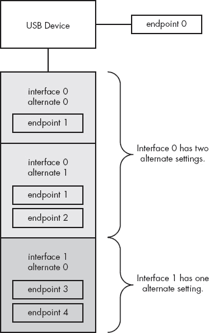

# FreeBSD 设备驱动程序：勇敢者指南

## 献辞

本书献给 FreeBSD 社区。

## 技术评审人员

John Baldwin 开发 FreeBSD 操作系统的多个部分已有 12 年。他感兴趣的主要领域包括 `SMP`、`PCI`、`ACPI` 以及对 `x86` 的支持。他曾担任 FreeBSD 核心团队和发布工程团队的成员。

## 前言

操作系统的大部分由专门研究特定系统的个人维护和开发，但设备驱动是独特的：它们由更广泛的开发者维护。某些设备驱动作者对特定操作系统具有丰富的经验，而另一些人对特定硬件组件有详细了解，并负责在多个系统中维护这些组件的设备驱动。此外，设备驱动通常是自独立的，这样开发者可以在将系统其他部分视为黑盒的情况下维护设备驱动。

当然，这个黑盒仍然有一个接口，每个操作系统都为设备驱动提供一套自己的接口。所有系统上的设备驱动都需要执行许多共同任务，例如发现设备、为连接的设备分配资源以及管理异步事件。然而，每个操作系统都有处理这些任务的独特方法，且它们为高层任务提供的接口也各不相同。编写既健壮又高效的设备驱动的关键，在于理解特定操作系统所提供的接口的具体细节。

`FreeBSD Device Drivers` 是最常用的 FreeBSD 设备驱动接口的极佳指南。你将在书中了解低层接口，包括连接到合格设备和管理设备资源，以及高层接口，例如与网络和存储栈交互。此外，书中对内核环境中可用若干 API（如分配内存、定时器和同步原语）的介绍，对任何从事 FreeBSD 内核工作的人都将有用。这本书对于 FreeBSD 设备驱动作者来说是一份很受欢迎的资源。

John Baldwin

FreeBSD 内核开发者

纽约

2012 年 3 月 20 日

## 致谢

没有一本书是孤岛。如果没有我最感激的许多人的帮助和支持，你将无法在手中拿着这本书。

首先，感谢 Bill Pollock 和 No Starch Press 的团队给了我撰写这本书的机会，并在此过程中为我提供帮助。特别感谢 Alison Law、Riley Hoffman 和 Tyler Ortman 将所有工作汇合在一起。Alison，你至少应该被提到两次，甚至更多。感谢你多次输入更正意见并保持我的进度（大概是如此）。还要感谢文字编辑 Damon Larson 和 Megan Dunchak，以及 Jessica Miller 撰写封底文案。

如果没有 John Baldwin 卓越的技术评审，我无法完成这项工作。他耐心地回答了我的所有（愚蠢）问题，并帮助我改进了代码。我的兄弟 Justin Kong，感谢你多次评审这本书。你绝对应该获得“铁人”奖。感谢 Aharon Robbins 的评审，感谢我的朋友 Elizabeth C. Mitchell 为我画图（并为我烤了布朗尼）。感谢 George Neville-Neil 和 Michael W. Lucas 的建议。

感谢爸爸，借你在硬件方面的专业知识并借给我真实的硬件，这使得我这本书成为可能。感谢妈妈的爱与支持。我知道你每天都为我祈祷。还要感谢我的朋友的支持。

最后同样重要的是，感谢开源软件和 FreeBSD 社区的愿意分享。没有你们，我将是一个糟糕的程序员，我也无字可写。

## 引言


欢迎阅读 `FreeBSD Device Drivers`！本书的目标是帮助你加深对 FreeBSD 下设备驱动的理解。当你读完这本书时，你应该能够构建、配置和管理你自己的 FreeBSD 设备驱动。

本书涵盖了 FreeBSD 8 版本，这是编写时推荐用于生产环境的版本。尽管如此，你将学到的大部分内容都适用于早期版本，也应该适用于后续版本。

## 这本书是给谁看的？

我作为一名程序员，为程序员们写了这本书。因此，你会发现它侧重于编程而非理论，并且你会检查真实的设备驱动（即控制硬件的驱动）。想象一下在从未读过任何书的情况下尝试写一本书。这简直不可思议！设备驱动也是如此。

### 前提条件

为了充分利用这本书的价值，你应该熟悉 C 语言。你还应该了解一些操作系统设计知识；例如，进程和线程的区别。

如果你缺乏必要的背景，我建议在读这本书之前阅读以下三本书，或者将它们作为参考：

- *The C Programming Language*, Brian W. Kernighan and Dennis M. Ritchie (Prentice Hall, 1988)
- *Expert C Programming*, Peter der Linden (Prentice Hall, 1994)
- *The Design and Implementation of the FreeBSD Operating System*, Marshall Kirk McKusick and George V. Neville-Neil (Addison-Wesley Professional, 2005)

## 内容概

`FreeBSD Device Drivers` 包含以下章节。

第 1 章 `第 1 章 模块的构建与运行`：提供设备编程基本概念和术语的概述与介绍。

第 2 章 `第 2 章 内存分配`：描述 FreeBSD 内内存管理。

第 3 章 `第 3 章 设备通信与控制`：教你如何从用户空间与你的设备驱动进行通信和控制。

第 4 章 `第 4 章 线程同步`：讨论与多线程编程和并发执行相关的问题及解决方案。

第 5 章 `第 5 章 延迟执行`：描述延迟执行和异步代码执行，并解释为什么需要这些任务。

第 6 章 `第 6 章 案例研究：虚拟调制解调器`：包含了我带你分析真实设备驱动的场景。

第 7 章 `第 7 章 Newbus 与资源分配`：介绍 FreeBSD 管理系统硬件设备的基础设施。从这里开始，我将完全处理真实的硬件。

### 第 8 章：中断处理

讨论了 FreeBSD 中的中断处理。

### 第 9 章：案例研究：并行端口打印机驱动程序

完整介绍了并行端口打印机驱动程序 `lpt(4)`。

### 第 10 章：资源的管理与使用

涵盖了端口映射 I/O 和内存映射 I/O。

### 第 11 章：案例研究：智能平台管理接口驱动程序

回顾了 `ipmi(4)`（智能平台管理接口驱动）的部分，该驱动使用了端口映射 I/O 和内存映射 I/O。

### 第 12 章：直接内存访问

解释了如何在 FreeBSD 中使用直接内存访问（DMA）。

### 第 13 章：存储驱动程序

教你如何管理存储设备，例如磁盘驱动器、闪存内存等。

### 第 14 章：通用访问方法

提供了通用访问方法（CAM）的概述和介绍，你将用它来管理主机总适配器。

### 第 15 章：USB 驱动程序

教你如何管理 USB 设备。还完整介绍了 USB 打印机驱动程序 `ulpt(4)`。

### 第 16 章：网络驱动程序，第一部分：数据结构

描述了网络驱动程序使用的数据结构。还介绍了消息信号中断（MSI）。

### 第 17 章：网络驱动程序，第二部分：数据包接收与传输

检查了 Intel PCI 千兆以太网适配器驱动程序 `em(4)` 的数据包接收和传输组件。

## 欢迎加入！

希望你觉得这本书既有用又有趣。一如既往，欢迎向 `joe@thestackframe.org` 反馈意见或修复错误程序。

好了，介绍性的内容就到此。让我们开始吧。

# 第 1 章 构建与运行模块


本章提供了 FreeBSD 设备驱动程序的介绍。我们将首先描述四种不同的 UNIX 设备驱动程序以及它们在 FreeBSD 中的表示形式。然后，我们将描述构建和运行可加载内核模块的基础知识，并以介绍字符驱动程序作为本章的结束。

### 注意

你不理解上述使用的某些术语，不要担心；我们将在本章中定义它们。

## 设备驱动程序的类型

在 FreeBSD 中，`device`（设备）是系统中任何硬件相关的项，包括磁盘驱动器、打印机、显卡等。`device driver`（设备驱动程序）是控制或“驱动”设备（有时是多个设备）的计算机程序。在 UNIX 和 FreeBSD 4.0 之前，有四种类型的设备驱动程序：

- 字符驱动程序，控制字符设备
- 块设备驱动程序，控制块设备
- 网络驱动程序，控制网络设备
- 伪设备驱动程序，控制伪设备

`character devices`（字符设备）提供字符流导向的 I/O 接口，或者非结构化的（原始）接口（McKusick and Neville-Neil, 2005）。

`block devices`（块设备）以固定大小的块传输随机访问的数据（Corbet et al., 2005）。在 FreeBSD 4.0 及更高版本中，块驱动程序已消失（有关此的更多信息，请参见 `DEV_MODULE Macro` 中的 `Block Drivers Are Gone`）。

`network devices`（网络设备）通过网络子系统传输和接收由子系统驱动的数据包（Corbet et al., 2005）。

最后，`pseudo-device`（伪设备）是一个仅使用软件模拟设备行为（即无需任何底层硬件）的计算机程序。

## 可加载内核模块

设备驱动程序可以是静态编译到系统中，也可以使用可加载内核模块（KLD）动态加载。

### 注意

大多数操作系统将可加载内核模块称为 `LKM`——FreeBSD 只是想与众不同。

`KLD` 是一个在启动后可以加载、卸载、启动和停止的内核子系统。换句话说，KLD 可以在系统运行时为内核添加功能，随后移除该功能。无需解释，我们的“功能”将是设备驱动程序。

通常，所有 KLD 都有两个共同组件：

- 模块事件处理器
- `DECLARE_MODULE` 宏调用

## 模块事件处理器

`module event handler`（模块事件处理器）是处理 KLD 初始化和关闭的函数。当 KLD 加载到内核或从内核中卸载，或者当系统关闭时会执行此函数。其函数原型定义在 `<sys/module.h>` 头文件中如下：

```c
typedef int (*modeventhand_t)(module_t, int, void *);
```

*注：原文中的原型是碎片化的，我根据标准的 FreeBSD C 头文件进行了清理，同时保留了提供的逻辑。*

在这里， `name` 是官方模块名称， `evhand` 是 KLD 的模块事件处理程序（event handler），而 `priv` 是一个指向私有数据的指针（如果存在的话）。

### `sub`

`sub` 参数指定了 KLD 所属的内核子系统。该参数的有效值定义在 `<sys/kernel.h>` 中的 `sysinit_sub_id` 枚举中。

```c
enum sysinit_sub_id {
        SI_SUB_DUMMY            = 0x0000000,    /* 不执行。        */
        SI_SUB_DONE             = 0x0000001,    /* 已处理。           */
        SI_SUB_TUNABLES         = 0x0700000,    /* 可调值。      */
        SI_SUB_COPYRIGHT        = 0x0800001,    /* 首次控制台使用。   */
        SI_SUB_SETTINGS         = 0x0880000,    /* 检查设置。      */
        SI_SUB_MTX_POOL_STATIC  = 0x0900000,    /* 静态互斥锁池。   */
        SI_SUB_LOCKMGR          = 0x0980000,    /* 锁管理器。        */
        SI_SUB_VM               = 0x1000000,    /* 虚拟内存。      */
...
      SI_SUB_DRIVERS          = 0x3100000,     /* 设备驱动。      */
...
};
```

显然，我们几乎总是将 `sub` 设置为 `SI_SUB_DRIVERS`，即设备驱动子系统。

### `order`

`order` 参数指定了 KLD 在 `sub` 子系统中的初始化顺序。该参数的有效值定义在 `<sys/kernel.h>` 中的 `sysinit_elem_order` 枚举中。

```c
enum sysinit_elem_order {
        SI_ORDER_FIRST          = 0x0000000,    /* 第一。               */
        SI_ORDER_SECOND         = 0x0000001,    /* 第二。              */
        SI_ORDER_THIRD          = 0x0000002,    /* 第三。               */
        SI_ORDER_FOURTH         = 0x0000003,    /* 第四。              */
      SI_ORDER_MIDDLE         = 0x1000000,    /* 中间的某个位置。 */
        SI_ORDER_ANY            = 0xfffffff     /* 最后。                    */
};
```

通常，我们总是将 `order` 设置为 `SI_ORDER_MIDDLE`。

## Hello, world!

你现在已经有了足够的知识来编写第一个 KLD。示例 1-1 是 KLD 的完整骨架代码。

示例 1-1. `hello.c`

```c
#include <sys/param.h>
#include <sys/module.h>
#include <sys/kernel.h>
#include <sys/systm.h>

static int
hello_modevent(module_t mod __unused, int event, void *arg __unused)
{
        int error = 0;

        switch (event) {
        case MOD_LOAD:
                uprintf("Hello, world!\n");
                break;
        case MOD_UNLOAD:
                uprintf("Good-bye, cruel world!\n");
                break;
        default:
                error = EOPNOTSUPP;
                break;
        }

        return (error);
}

static moduledata_t hello_mod = {
        "hello",
        hello_modevent,
        NULL
};

DECLARE_MODULE(hello, hello_mod, SI_SUB_DRIVERS, SI_ORDER_MIDDLE);
```

这段代码包含一个模块事件处理程序——它与可加载内核模块中模块事件处理程序的相同——以及一个填充好的 `moduledata_t` 结构体，它作为第二个参数传递给 `DECLARE_MODULE` 宏。

简而言之，这个 KLD 只是一个模块事件处理程序和一个 `DECLARE_MODULE` 调用。很简单，对吧？

## 编译与加载

要编译 KLD，你可以使用 `<bsd.kmod.mk>` Makefile。以下是示例 1-1 的完整 Makefile：

```make
KMOD=   hello
SRCS=   hello.c

.include <bsd.kmod.mk>
```


在这里， `KMOD` 是 KLD 的名称， `SRCS` 是 KLD 的源文件。顺便一下，我会调整这个 `Makefile` 来编译每一个。假设示例 1-1 及其 `Makefile` 位于同一目录下，只需输入 `make`，编译就会进行（详细）并生成一个名为 `hello.ko` 的可执行文件，如下：

```
$ make
Warning: Object directory not changed from /home/ghost/hello
-> /usr/src/sys
-> /usr/src/sys/i386/include
cc -O2 -fno-aliasing -D_KERNEL -DKLD_MODULE -std=c99 -nostdinc
-I. -I/contrib/altq -fin-limit=800 --param inline-unit=100
-param large-function=1000 -fno-common -mno-align-long-strings
-red-stack-boundary=2 -mno-mmx -mno-sse-now -mno-sse2 -mno-sse3 -ffre -Wall -Wredundant-decls -Wnested-externs -Wstrict-prototypes -Wmissing-prototypes -Wpointer-arith -Winline -Wcast-qual -Wundef -Wno-pointer -fformat-extensions -c hello.c
ld -d -warn-common -r -d -o hello.o
awk -f /sys/conf/kmod_syms.awk hello.kld | xargs objcopy
ld -Bshare -d -warn-common -o hello.ko --strip-debug hello.ko
$ ls -F
hello.kld    hello.o
Makefile     hello.c      hello.ko
```

你可以使用 `kldload(8)` 和 `kldunload(8)` 分别加载和卸载 `hello.ko`：

```
$ sudo kldload ./hello.ko
Hello, world!
$ sudo kldunload hello.ko
Good-bye, cruel world!
```

顺带一提，通过包含 `<bsd.kmod.mk>` 的 `Makefile`，你可以使用 `make load` 和 `make unload` 代替 `kldload(8)` 和 `kldunload(8)`，如下：

```
$ sudo make load
/sbin/kldload -v /home/ghost/hello/hello.ko
Hello, world!
Loaded /home/ghost/hello/hello.ko, id=3
$ sudo make unload
/sbin/kldunload -v hello.ko
Unloading hello.ko, id=3
Good-bye, cruel world!
```

恭喜！你现在成功将代码加载到运行的内核中了。在继续之前，还有一点值得提。你可以使用 `kldstat(8)` 显示动态链接到内核的任何文件的状态：

```
$ kldstat
Id Refs Address     Name
1    4 0xc040000 906518   kernel
2    1 0xc0d0700 6a32c    acpi.ko
3    1 0xc3301000 2000     hello.ko
```

可以看出，输出显而易见。现在，我们来做点有趣的。

## 字符驱动

字符驱动基本上是创建字符设备的 KLD。如之前提到的，字符设备提供字符流式的 I/O 接口，或者是非结构（原始）接口。这些字符设备接口建立了访问设备的约定，包括用于执行 I/O 操作的方法集（McKusick and Neville-Neil, 2005）。总之，字符驱动产生设备访问。例如，`lpt(4)` 驱动创建 `/dev/lpt0` 字符设备，用于访问并行端口打印机。在 FreeBSD 4.0 之后，大多数设备都有字符设备接口。

通常，所有字符驱动都包含三个组件：

* `d_foo` 函数
* 字符设备切换表
* `make_dev` 和 `destroy_dev` 函数调用

### d_foo 函数

`d_foo` 函数的函数原型定义在 `<sys/conf.h>` 头文件中，是进程在设备上执行的 I/O 操作。这些 I/O 操作大部分与文件 I/O 系统调用相关，并相应命名为 `d_open`、`d_read` 等。当在设备上完成“foo”操作时，字符驱动的 `d_foo` 函数会被调用。

表 1-1 提供了每个 `d_foo` 函数的简要描述。

#### 表 1-1. d_foo 函数

| 函数 | 描述 |
| --- | --- |
| `d_open` | 调用打开设备，为 I/O 操作做准备 |
| `d_close` | 调用关闭设备 |
| `d_read` | 调用从设备中读取数据 |
| `d_write` | 调用向设备写入数据 |
| `d_ioctl` | 调用执行读或写以外的操作 |
| `d_poll` | 调用检查设备，看是否有数据可读或是否有足够的空间可写 |
| `d_mmap` | 调用将设备偏移量映射到内存地址 |
| `d_kqfilter` | 调用将设备注册到内核事件列表 |
| `d_strategy` | 调用启动读或写操作并立即返回 |
| `d_dump` | 调用将所有物理内存写入设备 |

#### 注意事项

如果你不理解这些操作中的某些，不要担心；我们稍后在实现它们时进行详细描述。

### 字符设备交换表

字符设备交换表 `struct cdevsw` 规定了字符驱动程序实现了哪些 `d_foo` 函数。它在 `<sys/conf.h>` 头文件中定义如下：

```c
struct cdevsw {
        int                     d_version;
        u_int                   d_flags;
        const char              *d_name;
        d_open_t                *d_open;
        d_fdopen_t              *d_fdopen;
        d_close_t               *d_close;
        d_read_t                *d_read;
        d_write_t               *d_write;
        d_ioctl_t               *d_ioctl;
        d_poll_t                *d_poll;
        d_mmap_t                *d_mmap;
        d_strategy_t            *d_strategy;
        dumper_t                *d_dump;
        d_kqfilter_t            *d_kqfilter;
        d_purge_t               *d_purge;
        d_spare2_t              *d_spare2;
        uid_t                   d_uid;
        gid_t                   d_gid;
        mode_t                  d_mode;
        const char              *d_kind;

        /* 这些字段不应被驱动程序修改。 */
        LIST_ENTRY(cdevsw)      d_list;
        LIST_HEAD(, cdev)       d_devs;
        int                     d_spare3;
        struct cdevsw           *d_gianttrick;
};
```

这是一个读/写设备的字符设备交换表示例：

```c
static struct cdevsw echo_cdevsw = {
        .d_version =    D_VERSION,
        .d_open =       echo_open,
        .d_close =      echo_close,
        .d_read =       echo_read,
        .d_write =      echo_write,
        .d_name =       "echo"
};
```

如你所见，并不是每一个 `d_foo` 函数或属性都需要定义。如果某个 `d_foo` 函数未定义，则对应的操作将不支持（例如，只读设备的字符设备交换表就不会定义 `d_write`）。

意乎不用的是，`d_version`（表示该驱动程序支持的 FreeBSD 版本）和 `d_name`（驱动程序的名称）是必须定义的。通常，`d_version` 被设置为 `D_VERSION`，它是编译时对应的任意 FreeBSD 版本的宏替换。

### make_dev 和 destroy_dev 函数

`make_dev` 函数接收一个字符设备交换表并在 `/dev` 下创建一个字符设备节点。其函数原型如下：

```c
#include <sys/param.h>
#include <sys/conf.h>

struct cdev *
make_dev(struct cdevsw *cdevsw, int minor, uid_t uid, gid_t gid,
    int perms, const char *fmt, ...);
```

相反，`destroy_dev` 函数接收由 `make_dev` 返回的 `cdev` 结构体并销毁字符设备节点。其函数原型如下：

```c
#include <sys/param.h>
#include <sys/conf.h>

void
destroy_dev(struct cdev *dev);
```

## 大无害

示例 1-2 是一个完整的字符驱动（基于 Murray Stokely 和 Søren Straarup 编写的代码），它像操作设备一样操作内存区域。这个伪（或内存）设备允许你对其进行读写单个字符字符串。

#### 注意事项

快速浏览这段代码并尝试辨别它的部分结构。如果你不理解全部内容，不要担心；后面有解释。

```c
#include <sys/param.h>
#include <sys/conf.h>
#include <sys/kernel.h>
#include <sys/malloc.h>
#include <sys/event.h>
#include <sys/types.h>
#include <sys/io.h>
#include <sys/u.h>
#include <sys/device.h>
#include <sys/errno.h>
#include <sys/u.h>
#include <string.h>
#include <stdio.h>
#include <stdlib.h>
#include <unistd.h>
#include <fcntl.h>
#include <types.h>
#include <sys/param.h>
#include <sys/conf.h>
#include <sys/kernel.h>
#include <sys/malloc.h>
#include <sys/event.h>
#include <sys/types.h>
#include <sys/io.h>
#include <sys/u.h>
#include <sys/device.h>
#include <sys/errno.h>
#include <sys/u.h>
#include <string.h>
#include <stdio.h>
#include <stdlib.h>
#include <unistd.h>
#include <fcntl.h>
#include <types.h>

// (省略重复的包含)

#define BUFFER_SIZE 256

struct echo_t {
    int length;
    char buffer[BUFFER_SIZE];
};

struct cdev *echo_dev;
struct echo_t *echo_message;

static int echo_open(struct cdev *dev, int flags, mode_t mode) {
    printf("Opening device %s\n", dev);
    return 0;
}

static int echo_close(struct cdev *dev, int flags) {
    printf("Closing device\n");
    return 0;
}

static int echo_write(struct cdev *dev, struct uio *uio, int flags) {
    int error = 0;
    int amount;

    amount = MIN(uio->resid, BUFFER_SIZE - echo_message->length);

    if (amount > 0) {
        error = copyin(uio->data, echo_message->buffer + echo_message->length, amount);
        if (error == 0) {
            echo_message->length += amount;
            uio->nresid -= amount;
        }
    }
    return error;
}

static int echo_read(struct cdev *dev, struct uio *uio, int flags) {
    int error = 0;
    int amount;

    amount = MIN(uio->resid, (echo_message->length - uio->offset > 0) ? echo_message->length - uio->offset : 0);

    if (amount > 0) {
        error = uiomove(echo_message->buffer + uio->offset, uio, amount, UU_WRITE);
        if (error == 0) {
            uio->offset += amount;
            uio->nresid -= amount;
        }
    }
    return error;
}

static struct cdevsw echo_cdevsw = {
    .d_version =    D_VERSION,
    .d_open =       echo_open,
    .d_close =      echo_close,
    .d_read =       echo_read,
    .d_write =      echo_write,
    .d_name =       "echo"
};

static int echo_modevent(module_t mod __unused, int event, void *arg __unused) {
    int error = 0;

    switch (event) {
    case MOD_LOAD:
            echo_message = malloc(sizeof(struct echo_t), M_TEMP, M_WAITOK);
            echo_dev = make_dev(&echo_cdevsw, 0, UID_ROOT, GID_WHEEL,
                0600, "echo");
            uprintf("Echo driver loaded.\n");
            break;
    case MOD_UNLOAD:
            destroy_dev(echo_dev);
            free(echo_message, M_TEMP);
            uprintf("Echo driver unloaded.\n");
            break;
    default:
            error = EOPNOTSUPP;
            break;
    }

    return (error);
}

DEV_MODULE(echo, echo_modevent, NULL);
```

接下来，有两个变量声明：一个名为 `echo_message` 的 `echo` 结构指针（它将包含一个字符字符串及其长度），以及一个名为 `echo_dev` 的 `cdev` 结构指针（它将维护由 `make_dev` 调用返回的 `cdev`）。


然后，定义了 `d_foo` 函数、`echo_open` 和 `echo_close`——它们都只是打印一条调试信息。通常，`d_open` 函数负责为 I/O 准备好设备，而 `d_close` 则撤销这些准备工作。

### 注意

“为 I/O 准备设备”与“准备（或初始化）设备”之间存在区别。对于像示例 1-2 这样的伪设备，设备初始化是在模块事件处理器中完成的。

剩余的部分——`echo_write`、`echo_read`、`echo_modevent` 和 `DEV_MODULE`——需要更深入的解释，因此将在各自的章节中描述。

## `echo_write` 函数

`echo_write` 函数从用户空间获取一个字符字符串并将其存储。以下是它的函数定义（再次）：

```c
static int
echo_write(struct cdev *dev, struct uio *uio, int ioflag)
{
        int error = 0;

        error = copyin(uio->uio_iov->iov_base,
 echo_message->buffer,
            MIN(uio->uio_iov->iov_len, BUFFER_SIZE - 1));
        if (error != 0) {
                uprintf("Write failed.\n");
                return (error);
        }

      *(echo_message->buffer +
            MIN(uio->uio_iov->iov_len, BUFFER_SIZE - 1)) = 0;

      echo_message->length = MIN(uio->uio_iov->iov_len, BUFFER_SIZE - 1);

        return (error);
}
```

在这里，`struct uio` 描述了一个移动中的字符字符串——变量 `iov_base` 和 `iov_len` 分别指定了字符字符串的基地址和长度。

因此，该函数首先将字符字符串从用户空间拷贝到内核空间。最多拷贝 `BUFFER_SIZE - 1` 字节的数据。一旦完成，字符字符串将以空字符终止，并记录其长度（减去空终止符）。

### 注意

这并不是从用户空间向内核空间拷贝数据的正规方法。我本该应该使用 `uiomove` 而不是 `copyin`。然而，`copyin` 更容易理解，而且在此时，我只想涵盖字符驱动程序的基本结构。

## `echo_read` 函数

`echo_read` 函数将存储的字符字符串返回到用户空间。以下是它的函数定义（再次）：

```c
static int
echo_read(struct cdev *dev, struct uio *uio, int ioflag)
{
        int error = 0;
        int amount;

        amount = MIN(uio->uio_resid,
            (echo_message->length - uio->uio_offset > 0) ?
            echo_message->length - uio->uio_offset : 0);

        error = uiomove(echo_message->buffer + uio->uio_offset,
 amount,
            uio);
        if (error != 0)
                uprintf("Read failed.\n");

        return (error);
}
```

在这里，变量 `uio_resid` 和 `uio_offset` 分别指定了待传输的数据量以及字符字符串的偏移量。

因此，该函数首先确定待传输的数据量以及字符字符串的偏移量。该函数返回 `MOD_LOAD` 或 `echo_dev` 的数据量。然后 `echo_read` 将字符从内核空间传输到用户空间。

### 注意

关于在用户空间和内核空间之间拷贝数据的更多信息，请参见 `copy()` 和 `uiomove()` 页面。

## `echo_modevent` 函数

`echo_modevent` 函数是该驱动程序的事件处理器。以下是它的定义：

```c
static int
echo_modevent(module_t mod, int event, void *arg)
{
        int error = 0;

        switch (event) {
        case MOD_LOAD:
              echo_message = malloc(sizeof(echo_t));
              echo_dev = make_dev(&echo_cdev, 0600, "echo");
                uprintf("Echo loaded.\n");
                break;
        case MOD_UNLOAD:
              destroy_dev(echo_dev);
              free(echo_message);
                uprintf("Echo unloaded.\n");
                break;
        default:
                error = EOPSUPP;
                break;
        }

        return (error);
}
```

在模块加载时，该函数调用 `malloc(sizeof(echo_t))` 分配内存。然后调用 `make_dev` 创建一个名为 `echo` 的字符设备。注意，当 `make_dev` 返回时，字符设备处于“激活”状态，其 `d_foo` 函数可以执行。因此，如果我在 `malloc` 之前调用了 `make_dev`，那么 `echo_write` 或 `echo_read` 可能在 `echo_message` 指向有效内存之前执行，这将是灾难性的。除非你的驱动程序完全就绪，否则不要调用 `make_dev`。

在模块卸载时，该函数首先调用 `destroy_dev` 销毁 `echo` 设备。然后调用 `free` 释放内存。

## `DEV_MODULE` 宏

`DEV_MODULE` 宏在 `<sys/conf.h>` 头文件中定义如下：

```c
#define DEV_MODULE(name, evh, arg)                                      \
  static moduata_t name##_mod = {                                      \
      #name,                                                              \
      evh,                                                              \
      arg                                                                 \
  };                                                                      
 DECLARE_MODULE(name, name##_mod, SI_SUB_DRIVERS, SI_ORDER_MIDDLE)
```

如你所示，`DEV_MODULE` 仅仅封装了 `DECLARE_MODULE`。所以示例 1-2 可以调用 `DECLARE_MODULE`，但 `DEV_MODULE` 更简洁（而且节省了击键次数）。

## Don’t Panic

既然我们已经学习了示例 1-2，让我们尝试一下吧：

```sh
$ sudo kldload ./echo.ko
Echo driver loaded.
$ ls -l /dev/echo
crw-------  1 root  wheel    0,  95 Jun  4 23:23 /dev/echo
$ su
Password:
## echo "DON'T PANIC" > /dev/echo
Opening echo device.
Closing echo device.
## cat /dev/echo
Opening echo device.
DON'T PANIC
Closing echo device.
```

意乎意料，它起作用了。在本章结束之前，有一个至关的话需要提到。

## 块驱动程序已消失

如前所述，块设备以固定大小的块传输随机访问的数据；例如磁盘驱动器。自然地，`block drivers` 提供了对块设备的访问。`block drivers` 的特点是所有 I/O 都在内核的缓冲区缓存（buffer cache）中进行缓存，这使得 `block drivers` 变得不可靠，原因有两个。

首先，由于缓存可能会重排一系列写操作的顺序，它剥夺了写入进程在任何时刻识别准确磁盘内容的能力。这使得磁盘上数据结构（例如文件系统）的可靠崩溃恢复变得不再可能。

其次，缓存可能会延迟写操作。因此，如果发生错误，内核无法向执行写入的进程报告哪一次操作失败了。

由于这些原因，每个访问块设备的严肃应用程序都会指定始终使用字符设备接口。因此，FreeBSD 在磁盘 I/O 基础设施现代化过程中舍弃了对 `block drivers` 的支持。

### 注意

显然，FreeBSD 仍然支持块设备。更多更多信息，请参阅第 13 章。

## 结论

本章向你介绍了 FreeBSD 设备驱动程序开发的基础。在接下来的章节中，我们将基于此处描述的概念来完善你的驱动程序工具包。顺便提一下，由于大多数 FreeBSD 设备驱动程序都是字符驱动程序，不要将它们视为主要的驱动程序类——它们更像是用于创建字符设备节点的工具。

# 第 2 章：内存分配


在上一章中，我们使用 `malloc` 和 `free` 进行内存的分配和释放。然而，FreeBSD 内核包含更丰富的内存分配原语。在本章中，我们将查看内核内存管理例程。这包括详细地描述 `malloc` 和 `free` 并引入 `malloc_type` 结构。我们将通过描述连续物理内存管理例程结束本章。

## 内存管理例程

FreeBSD 内核提供了四个用于非分页内存分配和释放的函数：`malloc`、`free`、`realloc` 和 `reallocf`。这些函数可以处理任意大小或对齐的请求，是分配内核内存的首选方式。

```c
#include <sys/types.h>
#include <sys/malloc.h>

void *
malloc(unsigned long size, struct malloc_type *type, int flags);

void
free(void *addr, struct malloc_type *type);

void *
realloc(void *addr, unsigned long size, struct malloc_type *type,
    int flags);

void *
reallocf(void *addr, unsigned long size, struct malloc_type *type,
    int flags);
```

`malloc` 函数在内核空间中分配 `size` 字节的内存。如果成功，返回一个内核虚拟地址；否则返回 `NULL`。

`free` 函数释放 `addr` 处的内存——之前由 `malloc` 分配的——供重用。注意，`free` 不清空这些内存，这意味着你应该对任何你需要保持私密的内容的内存显式地置零。如果 `addr` 为 `NULL`，则 `free` 什么都不做。

### 注意

如果启用了 `INVARIANTS`，那么 `free` 将把任何释放的内存填充为 `0xdeadc0de`。

因此，如果你遇到页错误崩溃（panic）且故障地址在 `0xdeadc0de` 附近，这可能是你正在使用已释放内存的标志。

`realloc` 函数将 `addr` 处的内存大小改为 `size` 字节。如果成功，返回一个内核虚拟地址；否则返回 `NULL`，且保持内存不变。注意返回的地址可能与 `addr` 不同，因为当大小 way 时，内存可能会重新定位以获取或提供额外的空间。有趣的是，这意味着在调用 `realloc` 时，你不应该有指向 `addr` 处内存的指针。如果 `addr` 为 `NULL`，则 `realloc` 的行为与 `malloc` 相同。

`reallocf` 函数与 `realloc` 相同但在失败时会释放 `addr` 处的内存。

`malloc`、`realloc` 和 `reallocf` 函数提供一个 `flags` 参数来进一步限定它们的操作特性。该参数的有效值可见表 2-1。

### 表 2-1：`malloc`、`realloc` 和 `reallocf` 符号常量

| 常量 | 描述 |
| --- | --- |
| `M_ZERO` | 导致分配的内存被零 |
| `M_NOWAIT` | 如果由于资源不足无法立即满足分配，导致 `malloc`、`realloc` 和 `reallocf` 返回 `NULL`；在中断上下文运行时需要 `M_NOWAIT` |
| `M_WAITOK` | 表示等待资源是可以接受的；如果无法立即满足分配，当前进程将进入睡眠以等待资源可用；当指定 `M_WAITOK` 时，`malloc`、`realloc` 和 `reallocf` 不能返回 `NULL` |

### `malloc_type` 结构

`malloc`、`free`、`realloc` 和 `reallocf` 函数包含一个 `flags` 参数来进一步限定它们的操作特性。该参数的有效值可见表 2-1。

如果启用了 `INVARIANTS`，`free` 将将任何释放的内存填充为 `0xdeadc0de`。

因此，如果你遇到页错误崩溃且故障地址在 `0xdeadc0de` 附近，这可能是你正在使用已释放内存的标志。

### `MALLOC_DEFINE` 宏

`MALLOC_DEFINE` 宏定义一个新的 `malloc_type` 结构。其原型如下：

```c
#include <sys/param.h>
#include <sys/malloc.h>
#include <sys/kernel.h>

MALLOC_DEFINE(type, shortdesc, longdesc);
```

`type` 参数是 `malloc_type` 结构的名字。通常 `type` 应该以 `M_` 开头并大写；例如 `M_FOO`。

`shortdesc` 参数期望 `malloc_type` 结构的短描述。该参数用于 `vmstat -m` 的输出。因此，它不应包含任何空格，以便解析 `vmstat -m`。

`longdesc` 参数期望 `malloc_type` 结构的长描述。

### `MALLOC_DECLARE` 宏

`MALLOC_DECLARE` 宏使用 `extern` 关键字声明一个新的 `malloc_type` 结构。其原型如下：

```c
#include <sys/types.h>
#include <sys/malloc.h>

MALLOC_DECLARE(type);
```

该宏在 `<sys/malloc.h>` 头文件中定义如下：

```c
#define MALLOC_DECLARE(type) \
        extern struct malloc_type type[1]
```

顺便提一下，如果你需要私有的 `malloc_type` 结构，你会在 `MALLOC_DEFINE` 调用前加上 `static` 关键字。事实上，在没有相应的 `MALLOC_DECLARE` 调用的情况下，非静态的 `MALLOC_DEFINE` 调用在 `gcc` 下会产生警告。

## 整合一切

示例 2-1 是示例 1-2 的修订版本，它使用了自己的 `malloc_type` 结构而不是内核定义的 `M_TEMP`。

### 注意

为了节省空间，这里没有列出 `echo_open`、`echo_close`、`echo_write` 和 `echo_read` 函数，因为它们没有发生变化。

### 示例 2-1：`echo-2.0.c`


```c
#include <sys/param.h>
  #include <sys/module.h>
  #include <sys/kernel.h>
  #include <sys/systm.h>

  #include <sys/conf.h>
  #include <sys/uio.h>
  #include <sys/malloc.h>

  #define BUFFER_SIZE     256

 MALLOC_DECLARE(M_ECHO);
 MALLOC_DEFINE(M_ECHO, "echo_buffer", "buffer for echo driver");

  static d_open_t         echo_open;
  static d_close_t        echo_close;
  static d_read_t         echo_read;
  static d_write_t        echo_write;

  static struct cdevsw echo_cdevsw = {
          .d_version =    D_VERSION,
          .d_open =       echo_open,
          .d_close =      echo_close,
          .d_read =       echo_read,
          .d_write =      echo_write,
          .d_name =       "echo"
  };

  typedef struct echo {
          char buffer[BUFFER_SIZE];
          int length;
  } echo_t;

  static echo_t *echo_message;
  static struct cdev *echo_dev;

  static int
  echo_open(struct cdev *dev, int oflags, int devtype, struct thread *td)
  {
  ...
  }

  static int
  echo_close(struct cdev *dev, int fflag, int devtype, struct thread *td)
  {
  ...
  }

  static int
  echo_write(struct cdev *dev, struct uio *uio, int ioflag)
  {
  ...
  }

  static int
  echo_read(struct cdev *dev, struct uio *uio, int ioflag)
  {
  ...
  }

  static int
  echo_modevent(module_t mod __unused, int event, void *arg __unused)
  {
          int error = 0;

          switch (event) {
          case MOD_LOAD:
                  echo_message = malloc(sizeof(echo_t), M_ECHO, M_WAITOK);
                  echo_dev = make_dev(&echo_cdevsw, 0, UID_ROOT, GID_WHEEL,
                      0600, "echo");
                  uprintf("Echo driver loaded.\n");
                  break;
          case MOD_UNLOAD:
                  destroy_dev(echo_dev);
                  free(echo_message, M_ECHO);
                  uprintf("Echo driver unloaded.\n");
                  break;
          default:
                  error = EOPNOTSUPP;
                  break;
          }

          return (error);
  }

  DEV_MODULE(echo, echo_modevent, NULL);
```

该驱动程序声明并定义了一个名为 `M_ECHO` 的新 `malloc_type` 结构。为了使用这个 `malloc_type` 结构，`malloc` 和 `free` 了相应的调整。

### 注意

由于 `M_ECHO` 仅在本地使用，因此 `MALLOC_DECLARE` 是必要的——在这里包含它仅用于演示。

既然示例 2-1 使用了唯一的 `malloc_type` 结构，我们可以很容易地分析其动态内存使用情况，如下：

```text
$ sudo kldload ./echo-2.0.ko
Echo driver loaded.
$ vmstat -m | head -n 1 && vmstat -m | grep "echo_buffer"
         Type InUse MemUse HighUse Requests  Size(s)
  echo_buffer     1     1K       -        1  512
```

注意，示例 2-1 请求了 512 字节，尽管 `sizeof(echo_t)` 只有 260 字节。这是因为 `malloc` 在分配内存时会向上舍整到最近的 2 的幂。此外，请注意 `MALLOC_DEFINE` 的第二个参数（示例中的 `echo_buffer`）用于 `vmstat` 的输出（而不是第一个参数）。

`M_TEMP` 定义在 `/sys/kern/kern_malloc.c`。

## 连续物理内存管理例程

FreeBSD 内核提供了两个用于连续物理内存管理的函数：`contigmalloc` 和 `contigfree`。通常情况下，你永远不会使用这些函数。它们主要用于处理机器相关的代码以及偶尔的网络驱动程序。

```c
#include <sys/types.h>
#include <sys/malloc.h>

void *
contigmalloc(unsigned long size, struct malloc_type *type, int flags,
    vm_paddr_t low, vm_paddr_t high, unsigned long alignment,
    unsigned long boundary);

void
contigfree(void *addr, unsigned long size, struct malloc_type *type);
```

`contigmalloc` 函数分配 `size` 字节的连续物理内存。如果 `size` 为 `0`，`contigmalloc` 将导致内核崩溃（panic）。如果成功，分配将位于物理地址 `low` 和 `high` 之间（包含边界）。

`alignment` 参数表示分配内存的物理对齐，单位为字节。该参数必须是 2 的幂。

`boundary` 参数指定分配内存不能跨越的物理边界；也就是说，它不能跨越任何 `boundary` 的倍数。该参数必须为 `0`（表示无边界）或 2 的幂。

`flags` 参数修改 `contigmalloc` 的行为。该参数的有效值见表 2-2。

### 表 2-2 contigmalloc 符号常量

| 常量 | 描述 |
| --- | --- |
| `M_ZERO` | 使分配的物理内存清零 |
| `M_NOWAIT` | 如果由于资源不足无法立即完成分配，`contigmalloc` 返回 `NULL` |
| `M_WAITOK` | 表示允许等待资源；如果无法立即完成分配，当前进程将睡眠以等待资源可用 |

`contigfree` 函数释放 `addr` 处的内存（之前由 `contigmalloc` 分配的）以便重复使用。`size` 参数是要释放的内存大小。通常，`size` 应该等于分配的大小。

## 一个直接的示例

示例 2-2 修改了示例 2-1，使用 `contigmalloc` 和 `contigfree` 代替 `malloc` 和 `free`。示例 2-2 应该消除你可能对 `contigmalloc` 和 `contigfree` 的任何误解。

```c
#include <sys/param.h>
#include <sys/module.h>
#include <sys/kernel.h>
#include <sys/systm.h>

#include <sys/conf.h>
#include <sys/uio.h>
#include <sys/malloc.h>

#define BUFFER_SIZE     256

MALLOC_DEFINE(M_ECHO, "echo_buffer", "buffer for echo driver");

static d_open_t         echo_open;
static d_close_t        echo_close;
static d_read_t         echo_read;
static d_write_t        echo_write;

static struct cdevsw echo_cdevsw = {
        .d_version =    D_VERSION,
        .d_open =       echo_open,
        .d_close =      echo_close,
        .d_read =       echo_read,
        .d_write =      echo_write,
        .d_name =       "echo"
};

typedef struct echo {
        char buffer[BUFFER_SIZE];
        int length;
} echo_t;

static echo_t *echo_message;
static struct cdev *echo_dev;

static int
echo_open(struct cdev *dev, int oflags, int devtype, struct thread *td)
{
...
}

static int
echo_close(struct cdev *dev, int fflag, int devtype, struct thread *td)
{
...
}

static int
echo_write(struct cdev *dev, struct uio *uio, int ioflag)
{
...
}

static int
echo_read(struct cdev *dev, struct uio *uio, int ioflag)
{
...
}

static int
echo_modevent(module_t mod __unused, int event, void *arg __unused)
{
        int error = 0;

        switch (event) {
        case MOD_LOAD:
                echo_message = contigmalloc(sizeof(echo_t), M_ECHO,
                    M_WAITOK | M_ZERO, 0, 0xffffffff,
                    PAGE_SIZE,
                    1024 * 1024);
                echo_dev = make_dev(&echo_cdevsw, 0, UID_ROOT, GID_WHEEL,
                    0600, "echo");
                uprintf("Echo driver loaded.\n");
                break;
        case MOD_UNLOAD:
                destroy_dev(echo_dev);
                contigfree(echo_message, sizeof(echo_t), M_ECHO);
                uprintf("Echo driver unloaded.\n");
                break;
        default:
                error = EOPNOTSUPP;
                break;
        }

        return (error);
}

DEV_MODULE(echo, echo_modevent, NULL);
```

在这里，`contigmalloc` 分配了 `sizeof(echo_t)` 字节的零填充内存。这段内存位于物理地址 `0` 和 `0xffffffff` 之间，在 `PAGE_SIZE` 边界对齐，并且不会跨越 1MB 的地址边界。

以下输出显示了加载示例 2-2 后执行 `vmstat -m` 的结果：

```text
$ sudo kldload ./echo_contig.ko
Echo driver loaded.
$ vmstat -m | head -n 1 && vmstat -m | grep "echo_buffer"
         Type InUse MemUse HighUse Requests  Size(s)
  echo_buffer     1     4K       -        1
```

注意，示例 2-2 使用了 4KB 的内存，尽管 `sizeof(echo_t)` 只有 260 字节。这是因为 `contigmalloc` 以 `PAGE_SIZE` 块为单位分配内存。可以预测，该示例运行在 `i386` 机器上，其页大小为 4KB。

## 结论

本章详细介绍了 FreeBSD 的内存管理例程和连续物理内存管理例程。还引入了 `malloc_type` 结构体。

顺便提一下，大多数驱动程序应该定义自己的 `malloc_type` 结构体。

# 第 3 章 设备通信与控制


在第 1 章中，我们构建了一个可以读取的驱动程序。

`d_ioctl` 函数首次出现在字符设备驱动的 `d_foo` 函数中。

## 定义 ioctl 命令

要定义一个 ioctl 命令，你需要调用以下宏之一：`_IO`、`_IOR`、`_IOW` 或 `_IOWR`。在表 3-1 中提供了对每个宏的解释。

### 表 3-1 ioctl 命令宏

| 宏 | 描述 |
| --- | --- |
| `_IO` | 为不传输数据的 I/O 操作创建一个 ioctl 命令——换句话说，`d_ioctl` 中的 `data` 参数将不会被使用——例如，退磁/驱出可移动介质 |
| `_IOR` | 为读操作创建一个 ioctl 命令；读操作将数据从设备传输到用户空间；例如，获取错误信息 |
| `_IOW` | 为写操作创建一个 ioctl 命令；写操作将数据从用户空间传输到设备；例如，设置设备参数 |
| `_IOWR` | 为具有双向数据传输的 I/O 操作创建一个 ioctl 命令 |

`_IO`、`_IOR`、`_IOW` 和 `_IOWR` 在 `<sys/ioccom.h>` 头文件中定义如下：

```cpp
#define _IO(g,n)        _IOC(IOC_VOID,  (g), (n), 0)
#define _IOR(g,n,t)     _IOC(IOC_OUT,   (g), (n), sizeof(t))
#define _IOW(g,n,t)     _IOC(IOC_IN,    (g), (n), sizeof(t))
#define _IOWR(g,n,t)    _IOC(IOC_INOUT, (g), (n), sizeof(t))
```

参数 `g` 代表 `group`，期望一个 8 位的魔数（magic number）。你可以选择任何数字——只需在整个驱动程序中使用它即可。

参数 `n` 是序数。该数字用于区分你的驱动程序中不同的 ioctl 命令。

最后，参数 `t` 是 I/O 操作期间传输的数据类型。显然，`_IO` 宏没有 `t` 参数，因为没有发生数据传输。

通常，ioctl 命令的定义如下所示：

```cpp
#define FOO_DO_SOMETHING        _IO('F', 1)
#define FOO_GET_SOMETHING       _IOR('F', 2, int)
#define FOO_SET_SOMETHING       _IOW('F', 3, int)
#define FOO_SWITCH_SOMETHING    _IOWR('F', 10, struct foo)
```

在这里，`'F'` 是这些 ioctl 命令的魔数。按照惯例，选择驱动程序名称的首字母（大写）作为魔数。

自然地，所有的序数都是唯一的。但它们不必是连续的。你可以留出间隔。

最后请注意，你可以将结构体作为 `t` 参数。使用结构体是你向基于 ioctl 的操作传递多个参数的方法。

## 实现 ioctl

示例 3-1 是示例 2-1 的修订版本，添加了一个 `d_ioctl` 函数。正如你所看到的，这个 `d_ioctl` 函数处理两个 ioctl 命令。

### 注意


快速查看这段代码并尝试辨别它的结构。如果你不理解全部内容，不要担心；后面会有解释。

### 示例 3-1：`echo-3.0.c`

```c
#include <sys/param.h>
#include <sys/module.h>
#include <sys/kernel.h>
#include <sys/systm.h>

#include <sys/conf.h>
#include <sys/uio.h>
#include <sys/malloc.h>
#include <sys/ioccom.h>

MALLOC_DEFINE(M_ECHO, "echo_buffer", "buffer for echo driver");

#define ECHO_CLEAR_BUFFER       _IO('E', 1)
#define ECHO_SET_BUFFER_SIZE    _IOW('E', 2, int)

static d_open_t         echo_open;
static d_close_t        echo_close;
static d_read_t         echo_read;
static d_write_t        echo_write;
static d_ioctl_t        echo_ioctl;

static struct cdevsw echo_cdevsw = {
        .d_version =    D_VERSION,
        .d_open =       echo_open,
        .d_close =      echo_close,
        .d_read =       echo_read,
        .d_write =      echo_write,
        .d_ioctl =      echo_ioctl,
        .d_name =       "echo"
};

typedef struct echo {
      int buffer_size;
      char *buffer;
      int length;
} echo_t;

static echo_t *echo_message;
static struct cdev *echo_dev;

static int
echo_open(struct cdev *dev, int oflags, int devtype, struct thread *td)
{
        uprintf("Opening echo device.\n");
        return (0);
}

static int
echo_close(struct cdev *dev, int fflag, int devtype, struct thread *td)
{
        uprintf("Closing echo device.\n");
        return (0);
}

static int
echo_write(struct cdev *dev, struct uio *uio, int ioflag)
{
        int error = 0;
        int amount;

        amount = MIN(uio->uio_resid,
            (echo_message->buffer_size - 1 - uio->uio_offset > 0) ?
             echo_message->buffer_size - 1 - uio->uio_offset : 0);
        if (amount == 0)
                return (error);

        error = uiomove(echo_message->buffer, amount, uio);
        if (error != 0) {
                uprintf("Write failed.\n");
                return (error);
        }

        echo_message->buffer[amount] = '\0';
        echo_message->length = amount;

        return (error);
}

static int
echo_read(struct cdev *dev, struct uio *uio, int ioflag)
{
        int error = 0;
        int amount;

        amount = MIN(uio->uio_resid,
            (echo_message->length - uio->uio_offset > 0) ?
             echo_message->length - uio->uio_offset : 0);

        error = uiomove(echo_message->buffer + uio->uio_offset, amount, uio);
        if (error != 0)
                uprintf("Read failed.\n");

        return (error);
}

static int
echo_set_buffer_size(int size)
{
        int error = 0;

        if (echo_message->buffer_size == size)
                return (error);

        if (size >= 128 && size <= 512) {
                echo_message->buffer = realloc(echo_message->buffer, size,
                    M_ECHO, M_WAITOK);
                echo_message->buffer_size = size;

                if (echo_message->length >= size) {
                        echo_message->length = size - 1;
                        echo_message->buffer[size - 1] = '\0';
                }
        } else
                error = EINVAL;

        return (error);
}

static int
echo_ioctl(struct cdev *dev, u_long cmd, caddr_t data, int fflag,
    struct thread *td)
{
        int error = 0;

switch (cmd) {
        case ECHO_CLEAR_BUFFER:
                memset(echo_message->buffer, '\0',
                    echo_message->buffer_size);
                echo_message->length = 0;
                uprintf("Buffer cleared.\n");
                break;
        case ECHO_SET_BUFFER_SIZE:
                error = echo_set_buffer_size(*(int *)data);
                if (error == 0)
                        uprintf("Buffer resized.\n");
                break;
        default:
                error = ENOTTY;
                break;
        }

        return (error);
}

static int
echo_modevent(module_t mod __unused, int event, void *arg __unused)
{
        int error = 0;

        switch (event) {
        case MOD_LOAD:
                echo_message = malloc(sizeof(echo_t), M_ECHO, M_WAITOK);
                echo_message->buffer_size = 256;
                echo_message->buffer = malloc(echo_message->buffer_size, M_ECHO, M_WAITOK);
                dev_dev = devget(&echo_cdev, 0, "echo");
                uprintf("Echo loaded.\n");
                break;
        case MOD_UNLOAD:
                devfree(echo_dev);
                free(echo_message);
                uprintf("Echo unloaded.\n");
                break;
        default:
                error = EOPS;
                break;
        }

        return (error);
}
```

该驱动定义了两个 `ioctl` 命令：`ECHO_CLEAR_BUFFER`（清除缓冲区）和 `ECHO_SET_BUFFER_SIZE`（接收一个整数来调整缓冲区）。有趣的是，`echo_open`、`echo_close` 和 `echo_read` 函数保持不变。`echo_write`、`echo_set_buffer_size`、`echo_ioctl` 和 `echo_modevent` 函数为了更详细的解释将在各自的章节中描述。

### `echo_write` 函数

如上，`echo_write` 函数已修改以使用这个新变量。以下是其定义（再次）：

```c
static int
echo_write(struct cdev *dev, struct uio *uio, int ioflag)
{
        int error = 0;
        int amount;

        amount = MIN(uio->uio_resid,
            (echo_message->buffer_size - 1 - uio->uio_offset > 0) ?
             echo_message->buffer_size - 1 - uio->uio_offset : 0);
        if (amount == 0)
                return (error);

        error = uiomove(echo_message->buffer, amount, uio);
        if (error != 0) {
                uprintf("Write failed.\n");
                return (error);
        }

        echo_message->buffer[amount] = '\0';
        echo_message->length = amount;

        return (error);
}
```

此版本的 `echo_write` 使用 `uiomove` 代替 `copyin`。注意 `uiomove` 在每复制一个字节时都会减少 `uio->uio_resid`（1 字节）并增加 `uio->uio_offset`（1 字节）。这使得多次调用 `uiomove` 就能轻松地拷贝数据块。

#### 注意

你可能记得 `uio->uio_resid` 和 `uio->uio_offset` 分别表示剩余传输的字节数以及数据中的偏移量（即字符字符串的偏移）。

该函数首先确定要复制的字节数——要么是用户发送的数量，要么缓冲区能容纳的数量。然后，它将该数量从用户空间传输到内核空间。

该函数的其余部分是不言自明的的。

### `echo_set_buffer_size` 函数

正如其名，`echo_set_buffer_size` 函数接收一个整数来调整内存缓冲区 `echo_message->buffer` 的大小。这里是它的函数定义（再次）：

```c
static int
echo_set_buffer_size(int size)
{
        int error = 0;

      if (echo_message->buffer_size == size)
              return (error);

        if (size >= 128 && size <= 512) {
                echo_message->buffer = realloc(echo_message->buffer, size,
                    M_ECHO, M_WAITOK);
              echo_message->buffer_size = size;

              if (echo_message->length >= size) {
                        echo_message->length = size - 1;
                        echo_message->buffer[size - 1] = '\0';
                }
        } else
                error = EINVAL;

        return (error);
}
```

此函数可以分为三部分。第一部分确认当前缓冲区大小和建议的缓冲区大小是不同的（否则不需要执行任何操作）。

第二部分更改内存缓冲区的大小。然后记录新的缓冲区大小。请注意，如果存储在缓冲区中的数据长建议的缓冲区大小，则调整操作（即 `realloc`）将截断这些数据。

第三部分仅在存储在缓冲区中的数据被截断时才会发生。它首先纠正存储数据的长度，然后对数据进行空终止处理。

### `echo_ioctl` 函数

`echo_ioctl` 函数是针对示例 3-1 的 `d_ioctl` 函数。这里是它的函数定义（再次）：

```c
static int
echo_ioctl(struct cdev *dev, u_long cmd, caddr_t data, int fflag,
    struct thread *td)
{
        int error = 0;

        switch (cmd) {
      case ECHO_CLEAR_BUFFER:
                memset(echo_message->buffer, '\0',
                    echo_message->buffer_size);
                echo_message->length = 0;
                uprintf("Buffer cleared.\n");
                break;
      case ECHO_SET_BUFFER_SIZE:
                error = echo_set_buffer_size(*(int *)data);
                if (error == 0)
                        uprintf("Buffer resized.\n");
                break;
        default:
                error = ENOTTY;
                break;
        }

        return (error);
}
```

此函数可以执行两种基于 `ioctl` 的操作之一。第一部分清除内存缓冲区。它从将缓冲区置零开始，然后将数据长度设置为 `0`。

第二部分通过调用 `echo_set_buffer_size` 调整内存缓冲区的大小。注意，此操作需要一个参数：建议的缓冲区大小。该参数通过 `data` 从用户空间获取。

#### 注意事项

记住，你必须在引用 `data` 之前对其进行类型转换。

### `echo_modevent` 函数

如你所知，`echo_modevent` 是模块处理器。像 `echo_write` 一样，这个函数也经过修改以适应 `echo_ioctl`。这里是它的定义：


```c
static int
echo_modevent(module_t mod, int event, void *arg)
{
        int error = 0;
        switch (event) {
        case MOD_LOAD:
                echo_message = malloc(sizeof(echo_t));
                echo_message->buffer_size = 256;
                echo_message->buffer = malloc(echo_message->buffer_size, M_ECHO);
                echo_dev = make_dev(&echo_cdev, 0, UID_ROOT, 0600, "echo");
                uprintf("Echo driver loaded.\n");
                break;
        case MOD_UNLOAD:
                destroy_dev(echo_dev);
                free(echo_message->buffer, M_ECHO);
                free(echo_message, M_ECHO);
                uprintf("Echo driver unloaded.\n");
                break;
        default:
                error = EOPNOTSUP;
                break;
        }

        return (error);
}
```

这个版本的 `echo_modevent` 分别为 `echo` 结构体和缓冲区分配内存——这是唯一的改变。之前，内存缓冲区无法调整大小。

### 不要恐慌

现在我们已经学习了示例 3-1，让我们尝试一下：

```sh
$ sudo kldload ./echo-3.ko
Echo driver loaded.
$ su
Password:
## echo "DON'T PANIC" > /dev/echo
Opening echo device.
Closing echo device.
## cat /dev/echo
Opening echo device.
DON'T PANIC
Closing echo device.
```

显然它是起作用的。但我们如何调用 `echo_ioctl` 呢？

## 调用 ioctl

要调用 `d_ioctl` 函数，你需要使用 `ioctl(2)` 系统调用。

```c
#include <sys/ioctl.h>

int
ioctl(int d, unsigned long request, ...);
```

`d` 参数代表 `descriptor`（描述符），期望一个设备节点的文件描述符。`request` 参数是待发出的 `ioctl` 命令（例如 `ECHO_CLEAR_BUFFER`）。剩余参数（`...`）是传递给 `d_ioctl` 函数的数据指针。

示例 3-2 展示了一个设计的命令行工具，用于调用示例 3-1 中的 `echo_ioctl` 函数。

```c
#include <sys/types.h>
#include <sys/ioctl.h>

#include <err.h>
#include <fcntl.h>
#include <limits.h>
#include <stdio.h>
#include <stdlib.h>
#include <unistd.h>

#define ECHO_CLEAR_BUFFER       _IO('E', 1)
#define ECHO_SET_BUFFER_SIZE    _IOW('E', 2, int)

static enum {UNSET, CLEAR, SETSIZE} action = UNSET;

/*
 * 用法语句: echo_config -c | -s size
 */

static void
usage()
{
        /*
         * 该程序的参数是“二选一”的。也就是说，
         * 'echo_config -c' 和 'echo_config -s size' 是有效的；然而，
         * 'echo_config -c -s size' 是无效的。
         */

        fprintf(stderr, "usage: echo_config -c | -s size\n");
        exit(1);
}

/*
 * 此程序用于清除或调整位于
 * /dev/echo 中的内存缓冲区的大小。
 */

int
main(int argc, char *argv[])
{
        int ch, fd, i, size;
        char *p;

        /*
         * 解析命令行参数列表以确定
         * 正确的操作。
         *
         *    -c:      清除内存缓冲区
         *    -s size: 调整内存缓冲区的大小为 size。
         */

        while ((ch = getopt(argc, argv, "cs:")) != −1)
                switch (ch) {
                case 'c':
                        if (action != UNSET)
                                usage();
                        action = CLEAR;
                        break;
                case 's':
                        if (action != UNSET)
                                usage();
                        action = SETSIZE;
                        size = (int)strtol(optarg, &p, 10);
                        if (*p)
                                errx(1, "illegal size -- %s", optarg);
                        break;
                default:
                        usage();
                }

        /*
         * 执行所选的操作。
         */

        if (action == CLEAR) {
                fd = open("/dev/echo", O_RDWR);
                if (fd < 0)
                        err(1, "open(/dev/echo)");

                i = ioctl(fd, ECHO_CLEAR_BUFFER, NULL);
                if (i < 0)
                        err(1, "ioctl(/dev/echo)");

                close (fd);
        } else if (action == SETSIZE) {
                fd = open("/dev/echo", O_RDWR);
                if (fd < 0)
                        err(1, "open(/dev/echo)");

                i = ioctl(fd, ECHO_SET_BUFFER_SIZE, &size);
                if (i < 0)
                        err(1, "ioctl(/dev/echo)");

                close (fd);
        } else
                usage();

        return (0);
}
```

示例 3-2 是一个相当标准的命令行工具。因此，我将不会介绍它的程序结构。相反，我将集中于它是如何调用 `echo_ioctl` 的。

该程序首先重新定义了 `ECHO_CLEAR_BUFFER` 和 `ECHO_SET_BUFFER_SIZE`。为了发送 `ioctl` 命令，示例 3-2 首先打开 `/dev/echo`。然后它带有相应的参数调用 `ioctl(2)`。

注意，由于 `ECHO_CLEAR_BUFFER` 不传输任何数据，因此 `NULL` 作为第三个参数传递给 `ioctl(2)`。

显示了执行示例 3-2 来清除内存缓冲区的结果：

```sh
$ sudo cat /dev/echo
Opening echo device.
DON'T PANIC
Closing echo device.
$ sudo ./echo_config -c
Opening echo device. evenBuffer cleared.
Closing echo device.
$ sudo cat /dev/echo
Opening echo device.
Closing echo device.
```

显示了执行示例 3-2 来调整内存缓冲区大小的结果：

```sh
$ sudo ./echo_config -s 128
Opening echo device.
Buffer resized.
Closing echo device.
```

这一步可以通过在头文件中定义这些 `ioctl` 命令来避免。

# sysctl

如前所述，`sysctl` 接口用于动态更改或检查内核参数，其中包含了设备驱动。例如，某些驱动程序允许你使用 `sysctls` 启用（或禁用）调试选项。

### 注意

本书的编写假设你已经知道如何使用 `sysctls`；如果你不知道，请参阅 `sysctl(8)` 手册页。

与之前的话题不同，我将采用一种整体的方法来解释 `sysctl`。也就是说，我将先展示一个示例，然后描述 `sysctl` 函数。我发现这是实现 `sysctls` 最容易的方法。

# 实现 sysctls，第 1 部分

示例 3-3 是一个完整的 KLD（基于 Andrzej Bialecki 的代码），它创建了多个 `sysctls`。


```c
#include <sys/param.h>
#include <sys/module.h>
#include <sys/kernel.h>
#include <sys/systm.h>
#include <sys/sysctl.h>

static long a = 100;
static int b = 200;
static char *c = "Are you suggesting coconuts migrate?";

static struct sysctl_ctx_list clist;
static struct sysctl_oid *poid;

static int
sysctl_pointless_procedure(SYSCTL_HANDLER_ARGS)
{
        char *buf = "Not at all. They could be carried.";
        return (sysctl_handle_string(oidp, buf, strlen(buf), req));
}

static int
pointless_modevent(module_t mod __unused, int event, void *arg __unused)
{
        int error = 0;

        switch (event) {
        case MOD_LOAD:
                sysctl_ctx_init(&clist);

                poid = SYSCTL_ADD_NODE(&clist,
                    SYSCTL_STATIC_CHILDREN(/* tree top */), OID_AUTO,
                    "example", CTLFLAG_RW, 0, "new top-level tree");
                if (poid == NULL) {
                        uprintf("SYSCTL_ADD_NODE failed.\n");
                        return (EINVAL);
                }
                SYSCTL_ADD_LONG(&clist, SYSCTL_CHILDREN(poid), OID_AUTO,
                    "long", CTLFLAG_RW, &a, "new long leaf");
                SYSCTL_ADD_INT(&clist, SYSCTL_CHILDREN(poid), OID_AUTO,
                    "int", CTLFLAG_RW, &b, 0, "new int leaf");

                poid = SYSCTL_ADD_NODE(&clist, SYSCTL_CHILDREN(poid),
                    OID_AUTO, "node", CTLFLAG_RW, 0,
                    "new tree under example");
                if (poid == NULL) {
                        uprintf("SYSCTL_ADD_NODE failed.\n");
                        return (EINVAL);
                }
                SYSCTL_ADD_PROC(&clist, SYSCTL_CHILDREN(poid), OID_AUTO,
                    "proc", CTLFLAG_RD, 0, 0, sysctl_pointless_procedure,
                    "A", "new proc leaf");

                poid = SYSCTL_ADD_NODE(&clist,
                    SYSCTL_STATIC_CHILDREN(_debug), OID_AUTO, "example",
                    CTLFLAG_RW, 0, "new tree under debug");
                if (poid == NULL) {
                        uprintf("SYSCTL_ADD_NODE failed.\n");
                        return (EINVAL);
                }
                SYSCTL_ADD_STRING(&clist, SYSCTL_CHILDREN(poid), OID_AUTO,
                    "string", CTLFLAG_RD, c, 0, "new string leaf");

                uprintf("Pointless module loaded.\n");
                break;
        case MOD_UNLOAD:
                if (sysctl_ctx_free(&clist)) {
                        uprintf("sysctl_ctx_free failed.\n");
                        return (ENOTEMPTY);
                }
                uprintf("Pointless module unloaded.\n");
                break;
        default:
                error = EOPNOTSUPP;
                break;
        }

        return (error);
}

static moduledata_t pointless_mod = {
        "pointless",
        pointless_modevent,
        NULL
};

DECLARE_MODULE(pointless, pointless_mod, SI_SUB_EXEC, SI_ORDER_ANY);
```

在模块加载时，示例 3-3 开始通过  初始化一个名为 `clist` 的 sysctl 上下文。泛而言来说，sysctl 上下文负责跟踪动态创建的 sysctl——这就是为什么 `clist` 被传递给每一个 `SYSCTL_ADD_*` 调用的原因。

第一个  `SYSCTL_ADD_NODE` 调用创建了一个名为 `example` 的新顶级类别。第二个  `SYSCTL_ADD_LONG` 调用创建了一个名为 `long` 的新 sysctl，用于处理一个 long 类型变量。注意，`SYSCTL_ADD_LONG` 的第二个参数是 `SYSCTL_CHILDREN(poid)`^([5])，且 `poid` 包含了 `SYSCTL_ADD_NODE` 的返回值。因此，`long` 被放置在 `example` 下，如下：

```
example.long
```

第三个  `SYSCTL_ADD_INT` 调用创建了一个名为 `int` 的新 sysctl，用于处理整数变量。由于与 `SYSCTL_ADD_LONG` 的原因，`int` 被放置在 `example` 下：

```
example.long
example.int
```

第四个  `SYSCTL_ADD_NODE` 调用创建了一个名为 `node` 的新子类别。

```c
#include <sys/types.h>
#include <sys/sysctl.h>

struct sysctl_oid *
SYSCTL_ADD_OID(struct sysctl_ctx_list *ctx,
    struct sysctl_oid_list *parent, int number, const char *name,
    int kind, void *arg1, int arg2, int (*handler) (SYSCTL_HANDLER_ARGS),
    const char *format, const char *descr);

struct sysctl_oid *
SYSCTL_ADD_NODE(struct sysctl_ctx_list *ctx,
    struct sysctl_oid_list *parent, int number, const char *name,
    int access, int (*handler) (SYSCTL_HANDLER_ARGS), const char *descr);

struct sysctl_oid *
SYSCTL_ADD_STRING(struct sysctl_ctx_list *ctx,
    struct sysctl_oid_list *parent, int number, const char *name,
    int access, char *arg, int len, const char *descr);

struct sysctl_oid *
SYSCTL_ADD_INT(struct sysctl_ctx_list *ctx,
    struct sysctl_oid_list *parent, int number, const char *name,
    int access, int *arg, int len, const char *descr);

struct sysctl_oid *
SYSCTL_ADD_UINT(struct sysctl_ctx_list *ctx,
    struct sysctl_oid_list *parent, int number, const char *name,
    int access, unsigned int *arg, int len, const char *descr);

struct sysctl_oid *
SYSCTL_ADD_LONG(struct sysctl_ctx_list *ctx,
    struct sysctl_oid_list *parent, int number, const char *name,
    int access, long *arg, const char *descr);

struct sysctl_oid *
SYSCTL_ADD_ULONG(struct sysctl_ctx_list *ctx,
    struct sysctl_oid_list *parent, int number, const char *name,
    int access, unsigned long *arg, const char *descr);

struct sysctl_oid *
SYSCTL_ADD_OPAQUE(struct sysctl_ctx_list *ctx,
    struct sysctl_oid_list *parent, int number, const char *name,
    int access, void *arg, int len, const char *format,
    const char *descr);

struct sysctl_oid *
SYSCTL_ADD_STRUCT(struct sysctl_ctx_list *ctx,
    struct sysctl_oid_list *parent, int number, const char *name,
    int access, void *arg, STRUCT_NAME, const char *descr);

struct sysctl_oid *
SYSCTL_ADD_PROC(struct sysctl_ctx_list *ctx,
    struct sysctl_oid_list *parent, int number, const char *name,
    int access, void *arg, int len,
    int (*handler) (SYSCTL_HANDLER_ARGS), const char *format,
    const char *descr);
```

`SYSCTL_ADD_OID` 宏创建一个可以处理任何数据类型的新 sysctl。如果成功，则返回指向该 sysctl 的指针；否则，返回 `NULL`。

其他 `SYSCTL_ADD_*` 宏是 `SYSCTL_ADD_OID` 的替代方案，它们用于创建一个可以处理特定数据类型的 sysctl。这些宏在表 3-2 中进行了解释。

### 表 3-2：`SYSCTL_ADD_*` 宏

| 宏 | 说明 |
| --- | --- |
| `SYSCTL_ADD_NODE` | 创建一个新节点（或类别），可以向其中添加子节点 |
| `SYSCTL_ADD_STRING` | 创建一个处理以空字符结尾的字符字符串的新 sysctl |
| `SYSCTL_ADD_INT` | 创建一个处理整数变量的新 sysctl |
| `SYSCTL_ADD_UINT` | 创建一个处理无符号整数变量的新 sysctl |
| `SYSCTL_ADD_LONG` | 创建一个处理长型变量的新 sysctl |
| `SYSCTL_ADD_ULONG` | 创建一个处理无符号长型变量的新 sysctl |
| `SYSCTL_ADD_OPAQUE` | 创建一个处理不透明数据块的新 sysctl；此数据的大小由 `len` 参数指定 |
| `SYSCTL_ADD_STRUCT` | 创建一个处理结构的新 sysctl |
| `SYSCTL_ADD_PROC` | 创建一个使用函数来处理其读写请求的新 sysctl；此“处理函数”通常用于在导入或导出数据之前对其进行处理 |

在大多数情况下，您应该使用 `SYSCTL_ADD_*` 宏而不是通用的 `SYSCTL_ADD_OID` 宏。

`SYSCTL_ADD_*` 宏的参数在表 3-3 中进行了了描述。

### 表 3-3：`SYSCTL_ADD_*` 参数

| 参数 | 说明 |
| --- | --- |
| `ctx` | 期望一个指向 sysctl 上文的指针 |
| `parent` | 期望一个指向父级 sysctl 的指针 |
| `number` | 期望 sysctl 的编号 |
| `name` | 期望 sysctl 的名称 |
| `access` | 期望一个访问标志；指示 sysctl 是只读还是可读写 |
| `arg` | 期望指向 sysctl 管理的数据指针（或 `NULL`） |
| `len` | 除非调用 `SYSCTL_ADD_OPAQUE`，否则将其设置为 `0` |
| `handler` | 期望指向处理 sysctl 读写请求的函数指针 |
| `format` | 期望一个格式名称；`format` 标识 sysctl 管理的数据类型：节点代表节点，`A` 代表 `char *` |
| `descr` | 期望 sysctl 的文本描述；此描述由 `sysctl -d` 打印 |


```c
#include <sys/param.h>
#include <sys/module.h>
#include <sys/kernel.h>
#include <sys/systm.h>

#include <sys/conf.h>
#include <sys/uio.h>
#include <sys/malloc.h>
#include <sys/ioccom.h>
#include <sys/sysctl.h>

MALLOC_DEFINE(M_ECHO, "echo_buffer", "buffer for echo driver");

#define ECHO_CLEAR_BUFFER       _IO('E', 1)

static d_open_t         echo_open;
static d_close_t        echo_close;
static d_read_t         echo_read;
static d_write_t        echo_write;
static d_ioctl_t        echo_ioctl;

static struct cdevsw echo_cdevsw = {
        .d_version =    D_VERSION,
        .d_open =       echo_open,
        .d_close =      echo_close,
        .d_read =       echo_read,
        .d_write =      echo_write,
        .d_ioctl =      echo_ioctl,
        .d_name =       "echo"
};

typedef struct echo {
        int buffer_size;
        char *buffer;
        int length;
} echo_t;

static echo_t *echo_message;
static struct cdev *echo_dev;

static struct sysctl_ctx_list clist;
static struct sysctl_oid *poid;

static int
echo_open(struct cdev *dev, int oflags, int devtype, struct thread *td)
{
...
}

static int
echo_close(struct cdev *dev, int fflag, int devtype, struct thread *td)
{
...
}

static int
echo_write(struct cdev *dev, struct uio *uio, int ioflag)
{
...
}

static int
echo_read(struct cdev *dev, struct uio *uio, int ioflag)
{
...
}

static int
echo_ioctl(struct cdev *dev, u_long cmd, caddr_t data, int fflag,
    struct thread *td)
{
        int error = 0;

        switch (cmd) {
        case ECHO_CLEAR_BUFFER:
                memset(echo_message->buffer, '\0',
                    echo_message->buffer_size);
                echo_message->length = 0;
                uprintf("Buffer cleared.\n");
                break;
        default:
                error = ENOTTY;
                break;
        }

        return (error);
}

static int
sysctl_set_buffer_size(SYSCTL_HANDLER_ARGS)
{
        int error = 0;
        int size = echo_message->buffer_size;

        error = sysctl_handle_int(oidp, &size, 0, req);
        if (error || !req->newptr || echo_message->buffer_size == size)
                return (error);

        if (size >= 128 && size <= 512) {
                echo_message->buffer = realloc(echo_message->buffer, size,
                    M_ECHO, M_WAITOK);
                echo_message->buffer_size = size;

                if (echo_message->length >= size) {
                        echo_message->length = size - 1;
                        echo_message->buffer[size - 1] = '\0';
                }
        } else
                error = EINVAL;

        return (error);
}

static int
echo_modevent(module_t mod __unused, int event, void *arg __unused)
{
        int error = 0;

        switch (event) {
        case MOD_LOAD:
                echo_message = malloc(sizeof(echo_t), M_ECHO, M_WAITOK);
                echo_message->buffer_size = 256;
                echo_message->buffer = malloc(echo_message->buffer_size,
                    M_ECHO, M_WAITOK);
                sysctl_ctx_init(&clist);
                poid = SYSCTL_ADD_NODE(&clist,
                    SYSCTL_STATIC_CHILDREN(/* tree */ */ OID_AUTO,
                    "echo", CTLFLAG_RW, 0, "echo root");
                SYSCTL_ADD_PROC(&clist, SYSCTL_CHILDREN(poid), OID_AUTO,
                    "buffer_size", CTLTYPE_INT | CTLFLAG_RW,
                    &echo_message->buffer_size, 0,
                    sysctl_set_buffer_size,
                    "echo buffer size");
                echo_dev = make_dev(&echo_cdevsw, 0, UID_ROOT, GID_W,
                    0600, "echo");
                uprintf("Echo driver loaded.\n");
                break;
        case MOD_UNLOAD:
                destroy_dev(echo_dev);
                sysctl_ctx_free(&clist);
                free(echo_message->buffer, M_ECHO);
                free(echo_message, M_ECHO);
                uprintf("Echo driver unloaded.\n");
                break;
        default:
                error = EOPNOT;
                break;
        }

        return (error);
}

DEV_MODULE(echo, echo_modevent, NULL);
```

在模块加载时，示例 3-4 创建了一个名为 `echo.buffer_size` 的 sysctl 来管理内存缓冲区。此外，该 sysctl 使用名为 `sysctl_set_buffer_size` 的处理函数来调整缓冲区的大小。

## `sysctl_set_buffer_size` 函数

如上，`sysctl_set_buffer_size` 函数调整缓冲区。在描述此函数之前，让我们识别它的参数。

```c
static int
sysctl_set_buffer_size(SYSCTL_HANDLER_ARGS)
```

常量 `SYSCTL_HANDLER_ARGS` 在 `<sys/sysctl.h>` 中定义如下：

```c
#define SYSCTL_HANDLER_ARGS struct sysctl_oid *oidp, void *arg1, int arg2, struct sysctl_req *req
```

在这里，`oidp` 指 sysctl，`arg1` 指向数据，`arg2` 是长度，`req` 表示 sysctl 请求。记住这些参数，让我们检查 `sysctl_set_buffer_size`。

```c
static int
sysctl_set_buffer_size(SYSCTL_HANDLER_ARGS)
{
        int error = 0;
        int size = echo_message->buffer_size;

        error = sysctl_handle_int(oidp, &size, 0, req);
        if (error || !req->newptr || echo_message->buffer_size == size)
                return (error);

        if (size >= 128 && size <= 512) {
                echo_message->buffer = realloc(echo_message->buffer, size,
                    M_ECHO, M_WAITOK);
                echo_message->buffer_size = size;

                if (echo_message->length >= size) {
                        echo_message->length = size - 1;
                        echo_message->buffer[size - 1] = '\0';
                }
        } else
                error = EINVAL;

        return (error);
}
```

该函数首先将 `size` 设置为当前缓冲区大小。随后调用 `sysctl_handle_int` 从用户空间获取新的 sysctl 值（即建议的缓冲区大小）。注意 `sysctl_handle_int` 的第二个参数是 `&size`。可以看出，此函数获取原始 sysctl 值的指针并用新的 sysctl 值覆盖它。

此 `if` 语句确保成功获取了新的 sysctl 值。它通过验证 `sysctl_handle_int` 无错误且 `req->newptr` 有效来工作。

`sysctl_set_buffer_size` 的剩余部分与 `echo_set_buffer_size` 相同，后者在 `echo_set_buffer_size` 函数中描述。

### 不要恐慌

现在，让我们尝试一下示例 3-4：

```bash
$ sudo kldload ./echo-4.0.ko
Echo driver loaded.
$ sudo sysctl echo.buffer_size=128
echo.buffer_size: 256 -> 128
```

## 总结

本章描述了设备通信和控制的传统方法：sysctl 和 ioctl。通常，sysctls 用于调整参数，而 ioctls 用于其他所有——这就是为什么 ioctls 是 I/O 操作的万能工具。注意，如果你发现自己只是为了 ioctl 请求而创建一个设备节点，你可能应该使用 sysctls。

顺便提一下，请注意，编写与驱动程序交互的用户态程序其实相当简单。因此，你的驱动程序——而不是你的用户态程序（例如，示例 3-2）——应该始终对用户输入进行校验。

# 第 4 章 线程同步

本章处理由并发线程导致的数据和状态损坏问题。当多个线程在不同的 CPU 上同时修改同一个数据结构时，该结构可能会损坏。同样，当线程被中断，另一个线程操作了第一个线程正在操作的数据时，数据可能会损坏（Baldwin, 2002）。

幸运的是，FreeBSD 提供了一组同步原语来处理这些问题。在我描述同步原语的作用之前，你需要深入理解上述并发问题（也称为同步问题）。为此，让我们分析几个。

## 一个简单的同步问题

考虑以下两个线程增加同一个全局变量的场景。在 `i386` 上，此操作可能利用以下处理器指令：

```
movl   count,%eax       # 将 count 的值移动到寄存器 (eax)。
addl   $0x1,%eax        # 将寄存器中的值加 1。
movl   %eax,count       # 将寄存器的值移动到 count。
```

假设 `count` 当前为 `0`，且第一个线程成功将 `count` 的当前值加载到 `%eax` 中，并在第二个线程抢占它之前完成了第一条指令。在线程切换时，FreeBSD 将 `%eax` 的值（此时为 `0`）保存到离开线程的上下文中。假设第二个线程完成了所有三条指令，从而将 `count` 从 `0` 增加到 `1`。如果第一个线程抢占了第二个线程，FreeBSD 将恢复其上下文，包括将 `%eax` 设置为 `0`。从第二条指令继续执行的第一个线程现在将 `%eax` 加 `1` 并结果存入 `count`。此时，`count` 等于 `1`，而本应该是 `2`。因此，由于同步问题，丢失了一次更新。当两个线程并发执行但步调略有偏差时（即一个线程开始执行第一条指令时，另一个线程开始执行第二条指令），也会发生这种情况。

## 一个更复杂的同步问题

示例 4-1 是一个完整的字符驱动程序，通过 `d_ioctl` 函数操作双链表。你可以从列表中添加或删除项，判断某个项是否在列表中，或者打印列表中的所有项。[示例 4-1. race.c] 也包含一些同步问题。

### 注意

快速查看此代码并尝试识别同步问题。

**示例 4-1. race.c**


```c
#include <sys/param.h>
#include <sys/module.h>
#include <sys/kernel.h>
#include <sys/systm.h>

#include <sys/conf.h>
#include <sys/io.h>
#include <sys/malloc.h>
#include <sys/ioctl.h>
#include <sys/queue.h>
#include "race_ioctl.h"

MALLOC_DEFINE(M_RACE, "race", "race object");

struct race_softc {
        LIST_ENTRY(race_softc) list;
        int unit;
};

static LIST_HEAD(race_softc) race_list =
    LIST_HEAD_INITIALIZER(&race_list);

static struct race_softc * race_new(void);
static struct race_softc * race_find(int unit);
static void race_destroy(struct race_softc *sc);
static d_ioctl_t race_ioctl;

static struct cdevsw race_cdevsw = {
        .d_version = D_VERSION,
        .d_ioctl = race_ioctl,
        .d_name = RACE_NAME
};

static struct cdev *race_dev;

static int
race_ioctl(struct cdev *dev, u_long cmd, caddr_t data, int flag,
    struct thread *td)
{
        struct race_softc *sc;
        int error = 0;

        switch (cmd) {
        case RACE_IOC_ATTACH:
                sc = race_new();
                *(int *)data = sc->unit;
                break;
        case RACE_IOC_DETACH:
                sc = race_find(*(int *)data);
                if (sc == NULL)
                        return (ENOENT);
                race_destroy(sc);
                break;
        case RACE_IOC_QUERY:
                sc = race_find(*(int *)data);
                if (sc == NULL)
                        return (ENOENT);
                break;
        case RACE_IOC_LIST:
                uprintf("  UNIT\n");
                LIST_FOREACH(sc, race_list, list) {
                            uprintf("  %d\n", sc->unit);
                }
                break;
        default:
                error = ENOTTY;
                break;
        }

        return (error);
}

static struct race_softc * race_new(void)
{
        struct race_softc *sc;
        int unit, max = -1;

        LIST_FOREACH(sc, race_list, list) {
                if (sc->unit > max)
                        max = sc->unit;
        }
        unit = max + 1;

        sc = (struct race_softc *)malloc(sizeof(struct race_softc), M_RACE,
            M_WAITOK | M_ZERO);
        sc->unit = unit;
        LIST_INSERT_HEAD(&race_list, sc, list);

        return (sc);
}

static struct race_softc * race_find(int unit)
{
        struct race_softc *sc;

        LIST_FOREACH(sc, race_list, list) {
                if (sc->unit == unit)
                        break;
        }

        return (sc);
}

static void race_destroy(struct race_softc *sc)
{
        LIST_REMOVE(sc, list);
        free(sc, M_RACE);
}

static int race_modevent(module_t mod, int event, void *arg)
{
        int error = 0;

        switch (event) {
        case MOD_LOAD:
                race_dev = make_dev(&race_cdevsw, 0, UID_ROOT, GID_WHEEL,
                    0600, RACE_NAME);
                uprintf("Race driver loaded.\n");
                break;
        case MOD_UNLOAD:
                destroy_dev(race_dev);
                uprintf("Race driver unloaded.\n");
                break;
        case MOD_QUIESCE:
                if (!LIST_EMPTY(&race_list))
                        error = EBUSY;
                break;
        default:
                error = EOPNOTSUPP;
                break;
        }

        return (error);
}

DEV_MODULE(race, race_modevent, NULL);
```

注意示例 4-1 中的字符设备切换表没有定义`d_open`和`d_close`。回想第 1 章，如果`d_foo`函数未定义，则相应的操作将不受支持。然而，`d_open`和`d_close`是唯一的；当它们未定义时，内核将按照如下方式自动定义它们：

```c
int
nullop(void)
{

        return (0);
}
```

这确保了每个注册的字符设备都可以被打开和关闭。

### Note

当驱动程序不需要为 I/O 准备设备时，通常会跳过定义`d_open`和`d_close`函数，例如示例 4-1。

接下来，定义了示例 4-1 的`d_ioctl`函数，其名称为`race_ioctl`。该函数就像是示例 4-1 的`main`函数。它使用三个辅助函数来完成工作：

* `race_new`

* `race_find`

* `race_destroy`

在开始描述`race_ioctl`之前，我将先描述这些函数。

## race_new Function

`race_new`函数创建一个新的`race_softc`结构体，然后将其插入到`race_list`的头部。这里是`race_new`的函数定义（再次）：

```c
static struct race_softc *
race_new(void)
{
        struct race_softc *sc;
        int unit, max = −1;

        LIST_FOREACH(sc, &race_list, list) {
                if (sc->unit > max)
                       max = sc->unit;
        }
        unit = max + 1;

        sc = (struct race_softc *)malloc(sizeof(struct race_softc), M_RACE,
            M_WAITOK | M_ZERO);
        sc->unit = unit;
        LIST_INSERT_HEAD(&race_list, sc, list);

        return (sc);
}
```

该函数首先遍历`race_list`以寻找最大的单元号，并存储在`max`中。接下来，将`unit`设置为`max`加一。然后`race_new`为新的`race_softc`结构体分配内存，为其分配单元号`unit`，并将其插入`race_list`的头部。最后，`race_new`返回指向新`race_softc`结构的指针。

## race_find Function

`race_find`函数接收一个单元号并在`race_list`上查找关联的`race_softc`结构体。

```c
static struct race_softc *
race_find(int unit)
{
        struct race_softc *sc;

        LIST_FOREACH(sc, &race_list, list) {
                if (sc->unit == unit)
                        break;
        }

        return (sc);
}
```

如果`race_find`成功，则返回指向`race_softc`结构的指针；否则返回`NULL`。

## race_destroy Function

`race_destroy`函数销毁`race_list`中的`race_softc`结构体。这里是它的函数定义（再次）：

```c
static void
race_destroy(struct race_softc *sc)
{
        LIST_REMOVE(sc, list);
        free(sc, M_RACE);
}
```

该函数接收一个指向`race_softc`结构的指针并从`race_list`中移除该结构。然后它释放为该结构分配的内存。

## race_ioctl Function

在讲解`race_ioctl`之前，需要解释其定义在`race_ioctl.h`中的 ioctl 命令。

```c
#define RACE_IOC_ATTACH         _IOR('R', 0, int)
#define RACE_IOC_DETACH         _IOW('R', 1, int)
#define RACE_IOC_QUERY          _IOW('R', 2, int)
#define RACE_IOC_LIST           _IO('R', 3)
```

正如你看到的，`race_ioctl`的 ioctl 命令接收一个整数。这里是`race_ioctl`的函数定义：

```c
static int
race_ioctl(struct cdev *dev, long cmd, void *data)
{
        struct race_softc *sc;
        int error = 0;

        switch (cmd) {
        case RACE_IOC_ATTACH:
                sc = race_new();
                data = sc->unit;
                break;
        case RACE_IOC_DETACH:
                sc = race_find(data);
                if (sc == NULL)
                        return (ENOENT);
                race_destroy(sc);
                break;
        case RACE_IOC_QUERY:
                sc = race_find(data);
                if (sc == NULL)
                        return (ENOENT);
                break;
        case RACE_IOC_LIST:
                uprintf("  %d\n", sc->unit);
                break;
        default:
                error = ENOTTY;
                break;
        }

        return (error);
}
```

该函数可以执行四种 ioctl 操作。第一个`RACE_IOC_ATTACH`创建一个新的`race_softc`结构体，然后将其插入`race_list`的头部。第二个`RACE_IOC_DETACH`从`race_list`中移除用户指定的`race_softc`结构。第三个操作`RACE_IOC_QUERY`判断用户指定的`race_softc`结构是否存在于`race_list`上。最后，第四个操作`RACE_IOC_LIST`打印`race_softc`结构的单元号。

## race_modevent Function

`race_modevent`函数是示例 4-1 的模块处理器。这里是它的函数定义：


```c
static int
race_modevent(module_t mod __unused, int event, void *arg __unused)
{
        int error = 0;

        switch (event) {
        case MOD_LOAD:
                race_dev = make_dev(&race_csw, 0, UID_ROOT, GID_WHEEL,
                    0600, RACE_NAME);
                uprintf("Race driver loaded.\n");
                break;
        case MOD_UNLOAD:
                destroy_dev(race_dev);
                uprintf("Race driver unloaded.\n");
                break;
        case MOD_QUIESCE:
                if (!LIST_EMPTY(&race_list))
                        error = EBUSY;
                break;
        default:
                error = EOPNOTSUPP;
                break;
        }

        return (error);
}
```

你可以看到，这个函数包含了一个新的分支：  `MOD_QUIESCE`。

在这里，`MOD_QUIESCE` 保证了 `race_list` 是空的（在示例 4-1 卸载之前）。这样做是为了防止任何可能未释放的 `race_softc` 结构导致内存泄漏。

## 问题根源

现在我们已经学习了示例 4-1，让我们运行一下它，看看是否能识别出它的同步问题。

示例 4-2 提供了一个命令行工具，设计用于调用示例 4-1 中的 `race_ioctl` 函数：

### 示例 4-2. race_config.c

```c
#include <sys/types.h>
#include <sys/ioctl.h>

#include <err.h>
#include <fcntl.h>
#include <limits.h>
#include <stdio.h>
#include <stdlib.h>
#include <unistd.h>
#include "../race/race_ioctl.h"

static enum {UNSET, ATTACH, DETACH, QUERY, LIST} action = UNSET;

/*
 * 用法语句: race_config -a | -d unit | -q unit | -l
 */

static void
usage()
{
        /*
         * 此程序的参数是“二选一的”。例如，
         * 'race_config -a' 或 'race_config -d unit' 是有效的；然而，
         * 'race_config -a -d unit' 是无效的。
         */

        fprintf(stderr, "usage: race_config -a | -d unit | -q unit | -l\n");
        exit(1);
}

/*
 * 此程序管理 /dev/race 中的双向链表。它
 * 允许你添加或删除项、查询某个项是否存在，
 * 或打印列表上的每个项。
 */

int
main(int argc, char *argv[])
{
        int ch, fd, i, unit;
        char *p;

        /*
         * 解析命令行参数列表以确定
         * 正确的操作方案。
         *
         *    -a:      添加一个项。
         *    -d unit: 分离一个项。
         *    -q unit: 查询一个项是否存在。
         *    -l:      列出所有项。
         */

        while ((ch = getopt(argc, argv, "ad:q:l")) != −1)
                switch (ch) {
                case 'a':
                        if (action != UNSET)
                                usage();
                        action = ATTACH;
                        break;
                case 'd':
                        if (action != UNSET)
                                usage();
                        action = DETACH;
                        unit = (int)strtol(optarg, &p, 10);
                        if (*p)
                                errx(1, "illegal unit -- %s", optarg);
                        break;
                case 'q':
                        if (action != UNSET)
                                usage();
                        action = QUERY;
                        unit = (int)strtol(optarg, &p, 10);
                        if (*p)
                                errx(1, "illegal unit -- %s", optarg);
                        break;
                case 'l':
                        if (action != UNSET)
                                usage();
                        action = LIST;
                        break;
                default:
                        usage();
                }

        /*
         * 执行选择的操作。
         */

        if (action == ATTACH) {
                fd = open("/dev/" RACE_NAME, O_RDWR);
                if (fd < 0)
                        err(1, "open(/dev/%s)", RACE_NAME);

                i = ioctl(fd, RACE_IOC_ATTACH, &unit);
                if (i < 0)
                        err(1, "ioctl(/dev/%s)", RACE_NAME);
                printf("unit: %d\n", unit);

                close (fd);
        } else if (action == DETACH) {
                fd = open("/dev/" RACE_NAME, O_RDWR);
                if (fd < 0)
                        err(1, "open(/dev/%s)", RACE_NAME);

                i = ioctl(fd, RACE_IOC_DETACH, &unit);
                if (i < 0)
                        err(1, "ioctl(/dev/%s)", RACE_NAME);

                close (fd);
        } else if (action == QUERY) {
                fd = open("/dev/" RACE_NAME, O_RDWR);
                if (fd < 0)
                        err(1, "open(/dev/%s)", RACE_NAME);

                i = ioctl(fd, RACE_IOC_QUERY, &unit);
                if (i < 0)
                        err(1, "ioctl(/dev/%s)", RACE_NAME);

                close (fd);
        } else if (action == LIST) {
                fd = open("/dev/" RACE_NAME, O_RDWR);
                if (fd < 0)
                        err(1, "open(/dev/%s)", RACE_NAME);

                close (fd);
        }
```

`Mutex locks (mutexes)` 确保在任何时刻，都只有一个线程可以访问共享对象。互斥锁是互斥（mutual）和排除（exclusion）的结合体。

### 注意

上一节描述的 `foo` 锁是一个互斥锁。

FreeBSD 提供了两种类型的互斥锁：自旋互斥锁（spin mutexes）和睡眠互斥锁（sleep mutexes）。

## 自旋互斥锁

`Spin mutexes` 是简单的自旋锁。如果一个线程尝试获取由另一个线程持有的自旋锁，它将“旋转”（spin）并等待锁被释放。在这种情况下，`Spin` 意味着在 CPU 上无限循环。如果持有自旋锁的线程被中断或发生了上下文切换，并且所有后续线程都尝试获取该锁，这种旋转会导致死锁。因此，在持有自旋互斥锁期间，本地处理器上的所有中断都会被阻塞，且无法进行上下文切换。

自旋互斥锁应只持有短，并且仅用于保护与非抢占中断和低级调度代码相关的对象（McKusick and Neville-Neil, 2005）。通常情况下，你永远不会用到自旋互斥锁。

## 睡眠互斥锁

`Sleep mutexes` 是最常用的锁。如果一个线程尝试获取由另一个线程持有的睡眠互斥锁，它将进行上下文切换（即睡眠）并等待互斥锁被释放。由于这种行为，睡眠互斥锁不会受到上述死锁的影响。

睡眠互斥锁支持优先级传播。当一个线程在睡眠互斥锁上睡眠且其优先级高于该互斥锁的当前所有者时，当前所有者将继承该线程的优先级（Baldwin, 2002）。这一特性防止了低优先级线程阻塞高优先级线程。

### 注意

在持有互斥锁时进行睡眠（例如调用 `sleep` 函数，该函数在第 5 章）中进行了讨论）永远是不安全的，并且必须避免；否则，会导致许多断言失败并引发内核崩溃（panic）（McKusick and Neville-Neil, 2005）。

## 互斥锁管理例程

FreeBSD 内核提供了以下七个函数来操作互斥锁：

```c
#include <sys/param.h>

#include <sys/lock.h>

#include <sys/mutex.h>

void
mtx_init(struct mtx mutex, const char name, const char type,
    int opts);

void
mtx_lock(struct mtx mutex);

void
mtx_lock_spin(struct mtx mutex);

int
mtx_trylock(struct mtx mutex);

void
mtx_unlock(struct mtx mutex);

void
mtx_unlock_spin(struct mtx mutex);

void
mtx_destroy(struct mtx *mutex);
```

`mtx_init` 函数初始化 `mutex`。`name` 参数在调试期间用于识别 `mutex`。`type` 参数用于 `witness(4)` 的锁顺序验证。如果 `type` 为 `NULL`，则改使用 `name`。

### 注意

你通常会将 `NULL` 作为 `type` 传递。

`opts` 参数修改 `mtx_init` 的行为。`opts` 的有效值见表 4-1。

### 表 4-1. mtx_init 符号常量

| 常量 | 说明 |
| --- | --- |
| `MTX_DEF` | 将 `mutex` 初始化为睡眠互斥锁；必须存在此位或 `MTX_SPIN` |
| `MTX_SPIN` | 将 `mutex` 初始化为自旋互斥锁；必须存在此位或 `MTX_DEF` |
| `MTX_RECURSE` | 指定 `mutex` 为递归锁；稍后将介绍更多关于递归锁的内容 |
| `MTX_QUIET` | 指示系统*不*记录对该锁上执行的操作 |
| `MTX_NOWITNESS` | 使 `witness(4)` 忽略此锁 |
| `MTX_DUPOK` | 使 `witness(4)` 忽略此锁的重复项 |
| `MTX_NOPROFILE` | 指示系统*不*对此锁进行性能分析 |

线程通过调用 `mtx_lock` 获取睡眠互斥锁。如果另一个线程当前持有 `mutex`，调用者将睡眠直到 `mutex` 可用。

线程通过调用 `mtx_lock_spin` 获取自旋互斥锁。如果另一个线程当前持有 `mutex`，调用者将自旋直到 `mutex` 可用。注意，在自旋期间，本地处理器上的所有中断都被阻塞，并且在获取 `mutex` 后它们仍保持禁用状态。

如果向 `opts` 传递了 `MTX_RECURSE`，则线程可以递归地获取 `mutex`。如果锁在两个或更多层级上被获取，递归锁是有用的。例如：

```c
static void
foo()
{
        ...

        mtx_lock(&mutex);

        ...

        foo();

        ...

        mtx_unlock(&mutex);

        ...
}
```

通过使用递归锁，低级不需要检查 `mutex` 是否已被获取。我避免使用递归互斥锁。你将在内存管理例程中的避免在排他锁上递归部分学习原因。

`mtx_trylock` 函数与 `mtx_lock` 相同，但如果另一个线程当前持有 `mutex`，它返回 0（即调用者不睡眠）。

线程通过调用 `mtx_unlock` 释放睡眠互斥锁。注意递归锁会“记住”被获取的次数。因此，每次成功的获取都必须对应一次释放。

线程通过调用 `mtx_unlock_spin` 释放自旋互斥锁。`mtx_unlock_spin` 函数还会恢复获取 `mutex` 之前的中断状态。

`mtx_destroy` 函数销毁 `mutex`。注意 `mutex` 在销毁时是可以持有的。但是，在销毁时 `mutex` 不能被递归持有，也不能有其他线程在等待它，否则内核将崩溃（McKusick and Neville-Neil, 2005）。

## 实现互斥锁

示例 4-3 是示例 4-1 的修订版本，它使用互斥锁来对 `race_list` 的访问序列化。

### 注意

为了节省空间，这里没有列出 `race_ioctl`、`race_new`、`race_find` 和 `race_destroy` 函数，因为它们没有变化。

```c
#include <sys/param.h>

#include <sys/module.h>

#include <sys/kernel.h>

#include <sys/systm.h>

#include <sys/conf.h>

#include <sys/uio.h>

#include <sys/malloc.h>

#include <sys/ioccom.h>

#include <sys/queue.h>

#include <sys/lock.h>

#include <sys/mutex.h>

#include "race_ioctl.h"

MALLOC_DEFINE(M_RACE, "race", "race object");

struct race_softc {
    LIST_ENTRY(race_softc) list;

    int unit;
};

static LIST_HEAD(, race_softc) race_list = LIST_HEAD_INITIALIZER(&race_list);

static struct mtx race_mtx;

static struct race_softc *race_new(void);

static struct race_softc *race_find(int unit);
```


```c
static void race_destroy(struct race_softc *sc);

static d_ioctl_t race_ioctl_mtx;

static d_ioctl_t race_ioctl;

static struct cdevsw race_cdevsw = {

    .d_version = D_VERSION,

    .d_ioctl = race_ioctl_mtx,

    .d_name = RACE_NAME

};

static struct cdev *race_dev;

static int
race_ioctl_mtx(struct cdev *dev, u_long cmd, caddr_t data, int fflag,
    struct thread *td)
{
    int error;
    mtx_lock(&race_mtx);
    error = race_ioctl(dev, cmd, data, fflag, td);
    mtx_unlock(&race_mtx);
    return (error);
}

static int
race_ioctl(struct cdev *dev, u_long cmd, caddr_t data, int fflag,
    struct thread *td)
{
    ...
}

static struct race_softc *
race_new(void)
{
    ...
}

static struct race_softc *
race_find(int unit)
{
    ...
}

static void
race_destroy(struct race_softc *sc)
{
    ...
}

static int
race_modevent(module_t mod __unused, int event, void *arg __unused)
{
    int error = 0;
    struct race_softc *sc, *sc_temp;
    switch (event) {
    case MOD_LOAD:
        mtx_init(&race_mtx, "race config lock", NULL, MTX_DEF);
        race_dev = make_dev(&race_cdevsw, 0, UID_ROOT, GID_WHEEL,
            0600, RACE_NAME);
        uprintf("Race driver loaded.\n");
        break;
    case MOD_UNLOAD:
        destroy_dev(race_dev);
        mtx_lock(&race_mtx);
        if (!LIST_EMPTY(&race_list)) {
            LIST_FOREACH_SAFE(sc, &race_list, list, sc_temp) {
                LIST_REMOVE(sc, list);
                free(sc, M_RACE);
            }
        }
        mtx_unlock(&race_mtx);
        mtx_destroy(&race_mtx);
        uprintf("Race driver unloaded.\n");
        break;
    case MOD_QUIESCE:
        mtx_lock(&race_mtx);
        if (!LIST_EMPTY(&race_list))
            error = EBUSY;
        mtx_unlock(&race_mtx);
        break;
    default:
        error = EOPNOTSUPP;
        break;
    }
    return (error);
}

DEV_MODULE(race, race_modevent, NULL);
```

该驱动程序声明了一个名为`race_mtx`的互斥锁，它在模块事件处理器中被初始化为睡眠互斥锁（sleep mutex）。

### 注意

正如你看到的，互斥锁并不是示例 4-1 的理想解决方案。然而，目前我只是介绍介绍如何使用互斥锁。

在示例 4-1 中，对`race_list`进行并发访问的主要来源是`race_ioctl`函数。这是显而易见，因为`race_ioctl`管理着`race_list`。

示例 4-3 通过通过`race_ioctl_mtx`函数对其执行进行序列化，解决了由`race_ioctl`引起的竞态条件。`race_ioctl_mtx`被定义为`d_ioctl`函数。它首先获取`race_mtx`，然后调用`race_ioctl`，随后释放`race_mtx`。正如你所看到的，只需要三行代码就能实现`race_ioctl`执行的序列化。

### race_modevent 函数

`race_modevent`函数是模块事件处理器。以下是它的定义：

```c
static int
race_modevent(module_t mod __unused, int event, void *arg __unused)
{
    int error = 0;
    struct race_softc *sc, *sc_temp;
    switch (event) {
    case MOD_LOAD:
        mtx_init(&race_mtx, "race config lock", NULL, MTX_DEF);
        race_dev = make_dev(&race_cdevsw, 0, UID_ROOT, GID_WHEEL,
            0600, RACE_NAME);
        uprintf("Race driver loaded.\n");
        break;
    case MOD_UNLOAD:
        destroy_dev(race_dev);
        mtx_lock(&race_mtx);
        if (!LIST_EMPTY(&race_list)) {
            LIST_FOREACH_SAFE(sc, &race_list, list, sc_temp) {
                LIST_REMOVE(sc, list);
                free(sc, M_RACE);
            }
        }
        mtx_unlock(&race_mtx);
        mtx_destroy(&race_mtx);
        uprintf("Race driver unloaded.\n");
        break;
    case MOD_QUIESCE:
        mtx_lock(&race_mtx);
        if (!LIST_EMPTY(&race_list))
            error = EBUSY;
        mtx_unlock(&race_mtx);
        break;
    default:
        error = EOPNOTSUPP;
        break;
    }
    return (error);
}
```

在模块加载时，该函数将`race_mtx`初始化为睡眠互斥锁。随后它创建了示例 4-3 中的设备节点：`race`。

在`MOD_QUIESCE`时，该函数获取`race_mtx`，确认`race_list`为空，然后释放`race_mtx`。

### 注意

`destroy_dev`函数在所有当前的`d_foo`函数完成之前不会返回。因此，在调用`destroy_dev`时不应持有锁，否则会导致程序死锁或系统崩溃（`panic`）。

接下来，`race_modevent`再次检查`race_list`是否为空。看，在`MOD_QUIESCE`执行后，可能向`race_list`添加了`race_softc`结构体。所以再次检查了`race_list`并释放了找到的所有`race_softc`。

### 不要恐慌

现在我们已经检查了示例 4-3，让我们尝试一下吧：

```
$ sudo kldload ./race_mtx.ko
Race driver loaded.
$ sudo ./race_config -a & sudo ./race_config -a &
[1] 923
[2] 924
$ unit: 0
unit: 1
...
$ sudo kldload ./race_mtx.ko
Race driver loaded.
$ sudo ./race_config -a & sudo kldunload race_mtx.ko &
[1] 933
[2] 934
$ Race driver unloaded.
race_config: open(/dev/race): No such file or directory
[1]-  Exit 1                  sudo ./race_config -a
[2]+  Done                    sudo kldunload race_mtx.ko
```

意乎意料，它可以工作。然而，使用互斥锁（mutex）引入了一个新问题。注意，`race_new`的函数定义包含了这一行：

```c
sc = (struct race_softc *)malloc(sizeof(struct race_softc), M_RACE,
           M_WAITOK | M_ZERO);
```

在这里，`M_WAITOK`意味着睡眠是可以允许的。但在持有互斥锁时绝对是不允许睡眠的。记住，在持有互斥锁时睡眠会导致内核恐慌（panic）。

这个问题有两个解决方案：第一，将`M_WAITOK`更改为`M_NOWAIT`。第二，使用一种可以在睡眠时被持有的锁。由于第一种方案改变了示例 4-1 的功能（也就是说，目前`race_new`永远不会失败），让我们采用第二种方案。

## 共享/排斥锁

共享/排斥锁（sx locks）是线程在睡眠时可以持有的锁。正如其名所示，多个线程可以对 sx 锁拥有共享持有（shared），但只有一个线程可以对 sx 锁拥有排斥持有（exclusive）。当一个线程拥有 sx 锁的排斥持有时，其他线程无法对该锁拥有共享持有。

sx 锁不支持优先级传播，与互斥锁相比效率较低。使用 sx 锁的主要原因是线程可以在持有锁时进入睡眠。

## 共享/排斥锁管理程序

FreeBSD 内核提供了以下 14 个函数来处理 sx 锁：

```c
#include <sys/param.h>
#include <sys/lock.h>
#include <sys/sx.h>

void
sx_init(struct sx sx, const char description);
void
sx_init_flags(struct sx sx, const char description, int opts);
void
sx_slock(struct sx sx);
void
sx_xlock(struct sx sx);
int
sx_slock_sig(struct sx sx);
int
sx_xlock_sig(struct sx sx);
int
sx_try_slock(struct sx sx);
int
sx_try_xlock(struct sx sx);
void
sx_sunlock(struct sx sx);
void
sx_xunlock(struct sx sx);
void
sx_unlock(struct sx sx);
int
sx_try_upgrade(struct sx sx);
void
sx_downgrade(struct sx sx);
void
sx_destroy(struct sx sx);
```

`sx_init`函数初始化 sx 锁`sx`。`description`参数在调试期间用于标识`sx`。

`sx_init_flags`函数是`sx_init`的替代方案。`opts`参数修改`sx_init_flags`的行为。`opts`的有效值见表 4-2。

表 4-2. sx_init_flags 符号常量

| 常量 | 描述 |
| --- | --- |
| `SX_NOADAPTIVE` | 如果传递了此位且内核编译时没有使用`NO_ADAPTIVE_SX`选项，则持有`sx`的线程将进行自旋而不是睡眠。 |
| `SX_RECURSE` | 指定`sx`是一个递归锁 |
| `SX_QUIET` | 指示系统不要记录对该锁的操作 |
| `SX_NOWITNESS` | 导致`witness(4)`忽略此锁 |
| `SX_DUPOK` | 导致`witness(4)`忽略此锁的重复项 |
| `SX_NOPROFILE` | 指示系统不对该锁进行性能分析 |

线程通过调用`sx_slock`获取`sx`的共享持有。如果另一个线程当前持有`sx`的排斥持有，调用者将睡眠直到`sx`可用。

线程通过调用`sx_xlock`获取`sx`的排斥持有。如果任何线程当前持有`sx`的共享或排斥持有，调用者将睡眠直到`sx`可用。

`sx_slock_sig`和`sx_xlock_sig`函数与`sx_slock`和`sx_xlock`相同，但当调用者睡眠时可以被信号唤醒。如果发生这种情况，将返回一个非零值。

### 注意
通常，睡眠在锁上的线程无法被提前唤醒。`sx_try_slock`和`sx_try_xlock`函数与`sx_slock`和`sx_xlock`相同，但如果无法获取`sx`，它们将返回`0`（即调用者不睡眠）。

线程通过调用`sx_sunlock`释放`sx`的共享持有，通过调用`sx_xunlock`释放排斥持有。

`sx_unlock`函数是`sx_sunlock`和`sx_xunlock`的前端。该函数在`sx`的持有状态未知时使用。

线程可以通过调用`sx_try_upgrade`将共享持有升级为排斥持有。如果无法立即升级，则返回 0。线程可以通过调用`sx_downgrade`将排斥持有降级为共享持有。

`sx_destroy`函数销毁 sx 锁`sx`。注意销毁时不能持有`sx`。

### 实现共享/排斥锁

示例 4-4 是示例 4-3 的修订，使用了 sx 锁代替互斥锁。

### 注意
为了节省空间，这里没有列出函数`race_ioctl`、`race_new`、`race_find`和`race_destroy`，因为它们没有发生变化。

示例 4-4. race_sx.c

```c
#include <sys/param.h>
  #include <sys/module.h>
  #include <sys/kernel.h>
  #include <sys/systm.h>
  #include <sys/conf.h>
  #include <sys/uio.h>
  #include <sys/malloc.h>
  #include <sys/ioccom.h>
  #include <sys/queue.h>
  #include <sys/lock.h>
 #include <sys/sx.h>
  #include "race_ioctl.h"

  MALLOC_DEFINE(M_RACE, "race", "race object");

  struct race_softc {
          LIST_ENTRY(race_softc) list;
          int unit;
  };

  static LIST_HEAD(, race_softc) race_list = LIST_HEAD_INITIALIZER(&race_list);
 static struct sx race_sx;

  static struct race_softc *      race_new(void);
  static struct race_softc *      race_find(int unit);
  static void                     race_destroy(struct race_softc *sc);

  static d_ioctl_t                race_ioctl_sx;
  static d_ioctl_t                race_ioctl;

  static struct cdevsw race_cdevsw = {
          .d_version =    D_VERSION,
          .d_ioctl =      race_ioctl_sx,
          .d_name =       RACE_NAME
  };

    static struct cdev *race_dev;

  static int
```


```c
race_ioctl_sx(struct cdev *dev, u_long cmd, caddr_t data, int fflag,
    struct thread *td)
{
    int error;

    sx_xlock(&race_sx);

    error = race_ioctl(dev, cmd, data, fflag, td);

    sx_xunlock(&race_sx);

    return (error);
}

static int
race_ioctl(struct cdev *dev, u_long cmd, caddr_t data, int fflag,
    struct thread *td)
{
    ...
}

static struct race_softc *
race_new(void)
{
    ...
}

static struct race_softc *
race_find(int unit)
{
    ...
}

static void
race_destroy(struct race_softc *sc)
{
    ...
}

static int
race_modevent(module_t mod __unused, int event, void *arg __unused)
{
    int error = 0;
    struct race_softc *sc, *sc_temp;

    switch (event) {
    case MOD_LOAD:
        sx_init(&race_sx, "race config lock");

        race_dev = make_dev(&race_cdevsw, 0, UID_ROOT, GID_WHEEL,
            0600, RACE_NAME);

        uprintf("Race driver loaded.\n");
        break;

    case MOD_UNLOAD:
        destroy_dev(race_dev);

        sx_xlock(&race_sx);

        if (!LIST_EMPTY(&race_list)) {
            LIST_FOREACH_SAFE(sc, &race_list, list, sc_temp) {
                LIST_REMOVE(sc, list);
                free(sc, M_RACE);
            }
        }

        sx_xunlock(&race_sx);
        sx_destroy(&race_sx);

        uprintf("Race driver unloaded.\n");
        break;

    case MOD_QUIESCE:
        sx_xlock(&race_sx);

        if (!LIST_EMPTY(&race_list))
            error = EBUSY;

        sx_xunlock(&race_sx);
        break;

    default:
        error = EOPNOTSUPP;
        break;
    }

    return (error);
}

DEV_MODULE(race, race_modevent, NULL);
```

示例 4-4 与示例 4-3 相同，但每个互斥量管理函数都被替换为对应的 `sx` 锁等函数。

### 注意

示例 4-4 中的数字球高亮了差异。

以下是与示例 4-4 交互的结果：

```text
$ sudo kldload ./race_sx.ko

Race driver loaded.

$ sudo ./race_config -a & sudo ./race_config -a &

[1] 800

[2] 801

$ unit: 0

unit: 1

...

$ sudo kldload ./race_sx.ko

Race driver loaded.

$ sudo ./race_config -a & sudo ./race_config -a &

[1] 801

[2] unit: 0

kldunload: device busy
```

## RW 锁

RW 锁允许多个读取者同时持有锁，但同一时间只能写入者持有锁。这对于读取频率远高于写入的对象非常有用。

### RW 锁初始化

RW 锁允许多个读取者同时持有锁，但同一时间只能写入者持有锁。这对于读取频率远高于写入的对象非常有用。

`init` 函数初始化 `rw` 锁。`opts` 参数会修改 `init` 的行为。`opts` 的有效值见表 4-3。

表 4-3. `rw_init_flags` Constants

| 常量 | 说明 |
| --- | --- |
| `RW_RECURSE` | 指明 `rw` 是一个递归锁 |
| `RW_QUIET` | 指示系统不记录对其进行的操作 |
| `RW_NOWITNESS` | 导致 `witness(4)` 忽略此锁 |
| `RW_DUPOK` | 导致 `witness(4)` 忽略此锁的重复 |
| `RW_NOPFILE` | 指示系统不分析此锁 |

### RW 锁管理

RW 锁允许多个读取者同时持有锁，但同一时间只能写入者持有锁。这对于读取频率远高于写入的对象非常有用。

内核提供了以下例子的：

```c
#include <sys/param.h>
#include <sys/lock.h>
#include <sys/rwlock.h>

void init(struct rwlock *rw, const char *name, int opts);

void rlock(struct rwlock *rw);

void wlock(struct rwlock *rw);

int try_rlock(struct rwlock *rw);

int try_wlock(struct rwlock *rw);

void runlock(struct rwlock *rw);

void wunlock(struct rwlock *rw);

int upgrade(struct rwlock *rw);

void downgrade(struct rwlock *rw);

void destroy(struct rwlock *rw);
```

## 条件变量

条件变量根据对象的值来同步两个或多个线程的执行。相反，锁通过控制它们对对象的访问来同步线程。

条件变量通常与锁配合使用，用于“阻塞”线程直到某个条件成立。其工作原理如下：线程首先获取 `foo` 锁。然后它检查该条件。如果条件为假，它就会在 `bar` 条件变量上睡眠。在 `bar` 上睡眠期间，线程会释放 `foo`。导致条件变为真实的线程会唤醒睡眠在 `bar` 上的线程。通过这种方式被唤醒的线程在继续执行之前重新获取 `foo`。

## 条件变量管理程序

FreeBSD 内核提供了以下 11 个函数用于处理条件变量：

```c
#include <sys/param.h>
#include <sys/proc.h>
#include <sys/condvar.h>

void
cv_init(struct cv *cvp, const char *d);

const char *
cv_wmesg(struct cv *cvp);

void
cv_wait(struct cv *cvp, lock);

void
cv_wait_unlock(struct cv *cvp, lock);

int
cv_wait_sig(struct cv *cvp, lock);

int
cv_timedwait(struct cv *cvp, lock, int timo);

int
cv_timedwait_sig(struct cv *cvp, lock, int timo);

void
cv_signal(struct cv *cvp);

void
cv_broadcast(struct cv *cvp);

void
cv_broadcastpri(struct cv *cvp, int pri);

void
cv_destroy(struct cv *cvp);
```

`cv_init` 函数初始化条件变量 `cvp`。参数 `d` 用于描述 `cvp`。

`cv_wmesg` 函数获取 `cvp` 的描述。此函数主要用于错误报告。

线程通过调用 `cv_wait` 在 `cvp` 上睡眠。`lock` 参数要求一个睡眠互斥锁、`sx` `lock` 或 `rw` 锁。线程在调用 `cv_wait` 之前必须持有 `lock`。线程不得在持有 `lock` 的情况下在 `cvp` 上睡眠。

`cv_wait_unlock` 函数是 `cv_wait` 的变体。当线程从在 `cvp` 睡眠中唤醒时，它们放弃重新获取 `lock`。

`cv_wait_sig` 函数与 `cv_wait` 相同，不同在于调用者睡眠时可以被信号唤醒。如果发生这种情况，将返回错误代码 `EINTR` 或 `ERESTART`。

### 注意

通常情况下，在条件变量上的线程无法被提前唤醒。

`cv_timedwait` 函数与 `cv_wait` 相同，不同在于调用者最多睡眠 `timo` / `hz` 秒。如果睡眠超时，将返回错误代码 `EWOULDBLOCK`。

`cv_timedwait_sig` 函数类似于 `cv_wait_sig` 和 `cv_timedwait`。调用者可以被信号唤醒且最多睡眠 `timo` / `hz` 秒。

线程通过调用 `cv_signal` 唤醒一个睡眠在 `cvp` 上的线程，通过调用 `cv_broadcast` 唤醒所有睡眠在 `cvp` 上的线程。

`cv_broadcastpri` 函数与 `cv_broadcast` 相同，所有被唤醒线程的优先级都会提高到 `pri`。优先级高于 `pri` 的线程优先级不会被降低。

`cv_destroy` 函数销毁条件变量 `cvp`。

### 注意

我们将在第 5 章中遍历一个使用条件变量的示例。

## 通用指南

以下是关于锁使用的通用指南。注意，这些并不是硬性规定，只是需要记住的事项。

### 避免在排他锁上进行递归

当获取排他性持有或锁时，持有者通常假设它对锁保护的对象具有排他访问权限。不幸的是，在某些情况下，递归锁可能会破坏这种假设。例如，假设函数 `F1` 使用递归锁 `L` 来保护对象 `O`。如果函数 `F2` 获取了 `L`，修改了 `O` 使其处于不一致状态，然后调用 `F1`，则 `F1` 将递归地获取 `L` 并错误地假设 `O` 处于一致状态。

解决此问题的方法之一是使用非递归锁并重写 `F1` 使不再获取 `L`。相反，必须在调用 `F1` 之前获取 `L`。

### 避免长时间持有排他锁

排他锁会降低并发性。最好尽早释放锁。

# 第 5 章 延迟执行

通常，驱动程序需要延迟它们的执行以给内核留出时间。

## 自发性上下文切换，或睡眠

当线程必须等待资源的可用或事件的到达时，就会进行自发性上下文切换或睡眠。

`wakeup_one` 函数是 `wakeup` 的变体，它只会唤醒在 `chan` 上找到的第一个睡眠线程。其假设是，当被唤醒的线程完成后，它会调用 `wakeup_one` 来唤醒另一个在 `chan` 上睡眠的线程；这种连续的 `wakeup_one` 调用将持续持续直到每个在 `chan` 上睡眠的线程都被唤醒（McKusick and Neville-Neil, 2005）。当许多线程在 `chan` 上睡眠，但只有一个线程在变为可用时可以执行有意义的操作时，这可以减少负载。

`pause` 函数使调用线程睡眠 `timo` / `hz` 秒。该线程无法通过 `wakeup`、`wakeup_one` 或信号唤醒。

剩余的 `sleep` 函数——`mtx_sleep`、`msleep_spin`、`sx_sleep` 和 `rw_sleep` 是 `tsleep` 的变体，它们接受一个特定的锁。该锁在线程睡眠之前释放，并在线程唤醒之前重新获取；如果将 `PDROP` 通过 `OR` 操作合并到 `priority` 中，则不会重新获取该锁。

注意，`msleep_spin` 函数没有 `priority` 参数。因此，它无法分配新的线程优先级，无法通过 `PCATCH` 捕捉信号，无法通过 `PDROP` 释放其自旋锁。

## 实现睡眠和条件变量

示例 5-1（基于 John Baldwin 编写的代码）是一个用于演示睡眠和条件变量的 KLD。它通过从 `sysctl` 获取“事件”工作；每个事件随后传递给一个线程，线程根据收到的事件执行特定的任务。

### 注意

快速查看这段代码并尝试辨别它的结构。如果你不理解全部内容，不要担心；后面会有解释。

### 示例 5-1. sleep.c

```c
#define INVARIANTS
#define INVARIANT_SUPPORT

#include <sys/param.h>
#include <sys/module.h>
#include <sys/kernel.h>
#include <sys/systm.h>
#include <sys/kthread.h>
#include <sys/proc.h>
#include <sys/sched.h>
#include <sys/unistd.h>
#include <sys/lock.h>
#include <sys/mutex.h>
#include <sys/condvar.h>
#include <sys/sysctl.h>

#define MAX_EVENT 1

static struct proc *kthread;
static int event;
static struct cv event_cv;
static struct mtx event_mtx;
static struct sysctl_ctx_list clist;
static struct sysctl_oid *poid;

static void
sleep_thread(void *arg)
{
    int ev;

    for (;;) {
        mtx_lock(&event_mtx);

        while ((ev = event) == 0)
            cv_wait(&event_cv, &event_mtx);

        event = 0;
        mtx_unlock(&event_mtx);

        switch (ev) {
        case −1:
            kproc_exit(0);
            break;

        case 0:
            break;

        case 1:
            printf("sleep... is alive and well.\n");
            break;

        default:
            panic("event %d is bogus\n", event);
        }
    }
}

static int
sysctl_debug_sleep_test(SYSCTL_HANDLER_ARGS)
{
    int error, i = 0;

    error = sysctl_handle_int(oidp, &i, 0, req);

    if (error == 0 && req->newptr != NULL) {
        if (i >= 1 && i <= MAX_EVENT) {
            mtx_lock(&event_mtx);
            KASSERT(event == 0, ("event %d was unhandled",
```


进入`/path/to/xxx`目录，找到`xxx.json`。

以下是给定文本的排版结果：

```c
static int
load(void *arg)
{
    int error;
    struct proc *p;
    struct thread *td;

    error = kproc_create(sleep_thread, NULL, &p, RFSTOPPED, 0, "sleep");
    if (error)
        return (error);

    event = 0;
    mtx_init(&event_mtx, "sleep event", NULL, MTX_DEF);
    cv_init(&event_cv, "sleep");

    td = FIRST_THREAD_IN_PROC(p);
    thread_lock(td);
    TD_SET_CAN_RUN(td);
    sched_add(td, SRQ_BORING);
    thread_unlock(td);

    kthread = p;
    sysctl_ctx_init(&clist);
    poid = SYSCTL_ADD_NODE(&clist, SYSCTL_STATIC_CHILDREN(_debug),
        OID_AUTO, "sleep", CTLFLAG_RD, 0, "sleep tree");
    SYSCTL_ADD_PROC(&clist, SYSCTL_STATIC_CHILDREN(_debug),
        OID_AUTO, "sleep", CTLFLAG_RD, 0, "sleep tree");

    // Note: logic follows provided text structure
}
```

该函数可以分为四个部分。第一部分创建一个内核进程来执行函数`sleep_thread`。该进程的句柄保存在`p`中。常量`RFSTOPPED`将进程置于停止状态。第二部分初始化`event`、`event_mtx`和`event_cv`变量。第三部分调度新进程执行`sleep_thread`。它还将进程句柄保存在`kthread`中。

### 注意

进程是以线程为粒度执行的，这就是为什么这段代码是以线程为中心的。

第四部分创建一个名为`debug.sleep.test`的sysctl，它使用一个名为`sysctl_debug_sleep_test`的处理函数。

## `sleep_thread`函数

`sleep_thread`函数从`sysctl_debug_sleep_test`函数接收事件。然后它根据收到的事件执行特定的任务。以下是它的函数定义（再次）：

```c
static void
sleep_thread(void *arg)
{
    int ev;

    for (;;) {
        mtx_lock(&event_mtx);
        while ((ev = event) == 0)
            cv_wait(&event_cv, &event_mtx);
        event = 0;
        mtx_unlock(&event_mtx);

        switch (ev) {
        case −1:
            kproc_exit(0);
            break;
        case 0:
            break;
        case 1:
            printf("sleep... is alive and well.\n");
            break;
        default:
            panic("event %d is bogus\n", event);
        }
    }
}
```

你可以看到，`sleep_thread`的执行包含在一个无限循环中。该循环通过获取`event_mtx`开始。接下来将`event`的值保存在`ev`中。如果`event`等于`0`，`sleep_thread`会在`event_cv`上等待。可以看到，只有当`sleep_thread`尚未收到事件时，`event`才为`0`。如果收到了事件，`sleep_thread`将事件设置为`0`以防止重复处理。接下来释放`event_mtx`。最后，通过`switch`语句处理收到的事件。注意，如果收到的事件是`−1`，`sleep_thread`将通过`kproc_exit`自终止。

### `sysctl_debug_sleep_test`函数

`sysctl_debug_sleep_test`函数从`debug.test`获取事件。然后它将这些事件传递给`sleep_thread`。

```c
static int
sysctl_debug_sleep_test(oid_t *oidp, int nlen, void *oldp, size_t *oldlen,
    void *newp, size_t *newlen, int *age)
{
    int error, i;

    mtx_lock(&event_mtx);
    if (newlen == sizeof(int)) {
        i = *(int *)newp;
        if (i == 1) {
            event = 1;
            cv_signal(&event_cv);
        } else {
            event = 0;
        }
    }
    mtx_unlock(&event_mtx);
    return (0);
}
```

`sysctl_debug_sleep_test`函数从`debug.test`获取事件。然后它将这些事件传递给`sleep_thread`。

### `unload`函数

`unload`函数关闭此KLD。以下是它的函数定义：

```c
static int
unload(void *arg)
{
    sysctl_ctx_free(&clist);
    mtx_lock(&event_mtx);
    event = −1;
    cv_signal(&event_cv);
    mtx_sleep(&kthread, "sleep", 0);
    mtx_unlock(&event_mtx);
    mtx_destroy(&event_mtx);
    cv_destroy(&event_cv);
    return (0);
}
```

## 事件处理器

事件处理器允许驱动程序注册一个或多个函数，以便在事件发生时调用这些函数。例如，在停止系统之前，所有注册到事件处理器`shutdown_final`的函数都会被调用。表5-1描述了所有可用的事件处理器。

### 表5-1. 内核事件处理器

| 事件处理器名 | 描述 |
| --- | --- |
| `acpi_sleep_event` | 当系统进入睡眠时，会调用注册的函数。 |
| `acpi_wakeup_event` | 当系统被唤醒时，会调用注册的函数。 |
| `dev_clone` | 当`/dev`下的请求项不存在时，会调用注册的函数；换句话说，这些函数根据需要创建设备节点。 |
| `ifaddr_event` | 在网络接口上设置地址时，会调用注册的函数。 |
| `if_clone_event` | 当网络接口被克隆时，会调用注册的函数。 |
| `ifnet_arrival_event` | 当新的网络接口出现时，会调用注册的函数。 |
| `ifnet_departure_event` | 当网络接口被关闭时，会调用注册的函数。 |
| `power_profile_change` | 当系统的电源配置发生变化时，会调用注册的函数。 |
| `process_exec` | 当进程发出`exec`操作时，会调用注册的函数。 |
| `process_exit` | 当进程退出时，会调用注册的函数。 |
| `process_fork` | 当进程分叉（fork）时，会调用注册的函数。 |
| `shutdown_pre_sync` | 在任何文件系统同步之前关闭系统时，会调用注册的函数。 |
| `shutdown_post_sync` | 在每个文件系统同步之后关闭系统时，会调用注册的函数。 |
| `shutdown_final` | 在停止系统之前，会调用注册的函数。 |
| `vm_lowmem` | 当虚拟内存过低时，会调用注册的函数。 |
| `watchdog_list` | 当看门狗定时器重新初始化时，会调用注册的函数。 |

FreeBSD内核提供了以下三个宏来处理事件处理器：

```c
#include <sys/eventhandler.h>

eventhandler_tag
EVENTHANDLER_REGISTER(name, func, arg, priority);

EVENTHANDLER_DEREGISTER(name, tag);

EVENTHANDLER_INVOKE(name, ...);
```

`EVENTHANDLER_REGISTER`宏将函数`func`注册到事件处理器`name`中。如果成功，将返回一个`eventhandler_tag`。当`func`被调用时，`arg`将是它的第一个参数。注册到`name`的函数按照`priority`的顺序被调用。`priority`的范围是从`0`（最高优先级）到`20000`（最低优先级）。

### 注意
通常，我使用常量`EVENTHANDLER_PRI_ANY`作为`priority`，它等于`10000`。

`EVENTHANDLER_DEREGISTER`宏从事件处理器`name`中删除与`tag`关联的函数（其中`tag`是一个`eventhandler_tag`）。

`EVENTHANDLER_INVOKE`宏执行注册到事件处理器`name`的所有函数。注意，你永远不会调用`EVENTHANDLER_INVOKE`，因为每个事件处理器都有专门的线程执行此操作。

### 注意
我们将在第6章中使用事件处理器的示例。

## 定时（Callouts）

定时允许驱动程序在指定时间后（或定期间隔）异步执行一个函数。这些函数被称为定时函数。

FreeBSD内核提供了以下七个函数来处理定时：

```c
#include <sys/types.h>
#include <sys/systm.h>

typedef void timeout_t (void *);

void
callout_init(struct callout *c, int mpsafe);

void
callout_init_mtx(struct callout *c, struct mtx *mtx, int flags);

void
callout_init_rw(struct callout *c, struct rwlock *rw, int flags);

int
callout_stop(struct callout *c);

int
callout_drain(struct callout *c);

int
callout_reset(struct callout *c, int ticks, timeout_t *func,
    void *arg);

int
callout_schedule(struct callout *c, int ticks);
```


`callout_init`函数初始化`callout`结构`c`。`mpsafe`参数表示定时函数是否是多处理器安全的（multrocessor safe）。该参数的有效值见表5-2。

### 表5-2. callout init 常量

| 常量 | 描述 |
| --- | --- |
| `0` | 定时函数不是多处理器安全的；在执行定时函数之前会获取`Giant`，并在定时函数返回后释放。 |
| `CALLOUT_MPSAFE` | 定时函数是多处理器安全的；换句话说，竞争条件由定时函数处理。 |

### Note

在这里，`Giant`由定时子系统获取和释放。`Giant`保护旧代码，不应被现代代码使用。

`callout_init_mtx`函数是`callout_init`的替代方案。在执行定时函数之前会获取互斥锁`mtx`，并在定时返回后释放（`mtx`由定时子系统获取和释放）。`callout_init_mtx`返回后，`mtx`与`callout`结构`c`及其定时函数关联。

`flags`参数修改`callout_init_mtx`的行为。表5-3显示了其唯一的有效值。

### 表5-3. callout init mtx 常量

| 常量 | 描述 |
| --- | --- |
| `CALLOUT_RETURNUNLOCKED` | 表示定时函数将自行释放`mtx`；换句话说，`mtx`不是在定时返回后释放，而是在期间释放。 |

`callout_init_rw`函数是`callout_init`的替代方案。在执行定时函数之前会以写者身份获取读写锁`rw`，并在定时返回后释放（`rw`由定时子系统获取和释放）。`callout_init_rw`返回后，`rw`与`callout`结构`c`及其定时函数关联。

`flags`参数修改`callout_init_rw`的行为。表5-4显示了其唯一的有效值。

### 表5-4. callout init rw 常量

| 常量 | 描述 |
| --- | --- |
| `CALLOUT_SHAREDLOCK` | 导致以读者身份获取`rw` |

`callout_stop`函数取消当前挂起的定时函数。如果成功，则返回非零值。如果返回0，则该定时函数正在执行或已经执行完毕。

### Note

在调用`callout_stop`之前，你必须独占持有要停止的定时函数相关的锁。

`callout_drain`函数与`callout_stop`相同，不同之处在于如果callout函数正在执行，它将等待该callout函数完成后后再返回。如果你尝试停止的callout函数需要一个锁，而你在调用`callout_drain`期间独占式地持有该锁，则会导致死锁。

`callout_reset`函数安排`func`在`ticks` / `hz`秒后执行一次；`ticks`的负值会被转换为`1`。当`func`被调用时，`arg`将是其第一个也是唯一的参数（注：原文此处应为context，此处按原文arg翻译：`arg`将是其第一个也是唯一的参数）。`callout_reset`返回后，`func`就是callout结构`c`的callout函数。

`callout_reset`函数还可以将悬挂的callout函数重新安排在新的时间执行。

### 注意

在调用`callout_reset`之前，你必须独占式地持有与你试图建立或重新安排的callout或callout函数相关的锁。

`callout_schedule`函数将挂起的callout函数重新安排在新的时间执行。该函数仅仅是`callout_reset`的一个便利封装器。

### 注意

在调用`callout_schedule`之前，你必须独占式地持有与你试图重新安排的callout函数相关的锁。

## Callouts 与竞态条件

由于callout函数是异步执行的，可能会在另一个线程尝试停止或重新安排它时，callout函数正被调用；从而产生竞态条件。幸运的是，有两种简单的解决方案可以解决这个问题：

#### 使用`callout_init_mtx`、`callout_init_rw`或`callout_init(foo, 0)`

与锁相关的callout函数可以避免上述竞态条件的发生——只要在调用callout管理函数之前持有相关的锁即可。

#### 使用`callout_drain`永久取消callout函数

使用`callout_drain`代替`callout_stop`来永久取消callout函数。请注意，通过等待callout函数完成，你无法销毁它可能需要的任何对象。

### 注意

我们将在第6章中通过一个使用callouts的示例。

## 任务队列（Taskqueues）

任务队列允许驱动程序在稍后安排一个或多个函数的异步执行。这些函数被称为任务。任务队列主要用于延迟性工作。

### 注意

任务队列类似于callouts，不同之处在于你无法指定执行函数的时间。

任务队列通过将任务排入队列中来工作。这些任务会不断地执行。

## 全局任务队列

FreeBSD运行并维护四个全局任务队列：

- `taskqueue_swi`：在中断上下文中执行其任务。中断处理程序通常将其计算密集型的工作推迟到这个任务队列。该任务队列让中断处理程序更快地完成，从而减少了禁用中断的时间。中断处理程序将在第8章中详细讨论。
- `taskqueue_swi_giant`：与`taskqueue_swi`相同，不同之处在于它在执行任务之前获取`Giant`斥锁。现代代码应避免使用此队列。
- `taskqueue_thread`：通用任务队列。它在内核线程上下文中执行任务（这与驱动程序执行的上下文相同）。当你有在没有线程上下文中执行的代码（例如中断处理程序），但需要执行需要线程上下文的代码时，可以使用此任务队列。
- `taskqueue_fast`：与`taskqueue_thread`相同，不同之处在于它在执行任务之前获取自旋锁（spin mutex）。当你的任务不能睡眠时，使用此任务队列。

## 任务队列管理例程

FreeBSD内核提供了以下宏和函数来处理任务队列：

```c
#include <sys/param.h>
#include <sys/kernel.h>
#include <sys/malloc.h>
#include <sys/queue.h>
#include <sys/taskqueue.h>

typedef void (*task_fn_t)(void *context, int pending);

struct task {
        STAILQ_ENTRY(task)      ta_link;        /* 队列的链接。 */
        u_short                 ta_pending;     /* 入队次数。 */
        u_short                 ta_priority;    /* 任务优先级。 */
        task_fn_t               ta_func;        /* 任务处理函数。 */
        void                    *ta_context;    /* 处理函数的参数。 */
};

TASK_INIT(struct task *task, int priority, task_fn_t *func,
    void *context);

int
taskqueue_enqueue(struct taskqueue *queue, struct task *task);

void
taskqueue_run(struct taskqueue *queue);

void
taskqueue_drain(struct taskqueue *queue, struct task *task);
```

`TASK_INIT`宏初始化`task`结构体。`priority`参数指定任务的优先级。`func`是要执行的函数（执行一次）。当`func`被调用时，`context`将是其第一个参数，`ta_pending`将是其第二个参数。

`taskqueue_enqueue`函数将`task`排在第一个优先级较低的任务之前。如果再次调用`taskqueue_enqueue`将`task`入队，则其`ta_pending`值将加1——不会再次将`task`的副本入队。

`taskqueue_run`函数按照任务的优先级值执行任务队列中的所有任务。在每个任务完成后，其`task`结构体将从队列中移除。然后将其`ta_pending`值清零并对该`task`结构体调用`wakeup`。

`taskqueue_drain`函数等待`task`（其在`queue`上）完成执行。

### 注意

我们将在第6章中通过一个使用任务队列的示例。

## 总结

本章涵盖了四种延迟执行的方法：

| **睡眠（Sleeping）** | 当你必须等待某些事情发生才能继续时使用睡眠。 |
| **事件处理程序（Event Handlers）** | 事件处理程序允许你在事件发生时注册一个或多个执行函数。 |
| **回调（Callouts）** | Callouts允许你执行异步代码执行。回调用于在特定时间执行你的函数。 |
| **任务队列（Taskqueues）** | 任务队列也允许你执行异步代码执行。任务队列用于延迟性工作。 |

## 第6章 案例研究：虚拟调制解调器


本章是几个案例研究中的第一个，它们将引导你完成一个真实的设备驱动。这些案例研究的目的是让你接触真实的驱动程序代码（包括其缺点），并整合早期章节中提供的信息。

在本章中，我们将介绍`nmdm(4)`，即虚拟空调制调器终端驱动程序。该驱动程序创建两个`tty(4)`设备，它们之间通过一条虚拟空调制调器线连接。换句话说，一个`tty(4)`设备的输出是另一个`tty(4)`设备的输入，反之亦然。我选择分析`nmdm(4)`是因为它使用了事件处理程序（event handlers）、回调函数（callouts）和任务队列（taskqueues），这些内容在第5章中都描述过，但并没有演示。

### 前提条件

在我带大家介绍`nmdm(4)`之前，您需要理解以下函数：

```c
#include <sys/tty.h>

struct tty *
tty_alloc_mutex(struct ttydevsw *tsw, void *softc, struct mtx *mtx);

void
tty_makedev(struct tty *tp, struct ucred *cred, const char *fmt, ...);

void *
tty_softc(struct tty *tp);
```

`tty_alloc_mutex`函数创建一个TTY设备。`tsw`参数期望一个指向TTY设备切换表的指针，该表类似于字符设备切换表，但是用于TTY设备的。`softc`参数是TTY设备的软件上下文（或实例变量）。`mtx`参数指定了保护TTY设备的互斥锁（mutex）。

### 注意

在不久的将来某个时刻，`tty_alloc_mutex`函数预计将被废弃并移除。

`tty_makedev`函数在`/dev`下创建一个TTY设备节点。`tp`参数期望一个指向TTY设备的指针（例如，来自`tty_alloc_mutex`的返回值）。`cred`参数是设备节点的凭据。如果`cred`为`NULL`，则使用`UID_ROOT`和`GID_WHEEL`。`fmt`参数指定设备节点的名称。

`tty_softc`函数返回TTY设备`tp`的软件上下文。

### 代码分析

示例6-1提供了`nmdm(4)`的简练源码级概述。

**示例6-1. nmdm.c**

```c
#include <sys/param.h>
#include <sys/module.h>
#include <sys/kernel.h>
#include <sys/systm.h>
#include <sys/tty.h>
#include <sys/conf.h>
#include <sys/eventhandler.h>
#include <sys/limits.h>
#include <sys/serial.h>
#include <sys/malloc.h>
#include <sys/queue.h>
#include <sys/taskqueue.h>
#include <sys/lock.h>
#include <sys/mutex.h>

MALLOC_DEFINE(M_NMDM, "nullmodem", "nullmodem data structures");

struct nmdm_part {
        struct tty              *np_tty;
        struct nmdm_part        *np_other;
        struct task             np_task;
        struct callout          np_callout;
        int                     np_dcd;
        int                     np_rate;
        u_long                  np_quota;
        int                     np_credits;
        u_long                  np_accumulator;
#define QS 8                    /* Quota shift. */
};

struct nmdm_softc {
        struct nmdm_part        ns_partA;
        struct nmdm_part        ns_partB;
        struct mtx              ns_mtx;
};

static tsw_outwakeup_t          nmdm_outwakeup;
static tsw_inwakeup_t           nmdm_inwakeup;
static tsw_param_t              nmdm_param;
static tsw_modem_t              nmdm_modem;

static struct ttydevsw nmdm_class = {
        .tsw_flags =            TF_NOPREFIX,
        .tsw_outwakeup =        nmdm_outwakeup,
        .tsw_inwakeup =         nmdm_inwakeup,
        .tsw_param =            nmdm_param,
        .tsw_modem =            nmdm_modem
};

static int nmdm_count = 0;

static void
nmdm_timeout(void *arg)
{
...
}

static void
nmdm_task_tty(void *arg, int pending __unused)
{
...
}

static struct nmdm_softc *
nmdm_alloc(unsigned long unit)
{
...
}

static void
nmdm_clone(void *arg, struct ucred *cred, char *name, int len,
    struct cdev **dev)
{
...
}

static void
nmdm_outwakeup(struct tty *tp)
```


{

...

}

static void

nmdm_inwakeup(struct tty *tp)

{

...

}

static int

bits_per_char(struct termios *t)

{

...

}

static int

nmdm_param(struct tty *tp, struct termios *t)

{

...

}

static int

nmdm_modem(struct tty *tp, int sig)

{

...

}

static int

nmdm_modevent(module_t mod, int event, void *arg)

{

...

}

DEV_MODULE(nmdm, nmdvent);

```

示例 6-1 提供了 `nmdm(4)` 的简练源码级概述。为了方便起见，我将对 `nmdm(4)` 的函数和结构进行详细说明。在 `nmdm(4)` 的代码中，我将通过示例 6-1 来展示它们是如何排列的。`nmdm(4)` 的事件函数：

## nmdm_modevent 函数

`nmdm_modevent` 函数是 `nmdm(4)` 的模块事件。其定义如下：

```c
static int

nmdm_modevent(module_t mod, int event, void *arg)

{

        static eventhandler_t tag;

        switch (event) {

        case MOD_LOAD:

                tag = EVENTHANDLER_REGISTER(dev_clone, 1000);

                if (tag == NULL)

                        return ENOMEM;

                break;

        case MOD_SHUTDOWN:

                break;

        case MOD_UNLOAD:

              if (nmdm_count != 0)

                        return EBUSY;

              EVENTHANDLER_DEREISTER(dev_clone);

                break;

        default:

                return EOPSUP;

        }

        return (0);

}
```

在模块加载时，该函数将 `dev_clone` 注册到 `nmdm` 上。

### 注意

`dev_clone` 事件处理程序在第 5 章中描述过。当 `nmdm(4)` 设备节点在 `/dev` 下不存在时，`dev_clone` 将被调用。因此，`nmdm(4)` 允许创建无限数量的 `nmdm(4)` 设备节点。

在模块卸载时，该函数首先检查 `nmdm_count` 的值。

### 注意

变量 `nmdm_count` 定义在示例 6-1 的开头，初始化为 `0`。`nmdm_count` 统计活跃的 `nmdm(4)` 设备数量。如果它等于 `0`，则从事件处理程序 `dev_clone` 中移除；否则，返回 `EBUSY`（表示*设备忙*）。

## nmdm_clone 函数

如前文所述，`dev_clone` 事件处理程序用于 `nmdm(4)`。请注意 `nmdm(4)` 设备是成对创建的，命名为 `nmdm%lu%c`， `%lu` 是单元号，`%c` 是 `A` 或 `B`。以下是它的定义：

```c
static void

nmdm_clone(void *arg, struct ucred *cred, char *name, int len,

    struct cdev **dev)

{

        unsigned long unit;

        char *end;

        struct nmdm_softc *ns;

      if (*dev != NULL)

                return;

      if (strncmp(name, "nmdm", 4) != 0)

                return;

        /* 设备名必须是 "nmdm%lu%c", 其中 %c 是 "A" 或 "B" */

        name += 4;

        unit = strtoul(name, &end, 10);

      if (unit == ULONG_MAX || name == end)

                return;

      if ((end[0] != 'A' && end[0] != 'B') || end[1] != '\0')

                return;

        ns = nmdm_alloc(unit);

        if (end[0] == 'A')

              *dev = ns->ns_partA.np_tty->t_dev;

        else

              *dev = ns->ns_partB.np_tty->t_dev;

}
```

此函数首先检查 `*dev` 的值（这是一个字符设备指针）。如果 `*dev` 不等于 `NULL`，则意味着设备节点已经存在，`nmdm_clone` 将退出（因为不需要创建新节点）。接下来，`nmdm_clone` 确保 `name` 的前四个字符等于 `nmdm`，否则它将退出（因为请求的设备节点属于另一个驱动程序）。然后，将 `name` 中的第五个字符（该字符应为单元号）转换为 `unsigned long` 并存储在 `unit` 中。接下来的 `if` 语句检查转换是否成功。此后，`nmdm_clone` 确保 `name` 中单元号后面紧跟的是字母 `A` 或 `B`；否则，它将退出。现在，在确认请求的设备节点确实属于此驱动程序后，调用 `nmdm_alloc` 来实际创建设备节点。最后，将 `*dev` 设置为请求的设备节点（`nmdm%luA` 或 `nmdm%luB`）。

注意，由于 `nmdm_clone` 注册到 `dev_clone` 中，其函数原型必须符合 `dev_clone` 预期的类型，该类型定义在 `<sys/conf.h>` 中。

### nmdm_alloc 函数

如前节所述，`nmdm_alloc` 实际上创建了 `nmdm(4)` 的设备节点。在描述此函数之前，需要对 `nmdm_class` 进行解释。

### 注意事项

数据结构 `nmdm_class` 在 示例 6-1 的开头处被定义为一个 TTY 设备切换表。

```c
static struct ttydevsw nmdm_class = {

        .tsw_flags =          TF_NOPREFIX,

        .tsw_outwakeup =        nmdm_outwakeup,

        .tsw_inwakeup =         nmdm_inwakeup,

        .tsw_param =            nmdm_param,

        .tsw_modem =            nmdm_modem

};
```

标志 `TF_NOPREFIX` 意味着 `不要在设备名称前加上 tty`。其他定义是 `nmdm_class` 支持的操作。我们将在遇到这些操作时对其进行描述。

现在你已经熟悉了 `nmdm_class`，让我们来看一下 `nmdm_alloc`。

```c
static struct nmdm_softc *

nmdm_alloc(unsigned long unit)

{

        struct nmdm_softc *ns;

      atomic_add_int(&nmdm_count, 1);

        ns = malloc(sizeof(*ns), M_NMDM, M_WAITOK | M_ZERO);

      mtx_init(&ns->ns_mtx, "nmdm", NULL, MTX_DEF);

        /* 将这些对项连接起来。 */

      ns->ns_partA.np_other = &ns->ns_partB;

      TASK_INIT(&ns->ns_partA.np_task, 0, nmdm_task_tty, &ns->ns_partA);

      callout_init_mtx(&ns->ns_partA.np_callout, &ns->ns_mtx, 0);

      ns->ns_partB.np_other = &ns->ns_partA;

      TASK_INIT(&ns->ns_partB.np_task, 0, nmdm_task_tty, &ns->ns_partB);

      callout_init_mtx(&ns->ns_partB.np_callout, &ns->ns_mtx, 0);

        /* 创建设备节点。 */

        ns->ns_partA.np_tty = tty_alloc_mutex(&nmdm_class, &ns->ns_partA,

            &ns->ns_mtx);

        tty_makedev(ns->ns_partA.np_tty, NULL, "nmdm%luA", unit);

        ns->ns_partB.np_tty = tty_alloc_mutex(&nmdm_class, &ns->ns_partB,

            &ns->ns_mtx);

        tty_makedev(ns->ns_partB.np_tty, NULL, "nmdm%luB", unit);

        return (ns);

}
```

此函数可以分为四个部分。第一部分通过 `atomic_add_int` 函数将 `nmdm_count` 增 1。如其名称所示，`atomic_add_int` 是原子的。因此，当我们增加 `nmdm_count` 时，不需要锁来保护它。

第二部分为新的 `nmdm_softc` 结构分配内存。之后，初始化它的互斥锁（mutex）。除了互斥锁，`nmdm_softc` 还包含两个成员变量：`ns_partA` 和 `ns_partB`。这些变量是 `nmdm_part` 结构，将维护与 `nmdm%luA` 或 `nmdm%luB` 相关的数据。

### 注意事项

`struct nmdm_softc` 定义在 示例 6-1 的开头处。

第三部分连接 `ns_partA` 和 `ns_partB`，使得 `nmdm%luA` 和 `nmdm%luB` 关联。第三部分还初始化 `ns_partA` 和 `ns_partB` 结构。最后，第四部分创建 `nmdm(4)` 的设备节点。

### nmdm_outwakeup 函数

`nmdm_outwakeup` 函数在 `nmdm_class` 中定义为 `tsw_wakeup` 操作。当来自 `nmdm%luA` 或 `nmdm%luB` 的输出可用执行。它的定义如下：

```c
static void

nmdm_outwakeup(struct tty *tp)

{

        struct nmdm_part *np = tty_softc(tp);

        /* 我们可以传输，所以唤醒我们侧。 */

      taskqueue_enqueue(np->task);

}
```

## nmdm_task_tty 函数

`nmdm_task_tty` 函数将数据从 `nmdm%luA` 传输并在反之。此函数由 `nmdm_outwakeup` 调度到 `taskqueue_swi` 上（验证请参见 `nmdm_alloc` 中的 `TASK_INIT` 第三个参数）。它的定义如下：

```c
static void

nmdm_task_tty(void *arg, int __unused)

{

        struct tty *tp, *otp;

        struct nmdm_part *np = arg;

        char c;

        tp = np->np_tty;

        tty_lock(tp);

        otp = np->np_other->np_tty;

        KASSERT(otp != NULL, ("nmdm_task_tty: null otp"));

        KASSERT(otp != tp, ("nmdm_task_tty: otp == tp"));

      if (np->np_other->np_dcd) {

              if (!tty_opened(tp)) {

                      np->np_other->np_dcd = 0;

                      ttydisc_modem(otp, 0);

                }

      } else {

              if (tty_opened(tp)) {

                        np->np_other->np_dcd = 1;

                        ttydisc_modem(otp, 1);

                }

        }

        while (ttydisc_rint_poll(otp) > 0) {

                if (np->np_rate && !np->np_quota)

                        break;

                if (ttydisc_getc(tp, &c, 1) != 1)

                        break;

                np->np_quota--;

              ttydisc_rint(otp, c, 0);

        }

        ttydisc_rint_done(otp);

        tty_unlock(tp);

}
```

### 注意事项

在此函数的解释中，“我们的 TTY”指的是将此函数调度到 `taskqueue_swi` 的 TTY 设备（即 `nmdm%luA` 或 `nmdm%luB`）。

此函数由两部分组成。第一部分改变两个 TTY 之间的连接状态，以匹配我们当前 TTY 的状态。如果我们的 TTY 已关闭，而另一个 TTY 的数据载波检测（`DCD`）标志开启，我们就会关闭该标志并切换掉它们的载波信号。另一方面，如果我们的 TTY 已经被打开，而另一个 TTY 的 `DCD` 标志未开启，我们就开启该标志并开启它们的载波信号。简而言之，这部分确保了如果我们的 TTY 是关闭的（即没有数据需要传输），另一个 TTY 就不会载波信号；而如果我们的 TTY 是打开的（即有数据需要传输），另一个 TTY 将会有载波信号。载波信号表示连接。换句话说，失去载波等同于终止连接。

第二部分将数据从我们 TTY 的输出队列传输到另一个 TTY 的输入队列。这部分首先轮询另一个 TTY 以判断其是否可以接受数据。然后，从我们的 TTY 输出队列中移除一个字符，并放入另一个 TTY 的输入队列中。重复这些步骤直到传输完成。

### nmdm_inwakeup 函数

`nmdm_inwakeup` 函数在 `nmdm_class` 中被定义为 `tsw_inwakeup` 操作。当 `nmdm%luA` 或 `nmdm%luB` 能够再次接收输入时调用它。也就是说，当 `nmdm%luA` 或 `nmdm%luB` 的输入队列满后随后出现可用空间时，就会执行此函数。以下是它的函数定义：

```c
static void

nmdm_inwakeup(struct tty *tp)

{

        struct nmdm_part *np = tty_softc(tp);

        /* 我们可以再次接收，所以唤醒另一端。 */

      taskqueue_enqueue(taskqueue_swi,

 &np->np_other->np_task);

}
```


### Note

在此函数的解释中，“我们的 TTY”指的是执行此函数的 TTY 设备（即`nmdm%luA`或`nmdm%luB`）。

此函数将另一个 TTY 的任务结构推入`taskqueue_swi`。换句话说，当我们的 TTY 能够再次接收输入时，我们的 TTY 会告诉另一个 TTY 向其传输数据。

## nmdm_modem Function

`nmdm_modem`函数在`nmdm_class`中被定义为`tsw_modem`操作。此函数设置或获取调制解调器控制线的状态。以下是它的函数定义：

```c
static int
nmdm_modem(struct tty *tp, int sigon, int sigoff)
{
        struct nmdm_part *np = tty_softc(tp);
        int i = 0;

        /* 设置调制解调器控制线。 */
        if (sigon || sigoff) {
                if (sigon & SER_DTR)
                        np->np_other->np_dcd = 1;
                if (sigoff & SER_DTR)
                        np->np_other->np_dcd = 0;
                ttydisc_modem(np->np_other->np_tty, np->np_other->np_dcd);
                return (0);
        /* 获取调制解调器控制线的状态。 */
        } else {
                if (np->np_dcd)
                        i |= SER_DCD;
                if (np->np_other->np_dcd)
                        i |= SER_DTR;
                return (i);
        }
}
```

### Note

在此函数的解释中，“我们的 TTY”指的是执行此函数的 TTY 设备（即`nmdm%luA`或`nmdm%luB`）。

当参数`sigon`（信号开启）或`sigoff`（信号关闭）非零时，此函数会设置调制解调器控制线。如果`sigon`包含数据终端就绪（`DTR`）标志，另一个 TTY 的`DCD`标志将被设置为 1。如果`sigoff`包含`DTR`标志，另一个 TTY 的`DCD`标志将被设置为 0。如果`sigon`包含`DTR`标志，另一个 TTY 的`DCD`标志将被设置为 1。如果`sigoff`包含`DTR`标志，另一个 TTY 的`DCD`标志将被设置为 0。

（注：原文包含大量损坏/重复的文本段和损坏的图片链接；已根据提供的代码的逻辑上下文和标准技术文档进行了清理。）

第二部分计算`np_rate`的值。该计算考虑了`nmdm%luA`和`nmdm%luB`的速度以及每个字符的比特数。第二部分还确定了每次执行`nmdm_task_tty`时传输的最大字符数。

最后，第三部分导致`nmdm_timeout`在`rate` / `hz`秒后执行一次。`nmdm_timeout`函数在`taskqueue_swi`上队列`nmdm_task_tty`。

第二部分和第三部分会执行两次，分别针对`nmdm%luA`和`nmdm%luB`。

## nmdm_timeout Function

如上一节所述，`nmdm_timeout`函数定期在`taskqueue_swi`上排队`nmdm_task_tty`。以下是它的函数定义：

```c
static void
nmdm_timeout(void *arg)
{
        struct nmdm_part *np = arg;

        if (np->np_rate == 0)
                return;

        /*
         * Do a simple Floyd-Steinberg dither to avoid FP math.
         * Wipe out unused quota from last tick.
         */
        np->np_accumulator += np->np_credits;
        np->np_quota = np->np_accumulator >> QS;
        np->np_accumulator &= ((1 << QS) - 1);

        taskqueue_enqueue(taskqueue_swi, &np->np_task);
        callout_reset(&np->np_callout, np->np_rate,
                      nmdm_timeout, np);
}
```

该函数首先检查`np_rate`的值。如果它等于 0，则`nmdm_timeout`退出。接下来，为`ns_partA`或`ns_partB`的`np_quota`变量分配传输的最大字符数（如果你返回`nmdm_task_tty Function`中的`nmdm_outwakeup Function`，那么`np_quota`的用法就显而易见了）。一旦完成，`nmdm_task_tty`会被排入`taskqueue_swi`，并且`nmdm_timeout`被重新调度在`np_rate` / `hz`秒后执行。

`nmdm_param`和`nmdm_timeout`函数用于模拟 TTY 的波特率。没有这两个函数，数据传输将变慢。

## bits_per_char Function

`bits_per_char`函数返回表示给定 TTY 的单个字符时使用的比特数。该函数仅在`nmdm_param`中使用。以下是它的函数定义：

```c
static int
bits_per_char(struct termios *t)
{
        int bits;

        bits = 1;               /* start bit. */
        switch (t->c_cflag & CSIZE) {
        case CS5:
                bits += 5;
                break;
        case CS6:
                bits += 6;
                break;
        case CS7:
                bits += 7;
                break;
        case CS8:
                bits += 8;
                break;
        }
        bits++;                 /* stop bit. */
        if (t->c_cflag & PARENB)
                bits++;
        if (t->c_cflag & CSTOPB)
                bits++;
        return (bits);
}
```

注意，返回值考虑了可变字符大小、起始位和停止位。

## Don't

既然我们已经只检查了伪设备，让我们来尝试一下：

```
$ kldload ./nmdm.ko
$ lsmod | grep nmdm
nmdm 16384 1
$ ls -l /dev/nmdm*
/dev/nmdm0
/dev/nmdm1
$ stty /dev/nmdm0
/dev/nmdm0: size 9600 speed 9600 baud 9600
```

## Conclusion

本章描述了整个`getty`子系统。我们学习了`nmdm`，我将从介绍所使用的基础设施 *Newbus* 开始。我将通过讨论硬件分配来结束本章。

# Chapter 7. Newbus and Resource Allocation

## Autoconfiguration and Newbus Drivers

*Autoconfiguration*（自动配置）是 FreeBSD 执行的用于启用硬件设备的过程（McKusick and Neville-Neil, 2005）。它通过系统地探测机器的 I/O 总线来识别它们的子设备。对于每个识别出的设备，都会分配适当的 Newbus 驱动程序进行配置。请注意，设备可能是无法识别的。因此，将不会分配 Newbus 驱动程序。

*Newbus driver* 是 FreeBSD 中任何控制非伪设备设备的驱动程序。

通常情况下，所有 Newbus 驱动程序都包含三个共同组件：

- `device_foo` 函数
- 设备方法表
- `DRIVER_MODULE` 调用

## device_foo Functions

`device_foo` 函数在多程度上是 Newbus 驱动程序在自动配置期间执行的操作。表 7-1 简要介绍了每个`device_foo`函数。

表 7-1. device_foo Functions

| 函数 | 说明 |
| --- | --- |
| `device_identify` | 向 I/O 总线添加新设备 |
| `device_probe` | 探测特定设备(s) |
| `device_attach` | 挂载到设备 |
| `device_detach` | 从设备卸载 |
| `device_shutdown` | 关闭设备 |
| `device_suspend` | 请求挂起设备 |
| `device_resume` | 恢复已发生 |

`device_identify`函数向 I/O 总线添加新设备（实例）。该函数仅供无法直接识别子设备的总线使用。回顾一下，自动配置从识别每个 I/O 总线的子设备开始。现代总线可以直接识别连接到它们的设备。旧的总线（如 ISA）必须使用与其关联驱动程序提供的`device_identify`例程来识别其子设备（McKusick and Neville-Neil, 2005）。稍后我们将学习如何将驱动程序与 I/O 总线关联。

请注意，可能有多个驱动程序可以处理已识别的子设备。因此，`device_probe`的返回值用于指定其驱动程序与识别设备的匹配程度。返回最高值的`device_probe`函数表示该已识别设备的最佳 Newbus 驱动程序。以下节自`<sys/bus.h>`的片段显示了用于指示成功（即匹配）的常量：

```c
#define BUS_PROBE_SPECIFIC      0       /* 只有我可以使用此设备。 */
#define BUS_PROBE_VENDOR        (-10)   /* 供应商提供的驱动程序。 */
#define BUS_PROBE_DEFAULT       (-20)   /* 默认驱动程序。 */
#define BUS_PROBE_LOW_PRIORITY  (-40)   /* 旧的、不理想的驱动程序。 */
#define BUS_PROBE_GENERIC       (-100)  /* 设备的通用驱动程序。 */
#define BUS_PROBE_HOOVER        (-500)  /* 总线上所有设备的驱动程序。 */
#define BUS_PROBE_NOWILDCARD    (-2000000000) /* 无通配符匹配。 */
```

如你所见，成功代码是小于或等于零的值。标准的 UNIX 错误代码（即正值）被用作失败代码。

一旦找到处理设备的最佳驱动程序，就会调用其`device_attach`函数。`device_attach`函数初始化设备以及任何必要的软件（例如设备节点）。

`device_detach`函数将驱动程序从设备上断开。此函数应将设备设置为正常状态，并释放在`device_attach`期间分配的任何资源。

Newbus 驱动程序的`device_shutdown`、`device_suspend`和`device_resume`函数分别在系统关闭、设备被挂起以及设备从挂起恢复时调用。这些函数让驱动程序在这些事件发生时管理其设备。

## 设备方法表

设备方法表`device_method_t`规定了 Newbus 驱动程序实现了哪些`device_foo`函数。它定义在`<sys/bus.h>`头文件中。

这里是一个虚构 PCI 设备的设备方法表示例：

```c
static device_method_t foo_pci_methods[] = {
        /* 设备接口. */
        DEVMETHOD(device_probe,         foo_pci_probe),
        DEVMETHOD(device_attach,        foo_pci_attach),
        DEVMETHOD(device_detach,        foo_pci_detach),
        { 0, 0 }
};
```

如你所见，并不是每个`device_foo`函数都必须定义。如果`device_foo`函数未定义，则相应的操作将不支持。

意料不衰，每个 Newbus 驱动程序必须定义`device_probe`和`device_attach`函数。对于旧式总线上的驱动程序，还必须定义`device_identify`函数。

### DRIVER_MODULE 宏

`DRIVER_MODULE`宏向系统注册一个 Newbus 驱动程序。该宏定义在`<sys/bus.h>`头文件中。其函数原型如下：

```c
#include <sys/param.h>
#include <sys/kernel.h>
#include <sys/bus.h>
#include <sys/module.h>

DRIVER_MODULE(name, busname, driver_t driver, devclass_t devclass,
    modeventhand_t evh, void *arg);
```

此宏期望的参数如下。

### name

`name`参数用于识别该驱动程序。

### busname

`busname`参数指定驱动程序的 I/O 总线（例如`isa`、`pci`、`usb`等）。

### driver

`driver`参数期望一个填充好的`driver_t`结构体。通过示例理解此参数最好：

```c
static driver_t foo_pci_driver = {
        "foo_pci",
        foo_pci_methods,
        sizeof(struct foo_pci_softc)
};
```

在这里，`"foo_pci"`是此示例驱动程序的正式名称，`foo_pci_methods`是它的设备方法表，`sizeof(struct foo_pci_softc)`是其软件上下文的大小。

### devclass

`devclass`参数期望一个未化的`devclass_t`变量，内核将将其用于内部记录。

### evh

`evh`参数表示可选的模块事件处理器。通常，我们总是将`evh`设置为 0，因为`DRIVER_MODULE`提供了自己的模块事件处理器。

### arg

`arg`参数是为`evh`指定模块事件处理器提供的`void *`参数。如果`evh`被设置为 0，则`arg`也必须是。

# 将一切整合在一起

你现在已经有了足够的知识来编写第一个 Newbus 驱动程序。示例 7-1 是一个虚构 PCI 设备的简单 Newbus 驱动程序（基于 Murray Stokely 编写的代码）。

### 注意

快速查看此代码并尝试识别它的部分结构。如果你不理解全部内容，不要担心；后面会有解释。

示例 7-1. foo_pci.c

```c
#include <sys/param.h>
#include <sys/module.h>
#include <sys/kernel.h>
#include <sys/systm.h>
#include <sys/conf.h>
#include <sys/uio.h>
#include <sys/bus.h>
#include <dev/pci/pcireg.h>
```


```c
#include <dev/pci/pcivar.h>

struct foo_pci_softc {
        device_t        device;
        struct cdev     *cdev;
};

static d_open_t         foo_pci_open;
static d_close_t        foo_pci_close;
static d_read_t         foo_pci_read;
static d_write_t        foo_pci_write;

static struct cdevsw foo_pci_cdevsw = {
        .d_version =    D_VERSION,
        .d_open =       foo_pci_open,
        .d_close =      foo_pci_close,
        .d_read =       foo_pci_read,
        .d_write =      foo_pci_write,
        .d_name =       "foo_pci"
};

static devclass_t foo_pci_devclass;

static int
foo_pci_open(struct cdev *dev, int oflags, int devtype, struct thread *td)
{
        struct foo_pci_softc *sc;

        sc = dev->si_drv1;
        device_printf(sc->device, "opened successfully\n");
        return (0);
}

static int
foo_pci_close(struct cdev *dev, int fflag, int devtype, struct thread *td)
{
        struct foo_pci_softc *sc;

        sc = dev->si_drv1;
        device_printf(sc->device, "closed\n");
        return (0);
}

static int
foo_pci_read(struct cdev *dev, struct uio *uio, int ioflag)
{
        struct foo_pci_softc *sc;

        sc = dev->si_drv1;
        device_printf(sc->device, "read request = %dB\n", uio->uio_resid);
        return (0);
}

static int
foo_pci_write(struct cdev *dev, struct uio *uio, int ioflag)
{
        struct foo_pci_softc *sc;

        sc = dev->si_drv1;
        device_printf(sc->device, "write request = %dB\n", uio->uio_resid);
        return (0);
}

static struct _pcsid {
        uint32_t        type;
        const char      *desc;
} pci_ids[] = {
        { 0x1234abcd, "RED PCI Widget" },
        { 0x4321fedc, "BLU PCI Widget" },
        { 0x00000000, NULL }
};

static int
foo_pci_probe(device_t dev)
{
        uint32_t type = pci_get_devid(dev);
        struct _pcsid *ep = pci_ids;

        while (ep->type && ep->type != type)
                ep++;

        if (ep->desc) {
                device_set_desc(dev, ep->desc);
                return (BUS_PROBE_DEFAULT);
        }

        return (ENXIO);
}

static int
foo_pci_attach(device_t dev)
{
        struct foo_pci_softc *sc = device_get_softc(dev);
        int unit = device_get_unit(dev);

        sc->device = dev;
        sc->cdev = make_dev(&foo_pci_cdevsw, unit, UID_ROOT, GID_WHEEL,
            0600, "foo_pci%d", unit);
        sc->cdev->si_drv1 = sc;

        return (0);
}

static int
foo_pci_detach(device_t dev)
{
        struct foo_pci_softc *sc = device_get_softc(dev);

        destroy_dev(sc->cdev);
        return (0);
}

static device_method_t foo_pci_methods[] = {
        /* Device interfaceinterface. */
        DEVMETHOD(device_probe,         foo_pci_probe),
        DEVMETHOD(device_attach,        foo_pci_attach),
        DEVMETHOD(device_detach,        foo_pci_detach),
        { 0, 0 }
};

static driver_t foo_pci_driver = {
        "foo_pci",
        foo_pci_methods,
        sizeof(struct foo_pci_softc)
};

DRIVER_MODULE(foo_pci, pci, foo_pci_driver, foo_pci_devclass, 0, 0);
```

该驱动程序首先定义了其`foo_pci_softc`软件上下文，该上下文将维护一个指向设备的指针以及由`make_dev`调用返回的`cdev`。

接下来，定义了字符设备交换表。该表包含了四个函数：`foo_pci_open`、`foo_pci_close`、`foo_pci_read`和`foo_pci_write`。

随后，声明了`devclass_t`变量。该变量作为`devclass`参数传递给`DRIVER_MODULE`宏。

最后，定义了`device_foo`函数和`device_attach`函数。

### `foo_pci_probe`函数

`foo_pci_probe`函数是该驱动的`device_probe`实现。在执行此函数之前，需要`pci_ids`数组：

```c
static struct _pcsid {
        uint32_t        type;
        const char      *desc;
} pci_ids[] = {
        { 0x1234abcd, "RED PCI Widget" },
        { 0x4321fedc, "BLU PCI Widget" },
        { 0x00000000, NULL }
};
```

该数组由三个`_pcsid`结构组成。每个`_pcsid`结构包含一个 PCI ID 和一个设备描述。正如你可能猜到的，`pci_ids`列出了它支持的设备。

现在我已经描述了`pci_ids`，让我们遍历`foo_pci_probe`：

```c
static int
foo_pci_probe(device_t dev)
{
        uint32_t type = pci_get_devid(dev);
        struct _pcsid *ep = pci_ids;

        while (ep->type && ep->type != type)
                ep++;

        if (ep->desc) {
                device_set_desc(dev, ep->desc);
                return (BUS_PROBE_DEFAULT);
        }

        return (ENXIO);
}
```

此处，`dev`代表在 PCI 总线上发现的设备。因此，此函数首先获取`dev`的 PCI ID。然后判断`dev`的 ID 是否在`pci_ids`中。如果是，则设置`dev`的详细描述并返回成功代码`BUS_PROBE_DEFAULT`。

### 注意

当`foo_pci_attach`执行时，详细描述会被打印到系统控制台。

### `foo_pci_attach`函数

`foo_pci_attach`函数是该驱动的`device_attach`实现。其定义如下：

```c
static int
foo_pci_attach(device_t dev)
{
        struct foo_pci_softc *sc = device_get_softc(dev);
        int unit = device_get_unit(dev);

        sc->device = dev;
        sc->cdev = make_dev(&foo_pci_cdevsw, unit, UID_ROOT, GID_WHEEL,
            0600, "foo_pci%d", unit);
        sc->cdev->si_drv1 = sc;

        return (0);
}
```

在此，`dev`代表受此驱动控制的设备。因此，此函数开始获取`dev`的软件上下文和单元号。然后创建一个字符设备节点，并将变量`sc->device`和`sc->cdev->si_drv1`分别赋值为`dev`和`sc`。

### 注意

接下描述的`d_foo`函数将使用`sc->device`和`cdev->si_drv1`来访问`dev`和`sc`。

因为示例 7-1 中的每个`d_foo`函数都只是打印一条调试信息（也就是说，它们基本上都是那样的），我将只讲解其中一个：`foo_pci_open`。

```c
static int
foo_pci_open(struct cdev *dev, int oflags, int devtype, struct thread *td)
{
        struct foo_pci_softc *sc;

        sc = dev->si_drv1;
        device_printf(sc->device, "opened successfully\n");
        return (0);
}
```

在这里，`dev`是`foo_pci_attach`中调用`make_dev`返回的`cdev`。因此，该函数首先获取其软件上下文。然后它打印一条调试信息。

### `foo_pci_detach`函数

`foo_pci_detach`函数是该驱动程序的`device_detach`实现。这里是它的函数定义（再次提供）：

```c
static int
foo_pci_detach(device_t dev)
{
        struct foo_pci_softc *sc = device_get_softc(dev);

        destroy_dev(sc->cdev);
        return (0);
}
```

在这里，`dev`描述了该驱动程序控制的设备。因此，该函数只需获取`dev`的软件上下文，以便销毁其设备节点。

## 不要惊慌

现在我们已经讨论了示例 7-1，让我们来尝试一下：

```sh
$ sudo kldload ./foo_pci.ko

$ kldstat

Id Refs Address    Size     Name

 1    3 0xc0400000 c9f490   kernel

 2    1 0xc3af0000 2000     foo_pci.ko

$ ls -l /dev/foo*

ls: /dev/foo*: No such file or directory
```

当然，我的尝试惨遭失败了，因为`foo_pci_probe`正在探测虚构的 PCI 设备。在本章结束之前，还有一个话题值得提及。

# 硬件资源管理

作为配置和操作设备的一部分，驱动程序可能需要管理硬件资源，例如中断请求线（IRQ）、I/O 端口或 I/O 内存（McKusick and Neville-Neil, 2005）。自然地，Newbus 包含了几个用于执行这些操作的函数。

```c
#include <sys/param.h>
#include <sys/bus.h>
#include <machine/bus.h>
#include <sys/rman.h>
#include <machine/resource.h>

struct resource *
bus_alloc_resource(device_t dev, int type, int *rid, u_long start,
    u_long end, u_long count, u_int flags);

struct resource *
bus_alloc_resource_any(device_t dev, int type, int *rid,
    u_int flags);

int
bus_activate_resource(device_t dev, int type, int rid,
    struct resource *r);

int
bus_deactivate_resource(device_t dev, int type, int rid,
    struct resource *r);

int
bus_release_resource(device_t dev, int type, int rid,
    struct resource *r);
```


`bus_alloc_resource` 函数为特定设备分配硬件资源使用。如果成功，则返回一个 `struct resource` 指针；否则，返回 `NULL`。此函数通常在 `device_attach` 期间调用。如果在 `device_probe` 期间调用，则在返回之前必须（通过 `bus_release_resource`）释放所有分配的资源。`bus_alloc_resource` 大部分参数与其他硬件资源管理函数通用。这些参数在接下来的几段中描述。

`dev` 参数是需要所有权（资源）的设备。在分配之前，资源由父总线所有。

`type` 参数表示 `dev` 想要分配的资源类型。该参数的有效值列在表 7-2 中。

表 7-2 硬件资源的符号常量

| 常量 | 描述 |
| --- | --- |
| `SYS_RES_IRQ` | 中断请求线 |
| `SYS_RES_IOPORT` | I/O 端口 |
| `SYS_RES_MEMORY` | I/O 内存 |

`rid` 参数期望一个 ID。如果成功，则在 `rid` 中返回一个 RID。

`start` 和 `end` 参数是资源的起始和结束位置。`count` 参数表示资源的大小。

`flags` 参数详细说明了资源的特征。该参数的有效值列在表 7-3 中。

表 7-3 硬件资源的符号常量

| 常量 | 描述 |
| --- | --- |
| `RF_ALLOCATED` | 分配硬件资源，但不激活它 |
| `RF_ACTIVE` | 分配硬件资源并自动激活 |
| `RF_SHAREABLE` | 硬件资源允许共享；你应该始终设置此项 |
| `RF_TIMESHARE` | 硬件资源允许时分复用 |

`bus_alloc_resource_any` 函数是 `bus_alloc_resource` 的便利封装，它将 `start` 和 `count` 设置为默认值。

`bus_activate_resource` 函数激活之前分配的资源。自然地，资源必须激活后才能使用。

`bus_deactivate_resource` 函数禁用之前分配的资源。大多数驱动程序直接使用它（我们从不调用）。

`bus_release_resource` 函数释放之前分配的资源。当然，资源不能在使用中。如果成功，返回 `0`；否则，内核崩溃（panic）。

### 注意

我们将在[第 8 章](#ch08.html "Interrupt Handling")和[第 9 章](#ch09.html "Case Study: Parallel Port Driver")中介绍使用 IRQ 的示例，并在涉及 I/O 端口和 I/O 内存的[第 10 章](#ch10.html "Managing and Using Resources")和[第 11 章](#ch11.html "Case Study: Intelligent Platform Driver")中介绍示例。

本章介绍了 Newbus 驱动的基础。本书的剩余部分将基于此处描述的概念，完善你对 Newbus 的理解。

# 第 8 章 中断处理


硬件设备经常执行（或处理）外部事件，例如旋转的磁盘盘、卷磁带、等待 I/O 等。这些大多数事件发生的时间范围比处理器慢得多——也就是说，如果处理器等待这些事件的完成（或到达），它将闲置。为了避免浪费处理器的宝贵时间，使用了中断。*中断*只是硬件设备在想要处理器注意时发送的信号（Corbet et al., 2005）。大多数情况下，驱动程序只需要注册一个处理函数来服务其设备的中断。

## 注册中断处理程序

在 `<sys/bus.h>` 中声明的以下函数注册或销毁中断处理程序：

```c
#include <sys/param.h>
#include <sys/bus.h>

int
bus_setup_intr(device_t dev, struct resource *r, int flags,
    driver_filter_t filter, driver_intr_t ithread, void *arg,
    void **cookiep);

int
bus_teardown_intr(device_t dev, struct resource *r, void *cookiep);
```

## FreeBSD 中的中断处理程序

`bus_setup_intr` 函数向一个 IRQ 注册中断处理程序。该 IRQ 必须预先通过 `bus_alloc_resource` 分配，如 Don’t Panic 中的硬件资源管理所示。

`bus_setup_intr` 函数通常在 `device_attach` 期间调用。该函数的参数将在接下来的几段中描述。

`dev` 参数是要处理的设备。该设备必须有一个 IRQ。

`r` 参数要求返回为 `dev` 分配 IRQ 的成功 `bus_alloc_resource` 返回值。

`flags` 参数用于对中断处理程序和/或中断进行分类。该参数的有效值定义在 `<sys/bus.h>` 中的 `intr_type` 枚中。表 8-1 描述了更常用的值。

表 8-1. `bus_setup_intr` 符号常量

| 常量 | 描述 |
| --- | --- |
| `INTR_MPSAFE` | 表示中断处理程序是多处理器安全的，不需要由 `Giant` 保护——也就是说，任何竞态条件都由中断处理程序本身处理；现代代码应始终传递此标志 |
| `INTR_ENTROPY` | 表示该中断是一个良好的熵源，可以被熵设备 `/dev/random` 使用 |

`filter` 和 `ithread` 参数指定了中断处理程序的过滤例程和 `ithread` 例程。目前，不要担心这些参数；我将在接下来的章节中讨论它们。

`arg` 参数是传递给中断处理程序的唯一参数。通常，你总是会将 `arg` 设置为 `dev` 的软件上下文。

`cookiep` 参数期望一个指向 `void*` 的指针。如果 `bus_setup_intr` 执行成功，则会在 `cookiep` 中返回一个 cookie（令牌）；此 cookie 用于销毁中断处理程序。

正如你预期的那样，`bus_teardown_intr` 函数用于销毁中断处理程序。

现在你已经知道如何注册中断处理程序了，让我们讨论一下中断处理程序是如何实现的。

在 FreeBSD 中，中断处理程序由过滤例程、`ithread` 例程或两者共同组成。过滤例程执行在主中断上下文中（即，它没有自己的上下文）。因此，它不能阻塞或进行上下文切换，并且只能使用自旋互斥（spin mutexes）进行同步。由于这些限制，过滤例程通常只用于需要非抢占式中断处理程序的设备。

过滤例程可以完全处理中断，也可以将计算密集型工作推迟到相关的 `ithread` 例程执行（假设它有这样一个例程）。[表 8-2](#ch08s02.html_filter_routine_return_values "Table 8-2. Filter Routine Return Values")详细说明了过滤例程可以返回的值。

表 8-2. 过滤例程返回值

| 常量 | 描述 |
| --- | --- |
| `FILTER_STRAY` | 表示过滤例程无法处理此中断；此值等于错误代码。 |
| `FILTER_HANDLED` | 表示中断已完全处理；此值等于成功代码。 |
| `FILTER_SCHEDULE_THREAD` | 调度 `ithread` 例程执行；当且仅当过滤例程关联了 `ithread` 例程时可以返回此值。 |

`ithread` 例程与过滤例程不同，它在自己的线程中执行。你可以在 `ithread` 例程中做任何你想的事，除非自愿切换上下文（即睡眠）或等待条件变量。由于过滤例程是非抢占式的，FreeBSD 中的大多数中断处理程序都是 `ithread` 例程。

## 实现中断处理程序

示例 8-1 是为了演示中断处理程序的设计的 Newbus 驱动程序。示例 8-1 在并行端口上设置了一个中断处理程序；在读取时，它会睡眠直到接收到中断。

### 注意

快速看一眼这段代码并尝试识别它的部分结构。如果你不理解所有内容，不要担心；后面会有解释。

示例 8-1. `pint.c`

```c
#include <sys/param.h>
#include <sys/module.h>
#include <sys/kernel.h>
#include <sys/systm.h>
#include <sys/conf.h>
#include <sys/uio.h>
#include <sys/bus.h>
#include <sys/malloc.h>
#include <machine/bus.h>
#include <sys/rman.h>
#include <machine/resource.h>
#include <dev/ppbus/ppbconf.h>

#include "ppbus_if.h"

#include <dev/ppbus/ppbio.h>

#define PINT_NAME               "pint"
#define BUFFER_SIZE             256

struct pint_data {
        int                     sc_irq_rid;
        struct resource        *sc_irq_resource;
        void                   *sc_irq_cookie;
        device_t                sc_device;
        struct cdev            *sc_cdev;
        short                   sc_state;

#define PINT_OPEN               0x01

        char                   *sc_buffer;
        int                     sc_length;
};

static d_open_t                 pint_open;
static d_close_t                pint_close;
static d_read_t                 pint_read;
static d_write_t                pint_write;

static struct cdevsw pint_cdevsw = {
        .d_version =            D_VERSION,
        .d_open =               pint_open,
        .d_close =              pint_close,
        .d_read =               pint_read,
        .d_write =              pint_write,
        .d_name =               PINT_NAME
};

static devclass_t pint_devclass;

static int
pint_open(struct cdev *dev, int oflags, int devtype, struct thread *td)
{
        struct pint_data *sc = dev->si_drv1;
        device_t pint_device = sc->sc_device;
        device_t ppbus = device_get_parent(pint_device);
        int error;

        ppb_lock(ppbus);

        if (sc->sc_state) {
                ppb_unlock(ppbus);
                return (EBUSY);
        } else
                sc->sc_state |= PINT_OPEN;

        error = ppb_request_bus(ppbus, pint_device, PPB_WAIT | PPB_INTR);

        if (error) {
                sc->sc_state = 0;
                ppb_unlock(ppbus);
                return (error);
        }

        ppb_wctr(ppbus, 0);
        ppb_wctr(ppbus, IRQENABLE);
        ppb_unlock(ppbus);

        return (0);
}

static int
pint_close(struct cdev *dev, int fflag, int devtype, struct thread *td)
{
        struct pint_data *sc = dev->si_drv1;
        device_t pint_device = sc->sc_device;
        device_t ppbus = device_get_parent(pint_device);

        ppb_lock(ppbus);
        ppb_wctr(ppbus, 0);
        ppb_release_bus(ppbus, pint_device);
        sc->sc_state = 0;
        ppb_unlock(ppbus);

        return (0);
}

static int
pint_write(struct cdev *dev, struct uio *uio, int ioflag)
{
        struct pint_data *sc = dev->si_drv1;
        device_t pint_device = sc->sc_device;
        int amount, error = 0;

        amount = MIN(uio->uio_resid,
            (BUFFER_SIZE - 1 - uio->uio_offset > 0) ?
             BUFFER_SIZE - 1 - uio->uio_offset : 0);

        if (amount == 0)
                return (error);

        error = uiomove(sc->sc_buffer, amount, uio);

        if (error) {
                device_printf(pint_device, "write failed\n");
                return (error);
        }

        sc->sc_buffer[amount] = '\0';
        sc->sc_length = amount;

        return (error);
}

static int
pint_read(struct cdev *dev, struct uio *uio, int ioflag)
{
        struct pint_data *sc = dev->si_drv1;
        device_t pint_device = sc->sc_device;
        device_t ppbus = device_get_parent(pint_device);
        int amount, error = 0;

        ppb_lock(ppbus);

        error = ppb_sleep(ppbus, pint_device, PPBPRI | PCATCH, PINT_NAME, 0);

        ppb_unlock(ppbus);

        if (error)
                return (error);

        amount = MIN(uio->uio_resid,
            (sc->sc_length - uio->uio_offset > 0) ?
             sc->sc_length - uio->uio_offset : 0);

        error = uiomove(sc->sc_buffer + uio->uio_offset, amount, uio);

        if (error)
                device_printf(pint_device, "read failed\n");

        return (error);
}

static void
pint_intr(void *arg)
{
        struct pint_data *sc = arg;
        device_t pint_device = sc->sc_device;

#ifdef INVARIANTS
        device_t ppbus = device_get_parent(pint_device);
        ppb_assert(ppbus);
#endif

        wakeup(pint_device);
}

static void
```


```c
pint_identify(driver_t *driver, device_t parent)
{
        device_t dev;

        dev = device_find_child(parent, PINT_NAME, −1);

        if (!dev)
                BUS_ADD_CHILD(parent, 0, PINT_NAME, −1);
}

static int
pint_probe(device_t dev)
{
        /* probe() is always OK. */

        device_set_desc(dev, "Interrupt Handler");

        return (BUS_PROBE_SPECIFIC);
}

static int
pint_attach(device_t dev)
{
        struct pint_data *sc = device_get_softc(dev);
        int error, unit = device_get_unit(dev);

        /* Declare our interrupt handler. */

        sc->sc_irq_rid = 0;
        sc->sc_irq_resource = bus_alloc_resource_any(dev, SYS_RES_IRQ,
            &sc->sc_irq_rid, RF_ACTIVE | RF_SHAREABLE);

        /* Interrupts are mandatory. */

        if (!sc->sc_irq_resource) {
                device_printf(dev,
                    "unable to allocate resource\n");
                return (ENXIO);
        }

        /* Register our interrupt handler. */

        error = bus_setup_intr(dev, sc->sc_irq_resource,
            INTR_TYPE_TTY | INTR_MPSAF, NULL, pint_intr,
            sc, &sc->sc_irq_cookie);

        if (error) {
                bus_release_resource(dev, SYS_RES_IRQ, sc->sc_irq_rid,
                    sc->sc_irq_resource);
                device_printf(dev, "unable to register interrupt handler\n");
                return (error);
        }

        sc->sc_buffer = malloc(BUFFER_SIZE, M_DEVBUF, M_WAITOK);
        sc->sc_device = dev;
        sc->sc_cdev = make_dev(&pint_cdevsw, unit, UID_ROOT, GID_WHEEL, 0600,
            PINT_NAME "%d", unit);
        sc->sc_cdev->si_drv1 = sc;

        return (0);
}

static int
pint_detach(device_t dev)
{
        struct pint_data *sc = device_get_softc(dev);

        destroy_dev(sc->sc_cdev);
        bus_teardown_intr(dev, sc->sc_irq_resource, sc->sc_irq_cookie);
        bus_release_resource(dev, SYS_RES_IRQ, sc->sc_irq_rid,
            sc->sc_irq_resource);
        free(sc->sc_buffer, M_DEVBUF);

        return (0);
}

static device_method_t pint_methods[] = {
        /* Device interface. */

        DEVMETHOD(device_identify,      pint_identify),
        DEVMETHOD(device_probe,         pint_probe),
        DEVMETHOD(device_attach,        pint_attach),
        DEVMETHOD(device_detach,        pint_detach),

        { 0, 0 }
};

static driver_t pint_driver = {
        PINT_NAME,
        pint_methods,
        sizeof(struct pint_data)
};

DRIVER_MODULE(pint, ppbus, pint_driver, pint_devclass, 0, 0);
MODULE_DEPEND(pint, ppbus, 1, 1, 1);
```

为了更容易理解，我将按照编写顺序描述`示例 8-1`中的函数，而不是按照它们出现的顺序。为此，我将从`pint_identify`函数开始。

## `pint_identify`函数

`pint_identify`函数是该驱动程序的`device_identify`实现。从逻辑上讲，该函数是必须的，因为并行端口无法独立识别其子设备。

这里是`pint_identify`函数定义（再次）：

```c
static void
pint_identify(driver_t *driver, device_t parent)
{
        device_t dev;

        dev = device_find_child(parent, PINT_NAME, −1);

        if (!dev)
                BUS_ADD_CHILD(parent, 0, PINT_NAME, −1);
}
```

该函数首先确定并行端口是否识别过名为`PINT_NAME`的子设备。如果没有，则`pint_identify`将`PINT_NAME`添加到并行端口的已子设备列表中。

## `pint_probe`函数

`pint_probe`函数是该驱动程序的`device_probe`实现。这里是它的函数定义（再次）：

```c
static int
pint_probe(device_t dev)
{
        /* probe() is always OK. */

        device_set_desc(dev, "Interrupt Handler Example");

        return (BUS_PROBE_SPECIFIC);
}
```

如你所见，此函数总是返回成功代码`BUS_PROBE_SPECIFIC`，因此`示例 8-1`会挂载到它探测的每个设备上。这似乎是错误的，但它是正确的行为，因为使用`BUS_ADD_CHILD`通过`device_identify`例程识别的设备仅会被相同名称的驱动程序探测。在这种情况下，识别出的设备和驱动名称为`PINT_NAME`。

## `pint_attach`函数

`pint_attach`函数是该驱动程序的`device_attach`实现。这里是它的函数定义（再次）：

```c
static int
pint_attach(device_t dev)
{
        struct pint_data *sc = device_get_softc(dev);
        int error, unit = device_get_unit(dev);

        /* Declare our interrupt handler. */

        sc->sc_irq_rid = 0;
        sc->sc_irq_resource = bus_alloc_resource_any(dev, SYS_RES_IRQ,
            &sc->sc_irq_rid, RF_ACTIVE | RF_SHAREABLE);

        /* Interrupts are mandatory. */

        if (!sc->sc_irq_resource) {
                device_printf(dev,
                    "unable to allocate interrupt resource\n");
                return (ENXIO);
        }

        /* Register our interrupt handler. */

        error = bus_setup_intr(dev, sc->sc_irq_resource,
            INTR_TYPE_TTY | INTR_MPSAFE, NULL, pint_intr,
            sc, &sc->sc_irq_cookie);

        if (error) {
                bus_release_resource(dev, SYS_RES_IRQ, sc->sc_irq_rid,
                    sc->sc_irq_resource);
                device_printf(dev, "unable to register interrupt handler\n");
                return (error);
        }

        sc->sc_buffer = malloc(BUFFER_SIZE, M_DEVBUF, M_WAITOK);
        sc->sc_device = dev;
        sc->sc_cdev = make_dev(&pint_cdevsw, unit, UID_ROOT, GID_WHEEL,
            0600, PINT_NAME "%d", unit);
        sc->sc_cdev->si_drv1 = sc;

        return (0);
}
```

此函数首先分配一个 IRQ。如果失败，则返回错误代码`ENXIO`（代表*error: device not configured*）。接下来，`pint_intr`函数被设置为`dev`的中断处理程序（在这种情况下，中断处理程序只是一个 ithread 例程）。之后，分配了一个`BUFFER_SIZE`字节的缓冲区。然后`sc->sc_device`被设置为`dev`，`示例 8-1`的字符设备节点被创建，并且指向软件上下文（`sc`）的指针被保存到`sc->sc_cdev->si_drv1`中。

## `pint_detach`函数

`pint_detach`函数是该驱动程序的`device_detach`实现。这里是它的函数定义（再次）：

```c
static int
pint_detach(device_t dev)
{
        struct pint_data *sc = device_get_softc(dev);

        destroy_dev(sc->sc_cdev);
        bus_teardown_intr(dev, sc->sc_irq_resource, sc->sc_irq_cookie);
        bus_release_resource(dev, SYS_RES_IRQ, sc->sc_irq_rid,
            sc->sc_irq_resource);
        free(sc->sc_buffer, M_DEVBUF);

        return (0);
}
```

此函数通过销毁`示例 8-1`的设备节点开始。一旦完成，拆除`dev`的中断处理程序，释放`dev`的 IRQ，并释放内存。

## `pint_open`函数

`pint_open`函数定义在`pint_cdevsw`中，作为`d_open`操作（即`示例 8-1`的字符设备）。回想`d_open`操作会准备设备。

以下是`pint_open`的函数：

```c
static int
pint_open(struct cdev *dev, int oflag, struct thread *td)
{
        struct pint_data *sc = dev->si_drv1;
        device_t pint_device = sc->sc_device;
        device_t ppbus = device_get_parent(pint_device);
        int error;

        ppb_lock(ppbus);

        if (sc->sc_state) {
                ppb_unlock(ppbus);
                return (EBUSY);
        }

        sc->sc_state = PINT_OPEN;
        error = ppb_request_bus(ppbus, pint_device, PPB_WAIT | PPB_INTR);

        if (error) {
                sc->sc_state = 0;
                ppb_unlock(ppbus);
                return (error);
        }

        ppb_wctr(ppbus, 0);
        ppb_wctr(ppbus, IRQENABLE);

        ppb_unlock(ppbus);

        return (0);
}
```


此函数首先通过  获取并行口互斥锁。然后检查 `sc->sc_state` 的值 。如果它不等于 `0`，表示另一个进程已打开该设备，则返回错误代码 `EBUSY` ；否则，`pint_open`  “打开”设备。在这种情况下，打开设备意味着将 `sc->sc_state` 设置为 `PINT_OPEN`。

### Note

拥有并行口允许设备在与其之间传输数据。

最后，通过  启用中断，`pint_open`  清空并行口的控制寄存器。

### `pint_close` 函数

`pint_close` 函数定义在 `pint_cdevsw` 中，作为 `d_close` 操作。这里是它的函数定义（再次）：

```c
static int
pint_close(struct cdev *dev, int fflag, struct thread *td)
{
        struct pint_data *sc = dev->si_drv1;
        device_t pint_device = sc->sc_device;
        device_t ppbus = device_get_parent(pint_device);

        ppb_lock(ppbus);
        ppb_wctr(ppbus, 0);
        ppb_release_bus(ppbus, pint_device);
        sc->sc_state = 0;
        ppb_unlock(ppbus);

        return (0);
}
```

此函数通过  获取并行口互斥锁开始。然后禁用并行口上的中断 （从上上，清空控制寄存器即上述代码所做的——禁用了中断）。接下来，调用 `ppb_release_bus` 函数  以放弃对并行口的所有权。最后，将 `sc->sc_state` 置零 ，以便另一个进程可以打开该设备。

```c
static int
pint_write(struct cdev *dev, struct uio *uio, int ioflag)
{
        struct pint_data *sc = dev->si_drv1;
        device_t pint_device = sc->sc_device;
        int amount, error = 0;

        amount = MIN(uio->uio_resid,
            (BUFFER_SIZE - 1 - uio->uio_offset > 0) ?
             BUFFER_SIZE - 1 - uio->uio_offset : 0);

        if (amount == 0)
                return (error);

        error = uiomove(sc->sc_buffer, amount, uio);

        if (error) {
                device_printf(pint_device, "write failed\n");
                return (error);
        }

        sc->sc_buffer[amount] = '\0';
        sc->sc_length = amount;

        return (error);
}
```

该函数从根本上与在 `echo_write` 函数中描述的 `echo_write` 函数相同。因此，我不再在此介绍它。

### `pint_read` 函数

`pint_read` 函数在 `pint_cdevsw` 中定义为 `d_read` 操作。该函数在进入时会睡眠。它还会将存储的字符字符串返回用户空间。

这里是 `pint_read` 的函数定义（再次出现）：

```c
static int
pint_read(struct cdev *dev, struct uio *uio, int ioflag)
{
        struct pint_data *sc = dev->si_drv1;
        device_t pint_device = sc->sc_device;
        device_t ppbus = device_get_parent(pint_device);
        int amount, error = 0;

        ppb_lock(ppbus);

        error = ppb_sleep(ppbus, pint_device, PPBPRI | PCATCH,
            PINT_NAME, 0);

        ppb_unlock(ppbus);

        if (error)
                return (error);

        amount = MIN(uio->uio_resid,
            (sc->sc_length - uio->uio_offset > 0) ?
             sc->sc_length - uio->uio_offset : 0);

        error = uiomove(sc->sc_buffer + uio->uio_offset, amount, uio);

        if (error)
                device_printf(pint_device, "read failed\n");

        return (error);
}
```

该函数首先  获取并行端口互斥锁。然后它会  在通道  `pint_device` 上睡眠。

### Note

`ppb_sleep` 函数在休睡眠之前会释放并行端口互斥锁。当然，它在返回给调用者之前也会重新获取并行端口互斥锁。

该函数的剩余部分基本上与在 `echo_read` 函数中描述的 `echo_read` 函数相同，所以我们不再在此讨论它们。

### `pint_intr` 函数

`pint_intr` 函数是 Example 8-1 的中断处理程序。这里是它的函数定义（再次出现）：

```c
static void
pint_intr(void *arg)
{
        struct pint_data *sc = arg;
        device_t pint_device = sc->sc_device;

#ifdef INVARIANTS
        device_t ppbus = device_get_parent(pint_device);
        ppb_assert_locked(ppbus);
#endif

        wakeup(pint_device);
}
```

你可以看到，这个函数简单地  唤醒每个在 `pint_device` 上睡眠的线程。

### Note

并行端口中断处理程序是独特的，因为它们被调用时已经持有并行端口互斥锁。相反，普通的中断处理程序需要显式获取自己的锁。

## Don’t Panic

现在我们已经过过了 Example 8-1，让我们试一下吧：

```sh
$ sudo kldload ./pint.ko

$ su

Password:

## echo "DON'T PANIC" > /dev/pint0

# cat /dev/pint0 &

[1] 954

# ps | head -n 1 && ps | grep "cat"

  PID  TT  STAT      TIME COMMAND

  954  v1  I      0:00.03 cat /dev/pint0
```

显然它可以工作。但我们如何生成中断来测试我们的中断处理程序呢？

## 在并行端口上生成中断

一旦启用了中断，每当引脚 10 上的电信号（称为 `ACK bit`）从低电平变为高电平时，并行端口就会产生一个中断（Corbet et al., 2005）。

为了切换引脚 10 上的电信号，我将引脚 10 连接到电阻器，然后执行了 Example 8-2 显示的程序：

**Example 8-2. `tint.c`**

```c
#include <sys/types.h>
#include <machine/cpunc.h>
#include <err.h>
#include <fcntl.h>
#include <stdio.h>
#include <stdlib.h>
#include <unistd.h>

#define BASE_ADDRESS    0x378

int
main(int argc, char *argv[])
{
        int fd;

        fd = open("/dev/io", O_RDWR);

        if (fd < 0)
                err(1, "open(/dev/io)");

        outb(BASE_ADDRESS, 0x00);
        outb(BASE_ADDRESS, 0xff);
        outb(BASE_ADDRESS, 0x00);

        close(fd);

        return (0);
}
```

这里，`BASE_ADDRESS` 表示并行端口的基地址。在大多数 PC 上，`0x378` 是并行端口的基地址。不过，你可以检查机器的 BIOS 以确保。

### Note

如果你感兴趣，引脚 9 是并行数据字节的最高位（Corbet et al., 2005）。

以下是执行 Example 8-2 的结果：

```sh
## echo "DON'T PANIC" > /dev/pint0

# cat /dev/pint0 &

[1] 1056

# ./tint

DON'T PANIC
```

## Conclusion

本章主要关注实现中断处理程序。在 Chapter 9 中，我们将基于这里描述的概念和代码，编写一个非平凡的触发驱动程序。

# Chapter 9. Case Study: Parallel Port Printer Driver


本章是书中的第二个案例研究。在本章中，我们将介绍 `lpt(4)`，即并行端口驱动程序。`lpt(4)` 默认配置为中断驱动，这给了我们一个机会学习一个非平凡的中断处理程序。除此之外，我选择分析 `lpt(4)` 是因为它使用了之前章节中描述的所有主题。它也相对短。

### Note

为了提高可读性，本章中某些变量和函数相对于 FreeBSD 源码中的对应项进行了重命名和重构。

## Code Analysis

Example 9-1 为 `lpt(4)` 提供了一个简练的源码级概述。

**Example 9-1. `lpt.c`**

```c
#include <sys/param.h>
#include <sys/module.h>
#include <sys/kernel.h>
#include <sys/systm.h>
#include <sys/conf.h>
#include <sys/uio.h>
#include <sys/bus.h>
#include <sys/malloc.h>
#include <sys/syslog.h>
#include <machine/bus.h>
#include <sys/rman.h>
#include <machine/resource.h>
#include <dev/ppbus/ppbconf.h>

#include "ppbus_if.h"

#include <dev/ppbus/ppbio.h>
#include <dev/ppbus/ppb_1284.h>
#include <dev/ppbus/lpt.h>
#include <dev/ppbus/lptio.h>

#define LPT_NAME        "lpt"           /* 官方驱动名称。        */
#define LPT_INIT_READY  4               /* 等待最多 4 秒。        */
#define LPT_PRI         (PZERO + 8)     /* 优先级。                    */
#define BUF_SIZE        1024            /* sc_buf 大小。                 */
#define BUF_STAT_SIZE   32              /* sc_buf_stat 大小。            */

struct lpt_data {
        short                   sc_state;
        char                    sc_primed;
        struct callout          sc_callout;
        u_char                  sc_ticks;
        int                     sc_irq_rid;
        struct resource        *sc_irq_resource;
        void                   *sc_irq_cookie;
        u_short                 sc_irq_status;
        void                   *sc_buf;
        void                   *sc_buf_stat;
        char                    *sc_cp;
        device_t                sc_dev;
        struct cdev            *sc_cdev;
        struct cdev            *sc_cdev_bypass;
        char                    sc_flags;
        u_char                  sc_control;
        short                   sc_transfer_count;
};

/* sc_state 的位定义。 */

#define LP_OPEN         (1 << 0)        /* 设备已打开。              */
#define LP_ERROR        (1 << 2)        /* 从打印机收到错误。     */
#define LP_BUSY         (1 << 3)        /* 打印机正在写入。     */
#define LP_TIMEOUT      (1 << 5)        /* 超时已启用。             */
#define LP_INIT         (1 << 6)        /* 在 lpt_open 中初始化。    */
#define LP_INTERRUPTED  (1 << 7)        /* 写调用被中断。  */
#define LP_HAVEBUS      (1 << 8)        /* 驱动程序拥有总线。         */

/* sc_ticks 的位定义。 */
```


`#define LP_TOUT_INIT 10 /* 初始超时：1/10 秒。 */`

`#define LP_TOUT_MAX 1 /* 最大超时：1/1 秒。 */`

`/* sc_irq_status 的位定义。 */`

`#define LP_HAS_IRQ 0x01 /* 我们有可用的 IRQ。 */`

`#define LP_USE_IRQ 0x02 /* 我们的 IRQ 正在使用。 */`

`#define LP_ENABLE_IRQ 0x04 /* 打开时启用我们的 IRQ。 */`

`#define LP_ENABLE_EXT 0x10 /* 启用扩展模式。 */`

`/* sc_flags 的位定义。 */`

`#define LP_NO_PRIME 0x10 /* 不预热打印机。 */`

`#define LP_PRIME_OPEN 0x20 /* 每次打开时预热。 */`

`#define LP_AUTO_LF 0x40 /* 自动换行。 */`

`#define LP_BYPASS 0x80 /* 跳过打印机就绪检查。 */`

`/* 用于查询打印机状态的掩码。 */`

`#define LP_READY_MASK (LPS_NERR | LPS_SEL | LPS_OUT | LPS_NBSY)`

`#define LP_READY (LPS_NERR | LPS_SEL | LPS_NBSY)`

`/* 用于轮询代码。 */`

`#define LPS_INVERT (LPS_NERR | LPS_SEL | LPS_NACK | LPS_NBSY)`

`#define LPS_MASK (LPS_NERR | LPS_SEL | LPS_OUT | LPS_NACK | LPS_NBSY)`

`#define NOT_READY(bus) ((ppb_rstr(bus) ^ LPS_INVERT) & LPS_MASK)`

`#define MAX_SPIN 20 /* 等待最多 20 微秒。 */`

`#define MAX_SLEEP (hz * 5) /* 等待时的超时。 */`

`static d_open_t lpt_open;`

`static d_close_t lpt_close;`

`static d_read_t lpt_read;`

`static d_write_t lpt_write;`

`static d_ioctl_t lpt_ioctl;`

```
static struct cdevsw lpt_cdevsw = {
        .d_version =            D_VERSION,
        .d_open =               lpt_open,
        .d_close =              lpt_close,
        .d_read =               lpt_read,
        .d_write =              lpt_write,
        .d_ioctl =              lpt_ioctl,
        .d_name =               LPT_NAME
};
```

`static devclass_t lpt_devclass;`

```
static void
lpt_identify(driver_t *driver, device_t parent)
{
}
```

```
static int
lpt_request_ppbus(device_t dev, int how)
{
}
```

```
static int
lpt_release_ppbus(device_t dev)
{
}
```

```
static int
lpt_port_test(device_t ppbus, u_char data, u_char mask)
{
}
```

```
static int
lpt_detect(device_t dev)
{
}
```

```
static int
lpt_probe(device_t dev)
{
}
```

```
static void
lpt_intr(void *arg)
{
}
```

```
static int
lpt_attach(device_t dev)
{
}
```

```
static int
lpt_detach(device_t dev)
{
}
```

```
static void
lpt_timeout(void *arg)
{
}
```

```
static int
lpt_open(struct cdev *dev, int ofags, struct thread *td)
{
}
```

```
static int
lpt_close(struct cdev *dev, int fflag, struct thread *td)
{
}
```

```
static int
lpt_read(struct cdev *dev, struct uio *uio, int ioflag)
{
}
```

```
static int
lpt_push_bytes(struct lpt_data *sc)
{
}
```

```
static int
lpt_write(struct cdev *dev, struct uio *uio, int ioflag)
{
}
```

```
static int
lpt_ioctl(struct cdev *dev, u_long cmd, caddr_t data, int fflag,
    struct thread *td)
{
}
```

```
static device_method_t lpt_methods[] = {
        DEVMETHOD(device_identify,      lpt_identify),
        DEVMETHOD(device_probe,         lpt_probe),
        DEVMETHOD(device_attach,        lpt_attach),
        DEVMETHOD(device_detach,        lpt_detach),
        { 0, 0 }
};
```

```
static driver_t lpt_driver = {
        LPT_NAME,
        lpt_methods,
        sizeof(struct lpt_data)
};
```

```
DRIVER_MODULE(lpt, ppbus, lpt_driver, lpt_devclass, 0, 0);
MODULE_DEPEND(lpt, ppbus, 1, 1);
```

示例 9-1。`lpt.c` 作为便利；在阅读 `lpt(4)` 代码时，可以参考它查看 `lpt(4)` 的函数和结构布局。为了方便理解，我将按照执行顺序（而不是出现顺序）分析 `lpt(4)` 的函数。为此，我们将从 `lpt_identify` 函数开始。

### lpt_identify 函数

`lpt_identify` 函数是 `lpt(4)` 的 `device_identify` 实现。逻辑上，该函数是必要的，因为并行端口无法独立地识别其子设备。

这是 `lpt_identify` 的函数定义：

```c
static void
lpt_identify(driver_t *driver, device_t parent)
{
        device_t dev;

        dev = device_find_child(parent, LPT_NAME, -1);
        if (!dev)
               BUS_ADD_CHILD(parent, 0, LPT_NAME, -1);
}
```

该函数确定并行端口是否识别过名为 `LPT_NAME` 的子设备。如果没有，则 `lpt_identify` 将 `LPT_NAME` 添加到并行端口的已识别列表中。

### lpt_probe 函数

`lpt_probe` 函数是 `lpt(4)` 的 `device_probe` 实现。其函数定义如下：

```c
static int
lpt_probe(device_t dev)
{
        if (!lpt_detect(dev))
                return (ENXIO);

        device_set_desc(dev, "Printer");
        return (BUS_PROBE_SPECIFIC);
}
```

该函数简单地调用 `lpt_detect` 来检测（即探测）打印机是否存在。

### lpt_detect 函数

如上一节所述，`lpt_detect` 检测打印机是否存在。它通过向并行端口的数据寄存器写入数据来工作。如果打印机存在，它可以读取刚刚写入的值。

这是 `lpt_detect` 的函数定义：

```c
static int
lpt_detect(device_t dev)
{
        device_t ppbus = device_get_parent(dev);
      static u_char test[18] = {
                0x55,                   /* 交替零。   */
                0xaa,                   /* 交替一。    */
                0xfe, 0xfd, 0xfb, 0xf7,
                0xef, 0xdf, 0xbf, 0x7f, /* 移位零。        */
                0x01, 0x02, 0x04, 0x08,
                0x10, 0x20, 0x40, 0x80  /* 移位一。         */
        };
        int i, error, success = 1;      /* 假设成功。      */
      ppb_lock(ppbus);
        error = lpt_request_ppbus(dev, PPB_DONTWAIT);
        if (error) {
                ppb_unlock(ppbus);
                device_printf(dev, "cannot allocate ppbus (%d)!\n", error);
                return (0);
        }
        for (i = 0; i < 18; i++)
                if (!lpt_port_test(ppbus, test[i], 0xff)) {
                        success = 0;
                        break;
                }
      ppb_wdtr(ppbus, 0);
      ppb_wctr(ppbus, 0);
      lpt_release_ppbus(dev);
      ppb_unlock(ppbus);
        return (success);
}
```

该函数首先获取并行端口互斥锁。接下来，`lpt(4)` 被赋予了并行端口的所有权。然后调用 `lpt_port_test` 向并行端口的数据寄存器写入并读取数据。写入此 8 位寄存器的值存储在 `test[]` 中，并设计用于翻转所有 8 位。

完成后，并行端口的数据寄存器和控制寄存器将被清空，释放并行端口的所有权，并释放并行端口互斥锁。

## lpt_port_test 函数

`lpt_port_test` 函数由 `lpt_detect` 调用，用于判断是否存在打印机。以下是它的函数定义：

```c
static int
lpt_port_test(device_t ppbus, u_char data, u_char mask)
{
        int temp, timeout = 10000;

        data &= mask;
      ppb_wdtr(ppbus, data);
        do {
                DELAY(10);
                temp = ppb_rdtr(ppbus) & mask;
        } while (temp != data && --timeout);

      return (temp == data);
}
```

该函数接收一个 8 位值并写入并行端口的数据寄存器。然后从该寄存器读取，并返回写入和读取的值是否匹配。

## lpt_attach 函数

`lpt_attach` 函数是 `lpt(4)` 的 `device_attach` 实现。以下是它的函数定义：

```c
static int
lpt_attach(device_t dev)
{
        device_t ppbus = device_get_parent(dev);
        struct lpt_data *sc = device_get_softc(dev);
        int error, unit = device_get_unit(dev);

      sc->sc_primed = 0;
      ppb_init_callout(ppbus, &sc->sc_callout, 0);
        ppb_lock(ppbus);
        error = lpt_request_ppbus(dev, PPB_DONTWAIT);
        if (error) {
                ppb_unlock(ppbus);
                device_printf(dev, "cannot allocate ppbus (%d)!\n", error);
                return (0);
        }
      ppb_wctr(ppbus, LPC_NINIT);
        lpt_release_ppbus(dev);
        ppb_unlock(ppbus);

        /* 声明我们的中断处理程序。 */
        sc->sc_irq_rid = 0;
        sc->sc_irq_resource = bus_alloc_resource_any(dev, SYS_RES_IRQ,
            &sc->sc_irq_rid, RF_ACTIVE | RF_SHAREABLE);

        /* 注册我们的中断处理程序。 */
        if (sc->sc_irq_resource) {
                error = bus_setup_intr(dev, sc->sc_irq_resource,
                    INTR_TYPE_TTY | INTR_MPSAF, lpt_intr,
                    sc, &sc->sc_irq_cookie);
                if (error) {
                        bus_release_resource(dev, SYS_RES_IRQ,
                            sc->sc_irq_rid, sc->sc_irq_resource);
                        device_printf(dev,
                            "unable to register interrupt handler\n");
                        return (error);
                }
              sc->sc_irq_status = LP_HAS_IRQ | LP_USE_IRQ | LP_ENABLE_IRQ;
                device_printf(dev, "interrupt-driven port\n");
        } else {
                sc->sc_irq_status = 0;
                device_printf(dev, "polled port\n");
        }

      sc->sc_buf = malloc(BUF_SIZE, M_DEVBUF, M_WAITOK);
      sc->sc_buf_stat = malloc(BUF_STAT_SIZE, M_DEVBUF, M_WAITOK);
        sc->sc_dev = dev;
        sc->sc_cdev = make_dev(lpt_devsw, unit, UID_ROOT, GID_WHEEL,
```


0600, `LPT_NAME("%d")`, unit);

`sc->sc_cdev->si_drv1 = sc;`

`sc->sc_cdev->si_drv2 = 0;`

`sc->sc_dev_bypass = make_dev(lpt_devsw, unit, UID_ROOT, GID_WHEEL, 0600, LPT_NAME("%d.ctl"), unit);`

`sc->sc_dev_bypass->si_drv1 = sc;`

`sc->sc_dev_bypass->si_drv2 = (void *)LP_BYPASS;`

`return (0);`

该函数可以分为五个部分。第一部分将`sc->sc_primed`设置为`0`，表示打印机需要准备。它还初始化了`lpt(4)`的`callout`结构。第二部分将引脚 16 上的电信号（`nINIT`）从高电变为低电平，导致打印机启动内部重置。

### 注意

由于大多数信号都是高电平有效，`nINIT`中的`n`表示该信号是低电平有效。

第三部分将函数`lpt_intr`注册为中断处理程序。如果成功，变量`sc->sc_irq_status`被赋值为`LP_HAS_IRQ`、`LP_USE_IRQ`和`LP_ENABLE_IRQ`，表示打印机由中断驱动。第四部分为两个缓冲区分配内存：`sc->sc_buf`（将维护打印数据）和`sc->sc_buf_stat`（将维护打印机状态）。最后，第五部分创建`lpt(4)`的设备节点：`lpt%d`和`lpt%d.ctl`，其中`%d`是单元号。注意`lpt%d.ctl`包含`LP_BYPASS`标志，而`lpt%d`没有。在`d_foo`函数中，`LP_BYPASS`用于将`lpt%d.ctl`与`lpt%d`区分开。正如你所见，`lpt%d`设备节点代表打印机，而`lpt%d.ctl`仅用于更改打印机的操作模式（通过`lpt(4)`的`d_ioctl`程序）。

## lpt_detach 函数

`lpt_detach`函数是`lpt(4)`的`device_detach`实现。以下是它的函数定义：

```c
static int
lpt_detach(device_t dev)
{
        device_t ppbus = device_get_parent(dev);
        struct lpt_data *sc = device_get_softc(dev);

        destroy_dev(sc->sc_cdev_bypass);
        destroy_dev(sc->sc_cdev);

        ppb_lock(ppbus);
        lpt_release_ppbus(dev);
        ppb_unlock(ppbus);

        callout_drain(&sc->sc_callout);

        if (sc->sc_irq_resource) {
               bus_teardown_intr(dev, sc->sc_irq_resource,
                    sc->sc_irq_cookie);
               bus_release_resource(dev, SYS_RES_IRQ, sc->sc_irq_rid,
                    sc->sc_irq_resource);
        }

        free(sc->sc_buf_stat, M_DEVBUF);
        free(sc->sc_buf, M_DEVBUF);

        return (0);
}
```

此函数首先通过`destroy_dev()`销毁`lpt(4)`的设备节点。一旦完成，它将`lpt_release_ppbus()`释放并行端口的所有权，`callout_drain()`清空`lpt(4)`的调用函数，`bus_teardown_intr()`拆除`lpt(4)`的中断处理程序，`bus_release_resource()`释放`lpt(4)`的 IRQ，并且`free()`释放分配的内存。

### lpt_open Function

`lpt_open`函数定义在`lpt_cdevsw`（即`lpt(4)`的字符设备切换表）中，作为`d_open`操作。记住，`d_open`操作用于为 I/O 准备设备。

以下是`lpt_open`的函数定义：

```c
static int
lpt_open(struct cdev *dev, int oflags, int devtype, struct thread *td)
{
        struct lpt_data *sc = dev->si_drv1;
        device_t lpt_dev = sc->sc_dev;
        device_t ppbus = device_get_parent(lpt_dev);
        int try, error;

        if (!sc)
                return (ENXIO);

        ppb_lock(ppbus);
        if (sc->sc_state) {
                ppb_unlock(ppbus);
                return (EBUSY);
        } else
                sc->sc_state |= LP_INIT;

        sc->sc_flags = (uintptr_t)dev->si_drv2;
        if (sc->sc_flags & LP_BYPASS) {
                sc->sc_state = LP_OPEN;
                ppb_unlock(ppbus);
                return (0);
        }

        error = lpt_request_ppbus(lpt_dev, PPB_WAIT | PPB_INTR);
        if (error) {
                sc->sc_state = 0;
                ppb_unlock(ppbus);
                return (error);
        }

        /* Use our IRQ? */
        if (sc->sc_irq_status & LP_ENABLE_IRQ)
                sc->sc_irq_status |= LP_USE_IRQ;
        else
                sc->sc_irq_status &= ˜LP_USE_IRQ;

        /* Reset printer. */
        if ((sc->sc_flags & LP_NO_PRIME) == 0)
                if ((sc->sc_flags & LP_PRIME_OPEN) || sc->sc_primed == 0) {
                      ppb_wctr(ppbus, 0);
                        sc->sc_primed++;
                        DELAY(500);
                }

        ppb_wctr(ppbus, LPC_SEL | LPC_NINIT);

        /* Wait until ready--printer should be running diagnostics. */
        try = 0;
        do {
                /* Give up? */
                if (try++ >= (LPT_INIT_READY * 4)) {
                        lpt_release_ppbus(lpt_dev);
                        sc->sc_state = 0;
                        ppb_unlock(ppbus);
                        return (EBUSY);
                }

                /* Wait 1/4 second. Give up if we get a signal. */
                if (ppb_sleep(ppbus, lpt_dev, LPT_PRI | PCATCH, "lpt_open",
                    hz / 4) != EWOULDBLOCK) {
                        lpt_release_ppbus(lpt_dev);
                        sc->sc_state = 0;
                        ppb_unlock(ppbus);
                        return (EBUSY);
                }
        } while ((ppb_rstr(ppbus) & LP_READY_MASK) != LP_READY);

        sc->sc_control = LPC_SEL | LPC_NINIT;
        if (sc->sc_flags & LP_AUTO_LF)
              sc->sc_control |= LPC_AUTOL;
        if (sc->sc_irq_status & LP_USE_IRQ)
              sc->sc_control |= LPC_ENA;
        ppb_wctr(ppbus, sc->sc_control);

        sc->sc_state &= ˜LP_INIT;
        sc->sc_state |= LP_OPEN;
        sc->sc_transfer_count = 0;

        if (sc->sc_irq_status & LP_USE_IRQ) {
                sc->sc_state |= LP_TIMEOUT;
                sc->sc_ticks = hz / LP_TOUT_INIT;
                callout_reset(&sc->sc_callout, sc->sc_ticks,
                   lpt_timeout, sc);
        }

        lpt_release_ppbus(lpt_dev);
        ppb_unlock(ppbus);
        return (0);
}
```

该函数可以分为六部分。第一部分检查`sc->sc_state`的值。如果它不等于`0`，意味着另一个进程已打开打印机，则返回错误代码`EBUSY`。第二部分将`LP_INIT`赋值给`sc->sc_state`。如果设置了`LP_BYPASS`，`lpt_open`函数退出。记住`sc->sc_flags`是`dev->si_drv2`的值。第三部分准备打印机，然后增加`sc->sc_primed`。`ppb_wctr(ppbus, LPC_SEL | LPC_NINIT)`会在电信号变为高电平时导致自动换行。

第四部分等待打印机就绪——打印机应正在运行诊断。如果尝试超过`LPT_INIT_READY * 4`，则调用`lpt_release_ppbus(lpt_dev)`，设置`sc->sc_state`为`0`，解锁 ppbus 并返回`EBUSY`。

等待 1/4 秒。如果收到信号，则调用`lpt_release_ppbus(lpt_dev)`，设置`sc->sc_state`为`0`，解锁 ppbus 并返回`EBUSY`。直到`(ppb_rstr(ppbus) & LP_READY_MASK)`等于`LP_READY`为止。

第五部分设置`sc->sc_control`。如果设置了`LP_AUTO_LF`，则设置`sc->sc_control |= LPC_AUTOL`。如果`sc->sc_irq_status`包含`LP_USE_IRQ`，则设置`sc->sc_control |= LPC_ENA`。然后执行`ppb_wctr(ppbus, sc->sc_control)`。

将`sc->sc_state`去除`LP_INIT`并设置`LP_OPEN`。将`sc->sc_transfer_count`设置为`0`。

如果`sc->sc_irq_status`包含`LP_USE_IRQ`，则设置`sc->sc_state |= LP_TIMEOUT`，设置`sc->sc_ticks`为`hz / LP_TOUT_INIT`，并使用`callout_reset`调度`lpt_timeout`。

调用`lpt_release_ppbus(lpt_dev)`并解锁 ppbus，返回`0`。

第六部分导致`lpt_timeout`在`sc->sc_ticks`秒后执行。最后，调用`lpt_release_ppbus(lpt_dev)`并解锁 ppbus，返回`0`。

### lpt_read Function

`lpt_read`函数获取打印机状态。用户通过应用`cat(1)`到`lpt%d`来获取打印机状态。

以下是`lpt_read`的函数定义：

```c
static int
lpt_read(struct cdev *dev, struct uio *uio, int ioflag)
{
        struct lpt_data *sc = dev->si_drv1;
        device_t lpt_dev = sc->sc_dev;
        device_t ppbus = device_get_parent(lpt_dev);
        int num, error = 0;

        if (sc->sc_flags & LP_BYPASS)
                return (EPERM);

        ppb_lock(ppbus);
        error = ppb_1284_negociate(ppbus, PPB_NIBBLE, 0);
        if (error) {
                ppb_unlock(ppbus);
                return (error);
        }

        num = 0;
        while (uio->uio_resid) {
                error = ppb_1284_read(ppbus, PPB_NIBBLE,
                    sc->sc_buf_stat,
                    min(BUF_STAT_SIZE, uio->uio_resid), &num);
                if (error)
                        goto end_read;
                if (!num)
                        goto end_read;
                ppb_unlock(ppbus);


`error = uiomove(sc->sc_buf_stat, num, uio);`

`ppb_lock(ppbus);`

如果 `error` 非零，则跳转到 `end_read` 标签。

```
end_read:
        ppb_1284_terminate(ppbus);
        ppb_unlock(ppbus);
        return (error);
```

半字节模式（Nibble mode）是从打印机检索数据最常见的方法。通常，引脚 `10`、`11`、`12`、`13` 和 `15` 被打印机用外部状态指示；但在半字节模式下，这些引脚用于向主机发送数据（每次 `4` 位）。

该函数的其余部分将数据从打印机传输到用户空间。在这种情况下，数据是打印机的状态。在这里，`ppb_1284_read` 将数据从打印机传输到内核空间。传输的字节数保存在 `num` 中。如果 `num` 等于 `0`，则 `lpt_read` 退出。随后，`uiomove` 函数将数据从内核空间移动到用户空间。

### lpt_write 函数

`lpt_write` 函数从用户空间获取数据并将其存储在 `sc->sc_buf` 中。然后这些数据会被发送到打印机进行打印。

以下是 `lpt_write` 的函数定义：

```c
static int
lpt_write(struct cdev *dev, struct uio *uio, int ioflag)
{
        struct lpt_data *sc = dev->si_drv1;
        device_t lpt_dev = sc->sc_dev;
        device_t ppbus = device_get_parent(lpt_dev);
        register unsigned num;
        int error;

        if (sc->sc_flags & LP_BYPASS)
                return (EPERM);

        ppb_lock(ppbus);
        error = lpt_request_ppbus(lpt_dev, PPB_WAIT | PPB_INTR);
        if (error) {
                ppb_unlock(ppbus);
                return (error);
        }

        sc->sc_state &= ~LP_INTERRUPTED;

        while ((num = min(BUF_SIZE, uio->uio_resid))) {
                sc->sc_cp = sc->sc_buf;
                ppb_unlock(ppbus);
                error = uiomove(sc->sc_cp, num, uio);
                ppb_lock(ppbus);
                if (error)
                        break;

                sc->sc_transfer_count = num;

                if (sc->sc_irq_status & LP_ENABLE_EXT) {
                        error = ppb_write(ppbus, sc->sc_cp,
                            sc->sc_transfer_count, 0);
                        switch (error) {
                        case 0:
                                sc->sc_transfer_count = 0;
                                break;
                        case EINTR:
                                sc->sc_state |= LP_INTERRUPTED;
                                ppb_unlock(ppbus);
                                return (error);
                        case EINVAL:
                                log(LOG_NOTICE,
                                    "%s: extended mode not available\n",
                                    device_get_nameunit(lpt_dev));
                                break;
                        default:
                                ppb_unlock(ppbus);
                                return (error);
                        }
                } else while ((sc->sc_transfer_count > 0) &&
                             (sc->sc_irq_status & LP_USE_IRQ)) {
                        if (!(sc->sc_state & LP_BUSY))
                                lpt_intr(sc);
                        if (sc->sc_state & LP_BUSY) {
                                error = ppb_sleep(ppbus, lpt_dev,
                                    LPT_PRI | PCATCH, "lpt_write", 0);
                                if (error) {
                                        sc->sc_state |= LP_INTERRUPTED;
                                        ppb_unlock(ppbus);
                                        return (error);
                                }
                        }
                }

                if (!(sc->sc_irq_status & LP_USE_IRQ) &&
                     (sc->sc_transfer_count)) {
                        error = lpt_push_bytes(sc);
                        if (error) {
                                ppb_unlock(ppbus);
                                return (error);
                        }
                }
        }

        lpt_release_ppbus(lpt_dev);
        ppb_unlock(ppbus);
        return (error);
}
```

与 `lpt_read` 类似，该函数首先检查 `sc->sc_flags` 的值。如果它包含 `LP_BYPASS` 标志，则返回错误代码 `EPERM`。接下来，从 `sc->sc_state` 中移除 `LP_INTERRUPTED`（正如你看到的，每当写操作被中断时，`LP_INTERRUPTED` 会被添加到 `sc->sc_state` 中）。接下来的 `while` 循环包含了 `lpt_write` 的大部分内容。注意，它的 `num` 决定了从用户空间到内核空间的数据量。该量保存在 `sc->sc_transfer_count` 中，每向打印机发送一个字节，该值就会减一。

现在，从内核空间传输数据到打印机有三种方式。首先，如果 `LP_ENABLE_EXT` 启用，`lpt_write` 可以直接写入打印机。

### 注意

扩展模式指的是增强并行端口（EPP）或扩展能力端口（ECP）。EPP 和 ECP 模式的设计比普通端口通信更快且 CPU 开销更小。大多数并行端口支持这一种或两种模式。

其次，如果打印机是中断驱动的且 `sc->sc_state` 中清除了 `LP_BUSY` 标志，`lpt_write` 可以调用 `lpt_intr` 将数据传输到打印机。查看后续章节中 `lpt_intr` 的函数定义，你会看到 `LP_BUSY` 在 `lpt_intr` 执行期间被设置，直到 `sc->sc_transfer_count` 为 `0` 才会清除。这防止了在当前传输完成之前 `lpt_write` 发起另一个中断驱动传输，这就是为什么 `lpt_write` 会睡眠。

最后，如果前两种方案不可用，`lpt_write` 可以通过调用 `lpt_push_bytes` 发轮询传输，它已描述。

### lpt_intr 函数

`lpt_intr` 函数是 `lpt(4)` 的中断处理程序。该函数从 `sc->sc_buf` 传输一个字节到打印机，然后退出。当打印机准备好接收另一个字节时，它将发送中断。注意在 `lpt_intr` 中，`sc->sc_buf` 是通过 `sc->sc_cp` 访问的。

```c
static void
lpt_intr(void *arg)
{
        struct lpt_data *sc = arg;
        device_t lpt_dev = sc->sc_dev;
        device_t ppbus = device_get_parent(lpt_dev);
        int i, status = 0;

        for (i = 0; i < 100 &&
               ((status = ppb_rstr(ppbus)) & LP_READY_MASK) != LP_READY; i++)
                ;       /* 无操作 */

        if ((status & LP_READY_MASK) == LP_READY) {
                sc->sc_state = (sc->sc_state | LP_BUSY) & ~LP_ERROR;
                sc->sc_ticks = hz / LP_TOUT_INIT;

                if (sc->sc_transfer_count) {
                        ppb_wdtr(ppbus, *sc->sc_cp++);
                        ppb_wctr(ppbus, sc->sc_control | LPC_STB);
                        ppb_wctr(ppbus, sc->sc_control);
                        if (--(sc->sc_transfer_count) > 0)
                                return;
                }

                sc->sc_state &= ~LP_BUSY;
                if (!(sc->sc_state & LP_INTERRUPTED))
                        wakeup(lpt_dev);
                return;
        } else {
                if (((status & (LPS_NERR | LPS_OUT)) != LPS_NERR) &&
                    (sc->sc_state & LP_OPEN))
                        sc->sc_state |= LP_ERROR;
        }
}
```

该函数首先会不断检查打印机是否在线并已准备好输出。如果是，则向 `sc->sc_state` 中添加 `LP_BUSY` 标志位，并移除表示打印机错误的 `LP_ERROR` 标志。接着，重置 `sc->sc_ticks`。然后，从 `sc->sc_buf` 中取出 1 字节写入并行端口的数据寄存器，并发送到打印机（当并行端口接口上的第 1 引脚——即 `nSTROBE` 的电信号从高电平变为低电平时，数据会被发送到打印机）。如果还有更多数据需要发送（即 `sc->sc_transfer_count` 大于 0），则 `lpt_intr` 将退出，因为协议规定在发送下一个字节之前需要先等待中断。如果没有更多数据需要发送，则从 `sc->sc_state` 中清除 `LP_BUSY` 并唤醒 `lpt_write`。

## lpt_timeout 函数

`lpt_timeout` 函数是 `lpt(4)` 的回调函数。它的设计用于处理错过的或未处理的中断。以下是它的函数定义：

```c
static void
lpt_timeout(void *arg)
{
        struct lpt_data *sc = arg;
        device_t lpt_dev = sc->sc_dev;

        if (sc->sc_state & LP_OPEN) {
                sc->sc_ticks++;
                if (sc->sc_ticks > hz / LP_TOUT_MAX)
                        sc->sc_ticks = hz / LP_TOUT_MAX;

                callout_reset(&sc->sc_callout, sc->sc_ticks,
                    lpt_timeout, sc);
        } else
                sc->sc_state &= ~LP_TIMEOUT;

        if (sc->sc_state & LP_ERROR)
                sc->sc_state &= ~LP_ERROR;

        if (sc->sc_transfer_count)
                lpt_intr(sc);
        else {
```


`sc->sc_state &= ˜LP_BUSY;`

`wakeup(lpt_dev);`

```
}

}
```

该函数首先检查`lpt%d`是否已打开。如果是，`lpt_timeout`会重新调度自己以执行。接下来，从`sc->sc_state`中移除`LP_ERROR`。现在，如果`lpt(4)`错过了中断，则会调用`lpt_intr`来重新向打印机传输数据。

注意，如果没有这个`if`块，`lpt(4)`将挂起等待一个丢失的中断。

## lpt_push_bytes 函数

`lpt_push_bytes`函数使用轮询将数据传输到打印机。该函数仅在禁用模式且打印机不是中断驱动时（由`lpt_write`调用）。以下是`lpt_push_bytes`的函数：

```c
static int
lpt_push_bytes(struct lpt_data *sc)
{
        device_t lpt_dev = sc->sc_dev;
        device_t ppbus = device_get_parent(lpt_dev);
        int error, spin;
        char ch;

      while (sc->sc_transfer_count > 0) {
                ch = *sc->sc_cp;
                sc->sc_cp++;
                sc->transfer_count--;

              for (spin = 0; spin < MAX_SPIN; spin++) {
                        if ((ppb_rstr(ppbus) & LP_READY_MASK) == LP_READY) {
                                break;
                        }
                        if (ppb_sleep(ppbus, lpt_dev, LPT_PRI | PCATCH,
                            "lpt_push", hz) != EWOULBLOCK) {
                                error = -1;
                                goto out;
                        }
              }

              if (error) {
                               error = -1;
                               goto out;
              }

              ppb_wdtr(ppbus, ch);
              ppb_wctr(ppbus, sc->sc_control | LPC_STB);
              ppb_wctr(ppbus, sc->sc_control);
        }
        return (0);
out:
        return (error);
}
```

该函数首先验证是否有数据需要传输。然后轮询打印机查看其是否在线就绪。如果打印机未就绪，它会睡眠一段时间并在唤醒后再次轮询打印机。这种睡眠与轮询的循环将重复直到`sc->buf`中的所有数据传输完毕。

## lpt_close 函数

`lpt_close`函数在`lpt_csw`中定义为`d_close`操作。以下是它的函数定义：

```c
static int
lpt_close(struct cdev *dev, int flag, int devtype, struct thread *td)
{
        struct lpt_data *sc = dev->si_drv1;
        device_t lpt_dev = sc->sc_dev;
        device_t ppbus = device_get_parent(lpt_dev);
        int error;

        ppb_lock(ppbus);

      if (sc->sc_flags & LP_BYPASS)
                goto end_close;

        error = lpt_request_ppbus(lpt_dev, PPB_WAIT | PPB_INTR);
        if (error) {
                ppb_unlock(ppbus);
                return (error);
        }

      if (!(sc->sc_state & LP_INTERRUPTED) &&
           (sc->sc_irq_status & LP_USE_IRQ))
                while ((ppb_rstr(ppbus) & LP_READY_MASK) != LP_READY ||
                   sc->sc_transfer_count)
                        if (ppb_sleep(ppbus, lpt_dev, LPT_PRI | PCATCH,
                            "lpt_close", hz) != EWOULBLOCK)
                                break;

      sc->sc_state &= ˜LP_OPEN;
      callout_stop(&sc->sc_callout);
      ppb_wctr(ppbus, LPC_NINIT);
        lpt_release_ppbus(lpt_dev);

 end_close:
      sc->sc_state = 0;
      sc->sc_transfer_count = 0;
        ppb_unlock(ppbus);
        return (0);
}
```

与`lpt_read`和`lpt_write`一样，该函数首先检查`sc->sc_flags`的值。如果它包含`LP_BYPASS`标志，`lpt_close`将跳转到`end_close`。接下来，`lpt(4)`被赋予并行端口的所有权。后续的`if`块确保如果仍有数据需要传输且处于中断驱动模式，则在关闭`lpt`前完成传输。然后，从`sc->sc_state`中移除`LP_OPEN`，停止`lpt_timeout`，重置打印机并释放并行端口的所有权。最后，清零`sc->sc_state`和`sc->transfer_count`。

### lpt_ioctl 函数

`lpt_ioctl`函数在`lpt_cdev`中定义为`ioctl`操作。在描述此函数之前，需要对其 ioctl 命令`LPT_IRQ`进行解释。`LPT_IRQ`在`<dev/ppbus/lpt.h>`头文件中定义如下：

```c
#define LPT_IRQ         _IOW('p', 1, long)
```

如你所示，`LPT_IRQ`需要一个`long`值。

```c
static int
lpt_ioctl(struct cdev *dev, u_long cmd, caddr_t data, int flag,
    struct thread *td)
{
        struct lpt_data *sc = dev->si_drv;
        device_t lpt_dev = sc->sc_dev;
        device_t ppbus = device_get_parent(lpt_dev);
        u_short old_irq_status;
        int error = 0;

        switch (cmd) {
      case LPT_IRQ:
                ppb_lock(ppbus);
                if (sc->sc_irq_status & LP_HAS_IRQ) {
                        old_irq_status = sc->sc_irq_status;
                        switch (*(int *)data) {
                        case 0:
                              sc->sc_irq_status &= ~LP_ENABLE_IRQ;
                                break;
                        case 1:
                                sc->sc_irq_status &= ~LP_ENABLE_EXT;
                                sc->sc_irq_status |= LP_ENABLE_IRQ;
                                break;
                        case 2:
                                sc->sc_irq_status &= ~LP_ENABLE_IRQ;
                                sc->sc_irq_status |= LP_ENABLE_EXT;
                                break;
                        case 3:
                              sc->sc_irq_status &= ~LP_ENABLE_EXT;
                                break;
                        default:
                                break;
                        }
                        if (old_irq_status != sc->sc_irq_status)
                                log(LOG_NOTICE,
                                    "%s: switched to %s %s mode\n",
                                    device_get_name(lpt_dev),
                                    (sc->sc_irq_status & LP_ENABLE_IRQ) ?
                                    "interrupt-driven" : "polled",
                                    (sc->sc_irq_status & LP_ENABLE_EXT) ?
                                    "extended" : "standard");
                } else
                        error = EOPNOTP;
                ppb_unlock(ppbus);
                break;

        default:
                error = ENODEV;
                break;
        }
        return (error);
}
```

根据传递给`LPT_IRQ`的参数，`lpt_ioctl`会禁用中断模式（启用轮询模式）、启用中断模式、启用扩展模式或禁用扩展模式（启用标准模式）。注意，中断模式和扩展模式相互冲突，因此启用其中一个时另一个会被禁用。

### 注意

要运行此函数，你会使用`lpt(8)`查看：

### lpt_request_bus 函数

`lpt_request_bus`函数将`lpt(4)`设置为并行端口的所有者。记得拥有并行端口允许：

```c
static int
lpt_request_bus(device_t dev, int how)
{
        device_t ppbus = device_get_parent(dev);
        struct lpt_data *sc = device_get_softc(dev);
        int error;

        ppb_lock(ppbus);
        if (sc->sc_state & LP_HAVEBUS) {
                error = ppb_request_bus(ppbus, how);
                if (!error)
                       sc->sc_state |= LP_HAVEBUS;
        }
        ppb_unlock(ppbus);
        return error;
}
```

该函数首先检查`lpt(4)`是否当前拥有并行端口。接下来，它调用`ppb_request_bus`设置并行端口。

### lpt_release 函数

`lpt_release`函数导致`lpt(4)`释放并行端口的所有权。其定义如下：

```c
static int
lpt_release(device_t dev)
{
        device_t ppbus = device_get_parent(dev);
        struct lpt_data *sc = device_get_softc(dev);
        int error = 0;

        ppb_lock(ppbus);
        if (sc->sc_state & LP_HAVEBUS) {
                error = ppb_release_bus(ppbus);
                if (!error)
                       sc->sc_state &= ~LP_HAVEBUS;
        }
        ppb_unlock(ppbus);
        return error;
}
```

该函数首先验证`lpt(4)`是否当前拥有并行端口。接下来，它调用`ppb_release_bus`释放所有权。然后从`sc->sc_state`中移除`LP_HAVEBUS`。

## 从 I/O 端口和 I/O 内存读取

驱动程序调用`bus_alloc_resource`分配所需的 I/O 端口范围或 I/O 内存范围后，可以使用以下函数从这些 I/O 区域读取数据：

```c
#include <sys/bus.h>
#include <machine/bus.h>

u_int8_t
bus_read_1(struct resource *r, bus_size_t offset);
u_int16_t
bus_read_2(struct resource *r, bus_size_t offset);
u_int32_t
bus_read_4(struct resource *r, bus_size_t offset);
u_int64_t
bus_read_8(struct resource *r, bus_size_t offset);

void
bus_read_multi_1(struct resource *r, bus_size_t offset,
    u_int8_t *datap, bus_size_t count);
void
bus_read_multi_2(struct resource *r, bus_size_t offset,
    u_int16_t *datap, bus_size_t count);
void
bus_read_multi_4(struct resource *r, bus_size_t offset,
    u_int32_t *datap, bus_size_t count);
void
bus_read_multi_8(struct resource *r, bus_size_t offset,
    u_int64_t *datap, bus_size_t count);

void
bus_read_region_1(struct resource *r, bus_size_t offset,
    u_int8_t *datap, bus_size_t count);
void
bus_read_region_2(struct resource *r, bus_size_t offset,
    u_int16_t *datap, bus_size_t count);
void
```


## 读取 I/O 端口和 I/O 内存

`bus_read_region_4(struct resource *r, bus_size_t offset, u_int32_t *datap, bus_size_t count);`

`bus_read_region_8(struct resource *r, bus_size_t offset, u_int64_t *datap, bus_size_t count);`

`bus_read_N` 函数（其中 `N` 为 `1`、`2`、`4` 或 `8`）从 `r` 的 `offset` 处读取 `N` 字节（`r` 是成功调用 `bus_alloc_resource` 后的返回值，该调用分配了一个 I/O 区域）。

`bus_read_multi_N` 函数从 `r` 的 `offset` 处读取 `count` 次 `N` 字节，并将读取结果存储在 `datap` 中。简而言之，`bus_read_multi_N` 从同一个位置多次读取。

`bus_read_region_N` 函数从 `r` 的 `offset` 处读取 `count` 个 `N` 字节的值，并将读取结果存储在 `datap` 中。换句话说，`bus_read_region_N` 从 I/O 区域（即数组）读取连续的 `N` 字节值。

## 写入 I/O 端口和 I/O 内存

驱动程序使用以下函数之一写入 I/O 区域：

```
#include <sys/bus.h>
#include <machine/bus.h>

void
bus_write_1(struct resource *r, bus_size_t offset, u_int8_t value);

void
bus_write_2(struct resource *r, bus_size_t offset, u_int16_t value);

void
bus_write_4(struct resource *r, bus_size_t offset, u_int32_t value);

void
bus_write_8(struct resource *r, bus_size_t offset, u_int64_t value);

void
bus_write_multi_1(struct resource *r, bus_size_t offset, u_int8_t *datap, bus_size_t count);

void
bus_write_multi_2(struct resource *r, bus_size_t offset, u_int16_t *datap, bus_size_t count);

void
bus_write_multi_4(struct resource *r, bus_size_t offset, u_int32_t *datap, bus_size_t count);

void
bus_write_multi_8(struct resource *r, bus_size_t offset, u_int64_t *datap, bus_size_t count);

void
bus_write_region_1(struct resource *r, bus_size_t offset, u_int8_t *datap, bus_size_t count);

void
bus_write_region_2(struct resource *r, bus_size_t offset, u_int16_t *datap, bus_size_t count);

void
bus_write_region_4(struct resource *r, bus_size_t offset, u_int32_t *datap, bus_size_t count);

void
bus_write_region_8(struct resource *r, bus_size_t offset, u_int64_t *datap, bus_size_t count);

void
bus_set_multi_1(struct resource *r, bus_size_t offset, u_int8_t *datap, bus_size_t count);
```

`bus_write_N` 函数（其中 `N` 为 `1`、`2`、`4` 或 `8`）将一个 `N` 字节的 `value` 写入 `r` 的 `offset` 处（`r` 是调用 `bus_alloc_resource` 后的返回值，该调用分配了一个 I/O 区域）。

`bus_write_multi_N` 函数从 `datap` 获取 `count` 个 `N` 字节的值，并将其写入 `r` 的 `offset` 处。简而言之，`bus_write_multi_N` 向同一个位置写入多个值。

`bus_write_region_N` 函数从 `datap` 获取 `count` 个 `N` 字节的值，并将它们写入 `r` 中从 `offset` 开始的区域。每个后续的值都被写入在前一个值之后 `N` 字节偏移处。简而言之，`bus_write_region_N` 向 I/O 区域（即数组）写入连续的 `N` 字节值。

`bus_set_multi_N` 函数向 `r` 的 `offset` 处写入 `count` 次 `N` 字节的 `value`。也就是说，`bus_set_multi_N` 向同一个位置多次写入相同的值。

`bus_set_region_N` 函数在 `r` 中从 `offset` 开始的区域内，写入 `count` 次 `N` 字节的 `value`。换句话说，`bus_set_region_N` 向 I/O 区域（即数组）连续写入相同的值。

## 流操作

上述所有函数都处理了从主机字节序到总线字节序（以及反之）转换。但在某些情况下，你可能需要避免这种转换。幸运的是，FreeBSD 为此类情况提供了以下函数：

```
#include <sys/bus.h>
#include <machine/bus.h>

u_int8_t
bus_read_stream_1(struct resource *r, bus_size_t offset);

u_int16_t
bus_read_stream_2(struct resource *r, bus_size_t offset);

u_int32_t
bus_read_stream_4(struct resource *r, bus_size_t offset);

u_int64_t
bus_read_stream_8(struct resource *r, bus_size_t offset);

void
bus_read_multi_stream_1(struct resource *r, bus_size_t offset, u_int8_t *datap, bus_size_t count);

void
bus_read_multi_stream_2(struct resource *r, bus_size_t offset, u_int16_t *datap, bus_size_t count);

void
bus_read_multi_stream_4(struct resource *r, bus_size_t offset, u_int32_t *datap, bus_size_t count);

void
bus_read_multi_stream_8(struct resource *r, bus_size_t offset, u_int64_t *datap, bus_size_t count);

void
bus_read_region_stream_1(struct resource *r, bus_size_t offset, u_int8_t *datap, bus_size_t count);

void
bus_read_region_stream_2(struct resource *r, bus_size_t offset, u_int16_t *datap, bus_size_t count);

void
bus_read_region_stream_4(struct resource *r, bus_size_t offset, u_int32_t *datap, bus_size_t count);

void
bus_read_region_stream_8(struct resource *r, bus_size_t offset, u_int64_t *datap, bus_size_t count);

void
bus_write_stream_1(struct resource *r, bus_size_t offset, u_int8_t value);

void
bus_write_stream_2(struct resource *r, bus_size_t offset, u_int16_t value);

void
bus_write_stream_4(struct resource *r, bus_size_t offset, u_int32_t value);

void
bus_write_stream_8(struct resource *r, bus_size_t offset, u_int64_t value);

void
bus_write_multi_stream_1(struct resource *r, bus_size_t offset, u_int8_t *datap, bus_size_t count);

void
bus_write_multi_stream_2(struct resource *r, bus_size_t offset, u_int16_t *datap, bus_size_t count);

void
bus_write_multi_stream_4(struct resource *r, bus_size_t offset, u_int32_t *datap, bus_size_t count);

void
bus_write_multi_stream_8(struct resource *r, bus_size_t offset, u_int64_t *datap, bus_size_t count);

void
bus_write_region_stream_1(struct resource *r, bus_size_t offset, u_int8_t *datap, bus_size_t count);

void
bus_write_region_stream_2(struct resource *r, bus_size_t offset, u_int16_t *datap, bus_size_t count);

void
bus_write_region_stream_4(struct resource *r, bus_size_t offset, u_int32_t *datap, bus_size_t count);

void
bus_write_region_stream_8(struct resource *r, bus_size_t offset, u_int64_t *datap, bus_size_t count);

void
bus_set_multi_stream_1(struct resource *r, bus_size_t offset, u_int8_t value, bus_size_t count);

void
bus_set_multi_stream_2(struct resource *r, bus_size_t offset, u_int16_t value, bus_size_t count);

void
bus_set_multi_stream_4(struct resource *r, bus_size_t offset, u_int32_t value, bus_size_t count);

void
bus_set_multi_stream_8(struct resource *r, bus_size_t offset, u_int64_t value, bus_size_t count);

void
bus_set_region_stream_1(struct resource *r, bus_size_t offset, u_int8_t value, bus_size_t count);

void
bus_set_region_stream_2(struct resource *r, bus_size_t offset, u_int16_t value, bus_size_t count);

void
bus_set_region_stream_4(struct resource *r, bus_size_t offset, u_int32_t value, bus_size_t count);

void
bus_set_region_stream_8(struct resource *r, bus_size_t offset, u_int64_t value, bus_size_t count);
```

## 内存屏障 (Memory Barriers)

读写指令序列如果按照程序文本不同的顺序执行，通常可以运行得更快（Corbet et al., 2005）。然而，这种优化可能会破坏驱动程序。为了防止指令重排序，使用了内存屏障。*内存屏障*确保屏障之前的所有指令在屏障之后的任何指令之前完成。对于 PMIO 和 MMIO，`bus_barrier` 函数提供了这种能力：

```
#include <sys/bus.h>
#include <machine/bus.h>

void
bus_barrier(struct resource *r, offset, int flags);
```

`bus_barrier` 函数插入一个内存屏障，强制执行对 `r` 上的读或写操作的排序，这些操作由 `offset` 和 `length` 参数描述。`flags` 参数指定了需要排序的操作类型。该参数的有效值见表 10-1。

注意，这些标志可以通过位或操作来强制执行读和写操作的排序。`bus_barrier` 的示例用法如下：

```
bus_write_1(r, 0, data0);
bus_barrier(r, 0, 1, BUS_SPACE_BARRIER_WRITE);
bus_write_1(r, 0, data1);
bus_barrier(r, 0, 2, BUS_SPACE_BARRIER_READ | BUS_SPACE_BARRIER_WRITE);
data2 = bus_read_1(r, 1);
bus_barrier(r, 1, 1, BUS_SPACE_BARRIER_READ);
data3 = bus_read_1(r, 1);
```

在这里，`bus_barrier` 的调用保证了操作按照写入的顺序完成。

### 表 10-1. bus_barrier 常数

| 常数 | 描述 |
| --- | --- |
| `BUS_SPACE_BARRIER_READ` | 同步读操作 |
| `BUS_SPACE_BARRIER_WRITE` | 同步写操作 |

## 整合所有内容

示例 10-1 是 i-Opener LED 的一个简单驱动程序（基于 Warner Losh 的代码）。i-Opener 包含两个 LED，它们由位于 `0x404c` 寄存器的第 0 位和第 1 位控制。希望这个示例能够消除你对 PMIO（以及 MMIO）的任何误解。

### 注意

快速看一眼这段代码，并尝试辨别其结构。如果你不理解全部内容，不要担心，后面会有解释。

示例 10-1. led.c

```c
#include <sys/param.h>
#include <sys/module.h>
#include <sys/kernel.h>
#include <sys/systm.h>
#include <sys/bus.h>
#include <sys/conf.h>
#include <sys/uio.h>
#include <sys/lock.h>
#include <sys/mutex.h>
#include <machine/bus.h>
#include <sys/rman.h>
#include <machine/resource.h>

#define LED_IO_ADDR             0x404c
#define LED_NUM                 2

struct led_softc {
        int                     sc_io_rid;
        struct resource        *sc_io_resource;
        struct cdev            *sc_cdev0;
        struct cdev            *sc_cdev1;
        u_int32_t               sc_open_mask;
        u_int32_t               sc_read_mask;
        struct mtx              sc_mutex;
};

static devclass_t led_devclass;
```


### 设备驱动代码

```c
static d_open_t                 led_open;
static d_close_t                led_close;
static d_read_t                 led_read;
static d_write_t                led_write;

static struct cdevsw led_cdevsw = {
        .d_version =            D_VERSION,
        .d_open =               led_open,
        .d_close =              led_close,
        .d_read =               led_read,
        .d_write =              led_write,
        .d_name =               "led"
};

static int
led_open(struct cdev *dev, int oflags, int devtype, struct thread *td)
{
        int led = dev2unit(dev) & 0xff;
        struct led_softc *sc = dev->si_drv1;

        if (led >= LED_NUM)
                return (ENXIO);

        mtx_lock(&sc->sc_mutex);
        if (sc->sc_open_mask & (1 << led)) {
                mtx_unlock(&sc->sc_mutex);
                return (EBUSY);
        }
        sc->sc_open_mask |= 1 << led;
        sc->sc_read_mask |= 1 << led;
        mtx_unlock(&sc->sc_mutex);

        return (0);
}

static int
led_close(struct cdev *dev, int fflag, int devtype, struct thread *td)
{
        int led = dev2unit(dev) & 0xff;
        struct led_softc *sc = dev->si_drv1;

        if (led >= LED_NUM)
                return (ENXIO);

        mtx_lock(&sc->sc_mutex);
        sc->sc_open_mask &= ~(1 << led);
        mtx_unlock(&sc->sc_mutex);

        return (0);
}

static int
led_read(struct cdev *dev, struct uio *uio, int ioflag)
{
        int led = dev2unit(dev) & 0xff;
        struct led_softc *sc = dev->si_drv1;
        u_int8_t ch;
        int error;

        if (led >= LED_NUM)
                return (ENXIO);

        mtx_lock(&sc->sc_mutex);
        /* No error EOF condition. */
        if (!(sc->sc_read_mask & (1 << led))) {
                mtx_unlock(&sc->sc_mutex);
                return (0);
        }
        sc->sc_read_mask &= ~(1 << led);
        mtx_unlock(&sc->sc_mutex);

        ch = bus_read_1(sc->sc_io_resource, 0);
        if (ch & (1 << led))
                ch = '1';
        else
                ch = '0';

        error = uiomove(&ch, 1, uio);
        return (error);
}

static int
led_write(struct cdev *dev, struct uio *uio, int ioflag)
{
        int led = dev2unit(dev) & 0xff;
        struct led_softc *sc = dev->si_drv1;
        u_int8_t ch;
        u_int8_t old;
        int error;

        if (led >= LED_NUM)
                return (ENXIO);

        error = uiomove(&ch, 1, uio);
        if (error)
                return (error);

        old = bus_read_1(sc->sc_io_resource, 0);
        if (ch & 1)
                old |= (1 << led);
        else
                old &= ~(1 << led);
        bus_write_1(sc->sc_io_resource, 0, old);

        return (error);
}

static void
led_identify(driver_t *driver, device_t parent)
{
        device_t child;

        child = device_find_child(parent, "led", -1);
        if (!child) {
                child = BUS_ADD_CHILD(parent, 0, "led", -1);
                bus_set_resource(child, SYS_RES_IOPORT, 0, LED_IO_ADDR, 1);
        }
}

static int
led_probe(device_t dev)
{
        if (!bus_get_resource_start(dev, SYS_RES_IOPORT, 0))
                return (ENXIO);

        device_set_desc(dev, "I/O Port Example");
        return (BUS_PROBE_SPECIFIC);
}

static int
led_attach(device_t dev)
{
        struct led_softc *sc = device_get_softc(dev);

        sc->sc_io_rid = 0;
        sc->sc_io_resource = bus_alloc_resource(dev, SYS_RES_IOPORT,
            &sc->sc_io_rid, RF_ACTIVE);
        if (!sc->sc_io_resource) {
                device_printf(dev, "unable to allocate resource\n");
                return (ENXIO);
        }

        sc->sc_open_mask = 0;
        sc->sc_read_mask = 0;
        mtx_init(&sc->sc_mutex, "led", MTX_DEF);

        sc->sc_cdev0 = make_dev(&led_cdevsw, 0, UID_ROOT, GID_WHEEL, 0644,
            "led0");
        sc->sc_cdev1 = make_dev(&led_cdevsw, 1, UID_ROOT, GID_WHEEL, 0644,
            "led1");
        sc->sc_cdev0->si_drv1 = sc;
        sc->sc_cdev1->si_drv1 = sc;

        return (0);
}

static int
led_detach(device_t dev)
{
        struct led_softc *sc = device_get_softc(dev);

        destroy_dev(sc->sc_cdev0);
        destroy_dev(sc->sc_cdev1);
        mtx_destroy(&sc->sc_mutex);
        bus_release_resource(dev, SYS_RES_IOPORT, sc->sc_io_rid);

        return (0);
}

static device_method_t led_methods[] = {
        /* Device interface. */
        DEVMETHOD(device_identify, led_identify),
        DEVMETHOD(device_probe, led_probe),
        DEVMETHOD(device_attach, led_attach),
        DEVMETHOD(device_detach, led_detach),
        { 0, 0 }
};

static driver_t led_driver = {
        "led",
        led_methods,
        sizeof(struct led_softc)
};

DRIVER_MODULE(led, isa, led_driver, led_devclass, 0, 0);
```

### 函数说明

此函数首先检查 `"led"` 是否能够获取 I/O 端口访问权限。随后，设置 `"led"` 的详细描述并返回成功代码 `BUS_PROBE_SPECIFIC`。

#### `led_attach` 函数

`led_attach` 函数是该驱动程序的 `device_attach` 实现。以下是它的函数定义（再次）：

```c
static int
led_attach(device_t dev)
{
        struct led_softc *sc = device_get_softc(dev);

        sc->sc_io_rid = 0;
        sc->sc_io_resource = bus_alloc_resource_any(dev, SYS_RES_IOPORT,
            &sc->sc_io_rid, RF_ACTIVE);
        if (!sc->sc_io_resource) {
                device_printf(dev, "unable to allocate resource\n");
                return (ENXIO);
        }

        sc->sc_open_mask = 0;
        sc->sc_read_mask = 0;
        mtx_init(&sc->sc_mutex, "led", NULL, MTX_DEF);

        sc->sc_cdev0 = make_dev(&led_cdevsw, 0, UID_ROOT, GID_WHEEL, 0644,
            "led0");
        sc->sc_cdev1 = make_dev(&led_cdevsw, 1, UID_ROOT, GID_WHEEL, 0644,
            "led1");
        sc->sc_cdev0->si_drv1 = sc;
        sc->sc_cdev1->si_drv1 = sc;

        return (0);
}
```

该函数开始获取一个 I/O 端口。如果失败，则返回错误代码 `ENXIO`。然后，清零成员变量 `sc_open_mask` 和 `sc_read_mask`；在 `d_foo` 函数中，这些变量将受 `sc_mutex` 保护。最后，`led_attach` 为每个 LED 创建一个字符设备节点。

#### `led_detach` 函数

`led_detach` 函数是该驱动程序的 `device_detach` 实现。以下是它的函数定义（再次）：

```c
static int
led_detach(device_t dev)
{
        struct led_softc *sc = device_get_softc(dev);

        destroy_dev(sc->sc_cdev0);
        destroy_dev(sc->sc_cdev1);
        mtx_destroy(&sc->sc_mutex);
        bus_release_resource(dev, SYS_RES_IOPORT, sc->sc_io_rid,
            sc->sc_io_resource);

        return (0);
}
```

该函数首先销毁其设备节点。一旦完成，它会销毁互斥锁并释放 I/O 端口。

#### `led_open` 函数

`led_open` 函数在 `led_cdevsw`（即字符设备切换表）中被定义为 `d_open` 操作。以下是它的函数定义（再次）：

```c
static int
led_open(struct cdev *dev, int oflags, int devtype, struct thread *td)
{
        int led = dev2unit(dev) & 0xff;
        struct led_softc *sc = dev->si_drv1;

        if (led >= LED_NUM)
                return (ENXIO);

        mtx_lock(&sc->sc_mutex);
        if (sc->sc_open_mask & (1 << led)) {
                mtx_unlock(&sc->sc_mutex);
                return (EBUSY);
        }
        sc->sc_open_mask |= 1 << led;
        sc->sc_read_mask |= 1 << led;
        mtx_unlock(&sc->sc_mutex);

        return (0);
}
```

该函数首先将打开的设备节点的单元号存储在 `led` 中。如果 `led` 大于或等于 `LED_NUM`，则返回 `ENXIO`。接下来，检查 `sc_open_mask` 的值。如果其 `led` 位不等于 `0`（表示另一个进程已打开该设备），则返回 `EBUSY`。否则，将 `sc_open_mask` 和 `sc_read_mask` 设置为包含 `1 << led`。这意味着它们的 `led` 位将被更改为 `1`。

#### `led_close` 函数

`led_close` 函数在 `led_cdevsw` 中被定义为 `d_close` 操作。以下是它的函数定义（再次）：

```c
static int
led_close(struct cdev *dev, int fflag, int devtype, struct thread *td)
{
        int led = dev2unit(dev) & 0xff;
        struct led_softc *sc = dev->si_drv1;

        if (led >= LED_NUM)
                return (ENXIO);

        mtx_lock(&sc->sc_mutex);
        sc->sc_open_mask &= ~(1 << led);
        mtx_unlock(&sc->sc_mutex);

        return (0);
}
```

如你所示，该函数只需清空 `sc_open_mask` 的 `led` 位（这允许另一个进程打开此设备）。

#### `led_read` 函数

`led_read` 函数在 `led_cdevsw` 中被定义为 `d_read` 操作。该函数返回一个指示 LED 是开启（1）还是关闭（0）的字符。以下是它的函数定义（再次）：

```c
static int
led_read(struct cdev *dev, struct uio *uio, int ioflag)
{
        int led = dev2unit(dev) & 0xff;
        struct led_softc *sc = dev->si_drv1;
        u_int8_t ch;
        int error;

        if (led >= LED_NUM)
                return (ENXIO);

        mtx_lock(&sc->sc_mutex);
        /* No error EOF condition. */
        if (!(sc->sc_read_mask & (1 << led))) {
                mtx_unlock(&sc->sc_mutex);
                return (0);
        }
        sc->sc_read_mask &= ~(1 << led);
        mtx_unlock(&sc->sc_mutex);

        ch = bus_read_1(sc->sc_io_resource, 0);
        if (ch & (1 << led))
                ch = '1';
        else
                ch = '0';

        error = uiomove(&ch, 1, uio);
        return (error);
}
```

该函数首先检查 `sc_read_mask` 中对应的位。如果该位为 `0`，则返回 `0`（表示 EOF 条件）。否则，清除该位，读取 I/O 端口的值，并根据 LED 状态返回字符 `'1'` 或 `'0'`。


`led_read(struct cdev *dev, struct uio *uio, int oflag)`

```
{
        int led = dev2unit(dev) & 0xff;
        struct led_softc *sc = dev->si_drv1;
        u_int8_t ch;
        int error;

        if (led >= LED_NUM)
                return (ENXIO);

        mtx_lock(&sc->sc_mutex);
        /* 无错误情况。 */
        if (!(sc->sc_read_mask & (1 << led))) {
                mtx_unlock(&sc->sc_mutex);
                return (0);
        }
        sc->sc_read_mask &= ~(1 << led);
        mtx_unlock(&sc->sc_mutex);

        ch = bus_read_1(sc->sc_io_resource, 0);
        if (ch & (1 << led))
                ch = '1';
        else
                ch = '0';

        error = uiomove(&ch, 1, uio);
        return (error);
}
```

该函数首先检查`sc_read_mask`的`led`位是否设置；否则，则退出。接下来，从 LED 控制寄存器读取 1 字节到`ch`。然后分离`ch`的`led`位并将其值返回用户空间。

## led_write 函数

`led_write`函数在`led_cdevsw`中被定义为`d_write`操作。该函数接收一个字符来开启（1）或关闭（0）LED。以下是它的函数定义（再次）：

```c
static int
led_write(struct cdev *dev, struct uio *uio, int oflag)
{
        int led = dev2unit(dev) & 0xff;
        struct led_softc *sc = dev->si_drv1;
        u_int8_t ch;
        u_int8_t old;
        int error;

        if (led >= LED_NUM)
                return (ENXIO);

        error = uiomove(&ch, 1, uio);
        if (error)
                return (error);

        old = bus_read_1(sc->sc_io_resource, 0);
        if (ch & 1)
                old |= (1 << led);
        else
                old &= ~(1 << led);

        bus_write_1(sc->sc_io_resource, 0, old);
        return (error);
}
```

该函数首先从用户空间拷贝一个字符到`ch`。接下来，从 LED 控制寄存器读取 1 字节到`old`。然后，根据用户空间的值，开启或关闭`old`的`led`位。之后，将`old`写回 LED 控制寄存器。

## 结论

本章描述了 FreeBSD 提供的用于执行 PMIO 和 MMIO（即访问设备寄存器）的所有函数。下一章将讨论如何在 PCI 设备上使用 PMIO 和 MMIO，这比这里所展示的更为复杂。

# 第 11 章：案例研究：智能平台管理接口驱动程序


本章检查了`ipmi(4)`的部分，它是智能平台管理接口（IPMI）驱动程序。IPMI 规范定义了监控和管理系统硬件的标准。

### 注意

对于我们的目的而言，这种对 IPMI 的描述已经足够，因为本章的目的是演示如`ipmi(4)`等 PCI 驱动程序如何使用 PMIO 和 MMIO。

`ipmi(4)`的代码库由 10 个源文件和 1 个头文件组成。在本章中，我们将浏览这些文件之一的`ipmi_pci.c`，它包含了与 PCI 总线相关的代码。

## 代码分析

示例 11-1 为`ipmi_pci.c`提供了一个简练的源码级概述。

**示例 11-1. ipmi_pci.c**

```c
#include <sys/param.h>
#include <sys/module.h>
#include <sys/kernel.h>
#include <sys/systm.h>
#include <sys/bus.h>
#include <sys/condvar.h>
#include <sys/eventhandler.h>
#include <sys/selinfo.h>
#include <machine/bus.h>
#include <sys/rman.h>
#include <machine/resource.h>
#include <dev/pci/pcireg.h>
#include <dev/pci/pcivar.h>
#include <dev/ipmi/ipmivars.h>

static struct ipmi_ident {
        u_int16_t       vendor;
        u_int16_t       device;
        char            *description;
} ipmi_identifiers[] = {
        { 0x1028, 0x000d, "Dell PE2650 SMIC interface" },
        { 0, 0, 0 }
};

const char *
ipmi_pci_match(uint16_t vendor, uint16_t device)
{
...
}

static int
ipmi_pci_probe(device_t dev)
{
...
}

static int
ipmi_pci_attach(device_t dev)
{
...
}

static device_method_t ipmi_methods[] = {
        /* Device interface. */
        DEVMETHOD(device_probe,         ipmi_pci_probe),
        DEVMETHOD(device_attach,        ipmi_pci_attach),
        DEVMETHOD(device_detach,        ipmi_detach),
        { 0, 0 }
};

static driver_t ipmi_pci_driver = {
        "ipmi",
        ipmi_methods,
        sizeof(struct ipmi_softc)
};

DRIVER_MODULE(ipmi_pci, pci, ipmi_pci_driver, ipmi_devclass, 0, 0);

static int
ipmi2_pci_probe(device_t dev)
{
...
}

static int
ipmi2_pci_attach(device_t dev)
{
...
}

static device_method_t ipmi2_methods[] = {
        /* Device interface. */
        DEVMETHOD(device_probe,         ipmi2_pci_probe),
        DEVMETHOD(device_attach,        ipmi2_pci_attach),
        DEVMETHOD(device_detach,        ipmi_detach),
        { 0, 0 }
};

static driver_t ipmi2_pci_driver = {
        "ipmi",
        ipmi2_methods,
        sizeof(struct ipmi_softc)
};

DRIVER_MODULE(ipmi2_pci, pci, ipmi2_pci_driver, ipmi_devclass, 0, 0);
```

在我描述示例 11-1 中的函数之前，请注意它包含了两个`DRIVER_MODULE`调用。换句话说，示例 11-1 声明了两个 Newbus 驱动程序；每个都设计用于处理不同的组。现在我们来讨论在示例 11-1 中找到的函数。

## ipmi_pci_probe 函数

`ipmi_pci_probe`函数是位于示例 11-1 中的第一个 Newbus 驱动程序的`device_probe`实现。其函数实现如下：

```c
static int
ipmi_pci_probe(device_t dev)
{
        const char *desc;

        if (!ipmi_attached)
                return (ENXIO);

        desc = ipmi_pci_match(pci_get_vendor(dev), pci_get_device(dev));
        if (desc != NULL) {
                device_set_desc(dev, desc);
                return (BUS_PROBE);
        }
        return (ENXIO);
}
```

该函数首先检查全局`ipmi_attached`的值。如果它非零，表示`ipmi(4)`正在使用，则返回`ENXIO`；否则，调用`ipmi_pci_match`来确定该驱动程序是否可以处理`dev`。

该函数接收 PCI 厂商/设备 ID (VID/DID) 并验证它是否识别这些 ID。在我定义（并随后遍历）该函数之前，需要`ipmi_identifiers`数组的描述。该数组在示例 11-1 的开头处定义如下：

```c
static struct ipmi_ident {
        u_int16_t       vendor;
        u_int16_t       device;
        char            *description;
} ipmi_identifiers[] = {
        { 0x1028, 0x000d, "Dell PE2650 SMIC interface" },
        { 0, 0, 0 }
};
```

你可以看到，`ipmi_identifiers`数组由`ipmi_ident`结构组成。每个`ipmi_ident`结构包含一个 VID/DID 对和 PCI 设备的描述。正如你可能猜的那样，`ipmi_identifiers`列出了示例 11-1 中的第一个 Newbus 驱动程序支持的设备。

既然我们已经讨论了`ipmi_identifiers`，让我们来看一下`ipmi_pci_match`。

```c
const char *
ipmi_pci_match(uint16_t vendor, uint16_t device)
{
        struct ipmi_ident *m;

        for (m = ipmi_identifiers; m->vendor != 0; m++)
                if (m->vendor == vendor && m->device == device)
                        return (m->description);
        return (NULL);
}
```

该函数确定特定的 VID/DID 对是否列在`ipmi_identifiers`中。如果是，则返回其描述。

`ipmi_pci_attach`函数是位于示例 11-1 中的第一个 Newbus 驱动程序的`device_attach`实现。

```c
static int
ipmi_pci_attach(device_t dev)
{
        struct ipmi_softc *sc = device_get_softc(dev);
        struct ipmi_get_info info;
        const char *mode;
        int error, type;

        if (!ipmi_smbios_identify(&info))
                return (ENXIO);

        sc->ipmi_dev = dev;

        switch (info.iface_type) {
        case KCS_MODE:
                mode = "KCS";
                break;
        case SMIC_MODE:
                mode = "SMIC";
                break;
        case BT_MODE:
                device_printf(dev, "BT mode is unsupported\n");
                return (ENXIO);
        default:
                device_printf(dev, "No IPMI interface found\n");
                return (ENXIO);
        }

        device_printf(dev,
            "%s mode found at %s 0x%jx alignment 0x%x on %s\n",
            mode,
            info.io_mode ? "I/O port" : "I/O memory",
            (uintmax_t)info.address,
            info.offset,
            device_get_name(device_get_parent(dev)));

        if (info.io_mode)
                type = SYS_RES_IOPORT;
        else
                type = SYS_RES_MEMORY;

        sc->ipmi_io_rid = PCIR_BAR(0);
        sc->ipmi_io_res[0] = bus_alloc_resource_any(dev, type,
          &sc->ipmi_io_rid, RF_ACTIVE);
        sc->ipmi_io_type = type;
        sc->ipmi_io_spacing = info.offset;

        if (sc->ipmi_io_res[0] == NULL) {
                device_printf(dev, "could not configure PCI I/O resource\n");
                return (ENXIO);
        }

        sc->ipmi_irq_rid = 0;
        sc->ipmi_irq_res = bus_alloc_resource_any(dev, SYS_RES_IRQ,
            &sc->ipmi_irq_rid, RF_SHAREABLE | RF_ACTIVE);

        switch (info.iface_type) {
        case KCS_MODE:
```


`error = ipmi_kcs_attach(sc);`

如果 `error` 非零，则跳转到 `bad` 标签。

`break;`

`case SMIC_MODE:`

`error = ipmi_smic_attach(sc);`

如果 `error` 非零，则跳转到 `bad` 标签。

`break;`

`}`

`error = ipmi_attach(dev);`

如果 `error` 非零，则跳转到 `bad` 标签。

`return (0);`

`bad:`

`ipmi_release_resources(dev);`

`return (error);`

`}`

该函数首先从计算机的`系统管理 BIOS (SMBIOS)` 中检索存储的 IPMI 数据结构，该结构负责维护硬件配置信息。

根据 SMBIOS 数据，`ipmi_pci_attach` 决定了 `ipmi(4)` 的运行模式以及它是否需要 I/O 端口或 I/O 内存访问。目前，`ipmi(4)` 支持键盘控制器样式 (KCS) 和服务器管理接口芯片 (SMIC) 模式。这些模式决定了 IPMI 消息的传输方式。对于我们的目的，你不需要理解这两种模式的具体细节。

下一段代码获取 `ipmi(4)` 的 I/O 区域访问。在描述这段代码之前，需要一些关于 PCI 设备的背景知识。启动后，PCI 设备可以将设备寄存器映射到不同的位置，从而避免与其他设备的地址冲突。因此，PCI 设备在其基地址寄存器（BAR）中存储 I/O 映射寄存器的大小和当前位置。因此，这段代码首先调用 `PCIR_BAR(0)` 获取第一个 BAR 的地址。然后将该地址作为 `rid` 参数传递给 `bus_alloc_resource_any`，从而获取对设备寄存器的 I/O 访问。

### 注意

准确来说，`PCIR_BAR(x)` 宏返回第 `x` 个 BAR 的 RID。

`ipmi_pci_attach` 的剩余部分会获取 IRQ，启动 KCS 或 SMIC 模式，并调用 `ipmi_attach` 完成设备的初始化。

## ipmi2_pci_probe

`ipmi_pci_probe` 函数是找到的第二个总线的 `probe` 实现。其定义定义如下：

```c
static int
ipmi_pci_probe(device_t dev)
{
        if (pci_device(dev) != PCI_CLASS_IPMI) {
                return ENXIO;
        }
        return 0;
}
```

## ipmi2_pci_attach

`ipmi_pci_attach` 函数是找到的第二个总线的 `attach` 实现。正如你所猜测的，第一个 `attach` 是 PCI 总线上的一个 PCI 设备。

该函数首先通过检查 `dev` 的编程接口来确定 `ipmi(4)` 的运行模式（SMIC 或 KCS）。然后，调用 `PCIR_BAR(0)` 获取第一个 BAR 的地址。从该 BAR 开始，`ipmi2_pci_attach` 在获取它之前识别 `ipmi(4)` 是否需要 I/O 端口或 I/O 内存访问。最后，`ipmi2_pci_attach` 获取一个 IRQ，启动 KCS 或 SMIC 模式，并调用 `ipmi_attach` 完成对 `dev` 的初始化。

## 结论

本章检查了 `ipmi(4)` 的 PCI 代码库并引入了两个基础知识。首先，单个源文件可以包含多个驱动程序。其次，为了获取 I/O 区域访问权限，PCI 驱动程序必须先调用 `PCIR_BAR`。

# 第 12 章 直接内存访问

`Direct Memory Access (DMA)` 是现代处理器的一种特性，允许设备独立于 CPU 在主内存之间传输数据。通过 DMA，CPU 仅需启动数据传输（也就是说它并不完成传输），然后由设备（或独立的 DMA 控制器）实际移动数据。正因如此，DMA 往往能提供更高的系统性能，因为 CPU 在数据传输期间可以自由执行其他任务。

### 注意

执行 DMA 存在一定的开销。因此，只有移动大量数据的设备（例如存储设备）才会使用 DMA。你不会仅仅为了传输一两个字节的数据而使用 DMA。

## 实现 DMA

与之前的主题不同，我将在这里采用整体方法。也就是说，我将先展示一个示例，然后描述 DMA 系列函数。

以下伪代码是一个使用 DMA 的虚构设备的 `device_attach` 例程序。

```c
static int
foo_attach(device_t dev)
{
        struct foo_softc *sc = device_get_softc(dev);
        int error;

        bzero(sc, sizeof(*sc));

        if (bus_dma_tag_create(bus_get_dma_tag(dev),  /* parent       */
                               1,                       /* alignment    */
                               0,                       /* boundary     */
                               BUS_SPACE_MAXADDR,       /* lowaddr      */
                               BUS_SPACE_MAXADDR,       /* highaddr     */
                               NULL,                    /* filter       */
                               NULL,                    /* filterarg    */
                               BUS_SPACE_MAXSIZE_32BIT, /* maxsize      */
                               BUS_SPACE_UNRESTRICTED,  /* nsegments    */
                               BUS_SPACE_MAXSIZE_32BIT, /* maxsegsize   */
                               0,                       /* flags        */
                               NULL,                    /* lockfunc     */
                               NULL,                    /* lockfuncarg  */
                             &sc->foo_parent_dma_tag)) {
                device_printf(dev, "Cannot allocate parent DMA tag!\n");
                return (ENOMEM);
        }

        if (bus_dma_tag_create(sc->foo_parent_dma_tag/* parent       */
                               1,                       /* alignment    */
                               0,                       /* boundary     */
                               BUS_SPACE_MAXADDR,       /* lowaddr      */
                               BUS_SPACE_MAXADDR,       /* highaddr     */
                               NULL,                    /* filter       */
                               NULL,                    /* filterarg    */
                               MAX_BAZ_SIZE,            /* maxsize      */
                               MAX_BAZ_SCATTER,         /* nsegments    */
                               BUS_SPACE_MAXSIZE_32BIT, /* maxsegsize   */
                               0,                       /* flags        */
                               NULL,                    /* lockfunc     */
                               NULL,                    /* lockfuncarg  */
                             &sc->foo_baz_dma_tag)) {
                device_printf(dev, "Cannot allocate baz DMA tag!\n");
                return (ENOMEM);
        }

        if (bus_dmamap_create(sc->foo_baz_dma_tag,      /* DMA tag      */
                              0,                        /* flags        */
                              &sc->foo_baz_dma_map)) {
                device_printf(dev, "Cannot allocate baz DMA map!\n");
                return (ENOMEM);
        }

        bzero(sc->foo_baz_buf, BAZ_BUF_SIZE);

        error = bus_dmamap_load(sc->foo_baz_dma_tag,      /* DMA tag      */
                              sc->foo_baz_dma_map,    /* DMA map      */
                              sc->foo_baz_buf,        /* buffer       */
                              BAZ_BUF_SIZE,           /* maxsize      */
                              foo_callback,           /* callback     */
                              &sc->foo_baz_busaddr,   /* callbackarg  */
                              BUS_DMA_NOWAIT);        /* flags        */
        if (error || sc->foo_baz_busaddr == 0) {
                device_printf(dev, "Cannot map baz memory!\n");
                return (ENOMEM);
        }
}
```

这段伪代码首先调用 `bus_dma_tag_create` 创建一个名为 `foo_parent_dma_tag` 的 DMA tag。从本质上说，*DMA tags* 描述了 DMA 事务的特性和限制。

接下来，再次调用 `bus_dma_tag_create`。注意 `foo_parent_dma_tag` 是该调用的第一个参数。可以看出，DMA tag 可以继承其他标签的特性和限制。当然，子标签不能放宽父标签设置的限制。因此，DMA tag `foo_baz_dma_tag` 是 `foo_parent_dma_tag` 的一个严苛版本。

下一条语句 `bus_dmamap_create` 创建了一个名为 `foo_baz_dma_map` 的 DMA map。粗略地说，*DMA maps* 代表了根据 DMA tag 属性分配并处于设备可见地址空间的内存区域。

最后，`bus_dmamap_load` 将缓冲区 `foo_baz_buf` 加载到与 DMA map `foo_baz_dma_map` 关联的设备可见地址。

### 注意

任意缓冲区都可以用于 DMA。然而，在缓冲区加载（或映射）到设备可见地址（即 DMA map）之前，设备是无法访问它们的。

注意 `bus_dmamap_load` 需要一个回调函数，其形式通常如下：

```c
static void
foo_callback(void *arg, bus_dma_segment_t *segs, int nseg, int error)
{
        if (error)
               return;
        *(bus_addr_t *)arg = segs[0].ds_addr;
}
```

在这里，`arg` 解引用指向传递给 `bus_dmamap_load` 的第六个参数，即 `foo_baz_busaddr`。

此回调函数在缓冲区加载操作完成后执行。如果执行成功，缓冲区加载的地址将返回在 `arg` 中。如果执行失败，`foo_callback` 将不执行任何操作。

## 启动 DMA 数据传输

假设缓冲区加载操作成功完成，可以使用类似下面的代码启动 DMA 数据传输：

### 注意
大多数设备只需要将缓冲区的设备可见地址写入特定的寄存器即可启动 DMA 数据传输。

```c
bus_write_4(sc->foo_io_resource, FOO_BAZ, sc->foo_baz_busaddr);
```

在这里，缓冲区的设备可见地址被写入设备寄存器。请记住，上一节描述的 `foo_callback` 函数返回的 `foo_baz_busaddr` 是 `foo_baz_buf` 的设备可见地址。

## 拆解 DMA

现在你已经知道如何实现 DMA，我将演示如何拆解它。

```c
static int
foo_detach(device_t dev)
{
        struct foo_softc *sc = device_get_softc(dev);

        if (sc->foo_baz_busaddr != 0)
                bus_dmamap_unload(sc->foo_baz_dma_tag, sc->foo_baz_dma_map);
        if (sc->foo_baz_dma_map != NULL)
                bus_dmamap_destroy(sc->foo_baz_dma_tag, sc->foo_baz_dma_map);
        if (sc->foo_baz_dma_tag != NULL)
                bus_dma_tag_destroy(sc->foo_baz_dma_tag);
        if (sc->foo_parent_dma_tag != NULL)
                bus_dma_tag_destroy(sc->foo_parent_dma_tag);
...
}
```

如你所见，这段伪代码简单地按照构建的相反顺序拆除了所有内容。现在，让我们详细讨论在此处以及之前两个节中遇到的不同函数。

## 创建 DMA Tag

如前所述，DMA Tag 描述了 DMA 事务的特性和限制，并通过 `bus_dma_tag_create` 函数创建。

```c
#include <machine/bus.h>

int
bus_dma_tag_create(bus_dma_tag_t parent, bus_size_t alignment,
    bus_size_t boundary, bus_addr_t lowaddr, bus_addr_t highaddr,
```


`bus_dma_filter_t *filtfunc, void *filtfuncarg, bus_size_t maxsize,`
`int nsegments, bus_size_t maxsegsz, int flags,`
`bus_dma_lock_t *lockfunc, void *lockfuncarg, bus_dma_tag_t *dmat);`

在这里，`parent` 参数标识父 DMA Tag。要创建一个顶层 DMA Tag，请将 `bus_get_dma_tag(device_t dev)` 作为 `parent` 传递。

`alignment` 参数表示每个 DMA 段的物理对齐单位（字节）。请记住，DMA 映射表示根据 DMA Tag 属性分配的内存区域。这些内存区域被称为 `DMA segments`（DMA 段）。如果你回到“实现 DMA”中描述的 `foo_callback` 函数，你会发现 `arg` 实际上被分配了 DMA 段的地址。

`alignment` 参数必须是 `1`（表示无特定对齐要求）或 2 的幂次方。例如，要求 DMA 缓冲区起始于 4KB 倍数的驱动程序将传递 `4096` 作为 `alignment`。

`boundary` 参数指定了每个 DMA 段不能跨越的物理地址边界；也就是说，它们不能跨越任何 `boundary` 的倍数。此参数必须为 `0`（表示无边界限制）或 2 的幂次方。

`lowaddr` 和 `highaddr` 参数概述了无法用于 DMA 的地址范围。例如，由于硬件限制，无法在 4GB 以上进行 DMA 操作的设备会将 `0xFFFFFFFF` 作为 `lowaddr`，并将 `BUS_SPACE_MAXADDR` 作为 `highaddr`。

### 注意
`0xFFFFFFFF` 等于 4GB，常量 `BUS_SPACE_MAXADDR` 表示你的架构的可寻址最大内存。

`filtfunc` 和 `filtfuncarg` 分别表示可选的回调函数及其第一个参数。该函数会在每次尝试在 `lowaddr` 和 `highaddr` 之间加载（或映射）DMA 缓冲区时执行。如果在 `lowaddr` 和 `highaddr` 之间存在设备可访问区域……

表 12-1. `bus_dma_tag_create` 常量：

| 常量 | 描述 |
| --- | --- |
| `BUS_DMA_ALLOCNOW` | 预分配足够的资源来处理至少一次缓冲区加载操作；如果没有足够的资源，则返回 `ENOMEM`。 |

`bus_dmamap_create` 函数根据 DMA 标签 `dmat` 创建一个 DMA 映射，并将结果存储在 `mapp` 中。`flags` 参数会修改 `bus_dmamap_create` 的行为。表 12-2 显示了其唯一的有效值。

### 表 12-2. bus_dmamap_create 符号常量

| 常量 | 说明 |
| --- | --- |
| `BUS_DMA_COHERENT` | 使您的 DMA 缓冲器的缓存同步操作尽可能廉价；此标志仅在 `sparc64` 上实现。 |

`bus_dmamap_destroy` 函数销毁 DMA 映射 `map`。`dmat` 参数是 `map` 所基于的 DMA 标签。

## 将 (DMA) 缓冲区加载到 DMA 映射中

FreeBSD 内核提供了四个函数用于将缓冲区加载到与 DMA 映射相关的设备可见地址中：

* `bus_dmamap_load`
* `bus_dmamap_load_mbuf`
* `bus_dmamap_load_mbuf_sg`
* `bus_dmamap_load_uio`

在描述这些函数之前，需要对 `bus_dma_segment` 结构进行解释。

### bus_dma_segment 结构

`bus_dma_segment` 结构描述了一个单个 DMA 段。

```c
typedef struct bus_dma_segment {
        bus_addr_t     ds_addr;
        bus_size_t     ds_len;
} bus_dma_segment_t;
```

`ds_addr` 字段包含其设备可见地址，`ds_len` 字段包含其长度。

### bus_dmamap_load 函数

我们之前在实现 DMA 中讨论过 `bus_dmamap_load` 函数。

```c
#include <machine/bus.h>

int
bus_dmamap_load(bus_dma_tag_t dmat, bus_dmamap_t map, void *buf,
    bus_size_t buflen, bus_dmamap_callback_t *callback,
    void *callbackarg, int flags);
```

该函数将缓冲区 `buf` 加载到与 DMA 映射 `map` 相关的设备可见地址。`dmat` 参数是 `map` 所基于的 DMA 标签。`buflen` 参数是要从 `buf` 加载的字节数。`bus_dmamap_load` 会立即返回，且不会因任何原因阻塞。

`callback` 和 `callbackarg` 参数分别表示回调函数及其第一个参数。`callback` 在缓冲区加载操作完成后执行。如果资源不足，缓冲区加载操作和 `callback` 将被推迟。如果 `bus_dmamap_load` 返回 `EINPROGRESS`，则说明发生了这种情况。这里是 `callback` 的函数原型：

```c
void callback(void *callbackarg, bus_dma_segment_t *segs, int nseg, int error)
```

当回调函数执行时，`error` 揭示了缓冲区加载操作的成功 (0) 或失败 (`EFBIG`)（错误代码 `EFBIG` 代表*错误：文件过大*）。`segs` 参数是 `buf` 已加载入的 DMA 段的数组；`nseg` 是该数组的大小。

下面的伪代码是一个 `callback` 函数的示例：

```c
static void
foo_callback(void *callbackarg, bus_dma_segment_t *segs, int nseg, int error)
{
        struct foo_softc *sc = callbackarg;
        int i;

        if (error)
                return;

        sc->sg_num = nseg;
        for (i = 0; i < nseg; i++)
                sc->sg_addr[i] = segs[i].ds_addr;
}
```

该函数遍历 `segs`，以返回 `buf` 已加载入的每个 DMA 段的设备可见地址。

### 注意
如果 `buf` 能够放入一个 DMA 段中，则可以使用实现 DMA 中描述的 `foo_callback` 函数作为 `callback`。

`flags` 参数会修改 `bus_dmamap_load` 的行为。该参数的有效值见表 12-3。

### 表 12-3. bus_dmamap_load 符号常量

| 常量 | 说明 |
| --- | --- |
| `BUS_DMA_NOWAIT` | 如果内存资源不足，缓冲区加载操作和 `callback` 将被推迟。 |
| `BUS_DMA_NOCACHE` | 防止缓存 DMA 缓冲区从而导致所有 DMA 事务在不重排序的情况下执行；此标志仅在 `sparc64` 上实现。 |

## bus_dmamap_load_mbuf 函数

`bus_dmamap_load_mbuf` 函数是 `bus_dmamap_load` 的变体，用于加载 `mbuf` 链（你将在第 X 章学习 `mbuf` 链）。

```c
#include <machine/bus.h>

int
bus_dmamap_load_mbuf(bus_dma_tag_t dmat, bus_dmamap_t map, struct mbuf *mbuf,
    bus_dmamap_callback_t *callback2, void *callbackarg);
```

大部分参数与 `bus_dmamap_load` 相同，不同之处：
* `mbuf` 参数期望一个 `mbuf` 链。
* `callback2` 参数是一个不同的函数。
* `flags` 参数隐式设置了 `BUS_DMA_NOWAIT`。

这里是 `callback2` 的函数：

```c
void callback2(void *callbackarg, bus_dma_segment_t *segs, int nseg,
               bus_size_t map, int error)
```

`callback2` 类似于 `callback`，但它返回加载的数据。

## bus_dmamap_load_mbuf_sg 函数

`bus_dmamap_load_mbuf_sg` 函数是 `bus_dmamap_load_mbuf` 的替代方案，它不使用 `callback2`。

```c
#include <machine/bus.h>

int
bus_dmamap_load_mbuf_sg(bus_dma_tag_t dmat, bus_dmamap_t map, struct mbuf *mbuf,
    bus_dma_segment_t *segs, int *nseg, int flags);
```

正如你所看到的，该函数直接返回 `segs` 和 `nseg`。

## bus_dmamap_load_uio 函数

`bus_dmamap_load_uio` 函数与 `bus_dmamap_load_mbuf` 相同，但它从 `uio` 结构加载缓冲区。

```c
#include <machine/bus.h>

int
bus_dmamap_load_uio(bus_dma_tag_t dmat, bus_dmamap_t map, struct uio *uio,
    bus_dmamap_callback_t *callback2, void *callbackarg, int flags);
```

### bus_dmamap_unload 函数

`bus_dmamap_unload` 函数从 DMA 映射中卸载缓冲区。

```c
#include <machine/bus.h>

void
bus_dmamap_unload(bus_dma_tag_t dmat, bus_dmamap_t map);
```

## DMA 映射例程，第二部分

本节描述了一组用于管理 DMA 映射的替代函数。

```c
#include <machine/bus.h>

int
bus_dmamem_alloc(bus_dma_tag_t dmat, void **vaddr, int flags,
    bus_dmamap_t *mapp);

void
bus_dmamem_free(bus_dma_tag_t dmat, void *vaddr, bus_dmamap_t map);
```

`bus_dmamem_alloc` 函数根据 DMA 标签 `dmat` 创建一个 DMA 映射并将结果存储在 `mapp` 中。该函数还分配了 `maxsize` 字节的连续内存（`maxsize` 由 `dmat` 定义）。该内存地址通过 `vaddr` 返回。正如你很快就会看到的，这些连续内存将成为你的 DMA 缓冲区。`flags` 参数会修改 `bus_dmamem_alloc` 的行为。该参数的有效值见表 12-4。

### 表 12-4. bus_dmamem_alloc 符号常量

| 常量 | 说明 |
| --- | --- |
| `BUS_DMA_ZERO` | 将分配的内存置零 |
| `BUS_DMA_NOWAIT` | 如果因资源短缺无法立即满足分配，则 `bus_dmamem_alloc` 返回 `ENOMEM` |
| `BUS_DMA_WAITOK` | 表示可以等待资源；如果无法立即满足分配，则当前进程将进入睡眠状态，等待资源可用。 |
| `BUS_DMA_COHERENT` | 使得您的 DMA 缓冲器的缓存同步操作尽可能廉价；此标志仅在 `arm` 和 `sparc64` 上实现。 |
| `BUS_DMA_NOCACHE` | 防止缓存 DMA 缓冲区，从而导致所有 DMA 事务在不进行重排的情况下执行；此标志仅在 `amd64` 和 `i386` 上实现。 |

## 注意
当您需要物理连续的 DMA 缓冲区时，使用 `bus_dmamem_alloc`。

`bus_dmamem_free` 函数释放之前由 `bus_dmamem_alloc` 分配的 `vaddr` 处的内存。然后，它会销毁 DMA 映射 `map`。

## 一个简单的示例示例

以下伪代码是一个针对需要 DMA 的虚拟设备的 `device_attach` 例程序。该伪代码将演示如何使用 `bus_dmamem_alloc`。

```
static int
foo_attach(device_t dev)
{
        struct foo_softc *sc = device_get_softc(dev);
        int size = BAZ_SIZE;
        int error;

        bzero(sc, sizeof(*sc));

        if (bus_dma_tag_create(bus_get_dma_tag(dev),    /* parent       */
                               1,                       /* alignment    */
                               0,                       /* boundary     */
                               BUS_SPACE_MAXADDR,       /* lowaddr      */
                               BUS_SPACE_MAXADDR,       /* highaddr     */
                               NULL,                    /* filter       */
                               NULL,                    /* filterarg    */
                               BUS_SPACE_MAXSIZE_32BIT, /* maxsize      */
                               BUS_SPACE_UNRESTRICTED,  /* nsegments    */
                               BUS_SPACE_MAXSIZE_32BIT, /* maxsegsize   */
                               0,                       /* flags        */
                               NULL,                    /* lockfunc     */
                               NULL,                    /* lockfuncarg  */
                               &sc->foo_parent_dma_tag)) {
                device_printf(dev, "Cannot allocate parent DMA tag!\n");
                return (ENOMEM);
        }

        if (bus_dma_tag_create(sc->foo_parent_dma_tag,  /* parent       */
                               64,                      /* alignment    */
                               0,                       /* boundary     */
                               BUS_SPACE_MAXADDR_32BIT, /* lowaddr      */
                               BUS_SPACE_MAXADDR,       /* highaddr     */
                               NULL,                    /* filter       */
                               NULL,                    /* filterarg    */
                               size,                    /* maxsize      */
```


进入`/path/to/xxx`目录，找到`xxx.json`。

在表达式`cvar = avar + bvar`中，加法运算符（`+`）将`avar`与`bvar`相加，得到它们的和`cvar`

在`List.of(arg0, arg1, arg2)`中，`List`接口的工厂方法`of()`接受一系列的元素，返回包含它们的只读列表。

之后我们这样调用`cmd`命令：`cmd arg0 arg1 arg2`。

```
if (condVar > someVal) {console.log("xxx")}
```

## 以下是需要排版的文本

[content]
```
                             1,                       /* nsegments    */

                             size,                    /* maxsegsize   */

                               0,                       /* flags        */

                               NULL,                    /* lockfunc     */

                               NULL,                    /* lockfuncarg  */

                               &sc->foo_baz_dma_tag)) {

                device_printf(dev, "Cannot allocate baz DMA tag!\n");

                return (ENOMEM);

        }

        if (bus_dmamem_alloc(sc->foo_baz_dma_tag,       /* DMA tag      */

                           (void **)&sc->foo_baz_buf,   /* vaddr        */

                             BUS_DMA_NOWAIT,              /* flags        */

                           &sc->foo_baz_dma_map)) {

                device_printf(dev, "Cannot allocate baz DMA memory!\n");

                return (ENOMEM);

        }

        bzero(sc->foo_baz_buf, size);

        error = bus_dmamap_load(sc->foo_baz_dma_tag,  /* DMA tag      */

                              sc->foo_baz_dma_map,    /* DMA map      */

                              sc->foo_baz_buf,        /* buffer       */

                                size,                   /* buffersize   */

                              foo_callback,           /* callback     */

                                &sc->foo_baz_busaddr,   /* callbackarg  */

                                BUS_DMA_NOWAIT);        /* flags        */

        if (error || sc->foo_baz_busaddr == 0) {

                device_printf(dev, "Cannot map baz DMA memory!\n");

                return (ENOMEM);

        }

...

}
```

尽管`bus_dmamem_alloc`分配了内存并创建了DMA映射，但仍需要将该内存加载到DMA映射中。

此外，由于`bus_dmamem_alloc`分配的是连续内存，参数`nsegments`必须为`1`。同样，`maxsize`和`maxsegsize`必须是相同的。`callback`可以是`foo_callback`。

```c
struct disk {

        /* GEOM Private Data */

        struct g_geom          *d_geom;

        struct devstat         *d_devstat;

        int                     d_destroyed;

        /* Shared Objects */

        struct bio_queue_head  *d_queue;

        struct mtx             *d_lock;

        /* Descriptive Fields */

        const char             *d_name;

        u_int                   d_unit;

        u_int                   d_flags;

        /* Storage Device Methods */

        disk_open_t            *d_open;

        disk_close_t           *d_close;

        disk_strategy_t        *d_strategy;

        disk_ioctl_t           *d_ioctl;

        dumper_t               *d_dump;

        /* Mandatory Media Properties */

        u_int                   d_sectorsize;

        off_t                   d_mediasize;

        u_int                   d_maxsize;

        /* Optional Media Properties */

        u_int                   d_fwsectors;

        u_int                   d_fwheads;

        u_int                   d_stripesize;

        u_int                   d_stripeoffset;

        char                    d_ident[DISK_IDENT_SIZE];

        /* Driver Private Data */

        void                   *d_drv1;

};
```

`struct disk`中的许多字段必须由存储驱动程序初始化。这些字段在后续章节中描述。

## 描述性字段

`d_name`和`d_unit`字段分别指定存储设备的名称和单元号。这些字段必须在每个`disk`结构体中定义。

`d_flags`字段限定了存储设备的特性。该字段的有效值如表13-1所示。

**表 13-1. disk 结构体符号常量**

| 常量 | 描述 |
| --- | --- |
| `DISKFLAG_NEEDSGIANT` | 表示存储设备需要被`Giant`保护 |
| `DISKFLAG_CANDELETE` | 表示当块不再被需要时，存储设备希望收到通知，以便执行某些特殊处理（例如，支持`TRIM`命令的固态硬盘驱动程序会使用此标志） |
| `DISKFLAG_CANFLUSHCACHE` | 表示存储设备可以刷新其本地写缓存 |

`d_flags`字段是可选的，可能未定义。

## 存储设备方法

`d_open`字段标识存储设备的打开例程。如果不提供函数，open将始终成功。

`d_close`字段标识存储设备的关闭例程。如果不提供函数，close将始终成功。`d_close`例程应该始终终止`d_open`例程设置的所有内容。

`d_strategy`字段标识存储设备的策略例程。`策略例程`被调用以处理以块为中心的读、写和其他I/O操作。因此，`d_strategy`必须在每个`disk`结构体中定义。稍后会详细讨论以块为中心的I/O和策略例程。

`d_ioctl`字段标识存储设备的ioctl例程。该字段是可选的，可能未定义。

`d_dump`字段标识存储设备的转储例程。`转储例程`在内核崩溃（kernel panic）后调用，用于将物理内存的内容记录到存储设备。注意`d_dump`是可选的，可能未定义。

## 强制媒体属性

`d_sectorsize`和`d_mediasize`字段分别指定存储设备的扇区大小和介质大小（字节）。这些字段必须在每个`disk`结构体中定义。

`d_maxsize`字段表示I/O操作的最大字节数。此字段必须在每个`disk`结构体中定义。

注意，你可以在`d_open`例程中安全地修改`d_sectorsize`、`d_mediasize`和`d_maxsize`的值。

## 可选媒体属性

`d_fwsectors`和`d_fwheads`字段标识存储设备上的扇区数和磁头数。这些字段是可选，但某些平台需要这些字段进行磁盘分区。

`d_stripesize`字段指定存储设备任何自然请求边界的宽度（例如RAID-5单元条带的大小），`d_stripeoffset`字段表示第一个条带的位置或偏移量。这些字段是可选的，且可能未定义。关于`d_stripesize`和`d_stripeoffset`的更多信息，请参见`*/sys/geom/notes`。

`d_ident`字段表示存储设备的序列号。该字段是可选且可能未定义的，但定义它是良好的习惯。

注意你可以在`d_open`例程中安全地修改上述字段。

## 驱动私有数据

`d_drv1`字段可供存储驱动程序存放数据。通常，`d_drv1`将包含指向存储驱动程序`softc`结构的指针。

## disk 结构管理例程

FreeBSD内核提供了以下用于操作`disk`结构的函数：

```c
#include <geom/geom_disk.h>

struct disk *

disk_alloc(void);

void

disk_create(struct disk *disk, int version);

void

disk_destroy(struct disk *disk);
```

`disk`结构是由内核动态分配结构。也就是说，你不能自己分配`struct disk`。相反，你必须调用`disk_alloc`。

分配`disk`结构并不会让存储设备对系统可用。要做到，你必须初始化该结构（通过定义必要的字段），然后调用`disk_create`。`version`参数必须始终为`DISK_VERSION`。

注意，一旦`disk_create`返回，设备就是“存活”的，其例程可以随时被调用。因此，只有当你的驱动程序完全准备好处理任何操作时，才调用`disk_create`。

当`disk`结构不再需要时，应使用`disk_destroy`释放。你可以销毁已打开的`disk`结构。当然，随后你需要释放在`d_open`期间分配的所有资源，因为`d_close`将无法再次被调用。

## 块 I/O 结构

`bio`结构表示以块为中心的I/O请求。简单来说，当内核需要向或从存储设备传输数据时，它会组合一个`bio`结构来描述该操作；然后将该结构传递给相应的驱动程序。

`struct bio`在`<sys/bio.h>`头文件中定义如下：

```c
struct bio {

        uint8_t bio_cmd;                /* I/O 操作。               */

        uint8_t bio_flags;              /* 通用标志。               */

        uint8_t bio_cflags;             /* 消费者私用。 */

        uint8_t bio_pflags;             /* 提供者私用。 */

        struct cdev *bio_dev;           /* 执行 I/O 的设备。    */

        struct disk *bio_disk;          /* 磁盘结构。              */

        off_t   bio_offset;             /* 文件中的请求位置。  */

        long    bio_bcount;             /* 有效字节数。     */

        caddr_t bio_data;               /* 数据。                        */

        int     bio_error;              /* BIO_ERROR 的错误码。  */

        long    bio_resid;              /* 剩余的 I/O（字节）。    */

        void (*bio_done)(struct bio *); /* biodone() 回调函数。  */

        void    *bio_driver1;           /* 提供者私用。 */

        void    *bio_driver2;           /* 提供者私用。 */

        void    *bio_caller1;           /* 消费者私用。 */

        void    *bio_caller2;           /* 消费者私用。 */

        TAILQ_ENTRY(bio) bio_queue;     /* bioq 链。                */

        const char *bio_attribute;      /* 用于 BIO_[GS]ETATTR。          */

        struct g_consumer *bio_from;    /* GEOM 链。                */

        struct g_provider *bio_to;      /* GEOM 链。                */

        off_t   bio_length;             /* 类似于 bio_bcount。             */

        off_t   bio_completed;          /* 与 bio_resid 相反。       */

        u_int   bio_children;           /* 生成的 bios 数量。      */

        u_int   bio_inbed;              /* 子节点的数量。     */

        struct bio *bio_parent;         /* 父节点指针。              */

        struct bintime bio_t0;          /* I/O 请求开始的时间。    */

        bio_task_t *bio_task;   /* bio_taskqueue() 回调函数。    */

        void    *bio_task_arg;          /* bio_task 的参数。         */

        void    *bio_classifier1;       /* 分类标签。              */

        void    *bio_classifier2;       /* 分类标签。              */

        daddr_t bio_pblkno;             /* 物理块号。       */

};

/* 用于 bio_cmd 的位定义。    */

#define BIO_READ        0x01

#define BIO_WRITE       0x02

#define BIO_DELETE      0x04

#define BIO_GETATTR     0x08

#define BIO_FLUSH       0x10

#define BIO_CMD0        0x20            /* 用于本地临时修改。             */

#define BIO_CMD1        0x40            /* 用于本地临时修改。             */

#define BIO_CMD2        0x80            /* 用于本地临时修改。             */

/* 用于 bio_flags 的位定义。  */

#define BIO_ERROR       0x01

#define BIO_DONE        0x02

#define BIO_ONQUEUE     0x04
```

我们稍后会更详细地检查`struct bio`。在此期间，你只需要记住策略程序会被调用以处理新收到的`bio`结构。

## 块 I/O 队列

```c
#include <sys/bio.h>

void

bioq_init(struct bio_queue_head *head);

void
```


```c
bioq_disksort(struct bio_queue_head *head, struct bio *bp);

struct bio *
bioq_first(struct bio_queue_head *head);

struct bio *
bioq_takefirst(struct bio_queue_head *head);

void
bioq_insert_head(struct bio_queue_head *head, struct bio *bp);

void
bioq_insert_tail(struct bio_queue_head *head, struct bio *bp);

void
bioq_remove(struct bio_queue_head *head, struct bio *bp);

void
bioq_flush(struct bio_queue_head *head, struct devstat *stp, int error);
```

块 I/O 队列是一个由驱动程序拥有的静态分配结构，用于存放所有待处理的以块为中心的 I/O 请求。通常，这些请求按设备偏移量的递增或递减顺序存储，以便在处理它们时，磁盘头沿一个方向移动（而不是来回跳动），从而最大化性能。

FreeBSD 内核提供了以下函数用于操作块 I/O 队列（见上文）：

要初始化块 I/O 队列，必须调用 `bioq_init`。

要执行有序插入，请调用 `bioq_disksort`。要返回队列头部（即下一个处理的请求），使用 `bioq_first`。最后，要返回并移除队列头部，调用 `bioq_takefirst`。

上述函数是管理块 I/O 队列的主要方法。如果仅使用这些函数操作队列，它最多将包含一个反转点（即包含两个排序后的序列）。

`bioq_insert_head` 函数在队列头部插入请求。此外，它会创建一个“屏障”，使得所有后续使用 `bioq_disksort` 执行的插入都将位于此请求之后。

`bioq_insert_tail` 函数与 `bioq_insert_head` 类似，但它将请求插入到队列尾。注意 `bioq_insert_tail` 也会创建一个屏障。

通常情况下，你会利用屏障来确保在继续操作之前，所有之前的请求都已处理。

`bioq_remove` 函数从队列中移除请求。如果在队列头部上调用 `bioq_remove`，其效果与 `bioq_takefirst` 相同。

如果使用 `bioq_insert_head`、`bioq_insert_tail` 或 `bioq_remove` 操作块 I/O 队列，它可能包含多个反转点。

`bioq_flush` 函数会清除所有队列中的请求，并导致它们返回错误代码 `error`。

### 注意

对于包含请求调度的存储设备（例如 SATA 原生命令队列、SCSI 标记命令队列等），`bioq_disksort` 基本上是没意义的，因为设备会在内部对请求进行（重）排序。在这些情况下，一个使用 `bioq_insert_tail` 的简单 FIFO（先进先出）块 I/O 队列就足够。

## 整合一切

现在你已经对 `disk` 和 `bio` 结构有了一了解，让我们来解剖一个真实的存储驱动程序。

示例 13-1 是 Atmel AT45D 系列 DataFlash 芯片的存储驱动程序。DataFlash 是 Atmel 用于闪存的串行接口，采用串行外接口（SPI）总线。简而言之，示例 13-1 是 SPI 总线上闪存的存储驱动程序。

### 注意

快速浏览这段代码并尝试辨别它的部分结构。如果你不理解它的全部内容，不要担心；后面会有解释。

### 示例 13-1：`at45d.c`

```c
#include <sys/param.h>

#include <sys/module.h>

#include <sys/kernel.h>

#include <sys/systm.h>

#include <sys/bus.h>

#include <sys/conf.h>

#include <sys/bio.h>

#include <sys/kthread.h>

#include <sys/lock.h>

#include <sys/mutex.h>

#include <geom/geom_disk.h>

#include <dev/spibus/spi.h>

#include "spibus_if.h"

#define MANUFACTURER_ID                 0x9f
#define STATUS_REGISTER_READ            0xd7
#define CONTINUOUS_ARRAY_READ_HF        0x0b
#define PROGRAM_THROUGH_BUFFER          0x82

struct at45d_softc {
        device_t                        at45d_dev;

        struct mtx                      at45d_mtx;

        struct intr_config_hook         at45d_ich;

        struct disk                    *at45d_disk;

        struct bio_queue_head           at45d_bioq;

        struct proc                    *at45d_proc;
};

static devclass_t at45d_devclass;

static void                             at45d_delayed_attach(void *);

static void                             at45d_task(void *);

static void                             at45d_strategy(struct bio *);

static int
at45d_probe(device_t dev)
{
        device_set_desc(dev, "AT45 flash family");

        return (BUS_PROBE_SPECIFIC);
}

static int
at45d_attach(device_t dev)
{
        struct at45d_softc *sc = device_get_softc(dev);

        int error;

        sc->at45d_dev = dev;

        mtx_init(&sc->at45d_mtx, device_get_nameunit(dev), "at45d", MTX_DEF);

        sc->at45d_ich.ich_func = at45d_delayed_attach;

        sc->at45d_ich.ich_arg = sc;

        error = config_intrhook_establish(&sc->at45d_ich);

        if (error)
                device_printf(dev, "config_intrhook_establish() failed!\n");

        return (0);
}

static int
at45d_detach(device_t dev)
{
        return (EIO);
}

static int
at45d_get_info(device_t dev, uint8_t *r)
{
        struct spi_command cmd;

        uint8_t tx_buf[8], rx_buf[8];

        int error;

        memset(&cmd, 0, sizeof(cmd));

        memset(tx_buf, 0, sizeof(tx_buf));

        memset(rx_buf, 0, sizeof(rx_buf));

        tx_buf[0] = MANUFACTURER_ID;

        cmd.tx_cmd = &tx_buf[0];

        cmd.rx_cmd = &rx_buf[0];

        cmd.tx_cmd_sz = 5;

        cmd.rx_cmd_sz = 5;

        error = SPIBUS_TRANSFER(device_get_parent(dev), dev, &cmd);

        if (error)
                return (error);

        memcpy(r, &rx_buf[1], 4);

        return (0);
}

static uint8_t
at45d_get_status(device_t dev)
{
        struct spi_command cmd;

        uint8_t tx_buf[8], rx_buf[8];

        memset(&cmd, 0, sizeof(cmd));

        memset(tx_buf, 0, sizeof(tx_buf));

        memset(rx_buf, 0, sizeof(rx_buf));

        tx_buf[0] = STATUS_REGISTER_READ;

        cmd.tx_cmd = &tx_buf[0];

        cmd.rx_cmd = &rx_buf[0];

        cmd.tx_cmd_sz = 2;

        cmd.rx_cmd_sz = 2;

        SPIBUS_TRANSFER(device_get_parent(dev), dev, &cmd);

        return (rx_buf[1]);
}

static void
at45d_wait_for_device_ready(device_t dev)
{
        while ((at45d_get_status(dev) & 0x80) == 0)
                continue;
}

static void
at45d_delayed_attach(void *arg)
{
        struct at45d_softc *sc = arg;

        uint8_t buf[4];

        at45d_get_info(sc->at45d_dev, buf);

        at45d_wait_for_device_ready(sc->at45d_dev);

        sc->at45d_disk = disk_alloc();

        sc->at45d_disk->d_name = "at45d";

        sc->at45d_disk->d_unit = device_get_unit(sc->at45d_dev);

        sc->at45d_disk->d_strategy = at45d_strategy;

        sc->at45d_disk->d_sectorsize = 1056;

        sc->at45d_disk->d_mediasize = 8192 * 1056;

        sc->at45d_disk->d_maxsize = DFLTPHYS;

        sc->at45d_disk->d_drv1 = sc;

        bioq_init(&sc->at45d_bioq);

        kproc_create(&at45d_task, sc, &sc->at45d_proc, 0, 0, "at45d");

        disk_create(sc->at45d_disk, DISK_VERSION);

        config_intrhook_disestablish(&sc->at45d_ich);
}

static void
at45d_strategy(struct bio *bp)
{
        struct at45d_softc *sc = bp->bio_disk->d_drv1;

        mtx_lock(&sc->at45d_mtx);

        bioq_disksort(&sc->at45d_bioq, bp);

        wakeup(sc);

        mtx_unlock(&sc->at45d_mtx);
}

static void
at45d_task(void *arg)
{
        struct at45d_softc *sc = arg;

        struct bio *bp;

        struct spi_command cmd;

        uint8_t tx_buf[8], rx_buf[8];

        int ss = sc->at45d_disk->d_sectorsize;

        daddr_t block, end;

        char *vaddr;

        for (;;) {
                mtx_lock(&sc->at45d_mtx);

                do {
                        bp = bioq_first(&sc->at45d_bioq);

                        if (bp == NULL)
                                mtx_sleep(sc, &sc->at45d_mtx, PRIBIO,
                                    "at45d", 0);
                } while (bp == NULL);

                bioq_remove(&sc->at45d_bioq, bp);

                mtx_unlock(&sc->at45d_mtx);

                end = bp->bio_pblkno + (bp->bio_bcount / ss);

                for (block = bp->bio_pblkno; block < end; block++) {
                        vaddr = bp->bio_data + (block - bp->bio_pblkno) * ss;

                        if (bp->bio_cmd == BIO_READ) {
                                tx_buf[0] = CONTINUOUS_ARRAY_READ_HF;

                                cmd.tx_cmd_sz = 5;

                                cmd.rx_cmd_sz = 5;
                        } else {
                                tx_buf[0] = PROGRAM_THROUGH_BUFFER;

                                cmd.tx_cmd_sz = 4;

                                cmd.rx_cmd_sz = 4;
                        }

                        /* FIXME: This works on certain devices. */

                        tx_buf[1] = ((block >> 5) & 0xff);

                        tx_buf[2] = ((block << 3) & 0xf);

                        tx_buf[3] = 0;

                        tx_buf[4] = 0;

                        cmd.tx_cmd = &tx_buf[0];

                        cmd.rx_cmd = &rx_buf[0];

                        cmd.tx_data = vaddr;

                        cmd.rx_data = vaddr;
```


```c
cmd.tx_data_sz = ss;

cmd.rx_data_sz = ss;

SPIBUS_TRANSFER(device_get_parent(sc->at45d_dev),
    sc->at45d_dev, &cmd);

}

biodone(bp);

}

}

static device_method_t at45d_methods[] = {

    /* Device interface. */

    DEVMETHOD(device_probe,  at45d_probe),

    DEVMETHOD(device_attach, at45d_attach),

    DEVMETHOD(device_detach, at45d_detach),

    { 0, 0 }

};

static driver_t at45d_driver = {

    "at45d",

    at45d_methods,

    sizeof(struct at45d_softc)

};

DRIVER_MODULE(at45d, spibus, at45d_driver, at45d_devclass, 0, 0);
```

```c
static int
at45d_attach(device_t dev)
{
    struct at45d_softc *sc = device_get_softc(dev);
    int error;

    sc->at45d_dev = dev;

    mtx_init(&sc->at45d_mtx, device_get_nameunit(dev), "at45d",
        MTX_DEF);

    sc->at45d_ich.ich_func = at45d_delayed_attach;
    sc->at45d_ich.ich_arg = sc;

    error = config_intrhook_establish(&sc->at45d_ich);
    if (error)
        device_printf(dev, "config_intrhook_establish() failed!\n");

    return (0);
}
```

该函数首先初始化互斥锁`at45d_mtx`，它将保护`at45d`的块 I/O 队列。然后，它调度`at45d_delayed_attach`在中断开启时执行。

### 注意

在初始自动配置阶段（即系统启动后不久），中断是禁用的。然而，某些驱动程序（如`at45d`）需要中断来进行设备初始化。在这种情况下，你会使用`config_intrhook_establish`，它会调度一个函数在中断开启后但在根目录挂载之前立即执行；如果系统已经过了这个点，该函数将被立即调用。

## `at45d_delayed_attach` 函数

```c
static void
at45d_delayed_attach(void *arg)
{
    struct at45d_softc *sc = arg;
    uint8_t buf[4];

    at45d_get_info(sc->at45d_dev, buf);
    at45d_wait_for_device_ready(sc->at45d_dev);

    sc->at45d_disk = disk_alloc();
    sc->at45d_disk->d_name = "at45d";
    sc->at45d_disk->d_unit = device_get_unit(sc->at45d_dev);
    sc->at45d_disk->d_strategy = at45d_strategy;
    sc->at45d_disk->d_sectorsize = 1056;
    sc->at45d_disk->d_mediasize = 8192 * 1056;
    sc->at45d_disk->d_maxsize = DFLTPHYS;
    sc->at45d_disk->d_drv1 = sc;

    bioq_init(&sc->at45d_bioq);

    kproc_create(&at45d_task, sc, &sc->at45d_proc, 0, 0, "at45d");

    disk_create(sc->at45d_disk, DISK_VERSION);

    config_intrhook_disestablish(&sc->at45d_ich);
}
```

该函数可以分为多个部分。第一部分获取设备的制造商 ID。然后`at45d_delayed_attach`会挂起直到设备就绪。这两个操作都需要开启中断。

第二部分分配并定义`at45d`的`disk`结构，初始化`at45d`的块 I/O 队列，并创建一个新的内核进程（用于执行`at45d_task`函数）。

最后，创建`at45d`的设备节点，并销毁`at45d_delayed_attach`。

### 注意

在启动过程中——根目录挂载之前——系统会停顿，直到通过`config_intrhook_establish`调用的每个函数完成执行并销毁。换句话说，如果`at45d_delayed_attach`没有调用`config_intrhook_disestablish`，系统将会挂起。

## `at45d_get_info` 函数

`at45d_get_info`函数获取存储设备的制造商 ID。这里是它的函数定义（再次）：

```c
static int
at45d_get_info(device_t dev, uint8_t *r)
{
    struct spi_command cmd;
    uint8_t tx_buf[8], rx_buf[8];
    int error;

    memset(&cmd, 0, sizeof(cmd));
    memset(tx_buf, 0, sizeof(tx_buf));
    memset(rx_buf, 0, sizeof(rx_buf));

    tx_buf[0] = MANUFACTURER_ID;

    cmd.tx_cmd = &tx_buf[0];
    cmd.rx_cmd = &rx_buf[0];
    cmd.tx_cmd_sz = 5;
    cmd.rx_cmd_sz = 5;

    error = SPIBUS_TRANSFER(device_get_parent(dev), dev, &cmd);
    if (error)
        return (error);

    memcpy(r, &rx_buf[1], 4);

    return (0);
}
```

该函数首先将其接收缓冲区清零。

### 注意

每次 SPI 传输都是全双工的。这意味着需要发送和接收——即使数据没有意义。该函数将`MANUFACTURER_ID`置于发送端，设置表示长度的`spi_command`，接收缓冲区并启动传输，最后返回制造商 ID。

## `at45d_wait_for_device_ready` 函数

`at45d_wait_for_device_ready`函数“轮询”直到设备就绪。这里是它的定义：

```c
static void
at45d_wait_for_device_ready(device_t dev)
{
    while (at45d_status(dev) & 0x80)
        continue;
}
```

该函数持续运行，直到`0x80`表示设备未忙且已就绪。

## `at45d_status` 函数

`at45d_status`函数获取状态。这里是它的函数定义（再次）：

```c
static uint8_t
at45d_status(device_t dev)
{
    struct spi_command cmd;
    uint8_t tx_buf[8], rx_buf[8];

    memset(&cmd, 0, sizeof(cmd));
    memset(tx_buf, 0, sizeof(tx_buf));
    memset(rx_buf, 0, sizeof(rx_buf));

    tx_buf[0] = STATUS_READ;

    cmd.tx_cmd = &tx_buf[0];
    cmd.rx_cmd = &rx_buf[0];
    cmd.tx_cmd_sz = 2;
    cmd.rx_cmd_sz = 2;

    SPIBUS_TRANSFER(device_get_parent(dev), dev, &cmd);

    return (rx_buf[1]);
}
```

你可以看到，该函数与`at45d_get_info`函数几乎相同，区别在于使用了不同的命令。因此，我将不再对其进行详细讲解。

## `at45d_strategy` 函数

`at45d_strategy`函数在`at45d_delayed_attach`中定义为`d_strategy`例程；每当`at45d`接收到`bio`结构时，它就会执行。这里是它的函数定义（再次）：

```c
static void
at45d_strategy(struct bio *bp)
{
    struct at45d_softc *sc = bp->bio_disk->d_drv1;

    mtx_lock(&sc->at45d_mtx);

    bioq_disort(&sc->at45d_bioq, bp);
    wakeup(sc);

    mtx_unlock(&sc->at45d_mtx);
}
```

该函数简单地获取一个`bio`结构并将其添加到`at45d`的块 I/O 队列。然后它唤醒`at45d_task`来实际处理`bio`结构。

### 注意

大多数策略例程都采用类似的方式。也就是说，它们并没有实际处理`bio`结构；它们只是将其放入块 I/O 队列中，由另一个函数或线程处理。

## `at45d_task` 函数

如上一节所述，`at45d_task`函数处理`at45d`块 I/O 队列上的`bio`结构。

```c
static void
at45d_task(void *arg)
{
    struct at45d_softc *sc = arg;
    struct bio *bp;
    struct spi_command cmd;
    uint8_t tx_buf[8], rx_buf[8];
    int ss = sc->at45d_disk->d_sectorsize;
    daddr_t block, end;
    char *vaddr;

    for (;;) {
        mtx_lock(&sc->at45d_mtx);

        do {
            bp = bioq_first(&sc->at45d_bioq);

            if (bp == NULL)
                mtx_sleep(sc, &sc->at45d_mtx, PRIBIO,
                    "at45d", 0);
        } while (bp == NULL);

        bioq_remove(&sc->at45d_bioq, bp);
        mtx_unlock(&sc->at45d_mtx);

        end = bp->bio_pblkno + (bp->bio_bcount / ss);

        for (block = bp->bio_pblkno; block < end; block++) {
            vaddr = bp->bio_data +
                (block - bp->bio_pblkno) * ss;

            if (bp->bio_cmd == BIO_READ) {
                tx_buf[0] = CONTINUOUS_ARRAY_READ_HF;
                cmd.tx_cmd_sz = 5;
                cmd.rx_cmd_sz = 5;
            } else {
                tx_buf[0] = PROGRAM_THROUGH_BUFFER;
                cmd.tx_cmd_sz = 4;
                cmd.rx_cmd_sz = 4;
            }

            /* FIXME: This works only on certain devices. */
            tx_buf[1] = ((block >> 5) & 0xff);
            tx_buf[2] = ((block << 3) & 0xf8);
            tx_buf[3] = 0;
            tx_buf[4] = 0;

            cmd.tx_cmd = &tx_buf[0];
            cmd.rx_cmd = &rx_buf[0];
            cmd.tx_data = vaddr;
            cmd.rx_data = vaddr;
            cmd.tx_data_sz = ss;
            cmd.rx_data_sz = ss;

            SPIBUS_TRANSFER(device_get_parent(sc->at45d_dev),
                sc->at45d_dev, &cmd);
        }

        biodone(bp);
    }
}
```

该函数可以分为四个部分。第一部分确定`at45d`的块 I/O 队列是否为空。如果是，则`at45d_task`进入睡眠；否则，它会获取（并移除）队列头元素。第二部分确定该以块为中心的 I/O 请求是读取还是写入。

### 注意

从驱动程序的角度来看，是以块为中心的 I/O 请求。因此，`BIO_READ`意味着*从*设备中读取数据。

第二部分还计算了`bio_data`中的偏移量（即主内存中的位置），以便读取或写入。这至关重要，因为每个 I/O 操作传输的是 1 个块的数据而不是 1 个字节（即上述偏移量是 1 个块的倍数）。

如果你在跟踪偏移量计算时遇到困难，这里简要描述一下涉及的每个变量：`ss`变量是设备的扇区大小。`bio_pblkno`变量是第一个设备块，`end`是最后一个块，`block`是`at45d_task`当前正在处理的块。

第三部分设置`spi_command`结构并启动数据传输。最后，第四部分告诉内核以块为中心的 I/O 请求`bp`已处理完成。

## 块 I/O 完成例程序

如上一节所示，在处理完以块为中心的 I/O 请求后，你必须通知内核：

```c
#include <sys/bio.h>

void
biodone(struct bio *bp);

void
biofinish(struct bio *bp, struct devstat *stat, int error);
```


`biodone` 函数告诉内核以块为中心的 I/O 请求 `bp` 已成功处理。

`biofinish` 函数与 `biodone` 相同，不同之处在于设置 `bp` 返回错误代码 `error`（也就是说，`biofinish` 可以告诉内核 `bp` 是无效、成功还是失败的）。

### 注意

通常，`stat` 参数被设置为 `NULL`。有关 `struct devstat` 的更多信息，请参阅 `devstat(9)` 手页（尽管它已经有些过时）。

## 结论

本章重点关注实现和理解存储驱动程序。你学习了如何管理 `disk` 和 `bio` 结构，并研究了一个真实的存储驱动程序。

# 第 14 章 通用访问方法

通用访问方法（Common Access Method，CAM）是一种 ANSI 标准。虽然主要用于 SCSI，但 CAM 是一种将主机总线适配器（HBA）驱动与存储驱动程序分离的方法。HBA 是连接主机与其他设备的设备（卡或集成电路）。例如，USB HBA 允许主机与 USB 设备通信。

通过将 HBA 驱动与存储驱动程序分离，CAM 降低了单个驱动程序的复杂性。此外，这种分离使得存储驱动程序（如 CD-ROM 和磁带驱动程序）只要有适当的 HBA 驱动，就可以在任何 I/O 总线（如 IDE、SCSI 等）上控制其设备。换句话说，CAM 将 HBA 和存储驱动程序模块化。

在 CAM 术语中，HBA 驱动被称为软件接口模块（SIM），存储驱动程序被称为边缘模块。顺带一提，第 13 章讨论的存储驱动程序不属于 CAM。为了避免混淆，从现在起将 CAM 下的存储驱动程序称为边缘模块。

FreeBSD 的 CAM 实现包含用于并行接口（SPI）、光纤通道（FC）、USB 存储（UMASS）、火线（IEEE 1394）和高级技术附件包接口（ATAPI）的 SIM。它拥有用于磁盘（`da`）、CD-ROM（`cd`）、磁带（`sa`）、带库（`ch`）、处理器类型设备（`pt`）和机箱服务（`ses`）的边缘模块。它还提供了一个“透传”接口，允许用户应用程序直接向任何 CAM 控制的设备发送 I/O 请求（McKusick and Neville-Neil, 2005）。该接口从根本上是一个 SIM（你很快就会看到）。

在本章中，你将学习如何使用 CAM 管理 HBA。当然，在此之前，你需要了解 CAM 如何让边缘模块与 SIM 接口。由于边缘模块只是带有一些 CAM 相关代码的存储驱动程序，因此在本章中对其进行了简要讨论。

## CAM 如何工作

通过跟踪 I/O 请求通过 CAM 最容易理解 CAM。

在图 14-1 中，内核将一个以块为中心的 I/O 请求传递给 `da(4)` 边缘模块。正如你预期的，这会导致 `da(4)` 的策略例程（`dastrategy`）执行。

`dastrategy` 函数获取以块为中心的 I/O 请求，并通过 `bioq_disksort` 将其插入相应的块 I/O 队列中。它通过调用 `xpt_schedule` 函数结束。（`da(4)` 边缘模块支持每个 SCSI 磁盘。因此，它管理着多个块 I/O 队列。）

`xpt_schedule` 函数基本上负责调度外设模块以接收 CAM 控制块（CCB）。CCB 描述了指向目标设备（即 I/O 请求的预期接收者）的位置信息（或路径）。`xpt_schedule` 函数通过调用 `xpt_run_dev_allocq` 函数结束执行。（请注意，我对 CCB 的定义并不完整。我将在本章中扩展这一定义。）

`xpt_run_dev_allocq` 函数负责分配并构建 CCB。之后，它会调用外设模块的启动例程（在本例中为 `dastart`）。

`dastart` 函数从适当的块 I/O 队列中取出第一个以块为中心的 I/O 请求，并将其转换为 SCSI 命令。该命令存储在 `xpt_run_dev_allocq` 构建的 CCB 中。`dastart` 函数通过调用 `xpt_action` 函数结束执行。

`xpt_action` 函数使用存储在 CCB 中的路径信息来确定应将 SCSI 命令发送到哪个 SIM。然后，它调用该 SIM 的动作例程（在本例中为 `ahc_action`）。

### 注意

本例中选择 SIM 是伪随机的，因此它是 `ahc(4)` 这一事实并不重要。

`ahc_action` 函数获取 CCB 并将 SCSI 命令转换为特定硬件的命令。随后，该特定硬件命令被传递给设备进行执行。之后，`ahc_action` 返回到 `dastrategy` 的调用者。

一旦设备完成了特定硬件命令（这可能涉及 DMA），它就会发送一个中断，导致 `ahc(4)` 的完成例程（`ahc_done`）执行。

`ahc_done` 函数将完成状态（即成功或失败）附加到与完成的特定硬件命令相关的 CCB 上。然后，它调用 `xpt_done` 函数。

`xpt_done` 函数获取完成的 CCB，并将其准备好供 `camisr`（CAM 中断服务例程）处理。然后它调度 `camisr` 运行。

通俗地说，`camisr` 函数对 CCB 执行了一些“清理”工作。它最后通过调用 CCB 指定的完成函数（在本例中为 `dadone`）结束执行。

`dadone` 函数多程度上通过调用 `biodone` 告诉内核该块为中心的 I/O 请求已处理完毕。

---

[图 14-1. I/O 请求通过 CAM 子系统的路径]改编自 Marshall Kirk McKusick 和 George V. Neville-Neil 著的 *The Design and Implementation of the FreeBSD Operating System*（Addison-Wesley, 2005）。

## 一个（相当）简单的示例

现在你已经熟悉了 CAM 子系统，让我们来看一些代码。之后，我将详细介绍不同的 CAM 相关函数。

`Example 14-1. mfi_cam.c` 是一个伪 HBA 的 SIM（取自 `mfi(4)` 代码库）。

### 注意

快速看一眼这段代码并尝试识别它的部分结构。如果你不理解全部内容，不要担心；后面会有解释。

### 示例 14-1：`mfi_cam.c`

```c
#include <sys/param.h>

#include <sys/module.h>

#include <sys/kernel.h>

#include <sys/systm.h>

#include <sys/selinfo.h>

#include <sys/bus.h>

#include <sys/conf.h>

#include <sys/bio.h>

#include <sys/malloc.h>

#include <sys/uio.h>

#include <cam/cam.h>

#include <cam/cam_ccb.h>

#include <cam/cam_debug.h>

#include <cam/cam_sim.h>

#include <cam/cam_xpt_sim.h>

#include <cam/scsi/scsi_all.h>

#include <machine/md_var.h>

#include <machine/bus.h>

#include <sys/rman.h>

#include <dev/mfi/mfig.h>

#include <dev/mfi/mfi_ioctl.h>

#include <dev/mfi/mfivar.h>

#define ccb_mfip_ptr            sim_priv.entries[0].ptr

struct mfip {

    device_t                dev;

    struct mfi_softc        *mfi;

    struct cam_devq         *devq;

    struct cam_sim          *sim;

    struct cam_path         *path;

};

static devclass_t               mfip_devclass;

static void                     mfip_action(struct cam_sim *, union ccb *);

static void                     mfip_poll(struct cam_sim *);

static struct mfi_command *     mfip_start(void *);

static void                     mfip_done(struct mfi_command *);

static int

mfip_probe(device_t dev)

{

    device_set_desc(dev, "SCSI pass-through bus");

    return (BUS_PROBE_SPECIFIC);

}

static int

mfip_attach(device_t dev)

{

    struct mfip *sc;

    struct mfi_softc *mfi;

    sc = device_get_softc(dev);

    if (sc == NULL)

        return (EINVAL);

    mfi = device_get_softc(device_get_parent(dev));

    sc->dev = dev;

    sc->mfi = mfi;

    mfi->mfi_cam_start = mfip_start;

    if ((sc->devq = cam_simq_alloc(MFI_SCSI_MAX_CMDS)) == NULL)

        return (ENOMEM);

    sc->sim = cam_sim_alloc(mfip_action, mfip_poll, "mfi", sc,

        device_get_unit(dev), &mfi->mfi_io_lock, 1, MFI_SCSI_MAX_CMDS,

        sc->devq);

    if (sc->sim == NULL) {

        cam_simq_free(sc->devq);

        device_printf(dev, "cannot allocate CAM SIM\n");

        return (EINVAL);

    }

    mtx_lock(&mfi->mfi_io_lock);

    if (xpt_bus_register(sc->sim, dev, 0) != 0) {

        device_printf(dev,

            "cannot register SCSI pass-through bus\n");

        cam_sim_free(sc->sim, FALSE);

        cam_simq_free(sc->devq);

        mtx_unlock(&mfi->mfi_io_lock);

        return (EINVAL);

    }

    mtx_unlock(&mfi->mfi_io_lock);

    return (0);

}

static int

mfip_detach(device_t dev)

{

    struct mfip *sc;

    sc = device_get_softc(dev);

    if (sc == NULL)

        return (EINVAL);

    if (sc->sim != NULL) {

        mtx_lock(&sc->mfi->mfi_io_lock);

        xpt_bus_deregister(cam_sim_path(sc->sim));

        cam_sim_free(sc->sim, FALSE);

        mtx_unlock(&sc->mfi->mfi_io_lock);

    }

    if (sc->devq != NULL)

        cam_simq_free(sc->devq);

    return (0);

}

static void

mfip_action(struct cam_sim *sim, union ccb *ccb)

{

    struct mfip *sc;

    struct mfi_softc *mfi;

    sc = cam_sim_softc(sim);

    mfi = sc->mfi;

    mtx_assert(&mfi->mfi_io_lock, MA_OWNED);

    switch (ccb->ccb_h.func_code) {

    case XPT_PATH_INQ:

    {

        struct ccb_pathinq *cpi;

        cpi = &ccb->cpi;

        cpi->version_num = 1;

        cpi->h_inquiry = PI_TR_ABLE | PI_WIDE | PI_16;

        cpi->target = 0;

        cpi->h_misc = PIM_NORESET | PI_SCAN;

        cpi->eng_cnt = 0;

        cpi->max_target = MFI_SCSI_MAX_TARGETS;

        cpi->max_lun = MFI____MAX_LUN;

        cpi->initiator_id = =___INITATOR_ID;

        strncpy(cpi->sim_vid, "FreeBSD", SIM_ID);

        strncpy(cpi->hba_vid, "LSI", HBA_ID);

        strncpy(cpi->dev_name, cam_sim_name(sim), DEV_ID);

        cpi->unit_number = cam_sim_unit(sim);

        cpi->bus_id = cam_sim_bus(sim);

        cpi->base_speed = 150000;

        cpi->protocol = PROTO_SCSI;

        cpi->protocol_version = SCSI_REV_2;

        cpi->transport = XPORT_SAS;

        cpi->transport_version = 0;

        ccb->ccb_h.status = CAM_REQ_CMP;

        break;

    }

    case XPT_RESET_BUS:

        ccb->ccb_h.status = CAM_REQ_CMP;

        break;

    case XPT_RESET_DEV:

        ccb->ccb_h.status = CAM_REQ_CMP;

        break;

    case XPT_GET_TRAN_SETTINGS:

    {

        struct ccb_trans_settings *sas;

        ccb->cts.protocol = PROTO_SCSI;

        ccb->cts.protocol_version = SCSI_REV_2;

        ccb->cts.transport = XPORT_SAS;

        ccb->cts.transport_version = 0;

        sas = &ccb->cts.xport_specific;

        sas->valid = SAS_VALID_SPEED;

        sas->bitrate = 150000;

        ccb->ccb_h.status = CAM_REQ_CMP;

        break;

    }

    case XPT_SET_TRAN_SETTINGS:

        ccb->ccb_h.status = CAM_FUNC_AVAIL;

        break;

    case XPT_SCSI_IO:

    {

        struct ccb_hdr *ccb_h = &ccb->ccb_h;

        struct ccb_scsiio *csio = &ccb->csio;

        ccb_h->status = CAM_REQ_INPG;

        if (csio->cdb_len > MFI_SCSI_MAX_CDB_LEN) {

            ccb_h->status = CAM_REQ_INVALID;

            break;

        }

        if ((ccb_h->flags & CAM_DIR_MASK) != CAM_DIR_NONE) {

            if (ccb_h->flags & CAM_DATA_PHYS) {

                ccb_h->status = CAM_REQ_INVALID;

                break;

            }

            if (ccb_h->flags & CAM_SCATTER_VALID) {

                ccb_h->status = CAM_REQ_INVALID;
```


```c
break;

}

}

ccb_h->ccb_mfip_ptr = sc;

TAILQ_INSERT_TAIL(&mfi->mfi_cam_ccbq, ccb_h, sim_links.tqe);

mfi_startio(mfi);

return;

}

default:

ccb->ccb_h.status = CAM_REQ_INVALID;

break;

}

xpt_done(ccb);

return;

}

static void

mfip_poll(struct cam_sim *sim)

{

return;

}

static struct mfi_command *

mfip_start(void *data)

{

union ccb *ccb = data;

struct ccb_hdr *ccb_h = &ccb->ccb_h;

struct ccb_scsiio *csio = &ccb->csio;

struct mfip *sc;

struct mfi_command *cm;

struct mfi_pass_frame *pt;

sc = ccb_h->ccb_mfip_ptr;

if ((cm = mfi_dequeue_free(sc->mfi)) == NULL)

return (NULL);

pt = &cm->cm_frame->pass;

pt->header.cmd = MFI_CMD_PD_SCSI_IO;

pt->header.cmd_status = 0;

pt->header.scsi_status = 0;

pt->header.target_id = ccb_h->target_id;

pt->header.lun_id = ccb_h->target_lun;

pt->header.flags = 0;

pt->header.timeout = 0;

pt->header.data_len = csio->dxfer_len;

pt->header.sense_len = MFI_SENSE_LEN;

pt->header.cdb_len = csio->cdb_len;

pt->sense_addr_lo = cm->cm_sense;

pt->sense_addr_hi = 0;

if (ccb_h->flags & CAM_CDB_POINTER)

bcopy(csio->cdb_io.ptr, pt, csio->cdb_len);

else

bcopy(csio->cdb_io, pt, csio->cdb_len);

cm->complete = mfip_done;

cm->private = ccb;

cm->sg = pt;

cm->total_size = pt->header.size;

cm->data = csio->data;

cm->len = csio->dxfer_len;

switch (ccb_h->flags & CAM_DIR_MASK) {

case CAM_DIR_IN:

cm->flags = CAM_DATA_IN;

break;

case CAM_DIR_OUT:

cm->flags = CAM_DATA_OUT;

break;

default:

default:

ccb_h->status = CAM_REQ_INVALID;

break;

}

TAILQ_INSERT_TAIL(&mfi->mfi_cam_ccbq, ccb_h, sim_links.tqe);

mfi_startio(mfi);

return;

}

static void

mfip_done(struct mfi_command *cm)

{

union ccb *ccb = cm->private;

struct ccb_hdr *ccb_h = &ccb->ccb_h;

struct ccb_scsiio *csio = &ccb->csio;

struct mfip *sc;

struct mfi_pass_frame *pt;

sc = ccb_h->ccb_mfip_ptr;

ccb_h->status = CAM_REQ_CMP;

csio->scsi_status = pt->header.scsi_status;

if (pt->header.cmd_status != 0) {

ccb_h->status = CAM_CMD_ERROR;

return;

}

if (pt->header.scsi_status != 0) {

ccb_h->status = CAM_CMD_ERROR;

return;

}

if (ccb_h->flags & CAM_DATA_PHYS) {

bcopy(pt->data, csio->data, csio->data_len);

} else {

bcopy(csio->data, pt->data, csio->data_len);

}

xpt_done(ccb);

}

static device_method_t mfip_methods[] = {

/* Device interface. */

DEVMETHOD(device_probe,         mfip_probe),

DEVMETHOD(device_attach,        mfip_attach),

DEVMETHOD(device_detach,        mfip_detach),

{ 0, 0 }

};

static driver_t mfip_driver = {

"mfip",

mfip_methods,

sizeof(struct mfip)

};

DRIVER_MODULE(mfip, mfi, mfip_driver, mfip_devclass, 0, 0);

MODULE_DEPEND(mfip, cam, 1, 1, 1);

MODULE_DEPEND(mfip, mfi, 1, 1, 1);
```

接下来的章节描述了示例 14-1 中定义的函数，大致按照它们执行的顺序排列。

顺带一提，由于`mfip_probe`非常初浅，而且我们已经在其他地方检查过类似的代码，我将不再对其进行讨论。

## `mfip_attach`函数

`mfip_attach`函数是该驱动程序的`device_attach`实现。以下是它的函数定义（再次出现）：

```c
static int

mfip_attach(device_t dev)

{

struct mfip *sc;

struct mfi_softc *mfi;

sc = device_get_softc(dev);

if (sc == NULL)

return (EINVAL);

mfi = device_get_softc(device_get_parent(dev));

sc->dev = dev;

sc->mfi = mfi;

mfi->mfi_cam_start = mfip_start;

if ((sc->devq = cam_simq_alloc(MFI_SCSI_MAX_CMDS)) == NULL)

return (ENOMEM);

sc->sim = cam_sim_alloc(mfip_action, mfip_poll, "mfi", sc,

device_get_unit(dev), &mfi->mfi_io_lock, 1, MFI_SCSI_MAX_CMDS,

sc->devq);

if (sc->sim == NULL) {

cam_simq_free(sc->devq);

device_printf(dev, "cannot allocate CAM SIM\n");

return (EINVAL);

}

mtx_lock(&mfi->mfi_io_lock);

if (xpt_bus_register(sc->sim, dev, 0) != 0) {

device_printf(dev,

"cannot register SCSI pass-through bus\n");

cam_sim_free(sc->sim, FALSE);

cam_simq_free(sc->devq);

mtx_unlock(&mfi->mfi_io_lock);

return (EINVAL);

}

mtx_unlock(&mfi->mfi_io_lock);

return (0);

}
```

该函数首先调用`cam_simq_alloc`来分配一个 SIM 队列。简单来说，SIM 队列确保了 HBA 不会被 I/O 请求淹没。可以看到，来自外围模块的 I/O 请求存储在 SIM 队列中等待服务。当队列满额时，任何额外的请求都会被拒绝。

接下来，调用`cam_sim_alloc`来分配一个 SIM（或总线）描述符。注意，如果 HBA 实现了多个总线（或通道），每个总线都需要自己的描述符。

最后，`xpt_bus_register`获取`cam_sim_alloc`返回的描述符并将其注册到 CAM 子系统。

## `mfip_detach`函数

`mfip_detach`函数是该驱动程序的`device_detach`实现。以下是它的函数定义（再次出现）：

```c
static int

mfip_detach(device_t dev)

{

struct mfip *sc;

sc = device_get_softc(dev);

if (sc == NULL)

return (EINVAL);

if (sc->sim != NULL) {

mtx_lock(&sc->mfi->mfi_io_lock);

xpt_bus_deregister(cam_sim_path(sc->sim));

cam_sim_free(sc->sim, FALSE);

mtx_unlock(&sc->mfi->mfi_io_lock);

}

if (sc->devq != NULL)

cam_simq_free(sc->devq);

return (0);

}
```

该函数首先通过`xpt_bus_deregister`取消注册并通过`cam_sim_free`释放其 SIM 描述符。之后，它的 SIM 队列被`cam_simq_free`释放。

## `mfip_action`函数

`mfip_action`函数在`mfip_attach`中被定义为动作例程（用于验证，请参见`cam_sim_alloc`的第一个参数）。每当 SIM 接收到 CCB 时，就会执行动作例程。

### 注意

请记住，CCB 包含一个要执行的 I/O 请求（或命令）以及目标设备的标识（即 I/O 请求的预期接收者）。

从根本上说，`mfip_action`类似于图 14-1 中所示的`ahc_action`函数。以下是它的函数定义：

```c
static void

mfip_action(struct cam_sim *sim, union ccb *ccb)

{

struct mfip *sc;

struct mfi_softc *mfi;

sc = sim->sc;

mtx_lock(&mfi->mfi_io_lock);

switch (ccb->h.func_code) {

case XPT_GET_INQ:

{

struct ccb_path *pi;

pi = &ccb->h.path;

pi->ccb = ccb;

pi->sim = sim;

ccb->h.status = CAM_CMD_OK;

ccb->h.flags |= CAM_CMD_IN;

cam_sim_data_data(ccb->h.data, 0);

ccb->h.data_len = 0;

ccb->h.status = CAM_CMD_COMPLETE;

break;

}

case XPT_CMD_DATA:

{

struct ccb_path *pi;

pi = &ccb->h.path;

pi->ccb = ccb;

pi->sim = sim;

ccb->h.status = CAM_CMD_OK;

ccb->h.flags |= CAM_CMD_IN;

cam_sim_data_data(ccb->h.data, 0);

ccb->h.data_len = 0;

ccb->h.status = CAM_CMD_COMPLETE;

break;

}

case XPT_CMD_STATUS:

{

struct ccb_path *pi;

pi = &ccb->h.path;

pi->ccb = ccb;

pi->sim = sim;

ccb->h.status = CAM_CMD_OK;

ccb->h.flags |= CAM_CMD_IN;

cam_sim_data_data(ccb->h.data, 0);

ccb->h.data_len = 0;

ccb->h.status = CAM_CMD_COMPLETE;

break;

}

case XPT_CMD_MODE:

{

struct ccb_path *pi;

pi = &ccb->h.path;

pi->ccb = ccb;

pi->sim = sim;

ccb->h.status = CAM_CMD_OK;
```


`ccb->h.flags |= CAM_CMD_IN;`

`cam_sim_data_data(ccb->h.data, 0);`

`ccb->h.data_len = 0;`

`ccb->h.status = CAM_CMD_COMPLETE;`

```
break;
```

### `XPT_CMD_READ` Cases

`case XPT_CMD_READ:`

```
struct ccb_path *pi;
pi = &ccb->h.path;
pi->ccb = ccb;
pi->sim = sim;
ccb->h.status = CAM_CMD_OK;
ccb->h.flags |= CAM_CMD_IN;
cam_sim_data_data(ccb->h.data, 0);
ccb->h.data_len = 0;
ccb->h.status = CAM_CMD_COMPLETE;
break;
```

`case XPT_CMD_WRITE:`

```
struct ccb_path *pi;
pi = &ccb->h.path;
pi->ccb = ccb;
pi->sim = sim;
ccb->h.status = CAM_CMD_OK;
ccb->h.flags |= CAM_CMD_IN;
cam_sim_data_data(ccb->h.data, 0);
ccb->h.data_len = 0;
ccb->h.status = CAM_CMD_COMPLETE;
break;
```

`case XPT_CMD_REPORT:`

```
struct ccb_path *pi;
pi = &ccb->h.path;
pi->ccb = ccb;
pi->sim = sim;
ccb->h.status = CAM_CMD_OK;
ccb->h.flags |= CAM_CMD_IN;
cam_sim_data_data(ccb->h.data, 0);
ccb->h.data_len = 0;
ccb->h.status = CAM_CMD_COMPLETE;
break;
```

`case XPT_CMD_ASSERT:`

```
struct ccb_path *pi;
pi = &ccb->h.path;
pi->ccb = ccb;
pi->sim = sim;
ccb->h.status = CAM_CMD_OK;
ccb->h.flags |= CAM_CMD_IN;
cam_sim_data_data(ccb->h.data, 0);
ccb->h.data_len = 0;
ccb->h.status = CAM_CMD_COMPLETE;
break;
```

`case XPT_CMD_RELEASE:`

```
struct ccb_path *pi;
pi = &ccb->h.path;
pi->ccb = ccb;
pi->sim = sim;
ccb->h.status = CAM_CMD_OK;
ccb->h.flags |= CAM_CMD_IN;
cam_sim_data_data(ccb->h.data, 0);
ccb->h.data_len = 0;
ccb->h.status = CAM_CMD_COMPLETE;
break;
```

`case XPT_CMD_UNKNOWN:`

```
struct ccb_path *pi;
pi = &ccb->h.path;
pi->ccb = ccb;
pi->sim = sim;
ccb->h.status = CAM_CMD_OK;
ccb->h.flags |= CAM_CMD_IN;
cam_sim_data_data(ccb->h.data, 0);
ccb->h.data_len = 0;
ccb->h.status = CAM_CMD_COMPLETE;
break;
```

`case XPT_CMD_OTHER:`

```
struct ccb_path *pi;
pi = &ccb->h.path;
pi->ccb = ccb;
pi->sim = sim;
ccb->h.status = CAM_CMD_OK;
ccb->h.flags |= CAM_CMD_IN;
cam_sim_data_data(ccb->h.data, 0);
ccb->h.data_len = 0;
ccb->h.status = CAM_CMD_COMPLETE;
break;
```

最后：

```
mtx_unlock(&mfi->mfi_io_lock);
```

大多数动作例程只是获取一个 CCB 并根据 `ccb->h.func_code` 变量进行分支，该变量表示要执行的 I/O 操作。

目前，我将重点关注 `mfip_action` 的结构，而不涉及它的具体细节。关于 `mfip_action` 的深入解释出现在 `xpt_bus_register` Function 中的 Action Routines（动作例程）部分。

如你所见，此函数可以执行六种 I/O 操作中的一种：它可以返回 SIM 和 HBA（主机总/总线适配器）属性，重置一个总线或设备，获取或设置传输配置，或者向设备下发 SCSI 命令。

## `mfip_poll` Function

`mfip_poll` 函数在 `mfip_attach` 中定义为轮询例程（用于验证，请参见 `cam_sim_alloc` 的第二个参数）。通常情况下，*轮询例程*（poll routines）会封装 SIM 的中断处理程序。请注意，当中断不可用时（例如在内核崩溃后），CAM 子系统将使用轮询例程来运行其中断处理程序。

以下是 `mfip_poll` 的函数定义（再次）：

```
static void
mfip_poll(struct cam_sim *sim)
{
        return;
}
```

由于此 SIM 没有实现中断处理程序，`mfip_poll` 只返回。

## `mfip_start` Function

`mfip_start` 函数将 SCSI 命令转换为特定硬件命令。该函数专门由 `mfi_startio` 调用。

### Note

`mfi_startio` 函数定义在 `mfi.c` 中（本书未进行描述）。`mfi_startio` 由 `mfip_action`（描述在 mfip_action Function 中的 `mfip_action` Function）调用，用于向设备下发 SCSI 命令。

以下是 `mfip_start` 的函数定义（再次）：

```
static struct mfi_command *
mfip_start(void *data)
{
        union ccb *ccb = data;
        struct ccb_hdr *ccb_h = &ccb->ccb_h;
        struct ccb_scsiio *csio = &ccb->csio;
        struct mfip *sc;
        struct mfi_command *cm;
        struct mfi_pass_frame *pt;

        sc = ccb_h->ccb_mfip_ptr;

        if ((cm = mfi_dequeue_free(sc->mfi)) == NULL)
                return (NULL);

        pt = &cm->cm_frame->pass;
        pt->header.cmd = MFI_CMD_PD_SCSI_IO;
        pt->header.cmd_status = 0;
        pt->header.scsi_status = 0;
        pt->header.target_id = ccb_h->target_id;
        pt->header.lun_id = ccb_h->target_lun;
        pt->header.flags = 0;
        pt->header.timeout = 0;
        pt->header.data_len = csio->dxfer_len;
        pt->header.sense_len = MFI_SENSE_LEN;
        pt->header.cdb_len = csio->cdb_len;
        pt->sense_addr_lo = cm->cm_sense_busaddr;
        pt->sense_addr_hi = 0;

        if (ccb_h->flags & CAM_CDB_POINTER)
                bcopy(csio->cdb_io.cdb_ptr, &pt->cdb[0], csio->cdb_len);
        else
                bcopy(csio->cdb_io.cdb_bytes, &pt->cdb[0], csio->cdb_len);

        cm->cm_complete = mfip_done;
        cm->cm_private = ccb;
        cm->cm_sg = &pt->sgl;
        cm->cm_total_frame_size = MFI_PASS_FRAME_SIZE;
        cm->cm_data = csio->data_ptr;
        cm->cm_len = csio->dxfer_len;

        switch (ccb_h->flags & CAM_DIR_MASK) {
        case CAM_DIR_IN:
                cm->cm_flags = MFI_CMD_DATAIN;
                break;
        case CAM_DIR_OUT:
                cm->cm_flags = MFI_CMD_DATAOUT;
                break;
        case CAM_DIR_NONE:
        default:
                cm->cm_data = NULL;
                cm->cm_len = 0;
                cm->cm_flags = 0;
                break;
        }

        TAILQ_REMOVE(&sc->mfi_cam, ccb_h, sim_qe);
        return (cm);
}
```

如你所见，这个函数相当直接——它只是一堆赋值操作。在我们检查 `struct ccb_scsiio` 和 `struct ccb_hdr` 之前（这发生在 `XPT_SCSI_IO` 位于 `XPT_SCSI_IO` 中），我将推迟对该函数的解析。请注意 `mfip_done` 被设置为该特定硬件命令的完成例程。

## `mfip_done` Function

如前所述，`mfip_done` 是此 SIM 的完成例程。它由 `mfip_intr` 在设备完成特定硬件命令后立即执行。

### Note

`mfip_intr` 函数是 `mfip(4)` 中断处理程序。它定义在 `mfip.c` 中。从根本上说，`mfip_done` 类似于 图 14-1 中所示的 `ahc_done` 函数。以下是它的定义（再次）：

```
static void
mfip_done(struct mfi_command *cm)
{
        union ccb *ccb = cm->cm_private;
        struct ccb_hdr *ccb_h = &ccb->ccb_h;
        struct ccb_scsiio *csio = &ccb->csio;
        struct mfip *sc;
        struct mfi_pass_frame *pt;

        sc = ccb_h->ccb_mfip_ptr;
        pt = &cm->cm_frame->pass;

        switch (pt->header.cmd_status) {
        case MFI_STAT_OK:
        {
                uint8_t command, device;

                ccb_h->status = CAM_REQ_CMP;
                csio->scsi_status = pt->header.scsi_status;

                if (ccb_h->flags & CAM_CDB_POINTER)
                        command = ccb->csio.cdb_io.cdb_ptr[0];
                else
                        command = ccb->csio.cdb_io.cdb_bytes[0];

                if (command == INQUIRY) {
                        device = ccb->csio.data_ptr[0] & 0x1f;
                        if ((device == T_DIRECT) || (device == T_PROCESSOR))
```


`csio->data_ptr[0] = (device & 0xe0) | T_NODEVICE;`

`break;`

`case MFI_STAT_SCSI_DONE_WITH_ERROR:`

```c
int sense_len;
ccb_h->status = CAM_SCSI_STATUS_ERROR | CAM_AUTOSNS_VALID;
csio->scsi_status = pt->header.scsi_status;
sense_len = min(pt->header.sense_len, sizeof(struct scsi_sense_data));
bzero(csio->sense_data, sizeof(struct scsi_sense_data));
bcopy(cm->cm_sense->data[0], &csio->sense_data, sense_len);
break;
```

`case MFI_STAT_DEVICE_NOT_FOUND:`

`ccb_h->status = CAM_SEL_TIMEOUT;`

`break;`

`case MFI_STAT_SCSI_IO_FAILED:`

`ccb_h->status = CAM_REQ_CMP_ERR;`

`csio->scsi_status = pt->header.scsi_status;`

`break;`

`default:`

`ccb_h->status = CAM_REQ_CMP_ERR;`

`csio->scsi_status = pt->header.scsi_status;`

`break;`

`mfi_release_command(cm);`

`xpt_done(ccb);`

通常，完成例程会获取特定硬件命令，并将其完成状态（即成功或失败）附加到相关的 CCB 中。一旦完成，就会调用 `xpt_done` 来处理已完成的 CCB。

### Note

`mfi(4)` 代码库使用 DMA 获取设备的完成状态。

既然你已经熟悉了示例 14-1，我将详细阐述它所使用的不同函数、结构体和构造。

## SIM 注册例程

如前所述，在 CAM 子系统中注册 SIM 涉及三个函数：

* `cam_simq_alloc`
* `cam_sim_alloc`
* `xpt_bus_register`

## cam_simq_alloc 函数

`cam_simq_alloc` 函数用于分配一个 SIM 队列。

```c
#include <cam/cam_sim.h>
#include <cam/cam_queue.h>

struct cam_devq *
cam_simq_alloc(u_int32_t max_sim_transactions);
```

在这里，`max_sim_transactions` 表示 SIM 队列的大小。通常情况下，它的计算方式如下：

```c
max_sim_transactions = number_of_supported_devices *
    number_of_commands_that_can_be_concurrently_processed_per_device;
```

## cam_sim_alloc 函数

`cam_sim_alloc` 函数用于分配一个 SIM（或总线）描述符。

### 注意

如果 HBA 实现了多个总线（或通道），则每个总线都需要自己的描述符。

```c
#include <sys/param.h>
#include <sys/lock.h>
#include <sys/mutex.h>
#include <cam/cam_sim.h>
#include <cam/cam_queue.h>

struct cam_sim *
cam_sim_alloc(sim_action_func sim_action, sim_poll_func sim_poll,
    const char *sim_name, void *softc, u_int32_t unit, struct mtx *mtx,
    int max_dev_transactions, int max_tagged_dev_transactions,
    struct cam_devq *queue);
```

由于 `cam_sim_alloc` 的前六个参数显而易见——它们与名称的含义完全一致——我将省略对它们的讨论。

`max_dev_transactions` 参数指定每个设备的最大并发事务数。此参数仅适用于不支持 SCSI 标记命令队列（SCSI TCQ）的设备。通常，`max_dev_transactions` 始终被设置为 `1`。

`max_tagged_dev_transactions` 参数与 `max_dev_transactions` 相同，但它仅适用于支持 SCSI TCQ 的设备。

`queue` 参数期望一个指向 SIM 队列的指针（即 `cam_simq_alloc` 的返回值）。

## xpt_bus_register 函数

`xpt_bus_register` 函数在 CAM 子系统中注册一个 SIM。

```c
#include <cam/cam_sim.h>
#include <cam/cam_xpt_sim.h>

int32_t
xpt_bus_register(struct cam_sim *sim, device_t parent, u_int32_t bus)
```

在这里，`sim` 指定要注册的 SIM（即 `cam_sim_alloc` 的返回值），`bus` 表示其总线号。`parent` 参数目前未使用。

### 注意

如果 HBA 实现了多个总线（或通道），则每个总线需要 own 唯一的总线号。

## 动作例程

如前所述，每当 SIM 接收到 CCB 时，都会执行一次动作例程。你可以将动作例程想象成 SIM 的“主函数”。

以下是动作例程的函数原型（取自 `<cam/cam_sim.h>` 头文件）：

```c
typedef void (*sim_action_func)(struct cam_sim *sim, union ccb *ccb);
```

记得动作例程根据 `ccb->ccb_h.func_code` 变量进行 `switch`，该变量包含一个表示要执行的 I/O 操作的常量。在本章剩余部分，我将详细介绍最常见的常量/操作。

### 注意

有关完整的常量/操作列表，请参阅 `<cam/cam_ccb.h>` 头文件中定义的 `xpt_opcode` 枚举。

### XPT_PATH_INQ

`XPT_PATH_INQ` 常量指定路径查询操作，该操作返回 SIM 和 HBA 属性。传递给 `XPT_PATH_INQ` 的动作例程只需填充 `ccb_pathinq` 结构体然后返回。

`struct ccb_pathinq` 在 `<cam/cam_ccb.h>` 头文件中定义如下：

```c
struct ccb_pathinq {
        struct ccb_hdr ccb_h;           /* 头信息字段。   */
        u_int8_t    version_num;        /* 版本号。              */
        u_int8_t    hba_inquiry;        /* 模拟 INQ 字节 7。          */
        u_int8_t    target_sprt;        /* 目标模式支持标志。   */
        u_int8_t    hba_misc;           /* 杂项 HBA 功能。  */
        u_int16_t   hba_eng_cnt;        /* HBA 引擎计数。            */
        u_int8_t vuhba_flags[VUHBALEN]; /* 厂商特定功能。  */
        u_int32_t   max_target;         /* 最大支持的目标。   */
        u_int32_t   max_lun;            /* 最大支持的 LUN。       */
        u_int32_t   async_flags;        /* 异步处理程序标志。  */
        path_id_t   hpath_id;           /* 子系统中最高的路径 ID。 */
        target_id_t initiator_id;       /* 总线上的 HBA ID。           */
        char sim_vid[SIM_IDLEN];        /* SIM 厂商 ID。               */
        char hba_vid[HBA_IDLEN];        /* HBA 厂商 ID。               */
        char dev_name[DEV_IDLEN];       /* SIM 设备名称。             */
        u_int32_t   unit_number;        /* SIM 单元。             */
        u_int32_t   bus_id;             /* SIM 总线 ID。                  */
        u_int32_t   base_transfer_speed;  /* KB/sec 中的基础总线速度。    */
        cam_proto   protocol;           /* CAM 协议。                */
        u_int       protocol_version;   /* CAM 协议版本。        */
        cam_xport   transport;          /* 传输（例如 FC, USB）。   */
        u_int       transport_version;  /* 传输版本。           */
        union {
                struct ccb_pathinq_settings_spi spi;
                struct ccb_pathinq_settings_fc fc;
                struct ccb_pathinq_settings_sas sas;
                char ccb_pathinq_settings_opaque[PATHINQ_SETTINGS_SIZE];
        } xport_specific;
        u_int maxio;    /* 最大支持的 I/O 大小（字节）。       */
};
```

这是一个 `XPT_PATH_INQ` 操作的示例（取自示例 14-1）：

```c
static void
mfip_action(struct cam_sim *sim, union ccb *ccb)
{
        struct mfip *sc;
        struct mfi_softc *mfi;

        sc = cam_sim_softc(sim);
        mfi = sc->mfi;
        mtx_assert(&mfi->io_lock, MA_OWNED);

        switch (ccb->ccb_h.func_code) {
        case XPT_PATH_INQ:
        {
                struct ccb_pathinq *cpi;

                cpi = &ccb->cpi;
                cpi->version_num = 1;
                cpi->hba_inquiry = PI_SDTR_ABLE | PI_TAG_ABLE | PI_WIDE_16;
                cpi->target_sprt = 0;
                cpi->hba_misc = PIM_NOBUSRESET | PIM_SEQSCAN;
                cpi->hba_eng_cnt = 0;
                cpi->max_target = MFI_SCSI_MAX_TARGETS;
                cpi->max_lun = MFI_SCSI_MAX_LUNS;
                cpi->initiator_id = MFI_SCSI_INITIATOR_ID;
                strncpy(cpi->sim_vid, "FreeBSD", SIM_IDLEN);
                strncpy(cpi->hba_vid, "LSI", HBA_IDLEN);
                strncpy(cpi->dev_name, cam_sim_name(sim), DEV_IDLEN);
                cpi->unit_number = cam_sim_unit(sim);
                cpi->bus_id = cam_sim_bus(sim);
                cpi->base_transfer_speed = 150000;
                cpi->protocol = PROTO_SCSI;
                cpi->protocol_version = SCSI_REV_2;
                cpi->transport = XPORT_SAS;
                cpi->transport_version = 0;
                cpi->ccb_h.status = CAM_REQ_CMP;
                break;
        }
        default:
                ccb->ccb_h.status = CAM_REQ_INVALID;
                break;
        }
        xpt_done(ccb);
        return;
}
```

`XPT_RESET_BUS` 常量指定总线重置操作。正如你所预期的，`XPT_RESET_BUS` 具有极强的硬件特定性。这里是一个极简实现（取自示例 14-1）：

```c
static void
mfip_action(struct cam_sim *sim, union ccb *ccb)
{
        struct mfip *sc;
        struct mfi_softc *mfi;

        sc = cam_sim_softc(sim);
        mfi = sc->mfi;
        mtx_assert(&mfi->mfi_io_lock, MA_OWNED);

        switch (ccb->ccb_h.func_code) {
...
        case XPT_RESET_BUS:
                ccb->ccb_h.status = CAM_REQ_CMP;
                break;
...
        default:
                ccb->ccb_h.status = CAM_REQ_INVALID;
                break;
        }
        xpt_done(ccb);
        return;
}
```


在这里，`sim` 是要重置的总线。意料之外的是，极简实现放弃了任何“实际”工作，并简单返回成功。

许多 SIM 都使用极简实现。“适当”的实现不在本书的讨论范围之内。

## `XPT_GET_TRAN_SETTINGS`

`XPT_GET_TRAN_SETTINGS` 常量表示一种 I/O 操作，该操作返回当前的传输设置或用户定义的上限。传递 `XPT_GET_TRAN_SETTINGS` 的动作例程简单地填充 `ccb_trans_settings` 结构体然后返回。

`struct ccb_trans_settings` 在 `<cam/cam_ccb.h>` 中的定义如下：

```c
typedef enum {
    CTS_TYPE_CURRENT_SETTINGS,      /* 当前传输设置。   */
    CTS_TYPE_USER_SETTINGS          /* 用户定义的上限。   */
} cts_type;

struct ccb_trans_settings {
    struct ccb_hdr ccb_h;           /* 头部信息字段。   */
    cts_type  type;                 /* 当前或用户设置？    */
    cam_proto protocol;             /* CAM 协议。                */
    u_int     protocol_version;     /* CAM 协议版本。        */
    cam_xport transport;            /* 传输（例如，FC, USB）。   */
    u_int     transport_version;    /* 传输版本。           */
    union {
        u_int valid;                /* 遵循哪些字段(s)。     */
        struct ccb_trans_settings_scsi scsi;
    } proto_specific;
    union {
        u_int valid;                /* 遵循哪些字段(s)。     */
        struct ccb_trans_settings_spi spi;
        struct ccb_trans_settings_fc fc;
        struct ccb_trans_settings_sas sas;
        struct ccb_trans_settings_ata ata;
        struct ccb_trans_settings_sata sata;
    } xport_specific;
};
```

如你所示，`ccb_trans_settings` 封送了一个协议结构和五个传输特定的结构。这些结构体在 `<cam/cam_ccb.h>` 中的定义如下：

```c
struct ccb_trans_settings_scsi {
    u_int           valid;          /* 遵循哪些字段(s)。     */
#define CTS_SCSI_VALID_TQ               0x01
    u_int           flags;
#define CTS_SCSI_FLAGS_TAG_ENB          0x01
};

struct ccb_trans_settings_spi {
    u_int           valid;          /* 遵循哪些字段(s)。     */
#define CTS_SPI_VALID_SYNC_RATE         0x01
#define CTS_SPI_VALID_SYNC_OFFSET       0x02
#define CTS_SPI_VALID_BUS_WIDTH         0x04
#define CTS_SPI_VALID_DISC              0x08
#define CTS_SPI_VALID_PPR_OPTIONS       0x10
    u_int           flags;
#define CTS_SPI_FLAGS_DISC_ENB          0x01
    u_int           sync_period;    /* 同步周期。                 */
    u_int           sync_offset;    /* 同步偏移。                 */
    u_int           bus_width;      /* 总线宽。                   */
    u_int           ppr_options;    /* 并行协议请求。   */
};

struct ccb_trans_settings_fc {
    u_int           valid;          /* 遵循哪些字段(s)。     */
#define CTS_FC_VALID_WWNN               0x8000
#define CTS_FC_VALID_WWPN               0x4000
#define CTS_FC_VALID_PORT               0x2000
#define CTS_FC_VALID_SPEED              0x1000
    u_int64_t       wwnn;           /* 世界范围节点名。        */
    u_int64_t       wwpn;           /* 世界范围端口名。        */
    u_int32_t       port;           /* 24 位的端口 ID (如果已知)。   */
    u_int32_t       bitrate;        /* Mbps。                        */
};

struct ccb_trans_settings_sas {
    u_int           valid;          /* 遵循哪些字段(s)。     */
#define CTS_SAS_VALID_SPEED             0x1000
    u_int32_t       bitrate;        /* Mbps。                        */
};

struct ccb_trans_settings_ata {
    u_int           valid;          /* 遵循哪些字段(s)。     */
#define CTS_ATA_VALID_MODE              0x01
#define CTS_ATA_VALID_BYTECOUNT         0x02
#define CTS_ATA_VALID_ATAPI             0x20
    int             mode;           /* 模式。                        */
    u_int           bytecount;      /* PIO 事务长度。      */
    u_int           atapi;          /* ATAPI CDB 长度。            */
    u_int           caps;           /* 主机和设备能力。         */
    int             revision;       /* SATA 修版本。               */
    u_int           present;        /* PM 存在 (SIM)。         */
    u_int           tags;           /* 允许的标签数量。      */
};

struct ccb_trans_settings_sata {
    u_int           valid;          /* 遵循哪些字段(s)。     */
#define CTS_SATA_VALID_MODE              0x01
#define CTS_SATA_VALID_BYTECOUNT         0x02
#define CTS_SATA_VALID_ATAPI             0x04
#define CTS_SATA_VALID_DISC              0x08
#define CTS_SATA_VALID_PPR_OPTIONS       0x10
#define CTS_SATA_VALID_WIDTH             0x20
#define CTS_SATA_CAPS                    0x40
#define CTS_SATA_CAPS_H               0x80
#define CTS_SATA_CAPS_H_APST            0x100
#define CTS_SATA_CAPS_D                 0x200
#define CTS_SATA_CAPS_D_PM              0x400
#define CTS_SATA_CAPS_D_APST            0x800
```

注意 `ccb_trans_settings` 结构体是由 CCB 提供的。自然地，只有适用于 HBA 的字段会被填充。

正如你所预期，`XPT_SET_TRAN_SETTINGS` 是 `XPT_GET_TRAN_SETTINGS` 的相反操作。也就是说，`XPT_SET_TRAN_SETTINGS` 根据 `ccb_trans_settings` 结构更改当前的传输设置。意料之中的是，并不是所有的 SIM 都支持此操作。例如：

```c
static void
mfip_action(struct cam_sim *sim, union ccb *ccb)
{
    struct mfip *sc;
    struct mfi_softc *mfi;

    sc = cam_sim_softc(sim);
    mfi = sc->mfi;
    mtx_assert(&mfi->mfi_io_lock, MA_OWNED);

    switch (ccb->ccb_h.func_code) {
    ...
    case XPT_SET_TRAN_SETTINGS:
        ccb->ccb_h.status = CAM_FUNC_NOTAVAIL;
        break;
    ...
    default:
        ccb->ccb_h.status = CAM_REQ_INVALID;
        break;
    }
    xpt_done(ccb);
    return;
}
```

该函数表示 `XPT_SET_TRAN_SETTINGS` 是不可用的。请注意，“正确”的实现依赖于特定硬件，未在本书中介绍。

### `XPT_SCSI_IO`

`XPT_SCSI_IO` 常量表示一个向设备发布 SCSI 命令的 I/O 操作。此 SCSI 命令的细节存储在两个结构中：`ccb_scsiio` 和 `ccb_hdr`。

`struct ccb_scsiio` 在 `<cam/cam_ccb.h>` 中的定义如下：

```c
struct ccb_scsiio {
    struct ccb_hdr ccb_h;           /* 头部信息字段。   */
    union ccb *next_ccb;            /* 下一个处理的 CCB。         */
    u_int8_t  *req_map;             /* 映射信息。         */
    u_int8_t  *data_ptr;            /* 数据缓冲区或 S/G 列表。     */
    u_int32_t  dxfer_len;           /* 传输数据的长度。  */
    /* 感知信息（当命令返回错误时使用）。    */
    struct scsi_sense_data sense_data;
    u_int8_t   sense_len;           /* 感知信息长度。    */
    u_int8_t   cdb_len;             /* SCSI 命令长度。         */
    u_int16_t  sglist_cnt;          /* S/G 分段数量。      */
    u_int8_t   scsi_status; /* SCSI 状态（由设备返回）。    */
    u_int8_t   sense_resid; /* 剩余感知信息长度。   */
    u_int32_t  resid;               /* 剩余数据长度。        */
    cdb_t      cdb_io;              /* SCSI 命令。                */
    u_int8_t  *msg_ptr;             /* 消息。                     */
    u_int16_t  msg_len;             /* 消息长度。              */
    u_int8_t   tag_action;          /* 标签操作？                  */
    /*
     * tag_action 应该是下方的常量，以发送非标签
     * 事务，或者 scsi_message.h 中的其中一个常量。
     */
#define CAM_TAG_ACTION_NONE             0x00
    u_int      tag_id;              /* 标签 ID（来自发起者）。     */
    u_int      init_id;             /* 发起者 ID。                */
};
```

`struct ccb_hdr` 也定义在 `<cam/cam_ccb.h>` 中，如下：

```c
struct ccb_hdr {
    cam_pinfo       pinfo;          /* 优先级调度。         */
    camq_entry      xpt_links;      /* 传输层链接。       */
    camq_entry      sim_links;      /* SIM 层链接。             */
    camq_entry      periph_links;   /* 外设层链接。      */
    u_int32_t       retry_count;    /* 重试计数。                 */
    /* 指向外设模块完成例程的指针。                   */
    void (*cbfcnp)(struct cam_periph *, union ccb *);
    xpt_opcode      func_code;      /* 要执行的 I/O 操作。    */
    u_int32_t     status;         /* 完成状态。           */
    struct cam_path *path;          /* 此 CCB 的路径。           */
```


`path_id_t path_id;` /* 请求的路径 ID。 */

`target_id_t target_id;` /* 目标设备 ID。 */

`lun_id_t target_lun;` /* 目标逻辑单元号。 */

`u_int32_t flags;` /* CCB 标志。 */

`ccb_ppriv_area periph_priv;` /* 外设私用。 */

`ccb_spriv_area sim_priv;` /* SIM 私用。 */

`u_int32_t timeout;` /* 超时值。 */

/* 已弃。不要使用！ */

`struct callout_handle timeout_ch;`

`struct ccb_hdr` 应该看起来熟悉——它用于在每次 I/O 操作中返回完成状态。

以下是一个 `XPT_SCSI_IO` 操作的示例（摘自 示例 14-1）：

```c
#define ccb_mfip_ptr            sim_priv.entries[0].ptr

...

static void
mfip_action(struct cam_sim *sim, union ccb *ccb)
{
        struct mfip *sc;
        struct mfi_softc *mfi;

        sc = cam_sim_softc(sim);
        mfi = sc->mfi;

        mtx_assert(&mfi->mfi_io_lock, MA_OWNED);

        switch (ccb->ccb_h.func_code) {
...
        case XPT_SCSI_IO:
        {
                struct ccb_hdr *ccb_h = &ccb->ccb_h;
                struct ccb_scsiio *csio = &ccb->csio;

                ccb_h->status = CAM_REQ_INPROG;

                if (csio->cdb_len > MFI_SCSI_MAX_CDB_LEN) {
                        ccb_h->status = CAM_REQ_INVALID;
                        break;
                }

                if ((ccb_h->flags & CAM_DIR_MASK) != CAM_DIR_NONE) {
                        if (ccb_h->flags & CAM_DATA_PHYS) {
                                ccb_h->status = CAM_REQ_INVALID;
                                break;
                        }

                        if (ccb_h->flags & CAM_SCATTER_VALID) {
                                ccb_h->status = CAM_REQ_INVALID;
                                break;
                        }
                }

                ccb_h->ccb_mfip_ptr = sc;
                TAILQ_INSERT_TAIL(&mfi->mfi_cam_ccbq, ccb_h, sim_links.tqe);
                mfi_startio(mfi);
                return;
        }
        default:
                ccb->ccb_h.status = CAM_REQ_INVALID;
                break;
        }

        xpt_done(ccb);
        return;
}
```

该操作首先检查 SCSI 命令长度是否接受。然后它确定 SCSI 命令是否使用物理地址或分散/聚集段来传输数据。如果使用了其中一种，此操作将退出（因为它接收到了无效参数）。然后将 `ccb_h->ccb_mfip_ptr` 设置为软件上下文并调用 `mfi_startio`。

### 注意

`mfi_startio` 函数是真正发布 SCSI 命令的地方。

```c
static struct mfi_command *
mfip_start(void *data)
{
        union ccb *ccb = data;
        struct ccb_hdr *ccb_h = &ccb->ccb_h;
        struct ccb_scsiio *csio = &ccb->csio;
        struct mfip *sc;
        struct mfi_command *cm;
        struct mfi_pass_frame *pt;

        sc = ccb_h->ccb_mfip_ptr;

        if ((cm = mfi_dequeue_free(sc->mfi)) == NULL)
                return (NULL);

        pt = &cm->cm_frame->pass;
        pt->header.cmd = MFI_CMD_PD_SCSI_IO;
        pt->header.cmd_status = 0;
        pt->header.scsi_status = 0;
        pt->header.target_id = ccb_h->target_id;
        pt->header.lun_id = ccb_h->target_lun;
        pt->header.flags = 0;
        pt->header.timeout = 0;
        pt->header.data_len = csio->dxfer_len;
        pt->header.sense_len = MFI_SENSE_LEN;
        pt->header.cdb_len = csio->cdb_len;
        pt->sense_addr_lo = cm->cm_sense_busaddr;
        pt->sense_addr_hi = 0;

        if (ccb_h->flags & CAM_CDB_POINTER)
                bcopy(csio->cdb_io.cdb_ptr, &pt->cdb[0], csio->cdb_len);
        else
                bcopy(csio->cdb_io.cdb_bytes, &pt->cdb[0], csio->cdb_len);

        cm->cm_complete = mfip_done;
        cm->cm_private = ccb;
        cm->cm_sg = &pt->sgl;
        cm->cm_total_frame_size = MFI_PASS_FRAME_SIZE;
        cm->cm_data = csio->data_ptr;
        cm->cm_len = csio->dxfer_len;

        switch (ccb_h->flags & CAM_DIR_MASK) {
        case CAM_DIR_IN:
                cm->cm_flags = MFI_CMD_DATAIN;
                break;
        case CAM_DIR_OUT:
                cm->cm_flags = MFI_CMD_DATAOUT;
                break;
        case CAM_DIR_NONE:
        default:
                cm->cm_data = NULL;
                cm->cm_len = 0;
                cm->cm_flags = 0;
                break;
        }

        TAILQ_REMOVE(&sc->mfi->mfi_cam_ccbq, ccb_h, sim_links.tqe);
        return (cm);
}
```

注意 `struct ccb_hdr` 列出了目标设备的设备 ID 和逻辑单元号（LUN）。它还列出了 SCSI 命令是输入数据、输出数据还是不传输数据。注意，`XPT_SCSI_IO` 操作是从 SIM 的角度来看的。因此，“in”意味着从设备端，“out”意味着指向设备。

`ccb_scsiio` 结构维护了要传输的数据及其长度。它还维护了 SCSI 命令（通过指针或缓冲区）以及命令的长度。

### 注意

再次，上述构建的硬件特定命令将通过 `mfi_startio` 发送到目标设备。

回想一下，一旦设备完成硬件特定命令，它就会发送中断，导致完成例程（在本例中 `mfip_done`）执行。

```c
static void
mfip_done(struct mfi_command *cm)
{
        union ccb *ccb = cm->cm_private;
        struct ccb_hdr *ccb_h = &ccb->ccb_h;
        struct ccb_scsiio *csio = &ccb->csio;
        struct mfip *sc;
        struct mfi_pass_frame *pt;

        sc = ccb_h->ccb_mfip_ptr;
        pt = &cm->cm_frame->pass;

        switch (pt->header.cmd_status) {
        case MFI_STAT_OK:
        {
                uint8_t command, device;
                ccb_h->status = CAM_REQ_CMP;
                csio->scsi_status = pt->header.scsi_status;

                if (ccb_h->flags & CAM_CDB_POINTER)
                        command = ccb->csio.cdb_io.cdb_ptr[0];
                else
                        command = ccb->csio.cdb_io.cdb_bytes[0];

                if (command == INQUIRY) {
                        device = ccb->csio.data_ptr[0] & 0x1f;
                        if ((device == T_DIRECT) || (device == T_PROCESSOR))
                                csio->data_ptr[0] =
                                    (device & 0xe0) | T_NODEVICE;
                }
                break;
        }
        case MFI_STAT_SCSI_DONE_WITH_ERROR:
        {
                int sense_len;
                ccb_h->status = CAM_SCSI_STATUS_ERROR | CAM_AUTOF;
                csio->scsi_status = pt->header->scsi_status;
                sense_len = min(pt->header.sense_len, sizeof(structsi_data));
                bzero(senseio_sense_,__len
                __,,sense_len,
                break;
        }
        case MFI_STAT_DEVICE_NOT_FOUND:
                ccb_h->status = CAM_TIMEOUT;
                break;
        case MFI_STAT_SCSI_FAILED:
                ccb_h->status = CAM_REQ_ERR;
                csio->scsi_status = pt->header.scsi_status;
                break;
        default:
                ccb_h->status = CAM_REQ_ERR;
                csio->scsi_status = pt->header.scsi_status;
                break;
        }

        mfi_release(cm);
        xpt_done(ccb);
}
```

注意如果硬件特定命令返回错误，错误信息（或感知数据）将复制到 `ccb_scsiio` 结构的 `sense_data` 字段中。在游戏的这个阶段，此函数的未解释部分应该是显而易见的。

### XPT_RESET_DEV

`XPT_RESET_DEV` 常量指定设备重位。意乎不意外，`XPT_RESET_DEV` 具有很强的硬件特定。以下是一个简单的 `XPT_RESET_DEV`（取自 *bt.c*）：

### 注意

*bt.c* 源文件是 `bt(4)` 代码的一部分。

```c
static void
btaction(struct cam_sim *sim, union ccb *ccb)
{
        struct bt_softc *bt;

        bt = (struct bt_softc)cam_sim_softc(sim);

        switch (ccb->ccb_h.func_code) {
        case XPT_RESET_DEV:
                /* FALLTHUGH */
        case XPT_SCSI_IO:
        {
...


由于必须发出硬件特定命令来重置此设备，`XPT_RESET_DEV` 简单地级联到 `XPT_SCSI_IO`。

虽然这里没有显示，但必须强调，所有操作都通过将它们的完成状态附加到其 CCB 并调用 `xpt_done(ccb)` 来结束。

## Conclusion

本章重点关注了 HBA 驱动程序（或 SIM），因为它们是最常见的 CAM 相关的驱动程序。当然，CAM 的内容远比这里展示的要多。你完全可以为 CAM 写一整本书！

# 第 15 章 USB 驱动程序


*通用串总线 (USB)* 是主机控制器（如个人电脑）与外围设备之间的连接协议。它的设计旨在用一系列慢速总线——并行端口、串口端口和 PS/2 接口——替换为所有设备均可连接的单一总线 (Corbet et al., 2005)。

正如官方 USB 文档（[`www.usb.org/developers/`](http://www.usb.org/developers/)）所描述的，USB 设备极其复杂。幸运的是，FreeBSD 提供了一个 *USB 模块* 来处理大部分复杂性。本章描述了 USB 模块与驱动程序之间的交互。但在那之前需要对 USB 设备有一些背景知识。

# 关于 USB 设备

USB 主机控制器与 USB 设备之间的通信通过管道（Orwick and Smith, 2007）进行。一个 `pipe` 将主机控制器连接到设备上的端点。USB 设备最多可以有 32 个端点。每个 `endpoint` 都为设备执行特定的与通信相关的操作，例如接收命令或传输数据。端点可以是四种类型之一：

*   控制（Control）
*   中断（Interrupt）
*   批量（Bulk）
*   等时（Isochronous）

`Control endpoints` 用于发送和接收具有控制性质的信息（Oney, 2003）。它们通常用于配置设备、下发设备命令、检索设备信息等。USB 协议保证控制事务的成功完成。所有 USB 设备都有一个名为 `endpoint 0` 的控制端点。

`Interrupt endpoints` 以固定速率传输少量数据。请注意，USB 设备无法在传统意义上“中断”其主机——它们没有异步中断。相反，USB 设备提供了中断端点，并对其进行定期轮询。这些端点是 USB 键盘和鼠标的主要传输方式（Corbet et al., 2005）。USB 协议保证中断事务的成功完成。

`Bulk endpoints` 传输大量数据。批量事务是非损传输的。然而，USB 协议并不保证它们在特定时间内完成。批量端点在打印机、大容量设备和网络设备上常见。

`Isochronous endpoints` 定期传输大量数据。等时事务可能是有损的。因此，这些端点用于能够处理数据丢失但依赖保持恒数据流的设备，例如音频视频设备（Corbet et al., 2005）。

# 关于 USB 设备的更多

USB 设备上的端点被分组为 `interfaces`。例如，一个 USB 扬声器可以将一组端点作为按钮的接口，另一组端点作为音频流的接口。

所有接口都有一个或多个备用设置（alternate settings）。`alternate setting` 定义了接口的参数。例如，一个有损的音频流接口可能有多个备用设置，以额外的带宽为代价提供提高的音频质量。自然地，一次只有一个备用设置处于激活状态。

### Note

“alternate setting”这一术语有点名不其实，因为默认接口设置就是第一个备用设置。

图 15-1 展示了端点、接口和备用设置之间的关系。([10])



图 15-1. 示例 USB 设备布局

如你所示，端点不能在接口之间共享，但可以在一个接口内的多个备用设置中使用。此外，每个备用设置可以有不同数量的端点。注意，默认控制端点 `endpoint 0` 不属于任何接口。

一组接口被称为一个 `device configuration`（设备配置），或简单称为 `configuration`（配置）。

*** *

^([10]) 图 15-1 改自 Penny Orwick 和 Guy Smith 著的*Developing Drivers with the Windows Driver Foundation*Microsoft Press, 2007)。

# USB 配置结构

在 FreeBSD 中，`usb_config` 结构用于查找并与单个端点通信。`struct usb_config` 定义在 `<dev/usb/usbdi.h>` 头文件中，如下：

```
struct usb_config {

        /* USB Module Private Data */

        enum usb_hc_mode        usb_mode;

        /* Mandatory Fields */

        uint8_t                 type;

        uint8_t                 endpoint;

        uint8_t                 direction;

        usb_callback_t         *callback;

        usb_frlength_t          bufsize;

        /* Optional Fields */

        usb_timeout_t           timeout;

        usb_timeout_t           interval;

        usb_frcount_t           frames;

        uint8_t                 ep_index;

        uint8_t                 if_index;

        /* USB Transfer Flags */

        struct usb_xfer_flags   flags;

};
```

`struct usb_config` 中的许多字段必须由 USB 驱动程序初始化。这些字段在后续章节中描述。

### 强制字段

`type` 字段指定端点类型。该字段的有效值为 `UE_CONTROL`、`UE_BULK`、`UE_INTERRUPT` 和 `UE_ISOCHRONOUS`。

`endpoint` 字段指定端点号。值 `UE_ADDR_ANY` 表示端点号并不重要——使用其他字段来查找正确的端点。

`direction` 字段指定端点方向。该字段的有效值见表 15-1。

表 15-1. USB 端点方向符号常量

| 常量 | 描述 |
| --- | --- |
| `UE_DIR_IN` | 规定端点为 IN 端点（输入）；即端点从设备向主机传输数据 |
| `UE_DIR_OUT` | 规定端点为 OUT 端点（输出）；即端点从主机向设备传输数据 |
| `UE_DIR_ANY` | 规定端点支持双向传输 |

### Note

端点的方向是从主机的视角来看的。

`callback` 字段表示强制的回调函数。该函数在由 `type`、`endpoint` 和 `direction` 指定的端点传输数据前后执行。我们将在 USB Transfers (in FreeBSD)") 中进一步讨论此函数。

`bufsize` 字段表示由 `type`、`endpoint` 和 `direction` 指定的端点的缓冲区大小。正如预期，`bufsize` 用于事务。

正如本节标题所示，前面的字段必须每个 `usb_config` 结构中定义。

## 可选字段

`timeout` 字段以毫秒设置事务超时。如果 `timeout` 为 `0` 或未定义且 `type` 为 `UE_ISOCHRONOUS`，则使用 250 ms 的超时时间。

`interval` 字段的含义基于 `type` 的值。表 15-2") 详细说明了 `interval` 的用途（基于 `type`）。

表 15-2. interval 的用途（基于端点类型）

| 端点类型 | interval 的作用 |
| --- | --- |
| `UE_CONTROL` | `interval` 设置以毫秒为事务延迟；换句话说，在控制事务发生之前必须经过 `interval` 毫秒 |
| `UE_INTERRUPT` | `interval` 设置以毫秒为轮询率；换句话说，主机每隔 `interval` 毫秒轮询一次中断端点；如果 `interval` 为 `0` 或未定义，则使用端点的默认轮询率 |
| `UE_BULK` | `interval` 对批量端点不起作用 |
| `UE_ISOCHRONOUS` | `interval` 对等时端点不起作用 |

`frames` 字段表示由 `type`、`endpoint` 和 `direction` 指定的端点支持的最大 USB 帧数。在 FreeBSD 中，*USB frames* 仅仅是往返或从从端点传输的“数据包”。USB 帧由一个或多个 *USB packets* 组成，这些数据包实际上包含了数据。

`ep_index` 字段要求一个非负整数。如果通过类型、端点号和方向识别出多个端点（当 `endpoint` 为 `UE_ADDR_ANY` 时可能会发生），将使用 `ep_index` 的值来选择其中一个。

`if_index` 字段指定接口编号（基于传递给 `usbd_transfer_setup` 的 `ifaces` 参数，该参数在 USB 配置结构管理例程 中的 USB 配置结构管理例程）。

## USB 传输标志

`flags` 字段为 `type`、`endpoint` 和 `direction` 指定的端点设置事务属性。该字段期望一个 `usb_xfer_flags` 结构。

`struct usb_xfer_flags` 定义在 `<dev/usb/usbdi.h>` 头文件中，如下：

```
struct usb_xfer_flags {

        uint8_t force_short_xfer : 1;

        uint8_t short_xfer_ok    : 1;

        uint8_t short_frames_ok  : 1;

        uint8_t pipe_bof         : 1;

        uint8_t proxy_buffer     : 1;

        uint8_t ext_buffer       : 1;

        uint8_t manual_status    : 1;

        uint8_t no_pipe_ok       : 1;

        uint8_t stall_pipe       : 1;

};
```

struct `usb_xfer_flags` 结构中的所有字段均为可选。这些字段是 1 位的并作为标志位。详细信息见 表 15-3。

表 15-3. USB 传输标志

| 标志 | 说明 |
| --- | --- |
| `force_short_xfer` | 导致短传输；*短传输*基本上是发送一个短 USB 数据包，这通常表示“事务结束”；此标志可以随时设置 |
| `short_xfer_ok` | 表示可以接收短传输；此标志可以随时设置 |
| `short_frames_ok` | 表示可以接收大量的短 USB 帧；此标志仅影响 `UE_INTERRUPT` 和 `UE_BULK` 端点；此标志可以随时设置 |
| `pipe_bof` | 导致任何失败的 USB 事务保持在队列首部；这保证了所有事务按 FIFO 顺序完成；此标志可以随时设置 |
| `proxy_buffer` | 将 `bufsize` 向上取整到最大 USB 帧大小；此标志在驱动初始化后无法设置 |
| `ext_buffer` | 表示所有事务都将使用外部 DMA 缓冲区；此标志在驱动初始化后无法设置 |
| `manual_status` | 停止控制事务中发生握手/状态阶段；此标志可以随时设置 |
| `no_pipe_ok` | 忽略 `USB_ERR_NO_PIPE` 错误；此标志在驱动初始化后无法设置 |
| `stall_pipe` | 导致由 `type`、`endpoint` 和 `direction` 指定的端点在每次事务之前“挂起”(stall)；此标志可以随时设置 |

### 注意

如果你不这些描述中的某些内容，不要担心；我稍后会详细说明。

## USB 传输（在 FreeBSD 中）

记住，`callback` 在由 `type`、`endpoint` 和 `direction` 指定的端点传输数据之前之后执行。以下是其函数原型：

```
typedef void (usb_callback_t)(struct usb_xfer *, usb_error_t);
```

在这里， `struct usb_xfer *` 包含了传输状态：

```
struct usb_xfer {

...

        uint8_t         usb_state;

/* 当在数据传输前执行 callback 时设置。 */

#define USB_ST_SETUP            0

/* 当在数据传输后执行 callback 时设置。 */

#define USB_ST_TRANSFERRED      1

/* 当发生传输错误时设置。 */

#define USB_ST_ERROR            2

...

};
```

通常，你会在 `switch` 语句中使用 `struct usb_xfer *` 来为每个传输状态提供代码块。一些示例代码应该能帮助澄清我的意思。

### 注意

只需专注于这段代码的结构，而忽略它的功能即可。

```
static void

ulpt_status_callback(struct usb_xfer *transfer, usb_error_t error)

{

        struct ulpt_softc *sc = usbd_xfer_softc(transfer);

        struct usb_device_request req;

        struct usb_page_cache *pc;

        uint8_t current_status, new_status;

        switch (USB_GET_STATE(transfer)) {

      case USB_ST_SETUP:

                req.bmRequestType = UT_READ_CLASS_INTERFACE;

                req.bRequest = UREQ_GET_PORT_STATUS;

                USETW(req.wValue, 0);

                req.wIndex[0] = sc->sc_iface_num;

                req.wIndex[1] = 0;

                USETW(req.wLength, 1);

                pc = usbd_xfer_get_frame(transfer, 0);

                usbd_copy_in(pc, 0, &req, sizeof(req));

                usbd_xfer_set_frame_len(transfer, 0, sizeof(req));

                usbd_xfer_set_frame_len(transfer, 1, 1);

                usbd_xfer_set_frames(transfer, 2);

              usbd_transfer_submit(transfer);

                break;

      case USB_ST_TRANSFERRED:

                pc = usbd_xfer_get_frame(transfer, 1);

                usbd_copy_out(pc, 0, &current_status, 1);

                current_status = (current_status ^ LPS_INVERT) & LPS_MASK;

                new_status = current_status & ˜sc->sc_previous_status;

                sc->sc_previous_status = current_status;

                if (new_status & LPS_NERR)

                       log(LOG_NOTICE, "%s: output error\n",

                            device_get_nameunit(sc->sc_dev));

                else if (new_status & LPS_SELECT)

                       log(LOG_NOTICE, "%s: offline\n",

```


`device_get_nameunit(sc->sc_dev)`);

否则，如果`new_status & LPS_NERR`，则记录日志消息：`log(LOG_NOTICE, "%s: output error\n", device_get_nameunit(sc->sc_dev))`。

否则，如果`new_status & LPS_SELECT`，则记录日志消息：`log(LOG_NOTICE, "%s: offline\n", device_get_nameunit(sc->sc_dev))`。

跳出`switch`语句；`default`情况不做任何处理。

注意，`struct usb_xfer *`被用作`switch`语句的一部分（正如预期，宏`USB_GET_STATE`返回传输状态）。

常量`USB_ST_SETUP`在`callback`于数据传输前执行时设置。此情况处理任何传输前操作，并以`usbd_transfer_submit`结束，从而启动数据传输。

常量`USB_ST_TRANSFERRED`在`callback`于数据传输后执行时设置。此情况执行任何传输后操作，例如日志消息。

## USB 结构管理例程

FreeBSD 内核提供以下函数来处理`usb_config`：

```
#include <dev/usb/usb.h>
#include <dev/usb/usbdi.h>
#include <dev/usb/usbdi.h>

usb_error_t
usbd_transfer_setup(struct usb_device *udev, const uint8_t *ifaces,
    struct usb_xfer **pxfer, const struct usb_config *setup_start,
    uint16_t n_setup, void *priv_sc, struct mtx *priv_mtx);
usbd_transfer_unsetup(struct usb_xfer **pxfer, uint16_t n_setup);
usbd_transfer_start(struct usb_xfer *xfer);
usbd_transfer_stop(struct usb_xfer *xfer);
usbd_transfer_drain(struct usb_xfer *xfer);
```

`usbd_transfer_setup`函数接收一个`usb_config`结构数组，并设置一个`usb_xfer`结构数组。`n_setup`参数表示数组中的元素数量。

### 注意

正如你所看到的，启动 USB 数据传输需要一个`usb_xfer`结构。

`usbd_transfer_unsetup`函数销毁一个`usb_xfer`结构数组。

`usbd_transfer_start`函数接收一个`usb_xfer`结构体，并启动 USB 传输（即执行设置了`USB_ST_SETUP`的`callback`）。

`usbd_transfer_stop`函数停止所有与`xfer`参数关联的传输（即执行设置了`USB_ST_ERROR`的`callback`）。

`usbd_transfer_drain`函数类似于`usbd_transfer_stop`，但会在返回之前等待`callback`完成。

# USB Methods 结构

`usb_fifo_methods`结构体定义了 USB 驱动程序的入口点。你可以将`struct usb_fifo_methods`想象成`struct cdevsw`，但它是针对 USB 驱动的。

`struct usb_fifo_methods`在`<dev/usb/usbdi.h>`头文件中定义如下：

```
struct usb_fifo_methods {
        /* Executed Unlocked */
        usb_fifo_open_t         *f_open;
        usb_fifo_close_t        *f_close;
        usb_fifo_ioctl_t        *f_ioctl;
        usb_fifo_ioctl_t        *f_ioctl_post;

        /* Executed With Mutex Locked */
        usb_fifo_cmd_t          *f_start_read;
        usb_fifo_cmd_t          *f_stop_read;
        usb_fifo_cmd_t          *f_start_write;
        usb_fifo_cmd_t          *f_stop_write;
        usb_fifo_filter_t       *f_filter_read;
        usb_fifo_filter_t       *f_filter_write;

        const char              *basename[4];
        const char              *postfix[4];
};
```

FreeBSD 内核提供以下函数来处理`usb_fifo_methods`结构：

```
#include <dev/usb/usb.h>
#include <dev/usb/usbdi.h>
#include <dev/usb/usbdi_util.h>

int
usb_fifo_attach(struct usb_device *udev, void *priv_sc,
    struct mtx *priv_mtx, struct usb_fifo_methods *pm,
    struct usb_fifo_sc *f_sc, uint16_t unit, uint16_t subunit,
    uint8_t iface_index, uid_t uid, gid_t gid, int mode);

void
usb_fifo_detach(struct usb_fifo_sc *f_sc);
```

`usb_fifo_attach`函数在`/dev`下创建一个 USB 设备节点。如果成功，一个魔数 cookie 会保存在`f_sc`中。

`usb_fifo_detach`函数接收由`usb_fifo_attach`创建的 cookie，并销毁其关联的 USB 设备节点。

## 整合一切

现在你已经熟悉了`usb_*`结构体及其管理例程，让我们来剖析一个真实的 USB 驱动程序。

示例 15-1 为 USB 打印机驱动程序`ulpt(4)`提供了一个简洁的源码级概述。

### 注意

为了提高可读性，本节中展示的部分变量和函数已根据 FreeBSD 源码中的对应项进行了重命名和重构。

示例 15-1. sculpt.c

```c
#include <sys/param.h>
#include <sys/module.h>
#include <sys/kernel.h>
#include <sys/systm.h>
#include <sys/conf.h>
#include <sys/bus.h>
#include <sys/lock.h>
#include <sys/mutex.h>
#include <sys/syslog.h>
#include <sys/fcntl.h>
#include <dev/usb/usb.h>
#include <dev/usb/usbdi.h>
#include <dev/usb/usbdi_util.h>

#define ULPT_BUF_SIZE           (1 << 15)
#define ULPT_IFQ_MAX_LEN        2
#define UREQ_GET_PORT_STATUS    0x01
#define UREQ_SOFT_RESET         0x02
#define LPS_NERR                0x08
#define LPS_SELECT              0x10
#define LPS_NOPAPER             0x20
#define LPS_INVERT              (LPS_NERR | LPS_SELECT)
#define LPS_MASK                (LPS_NERR | LPS_SELECT | LPS_NOPAPER)

enum {
    ULPT_BULK_DT_WR,
    ULPT_BULK_DT_RD,
    ULPT_INTR_DT_RD,
    ULPT_N_TRANSFER
};

struct ulpt_softc {
    device_t                sc_dev;
    struct usb_device      *sc_usb_device;
    struct mtx              sc_mutex;
    struct usb_callout      sc_watchdog;
    uint8_t                 sc_iface_num;
    struct usb_xfer        *sc_transfer[ULPT_N_TRANSFER];
    struct usb_fifo_sc      sc_fifo;
    struct usb_fifo_sc      sc_fifo_no_reset;
    int                     sc_fflags;
    struct usb_fifo        *sc_fifo_open[2];
    uint8_t                 sc_zero_length_packets;
    uint8_t                 sc_previous_status;
};

static device_probe_t           ulpt_probe;
static device_attach_t          ulpt_attach;
static device_detach_t          ulpt_detach;
static usb_fifo_open_t          ulpt_open;
static usb_fifo_open_t          unlpt_open;
static usb_fifo_close_t         ulpt_close;
static usb_fifo_ioctl_t         ulpt_ioctl;
static usb_fifo_cmd_t           ulpt_start_read;
static usb_fifo_cmd_t           ulpt_stop_read;
static usb_fifo_cmd_t           ulpt_start_write;
static usb_fifo_cmd_t           ulpt_stop_write;
static void                     ulpt_reset(struct ulpt_softc *);
static void                     ulpt_watchdog(void *);
static usb_callback_t           ulpt_write_callback;
static usb_callback_t           ulpt_read_callback;
static usb_callback_t           ulpt_status_callback;

static struct usb_fifo_methods ulpt_fifo_methods = {
    .f_open =               &ulpt_open,
    .f_close =              &ulpt_close,
    .f_ioctl =              &ulpt_ioctl,
    .f_start_read =         &ulpt_start_read,
    .f_stop_read =          &ulpt_stop_read,
    .f_start_write =        &ulpt_start_write,
    .f_stop_write =         &ulpt_stop_write,
    .basename[0] =        "ulpt"
};

static struct usb_fifo_methods unlpt_fifo_methods = {
    .f_open =               &unlpt_open,
    .f_close =              &ulpt_close,
    .f_ioctl =              &ulpt_ioctl,
    .f_start_read =         &ulpt_start_read,
    .f_stop_read =          &ulpt_stop_read,
    .f_start_write =        &ulpt_start_write,
    .f_stop_write =         &ulpt_stop_write,
    .basename[0] =        "unlpt"
};

static const struct usb_config ulpt_config[ULPT_N_TRANSFER] = {
    [ULPT_BULK_DT_WR] = {
        .callback =     &ulpt_write_callback,
        .bufsize =      ULPT_BUF_SIZE,
        .flags =        {.pipe_bof = 1, .proxy_buffer = 1},
        .type =         UE_BULK,
        .endpoint =     UE_ADDR_ANY,
        .direction =    UE_DIR_OUT
    },
    [ULPT_BULK_DT_RD] = {
        .callback =     &ulpt_read_callback,
        .bufsize =      ULPT_BUF_SIZE,
        .flags =        {.short_xfer_ok = 1, .pipe_bof = 1,
                            .proxy_buffer = 1},
        .type =         UE_BULK,
        .endpoint =     UE_ADDR_ANY,
        .direction =    UE_DIR_IN
    },
    [ULPT_INTR_DT_RD] = {
        .callback =     &ulpt_status_callback,
        .bufsize =      sizeof(struct usb_device_request) + 1,
        .timeout =      1000,           /* 1 second. */
        .type =         UE_CONTROL,
        .endpoint =     0x00,
        .direction =    UE_DIR_ANY
    }
};

static int
ulpt_open(struct usb_fifo *fifo, int fflags)
{
    ...
}

static void
ulpt_reset(struct ulpt_softc *sc)
{
    ...
}

static int
unlpt_open(struct usb_fifo *fifo, int fflags)
{
    ...
}

static void
ulpt_close(struct usb_fifo *fifo, int fflags)
{
    ...
}

static int
ulpt_ioctl(struct usb_fifo *fifo, u_long cmd, void *data, int fflags)
{
    ...
}

static void
ulpt_watchdog(void *arg)
{
    ...
}

static void
ulpt_start_read(struct usb_fifo *fifo)
{
    ...
}

static void
ulpt_stop_read(struct usb_fifo *fifo)
{
    ...
}

static void
ulpt_start_write(struct usb_fifo *fifo)
{
```


以下是对给定文本的排版处理：

## 函数定义

```
static void
ulpt_stop_write(struct usb_fifo *fifo)
{
    ...
}

static void
ulpt_write_callback(struct usb_xfer *transfer, usb_error_t error)
{
    ...
}

static void
ulpt_read_callback(struct usb_xfer *transfer, usb_error_t error)
{
    ...
}

static void
ulpt_status_callback(struct usb_xfer *transfer, usb_error_t error)
{
    ...
}

static int
ulpt_probe(device_t dev)
{
    ...
}

static int
ulpt_attach(device_t dev)
{
    ...
}

static int
ulpt_detach(device_t dev)
{
    ...
}

static device_method_t ulpt_methods[] = {
    DEVMETHOD(device_probe,         ulpt_probe),
    DEVMETHOD(device_attach,        ulpt_attach),
    DEVMETHOD(device_detach,        ulpt_detach),
    { 0, 0 }
};

static driver_t ulpt_driver = {
    "ulpt",
    ulpt_methods,
    sizeof(struct ulpt_softc)
};

static devclass_t ulpt_devclass;

DRIVER_MODULE(ulpt, uhub, ulpt_driver, ulpt_devclass, 0, 0);
MODULE_DEPEND(ulpt, ucom, 1, 1);
```

此函数首先通过`ensure_host_mode(...)`确保 USB 主机控制器处于主机模式，这是启动数据传输所必需。然后`ulpt_probe`确定`dev`是否为 USB 打印机。

顺带一下，`struct usb_attach_arg`打印机的实例变量。

## ulpt_attach Function

`ulpt_attach`函数是`ulpt(4)`的`device_attach`实现。以下是其函数定义：

```
static int
ulpt_attach(device_t dev)
{
        struct usb_attach_arg *uaa = device_get_ivars(dev);
        struct ulpt_softc *sc = device_get_softc(dev);
        struct usb_interface_descriptor *idesc;
        struct usb_config_descriptor *cdesc;
        uint8_t alt_index, iface_index = uaa->info.bIfaceIndex;
        int error, unit = device_get_unit(dev);

        sc->sc_dev = dev;
        sc->sc_usb_device = uaa->device;
        device_set_usb_desc(dev);
        mtx_init(&sc->sc_mutex, "ulpt", NULL, MTX_DEF | MTX_RECURSE);
        usb_callout_init_mtx(&sc->sc_watchdog, &sc->sc_mutex, 0);

        idesc = usbd_get_interface_descriptor(uaa->iface);
        alt_index = −1;
        for (;;) {
                if (idesc == NULL)
                        break;
                if ((idesc->bDescriptorType == UDESC_INTERFACE) &&
                    (idesc->bLength >= sizeof(*idesc))) {
                        if (idesc->bInterfaceNumber != uaa->info.bIfaceNum)
                                break;
                        else {
                                alt_index++;
                                if ((idesc->bInterfaceClass ==
                                     UICLASS_PRINTER) &&
                                    (idesc->bInterfaceSubClass ==
                                     UISUBCLASS_PRINTER) &&
                                    (idesc->bInterfaceProtocol ==
                                     UIPROTO_PRINTER_BI))
                                        goto found;
                        }
                }
                cdesc = usbd_get_config_descriptor(uaa->device);
                idesc = (void *)usb_desc_foreach(cdesc, (void *)idesc);
        }
        goto detach;

found:
        if (alt_index) {
                error = usbd_set_alt_interface_index(uaa->device,
                    iface_index, alt_index);
                if (error)
                        goto detach;
        }
        sc->sc_iface_num = idesc->bInterfaceNumber;
        error = usbd_transfer_setup(uaa->device, &iface_index,
            sc->sc_transfer, ulpt_config, ULPT_N_TRANSFER, sc,
            &sc->sc_mutex);
        if (error)
                goto detach;
        device_printf(dev, "using bi-directional mode\n");
        error = usb_fifo_attach(uaa->device, sc, &sc->sc_mutex,
            &ulpt_fifo_methods, &sc->sc_fifo, unit, −1,
            iface_index, UID_ROOT, GID_OPERATOR, 0644);
        if (error)
                goto detach;
        error = usb_fifo_attach(uaa->device, sc, &sc->sc_mutex,
            &unlpt_fifo_methods, &sc->sc_fifo_no_reset, unit, −1,
            iface_index, UID_ROOT, GID_OPERATOR, 0644);
        if (error)
                goto detach;
        mtx_lock(&sc->sc_mutex);
        ulpt_watchdog(sc);
        mtx_unlock(&sc->sc_mutex);
        return (0);

detach:
        ulpt_detach(dev);
        return (ENOMEM);
}
```

该函数可以分为三部分。第一部分通过调用`device_set_usb_desc(dev)`设置`dev`的详细描述。然后它初始化`ulpt(4)`的`callout`结构体。

### Note

所有 USB 设备都包含自身的文本描述，这就是为什么`device_set_usb_desc`只接受一个`device_t`参数。

第二部分本质上遍历接口号`uaa->info.bIfaceNum`的备用设置，直到找到支持双向模式的备用设置。如果支持双向模式的备用设置不是 0，则调用`usbd_set_alt_interface_index`来启用该设置。备用 0 不需要启用，因为它是默认使用的。

最后，第三部分初始化 USB 传输，创建`ulpt(4)`的设备节点，并调用`ulpt_watchdog`（我们将在`ulpt_watchdog Function`中介绍它）。

## ulpt_detach Function

`ulpt_detach`函数是`ulpt(4)`的`device_detach`实现。以下是其函数定义：

```
static int
ulpt_detach(device_t dev)
{
        struct ulpt_softc *sc = device_get_softc(dev);
        usb_fifo_detach(&sc->sc_fifo);
        usb_fifo_detach(&sc->sc_fifo_no_reset);
        mtx_lock(&sc->sc_mutex);
        usb_callout_stop(&sc->sc_watchdog);
        mtx_unlock(&sc->sc_mutex);
        usbd_transfer_unsetup(sc->sc_transfer, ULPT_N_TRANSFER);
        usb_callout_drain(&sc->sc_watchdog);
        mtx_destroy(&sc->sc_mutex);
        return (0);
}
```

该函数首先销毁其设备节点。然后停止`callout`函数，拆卸 USB 传输，清理`callout`函数并销毁互斥锁。

## ulpt_open Function

`ulpt_open`函数是`ulpt%d`设备节点的打开例程。以下是其函数定义：

```
static int
ulpt_open(struct usb_fifo *fifo, int fflags)
{
        struct ulpt_softc *sc = usb_fifo_softc(fifo);
        if (sc->sc_fflags == 0)
                ulpt_reset(sc);
        return (unlpt_open(fifo, fflags));
}
```

该函数首先调用`ulpt_reset`来重置打印机。然后调用`unlpt_open`来（实际）打开打印机。

## ulpt_reset Function

如上一节所述，`ulpt_reset`函数重置打印机。以下是其函数定义：

```
static void
ulpt_reset(struct ulpt_softc *sc)
{
        struct usb_device_request req;
        int error;

        req.bRequest = UREQ_SOFT_RESET;
        USETW(req.wValue, 0);
        USETW(req.wIndex, sc->sc_iface_num);
        USETW(req.wLength, 0);
        mtx_lock(&sc->sc_mutex);
        req.bmRequestType = UT_WRITE_CLASS_OTHER;
        error = usbd_do_request_flags(sc->sc_usb_device, &sc->sc_mutex,
            &req, NULL, 0, NULL, 2 * USB_MS_HZ);
        if (error) {
                req.bmRequestType = UT_WRITE_CLASS_INTERFACE;
                usbd_do_request_flags(sc->sc_usb_device, &sc->sc_mutex,
                    &req, NULL, 0, NULL, 2 * USB_MS_HZ);
        }
        mtx_unlock(&sc->sc_mutex);
}
```

该函数首先定义一个`usb_device_request`结构体来重置打印机。然后将重置请求发送到打印机。

请注意，某些打印机将重置请求标记为`UT_WRITE_CLASS_OTHER`，另一些则标记为`UT_WRITE_CLASS_INTERFACE`。因此，如果第一次请求失败，`ulpt_reset`将再次发送重置请求。

## unlpt_open Function

`unlpt_open`函数是`unlpt`设备的打开例程。以下是它的功能：

### Note
你可能记得此函数在`ulpt_open`结束时也会被调用。

```
static int
unlpt_open(struct usb_fifo *fifo, int fflags)
{
        struct ulpt_softc *sc = usb_fifo_softc(fifo);
        int error;

        if (sc->sc_fflags & fflags)
                return (EBUSY);
        if (ffl & FREAD) {
                mtx_lock(&sc->sc_mutex);
                usbd_xfer_set_stall(sc->sc_transfer[ULPT_BULK_DT_RD]);
                mtx_unlock(&sc->sc_mutex);
                error = usb_fifo_alloc_buffer(fifo,
                    usbd_xfer_max_len(sc->sc_transfer[ULPT_BULK_DT_RD]),
                    ULPT_IFQ_MAX_LEN);
                if (error)
                        return (ENOMEM);
                sc->sc_fifo_open[USB_FIFO_RX] = fifo;
        }
        if (ffl & FWRITE) {
                mtx_lock(&sc->sc_mutex);
                usbd_xfer_set_stall(sc->sc_transfer[ULPT_BULK_DT_WR]);
                mtx_unlock(&sc->sc_mutex);
                error = usb_fifo_alloc_buffer(fifo,
                    usbd_xfer_max_len(sc->sc_transfer[ULPT_BULK_DT_WR]),
                    ULPT_IFQ_MAX_LEN);
                if (error)
                        return (ENOMEM);
                sc->sc_fifo_open[USB_FIFO_TX] = fifo;
        }
        sc->sc_ffags |= fflags;
        return (0);
}
```


此函数首先测试`sc->sc_ffags`的值。如果不等于 0，则意味着另一个进程已打开打印机，此时返回错误代码`EBUSY`。接下来，`ulpt_open`决定我们是在读取还是写入打印机——结果存储在`sc->fflags`中。然后向端点发送清除挂起的请求。

### Note

设备检测到的任何错误（传输错误除外）会导致端点挂起。挂起的端点无法执行任何事务。接下来，为读或写分配内存。之后，`fifo`参数存储在`sc_fifo_open`中。

### ulpt_close Function

`ulpt_close`函数是`ulpt`和`unlpt`的关闭例程。以下是它的函数定义：

```
static void
ulpt_close(struct usb_fifo *fifo, int fflags)
{
        struct ulpt_softc *sc = usb_fifo_softc(fifo);
        sc->sc_ffags &= ~(ffags & (FREAD | FWRITE));
        if (fflags & (FREAD | FWRITE))
                usb_fifo_free_buffer(fifo);
}
```

此函数从清除`sc->sc_ffags`开始。然后释放`unlpt_open`中分配的内存。

### ulpt_ioctl Function

`ulpt_ioctl`函数是`ulpt`和`unlpt`的 ioctl 例程。以下是它的函数定义：

```
static int
ulpt_ioctl(struct usb_fifo *fifo, u_long cmd, void *data, int fflags)
{
        return (ENODEV);
}
```

如所示，`ulpt(4)`不支持 ioctl。

### ulpt_watchdog Function

`ulpt_watchdog`函数定期检查打印机的状态。以下是它的函数定义：

### Note

你可能记得此函数在`ulpt_attach`结束时被调用。

```
static void
ulpt_watchdog(void *arg)
{
        struct ulpt_softc *sc = arg;
        mtx_assert(&sc->sc_mutex, MA_OWNED);
        if (sc->sc_ffags == 0)
                usbd_transfer_start(sc->sc_transfer[ULPT_INTR_DT_RD]);
        usb_callout_reset(&sc->sc_watchdog, hz,
        &ulpt_watchdog, sc);
}
```

此函数首先确保打印机未打开状态。然后它与打印机状态启动事务。请记住，在这种情况下此函数是向相应的端点发布的。最后，调度了`ulpt_watchdog`。

此函数停止任何与打印机批量输出（bulk OUT）端相关的事务。

## ulpt_write_callback 函数

`ulpt_write_callback`函数将数据从用户空间传输到打印机（待打印）。记住，该函数是批量 OUT 端的回调函数，因此它在批量 OUT 数据传输前后后执行。

以下是`ulpt_write_callback`的函数定义：

```
static void
ulpt_write_callback(struct usb_xfer *transfer, usb_error_t error)
{
        struct ulpt_softc *sc = usbd_xfer_softc(transfer);
        struct usb_fifo *fifo = sc->sc_fifo_open[USB_FIFO_TX];
        struct usb_page_cache *pc;
        int actual, max;

        usbd_xfer_status(transfer, &actual, NULL, NULL, NULL);
        if (fifo == NULL)
                return;

        switch (USB_GET_STATE(transfer)) {
        case USB_ST_SETUP:
        case USB_ST_TRANSFERRED:
setup:
                pc = usbd_xfer_get_frame(transfer, 0);
                max = usbd_xfer_max_len(transfer);
                if (usb_fifo_get_data(fifo, pc, 0, max, &actual, 0)) {
                        usbd_xfer_set_frame_len(transfer, 0, actual);
                        usbd_transfer_submit(transfer);
                }
                break;

        default:
                if (error != USB_ERR_CANCELLED) {
                        /* Issue a clear-stall request. */
                        usbd_xfer_set_stall(transfer);
                        goto setup;
                }
                break;
        }
}
```

该函数首先从用户空间拷贝`foo`字节到内核空间。最多拷贝`max`字节的数据。实际拷贝的字节数通过`actual`返回。接下来，设置传输长度。然后，将从用户空间拷贝的数据发送到打印机。

### 注意

在上一段中，`foo`是一个占位符，因为在`usb_fifo_get_data`返回之前，我不知道拷贝了多少字节。

注意`USB_ST_SETUP`情况和`USB_ST_TRANSFERRED`情况是相同的。这是因为你打印的数据可能超过最大传输长度。因此，该函数会不断“循环”，直到所有数据发送完毕。

## ulpt_read_callback 函数

`ulpt_read_callback`函数从打印机获取数据。记住，该函数是批量输入（bulk IN）端的回调函数，因此它在批量 IN 数据传输前后后执行。

以下是`ulpt_read_callback`的函数定义：

```
static void
ulpt_read_callback(struct usb_xfer *transfer, usb_error_t error)
{
        struct ulpt_softc *sc = usbd_xfer_softc(transfer);
        struct usb_fifo *fifo = sc->sc_fifo_open[USB_FIFO_RX];
        struct usb_page_cache *pc;
        int actual, max;

        usbd_xfer_status(transfer, &actual, NULL, NULL, NULL);
        if (fifo == NULL)
                return;

        switch (USB_GET_STATE(transfer)) {
        case USB_ST_TRANSFERRED:
                if (actual == 0) {
                        if (sc->sc_zero_length_packets == 4)
                                /* Throttle transfers. */
                                usbd_xfer_set_interval(transfer, 500);
                        else
                                sc->sc_zero_length_packets++;
                } else {
                        /* Disable throttling. */
                        usbd_xfer_set_interval(transfer, 0);
                        sc->sc_zero_length_packets = 0;
                }

                pc = usbd_xfer_get_frame(transfer, 0);
                usb_fifo_put_data(fifo, pc, 0, actual, 1);
                /* FALLTHROUGH */

        case USB_ST_SETUP:
setup:
                if (usb_fifo_put_bytes_max(fifo) != 0) {
                        max = usbd_xfer_max_len(transfer);
                        usbd_xfer_set_frame_len(transfer, 0, max);
                        usbd_transfer_submit(transfer);
                }
                break;

        default:
                /* Disable throttling. */
                usbd_xfer_set_interval(transfer, 0);
                sc->sc_zero_length_packets = 0;
                if (error != USB_ERR_CANCELLED) {
                        /* Issue a clear-stall request. */
                        usbd_xfer_set_stall(transfer);
                        goto setup;
                }
                break;
        }
}
```

该函数首先确保用户空间有足够的空间存放打印机的数据。接下来，指定最大传输长度。然后从打印机检索数据。

传输完成后，打印机的数据从内核空间拷贝到用户空间。注意，如果连续四次没有返回，则启用了传输节流（throttling）。

### 注意

某些 USB 设备无法处理多个快速传输请求，因此需要对传输进行交错或节流。

## ulpt_status_callback 函数

`ulpt_status_callback`函数返回打印机的当前状态。记住，该函数是默认控制端的回调函数，因此它在与端点 0 的任何事务前后后执行。

```
static void
ulpt_status_callback(struct usb_xfer *transfer, usb_error_t error)
{
        struct ulpt_softc *sc = usbd_xfer_softc(transfer);
        struct usb_device_request req;
        struct usb_page_cache *pc;
        uint8_t current_status, new_status;

        switch (USB_GET_STATE(transfer)) {
        case USB_ST_SETUP:
                req.bmRequestType = UT_READ_CLASS_INTERFACE;
                req.bRequest = UREQ_GET_PORT_STATUS;
                USETW(req.wValue, 0);
                req.wIndex[0] = sc->sc_iface_num;
                req.wIndex[1] = 0;
                USETW(req.wLength, 1);
                pc = usbd_xfer_get_frame(transfer, 0);
                usbd_copy_in(pc, 0, &req, sizeof(req));
                usbd_xfer_set_frame_len(transfer, 0, sizeof(req));
                usbd_xfer_set_frame_len(transfer, 1, 1);
                usbd_xfer_set_frames(transfer, 2);
                usbd_transfer_submit(transfer);
                break;

        case USB_ST_TRANSFERRED:
                pc = usbd_xfer_get_frame(transfer, 1);
                usbd_copy_out(pc, 0, &current_status, 1);
                current_status = (current_status ^ LPS_INVERT) & LPS_MASK;
                new_status = current_status & ~sc->sc_previous_status;
                sc->sc_previous_status = current_status;
                if (new_status & LPS_NERR)
                        log(LOG_NOTICE, "%s: output error\n",
                            device_get_nameunit(sc->sc_dev));
                else if (new_status & LPS_SELECT)
                        log(LOG_NOTICE, "%s: offline\n",
                            device_get_nameunit(sc->sc_dev));
                else if (new_status & LPS_NOPAPER)
                        log(LOG_NOTICE, "%s: out of paper\n",
                            device_get_nameunit(sc->sc_dev));
                break;

        default:
                break;
        }
}
```


该函数首先构建了一个` 获取状态请求`。然后，它``将` 请求**放置**`到一个` DMA 缓冲区`中。不久后，该请求被` **发送**`到打印机。有趣的是，这次事务涉及` **两个** USB 帧`。` **第一个**帧`包含了获取状态请求。` **第二个**帧`将包含打印机的状态。

该函数的其余部分应该是不言自明的。

## 小结

本章基本上是 USB 设备和驱动程序的入门教程。欲了解更多信息，请参阅 [`www.usb.org/developers/`](http://www.usb.org/developers/) 官方文档。

# 第 16 章 网络驱动程序，第 1 部分：数据结构


`ifnet` 结构是内核对单个网络接口的表示。它在`<net/if_var.h>`头文件中定义如下：

```
struct ifnet {

        void    *if_softc;              /* 驱动私有数据。         */

        void    *if_l2com;              /* 协议位。               */

        struct  vnet *if_vnet;          /* 网络栈实例。      */

        TAILQ_ENTRY(ifnet) if_link;     /* ifnet 链。               */

        char    if_xname[IFNAMSIZ];     /* 外部名称。               */

        const char *if_dname;           /* 驱动名称。                 */

        int     if_dunit;       /* 单元号或 IF_DUNIT_NONE。        */

        u_int   if_refcount;            /* 引用计数。             */

        /*

         * 包含与此接口关联的所有

         * 地址的链表。

         */

        struct  ifaddrhead if_addrhead;

        int     if_pcount;      /* 混杂监听器数量。     */

        struct  carp_if *if_carp;       /* CARP 接口。              */

        struct  bpf_if *if_bpf;         /* 数据包过滤器。               */

        u_short if_index;       /* 接口的数字缩写。  */

        short   if_timer;       /* 直调用 if_watchdog 的时间。    */

        struct  ifvlantrunk *if_vlantrunk; /* 802.1Q 数据。              */

        int     if_flags;       /* 标志（例如，up, down, broadcast）。   */

        int     if_capabilities;/* 接口功能和能力。 */

        int     if_capenable;   /* 已启用的功能和能力。   */

        void    *if_linkmib;            /* 链路特定 MIB 数据。      */

        size_t  if_linkmiblen;          /* 上述长度。             */

        struct  if_data if_data;        /* 接口信息。       */

        struct  ifmultihead if_multiaddrs; /* 多播地址。 */

        int     if_amcount;     /* 多播请求数量。        */

        /* 接口方法。                                           */

        int     (*if_output)

                (struct ifnet *, struct mbuf *, struct sockaddr *,

                    struct route *);

        void    (*if_input)

                (struct ifnet *, struct mbuf *);

        void    (*if_start)

                (struct ifnet *);

        int     (*if_ioctl)

                (struct ifnet *, u_long, caddr_t);

        void    (*if_watchdog)

                (struct ifnet *);

        void    (*if_init)

                (void *);

        int     (*if_resolvemulti)

                (struct ifnet *, struct sockaddr **, struct sockaddr *);

        void    (*if_qflush)

                (struct ifnet *);

        int     (*if_transmit)

                (struct ifnet *, struct mbuf *);

        void    (*if_reassign)

                (struct ifnet *, struct vnet *, char *);

        struct  vnet *if_home_vnet;     /* 我们的来源。     */

        struct  ifaddr *if_addr;        /* 链路层地址。          */

        void    *if_llsoftc;            /* 链路层 softc。            */

        int     if_drv_flags;           /* 驱动管理的状态标志。 */

        struct  ifaltq if_snd;        /* 输出队列，包括 altq。 */

        const u_int8_t *if_broadcastaddr; /* 链路层广播地址。 */

        void    *if_bridge;             /* 桥接胶水。                 */

        struct  label *if_label;        /* 接口 MAC 标签。         */

        /* 仅供 IPv6 使用。                                           */

        struct  ifprefixhead if_prefixhead;

        void    *if_afdata[AF_MAX];

        int     if_afdata_initialized;

        struct  rwlock if_afdata_lock;

        struct  task if_linktask;

        struct  mtx if_addr_mtx;

        LIST_ENTRY(ifnet) if_clones;    /* 克隆接口。            */

        TAILQ_HEAD(, ifg_list) if_groups; /* 组的链表。     */

        void    *if_pf_kif;             /* pf(4) 胶水。                  */

        void    *if_lagg;               /* lagg(4) 胶水。                */

        u_char  if_alloctype;           /* 类型（例如，Ethernet）。       */

        /* 预留字段。                                                */

        char    if_cspare[3];           /* 预留字符。            */

        char    *if_description;        /* 接口描述。       */

        void    *if_pspare[7];          /* 预留指针。              */

        int     if_ispare[4];           /* 预留整数。              */

};
```

我将演示如何在`Hello, world!`中使用`struct ifnet`。现在，让我们来看看它的方法字段。

`if_init` 字段标识接口的初始化例程。初始化例程被调用以初始化它们的接口。

`if_ioctl` 字段标识接口的 `ioctl` 例程。通常情况下，`ioctl` 例程用于配置它们的接口（例如，设置最大传输单元）。

`if_input` 字段标识接口的输入例程。接口每当接收到数据包时都会发送中断。其驱动定义的中断处理程序随后会调用其输入例程来处理数据包。注意，这偏离了常规范。输入例程由驱动调用，而其他例程由网络栈调用。`if_input` 字段通常指向链路层例程（例如`ether_input`），而不是驱动定义的例程。

### 注意

显然，链路层例程是内核定义的。期望链路层例程的方法字段应该由`*ifattach`函数（如`ether_ifattach`）定义，而不是直接由驱动定义。`*ifattach`函数在“网络接口结构管理例程”一节中进行了描述。

`if_output` 字段标识接口的输出例程。输出例程由网络栈调用，为准备上层数据包传输做准备。每个输出例程都以调用其接口的传输例程结束。如果接口缺少传输例程，则会调用其启动例程。通常，当网络驱动定义了传输例程时，其启动例程是未定义的，反之亦然。`if_output` 字段通常指向链路层例程（例如`ether_output`），而不是驱动定义的例程。

`if_start` 字段标识接口的启动例程。在描述启动例程之前，讨论发送队列是重要的。发送队列由输出例程填充。启动例程从它们的发送队列中移除一个数据包并将其放入接口的传输环形中。它们重复此过程，直到发送队列为空或传输环形满。传输环形只是用于传输的环形缓冲区。网络接口使用环形缓冲区进行传输和接收。

`if_transmit` 字段标识接口的传输例程。传输例程是启动例程的替代方案。传输例程维护它们自己的发送队列。也就是说，它们放弃了预定义的发送队列，输出例程直接将数据包推给它们。传输例程可以维护多个发送队列，这使得它们成为具有多个传输环形的接口的理想选择。

 `if_qflush` 字段标识接口的`qflush`例程。`Qflush routines`被调用以刷新传输例程的发送队列。每个传输例程必须有一个相应的`qflush`例程。

 `if_resolvemulti` 字段标识接口的`resolvemulti`例程。当在接口上注册多播地址时，`Resolvemulti routines`被调用以将网络层地址解析为链路层地址。`if_resolvemulti` 字段通常指向一个链路层例程（例如，`ether_resolvemulti`），而不是由驱动程序定义的例程。

 `if_reassign` 字段标识接口的`reassign`例程。`Reassign routines`在接口移动到另一个虚拟网络协议栈（`vnet`）之前被调用。它们会在移动之前执行任何必要的任务。`if_reassign` 字段通常指向一个链路层例程（例如，`ether_reassign`），而不是由驱动程序定义的例程。

`if_watchdog` 字段已弃用，且*不能*定义。在 FreeBSD 9 版本中，`if_watchdog`将被移除。

# 网络接口结构管理例程

FreeBSD 内核提供了以下函数来处理`ifnet`结构：

```
#include <net/if.h>

#include <net/if_types.h>

#include <net/if_var.h>

struct ifnet *

if_alloc(u_char type);

void

if_initname(struct ifnet *ifp, const char *name, int unit);

void

if_attach(struct ifnet *ifp);

void

if_detach(struct ifnet *ifp);

void

if_free(struct ifnet *ifp);
```

`ifnet` 结构是由内核拥有的动态分配结构。这意味着，你不能自己分配`struct ifnet`。相反，你必须调用`if_alloc`。type 参数是接口类型（例如，以太网设备是`IFT_ETHER`）。每个接口类型的符号常量都可以在`<net/if_types.h>`头文件中找到。

分配`ifnet`结构并不会让接口对系统可用。要实现这一点，你必须初始化该结构（通过定义必要的字段），然后调用`if_attach`。

`if_initname` 函数是一个方便的函数，用于设置接口的名称和单元号。（不言多说，此函数在`if_attach`之前被使用。）

当一个`ifnet`结构不再被需要时，应该通过`if_detach`将其去活动化，之后可以使用`if_free`释放它。

## ether_ifattach 函数

`ether_ifattach` 函数是`if_attach`的变体，用于以太网设备。

```
#include <net/if.h>

#include <net/if_types.h>

#include <net/if_var.h>

#include <net/ethernet.h>

void

ether_ifattach(struct ifnet *ifp, const u_int8_t *lla);
```

该函数定义在`*/sys/net/if_ethersubr.c*`源文件中，如下：

```
void

ether_ifattach(struct ifnet *ifp, const u_int8_t *lla)

{

        struct ifaddr *ifa;

        struct sockaddr_dl *sdl;

        int i;

        ifp->if_addrlen = ETHER_ADDR_LEN;
```


```
ifp->if_hdrlen = ETHER_HDR_LEN;

if_attach(ifp);

ifp->if_mtu = ETHERMTU;
ifp->if_output = ether_output;
ifp->if_input = ether_input;
ifp->if_resolvemulti = ether_resolvemulti;

#ifdef VIMAGE
ifp->if_reassign = ether_reassign;
#endif

if (ifp->if_baudrate == 0)
        ifp->if_baudrate = IF_Mbps(10);

ifp->if_broadcastaddr = etherbroadcastaddr;
ifa = ifp->if_addr;

KASSERT(ifa != NULL, ("%s: no lladdr!\n", __func__));
sdl = (struct sockaddr_dl *)ifa->ifa_addr;
sdl->sdl_type = IFT_ETHER;
sdl->sdl_alen = ifp->if_addrlen;
bcopy(lla, LLADDR(sdl), ifp->if_addrlen);
bpfattach(ifp, DLT_EN10MB, ETHER_HDR_LEN);

if (ng_ether_attach_p != NULL)
        (*ng_ether_attach_p)(ifp);

/* 打印以太网 MAC 地址（如果 lla 非零). */
for (i = 0; i < ifp->if_addrlen; i++)
        if (lla[i] != 0)
                break;

if (i != ifp->if_addrlen)
        if_printf(ifp, "Ethernet address: %6D\n", lla, ":");
```

该函数接收一个`ifnet`结构`ifp`和一个链路层地址`lla`，并为以太网设备设置`ifp`。

如你所见，它为`ifp`分配了某些值，包括将适当链路层例程分配给`if_output`、`if_input`、`if_resolvemulti`和`if_reassign`。

## ether_ifdetach 函数

`ether_ifdetach`函数是`if_detach`的变体，用于以太网设备。

```
#include <net/if.h>
#include <net/if_types.h>
#include <net/if_var.h>
#include <net/ethernet.h>

void
ether_ifdetach(struct ifnet *ifp);
```

该函数用于去活动化由`ether_ifattach`设置的`ifnet`结构。

# 网络接口媒介结构

`ifmedia`结构编录了网络接口支持的每种媒体类型（例如 100BASE-TX、1000BASE-SX 等）。它在`<net/if_media.h>`头文件中定义如下：

```
struct ifmedia {
        int     ifm_mask;               /* 要忽略的位掩码。*/
        int     ifm_media;              /* 用户设置的媒体字。*/
        struct ifmedia_entry *ifm_cur;  /* 当前选择的媒体。*/
        /*
         * 包含接口支持的每种媒体类型的链表。
         */
        LIST_HEAD(, ifmedia_entry) ifm_list;
        ifm_change_cb_t ifm_change;     /* 媒体变化回调。*/
        ifm_stat_cb_t   ifm_status;     /* 媒体状态回调。*/
};
```

# 网络接口媒介结构管理例程

FreeBSD 内核提供了以下函数来处理`ifmedia`结构：

```
#include <net/if.h>
#include <net/if_media.h>

void
ifmedia_init(struct ifmedia *ifm, int dontcare_mask,
    ifm_change_cb_t change_callback, ifm_stat_cb_t status_callback);

void
ifmedia_add(struct ifmedia *ifm, int mword, int data, void *aux);

void
ifmedia_set(struct ifmedia *ifm, int mword);

void
ifmedia_removeall(struct ifmedia *ifm);
```

`ifmedia`结构是由网络驱动拥有的静态分配结构。要初始化`ifmedia`结构，你必须调用`ifmedia_init`。

`dontcare_mask`参数标记`mword`中可以被忽略的位。通常，`dontcare_mask`设置为`0`。

`change_callback`参数表示回调函数。该例程被调用以更改媒体类型或媒体选项。其函数原型如下：

```
typedef int (*ifm_change_cb_t)(struct ifnet *ifp);
```

### 注意

用户可以使用`ifconfig(8)`更改接口的媒体类型或媒体选项。

`status_callback`参数表示回调函数。该例程被调用以返回媒体状态。其函数原型如下：

```
typedef void (*ifm_stat_cb_t)(struct ifnet *ifp, struct ifmediareq *req);
```

### 注意

用户可以使用`ifconfig(8)`查询接口的媒体状态。

`ifmedia_add`函数向`ifm`添加一种媒体类型。`mword`参数是一个 32 位的“字”，用于标识媒体类型。`mword`的有效值定义在`<net/if_media.h>`中。

以下是以太网设备对应的`mword`值：

```c
#define IFM_ETHER       0x00000020
#define IFM_10_T        3               /* 10BASE-T, RJ45\.              */
#define IFM_10_2        4               /* 10BASE2, 细以太网。      */
#define IFM_10_5        5               /* 10BASE5, 粗以太网.     */
#define IFM_100_TX      6               /* 100BASE-TX, RJ45\.            */
#define IFM_100_FX      7               /* 100BASE-FX, 光纤。           */
#define IFM_100_T4      8               /* 100BASE-T4\.                  */
#define IFM_100_VG      9               /* 100VG-AnyLAN.                */
#define IFM_100_T2      10              /* 100BASE-T2\.                  */
#define IFM_1000_SX     11      /* 1000BASE-SX, 多模光纤。        */
#define IFM_10_STP      12      /* 10BASE-T, 屏蔽双对线。     */
#define IFM_10_FL       13              /* 10BASE-FL, 光纤。            */
#define IFM_1000_LX     14      /* 1000BASE-LX, 单模光纤。      */
#define IFM_1000_CX     15      /* 1000BASE-CX, 屏蔽双对线。  */
#define IFM_1000_T      16              /* 1000BASE-T.                  */
#define IFM_HPNA_1      17              /* HomePNA 1.0 (1Mb/s).         */
#define IFM_10G_LR      18      /* 10GBASE-LR, 单模光纤。       */
#define IFM_10G_SR      19      /* 10GBASE-SR, 多模光纤。         */
#define IFM_10G_CX4     20              /* 10GBASE-CX4\.                 */
#define IFM_2500_SX     21      /* 2500BASE-SX, 多模光纤。        */
#define IFM_10G_TWINAX  22              /* 10GBASE, 双轴电缆。             */
#define IFM_10G_TWINAX_LONG     23      /* 10GBASE, 长距离双轴电缆。        */
#define IFM_10G_LRM     24      /* 10GBASE-LRM, 多模光纤。        */
#define IFM_UNKNOWN     25              /* 未定义。                   */
#define IFM_10G_T       26              /* 10GBASE-T, RJ45\.             */
#define IFM_AUTO        0               /* 自动选择媒体。  */
#define IFM_MANUAL      1               /* 手动选择媒体。       */
#define IFM_NONE        2               /* 取消所有媒体。          */

/* 共享选项。                                                      */
#define IFM_FDX         0x00100000      /* 强制全双工。           */
#define IFM_HDX         0x00200000      /* 强制半双工。           */
#define IFM_FLOW        0x00400000      /* 启用硬件流控.*/
#define IFM_FLAG0       0x01000000      /* 驱动定义的标志位。         */
#define IFM_FLAG1       0x02000000      /* 驱动定义的标志位。         */
#define IFM_FLAG2       0x04000000      /* 驱动定义的标志位。         */
#define IFM_LOOP        0x08000000      /* 将硬件置于环回模式。*/
```

例如，100BASE-TX 的`mword`值如下：

```c
IFM_ETHER | IFM_100_TX
```

表 16-1 描述了`mword`中的每个位的用途。它还显示了可以传递给`dontcare_mask`的位掩码，用于忽略这些位。

**表 16-1.** `mword`的逐位拆解

| 位 | 位的用途 | 忽略这些位的掩码 |
| --- | --- | --- |
| 00–04 | 表示媒体类型变体（例如，100BASE-TX） | `IFM_TMASK` |
| 05–07 | 表示媒体类型（例如，以太网） | `IFM_NMASK` |
| 08–15 | 表示媒体类型特定选项 | `IFM_OMASK` |
| 16–18 | 表示媒体类型模式（仅限多模媒体） | `IFM_MMASK` |
| 19 | 预留使用 | n/a |
| 20–27 | 表示共享选项（例如，强制全双工） | `IFM_GMASK` |
| 28–31 | 表示`mword`实例 | `IFM_IMASK` |

`data`和`aux`参数允许驱动程序提供关于`mword`的元数据。由于驱动程序通常没有要提供的元数据，`data`和`aux`通常被分别设置为 0 和 NULL。

`ifmedia_set`函数设置`ifm`的默认媒体类型。该函数仅在设备初始化期间使用。

`ifmedia_removeall`函数获取`ifmedia`结构并从中移除所有媒体类型。

# 好，世界！

现在你已经熟悉了 if* 结构及其管理程序，让我们来看一个例子。以下函数名为`em_setup_interface`，定义在`/sys/dev/e1000/if_em.c`中，它设置了`em(4)`的`ifnet`和`ifmedia`结构。（`em(4)`驱动程序用于 Intel 的 PCI 千兆以太网适配器。）

```
static int
em_setup_interface(device_t dev, struct adapter *adapter)
{
        struct ifnet *ifp;

        ifp = adapter->ifp = if_alloc(IFT_ETHER);
        if (ifp == NULL) {
                device_printf(dev, "cannot allocate ifnet structure\n");
                return (-1);
        }

        if_initname(ifp, device_get_name(dev), device_get_unit(dev));
        ifp->if_mtu = ETHERMTU;
        ifp->if_init = em_init;
        ifp->if_softc = adapter;
        ifp->if_flags = IFF_BROADCAST | IFF_SIMPLEX | IFF_MULTICAST;
        ifp->if_ioctl = em_ioctl;
        ifp->if_start = em_start;
        IFQ_SET_MAXLEN(&ifp->if_snd, adapter->num_tx_desc - 1);
        ifp->if_snd.ifq_drv_maxlen = adapter->num_tx_desc - 1;
        IFQ_SET_READY(&ifp->if_snd);
        ether_ifattach(ifp, adapter->hw.mac.addr);
        ifp->if_capabilities = ifp->if_capenable = 0;

        /* Enable checksum offload. */
        ifp->if_capabilities |= IFCAP_HWCSUM | IFCAP_VLAN_HWCSUM;
        ifp->if_capenable |= IFCAP_HWCSUM | IFCAP_VLAN_HWCSUM;
```


# 接口设置与初始化

以下代码展示了网络接口的初始化过程，包括启用 TCP 分段卸载（TSO）、VLAN 支持以及介质类型配置：

```
/* Enable TCP segmentation offload. */
ifp->if_capabilities |= IFCAP_TSO4;
ifp->if_capenable |= IFCAP_TSO4;

/* Enable VLAN support. */
ifp->if_data.ifi_hdrlen = sizeof(struct ether_vlan_header);
ifp->if_capabilities |= IFCAP_VLAN_HWTAGGING | IFCAP_VLAN_MTU;
ifp->if_capenable |= IFCAP_VLAN_HWTAGGING | IFCAP_VLAN_MTU;

/* Interface can filter VLAN tags. */
ifp->if_capabilities |= IFCAP_VLAN_HWFILTER;

#ifdef DEVICE_POLLING
ifp->if_capabilities |= IFCAP_POLLING;
#endif

/* Enable Wake-on-LAN (WOL) via magic packet? */
if (adapter->wol) {
    ifp->if_capabilities |= IFCAP_WOL;
    ifp->if_capenable |= IFCAP_WOL_MAGIC;
}

ifmedia_init(&adapter->media, IFM_IMASK, em_media_change,
             em_media_status);

if ((adapter->hw.phy.media_type == e1000_media_type_fiber) ||
    (adapter->hw.phy.media_type == e1000_media_type_internal_serdes))
{
    u_char fiber_type = IFM_1000_SX;
    ifmedia_add(&adapter->media,
                IFM_ETHER | fiber_type, 0, NULL);
    ifmedia_add(&adapter->media,
                IFM_ETHER | fiber_type | IFM_FDX, 0, NULL);
} else {
    ifmedia_add(&adapter->media,
                IFM_ETHER | IFM_10_T, 0, NULL);
    ifmedia_add(&adapter->media,
                IFM_ETHER | IFM_10_T | IFM_FDX, 0, NULL);
    ifmedia_add(&adapter->media,
                IFM_ETHER | IFM_100_TX, 0, NULL);
    ifmedia_add(&adapter->media,
                IFM_ETHER | IFM_100_TX | IFM_FDX, 0, NULL);
    if (adapter->hw.phy.type != e1000_phy_ife) {
        ifmedia_add(&adapter->media,
                    IFM_ETHER | IFM_1000_T, 0, NULL);
        ifmedia_add(&adapter->media,
                    IFM_ETHER | IFM_1000_T | IFM_FDX, 0, NULL);
    }
}

ifmedia_add(&adapter->media, IFM_ETHER | IFM_AUTO, 0, NULL);
ifmedia_set(&adapter->media, IFM_ETHER | IFM_AUTO);

return (0);
```

该函数可以分为三个部分。第一部分分配一个以太网特定的 `ifnet` 结构体并将其存储在 `adapter->ifp` 中。然后定义并去激活 `adapter->ifp`。（此处，`adapter` 是 `em(4)` 的 softc 结构体的名称。）

第二部分概述并启用了接口的功能，例如网络唤醒（WOL）。`WOL` 是一种以太网标准，允许通过网络消息开启或唤醒计算机。

第三部分初始化 `ifmedia` 结构体，将接口支持的介质添加到其中，并将默认介质类型定义为*自动选择最佳介质*。

### 注意

当然，`em_setup_interface` 在 `em(4)` 的 `device_attach` 例程期间被调用的。

# mbuf 结构体

`mbuf` 结构体是用于网络数据的内存缓冲区。通常，这些数据跨越多个 `mbuf` 结构体，排列成一个 *mbuf 链*。

`struct mbuf` 在 `<sys/mbuf.h>` 中定义如下：

```
struct mbuf {
    struct m_hdr hdr;
    union {
        struct pkthdr pkthdr;
        union {
            struct ext ext;
            char databuf[MDB];
        } data;
    } data;
};
```

每个 `mbuf` 包含一个数据缓冲区和一个头部，其结构如下：

```
struct m_hdr {
    struct mbuf *next;         /* 链中的下一个 mbuf.*/
    struct mbuf *nextpkt;      /* 队列中的下一个链.*/
    caddr_t data;              /* 数据的位置.*/
    int len;                   /* 数据长度.*/
    int flags;                 /* 标志位.*/
    short type;                /* 数据类型.*/
    uint8_t pad[HDR_PAD];      /* 用于字对齐的填充.*/
};
```

有关 mbufs 的更多信息，请参阅 `mbuf(9)` 手页。

# 消息信号中断

消息信号中断（MSI）和扩展消息信号中断（MSI-X）是发送中断的替代方法。传统上，设备包含一个中断引脚，通过断言它来产生中断，但支持 MSI 和 MSI-X 的设备通过发送数据（称为 *MSI 消息*或 *MSI-X 消息*）到特定的内存地址来产生中断。支持 MSI 和 MSI-X 的设备可以定义唯一的消息。随后，驱动程序可以定义多个中断处理程序。换句话，支持 MSI 和 MSI-X 的设备可以发出不同的中断，每个中断指定不同的条件或任务。支持 MSI 和 MSI-X 的设备分别可以定义 32 和 2048 个唯一消息。（MSI 和 MSI-X 并非网络设备所有。然而，它们专属 PCI 和 PCIe 设备。）

## 实现 MSI

与之前的主题不同，我在这里将采用一个整体方法。也就是说，我将先展示一个示例，然后描述 MSI 系列函数。

以下名为 `ciss_setup_msix` 的函数定义在 `/sys/dev/ciss/ciss.c` 中，它为 `ciss(4)` 驱动程序设置 MSI。

### 注意

选择此函数仅仅是因为它简单。它来自 `ciss(4)` 这一事实并不无关。

```
static int
ciss_setup_msix(struct ciss_softc *sc)
{
    int i, count, error;

    i = ciss_lookup(sc->ciss_dev);
    if (ciss_vendor_data[i].flags & CISS_BOARD_NOMSI)
        return (EINVAL);

    count = pci_msix_count(sc->ciss_dev);
    if (count < CISS_MSI_COUNT) {
        count = pci_msi_count(sc->ciss_dev);
        if (count < CISS_MSI_COUNT)
            return (EINVAL);
    }

    count = MIN(count, CISS_MSI_COUNT);
    error = pci_alloc_msix(sc->ciss_dev, &count);
    if (error) {
        error = pci_alloc_msi(sc->ciss_dev, &count);
        if (error)
            return (EINVAL);
    }

    sc->ciss_msi = count;
    for (i = 0; i < count; i++)
        sc->ciss_irq_rid[i] = i + 1;

    return (0);
}
```

此函数由四部分组成。第一部分确保设备实际上支持 MSI。

第二部分确定设备维护的唯一 MSI-X 或 MSI 消息的数量，并将结果存储在 `count` 变量中。

第三部分分配 `count` 个 MSI-X 或 MSI 向量，这些向量将每条消息连接到 rid 从 1 到 `count` 的 `SYS_RES_IRQ` 资源上。因此，为了给第八条消息分配中断处理程序，你需要调用 `bus_alloc_resource_any`（分配 `SYS_RES_IRQ` 资源）并将 8 作为 `rid` 参数传递。然后你像往一样调用 `bus_setup_intr`。

最后，第四部分将每个 MSI-X 或 MSI 消息的 `rid` 保存在 `ciss_irq_rid` 数组中。

自然，此函数是在 `ciss(4)` 的 `device_attach` 程序过程中调用的，如下所示：

```
...
/*
 * 使用 MSI/MSI-X?
 */
sc->ciss_irq_rid[0] = 0;
if (method == CISS_TRANSPORT_METHOD_PERF) {
    ciss_printf(sc, "Performant Transport\n");
    if (ciss_force_interrupt != 1 && ciss_setup_msix(sc) == 0)
        intr = ciss_perf_msi_intr;
    else
        intr = ciss_perf_intr;
    sc->ciss_interrupt_mask =
        CISS_TL_PERF_INTR_OPQ | CISS_TL_PERF_INTR_MSI;
} else {
    ciss_printf(sc, "Simple Transport\n");
    if (ciss_force_interrupt == 2)
        ciss_setup_msix(sc);
    sc->ciss_perf = NULL;
    intr = ciss_intr;
    sc->ciss_interrupt_mask = sqmask;
}

/*
 * 禁用中断。
 */
CISS_TL_SIMPLE_DISABLE_INTERRUPTS(sc);

/*
 * 设置中断处理程序。
 */
sc->ciss_irq_resource = bus_alloc_resource_any(sc->ciss_dev,
    SYS_RES_IRQ, &sc->ciss_irq_rid[0], RF_ACTIVE | RF_SHAREABLE);
if (sc->ciss_irq_resource == NULL) {
    ciss_printf(sc, "cannot allocate interrupt resource\n");
    return (ENXIO);
}

error = bus_setup_intr(sc->ciss_dev, sc->ciss_irq_resource,
    INTR_TYPE_CAM | INTR_MPSAFE, NULL, intr, sc, &sc->ciss_intr);
if (error) {
    ciss_printf(sc, "cannot set up interrupt\n");
    return (ENXIO);
}
...
```


注意 MSI 是如何在   在  获取 IRQ 之前设置的。此外，请注意  `rid` 参数是 `ciss_irq_rid`。

### Note

注意 MSI 是如何在   在  获取 IRQ 之前设置的。此外，请注意  `rid` 参数是 `ciss_irq_rid`。

### MSI Management

注意 MSI 是如何在   在  获取 IRQ 之前设置的。此外，请注意  `rid` 参数是 `ciss_irq_rid`。

### MSI Routines

注意 MSI 是如何在   在  获取 IRQ 之前设置的。此外，请注意  `rid` 参数是 `ciss_irq_rid`。

### Note

注意 MSI 是如何在   在  获取 IRQ 之前设置的。此外，请注意  `rid` 参数是 `ciss_irq_rid`。

## Conclusion

注意 MSI 是如何在   在  获取 IRQ 之前设置的。此外，请注意  `rid` 参数是 `ciss_irq_rid`。

```c
static bool
em_rxeof(struct rx_ring *rxr, int count, int *done)
{
        struct adapter *adapter = rxr->adapter;
        struct ifnet *ifp = adapter->ifp;
        struct e1000_rx_desc *cur;
        struct mbuf *mp, *sendmp;
        u8 status = 0;
        u16 len;
        int i, processed, rxdone = 0;
        bool eop;
        EM_RX_LOCK(rxr);
        for (i = rxr->next_to_check, processed = 0; count != 0; ) {
                if ((ifp->if_drv_flags & IFF_DRV_RUNNING) == 0)
                        break;
                bus_dmamap_sync(rxr->rxdma.dma_tag, rxr->rxdma.dma_map,
                    BUS_DMASYNC_POSTREAD);
                mp = sendmp = NULL;
                cur = &rxr->rx_base[i];
                status = cur->status;
                if ((status & E1000_RXD_STAT_DD) == 0)
                        break;
                len = le16toh(cur->length);
                eop = (status & E1000_RXD_STAT_EOP) != 0;
                if ((cur->errors & E1000_RXD_ERR_FRAME_ERR_MASK) ||
                    (rxr->discard == TRUE)) {
                        ++ifp->if_ierrors;
                        ++rxr->rx_discarded;
                        if (!eop)
                                rxr->discard = TRUE;
                        else
                                rxr->discard = FALSE;
                        em_rx_discard(rxr, i);
                        goto next_desc;
                }
...
```

该函数的执行主要在一个 `for` 循环中。该循环首先验证接口是否正在运行。然后，它同步当前加载在 `rxr->rxdma.dma_map` 中的 DMA 缓冲区，即 `rxr->rx_base`。

缓冲区 `rxr->rx_base[i]` 包含一个描述接收数据包的描述符。当数据包跨越多个 mbuf 时，`rxr->rx_base[i]` 描述链中的一个 mbuf。

如果 `rxr->rx_base[i]` 缺少 `E1000_RXD_STAT_DD` 标志，`for` 循环将退出。（`E1000_RXD_STAT_DD` 标志代表*接收描述符状态：描述符完成*。我们稍后会看到它的影响。）

如果 `rxr->rx_base[i]` 描述链中的最后一个 mbuf，布尔变量 `eop`（代表*数据包结束*）将设置为 `TRUE`。（不用说，当一个数据包只需要一个 mbuf 时，该 mbuf 仍然是链中的最后一个 mbuf。）

如果 `rxr->rx_base[i]` 描述的数据包包含任何错误，它将被丢弃。注意，我在这里使用了 *packet*（数据包）而不是 *mbuf*，因为数据包中的每个 mbuf 都会被丢弃。

现在让我们来看 `em_rxeof` 的下一部分：

```c
...
              mp = rxr->rx_buffers[i].m_head;
                mp->m_len = len;
                rxr->rx_buffers[i].m_head = NULL;
              if (rxr->fmp == NULL) {
                        mp->m_pkthdr.len = len;
                      rxr->fmp = rxr->lmp = mp;
                } else {
                        mp->m_flags &= ˜M_PKTHDR;
                      rxr->lmp->m_next = mp;
                      rxr->lmp = mp;
                        rxr->fmp->m_pkthdr.len += len;
                }
...
```

在这里，`rxr->fmp` 和 `rxr->lmp` 指向链中的第一个和最后一个 mbuf，`mp` 是 `rxr->rx_base[i]` 描述的 mbuf，而 `len` 是 `mp`。

实际上，让我们来看 `em_rxeof` 的下一部分：

```c
...
              mp = rxr->rx_buffers[i].m_head;
                mp->m_len = len;
                rxr->rx_buffers[i].m_head = NULL;
              if (rxr->fmp == NULL) {
                        mp->m_pkthdr.len = len;
                      rxr->fmp = rxr->lmp = mp;
                } else {
                        mp->m_flags &= ˜M_PKTHDR;
                      rxr->lmp->m_next = mp;
                      rxr->lmp = mp;
                        rxr->fmp->m_pkthdr.len += len;
                }
...
```

在这里，`rxr->fmp` 和 `rxr->lmp` 指向链中的第一个和最后一个 mbuf，`mp` 是 `rxr->rx_base[i]` 描述的 mbuf，而 `len` 是 `mp`。

总来说，此 `for` 循环简单地将接收数据包中的每个 mbuf 连接起来，然后将其发送到上层。此过程持续持续，直到环中的每个数据包都处理完毕，或者达到了 `rx_process_limit`（`rx_process_limit` 在数据包接收 的数据包接收 中有所描述）。

以下是 `em_rxeof` 的最后部分：

```c
...
        if (e1000_rx_unrefreshed(rxr))
                em_refresh_mbufs(rxr, i);
        rxr->next_to_check = i;
        if (done != NULL)
                *done = rxdone;
        EM_RX_UNLOCK(rxr);
      return ((status & E1000_RXD_STAT_DD) ? TRUE : FALSE);
}
```

如果还有更多数据包需要处理，`em_rxeof` 将返回 `TRUE`。

## em_handle_rx 函数

回想，当 `em_rxeof` 返回 TRUE 时，`em_msix_rx` 会将一个任务结构（`em_msix_rx` 在数据包接收 的数据包接收 中讨论过）。

以下是该 `task` 结构体的函数：

```c
static void
em_handle_rx(void *context, int pending)
{
        struct rx_ring *rxr = context;
        struct adapter *adapter = rxr->adapter;
        bool more;
        more = em_rxeof(rxr, adapter->rx_process_limit, NULL);
        if (more)
                taskqueue_enqueue(rxr->tq, &rxr->rx_task);
        else
                E1000_WRITE_REG(&adapter->hw, E1000_IMS, rxr->ims);
}
```

此函数与 `em_msix_rx` 几乎相同。当有更多数据包需要处理时，`em_rxeof` 会被再次调用。

## 数据包传输

要发送数据包，网络栈会调用驱动程序的输出例程。所有输出例程都通过调用其接口的传输或启动例程结束。以下是 `em(4)` 的启动例程：

```c
static void
em_start(struct ifnet *ifp)
{
        struct adapter *adapter = ifp->if_softc;
        struct tx_ring *txr = adapter->tx_rings;
        if (ifp->if_drv_flags & IFF_DRV_RUNNING) {
              EM_TX_LOCK(txr);
              em_start_locked(ifp, txr);
                EM_TX_UNLOCK(txr);
        }
}
```

此启动例程获取一个锁，然后调用 `em_start_locked`。

## em_start_locked 函数

`em_start_locked` 函数定义如下：


## `em_start_locked()` 函数

以下是 `em_start_locked()` 的函数定义：

```
static void
em_start_locked(struct ifnet *ifp, struct tx_ring *txr)
{
        struct adapter *adapter = ifp->if_softc;
        struct mbuf *m_head;

        EM_TX_LOCK_ASSERT(txr);

        if ((ifp->if_drv_flags & (IFF_DRV_RUNNING | IFF_DRV_OACTIVE)) !=
            IFF_DRV_RUNNING)
                return;

        if (!adapter->link_active)
                return;

      while (!IFQ_DRV_IS_EMPTY(&ifp->if_snd)) {
              if (txr->tx_avail <= EM_TX_CLEANUP_THRESHOLD)
                      em_txeof(txr);

              if (txr->tx_avail < EM_MAX_SCATTER) {
                      ifp->if_drv_flags |= IFF_DRV_OACTIVE;
                        break;
                }

              IFQ_DRV_DEQUEUE(&ifp->if_snd, m_head);
                if (m_head == NULL)
                        break;

                if (em_xmit(txr, &m_head)) {
                        if (m_head == NULL)
                                break;
                        ifp->if_drv_flags |= IFF_DRV_OACTIVE;
                        IFQ_DRV_PREPEND(&ifp->if_snd, m_head);
                        break;
                }

                ETHER_BPF_MTAP(ifp, m_head);

                txr->watchdog_time = ticks;
                txr->queue_status = EM_QUEUE_WORKING;
        }
}
```

此函数从`em(4)`的发送队列中移除一个`mbuf`并将其传输到接口。此过程会重复，直到发送队列为空。（发送队列，如第 16 节所示，是由输出例程填充的。）

### 注意

实际上将`mbuf`传输到接口的`em_xmit`函数在书中没有详细介绍，因为其代码较长。不过它非常直观，所以你在使用时应该不会遇到困难。

如果可用的传输描述符小于或等于`EM_TX_CLEANUP_THRESHOLD`，则调用`em_txeof`来回收使用的描述符。（一个传输描述符描述一个数据包。如果一个数据包跨越多个`mbuf`，则传输描述符描述其中一个`mbuf`。）

如果可用传输描述符的数量小于`EM_MAX_SCATTER`，传输停止。

## `em_txeof`函数

`em_txeof`函数遍历描述符并释放已传输数据包的`mbuf`。其函数定义如下，但由于该函数相当长且复杂，我将分部分介绍。这里是第一部分：

```
static bool
em_txeof(struct tx_ring *txr)
{
        struct adapter *adapter = txr->adapter;
        struct ifnet *ifp = adapter->ifp;
        struct e1000_tx_desc *tx_desc, *eop_desc;
        struct em_buffer *tx_buffer;
        int processed, first, last, done;

        EM_TX_LOCK_ASSERT(txr);

        if (txr->tx_avail == adapter->num_tx_desc) {
                txr->queue_status = EM_QUEUE_IDLE;
                return (FALSE);
        }

        processed = 0;
      first = txr->next_to_clean;
      tx_desc = &txr->tx_base[first];
      tx_buffer = &txr->tx_buffers[first];
      last = tx_buffer->next_eop;
        eop_desc = &txr->tx_base[last];

        if (++last == adapter->num_tx_desc)
                last = 0;
      done = last;
...
```

在这里，`first`是一个输出数据包的链中的第一个`mbuf`，`last`是该链中的最后一个`mbuf`，而`done`是`last`之后的`mbuf`。

### 注意

回想传输描述符以及随后的`mbuf`存储在环形缓冲区中。

变量`tx_desc`和`tx_buffer`是传输描述符及其关联`mbuf`的临时变量。

现在来看`em_txeof`的后续部分：

```
...
        bus_dmamap_sync(txr->txdma.dma_tag, txr->txdma.dma_map,
            BUS_DMASYNC_POSTREAD);

      while (eop_desc->upper.fields.status & E1000_TXD_STAT_DD) {
              while (first != done) {
                      tx_desc->upper.data = 0;
                        tx_desc->lower.data = 0;
                        tx_desc->buffer_addr = 0;
                        ++txr->tx_avail;
                        ++processed;

                        if (tx_buffer->m_head) {
                                bus_dmamap_unload(txr->txtag,
                                    tx_buffer->map);
                              m_freem(tx_buffer->m_head);
                                tx_buffer->m_head = NULL;
                        }

                        tx_buffer->next_eop = −1;
                        txr->watchdog_time = ticks;

                        if (++first == adapter->num_tx_desc)
                                first = 0;
                        tx_buffer = &txr->tx_buffers[first];
                        tx_desc = &txr->tx_base[first];
                }

                ++ifp->if_opackets;

                last = tx_buffer->next_eop;
              if (last != −1) {
                        eop_desc = &txr->tx_base[last];
                        if (++last == adapter->num_tx_desc)
                                last = 0;
                        done = last;
                } else
                        break;
        }

        bus_dmamap_sync(txr->txdma.dma_tag, txr->txdma.dma_map,
            BUS_DMASYNC_PREWRITE);
...
```

该`while`循环遍历`first`到`last`，释放它们的`mbufs`并将其传输描述符置零。（`em(4)`拥有有限数量的传输描述符。将描述符置零可以使其再次可用。）

此`while`循环决定了是否可以由该`while`循环释放另一个`mbuf`链。

这是`em_txeof`的最后部分：

```
...
        txr->next_to_clean = first;

        if (!processed && ((ticks - txr->watchdog_time) > EM_WATCHDOG))
                txr->queue_status = EM_QUEUE_HUNG;

      if (txr->tx_avail > EM_MAX_SCATTER)
              ifp->if_drv_flags &= ˜IFF_DRV_OACTIVE;

        if (txr->tx_avail == adapter->num_tx_desc) {
                txr->queue_status = EM_QUEUE_IDLE;
              return (FALSE);
        }

      return (TRUE);
}
```

如果有更多的传输描述符需要回收，`em_txeof`返回`TRUE`；否则，返回`FALSE`。

如果可用传输描述符的数量大于`EM_MAX_SCATTER`，则可以发送数据包。

### 数据包传输后

当接口发送数据包时，它会发送一个中断。自然地，这会导致其中断处理程序的执行。以下是`em(4)`中执行的内容：

```c
static void
em_msix_tx(void *arg)
{
        struct tx_ring *txr = arg;
        struct adapter *adapter = txr->adapter;
        bool more;

        ++txr->tx_irq;

        EM_TX_LOCK(txr);
        more = em_txeof(txr);
        EM_TX_UNLOCK(txr);
        if (more)
              taskqueue_enqueue(txr->tq, &txr->tx_task);
        else
                E1000_WRITE_REG(&adapter->hw, E1000_IMS, txr->ims);
}
```

### 注意

由于 MSI，`em(4)`可以为数据包传输后和接收使用不同的中断处理程序。

此函数简单地回收已使用的传输描述符。如果有更多的描述符需要回收，则会将一个`task`结构。以下是该`task`结构的函数：

```c
static void
em_handle_tx(void *context, int pending)
{
        struct tx_ring *txr = context;
        struct adapter *adapter = txr->adapter;
        struct ifnet *ifp = adapter->ifp;

        EM_TX_LOCK(txr);

      em_txeof(txr);
      em_start_locked(ifp, txr);
        E1000_WRITE_REG(&adapter->hw, E1000_IMS, txr->ims);

        EM_TX_UNLOCK(txr);
}
```

此函数首先回收任何使用的传输描述符，之后处理任何可能由于缺少描述符而停止的数据包。

## 结论

本章和 第 16 章 提供了关于设备驱动的入门。如果你真的要编写网络驱动程序，应该完整阅读`em(4)`的`em_attach`实现。

# 参考文献

- Baldwin, John. “Locking in the FreeBSD Kernel.” Proceedings of BSDCon, February 2002.

- Corbet, Jonathan. Linux Device Drivers. Sebastopol, CA: O'Reilly Media.

- Kernighan, Brian and Dennis Ritchie. The C Language. 2nd ed. San Francisco, CA: Prentice Hall.

- McKus, Marshall. Designing and Implementation of the FreeBSD Operating System. Boston, MA: Addison-Wesley.

- Neville-Neil, George. Networking from the Bottom Up. AsiaCon, January 2010.

- Oney, Walter. The Windows Driver Model. 2nd ed. Redmond, Washington: Microsoft Press.

- Orwick, Penny. Developing Drivers with the Windows Foundation. Redmond, Washington: Microsoft Press.

- Stevens, W. Advanced Programming in the UNIX Environment. Englewood, NJ: Prentice Hall.

- van Linden, Peter. Expert C. Englewood, NJ: Prentice Hall.

## 索引

索引中的条目显示为该条目所在的章节标题。由于某些章节有多个标记，点击任何链接将直接跳转到文中该标记所在的位置。

### 符号

- `%e`值，简单的同步问题

- `ifattach`函数，接口结构

- `sleep`函数，自旋锁

- `0`常量，调用出

- `00-04`位，接口媒体处理程序

- `05-07`位，接口媒体处理程序

- `08-15`位，接口媒体处理程序

- `0xFFFFFFFF`创建 DMA 标签

- `16-18`位，接口媒体处理程序

- `19`位，接口媒体处理程序

- `20-27`位，接口媒体处理程序

- `28-31`位，接口媒体处理程序

- `<bsd.kmod.mk>`Makefile，编译与加载

- `<sys/malloc.h>`头文件，`MALLOC_DECLARE`宏](#ch02s02.html_IDX-CHP-2)

- `<sys/module.h>`头文件，`name](#ch01s02.html_IDX-CHP-1)

- `_IO`宏，ioctl

- `_IOR`宏，ioctl

- `IOW`宏, ioctl

- `IOWR`宏, ioctl

- `pcsid`结构, foo_pci_probe Function

### A

- access argument, Creating Dynamic sysctls

- `acpi_sleep_event`事件处理程序, unload Function

- `acpi_wakeup_event`事件处理程序, unload Function

- action routines, cam_sim_alloc Function, `XPT_PATH_INQ`](ch14s04.html_IDX-CHP-14-0074), `XPT_RESET_BUS`](ch14s04.html_IDX-CHP-14-0078), `XPT_GET_TRAN_SETTINGS`](ch14s04.html_IDX-CHP-14-0083), `XPT_GET_TRAN_SETTINGS`](ch14s04.html_IDX-CHP-14-0085), `XPT_SCSI_IO`](ch14s04.html_IDX-CHP-14-0089), `XPT_SCSI_IO`](ch14s04.html_IDX-CHP-14-0094)

- `XPT_GET_TRAN_SETTINGS`常量, XPT_RESET_BUS`

- `XPT_PATH_INQ`常量, cam_sim_alloc Function`

- `XPT_RESET_BUS`常量, XPT_PATH_INQ`


`XPT_RESET_DEV` 常量, `XPT_SCSI_IO`

`XPT_SCSI_IO` 常量, `XPT_SCSI_IO`

`XPT_SET_TRAN_SETTINGS` 常量, `XPT_GET_TRAN_SETTINGS`

高级技术附件包接口 (ATAPI), Common Access Method

`ahc_action` 函数, How CAM Works

`ahc_done` 函数, How CAM Works, `mfip_start` 函数

`alignment` 参数, Contiguous Physical Memory Management Routines, Creating DMA Tags

alternate setting, More About USB Devices

`arg` 参数, Creating Dynamic sysctls, DRIVER_MODULE Macro

`at45d_attach` 函数, Tying Everything Together

`at45d_delayed_attach` 函数, `at45d_attach` 函数

`at45d_get_info` 函数, `at45d_delayed_attach` 函数

`at45d_get_status` 函数, `at45d_get_info` 函数

`at45d_strategy` 函数, `at45d_get_status` 函数

`at45d_task` 函数, `at45d_get_status` 函数

ATAPI (Advanced Technology Attachment Packet Interface), Common Access Method

`atomic_add_int` 函数, `nmdm_alloc` 函数

自动配置. 参 Newbus drivers, `at45d_task` 函数

### B

`bio` 结构, Driver Private Data

`biodone` 函数, `at45d_task` 函数

`biofinish` 函数, `at45d_task` 函数

`bioq_flush` 函数, Block I/O Queues

`bioq_insert_head` 函数, Block I/O Queues

`bioq_insert_tail` 函数, Block I/O Queues

`bioq_remove` 函数, Block I/O Queues

`bio_pblk` 变量, `at45d_task` 函数

`bits_per_char` 函数, `nmdm_timeout` 函数

`block` 设备, Types of Device

`block` 驱动, DRIVER_MODULE Macro

`block` I/O 队列, Block I/O Queues

`block` I/O 结构, Driver Private Data

`block` 定义, Storage Drivers

`block`-centric I/O 请求, `at45d_task` 函数

`boundary` 参数, Contiguous Physical Memory Routines, Creating DMA Tags

`bt.c` 源文件, `XPT_SCSI_IO`

`buffers`, DMA, Implementing DMA, Tearing Down DMA Tags, `bus_dma_segment` 结构 (ch12s05.html_IDX-CHP-12-049), `bus_dmamap_load` 函数, `bus_dmamap_load`, `bus_dmamap_load_mbuf_sg` 函数, `bus_dmamap_load`, `bus_dmamap_load_mbuf_sg` 函数, `bus_dmamap_load`

`bus_dmamap_load`, `bus_dma_segment`

`bus_dmamap_load_mbuf`, `bus_dmamap_load`

`bus_dmamap_load_mbuf_sg` (ch12s05.html_IDX-CHP-12-058)

`bus_dmamap_load_uio`, `bus_dmamap_load_mbuf_sg`

`bus_dmamap_unload`, `bus_dmamap_load_mbuf_sg`

`bus_dma_segment` 结构, Tearing Down DMA

`buflen` 参数, `bus_dmamap_load`

`bufsize` 字段, USB Configuration

`bulk` 端, About USB Devices

`busname` 参数, DRIVER_MODULE Macro

`bus_alloc_resource` 函数, Hardware Management, I/O Ports and I/O Memory

`bus_deactivate_resource` 函数, Hardware Management

`bus_dmamap_create` 函数, Implementing DMA, Tearing Down DMA

`bus_dmamap_destroy` 函数, Tearing Down DMA

`bus_dmamap_load` 函数, Implementing DMA, `bus_dma_segment` 结构 (ch12s05.html_IDX-CHP-12-049)

`bus_dmamap_load_mbuf` 函数, Implementing DMA

`bus_dmamap_load_mbuf_sg` 函数, Implementing DMA

`bus_dmamap_load_uio` 函数, Implementing DMA

`bus_dmamap_unload` 函数, Implementing DMA

`bus_setup_intr` 函数, 注册中断处理程序

`BUS_SPACE_BARRIER_READ` 常量, 内存屏障

`BUS_SPACE_BARRIER_WRITE` 常量, 内存屏障

`BUS_SPACE_MAXADDR` 常量, 创建 DMA 标签

`bus_teardown_intr` 函数, 注册中断处理程序

`bus_write_multi_N` 函数, 写入 I/O 端口和 I/O 内存

`bus_write_N` 函数, 写入 I/O 端口和 I/O 内存

`bus_write_region_N` 函数, 写入 I/O 端口和 I/O 内存

### C

`callback` 参数, `bus_dma_segment` 结构

`callback` 字段, USB 配置结构

`callback2` 参数, `bus_dmamap_load` 函数

`callback2` 函数, `bus_dmamap_load` 函数

`callbackarg` 参数, `bus_dma_segment` 结构

`callouts`, 调用输出

`callout_drain` 函数, 调用输出

`callout_init` 函数, 内核事件处理程序

`callout_init_mtx` 函数, 调用输出

`CALLOUT_MPSAFE` 常量, 调用输出

`callout_reset` 函数, 调用输出

`CALLOUT_RETURNUNLOCKED` 常量, 调用输出

`callout_schedule` 函数, 调用输出

`CALLOUT_SHAREDLOCK` 常量, 调用输出

`callout_stop` 函数, 调用输出

`CAM` (通用访问方法) 标准, 通用访问方法, 一个（相当）简单的示例, `mfip_attach` 函数, `mfip_detach` 函数, `mfip_detach` 函数, `mfip_action` 函数, `mfip_action` 函数, `mfip_start` 函数, SIM 注册例程, SIM 注册例程, SIM 注册例程, `cam_sim_alloc` 函数, `cam_sim_alloc` 函数, `XPT_PATH_INQ`, `XPT_RESET_BUS`, `XPT_RESET_BUS`, `XPT_RESET_BUS`, `XPT_GET_TRAN_SETTINGS`, `XPT_SCSI_IO`, `XPT_SCSI_IO`

`action routines`, `cam_sim_alloc` 函数, `XPT_PATH_INQ`, `XPT_RESET_BUS`, `XPT_RESET_BUS`, `XPT_GET_TRAN_SETTINGS`, `XPT_SCSI_IO`, `XPT_SCSI_IO`

`XPT_GET_TRAN_SETTINGS` 常量, `XPT_RESET_BUS`

`XPT_PATH_INQ` 常量, `cam_sim_alloc` 函数

`XPT_RESET_BUS` 常量, `XPT_PATH_INQ`

`XPT_RESET_DEV` 常量, `XPT_SCSI_IO`

`XPT_SCSI_IO` 常量, `XPT_SCSI_IO`

`XPT_SET_TRAN_SETTINGS` 常量, `XPT_GET_TRAN_SETTINGS`

`HBA` (主机总适配器) 驱动程序, 一个（相当）简单的示例, `mfip_attach` 函数, `mfip_detach` 函数, `mfip_detach` 函数, `mfip_action` 函数, `mfip_action` 函数, `mfip_start` 函数

`mfip_action` 函数, `mfip_detach` 函数

`mfip_attach` 函数, 一个（相当）简单的示例

`mfip_detach` 函数, `mfip_attach` 函数

`mfip_done` 函数, `mfip_start` 函数

`mfip_poll` 函数, `mfip_action` 函数

`mfip_start` 函数, `mfip_action` 函数

`overview`, 通用方法

`SIM registration routines`, 调用输出, 调用输出, 调用输出, `cam_sim_alloc` 函数

`cam_simq_alloc` 函数, 调用输出

`cam_sim_alloc` 函数, 调用输出

`xpt_bus_register` 函数, `cam_sim_alloc` 函数

`CAM` 控制块 (`CCB`), 如何工作

`cam_isr` 函数, 如何工作

`cam_simq_alloc` 函数, 调用输出

`cam_sim_alloc` 函数, `mfip_attach` 函数

`CCB` (CAM 控制块), 如何工作

`ccb_h.func_code` 变量, `mfip_action` 函数

`ccb_path_inq` 结构, `cam_sim_alloc` 函数, `XPT_PATH_INQ`

`ccb_scsi_io` 结构, `XPT_SCSI_IO`

`ccb_trans_settings` 结构, `XPT_GET_TRAN_SETTINGS`

`chan` 参数, 自愿上下文切换或睡眠

`change_callback` 参数, 网络接口例程

`character devices`, 驱动程序类型

`character drivers`, 编译和加载, `d_foo` 函数, 字符设备表, 字符设备表, 字符设备表, 无害, `echo_write` 函数, `echo_read` 函数, `DEV_MODULE` 宏, `DEV_MODULE` 宏 (ch01s06.html_IDX-CHP-1-0061)

`character device switch table`, 字符设备表

`destroy_dev` 函数, 字符设备表

`DEV_MODULE` 宏, `DEV_MODULE` 宏

`d_foo` 函数, 编译和加载

`echo_modevent` 函数, `echo_read` 函数

`echo_read` 函数, `echo_write` 函数

`echo_write` 函数, 无害

`loading`, `DEV_MODULE` 宏

`make_dev` 函数, 字符设备表

`ciss_setup_msix` 函数, `mbuf` 结构

`ioctl` 接口命令, `ioctl`

# USB 驱动程序与配置

- **USB 驱动程序的配置结构体**: USB 配置结构, USB 配置结构, 可选字段, USB 传输（在 FreeBSD）, USB 传输（在 FreeBSD）

- **管理例程用于**: USB 传输（在 FreeBSD）

- **必填字段**: USB 配置结构

- **可选字段**: USB 配置结构

- **传输标志**: 可选字段

- **配置**: 更多关于 USB 设备

# 系统接口与内存

- **sysctl 接口的上下文**: 实现 sysctls，第 1 部分

- **contigfree 函数**: 将一切结合, 连续物理内存管理例程

- **contigmalloc 函数**: 将一切结合

- **连续物理内存**: 连续物理内存管理例程

- **控制端点**: 关于 USB 设备

# 中断与同步

- **cookiep 参数**: 注册中断处理程序

- **count 参数**: 硬件资源管理

- **count 值**: 简单的同步问题

- **ctx 参数**: 创建动态 sysctls

- **cv_broadcastpri 函数**: 条件变量管理例程

- **cv_destroy 函数**: 条件变量管理例程

- **cv_init 函数**: 条件变量管理例程

- **cv_timedwait 函数**: 条件变量管理例程

- **cv_timedwait_sig 函数**: 条件变量管理例程

- **cv_wait_sig 函数**: 条件变量管理例程

- **cv_wait_unlock 函数**: 条件变量管理例程

- **cv_wmesg 函数**: 条件变量管理例程

# D - 驱动程序与数据

- **d (描述符) 参数**: 调用 ioctl

- **dadone 函数**: CAM 如何工作

- **dastart 函数**: CAM 如何工作

- **dastrategy 函数**: 通用访问方法

- **data 参数**: name

- **数据载波检测 (DCD)**: `nmdm_task_tty` 函数

- **USB 驱动程序的数据传输**: USB 传输标志

- **debug.sleep.test sysctl**: load 函数

- **DECLARE_MODULE 宏**: name, name, name, name, name

- **data 参数**: name

- **name 参数**: name

- **order 参数**: name

- **sub 参数**: name

- **延迟执行**: 自愿上下文切换或睡眠, 自愿上下文切换或睡眠, 实现睡眠和条件变量, `sleep_modevent` 函数, load 函数, `sleep_thread` 函数, `sleep_thread` 函数, unload 函数, 内核事件处理程序, Callouts, Callouts, Taskqueues, Taskqueues, 全局 Taskqueues

- **callouts**: Callouts

- **事件处理程序用于**: unload 函数

- **sleep_modevent 函数**: load 函数

- **睡眠**: 自愿上下文切换或睡眠

- **sleep_thread**: 实现睡眠和条件变量

- **sleep_thread**: load 函数

- **sysctl**: `debug.sleep.test`

- **sysctls**: 创建动态 sysctls

- **taskqueues**: Taskqueues

强制性媒体属性，描述性字段

可选媒体属性，描述性字段

存储设备方法，描述性字段

`DISKFLAG_CANDELETE` 常量，disk 结构

`DISKFLAG_CANFLUSHCACHE` 常量，disk 结构

`DISKFLAG_NEEDSGIANT` 常量，disk 结构

使用 `DMA` 的传输，实现 DMA


`DMA`（直接内存访问），直接内存访问，实现 DMA，实现 DMA，实现 DMA，创建 DMA 标签](#ch12s02.html_IDX-CHP-12-016)，创建 DMA 标签](#ch12s02.html_IDX-CHP-12-017)，创建 DMA 标签](#ch12s02.html_IDX-CHP-12-030)，销毁 DMA 标签](#ch12s03.html_IDX-CHP-12-045)，销毁 DMA 标签](#ch12s03.html_IDX-CHP-12-046)，`bus_dma_segment` 结构](#ch12s05.html_IDX-CHP-12-053)，`bus_dmamap_load` 函数](#ch12s05.html_IDX-CHP-12-065)，`bus_dmamap_load` 函数](#ch12s05.html_IDX-CHP-12-066)，`bus_dmamap_load` 函数](#ch12s05.html_IDX-CHP-12-067)，`bus_dmamap_load` 函数](#ch12s05.html_IDX-CHP-12-068)，`bus_dmamap_load_sg` 函数](#ch12s05.html_IDX-CHP-12-076)，`bus_dmamap_load_sg` 函数](#ch12s05.html_IDX-CHP-12-077)，DMA 管理例程，第 2 部分，DMA 管理例程，第 2 部分](#ch12s06.html_IDX-CHP-12-087)，简单示例](#ch12s07.html_IDX-CHP-12-091)

缓冲区，销毁 DMA 标签](#ch12s03.html_IDX-CHP-12-045)，`bus_dma_segment` 结构](#ch12s05.html_IDX-CHP-12-053)，`bus_dmamap_load` 函数](#ch12s05.html_IDX-CHP-12-066)，`bus_dmamap_load` 函数](#ch12s05.html_IDX-CHP-12-067)，`bus_dmamap_load` 函数](#ch12s05.html_IDX-CHP-12-068)，`bus_dmamap_load_sg` 函数](#ch12s05.html_IDX-CHP-12-076)，`bus_dmamap_load_sg` 函数](#ch12s05.html_IDX-CHP-12-077)，简单示例](#ch12s07.html_IDX-CHP-12-091)

`bus_dmamap_load` 函数，`bus_dma_segment` 结构](#ch12s05.html_IDX-CHP-12-053)

`bus_dmamap_load_mbuf` 函数](#ch12s05.html_IDX-CHP-12-068)

`bus_dmamap_load_sg` 函数](#ch12s05.html_IDX-CHP-12-067)

`bus_dmamap_load_uio` 函数](#ch12s05.html_IDX-CHP-12-076)

`bus_dmamap_unload` 函数](#ch12s05.html_IDX-CHP-12-077)

`bus_dma_segment` 结构，销毁 DMA 标签](#ch12s03.html_IDX-CHP-12-045)同步，简单示例](#ch12s07.html_IDX-CHP-12-091)

使用 DMA 管理例程，第 2 部分 的示例

映射，销毁 DMA 标签](#ch12s03.html_IDX-CHP-12-046)，DMA 管理例程，第 2 部分](#ch12s06.html_IDX-CHP-12-080)

概述，直接内存访问

用于 创建 DMA 标签,创建 DMA 标签,创建 DMA 标签 的标签

创建，创建 DMA 标签](#ch12s02.html_IDX-CHP-12-017)

销毁，创建 DMA 标签](#ch12s02.html_IDX-CHP-12-030)

使用 实现 DMA 实现 DMA 实现 DMA 的传输

拆解，实现 DMA

初始化，实现 DMA

`mat` 参数，创建 DMA 标签](#ch12s02.html_IDX-CHP-12-016),创建 DMA 标签,创建 DMA 标签

`dont_mask` 参数，网络接口

`driver` 参数，描述性字段

`driver` 私有数据，驱动程序数据

`DRIVER_MODULE` 宏，DRIVER_MODULE 宏](#ch13.html_IDX-CHP-13-0004)

`DRIVER_MODULE` 宏，DRIVER_MODULE 宏](#ch13.html_IDX-CHP-13-0005)

`DRIVER_MODULE` 宏，DRIVER_MODULE 宏](#ch13.html_IDX-CHP-13-0006)

`DRIVER_MODULE` 宏，DRIVER_MODULE 宏](#ch13.html_IDX-CHP-13-007)

`DRIVER_MODULE` 宏，DRIVER_MODULE 宏](#ch13.html_IDX-CHP-13-008)

`DRIVER_MODULE` 宏，DRIVER_MODULE 宏](#ch13.html_IDX-CHP-13-009)

`arg` 参数，DRIVER_MODULE 宏](#ch13.html_IDX-CHP-13-020)

`name` 参数，DRIVER_MODULE 宏](#ch13.html_IDX-CHP-13-021)

`devclass` 参数，DRIVER_MODULE 宏](#ch13.html_IDX-CHP-13-022)

`driver` 参数，DRIVER_MODULE 宏](#ch13.html_IDX-CHP-13-023)

`ev` 参数，DRIVER_MODULE 宏](#ch13.html_IDX-CHP-13-024)

`foo` 参数，DRIVER_MODULE 宏](#ch13.html_IDX-CHP-13-025)

`ds_addr` 字段， 结构](#ch12s05.html_IDX-CHP-12-054)

`dump` 例程，存储设备

`dynamic sysctl`，DMA 管理例程，第 1 部分](#ch03s08.html_IDX-CHP-3-075)

`close` 字段，描述性字段

`close` 函数，更复杂的同步问题](#ch04s02.html_IDX-CHP-4-004)

`drv1` 字段，驱动程序数据

`flags` 字段，描述性字段

`sectors` 字段，描述性字段

`ident` 字段，描述性字段

`ioctl` 字段，描述性字段

`ioctl` 函数，ioctl，更复杂的同步问题](#ch04s02.html_IDX-CHP-4-004)

`maxsize` 字段，描述性字段

`mediasize` 字段，描述性字段

`open` 字段，描述性字段

`strategy` 字段，描述性字段

`stripes` 字段，描述性字段

增强型并行端口 (EPP), `lpt_write Function`

ENXIO 错误代码, `pint_attach Function`

`eop` (数据包结束), `em_rxeof Function`

EPP (增强型并行端口), `lpt_write Function`

`ep_index` 字段, 可选字段

`ether_ifattach` 函数, 网络接口结构管理例程

`ether_ifdetach` 函数, `ether_ifattach Function`

事件处理器, unload Function, 任务队列管理例程

`EVENTHANDLER_DEREGISTER` 宏, 内核事件处理器

`EVENTHANDLER_INVOKE` 宏, 内核事件处理器

`EVENTHANDLER_PRI_ANY` 常量, 内核事件处理器

`EVENTHANDLER_REGISTER` 宏, 内核事件处理器

`evh` 参数, DRIVER_MODULE Macro

独占持有, 不要恐慌

扩展能力端口 (ECP) , `lpt_write Function`

扩展消息信号中断 (MSI-X), 消息信号中断

扩展模式, `lpt_write Function`

`ext_buffer` 标记, USB 传输标志

### F

光纤 (FC), 通用访问方法

过滤器参数, 注册中断处理器

过滤器例程, 注册中断处理器

`FILTER_HANDLED` 常量, FreeBSD 中的中断处理器

`FILTER_SCHEDULE_THREAD` 常量, FreeBSD 中的中断处理器

`FILTER_STRAY` 常量, FreeBSD 中的中断处理器

`filtfunc` 参数, 创建 DMA Tag

`filtfunc` 函数, 创建 DMA Tag

`filtfuncarg` 参数, 创建 DMA Tag

FireWire (IEEE 1394), 通用访问方法

`flags` 参数, 内存管理例程, 注册中断处理器, 创建 DMA Tag

`flags` 字段, 可选字段

闪存内存驱动程序示例, 整合一切, 整合一切, `at45d_attach Function`, `at45d_delayed_attach Function`, `at45d_get_info Function`, `at45d_get_status Function`, `at45d_get_status Function`

`at45d_attach` 函数, 整合一切

`at45d_delayed_attach` 函数, `at45d_attach Function`

`at45d_get_info` 函数, `at45d_delayed_attach Function`

`at45d_get_status` 函数, `at45d_get_info Function`

`at45d_strategy` 函数, `at45d_get_status Function`

`at45d_task` 函数, `at45d_get_status Function`

`foo` 字节, `ult_write_callback Function`

`foo` 锁, 防止竞态

`foo_callback` 函数, `bus_dmap_load Function`

`foo_pci_attach` 函数, `foo_pci_probe Function`

`foo_pci_detach` 函数, `foo_pci_attach Function`

`foo_pci_probe` 函数, `foo_pci_detach Function`

`force_short_xfer` 标记, USB 传输

`format` 参数, 创建 sysctl

`frames` 字段, 可选字段

`free` 函数, 内存例程

### G

`g` (组) 参数, `ioctl`

`global taskqueues`, 全局任务队列

### H

`handler` 参数, 创建 sysctl

硬件资源管理, `foo_pci_detach Function`

HBA (主机总线适配器) 驱动程序, 简单示例, `mfip_attach Function`, `mfip_detach Function`, `mfip_detach Function`, `mfip_action Function`, `mfip_action Function`, `mfip_start Function`

`mfip_action` 函数, `mfip_detach Function`

`mfip_attach` 函数, 简单示例

`mfip_detach` 函数, `mfip_attach Function`

`mfip_done` 函数, `mfip_start Function`

`mfip_poll` 函数, `mfip_action Function`

`mfip_start` 函数, `mfip_action Function`

Hello, world! KLD, 顺序

`highaddr` 参数, 创建 DMA Tag

主机总线适配器 (HBA) 驱动程序. 查看 HBA 驱动程序, 通用访问方法

### I

i-Opener LEDs 驱动程序, 整合一切, 整合一切, `led_probe Function`, `led_probe Function`, `led_probe Function`, `led_detach Function`, `led_close Function`, `led_close Function`, `led_read Function`

`led_attach` 函数, `led_probe Function`

`led_close` 函数, `led_close Function`

`led_detach` 函数, `led_probe Function`

`led_identify` 函数, 整合一切

`led_open` 函数, `led_detach Function`

`led_probe` 函数, 整合一切

`led_read` 函数, `led_close Function`

`led_write` 函数, `led_read Function`

I/O (输入/输出) 操作. 另见 MMIO; PMIO, `ioctl`, `ioctl`, `ioctl`, Implementing ioctl, `echo_write Function`, `echo_ioctl Function`, `echo_ioctl Function`, `echo_modevent Function`, 调用 ioctl, 实现 sysctl, Part 1, 实现 sysctl, Part 1, 实现 sysctl, Part 1, 创建 sysctl, 创建 sysctl, 实现 sysctl, Part 2

ioctl 接口, `ioctl`, `ioctl`, 实现 ioctl, `echo_write Function`, `echo_ioctl Function`, `echo_ioctl Function`, `echo_modevent Function`

## Ioctl and Sysctl

### Ioctctl

- 用于 `commands`，`ioctl`

### Echo Functions

- `echo_ioctl` 函数，`echo_ioctl Function`

- `echo_modevent` 函数，`echo_ioctl Function`

- `echo_set_buffer_size` 函数，`echo_write Function`

- `echo_write` 函数，实现 ioctl

- 调用，`echo_modevent Function`

### Sysctl Interface

- `sysctl` 接口，调用 ioctl，实现 sysctls, Part 1，实现 sysctls, Part 1，实现 sysctls, Part 1，创建动态 sysctls，创建动态 sysctls，实现 sysctls, Part 2

- 用于 `contexts`，实现 sysctls, Part 1

- `dynamic sysctl`，实现 sysctls, Part 1

- `overview`，调用 ioctl

- `SYSCTL_CHILDREN` 宏，创建动态 sysctls

- `sysctl_set_buffer_size` 函数，实现 sysctls, Part 2

- `SYSCTL_STATIC_CHILDREN` 宏，创建动态 sysctls

## Network Interfaces and Events

### Interface Structures

- `ifmedia` 结构，网络接口媒体结构管理程序

- `if`，通用访问方法

- `if` 结构，Hello, world!

- `ifnet` 结构，网络驱动，Part 1: 数据结构，网络接口结构

- `if_index` 字段，可选字段

- `if_init` 字段，网络接口结构

- `if_input` 字段，网络接口结构

- `if_ioctl` 字段，网络接口结构

- `if_output` 字段，网络接口结构

- `if_qflush` 字段，网络接口结构

- `if_reassign` 字段，网络接口结构

- `if_resolvemulti` 字段，网络接口结构

- `if_initname` 函数，网络接口结构管理程序

- `if_start` 字段，网络接口结构

- `if_transmit` 字段，网络接口结构

- `if_watchdog` 字段，网络接口结构

### Media Management Functions

- `ifmedia_add` 函数，网络接口媒体结构管理程序

- `ifmedia_removeall` 函数，网络接口媒体结构管理程序

- `ifmedia_set` 函数，网络接口媒体结构管理程序

- `IFM_GMASK` 掩码，网络接口媒体结构管理程序

- `IFM_IMASK` 掩码，网络接口媒体结构管理程序

- `IFM_MMASK` 掩码，网络接口媒体结构管理程序

- `IFM_NMASK` 掩码，网络接口媒体结构管理程序

- `IFM_OMASK` 掩码，网络接口媒体结构管理程序

- `IFM_TMASK` 掩码，网络接口媒体结构管理程序

### Event Handlers

- `ifaddr_event` 事件处理程序，内核事件处理程序

- `ifnet_arrival_event` 事件处理程序，内核事件处理程序

- `ifnet_departure_event` 事件处理程序，内核事件处理程序

- `if_clone_event` 事件处理程序，内核事件处理程序

### Interrupt Handling

- `ifaddr_event` 处理程序，内核事件处理程序


- `ifnet_arrival_event` 处理程序，内核事件处理程序
- `ifnet_departure_event` 处理程序，内核事件处理程序
- `if_clone_event` 处理程序，内核事件处理程序
- `ifaddr_event` 处理程序，内核事件处理程序
- `ifnet_arrival_event` 处理程序，内核事件处理程序
- `ifnet_departure_event` 处理程序，内核事件处理程序
- `if_clone_event` 处理程序，内核事件处理程序
- `ifaddr_event` 处理程序，内核事件处理程序
- `ifnet_arrival_event` 处理程序，内核事件处理程序
- `ifnet_departure_event` 处理程序，内核事件处理程序
- `if_clone_event` 处理程序，内核事件处理程序
- `ifaddr_event` 处理程序，内核事件处理程序
- `ifnet_arrival_event` 处理程序，内核事件处理程序
- `ifnet_departure_event` 处理程序，内核事件处理程序
- `if_clone_event` 处理程序，内核事件处理程序
- `ifaddr_event` 处理程序，内核事件处理程序
- `ifnet_arrival_event` 处理程序，内核事件处理程序
- `ifnet_departure_event` 处理程序，内核事件处理程序
- `if_clone_event` 处理程序，内核事件处理程序
- `ifaddr_event` 处理程序，内核事件处理程序
- `ifnet_arrival_event` 处理程序，内核事件处理程序
- `ifnet_departure_event` 处理程序，内核事件处理程序
- `if_clone_event` 处理程序，内核事件处理程序
- `ifaddr_event` 处理程序，内核事件处理程序
- `ifnet_arrival_event` 处理程序，内核事件处理程序
- `ifnet_departure_event` 处理程序，内核事件处理程序
- `if_clone_event` 处理程序，内核事件处理程序
- `ifaddr_event` 处理程序，内核事件处理程序
- `ifnet_arrival_event` 处理程序，内核事件处理程序
- `ifnet_departure_event` 处理程序，内核事件处理程序
- `if_clone_event` 处理程序，内核事件处理程序
- `ifaddr_event` 处理程序，内核事件处理程序
- `ifnet_arrival_event` 处理程序，内核事件处理程序
- `ifnet_departure_event` 处理程序，内核事件处理程序
- `if_clone_event` 处理程序，内核事件处理程序
- `ifaddr_event` 处理程序，内核事件处理程序
- `ifnet_arrival_event` 处理程序，内核事件处理程序
- `ifnet_departure_event` 处理程序，内核事件处理程序
- `if_clone_event` 处理程序，内核事件处理程序
- `ifaddr_event` 处理程序，内核事件处理程序
- `ifnet_arrival_event` 处理程序，内核事件处理程序
- `ifnet_departure_event` 处理程序，内核事件处理程序
- `if_clone_event` 处理程序，内核事件处理程序
- `ifaddr_event` 处理程序，内核事件处理程序
- `ifnet_arrival_event` 处理程序，内核事件处理程序
- `ifnet_departure_event` 处理程序，内核事件处理程序
- `if_clone_event` 处理程序，内核事件处理程序
- `ifaddr_event` 处理程序，内核事件处理程序
- `ifnet_arrival_event` 处理程序，内核事件处理程序
- `ifnet_departure_event` 处理程序，内核事件处理程序
- `if_clone_event` 处理程序，内核事件处理程序
- `ifaddr_event` 处理程序，内核事件处理程序
- `ifnet_arrival_event` 处理程序，内核事件处理程序
- `ifnet_departure_event` 处理程序，内核事件处理程序
- `if_clone_event` 处理程序，内核事件处理程序
- `ifaddr_event` 处理程序，内核事件处理程序
- `ifnet_arrival_event` 处理程序，内核事件处理程序
- `ifnet_departure_event` 处理程序，内核事件处理程序
- `if_clone_event` 处理程序，内核事件处理程序
- `ifaddr_event` 处理程序，内核事件处理程序

## `ioctl` 接口

`ioctl`, `ioctl`, `实现 ioctl`, `echo_write Function`, `echo_ioctl Function`, `echo_ioctl Function`, `echo_modevent Function`

### 命令用于

`ioctl`

### 函数

`echo_ioctl` 函数，`echo_ioctl Function`

`echo_modevent` 函数，`echo_ioctl Function`

`echo_set_buffer_size` 函数，`echo_write Function`

`echo_write` 函数，`实现 ioctl`

`调用`, `echo_modevent Function`

# IPMI (智能平台管理接口) 驱动

`代码分析`, `ipmi_pci_probe Function`, `ipmi_pci_attach Function`, `ipmi_pci_attach Function`, `ipmi_pci_attach Function`, `ipmi_pci_attach Function`

`ipmi2_pci_attach` 函数，`ipmi_pci_attach Function`

`ipmi2_pci_probe` 函数，`ipmi_pci_attach Function`

`ipmi_pci_attach` 函数，`ipmi_pci_attach Function`

`ipmi_pci_match` 函数，`ipmi_pci_probe Function`

`ipmi_pci_probe` 函数，`代码分析`

`ipmi2_pci_attach` 函数，`ipmi_pci_attach Function`

`ipmi2_pci_probe` 函数，`ipmi_pci_attach Function`

`ipmi_attached` 变量，`ipmi_pci_probe Function`

`ipmi_identifiers` 数组，`ipmi_pci_probe Function`

`ipmi_pci_attach` 函数，`ipmi_pci_attach Function`

`ipmi_pci_match` 函数，`ipmi_pci_probe Function`

`ipmi_pci_probe` 函数，`代码分析`

## IRQs (中断请求线)

`foo_pci_detach Function`

`同步端点`, `关于 USB 设备`

`read` 参数，`注册中断处理程序`

`read` 程序，`FreeBSD 中的中断处理程序`

### 键盘控制器样式 (KCS) 模式

`ipmi_pci_attach Function`

# KLDs (可加载内核模块)

`设备类型`, `名称`, `名称`, `名称`, `名称`, `名称`, `顺序`, `编译与加载`, `编译与加载`, `d_foo Functions`, `字符设备切换表`, `字符设备切换表`, `字符设备切换表`, `无害`, `echo_write Function`, `echo_read Function`, `DEV_MODULE Macro`, `DEV_MODULE Macro`, `DEV_MODULE Macro`, `DEV_MODULE Macro`

## 块驱动程序

`DEV_MODULE Macro`

## 字符驱动程序

`编译与加载`, `d_foo Functions`, `字符设备切换表`, `字符设备切换表`, `字符设备切换表`, `无害`, `echo_write Function`, `echo_read Function`, `DEV_MODULE Macro`, `DEV_MODULE Macro`

### 字符设备切换表

`字符设备切换表`

`destroy_dev function`, `字符设备切换表`

`DEV_MODULE 宏`, `DEV_MODULE Macro`

`d_foo 函数`, `编译与加载`

`echo_modevent` 函数，`echo_read Function`

`echo_read` 函数，`echo_write Function`

`echo_write` 函数，`无害`

`make_dev`, `字符设备切换表`

`loading`, `编译与加载`

# 模块处理程序程序

模块处理程序，`设备类型`

## kld unload -f

`echo_modevent Function`

## LED 驱动程序

LED 驱动程序，`同步端点`, `编译与加载`, `编译与加载`, `无害`, `DEV_MODULE Macro`, `名称`, `字符设备切换表`, `字符设备切换表`, `字符设备切换表`, `名称`, `名称`, `名称`, `名称`, `顺序`, `d_foo Functions`, `DEV_MODULE Macro`, `DEV_MODULE Macro`, `DEV_MODULE Macro`, `echo_write Function`, `echo_read Function`

# led_attach 函数

`led_attach` 函数，`字符设备切换表`

`led_close` 函数，`字符设备切换表`

`led_detach` 函数，`编译与加载`

`led_identify` 函数，`编译与加载`

`led_open` 函数，`编译与加载`

`led_probe` 函数，`编译与加载`

`led_read` 函数，`字符设备切换表`

`led_write` 函数，`字符设备切换表`

`lpt_identify` 函数，代码分析

`lpt_intr` 函数，`lpt_write` 函数

`lpt_ioctl` 函数，`lpt_close` 函数

`lpt_open` 函数，`lpt_open` 函数

`lpt_port_test` 函数，`lpt_detect` 函数, `lpt_detect` 函数

`lpt_probe` 函数，代码分析

`lpt_push_bytes` 函数，`lpt_timeout` 函数

`lpt_read` 函数，`lpt_open` 函数

`lpt_release_ppbus` 函数，`lpt_ioctl` 函数

`lpt_request_ppbus` 函数，`lpt_ioctl` 函数

`lpt_timeout` 函数，`lpt_timeout` 函数

`lpt_write` 函数，`lpt_read` 函数

`LP_BUSY` 标志，`lpt_intr` 函数

`LP_BYPASS` 标志，`lpt_write` 函数

### M

Makefiles，编译与加载

`make_dev` 函数，字符设备切换表

`malloc` 函数，内存管理例程

`MALLOC_DECLARE` 宏，MALLOC_DECLARE 宏

`MALLOC_DEFINE` 宏，内存管理例程

`malloc_type` 结构，内存管理例程, `MALLOC_DECLARE` 宏, `MALLOC_DECLARE` 宏

`MALLOC_DECLARE` 宏，MALLOC_DECLARE 宏

`MALLOC_DEFINE` 宏，内存管理例程

管理例程，自旋锁, 不要恐慌, 实现共享/排斥锁, 条件变量, 条件变量, 任务队列, 销毁 DMA 标签, `bus_dmamap_load_mbuf_sg` 函数, 驱动私有数据, 网络接口结构, 网络接口媒体结构, MSI 管理例程

用于条件变量，条件变量](#ch04s12.html_IDX-CHP-4-0103) 用于磁盘结构，驱动私有数据](#ch13.html_IDX-CHP-13-043) 用于 DMA 映射，销毁 DMA 标签](#ch12s03.html_IDX-CHP-12-0047), `bus_dmamap_load_mbuf_sg` 函数 用于 MSI (消息信号中断)，MSI 管理例程](#ch16s09.html_IDX-CHP-16-0084) 用于互斥锁，自旋锁](#ch04s04.html_IDX-CHP-4-0040) 用于网络接口媒体结构，网络接口媒体结构](#ch16s03.html_IDX-CHP-16-0037) 用于网络接口结构，网络接口结构](#ch16.html_IDX-CHP-16-019) 用于 rw (读写) 锁，实现共享/排斥锁](#ch04s09.html_IDX-CHP-4-0089) 用于 sx (共享/排斥) 锁，不要恐慌](#ch04s06.html_IDX-CHP-4-0069) 用于任务队列，任务队列](#ch05s06.html_IDX-CHP-5-0075) 用于 USB 驱动的强制字段，USB 配置结构](#ch15s03.html_IDX-CHP-15-0020) 用于磁盘结构的强制媒体属性，描述字段](#ch13.html_IDX-CHP-13-0026) `manual_status` 标志，USB 标志](#ch15s03.html_IDX-CHP-15-046) DMA，销毁 DMA 标签](#ch12s03.html_IDX-CHP-12-0047), `bus_dmamap_load_mbuf_sg` 函数 忽略位的掩码，网络接口媒体管理例程](#ch16s04.html_IDX-CHP-16-062) `maxsegs` 参数，创建 DMA 标签](#ch12s02.html_IDX-CHP-12-035) `maxsize` 参数，创建 DMA 标签](#ch12s02.html_IDX-CHP-12-036) `max_dev_transactions` 参数，SIM 管理例程](#ch14s03.html_IDX-CHP-14-060), `cam_sim_alloc` 函数 `MAX_EVENT` 常量，自旋锁](#ch04s04.html_IDX-CHP-4-0040) `max_dev_transactions` 参数，`cam_sim_alloc` 函数 `mbuf` 参数，`bus_dmamap_load_mbuf_sg` 函数 `mbuf` 链，网络接口媒体结构](#ch16s03.html_IDX-CHP-16-037) `mbuf` 结构，网络接口结构](#ch16.html_IDX-CHP-16-019) 磁盘结构的强制媒体属性，描述字段](#ch13.html_IDX-CHP-13-026) 磁盘结构的可选媒体属性，描述字段](#ch13.html_IDX-CHP-13-026) `malloc` 分配，内存管理例程](#ch02.html_IDX-CHP-2-005) `malloc_type`,内存管理例程](#ch02.html_IDX-CHP-2-011) `MALLOC_DECLARE` 宏，MALLOC_DECLARE 宏](#ch02s02.html_IDX-CHP-2-017) `MALLOC_DEFINE` 宏，内存管理例程](#ch02.html_IDX-CHP-2-010) `MALLOC_DEFINE` 宏，内存管理例程](#ch02.html_IDX-CHP-2-011) `MALLOC_DECLARE` 结构，MALLOC_DECLARE 宏](#ch02s02.html_IDX-CHP-2-018), `MALLOC_DECLARE` 宏 `MALLOC_DECLARE` 宏，MALLOC_DECLARE 宏](#ch02s02.html_IDX-CHP-2-019) `malloc_type` 结构，内存管理例程](#ch02.html_IDX-CHP-2-011), `MALLOC_DECLARE` 宏, `MALLOC_DECLARE` 宏 管理例程，自旋锁](#ch04s04.html_IDX-CHP-4-040), 不要恐慌, 实现共享/排斥锁, 条件变量, 条件变量, 任务队列, 销毁 DMA 标签, `bus_dmamap_load_mbuf_sg` 函数, 驱动私有数据, 网络接口结构, 网络接口媒体结构, MSI 管理例程

`MOD_QUIESCE` 常量, `race_modevent` 函数](#ch04s02.html_IDX-CHP-4-0026)

`MSI` (消息信号中断), `mbuf` 结构](#ch16s06.html_IDX-CHP-16-0075), `mbuf` 结构](#ch16s06.html_IDX-CHP-16-0076), `MSI 管理例程`](#ch16s09.html_IDX-CHP-16-0086)

实现, `mbuf` 结构](#ch16s06.html_IDX-CHP-16-0076)

管理例程用于, `MSI 管理例程`](#ch16s09.html_IDX-CHP-16-0086)

`MSI` 消息, `消息信号中断`](#ch16s07.html_IDX-CHP-16-0082)

`MSI-X` (扩展消息信号中断), `mbuf` 结构](#ch16s06.html_IDX-CHP-16-0077)


`MSI-X`消息, `消息信号中断`](#ch16s07.html_IDX-CHP-16-0083)

`msleep_spin`函数, `自愿上下文切换或睡眠`](#ch05.html_IDX-CHP-5-0009)

`MTX_DEF`常量, `互斥管理例程`](#ch04s05.html_IDX-CHP-4-0050)

`mtx_destroy`函数, `互斥管理例程`](#ch04s05.html_IDX-CHP-4-0058)

`MTX_DUPOK`常量, `互斥管理例程`](#ch04s05.html_IDX-CHP-4-0051)

`mtx_init`函数, `互斥管理例程`](#ch04s05.html_IDX-CHP-4-0052)

`MTX_NOPROFILE`常量, `互斥管理例程`](#ch04s05.html_IDX-CHP-4-0053)

`MTX_NOWITNESS`常量, `互斥管理例程`](#ch04s05.html_IDX-CHP-4-0054)

`MTX_QUIET`常量, `互斥管理例程`](#ch04s05.html_IDX-CHP-4-0055)

`MTX_RECURSE`常量, `互斥管理例程`](#ch04s05.html_IDX-CHP-4-0056)

`MTX_SPIN`常量, `互斥管理例程`](#ch04s05.html_IDX-CHP-4-0057)

`mtx_trylock`函数, `互斥管理例程`](#ch04s05.html_IDX-CHP-4-0059)

`mtx_unlock_spin`函数, `互斥管理例程`](#ch04s05.html_IDX-CHP-4-0060)

互斥锁, `互斥锁`](#ch04s04.html_IDX-CHP-4-0037), `自旋互斥锁`](#ch04s04.html_IDX-CHP-4-0041), `自旋互斥锁`](#ch04s04.html_IDX-CHP-4-0042), `睡眠互斥锁`](#ch04s04.html_IDX-CHP-4-0046), `实现互斥锁`](#ch04s06.html_IDX-CHP-4-0063)

管理例程用于, `自旋互斥锁`](#ch04s04.html_IDX-CHP-4-0042)

`race_modevent`函数, `实现互斥锁`](#ch04s06.html_IDX-CHP-4-0063)

睡眠互斥锁, `睡眠互斥锁`](#ch04s04.html_IDX-CHP-4-0046)

自旋互斥锁, `互斥锁`](#ch04s04.html_IDX-CHP-4-0037)

`mword`值, `网络接口媒体结构管理例程`](#ch16s04.html_IDX-CHP-16-0043)

`M_ECHO`结构, `整合整体`](#ch02s03.html_IDX-CHP-2-0025)

`M_NOWAIT`常量, `内存管理例程`](#ch02.html_IDX-CHP-2-0013), `连续物理内存管理例程`](#ch02s04.html_IDX-CHP-2-0033)

`M_WAITOK`常量, `内存管理例程`](#ch02.html_IDX-CHP-2-0014), `连续物理内存管理例程`](#ch02s04.html_IDX-CHP-2-0034)

`M_ZERO`常量, `内存管理例程`](#ch02.html_IDX-CHP-2-0015), `连续物理内存管理例程`](#ch02s04.html_IDX-CHP-2-0035)

`n`参数, `ioctl 命令`](#ch03s02.html_IDX-CHP-3-016)

`n`参数, `消息信号中断`](#ch01s02.html_IDX-CHP-1-0022), `n`参数, `消息信号中断`](#ch01s02.html_IDX-CHP-1-0023), `动态创建例程`](#ch03s04.html_IDX-CHP-3-008)

描述, `动态创建例程`](#ch03s04.html_IDX-3-06)

`DECLARE_MODULE`常量, `互斥锁`](#ch04s05.html_IDX-CHP-4-0056)

`DECLARE_MODULE`常量, `互斥锁`](#ch04s05.html_IDX-CHP-4-0057)

驱动, `驱动`](#ch01s02.html_IDX-CHP-1-005)

驱动, `网络接口结构`](#ch16s04.html_IDX-CHP-16-020), 驱动, `网络接口结构管理例程`](#ch16s02.html_IDX-CHP-16-0029), 驱动, `网络接口结构管理例程`](#ch16s02.html_IDX-CHP-16-0030), `ether_ifattach`函数](#ch16s02.html_IDX-CHP-16-0034), 网络接口媒体, `网络接口媒体结构`](#ch16s03.html_IDX-CHP-16-0038), 网络接口媒体, `网络接口媒体结构管理例程`](#ch16s04.html_IDX-CHP-16-0063), 网络接口媒体, `网络接口媒体结构管理例程`](#ch16s04.html_IDX-CHP-16-0064), 整合整体, `整合整体`](#ch02s03.html_IDX-CHP-2-0025), `mbuf`结构, `整合整体`](#ch02s03.html_IDX-CHP-2-0026), `mbuf`结构, `整合整体`](#ch02s03.html_IDX-CHP-2-0027), 

`MSI` (消息信号中断), `mbuf`结构](#ch16s06.html_IDX-CHP-16-0075), `mbuf`结构](#ch16s06.html_IDX-CHP-16-0076), `MSI 管理例程`](#ch16s09.html_IDX-CHP-16-0086)

实现, `mbuf`结构](#ch16s06.html_IDX-CHP-16-0076)

管理例程用于, `MSI 管理例程`](#ch16s09.html_IDX-CHP-16-0086)

`MSI`消息, `消息信号中断`](#ch16s07.html_IDX-CHP-16-0082)

`MSI-X` (扩展消息信号中断), `mbuf`结构](#ch16s06.html_IDX-CHP-16-0077)

`MSI-X`消息, `消息信号中断`](#ch16s07.html_IDX-CHP-16-0083)

`msleep_spin`函数, `自愿上下文切换或睡眠`](#ch05.html_IDX-CHP-5-0009)

`MTX_DEF`常量, `互斥管理例程`](#ch04s05.html_IDX-CHP-4-0050)

`mtx_destroy`函数, `互斥管理例程`](#ch04s05.html_IDX-CHP-4-0058)

`MTX_DUPOK`常量, `互斥管理例程`](#ch04s05.html_IDX-CHP-4-0051)

`mtx_init`函数, `互斥管理例程`](#ch04s05.html_IDX-CHP-4-0052)

`MTX_NOPROFILE`常量, `互斥管理例程`](#ch04s05.html_IDX-CHP-4-0053)

`MTX_NOWITNESS`常量, `互斥管理例程`](#ch04s05.html_IDX-CHP-4-0054)

`MTX_QUIET`常量, `互斥管理例程`](#ch04s05.html_IDX-CHP-4-0055)

`MTX_RECURSE`常量, `互斥管理例程`](#ch04s05.html_IDX-CHP-4-0056)

`MTX_SPIN`常量, `互斥管理例程`](#ch04s05.html_IDX-CHP-4-0057)

`mtx_trylock`函数, `互斥管理例程`](#ch04s05.html_IDX-CHP-4-0059)

`mtx_unlock_spin`函数, `互斥管理例程`](#ch04s05.html_IDX-CHP-4-0060)

互斥锁, `互斥锁`](#ch04s04.html_IDX-CHP-4-0037), `自旋互斥锁`](#ch04s04.html_IDX-CHP-4-0041), `自旋互斥锁`](#ch04s04.html_IDX-CHP-4-0042), `睡眠互斥锁`](#ch04s04.html_IDX-CHP-4-0046), `实现互斥锁`](#ch04s06.html_IDX-CHP-4-0063)

管理例程用于, `自旋互斥锁`](#ch04s04.html_IDX-CHP-4-0042)

`race_modevent`函数, `实现互斥锁`](#ch04s06.html_IDX-CHP-4-0063)

睡眠互斥锁, `睡眠互斥锁`](#ch04s04.html_IDX-CHP-4-0046)

自旋互斥锁, `互斥锁`](#ch04s04.html_IDX-CHP-4-0037)

`mword`值, `网络接口媒体结构管理例程`](#ch16s04.html_IDX-CHP-16-0043)

`M_ECHO`结构, `整合整体`](#ch02s03.html_IDX-CHP-2-0025)

`M_NOWAIT`常量, `内存管理例程`](#ch02.html_IDX-CHP-2-0013), `连续物理内存管理例程`](#ch02s04.html_IDX-CHP-2-0033)

`M_WAITOK`常量, `内存管理例程`](#ch02.html_IDX-CHP-2-0014), `连续物理内存管理例程`](#ch02s04.html_IDX-CHP-2-0034)

`M_ZERO`常量, `内存管理例程`](#ch02.html_IDX-CHP-2-0015), `连续物理内存管理例程`](#ch02s04.html_IDX-CHP-2-0035)

`n`参数, `ioctl 命令`](#ch03s02.html_IDX-CHP-3-016)

`n`参数, `消息信号中断`](#ch01s02.html_IDX-CHP-1-0022), `n`参数, `消息信号中断`](#ch01s02.html_IDX-CHP-1-0023), `动态创建例程`](#ch03s04.html_IDX-CHP-3-008)

描述, `动态创建例程`](#ch03s04.html_IDX-3-06)

`DECLARE_MODULE`常量, `互斥锁`](#ch04s05.html_IDX-CHP-4-0056)

`DECLARE_MODULE`常量, `互斥锁`](#ch04s05.html_IDX-CHP-4-0057)

驱动, `驱动`](#ch01s02.html_IDX-CHP-1-005)

驱动, `网络接口结构`](#ch16s04.html_IDX-CHP-16-020), 驱动, `网络接口结构管理例程`](#ch16s02.html_IDX-CHP-16-0029), 驱动, `网络接口结构管理例程`](#ch16s02.html_IDX-CHP-16-0030), `ether_ifattach`函数](#ch16s02.html_IDX-CHP-16-0034), 网络接口媒体, `网络接口媒体结构`](#ch16s03.html_IDX-CHP-16-038), 网络接口媒体, `网络接口媒体结构管理例程`](#ch16s04.html_IDX-CHP-16-0063), 网络接口媒体, `网络接口媒体结构管理例程`](#ch16s04.html_IDX-CHP-16-0064), 整合整体, `整合整体`](#ch02s03.html_IDX-CHP-2-0025), `mbuf`结构, `整合整体`](#ch02s03.html_IDX-CHP-2-0026), `mbuf`结构, `整合整体`](#ch02s03.html_IDX-CHP-2-0027), 

`DRIVER_MODULE`宏, `DRIVER_MODULE`宏, `DRIVER_MODULE`宏, `DRIVER_MODULE`宏, `DRIVER_MODULE`宏, `DRIVER_MODULE`宏, `DRIVER_MODULE`宏, `DRIVER_MODULE`宏

`arg`参数, `DRIVER_MODULE`宏

`busname`参数, `DRIVER_MODULE`宏

`devclass`参数, `DRIVER_MODULE`宏

`driver`参数, `DRIVER_MODULE`宏

`evh`参数, `DRIVER_MODULE`宏

`name`参数, `DRIVER_MODULE`宏

示例的, `foo_pci_probe`函数, `foo_pci_probe`函数, `foo_pci_attach`函数, `foo_pci_attach`函数, `foo_pci_attach`函数, `foo_pci_detach`函数

`d_foo`函数, `foo_pci_attach`函数

`foo_pci_attach`函数, `foo_pci_probe`函数

`foo_pci_detach`函数, `foo_pci_attach`函数

`foo_pci_probe`函数, `foo_pci_probe`函数

加载, `foo_pci_detach`函数

带有硬件资源管理, `foo_pci_detach`函数

概述, 新总线与资源分配

`nibble`模式, `lpt_read`函数

`nmdm(4)`驱动程序, 案例研究：虚拟调制解调器, 代码分析

`nmdm_alloc`函数, `nmdm_alloc`函数

`nmdm_clone`函数, `nmdm_clone`函数

`nmdm_count`变量, `nmdm_modevent`函数

`nmdm_inwakeup`函数, `nmdm_inwakeup`函数

`nmdm_modem`函数, `nmdm_inwakeup`函数

`nmdm_modevent`函数, `nmdm_modevent`函数

`nmdm_outwakeup`函数, `nmdm_alloc`函数

`nmdm_param`函数, `nmdm_modem`函数

`nmdm_task_tty`函数, `nmdm_alloc`函数

`nmdm_timeout`函数, `nmdm_param`函数, `nmdm_timeout`函数

`no_pipe_ok`标志, USB 传输标志

`np_rate`变量, `nmdm_param`函数

`nsegments`参数, 创建 DMA Tag

`ns_part`变量, `nmdm_alloc`函数

`number`参数, 创建动态 sysctl

### O

USB 驱动程序的可选字段, USB 配置结构

磁盘结构的可可选媒体属性, 描述性字段

`order`参数, name

输出例程, 网络接口结构

### P

数据包, 包接收, `em_rxeof`函数, `em_rxeof`函数, 包传输, 包传输, `em_start_locked`函数, `em_txeof`函数, `em_txeof`函数

传输后, `em_txeof`函数

接收, 包接收, `em_rxeof`函数, `em_rxeof`函数

`em_handle_rx`函数, `em_rxeof`函数

`em_rxeof`函数, 包接收

传输, 包传输, 包传输, `em_start_locked`函数

`em_start_locked`函数, 包传输

`em_txeof`函数, `em_start_locked`函数

并行端口, `pint_intr`函数, `pint_intr`函数, 代码分析, 代码分析, `pint_detect`函数, `pint_detect`函数, `pint_detect`函数, `pint_detect`函数, `pint_attach`函数, `pint_open`函数, `pint_open`函数, `pint_read`函数, `pint_write`函数, `pint_timeout`函数, `pint_timeout`函数, `pint_push_bytes`函数, `pint_close`函数, `pint_ioctl`函数, `pint_ioctl`函数

`pci_msix_count`函数, MSI 管理例程

`pci_msi_count`函数, MSI 管理例程

`pci_release_msi`函数, MSI 管理例程

物理内存，连续的， 综合一切

`pint_attach`函数, `pint_probe`函数

`pint_close`函数, `pint_open`函数

`pint_detach`函数, `pint_attach`函数

`pint_identify`函数, 实现中断处理程序

`pint_intr`函数, `pint_read`函数

`pint_open`函数, `pint_attach`函数

`pint_probe`函数, 实现中断处理程序

`pint_read`函数, `pint_close`函数

`pint_write`函数, `pint_close`函数

`pipe`，定义， USB 驱动程序

`pipe_bof`标志, USB 传输标志


PMIO（端口映射 I/O）。另参见 I/O 操作；MMIO，I/O 端口和 I/O 内存，从 I/O 端口和 I/O 内存读取，向 I/O 端口和 I/O 内存写入，内存屏障，综合一切，综合一切，`led_probe` 函数](#ch10s03.html_IDX-CHP-10-0038)，`led_probe` 函数](#ch10s03.html_IDX-CHP-10-0039)，`led_probe` 函数](#ch10s03.html_IDX-CHP-10-0040)，`led_probe` 函数](#ch10s03.html_IDX-CHP-10-0041)，`led_detach` 函数](#ch10s03.html_IDX-CHP-10-0046)，`led_close` 函数](#ch10s03.html_IDX-CHP-10-0052)，`led_close` 函数](#ch10s03.html_IDX-CHP-10-0053)，`led_read` 函数](#ch10s03.html_IDX-CHP-10-0056)

以及内存屏障，内存屏障

i-Opener LED 驱动程序示例，综合一切，综合一切，`led_probe` 函数](#ch10s03.html_IDX-CHP-10-0039)，`led_probe` 函数](#ch10s03.html_IDX-CHP-10-0040)，`led_probe` 函数](#ch10s03.html_IDX-CHP-10-0041)，`led_detach` 函数](#ch10s03.html_IDX-CHP-10-0046)，`led_close` 函数](#ch10s03.html_IDX-CHP-10-0052)，`led_close` 函数](#ch10s03.html_IDX-CHP-10-0053)，`led_read` 函数](#ch10s03.html_IDX-CHP-10-0056)

`led_attach` 函数，`led_probe` 函数

`led_close` 函数，`led_close` 函数

`led_detach` 函数，`led_probe` 函数

`led_identify` 函数，综合一切

`led_open` 函数，`led_detach` 函数

`led_probe` 函数，综合一切

`led_read` 函数，`led_close` 函数

`led_write` 函数，`led_read` 函数

从...读取，I/O 端口和 I/O 内存

流操作，向 I/O 端口和 I/O 内存写入

向...写入，从 I/O 端口和 I/O 内存读取

poll 例程，`mfip_poll` 函数](#ch14s02.html_IDX-CHP-14-0047)

端口映射 I/O（PMIO）。另参见 PMIO，内核事件处理程序

`power_profile_change` 事件处理程序，内核事件处理程序

`ppb_release_bus` 函数，`pint_close` 函数

`ppb_sleep` 函数，`pint_read` 函数

打印机驱动，综合一切，`ulpt_attach` 函数](#ch15s07.html_IDX-CHP-15-0073)，`ulpt_attach` 函数](#ch15s07.html_IDX-CHP-15-0074)，`ulpt_open` 函数](#ch15s07.html_IDX-CHP-15-0079)，`unlpt_open` 函数](#ch15s07.html_IDX-CHP-15-0082)，`unlpt_open` 函数](#ch15s07.html_IDX-CHP-15-0085)，`unlpt_open` 函数](#ch15s07.html_IDX-CHP-15-0086)，`unlpt_open` 函数](#ch15s07.html_IDX-CHP-15-0087)，`ulpt_watchdog` 函数](#ch15s07.html_IDX-CHP-15-0093)，`ulpt_watchdog` 函数](#ch15s07.html_IDX-CHP-15-0094)，`ulpt_stop_read` 函数](#ch15s07.html_IDX-CHP-15-0099)，`ulpt_stop_read` 函数](#ch15s07.html_IDX-CHP-15-0000)，`ulpt_read_callback` 函数](#ch15s07.html_IDX-CHP-15-0009)，`ulpt_write_callback` 函数](#ch15s07.html_IDX-CHP-15-0012)，`ulpt_read_callback` 函数](#ch15s07.html_IDX-CHP-15-0015)，`ulpt_close` 函数](#ch15s07.html_IDX-CHP-15-0086)，`ulpt_detach` 函数](#ch15s07.html_IDX-CHP-15-0073)，`ulpt_open` 函数](#ch15s07.html_IDX-CHP-15-0079)，`ulpt_probe` 函数](#ch15s07.html_IDX-CHP-15-0074)，`ulpt_probe` 函数](#ch15s07.html_IDX-CHP-15-0070)，`ulpt_read` 函数](#ch15s07.html_IDX-CHP-15-0053)，`ulpt_write` 函数](#ch15s07.html_IDX-CHP-15-0056)，`ulpt_ioctl` 函数](#ch15s07.html_IDX-CHP-15-0082)，`ulpt_ioctl` 函数](#ch15s07.html_IDX-CHP-15-0087)，`ulpt_attach` 函数](#ch15s07.html_IDX-CHP-15-0073)，`ulpt_open` 函数](#ch15s07.html_IDX-CHP-15-0082)，`ulpt_open` 函数](#ch15s07.html_IDX-CHP-15-0085)，`ulpt_attach` 函数](#ch15s07.html_IDX-CHP-15-0074)，`ulpt_probe` 函数](#ch15s07.html_IDX-CHP-15-0070)，`ulpt_read` 函数](#ch15s07.html_IDX-CHP-15-0053)，`ulpt_read` 函数](#ch15s07.html_IDX-CHP-15-0053)，`ulpt_write` 函数](#ch15s07.html_IDX-CHP-15-0056)，`ulpt_close` 函数](#ch15s07.html_IDX-CHP-15-0086)，`ulpt_detach` 函数](#ch15s07.html_IDX-CHP-15-0073)，`ulpt_open` 函数](#ch15s07.html_IDX-CHP-15-0079)，`ulpt_probe` 函数](#ch15s07.html_IDX-CHP-15-0074)，`ulpt_probe` 函数](#ch15s07.html_IDX-CHP-15-0070)，`ulpt_read` 函数](#ch15s07.html_IDX-CHP-15-0053)，`ulpt_read` 函数](#ch15s07.html_IDX-CHP-15-0053)，`ulpt_write` 函数](#ch15s07.html_IDX-CHP-15-0056)，`ulpt_close` 函数](#ch15s07.html_IDX-CHP-15-0086)，`ulpt_detach` 函数](#ch15s07.html_IDX-CHP-15-0073)，`ulpt_open` 函数](#ch15s07.html_IDX-CHP-15-0079)，`ulpt_probe` 函数](#ch15s07.html_IDX-CHP-15-0074)，`ulpt_probe` 函数](#ch15s07.html_IDX-CHP-15-0070)，`ulpt_read` 函数](#ch15s07.html_IDX-CHP-15-0053)，`ulpt_read` 函数](#ch15s07.html_IDX-CHP-15-0053)，`ulpt_write` 函数](#ch15s07.html_IDX-CHP-15-0056)，`ulpt_close` 函数](#ch15s07.html_IDX-CHP-15-0086)

## Race Conditions and Synchronization

- `race_softc` 结构，更复杂的同步问题，更复杂的同步问题，`race_find` 函数，问题的根源

## IO Operations

- 读取操作，定义 ioctl 命令

- Reader/写（rw）锁，实现共享/排斥锁

- 读者，定义，实现共享/排斥锁

- 读取，I/O 端口和 I/O 内存，I/O 端口和 I/O 内存，I/O 端口和 I/O 内存

- 来自 MMIO（内存映射 I/O），I/O 端口和 I/O 内存

- 来自 PMIO（端口映射 I/O），I/O 端口和 I/O 内存

## Memory Management

- `realloc` 函数，内存管理例程

- `reallocf` 函数，内存管理例程

- 重新分配例程，网络接口结构

## Network Drivers

- 接收包，网络驱动程序，第 2 部分：数据包接收与传输，接收包，`em_rxeof` 函数，`em_rxeof` 函数

- `em_handle_rx` 函数，`em_rxeof` 函数

- `em_rxeof` 函数，接收包

- 概述，网络驱动程序，第 2 部分：数据包接收与传输

## Locking and Interrupts

- 避免在排斥锁上递归，条件变量管理例程

- 注册中断处理程序，中断处理

- `resolvemulti` 例程，网络接口结构

## Constants and Arguments

- `RFSTOPPED` 常量，`load` 函数

- `RF_ACTIVE` 常量，硬件资源管理

- `RF_ALLOCATED` 常量，硬件资源管理

- `RF_SHAREABLE` 常量，硬件资源管理

- `RF_TIMESHARE` 常量，硬件资源管理

- `rid` 参数，硬件资源管理

## Reader/Writer Locks

- rw（读者/写）锁，实现共享/排斥锁

- `rw_destroy` 函数，读者/写锁管理例程

- `rw_init` 函数，读者/写锁管理例程

- `rw_init_flags` 函数，读者/写锁管理例程

- `rw_runlock` 函数，读者/写锁管理例程

- `rw_try_rlock` 函数，读者/写锁管理例程

- `rw_try_wlock` 函数，读者/写锁管理例程

- `rw_wunlock` 函数，读者/写锁管理例程

## S

- `sc->sc_state` 值，`pint_open` 函数，`lpt_open` 函数

- 散离聚集段，创建 DMA 标签

- SCSI 并行接口（SPI），通用访问方法

- `sc_open_mask` 值，`led_detach` 函数

- `sc_open_mask` 变量，`led_probe` 函数

- `sc_read_mask` 变量，`led_probe` 函数

- 服务器管理接口芯片（SMIC）模式，`ipmi_pci_attach` 函数

- 共享持有，不要恐慌

- 共享/排斥（sx）锁。另见 sx 锁，不要恐慌

- `shortdesc` 参数，内存管理例程

- `short_frames_ok` 标志，USB 传输标志

- `short_xfer_ok` 标志，USB 传输标志

- `shutdown_final` 事件处理程序，`unload` 函数，内核处理程序

- `shutdown_post_sync` 事件处理程序，内核处理程序

- `shutdown_pre_sync` 事件处理程序，内核处理程序

- `sigoff` 参数，`nmd_modem` 函数

- `sigon` 参数，`nmd_modem` 函数

- SIM 队列，`nmd_attach` 函数

- SIM（on off），硬件资源管理

- SIM（on off），硬件资源管理

- SIM（on off），硬件资源管理

- SIM（on off），硬件资源管理

- SIM（on off），硬件资源管理

- SIM（on off），网络接口结构

- SIM（on off），网络接口结构

- SIM（on off），网络接口结构

- SIM（on off），网络接口结构

- SIM（on off），网络接口结构

- SIM（on off），网络接口结构

- SIM（on off），网络接口结构

- SIM（on off），网络接口结构

- SIM（on off），网络接口结构

- SIM（on off），网络接口结构

- SIM（on off），网络接口结构

## 磁盘结构

- 磁盘结构

- 磁盘结构

- 描述性字段

- 描述性字段

- 描述性字段

- 驱动程序私有数据

- 驱动程序私有数据

## 描述性字段

磁盘结构

## 驱动程序私有数据

驱动程序私有数据

### 驱动程序私有数据的管理程序

驱动程序私有数据

## 强制性媒体属性

描述性字段

## 可选媒体属性

描述性字段

## 存储设备方法

描述性字段

## 闪存驱动程序示例

- 整合所有内容

- 整合所有内容

- `at45d_attach` 函数

- `at45d_delayed_attach` 函数

- `at45d_get_info` 函数

- `at45d_get_status` 函数

- `at45d_get_status` 函数

### at45d_attach 函数

整合所有内容

### at45d_delayed_attach 函数

`at45d_attach` 函数

### at45d_get_info 函数

`at45d_delayed_attach` 函数

### at45d_get_status 函数

`at45d_get_info` 函数

### at45d_strategy 函数

`at45d_get_status` 函数

### at45d_task 函数

`at45d_get_status` 函数

## 策略程序

存储设备方法

## 流操作

写入 I/O 端口和 I/O 内存

## struct usb_xfer * 参数

USB 传输标志

## 子参数

名称

## sx（共享/排斥）锁

- 不要恐慌

- 共享/排斥锁管理程序

- 条件变量管理程序

- 避免长时间持有排斥锁

- 避免长时间持有排斥锁

### 避免长时间持有排斥锁

避免长时间持有排斥锁

### 避免在排斥锁上进行递归

条件变量管理程序

### 示例

共享/排斥锁管理程序

### 管理程序

不要恐慌

### sx_destroy 函数

共享/排斥锁管理程序

### SX_DUPOK 常量

共享/排斥锁管理程序

### sx_init 函数

共享/排斥锁管理程序

### sx_init_flags 函数

共享/排斥锁管理程序

### SX_NOADAPTIVE 常量

共享/排斥锁管理程序

### SX_NOPROFILE 常量

共享/排斥锁管理程序

### SX_NOWITNESS 常量

共享/排斥锁管理程序

### SX_QUIET 常量

共享/排斥锁管理程序

### SX_RECURSE 常量

共享/排斥锁管理程序

### sx_slock_sig 函数

共享/排斥锁管理程序

### sx_unlock 函数

共享/排斥锁管理程序

### sx_xlock_sig 函数

共享/排斥锁管理程序

### sx_xunlock 函数

共享/排斥锁管理程序

## 同步原语

防止竞态条件

## 同步 DMA

示例

## sysctl 上下文

强制性

## sysctl 接口

调用 ioctl

## 属性

强制性

## 属性

强制性

## 属性

强制性

## 

整合所有内容

## 

整合所有内容

## 

`at45d_attach` 函数

## 

`at45d_delayed_attach` 函数

## 

`at45d_get_info` 函数

## 

`at45d_get_status` 函数

## 

`at45d_get_status` 函数

## 系统管理 BIOS（SMBIOS）

`ipmi_pci_attach`

## SYS_RES_IOPORT

硬件管理

## SYS_RES_IRQ

硬件管理

## SYS_RES_MEMORY

硬件管理


- `at45d_delayed_attach`函数
- `at45d_get_info`函数
- `at45d_get_status`函数
- `at45d_get_status`函数

### `at45d_attach`函数

整合所有内容

### `at45d_delayed_attach`函数

`at45d_attach`函数

### `at45d_get_info`函数

`at45d_delayed_attach`函数

### `at45d_get_status`函数

`at45d_get_info`函数

### `at45d_strategy`函数

`at45d_get_status`函数

### `at45d_task`函数

`at45d_get_status`函数

## 策略程序

存储设备方法

## 流操作

写入 I/O 端口和 I/O 内存

## `struct usb_xfer *`参数

USB 传输标志

## 子参数

名称

## `sx` (共享/排斥) 锁

- 不要慌慌
- 共享/排斥锁管理程序
- 条件变量管理程序
- 避免长时间持有排斥锁
- 避免长时间持有排斥锁

### 避免长时间持有排斥锁

避免长时间持有排斥锁

### 避免在排斥锁上进行递归

条件变量管理程序

### 示例

共享/排斥锁管理程序

### 管理程序

不要慌慌

### `sx_destroy`函数

共享/排斥锁管理程序

### `SX_DUPOK`常量

共享/排斥锁管理程序

### `sx_init`函数

共享/排斥锁管理程序

### `sx_init_flags`函数

共享/排斥锁管理程序

### `SX_NOADAPTIVE`常量

共享/排斥锁管理程序

### `SX_NOPROFILE`常量

共享/排斥锁管理程序

### `SX_NOWITNESS`常量

共享/排斥锁管理程序

### `SX_QUIET`常量

共享/排斥锁管理程序

### `SX_RECURSE`常量

共享/排斥锁管理程序

### `sx_slock_sig`函数

共享/排斥锁管理程序

### `sx_unlock`函数

共享/排斥锁管理程序

### `sx_xlock_sig`函数

共享/排斥锁管理程序

### `sx_xunlock`函数

共享/排斥锁管理程序

## 同步原语

防止竞态条件

## 同步 DMA

示例

## `sysctl`上下

强制性

## `sysctl`接口

调用`ioctl`

## 属性

强制性

# `taskqueue_run`函数，任务队列例程

# `tasks`，任务队列

# `TASK_INIT`宏，任务队列例程

# `TF_NOPREFIX`标志，`nmdm_alloc`函数

# 线程同步

线程同步，一个简单的同步问题，一个更复杂的同步问题，一个更复杂的同步问题，`race_find`函数，`race_find`函数，`race_ioctl`函数，`race_modevent`函数，`race_modevent`函数，`race_modevent`函数，防止竞态条件，互斥锁，自旋互斥锁，自旋互斥锁，睡眠互斥锁，实现互斥锁，不要恐慌，共享/排斥锁管理例程，实现共享/排斥锁，条件变量管理例程，避免长时间持有排斥锁，避免长时间持有排斥锁

示例，一个更复杂的同步问题，一个更复杂的同步问题，`race_find`函数，`race_find`函数，`race_ioctl`函数，`race_modevent`函数，`race_modevent`函数

问题位于`race_modevent`函数

`race_destroy`函数，`race_find`函数

`race_find`函数，一个更复杂的同步问题

`race_ioctl`函数，`race_find`函数

`race_modevent`函数，`race_ioctl`函数

`race_new`函数，一个更复杂的同步问题

锁，防止竞态条件

互斥锁，互斥锁，自旋互斥锁，自旋互斥锁，睡眠互斥锁，实现互斥锁

管理例程，自旋互斥锁

`race_modevent`函数，实现互斥锁

睡眠互斥锁，睡眠互斥锁

自旋互斥锁，互斥锁

原因在于，一个简单的同步问题

rw（读/写）锁，实现共享/排斥锁

sx（共享/排斥）锁，不要恐慌，共享/排斥锁管理例程，条件变量管理例程，避免长时间持有排斥锁，避免长时间持有排斥锁

避免长时间持有排斥锁，避免长时间持有排斥锁

避免在排斥锁上进行递归，条件变量管理例程

示例，共享/排斥锁管理例程

管理例程，不要恐慌

线程，上下文切换方式，自愿上下文切换或睡眠

超时，自愿上下文切换或睡眠

参数，自愿上下文切换或睡眠

标志，自愿上下文切换或睡眠

使用 DMA，自愿上下文切换或睡眠

接口，自愿上下文切换或睡眠

传输，自愿上下文切换或睡眠

传输中的数据包，自愿上下文切换或睡眠，`em_start_locked`函数

`em_start_locked`函数，自愿上下文切换或睡眠

`em_txeof`函数，自愿上下文切换或睡眠

tty，自愿上下文切换或睡眠

tty 设备，自愿上下文切换或睡眠

tty 状态，自愿上下文切换或睡眠

tty 驱动，自愿上下文切换或睡眠

tty，通用访问方法

共享/排斥锁，共享/排斥锁

# USB（通用串行总线）驱动程序

USB 驱动，USB 配置结构，USB 配置结构，可选字段，USB 传输标志，USB 传输（在 FreeBSD 中，USB 传输（在 FreeBSD，USB 传输（在 FreeBSD，USB 配置结构管理例程，将一切整合，`ulpt_attach`函数，`ulpt_attach`函数，`ulpt_open`函数，`unlpt_open`函数，`unlpt_open`函数，`unlpt_open`函数，`unlpt_open`函数，`ulpt_watchdog`函数，`ulpt_watchdog`函数，`ulpt_stop_read`函数，`ulpt_stop_read`函数，`ulpt_stop_read`函数，`ulpt_write_callback`函数，`ulpt_write_callback`函数，`ulpt_read_callback`函数

## 配置结构

USB 配置结构，USB 配置结构，可选字段，USB 传输（在 FreeBSD，USB 传输（在 FreeBSD

## 管理例程用于

USB 传输（在 FreeBSD

## 必选字段

USB 配置结构

## 可选字段

USB 配置结构

## 传输标志

可选字段

## 数据传输

USB 传输标志

## 方法结构

USB 配置结构管理例程

## 概述

USB 驱动

## 打印机驱动示例

将一切整合，`ulpt_attach`函数，`ulpt_attach`函数，`ulpt_open`函数，`unlpt_open`函数，`unlpt_open`函数，`unlpt_open`函数，`ulpt_open`函数，`unlpt_open`函数，`ulpt_watchdog`函数，`ulpt_watchdog`函数，`ulpt_stop_read`函数，`ulpt_stop_read`函数，`ulpt_stop_read`函数，`ulpt_write_callback`函数，`ulpt_write_callback`函数，`ulpt_read_callback`函数，`ulpt_close`函数，`ulpt_detach`函数，`ulpt_ioctl`函数，`ulpt_open`函数，`ulpt_probe`函数，`ulpt_read_callback`函数，`ulpt_reset`函数，`ulpt_start_read`函数，`ulpt_start_write`函数，`ulpt_status_callback`函数，`ulpt_stop_read`函数，`ulpt_stop_write`函数，`ulpt_watchdog`函数，`ulpt_write_callback`函数，`unlpt_open`函数，USB frames，USB 存储设备 (UMASS，USB packets，`usbd_transfer_drain`函数，`usbd_transfer_setup`函数，`usbd_transfer_start`函数，`usbd_transfer_stop`函数，usb_config structures，`usb_fifo_attach`函数，`usb_fifo_detach`函数，`usb_fifo_methods`结构，`USB_ST_SETUP`常量

### V

## 变量声明

实现睡眠和条件变量

## 虚拟调制解调器

案例研究：虚拟调制解调器，`nmdm_modevent`函数，`nmdm_clone`函数，`nmdm_alloc`函数，`nmdm_alloc`函数，`nmdm_alloc`函数，`nmdm_inwakeup`函数，`nmdm_inwakeup`函数，`nmdm_modem`函数，`nmdm_timeout`函数，`nmdm_timeout`函数，`nmdm_timeout`函数，`bits_per_char`，`bits_per_char`函数，loading，`nmdm_alloc`函数，`nmdm_clone`函数，`nmdm_inwakeup`函数，`nmdm_inwakeup`函数，`nmdm_modevent`函数，`nmdm_outwakeup`函数，`nmdm_modem`函数，`nmdm_task_tty`函数，`nmdm_timeout`函数

### V

## `vm_lowmem`事件处理器

## 自愿性上下文切换

### W

## 唤醒网络 (WOL)

## 唤醒函数

## `watchdog_list`事件处理器

## `wmesg`参数

## WOL (唤醒网络)

## 写操作

写操作，定义`ioctl`命令

写入，从 I/O 端口和 I/O 内存读取，从 I/O 端口和 I/O 内存读取，从 I/O 端口和 I/O 内存读取

写入 MMIO（内存映射 I/O），从 I/O 端口和 I/O 内存读取

写入 PMIO（端口映射 I/O），从 I/O 端口和 I/O 内存读取

## X

`xpt_action`函数，CAM 如何工作

`xpt_bus_register`函数，`cam_sim_alloc`函数

`xpt_done`函数，CAM 如何工作

`XPT_GET_TRAN_SETTINGS`常量，`XPT_RESET_BUS`

`XPT_GET_TRAN_SETTINGS`操作，`XPT_GET_TRAN_SETTINGS`

`XPT_PATH_INQ`常量，`cam_sim_alloc`函数

`XPT_PATH_INQ`操作，`XPT_PATH_INQ`

`XPT_RESET_BUS`常量，`XPT_PATH_INQ`

`XPT_RESET_DEV`常量，`XPT_SCSI_IO`

`xpt_run_dev_allocq`函数，CAM 如何工作

`xpt_schedule`函数，通用访问方法

`XPT_SCSI_IO`常量，`XPT_SCSI_IO`

`XPT_SET_TRAN_SETTINGS`常量，`XPT_GET_TRAN_SETTINGS`

## 关于作者

*Designing BSD Rootkits* (No Starch Press) 的作者 Joseph Kong 致力于信息安全、操作系统理论、反向代码工程和漏洞评估工作。Kong 曾是多伦市政府的系统管理员。

## 版后

*FreeBSD Device Drivers* 使用了 New Baskerville、TheSansMono Condensed、Futura 和 Dogma 字体。

本书由伊利诺伊州马图顿的 United Graphics 公司印刷并装订。采用 60# Husky Offset 纸张，并获得了森林管理委员会 (FSC) 认证。该书采用平装装订，使其在打开时可以完全平整放置。

## 附录 A. 更新

访问 [`nostarch.com/bsddrivers`](http://nostarch.com/bsddrivers) 获取更新、错误列表和其他信息。
