# FreeBSD 手册 1

## FreeBSD 手册

F3thinker !

# 摘要

欢迎来到 FreeBSD！本手册涵盖了 FreeBSD 12.2-RELEASE、FreeBSD 12.1-RELEASE 和 FreeBSD 11.4-RELEASE 的安装和日常使用。本书是许多持续工作的成果。某些章节可能已经过时。对帮助更新和扩展本文文档感兴趣的人，请向 FreeBSD 文档项目邮件列表发送电子邮件。

本书的最新版本可从 FreeBSD 网站获取。之前的版本可以通过 `https://docs.FreeBSD.org/doc/` 获取。可以从 FreeBSD FTP 服务器或众多镜像站点之一以多种格式和压缩选项下载本书。可以在 FreeBSD Mall 购买纸质版。可以在搜索页面上对手册及其他文档进行搜索。

`vi`

# 目录

- 18.9. 内存磁盘 ................................................................................ 354
- 18.14. 高可用存储 (`HAST`) ................................................. 364
- 27.3. 终端............................................................................................... 514
- 28. PPP............................................................................... 527
- 29.7. 设置为仅发送 .......................................................... 547
- 29.12. 使用 `procmail` ................................................... 556
- 30.4. 网络信息系统 (`NIS`) ....................................... 565
- B.6. 安全参考 ........................................................................ 707
- B.8. UNIX® 历史 ................................................................................... 708
- 2.20. ZFS 分区菜单 ................................................................. 31
- 2.35. 选择区域 ....................................................................... 37
- 5.1. XDM 配置文件 ........................................................ 119
- 27.3. DB-9 转 DB-9 空调制电缆 ......................................... 512
- 3.7. 以超级用户修改其他用户的密码 ........................................ 61
- 5.4. 在文件中选择 `scfb` 视频驱动程序 .......................................... 112
- 18.2. 配合 `RSH` 集合通过 `ssh` 使用 `dump` ........................................ 351
- 19.1. 为启动磁盘上的分区标记 ................................................ 386
- 30.1. 重新加载 `inetd` 配置 ................................................. 560
- 30.3. 示例 `/etc/ntp.conf` ............................................................ 595

- 第 18 章“存储”扩展了关于 USB 存储设备、系统快照、系统配额、本地和网络备份文件系统以及加密磁盘分区的新信息。
- 第 30 章“网络服务器”在本版中是全全新的内容。该章节包含了关于设置 Apache HTTP 服务器、`ftppd` 以及使用 Samba 为 Microsoft® Windows® 客户端设置服务器的信息。第 32 章“高级网络”中的某些章节被移动到了这里，以改进陈述效果。
- 第 12 章“配置与调优”描述了系统管理员可用于调整 FreeBSD 系统以获得最佳性能的参数。还描述了 FreeBSD 中的各种配置及其查找位置。
- 第 19 章“GEOM：模块化磁盘变换框架”描述了 FreeBSD 中的 GEOM 框架是什么，以及如何配置各种支持的 RAID 。

介绍了 FreeBSD、其目标和开发模型。

## 第 2 章，安装 FreeBSD

涵盖了 FreeBSD 操作系统的基础命令和功能。

## 第 4 章，安装应用程序：软件包与 Ports

描述了 X Window 系统一般，以及在 FreeBSD 上使用 X11。

## 第 6 章，桌面应用

展示了如何设置音频和视频播放支持。还描述了一些音频视频应用。

在 FreeBSD 上管理打印，包括横幅页、打印计数初始设置。

## 第 10 章，Linux® 二进制兼容

# 第一部分，入门

手册的这部分针对初次接触 FreeBSD 用户和管理员。这些章节：

- 介绍 FreeBSD。
- 引导读者完成安装过程。
- 教授 UNIX® 基础和原理。
- 展示如何安装适用于 FreeBSD 的丰富第三方应用程序。
- 介绍 X（即 UNIX® 窗口系统），并详细说明如何配置提高用户工作效率的桌面环境。

文中的后向引用次数已降最低，以便此部分可以从头到尾阅读，无需频繁翻页。

# 目录

+ 1. 引言 ................................................................................ 5
+ 1.1. 概述 ..................................................................................... 5
+ 1.2. 欢迎来到 FreeBSD! ....................................................................... 5
+ 1.3. 关于 FreeBSD 项目 ................................................................ 9
+ 2. 安装 FreeBSD ....................................................................... 13
+ 2.1. 概述 ................................................................................................ 13
+ 2.2. 最低硬件要求 ................................................... 14
+ 2.3. 安装前任务 ................................................................................ 14
+ 2.4. 开始安装 ....................................................................... 17
+ 2.5. 使用 `bsdinstall` ..................................................................... 20
+ 2.6. 分配磁盘空间 ............................................................................ 24
+ 2.7. 获取发行文件 ................................................................... 35
+ 2.8. 账户、时区、服务与加固 ...................................... 37
+ 2.9. 网络接口 ............................................................................ 45
+ 2.10. 故障排除 ................................................................................ 51
+ 2.11. 使用 Live CD .............................................................................. 52
+ 3. FreeBSD 基础 ..................................................................... 53
+ 3.1. 概述 ................................................................................ 53
+ 3.2. 虚拟控制台与终端 ...................................................... 53
+ 3.3. 用户与基础账户管理 ................................................. 55
+ 3.4. 权限 ................................................................................. 62
+ 3.5. 目录结构 ....................................................................... 66
+ 3.6. 磁盘组织 ................................................................................ 68
+ 3.7. 文件系统的挂载与卸载 ........................................... 76
+ 3.8. 进程与守护进程 ................................................................ 78
+ 3.9. Shell .................................................................................................... 81
+ 3.10. 文本编辑器 ............................................................................ 83
+ 3.11. 设备与设备节点 ........................................................ 83
+ 3.12. 手册页 ....................................................................... 84
+ 4. 安装应用程序：包与端口 .......................... 87
+ 4.1. 概要 .......................................................................................... 87
+ 4.2. 软件安装概览 ........................................................ 87
+ 4.3. 查找软件 ................................................................ 88
+ 4.4. 使用 `pkg` 进行二进制包管理 ............................................................................ 90
+ 4.5. 使用 Ports 集合 ................................................................................................ 95
+ 4.6. 使用 `Poudriere` 构建包 ....................................................................... 102
+ 4.7. 安装后考虑事项 ................................................................................ 105
+ 4.8. 处理损坏的端口 ................................................................................ 105
+ 5. X Window 系统 ....................................................................... 107
+ 5.1. 概要 .......................................................................................................... 107
+ 5.2. 术语 .................................................................................................. 107
+ 5.3. 安装 `Xorg` ....................................................................... 108
+ 5.4. `Xorg` 配置 ....................................................................................... 109
+ 5.5. 在 `Xorg` 中字体字体 ...................................................................... 116
+ 5.6. X 显示管理器 ................................................................... 119
+ 5.7. 桌面环境 ................................................................... 120
+ 5.8. 安装 `Compiz Fusion` 123
+ 5.9. 故障排除 125

# 第 1 章 引言

由 Jim Mock 进行重构、重新组织和部分改写。

## 1.1. 概要

感谢你对 FreeBSD 的关注！以下涵盖了 FreeBSD 项目的各个方面，例如其历史、目标、开发模型等。

阅读本章后，你将了解：

- FreeBSD 如何与其他计算机操作系统建立联系。
- FreeBSD 项目的历史。
- FreeBSD 项目的目标。
- FreeBSD 开源开发模型的基础。
- 当然，还有：“FreeBSD”这个名字从哪里来。

## 1.2. 欢迎来到 FreeBSD！

FreeBSD 是一个开源、符合标准的 Unix 类操作系统，适用于 x86（32 位和 64 位）、ARM®、AArch64、RISC-V®、MIPS®、POWER®、PowerPC® 以及 Sun UltraSPARC® 计算机。它提供了现在被视为所应当的所有功能，例如抢占式多任务、内存保护、虚拟内存、多用户设施、SMP 支持、针对不同语言和框架的所有开源开发工具，以及以 X Window 系统、KDE 或 GNOME 为中心的桌面功能。它的特别优势在于：

- 宽松的开源许可：它允许你自由地修改和扩展其源代码，并将其纳入开源项目和闭源产品中，而不会施加典型的左拷贝（copyleft）许可的限制，同时也避免了潜在的许可兼容性问题。
- 强大的 TCP/IP 网络：FreeBSD 实现了行业标准协议，且性能和扩展性不断提高。这使其在服务器以及路由/防火墙角色中都是很好的选择——事实上，许多公司和供应商正是为此而使用它。
- 完全集成的 OpenZFS 支持：包括根目录位于 ZFS、ZFS 启动环境、故障管理、管理委托、对 jails 的支持、FreeBSD 特有的文档以及系统安装程序支持。
- 广泛的安全功能：从强制性访问控制（MAC）框架到 Capsicum 权限和沙箱机制。
- 针对所有支持的架构提供了超过 3 万个预构建包，以及 Ports 集合，这让你能够轻松地构建自己的自定义包。


## 文档与构建

进入 `/path/to/xxx` 目录，找到 `xxx.json`。

- 文档：除了涵盖从系统管理到内核内部等主题的手册和不同作者的书籍外，还有 `man(1)` 页，不仅适用于用户空间的守护进程、工具和配置，还适用于内核驱动 API（第 9 部分）和单个驱动程序（第 4 ）。

- 简单且一致的仓库结构和构建系统：FreeBSD 使用单一仓库包含其所有组件（包括内核和用户空间）。这结合统一且易于自定义的构建系统以及深思熟虑的开发流程，使得 FreeBSD 轻松集成到你产品的构建基础设施中。

## FreeBSD 能做什么？

- 秉持 Unix 哲学，倾向于组合性，而不是具有硬编码行为的单体“全合式”守护进程。
- 与 Linux 的二进制兼容性，这使得在不需要虚拟化运行许多 Linux 二进制文件成为可能。

FreeBSD 基于加州伯克利分校计算机系统研究小组（CSRG）提供的 `4,4BSD-Lite` 版本，继承了 BSD 系统的传统。除了 CSRG 提供的工作外，FreeBSD 项目投入了大量精力来扩展功能，并针对现实情况进行调优以实现最大性能和稳定性。

### 1.2.1. FreeBSD 能做什么？

FreeBSD 的应用范围真正受限于你的想象力。由于 FreeBSD 本身的源代码是免费提供的，该系统还可以以以前所未有的程度进行定制，以满足特殊的应用程序或项目，这在大多数商业供应商的操作系统是不可能的。以下是人们目前使用 FreeBSD 的一些应用示例：

**互联网服务**：FreeBSD 内置的强大 TCP/IP 网络使其成为各种互联网服务的理想平台，例如：

- Web 服务器
- IPv4 和 IPv6 路由
- 防火墙和 NAT（IP 隐藏）网关
- FTP 服务器
- 邮件服务器
- 以及更多。

**教育**：你是计算机科学或相关领域的学生吗？没有比通过 FreeBSD 提供的实践性、底层体验来学习操作系统、计算机体系结构和网络更好的方法了。许多免费可用的 CAD、数学和图形设计软件包也让那些对计算机的主要兴趣在于完成其他工作的人受益匪浅！

**研究**：由于整个系统的源代码均可用，FreeBSD 是操作系统以及计算机科学其他分支研究的极佳平台。FreeBSD 的免费特性使得远程小组可以协作进行想法或共享开发，而无需担心特殊的许可协议或对开放论坛中可讨论内容的限制。

**网络**：需要一个新的路由器吗？一个域名服务器（DNS）？一个将人们隔在内部网络之外的防火墙？

FreeBSD 可以轻松将那台放在角落里的闲置 PC 变成一台具有复杂数据过滤功能的高级路由器。

- **嵌入式**：FreeBSD 是构建嵌入系统的极佳平台。对 `ARM®-MIPS®` 和 `PowerPC®` 平台的支持，配合强大的网络堆栈、前沿特性以及宽松的 BSD 许可证，FreeBSD 为构建嵌入式路由器、防火墙和其他设备奠了极佳的基础。

- **桌面**：通过使用免费提供的 `X11` 服务器，FreeBSD 为廉价的桌面解决方案提供了新选择。FreeBSD 提供了许多开源桌面环境供选择，包括标准的 `GNOME` 和 `KDE` 图形用户界面。FreeBSD 甚至可以从中央服务器“无盘”启动，使得单个工作站更加廉价且易管理。

- **软件开发**：基础 FreeBSD 系统带有一整套开发工具，包括完整的 `C/C++` 编译器和调试器套件。通过端口（`ports`）和包（`packages`）集合，还提供了许多其他语言的支持。

可以免费下载 FreeBSD，也可以通过 CD-ROM 或 DVD 获取。请参阅附录 A 获取 FreeBSD 以获取有关获取 FreeBSD 的更多信息。

### 1.2.2. 谁在使用 FreeBSD？

FreeBSD 以其网络能力闻名——运行在 FreeBSD 上的网站包括 Hacker News、Netcraft、网易、Netflix、新浪、索尼日本、Rambler、Yahoo! 和 Yandex。

FreeBSD 的高级特性、可靠的安全、可预测的发布周期以及宽松的许可证使其成为构建许多商业和开源设备、设备和产品的平台。世界上许多最大的 IT 公司都在使用 FreeBSD：

- `Apache` - Apache 软件基金的大多数面向公众的基础设施运行在 FreeBSD 上，可能是世界上最大的 SVN 仓库之一，拥有超过 140 万次提交。
- `Apple`（苹果） - `OS X` 在网络堆栈、虚拟操作系统和许多用户组件上大量借用了 FreeBSD 的功能。Apple `iOS` 也包含了借自 FreeBSD 的元素。
- `Cisco` - IronPort 网络安全和反垃圾邮件设备运行在修改过的 FreeBSD 内核上。
- `Citrix` - NetScaler 安全设备提供第 4 层负载均衡、内容缓存、应用防火墙、安全 VPN 和移动云网络访问，并拥有 FreeBSD shell 的强大功能。
- `Dell EMC Isilon` - Isilon 的企业存储设备基于 FreeBSD。极度宽松的 FreeBSD 让 Isilon 能够将其知识产权集成到整个内核中，并专注于构建自己的产品而不是操作系统。
- `Quest KACE` - KACE 系统管理设备运行 FreeBSD，是因为由于其可靠性、可扩展性以及支持其持续开发的社区。
- `iXsystems` - TrueNAS 系列统一存储设备基于 FreeBSD。除了商业产品外，iXsystems 还负责管理开源项目 TrueOS 和 FreeNAS 的开发。
- `Juniper`（瞻日） - 驱动 Juniper 网络设备（包括路由器、交换机、安全和网络设备）的 `JunOS` 操作系统基于 FreeBSD。Juniper 是展示该项目与商业产品供应商之间共生关系的众多供应商之一。在 Juniper 产生的改进会回馈 FreeBSD，以减少未来将 FreeBSD 的新特性整合回 Jun 的复杂性。
- `McAfee`（麦基菲） - `SecurOS` 是包括 Sidewinder 在内的 McAfee 企业防火墙产品的基础基于 FreeBSD。
- `NetApp` - Data ONTAP GX 系列存储设备基于 FreeBSD。此外，NetApp 还回馈了许多功能，包括新的 BSD 许可虚拟机监控程序 `bhyve`。
- `Netflix` - Netflix 用于向客户流媒体电影的 OpenConnect 设备基于 FreeBSD。Netflix 对代码库做出了大量贡献，并致力于保持与主线 FreeBSD 的零差异。Netflix OpenConnect 设备负责交付北美超过 32% 的互联网流量。

#### 谁在使用 FreeBSD？

- `Sandvine` - Sandvine 使用 FreeBSD 作为其高性能实时网络处理平台的基础，这些平台构成了他们的智能网络策略控制产品。
- `Sony`（索尼） - PlayStation 4 游戏机运行修改过的 FreeBSD。
- `Sophos` - Sophos 邮件设备产品基于加固的 FreeBSD，可扫描入站邮件中的垃圾邮件和病毒，同时监控出站邮件的恶意软件以及敏感信息的意外丢失。
- `Spectra Logic` - nTier 系列归档级存储设备运行 FreeBSD 和 OpenZFS。
- `Stormshield` - Stormshield 网络安全设备基于加固的 FreeBSD 版本。BSD 许可证允许他们将自己的知识产权集成到系统内核，同时向社区回馈了大量有趣的开发成果。
- `The Weather Channel`（天气频道） - 安装在每个本地有线供应商头端的 Intel iStar 设备运行 FreeBSD，负责向电视网络节目中注入当地天气预报。
- `Verisign`（网信） - Verisign 负责运营 `.com` 和 `.net` 根域名注册中心以及相应的 DNS 基础设施。他们依赖包括 FreeBSD 在内的许多不同的网络操作系统，以确保其基础设施中没有单点故障。
- `Voxer` - Voxer 使用 ZFS FreeBSD 驱动其移动语音消息平台。Voxer 从 Solaris 衍生切换到 FreeBSD是因为其更优的文档、更大更活跃的社区以及对开发者更友的环境。除了 ZFS 和 DTrace 等关键特性外，FreeBSD 还为 ZFS 提供 TRIM 支持。
- `Fudo Security` - 用于企业的 Fudo 安全设备，用于监控、记录和审计在其系统中工作的承包商。基于 FreeBSD 的所有安全特性，包括 `ZFS`、`GELI`、`Capsicum`、`HAST` 和 `audit`。

FreeBSD 还催生了许多相关的开源项目：

- `BSD Router` - 一种基于 FreeBSD 的企业级路由器替代品，设计用于运行标准 PC 硬件。
- `FreeNAS` - 一种定制的 FreeBSD，用于网络服务器。提供基于 Python 的 Web 界面以简化 UFS 和 ZFS 系统的管理。支持 NFS、SMB/CIFS、AFP、FTP 和 iSCSI。
- `GhostBSD` - 衍生自 FreeBSD，使用 GTK 环境在现代 BSD 平台上提供美观的外观和舒适的体验。
- `mfsBSD` - 用于构建完全从内存运行的 FreeBSD 系统镜像的工具箱。
- `NAS4Free` - 一种基于 FreeBSD 的服务器发行版，带有 PHP 驱动的界面。
- `OPNsense` - OPNsense 是一个开源、易用且易构建的 FreeBSD 防火墙和路由平台。OPNsense 包含了商业防火墙的大部分功能，在许多情况下更多。它将商业产品的丰富功能集与开源可验证的优势结合在一起。
- `TrueOS` 基于传奇 FreeBSD 安全性和稳定性。TrueOS 遵循 FreeBSD-CURRENT，提供最新的驱动程序、安全更新和包。
- `MidnightBSD` 是一个为桌面用户考虑开发的 FreeBSD 操作系统。它包含了日常任务所需的所有软件：邮件、网页浏览、文字处理、游戏等更多内容。
- `NomadBSD` 是一种基于 FreeBSD 的 USB 闪存持久化活动系统。通过自动硬件检测和设置，它被配置为开箱即用的桌面系统，也可用于数据恢复、教育目的或测试 FreeBSD 的硬件兼容性。
- `pfSense` - 基于 FreeBSD 的防火墙发行版，具有大量功能和广泛的 IPv6 支持。
- `ZRouter` - 一种基于 FreeBSD 的嵌入式设备开源替代固件。旨在替换现成路由器的专用固件。

基于 FreeBSD 开发产品和服务的公司证言列表可以在 FreeBSD 基金会网站上找到。维基百科也维护了一份基于 FreeBSD 的产品列表。

## 1.3. 关于 FreeBSD 项目

本节提供了有关项目的一些背景信息，包括简史、项目目标以及项目的开发模型。

### 1.3.1. FreeBSD 简史

FreeBSD 项目诞生于 1993 年初，部分源于非官方 `386BSD-Patchkit` 最后三位协调员：Nate Williams、Rod Grimes 和 Jordan Hubbard 的心血。

最初的目标是产生 `386BSD` 的一个中间快照，以解决 patchkit 机制无法解决的许多问题。该项目的早期工作名称为 `386BSD 0.5` 或 `own386BSD Interim`，这正是参考了这一事实。

`386BSD` 是 Bill Jolitz 的操作系统，到那时为止，它已经由于了近一年的忽视而遭受了相当严重的影响。随着 patchkit 随着每天推推而变得越来越臃肿和复杂，他们决定通过提供这个中间“清理”快照来协助 Bill。但当 Bill Jolitz 突然决定撤回对该项目的支持，且没有明确指示将采取什么替代方案时，一切戛然而止。

这三个人认为，即使没有 Bill 的支持，该目标仍然是值得的，因此他们采用了由 David Greenman 创造的“FreeBSD”名称。初始目标在咨询了系统的当前用户后确立，一旦明确项目正可能走向现实，Jordan 就联系了 Walnut Creek CDROM，旨在为那些无法方便访问互联网的许多用户改进 FreeBSD 的分发渠道。Walnut Creek CDROM 不仅支持在 CD 上分发 FreeBSD 的想法，甚至还为项目提供了一台用于工作的机器和快速快速的互联网连接。如果没有 Walnut Creek CDROM 对这个当时完全未知的项目所出的几乎前所未有的信任，FreeBSD 极不可能像今天这样以如此快的速度取得如此巨大的进展。

第一个 CD-ROM（以及泛指的整个网络范围内的）分发版本是 FreeBSD `1.0`，于 1993 年 12 月发布。它基于加伯克利大学的 `4.3BSD-Lite`（“Net/2”）磁带，其中许多组件也由 `386BSD` 和自由软件基金会提供。对于首次发布来说，这是一个相当成功的尝试，随后他们于 1994 年 5 月发布了非常成功的 FreeBSD `1.1` 版本。

大约这段，随着 Novel 和加伯克利大学就 Berkeley Net/2 磁带的法律地位结束了长期诉讼，地平线上出现了一些意料之外的乌云。该和解的一个条件是加伯克利大学做出让：Net/2 的大部分代码是“受限”（encumbered）代码且属于 Novel 的财产，而 Novel 在此之前已从 AT&T 获取了这些代码。加伯克利获得的是 Novel 的“许可”，即 `4.4BSD-Lite` 版本在最终发布时将被声明为不受受限的，并强烈鼓励所有现有的 Net/2 用户切换。这包括 FreeBSD，该项目被允许到 1994 年 7 月底前停止销售自己的基于 Net/2 的产品。根据该协议的条款，项目在截止日期前允许进行最后一次发布，该版本为 FreeBSD `1.1.5.1`。

随后，FreeBSD 开始了一项艰巨的任务，即从一组完全全新且相当不完整的 `4.4BSD-Lite` 代码中字面地重新发明自己。“Lite”版本之所以轻量，部分是因为加伯克利的 CSRG 删除了构建实际可启动运行系统所需的大量代码（由于各种法律要求），以及由于 4.4 的 Intel 端口非常不完整。项目一直到 1994 年 11 月才完成这一过渡，并于 12 月向世界发布了 FreeBSD `2.0`。尽管边缘仍然略显粗糙，但该版本是一次巨大的成功，随后在 1995 年 6 月发布了更健壮、更易安装的 FreeBSD `2.0.5` 版本。

从那时起，FreeBSD 发布了一系列版本，每次都改进了之前版本的稳定性、速度和功能集。

目前，长期开发项目继续在 `10.X-CURRENT` (trunk) 分支中进行，随着工作的进展，`10.X` 的快照发布版本不断从快照服务器提供。

### 1.3.2. FreeBSD 项目目标

由 Jordan Hubbard 贡献。

FreeBSD 项目的目标是提供可以用于任何目的且不附带任何限制条件的软件。我们许多人在代码（以及项目）中投入了大量精力，当然不介意偶尔获得一些财务报酬，但我们绝对没有准备坚持这一点。我们相信，我们首要的“使命”是为任何和所有人提供代码，无论出于什么目的，以便代码得到最广泛的使用并提供最广泛的利益。我相信，这是自由软件最基本的目标之一，也是我们热情支持的目标。

我们源码树中属于通用公共许可证 (`GPL`) 或 库通用公共许可证 (`LGPL`) 的代码附带了稍多限制条件，尽管至少在强制访问方面是通常情况相反的。由于软件在商业化使用中可能演变的额外复杂性，我们仍然倾向于在可能的 BSD 许可证下提交软件。

### 1.3.3. FreeBSD 开发模型

由 Satoshi Asami 贡献。

FreeBSD 的开发是一个非常开放且灵活的过程，字面上是由全球数千贡献者构建的，这从我们的贡献者列表中可以看出。FreeBSD 的开发基础设施允许这数千贡献者通过互联网进行协作。我们不断欢迎新的开发者和想法，感兴趣密切参与项目的人只需联系 FreeBSD 邮件列表。FreeBSD 通知邮件列表也供希望让 FreeBSD 用户了解主要工作领域的人。

关于 FreeBSD 项目及其开发过程的有用知识，无论是独立工作还是紧密合作：

`SVN` 仓库多年年来，FreeBSD 的中心源码树由 `CVS`（并发版本系统）维护，这是一种免费的源码控制工具。2008年6月，项目切换到 `SVN`（Subversion）。这一切换被认为是必要的，由于源码树的快速扩张和已存储的历史，CVS 的技术限制已变得明显。文档项目和 Ports 分别在 2012 年 5 月和 2012 年 7 月从 CVS 迁移到 SVN。有关获取 FreeBSD `src/` 仓库的更多信息，请参考“获取源码”章节；获取 FreeBSD Ports 集的详情请参考“使用 Ports”。

提交者列表是指拥有 Subversion 树写入权限的人，并被授权修改 FreeBSD 源码（“提交者”一词源于 `commit`，这是将新更改引入仓库的源码控制命令）。任何人都可以向错误数据库提交 bug。在提交 bug 报告之前，可以使用 FreeBSD 邮件列表、IRC 频道或论坛来帮助验证问题是否确实是 bug。

**FreeBSD 核心团队** 如果 FreeBSD 项目是一家公司，那么该核心团队将等同于董事会。核心团队的主要任务是确保项目整体状况良好并朝着正确的方向发展。

正确的方向。邀请投入且负责任的开发者加入我们的提交者小组是核心团队的功能之一，当其他成员离开时，招募新的核心团队成员也是如此。目前的核心团队是 2020 年 6 月从提交者候选池中选出的。每 2 年举行一次选举。

> 注意
> 与大多数开发者一样，核心团队的大多数成员在参与 FreeBSD 开发时也是志愿者，不会从项目中获得经济利益，因此“承诺（commitment）”也不应被误解为“保证支持”。上述“董事会”的类比并不准确，说这些人是即使违背自己的意愿也为了 FreeBSD 而放弃了生活的人可能更合适！

**外部贡献者**

最后，但同样重要的是，最大的开发者群体是用户本身，他们几乎持续地向我们提供反馈和错误修复。与 FreeBSD 的非中心化开发保持联系的主要方式是订阅 FreeBSD 技术讨论邮件列表，此类事项将在那里进行讨论。有关各种 FreeBSD 邮件列表的更多信息，请参阅附录 C“互联网资源”。

FreeBSD 贡献者列表是一个长且不断增长的列表，为什么不通过向 FreeBSD 回馈一些内容来加入它呢？提供代码不是贡献该项目的唯一方式；要查看需要完成的任务的完整列表，请参考 FreeBSD 项目网站。

总结，我们的开发模型被组织成一组松散的同心圆。中心化模型的设计是为了 FreeBSD 用户的便利，他们获得了一种易于跟踪一个中央代码库的方法，而不是为了排除潜在的贡献者！我们的目标是提供一个稳定的操作系统，并带有大量协调的应用程序，用户可以轻松地安装和使用——这种模型在实现这一目标方面非常好。


我们要求那些加入成为 FreeBSD 开发者的人，具备现有成员对其持续成功所付出的奉献精神！

## 1.3.4. 第三方程序

除了基础发行版外，FreeBSD 还提供了一个包含数千个常用程序的移植软件集合（Ports）。在编写本文时，已有超过 24,000 个端口！端口列表涵盖了 HTTP 服务器、游戏、语言、编辑器以及其间的几乎所有内容。

整个 Ports 集合大约需要 500 MB。要编译一个端口，你只需切换到想要安装的程序目录并输入 `make install`，让系统完成其余工作。你构建的每个端口的完整原始发行版都是动态检索的，因此你需要足够的磁盘空间来构建你需要的端口。

几乎每个端口还提供了一个预编译的“包（package）”，那些不想从源码编译自己的端口的用户可以使用简单的命令（`pkg install`）进行安装。关于包和端口的更多信息，可以在第 4 章中找到。

安装应用程序：包与端口。

## 1.3.5. 额外文档

所有支持的 FreeBSD 版本在初始系统设置期间都提供了一个选项，允许在 `/usr/local/share/doc/freebsd` 下安装额外文档。也可以在之后的任何时间通过第 24.3.2 节“从端口更新文档”所述的包安装文档。你可以使用任何支持 HTML 的浏览器通过以下 URL 查看本地安装的手册：

FreeBSD Handbook

```
/usr/local/share/doc/freebsd/handbook/index.html
```

额外文档

FreeBSD FAQ

```
/usr/local/share/doc/freebsd/faq/index.html
```

你也可以在 https://www.FreeBSD.org/ 查看主副本（以及更新最频繁的副本）。

## 第 2 章. 安装 FreeBSD

由 Jim Mock 进行结构重组、重新组织和部分重写。

由 Gavin Atkinson 和 Warren Block 为 `bsdinstall` 更新。

由 Allan Jude 为 root-on-ZFS 更新。

## 2.1. 概述

根据环境的不同，有几种不同的方法运行 FreeBSD。它们是：

- * 虚拟机镜像，用于下载并导入到选定的虚拟环境中。这些镜像可以从 FreeBSD 下载页面下载。提供了 KVM（“qcow2”）、VMware（“vmdk”）、Hyper-V（“vhd”）以及通用支持的原始设备镜像。这些不是安装镜像，而是预配置的（“已安装的”）实例，已准备好运行并执行安装后任务。

- * Amazon AWS 市场、Microsoft Azure 市场和 Google Cloud Platform 提供的提供的虚拟机镜像，用于在它们各自的托管服务上运行。有关在 Azure 上部署 FreeBSD 的更多信息，请参阅 Azure 文档中的相关章节。

- * SD 卡镜像，用于 Raspberry Pi 或 BeagleBone Black 等嵌入式系统。这些可以从 FreeBSD 下载页面下载。这些镜像必须解压缩并作为原始镜像写入 SD 卡，然后板卡将从该卡启动。

- * 安装镜像，用于在硬盘上安装 FreeBSD，适用于标准的桌面、笔记本或服务器系统。

本章的其余部分描述了第四种情况，解释了如何使用名为 `bsdinstall` 的文本安装程序安装 FreeBSD。

通常，本章中的安装指令是为 i386™ 和 AMD64 架构编写的。在适用情况下，将列出特定平台的指令。

注意

希望使用图形界面程序安装 FreeBSD 的用户可能对 GhostBSD 或 MidnightBSD 感兴趣。

阅读本章后，你将了解：

- 最小硬件要求和 FreeBSD 支持的架构。

- 如何创建 FreeBSD 安装介质。

- 如何启动 `bsdinstall`。

- `bsdinstall` 将提出的问题及其含义以及如何回答。

- 如何排查失败的安装。

- 在决定安装之前如何访问 FreeBSD Live 版本。

在阅读本章之前，你应该：

- 读取要安装的 FreeBSD 版本带的硬件列表，验证系统硬件是否支持。

最小硬件要求

## 2.2. 最小硬件要求

安装 FreeBSD 的硬件要求取决于架构。支持 FreeBSD 版本的硬件架构和设备列在 FreeBSD 发布信息页面上。FreeBSD 下载页面也为不同架构选择正确镜像提供了建议。

FreeBSD 安装最少需要 96 MB 内存和 1.5 GB 空闲磁盘空间。然而，少量内存和磁盘空间非常适用于嵌入式设备等自定义应用。通用桌面系统需要更多资源。2-4 GB 内存和至少 8 GB 磁盘空间是一个良好的起点。

是各架构的处理器要求：

amd64

这是最常见的桌面和笔记本处理器类型，用于大多数现代系统。Intel® 将其称为 Intel64。其他制造商有时称为 x86-64。

amd64 兼容处理器示例：AMD Athlon™64、AMD Opteron™、多内核 Intel Xeon™ 以及 Intel Core™ 及后续处理器。

i386

旧的桌面和笔记本通常使用这种 32 位 x86 架构。

几乎所有带有浮点单元的 i386 兼容处理器都受支持。支持所有 486 或更高的 Intel 处理器。

FreeBSD 利用具有此特性的 CPU 的物理地址扩展（PAE）支持。启用 PAE 的内核将检测 4 GB 以上的内存并允许系统使用。然而，使用 PAE 会对设备驱动和 FreeBSD 的其他功能施加限制。

powerpc6

所有内置 USB 的 New World ROM Apple Mac 系统均受支持。具有多个 CPU 的机器支持 SMP。

32 位内核只能使用前 2 GB 内存。

sparc64

FreeBSD/sparc64 支持的系统列于 [FreeBSD/sparc64 项目](https://www.freebsd.org/projects/sparc64/) 中。

所有具有 1 个以上处理器的系统都支持 SMP（对称多处理）。需要一个专用的磁盘，因为目前无法与其他操作系统共享磁盘。

## 2.3. 安装前的任务

一旦确定系统符合安装 FreeBSD 的最低硬件要求，就应该下载安装介质并准备好安装介质。在此之前，请通过核实此清单中的项目来检查系统是否已准备好进行安装：

- 1. 备份重要数据

  在安装任何操作系统之前，*务必*先备份所有重要数据。不要将备份存储在要安装的系统上。相反，请将数据保存到可移动磁盘上，例如 USB 驱动器、网络上的另一台系统或在线备份服务。在开始安装之前测试备份，以确保它包含了所有需要的文件。一旦安装程序格式化系统磁盘，该磁盘上存储的所有数据都将丢失。

- 2. 决定 FreeBSD 的位置

  如果 FreeBSD 是安装的唯一操作系统，可以跳过此步骤。但如果 FreeBSD 将与另一个操作系统共享磁盘，请决定使用哪个磁盘或分区用于 FreeBSD。

第 2 章。安装 FreeBSD

在 i386 和 amd64 架构中，磁盘可以使用两种分区方案之一划分为多个分区。传统的主引导记录 (MBR) 包含一个定义最多四个主分区的分区表。由于历史原因，FreeBSD 将这些主分区称为“分区切片”(slices)”。其中一个主分区可以制成包含多个逻辑分区的扩展分区。GUID 分区表 (GPT) 是一种更新且更简单的磁盘分区方法。常见的 GPT 实现允许每个磁盘多达 128 个分区，消除了对逻辑分区的需求。

FreeBSD 引导加载需要主分区或 GPT 分区。如果所有主分区或 GPT 分区均已在使用，则必须释放出一个供 FreeBSD 使用。要在不删除现有数据的情况下创建分区，请使用分区大小调整工具缩小现有分区，并使用释放出的空间创建新分区。

各种免费和商业分区大小调整工具列于 http://en.wikipedia.org/wiki/List_of_disk_partitioning_software，GParted Live (http://gparted.sourceforge.net/livecd.php) 是一个包含 GParted 分区编辑器的免费实时刻光 CD。GParted 也包含在许多其他实时 CD 发行版中。

警告

使用得当，磁盘缩小工具可以安全地为创建新分区创建空间。由于存在选择错误分区的可能性，在修改磁盘分区之前，务必备份任何重要数据并验证备份的完整性。

包含不同操作系统的磁盘分区使得在台计算机上安装多个操作系统可能。另一种方法是使用虚拟化（第 22 章，虚拟化），它允许多个操作系统同时运行，而无需修改任何磁盘分区。

## 3. 收集网络信息

某些 FreeBSD 安装方法需要网络连接以下载安装文件。在任何安装之后，安装程序都将提供设置系统网络接口。

如果网络有 DHCP 服务器，可以使用它可以提供自动网络配置。如果不可用，则必须从本地网络管理员或互联网服务提供商获取系统的以下网络信息：

- 1. IP 地址

- 2. 子网掩码

- 3. 默认网关的 IP 地址

- 4. 网络域名

- 5. 网络 DNS 服务器的 IP 地址

## 4. 检查 FreeBSD 错误列表 (Errata)

尽管 FreeBSD 项目努力确保每个 FreeBSD 版本都尽可能稳定，但漏洞偶尔会渗透进过程中。在极少数情况下，这些漏洞会影响安装过程。当这些问题被发现并修复时，它们记录在 FreeBSD 网站上的 FreeBSD 错误列表 (https://www.freebsd.org/releases/12.1R/errata.html) 中。在安装之前检查错误列表，以确保没有可能影响安装的问题。

所有版本的信息和错误列表可以在 FreeBSD 网站的发布信息部分找到 (https://www.freebsd.org/releases/index.html)。

15 准备安装介质

### 2.3.1. 准备安装介质

FreeBSD 安装程序不是可以在另一个操作系统内部运行的应用程序。相反，请下载 FreeBSD 安装包，将其刻录到与其类型大小相关的介质（CD、DVD 或 USB）上，并启动系统从插入的介质进行安装。

FreeBSD 安装程序可以在 www.freebsd.org/where.html#download 获取。每个安装包包含 FreeBSD 的发布版本、架构和文件类型。例如，要在 amd64 系统上从 DVD 安装 FreeBSD 12.1，请下载 `FreeBSD-12.1-RELEASE-amd64-dvd1.iso`，将此文件刻录到 DVD，并在插入 DVD 的情况下启动系统。

安装文件有多种格式。格式取决于计算机架构和介质类型。

对于使用 UEFI（统一扩展固件接口）启动的计算机，包含了额外的安装文件。这些文件的名称中包含 `uefi` 字符串。

文件类型：

- bootonly.iso：这是最小的安装文件，因为它只包含安装程序。安装过程中需要工作的互联网连接，因为安装程序将下载完成 FreeBSD 安装所需的文件。此文件应使用 CD 刻录程序刻录到 CD。

- disc1.iso：此文件包含安装 FreeBSD 需要的所有文件、源码和 Ports 集合 (Ports Collection)。它应该使用 CD 刻录程序刻录到 CD。

- dvd1.iso：此文件包含安装 FreeBSD 需要的所有文件、源码和 Ports 集合。它还包含了一组用于安装窗口管理器某些应用程序的二进制包，以便在连接互联网的情况下安装完整系统。这应该使用 DVD 刻录程序刻录到 DVD。

- memstick.img：此包含安装 FreeBSD、源码和 Ports 集合所需的。它应该按照下面的说明刻录到 USB 盘。

- mini-memstick.img：与 bootonly 类似，不包含安装，但根据需要下载。安装期间需要工作的互联网连接。按照第 2.3.1.1 节“将文件写入 USB”所示将其写入 USB 盘。

在下载镜像后，从同一目录下载 `CHECKSUM.SHA256`。为镜像计算校验和。FreeBSD 提供了 `sha256(1)` 工具，用法为 `sha256 filename`。其他操作系统有类似的程序。

将计算出的校验和与 `CHECKSUM.SHA256` 中显示的进行比较。两者必须完全匹配。如果校验和不匹配，则镜像损坏，必须重新下载。

### 2.3.1.1. 将文件写入 USB

`*.img` 是内存盘完整内容的镜像。它不能作为 a复制到目标设备。可以使用若干应用程序将 *img 写入 USB 盘。本节介绍这些工具中的两种。

# 重要

在继续之前，请备份 USB 盘上的任何重要数据。此过程将擦除存储盘上的现有数据。

16 第 2 章。安装 FreeBSD

## 过程 2.1. 使用 dd 写入镜像

# 警告

本示例使用 `/dev/da0` 作为写入镜像的目标设备。请务必使用正确的设备，因为此命令将破坏指定目标设备上的现有数据。

- * `dd(1)` 命令行工具适用于 BSD、Linux® 和 Mac OS® 系统。要使用 `dd` 刻录镜像，插入 USB 盘并确定其设备名称。然后，指定下载的安装文件名和 USB 盘的设备名称。此示例在现有的 FreeBSD 系统上将 amd64 安装镜像写入到指定的 USB 设备。

```
# dd if=FreeBSD-12.1-RELEASE-amd64-memstick.img
```

```
of=/dev/da0 bs=1M conv=sync
```

如果此命令执行失败，请验证 USB 闪盘未被挂载，并确认设备名称指向的是磁盘而非分区。某些操作系统可能需要使用 `sudo(8)` 运行此命令，`dd` 语法在不同平台之间略有不同；例如，Mac OS® 要求小写的 `bs=1m`。Linux® 等系统可能会缓存写入。为了强制完成所有写入，请使用 `sync(8)`。

## 步骤 2.2. 使用 Windows® 写入镜像

## 警告

请务必提供正确的驱动器号，因为指定驱动器上的现有数据将被覆盖并销毁。

- 1. 获取适用于 Windows® 的镜像写入器

Image Writer for Windows® 是一个免费应用程序，可以将镜像文件正确地写入内存棒。请从 https://sourceforge.net/projects/win32diskimager/ 下载并将其解压到文件夹中。

- 2. 使用 Image Writer 写入镜像

双击 Win32DiskImager 图标启动程序。验证“Device（设备）”下方显示的驱动器号是否为内存棒所在的驱动器。点击文件夹图标并选择要写入内存棒的镜像。点击 [ Save（保存） ] 接受镜像文件名。验证所有内容正确，且内存棒上的文件夹没有在其他窗口中打开。一切准备就绪后，点击 [ Write（写入） ] 将镜像文件写入内存棒。

现在你已准备好安装 FreeBSD 了。

## 2.4. 开始安装

## 重要

默认情况下，在出现以下消息之前，安装不会对磁盘（s）进行任何更改：

您的更改现在将写入磁盘。如果您选择了覆盖现有数据，它将被**永久删除**。您确定要提交您的更改吗？

17

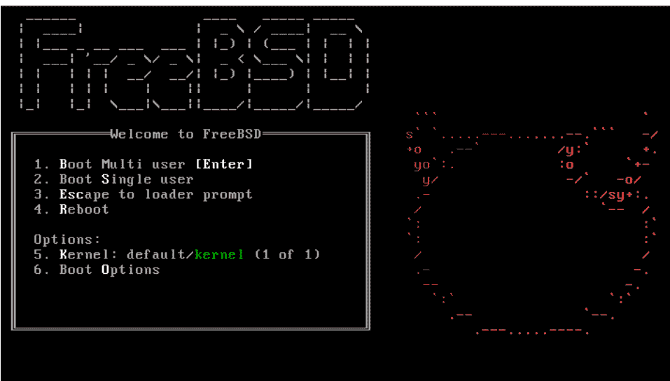

### 在 i386™ 和 amd64 上引导

在出现此警告之前，可以随时退出安装。如果担心某些配置不正确，只需在此点前关闭电脑，就不会对系统磁盘进行任何更改。

本节描述了如何从使用第 2.3.1 节“准备安装介质”中的说明准备的安装介质引导系统。当使用可引导 USB 闪盘时，请在开启电脑之前插入 USB 闪盘。从 CD 或 DVD 引导时，开启电脑并在有机会时插入介质。如何配置系统从插入的介质引导取决于架构。

### 2.4.1. 在 i386™ 和 amd64 上引导

这些架构提供了用于选择引导设备的 BIOS 菜单。根据所使用的安装介质，选择 CD/DVD 或 USB 设备作为引导设备。大多数系统还提供了一个在启动期间选择引导设备的按键，而无需进入 BIOS。通常，该按键为 F10、F11、F12 或 Escape（退出键）。

如果电脑加载了现有的操作系统而不是 FreeBSD 安装程序，则可能是因为：

1. 安装介质在启动过程中的插入得不够早。保持介质插入状态并重试。

2. BIOS 更改错误或未保存。双检是否已选择正确的引导设备作为第一引导设备。

3. 此系统太旧，不支持从所选介质引导。在这种情况下，可以使用 Plop Boot Manager (http://www.plop.at/en/bootmanagers.html) 从所选介质引导系统。

### 2.4.2. 在 PowerPC® 上引导

在大多数机器上，启动期间按住键盘上的 C 键将从 CD 引导。否则在非 Apple® 键盘上按住 Command+Option-Option+O+F 或 Windows+Alt+O+F。在 @ > 提示符处，输入：

```
boot cd:\ppc/loader cd:
```

### 2.4.3. FreeBSD 引导菜单

一旦系统从安装介质引导，将显示类似下面的菜单：

图 2.1. FreeBSD 引导菜单

```
欢迎来到 FreeBSD-
1. 返回主菜单 [Backspace]
2. 加载系统默认设置

引导选项:
3. 开启 ACPI 支持
4. 安全模式... 关闭
5. 单用户模式. 关闭
6. 详细模式.... 关闭
```

## 第 2 章. 安装 FreeBSD

默认情况下，菜单将等待十秒用户输入，然后引导进入 FreeBSD 安装程序；或者如果已经安装了 FreeBSD，则引导进入 FreeBSD。按 Space（空格）暂停启动计时器以查看选择。要选择某个选项，按其高亮的数字、字符或按键。可用选项如下：

- * Boot Multi User（引导多用户模式）：这将继续 FreeBSD 启动过程。如果启动计时器已暂停，请按 1、大或小写的 B 或 Enter（回车）。

- * Boot Single User（引导单用户模式）：此模式可用于按照第 13.2.4.1 节“单用户模式”所述修复现有的 FreeBSD 安装。按 2 或大或小写的 S 进入此模式。

- * Escape to loader prompt（退出到加载器提示符）：这将引导系统进入一个包含少量低级命令的修复提示符。该提示符在第 13.2.3 节“第三阶段”中描述。按 3 或 Esc 引导进入此提示符。


- *Reboot*（重启）：重启系统。
- *Kernel*（内核）：加载不同的内核。
- *Configure Boot Options*（配置引导选项）：打开图 2.2 所示并在下方描述的菜单。

## 图 2.2. FreeBSD 引导菜单

引导菜单分为两个部分。第一部分用于返回主菜单或重置任何切换的选项。第二部分用于通过按高亮的数字或字符来切换这些选项：

- *ACPI Support*（开启 ACPI 支持）：如果启动期间卡死，尝试关闭此选项。
- *Safe Mode*（安全模式）：如果在开启 ACPI 支持的情况下启动卡死，尝试开启此选项。
- *Single User*（单用户模式）：开启此选项以按照第 13.2.4.1 节“单用户模式”所述修复现有的 FreeBSD 安装。问题解决后，将其关闭。
- *Verbose*（详细模式）：开启此选项可以在启动过程中查看更详细的消息。这在排查硬件问题时非常有用。

在做出所需选择后，按 `Backspace` 返回主菜单，然后按 `Enter` 继续。当 FreeBSD 执行硬件探测并加载安装程序时，会出现一系列启动消息。引导完成后，将显示图 2.3 所示的欢迎菜单。

19

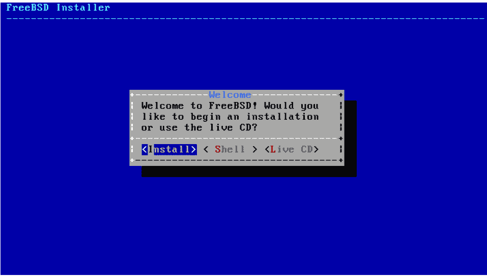

### 使用 bsdinstall

按 `Enter` 选择默认的 `[ ]` 进入安装程序。本章其余部分描述了如何使用该安装程序。否则，使用左右箭头或彩色字母选择所需的菜单项。`[ Shell（终端） ]` 可访问 FreeBSD shell，以便在安装之前使用命令行工具准备磁盘。`[ Live CD ]` 选项可以在安装之前尝试 FreeBSD。该活动版本在第 2.11 节“使用 Live CD”中描述。

提示

要查看启动消息（包括硬件探测），按大或小写的 `S` 然后按 `Enter` 进入 shell。在 shell 提示符处输入 `more /var/run/dmesg.boot` 并使用空格键滚动查看消息。完成后，输入 `exit` 返回欢迎菜单。

## 2.5. 使用 bsdinstall

本节显示了 `bsdinstall` 菜单的顺序以及安装之前询问的信息类型。使用方向键高亮菜单选项，然后按 `Space` 选择或取消该菜单项。

完成后，按 `Enter` 保存选择并移动到下一个屏幕。

### 2.5.1. 选择 Keymap 菜单

在开始过程之前，`bsdinstall` 将加载如图 2.4 “Keymap Loading”所示的映射。

20

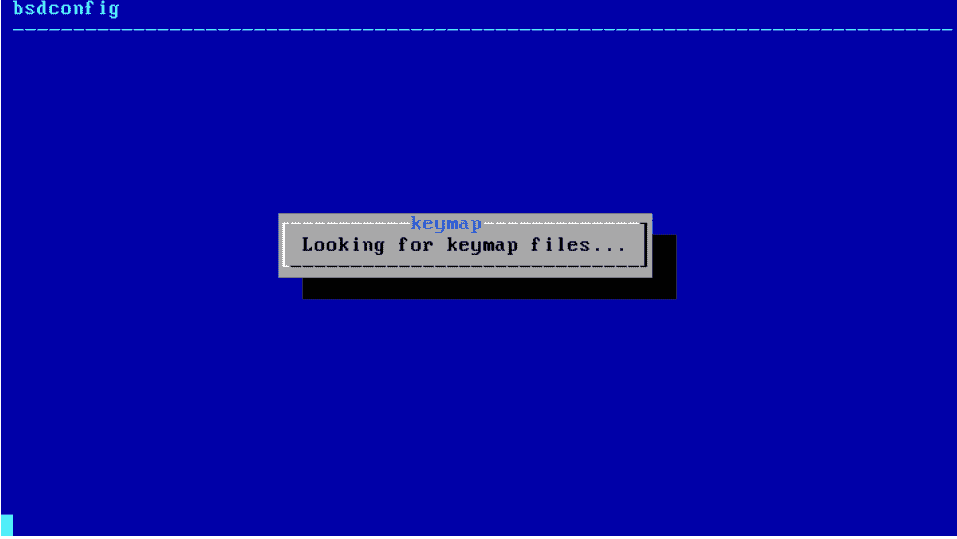

## 第 2 章. 安装 FreeBSD

图 2.4. 键位加载

加载键位映射后，`bsdinstal` 会显示如图 2.5，“键位选择菜单”所示的菜单。

使用向上和向下方向键选择最符合连接到系统的键盘布局的键位。按 `Enter` 键保存选择。

图 2.5. 键位选择菜单

注意

按 `Esc` 键将退出此菜单并使用默认键位。如果不确定选择哪个键位，美国标准 ISO-8859-1 也是一个安全的选项。

此外，在选择不同的键位时，用户可以尝试该键位并在确保其正确后再继续，如图 2.6，“键位测试菜单”所示。

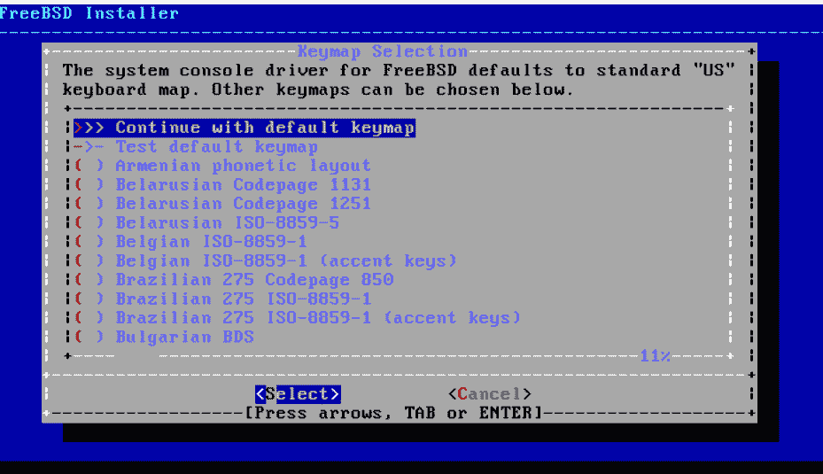

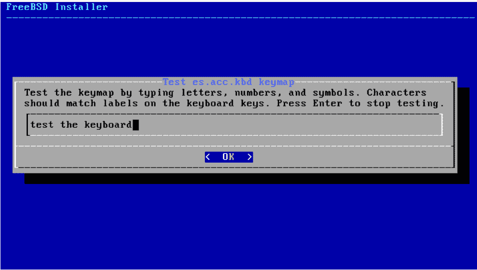

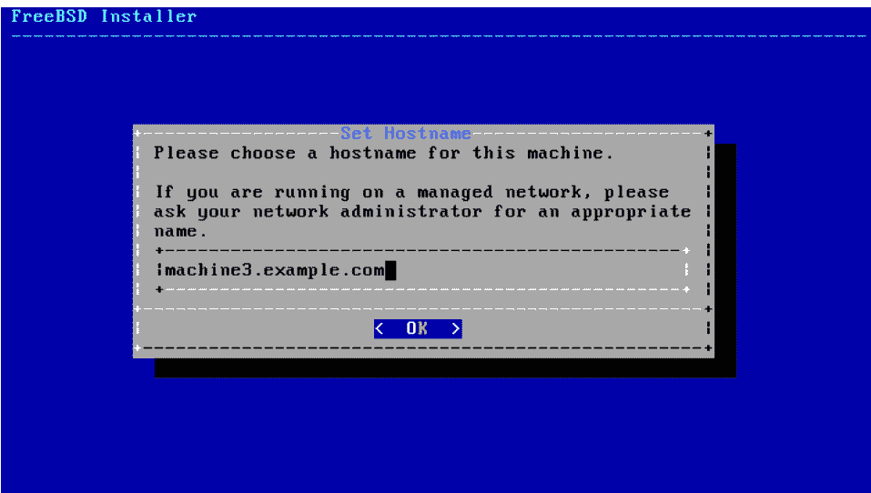

设置主机名

图 2.6. 键位测试菜单

### 2.5.2. 设置主机名

下一个 `bsdinst` 菜单用于为新安装的系统设置主机名。

图 2.7. 设置主机名

输入网络中唯一的主机名。它应该是一个完全限定域名（FQDN），例如 `machine3.example.com`。

### 2.5.3. 选择安装的组件

接下来，`bsdinstal` 将提示选择安装的可选组件。

img/d350ad22ee69b642cce08399b60c5f86_101_0.png)

第 2 章. 安装 FreeBSD

图 2.8. 选择安装的组件

决定安装哪些组件很大程度上取决于系统的预期用途和可用磁盘空间。FreeBSD 内核（统称为基础系统）始终会被安装。

根据架构的不同，这些组件中的某些可能可能出现：

- `base-dbg` - 激活了调试符号的基础工具，如 `cat`、`ls` 等其他许多工具。
- `kernel-dbg` - 激活了调试符号的内核和模块。
- `lib32-dbg` - 在 64 位版本的 FreeBSD 上运行 32 位应用程序的兼容库，并激活了调试符号。
- `lib32-` - 在 64 位版本的 FreeBSD 上运行 32 位应用程序的兼容库。
- `ports` - FreeBSD Ports 集合（FreeBSD Ports Collection）是一系列文件，方便下载、编译和安装第三方软件包。第 4 章“安装应用程序：软件包与 Ports 集合”讨论了如何使用 Ports 集合。

警告

安装程序不会检查磁盘空间是否充足。仅在有足够的硬盘空间时才选择此选项。FreeBSD Ports 集合约占用 500 MB 的磁盘空间。

- `src` - 内核和用户态的完整 FreeBSD 源代码。虽然大多数应用程序不需要它，但在构建设备驱动、内核模块或从 Ports 集合构建某些应用程序时可能需要它。它也用于开发 FreeBSD 本身。完整的源码树需要 1 GB 的磁盘空间，重新编译整个 FreeBSD 系统则需要额外的 5 GB 的空间。
- `tests` - FreeBSD 测试套件。

### 2.5.4. 从网络安装

图 2.9，“从网络安装”所示的菜单仅在从 `-bootonly.iso` 或 `-mini-memstick.img` 安装时出现，因为这些安装介质不包含安装文件的副本。由于安装文件必须通过网络连接获取，此菜单表示必须配置网络接口。如果在过程的任何步骤中显示此此菜单，请遵循第 2.9.1 节“配置网络接口”中的说明。

img/d350ad22ee69b642cce08399b60c5f86_104_0.png)

img/d350ad22ee69b642cce08399b60c5f86_104_1.png)

分配磁盘空间

图 2.9. 从网络安装

## 2.6. 分配磁盘空间

下一个菜单用于确定分配磁盘空间的方法。

图 2.10. 分区选择

`bsdinst` 为用户提供了四种分配磁盘空间的方法：

- Auto (UFS) 分区：使用 UFS 系统自动设置磁盘分区。
- Manual 分区：允许高级用户从菜单选项中创建自定义分区。
- Shell：打开一个提示符，高级用户可以使用 `gpart(8)`、`fdisk(8)` 等命令行工具创建自定义分区。
- Auto (ZFS) 分区：创建一个带有可选加密的 ZFS 系统。

本节描述了在设计分区的布局时需要考虑的事项。

### 2.6.1. 设计布局

在设计布局时，请记住像 `/` 这样较大的分区应该放在磁盘的边缘。`/var` 的大小反映了系统的日志存储能力。通过对系统进行合理分区，写密集型分区中产生的碎片将不会渗透到发生最频繁的分区中。虽然较大的分区可能需要 I/O 性能，但将它们更多地移边缘并不会将 `/var` 移到边缘带来显著的性能提升。

## 2.6.2. 使用 UFS 进行引导式分区

当选择此方法时，菜单将显示可用磁盘。如果连接了多个磁盘，请选择要安装 FreeBSD 的那一个。

img/d350ad22ee69b642cce08399b60c5f86_108_0.png)

img/d350ad22ee69b642cce08399b60c5f86_109_0.png)

img/d350ad22ee69b642cce08399b60c5f86_109_1.png)

使用 UFS 进行引导式分区

图 2.11. 从多个磁盘中选择

选择磁盘后，下一个菜单提示安装到整个磁盘或使用空闲空间创建分区。如果选择 `[ Entire Disk ]`（整个磁盘），将自动创建一个填充整个磁盘的通用分区布局。选择 `[ Partition ]`（分区）将根据磁盘上的未使用空间创建分区布局。

图 2.12. 选择整个磁盘或分区

选择 `[ Entire Disk ]` 后，`bsdinst` 会显示一个指示磁盘将被擦除的对话框。

图 2.13. 确认

img/d350ad22ee69b642cce08399b60c5f86_110_0.png)

## 第 2 章. 安装 FreeBSD

下一个菜单显示了分区方案类型列表。对于 `amd64` 计算机，`GPT` 通常是最合适的选择。不兼容 `GPT` 的旧型号计算机应使用 `MBR`。其他分区方案通常用于不常见或更老旧的计算机。更多信息请参阅表 2.1，“分区方案”。

图 2.14. 选择分区方案

创建分区布局后，请对其进行检查以确保其符合安装需求。选择 `[ Revert（撤销） ]` 将将分区重置为原始值，按下 `[ Auto（自动） ]` 将重新创建自动创建的 FreeBSD 分区。也可以手动创建、修改或删除分区。当分区正确后，选择 `[ Finish（完成） ]` 继续安装。

图 2.15. 检查已创建的分区

一旦配置好磁盘，下一个菜单提供了格式化所选驱动器之前进行更改的最后机会。如果需要更改，请选择 `[ Back（返回） ]` 返回主分区菜单。`[ Revert & Exit（撤销并退出） ]` 将退出安装而不对驱动器进行任何更改。选择 `[ Commit（提交） ]` 开始安装过程。

# 手动分区

图 2.16. 最终确认

要继续安装过程，请前往第 2.7 节，“获取发行文件”。

## 2.6.3. 手动分区

选择此方法将打开分区编辑器：

图 2.17. 手动创建分区

高亮安装驱动器（在此例中为 `ada0`）并选择 `[ Create（创建） ]` 显示可用分区方案菜单：

图 2.18. 手动创建分区

文件系统类型（例如：`freebsd-ufs`、`freebsd-zfs`、`freebsd-swap`）

对于 `amd64` 计算机，`GPT` 通常是最合适的选择。不兼容 `GPT` 的旧型号计算机应使用 `MBR`。其他分区方案通常用于不常见或更老旧的计算机。

## 表 2.1. 分区方案

| 缩写 | 说明 |
| :--- | :--- |
| APM | Apple Partition Map（苹果分区 Map），用于 PowerPC®。 |
| BSD | 不带 MBR 的 BSD 标签，有时被称为*危险的专用模式*，因为非 BSD 磁盘工具可能无法识别它。 |
| GPT | GUID 分区表 ([http://en.wikipedia.org/wiki/GUID_Partition_Table])。 |
| MBR | 主引导记录 ([http://en.wikipedia.org/wiki/Master_boot_record])。 |
| VTOC8 | Sun SPARC64 和 UltraSPARC 计算机使用的卷内容表。 |

选择并创建分区方案后，再次选择 `[ Create（创建） ]` 创建分区。使用 `Tab` 键在 □ 字段之间移动光标。

图 2.19. 手动创建分区

标准的 FreeBSD `GPT` 安装至少使用三个分区：

- `freebsd-boot` - 存储 FreeBSD 启动代码。
- `freebsd-zfs` - 一个 FreeBSD UFS 系统。关于 ZFS 的更多信息请参阅第 20 节，“Z 文件系统 (ZFS)”。
- `freebsd-swap` - FreeBSD 交换空间。

请参考 `gpart(8)` 获取可用 `GPT` 分区类型的描述。

可以创建多个系统分区，某些人倾向于使用传统的布局，为 `/`、`/var`、`/tmp` 和 `/usr` 创建独立的分区。请参见示例 2.1，“创建传统的拆分文件系统分区”获取示例。

Size（大小）可以使用常用缩写输入：`K` 表示千字节，`M` 表示兆字节，或 `G` 表示吉字节。

**提示**：正确的扇区对齐可提供最佳性能，使分区大小成为 4K 字节的偶倍数有助于确保具有 512 字节或 4K 字节扇区的驱动器能够对齐。通常，使用 1M 或 1G 的偶倍数分区大小是确保每个分区从 4K 的偶倍数开始的最简单方法。有一个例外：由于当前的启动代码限制，`freebsd-boot` 分区不应超过512K。

如果分区将包含系统，则需要 Mountpoint（挂载点）。如果只创建一个 UFS 分区，挂载点应为 `/`。

Label（标签）是分区的名称。如果驱动器连接到不同的控制器或端口，驱动器名称或数字可能会发生，但分区标签不会。在 `/etc/fstab` 中引用标签而不是驱动器名称和分区数字可以使系统对硬件更改更具兼容性。当连接磁盘时，`GPT` 标签会出现在 `/dev/gpt/` 中。其他分区方案具有不同的标签功能，其标签出现在 `/.dev/` 中的不同目录下。

**提示**：在每个分区上使用唯一标签以避免相同标签冲突。可以在标签中添加计算机名称、用途或位置的几个字母。例如，为名为 lab 的计算机上的 UFS 根分区使用 `lab-root` 或 `rootfs own`。

## 示例 2.1. 创建传统的拆分文件系统分区

对于传统的分区布局（即 `/`, `/var`， `/tmp` 和 `/usr` 目录是各自分区上的独立系统），请创建一个 `GPT` 分区方案，然后所示创建分区。所示的大小对于 20G 的目标磁盘来说是典型的。如果目标磁盘上有更多空间，较大的交换或 `/var` 分区可能会很有用。此处显示的标签以 ex 为“example”的前缀，但读者应该如上所述使用其他唯一标签值。

默认情况下，FreeBSD 的 `gptboot` 期望 UFS 分区为 根。

| 分区类型 | Size（大小） | Mountpoint（挂载点） | Label（标签） |
| :--- | :--- | :--- | :--- |
| freebsd-boot | 512K | | exroot |
| freebsd-ufs | 2G | / | exroot |
| freebsd-swap | 4G | | exswap |
| freebsd-ufs | 2G | /var | exvar |
| freebsd-ufs | 1G | /tmp | extmp |
| freebsd-ufs | 1G | /usr | exusr |

## 2.6.4. 使用 Root-on-ZFS 的引导分区

此分区模式仅适用于磁盘，并将擦除磁盘内容。主 ZFS 配置菜单提供了许多选项来控制池的创建。

图 2.20. ZFS 分区菜单

以下是可选选项的摘要：

- Install（安装）：使用所选选项继续安装。
- Pool Type/Disks（池类型/磁盘）：允许配置构成池类型和磁盘。自动 ZFS 安装程序仅支持创建单层 vdev（条带模式除外）。要创建更复杂的池，请按照第 2.6.5 节“命令行分区”中的指令创建池。
- Rescan Disks（重新扫描磁盘）：刷新可用磁盘列表。
- Disk Info（磁盘信息）：磁盘信息菜单可用于检查每个磁盘，包括其分区表和各种其他信息，如设备型号和序列号（如果可用）。
- Pool Name（池名称）：建立池的名称。默认名称为 `zroot`。
- Force 4K Sectors?（强制 4K 扇区？）：强制使用 4K 扇区。默认情况下，安装程序将创建对齐到 4K 边界的分区并强制 ZFS 使用 4K 扇区。这对于 512 字节扇区磁盘是安全的，并且可以确保在 512 字节磁盘上创建的池未来可以添加 4K 扇区（作为额外的存储空间或故障磁盘的替换品）。按回 键启用。
- Encrypt Disks?（加密磁盘？）：允许用户使用 `GELI` 加密磁盘。更多关于磁盘加密的信息请参见第 18.12.2 节，“使用 geli 进行磁盘加密”。按回 键启用。
- Partition Scheme（分区方案）：允许选择分区方案。大多数情况下，`GPT` 是推荐选项。按回 键在不同选项之间进行选择。
- 大小 (Size) - 设置交换空间的大小。
- 镜像交换 (Mirror Swap?) - 允许用户在磁盘之间进行镜像交换。请注意，启用镜像交换将破坏崩溃转储（crash dumps）。按 `Enter` 键激活或取消。
- 加密交换 (Encrypt Swap?) - 允许用户加密加密交换空间。系统每次启动时都会使用临时密钥加密交换空间，并在重启时丢弃。按 `Enter` 键选择激活或取消。有关交换加密的更多信息请参见第 18.13 节“加密交换空间”。

31

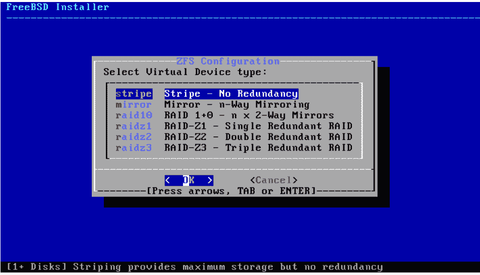

1+ 磁盘！条带化提供了最大的存储空间但没有冗余

# 使用 Root-on-ZFS 进行引导式分区

选择 `T` 来配置池类型和构成池的磁盘。

图 2.21. ZFS 池类型

以下是此菜单中可选的池类型摘要：

- stripe（条带）- 条带化为所有连接的设备提供最大存储空间，但没有冗余。如果其中一个磁盘故障，池中的数据将不可恢复地丢失。
- mirror（镜像）- 镜像为每块磁盘上的所有数据提供完整副本。由于数据是从所有磁盘并行读取的，镜像提供了良好的读取性能。写入性能较较慢，因为数据必须写入池中的所有磁盘。允许仅有一块磁盘故障。此选项至少需要两块磁盘。
- raid10 - 条带镜像。提供最佳性能，但存储空间最少。此选项需要至少是偶数个磁盘，且至少为四块磁盘。
- raidz1 - 单冗余 RAID。允许一块磁盘同时故障。此选项至少需要三块磁盘。
- raidz2 - 双冗余 RAID。允许两块磁盘同时故障。此选项至少需要四块磁盘。
- raidz3 - 三重冗余 RAID。允许三块磁盘同时故障。此选项至少需要五块磁盘。

一旦选择了池类型，将显示可用磁盘列表，并提示用户选择一个或多个磁盘来组成池。然后将对配置进行验证，以确保选择了足够的磁盘。如果不是，选择 `<Change Selection>`（更改选择）返回磁盘列表，或选择 `<Back>`（返回）更改池类型。

图 2.22. 磁盘选择

32

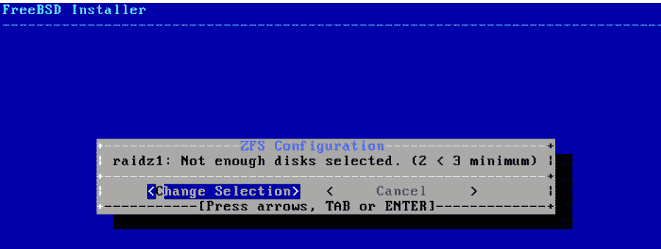


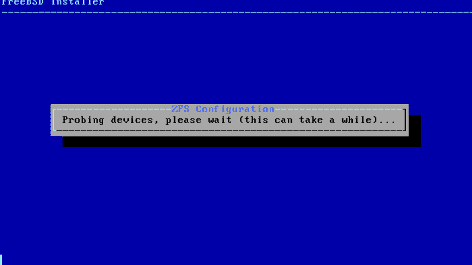

# FreeBSD 安装器

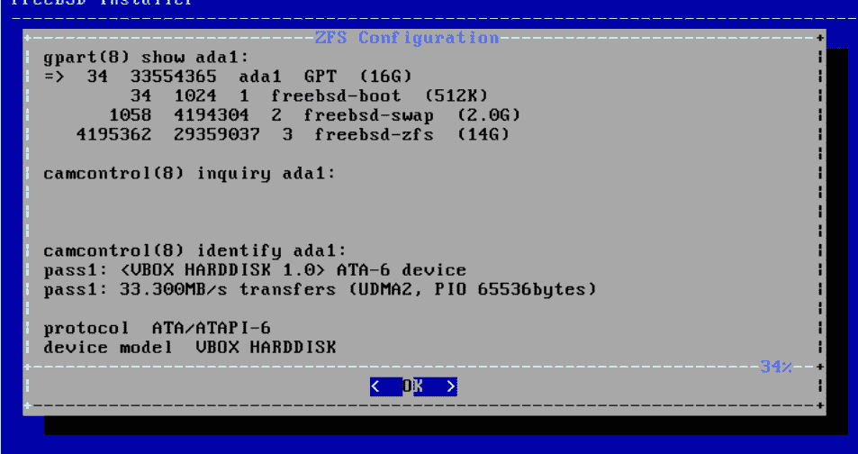

## 第 2 节。安装 FreeBSD

### 图 2.23. 无效选择

如果列表中缺少一个或多个磁盘，或者在安装程序启动后连接了磁盘，请选择 `- Rescan Devices`（重新扫描设备）以重新填充可用磁盘列表。

### 图 2.24. 重新扫描设备

为了避免意外擦除错误的磁盘，可以使用 `- Disk Info`（磁盘信息）菜单检查每块磁盘，包括其分区表以及各种其他信息，如设备型号号和序列号（如果可用）。

### 图 2.25. 分析磁盘

33

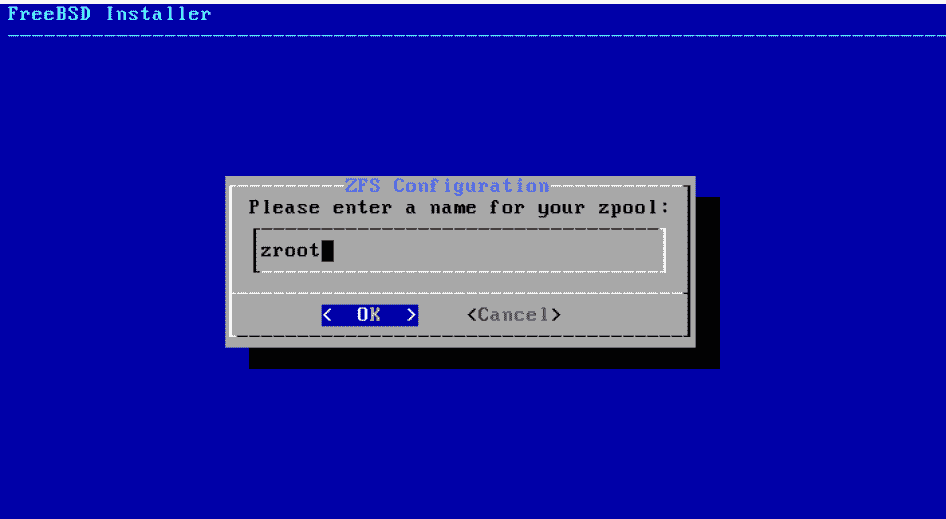

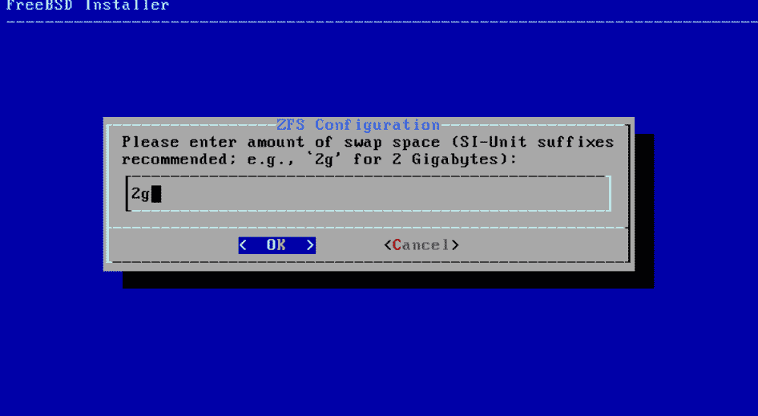

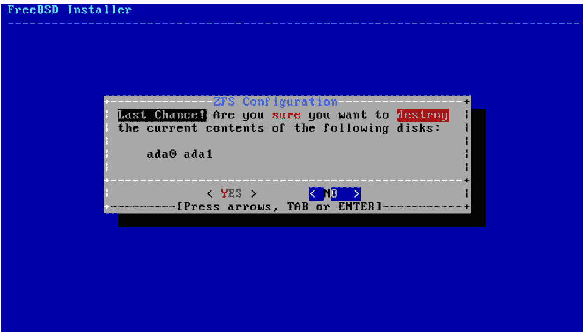

# 使用 Root-on-ZFS 进行引导式分区

选择 `N` 来配置池名称。输入所需的名称，然后选择 `<OK>` 建立它，或选择 `<Cancel>`（取消）返回主菜单并保留默认名称。

### 图 2.26. 池名称

选择 `S` 设置交换空间的大小。输入所需的大小，然后选择 `<OK>` 建立它，或选择 `<Cancel>`（取消）返回主菜单并保留默认大小。

### 图 2.27. 交换大小

一旦选项已设置为所需值，选择菜单顶部的 `>>> Install`（安装）选项。安装程序将在销毁所选驱动器内容以创建 ZFS 池之前提供最后一次机会。

### 图 2.28. 最后机会

34

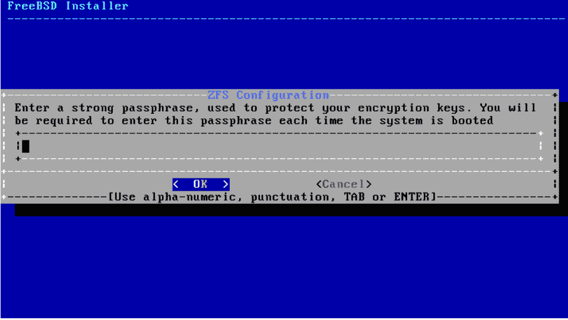

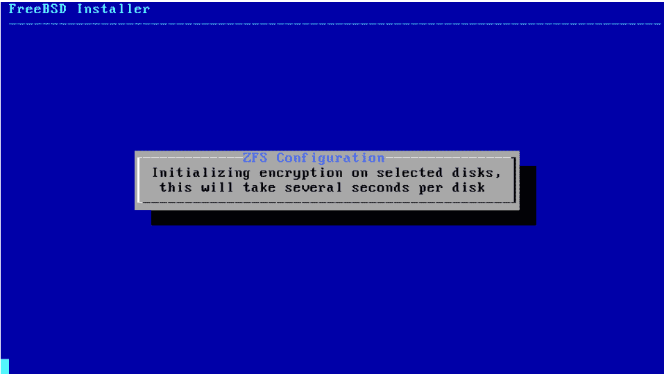

## 第 2 节。安装 FreeBSD

如果启用了 GELI 磁盘加密，安装程序将两次提示用于加密磁盘的密码语。之后将开始初始化加密。

### 图 2.29. 磁盘加密密码

### 图 2.30. 初始化加密

安装将正常继续。要继续进行安装，请参见第 2.7 节“获取发行文件”。

# 2.6.5. Shell 模式分区

在创建高级安装时，`bsdinstall` 分区菜单可能无法提供所需的灵活性。高级用户可以从分区菜单中选择 Shell 选项，手动对驱动器进行分区、创建文件系统、填充 `/tmp/bsdinstall_etc/fstab` 并在 `/mnt` 下挂载文件系统。完成后，输入 `exit` 返回 `bsdinstall` 并继续安装。

# 2.7. 获取发行文件

安装时间取决于所选发行版、安装介质以及计算机的速度。一系列消息将指示进度。

首先，安装程序格式化所选磁盘并初始化分区。接下来，在仅限启动介质或微内存 U盘的情况下，它将下载所选的组件：

# FreeBSD 安装器

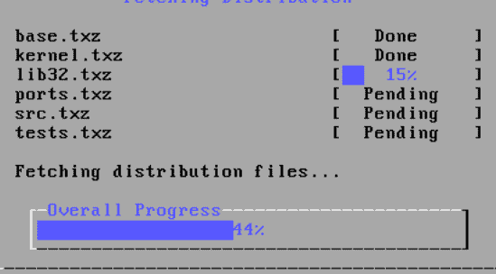

# FreeBSD 安装器

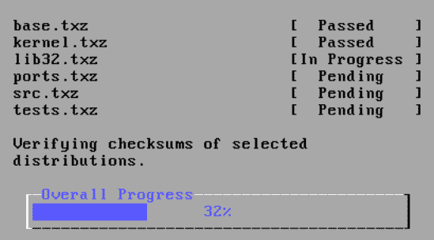

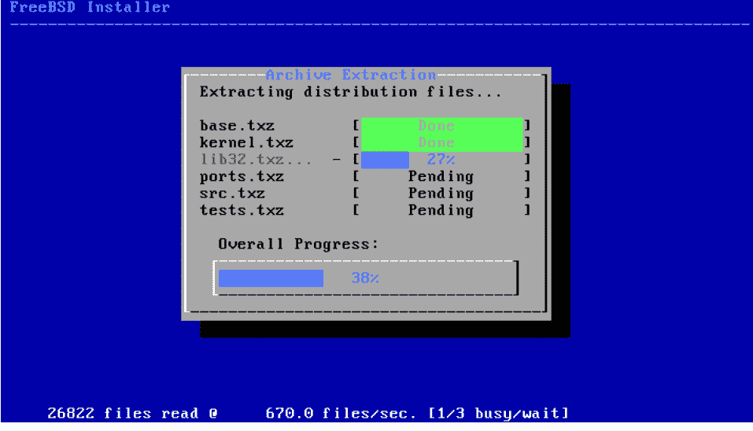

## 获取发行文件

### 图 2.31. 获取发行文件

接下来，验证发行文件的完整性，以确保它们在下载或从安装介质读取时没有损坏。

### 图 2.32. 验证发行文件

最后，将发行文件提取到磁盘中：

### 图 2.33. 提取发行文件

一旦所有请求的发行文件提取完成，`bsdinstall` 显示第一个配置界面。后续配置将在后续节中描述。

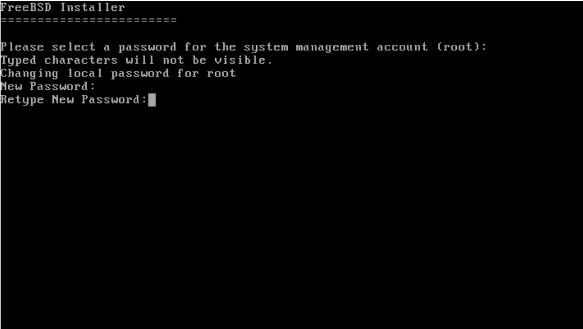

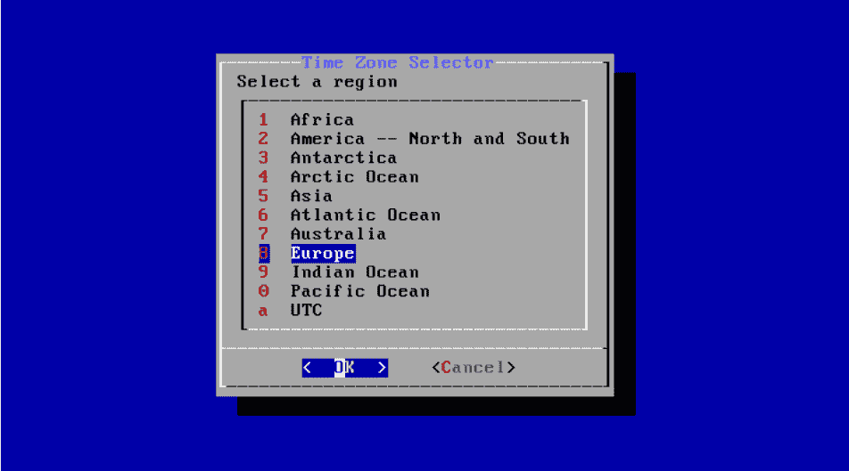

## 第 2 节。安装 FreeBSD

# 2.8. 账户、时区、服务与强化

## 2.8.1. 设置 root 密码

首先必须设置 root 密码。在输入密码时，屏幕不会显示字符。输入密码后，需要再次输入。这有助于防止输入错误。

### 图 2.34. 设置 root 密码

## 2.8.2. 设置时区

后续菜单用于通过选择地理区域、国家和时区来确定本地时间。设置时区允许系统自动调整时间变化（如夏令），并正确执行其他时区功能。

此处示例位于西班牙时区的机器。选择根据地理位置而异。

### 图 2.35. 选择区域

使用方向键选择相应的区域并按 Enter 键。

# 欧洲国家

选择国家或区域

- 30 多尔万（共和国）
- 31 摩纳哥
- 32 蒙特黑山
- 33 荷兰
- 34 挪威
- 35 波兰
- 36 葡萄牙
- 37 罗马尼亚
- 38 俄罗斯联邦
- 39 圣马力
- 40 塞尔维亚
- 41 斯洛伐克
- 42 斯洛文尼亚
- 43 西班牙
- 44 瑞典
- 45 瑞士


# 欧洲国家

选择国家或区域

选择与你所在地相同的时区。

- 1 西班牙（大陆）
- 2 塞维塔、梅利亚
- 3 加那利群岛


- 45 瑞士


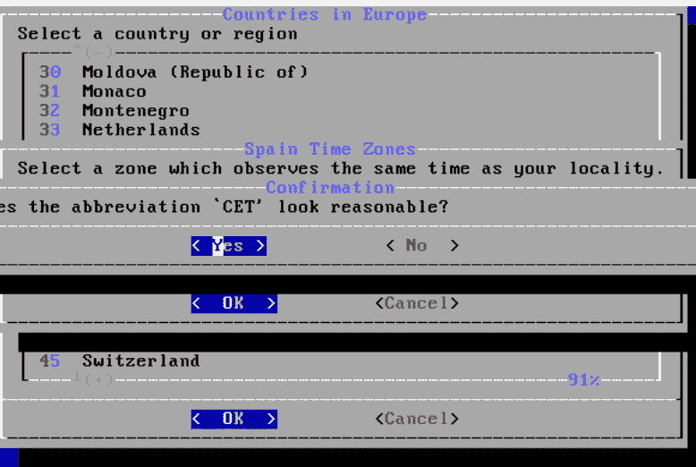

## 设置时区

### 图 2.36. 选择国家

使用方向键选择相应的国家并按 Enter 键。

### 图 2.37. 选择时区

使用方向键选择相应的时区并按 Enter 键。

### 图 2.38. 确认时区

确认时区的缩写是否正确。

## 第 2 章. 安装 FreeBSD

### 图 2.39. 选择日期

使用方向键选择合适的日期，然后按下 `[ 设置日期 ]`。否则，可以通过按下 `[ 跳过 ]` 跳过选择。

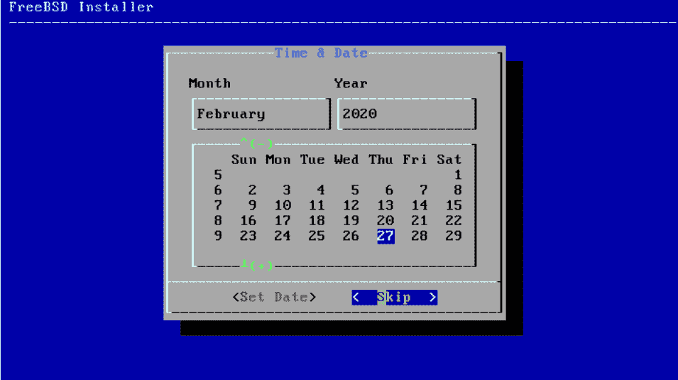

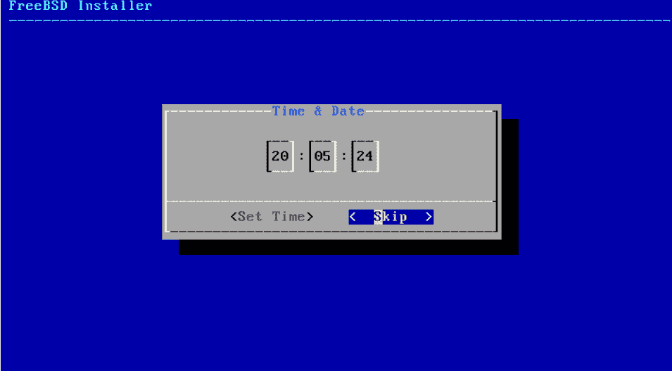

### 图 2.40. 选择时间

使用方向键选择合适的时间，然后按下 `[ 时间 ]`。否则，可以通过按下 `[ 跳过 ]` 跳过选择。

## 2.8.3. 启用服务

下一个菜单用于配置每次系统启动时将启动哪些系统服务。所有这些服务都是可选的。仅启动系统运行所需的服务。

39

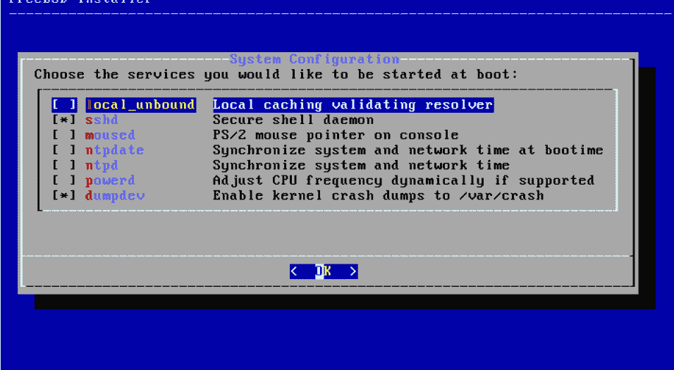


## 启用加固安全选项

### 图 2.41. 选择要启用的额外服务

以下是此菜单可以启用服务的摘要：

- `local_unbound` - 启用 DNS 本地 `unbound`。需要注意的是，这是基础系统中的 `unbound`，仅用于本地缓存转发解析器。如果目标是为整个网络设置解析器，请安装 `dns/unbound`。
- `sshd` - 安全外壳 `SSH` 守护进程用于通过加密连接远程访问系统。仅当系统应允许远程登录时，才启用此服务。
- `moused` - 如果将从命令行系统控制台使用鼠标，请启用此服务。
- `ntpdate` - 启用启动时的自动时钟同步。该程序的功能已由 `ntpd(8)` 守护进程提供。在经过一段时间后，`ntpdate(8)` 工具将被弃用。
- `ntpd` - 用于自动时钟同步的网络时间协议 `NTP` 守护进程。如果网络上有 Windows®、Kerberos 或 LDAP 服务器，请启用此服务。
- `powerd` - 用于电源控制和节能的系统电源控制实用。
- `dumpdev` - 启用崩溃转储对于调试系统问题很有，因此鼓励用户启用崩溃转储。

## 2.8.4. 启用加固安全选项

下一个菜单用于配置将启用哪些安全选项。所有选项都是可选的，但建议使用它们。

### 图 2.42. 选择加固安全选项

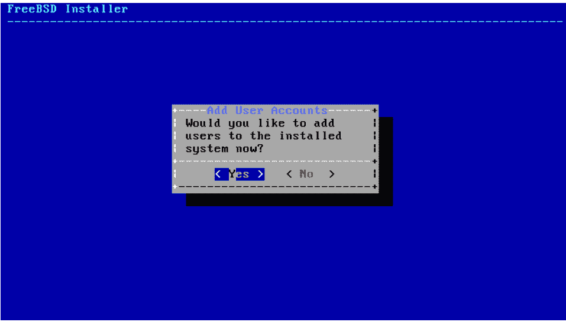

## 第 2 章. 安装 FreeBSD

以下是此菜单可以启用的选项摘要：

- `hide_uids` - 隐藏以其他用户运行的进程，防止非特权用户查看其他用户（UID）正在执行的进程，防止信息泄露。
- `hide_gids` - 隐藏以其他组运行的进程，防止非特权用户查看其他组（GID）正在执行的进程，防止信息泄露。
- `hide_jail` - 隐藏在 jail 中的进程，防止非特权用户查看 jail 内部运行的进程。
- `read_msgbuf` - 禁止非特权用户读取内核消息，防止其使用 `dmesg(8)` 查看内核日志缓冲区中的消息。
- `proc_debug` - 为非特权用户禁用进程调试功能，这将禁用多种非特权进程间调试服务，包括 procprofs 功能、`ptrace()` 和 `ktrace()`。请注意，这将防止调试工具（例如 `lldb(1)`、`truss(1)`、`procstat(1)`）以及某些脚本语言（如 PHP 等）中的内置调试功能为非特权用户工作。
- `random_pid` - 随机化新创建进程的 PID。
- `clear_tmp` - 系统启动时清理 `/tmp`。
- `disable_syslogd` - 禁用 syslog 网络套字。默认情况下，FreeBSD 使用 `-s` 以安全方式运行 syslog。这可以防止守护进程监听端口 514 上的入站 UDP 请求。启用此选项后，syslog 将以 ag -ss 模式运行，这将防止 syslogd 打开任何端口。欲了解更多信息请咨询 `syslogd(8)`。
- `disable_sendmail` - 禁用 sendmail 邮件传输代理。
- `secure_console` - 启用此选项时，进入单用户模式的提示将请求 root 密码。
- `disable_ddtrace` - DTrace 可以运行在实际上影响运行内核的模式下。除非显式启用，否则可能无法破坏性操作。在使用 DTrace `-w` 时请启用此选项。欲了解更多信息请咨询 `dtrace(8)`。

## 2.8.5. 添加用户

下一个菜单用于创建至少一个用户账户。出于安全考虑，建议使用普通用户而不是 root。FreeBSD 安装程序显示了一个示例：

- Username - 用户登录的名称。每个用户名都是唯一的且不应包含空格。
- Full name - 用户全名。可以包含空格，用作用户的描述。
- Uid - 用户 ID。通常留空，以便系统分配一个值。
- Login group - 用户组。


# 第 2 章 安装 FreeBSD

### 图 2.45. 退出用户和组管理

如果有更多用户需要添加，请在“添加另一个用户？”问题处回答 Yes。输入 no 以完成用户添加并继续安装。

有关添加用户和用户管理的信息，请参阅[第 3.3 节，“用户和基础账户管理”]。

## 2.8.6. 最终配置

在完成所有安装和配置后，提供最后一次修改设置的机会。

### 图 2.46. 最终配置

使用此菜单在完成安装之前进行任何更改或任何额外的配置。

- 添加用户 - 见第 2.8.5 节“添加用户”。
- Root 密码 - 见第 2.8.1 节“设置 root 密码”。
- 主机名 - 见第 2.5.2 节“设置主机名”。
- 网络 - 见第 2.9.1 节“配置网络接口”。
- 服务 - 见第 2.8.3 节“启用服务”。
- 系统加固 - 见第 2.8.4 节“启用加固安全选项”。

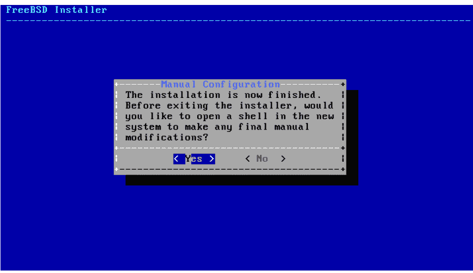

- 时区 - 见第 2.8.2 节“设置时区”。
- 手册 - 下载并安装 FreeBSD 手册。

完成任何最终配置后，选择 Exit（退出）。

### 图 2.47. 手动配置

如果在重启进入新系统之前有任何需要完成的配置，`bsdinstal` 将会提示。选择 `[ Yes ]` 退出到新系统内的 shell，或选择 `[ No ]` 继续进行安装的最后一步。

### 图 2.48. 完成安装

如果需要进一步的配置或特殊设置，选择 `[ Live CD ]` 将安装介质以 Live CD 模式启动。

如果安装完成，选择 `[ Reboot ]` 重启电脑并启动新的 FreeBSD 系统。不要忘记移除 FreeBSD 安装介质，否则电脑可能会再次从其启动。

当 FreeBSD 启动时，会显示信息消息。系统完成启动后，将显示登录提示。在登录提示处，输入在安装期间添加的用户名。避免以 root 身份登录。请参阅第 3.3.1.3 节“超级用户账户”，获取在需要管理访问权限时如何成为超级用户的说明。

启动期间出现的消息可以通过按 Scroll Lock 关闭滚动缓冲区来回顾。

可以使用 PgUp、PgDn 和方向键来回滚查看消息。完成后，再次按 Scroll Lock 解锁显示并返回控制台。如需在系统运行一段时间后再次查看这些消息，请从命令行提示符输入 `less /var/run/dmesg.boot`。查看后按 q 返回命令行。

## 第 2 章. 安装 FreeBSD

如果在[图 2.41，“选择要启用的额外服务”]中启用了 `sshd`，root 启动可能会慢一些，系统将生成 RSA 和 DSA 密钥。随后的启动将更快。密钥指纹将如例所示：

正在生成公钥/私钥 rsa 密钥对。

您的身份标识已保存在 `/etc/ssh/ssh_host_key` 中。

您的公钥已保存在 `/etc/ssh/ssh_host_key.pub` 中。

密钥指纹为：

10:a0:f5:af:93:ae:a3:1a:b2:bb:3c:35:d9:5a:b3:f3

root@machine3.example.com

密钥的 randomart 图像为：

```
+-[RSA 1024]-----+
|.. |
|o.. |
| . o |
| o |
| o S |
| ++ o |
|o.+ * |
|o+..+ |
|==o..o+E |
+-------------------+
```

正在生成公钥/私钥 dsa 密钥对。

您的身份标识已保存在 `/etc/ssh/ssh_host_dsa_key` 中。

您的公钥已保存在 `/etc/ssh/ssh_host_dsa_key.pub` 中。

密钥指纹为：

密钥的 randomart 图像为：

```
++-[ DSA 1024]----+
| ... |
| o .. + |
| . . E . |
| .. 00 .. |
| + S = . |
| +. = o |
| +. * . |
| .. 0 . |
| .0. . |
+----------------+-
```

正在启动 `sshd`。

更多信息请参阅第 14.8 节，“OpenSSH”。FreeBSD 默认不安装图形环境。有关安装和配置窗口器的更多信息，请参阅第 5 章窗口系统。

正确关闭 FreeBSD 可以保护数据不受损坏。如果用户是 wheel 组的成员，请在命令行输入 `su` 成为超级用户。

## 2.9. 网络

### 2.9.1. 配置网络接口

接下来，将显示找到的网络接口列表。选择要配置的接口。

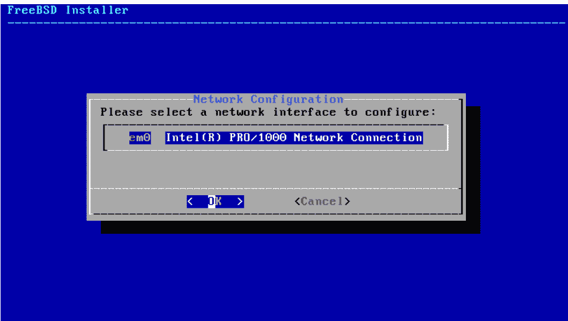

如果选择了以太网接口，将跳到显示的菜单：

### 图 2.49. 选择接口

如果选择了以太网接口，将跳到显示的菜单：

### 图 2.50. 扫描接入点

无线网络通过服务集标识符（SSID）识别，这是给每个网络的短名称。扫描期间发现的 SSID 将根据该网络可用加密类型的描述列出。如果所需的 SSID 未出现，选择 `[ Rescan ]` 再次扫描。如果所需的网络仍未出现，请检查天线问题或尝试将电脑靠近接入点。

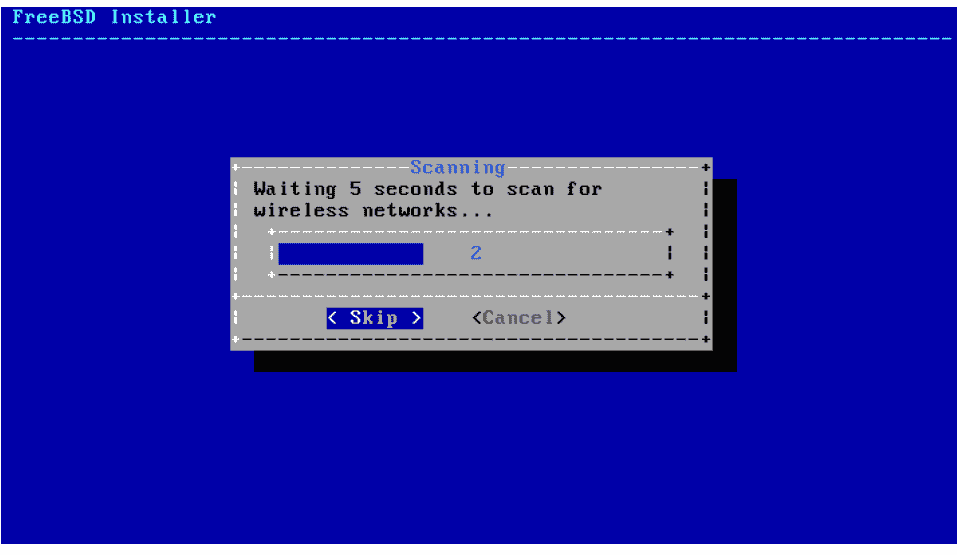

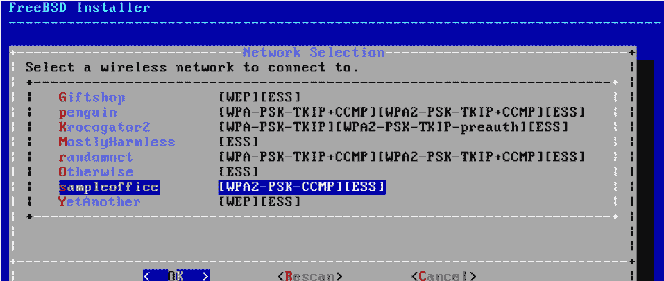

img/d350ad22ee69b642cce08399b60c5f86_155_0.png

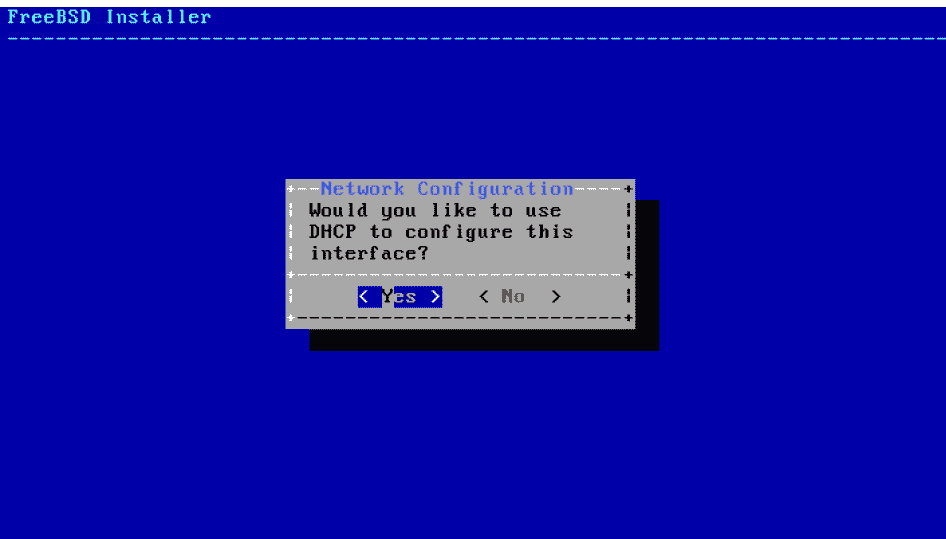

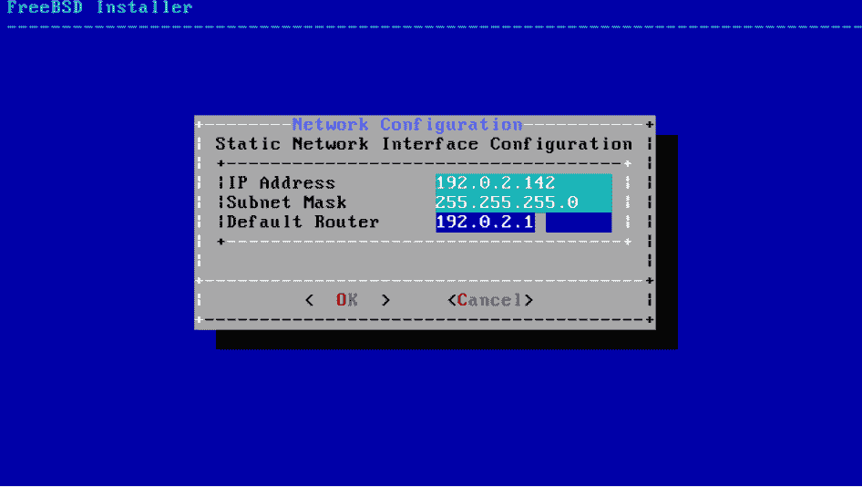

# 配置接口

IPv4 配置有两种方法。DHCP 会自动正确配置网络接口，如果网络提供 DHCP 服务器则应使用 DHCP。否则，需要作为静态配置手动输入地址信息。

注意：不要输入随机的网络信息，否则将无法工作。如果没有 DHCP 服务器，请从网络管理员或互联网服务提供商获取“必要网络信息”中列出的信息。

如果有 DHCP 服务器，在下一个菜单中选择 `[ Yes ]` 以自动配置网络接口。安装程序将暂停一分钟，因为它正在查找 DHCP 服务器并获取系统的地址信息。

### 图 2.54. 选择 IPv4 DHCP 配置

如果没有 DHCP 服务器，选择 `[ No ]` 并在菜单中输入以下地址信息：

### 图 2.55. IPv4 静态配置

- IP 地址 - 分配给此电脑的 IPv4 地址。该地址必须是唯一的且未被局域网上的其他设备占用。
- 子网掩码 - 网络的子网掩码。

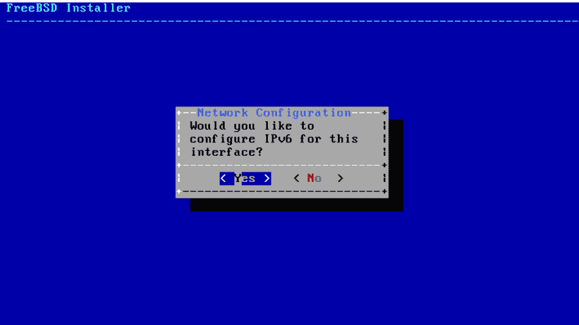

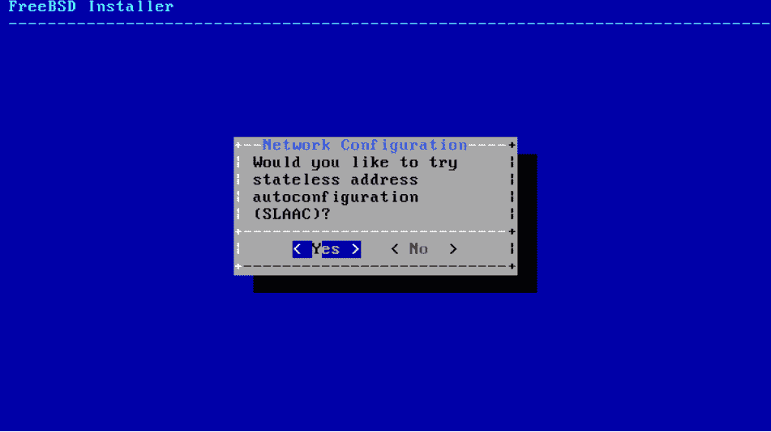

# 第 2 章 安装 FreeBSD

- • 默认路由器 - 网络默认网关的 IP 地址。

下一个屏幕将询问是否为接口配置 IPv6。如果 IPv6 可用且需要，请选择 `[ Yes ]` 来启用它。选择 IPv6 网络。


IPv6 还有两种配置方法。无状态地址自动配置 (`SLAAC`) 会自动从本地路由器处获取正确的配置信息。更多信息请参阅 `rfc4862`。静态配置则需要手动输入网络信息。

如果可用 IPv6 路由器，请在下一个菜单中选择 `[ Yes ]` 以自动配置网络接口。安装程序似乎会暂停一分钟，用于寻找路由器并获取系统的地址信息。

图 2.57. 选择 IPv6 SLAAC 配置

如果没有可用的 IPv6 路由器，请选择 `[ No ]` 并在菜单中输入以下地址信息：

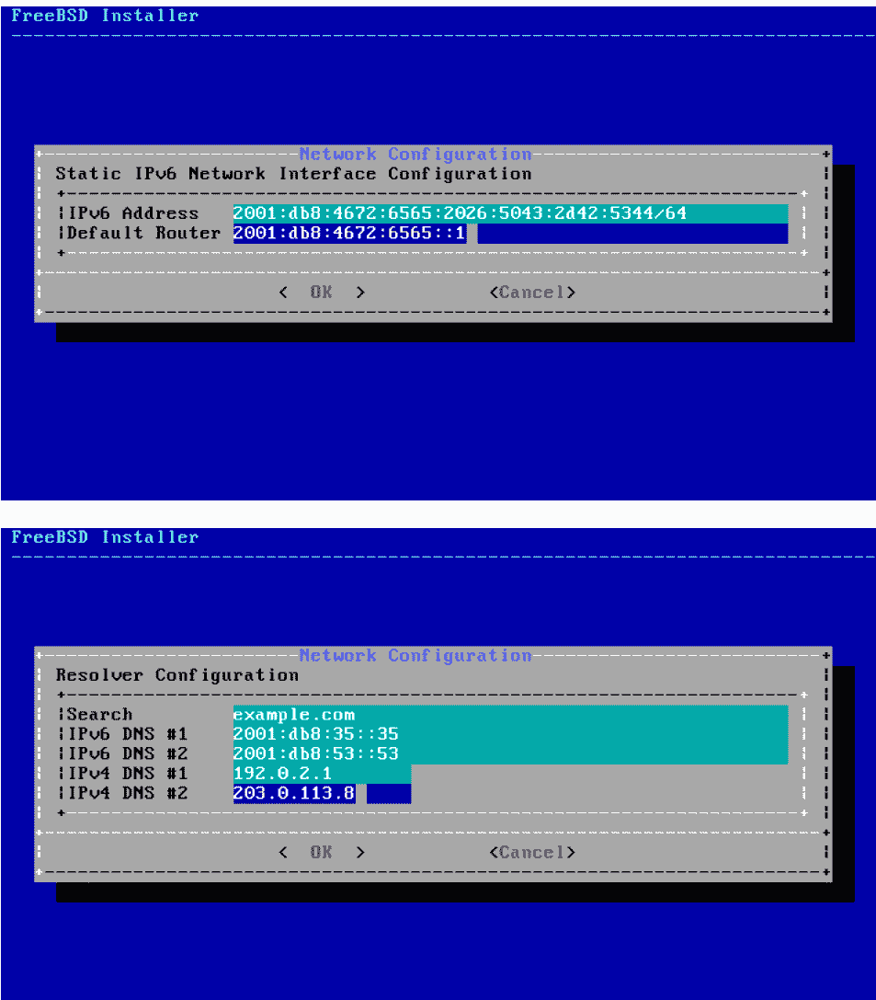

配置网络接口

图 2.58. IPv6 静态配置

- • IPv6 地址 - 分配给此计算机的 IPv6 地址。该地址必须是唯一的，不能被本地网络其他设备占用。
- • 默认路由器 - 网络默认网关的 IPv6 地址。

最后一个网络配置菜单用于配置域名系统 (`DNS`) 解析器，它负责主机名与网络地址之间的转换。如果使用 `DHCP` 或 `SLAAC` 自动配置网络接口，解析器配置值可能已经填充。否则，请在搜索字段中输入本地网络域名。`DNS #1` 和 `DNS #2` 是 `DNS` 服务器的 `IPv4` 和/或 `IPv6` 地址。至少一个 `DNS` 服务器。

图 2.59. DNS 配置

接口配置完成后，请选择与安装 FreeBSD 的计算机位于同一地区的镜像站点。当镜像靠近目标计算机时，检索文件的速度会更快，从而缩短安装时间。

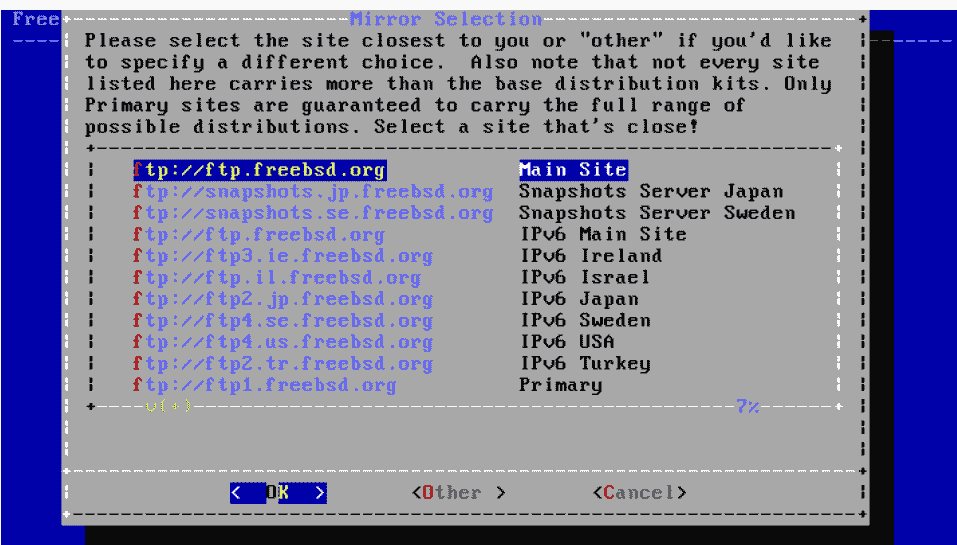

第 2 章 安装 FreeBSD

图 2.60. 选择镜像

## 2.10. 故障排除

本节涵盖了基础安装故障排除，例如人们常见的常见问题。

检查[`https://www.freeBSD.org/releases/index.html`](https://www.freeBSD.org/releases/index.html)文档以确认 FreeBSD 版本，确保硬件得到支持。如果硬件受支持但发生了死机或其他问题，请按照第 8 章中的说明构建自定义内核。配置 FreeBSD 内核为 `GENERIC` 内核中不存在的设备添加支持。默认内核假设大多数硬件设备在 `IRQ`、`I/O` 地址和 `DMA` 通道方面处于出厂默认配置。如果硬件经过了重新配置，自定义内核文件将告诉 FreeBSD 在何处找到这些资源。

注意

通过更新各种硬件组件（特别是主板）的固件，可以避免或回避某些安装问题。主板固件通常称为 `BIOS`。大多数主板和计算机制造商都有提供升级和升级信息的网站。

制造商通常建议在没有充分理由（如关键更新）的情况下不要升级主板 `BIOS`。升级过程可能会出错，导致 `BIOS` 不完整且计算机无法运行。

如果系统在启动期间探测硬件时挂起，或在安装期间表现异常，`ACPI` 可能是元凶。FreeBSD 在 `i386` 和 `amd64` 平台上广泛使用系统 `ACPI` 服务，如果在启动期间检测到它可以辅助系统配置。遗憾的是，`ACPI` 驱动以及系统主板和 `BIOS` 固件中仍然存在某些错误。可以通过第三阶段引导加载程序设置 `hint.acpi.0.disabled` 提示来禁用 `ACPI`：

```
set hint.acpi.0.disabled="1"
```

由于系统每次启动时都会重置，因此必须在 `/boot/loader.conf` 中添加 `hint.acpi.0.disabled="1"`。关于引导加载程序的更多信息可以参阅第 13.1 节“概要”。

## 2.11. 使用 Live CD

图 2.3 “欢迎菜单”所示的 `bsinstaller` 欢迎菜单提供了 `[ Live CD ]` 选项。这对于那些仍在犹豫 FreeBSD 是否适合自己的操作系统，并想在安装之前测试某些功能的人来说非常有用。

在使用 `[ Live CD ]` 之前应注意以下几点：

- 访问系统需要身份验证。用户名是 `root`，密码为空。
- 由于系统直接从安装介质运行，性能将远低于硬盘。
- 此选项仅提供图形界面。

## 第 3 章 FreeBSD 基础

## 3.1. 概要

本章介绍了 FreeBSD 的基本命令和功能。鼓励新用户仔细阅读本章：

- 如何使用和配置虚拟控制台。
- 如何创建和管理用户。
- 默认布局。
- 如何挂载和卸载。
- 什么是进程 (`processes`)、守护 (`daemons`) 和信号 (`signals`)。
- 什么是 shell (`壳`)。
- 什么是设备和设备节点。
- 如何阅读手册页。

## 3.2. 控制台与终端

虽然可以使用系统控制台与系统交互，但在 FreeBSD 系统键盘上通过命令行操作的用户通常会登录虚拟控制台。这是因为系统消息默认配置为在系统控制台上显示。这些消息会覆盖用户正在操作的命令，导致难以专注于手头的工作。

默认情况下，FreeBSD 配置了多个虚拟控制台用于输入命令。每个虚拟控制台都有自己的登录提示符和 shell，并且在虚拟控制台之间切换非常容易。这相当于在图形环境中同时打开了多个窗口。

`Alt+F1` 到 `Alt+F8` 键组合被 FreeBSD 保留用于切换虚拟控制台。使用 `Alt+F1` 切换到系统控制台 (`ttyv0`)，使用 `Alt+F2` 进入虚拟控制台 (`ttyv1`)，`Alt+F3` 进入第二个虚拟控制台 (`ttyv2`)，此类推。当使用 `Xorg` 作为图形控制台时，组合变为 `Ctrl+Alt+F1` 返回文本虚拟控制台。

当从一个控制台切换到另一个控制台时，FreeBSD 管理屏幕输出。结果是产生多个虚拟屏幕和键盘的幻觉，可以使用它们输入供 FreeBSD 运行的命令。

在 `във`虚拟控制台上启动的程序在用户切换到另一个虚拟控制台时并不会停止运行。

请参考 `kbdcontrol(1)`, `vidcontrol(1)`, `atkbd(4)`, `syscons(4)` 和 `vt(4)` 获取关于 FreeBSD 控制台及其键盘驱动程序的更多技术描述。

在 FreeBSD 中，可用虚拟控制台的数量在 `/etc/ttys` 的此部分进行配置：

# name getty status comments

```
#ttyv0 "/usr/libexec/getty Pc" xterm on secure
```

# 虚拟终端

```
ttyv1 "/usr/libexec/getty Pc" xterm on secure
```

```
ttyv2 "/usr/libexec/getty Pc" xterm on secure
```

```
ttyv3 "/usr/libexec/getty Pc" xterm on secure
```

```
ttyv4 "/usr/libexec/getty Pc" xterm on secure
```

```
ttyv5 "/usr/libexec/getty Pc" xterm on secure
```

```
ttyv6 "/usr/libexec/getty Pc" xterm on secure
```

```
ttyv7 "/usr/libexec/getty Pc" xterm on secure
```

```
ttyv8 "/usr/X11R6/bin/xdm -nodaemon" xterm off secure
```

要禁用虚拟控制台，请在代表该虚拟控制台的行开头添加注释符号 (`#`)。

例如，要将可用虚拟控制台的数量从8个减少到4个，请在代表虚拟控制台 `ttyv5` 到 `ttyv8` 的最后四行前面加上一个 `#`。不要注释掉系统控制台 `ttyv0` 的行。请注意，如果已按照第 5 章“X 窗口系统”所述安装并配置了 `Xorg`，则最后一个虚拟控制台 (`ttyv8`) 将用于访问图形环境。

有关此文件中每一列的详细说明以及虚拟控制台可用选项，请参考 `ttys(5)`。

### 3.2.2. 单用户模式

FreeBSD 菜单提供了一个名为“Boot Single User”（启动单用户）的选项。如果选择此选项，系统将进入名为“单用户模式”的特殊模式。此模式通常用于修复无法启动的系统，或在不知道 `root` 密码时重置它。在单用户模式下，网络和其他虚拟控制台均不可用。然而，可以获得对系统的完全 `root` 权限，且默认不需要 `root` 密码。由于某些原因，进入此模式需要物理访问键盘的权限，因此在保护 FreeBSD 系统时，考虑谁拥有物理访问键盘的权限是一个需要考虑的问题。

控制单用户模式的设置位于 `/etc/ttys` 的此部分：

```
# name getty type status comments
```

## 如果控制台被标记为“insecure”（不安全），则 init 在进入单用户模式时会要求 root 密码

console none unknown off secure

默认情况下，状态被设置为 `secure`（安全）。这假设谁拥有物理访问键盘的权限并不重要，或者由物理安全策略控制。如果将此设置更改为 `insecure`，则假设环境本身是不安全的，因为任何人都可以访问键盘。当此行更改为 `insecure` 时，当用户选择启动到单用户模式时，FreeBSD 将提示输入 `root` 密码。

注意

> 在将此设置更改为 `insecure` 时要小心！如果忘记了 `root` 密码，仍然可以进入单用户模式，但对于不熟悉 FreeBSD 启动过程的人来说可能会困难。

### 3.2.3. 修改控制台视频模式

FreeBSD 控制台的默认视频模式可以调整为 `1024x768`、`1280x1024` 或图形芯片和显示器支持的任何尺寸。要使用不同的视频模式，请加载 `VESA`：

```
# kldload vesa
```

要确定硬件支持哪些视频模式，请使用 `vidcontrol(1)`。要获取支持的视频模式列表，执行以下命令：

```
# vidcontrol -i mode
```

该命令的输出列出了硬件支持的视频模式。要选择新的视频模式，请以 `root` 用户身份使用 `vidcontrol(1)` 指定模式：

```
# vidcontrol MODE_279
```

如果新视频模式是可以接受的，可以通过将其添加到 `/etc/rc.conf` 中在启动时对其进行永久设置：

```
allscreens_flags="MODE_279"
```

## 3.3. 用户和基础账户管理

FreeBSD 允许多个用户同时使用计算机。虽然任何时刻只能有一个用户坐在屏幕前使用键盘，但任意数量的用户都可以通过网络登录系统。为了使用该系统，每个用户应该有自己的用户账户。

本章描述了：

- FreeBSD 系统上不同类型的用户帐户。
- 如何添加、删除和修改用户帐户。
- 如何设置限制以控制用户和组允许访问的资源。
- 如何创建组并将用户添加为组员。

### 3.3.1. 帐户类型

由于对 FreeBSD 系统的所有访问都是通过帐户完成的，且所有进程都由用户运行，因此用户和帐户管理至关重要。

帐户主要三种类型：系统帐户、用户帐户和超级帐户。

## 帐户类型

### 3.3.1.1. 系统帐户

系统帐户用于运行 `daemon`、`operator`、`news` 和 `web` 等服务。

警告

使用 `operator` 时必须小心，可能会授予意外之外的权限。

### 3.3.1.2. 用户帐户

用户帐户被分配登录和使用系统。每个用户都应该有自己的用户帐户。FreeBSD 系统上的每个用户帐户都有某些信息：

用户名

用户名在 FreeBSD 中唯一标识帐户，但不一定反映用户的真实姓名。类似于注释，此信息可以包含空格，且长度可以超过 8 个字符。

密码

每个帐户都有关联的密码。

用户 ID (`UID`)

用户 ID (`UID`) 是用于在系统中唯一标识用户的数字。允许指定用户名的命令会将其转换为 `UID`。建议使用小于 `6535` 的 `UID`。

组 ID (`GID`)

组 ID (`GID`) 是用于唯一标识用户所属主组的数字。组是种根据用户的 `GID` 而非 `UID` 来控制资源的机制。这可以显著减少某些配置文件的大小并允许用户成为多个组的成员。建议使用 `6535` 或低的 `GID`。

登录类

登录类是组机制的扩展，为根据用户定制系统提供了额外的灵活性。登录类在节 14.13.1节“配置登录类”中进一步讨论。

密码更改时间

默认情况下，密码不会过期。但可以根据用户启用密码过期，强制某些或所有用户在一段时间后更改密码。

帐户过期时间

默认情况下，FreeBSD 帐户不会过期。在创建需要限制寿命的帐户（如学校帐户）时，使用 `pw(8)` 指定帐户过期日期。过期后，帐户无法登录系统，尽管帐户的目录和文件将保留。

用户全名

用户名在 FreeBSD 中唯一标识帐户，但不一定反映用户的真实姓名。

主目录

主目录是系统中某个目录的完整路径。这是用户登录时的起始目录。一种常见的约定是将所有用户主目录放在 `/home/username` 或 `/usr/home/username` 下。每个用户将其个人文件和子目录存储在自己的主目录下。

用户 shell

`shell` 为用户提供了与系统交互的默认环境。有许多不同的 `shell`，经验用户会有自己的偏好，这些偏好反映在他们的帐户设置中。

### 3.3.1.3. 超级帐户

## 超级账户

出于此原因，它不应被用于发送和接收邮件、系统常规探索或编程等日常任务。

与其他用户账户不同，超级用户可以进行无限制的操作，误用超级用户账户可能会导致灾难性的后果。用户账户不会被意外破坏操作系统，因此建议以用户身份登录，仅在命令需要额外权限时才变为超级用户。

请务必双倍甚至三倍检查以超级用户身份发出的任何命令，因为多一个空格或缺失一个字符可能意味着不可挽回的数据丢失。

获取超级用户权限有多种方法。虽然可以以 `root` 身份登录，但强烈不建议这样做。

相反，请使用 `su(1)` 成为超级用户。如果在运行此命令时指定了 `-`，用户还将继承 `root` 用户的环境。运行此命令的用户必须在 `wheel` 组中，否则命令将失败。用户还必须知道 `root`账户的密码。

在示例中，用户仅为了运行 `make install` 而成为超级用户，因为此步骤需要超级用户权限。命令完成后，用户输入 `exit` 退出超级用户账户并返回其用户账户的权限。

### 示例 3.1. 以超级用户身份安装程序

```
% configure
% make
% su -

# make install
# exit%
```

密码：

内置的 `su(1)` 框架对于单系统或只有一个系统管理员的小型网络效果良好。

另一种方法是安装 `security/sudo` 软件包或端口。该软件提供活动日志记录，并允许管理员配置哪些用户可以以超级用户身份运行哪些命令

## 管理账户

### 3.3.2. 管理账户

FreeBSD 提供了多种不同的命令来管理用户账户。常用命令汇总在表 3.1“管理用户账户的工具”中，随后是一些用法示例。请参阅每个实用工具的帮助页以获取更多详情和用法示例。

### 表 3.1. 管理用户账户的工具

| 命令 | 摘要 |
| :--- | :--- |
| `adduser(8)` | 推荐的添加新用户的命令行应用程序。 |
| `rmuser(8)` | 推荐的删除用户的命令行应用程序。 |
| `chpass(1)` | 更改用户数据库信息的灵活工具。 |
| `passwd(1)` | 修改用户密码的命令行工具。 |
| `pw(8)` | 修改用户账户所有方面的强大灵活的工具。 |

### 3.3.2.1. adduser

推荐添加新用户的程序是 `adduser(8)`。当添加新用户时，该程序会自动更新 `/etc/passwd` 和 `/etc/group`。它还会为新用户创建家目录，从 `/usr/share/skel` 拷贝默认配置文件，并可以可选地向新用户发送欢迎消息。此实用工具必须以超级用户身份运行。

`adduser(8)` 实用工具是交互式的，它会引导完成创建新用户账户的步骤。如示例 3.2“在 FreeBSD 上添加用户”所示，可以输入所需信息或按回车键接受方括号中显示的默认值。在本示例中，用户被邀请加入 `wheel` 组，以便他们能够通过 `su(1)` 成为超级用户。完成后，实用工具将提示是创建另一个用户还是退出。

#### 示例 3.2. 在 FreeBSD 上添加用户

```
# adduser
```

用户名: jru

全名: J. Random User

Uid (留空则使用默认值):

登录组 [jru]:

登录组是 jru。邀请 jru 加入其他组吗? [:]: wheel

登录类 [default]:

Shell (sh csh tsh zsh login) [sh]: zsh

家目录 [/home/jru]:

家目录权限 (留空则使用默认值):

使用基于密码的认证？[yes]:

使用空密码？(yes/no) [no]:

使用随机密码？(yes/no) [no]:

输入密码:

再次输入密码:

创建后锁定账户吗？[no]:

用户名 : jru

密码 : ****

全名 : J. Random User

Uid : 1001

Class :

Groups : jru wheel

Home : /home/jru

Shell : /usr/local/bin/zsh

Locked : no

确定？(yes/no): yes

adderuser: INFO: 成功将 (jru) 添加到用户数据库。

再添加另一个用户？(yes/no): no

再见！

**注意**

由于输入密码时不会回显，请务必在创建用户账户时不要输错密码。

### 3.3.2.2. rmuser

要从系统中完全删除用户，请以超级用户身份运行 `rmuser(8)`。此命令执行以下步骤：

1. 移除用户的 `crontab(1)` 条目（如果存在）。
2. 移除属于用户的任何 `at(1)` 任务。
3. 杀死由用户的所有进程。
4. 从系统的本地密码文件中移除该用户。
5. 可选地移除用户的家目录（如果该目录属于该用户）。
6. 移除属于用户的入站邮件文件 `/var/mail`。
7. 从 `/tmp` 等临时文件存储区域删除所有属于用户的文件。
8. 最后，从 `/etc/group` 中该用户所属的所有组中删除用户名。如果某个组变为空且组名与用户名相同，则删除该组。这补充了 `adduser(8)` 创建的每个用户唯一的组。

`rmuser(8)` 无法以普通用户身份执行。默认情况下，使用交互模式，如示例所示。

#### 示例 3.3. 交互式删除用户

```
# rmuser
```


匹配的条目：

```
jru*:1001::1001:0:J. Random User:/home/jru:/usr/local/bin/zsh
```

这是你想删除的条目吗？y

移除用户 (`jru`)? y

### 3.3.2.3. chpass

任何用户都可以使用 `chpass(1)` 与其账户相关的 shell 和个人信息。超级用户可以使用此工具更改任何用户的信息。

**注意**

当传递用户名时，`chpass(1)` 会显示可以更改的字段。当用户退出编辑器时，用户数据库将更新。除非以超级用户身份运行，否则该工具会提示输入密码。

#### 示例 3.4. 以超级用户身份使用 chpass

```
# chpass jru
```

登录: `jru`

密码: *

Uid [:]: 1001

Gid [:]: 1001

更改 [:]:

类 [:]:

家目录 [:]: `/home/jru`

Shell: `/usr/local/bin/zsh`

全名: J. Random User

办公室:

电话:

其他信息:

#### 示例 3.5. 以普通用户身份使用 chpass

```
# chpass
```

Shell: `/usr/local/bin/zsh`

全名: J. Random User

办公室:

电话:

其他信息:

**注意**

`chfn(1)` 和 `chsh(1)` 命令是 `chpass(1)` 的链接，`ypchpass(1)`、`ypchfn(1)` 和 `ypchsh(1)` 亦是；NIS 支持是自动，不需要在命令前指定 yp。如何配置 NIS 见第30 章 网络服务器。

### 3.3.2.4. passwd

任何用户都可以使用 `passwd(1)` 轻松更改密码。为了防止意外或未经授权的更改，此命令在设置新密码之前会提示原始密码。

#### 示例 3.6. 更改你的密码

```
% passwd
```

更改 `jru` 的本地密码。

旧密码：

新密码：

再次输入新密码：

```
passwd: 更新数据库...
```

```
passwd: 完成
```

超级用户可以通过运行 `passwd(1)` 时指定用户名来更改任何用户的密码。当此实用工具以超级用户身份运行时，它不会提示用户的当前密码。这允许在用户忘记原始密码时更改密码。

#### 示例 3.7. 以超级用户身份更改另一个用户的密码

```
# passwd jru
```

更改 `jru` 的本地密码。

再次输入新密码：

```
passwd: 更新数据库...
```

```
passwd: 完成
```

### 3.3.2.5. pw

`pw(8)` 实用工具可以创建、删除、修改和显示用户及组。它作为系统用户和组文件的前端。`pw(8)` 拥有一套非常强大的命令行选项，适用于在 shell 脚本中使用，但新用户可能会认为它比本节介绍的其他命令更复杂。

### 3.3.3. 管理组

组是用户列表。组通过组名和 GID 标识。在 FreeBSD 中，内核使用 UID 的进程以及它所属的组列表，用于确定该进程被允许执行的操作。大多数情况下，用户或进程的 GID 通常意味着列表中的剩余组。

组名到 GID 的映射列在 `/etc/group` 中。这是一个包含四个冒号分隔符字段的纯文本文件。

第一个字段是组名，第二个是加密后的密码，第三个是 GID，第四个是逗号分隔的成员列表。有关关于该语法的更完整描述，请参阅 `group(5)`。

超级用户可以使用文本编辑器修改 `/etc/group`。或者，可以使用 `pw(8)` 来添加和编辑组。

例如，添加一个名为 `teamtwo` 的组并确认其存在：

61

权限

示例 3.8. 使用 `pw(8)` 添加组。

```
# pw groupadd teamtwo
```

```
# pw groupshow teamtwo
```

```
teamtwo:*:1100:
```

在此示例中，1100 是 `teamtwo` 的 GID。现在，`teamtwo` 没有成员。此命令将把 `jru` 添加为 `teamtwo` 的成员。

示例 3.9. 使用 `pw(8)` 向新组添加用户账户。

```
# pw groupmod teamtwo -M jru
```

```
# pw groupshow teamtwo
```

```
teamtwo:*:1100:jru
```

`-M` 的参数是一个逗号分隔的用户列表，用于向新（空）组添加用户或替换现有组的成员。对于用户而言，这种组成员身份与密码 [] 中列出的用户主组不同（且是其补充）。这意味着当使用 `pw(8)` 的 `groupsshow` 时，该用户不会显示为成员，但通过 `id(1)` 或类似工具查询信息时将会显示。当使用 `pw(8)` 将用户添加到组时，它只会操作 `/etc/group`，而不会尝试从 `/etc/passwd` 读取额外数据。

示例 3.10. 使用 `pw(8)` 向组添加新成员

```
# pw groupmod teamtwo -m db
```

```
# pw groupshow teamtwo
```

```
teamtwo:*:1100:jru,db
```

在此示例中，`-m` 的参数是一个逗号分隔的用户列表，这些用户将被添加到组中。与上一个示例不同，这些用户被附加到组中，而不是替换组中的现有用户。

示例 3.11. 使用 `id(1)` 确定组成员

```
% id jru
```

```
uid=1001(jru) gid=1001(jru) groups=1001(jru), 1100(teamtwo)
```

在此示例中，`jru` 是组 `jru` 和 `teamtwo` 的成员。

有关此命令和 `/etc/group` 格式的更多信息，请参阅 `pw(8)` 和 `group(5)`。

## 3.4. 权限

62

第 3 章 FreeBSD 基础

在 FreeBSD 中，每个文件和目录都有关联的权限，并且多种工具可以查看和修改这些权限。理解权限的工作原理对于确保用户能够访问他们需要的文件，并且无法不当访问操作系统使用的文件或其他用户的文件是必要的。

本节讨论了 FreeBSD 中使用的传统的 UNIX® 权限。对于细粒度的文件系统访问控制，请参阅第 14.9 节“访问控制列表”。

在 UNIX® 中，基本权限通过三种访问类型分配：读、写和执行。这些访问类型用于确定对文件所有者、组和其他人（所有人）的访问权限。读、写和执行权限可以表示为字母 `r`、`w` 和 `x`。它们也可以表示为二进制数字，因为每个权限要么开启，要么关闭（0）。当表示为数字时，顺序始终读为 `rwx`，其中 `r` 的值为 4，`w` 的值为 2，`x` 的值为 1。

表 4.1 总结了可能的数字和字母组合。在读取“目录列表”列时，使用 `-` 来表示设置被设置为关闭的权限。

表 3.2. UNIX® 权限

| 值 | 权限 | 目录列表 |
| :--- | :--- | :--- |
| 0 | 不读、不写、不执行 | --- |
| 1 | 不读、不写、执行 | --x |
| 2 | 不读、写、不执行 | -w- |
| 3 | 不读、写、执行 | -wx- |
| 4 | 读、不写、不执行 | r-- |
| 5 | 读、不写、执行 | r-x |
| 6 | 读、写、不执行 | rw- |
| 7 | 读、写、执行 | rwx |

使用 `ls(1)` 的 `-l` 参数来查看长格式目录列表，其中包含一列关于文件所有者、组和其他人的文件权限信息。例如，在任意目录中执行 `ls -l` 可能会显示：

```
% ls -l
```

```
total 530
-rw-r--r-- 1 root wheel 512 Sep 5 12:31 myfile
-rw-r--r-- 1 root wheel 512 Sep 5 12:31 email.txt
-rw-r--r-- 1 root wheel 7680 Sep 5 12:31 email.txt
```

`r` 列（最左侧）的字符指示该文件是普通文件、目录、特殊字符设备、套接字或任何其他特殊伪文件设备。在此示例中，`-rw` 表示一个普通文件。

接下来的三个字符（在本示例中为 `rw-`）提供了文件所有者的权限。接下来的三个字符（`r--`）提供了文件所属组的权限。最后的三个字符（`r--`）提供了其他所有人的权限。横杠表示该权限已关闭。在本示例中，权限设置为所有者可以读取和写入该文件，组可以读取文件，而其他人只能读取该文件。根据上面的表，该文件的权限将是 644，其中每个数字代表文件权限的三个部分。

系统如何控制设备上的权限？FreeBSD 将大多数硬件设备视为程序可以打开、读取、写入数据的文件。这些特殊文件位于 `/dev/` 中。目录也被视为文件。执行位的含义与上述的略有不同。

63

### 符号权限

符号权限使用字符而不是八进制值来分配权限。符号权限使用 `(谁)(动作)(权限)` 的语法，其中可用值为：

| 选项 | 字母 | 代表 |
| :--- | :--- | :--- |
| u | 用户 | |
| g | 组 | |
| o | 其他 | |
| a | 所有人 | |
| + | 添加权限 |
| - | 移除权限 |
| = | 显式设置权限 |
| r | 读 | |
| w | 写 | |
| x | 执行 | |
| t | 滞留位 | |
| s | 设置 UID 或 GID | |

这些值用于 `chmod(1)`。例如，以下命令将阻止其他用户访问文件：

```
% chmod go=
```

当必须对文件进行多个更改时，可以提供逗号分隔的列表。例如，以下命令移除文件的组和“其他”写权限，并为所有人添加执行权限：

```
% chmod go-w,a+x FILE
```

## 3.4.2. FreeBSD 文件标志

除了文件权限，FreeBSD 还支持使用“标志”。这些标志为文件提供了额外的安全控制，但对目录不是。通过标志，即使是 root 被防止删除或

文件标志使用 `chflags(1)` 修改。例如，要在 `file1` 上启用系统不可删除标志，执行以下命令：

```
# chflags sunlink file1
```

要禁用系统不可删除标志，在 `sunlink` 前面加上“no”：

```
# chflags nosunix file1
```

要查看文件的标志，使用 `ls(1)` 的 `-lo`：

```
# ls -lo file1
```

```
-rw-r--r-- 1 rhodes trodes sunlink 0 Mar 1 05:54 file1
```

某些标志可能只能由 root 用户添加或删除。在其他情况下，所有者可以设置其标志。更多信息请参阅 `chflags(1)` 和 `chflags(2)`。

## 3.4.3. setuid、setgid 和滞留权限

除了已经讨论的权限外，还有三个特定的设置是管理员应该了解的。它们是 `setuid`、`setgid` 和滞留权限。

这些设置对于某些 UNIX® 操作至关重要，因为它们提供了通常不授予普通用户。为了理解它们，必须注意真实用户 ID（real user ID）和有效用户 ID（effective user ID）之间的区别。

真实用户 ID 是拥有或启动进程的 UID。有效 UID 是进程运行所属的用户 ID。例如，当用户更改密码时，`passwd(1)` 以真实用户 ID 运行。然而，为了更新密码数据库，该命令以 root 用户的有效 ID 运行。这允许所有者更改密码而不会看到“拒绝访问”（Permission Denied）错误。

`setuid` 权限可以通过在权限集前加上数字四（4）来设置，如下例所示：

```bash
# chmod 4755 suidexample.sh own
```

现在 `suidexample.sh` 的权限看起来如下：

```
-rwxr-xr-x 1 trhodes 63 Aug 29 06:36 suidexample.sh
```

注意，该位现在指定为文件所有者的权限集的一部分，替换了可执行位。这允许像 `passwd(1)` 这样需要提升权限的实用程序运行。

**注意**

`nosuid,mount(8)` 选项会导致此类二进制文件在静默失败而不通知用户。该选项并非完全可靠，因为 `nosuid` 封装器可能会绕过它。

要实时查看此内容，请打开两个终端。在其中一个中以普通用户身份输入 `passwd`。在等待新密码时，检查进程表并查看 `passwd(1)` 的用户信息：在终端 A 中：

Changing local password for trhodes

Old Password:

在终端 B 中：

```bash
# ps aux | grep passwdd
```

```
trhodes 5232 0.0 0.2 3420 1608 0 R+ 2:10AM 00:00.00 grep passwdd
root 5211 0.0 0.0 3620 1724 2 I+ 2:09AM 00:00.01 passwdd
```

尽管 `passwd(1)` 以普通用户运行，但它使用的是 root 的有效 UID。

`setgid` 权限的功能与 `setuid` 权限相同；区别在于它更改了组设置。当应用程序或实用程序使用此设置执行时，它将根据拥有文件的组授予权限，而不是启动进程的用户。

要为文件设置 `setgid` 权限，请使用 `chmod(1)` 并在开头加上数字二（2）：655

## 目录结构

```bash
# chmod 2755 sgidexample.sh
```

在接下来的列表中，注意 `s` 现在位于原本指定为组权限设置的位：

```
-rwxr-sr-x 1 trhodes trhodes 44 Aug 31 01:49 sgidexample.sh
```

**注意**

在这些示例中，尽管相关的 shell 脚本是一个可执行文件，但它不会带有不同的 EUID 或有效用户 ID 运行。这是因为 shell 脚本可能无法访问 `setuid(2)` 系统调用。

`setuid` 和 `setgid` 权限位通过允许提升权限而降低系统安全性。第三种特殊权限粘滞位（sticky bit）可以增强系统的安全性。

当目录上设置了粘滞位时，仅允许文件所有者进行删除。这对于防止非文件所有者在公共目录（如 `/tmp`）中删除文件非常有用。要利用此权限，在权限集前加上数字一（1）：

```bash
# chmod 1777 /tmp
```

粘滞位权限将显示在权限集的最末尾的 `t`：

```bash
# ls -al -| grep tmp
```


```
drwxrxrwrt 10 root 512 Aug 31 01:49 tmp
```

## 3.5. 目录结构

FreeBSD 的目录层次结构对于全面理解系统至关重要。重要的目录是根目录，`/`。该目录是启动时挂载的根目录，它包含了准备操作系统进行多用户操作的基础系统。根目录还包含在过渡到多用户操作期间挂载的其他系统的挂载点。

挂载点是一个目录，额外的系统可以嫁接到一个叶子系统上，通常是根系统。这在第 3.6 节“磁盘组织”中进一步描述。标准挂载点包括 `/usr/`、`/var/`、`/tmp/`、`/mnt/` 和 `/cdrom/`。这些目录通常引用 `/etc/fstab` 中的条目。该文件是各种系统和挂载点的表，由系统读取。`/etc/fstab` 中的大多数系统在启动时通过脚本 `rc(8)` 自动挂载，除非其条目包含 `noauto`。详细信息请参见第 3.7.1 节“`fstab` 文件”。

系统层次结构的完整描述可见于 `hier(7)`。下表提供了常见目录的简要概述。

| 目录 | 描述 |
| :--- | :--- |
| `/` | 系统的根目录。 |
| `/bin/` | 对单用户和多用户环境都基础的用户实用程序。 |
| `/boot/` | 操作系统引导期间使用的程序和配置。 |
| `/boot/defaults/` | 使用的默认引导配置。详情参见 `loader.conf(5)`。 |
| `/dev/` | 设备节点。参阅 `intro(4)`。 |

## 第 3 章 基础

| 目录 | 描述 |
| :--- | :--- |
| `/etc/` | 使用的系统配置。 |
| `/etc/defaults/` | 使用的默认引导配置。详情参见 `loader.conf(5)`。 |
| `/etc/mail/` | `sendmail(8)` 等邮件代理的配置。 |
| `/etc/periodic/` | 通过 `cron(8)` 运行的每日、每周和每月脚本。 |
| `/etc/ppp/` | 使用的配置。 |
| `/etc/mnt/` | 作为挂载点的空目录。 |
| `/etc/proc/` | 进程系统。参阅 `procfs(8)`。 |
| `/etc/rescue/` | `rescue(8)` 中描述的救援。 |
| `/etc/root/` | root 账户的家目录。 |
| `/sbin/` | 对单用户和多用户环境都基础的系统守护程序和实用程序。 |
| `/usr/bin/` | 普通工具。 |
| `/usr/include/` | 标准 C 头文件。 |
| `/usr/lib/` | 归库。 |
| `/usr/libdata/` | 杂项工具数据。 |
| `/usr/libexec/` | 由用户执行的系统守护程序和实用程序。 |
| `/usr/local/` | 本地可执行文件和库。 |
| `/usr/share/` | 与架构无关的文件。 |
| `/usr/src/` | 架构特定的目标树。 |
| `/var/` | 多用途日志、临时和瞬态文件目录。 |
| `/var/log/` | 杂项系统日志。 |
| `/var/mail/` | 用户邮箱文件。 |
| `/var/spool/` | 杂项打印机和邮件系统打印目录。 |
| `/var/tmp/` | 临时文件，通常不会跨系统保留，除非 `/var` 是基于内存系统。 |
| `/var/yp/` | NIS 映射。 |

## 3.6. 磁盘组织

| 目录 | 描述 |
| :--- | :--- |
| `/var.` | 可以通过 `rc.conf(5)` 中的 `varmfs` 相关变量或通过 `/etc/fstab` 中的条目进行自动化；详情参见 `mdmfs(8)`。 |

在 FreeBSD 系统上有很多磁盘，每个目录似乎都属于同一块磁盘。

考虑三个系统，分别称为 A、B 和 C。每个系统都有一个根目录，该目录包含另外两个目录，称为 A1、A2。

假设 A 为根系统。如果使用 `ls(1)` 查看此目录的内容，它将显示两个子目录 A1 和 A2。目录树结构如下：

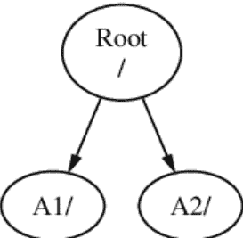

### 第 3 章. FreeBSD 基础

一个系统必须挂载到另一个系统的某个目录上。当将系统 B 挂载到目录 A1 上时，B 的根目录将替换 A1，B 中的目录也会随之出现：

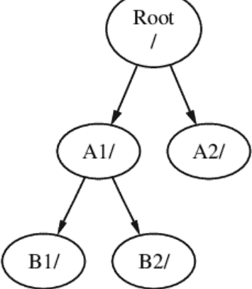

位于 B1 或 B2 目录中的任何文件都可以需要通过路径 `/A1/B1` 或 `/A1/B2` 访问。位于 `/A1` 的任何文件已被临时隐藏。当 B 从 A 卸挂载后，它们将重新出现。

如果 B 挂载在 A2 上，那么图示将如下：

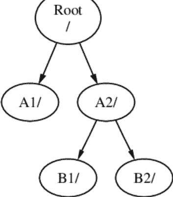

路径将分别为 `/A2/B1` 和 `/A2/B2`。

文件系统可以相互挂载。继续上一个例子，C 文件系统可以挂载在 B 系统的 B1 目录上，从而形成这种布局：

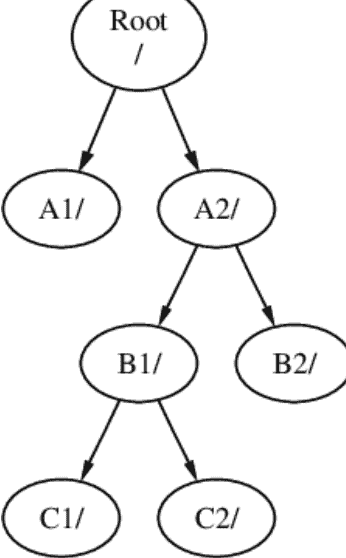

或者 C 也可以直接挂载到 A 系统，位于 A1 目录下：

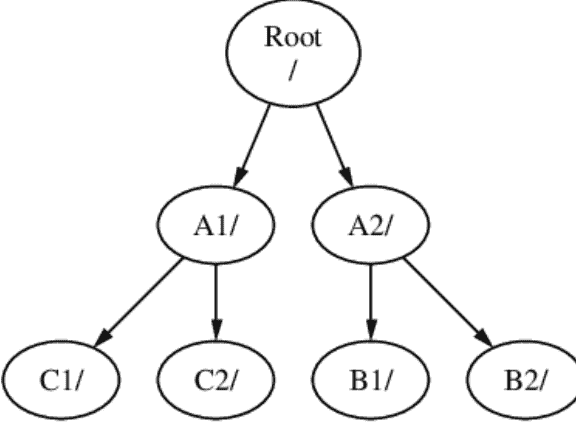

### 第 3 章. FreeBSD 基础

完全可以拥有一个大的根系统，而不需要创建其他系统。这种方法有一些缺点，也有一个优点。

- 不同的系统可以有不同的挂载选项。例如，根系统可以以只读方式挂载，使用户无法无意删除或编辑关键系统。将用户可写系统如 `/home` 与其他系统分离，允许它们以 `nosuid` 模式挂载。此选项可以防止存储在系统上的可执行文件的 `suid/guid` 位生效，从而可能提高安全性。
- FreeBSD 会根据系统的使用情况，自动优化系统上系统的布局。因此，包含许多频繁写入的小文件的系统，其优化方式将与包含较少、较大系统的系统不同。通过使用一个大系统，这种优化就失效了。
- FreeBSD 系统在掉电时是健壮的。然而，在关键时刻掉电仍可能损坏系统结构。通过将数据分散在多个系统上，系统更有可能启动，从而在需要时更容易从备份中恢复。
- 文件系统的大小是固定的。如果你在安装 FreeBSD 时创建一个系统并赋予它特定大小，以后你可能会发现需要增大分区。如果不进行备份、使用新大小重新创建系统并恢复备份的数据，这并不是容易完成的。

#### 重要说明

FreeBSD 拥有 `growfs(8)` 命令，它使得动态增加文件系统的大小成为可能，消除了这一局限性。

文件系统包含在分区中。由于 FreeBSD 的 UNIX® 传统，这与“分区”一词的常用用法含义不同。每个分区由字母 a 到 h 标识。由于每个分区只能包含一个文件系统，这意味着文件系统通常通过其在文件系统层次结构中的典型挂载点，或者其所在的分区字母来描述。

FreeBSD 还使用磁盘空间作为交换空间来提供虚拟内存。这允许你的计算机表现得比实际拥有的内存得多。当 FreeBSD 内存耗尽时，它会将一些当前未使用的数据移动到交换空间，并在需要时将其移回。

某些分区与其关联有特定的约定。

### 分区

| 分区 | 约定 |
| :--- | :--- |
| a | 正常文件包含根系统。 |
| b | 正常文件包含交换空间。 |
| c | 正常文件与包含它的切片大小相同。这允许需要处理整个切片的工具如坏块扫描器在 c 分区上工作。通常不会在此分区上创建系统。 |
| d | 分区 d 曾经有一个与之相关的特殊含义，尽管现在已消失，d 可以作为任何普通分区工作。 |

FreeBSD 中的磁盘被划分为切片，在 Windows® 中称为分区，编号从 1 到 4。这些切片接着被划分为分区，其中包含系统并用字母标记。

切片编号跟在设备名称之后，前缀为 `s`，从 1 开始。因此，“da0 s1”是第一个切片。所以 `da0 s1` 是第一个磁盘上的第一个切片。这些切片随后被划分为分区，包含系统，并使用字母标记。

切片编号跟在设备名称之后，前缀为 `s`，从 1 开始。因此，“da0 s1” 是第一个磁盘上的第一个切片。所以 `da0 s1` 是第一个磁盘上的第一个切片。

FreeBSD 中的磁盘被划分为切片，在 Windows® 中称为分区，编号从 1 到 4。这些切片随后被划分为分区，包含系统，并使用字母标记。

切片编号跟在设备名称之后，前缀为 `s`，从 1 开始。因此，“da0 s1” 是第一个磁盘上的第一个切片。最后，系统上的每个磁盘都有标识。磁盘名称以类型代码开头，然后是指示磁盘的，从 0 开始。

#### 表 3.3. 磁盘名称

| 驱动器类型 | 设备名称 |
| :--- | :--- |
| SATA 和 IDE 硬盘 | ada 或 ad |
| 硬盘 | da |
| 和 USB 存储设备 | cd |
| SATA 和 IDE 光驱驱动器 | cd 或 acd |
| SCSI 光驱驱动器 | scd |
| 软驱器 | fd |
| 各种非标准光驱驱动器 | mcd 用于明致光驱，scd 用于索尼光驱设备 |

| 驱动器类型 | 设备名称 |
| :--- | :--- |
| SCSI 磁带 | sa |
| IDE 磁带 | as |
| RAID 驱动器 | aacd 用于 Adaptec® AdvancedRAID，mlxxd 和 mlyd 用于 MylexR®，amrd 用于 AMI MegaRAID®，idad 用于 Compaq Smart RAID，wedd 用于 3ware® RAID。 |

### 示例 12. 示例磁盘及分区名称

| 名称 | 含义 |
| :--- | :--- |
| ada0s1a | 第 SATA 磁盘 `ada0` 上第一个切片 `s1` 的第一个分区 `a`。 |
| da1s2e | 第二个 SCSI 磁盘 `da1` 上第二个切片 `s2` 的第五个分区 `e`。 |

### 示例 13. 磁盘概念模型

此图显示了 FreeBSD 对连接到第一个 SATA 磁盘的视图。假设磁盘大小为 250 GB，包含 80 GB 的切片和一个 170 GB 的切片。第一个切片包含一个 Windows® NTFS 文件系统 C:，第二个切片包含一个 FreeBSD 安装。此示例安装有四个数据分区和一个交换分区。

这四个分区每个持有一个文件系统。分区 a 用于根文件系统，d 用于 `/var/`，f 用于 `/tmp/`，f 用于 `/usr/`。分区字母 c 指整个切片，因此不用于普通分区。

## 3.7. 文件系统的挂载与卸载

该系统最好被视作一棵树，其根节点是 `/dev`、`/usr` 等，而根目录下的其他目录是分支，这些分支可能有自己的分支，例如 `/usr/local` 等。

有多种理由将其中某些目录存放在单独的系统上。`/var` 包含 `log/`、`spool/` 目录以及各种类型的临时文件，因此可能会被占满。在根文件系统中填充数据不是一个好主意，因此将 `/var` 与 `/` 分开通常是有益的。

另一个将某些目录树包含在其他系统上的常见原因是，它们需要被存放在独立的物理磁盘上，或者是独立的虚拟磁盘，例如第 30.3 节描述的网络文件系统挂载，“网络文件系统 `NFS`”或 CD-ROM 驱动器。

### 3.7.1. fstab 文件

在启动过程中，第 13 节，FreeBSD 启动过程，`/etc/fstab` 中列出的系统会自动挂载，但包含 `noauto` 的条目除外。该文件包含以下格式的条目：

```
device /mount-point fstype options dumpfreq passno
```

- **device**: 如表 3.3 节“磁盘设备名称”中解释的现有设备名称。
- **mount-point**: 用于挂载文件系统的现有目录。
- **fstype**: 传递给 `mount(8)` 的文件系统类型。默认 FreeBSD 默认类型是 `ufs`。
- **options**: 读写系统使用 `rw`，只读系统使用 `ro`，随后是任何其他可能需要的选项。一个常用选项是用于通常在启动序列期间挂载的系统的 `noauto`。其他选项列在 `mount(8)` 中。
- **dumpfreq**: 由 `dump(8)` 使用，用于确定哪些系统需要备份。如果缺少该字段，则假设值为 0。
- **passno**: 决定检查系统的顺序。应该跳过的文件系统其 `passno` 设置为 0。根系统需要在所有系统之前进行检查，其 `passno` 应设置为 1。其他系统应设置为大于 1 的。如果多个系统具有相同的 `passno`，`fsck(8)` 将尝试尽可能并行检查这些系统。

有关 `/etc/fstab` 格式及其选项的信息，请参阅 `fstab(5)`。

### 3.7.2. 使用 mount(8)

使用 `mount(8)` 挂载文件系统。最基本的语法如下：

```
# mount device mountpoint
```


该命令提供了许多选项，这些选项在 `mount(8)` 中描述，最常用的选项包括：

- `-a` 挂载 `/etc/fstab` 中列出的所有系统，但标记为“noauto”、被 `-t ag` 排除的或已经挂载的系统除外。
- `-d` 执行除实际挂载系统系统调用以外的所有操作。此选项通常配合 `-v ag` 使用，以确定 `mount(8)` 实际上在尝试做什么。
- `-f` 强制挂载一个不干净的系统（危险的），或在降级时撤销写权限。
- `-a` 将系统的挂载状态从读写更改为只读。
- `-r` 以只读模式挂载系统。这等同于使用 `-o ro`。
- `-t ftype` 挂载指定的系统类型，或者如果包含 `-a`，则仅挂载给定类型的系统。“ufs”是默认的系统类型。
- `-u` 更新系统上的挂载选项。
- `-v` 详细模式。
- `-w` 以读写模式挂载系统。

以下选项可以逗号分隔列表的形式传递给 `-o`：

- `nosuid`: 不解释系统上的 `setuid` 或 `setgid` 标志。这也是一个非常有用的安全选项。

### 3.7.3. 使用 unmount(8)

使用 `unmount(8)` 卸载系统。该命令接受一个参数，可以是挂载点、设备名称、`-a` 或 `-A`。所有形式的 `-f` 用于强制卸载，`-v` 用于详细输出。请注意，`-f` 通常不是好主意，因为它可能会导致计算机崩溃或损坏系统上的数据。

要卸载所有系统，或仅卸载 `-t` 之后列出的系统类型，请使用 `-a` 或 `-A`。注意 `-A` 不尝试卸载根系统。

## 3.8. 进程与守护进程

FreeBSD 是一个多任务操作系统。任何时刻运行的每个程序都被称为进程。每个运行的命令至少启动一个新进程，并且由 FreeBSD 运行许多系统进程。

每个进程通过一个称为进程 ID `PID` 的数字唯一标识。与文件类似，每个进程都有一个所有者和一个组，所有者和组权限用于确定该进程可以打开哪些文件和设备。大多数进程还有一个启动它们的父进程。例如，shell 是一个进程，在 shell 中启动的任何命令都是进程，并以 shell 为其父进程。例外是一个特殊的进程 `init(8)`，它是启动时最启动的剩余进程，其 PID 始终为 1。

某些程序的设计并不是为了在持续用户输入的情况下运行，并在失去终端机会时断开终端连接。例如，Web 服务器响应 Web 请求，而不是用户输入。邮件服务器是此类应用的另一个例子。这些类型的程序被称为守护进程 `daemons`。“daemon”一词源于希腊神话，代表一个既不善也不恶、且隐形地执行有用任务的实体。这就是为什么 BSD 的吉祥物是一个穿着运动鞋、手持叉子、看起来很开心的守护进程。

通常作为守护进程运行的程序名称结尾带有“d”。例如，`httpd`、`ntpd`、`sshd`。`named` 是一个例子，`maild` 也是一个例子。

### 3.8.1. 查看进程

使用 `ps` 查看正在运行的进程。要查看所有运行的进程，可以使用 `ps -ax`。要查看特定用户的进程，可以使用 `ps -u <username>`。要查看按 CPU 使用率排序的进程，可以使用 `ps -sort=-cpu`。`top` 命令可以实时显示系统资源使用情况。

```
2623 root 1 30 10 12088K 1636K select 3 0:09 0.00% powerd
2338 dru 1 20 440M 84532K select 1 0:06 0.00% kwin
1427 dru 5 22 605M 86412K select 1 0:05 0.00% kdeinit4
```

输出分为两个部分。头部显示了最后一次运行进程的 PID、系统负载平均值、系统运行时间以及当前时间。头部中的其他数字与正在运行的进程数量、使用了多少内存和交换分区 `swap space` 以及系统在不同 CPU 状态下所花费的时间有关。

如果加载了 ZFS le 模块，ARC 行表示从内存缓存而非磁盘读取了多少数据。

头部下方是一系列列，包含与 `ps(1)` 输出类似的信息，例如 PID、用户名、CPU 时间量以及启动进程的命令。默认情况下，`top(l)` 还会显示进程占用的内存空间。这分为两列：一列总大小 `total size`，一列驻留大小 `resident size`。总大小是应用程序所需的内存，驻留大小是当前实际使用的内存。

`top(l)` 每两秒自动更新一次显示。可以通过 `-s` 指定不同的间隔。

## 3.8.2. 杀死进程

与任何运行进程或守护进程通信的一种方法是通过 `kill(1)` 发送信号。有很多不同的信号；某些具有特定含义，而另一些在应用程序的文档中有描述。

用户只能向其拥有的进程发送信号，向他人的进程发送信号将导致“拒绝访问”错误。例外是 root 用户，它可以向任何人的进程发送信号。

# 杀死进程

操作系统也可以向进程发送信号。如果一个应用程序编写得很糟糕并尝试访问它不应该访问的内存，FreeBSD 将向进程发送“段错误”信号 `SIGSEGV`。

如果一个应用程序被编写为使用 `alarm(3)` 系统调用以便在一段时间后获得警报，它将收到“闹钟”信号 `SIGALRM`。

可以使用两个信号来停止进程：`SIGTERM` 和 `SIGKILL`。`SIGTERM` 是杀死进程的礼貌方式，因为进程可以读取信号，关闭它可能打开的任何日志文件，并在关闭之前尝试完成它正在做的工作。在某些情况下，如果进程处于某些无法中断的任务中间，它可能会忽略 `SIGTERM`。

`SIGKILL` 不能被进程忽略。向进程发送 `SIGKILL` 将立即停止该进程。

其他常用的信号还有 `SIGHUP`、`SIGUSR1` 和 `SIGUSR2`。
由于这些是通用型信号，不同的应用程序的响应方式会有所不同。

例如，在更改 Web 服务器的配置文件后，需要告诉 Web 服务器重新读取配置。重启 `httpd` 会导致 Web 服务器出现短暂的停机时间。相反，向守护进程发送 `SIGHUP` 信号。请注意，不同的守护进程会有不同的行为，因此请参考该守护进程的文档确定 `SIGHUP` 是否能实现预期结果。

## 程序 3.1. 向进程发送信号

此示例显示了如何向 `inetd(8)` 发送信号。`inetd(8)` 的配置文件是 `/etc/inetd.conf`，当 `inetd(8)` 收到 `SIGHUP` 时，它将重新读取该配置文件。

- 1. 使用 `pgrep(1)` 找到要发送信号的进程 PID。在本示例中，`inetd(8)` 的 PID 为 198：

```
% pgrep -l inetd

198 inetd -wW
```

- 2. 使用 `kill(1)` 发送信号。由于 `inetd(8)` 由 root 所有，请使用 `su(1)` 变为 root。

```
% su
```
Password:

```
# /bin/kill -s HUP 198
```

与大多数 UNIX® 命令一样，`kill(1)` 如果执行成功将不会打印任何输出。如果向不属于该用户的进程发送信号，将显示消息 `kill: *PID*: Operation not permitted`。输错 PID 将导致将信号发送到错误的进程，或者将信号发送到当前未使用的 PID，导致错误 `kill: *PID*: No such process`。

为什么要使用 `/bin/kill`？

许多 shell 提供 kill 作为一个内置命令，这意味着 shell 会直接发送信号，而不是运行 `/bin/kill`。请注意，不同的 shell 在指定要发送的信号名称时具有不同的语法。与其尝试学习所有的语法，不如指定 `/bin/kill` 更加简单。

在发送其他信号时，将 TERM 或 KILL 替换为信号名称。

有几个任务是无法中断的。例如，如果进程正尝试从网络上另一台计算机读取文件，而另一台计算机不可用，则该进程被认为是“不可中断的”。进程最终将超时，通常在几分钟后。一旦发生超时，进程将被杀掉。

# 第 3 章 FreeBSD 基础

# 重要

杀死随机进程是一个坏主意。特别是，`init(8)` 1 是特殊的。执行 `kill -s KILL` 之前始终检查终端

## 3.9. Shell

Shell 提供了一个与操作系统交互的命令行界面。shell 接收输入并执行命令。FreeBSD 带有几种 shell，包括 Bourne shell `sh(1)` 和扩展 C shell `tcsh(1)`。

选择 shell 取个人喜好。C 程序员可能更喜欢 tcsh。shell 的一个常见功能是文件名补全。用户输入一些字母并按 Tab 键，会补全文件名。如果有多个文件匹配，shell 会显示选择。输入更多字符让 shell 确定文件名。

shell 的另一个功能是环境变量。环境变量是存储在 shell 中的键值对。该环境可以被 shell 调用的任何程序读取，因此包含了配置。环境变量名称总是大写的。表 3.4，“环境变量”提供了环境变量列表及其含义。

# 表 3.4 环境变量

| 变量 | 描述 |
|---|---|
| USER | 当前登录用户名。 |
| PATH | 搜索二进制文件的目录冒号列表。 |
| DISPLAY | 可用的要连接的 Xorg 显示名称。 |
| SHELL | 当前 shell。 |
| TERM | 用户终端类型的名称。用于确定终端的能力。 |
| TERMCAP | 执行各种终端功能的转义码数据库项。 |
| OSYPE | 操作系统的类型。 |
| MACHTYPE | CPU 架构。 |
| EDITOR | 用户偏好的文本编辑器。 |
| PAGER | 用户偏好的逐页查看工具。 |
| MANPATH | 搜索手册页的目录冒号列表。 |

设置环境变量在不同 shell 之间不同。在 `tcsh(1)` 和 `csh(1)` 中，使用 `setenv` 设置环境变量。在 `sh(1)` 和 bash 中，使用 `export` 设置环境变量。此示例为 `tcsh(1)` shell 将默认 `EDITOR` 设置为 `/usr/local/bin/emacs`：

```
% setenv EDITOR /usr/local/bin/emacs
```

bash 的对应命令为：

```bash
$ export EDITOR="/usr/local/bin/emacs"
```

为了展开环境变量以查看当前设置，在命令行上在其名称前输入 `$` 字符。例如，`echo $TERM` 显示当前的 `$TERM` 设置。

Shell 将特殊字符 `元字符` 视为数据的特殊表示。最常见的元字符是 `*`，它代表文件名中的任意数量的字符。元字符可以用于文件名通配。例如，`echo *` 等于 `ls`，因为 shell 获取了所有匹配 `*` 的文件并在 echo 在命令行中列出它们。

为了防止 shell 解释特殊字符，可以在该字符前加上反斜杠 `\` 来进行转义。

例如，`echo $TERM` 会打印终端设置，而 `echo \$TERM` 则字面上打印字符串 `$TERM`。

## 3.9.1. 更改 Shell

永久更改默认 shell 最简单的方法是使用 `chsh`。运行此命令将打开 `EDITOR` 环境变量中配置的编辑器，其默认设置为 `vi(1)`。将 `Change the Shell:` 行更改新 shell 的完整路径。

或者，使用 `chsh -s`，它可以在不打开编辑器的情况下设置指定的 shell。例如，将 shell 更改为 bash：

```
% chsh -s /usr/local/bin/bash
```

注意

新的 shell 必须存在于 `/etc/shells` 中。如果 shell 是如第 4 章“安装应用程序：软件包与端口”所述从 FreeBSD Ports 集合安装的，那么它应该被自动添加到此文件中。如果缺失，请使用此命令添加，并将路径替换为 shell 的实际路径：

```
# echo /usr/local/bin/bash >> /etc/shells
```

然后，重新运行 `chsh(1)`。

## 3.9.2. 高级 Shell 技术

由 Tom Rhodes 编写。

UNIX® shell 不仅仅是一个解释器，它还是一个强大的工具，允许用户执行命令、重定向输出、重定向输入并将命令组合起来以改进最终命令输出。当这些功能与内置命令结合时，用户将获得一个可以最大化效率的环境。

第 3 章 FreeBSD基础

Shell 重定向是将命令的输出或输入发送到另一个命令或文件中。例如，要将 `ls(1)` 命令的输出捕到一个文件中，请重定向输出：

```
% ls > directory_listing.txt
```

目录内容现在将列在 `directory_listing.txt` 中。某些命令可以读取输入，例如 `sort(1)`。要对此列表进行排序，请重定向输入：

```
% sort < directory_listing.txt
```

输入将被排序并显示在屏幕上。要将该输入重定向到另一个文件，可以通过混合方向来重定向 `sort(1)` 的输出：

```
% sort < directory_listing.txt > sorted.txt
```

在所有之前的示例中，命令都是使用文件描述符进行重定向。每个 UNIX® 系统都有文件描述符，包括标准输入 `stdin`、标准输出 `stdout` 和标准错误 `stderr`。每个都有其用途，输入可以是键盘或鼠标等提供输入的设备；输出可以是屏幕或打印机纸；错误可以是任何用于诊断或错误信息的内容。这三者都被视为基于 I/O 的描述符，有时也被视为流。

通过使用这些描述符，shell 允许在各种命令之间传递输出和输入。另一种重定向方法是管道运算符。

UNIX® 管道运算符 `|` 允许一个命令的输出直接传递或定向到另一个程序。基本上是，例如：

```
% cat directory_listing.txt | sort | less
```

在该示例中，`directory_listing.txt` 的内容将通过排序并将输出传递给 `less(1)`。这允许用户按照自己的节奏滚动输出，并防止其刷屏。

## 3.10. 文本编辑器

大多数 FreeBSD 配置是通过编辑文本文件完成的，因此熟悉文本编辑器是一个好主意。

FreeBSD 自带了一些基础系统的部分，而更多的在 Ports 集合中可用。

一个简单的易学编辑器是 `ee(1)`，全意为 "easy editor"。要启动此编辑器，输入 `ee filename`，其中 `filename` 是要编辑的文件名。一旦进入编辑器，所有操作编辑器功能的命令都列在显示器的顶部。光标符号 `^` 代表 `Ctrl`，因此 `^e` 扩展为 `Ctrl-e`。要退出 `ee(1)`，按 `Esc`，然后从主菜单选择“离开编辑器”选项。如果文件已修改，编辑器将提示保存任何更改。

FreeBSD 还作为基础系统的一部分自带了更强大的文本编辑器，例如 `vi(1)`。其他编辑器，如 `editors/emacs` 和 `editors/vim` 是 FreeBSD Ports 集合的一部分。这些编辑器提供了更多功能，代价是学习起来更复杂。从长远来看，学习如 vim 或 Emacs 这样更强大的编辑器可以节省更多时间。

许多修改文件或需要类型输入的应用程序将自动打开文本编辑器。要更改默认编辑器，请按照第 3.9 节“Shell”所述设置 `EDITOR` 环境变量。

## 3.11. 设备与设备节点

设备是一个主要用于系统中硬件相关活动的术语，包括磁盘、打印机、显卡和键盘。当 FreeBSD 启动时，大多数启动消息都会提及检测到的设备。启动消息的副本保存在 `/var/run/dmesg.boot` 中。

手册页

每个设备都有设备名称和编号。例如，`ada0` 是第一个 SATA 硬盘，而 `kbd0` 代表键盘。

FreeBSD 中的大多数设备必须通过位于 `/dev` 中的特殊设备节点访问。

## 3.12. 手册页

FreeBSD 上最全面的文档是以手册页的形式存在的。系统上的几乎每个程序都带有简短参考。要告诉 `man` 显示哪个章节，请指定该章节：

```
% man
```

手册页分为代表不同类型的章节。在 FreeBSD 中，以下是这些章节：

- 1. 用户命令。
- 2. 系统调用。
- 3. 库中的函数。
- 4. 设备驱动程序。
- 5. 文件格式。
- 6. 游戏和其他。
- 7. 杂项信息。
- 8. 系统管理。
- 9. 内核接口。

在某些情况下，同一个主题可能出现在多个章节中。例如，有一个 `chmod` 和一个 `chmod()`。

```
% man 1 chmod
```

如果手册页的名称未知，使用 `man -k` 在手册描述中搜索关键词：

```
% man -k mail
```

此命令显示描述中包含关键词“mail”的命令列表。这等同于使用 `apropos(1)`。

若要读取 `/usr/bin` 中所有命令的描述，输入：

```
% man -f *
```

或者

```
% cd /usr/bin
```

```
% whatis * | more
```

### 3.12.1. GNU Info 文件

FreeBSD 包含了若干由自由软件基金会 `FSF` 产生的应用程序和实用工具。除了手册页外，这些程序可能包括名为 info 文件的超文本文档。可以使用 `info(1)` 查看，或者如果安装了 `editors/emacs`，可以使用 emacs 的 info 模式。

要使用 `info(1)`，输入：

```
% info
```


获取快速介绍，输入 `h`。获取快速命令参考，输入 `?`。

85

# 第 4 章 安装应用程序：软件包与端口

## 软件包与端口

### 4.1. 概要

FreeBSD 作为基础系统的一部分带有丰富的系统工具集合。此外，FreeBSD 提供了两种互补的技术来安装第三方软件：FreeBSD Ports 集合（从源码安装）和软件包（从预编译二进制文件安装）。任何一种方法都可以从本地介质或网络安装软件。

阅读本章后，你将了解：

- 软件包与端口的区别。
- 如何查找已移植到 FreeBSD 的第三方软件。
- 如何使用 `pkg` 管理软件包。
- 如何使用 Ports 集合从源码构建第三方软件。
- 如何查找随应用程序安装的文件用于后期配置。

### 4.2. 软件安装概述

在 UNIX 系统上安装第三方软件的典型步骤包括：

- 1. 查找并下载软件，其可能以源码格式或二进制格式分发。
- 2. 从发行格式解压软件。这通常是使用 `compress(1)`、`gzip(1)`、`bzip2(1)` 或 `xz(1)` 等程序压缩的 tar 包。
- 3. 定位 `INSTALL`、`README` 或 `doc/` 子目录下的文件并阅读如何操作。
- 4. 安装软件。

4. 如果软件是以源码形式分发的，请将其编译。这可能涉及编辑 Makefile 或运行配置 脚本。

5. 测试并安装软件。

FreeBSD 端口（port）是一组文件的集合，旨在自动化从源代码编译应用程序的过程。构成端口的文件包含了自动下载、解压、打补丁（patch）、编译和安装该应用程序所需的所有信息。

如果该软件尚未在 FreeBSD 上经过适配和测试，则可能需要编辑源代码以确保能够正确安装和运行。

然而，已经有超过 24,000 个第三方应用程序被移植到 FreeBSD。在可行的情况下，这些应用程序以预编译包的形式提供下载。

可以使用 FreeBSD 软件包管理命令操作软件包。

软件包（packages）和端口（ports）都理解依赖关系。如果使用软件包或端口安装应用程序，且尚未安装依赖库，系统将自动安装该库。

#### 查找软件

FreeBSD 软件包包含应用程序所有命令的预编译副本，以及任何配置文件和文档。可以使用 `pkg(8)` 命令（如 `pkg install`）来操作软件包。

虽然这两种技术非常相似，但软件包和端口各有优劣。请根据您安装特定应用程序的需求选择合适的技术。

- 压缩后的软件包 tar 包通常比包含应用程序源代码的压缩 tar 包更小。
- 软件包不需要编译时间。对于像 Mozilla、KDE 或 GNOME 这样的大型应用程序，这在较慢的系统中可能非常重要。
- 软件包不需要了解在 FreeBSD 上编译软件的流程。
- 软件包通常使用保守的选项编译，因为它们必须在尽可能多的系统上运行。通过从端口编译，用户可以更改编译选项。
- 某些应用程序具有与安装哪些功能有关的编译时选项。例如，Apache 可以配置为多种不同的内置选项。

在某些情况下，同一个应用程序会存在多个软件包以指定特定的设置。例如，Ghostscript 有 `ghostscript` 软件包和 `ghostscript-nox11` 软件包可供，取决于是否安装了 Xorg。如果一个应用程序具有两个或两个不同的编译时选项，创建多个软件包将迅速变得不可能。

- 某些软件的许可条件禁止二进制分发。此类软件必须以源代码形式分发，并必须由最终用户进行编译。
- 一些人不信任二进制分发，或者倾向于通过阅读源代码来寻找潜在问题。
- 为了应用自定义补丁，需要源代码。

为了跟踪更新的端口，请订阅 [FreeBSD 端口邮件列表](https://www.freebsd.org/archives/ports-lists/) 和 [FreeBSD 端口错误邮件列表](https://www.freebsd.org/archives/ports-bugs-list/)。

警告：在安装任何应用程序之前，请检查 https://www.freebsd.org 查看与应用程序相关的安全问题，或运行 `pkg audit -F` 来检查已安装程序的已知漏洞。本章的剩余部分将解释如何使用软件包和端口在 FreeBSD 上安装和管理第三方软件。

### 4.3. 查找软件

FreeBSD 的可用应用程序列表不断增长。有多种方法可以找到要安装的软件：

- FreeBSD 网站在 https://www.FreeBSD.org/ports/ 维护着一个最新的可搜索的可用应用程序列表。可以通过应用程序名称或软件类别搜索端口。
- FreshPorts.org 提供了一个全面的搜索工具，并跟踪端口集合中应用程序的更改。用户可以创建自定义的关注列表，以便在关注的端口更新时接收自动 电子邮件。
- 如果查找特定应用程序变得困难，请尝试搜索 SourceForge.net 或 GitHub.com 等网站，然后返回 FreeBSD 网站查看应用程序是否已移植。
- 搜索二进制包仓库中的应用程序：

```bash
# pkg search subversion
git-subversion-1.9.2
java-subversion-1.8.8
pkg5-subversion-1.8.2
py27-subversion-1.6
py27-subversion-1.8.2
ruby-subversion-8.8.2
subversion-8.8.2
```

软件包名称包含版本号，在端口的情况下，还包含构建软件包时使用的 python 版本。某些端口还提供多个可用版本。在 Subversion 的情况下，也有不同的版本和不同的编译选项可供。在指定要安装哪个软件包时，最好通过端口源（origin）指定应用程序，即端口树中的路径。使用 `-o` 重复 `pkg search` 以列出每个软件包的源：

```bash
# pkg search -o subversion
devel/git-subversion
java/java-subversion
devel/pkg5-subversion
devel/py27-subversion
devel/ruby-subversion
devel/subversion-16
devel/subversion-17
devel/subversion-book
devel/subversion-static
```

`pkg search` 还支持通过 shell 通配符（shell globs）、正则表达式、精确匹配、按描述或仓库数据库中的任何其他字段进行搜索。在安装 `ports-mgmt/pkg` 或 `ports-mgmt-devel` 后，请参见 `pkg-search(8)` 更多详情。

- 如果已安装了端口集合，有几种方法可以查询本地端口版本。要查找端口属于哪个类别，输入 `whereis file`，其中 `file` 是要安装的程序：

```bash
# whereis lsof
lsof: /usr/ports/sysutils/lsf
```

或者，可以使用 `echo(1)` 语句：

```bash
# echo /usr/ports/*lsf*
/usr/ports/sysutils/lsf
```

注意，这将返回下载到 `/usr/ports` 的任何匹配文件。

- 另一种方法是进入 `/usr/ports` 然后运行 `make search name=program-name`，其中 `program-name` 是软件名称。例如，搜索 lsof：

```bash
# cd /usr/ports
make search name=lsof
```
Port: lsof-4.8.2
Path: /usr/ports/sysutils/lsof
Info: 关于打开文件的信息（类似于 fstat(1))
Maint: ler@lerctr.org
Index: sysutils

提示：内置搜索机制使用一个索引文件。如果消息显示需要 `INDEX`，请运行 `make fetchindex` 下载当前索引文件。有了 `INDEX`，`make search` 就能执行请求的搜索。“Path:” 行指示端口的位置。

要获取更少的信息，使用 `quicksearch` 功能：

```bash
# cd /usr/ports
make quicksearch name=lsof
```
Port: lsof-4.8.2
Path: /usr/ports/sysutils/lsof
Info: 关于打开文件的信息（类似于 fstat(1))

为了进行更深层次搜索，使用 `make search key= string` 或 `make quicksearch key= string`，其中 `string` 是要搜索的文本。文本可以是注释、描述或依赖关系中的，以便在程序名称未知时找到与特定主题相关的端口。

当使用 `search` 或 `quicksearch` 时，搜索字符串是不区分大小写的。搜索“LSOF”得到的结果与搜索“lsof”相同。

### 4.4. 使用 pkg 进行二进制软件包管理

`pkg` 是传统 FreeBSD 软件包管理工具的下一代替代品，提供了许多功能，使得处理二进制软件包更快、更方便。

对于希望仅使用 FreeBSD 镜像中预构建二进制软件包的站点，使用 `pkg` 管理软件包就足够了。

然而，对于那些从源码构建或使用自定义仓库的站点，将需要独立的端口管理工具。

由于 `pkg` 仅适用于软件包，因此它不能替代此类工具。这些工具可以用于安装了来自二进制包和 Ports Collection 的软件，而 `pkg` 仅安装二进制包。

#### 4.4.1. 使用 pkg 入

FreeBSD 包含一个引导程序，可用于下载和安装 `pkg` 及其手册页。该工具设计用于从 10.X 开始的 FreeBSD 版本。

第 4 章. 安装应用程序：软件包与 Ports

注意

并非所有的 FreeBSD 版本和架构都支持此引导过程。
当前列表位于 https://pkg.freebsd.org/。对于其他情况，必须从 Ports Collection 或作为二进制包安装 `pkg`。

要引导系统，请运行：

```bash
# /usr/sbin/pkg
```

你必须拥有可 Internet 连接才能成功完成引导。

否则，要安装 port，请运行：

```bash
# cd /usr/ports/ports-mgmt/pkg
```

```bash
# make
```

```bash
# make install clean
```

在升级原本使用旧版 `pkg_*` 工具的现有系统时，必须将数据库转换为新格式，以便新工具识别已安装的包。一旦安装了 `pkg`，必须运行此命令将软件包数据库从传统格式转换为新格式：

```bash
# pkg2ng
```

注意

对于尚未安装任何第三方软件的新安装，不需要此步骤。

重要

此步骤是不可逆的。一旦软件包数据库被转换为 `pkg` 格式，就不应再使用传统的 `pkg_*` 工具。

注意

由于内容转换为新版本，软件包数据库转换可能会输出错误。通常，这些错误可以安全地忽略。然而，在 `pkg2ng` 完成后会显示未成功转换的软件列表。这些应用程序必须手动重新安装。

为了确保 Ports Collection 使用 `pkg` 注册新软件而不是传统的软件包数据库，10.X 之前的 FreeBSD 版本需要在 `/etc/make.conf` 中包含此行内容：

```make
WITH_PKGNG= yes
```

默认情况下，`pkg` 使用 FreeBSD 软件包镜像（仓库）中的二进制包。有关构建自定义软件包仓库的信息，请参阅第 4.6 节“使用 Poudriere 构建软件包”。

季度与最新 Ports 分支

额外的 `pkg` 配置选项在 `pkg.conf(5)` 中描述。

`pkg` 的用法信息可以通过 `.pkg(8)` 手册页或运行不带额外参数的 `pkg` 获取。每个 `pkg` 命令参数在特定命令的手册页中都有说明。例如，要读取 `pkg install` 的手册页，请运行以下任意命令：

```bash
# pkg help install
```

```bash
# man pkg-install
```

本节的其余部分演示了可以使用 `pkg` 执行的常用二进制包管理任务。每个演示命令都提供了许多开关来自定义其用法。详情和更多示例请参考命令的帮助或 man 页面。

#### 4.4.2. 季度与最新 Ports 分支

季度分支为用户提供了 port 和软件包安装与升级更具预测性和稳定的体验。这本质上通过仅允许非功能更新来实现。季度分支旨在接收安全修复（可能是版本更新，或提交的回传）、错误修复以及 Ports 合规性或框架更改。季度分支在每（ yearly）季初（1月、4月、7月和10月）从 HEAD 切分。分支根据其创建的年份（YYYY）和季度（Q1-4）命名。例如，2016年1月创建的季度分支命名为 2016Q1。而最新分支则为用户提供最新版本的软件包。

要从季度切换到最新分支，请运行以下命令：

```bash
# cp /etc/pkg/FreeBSD.conf /usr/etc/pkg/repos/FreeBSD.conf
```

编辑 `/usr/local/etc/pkg/repos/FreeBSD.conf`并将 `url:` 行中的字符串 `quarterly` 更改为 `latest`。结果应类似于：

```text
FreeBSD: {
url: "pkg+http://pkg.FreeBSD.org/${ABI}/latest",
mirror_type: "srv",
signature_type: "fingerprints",
fingerprints: "/usr/share/keys/pkg",
enabled: yes
}
```

最后运行此命令以从新的（最新）仓库元数据进行更新。

```bash
# pkg update -f
```

#### 4.4.3. 获取已安装软件包的信息

可以通过运行 `pkg info` 来查看系统上安装的软件包的信息，当 `pkg info` 在不带任何开关运行时，它将列出所有安装软件包或指定软件包的版本。

例如，要查看安装了哪个版本的 `pkg`，请运行：

```bash
# pkg info pkg
pkg-1.1.4_1
```

#### 4.4.4. 安装和删除软件包

要安装二进制包请使用以下命令，其中 `packagename` 是要安装的包名：

```bash
# pkg install packagename
```

此命令使用仓库数据来确定安装哪个版本的软件，以及它是否有任何未安装的依赖项。例如，安装 `curl`：

```bash
# pkg install curl
```

第 4 章. 安装应用程序：软件包与 Ports

更新仓库目录

/usr/local/tmp/All/curl-7.3.0_1.txz（等待，OCR 在此处有些噪音，我将根据流程清理解构的输出）

```bash
# pkg install curl
```

更新仓库目录

/usr/local/tmp/All/curl-7.3.0_1.txz 100% of（实际上，提供的 OCR 文本在这里非常杂乱）

#### 4.4.5. 升级已安装的软件包

可以通过运行以下命令将已安装的软件包升级到最新版本：

```bash
# pkg upgrade
```

#### 4.4.6. 审计已安装的软件包

第三方应用程序经常发现漏洞。为了解决这个问题，`pkg` 包含了内置的审计机制。要确定系统上的软件是否存在已知漏洞，请运行：

```bash
# pkg audit -F
```

#### 4.4.7. 自动删除未使用的软件包

删除软件包可能会留下不再需要的依赖项。作为依赖安装的需要的软件包（叶包）可以使用命令自动检测并删除：

```bash
# pkg autoremove
```

#### 4.4.8. 恢复软件包数据库

与传统的软件包管理系统不同，`pkg` 包含了自身的软件包数据库备份机制。

此功能默认启用。

提示

要禁用定期脚本备份软件包数据库，请设置 `daily_backup_p-` `periodic.conf(5)` 中的 `kgdb_enable="NO"`。

要恢复之前的软件包数据库备份内容，请运行以下命令，并将 `/path/to/pkg.sql` 替换为备份文件的位置：

```
# pkg backup -r /path/to/pkg.sql
```

注意

如果恢复的是由 `periodic` 脚本创建的备份，则在恢复之前必须进行解压。

94

# 第 4 章 安装应用程序：软件包与 Ports

要对 `pkg` 数据库进行手动备份，请运行以下命令，并将 `/path/to/pkg.sql` 替换为合适的名称和位置：

```
# pkg backup -d /path/to/pkg.sql
```

#### 4.4.9. 移除过时的软件包

默认情况下，`pkg` 将二进制包存储在 `pkg.conf(5)` 中由 `PKG CACHEDIR` 定义的缓存目录下。它只保留最新安装软件包的副本。旧版本的 `pkg` 保留在之前的软件包中。要移除过时的二进制包，请运行：

```
# pkg clean
```

可以通过运行以下命令清除整个缓存：

```
# pkg clean -a
```

#### 4.4.10. 修改软件包源

FreeBSD Ports Collection 内的软件可能会发生主版本更改。为了解决这个问题，`pkg` 内置了一个命令来更新软件包的源（origin）。这非常有用，例如，如果 `lang/php5` 被重命名为 `lang/php53`，那么 `lang/php5` 现在就可以代表版本 5.4。

要更改上述示例中的软件包源，请运行：

```
# pkg set -o lang/php5:lang/php53
```

另一个示例是将将 `lang/ruby18` 更新为 `lang/ruby19`，运行：


```
# pkg set -o lang/ruby18:lang/ruby19
```

最后一个示例是，将 `libglut` 共享库的源从 `graphics/libglut` 更改为 `graphics/freeglut`，运行：

```
# pkg set -o graphics/libglut:graphics/freeglut
```

注意

在更改软件包源时，重新安装依赖于已修改源软件包的软件包是重要的。要强制重新安装依赖包，请运行：

```
# pkg install -Rf graphics/freeglut
```

## 4.5. 使用 Ports Collection

Ports Collection 是一组 Makefile、补丁和描述文件。每一组这些文件都用于在 FreeBSD 上编译和安装单个应用程序，被称为一个“port”（端口）。

默认情况下，Ports Collection 本身存储在 `/usr/ports` 的一个子目录下。

警告

在安装和使用 Ports Collection 之前，请注意，通常不建议将 Ports Collection 与 `pkg` 提供的二进制包结合使用安装软件；因为 `pkg`

默认跟踪的是 ports 树的季度分支版本（quarterly branch-releases），而不是 HEAD。

95

### 使用 Ports Collection

与季度分支发布中的对应版本相比，HEAD 版本的 port 可能会依赖项可能不同，这可能导致由 `pkg` 安装的依赖项与来自 Ports Collection 的依赖之间发生冲突。如果必须结合使用 Ports Collection 和 `pkg`，请确保你的 Ports Collection 和 `pkg` 处于 ports 树的同一个分支版本上。

在可以使用 port 编译应用程序之前，必须先安装 Ports Collection。如果在安装 FreeBSD 时没有安装它，请使用以下方法之一进行安装：

### 步骤 4.1. Portsnap 方法

FreeBSD 基础系统包含了 Portsnap。这是一个快速且用户友好的工具，用于获取 Ports Collection，是大多数未运行 FreeBSD-CURRENT 用户的推荐选择。该实用程序连接到 FreeBSD 站点，验证安全密钥，并下载 Ports Collection 的新副本，同时验证所有下载文件的完整性。

- 1. 将 Ports Collection 的压缩快照下载到 `/var/db/portsnap`：

```
# portsnap fetch
```

- 2. 第一次运行 Portsnap 时，将快照提取到 `/usr/ports`：

```
# portsnap extract
```

- 3. 在使用 Portsnap 后，可以通过运行以下命令更新 `/usr/ports`：

```
# portsnap fetch
# portsnap update
```

在使用 `fetch` 后，可以连续运行：

```
# portsnap update
```

### 步骤 4.2. Subversion 方法

如果需要对 ports 树进行更细致的控制，或者在运行 FreeBSD-CURRENT，可以使用 Subversion。关于 Subversion 的详细信息请参考相关文档。

- 1. 在使用 Subversion 之前必须安装它。如果已经存在 ports 树的副本，可以通过以下方式安装：

```
# pkg install subversion
```

如果使用 `pkg` 管理软件包，则需要安装：

```
# pkg install subversion
```

- 2. 检出 HEAD 分支版本：

```
# svn checkout https://svn.freebsd.org/ports head
```

- 3. 或者，检出季度分支版本：

```
# svn checkout https://svn.freebsd.org/ports branches/2020q3
```

- 4. 根据需要，在初始检出后更新 ports：

```
# svn update
```

- 5. 根据需要，切换到不同的季度分支：

```
# svn switch branches/2020q4
```

Ports Collection 包含了软件分类。每个分类下都有各个应用程序的子目录。每个子目录都是一个 port skeleton（端口框架），包含以下文件和目录：

- `Makefile`：定义了如何在 FreeBSD 上编译和安装应用程序的语句。
- `distinfo`：包含必须下载的文件的名称和校验和值。
- `files/` 目录：包含了在 FreeBSD 上应用所需的所需的补丁。
- `pkg-descr`：提供了该程序的详细描述。
- `pkg-plist`：列出了将安装到系统的所有文件。
- `pkg-message`：用于处理特殊情况的其他文件。

port 不包含实际源代码，源代码被称为 `distfile`。构建 port 的提取部分会将源代码保存到 `/usr/ports/distfiles`。

96

第 4 章 安装应用程序：软件包与 Ports

### 4.5.1. 安装 Ports

本节提供了使用 Ports Collection 安装或移除软件的基本说明。可用 make target 和环境变量的详细说明见 `ports(7)`。

警告

在编译任何 port 之前，请按照前面的部分更新 Ports Collection。由于安装第三方软件可能会引入漏洞，建议检查 https://www.freebsd.org 与该 port 相关的安全问题。或者在安装新 port 前运行 `pkg audit -F`。该命令可以配置为每日系统检查期间自动执行安全审计和漏洞数据库更新。更多信息请参考 `pkg-audit(8)` 和 `periodic(8)`

使用 Ports Collection 假设具有可用的互联网连接。它还需要超级用户权限。

要编译并安装 port，进入要安装的 port 目录，然后在提示符输入 `make install`。消息将显示进度：

265

```
# cd /usr/ports/sysutils/lsof

# make install

>> lsof_4.88D.freebsd.tar.gz 似乎不存在 /usr/ports/distfiles/ 中

>> 尝试从 ftp://lsof.itap.purdue.edu/pub/tools/unix/lsof/ 获取
>> 正在提取 lsof-4.88
...
[提取输出省略]
...
>> lsof_4.88D.freebsd.tar.gz 校验通过。
```

264

97

安装 Ports

>> 正在补丁 lsof-4.88.d,8

>> 正在应用 FreeBSD 补丁 lsof-4.88.d,8

>> 正在配置 lsof-4.88.d,8

...

[配置输出省略]

...

>> 正在构建 lsof-4.88.d,8

...

[编译输出输出]

```


```

===> Installing for lsof-4.88.d,8

```

[installation output snipped]

```

===> Generating temporary packing list

```

```

===> Compressing manual pages for lsof-4.88.d,8

```

```

===> Registering installation for lsof-4.88.d,8

```

# ===> 安全注意事项：

此端口安装了以下以高权限执行的二进制文件。

/usr/local/sbin/lsof

由于 lsof 是一个以高权限运行的程序，因此在安装时会显示安全警告。安装完成后，系统将返回提示符。

某些 shell 会对 PATH 环境变量中列出的目录下的可用命令进行缓存，以加快对这些命令的可执行文件的查找操作。使用 bash shell的用户应该输入 `rehash`，以便在不指定完整路径的情况下使用新安装的命令。对于该 shell，请使用 `hash -r` 代替。更多信息请参阅该 shell 的文档。

在安装过程中，会创建一个工作子目录，其中包含了编译期间用到的所有临时文件。删除此目录可以节省磁盘空间，并减少以后升级到端口新版本时出现问题的概率：

```

# make clean

```

```

===> Cleaning for lsof-4.88.d,8

```

# 注意

为了节省这一额外步骤，在编译端口时请使用 `make install clean`。

## 4.5.1.1. 自定义端口安装

某些端口提供了构建选项，可用于启用或禁用应用程序组件、提供安全选项或允许其他自定义。示例包括 www/firefox、security/gpgme 和 mail/sylvpeed-claws。如果该端口依赖于其他具有可配置选项的端口，它可能会多次暂停以等待用户交互，因为默认行为是提示用户从菜单中选择选项。为了避免这种情况并一次性完成所有配置，请在端口目录（port skeleton）中运行 `make config-recursive`。然后，运行 `make install [clean]` 来编译并安装该端口。

### 提示

在使用 `config-recursive` 时，待配置的端口列表将由 `all-dependencies-list` 目标收集。建议运行 `make config-recursive` 直到所有依赖端口选项都已定义，且端口选项屏幕不再出现，以确保依赖选项已配置完成。

有几种方法可以重新访问端口构建选项菜单，以便在端口构建后添加、删除或更改这些选项。一种方法是进入包含端口的目录并输入 `make config`。另一个选项是使用 `make showconfig`。另一种选项是执行 `make rmconfig`，它将移除所有已选选项并允许你重新开始。所有选项和其他选项在 ports(7) 中都有详细说明。

端口系统使用 `fetch(1)` 下载源码，该程序支持多种环境变量。如果 FreeBSD 系统位于防火墙或 FTP/HTTP 代理之后，可能需要设置 `FTP_PASSIVE_MODE`、`FTP_PROXY` 和 `FTP_PASSWORD` 变量。请查看 fetch(3) 获取支持的变量完整列表。

对于此时无法连接互联网的用户，可以在 `/usr/ports` 内运行 `make fetch` 来获取所有源码文件（distfiles），或者在某个类别（如 `/usr/ports/net`）或特定的端口目录内运行。请注意，如果一个端口有任何依赖项，在类别或端口目录中运行此命令将不会获取另一个类别的端口源码文件。相反，请使用 `make fetch-recursive` 来同时获取该端口所有依赖项的源码文件。

在少数情况下（例如组织拥有本地源码文件仓库），可以使用 `MASTER_SITES` 变量来覆盖 Makefile 中指定的下载位置。使用时，请指定备用位置：

```

# cd /usr/ports/ directory

```

```

# make MASTER_SITE_OVERRIDE=\
ftp:/ftp.organization.org/pub/FreeBSD/ports/distfiles/

```

`WRKDIRPREFIX` 和 `PREFIX` 变量可以覆盖默认的工作目录和目标目录。例如：

```

# make WRKDIRPREFIX=/usr/home/example/ports install
```
将在 `/usr/home/example/ports` 中编译端口并将所有内容安装在 `/usr/local` 下。

```

# make PREFIX=/usr/home/example/local install
```
将在 `/usr/home/ports` 中编译端口并将其安装在 `/usr/home/example/local` 中。
并且：

```

# make WRKDIRPREFIX=../ports PREFIX=../local install
```
将两者结合使用。

这些也可以设置为环境变量。请参阅你 shell 的手册页了解如何设置环境变量。

## 4.5.2. 移除已安装的端口

可以使用 `pkg delete` 卸载已安装的端口。该命令的示例可见 pkg-delete(8) 手册页。

或者，可以在端口目录中运行 `makeinstall`：

```

# cd /usr/ports/sysutils/lsof

```

```

# make deinstall

```

```

==> Uninstalling for sysutils/lsof

```

```

==> Deinstalling

```

已请求对以下 1 个包进行卸载：
Lsof-4.88.d,8

卸载将释放 229 kB

[1/1] Deleting lsof-4.88.d,8... done

建议在卸载端口时阅读输出的提示信息。如果该端口有任何依赖它的应用程序，将显示此类信息，但卸载将继续进行。在这种情况下，最好重新安装该应用程序以防止依赖损坏。

## 4.5.3. 升级端口

随着时间的推移，软件中出现了新版本。本节描述了如何确定哪些端口可以升级以及如何执行升级。

要确定是否有可用的新版本端口，请确保安装了最新的端口树，方法见 [4.1 "Portsnap 方法"] 或 [4.2 "Subversion 方法"]。在 FreeBSD 10 及更高版本上，如果系统已转换为 pkg，使用以下命令将列出过期的端口：

```

# pkg version -l "<"
```

对于 FreeBSD 9. 及以下版本，使用以下命令将列出过期的端口：

```

# pkg_version -l "<"
```

### 重要

在尝试升级之前，请阅读 `/usr/ports/UPDATING` 自上次升级或安装系统以来的内容。该文件描述了用户在更新端口时可能遇到的各种问题和额外步骤，例如格式更改、文件位置变化或与旧版本的兼容性问题。请记录需要升级的端口对应的说明并遵循这些说明。

#### 4.5.3.1. 升级和管理端口的工具

Ports Collection 包含了几个执行实际升级的工具。它们各有优劣。历史上，大多数安装使用 Portmaster 或 Portupgrade。Synth 是一个较新的替代方案。

### 注意

哪种工具适合特定的系统取决于系统管理员。建议在使用任何这些工具之前备份你的数据。

#### 4.5.3.2. 使用 Portmaster 升级端口

ports-mgmt/portmaster 是一个用于升级已安装端口的小型工具。它设计用于依赖 FreeBSD 系统自带的其他端口或数据库。要作为端口安装此工具：

```

# cd /usr/ports/ports-mgmt/portmaster

```

```

# make install clean
```

Portmaster 定义了四类端口：

- 根端口（Root port）：没有依赖，也不是其他端口的依赖。
- 主干端口（Trunk port）：没有依赖，但其他端口依赖它。
- 分支端口（Branch port）：有依赖且其他端口也依赖它。
- 叶子端口（Leaf port）：有依赖，但没有其他端口依赖它。

列出这些类别并搜索更新：

```

# portmaster -L
```

```

==>>> Root ports (No dependencies, not depended on)

==>>> ispell-3.2.06_18

==>>> screen-4.0.3

==>>> New version available: screen-4.0.3_1

==>>> tcpflow-0.21_1

==>>> 7 root ports

```


==>>> 叶节点端口（有依赖，但不被依赖）

==>>> automake-1.9.6_2

==>>> bash-3.1.17

==>>> 有新可用：bash-3.2.33

...

==>>> 32 个叶节点端口

==>>> 137 个已安装端口

==>>> 83 个有新版本可用

此命令用于升级所有过时的端口：

# portmaster -a

注意

默认情况下，Portmaster 在删除现有端口之前会创建一个备份包。如果新版本安装成功，Portmaster 将删除该备份。使用 -b 参数可指示 Portmaster 不要自动删除备份。添加 -i 参数将以交互模式启动 Portmaster，在升级每个端口之前提示用户进行确认。此外还有许多其他可用选项。请参阅 `portmaster(8)` 帮助页以获取有关其用法的详细信息。

如果在升级过程中遇到错误，添加 -f 来升级并重新构建所有端口：

# portmaster -af

Portmaster 还可以用于在系统上安装新端口，在构建和安装新端口之前升级所有依赖项。要使用此功能，请指定 Ports Collection 中的端口位置：

```bash

# portmaster shells/bash

```

关于 `ports-mgmt/portmaster` 的更多信息可以在其 `pkg-descr` 中找到。

### 4.5.3.3. 使用 Portupgrade 升级端口

ports-mgmt/portupgrade 是另一个可用于升级端口的工具。它安装了一套用于管理端口的应用程序。然而，它依赖于 Ruby。要安装该端口：

```

# cd /usr/ports/ports-mgmt/portupgrade

# make install clean
```

在使用此工具执行升级之前，建议使用 `pkgdb -F` 扫描已安装端口列表，并修复其报告的所有不一致之处。

要升级系统上安装的所有过时端口，请使用 `portupgrade -a`。或者，包含 -i 参数在每次单独的升级时请求确认：

```bash

# portupgrade -ai
```


只需升级指定的应用程序而不是所有可用端口，请使用 `portupgrade pkgname`。包含 `-R` 参数以列出该应用程序所需的所有端口是非常重要的：

```bash
# portupgrade -R firefox
```

如果包含了 `-P`，Portupgrade 会在 `PKG_PATH` 列出的本地目录中搜索可用包。如果没有找到，它将从远程站点获取包。如果无法在本地找到或从远程获取包，Portupgrade 将使用 ports。若要完全避免使用 ports，请指定 `-PP`。最后这个选项列表告诉 Portupgrade 在没有可用包时终止：

```bash
# portupgrade -PP gnome3
```

如果指定了 `-P`，则仅获取端口源码包（distfiles）或包，而不构建或安装任何内容，此时请使用 `-F`。有关所有所有可用开关的更多信息，请参阅 `portupgrade` 的帮助页。

关于 `ports-mgmt/portupgrade` 的更多信息可以在其 `pkg-descr` 中找到。

### 4.5.4. 端口与磁盘空间

使用 Ports Collection 会随着时间推占用磁盘空间。在构建并安装端口后，在端口框架内运行 `make clean` 将使用临时工作目录。如果使用 Portmaster 安装端口，除非指定 `-K`，否则会自动删除此目录。如果安装了 Portupgrade，此命令将删除 Ports Collection 本地副本发现的所有工作目录：

```bash
# portsclean -C
```

此外，过时的源码发行版随时间推积在 `/usr/ports/distfiles` 中。使用 Portupgrade 删除不再被任何端口引用的 distfiles：

```bash
# portsclean -D
```

Portupgrade 可以移除系统当前安装的任何端口未引用的 distfiles：

```bash
# portsclean -DD
```

如果安装了 Portmaster，请使用：

```bash
# portmaster --clean-distfiles
```

默认情况下，此命令是交互式的，并提示用户确认是否删除 distfile。除了这些命令外，`ports-mgmt/pkg_cutleaves` 自动完成移除不再需要的安装端口的任务。

## 4.6. 使用 Poudriere 构建包

Poudriere 是一个 BSD 许可的工具，用于创建和测试 FreeBSD 包。它使用 FreeBSD jails 来建立隔离的编译环境。这些 jails 可以用于构建与安装系统不同的 FreeBSD 版本包，并且当主机为 amd64 系统时，为 i386 构建包。一旦构建了包，它们的布局与官方镜像完全相同。这些包可以被 `pkg(8)` 和其他包管理工具使用。

Poudriere 通过 `ports-mgmt/poudriere` 包或端口安装。安装过程包含一个位于 `/usr/local/etc/poudriere.conf.sample` 的示例配置文件。将此文件复制到 `/usr/local/etc/poudriere.conf`。编辑复制的文件以适应本地配置。

运行 poudriere 的系统不需要 ZFS，但使用它是有益的。当使用 ZFS 时，必须在 `/usr/local/etc/poudriere.conf` 中指定 `ZPOOL`，并将 `FREEBSD_HOST` 设置为附近的镜像。定义 `CACHE_DIR` 允许使用 `devel/ccache` 来缓存编译和...

11amd64-local-workstation -make.conf 系统的 make.conf 和此新文件在构建时合并，以创建构建围狱（jail）使用的 make.conf。

要构建的软件包列录在 11amd64-local-workstation -pkglist 中：

- editors/emacs
- devel/git
- ports-mgmt/pkg
...

配置指定端口的选项和依赖关系：

```bash
# poudriere options -j 11amd64-p local -z workstation -f 11amd64-local-workstation-pkglist
```

最后，构建软件包并创建一个包仓库：

```bash
# poudriere bulk -j 11amd64-p local -z workstation -f 11amd64-local-station-pkglist
```

在运行期间，按下 Ctrl+t 可以显示构建的当前状态。
Poudriere 还会在 `/poudriere/logs/bulk/jailname` 目录下构建文件，这些文件可以配合 Web 服务器显示构建信息。

完成后，新的软件包现在可以从 poudriere 仓库进行安装了。

有关如何使用 poudriere 的更多信息，请参见 `poudriere(8)` 和主网站：https://github.com/freeb-sd/poudriere/wiki。

## 4.6.2. 配置 pkg 客户端使用 Poudriere 仓库

虽然可以在官方仓库的同时使用自定义仓库，但有时禁用官方仓库是有用的。这通过创建一个覆盖并禁用官方配置文件的配置来实现。创建 `/usr/local/etc/pkg/repos/FreeBSD.conf` 包含以下内容：

```
FreeBSD: {
enabled: no
}
```

通常，通过 HTTP 向客户端机器提供 poudriere 仓库是最简单的。设置一个 Web 服务器来提供包目录，例如：`/usr/local/poudriere/data/packages/11amd64`，其中 11amd64 是构建的名称。

如果包仓库的 URL 为：http://pkg.example.com/11amd64，那么 `/usr/local/etc/pkg/repos/custom.conf` 中的仓库配置文件将如下所示：

```
custom: {
url: "http://pkg.example.com/11amd64",
enabled: yes,
}
```

# 第 4 章：安装应用程序：软件包与端口

## 4.7. 安装后考虑事项

无论是从二进制包还是端口（port）安装软件，大多数第三方应用程序在安装后都需要某种程度的配置。可以使用以下命令和位置来帮助确定应用程序安装了哪些内容。

- 大多数应用程序会在 `/usr/local/etc` 中安装一个默认配置文件。在应用程序具有大量配置的情况下，会创建一个子目录来存放它们。通常会安装以 `.sample` 等后缀结尾的示例配置文件。应该检查并可能对这些配置文件进行编辑以满足系统需求。要编辑示例文件，首先复制一份不带 `.sample` 后缀的副本。
- 提供文档的应用程序将安装到 `/usr/local/share/doc` 和许多手册页。应该参考这些文档。
- 某些应用程序运行的服务必须添加到 `/etc/rc.d`。

注意：
根据设计，应用程序不会自动运行它们的启动脚本，也不会在停止时自动执行操作。

- `csh(1)` 的用户可以确定应用程序安装了哪些内容。
- 使用 `pkg info` 来确定问题。

## 4.8. 处理端口

当端口无法构建或安装时，请尝试以下方法：
1. 搜索查看是否有待处理的（pending）。
2. 询问维护者的帮助。
3. 使用 Bugzilla 提交报告。
4. 检查 FreeBSD 文档。

# 第 5 章：窗口系统

## 5.1. 概述

X Window System 是一个提供界面的图形环境。本章描述了如何配置图形环境。然后它描述了窗口管理器。

在阅读本章后，你将了解：
- 窗口系统的各种组件以及它们如何相互作用。
- 如何安装和配置 Xorg。
- 如何安装窗口管理器和桌面环境。
- 如何使用字体。
- 如何设置你的系统。

在阅读本章之前，你应该：
- 理解 X 窗口系统的组件。

## 5.2. 术语

虽然不需要理解所有组件的每一个细节，但具备这些组件的基础知识会很有帮助。

X 服务器
X 从初就被设计为以网络为中心，并采用“客户端-服务器”模型。在这种模型中，“X 服务器”运行在连接了键盘、显示器和鼠标的计算机上。服务器的职责包括管理显示、处理来自键盘的输入以及处理来自平板电脑或投影仪等设备的输入。这让一些人感到困惑，因为 X 的术语与他们预期的完全相反。他们预期“X 服务器”是强大的机器，而“X 客户端”是桌子上的机器。

X 客户端
每个应用程序（如 XTerm 或 Firefox）都是“客户端”。客户端向服务器发送消息，例如“请在这些坐标处画一个窗口”，服务器返回消息，例如“用户点击了 OK 按钮”。

在家庭或小型办公环境中，X 服务器和客户端通常运行在同一台计算机上。也可以在性能较弱的计算机上运行 X 服务器，并在性能强大的系统上运行 X 应用程序。在这种情况下，X 客户端和服务器之间的通信通过网络进行。

Xorg

窗口管理器
X 不规定窗口在屏幕上应该什么样、如何用鼠标移动它们、使用哪些快捷键在窗口之间切换、每个窗口的标题栏应该什么样、是否带有关闭按钮等。相反，X 将此责任委托给一个独立的窗口管理器应用程序。有几十种窗口管理器可用。每个窗口管理器都提供不同的视觉效果：有些支持虚拟桌面，有些允许自定义快捷键来管理桌面，有些带有“开始”按钮，有些是可以自定义主题的，允许完全改变桌面的视觉效果。窗口管理器可以在端口集合的 `x11-wm` 中找到。每个窗口管理器使用不同的配置机制。有些期望手动编写配置，而另一些则提供图形工具用于大部分配置任务。

焦点策略
窗口管理器负责鼠标焦点策略。该策略提供了一些方法来选择

哪个窗口正在接收按键输入，它还应该可见地显示哪个窗口是当前激活的。

一种焦点策略被称为“点击聚焦”（click-to-focus）。在这种模型下，窗口在接收到鼠标点击后变为激活状态。在“鼠标跟随焦点”（focus-follows-mouse）策略中，鼠标指针下的窗口具有焦点，通过指向另一个窗口来切换窗口。如果鼠标悬停在根窗口上，则该窗口将获得焦点。

在“松散聚焦”（sloppy-focus）模型中，如果鼠标移动到根窗口上，最近使用的窗口将获得焦点。在松散聚焦下，只有当光标进入新窗口时才会改变焦点，而在离开当前窗口时不会。在“点击聚焦”策略中，通过鼠标点击选择活动窗口。该窗口可能会被置顶并显示在所有其他窗口之前。现在，所有的按键输入都将指向此窗口，即使光标移动到另一个窗口。

不同的窗口管理器支持不同的焦点模型。它们都支持点击聚焦，并且大多数管理器还支持其他策略。请查阅窗口管理器的文档以确定可用哪些焦点模型。

## 部件 (widgets)

部件（Widget）是用户界面中所有可以进行某种方式点击或操作的项目术语。包括按钮、复选框、单选按钮、图标和列表。部件工具包（widget toolkit）是一组用于创建图形化应用程序的部件。有几个流行的工具包，包括 KDE 使用的 Qt 和 GNOME 使用的 GTK+。因此，应用程序的外观和感受取决于使用哪种工具包来创建。

## 5.3. 安装 Xorg

在 FreeBSD 上，Xorg 可以作为软件包（package）或端口（port）进行安装。

二进制包可以快速安装，但自定义选项较少：

```
# pkg install xorg
```

从端口集合（Ports Collection）构建并安装：

```
# cd /usr/ports/x11/xorg
```

```
# make install clean
```

108

# 第 5 章 X 窗口系统

这两种安装方式都会安装完整的 Xorg 系统。对于大多数用户来说，二进制包是最佳选择。

适用于经验丰富的用户的较小版本 X 系统位于 `x11/xorg-minimal` 中。大多数文档、库和应用程序将不会安装。某些应用程序需要这些额外的组件才能运行。

## 5.4. Xorg 配置

原文由 Warren Block 贡献。

### 5.4.1. 快速上手

Xorg 支持大多数常见的显卡、键盘和指针设备。

**提示**
显卡、显示器和输入设备会自动检测，不需要任何手动配置。除非自动配置失败，否则请勿创建 `xorg.conf` 或运行 `-configure` 步骤。

- 1. 如果此台电脑上使用过 Xorg，请移动或删除任何现有配置文件：

```
# mv /etc/X11/xorg.conf ~/xorg.conf.etc
```

```
# mv /usr/local/etc/X11/xorg.conf ~/xorg.conf.localetc
```

- 2. 将运行 Xorg 的用户添加到 `video`（视频）组或 `wheel`（轮子）组，以便在可用时启用 3D 加速。要将用户 jru 添加到任何可用组中：

```
# pw groupmod video -m jru || pw groupmod wheel -m jru
```

- 3. 默认包含 `twm` 窗口管理器。它在 Xorg 启动时运行：

```
% startx
```

- 4. 在某些旧版本的 FreeBSD 上，在切换回文本控制台之前必须将系统控制台设置为 `vt(4)`才能正常工作。参见第 5.4.3 节，“内核模式设置 (KMS)”。

### 5.4.2. 加速视频的用户组

需要访问 `/dev/dri` 以允许显卡的 3D 加速。最简单的方法是将运行 X 的用户添加到 `video` 组或 `wheel` 组。使用 `pw(8)` 将用户 slurms 添加到 `video` 组，或者如果没有 `video` 组则添加到 `wheel` 组：

```
# pw groupmod -m slurms || pw groupmod -m slurms
```

### 5.4.3. 内核模式设置 (KMS)

当计算机从控制台切换到 X 的更高分辨率时，必须设置视频输出模式。Xorg 的最新版本使用内核内部的系统更有效地进行这些模式更改。旧版本的 FreeBSD 使用 `sc(4)`，它不感知 KMS 系统。结果是关闭 X 后，系统控制台是空白的，尽管它仍在运行。较新的 `vt(4)` 避免了这个问题。

将此行添加到 `/boot/loader.conf` 以启用 `vt(4)`：`kern.vty=vt`

109

配置文件

### 5.4.4. 配置文件

通常不需要手动配置。除非自动配置不起作用，请勿手动创建配置文件。

### 5.4.4.1. 目录

Xorg 在 FreeBSD 上会从几个目录中查找配置。`/usr/local/etc/X11/` 是推荐的目录。使用此目录有助于将应用程序与操作系统分离。

在旧的 `/etc/X11/` 中存储配置仍然有效。然而，这会将应用程序与基础 FreeBSD 混合在一起。

### 5.4.4.2. 单文件或多文件

在 `/usr/local/etc/X11/xorg.conf.d/` 子目录下使用多个文件比使用传统的单设置更方便。这些文件的示例将在后文中显示。传统的 `xorg.conf` 仍然有效，但灵活性不如多个文件。

### 5.4.5. 显卡

由于 FreeBSD 几个版本的更改，现在可以使用端口集合中的标准显卡驱动程序。请安装与显卡匹配的驱动程序。

295

110

# 第 5 章 X 窗口系统

NVIDIA

在端口集合的 `x11` 中有多个 NVIDIA 驱动程序。请安装与显卡匹配的驱动程序。

参考请参见 https://en.wikipedia.org/List_of_Nvidia_graphics_units。

混合显卡

某些笔记本电脑为芯片组和处理器增加了额外的图形单元。Optimus 结合了 Intel 和 NVIDIA。切换显卡（Switchable Graphics）或混合显卡（Hybrid Graphics）是 Intel 或 AMD 处理器与 AMD GPU 的组合。这些图形系统的实现各异，FreeBSD X 无法驱动所有系统。某些电脑提供了 BIOS 选项来禁用一个适配器或选择一个离散模式。例如，有时可以在 Optus 系统中禁用 NVIDIA GPU。然后可以使用 Intel 驱动程序使用 Intel 视频。BIOS 设置取决于电脑型号。在某些情况下，可以保持两个 GPU 都开启，但在 Device 部分中创建一个只使用主 GPU 的配置就足够让系统运行了。

其他显卡

某些不常用显卡的驱动程序可以在端口集合的 `x11-drivers` 目录中找到。未被特定驱动支持的显卡可能可以使用 `x11-drivers/xf86-video-esa` 驱动程序。该驱动由 `x11/xorg` 安装，也可以手动安装为 `x11-drivers/xf86-video-esa`。当未找到显卡的特定驱动时，Xorg 会尝试使用此驱动。`x11-drivers/xf86-video-scfb` 是一个类似的非专用视频驱动程序，适用于许多 UEFI 和 ARM® 计算机。

296

在文件中设置视频驱动

要在配置文件设置 Intel® 驱动：

示例 5.1. 在文件中选择 Intel® 视频驱动

```
/usr/local/etc/X11/xorg.conf.d/driver-intel.conf
```

```
Section "Device"
Identifier "Card0"
Driver "intel"
# BusID "PCI:1:0:0"
EndSection
```

如果存在多个显卡，可以取消 BusID 标识符的注释并设置以选择所需的显卡。可以通过 `pciconf -lv | grep -B3 display ..` 显示显卡总线 ID列表。

在配置示例中设置 Radeon 驱动：

示例 5.2. 在文件中选择 Radeon 视频驱动

```
/usr/local/etc/X11/xorg.conf.d/driver-radeon.conf
```

```
Section "Device"
Identifier "Card0"
Driver "radeon"
EndSection
```

在配置示例中设置 VESA 驱动：

示例 5.3. 在文件中选择 VESA 视频驱动

```
/usr/local/etc/X11/xorg.conf.d/driver-vesa.conf
```


```
Section "Device"

Driver "vesa"

EndSection
```

为用于 UEFI 或 ARM® 计算机设置 sccfb 驱动：

示例 5.4. 在文件中选择 sccfb 视频驱动

```
/usr/local/etc/X11/xorg.conf.d/driver-sccfb.conf
```
```
Section "Device"

Identifier "Card0"

Driver "sccfb"

EndSection
```

## 5.4.6. 显示器

几乎所有的显示器都支持扩展显示识别数据标准 (EDID)。`Xorg` 使用 EDID 与显示器通信，并检测支持的分辨率和刷新率。然后它会选择最合适的设置组合与该显示器配合。

可以通过在配置文件中设置所需的分辨率或在 X server 启动后使用 `xrandr(1)` 选择显示器支持的其他分辨率。

使用 `xrandr(1)`。

不带任何参数运行运行 `xrandr(1)` 以查看视频输出列表和检测到的显示器模式：

```
% Screen-0: minimum 320 x 200, current 3000 x 1920, maximum 8192 x 8192

DVI-0 connected primary 1920x1200+1080+0 (normal left inverted right x axis y axis)

495mm x 310mm

1920x1200 59.95*+

1600x1200 60.00

1280x1024 85.02 75.02 60.02

1280x960 60.00

1152x864 75.00

1024x768 85.00 75.08 70.07 60.00

832x624 74.55

800x600 75.00 60.32

640x480 75.00 60.00

720x400 70.08

DisplayPort-0 disconnected (normal left inverted right x axis y axis)

HDMI-0 disconnected (normal left inverted right x axis y axis)
```

这显示 DVI-0 输出正在用于以刷新率为约为 60 Hz 的 1920x1200 像素屏幕分辨率显示。显示器未连接到 DisplayPort-0 和 HDMI-0 接口。

可以使用 `xrandr(1)` 选择其他任何显示模式。例如，切换到 60 Hz 的 1280x1024：

```
% xrandr --mode 1280x1024 --rate 60
```

一个常见任务是将笔记本电脑的外部视频输出用于视频投影仪。输出接口的类型和数量因设备而异，且每个输出的名称随驱动程序而异。一个驱动称为 HDMI-1，另一个可能也称为 HDMI-1。因此下一步是运行 `xrandr(1)` 列出所有可用输出：

```
% xrandr

Screen 0: minimum 320 x 200, current 1366 x 768, maximum 8192 x 8192

LVDS1 connected 1366x768+0+0 (normal left inverted right x axis y axis) 344mm x 193mm

1366x768 60.04*+

1024x768 60.00

800x600 60.32 56.25

640x480 59.94

VGA1 connected (normal left inverted right x axis y axis)

1280x1024 60.02 + 75.02

1280x960 60.00

1152x864 75.00

1024x768 75.08 70.07 60.00

832x624 74.55

800x600 72.19 75.00 60.32 56.25

640x480 75.00 72.81 66.67 60.00

720x400 70.08

HDMI1 disconnected (normal left inverted right x axis y axis)

DP1 disconnected (normal left inverted right x axis y axis)
```

发现了四个输出：内置面板 LVDS1 以及外部 VGA1、HDMI1 和 DP1。投影仪已连接到 VGA1。现在使用 `xrandr(1)` 将该输出设置为投影仪的原始分辨率，并添加到桌面右侧：

```
% xrandr --output VGA1 --auto --right-of LVDS1
```

`--auto` 选择由 EDID 检测的分辨率和刷新率。如果没有正确检测到分辨率，可以使用 `--mode` 替代 `--auto` 语句。例如，大多数投影仪可以使用 1024x768 分辨率，`xrandr(1)` 通常从 .xrc 运行。

### 在文件中设置分辨率

在文件中设置 1024x768 的屏幕分辨率：

示例 5.5. 在文件中设置分辨率

```
/usr/local/etc/X11/xorg.conf.d/screen-resolution.conf
```
```
Section "Screen"

Identifier "Screen0"

Device "Card0"

SubSection "Display"

Modes "1024x768"

EndSubSection

EndSection
```

少数没有 EDID 的显示器可以通过设置 `HorizSync` 和 `VertRefresh` 为显示器支持的范围来配置。

示例 5.6. 设置显示器频率

```
/usr/local/etc/X11/xorg.conf.d/monitor0-freq.conf
```
```
Section "Monitor"

Identifier "Monitor0"

HorizSync 30-83 kHz

VertRefresh 50-76 Hz

EndSection
```

## 5.4.7. 输入设备

### 5.4.7.1. 键盘

键盘的标准位置被称为布局 `layout`。和其他调整参数列在 `xkeyboard-config(7)` 中。默认使用美国布局。要选择替代布局，可以在 InputClass 中设置 `XkbLayout` 和 `XkbVariant` 选项。这将应用于匹配该类的输入设备。此示例选择了法语键盘布局。

示例 5.7. 设置键盘布局

```
/usr/local/etc/X11/xorg.conf.d/keyboard-fr.conf
```
```
Section "InputClass"

Identifier "KeyboardDefaults"

MatchIsKeyboard "on"

Option "XkbLayout" "fr"

EndSection
```

示例 5.8. 设置多个键盘布局

设置美国、西班牙和乌克兰键盘布局。通过按 Alt+Shift 在这些布局之间循环。`x11/xxkb` 或 `x11/sbkb` 可改进布局切换和当前布局指示。

```
/usr/local/etc/X11/xorg.conf/kbd-layout-multi.conf
```
```
Section "InputClass",

Identifier "All Keyboards"

MatchIsKeyboard "yes"

Option "XkbLayout" "us, es, ua"

EndSection
```

从键盘关闭 Xorg

可以使用键组合关闭 X。默认没有设置该键组合，因为它与某些应用程序的键盘命令冲突。启用此选项需要更改键盘的 InputDevice 部分：

示例 5.9. 从键盘退出 X

```
/usr/local/etc/X11/xorg.conf/keyboard-zap.conf
```
```
Section "InputClass",

Identifier "KeyboardDefaults",

MatchIsKeyboard "on"

Option "XkbOptions" "terminate:ctrl_alt_bksp"

EndSection
```

### 5.4.7.2. 鼠标和指针设备

重要：如果从 FreeBSD 12.1 开始使用 `xorg-server` 1.20.8 或更高版本且未使用 `moused(8)`，请向 `/etc/sysctl.conf` 中添加 `kern.evdev.rcpt_mask=12`。许多鼠标参数可以通过配置选项进行调整。完整列表参见 `mousedry(4)`。

#### 鼠标按钮

鼠标上的按钮数量可以在 `xorg.conf` 的 `mouseInput` 部分设置。将按钮数量设置为 7：

示例 5.10. 设置鼠标按钮数量

```
/usr/local/etc/X11/xorg.conf.d/mouse0-buttons.conf
```
```
Section "InputDevice"

Identifier "Mouse0"

Option "Buttons" "7"

EndSection
```

## 5.4.8. 手动配置

在某些情况下，Xorg 自动配置无法与特定硬件配合，或者需要不同的配置。对于这些情况，可以创建自定义。

## 5.5. 在 Xorg 中使用字体

警告：除非需要，否则不要创建配置文件。不必要的手动配置可能会阻止正常运行。

Xorg 可以根据检测到的硬件生成配置文件。此文件通常是自定义配置的有用起点。

生成 `xorg.conf`：

```
# Xorg -configure
```

配置文件保存到 `/root/xorg.conf.new`。进行任何所需的更改，使用 `-retro` 参数测试该文件（这样就会有一个可见的背景）：

```
# Xorg -config /root/xorg.conf.new
```

在对新配置进行调整和测试后，可以将其拆分为常规位置 `/usr/local/etc/X11/xorg.conf.d/` 中的较小文件。

### 5.5.1. Type1 字体

Xorg 附带的默认字体对于典型的桌面出版应用来说是不理想的。大型演示字体看起来有锯齿且不专业，而小字体几乎完全无法识别。

然而，有几种免费、高质量的 Type1 `PostScript®` 字体可用，可以方便地与 Xorg 使用。例如，URW 字体集 `x11-fonts/urwfonts` 包含了标准 type1 字体的高质量版本（Times Roman®、Helvetica®、Palatino® 等）。Freefonts 字体集 `x11-fonts/freefonts` 包含了许多字体，但它们大多数用于 Gimp 等图形软件，并不完整，不足以作为屏幕字体。此外，Xorg 可以配置为使用 TrueType® 字体。有关更多信息，请参阅 `X(7)` 手页或第 5.5.2 节“TrueType Fonts”。

要从二进制包安装上述 Type1 字体集，运行以下命令：

```
# pkg install urwfonts
```

或者，从 Ports 集合构建，运行以下命令：

```
# cd /usr/ports/x11-fonts/urwfonts
```
```
# make install
```

同样适用于 freeort或其他集合。为了让 X 服务器检测到这些字体，在 X 服务器文件 `etc/X11/xorg.conf` 中添加适当的行：

`FontPath "/usr/local/share/fonts/urwfonts/",`

或者，在 X 会话的命令行运行：

```
% xset fp +/usr/local/share/fonts/urwfonts
```
```
% xset rehash
```

这将生效，但在 X 会话关闭时会，除非将其添加到启动文件中（普通会话使用 `~/.xinitrc`，通过 XDM 登录时使用 `~/.session`）。第三种方法是使用 `/usr/local/etc/fonts/local.conf`，如第 5.5.3 节“Anti-Aliased Fonts”所示。

16

第 5 章 X Window 系统

### 5.5.2 TrueType® Fonts

Xorg 内置了对 TrueType® 字体的渲染支持。有两个模块可以启用此功能。本示例使用了 `freetype` 模块，因为它与其他字体渲染后端更加一致。要启用 `freetype` 模块，只需在 `/etc/X11/xorg.conf` 的 `"Module"` 部分添加以下行：

`Load "freetype"`

现在为 TrueType® 字体创建一个目录（例如 `/usr/local/share/fonts/TrueType/`），并将所有 TrueType® 字体拷贝到该目录。记住，TrueType® 字体不能直接从 Apple® Mac® 获取；它们必须是 UNIX®/MS-DOS®/Windows® 格式以便 Xorg 使用。一旦文件拷贝到目录，使用 `mkfontscale` 创建 `fonts.dir`，以便 X 字体渲染器知道这些新文件。`mkfontscale` 可以作为包安装：

```
# pkg install mkfontscale
```

然后在目录中创建 X 字体索引：

```
# cd /usr/local/share/fonts/TrueType
```
```
# mkfontscale
```

现在将 TrueType目录添加到字体路径。这与第 5.5.1 节“Type1 Fonts”描述的相同：

```
% xset fp+ /usr/local/share/fonts/TrueType
```
```
% xset rehash
```

或在 `xorg.conf` 中添加 `FontPath` 行。

现在 Gimp、LibreOffice 以及所有其他 X 应用程序都能识别安装的 TrueType® 字体。极小的字体（网页上的文本）和极大的字体（LibreOffice 内）现在看起来会好得多。

### 5.5.3 Anti-Aliased Fonts

Xorg 中的所有字体都位于 `/usr/local/share/fonts/`，并且 `~/.fonts/` 会自动为 Xft 感知的应用程序提供抗齿。大多数现代应用程序都是 Xft 感知的，包括 KDE、GNOME 和 Firefox。

要控制哪些字体进行抗齿，或配置抗齿属性，请创建（如果已存在则编辑）`/usr/local/etc/fonts/local.conf`。Xft 字体系统的几个高级功能可以使用此进行调优；本节仅描述了一些简单的可能性。更多细节请参见 `fonts-conf(5)`。

这必须是 XML 格式。注意大小写，并确保所有标签正确关闭。以标准的 XML 头开头，随后是 DOCTYPE 定义，然后是 `<fontconfig>` 标签：

```xml
<xml version="1.0"?>
```
```
<!DOCTYPE fontconfig SYSTEM "fonts.dtd">
```
```
<fontconfig>
```

如前所述，`usr/local/share/fonts/` 以及 `~/.fonts/` 中的所有字体已供 Xft 感知的应用程序使用。要在这两个目录树之外添加另一个目录，请向 `/usr/local/etc/fonts/local.conf` 添加如下行：

```xml
<dir>/path/to/my/fonts</dir>
```

在添加新字体，特别是新的字体目录后，重建字体缓存：

```
# fc-cache -f
```

117

# Anti-Aliased Fonts

抗齿会让边缘变得微模糊，使得非常小的字体更易读，并消除大号文本的“阶梯状”，但如果应用于普通文本，可能会导致眼睛疲劳。要排除小于 14 磅字号的抗齿，请包含以下行：

```xml
<match target="font">
<test name="size" compare="less">
<double>14</double>
</test>
<edit name="antialias" mode="assign">
<bool>false</bool>
</edit>
</match>
<match target="font">
<test name="pixelsize" compare="less" qual="any">
<double>14</double>
</test>
<edit mode="assign" name="antialias">
<bool>false</bool>
</edit>
</match>
```

某些等宽字体的间距也可能是不适当的抗齿。对于字体，特别是 KDE，这似乎是一个问题。为了 100，添加这些行：

```xml
<match target="font">
<test qual="any" name="family">
<string>mono</string>
</test>
<edit name="spacing" mode="assign">
<int>100</int>
</edit>
</match>
```
<match target="font">
<test qual="any" name="family">
<string>fixed</string>
</test>
<edit name="spacing" mode="assign">
<int>100</int>
</edit>
</match>
```

某些字体，如 Helvetica，在抗齿时可能会出现问题。为了避免这种情况，考虑在 `local.conf` 中添加：

```xml
<match target="font">
<test qual="any" name="family">
<string>Helvetica</string>
</test>
<edit name="family" mode="assign">
<string>sans-serif</string>
</edit>
</match>
```

118

[PAGE 315]

第 5 章 X Window 系统


编辑 `local.conf` 后，确保以 `</fontconfig>` 标签结尾。不这样做会导致更改被忽略。

用户可以通过创建自己的 `~/.config/fontconfig/fonts.conf` 添加个性化设置。这使用相同的 XML 格式。

最后一点：对于 LCD 屏幕，可能需要子像素采样。这分别处理红、绿、蓝分量以提高水平分辨率；要启用此功能，在 `local.conf` 某处添加：

```xml
<match target="font">
<test qual="all" name="rgba">
<const>unknown</const>
</test>
<edit name="rgba" mode="assign">
<const>rgb</const>
</edit>
</match>
```

根据显示类型，`rgb` 可能需要更改为 `bgr`、`vgr` 或 `vbgr`：实验并查看哪种最好。

## 5.6 X Display Manager

由 Seth Kingsley 贡献

Xorg 提供 X 显示管理器 `XDM`，用于管理登录会话。`XDM` 提供了一个图形界面，用于选择连接的显示服务器并输入授权信息（如登录密码组合）。

本节介绍了如何在 FreeBSD 上配置 X 显示管理器。某些桌面环境自带图形化登录管理器。请参考[第 5.7.1 节“GNOME”](https://example.com)了解如何配置 GNOME 显示管理器，以及[第 5.7.2 节“KDE”](https://example.com)了解如何配置 KDE 显示管理器。

### 5.6.1 配置 XDM

```
tty8 "usr/local/bin/xdm -ndaemon" xterm off secure
```

将 `off` 改为 `on` 并保存编辑。此项中的 `tty8` 表示 `XDM` 将第九个虚拟终端运行。

`XDM` 配置目录位于 `/usr/local/etc/X11/xdm` . 该目录包含了若干 les

用于更改 `XDM` 的行为和外观，以及在 `XDM` 运行时用于设置桌面的一些脚本和程序。表 5.1 “XDM 配置文件”总结了这些每个文件的功能。这些文件的具体语法和用法请见 `xdm(1)`。

#### 表 5.1. XDM 配置文件

| 文件 | 描述 |

| :--- | :--- |

| `Xaccess` | 连接到 `XDM` 的协议称为 X 显示管理器连接协议 (`XDMCP`)。此文件是一个客户端授权规则集，用于控制从远程主机器发起的 `XDMCP` 连接。默认情况下，此文件不允许任何远程客户端连接。 |

| `Xresources` | 此文件控制 `XDM` 显示选择器和登录界面的外观和视觉效果。默认配置是一个简单的矩形登录窗口，顶部以大字体显示机器的主机名，下方显示“Login:” 和“Password:”。该文件的格式与 Xorg 文档中描述的 app-defaults 文件相同。 |

| `Xservers` | 选择器应作为登录选项提供的本地和远程显示器列表。 |

| `Xsession` | 登录时的默认会话脚本，由 `XDM` 在用户登录后运行。它指向 `~/.xsession` 中的自定义会话脚本。 |

| `Xsetup-*` | 在部署选择器或登录界面之前自动启动应用程序的脚本。每个正在使用的显示器都有一个脚本，命名为 `Xsetup_*`，其中 `*` 是本地显示器编号。通常，这些脚本会在后台运行一个或两个程序，如 `xconsole`。 |

| `xdm-config` | 运行在此机器上的所有显示器的全局配置。 |

| `xdm-errors` | 包含由服务器程序生成的错误。如果 `XDM` 尝试启动的显示器挂起，请查看此文件中的错误消息。这些消息也会按会话写入用户的 `~/.xsession-errors`。 |

| `xdm-pid` | 运行中的 `XDM` 进程 ID。 |

### 5.6.2. 配置远程访问

默认情况下，只有同一系统上的用户可以使用 `XDM` 登录。要允许其他系统上的用户连接到显示服务器，请编辑访问控制规则并启用连接监听器。

要配置 `XDM` 监听任何远程连接，通过在 `/usr/local/etc/X11/xdm/xdm-config` 中在 `DisplayManager.requestPort` 行前加一个 `!` 来将其注释掉：

```
! SECURITY: do not listen for XDMCP or Chooser requests
! Comment out this line if you want to manage X terminals with xdm
DisplayManager.requestPort: 0
```

保存修改并重启 `XDM`。若要限制远程访问，请查看 `/usr/local/etc/X11/xdm/Xaccess` 中的示例条目，并参考 `xdm(1)` 获取更多信息。

## 5.7. 桌面环境

由 Valentino Vaschetto 贡献。

本节介绍了如何在 FreeBSD 系统上安装三种流行的桌面环境。桌面环境的范围从简单的窗口管理器到完整的桌面应用程序套件。在 Ports 集合的 `x11-wm` 类别中有百多个桌面环境可用。

### 5.7.1. GNOME

`GNOME` 是一个用户友型的桌面环境。它包含一个用于启动应用程序和显示状态的面板、一个桌面、一组工具和应用程序，以及一组使应用程序易于协作并保持一致的规范。关于 FreeBSD 上 `GNOME` 的更多信息，可以在 https://www.FreeBSD.org 找到。该网站包含了关于在 FreeBSD 上安装、配置和管理 `GNOME` 的额外文档。

可以通过软件包安装此桌面环境：

```
# pkg install gnome3
```

要从 ports 构建 `GNOME`，请使用以下命令。`GNOME` 是一个大型应用程序，即使在快速的计算机上也需要一些时间编译。

```
# cd /usr/ports/x11/gnome3
# make install clean
```

`GNOME` 要求挂载 `/proc`。向 `/etc/fstab` 添加此行以便在系统启动期间自动挂载该文件系统：

```
proc /proc procfs rw 0 0
```

`GNOME` 使用 D-Bus 作为消息总和硬件抽象。这些应用程序作为 `GNOME` 的依赖项自动安装。在 `/etc/rc.conf` 中启用它们，以便它们在系统启动时启动：

```
dbus_enable="YES"
hald_enable="YES"
```

安装后，配置 Xorg 以启动 `GNOME`。最简单的方法是启用 `GNOME` 显示管理器 `GDM`，它是作为 `GNOME` 软件包或端口的一部分安装的。可以通过向 `/etc/rc.conf` 添加此行来启用它：

```
gdm_enable="YES"
```

通常也希望同时启动 `GNOME` 服务。要实现这一点，向 `/etc/rc.conf` 添加第二行：

```
gnome_enable="YES"
```

`GDM` 会在系统启动时自动启动。

启动 `GNOME` 的第二方法是在配置 `~/.xinitrc` 后从命令行输入 `startx`。如果该文件已存在，将启动当前窗口器的行替换为启动 `/usr/local/bin/gnome-session` 的行。如果不存在，请使用此命令创建它：

```
% echo "exec /usr/local/bin/gnome-session" > ~/.xinitrc
```

第三种方法是使用 `XDM` 作为显示管理器。在这种情况下，创建一个可执行的 `~/.xession`。

```
% echo "exec /usr/local/bin/gnome-session" > ~/.xession
```

### 5.7.2. KDE

`KDE` 是另一个易于使用的桌面环境。该桌面环境提供了一套具有一致的外观和视觉效果、标准菜单工具栏、快捷键、颜色方案、国际化以及对话框驱动的桌面。关于 FreeBSD 的更多信息可以在 http://kde.org/ 找到。

要安装 `KDE`：

```
# pkg install kde5
```

或者，从 ports 构建，请使用以下命令：

```
# cd /usr/ports/x11/kde5
# make install clean
```

`KDE` 要求挂载 `/proc`。向 `/etc/fstab` 添加此行以便在系统启动期间自动挂载该文件系统：

```
proc /proc procfs rw 0 0
```

`KDE` 使用 D-Bus 和 HAL 作为消息总和硬件抽象。这些应用程序作为 `KDE` 的依赖项自动安装。在 `/etc/rc.conf` 中启用它们：

```
dbus_enable="YES"
hald_enable="YES"
```

由于 `KDE Plasma 5`，显示管理器 `KDM` 不再开发。一个可能的替代品是 `SDDM`。要安装它：

```
# pkg install sddm
```

向 `/etc/rc.conf` 添加此行：

```
dddm_enable="YES"
```

启动 `KDE Plasma 5` 的第二方法是从命令行输入 `startx`。为了实现此工作，`~/.xinitrc` 中需要以下行：

```
exec ck-launch-session startplasma-x1
```

启动 `KDE Plasma` 的第三种方法是通过 `XDM`。要这样做，请创建一个可执行的 `~/.xession`：

```
% echo "exec ck-launch-session startplasma-x1" > ~/.xession
```

一旦启动 `KDE Plasma`，请参考其内置帮助系统获取有关如何使用各种菜单和应用程序的信息。

### 5.7.3. Xfce

`Xfce` 是一个基于 `GNOME` 使用的 `GTK+` 工具集的桌面环境。但它更轻量，并提供了简单、高效、易于使用的桌面。它是完全可配置的，具有带有菜单、小部件和应用程序启动器的主面板，提供了文件和声音管理器，并且可以自定义主题。由于它快速、轻量且高效，非常适合内存有限的旧或较慢机器。关于 `Xfce` 的更多信息可以在 http://www.xfce.org 找到。

安装 `Xfce` 软件包：

```
# pkg install xfce
```

或者，从端口构建：

```
# cd /usr/ports/x11-wm/xfce4
# make install clean
```

`Xfce` 使用 D-Bus 作为消息总。此应用程序作为 `Xfce` 的依赖项自动安装。在 `/etc/rc.conf` 中启用它：

```
dbus_enable="YES"
```

```
dbus_enable="YES"
```

与 `GNOME` 或 `KDE` 不同，`Xfce` 不提供自己的登录管理器。为了通过输入 `startx` 从命令行启动 `Xfce`，请使用此命令创建 `~/.xinitrc`：

122

# 第 5 章 X Window系统

```
% echo "/usr/local/xdg/xfce4/xinitrc" > ~/.xinitrc
```

另一种方法是使用 `XDM`。要配置此方法，请创建一个可执行的 `~/.xsession`。

```bash
% echo "/usr/local/xdg/xfce4/xinitrc" > ~/.xsession
```

## 5.8. 安装 Compiz Fusion

让桌面体验更加愉快的方法之一是精美的 3D 效果。安装 Compiz Fusion 包很容易，但配置它需要几个端口文档中未描述的步骤。

### 5.8.1. 设置 FreeBSD nVidia 驱动

桌面效果会对显卡产生相当负载。对于基于 nVidia 的显卡，需要专有驱动才能获得良好的性能。其他显卡的用户可以跳过此节，继续配置 `xorg.conf`。

关于需要哪种 nVidia 驱动，请参考该主题的 FAQ 问题。

确定适用于你显卡的正确驱动后，安装就像安装任何其他包一样简单。例如，安装最新驱动程序：

```bash
# pkg install x11/nvidia-driver
```

驱动程序将创建一个内核模块，该模块需要在系统启动时加载。将以下行添加到 `/boot/loader.conf` 中：

```
load="YES"
```

注意

要立即将内核模块加载到正在运行的内核中，请执行类似 `kldload nvidia` 的命令。然而人们注意到，如果驱动没有在启动时加载，某些版本的 Xorg 将无法正常工作。在编辑 `/boot/loader.conf` 后，建议重启。

加载内核模块后，你通常只需要更改 `xorg.conf` 中的单行即可启用专有驱动：

在 `/etc/X11/xorg.conf` 中找到以下行：

```
Driver "nv"
```

将其更改为：

```
Driver "nvidia"
```

像往常一样启动 GUI，你应该会看到 nVidia 的启动界面。一切都应该运行正常。

### 5.8.2. 为桌面效果配置 xorg.conf

要启用 Compiz Fusion，需要修改 `/etc/X11/xorg.conf`：

123

安装与配置 Compiz Fusion

添加以下部分以启用复合效果：

```
Section "Extensions"
Option "Composite" "Enable"
EndSection
```

找到 "Screen" 部分，它看起来应该类似于下面：

```
Section "Screen"
Identifier "Screen0"
Device "Card0"
Monitor "Monitor0"
...
```

并添加以下两行（在 "Monitor" 之后添加即可）：

```
DefaultDepth 24
Option "AddARGBGLXVisuals" "True"
```

找到你想要使用的屏幕分辨率的 "Subsection" 部分。例如，如果你想使用 1280x1024，请找到随后的部分。如果所需的分率未出现在任何子部分中，你可以手动添加条目：

```
SubSection "Display"
Viewport 0 0
Modes "1280x1024"
EndSubSection
```

桌面合成需要 24 位色彩深度，将上述子部分更改为：

```
SubSection "Display"
Viewport 0 0
Depth 24
Modes "1280x1024"
EndSubSection
```

最后，确认 "Module" 部分中加载了 "glx" 和 "extmod" ：

```
Section "Module"
Load "extmod"
Load "glx"
...
```

> 前述操作可以通过运行 `x11/nvidia-xconfig`（以 root 身份）自动完成：

```bash
# nvidia-xconfig --add-argb-glx-visuals
```

```bash
# nvidia-xconfig --composite
```

```bash
# nvidia-xconfig --depth=24
```

### 5.8.3. 安装与配置 Compiz Fusion

安装 Compiz Fusion 像任何其他包一样简单：

```bash
# pkg install x11-wm/compiz-fusion
```

安装完成后，启动你的图形桌面并在终端输入以下命令（作为普通用户）：

```bash
% compiz --replace --sm-disable --ignore-desktop-hints ccp &
```

```bash
% emerald --replace &
```

你的屏幕将闪烁几秒，因为你的窗口管理器（例如，如果你使用 `GNOME`，则是 `Metacity`）被 Compiz Fusion 替换了。`Emerald` 负责窗口装饰（即关闭、最小化、最大化按钮、标题栏等）。

124

第 5 章 X Window系统

你可以将其转换为简单的脚本并在启动时自动运行（例如，通过添加到 `GNOME` 桌面的“会”中）：

```bash
#! /bin/sh
```

```bash
compiz --replace --sm-disable --ignore-desktop-hints ccp &
emerald --replace &
```

将其保存在你的主目录下，例如，使其变为可执行：

```bash
% chmod +x ~/startiz
```

注意

在 `GNOME` 中，也可以在“系统，偏好”下找到它：

可以通过此行代码从 X 终端或脚本中设置相同的配置：

```bash
% setxkbmap -model pc102 -layout fr
```

125

故障排除

现在可以根据喜好调整 `xorg.conf.new` 配置。使用 `emacs(1)` 或 `cc(1)` 等文本编辑器打开它。如果显示器是不支持自动检测同步频率的旧型号或特殊型号，则可以将这些设置添加到 `xorg.conf.new` 的 Monitor 部分下：

大多数显示器支持频率自动检测，因此没有必要手动输入这些值。对于少数不支持自动检测的显示器，请仅输入制造商提供的值以避免潜在的损坏。

X 允许配合支持的显示器使用 DPMS（能源之）功能。`xset(1)` 程序控制超时并可以强制进入待机、挂起或模式。如果你想为你的显示器启用 DPMS 功能，必须在显示器部分添加以下行：

```
Option "DPMS"
```

当 `xorg.conf.new` 配置文件仍在编辑器中打开时，选择所需的默认分辨率和色彩深度。这在 "Screen" 部分中定义：

```
Section "Screen"
Identifier "Screen0"
Device "Card0"
Monitor "Monitor0"
```

DefaultDepth 24

SubSection "Display"

Viewport 0 0

Depth 24

Modes "1024x768"

EndSubSection

EndSection

`DefaultDepth` 关键字描述了默认运行的颜色深度。可以通过 `Xorg(1)` 的命令行切换开关 `-depth` 对其进行覆盖。`Modes` 关键字描述了在给定颜色深度下运行的分辨率。


请注意，仅支持由目标系统图形硬件定义的 VESA 标准模式。在上面的示例中，默认颜色深度为每像素 24 位。在该颜色深度下，接受的分辨率为 1024x768 像素。

# 第 5 章 X 窗口系统

最后执行 `y`，写入配置文件并使用上述提供的测试模式进行测试。

注意

在故障排除过程中，可协助您的工具之一是 `Xorg` 日志文件，它包含了 `Xorg` 服务器挂载的每个设备的信息。

`Xorg` 日志名称格式为 `/var/log/Xorg.0.log`。日志的确切名称可能从 `Xorg.0.log` 变为 `Xorg.8.log` 等。

如果一切正常，配置文件需要安装在 `Xorg(1)` 能够找到的常用位置。这通常是 `/etc/X11/xorg.conf` 或 `/usr/local/etc/X11/xorg.conf`。

```bash
# cp xorg.conf.new /etc/X11/xorg.conf
```

`Xorg` 配置过程现在已完成。现在可以使用 `startx(1)` 实用启动 `Xorg`。也可以使用 `xdm(1)` 启动 `Xorg` 服务器。

## 5.9.1. 使用 Intel® i810 图形芯片组的配置

使用 Intel® i810 集成芯片组进行配置需要 `agpart` AGP 编程接口，以便 `Xorg` 能够驱动该显卡。更多信息请参阅 `agp(4)` 驱动手册页。

这将与其他任何显卡相同的硬件配置。请注意，在内核中没有编译 `agp(4)` 驱动的系统中，尝试使用 `kldload(8)` 加载模块将不起。该驱动必须在启动时通过编译进内核或使用 `/boot/loader.conf` 存在于内核中。

## 5.9.2. 向组合添加宽屏平板显示器

本节假设读者具备一些高级配置知识。如果尝试使用上述标准配置工具未能导致可工作的配置，日志中就有足够的信息可以帮助设置成功。将需要使用文本编辑器。

当前的宽屏（WSXGA, WSXGA+, WUXGA, WXGA, WXGA+, 等）格式支持 16:10 和 10:9 格式，或可能会出现问题的横宽比。16:10 横宽比的一些常见屏幕分辨率示例为：

- 2560x1600
- 1920x1200
- 1680x1050
- 1440x900
- 1280x800

在某个时刻，将这些分辨率之一作为 `Section "Screen"` 中的一个可能 `Mode` 将变得非常简单，如下：

```text
Section "Screen"
    Identifier "Screen0"
    Device "Card0"
    Monitor "Monitor0"
    DefaultDepth 24
    SubSection "Display"
        Viewport 0 0
        Depth 24
        Modes "1680x1050"
    EndSubSection
EndSection
```

## 故障排除 Compiz Fusion

`Xorg` 足够智能并通过 I2C/DDC 信息从宽屏获取分辨率信息，因此它知道显示器在频率和分辨率方面可以处理什么内容。如果驱动程序中不存在这些 `ModeLines`，可能需要给 `Xorg` 一点提示。通过 `/var/log/Xorg.0.log`，可以提取精确信息来手动创建一个有效的 `ModelLine`。只需查找类似于此的信息：

- VGA(0): clock: 146.2 MHz
- VGA(0): h_active: 1680 h_sync: 1784 h_blank: 1960 h_porch: 2240 h_border: 0
- VGA(0): v_active: 1050 v_sync: 1053 v_blank: 1059 v_porch: 1089 v_border: 0
- Ranges: H min: 48 kHz, H max: 94 kHz, Clock max: 170 MHz

这些信息被称为 EDID 信息。从此创建 `ModeLine` 只是将数字按正确的顺序排列：`<name> <clock> <horiz. timings> <vert. timings>`，因此此示例中 `Section "Monitor"` 中的 `ModeLine` 看起来如下：

```text
Section "Monitor"
    Identifier "Monitor1"
    VendorName "Generic"
    ModelName "Best"
    ModeLine "1680x1050" 146.2 1680 1784 1960 2240 1050 1053 1059 1089
    Option "DPMS"
End
```

现在有了这些简单的编辑步骤，X 应该可以在你的新显示器上启动了。

## 5.9.3. 故障排除 Compiz Fusion

问：我安装了 Compiz Fusion，但我的窗口没有标题栏和按钮。出了什么问题？

答：你可能在 `/etc/X11/xorg.conf` 中缺少了设置。

问：当我运行启动 Compiz Fusion 的命令时，X 服务器崩溃并返回到控制台。出了什么问题？

答：如果你检查 `/var/log/Xorg.0.log`，在启动时可能会看到错误信息：

- NVIDIA(0): 无法初始化 GLX
- NVIDIA(0): GLX 模块已加载到你的服务器，但它是 NVIDIA 模块。如果你继续遇到问题，请尝试重新安装 NVIDIA 驱动。你需要重启 Xorg。

- 8.5. 构建与安装自定义内核 ................................................................ 162
- 8.6. 如果出现问题 ................................................................................................ 163
- 9. 打印 ..................................................................................................................... 165
- 9.1. 快速上手 ............................................................................................................ 165
- 9.2. 打印机连接 ....................................................... 166
- 9.3. 常见页面描述语言 .......................................................... 167
- 9.4. 直接打印 ................................................................................................ 168
- 9.5. LPD (行打印机守护进程) ..................................................... 168
- 9.6. 其他打印系统 ...................................................................... 175
- 10. Linux® 二进制兼容性 ................................................................ 177
- 10.1. 概要 ................................................................................................... 177
- 10.2. 配置 Linux® 二进制兼容性 ................................... 177
- 10.3. 高级主题 .......................................................................... 179

## 11. WINE

- 11.1. 概要 ....................................................................................... 181
- 11.2. WINE 概述与概念 ................................................. 182
- 11.3. 在 FreeBSD 上安装 WINE .......................................................... 183
- 11.4. 在 FreeBSD 上运行第一个 WINE 程序 ............................... 185
- 11.5. 配置 WINE 安装 ....................................................... 186
- 11.6. WINE 管理图形界面 ................................................................ 194
- 11.7. 多用户 FreeBSD 安装中的 WINE ............................ 204
- 11.8. FreeBSD 上 WINE 常见问题 .......................................................... 206

# 第 6 章 桌面应用程序

## 6.1. 概要

虽然 FreeBSD 因其性能和稳定性作为服务器而受欢迎，但它也非常适合作为桌面日常使用。凭借超过 24,000 个可以通过 FreeBSD 软件包或端口提供的应用程序，可以轻松构建一个运行各种桌面应用程序的自定义桌面。本章将演示如何安装许多桌面应用程序，包括 Web 浏览器、生产力软件、文档查看器和财务软件。

注意：倾向于安装预构建的 FreeBSD 桌面版本而非从开始配置的用户，请参考 GhostBSD、MidnightBSD 或 NomadBSD。

本章的读者应该学会：

- 按照第 4 章“安装应用程序：软件包和端口”中的描述使用软件包或端口安装额外软件。
- 按照第 5 章“X 窗口系统”中的描述安装 X 和窗口管理器。

有关如何配置多媒体环境的信息，请参考第 7 章“多媒体”。

## 6.2. 浏览器

FreeBSD 不带有预装 Web 浏览器。相反，端口集合（Ports Collection）中的 `www` 类别包含了许多浏览器，可以作为软件包安装，或从端口集合中编译。

KDE 和 GNOME 桌面环境包含它们自己的 HTML 浏览器。请参考第 5.7 节“桌面环境”获取更多关于如何设置这些完整桌面的信息。

一些轻量级浏览器包括 `www/dillo2`、`www/links` 和 `www/w3m`。

本节演示如何安装以下流行的 Web 浏览器，并指示该应用程序是否占用大量资源、从端口编译是否耗时，或是否有主要的依赖项。

| 应用程序名称 | 所需资源 | 从端口安装 | 备注 |
| :--- | :--- | :--- | :--- |
| Firefox | 中等 | 重量型 | 提供 FreeBSD、Linux® 和本地化版本 |
| Konqueror | 中等 | 重量型 | 需要 KDE 库 |
| Chromium | 中等 | 重量型 | 需要 Gtk+ |

### 6.2.1. Firefox

Firefox 是一个开源浏览器，具有符合标准的 HTML 显示引擎、标签页浏览、弹出窗口拦截、扩展、改进的安全性等功能。Firefox 基于 Mozilla 代码库。

要安装最新版本的 Firefox 软件包，请输入：

```bash
# pkg install firefox
```

若要安装 Firefox 扩展支持版 (ESR) 版本，请使用：

```bash
# pkg install firefox-esr
```

相反，可以使用端口集合从源代码编译所需的 Firefox 版本。此示例构建了 `www/firefox`，其中可以将 `firefox` 替换为 ESR 或本地化版本进行安装。

```bash
# cd /usr/ports/www/firefox
# make install clean
```

### 6.2.2. Konqueror

Konqueror 不仅仅是一个浏览器，它还是一个文件管理器多媒体查看器。它支持 WebKit 以及它自己的 KHTML。WebKit 是包括 Chromium 在许多现代浏览器使用的渲染引擎。

可以通过输入以下命令安装 Konqueror：

```bash
# pkg install konqueror
```

从端口集合安装：

```bash
# cd /usr/ports/x11-fm/konqueror/
# make install clean
```

### 6.2.3. Chromium

Chromium 是一个开源项目，旨在构建更安全、更快、更稳定的 浏览体验。Chromium 具有标签页浏览、弹出窗口拦截、扩展等功能。

可以通过输入以下命令安装 Chromium：

```bash
# pkg install chromium
```

或者，可以从端口集合编译 Chromium：

```bash
# cd /usr/ports/www/chromium
# make install clean
```

注意：Chromium 的执行文件为 `/usr/local/bin/chrome`。

## 6.3. 生产力

在生产力方面，用户通常寻找办公套件或易用的文字处理器。虽然某些桌面环境如 KDE 提供了办公套件，但并没有默认的生产力软件包。无论安装什么窗口管理器，FreeBSD 都提供了多种办公套件和图形文字处理器。

本节演示如何安装以下生产力软件，并指示该应用程序是否占用大量资源、从端口编译是否耗时，或是否有主要的依赖项。

| 应用程序名称 | 所需资源 | 从端口安装 | 备注 |
| :--- | :--- | :--- | :--- |
| Calligra | 轻量 | 重量型 | KDE |
| AbiWord | 轻量 | 轻量 | Gtk+ 或 GNOME |
| Gimp | 轻量 | 重量型 | Gtk+ |
| Apache OpenOffice | 重量 | 巨大 | JDK™ 和 Mozilla |
| LibreOffice | 较重 | 巨大 | Gtk+, KDE/GNOME 或 JDK™ |

### 6.3.1. Calligra

KDE 桌面环境包含一个可以独立于 KDE 安装的办公套件。Calligra 包含了其他办公套件中常见的组件。Words 是文字处理器，Sheets 是电子表格程序，Stage 管理幻灯片，Karbon 用于绘制图形文档。

在 FreeBSD 中，`editors/calligra` 可以作为软件包或端口安装。安装软件包：

```bash
# pkg install calligra
```

如果没有软件包，使用端口集合：

```bash
# cd /usr/ports/editors/calligra
# make install clean
```

### 6.3.2. AbiWord

AbiWord 是一个免费的文字处理程序，其外观和感觉类似于 Microsoft® Word。它运行快、功能丰富且用户友好。

AbiWord 可以导入或导出许多格式，包括一些专有格式如 Microsoft® .rtf。

安装 AbiWord 软件包：

```bash
# pkg install abiword
```

如果没有软件包，可以从端口集合编译：

```bash
# cd /usr/ports/editors/abiword
# make install clean
```

对于图像创作或图片修饰，GIMP 提供了一个功能复杂的图像处理程序。它可以被当作简单的绘图程序使用，也可以作为高质量的照片修饰套件。它支持大量的插件并配有脚本接口，GIMP 可以读取和写入多种文件格式，并支持与扫描仪和数位板的接口。

安装该包：

```
# pkg install gimp
```

或者，使用 Ports 集合：

```
# cd /usr/ports/graphics/gimp
```

```
# make install clean
```

Ports 集合中的图形类别 (`https://freebsd.org/ports/graphics.html`) 包含了多个与 GIMP 相关的插件、帮助文件和用户手册。

135

Apache OpenOffice

## 6.3.4. Apache OpenOffice

Apache OpenOffice 是一款开源办公套件，在 Apache 软件基金会孵化器的支持下开发。它包含了完整办公生产力套件中的所有应用程序：文字处理器、电子表格、演示文稿管理程序和绘图程序。它的用户界面与其他办公套件相似，并可以导入和导出各种流行格式。它提供多种语言版本，且国际化已扩展到接口、拼写检查器字典。


Apache OpenOffice 的文字处理器使用原生 XML 格式以增强可移植性和灵活性。电子表格程序具有宏语言，可以与外部数据库接口。Apache OpenOffice 运行稳定，并原生支持在 Windows®、Solaris™、Linux®、FreeBSD 和 Mac OS X 上。关于 Apache OpenOffice 的更多信息可以访问 `openoffice.org`。有关 FreeBSD 的特定信息，请参考 `porting.openoffice.org/freebsd/`。

安装 Apache OpenOffice 包：

```
# pkg install apache-openoffice
```

安装包后，输入以下命令启动 Apache OpenOffice：

```
% openoffice-X.Y.Z
```

其中 `X.Y.Z` 是已安装 Apache OpenOffice 的版本号。当 Apache OpenOffice 首次启动时，会询问一些问题，并在用户的家目录下创建一个 `.openoffice.org` 文件夹。

如果没有所需的 Apache OpenOffice 包，编译 port 仍然是一个选项。然而，这需要大量的磁盘空间和较长的编译时间：

```
# cd /usr/ports/editors/openoffice-4
```

```
# make install clean
```

注意

要构建本地化版本，请将之前的命令替换为：

```
# make LOCALIZED_LANG=your_language install clean
```

将 `your_language` 替换为正确的语言 ISO 代码。支持的语言代码列表位于 port 目录下的 `files/Makefile.localized` 文件中。

## 6.3.5. LibreOffice

LibreOffice 是由 `documentfoundation.org` 开发的一款免费软件办公套件。它与其他办公套件兼容，并在多种平台上可用。它是 Apache OpenOffice 的一个重命名分支，并包含了完整办公生产力套件中的应用程序：文字处理器、电子表格、演示文稿管理程序、绘图程序、数据库管理程序以及一个创建和编辑数学公式的工具。它提供多种语言版本，且国际化已扩展到接口、拼写检查器字典。

LibreOffice 的文字处理器使用原生 XML 格式以增强可移植性和灵活性。电子表格程序具有宏语言，可以与外部数据库接口。LibreOffice 运行稳定，并原生支持在 Windows®、Linux®、FreeBSD 和 Mac OS X 上运行。关于 LibreOffice 的更多信息可以访问 `libreoffice.org`。

# 第 6 章 桌面应用程序

安装英文版 LibreOffice 包：

```
# pkg install libreoffice
```

Ports 集合中的编辑器类别 `https://freebsd.org/ports/editors.html` 包含了多个 LibreOffice 的本地化版本。在安装本地化包时，请将 `libreoffice` 替换为本地化包的名称。

安装包后，输入以下命令运行 LibreOffice：

```
% libreoffice
```

对于图像创作或图片修饰，GIMP 提供了一个功能复杂的图像处理程序。它可以被当作简单的绘图程序使用，也可以作为高质量的照片修饰套件。它支持大量的插件并配有脚本接口，GIMP 可以读取和写入多种文件格式，并支持与扫描仪和数位板的接口。

安装该包：

```
# pkg install gimp
```

或者，使用 Ports 集合：

```
# cd /usr/ports/graphics/gimp
```

```
# make install clean
```

Ports 集合中的图形类别 `https://freebsd.org/ports/graphics.html` 包含了多个与 GIMP 相关的插件、帮助文件和用户手册。

## 6.3.4. Apache OpenOffice

Apache OpenOffice 是一款开源办公套件，在 Apache 软件基金会孵化器的支持下开发。它包含了完整办公生产力套件中的所有应用程序：文字处理器、电子表格、演示文稿管理程序和绘图程序。它的用户界面与其他办公套件相似，并可以导入和导出各种流行格式。它提供多种语言版本，且国际化已扩展到接口、拼写检查器字典。

Apache OpenOffice 的文字处理器使用原生 XML 格式以增强可移植性和灵活性。电子表格程序具有宏语言，可以与外部数据库接口。Apache OpenOffice 运行稳定，并原生支持在 Windows®、Solaris™、Linux®、FreeBSD 和 Mac OS X 上运行。关于 Apache OpenOffice 的更多信息可以访问 `openoffice.org`。有关 FreeBSD 的特定信息，请参考 `porting.openoffice.org/freebsd/`。

## 6.5.1. GnuCash

GnuCash 是 GNOME 努力的一部分，旨在为终端用户提供易用且强大的应用程序。GnuCash 可用于跟踪收支、银行账户和股票。它在保持专业性的同时，拥有直观的界面。

GnuCash 提供了智能账本、分级账户系统以及许多键盘快捷键和自动补全方法。它可以将单笔交易拆分为多个更详细的项目。GnuCash 可以导入和合并 Quick QIF 文件。它还能处理大多数国际日期和货币格式。

安装 GnuCash 软件包：

```
# pkg install gnucash
```

如果无法找到该软件包，请使用 Ports 集合：

```
# cd /usr/ports/finance/gnucash
# make install clean
```

## 6.5.2. Gnumeric

Gnumeric 是一个由 GNOME 社区开发的电子表格程序。它的特点是根据单元格格式方便地自动猜测用户输入，并为许多序列提供了自动填充系统。它可以导入多种流行格式的文件，包括 Excel、Lotus 1-2-3 和 Quattro Pro。它拥有大量的内置函数以及所有常用的单元格格式，如数字、货币、日期、时间等。

作为软件包安装 Gnumeric：

```
# pkg install gnumeric
```

如果无法找到该软件包，请使用 Ports 集合：

```
# cd /usr/ports/math/gnumeric
# make install clean
```

## 6.5.3. KMoney

KMyMoney 是由 KDE 社区创建的一款个人财务应用程序。KMyMoney 旨在提供商业个人财务管理应用中常见的重要功能。它在功能中还强调了易用性和适当的双式记账法。KMyMoney 可以从标准的 Quicken QIF 文件导入数据、跟踪投资、处理多种货币并提供丰富的报告。

作为软件包安装 KMyMoney：

```
# pkg install kmymoney-kde4
```

如果无法找到该软件包，请使用 Ports 集合：

```
# cd /usr/ports/finance/kmymoney-kde4
# make install clean
```

## 第 7 章 多媒体

由 Ross Lippert 编辑。

## 7.1. 概述

FreeBSD 支持各种声卡，使用户能够享受 FreeBSD 系统产生的高保真输出。这包括以 MPEG Audio Layer 3 `MP3`、波形音频文件 `WAV`、Ogg Vorbis 以及其他格式录制和播放音频。FreeBSD Ports 集合包含了用于编辑录音、添加音效以及控制连接的 MIDI 设备的应用程序。

FreeBSD 还支持视频文件和 DVD 的播放。FreeBSD Ports 集合包含了用于编码、转换和播放各种视频媒体的应用程序。

本章描述了如何在 FreeBSD 上配置声卡、视频播放器、电视调谐器和扫描仪。它还描述了一些用于这些设备的应用程序。

在阅读本章后，你将学会如何：

- 在 FreeBSD 上配置声卡。
- 排除音频设置故障。
- 播放和编码 MP3 及其他音频。
- 为视频播放准备 FreeBSD 系统。
- 播放 DVD、`.mpg` 和 `.avi` 文件。
- 将 CD 和 DVD 内容刻制为文件。
- 配置电视卡。
- 在 FreeBSD 上安装和设置 MythTV。
- 配置图像扫描仪。
- 配置蓝牙耳机。

在阅读本章之前，你应该：

- 了解如何按照第 4 章“安装应用程序：软件包与 Ports”中的描述安装应用程序。

## 7.2. 设置声卡

由 Moses Moore 贡献。

由 Marc Fonvielle 增强。

在开始配置之前，请确定声卡的型号及其使用的芯片。FreeBSD 支持多种声卡。检查“硬件说明”中的支持音频设备列表，查看该卡是否受支持以及使用哪种 FreeBSD 驱动程序。

为了使用音频设备，必须加载其设备驱动程序。简单的方法是使用 `kldload(8)` 为声卡加载内核模块。此示例加载了基于 Intel 规范的内置音频芯片的驱动程序：

```
# kldload snd_hda
```

### 配置支持音频的自定义内核

为了在启动时自动加载此驱动程序，请将驱动程序添加到 `/boot/loader.conf`。该驱动程序的行如下：

```
snd_hda_load="YES"
```

其他可用的音频模块列在 `/boot/defaults/loader.conf` 中。如果不确定使用哪种驱动程序，请加载 `snd_driver` 模块：

```
# kldload snd_driver
```

这是一个元驱动程序，它加载所有常见的音频驱动程序，并用于加速搜索正确的驱动程序。也可以通过将元驱动添加到 `/boot/loader.conf` 来加载所有音频驱动程序。

在加载 `snd_driver` 元驱动程序后，输入 `cat /dev/sndstat` 来确定为声卡选择了哪个驱动程序。

### 7.2.1. 配置自定义内核

本节适用于倾向于将音频支持编译进内核的用户。例如，在使用自定义内核时，必须在 `/boot/device.hints` 中添加以下行。非 PnP 声卡可能需要 IRQ 或 I/O 端口。上述设置即为默认值：

```
hint.sbd.0.at="isa"
hint.sbd.0.port="0x220"
hint.sbd.0.irq="5"
hint.sbd.0.drq="1"
hint.sbd.flags="0x15"
```

### 7.2.2. 测试音频

加载所需的模块或重启进入自定义内核后，声卡应该被检测到。运行 `dmesg | grep pcm` 来确认。此示例来自带有内置 Conexant CX2050 芯片的系统：

```
pcm0:<NVIDIA (0x001c) (HDMI/DP 8ch)> at nid 5 on hdaa0
pcm1:<NVIDIA (0x001c) (HDMI/DP 8ch)> at nid 6 on hdaa0
pcm2:<Conexant CX2050 (Analog 2.0+2.0)> at nid 31,25 and 35,27 on hda1
```

可以使用此命令检查声卡状态：

```
# cat /dev/sndstat
```

```
FreeBSD Audio Driver (newpcm: 64bit 2009061500/amd64)

Installed devices:
pcm0:<NVIDIA (0x001c) (HDMI/DP 8ch)> (play)
pcm1:<NVIDIA (0x001c) (HDMI/DP 8ch)> (play)
pcm2:<Conexant CX2050 (Analog 2.0+2.0)> (play/rec) default
```

输出将取决于具体的声卡。如果没有列出 pcm 设备，请双重检查是否已加载或将正确的设备驱动程序编译到内核中。如果进展顺利，声卡现在应该可以在 FreeBSD 中正常工作。如果 CD 或 DVD 驱动器已正确连接到声卡，你可以在驱动器中插入一张音频 CD 并使用 `cdcontrol(1)` 播放它：

```
% cdcontrol -f /dev/acd0 play 1
```

警告


音频 CD 具有特殊的编码格式，这意味着不应使用 `mount(8)` 挂载它们。

各种应用程序（如 `audio/workman`）提供了更友好的界面。可以安装 `audio/mpg123` 来收听 MP3 音频文件。

另一种测试声卡的快速方法是将数据发送到 `/dev/dsp`：

```
% cat filename > /dev/dsp
```

其中 `filename` 可以是任意类型的文件。此命令应该产生一些噪音，从而确认声卡正在正常工作。

注意

`/dev/dsp*` 设备节点将根据需要自动创建。在未使用时，它们不存在，且不会出现在 `ls(1)` 的输出中。

### 7.2.3. 设置蓝牙音频设备

连接到蓝牙设备不是本章的讨论范围。更多信息请参阅第 32.5 节“蓝牙”。

要在 FreeBSD 的音效系统中启用蓝牙音频输出（sink），用户必须安装 `audio/virtual_oss`：

```bash
# pkg install virtual_oss
```

`audio/virtual_oss` 需要将 `curse` 加载到内核：

```bash
# kldload curse
```

要在系统启动时加载 `curse`，请运行此命令：

```bash
# sysrc -f /boot/loader.conf curse_load=yes
```

使用 `audio/virtual_oss` 将耳机作为音频输出，用户需要在连接到蓝牙音频设备后创建一个虚拟设备：

```bash
# virtual_oss -C 2 -c -r 48000 -b 16 -s 768 -R /dev/null -P /dev/bluetooth/headphones -d d
```

注意

此示例中的 `headphones` 是来自 `/etc/bluetooth/hosts` 的主机名。也可以使用 BT_ADDR。更多信息请参阅 `virtual_oss(g)`。

### 7.2.4. 音频故障排除

表 7.1“常见错误消息”列出了一些常见的错误消息及其解决方案：

#### 表 7.1 常见错误消息

| 错误 | 解决方案 |
| :--- | :--- |
| sb_dspwrr(XX) timed out | I/O 端口设置错误。 |
| bad irq XX | IRQ 设置错误。确保设置的 IRQ 与音频 IRQ 相同。 |
| xxx: gus pcm not attached, out of memory | 没有足够的可用内存使用该设备。 |
| xxx: can't open /dev/dsp! | 运行 `fstat \| grep dsp` 检查是否有其他程序打开该设备。值得注意的排除对象是 esound 和 KDE 的音频支持。 |

现代显卡通常带有一个用于 HDMI 的自带声卡驱动程序。此音频设备有时会在声卡之前枚举，这意味着声卡将不会被作为默认播放设备。

要检查是否是这种情况，请运行 `dmesg` 并查找 `pcm`。输出看起来如下：

...

```
hdac0: HDA Driver Revision: 20100226__0142
hdacac1: HDA Driver Revision: 20100226_0142
hdhac0: HDA Codec #0: NVidia (Unknown)
hdhac0: HDA Codec #1: NVidia (Unknown)
hdhac0: HDA Codec #2: NVidia (Unknown)
hdhac0: HDA Codec #3: NVidia (Unknown)
```

```
pcm0: <HDA NVidia (Unknown) PCM #0 DisplayPort> at cad 0 nid 1 on hdac0
pcm1: <HDA NVidia (Unknown) PCM #0 DisplayPort> at cad 1 nid 1 on hdac0
```

```
pcm2:<HDA NVidia (Unknown) PCM #0 DisplayPort> at cad 2 nid 1 1 hdac0
pcm3:<HDA NVidia (Unknown) PCM #0 DisplayPort> at cad 3 nid 1 1 hdac0
hdac1: HDA Codec #2: Realtek ALC889
pcm4:<HDA Realtek ALC889 PCM #0 Analog> at cad 2 nid 1 1 hdac1
pcm5:<HDA Realtek ALC889 PCM #1 Analog> at cad 2 nid 1 1 hdac1
pcm6:<HDA Realtek ALC889 PCM #2 Digital> at cad 2 nid 1 1 hdac1
pcm7:<HDA Realtek ALC889 PCM #3 Digital> at cad 2 nid 1 1 hdac1
...
```

在此示例中，显卡（NVidia）在声卡（Realtek ALC889）之前被枚举。要将声卡作为默认播放设备，请将 `hw.snd.default_unit` 修改为应用于播放的单元：

```bash
# sysctl hw.snd.default_unit= n
```

其中 `n` 是要使用的音频设备编号。在此示例中，它应该是 4。通过向 `/etc/sysctl.conf` 添加以下行来使此更改永久生效：

```bash
hw.snd.default_unit= 4
```

### 7.2.5. 利用多个音频源

由 Munish Chopra 贡献。

通常希望有多个能够同时播放的音频源。FreeBSD 使用“虚拟音频通道”通过在内核中混合声音对声卡的播放进行多路复用。

有三个 `sysctl(8)` 参数可配置虚拟通道：

```bash
# sysctl dev.pcm.0.play.vchans=4
```

```bash
# sysctl dev.pcm.0.rec.vchans=4
```

```bash
# sysctl hw.snd.maxautchans
```

此示例显示了 `dev.pcm.0.play.vchans=4` 和 `dev.pcm.0.rec.vchans=4` 是如何配置的。`hw.snd.maxautchans` 显示了虚拟通道的数量。

注意

在设备在使用期间，无法更改虚拟通道的数量。首先关闭相关程序。更多信息请参阅 `pcm(4)`。

### 7.2.6. 为混合通道设置默认值

由 Josef El 贡献。

混合通道的默认值硬编码在驱动程序中。虽然可以使用守护进程更改，但这并非永久解决方案。相反，要设置默认值，请在 `/boot/loader.conf` 中定义，如下：

```bash
hint.pcm.0.vol="50"
```

这将在 `pcm` 模块加载时将设置为 50。

### 7.3.2. 刻录 CD 音频

在将 CD 或轨道编码为 MP3 之前，必须将音频刻录到硬盘。这是通过将原始 CD 数字音频 (CDDA) 数据转换为 WAV 实现的。`cddawav` 工具随 `sysutils/cdrtools` 单元安装，可从 CD 刻录音频。当音频 CD 在驱动器中时，以 root 身份执行以下命令将整张 CD 刻录为 WAV：

```bash
# cddawav -D 0,1,0 -B
```

在此示例中，`-D 0,1,0` 指示要刻录的 SCSI 设备 `0,1,0`。使用 `cdrecord -scan` 确定系统的正确设备参数。要刻录单个轨道，使用 `-t` 指定轨道：

```bash
# cddawav -D 0,1,0 -t 7
```

要刻录轨道范围（例如第一到第七轨道），指定范围：

```bash
# cddawav -D 0,1,0 -t 1+7
```

要从 ATAPI (IDE) CDROM 驱动器刻录，使用设备名称代替设备 。例如，从 IDE 驱动器刻录第 7 轨道：

```bash
# cddawav -D /dev/acd0 -7
```

或者可以使用 `dd` 从 ATAPI 驱动器提取音频轨道，见第 18.5.5 节“复制音频 CD”。

### 7.3.3. MP3 的编码与解码

Lame 是一种流行的 MP3 编码器，可以从 `audio/lame` 端口安装。由于专利问题，未提供软件包。

以下命令将刻录的 `audio01.wav` 转换为 `audio01.mp3`：

```bash
# lame -h -b 128 --tt "Foo Song Title " --ta "FooBar Artist " --tl " FooBar Album " \
```

```bash
-ty "2014" -tc "Ripped and encoded by Foo " --tg "Genre" audio01.wav audio01.mp3
```

指定的 128 kbits 是标准的 MP3 比特率，而 160 和 192 比特率提供更高的质量。比特率越高，生成的 MP3 文件尺寸越大。`-h` 开启“质量更高但速度稍慢”模式。

以 `--t` 开头的选项表示 ID3 标签，标签通常包含歌曲信息，将嵌入到 MP3 文件中。额外的编码选项可以在 lame 手页中找到。

## 第 7 章 多媒体

为了从 MP3s 刻制音频 CD，必须将它们转换为非压缩文件格式。可以使用 XMMS 转换为 WAV 格式，而可以使用 `mpg123` 转换为原始脉冲编码调制 (PCM) 音频数据格式。

使用 `mpg123` 转换 `audio01.mp3` 时，请指定 PCM 文件的名称：

```
# mpg123 -s audio01.mp3 > audio01.pcm
```

使用 XMMS 将 MP3 转换为 WAV 格式，请遵循以下步骤：

#### 程序 7.1. 在 XMMS 中转换为 WAV 格式

- 1. 启动 XMMS。
- 2. 右键点击窗口调出 XMMS 菜单。
- 3. 选择选项 (Options) 下的首选项 (Preferences)。
- 4. 将输出插件 (Output Plugin) 更改“磁盘写入插件 (Disk Writer Plugin)”。
- 5. 点击配置 (Configure)。
- 6. 输入或浏览到写入未压缩文件的目录。
- 7. usual将 MP3 文件加载到 XMMS，音量设置为 100% 并关闭 EQ 设置。
- 8. 点击播放 (Play)。XMMS 看起来正在播放 MP3，但听不到音乐。它实际上正在将 MP3 到一个文件中。
- 9. 完成后，务必将默认输出插件设回原来的设置，以便再次播放 MP3。

WAV 和 PCM 格式都可以配合 `cdrecord` 使用。使用 WAV 文件时，每个轨道开头都会有一个细微的“嗒嗒”声。这个声音是 WAV 文件的头部。可以使用 `audio/sox` 端口或包移除头部：

```
% sox -t wav -r 44100 -s -w -c 2 track.wav track.raw
```

有关在 FreeBSD 中使用 CD 刻机的更多信息，请参阅第 18.5 节“创建和使用 CD 媒体”。

## 7.4 视频播放

Ross Lippert 贡献。

在配置视频播放之前，请确定显卡的型号和芯片。虽然 Xorg 支持多种显卡，但并非所有显卡都能提供良好的播放性能。要获取使用该卡的 Xorg 服务器支持的扩展列表，请在 Xorg 运行时运行 `xdpyinfo`。

准备一个短的 MPEG 测试来评估各种播放器和选项是一个好主意。由于某些 DVD 应用默认在 `/dev/dvd` 寻找 DVD 媒体，或者在其中硬编码了该设备名称，为正确的设备创建符号链接可能会很有用：

```
# ln -sf /dev/cd0 /dev/dvd
```

由于 `devfs(5)` 的特性，手动创建的链接在系统重启后不会存在。为了在系统启动时自动创建符号链接，请向 `/etc/devfs.conf` 中添加以下行：

`link cd0 dvd`

### 确定视频能力

DVD 解密会调用某些需要 DVD 设备写入权限的函数。

为了增强共享内存 Xorg 接口，建议增加这些 `sysctl(8)` 变量的值：

`kern.ipc.shmmax=67108864`

`kern.ipc.shmall=32768`

#### 7.4.1 确定视频能力

在 Xorg 下显示视频有多种可能的方法，有效性很大程度上取决于硬件。下面描述的每种方法在不同硬件上的质量会有所。常见接口包括：

- 1. Xorg：使用共享内存的普通输出。
- 2. XVideo：Xorg 接口的扩展，允许通过特殊加速直接在绘制对象中显示视频。该扩展即使在低端机器上也能提供良好的播放质量。下一节将描述如何确定此扩展是否运行。
- 3. SDL：简单多媒体层（Simple Directmedia Layer）是许多操作系统的移植层，允许开发高效利用音频和图形的跨平台应用程序。SDL 硬件底层抽象有时比 Xorg 接口更高效。在 FreeBSD 上，可以使用 `[devel/sdl20` 包或端口] 安装 SDL。
- 4. DGA：直接图形访问（Direct Graphics Access）是一种 Xorg 扩展，允许程序跳过 Xorg 服务器直接修改帧缓冲区。由于它依赖于底层内存映射，使用它的程序必须以 root 身份运行。可以使用 `dga(1)` 对 DGA 扩展进行测试和基准测试。当 `dga` 运行时，每次按键都会改变颜色。按 `q` 退出。
- 5. SVGALib：底层控制台图形层。

#### 7.4.1.1 XVideo

要检查此扩展是否运行，请使用 `xvinfo`：

```
% xvinfo
```

如果结果类似于，则该显卡支持 XVideo：

X-Video Extension version 2.2

screen #0

Adaptor #0: "Savage Streams Engine"

number of ports: 1

port base: 43

operations supported: PutImage

supported visuals:

depth 16, visualID 0x22

depth 16, visualID 0x23

number of attributes: 5

"XV_COLORKEY" (range 0 to 16777215)

client settable attribute

client gettable attribute (current value is 2110)

"XV_BRIGHTNESS" (range -128 to 127)

client settable attribute

client gettable attribute (current value is 0)

"XV_CONTRAST" (range 0 to 255)

client settable attribute

client gettable attribute (current value is 128)

"XV_SATURATION" (range 0 to 255)

client settable attribute

client gettable attribute (current value is 128)

"XV_HUE (range -180 to 180)

client settable attribute

client gettable attribute (current value is 0)

maximum XvImage size: 1024 x 1024

Number of image formats: 7

id: 0x32595559 (YUY2)

guid: 59555932-0000-0010-8000-00aa00389b71

bits per pixel: 16

number of planes: 1

type: YUV (packed)

id: 0x32315659 (YV2)

guid: 59563132-0000-0010-8000-00aa00389b71

bits per pixel: 12

number of planes: 3

type: YUV (planar)

id: 0x30323449 (I420)

guid: 49343231-0000-0010-8000-0aa00389b71

编码视频，请编译 `multimedia/mencoder` 端口。由于许可限制，MEncoder 不提供相应的软件包。

首次运行 MPlayer 时，它会在用户的家目录下创建 `~/.mplayer`。该子目录包含

用户特定配置文件的默认版本。

本节仅描述了少数常用用法。有关其众多选项的完整描述，请参阅 `mplayer(1)`。

要播放 `testfile.avi`，请使用 `-vo` 指定视频接口，如下所示：

```
% mplayer -vo xv testfile.avi
```

```
% mplayer -vo sdl testfile.avi
```

```
% mplayer -vo x11 testfile.avi
```

```
# mplayer -vo dga testfile.avi
```

```
# mplayer -vo 'sdl:dga' testfile.avi
```

尝试所有选项都是值得的，因为它们的相对性能取决于许多因素，并随硬件的不同而产生巨大差异。

要播放 DVD，将 `testfile.avi` 替换为 `dvd://N -dvd-device DEVICE`，其中 N 是要播放的标题编号，DEVICE 是 DVD 的设备节点。例如，要播放 `/dev/dvd` 上的标题 3：

```
# mplayer -vo xv dvd:///3 -dvd-device /dev/dvd
```

注意

在构建 MPlayer 端口期间，可以通过包含 `WITH_DVD_DEVICE=/path/to/desired/device` 选项来定义默认 DVD 设备。默认情况下，设备为 `/dev/cd0`。更多细节可以查看端口的 `Makefile.options`。


要停止、暂停、快进等，请使用键绑定。要查看键绑定列表，请运行 `mplayer -h` 或阅读 `mplayer(1)`。

额外的播放选项包括 `-fs -zoom`（全屏模式）和 `-framedrop`（有助于性能）。

每个用户可以如下所示将常用选项添加到 `~/.mplayer/config` 中：

## 第 7 章. 多媒体

`vo=xv`

`fs=yes`

`zoom=yes`

可以使用 `mplayer` 将 DVD 标题抓取到 `.vob` 文件。要从 DVD 倾储出第二个标题：

```
# mplayer -dumpstream -dumpfile out.vob dvd://2 -dvd-device /dev/device
```

输出 `<out.vob>` 将是 MPEG 格式。任何希望获得视频领域专业知识的人应咨询 `mplayerhq.tv`，因为它是技术信息丰富的文档，在提交任何错误报告之前，应被视为必读内容。

在使用 `mencoder` 之前，熟悉 `mplayerhq.tv/html/encoder.html` 中描述的选项是一个好主意。有许多方法可以提高质量、降低比特率并更改格式，其中某些选项可能决定性能的好坏。命令行选项的不当组合可能会导致即使是 `mplayer` 也无法播放的输出结果。这里有一个简单复制的示例：

```
% mencoder input.avi -oac copy -o output.avi
```

要抓取到文件，请使用 `mplayer` 的 `-dumpfile`。要将 `input.avi` 转换为带有 MPEG3 音频编码的 MPEG4 编码，你必须安装 `audio/lame`。由于许可限制，不提供相应的软件包。安装后，输入：

```
% mencoder input.avi -oac mp3lame -br=192 -v copy -lavopts vcodec=mpeg4 -o output.avi
```

这将产生可以使用 `mplayer` 和 `xine` 等应用程序播放的输出。`input.avi` 可以替换为 `dvd://1 -dvd-device /dev/` 并以 root 身份运行以直接重新编码 DVD。由于可能需要多次尝试才能获得结果，建议将标题倾储到文件中。

### 7.4.2.2. xine 视频播放器

`xine` 是一个带有可重用库和模块化执行程序的视频播放器，可以使用插件扩展。可以使用 `multimedia/xine` 软件包或端口安装。在实践中，`xine` 需要带有快速显卡的快速 CPU，或者对 XVideo 扩展的支持。它在 XVideo 接口上性能最好。默认情况下，`xine` 启动图形化用户界面。然后可以使用菜单打开特定文件。或者，可以通过命令行指定要播放的文件名来调用 `xine`：

```
% xine -g -p mymovie.avi
```

请参考 `xine-project.org/faq` 以获取更多信息和故障排除提示。

### 7.4.2.3. 转码实用程序

`Transcode` 提供了一套用于重新编码视频和音频的工具。`Transcode` 可以使用具有 stdin/stdout 接口的命令行工具来合并视频或修复音频。在 FreeBSD 中，可以使用 `multimedia/transcode` 软件包或端口安装 `Transcode`。许多用户更喜欢编译端口，因为它提供了一个用于指定支持和解码器的选项菜单。如果没有选择某个选项，`Transcode` 将无法编码该格式。使用方向键和空格键选择所需的格式。完成后，按回车键继续端口的编译和安装。

## 电视卡

此示例演示了如何将 DivX 转换为 PAL MPEG-1 CD (PAL VCD)：

```
% transcode -i input.avi -V -export_prof vcd-pal -o output_vcd
```

```
% transcode -f 1 -o output_vcd.mpg input_vcd
```

生成的 MPEG CD（输出为 `vcd.mpg`）已准备好可用 MPlayer 播放。该 CD 可以刻录到 CD 介质上，使用如 `multimedia/vcdager` 或 `sysutils/vcdager` 等工具创建视频光盘。更多信息请参考 `transcode`。

### 7.5. 电视卡

与 USB DVB-S/C/T 卡配合效果最好，因为这些卡得到了 `multimedia/webcam` 软件包或端口的良好支持，该端口提供了 V4L 用户应用程序。`webcam` 支持的任何数字电视广播（DVB）卡都能与 MyTV 兼容。已知可用显卡的列表可以在 `wiki.freebsd.org/WebcamCompat` 找到。`multimedia/pvr250` 和 `multimedia/pvrxxx` 端口也提供了适用于 Hauppge 卡的驱动程序，但它们提供的是非标准驱动接口，无法与高于 0.23 版本的 MyTV 兼容。由于许可限制，目前没有可用的软件包，必须对这两个端口进行本地编译。

`wiki.freebsd.org/HTPC` 页面包含了所有可用的 DVB 驱动程序列表。

### 7.5.1. 加载驱动程序

在构建 MPlayer 端口期间，可以通过包含 `WITH_DVD_DEVICE=/path/to/desired/device` 选项来定义默认 DVD 设备。默认情况下，设备为 `/dev/cd0`。更多细节可以在端口的 `Makefile.options` 中找到。

## 7.6.2. 设置 MyTV 后端

使用二进制包安装 MyTV：

```
# pkg install mythtv
```

或者，从 Ports 集合安装：

```
# cd /usr/ports/multimedia/mythtv
```

```
# make install
```

安装完成后，设置 MyTV 数据库：

```
# mysql -uroot -p < /usr/local/share/mythtv/database/mc.sql
```

然后，配置后端：

```
# mythtv-setup
```

最后，启动后端：

```
# sysrc mythbackend_enable=yes

# service mythbackend start
```

## 7.7. 图像扫描仪

作者：Marc Fonviel Jr.

在 FreeBSD 中，图像扫描仪的访问由 SANE（Scanner Access Now Easy）提供，它包含在 FreeBSD Ports 集合中。SANE 允许使用某些 FreeBSD 设备驱动程序来访问扫描仪硬件。

FreeBSD 同时支持 SCSI 和 USB 扫描仪。根据扫描仪接口的不同，需要不同的驱动程序。在进行任何配置之前，请确保 SANE 支持该扫描仪。请参考 `http://www.sane-project.org/sane-supported-devices.html` 获取更多关于支持扫描仪的信息。

本章介绍了如何判断 FreeBSD 是否检测到了扫描仪。随后概述了如何在 FreeBSD 系统上配置和使用 SANE。

### 7.7.1. 检查扫描仪

GENERIC 内核包含了支持 USB 扫描仪所需的设备驱动程序。使用自定义内核的用户应确保自定义内核配置中存在以下行：

```
device usb
device uhci
device ohci
device ehci
device xhci
```

要确定是否检测到 USB 扫描仪，请将其插入设备并使用 `dmesg` 确定扫描仪是否出现在系统消息缓冲区中。如果是，它将显示类似于下面的消息：

`ugen0.2: <EPSON> at usbus0`

在此示例中，在 `/dev/ugen0.2` 检测到了 EPSON Perfection® 1650 USB 扫描仪。

如果扫描仪使用 SCSI 接口，了解它将使用哪种 SCSI 控制器或总线至关重要。根据 SCSI 芯片组，可能需要自定义内核配置。GENERIC 内核支持最常见的 SCSI 控制器。请参考 `/usr/src/sys/conf/NOTES` 来确定要添加到自定义内核配置的正确行。除了 SCSI 适配器驱动程序外，自定义内核配置还需要以下所有权行：

```
device scbus
device pass
```

验证设备是否显示在系统消息缓冲区中：

`pass2 at aic0 bus 0 target 2 lun 0`

`pass2: <AGFA SNAPSCAN 600 1.10> Fixed Scanner SCSI-2 device`


`pass2: 3.300MB/s transfers`

如果扫描仪在系统启动时未开启，仍然可以通过执行 `camcontrol` 执行 SCSI 总线扫描来手动强制检测：

```
# camcontrol rescan all
```

Re-scan of bus 0 was successful

Re-scan of bus 1 was successful

Re-scan of bus 2 was successful

Re-scan of bus 3 was successful

扫描仪现在应该出现在 SCSI 设备列表中：

```
# camcontrol devlist
```

`<IBM DDRS-34560 S97B> at scbus0 target 5 lun 0 (pass0,da0)`

`<IBM DDRS-34560 S97B> at scbus0 target 6 lun 0 (pass1,da1)`

`<AGFA SNAPSCAN 600 1.10> at scbus1 target 2 lun 0 (pass3)`

`<PHILIPS CDD360 CD-R/RW 1.00> at scbus2 target 2 lun 0 (pass2,cd0)`

更多关于 FreeBSD 上 SCSI 设备的详细信息，请参考 `scsi(4)` 和 `camcontrol(8)`。

### 7.7.2. SANE 配置

SANE 系统通过后端（`graphics/sane-backends`）提供对扫描仪的访问。请参考 http://www.sane-project.org/sane-supported-devices.html 确定哪个后端支持该扫描仪。第三方应用程序如 `Kooka` (`graphics/kooka`) 或 `XSane` (`graphics/xsane`) 提供了图形化扫描界面。SANE 的后端已足够用于测试扫描仪了。

从二进制包安装后端：

```
# pkg install sane-backends
```

或者，从 Ports 集合安装：

```
# cd /usr/ports/graphics/sane-backends
# make install clean
```

安装 `graphics/sane-backends` 端口或软件包后，使用 `sane-find-scanner` 检查扫描仪的检测情况：

```
# sane-find-scanner
```

`found SCSI scanner "AGFA SNAPSCAN 600 1.10" at /dev/pass3`

输出应显示扫描仪的接口类型以及将扫描仪连接到系统的设备节点。厂商和型号可能不会出现。

> **注意**
> 某些 USB 扫描仪需要加载固件。详情请参考 `sane-scanner(1)` 和 `sane(7)`。

接下来，检查扫描仪是否会被扫描前端识别。SANE 后端包括 `scanimage`，用于列出设备并进行图像采集。使用 `-L` 列出扫描仪。下面的示例适用于 SCSI 扫描仪，第二个适用于 USB 扫描仪：

```
# scanimage -L
```

`device is AGFA SNAPSCAN 600 1.10 at /dev/pass3`

`device is EPSON Perfection 1650 at /dev/ugen0.2`

输出应显示扫描仪的接口类型以及将扫描仪连接到系统的设备节点。厂商和型号可能不会出现。

### 7.7.3. 扫描仪权限

为了访问扫描仪，用户需要对设备具有读写权限。在之前的示例中，USB 扫描仪使用设备节点 `/dev/ugen0.2`，它实际上是指向真实设备节点 `/dev/usb/0.2` 的符号链接。符号链接和设备节点分别由 `wheel` 和 `operator` 组所有。虽然将用户加入这些组可以访问扫描仪，但将用户加入 `wheel` 组是不安全的。更好的解决方案创建一个组，并允许该组成员访问扫描仪设备。

此示例创建一个名为 `usb` 的组：

```
# pw groupadd usb
```

然后，通过向 `/etc/devfs.rules` 中添加以下行，使 `/dev/ugen0.2` 符号链接和 `/dev/usb/0.2` 设备节点对 `usb` 组开放，写权限为 `0660` 或 `0664`：

```
[system=5]
add path ugen0.2 mode 0660 group usb
add path usb/0.2.0 mode 0666 group usb
```

> **注意**
> 设备节点可能会随着添加或删除而变化，因此你可能希望使用此规则集为所有 USB 设备授予权限：
> ```
> [system=5]
> add path 'ugen*' mode 0660 group usb
> add path 'usb/*' mode 0666 group usb
> ```
请参阅 `devfs.rules(5)` 获取有关此文件的更多信息。

接下来，在 `/etc/rc.conf` 中启用该规则集：

```
devfs_system_ruleset="system"
```

然后，重启 `devfs(8)` 系统：

```bash
# service devfs restart
```

最后，将用户添加到该组中以允许其访问扫描仪：

```bash
# pw groupmod usb -m joe
```

更多细节请参阅 `.pw(8)`。

## 第 8 章. 配置 FreeBSD 内核

### 8.1. 概述

内核是 FreeBSD 操作系统系统的核心。它负责管理内存、执行安全控制、网络、磁盘访问等许多功能。虽然 FreeBSD 的大部分内容是可以动态配置的，但有时仍有必要配置并编译自定义内核。

读完本章后，你将了解：

- 何时需要构建自定义内核。
- 如何进行硬件清单统计。
- 如何自定义内核配置文件。
- 如何使用内核配置创建并构建新内核。
- 如何安装新内核。
- 当出现问题时如何排排除故障。

本章示例中列出的所有命令都应以 root 身份执行。

### 8.2. 为什么要构建自定义内核？

传统的 FreeBSD 使用的是单体内核。内核是一个大型程序，支持一个固定的设备列表，为了更改内核的行为，必须重新编译并重启到新内核。

今天，FreeBSD 内核的大多数功能都包含在模块中，这些模块可以根据需要从内核中动态加载和卸载。这使得运行中的内核能够立即适应新硬件，并为内核引入新功能。这被称为模块化内核。

在情况下，仍然有必要执行静态内核配置。某些所需的功能与内核结合紧密，以至于无法实现动态加载。某些安全环境会阻止内核模块的加载和卸载，并要求将需要的功能静态编译到内核中。

构建自定义内核通常是高级 BSD 用户的“成人礼”。这个过程虽然耗时，但可以为 FreeBSD 系统带来收益。与必须支持广泛硬件的 `GENERIC` 内核不同，自定义内核可以精简为仅为该计算机的硬件提供支持。这有许多益处，例如：

- 更快的启动时间。由于内核将探测系统上的硬件，系统的启动时间可以缩短。
- 更低的内存占用。自定义内核通常通过省略未使用的功能和设备驱动程序比 `GENERIC` 内核更更内存。这非常重要，因为内核代码始终留在物理内存中，防止该部分内存被应用程序使用。因此，自定义内核在内存较小的系统上非常有用。
- 额外的硬件支持。自定义内核可以为 `GENERIC` 内核中不存在的设备添加支持。

### 查找系统硬件

在构建自定义内核之前，考虑这样做的原因。如果需要特定的硬件支持，它可能已经以模块的形式存在。

内核模块存在于 `/boot/kernel` 中，可以使用 `kldload(8)` 动态加载到运行的内核中。

大多数内核驱动程序都有可加载的模块和手册页。例如，`ath(4)` 无线以太网驱动程序的手册页中包含以下信息：

或者，要在启动时将驱动程序作为模块加载，可以在 `loader.conf(5)` 中放置以下行：

```
if_ath_load="YES"
```

在 `/boot/loader.conf` 中添加 `if_ath_load="YES"` 将在启动时动态加载此模块。

在某些情况下，`/boot/kernel` 中没有关联模块。这对于某些子系统来说通常如此。

### 8.3. 查找系统硬件

在编辑内核配置之前，建议对机器的硬件进行清单统计。在双启动系统上，可以从另一个操作系统创建清单。例如，Microsoft® 的设备管理器包含有关已安装设备的信息。

注意

某些版本的 Microsoft® Windows® 具有一个“系统”图标，可以使用它访问设备管理器。

如果 FreeBSD 是唯一安装的操作系统，使用 `dmesg(8)` 来确定在启动探测期间发现并列出的硬件。FreeBSD 大多数设备驱动程序都有手册页，列出了该驱动程序支持的硬件。例如，以下几行表示 `psm(4)` 驱动程序发现了一个鼠标：

```
psm0: <PS/2 Mouse> irq 12 on atkbdc0
psm0: [GIANT-LOCKED]
psm0: [ITHREAD]
psm0: model Generic PS/2 mouse, device ID 0
```

由于此硬件存在，该驱动程序不应从自定义内核配置中删除。

如果 `dmesg` 的输出没有显示启动探测的结果，请读取 `/var/run/dmesg.boot` 的内容。

查找硬件的另一个工具是 `pciconf(8)`，它提供了更详细的输出。例如：

```bash
% pciconf -lv
```

```
ath0@pci0:3:0.0 class=0x020000 card=0x058a1014 chip=0x1014168c rev=0x01 hdr=0x00
vendor = 'Atheros Communications Inc.'
device = 'AR5122 Ather AR5122 802.11abg wireless'
class = network
subclass = ethernet
```

此输出显示 `ath` 驱动程序找到了一个无线以太网设备。

`man(1)` 的 `-k` 标签可以提供有用信息。例如，它可以用于显示包含特定品牌或名称的手页：

```bash
# man -k Atheros
```

`ath(4)` - Atheros IEEE 802.11 无线网络驱动

`ath_hal(4)` - Atheros 硬件访问层 (HAL)

一旦创建硬件清单，请参考它以确保在编辑内核配置时不删除已安装的驱动程序。

### 8.4. 配置文件

为了创建内核配置文件并构建自定义内核，必须安装完整的源码树。

如果 `/usr/src` 不存在或为空，则未安装源码。可以使用 Subversion 和 A.3 节“使用 Subversion”安装源码。

一旦安装了源码，查看 `/usr/src`。该目录包含许多子目录，代表以下架构：`amd64`、`i386`、`powerpc` 和 `sparc64`。特定架构目录内部仅适用于该架构，其余代码是所有平台通用的。每个受支持的架构都有一个 `conf` 子目录，包含该架构的 `GENERIC` 内核配置。

不要对 `GENERIC` 进行编辑。相反，将其重命名并对副本进行编辑。惯是使用全大写字母。在维护具有不同硬件的多台 FreeBSD 时，用主机命名是一个好主意。此示例为 `amd64` 架构的 `GENERIC` 配置创建一个名为 `MYKERNEL` 的副本：

```bash
# cd /usr/src/sys/amd64/conf
# cp GENERIC MYKERNEL
```

现在可以使用任何 ASCII 文本编辑器自定义 `MYKERNEL`。默认编辑器是 `vi`，不过 FreeBSD 还安装了一个更适合初学者的编辑器，称为 `ee`。

内核配置的格式非常简单。每行包含一个代表设备或子系统的关键字、一个参数和一个简短描述。`#` 之后的任何文本都被视为注释并忽略。要移除对设备或子系统的内核支持，请在代表该设备或子系统的行开头 `#`。

不要对任何你不理解的行添加或删除 `#`。

警告

很容易移除某个设备或选项的支持导致内核损坏。例如，如果从内核配置中删除 `ata(4)` 驱动程序，使用 ATA 磁盘驱动程序的系统可能无法启动。如果不确定，请直接保留内核中的支持。

除了此文件提供的简要描述外，额外的描述包含在 `NOTES` 中，该文件 与该架构的 `GENERIC` 位于同一目录。对于与架构无关的选项，请参阅 `/usr/src/sys/conf/NOTES`。

## 提示

完成内核配置文件的自定义后，请将备份副本保存到 `/usr/src` 之外的位置。

或者，将内核配置文件保存在其他处，并为该文件创建一个符号链接：

```
# cd /usr/src/sys/amd64/conf
```

```
# mkdir /root/kernels
```

```
# cp GENERIC /root/kernels/MYKERNEL
```

## 编译和安装自定义内核

```
# ln -s /root/kernels/MYKERNEL
```

配置文件中使用可以使用 `include` 指令。这允许将另一个配置文件包含在当前文件中，从而易于维护相对于现有文件的细微改动。如果只需要少数额外的选项或驱动程序，则这些内容都只需要相对于 `GENERIC` 进行维护，如例所示：

```text
include GENERIC
ident MYKERNEL
options IPFIREWALL
options DUMMYNETET
options IPFIREWALL_DEFAULT_TO_ACCEPT
options IPDIVERT
```

使用这种方法，本地配置表示了与 `GENERIC` 内核的本地差异。随着升级的进行，`GENERIC` 中添加的新功能也将添加到本地内核中，除非使用 `nooptions` 或 `device` 特别防止它们。配置指令及其描述的完整列表可以在 `config(5)` 中找到。

## 注意

要编译一个包含所有可用选项的文件，请作为 root 运行以下命令：

```
# cd /usr/src/sys/arch/conf && make LINT
```

## 8.5. 编译和安装自定义内核

一旦保存了对自定义配置文件的编辑，可以使用以下步骤编译内核源码：

### 步骤 8.1. 编译内核

1. 切换到此目录：

```
# cd /usr/src
```

2. 通过指定自定义内核配置名称来编译新内核：

```
# make buildkernel KERNCONF=MYKERNEL
```

3. 安装与指定的内核配置关联的新内核：此命令将新内核拷贝到 `/boot/kernel/kernel`，并将旧内核保存到 `/boot/kernel.old/kernel`：

```
# make installkernel KERNCONF=MYKERNEL
```

4. 关闭系统并重启进入新内核。如果出现问题，请参阅 FreeBSD loader。默认情况下，当编译自定义内核时，所有内核模块都会重新构建。要快速更新内核或仅自定义模块，请在开始构建内核之前编辑 `/etc/make.conf`。例如，此变量指定了要构建的模块列表而不是默认列表：

```
MODULES_OVERRIDE = linux acpi
```

或者，此变量列出了从构建过程中排除的模块：

```
WITHOUT_MODULES = linux acpi sound
```

还有其他可用变量。详情请参阅 `make.conf(5)`。

## 配置 FreeBSD 内核

## 8.6. 如果出现问题

在构建自定义内核时可能会发生四类问题：

### config 失败

如果 `config` 失败，它将打印出错误的行号。例如，对于以下消息，请通过对比 `GENERIC` 或 `NOTES` 确保第 17 行输入正确：

```text
config: line 17: syntax error
```

### make 失败

如果 `make` 失败，通常是因为内核配置中存在错误。检查配置，如果问题不明显，请向包含内核配置的 FreeBSD 通用邮件列表发送电子邮件。

### 内核无法启动

如果新内核无法启动或无法识别设备，不要慌！幸运的是，FreeBSD 有一种从不兼容内核中恢复的机制。当启动菜单出现时，可以通过选择“Escape to loader prompt”选项访问它。在提示符处，输入 `kernel.old` 或任何已知可以正常启动的内核名称。使用良好的内核启动后，检查配置并尝试重新构建它。一个有用的资源是 `/var/log/messages`，它记录了每次成功启动的消息。此外，`dmesg(8)` 将打印来自当前启动的消息。

## 注意

在排查内核问题时，请确保保留一份 `GENERIC` 或其他已知良好的内核的副本，这很重要，因为每次安装新内核时，`kernel.old` 都会被最后安装的内核覆盖，而该内核可能无法启动。尽快通过重命名包含良好内核的目录来移动工作的内核：

```
# mv /boot/kernel /boot/kernel.bad
# mv /boot/kernel.good /boot/kernel
```

### 内核正常，但 ps(1) 不工作

如果内核版本与构建系统工具时使用的版本不同，例如，将从 CURRENT 源构建的内核安装在 RELEASE 系统上，许多如 `ps(1)` 和 `vmstat(8)` 的系统命令将无法工作。要修复此，请重新编译并安装与内核相同版本源码树构建的 world。使用与操作系统其他部分不同的内核版本不是一个好主意。

## 9. 打印

尽管人们尝试消除它，但将信息打印在纸上是一个至关重要的功能。打印包含两个基本部分：数据必须传递到打印机，并且必须是打印机可以理解的形式。

### 9.1. 快速开始

可以快速设置基本打印。打印机必须能够打印纯 ASCII 文本。要打印其他类型的文件，请参阅第 9.5 节“过滤器”。

1. 创建一个目录在打印期间存储文件：

```
# mkdir -p /var/spool/lpd
# chown daemon:daemon /var/spool/lpd
# chmod 770 /var/spool/lpd
```

2. 以 root 身份创建 `/etc/printcap`，内容如下：


```text
lp:
:lp=/dev/lp0:
:sh:
:mx=0:
:sd=/var/spool/lpd:
:lf=/var/log/lpd-errors:
```

此行适用于连接到 USB 端口的打印机。对于连接到并行或“打印”端口的打印机，使用：

```text
:lp=/dev/lp0:
```

对于直接连接到网络的打印机，使用：

```text
:lp=remote=network-printer-name :rp=raw:
```

将 `network-printer-name` 替换为网络打印机的 DNS 主机名。

3. 通过编辑 `/etc/rc.conf` 添加此行启用 `lpd`：

```text
lpd_enable="YES"
```

启动服务：

```
# service lpd start
```

启动 `lpd`。

4. 打印测试：

```
# printf "1. This printer can print.\n2. This is the second line.\n" | lpr
```

## 提示

如果两行都没有从左边界开始，而是变成了“阶梯状”，请参阅第 9.5.3 节“防止纯文本打印机出现阶梯状”。

## 打印连接

现在可以使用 `lpr` 打印文本。在命令行上提供文件名，或将输出管道到 `lpr`。

```bash
% lpr textfile.txt
```

```bash
% ls -lh | lpr
```

### 9.2. Printer连接

打印机通过多种方式连接到计算机系统。小型桌面打印机通常连接到计算机的 USB 端口。旧打印机连接到并行或“打印”端口。某些打印机直接连接到网络，方便多台计算机共享。少数打印机使用稀有的串口连接。

FreeBSD 可以与所有类型的打印机通信。

USB 打印机可以连接到计算机上任何 USB 端口。

当 FreeBSD 检测到 USB 打印机时，会创建两个设备项：`/dev/ulpt0` 和 `/dev/unlpt0`。发送到任何设备的数据将转发到打印机。每个打印作业结束后，`ulpt0` 会重置 USB 端口。重置的端口可能会导致某些打印机出现问题，因此通常使用 `unlpt0` 设备。`unlpt0` 完全不会重置 USB 端口。

### 并行口 (IEEE-1284)

并行端口设备为 `/dev/lpt0`。无论是否连接了打印机或是否被检测到，该设备都会出现。

厂商已很大程度上放弃了这些“遗留”端口，许多计算机已不再拥有这些端口。可以使用适配器将文件打印机连接到 USB 端口。使用此类适配器，打印机可以被视为真正的 USB 打印机。还可以使用称为打印服务器的设备将并行打印机直接连接到网络。

### 串口 (RS-232)

串口端口是另一种遗留端口，除了某些小众应用外，很少用于打印机。电缆、连接器和所需的接线差异很大。

对于内置在主板上的串口端口，串口设备名称为 `/dev/cuau0` 或 `/dev/cuau1`。也可以使用串口 USB 适配器，它们将显示为 `/dev/cuau0`。

串口打印机通信，必须知道几个通信参数。最重要的是波特率或 BPS（每秒比特）和校验位。值各异，但典型的串口打印机使用 9600 的波特率且无校验。

### 网络

网络打印机直接连接到本地计算机网络。

必须知道打印机的 DNS 主机。如果打印机通过 DHCP 分配动态地址，则应该动态更新 DNS，以确保主机名始终具有正确的 IP 地址。网络打印机通常被赋予静态 IP 地址以避免这个问题。

大多数网络打印机理解通过 LPD 协议发送的打印作业。还可以指定打印队列名称。某些打印机根据使用的队列以不同的方式处理数据。例如，`raw` 队列原封地打印数据，而 `text` 队列则向纯文本添加回车符。

许多网络打印机还可以打印直接发送到端口 9100 的数据。

## 第9 章 打印

### 9.2.1. 总结

有线网络连接通常是最设置且打印速度最快的。对于直接连接计算机，为了速度和简单，首选 USB。并行连接可行，但在电缆长度和速度上有限制。串口连接配置较为困难。不同型号之间的电缆接线不同，且罕见。

## 9.3. 页面描述语言

发送到打印机的数据必须是打印机能理解的语言。这些语言被称为页面描述语言（PDL）。

### ASCII

纯 ASCII 文本是向打印机发送数据最简单的方法。字符与打印内容一一对应：数据中的 A 会在页面上打印 A。可用格式非常少。没有方法选择字体或等比例间距。纯 ASCII 的强制简单性意味着文本可以直接从计算机打印，几乎或完全不需要编码或转换。打印输出与发送的内容直接对应。

### PostScript®

PostScript® 与 ASCII 几乎相反。PostScript® 程序不是简单的文本，是一组绘制最终文档的指令。可以使用不同的字体和图形。然而，这种能力是有代价的。必须编写绘制页面的程序。通常此程序由应用程序生成，因此该过程对用户是不可见的。

廉价打印机有时为了节省成本而省略 PostScript® 兼容性。

### PCL (打印机命令语言)

PCL 是 ASCII 的扩展，增加了用于格式化、字体选择和打印图形的转义序列。许多打印机提供 PCL5 支持。某些支持较新的 PCL6 或 PCLXL。这些后期版本是 PCL5 的超集，可以提供更快的打印速度。

### 基于主机 (Host-Based)

制造商可以通过为打印机配备简单的处理器和极小的内存来降低成本。这些打印机无法打印纯文本。相反，文本和图形的位图由主机计算机上的驱动程序绘制，然后发送到打印机。这些被称为基于主机的打印机。

驱动程序与基于主机的打印机之间的通信通常通过私有或未定义的协议进行，使其仅有效。

### 9.3.1. 将 PostScript® 转换为其他 PDL

来自 Ports Collection 的许多应用程序和 FreeBSD 工具产生 PostScript® 输出。此表显示了可将其转换为其他常见 PDL 的工具：

表 9.1. 输出 PDL

| 输出 PDL | 生成自 |or |

| :--- | :--- | :--- |

| PCL 或 PCL5 | print/ghostscript9-base | 单色使用 `-sDEVICE=ljet4`，彩色使用 `-sDEVICE=cljet5` |

| PCLXL 或 PCL6 | print/ghostscript9-base | 单色使用 `-sDEVICE=pxmono`，彩色使用 `-sDEVICE=pxlcolor` |

| ESC/P2 | print/ghostscript9-base | `-sDEVICE=unprint` |

| QXQ | print/foo2zjs | |

### 9.3.2. 总结

为了最简单的打印，请选择支持 PostScript® 的打印机。支持 PCL 的打印机是次选。通过 `print/ghostscript9-base`，这些打印机可以像原生支持 PostScript® 一样使用。直接支持 PostScript® 或 PCL 的打印机几乎也支持直接打印纯 ASCII 文件。

像典型喷墨机那样的行打印机通常不支持 PostScript® 或 PCL。它们通常可以打印纯 ASCII 文件。`print/ghostscript9-base` 支持这些某些打印机使用的 PDL。然而，由于需要传输和打印的数据量巨大，在这些打印机上打印整个基于图形的页面通常非常慢。

基于主机的打印机通常更难设置。某些无法无法，因为使用了私有 PDL。尽可能避免使用这些打印机。各种 PDL 的描述可以在 http://www.undprint.org/page_languages。

## 9.4. 直接打印

对于偶尔打印，文件可以直接发送到打印机而无需任何设置。例如，将 `sample.txt` 发送到 USB 打印机：

```
# cp sample.txt /dev/unpt0
```

直接打印到网络打印机取决于打印机的能力，但大多数接受 9100 端口，可以使用 `nc` 使用它们。向主机名为 `netlaser` 的打印机打印文件：

```
# nc netlaser 9100 < sample.txt
```

## 9.5. LPD (行守护进程)

后台打印文件称为池化。守护进程允许用户在等待打印机缓慢完成打印作业时继续操作。FreeBSD 包含名为 `lpd(8)` 的守护进程。通过 `lpr(1)` 提交打印作业。

### 9.5.1. 初始化

创建存储打印作业的目录，设置所有者，并设置权限以防止其他用户查看文件内容：

```
# mkdir -p /var/spool/lpd/lp
# chown daemon:daemon /var/spool/lpd/lp
# chmod 770 /var/spool/lpd/lp
```

打印机定义在 `/etc/printcap` 中。每个打印机的条目包括名称、连接的端口以及各种设置。使用以下内容创建 `/etc/printcap`：

lp:\
:lp=/dev/unpt0:\
:sh:\
:mx#0:\
:sd=/var/spool/lpd/lp:\
:lf=/var/log/lpd-errs:

此打印机的名称。`lpr(1)` 将打印作业发送到 `lp` 打印机，除非用 `-P` 指定另一个打印机，因此默认打印机应命名为 `lp`。

打印机连接的设备。根据此处连接类型替换此行。

连接类型

`/etc/printcap` 中的设备

USB

```
:lp=/dev/unpt0:
```

这是非重置 USB 打印机设备。如果遇到问题，请使用 `ultp0`，它会在每次使用时重置 USB 端口。

并行

```
:lp=/dev/lpt0:
```

网络

对于支持 LPD 协议的打印机：

```
:lp=:rm= network-printer-name :rp=raw:
```

对于支持 9100 端口打印的打印机：

```
:lp=9100 @ network-printer-name :
```

对于两种类型，将 `network-printer-name` 替换为网络打印机的 DNS 主机名。

串口

```
:lp=/dev/cuau0:br=9600:pa=none=\
```

这些值适用于连接到主板串口端口的典型串口打印机。波特率为 9600，且不使用校验位。

在打印作业开始时抑制打印标题页。

不限制打印作业的最大尺寸。

此打印机的打印目录路径。每台打印机都使用自己的打印目录。

报告此打印机上错误的日志文件。

创建 `/etc/printcap` 后，使用 `chkprintcap(8)` 测试其是否有错误：

```
# chkprintcap
```

在继续之前修复任何报告的问题。

在 `/etc/rc.conf` 中启用 `lpd(8)`：

```
lpd_enable="YES"
```

启动服务：

```
# service lpd
```

### 9.5.2. 使用 lpr(1) 打印

使用 `lpr` 将文档发送到打印机。待打印的文件可以在命令行中指定名称，也可以通过管道传递给 `lpr`。这两个命令是等价的，都会将 `doc.txt` 的内容发送到默认打印机：

```
% lpr doc.txt
```

```
% cat doc.txt | lpr
```

可以使用 `-P` 选择打印机。要打印到名为 `laser` 的打印机：

```
% lpr -Plaser doc.txt
```

### 9.5.3. 过滤器

到目前为止的示例都是将文本文件的内容直接发送到打印机。只要打印机理解这些文件的内容，输出就能正确打印。

某些打印机不具备打印纯文本的能力，输入文件可能甚至不是纯文本。

过滤器允许对文件进行转换或处理。典型用法是将一种类型的输入（如纯文本）转换为打印机可以理解的格式（如 PostScript® 或 PCL）。过滤器还可以用于提供额外功能，例如添加页码或高亮源代码以使其更易阅读。

这里讨论的过滤器是输入过滤器或文本过滤器。这些过滤器将传入的文件转换为不同的形式。

在创建文件之前，请使用 `su(1)` 成为 root 身份。

过滤器在 `/etc/printcap` 中通过 `if=` 标识符指定。要使用 `/usr/local/libexec/lf2crlf` 作为过滤器，请如下修改 `/etc/printcap`：

```
lp:
:lp=/dev/unpt0:\n:sh:\n:mx#0:\n:sd=/var/spool/lpd/lp:\n:if=/usr/local/libexec/lf2crlf:\n:lf=/var/log/lpd-errs:
```

`if` 标识将用于输入文本的输入过滤器。

提示

`printcap` 条目行尾的反斜杠行延续符字符表明，打印机条目实际上是一条长行，由由冒号分隔的条目组成。之前的示例可以重写为单行但可读性较差：

```
lp:lp=/dev/unpt0:sh:mx#0:sd=/var/spool/lpd/lp:if=/usr/local/libexec/lf2crlf:lf=/var/log/lpd-errs:
```

#### 9.5.3.1. 防止纯文本打印机上出现阶梯现象

典型的 FreeBSD 文本每行末尾只包含一个换行符。这些行在标准打印机上会形成“阶梯”状：

打印出的文件看起来像被风吹散的楼梯。

过滤器可以将换行符转换为回车符和换行符。回车符会使每行结束后返回左侧。使用以下内容创建 `/usr/local/libexec/lf2crlf`：

```
#!/bin/sh

CR=$"r"

/usr/bin/sed -e "s$/${CR}/g"
```

设置权限并使其可执行：

```bash
# chmod 555 /usr/local/libexec/lf2crlf
```

修改 `/etc/printcap` 以使用新过滤器：

```
:if=/usr/local/libexec/lf2crlf:\
```

通过打印相同的纯文本来测试过滤器。回车符将导致每行都从页面的左侧开始。

#### 9.5.3.2. 使用 print/encscript 在 PostScript® 打印机上打印花式纯文本

GNU Enscript 将纯文本转换为格式良好的 PostScript® 以在 PostScript® 打印机上打印。它添加了页码、自动换行，并提供了许多其他功能使打印的文本更易阅读。根据本地纸张大小，从 Ports Collection 安装 `print/encscript-letter` 或 `print/encscript-a4`。

使用以下内容创建 `/usr/local/libexec/encscript`：

```
#!/bin/sh
/usr/local/bin/encscript -o -
```

设置权限并使其可执行：

```bash
# chmod 555 /usr/local/libexec/encscript
```

修改 `/etc/printcap` 以使用新过滤器：

```
:if=/usr/local/libexec/encscript:\
```

通过打印纯文本来测试过滤器。

#### 9.5.3.3. 将 PostScript® 转换为 PCL

许多程序产生 PostScript® 文档。然而，廉价打印机只识别纯文本。此过滤器在发送到打印机之前将 PostScript® 转换为 PCL。从 Ports Collection 安装 Ghostscript 解释器。使用以下内容创建 `/usr/local/libexec/ps2pcl`：

```
#!/bin/sh
IFS="" read -r first_line
case "$first_line" in
    !)
        echo "$first_line" | /usr/local/bin/gs -dSAFER -dBATCH -sOutputFile=- && exit 0
        ;;
    *)
        echo "$first_line" | cat
        ;;
esac
```

设置权限并使其可执行：

```bash
# chmod 555 /usr/local/libexec/ps2pcl
```

修改 `/etc/printcap` 以使用新过滤器：

```
:if=/usr/local/libexec/ps2pcl:\
```

通过向其发送一个小型 PostScript 作业来测试过滤器：

```
printf "Helvetica findfont showpage" | lpr
```

#### 9.5.3.4. 智能过滤器

编写一种能够识别并正确格式化多种类型的过滤器是挑战性的。来自 Ports Collection 的 `print/apsfilter` 是一种智能魔法过滤器，它可以将其转换为打印机理解的 PDL。更多详情请见 http://www.apsfilter.org。

### 9.5.4. 多队列

`/etc/printcap` 中的条目是队列的真实定义。单台打印机可以有多个队列。与过滤器结合时，多队列为用户提供了对打印方式的更多控制。例如，考虑办公室中的一台网络 PostScript 激光打印机。大多数用户想要打印纯文本，但少数高级用户希望能够直接打印 PostScript® 文件。在 `/etc/printcap` 中为同一台打印机创建两个条目：

```
textprinter:\
:lp=9100@officaser:\
:sh:\
:mx#0:\
:sd=/var/spool/lpd/textprinter:\
:if=/usr/local/libexec/encscript:\
:lf=/var/log/lpd-errs:
psprinter:\
:lp=9100@officaser:\
:sh:\
:mx#0:\
:sd=/var/spool/lpd/psprinter:\
:lf=/var/log/lpd-errs:
```


发送到 `textprinter` 的文档将由之前示例所示 `/usr/local/libexec/encscript` 过滤器进行格式化。高级用户可以在 `psprinter` 上打印 PostScript® 文件，此时不进行过滤。这种多队列技术可以直接访问所有类型的打印机功能。具有双面打印功能的打印机可以使用两个队列：一个用于普通的单面打印，另一个带过滤器的队列，该过滤器发送启用双面打印的命令序列，然后发送输入的文件。

### 9.5.5.1. `lpq(1)`

`lpq(1)` 显示用户打印任务的状态。不显示其他用户的打印任务。

在单个打印机上显示当前用户的待处理任务：

```
% lpq -P lp
```

| 排序 | 所有者 | 任务文件 | 总大小 |
| :--- | :--- | :--- | :--- |
| 1st | jsmith | 0 (标准输入) | 12792 bytes |

在所有打印机上显示当前用户的待处理任务：

```
% lpq -a
```

lp:

| 排序 | 所有者 | 任务文件 | 总大小 |
| :--- | :--- | :--- | :--- |
| 1st | jsmith | 1 (标准输入) | 27320 bytes |

laser:

| 排序 | 所有者 | 任务文件 | 总大小 |
| :--- | :--- | :--- | :--- |
| 1st | jsmith | 287 (标准输入) | 22443 bytes |

### 9.5.5.2. `lprm(1)`

`lprm(1)` 用于删除打印任务。普通用户仅允许删除自己的任务。root 可以删除任何或所有任务。

从打印机上移除所有待处理任务：

```
# lprm -P lp -
```

dfA002smith dequeued

cfA002smithy queued

dfA003smithy queued

cfA003smithy queued

dfA004smithy queued

cfA004smithy queued

从打印机上删除单个任务。使用 `lpq(1)` 查找任务编号。

```
% lpq
```

| 排序 | 所有者 | 任务文件 | 总大小 |
| :--- | :--- | :--- | :--- |
| 1st | jsmith | 5 (standard输入) | 12188 bytes |

```
% lprm -P lp 5
```

dfA005smithy queued

cfA005smithy queued

### 9.5.5.3. `lpc(8)`

`lpc(8)` 用于检查和修改打印机状态。`lpc` 后面跟着一个命令和一个可选的打印机名称。可以使用 `all` 代替特定的打印机名称，该命令将应用于所有打印机。普通用户可以使用 `lpc(8)` 查看状态。只有 root 可以使用修改打印机状态的命令。

显示所有打印机的状态：

```
% lpc status all
```

lp:

队列已启用

打印已启用

spool区有 1 条目

打印机空闲

laser:

173

队列已启用

打印已启用

spool区有 1 条目

正在等待激光器启动

防止打印机接受新任务，然后重新开始接受新任务：

```
# lpc disable lp
```

lp:

队列已禁用

```
# lpc enable lp
```

lp:

队列已启用

停止打印，但继续接受新任务。然后重新开始打印：

```
# lpc stop lp
```

lp:

打印已禁用

```
# lpc start lp
```

lp:

打印已启用

守护进程启动

在某些错误条件后重启打印机：

```
# lpc restart lp
```

lp:

没有守护进程可以终止

打印已启用

守护进程已重启

关闭打印队列并禁用打印，同时附带消息向用户解释问题：

```
# lpc down lp Repair parts will arrive on Monday
```

lp:

打印机和队列已禁用

状态消息现在为：零件将于周一到达

重新启用已关闭的打印机：

```
# lpc up lp
```

lp:

打印已启用

守护进程启动

更多命令和选项请参见 `lpc(8)`。

### 9.5.6. 共享打印机

打印机在企业和学校中通常由多个用户共享。提供了额外的功能来使共享共享更加方便。

#### 9.5.6.1. 别名 (Aliases)

打印机名称设置在 `/etc/printcap` 条目的第一行。在该名称之后可以添加额外的名称或别名。别名通过竖线（`|`）与名称以及彼此相互分隔：

```
lp| repairsprinter | salesprinter :\
```

别名可以代替打印机名称。例如，销售部门的用户通过以下命令打印到他们的打印机：

```
% lpr -P salesprinter sales-report.txt
```

维修部门的用户通过以下命令打印到他们的打印机：

```
% lpr -P repairsprinter repairs-report.txt
```

所有文档都会在同一台打印机上打印。当销售部门规模扩大到需要自己的打印机时，可以从共享打印机条目中删除该别名，并将其作为新打印机的名称。两个部门的用户将继续使用相同的命令，但销售文档将发送到新的打印机。

#### 9.5.6.2. 标题页 (Header Pages)

用户很难在繁忙的共享打印机产生的一叠纸中找到自己的文档。创建标题页是为了解决这个问题。在每个打印任务开始之前，都会打印一张包含用户名和文档名称的标题页。这些页面有时称为横幅页（banner pages）或分隔页（separator pages）。

启用标题页取决于打印机是通过 USB、并行或串行线直接连接到计算机，还是通过网络远程连接。

直接连接的打印机上的标题页通过删除 `/etc/printcap` 条目中的 `:sh:`（抑制标题）行来启用。这些标题页仅使用换行符作为新行。某些打印机需要 `/usr/share/` 换行符。

网络打印机的标题页必须在 `/etc/printcap` 中配置。

### 9.5.7. 参考文献

示例文件：`/usr/share/examples/printing/`

BSD 打印器器：`doc/summ/paper.ascii`

手册页：`printcap(5)`, `lpd(8)`, `_lpr(1)`, `_lpc(8)`, `_rm(1)`。

### 9.6. 其他打印系统

除了内置的 `lpd(8)` 外，还有其他打印系统。这些系统支持其他协议或额外功能。

#### 9.6.1. CUPS (通用 UNIX 打印系统)

CUPS 是许多操作系统流行的打印系统。在 FreeBSD 上使用 CUPS 请参阅另一文：https://www.FreeBSD.org/doc/en_US

#### 9.6.2. HPIP

惠普提供了一个支持许多喷墨和激光打印机的打印系统。

#### 9.6.3. LPRng

LPRng 是作为 `lpd(8)` 的增强替代方案开发的。

## 10.1. 概要

FreeBSD 提供 Linux 的二进制兼容，允许用户运行大多数 Linux 应用程序。

## 10.2. 配置二进制兼容

默认情况下未启用 Linux 库。`emulators/linux_base-c7` 包是在 FreeBSD 系统上安装基础 Linux 库和二进制文件最简单的方法。安装端口：

```
# pkg install emulators/linux_base-c7
```

为了在启动时启用 Linux 兼容性，请在 `/etc/rc.conf` 中添加此行：

```
linux_enable="YES"
```

在 64 位机器上，`/etc/rc.d/abi` 会自动加载 64 位模拟模块。由于 Linux 兼容层支持 32 位和 64 位 Linux 二进制文件（在 64 位 x86 主机上），已无法将模拟功能静态链接到自定义内核中。

### 10.2.1. 手动安装额外库

如果 Linux 应用程序在配置 Linux 二进制兼容性后提示缺少共享库，请确定 Linux 二进制文件所需的共享库并手动安装。在 Linux 系统上，可以使用 `ldd` 确定应用程序所需的共享库。例如，在安装了 Doom 的 Linux 系统上运行此命令来检查 linuxdoom 需要哪些库：

```
% ldd linuxdoom
```

然后，将 Linux® 系统输出中最后一列中的所有文件复制到 FreeBSD 系统的 `/compat/linux` 目录。复制完成后，为第一列中的名称创建符号链接。此示例将在 FreeBSD 系统上产生以下文件：

```
/compat/linux/usr/X11/lib/libXt.so.3.1.0
```

```
/compat/linux/usr/X11/lib/libXt.so.3 -> libXt.so.3.1.0
```

```
/compat/linux/usr/X11/lib/libX11.so.3.1.0
```

```
/compat/linux/usr/X11/lib/libX11.so.3 -> libX11.so.3.1.0
```

```
/compat/linux/lib/libc.so.4.6.29
```

```
/compat/linux/lib/libc.so.4 -> libc.so.4.6.29
```

如果已经存在一个主版本号与 `ldd` 输出第一列匹配的 Linux® 共享库，则不需要将其复制到最后一列命名的文件中，因为现有的库应该可以工作。不过，如果该共享库是更高版本，建议仍然复制该共享库。只要符号链接指向新库，就可以删除旧库。

例如，这些库已经存在于 FreeBSD 系统上：

```
/compat/linux/lib/libc.so.4.6.27
```

```
/compat/linux/lib/libc.so.4 -> libc.so.4.6.27
```

并且 `ldd` 显示该二进制文件需要更高版本：

```
libc.so.4 (DLL Jump 4.5pl26) -> libc.so.4.6.29
```

由于现有的库在最后一位数字上只旧了一或两个版本，程序仍然可以在稍旧的版本上运行。然而，将现有的 `libc.so` 替换为新版本是安全的：

```
/compat/linux/lib/libc.so.4 -> libc.so.4.29
```

178

## 第 10 章 Linux® 二进制兼容性

总的来说，只有在在 FreeBSD 上安装 Linux® 程序的前几次，人们才需要查找 Linux® 二进制文件依赖的共享库。过段时间，系统上会有足够的 Linux® 共享库集，以便无需任何额外工作即可运行新安装的 Linux® 二进制文件。

### 10.2.2 安装 Linux® ELF 二进制文件

ELF 二进制文件有时需要额外的步骤。当执行一个未命名的 ELF 二进制文件时，会生成一条错误消息：

```
% ./my-linux-elf-binary
ELF binary type not known
Abort
```

为了帮助 FreeBSD 内核区分 FreeBSD ELF 二进制文件和 Linux® 二进制文件，请使用 `brandelf(1)`：

```
% brandelf -t Linux my-linux-elf-binary
```

由于 GNU 工具链会自动将适当的标记信息放入 ELF 二进制文件中，这一步通常不是必要的。

### 10.2.3 安装 Linux RPM

要安装 Linux RPM 应用程序，首先安装 `archivers/rpm4` 包或端口。安装完成后，root 可以此命令安装 `.rpm` 文件：

```
# cd rpm2cpio <path/to/linux.archive.rpm | cpio -id
```

如有必要，对已安装的 ELF 二进制文件进行标记。注意，这将防止干净安装。

### 10.2.4 配置主机名解析器

如果 DNS+ 不工作或出现此错误：

resolv+: "bind" is an invalid keyword resolv+:

"hosts" is an invalid keyword

按如下配置 `/compat/linux/etc/host.conf`：

```
order hosts, bind
multi on
```

这指定首先搜索 `/etc/hosts`，然后搜索 DNS。当 `/compat/linux/etc/host.conf` 不存在时，Linux 应用将使用 `/etc/host.conf` 并抱怨不兼容的 FreeBSD 语法。如果没有使用 `/etc/resolv.conf` 配置域名服务器，请移除 bind。

147

## 10.3 高级主题

本节介绍了 Linux 二进制兼容性的工作原理，基于 Terry Lambert <tlambert@primenet.com> 写给 FreeBSD chat 邮件列表的一封邮件（消息 ID: <199906020108.SAA0701@us-r09.primenet.com>）。

FreeBSD 有一种名为“执行类加载器”的抽象。这是对 `execve(2)` 系统调用的切入。在历史上，UNIX® 加载器检查魔数（通常是文件的前 4 或 8 字节）以查看系统是否已知该类型，如果是，则调用二进制文件加载器。

如果它不是系统的二进制文件类型，`execve(2)` 调用将失败，并且 shell 在启动时将其作为 shell 命令追加在后面。其假设默认是“无论当前 shell 是什么”。

179

### 高级主题

后来，为 `sh(1)` 了一种黑科技，用于检查前两个字符，如果是它们，则转而调用 `csh(1)` shell。

FreeBSD 拥有一个加载器列表，而不是单一的加载器，并回退到 `#!` 加载器来运行解释器或 shell 脚本。

对于 Linux® ABI 支持，FreeBSD 将魔数视为 Linux® ABI。ELF 加载器看到的是标记。为了让 Linux® 二进制文件工作，必须使用 `brandelf(1)` 进行标记：

```
# brandelf -t Linux
```


这指定首先搜索 `/etc/hosts`，然后搜索 DNS。当 `/compat/linux/etc/host.conf` 不存在时，Linux 应用将使用 `/etc/host.conf` 并抱怨不兼容的 FreeBSD 语法。如果没有使用 `/etc/resolv.conf` 配置域名服务器，请移除 `bind`。

## 10.3 高级主题

本节介绍了 Linux 二进制兼容性的工作原理，基于 Terry Lambert <tlambert@primenet.com> 写给 FreeBSD chat 邮件列表的一封邮件（消息 ID: <199906020108.SAA0701@us-r09.primenet.com>）。

FreeBSD 有一种名为“执行类加载器”的抽象。这是对 `execve(2)` 系统调用的切入。在历史上，UNIX® 加载器检查魔数（通常是文件的前 4 或 8 字节）以查看系统是否已知该类型，如果是，则调用二进制文件加载器。

如果它不是系统的二进制文件类型，`execve(2)` 调用将失败，并且 shell 在启动时将其作为 shell 命令追加在后面。其假设默认是“无论当前 shell 是什么”。

### 高级主题

后来，为 `sh(1)` 实施了一种黑科技，用于检查前两个字符，如果是它们，则转而调用 `csh(1)` shell。

FreeBSD 拥有一个加载器列表，而不是单一的加载器，并回退到 `#!` 加载器来运行解释器或 shell 脚本。

对于 Linux® ABI 支持，FreeBSD 将魔数视为 Linux® ABI。ELF 加载器看到的是标记。为了让 Linux® 二进制文件工作，必须使用 `brandelf(1)` 进行标记：

```
# brandelf -t Linux
```

是的，虽然很难达到与原生 Windows® 计算机相同的速度，但它可以做到非常接近。另一方面，在所有需要支持的各种不同系统调用和其他功能方面，WINE 正在试图跟上一个不断变化的目标。因此，可能存在某些应用程序在 WINE 上无法按预期运行、完全无法运行，或者根本无法安装。

归根结底，WINE 为尝试在 FreeBSD 上运行特定的 Windows® 软件程序提供了另一种选择。它可以始终作为首选方案，如果成功，它将提供良好的体验，而不会无必要地耗尽宿主机 FreeBSD 系统的资源。

本章将描述：

- 如何在 FreeBSD 系统上安装 WINE。
- WINE 是如何工作的，以及它与虚拟化等其他替代方案的区别。
- 如何根据某些应用的特定需求对 WINE 进行微调。
- FreeBSD 的常见技巧和解决方案。
- 在多用户环境下在 FreeBSD 上使用 WINE 的考虑因素。

在阅读本章之前，了解以下内容将有用：

- 理解 UNIX® 和 FreeBSD 的基础。
- 了解如何安装 FreeBSD。
- 了解如何设置网络连接。
- 了解如何安装额外的第三方软件。

## WINE 概述与概念

### 11.2. WINE 概述与概念

WINE 是一个复杂的系统，在 FreeBSD 系统上运行它之前，值得了解它是什么以及它是如何工作的。

#### 11.2.1. 什么是 WINE？

正如本章的摘要（Synopsis）提到的，WINE 是一个兼容层，允许 Windows® 应用程序在其他操作系统上运行。理论上，这意味着这些程序应该运行在 FreeBSD、macOS 和 Android 等系统上。

当 WINE 运行 Windows® 可执行文件时，会发生两件事：

- 首先，WINE 实现了一个模拟各种版本 Windows® 环境的环境。例如，如果应用程序请求访问 RAM 等资源，WINE 拥有一个内存接口，该接口（对于应用程序而言）看起来和运行起来都像 Windows®。
- 然后，一旦应用程序使用了该接口，WINE 就会接收内存空间请求，并将其翻译为与主机系统兼容的内容。同样，当应用程序检索这些数据时，WINE 会协助从宿主机系统获取数据并将其传回 Windows® 应用程序。

#### 11.2.2. WINE 与 FreeBSD 系统

在 FreeBSD 系统上安装 WINE 将涉及几个不同的组件：

- 用于此类任务的 FreeBSD 应用程序，例如运行 Windows® 可执行文件、配置 WINE 子系统或编译带有 WINE 支持的程序。
- 大量实现 Windows® 核心函数的库（例如 `/lib/wine/api-ms-core-memory-l1-1-1.dll.so`，它是上述内存接口的一部分）。
- 若干 Windows® 可执行文件，它们是（或模拟）常用实用（例如 `/lib/wine/notepad.exe.so`，它提供了标准的 Windows® 文本编辑器）。
- 额外的 Windows® 资产，特别是字体（如 Tahoma 字体，存储在安装根目录的 `share/wine/fonts/tahoma.ttf` 中）。

#### 11.2.3. WINE 中的图形模式与文本模式/终端程序

作为一个将终端工具视为“一等公民”的操作系统，自然认为 WINE 将包含对文本模式程序的广泛支持。然而，大多数 Windows® 应用程序（尤其是流行的应用程序）都是为了图形用户界面（GUI）设计的。因此，WINE 的工具默认设计为启动图形程序。

但是，有三种方法可以运行这些所谓的控制台用户界面（CUI）程序：

- 裸流（Bare Streams）方法将输出直接显示到标准输出中。
- `wineconsole` 工具可以配合用户或 `curses` 后端使用，以利用 WINE 系统为 CUI 提供的某些增强功能。

这些方法在 WINE Wiki 上有更详细的描述。

#### 11.2.4. WINE 衍生项目

WINE 本身是一个成熟的开源项目，因此它被用作更复杂解决方案的基础并不意外。

##### 11.2.4.1. 商业版 WINE 实现

许多公司已经采用了 WINE 并将其作为他们自己的专有产品的内核（WINE 的 LGPL 许可允许这一点）。其中最著名的两个如下：

- Codewavers CrossOver

  该解决方案提供了 WINE 的简易“一键”安装，其中包含了额外的增强和优化（尽管该公司将其中许多内容回馈了 WINE 项目）。Codewavers 的关注点之一是让流行的应用程序能够顺利安装和运行。

  虽然该公司曾制作过 CrossOver 解决方案的原生 FreeBSD 版本，但似乎已经很早就被弃了。虽然某些资源（如专用论坛）仍然存在，但也有一段时间没有活动了。

- Steam Proton

  游戏公司 Steam 也使用 WINE 让 Windows® 游戏能够在其他系统上安装和运行。它的首要目标是基于 Linux 的系统，尽管对 macOS 也有支持。

  虽然 Steam 不提供原生 FreeBSD 客户端，但有几种方法可以使用 FreeBSD 的 Linux 兼容层使用 Linux® 客户端。

##### 11.2.4.2. WINE 辅助程序

除了专有产品外，其他项目还发布了旨在与标准开源版 WINE 协同工作的应用程序。它们的目标从让安装变得简单到提供易于安装流行软件的方法不等。

这些解决方案在后面关于 GUI 前端的章节中会有更详细的介绍，并包括以下：

- winetricks
- Homura

#### 11.2.5. WINE 的替代方案

对于 FreeBSD 用户，使用 WINE 的某些替代方案如下：

- 双启动（Dual-Booting）：一种直接的方法是在操作系统上原生运行所需的 Windows® 应用程序。这当然意味着要进入 Windows®，因此如果需要同时访问两个系统的程序，这种方法是不可行的。
- 虚拟机（Virtual Machines）：正如本章前面提到的，虚拟机（VM）是模拟全套硬件的软件进程，可以在上面安装额外的操作系统（包括 Windows®）。现代工具很容易创建和管理虚拟机，但这种方法是有代价的。只要虚拟机运行，必须为每个虚拟机分配主机资源，这些资源无法回收。虚拟机管理器的示例包括开源的 qemu、bhyve 和 VirtualBox。详细信息请参见虚拟化章节。
- 远程访问：像许多其他 UNIX 系统一样，FreeBSD 可以运行各种应用程序，使用户远程访问 Windows 计算机并使用其程序或数据。除了 xrdp 等连接标准 Windows 远程桌面协议的客户端，还可以使用其他开源 标准（只要对方有兼容的服务器）。

## 11.3. 在 FreeBSD 上安装 WINE

WINE 可以通过 `pkg` 工具安装，也可以通过编译 port 安装。

### 11.3.1. WINE 先决条件

在安装 WINE 本身之前，最好已安装以下先决条件。

- GUI

  大多数 Windows® 程序都期望有一个图形用户界面。如果在没有 GUI 的情况下安装 WINE，其依赖项将包含 Wayland 器，因此 GUI 会随 WINE 一起安装。但在安装 WINE 之前，安装、配置并正确运行你选择的 GUI 会更好。

- wine-gecko

  Windows® 操作系统长期以来预装了默认网络浏览器：Internet Explorer。因此，某些应用程序假设系统中总有一个可以显示网页的内容。为了提供此功能，WINE 层包含了一个使用 Mozilla 项目 Gecko 引擎的网络浏览器组件。当首次启动 WINE 时，它会提议下载并安装此内容，并有

这些是用户可能想要这样做的原因（这些将在后面的章节中介绍）。但他们也可以在安装 WINE 之前或在安装 WINE 本身的同时安装它。

使用以下命令安装此包：

```
# pkg install wine-gecko
```

或者，使用以下命令编译端口（port）：

```
# cd /usr/ports/emulator/wine-gecko
# make install
```

- wine-mono

此端口安装 MONO 框架，这是 Microsoft .NET 的开源实现。将此包含在 WINE 安装中将使任何 .NET 编写的应用程序更容易在系统上安装并运行。

安装该包：

```
# pkg install wine-mono
```

从 ports 集合编译：

```
# cd /usr/ports/emulator/wine-mono
# make install
```

### 11.3.2. 通过 FreeBSD 软件包仓库安装 WINE

在准备好前提条件后，使用以下命令通过包安装 WINE：

```
# pkg install wine
```

或者，使用以下命令从源码编译 WINE 子系统：

```
# cd /usr/ports/emulator/wine
# make install
```

### 11.3.3. WINE 安装中 32 位与 64 位的问题

与大多数软件一样，Windows® 应用程序已从旧的 32 位架构升级到 64 位。大多数最新软件都是为 64 位操作系统编写的，尽管现代操作系统有时也可以继续运行旧的 32 位程序。FreeBSD 也不例外，自 5.x 系列以来就支持 64 位。

然而，使用不再受默认支持的旧软件是模拟器的常见用途，用户通常转向 WINE 来玩游戏和使用在现代硬件上无法正常运行的其他程序。幸运的是，FreeBSD 可以支持三种场景：

- 在现代 64 位机器上运行 64 位 Windows® 软件，只需安装上述部分提到的端口。端口系统会自动安装 64 位版本。
- 或者，用户可能有一台旧的 32 位机器，他们不希望运行原始的、现在已不再支持的软件。他们可以安装 32 位（i386）版本的 FreeBSD，然后安装上述部分的端口。同样，在 32 位机器上，端口系统将默认安装对应的 32 位版本 WINE。

然而，如果使用的是 64 位版本的 FreeBSD 并需要运行 32 位 Windows® 应用程序，则需要安装不同的端口以启用 32 位兼容。安装预编译包，请使用以下命令：

```
# pkg install i386-wine
```

或使用以下命令编译端口：

```
# cd /usr/ports/emulator/i386-wine
# make install
```

## 11.4. 在 FreeBSD 上运行第一个 WINE 程序

现在 WINE 已经安装，下一步是通过运行一个简单程序来尝试它。实现此点的简单方法是下载一个自包含应用程序，即可以直接解压并运行而无需复杂的安装过程。

所谓的“便携版”应用程序是此类测试的良好选择，只有单个执行文件即可运行的程序也是。

### 11.4.1. 从命令行运行程序

从终端启动 Windows 程序有两种不同的方法。第一种是最直接的方法：进入包含程序可执行文件 (.EXE) 的目录并执行以下命令：

```
% wine program.exe
```

对于带有命令行参数的应用程序，像通常一样在可执行文件之后添加这些参数：

```
% wine program2.exe -file file.txt
```

或者，提供可执行文件的完整路径以便在脚本中使用，例如：

```
% wine /home/user/bin/program.exe
```

### 11.4.2. 从 GUI 运行程序

安装后，图形界面外壳应该更新对 Windows 可执行文件 (.EXE) 的新关联。现在已经可以使用文件管理器浏览系统，并像处理其他文件和程序一样启动 Windows 应用程序（取决于桌面设置，单击或双击）。

在大多数桌面上，通过右键点击文件并查找右键菜单中的“打开文件”条目来确保此关联是正确的。选项中的其中一个（希望是默认选项）将带有“Wine Windows Program Loader”，如下截图所示：

**配置 WINE 安装**

如果程序未按预期运行，请尝试从命令行启动它并检查终端中显示的任何消息以进行故障。

如果安装后 WINE 不是 .EXE 文件的默认应用程序，请检查当前桌面环境、图形界面外壳或文件管理器中该扩展属性的 MIME 关联。

## 11.5. 配置 WINE 安装

在高层次理解 WINE 是什么以及它是如何工作之后，在 FreeBSD 上有效使用它的下一步是熟悉其配置。接下来的章节将描述 WINE prefix 的概念并说明如何使用它来控制通过 WINE 运行的应用程序。

### 11.5.1. WINE Prefix

WINE prefix 是一个位于 `$HOME/.wine` 下的目录，也可以位于其他地方。prefix 是 wine 用于配置和运行应用程序所需的 Windows 环境的一组配置支持。默认情况下，全新的 WINE 安装在用户启动时会创建以下结构：

- update-timestamp：包含 `/usr/share/wine/wine.inf` 的最后修改日期。WINE 用它判断 prefix 是否过期并在需要时自动更新。
- c@：指向驱动器的链接。
- z@：指向系统根目录的链接。
- c/：模拟系统的主驱动器（即 C 盘）。
- system.reg：此注册表包含 Windows 安装信息。
- user.reg：此注册表包含当前用户的个人信息。
- userdef.reg：此注册表是为新创建的用户提供的默认配置。

（注：此处 OCR 文本存在大量重复和错误，已根据逻辑进行了清理和对齐）

### 11.5.2. 创建和使用 WINE Prefix

虽然 WINE 会在用户的 `$HOME/.wine/` 中创建一个默认 prefix，但也可以设置多个 prefix。这样做有几个原因：

- 最常见的原因是根据软件的兼容性需求模拟不同版本的 Windows。
- 此外，经常遇到在默认环境中无法正常工作并需要特殊配置的软件。将它们隔离在自己的自定义 prefix 中很有用，这样更改就不会影响其他应用程序。
- 同样，将默认或“主”prefix 复制到单独的“测试”prefix 以评估应用程序的兼容性可以减少损坏的概率。

从终端创建 prefix 需要以下命令：

```
% WINEPREFIX="home/user/.wine-new" winecfg
```

这将运行 `winecfg` 程序，可用其配置 winefixes（更多信息见后后章节）。但通过为环境变量 `WINEPREFIX` 提供目录路径值，如果该位置不存在，则会在该处创建一个新的 prefix。

将相同的变量提供给 `wine` 程序会导致选程序在指定的 prefix 下运行：

```
% WINEPREFIX="home/user/.wine-new" wine program.exe
```

### 11.5.3. 使用 winecfg 配置 WINE Prefix

如上所述，WINE 包含一个 `winecfg` 工具用于从 GUI 内部配置 prefix。它包含了多种功能，在下面的章节中详细介绍。当在 prefix 内部运行 `winecfg`，或在 `WINEPREFIX` 变量中提供 prefix 的位置时，它可以对所选 prefix 进行配置，如所述。

在下方章节中。

在“应用程序”(Applications)”选项卡中进行的选择将影响“库”(Libraries)”和“图形”(Graphics)”选项卡中更改的范围，这些更改将限于所选的应用程序。更多细节请参见 WINE Wiki 中关于使用 Winecfg 的章节。

#### 11.5.3.1. 应用程序

应用程序包含允许将程序与特定 Windows® 版本关联的控件。启动时，应用程序设置将包含单个条目：默认设置 (Default Settings)。这对应于所有默认配置，由于删除按钮禁用禁用，因此无法删除。但可以通过以下步骤添加额外的应用程序：

1. 点击“添加 (Add)”按钮。
2. 使用提供的对话框选择所需的程序执行文件。
3. 选择所选程序使用的 Windows® 版本。

#### 11.5.3.2. 库


WINE 发行版包含了一系列开源库，这些库提供了与其 Windows 对应程序相同的功能。然而，如本章提到的，WINE 项目一直在尝试跟上这些库的新更新。因此，随 WINE 附带的版本可能缺少最新 Windows 程序所期望的功能。但是，`winecfg` 使覆盖内置库成为可能，特别是当安装 FreeBSD 的同一台机器上有可用 Windows 版本时。对于要覆盖的每个库，请执行以下操作：

1. 打开“新建覆盖库 (New override library)”下拉菜单并选择要替换的库。
2. 点击“添加 (Add)”按钮。
3. 新的覆盖将出现在“现有覆盖 (Existing overrides)”列表中；注意括号中的“原生 (native)”标记。
4. 点击以选择该库。
5. 点击“编辑 (Edit)”按钮。
6. 使用提供的对话框选择一个相应的库来代替内置库。请确保选择的文件确实是内置库的对应版本，否则可能会出现意外之外的行为。

### 11.5.3.3. 图形

图形选项卡提供了一些选项，使通过 WINE 运行的程序窗口在 FreeBSD 上运行得平流畅：

- 窗口全屏时自动捕获鼠标。
- 允许 FreeBSD 窗口管理器为通过 WINE 运行的程序装饰窗口（例如它们的标题栏）。
- 允许窗口管理器控制通过 WINE 运行的程序的窗口（例如对其进行缩放操作）。
- 创建一个模拟的虚拟桌面，所有 WINE 程序将在其中运行。如果勾选此项，可以使用桌面大小输入框指定虚拟桌面的大小。
- 为通过 WINE 运行的程序设置屏幕分辨率。

### 11.5.3.4. 桌面集成

此选项卡允许配置以下项目：

- 用于通过 WINE 运行的程序的主题及相关视觉设置。
- WINE 子系统应在内部管理 MIME 类型（用于确定打开特定类型的应用程序）。
- 主 FreeBSD 系统中的目录到 Windows® 环境中有用文件夹的映射。

要更改现有关联，选择所需项目并点击“浏览 (Browse)”，然后使用提供的对话框选择目录。

### 11.5.3.5. 驱动器

驱动器选项卡允许将主 FreeBSD 系统中的目录链接到 Windows® 环境中的驱动器。此选项卡中的默认值看起来熟悉，因为它们显示了当前 WINE 前缀中 `dosdevices/` 的内容。通过此对话框进行的更改将反映在 `dosdevices` 中，在此目录中创建的格式正确的链接将显示在此选项卡中。

要为新目（例如挂载在 `/mnt/cdrom/` 的 CD-ROM），请执行以下步骤：

1. 点击“添加 (Add)”按钮。
2. 在提供的对话框中选择一个空闲的驱动器号。
3. 点击确定。
4. 通过输入资源路径来填充“路径 (Path)”输入框，或点击“浏览”并使用提供的对话框选择。

默认情况下，WINE会自动检测链接的资源类型，但可以手动覆盖。有关高级选项的更多细节请参见 WINE Wiki 中的章节。

### 11.5.3.6. 音频

此选项卡包含一些用于将声音从 Windows® 程序路由到原生 FreeBSD 程序包括声音系统）的可配置选项：

- 驱动程序选择
- 默认设备选择
- 声音测试

### 11.5.3.7. 关于

关于选项卡包含有关 WINE 项目的信息，包括指向网站的链接。它还包含一些信息，尽管这些是可选的。

### 11.6.1. 安装 winetricks

使用二进制包在 FreeBSD 上安装 winetricks，请使用以下命令：

`pkg install i386-wine winetricks`

要从源码编译它，请在终端执行以下操作：

```bash
cd /usr/ports/emulators/i386-wine
make
make install
```

如果需要手动安装，请参考 Github 账号。

### 11.6.1.2. 使用 winetricks

在 32 位前缀中运行 winetricks：

```bash
% winetricks
```

Wineticks 显示一个带有多个选项的窗口，如下：

- 安装应用程序
- 安装基准测试
- 安装游戏

选择一个或多个项目并点击确定将启动它们的安装过程。起初，可能会出现一些看起来像错误的消息，但它们实际上是信息提示，因为 winetricks 正在配置 WINE 环境以绕过已知问题。一旦绕过这些问题，将运行程序的实际安装程序。安装完成后，新的 Windows 应用程序应从桌面环境的标准菜单中可用（下方所示为 LXQT 桌面环境的截图）：

## 添加/删除程序

应用程序

要从软磁盘、CD-ROM 驱动器或您的硬盘安装新程序，请点击“安装”。

安装...

可以自动删除以下软件。要删除程序或修改其已安装的组件，请从列表中选择该程序并点击“修改/删除”。

| 名称 | 发布者 | 版本 |
| :--- | :--- | :--- |
| Notepad++ (32-bit x86) | Notepad++ Team | 7.7.1 |
| Wine Gecko (32-bit) | The Wine Project | 2.47.1 |
| Wine Mono Runtime | The Wine Project | 5.0.0 |
| Wine Mono Windows Support | The Wine Project | 5.0.0 |

支持信息

修改...

修改/删除

确定

取消

应用

Homura

这将运行应用程序内置的安装程序，该程序通常也应包含卸载选项。

## 11.6.2. Homura

Homura 是一个类似于 winetricks 的应用程序，尽管它的灵感源于 Linux 的 Lutris 游戏系统。虽然它侧重于游戏，但也可以通过 Homura 安装非游戏应用程序。

### 11.6.2.1. 安装 Homura

要安装 Homura 的二进制包，请执行以下命令：

```bash
# pkg install homura
```

## 第 11 章 WINE

Homura 可在 FreeBSD Ports 系统中使用。然而，与其在 Ports 的模拟器部分或二进制包查找，不如在游戏（games）部分查找它。

```bash
# cd /usr/ports/games/homura
# make install
```

### 11.6.2.2. 使用 Homura

Homura 的用法与 winetricks 非常相似。第一次使用时，从命令行（或桌面环境运行器组件）启动它：

```bash
% Homura
```

这将显示一条友好的的欢迎消息。点击“确定”继续。

程序还会提议在兼容环境的应用程序菜单中放置链接：

根据 FreeBSD 机器的设置，Homura 可能会显示一条消息，敦促安装原生图形驱动程序。

随后将出现应用程序窗口，这是一个包含所有选项的“主菜单”。许多项目与 winetricks 相同，但 Homura 还提供了一些额外且实用的选项，例如打开其数据文件夹（打开 Homura 文件夹）或运行指定程序（在环境中运行执行文件）。

## Homura 5.1 - 安装

您想安装什么？

- 应用程序
- Fallout-Online
- Arc
- Bethesda-Launcher
- Blizzard
- Clone-Hero
- Custom-Prefix
- Diablo-II-With-LoD
- Discord
- Drakensang-Online
- GOG-Galaxy
- Growtopia
- League-of-Legends
- Origin
- PokéMMO
- Pokemon-Uranium
- RuneScape
- Steam
- Subway-Surfers

## Homura

要选择 Homura 支持的应用程序进行安装，请选择*安装*并点击*确定*。这将显示 Homura 可以自动安装的应用程序列表。选择一个，并点击*确定*开始该过程。

作为第一步，Homura 将下载选定的程序。在支持的桌面环境中可能会出现通知。

程序还将为应用程序创建一个新的前缀（prefix）。将显示带有此消息的标准 WINE 对话框。

## 第 11 章 WINE

接下来，Homura 将为所选程序安装任何前提条件。这可能涉及下载和提取相当数量的文件，其细节将在对话框中显示。下载的包将根据需要自动打开并运行。安装可能会根据 Homura 的启动方式，以简单的桌面通知或终端消息的形式结束。但无论何种情况，Homura 都应该返回主界面。要确认安装是否成功，请选择“启动器”并点击“确定”。

Homura

这将显示已安装应用程序的列表。要运行新程序，请从列表中选择它并点击*确定*。要卸载应用程序，请从主界面选择*卸载*，这将显示一个类似的列表。选择要删除的程序，并点击*确定*。

## 11.6.3. 运行多个 GUI

值得注意的是，上述解决方案并不是互斥的。同时安装两者是完全可以接受的，甚至是有利优势的，因为它们支持不同的程序集。然而，确保它们不访问相同的 WINE 前缀是明智的。这些解决方案都根据已知的 WINE 问题应用了变通方案并修改了注册表，以便特定应用程序能够顺利运行。允许 winetricks 和 Homura 访问同一个前缀可能会导致某些设置被覆盖，导致某些应用程序无法按预期工作。

## 11.7. 多用户安装中的 WINE

与大多数类 Unix 操作系统一样，FreeBSD 的设计允许多个用户同时登录并工作。另一方面，Windows 是多用户系统的，意义是可以在一个系统上设置多个用户账户。但预期是，在给定时刻只有一个用户在使用物理机器（台式机或笔记本电脑）。较新的 Windows 消费者版本已采取一些措施来改进多用户场景下的操作系统。但它在很大程度上仍然围绕单用户体验构建。此外，WINE 项目为创建兼容环境所采取的措施意味着，与 FreeBSD 应用程序（包括 WINE 本身）不同，它将类似于这种单用户环境。

因此，每个用户都必须维护自己的set配置，这可能是可能的。然而，只安装一次应用程序（特别是像办公套件或游戏的大型程序）是有益的。这样做有两个理由：维护（只需更新一次）和存储效率。有两种策略可以减少多个 WINE 用户的影响。

### 11.7.2. 将应用程序安装到公共驱动器

正如上述 WINE 配置部分所示，WINE 提供了为给定前缀附加驱动器的功能。通过这种方式，应用程序可以安装到公共位置，而每个用户将拥有一个可以保留个人设置的前缀（取决于程序）。如果用户之间共享的应用程序较少，且它们对前缀只需要少量自定义调整，这种设置非常好。

以此方式安装应用程序的步骤如下：

- 1. 首先，在系统中设置一个存储文件的共享位置，例如 `/mnt/windows_d/`。创建新目录在 `mkdir` 命令的手页中有描述。
- 2. 接下来，为此新目录设置权限，允许所需的用户访问。一种方法创建一个新组“windows”，将所需的用户加入该组（参见手册“用户和基本账户管理”章节中的“组”子节），并将目录权限设置为770（手册 FreeBSD 章中的“权限”部分说明了这一过程）。
- 3. 最后，使用本章上述 WINE 配置部分描述的 `winecfg` 将该位置作为驱动器添加到用户的前缀中。

完成后，应用程序可以安装到此位置，并使用分配的驱动器（或标准的 Unix 风格目录路径）运行。然而，如上述，同一时间不应有多个用户运行这些应用程序（可能会访问其安装目录内的文件）。某些应用程序在非所有者运行时也可能出现意外之外的行为，尽管该用户是对整个目录拥有完全“读/写/执行”权限的组成员。

### 11.7.3. 使用公共 WINE 安装

反，如果有很多应用程序需要共享，或者它们需要特定的调优才能工作

准确来说，可能需要不同的方法。在这种方法中，将创建一个完全独立的用户专门用于存储 WINE 前缀（prefix）及其安装的所有应用程序。然后授予个人用户使用 `su` 命令作为该用户运行程序的权限。结果是，这些用户可以像往常一样启动 WINE 程序，但表现就像是由新创建的用户启动的一样，因此会使用包含设置和程序的中央维护前缀。要实现这一点，请按照以下步骤操作。

使用以下命令（以 root 身份）创建一个新用户，它将引导你完成所需的细节：

```bash
# adduser
```

输入用户名（例如 windows）和全名（"Microsoft Windows"）。然后对其余问题接受默认设置。接下来，使用二进制包安装 `sudo` 工具：

```bash
# pkg install sudo
```

安装完成后，按如下所示编辑 `/etc/sudoers`：

```sudoers
# 用户别名规范

# 定义哪些用户可以运行 wine/windows 程序

User_Alias WINDOWS_USERS = user1,user2

# 定义哪些用户可以管理（变为 root）

User_Alias ADMIN = user1

# 命令别名规范

# 定义 WINDOWS_USERS 可以运行哪些命令

Cmnd_Alias WINDOWS = /usr/bin/wine,/usr/bin/winecfg

# 默认设置

Defaults:WINDOWS_USERS env_reset

Defaults:WINDOWS_USERS env_keep += DISPLAY

Defaults:WINDOWS_USERS env_keep += XAUTHORITY

Defaults !lecture,tty_tickets,!fqdn

# 用户权限规范

root ALL=(ALL) ALL

# 上述定义的 admin 用户别名成员可以获得 root 权限

ADMIN ALL=(ALL) ALL

# WINDOWS_USERS 可以以 windows 用户身份运行 WINDOWS 程序而无需密码

WINDOWS_USERS ALL = (windows) NOPASSWD: WINDOWS
```

这些更改的结果是：`User_Alias` 部分中命名的用户允许使用 `Cmnd_Alias` 部分中列出的程序并使用 `Defaults` 部分中列出的资源（当前显示器），就像是文件最后一行列出的用户一样。换句话说，被指定为 WINDOWS_USERS 的用户可以以 windows 用户身份运行 wine 和 winecfg 应用程序。作为额外，这里的配置意味着他们不需要输入 windows 用户的密码。

接下来，将显示器访问权限返回给运行 WINE 程序的 windows 用户：

```bash
% xhost +local:windows
```

此命令应添加到登录时或默认图形环境启动时运行的命令列表中。

一旦完成上述操作，在 `sudoers` 中配置为 WINDOWS_USERS 之一的用户可以使用以下命令使用共享前缀运行程序：

值得注意的是，多个用户同时访问此共享环境仍然存在风险。然而，也应考虑共享环境本身可以包含多个前缀。通过这种方式，管理员可以创建一组经过测试和验证的程序，每种程序都有自己的前缀。同时，一个用户可以玩游戏，而另一个用户可以使用办公程序，而无需重复安装软件。

## 11.8. FreeBSD 上 WINE 常见问题

本节描述了在 FreeBSD 上运行 WINE 的一些常见问题、提示/技巧或常见问题，以及相应的解答。

### 11.8.1. 基础安装与使用

#### 11.8.1.1. 如何在同一系统上安装 32 位和 64 位 WINE？

正如本节早期描述，`wine` 和 `i386-wine` 包相互冲突，因此无法以正常方式安装在同一系统上。然而，可以使用 `chroots/rails` 等机制或通过从源码编译 WINE 来实现多次安装（注意，这并不意味着编译端口）。

#### 11.8.1.2. 可以在 WINE 上运行 DOS 程序吗？

可以，如本节早些时候提到的“控制台用户界面”应用程序。然而，运行 DOS 软件似乎有一种更好的方法：DOSBox。另一方面，没有理由不至少尝试一下。只需创建一个新前缀，安装软件，如果不起作用则删除该前缀。

#### 11.8.1.3. 是否应该安装“wine-devel”包/端口来使用开发版版本而不是稳定版？

是的，安装此版本将安装 WINE 的“开发”版本。与 32 位和 64 位版本一样，除非采取额外措施，否则无法与稳定版本一起安装。

注意，WINE 还有一个“Staging”版本，它包含了最新的更新。这曾一度作为 FreeBSD port 可用；但后来已被移除。不过，可以直接从源码编译。

### 11.8.2. 安装优化

#### 11.8.2.1. 如何处理 Windows® 硬件（例如显卡）驱动？

操作系统驱动程序在应用程序和硬件之间传输命令。WINE 模拟 Windows® 环境，包括驱动程序，而这些驱动反过来使用 FreeBSD 的原生驱动进行传输。不建议安装 Windows® 驱动，因为 WINE 系统设计为使用原生驱动。例如，如果显卡受益于原生驱动，请按标准方式使用它们。

#### 11.8.2.2. 有没有方法让 Windows® 字体更好？

FreeBSD 论坛上的一个用户建议在 `.config/fontconfig/fonts.conf` 中添加以下内容将添加抗锯齿并使文本更易读（防止轻微像素化）：

```xml
<?xml version="1.0"?>
<!DOCTYPE fontconfig SYSTEM "fonts.dtd">
<fontconfig>
<!-- 为所有字体启用抗锯齿 -->
  <match target="font">
    <edit name="antialias" mode="assign">true</edit>
    <edit name="hinting" mode="assign">true</edit>
    <edit name="hintstyle" mode="assign">slight</edit>
    <edit name="rgba" mode="assign">rgb</edit>
  </match>
</fontconfig>
```

#### 11.8.2.3. 在系统的其他地方安装 Windows 是否有助于 WINE 运行？


这取决于正在运行的应用程序。正如描述 `winecfg` 的章节所述，某些内置的 `WINE` `DLL` 和其他库可以通过提供替代路径进行覆盖。只要 Windows 分区或驱动器挂载到 FreeBSD 系统并用户可以访问，配置这些覆盖将使用原生 Windows® 库并可能减少意外行为。

### 11.8.3. 特定应用程序

#### 11.8.3.1. 哪里是查看应用程序 X 是否在 WINE 上工作的最佳？

确定兼容性的最佳去处应该是 `WINE AppDB`。它是在所有支持的平台上运行（或不运行）程序的报告汇总，尽管（如前所述），一个平台的解决方案通常适用于其他平台。

#### 11.8.3.2. 有什么东西可以帮助游戏运行得更好？

也许。许多 Windows® 游戏直接依赖 `DirectX`，这是微软的专有图形层。然而，开源社区中有项目尝试实现对该技术的支持。`dxvk` 项目是一个尝试使用兼容 FreeBSD 的 `Vulkan` 图形系统来实现 `DirectX` 的项目，它是其中之一。虽然 `WINE` 用于 Linux，但某些 FreeBSD 用户报告了编译并使用 `dxvk`。

此外，正在开发一个 `wine-proton` 端口。这将 Steam 游戏平台开发者 Valve 的工作引入 FreeBSD。`Proton` 是 `WINE` 的一种发行版，旨在允许在其他操作系统上通过配置运行许多 Windows® 游戏。

#### 11.8.3.3. 是否有 FreeBSD WINE 用户聚集交流技巧和经验？

有很多 FreeBSD 用户讨论 `WINE` 相关问题的地方，可以在那里搜索解决方案：

- [FreeBSD 论坛](https://forums.freebsd.org/)，特别是端口与包的安装与维护或仿真与虚拟化论坛。
- FreeBSD IRC 频道，包括 `#freebsd`（用于常规支持）、`#freebsd-games` 等。
- BSD World 服务器的频道，包括 `bsd-desktop`、`bsd-gaming`、`bsd-wine` 等。

## 11.8.4. 其他操作系统资源

有许多针对其他操作系统的资源，对 FreeBSD 用户来说可能很有用：

- `WINE Wiki` 拥有了大量关于使用 `WINE` 的丰富信息，其中大部分内容适用于 `WINE` 支持的许多操作系统。
- 同样，来自其他操作系统项目的文档也具有很高的价值。Arch Linux Wiki 上的 `WINE` 页面就是一个特别好的例子，尽管其中某些“第三方应用程序”（即“伴侣应用程序”）显然无法在 FreeBSD 上运行。
- 最后，Codewaters（`WINE` 商业版本的开发者）是一个活跃的上游贡献者。他们在支持论坛上经常对问题的解答，通常对排排除开源版 `WINE` 的问题有所帮助。

## 第三部分。系统管理

其余章节涵盖了 FreeBSD 系统管理的各个方面。每个章节的开头都会描述阅读该章节后将学到的内容，并详细说明读者在处理这些材料之前需要具备的知识。

这些章节旨在根据需要时进行阅读。它们不需要按照特定的顺序阅读，也不必在开始使用 FreeBSD 之前阅读所有章节。

# 目录

- 12. 配置与调优 ..................................................................................... 215
- 12.1. 概要 ............................................................................................................ 215
- 12.2. 启动服务 ...................................................................................... 215
- 12.3. 配置 `cron(8)` ................................................................................ 216
- 12.4. 在 FreeBSD 中管理服务 ................................................................. 218
- 12.5. 设置网络接口卡 ................................................................ 220
- 12.6. 虚拟主机 ....................................................................................... 225
- 12.7. 配置系统日志 ....................................................... 225
- 12.8. 配置文件 ................................................................... 230
- 12.9. 使用 `sysctl(8)` 调优 ................................................................ 232
- 12.10. 调优磁盘 ................................................................................ 233
- 12.11. 调优内核限制 ............................................................ 236
- 12.12. 添加交换空间 ..................................................................................................................... 238
- 12.13. 电源与资源管理 ................................................................................ 239
- 13. FreeBSD 启动过程 ................................................................................................................. 245
- 13.1. 概要 ................................................................................................................................... 245
- 13.2. FreeBSD 启动过程 ....................................................................................... 245
- 13.3. 配置启动启动屏 ................................................................................ 250
- 13.4. 设备提示 ............................................................................................................................ 251
- 13.5. 关机序列 .......................................................................................... 252
- 14. 安全 ............................................................................................................ 253
- 14.1. 概要 ............................................................................................................................ 253
- 14.2. 简介 ................................................................................................................................... 253
- 14.3. 个性密码 ........................................................................................ 259
- 14.4. TCP Wrapper ................................................................................................ 262
- 14.5. Kerberos ................................................................................ 263
- 14.6. OpenSSL ................................................................. 269
- 14.7. IPsec 之 VPN ....................................................................... 272
- 14.8. OpenSSH ................................................................ 276
- 14.9. 访问控制列表 ................................................................... 281
- 14.10. 监控第三方安全问题 ....................................... 283
- 14.11. FreeBSD 安全公告 ................................................... 283
- 14.12. 进程轮记 ................................................................ 287
- 14.13. 资源限制 ................................................................ 287
- 14.14. 使用 Sudo 进行共享管理 ...................................... 290
- 15. Jails ....................................................................... 293
- 15.1. 概要 ................................................................................ 293
- 15.2. 与 Jails 相关的术语 ........................................................ 294
- 15.3. 创建与控制 Jails ................................................................. 294
- 15.4. 精细调优与管理 ................................................... 296
- 15.5. 更新多个 Jails ................................................................................ 298
- 15.6. 使用 `ezjail` 管理 Jails .......................................................... 302
- 16. 强制访问控制 ............................................................................ 311
- 16.1. 概要 ................................................................................................................... 311
- 16.2. 关键术语 ................................................................................................. 312
- 16.3. 理解 MAC 标签 ....................................................... 312
- 16.4. 安全配置规划 .......................................................... 316
- 16.5. 可用的 MAC 策略 ........................................................ 317
- 16.6. 用户锁定 ....................................................................... 323
- 16.7. MAC Jail 中的 Nagios ...................................................... 323
- 16.8. MAC 框架的故障排除 .......................................... 326
- 17. 安全事件审计 .................................................................... 327
- 17.1. 概要 ................................................................................................................... 327
- 17.2. 关键术语 ................................................................................................. 327
- 17.3. 审计配置 ................................................................................ 328
- 17.4. 处理审计轨迹 ................................................................... 331
- 18. 存储 ............................................................................................ 335
- 18.1. 概要 ................................................................................................................... 335
- 18.2. 添加磁盘 ............................................................................................................... 335
- 18.3. 调整与扩展磁盘 ................................................................. 336
- 18.4. USB 存储设备 ................................................................ 338
- 18.5. 创建和使用 CD 介质 ................................................. 341
- 18.6. 创建和使用 DVD 介质 ................................................. 345
- 18.7. 创建和使用软磁盘 ................................................................. 349
- 18.8. 备份基础 ................................................................................................ 350
- 18.9. 内存磁盘 ................................................................................................ 354


+ 18.10. 文件系统快照 ................................................................................ 355

+ 18.11. 磁盘配额 ................................................................................. 356

+ 18.12. 加密分区 ................................................................................. 358

+ 18.13. 加密交换分区 ................................................................. 363

+ 18.14. 高可用性 (HA) ................................................................. 364

+ 19. GEOM: 磁盘变换 ................................................................. 371

+ 19.1. 概述 ................................................................................. 371

+ 19.2. 条带化 (Striping) ................................................................................. 371

+ 19.3. 镜像 (Mirroring) ................................................................................. 373

+ 19.4. 奇偶校验 (Parity) ................................................................................. 373

+ 19.5. 设备 ................................................................................ 380

+ 19.6. 网络 ................................................................................ 384

+ 19.7. 标签化 (Labeling) ................................................................................. 385

+ 19.8. 日志记录 (Journaling) ................................................................................. 387

+ 20. ZFS ................................................................................. 389

+ 20.1. 何让 ZFS 与众不同 ................................................................. 389

+ 20.2. 快速入门指南 ................................................................. 389

+ 20.3. `zpool` 管理 ................................................................. 394

+ 20.4. `zfs` 管理 ................................................................. 408

+ 20.5. 高级主题 ................................................................. 423

+ 20.6. 额外资源 ................................................................. 424

+ 20.7. 术语 ................................................................................ 426

+ 21. 其他系统 ................................................................................ 437

+ 21.1. 概述 ................................................................................. 437

+ 22. 虚拟化 ................................................................................ 439

+ 22.1. 概述 ................................................................................. 439

+ 22.2. 在 Parallels for Mac OS 上将 FreeBSD 作为虚拟机 ................................................. 439

+ 22.3. 在 Windows 上将 FreeBSD 作为虚拟机 ................................... 446

+ 22.4. 在 VMware for Mac OS 上将 FreeBSD 作为虚拟机 ................................................. 453

+ 22.5. 在 VirtualBox 上将 FreeBSD 作为虚拟机 ................................................. 459

+ 22.6. 使用 VirtualBox 将 FreeBSD 作为宿主机 ................................................ 461

+ 22.7. 使用 `bhyve` 将 FreeBSD 作为宿主机 ................................................ 463

+ 22.8. 使用 Xen 将 FreeBSD 作为宿主机 ................................................ 467

+ 23. 本地化 - 使用与设置 ................................................. 473

+ 23.1. 概述 ................................................................................. 473

+ 23.2. 使用本地化 ................................................................. 473

+ 23.3. 查找应用程序 ................................................................ 478

+ 23.4. 针对特定语言的配置 ................................................. 479

+ 24. 更新和升级 FreeBSD ................................................. 481

+ 24.1. 概述 ................................................................................. 481

+ 24.2. FreeBSD 更新 ................................................................. 481

+ 24.3. 更新文档集 ................................................................ 487

+ 24.4. 跟踪开发分支 ................................................... 490

+ 24.5. 从源码更新 FreeBSD ................................................. 491

+ 24.6. 多台机器的跟踪 ................................................................ 496

+ 25. DTrace ................................................................................ 499

+ 25.1. 概述 ................................................................................. 499

+ 25.2. 实现 ................................................................. 499

+ 25.3. 启用 DTrace 支持 ................................................... 500

+ 25.4. 使用 DTrace ................................................................ 500

+ 26. USB 设备模式 / USB OTG ................................................. 503

+ 26.1. 概述 ................................................................................. 503

+ 26.2. 虚拟串口端口 ................................................................. 503

+ 26.3. USB 设备模式网络接口 ................................................ 505

+ 26.4. USB 虚拟存储设备 ................................................. 505

# 第 12 章. 配置与调优

由 Chern Lee 编写。基于 Mike Smith 编写的教程。

还基于 Matt Dillon 编写的 `tuning(7)`。

## 12.1. 概述

FreeBSD 的重要方面之一是适当的系统配置。

本章解释了 FreeBSD 配置过程的大部分内容，包括一些可以调优 FreeBSD 系统的参数。

读完本章后，你将了解：

- `rc.conf` 配置的基础以及 `/usr/local/etc/rc.d` 启动脚本。
- 如何配置和测试网卡。
- 如何在网络设备上配置虚拟主机。
- 如何使用 `/etc` 中的各种配置文件。
- 如何使用 `sysctl(8)` 变量调优 FreeBSD。
- 如何调优磁盘性能并修改内核限制。

在阅读本章之前，你应该：

- 理解 UNIX® 和 FreeBSD 基础 [第 3 章, FreeBSD 基础]。
- 熟悉内核配置和编译的基础 [第 8 章, 配置 FreeBSD 内核]。

## 12.2. 启动服务

由 Tom Rhodes 贡献。

许多用户从 Ports 集合在 FreeBSD 上安装第三方软件，并在系统初始化时启动这些安装。服务，例如 `[mail/postfix]` 或 `[www/apache22]` 只是许多可能软件包中的两个在系统初始化期间启动。本节解释了用于启动第三方软件的程序。

在 FreeBSD 中，大多数包含的服务（如 `cron(8)`）都是通过系统启动脚本启动的。

### 12.2.1. 扩展应用程序配置

既然 FreeBSD 包含了 `rc.d`，应用程序启动的配置变得更加简单并提供了更多功能。使用第 12.4 节“在 FreeBSD 中管理服务”中讨论的关键词，可以将应用程序设置为在某些其他服务之后启动，并通过 `/etc/rc.conf` 传递额外的参数，以取代启动脚本中硬编码参数。一个基础脚本可能如下：

```sh
#!/bin/sh

## PROVIDE: utility

# REQUIRE: DAEMON

# KEYWORD: shutdown

. /etc/rc.subr

使用服务来启动服务

name=utility

rcvar=utility_enable

command="/usr/local/sbin/utility"

load_rc_config $name

## 不要在此处更改这些默认值
```

```sh
# 在 /etc/rc.conf 文件中设置

#utility_enable=${utility_enable-NO}

pidfile=${utility_pidfile-/var/run/utility.pid}

run_rc_command="$1"
```

此脚本将确保提供的实用程序在 DAEMON 伪服务之后启动。它提供了一种设置和跟踪进程 ID (PID) 方法。

该应用程序可以在 `/etc/rc.conf` 中放置此行：

`utility_enable="YES"`

这种方法允许更方便地操作命令行参数，包含 `/etc/rc.subr` 中提供的参数，与 `recorder(8)` 兼容，并提供了通过 `rc.conf` 进行配置的方法。

### 12.2.2. 使用服务来启动服务

可以使用 `inetd(8)` 启动其他服务。`inetd(8)` 及其配置的操作在第 30.2 节“inetd 超服务器”中进行了详细描述。

在某些情况下，使用 `cron(8)` 启动系统服务可能更有意义。这种方法有许多优点，因为 `cron(8)` 以 `crontab(5)` 所有者的身份运行这些进程。这允许普通用户启动和维护自己的应用程序。

`cron(8)` 的 `@reboot` 特性可以代替时间规范。这会导致作业在 `cron(8)` 启动时运行，通常在系统初始化期间运行。

## 12.3. 配置 cron(8)

由 Tom Rhodes 贡献。

FreeBSD 中最有用的实用程序之一是 `cron`。该实用程序在后台运行，定期检查 `/etc/cron` 待执行的任务，并搜索 `/var/cron/tabs` 以查找自定义的 `crontab` 文件。这些文件用于调度 `cron` 在指定时间运行的任务。`crontab` 中的每条目都定义了一个要运行的任务，称为 `cron` 任务（cron job）。

使用了两种不同类型的配置文件：系统 `crontab`（不应修改）和用户 `crontab`（可以根据需要创建和编辑）。这些文件使用的格式在 `crontab(5)` 中有详尽说明。

系统 `crontab` `/etc/crontab` 的格式包含一个 `who` 列，该列在用户 `crontab` 中是不存在的。在系统 `crontab` 中，`cron` 以该列指定的用户身份运行命令。在用户 `crontab` 中，所有命令都以创建 `crontab` 的用户的身份运行。

用户 `crontab` 允许单个用户调度自己的任务。`root` 用户也可以拥有一个用户 `crontab`。以下是系统 `crontab` `/etc/crontab` 的示例条目：

```
# /etc/crontab - FreeBSD 的 root 用户 crontab
# 第 12 章 配置与调优
# $FreeBSD$
#
SHELL=/bin/sh
PATH=/etc/bin:/sbin:/usr/bin:/usr/sbin
## minute hour mday month wday who command
#*/5 * * * root /usr/libexec/atrun
```

以 `#` 字符开头的行是注释。注释可以作为提醒，说明执行了某项操作以及为什么要执行。注释不能与命令在同一行，否则它们将会被解释为命令的一部分；它们必须另起新行。空行会被忽略。

等号 (`=`) 字符用于定义任何环境设置。在本示例中，它用于定义 `SHELL` 和 `PATH`。如果省略了 `SHELL`，`cron` 将使用默认的 Bourne shell。如果省略了 `PATH`，则必须为运行的命令或脚本提供完整路径。

此行定义了系统 `crontab` 中使用的七个字段：`minute`（分钟）、`hour`（小时）、`mday`（日期）、`month`（月份）、`wday`（星期）、`who`（用户）和 `command`（命令）。

`minute` 字段是指定命令运行时的分钟数，`hour` 字段是指定命令运行的小时，`mday` 字段是月的几几，`month` 字段是月份，`wday` 字段是星期几。这些字段必须是数值，表示 24 小时制，或者使用 `*` 表示该字段的所有值。`who` 字段仅存在于系统 `crontab` 中，并指定以哪个用户身份运行命令。最后一个字段是要执行的命令。

此条目定义了此 `cron` 任务的值。`*/5` 后面跟着若干个 `*` 字符，表示 `root` 在每月的每小时、每天、每周的每隔几分钟调用一次 `/usr/libexec/atrun`。

命令可以包含任意数量的开关。然而，命令可以被拆分为多行。

### 12.3.1. 创建用户 Crontab


要创建 crontab，请以编辑器模式调用 `crontab`：

`crontab -e`

这会打开用户的 crontab。第一次创建 crontab 时会创建一个空的 crontab。在 crontab 顶部添加这些行以设置环境变量：

```
SHELL=/bin/sh
PATH=/etc/bin:/sbin:/usr/bin:/usr/sbin
```

## minute hour mday month wday who command

```
*/5 * * * root /usr/libexec/atrun
```

以 `#` 字符开头的行是注释。注释可以作为提醒，说明执行了某项操作以及为什么要执行。注释不能与命令在同一行，否则它们将会被解释为命令的一部分；它们必须另起新行。空行会被忽略。

等号 (`=`) 字符用于定义任何环境设置。在本示例中，它用于定义 `SHELL` 和 `PATH`。如果省略了 `SHELL`，`cron` 将使用默认的 Bourne shell。如果省略了 `PATH`，则必须为运行的命令或脚本提供完整路径。

此行定义了系统 crontab 中使用的七个字段：`minute`, `hour`, `mday`, `month`, `wday`, `who` 和 `command`。

`minute` 字段是指定命令运行时的分钟数，`hour` 字段是指定命令运行的小时，`mday` 字段是月的几几，`month` 字段是月份，`wday` 字段是星期几。这些字段必须是数值，表示 24 小时制，或者使用 `*` 表示该字段的所有值。`who` 字段仅存在于系统 crontab 中，并指定以哪个用户身份运行命令。最后一个字段是要执行的命令。

此条目定义了此 cron 任务的值。`*/5` 后面跟着若干个 `*` 字符，表示 `root` 在每月的每小时、每天、每周的每隔几分钟调用一次 `/usr/libexec/atrun`。

命令可以包含任意数量的开关。然而，命令可以被拆分为多行。

### 12.3.2. 管理 Crontabs

要列出 crontab 中的 cron 任务，请使用命令：

`crontab -l`

删除 crontab 中的所有 cron 任务：

`crontab -r`

## 12.4. 在 FreeBSD 中管理服务

由 Tom Rhodes 贡献。

FreeBSD 在系统初始化和管理服务时使用 `rc(8)` 启动脚本系统。`etc/rc.d` 中列出的服务可以通过 `service(8)` 的 `start`、`stop` 和 `restart` 选项控制。例如，可以使用以下命令重启 `sshd(8)`

`service sshd restart`

此过程用于在运行的系统中启动服务。服务将根据 `rc.conf(5)` 的规定在启动时自动启动。例如，为了在系统启动时启用 `natd(8)`，请在 `/etc/rc.conf` 中添加以下行：

`natd_enable="YES"`

如果已存在 `natd_enable="NO"` 行，请将 `NO` 改为 `YES`。`rc(8)` 将在下次启动时自动加载任何依赖服务，如下所示。

由于 `rc(8)` 系统主要用于在系统启动和关机时启动和服务，`start`、`stop` 和 `restart` 选项只有在相应的 `/etc/rc.conf` 变量设置时才会执行其操作。

例如，`sshd restart` 只有在 `/etc/rc.conf` 中设置 `sshd_enable` 为 `YES` 时才会有效。要忽略 `/etc/rc.conf` 中的设置来启动或重启服务，这些命令应该前加上 `"one"`。

`service one sshd restart`

注意

`# sshd` 行是来自上述命令的输出，而不是 root 控制台。

218

# 第 12 章 配置与调优

要确定服务是否正在运行，请使用 `status`。例如，要验证 `sshd(8)` 是否正在运行：

```
# service sshd status
```

`sshd` 正在以 pid 433 运行。

在某些情况下，也可以重新加载服务。这尝试向单个服务发送信号，强制服务重新加载其配置。在大多数情况下，这意味着向服务发送一个 `SIGHUP` 信号。并不是每个服务都支持此功能。

`rc(8)_system` 用于网络服务，它还参与了大多数的系统初始化。例如，当执行 `/etc/rc.d/bgfsck` 脚本时，它会打印出以下消息：

60 秒后将启动后台文件系统检查。

此脚本用于后台系统检查，检查仅在系统初始化期间发生。

许多服务依赖其他服务才能正常运行。例如，`yp(8)` 和其他基于 RPC 的服务可能在 `rpcbind(8)_service` 启动后无法启动。为了解决这个问题，依赖关系和其他元数据包含在每个启动脚本顶部的注释中。`rcorder(8)` 程序用于在系统初始化期间解析这些注释，以确定满足依赖关系应调用系统服务的顺序。

所有启动脚本都必须包含以下关键字，因为 `rc.subr(8)` 要求它以“启用”启动脚本：

- - `PROVIDE`：指定该脚本提供的服务。

以下关键字可以包含在每个启动脚本的顶部。它们不是严格的，但作为 `rcorder(8)` 的提示非常有用：

- - `REQUIRE`：列出此服务所需的服务。包含此关键字的脚本将在指定服务之后运行。

- - `BEFORE`：列出依赖于此服务的服务。包含此关键字的脚本将在指定服务之前运行。

通过为每个启动脚本精细设置这些关键字，管理员可以对脚本的启动顺序进行细粒度的控制，而无需使用某些 UNIX® 操作系统所使用的“运行级别（runlevels）”。

更多信息可以在 `rc(8)` 和 `rc.subr(8)` 中找到。有关如何创建自定义 `rc(8)` 脚本的说明，请参考本文。

## 12.4.1. 管理系统特定配置

系统配置信息的主要位置是 `/etc/rc.conf`。它包含了广泛的配置信息，并在系统启动时被读取以配置系统。它为 `rc*` 文件提供了配置信息。

`/etc/rc.conf` 中的条目会覆盖 `/etc/rc.conf` 中的默认设置。包含默认设置的文件不应被编辑。相反，应该对 `/etc/rc.conf` 进行系统特异的更改。

在集群应用程序中，可以采用多种策略将全站配置与系统特定配置分开，以减少管理开销。推荐的方法是将系统特定配置放在 `/etc/rc.conf.local` 中。例如，`/etc/rc.conf` 中的这些条目适用于所有系统：

```
sshd_enable="YES"
keyrate="fast"
defaultrouter="10.1.1.254"
```

而 `/etc/rc.conf.local` 中的这些条目仅适用于此系统：

219

# 设置网卡

`hostname="node1.example.org"`

`ifconfig_fxp0="inet 10.1.1.1/8"`

使用如 `rsync` 或 `puppet` 等应用程序将 `/etc/rc.conf` 分发到每个系统，而 `/etc/rc.conf.local` 保持唯一性。

升级系统不会覆盖 `/etc/rc.conf`，因此系统配置信息不会丢失。

提示

`/etc/rc.conf` 和 `/etc/rc.conf.local` 均由 `sh(1)` 解析。这允许系统操作人员创建复杂的配置场景。有关此主题的更多信息，请参考 `rc.conf(5)`。

## 12.5. 设置网卡

由 Marc Fonvieille 贡献。

添加和配置网络接口卡（NIC）是任何 FreeBSD 管理员的常见任务。

### 12.5.1. 寻找正确的驱动程序

首先，确定 NIC 的型号及其所使用的芯片。FreeBSD 支持多种 NIC。检查 FreeBSD 版本的硬件兼容列表以查看该 NIC 是否被支持。

如果支持该 NIC，请确定该 NIC 的 FreeBSD 驱动程序名称。参考 `/usr/src/sys/conf/NOTES` 和 `/usr/src/sys/arch/conf/NOTES` 获取 NIC 驱动程序列表以及一些关于支持的芯片组的信息。如有疑问，请阅读该驱动程序的帮助页，它将提供更多关于支持的硬件以及该驱动程序的任何已知限制的信息。

常见 NIC 的驱动程序已经存在于 `GENERIC` 内核中，这意味着 NIC 在启动期间应该被探测到。可以通过输入 `more /var/run/dmesg.boot` 并使用空格键滚动文本来查看系统启动消息。在本示例中，系统中存在两个使用 `dc(4)` 驱动的太网 NIC：

```
dc0: <82c169 PNIC 10/100BaseTX> port 0xa000-0xa0ff mem 0xd3800000-0xd38000ff irq 15 at device 11.0 on pci0
miibus0: <MII bus> on dc0
bmtphy0: <BCM5201 10/100BaseTX PHY> PHY 1 on miibus0
bmtphy0: 10baseT, 10baseT-FDX, 100baseTX, 100baseTX-FDX, auto
dc0: Ethernet address: 00:a0:cc:da
dc0: [THREAD]
dc1: <82c169 PNIC 10/100BaseTX> port 0x9800-0x98ff mem 0xd300000-0xd300ff irq 11 at device 12.0 on pci0
miibus1: <MII bus> on dc1
bmtphy1: <BCM5201 10/100BaseTX PHY> PHY 1 on miibus1
bmtphy1: 10baseT, 10baseT-FDX, 100baseTX, 100baseTX-FDX, auto
dc1: Ethernet address: 00:a0:cc:da
dc1: [THREAD]
```

如果 NIC 的驱动程序不在 `GENERIC` 中，但可用驱动程序，则需要在之前加载驱动。

220

第 12 章 配置与调优

遗憾的是，许多供应商仍向开源社区提供驱动程序原理。因此，FreeBSD 和其他操作系统的开发者面临两个选择：通过长期费力的逆向工程开发驱动程序，或者使用适用于 Windows 平台的现有二进制文件。

FreeBSD 为网络接口规范 (NDIS) 提供“原生”支持。它包含了 `ndis(8)`。

要使用 `ndis(8)`，需要三个要素：

1. FreeBSD 内核源码。

2. `.SYS` 扩展的 Windows XP 驱动二进制文件。

3. `.INF` 扩展的 Windows XP 驱动配置文件。

下载特定 NIC 的 `.SYS` 和 `.INF` 文件。通常可以在驱动 CD 或供应商网站找到它们。以下示例使用了 `W32DRIVER.SYS` 和 `W32DRIVER.INF`。

驱动位宽与 FreeBSD 版本匹配。对于 `FreeBSD/i86`，使用 32 位驱动程序。对于 `FreeBSD/amd64`，需要 64 位驱动程序。

下一步是将驱动二进制文件编译为可加载内核模块。作为 root，使用 `ndis(8)`：

```
# ndisgen /path/to/W32DRIVER.INF /path/to/W32DRIVER.SYS
```

此命令是交互式的，并会提示它所需的额外信息。将在当前目录下生成一个新的内核模块。使用 `kldload(8)` 加载新模块：

```
# kldload /W32DRIVER_SYS.ko
```

除了生成的内核模块外，必须加载 `ndis.ko` 和 `if_ndis.ko`。这应该是

227

### 12.5.1.2. 使用 Windows NDIS 驱动

由于 `ndis(4)` 驱动使用 Windows XP 二进制文件，它只运行在 `i386` 和 `amd64` 系统上。支持 PCI、CardBus、PCMCIA 和 USB 设备。系统配置信息的主要位置是 `/etc/rc.conf`。它包含了广泛的配置信息，并在系统启动时被读取以配置系统。它为 `rc*` 文件提供了配置信息。

`/etc/rc.conf` 中的条目会覆盖 `/etc/rc.conf` 中的默认设置。包含默认设置的文件不应被编辑。相反，应该对 `/etc/rc.conf` 进行系统特异的更改。

在集群应用程序中，可以采用多种策略将全站配置与系统特定配置分开，以减少管理开销。推荐的方法是将系统特定配置放在 `/etc/rc.conf.local` 中。例如，`/etc/rc.conf` 中的这些条目适用于所有系统：

```
sshd_enable="YES"
keyrate="fast"
defaultrouter="10.1.1.254"
```

而 `/etc/rc.conf.local` 中的这些条目仅适用于此系统：

219

# 设置网卡

`hostname="node1.example.org"`

`ifconfig_fxp0="inet 10.1.1.1/8"`

使用如 `rsync` 或 `puppet` 等应用程序将 `/etc/rc.conf` 分发到每个系统，而 `/etc/rc.conf.local` 保持唯一性。

升级系统不会覆盖 `/etc/rc.conf`，因此系统配置信息不会丢失。

提示

`/etc/rc.conf` 和 `/etc/rc.conf.local` 均由 `sh(1)` 解析。这允许系统操作人员创建复杂的配置场景。有关此主题的更多信息，请参考 `rc.conf(5)`。

## 12.5. 设置网卡

由 Marc Fonvieille 贡献。

添加和配置网络接口卡（NIC）是任何 FreeBSD 管理员的常见任务。

### 12.5.1. 寻找驱动程序

首先，确定 NIC 的型号及其所使用的芯片。FreeBSD 支持多种 NIC。检查 FreeBSD 版本的硬件兼容列表以查看该 NIC 是否被支持。

如果支持该 NIC，请确定该 NIC 的 FreeBSD 驱动程序名称。参考 `/usr/src/sys/conf/NOTES` 和 `/usr/src/sys/arch/conf/NOTES` 获取 NIC 驱动程序列表以及一些关于支持的芯片组的信息。如有疑问，请阅读该驱动程序的帮助页，它将提供更多关于支持的硬件以及该驱动程序的任何已知限制的信息。

常见 NIC 的驱动程序已经存在于 `GENERIC` 内核中，这意味着 NIC 在启动期间应该被探测到。可以通过输入 `more /var/run/dmesg.boot` 并使用空格键滚动文本来查看系统启动消息。在本示例中，系统中存在两个使用 `dc(4)` 驱动的太网 NIC：

```
dc0: <82c169 PNIC 10/100BaseTX> port 0xa000-0xa0ff mem 0xd3800000-0xd38000ff irq 15 at device 11.0 on pci0
miibus0: <MII bus> on dc0
bmtphy0: <BCM5201 10/100BaseTX PHY> PHY 1 on miibus0
bmtphy0: 10baseT, 10baseT-FDX, 100baseTX, 100baseTX-FDX, auto
dc0: Ethernet address: 00:a0:cc:da
dc0: [THREAD]
dc1: <82c169 PNIC 10/100BaseTX> port 0x9800-0x98ff mem 0xd300000-0xd300ff irq 11 at device 12.0 on pci0
miibus1: <MII bus> on dc1
bmtphy1: <BCM5201 10/100BaseTX PHY> PHY 1 on miibus1
bmtphy1: 10baseT, 10baseT-FDX, 100baseTX, 100baseTX-FDX, auto
dc1: Ethernet address: 00:a0:cc:da
dc1: [THREAD]
```

如果 NIC 的驱动程序不在 `GENERIC` 中，但可用驱动程序，则需要在之前加载驱动。

220

第 12 章 配置与调优

遗憾的是，许多供应商仍向开源社区提供驱动程序原理。因此，FreeBSD 和其他操作系统的开发者面临两个选择：通过长期费力的逆向工程开发驱动程序，或者使用适用于 Windows 平台的现有二进制文件。

FreeBSD 为网络接口规范 (NDIS) 提供“原生”支持。它包含了 `ndis(8)`。

要使用 `ndis(8)`，需要三个要素：

1. FreeBSD 内核源码。

2. `.SYS` 扩展的 Windows XP 驱动二进制文件。

3. `.INF` 扩展的 Windows XP 驱动配置文件。

下载特定 NIC 的 `.SYS` 和 `.INF` 文件。通常可以在驱动 CD 或供应商网站找到它们。以下示例使用了 `W32DRIVER.SYS` 和 `W32DRIVER.INF`。

驱动位宽与 FreeBSD 版本匹配。对于 `FreeBSD/i86`，使用 32 位驱动程序。对于 `FreeBSD/amd64`，需要 64 位驱动程序。

下一步是将驱动二进制文件编译为可加载内核模块。作为 root，使用 `ndis(8)`：

```
# ndisgen /path/to/W32DRIVER.INF /path/to/W32DRIVER.SYS
```

此命令是交互式的，并会提示它所需的额外信息。将在当前目录下生成一个新的内核模块。使用 `kldload(8)` 加载新模块：

```
# kldload /W32DRIVER_SYS.ko
```

除了生成的内核模块外，必须加载 `ndis.ko` 和 `if_ndis.ko`。这应该是

当任何依赖 `ndis(4)` 的模块加载时，这些操作会自动发生。如果没有，请使用以下命令手动加载：

```bash
kldload ndis
kldload if_ndis
```

第一条命令加载 `ndis(4)` 迷你端口驱动封装器，第二个命令加载生成的 NIC 驱动程序。

检查 `dmesg(8)` 查看是否有任何加载错误。如果一切顺利，输出应类似于以下内容：

```
ndis0: <Wireless-G PCI Adapter> mem 0xf4100000-0xf4101fff irq 3 at device 8.0 on pci1
ndis0: NDIS API version: 5.0
ndis0: Ethernet address: 0a:b1:2c:d34:e55
ndis0: 11 b rates: 1Mbps 2Mbps 5.5Mbps 11Mbps
ndis0: 11 g rates: 6Mbps 9Mbps 12Mbps 18Mbps 36Mbps 48Mbps 54Mbps
```


从这里开始，`ndis0` 可以像任何其他 NIC 一样配置。

要配置系统在启动时加载 `ndis(4)` 模块，请将生成的模块 `W32DRIVER_SYS.ko` 拷贝到 `/boot/modules`。然后，将以下行添加到 `/boot/loader.conf`：

```
W32DRIVER_SYS_load="YES"
```

## 12.5.2. 配置网卡

一旦为 NIC 加载了正确的驱动，就需要对网卡进行配置。它可能在安装时已由 `bsdinstall(8)` 配置。

要显示 NIC 配置，输入以下命令：

```bash
% ifconfig
```

```
dc0: flags=8843<UP,BROADCAST,RUNNING,SIMPLEX,MULTICAST>
metric 0 mtu 1500
options=80008<VLAN_MTU,LINKSTATE>
ether 00:a0:cc:da:da:da
inet 192.168.1.3 netmask 0xffffff broadcast 192.168.1.255
media: Ethernet autoselect (100baseTX <full-duplex>)
status: active

dc1: flags=8802<UP,BROADCAST,RUNNING,SIMPLEX,MULTICAST>
metric 0 mtu 1500
options=80008<VLAN_MTU,LINKSTATE>
ether 00:a0:cc:da:da:db
inet 10.0.0.1 netmask 0xffffff00 broadcast 10.0.0.255
media: Ethernet 10baseT/UTP
status: no carrier

lo0: flags=8049<UP,LOOPBACK,RUNNING,MULTICAST> metric 0 mtu 16384
options=3<RXCSUM,TXCSUM>
inet6 fe80::1%lo0 prefixlen 64 scopeid 0x4
inet6 ::1 prefixlen 128
inet 127.0.0.1 netmask 0xff000000
nd6 options=3<PERFORMNUD,ACCEPT_RTADV>
```

在此示例中，显示了以下设备：

- `dc0`: 第一个以太网接口。
- `dc1`: 第二个以太网接口。
- `lo0`: 回环设备。

FreeBSD 使用驱动程序名称后跟网卡在启动时被检测到的顺序来命名 NIC。例如，`sis2` 是系统中使用 `sis(4).driver` 的第三个 NIC。

在此示例中，`dc0` 处于启用并运行状态。关键指标是：

1. `UP` 表示网卡已配置并就绪。
2. 网卡有一个互联网 (`inet`) 地址：192.168.1.3
3. 它有一个有效的子网掩码 (`netmask`)，`0xffffff` 等于 255.255.255.0。
4. 它有一个有效的广播地址：192.168.1.255
5. 网卡的 MAC 地址 (`ether`) 为 00:a0:cc:da:da:da。
6. 物理介质选择处于自动选择模式（`media: Ethernet autoselect(100baseTX)<full-duplex>`）。在此示例中，`dc1` 配置为使用 10baseT/UTP 介质运行。有关驱动程序可用介质类型的更多信息，请参阅其手册页。
7. 链路状态 (`status`) 为 `active`，表示检测到了载波信号。对于 `dc1`，当以太网线未插入网卡时，`status: no carrier` 是正常的。

如果 `ifconfig(8)` 的输出显示类似如下：

```
dc0: flags=8843<BROADCAST,SIMPLEX,MULTICAST> metric 0 mtu 1500
options=80008<VLAN_MTU,LINKSTATE>
ether 00:a0:cc:da:da:da
media: Ethernet autoselect (100baseTX <full-duplex>)
status: active
```

则表示网卡尚未配置。

网卡必须以 root 身份进行配置。NIC 配置可以通过 `ifconfig(8)` 从命令行执行，但除非将配置也添加到 `/etc/rc.conf`，否则在重启后不会持续。如果局域网上存在 DHCP 服务器，只需添加此行：

```
ifconfig_dc0="DHCP"
```

将 `dc0` 替换为系统的正确值。

添加该行后，按照第 12.5.3 节“测试与故障排除”提供的说明操作。

> 注意
> 如果在安装期间配置了网络，可能已经存在某些 NIC 条目。在添加任何行之前，请双击 `/etc/rc.conf`。

如果没有 DHCP 服务器，必须手动配置 NIC。为系统上存在的每个 NIC 添加一行，如示例所示：

```
ifconfig_dc0="inet 192.168.1.3 netmask 255.255.255.0"
ifconfig_dc1="inet 10.000.1 netmask 255.255.255.0 media 10baseT/UTP"
```

将 `dc0` 和 `dc1` 替换为系统的正确值。有关驱动程序可用介质类型的更多信息，请参阅其手册页。（注：此处原文示例有误，已按翻译逻辑修正）。

## 第 12 章 配置与调优

有时网卡的性能较差或低于平均水平。在这些情况下，尝试将介质选择模式从 `autoselect`（自动选择）设置为正确的介质选择。虽然这对于大多数硬件有效，但可能不一定能解决问题。再次检查所有网络设置，并参考 `tuning(7)`。

## 12.6. 虚拟主机

FreeBSD 的一个常见用途是虚拟站点托管，即一台服务器在网络中表现为多台服务器。这是通过为单个接口分配多个网络地址实现的。

给定的网络接口有一个“真实”地址，并可能有任意数量的“别名”(`alias`) 地址。这些别名通常通过在 `/etc/rc.conf` 中放置别名条目来实现，例如：

```
ifconfig_fxp0_alias0="inet xxx.xxx.xxx.xxx netmask xxx.xxx.xxx.xxx"
```

别名条目必须从 `alias0` 开始，使用顺序数字如 `alias0`, `alias1` 等。配置过程会在第一个缺失的数字停止。

别名子网掩码的计算非常重要。对于给定的接口，必须有一个地址能够正确表示网络的子网掩码。处于该网络内的任何其他地址的子网掩码必须全为 1，表示为 `255.255.255.255` 或 `0xffffff`。

例如，考虑 `fxp0` 接口连接到两个网络：子网掩码为 `255.255.255.0` 的 `10.1.1.0` 以及子网掩码为 `255.255.255.240` 的 `202.0.75.16`。系统应配置为出现在 `10.1.1.1` 到 `10.1.1.5` 以及 `202.0.75.17` 到 `202.0.75.20` 范围内。在给定的网络范围内，只有剩余地址具有真实的子网掩码。所有其他地址（`10.1.1.2` 到 `10.1.1.5` 以及 `202.0.75.18` 到 `202.0.75.20`）必须配置子网掩码为 `255.255.255.255`。

以下 `/etc/rc.conf` 条目为该场景正确配置了适配器：

```
ifconfig_fxp0="inet 10.1.1.1 netmask 255.255.255.0"
ifconfig_fxp0_alias0="inet 10.1.1.2 netmask 255.255.255.255"
ifconfig_fxp0_alias1="inet 10.1.1.3 netmask 255.255.255.255"
ifconfig_fxp0_alias2="inet 10.1.1.4 netmask 255.255.255.255"
ifconfig_fxp0_alias3="inet 10.1.1.5 netmask 255.255.255.255"
ifconfig_fxp0_alias4="inet 202.0.75.17 netmask 255.255.255.240"
ifconfig_fxp0_alias5="inet 202.0.75.18 netmask 255.255.255.255"
ifconfig_fxp0_alias6="inet 202.0.75.19 netmask 255.255.255.255"
ifconfig_fxp0_alias7="inet 202.0.75.20 netmask 255.255.255.255"
```

一种更简单的方法是用空格分隔的 IP 地址范围来表示。剩余地址将赋予指定的子网掩码，而额外地址将具有 `255.255.255.255` 的子网掩码。

```
ifconfig_fxp0_aliases="inet 10.1.1.1-5/24 202.0.75.17-20/28"
```

## 12.7. 配置日志

贡献者：Niclas Zeising

生成和读取系统日志是系统管理的一个方面。系统日志中的信息用于检测硬件和软件问题以及应用程序和系统错误。这些信息在安全审计和事件响应中也起着重要作用。大多数系统守护进程都会生成日志记录。

FreeBSD 提供了一个日志记录器 `syslogd` 来管理日志。默认情况下，`syslogd` 在系统启动时启动。这通过 `/etc/rc.conf` 中的 `syslog_enable` 变量控制。可以使用 `/etc/rc.conf` 中的 `syslogd_flags` 设置许多应用程序参数。有关可用参数的更多信息请参考 `syslogd(8)`。

### 配置本地日志

本节介绍了如何配置 FreeBSD 系统日志记录器用于本地和远程日志，以及如何进行日志轮转和管理。

日志会被移动。日志可能由 `syslogd` 或任何其他生成日志文件的程序生成。虽然 `newslog` 通常从 `cron(8)` 运行，但它并不是一个系统守护进程。在默认配置下，它每小时运行一次。

要确定应采取哪些操作，`newslog` 会读取其配置文件 `/etc/newslog.conf`。该文件包含每一行，对应 `newsyslog` 管理的每个日志文件。每行行都说明了文件所有者、权限、何时轮转该文件、影响日志轮转的可选标志（如压缩）以及在日志轮转时发送信号的程序。以下是 FreeBSD 中的默认配置：

```
# configuration file for newslog
```

```
# $FreeBSD$
```

## 未指定 '/pid_file' 字段的条目会在日志文件轮转时向 syslog 进程发送信号。此

## # 动作仅适用于由 syslog 进程写入的日志文件（即 /etc/syslog.conf 中列出的日志文件）。如果

# 当指定的日志文件轮转时没有需要接收信号的进程，则该文件的条目应包含 'N' 标志。

## 'flags' 字段是以下字母中的一个或多个：BCDGJNUXZ 或 '-'

# 注意：某些站点可能希望选择比默认更严格的保护。特别是，可能将许多 644

# 条目切换到 640 或 600。例如，某些站点会将

# # maillog、messages 和 lpd-errs 的内容视为机密。在

# 未来，这些默认值可能会变为更保守的。

## log[owner:group] 模式 count size when flags [/pid_file] [sig_num]

| log | mode | count | size | flags | sig_num |

| :--- | :--- | :--- | :--- | :--- | :--- |

| /var/log/all.log | 600 | * | @T00 | J | |

| /var/log/amd.log | 644 | 7 | 100 | * | J |

| /var/log/auth.log | 600 | 7 | 100 | @0101T | JC |

| /var/log/console.log | 600 | 5 | 100 | * | J |

| /var/log/cron | 600 | 3 | 100 | * | JC |

| /var/log/daily.log | 640 | 7 | * | @T00 | JN |

| /var/log/debug.log | 600 | 7 | 100 | * | JC |

| /var/log/kerberos.log | 644 | 7 | 100 | * | J |

| /var/log/lpd-errs | 644 | 7 | 100 | * | JC |

| /var/log/maillog | 640 | 7 | * | @T00 | JC |

| /var/log/messages | 644 | 5 | 100 | @0101T | JC |

| /var/log/monthly.log | 640 | 12 | * | $M1D0 | JN |

| /var/log/pflog | 600 | 3 | 100 | * | JB / /var/run/pflogd.pid |

| /var/log/ppp.log | root:network | 640 | 3 | 100 | * | JC |

| /var/log/devd.log | 644 | 3 | 100 | * | JC |

| /var/log/security | 600 | 10 | 100 | * | JC |

| /var/log/sendmail.st | 640 | 10 | * | 168 | B |

| /var/log/utx.log | 644 | 3 | * | @01T05 | B |

| /var/log/weekly.log | 640 | 5 | 1 | $W6D0 | JN |

| /var/log/xferlog | 600 | 7 | 100 | * | JC |

每行以要轮转的日志名称开始，后面是可选标志，随后是轮转文件和新创建文件的所有者。`mode` 字段设置日志文件的权限，`count` 规定应保留多少个轮转后的日志文件。`size` 和 `when` 字段告诉 `newsyslog` 何时轮转该文件。当日志文件的大小大于 `size` 字段的值或 `when` 字段中的时间已过时，日志文件就会轮转。星号 (*) 表示忽略此字段。`flags` 字段提供了进一步的指令，例如如何压缩轮转后的文件或创建其正在启动的日志文件。最后两个字段是可选的，指定进程的进程 ID (PID) 文件名以及在文件轮转时向该进程发送的信号值。

有关所有字段、有效标志以及如何指定轮转时间的更多信息，请参阅 `newsyslog.conf(5)`。

由于 `newsyslog` 是从 `cron(8)` 运行的，它的轮转频率不能高于 `cron(8)` 调度运行的频率。

## 12.7.3. 配置远程日志

由 Tom Rhodes 贡献。

监控多个主机的日志随着系统数量的增加会变得难以管理。配置集中日志可以减轻日志管理的负担。

在 FreeBSD 中，日志聚合、合并和轮转是可以配置的。本节演示了一个示例，其中主机 A（名为 `logserv.example.com`）收集日志，主机 B（名为 `logclient.com`）将日志信息传递给服务器。

### 12.7.3.1. 服务器配置

日志服务器是被配置为接收其他主机日志的系统。在配置服务器之前，请确保：

- 防火墙允许通过 UDP 端口 514。
- 需要正确的名称解析，以便日志项不被服务器拒绝。
- 服务器拥有 DNS。

在日志服务器上，编辑 `/etc/syslog.conf` 指定客户端。在此示例中，所有日志设施都发送到由 `@` 符号指示远程系统：

```
* * @logclient.example.com
```

保存修改后，重启 `syslogd` 使更改生效：

```
# service syslogd
```

### 12.7.3.2. 客户端配置

日志客户端向网络上的日志服务器发送日志项。客户端也会保留本地日志。配置完成后，编辑客户端的 `/etc/rc.conf`：

```
syslogd_enable="YES"
syslogd_flags="-s -v"
```

第一条目在启动时启用 syslog。第二条目防止此客户端接收其他主机的日志 (`-s`) 并增加信息的详细程度。接下来，在客户端的 `/etc/syslog.conf` 中定义日志服务器。在此示例中，所有日志设施都发送到远程系统：

```
* * @logserv.example.com
```

保存修改后，重启 `syslogd` 使更改生效：

```
# service syslogd restart
```

要测试日志消息是否跨网络发送，在客户端上使用 `logger(1)` 向 syslog 发送消息：

```
# logger Test message from
```

### 12.7.3.3. 调试日志服务器

如果日志服务器没有接收到任何消息，最可能是网络连接问题、主机解析问题或配置文件中的拼写错误。为了隔离问题，请确保日志服务器和日志客户端可以使用 `/etc/rc.conf` 中指定的主机互相 `ping` 通。如果失败，请检查网络布线、防火墙规则以及 DNS 服务器或两端 `/etc/hosts` 中的主机条目。重复此操作，直到两个主机 `ping` 成功。

如果两个主机 `ping` 成功，但仍然接收不到日志消息，请临时增加日志详细程度以缩小配置问题范围。在以下示例中，`/var/log/logclient.log` 上的

## 配置文件

日志服务器为空，且日志客户端上的 `/var/log/messages` 未标明失败原因。

要增加调试输出，请编辑日志服务器上的 `syslog_flags` 条目并执行重启：

```
syslog_flags="-d -a logclient.example.com -v -v"
```

```
# service syslogd restart
```

重启后，控制台上会立即显示类似下面的调试数据：


```
logmsg: pri 56, flags 4, from logserv.example.com, msg syslogd: restart
```

```
syslogd: restarted
```

```
logmsg: pri 6, flags 4, from logserv.example.com, msg syslogd: kernel boot file is /boot/
```

```
kernel/kernel
```

日志到文件 `/var/log/messages`

```
syslogd: kernel boot file is /boot/kernel/kernel
```

```
cvthname(192.168.1.10)
```

```
validate: dgram from IP 192.168.1.10, port 514, logclient.example.com;
```

由于名称不匹配，在规则 0 中被拒绝。

在此示例中，日志消息由于拼写错误导致主机名不匹配而被拒绝。客户端的主机名应该是 `logclient` 而不是 `logclien`。修复拼写错误，执行重启并验证结果：

```
# # service syslogd restart

logmsg: pri 56, flags 4, from logserv.example.com, msg syslogd: restart

syslogd: restarted

logmsg: pri 6, flags 4, from logserv.example.com, msg syslogd: kernel boot file is /boot/
kernel/kernel

syslogd: kernel boot file is /boot/kernel

logmsg: pri 166, flags 17, from logserv.example.com,
msg Dec 10 20:55:02 <syslog.err> logserv.example.com syslogd: exiting on signal 2

cvthname(192.168.1.10)

validate: dgram from IP 192.168.1.10, port 514, name logclient.example.com;

accepted in rule 0.

logmsg: pri 15, flags 0, from logclient.example.com, msg Dec 11 02:01:28 trhodes: Test message 2
```

日志到文件 `/var/log/logclient.log`

日志到文件 `/var/log/messages`

此时，消息已被正确接收并放置在正确的文件中。

## 12.7.3.4. 安全考量

与任何网络服务一样，在实现日志服务器之前，应该考虑安全需求。

日志文件可能包含有关本地主机上启用服务的敏感数据、用户账户和配置数据。从客户端到服务器的网络数据不会被加密或密码保护。如果存在加密需求，可以考虑使用 `security/stunnel`，它将通过加密隧道传输日志数据。

本地安全也是一个问题。日志文件在使用过程中或日志轮转后都不会加密。本地用户可能会访问日志文件以获取系统配置的额外信息。在日志文件上设置适当权限至关重要。内置的日志轮转工具 `newsyslog` 支持在新建创建和轮转的日志文件上设置权限。将日志文件设置为模式 600 可以防止本地用户的非预期访问。更多信息请参阅 `newsyslog.conf(5)`。

## 12.8. 配置文件

### 12.8.1. /etc 布局

有许多存放配置信息的目录。这些包括：

- `/etc`

通用的系统特定配置信息。

- `/etc/defaults`

系统配置文件的默认版本。

- `/etc/mail`

额外的 `sendmail(8)` 配置和其他 MTA 配置文件。

- `/etc/ppp`

用户级和内核级 `ppp` 程序的配置。

- `/usr/local/etc`

已安装应用程序的配置文件。可能包含按应用的子目录。

- `/usr/local/etc/rc.d`

已安装应用程序的 `rc(8)` 脚本。

- `/var/db`

自动生成的系统特定数据库文件，例如软件包数据库和 `locate(1)` 数据库。

### 12.8.2. 主机名

#### 12.8.2.1. /etc/resolv.conf

FreeBSD 系统如何访问互联网域名系统（DNS）由 `resolv.conf(5)` 控制。`/etc/resolv.conf` 中常见的条目有：

- `nameserver`：解析器应查询的名称服务器的 IP 地址。按照列出的顺序进行查询，最多三个。

- `search`：主机名查找的搜索列表。这通常由本地主机名的域名决定。

- `domain`：本地域名。

一个典型的 `/etc/resolv.conf` 如下：

```
search example.com
nameserver 147.11.1.11
nameserver 147.11.100.30
```

**注意：** 应仅使用 `search` 和 `domain` 选项中的一个。使用 DHCP 时，`dhclient(8)` 会根据从 DHCP 服务器接收到的信息重写 `/etc/resolv.conf`。

#### 12.8.2.2. /etc/hosts

`/etc/hosts` 是一个简单的文本数据库，与 DNS 和 NIS 配合工作，提供本地主机名到 IP 地址的映射。对于通过局域网连接的本地计算机，可以向此文件添加条目以实现简单目的，而不是设置 `named(8)` 服务器，从而减少查询外部名称的需求。

### 主机数据库

此文件应包含共享此机器的本地主机的地址和别名。在存在域名服务或 NIS 的情况下，可能完全不会查询此文件；请参见 `/etc/nss.conf`。

根据 RFC 1918，你可以使用以下私有网络，它们永远不会连接互联网：

- 10.0.0.0 - 10.255.255

- 172.16.0.0 - 172.31.255

- 192.168.0.0 - 192.168.255

如果你希望能够连接互联网，你需要真实的分配数字。不要尝试发明自己的数字，而是要从你的区域注册机构（ARIN, APNIC, RIPE 或 AFRNIC）获取。`/etc/hosts` 的格式如下：

`[address] [hostname] [alias1] [alias2] ...`

## 12.9. 使用 sysctl 进行调优

`sysctl` 用于在运行的系统中进行更改。这包括 TCP/IP 栈和虚拟内存系统的许多选项。可以使用 `sysctl` 读取变量。

要查看所有可读变量：

```
% sysctl -a
```

要读取特定变量：

```
% sysctl kern.maxproc
```

`kern.maxproc: 1024`

要设置特定变量，使用 `variable=value` 语法：

```
# sysctl kern.maxfiles=5000
```

`kern.maxfiles: 2048`

sysctl 设置可以是字符串、数字或布尔值（其中布尔 1 表示是，0 表示否）。要在每次启动时自动设置某些变量，请将其加入 `/etc/sysctl.conf`。更多信息请参阅 `sysctl.conf(5)` 和第 12.9 节“sysctl.conf”。

### 12.9.1. sysctl.conf

`sysctl` 的配置文件 `/etc/sysctl.conf` 看起来类似于 `/etc/rc.conf`。设置值在系统进入多用户模式后生效。并非所有变量都可设置。例如，为了关闭日志致命退出并防止用户查看其他用户的进程，可以在 `/etc/sysctl.conf` 中设置：

```
# 不要记录致命退出（例如信号 11）
kern.logfile_sig=0

# 防止用户查看在另一个 UID 下运行的进程
security.bsd.see_other_uids=0
```

## 12.9.2. 只读

贡献者：Tom

在某些情况下，可能需要修改只读 sysctl 值，这将重启系统。例如，在某些笔记本电脑型号上，`cardbus(4)` 设备不会探测内存范围并返回类似下面的错误：

```
cbb0: Could not register memory
device_probe_and_attach: cbb0 attach returned 12
```

这需要修改只读的 sysctl 设置。将 `hw.pci.allow_unsupported_io_range=1` 添加到 `/boot/loader.conf` 并重启。现在 `cardbus(4)` 应该可以正常工作了。

## 12.10.1.1. vfs.vmiodinirable

`vfs.vmiodinirable` `sysctl(8)` 变量可以设置为 0（关闭）或 1（开启）。它的默认值为 1。该变量控制系统如何缓存目录。大多数目录都是较小的，仅需使用单个碎片（在系统中典型为 4 K，在缓冲区中典型为 512 字节）。当关闭此变量时，即使系统拥有大量的内存，缓冲区缓存也只会缓存少量的目录。当开启时，该 `sysctl(8)` 允许缓冲区缓存使用 VM 页缓存（page cache）来缓存目录，从而使内存可用于缓存目录。然而，用于缓存目录的最小内核内内存是物理页大小（典型为 4 K），而不是 512 字节。如果系统正在运行任何处理大量文件的服务，建议启用此选项。此类服务包括 Web 缓存、大型邮件系统和新闻系统。通常情况下，开启此选项即使浪费了内存也不会降低性能，但应该通过实验来确定结果。

## 12.10.1.2. vfs.write_behind

`vfs.write_behind` `sysctl(8)` 变量默认值为 1（开启）。这告诉系统在所有簇收集完成后再发出写入操作，这通常发生在写入顺序文件时。这避免了在对 I/O 性能没有益的情况下用脏缓冲区（dirty buffers）饱和缓冲区缓存。然而，可能会导致进程阻塞，在某些情况下应将其关闭。

# 软更新 (Soft Updates)

## 12.10.1.3. vfs.hirunningspace

`vfs.hirunningspace` `sysctl(8)` 变量决定了在任何给定时刻全局范围内可以队列到磁盘控制器的待处理 I/O 数量。默认值通常足够了，但在具有多个磁盘的机器上，尝试将其增加到四或几兆字节。设置过高（超过缓冲区缓存阈值）的值会导致糟糕的聚类性能。不要将此值设置得过高，因为较高的值可能会为同时发生的读取操作增加延迟。

还有许多其他与缓存和 VM 页缓存相关的 `sysctl(8)` 值。不建议修改这些值，因为 VM 系统在自动调优方面表现得很好。

## 12.10.1.4. vm.swap_idle_enabled

`vm.swap_idle_enabled` `sysctl(8)` 变量在具有许多活动登录用户和大量空闲进程的大多用户系统中非常有用。此类系统往往会对空闲内存储备产生持续压力。开启此功能并通过 `vm.swap_idle_threshold1` 和 `vm.swap_idle_threshold2` 调整交换出滞后（以空闲秒计），可以比普通的分页算法更快地降低与空闲进程相关的内存页优先级。这为分页守护进程（pageout daemon）提供了帮助。仅在需要时才开启此选项，因为这种权衡是关重要的：更早地预取内存会消耗更多的交换空间和磁盘带宽。在小型系统中，此选项将产生确定的影响，但在已经在进行中等分页的大型系统中，此选项允许 VM 系统轻松地将整个进程调入和调出内存。

## 12.10.1.5. hw.ata.wc

关闭 IDE 写入缓存会降低 IDE 磁盘的带宽，但有时由于硬盘厂商引入的数据一致性问题，这可能是必要的。问题在于某些 IDE 驱动器会欺骗系统写入何时完成。在开启 IDE 写入缓存时，IDE 硬盘会无顺序地将数据写入磁盘，并在磁盘负载下有时会无限期延迟写入某些块。崩溃或断电可能会导致严重的系统损坏。通过观察 `hw.ata.wc` `sysctl(8)` 变量可以检查系统的默认设置。如果关闭了 IDE 写入缓存，可以在 `/boot/loader.conf` 中将此只读变量设置为 1，以便在启动时启用。

有关更多信息，请参考 `ata(4)`。

## 12.10.1.6. SCSI_DELAY (kern.cam.scsi_delay)

`SCSI_DELAY` 内核配置选项可缩短系统启动时间。默认值相当高，会导致启动过程中出现 15 秒的延迟。对于现代驱动器，将其减少到 5 秒通常有效。可以使用 `kern.cam.scsi_delay` 启动时间调优。内核配置选项的单位为毫秒。

## 12.10.2. 软更新

要调优系统，请使用 `tunes(8)`。该程序有许多选项。要切换软更新的开启和关闭，请使用：

```
tunes -n enable /filesystem
```

```bash
tunes -n disable /filesystem
```

系统在挂载时无法用 `tunes(8)` 进行修改。建议对 UFS 系统使用软更新，因为它极大地提高了性能。开启软更新的好时机是在任何分区挂载之前。

### 12.10.2.1. 关于软更新的更多细节

元数据更新是对如 inode 节点等非内容数据的更新。将元数据写回磁盘有两种传统方法。

在历史上，默认行为是同步写入元数据。如果目录发生更改，系统会等待更改同步写入磁盘。这包括对目录本身、索引表以及可能分配的间接块的更新。这种实现的优点是运行是安全的。如果在更新期间发生故障，文件要么完全创建，要么不创建，如果崩溃时数据块尚未离开缓冲区，`fsck(8)` 会识别这一点并通过将长度置为 0 来修复系统。此外，该实现简单清晰。缺点是元数据更改很慢。例如，`rm -` 顺序访问目录，但每个目录更改都需要写入磁盘。

第二种方法是使用异步元数据更新。这是带有 `-o` 挂载的 UFS 系统的默认设置。由于所有元数据更新也通过缓冲区缓存，它们将与文件内容的更新混合在一起。这种实现的优点是不需要等待每个元数据更新写入磁盘，因此所有产生大量元数据的操作都比同步情况快得多。这种实现仍然简单清晰，因此代码出现 Bug 的风险较低。缺点是无法保证文件系统状态的一致性。如果在更新大量元数据的操作期间发生故障（例如断电或有人按下重置键），文件系统将处于不可预测的状态。当系统重新启动时，无法检查文件系统状态，因为文件的数据块可能已经写入磁盘，而索引表或相关目录的更新尚未写入。无法实现能够清理由此产生的混乱的 `fsck(8)`，因为所需的信息不在磁盘上。如果文件系统损坏到无法修复，唯一的选择是重新格式化并恢复备份。

解决此问题的通常方案是实现区域日志（dirty region logging），也称为日志。元数据更新仍然同步写入，但仅写入磁盘的一个较小区域。随后，它们会被移动到。

它们的正确位置。由于日志区域是磁盘上的一个较小连续区域，因此即使在密集操作期间，磁盘头也不需要长距离移动，所以这些操作比同步更新更快。此外，由于实现的复杂性有限，因此出现 Bug 的风险较低。一个缺点是所有元数据都会写入两次，一次写入日志区域，一次写入正确位置，因此可能会导致性能的“退化”。另一方面，在发生崩溃时，所有待处理的元数据操作可以在系统重启后，从日志区域快速回滚或从日志区域中完成，从而实现文件系统的快速启动。

Berkeley FFS 的开发者 Kirk McKusik 使用软更新（Soft Updates）解决了这个问题。所有待处理的元数据更新都保留在内存中，并按排序后的序列写入磁盘（“有序元数据更新”）。这产生的效果是，在元数据密集操作的情况下，对某项的后续更新会“捕获”那些仍在内存中尚未写入磁盘的早期更新。在更新写入磁盘之前，在内存中执行的所有操作都会根据数据块的位置进行排序，确保它们在磁盘上的位置不会早于元数据。如果系统崩溃，隐式的“日志回溯”会导致所有未写入磁盘的操作看起来像从未发生过一样。系统维持了一个一致的状态，该状态看起来是 30 到 60 秒前的状态。所使用的算法保证了所有使用的资源在相应的块和节点中都被标记为已使用。崩溃后，发生的唯一资源分配错误是资源被标记为“已用”但实际上是“空闲”。`fsck(8)` 会识别此情况，并释放不再使用的资源。在崩溃后，通过 `mount -f` 强制挂载系统来忽略系统的“脏”状态是安全的。为了释放可能未使用的资源，需要在稍后的时间运行 `ffsck(8)`。这就是后台 `ffsck(8)` 的设计思想：在系统启动时，仅记录系统的快照，之后运行 `ffsck(8)`。此时所有系统都可以以“脏”状态挂载，从而使系统启动在多用户模式下进行。然后，为所有需要此类系统调度后台 `ffsck(8)`，以释放可能未使用的资源。

## 不使用软更新的文件文件系统仍然需要通常的前台式 `ffsck(8)`。

## 调整内核限制

优点是元数据操作几乎与异步更新一样快，并且比必须写入两次元数据的日志操作快。缺点是代码复杂性较高、内存消耗增加以及某些特殊性。崩溃后，系统状态看起来有些“旧”。在标准同步方法会导致 `fsck(8)` 之后仍残留某些零长度文件的情况下，使用软更新时，这些文件完全不存在了，因为元数据和内容都没有写入磁盘。在更新写入磁盘之前，磁盘空间不会被释放，而这可能在运行 `rm(1)` 的一段时间后发生。当在一个没有足够可用空间容纳双倍数据的系统上安装大量数据时，可能会导致问题。

## 12.11. 调整内核限制

### 12.11.1. 文件/进程限制

#### 12.11.1.1. kern.maxfiles

`kern.maxfiles` `sysctl(8)` 变量可以根据系统要求提高或降低。该变量表示系统中描述符的最大数量。当描述符表满时，它会在系统消息中反复出现，可以使用 `dmesg(8)` 查看。

每个打开的文件、套字或 fifo 都使用一个描述符。大规模生产服务器可能轻松需要数千个描述符，这取决于内核配置中 `maxusers` 的类型和数量。


在较旧的 FreeBSD 版本中，`kern.maxfiles` 的默认值源自内核配置中的 `maxusers`。`kern.maxfiles` 与 `maxusers` 的值成比例增长。在编译自定义内核时，请根据系统使用情况设置此内核配置选项。根据此数字，内核获得了其大部分预定义的限制。即使生产机器可能没有 256 个并发用户，但所需的资源可能与高并发 Web 服务器类似。

只读 `sysctl(8)` 变量 `kern.maxusers` 在启动时根据系统可用内存量自动调整大小，并可能通过检查 `kern.maxusers` 的值在运行时确定。某些系统需要更大或更小的 `kern.maxusers` 值，64、128 和 256 等值并不罕见。除非需要大量的文件描述符，否则不建议超过 256。`kern.maxusers` 设置为默认值的许多可调优值，可以在启动时或运行时在 `/boot/loader.conf` 中单独覆盖。更多信息和一些提示请参考 `loader.conf(5)` 和 `/boot/defaults/loader.conf`。

在较旧版本中，如果将 `maxusers` 设置为 0，系统会自动调整 `maxusers`。当设置此选项时，如果系统运行 X 或编译软件，将 `maxusers` 至少设置为 4。由 `maxusers` 设置最重要的表是进程数，它是该值的 20 倍。如果 `maxusers` 设置为 10，则进程数为 200。如果 `maxusers` 设置为 100，则进程数为 2000。

### 12.11.1.2. kern.ipc.soacceptqueue

`kern.ipc.soacceptqueue` `sysctl(8)` 变量限制了新连接的队列大小。128 的默认值对于重负载服务器处理新连接通常太低了。对于此类环境，建议将此值增加到 1024 或更高。像 `sendmail(8)` 这样的服务可能会限制队列大小，但通常在其配置中有指令来调整大小。

## 12.11.2. 网络限制

`NMBCLUSTER` 内核配置选项决定了系统可用的 mbufs 数量。流量巨大的服务器 mbufs 数量过少会影响性能。每个簇代表大约 2 K 的内存，因此 1024 的值代表 2 MB 的内核内存。可以通过简单的计算来确定需要多少。一个 Web 服务器在并发连接 1000 时达到极限，每个连接使用 6 K 接收和 16 K 发送缓冲区，大约需要 22 MB（64 MB / 2 KB = 32768）。对于内存较大的机器，建议值范围在 4096 到 32768 之间。永远不要为此参数指定任意巨大的值，因为这会导致启动崩溃。使用 `netstat(1) -m` 观察网络簇的使用情况。

`kernel.ipc.nmbclusters` 加载调优项应在启动时进行调优。只有旧版本的 FreeBSD 才需要使用 `NMBCLUSTERS` 内核配置选项。对于大量使用 `sendfile(2)` 系统调用的繁忙服务器，可能通过 `NSFUBS` 内核配置选项增加 `sendfile(2)` 数量，或在 `/boot/loader.conf` 中设置其值。当进程处于 `sfbuf` 状态时，是该参数需要调整的常见指标。`sysctl(8)` 变量 `kernel.ipc.nsmfbufs` 是只读的。该参数理论上随 `kern.maxusers` 比例缩放，但可能需要相应调整。

# 重要提示

即使 socket 已标记为非阻塞模式，在非阻塞 socket 上调用 `sendfile(2)` 仍可能导致 `sendfile(2)` 调用阻塞，直到可用足够数量的 `struct sf_buf`。

## 12.11.2.1. net.inet.ip.portrange.*

`net.inet.ip.portrange.*` `sysctl(8)` 变量控制 TCP 和 UDP 套接自动分配的端口号范围。共有三个范围：低位范围、默认范围和高位范围。大多数网络程序使用默认范围，该范围由 `net.inet.ip.portrange.first` 和 `net.inet.ip.portrange.last` 控制，它们的默认值分别为 1024 和 5000。绑定的端口范围用于出站连接，在某些情况下可能会导致系统耗尽端口。这最常见于运行高负载的 Web 代理服务器时。对于运行主要处理入站连接的服务器（如 Web 服务器）或出站连接有限的服务器（如邮件中继）来说，端口范围不是问题。在出现端口短缺的情况下，建议适度增加 `net.inet.ip.portrange.last` 的值。设置为 10000、20000 或 30000 可能是合理的。更改端口范围时要考虑影响。某些防火墙可能会拦截大范围的端口（通常是常用端口），并期望系统在出站连接时使用更高范围的端口。因此，不建议降低 `net.inet.ip.portrange.first` 的值。

## 12.11.2.2. TCP 带宽延迟积

通过将 `net.inet.tcp.inflight.enable_s` `sysctl(8)` 变量设置为 1，可以启用 TCP 带宽延迟积限制。这将指示系统尝试为每个连接计算带宽延迟积，并将队列到网络的数据量限制为维持最佳吞吐量所需的量。

# 虚拟内存

当通过调制解调器、千兆网网、高速 WAN 链路或任何具有高带宽延迟积的链路提供数据时，此功能非常有用，特别是当使用窗口缩放或配置了大型发送窗口时。启用此选项时，同时将 `net.inet.tcp.inflight.debug` 设置为 0 以禁用调试。对于生产环境，将 `net.inet.tcp.inflight.min` 设置为至少 6144 可能会有所益。取决于链路情况，设置高最小值可能会有效禁用带宽限制。该限制功能减少了中间路由和交换机包队列中的累积数据，并减少了本地主机接口队列中的累积数据。由于队列数据包减少，交互式连接（尤其是慢速调制解调器）将以更往返时间（RTT）运行。此功能仅影响服务器端传输（如上传），对数据接收或下载没有影响。

不建议调整 `net.inet.tcp.inflight.stab`。该参数默认值为 20，代表在带宽延迟积窗口计算中最多添加 2 个最大数据包。额外的窗口用于稳定算法并提高对变化状况的响应，但在慢速链上可能会导致更长的 `ping(8)` 时间，尽管仍远低于未使用 inflight 算法的情况。在这种情况下，尝试将此参数减少到 15、10 或 5，并将 `net.inet.tcp.inflight.min` 设置为 3500 等值以获得预期效果。减少这些参数应仅作为万不得已的。

## 12.11.3. 虚拟内存

### 12.11.3.1. kern.maxnodes

vnode 是文件或目录的内部表示。增加操作系统可用的 vnode 数量减少磁盘 I/O。通常情况下，这由操作系统处理，不需要更改。在磁盘 I/O 成为瓶颈且系统缺少 vnode 的某些情况下，需要增加此设置。需要考虑非活动和空闲内存量。

查看当前使用的 vnode 数量：

```
# sysctl vfs.numnodes
```

`vfs.numnodes`: 91349

最大 vnode 数量：

```
# sysctl kern.maxvnodes
```

`kern.maxvnodes`: 100000

如果当前 vnode 使用量接近最大值，尝试将 `kern.maxvnodes` 增加 1000。留意 `vfs.numnodes` 的数量。如果再次爬到最大值，则需要进一步增加 `kern.maxvnodes`。否则，从 `top(1)` 报告的内存使用变化应该是可见的，并且应该有更多的内存活动。

## 12.12. 添加交换空间

有时系统需要更多的交换空间。本节描述了增加交换空间的两种方法：在现有分区或新硬盘上添加交换空间，以及在现有分区上创建交换文件。

有关如何加密交换空间、存在哪些选项以及为什么要这么做的信息，请参阅第 18.13 节“加密交换空间”。

## 12.12.1. 在新硬盘或现有分区上建立交换

为交换添加新硬盘比在现有硬盘上使用分区具有更好的性能。

警告：可以使用任何包含数据的分区。请确保在运行前要添加的分区已启用。

若要在启动时添加交换空间，请向 `/fstab` 中添加一行：

## 12.12.2. 创建交换文件

1. 创建交换文件：

```
# dd if=/dev/zero of=/swap0 bs=1m count=512
```

2. 为交换文件设置正确的权限：

```
# chmod 600 /swap0
```

3. 通过向 `/fstab` 添加一行来告知系统交换文件：

`0 none swap,file=/swap0`

4. 若要立即添加交换空间，使用 `swapon`：

```
# swapon -al
```

## 12.13. 电源与资源管理

由 Hiten Pandya 和 Tom Rhodes 编写。

高效利用硬件资源是重要的。电源资源管理允许操作系统监控系统限制并在系统温度升高时可能提供警告。提供电源管理的早期规范是高级电源管理（APM）设施。APM 根据活动控制系统的功耗。然而，对于操作系统管理系统的功耗和热特性非常困难且缺乏活性。APM BIOS 由供应商提供并特定于硬件平台。操作系统中的 APM 驱动程序调节 APM 接口。

## 配置 ACPI

APM 有四个主要问题。首先，电源管理由特定的 BIOS 完成，独立于操作系统。例如，用户可以在 APM BIOS 中设置硬盘空闲时间，当超过该时间时，BIOS 在不经操作系统允许的情况下硬盘。其次，APM 逻辑嵌入 BIOS 中，运行在操作系统范围之外。这意味着用户只能通过向 ROM 刷写新版本来修复 APM BIOS 问题，这是一个危险的操作，如果失败可能会导致系统处于无法恢复的状态。第三，APM 是供应商特定技术，这意味着存在大量重复工作，且在一个供应商 BIOS 中发现的错误在其他 BIOS 中可能无法解决，APM BIOS 没有足够的空间来实现复杂的电源策略或能够良好适应机器目的策略。

即插即用 BIOS（PNPBBIOS）在许多情况下不可靠。PNPBBIOS 是 16 位技术，因此操作系统

系统必须使用 16 位仿真来与 PNPBIOS 方法建立接口。FreeBSD 提供了一个 APM 驱动程序，如下

对于 2000 年或之前制造的系统，仍应使用 APM。该驱动程序的文档记录在 `apm(4)` 中。

APM 的继任者是高级配置和电源接口（ACPI）。ACPI 是由厂商联盟编写的一个标准，旨在为硬件资源和电源管理提供接口。它是操作系统引导的配置和电源管理的关键元素，因为它为操作系统提供了更多的控制和灵活性。

本章演示了如何在 FreeBSD 上配置 ACPI。随后，它还提供了一些关于如何调试 ACPI 的提示，以及如何提交包含调试信息的问题报告，以便开发人员能够诊断并修复 ACPI 问题。

## 12.13.1. 配置 ACPI

在 FreeBSD 中，`acpi(4)` 驱动程序在系统启动时默认加载，不应将其编译到内核中。该驱动程序在启动后无法卸载，因为系统总线使用它进行各种硬件交互。然而，如果系统出现问题，可以通过在 `/boot/loader.conf` 中设置 `hint.acpi.0.disabled="1"` 后重启，或者通过在加载提示符处设置此变量（见第 13.2.3 节“第三阶段”）来完全禁用 ACPI。

注意

ACPI 和 APM 不可共存，应分开使用。如果驱动程序注意到另一个正在运行，则最后一个加载的将被终止。

可以使用 `acpiconf` 配合 `-s` 和 1 到 5 的数字将系统放入睡眠模式。大多数用户只需要 1（快速挂起到内存）或 3（挂起到内存）。选项 5 执行软关机，与运行 `halt -p` 相同。

可以使用 `systemctl` 使用其他选项。更多信息请参阅 `acpi(4)` 和 `acpiconf(8)`。

## 12.13.2. 常见问题

符合 ia32 (x86) 和 amd64 (AMD) 架构的所有现代计算机都配备了 ACPI。完整标准包含许多功能，包括 CPU 性能管理、电源平面控制、热区、各种电池系统、嵌入式控制器和总线枚举。大多数系统实现的功能少于完整标准。例如，桌面系统通常只实现总线枚举，而笔记本电脑可能还具有冷却和电池管理支持。笔记本电脑还有挂起和恢复功能，带有相应的复杂性。

## 第 12 章 配置与调优

符合 ACPI 的系统具有各种组件。BIOS 和芯片组厂商在内存中提供各种数据表（如 FADT），指定了类似 APIC 映射（用于 SMP）、配置寄存器和简单配置值等内容。此外，一个字节码表——差异化系统描述表（DSDT）指定了设备和方法的树状命名空间。

ACPI 驱动程序必须解析数据表，为字节码实现解释器，并修改设备驱动程序和内核以接受来自 ACPI 子系统的信息。对于 FreeBSD，Intel® 提供了一个解释器（ACPI-CA），它与 Linux® 和 NetBSD 共享。ACPI-CA 源代码路径为 `src/sys/contrib/dev/acpca`。允许 ACPI-CA 在 FreeBSD 上运行的胶接代码位于 `src/sys/dev/acpca/ossd`。最后，实现各种 ACPI 设备的驱动程序位于 `src/sys/dev/acpca`。

为了让 ACPI 正常工作，所有部分都必须正常工作。以下是一些常见问题（按出现频率排序），以及一些可能的解决方法或修复方法。如果解决方法未能解决问题，请参阅第 12.13.4 节“获取和提交调试信息”，获取如何提交错误报告的说明。

### 12.13.2.1. 鼠标问题

在某些情况下，从挂起操作中恢复会导致鼠标失效。已知的解决方法是在 `/boot/loader.conf` 中添加 `hint.psm.0.flags="0x3000"`。

### 12.13.2.2. 挂起/恢复

ACPI 有三个挂起到内存（STR）状态 S1-S3，和一个挂起到磁盘（STD）状态，称为 S4。STD 输出可以通过两种单独的方式实现。S4BIOS 是 BIOS 辅助的挂起到磁盘，而 S4OS 完全由操作系统实现。系统插电但未上电时的正常状态是“软关机”（S5）。使用 `sysctl.acpi` 检查与挂起相关的项目。这些示例结果来自 Thinkpad：

```
hw.acpi.supported_sleep_state: S3 S4 S5
hw.acpi.s4bios: 0
```

使用 `acpiconf -s` 测试 S3、S4 和 S5。`s4bios` 为 1 (one) 表示支持 S4BIOS 而不是 S4 操作系统支持。

在测试挂起/恢复时，从 S1 开始（如果支持的话）。此状态最有可能工作，因为不需要大量的驱动支持。目前还没有实现 S2（它与 S1 类似）。接下来尝试 S3。这是最深的 STR 状态，需要大量的驱动支持来正确重新初始化硬件。

挂起/恢复的一个常见问题是许多设备驱动程序没有正确保存、恢复或重新初始化它们的固件、寄存器或设备内存。作为调试该问题的尝试，请尝试：

```
# sysctl debug.bootverbose=1
```

```
# sysctl debug.acpi.suspend_bounce=1
```

```
# acpiconf -s 3
```

此测试模拟了所有设备驱动程序的挂起/恢复循环，而不会进入 S3 状态。在某些情况下，固件丢失、看门狗超时和无限重试等问题可以通过此方法捕获。注意，系统不会真正进入 S3 状态，这意味着设备可能不会丢失。

更困难的情况需要额外的硬件，例如用于串口调试的串口端口和电缆以使用 `dcons(4)`，以及内核调试技能。

为了帮助隔离问题，尽可能卸载许多驱动程序。如果工作正常，通过加载驱动程序来缩小问题范围。

### 12.13.2.3. 系统死机

大多数系统死机是由中断丢失或中断风引起的。芯片组可能会根据引导、BIOS 配置 MADT 表的正确性以及系统中断（SCI）的路由出现问题。

可以通过检查 `vmstat -i` 的输出并查看 `acpi0` 行来区分中断风和丢失丢失。如果计数器每秒增加多次，则存在中断风。如果系统看起来挂起了，尝试进入 DDB（CTRL+ALT+ESC 控制台）并显示中断。

在处理中断问题时，尝试在 `/boot/loader.conf` 中通过 `hint.apic.0.disabled="1"` 禁用 APIC 支持。

### 12.13.2.4. 恐慌 (Panic)

ACPI 恐慌相对罕见，是首要修复问题。剩下的步骤是尽可能隔离重现恐慌的步骤，并获取回溯跟踪。按照第 27.6.4 节“从串口行进入 DDB 调试器”或设置转储区的建议启用 DDB 选项。

在 DDB 中获取回溯跟踪时使用 `tr`。在手写回溯跟踪时，至少获取级别和跟踪的前几行。

然后，通过在禁用 ACPI 的启动来隔离问题。如果有效，通过使用 `debug.acpi.disable` 的各种值来隔离 ACPI 子系统，示例请参见 `acpi(4)`。

### 12.13.2.5. 系统在挂起或关机后上电

首先，尝试在 `/boot/loader.conf` 中设置 `hw.acpi.disable_on_poweroff="0"`。这可以防止 ACPI 在关机时禁用 var-

关机过程中发生了一些异常事件。某些系统出于相同的原因需要将此值设置为 1（默认值）。

这种通常修复了系统在挂起或关机后自动启动的问题。

## 12.13.2.6. BIOS 包含错误的字节码

某些 BIOS 供应商提供了错误或带有 Bug 的字节码。这通常通过内核控制台消息体现，如下：

```
ACPI-1287: *** Error: Method execution failed
[\SB_PC0.LPC0.FIGD._STA\]
```

(Node 0xc36fd160), AE_NOT_FOUND

通常，这些问题可以通过更新 BIOS 到最新版本来解决。大多数控制台消息是无害的，但如果存在其他问题（例如电池状态无法工作），这些消息是寻找问题的良好起点。

## 12.13.3. 覆盖默认的 AML

BIOS 字节码被称为 ACPI 语言（AML），它是从称为 ACPI 源语言（ASL）的源码编译而来的。AML 位于名为差异化系统描述表（DSDT）的表中。


FreeBSD 的目标是让每个人在没有任何用户交互的情况下都能使用 ACPI。对于 BIOS 供应商犯的常见错误，目前仍在开发变解决方案。Microsoft® 解释器（`acpi.sys` 和 `acpie.sys`）并没有严格检查是否遵守标准，因此许多仅在 Windows® 下测试 ACPI 的 BIOS 供应商从未复制过他们的 ASL。FreeBSD 开发者继续识别并记录 Microsoft® 解释器允许哪些非标准行为，并对其进行复制，以便 FreeBSD 能够在不强制要求用户修改 ASL 的情况下工作。

为了帮助识别错误行为并可能进行手动修复，可以复制一份系统的 ASL。要将系统的 ASL 复制到指定的名称，请使用 `acpidump -t` 显示 ASL 表的内容，并使用 `-d` 反汇编 AML：

```
# acpidump -td > my.asl
```

某些 ASL 版本假设用户正在运行 Windows®。要覆盖这一点，可以在 `/boot/loader.conf` 中设置 `hw.acpi.osname="Windows 2009"`，使用 ASL 中列出的最新 Windows® 版本。

其他解决方法可能需要对 `my.asl` 进行自定义。如果对其进行了编辑，请使用以下命令编译新的 ASL。警告通常可以忽略，但错误是通常会导致 ACPI 无法正常工作的 Bug。

```
# iasl -f my.asl
```

包含 `-f` 即使在编译期间出现错误也会强制创建 AML。某些错误（例如缺少返回语句）会被 FreeBSD 解释器自动处理。

`iasl` 的默认输出文件名为 `DSDT.aml`。通过如下编辑 `/boot/loader.conf` 来加载此文件，而不是存在于闪存内存中的 BIOS 错误副本：

```
acpi_dsdt_load="YES"
acpi_dsdt_name="/boot/DSDT.aml"
```

请确保将 `DSDT.aml` 复制到 `/boot` 并重启系统。如果这解决了问题，请将旧名称和新 AML 的差异（diff）发送到 `freebsd-acpi`，以便开发者处理 acpi 中的错误行为。

## 12.13.4. 获取并提交调试信息

作者：Nate Lawson。

由 Peter Schultz 和 Tom Rhodes 贡献。

ACPI 驱动程序具有灵活的调试机制。可以指定子系统和详细程度。

要调试的子系统按层指定，并细分为组件（`ACPI_ALL_COMPONENTS`）和 ACPI 硬件支持（`ACPI_ALL_DRIVERS`）。调试输出的详细程度指定为级别，范围从仅报告错误（`ACPI_LV_ERROR`）到所有内容（`ACPI_LV_VERBOSE`）。级别是一个位掩码，因此可以同时设置多个选项并用空格分隔。在实践中，应使用串口控制台来记录输出，以免其在控制台消息缓冲区刷新时丢失。各个层和级别的完整列表可以在 `acpi(4)` 中找到。

默认未启用调试输出。要启用它，如果 ACPI 被编译进内核，请在内核配置中添加 `ACPI_DEBUG` 选项。在 `/etc/make.conf` 中添加 `ACPI_DEBUG=1` 以全局启用。如果使用模块而不是自定义内核，请按如下方式重新编译 `acpi.ko` 模块：

```
# cd /sys/modules/acpi/acpi && make clean && make ACPI_DEBUG=1
```

将编译好的 `acpi.ko` 复制到 `/boot/kernel`，并在 `/boot/loader.conf` 中添加所需的级别和层。示例中的条目为所有 ACPI 组件和硬件驱动程序启用了调试消息，并以最低详细级别输出错误消息：

```
debug.acpi.layer="ACPI_ALL_COMPONENTS ACPI_ALL_DRIVERS"
debug.acpi.level="ACPI_LV_ERROR"
```

如果所需信息是由特定事件触发的（例如挂起后恢复），请勿修改 `/boot/loader.conf`。相反，请在启动并为特定事件准备好系统后使用 `sysctl` 指定层和级别。使用 `sysctl` 设置的变量名称与相同

在操作系统启动之前，计算机并不知道执行任何操作。这包括从磁盘运行程序。如果计算机可以在没有操作系统的情况下从磁盘上运行程序，而操作系统程序又在磁盘上，那么操作系统是如何启动的呢？

这个问题与《曼丘豪森男爵的冒险》一书中的一个情节相似。书中一个角色掉进了下井，他通过提住自己的鞋带并向上提，把自己拉了出来。在计算机计算早期，“bootstrap（自举）”一词被用于加载操作系统的机制。从那时，它被缩短为“booting（启动）”。

对于 x86 硬件，基本输入输出系统（BIOS）负责加载操作系统。BIOS 在硬盘上查查找主引导记录（MBR），该 MBR 必须位于磁盘上的特定位置。BIOS 拥有足够的知识来加载和运行 MBR，并假设 MBR 随后可以执行加载操作系统所需的其余任务，并可能得到 BIOS 的帮助。

## 引导管理器 (Boot Manager)

注意

FreeBSD 支持从旧的 MBR 标准和较新的 GUID 分区表（GPT）进行启动。GPT 分区通常见于带有统一可扩展固件接口（UEFI）的计算机。然而，即使在只有传统 BIOS 的机器上，FreeBSD 也可以通过 `gptboot(8)` 从 GPT 分区启动。提供直接 UEFI 启动的工作正在进行中。

MBR 内的代码通常被称为引导管理器，特别是当它与用户交互时。引导管理器通常在磁盘的第一磁道或文件系统中包含更多代码。引导器的示例包括标准的 FreeBSD 引导管理器 `boot0`（也称为 Boot Easy）以及被许多 Linux® 发行版使用的 Grub。

如果只安装了一个操作系统，MBR 会搜索磁盘上第一个可引导的（激活的）切片（slice），然后运行该切片上的代码以加载操作系统的其余部分。当存在多个操作系统时，可以安装不同的引导管理器来显示操作系统列表，让用户选择其中一个进行启动。

FreeBSD 自举系统的其余部分分为三个阶段。第一阶段仅包含足够的知识让计算机进入特定状态并运行第二阶段。第二阶段在运行第三阶段之前可以多做一点。第三阶段完成加载操作系统的任务。工作之所以分为三个阶段，是因为 MBR 限制了在第一、二阶段可以运行的程序的大小。将任务链在一起允许 FreeBSD 提供一个更灵活的加载器。

随后启动内核，它开始探测设备并初始化它们供使用。一旦内核启动过程完成，内核会将控制权交给用户进程 `init(8)`，它确保磁盘处于可用状态，启动用户级资源配置以挂载系统，设置网卡进行网络通信，并启动配置为启动时运行的进程。

本节详细描述了 FreeBSD 的启动过程，并演示了如何与 FreeBSD 启动过程交互。

### 13.2.1. 引导管理器

MBR 中的引导管理器代码有时被称为启动过程的零阶段。默认情况下，FreeBSD 使用 `boot0` 管理器。

由 FreeBSD 安装程序的 MBR 基于 `/boot/boot0`。`boot0` 的大小和功能受到切片表和 MBR 末尾 `0x55AA` 标识符的限制，为 446 字节。如果安装了 `boot0` 和多个操作系统，启动时将显示类似于示例所示的消息：

示例 13.1. boot0 截图

| F1 Win |
| :--- |
| F2 FreeBSD |
| 默认: F2 |

如果在 FreeBSD 之后安装了其他操作系统，它们将覆盖现有的 MBR。如果发生这种情况，或要将现有的 MBR 替换为 FreeBSD MBR，请使用以下命令：

```
# fdisk -b /boot/boot0 device
```

其中 `device` 是启动磁盘，例如第一个 IDE 磁盘为 `ad0`，第二个 IDE 控制器的第一个 IDE 磁盘为 `ad2`，或第一个 SCSI 磁盘为 `da0`。要创建自定义的 MBR 配置，请参考 `boot0cfg(8)`。

### 13.2.2. 第一阶段和第二阶段

从概念上讲，第一和第二阶段是磁盘同一区域上同一个程序的一部分。由于空间限制，它们被分成两个，但总是一起安装。它们由 FreeBSD 安装程序或 `bsdld` 从合并的 `/boot/boot` 拷贝。

这两个阶段位于文件系统之外，位于启动切片的第一磁道，从第一个扇区开始。这是 `boot0` 或任何其他引导管理器预期找到运行程序的地方，该程序将继续启动过程。

第一阶段 `boot1` 非常简单，因为它的大小只有 512 字节。它关于 FreeBSD `bsdlabel`（存储有关切片的信息）仅有足够的知识来执行 `boot2`。

第二阶段 `boot2` 稍微复杂一点，足够理解 FreeBSD 系统以处理它。它可以提供一个简单的接口来选择运行的内核或加载器。它运行 `loader`，后者要复杂得多，并提供启动配置。如果启动过程在第二阶段被中断，将显示以下交互屏幕：

示例 13.2. boot2 截图

| >> FreeBSD/i386 BOOT |
| 默认: 0:ad(0,a)/boot/loader |
| boot: |

要替换已安装的 `boot1` 和 `boot2`，请使用 `bsdlabel`，其中 `disslice` 是启动的磁盘和切片，例如第一个 IDE 磁盘上的第一个切片为 `ad0s1`：

```
# bsdlabel -B diskslice
```

警告

如果仅使用磁盘名称（如 `ad0`），`bsdlabel` 将磁盘创建为“危险的专用模式”，而不带切片。这可能不是想要的操作，在按下回车键之前请双击 `disslice`。

### 13.2.3. 第三阶段

`loader` 是三阶段自举过程的最后一个阶段。它位于文件系统上，通常作为 `/boot/loader`。

`loader` 设计为交互式配置方法，使用内置命令集，并由更强大的解释器支持，解释器具有更复杂的命令集。

在初始化期间，`loader` 将探测控制台和磁盘，并确定它是从哪个磁盘启动的。它将相应设置变量，并启动解释器，用户可以从脚本传递命令或交互式传递。

`loader` 然后将读取 `/boot/loader.rc`，默认情况下读取 `/boot/loader.conf`，该文件为变量设置合理的默认值。`loader.rc` 然后对这些变量执行操作，加载选定的模块和内核。

最后，默认情况下，`loader` 会等待 10 秒按键，如果没有被中断则启动内核。如果被中断，用户将看到一个理解命令集的提示符，用户可以在其中调整变量、卸载所有模块、加载模块并最终启动或重启。表 13.1 “加载器内置命令”列出了最常用的加载器命令。有关可用命令的完整讨论，请参考 `loader(8)`。

表 13.1. 加载器内置命令

| 变量 | 描述 |
| :--- | :--- |
| `autoboot seconds` | 如果指定的秒数内未被中断则启动内核。它会显示倒计时，默认时间跨度为10 秒。 |
| `boot [-options] [kernelname]` | 立即启动内核，带有指定的选项或内核名称。在命令行上提供内核名称仅在执行卸载后有效。否则，将使用之前加载的内核。如果 kernelname 未限定，将在 `/boot/kernel` 和 `/boot/modules` 中搜索。 |
| `boot-conf` | 根据指定的变量对模块进行相同的自动配置，常见的是内核。只有在更改某些变量之前使用 unload 才有意义。 |
| `help [topic]` | 显示来自 `/boot/loader.help` 的帮助信息。如果给定的主题是索引，则显示可用主题列表。 |
| `include filename ...` | 读取指定的 [] 并逐行解释。错误将立即停止包含。 |
| `load [-t type] filename` | 加载指定文件名的内核、内核模块或指定类型的 []。文件名后的任何参数将传递给 [ ]。如果文件名未限定，将在 `/boot/kernel` 和 `/boot/modules` 中搜索。 |
| `ls [-l] [path]` | 显示给定路径下的 [] 列表，如果未指定路径则显示根目录。如果指定了 -l，还将显示 [] 的大小。 |
| `Isdev [-v]` | 列出所有可能加载模块的设备。如果指定了 -v，将打印更多详细信息。 |
| `Ismod [-v]` | 显示已加载的模块。如果指定了 -v，将显示更多详细信息。 |
| `more filename` | 显示指定的行，并在每显示 `LINES` 行后进行暂停。 |
| `reboot` | 立即重启系统。 |
| `set variable, set variable= value` | 设置指定的环境变量。 |
| `unload` | 移除所有已加载的模块。 |

这里是加载器使用的一些实际示例。若要在单用户模式下启动常规内核：

```
boot -s
```

卸载常规内核和模块，然后加载上一个或另一个指定的内核：

```
unload
load /path/to/kernelfile
```

使用限定名称的路径 `/boot/GENERIC/kernel` 来指代安装时附带的默认内核，或使用 `/boot/kernel.old/kernel` 来指代系统升级之前或配置自定义内核之前之前安装的内核。

使用以下命令配合另一个内核加载常规模块。注意，在这种情况下，不需要使用限定名称：

```
unload
set kernel=" mykernel "
boot-conf
```

加载自动化内核配置脚本：

```
load -t userconfig_script /boot/kernel.conf
```

## 13.2.4. 最后的阶段

一旦内核由加载器或跳过加载器的 `boot2` 加载，它将检查任何启动参数，并根据需要调整其行为。表 13.2 “启动过程中的内核交互”列出了常用的启动参数。请参阅 `boot(8)` 获取更多关于其他启动参数的信息。

## 表 13.2 启动过程中的内核交互

| 选项 | 描述 |
| :--- | :--- |
| `-a` | 在内核初始化期间，询问要挂载为根系统的设备。 |
| `-C` | 从 CDROM 启动根系统。 |
| `-s` | 进入单用户模式。 |
| `-v` | 输出更详细的内核启动信息。 |

一旦内核完成启动，它会将控制权交给用户进程 `init(8)`，该进程位于 `/sbin/init`，或者加载器中 `init_path` 变量指定的路径。这是启动过程的最后阶段。

启动序列确保系统上的可用系统是一致的。如果 UFS 系统不一致且 `fsck` 无法修复不一致性，`init` 将系统置于单用户模式，以便系统管理员可以直接解决问题。否则，系统将进入多用户模式。

### 13.2.4.1. 单用户模式

用户可以通过带有 `-s` 启动或在加载器中设置 `boot_single` 变量来指定此模式。也可以从多用户模式下运行 `shutdown now` 进入该模式。单用户模式以此消息开始：

输入 shell 的完整路径或按 RETURN 进入 `/bin/sh`:

如果用户按下回车，系统将进入默认的 Bourne shell。要指定不同的 shell，请输入 shell 的完整路径。

单用户模式通常用于修复由于文件系统不一致或启动配置文件错误而无法启动的系统。也可以在未知 root 密码时用于重置密码。这些操作都是可能的，因为单用户模式提示提供了对系统及其配置文件的完整本地访问权限。在此模式下没有网络功能。

## 配置启动时启动屏

虽然单用户模式对于修复系统很有用，但除非系统处于物理安全位置，否则它会带来安全风险。默认情况下，任何可以获得系统物理访问的用户在进入单用户模式后将对该系统拥有完全控制权。

如果通过 `/etc/ttys` 中将系统控制台改为不安全（insecure），系统将在启动单用户模式之前再次提示输入 root 密码。这增加了一种安全措施，同时也去除了在未知 root 密码时重置密码的能力。

示例 13.3 在 `/etc/ttys` 中配置不安全的控制台

```
# name getty type status comments
## 如果控制台被标记为 "insecure"，则 init 在进入单用户模式
# 时将询问 root 密码。
console none unknown off insecure
```

不安全的控制台意味着控制台的物理安全被认为是不安全的，因此只有知道 root 密码的人才能使用单用户模式。

### 13.2.4.2. 多用户模式

如果 `init` 将系统准备就绪，或者用户已在单用户模式下完成命令并输入 `exit` 离开单用户模式，系统将进入多用户模式，此时它将启动系统的资源配置。

资源配置系统从 `/etc/rc.conf` 读取配置默认值，从 `/etc/rc.local` 读取系统特定细节。然后继续挂载 `/etc/fstab` 中列出的系统分区。它启动网络服务、各种系统守护进程，然后本地安装包的启动脚本。

要了解更多关于资源配置系统的信息，请参阅 `rc(8)` 并检查位于 `/etc/rc.d` 中的脚本。

## 13.3 配置启动时启动屏

由 Joseph J. Barbish 贡献。

当 FreeBSD 系统启动时的典型情况是它会在控制台上以系列消息的形式显示进度。启动屏（splash screen）会创建一个替代的启动屏幕，隐藏所有的启动消息。即使启用了启动屏，也会显示几条启动消息，包括启动选项菜单和定时等待提示。FreeBSD 中提供了两种基本环境。第一个是控制台环境。第二个是图形化环境。请参考第 5 章 X Window 了解有关安装和配置图形显示器的更多信息。


通过安装 `sysutils/splash-changer` 软件包或端口，可以在启动时随机选择一个启动图像。启动屏功能支持 256 色的位图 `.bmp`、ZSoft PCX `.pcx` 或 TheDraw `.bin` 格式。`.bmp`、`.pcx` 或 `.bin` 图像必须存放在根分区，例如 `/boot`。启动图像的分辨率必须在 320x200 像素以内以便在标准 VGA 适配器上运行。对于默认启动分辨率，在 `/boot/loader.conf` 中添加以下行。将 `splash.bmp` 替换为要使用的位图名称：

```
splash_bmp_load="YES"
```

```
bitmap_load="YES"
```

```
bitmap_name="/ "
```

使用 PCX 代替位图文件：

```
splash_pcx_load="YES"
```

```
bitmap_load="YES"
```

```
bitmap_name="/ "
```

而是使用 https://en.wikipedia.org/wiki/TheDraw 格式的 ASCII 艺术：

```
splash_txt="YES"
```

```
bitmap_load="YES"
```

```
bitmap_name="/ "
```

其他有趣的 `loader.conf` 选项包括：

```
beastie_disable="YES"
```

这将停止启动选项菜单的显示，但仍会有倒计时提示。即使禁用了启动选项菜单的显示，在定时等待提示处输入选项选择也会执行相应的启动选项。

```
loader_logo="beastie"
```

这将把启动选项菜单右侧显示的默认文字“FreeBSD”替换为彩色的 beast logo。

启动屏的配置可以通过在 `loader.conf` 中添加 `saver=` 行来覆盖。`saver=` 仅适用于虚拟控制台，对图形显示器没有影响。

更多信息，请参阅 `splash(4)`、`loader(5)` 和 `vga(4)`。

## 13.4. 设备提示

由 Tom Rhodes 贡献。

在系统初始启动期间，启动加载器 `loader(8)` 读取 `device_hints(5)`。这存储了被称为变量的内核启动信息，有时被称为

作为“设备提示（device hints）”。这些“设备提示”被设备驱动程序用于设备配置。

设备提示也可以在第 3 引导加载程序提示符处指定，如第 13.2.3 节，“第三阶段”所示。可以使用 `set` 添加变量，使用 `unset` 移除变量，并使用 `show` 查看。`/boot/device.hints` 中设置的变量也可以被覆盖。在引导加载程序处输入的设备提示不是永久的，且不会在下次重启时生效。

系统启动后，可以使用 `kenv(1)` 来转储所有变量。

`/boot/device.hints` 的语法是每行一个变量，使用井号 `#` 作为注释标记。行的构造如下：

```
hint.driver.unit.keyword=" value”
```

第 3 引导加载程序的语法为：

```
set hint.driver.unit.keyword= value
```

其中 `driver` 是设备驱动程序名称，`unit` 是设备驱动程序单元号，`keyword` 是提示关键字。

关键字可能包含以下选项：

- `at`：指定设备连接的总线。
- `port`：指定要使用的 I/O 起始地址。
- `irq`：指定要使用的中断请求号。
- `drq`：指定 DMA 通道号。
- `maddr`：指定设备占用的物理内存地址。
- `flags`：设置设备的各种位设置。
- `disabled`：如果设置为 1，则禁用设备。

由于设备驱动程序可能接受或需要此处未列出的更多提示，建议查看驱动程序的帮助页。更多信息，请参阅 `device.hints(5)`、`kenv(1)`、`loader.conf(5)` 和 `loader(8)`。

## 13.5. 关机序列

使用 `shutdown(8)` 进行控制关机时，`_init(8)` 将尝试运行脚本 `/etc/rc.shutdown`，然后向所有进程发送 TERM 信号，随后对任何未及时终止的进程发送 KILL 信号。

在支持电源管理的架构和系统上关闭 FreeBSD ，请使用 `shutdown -p now` 立即关闭电源。重启 FreeBSD 系统请使用 `shutdown -r`。用户必须是 root 或 operator 组员才能运行 `shutdown(8)`。也可以使用 `halt(8)` 和 `reboot(8)`。信息请参阅它们的帮助页以及 `shutdown(8)`。

请参考第 3.3 节“用户和基本账户管理”来修改组成员关系。

注意

电源管理需要将 `acpi(4)` 作为模块加载或静态编译到自定义内核中。

# 第 14 章 安全

由 Tom Rhodes 重写。

## 14.1. 概述

安全，无论是物理的还是虚拟的，都是一个广泛的话题，以至于整个行业都围绕它演变。已有许多关于如何保护系统和网络的标准实践，作为 FreeBSD 的用户，理解如何防御攻击和入侵者是必须的。

在本章中，将讨论几个基础和技术。FreeBSD 系统带有多层安全机制，可能会添加更多的第三方工具来增强安全性。

阅读本章后，你将了解：

- 基础 FreeBSD 系统安全概念。
- FreeBSD 中可用的各种加密机制。
- 如何设置一次性密码认证。
- 如何配置配合 `inetd(8)` 使用 TCP Wrapper。
- 如何在 FreeBSD 上设置 Kerberos。
- 如何配置 IPsec 并创建 VPN。
- 如何在 FreeBSD 上配置和使用 OpenSSH。
- 如何使用系统 ACL。
- 如何使用 `pkg` 审计从 Ports 集合安装的第三方软件包。
- 如何利用 FreeBSD 安全公告。
- 什么是进程计算（Process Accounting）以及如何在 FreeBSD 上启用它。
- 如何使用登录类或资源限制数据库控制用户资源。

在阅读本章之前，你应该：

- 理解基础的 FreeBSD 和网络概念。

本手册的其他部分涵盖了额外的安全主题。例如，第 16 章讨论了强制访问控制（Mandatory Access Control），第 31 节“防火墙”讨论了强制访问控制和网络防火墙。

## 14.2. 引言

安全是每个人的责任。任何系统中的弱点都可能允许入侵者获取关键信息并对整个网络造成破坏。信息安全的核心原则之一是 CIA 三形，代表系统的机密性（Confidentiality）、完整性（Integrity）和可用性（Availability）。

CIA 三形是计算机安全的基石概念，因为客户和用户期望其数据得到保护。例如，客户期望其信用卡信息被安全地存储（机密性），他们的订单不会在后台被更改（完整性），并且他们可以随时访问自己的订单信息（可用性）。

为了提供 CIA，安全专业人员采用深度防御策略。深度防御的核心思想是添加多层安全，以防止单层失效导致整个安全系统崩溃。例如，

系统管理员不能简单地开启防火墙就认为网络或系统是安全的。还必须审计账户、检查二进制文件的完整性，并确保没有安装恶意工具。要实施有效的安全策略，必须理解威胁以及如何防御这些威胁。

在计算机安全方面，什么是威胁？威胁不仅限于远程攻击者、恶意软件、安全漏洞，甚至是员工。

### 防止登录

在加固系统时，一个良好的起点是审计账户。确保 root 拥有强密码且该密码不被共享。禁用任何不需要登录访问的账户。要拒绝账户的登录访问有两种方法。第一种是锁定账户。此示例锁定了账户：

```
# pw lock toor
```

第二种是通过将 shell 改为 `/usr/sbin/nologin` 来防止登录访问。只有超级用户可以更改其他用户的 shell：

```
# chsh -s /usr/sbin/nologin toor
```

`/usr/sbin/nologin` shell 会在用户尝试登录时防止系统为其分配 shell。

### 14.2.2. 许可权限提升

在某些情况下，系统管理需要与其他用户共享。FreeBSD 有两种方法处理此问题。第一种方法（不推荐）是 wheel 组成员共享的 root 密码。通过这种方法，用户在需要超级权限时输入 `su` 并输入 wheel 的密码。用户在完成需要管理权限的命令后应输入 `exit` 退出权限访问。要将用户加入此组，编辑 `/etc/group` 并将用户添加到条目的末尾。用户之间必须用逗号分隔且没有空格。

第二种也是推荐的许可权限提升方法是安装 `security/sudo` 软件包或端口。该软件提供了额外的审计、更细粒度的控制，并可以配置为限制用户运行特权命令。

安装后，使用 `visudo` 编辑 `/usr/local/etc/sudoers`。此示例创建一个新的 webadmin 组，添加

trodes 属于该组，并配置了该组重启 apache24 的权限：

```bash
# pw groupadd webadmin -M trodes -g 6000
```

```bash
# visudo
```

```
%webadmin ALL=(ALL) /usr/sbin/service apache24 *
```

254

# 第 14 章 安全

## 14.2.3. 密码哈希

密码是技术中不可避免的恶。当必须使用时，它们应该是复杂的，并且应该使用强大的哈希机制来加密存储在密码数据库中的版本。FreeBSD 在其 `crypt()` 库中支持 DES、MD5、SHA256、SHA512 和 Blowfish 哈希算法。默认的 SHA512 不应更改为不安全的算法，但可以更改更安全的 Blowfish 算法。

注意

Blowfish 不是 AES 的一部分，也不认为符合任何联邦信息处理标准 (FIPS)。在某些环境中可能不允许使用它。

要确定使用哪种哈希算法加密用户密码，超级用户可以在 FreeBSD 密码数据库中查看用户的哈希。每个哈希都以一个符号开头，该符号指示加密密码的哈希机制类型。如果使用 DES，则没有开头符号。对于 MD5，符号是 `$`。对于 SHA256 和 SHA512，符号是 `$6$`。对于 Blowfish，符号是 `$2a$`。在本例中，dru 的密码使用默认的 SHA512 算法进行哈希，因为哈希以 `$6` 开头。注意存储在密码数据库中的加密哈希，而不是密码本身：

```bash
# grep dru /etc/master.passwd
```

```
dru:$6$PzljlvSCanAn.BYQBA
$XPpSeWp3g5kscj3lMiMtUEUSPmGexxta.8Lt9TGSI2lNQqYGkksszBPuGME0:1001:1001::0:0:dru/usr/
home/dru:/bin/bash
```

哈希机制设置在用户的登录类。在本例中，用户位于默认登录类，哈希算法通过 `/etc/login.conf` 中的此行设置：

```bash
:password_format=sha512:\
```

要将算法更改为 Blowfish，请将该行修改为：

```
:password_format=blf:\
```

然后按照第 14.13.1 节“配置登录类”所述运行 `cap_mkdb /etc/login.conf`。注意，此更改不会影响任何现有密码哈希。这意味着应该要求用户运行 `passwd` 更改密码来重新哈希。

对于远程登录，应使用双重身份验证。双重身份验证的一个示例是“拥有的东西”（例如密钥）和“你知道的东西”（例如密钥的口令）。由于 OpenSSH 是 FreeBSD 系统的一部分，所有网络登录都应该通过加密连接，并使用基于密钥的验证而不是密码。更多信息，请参考第 14.8 节“OpenSSH”。Kerberos 用户可能需要进行额外的更改以在网络中实现 OpenSSH。这些更改在第 14.5 节“Kerberos”中描述。

## 14.2.4. 强制密码策略

对本地账户强制强密码策略是系统安全的一个基本方面。在 FreeBSD 中，可以使用内置的可插身份验证模块 (PAM) 实现密码长度、密码强度和密码复杂度。

本节演示了如何使用 `pam_passwdqc.so` 模块配置最小和最大密码长度以及强制混合字符。该模块在用户更改密码时执行。

要配置此模块，请成为超级用户并取消 `/etc/pam.d/passwd` 中包含 `pam_passwdqc.so` 的行的注释。然后，编辑该行以匹配密码策略：

```bash
password requisite pam_passwdqc.so
min=disabled,disabled,disabled,12,10 similar=deny retry=3
enforce=users
```

255

## 检测 Rootkits

此示例为新密码设置了若干要求。`min` 设置控制最小密码长度。它设置了五个值，是因为该模块根据复杂性类型定义了不同类型的密码。复杂度由密码中必须存在的字符类型定义，例如字母、数字、符号和大小写。密码的类型在 `pam_passwdqc(8)` 中描述。在本例中，其余三种类型的密码被禁用，这意味着无论长度如何，符合这些复杂度要求的密码都将不被接受。`12` 设置了如果密码也包含三种复杂度的字符，则最小密码策略为至少十二个字符。`10` 设置了如果密码包含四种复杂度的字符，则密码策略也允许至少十个字符。

`similar` 设置拒绝与用户之前的密码相似的密码。`retry` 设置为用户提供三次机会输入新密码。

一旦保存此文件，用户更改密码时将看到类似下面的消息：

```bash
% passwd

Changing local password for trodes

Old Password:
```

你现在可以选择新密码。

一个有效的密码应该是大写字母、小写字母、数字和其他字符的混合。如果输入的密码不符合策略，它将被拒绝并带有警告，用户有机会重试，最多达到配置的重试次数。

大多数密码策略都要求密码在若干天后过期。在 FreeBSD 中设置密码有效期，请在 `/etc/login.conf` 中设置 `passwordtime`。默认登录类包含一个示例：

```

# :passwordtime=90d:\

```

要为单个用户设置过期，请传递过期日期或过期天数以及用户名：

```bash

# pw usermod -p 30-apr-2015 -n trodes

```

在此处，过期日期以日、月、年的形式设置。更多信息，请参阅 `pw(8)`。

### 14.2.5. 检测 Rootkits

Rootkit 是任何尝试获取系统 root 权限的未经授权软件。一旦安装，这种恶意软件通常会为攻击者开启另一个途径。现实情况下，一旦系统被 rootkit 攻破并进行了调查，系统应该从头开始重建。

Rootkit 只做一件有事情：一旦被发现，它就是发生入侵的迹。但是，这类应用程序通常隐藏得非常好。本节演示了一个可以检测 rootkits 的工具，`security/rkhunter`。

安装此软件包或端口后，可以使用以下命令检查系统。它将产生大量信息并需要手动按回车键：

```bash

# # rkhunter -c

```

256

# 第 14 章 安全

每个管理员都应该知道他们负责的系统中运行着什么。第三方工具如 `rkhunter` 和 `sysutils/lsof`，以及原生命令如 `netstat` 和 `ps`，可以显示系统的大量信息。

一个入侵检测系统 (IDS)。

FreeBSD 为基础 IDS 系统提供了原生支持。虽然每晚的安全邮件会通知管理员相关更改，但这些信息存储在本地，可能存在恶意用户修改这些信息以掩盖其对系统修改的风险。因此，建议创建一套独立的二进制签名，并将其存储在只读的、root 拥有的目录中，或者最好存储在可移动的 USB 磁盘或远程 rsync 器上：

内置的 `mtree` 工具可以生成目录内容的规格说明。使用种子（seed）或数值常数来生成该规格，并用于检查该规格是否发生变化。这使得判断文件或二进制文件是否被修改过成为可能。由于攻击者不知道种子值，伪造或检查文件的校验和值将非常困难甚至不可能。以下示例生成了一组 SHA256 哈希值，每个为 `/bin` 中的每个系统二进制文件生成一个，并将这些值保存到 root 用户家目录下的隐藏文件 `/root/.bin_chksum_mtree` 中：

```

# mtree -s 348315133970703 -c -K cksum,sha256digest -p /bin > root/.bin_chksum_mtree

```

```

# mtree: /bin checksum: 3427012225

```

3483151339707503 代表种子。此值应当被记住，但不要共享。查看 `/root/.bin_cksum_mtree` 将得到类似下方的输出：

```

# user: root

# machine: dreadnought

# tree: /bin

# date: Mon Feb 3 10:19:53 2024

# .

/set type=file uid=0 gid=0 mode=0555 nlink=1 flags=none \

. type=dir mode=0755 nlink=2 size=1024 \

time=1380277977.000000000 \

133 nlink=2 size=11704 time=1380277977.000000000 \

cksum=48492447 \

sha256digest=6207490fbdb5ed1904441fb9412790555c3e24d3a4049aeb4509459400662a

cat size=12096 time=1380277975.000000000 cksum=309216944 \

sha256digest=65ea347b9418760b247ab10244f7a74ca2a56c9836d77f074e7a30960c1e69

chflags size=8168 time=1380277975.000000000 cksum=394425175 \
```


sha256digest=c9ebfc1c92cac335c08be0040a5b4c24a0c0ef3712017b12c89a978b2dac3

chio size=18520 time=1380277975.000000000 cksum=2208263309 \

```
sha256digest=ddf78cb92a58750a675328345560d8cc7fe14fb3ccd3690c34954cbe69cf2694
chmod size=8640 time=1380277975.000000000 checksum=2214429708 \
sha256digest=a435972263bf814ad8df082c0752aa2a7bdd8b74ff01431ccbd52ed1e490bbe7
257
```

# 安全系统调优

该报告中包含了机器的主机名、创建规格的日期和时间以及创建规格的用户名。目录中的每个二进制文件都有对应的校验和、大小、时间和 SHA256 摘要值。

要验证二进制签名是否发生过变化，请将目录的当前内容与之前生成的规格进行比较，并将结果保存到文件中。此命令需要用于生成原始规格的种子：

```
# mtree -s 3483151339707503 -p /bin < /root/.bin_checksum_mtree >> /root/.bin_checksum_output
```

```
# mtree: /bin checksum: 3427012225
```

这应该为 `/bin` 生成与创建规格时相同的相同的校验和。如果该目录中的二进制文件没有发生任何变化，则 `/root/.bin_checksum_output` 文件将是空的。

要模拟更改，请修改 `/bin` 上的日期并执行：

```
# mtree -s 3483151339707503 -p /bin < /root/.bin_checksum_mtree >> /root/.bin_checksum_output
```

```
# mtree: /bin checksum: 3427012225
```

这应该为 `/bin` 生成与创建规格时相同的相同的校验和。如果该目录中的二进制文件没有发生任何变化，则 `/root/.bin_checksum_output` 文件将是空的。

要模拟更改，请修改 `/bin` 上的日期并执行：

```
# mtree -s 3483151339707503 -p /bin < /root/.bin_checksum_mtree >> /root/.bin_checksum_output
```

```
# mtree: /bin checksum: 3427012225
```

查看 `/root/.bin_cksum_mtree` 将得到类似下方的输出：

```
# user: root
# machine: dreadnought
# tree: /bin
# date: Mon Feb 3 10:19:53 2024
# .
/set type=file uid=0 gid=0 mode=0555 nlink=1 flags=none \
. type=dir mode=0755 nlink=2 size=1024 \
time=1380277977.000000000 \
133 nlink=2 size=11704 time=1380277977.000000000 \
cksum=48492447 \
sha256digest=6207490fbdb5ed1904441fb9412790555c3e24d3a4049aeb4509459400662a
cat size=12096 time=1380277975.000000000 cksum=309216944 \
sha256digest=65ea347b9418760b247ab10244f7a74ca2a56c9836d77f074e7a30960c1e69
chflags size=8168 time=1380277975.000000000 cksum=394425175 \
sha256digest=c9ebfc1c92cac335c08be0040a5b4c24a0c0ef3712017b12c89a978b2dac3
chio size=18520 time=1380277975.000000000 cksum=2208263309 \
```
sha256digest=ddf78cb92a58750a675328345560d8cc7fe14fb3ccd3690c34954cbe69cf2694
chmod size=8640 time=1380277975.000000000 checksum=2214429708 \
sha256digest=a435972263bf814ad8df082c0752aa2a7bdd8b74ff01431ccbd52ed1e490bbe7
257

# 安全系统调优

该报告中包含了机器的主机名、创建规格的日期和时间以及创建规格的用户名。目录中的每个二进制文件都有对应的校验和、大小、时间和 SHA256 摘要值。

要验证二进制签名是否发生过变化，请将目录的当前内容与之前生成的规格进行比较，并将结果保存到文件中。此命令需要用于生成原始规格的种子：

```
# mtree -s 3483151339707503 -p /bin < /root/.bin_checksum_mtree >> /root/.bin_checksum_output
```

```
# mtree: /bin checksum: 3427012225
```

这应该为 `/bin` 生成与创建规格时相同的相同的校验和。如果该目录中的二进制文件没有发生任何变化，则 `/root/.bin_checksum_output` 文件将是空的。

要模拟更改，请修改 `/bin` 上的日期并执行：

```
# mtree -s 3483151339707503 -p /bin < /root/.bin_checksum_mtree >> /root/.bin_checksum_output
```

```
# mtree: /bin checksum: 3427012225
```

当成功使用的密码被捕获时，将生成未来的一次性密码。迭代计数在每次成功登录后会递减，以保持用户和登录程序的同步。当迭代计数减到 1 时，必须重新初始化 OPIE。

此过程涉及几个程序。一次性密码（或连续的一系列一次性密码）是通过将迭代计数、种子（seed）和机密密码传递给 `opiekey(1)` 生成的。除了初始化 OPIE 之外，`opiepasswd(1)` 还用于更改密码、迭代计数或种子。`opieinfo(1)` 会检查 `etc/opiekeys` 中相关的凭据文件，并打印出调用用户的当前迭代计数和种子。

本节描述了四种不同的操作。第一种是如何通过安全连接首次设置一次性密码。第二种是在不安全的连接上使用 `opiepasswd`。第三种如何在不安全的连接上登录。第四种是如何生成若干密钥，这些密钥可以写下来或打印出来以便在 OPIE 节点使用。

## 14.3.1. 初始化 OPIE

要首次初始化 OPIE，请从安全位置运行此命令：

# 不安全连接初始化

```
% opiepasswd -c
```

添加 unfurl：

仅在控制台中使用此方法；**不要**从远程使用。如果你正在使用 telnet、xterm 或拨号连接，请现在输入 ^C 或不带密码退出。

然后在不带 -c 参数的情况下运行 `opiepasswd`。

使用 MD5 计算响应值。

输入新的机密密码短语：

再次输入新的机密密码短语：

ID unfurl OTP 密钥为 499 到 4268
MOS MALL GOAT ARM AVID COED

`-c` 设置控制台模式，该模式假设命令正在从安全位置运行，例如用户控制的计算机或通往用户控制的计算机的 SSH 会话。

在出现提示时，输入将用于生成一次性登录密钥的机密密码。此密码应当是难以猜测的，并且应与用户登录账户关联的密码不同。它的长度必须在 10 到 127 个字符之间。请记住此密码。

ID 行列出了登录名（unfurl）、默认迭代计数（499）和默认种子（to4268）。登录时，系统会记住这些参数并显示它们，这意味着它们不需要背诵。最后一行列出了与这些参数和机密密码相对应的生成的一次性密码。

在下次登录时，请使用此一次性密码。

## 14.3.2. 不安全连接初始化

要在不安全的系统上初始化或更改机密密码，需要到某个可以运行 `opiekey` 的地方的安全连接。这可能是受信任机器上的 shell 提示符。需要一个迭代计数，100 可能是一个很好的值，种子既可以指定，也可以使用随机生成的种子。在不安全的连接上（即被初始化的机器上），使用 `opiepasswd(1)`：

```
% opiepasswd
```

更新 unfurl：

你需要来自 OTP 生成器的响应。

旧的机密密码短语：

```
otp-md5 498 to4268 ext
```

响应：GAME GAG WELT OUT DOWN CHAT

新的机密密码短语：

```
otp-md5 499 to4269
```

响应：LINE PAP MILK NELL BUOY TROY

ID 标记 OTP 密钥为 499 gr4269

# LINE PAP MILK NELL BUOY TROY

要接受默认种子，按回车键。在输入访问密码之前，切换到安全连接并提供相同的参数：

```
% opiekey 498 to4268
```

使用 MD5 算法计算响应。

提醒：不要在 telnet 或拨号连接会中使用 `opiekey`。

输入机密密码短语：

# GAME GAG WELT OUT DOWN CHAT

切换回不安全的连接，并将生成的一次性密码复制到相关的程序程序中。

## 14.3.3. 生成单个一次性密码

在初始化 OPIE 并登录后，将显示如下提示符：

```
% telnet example.com
```

正在尝试连接 10.0.0.1...

已连接到 example.com

转义字符为 '^]'。

FreeBSD/i386 (example.com) (ttypa)

login: <username>

otp-md5 498 gr4269 ext

Password:

OPIE 提示符提供了一个实用的功能。如果在密码提示符处按回车键，提示符将开启回显并显示输入的内容。这在尝试从打印文件中手动输入密码时非常有用。

此时，生成一次性密码来回答此登录提示符。这必须在一个受信任的系统中完成，在该系统中运行 `opiekey(1)` 是安全的。该命令有 Windows®、Mac OS® 和 FreeBSD 等版本。此命令需要迭代计数和种子作为命令行选项。从被登录机器的登录提示符处复制并粘贴。

在受信任的系统上：

```
% opiekey 498 to4268
```

使用 MD5 算法计算响应。

提醒：不要在 telnet 或拨号连接会中使用 `opiekey`。

输入机密密码短语：

GAME WELT OUT DOWN CHAT

一旦生成一次性密码，即可继续登录。

## 14.3.4. 生成多个一次性密码

有时没有受信任机器的访问。在这种情况下，可以使用 `opiekey(1)` 生成若干密钥。例如：

```
% opiekey -n 5 999
```

使用 MD5 算法计算响应。

提醒：不要在 telnet 或拨号连接会中使用 `opiekey`。

输入密码短语：

GAME WELT OUT DOWN CHAT
26: JOAN BORE TIC
27: LATE BIAS SLAY
28: SALT MUCH NEAL
29: ANTI FURY
30: GREW JIVE BOIL

## 14.3.5. 限制 UNIX 密码的使用

根据登录会话 IP 地址限制 UNIX 密码的使用。相关文件是 `etc/access`，它是默认存在的。请参考 `access(5)` 了解更多信息和注意事项。以下是 `access` 的示例：

```
permit 192.168.0.0 255.255.0.0
```

如果没有匹配到 `access` 中的规则，默认拒绝登录。

## 14.4. TCP Wrapper

作者 Tom Rhodes

TCP Wrapper 是一种基于主机的访问控制系统，扩展了第 30.2 节，“inetd 超服务器”。它可以被配置为受 inetd 控制的服务器守护进程提供日志支持、返回消息和连接限制。请参考 `tcpd(8)` 了解更多关于 TCP Wrapper 及其功能的信息。TCP Wrapper 不应被视为防火墙的替代品。相反，TCP Wrapper 应与防火墙和其他安全增强结合使用，以便实施安全策略时提供另一层保护。

### 14.4.1. 初始化配置

要在 FreeBSD 中启用 TCP Wrapper，请向 `/etc/rc.conf` 添加以下行：

```
inetd_enable="YES"
```

```
inetd_flags="-Ww"
```

然后，正确配置 `/etc/hosts.allow` .

与其他 TCP Wrapper 实现不同，`hosts.deny` 在 FreeBSD 中已废弃。所有的配置选项都应该放在 `/etc/hosts.allow` 中。

在简单的配置中，守护进程连接策略设置为允许或阻止，取决于 `/etc/hosts.allow` 中的选项。FreeBSD 的默认配置是允许所有到 inetd 启动的守护进程的连接。

例如，要允许通过 mail/qpopper 守护进程进行 POP3 连接，将以下行追加到 `hosts.allow` 中：

```
# POP3 连接需要此几行：
```

```
qpopper : ALL : allow
```

每当该文件被编辑时，请重启 inetd：

```
# service inetd restart
```

## 14.4.2. 高级配置

TCP Wrapper 提供了高级选项，允许对连接处理方式进行更强大的控制。在某些情况下，向某些主机或守护进程连接返回注释可能是适当的。在其他情况下，应该记录日志项或向管理员发送电子邮件。其他情况可能需要使用仅限本地连接的服务。这些都可以通过使用被称为通配符、扩展字符和外部命令执行的配置选项来实现。

假设出现这样一种情况：本应拒绝连接，但应向尝试建立连接的主机发送一个原因。这种操作可以通过 twist 实现。当连接尝试被建立时，twist 会执行一个 shell 命令或脚本。`hosts.allow` 中存在着一个示例：

262

第 14 章 安全

```
# 剩余的守护进程都受到保护。
```

```
ALL : ALL \ \
: severity auth.info \ \
: twist /bin/echo "You are not welcome to use %d from %h."
```

在此示例中，对于任何未在 `hosts.allow` 中配置的守护进程，将返回“您不允许从主机名使用守护进程名”的消息。这对于在建立的连接后立即向连接发起者发送回复非常有用。返回的任何消息必须用引号 (")括起来。

# 警告

如果攻击者用连接请求淹没这些守护进程，可能会对服务器发起拒绝服务攻击。

另一种可能性是使用 spawn。与 twist 类似，spawn 会隐式拒绝连接，并可用于运行外部 shell 命令或脚本。与 twist 不同，spawn 不会向建立连接的主机发送回复。例如，考虑以下配置：

```
# 我们不允许来自 example.com 的连接：
ALL : .example.com \ \
: spawn (/bin/echo %a from %h attempted to access %d >>) \
/var/log/connections.log) \
```

```
: deny
```

这将拒绝来自 `*.example.com` 的连接尝试，并将主机名、IP 地址以及尝试访问的守护进程记录到 `/var/log/connections.log`。此示例使用了替换字符 `%a` 和 `%h`，完整列表请参阅 `hosts_access(5)`。

要匹配守护进程、域名或 IP 地址的每个实例，请使用 `ALL`。另一个可以用于匹配提供可能伪造 IP 地址的主机，是因为该 IP 地址与其解析的主机名不同。在此示例中，所有到 Sendmail 且 IP 地址与其主机名不同的连接请求都将被拒绝：

# 阻止向 sendmail 的可能的伪造请求：

```
sendmail : PARANOID : deny
```


# 注意

如果客户端或服务器的 DNS 设置损坏，使用 `PARANOID` 通配符将导致连接被拒绝。

要了解更多关于通配符及其相关功能，请参阅 `hosts_access(5)`。

# Note

在添加新的配置行时，确保 `hosts.allow` 中该守护进程任何未使用的条目均已注释。

## 14.5. Kerberos

由 Tillman Hodgson 贡献。

263

### 设置 Heimdal KDC

基于 Mark Murray 的贡献。

Kerberos 是一种网络认证协议，最初由马萨诸塞理工学院 `MIT` 创建，旨在跨越潜在敌对的网络安全地提供认证。Kerberos 协议使用强密码学，使得客户端和服务器都可以在不向网络发送任何未加密密钥的情况下证明自己的身份。Kerberos 可以被描述为一种身份验证代理系统和受信任的第三方认证系统。在用户通过 Kerberos 验证后，他们的通信可以被加密以确保隐私和数据完整性。

Kerberos 的唯一功能是为网络上的用户和服务器提供安全认证。它不提供授权或审计功能。建议 Kerberos 与其他提供授权和审计服务的安全方法结合使用。

该协议的当前版本是版本 5，描述于 `RFC 4120`。该协议有多个免费实现，涵盖了广泛的操作系统。`MIT` 继续开发他们的 Kerberos 软件包。它在美国通常被用作一种加密产品，并在历史上曾受到出口条例的限制。

在 FreeBSD 中，`MIT Kerberos` 作为 `security/krb5` 包或端口可用。Heimdal Kerberos 实现专门在美国境外开发的，以避免出口条例。Heimdal Kerberos 发行包含在 FreeBSD 基本安装中，另一个具有更多可配置选项的发行版作为 Ports Collection 中的 `security/heimdal` 可用。

在 Kerberos 中，用户和服务被标识为“主实体”`principals`，它们包含在一个管理分组中，称为“领域”`realm`。典型的用户主体的形式为 `user@REALM`（领域通常为传统格式或全大写）。

本节提供了如何使用 FreeBSD 包含的 Heimdal 发行版设置 Kerberos 的指南。

为了演示 Kerberos 安装，命名空间如下：

- DNS 域（区域）将是 `example.org`。
- Kerberos 领域将是 `EXAMPLE.ORG`。

# Note

为了让客户端能够找到 Kerberos 服务，它们必须拥有一个完全配置的 `/etc/krb5.conf`，或者一个最少配置的 `/etc/krb5.conf` 以及一个配置适当的 DNS 服务器。

### 14.5.1. 设置 Heimdal KDC

密钥分布中心 `KDC` 是集中化的认证服务，是系统的“受信任第三方”。它是发布 Kerberos 票据的计算机，客户端用来验证服务器。虽然运行 KDC 需要的计算资源很少，出于安全考虑，建议使用专用的机器作为 KDC。

开始之前，安装 `security/heimdal` 包：

```
# pkg install heimdal
```

接下来，使用 `sysrc` 更新 `/etc/rc.conf`：

```
# sysrc kdc_enable=yes
# sysrc kadmind_enable=yes
```

接下来，编辑 `/etc/krb5.conf` 为：

```
[libdefaults]
default_realm = EXAMPLE.ORG
[realms]
EXAMPLE.ORG = {
kdc = kerberos.example.org
admin_server = kerberos.example.org
}
[domain_realm]
.example.org = EXAMPLE.ORG
```

264

在此示例中，KDC 将使用完全域名 `kerberos.example.org`。KDC 的主机名必须在 DNS 中解析。

Kerberos 也可以使用 DNS 来定位 KDC，而不是使用 `/etc/krb5.conf` 中的 `[realms]` 部分。对于拥有自己的 DNS 服务器的大型组织，上面的示例可以简化为：

```
[libdefaults]
default_realm = EXAMPLE.ORG
[domain_realm]
.example.org = EXAMPLE.ORG
```

在 `example.org` 区域中包含以下行：

```
_kerberos_.udp IN SRV 01 00 88 kerberos.example.org
```

```
_kerberos_.tcp IN SRV 01 00 88 kerberos.example.org
```

```
_kpasswd_.udp IN SRV 01 00 464 kerberos.example.org
```

```
_kerberos-adm_.tcp IN SRV 01 00 749 kerberos.example.org
```

```
_kerberos IN TXT EXAMPLE.ORG
```

# Note

一旦创建了主密钥，应该初始化数据库。Kerberos 管理工具 `kadmin(8)` 可以在 KDC 上以直接操作数据库的模式运行，而不使用 `kadmin(8)` 网络服务，如 `kadmin -l`。这解决了创建数据库之前尝试连接数据库的鸡生蛋蛋问题。在 `kadmin` 提示符下，使用 `init` 创建领域的初始数据库：

```
kadmin -l
kadmin> init EXAMPLE.ORG
Realm 最大票有效期 [unlimited]:
```

最后，在仍在 `kadmin` 中的情况下，创建第一个主体 `principal`。对于该主体，保持默认选项不变，现在这些选项以后可以通过 `modify` 进行更改。在提示符处输入 `?` 可以查看可用选项。

```
kadmin> add tillman
```

265

配置服务器使用 Kerberos

最大票有效期 [unlimited]:

最大可更新有效期 [unlimited]:

主体到期时间 [never]:

密码过期时间 [never]:

属性 []:

密码: xxxxxxxxxx

正在验证密码 - 密码: xxxxxxxxxx

接下来，运行以下命令启动 KDC 服务：

```bash
# service kdc start
```

```bash
# service kadmind start
```

虽然此时还没有运行任何 Kerberos 守护进程，但可以通过获取刚刚创建的主体的票据来确认 KDC 正在正常运行：

```bash
% kinit tillman
```

`tillman@EXAMPLE.ORG's Password:`

使用 `klist` 确认已成功获取票据：

```bash
% klist
```

凭据缓存: `FILE:/tmp/krb5cc_1001`

Principal: `tillman@EXAMPLE.ORG`

| Issued | Expires | Principal |
| :--- | :--- | :--- |
| Aug 27 15:37:58 2013 | Aug 28 01:37:58 2013 | krbtgt@EXAMPLE.ORG |

测试完成后可以销毁临时票据：

```bash
% kdestroy
```

## 14.5.2. 配置服务器使用 Kerberos

配置服务器使用 Kerberos 认证的第一步是确保其在 `/etc/krb5.conf` 中具有正确的配置。可以直接使用来自 KDC 的版本，也可以在新的系统上重新生成。

接下来，在服务器上创建 `/etc/krb5.keytab`。这是服务“Kerber 化”的核心部分——它对应于在服务与 KDC 之间生成一个共享密钥。该密钥是一个加密密钥，存储在“keytab”中。keytab 包含服务器的主机密钥，允许它和 KDC 验证对方的身份。必须以安全的方式传输到服务器，因为如果密钥公开，服务器的安全性就会被破坏。

通常，keytab 在管理员受信任的机器上使用 `kadmin` 生成，然后安全地传输到服务器，例如使用 `scp(1)`；如果符合预期的安全策略，也可以直接在服务器上创建。以安全方式将 keytab 传输到服务器非常重要：如果密钥被其他方知道，该方可以伪装任何用户访问服务器！直接在服务器上使用 `kadmin` 是方便的，因为 KDC 数据库中主机主体的条目也是使用 `kadmin` 创建的。

当然，`kadmin` 也是一个 Kerberos 服务；需要 Kerberos 票据来认证网络服务，但为了确保运行 kadmin 的用户确实在场（且其会话未被劫持），kadmin 将提示密码以获取新的票据。认证 kadmin 服务的主体必须被允许使用 kadmin 接口，具体如 `/var/heimdal/kadmin.acl` 所示。关于设计访问控制列表的详详细信息，请参见 `info heimdal` 中的“远程管理”部分。管理员不必启用远程 kadmin 访问，而是可以通过本地控制台或 `ssh(1)` 安全地连接到 KDC，并使用 `kadmin -l` 进行本地管理。

安装 `/etc/krb5.conf` 后，在 `kadmin` 中使用 `add --random-key`。这会将服务器主机主体添加到数据库中，但不会提取主机主体密钥副本到 keytab 中。要生成 keytab，使用 `ext` 将服务器的主机密钥提取到其自己的 keytab 中：

```bash
# kadmin
```

266

# 第 14 章 安全

```
kadmin> add --random-key host/myserver.example.org
最大票有效期 [unlimited]:
最大可更新有效期 [unlimited]:
主体到期时间 [never]:
密码过期时间 [never]:
属性 []:
kadmin> ext_keytab host/myserver.example.org
kadmin> exit
```

注意，`ext_keytab` 默认将提取的密钥存储在 `/etc/krb5.keytab` 中。在被 Kerber 的服务器上运行时这是很好的，但在其他地方提取 keytab 时，应使用 `--keytab path/to/file` 参数：

```bash
# kadmin
kadmin> ext_keytab --keytab=/tmp/example.keytab host/myserver.example.org
kadmin> exit
```

然后可以使用 `scp(1)` 或可移动介质将 keytab 安全地复制到服务器。确保指定非默认的 keytab 名称，以避免将不需要的密钥插入系统的 keytab。

此时，服务器可以使用其存储在 `krb5.keytab` 中的共享密钥从 KDC 读取加密消息。现在已准备好启用使用 Kerberos 的服务。最常见的此类之一是 `sshd(8)`，它通过 GSS-API 支持 Kerberos。在 `/etc/ssh/sshd_config` 中添加该行：

```text
GSSAPIAuthentication yes
```

进行此更改后，必须重启 `sshd(8)` 使新配置生效：`service sshd restart`。

## 14.5.3. 配置客户端使用 Kerberos

与服务器一样，客户端需要在 `/etc/krb5.conf` 中进行配置。根据需要安全地复制该文件或重新输入。

通过在客户端上使用 `klist` 和 `kdestroy` 来测试客户端，获取、显示并删除现有 Kerberos 应用程序的票据，也应该能够连接到启用了 Kerberos 的服务器。如果不起通但可以获取票据，问题可能出在服务器端，而不是客户端或 KDC。在 Kerber 的 `ssh(1)` 情况下，GSS-API 默认禁用的，因此使用 `ssh -o GSSAPIAuthentication=yes hostname`。

在测试 Kerber 应用程序时，尝试使用 `tcpdump` 等数据包嗅探器确认没有明文发送敏感信息。

各种 Kerberos 客户端应用程序可用。随着使用 SASL 进行认证的应用程序桥接器的出现，它们可以使用 GSS-API 机制，大量应用程序也可以使用 GSS-API 机制。

## 14.5.4. MIT 差异

`MIT` 和 Heimdal 实现之间的主要区别是 `kadmin` 有一套不同但等效的命令并使用不同的协议。如果 KDC 是 `MIT` 的，不能使用 Heimdal 版本的 `kadmin` 管理 KDC，反之亦然。客户端应用程序可能使用不同的命令行选项。建议遵循 `http://www.mit.edu/Kerberos/` 的说明。注意路径问题：`MIT` 端口默认安装到 `/usr/local/`，系统应用程序将运行，而不是 `MIT` 版本。

在 FreeBSD 上将 `MIT Kerberos` 作为 KDC 使用时，应对 `rc.conf` 进行以下编辑：

```text
kdc_program="/usr/local/sbin/kdc"
kadmind_program="/usr/local/sbin/kadmind"
kdc_flags=""
kdc_enable="YES"
kadmind_enable="YES"
```

## 14.5.5. Kerberos 提示、技巧与故障排除

在配置和排beros Kerberos 时，请记住以下几点：

- 从端口使用 Heimdal 或 `MIT Kerberos` 时，确保 `PATH` 中端口版本的客户端应用程序位于系统版本之前。
- 如果领域内的所有计算机都没有同步的时间设置，认证可能会失败。第 30.11 节“使用 NTP 同步时”描述了如何使用 NTP 同步时钟。
- 如果更改了主机名，必须更改 `host/` 主体并更新 `keytab`。这也适用于 Apache `mod_auth_kerb` 使用的 `HTTP/` 主体。
- 某些作为 KDC 客户端的操作没有为 `ksu` 设置 setuid root 权限。这意味着 `ksu` 无法工作。这是一个权限问题，而不是 KDC 错误。
- 在 Kerberos 中，为了允许主体的票据有效期超过默认的十年，请在 `kadmin` 提示符处使用 `modify_principal` 更改相关主体和 `krbtgt` 主体的最大寿命。该主体可以使用 `kinit -l` 请求寿命更长的票据。
- 当在 KDC 上运行数据包嗅探器以协助从工作站运行 `kinit` 的故障排除时，票据令牌 `TGT` 会立即发送，甚至在输入密码之前。

Kerberos 服务器会向任何未经授权的请求免费传输 TGT。然而，每个 TGT 都是用从用户密码派生的密钥加密的。当用户输入密码时，该密码不会发送到 KDC，而是被用于解密已经获取的 TGT。如果解密过程产生了带有有效时间戳的有效票据，则该用户拥有有效的 Kerberos 凭据。这些凭据包括一个用于未来与 Kerberos 服务器建立安全通信的会话密钥，以及实际的 TGT（后者是用 Kerberos 服务器自身的密钥加密的）。这第二层加密允许 Kerberos 服务器验证每个 TGT 的真实性。

- 主机主体 `Host principals` 可以可以具有更长的票据有效期。如果用户主体的有效期为一周，但连接的主机有效期为九小时，则用户缓存将包含一个过期的主机主体，且票据缓存将无法按预期工作。
- 在设置 `krb5.dict` 以防止如 `kadmind(8)` 所述的特定坏密码时，请记住它仅适用于分配了密码策略的主体。`krb5.dict` 使用的格式是每行一个字符串。为 `/usr/share/dict/words` 创建符号链接可能会很有用。

# 第 14 章 安全

## 14.5.6. 缓解 Kerberos 的局限性

由于 Kerberos 是一种“全或无”的方法，网络上启用的每个服务必须经过修改以支持 Kerberos，或者通过其他方式防范网络攻击。这是为了防止用户凭据被盗取和重用。一个例子是当所有远程 shell 都启用了 Kerberos，但不支持 Kerberos 的 POP3 邮件服务器以明文发送密码时。

KDC 是单点故障。根据设计，KDC 的安全性必须与其密码数据库一样高。KDC 上不应运行任何其他服务，并且应该在物理上是安全的。其风险很高，因为 Kerberos 使用相同的主密钥加密密码，而该主密钥以文件形式存储在 KDC 上。

主密钥泄露并不像想象中那样糟糕。主密钥仅用于加密 Kerberos 数据库和随机数生成器的种子。只要访问 KDC 的路径是，攻击者利用主密钥做不了什么。

如果 KDC 不可用，由于无法进行身份验证，网络服务将无法使用。这可以通过主 KDC 和一个或多个从机，以及使用 PAM 仔细实现备用或回退身份验证来缓解。

Kerberos 允许所有用户、主机和服务之间进行身份验证。但它没有向用户、主机或服务验证 KDC 的机制。这意味着被植木程序的 `kinit` 可能会记录所有的用户名和密码。像 `security/tripwire` 这样的文件系统完整性检查工具可以缓解这个问题。

## 14.5.7. 资源及信息

- Kerberos 常见问题 `FAQ`
- 设计身份验证系统：四个场景对话
- `RFC 4120`，Kerberos 网络身份验证服务 `V5`
- `MIT Kerberos` 主页
- Heimdal Kerberos 项目 wiki 页面

## 14.6. OpenSSL

由 Tom Rhodes 编写。

OpenSSL 是 SSL 和 TLS 协议的开源实现。它在普通通信层之上提供了一个加密传输层，使其能够许多网络应用和服务相互织。

FreeBSD 包含的 OpenSSL 版本支持安全套接层 3.0 `SSLv3` 和传输层安全协议 1.0/1.1/1.2 `TLSv1/TLSv1.1/TLSv1.2`，并可以作为通用密码库。在 FreeBSD 12.0-RELEASE 及更高版本中，OpenSSL 还支持传输层安全 1.3 `TLSv1.3`。


OpenSSL 常用于加密邮件客户端的身份验证，并保护信用卡支付等基于网络的交易。某些端口，例如 [`ports/apache24` 和 `databases/postgresql-11-server`]，包含一个用于使用 OpenSSL 构建的编译选项。如果选择，该端口将添加对使用基础系统中 OpenSSL 的支持。若要让端口针对 [`security/openssl` 端口] 中的 OpenSSL 进行编译，请在 `/etc/make.conf` 中添加以下内容：`DEFAULT_VERSIONS+= ssl=openssl`

OpenSSL 的另一个用途是为软件应用程序提供证书。证书可用于验证公司或个人的凭据。如果证书未由外部证书颁发机构（CA）（如 `http://www.verisign.com`）签名，使用该证书的应用程序将产生警告。获取签名证书需要费用，且使用签名证书并非强制，因为证书可以是自签名的。然而，使用外部权威机构将防止警告并让用户放心。

本节演示了如何在 FreeBSD 系统上创建和使用证书。请参考 [第 30.5.2 节，“配置 LDAP 服务器”] 获取如何为签署自己的证书创建 CA 的示例。

有关关于 SSL 的更多信息，请阅读免费的《OpenSSL Cookbook》。

### 14.6.1. 生成证书

要生成一个由外部 CA 签名的证书，请执行以下命令并在提示处输入要求的信息。这些输入将写入证书中。如果此名称与服务器不匹配，验证证书的应用程序将发出警告。

```bash
# openssl req -new -nodes -out req.pem -keyout cert.key -sha256
```

你将被要求输入将合并到证书请求中的信息。你将输入的内容被称为“区分名称”（Distinguished Name）。有许多字段可以留空。某些字段会有默认值，

如果你输入 `''`，该字段将留空。

国家名称（两个字母代码）[AU]: US

州或省份名称（全称）[Some-State]: PA

地区名称（例如，城市）[: Pittsburgh

组织名称（例如，公司）[Internet Pty Ltd]: My Company

组织单位名称（例如，部门）[: Systems Administrator

通用名称（例如，你的名称）[: localhost.example.org

电子邮箱 []: throdes@FreeBSD.org

请输入以下随证书发送的“额外”属性

挑战密码 []:

可选的公司名称 []:

此命令将在当前目录下创建两个文件。证书请求 `req.pem` 可以发送给 CA，CA 将验证录入凭据、签署请求并返回签名的证书。第二个文件 `cert.key` 是证书的私钥，应存储在安全位置。或者，如果不需要 CA 签名，可以创建自签名证书。首先，生成 RSA 密钥：

```bash
# openssl genrsa -rand -genkey -out cert.key 2048
```

加载 0 半随机字节

生成 RSA 私钥，2048 位长模数

e 是 65537 (0x10001)

使用此密钥创建自签名证书。按照创建证书的常规提示操作：

```bash
# openssl req -new -x509 -days 365 -key cert.key -out cert.crt -sha256
```

如果你输入 ''，该字段将留空。

----

国家名称（2位代码） [AU]: US

州或省份名称（全称） [Some-State]: PA

地名名称（例如，城市） [:]: Pittsburgh

组织名称（例如，公司） [Internet Widts Pty Ltd]: My Company

组织单元名称（例如，部门） [:]: Systems Administrator

通用名称（例如服务器 FDN 或您的名称） [] []: []:

localhost.example.org

电子邮件地址 [:]: rhodes@FreeBSD.org

这将在当前目录下创建两个文件：一个私钥 `keycert.key` 和证书本身 `cert.crt`。这些文件应该存放在一个目录中，最好位于 `/etc/ssl/` 下，且该目录仅对 root 可读。

`0700` 权限适用于这些文件并可以使用 `chmod` 进行设置。

## 14.6.2. 使用证书

证书的一个用途是加密到 Sendmail 邮件服务器的连接，以防止使用明文认证。

注意

如果用户没有安装证书本地副本，某些邮件客户端将显示错误。请参阅随软件提供的文档以获取有关证书安装的更多信息。

在 FreeBSD 10.0-RELEASE 及更高版本中，可以为 Sendmail自动创建自签名证书。要启用此功能，请向 `/etc/rc.conf` 添加以下行：

```bash
sendmail_enable="YES",
sendmail_cert_create="YES",
sendmail_cert_cn=" localhost.example.org "
```

这将自动创建一个自签名证书 `/etc/mail/certs/host.cert`、一个密钥 `/etc/mail/certs/host.key` 以及一个 CA 证书 `/etc/mail/certs/cacert.pem`。证书将使用 `sendmail_cert_cn` 指定通用名称。保存编辑后，重启 Sendmail：

```bash
# service sendmail restart
```

如果一切顺利，`/var/log/maillog` 中将没有错误信息。进行简单测试，使用 `telnet` 连接到邮件服务器的监听端口：

```bash
# telnet example.com 25
```

尝试连接 192.0.34.166...

已连接到 example.com。

转义字符是 '^'。

220 example.com ESMTP Sendmail 8.14.7/8.14.7; Fri, 18 Apr 2014 11:50:32 -0400 (EDT)

ehlo example.com

250-example.com Hello example.com [192.0.34.166], 很高兴认识你

250-ENHANCEDSTATUSCODES

250-PIPELINING

250-8BITIME

250-SIZE

271

250-DSN

250-ETRN

250-AUTH LOGIN PLAIN

250-STARTTLS

250-DELIVERBY

250 HELP

quit

221 2.0.0 example.com closing connection

连接被远程主机关闭。

如果在输出中出现 `STARTTLS` 行，说明一切运行正常。

## 14.7. IPsecsec VPN

由 Nik Clayton 编写。

由 Hiten M. Pandya 编写。

IP 安全安全 (IPsec) 是一组位于网协议 (IP) 层之上的协议。它允许通过对通信会话的每个 IP 数据包进行身份验证和加密，使两个或多个主机能够安全地通信。FreeBSD IPsec 网络栈基于 `http://www.kame.net/` 实现，支持 IPv4 和 IPv6 会话。

IPsec 由以下协议组成：

- *封装安全载荷 (Encapsulated Security Payload, ESP)*：该协议通过使用 Blowfish 和 3DES 等对称加密算法加密内容，保护 IP 数据包数据免受第三方干扰。

- *认证头 (Authentication Header, AH)*：该协议通过计算加密校验和并使用安全哈希函数对 IP 数据包头部字段进行哈希，保护 IP 数据包头部免受第三方干扰和伪造。随后是一个包含哈希值的额外头部，以便对数据包中的信息进行身份验证。

- *IP 负载压缩协议 (IP Payload Compression Protocol)*：该协议通过压缩 IP 负载来减少发送的数据量，从而提高通信性能。

这些协议可以根据环境共同使用，也可以单独使用。

IPsec 支持两种工作模式。第一种模式传输模式 (Transport Mode)，保护两个主机之间的通信。第二种模式隧道模式 (Tunnel Mode)，用于构建虚拟隧道，通常称为虚拟专用网络 (VPN)。请咨询 `ipsec(4)` 获取有关 FreeBSD 中 IPsec 子系统的详细信息。

FreeBSD 11 及更高版本默认启用了 IPsec 支持。对于之前的 FreeBSD 版本，请将这些选项添加到自定义内核配置中，并使用第 8 章“配置 FreeBSD 内核”中的指令重新编译内核：

```bash
options IPSEC #IP 安全
device crypto
```

如果需要 IPsec 调试支持，还应添加以下内核选项：

```bash
options IPSEC_DEBUG #IP 安全的调试
```

本章的其余部分演示了在家庭网络和公司网络之间建立 IPsec VPN 的过程。在示例场景中：

- 两个站点都通过运行 FreeBSD 的网关连接到互联网。

- 每个网络的网关至少有一个外部 IP 地址。在本示例中，公司局域网的外部 IP 地址为 172.16.5.4，家庭局域网的外部 IP 地址为 192.168.1.1。

- 内部地址可以是公共或私有 IP 地址。但是地址空间不应冲突。例如，两个网络不能都使用 192.168.1.x。在本示例中，公司局域网的内部地址为 10.246.38.1，家庭局域网的内部地址为 10.0.5。

# 第 14 章 安全

### 14.7.1 在 FreeBSD 上配置 VPN

由 Tom Rhodes 编写。

首先，必须从 Ports 集合安装 `security/ipsec-tools`。该软件提供了许多应用程序，下一步要求是创建一个用于正常通信的隧道(4)。请以 root 身份运行以下命令，替换内部接口和地址：

```bash
# ifconfig em0 create
# ifconfig em0 add address 10.246.38.1 255.255.255.0
# ifconfig em1 create
# ifconfig em1 add address 172.16.5.4 255.255.255.0
```

下一步是配置 IPsec 策略。编辑 `/etc/ipsec.conf` 以定义两个网络之间的安全关联：

```conf
proto esp {
    set from 10.246.38.0/24 to 10.0.0.0/24
    set gateway 172.16.5.4
    set encryption aes-128-cbc
    set authentication hmac-sha1-128
}

proto esp {
    set from 10.0.0.0/24 to 10.246.38.0/24
    set gateway 192.168.1.12
    set encryption aes-128-cbc
    set authentication hmac-sha1-128
}
```

配置策略后，启用隧道接口：

```bash
# ifconfig tunnel0 up
# ifconfig tunnel1 up
```

最后，通过 ping 对方内部 IP 来验证连接：

```bash
# ping 10.0.0.5
```

此时，内部机器应该可以从网关访问，也可以从网关背后的机器访问。

网关。再次，使用 `ping(8)` 确认：corp-net# ping 10.0.0.8

PING 10.0.0.8 (10.0.0.8): 56 data bytes

64 bytes from 10.0.0.8: icmp_seq=0 ttl=92.391 ms

64 bytes from 10.0.0.8: icmp_seq=1 ttl=63 time=21.870 ms

64 bytes from 10.0.0.8: icmp_seq=2 ttl=63 time=198.022 ms

64 bytes from 10.0.0.8: icmp_seq=3 ttl=63 time=22.241 ms

64 bytes from 10.0.0.8: icmp_seq=4 ttl=63 time=174.705 ms

--- 10.0.0.8 ping statistics ---

5 packets transmitted, 5 packets received, 0% packet loss

round-trip min/avg/max/stddev = 21.870/198.846/198.022/74.001 ms

priv-net# ping 10.246.38.107

PING 10.246.38.1 (10.246.38.107): 56 data bytes

64 bytes from 10.246.38.107: icmp_seq=0 ttl=64 time=53.491 ms

64 bytes from 10.246.38.107: icmp_seq=1 ttl=64 time=23.395 ms

64 bytes from 10.246.38.107: icmp_seq=2 ttl=64 time=23.865 ms

64 bytes from 10.246.38.107: icmp_seq=3 ttl=64 time=21.145 ms

64 bytes from 10.246.38.107: icmp_seq=4 ttl=64 time=36.708 ms

--- 10.246.38.107 ping statistics ---

5 packets transmitted, 5 packets received, 0% packet loss

round-trip min/avg/max/stddev = 21.145/31.721/53.491/12.179 ms

建立隧道是容易的部分。配置安全链接是一个更深入的过程。以下配置使用了预共享密钥（PSK）RSA 密钥。除了 IP 地址外，两个网关上的 `/usr/local/etc/racoon/racoon.conf` 将是相同的，并且看起来如下：

path pre_shared_key "usr/local/etc/racoon/psk.txt"; #预共享密钥文件的位置

log debug;#日志详细程度设置：在测试和调试时设置为 'notify'

padding # 选项不要更改

```
{ maximum_length 20;
randomize off;
strict_check off;
exclusive_tail off;
}
timer # 定时选项。根据需要更改
{ counter 5;
interval 20 sec;
persend 1;
# natt_keepalive 15 sec;
phase1 30 sec;
```

```
phase2 15 sec;
```

```
}
```

listen # racoon 将监听的地址 [端口]

```
{isakmp 172.16.5.4 [500];
```

```
isakmp_natt 172.16.5.4 [4500];
```

```
}
```

```
remote 192.168.1.12 [500]
```

```
{ exchange_mode main,aggressive;
```

```
doi ipsec_doi;
```

```
situation_identity_only;
```

```
my_identifier address 172.16.5.4;
```

```
peers_identifier address 192.168.1.12;
```

```
lifetime time 8 hour;
```

```
passive off;
```

274

# 第 14 章 安全

proposal_check obey;

# nat_traversal off;

generate_policy off;

proposal {

```
encryption_algorithm blowfish;

hash_algorithm md5;

authentication_method pre_shared_key;

lifetime time 30 sec;

dh_group 1;

}
```

sainfo (address 10.246.38.0/24 any address 10.0.0.0/24 any) # 地址 $network/$netmask

$type address $network/$netmask $type ($type being any or esp)

{ #network 必须是你正在连接的两个内部网络。

pfs_group 1;

lifetime time 36000 sec;

encryption_algorithm blowfish,3des;

authentication_algorithm hmac_md5,hmac_sha1;

compression_algorithm deflate;

关于每个可用选项的描述，请参阅 `racoon.conf` 的手册页。安全策略数据库（SPD）需要配置，以便 racoon 能够加密和解密主机之间的流量。这可以通过脚本实现，系统初始化时应保存为 `/usr/local/etc/racoon.conf`。一旦在两个网关上启动 racoon，可以使用以下命令：spdadd 10.246.38.0/24 10.0.0.0/24；spdadd 10.0.0.0/24 10.246.38.0/24。为了确保隧道正常工作，切换到另一个控制台并使用以下命令查看网络流量。根据需要将 em 替换为网络卡：

```
# tcpdump -i em0 172.16.5.4 and dst 192.168.1.12
```

275

OpenSSH

控制台上应出现类似下面的数据。如果没有，则说明存在问题，需要进行调试。

## 14.8.1. 使用 SSH 客户端工具


要登录 SSH 服务器，请使用 `ssh` 并指定该服务器上存在的用户名以及服务器的 IP 地址或主机名。如果是第一次连接到指定的服务器，用户将会被提示先验证服务器的指纹：

```bash
# ssh user@example.com
```

无法建立主机 'example.com (10.0.0.1)' 的真实性。

ECDSA 指纹为 25:cc:73:b5:b3:96:75:3d:56:19:49:d2:5c:1f:91:3b。

你确定要继续连接吗 (yes/no)? yes

已将 'example.com' (ECDSA) 永久添加到已知主机列表中。

user@example.com 的密码是：user_password

SSH 密钥指纹系统在客户端连接时利用它来验证服务器的真实性。当用户在首次连接时通过输入 `yes` 接受密钥指纹，密钥的副本将保存到用户主目录下的 `.ssh/known_hosts` 中。未来的登录尝试将根据保存的密钥进行验证，如果服务器的密钥与保存的密钥不匹配，`ssh` 将显示警告。如果发生这种情况，用户在继续连接之前应先验证密钥变化的原因。

默认情况下，最新版本的 OpenSSH 只接受 SSHv2 连接。默认情况下，客户端将在可能的情况下使用版本 2，如果服务器不支持版本 2，将回退到版本 1。要强制 `ssh` 只使用指定的协议，请包含 `-1` 或 `-2`。更多选项可以在 `ssh(1)` 中描述。

使用 `scp(1)` 从远程机器安全复制文件。此示例将远程系统上的 `COPYRIGHT` 复制到系统当前目录下的相同文件中：

```bash
# scp user@example.com:/COPYRIGHT
```

user@example.com 的密码是：********

COPYRIGHT 100% |************************************| 4735

00:00

由于此主机的指纹已经过验证，在提示输入用户密码之前会自动检查服务器的密钥。

传递给 `scp` 的参数与 `cp` 类似。要复制的文件是第一个参数，复制的目标是第二个参数。由于文件是通过网络获取的，一个或多个文件参数采用 `user@host:<path_to_remote_file>` 的形式。在递归复制目录时请注意 `scp` 使用 `-r`，而 `cp` 使用 `-R`。

要打开用于复制文件的交互式会话，请使用 `sftp`。参阅 `sftp(1)` 获取 sftp 会话期间的可用命令列表。

### 14.8.1.1. 基于密钥的认证

客户端可以配置为使用密钥连接到远程机器而不是使用密码。使用 `ssh-keygen` 生成 RSA 认证密钥。生成公私钥对时，指定密钥类型并按照提示操作。建议使用易记但难以猜测的短语来保护密钥。

```bash
% ssh-keygen -t rsa
```

正在生成 rsa 公钥/私钥对。

输入保存密钥的文件 (/home/user/.ssh/id_rsa)：

输入短语（为空表示无短语）：

再次输入相同的短语：

您的标识已保存到 /home/user/.ssh/id_rsa。

公钥已保存到 /home/user/.ssh/id_rsa.pub。

密钥指纹为：

SHA256:54Xm9Uvtv6H4NOo6yjP/YCFODryvUUU7yWHZMqeXwh8user@host.example.com

密钥的随机艺术图像为：

```
+---[RSA 2048]----+
||
||
||
| . o.. |
| .S*+o |
| .O=Oo .. |
| =Oo= oo..|
| .oB.* +oo.
|=OE**.o..+
+----[SHA256]------+
```

在此处输入短语。它可以包含空格和符号。

重新输入短语以验证。

私钥存储在 `~/.ssh/id_rsa`，公钥存储在 `~/.ssh/id_rsa.pub`。为了使基于密钥的认证生效，必须将*公*密钥复制到远程机器上的 `~/.ssh/authorized_keys`。

## 警告

许多用户认为密钥设计是安全的，因此会在没有短语的情况下使用密钥。

这种行为是*危险*的。管理员可以通过手动查看私钥来验证密钥对是否受短语保护。如果私钥中包含 `ENCRYPTED` 单词，则密钥所有者正在使用短语。此外，为了更好地保护终端用户，可以将限制放在公钥文件中。例如，在 `ssh-rsa` 前缀之前添加 `from="192.168.10.5"` 将仅允许特定用户从该 IP 地址登录。

选项和文件随不同的 OpenSSH 版本而异。为了避免问题，请查阅 `ssh-keygen`。如果使用了短语，每次都会被提示输入短语。为了避免输入短语，请使用 `ssh-agent`。`ssh-agent` 可以将密钥加载到内存中。例如，`~/.bashrc` 可能如下：

```bash
exec ssh-agent
ssh-add ~/.ssh/id_rsa
```

`ssh-agent` 程序是一个助手。它允许你在每次连接时都无需输入短语。`ssh-agent` 守护在后台运行并在内存中持有解密后的密钥。当你连接到远程服务器时，`ssh` 客户端会向 `ssh-agent` 请求密钥。如果 `ssh-agent` 拥有该密钥，它将将其提供给客户端。

`ssh-agent` 守护可以通过多种方式启动。最常见的方法是使用 `ssh-agent` 命令：

```bash
% ssh-agent
```

该命令设置了环境变量 `SSH_SOCK` 和 `SSH_AUTH_SOCK`，允许客户端与代理通信。你也可以手动设置这些变量：

```bash
SSH_SOCK=/tmp/ssh-agent.1234
SSH_AUTH_SOCK=/tmp/ssh-agent.1234
```

使用 `ssh-add` 命令将密钥添加到代理中。列出代理中当前密钥使用 `ssh-add` 的 `-l` 标志：

```bash
% ssh-add -l
```

从代理中删除所有密钥，使用：

```bash
% ssh-add -D
```

从代理中删除特定密钥，使用：

```bash
% ssh-add -d ~/.ssh/id_rsa
```

`ssh-agent` 守护可以由许多桌面管理器自动启动。欲了解更多信息，请参阅 `ssh-agent`。

从远程机器到 22 和 80 端口，以允许 SSH 和网页浏览。这防止了对任何使用非 22 或 80 端口服务的访问。

解决方案是向网络防火墙之外的机器建立 SSH 连接，并使用它隧道到所需的服务：

```
% ssh -2 -N -f 8888:music.example.com:8000 user@unfirewalled-system.example.org
```

user@unfirewalled-system.example.org:password: ******

在此示例中，流媒体 Ogg Vorbis 客户端现在指向 localhost 端口 8888，该端口将转发到 music.example.com 的 8000 端口，成功绕过防火墙。

## 14.8.2. 启用 SSH 服务器

除了提供内置 SSH 客户端程序外，FreeBSD 系统还可以配置为 SSH 服务器，接受来自其他 SSH 客户端的连接。

要查看 sshd 是否正在运行，请使用 service(8) 命令：

```
# service sshd status
```

如果服务未运行，请向 /etc/rc.conf 添加以下行：

```
sshd_enable="YES"
```

这将在系统下次启动时启动 sshd（OpenSSH 的守护进程程序）。要现在启动它：

```
# service sshd start
```

在 FreeBSD 系统上启动服务时，系统主机密钥将自动创建，指纹将在控制台上显示。为用户提供指纹，以便他们下次连接到服务器时进行验证。

请参阅 sshd(8) 以获取启动 sshd 时的可用选项列表，以及关于身份验证、登录过程和各种配置文件的更完整讨论。

此时，sshd 应该对系统中所有拥有用户名和密码的用户可用。

## 14.8.3. SSH 服务器安全

虽然 sshd 是 FreeBSD 最广泛使用的远程管理设施，但暴力破解和随机路过攻击对于任何暴露在公共网络上的系统都是常见的的。有几个额外的参数可以防止这些攻击的成功，将在本节中进行描述。

在 OpenSSH 服务器配置文件中使用 `AllowUsers` 关键字来限制哪些用户可以登录 SSH 服务器以及从何处登录是一个好主意。例如，仅允许 root 从 192.168.1.32 登录，请向 /etc/ssh/sshd_config 添加此行：

280

第 14 章 安全

AllowUsers root@192.168.1.32

若要允许 admin 从任何地方登录，请在不指定 IP 地址的情况下列出该用户：

AllowUsers admin

多个用户应列在同一行，如下：

AllowUsers root@192.168.1.32 admin

在修改 /etc/ssh/sshd_config 后，运行以下命令让 sshd 重新加载配置：

```
# service sshd reload
```

注意

当使用此关键字时，列出每个需要登录此机器的用户是至关重要的。

在行行中未指定的任何用户都将被锁定在外。此外，OpenSSH 服务器配置文件中使用的关键字对大小写敏感。如果关键字拼写错误（包括大小写），它将被忽略。始终测试对此文件的更改，以确保编辑按预期工作。参阅 sshd_config(5) 以验证可用关键字的拼写和用法。

此外，用户可能被强制通过公钥和私钥使用双因子身份验证。当需要时，用户可以使用 ssh-keygen(1) 生成密钥对并将公钥发送给管理员。该密钥文件将如上文客户端部分所述被放在 authorized_keys 中。为了强制用户仅使用密钥，可以配置以下选项：

# AuthenticationMethods publickey

提示

不要将 /etc/ssh/sshd_config 与 /etc/ssh/ssh_config 混淆（注意第一个文件名中多了一个 d）。第一个配置服务器，第二个配置客户端。

参阅 ssh_config(5) 以获取可用客户端设置的列表。

## 14.9. 访问控制列表

由 Tom Rhodes 贡献。

访问控制列表 (ACLs) 以一种与 POSIX® 文件兼容的方式扩展了标准的 UNIX® 权限模型。这允许管理员利用更精细的权限模型。

FreeBSD GENERIC 内核为 UFS 文件系统提供了 ACL 支持。偏好于编译自定义内核的用户必须在他们的自定义内核配置文件中包含以下选项：

options UFS_ACL

此时，sshd 应该对系统中所有拥有用户名和密码的用户可用。

## 14.9.1. 启用 ACL 支持

280

第 14 章 安全

启用支持

## 14.9.2. 使用 ACL

访问控制列表 (ACLs) 以一种与 POSIX® 文件兼容的方式扩展了标准的 UNIX® 权限模型。这允许管理员利用更精细的权限模型。

FreeBSD GENERIC 内核为 UFS 文件系统提供了 ACL 支持。偏好于编译自定义内核的用户必须在他们的自定义内核配置文件中包含以下选项：

options UFS_ACL

此时，sshd 应该对系统中所有拥有用户名和密码的用户可用。

## 14.10. 监控第三方安全问题

由 Tom Rhodes 贡献。

在过去的几年里，安全领域在处理漏洞评估方面进行了许多改进。随着第三方工具在任何可用操作系统上被安装和配置，系统入侵的威胁也随之增加。

漏洞评估是安全的关键因素。虽然 FreeBSD 为基础系统发布告告，但为每个第三方工具发布公告超出了 FreeBSD 项目的能力。有一种方法可以缓解第三方漏洞并警告管理员已知的安全问题。一个名为 pkg 的 FreeBSD 附加工具包含了专门为此目的的选项。

pkg 轮询数据库以获取安全问题。该数据库由 FreeBSD 安全团队和端口开发者更新和维护。

请参阅安装 pkg 的说明。

安装提供了用于维护 pkg 数据库的定期(8) 配置，并提供了一种程序化的更新方法。如果启用，此功能将-

访问控制列表 (ACLs) 以一种与 POSIX® 文件兼容的方式扩展了标准的 UNIX® 权限模型。这允许管理员利用更精细的权限模型。

FreeBSD GENERIC 内核为 UFS 文件系统提供了 ACL 支持。偏好于编译自定义内核的用户必须在他们的自定义内核配置文件中包含以下选项：

options UFS_ACL

此时，sshd 应该对系统中所有拥有用户名和密码的用户可用。

问题类型：cups-base -- HPGL 缓冲区溢出漏洞。

参考：<https://www.FreeBSD.org/ports/portaudit/40a3bca2-6809-11d9-a9e7-0001020eed82.html>

在您安装的包中找到找到 1 个问题。

建议您立即更新或卸载受影响的包。

通过将网络浏览器指向显示的 URL，管理员可以获取有关该漏洞的更多信息。这包括根据 FreeBSD 端口版本（port version）受影响的版本，以及可能包含安全公告的其他网站。

`pkg` 是一个强大的工具，在配合 `ports-mgmt/portmaster` 使用时极其有用。

# 14.11. FreeBSD 安全公告

贡献者：Tom Rhodes。

与许多优质操作系统的发行商一样，FreeBSD 项目拥有一个安全团队，负责确定每个 FreeBSD 发布版本的终生命周期（EoL）日期，并为尚未达到 EoL 的受支持版本提供安全更新。有关 FreeBSD 安全团队和受支持版本的更多信息，请访问 FreeBSD 安全页面。

安全团队的一项任务是响应报告的 FreeBSD 操作系统漏洞。一旦确认漏洞，安全团队将验证修复该漏洞所需的步骤，并更新源代码。他们将详细信息作为“安全公告”（Security Advisory）发布。安全公告发布在 FreeBSD 网上，并发送到 freebsd-security-notifications、freebsd-security 和 freebsd-announce 邮件列表。

283

# 安全公告的格式

本节描述了 FreeBSD 安全公告的格式。

# 14.11.1. 安全公告的格式

这是一个 FreeBSD 安全公告的示例：

```
======================================================================

-----BEGIN PGP SIGNED MESSAGE-----

Hash: SHA512

======================================================================

FreeBSD-SA-14:04.bind Security Advisory

The FreeBSD Project

Topic: BIND remote denial of service vulnerability vulnerability\nCategory: contrib

Module: bind
```

发布：2014-01-14

致谢：ISC

影响：FreeBSD 8.x 和 FreeBSD 9.x

已修复：2014-01-14 19:38:37 UTC (stable/9, 9.2-STABLE)

2014-01-14 19:42:28 UTC (releng/9.2, 9.2-RELEASE-p3)

2014-01-14 19:42:28 UTC (releng/9.1, 9.1-RELEASE-p10)

2014-01-14 19:38:37 UTC (stable/8, 8.4-STABLE)

2014-01-14 19:42:28 UTC (releng/8.4, 8.4-RELEASE-p7)

2014-01-14 19:42:28 UTC (releng/8.3, 8.3-RELEASE-p14)

CVE 名称：CVE-2014-0591

有关 FreeBSD 安全公告的通用信息（包括上述字段的描述、安全分支以及后续章节），请访问 <URL:http://security.FreeBSD.org/>。

I. 背景

BIND 9 是域名系统 (DNS) 协议的实现。`named(8)` 守护进程是一个互联网域名服务器。

II. 问题描述

由于处理针对 NSEC3 签名区域的查询时存在缺陷，BIND 在处理具有某些属性的查询时，会在 `name.c` 中因“INSIST”失败而崩溃。此问题仅影响至少包含一个 NSEC3 签名区域的权威域名服务器。仅递归服务器不受影响。

# III. 影响

能够发送特殊构造查询的攻击者会导致 `named(8)` 崩溃，从而导致拒绝服务。

# IV. 规避措施

没有可用的规避措施，但未运行 `named(8)` 且未包含一个 NSEC3 签名区域的权威 DNS 服务的系统不受影响。

# V. 解决方案

执行以下操作之一：

- 1) 将您的受影响系统升级到修复日期之后的受支持 FreeBSD 稳定或发布/安全分支（releng）。

- 2) 通过源码补丁更新您的受影响系统：

以下补丁已验证适用于相应的 FreeBSD 版本分支。

284

第 14 章 安全

a) 从下方位置下载相关补丁，并使用您的 PGP 工具验证分离的 PGP 签名。

[FreeBSD 8.3, 8.4, 9.1, 9.2-RELEASE 和 8.4-STABLE]

```
# fetch http://security.FreeBSD.org/patches/SA-14:04/bind-release.patch
```

```
# fetch http://security.FreeBSD.org/patches/SA-14:04/bind-release.patch.asc
```

```
# gpg --verify bind-release.patch.asc
```

[FreeBSD 9.2-STABLE]


```
# fetch http://security.FreeBSD.org/patches/SA-14:04/bind-stable-9.patch
```

```
# fetch http://security.FreeBSD.org/patches/SA-14:04/bind-stable-9.patch.asc
```

```
# gpg --verify bind-stable-9.asc
```

b) 以 root 权限执行以下命令来应用补丁：

以下补丁已验证可适用于相应的 FreeBSD 版本分支。

c) 通过源码补丁更新您的受影响系统：

以下补丁已验证可适用于相应的 FreeBSD 版本分支。

d) 未运行 `named(8)` 且未包含一个 NSEC3 签名区域的权威 DNS 服务的系统不受。。```
cd /path/to
```

```

e) 


，，，，，， ，，使用以下命令：

```

# freebsd-update

```

# VI. 修复细节

以下列表包含每个分支的修复号：

| 分支 | 修复号 |
| :--- | :--- |
| stable/8 | r046 |
| releng/8.3 | r047 |
| releng/8.4 | r047 |
| stable/9 | r046 |
| releng/9.1 | r047 |

对于，有关 FreeBSD 安全公告的通用信息（包括上述字段的描述、安全分支以及后续章节），请访问 <URL:http://security.FreeBSD.org/>。

I. 背景

BIND 9 是域名系统 (DNS) 协议的实现。`named(8)` 守护进程是一个互联网域名服务器。

II. 问题描述

由于处理针对 NSEC3 签名区域的查询时存在缺陷，BIND 在处理具有某些属性的查询时，会在 `name.c` 中因“INSIST”失败而崩溃。此问题仅影响至少包含一个 NSEC3 签名区域的权威域名服务器。仅递归服务器不受影响。

# III. 影响

能够发送特殊构造查询的攻击者会导致 `named(8)` 崩溃，从而导致拒绝服务。

# IV. 规避措施

没有可用的规避措施，但未运行 `named(8)` 且未包含一个 NSEC3 签名区域的权威 DNS 服务的系统不受影响。

# V. 解决方案

执行以下操作之一：

- 1) 将您的受影响系统升级到修复日期之后的受支持 FreeBSD 稳定或发布/安全分支（releng）。
- 2) 通过源码补丁更新您的受影响系统：

以下补丁已验证适用于相应的 FreeBSD 版本分支。

284

a) 从下方位置下载相关补丁，并使用您的 PGP 工具验证分离的 PGP 签名。

[FreeBSD 8.3, 8.4, 9.1, 9.2-RELEASE 和 8.4-STABLE]

```

# fetch http://security.FreeBSD.org/patches/SA-14:04/bind-release.patch

```

```

# fetch http://security.FreeBSD.org/patches/SA-14:04/bind-release.patch.asc

```

```

# gpg --verify bind-release.patch.asc

```

[FreeBSD 9.2-STABLE]

```

# fetch http://security.FreeBSD.org/patches/SA-14:04/bind-stable-9.patch

```

```

# fetch http://security.FreeBSD.org/patches/SA-14:04/bind-stable-9.patch.asc

```

```

# gpg --verify bind-stable-9.asc

```

b) 以 root 权限执行以下命令来应用补丁：

以下补丁已验证可适用于相应的 FreeBSD 版本分支。

c) 通过源码补丁更新您的受影响系统：

以下补丁已验证可适用于相应的 FreeBSD 版本分支。

d) 未运行 `named(8)` 且未包含一个 NSEC3 签名区域的权威 DNS 服务的系统不受。

```

cd /path/to

```

e) 
3) 使用以下命令通过二进制更新受影响的 FreeBSD 操作系统：

```

# freebsd-update

```

# VI. 修复细节

以下列表包含每个分支的修复号：

| 分支 | 修复号 |
| :--- | :--- |
| stable/8 | r046 |
| releng/8.3 | r047 |
| releng/8.4 | r047 |
| stable/9 | r046 |
| releng/9.1 | r047 |

对于，有关 FreeBSD 安全公告的通用信息（包括上述字段的描述、安全分支以及后续章节），请访问 <URL:http://security.FreeBSD.org/>。


-   **模块（Module）**指的是组件位置。在本例中，`bind` 模块受到了影响；因此，此漏洞会影响随操作系统安装的应用程序。

-   **发布日期（Announced）**反映了安全公告的发布日期。这意味着安全团队已确认问题存在，并且补丁已提交到 FreeBSD 源代码仓库。

-   **贡献者（Credits）**感谢发现并报告该漏洞的个人或组织。

-   **影响范围（Affects）**解释了哪些版本的 FreeBSD 受到此漏洞的影响。

-   **已修复（Corrected）**指明已修复的日期、时间、时间偏移和发布版本。括号中的部分显示了合并补丁的每个分支，以及该分支相应的发布版本号。发布标识符本身包含版本号，在适当的情况下还包含补丁级别（patch level）。补丁级别是字母 `p` 后跟一个数字，表示补丁的序号，允许用户跟踪哪些补丁已应用于系统。。

-   **CVE 名称（CVE Name）**列出了公共 cve.mitre.org 安全漏洞数据库中的公告编号（如果存在）。

-   **背景（Background）**提供了受影响模块的描述。

-   **问题描述（Problem Description）**解释了该漏洞。这可能包括关于坏代码以及该工具可能如何被恶意使用的信息。

-   **影响（Impact）**字段描述了该问题对系统可能产生什么类型的影响。

-   **临时措施（Workaround）**字段指示对于无法立即修复系统的系统管理员，是否有可用的临时替代方案。

-   **解决方案（Solution）**字段为修复受影响的系统提供了指令。这是一个经过测试和验证的逐步，用于确保系统得到补丁并安全运行。

-   **修复细节（Correction Details）**字段显示每个受影响的 Subversion 分支及其包含修复代码的修订版本号。

-   **引用（References）**字段提供了有关该漏洞的额外信息来源。

## 第 14 章 安全

## 14.12. 进程会计 (Process Accounting)

由 Tom Rhodes 贡献。

进程会计是一种安全方法，管理员可以通过它跟踪使用的系统资源及其在用户之间的分配，提供系统监控，并最大限度地跟踪用户的命令。

进程会计既有优点也有缺点。优点之一是将入侵范围缩小到入口点。缺点是进程会计生成的日志数量以及它们可能需要的磁盘空间。本节将引导管理员了解进程会计的基础知识。

注意

如果需要更细粒度的计统计，请参阅[第 17 章，安全事件审计](https://example.com)。

### 14.12.1. 启用和利用进程会计

在使用进程会计之前，必须使用以下命令启用它：

```

# sysrc accounting_enable=yes

```

```

# service accounting start

```

会计信息存储在 `/var/account` 的日志中，如果需要，该目录会在会计服务首次启动时自动创建。这些日志包含敏感信息，包括所有用户发出的所有命令。日志的写入权限限于 `root`，读取权限限于 `root` 和 `wheel` 组的成员。为了防止 `wheel` 成员读取日志，可以将 `/var/account` 目录的模式更改为仅允许 `root` 访问。

启用后，会计将开始跟踪 CPU 统计数据和执行的命令等信息。所有的会计日志均为非人类可读格式，可以使用 `sa` 查看。如果不带任何选项执行，`sa` 将打印与每用户调用次数、总持续时间（分钟）、总 CPU 和用户时间（分钟）以及平均 I/O 操作数的信息。请参阅 `sa(8)` 获取控制输出的可用选项列表。要显示用户发出的命令，请使用 `lastcomm`。例如，此命令打印 `throdes` 在 `tty1` 终端使用 `ls` 的情况：

```

# lastcomm ls throdes tty1

```

还有许多其他有用选项，并在 `lastcomm(1)`、`acct(5)` 和 `sa(8)` 中解释。

## 14.13. 资源限制

由 Tom Rhodes 贡献。

配置登录类 (Login Classes)

FreeBSD 为管理员提供了几种方法，以限制个人可能使用的系统资源量。磁盘配额限制了用户可用的磁盘空间。配额在第 18.11 节“磁盘配额”中进行了讨论：

其他资源（如 CPU 和内存）的限制可以使用登录类或使用 `rctl` 命令配置配置资源限制数据库来设置。传统方法通过编辑 `/etc/login.conf` 来定义登录类。虽然这种方法仍然受到支持，但任何更改都需要多个步骤的过程：编辑此文件、重建资源数据库、对 `/etc/master.passwd` 进行必要的更改以及重建密码数据库。根据需要配置的用户数量，这可能会变得非常耗时。

`rctl` 可以提供一种更细粒的方法来控制资源限制。该命令支持不仅是用户限制，还可以用于对进程和监狱（jail）设置资源限制。

本节演示了控制资源的两种方法，从传统方法开始。

### 14.13.1. 配置登录类

在传统方法中，登录类以及应用于登录类的资源限制定义在 `/etc/login.conf` 中。每个用户账户都可以分配给一个登录类，其中 `default` 是默认登录类。每个登录类都有一组相关的登录能力。登录能力是一个 `name=value` 对，其中 `name` 是一个已知的标识符，`value` 是一个任意字符串，将根据 `name` 进行相应的处理。

注意

资源限制与登录能力有两不同。首先，对于每个限制，都有软限制（soft limit）和硬限制（hard limit）。软限制可以由用户调整，但不能设置高于硬限制。硬限制可以由用户降低，但只能由超级用户提高。其次，大多数资源限制适用于特定用户。

每当编辑 `/etc/login.conf` 时，必须通过以下命令更新 `login.conf.db`：

```

# cap_mkdb /etc/login.conf

```

表 14.1 登录类限制列出了最常用的资源限制。所有可用限制和能力都在 `login.conf(5)` 中描述。

## 表 14.1 登录类限制

| 资源限制 | 描述 |
| :--- | :--- |
| coredumpsize | 程序生成的转储大小限制，取决于其他磁盘使用限制（如 filesize）。此限制通常作为控制磁盘空间的一种较弱的方法。由于用户不生成通常不删除它们，此设置可以防止他们耗尽磁盘空间。 |
| cputime | 用户进程消耗的最大 CPU 时间。违规进程将被内核杀死。这是 CPU 时间的限制，而不是 `top` 和 `ps` 生成的某些字段中的百分比。 |
| filesize | 用户拥的文件的最大大小。与磁盘配额（第 18.11 节，“磁盘配额”）不同，此限制是针对单个限制执行的，而不是所有用户拥有的集合。 |
| maxproc | 用户可以运行的前台和后台进程的最大数量。此限制不能大于 `kern.maxproc` 指定的系统限制。将此限制设置得太可能会影响用户的效率，因为某些任务（如编译大型程序）会启动大量进程。 |
| memorylocked | 通过 `mlock(2)` 请求锁定主内存内存限制。某些系统关键程序（如 `amd(8)`）锁定主内存，以便在系统开始交换时，它们不会导致磁盘抖动。 |
| memoryuse | 进程在任何时间可能消耗的最大内存。它包括核心内存和交换使用。这并不是限制内存消耗的万能方法，但是一个很好的开始。 |
| openfiles | 进程打开的文件的最大数量。在 FreeBSD 中，文件用于表示套接字和 IPC 通道，因此不要将其设置得太低。系统的全局限制由 `kern.maxfiles` 定义。 |
| ssize | 用户可能消耗的网络内存的限制。这通常可以用于限制网络通信。 |


进程栈的最大大小。仅凭这一点不足以限制程序可能使用的内存量，因此它应该与其他限制结合使用。

在设置资源限制时，还有几点需要记住：

-   由 /etc/rc 在系统启动时启动的进程被分配给守护进程（daemon）登录类。
-   虽然默认的 /etc/login.conf 是大多数限制的合理值的良好来源，但它们可能并不适用于每个系统。将限制设置得过高可能会导致系统被滥用，而设置过低则可能影响生产力。
-   Xorg 消耗大量资源，并鼓励用户同时运行更多程序。
-   许多限制适用于单个进程，而不是整个用户。例如，将 `openfiles` 设置为 50 意味着该用户运行的每个进程可以打开最多 50 个文件。用户可以打开的文件总数是 `openfiles` 的值乘以 `maxproc` 的值。这也适用于内存消耗。

有关资源限制、登录类以及泛指能力的更多信息，请参考 `cap_mkdb(1)`、`getrlimit(2)` 和 `login.conf(5)`。

## 14.13.2. 启用和配置资源限制

`kern.racct.enable` 可调参数必须设置为非零值。自定义内核需要特定的配置：

```

options RACCT

options RCTL

```

一旦系统重启到新内核，可以使用 `rctl` 为系统设置规则。

规则语法通过使用主体（subject）、主体 ID（subject-id）、资源（resource）和动作（action）来控制，如下例规则所示：

289

```

user:thodes:maxproc:deny=10/user

```

在此规则中，主体是 `user`，主体 ID 是 `thodes`，资源 `maxproc` 是最大进程数，动作是 `deny`，它会阻止任何新进程的创建。这意味着用户 `thodes` 将被限制在不超过 10 个进程以内。其他可能的动作包括记录到控制台、向 `devd(8)` 发送通知或向进程发送 `sigterm`。

在添加规则时必须小心。由于该用户被限制在 10 个进程，此示例将防止用户在登录并执行 screen 会话后执行其他任务。一旦达到资源限制，将打印错误，如示例所示：

```

% man test

```

/usr/bin/man: Cannot fork: Resource temporarily unavailable
eval: Cannot fork: Resource temporarily unavailable

作为另一个示例，可以防止监狱（jail）超过内存限制。此规则可以写为：

```

# rctl -a jail:httpd:memoryuse:deny=2G/jail

```

如果规则已添加到 /etc/rctl.conf，则它们在重启后将依然存在。格式为规则本身，不包含前导命令。例如，之前的规则可以这样添加：

```

# 禁止 jail 使用超过 2G 的内存：

jail:httpd:memoryuse:deny=2G/jail

```

要删除规则，使用 `rctl` 将其从列表中删除：

```

# rctl -r user:throdes:maxproc:deny=10/user

```

删除所有规则的方法在 `rctl(8)` 中记录。然而，如果需要删除单个用户的所有规则，可以发布此命令：

```

# rctl -r user:throdes

```

可以使用许多资源对各种主体施加额外的控制。参见 `rctl(8)` 了解它们。

## 14.14. 使用 Sudo 进行共享管理

由 Tom Rhodes 贡献。

系统管理员通常需要向用户授予增强权限的能力，以便他们执行特权任务。为团队成员提供 FreeBSD 系统的访问以执行其特定任务的想法，为每位管理员带来了独特的改变。这些团队成员只需要超出普通终端用户权限的子集访问；然而，他们几乎总是告诉管理层，如果没有超级用户访问权限，他们无法完成任务。事实上，没有理由为终端用户提供此类访问，因为存在工具来管理这一特定需求。

到此为止，安全章节已经涵盖了允许授权用户访问以及尝试防止未经授权的访问。一旦授权用户拥有系统资源，就会出现另一个问题。在许多情况下，某些用户可能需要访问应用程序启动脚本，或者管理员团队需要维护系统。传统上，标准用户和组、权限甚至 `su(1)` 命令会管理这些访问。随着应用程序需要更多访问，越来越多的用户需要使用系统资源，需要更好的解决方案。目前使用的应用程序是 Sudo。

Sudo 允许管理员对系统命令配置更严格的访问，并提供一些高级日志功能。作为一种工具，它可以通过 Ports 集合中的 `security/sudo` 或通过 `pkg(8)` 工具可用。

使用 `pkg(8)` 工具：

```bash

# pkg install sudo

```

290

第 14 章 安全

安装完成后，安装的 `visudo` 将用文本编辑器打开配置文件。强烈建议使用 `visudo`，因为它带有内置的语法检查器，用于在保存文件之前验证没有错误。

配置文件由几个部分组成，允许广泛的配置。在示例所示，以下用户维护者需要启动并重启系统。要授予此用户权限，请向 /usr/local/sudoers 添加此行：

```

user1=(ALL) /usr/bin/service
```


传统上，标准用户和组、权限甚至 `su(1)` 命令会管理这些访问。随着应用程序需要更多访问，越来越多的用户需要使用系统资源，需要更好的解决方案。目前使用的应用程序是 Sudo。Sudo 允许管理员对系统命令配置更严格的访问，并提供一些高级日志功能。作为一种工具，它通过 Ports 集合中的 `security/sudo` 或通过 `pkg(8)` 工具可用。

使用 `pkg(8)` 工具：

```bash
# pkg install sudo
```

安装完成后，安装的 `visudo` 将用文本编辑器打开配置文件。强烈建议使用 `visudo`，因为它带有内置的语法检查器，用于在保存文件之前验证没有错误。

配置文件由几个部分组成，允许广泛的配置。在示例所示，以下用户维护者需要启动并重启系统。要授予此用户权限，请向 `/usr/local/sudoers` 添加此行：

```
user1=(ALL) /usr/bin/service
```

有关资源限制、登录类以及泛指能力的更多信息，请参考 `cap_mkdb(1)`、`getrlimit(2)` 和 `login.conf(5)`。

# sudoreplay -l

在输出中，要重放特定的会话，请搜索 `TSID=` 条目，并在不带其他选项的情况下传递给 `sudoreplay`，即可以正常速度重放会话。例如：

```bash
# sudoreplay user1/00/00/02
```

警告
虽然会话会被记录，但任何管理员都可以删除会话，只留下一个关于他们为什么要这么做的疑问。值得通过入侵检测系统 (IDS) 或类似的软件添加每日检查，以便让其他管理员对手动修改产生警觉。

`sudoreplay` 具有极强的扩展性。请查阅文档获取更多信息。

## 第 15 章 Jails（监狱）

由 Matteo Riondato 贡献。

### 15.1. 概述

由于系统管理是一项艰巨的任务，因此开发了许多工具来简化管理员的生活。这些工具通常会增强系统安装、配置和维护的方式。可以用于增强 FreeBSD 系统安全性的工具之一是 Jails。Jails 自 FreeBSD 4.X 版本以来一直可用，并且在实用性、性能、可靠性和安全性方面不断增强。

Jails 基于 `chroot(2)` 概念，该概念用于更改一组进程的根目录。这创建了一个与系统其余部分隔离的安全环境。在 `chrooted` 环境中创建的进程无法访问其之外的文件或资源。因此，破坏运行在 `chrooted` 环境中的服务不应允许攻击者破坏整个系统。然而，`chroot` 具有若干局限性。它仅适用于不需要过多灵活性或复杂高级功能的简单任务。随着时间的推移，人们发现了许多逃离 `chrooted` 环境的方法，使其成为保障服务安全的非理想解决方案。

Jails 在几个方面改进了传统的 `chroot` 环境概念。在传统的 `chroot` 环境中，进程仅限于其可以访问的文件系统部分。系统的其他资源、系统用户、运行中的进程以及网络子系统都由 `chrooted` 进程和宿主系统的进程共享。Jails 通过对文件系统、用户集和网络子系统的访问虚拟化，扩展了这一模型。提供了更细粒度的控制来调整被监狱环境的访问。Jails 可以被视为一种操作系统级别的虚拟化。

一个 jail 的特征由四个元素组成：

- 目录子树：进入 jail 的起点。一旦进入 jail，进程不允许逃逸到该子树之外。
- 主机名：jail 将使用的名称。
- IP 地址：分配给 jail 的地址。jail 的 IP 地址通常是现有网络接口的别名。
- 命令：在 jail 内部运行的可执行文件的路径。该路径相对于 jail 环境的根目录。

Jails 有自己的用户和自己的 root 账户，这些被限制在 jail 环境中。jail 的 root 账户不允许对关联 jail 环境之外的系统执行操作。

本章提供了管理 FreeBSD jails 的术语和命令概述。Jails 对于系统管理员和高级用户来说都是强大的工具。

在阅读本章后，你将了解：

- 什么是 jail，以及它在 FreeBSD 安装中可能起到什么作用。
- 如何构建、启动和停止 jail。
- jail 管理的基础知识，包括从 jail 内部和外部。

重要性
Jails 是一个强大的工具，但它们并不是安全的万能药。虽然 jail 内部进程无法自行逃逸，但有几种方法可以让 jail 外部的非特权用户与 jail 内部的特权用户协作，从而宿主环境中获得提升的权限。

大多数此类攻击可以通过确保 jail 根目录对宿主环境中的非特权用户可用来缓解。通常规则是，具有 jail 特权访问权限的不受信任用户不应被赋予访问宿主环境的权限。

### 15.2. 相关术语

为了便于理解与 FreeBSD jails 部分、其内部以及与 FreeBSD 其他部分的交互方式，本章后续使用了以下术语：

`chroot(8)(command)`
使用 `chroot(2)` 的工具。FreeBSD 用于更改进程及其所有后代进程根目录的系统调用。

`chroot(2)(environment)`
在“chroot”中运行的进程的环境。这包括各种资源，如可见的文件系统部分、可用的用户 ID 和组 ID、网络接口和其他 IPC（进程间通信）机制等。

`jail(8)(command)`
允许在 jail 环境内启动进程的系统管理工具。

host（系统、进程、用户等）
jail 环境的控制系统。宿主系统具有访问可用硬件资源的权限，并可以控制 jail 环境内部和外部的进程。宿主系统与 jail 的重要区别之一是，适用于 jail 内部超级用户进程的限制并不适用于宿主系统的进程。

hosted（系统、进程、用户等）
其资源访问受 FreeBSD jail 限制的进程、用户或其他实体。

### 15.3. 创建和控制 Jails

某些管理员将 jails 分为以下两种类型：“完整型”（complete）jail（类似于真实的 FreeBSD 系统）以及“服务型”（service）jail（专门用于一个应用程序或服务，可能以特权权限运行）。这只是一个概念上的划分，构建 jail 的过程不受此影响。在创建“完整型”jail 时，用户态（userland）的来源有两种选择：使用预构建的二进制文件（如安装介质上提供的）或从源码构建。

#### 15.3.1. 安装监狱（jail）

##### 15.3.1.1. 从互联网安装 Jail

可以使用 `binstall(8)` 工具获取并安装 jail 所需的二进制文件。这将引导选择镜像、将发行版安装到目标目录并对 jail 进行基础配置：

```bash
# binstall jail /here/is/the/jail
```
命令完成后，下一步是配置宿主以运行 jail。

##### 15.3.1.2. 从 ISO 安装 Jail

要从安装介质安装用户态，需要为 jail 创建根目录。可以通过设置 `DESTDIR` 变量来实现。

```bash
# sh
# export DESTDIR=/here/is/the/jail
```

当使用 ISO 时，按照 `mdconfig(8)` 的所述挂载安装介质：

```bash
# mount -t cd960 /dev/`mdconfig -f image.iso` /mnt
```
```bash
# cd /mnt/usr/freebsd-dist/
```

将安装介质上 tar 包中的二进制文件提取到指定的目录。简单来说，只需要提取基础包，但根据需要也可以执行完整安装。

只安装基础系统：

```bash
# tar -xf base.txz -C $DESTDIR
```

安装除内核以外的所有内容：

```bash
# for set in base; do tar -xf set.txz -C $DESTDIR ; done
```

##### 15.3.1.3. 从源码构建并安装 Jail

`jail(8)` 手页解释了构建 jail 的步骤：

```bash
# set DESTDIR=/here/is/the/jail
# mkdir -p $DESTDIR
# cd /usr/src
# make buildworld
```
```bash
# make installworld DESTIR=$DESTDIR
# make distribution DESTIR=$DESTDIR
# mount -t devfs devfs $DESTDIR/dev
```

```bash
host.hostname = www.example.org ; # 主机
ip4.addr = 192.168.0.10; # jail 的 IP 地址
path = "/usr/jail/www"; # jail 的路径
devfs_ruleset = "www_ruleset"; # devfs 规则集
mount.devfs; # 在 jail 挂载 devfs
exec.start = "/bin/sh /etc/rc"; # 启动命令
exec.stop = "/bin/sh /etc/rc.shutdown"; # 停止命令
}
```

在 `rc.conf` 中配置在启动时启动 jail：

```bash
jail_enable="YES" # 设置为 NO 以禁用任何 jail
```

在 `jail.conf(5)` 中配置的 jail 默认启动方式是运行 jail 的 `/etc/rc` 脚本，这假设 jail 是一个完整的虚拟系统。对于服务型 jail，应该通过适当设置 `exec.start` 选项来更改 jail 的默认启动命令。

注意
有关可用选项的完整列表，请参阅 `jail.conf(5)` 手页。如果 `jail.conf` 中存在相应的条目，可以使用 `service(8)` 手动启动或停止 jail：

```bash
# service jail start www
```
```bash
# service jail stop www
```

可以使用 `jexec(8)` 关闭 jail。使用 `jls(8)` 识别 jail 的 JID，然后使用 `jexec(8)` 运行该 jail 中的关闭脚本。

```bash
# jls
```

| JID | IP Address | Hostname | Path |
| :--- | :--- | :--- | :--- |
| 3 | 192.168.0.10 | www | /usr/jail/www |

```bash
# jexec /etc/rc.shutdown
```

关于此的更多信息可以在 `jail(8)` 手页中找到。

### 15.4. 微调与管理

可以为 jail 设置若干选项，并有多种组合主机 FreeBSD 系统与 jail 的方法以产生更高层次的应用。本节介绍了：

- 用于微调 jail 安装所实施的行为和安全限制的一些可用选项。
- 通过 FreeBSD Ports Collection 提供的用于 jail 管理的一些高级应用程序，这些程序可以实现基于 jail 的解决方案。

#### 15.4.1. FreeBSD 中用于 jail 微调的系统工具

jail 配置的微调主要通过设置 `sysctl(8)` 变量完成。`sysctl` 有一个特殊的子树作为所有相关选项的基础：FreeBSD 内核选项的 `security.jail.*` 层级结构。以下是主要的 jail 相关的 sysctl 列表及其默认值。名称应该是自俗易懂的，但关于它们的更多信息，请参阅 `jail(8)` 和 `sysctl(8)` 手页。

- `security.jail.set_hostname_allowed`: 1
- `security.jail.socket_uniproute_only`: 1
- `security.jail.sysipc_allowed`: 0
- `security.jail.enforce_statfs`: 2
- `security.jail.allow_raw_sockets`: 0
- `security.jail.chflags_allowed`: 0
- `security.jail.jailed`: 0

主机系统的管理员可以使用这些变量来添加或移除默认对 root 用户施加的一些限制。请注意，某些限制是无法移除的。root 用户不允许在 `jail(8)` 内部挂载或卸载系统。jail 内部的 root 用户可能加载或卸载 `devfs(8).rulesets`，设置防火墙规则，或执行许多需要修改内核数据的管理任务，例如设置内核的 securelevel。

FreeBSD 基础系统包含一组基本工具，用于查看活动 jail 的信息并连接到 jail 以运行管理命令。`jls(8)` 和 `jexec(8)` 命令是 FreeBSD 基础系统的一部分，可执行以下简单任务：

- 打印活动 jail 列表及其对应的 jail 标识符 (JID)、IP 地址、主机名和路径。
- 从主机系统连接到正在运行的 jail，并在 jail 内部运行命令或在 jail 内部执行管理任务。这在 root 用户想要纯洁地关闭 jail 时特别有用。`jexec(8)` 工具也可以用于在 jail 中启动 shell 并在其中进行管理；例如：

```bash
# jexec 1 tesch
```

#### 15.4.2. FreeBSD Ports Collection 中的高层级管理工具

在许多用于 jail 管理的第三方工具中，`sysutils/ejail` 是最完整的之一。

它是一组配置 `jail(8)` 管理的脚本。更多信息请参阅手册中关于 ejail 的章节。

#### 15.4.3. 保持 jail 的补丁与更新

jail 应该从主机操作系统保持更新，因为尝试在 jail 内部进行补丁可能会失败，因为 FreeBSD 的默认行为是不允许在 jail 中使用 `pkg(1)`，这阻止了某些文件的替换。可以更改此行为，但建议使用 `freebsd-update(8)` 来维护 jail。使用 `-b` 指定要更新的 jail 路径。

如果要将正在运行的 jail 更新到主机的最新发布版本，执行以下命令：

```bash
freebsd-update -b /path/to/jail fetch
```

如果要将正在运行的 jail 更新到新版本，执行以下操作：

```bash
freebsd-update -b /path/to/jail upgrade
```

如果要将正在运行的 jail 更新升级到主机的最新版本，执行以下命令：

```bash
freebsd-update -b /path/to/jail release
```

### 15.5. 更新 jails

由 Daniel Gerzo 贡献。
基于 Simon L. Nielsen 提出的想法。
以及 Ken 写的文章。

多个 jail 的管理可能会变得困难，因为每个 jail 在升级时都必须从头开始构建。如果创建大量 jail，这将非常耗时且乏味。本节演示了一种通过使用只读挂载在 jail 之间尽可能安全共享来解决此问题的方法。这使得将单个服务（如 HTTP、DNS 和 SMTP）放入单独的 jail 中变得更有力。

注意
存在更简单的解决方案，例如 ejail，它提供了一种更简单的管理 FreeBSD jail 方法，但比这种配置灵活性较低。ejail 在第 15.6 节中有更详细的介绍。

本节描述的的目标是：

- 创建一个简单易于理解的 jail 结构，不需要在每个上运行完整的 world。
- 方便添加新 jail 或移除现有 jail。
- 方便更新或升级现有 jail。
- 可以运行自定义分支。
- 对安全保持偏执，尽可能减少被攻破的可能性。
- 尽可能节省空间和 inode。

系统布局如下：

- jails 位于 `/home` 分区下。
- 每个 jail 将挂载在 `/home/j` 目录下。
- 每个 jail 的模板以及所有 jail 的只读分区为 `/home/j/mroot` .
- 在 `/home/j` 下为每个 jail 创建空目录。
- 每个 jail 将有一个 `/s` 目录链接到系统的读写部分。
- 每个 jail 都有自己的读写系统，基于 `/home/j/skel` 。

- 每个 jail 的读写部分将在 `/home/js` 中创建。

#### 15.5.1. 创建模板

本节描述了创建主模板所需的步骤。

建议按照第 24.5 节“从源码更新 FreeBSD”中的说明，将主机 FreeBSD 系统更新到最新的 RELEASE 分支。此外，此模板将使用 sysutil/cpdup 包或通过 portsnap 来下载 FreeBSD Ports 集合。

- 1. 首先，为只读的系统创建一个目录，其中将包含 jail 的 FreeBSD 二进制文件。接下来切换到 FreeBSD 源码树并将只读系统安装到 jail 模板：

```
# mkdir /home/j /home/j/mroot
```
```
# cd /usr/src
```


# make installworld DESTDIR=/home/j/mroot

```
- 2. 接下来，为 jail 准备 FreeBSD Ports 集合以及 FreeBSD 源码树，这是 mergemaster 所需的：
```

```
# cd /home/j/mroot
```

```
# mkdir usr/ports
```

```
# portsnap -p /home/j/mroot/usr/ports fetch extract
```

- 3. 为系统的读写部分创建一个骨架（skeleton）：

```
# mkdir /home/j/skel /home/j/skel/home /home/j/skel/usr-X11R6 /home/j/skel/distfiles
```

```
# mv etc /home/j/skel
```

```
# mv usr/local/home_j/skel/usr-skel
```

```
# mv tmp /home/j/skel
```

```
# mv var /home/j/skel
```

```
# mv root /home/j/skel
```

- 4. 使用 mergemaster 安装缺失的配置。然后删除 mergemaster 创建的额外目录：

```
# mergemaster -t /home/j/skel/var/tmptemproot -D /home/j/skel -i
```

```
# cd /home/j/skel
```

```
# rm -R bin boot lib libexec mnt proc rescue sbin sys usr dev
```

- 5. 现在，将读写系统软符号链接到只读系统。确保链接在正确的 s/ 位置创建，因为在错误的位置创建目录会导致安装失败。

```
# cd /home/j/mroot
```

```
# mkdir s
```

```
# ln -s s/etc etc
```

```
# ln -s s/home home
```

```
# ln -s s/root root
```

```
# ln -s ..//usr-local usr/local
```

```
# ln -s ..//usr-X11R6 usr/X11R6
```

```
# ln -s ../../distfiles usr/ports/distfiles
```

```
# ln -s /tmp tmp
```

```
# ln -s s/var
```

- 6. 最后一步，创建一个通用的 `/home/j/skel/etc/make.conf`，包含此行：

`WRKDIRPREFIX?= /s/portbuild`

使得在每个 jail 中编译 FreeBSD ports 成为可能。记住 ports 目录是只读系统的一部分。`WRKDIRPREFIX` 的自定义路径允许在每个 jail 的读写部分进行构建。

## 15.5.2. 创建 Jails

现在可以使用 jail 模板在 `/etc/rc.conf` 中设置和配置 jails。此示例演示了创建 3 个 jail：NS、MAIL 和 WWW。

- 1. 在 `/etc/fstab` 中添加以下行，以便 jail 的只读模板和读写空间在各自的 jail 中：

```
/home/j/mroot/home/j/ns nullfs ro 0 0
```

```
/home/j/mroot/home/j/mail nullfs ro 0 0
```

```
/home/j/mroot/home/j/www nullfs ro 0 0
```

```
/home/js/ns/home/j/ns nullfs rw 0 0
```

```
/home/js/mail /home/j/s nullfs rw 0 0
```

```
/home/js/www /home/j/www/s nullfs rw 0 0
```

为了防止 `fsck` 在启动时检查 null 挂载并防止 dump 备份 jail 的只读 nullfs 挂载，最后两列都设置为 0。

- 2. 在 `/etc/rc.conf` 中配置 jails：

```
jail_enable="YES"
```

```
jail_set_hostname_allow="NO"
```

```
jail_list="ns mail www"
```

```
jail_ns_hostname="ns.example.org"
```

```
jail_ns_ip="192.168.3.17"
```

```
jail_ns_rootdir="usr/home/j/ns"
```

```
jail_ns_devfs_enable="YES"
```

```
jail_mail_hostname="mail.example.org"
```

```
jail_mail_ip="192.168.3.18"
```

```
jail_mail_rootdir="usr/home/j/mail"
```

```
jail_mail_devfs_enable="YES"
```

```
jail_www_hostname="www.example.org"
```

```
jail_www_ip="192.168.3.14"
```

```
jail_www_rootdir="usr/home/j/www"
```

```
jail_www_devfs_enable="YES"
```

`jail_name_rootdir` 变量设置为 `/usr/home` 而不是 `/home`，因为默认安装的 `/home` 物理路径是 `/home`。`jail_name_rootdir` 不能包含符号链接，否则 jail 将拒绝启动。

- 3. 为每个 jail 的只读系统创建所需的挂载点：

```
# mkdir /home/j/ns /home/j/mail /home/j/www
```

- 4. 使用 `sysutils/cpdup` 将模板安装到每个 jail：

```
# mkdir /home/j
```

```
# cpdup /home/j/skel /home/j/ns
```

```
# cpdup /home/j/home
/
```

```
# cpdup/skel /home/j/www
```

- 5. 在此阶段，jail 已构建并准备好运行。首先挂载每个 jail 所需的系统，然后启动它们：

```
# mount -a
```

```
# service jail start
```

jail 现在应该正在运行。使用 `jls` 检查它们是否已启动。其输出应类似于：

| JID | IP | Hostname | Path |
| :--- | :--- | :--- | :--- |
| 1 | 192.168.3.17 | ns.example.org | /home/j/ns |
| 2 | 192.168.3.18 | mail.example.org | /home/j/mail |
| 3 | 192.168.3.14 | www.example.org | /home/j/www |

此时可以登录每个 jail，添加新用户或配置守护进程。JID 列表示运行 jail 的编号。使用以下命令在 JID 为 3 的 jail 中执行管理任务：

```
# jexec 3 tcsh
```

## 15.5.3. 升级

这种设计提供了一种在减少停机时间升级现有 jail 方法。如果发生问题，它提供了一种回到旧版本的方法。

- 1. 第一步是升级主机系统。然后在 `/home/j/mroot2` 中创建一个新的只读模板：

```
# mkdir /home/j/mroot2
```

```
# cd /usr/src
```

```
# make installworld DESTDIR=/home/j/mroot2
```

```
# cd /home/j/mroot2
```

```
# cpdup /usr/src usr/src
```

```
# mkdir s
```

`installworld` 创建了一些不必要的目录，应该删除它们：

```
# chflags -R root var
```

```
# rm -R etc root/local tmp
```

- 2. 为主系统重新创建读写符号链接：

```
# ln -s s/etc etc
```

```
# ln -s s/root root
```

```
# ln -s s/home home
```

```
# ln -s ..//s/usr-local usr/local
```

```
# ln -s ..//s/usr-X11R6 usr/X11R6
```

```
# ln -s s/tmp tmp
```

```
# ln -s s/var var
```

- 3. 接下来，停止 jails：

```
# service jail stop
```

- 4. 卸载原始系统，因为读写系统已附加到只读系统 (s)：

```
# umount /home/j/ns/s
```

```
# umount /home/j/ns
```

```
# umount /home/j/mail/s
```

```
# umount /home/j/mail
```

```
# umount /home/j/www/s
```

```
# umount /home/j/www
```

- 5. 移动旧的只读系统并用新系统替换。如果出现故障，这将作为旧只读系统的备份和存档。这里使用的命名约定对应于创建一个新的只读系统。将原始 FreeBSD Ports 集合移动到新系统以节省空间和 inode：

```
# cd /home/j
```

```
# mv mroot mroot.200606061
```

```
# mv mroot2 mroot
```

```
# mv mroot.200606061/usr/ports mroot/usr
```

- 6. 此时，新的只读模板已就绪，因此剩余的任务是重新挂载系统并启动 jails：

```
# mount -a
```

```
# service jail start
```

使用 `jls` 检查 jails 是否正确启动。在每个 jail 中运行 `meraster` 来更新配置。

## 15.6. 使用 ezjail 管理 Jails

原始贡献由 Warren Block 提供。

创建和管理多个 jail 会很快变得繁琐且容易出错。Dirk Engling 的 `ezjail` 自动化并极大简化了许多 jail 任务。创建一个 `basejail` 作为模板。额外的 jail 使用 `mount_nullfs(8)` 共享 `basejail` 的许多目录而不使用额外的磁盘空间。在安装应用程序之前，每个额外的 jail 只占用几兆磁盘空间。升级 `basejail` 中的用户副本会自动升级所有的 jail。

额外的优势和功能在 ezjail 网站上进行了详细描述：https://ergegeist.org/arts/soft-ware/ezjail。

### 15.6.1. 安装 ezjail

安装 `ezjail` 包括为 jail 添加一个回环接口、安装端口或包以及启用服务。

- 1. 为了让 jail 的回环流量离开主机的回环网络接口 `lo0`，通过向 `/etc/rc.conf` 添加条目来创建第二个回环接口：

```
cloned_interfaces="lo1"
```

第二个回环接口 `lo1` 将系统启动时创建。它也可以手动创建。

无需重启：

## service netif cloneup

已创建克隆接口：lo01。

允许 jail 使用此次级回环接口的别名，
而不会干扰宿主机。

在 jail 内部，对回环地址 127.0.0.1 的访问将被重定向到
分配给 jail 的静态 IP 地址。

要让 jail 的回环地址与新的 lo1 接口对应，必须在
创建新 jail 时提供的接口和 IP 地址
list 中指定该接口。

为每个 jail 在 127.0.0.0 /8 网段内分配一个唯一的回环地址。

- 2. 编译 `sysutils/ezjail`：

```
# cd /usr/ports/sysutils/ezjail
```

```
# make install clean own
```

- 3. 通过向 `/etc/rc.conf` 添加此行来启用 ezjail：

`ezjail_enable="YES"`

- 4. 该服务将在系统自启动时自动启动。它可以为
当前会话立即启动：

```
# service ezjail start
```

## 15.6.2. 初始化设置

安装 `ezjail` 后，可以创建并填充 `basejail` 目录结构。此步只需要在
jail 宿主机上执行一次。

302

第 15 章 Jails

在这两个示例中，`-p` 会导致通过 `portsnap(8)` 将 ports 树检索到
`basejail` 中。该 ports 目录的单一副本将由所有 jail 共享。为 jail 使用独立的 ports 目录副本
可以将它们与宿主机隔离开。`ezjail` 解释了更多细节：http://edgegeist.org/arts/software/ezjail#FAQ。

- *

- *

使用 FreeBSD-RELEASE 填充 Jail

对于基于与宿主机版本匹配的 FreeBSD RELEASE 的 `basejail`，请使用 install。
例如，在运行 FreeBSD 10-STABLE 的宿主机上，最新的 FreeBSD -10 RELEASE 版本
将安装在 jail 中：

```
# ezjail-admin install -p
```

- *

使用 installworld 填充 Jail

可以使用 `ezjail-admin update` 从宿主机上由 `buildworld` 创建的二进制文件中安装
`basejail`。
在此例中，FreeBSD 10-STABLE 已经从源码编译。创建了 jail 目录。然后
执行 `installworld`，将宿主机的 `/usr/obj` 安装到 `basejail` 中。

```
# ezjail-admin update -i -p
```

默认使用宿机的 `/usr/src`。可以指定宿主机上不同的源目录 -
s 和路径，或者通过 `/usr/local/etc/ezjail.conf` 中的 `ezjail_sourcetree` 进行设置。

提示

`basejail` 的 ports 树被其他 jail 共享。然而，下载的 distfiles 存储在
下载它们的 jail 中。默认情况下，这些文件存储在每个 jail 内的 `/var/ports/distfiles`
每个 jail 内部的 `/var/ports` 也用作编译 ports 时的工作目录。

提示

默认使用 FTP 协议下载安装 `basejail` 所需的包。防火墙或代理配置可能会阻止或干扰 FTP 传输。HTTP 
协议的工作方式不同，并可以避免这些问题。可以通过在 `/usr/local/etc/ezjail.conf` 中为特定的下载镜像指定完整 URL 来进行选择：

```
ezjail_ftphost=http://ftp.FreeBSD.org
```

站点列表请参见第 A.2 节，“FTP 站点”。

## 15.6.3. 创建并启动新 Jail

使用 `ezjail-admin create` 创建新 jail。在这些示例中，如上所述，使用了 `lo1` 回环接口。

### 步骤 15.1. 创建并启动新 Jail

- 1. 创建 jail，指定名称以及要使用的回环和网络接口，以及它们的 IP 地址-
。在此例中，jail 被命名为 `dnsjail`。

```
# ezjail-admin create dnsjail ' lo1|127.0.1.1, em0|192.168.1.50 '
```

303

# 创建并启动新 Jail

提示

大多数网络服务在 jail 中运行没有问题。少数网络服务，特别是 `ping(8)`，使用原始网络套接字。在 jail 中，出于安全考虑，默认禁用了原始网络套接字。需要这些服务的将无法工作。
偶尔，jail 确实需要原始套接字。例如，网络监控应用通常使用 `ping(8)` 来检查其他计算机的可用性。当 jail 中确实需要原始套接字时，可以通过编辑单个 jail 的
配置文件 `/usr/local/ezjail/jailname` 来启用它们。修改
parameters 条：

```
export jail_jailname _parameters="allow.raw_sockets=1"
```

除非 jail 中的服务实际上需要它们，否则不要启用原始网络套接字。

- 2. 启动 jail：

```
# ezjail-admin start dnsjail
```

- 3. 在 jail 上使用控制台：

```
# ezjail-admin console dnsjail
```

jail 正在运行，可以通过额外的配置完成设置。在此处添加的典型设置包括：

1. 设置 root 密码

连接到 jail 并设置 root 用户密码：

```
# ezjail-admin console dnsjail
```

```
# passwd
```


更改 `root`

新密码：

2. 时区配置

可以使用 `tz(8)` 设置 jail 的时区。为了避免产生错误信息，`jailentry` 可以注释或删除。

3. DNS 服务器

在 `/etc/resolv.conf` 中输入服务器行。

4. 编辑 `/etc/hosts`

[PAGE 747]

5. 配置 `/etc/rc.conf`

在 `/etc/rc.conf` 中输入设置。

`jail` 配置完成后，系统可以安装。

304

第 15 章 Jails

提示

某些 `ports` 必须配合 `jail` 使用。例如，网络监控 `ios/plugins` 必须启用它们才能工作。

### 15.6.4. 更新 Jails

`basejail` 的 `ports` 树被其他 `jail` 共享。然而，下载的 `distfiles` 存储在下载它们的 `jail` 中。默认情况下，这些文件存储在每个 `jail` 内的 `/var/ports/distfiles` 每个 `jail` 内部的 `/var/ports` 也用作编译 `ports` 时的工作目录。

更新操作系统

## 15.6.4. 更新 Jails

### 15.6.4.1. 更新操作系统

由于 `basejail` 的 `userland` 副本被所有 `jail` 共享，可以使用源码或二进制更新。如果宿主机已经升级并重启，则可以升级 `basejail`，使用：

将 `basejail` 更新到宿主机的最新版本。例如，从 `RELEASE-p1` 更新到 `RELEASE-p2`。

```
# ezjail-admin update -U 9.3-RELEASE
```

更新 `basejail` 后，必须运行 `mergemaster(8)` 来更新每个 `jail` 的配置。如何使用 `mergemaster(8)` 取决于 `jail` 的目的和信任程度。如果 `jail` 的服务或用户不可信，`mergemaster(8)` 应该只在 `jail` 内部运行：示例 15.1. 在不可信 Jail 上运行 `mergemaster(8)`

删除 `jail` `/usr/src` 到 `basejail` 的链接，并在 `jail` 中创建一个新的 `/usr/src` 作为挂载点。将宿主机的 `/usr/src` 只读挂载到 `jail` 新的 `/usr/src` 挂载点：

```
# rm /usr/jails/jailname /usr/src
```

```
# mkdir /usr/jails/jailname /usr/src
```

```
# mount -t nullfs -o ro /usr/src /usr/jails/jailname /usr/src
```

305

控制 Jails

获取 `jail` 的控制台：

```
# ezjail-admin console jailname
```

在 `jail` 内部运行 `mergemaster`。然后退出 `jail` 控制台：

```
# cd /usr/src
```

```
# mergemaster -U
```

```
# exit
```

最后，卸载 `jail` 的 `/usr/src`：

```bash
# umount /usr/jails/jailname/usr/src
```

示例 15.2. 在受信 Jail 上运行 `mergemaster(8)`

如果 `jail` 中的用户和内核是受信的，可以从宿主机运行 `mergemaster(8)`：

```bash
# mergemaster -U -D /usr/jails/jailname
```

### 提示

`sysutils/ezjail` 建议在进行大版本更新后，确保您的 `pkg` 版本是正确的。因此，请输入：

```bash
# pkg-static upgrade -f pkg
```

以升级或降级到适当版本。

## 15.6.4.2. 更新 Ports

`basejail` 中的 `ports` 树由其他 `jail` 共享。更新该 `ports` 树副本也会让其他 `jail` 获取更新后的版本。

`basejail` 的 `ports` 树通过 `portsnap(8)` 进行更新：

```bash
# ezjail-admin update -P
```

## 15.6.5. 控制 Jail

### 15.6.5.1. 停止和启动 Jail

`ezjail` 在计算机启动时自动启动 `jail`。可以使用 `stop` 和 `start` 命令手动停止和重启 `jail`：

```bash
# ezjail-admin stop sambajail
```

停止 `jail`：`sambajail`。

默认情况下，`jail` 会在宿主机计算机启动时自动启动。可以通过 `config` 禁用自动启动：

```bash
# ezjail-admin config -r norun sambajail
```

此更改将在下次启动宿主机计算机时生效。已经在运行的 `jail` 不会被停止。

启用自动启动的方法非常相似：

```bash
# ezjail-admin config -r run somejail
```

### 15.6.5.2. 备份和恢复 Jail

使用 `archive` 创建 `jail` 的 `.tar.gz` 存档。文件名由 `jail` 的名称和当前日期组成。存档文件被写入存档目录 `/usr/jails/ezjail_archives`。可以通过在配置文件中设置 `ezjail_archived` 来选择不同的存档目录。

存档文件可以复制到其他地方作为备份，或者可以使用 `restore` 从中恢复现有的 `jail`。也可以从存档创建新的 `jail`，这为克隆现有 `jail` 提供了一种方便的方法。

停止并备份名为 `wwwserver` 的 `jail`：

```bash
# ezjail-admin stop wwwserver
```

停止 `jail`：`wwwserver`。

```bash
# ezjail-admin archive wwwserver
```

```bash
# ls /usr/jails/ezjail-archives/
```

```
wwwserver-201407271153.13.tar.gz
```

从上一步创建的存档创建一个名为 `wwwserver-clone` 的新 `jail`。使用 `em1` 接口并分配新的 IP 地址以避免与原始项目冲突：

```bash
# ezjail-admin create -a /usr/jails/ezjail_archives/ wwwserver-201407271153.13.tar.gz wwwserver-clone
'lo1|127.0.0.1,em1|192.168.1.51'
```

## 15.6.6. 完整示例：Jail 中的 BIND

将 `BIND` DNS 服务器放在 `jail` 中可以通过隔离来提高安全性。此示例创建了一个简单的纯缓存服务器。

- Jail 将命名为 `dns1`。
- Jail 将使用宿主机 `re0` 接口上的 IP 地址 `192.168.1.240`。
- 上游 ISP 的 DNS 服务器为 `10.0.0.62` 和 `10.0.0.61`。
- `basejail` 已创建并安装了 `ports` 树，如[第 15.6.2 节，“初始设置”]所示。

示例 15.3. 在 Jail 中运行 BIND

通过向 `/etc/rc.conf` 添加一行来创建一个克隆的环回接口：

```bash
cloned_interfaces="lo1"
```

立即创建新的环回接口：

```bash
# service netif cloneup
```

已创建的克隆接口：`lo1`。

创建 `jail`：

```bash
# ezjail-admin create dns1 'lo1|127.0.0.2,re0|192.168.1.240'
```

启动 `jail`，连接到运行在其上的控制台，并执行一些基础配置：

```bash
# ezjail-admin start dns1
```

```bash
# ezjail-admin console dns1
```

```bash
# passwd
```

更改 `root` 的本地密码

新密码：

再次输入新密码：

```bash
# tzsetup
```

```bash
# sed -i .bak -e '/^#.*/ s/^\*#/ /' /etc/crontab
# sed -i .bak -e 's/127.0.0.1/127.0.0.2/g' /etc/local/localhost.my.domain/dns1.my.domain/dns1/' /etc/hosts
```
（注：`sed` 命令的 OCR 识别严重损坏；已根据标准的 FreeBSD 配置模式进行修正）

临时在 `/etc/resolv.conf` 中设置上游 DNS 服务器，以便下载 `ports`：

`nameserver 10.0.0.62`
`nameserver 10.0.0.61`

本章包含的示例仅供演示之用，不应在生产系统中实现这些示例设置。实现任何安全策略都需要大量的理解、适当的设计和彻底的测试。

虽然本章涵盖了与 MAC 框架有关的广泛安全问题，但不会涵盖新 MAC 安全策略模块的开发。MAC 框架包含的若干安全策略模块具有特定的特性，这些特性既用于测试，也用于新模块的开发。

## 关键术语

有关这些安全策略模块以及它们提供的各种机制的更多信息，请参阅 `mac_test(4)`、`mac_stub(4)` 和 `mac_none(4)`。

## 16.2. 关键术语

在引用 MAC 框架时，使用了以下关键术语：

- `compartment`（分区）：一组需要进行划分或分离的程序和数据，用户被授予对系统特定组件的显式访问权限。分区表示分组，例如工作组、部门、项目或主题。分区使得实施“按需知原则”（need-to-know-basis）的安全策略成为可能。
- `integrity`（完整性）：对数据可以信任的程度。随着数据完整性的提高，信任该数据的能力也随之增强。
- `level`（级别）：安全属性的增加或减少设置。随着层级的增加，其安全性也被认为随之提高。
- `label`（标签）：可以应用于系统中的文件、目录或其他项的安全属性。。它可以被视为一种机密性印章。当标签被放置在文件上时，它描述了该文件的安全属性，并且只允许具有相似安全设置的文件、用户和资源进行访问。标签值的含义和解释取决于策略配置。某些策略将标签视为代表对象的完整性或机密性，而其他策略则可能使用标签来承载访问规则。
- `multilabel`（多标签）：此属性是一个文件系统选项，可以在单用户模式下使用 `tunefs(8)`、在启动期间使用 `fstab(5)` 或在创建新文件系统期间设置。此选项允许管理员在不同的对象上应用不同的 MAC 标签。此选项仅适用于支持标记功能的安全模块。
- `single label`（单标签）：一种整个文件系统使用一个标签来强制执行数据流访问控制的策略。只要没有设置 `multilabel`，所有文件都符合相同的标签设置。
- `object`（对象）：在主体指示下流动的实体。这包括目录、文件、字段、键盘、内存、磁存储、打印机或任何其他数据存储或移动设备。对象是数据容器或系统资源。访问对象实际上意味着访问其数据。
- `subject`（主体）：任何导致信息在对象之间流动的活动实体，例如用户、进程或系统进程。在 FreeBSD 上，这几乎总是是一个代表用户在进程中运行的线程。
- `policy`（策略）：一组定义了如何实现目标的规则集合。策略通常记录了如何处理某些项目。本章将策略视为一组规则，这些规则控制数据和信息的流向，并定义谁有权访问这些数据和信息。
- `high-watermark`（高水位线）：此类策略允许为了访问更高级别的信息而提高安全级别。在大多数情况下，进程完成后会恢复到原始级别。目前，FreeBSD MAC 框架不包含这种策略。
- `low-watermark`（低水位线）：此类策略允许为了访问安全性较低的信息而降低安全级别。在大多数情况下，进程完成后会恢复用户的原始安全级别。FreeBSD 中唯一使用此项的安全策略模块是 `mac_lomac(4)`。
- `sensitivity`（敏感性）：通常用于讨论多级安全（MLS）。敏感性级别描述了数据应该有多重要或多秘密。随着敏感性级别的增加，数据机密性（或 confidentiality）的重要性也随之增加。

## 16.3. 理解 MAC 标签

MAC 标签是一种可以应用于整个系统中主体和对象的安全属性。在设置标签时，管理员必须理解其影响，以防止系统出现意外或非希望的行为。对象上的可用属性取决于所加载的策略模块，因为策略模块以不同的方式解释这些属性。

对象上的安全标签被策略用作安全访问控制决策的一部分。在某些策略中，标签包含了做出决策的所有信息。在其他策略中，标签可能作为更大部分规则集的一部分被处理。

标签策略有两种：单标签和多标签。默认情况下，系统将使用单标签。管理员应该意识到每种方法的优缺点，以便实施符合系统安全模型要求的策略。

单标签安全策略仅允许每个主体或对象使用一个标签。由于单标签策略在整个系统中强制执行一组访问权限，它提供了较低的管理员开销，但降低了支持标记策略的灵活性。然而，在许多环境中，单标签策略可能就是需要的。

单标签策略与 DAC 类似，因为 `root` 配置策略使得用户被放置在适当的类别和访问级别。一个显著的区别是，许多策略模块也可以限制 `root`。对对象的基本控制将释放给 `root`，但 `root` 可以随时修改设置。

在适当的情况下，可以通过向 `root` 传递 `multilabel` 在文件系统上设置多标签策略。多标签策略允许每个主体或对象拥有自己独立的标签。只有对于实现标记功能的策略才要求使用单标签策略，例如 `biba`、`mls`。某些策略（如 `portacl`）完全不使用标签。

在分区上使用多标签策略可能会增加管理开销，因为该系统中的所有内容都有标签。这包括目录、文件甚至设备节点。

以下命令将在分区上设置 `multilabel`。这仅可以在单用户模式下进行：

```
# tunefs -l enable /
```

注意：某些用户在设置分区 `multilabel` 时遇到了问题。如果是这种情况，请查阅第 16.8 节“MAC 框架的故障排除”。

由于多标签策略是基于系统的设置，如果系统设计得当，则可能不需要多标签策略。考虑一个 FreeBSD Web 服务器的安全示例模型。该机器对所有内容默认使用单标签 `biba/high`。如果 Web 服务器需要在 `biba/low` 下运行，它可以安装到 `/usr/local` 系统。

### 16.3.1. 标签配置

大部分标签策略配置都将通过基本单元完成。这些命令为对象或主体的配置、操作和验证提供了简单的接口。

所有配置可以使用 `setmac`（用于为系统对象设置 MAC 标签）和 `setfmac`（用于为系统主体设置标签）完成。例如，将 `test` 上的 `biba` MAC 标签设置为高：

```
# setfmac biba/high test
```

如果配置成功，将返回提示符而不报错。常见的错误是 `Permission denied`（拒绝访问），这通常在受限对象上设置或修改标签时发生。其他条件可能会导致不同的失败。例如，文件可能不属于尝试重新标记对象的用户，或者对象不存在，或者对象是只读的。强制策略将允许进程重新标记文件，可能是因为文件的属性、进程的属性或提议的新标签值的属性。例如，运行在低完整性下的用户尝试更改高完整性文件的标签，或者运行在低完整性下的用户尝试将低完整性文件的标签更改为高完整性标签，这些操作将失败。

系统管理员可以使用 `setfmac` 通过为调用的进程分配不同的标签来覆盖策略模块的设置：

```
# setfmac biba/high test
```

```
# setmac biba/low setfmac biba/high test
# getfmac test
```


`test: biba/high`

对于当前运行的进程（如 `sendmail`），通常应使用 `getpmac`。该命令使用进程 ID (`PID`) 代替命令名称。如果用户尝试操作其访问范围之外的标签，且受已加载策略模块规则的限制，系统将显示“Operation not permitted”（操作不允许）的错误。

## 16.3.2. 预定义标签

几个支持标签功能的 FreeBSD 策略模块提供了三个预定义标签：`low`（低）、`equal`（等）和`high`（高），其中：

- `low` 被认为是对象或主体可能拥有的最低标签设置。在这些对象或主体上设置该标签将阻止它们访问被标记为 `high` 的对象或主体。
- `equal` 将主体或对象设置为禁用或不受影响，应仅放置于被认为免于策略限制的对象。
- `high` 为对象或主体授予 Biba 和 MLS 策略模块中可最高设置。

此类策略模块包括 `mac_biba(4)`、`mac_mls(4)` 和 `mac_lomac(4)`。每个预定义标签都建立了一个不同的信息标签指令。请参考该模块的帮助页以确定通用标签配置的特性。

## 16.3.3. 数字标签

Biba 和 MLS 策略模块支持数字标签，该标签可以被设置以指示分级控制的精确级别。此数字层级用于将信息划分或排序到不同的分类组，仅允许访问该组或更高级别的组。例如：

`biba/10:2+3+6(5:2+3-20:2+3+4+5+6)` 可能被解释为“Biba 策略标签/级别 10：隔间 2、3 和 6：(级别 5 . . ”

在此例中，第一个级别被视为具有有效隔间的有效级别，第二个级别是低分级，最后一个是高分级。在大多数配置中，不需要这种细粒度的设置，因为它们被认为是高级配置。

系统对象仅有当前的分级（grade）和隔间（compartment）。系统主体反映了系统中可用权限的范围，以及用于访问控制的网络接口。

在主体和对象对中的分级和隔间用于构建一种名为“支配性”（dominance）的关系，其中主体支配对象、对象支配主体、双方互不支配，或者双方相互支配。“双方相互支配”的情况发生在两个标签相等时。由于 Biba 的信息属性，用户对一组隔间拥有权限（这些隔间可能对应于项目），但对象也拥有一组隔间。用户可能需要使用 `su` 或 `setmac` 对其权限进行子集划分，以便访问其未受限制的隔间中的对象。

314

# 第 16 章 强制性访问控制

## 16.3.4. 用户标签

用户需要拥有标签，以便其标签和进程与系统上定义的安全策略正确交互。这在 `/etc/login.conf` 中通过登录类（login classes）进行配置。每个使用标签的策略模块都将实现用户类设置。

要设置由 MAC 强制执行的用户类默认标签，请添加标签条目。下面显示了一个包含每个策略模块的示例标签条目。注意，在实际配置中，管理员永远不会启用策略模块。建议在实施任何配置之前检查本章的其余内容。

```
default:\
:copyright=/etc/COPYRIGHT:\
:welcome=/etc/motd:\
:setenv=MAIL=/var/mail/$,BLOCKSIZE=K:\
```

```
:path=~/bin:/sbin:/bin:/usr/sbin:/bin:/usr/local/sbin:/usr/local/bin:\
:manpath=/usr/share/man /usr/local/man:\
:nologin=/usr/sbin/nologin:\
:cputime=1h30m:\
:datasize=8M:\
:vmmemory=100M:\
:stacksize=2M:\
:memorylocked=4M:\
:memoryuse=8M:\
:filesize=8M:\
:coredumpsize=8M:\
:openfiles=24:\
:maxproc=32:\
:priority=0:\n:requirehome:\
:passwordtime=91d:\
:umask=022:\
:ignoretime:@@
```

虽然用户无法修改默认值，但在登录后可以在策略的限制下更改标签。上面的示例告诉 Biba 策略：进程的最小完整性为 5，最大为 15，默认有效标签为 10。进程将以 10 运行直到它选择更改标签（可能是由于用户使用了 `setpmac`），而这将受到 Biba 的限制在配置的范围内。

在对 `login.conf` 进行任何更改后，必须使用 `cap_mkdb` 重新构建登录类数据库。

许多站点有大量需要几种不同用户类的用户。这需要深层次规划，因为这可能会变得难以管理。

## 16.3.5. 网络接口标签

标签可以设置在网络接口上，以帮助控制跨网络的数据流。使用网络接口标签的策略运行方式与相对于对象的方式相同。使用网络接口标签的策略在相同的低标签级别运行。在网络接口上设置 MAC 标签时，可以将 `maclabel` 传递给 `ifconfig`：

```
# ifconfig bge0 maclabel biba/equal
```

此示例将设置 `biba/high(low)` 的 MAC 标签，整个标签应该加引号以防止错误。

771

每个支持标签的策略模块都有一个用于禁用接口上 MAC 标签的调优参数。将标签设置为 `equal` 将产生类似的效果。请查看 `sysctl` 的输出、策略手册页以及本章其余部分有关这些调优参数的信息。

315

# 安全配置规划

## 16.4. 安全配置规划

在实施任何 MAC 策略之前，建议进行规划。在规划阶段，管理员应考虑实施需求和目标，例如：

- 对目标系统上的可用信息和资源进行分类。
- 限制信息或资源的访问，应用何种类型的限制。
- 实现这些需要哪些 MAC 模块。

在生产系统使用 MAC 实施之前，应对受信任系统及其配置进行测试。由于不同的环境有不同的需求，建立完整的安全配置文件将减少系统上线后的更改需求。

考虑 MAC 框架如何增强整个系统的安全性。框架提供的各种策略模块可用于保护网络和系统，阻止用户访问某些端口和套接字。策略模块的最佳用法可能是一次加载多个策略模块，以提供 MLS 环境。这种方法与加固策略不同，加固策略通常只加固用于特定目的系统元素。MLS 的缺点是增加了管理开销。

与框架提供的灵活性相比，这种开销是微小的，因为框架允许根据特定配置选择所需的策略，从而降低了性能开销。减少对不需要策略的支持可以提高系统的整体性能，因为我们提供了选择的灵活性。良好的实施会考虑整体安全需求，并有效实施框架提供的各种策略模块。

利用 MAC 的系统保证用户不会被允许更改安全属性。所有用户程序、程序和脚本必须在所选策略模块提供的访问规则限制内工作，MAC 访问规则的控制权在系统管理员手中。

管理员有责任仔细选择正确的安全策略模块。对于环境-

如果需要限制网络上的访问控制，`mac_portacl(4)`、`mac_ifoff(4)` 和 `mac_biba(4)` 策略模块是很好的起点。对于需要系统对象严格机密性的环境，可以考虑 `mac_bsextended(4)` 和 `mac_mls(4)` 策略模块。

策略决策可以根据网络配置做出。如果仅允许某些用户访问 `ssh(1)`，`mac_portacl(4)` 策略模块是一个很好的选择。在某些系统中，对对象的访问对某些用户可能是机密的，但对其他用户则不是。例如，一个大型开发团队可能被拆分为较小的项目，项目 A 的开发者可能不允许访问项目 B 开发者编写的对象。然而，这两个项目可能都需要访问由项目 C 的开发者创建的对象。使用 MAC 框架提供的不同安全策略模块，可以将用户分为这些组，然后授予他们对相应对象的访问权限。

每个安全策略模块都有处理系统整体安全的独特方式。模块的选择应该基于深思熟虑的安全策略，该策略可能需要经过修订和重新实现。理解 MAC 框架提供的不同安全策略模块将帮助管理员根据其情况选择最佳策略。

本章的其余部分介绍了可用模块，描述了它们的用法和配置，并在某些情况下提供了适用场景的见解。

## 注意

实施 MAC 就像实施防火墙，因为必须小心防止被完全锁定在系统之外。应该考虑回滚之前配置的能力，并且在远程连接上实施 MAC 时应极其谨慎。

## 16.5. 可用的 MAC 策略

默认 FreeBSD 内核包含 MAC。这意味着包含在 MAC 框架中的每个模块都可以 `kldload` 作为运行时内核模块加载。在测试模块后，将模块名称添加到 `/boot/loader.conf`，以便其在启动时加载。对于选择编译自己的自定义内核的管理员，每个模块还提供了一个内核选项。

FreeBSD 包含一组可以涵盖大多数安全要求的策略。每种策略总结如下所示。最后三个策略使用整数设置来代替三个默认标签。

### 16.5.1. MAC 查看其他 UIDs 策略

- 模块名称：`mac_seeotheruids.ko`
- 内核配置行：`options MAC_SEEOTHERUIDS`
- 启动选项：`mac_seeotheruids_load="YES"`

`mac_seeotheruids(4)` 模块扩展了 `bsd.see_other_uids` 和 `security.bsd.see_other_gids` sysctl 调优。此选项在配置之前不需要设置标签，并可以与其他模块透明地运行。

加载模块后，可以使用以下 sysctl 调优来控制其功能：

- `security.mac.seeotheruids.enabled` 启用模块并实现默认设置，拒绝用户查看其他用户拥有的进程和套字。
- `security.mac.seeotheruids.specificgid_enabled` 允许指定的组豁免此策略。要豁免特定组，请使用 `security.mac.seeotheruids.specificgid=XXX` sysctl 调优，将 XXX 替换为要豁免的数字组 ID。
- `security.mac.seeotheruids.primarygroup_enabled` 用于从此策略中排除特定的主组。使用此调优时，可能无法 `security.mac.seeotheruids.specificgid_enabled`。

### 16.5.2. MAC BSD 扩展策略

- 模块名称：`mac_bsdextended.ko`
- 内核配置行：`options MAC_BSDSEEXTENDED`
- 启动选项：`mac_bsdextended_load="YES"`

`mac_bsdextended(4)` 模块实施系统防火墙。它提供了标准系统权限模型的扩展，允许管理员创建一个类似于防火墙的规则集，以保护系统层次结构中的文件、实用程序和目录。当尝试访问系统对象时，将遍历规则列表，直到找到匹配的规则或到达末尾。此行为可以使用 `security.mac.bsdextended.firstmatch_enabled` 进行更改。与 FreeBSD 中的其他防火墙模块类似，可以使用 `re.conf(5)` 变量在启动时由系统创建并读取包含访问控制规则的文件。

可以使用 `ugidfw(8)` 输入规则列表，其语法与 `ipfw(8)` 类似。可以通过使用 `libugidfw(3)` 库中的函数编写更多工具。

### MAC 接口静默策略

在加载 `mac_bsdextended(4)` 模块后，可以使用以下命令列出当前的规则配置：

```
# ugidfw list
```
0 slots, 0 rules

默认情况下，没有定义规则，一切都是完全开放的。要创建一个阻止所有用户访问但保持 root 不受影响的规则：

```
# ugidfw add subject not uid root new object not uid root mode n
```

虽然此规则实现简单，但这是一个非常糟糕的主意，因为它阻止了用户发布任何命令。一个更现实的例子是阻止 user1 对 user2 的主目录的所有访问，包括目录列出：

```
# ugidfw set 2 subject uid user1 object user2 mode n
```

```
# ugidfw set 3 subject uid user1 object user2 mode n
```

然而，root 用户不受这些规则的影响。

**注意**
在使用此模块时应极度小心，因为使用不当可能会阻止访问。

### 16.5.3. MAC 接口静默策略

- 模块名称：`mac_ifoff.ko`
- 内核配置行：`options MAC_IFOFF`
- 启动选项：`mac_ifoff_load="YES"`

`mac_ifoff(4)` 模块用于禁用网络接口。它不使用任何标签，也不依赖于其他 MAC 模块。该模块的控制通过这些 sysctl 调优执行：

- `security.mac.ifoff.lo_enabled` 启用或禁用环回接口流量。
- `security.mac.ifoff.bpf_enabled` 启用或禁用 Berkeley 数据包过滤器流量。
- `security.mac.ifoff.other_enabled` 启用或禁用其他接口流量。

`mac_ifoff(4)` 最常用的用途之一是在不允许流量的环境中。

### 16.5.4. MAC 端口策略

- 模块名称：`mac_portacl.ko`
- 内核配置行：`options MAC_PORTACL`
- 启动选项：`mac_portacl_load="YES"`

`mac_portacl(4)` 模块用于限制本地端口绑定，允许非 root 用户绑定到特权端口。一旦加载，此模块将在所有套字上启用 MAC 策略。可以使用以下调优：

- `security.mac.portacl.enabled` 完全启用或禁用策略。
- `security.mac.portacl.port_high` 设置 `mac_portacl(4)` 的最高端口号。
- `security.mac.portacl.suser_exempt` 设置为非零时，将 root 用户豁免于此策略。
- `security.mac.portacl.rules` 指定策略为 `rule[,rule]` 格式的字符串，根据需要包含多个规则，每条规则的格式为 `idtype:id:protocol:port`。`idtype` 是 `uid` 或 `gid`。`protocol` 参数可以是 `tcp` 或 `udp`。`port` 参数是允许指定用户或组绑定的端口。

默认情况下，1024 以下的端口只能由运行 root 的特权进程使用。为了让 `mac_portacl(4)` 允许非特权进程绑定 1024 以下，请按以下方式设置调优：

```
# sysctl security.mac.portacl.port_high=1023
```

```
# sysctl net.inet.ip.portrange.reservedlow=0
```

```
# sysctl net.inet.ip.portrange.reservedhigh=0
```

要防止 root 用户受到此策略的影响，将 `security.mac.portacl.suser_exempt` 设置为非零值。

```
# sysctl security.mac.portacl.suser_exempt=1
```

要在不需要任何 root 权限的情况下，允许 UID 为 80 的 www 用户绑定到 80 端口：

```
# sysctl security.mac.portacl.rules=uid:80:tcp:80
```

下一个示例允许 UID 为 1001 的用户绑定到 TCP 端口 110 (POP3) 和 995 (POP3s)：

```
# sysctl security.mac.portacl.rules=uid:1001:tcp:110,uid:1001:tcp:995
```

## 16.5.5. MAC 分区策略 (MAC Partition Policy)

模块名称：`mac_partition.ko`

内核配置行：`options MAC_PARTITION`

启动选项：`mac_partition_load="YES"`

`mac_partition(4)` 策略根据 MAC 标签将进程划分到特定的“分区”。该策略的大部分配置通过使用 `setpmac(8)` 完成。该策略有一个 sysctl 可调项可用：

- `security.mac.partition.enabled` 启用 MAC 分区强制执行。

当启用此策略时，用户将仅允许查看自己的进程以及其分区内的其他进程，但不允许操作此分区范围之外的工具。例如，不安全类（insecure class）的用户将不允许访问 `top` 以及许多其他必须产生进程的命令。

此示例向不安全类用户的标签标签集中添加了 `top`。不安全类用户产生的所有进程都将留在 `partition/13` 标签中。

```
# setpmac partition/13 top
```

此命令显示分区标签和进程列表：

```
# ps Zax
```

## MAC 多级安全模块 (MAC Multi-Level Security Module)

此命令显示另一个用户的进程分区标签以及该用户当前运行的进程：

```
# ps -ZUodes
```


注意

除非加载了 `mac_seeotherids(4)` 策略，否则用户可以看到 root 标签的进程。

## 16.5.6. MAC 多级安全模块 (The MAC Multi-Level Security Module)

模块名称：`mac_mls.ko`

内核配置行：`options MAC_MLS`

启动选项：`mac_mls_load="YES"`

`mac_mls(4)` 策略通过强制执行严格的信息流策略来控制系统中主体（subjects）和对象（objects）之间的访问。

在 MLS 环境中，每个主体或对象的标签中都设置了“许可”（clearance）级别以及“安全部门”（compartments）。由于这些许可级别达到了数千个，要彻底配置每个主体或对象将是一项艰巨的任务。为了减轻这种管理开销，该策略包含了三个标签：`mls/low`、`mls/equal` 和 `mls/high`，其中：

- 标记为 `mls/low` 的任何内容都具有低许可级别，不允许访问更高级别的信息。该标签还防止较高许可级别的对象向较低级别写入或传递信息。

- `mls/equal` 应该放置在免于该策略的对象上。

- `mls/high` 是可能的最高许可级别。分配此标签的对象将对系统中所有其他对象具有支配地位；然而，它们不会允许向较低类的对象泄露信息。

MLS 提供：

- 带有一组非分级类别的分级安全级别。
- 固定“不向上读、不向下写”（no read up, no write down）规则。这意味着主体可以对其同级或以下的对象具有读取权限，但不能高于。同样，主体对同级或以上的对象具有写入权限，但不能低于它们。
- 机密性，或防止数据被不当泄露。
- 系统设计的基础，用于并发处理多个敏感级别的数据，而不会在机密和秘密数据之间泄露信息。

以下是可用 `sysctl` 可调项：

- `security.mac.mls.enabled` 用于启用或禁用 MLS 策略。

- `security.mac.mls.pty_equal` 在创建期间将所有 `pty(4)` 设备标记为 `mls/equal`。

- `security.mac.mls.revocation_enabled` 在对象标签更改为较低等级的标签后撤销对其的访问。

- `security.mac.mls.max_compartments` 设置系统允许的最大部门级别级数。

## 第 16 章 强制访问控制 (Mandatory Access Control)

使用 `setfmac(8)` 来操作 MLS 标签。为对象分配标签：

```
# setfmac mls/5 test
```

获取文件 `test` 的 MLS 标签：

```
# getfmac test
```

另一种方法是在 `/etc/` 中创建一个主策略文件，其中指定 MLS 策略信息，并将该文件传递给 `setfmac`。

当使用 MLS 策略模块时，管理员计划控制敏感信息的流。默认的“向上读、向下写”（read up write down）将所有内容设置为低状态。所有内容都是可访问的，管理员逐渐增加信息的机密性。

除了三个基本的标签选项外，管理员根据需要对用户和组进行分组，以阻止它们之间的信息流。使用描述性词汇来查看许可级别中的信息可能会更容易，例如机密（Confidential）、秘密（Secret）和绝密（Top Secret）的分类。某些管理员则根据项目级别创建不同的组。无论分类方法如何，在实施限制性策略之前，必须有一个深思熟虑的计划。

MLS 策略模块的一些示例场景包括电子商务服务器、持有公司关键信息的文件服务器以及金融机构环境。

## 16.5.7. MAC Biba 模块 (The MAC Biba Module)

模块名称：`mac_biba.ko`

内核配置行：`options MAC_BIBA`

启动选项：`mac_biba_load="YES"`

`mac_biba(4)` 模块加载 MAC Biba 策略。该策略与 MLS 策略类似，但流规则略相反。这是为了防止信息的向下流动。在 MLS 环境中，每个主体或对象上都设置了“完整性”（integrity）标签。这些标签由分级等级和非分级组件组成。随着等级上升，其完整性也提高。支持的标签有 `biba/low`、`biba/equal` 和 `biba/high`，其中：

- `biba/low` 被认为是对象或主体可以的最低完整性。在对象或主体上设置 `biba/high` 将不允许读取访问。

- `biba/equal` 应该放置在认为免于该策略的对象上。

- `biba/high` 允许向较低对象写入，但不允许读取对象。建议将此标签放在影响整个系统完整性的对象上。

Biba 提供：

- 带有一组非分级类别的分级完整级别。
- 固定“向上写、不向下读”（write up, no read down）规则。主体对同级或以下的对象具有写入权限，但不能高于。同样，主体对同级或以上的对象具有读取权限，但不能低于它们。
- 通过防止数据的不当修改确保完整性。
- 完整性级别而非敏感性级别。

## MAC 低水位模块

以下可调项用于操作 Biba 策略：

- `security.mac.biba.enabled` 用于启用或禁用目标机器上 Biba 策略的执行。

- `security.mac.biba.pty_equal` 禁用 `pty(4)` 设备上的 Biba 策略。

- `security.mac.biba.revocation_enabled` 在标签支配主体时强制撤销对对象的访问。

要访问系统对象的 Biba 策略设置，请使用 `setfmac` 和 `getfmac`：

```
# setfmac biba/low test
```

```
# getfmac test
```
test: biba/low
```

完整性与敏感性不同，用于保证信息不被不受信的方操纵。这包括主体和对象之间传递的信息。它确保用户仅能够修改或访问被授予权限的信息。

在初始规划阶段，管理员必须准备好将用户划分等级、级别和区域。一旦启用此策略模块，系统将默认设置为高标签，由管理员为用户配置不同的等级和级别。

可能包含某些主题。例如，所有开发者对源代码仓库、源代码编译器和其他开发实用程序具有修改访问权限。其他用户将被归入其他类别，如测试人员、设计人员或终端用户，他们仅被允许读取访问。

低完整性主体无法向高完整性主体写入数据，且高完整性主体无法列出或读取低完整性对象。在最低等级上设置标签可以使主体无法访问。该安全策略模块的某些预期环境包括受限的 Web 服务器、开发和测试机以及源代码仓库。用性较小的实现可能是个人工作站、作为路由器的机器或网络防火墙。

## 16.5.8. MAC 低水位（Low-watermark）模块

模块名称：`mac_lomac.ko`

内核配置行：`options MAC_LOMAC`

启动选项：`mac_lomac_load="YES"`

与 MAC Biba 策略不同，`mac_lomac(4)` 策略允许在降低完整性以防破坏任何完整性规则后，允许对低完整性对象的访问。

低水位（Low-watermark）完整性策略的工作方式与 Biba 几乎相同，例外是使用浮动标签通过辅助等级分区（auxiliary grade compartment）支持主体降级。此辅助分区的形式为 `[grade]`。在分配带有辅助等级的策略时，使用语法 `lomac/10[2]`，其中 `2` 是辅助等级。

该策略依赖于所有系统对象无处不在的完整性标签，允许主体从低完整性对象读取数据，然后降低主体的标签，以防止未来使用 `[grade]` 向高完整性对象写入数据。该策略可能比 Biba 提供更好的兼容性，且需要的初始配置更少。

与 Biba 和 MLS 策略一样，使用 `setmac` 和 `setpmac` 用于在系统对象上设置标签：

```
# setmac /usr/home/trhodes lomac/high[low]
```

```
# getfmac /usr/home/trhodes lomac/high[low]
```

第 16 章 强制性访问控制

辅助等级 `low` 是仅由 MAC LOMAC 策略提供的功能。

## 16.6. 用户锁定（User Lock Down）

此示例考虑了一个用户少于五十人的较小型存储系统。用户将具有登录能力，并允许存储数据和访问资源。

对于这种场景，`mac_bsdextended(4)` 和 `mac_seeotherids(4)` 策略模块可以共存，并在隐藏用户进程的同时阻止访问系统对象。

首先向 `/boot/loader.conf` 中添加以下行：

`mac_seeothertherids_load="YES"`

通过向 `/etc/rc.conf` 中添加此行可以激活 `[mac_bsdextended(4)]` 安全策略模块：`ugidfw_enable="YES"`。

存储在 `/etc/rc.bsdextended` 中的默认规则将在系统初始化时加载。然而，默认条目可能需要修改。由于该机器预计仅为用户服务，除了最后两行外，所有内容都可以保持注释状态，以便强制默认加载用户拥有的系统对象。

将所需的用户添加到此机器上并重启。为了测试目的，请尝试在两个控制台上以不同用户的身份登录。运行 `ps aux` 查看其他用户的进程是否可见。验证在另一个用户的家目录下运行 `[ls(1)]` 是否失败。

除非已修改特定的 `sysctls` 以阻止超级用户访问，否则不要尝试使用 root 用户进行测试。

注意

当添加新用户时，他们的 `[mac_bsdextended(4)]` 规则将不在规则列表中。要快速更新规则集，使用 `kldunload(8)` 和 `kldload(8)` 卸载并重新加载安全策略模块。jail。

## 16.7. MAC Jail 中的 Nagios

本节演示了在 MAC 环境中实现 Nagios 网络监控系统所需的步骤。这作为一个示例，管理员仍需在生产环境之前测试所实施的策略是否符合网络的安全要求。

此示例要求在每个系统上设置 `multilabel`。它还假设在尝试集成到 MAC 框架之前，`net-mgmt/nagios-plugins`、`net-mgmt/nagios.` 和 `www.apache2` 均安装、配置并正常运行。

### 16.7.1. 创建不安全用户类

通过向 `/etc/login.conf` 添加以下用户类开始程序：

```
insecure:\
:copyright=/etc/COPYRIGHT:\
:welcome=/etc/motd:\n
:setenv=MAIL=/var/mail/$,BLOCKSIZE=K:\n
:path=~/bin:sbin:/bin:usr/sbin:usr/bin:usr/local/sbin:usr/local/bin\n
:manpath=/usr/share/man /usr/man:\
Configure Users
:nologin=/usr/sbin/nologin:\
:cputime=1h30m:\
:datasize=8M:\
:vmemoryuse=100M:\
:stacksize=2M:\
:memorylocked=4M:\
:memoryuse=8M:\
:filesize=8M:\
:coredumpsize=8M:\
:openfiles=24:\
:maxproc=32:\
:priority=0:\
:requirehome:\
:passwordtime=91d:\
:umask=022:\n:ignoretime@:\
:label=biba/10(10-10):
```

然后，在默认用户类部分添加以下行：

`:label=biba/high:`

保存编辑并执行以下命令重建数据库：

```
# cap_mkdb /etc/login.conf
```

### 16.7.2. 配置用户

使用 `setmac` 将 root 用户设置为默认用户类：

```
# usermod -L default
```

非 root 账户现在需要登录类，否则用户将被拒绝执行命令。以下脚本可以解决问题：

```
# for x in awk -F: '($3 >= 1001) && ($3 != 65534) { print $1 }'\etc/passwd`; do pw usermod -L default; done
```

接下来将 nagios 和 www 账户放入 insecure 类：

```
# pw usermod nagios
```

```
# pw usermod www
```

### 16.7.3. 创建上下文文件（Contexts File）

现在应创建 `/etc/policy`。这是系统的默认 BIBA 策略。

```
# System:
/var/run/.* ?biba
/dev/.* ?biba
/var ?biba
/var/spool/.* ?biba
/var/log/.* ?biba
/var/tmp/.* ?biba
/tmp/.* ?biba
/var/spool/mqueue ?biba
```

接下来，在 `/etc/mac.conf` 的主部分添加这些编辑：

```
default_labels ifnet ?biba
default_labels process ?biba
default_labels socket ?biba
```

### 16.7.4. 加载配置

为了完成配置，向 `/boot/loader.conf` 中添加以下行：

`mac_biba_load="YES"`

`mac_seetheruidis_load="YES"`

`security.mac.biba.trust_all_interfaces=1`

并在在 `/etc/rc.conf` 的网络配置中添加以下行。如果主网络配置通过 DHCP 进行，可能每次启动都需要手动配置：

`maclabel`

### 16.7.5. 测试配置

首先，确保系统初始化时不会启动 Web 服务器和 Nagios。确保 root 无法访问 Nagios 配置目录中的任何文件。如果 root 可以列出 `/var/spool/nagios` 的内容，说明有问题。相反，应该返回“拒绝访问”错误。

如果一切正常，现在可以启动 Nagios、Apache 和 Sendmail：

```
# cd /etc/mail/&& make stop && \
setpbmac biba/equal make start && setpbmac biba/10-(10-10\) apachelt start && \
setpbmac biba/10\(10-10\)/usr/local/etc/rc.d/nagios.sh forstart
```

双检查以确保一切运行正常。如果不是，检查日志文件中的错误信息。如果需要，

使用 `sysctl(8)` 禁用 `mac_biba(4)` 安全策略模块，并尝试像通常一样重新启动一切。

注意

root 用户仍然可以安全强制执行并编辑其配置规则。以下命令将允许新生成的 shell 将安全策略降级到较低级别：

```
# setpmac biba/10 csh
```

325

MAC 框架故障排排除

为了防止这种情况发生，请使用 `login.conf(5)` 强制用户进入某个范围。如果 `setpmac(8)` 尝试运行超出隔间范围的命令，将返回错误且不会执行该命令。在这种情况下，将 root 设置为 `biba/high(high-high)`。

# # 16.8. MAC 框架故障排排除

本节讨论了常见的配置错误及其解决方法。

multilabel 未能在根 (/) 分区上保持启用：

以下步骤可能会解决此瞬态性错误：

- 1. 编辑 `/etc/fstab` 并将根分区设置为 `ro`（只读）。

- 2. 重启到单用户模式。

- 3. 在 `/` 上运行 `tunefs -l enable`。

- 4. 重启系统。

- 5. 执行 `mount -urw /` 将 `/etc/fstab` 中的 `ro` 改回 `rw` 并再次重启系统。

- 6. 再次检查 `mount` 的输出，以确保根文件系统上已正确设置 `multilabel`。

在使用 MAC 建立安全环境后，Xorg 不再启动：

这可能是由 MAC 分区策略或某个 MAC 标记策略中的标记错误导致的。

要进行调试，请尝试以下操作：

- 1. 检查错误信息。如果用户处于不安全类，则分区策略可能是魁祸首。

尝试将用户的类恢复为默认类，并使用 `cap_mkdb` 重新构建数据库。如果这没有缓解问题，请进入第二步。

- 2. 再次检查为用户、Xorg 和 `/dev` 条目设置的标签策略是否正确。

- 3. 如果这两种方法都解决问题，请将错误信息和环境描述发送到 FreeBSD 通用邮件列表。

出现 `_secure_path: unable to state .login_conf` 错误：

当用户尝试从 root 用户切换到系统中的另一个用户时，可能会出现此错误。此消息通常发生在用户的标签设置高于其尝试变成的用户时。例如，如果 joe 的默认标签为 `biba/low`，而 root 的标签为 `biba/high`，则 root 无法查看 joe 的家目录。无论 root 是否使用过 `su` 变成 joe，这种情况都会发生，因为 Biba 完整性模型不允许 root 查看设置为较低完整性级别的对象。

系统不再识别 root：

当发生这种情况时，`whoami` 返回 0，`su` 返回 `who are you?`。

这可能是由于标记策略被 `sysctl(8)` 禁用或策略模块被卸载导致的。如果策略被禁用，需要重新配置登录能力数据库。双检 `/etc/login.conf` 以确保所有标签选项都已移除，并使用 `cap_mkdb` 重新构建数据库。

如果策略限制了对 `master.passwd` 的访问，也会发生这种情况。这通常是由管理员在与系统使用的通用策略冲突的标签下修改了文件。在这种情况下，系统将读取用户信息，但由于文件继承了新标签，访问将被拦截。使用 `sysctl(8)` 禁用策略，一切都将恢复正常。

326

# 第 17 章 安全事件审计

作者：Tom Rhodes 和 Robert Watson。

# 17.1. 节要介绍


FreeBSD 操作系统包含了对安全事件审计的支持。事件审计支持对各种安全相关的系统事件进行可靠、细粒度且可配置的日志记录，包括登录、配置更改和网络访问。这些日志记录对于实时系统监控、入侵检测和事后分析具有无比拟的价值。FreeBSD Sun™ 发布的基本安全模块（BSM）应用程序编程接口（API）及其格式与 Solaris™ 和 Mac OS® X 的审计实现具有互操作性。

本章重点关注事件审计的审核和配置。它解释了审计策略并提供了一个审计配置示例。

阅读本章后，你将了解：

- 什么是事件审计以及它是如何工作的。
- 如何在 FreeBSD 上为用户和进程配置事件审计。
- 如何使用审计削减和审查工具审查审计跟踪。

在阅读本章之前，你应该：

- 理解 UNIX® 和 FreeBSD 基础知识（第 3 章，FreeBSD 基础知识）。
- 熟悉内核配置/编译的基础知识（第 8 章，配置 FreeBSD 内核）。
- 能够熟悉安全及其与 FreeBSD 的关系（第 14 章，安全）。

警告

审计设施具有一些已知的局限性。并非所有安全相关的系统事件都是可审计的，某些登录机制（例如基于 Xorg 的显示管理器和第三方守护进程）没有为用户登录会话正确配置审计。

安全审计设施能够生成非常详细的系统活动日志。在繁忙的系统上，如果配置为高细节，跟踪文件数据可能会很大，在某些配置下每周超过数 GB。管理员应该应该考虑与高容量审计配置相关的磁盘空间需求。例如，可能专门分配一个文件系统给 `/var/audit`，以免影响其他系统。

# 17.2. 关键术语

以下术语与安全事件审计相关：

- 事件 (event)：审计事件是使用审计系统记录的任何事件。安全相关事件的示例包括创建文件、建立连接或用户登录。事件可以是“可归类的”（意味着可以追溯到经过验证的用户）或“不可归类的”。不可归类事件的示例是登录过程中身份验证之前的任何事件，例如错误的密码。
- 类 (class)：一组命名的相关事件，用于选择表达式。常用的事件类包括“创建”(fc)、“执行”(ex) 和“登录注销”(lo)。
- 记录 (record)：描述安全事件的审计日志条目。记录包含记录类型、执行操作的主体（用户）、日期时间信息、任何对象或参数的信息以及成功或失败条件。
- 跟踪 (trail)：由一系列审计记录组成的日志。跟踪相对于事件完成的时间大致按顺序排列。只有授权进程允许将记录提交到审计跟踪。
- 选择表达式 (selection expression)：包含前缀和事件类名的字符串，用于匹配事件。
- 预选择 (preselection)：系统识别感兴趣的事件的过程。预选择配置使用选择表达式来识别要哪些用户审计哪些事件类，以及适用于已验证和未验证进程的全局设置。
- 削减 (reduction)：对现有审计跟踪中的记录进行选择以保存、打印或分析的过程。同样，这也是从审计跟踪中移除不需要的审计记录的过程。通过削减，管理员可以实施审计数据保护策略。例如，详细审计跟踪可以保留一个月，但之后可能对跟踪进行削减，仅保留登录信息以供存档。

# 17.3. 审计配置

用户空间的事件审计支持作为 FreeBSD 基础操作系统的一部分安装。内核支持默认在 GENERIC 内核中可用，可以通过在 `/etc/rc.conf` 中添加以下行来启用 `auditd(8)`：

```
auditd_enable="YES"
```

然后，启动审计守护进程：

```
# service auditd start
```

偏于编译自定义内核的用户必须在自定义内核配置中包含以下行：

```
options AUDIT
```

## 17.3.1. 事件选择表达式

选择表达式用于审计配置中的多个处，用以确定哪些事件应该被审计。表达式包含一个要匹配的事件类列表。选择表达式从左到右评估，两个表达式通过将一个附加在另一个上进行组合。

表 17.1，“默认审计事件类”总结了默认的审计事件类：

表 17.1. 默认审计事件类

| 类名 | 描述 | 操作 |
| :--- | :--- | :--- |
| all | 所有 | 匹配所有事件类。 |
| aa | 身份验证与授权 | |
| ad | 管理 | 在整个系统上执行的管理操作。 |
| ap | 应用 | 应用定义的动作。 |
| cl | close | 针对 close 系统调用的审计。 |
| ex | exec | 审计程序执行。对命令行参数和环境变量的审计通过 `audit control(5)` 控制，使用策略设置中的 `argv` 和 `env` 参数。 |
| fa | 文件属性访问 | 审计对象属性的访问，如 `stat(1)` 和 `pathconf(2)`。 |
| fc | 文件创建 | 审计导致文件创建的事件。 |
| fd | 文件删除 | 审计发生文件删除的事件。 |
| fm | 文件属性修改 | 审计发生文件属性修改的事件，例如通过 `chown(8)`、`chags(1)` 和 `chmod(2)`。 |
| fr | 文件读取 | 审计读取数据或为了读取打开文件的事件。 |
| fw | 文件写入 | 审计写入数据或对文件进行写入或修改。 |
| io | ioctl | 审计 `ioctl` 系统调用的使用。 |
| ip | ipc | 审计各种形式的进程间通信，包括 POSIX 管道和 System V IPC 操作。 |
| lo | 登录/退出 | 审计 `login(1)` 和 `logout(1)` 事件。 |
| na | 不归属 | 审计不可归属的事件。 |
| no | 无效类 | 不匹配任何审计事件。 |
| nt | 网络 | 审计与网络操作相关的事件，如 `connect(2)` 和 `accept(2)`。 |
| ot | 其他 | 审计杂项事件。 |
| pc | 进程 | 审计进程操作，如 `exec(3)` 和 `exit(3)`。 |

这些审计事件类可以通过修改 `audit_class` 和 `audit_event` 配置类进行自定义。

每个审计事件类都可以与一个前缀结合，该前缀指示是否匹配成功/失败的操作，以及当添加或移除该类和类型的匹配项时。表 17.2，“审计事件类的前缀”总结了可用的前缀：

## 表 17.2. 审计事件类的前缀

| 前缀 | 操作 |
| :--- | :--- |
| + | 审计此类类中成功的事件。 |
| - | 审计此类类中失败的事件。 |
| ^ | 既不审计此类类中成功的事件，也不审计失败的事件。 |
| ^+ | 不审计此类类中成功的事件。 |
| ^- | 不审计此类类中失败的事件。 |

如果没有前缀，则将对事件的成功和失败实例都进行审计。

下面的示例选择字符串同时选择了成功和失败的登录/退出事件，但仅选择了成功的执行事件：

`lo,+ex`

## 17.3.2. 配置文件

用于安全事件审计的以下配置文件位于 `/etc/security`：

- `audit_class`: 包含审计类的定义。
- `audit_control`: 控制审计子系统的各个方面，例如默认审计类、审计日志卷上预留的最小磁盘空间以及最大审计跟踪大小。
- `audit_event`: 系统审计事件的文本名称和描述，以及每个事件所属的类列表。
- `audit_user`: 用户特定的审计需求，在登录时将与全局默认值结合。
- `audit_warn`: `auditd(8)` 使用的用于自定义 shell 脚本，用于在异常情况下生成警告消息，例如审计记录空间不足或审计跟踪已轮转时。

警告

审计配置应仔细地编辑和维护，因为配置中的错误可能导致事件记录不当。

在大多数情况下，管理员只需要修改 `audit_control` 和 `audit_user`。其余部分控制系统范围的审计属性和策略，后者可用于按用户精调审计。

### 17.3.2.1. audit_control 文件

`audit_control` 中指定了审计系统的若干默认值：

```
dir:/var/audit
```

```
dist:off
```

```
flags:lo,aa
```

`minfree:5`
`naflags:lo,aa`
`policy:cnt,argv`
`filesz:2M`
`expire-after:10M`

`dir` 条用于设置一个或多个存储审计日志的目录。如果出现多个 `dir` 条，它们将按照出现的顺序被使用。通常会配置审计，使审计日志存储在专用文件系统中，以防止审计子系统与其他系统在文件之间产生干扰。

如果 `dist old` 设置为 `on` 或 `yes`，将在 `/var/audit/dist` 下的所有文件创建硬链接。

`flags` 设置了归属事件的全局默认预选掩码。在示例中，登录/退出事件以及进程会被审计。

`minfree` 条定义了审计跟踪的最小可用空间百分比。`naflags` 条指定了不可归属事件的审计类。

`policy` 指定了一个用逗号分隔的标志列表，用于控制审计行为。`filesz` 条指定了自动轮转前审计跟踪的最大 own。`expire-after` 字段指定了审计日志何时过期。

### 17.3.2.2. audit_user 文件

管理员可以在 `audit_user` 中为特定用户指定进一步审计需求。每行通过两个字段配置审计：`alwaysaudit` 字段指定始终审计的事件集，`neveraudit` 字段指定从不审计的事件集。如果配合默认的 `audit_control`，则 `www` 的 `lo` 条目会被审计。

# 17.4. 处理审计跟踪

由于审计跟踪以 BSM 二进制格式存储，因此有内置工具可以修改或将其转换为文本。要将跟踪转换为文本，请使用 `praudit`。为了分析、存档或打印目的缩小审计跟踪，请使用 `auditreduce`。该程序支持多种选择参数，包括事件类型、事件类、用户或事件时间。例如，导出日志的所有内容：

```
# praudit /var/audit/AUDITFILE
```

其中 `AUDITFILE` 是要导出的审计日志。

审计跟踪由一系列审计记录组成，记录由标记组成，`praudit` 按顺序逐行打印标记。每个标记都有特定类型，例如头（审计记录头）或路径（名称查找路径）。以下是一个 `execve` 事件的示例：

```
header,133,10,execve(2),0,0,Mon Sep 25 15:58:03 2006, + 384 msec
exec arg,finger,doug
path,/usr/bin/finger
attribute,555,root,wheel,90,24918,10494
subject,robert,root,wheel,root,wheel,38439,38032,42086,128.232,9.100
return,success,0
trailer,133
```

此审计代表一次成功的调用，其中运行了命令 `finger Doug`。`subject` 标记存储了审计用户 ID、有效用户和组、真实用户和组、进程 ID、会话 ID、端口 ID 和登录地址。注意审计 ID 和真实 ID 不同，因为用户 root 在运行此命令之前切换到了 root 账户，但它是使用原始身份验证的用户进行审计的。`return` 标记表示执行成功，`trailer` 标记结束记录。还支持 XML 输出格式，可以通过包含 `-x` 来选择。

## 使用审计管道进行实时监控

由于审计日志可能非常大，可以使用 `auditreduce` 选择记录子集。此示例选择了 `AUDITFILE` 中为用户 `trhodes` 生成的所有审计记录：

```bash
# auditreduce -u rhodes /var/audit/ AUDITFILE | praudit
```

`audit` 组的成员有权限读取 `/var/audit` 下的审计跟踪。默认情况下，该组是空的，因此只有 root 用户可以读取审计跟踪。可以将用户添加到 `audit` 组，以委托审计审查权限。由于跟踪审计日志内容的能力可以对用户和进程的行为提供深刻的洞察，建议审慎地进行审计审查权限的委托。

## 17.4.1. 使用审计管道进行实时监控

审计管道（Audit pipes）是克隆伪设备，允许应用程序接管实时审计记录流。这对于入侵检测和系统监控应用程序的作者来说主要感兴趣。然而，审计管道设备是管理员允许实时监控的一种方便方法，而不会遇到审计跟踪所有权问题或日志轮转中断事件流。要跟踪实时审计事件流：

```
# praudit /dev/auditpipe
```

默认情况下，审计管道设备节点仅供 root 用户访问。要让 `audit` 组的成员访问它们，请在 `/etc/devfs.rules` 中添加一条 devfs 规则：

```
add path 'auditpipe*' mode 0440 group audit
```

有关配置 devfs 系统的更多信息，请参见 `devfs.rules(5)`。

警告

很容易产生审计事件反馈循环，即查看每个审计事件的结果会导致生成更多审计事件。例如，如果对所有网络 I/O 进行审计，并且从 SSH 会话中运行 `praudit`，将产生高频率的持续审计事件流，因为每个打印的事件都会产生另一个事件。出于此原因，建议在没有细粒度 I/O 审计的会话从审计管道设备上运行 `praudit`。

## 17.4.2. 轮转和压缩审计跟踪文件

审计跟踪由内核写入并审计守护进程 `auditd(8)` 管理。管理员不应尝试使用 `newsyslog.conf(5)` 或其他工具直接轮转审计日志。相反，应该使用 `audit` 来关闭 `auditd`，重新配置审计系统并执行日志轮转。以下命令会导致审计守护进程创建一个新的审计日志，并信号内核切换到新日志。旧日志将被终止并重命名，此时管理员便可以对其进行操作：

```
# audit -n
```

如果 `auditd(8)` 当前未运行，此命令将失败并产生错误消息。在 `/etc/crontab` 中添加以下行将每每十二小时调度一次此类轮转：

```
0 */12 * * root /usr/sbin/audit -n
```

更改一旦保存 `/etc/crontab` 即可生效。

可以使用第 17.3.2.1 节“审计控制文件”中描述的 `audit_control` 中的 `filesz` 实现基于文件大小的审计跟踪自动轮转。

随着审计跟踪文件变得非常大，一旦这些跟踪被审计守护进程的自定义操作关闭，对对其进行压缩或其他归档通常是理想的。可以使用 `audit_warn` 脚本对各种审计相关事件执行自定义操作，包括在轮转时纯洁地终止审计跟踪。例如，可以在 `/etc/security/audit_warn` 中添加以下内容以便在关闭时压缩审计跟踪：

```bash
## 关闭时压缩审计跟踪文件。
#if [ "$1" = closefile ]; then
gzip -9 $2
fi
```

其他归档活动可能包括将跟踪复制到中央服务器、删除旧的跟踪文件或减少审计跟踪以移除不需要的记录。此脚本仅在审计跟踪被纯洁地终止时运行。它不会在因关闭不当导致未终止的跟踪上运行。

## 第 18 章 存储

## 18.1. 概述

本章涵盖了 FreeBSD 中磁盘和存储媒介的使用。这包括 SCSI 和 IDE 磁盘、CD 和 DVD 媒介、内存磁盘以及 USB 存储设备。

阅读本章后，你将了解：

- 如何向 FreeBSD 系统添加硬盘。
- 如何在 FreeBSD 上增大磁盘分区的大小。
- 如何配置 FreeBSD 使用 USB 存储设备。
- 如何在 FreeBSD 系统使用 CD 和 DVD 媒介。
- 如何使用 FreeBSD 下提供的备份程序。
- 如何设置内存磁盘。
- 什么是系统快照以及如何高效使用它们。
- 如何使用配额限制磁盘空间使用。
- 如何加密磁盘和交换分区以防止受攻击者攻击。
- 如何配置高可用存储网络。

在阅读本章之前，你应该：

- 知道如何配置和安装新的 FreeBSD 内核。

## 18.2. 添加磁盘

最初由 David O'Brien 贡献。

本节描述了如何向当前只有一个驱动器的机器添加新的 SATA 磁盘。首先，关闭电脑并按照计算机、控制器和驱动器制造商的说明在计算机中安装驱动器。重启系统并变为 root。

检查 `/var/run/dmesg.boot` 以确保发现了新磁盘。在本例中，新添加的 SATA 驱动器将显示为 `ada1`。在本例中将创建一个大分区。有关配置 devfs 系统的更多信息，请参见 `devfs.rules(5)`。

（注：此处 OCR 文本存在大量重复错误，已根据逻辑清理处理）

## 18.3. 调整大小和增大磁盘

由 Allan Jude 添加。

磁盘容量可以在不更改现有数据的情况下增加。这在虚拟机中很常见，当磁盘变得较小时。在这里我们描述如何调整大小或增大磁盘以利用增加的容量。

通过检查 `/var/run/dmesg.boot` 确定要调整大小的磁盘设备名称。在本例中，只有一个 SATA 磁盘，因此驱动器将显示为 `ada0`。

列出磁盘上的分区：

```
# gpart show ada0
```

```
=> 34 10239933 ada0 GPT (48G)
```

（注：OCR 文本损坏，已根据提供的字符串提供最连贯的版本）

`ada0p3` 删除

```
# gpart show ada0
```

```
=> 34 102399933 ada0 GPT (48G)
```

```
34 128 1 freebsd-boot (64k)
```

```
162 79691648 2 freebsd-ufs (38G)
```

```
79691810 22708157 - free - (10G)
```

警告

在已挂载系统上修改分区表存在数据丢失的风险。最好在从现场 CD-ROM 或 USB 设备运行时，在未挂载的系统上执行以下步骤。但是，如果绝对必要，可以在禁用 GEOM 安全功能后对已挂载的系统进行调整：

```
# sysctl kern.geom.debugflags=16
```

调整分区，留出空间以重新创建所需大小的交换分区（swap）。要调整的分区通过 `-i` 指定，新的所需大小通过 `-s` 指定。可选地，分区对齐可以通过 `-a` 控制。这仅修改分区的大小。分区中的系统将在单独的步骤中扩展。


```
# gpart resize -i 2 -s 47G -a 4 ada0
```

`ada0p2` 已调整大小

```
# gpart show ada0
=> 34 102399933 ada0 GPT (48G)

34 128 1 freebsd-boot (64k)

162 98566144 2 freebsd-ufs (47G)

98566306 3833661 - free - (1.8G)
```

重新创建交换分区并激活它。如果未用 `-s` 指定大小，则使用所有剩余空间：

```
# gpart add -t freebsd-swap -a 4k ada0
```

`ada0p3` 已添加

```
# gpart show ada0
=> 34 102399933 ada0 GPT (48G)

34 128 1 freebsd-boot (64k)

162 98566144 2 freebsd-ufs (47G)

98566306 3833661 3 freebsd-swap (1.8G)
```

```
# swapon /dev/ada0p3
```

扩展 UFS 系统以使用调整大小后分区的新容量：

```
# growfs /dev/ada0p2
```

设备已读写写挂载；调整大小将导致 `/` 临时挂起写入。

强烈建议在扩展文件系统之前进行备份。

允许在挂载于 `/` 的 `/dev/ada0p2` 上将文件系统从 38GB 扩展到 47GB 吗？

[是/否] 是

超级块备份（用于 `fsck -b #`）位于：

```
80781312, 82063552, 83345792, 84628032, 85910272, 87192512,
88474752,
89756992, 91039232, 92321472, 93603712, 94885952, 96168192,
97450432
```

如果文件系统是 ZFS，则通过运行在线子命令 `-e` 来触发调整：

```
# zpool online -e zroot/dev/ada0p2
```

分区及其上的文件系统现在已调整大小，以使用新的可用磁盘空间。

# 18.4. USB 存储设备

由 Marc Fonvieil e. 贡献。

许多外部存储解决方案（如硬盘、USB 闪盘、CD 和 DVD 刻录机）使用通用串行总线（USB）。FreeBSD 支持 USB 1.x、2.0 和 3.0 设备。

### 注意

USB 3.0 支持与某些硬件不兼容，包括 Haswell (Lynx point) 芯片组。如果 FreeBSD 启动时显示错误 19 消息，请在系统 BIOS 中禁用 xHCI/USB3。

`GENERIC` 内核内置了对 USB 存储设备的支持。对于自定义内核，请确保内核配置文件中存在以下行：

```
device scbus # SCSI 总线（ATA/SCSI 需要）
```

```
device da # 直接访问（磁盘）
```

```
device pass # 透传设备（直接 ATA/SCSI 访问）
```

```
device uhci # 提供 USB 1.x 支持
```

```
device ohci # 提供 USB 1.x 支持
```

```
device ehci # 提供 USB 2.0 支持
```

```
device xhci # 提供 USB 3.0 支持
```

```
device usb # USB 总线（必需）
```

```
device umass # 磁盘/大容量存储 - 需要 scbus 和 da
```

```
device cd # CD 和 DVD 刻录机需要
```

FreeBSD 使用 `umass(4)` 驱动程序，该驱动程序使用 SCSI 子系统访问 USB 存储设备。由于任何 USB 设备都将将系统视为 SCSI 设备，如果 USB 设备是 CD 或 DVD 刻录机，请不要在内核配置中包含 `umass`。本节其余部分将演示如何验证 FreeBSD 识别 USB 存储设备以及如何配置设备以便可以使用。

## 18.4.1. 设备配置

要测试 USB 配置，请插入 USB 设备。使用 `dmesg` 确认设备出现在系统消息中。它看起来应该这样：`umass0: <Simple Drive, class Bulk-Only, rev 2.0, addr 3> on usbus bus 0 scbus target 0 lun 0 da0: <Simple Drive 1.04> Fixed Access da0: Serial Number WD-XE508CAN263 da0: 4000MB/s transfers 512 byte sectors: quirks=0` ，设备 (`da0`)，速度和大小将取决于设备。由于 USB 设备被视为 SCSI 设备，可以使用 `camcontrol` 列出连接到系统的 USB 存储设备：

```
# camcontrol devlist
```

或者，可以使用 `usbconfig` 列出设备。关于此命令的信息，请参考 `usbconfig(8)`。

```
# usbconfig
```

`ugen0: <Simple Drive> at usb0, cfg=md=HOST speed=480Mbps pwr=ON (50mA)`

如果设备未格式化，请参考第 18.2 节“添加磁盘”，了解如何在 USB 设备上创建分区。如果设备带有文件系统，可以使用第 3.7 节“挂载和卸载文件系统”由 `root` 挂载。

### 警告

通过下文启用 `vfs.usermount` 来允许不受信任的用户挂载任意介质不应该是安全的。文件系统的设计是为了防止恶意设备。要让普通用户挂载设备，一种方法是使用 `pw(8)` 将设备的所有用户加入 `operator` 组。接下来，在 `/etc/devfs.rules` 中添加这些行，确保 `operator` 可以读写设备：

```
localrules
add path 'da*' mode 0660 operator
```

### 注意

如果系统中安装了内部 SCSI 磁盘，请将第二行改为：

`add path '[da3-9]*' mode 0660 operator`

这将排除内部磁盘（`da0` 到 `da2`）属于 `operator` 组。关于此，请参考 `devfs.rules(5)`。接下来，在 `/etc/rc.conf` 中启用规则集：

```
devfs_system_ruleset="localrules"
```

然后，通过向 `/etc/sysctl.conf` 添加以下行，指示系统允许用户挂载系统：

```
vfs.usermount=1
```

由于这在下次重启后才生效，请现在使用 `sysctl` 设置此变量：

### 自动挂载介质

```
# sysctl vfs.usermount=1
```

```
vfs.usermount: 0 -> 1
```

最后一步是创建一个挂载系统的目录。该目录需要由挂载用户所有。一种方法是让 `root` 创建该用户的子目录 `/mnt/username`。在以下示例中，将 `username` 替换为用户名，将 `usergroup` 替换为用户的主组：

```
# mkdir /mnt/username
```

```
# chown username : usergroup /mnt/username
```

假设插入 USB 闪盘，出现了设备 `/dev/da0s`。如果设备格式化为 FAT 文件系统，用户可以使用以下命令挂载：

```
% mount -t mdfs -o -m=644,M=755 /dev/da0s /mnt/username
```

在拔掉设备之前，必须先卸载它：

```
% umount /mnt/username
```

设备移除后，系统消息缓冲区将显示类似的消息：

`umass0: at uhub3, port 2, addr 3 (disconnected)`

`da0 at umass-sim bus 0 scbus target 0 lun 0 (da0:umass-sim:0:0:0): Periph destroyed`

## 18.4.2. 自动挂载介质

通过取消 `/etc/auto_master` 中此行的注释可以自动挂载 USB 设备：

```
/media -media -nosuid
```

然后向 `/etc/devd.conf` 中添加这些行：

```
notify 100 {
match "system" "GEOM";
match "subsystem" "DEV";
action "/usr/sbin/automount -c";
}
```

如果 `autofs(5)` 和 `devd(8)` 已经在运行，请重新加载配置：

```
# service automount restart
```

```
# service devd restart
```

`autofs(5)` 需要启用 `devd(8)`，它默认是启用的。通过向 `/etc/rc.conf` 添加此行可以将 `autofs(5)` 设置为启动启动：

```
autofs_enable="YES"
```

使用以下命令立即启动服务：

```
# service automount start
```

```
# service automountd start
```

```
# service autounmountd start
```

```
# service devd start
```

每个自动挂载的系统将作为 `/media/` 中的目录出现。目录根据系统标签命名。如果缺少标签，则根据设备节点命名。系统在第一次访问时透明地挂载，并在空闲一段时间后卸载。

挂载的驱动器也可以手动卸载：

```
# automomount -fu
```

340

# 第 18 章 存储

这种机制通常用于内存卡和 USB 闪存盘。它可以与任何块设备，包括光驱或 iSCSI LUN 使用。

## 18.5. 创建和使用 CD 媒体

由 Mike Meyer 贡献。

光盘（CD）媒体具有许多区别于传统磁盘的特性。它们的设计初衷是能够连续读取，而不会在音轨之间移动磁头时产生延迟。虽然 CD 媒体确实有轨道，但这些轨道指的是连续读取的数据段，而不是系统的物理属性。`disk-ISO-9660-file-system` 文件系统是为了处理这些差异而设计的。

FreeBSD Ports 集合提供了多个用于刻录和复制音频及数据 CD 的工具。本章演示了几个命令行工具的使用。对于带有图形界面工具的 CD 刻录软件，可以考虑安装 `sysutils/xcd-road` 或 `sysutils/k3b` 软件包或端口。

### 18.5.1. 支持的设备

由 Marc Fonvieiel 等人贡献。

`GENERIC` 内核提供了对 SCSI、USB 和 ATAPI CD 读写器和刻录机的支持。如果使用自定义内核，内核配置文件中需要存在的选项取决于设备类型。

对于 SCSI 刻录机，请确保存在这些选项：

- `device scbus # SCSI 总线（ATA/SCSI 需要）`

- `device da # 直接访问（磁盘）`

- `device pass # 透传设备（直接 ATA/SCSI 访问）`

- `device cd # CD 和 DVD 刻录机需要`

对于 USB 刻录机，请确保存在这些选项：

- `device scbus # SCSI 总线（ATA/SCSI 需要）`

- `device da # 直接访问（磁盘）`

- `device pass # 透传设备（直接 ATA/SCSI 访问）`

- `device cd # CD 和 DVD 刻录机需要`

- `device uhci # 提供 USB 1.x 支持`

- `device ohci # 提供 USB 1.x 支持`

- `device ehci # 提供 USB 2.0 支持`

- `device xhci # 提供 USB 3.0 支持`

- `device usb # USB 总线（必须）`

- `device umass # 磁盘/大容量存储 - 需要 sebus 和 da`

对于 ATAPI 刻录机，请确保存在这些选项：

- `device ata # legacy ATA/SATA 控制器`

- `device scbus # SCSI 总线（ATA/SCSI 需要）`

- `device pass # 透传设备（直接 ATA/SCSI 访问）`

- `device cd # CD 和 DVD 刻录机需要`

注意

在 10.x 之前的 FreeBSD 版本中，如果刻录机是 ATAPI 设备，内核配置中也需要此行：

`device ataticam`

或者，通过向 `/boot/loader.conf` 添加以下行，可以在启动时加载此驱动：

341

`atapicam_load="YES"`

这将需要重启系统，因为该驱动只能在启动时加载。

要验证 FreeBSD 是否识别了该设备，请运行 `dmesg` 并查找该设备条目。在 10.x 之前的系统上，输出第一行的设备名称将是 `acd0` 而不是 `cd0`。

```
% dmesg | grep cd
```

```
cd0 at ahchic1 bus 0 scbus1 target 0 lun 0
```

`cd0: <HL-DT-ST DVDRAM GU70N LT20> Removable CD-ROM SCSI device`

`cd0: Serial Number M3OD3S34152`

`cd0: 150.000MB/s transfers (SATA 1.x, UDMA6, ATAPI 12bytes, PIO 8192bytes)`

`cd0: Attempt to query device size failed: NOT READY, Medium not present - tray closed`

## 18.5.2. 刻录 CD

在 FreeBSD 中，可以使用 `cdrecord` 刻录 CD。该命令随 `sysutils/cdrecordtools` 软件包或端口安装。虽然 `cdrecord` 有很多选项，但基本用法非常简单。指定要刻录的 ISO 文件名，如果系统有多个刻录机设备，请指定要使用的设备名称：

```
# cdrecord dev=device imagefile.iso
```

要确定刻录机的设备名称，使用 `-scanbus`，它可能会产生如下结果：

```
# cdrecord -scanbus
```

`ProDVD-ProBD-Clone 3.00 (amd64-unknown-freebsd10.0) Copyright (C) 1995-2010 Jörg Schilling`

`Using libscg version 'schily-0.9'`

`scsibus0:`

`- 0,0,0) 'SEAGATE 'ST39236LW '0004' Disk`

`- 0,1,0) 'SEAGATE 'ST39173W '5958' Disk`

`- 0,2,0 2) *`

`- 0,3,0 3) 'iomega ' 'jaz 1 GB ' ''J.86' Removable Disk`

`- 0,4,0 4) 'NEC' 'CD-ROM DRIVE:466' ''1.26' Removable CD-ROM`

`- 0,5,0 5) *`

`- 0,6,0 6) *`

`- 0,7,0)`

*(注：原文中第 833-836 页的内容存在严重的 OCR 错误和重复，此处已根据上下文进行了清理。)*

虽然任何数据 CD 都可以以此方式挂载，但带有某些 ISO 9660 扩展的磁盘可能会出现异常行为。例如，Joliet 磁盘使用双字节 Unicode 字符存储文件名。如果出现某些非英语字符显示为问号，请使用 `-C` 配合本地字符集。更多信息请参阅 `mount_cd9660(8)`。

注意

为了借助 `-C` 完成这种字符转换，内核需要加载 `cd9660_iconv.ko` 模块。这可以通过在 `loader.conf` 中添加此行来实现：

```conf
cd9660_iconv_load="YES"
```

并重启机器，或者直接使用 `kldload` 加载模块。

在尝试挂载数据 CD 时，偶尔会显示“Device not configured”（设备未配置）。这通常意味着 CD 光驱未检测到托槽中的光盘，或者驱动器在总线上不可。CD 光驱检测介质可能需要几秒钟，请耐心等待。

有时，SCSI CD 光驱可能会因为没有足够的时间响应总线重置而被忽略。要解决这个问题，可以创建一个自定义内核来增加默认 SCSI 延迟。在自定义内核配置文件中添加以下选项，并按照第 8.5 节“构建和安装自定义内核”中的说明重新编译内核：

```conf
options SCSI_DELAY=15000
```

这告诉 SCSI 总线在启动期间暂停 15 秒，以给 CD 光驱所有可能的机会响应总线重置。

注意

可以直接将文件刻录到 CD，而无需创建 ISO 9660 文件系统。这被称为刻录原始数据 CD（raw data CD），有些人出于备份目的而这样做。

这种类型的磁盘无法作为普通数据 CD 挂载。为了检索刻录到此类 CD 的数据，必须从原始设备节点读取数据。例如，此命令将把位于第二个 CD 设备上的压缩文件提取到当前工作目录：

```
# tar xzvf /dev/cd1
```

要挂载数据 CD，必须使用 `mkisofs` 写入数据。

## 18.5.5. 复制音频 CD

要复制音频 CD，请将音频数据从 CD 提取到系列文件中，然后将这些文件写入空白 CD。

程序 18.1，“复制音频 CD”描述了如何复制和刻录音频 CD。如果 FreeBSD 不是 10.0 且设备是 ATAPI，则必须按照第 18.5.1 节“支持的设备”中的说明重置 `atapicam` 模块。

### 程序 18.1. 复制音频 CD

- 1. `sysutils/cdrdtools` 软件包或端口会安装 `cda2wav`。此命令可用于提取所有音频轨道，每个轨道都被写入当前工作目录下的单独 WAV 文件中：

```
% cdda2wav -vall -B Owav
```

如果系统中只有一个 CD 设备，则不需要指定设备名称。请参阅 `cdda2wav` 手页以获取有关如何指定设备的说明，并了解更多关于该命令可用的其他选项。


- 2. 使用 `cdrecord` 写入 `.wav` 文件：

```
% cdrecord -v dev=2,0 -useinfo *.wav
```

确保按照第 18.5.2 节“刻录 CD”中的描述恰当设置 `2,0`。

## 18.6. 创建和使用 DVD 介质

由 Marc Fonvieiel 贡献。

来自 Andy Polyakov 的建议。

与 CD 相比，DVD 是下一代光介质存储技术。DVD 存储的数据比任何 CD 都多，是视频出版的标准。

对于可刻录 DVD，可以定义物理刻录格式：

- `DVD-R`：这是最早可用的 DVD 可刻录格式。`DVD-R` 标准由 DVD Forum 定义。这种格式是一次写入的。

- `DVD-RW`：这是 `DVD-R` 标准的可重写版本。`DVD-RW` 可以重写约 1000 次。

- `DVD-RAM`：这是一种可以看作移动硬盘的可重写格式。然而，这种介质与大多数 `DVD-ROM` 驱动器和 `DVD-Video` 播放器不，因为只有少数 DVD 刻录机支持 `DVD-RAM` 格式。有关 `DVD-RAM` 的更多信息，请参阅第 18.6.8 节“使用 DVD-RAM”。

- `DVD+RW`：这是由 `DVD+RW Alliance` 定义的可重写格式。`DVD+RW` 可以重写约 1000 次。

- `DVD+R`：这种格式是 `DVD+RW` 格式的一次写入变体。

单个可刻录 DVD 最多可 4,700,000,000 字节，由于 1 千字节等于 1024 字节，实际上为 4.38 GB 或 4485 MB。

注意

必须区分物理介质和应用程序。例如，`DVD-Video` 是一种特定的布局，可以写入任何可刻录的 DVD 物理介质，如 `DVD-R`、`DVD+R` 或 `DVD-RW`。在选择介质类型之前，确保刻录机和 `DVD-Video` 播放器与考虑的介质兼容。

### 18.6.1. 配置

进行 DVD 录制使用 `growisofs`。此命令是 `sysutils/dvd+rw` 实用的一部分，支持所有 DVD 介质。这些工具使用 SCSI 子系统访问设备，因此必须加载或静态加载 ATAPI/CAM 支持。在 `loader.conf` 中添加以下行以启用 DMA：

```conf
hw.ata.dma="1"
```

注意

为了支持 DVD 写入，使用 `growisofs`。此命令是 `sysutils/dvd+rw` 实用程序的一部分，支持所有 DVD 介质。这些工具使用 SCSI 子系统访问设备，因此必须加载或静态加载 ATAPI/CAM 支持。

### 18.6.2. 刻录 DVD

由于 `growisofs` 可以创建 ISO 9660 或 UDF 文件系统，要刻录 DVD，可以使用命令：

```
# growisofs -Z /dev/cd0 /path/to/data
```

```bash
# growisofs -Z /dev/cd0 -J -R /path/to/newdata
```

`DVD+RW` 格式支持向之前的录制追加数据。此操作通过将新会话合并到现有会话来实现，因为它不被视为多会话写入。`growisofs(1)` 会扩展介质上存在的 ISO 9660 系统。

例如，要向 `DVD+RW` 追加数据，请使用以下命令：

```bash
# growisofs -M /dev/cd0 -J -R /path/to/nextdata
```

在后续写入时，应使用与刻录初始会话相同的 `mkisofs(8)` 选项。

注意：

使用 `-dvd-compat` 可以提高与 `DVD-ROM` 驱动器的兼容性。

在使用 `DVD+RW` 时，此选项不会阻止数据的添加。

要清空介质，请使用：

```bash
# growisofs -Z /dev/cd0 = /dev/zero
```

## 18.6.5. 使用 DVD-RW

`DVD-RW` 接受两种光片格式：增量顺序和限制性覆盖。默认情况下，`DVD-RW` 光片处于顺序格式。

全新的 `DVD-RW` 可以在不格式化的情况下直接写入。然而，处于顺序格式的非空白 `DVD-RW` 在写入新的初始会话之前需要进行清空。

要清空顺序模式下的 `DVD-RW`：

```bash
# dvd+rw-format -blank=full /dev/cd0
```

注意：

使用 `-blank=full` 进行全清空在 1x 介质上大约需要一小时。如果 `DVD-RW` 将以光盘一次刻录 `DAO` 模式录制，则可以使用 `-blank` 进行快速清空。

要以 `DAO` 模式刻录 `DVD-RW`，请使用以下命令：

```bash
# growisofs -use-the-force-luke=dao -Z /dev/cd0 = imagefile.iso
```

由于 `growisofs(1)` 会自动尝试检测快速清空的介质并采用 `DAO` 写入，因此通常不需要 `-use-the-force-luke=dao`。

应该对任何 `DVD-RW` 都包含限制性覆盖模式，因为这种格式比默认的增量顺序格式更灵活。

要在顺序 `DVD-RW` 上写入数据，请使用与其他 DVD 格式相同的指令：

```bash
# growisofs -Z /dev/cd0 -J /path/to/data
```

要向之前的录制追加某些数据，请配合 `growisofs(1)` 使用 `-M`。然而，如果在增量顺序模式下的 `DVD-RW` 上追加数据，将在光片上创建一个新会话，结果将是一个多会话光片。

限制性覆盖格式的 `DVD-RW` 在新的初始会话之前不需要清空。相反，使用 `-Z` 覆盖光片。也可以使用 `-M` 扩展光片上已写的 ISO 9660 系统。结果将是一个单会话 DVD。

要将 `DVD-RW` 限制性覆盖格式，必须使用以下命令：

```bash
# dvd+rw-format /dev/cd0
```

切回顺序格式，请使用：

```bash
# dvd+rw-format-blank=full /dev/cd0
```

## 18.6.6. 多会话

少数 `DVD-ROM` 驱动器支持多会话 DVD，且大多数时候只读取第一个会话。`DVD+R`、`DVD-R` 和顺序格式的 `DVD-RW` 可以接受多个会话。`DVD+RW` 和 `DVD-RW` 限制性覆盖格式不存在多会话的概念。

在 `DVD+R`、`DVD-R` 或顺序格式的 `DVD-RW` 上完成初始未关闭会话后，使用以下命令将向光片添加一个新会话：

```bash
# growisofs -M /dev/cd0 -J /path/to/nextdata
```

在 `DVD+RW` 或限制性覆盖模式下的 `DVD-RW` 上使用此命令将在合并新会话到现有会话的同时追加数据。结果将是一个单会话光片。在这些介质初始写入后使用此方法添加数据。

注意：

由于介质上的每个会话之间使用空间来标记会话的结束和开始，应该添加大量数据的会话以优化介质空间。

348

# 第 18 章 存储

`DVD+R` 的会话数量限制为 154 个，`DVD-R` 约为 2000 个，`DVD+R` 双层为 127 个。

## 18.6.7. 更多信息

要获取有关 DVD 的更多信息，请在光片位于指定驱动器时使用 `dvd+rw-mediainfo /dev/cd0`。关于 `dvd-rw-tools` 的更多信息可以在 `growisofs(1)`、`dvd+rw-tools` 网站以及 `cdwrite` 邮件列表存档找到。

注意：

在创建与使用 `dvd-rw-tools` 相关的问题报告时，务必包含 `dvd+rw-mediainfo` 的输出。

## 18.6.8. 使用 DVD-RAM

`DVD-RAM` 刻字可以使用 SCSI 或 ATAPI 接口。对于 ATAPI 设备，必须通过向 `/boot/loader.conf` 中添加以下行来启用 DMA 访问：

```bash
hw.ata.atapi_dma="1"
```

`DVD-RAM` 可以在不格式化的情况下直接写入。`DVD-RAM` 可被视为可拔式驱动器。

## 18.7. 创建和使用软盘

本节解释了如何格式化 3.5 英制磁盘。

### 18.7.2. 格式化软盘的步骤

软盘在使用之前需要进行低格式化。要格式化软盘，请将 3.5 英制磁盘插入驱动器并执行：

```bash
# /usr/sbin/fdformat -f 1440 /dev/cd0
```

2. 低格式化后创建一个磁盘标签，系统需要它来确定磁盘的大小和几何结构。支持的几何结构值列在 `/etc/disktab` 中。

```bash
# /sbin/bsdlabel -B -w /dev/cd0
```

3. 软盘现在准备好高格式化。软盘的文件系统可以是 UFS 或 FAT，对于软盘，FAT 是更好的选择。

使用 FAT 格式化软盘，执行：

```bash
# /sbin/newfs_msdos /dev/cd0
```

磁盘现在可以使用。要使用软盘，请用 `mount_msdos(8)` 挂载它。你还可以从 Ports 集合安装并使用 `mtools`。

## 18.8. 备份基础

实施备份计划对于具备从磁盘故障、意外删除、随机文件损坏或机器完全损坏恢复的能力至关重要。

备份类型和计划取决于数据的重要性、恢复所需的粒度以及允许的停机时间。某些备份技术包括：

- 整个系统的存档，备份到永久介质。这可以防止上述所有问题，但恢复速度慢且不方便，特别是对于非特权用户。

- 文件系统快照，对于恢复删除的文件或之前的版本有用。

- 整个文件系统或磁盘的副本，通过调的 `rsync` 与网络上的另一个系统同步。

- 硬件或软件 RAID，磁盘故障时最小化或避免停机。

通常使用混合备份技术。例如，可以创建一个计划来自动每周一次全系统备份并存储在离地，并用每小时一次的 ZFS 快照补充此备份。此外，在编辑或删除之前可以对单个目录或文件进行手动备份。

### 18.8.1. 文件系统备份

用于备份文件系统的传统 UNIX 程序是 `dump(8)` 创建备份和 `restore(8)` 恢复备份。这些工具在磁盘块级别工作，位于文件、链接和目录的抽象之下。

由 le systems 创建。与其他备份软件不同，`dump` 备份的是整个文件系统，无法仅备份文件系统的部分或跨越多个文件系统的目录树。`dump` 并不是写入文件和目录，而是写入组成文件和目录的原始数据块。

注意

如果对根目录上使用 `dump`，它将不会备份 `/home`、`/usr` 以及许多其他目录，因为这些是其他文件系统的典型挂载点，或者是指向这些文件系统的符号链接。

当用于恢复数据时，`restore` 默认将临时文件存储在 `/tmp/` 中。当使用 `/tmp/` 空间较小的恢复磁盘时，请将 `TMPDIR` 设置为具有更多可用空间的目录，以确保 `restore` 成功。

350

第 18 节 存储

在使用 `dump` 时，请注意它仍然保留了一些从大约 1975 年左右的 AT&T UNIX® 版本 6 留来的遗留特性。默认参数假设备份到 9 轨磁带，而不是到其他类型的介质或当今可用的高密度磁带。必须在命令行中覆盖这些默认值。

可以通过网络将系统备份到另一个系统或连接到另一台计算机的磁带驱动器。虽然 `rdump(8)` 和 `restore(8)` 工具可用于此，但它们不被认为是安全的。相反，可以通过 SSH 连接以更安全的方式使用 `dump` 和 `restore`。此示例创建了 `/usr` 的完整压缩备份，并通过 SSH 连接将备份发送到指定的主机。

示例 18.1. 通过 ssh 使用 dump

```
# /sbin/dump -0uan -f /usr | gzip -2 | ssh -c blowfish \
targetuser@targetmachine.example.com dd=/myfiles/dump/usr-l0.gz
```

此示例设置了 RSH，以便通过 SSH 连接将备份写入远程系统上的磁带驱动器上：

示例 18.2. 带有 RSH 设置的通过 ssh 使用 dump

```
# env RSH=/usr/bin/ssh /sbin/dump -0uan -f
targetuser@targetmachine.example.com:/
dev/sa0 /usr
```

## 18.8.2. 目录备份

提供了多个内置工具可根据需要备份和恢复指定的文件和目录。制作目录中所有文件的备份，`tar(1)` 是一个很好的选择。该工具可以追溯到 AT&T UNIX® 版本 6，默认假设递归备份到本地磁带设备。可以使用开关来指定备份文件的名称。

此示例创建了当前目录的压缩备份并将其保存到 `/tmp/mybackup.tgz`。在创建备份文件时，请确保备份没有保存到正在备份的同一个目录中。

示例 18.3. 使用 tar 备份当前目录

```
# tar czvf/tmp/mybackup.tgz .
```

要恢复整个备份，请进入要恢复的目录并指定备份文件的名称。请注意，这将覆盖恢复目录中任何更新版本的文件。如果不确定，请恢复到临时目录，或者指定备份中要恢复的文件名。

351

使用数据磁带进行备份

示例 18.4. 使用 tar 恢复当前目录

```
# tar xzvf /tmp/mybackup.tgz
```

`tar(1)` 中描述了数十个可用开关。该工具还支持使用排除模式来指定在备份指定目录或从备份中恢复文件时哪些文件不应包含在内。

要使用指定的文件和目录列表创建备份，`cpio(1)` 是一个很好的选择。与 `tar` 不同，`cpio` 并不知道如何遍历目录树，必须为其提供要备份的文件列表。

例如，可以使用 `ls` 或 `find` 创建文件列表。此示例创建了当前目录的递归列表，然后将其传递给 `cpio`，以创建一个名为 `/tmp/mybackup.cpio` 的输出备份。

示例 18.5. 使用 ls 和 cpio 为当前目录创建递归备份

```
# ls -R | cpio -ovf /tmp/mybackup.cpio
```

`pax(1)` 是一种尝试桥接 `tar` 和 `cpio` 提供的功能的备份工具。多年来，`tar` 和 `cpio` 的版本变得略不兼容。POSIX® 创建了 `pax`，它尝试读取和写入许多不同的 `cpio` 和 `tar` 格式，以及它自己的新格式。

与上述示例对应的 `pax` 等效操作为：

示例 18.6. 使用 pax 备份当前目录

```
# pax -wf/tmp/mybackup.pax .
```

## 18.8.3. 使用数据磁带进行备份

虽然磁带技术不断演进，但现代备份系统往往将现场备份与本地可移动介质相结合。FreeBSD 支持任何使用 SCSI 的磁带驱动器，如 LTO 或 DAT。对 SATA 和 USB 磁带的支持有限。

对于 SCSI 磁带设备，FreeBSD 使用 `sa(4)` 驱动程序以及 `/dev/sa0`、`dev/nsa0` 和 `/dev/esa0` 设备。物理设备名称为 `/dev/sa0`。当使用 `/dev/nsa0` 时，备份应用程序在写入文件后不会绕磁带，这允许向磁带写入多个文件。

在 FreeBSD 中，使用 `mt` 控制操作，例如在文件中查找。例如，`mt` 在完成时弹出磁带。

352

第 18 节 存储

详情请参阅 `mt(1)`。要在磁带上写入单个文件，请指定文件名。此示例显示：

```
# mt /dev/sa0
```

要交互式地从磁带恢复文件，使用：

```
# mt -i /dev/sa0
```

要备份文件系统，使用 `dump`。此示例显示：

```
# mt /dev/nsa0
```

## 18.8.4. 第三方备份工具

FreeBSD 集合 Ports Collection 提供了许多第三方工具，可用于调度备份、简化磁带并使备份更方便。许多工具是基于客户端/服务器的，可实现备份。流行的工具包括 Amanda、Bacula、`rsync`。

## 18.8.5. 应急恢复

除了定期备份，建议作为应急准备计划的一部分执行以下步骤。创建以下命令的输出：

- `gpart show`

- `more /etc/fstab`

- `dmesg`

将此输出和安装介质副本存储在安全的地方。如果需要应急恢复，引导安装介质并选择 Live CD 进入救援 shell。此救援模式可查看系统状态，并在需要时格式化磁盘并从备份恢复数据。

注意

FreeBSD/i386 11.2-RELEASE 不包含

在使用自定义内核配置时，确保它包含此行：

`device md`

## 18.9.1. 挂载和分离现有镜像

要挂载现有系统镜像，使用 `mdconfig` 指定 ISO 名称和空闲单元号。然后引用该单元号将其挂载到现有的挂载点。一旦挂载，ISO 中的文件将出现在挂载点中。此示例将 `diskimage.iso` 附加到内存设备 `/dev/md0`，然后挂载该内存设备 `/mnt`：

```
# mdconfig -f diskimage.iso -u 0
# mount -t cd9660 /dev/md0 /mnt
```

注意 `-t cd9660` 用于挂载 ISO 格式。如果没有使用 `-u` 指定单元号，`mdconfig` 将自动分配未使用的内存设备并输出分配的单元名称，例如 `md4`。有关此命令及其选项的详情，请参阅 `mdconfig(8)`。

当内存磁盘不再使用时，应向系统释放其资源。首先卸载系统，使用 `mdconfig` 从系统中分离磁盘。继续此示例：

```
# umount /mnt
# mdconfig -d -u 0
```

要确定系统中是否仍挂载了内存磁盘，输入 `mdconfig -l`。

## 18.9.2. 创建文件支持或内存支持的内存磁盘

FreeBSD 还支持内存磁盘，其使用的存储空间可以从硬盘或内存区域分配。第一种通常称为内存支持系统，第二种方法称为文件支持系统。两种类型都可以使用 `mdconfig` 创建。

要创建一个新的内存支持系统，请指定交换类型和要创建的内存磁盘的大小。然后，使用系统格式化内存磁盘，并照常方式进行挂载。此示例在单元 1 上创建一个 5M 的内存磁盘。在挂载该内存磁盘之前，先使用 UFS 系统对其进行格式化：


```
# mdconfig -a swap -s 5m -u 1
```

```
# newfs -U md 1
```

`/dev/md1`: 5.0MB (10240 sectors) block size 16384, fragment size 2048 using 4 cylinder groups of 1.27MB, 81 blks, 192 inodes. with soft updates super-block backups (for `fsck -b #`): 160, 2752, 5344, 7936

```
# mount /dev/md 1 /mnt
```

```
# df /mnt
```

| Filesystem | 1K-blocks | Used | Avail | Capacity | Mounted on |
| :--- | :--- | :--- | :--- | :--- | :--- |
| `/dev/md1` | 4718 | 4 | 4338 | 0% | `/mnt` |

要创建一个新的文件支持的内存磁盘，请分配一个磁盘区域使用。此示例创建了一个名为 `newimage` 的空 5MB 文件：

```
# dd if=/dev/zero of=newimage bs=1k count=5k
```

`5120+0 records in`

`5120+0 records out`

接下来，将该文件附加到内存磁盘，标记内存磁盘并使用 UFS 系统对其进行格式化，挂载内存磁盘，并验证文件支持磁盘的大小：

```
# mdconfig -f newimage -u 0
```

```
# bsdlabel -w md 0
```

```
# newfs -U md 0a
```

`/dev/md0a`: 5.0MB (10224 sectors) block size 16384, fragment size 2048 using 4 cylinder groups of 12.5MB, 80 blks, 192 inodes. super-block backups (for `fsck -b #`) at: 160, 2720, 5280, 7840

```
# mount /dev/md 0a /mnt
```

```
# df /mnt
```

| Filesystem | 1K-blocks | Used | Avail | Capacity | Mounted on |
| :--- | :--- | :--- | :--- | :--- | :--- |
| `/dev/md0a` | 4710 | 4 | 4330 | 0% | `/mnt` |

使用 `mdconfig` 创建文件或内存支持的系统需要多个命令。FreeBSD 还带有 `mdmfs`，它可以自动配置内存磁盘、使用 UFS 系统对其进行格式化并挂载。例如，在用 `dd` 创建 `newimage` 之后，这一个命令等同于运行上面 `bsdlabel`、`newfs` 和 `mount` 命令：

```
# mdmfs -F newimage -s 5m md 0 /mnt
```

若要用 `mdmfs` 创建新的基于内存的内存磁盘，请使用这一个命令：

```
# mdmfs -s 5m md 1 /mnt
```

如果未指定单元号，`mdmfs` 将自动选择一个未使用的内存设备。有关关于 `mdmfs` 的更多信息，请参考 `mdmfs(8)`。

## 18.10. 文件系统快照

由 Tom Rhodes 贡献。

FreeBSD 提供了一个与软更新（Soft Updates）结合使用的功能：文件系统快照。

UFS 快照允许用户创建指定文件系统的映像，并将其视为文件处理。快照文件必须在执行操作的文件系统中创建，且用户每个文件系统创建的快照不能超过 20 个。

激活的快照记录在超级块中，因此它们在卸载、重新挂载以及系统重启后仍然是持久的。当快照不再需要时，可以使用 `rm(1)` 将其移除。虽然可以按任何顺序删除快照，但可能无法获得所有使用的空间，因为另一个快照可能会占用某些已释放的块。

不可更改的快照在初始创建快照后由 `mksnap_fs(8)` 设置，`unlink(1)` 对快照是一个例外，因为它允许删除它们。

快照是使用 `mount(8)` 创建。要在 `/var/snapshot/snap` 中放置 `/var` 的快照，请使用以下命令：

```
# mount -u -o snapshot /var/snapshot/snap/var
```

或者，使用 `mksnap_fs(8)` 创建快照：

```
# mksnap_fs /var /var/snapshot/snap
```

可以使用 `find(1)` 在系统（如 `/var`）上查找快照：

```
# find /var -flags snapshot
```

### 磁盘配额（Disk Quotas）

一旦创建了快照，它就有好几个用处：

- 某些管理员将使用快照进行备份，因为快照可以传输到 CD 或磁带上。虽然快照可以被删除，但所有使用的空间可能无法获取，因为另一个快照可能会占用某些已释放的块。

## edquota -u test

用户 `test` 的配额：

`/usr`: 已用 kbytes: 65, 限制 (soft = 50, hard = 75)

已用 inodes: 7, 限制 (soft = 50, hard = 60)

/usr/var: 已用 kbytes: 0, 限制 (soft = 50, hard = 75)

已用 inodes: 0, 限制 (soft = 50, hard = 60)

对于每个启用了配额的系统，通常会有行。一行代表块限制，另一行代表 inode 限制。更改值即可修改配额限制。例如，要将 `/usr` 的块限制提高到软限制 500 和硬限制 600，请按如下方式修改该行的值：

`/usr`: 已用 kbytes: 65, 限制 (soft = 500, hard = 600)

新的配额限制在退出编辑器后生效。

## 检查配额限制和磁盘使用情况

有时希望对一组用户设置配额限制。这可以通过为用户分配所需的配额限制来实现。然后，使用 `-p` 将该配额复制到指定的用户 ID (UIDs) 范围。以下命令将为 UID 10,000 到 19,999 复制这些配额限制：

```
# edquota -p test 10000-19999
```

更多信息请参阅 `edquota(8)`。

## 18.11.3. 检查配额限制和磁盘使用情况

要检查个人或组组配额以及磁盘使用情况，请使用 `quota(1)`。用户只能检查自己的配额以及其所属组的配额。只有超级用户可以查看所有用户和组配额。要获取启用配额的系统的所有配额和磁盘使用情况摘要，请使用 `repquota(8)`。

通常情况下，用户没有使用任何磁盘空间的系统不会显示在 `quota` 的输出中，即使该用户为该系统分配了配额限制。使用 `-v` 显示这些系统。以下是一个在两个系统上有配额限制的用户的 `quota -v` 示例输出。

用户 `test` 的磁盘配额 (uid 1002):

| 文件系统 | 使用量 | 限制 | 宽限期 | 文件 | 配额 | 宽限期 |
| :--- | :--- | :--- | :--- | :--- | :--- | :--- |
| `/usr` | 65* | 50 | 75 | 5days | 7 | 50 | 60 |
| `/usr/var` | 0 | 50 | 75 | 0 | 50 | 60 |

在此示例中，用户目前超过 `/usr` 的 50 kbytes 软限制 15 kbytes，剩余 5 天宽限期。星号 `*` 表示用户当前超过了配额限制。

## 18.11.4. NFS 上的配额

配额由 NFS 服务器上的配额子系统执行。

`rpc.rqquotad(8)` 守护进程为 NFS 客户端上的配额提供信息，允许这些机器上的所有者用户查看其配额统计数据。

在 NFS 服务器上，通过删除 `/etc/inetd.conf` 中该行前面的 `#` 号来启用 `rpc.rqquotad`：

```
rqquotad/1 dgram udp wait root /usr/libexec/rpc.rqquotad rpc.rqquotad
```

然后，重启 `inetd`：

```
# service inetd restart
```

## 18.12. 加密磁盘分区

由 Lucky Green 贡献。

FreeBSD 提供了极佳的防止未经授权数据访问的在线保护。文件权限和强制性访问控制 (MAC) 有助于在操作系统运行且计算机通电时，防止未经授权的用户访问数据。然而，如果攻击者拥有计算机的物理访问权限，并可以将计算机的硬盘移动到另一个系统来复制和分析数据，那么操作系统强制的权限将毫无意义。

无论攻击者如何获得硬盘或关机状态的计算机，FreeBSD 内置的基于 GEOM 的加密子系统都能保护计算机系统中的数据，免受拥有大量资源的动力极强的攻击者的侵害。与加密单个文件的加密方法不同，内置的 `gbde` 和 `geli` 工具可用于透明地加密整个系统。明文从未接触硬盘盘片。

本章演示了如何在 FreeBSD 上创建加密系统。它首先演示了使用 `gbde` 的过程，然后使用 `geli` 演示了相同的示例。

## 18.12.1. 使用 gbde 进行磁盘加密

`gbde(4)` 功能的目标是为攻击者访问冷存储设备的内容提供严峻的挑战。然而，如果计算机在运行且存储设备处于连接状态时被攻破，且攻击者获得了有效密码，那么它对存储设备的内容无法提供任何保护。因此，在系统运行时提供物理安全并保护加密机制使用的密码至关重要。

该功能提供了若干屏障来保护存储在每个磁盘扇区中的数据。它使用 CBC 模式下的 128 位 AES 对磁盘扇区的内容进行加密。FreeBSD 为 `gbde` 提供了一个内核模块，可以通过以下命令加载它：

```
# kldload geom_bde
```

以下示例演示了如何按照 18.2 “添加磁盘”节所述向系统添加新硬盘。


### 1. 添加新硬盘

新硬盘已添加为`/dev/ad4s1`。出于本示例的目的，一个新的驱动分区已添加为`/dev/ad4s1`。

### 2. 创建存放 gbde 锁文件的目录

```
# mkdir /etc/gbde
```

### 3. 初始化 gbde 分区

在使用`gbde`分区之前必须对其进行初始化。初始化只需执行一次。此命令将打开默认编辑器以设置各种选项。对于 UFS 使用，将`sector_size`设置为`2048`：

```
# gbde init /dev/ad4s1 -i -L /etc/gbde/ad4s1.lock
```

此初始化为`gbde`分区创建一个锁文件。在本示例中，它存储为`ad4s1.lock`。锁必须以`ad4s1.lock`结尾。锁文件必须以`lock`结尾以便被`/etc/rc.d/gbde`启动脚本正确识别。

### 4. 将加密分区挂载到内核

```
# gbde attach /dev/ad4s1 -l /etc/gbde/ad4s1.lock
```

此命令将提示输入在加密分区初始化时选择的密码。新的加密设备将出现在`/dev`中，显示为`/dev/device_name.bde` :

## ls /dev/ad*

/dev/ad0 /dev/ad0s1b /dev/ad0s1e /dev/ad4s1

/dev/ad0s1 /dev/ad0s1c /dev/ad0s1f /dev/ad4s1c

/dev/ad0s1a /dev/ad0s1d /dev/ad4 /dev/ad4s1c.bde

### 5. 在加密设备上创建文件系统

一旦加密设备挂载到内核，就可以在该设备上创建文件系统。

示例创建了一个启用了软更新（soft updates）的 UFS 文件系统。请确保指定具有`.bde`扩展名的分区：

```bash
# newfs -U /dev/ad4s1.bde
```

### 6. 挂载加密分区

创建一个挂载点并挂载加密文件系统：

```bash
# mkdir /private
```

```bash
# mount /dev/ad4s1.bde /private
```

### 7. 验证加密文件系统是否可用

加密文件系统现在应该是可见且可用的：

```bash
% df -H
```

| Filesystem | Size | Used | Avail | Capacity | Mounted on |
| :--- | :--- | :--- | :--- | :--- | :--- |
| /dev/ad0s1a | 1037M | 72M | 883M | 8% | / |
| /devfs | 1.0K | 1.0K | 0B | 100% | /dev |
| /dev/ad0s1f | 8.1G | 55K | 7.5G | 0% | /home |
| /dev/ad0s1e | 1037M | 1.1M | 953M | 0% | /tmp |
| /dev/ad0s1d | 6.1G | 1.9G | 3.7G | 35% | /usr |
| /dev/ad4s1c.bde | 150G | 4.1K | 138G | 0% | /private |

每次启动后，任何加密系统都必须手动重新附加到内核、检查错误并挂载，然后才能使用系统。要配置这些步骤，请向`/etc/rc.conf`中添加以下行：

```bash
gbde_autoattach_all="YES"
```

```bash
gbde_devices="ad4s1c"
```

```bash
gbde_lockdir="/etc/gbde"
```

这要求在启动时在控制台输入密码。在输入正确的密码后，加密分区将自动挂载。可以使用额外的`gbde`启动选项，列在`rc.conf(5)`中。

注意

`sysinstall`与`gbde`加密设备不兼容。在启动`sysinstall`之前，所有`*.bde*`设备都必须从内核中卸离，否则它将在其初始设备探测期间崩溃。

要卸离示例中使用的加密设备，请使用以下命令：

```bash
# gbde detach /dev/ad4s1c
```

## 18.12.2. 使用 geli 进行磁盘加密

由 Daniel Gerzo 贡献。

可以使用`geli`使用另一种加密 GEOM 类。此控制实用程序增加了一些功能，并使用了一种不同的方案来执行加密工作。它提供了以下功能：

- 利用`crypto(9)`框架，并在加密硬件可用时自动使用加密硬件。
- 支持 AES、Blowfish 和 3DES 等多种加密算法。
- 允许对根分区进行加密。系统启动期间将要求请求访问加密根分区所需的密码。
- 它拥有两个独立的密钥。
- 它由于执行简单的扇区到扇区加密，速度很快。
- 它允许主密钥的备份和恢复。如果用户损坏了自己的密钥，仍然可以通过从备份中恢复密钥来访问数据。
- 它允许磁盘以随机的一次性密钥挂载，这对于交换分区和临时文件系统非常有用。

在`geli(8)`中可以找到更多功能和用法示例。

以下示例描述了如何生成密钥，该密钥将作为挂载在`/private`下的加密提供主密钥的一部分。密钥文件将提供用于加密主密钥的随机数据。主密钥也将由密码保护。提供者的扇区大小将 4kB。

示例描述了如何附加到`geli`提供者、在其上创建文件系统、挂载它，最后如何卸离它。

### 步骤 18.4. 使用 geli 加密分区

#### 1. 加载 geli 支持

对`geli`的支持作为可加载内核模块可用。要配置系统在启动时自动加载该模块，请向`/boot/loader.conf`中添加以下行：

```bash
geom_eli_load="YES"
```

现在加载内核模块：

```bash
# kldload geom_eli
```

对于自定义内核，确保内核配置文件包含这些行：

```bash
options GEOM_ELI
```

#### 2. 生成主密钥

以下命令生成一个用于加密所有数据的主密钥。此密钥永远无法更改。它不是直接使用，而是用一个或多个用户密钥进行加密。用户密钥由密码的可选组合组成。提供者的扇区大小将 4kB。

```bash
# dd if=/dev/random of=/dev/da2
```

```bash
# geli init -K /root/da2 -s 4096 /dev/da2
```

#### 3. 使用生成的密钥附加提供者

要附加提供者，请指定密钥、磁盘名称和密码：

```bash
# geli attach -k /root/da2 /da2
```

#### 4. 创建文件系统

接下来，格式化设备并在其上创建文件系统，挂载它：

```bash
# newfs /dev/da2
```

```bash
# mount /da2 /private
```

加密文件系统现在应该是可用的：

```bash
% df -H
```

| Filesystem | Size | Used | Avail | Capacity | Mounted on |
| :--- | :--- | :--- | :--- | :--- | :--- |
| /dev/ad0s1a | 1037M | 72M | 883M | 8% | / |
| /devfs | 1.0K | 1.0K | 0B | 100% | /dev |
| /dev/ad0s1f | 8.1G | 55K | 7.5G | 0% | /home |
| /dev/ad0s1e | 1037M | 1.1M | 953M | 0% | /tmp |
| /dev/ad0s1d | 6.1G | 1.9G | 3.7G | 35% | /usr |
| /dev/ad4s1c.bde | 150G | 4.1K | 138G | 0% | /private |

### 18.13. 加密交换

由 Christian Brueffer 编写。

与分区加密一样，交换空间的加密用于保护敏感信息。考虑一个处理密码的应用程序。只要这些密码留在物理内存中，它们就不会写入磁盘，并在重启后清除。然而，如果 FreeBSD 开始交换内存页以释放空间，密码可能会以未加密的形式写入磁盘。加密交换空间可以是这种情况的解决方案。

本节演示了如何使用`gbde(8)`或`geli(8)`加密配置交换分区。假设`/dev/ada0s1b`是交换分区。

### 18.13.1. 配置加密交换

交换分区默认不加密，在继续之前应清除任何敏感数据。要用随机垃圾覆盖当前交换分区，请执行以下命令：

```bash
# dd if=/dev/random of=/dev/ada0s1b bs=1m
```

要使用`gbde(8)`加密交换分区，请在`/etc/fstab`的交换行中添加`.bde`后缀：

| Device | Mountpoint | FType | Options | Pass# |
| :--- | :--- | :--- | :--- | :--- |
| /dev/ada0s1.bde | none | swap | sw | 0 | 0 |

若要使用`geli(8)`加密交换分区，请使用`.eli`后缀：

| 设备 | 挂载 | 文件系统 | 选项 | Dump | Pass |
| :--- | :--- | :--- | :--- | :--- | :--- |
| /dev/ada0s1.bde | none | swap | sw | 0 | 0 |

默认情况下，`geli(8)`使用密钥长度为 128 位的 AES 加密。通常默认设置就足够。

如果需要，可以在`/etc/fstab`的`options`字段中更改这些默认值。可能的标签有：

- `aalgo`: 用于数据完整性验证的算法，确保加密数据未被篡改。支持的算法列表请参`geli(8)`。
- `ealgo`: 用于保护数据的加密算法。支持的算法列表请参`geli(8)`。
- `keylen`: 用于加密算法的密钥长度。请参`geli(8)`查看每个加密算法支持的密钥长度。
- `sectorsize`: 数据在加密前被分块的大小。较大的扇区大小可以提高性能，但会带来更高的存储开销。推荐大小为 4096 字节。

### 加密交换分区验证

此示例使用 Blowfish 算法、密钥长度为 128 位且扇区大小为 4 字节配置了一个加密交换分区：

| 设备 | 挂载点 | Ftype | 选项 | Dump | Pass |
| :--- | :--- | :--- | :--- | :--- | :--- |
| /dev/ada0s1b.eli | none | swap | algo=blowfish,keylen=128,sectorsize=4096 | 0 | 0 |

## 18.13.2. 加密交换验证

系统重启后，可以使用`swapinfo`验证加密交换的正常运行。

如果正在使用`geli(8)`：

```bash
% swapinfo
```

| 设备 | 1K-块 | 已 | 可用 | 占用 |
| :--- | :--- | :--- | :--- | :--- |
| /dev/ada0s1b.bde | 542720 | 0 | 542720 | 0% |

如果正在使用`geli(8)`：

```bash
% swapinfo
```

| 设备 | 1K-块 | 已 | 可用 | 占用 |
| :--- | :--- | :--- | :--- | :--- |
| /dev/ada0s1b.eli | 542720 | 0 | 542720 | 0% |

## 18.14. 高可用存储 (HAST)

由 Daniel Gerzo 贡献。

由 Freddie Cash、Pawel Jakub Dawidik、Michael W. Lucas 和 Viktor Petersson 提供建议。

高可用是严肃业务应用的主要要求之一，高可用存储是此类环境中的关键组件。在 FreeBSD 中，高可用存储 `HAST` 框架允许通过 TCP/IP 网络连接的几台物理隔离机器上透明地存储相同的数据。

`HAST` 可以被理解为基于网络的 RAID1（镜像），类似于 GNU/Linux® 平台上使用的 DRBD® 存储系统。通过与 FreeBSD 的 CARP 等其他高可用特性结合，`HAST` 使构建能够抵抗硬件故障的高可用存储集群成为可能。

以下是 `HAST` 的主要特性：

- 可用于屏蔽本地硬盘上的 I/O 错误。
- 文件系统无关，因为它与 FreeBSD 支持的任何文件系统配合。
- 高效且快速的重同步，因为只有在节点停机期间修改的块会被同步。
- 可在已部署的环境中添加额外的冗余。
- 与 CARP、Heartbeat 或其他工具一起使用，可以构建健壮且持久的存储系统。

阅读本节后，你将了解：

- 什么是 `HAST`，它是如何工作的，以及提供哪些功能。
- 如何在 FreeBSD 上设置和使用 `HAST`。
- 如何整合 CARP 和 `devd(8)` 来构建健壮的存储系统。

在阅读本节之前，你应该：

- 理解 UNIX® 和 FreeBSD 基础（第 3 章，FreeBSD 基础）。
- 如何配置网络接口和其他 FreeBSD FreeBSD 子系统（第 12 章，配置与调优）。
- 熟悉 FreeBSD 网络（第四部分，“网络通信”）。


## 第18章 存储

HAST 项目由 FreeBSD 基金赞助，并得到了 `http://www.omc.net/` 和 `http://www.transip.nl` 的支持。

### 18.14.1. HAST 操作

HAST 在两台物理机器之间提供同步块级复制：主节点（称为 master 节点）和从节点（或 slave 节点）。这两台机器合称为一个集群。

由于 HAST 以主从配置工作，它还允许集群中的一个节点在任何时候处于活动状态。主节点（也称为 active）处理所有指向 HAST 管理设备的 I/O 请求。从节点自动从主节点处进行同步。

HAST 系统的物理组件是主节点上的本地磁盘和远程从节点上的磁盘。

HAST 在块级上进行同步操作，对系统和应用程序是透明的。HAST 在 `/dev/hast/` 中提供常规 GEOM 提供程序供其他工具或应用程序使用。使用 HAST 提供的设备与原始磁盘或分区没有区别。

每次写入、删除或使用操作都会发送到本地和远程磁盘。除非本地磁盘不是最新的或发生 I/O 错误，否则读取操作从本地磁盘提供。在这种情况下，读取操作将发送到远程节点。

处理同步有许多方法：

- `memsync`: 这种模式在远程节点确认数据后报告写入已完成。这是默认设置。
- `fullsync`: 这种模式在本地和远程写入均完成后报告写入完成。这是最安全也最慢的。
- `async`: 这种模式在本地写入完成后报告写入完成。这是最快也最危险。仅应在延迟较高时使用。

### 18.14.2. HAST 配置

HAST 框架由几个组件组成：

- `hashtd(8)` 守护进程，提供数据同步。当启动此守护进程时，会加载 `geom_gate.ko`。
- 用户态管理工具 `hastctl(8)`。
- `hast.conf(5)` 配置。在启动 `hasd` 之前必须存在此文件。

倾向于将 GEOM_GATE 静态编译到内核的用户应将此添加到自定义内核配置中，然后按照第8章“配置内核”中的说明重新编译内核：

```
options GEOM_GATE
```

HAST 的配置使用 `/etc/hast.conf` 完成。这在两个节点上应该是完全相同的。最简单的配置是：

```
resource test {
on hasta {
local /dev/ad6
remote 172.16.0.2
}
on hastb {
local /dev/ad6
remote 172.16.0.1
}
}
```

更多高级的配置，请参考 `hast.conf(5)`。

**提示**

如果主机是可解析的并且定义在 `/etc/hosts` 或本地 DNS 中，则可以在 `remote` 语句中使用主机名。

一旦在两个节点上都存在配置，就可以创建 HAST 池。在两个节点上运行这些命令以将初始元数据放入本地磁盘并启动 `hasd(8)`：

```bash
# hastctl create
```

```bash
# service hasd onstart
```

**注意**

无法在现有系统中使用 GEOM 提供程序，或将现有设备转换为 HAST 管理的池。此过程需要在提供程序上存储一些元数据，现有提供程序将没有足够的可用空间。

HAST 节点的主/从角色由管理员或如 Heartbeat 等软件使用 `hastctl(8)` 选择。在主节点 `hastha` 上，执行此命令：

```bash
# hastctl role primary
```

在从节点 `hastb` 上运行此命令：

```bash
# hastctl role secondary
```

在每个节点上运行 `hastectl` 来验证结果：

```
# hastctl status test
```

检查输出中的状态行。如果显示 `degraded`，说明配置出现问题。它在每个节点上应该显示 `complete`，这意味着节点之间的同步已经开始。当 `hastctl status` 报告 0 字节的脏 extents 时，同步完成。

下一步是在 GEOM 驱动程序上创建一个系统并挂载它。这必须在主节点上完成。

创建系统可能需要几分钟，取决于硬盘的大小。此示例在 `/dev/hasht/test` 上创建一个 UFS 系统：

```
# newfs -U /dev/hasht/ test
```

```
# mkdir /hasht/ test
```

```
# mount /dev/hasht/ /hasht/ test
```

一旦 HAST 框架配置得当，最后一步是确保 HAST 在系统启动时**自动启动**。在 `/etc/rc.conf` 中添加此行：

```
hastd_enable="YES"
```

#### 18.14.2.1 故障转移配置

此示例的目标是构建一个能够抵抗任意节点故障的健壮存储系统。如果主节点故障，备节点将无缝接管、检查并挂载文件系统，并继续工作而不丢失任何比特的数据。

为了完成此任务，使用了公共地址冗余协议 `CARP` 在 IP 层提供自动故障转移。`CARP` 允许位于同一网段的多个主机共享一个 IP 地址。根据第 32.10 节“公共地址冗余协议 `CARP`”中提供的可用文档，在集群的两个节点上设置 `CARP`。在本示例中，每个节点将有自己的管理 IP 地址和一个地址为 `172.16.0.254` 的共享 IP 地址。集群的主 HAST 节点必须是 `CARP` 的主节点。

上一节中创建的 HAST 池现在准备好导出到网络上的其他主机。

这可以通过 NFS 或 Samba 使用共享 IP 地址 `172.16.0.254` 导出来实现。唯一留未解决的问题是主节点故障时的自动故障转移。

当 `CARP` 接口发生上线或下降时，FreeBSD 操作系统会生成一个 `devd(8)` 事件，使其能够监控 `CARP` 接口上的状态变化。`CARP` 接口上的状态变化表示一个节点故障或重新上线。这些状态变化事件使得运行自动处理 HAST 故障转移的脚本成为可能。为了捕获 `CARP` 接口上的状态变化，请在每个节点的 `/etc/devd.conf` 中添加此配置：

```
notify 30 {
match "system" "IFNET";
match "subsystem" "carp0";
match "type" "LINK_UP";
action "/usr/local/sbin/carp-hast-switch master";
};

notify 30 {
match "system" "IFNET";
match "subsystem" "carp0";
match "type" "LINK_DOWN";
action "/usr/local/sbin/carp-hast-switch slave";
}
```

**注意**

如果系统运行 FreeBSD 10 或更高版本，请将 `carp0` 替换为配置 `CARP` 的接口名称。

在两个节点上重启 `devd(8)` 以使新配置生效：

```
# service devd restart
```

### HAST 配置

当指定的接口状态通过上线或下降变化时，系统会生成通知，允许 `devd(8)` 子系统运行指定的自动故障转移脚本 `/usr/local/sbin/carp-hast-switch`。关于此配置的进一步说明，请参考 `devd.conf(5)`。

这是一个自动故障转移脚本的示例：

```
#!/bin/sh

# Freddie Cash <fjwcash@gmail.com> 原始脚本

# 由 Michael W. Lucas <lucas@BlackHelicopters.org> 修改

# 以及 Viktor Petersson <vpetersson@wireload.net> 修改

# HAST 资源名称，如 /etc/hast.conf 中列出的
resources="test"

# 成为主节点后挂载 HAST 资源的延迟

# 根据最佳猜测

delay=3

# 日志
log="local0.debug"

name="carp-hast"

# 用户配置内容结束
```

```
case "$1" in
master)
logger -p $slog -t $name "切换到 ${resources} 的主提供程序。"
sleep ${delay}
# 等待任何 "hastd secondary" 进程停止
for disk in ${resources}; do
while $( pgrep -lf "hastd: ${disk} \(secondary\)" > /dev/null 2>&1 ); do
sleep 1
done
# 切换每个磁盘的角色
hastctl role primary ${disk}
if [ $? -ne 0 ]; then
logger -p $slog -t $name "无法将资源 ${disk} 的角色切换为主。"
exit 1
fi
done
# 等待 /dev/hasht/* 设备出现
for disk in ${resources}; do
for I in $(jot 60) do
if [ -c /dev/hasht/${disk} ]; then
break
fi
sleep 0.5
done

if [ ! -c /dev/hasht/${disk} ]; then
logger -p $slog -t $name "/dev/hasht/${disk} 未出现。"
exit 1
fi
done
logger -p $slog -t $name "角色切换到主节点。"
;;
slave)
logger -p $slog -t $name "切换到 ${resources} 的备提供程序。"
sleep ${delay}
# 等待任何 "hastd secondary" 进程停止
for disk in ${resources}; do
while $( pgrep -lf "hastd: ${disk} \(secondary\)" > /dev/null 2>&1 ); do
sleep 1
done
# 切换每个磁盘的角色
hastctl role secondary ${disk}
if [ $? -ne 0 ]; then
logger -p $slog -t $name "无法将资源 ${disk} 的角色切换为备。"
exit 1
fi
done
# 等待 /dev/hasht/* 设备出现
logger -p $slog -t $name "角色切换到备节点。"
;;
esac
```

### RAID0 - 条带化

条带化将多个磁盘驱动器合并为一个单一卷。条带化可以通过硬件 RAID 控制器来实现。GEOM 磁盘子系统提供了磁盘条带化的软件支持，也称为 RAID0，且无需 RAID 磁盘控制器。

在 RAID0 中，数据被分成若干块并跨写入阵列中的所有驱动器中。如下图所示，RAID0 无需等待系统向单个磁盘写入 256k，而是同时向阵列中的四个磁盘的每个磁盘写入 64k，从而提供了卓越的 I/O 性能。通过多个磁盘控制器可以进一步增强这种性能。

条带化将多个磁盘驱动器合并为一个单一卷。条带化可以通过硬件 RAID 控制器来实现。GEOM 磁盘子系统提供了磁盘条带化的软件支持，也称为 RAID0，且无需 RAID 磁盘控制器。

在 RAID0 中，数据被分成若干块并跨写入阵列中的所有驱动器中。如下图所示，RAID0 无需等待系统向单个磁盘写入 256k，而是同时向阵列中的四个磁盘的每个磁盘写入 64k，从而提供了卓越的 I/O 性能。通过多个磁盘控制器可以进一步增强这种性能。

条带化将多个磁盘驱动器合并为一个单一卷。条带化可以通过硬件 RAID 控制器来实现。GEOM 磁盘子系统提供了磁盘条带化的软件支持，也称为 RAID0，且无需 RAID 磁盘控制器。

在 RAID0 中，数据被分成若干块并跨写入阵列中的所有驱动器中。如下图所示，RAID0 无需等待系统向单个磁盘写入 256k，而是同时向阵列中的四个磁盘的每个磁盘写入 64k，从而提供了卓越的 I/O 性能。通过多个磁盘控制器可以进一步增强这种性能。

条带化将多个磁盘驱动器合并为一个单一卷。条带化可以通过硬件 RAID 控制器来实现。GEOM 磁盘子系统提供了磁盘条带化的软件支持，也称为 RAID0，且无需 RAID 磁盘控制器。

在 RAID0 中，数据被分成若干块并跨写入阵列中的所有驱动器中。如下图所示，RAID0 无需等待系统向单个磁盘写入 256k，而是同时向阵列中的四个磁盘的每个磁盘写入 64k，从而提供了卓越的 I/O 性能。通过多个磁盘控制器可以进一步增强这种性能。

条带化将多个磁盘驱动器合并为一个单一卷。条带化可以通过硬件 RAID 控制器来实现。GEOM 磁盘子系统提供了磁盘条带化的软件支持，也称为 RAID0，且无需 RAID 磁盘控制器。

在 RAID0 中，数据被分成若干块并跨写入阵列中的所有驱动器中。如下图所示，RAID0 无需等待系统向单个磁盘写入 256k，而是同时向阵列中的四个磁盘的每个磁盘写入 64k，从而提供了卓越的 I/O 性能。通过多个磁盘控制器可以进一步增强这种性能。

条带化将多个磁盘驱动器合并为一个单一卷。条带化可以通过硬件 RAID 控制器来实现。GEOM 磁盘子系统提供了磁盘条带化的软件支持，也称为 RAID0，且无需 RAID 磁盘控制器。

在 RAID0 中，数据被分成若干块并跨写入阵列中的所有驱动器中。如下图所示，RAID0 无需等待系统向单个磁盘写入 256k，而是同时向阵列中的四个磁盘的每个磁盘写入 64k，从而提供了卓越的 I/O 性能。通过多个磁盘控制器可以进一步增强这种性能。

条带化将多个磁盘驱动器合并为一个单一卷。条带化可以通过硬件 RAID 控制器来实现。GEOM 磁盘子系统提供了磁盘条带化的软件支持，也称为 RAID0，且无需 RAID 磁盘控制器。

在 RAID0 中，数据被分成若干块并跨写入阵列中的所有驱动器中。如下图所示，RAID0 无需等待系统向单个磁盘写入 256k，而是同时向阵列中的四个磁盘的每个磁盘写入 64k，从而提供了卓越的 I/O 性能。通过多个磁盘控制器可以进一步增强这种性能。

条带化将多个磁盘驱动器合并为一个单一卷。条带化可以通过硬件 RAID 控制器来实现。GEOM 磁盘子系统提供了磁盘条带化的软件支持，也称为 RAID0，且无需 RAID 磁盘控制器。

在 RAID0 中，数据被分成若干块并跨写入阵列中的所有驱动器中。如下图所示，RAID0 无需等待系统向单个磁盘写入 256k，而是同时向阵列中的四个磁盘的每个磁盘写入 64k，从而提供了卓越的 I/O 性能。通过多个磁盘控制器可以进一步增强这种性能。

条带化将多个磁盘驱动器合并为一个单一卷。条带化可以通过硬件 RAID 控制器来实现。GEOM 磁盘子系统提供了磁盘条带化的软件支持，也称为 RAID0，且无需 RAID 磁盘控制器。

在 RAID0 中，数据被分成若干块并跨写入阵列中的所有驱动器中。如下图所示，RAID0 无需等待系统向单个磁盘写入 256k，而是同时向阵列中的四个磁盘的每个磁盘写入 64k，从而提供了卓越的 I/O 性能。通过多个磁盘控制器可以进一步增强这种性能。

条带化将多个磁盘驱动器合并为一个单一卷。条带化可以通过硬件 RAID 控制器来实现。GEOM 磁盘子系统提供了磁盘条带化的软件支持，也称为 RAID0，且无需 RAID 磁盘控制器。

在 RAID0 中，数据被分成若干块并跨写入阵列中的所有驱动器中。如下图所示，RAID0 无需等待系统向单个磁盘写入 256k，而是同时向阵列中的四个磁盘的每个磁盘写入 64k，从而提供了卓越的 I/O 性能。通过多个磁盘控制器可以进一步增强这种性能。

条带化将多个磁盘驱动器合并为一个单一卷。条带化可以通过硬件 RAID 控制器来实现。GEOM 磁盘子系统提供了磁盘条带化的软件支持，也称为 RAID0，且无需 RAID 磁盘控制器。

在 RAID0 中，数据被分成若干块并跨写入阵列中的所有驱动器中。如下图所示，RAID0 无需等待系统向单个磁盘写入 256k，而是同时向阵列中的四个磁盘的每个磁盘写入 64k，从而提供了卓越的 I/O 性能。通过多个磁盘控制器可以进一步增强这种性能。

条带化将多个磁盘驱动器合并为一个单一卷。条带化可以通过硬件 RAID 控制器来实现。GEOM 磁盘子系统提供了磁盘条带化的软件支持，也称为 RAID0，且无需 RAID 磁盘控制器。

在 RAID0 中，数据被分成若干块并跨写入阵列中的所有驱动器中。如下图所示，RAID0 无需等待系统向单个磁盘写入 256k，而是同时向阵列中的四个磁盘的每个磁盘写入 64k，从而提供了卓越的 I/O 性能。通过多个磁盘控制器可以进一步增强这种性能。

条带化将多个磁盘驱动器合并为一个单一卷。条带化可以通过硬件 RAID 控制器来实现。GEOM 磁盘子系统提供了磁盘条带化的软件支持，也称为 RAID0，且无需 RAID 磁盘控制器。

在 RAID0 中，数据被分成若干块并跨写入阵列中的所有驱动器中。如下图所示，RAID0 无需等待系统向单个磁盘写入 256k，而是同时向阵列中的四个磁盘的每个磁盘写入 64k，从而提供了卓越的 I/O 性能。通过多个磁盘控制器可以进一步增强这种性能。

RAID0 不提供冗余。这意味着如果阵列中的一个磁盘故障，所有数据将会丢失。

GEOM 磁盘子系统提供了磁盘条带化的软件支持，也称为 RAID0，且无需 RAID 磁盘控制器。

在 RAID0 中，数据被分成若干块并跨写入阵列中的所有驱动器中。如下图所示，RAID0 无需等待系统向单个磁盘写入 256k，而是同时向阵列中的四个磁盘的每个磁盘写入 64k，从而提供了卓越的 I/O 性能。通过多个磁盘控制器可以进一步增强这种性能。

RAID0 不提供冗余。这意味着如果阵列中的一个磁盘故障，所有数据将会丢失。

RAID0 不提供冗余。这意味着如果阵列中的一个磁盘故障，所有数据将会丢失。

RAID0 不提供冗余。这意味着如果阵列中的一个磁盘故障，所有数据将会丢失。

RAID0 不提供冗余。这意味着如果阵列中的一个磁盘故障，所有数据将会丢失。

RAID0 不提供冗余。这意味着如果阵列中的一个磁盘故障，所有数据将会丢失。

RAID0 不提供冗余。这意味着如果阵列中的一个磁盘故障，所有数据将会丢失。

RAID0 不提供冗余。这意味着如果阵列中的一个磁盘故障，所有数据将会丢失。


# RAID0

`RAID0` 不提供冗余。这意味着如果一个磁盘故障，所有数据将会丢失。

`GEOM` 磁盘子系统提供了磁盘条带化的软件支持，也称为 `RAID0`，且无需 `RAID` 磁盘控制器。

在 `RAID0` 中，数据被分成若干块并跨写入阵列中的所有驱动器中。如下图所示，`RAID0` 无需等待系统向单个磁盘写入 256k，而是同时向阵列中的四个磁盘的每个磁盘写入 64k，从而提供了卓越的 I/O 性能。通过多个磁盘控制器可以进一步增强这种性能。

`RAID0` 不提供冗余。这意味着如果阵列中的一个磁盘故障，所有数据将会丢失。

## 在 FreeBSD 系统中创建条带

1. 加载 `geom_stripe` 模块：
```bash
kld geom_stripe
```

2. 确保存在一个挂载点。

3. 确定磁盘名称，并创建条带化的磁盘：
```bash
stripe -v ad2 ad3
```

4. 在条带上写入标签：
```bash
echo "/dev/stripe0s1 /mnt ufs 0 0" >> /etc/fstab
```

5. 在系统初始化时自动挂载条带，使用 `UFS` 格式化条带化磁盘：
```bash
newfs -U /dev/stripe0s1
```

6. 手动挂载条带：
```bash
mount /dev/stripe0s1
```

7. 在 `/etc/fstab` 中添加条带信息：
```bash
echo "/dev/stripe0s1 /mnt ufs 0 0" >> /etc/fstab
```

8. 通过修改 `/boot/loader.conf` 自动加载 `geom_stripe` 模块：
```bash
echo 'geom_stripe_load="YES"' >> /boot/loader.conf
```

# RAID1 - 镜像

`RAID1`，或者镜像，是将相同的数据写入多个驱动器的技术。镜像通常用于防止驱动器故障导致的数据丢失。镜像中的每个驱动器都包含数据的副本。当某个驱动器故障时，镜像可以继续工作，管理员有时间在不中断用户的情况下更换驱动器。

这些示例展示了两种常见情况：使用两个新驱动器创建镜像并将其作为现有驱动器的替代；第二个示例是在单个新驱动器上创建镜像，将旧驱动器的数据复制进去，然后将旧驱动器插入镜像。这种方法可以从仍然运行的驱动器提供数据。

## 19.3.1. 元数据问题

许多磁盘系统在磁盘末尾存储元数据。在重用磁盘之前，应该清除元数据。大多数问题是由两种特定的遗留元数据引起的：`GPT` 分区表和之前的镜像元数据。

可以使用 `gpart(8)` 清除 `GPT` 元数据：
```bash
# gpart destroy -F ada8
```

### 使用两个新磁盘创建镜像

可以使用 `gmirror(8)` 从活动镜像中移除磁盘并擦除元数据。示例如下：
```bash
# mirrorir remove gm4 ada8
```
如果镜像没有运行，但磁盘上仍有旧的镜像元数据，使用 `mirrorir clear` 将移除：
```bash
# mirrorir clear ada8
```
`gmirror(8)` 在磁盘末尾存储一个元数据块。由于 `GPT` 分区方案也在磁盘末尾存储元数据，因此不建议使用 `gmirror(8)` 镜像整个 `GPT` 磁盘。

从原始 `ada0` 磁盘的文件系统现在可以使用 `dump(8)` 和 `restore(8)` 复制到镜像上。

```
# mount /dev/mirror/gm0s1a /mnt
```

```
# dump -C16 -b64 -0aL -f - | (cd /mnt && restore -rf -)
```

```
# mount /dev/mirror/gm0s1d /mnt/var
```

```
# mount /dev/mirror/gm0s1e /mnt/tmp
```

```
# mount /dev/mirror/gm0s1f /mnt/usr
```

```
# dump -C16 -b64 -0aL -f /var | (cd /mnt/var && restore -rf -)
```

```
# dump -C16 -b64 -0aL -f /tmp | (cd /mnt/tmp && restore -rf -)
```

```
# dump -C16 -b64 -0aL -f /usr | (cd /mnt/usr && restore -rf -)
```

编辑 `/mnt/etc/fstab` 以指向新的镜像系统：

| Device | Mountpoint | FType | Options | Dump | Pass |
| :--- | :--- | :--- | :--- | :--- | :--- |
| /dev/mirror/gm0s1a | / | ufs | rw | 1 | 1 |
| /dev/mirror/gm0s1b | none | swap | sw | 0 | 0 |
| /dev/mirror/gm0s1d | /var | ufs | rw | 2 | 2 |
| /dev/mirror/gm0s1e | /tmp | ufs | rw | 2 | 2 |
| /dev/mirror/gm0s1f | /usr | ufs | rw | 2 | 2 |

如果 `geom_mirror.ko` 内核模块尚未编译进内核中，则编辑 `/mnt/boot/loader.conf` 在启动时加载该模块：

```
geom_mirror_load="YES"
```

重启系统以测试新镜像并验证所有数据均已复制。`BIOS` 将镜像视为两个独立的驱动器，而不是镜像。由于驱动器是相同的，选择哪一个启动都重要。

如果启动时出现问题，请参见第 19.3.4 节“故障排除”。关机并断开原始 `ada0` 磁盘可以将其作为离线备份。

在使用时，镜像的行为将与原始单驱动器完全相同。

## 19.3.3. 使用现有驱动器创建镜像

在本示例中，`FreeBSD` 已经安装在单磁盘 `ada0` 上。一个新磁盘 `ada1` 已连接到系统。将在新磁盘上创建一个单磁盘镜像，将现有系统复制到其中，然后将旧磁盘插入镜像中。需要这一稍显复杂的程序是因为 `gmirror` 需要在每个磁盘的末尾放置一个 512 字节的元数据，而现有的 `ada0` 的所有空间已经被分配完毕。

加载 `geom_mirror.ko` 内核模块：
```
# gmirror load
```

使用 `diskinfo` 检查原始磁盘的媒体大小：
```
# diskinfo -v ada0 | head -n3
```
/dev/ada0
```
512 # sectorsize
1000204821504 # mediasize in bytes (931G)
375
```

### 使用现有驱动器创建镜像

在新磁盘上创建镜像。为了确保镜像容量不大于原始 `ada0` 驱动器，使用 `gnop(8)` 创建一个具有完全相同大小的假驱动器。该驱动器不存储任何数据，仅用于限制镜像的大小。当 `gmirror(8)` 创建镜像时，它将容量限制为 `gzero.nop` 的大小。请注意，第二行中的 `1000204821504` 等于上述 `diskinfo` 所示的 `ada0` 媒体大小。
```
# geom zero load
# gnop create -s 1000204821504 gzero
# gmirror label -v gm0 gzero.nop ada1
# gmirror forget gm0
```
由于 `gzero.nop` 不存储任何数据，镜像不会认为其为已连接。镜像被告知“遗忘”未连接的组件，从而移除对 `gzero.nop` 的引用。结果是一个仅包含单个磁盘 `ada1` 的镜像设备。

创建 `gm0` 后，查看 `ada0` 上的分区表。此输出来自一个 1 TB 的驱动器。如果磁盘末尾有一些未分配的空间，则可以直接从 `ada0` 将内容复制到新镜像。

然而，如果输出显示磁盘上的所有空间已分配（如下列表所示），则磁盘末尾没有空间为 512 字节的镜像元数据提供空间。
```
# gpart show ada0
=> 63 1953525105 ada0 MBR (931G)
63 1953525105 1 freebd [active] (931G)
```
在这种情况下，必须编辑分区表，以将镜像/`gm0` 的容量减少一个扇区。该将在稍后解释。

无论何种情况，主磁盘上的分区表都应首先使用 `gpart backup` 复制：
```
# gpart backup ada0
# gpart backup ada1
```
这两个命令创建了 `ada0` 和 `ada1`。此示例来自一个 1 TB 的驱动器：
```
# gpart show ada0
```
使用 `gpart show` 查看分区表。
```
# gpart show ada1
```
如果磁盘末尾有未分配的空间，则镜像/`gm0` 的切片和最后一个分区必须减少一个扇区。该程序将在稍后解释。

使用 `gpart restore` 优先恢复主磁盘上的分区表：
```
# gpart restore ada0
# gpart restore ada1
```

| 名称 | 状态 | 组件 |
| :--- | :--- | :--- |
| mirror/gm0 | 降级 (DEGRADED) | ada1 (ACTIVE) |
| | ada0 (同步中, 64%) |

过了一段时间，同步将完成。

`GEOM_MIRROR`: 设备 `gm0`: 重新构建程序 `ada0` 完成。
```bash
# gmirror status
```

| 名称 | 状态 | 组件 |
| :--- | :--- | :--- |
| mirror/gm0 | 完成 (COMPLETE) | ada1 (ACTIVE) |
| | ada0 (ACTIVE) |

`mirror/gm0` 现在由 `ada0` 和 `ada1` 两个磁盘组成，其内容会自动相互同步。在使用时，`mirror/gm0` 的行为将与原始单驱动器相同。

## 19.3.4. 故障排除

如果系统不再启动，可能需要更改 `BIOS` 设置以从新的镜像驱动器之一进行启动。任何一个驱动器都可以用于启动，因为它们包含相同的数据。

如果启动停止并显示此消息，则镜像设备出现某种问题：

从 `ufs:/dev/mirror/gm0s1a` 挂载失败，错误 19。

加载器变量：
```bash
vfs.root.mountfrom=ufs:/dev/mirror/gm0s1a
```
```bash
vfs.root.mountfrom.options=rw
```
378

第19 章，`GEOM`: 模块化磁盘转换框架

手动根文件系统指定：

`<fstype>:<device> [options]`

使用文件系统 `<fstype>` 挂载 `<device>` 并使用指定的（可选）选项列表。

例如 `ufs:/dev/da0s1a`
`zfs:tank`
`cd9660:/dev/acd0`
（等同于：`mount -t cd9660 -o ro /dev/acd0 /`）

? 列出有效的启动设备
等待 1 秒（用于后台任务）
<空行> 取消手动输入

`mountroot>`

在 `/boot/loader.conf` 中忘记加载 `geom_mirror.ko` 模块可能会导致此问题。要修复它，请从 `FreeBSD` 安装媒体启动并在第一个提示处选择 Shell。然后加载镜像模块并挂载镜像设备：
```bash
# gmirror load
```
```bash
# mount /dev/mirror/gm0s1a/mnt
```
编辑 `/mnt/boot/loader.conf`，添加一行来加载镜像模块：
```bash
geom_mirror_load="YES"
```
保存文件并重启。

导致错误 19 的其他问题需要更多努力来修复。虽然系统应该从 `ada0` 启动，但如果 `/etc/fstab` 错误，会出现另一个选择 shell 的提示。在加载器提示符处输入 `ufs:/dev/ada0s1` 并按回车。撤销对 `/etc/fstab` 的编辑，然后从原始磁盘（`ada0`）而不是镜像挂载系统。重启系统并再次尝试该过程。

输入 shell 的完整路径或按 RETURN 使用 `/bin/sh`：
```bash
# cp /etc/fstab.orig /etc/fstab
```
```bash
# reboot
```

## 19.3.5. 从磁盘故障中恢复

磁盘镜像的好处是，单个磁盘故障不会导致镜像丢失任何数据。在上面的示例中，如果 `ada0` 失败，镜像将继续工作，从剩余的工作驱动器 `ada1` 提供数据。

要替换故障的驱动器，请关闭系统并用相等或更大容量的新驱动器物理替换故障驱动器。制造商在以 GB 为单位评估磁盘时使用相当任意的值，唯一真正确定的方法是比较 `diskinfo -v` 显示的扇区总数。容量大于镜像的驱动器可以工作，尽管新磁盘上的额外空间将不会被使用。

电脑重新电源后，镜像将以“降级”模式运行，只有一个驱动器。告诉镜像忘记当前未连接的驱动器：
```bash
# gmirror forget gm0
```
应根据第 19.3.1 节“元数据问题”中的说明从替换磁盘清除任何旧元数据。然后将替换磁盘（在此例中 `ada4`）插入镜像：
```bash
# gmirror insert gm0 /dev/ada4
```


当新驱动器插入镜像时，将开始重新同步。这个将镜像数据复制到新驱动器的过程可能需要一段时间。在复制期间，镜像的性能将大幅降低，因此最好在计算机需求较低时插入新驱动器。

可以使用 `gmirror status` 监控进度，它显示正在同步的驱动器和完成百分比。在重新同步期间，状态将为 `DEGRADED`，在过程完成后将变为 `COMPLETE`。

# RAID3 - 带有专用校验的字节级条带

由 Mark Gladman 和 Daniel Gerzo 编写。

基于 Tom Rhodes 和 Murray Stokely 的文档。

RAID3 是一种用于将多个磁盘驱动器组合为具有专用校验磁盘的单一卷的方法。在 RAID3 系统中，数据被分成若干字节，并写入数组中的所有驱动器，但一个作为专用校验磁盘的磁盘除外。这意味着来自 RAID3 实现的磁盘读取将访问数组中的所有磁盘。通过使用多个磁盘控制器可以增强性能。RAID3 数组提供了 1 块驱动器的容错能力，同时提供驱动器总容量的 1 - 1/n 倍，其中 n 是数组中驱动器的数量。

注意：由于 RAID3 的性质，这种适用于 3, 5, 9 等。

## 19.4. RAID3 - 带有专用校验的字节级条带

### 19.4.1. 创建专用数组

在 FreeBSD 中，RAID3 是用于将多个磁盘驱动器组合到一个具有专用校验磁盘的单一卷的方法。在 RAID3 系统中，数据被分成若干字节，并写入数组中的所有驱动器，但一个作为专用校验磁盘的磁盘除外。这意味着来自 RAID3 实现的磁盘读取将访问数组中的所有磁盘。通过使用多个磁盘控制器可以增强性能。RAID3 数组提供了 1 块驱动器的容错能力，同时提供驱动器总容量的 1 - 1/n 倍，其中 n 是数组中驱动器的数量。

在 FreeBSD 中，RAID3 是通过 `raid3(8)` 类实现的。创建一个专用数组需要以下步骤。

- 首先，通过以下命令加载 `geom_raid3.ko` 模块：
```bash
# raid3
```
或：
```bash
# kldload raid3
```
- 确保存在合适的挂载点。创建一个作为挂载点的目录：
```bash
# mkdir multimedia
```
- 确定添加到数组的磁盘设备名称，并创建设备。此示例使用三个驱动器：`ada1` 和 `ada2` 用于数据，`ada3` 用于校验。
```bash
# raid3 label -v gr0 ada1 /ada2 /ada3
```
- 对新创建的 `gr0` 进行分区并在其上建立FS 系统：
```bash
# gpart create -s GPT /dev/gr0
```
```bash
# gpart add -t freebsd-ufs /dev/gr0
```
```bash
# newfs -j /dev/gr0p1
```

许多数字将扫描屏幕，一段时间后过程将完成。卷已创建并准备好挂载：
```bash
# mount /dev/gr0p1 /multimedia
```

RAID3 数组现在可以使用。跨越重启需要额外的配置。

- 在挂载数组之前必须加载 `geom_raid3.ko` 模块。为了在系统启动期间自动加载内核模块，在 `/boot/loader.conf` 中添加以下行：
```bash
geom_raid3_load="YES"
```
- 必须在 `/etc/fstab` 中添加以下卷信息，以便在系统启动期间自动挂载：
`/dev/gr0p1 /multimedia ufs rw 2 2`

## 19.5. 软件 RAID 设备

原始内容由 Warren Block 提供。

某些主板和扩展卡添加了一些简单的硬件（通常只是一个 ROM），允许计算机从 RAID 数组启动。启动后，对 RAID 数组的访问由在计算机主处理器上软件处理。这种“硬件辅助软件 RAID”提供了不依赖于任何操作系统的 RAID 数组，并且在加载操作系统之前即可运行。

根据使用的硬件，支持多种 RAID级别。完整列表请参见 `raid(8)`。

`graid(8)` 需要 `geom_raid.ko` 内核模块，从 FreeBSD 9.1 开始包含 GENERIC 内核中。如果需要，可以使用 `raid load` 手动加载。

### 19.5.1. 创建数组

软件 RAID 设备通常有一个菜单，可以在计算机启动时通过按特殊键进入。该菜单可以创建和删除 RAID 数组，`graid(8)` 也可以直接从命令行创建数组。

使用 `raid label` 用于创建新数组。此示例用的主板具有 Intel 软件 RAID 芯片组，因此指定了 Intel 元数据格式。新数组被标记为 `gm0`，它是一个镜像（RAID1），并使用驱动器 `ada0` 和 `ada1`。

注意

当驱动器转换为新数组时，磁盘上的某些空间将被覆盖。请先备份现有数据！

```bash
# raid label Intel gm0 RAID1 ada0 ada1
```

`GEOM_RAID`: Intel-a29ea104: Array Intel-a29ea104 已创建。

`GEOM_RAID`: Intel-a29ea104: Disk ada0 状态从 NONE 变为 ACTIVE。

多个卷

`GEOM_RAID`: Intel-a29ea104: Subdisk gm0:0-ada0 状态从 NONE 变为 ACTIVE。

`GEOM_RAID`: Intel-a29ea104: Disk ada1 状态从 NONE 变为 ACTIVE。

`GEOM_RAID`: Intel-a29ea104: Subdisk gm0:1-ada1 状态从 NONE 变为 ACTIVE。

`GEOM_RAID`: Intel-a29ea104: Array 已启动。

`GEOM_RAID`: Intel-a29ea104: Volume gm0 状态从 STARTING 变为 OPTIMAL。

Intel-a29ea104 已创建

`GEOM_RAID`: Intel-a29ea104: 为卷 gm0 创建了 provider raid/r0。

状态检查显示新镜像已准备就绪：
```bash
# raid status
```

| 名称 | 状态 | 组件 |
| :--- | :--- | :--- |
| raid/r0 | OPTIMAL | ada0 (ACTIVE (ACTIVE)) |
| | | ada1 (ACTIVE (ACTIVE)) |

数组设备出现在 `/dev/raid/` 中。该数组名为 `r0`。如果存在额外的数组，它们将是 `r1`、`r2` 等。某些这些设备上的 BIOS 菜单可以创建名称包含特殊字符的数组。为了避免这些特殊字符引起的问题，数组被赋予了简单的数字名称，如 `r0`。要显示实际标签（如上述示例中的 `gm0`），请使用 `sysctl(8)`：
```bash
# sysctl kern.geom.name_format=1
```

### 19.5.2. 多个卷

某些软件 RAID 设备支持在一个数组上创建多个卷。卷的工作类似于分区，允许将物理驱动器上的空间划分并以不同的方式使用。例如，Intel 软件 RAID 设备支持两个卷。此示例创建了一个 40 G 的镜像用于安全地存储操作系统，随后是一个 20 G 的 RAID0（条带）卷，用于快速临时存储：
```bash
# raid label -S 40G Intel gm0 RAID1 ada0 ada1
```
```bash
# raid add -S 20G gm0 RAID0
```

卷以额外的 `rX` 条目形式出现在 `/dev/raid/` 中。具有两个卷的数组将显示 `r0` 和 `r1`。关于不同软件 RAID 设备支持的卷数，请参阅 `raid(8)`。

### 19.5.3. 将单驱动驱动器转换为镜像

在某些特定条件下，可以在不重新格式化的情况下将现有的单驱动器转换为 `raid(8)` 数组。为了避免转换过程中丢失数据，现有驱动器必须满足以下最低要求：

- 驱动器必须使用 MBR 分区方案进行分区。GPT 或其他在磁盘末尾带有元数据的分区方案将被 `raid(8)` 元数据覆盖并损坏。
- 磁盘末尾必须有足够的未分区且未使用的空间来容纳 `raid(8)` 元数据。

这些元数据的大小不一，但最大的占用 64 M，因此建议至少有这么多可用空间。

如果驱动器满足这些要求，首先进行完整备份。然后使用该驱动器创建一个单驱动器镜像：
```bash
# raid label Intel gm0 RAID1 ada0 NONE
```
`raid(8)` 元数据已写入磁盘末尾的空闲空间。现在可以向镜像中插入第二个驱动器：
```bash
# raid insert raid/r0 ada1
```

来自原始驱动器的数据将立即开始复制到第二个驱动器。在复制完成之前，镜像将以降级状态运行。

### 19.5.4. 向数组中插入新驱动器

可以将驱动器插入数组中，以替换故障或缺失的驱动器。如果没有故障或缺失的驱动器，新驱动器将成为备用。例如，向正常的双驱动器镜像中插入新驱动器将产生带有一个备用驱动器的双驱动器镜像，而不是三驱动器镜像。

在示例镜像数组中，数据立即开始复制到新插入的驱动器中。新驱动器上的任何现有信息将被覆盖。
```bash
# raid insert raid/r0 ada1
```

`GEOM_RAID`: Intel-a29ea104: Disk ada1 状态从 NONE 变为 ACTIVE。

`GEOM_RAID`: Intel-a29ea104: Subdisk gm0:1-ada1 状态从 NONE 变为 NEW。

`GEOM_RAID`: Intel-a29ea104: Subdisk gm0:1-ada1 状态从 NEW 变为 REBUILD。

`GEOM_RAID`: Intel-a29ea104: Subdisk gm0:1-ada1 正在重建。

### 19.5.5. 从数组中移除驱动器

可以从数组中永久移除单个驱动器并擦除其元数据：
```bash
# raid remove raid/r0 ada1
```

`GEOM_RAID`: Intel-a29ea104: Disk ada1 状态从 ACTIVE 变为 OFFLINE。

`GEOM_RAID`: Intel-a29ea104: Subdisk gm0:1-ada1 状态从 ACTIVE 变为 NONE。

`GEOM_RAID`: Intel-a29ea104: Volume gm0 状态从 OPTIMAL 变为 DEGRADED。

### 19.5.6. 停止数组

可以在不移除驱动器元数据的情况下停止数组。数组将在启动时重新启动。
```bash
# raid stop raid/r0
```

### 19.5.7. 检查数组状态

可以随时检查数组状态。在驱动器添加到镜像后，数据将复制到原始驱动器：
```bash
# raid status
```

| 名称 | 状态 | 组件 |
| :--- | :--- | :--- |
| raid/r0 | DEGRADED | ada0 (ACTIVE (ACTIVE)) |
| | | ada1 (REBUILD) |

如果磁盘发生故障，某些类型的数组（如 RAID0）可能不会显示在状态中。要查看这些数组，请添加 `-ga`：
```bash
# raid status -ga
```

| 名称 | 状态 | 组件 |
| :--- | :--- | :--- |
| raid/r0 | BROKEN | ada0 (ACTIVE (ACTIVE)) |
| | | ada1 (ACTIVE)) |

### 19.5.8. 删除数组

通过删除所有数组来销毁数组。
```bash
# raid delete raid/r0
```

### 19.5.9. 删除意外数组

驱动器可能会意外包含 `raid(8)`，由于之前的使用。要移除意外的元数据：

1. 启动系统。在启动菜单上，选择 2 进入加载提示符。
2. 备份影响驱动器上的所有数据。
3. 作为变通方法，通过在 `/boot/loader.conf` 中添加 `kern.geom.raid.enable=0` 来禁用 `raid(8)` 检测。
```bash
OK set.geom.raid.enable=0
```

## 19.6. GEOM Gate 网络

GEOM 提供了一种通过使用 GEOM Gate 网络守护程序 `ggated` 远程访问磁盘、CD 和系统的简单机制。带有设备的系统运行服务器守护程序，处理来自 `ggate` 的客户端请求。设备不应包含任何敏感数据，因为客户端与服务器之间的连接没有加密。

类似于第 30.3 节讨论的 NFS（网络文件系统），`ggated` 使用 `exports.le` 进行配置，该文件指定哪些系统允许访问导出的资源以及它们获得什么级别的访问。例如，为了允许客户端 `192.168.1.5` 对 SCSI 磁盘的第四分区具有读写权限，请创建 `/etc/gg.exports` 并写入：
`192.168.1.5 RW /dev/da0s4d`

在导出设备之前，确保它当前未被挂载。然后启动 `ggated`：
```bash
# ggated
```

可以使用多个选项指定替代端口或更改 `exports.le` 的默认位置。详情请参阅 `ggated(8)`。

要在客户端机器上访问导出的设备，使用 `ggatec` 指定服务器的 IP 地址和导出的设备名称。如果成功，此命令将显示要挂载的 `ggate` 设备名称。将指定的设备挂载到空闲挂载点。此示例连接到 `/dev/da0s4d` 分区上的 `192.168.1.1`，然后将 `/dev/ggate0` 挂载到 `/mnt`：
```bash
# ggatec create -o rw 192.168.1.1 /dev/da0s4d
```
`ggate0`
```bash
# mount /dev/ggate0 /mnt
```

现在可以通过客户端上的 `/mnt` 访问服务器上的设备。有关关于 `ggatec` 的更多细节和一些用例示例，请参阅 `ggatec(8)`。

注意

如果设备当前已挂载在服务器或网络上的任何其他客户端上，则挂载将失败。如果需要访问网络资源，请使用 NFS。

当不再需要该设备时，使用 `unmount` 将其卸载，以便该资源供其他客户端使用。

## 19.7. 磁盘设备标记

在系统初始化期间，FreeBSD 内核会在发现设备时创建设备节点。这种探测设备的方法会引发一些问题。例如，如果通过 USB 添加了新的磁盘设备怎么办？新设备可能会被分配设备名 `da0`，而原始的 `da0` 移动到 `da1`。如果这些文件系统列在 `/etc/fstab` 中，这将导致挂载出现问题，并可能阻止系统启动。

一种解决方案是按顺序链接 SCSI 设备，这样添加到 SCSI 卡的新设备将获得未被使用的设备号。但是可能替换主 SCSI 磁盘的 USB 设备呢？这是因为 USB 设备通常在 SCSI 卡之前被探测。一种解决方案是在系统启动后再插入这些设备。另一种方法是仅使用单个 ATA 驱动器，并且永远不在 `/etc/fstab` 中列出 SCSI 设备。

更好的解决方案是使用 `glabel` 标记磁盘设备，并在 `/etc/fstab` 中使用标签。由于 `glabel` 将标签存储在给定提供者的最后一个扇区，因此标签在重启后将保持持久。通过使用此标签作为设备，无论通过哪个设备节点访问，文件系统都可以始终挂载。

注意

`gabel` 可以创建瞬态和永久标签。只有永久标签在重启后是一致的。有关标签之间差异的更多信息，请参阅 `glabel(8)`。

### 19.7.1. 标签类型与示例

永久标签可以是通用标签或文件系统标签。永久性文件系统标签可以使用 `tunefs(8)` 或 `newfs(8)` 创建。这些类型的标签创建在 `/dev` 的子目录下，并根据文件系统类型命名。例如，UFS2 文件系统标签将创建在 `/dev/ufs` 中。通用永久标签可以使用 `glabel label` 创建。这些标签不是特定于系统的，并将创建在 `/dev/label` 中。

临时标签在下次重启时会被销毁。这些标签创建在 `/dev/label` 中，适用于实验。可以使用 `glabel create` 创建临时标签。

要在不破坏任何数据的情况下为 UFS2 系统创建永久性 标签，请执行以下命令：
```bash
# tunefs -L home /dev/da3
```

现在 `/dev/ufs` 中应该存在一个标签，可以将其添加到 `/etc/fstab`：
`/dev/ufs/home /home ufs rw 2 2`

注意

在尝试运行 `tunefs` 时，系统不能处于挂载状态。

现在可以挂载系统了：
```bash
# mount /home
```

从现在起，只要在引导启动时通过 `/boot/loader.conf` 加载了 `geom_label.ko` 内核模块，或者存在 `GEOM_LABEL` 内核选项，设备节点的变化就不会对系统产生任何影响。

可以使用 `-L` 标签使用默认标签创建文件系统。更多信息请参阅 `newfs(8)`。

可以使用以下命令销毁标签：
```bash
# glabel destroy home
```

接面的示例展示了如何对启动磁盘的分区进行标记。

示例 19.1 对启动磁盘上的分区进行标记

通过对启动磁盘上的分区进行永久标记，即使磁盘移动到另一个控制器或传输到不同的系统，系统也能够继续启动。在本示例中，假设使用单个 ATA 磁盘，该磁盘目前被系统识别为 `ad0`。

假设使用了标准的 FreeBSD 分区方案，带有 `/var`、`/usr` 和 `/tmp` 以及一个交换分区。

重启系统，在 `loader(8)` 提示符处，按 4 进入单用户模式。输入以下命令：
```bash
# glabel label rootfs /dev/ad0s1a
```
`GEOM_LABEL`: 提供者 `/dev/ad0s1a` 的标签为 `label/rootfs`
```bash
# glabel label var /dev/ad0s1d
```
`GEOM_LABEL`: 提供者 `/dev/ad0s1d` 的标签为 `label/var`
```bash
# glabel label usr /dev/ad0s1f
```
`GEOM_LABEL`: 提供者 `/dev/ad0s1f` 的标签为 `label/usr`


# glabel label tmp /dev/ad0s1e

```
GEOM_LABEL: 提供者 /dev/ad0s1e 的标签为 label/tmp
```

# glabel label swap /dev/ad0s1b

```
GEOM_LABEL: 提供者 /dev/ad0s1b 的标签为 label/swap
```

系统将继续多用户模式运行。启动完成后，编辑 `/etc/fstab` 并设备名称替换为相应的标签。最终的 `/etc/fstab` 如下：

```
/dev/label/swap none 0 0

/dev/label/rootfs ufs 1 1

/dev/label/tmp ufs 2 2

/dev/label/usr ufs 2 2

/dev/label/var ufs 2 2
```

386

第 19 章 GEOM: 模块化磁盘转换框架

```
/dev/label/rootfs on (ufs, local)
devfs on (dev, local)
/dev/label/tmp on (ufs, local)
/dev/label/usr on (ufs, local)
/dev/label/var on (ufs, local)
```

390

## 19.8. 通过 GEOM 实现 UFS 日志

FreeBSD 支持 UFS 系统的日志。该实现通过 GEOM 子系统提供并使用 journal 配置。与其他文件系统日志实现不同，日志方法是基于块的，而不是作为文件系统的一部分实现的。它是 GEOM 扩展。

日志在元数据和文件写入磁盘之前，存储文件系统事务的日志（例如构成完整磁盘写入操作的变化）。这种事务日志以后可以重放以重新文件系统事务，防止文件系统不一致。

这种方法为防止数据丢失和文件系统不一致提供了另一种机制。

`GENERIC` 内核提供了 journal 支持。为了在启动时自动加载 `geom_journal.ko` 内核模块，请在 `/boot/loader.conf` 中添加以下行：

```
geom_journal_load="YES"
```

如果使用了自定义内核，请确保内核配置文件中包含以下行：

```
options GEOM_JOURNAL
```

| 名称 | 状态 | 组件 |
| --- | --- | --- |
| ufsid/486b6fc3d330916 | N/A | ad4sd |
| ufsid/486b6fc1692618e | N/A | ad4sf |

加载模块后，可以使用以下步骤在新系统上创建日志设备（journal）。在此示例中，`da4` 是一个新的 SCSI 磁盘：

```
# journal load
```

```
# journal label /dev/da4
```

这将加载模块并在 `/dev/da4` 上创建一个 `/dev/da4.journal` 设备节点。

387

## 过 GEOM 使用 UFS 日志功能

现在可以在带有日志记录的设备上创建一个 UFS 系统，然后将其挂载到现有的挂载点上：

```
# newfs -O 2 J /dev/da4.journal
```

```
# mount /dev/da4.journal/mnt
```

### 注意

在存在多个分区（slices）的情况下，将为每个单独的分区创建一个日志设备。例如，如果 `ad4s1` 和 `ad4s2` 都是分区，那么日志系统将创建 `ad4s1.journal` 和 `ad4s2.journal`。

也可以使用 `tunefs` 在当前系统上启用日志功能。但是，在尝试修改现有系统之前，请务必始终进行备份。在大多数情况下，如果无法创建日志，journal 将失败，但它无法防止因误用 `tunefs` 导致的数据丢失。有关这些命令的更多信息，请参考 `gjournal(8)` 和 `tunefs(8)`。

可以对 FreeBSD 系统的启动磁盘启用日志功能。请参阅《在桌面电脑上实现 UFS 日志功能》文章以获取详细说明。

388

## 第 20 章 Z 文件系统 (ZFS)

由 Tom Rhodes、Allan Jude、Benedict Reuschling 和 Warren Block 编写。

Z 文件系统（或 ZFS）是一种先进的系统，旨在解决以前设计中存在的许多主要问题。

ZFS 最初由 Sun™ 开发，持续的开源 ZFS 开发已迁移至 OpenZFS 项目。

ZFS 有三个主要设计目标：

- 数据完整性：所有数据都包含一个数据的校验和。当写入数据时，会计算校验和并随数据一起写入。当以后读取数据时，会再次计算校验和。如果校验和不匹配，则检测到数据错误。当数据冗余可用时，ZFS 将尝试自动修复错误。
- 池化存储：将物理存储设备添加到池中，并从该共享池中分配存储空间。所有系统都可以使用该空间，并通过向池中添加新的存储设备来增加空间。
- 性能：多个缓存机制提供了更高的性能。ARC 是一种先进的基于内存的读缓存。可以通过 L2ARC 添加第二层磁盘读缓存，并通过 ZIL 提供磁盘同步写缓存。

特性和术语的完整列表见第 20.8 节，“ZFS 特性与术语”。

### 20.1. ZFS 的不同之处

20.2 快速入门指南

有一个启动机制允许 FreeBSD 在系统初始化期间挂载 ZFS 池。要启用它，请将此行添加到 `/etc/rc.conf` 中：

```
zfs_enable="YES"
```

然后启动服务：

```
# service zfs start
```

本节中的示例假设有三个设备名为 `da0`、`da1` 和 `da2` 的 SCSI 磁盘。使用 SATA 硬件的用户应使用 `ada` 设备名称。

### 20.2.1. 单磁盘池

使用单个磁盘设备创建一个简单的、非冗余的池：

# 单磁盘池

```
# zpool create example /dev/da0
```

要查看新池，请检查 `df` 的输出：

```
# df
```

| Filesystem | 1K-blocks | Used | Avail | Capacity | Mounted on |
| :--- | :--- | :--- | :--- | :--- | :--- |
| /dev/ad0s1a | 2026030 | 235230 | 1628718 | 13% | / |
| devfs | 1 | 1 | 0 | 100% | /dev |
| /dev/ad0s1d | 54098308 | 1032846 | 48737598 | 2% | /usr |
| example | 17547008 | 0 | 17547008 | 0% | |

### 20.2.2. RAID-Z

磁盘会损坏。避免磁盘故障导致数据丢失的方法之一是实现 RAID。ZFS 在其池设计中支持此功能。RAID-Z 池需要三个或更多磁盘，但提供的可用空间比镜像池（mirrored pools）更多。

此示例创建了一个 RAID-Z 池，并指定了要添加到池中的磁盘：

```
# zpool create storage raidz da0 da1 da2
```

注意

Sun™ 建议 RAID-Z 配置中使用的设备数量在三到九个之间。对于需要由 10 块或更多磁盘组成的单个池的环境，考虑将其拆分为较小的 RAID-Z 组。如果只有两个磁盘且有冗余需求，请考虑使用 ZFS 镜像。更多信息请参阅 `zpool(8)`。

上一个示例创建了存储 zpool。此示例在该池中创建一个新的系统级 home 目录：

```
# zfs create storage/home
```

可以启用压缩以及保留目录的额外副本：

```
# zfs set copies=2 storage/home
```

```
# zfs set compression=gzip storage/home
```

要使此目录成为用户的新主目录，请将用户数据拷贝到此目录并创建相应的符号链接：

```
# cp -rp /home/* /storage/home
```

```
# rm -rf /home /usr/home
```

恢复 RAID-Z

```
# ln -s /storage/home /home
```

```
# ln -s /storage/home /usr/home
```

用户数据现在存储在新创建的 `/storage/home` 中通过添加新用户并以该用户登录进行测试。

尝试创建一个文件系统快照，以便以后回滚：

```
# zfs snapshot storage/home@08-30-08
```

快照只能针对整个文件系统创建，不能针对单个目录或文件。`@` 字符是文件系统名或卷名之间的分隔符。如果误删除了重要目录，可以备份文件系统，然后回滚到目录存在之前的快照：

```
# zfs rollback storage/home@08-30-08
```

要列出所有可用快照，请在系统的 `.zfs/snapshot` 目录中运行 `ls`。例如，查看之前生成的快照：

```
# ls /storage/home/.zfs/snapshot
```

可以编写脚本对用户数据进行定期快照备份。然而，随着时间的推移，快照可能会消耗大量的磁盘空间。可以使用命令删除之前的快照：

```
# zfs destroy storage/home@08-30-08
```

测试完成后，可以使用此命令将 `/storage/home` 变为真正的 `/home`：

```
# zfs set mountpoint=/home storage/home
```

运行 `df` 和 `mount` 以确认系统现在将该系统视为真实的 `/home`：

```
# mount
```

/dev/ad0s1a on / (ufs, local)
devfs on /dev (devfs, local)
/dev/ad0s1d on /usr (ufs, local, soft-updates)
storage on /storage (zfs, local)
storage/home on /home (zfs, local)

```
# df
```

| Filesystem | 1K-blocks | Used | Avail | Capacity | Mounted on |
| :--- | :--- | :--- | :--- | :--- | :--- |
| /dev/ad0s1a | 2026030 | 235240 | 1628708 | 13% | / |
| devfs | 1 | 0 | 100% | /dev |
| /dev/ad0s1d | 54098308 | 1032826 | 48737618 | 2% | /usr |
| storage | 26320512 | 0 | 26320512 | 0% | /storage |
| storage/home | 26320512 | 0 | 26320512 | 0% | /home |

RAID-Z 配置完成。关于创建系统的每日状态更新可以作为 nightly periodic(8) 的一部分生成。将此行添加到 `/etc/periodic.conf`：daily_status_zfs_enable="YES"

## 20.2.3. 恢复 RAID-Z

每种软件 RAID 都有监控其状态的方法。可以使用此命令查看 RAID-Z 设备的状态：

```
# zpool status -x
```

如果池处于 Online（在线）状态且一切正常，消息将显示：

all pools are healthy

如果存在问题，例如某个磁盘处于 Offline（离线）状态，池的状态将类似于：

pool: storage
state: DEGRADED
status: One or more devices has been taken offline by the administrator.

池存在足够的副本以便降级状态下继续运行。

action: 使用 'zpool online' 将设备上线，或使用 'zpool replace' 替换设备。

scrub: none requested
config:

| NAME | STATE | READ | WRITE | CKSUM |
| :--- | :--- | :--- | :--- | :--- |
| storage | DEGRADED | 0 | 0 | 0 |
| raidz1 | DEGRADED | 0 | 0 | 0 |
| da0 | ONLINE | 0 | 0 | 0 |
| da1 | OFFLINE | 0 | 0 | 0 |

## 20.2.4. 数据验证

ZFS 使用校验和来验证存储数据的完整性。这些可以禁用，但不建议这样做。校验和占用的空间极小，禁用它们不会带来性能提升。

校验和被称为 *scrubbing*（清洗）。定期的 scrub 有助于数据免受静默损坏并确保池的完整性。scrub 的持续取决于数据量。数据越多，验证越越久。scrub 是 I/O 密集型的，一次只能运行一个。显示上次 scrub 的完成日期以跟踪何时需要下一次 scrub。

```
# zpool status
```


```
pool: storage

state: ONLINE

scrub: scrub completed with 0 errors on Sat Jan 26 19:57:37 2013

config:

| NAME | STATE | READ | WRITE | CKSUM |
| :--- | :--- | :--- | :--- | :--- |
| storage | ONLINE | 0 | 0 | 0 |
| raidz1 | ONLINE | 0 | 0 | 0 |
| da0 | ONLINE | 0 | 0 | 0 |
| da1 | ONLINE | 0 | 0 | 0 |
| da2 | ONLINE | 0 | 0 | 0 |

errors: No known errors
```

## 20.3. zpool 管理

ZFS 管理由两个主要工具组成。`zpool` 工具控制池的操作，并处理磁盘的添加、删除、替换和管理。`zfs` 工具负责创建、销毁和管理数据集（包括系统和卷）。

### 20.3.1. 创建和销毁存储池

创建 ZFS 存储池 `zpool` 涉及做出相对永久的决策，因为池的结构在创建后无法更改。最重要的决策是将何种类型的 `vdev` 对物理磁盘进行分组。请查看 `vdev` 类型列表了解可能的选项。池创建后，大多数 `vdev` 类型都不允许向 `vdev` 添加额外的磁盘。例外是镜像 `mirror`，允许向 `vdev` 添加额外磁盘，以及条带 `stripe`，可以通过向 `vdev` 添加额外磁盘来升级为镜像。虽然可以向池添加额外的 `vdev`，但在池创建后无法更改池的布局。相反，必须备份数据、销毁池并重建。

创建一个简单的镜像池：

```
# zpool create mypool mirror /dev/ada1 /dev/ada2
```

```
# zpool status
```

```
pool: mypool

state: ONLINE

scan: none requested

config:

| NAME | STATE | READ | WRITE | CKSUM |
| :--- | :--- | :--- | :--- | :--- |
| mypool | ONLINE | 0 | 0 | 0 |
| mirror-0 | ONLINE | 0 | 0 | 0 |
| ada1 | ONLINE | 0 | 0 | 0 |
| ada2 | ONLINE | 0 | 0 | 0 |

errors: No known data errors
```

可以一次创建多个 `vdev`。使用 `vdev` 类型关键字 `mirror` 分隔多个磁盘组。

在本示例中：

```
# zpool create mypool mirror /dev/ada1 /dev/ada2 mirror /dev/ada3 /dev/ada4
```

```
# zpool status
```

```
pool: mypool
state: ONLINE
scan: none requested
config:
NAME STATE READ WRITE CKSUM
mypool ONLINE 0 0 0
mirror-0 ONLINE 0 0 0
ada1 ONLINE 0 0 0
ada2 ONLINE 0 0 0
mirror-1 ONLINE 0 0 0
ada3 ONLINE 0 0 0
ada4 ONLINE 0 0 0

errors: No known data errors
```

池也可以使用分区而不是整块磁盘来构建。将 ZFS 放在单独的分区中允许同一块磁盘拥有用于其他用途的其它分区。特别是，可以添加启动所需的引导代码和租约系统分区。这允许从同时也是存储池成员的磁盘进行启动。在 FreeBSD 上，使用分区而不是整块磁盘不会产生性能损失。使用分区始终允许管理员对磁盘进行欠配配置，即使用少于完整容量的空间。如果未来更换的与原始磁盘标称尺寸相同的磁盘实际上容量略小，较小的分区仍然可以容纳，且替换磁盘仍然可以使用。

使用分区创建 RAID-Z2 池：

```
# zpool create mypool raid2 /dev/ada0p3 /dev/ada1p3 /dev/ada2p3 /dev/ada3p3 /dev/ada4p3 /dev/ada5p3
```

```
# zpool status
```

```
pool: mypool
state: ONLINE
scan: none requested
config:
NAME STATE READ WRITE CKSUM
mypool ONLINE 0 0 0
raidz2-0 ONLINE 0 0 0
ada0p3 ONLINE 0 0 0
ada1p3 ONLINE 0 0 0
ada2p3 ONLINE 0 0 0
ada3p3 ONLINE 0 0 0
ada4p3 ONLINE 0 0 0
ada5p3 ONLINE 0 0 0

errors: No known data errors
```

不再需要的池可以销毁，以便重复使用磁盘。销毁池会卸载该池中的所有数据集。如果数据集正在使用中，卸载操作将失败且池不会被销毁。可以使用 `-f` 强制销毁池，但这可能导致在这些数据集上有打开文件的应用程序中出现未定义行为。

### 20.3.2. 添加和移除设备

向 `zpool` 添加磁盘有两种情况：使用 `zpool attach` 将磁盘附加到现有的 `vdev` 上，或者使用 `zpool add` 向池添加 `vdev`。只有部分 `vdev` 类型允许在创建后向该 `vdev` 添加磁盘。

使用单磁盘创建的池缺乏冗余性。可以检测到损坏但无法修复，因为没有数据的其他副本。`copies` 属性可能能够从坏扇等微小故障中恢复，但无法提供与镜像或 RAID-Z 相同级别的保护。从一个由单磁盘 `vdev` 组成的池开始，可以使用 `zpool attach` 向该 `vdev` 添加额外的磁盘，从而创建一个镜像。`zpool attach` 也可以用于向镜像组添加额外的磁盘，增加冗余性和读取性能。如果用于池的磁盘经过了分区，可以将第一块磁盘的布局复制到第二块磁盘，可以使用 `gpart backup` 和 `gpart restore` 来使此过程变得简单。

通过附加 `ada1p3` 将单磁盘（条带）`vdev` `ada0p3` 升级为镜像：

```bash
# zpool status
```

```
pool: mypool

state: ONLINE

scan: none requested

config:

NAME STATE READ WRITE CKSUM

mypool ONLINE 0 0 0

ada0p3 ONLINE 0 0 0

errors: No known data errors
```

```
# zpool attach mypool ada0p3 ada1p3
```

确保在重启之前等待重同步 `resilver` 完成。

如果你从池 `mypool` 启动，可能需要更新新附加磁盘 `ada1p3` 上的引导代码。

假设你使用 GPT 分区且 `da0` 是你的新启动磁盘，可以使用以下命令：

```
gpart bootcode -b /boot/pmbr -p /boot/gptzfsboot -i 1 da0
```

```
# gpart bootcode -b /boot/pmbr -p /boot/gptzfsboot -i 1 ada1
```

引导代码已写入 `ada1`

```
# zpool status
```

```
pool: mypool
state: ONLINE
status: 一个或多个设备正在进行重同步。池将继续运行，可能处于降级状态。
action: 等待重同步完成。
scan: resilver in progress since Fri May 30 08:19:19 2014
527M scanned out of 781M at 47.9M/s, 0h0m to go
527M resilvered, 67.53% done
config:
NAME STATE READ WRITE CKSUM
mypool ONLINE 0 0 0
mirror-0 ONLINE 0 0 0
ada0p3 ONLINE 0 0 0
ada1p3 ONLINE 0 0 0 (resilvering)

errors: No known data errors
```

```bash
# zpool status

pool: mypool
state: ONLINE
scan: resilvered 781M in 0h with 0 errors on Fri May 30 08:15:58 2014
config:
NAME STATE READ WRITE CKSUM
mypool ONLINE 0 0 0
mirror-0 ONLINE 0 0 0
ada0p3 ONLINE 0 0 0
ada1p3 ONLINE 0 0 0

errors: No known data errors
```

当无法向 `vdev` 添加磁盘时（例如对于 RAID-Z 而言），另一种方法是向池中添加另一个 `vdev`。额外的 `vdev` 更高的性能，将写入操作分布在各个 `vdev` 上。每个 `vdev` 负责提供其自身的冗余性。混合 `vdev` 类型是可能的，但不建议这样做。在包含镜像或 RAID-Z `vdev` 的池中添加非冗余 `vdev` 会导致整个数据的风险。例如，对于两个镜像 `vdev`，一个磁盘的故障会导致数据丢失。向池添加附加设备时，请记住更新引导代码。使用 `zpool attach` 将磁盘附加到现有的 `vdev`，或使用 `zpool add` 向池添加 `vdev`。

```
state: ONLINE

scan: 在 2h25m 内修复了 0 个错误，时间为 2013年9月14日 周六 04:25:50

config:

| NAME | STATE | READ | WRITE | CKSUM |

| :--- | :--- | :--- | :--- | :--- |

| mymypool | ONLINE | 0 | 0 | 0 |

| raidz2-0 | ONLINE | 0 | 0 | 0 |

| ada0p3 | ONLINE | 0 | 0 | 0 |

| ada1p3 | ONLINE | 0 | 0 | 0 |

| ada2p3 | ONLINE | 0 | 0 | 0 |

| ada3p3 | ONLINE | 0 | 0 | 0 |

| ada4p3 | ONLINE | 0 | 0 | 0 |

| ada5p3 | ONLINE | 0 | 0 | 0 |

errors: 无已知数据错误
```

### 20.3.4. 清除错误

当检测到错误时，读取、写入或校验和的计数会增加。可以使用 `zpool clear mymypool` 清除错误消息并重置计数。对于在池遇到错误时向管理员报警的自动化脚本来说，清除错误状态可能非常重要。如果不清除旧错误，可能不会报告后续错误。

### 20.3.5. 替换正常运行的设备

在某些情况下，可能希望用不同的磁盘替换一个磁盘。在替换正常磁盘时，该过程会在替换期间保持旧磁盘在线。存储池永远不会进入降级状态，从而降低了数据丢失的风险。`zpool` 会将所有数据从旧磁盘复制到新磁盘。操作完成后，旧磁盘将从 `vdev` 中断开。如果新磁盘比旧磁盘大，则可以使用新空间扩展 `zpool`。请参见“扩展存储池”。

替换池中的正常运行设备：

```
# zpool status

pool: mypool

state: ONLINE

scan: 未请求扫描
```

第 20 章. ZFS 文件系统 `ZFS`

```
config:

| NAME | STATE | READ | WRITE | CKSUM |

| :--- | :--- | :--- | :--- | :--- |

| mypool | ONLINE | 0 | 0 | 0 |

| mirror-0 | ONLINE | 0 | 0 | 0 |

| ada0p3 | ONLINE | 0 | 0 | 0 |

| ada1p3 | ONLINE | 0 | 0 | 0 |

errors: 无已知数据错误
```

```
# zpool replace mypool ada1p3 ada2p3
```

确保在重启之前等待重同步 `resilver` 完成。

如果你从池 `zroot` 启动，你可能需要在此新连接的磁盘 `ada2p3` 上更新启动代码。

假设你使用 GPT 分区且 `da0` 是你的新启动磁盘，你可以使用以下命令：

```
gpart bootcode -b /boot/pmbr -p /boot/gptzfsboot -i 1 da0
```

```
# gpart bootcode -b /boot/pmbr -p /boot/gptzfsboot -i 1 ada2
```

```
# zpool status
```

```
pool: mypool

state: ONLINE

status: 一个或多个设备当前正在重同步。存储池将继续运行，可能处于降级状态。

action: 等待重同步完成。

scan: 自 2014年6月2日 周一 14:21:35 起起正在重同步

已从 781M 中扫描了 604M，速度为 46.5M/s，剩余 0ms

已完成重同步 604M，完成了 77.39%

config:

| NAME | STATE | READ | WRITE | CKSUM |

| :--- | :--- | :--- | :--- | :--- |

| mypool | ONLINE | 0 | 0 | 0 |

| mirror-0 | ONLINE | 0 | 0 | 0 |

| ada0p3 | ONLINE | 0 | 0 | 0 |

| replacing-1 | ONLINE | 0 | 0 | 0 |

| ada1p3 | ONLINE | 0 | 0 | 0 |

| ada2p3 | ONLINE | 0 | 0 | 0 (重同步中) |

errors: 无已知数据错误
```

```
# zpool status
```

```
pool: mypool

state: ONLINE

scan: 在 2014年6月2日 周一 14:21:52 完成重同步 781M，产生 0 个错误

config:

| NAME | STATE | READ | WRITE | CKSUM |

| :--- | :--- | :--- | :--- | :--- |

| mypool | ONLINE | 0 | 0 | 0 |

| mirror-0 | ONLINE | 0 | 0 | 0 |

| ada0p3 | ONLINE | 0 | 0 | 0 |

| ada2p3 | ONLINE | 0 | 0 | 0 |
```

### 20.3.6. 处理故障设备

当池中的磁盘故障时，所属的 `vdev` 进入降级状态。所有数据仍然可用，但由于必须从冗余中重新计算，性能可能会降低。要恢复 `vdev` 的完全功能状态，必须替换故障设备。ZFS 将被指令从冗余中重新计算数据并写入替换设备。完成后，`vdev` 回到在线状态。

如果 `vdev` 没有任何冗余，或者有多个设备故障且没有足够的冗余来补偿，池将进入故障 `faulted` 状态。如果无法连接足够的设备到池，池将无法运行且必须从备份恢复数据。

#### 扫描存储池

在替换磁盘时，故障磁盘的名称将被设备的 GUID 替换。如果替换设备具有相同的名称，则不需要为 `zpool replace` 指定设备。使用 `zpool replace` 替换故障磁盘：

```
# zpool status
```

```
pool: mypool

state: DEGRADED

status: 一个或多个设备无法打开。池有足够的冗余以降级状态继续运行。

action: 挂载缺失设备并使用 'zpool online' 使其在线。

参见: http://illumos.org/msg/ZFS-

config:

| NAME | STATE | READ | WRITE | CKSUM |

| :--- | :--- | :--- | :--- | :--- |

| mypool | DEGRADED | 0 | 0 | 0 |

| mirror-0 | DEGRADED | 0 | 0 | 0 |

| ada0p3 | ONLINE | 0 | 0 | 0 |

| ada1p3 | AVAIL | 0 | 0 | 0 原为 /dev/ada1p3 |

| ada2p3 | ONLINE | 0 | 0 | 0 (重同步中) |

errors: 无已知数据错误
```

```
# zpool replace mypool ada1p3 ada2p3
```

```
# zpool status

pool: mypool

state: DEGRADED

status: 一个或多个设备当前正在重同步。存储池将继续运行，可能处于降级状态。

action: 等待重同步完成。

scan: 自 2014年6月2日 周一 14:52:21 起正在重同步

已从 781M 中扫描了 641M，速度为 49.9M/s，剩余 0ms

已完成重同步 640M，完成了 82.04%

config:

| NAME | STATE | READ | WRITE | CKSUM |

| :--- | :--- | :--- | :--- | :--- |

| mypool | DEGRADED | 0 | 0 | 0 |

| mirror-0 | DEGRADED | 0 | 0 | 0 |

| ada0p3 | ONLINE | 0 | 0 | 0 |

| ada1p3 | AVAIL | 0 | 0 | 0 原为 /dev/ada1p3/old |

| ada2p3 | ONLINE | 0 | 0 | 0 (重同步中) |
```

```
# zpool status
```

```
pool: mypool

state: ONLINE

scan: 在 2014年6月2日 周一 14:52:38 完成重同步 781M，用时 0h0m，产生 0 个错误

config:
```


| NAME | STATE | READ | WRITE | CKSUM |
| :--- | :--- | :--- | :--- | :--- |
| mypool | ONLINE | 0 | 0 | 0 |
| mirror-0 | ONLINE | 0 | 0 | 0 |
| ada0p3 | ONLINE | 0 | 0 | 0 |
| ada2p3 | ONLINE | 0 | 0 | 0 |

errors: 无已知数据错误

## 20.3.7. 扫描存储池

建议定期对池进行扫描（scrub），理想情况下每月一次。扫描操作是磁盘密集型的，在运行时会降低性能。在调度扫描时避开高需求时期，或使用 `vfs.zfs.scrub_delay` 调整扫描的相对优先级以防止其干扰其他工作负载。

```
# zpool scrub mypool
```

```
# zpool status
```

pool: `mypool`

state: ONLINE

scan: 自 2014年2月19日 周三 20:52:54 起正在扫描

已从 8.60T 中扫描了 116G，速度为 649M/s，剩余 3h48m

0 已完成，1.32%

config:

| NAME | STATE | READ | WRITE | CKSUM |
| :--- | :--- | :--- | :--- | :--- |
| mypool | ONLINE | 0 | 0 | 0 |
| raidz2-0 | ONLINE | 0 | 0 | 0 |
| ada0p3 | ONLINE | 0 | 0 | 0 |
| ada1p3 | ONLINE | 0 | 0 | 0 |
| ada2p3 | ONLINE | 0 | 0 | 0 |
| ada3p3 | ONLINE | 0 | 0 | 0 |
| ada4p3 | ONLINE | 0 | 0 | 0 |
| ada5p3 | ONLINE | 0 | 0 | 0 |

errors: 无已知数据错误

如果需要取消扫描操作，请执行 `zpool scrub -s mypool`。

## 20.3.8. 自愈

存储在数据块中的校验和使系统能够自愈。此功能会自动修复与另一个设备上记录的校验和不匹配的数据。例如，对于具有两个磁盘的镜像，其中一个驱动器开始故障且无法正常存储数据。即使数据长时间未被访问（如长期存档存储）也是如此。传统系统需要运行检查并修复算法，如 `fsck(8)`。这些命令需要时间，在严重情况下，管理员必须手动决定执行哪种修复操作。

当 ZFS 检测到数据块的校验和不匹配时，它尝试从镜像磁盘读取数据。如果该磁盘可以提供正确的数据，它不仅会将该数据提供给请求的应用程序，还会修复损坏磁盘上的错误数据。这在正常的池操作期间不需要系统管理员交互。

接下来的示例演示了这种自愈行为。创建一个由 `/dev/ada0` 和 `/dev/ada1` 组成的镜像池。

```
# zpool create healer mirror /dev/ada0 /dev/ada1
```

```
# zpool status healer
```

pool: `healer`

state: ONLINE

scan: 未请求扫描

config:

| NAME | STATE | READ | WRITE | CKSUM |
| :--- | :--- | :--- | :--- | :--- |
| healer | ONLINE | 0 | 0 | 0 |
| mirror-0 | ONLINE | 0 | 0 | 0 |
| ada0 | ONLINE | 0 | 0 | 0 |
| ada1 | ONLINE | 0 | 0 | 0 |

```
# zpool list
```

| NAME SIZE ALLOC FREE CKPOINT EXPANDSZ FRAG CAP DEDUP HEALTH ALTROOT |
| :--- | :--- | :--- | :--- | :--- | :--- | :--- | :--- | :--- | :--- | :--- |
| healer | 960M | 92.5K | 960M | - | - | 0% | 0% | 1.00x | ONLINE | - |

为了使用自愈功能保护数据不受损坏，某些重要数据会被复制到池中。会为该池创建一个校验和以备日后比较。

```
# cp /some/important/data/healer
```

```
# zfs list
```

| NAME SIZE ALLOC FREE CAP DEDUP HEALTH ALTROOT |
| :--- | :--- | :--- | :--- | :--- | :--- | :--- | :--- |
| healer | 960M | 67.7M | 892M | 7% | 1.00x | ONLINE | - |

### 自愈功能

```
# sha1 /healer > checksum.txt
```

```
# cat checksum.txt
```

SHA1 (/healer) = 2753eff56d77d9a536ece6694bf0a827403444d1f

通过向镜像中一个磁盘的开头写入随机数据来模拟数据损坏。为了防止 ZFS 在检测到数据后立即进行修复，在损坏之前导出（export）池，并在之后重新导入（import）。

#### 警告

这是一个危险的操作，可能会破坏重要数据。此处仅仅用于演示，不应在存储池的正常运行期间尝试。此外，也不应将此故意损坏的示例运行在任何有不同文件系统的磁盘上。不要使用池组成部分以外的磁盘设备名称。

在运行命令之前，请确保已创建了该池的适当备份！

```
# zpool export healer
```

```
# dd if=/dev/random of=/dev/ada1 bs=1m count=200
```

200+0 records in

200+0 records out

209715200 bytes transferred in 69.992162 secs (3329227 bytes/sec)

```
# zpool import healer
```

池状态显示有一个设备发生了错误。请注意，从池中读取数据的应用程序没有收到任何错误数据。ZFS 从 `ada0` 设备提供了带有正确校验和的数据。可以很容易找到具有错误校验的设备，因为 CKSUM 列包含非零值。

```
# zpool status healer
```

pool: `healer`

state: ONLINE

status: 一个或多个设备发生了不可恢复的错误。已尝试纠正该错误。应用程序不受影响。

action: 确定设备是否需要替换，并使用 'zpool clear' 清除错误或使用 'zpool replace' 替换设备。

see: http://illumos.org/msg/ZFS-8000-4J

scan: none requested

config:

| NAME | STATE | READ | WRITE | CKSUM |
| :--- | :--- | :--- | :--- | :--- |
| healer | ONLINE | 0 | 0 | 0 |
| mirror-0 | ONLINE | 0 | 0 | 0 |
| ada0 | ONLINE | 0 | 0 | 0 |
| ada1 | ONLINE | 0 | 0 | 1 |

errors: No known data errors（无已知数据错误）

错误通过使用未受影响的 `ada0` 镜像磁盘中的冗余性被检测并处理。与原始校验和进行比较将显示池是否恢复一致。

```
# sha1 /healer >> checksum.txt
```

```
# cat checksum.txt
```

SHA1 (/healer) = 2753eff56d77d9a536ece6694bf0a827403444d1f

SHA1 (/healer) = 2753eff56d77d9a536ece6694bf0a827403444d1f

在故意篡改池数据之前和之后生成的两个校验和仍然匹配。这展示了 ZFS 如何在校验和不同时能够自动检测并纠正任何错误。

注意，这只有在池中存在足够的冗余性时才是可能的。由单个设备组成的池没有自愈能力。这也是为什么校验和在 ZFS 中如此重要且不应因任何原因被禁用。不需要 `fsck(8)` 或类似的文件系统一致性检查程序来检测和纠正错误，而且在问题发生期间池仍然可用。现在需要执行一次 scrub（洗刷）操作来覆盖 `ada1` 上的损坏数据。


SHA1 (`/healer`) = 2753eff56d77d9a536ece6694bf0a827403444d1f

通过向镜像中一个磁盘的开头写入随机数据来模拟数据损坏。为了防止 ZFS 在检测到数据后立即进行修复，在损坏之前导出 `export` 池，并在之后重新导入 `import`。

#### 警告

这是一个危险的操作，可能会破坏重要数据。此处仅用于演示目的，不应在存储池的正常运行期间尝试。此外，也不应将此故意损坏的示例运行在任何有不同文件系统的磁盘上。不要使用池组成部分以外的磁盘设备名称。

在运行命令之前，请确保已创建了该池的适当备份！

```bash
# zpool export healer
```

```bash
# dd if=/dev/random of=/dev/ada1 bs=1m count=200
```
200+0 records in
200+0 records out
209715200 bytes transferred in 69.992162 secs (3329227 bytes/sec)

```bash
# zpool import healer
```

池状态显示有一个设备发生了错误。请注意，从池中读取数据的应用程序没有收到任何错误数据。ZFS 从 `ada0` 设备提供了带有正确校验和的数据。可以很容易找到具有错误校验的设备，因为 `CKSUM` 列包含非零值。

```bash
# zpool status healer
```

pool: healer
state: ONLINE
status: 一个或多个设备发生了不可恢复的错误。已尝试纠正该错误。
action: 确定设备是否需要替换，并使用 `zpool clear` 清除错误或使用 `zpool replace` 替换设备。
see: http://illumos.org/msg/ZFS-8000-4J

scan: none requested

config:

```bash
| NAME STATE READ WRITE CKSUM |
| :--- | :--- | :--- | :--- | :--- |
| healer ONLINE | 0 | 0 | 0 |
| mirror-0 ONLINE | 0 | 0 | 0 |
| ada0 ONLINE | 0 | 0 | 0 |
| ada1 ONLINE | 0 | 0 | 1 |
```

errors: No known data errors（无已知数据错误）

错误通过使用未受影响的 `ada0` 镜像磁盘中的冗余性被检测并处理。与原始校验和进行比较将显示池是否恢复一致。

```bash
# sha1 /healer >> checksum.txt
```

```bash
# cat checksum.txt
```

SHA1 (`/healer`) = 2753eff56d77d9a536ece6694bf0a827403444d1f
SHA1 (`/healer`) = 2753eff56d77d9a536ece6694bf0a827403444d1f

在故意篡改池数据之前和之后生成的两个校验和仍然匹配。这展示了 ZFS 如何在校验和不同时能够自动检测并纠正任何错误。

注意，这只有在池中存在足够的冗余性时才是可能的。由单个设备组成的池没有自愈能力。这也是为什么校验和在 ZFS 中如此重要且不应因任何原因被禁用。不需要 `fsck(8)` 或类似的文件系统一致性检查程序来检测和纠正错误，而且在问题发生期间池仍然可用。现在需要执行一次 scrub（洗刷）操作来覆盖 `ada1` 上的损坏数据。


`SHA1 (/healer)` = 2753eff56d77d9a536ece6694bf0a827403444d1f

通过向镜像中一个磁盘的开头写入随机数据来模拟数据损坏。为了防止 ZFS 在检测到数据后立即进行修复，在损坏之前导出 `export` 池，并在之后重新导入 `import`。

#### 警告

这是一个危险的操作，可能会破坏重要数据。此处仅用于演示目的，不应在存储池的正常运行期间尝试。此外，也不应将此故意损坏的示例运行在任何有不同文件系统的磁盘上。不要使用池组成部分以外的磁盘设备名称。

在运行命令之前，请确保已创建了该池的适当备份！

```bash
# zpool export healer
```

```bash
# dd if=/dev/random of=/dev/ada1 bs=1m count=200
```
200+0 records in
200+0 records out
209715200 bytes transferred in 69.992162 secs (3329227 bytes/sec)

```bash
# zpool import healer
```

池状态显示有一个设备发生了错误。请注意，从池中读取数据的应用程序没有收到任何错误数据。ZFS 从 `ada0` 设备提供了带有正确校验和的数据。可以很容易找到具有错误校验的设备，因为 `CKSUM` 列包含非零值。

```bash
# zpool status healer
```

pool: healer
state: ONLINE
status: 一个或多个设备发生了不可恢复的错误。已尝试纠正该错误。应用程序不受影响。
action: 确定设备是否需要替换，并使用 'zpool clear' 清除错误或使用 'zpool replace' 替换设备。
see: http://illumos.org/msg/ZFS-8000-4J

scan: none requested

config:

```bash
| NAME STATE READ WRITE CKSUM |
| :--- | :--- | :--- | :--- | :--- |
| healer ONLINE | 0 | 0 | 0 |
| mirror-0 ONLINE | 0 | 0 | 0 |
| ada0 ONLINE | 0 | 0 | 0 |
| ada1 ONLINE | 0 | 0 | 1 |
```

errors: No known data errors（无已知数据错误）

错误通过使用未受影响的 `ada0` 镜像磁盘中的冗余性被检测并处理。与原始校验和进行比较将显示池是否恢复一致。

```bash
# sha1 /healer >> checksum.txt
```

```bash
# cat checksum.txt
```

`SHA1 (/healer)` = 2753eff56d77d9a536ece6694bf0a827403444d1f
`SHA1 (/healer)` = 2753eff56d77d9a536ece6694bf0a827403444d1f

在故意篡改池数据之前和之后生成的两个校验和仍然匹配。这展示了 ZFS 如何在校验和不同时能够自动检测并纠正任何错误。

注意，这只有在池中存在足够的冗余性时才是可能的。由单个设备组成的池没有自愈能力。这也是为什么校验和在 ZFS 中如此重要且不应因任何原因被禁用。不需要 `fsck(8)` 或类似的文件系统一致性检查程序来检测和纠正错误，而且在问题发生期间池仍然可用。现在需要执行一次 scrub（洗刷）操作来覆盖 `ada1` 上的损坏数据。

### 升级 v28 池以支持特性标志（Feature Flags）：

```bash
# zpool status
```

pool: mypool

# 第 20 章.Z 文件系统 (ZFS)

state: ONLINE
status: 该池使用旧的磁盘上格式格式化。该池仍可以使用，但某些功能不可用。
action: 使用 'zpool upgrade' 升级池。完成后后，该池将无法在不支持特性标志的软件上访问。
scan: 无请求
config:

```bash
| NAME | STATE | READ | WRITE | CKSUM |
| :--- | :--- | :--- | :--- | :--- |
| mypool | ONLINE | 0 | 0 | 0 |
| mirror-0 | ONLINE | 0 | 0 | 0 |
| ada0 | ONLINE | 0 | 0 | 0 |
| ada1 | ONLINE | 0 | 0 | 0 |
```

errors: 无已知的数据错误

```bash
# zpool upgrade
```

此系统支持 ZFS 池特性标志。

以下池使用旧版本号格式化，可以升级为使用特性标志。升级后，这些池将无法被不支持特性标志的软件访问。

## VER POOL

- 28 mypool

使用 'zpool upgrade -v' 查看可用的旧版本列表。

每个启用特性标志的池都启用了所有支持的功能。

```bash
# zpool upgrade mypool
```

此系统支持 ZFS 池特性标志。

已成功将 'myppool' 从版本 28 升级到特性标志。

在 'myppool' 上启用了以下功能：

- async_destroy
- empty_bpobj
- lz4_compress
- multi_vdev_crash_dump

在 `zpool upgrade` 完成之前，ZFS 的较新功能将不可用。可以使用 `zpool upgrade -v` 查看升级后将提供哪些新功能，以及哪些功能已经受支持。

升级池以支持额外的特性标志：

```bash
# zpool status
```
npool: mypool

state: ONLINE

status: 该池上未启用某些支持的功能。该池仍可以使用，但某些功能不可用。

action: 使用 'zpool upgrade' 启用所有功能。完成后，该池可能将无法被不支持这些功能的软件访问。详情请见 `zpool-features(7)`。

scan: 无请求

config:

```
| NAME | STATE | READ | WRITE | CKSUM |
| :--- | :--- | :--- | :--- | :--- |
| mypool | ONLINE | 0 | 0 | 0 |
| mirror-0 | ONLINE | 0 | 0 | 0 |
| ada0 | ONLINE | 0 | 0 | 0 |
| ada1 | ONLINE | 0 | 0 | 0 |
```

errors: 无已知的数据错误

```
# zpool upgrade
```

此系统支持 ZFS 池特性标志。

## 显示记录的池历史

所有池都使用特性标志格式化。

以下池上未启用某些支持的功能。一旦启用某项功能，该池可能与不支持该功能的软件不兼容。详情请见 `zpool-features(7)`。

## POOL FEATURE

- zstore

- multi_vdev_crash_dump

- spacemap_histogram

- enabled_txg

- hole_birth

- extensible_dataset

- bookmarks

- filesystem_limits

```
# zpool upgrade mypool
```

此系统支持 ZFS 池特性标志。

在 'mypool' 上启用了以下功能：

- spacemap_histogram

- enabled_txg

- hole_birth

- extensible_dataset

- bookmarks

- filesystem_limits

#### 警告

从池启动的系统上的启动代码必须更新以支持新的池版本。在包含启动代码的分区上使用 `gpart bootcode`。有两种类型的启动代码可用，取决于系统的启动方式：GPT（最常用的选项）和 EFI（用于更现代的系统）。

对于使用 GPT 的旧式启动，使用以下命令：

```
# gpart bootcode -b /boot/pmbr -p /boot/gptfsboot -i 1 ada1
```

对于使用 EFI 启动的系统，执行以下命令：

```
# gpart bootcode -p /boot/boot1.efifat -i 1 ada1
```

将启动代码应用到池中的所有可启动磁盘。更多信息请见 `gpart(8)`。

### 20.3.12. 显示记录的池历史

修改池的命令会被记录。记录的操作包括创建数据集、更改属性或替换磁盘。此历史对于查看池是如何创建的、哪个用户在何时执行了特定操作非常有用。历史不存储在日志文件中，而是池的一部分。查看此历史的命令命名非常准确：`zpool history`：

```
# zpool history
```

'tank' 的历史：

2013-02-26.23:02:35 zpool create tank mirror /dev/ada0 /dev/ada1

2013-02-27.18:50:58 zfs set atime=off tank

2013-02-27.18:51:09 zfs set checksum=fletcher4 tank

2013-02-27.18:51:18 zfs create tank/backup

# 第 20 章.Z 文件系统 (ZFS)

输出显示了 `zpool` 和 `zfs`。

该输出显示了在池上执行的 `zpool` 和 `zfs` 命令，并带有时间戳。只有更改池的命令会被记录。像 `zfs list` 这样的命令不包含在。如果没有指定池名称，将显示所有池的历史。

`zpool history` 在提供 `-i` 或 `-l` 参数时可以显示更多信息。i 显示用户发起的事件以及内部 ZFS 事件。

```
# zpool history -i
```

'tank' 的历史：

2013-02-26.23:02:35 zpool create tank mirror /dev/ada0 /dev/ada1 [internal pool create txg:5] pool 28; zfs spa 91000 amd64

2013-02-27.18:50:58 zfs set atime=off tank [internal property set txg:50] atime=0 dataset 21

2013-02-27.18:51:09 zfs set checksum=fletcher4 tank [internal property set txg:53] checksum=7 dataset 21

2013-02-27.18:51:18 zfs create tank/backup [internal property set txg:55]

添加 `-l` 可以显示更多细节。历史以长格式显示，包括执行更改的用户名称和主机名。`zpool history` 的两个选项可以组合为任何给定池提供最详细的信息。池历史在跟踪已执行的操作或需要详细输出时提供了非常有价值的信息。

### 20.3.13. 性能监控

内置监控系统可以实时显示池 I/O 统计数据。它显示池的空闲和使用空间、每秒执行的读取和写入操作次数以及当前的 I/O 带宽。默认情况下，监控并显示系统中的池。可以提供池名称以限制为仅监控该池。基本示例：

```
# zpool iostat bandwidth
```

| NAME | FREE | USED | READ | WRITE |
| :--- | :--- | :--- | :--- | :--- |
| mypool | 288G | 1.53T | 11.3K | 57.1K |

要持续监控 I/O 活动，可以在最后一个参数指定一个数字，表示更新之间的间隔秒。每个间隔后都会打印下一行统计数据。按 Ctrl+C 停止持续监控。或者，在命令行中间隔之后提供第二个数字来指定要显示的统计数据总数。

可以使用 `-v` 显示更详细的 I/O 统计数据。池中的每个设备都会显示一条统计行。这对于查看每个设备上执行了多少读取和写入操作很有帮助，并帮助判断是否有单个设备减慢了池。此示例显示了一个包含两个设备的镜像池：

ada1 - - 0 4 5.61K 61.7K

ada2 - - 1 4 5.04K 61.7K

## 20.3.14. 分拆存储池

由一个或多个镜像虚拟设备（mirror vdevs）组成的池可以拆分为两个池。除非另有说明，否则每个镜像的最后一个成员将被分离，并用于创建一个包含相同数据的新池。应首先尝试使用 `-n` 参数进行操作。系统将显示建议的操作详情，而不会实际执行。这有助于确认操作将符合用户的意图。

## 20.4. zfs 管理

`zfs` 工具负责创建、销毁和管理池中存在的所有 ZFS 数据集。池通过 `zpool` 进行管理。

### 20.4.1. 创建和销毁数据集

与传统的磁盘和卷管理器不同，ZFS 中的空间不是预先分配的。在传统文件系统中，在所有空间被分区并分配后，在不添加新磁盘的情况下无法添加额外的文件系统。而在 ZFS 中，可以随时创建新的文件系统。数据集具有许多属性，包括压缩、去重、缓存和配额功能，以及如只读、大小写敏感、网络共享和挂载点等有用属性。数据集可以相互嵌套，子数据集继承父数据集的属性。每个数据集都可以作为一个单元进行管理、授权、复制、快照、监狱化（jailed）和销毁。为每种不同类型或的文件创建单独的数据集有许多优势。

拥有大量数据集的缺点是某些命令（如 `zfs list`）会变慢，并且挂载数百甚至数千个数据集可能会降低 FreeBSD 的启动速度。

创建一个新数据集并对其启用 LZ4 压缩：

```
# zfs list
```

| NAME | USED | REFER | MOUNTPOINT |
| :--- | :--- | :--- | :--- | :--- |
| mypool | 781M | 93.2G | 144K | none |
| mypool/ROOT | 777M | 93.2G | 144K | none |
| mypool/ROOT/default | 777M | 93.2G | 777M | / |
| mypool/tmp | 176K | 93.2G | 176K | /tmp |
| mypool/usr | 616K | 93.2G | 144K | /usr |
| mypool/usr/home | 184K | 93.2G | 184K | /usr/home |
| mypool/usr/ports | 144K | 93.2G | 144K | /usr/ports |
| mypool/usr/src | 144K | 93.2G | 144K | /usr/src |
| mypool/var | 1.20M | 93.2G | 608K | /var |
| mypool/var/crash | 148K | 93.2G | 148K | /var/crash |
| mypool/var/log | 178K | 93.2G | 178K | /var/log |
| mypool/var/mail | 144K | 93.2G | 144K | /var/mail |
| mypool/var/tmp | 152K | 93.2G | 152K | /var/tmp |

```
# zfs create -o compress=lz4 mypool/usr/mydataset
```

```
# zfs list
```

| NAME | USED | AVAIL | REFER | MOUNTPOINT |
| :--- | :--- | :--- | :--- | :--- |
| mypool | 781M | 93.2G | 144K | none |
| mypool/ROOT | 777M | 93.2G | 144K | none |
| mypool/ROOT/default | 777M | 93.2G | 777M | / |
| mypool/tmp | 176K | 93.2G | 176K | /tmp |
| mypool/usr | 704K | 93.2G | 144K | /usr |
| mypool/usr/home | 184K | 93.2G | 184K | /usr/home |
| mypool/usr/mydataset | 87.5K | 93.2G | 87.5K | /usr/mydataset |
| mypool/usr/ports | 144K | 93.2G | 144K | /usr/ports |
| mypool/usr/src | 144K | 93.2G | 144K | /usr/src |
| mypool/var | 1.20M | 93.2G | 610K | /var |
| mypool/var/crash | 148K | 93.2G | 148K | /var/crash |
| mypool/var/log | 178K | 93.2G | 178K | /var/log |
| mypool/var/mail | 144K | 93.2G | 144K | /var/mail |
| mypool/var/tmp | 152K | 93.2G | 152K | /var/tmp |

销毁一个数据集比删除数据集中的所有文件要快，因为后者不需要扫描所有文件并更新所有元数据。销毁之前创建的数据集：

```
# zfs list
```

| NAME | USED | AVAIL | REFER | MOUNTPOINT |
| :--- | :--- | :--- | :--- | :--- |
| mypool | 880M | 93.1G | 144K | none |
| mypool/ROOT | 777M | 93.1G | 144K | none |
| mypool/ROOT/default | 777M | 93.1G | 777M | / |
| mypool/tmp | 176K | 93.1G | 176K | /tmp |


| mypool/usr | 101M | 93.1G | 144K | /usr |

| mypool/usr/home | 184K | 93.1G | 184K | /usr/home |

| mypool/usr/mydataset | 100M | 93.1G | 100M | /mydataset |

| mypool/usr/ports | 144K | 93.1G | 144K | /usr/ports |

| mypool/usr/src | 144K | 93.1G | 144K | /usr/src |

| mypool/var | 1.20M | 93.1G | 610K | /var |

| mypool/var/crash | 148K | 93.1G | 148K | /var/crash |

| mypool/var/log | 178K | 93.1G | 178K | /var/log |

| mypool/var/mail | 144K | 93.1G | 144K | /var/mail |

| mypool/var/tmp | 152K | 93.1G | 152K | /tmp |

销毁之前的数据集：

```
# zfs destroy mypool/usr/mydataset
```

```
# zfs list
```

| NAME | USED | AVAIL | REFER | MOUNTPOINT |

| :--- | :--- | :--- | :--- | :--- |

| mypool | 781M | 93.2G | 144K | none |

| mypool/ROOT | 777M | 93.2G | 144K | none |

| mypool/ROOT/default | 777M | 93.2G | 777M | / |

| mypool/tmp | 176K | 93.2G | 176K | /tmp |

| mypool/usr | 616K | 93.2G | 144K | /usr |

| mypool/usr/home | 184K | 93.2G | 184K | /usr/home |

| mypool/usr/ports | 144K | 93.2G | 144K | /usr/ports |

| mypool/usr/src | 144K | 93.2G | 144K | /usr/src |

| mypool/var | 1.21M | 93.2G | 612K | /var |

| mypool/var/crash | 148K | 93.2G | 148K | /var/crash |

| mypool/var/log | 178K | 93.2G | 178K | /var/log |

| mypool/var/mail | 144K | 93.2G | 144K | /var/mail |

| mypool/var/tmp | 152K | 93.2G | 152K | /var/tmp |

在现代版本的 ZFS 中，`zfs destroy` 是异步的，空闲空间可能需要几分钟才会出现在池中。使用 `zpool get freeing poolname` 查看 `freeing` 属性，该属性指示有多少个数据集正在后台释放块。如果有子数据集（如快照或其他数据集），则无法销毁父数据集。要销毁数据集及其所有子项，请使用 `-r` 递归销毁数据集及其子项。使用 `-n -v` 列出将被此操作删除的数据集和快照，但不会实际销毁任何内容。还会显示通过删除快照回收的空间。

### 20.4.2. 创建和销毁卷

卷（volume）是一种特殊类型的数据集。它不是作为文件系统挂载，而是作为块设备暴露在 `/dev/zvol/poolname/dataset`，这允许卷用于其他文件系统、作为虚拟机磁盘的后端，或者通过 iSCSI 等协议进行导出。

卷可以使用任何文件系统进行格式化，也可以不使用文件系统存储原始数据。对于用户来说，卷看起来就像普通的磁盘。在这些卷上放置普通文件系统提供了普通磁盘或文件系统通常不具备的功能。例如，在 250 MB 的卷上使用压缩属性允许创建压缩的文件系统。

```
# zfs create -V 250m -o compression=on tank/fat32
```

```
# zfs list tank
```

## 重命名数据集

| NAME | USED | AVAIL | REFER | MOUNTPOINT |

| :--- | :--- | :--- | :--- | :--- |

| tank | 258M | 670M | 31K | /tank |

```
# newfs_msdosfs-F32 /dev/zvol/tank/fat32
```

```
# mount -t msdosfs /dev/zvol/tank/fat32 /mnt
```

```
# df -h /mnt | grep fat32
```

| Filesystem | Size | Avail | Capacity | Mounted on |

| :--- | :--- | :--- | :--- | :--- |

| /dev/zvol/tank/fat32 | 249M | 24k | 249M | 0% | /mnt |

```
# mount | grep fat32
```

销毁卷等同于销毁数据集。重命名数据集可以更改名称。将数据集重命名为不同的父级将更改从父继承的属性。快照也可以这样重命名。由于快照的性质，快照无法重命名到不同的父数据集。要重命名递归快照，请指定 `-r`，子数据集中同名的快照也将被重命名。

mypool/var/newname@first_snapshot 0 - 87.5K -

```
# zfs rename mypool/var/newname@first_snapshot new_snapshot_name
```

```
# zfs list -t snapshot
```

# 第 20 章。ZFS 文件系统 (ZFS)

| NAME | USED | AVAIL | REFER | MOUNTPOINT |

| :--- | :--- | :--- | :--- | :--- |

| mypool/var/newname@new_snapshot_name | 0 | - | 87.5K | - |

## 20.4.4. 设置数据集属性

每个 ZFS 数据集都有许多控制其行为的属性。大多数属性会自动从父级数据集继承，但可以在本地进行覆盖。使用 `zfs set property=value` 在数据集上设置属性。大多数属性有一有限的有效值范围，`zfs get` 可以显示每个属性及其有效值。大多数属性可以使用 `zfs inherit` 恢复到其继承的值。

也可以设置用户定义的属性。它们成为数据集配置的一部分，并用于提供有关数据集或其内容的额外信息。为了区分这些自定义属性与 ZFS 提供的属性，使用冒号（:）为该属性创建一个自定义命名空间。

```
# zfs set custom:costcenter = 1234 tank
```

```
# zfs get custom:costcenter tank
```

| NAME | PROPERTY | VALUE | SOURCE |

| :--- | :--- | :--- | :--- |

| tank | custom:costcenter | 1234 | local |

要删除自定义属性，使用 `zfs inherit -r`。如果自定义属性在任何父级数据集中未定义，它将被完全删除（尽管更改仍记录在池的历史记录中）。

```
# zfs inherit -r custom:costcenter tank
```

```
# zfs get custom:costcenter tank
```

| NAME | PROPERTY | VALUE | SOURCE |

| :--- | :--- | :--- | :--- |

| tank | custom:costcenter | - | - |

```
# zfs get all tank | grep custom:costcenter
```

### 20.4.4.1. 获取和设置共享属性

两个常用且实用的数据集属性是 NFS 和 SMB 共享选项。设置这些选项定义了 ZFS 数据集是否以及如何在网络上共享。目前，FreeBSD 上仅支持通过 NFS 设置共享。

要获取共享的当前状态，请输入：

```
# zfs get sharenfs mypool/usr/home
```

| NAME | PROPERTY | VALUE | SOURCE |

| :--- | :--- | :--- | :--- |

| mypool/usr/home | sharenfs | on | local |

```
# zfs get sharesmb mypool/usr/home
```

| NAME | PROPERTY | VALUE | SOURCE |

| :--- | :--- | :--- | :--- |

| mypool/usr/home | sharesmb | off | local |

要启用数据集的共享，请输入：

```
# zfs set sharenfs=on mypool/usr/home
```

还可以为通过 NFS 共享数据集设置额外的选项，例如 -aldirs, -maproot -network。要为通过 NFS 共享的数据集设置额外选项，请输入：

```
# zfs set sharenfs="-aldirs,maproot=root,-network=192.168.1.0/24 mypool/usr/home
```

## 20.4.5. 管理快照

快照是 ZFS 最强大的功能之一。快照提供了数据集的只读、时间点副本。通过写时复制（COW），可以通过保留磁盘上旧版本数据来快速创建快照。如果没有快照，当数据被重写或删除时，空间将被回收供以后使用。快照通过仅记录当前数据集与以前版本之间的差异来节省磁盘空间。快照是针对整个数据集的，而不是单个目录。当从数据集创建快照时，其中包含的所有内容都会复制。这包括系统属性、目录、权限等。快照在创建时不占用额外空间，只有当引用的块发生更改时才会消耗空间。使用 -r 创建的递归快照会在数据集及其所有子集上创建一个同名的快照，提供所有系统的一致时间点快照。当应用程序具有多个相互关联或依赖的数据集时，这非常重要。如果没有快照，备份将包含不同时间点的文件副本。

ZFS 中的快照提供了即使其他具有快照功能的系统也缺乏的各种特性。快照的一个典型示例是在执行软件安装或系统升级等风险操作时，有一种快速备份系统当前状态的方法。如果操作失败，可以回滚快照，系统将恢复到创建快照时的状态。如果升级成功，可以删除快照以释放空间。如果没有快照，升级失败通常需要从备份中恢复，这既冗长又耗时，并且可能在系统无法使用的期间需要停机。快照可以快速回滚，即使系统在正常运行状态下也可以，且几乎或没有停机时间。

对于数 TB 的存储系统以及从备份中复制数据所需的时间，节省的时间是巨大的。快照不是池完整备份的替代品，但可以作为在特定时间点存储数据集副本的快捷方便的方法。

### 20.4.5.1. 创建快照

使用 `zfs snapshot dataset@name` 创建快照。添加 -r 会在数据集及其所有子集中创建同名的快照。

为整个池创建递归快照：

```
# zfs list -t
```

| NAME | USED | AVAIL | REFER | MOUNTPOINT |

| :--- | :--- | :--- | :--- | :--- |

| mypool | 780M | 93.2G | 144K | none |

| mypool/ROOT | 777M | 93.2G | 144K | none |

| mypool/ROOT/default | 777M | 93.2G | / |

| mypool/tmp | 176K | 93.2G | 176K | /tmp |

| mypool/usr | 616K | 93.2G | 144K | /usr |

| mypool/usr/home | 184K | 93.2G | 184K | /usr/home |

| mypool/usr/ports | 144K | 93.2G | 144K | /usr/ports |

| mypool/usr/src | 144K | 93.2G | 144K | /usr/src |

| mypool/var | 129M | 93.2G | 616K | /var |

| mypool/var/crash | 148K | 93.2G | 148K | /var/crash |

| mypool/var/log | 178K | 93.2G | 178K | /var/log |

| mypool/var/mail | 144K | 93.2G | 144K | /var/mail |

| mypool/var/newname | 87.5K | 93.2G | 87.5K | /var/newname |

| mypool/var/newname@new_snapshot | 0 | - | 87.5K | - |

| mypool/var/newname@my_recursive_snapshot | 0 | - | 87.5K | - |

| mypool/var/tmp | 152K | 93.2G | 152K | /var/tmp |

创建递归快照：

```
# zfs snapshot -r mypool@my_recursive_snapshot
```

```
# zfs list -t snapshot
```

| NAME | USED | AVAIL | REFER | MOUNTPOINT |

| :--- | :--- | :--- | :--- | :--- |

| mypool@my_recursive_snapshot | 0 | - | 144K | none |

| mypool/ROOT@my_recursive_snapshot | 0 | - | 144K | none |

| mypool/ROOT/default@my_recursive_snapshot | 0 | - | 777M | / |

| mypool/tmp@my_recursive_snapshot | 0 | - | 176K | /tmp |

| mypool/usr@my_recursive_snapshot | 0 | - | 144K | /usr |

| mypool/usr/home@my_recursive_snapshot | 0 | - | 184K | /usr/home |

| mypool/usr/ports@my_recursive_snapshot | 0 | - | 144K | /usr/ports |

| mypool/usr/src@my_recursive_snapshot | 0 | - | 144K | /usr/src |

| mypool/var@my_recursive_snapshot | 0 | - | 616K | /var |

| mypool/var/crash@my_recursive_snapshot | 0 | - | 148K | /var/crash |

| mypool/var/log@my_recursive_snapshot | 0 | - | 178K | /var/log |

| mypool/var/mail@my_recursive_snapshot | 0 | - | 144K | /var/mail |

| mypool/var/newname@new_snapshot_name | 0 | - | 87.5K | - |

| mypool/var/newname@my_recursive_snapshot | 0 | - | 87.5K | - |

| mypool/var/tmp@my_recursive_snapshot | 0 | - | 152K | /var/tmp |

普通的 `zfs list` 操作不会显示快照。要列出快照，需要在 `zfs list` 后面添加 `-t snapshot`。`-t all` 同时显示系统和快照。

快照没有直接挂载，因此 `MOUNTPOINT` 列中不显示路径。`AVAIL` 列中未提到可用磁盘空间，因为快照在创建后无法进行写入。将快照与创建它的原始数据集进行比较：

```
# zfs list -rt all mypool/usr/home
```

| NAME | USED | AVAIL | REFER | MOUNTPOINT |

| :--- | :--- | :--- | :--- | :--- |

| mypool/usr/home | 184K | 93.2G | 184K | /usr/home |

| mypool/usr/home@my_recursive_snapshot | 0 | - | 184K | - |

同时显示数据集和快照可以揭示快照如何以 COW 方式工作。它们只保存更改（增量），而不是再次复制整个系统内容。这意味着当更改较少时，快照占的空间很小。通过向数据集复制文件，然后创建第二个快照，可以让空间使用情况更加明显：

```
# cp /etc/passwd /var/tmp
```

```
# zfs snapshot mypool/var/tmp@after_cp
```

```
# zfs list -rt all mypool/var/tmp
```

| NAME | USED | AVAIL | REFER | MOUNTPOINT |

| :--- | :--- | :--- | :--- | :--- |

| mypool/var/tmp | 206K | 93.2G | 118K | /var/tmp |


| mypool/var/tmp@my_recursive_snapshot | 88K | - | 152K | - |

| mypool/var/tmp@after_cp | 0 | - | 118K | - |

第二个快照仅包含复制操作后数据集的更改。这产生了巨大的空间节省。注意快照 `mypool/var/tmp@my_recursive_snapshot` 的大小在 `USED` 列中也发生了变化，以指示它与之后拍摄的快照之间的差异。

`mypool/var/tmp` 206K 93.2G 118K `/var/tmp`

`mypool/var/tmp@my_recursive_snapshot` 88K - 152K -

`mypool/var/tmp@after_cp` 0 - 118K -

```
# zfs diff mymypool/var/tmp@my_recursive_snapshot
```

M `/var/tmp/`

+ `/var/tmp/passwd`

该命令列出了指定快照（在此例中为 `mymypool/var/tmp@my_recursive-snap-hot`）与活动系统之间的差异。其余列显示了更改的类型：

+

路径或文件被添加。

-

路径或文件被删除。

M

路径或文件被修改。

R

路径或文件被重命名。

通过将输出与表格对比，可以清楚地看到在创建快照 `mypool/var-tmp@my_recursive_snapshot` 后后添加了 `passwd` 文件。这导致了挂载在 `/var/tmp` 的父目录发生了修改。

在使用 ZFS 复制功能将数据集传输到不同的主机用于备份时，比较两个快照非常有帮助。

通过提供两个数据集的完整数据集名称和快照名称来比较两个快照：

```
# cp /var/tmp/passwd /var/tmp/passwd.copy
```

```
# zfs snapshot mypool/var/tmp@diff_snapshot
```

```
# zfs diff mypool/var/tmp@my_recursive_snapshot
mypool/var/tmp@diff_snapshot
```

M `/var/tmp/`

+ `/var/tmp/passwd`

+ `/var/tmp/passwd.copy`

```
# zfs diff mypool/var/tmp@my_recursive_snapshot
mypool/var/tmp@after_cp
```

413

### 管理快照

M `/var/tmp/`

+ `/var/tmp/passwd`

备份管理员可以比较从发送主机接收到的快照，并确定数据集的实际更改。更多信息请参阅“复制”部分。

## 20.4.5.3. 快照回滚 (Snapshot Rollback)

当至少有一个快照可用时，可以随时将其回滚。大多数情况下，当数据集当前的状态不再需要且倾向于使用旧版本时就会发生这种情况。例如：本地开发测试出错、系统更新失败阻碍系统整体功能，或需要恢复意外或删除的文件或目录，这些都是非常常见的情况。幸运的是，回滚快照就像执行 `zfs rollback snapshot` 一样简单。根据涉及的更改数量，操作将在一定时间内完成。在此期间，数据集始终保持一致状态，就像符合 ACID 原则的数据库执行回滚一样。这种操作是在数据集活动且可访问的情况下进行的，不需要停机。一旦快照已回滚，数据集的状态将与快照原始或拍摄时的状态相同。该数据集中不属于快照的所有其他数据都将被丢弃。如果以后需要某些数据，在回滚到之前的版本之前对当前数据集状态拍摄快照是一个好主意。这样，用户可以在快照之间回滚，而不会丢失仍然有价值的数据。

在第一个示例中，回滚是因为一次疏忽的 `rm` 操作删除了比预期多多的数据。

```
# zfs list -rt all mypool/var/tmp
```

| NAME | USED | AVAIL | REFER | MOUNTPOINT |

| :--- | :--- | :--- | :--- | :--- |

| mypool/var/tmp | 262K | 93.2G | 120K | /var/tmp |

| mypool/var/tmp@my_recursive_snapshot | 88K | - | 152K | - |

| mypool/var/tmp@after_cp | 53.5K | - | 118K | - |

| mypool/var/tmp@diff_snapshot | 0 | - | 120K | - |

```
# ls /var/tmp
```

`passwd` `passwd.copy` `vi.recover`

```
# rm /var/tmp/passwd*
```

```
# ls /var/tmp
```

`vi.recover`

此时，用户意识到删除了太多文件并想要找回它们。ZFS 提供了一了一种通过回滚获取这些文件的简单方法，但前提是定期对重要数据进行快照。要获取数据块并从上一个快照重新开始，请执行命令：

```
# zfs rollback mypool/var/tmp@diff_snapshot
```

```
# ls /var/tmp
```

`passwd` `passwd.copy` `vi.recover`

回滚操作将数据集恢复到上一个快照的状态。也可以回滚到早之前拍摄的快照，并且该快照之后创建了其他快照。当尝试这样做时，ZFS 将发出此警告：

```
# zfs list -rt snapshot mypool/var/tmp
```

| NAME | USED | AVAIL | REFER | MOUNTPOINT |

| :--- | :--- | :--- | :--- | :--- |

| mypool/var/tmp@my_recursive_snapshot | 88K | - | 152K | - |

| mypool/var/tmp@after_cp | 53.5K | - | 118K | - |

| mypool/var/tmp@diff_snapshot | 0 | - | 120K | - |

```
# zfs rollback mypool/var/tmp@my_recursive_snapshot
```

cannot rollback to 'mypool/var/tmp@my_recursive_snapshot': more recent snapshots exist

use '-r' to force deletion of the following snapshots:

mypool/var/tmp@after_cp

mypool/var/tmp@diff_snapshot

这意味着在数据集当前状态与用户想要回滚的快照之间存在快照。要完成回滚，必须删除这些快照。ZFS 无法跟踪数据集不同状态之间的更改，因为快照是只读的。ZFS 不删除受影响的快照

414

第 20 章 Z 文件系统 (ZFS)

除非用户指定 `-r` 表明这是所需的操作。如果这是此意图，并且理解了丢失所有中间快照的后果，就可以发布命令：

```
# zfs rollback -r mypool/var/tmp@my_recursive_snapshot
```

```
# zfs list -rt snapshot mypool/var/tmp
```

| NAME | USED | AVAIL | REFER | MOUNTPOINT |

| :--- | :--- | :--- | :--- | :--- |

| mypool/var/tmp@my_recursive_snapshot | 8K | - | 152K | - |

```
# ls /var/tmp
```

`vi.recover`

`zfs list -rt snapshot` 的输出确认了中间快照已由于 `zfs rollback -r` 而被移除。

### 20.4.5.4. 从快照恢复单个文件

快照被挂载在父数据集下的隐藏目录中：`.zfs/snapshot`。默认情况下，即使执行 `ls -a` 也显示这些目录。虽然该目录存在，但可以像普通目录一样进行访问。名为 `snapdir` 的属性控制这些目录的显示。将属性设置为 `visible` 允许它们出现在命令的输出中。20

```
# zfs get snapdir mypool/var/tmp
```

| NAME | PROPERTY | VALUE |

| :--- | :--- | :--- |

| mypool/var/tmp | snapdir | hidden |

```
# ls -a /var/tmp
```

`.copy`

单个文件可以通过从快照复制回父数据集轻松地恢复到之前的状态。`.zfs/snapshot` 下的目录结构与早先拍摄的快照完全相同，便于识别它们。在下一个示例中，假设要从包含最新版本的快照恢复文件：

```
# rm /var/tmp/passwd
```

```
# ls -a /var/tmp
```

`.vi.recover`

```
# ls /var/tmp/.zfs/snapshot
```

`after_cp` `my_recursive_snapshot`

```
# ls /var/tmp/.zfs/snapshot/after_cp
```

`passwd` `vi.recover`

```
# cp /var/tmp/.zfs/snapshot/after_cp/passwd /var/tmp
```

当执行 `ls .zfs/snapshot` 时，`snapdir` 属性可能被设置为隐藏，但仍然可以列出该目录的内容。这由管理员决定是否显示这些目录。从这个隐藏的 `.zfs/snapshot` 复制文件非常简单。尝试相反操作会导致此错误：

```
# cp /etc/rc.conf /var/tmp/.zfs/snapshot/after_cp/
```

cp: /var/tmp/.zfs/snapshot/after_cp/rc.conf: Read-only file system

错误提醒用户快照是只读的，创建后无法更改。不能向快照目录复制或从中删除文件，因为这将更改它们所代表的数据集状态。

快照消耗空间取决于自快照拍摄以来父文件系统的变化。快照的 `written` 属性跟踪快照占用的空间。

使用 `zfs destroy dataset @ snapshot` 销毁快照并回收空间。添加 `-r` 可递归删除父数据集下所有同名的快照。在命令中添加 `-n -v` 会显示列表

将被删除的快照，以及在不执行实际删除操作的情况下可以回收的空间估计。

415

## 管理克隆 (Clones)

## 20.4.6. 管理克隆

克隆是快照的副本，被视为普通的数据集。与快照不同，克隆不是只读的，它可以被挂载并且拥有自己的属性。一旦使用 `zfs clone` 创建了克隆，创建它的快照就无法被删除。克隆与快照之间的父子关系可以使用 `zfs promote` 反转。克隆提升后，快照将变成该克隆的克隆，而不是原始父数据集。这将改变空间的计算方式，但不会实际改变消耗的空间量。克隆可以挂载在 ZFS 系统层级结构中的任何位置，而不仅仅是快照原始位置下方。

为了演示克隆功能，使用了以下示例数据集：

```bash
# zfs list -rt all camino/home/joe
```

| NAME | USED | AVAIL | REFER | MOUNTPOINT |

| :--- | :--- | :--- | :--- | :--- |

| camino/home/joe | 108K | 1.3G | 87K | /usr/home/joe |

| camino/home/joe@plans | 21K | - | 85.5K | - |

| camino/home/joe@backup | 0K | - | 87K | - |

克隆的一个典型用途是针对特定数据集进行实验，同时保留快照以备在出现问题时进行回滚。由于快照无法更改，因此会创建一个快照的读/写克隆。在克隆中获得所需结果后，可以将克隆提升为数据集并移除旧系统。这并非绝对必要，因为克隆和数据集可以无问题地共存。

```bash
# zfs clone camino/home/joe @backup camino/home/joenew

# ls /usr/home/joe*
/usr/home/joe:
backup.txz plans.txt

/usr/home/joenew:
backup.txz plans.txt

# df -h /usr/home
```

| Filesystem | Size | Used | Avail | Capacity | Mounted |

| :--- | :--- | :--- | :--- | :--- | :--- |

| usr/home/joe | 1.3G | 31k | 1.3G | 0% | /usr/home/joe |

| usr/home/joenew | 1.3G | 31k | 1.3G | 0% | /usr/home/joenew |

克隆创建后，它是数据集在拍摄快照时状态的精确副本。现在，克隆可以独立于原始数据集进行更改。两者之间唯一的连接就是快照。

ZFS 在 `origin` 属性中记录了这种连接。一旦通过 `zfs promote` 提升克隆删除了快照与克隆之间的依赖关系，克隆的 `origin` 就会被移除，因为它现在是一个独立的数据集。示例演示了这一点：

```bash
# zfs get origin camino/home/joenew
```

| NAME | PROPERTY | VALUE | SOURCE |

| :--- | :--- | :--- | :--- |

| camino/home/joenew | origin | camino/home/joe@backup | - |

```bash
# zfs promote camino/home/joenew

# zfs get origin camino/home/joenew
```

| NAME | PROPERTY | VALUE | SOURCE |

| :--- | :--- | :--- | :--- |

| camino/home/joenew | origin | - | - |

在进行一些更改后（例如将 `loader.conf` 复制到提升后的克隆），在这种情况下，旧目录变得过时。相反，提升后的克隆可以替换它。可以通过可以通过两个命令实现：在旧数据集上执行 `zfs destroy`，并在克隆上执行 `zfs rename` 将其命名为旧数据集的名称（也可以取完全不同的名称）。

```bash
# cp /boot/defaults/loader.conf /usr/home/joenew

# zfs destroy -f camino/home/joe

# zfs rename camino/home/joenew camino/home/joe

# ls /usr/home/joe
```

backup.txz loader.conf plans.txt

```bash
# df -h /usr/home
```

| Filesystem | Size | Used | Avail | Capacity | Mounted on |

| :--- | :--- | :--- | :--- | :--- | :--- |

| usr/home/joe | 1.3G | 128k | 1.3G | 0% | /usr/home/joe |

416

## 第 20 章 ZFS 文件系统 (ZFS)

克隆的快照现在像普通数据集一样被处理。它包含了原始快照的数据以及后来添加到 `loader.conf` 中的内容。克隆可用于不同的场景，为 ZFS 用户提供有用的功能。例如，可以提供包含不同应用程序set的快照来作为监狱（jails）。用户可以克隆这些快照，并根据自己的意愿添加自己的应用程序。一旦他们对更改满意，就可以将克隆提升为完整数据集并提供给终端用户，让他们像使用真实数据集一样进行工作。这在提供这些监狱时节省了时间和行政管理开销。

## 20.4.7. 复制 (Replication)

将数据保留在单位置的单个池中会使其面临盗窃、自然灾害或人为灾害的风险。对整个池进行定期备份至关重要。ZFS 提供了一个内置的序列化功能，可以将数据的流发送到标准输出。通过这种技术，不仅可以将数据存储在连接的另一个池中，还可以将其发送到另一个另一个系统。快照是这种复制的基础。用于复制数据的命令是 `zfs send` 和 `zfs receive`：

这些示例演示了两个池之间的 ZFS 复制：

```bash
# zpool list
```

| NAME | SIZE | ALLOC | FREE | CKPOINT | EXPANSZ | FRAG | CAP | DEDUP | HEALTH | ALTROOT |

| :--- | :--- | :--- | :--- | :--- | :--- | :--- | :--- | :--- | :--- | :--- |

| backup | 960M | 77K | 896M | - | 0% | 6% | 1.00x | ONLINE | - |

| mypool | 984M | 43.7M | 940M | - | - | 0% | 4% | 1.00x | ONLINE | - |

名为 `mypool` 的池是定期写入和读取的主池。主池不可用，第二个池 `backup` 作为备用。请注意，这种故障转移不是由 ZFS 自动完成的，而是在需要由系统管理员手动完成。快照用于提供要复制的系统版本。一旦创建了 `mypool` 的快照，就可以将其复制到 `backup` 池。包含自上次快照以来的所有更改。

126

```bash
# zpool list
```

| NAME | SIZE | ALLOC | FREE | CKPOINT | EXPANSZ | FRAG | CAP | DEDUP | HEALTH | ALTROOT |


| :--- | :--- | :--- | :--- | :--- | :--- | :--- | :--- | :--- | :--- | :--- |

| backup | 960M | 77K | 896M | - | 0% | 6% | 1.00x | ONLINE | - |

| mypool | 984M | 43.7M | 940M | - | - | 0% | 4% | 1.00x | ONLINE | - |

名为 `mypool` 的池是定期写入和读取的主池。主池不可用，第二个池 `backup` 作为备用。请注意，这种故障转移不是 ZFS 自动完成的，而是在需要由系统管理员手动完成。快照用于提供要复制的系统版本。一旦创建了 `mypool` 的快照，就可以将其复制到 `backup` 池。包含自上次快照以来的所有更改。

```bash
# zfs snapshot mypool @backup1
```

| NAME | USED | AVAIL | MOUNTPOINT |

| :--- | :--- | :--- | :--- |

| mypool@backup1 | 0 | 43.6M | - |

现在有了快照，`zfs send` 可以创建一个表示快照内容的流。该流可以写入标准输出，但必须重定向到文件或管道。为了备份数据集，请确保池有足够的空间来容纳发送的快照大小。

```bash
# zfs send mypool @backup1 >/backup/backup1
```

| NAME | SIZE | ALLOC | FREE | CKPOINT | EXPANSZ | FRAG | CAP | DEDUP | HEALTH | ALTROOT |

| :--- | :--- | :--- | :--- | :--- | :--- | :--- | :--- | :--- | :--- | :--- |

| backup | 960M | 63.7M | 896M | - | 0% | 6% | 1.00x | ONLINE | - |

| mypool | 984M | 43.7M | 940M | - | - | 0% | 4% | 1.00x | ONLINE | - |

`zfs send` 传输了名为 `backup` 的快照中的所有数据。创建和发送快照可以使用 cron 任务完成。与其将备份存储为存档，ZFS 可以将其接收为活动系统。下面的示例使用管道结合 `zfs send` 和 `zfs receive` 将数据从一个池复制到另一个池。传输完成后可以直接在接收池上使用这些数据。数据集只能复制到空数据集。

```bash
# zfs snapshot mypool @replica1
# zfs send -v mypool @replica1 | zfs receive backup/mypool
```

| NAME | SIZE | ALLOC | FREE | CKPOINT | EXPANSZ | FRAG | CAP | DEDUP | HEALTH | ALTROOT |

| :--- | :--- | :--- | :--- | :--- | :--- | :--- | :--- | :--- | :--- | :--- |

| backup | 960M | 63.7M | 896M | - | 0% | 6% | 1.00x | ONLINE | - |

| mypool | 984M | 43.7M | 940M | - | - | 0% | 4% | 1.00x | ONLINE | - |

## 20.4.7.1. 增量备份

`zfs send` 还可以确定两个快照之间的差异并仅发送它们之间的差异。这节省了磁盘空间和传输时间。例如：

```bash
# zfs snapshot mypool @replica2

# zfs list -t snapshot
```

| NAME | USED | AVAIL | MOUNTPOINT |

| :--- | :--- | :--- | :--- |

| mypool@replica1 | 5.72M | 43.6M | - |

| mypool@replica2 | 0 | 44.1M | - |

| NAME | SIZE | ALLOC | FREE | CKPOINT | EXPANSZ | FRAG | CAP | DEDUP | HEALTH | ALTROOT |

| :--- | :--- | :--- | :--- | :--- | :--- | :--- | :--- | :--- | :--- | :--- |

| backup | 960M | 61.7M | 896M | - | 0% | 6% | 1.00x | ONLINE | - |

| mypool | 960M | 50.2M | 910M | - | - | 0% | 5% | 1.00x | ONLINE | - |

创建了第二个快照 `replica2`。第二个快照仅包含了文件系统现在与之前的快照 `replica1` 之间的更改。使用 `zfs send -i` 并指定快照对可以生成一个仅包含更改数据的增量复制流。只有当初始快照在接收端已存在时，此操作才能成功。

```
# zfs send -v -i mypool @ replica1 mypool @ replica2 | zfs receive
/backup/mypool
```

从 @replica1 发送到 mypool@replica2 的估计大小为 5.02M

总估计大小为 5.02M

已发送快照

```
# zpool list
```

| NAME SIZE ALLOC FREE CKPOINT EXPANDSZ FRAG CAP DEDUP HEALTH ALTROOT |

| :--- | :--- | :--- | :--- | :--- | :--- | :--- | :--- | :--- | :--- |

| backup | 960M | 80.8M | 879M | - | 0% | 8% | 1.00x | ONLINE | - |

| mypool | 960M | 50.2M | 910M | - | 0% | 5% | 1.00x | ONLINE | - |

```
# zfs list
```

| NAME USED AVAIL REFER MOUNTPOINT |

| :--- | :--- | :--- | :--- | :--- |

| backup | 55.4M | 240G | 152K | /backup |

| backup/mypool | 55.3M | 240G | 55.2M | /backup/mypool |

| mypool | 55.6M | 11.6G | 55.0M | /mypool |

```
# zfs list -t snapshot own
```

| NAME USED AVAIL REFER MOUNTPOINT |

| :--- | :--- | :--- | :--- | :--- |

| backup/mypool@replica1 | 104K | - | 50.2M | - |

| backup/mypool@replica2 | 0 | - | 55.2M | - |

| mypool@replica1 | 29.9K | - | 50.0M | - |

| mypool@replica2 | 0 | - | 55.0M | - |

增量流已成功并传输。只复制了发生的数据，而不是 replica1 的全部内容。只发送了差异部分，传输所需的时间少得多，并且通过不反复复制整个池节省了磁盘空间。这在必须依赖慢网络或必须考虑每次传输成本时非常有用。

一个新的文件系统 `backup/mypool` 可用了，它包含 `mypool` 池中的所有文件和数据。如果指定 `-P`，将复制数据集的属性，包括压缩设置、配额和挂载点。当指定 `-R` 时，将复制所指示数据集的所有子数据集及其所有属性。发送和接收可以自动化，以便在第二个池上创建定期备份。

## 第 20 章 ZFS 文件系统 (ZFS)

### 20.4.7.2. 通过 SSH 发送加密备份

在网络上通过数据流传输是保留远程备份的好方法，但它也有一个缺点。通过网络链路发送的数据未加密，允许任何人在发送用户不知情的情况下拦截并将这些流转换回数据。这是不尽人愿的，特别是当通过互联网将流发送到远程主机时。可以使用 SSH 安全地加密通过网络连接发送的数据。由于 ZFS 仅要求将流从标准输出重定向，因此通过 SSH 管道传输相对容易。为了保持系统内容在传输过程中和远程系统上的加密状态，请考虑使用 ZFS。

必须完成一些设置和安全预防。这里仅显示了 `zfs send` 操作所需的必要步骤。有关 SSH 的更多信息，请参见第 14.8 节，“OpenSSH”。

需要此配置：

- 使用 SSH 密钥实现发送和接收主机之间的无密码 SSH 访问

- 通常，发送和接收流需要 root 用户权限。这需要以 root 身份登录接收系统。然而，出于安全考虑，默认禁用 root 登录。可以使用 ZFS Delegation 系统允许每个系统上的非 root 用户执行相应的发送和接收操作。

- 在发送系统上：

```
# zfs allow -u someuser,snapshot mypool
```

- 要挂载池，无权限用户必须拥有该目录，并且允许普通用户挂载文件系统。在接收系统上：

```
# sysctl vfs.usermount=1
```

vfs.usermount: 0 -> 1

```
# echo vfs.usermount=1 >> /etc/sysctl.conf
```

```
# zfs create recvpool/backup
```

```
# zfs allow -u someuser,mount,receive recvpool/backup
```

```
# chown someuser /recvpool/backup
```

无权限用户现在能够接收并挂载数据集，并且 home 数据集可以复制到远程系统。

对于数据的其余部分，如果压缩率小于12.5%，块将以未压缩的形式写入，以避免浪费 CPU 周期尝试压缩已经压缩或不可压缩的数据。有关 ZFS 中提供的不同压缩算法的详细信息，请参见术语部分中的压缩（Compression）条目。

管理员可以使用多个数据集属性监控压缩的有效性。

```bash
# zfs get used,compressratio,compression,logicalused mypool/compressed_dataset
```

| NAME | PROPERTY | VALUE | SOURCE |

| :--- | :--- | :--- | :--- |

| mypool/compressed_dataset | used | 449G | - |

| mypool/compressed_dataset | compressratio | 1.11x | - |

| mypool/compressed_dataset | compression | lz4 | local |

| mypool/compressed_dataset | logicalused | 496G | - |

该数据集目前使用 449 GB 空间（`used` 属性）。如果没有压缩，将占用 496 GB 空间（`logicalused` 属性）。这导致了 1.11:1 的压缩率。

压缩在与用户配额（User Quotas）结合时可能会产生意外的副作用。用户配额限制了用户在数据集上可以消耗的空间，但测量基于压缩后使用的空间。因此，如果一个用户拥有 10 GB 的配额，并写入 10 GB 的可压缩数据，他们仍然能够存储额外数据。如果他们以后更新了一个文件（例如数据库），写入了更多或更少的可压缩数据，他们可用的空间将会发生变化。这可能会导致一种奇怪的情况：用户没有增加实际数据量（`logicalused` 属性），但压缩的变化导致他们达到了配额限制。

压缩与备份之间也可能产生类似的意外之外的相互作用。配额通常用于限制存储的数据量，以确保有足够的备份空间。然而，由于配额不考虑压缩，写入的数据量可能比未压缩备份更多。

## 20.4.11. Zstandard 压缩

在 OpenZFS 2.0 中引入了一种新的压缩算法。Zstandard (`Zstd`) 提供了比默认 LZ4 更高的压缩率，同时提供了比替代方案 gzip 快得的速度。OpenZFS 2.0 从 FreeBSD 12.1-RELEASE 开始通过 sysutils/openzfs 提供，并自 2020 年 9 月以来一直是 FreeBSD 13-CURRENT 的默认设置，将在 FreeBSD 13.0-RELEASE 中成为默认设置。

`Zstd` 提供了大量的压缩级别选择，提供了对性能与压缩率之间细粒度的控制。`Zstd` 的主要优势之一是解压速度与压缩级别无关。对于写入一次但多次读取的数据，`Zstd` 还允许使用最高压缩级别而不会产生读取性能损失。

即使数据被频繁更新，启用压缩通常也能带来性能收益。最大的优势之一来自压缩 ARC 特性。ZFS 的自适应替换缓存（ARC）在内存中缓存数据的压缩版本，每次需要时进行解压缩。这允许相同的内存能够存储更多数据和元数据，提高缓存命中率。

ZFS 提供了 19 级 Zstd 压缩，每一级都以更慢的压缩速度换取增量的空间节省。默认级别为 `zstd-3`，提供了比 LZ4 更强的压缩效果，且不会显著变慢。10级以上的级别需要大量的内存来压缩每个块，因此在内存少于 16 GB 的系统上不建议使用这些级别。ZFS 还实现了一系列 Zstd 快速级别，这些级别相应地更快，但压缩率较低。ZFS 支持 `zstd-fast-1` 到 `zstd-fast-10`，以 10 为步增的 `zstd-fast-20` 到 `zstd-fast-100`，最后是 `zstd-fast-500` 和 `zstd-fast-1000`，它们提供了极小的压缩，但提供了极高的性能。

如果 ZFS 无法为使用 Zstd 压缩块所需的内存，它将退回到以未压缩的形式存储块。在内存受限的系统上，除 Zstd 最高级别外不太可能发生。`sysctl kstat.zfs.zstd.compress_alloc_fail` 统计自 ZFS 模块加载以来发生这种情况的次数。

## 20.4.12. 去重

启用时，去重将使用每个块的校验和来检测重复块。当新块是现有块的重复项时，ZFS 会向现有数据写入一个额外的引用，而不是重复块。如果数据包含许多重复文件或重复信息，可以实现巨大的空间节省。

警告：去重需要极大量的内存，而大多数空间节省可以通过启用压缩来实现，无需额外成本。

要激活去重，请在目标池上设置 `dedup` 属性：

```
# zfs set dedup=on pool
```

只有写入池中的新数据会被去重。已经写入池的数据不会仅仅通过激活此选项而去重。一个新激活 `dedup` 属性的池看起来像示例所示：

```
# zpool list
```

| NAME | SIZE | ALLOC | FREE | CKPOINT | EXPANSZ | FRAG | CAP | DEDUP | HEALTH | ALTROOT |

| :--- | :--- | :--- | :--- | :--- | :--- | :--- | :--- | :--- | :--- | :--- |

| pool | 2.84G | 2.19M | 2.83G | - | - | 0% | 0% | 1.00x | ONLINE | - |

DEDUP 列显示实际去重率。1.00x 表示数据尚未被去重。在下一个示例中，端口被复制了三次：

```
# zfs set dedup=on pool
```

被去重且：

```
# zpool list
```

| NAME | SIZE | ALLOC | FREE | CKPOINT | EXPANSZ | FRAG | CAP | DEDUP | HEALTH | ALTROOT |

| :--- | :--- | :--- | :--- | :--- | :--- | :--- | :--- | :--- | :--- | :--- |

| pool | 2.84G | 2.19M | 2.83G | - | - | 0% | 0% | 1.00x | ONLINE | - |

DEDUP 列显示实际去重率。1.00x 表示数据尚未被去重。

```
# zdb -S
```

可能会拥有挂载点，从而损害主机的安全性。

## 20.5. 委托管理

一个全面的权限委托系统允许非特权用户执行 ZFS 管理功能。例如，如果每个用户的家目录都是数据集，则可以授予用户创建和销毁其家目录快照的权限。可以授予备份用户使用复制功能的权限。可以允许使用统计脚本运行，但仅具有访问用户空间利用数据的权限。甚至可以委托“委托权限的能力”。对于每个子命令和大多数属性，都可以进行权限委托。

### 20.5.1. 委托创建数据集

`zfs allow someuser create mydataset` 授予指定用户在所选的父数据集下创建子数据集的权限。但需要注意：创建一个新数据集涉及对其进行挂载。这需要将 FreeBSD 的 `vfs.mountroot.sysctl(8)` 设置为 `1`，以允许所有非 root 用户挂载文件系统。为了防止滥用的另一个限制是：非 root 用户必须是要挂载文件系统的挂载点的所有者。

### 20.5.2. 委托“权限委托”

`zfs allow someuser allow mydataset` 授予指定用户将任何目标数据集（或其在目标数据集及其子数据集上的权限）分配给其他用户的能力。如果用户拥有快照权限和 `allow` 权限，则该用户可以将快照权限授予其他用户。

## 20.6. 高级主题

### 20.6.1. 调优

有许多可以调整的参数，使 ZFS 在不同的工作负载下获得最佳性能。


- `vfs.zfs.arc_max` - ARC 的最大大小。默认是所有内存但不少于 1 GB，或所有内存的 5/8，以较大者为准。然而，如果系统将运行其他可能需要内存的守护进程或进程，则应使用较低的值。此值可以通过 `sysctl(8)` 在运行时调整，并可以在 `/boot/loader.conf` 或 `/etc/sysctl.conf` 中设置。

- `vfs.zfs.arc_meta_limit` - 限制用于存储元数据的 ARC 部分。默认值是 `vfs.zfs.arc_max` 的四分之一。如果工作负载涉及对大量文件和目录的操作或频繁的元数据操作，增加此值将提高性能，代价是 ARC 中能容纳的数据减少。此值可以通过 `sysctl(8)` 在运行时调整，并可以在 `/boot/loader.conf` 或 `/etc/sysctl.conf` 中设置。

- `vfs.zfs.arc_min` - ARC 的最小大小。默认是 `vfs.zfs.arc_meta_limit` 的一半。调整此值以防止其他应用程序占用整个 ARC。此值可以通过 `sysctl(8)` 在运行时调整，并可以在 `/boot/loader.conf` 或 `/etc/sysctl.conf` 中设置。

- `vfs.zfs.vdev.cache_size` - 预分配的内存量，用作池中每个设备缓存的保留内存。使用的内存总量将是此值乘以设备数量。此值只能在启动时调整，并在 `/boot/loader.conf` 中设置。

- `vfs.zfs.min_auto_ashift` - 在创建池时自动使用的最小 ashift（扇区大小）。该值为 2 的幂次。默认值 `9` 代表 $2^9 = 512$，即 512 字节的扇区大小。为了避免写入放大并获得最佳性能，请将此值设置为池中设备使用的最大扇区大小。许多驱动器具有 4 KB 扇区。对这些驱动器使用默认的 ashift `9` 会在这些设备上产生写入放大。本可以包含在单个 4 KB 写入的数据必须分 8 次 512 字节的写入完成。ZFS 在创建池时会尝试从所有设备读取原生扇区大小，但许多具有 4 KB 扇区的驱动器为了兼容性报告其扇区为 512 字节。在创建池之前将 `vfs.zfs.min_auto_ashift` 设置为 `12`（$2^{12} = 4096$），强制 ZFS 在这些驱动器上使用 4 KB 块以获得最佳性能。

在某些情况下，使用原生扇区大小更好。可以包含在单个 4 KB 写入的数据必须分 8 次 512 字节的写入完成。ZFS 在创建池时会尝试从所有设备读取原生扇区大小，但许多具有 4 KB 扇区的驱动器为了兼容性报告其扇区为 512 字节。在创建池之前将 `vfs.zfs.min_auto_ashift` 设置为 `12`（$2^{12} = 4096$），强制 ZFS 在这些驱动器上使用 4 KB 块以获得最佳性能。

- `vfs.zfs.prefetch_disable` - 禁用预取。值为 0 时启用，1 时禁用。这在访问模式为随机且预取无效的情况下有用。

- `vfs.zfs.trim_on_init` - 控制在挂载时执行 TRIM。这对于维持 SSD 的性能非常有用。

值为 2，导致限制为：1000 ticks/sec / 2 = 500 IOPS。如果另一个设备的故障会导致池发生故障（Fault）并引起数据丢失，那么将池恢复到在线状态可能更为重要。设置为 0 将使重构（resilver）操作与其他操作具有相同的优先级，从而加速修复过程。只有当池近期有其他活动时（由 `vfs.zfs.scan_idle` [425] 决定），重构速度才会受到限制。

可以使用 `sysctl(8)` 随时调整此值。

- `vfs.zfs.scan_idle` - 自上次操作以来，池被认为空闲的毫秒数。如果池处于空闲状态，将禁用清洗（scrub）和重构（resilver）的速率限制。此值可以使用 `sysctl(8)` 随时调整。

- `vfs.zfs.txg.timeout` - 事务组之间的最大秒数。如果自上一个事务组已过去这段时间，当前事务组将写入池中并启动一个新的事务组。如果写入了足够的数据，可能会更早触发事务组。默认值为 5 秒。较大的值可以通过延迟异步写入来提高读取性能，但在事务组写入时可能会导致性能不均。此值可以使用 `sysctl(8)` 随时调整。

## 20.6.2. i386 上的 ZFS

ZFS 提供的某些功能是内存密集型的，在 RAM 内存有限的系统上，可能需要调优以实现最高效率。

### 20.6.2.1. 内存

作为最低要求，系统总内存应至少为1 GB。推荐的 RAM 数量取决于池的大小以及使用了哪些 ZFS 特性。一个通用规则是每 1 TB 存储空间配备 1 GB RAM。如果使用了去重（deduplication）功能，通用规则是每 TB 需要去重的存储空间配备 5 GB RAM。虽然某些用户成功地使用较少 RAM 运行 ZFS，但在高负载下系统可能会由于内存耗尽而崩溃（panic）[425]。对于低于推荐内存需求的系统，可能需要进一步调优。

### 20.6.2.2. 内核配置

由于 i386™ 平台的地址空间限制，在 i386™ 架构上的 ZFS 用户必须在自定义内核配置中添加此选项、重新编译内核并重启：

```
options KVA_PAGES=512
```

这扩展了内核地址空间，允许 `vm.kvm_size` 调优参数超过当前实施的 1 GB 限制，或 PAE 的 2 GB 限制。要找到此选项的最合适值，将所需的地址空间（兆字节）除以 4。在本例中，2 GB 对应的值为 512。

### 20.6.2.3. Loader 调优

在所有 FreeBSD 架构上都可以增加 kmem 地址空间。在一个具有 1 GB 物理内存的测试系统上，通过将以下选项添加到 `/boot/loader.conf` 并重启系统，成功实现了目标：

```
vm.kmem_size="330M"
vm.kmem_size_max="330M"
vfs.zfs.arc_max="40M"
vfs.zfs.vdev.cache.size="5M"
```

有关 ZFS 相关调优的详细建议列表，请参阅 https://wiki.freebsd.org/ZFSTuningGuide。

## 20.7. 其他资源

- OpenZFS
- FreeBSD Wiki - ZFS Tuning
- Oracle Solaris ZFS Administration Guide
- Calomel Blog - ZFS Raidz Performance, Capacity and Integrity

## 20.8. ZFS 特性与术语

ZFS 是一个从根本上不同的系统，因为它不仅仅是一个系统。ZFS 结合了文件系统和卷管理器的角色，允许向运行系统添加额外的存储设备，并让池中所有现有系统立即可以使用新空间。通过结合传统上分离的角色，ZFS 能够克服以前阻止 RAID 组增长的限制。池中的每个顶层设备被称为 vdev，它可以是一个简单的磁盘，也可以是 RAID 变换（例如镜像或 RAID-Z 数组）。ZFS 系统（称为数据集 datasets）每个都可以访问整个池的组合剩余空间。随着从池中定位数据块，每个系统的可用空间就会减少。这种方法避免了广泛分区中常见的陷阱，即可用空间在分区之间碎片化。

### pool（池）

存储池（storage pool）是 ZFS 最基本的构建单元。池由一个或多个 vdev（存储数据的底层设备）组成。池随后用于创建一个或多个系统（数据集）或块设备（卷）。这些数据集和卷共享池的剩余空空间。每个池由名称和 GUID 唯一标识。可用的特性取决于池上的 ZFS 版本号。

### vdev Types（vdev 类型）

池由一个或多个 vdev 组成，在 RAID 变换的情况下，vdev 本身可以是单个磁盘或一组磁盘。当使用多个 vdev 时，ZFS [426] 将数据分散在各个 vdev 上以提高性能并最大化可用空间。

- Disk（磁盘） - 最基本的 vdev 类型是标准块设备。它可以是整个磁盘（例如 `/dev/ada0` 或 `/dev/da0`）或一个分区（`/dev/ada0p3`）。在 FreeBSD 上，使用分区而非整个磁盘没有性能损失。这与 Solaris 文档中的建议不同。


**注意**：强烈建议不要将整个磁盘作为可启动池的一部分，因为这可能导致池无法启动。同样，你不应将整个磁盘作为镜像或 RAID-Z vdev。

- *File*（文件） - 除了磁盘外，ZFS 扣还可以由普通文件支持，这对于测试和实验特别有用。使用文件的完整路径作为 `zpool create` 的设备。所有 vdev 必须至少 128 MB。

- *Mirror*（镜像） - 创建镜像时，指定 `mirror` 关键字后跟成员设备列表。镜像由两个或多个设备组成，所有数据将写入所有设备。镜像 vdev 存储的数据量与其最小成员相同。镜像 vdev 可以忍除一个成员以外的所有成员故障。**注意**：可以使用 `zpool attach` 随时将单磁盘 vdev 升级为镜像 vdev。

- *RAID-Z* - ZFS 实现了 RAID-Z，这是标准-5 的变体，提供了更好的校验分布，并消除了在意外重启后数据和校验信息不一致的“RAID-5 写入洞”。ZFS [427] 术语支持三种 RAID-Z 级别，通过减少可用存储换取不同水平的冗余。根据数组中校验设备的数量和池保持运行所需的故障磁盘数量，类型命名为 RAID-Z1 到 RAID-Z3。

在四个 1 TB 磁盘的 RAID-Z1 配置中，可用存储为 3 TB，且在了一个磁盘故障后池仍能降级模式运行。如果在故障磁盘更换并重构之前另一块磁盘离线，池中的所有数据可能会丢失。

在具有八块 1 TB 磁盘的 RAID-Z3 配置中，该卷将提供 5 TB 的可用空间，且在三个磁盘故障后仍能运行。Sun™ 建议单个 vdev 不要超过九块磁盘。如果配置中有更多磁盘，建议将它们划分为单独的 vdev，池数据将在它们之间进行条带化。

由两个 8 块磁盘的 RAID-Z2 vdev 组成的配置将类似于 RAID-60 阵列。RAID-Z 组的存储容量约为最小磁盘的大小乘以非校验磁盘的数量。

- *Spare*（备用盘） - ZFS 有一种特殊的伪 vdev 类型用于备用-

跟踪可用的热备盘。注意，已安装的热备盘不会自动部署；它们必须使用 `zfs replace` 手动配置以替换故障设备。

- 日志（Log） - ZFS 日志设备，也称为 ZFS 意图日志（ZIL），将意图日志从池设备移动到专用设备（通常是 SSD）。拥有专用的日志设备可以显著提高具有大量同步写入操作应用的性能，特别是数据库。日志可以镜像，但不支持 RAID-Z。如果使用多个日志设备，写入操作将在这些设备之间进行负载均衡。

- 缓存（Cache） - 向池中添加缓存虚拟设备（cache vdev）将将缓存的存储空间添加到 L2ARC 中。缓存设备不能进行镜像。由于缓存设备只存储现有数据的额外副本，因此没有数据丢失的风险。

## 事务组 (TXG)

事务组是将更改的数据块分组并最终写入池的方式。

428

# 第 20 章：Z 文件系统 (ZFS)

事务组是 ZFS 用来断言一致性的原子单元。每个事务组都被分配一个唯一的 64 位连续标识符。同时可以有最多三个活跃的事务组，分别处于以下状态中的一种：

- **打开（Open）** - 当创建一个新的事务组时，它处于打开状态，并接受新的写入。然而，始终会有一个事务组处于打开状态，但如果该事务组已达到限制，它可能会拒绝新的写入。一旦打开状态的事务组达到限制，或达到 `vfs.zfs.txg.timeout` [425]，该事务组将演进到下一个状态。

- **静止（Quiescing）** - 这是一个短持续状态，允许任何挂起的操作完成，同时不会阻塞新打开状态事务组的创建。一旦组中的所有事务完成，该事务组将演进到最终状态。

- **同步（Syncing）** - 事务组中的所有数据都被写入稳定存储器。此过程反过来会修改其他数据（例如元数据和空间映射），这些数据也需要写入稳定存储器。

同步过程涉及多次迭代。第一阶段是所有更改的数据块，这是最大的，其次是元数据，元数据可能需要多次迭代才能完成。由于为数据块分配空间会产生新的元数据，在完成一次不分配任何额外空间的迭代之前，同步状态无法结束。同步状态也是完成同步任务（synctasks）的地方。同步任务是管理性操作，例如创建或删除快照和数据集，它们会修改超块（uberblock）。一旦同步状态完成，静止状态的事务组将演进到同步状态。

所有管理功能（如快照）都作为事务组的一部分被写入。当创建一个同步任务时，它会被添加到当前打开的事务组中，该组将尽可能快地演进到同步状态，以减少管理命令的延迟。

## 自适应替换缓存 (ARC)

ZFS 使用自适应替换缓存（ARC），而不是更传统的最久未使用（LRU）缓存。LRU 缓存是缓存中项的简单列表，按每个对象最后一次使用的时间排序。新项被添加到列表顶部。当缓存满时，列表底部的项会被剔出，以为更活跃的对象腾出空间。ARC 由四个列表组成：最最近使用（MRU）对象、最频繁使用（MFU）对象列表，以及每个种列表对应的一个影子列表（ghost list）。

这些影子列表跟踪最近被剔出的对象，以防止它们重新添加到缓存中。这在-429

# ZFS 特性与术语

避免只有偶尔使用历史的对象提高了缓存命中率。同时使用 MRU 和 MFU 的另一个优势是，扫描整个系统通常会将 MRU 或 LRU 缓存中的所有数据剔出，以倾向于这些新访问的内容。在 ZFS 中，还有一个跟踪最频繁使用对象的 MFU，最常访问块的缓存将保留。

## L2ARC

L2ARC 是 ZFS 缓存系统的第二级。主 ARC 存储在内存（RAM）中。由于可用内存通常有限，ZFS 也可以使用缓存 vdev [428]。由于固态硬盘（SSD）与传统的旋转磁盘相比更快且延迟更低，通常用这些缓存设备。L2ARC 是完全可选的，但拥有它将显著提高存储在 SSD 上缓存而非从普通磁盘读取的文件读取速度。L2ARC 还可以加速去重，因为一个无法放入内存但可以放入 L2ARC 的去重表（DDT），其读取速度将比必须从磁盘读取的 DDT 快得多。

数据添加到缓存设备的速率受到限制，以防止过多的写入过早磨损 SSD。在缓存填满（第一个块已被剔出以释放空间）之前，写入 L2ARC 的速率限制为写入限制和增强限制之和，之后限制为写入限制。一对 `sysctl(8)` 值控制这些速率限制。

`vfs.zfs.l2arc_write_max` [425] 控制每秒写入缓存的字节数，而 `vfs.zfs.l2arc_write_boost` [425] 在“预热阶段”（写入增强）期间在此限制基础上增加。ZIL 通过比主池中使用的更快的 SSD 加速同步事务。当应用程序请求同步写入（保证数据已安全存储到磁盘）时，数据会被写入到 # 写时复制 (Copy-On-Write)

与传统文件系统不同，当覆盖 ZFS 上的数据时，新数据被写入一个不同的块，而不是在原处覆盖旧数据。只有当此写入完成后，元数据才会指向新位置。在短写入的情况下（在写入文件时系统崩溃或掉电），文件的原始内容仍然可用。这意味着 ZFS 在意外关机后不需要 `fsck(8)`。

## 数据集 (Dataset)

数据集是 ZFS 文件系统、卷、快照或克隆的通用术语。每个数据集都有唯一的名称430

第 20 章：Z 文件系统 (ZFS)

格式为 `poolname/path@snapshot`。池的根实际上也是一个数据集。子数据集的命名类似于目录。例如，`mypool/home` 数据集是 pool 的子集继承它的属性。可以通过创建 `mypool/home/user` 进一步扩展。这个孙数据集将从父级继承属性。

子级可以设置属性来覆盖从父级继承的默认值。数据集及其子级的管理是可以委托的。

### 文件系统

ZFS 数据集通常用作文件系统。与大多数系统一样，ZFS 系统挂载在系统的层次结构中，并包含自己的数据集和目录、权限、标签和其他元数据。

### 卷 (Volume)

除了文件系统数据集，ZFS 还可以创建卷，即块设备。卷具有许多功能，包括写时复制、快照、克隆和校验。卷对于在 ZFS 之上运行其他系统格式（例如 UFS 虚拟化）或导出 iSCSI 目标非常有用。

## 快照 (Snapshot)

ZFS 的写时复制（COW）设计允许创建任意命名的即时、一致的快照。在对数据集拍摄快照（或对父数据集拍摄递归快照以包含所有子数据集）后，新数据写入新块，但旧块不会被回收为可用空间。快照包含文件系统的原始版本，实时系统包含自拍摄快照以来的所有更改。当新数据写入实时系统时，将分配新块来存储这些数据。随着块不再实时系统中使用仅在快照中使用，快照的显示大小将增长。这些快照可以只读挂载，以便恢复文件的以前版本。还可以回滚-

将活动系统回滚到特定的快照，从而撤销快照拍摄后发生的所有更改。池中的每个块都有一个引用计数器，用于跟踪有多少个快照、克隆、数据集或卷在使用该块。随着快照的删除，引用计数会递减。

当一个块不再被引用时，它会被回收为可用空间。快照还可以被标记为“锁定（hold）”。当快照被锁定时，任何删除它的尝试都将返回 EBUSY 错误。每个快照可以有多个锁定，每个锁定都有唯一的名称。`release` 命令会移除锁定，以便删除快照。

快照可以在卷上创建，但它们只能被克隆或回滚，而不能被独立挂载。

## 克隆 (Clone)

快照也可以被克隆。克隆是快照的可写版本，允许系统作为新的数据集进行分叉。与快照一样，克隆不消耗额外的空间。

# ZFS 特性与术语

当新数据写入克隆并分配新块时，克隆的表观大小会增长。当克隆的文件或卷中的块被覆盖时，上一个块的引用计数会递减。克隆基础快照不能被删除，因为克隆依赖于它。快照是父级，克隆是子。克隆可以被提升，反转依赖关系并使克隆成为父级，之前的成为子。此操作不需要额外的空间。由于父子级使用的空间发生了反转，现有的配额和预留可能会受到影响。

## 校验和 (Checksum)

每个分配的块都会计算校验和。使用的校验算法是每个数据集的属性，参见 `set`。由于 ZFS 能够检测静默损坏，每个块的校验和在读取时会进行透明化验证。如果读取读取的数据与预期的校验和不匹配，ZFS 将尝试从任何可用的冗余（如镜像或 RAID-Z）恢复数据。可以通过 `scrub` 触发所有校验和的验证。

校验算法包括：

- fletcher2

- fletcher4

- sha256

Fletcher 算法速度更快，但 sha256 是一种强加密哈希，以牺牲部分性能为代价，碰撞概率低得多。可以禁用校验和，但不建议这样做。

## 压缩 (Compression)

每个数据集都有一个压缩属性，默认值为 `none`。该属性可以设置为若干压缩算法之一。这将导致所有写入数据集的新数据都被压缩。除了减少使用的空间外，由于读写吞吐量通常会增加，因为读取或写入的块更少了。

- LZ4 - 在 ZFS 池版本 5000 (feature ag) 中引入，LZ4 现在是推荐的压缩算法。处理可压缩数据时，LZ4 的压缩速度比 LZJB 快约 50%，在处理不可压缩数据时快三倍以上。LZ4 的解压速度也比 LZJB 快大约 80%。在现代 CPU 上，LZ4 的压缩速度通常可以超过 500 MB/s，解压速度超过 1.5 GB/s（每个单 CPU 核心）。

- LZJB - 默认压缩算法。由 Bonwick 创建，与 GZIP 相比，LZJB 提供了良好的压缩且 CPU 开销更小。未来，默认压缩算法可能会更改为 LZ4。

# 第 20 章 ZFS 文件系统 (ZFS)

- GZIP - ZFS 中可用的一种流行的流压缩算法。使用 GZIP 的主要优势之一是其可配置的压缩级别。在设置 `compress` 属性时，管理员可以选择压缩级别，范围从 `gzip1` 到 `gzip9`（最高级别）。这让管理员可以控制投入多少 CPU 时间来换取磁盘空间。

- ZLE - 零长度编码（Zero Length Encoding）是一种特殊的压缩算法，仅用于压缩连续的零序列。只有当数据集包含大块的零时，该压缩算法才有用。

## 副本 (Copies)

当将 `copies` 属性设置为大于 1 的值时，它指示 ZFS 在文件系统或卷中维护每个块的多个副本。在重要数据集上设置此属性可以提供额外的冗余，用于从与其校验和不匹配的块恢复。在没有冗余的池中，`copies` 功能是冗余的唯一形式。`copies` 功能可以从单个坏扇区或其他形式的轻微损坏中恢复，但它不能保护池不受整个磁盘丢失的影响。

## 去重 (Deduplication)

校验和使得在写入数据时检测重复数据块成为可能。通过去重，现有相同块的引用计数会增加，从而节省存储空间。为了检测重复块，内存中保留了一个去重表 (DDT)。该表包含唯一校验和列表、这些块的位置以及引用计数。当写入新数据时，会计算校验和并与列表进行比较。如果发现匹配项，则使用现有块。去重使用 SHA256 校验和算法提供安全的加密哈希。去重是可调的。如果开启了 `dedup`，则假设匹配的校验和意味着数据是相同的。如果 `dedup` 设置为 `verify`，则将对两个块中的数据进行逐字节检查，以确保它们确实相同。如果数据不相同，将记录哈希冲突并将两个块分开存储。由于 DDT 必须存储每个唯一块的哈希值，它会消耗大量的内存。通用的规则是每 1 TB 去重数据需要 5-6 GB 内存。在实际上无法有足够的 RAM 将整个 DDT 保留存在内存中的情况下，性能将大影响，因为在写入每个新块之前，必须从磁盘读取 DDT。去重可以使用 L2ARC 存储 DDT，在快速系统内存和较慢磁盘之间提供一种折中方案。考虑使用压缩，它通常可以提供类似的空间节省，而无需额外的内存需求。

# ZFS 特性与术语

## 清洗 (Scrub)

ZFS 不需要像 `fsck(8)` 那样的一致性检查，而是有 `scrub`。`scrub` 读取存储在池中的数据并与存储良好的校验和进行验证。对池中所有数据的定期检查确保在需要之前恢复损坏的块。不正常关机后不需要执行 `scrub`，但建议至少执行一次。在正常使用读取块时会验证校验和，但 `scrub` 确保即使是不经常使用的块也能检查静默损坏。这提高了数据安全性，特别是在存档存储的情况下。可以通过 `vfs.zfs.scrub_delay` 调整 `scrub` 的相对优先级，以防止其降低池上其他工作负载的性能。

## 数据配额 (Dataset Quota)

除了配额和空间预留，ZFS 还提供了非常快速且准确的数据集、用户和组空间统计。这让管理员能够粒度控制空间分配以及为关键系统保留空间。

ZFS 支持不同类型的配额：数据集配额、引用配额 (refquota)、用户配额和组配额。

配额限制了数据集及其所有后代（包括数据集的快照、子数据集以及这些数据集的快照）消耗的空间。

> 注意

> 卷上无法设置配额，因为 `volsize` 属性充当了隐含配额。

## 引用配额 (Reference Quota)

引用配额通过强制硬限制限制数据集可以使用的空间。然而，这种硬限制仅包含数据集引用空间，而不包括后代（如文件系统或快照）使用的空间。

## 用户配额 (User Quota)

用户配额用于限制指定用户可以使用的空间。

## 组配额 (Group Quota)

组配额限制了指定组可以使用的空间。

## 数据集预留 (Dataset Reservation)

预留属性允许为特定数据集及其后代保证最小空间。如果在 `storage/home/bob` 上设置 10 GB 的预留，另一个数据集尝试使用所有

可用空间，此处预留了至少10 GB的空间

434

# 第 20 章.Z 文件系统 (ZFS)

数据集。如果对 storage/home/bob 拍摄了快照，该快照占用的空间将计入预留额中。刷新（refreshment）属性的工作方式类似，但它会排除快照等后级项。

任何形式的预留在许多情况下都是很有用的，例如规划和测试新系统中磁盘空间分配的适用性，或者确保所有系统都有足够的空间用于音频日志或系统恢复程序和文件。

# 引用预留 (Reference Reservation)

刷新（refreshment）属性使得能够在排除其后级项的情况下，为特定数据集的使用保证最少空间。这意味着如果为 storage/home/bob 设置了 10 GB 的预留，而另一个数据集尝试使用所有可用空间，至少会为该数据集预留 10 GB 的空间。与普通预留不同，快照和后级数据集使用的空间不会计入预留额。例如，如果对 storage/home/bob 拍摄了快照，必须在刷新金额之外存在足够的磁盘空间，操作才能成功。主数据集的后级项不计入刷新金额中，且不会占用已设置的空间。

# 重建 (Resilver)

当磁盘故障并被替换时，必须用丢失的数据对新磁盘进行编辑。使用分布在剩余驱动器上的校验信息来计算并将丢失的数据写入新驱动器的过程被称为*重建（resilvering）*。

# 在线 (Online)

处于在线状态的池或虚拟设备（vdev）其所有成员设备都已连接并完全运行。处于在线状态的单个设备运行正常。

# 离线 (Offline)

如果有足够的冗余性来避免将池或虚拟设备引入故障（Faulted）状态，管理员可以将单个设备设置为离线状态。管理员可能会选择离线某个磁盘以进行替换做准备，或者为了便于识别。

# 降级 (Degraded)

处于降级状态的池或虚拟设备有一个或多个已断开或故障的磁盘。该池仍然可用，但如果额外的设备发生故障，池可能会变得无法恢复。重新连接缺失的设备或替换故障的磁盘将在重新连接的或新的设备完成重建（Resilver）过程后，将池返回在线状态。

# 故障 (Faulted)

处于故障状态的池或虚拟设备不再运行。其上的数据无法再访问。当缺失或故障的设备数量超过虚拟设备的冗余层级时，池或虚拟设备进入故障状态。如果缺失的设备可以重新连接，池将返回在线状态。如果冗余性不足以补偿故障磁盘的数量，则池的内容将丢失且必须从备份中恢复。

435

# 第 21 章. 其他文件系统

本文由 Tom Rhodes 编写。

# 21.1. 概述

文件系统是任何操作系统的不可或缺的组成部分。它们允许所有用户上传和存储提供数据访问，并使硬盘变得有用。不同的操作系统在它们的原生系统上有所不同。传统上，FreeBSD 的原生系统是 Unix 文件系统 UFS，它已现代化改造为 UFS2。从 FreeBSD 7.0 开始，Z 文件系统 (ZFS) 也作为原生系统可用。相关信息请参阅第 20 章《Z 文件系统 (ZFS)》。


除了原生系统外，FreeBSD 还支持许多其他系统，以便本地访问来自其他操作系统的数据，例如存储在本地连接的 USB 存储设备、闪存器和硬盘上的数据。这包括对 Linux® 扩展文件系统 `EXT` 的支持。

FreeBSD 对各种系统的支持程度不同。某些系统需要加载内核模块，而另一些可能需要工具集进行安装。某些非原生系统支持完全读写，而另一些是只读的。

读完本章后，你将了解：

- 原生文件系统与支持的文件系统之间的区别。
- FreeBSD 支持哪些文件系统。
- 如何启用、配置、访问和使用非原生文件系统。

在阅读本章之前，你应该：

- 理解 UNIX® 和 FreeBSD 的基础知识。
- 熟悉内核配置和编译的基础知识。
- 能够习惯在 FreeBSD 中安装软件。
- 对 FreeBSD 中的磁盘、存储和设备名称有一定的熟悉。

# 21.2. Linux® 文件系统

FreeBSD 为几种 Linux® 文件系统提供了内置支持。本节演示了如何加载对这些系统的支持以及如何挂载受支持的 Linux® 文件系统。

## 21.2.1. ext2

从 FreeBSD 2.2 开始，内核就支持 ext2 文件系统。在 FreeBSD 8.x 及更早版本中，该代码采用 GPL 许可证。从 FreeBSD 9.0 开始，代码已重写，现在采用 BSD 许可证。

`ext2fs(5)` 驱动程序允许 FreeBSD 内核同时读取和写入 ext2 文件系统。

注意

此驱动程序也可用于访问 ext3 和 ext4 系统。从 FreeBSD 12.0-RELEASE 开始，`ext2fs(5)` 文件系统对 ext4 有完全的读写支持。此外还支持额外的扩展 ext2 属性和 ACL，但不支持日志和加密。从 FreeBSD 12.1-RELEASE 开始，将提供 DTrace 提供程序。FreeBSD 之前的版本可以使用 `fuse` 以读写模式访问 ext4。

```bash
kextload ext2
```

然后，通过指定挂载点挂载卷。

```bash
mount -t ext2 /dev/ads1 /mnt
```

# 第 22 章. 虚拟化

由 Murray Stokely 贡献。

由 Allan Jude 贡献。

由 Benedict Reusch 贡献。

## 22.1. 概述

虚拟化软件通常涉及一个在同一计算机上运行多个操作系统的宿主机。读完本章后，你将了解：

- 宿主机与虚拟机之间的区别。
- 如何在基于 Intel 的 Mac 上安装 FreeBSD。
- 如何设置网络。
- 如何调整 FreeBSD 以获得最佳性能。

在阅读本章之前，你应该：

- 理解虚拟化的基础知识。
- 如何安装 FreeBSD。

`Parallels Desktop for Mac` 是一款商业软件产品，适用于 Mac OS 10.4 或更高版本。FreeBSD 是一个完全支持的虚拟机。一旦 Parallels 安装在 Mac OS 上，用户必须配置虚拟机然后安装所需的虚拟机。

## 22.2. 作为 Parallels 虚拟机的 FreeBSD

在 Parallels 上安装 FreeBSD 的第一步是创建一个虚拟机。在提示时，选择 FreeBSD 作为虚拟机操作系统。

### 在 Parallels/Mac OS 上安装 FreeBSD

根据此虚拟实例的计划选择合理的磁盘和内存数量。4GB 磁盘空间和 512MB 内存适用于 FreeBSD 的大多数用例。

# OS 助手

选择操作类型

请指定你想要为虚拟机安装什么种类型的硬盘。如果你现在不想添加硬盘，请选择“不添加硬盘”选项。你稍后可以使用配置编辑器添加它。

- 创建新的虚拟硬盘
- 使用现有的硬盘映像
- 不添加硬盘

指定硬盘选项

请指定虚拟磁盘大小：

8000 MB

选择磁盘格式：

- 扩展格式（推荐）
磁盘映像文件最初较小，随着你向虚拟机添加更多数据而增大。这种磁盘格式创建时间较短，并节省宿主机上的磁盘空间。
- 普通格式（Plain.）
磁盘映像文件从开始就会占用所有分配的空间。它需要更长的时间创建，但允许虚拟机运行得更快。

## 第 22 章 虚拟化

在 Parallels/Mac OS® X 上安装 FreeBSD

选择网络类型和网络接口：

### 操作系统安装助手

选择实际适配器

### 操作系统安装助手

选择虚拟机配置文件

## 第 22 章 虚拟化

保存并完成配置：

## FreeBSD-CURRENT

| 配置 | |
|---|---|
| 文件位置 | `/Users/murray/Library/Parallels/otherbsd/otherbsd.pvs` |
| 访客操作系统 | 其他 FreeBSD | 启动顺序 | 硬盘、CD-ROM、软盘 |
|--- | :--- | :--- | :--- |
| 加速 | 高 | 自动启动 | 关闭 |
| 修改日期 | 2007年3月21日 晚上 9:39:37 | 虚拟机状态 | 已停止 |
| 资源 | |
|--- | :--- |
| 内存 | 256 MB |
| 软盘 | `/Library/Parallels/Tools/vmtools.fdd` |
| 硬盘 1 | 8000 MB: `/Users/murray/Library/Parallels/otherbsd/otherbsd.hdd` |
| CD/DVD-ROM 1 | `/Users/murray/Library/6.2-RELEASE-i386-disc1.iso` |
| 网络适配器 | 桥接以太网，默认适配器 |

在 Parallels/Mac OS® X 上安装 FreeBSD

在创建 FreeBSD 虚拟机后，可以在上面安装 FreeBSD。最佳做法是使用官方 FreeBSD CD/DVD 或从官方 FTP 站点下载的 ISO 镜像。将相应的 ISO 镜像拷贝到本地 Mac® 文件系统，或向 Mac® 的 CD-ROM 驱动器插入 CD/DVD。点击 FreeBSD Parallels 窗口下角的磁盘图标。这将弹出一个窗口，用于将虚拟机中的 CD-ROM 器与磁盘上的 ISO 文件或真实的 CD-ROM 驱动器关联。

一旦完成与 CD-ROM 的关联，点击重启图标重启 FreeBSD 虚拟机。Parallels 将带有特殊的 BIOS 重启，该 BIOS 首先检查是否存在 CD-ROM。

## otherbsd - Parallels Desktop

```
Progress
正在将 doc 提取到 / 目录...
10%

从 doc dist 读取了 572656 字节，47 部分中的第 5 部分 @ 5702.7 KBytes/sec。
```

点击访客操作系统控制台内部以输入

## otherbsd - Parallels Desktop

```
熟悉 FreeBSD 的目录布局，请参考层级结构帮助页。如果不熟悉帮助页，请输入 'man man'。

您也可以使用 installall() 重新进入安装和配置工具。编辑 /etc/motd 以更改此登录公告。

pwd
~/usr/home/murray
su -m
Password:
ifconfig -a
ed0: flags=8032,BROADCAST,SIMPLEX,MULTICAST  mtu 1500
ether 00:5a:db:0f:82:ca
inet0: Ethernet autoselect (10BaseT/UTP)
io0: flags=8049UP,LOOPBACK,RUNNING,MULTICAST  mtu 16384
inet6 fe80::1109 prefixlen 64 scopeid 0x2
inet6: ::1 prefixlen 128
inet 127.0.0.1 mask 0xffffff0000
ddhclient:ed0
DHCPDISCOVER on ed0 to 255.255.255 port 67 Interval 7
DHCPPOFFER from 192.168.1.1
DHCPREQUEST on ed0 to 255.255.255 port 67
DHCPACK from 192.168.1.1
bound to 192.168.1.107 -- renewal in 4320 seconds.
```

点击访客操作系统控制台内部以输入

在这种，它将找到 FreeBSD 安装介质并开始正常的 FreeBSD 安装。执行安装，但此时不要尝试配置 Xorg。

安装完成后，重启进入新安装的 FreeBSD 虚拟机。

## 在 Parallels 上配置 FreeBSD

### 22.2.2. 在 Parallels 上配置 FreeBSD

在通过 Parallels 在 Mac OS® X 上成功安装 FreeBSD 后，可以采取若干配置步骤来优化系统以进行虚拟化运行。

- 1. 设置启动变量

最重要的步骤是减少 `kern.hz` 可调优参数，以减少 FreeBSD 在此环境下的 CPU 占用。这通过向 `/loader.conf` 中添加以下行来实现：如果没有此设置，FreeBSD 将使用单个处理器的约 15%。

- 2. 创建新的内核配置

Parallels 提供虚拟网络适配器，因此可以从内核中移除所有 SCSI、FireWire 和 USB 驱动程序。

- 3. 配置网络

最基础的网络设置使用 DHCP 将虚拟机连接到主机相同的本地网络。这可以通过向 `rc.conf` 中添加 `if0="DHCP"` 实现。更高级的设置将在第 22 章介绍。

### 2.3. Virtual PC上的 FreeBSD

Virtual PC 是一个可以免费下载的软件产品。一旦安装 Virtual PC，用户就可以配置虚拟机并安装 FreeBSD。在 Virtual PC 上安装 FreeBSD 的第一步是创建一个新虚拟机。

最重要的步骤是降低 `kern.hz` 可调优参数，以减少 Virtual PC 环境下 FreeBSD 的 CPU 率。这通过向 `/boot/loader.conf` 中添加以下行来实现：

```conf
kern.hz=100
```

如果没有此设置，空闲的 FreeBSD Virtual PC 客户操作系统将占用单处理器计算机约 40% 的 CPU。更改此设置后，占用率将接近 3%。

## 第 22 章 虚拟化

### 2. 创建新的内核配置文件

可以从自定义内核文件中移除所有的 SCSI、FireWire 和 USB 设备驱动程序。Virtual PC 提供了一个由 `em(4)` 驱动程序使用的虚拟网络适配器，因此除 `em(4)` 和 `miibus(4)` 之外的所有网络设备都可以从内核中移除。

### 3. 配置网络

最基础的网络设置使用 DHCP 将虚拟机连接到与 Microsoft® Windows® 宿主机相同的本地局域网。这可以通过向 `/etc/rc.conf` 中添加 `ifconfig_em0="DHCP"` 实现。更高级的网络设置请见第 32 章“高级网络”。

## 22.4. 在 VMware Fusion for Mac OS 上将 FreeBSD 作为虚拟机

VMware Fusion for Mac® 是一款商业软件产品，适用于运行 Mac OS® 10.4.9 或更高版本的 Intel® Apple® Mac® 计算机。FreeBSD 是一个完全支持的操作系统。在 Mac OS® X 上安装 VMware Fusion 后，用户可以配置虚拟机并安装所需的客户操作系统。

### 22.4.1. 在 VMware Fusion 上安装 FreeBSD

第一步是启动 VMware Fusion，这将加载虚拟机库。点击“New”（新建）创建虚拟机：

这将加载“新建虚拟机向导”。点击“Continue”（继续）继续。

在 VMware Fusion 上安装 FreeBSD

在出现提示时，选择“Other”（其他）作为操作系统，并选择 FreeBSD 或 FreeBSD 64-bit 作为版本（Version）：

选择虚拟机的名称以及应保存它的目录：

## 新建虚拟机向导

- Introduction（介绍）
- Operating System（操作系统）
- Name（名称）
- Virtual Hard Disk（虚拟硬盘）
- Finish（完成）

## Name and Location（名称和位置）

为虚拟机选择一个名称，并选择创建此虚拟机的文件夹。

保存为：FreeBSD 64-bit

位置：Virtual Machines（虚拟机）

## 新建虚拟机向导

为虚拟机选择虚拟硬盘的大小：

选择安装虚拟机的方法，从 ISO 镜像或 CD/DVD 安装：

## 新建虚拟机向导

- Introduction（介绍）
- Operating System（操作系统）
- Name（名称）
- Virtual Hard Disk（虚拟硬盘）
- Finish（完成）

## Finish（完成）

虚拟机的配置现在已完成。

下一步是在虚拟机中安装 FreeBSD 64-bit。你可以现在开始安装（这需要另一张安装盘），或者保存虚拟机稍后安装。

- Start virtual machine and install operating system now（立即启动虚拟机并安装操作系统）
- Use operating system installation disk（使用操作系统安装盘）
- Use operating system installation disk image file: 7.0-RELEASE-amd64-disc1.iso

在 VMware Fusion 上安装 FreeBSD

点击 Finish（完成），虚拟机将启动：

按照通常安装 FreeBSD：

安装完成后，可以修改虚拟机的设置，例如内存使用：

注意

虚拟机运行时，无法修改虚拟机的“System Hardware”（系统硬件）设置。

虚拟机将使用的 CPU 数量：

## 第 22 章 虚拟化

## 22.4.2. 在 VMware Fusion 上配置 FreeBSD

最重要的步骤是降低 `kern.hz` 可调优参数，以减少 Virtual PC 环境下 FreeBSD 的 CPU 率。这通过向 `/boot/loader.conf` 中添加以下行来实现：

```conf
kern.hz=100
```

如果没有此设置，空闲的 FreeBSD Virtual PC 客户操作系统将占用单处理器计算机约 40% 的 CPU。更改此设置后，占用率将接近 3%。

## 第 22 章 虚拟化

### 2. 创建新的内核配置文件

可以从自定义内核文件中移除所有的 SCSI、FireWire 和 USB 设备驱动程序。Virtual PC 提供了一个由 `em(4)` 驱动程序使用的虚拟网络适配器，因此除 `em(4)` 和 `miibus(4)` 之外的所有网络设备都可以从内核中移除。

### 3. 配置网络

最基础的网络设置使用 DHCP 将虚拟机连接到与 Microsoft® Windows® 宿主机相同的本地局域网。这通过向 `/etc/rc.conf` 中添加 `ifconfig_em0="DHCP"` 实现。更高级的网络设置请见第 32 章“高级网络”。


虚拟机将使用的 CPU 数量：

# 第 22 章 虚拟化

## 22.4.2. 在 VMware Fusion 上配置 FreeBSD

最重要的步骤是降低 `kern.hz` 可调优参数，以减少 Virtual PC 环境下 FreeBSD 的 CPU 率。这通过向 `/boot/loader.conf` 中添加以下行来实现：

```conf
kern.hz=100
```

如果没有此设置，空闲的 FreeBSD Virtual PC 客户操作系统将占用单处理器计算机约 40% 的 CPU。更改此设置后，占用率将接近 3%。

## 22.4. 在 VMware Fusion for Mac OS 上将 FreeBSD 作为虚拟机

VMware Fusion for Mac® 是一款商业软件产品，适用于运行 Mac OS® 10.4.9 或更高版本的 Intel® Apple® Mac® 计算机。FreeBSD 是一个完全支持的操作系统。在 Mac OS® X 上安装 VMware Fusion 后，用户可以配置虚拟机并安装所需的客户操作系统。

### 22.4.1. 在 VMware Fusion 上安装 FreeBSD

第一步是启动 VMware Fusion，这将加载虚拟机库。点击“New”（新建）创建虚拟机：

这将加载“新建虚拟机向导”。点击“Continue”（继续）继续。

在 VMware Fusion 上安装 FreeBSD

在出现提示时，选择“Other”（其他）作为操作系统，并选择 FreeBSD 或 FreeBSD 64-bit 作为版本（Version）：

选择虚拟机的名称以及应保存它的目录：

## 新建虚拟机向导

- Introduction（介绍）
- Operating System（操作系统）
- Name（名称）
- Virtual Hard Disk（虚拟硬盘）
- Finish（完成）

## Name and Location（名称和位置）

为虚拟机选择一个名称，并选择创建此虚拟机的文件夹。

保存为：FreeBSD 64-bit

位置：Virtual Machines（虚拟机）

## 新建虚拟机向导

为虚拟机选择虚拟硬盘的大小：

选择安装虚拟机的方法，从 ISO 镜像或 CD/DVD 安装：

## 新建虚拟机向导

- Introduction（介绍）
- Operating System（操作系统）
- Name（名称）
- Virtual Hard Disk（虚拟硬盘）
- Finish（完成）

## Finish（完成）

虚拟机的配置现在已完成。

下一步是在虚拟机中安装 FreeBSD 64-bit。你可以现在开始安装（这需要另一张安装盘），或者保存虚拟机稍后安装。

- Start virtual machine and install operating system now（立即启动虚拟机并安装操作系统）
- Use operating system installation disk（使用操作系统安装盘）
- Use operating system installation disk image file: 7.0-RELEASE-amd64-disc1.iso

在 VMware Fusion 上安装 FreeBSD

点击 Finish（完成），虚拟机将启动：

按照通常安装 FreeBSD：

安装完成后，可以修改虚拟机的设置，例如内存使用：

注意

虚拟机运行时，无法修改虚拟机的“System Hardware”（系统硬件）设置。

虚拟机将使用的 CPU 数量：

由自由软件基金会（Free Software Foundation）发布的通用公共许可证（GPL），版本为 VirtualBox OSE 分发版中“COPYING”文件里的第 2 版。VirtualBox OSE 的分发希望它有用，但**不提供任何形式的保证**。如果您需要更多信息或有任何疑问，请联系 Sun Microsystems, Inc., 4150 Network Circle, Clara, CA 95054 USA 或访问 http://www.sun.com。

460

# 第 22 章 虚拟化

```xml
-->
<deviceinfo version="0.2">
<device>
<match key="info.subsystem" string="pci">
<match key="info.product" string="VirtualBox guest Service">
<append key="info.capabilities" type="strlist">input</append>
<append key="info.capabilities" type="strlist">input.mouse</append>
<merge key="input.x11_driver" type="string">vboxmouse</merge>
<merge key="input.device" type="string">/dev/vboxguest</merge>
</match>
</match>
</device>
</deviceinfo>
```

用于主机和虚拟机之间文件传输的共享文件夹可以通过 `mount_vboxvfs` 挂载它们来访问。可以在主机上使用 VirtualBox GUI 或通过 `vboxmanage` 创建共享文件夹。例如，要为名为 BSDBox 的虚拟机在 `/mnt/bsdboxshare` 下创建一个名为 `myshare` 的共享文件夹，请运行：

```bash
# vboxmanage sharedfolder add 'BSDBox' --name myshare --hostpath /mnt/bsdboxshare
```

注意，共享文件夹名称不能包含空格。像如下所示从客机系统挂载共享文件夹：

```bash
# mount_vboxvfs -w myshare /mnt
```

## 22.6. 作为 VirtualBox™ 宿机的 FreeBSD

VirtualBox™ 是一个活跃开发的完整虚拟化软件包，适用于大多数操作系统，包括 Windows®、Mac OS³、Linux® 和 FreeBSD。它同样能够运行 Windows® 或类 Unix 虚拟机。它以开源软件的形式发布，但在单独的扩展包中包含闭源组件。这些组件包括对 USB 2.0 设备的支持。更多信息可以在 VirtualBox™ wiki 的“Downloads”页面找到。目前，这些扩展包尚未适用于 FreeBSD。

### 22.6.1. 安装 VirtualBox™

VirtualBox™ 以 FreeBSD 软件包或端口（port）的形式存在于 `emulators/virtualbox-ose` 中。可以使用以下命令安装端口：

```bash
# cd /usr/ports/emulators/virtualbox-ose
# make install clean
```

端口配置菜单中一个实用的选项是 GuestAdditions 程序包。它们为客机操作系统提供了许多实用的功能，例如鼠标指针集成（允许在主机和客机之间共享鼠标，而无需按下特殊的键盘快捷键进行切换）以及更快的视频渲染，特别是在 Windows® 虚拟机中。在完成客机安装后，可以在“Devices”（设备）菜单中使用客机增强功能。

在首次启动 VirtualBox™ 之前需要进行一些配置更改。端口在 `/boot/modules` 中安装了一个内核模块，该模块必须加载到运行的内核中：

```bash
# kldload vboxdrv
```

为了确保模块在重启后始终加载，请将此行添加到 `/boot/loader.conf`：

```bash
vboxdrv_load="YES"
```

要使用允许桥接网络或仅限主机网络的内核模块，请将此行添加到 `/etc/rc.conf` 并重启电脑：

```bash
vboxnet_enable="YES"
```

461

## VirtualBox™ USB 支持

在安装 VirtualBox™期间会创建 `vboxusers` 组。所有需要访问 VirtualBox™ 的用户都必须被添加为此组的成员。可以使用 `pw` 来添加新成员：

```bash
# pw groupmod vboxusers -m username
```

`/dev/vboxnetctl` 的默认权限是限制性的，对于桥接网络需要对其进行更改：

```bash
# chown root:vboxusers /dev/vboxnetctl
# chmod 0660 /dev/vboxnetctl
```

要使这些权限更改永久，请将这些行添加到 `/etc/devfs.conf`：

```text
own vboxnetctl:vboxusers
perm vboxnetctl 0660
```

要启动 VirtualBox™，从 Xorg 会话中输入：

```bash
% VirtualBox
```

有关配置和使用 VirtualBox™ 的更多信息，请参考官方网站。对于 FreeBSD 特定的信息和故障排除说明，请参考 FreeBSD wiki 中的相关页面。

### 22.6.2. VirtualBox™ USB 支持

VirtualBox™ 可以配置为通过客操作系统传递 USB 设备。OSE 版本的主机控制受限于模拟 USB 1.1 设备，直到支持 USB 2.0 和 3.0 扩展包在 FreeBSD 上可用。

为了让 VirtualBox™ 感知连接到机器的 USB 设备，用户需要成为 operator 组的成员。

```bash
# pw groupmod operator -m yourusername
```

然后，将以下内容添加到 `/etc/devfs.rules`，或者如果该文件尚不存在创建一个：

```text
[system=10]
add path 'usb/*' mode 0660 group operator
```

要加载这些新规则，将以下内容添加到 `/etc/rc.conf`：

```bash
devfs_system_ruleset="system"
```

然后，重启 devfs：

```bash
# service devfs
```

重起启动登录会话和 VirtualBox，并根据需要创建 USB 过滤器。

### 22.6.3. VirtualBox™ 主机 DVD/CD

从客机访问主机的 DVD/CD是通过共享物理设备来实现的。在 VirtualBox™ 中，可以在“Storage”（存储）窗口中设置。如果需要，创建一个空的 IDE CD/DVD。会出现一个名为“Passthrough”（透传）的复选框。这允许虚拟机直接使用硬件。例如，只有选择了此选项，音频才能工作。

VirtualBox™ DVD/CD 功能需要运行 HAL，因此在 `/etc/rc.conf` 中启用它：

```bash
hald_enable="YES"
```

```bash
# service hald
```

462

# 虚拟化

为了让用户使用 VirtualBox™ DVD/CD 功能，他们需要访问 `/dev/cd0` 和 `/dev/pass`。通过让用户成为 operator 成员来实现。通过将这些行添加到 `/etc/devfs.conf` 来修正这些设备的权限：

```text
perm cd* 0660
perm pass* 0660
```

```bash
# service devfs restart
```

## 22.7. 作为宿机的 FreeBSD

bhyve 许可虚拟机监控程序从 FreeBSD 10.0 开始成为基础系统的一部分。它支持多种虚拟机，包括 FreeBSD、OpenBSD 和许多 Linux 发行版。默认情况下，bhyve 不模拟图形控制台。托管 Linux® 虚拟机或多 CPU FreeBSD 虚拟机需要扩展页表（EPT）、快速虚拟索引（RVI）或嵌套页表（NPT）。

### 22.7.1. 准备主机

在 bhyve 中创建虚拟机的第一步是配置主机系统。首先，加载 bhyve 内核模块：

```bash
# kldload vmm
```

然后，为虚拟机创建一个 tap 网络接口。为了让网络设备参与网络，创建一个包含 tap 接口作为成员的桥接口。在本例中，物理接口是 igb0：

```bash
# ifconfig tap0 create
# sysctl net.link.tap.up_on_open=1
# ifconfig bridge0 create
# ifconfig bridge0 addm igb0 addm tap0
```

### 22.7.2. 创建 FreeBSD 虚拟机

为虚拟机虚拟机创建一个文件作为虚拟磁盘。指定虚拟磁盘的大小和名称：

```bash
# truncate -s 16G guest.img
```

下载 FreeBSD 安装镜像进行安装：

```bash
# fetch ftp://ftp.freebsd.org/pub/FreeBSD/releases/ISO-IMAGES/10.3/FreeBSD-10.3-RELEASE-amd64-bootonly.iso
```

FreeBSD 自带了一个用于在 bhyve 中运行虚拟机的示例脚本。该脚本将启动虚拟机并在循环中运行它，因此如果它崩溃，它会自动重启。该脚本接受多个选项来控制机器配置：`-c` 控制虚拟 CPU 的数量，`-m` 限制客户机可用的内存，`-t` 定义使用哪个设备，`-d` 指明使用哪个磁盘镜像，`-i` 通知 bhyve 从 CD 镜像而不是磁盘启动，`-I` 定义使用哪种 CD 镜像。最后一个参数是虚拟机的名称，用于跟踪正在运行的机器。此示例以安装模式启动虚拟机：

```
# sh /usr/share/examples/bhyve/vmrun.sh -c 1 -m 1024M -t tap0 -d guest.img -i -
# FreeBSD-10.3-RELEASE-amd64-bootonly.iso guestname
```

虚拟机将启动并运行安装程序。在虚拟机中安装系统后，当系统在安装结束时询问是否进入 shell，选择 Yes。

重启虚拟机。虽然重启虚拟机会导致 bhyve 退出，但 `vmrun.sh` 脚本会在循环中运行 bhyve 并自动重新启动。当发生这种情况时，从引导加载程序菜单选择重启选项以跳出循环。现在客户机可以从虚拟客户磁盘启动：

```
# /usr/share/examples/bhyve/vmrun.sh -c 4 -m 1024M -t tap0 -d guest.img username
```

## 22.7.3. 创建 Linux® 客户机

为了启动 FreeBSD 以外的操作系统，必须安装 `sysutils/grub2-bhyve` 端口。

接下来，创建一个文件作为客户机的虚拟磁盘：

```
# truncate -s 16G linux.img
```

使用 bhyve 启动虚拟机是一个两步骤的过程。首先必须加载内核，然后才能启动客户。Linux® 内核通过 `sysutils/grub2-bhyve` 加载。创建一个 `device.map`，用于将虚拟设备映射到宿主机系统上的文件：

(cd0) /somelinux.iso

使用 `sysutils/grub2-bhyve` 从 ISO 镜像加载 Linux® 内核：

```
# bhyve -m device.map -r cd0 -M 1024M linuxguest
```

这将启动 grub。如果安装 CD 中包含 `grub.cfg`，则将显示菜单。如果没有，则必须手动找到并加载 `vmlinux` 和 `initrd` 文件：

```bash
grub> ls
(hd0) (cd0) (cd0,msdos1) (host)
grub> ls (cd0)/isolinux
boot.cat boot.msg grub.conf initrd.img isolinux.bin isolinux.cfg memtest splash.jpg TRANS.TBL vesamenu.c32 vmlinux
grub> linux (cd0)/isolinux/vmlinux
grub> initrd (cd0)/isolinux/initrd.img
grub> boot
```

现在 Linux® 内核已加载，可以启动客户机：

```bash
# bhyve -A -H -P -s 0:0,hostbridge -s 1:0,lpc -s 2:0,virtio-net,tap0 -s 3:0,virtio-blk, /linux.img -s 4:0,ahci-cd, /somelinux.iso -l com1,stdio -c 4 -m 1024M linuxguest
```

系统将启动并运行安装程序。在虚拟机中安装系统后，重启虚拟机。这将导致 bhyve 退出。在再次启动之前，需要销毁虚拟机实例：

```
# bhyvectl --destroy --vm=linuxguest
```

现在可以直接从虚拟磁盘启动客户机。加载内核：

```bash
# grub-bhyve -m device.map -r hd0,msdos1 -M 1024M linuxguest
```


```bash
grub> ls
(hd0) (hd0,msdos2) (hd0,msdos1) (cd0) (cd0,msdos1) (host)
(lvm/VolGroup-lv_swap) (lvm/VolGroup-lv_root)
grub> ls (hd0,msdos1)/
lost+found/ grub/ efi/ System.map-2.6.32-431.el6.x86_64 config-2.6.32-431.el6.x86_64 sysvers-2.6.32-431.el6.x86_64.gz vmlinuz-2.6.32-431.el6.x86_64 initramfs-2.6.32-431.el6.x86_64.img
grub> linux (hd0,msdos1)/vmlinuz-2.6.32-431.el6.x86_64 root=/dev/mapper/VolGroup-lv_root
grub> initrd (hd0,msdos1)/initramfs-2.6.32-431.el6.x86_64.img
grub> boot
```

启动虚拟机：

```bash
# bhyve -A -H -P -s 0:0,hostbridge -s 1:0,lpc -s 2:0,virtio-net,tap0 -s 3:0,virtio-blk, /linux.img -l com1,stdio -c 4 -m 1024M linuxguest
```

Linux® 将虚拟机中启动并最终显示登录提示。完成后，重启虚拟机退出。销毁虚拟机实例：

```
# bhyvectl --destroy --vm=linuxguest
```

## 22.7.4. 使用 UEFI 固件启动 bhyve 虚拟机

除了 `grub-bhyve`，`bhyve` 虚拟机程序还可以使用 UEFI 启动虚拟机。此选项可能支持不支持其他引导加载程序的操作系统。要在 `bhyve` 中使用 UEFI，首先获取固件镜像。可以通过安装 `sysutils/bhyve` 包来实现。放置固件后，在 `bhyve` 命令中添加 `-l boot,/path/to/firmware`。实际的 `bhyve` 命令如下：

```bash
# bhyve -A -H -P -s 0:0,hostbridge -s 1:0,lpc -s 2:0,virtio-net,tap1 -s 3:0,virtio-blk, ./disk.img -s 4:0,ahci-cd, /install.iso -c 4 -m 1024M -l boot,/usr/local/share/efi-firmware/BHYVE_UEFI.fd
```

`sysutils/bhyve` 也包含启用 CSM 的固件，用于在传统 BIOS 模式启动不支持 UEFI 的客户：

```bash
# bhyve -A -H -P -s 0:0,hostbridge -s 1:0,lpc -s 2:0,virtio-net,tap1 -s 3:0,virtio-blk, ./disk.img -s 4:0,ahci-cd, /install.iso -c 4 -m 1024M -l boot,/usr/local/share/efi-firmware/BHYVE_CSM.efi
```

## 22.7.5. bhyve 客户机的图形 UEFI 缓冲区

UEFI 固件支持对于图形客户系统（如 Microsoft Windows®）特别有用。可以通过 `-s 29,fbuf,tcp=0.0.0.0:5900` 启用 UEFI-GOP 缓冲区。缓冲区分辨率可以配置为 `w=800` 和 `h=600`，并通过添加 `wait` 让 `bhyve` 在启动客户之前等待 VNC 连接。可以通过主机或通过 VNC 访问缓冲区。此外，可以添加 `-s 30,xhci,tablet` 实现与主机的鼠标同步。

生成的 `bhyve` 命令如下：

```bash
# bhyve -A -H -P -s 0:0,hostbridge -s 1:0,lpc -s 2:0,virtio-net,tap1 -s 3:0,virtio-blk, /disk.img -s 4:0,ahci-cd, /install.iso -c 4 -m 1024M
```

注意，在 BIOS 模拟模式下，一旦控制权从固件传递给客户操作系统，缓冲区将停止接收更新。

## 22.7.6. 在 bhyve 客户中使用 ZFS

如果宿主机可用 ZFS，使用 ZFS 卷代替磁盘文件可以为虚拟机提供显著的性能优势。可以通过以下方式创建 ZFS 卷：

```
# zfs create -V 16G -o volmode=dev zroot/linuxdisk0
```

启动虚拟机时，指定 ZFS 卷为磁盘驱动：

```bash
# bhyve -A -H -P -s 0:0,hostbridge -s 1:0,lpc -s 2:0,virtio-net,tap0 -s 3:0,virtio-blk,/dev/zvol/zroot/linuxdisk0 -l com1,stdio -c 4 -m 1024M linuxguest
```

## 22.7.7. 虚拟机控制台

将 `bhyve` 控制台封装在 `tmux` 或 `screen` 等会话管理工具中有分离并重新连接控制台。还可以让 `bhyve` 的控制台成为可以使用 `cu` 访问的空调制设备。为此，加载 `nmdm` 内核模块并将 `-l com1,stdio` 替换为 `-l com1,dev/nmdm0A``/dev/nmdm` 设备根据需要自动创建，每个设备都是一对，对应空调制电缆的两端（`/dev/nmdm0A` 和 `/dev/nmdm0B`）。更多信息请参见 `nmdm(4)`。

```bash
# kldload nmdm
bhyve -A -H -P -s 0:0,hostbridge -s 1:0,lpc -s 2:0,virtio-net,tap0 -s 3:0,virtio-blk, /linux.img -l com1,dev/nmdm0A -c 4 -m 1024M linuxguest
# cu -l/dev/nmdm0B
```

## 22.7.8. 管理虚拟机

每个虚拟机都会在 `/dev/vmm` 中创建一个设备节点。这允许管理员轻松地查看正在运行的虚拟机列表：

```bash
# ls -al /dev/vmm
```

dr-xr-xr-x 2 root wheel 512 Mar 17 12:19 /

dr-xr-xr-x 14 root wheel 512 Mar 17 06:38 ../

crw------- 1 root wheel 0x1a2 Mar 17 12:20 guestname

crw------- 1 root wheel 0x19f Mar 17 12:19 linuxguest

crw------- 1 root wheel 0x1a1 Mar 17 12:19 otherguest

可以使用 `bhyvectl` 销毁指定的虚拟机：

```
# bhyvectl --destroy --vm= guestname
```

466

# 第 22 章. 虚拟化

## 22.7.9. 持久化配置

为了配置系统在启动时启动 `bhyve` 虚拟机，必须在指定的文件中进行以下配置：

- 1. `/etc/sysctl.conf`

```
net.link.tap.up_on_open=1
```

- 2. `/etc/rc.conf`

```
cloned_interfaces=" bridge0 tap0"
ifconfig_bridge0="add igb0 add tap0"
```

```
kld_list="nmdm vmm"
```

## 22.8. FreeBSD 作为 Xen™ 宿主机

Xen 是一种适用于 Intel® 和 ARM® 架构的基于 GPLv2 许可证的类型 1 虚拟机监控程序。自 FreeBSD 8.0 包含了对 i386™ 和 AMD® 64-Bit DomU 以及 Amazon EC2 特权（虚拟机）的支持，并在 FreeBSD 11.0 中包含了对 Dom0 控制域（宿主机）的支持。FreeBSD 11 移除了对半虚拟化（PV）域的支持，转而采用硬件虚拟化（HVM）域，后者提供了更好的性能。

Xen™ 是一种裸机虚拟机监控程序，这意味着它是 BIOS 之后加载的剩余程序。随后，会启动一个特殊的特权虚拟机，称为 Domain-0（简称 Dom0）。Dom0 使用其特殊权限直接访问底层物理硬件，使其成为高性能的解决方案。它能够直接访问磁盘控制器和网络适配器。Dom0 还使用 Xen™ 管理工具来管理和控制 Xen™ 虚拟机监控程序，创建、列表和销虚拟机。Dom0 为非特权域（通常称为 DomU）提供虚拟磁盘和网络。Xen™ Dom0 可以与其他虚拟机监控程序解决方案的服务控制台相比，而 DomU 是运行的各个虚拟机。

Xen™ 可以在不同的 Xen™ 服务器之间迁移虚拟机。当两个主机共享相同的底层存储时，迁移可以在无需关闭虚拟机域的情况下完成。相反，迁移是在 DomU 运行期间在线进行的，无需重启它或计划停机时间。这在维护场景或升级窗口中非常有用，可以确保 DomU 提供的服务继续可用。Xen Wiki 概述页面上列出了更多 Xen™ 特性。请注意，并非所有特性都能被 FreeBSD 支持。

### 22.8.1. Xen™ Dom0 的硬件要求

要在宿主机上运行 Xen™ 虚拟机监控程序需要某些硬件功能。硬件虚拟化域要求主机处理器支持扩展页表（EPT）和输入/输出内存管理单元（IOMMU）。

注意

为了运行 FreeBSD Xen™ Dom0，该箱式机必须使用传统引导（BIOS）启动。

### 22.8.2. Xen™ Dom0 控制域设置

FreeBSD 11 的用户安装了基于 Xen 4.7 的 `emulators/xen-kernel47` 和 `sysutils/xen-tools47` 软件包。运行在 FreeBSD-12.0 或更高版本的系统可以使用分别由 `emulators/xen-kernel411` 和 `sysutils/xen-tools411` 提供的 Xen 4.11。

安装 Xen 软件包后，必须编辑配置以准备 Dom0 集成环境的宿主机。在 `/etc/sysctl.conf` 中添加条目可以禁用对所有锁定内存页数的限制。否则，具有较高内存要求的 DomU 虚拟机将无法运行。

467

Xen™ Dom0 控制域设置

```
# echo 'vm.max_wired=-1' >> /etc/sysctl.conf
```

另一个内存相关的设置涉及更改 `/etc/login.conf`，将 `memorylocked` 选项设置为 unlimited（无限）。否则，创建 DomU 域可能会导致“无法分配内存”错误。在修改 `/etc/login.conf` 后，运行 `cap_mkdb` 更新能力数据库。详情请参阅第 14.13 节“资源限制”。

```
# sed -i 'e s/memorylocked=64K/memorylocked=unlimited/' /etc/login.conf
```

```
# cap_mkdb /etc/login.conf
```

向 `/etc/ttys` 添加一个 Xen™ 控制台的条目：

```
# echo 'xc0 "/usr/libexec/getty -pc" xterm onconsole secure' >> /etc/ttys
```

在 `/boot/loader.conf` 中选择 Xen 内核会激活 Dom0，Xen™ 还需要从主机本身获取 CPU 和内存等资源给自己和其他 DomU 域。需要多少 CPU 和内存取决于具体需求和硬件能力。在本例中，为 Dom0 提供了 8 GB 内存和 4 个虚拟 CPU。还激活了串口控制台并定义了日志选项。

以下命令用于 Xen 4.7：

```
# sysrc -f /boot/loader.conf hw.pci
# sysrc -f /boot/loader.conf if_tap="YES"
# sysrc -f /boot/loader.conf kernel="/boot/xen"
# sysrc -f /boot/loader.conf device_tree="1"
# sysrc -f /boot/loader.conf tap0="bridge0"
# sysrc -f /boot/loader.conf tap0_type="tap"
# sysrc -f /boot/loader.conf tap0_policy="static"
# sysrc -f /boot/loader.conf tap0_uc="YES"
# sysrc -f /boot/loader.conf cloned_interfaces="bridge0 tap0"
# sysrc -f /boot/loader.conf ifconfig_bridge0="add igb0 add tap0"
# sysrc -f /boot/loader.conf ifconfig_tap0="up"
# sysrc -f /boot/loader.conf vm.max_wired="-1"
```

对于 Xen 4.11 及更高版本，使用以下命令：

```
# sysrc -f /boot/loader.conf hw.pci
# sysrc -f /boot/loader.conf if_tap="YES"
# sysrc -f /boot/loader.conf kernel="/boot/xen"
# sysrc -f /boot/loader.conf device_tree="1"
# sysrc -f /boot/loader.conf tap0="bridge0"
# sysrc -f /boot/loader.conf tap0_type="tap"
# sysrc -f /boot/loader.conf tap0_policy="static"
# sysrc -f /boot/loader.conf tap0_uc="YES"
# sysrc -f /boot/loader.conf cloned_interfaces="bridge0 tap0"
# sysrc -f /boot/loader.conf ifconfig_bridge0="add igb0 add tap0"
# sysrc -f /boot/loader.conf ifconfig_tap0="up"
# sysrc -f /boot/loader.conf vm.max_wired="-1"
```

重启箱式机以加载 Xen 内核。

```

在成功启动 Xen 内核并登录系统后，使用 Xen 工具查看域信息。

查看 Xen 文档。现在可以创建 DomU 虚拟机。

### 22.8.3. Xen™ DomU 虚拟机配置

非特权域由配置虚拟或物理磁盘组成。DomU 的磁盘存储可以是文件，也可以是第 20.4 节“创建和销毁卷”中的 ZFS 卷。在本例中，使用了 20 GB 的卷。使用 ZFS 卷、FreeBSD iso 镜像、1 GB 内存和两个虚拟 CPU 创建虚拟机。通过 `fetch(1)` 获取 ISO 安装文件，并在本地文件 freebsd.iso。

```

# fetch ftp://ftp.freebsd.org/FreeBSD/ISO-IMAGES/12.0/FreeBSD-12.0-RELEASE-amd64-bootonly.iso -o freebsd.iso

```

创建一个名为 `xendisk0` 的 20 GB ZFS 卷作为虚拟磁盘空间。

```

# zfs create -V20G -o volmode=dev zroot/xendisk0

```

文件中定义新的 DomU。某些特定定义如名称、键映射、VNC 连接详情也已定义。以下 `freebsd.cfg` 包含此示例的最小 DomU 配置：

```

# cat freebsd.cfg

builder = "hvm"

name = "freebsd"

memory = 1024

ccpus = 2

vif = ['mac=00:16:3E:74:34:32,bridge=bridge0']

disk = [

'/dev/zvol/tank/xendisk0,raw,hda,rw',

'/root/freebsd.iso,raw,hdc:cdrom,r'

]

vnc = 1

vnlisten = "0.0.0.0"

serial = "pty"

usbdevice = "tablet"

```

这些行的详细解释如下：

这定义了使用何种虚拟化。hvm 指的是硬件辅助虚拟化或硬件

注意
在启动期间启用 Xen 服务。使用桥接网卡 em0。

```

# cloned_interfaces="bridge0 tap0"

# ifconfig_bridge0="add igb0 add tap0"

# ifconfig_tap0="up"

```

重启箱式机以启动 Dom0。

```

# reboot

```

再次启动 Xen 内核并登录后，使用 Xen 管理工具查看域的信息。

```

# xl list


| Name | ID | Mem | VCPUs | State | Time(s) |
| :--- | :--- | :--- | :--- | :--- | :--- |
| Domain-0 | 0 | 8192 | 4 | ----- | 0.0 |

468

# 第 22 章. 虚拟化

输出确认 Dom0 称为 `Domain-0` 正在运行。它还有在 `/boot/loader.conf` 中定义的内存和虚拟 CPU。更多信息可以在 Xen 文档中找到。现在可以创建 DomU 虚拟机。

虚拟机。客户操作系统可以在具有虚拟化扩展的 CPU 上运行未修改的版本，提供的性能几乎与在物理硬件上运行相同。`generic` 是默认值，并将创建一个 PV 域。

此虚拟机的名称，用于与在同一 Dom0 上运行的其他虚拟机进行区分。必填。

提供给 VM 的 RAM 数量，以 MB 为单位。此金额将从虚拟机程序的总可用内存中扣除，而不是 Dom0 的内存。

用于客户 VM 的虚拟 CPU 数量。为了获得最佳性能，请勿虚拟 CPU 数量超过主机物理 CPU 数量的用户。

虚拟网络适配器。这是连接到主机网络接口的网桥。`mac` 参数是设置在虚拟网络接口上的 MAC 地址。此参数是可选的，如果没有提供 MAC 地址，Xen™ 将生成一个随机地址。

此 VM 磁盘存储的文件、分区或 ZFS 卷的完整路径。选项和多个磁盘定义用逗号分隔。

定义安装初始操作系统的启动介质。在本例中，它是之前下载的 ISO 镜像。请参阅 Xen™ 文档获取其他类型的设备和设置选项。

控制到 DomU 行控制台的 VNC 连接的选项。按顺序这些：激活 VNC 支持、定义监听的 IP 地址、行控制台的设备节点以及用于精确定位鼠标和其他输入方法的输入法。`keymap` 定义使用哪个键映射，默认为英语。

## 故障排除

创建带有所有必要选项的文件后，通过将其传递给 `xl create` 参数来创建 DomU。

```
# xl create freebsd.cfg
```

注意

每当 Dom0 重启时，必须再次将配置文件传递给 `xl create` 以重新创建 DomU。默认情况下，重启后只会创建 Dom0，而不是各个的虚拟机。由于虚拟机将操作系统存储在虚拟磁盘上，因此虚拟机可以从上次停止的地方继续运行。虚拟机的配置可能会随时间发生变化，例如，添加更多内存。必须妥善备份虚拟机配置文件并保持可用，以便在需要时重新创建客户 VM。

`xl list` 的输出确认了 DomU 已创建。

```
# xl list
```

| Name | ID | Mem | VCPUs | State | Time(s) |
| :--- | :--- | :--- | :--- | :--- | :--- |
| Domain-0 | 0 | 8192 | 4 | r----- | 1653.4 |
| freesbd | 1 | 1024 | 1 | -b---- | 663.9 |

要开始基础操作系统的安装，启动 VNC 客户端，将其指向主机的主网络地址或 `freebsd.cfg` 中 `vnclist` 行定义的 IP 地址。安装完操作系统后，关闭 DomU 并断开 VNC 查看器。编辑 `freebsd.cfg`，删除带有 `cdrom` 定义的行或通过在行首插入 `#` 字符将其注释。要加载此新配置，需要使用 `xl destroy` 移除旧的 DomU，传递名称或 ID 作为参数。之后，使用修改后的 `freebsd.cfg` 重新创建它。

```
# xl destroy freebsd
```

```
# xl create freebsd.cfg
```

然后可以使用 VNC 查看器再次访问该机器。这次，它将从安装了操作系统的虚拟磁盘启动，并可以作为虚拟机使用。

### 22.8.4. 故障排除

本节包含基本信息，帮助解决在使用 FreeBSD 作为 Xen™ 宿主机或客户时遇到的问题。

#### 22.8.4.1. 主机启动故障排除

请注意，以下故障排除提示适用于 Xen™ 4.11 或更高版本。如果您仍在使用 Xen™ 4.7 并遇到问题，请考虑迁移到更高版本的 Xen™。

为了排查主机启动问题，您可能需要串口线或调试 USB 线。通过在位于 `loader.conf` 中的的 `xen_cmdline` 选项中添加选项，可以获取详细的 Xen™ 启动输出。是一些相关的调试选项：

- `-iommu=debug`：可以用于打印有关 iommu 的额外诊断信息。
- `-dom0=verbose`：可以用于打印有关 dom0 构建过程额外诊断信息。
- `-sync_console`：强制同步控制台输出。这对调试非常有用，可以避免由于速率限制导致消息丢失。切勿在生产环境中使用此项，因为它允许恶意客户利用控制台对 Xen™ 进行 DoS 攻击。

FreeBSD 也应该以详细模式启动以识别任何问题。要激活详细启动，请运行此命令：

```
# sysrc -f /boot/loader.conf boot_verbose="YES"
```

如果这些选项都无助于解决问题，请将串口启动日志发送 <freebsd-xen@FreeBSD.org> 和 <xen-devel@lists.xenproject.org> 进行进一步分析。

#### 22.8.4.2. 客户创建故障排除

在创建客户时也可能出现问题，以下内容尝试为试图诊断客户创建问题的人提供帮助。

客户创建失败最常见的原因是 `xl` 命令输出某些错误并退出。

# 第 22 章 虚拟化

# 第 23 章 本地化 - i18n/L10n

# 使用与设置

贡献者：Andrey Chernov。

修订：Michael C. Wu。

## 23.1. 概述

FreeBSD 是一个用户和贡献者遍布全球的项目。因此，FreeBSD 支持多种语言的地化，允许所有者使用非英语查看、输入或处理数据。可以从大多数语言中选择，包括限于中文、德语、日语、韩语、法语、俄语和越南语。

国际化术语缩写为 i18n，代表了 internationalization 首字母和最后一个字母之间的字母数量。L10n 使用相同的命名方案，但针对本地化。本章讨论了 FreeBSD 的国际化和本地化功能。阅读本章后，你将了解：

- Locale 名称是如何构造的。
- 如何为登录 shell 设置 locale。
- 如何为非英语配置控制台。
- 如何为不同语言配置 Xorg。
- 如何查找符合 i18n 标准的应用程序。
- 配置特定语言的信息。

在阅读本章之前，你应该：

- 知道如何安装额外的第三方应用程序。

## 23.2. 使用本地化

本地化设置基于三个组件：语言代码、国家代码和编码。Locale 名称由这些部分构造如下：

```
LanguageCode _ CountryCode . Encoding
```

语言代码和国家代码用于确定国家和特定的语言变体。表 23.1，“常见语言和国家代码”提供了一些 `LanguageCode _ CountryCode` 的示例：

表 23.1. 常见语言和国家代码

| LanguageCode | Country Code | Description |
| :--- | :--- | :--- |
| en_US | | 英语，美国 |
| ru_RU | | 俄语，俄罗斯 |
| zh_TW | | 繁体中文，台湾 |

### 为登录 Shell 设置区域设置

#### 23.2.1. 为登录 Shell 设置区域设置

通过输入以下命令可以找到可用区域的完整列表：

```bash
% locale -a | more
```

要确定当前的区域设置设置：

```bash
% locale
```

特定语言的字符集，如 `ISO8859-1`、`ISO8859-15`、`KOIB8-R` 和 `CP437`，均在 `multibyte(3)` 中描述。

活跃的字符集列表可以在 IANA 注册表中查找到。

某些语言（如中文或日语）无法用 ASCII 字符表示，需要使用宽字符或多字节字符的扩展语言编码。宽或多字节编码的示例包括 EUC 和 Big5。旧版应用程序可能会将这些编码误认为控制字符，而较新的应用程序通常能识别这些字符。根据实现的不同，用户可能需要带有宽字符或多字节字符支持来编译应用程序，或对其进行正确配置。

> Note
> FreeBSD 使用与 Xorg 兼容的区域设置编码。

本节其余部分描述了在 FreeBSD 系统上配置区域设置的各种方法。下一节将讨论查找和编译支持 i18n 程序的注意事项。

#### 23.2.1. 为登录 Shell 设置区域设置

区域设置配置在用户的 `~/.login_conf` 或用户的 shell 启动文件中：`~/.profile`、`~/.bashrc` 或 `~/.cshrc`。

应该设置两个环境变量：

- `LANG`，用于设置区域设置
- `MM_CHARSET`，用于设置应用程序使用的 MIME 字符集

除了用户的 shell 配置外，这些变量还应该为特定的应用程序配置和 Xorg 配置进行设置。

有两种方法可以完成所需的变量赋值：登录类方法 login class method，推荐的方法 和启动方法。接下来的两个章节将演示如何使用这两种方法。

##### 23.2.1.1. 登录类方法

该方法是推荐的方法，因为它为每个可能的 shell 分配了区域名称和 MIME 字符集所需的环境变量。这种设置可以由每个用户执行，也可以由超级用户为所有用户配置。

这个极简示例在单个用户家目录的 `.login_conf` 中为 Latin-1 编码设置两个变量：

```conf
me:\n:charset=ISO-8859-1:\n:lang=de_DE.ISO8859-1:
```

474
第 23 节 本地化 - i18n/L10n 使用与设置

这是一个用户 `~/.login_conf` 的示例，其中设置了 BIG-5 编码的繁体中文变量。需要更多变量，因为某些应用程序无法正确遵循针对中文、日语和韩语的区域变量：

```conf
# 不希望使用台湾货币单位或时间格式的用户
# 用户可以手动更改每个变量
me:\
:lang=zh_TW.Big5:
:setenv_LC_ALL=zh_TW.Big5,LC_COLLATE=zh_TW.Big5,LC_CTYPE=zh_TW.Big5,LC_MESSAGES=zh_TW.Big5,LC_MONETARY=zh_TW.Big5,LC_NUMERIC=zh_TW.Big5,LC_TIME=zh_TW.Big5:
:charset=big5:
:xmodifiers="@im-gcin": # 在 XIM 输入服务器中设置 gcin
```

或者，超级用户可以为系统的所有用户配置本地化。`/etc/login.conf` 中的以下变量用于设置区域设置和 MIME 字符集：

| language_name | 账户类型描述 |
| :--- | :--- |
| :charset=MIME_charset : | |
| :lang=locale_name : | |
| :tc=default: | |

因此，之前的 Latin-1 示例看起来如下所示：

```conf
german\|German Users Accounts:\
:charset=ISO-8859-1:\
:lang=de_DE.ISO8859-1:\
:tc=default:
```

参见 `login.conf(5)` 获取有关这些变量的更多信息。注意，它已经包含了预定义的俄语类。每当编辑 `/etc/login.conf` 时，请执行以下命令以更新能力数据库：

```bash
# cap_mkdb /etc/login.conf
```

> Note
> 对于终端用户，需要在其 `~/.login_conf` 上运行 `cap_mkdb` 命令以使更改生效。

###### 23.2.1.1.1. 更改登录类的工具

除了手动编辑 `/etc/login.conf` 外，还有几种工具用于为新用户设置区域设置。

使用 `pw` 添加新用户时，指定用于设置区域设置的语言：

```bash
user:password:1111:11: language:0:0:用户名:/home/user:/bin/sh
```

使用 `adduser` 添加新用户时，可以预配置新用户的默认语言或为单个用户指定语言。

如果所有新用户都使用相同的语言，请在 `/etc/adduser.conf` 中设置 `defaultclass=language`。

在创建用户时覆盖此设置，输入所需的区域：

```text
Enter login class: []:
```

或者在调用 `adduser` 时指定区域：

```bash
# adduser -class
```

475
控制台设置

如果使用 `pw` 添加新用户，请指定区域：

```bash
# pw -class
```

要更改现有用户的登录类，可以使用 `chpass`：

```bash
# chpass user_name
```

##### 23.2.1.2. Shell 启动方法

第二种方法并不推荐，因为它取决于 shell。例如，为 sh shell 设置区域，可以将这些行添加到 `~/.profile`：

```bash
LANG=de_DE.ISO8859-1
MM_CHARSET=ISO8859-1
```

然而，对于 csh shell，可以将这些行添加到 `~/.cshrc`：

```csh
set LANG=de_DE.ISO8859-1
set MM_CHARSET=ISO8859-1
```

要配置 Xorg，可以将这些行添加到 `~/.xinitrc`：

```bash
LANG=de_DE.ISO8859-1
MM_CHARSET=ISO8859-1
```

##### 23.2.1.1. 控制台设置

控制台有多种本地化字体。要查看可用字体列表，输入 `ls /usr/share/syscons/fonts`。要配置控制台字体，在 `/etc/rc.conf` 中指定不带 `.fnt` 后缀的 `font_name`：

```bash
font8x16=font_name
font8x14=font_name
font8x8=font_name
scrnmap=screen_name
keymap=keymap_name
keychange="key_number"
```


要查看可用屏幕映射，输入 `ls /usr/share/syscons/scrnmaps`。在指定 `screen_name` 时，不要包含 `.scm` 后缀。通常需要对应的屏幕映射作为变通方案，将 8 位扩展到 VGA 适配器的字符矩阵。

### 23.2.1.3. 注意事项

接下来，为 `/etc/ttys` 中的所有虚拟终端设置正确的控制台终端类型。表 23.2 “字符集的终端类型”总结了可用的终端类型：

| 字符集 | 终端类型 |
| :--- | :--- |
| ISO8859-1 或 ISO8859-15 | cons25 |
| ISO8859-2 | cons2512 |
| ISO8859-7 | cons2517 |
| KOI8-R | cons25r |
| KOI8-U | cons25u |
| CP437 (VGA 默认) | cons25 |
| US-ASCII | cons25w |

对于宽字符或多字节字符的语言，从 FreeBSD 端口库安装该语言的控制台。可用端口总结在表 23.3 “端口库中的可用控制台”。安装后，请参考端口的 `pkg-message` 或手册页获取配置和使用说明。

| 语言 | 端口位置 |
| :--- | :--- |
| 繁体中文 (BIG-5) | chinese/big5con |
| 中文/日语/韩语 | chinese/ccc |
| 中文/日语/韩语 | chinese/zhcon |
| 日语 | chinese/kon2 |

日语

japanese/kon2-14dot

日语

japanese/kon2-16dot

如果在 `/etc/rc.conf` 中启用了鼠标，则可能需要额外的配置。默认情况下，`sysscons(4)` 驱动程序的鼠标光标占用字符集中的 `0xd0-0xd3` 范围。如果语言允许，可以通过在 `/etc/rc.conf` 中添加以下行来移动光标范围：

```
mousechar_start=3
```

## 23.2.3. Xorg 配置

第 5 章“X 窗口系统”描述了如何安装和配置 Xorg。在为本地化配置 Xorg 时，可以从 FreeBSD Ports 集合获取额外的字体和输入方法。应用程序特定的国际化（i18n）设置（如字体和菜单）可以在 `~/.Xresources` 中进行调整，并允许用户在图形化应用程序菜单中查看其选择的语言。

X 输入方法 (XIM) 协议是 Xorg 用于输入非英语字符的标准。表 23.4 “可用输入方法”总结了 FreeBSD Ports 集合中提供的输入方法应用程序。此外，还提供了额外的 Fcitx 和 Uim 应用程序。

### 表 23.4. 可用输入方法

| 语言 | 输入方法 |
| :--- | :--- |
| 中文 | chinese/gçin |
| 中文 | chinese/ibus-chewing |
| 中文 | chinese/ibus-pinyin |
| 中文 | chinese/oxim |
| 中文 | chinese/scim-fcitx |
| 中文 | chinese/scim-pinyin |
| 中文 | chinese/scim-tables |
| 日语 | japanese/ibus-anthy |
| 日语 | japanese/ibus-mozc |
| 日语 | japanese/ibus-skk |
| 日语 | japanese/im-ja |
| 日语 | japanese/kinput2 |
| 日语 | japanese/scim-anthy |
| 日语 | japanese/scim-canna |
| 日语 | japanese/scim-honoka |
| 日语 | japanese/scim-honoka-plugin-romkan |
| 日语 | japanese/scim-honoka-plugin-wnn |
| 日语 | japanese/scim-prime |
| 日语 | japanese/scim-skk |
| 日语 | japanese/scim-tables |
| 日语 | japanese/scim-tomoe |
| 日语 | japanese/scim-uim |
| 日语 | japanese/skkinput |
| 日语 | japanese/skkinput3 |
| 日语 | japanese/uim-anthy |
| 韩语 | korean/ibus-hangul |
| 韩语 | korean/imhangul |
| 韩语 | korean/nabi |
| 韩语 | korean/scim-hangul |
| 韩语 | korean/scim-tables |
| 越南语 | vietnamese/xvnkb |
| 越南语 | vietnamese/x-unikey |

## 23.3. 查找 i18n 应用程序

i18n 应用程序使用库下的 i18n 工具编写。这些工具允许开发者编写简单的代码并将显示的菜单和文本翻译成每种语言。

FreeBSD Ports 集合包含许多内置支持多种语言宽字符或多字节字符的应用程序。此类应用程序的名称中通常包含 i18n 以便识别。然而，它们并不总是支持所需的语言。

某些应用程序可以使用特定的字符集进行编译。这通常在 port 的 `Makefile` 中完成，或者通过向 `configure` 传递值来实现。参考相应 FreeBSD port 源码中的 i18n 文档获取更多关于如何确定所需的 `configure` 值信息，或参考 port 的 `Makefile` 以确定在构建 port 时使用哪些编译选项。

## 第 23 章 本地化 - i18n/L10n 的使用与设置

## 23.4. 特定语言的区域设置配置

本节提供了将 FreeBSD 系统本地化为俄语的配置示例。随后提供了用于本地化其他语言的额外资源。

### 23.4.1. 俄语 (KOI8-R 编码)

最初由 Andrey Chernov 贡献。

本节显示了将 FreeBSD 系统本地化为俄语所需的特定设置。参考“使用本地化”以获取每类型设置的更完整的描述。

要为登录 shell 设置此区域，请在每个用户的 `/.login_conf` 中添加以下行：

```
me:My Account:\n:charset=KOI8-R:\n:lang=ru_RU.KOI8-R:
```

要配置控制台，请在 `/etc/rc.conf` 中添加以下行：

```
keymap="ru.koi8-r"
scrnmap="koi8-r2cp866"
font8x16="cp866b-8x16"
```

```
font8x14="cp866-8x14"
```

```
font8x8="cp866-8x8"
```

对于 `/etc/ttys` 中的每个 tty 条目，使用 `cons25r` 作为终端类型。

要配置打印，需要一个特殊的输出过滤器将 KOI-R 转换为 CP866，因为大多数带有俄语字符的打印机都带有一个硬件代码页 CP866。FreeBSD 包含一个用于此目的默认过滤器 `/usr/libexec/lpr/ru/koi2alt`。要使用此过滤器，请在 `/etc/printcap` 中添加此条目：

```
lp|Russian local line printer:
:sh:of=/usr/libexec/lpr/ru/koi2alt .
:sh:of=/usr/libexec/lpr/ru/koi2alt .
:sh:of=/usr/libexec/lpr/ru/koi2alt .
```

要使用此过滤器，请在 `/etc/printcap` 中添加此条目：

```
lp|Russian local line printer:
:sh:of=/usr/libexec/lpr/ru/koi2alt .
:sh:of=/usr/libexec/lpr/ru/koi2alt .
:sh:of=/usr/libexec/lpr/ru/koi2alt .
```

要为登录 shell 设置此区域，请在每个用户的 `/.login_conf` 中添加以下行：

```
me:My Account:\n:charset=KOI8-R:\n:lang=ru_RU.KOI8-R:
```

要配置控制台，请在 `/etc/rc.conf` 中添加以下行：

```
keymap="ru.koi8-r"
scrnmap="koi8-r2cp866"
font8x16="cp866b-8x16"
```

```
font8x14="cp866-8x14"
```

```
font8x8="cp866-8x8"
```

对于 `/etc/ttys` 中的每个 tty 条目，使用 `cons25r` 作为终端类型。

要配置打印，需要一个特殊的输出过滤器将 KOI-R 转换为 CP866，因为大多数带有俄语字符的打印机都带有一个硬件代码页 CP866。FreeBSD 包含一个用于此目的默认过滤器 `/usr/libexec/lpr/ru/koi2alt`。要使用此过滤器，请在 `/etc/printcap` 中添加此条目：

```
lp|Russian local line printer:
:sh:of=/usr/libexec/lpr/ru/koi2alt .
:sh:of=/usr/libexec/lpr/ru/koi2alt .
:sh:of=/usr/libexec/lpr/ru/koi2alt .
```

要使用此过滤器，请在 `/etc/printcap` 中添加此条目：

```
lp|Russian local line printer:
:sh:of=/usr/libexec/lpr/ru/koi2alt .
:sh:of=/usr/libexec/lpr/ru/koi2alt .
:sh:of=/usr/libexec/lpr/ru/koi2alt .
```

在阅读本章之前，您应该：

-   正确地设置网络连接（第 32 章，高级网络）。
-   了解如何安装额外的第三方软件（第 4 章，安装应用程序：包与端口）。

注意

在整个章节中，使用 `svnlite` 来获取和更新 FreeBSD 源码。可以使用可选的 `devel/subversion` 端口或包。

## 24.2 FreeBSD 更新

由 Tom Rhodes 编写。

基于 Colin Percival 提供的注释。

及时应用安全补丁和升级到更高版本的操作系统是持续系统管理的重要方面。FreeBSD 包含一个名为 `freebsd-update` 的工具，可用于执行这两项任务。

该工具支持对 FreeBSD 进行二进制安全和错误更新，而无需手动编译和安装补丁或新内核。对于安全团队目前支持的所有架构和版本，都提供二进制更新。支持的版本列表及其预计的终结日期请参见 https://www.FreeBSD.org/security/。

## 配置文件

该工具还支持将操作系统升级到次要版本，以及升级到另一个发布分支。在升级到新版本之前，请查看其发布公告，其中包含与该版本相关的重要信息。发布公告可以在 https://www.FreeBSD.org/releases/ 获取。

注意

如果存在使用 `freebsd-update(8)` 功能的容器，在升级操作系统之前必须将其禁用。

本节描述了 `freebsd-update` 的配置文件，演示了如何应用安全补丁以及如何升级到次要或主要的操作系统发布版本，并讨论了升级操作系统时的一些考虑因素。

### 24.2.1 配置文件

`freebsd-update` 的默认配置文件可以直接使用。某些用户希望对 `/etc/freebsd-update.conf` 中的默认配置进行微调，以便更好地控制该过程。文件中的注释解释了可用选项，以下内容可能需要更多的解释：

`# 应该保持更新的基础系统组件。`

`Components world kernel`

此参数控制 FreeBSD 的哪些部分将保持最新。默认是更新整个基础系统和内核。相反，可以指定单个组件，例如 `src/base` 或 `src/sys`。然而，最佳选项是保持默认设置，因为将其更改为包含特定项目需要列出每一个需要的项目。随着时间的推移，这可能会导致灾难性的后果，因为源代码和二进制文件可能会不同步。

`# 任何开头匹配 IgnorePaths 语句中条目的路径都将被忽略。`

`IgnorePaths /boot/kernel/linker.hints`

为了在更新过程中保持指定的目录（如 `/bin` 或 `/sbin`）不受影响，请将它们的路径添加到此语句中。此选项可防止 `freebsd-update` 覆盖本地修改。

`# 任何开头匹配 UpdateIfUnmodified 语句中条目的路径，只有在文件内容未被用户修改过的情况下，才会被更新（除非合并了更改；见下文）。`

`UpdateIfUnmodified /etc/ /var/ /root/ /.cshrc /.profile`

此选项将仅更新指定目录中未修改的配置。用户所做的任何更改将防止这些文件的自动更新。另一个选项是 `KeepModifiedMetadata`，它将指示 `freebsd-update` 在合并期间保存更改。

`# 当升级到新的 FreeBSD 版本时，匹配 MergeChanges 的文件将把任何本地更改合并到来自新发布版本的版本中。`

`MergeChanges /etc/var/named/etc/ /boot/device.hints`

`freebsd-update` 应尝试合并的配置目录列表。文件合并过程是一系列 `diff(1)` 补丁，类似于 `mergemaster(8)`，但选项较少。合并将被接受、打开编辑器，或导致 `freebsd-update` 终止。如果不确定，请备份 `/etc` 并直接接受合并。有关 `mergemaster` 的更多信息请参见 `merge-master(8)`。

`# 用于存储 FreeBSD Update 下载的更新和临时文件的目录。`

`# WorkDir /var/db/freebsd-update`

此目录是放置所有补丁和临时文件的地方。当用户进行版本升级时，此位置应至少有一个千字节的可用磁盘空间。

`# 在版本之间升级时，Components 列表应该是严格读取 (StrictComponents yes)，还是仅作为*可能*被安装的组件列表，由 FreeBSD Update 确定哪些是已安装的并升级这些组件 (StrictComponents no)？`

`# StrictComponents no`

当此选项被设置为 `yes` 时，`freebsd-update` 将假设 `Components` 列表是完整的，并尝试对列表之外进行更改。实际上，`freebsd-update` 将尝试更新所有属于 `Components` 列表的所有文件。

### 24.2.2 应用安全补丁

应用 FreeBSD 安全补丁的过程已经简化，允许管理员使用 `freebsd-update` 保持系统完全更新状态。有关 FreeBSD 安全公告的更多信息可以查阅[第 14.11 节，“FreeBSD 安全公告”]。

可以使用以下命令下载并安装 FreeBSD 安全补丁。第一条命令将确定是否存在任何待处理的补丁，如果有，它将列出将修改的文件。第二个命令将应用补丁。

```
# freebsd-update fetch
```

```
# freebsd-update install
```

如果更新应用了任何内核补丁，系统需要重启以进入已打补丁的内核。如果补丁应用于任何二进制文件，则应重启受影响的应用程序。

注意

通常，用户需要准备好重启系统。要内核内核更新是否需要重启，执行命令 `freebsd-version -k` 和 `uname -r` 并检查是否有差异。

通过在 `/etc/crontab` 中添加此条目，可以配置系统每天自动检查更新：

```
@daily root freebsd-update cron
```

如果存在补丁，它们将被自动下载但不会应用。root 用户将收到一封电子邮件，以便可以使用 `freebsd-update` 手动安装补丁。

如果发生任何问题，`freebsd-update` 可以可以通过命令回滚最后一组更改：

```
# freebsd-update rollback
```


卸载更新... 完成。

再次，如果修改了内核或任何内核模块，应重启系统并重启受影响的二进制文件。

只有 `GENERIC` 内核可以被 `freebsd-update` 自动更新。如果安装了自定义内核，在 `freebsd-update` 完成安装后，必须重新构建。默认内核名称为 `GENERIC`。可以使用 `uname(1)` 命令验证其安装情况。

注意

始终在 `/boot/GENERIC` 中保留一个副本。这对于诊断各种问题和执行版本升级非常有帮助。有关如何获取 `GENERIC` 内核副本的说明，请参见第 24.2.3.1 节，“Free 9.X 及更高版本的自定义内核”。

## 执行主要和次要版本升级

除非更改 `/etc/freebsd-update.conf` 中的默认配置，否则 `freebsd-update` 将与其他更新一起安装更新后的内核源码。然后可以按照常规方式重新构建并安装新内核。

`freebsd-update` 分发的更新并不总是涉及内核。如果内核源码没有被 `freebsd-update install` 修改，则无需重新构建自定义内核。然而，`freebsd-update` 始终会更新 `/usr/src/sys/conf/newvers.sh`。由 `-p` 数字报告的当前补丁级别为：

通过 `uname -r` 获取的信息是从该文件中获得的。重新编译自定义内核即使其他内容没有发生变化，始终能让 `uname` 准确报告系统当前的补丁级别。这在维护多个系统时特别有用，因为它允许快速评估每个系统已安装的更新。

## 24.2.3. 执行主版本和小版本升级

从 FreeBSD 的一个小版本升级到另一个小版本（例如从 FreeBSD 9.0 升级到 FreeBSD 9.1）被称为小版本升级。当 FreeBSD 从一个主版本升级到另一个主版本时（例如从 FreeBSD 9.X 升级到 FreeBSD 10.X），发生主版本升级。这两种升级都可以通过为 `freebsd-update` 提供发布版本目标来完成。

### Note

如果系统正在运行自定义内核，请确保在开始升级之前，`/boot/GENERIC` 中存在 `GENERIC` 内核副本。请参阅第 24.2.3.1 节，“自定义内核 使用 FreeBSD 9.X 及更高版本” 获取如何获取 `GENERIC` 内核副本的说明。

以下命令在 FreeBSD 9.0 系统上运行时，将将其升级到 FreeBSD 9.1：

```
# freebsd-update -r 9.1-RELEASE upgrade
```

在接收到命令后，`freebsd-update` 将评估配置和当前系统，尝试收集执行升级所需的信息。屏幕列表将显示哪些组件已检测到，哪些未检测到。例如：

查找 `update.FreeBSD.org` 镜像... 找到 1 个镜像。
从 `update1.FreeBSD.org` 获取 `9.0-RELEASE` 的元数据签名... 完成。
获取元数据索引... 完成。
检查系统... 完成。

FreeBSD 的以下组件似乎已安装：
- `kernel/smp` `src/base` `src/bin` `src/contrib` `src/crypto` `src/etc` `src/games` `src/gnu` `src/include` `src/krb5` `src/lib` `src/libec` `src/release` `src/rescue` `src/sbin` `src/secure` `src/share` `src/sys` `src/tools` `src/ubin` `src/usbin` `world/base` `world/info` `world/lib32` `world/manpages`

FreeBSD 的以下组件似乎未安装：
- `kernel/generic` `world/catpages` `world/dict` `world/doc` `world/games` `world/proflibs`

这看起来合理吗 (y/n)? y

在此时，`freebsd-update` 将尝试下载升级所需的所有内容。在某些情况下，用户可能会被提示有关安装什么内容或如何继续的问题。

当使用自定义内核时，上述步骤将产生类似下面的警告：

484
# 第 24 节. 更新和升级 FreeBSD

警告：此系统正在运行 "`MYKERNEL`" 内核，该内核不是作为 FreeBSD 9.0-RELEASE 一部分发布的内核配置。
此内核不会被更新：你必须在运行 "`usr/sbin/freebsd-update install`" 之前手动更新内核

在此时，可以安全地忽略此警告。更新后的 `GENERIC` 内核将作为升级过程中的中间步骤。

一旦补丁下载到本地系统，它们将进行应用。此过程可能需要一段时间，取决于机器的速度和工作负载。随后将合并配置文件。合并过程需要一些用户干预，因为文件可能被合并，或者屏幕上可能会出现编辑器进行手动合并。随着过程的进行，每次成功合并的结果将显示给用户。失败或被忽略的合并将导致进程终止。用户可能希望备份 `/etc` 并在稍后手动合并重要文件，例如 `master.passwd` 或 `group`。

### Note

系统尚未被更改，因为所有补丁和合并都在另一个目录中进行。一旦所有补丁都成功应用，所有配置文件都已合并，且过程看起来很顺利，用户可以使用以下命令将更改提交磁盘：

```
# freebsd-update install
```

内核和内核模块将被正确打补丁。如果系统正在运行自定义内核，使用 `nextboot(8)` 将下次启动的内核设置为更新后的 `/boot/GENERIC`：

```
# nextboot -k GENERIC
```

### Warning

在使用 `GENERIC` 内核重启之前，请确保它包含了系统正常启动和连接网络所需的所有驱动程序（如果正在更新的机器是通过远程访问的）。特别是，如果运行的自定义内核包含由内核模块提供的内置功能，请确保使用 `/boot/loader.conf` 临时将这些模块加载到 `GENERIC` 内核中。建议在升级过程完成之前禁用非本质服务以及任何磁盘和网络挂载。

现在应该使用更新后的内核重启机器：

```
# shutdown -r
```

一旦系统恢复上线，使用以下命令重启 `freebsd-update`。由于进程状态已保存，`freebsd-update` 将不会从头开始，而是移动到下一个阶段并移除旧的共享库和对象文件。

```
# freebsd-update install
```

485
# 执行主版本和小版本升级

### Note

取决于任何库的版本号是否发生变化，可能只有两个安装阶段而不是三个。

升级现在已完成。如果这是主版本升级，请按照第 24.2.3.2 节，“主版本升级后升级软件包”的描述重新安装 ports 和包。

## 24.2.3.1. 使用 FreeBSD 9.X 及更高版本的自定义内核

在使用 `freebsd-update` 之前，请确保 `/boot/GENERIC` 中存在 `GENERIC` 内核副本。如果自定义内核只构建过一次，`/boot/kernel.old` 就是 `GENERIC` 内核。只需将该目录重命名为 `/boot/GENERIC`。

如果自定义内核构建了多次，或者不知道构建了多少次，请获取与当前操作系统版本匹配的 `GENERIC` 内核副本。如果可以访问系统的物理权限，可以从安装介质安装 `GENERIC` 内核：

```
# mount /cdrom
```

```
# cd /cdrom/usr/freebsd-dist
# tar -C/ -xvf kernel.txz boot/kernel
```

或者，可以从源码重建并安装 `GENERIC` 内核：

```
# cd /usr/src
# make kernel MAKE_CONF=/dev/null SRCCCONF=/dev/null
```

为了让 `freebsd-update` 将此内核识别为 `GENERIC` 内核，不能对配置文件进行任何修改。建议构建时不使用任何特殊选项。不需要重启进入内核，因为 `freebsd-update` 只需要 `/boot/GENERIC` 存在。

## 24.2.3.2. 主版本升级后升级软件包

通常，在小版本升级后，安装的应用程序可以继续工作。主版本使用不同的应用程序二进制接口 (ABI)，这会破坏大多数第三方应用程序。主版本升级后，需要升级所有安装的包和 ports。可以使用 `pkg upgrade` 升级包。要升级安装的 ports，请使用 `ports-mgmt/portmaster` 等工具。

强制升级所有安装的包将使用存储库中的新鲜版本，即使版本号没有增加。这是由于在 FreeBSD 主版本之间升级时的 ABI 变化所要求的。强制升级可以通过执行以下操作完成：

```
# pkg-static upgrade -f
```

可以使用此命令重建所有安装的应用程序：

```
# portmaster -af
```

此命令将显示具有配置选项的应用程序的配置屏幕，并等待用户与屏幕交互。要防止这种行为并仅使用默认选项，请在上述命令中包含 `-G`。

一旦软件升级完成，最后调用 `freebsd-update` 完成升级过程，以处理升级过程中的所有收尾工作。

## freebsd-update install

如果之前临时使用了 `GENERIC` 内核，现在是时候使用第 8 章“配置 FreeBSD 内核”中的指令来构建并安装新的自定义内核了。

重启机器进入新的 FreeBSD 版本。升级过程现在已完成。

## 24.2.4. 系统状态对比

可以使用 `freebsd-update IDS` 测试已安装的 FreeBSD 版本与已知良好副本之间的状态对比。

该命令会评估系统实用程序、库文件和配置文件的当前版本，并可以作为内置的入侵检测系统 (IDS)。

### 警告

此命令不是如 `security/snort` 等真实 IDS 的替代品。由于 `freebsd-update` 将数据存储在磁盘上，被篡改的可能性是显而易见的。虽然可以通过 `kern.securelevel` 以及在不使用时将 `freebsd-update` 数据存储在只读文件系统中来降低这种可能性，但更好的解决方案是与安全的磁盘（如 DVD 或安全存储的外部 USB 磁盘）进行对比。第 14.2.6 节“二进制验证”描述了使用内置工具提供 IDS 功能的另一种方法。

要开始对比，请指定输出路径以保存结果：

```bash
# freebsd-update IDS >> outfile.ids
```

系统现在将进行检查，并将一份详尽的文件列表，以及发布版中已知值与当前安装版本的 SHA256 哈希值，发送到指定的输出文件中。

列表中的条目非常长，但输出格式可以很容易地解析。例如，要获取所有与发布版中不同的文件列表，请执行以下命令：

```bash
# cat outfile.ids | awk '{ print $1 }' | more
```

- `/etc/master.passwd`
- `/etc/motd`
- `/etc/passwd`
- `/etc/pf.conf`

此示例输出已截断，因为存在许多更多文件。某些文件存在自然修改。例如，如果向系统添加了用户，`/etc/passwd` 可能会被修改。内核模块可能不同，因为 `freebsd-update` 可能已更新了它们。要排除特定文件或目录，请将它们添加到 `/etc/freebsd-update.conf` 中的 `IDIgnorePaths` 选项。

## 24.3. 更新文档集

文档是 FreeBSD 操作系统不可分割的整体。虽然 FreeBSD 网站 (`https://www.freebsd.org/doc/`) 始终提供最新版本的 FreeBSD 文档，但拥有一个更新的 FreeBSD 网站、手册、FAQ 和文章本地副本会非常方便。

本节描述了如何使用源码或 FreeBSD Ports 集合（Ports Collection）来保持本地 FreeBSD 文档副本的最新状态。

有关编辑和向文档提交更正的信息，请参阅新贡献者 FreeBSD 文档项目指南 (`https://www.freebsd.org/doc/en_US.ISO8859-1/books/fdp-primer`)。

### 从源码更新文档

### 24.3.1. 从源码更新文档

从源码重建 FreeBSD 文档需要一组工具，这些工具不是 FreeBSD 基础系统的一部分。所需的工具可以从 FreeBSD 文档项目开发的 `textproc-package` 或 port 安装。

安装完成后，使用 `svnlite` 获取文档源码的纯净副本：

```bash
# svnlite checkout https://svn.FreeBSD.org/doc/head /usr/doc
```

初始下载文档源码可能需要一段时间时间。让它运行直到完成。

以后更新文档源码可以通过运行以下命令获取：

```bash
# svnlite update /usr/doc
```

一旦已在 `/usr/doc` 获取了文档源码的最新快照，更新已安装的文档已准备就绪。

可以通过输入以下命令对所有可用语言进行完整更新：

```bash
# cd /usr/doc
# make install clean
```

如果只想更新特定语言，可以在 `/usr/doc` 的特定语言子目录中调用 `make`：

```bash
# cd /usr/doc/doc/en_US.ISO8859-1
# make install clean
```

更新文档的另一种方法是在 `/usr/doc` 或所需的特定语言子目录中运行此命令：

```bash
# make update
```

可以通过设置 `FORMATS` 来指定可能要安装的输出格式：

```bash
# cd /usr/doc
# make FORMATS='html html-split' install clean
```

有多个选项可以方便仅更新文档部分内容或构建特定翻译的过程。这些选项既可以设置为 `/etc/make.conf` 中的系统级选项，也可以作为传递给 `make` 的命令行选项。

选项包括：

- **DOC_LANG**: 要构建并安装的语言和编码列表，例如英文文档的 `en_US.ISO8859-1`。
- **FORMATS**: 要构建的单一格式或输出格式列表。目前支持 html、html-split、txt、ps 和 pdf。
- **DOCDIR**: 文档安装位置。默认为 `/usr/share/doc`。

更多支持的 `make` 变量，请参阅 `make.conf(5)`。

## 24.3.2. 从 Ports 更新文档

基于上一节，我们介绍了从源码更新文档。本节描述了使用 Ports 集合的另一种方法。

Ports 的组织如下：

- `misc/freebsd-doc` 包或 port 安装英文文档。
- `misc/freebsd-doc-all` 包或 port 安装所有可用语言。
- `misc/freebsd-doc-lang` 包或 port 安装特定翻译，例如匈牙利语。

使用二进制包时，文档将是指定的语言。例如，以下命令将安装匈牙利语：

```bash
# pkg install hu-freebsd-doc
```

要指定文档格式，请构建 port 而不是安装包。例如，构建英文文档：

```bash
# cd /usr/ports/misc/freebsd-doc-en
# make install clean
```

port 提供了一个配置菜单，可以在其中指定构建和安装的格式。默认选择 html-split。

- **WITH_HTML**: 构建每个文档一个的 HTML 格式。格式化的文档保存为文件 `article.html` 或 `book.html`。
- **WITH_PDF**: 格式化的文档保存为 `article.pdf` 或 `book.pdf`。
- **DOCBASE**: 指定安装位置。默认 `/usr/local/share/doc`。

此示例使用变量在指定目录安装 PDF 格式的匈牙利语：

```bash
# cd /usr/ports/misc/freebsd-doc-hu
# make -DWITH_PDF DOCBASE=share/doc/freebsd/hu install clean
```

可以使用第四章“安装应用程序：软件包和端口”中的指令更新文档包或 port。例如，以下命令使用 `portmaster` 通过包的方式更新已安装的匈牙利语文档：

```bash
# portmaster -PP hu-freebsd-doc


## 24.4. 跟踪开发分支

FreeBSD 有两个开发分支：`FreeBSD-CURRENT` 和 `FreeBSD-STABLE`。

本节提供了每个分支及其目标受众的说明，以及如何保持系统与相应的分支更新。

### 24.4.1. 使用 FreeBSD-CURRENT

`FreeBSD-CURRENT` 是 FreeBSD 开发的“前沿”，预计 `FreeBSD-CURRENT` 用户具备高水平的技术技能。希望跟踪开发分支的技术水平较低的用户应该跟踪 `FreeBSD-STABLE`。

`FreeBSD-CURRENT` 是 FreeBSD 最新的源代码，包含了正在进行中的工作、实验性更改以及可能出现也可能不会出现在下一次正式发布版中的过渡机制。虽然许多 FreeBSD 开发者每天都会编译 `FreeBSD-CURRENT` 源代码，但在某些短时间段内它可能无法进行构建。这些问题会尽可能快地解决，但 `FreeBSD-CURRENT` 带来的是灾难还是新功能，取决于源码同步的时间。

`FreeBSD-CURRENT` 主要为三类核心兴趣群体提供服务：

- 1. 活跃于源码树某部分区域的 FreeBSD 社区成员。
- 2. 活跃的测试员的 FreeBSD 社区成员。他们愿意花时间解决问题，对 FreeBSD 的更改和总体方向提出针对性建议，并提交补丁。
- 3. 想要关注最新动态、将当前源码作为参考、或偶尔发表评论或贡献代码的用户。

`FreeBSD-CURRENT` 不应被视为在下一次发布之前获取新功能的“快速通道”，因为预发布版的功能尚未经过测试，且极可能包含错误。它不是获取错误修复的快捷方法，因为任何特定的提交（`commit`）引入新 bug 的概率与引入现有 bug 的概率相等。`FreeBSD-CURRENT` 在任何方面都不受“官方支持”。

如何跟踪 `FreeBSD-CURRENT`：

- 1. 加入 `freebsd-current` 和 `svn-src-head` 列表。这对于查看人们对系统当前状态的评论，以及接收关于 `FreeBSD-CURRENT` 当前状态的重要更新至关重要。

`svn-src-head` 列表记录了每次更改时的提交日志条目，以及关于可能副作用的任何相关信息。要加入这些列表，请访问 `http://lists.FreeBSD.org/mailman/listinfo`，点击要订阅的列表并按照说明操作。为了跟踪整个源码树的变化（而不只是 `FreeBSD-CURRENT` 的更改），请订阅 `svn-src-al` 列表。
- 2. 与 `FreeBSD-CURRENT` 源码同步。通常使用 `svnlite` 从 A.3.6 节列出的“Subversion 镜像站点”中的一个 Subversion 镜像站头分支检出 `-CURRENT` 代码。
- 3. 由于仓库规模巨大，某些用户选择仅同步他们感兴趣或他们正在提交补丁的源码部分。然而，计划从源码编译操作系统的用户必须下载整个 `FreeBSD-CURRENT`，而不仅仅是选部分。

在编译 `FreeBSD-CURRENT` 之前，请仔细阅读 `/usr/src/Makefile` 并遵循第 24.5 节“从源码更新 FreeBSD”中的说明。阅读 `FreeBSD-CURRENT` 邮件列表和 `/usr/src/UPDATING`，以随时了解通往下一次发布过程中有时必要的其他引导程序。

- 4. 积极参与！鼓励 `FreeBSD-CURRENT` 用户提交他们的增强建议或错误修复建议。随附代码的建议总是欢迎。

### 24.4.2. 使用 FreeBSD-STABLE

`FreeBSD-STABLE` 是用于发布版本的开发分支。更改进入此分支的速度较慢，并且通常假设它们已经在 `FreeBSD-CURRENT` 中经过了测试。这仍然是一个开发分支，在任何时候，`FreeBSD-STABLE` 的源码可能适用或不适用于一般用途。它仅仅是另一个工程开发轨道，而不是终端用户的资源。没有资源进行测试的用户应该运行最新版本的 FreeBSD。

对跟踪或贡献 FreeBSD 开发过程感兴趣的人（特别是与 FreeBSD 下一次发布相关的开发过程），应该考虑关注 `FreeBSD-STABLE`。

虽然 `FreeBSD-STABLE` 分支应该始终保持可编译和运行状态，但这无法得到保证。由于运行 `FreeBSD-STABLE` 的人数比 `FreeBSD-CURRENT` 多，不可避免会在 `FreeBSD-STABLE` 中发现在 `FreeBSD-CURRENT` 中并不显现的错误和边缘情况。因此，不应盲目跟踪 `FreeBSD-STABLE`。特别重要的一点是，在没有开发或测试环境中彻底测试代码的情况下，不要将生产服务器更新到 `FreeBSD-STABLE`。

如何跟踪 `FreeBSD-STABLE`：

- 1. 加入 `freebsd-stable` 列表，以了解可能出现在 `FreeBSD-STABLE` 中的构建依赖关系或任何需要特别关注的问题。当开发者考虑某些有争议的更改时，会在此邮件列表中发布公告，并在用户对提议的更改有任何问题时给予机会。

加入所跟踪分支的相应 `svn` 列表。例如，跟踪 `9-STABLE` 分支的用户应该加入 `svn-src-stable-9` 列表。此列表记录了每次更改时的提交日志条目，以及关于可能副作用的任何相关信息。要加入这些列表，请访问 `http://lists.FreeBSD.org/mailman/listinfo`，点击要订阅的列表并按照说明操作。为了跟踪整个源码树的变化，请订阅 `svn-src-al`。
- 2. 要安装新的 `FreeBSD-STABLE` 系统，请从 FreeBSD 镜像站点安装最新的 `FreeBSD-STABLE` 版本，或使用从 `FreeBSD-STABLE` 构建的每月快照。更多信息请参考 `www.freebsd.org/snapshots`。

要编译或将现有系统升级到 `FreeBSD-STABLE`，请使用 `svn` 检出所需的分支。分支名称（如 `stable/9`）列在 `www.freebsd.org/releng` 中。
- 3. 在编译 `FreeBSD-CURRENT` 之前，请仔细阅读 `/usr/src/Makefile` 并遵循第 24.5 节“从源码更新 FreeBSD”中的说明。阅读 `FreeBSD-STABLE` 邮件列表和 `/usr/src/UPDATING`，以随时了解通往下一次发布过程中有时必要的其他引导程序。

## 24.5. 从源码更新 FreeBSD

通过源码编译 FreeBSD 比二进制更新具有许多优势。构建过程比二进制更新耗时更，但允许完全定制以产生定制版本的 FreeBSD。

### 24.5.1. 快速开始

这是使用源码更新 FreeBSD 典型步骤的快速参考。后续章节将详细描述该过程。

**更新与构建**

检查 `/usr/src/UPDATING` 以了解从源码构建前后所需的任何手动步骤。

进入源码目录。
编译 world（内核以外的所有内容）。
编译并安装内核。这等同于 `make build installkernel`。
重启系统使用新内核。

进入源码目录。
安装 world。
更新并合并 `/etc/` 中的配置文件。
重启系统使用新构建的 world 和内核。

### 24.5.3. 更新源码

FreeBSD 源码位于 `/usr/src/`。更新此源码的首选方法是通过 Subversion 版本控制系统。验证源码是否受版本控制：

```
# svnlite info /usr/src
```

Path: `/usr/src`

Working Copy Root Path: `/usr/src`

...

这表示 `/usr/src` 受版本控制，可以使用 `svnlite(1)` 进行更新：

```
# svnlite update /usr/src
```

如果该目录最近没有更新，更新过程可能需要一些时间。完成后，源码是最新的，可以开始下一节描述的构建过程。

获取源码

如果输出说 `'/usr/src'` 不是一个工作副本，则那里的文件丢失或通过不同的方法安装的。需要重新检出源码。

### 24.5.4. 从源码编译

编译“世界”`world`，即除内核外的所有操作系统部分。首先执行此操作，以便为构建内核提供最新的工具。然后构建内核本身：

```bash
# cd /usr/src
```

```bash
# make buildworld
```

```bash
# make buildkernel
```

编译后的代码被写入 `/usr/obj`。

这些是基本步骤。下面描述了控制构建的额外选项。

#### 24.5.4.1. 执行纯净构建（Clean Build）

某些版本的 FreeBSD 构建系统会将之前编译的代码留存在临时目录 `/usr/obj` 中。这可以通过避免重新编译未更改的代码来加速后续构建。要强制对所有内容进行纯净重建，请在开始构建前使用 `cleanworld`：

```bash
# make cleanworld
```

#### 24.5.4.2. 设置作业数

在多核处理器上增加构建作业数可以提高构建速度。使用 `sysctl hw.ncpu` 确定核心数。处理器各不相同，不同 FreeBSD 版本所使用的构建系统也各异，因此测试是判断不同作业数如何影响构建速度的唯一可靠方法。作为起点，可以考虑核心数的一半到两倍之间的值。作业数通过 `-j` 指定。

##### 示例 24.1. 增加构建作业数

使用四个作业构建世界和内核：

```bash
# make -j4 buildworld buildkernel
```

#### 24.5.4.3. 仅编译内核

如果源码发生了变化，则必须完成 `buildworld`。之后，可以随时运行 `buildkernel` 来构建内核。若仅构建内核：

```bash
# cd /usr/src
```

```bash
# make buildkernel
```

#### 24.5.4.4. 编译自定义内核

标准的 FreeBSD 内核基于名为 `GENERIC` 的内核配置。`GENERIC` 内核包含了最常用的驱动程序和选项。有时，构建自定义内核是有用的或必要的，根据特定需求添加或删除设备驱动程序或选项。

例如，某些开发内存极其受限的小型嵌入式计算机的人可能会删除不需要的设备驱动程序或选项，使内核更小。

内核配置文件位于 `/usr/src/sys/arch/conf/`，其中 `arch` 是 `uname -m` 的输出。在大多数计算机上，它是 `amd64`，对应的配置目录为 `/usr/src/sys/amd64/conf`。

> ### 提示
> `/usr/src` 可以被删除或重建，因此最好将自定义内核配置保留在单独的目录（如 `/root`）。将内核配置链接到 `conf` 目录。如果该目录被删除或覆盖，可以将内核配置重新链接到新目录中。

可以通过复制 `GENERIC` 配置来创建自定义配置。在本例中，新的自定义内核用于存储服务器，因此被命名为 `STORAGESERVER`：

```bash
# cp /usr/src/sys/amd64/conf/GENERIC /root/STORAGESERVER
```

通过在命令行设置 `KERNCONF` 来构建自定义内核：

```bash
# KERNCONF=STORAGESERVER
```

### 24.5.5. 安装编译的代码

在完成 `buildworld` 和 `buildkernel` 之后，安装新的世界和内核：

```bash
# make install
```

### 24.5.6. 完成更新

更新的最后一步是重启计算机使更改生效：

```bash
# shutdown -r
```

## 24.6. 多机器同步

贡献者：Mike Meyer。

当多个机器需要同步同一源码树时，让每台系统都下载源码并重新构建会浪费磁盘空间、带宽和 CPU 周期。解决方案是让一台机器执行大部分工作，其他机器通过 NFS 挂载。本节概述了这种方法。有关使用 NFS 的更多信息，请参考第 30.3 节“网络文件系统 (NFS)”。

首先，确定一组运行相同文件的机器，称为构建组（build set）。每台机器可以有自定义内核，但运行相同的用户态二进制文件。从该组中选择一台机器作为构建机器，用于构建世界和内核。理想情况下，这是一台速度快且具有足够 CPU 的机器。

选择一台机器作为测试机器，在发布之前测试软件更新。这必须是一台能够长时间停机的机器。它可以是构建机器，但不必是。

构建组中的所有机器都需要通过 NFS 从构建机器挂载 `/usr/obj` 和 `/usr/src`。对于多个构建组，`/usr/src` 应该位于一台构建机器上，并挂载到其他机器上。

但不需要在构建机器上安装任何东西。相反，将构建好的内核安装在测试机上。在测试机上，通过 NFS 挂载 `/usr/src` 和 `/usr/obj`。然后，运行 `shutdown now` 进入单用户模式，以便安装新内核和世界文件，并像常一样运行 `mergemaster`。完成后，重启以返回正常的多用户操作。

在验证测试机上的所有内容均工作正常后，使用相同的程序在构建集中的每台机器上安装新软件。

相同的方法也适用于端口树（ports tree）。剩下的步骤是通过 NFS 向构建集中的所有机器共享 `/usr/ports`。要配置 `/etc/make.conf` 以共享 distfiles，请将 `DISTDIR` 设置为 NFS 挂载映射的任意 root 用户可写入的公共共享目录。如果要在本地构建端口，每台机器应将 `WRKDIRPREFIX` 设置为本地构建目录。或者，如果构建系统要构建并分发到构建集中的机器，将构建系统上的 `PACKAGES` 设置为类似于 `DISTDIR` 的目录。

## 第 25 章. DTrace

Tom Rhodes 编写。

### 25.1. 概述

DTrace 也称为动态跟踪（Dynamic Tracing），由 Sun™ 开发，用于定位生产环境和预生产系统中的性能瓶颈。除了诊断性能问题外，DTrace 还可以帮助调查和调试 FreeBSD 内核以及用户态程序的异常行为。

DTrace 是一项卓越的分析工具，拥有一系列令人深刻的功能用于诊断系统问题。它也可以用于运行预编写的脚本以利用其功能。用户可以使用 DTrace D 语言编写自己的工具，允许他们根据特定需求自定义分析。

FreeBSD 的实现对内核 DTrace 提供了完全支持，并对用户态 DTrace 提供实验性支持。用户态 DTrace 允许用户使用 `pid` 提供程序对用户态程序进行函数边界跟踪，并在用户态程序中插入静态探针以便后续跟踪。某些端口，如 `databases/postgresql12-server lang/php74` 具有启用静态探针的 DTrace 选项。

DTrace 的官方指南由 Illumos 项目在 DTrace Guide 中维护。

阅读本章后，你将了解：

- 什么是 DTrace 以及它提供了哪些功能。
- Solaris™ DTrace 实现与 FreeBSD 提供实现之间的差异。
- 如何在 FreeBSD 上启用和使用 DTrace。

在阅读本章之前，你应该：

- 理解 UNIX® 和 FreeBSD 基础（第 3 章，FreeBSD 基础）。
- 熟悉安全机制及其与 FreeBSD 的关系（第 14 章，安全）。

### 25.2. 实现差异

虽然 FreeBSD 中的 DTrace 与 Solaris™ 中的版本相似，但确实存在差异。主要区别在于，在 FreeBSD 中，DTrace 是作为一组内核模块实现的，在加载这些模块之前无法使用。要加载所有必要的模块：

```bash
# kldload dtrace
```


从 FreeBSD 10.0-RELEASE 开始，运行 `dtrace` 时模块会自动加载。

FreeBSD 使用 `DDB_CTF` 内核选项来启用从内核模块和内核本身加载 CTF 数据的支持。CTF 是 Solaris™ 紧凑 C 格式（Compact C Format），它封装了简化调试信息，类似于 DWARF 和古老的 stabs。CTF 数据通过 `ctfconvert` 和 `ctypesmerge` 构建工具添加到二进制文件中。`ctfconvert` 工具解析编译器创建的 DWARF ELF 调试段，而 `ctypesmerge` 将对象中的 CTF ELF 段合并到可执行文件或共享库中。

FreeBSD 提供的提供程序与 Solaris™ 不同。最值得注意的是 `dtmalloc` 提供程序，它允许在 FreeBSD 内核中按类型跟踪 `malloc()`。Solaris™ 中的某些提供程序（如 `cpc` 和 `mbi`）在 FreeBSD 中不存在。这些可能会出现在 FreeBSD 的未来版本中。此外，两个操作系统中可用的某些提供程序是不兼容的，因为它们的探针具有不同的参数类型。因此，在 Solaris™ 上编写的 D 脚本在 FreeBSD 上可能工作也可能不工作，反之亦然。

## 启用 DTrace 支持

由于安全差异，只有 root 用户可以在 FreeBSD 上使用 DTrace。Solaris™ 有一些 FreeBSD 尚未具备的低级安全检查。因此，`/dev/dtrace/dtrace` 严格限制为 root 用户使用。

DTrace 属于通用开发和分发许可证（CDDL）。若要在 FreeBSD 上查看此许可证，请参见 `/usr/src/cddl/contrib/opensolaris/OPENSOLIS.LICENSE` 或访问 http://open-source.org/licenses/CDDL-1.0 查看。虽然带有 DTrace 支持的 FreeBSD 内核采用 BSD 许可证，当模块以二进制形式分发或加载二进制文件时，使用的是 CDDL。

### 25.3. 启用 DTrace 支持

在 FreeBSD 9.2 和 10.0 中，DTrace 支持已构建在 GENERIC 内核中。早期版本 FreeBSD 用户或倾向于静态编译 DTrace 支持的用户应在自定义内核配置中添加以下行：

- 使用第 8 章“配置”中的指令启用并重新编译内核
- `with dtrace`

运行 `dtrace` 时模块会自动加载。

### 25.4. 使用 DTrace

DTrace 脚本由一个或多个探针（插桩点）组成，每个探针关联一个操作。每当满足探针条件时，就会执行相应的操作。例如，在打开文件、启动进程或执行代码行时可能会触发操作。操作可能是记录信息或修改上下文变量。读取和写入上下文变量允许探针共享信息并协作分析不同事件的相关性。

要查看所有，管理员可以执行以下命令：

```bash
# dtrace -l1
```

每个探针都有 ID、提供者（`dtrace` 或 `fbt`）、模块和函数名。请参阅 `dtrace(1)` 获取有关该命令的信息。

本节示例提供了如何使用 DTrace Toolkit 中两个完全支持脚本的概述：`hotkernel` 和 `procstack`。

`hotkernel` 脚本旨在识别哪些函数使用了最多的内核时间。它将产生类似的输出：

```bash
# /usr/local/share/dtrace-toolkit
# ./hotkernel
Sampling... Hit Ctrl-C to end.
```

按照说明操作，使用 Ctrl+C 组合键停止进程。终止时，脚本将列出内核函数和时间信息，按时间递增排序：

```
kernel`_thread_lock_flags 2 0.0%
0xc1097063 2 0.0%
kernel`sched_userret 2 0.0%
kernel`kern_select 2 0.0%
kernel`generic_copyin 3 0.0%
kernel`mtx_assert 3 0.0%
kernel`vm_fault 3 0.0%
kernel`sopoll_generic 3 0.0%
kernel`fixup_filename 4 0.0%
kernel`isitmyx 4 0.0%
kernel`find_instance 4 0.0%
kernel`mtx_unlock_flags 5 0.0%
kernel`syscall 5 0.0%
kernel`DELAY 5 0.0%
0xc108a253 6 0.0%
kernel`witness_lock 7 0.0%
kernel`read_aux_data_no_wait 7 0.0%
kernel`Xint0x80_syscall 7 0.0%
kernel`witness_checkorder 7 0.0%
kernel`sse2_pagezero 8 0.0%
kernel`strncmp 9 0.0%
kernel`spinlock_exit 10 0.0%
kernel`mtx_lock_flags 11 0.0%
kernel`witness_unlock 15 0.0%
kernel`sched_idletd 137 0.3%
0xc10981a5 42139 99.3%
```

此脚本也适用于内核模块。要使用此功能，请带 `-m` 参数运行脚本：

```bash
# ./hotkernel -m
```

正在采样中... 按 Ctrl-C 结束。

^C

| 模块 | 计数 | 百比 |
| :--- | :--- | :--- |
| 0xc107882e | 1 | 0.0% |
| 0xc10e6aa4 | 1 | 0.0% |
| 0xc1076983 | 1 | 0.0% |
| 0xc109708a | 1 | 0.0% |
| 0xc1075a5d | 1 | 0.0% |
| 0xc1077325 | 1 | 0.0% |
| 0xc108a245 | 1 | 0.0% |
| 0xc107730d | 1 | 0.0% |
| 0xc1097063 | 2 | 0.0% |
| 0xc108a253 | 73 | 0.0% |
| kernel | 874 | 0.4% |
| 0xc10981a5 | 213781 | 99.6% |

## 使用 DTrace

`procsystime` 脚本捕获并打印指定进程 ID `PID` 或进程名称的系统调用时间使用情况。在以下示例中，启动了一个新的 `/bin/csh` 实例。随后执行了 `procsystime`，并在另一个 csh 实例上输入几个命令时保持等待状态。这些是测试结果：

```bash
# ./procsystime -n csh
```

正在追踪中... 按 Ctrl-C 结束...

^C

进程 `csh` 的经过时间，

| 系统调用 | 时间 (ns) |
| :--- | :--- |
| getpid | 61331 |
| sigreturn | 8121 |
| close | 19127 |
| fcntl | 19959 |
| dup | 26955 |
| setpgid | 28070 |
| stat | 31899 |
| setimer | 40938 |
| wait4 | 62717 |
| sigaction | 67372 |
| sigprocmask | 119091 |
| getimeofday | 183710 |
| write | 263242 |
| execve | 492547 |
| ioctl | 770073 |
| vfork | 3258923 |
| sigsuspend | 6985124 |
| read | 3988049784 |

如所示，`read()` 系统调用消耗的纳秒时间最多，而 `getpid()` 系统调用消耗的时间最少。

## 第 26 章. USB 设备模式 / USB OTG

### 26.1. 概述

由 Edward Tomasz Napierala 编写。

本章介绍了 FreeBSD 中对 USB 设备模式 `USB Device Mode` 和 USB 在线传输 `USB OTG` 使用。这包括虚拟串口控制台、虚拟网络接口和虚拟 USB 驱动器。

在支持 USB 设备模式或 USB OTG 的硬件（如许多嵌入式板内置的硬件）上运行时，FreeBSD 栈可以在设备模式下运行。设备模式使得计算机能够呈现为不同类型的 USB 设备类，包括串口、网络适配器和质存储，或它们的组合。笔记本电脑或台式电脑等 USB 主机能够像访问物理 USB 设备一样访问它们。设备模式有时被称为“USB 小道具模式 `USB gadget mode`”。

有两种基本方法可以使用 USB 设备模式。


正在追踪中... 按 Ctrl-C 结束...

^C

进程 `csh` 的经过时间，

| 系统调用 | 时间 (ns) |
| :--- | :--- |
| getpid | 61331 |
| sigreturn | 8121 |
| close | 19127 |
| fcntl | 19959 |
| dup | 26955 |
| setpgid | 28070 |
| stat | 31899 |
| setimer | 40938 |
| wait4 | 62717 |
| sigaction | 67372 |
| sigprocmask | 119091 |
| getimeofday | 183710 |
| write | 263242 |
| execve | 492547 |
| ioctl | 770073 |
| vfork | 3258923 |
| sigsuspend | 6985124 |
| read | 3988049784 |

如所示，`read()` 系统调用消耗的纳秒时间最多，而 `getpid()` 系统调用消耗的时间最少。

502

## 第 26 章. USB 设备模式 / USB OTG

### 26.1. 概述

由 Edward Tomasz Napierala 编写。

本章介绍了 FreeBSD 中对 USB 设备模式和 USB 在线传输 (USB OTG) 使用。这包括虚拟串口控制台、虚拟网络接口和虚拟 USB 驱动器。

在支持 USB 设备模式或 USB OTG 的硬件（如许多嵌入式板内置的硬件）上运行时，FreeBSD 栈可以在设备模式下运行。设备模式使得计算机能够呈现为不同类型的 USB 设备类，包括串口、网络适配器和质存储，或它们的组合。笔记本电脑或台式电脑等 USB 主机能够像访问物理 USB 设备一样访问它们。设备模式有时被称为“USB 小道具模式 (USB gadget mode)”。

有两种基本方法可以使用 USB 设备模式。

### 26.4. USB 虚拟存储设备

#### 注意

`cfumass(4)` 驱动程序是 FreeBSD 12.0 中可用的 USB 设备模式驱动程序。

批量存储目标由模块 0 和 10 提供。必须加载这两个内核模块，并将 `usb_template(4)` 和 `cfumass(4)` 接口导入 CTL 子系统，该子系统与用于 iSCSI 或光纤通道目标对应的是同一个。

在主机端，USB 批量存储启动器只能访问单个 LUN，即 LUN 0。

##### 26.4.1. 使用 cfumass 启动脚本配置 USB 批量存储目标

设置只读 存储目标的最简单方法是使用 `cfumass` rc 脚本。要按此方法配置，请将文件拷贝到 USB 主机的 `/var/cfumass` 目录下，并在 `/etc/rc.conf` 中添加此行：

```bash
cfumass_enable="YES"
```

要在不重启的情况下配置目标，请运行此命令：

```bash
# service cfumass start
```

与串口和网络功能不同，这是因为在设置模板之前必须设置 LUN。`cfumass` 启动脚本在启动时不会自动设置正确的模板编号。

##### 26.4.2. 使用其他手段配置 USB 批量存储

本章其余部分提供了在不使用 `cfumass rc` 配置目标的详细说明。如果想要提供一个可写的 LUN，则是有必要的。

USB 批量存储不需要运行 `ctld(8)` 守护进程，尽管根据需要可以使用它。这与 iSCSI 不同。因此，配置目标有两种方法：`ctladm(8)` 或 `ctld(8)`。两者都需要加载 `cfumass.ko` 内核模块。可以手动加载该模块：

```bash
# kldload cfumass
```

如果 `cfumass.ko` 没有编译进内核，可以通过 `/boot/loader.conf` 在启动时加载该模块：

```bash
cfumass_load="YES"
```

可以在没有 `ctld(8)` 守护进程的情况下创建 LUN：

```bash
# ctladm create -b block -o file=/data/target0
```

这将镜像 `/data/target0` 的内容作为 LUN 呈现给 USB 主机。在执行命令之前该文件必须存在。要在系统启动时配置 LUN，请将该命令添加到 `/etc/rc.local`。

也可以使用 `ctld(8)` 管理 LUN。创建 `/etc/ctl.conf`，在 `/etc/rc.conf` 中添加一行以确保 `ctld(8)` 在启动时自动运行，然后启动守护进程。

这是一个简单的 `/etc/ctl.conf` 配置示例。选项的完整描述请参考 `ctlconf(5)`。

```
target naa.50015178f369f092 {
  lun 0 {
    path /data/target0
    size 4G
  }
}
```

该示例创建了一个带有单个 LUN 的单个目标。`naa.50015178f369f092` 是由 32 位十六进制数字组成的设备标识符。`path` 行定义了支持 LUN 的文件或 zvol 卷的路径。在启动 `ctld(8)` 之前该文件必须存在。第二行为可选，用于指定 LUN 的大小。

要确保 `ctld(8)` 守护进程在启动时运行，请在 `/etc/rc.conf` 中添加此行：`ctld_enable="YES"`

现在启动 `ctld(8)`，请运行此命令：

```bash
# service ctld start
```

当 `ctld(8)` 守护进程启动时，它会读取 `/etc/ctl.conf`。如果在进程启动后编辑了此文件，请重新加载更改使其立即生效：

```bash
# service ctld reload
```

要在重启的情况下加载模块并设置模板，请使用：

```bash
# kldload if_cdce
# sysctl hw.usb.template=1
```

`if_cdce_load="YES"`

`hw.usb.template=1`


# 第四部分 网络通信

FreeBSD 是部署最广泛的网络服务器操作系统之一。本部分的章节涵盖：

- 串口通信
- PPP 和基于以太网的 PPP
- 电子邮件
- 运行网络服务器
- 防火墙
- 其他高级网络主题

这些章节设计用于在需要时阅读。它们不需要按特定顺序阅读，也没有必要在网络环境中使用 FreeBSD 之前阅读所有章节。

# 目录

- 27. 串口通信 ........................................................................................................ 511
- 27.1. 概述 ............................................................................................................ 511
- 27.2. 串口术语与硬件 ................................................................ 511
- 27.3. 终端 ....................................................................................................... 514
- 27.4. 拨入服务 ............................................................................... 517
- 27.5. 拨出服务 .......................................................................... 520
- 27.6. 设置串口控制台 ........................................................ 522
- 28. PPP ................................................................................................ 527
- 28.1. 概述 ............................................................................................ 527
- 28.2. 配置 PPP ....................................................................... 527
- 28.3. PPP 故障排除 ................................................................ 533
- 28.4. 基于以太网的 PPP (PPPoE) ................................................. 535
- 28.5. 基于 ATM 的 PPP (PPPoA) ................................................. 536
- 29. 电子邮件 ............................................................................ 539
- 29.1. 概述 ............................................................................................ 539
- 29.2. 邮件组件 ................................................................................ 539
- 29.3. Sendmail 配置文件 ................................................. 540
- 29.4. 更改邮件传输代理 ................................................. 542
- 29.5. 故障排除 ................................................................. 544
- 29.6. 高级主题 ................................................................ 546
- 29.7. 仅发送设置 ................................................................. 547
- 29.8. 拨号连接邮件 .......................................................... 548
- 29.9. SMTP 身份验证 ........................................................ 549
- 29.10. 邮件用户代理 ................................................................ 550
- 29.11. 使用 fetchmail ........................................................... 556
- 29.12. 使用 procmail ....................................................... 556
- 30. 网络服务器 ................................................................................ 559
- 30.1. 概述 ............................................................................................ 559
- 30.2. inetd 超服务器 ................................................................................ 559
- 30.3. 网络文件系统 (NFS) ....................................................... 562
- 30.4. 网络信息系统 (NIS) ................................................................ 565
- 30.5. 轻量级目录访问协议 (LDAP) ....................................... 575
- 30.6. 动态主机配置协议 (DHCP) ....................................... 581
- 30.7. 域名系统 (DNS) ...................................................... 584
- 30.8. Apache HTTP 服务器 ................................................................................ 586
- 30.9. 文件传输协议 (FTP) ................................................... 592
- 30.10. Microsoft® Windows® 客户端文件和打印服务 (Samba) ....................................................................................... 593
- 30.11. 使用 NTP 进行时同步 ................................................................ 595
- 30.12. iSCSI 启动器与目标配置 ............................................................ 597
- 31. 防火墙 ............................................................................................ 603

## 31.1. 概述 ............................................................................................ 603
## 31.2. 防火墙概念 ................................................................................ 604
## 31.3. PF ....................................................................................................... 605
## 31.4. IPFW ................................................................................................ 617
## 31.5. IPFILTER (IPF) ................................................................ 628
## 31.6. Blacklistd ....................................................................... 637
## 32. 高级网络 ............................................................ 643
## 32.1. 概述 ............................................................................ 643
## 32.2. 网关与路由 ....................................................... 643
## 32.3. 无线网络 ....................................................... 647
## 32.4. USB 共享网络 ................................................................... 663
## 32.5. 蓝牙 ...................................................................... 664
## 32.6. 桥接 ................................................................................................ 670
## 32.7. 链路聚合与故障转移 ................................................................ 675
## 32.8. 使用 PXE 进行无盘操作 ................................................................. 679
## 32.9. IPv6 ....................................................................................................... 683
## 32.10. 通用地址冗余协议 (CARP) ....................................... 687
## 32.11. VLAN ................................................................................ 689

# 第27章 串口通信

## 27.1. 概述

`UNIX®` 一直支持串口通信，因为 `UNIX®` 机器依赖串口线进行输入和输出。从终端由每秒 10 个字符的串口打印机和键盘组成的时代以来发生了很大变化。本章介绍了在 FreeBSD 上使用串口通信的一些方法。

阅读本章后，你将了解：

- 如何将终端连接到 FreeBSD 系统。
- 如何使用调制解调器拨打远程主机。
- 如何允许远程用户通过调制解调器登录到 FreeBSD 系统。
- 如何从串口控制台启动 FreeBSD 系统。

在阅读本章之前，你应该：

- 知道如何配置和安装自定义内核。
- 理解 FreeBSD 权限和进程。
- 拥有用于与 FreeBSD 使用的串口硬件的技术手册。

## 27.2. 串口术语与硬件

以下术语常用于串口通信：

- **bps**: 每秒比特数 (Bits per Second, bps) 是数据传输速率。
- **DTE**: 数据终端设备 (DTE) 是串口通信中的两个端点之一。例如计算机。
- **DCE**: 数据通信设备 (DCE) 是串口通信的另一个端点。通常，它是调制解调器或串口终端。
- **RS-232**: 定义硬件串口通信的原标准。此后它被重命名为 TIA-232。在引用通信数据速率时，本节不使用波特（baud）一词。波特是指在特定时间内完成的电状态转换次数，而 bps 是使用的正确术语。

要将串口终端连接到 FreeBSD 系统，需要计算机上的串口以及连接到串口设备的合适电缆。已经熟悉串口硬件和布线的用户可以安全地跳过节。

### 27.2.1. 串口线与端口

有几种不同类型的串口线。最常见的两种类型是交叉回线（null-modem cables）和标准 RS-232 线。这两种类型电缆的区别在于导线连接到连接器的方式。每根导线代表一个信号，所定义的信号总览如表 27.1“RS-232 信号名称”所示。标准串口线直接通过所有 RS-232 信号。例如，电缆一端的“发送数据”（Transmitted Data）引脚连接到另一端的“接收数据”（Received Data）引脚。这是一种用于连接调制解调器的电缆类型，适用于终端。连接器可以是 DB-25 或 DB-9。

可以使用表 27.2“DB-25 到 DB-25 交叉回线”、表 27.3“DB-9 到 DB-9 交叉回线”和表 27.4“DB-9 到 DB-25 交叉回线”中的引脚连接来制作交叉回线。虽然直连引脚 1 到引脚 1 的“地”（Ground）线通常被省略，但某些终端仅使用引脚 2、3 和 7 工作，而另一些终端需要不同的配置。如有疑问，请参考硬件的文档。

#### 表 27.1. RS-232 信号名称

| 缩写 | 信号 |
| :--- | :--- |
| RD | 接收数据 (Received Data) |
| TD | 发送数据 (Transmitted Data) |
| DTR | 终端就绪 (Data Terminal Ready) |
| DSR | 数据集就绪 (Data Set Ready) |
| DCD | 载波检测 (Data Carrier Detect) |
| SG | 地 (Ground) |
| RTS | 请求发送 (Request to Send) |
| CTS | 空发送 (Clear to Send) |

#### 表 27.2. DB-25 到 DB-25 交叉回线

| 引脚 # | 信号 |
| :--- | :--- |
| 7 | SG 连接到 7 SG |
| 2 | TD 连接到 3 TD |
| 3 | TD 连接到 2 RD |
| 4 | RTS 连接到 5 CTS |
| 5 | CTS 连接到 4 RTS |
| 6 | DTR 连接到 20 DTR |
| 8 | DSR 连接到 20 DSR |
| 9 | DCD 连接到 20 DCD |

#### 表 27.3. DB-9 到 DB-9 交叉回线

| 引脚 # | 信号 |
| :--- | :--- |
| 2 | RD 连接到 3 TD |
| 3 | TD 连接到 2 RD |
| 4 | DTR 连接到 6 DSR |
| 6 | DSR 连接到 4 DTR |
| 5 | SG 连接到 5 SG |
| 1 | DCD 连接到 20 DCD |

#### 表 27.4. DB-9 到 DB-25 交叉回线

| 引脚 # | 信号 |
| :--- | :--- |
| 2 | RD 连接到 2 TD |
| 3 | TD 连接到 3 RD |
| 4 | DTR 连接到 6 DSR |
| 6 | DSR 连接到 4 DTR |
| 5 | SG 连接到 5 SG |
| 1 | DCD 连接到 20 DCD |
| 6 | DSR 连接到 20 DCD |
| 7 | RTS 连接到 5 CTS |
| 8 | CTS 连接到 4 RTS |

**注意**
当一端的单个引脚连接到另一端的对引脚时，通常在连接器内的对引脚之间使用一根短线，并连接到另一个单个引脚。

串口是主机与终端之间传输数据的设备。存在多种类型的串口。在购买或制作电缆之前，确保它适用于终端和 FreeBSD 系统的端口。

大多数终端使用 DB-25 端口。电脑可能有 DB-25 或 DB-9 端口。多串口卡可能有 RJ-12 或 RJ-45 端口。请查看硬件文档获取端口规格或目视确认类型。

在 FreeBSD 中，每个串口通过 `/dev` 中的条目访问。有两种不同的条目：

- 输入端口（call-in ports）命名为 `/dev/ttyN`，其中 N 是从零开始的端口号。如果终端连接到第一个串口（COM1），使用 `/dev/ttyu0` 指终端。如果终端在第二个串口（COM2），使用 `/dev/ttyu1`，依此类推。通常，输入端口用于终端。输入端口需要串口线触发“载波检测”信号才能正常工作。
- 输出端口（call-out ports）在 FreeBSD 8.X 及更高版本中命名为 `/dev/cuau N`，在 7.X 及以下版本中命名为 `/dev/cuad N`。输出端口通常不用于终端，而是用于调制解调器。如果串口线或终端不支持“载波检测”信号，可以使用输出端口。

### 27.2.2. 串口配置

默认情况下，FreeBSD 支持四个串口，通常被称为 COM1、COM2、COM3 和 COM4。FreeBSD

同时也支持哑多端口串口接口卡，例如 BocaBoard 1008 和 2016，以及更智能的多端口卡（如 Digiboard 制造的卡）。然而，默认内核只查找标准 COM 端口。

要查看系统是否识别了串口，请查找以 `uart` 开头的系统启动消息：

```bash
```


# grep uart /var/run/dmesg.boot

如果系统没有识别出所有需要的串口，可以在 `/boot/device.hints` 中添加额外的条目。该文件已经包含了针对 COM1 的 `hint.uart.0.*` 条目和针对 COM2 的 `hint.uart.1.*` 条目。为 COM3 添加端口条目时使用 `0x3E8`，COM4 使用 `0x2E8`。常见的 IRQ 地址为 COM3 为 5，COM4 为 9。

要确定该端口所使用的默认终端 I/O 设置，请指定其设备名称。此示例确定了用于 COM2 拨入端口的设置：

```bash
# stty -af /dev/ttyU
```

系统范围的串口设备初始化由 `/etc/rc.d/serial` 控制。这会影响串口设备的默认设置。要更改设备的设置，请使用 `stty`。默认情况下，更改后的设置在设备关闭之前有效，当设备重新打开时，它将恢复默认设置。要永久更改默认设置，请打开并调整初始化设备的设置。例如，为 tty5 开启 CLOCAL 模式、8 位通信和 XON/XOFF 流控，输入：

```bash
# stty -f /dev/tty5.init clocal cs8 ixon ixoff
```

为了防止应用程序更改某些设置，可以对锁定设备进行调整。例如，将 tty5 的速度锁定在 57600 bps，输入：

```bash
# stty -f /dev/tty5.lock 57600
```

现在，任何打开 tty5 并尝试更改端口速度的应用程序都将被固定在 57600 bps。

## 27.3. 终端

由 Sean Kelly 贡献。

当不在计算机控制台或连接的网路上时，终端提供了一种访问 FreeBSD 系统的便捷且低成本的方法。本节描述了如何在 FreeBSD 中使用终端。

原始的 UNIX® 系统没有控制台。相反，用户通过连接到计算机串口的终端登录并运行程序。

在串口端口上建立登录会话的能力仍然存在于今天几乎每一个 UNIX® 类操作系统中，包括 FreeBSD。通过使用连接到未使用串口的终端，用户可以登录并运行任何通常可以在控制台或 `xterm` 窗口中运行的文本程序。

许多终端可以连接到 FreeBSD 系统。可以使用一台较旧的备用计算机作为终端，连接到一台运行 FreeBSD 的性能更强大的计算机上。这可以将一台原本可能是单用户的计算机转变为一个功能强大的多用户系统。

FreeBSD 支持三种类型的终端：

### 哑终端 (Dumb terminals)

哑终端是通过串口线连接到计算机的专用硬件。它们被称为“哑”，是因为它们的计算能力仅足以显示、发送和接收文本。这些设备上无法运行任何程序。相反，哑终端连接到一台运行所需程序的计算机。

514

# 第 27 章 串口通信

许多制造商制造了数百种哑终端，几乎任何一种都能与 FreeBSD 配合工作。某些高端终端甚至可以显示图形，但只有特定的软件包才能利用这些高级特性。

哑终端在员工不需要访问图形化应用程序的工作环境中非常流行。

### 作为终端的计算机

由于哑终端仅具有显示、发送和接收文本的能力，因此任何备用计算机都可以作为哑终端。所需要的只是合适的电缆和在计算机上运行的一些终端仿真软件。

这种配置非常有用。例如，如果一个用户正忙于在 FreeBSD 系统的控制台上工作，另一个用户可以同时通过一台连接到 FreeBSD 系统作为终端的、性能较弱的个人计算机进行一些纯文本工作。

FreeBSD 基础系统（base-system）中至少有两个工具可以用于串口连接进行工作：`cu(1)` 和 `tip(1)`。

例如，从运行 FreeBSD 的客户端系统连接到另一个系统的串口连接：

```bash
# cu -l /dev/cuauN
```

端口从零开始编号。这意味着 COM1 是 `/dev/cuau0`。

通过 Ports 集合（Ports Collection）可以使用更多程序，如 `comms/minicom`。

### X 终端 (X Terminals)

X 终端是可用的最复杂的终端。它们通常不是连接到串口，而是连接到以太网等网络。它们不再局限于纯文本应用程序，可以显示任何 Xorg 。

本章不涵盖 X 终端的设置、配置或使用。

### 27.3.1. 终端配置

本节描述了如何配置 FreeBSD 系统以启用在串口终端上的登录会话。这假设系统识别了终端所连接的串口，并且终端使用正确的电缆连接。在 FreeBSD 中，`init` 读取 `/etc/ttys` 并启动登录程序。可选的 `getty` 类型配置终端行的特性，如波特率和奇偶校验。可用的 `getty` 类型列在 `/etc/getytab` 中。对于几乎所有情况，以 std 开头的 `getty` 类型适用于硬接线终端，因为这些条目忽略了奇偶校验。在设置 `getty` 类型时，确保与终端使用的通信设置匹配。例如，Wyse-50 不使用奇偶校验并在 38400 bps 连接。计算机不使用奇偶校验并在 19200 bps 连接。

`rst` 指定串口终端的设备名称。第二个字段告诉 `getty` 初始化并打开线路、设置线路、提示用户名，然后执行登录程序。第三字段是终端类型。对于拨号端口，通常使用 `unknown` 或 `dialup`，因为用户可以使用几乎任何类型的终端或软件拨号。由于硬接线终端类型不会改变，可以指定 `/etc/termcap` 中的实际终端类型。

默认的 `/etc/ttys` 配置了四个串口，ttyu0 到 ttyu3：

```bash
ttyu0 "/usr/libexec/getty std.9600" dialup off
```

```bash
ttyu1 "/usr/libexec/getty std.9600" dialup off
```

```bash
ttyu2 "/usr/libexec/getty std.9600" dialup off
```

```bash
tty3 "/usr/libexec/getty std.9600" dialup off
```

示例 27.1，“配置终端项”在 `/etc/ttys` 中配置了两个终端。第一个条目配置了连接到 COM2 的 Wyse-50。第二个条目配置了一台运行 Procomm 终端软件模拟 VT-100 终端的老旧计算机。该计算机连接到多端口串口卡上的第六个串口。

### 故障排除 (Troubleshooting the Connection)

示例 27.1. 配置终端项

`tty1 "/usr/libexec/getty std.38400" wy50 on insecure`

`tty5 "/usr/libexec/getty std.19200" vt100 on insecure`

在此示例中，Wyse-50 使用真实的终端类型，而运行 Procomm 的电脑被设置为仿真 VT-100。

第四个字段指定了端口是否应该启用。要在此端口上启用登录，必须将此字段设置为 `on`。

最后一个字段用于指定端口是否安全。将端口标记为安全（secure）意味着它足够受信，允许 `root` 从该端口登录。不安全的端口不允许 `root` 登录。在不安全的端口上，用户必须从无权限账户登录，然后使用 `su` 或类似的机制获取超级用户权限，如第 3.3.1.3 节“超级用户账户”所述。出于安全考虑，建议将此设置为不安全（insecure）。

对 `/etc/tty` 进行任何更改后，向 `init` 进程发送 SIGHUP（挂断）信号以强制其重新读取配置文件：

```bash
# kill -HUP 1
```

由于它始终是系统上运行的第一个进程，因此其进程 ID 始终为 1。

如果一切设置正确、所有电缆已就位且终端已电源，每个终端上现在都应该运行着 `getty` 进程，并且每个终端上都应该有登录提示。

## 27.3.2 连接故障排除

即使对细节极其关注，设置终端时仍可能出现问题。以下是常见症状列表及建议的修复方法。

- 如果没有出现登录提示，请确保终端已插入并通电。如果是作为终端的个人电脑，请确保它在正确的串口端口上运行着终端仿真软件。
- 确保电缆牢固地连接到终端和 FreeBSD 电脑。确保电缆类型是正确的。
- 确保终端和 FreeBSD 的波特率（bps）和校验位（parity）设置一致。对于视频显示终端，确保对比度和亮度控制已调大。如果是打印终端，请确保纸张墨水充足。

516 第 27 节 串行通信

使用 `ps` 确保有一个 `getty` 进程正在运行并为终端服务。例如，下面的列表显示第二个串口 `ttyu1` 上运行着一个 `getty`，它正在使用 `/etc/gettytab` 中的 `std.38400` 条目：

```bash
# ps -axww|grep ttyu
22189 d1 Is+ 0:00.03 /usr/libexec/getty std.38400 ttyu1
```

如果没有 `getty` 进程运行，请确保 `/etc/ttys` 中的端口已启用。切记在修改 `/etc/ttys` 后运行 `kill -HUP 1`。

如果 `getty` 进程正在运行但终端仍不显示登录提示，或者显示了提示但无法接受键入输入，则终端或电缆可能不支持硬件握手。尝试将 `/etc/ttys` 中的条目从 `std.38400` 更改为 `3wire.38400`，然后在修改 `/etc/ttys` 后运行 `kill -HUP 1`。`3wire` 条目与 `std` 类似，忽略硬件握手。使用 `3wire` 时，可能需要降低波特率或启用软件流控以防止缓冲区溢出。

如果出现的是乱码而不是登录提示，请确保终端和 FreeBSD 的波特率和校验位设置一致。检查 `getty` 进程以确保正在使用正确的 `getty` 类型。如果不是，编辑 `/etc/ttys` 并运行 `kill -HUP 1`。

如果字符显示重复且输入时会出现密码，请将终端或终端仿真软件从“半双工”（half duplex）或“本地回显”（local echo）切换到“全双工”（full duplex）。

## 27.4. 拨号服务

Guy Helmer 贡献。
Sean Kelly 增补。

为 FreeBSD 系统配置拨号服务与配置终端类似，但使用的是调制调器而不是终端设备。FreeBSD 支持外部和内部调制调器。

外部调制调器更方便，因为通常可以通过存储在非易失性 RAM 中的参数进行配置，并且它们通常提供指示灯来显示重要 RS-232 信号的状态，指示调制调器是否工作正常。

内部调制调器通常缺少非易失性 RAM，因此其配置可能限于 DIP 开关。如果内部调制调器有任何信号指示灯，在系统机盖盖上时很难看到。

使用外部调制调器时需要合适的电缆。一个标准的 RS-232C 串行电缆即可。FreeBSD 在速度超过 2400 bps 时需要 RTS 和 CTS 低控制信号，需要 CD 信号来检测通话是否接通或线路是否挂断，以及 DTR 信号在会话完成后重置调制调器。某些电缆没有连接所有所需的信号，因此如果线路挂断时登录会话没有消失，可能是电缆有问题。有关这些信号的更多信息，请参考第 27.2.1 节“串行电缆和端口”。

与其他 UNIX® 类的类操作系统一样，FreeBSD 使用硬件信号来发现通话何时接通或线路何时挂断，并在通话后挂断并重置调制调器。FreeBSD 避免向调制调器发送命令或等待调制调器的状态报告。

FreeBSD 支持外部和内部调制调器。FreeBSD 避免向调制调器发送命令或等待调制调器的状态报告。

### 27.4.1. 调制调器配置

| 参数 | 值 | 描述 |
| :--- | :--- | :--- |
| :nx=V300:tc=std.1200 | uo\|V2400 | 2400波特、8位高速调制解调器 |
| :nx=V1200:tc=std.2400 | up\|V9600 | 9600波特、8位高速调制解调器 |
| :nx=V2400:tc=std.9600 | uq\|V19200 | 19200波特、8位高速调制解调器 |
| :nx=V9600:tc=std.19200 | | |

对于 28.8 Kbps 调制解调器，或者为了利用 14.4 Kbps 调制压缩，或者使用更高的通信率，例如所示：

## 为 V.32bis 或 V.34 调制解调器新增

### 从 57.6 Kbps 开始

| 参数 | 值 | 描述 |
| :--- | :--- | :--- |
| vm\|VH300|Very High Speed Modem at 300, 8-bit | | 300波特、8位超高速调制解调器 |
| :nx=VH5700:tc=std.300 | vn\|VH1200 | 1200波特、8位超高速调制解调器 |
| :nx=VH3000:tc=std.1200 | vo\|VH2400 | 2400波特、8位超高速调制解调器 |
| :nx=VH1200:tc=std.2400 | vp\|VH9600 | 9600波特、8位超高速调制解调器 |
| :nx=VH2400:tc=std.9600 | | |

## 第 27 章 串口通信

`vq\|VH57600|Very Speed Modem at 57600, 8-bit:`
`:nx=VH9600:tc=std.57600:`

对于慢 CPU 或没有基于 16550A 串口的重负载负载系统，此配置在 57.6 Kbps 下可能会产生“silo”错误。

`/etc/ttys` 的配置与示例 27.1 “配置终端条目”类似，但传递给 `getty` 的参数不同，并使用 `dialup` 作为终端类型。将 xxx 替换为 init 在设备上运行的进程：

`ttyu0 "usr/libexec/getty xxx" dialup on`

拨号终端类型可以进行更改。例如，将 vt102 设置为默认终端类型，允许用户在他们的远程系统上使用 VT102 仿真。

对于固定速率配置，请使用 `/etc/gettytab` 中列出的有效类型指定速率。此示例适用于端口速率锁定在 19.2 Kbps 的调制解调器：

`ttyu0 "usr/libexec/getty std.19200" dialup on`

在波特匹配配置中，该条目需要引用 `/etc/gettytab` 中相应的起始“auto-baud”（自动波特率）条目。要继续从 19.2 Kbps 开始的匹配速率调制解调器示例，请使用此条目：

`ttyu0 "usr/libexec/getty V19200" dialup on`

在编辑 `/etc/ttys` 后，等待调制解调器正确配置并连接后再向 init 信号：

`kill -HUP 1`

高速调制解调器（如 V.32、V.32bis 和 V.34 调制解调器）使用硬件（RTS/CTS）控制。使用 `stty` 设置调制解调器端口的硬件控制。此示例在 COM2 的拨入和拨出初始化设备上设置 crtscts：

`stty -f /dev/tty1.init crtscts`
`stty -f /dev/cuau1.init crtscts`

### 27.4.2. 故障排除

本节为无法连接 FreeBSD 系统的拨号调制解调器提供了一些故障排除技巧。将调制解调器连接到 FreeBSD 系统并启动。如果调制解调器有状态指示灯，观察当系统控制台出现 login: 提示时，调制解调器的 DTR 指示灯是否亮起。如果亮了，说明 FreeBSD 已在相应的通信上启动了 `getty` 进程，并等待调制解调器接受来。

如果 DTR 指示灯不亮，通过控制台登录 FreeBSD 系统并输入 `ps ax` 查看 FreeBSD 是否在正确的端口上运行 `getty` 进程：

```
114 ?? I 0:00.10 /usr/libexec/getty V19200 tty0
```

如果第二列包含 d0 而不是 ?? 且调制解调器尚未接受来，这意味着 `getty` 已经完成对通信端口的打开操作。这可能表明线缆问题或调制解调器配置错误，因为在调制解调器发出断载检测信号之前，`getty` 不应该能够打开通信端口。

如果没有 `getty` 进程等待打开端口，请双检 `/etc/ttys` 中的端口条目是否正确。此外，检查 `/var/log/messages` 查看是否有来自 `init` 或 `getty` 的日志消息。

接下来，尝试拨号系统。确保在远程系统上使用 8 位、无校验和 1 位停止位。如果没有立即出现提示，或者提示显示乱码，尝试每秒按一次回。使用高速调制解调器时，在锁定调制解调器速率后再次拨号。如果还没有 login: 提示，检查 `/etc/ttys` 并双检：

- `/etc/ttys` 中指定的初始能力与 `/gettytab` 中的名称匹配。
- `tc=` 条目匹配 `getty` 名称。

如果 FreeBSD 系统上的调制解调器不响应，确保调制解调器在 DTR 触发时响应。如果调制解调器似乎配置正确，通过检查调制解调器的指示灯验证 DTR 线是否触发。如果仍然无效，尝试向 FreeBSD 通用列表发送电子邮件描述调制解调器的问题。如果使用 PPP 有问题，使用终端会话获取所需的。然后使用 zmodem 传输。

### 27.5.1. 使用 Hayes

通用 Hayes 内置于 `tip`。驱动无法识别新型调制解调器的高级功能，如 BUSY、NO DIAL 或 CONNECT 11200。在使用 `tip` 时通过 AT&W 关闭这些功能。`tip` 的拨号超时为 60 秒。调制解调器应使用更短的时间，否则 `tip` 将认为有通信问题。尝试 `ATS7&W`。

### 27.5.2. 使用 AT 命令

在 `/etc/remote` 中创建一个“direct”条目。例如，如果调制解调器连接到串口端口 `/dev/cuau0`，使用以下行：

```
cuau0:dv=/dev/cuau0:br#19200:pa=none
```


使用调制解调器支持的最高速率。然后，输入 `cuau0` 连接调制解调器。或使用以下命令 `cu`：

```
cu -l -s speed
```

`line` 是串口（例如 `/dev/cuau0`），`speed` 是速率（例如 `57600`）。完成 AT 命令后，输入 `~` 退出。

### 27.5.3. @ 符号无效

能力中的 `@` 符号告诉 `tip` 在 `/etc/phones` 中查找电话号码。但 `@` 符号也是能力中的一个特殊字符，因此需要转义：

```
pn=\@
```

### 27.5.4. 从命令行拨号

在 `/etc/remote` 中放置一个“generic”条目。例如：

```
tip115200|以 115200 bps 拨号任何电话号码:\n:dv=/dev/cuau0/br#11500:at=hayes:pa=none:du:
tip57600|以 57600 bps 拨号任何电话号码:\n:dv=/dev/cuau0/br#57600:at=hayes:pa=none:du:
```

现在应该可以了：

```
tip -115200 5551234
```

偏好 `cu` `tip` 用户可以使用通用 `cu` 条目：

```
cu115200|以 115200bps 拨号任何数字::dv=/dev/cuau1/br#57600:at=hayes:pa=none:du:
```

并输入：

```
cu 5551234 -s 115200
```

### 27.5.5. 设置速率

为 `tip1200` 或 `cu1200` 放置一个条目，但根据 `br` 能力使用任何合适的速率。`tip` 认为默认值是 120 bps，这就是为什么它寻找 `tip1200` 条目。尽管如此，不必使用 1200 bps。

### 27.5.6. 通过终端服务器访问主机

与其每次连接后输入 `CONNECT host`，不如使用 `tip` 的 `cm` 能力。例如，`/etc/remote` 中的这些条目允许您输入 `tip pain` 或 `tip muffin` 连接到主机 `pain` 或 `muffin`，并输入 `tip deep13` 连接到终端服务器。

```
pain|pain.deep13.com|Forrester 的机器:\
:cm=CONNECT pain\n:tc=deep13:
muffin|muffin.deep13.com|Frank 的机器:\
:cm=CONNECT muffin\n:tc=deep13:
deep13:Gizmonics 终端服务器:\
:dv=/dev/cuau2;br#38400:at=hayes:du:pa=none:pn=5551234:
```

### 27.5.7. 使用多线路

这在大学拥有几条调制解调器线路而数千名学生尝试使用它们时是一个常见问题。在 `/etc/remote` 中创建一个条目并对 `pn` 能力使用 `@`：

```
big-university:\
:pn=\@:tc=dialout
dialout:\
:dv=/dev/cuau3;br#9600:at=courier:du:pa=none
```

然后，在 `/etc/phones` 中列出电话号码：

```
big-university 5551111
big-university 5551112
big-university 5551113
big-university 5551114
```

`tip` 将按照列出的顺序尝试每个数字，然后放弃。若要继续重试，请在 `while` 循环中运行 `tip`。

## 27.5.8. 使用强制字符

`Ctrl+P` 是默认的“强制（force）”字符，用于告诉 `tip` 下一个字符是字面量数据。强制字符可以通过 `~s` 转义序列设置为任何其他字符，这意味着“设置一个变量”。

输入 `~source=single-char` 然后按回车键。`single-char` 是任何单字符。如果省略了 `single-char`，则强制字符为空字符（nul），通过输入 `Ctrl+2` 或 `Ctrl+Space` 访问。`single-char` 的一个很好的值是 `Shift+Ctrl+6`，它仅在某些终端服务器上使用。

要更改强制字符，请在 `~/.tiprc` 中指定以下内容：

```
force= single-char
```

## 27.5.9. 大写字符

当按下 `Ctrl+A` 时发生这种情况，这是 `tip` 的“提升字符（raise character）”，专门为大写锁定键损坏的用户设计。使用 `~s` 将 `raisechar` 设置为合理的值。如果这两个功能都没有使用，可以将其设置为与强制字符相同。

以下是需要输入 `Ctrl+2` 和 `Ctrl+A` 的 Emacs 用户的 `~/.tiprc` 示例：

```
force=^^
```

```
raisechar=^^
```

`^^` 是 `Shift+Ctrl+6`。

## 27.5.10. 使用 tip 传输文件

与另一个 UNIX® 类操作系统通信时，可以使用 `~p`（put）和 `~t`（take）发送和接收。

这些命令在远程系统上运行 `cat` 和 `echo` 来接收和发送文件。语法为：

```
~p local-file [remote-file]
```

```
~t remote-file [local-file]
```

这里没有错误检查，因此可能应该使用其他协议，如 `zmodem`。

## 27.5.11. 在 tip 中使用 zmodem

要接收文件，在远程端启动发送程序。然后，输入 `~C rz` 开始在本地接收。

要发送文件，在远程端启动接收程序。然后，输入 `~Cs.files` 将它们发送到远程系统。

## 27.6. 设置串口控制台

Kazutaka YOKOTA 贡献。

基于 Bill Paul 的文档。

FreeBSD 能够通过将串口端口上的哑终端作为控制台来启动系统。这种配置对于希望在没有连接键盘或显示器的机器上安装 FreeBSD 的系统管理员，以及想要调试内核或设备驱动程序的开发人员非常有用。

如第 13 章《FreeBSD 引导过程》所述，FreeBSD 采用三阶段引导。另外两个阶段位于引导块代码中，该代码存储在启动磁盘上 FreeBSD 分区的开头。引导块加载并运行引导加载器（`boot loader`）作为第三阶段代码。

为了设置从串口控制台启动，需要对引导块代码、引导加载器代码和内核进行配置。

## 27.6.1. 快速串口控制台配置

本节提供了设置串口控制台的快速概述。当哑终端连接到 COM1 时，可以使用此过程。

程序 27.1. 在 COM1 上配置串口控制台

- 1. 将串口线连接到 COM1 和控制终端。
- 2. 要配置将启动消息显示在串口控制台上，请以超级用户身份执行以下命令：

```
# echo 'console=comconsole' >> /boot/loader.conf
```

- 3. 编辑 `/etc/ttys`，并将 `ttyu0` 条目中的 `off` 改为 `on`，将 `dialup` 改为 `vt100`。否则，通过串口控制台连接将不需要密码，这将导致潜在的安全漏洞。
- 4. 重启系统以查看更改是否生效。

如果需要不同的配置，请参阅下一节以获取更深入的配置说明。

## 27.6.2. 深度串口控制台配置

本节详细说明了在 FreeBSD 中设置串口控制台所需的步骤。

程序 27.2. 配置串口控制台

- 1. 准备一根串口线。

使用空回调调线（null-modem cable）或标准串口线加空回调调适配器。关于串口线的讨论，请参见第 27.2.1 节“串口、电缆和端口”。
- 2. 拔掉键盘。

许多系统在上电自检（POST）期间会探测键盘，如果没有检测到键盘则会生成错误。某些机器在插入键盘之前将拒绝启动。

如果计算机对错误报错但仍然启动，则不需要进一步配置。

如果计算机拒绝在未连接键盘的情况下启动，请配置 BIOS 以忽略此错误。请查阅主板说明书了解如何操作的详情。

提示

尝试在 BIOS 中将键盘设置为“未安装（Not installed）”。此设置告诉 BIOS 在上电时不要探测键盘，因此如果键盘不存在，它不应该报错。如果 BIOS 中没有该选项，请查找“出错时停机（Halt on Error）”选项。将其设置为“除键盘外（All but Keyboard）”或“无错误（No Errors）”将产生相同的效果。


### 3. 编辑 `/etc/ttys`，并将 `ttyu0` 条目中的 `off` 改为 `on`，将 `dialup` 改为 `vt100`。否则，通过串口控制台连接将不需要密码，这将导致潜在的安全漏洞。

### 4. 重启系统以查看更改是否生效。

如果需要不同的配置，请参阅下一节以获取更深入的配置说明。

## 27.6.2. 深度串口控制台配置

本节详细说明了在 FreeBSD 中设置串口控制台所需的步骤。

### 程序 27.2. 配置串口控制台

- 1. 准备一根串口线。使用空回调线或标准串口线加空回调适配器。关于串口线的讨论，请参见第 27.2.1 节“串口、电缆和端口”。

- 2. 拔掉键盘。

许多系统在自电自检（POST）期间会探测键盘，如果没有检测到键盘则会生成错误。某些机器在插入键盘之前将拒绝启动。

如果计算机对错误报错但仍然启动，则不需要进一步配置。

如果计算机拒绝在未连接键盘的情况下启动，请配置 BIOS 以忽略此错误。请查阅主板说明书了解如何操作的详情。

**提示**

尝试在 BIOS 中将键盘设置为“未安装（Not installed）”。此设置告诉 BIOS 在上电时不要探测键盘，因此如果键盘不存在，它不应该报错。如果 BIOS 中没有该选项，请查找“出错时停机（Halt on Error）”选项。将其设置为“除键盘外（All but Keyboard）”或“无错误（No Errors）”将产生相同的效果。

如果系统没有连接键盘，在 BIOS 中将键盘设置为“未安装”。此设置告诉 BIOS 在上电时不要探测键盘，因此如果键盘不存在，它不应该报错。

523

# 深度串口控制台配置

**注意**

当哑终端连接到 COM1 时，可以使用此过程。

串口控制台

- -D
串口和内部控制台

- -Dh
串口和内部控制台

- -P, 存在键盘
内部控制台

- -P, 不存在键盘
串口控制台

在消息之后，在启动块（boot blocks）继续加载引导程序并向控制台打印任何后续消息之前，会有短暂的暂停。在通常情况下，没有必要中断启动块，但可以这样做以确保所有设置都正确。

在控制台上按除回车键以外的任意键来中断启动过程。随后，启动块将提示进行后续操作：

```
>> FreeBSD/i386 BOOT

Default: 0:ad(0,a)/boot/loader

boot:
```

根据 `/boot.config` 中的选项，验证上述消息是否显示在串口控制台、内部控制台或两者上。如果消息显示在正确的控制台上，按回车键继续启动过程。

如果串口终端上没有提示符，说明设置有问题。输入 `-h` 然后按回车键或 Return 键，告诉启动块（然后是引导程序和内核）选择串口作为控制台。

系统启动后，返回去检查哪里出了问题。

在启动过程的第三阶段，仍然可以通过在引导程序中设置适当的环境变量在内部控制台和串口控制台之间切换。更多信息请参见 `loader(8)`。

**注意**

`/boot/loader.conf` 或 `/boot/loader.conf.local` 中的此行配置了引导程序和内核将启动消息发送到串口控制台，无论 `/boot.config` 中的选项如何：

```
console="comconsole"
```

该行应该是 `/boot/loader.conf` 的第一行，以便启动消息尽可能尽早在串口控制台上显示。

如果该行不存在，或者被设置为 `console="vidconsole"`，则引导程序和内核将使用启动块中 `-h` 指定的任何控制台。更多信息请参见 `loader(5)`。

目前，引导程序没有等同于启动块 `-P` 的选项，也没有根据键盘是否存在自动选择内部控制台和串口控制台的机制。

525

# 设置更高的串口速度

**提示**

虽然不是必须，但可以在串口线上提供登录提示。要配置此项，请使用 Sec-27.3.1“终端配置”中的指令，配置 `/etc/ttys` 中的串口端口条目。如果更改了串口速度，请将 `std.9600` 修改为匹配新设置。

# 27.6.3. 设置更高的串口速度

默认情况下，串口设置为为 9600 波特、8 位、无校验位和 1 个停止位。要更改默认控制台速度，请使用以下选项之一：

- 编辑 `/etc/make.conf` 并将 `BOOT_COMCONSOLE_SPEED` 设置为新的控制台速度。然后重新编译并安装启动块和引导程序：

```
# cd /sys/boot
```

```
# make clean
```

```
# make
# make install
```

如果不是通过使用 `-h` 启动来配置串口控制台，或者内核使用的串口与启动块使用的串口不同，请在自定义内核文件中添加以下选项（所需的速度）并编译新内核：

```
options CONSOLE=19200
```

- 向 `/boot.config` 中添加 `-S 19200` 启动选项，将 19200 替换为使用的速度。

- 向 `/boot/loader.conf` 中添加以下选项。将 115200 替换为使用的速度。

```
boot_multicons="YES"
```

```
boot_serial="YES"
```

```
comconsole_speed="115200 
```

```
console="comconsole,vidconsole"
```

# 27.6.4. 从串口线进入 DDB 调试器

要配置从串口控制台进入内核调试器的能力，请在自定义内核文件中添加以下选项，并按照第 8 章“配置 FreeBSD 内核”中的指令编译内核。注意，虽然这对于远程诊断很有用，但如果串口上产生伪假的 BREAK，也是危险的。关于内核调试器的更多信息，请参考 `ddb(4)` 和 `ddb(8)`。

```
options BREAK_TO_DEBUGGER
```

```
options DDB
```

526

# 第 28 章 PPP

# 28.1. 概述

FreeBSD 支持点对点（PPP）协议，该协议可以使用拨号调制解调器建立网络或互联网连接。本章描述了如何在 FreeBSD 中配置基于调制解调器的通信服务。

阅读本章后，你将了解：

- 如何配置、使用和排除 PPP 连接的故障。
- 如何在以太网路上建立 PPP (PPPoE)。
- 如何在 ATM 路上建立 PPP (PPPoA)。

在阅读本章之前，你应该：

- 熟悉基础网络术语。
- 理解拨号连接和 PPP 的基础及目的。

# 28.2. 配置 PPP

FreeBSD 提供了使用 `ppp(8)` 管理连接的内置支持。为了使用 PPP 连接，需要以下项目：

- 互联网服务提供商 (ISP)。
- 一个拨号调制解调器。
- 拨号号码。
- 登录名称和密码。
- DNS 服务器。
- 默认网关的 IP 地址。
- 子网掩码。
- 静态 IP 地址。

如果缺少任何信息，请编辑 `/etc/ppp/pp.conf` 并添加以下选项：

- ISP 的 IP 地址。
- 主机名。
- IP 地址 `x.x.x.x /0 y.y.y.y /0 255.255.255.255 0.0.0`

串口控制台不是通过使用 `-h` 启动配置，或者内核使用的串口与启动块使用的串口不同，请在自定义内核文件中添加以下选项（所需的速度）并编译新内核：

```
options CONSOLE=19200
```

- 向 `/boot.config` 中添加 `-S 19200` 启动选项，将 19200 替换为使用的速度。

- 向 `/boot/loader.conf` 中添加以下选项。将 115200 替换为使用的速度。

```
boot_multicons="YES"
```

```
boot_serial="YES"
```

```
comconsole_speed="115200 
```

```
console="comconsole,vidconsole"
```

# 基础配置

在本节中，许多示例显示了行号以便遵循。这些行号不应放在文件中。

# 28.2.1. 基础配置

要配置 PPP 连接，按所示编辑 `/etc/ppp/pp.conf`：

```
1 default:
2 set log Phase LCP IP CCP
3 ident user VERSION
4 set device /dev/cuau0
5 set speed 115200
6 set dial "ABORT BUSY ABORT NO CARRIER TIMEOUT 5 \
AT OK-ATE1Q0 OK \dDT\TTIMEOUT 40 CONNECT"
8 set timeout 180
9 enable dns
10
11 provider:
12 set phone "(123) 456 7890"
13 set authname foo
14 set authkey bar
15 set timeout 300
16 set ifaddr x.x.x.x /0 y.y.y.y /0 255.255.255.255 0.0.0
17 add default HISADDR
```

注意，此命令为了可读性延续到了下一行。`ppp.conf` 中的任何命令如果行尾最后一个字符是 `\` 都可以这样做。

指示对端确认 DNS 设置。如果本地网络运行着自己的 DNS 服务器，则应通过在行首添加 `#` 来注释掉此行，或将其删除。

第 10 行：

为了可读性留出的空行。`ppp(8)` 会忽略空行。

第 11 行：

标识一个名为 `provider` 的条目。可以更改为 ISP 的名称，以便可以使用 `load ISP` 来启动连接。

第 12 行：

使用 ISP 的电话号码。可以使用冒号 (`:`) 或 管道字符 (`|`) 作为分隔符指定多个电话号码。若要在这些号码间轮询，请使用冒号。若要始终尝试拨打第一个号码，仅在第一个号码失败时才使用其他号码，请使用管道字符。务必将整个电话号码集包含在引号 (`""`) 中以防止拨号失败。

第 13 & 14 行：

使用 ISP 的用户名和密码。

第 15 行：

设置连接的默认空闲超时时间（秒）。在本示例中，连接将在无活动 300 秒后自动关闭。要防止超时，请将此值设置为 0。

第 16 行：

设置接口地址。使用的值取决于是否从 ISP 获取了静态 IP 地址，或者是在连接期间协商了动态 IP 地址。

如果 ISP 分配了静态 IP 地址和默认网关，将 `x.x.x.x` 替换为静态 IP 地址，并将 `y.y.y.y` 替换为默认网关的 IP 地址。如果 ISP 仅提供了静态 IP 地址而没有网关地址，请将 `y.y.y.y` 替换为 `10.0.0.2/0`。

如果每次建立连接时 IP 地址都会发生变化，请将此行更改为以下值。这将 `ppp(8)` 使用 IP 配置协议 (IPCP) 来协商动态 IP 地址：

```
set ifaddr 10.0.0.1/0 10.0.0.2/0 255.255.255.0 0.0.0
```

第 17 行：

保持此行不变，因为它向网关添加了默认路由。`HISADDR` 将自动被替换为第 16 行指定的网关地址。此行必须出现在第 16 行之后，这非常重要。

根据 `ppp(8)` 是手动启动还是自动启动，可能还需要创建一个 `/etc/ppp/ppp.linkup` 文件，其中包含以下行。当以 `-auto` 模式运行 `ppp` 时需要此文件。该文件在连接建立后使用。此时，IP 地址已经分配，现在可以添加路由表条目了。创建此文件时，请确保 `provider` 与 `ppp.conf` 中第 11 行所示的值匹配。

```
provider:
add default HISADDR
```

在静态 IP 地址配置中“猜测”默认网关地址时，也需要此文件。在这种情况下，从 `ppp.conf` 中删除第 17 行，并创建包含上述两行的 `/etc/ppp/ppp.linkup`。该文件的更多示例可以在 `/usr/share/examples/ppp/` 中找到。

529

# 高级配置

默认情况下，`ppp` 必须以 root 身份运行。要更改此默认设置，请将运行 `ppp` 的用户账户添加到 `/etc/group` 中的网络组中。

然后，使用 `Allow` 给用户访问 `/etc/ppp/ppp.conf` 中一个或多个条目的权限。例如，要赋予 `fred` 和 `mary` 仅访问 `provider` 条目的权限，请在 `provider` 部分添加此行：

```
allow users fred mary
```

若要赋予指定用户访问所有条目的权限，请将该行放在 `default` 部分 instead。

# 28.2.2. 高级配置

可以配置 PPP 按需提供 DNS 和 NetBIOS 域名服务器地址。

若要在 PPP 1.x 版本中启用这些扩展，可以在 `/etc/ppp/ppp.conf` 的相关部分添加以下几行：

```
enable msext
set ns 203.14.100.1 203.14.100.2
set nbns 203.14.100.5
```

对于 PPP 2 版及以上版本：

```
accept dns
set dns 203.14.100.1 203.14.100.2
set nbns 203.14.100.5
```

这将告诉客户端主、备用域名服务器地址，以及一个 NetBIOS 域名服务器主机。

在 2 版及以上版本中，如果省略了 `set dns` 行，PPP 将使用 `/etc/resolv.conf` 中的找到值。

# 28.2.2.1. PAP 和 CHAP 认证

某些 ISP 设置系统，使得连接的认证部分使用 PAP 或 CHAP 认证机制之一。如果是如此，ISP 不会在连接时给出 `login:` 提示，而是会立即开始进行 PPP 会话。

PAP 的安全性低于 CHAP，但在此处安全性通常不是问题，因为密码虽然是明文通过 PAP 发送，但仅在串行路上传输。

第 13 行：
此行指定用户名。请为 `MyUsername` 插入正确的值。

第 14 行：
此行指定密码。请为 `MyPassword` 插入正确的值。

第 15 行：
此行指定登录名。请为 `MyUsername` 插入正确的值。

第 16 行：
此行指定认证密钥。请为 `MyPassword` 插入正确的值。

# 28.2.2. 使用 PPP 网络地址转换 (NAT)

PPP 具有 NAT 功能。通过 `/etc/ppp.conf` 中的以下行可以启用此功能：

```
enable yes
```

或者，NAT 可以命令行选项 `-nat` 启用。`ppp.conf` 中还有一个名为 `nat` 的开关，它默认是开启的：

```
nat_incoming yes
```

如果 ISP 分配了静态 IP 地址和默认网关，将 `x.x.x.x` 替换为静态 IP 地址，并将 `y.y.y.y` 替换为默认网关的 IP 地址。

530
# 28.2.3. 最后系统配置

当 `ppp` 配置完成后，仍需对 `/etc.conf` 进行一些编辑。从该文件的顶部向下看，确保 `hostname` 行已设置：

```
hostname="foo.example.com"
```

如果 ISP 提供了静态 IP 地址和名称，使用该名称作为 `hostname`。查找 `network_interfaces` 变量。要配置系统按需拨号，请确保 `tun0` 设备添加到列表中，否则请将其删除。

```
network_interfaces="lo0 tun0"
```

`ifconfig_tun0` 变量应该是空的，并创建一个名为 `/etc/start_if.tun0` 的文件。该文件应包含以下行：

```
ppp -auto mysystem
```

该脚本在网络启动时执行，以自动模式启动 `ppp` 守护进程。如果此机器作为网关，考虑包含 `-alias`。更多详情请参考手册页。

通过 `/etc.conf` 中的以下行确保路由器程序设置为 NO：

```
router_enable="NO"
```

重要的是不要启动 `routed` 守护进程，因为 `routed` 倾向于删除 `ppp` 创建的默认路由表条目。

# 28.2.4. 使用 ppp

最后只需重启机器。重启后，要么输入 `dialier` 启动 PPP 会话，或者配置 `ppp` 在有传出流量时建立连接，当 `start_if.tun0` 不存在时，输入：

```
# ppp
```

然后输入 `dialier` 启动 PPP 会话，或者配置 `ppp` 在有传出流量时建立连接，当 `start_if.tun0` 不存在时，输入：

```
# ppp -auto provider
```

# 使用 ppp

确保 `sendmail_flags` 行不包含 `-q` 选项可能是一个好主意，否则 `sendmail` 会不时尝试进行网络查找，可能导致你的机器拨号出去。你可以尝试：

```
sendmail_flags="bd"
```

缺点是每当 `ppp` 链路时，`sendmail` 被强制重新检查邮件队列。为了实现这一点，在 `ppp.lookup` 中包含 `!bg`：

```
1 provider:
2 delete ALL
3 add 0 0 HISADDR
4 !bg sendmail -bd -q30m
```

另一种方法是设置“过滤器”来阻止 SMTP 流量。更多详情请参考示例文件。

当 `ppp` 程序在后台运行时，可以对其进行通信，但只有在设置了合适的诊断端口时才。要实现这一点，请在配置中添加以下行：

```
set server /var/run/ppp-tun %d DiagnosticPassword 0177
```


这将告诉 `PPP` 监听指定的 UNIX® 域套接字，并在允许访问前向客户端请求密码。名称中的 `%d` 将被替换为正在使用的 `tun` 设备号。

一旦设置了套接字，可以在脚本中使用 `pppctl(8)` 程序来操作运行中的程序。

## 28.2.5. 配置拨入服务

第 27.4 节“拨入服务”（Dial-in Service）提供了关于使用 `getty(8)` 启用拨号服务的良好描述。

`getty` 的替代方案是 `comms/mgetty+sendfax` 端口，它是 `getty` 的更智能版本，专为拨号线路设计。使用 `mgetty` 的优势是它会主动与调制调器通信，这意味着如果在 `/etc/ttys` 中关闭了端口，那么调制调器将不会接听电话。

较新版本的 `mgetty`（从 `0.99beta` 开始）还支持 `PPP` 流的自动检测，允许客户端在无需脚本的情况下访问服务器。

请参考 `http://mgetty.greenie.net/doc/mgetty_toc.html` 了解更多关于 `mgetty` 的信息。

默认情况下，`comms/mgetty+sendfax` 端口启用了 `AUTO_PPP` 选项，允许 `mgetty` 检测 `PPP` 连接的 `LCP` 阶段并自动生成 `ppp`。然而，由于没有发生默认的登录/密码序列，因此需要使用 `PAP` 或 `CHAP` 对用户进行验证。

本节假设用户已在其系统中成功编译并安装 `comms/mgetty+sendfax` 端口。

### 第 28 章 PPP

确保 `/usr/local/etc/mgetty+sendfax/login.config` 包含以下内容：

```
/AutoPPP/ - - /etc/ppp/ppp-pap-dialup
```

这告诉 `mgetty` 为检测到的 `PPP` 连接运行 `ppp-pap-dialup`。

创建一个名为 `/etc/ppp/ppp-pap-dialup` 的可执行文件，其中包含以下内容：

```
#!/bin/sh
```

```
exec /usr/sbin/ppp -direct pap$IDENT
```

对于 `/etc/ttys` 中启用的每条拨号线路，在 `/etc/ppp/ppp.conf` 中创建一个对应的条目。这将与我们上面创建的定义共存。

```
pap:
enable pap
set ifaddr 203.14.100.1 203.14.100.20-203.14.100.40
enable proxy
```

使用此方法登录的每个用户都需要 `/etc/ppp/ppp.secret` 中有一个用户名/密码，或者从 `/etc/passwd` 中添加以下选项以通过 `PAP` 验证用户。

```
enable passwdauth
```

要为某些用户分配静态 `IP` 号，请将该数字指定为 `/etc/ppp/ppp.secret` 中的第三个参数。示例请参见 `/usr/share/examples/ppp/ppp.secret.sample`。

## 28.3. PPP 连接的疑故障排除

本节涵盖了在通过调制调器连接上使用 `PPP` 时可能出现的一些问题。某些 `ISP` 提供密码提示，而另一些则直接显示密码。如果 `ppp` 脚本没有相应编写，登录尝试将失败。调试 `ppp` 连接的最常见方法是按照本节所述进行手动连接。

### 28.3.1. 检查设备节点

当使用自定义内核时，请确保在内核配置中包含以下行：

```
device uart
```

`uart` 设备已包含在 `GENERIC` 内核中，因此在这种情况下不需要额外步骤。只需检查 `dmesg` 输出中的调制调器设备：

```
# dmesg | grep uart
```

这应该显示一些关于 `uart` 设备的相关的输出。这些是我们需要的 `COM` 端口。如果调制调器像标准的串口端口，它应该列在 `uart1` 或 `COM2` 上。如果是这样，则不需要重建内核。在匹配时，如果调制调器在 `uart1` 上，则调制调器设备将为 `/dev/cuau1`。

### 28.3.2. 手动连接

通过手动控制 `ppp` 连接互联网是快速且方便的也是调试连接或获取 `ISP` 如何处理 `ppp` 客户端连接的好方法。让我们从命令行启动 `PPP`。注意，在我们所有的示例中，我们将使用 `example` 作为运行 `PPP` 的机器的主机名。要启动 `ppp`：

```
# ppp
```

```
ppp ON example> set device /dev/cuau1
```

此第二个命令将调制调器设备设置为 `cuau1`。

手动连接：

```
ppp ON example> set speed 115200
```

将连接速度设置为 `115,200 kbps`。

```
ppp ON example> enable dns
```

这告诉 `ppp` 配置解析器并将名称服务器行添加到 `/etc/resolv.conf`。如果 `ppp` 无法确定主机名，稍后可以手动设置。

```
ppp example> term
```

这会切换到“terminal”（终端）模式以手动控制调制调器。
```
deflink: Entering terminal mode on /dev/cuau1
type '~h' for help
at
OK
atdt 123456789
```

使用 `at` 初始化调制调器，然后使用 `atdt` 和 `ISP` 的号码开始拨入过程。

```
CONNECT
```

连接确认，如果我们要连接的话。如果我们要去连接，某些调制调器的提示可能会出现。
```
ISP Login:username
ISP Pass:mpassword
```

取决于 `ISP`，这个提示可能会出现。
```
Shell 或 PPP:ppp
```

如果从不出现登录提示，很可能是 `PAP` 或 `CHAP` 认证。要使用 `PAP` 或 `CHAP`，在进入终端模式之前为 `PPP` 添加以下选项：

```
ppp ON example> set authname username
```

将 `username` 替换为 `ISP` 分配的用户名。

```
ppp ON example> set authkey mypassword
```

将 `mypassword` 替换为 `ISP` 分配的密码。

如果建立了连接，但似乎无法访问任何域名，尝试 `ping(8)` 一个 `IP` 地址。如果有 `100%` 的丢包率，可能是没有分配默认路由。双击检查连接期间是否设置了默认路由。如果可以连接到远程 `IP` 地址，可能没有向 `/etc/resolv.conf` 添加解析器地址。它应该像：

```
domain example.com
nameserver x.x.x.x
nameserver y.y.y.y
```

将 `x.x.x.x` 和 `y.y.y.y` 替换为 `ISP DNS` 服务器的 `IP` 地址。

要配置 `syslog(3)` 为 `PPP` 连接提供日志，请确保 `/etc/syslog.conf` 中存在此行：

```
!ppp
```

```
* /var/log/ppp.log
```

## 28.4. 使用以太网的 PPP (PPPoE)

本节描述了如何设置基于以太网的 `PPP` (`PPPoE`)。

这是一个运行良好的 `ppp.conf` 示例：

```
default:
```

```
set log Phase tun command # 如果需要，可以添加更详细的日志
```

```
set ifaddr 10.0.0.1/0 10.0.0.2/
```

```
name_of_service_provider:
```

```
set device PPPoE: xl1 # 将 xl 替换为您的以太网设备
```

```
set authname YOURLOGINNAME
```

```
set authkey YOURPASSWORD
```

```
set dial
```

```
set login
```

```
add default HISADDR
```

以 `root` 身份运行：

使用 服务标签 (Service Tag)

```
# ppp-ddial name_of_service_provider
```

将以下内容添加到 `/etc/rc.conf`：

```
ppp_enable="YES"
```

```
ppp_mode="ddial",
```

```
ppp_nat="YES" # 如果您想为本地网络启用 nat，否则为 NO
```

```
ppp_profile="name_of_service_provider"
```

### 28.4.1. 使用 PPPoE 服务标签

有时有必要使用服务标签来建立连接。服务标签用于区分连接到特定网络的不同 `PPPoE` 服务器。

任何所需的服务标签信息都应该包含在 `ISP` 提供的文档中。

作为最后的手段，可以尝试安装 `net/rr-pppo` 软件包或端口。但请记住，这可能会重新编程您的调制调器并使其失效，因此在操作前请三思。只需安装调制调器自带的程序，然后从程序中访问系统菜单。那里会列出配置名称。

通常是 `ISP` 的名称。

配置名称（服务标签）将用于 `ppp.conf` 中的 `PPPoE` 配置条目，作为 `set device` 的提供者部分。详情请参阅 `ppp(8)`。它看起来应该是这样的：`set device PPPoE: xl1: ISP`

不要忘记将 `xl1` 更改为以太网卡的正确设备。

不要忘记将 `ISP` 更改为相应的配置名称。

更多信息，请参考 Renaud Walura 写的《Cheaper Broadband with FreeBSD on DSL》。

### 28.4.2. 使用 3Com HomeConnect® ADSL 调制调器的双链路 PPPoE

此调制调器并不符合 `RFC 2516` 定义的 `PPPoE` 标准。

为了让 `FreeBSD` 能够与此设备通信，必须设置 `sysctl`。这可以通过更新 `/etc/sysctl.conf` 在启动时自动完成：

```
net.graph.nonstandard_pppoe=1
```

或者可以使用命令立即生效：

```
# sysctl net.graph.nonstandard_pppoe=1
```

遗憾的是，这是一个系统全局设置，无法同时与普通的 `PPPoE` 客户端或服务器以及 `3Com® HomeConnect® ADSL` 调制调器通信。

## 28.5. 在 ATM 上使用 PPP (PPPoA)

以下描述了如何设置基于 `ATM` 的 `PPP` (`PPPoA`)。`PPPoA` 是欧洲 `DSL` 供应商中的流行选择。

### 28.5.1. 使用 mpd

`mpd` 应用可连接到各种服务，特别是 `PPTP` 服务。可以使用 `net/mpd5` 软件包或端口进行安装。许多 `ADSL` 调制调器要求在调制调器和计算机之间创建一个 `PPTP` 隧道。

## 第 28 章. PPP

安装后，根据提供商的设置配置 `mpd`。端口提供了一组示例配置文件，存放在 `/usr/local/etc/mpd/` 中并有详细文档说明。配置 `mpd` 的完整指南以 `HTML` 格式提供在 `/usr/ports/share/doc/mpd/` 中。以下是使用 `mpd` 连接 `ADSL` 服务的示例配置。配置分布在两个文件中，其余是 `mpd.conf`：

注意

此 `mpd.conf` 示例仅适用于 `mpd 4.x`。

```
default:
load adsl

adsl:
new -i ng0 adsl adsl
set bundle autname username
set bundle password password
set bundle disable multilink
set link no pap acfcomp protocomp
set link disable chap
set link accept chap
set link keep-alive 30 10
```

```
set ipcp no vjcomp
set ipcp ranges 0.0.0.0/0 0.0.0.0/0
set iface route default
set iface disable on-demand
set iface enable proxy-arp
set iface idle 0
```

用于与 `ISP` 身份验证的用户名。

用于与 `ISP` 身份验证的密码。

关于要建立的链路或多链路的信息可以在 `mpd.links` 中找到。下面提供了上述示例配套的 `mpd.links` 示例：

```
adsl:
set link type pptp
set pptp mode active
set pptp enable originate outcall
set pptp self 10.0.0.1
set pptp peer 10.0.0.138
```

- 了解如何安装额外的第三方软件（第 4 章，安装应用程序：软件包与端口）。

## 29.2. 邮件组件

邮件交换涉及以下几个主要部分：邮件用户代理 (`MUA`)、邮件传输代理 (`MTA`)、邮件主机、远程或本地邮箱以及 `DNS`。本节将对这些组件进行概述。

### 邮件用户代理 (MUA)

邮件用户代理 (`MUA`) 是一种用于撰写、发送和接收电子邮件的应用程序。该程序可以是命令行程序，例如内置的 `mail` 实用程序，也可以是 `Ports` 集合（Ports Collection）中的第三方应用程序，例如 `mut`、`alpine` 或 `elm`。`Ports` 集合中还提供了许多图形化程序，包括 `Claws Mail`、`Evolution` 和 `Thunderbird`。某些组织还提供了可以通过浏览器访问的 Web 邮件程序。

关于在 `FreeBSD` 上安装和使用 `MUA` 的更多信息，请参阅第 29.10 节，“邮件用户代理”。

### 邮件传输代理 (MTA)

邮件传输代理 (`MTA`) 负责接收入站邮件和递送出邮件。`FreeBSD` 自带 `Sendmail` 作为默认 `MTA`，但它也支持许多其他邮件服务器守护进程，包括 `Exim`、`Postfix` 和 `qmail`。`Sendmail` 的配置详见第 29.3 节，“Sendmail 配置文件”。如果使用 `Ports` 集合中的其他 `MTA`，请参考其安装后消息以获取针对 `FreeBSD` 的特定配置细节，并参考应用程序的网站获取更通用的配置说明。

### 邮件主机与邮箱

邮件主机是负责为主机或网络递送和接收邮件的服务器。邮件主机收集发送到该域名的所有邮件，并根据配置将其存储在默认的 `mbox` 或备用的 `Maildir` 中。一旦邮件被存储，可以使用 `MUA` 进行本地读取，或通过 `POP` 或 `IMAP` 等协议进行远程访问和收集。如果邮件在本地读取，则不需要安装 `POP` 或 `IMAP` 服务器。

要远程访问邮箱，则需要 `POP` 或 `IMAP` 服务器，因为这些协议允许用户从远程位置连接他们的邮箱。相比 `POP`，`IMAP` 具有若干优势。这些包括在下载消息后在远程服务器上存储消息副本，以及支持并发更新。在低速链路上，`IMAP` 特别有用用，因为它允许用户在不下载邮件的情况下获取邮件结构。它还可以在服务器上执行搜索等任务，以最大限程度地减少客户端与服务器之间的数据传输。

`Ports` 集合中提供了多个 `POP` 和 `IMAP` 服务器。包括 `mail/qpopper`、`mail/imap-uw`、`mail/courier-imap` 和 `mail/dovecot2`。

## 警告

需要注意的是，`POP` 和 `IMAP` 均以明文传输信息（包括用户名和密码凭据）。为了确保跨这些协议信息传输的安全，请考虑通过 `ssh(1)` 隧道会话（第 14.8.1.2 节，“SSH 隧道”）或使用 `SSL`（第 14.6 节，“OpenSSL”）。

## 域名系统 (DNS)

域名系统 (`DNS`) 及其名为 `named` 的进程在邮件递送中起着重要作用。为了将邮件从一处递送到另一处，`MTA` 将在 `DNS` 中查找远程站点以确定由哪个主机处理邮件。当邮件从远程主机发送到 `MTA` 时，也会发生此过程。

除了将主机名映射到 `IP` 地址，`DNS` 还负责存储与邮件递送特定的信息，即邮件交换器（`MX`）记录。`MX` 记录指定了哪些主机将接收特定域名的邮件。

要查看域名的 `MX` 记录，请指定记录类型。更多关于此命令的细节请参阅 `host(1)`：

```
% host -t mx FreeBSD.org
```

```
FreeBSD.org mail is handled by 10 mx1.FreeBSD.org
```

参阅第 30.7 节，“域名系统 (DNS)”获取有关 `DNS` 及其配置的更多信息。

## 29.3. Sendmail 配置文件

由 Christopher Shumway 贡献。

540

第 29 章 电子邮箱

`Sendmail` 是随 `FreeBSD` 安装的默认 `MTA`。它接受来自 `MUA` 的邮件并根据其配置将其递送到相应的邮件主机。`Sendmail` 还可以接受网络连接并将邮件递送到本地邮箱或另一个程序。

`Sendmail` 的配置文件位于 `/etc/mail`。本节将详细详细描述这些文件。

### /etc/mail/access

此访问数据库文件定义了哪些主机或 `IP` 地址可以访问本地邮件服务器，以及它们拥有何种访问权限。列为 `OK` 的主机（默认选项）允许向此主机发送邮件，只要邮件的最终目的地是本地机器即可。列为 `REJECT` 的主机将被拒绝所有邮件连接。列为 `RELAY` 的主机允许使用此邮件服务器向任何目的地发送邮件。列为 `ERROR` 的主机，其邮件将带有指定的邮件错误返回。如果主机被列为 `SKIP`，`Sendmail` 将终止对该条目的当前搜索，而不接受或拒绝邮件。列为 `QUARANTINE` 的主机，其消息将被留存，并收到指定的文本作为留存原因。

针对 `IPv4` 和 `IPv6` 地址使用这些选项的示例可以在 `FreeBSD` 示例中找到：

## 邮件中继访问列表。默认为发送到本地，或列在 `/etc/access.sample`

### 示例（为了安全起见已注释）

```
# From:cyberspam.com ERROR:550 We don't accept mail from spammers
# From:okay.cyberspam.com OK
# Connect:sendmail.org RELAY
# To:sendmail.org RELAY
# Connect:128.32 RELAY
# Connect:IPv6:1:2:3:4:5:6:7 RELAY
```


# Connect:suspicious.example.com QUARANTINE:Mail from suspicious host

# Connect:[127.0.0.3] OK

# Connect:[IPv6:1:2:3:4:5:6:7] OK

要配置访问数据库，请使用示例所示格式在 `/etc/access` 中创建条目，但不要在条目前加上注释符号（`#`）。为每个需要配置的主机或网络创建一个条目。匹配左侧的发送者将受右侧操作的影响。每当此文件更新时，更新其数据库。

### `/etc/mail/aliases`

此数据库包含虚拟邮箱的列表，这些邮箱会被扩展为用户、程序或其他别名。以下是文件的几个条目：

`root`: `localuser`

`ftp-bugs`: `joe,eric,paul`

`bit.bucket`: `/dev/null`

`procmail`: `"/usr/local/bin/procmail"`

冒号左侧的邮箱名称扩展为右侧的目标。`rest` 条目将 `root` 邮箱扩展为 `localuser` 邮箱，然后在 `/etc/mail/aliases` 数据库中查找。如果没有找到匹配，邮件将递送到 `localuser`。第二个条目显示了一个邮件列表。发送到 `ftp-bugs` 的邮件将扩展为三个本地邮箱 `joe`、`eric` 和 `paul`。远程邮箱可以指定为 `user@example.com`。第三个条目展示了如何将邮件写入文件，在此处为 `/dev/null`。最后一个条目演示了如何通过 UNIX® 管道将邮件发送到程序 `/usr/local/bin/procmail`。关于此文件格式的更多信息请参阅 `aliases(5)`。

`541`

# 修改邮件传输代理

每当此文件更新时，运行 `newaliases` 来更新并初始化别名数据库。

`/etc/mail/sendmail.cf`

这是 Sendmail 主配置。它控制 Sendmail 的整体行为，从重写电子邮件地址到向远程邮件服务器打印拒绝信息等等。因此，此配置非常复杂。幸运的是，对于标准的邮件服务器，此文件很少需要更改。

主 Sendmail 配置可以从 `m4(1)` 宏构建，这些宏定义了 Sendmail 的功能和行为。细节请参阅 `/usr/src/contrib/sendmail/cf/README`。

每当对此进行更改时，都需要重启 Sendmail 更改才能生效。

## `/etc/mail/virtualtable`

此数据库将虚拟域名和用户的邮件地址映射到真实的邮箱。这些邮箱箱可以是本地的、在 `/etc/mail/aliases` 中定义的别名，或者是远程邮箱。这允许在单台机器上托管多个虚拟域名。

FreeBSD 在 `/etc/mail/virtualtable.sample` 中提供了一个示例配置以进一步演示其格式。以下示例演示了如何使用该格式创建自定义条目：

```
root@example.com root
postmaster@example.com postmaster@noc.example.com
@example.com joe
```

这些条目按照匹配顺序处理。当邮件地址匹配左侧的地址时，它会被映射到右侧列出的本地邮箱。此示例中第一个条目的格式是将特定的邮件地址映射到本地邮箱，而第二个条目的格式是将特定的邮件地址映射到远程邮箱。最后，任何来自 `example.com` 且未匹配任何之前条目的邮件地址将使用最后一个映射并发送到本地邮箱 `joe`。在创建自定义条目时，使用此格式并将其添加到 `/etc/mail/virtualtable`。每当编辑此文件时，更新其数据库并重启 Sendmail：

```bash
# makemap hash /etc/mail/virtualtable < /etc/mail/virtualtable
```

```bash
# service sendmail restart
```

## `/etc/mail/relay-domains`

在默认的 FreeBSD 安装中，Sendmail 被配置为仅从其运行的主机发送邮件。例如，如果可以使用 POP 服务器，用户将能够从远程位置检查邮件，但他们将无法从外部位置发送传出邮件。通常在尝试几刻后，`MAILER-DAEMON` 会发送一封带有 `5.7 Relaying Denied`（拒绝中继）信息的邮件。

最直接的解决方案是将 ISP 的 FQDN 添加到 `/etc/mail/relay-domains`。如果需要多个地址，请每行添加一个：

```
your.isp.example.com
other.isp.example.net
users-isp.example.org
www.example.org
```

创建或编辑此文件后，使用 `service sendmail restart` 重启 Sendmail。

现在，此列表中任何主机通过系统发送的任何邮件（只要用户在系统中拥有账户）都将成功。这允许用户从远程向系统发送邮件，而不会让系统遭受互联网中继垃圾邮件。

# 29.4. 更改邮件传输代理 (MTA)

作者：Andrew Boothman。

`542`

第 29 章 电子邮箱

信息来自 Gregory Neil Shapiro 编写的邮件。

FreeBSD 预装了 Sendmail 作为 MTA，它负责传出和入站邮件。然而，系统管理员可以更改系统的 MTA。从 FreeBSD Ports 集合的邮件类别中提供了广泛的替代 MTA 可供。

一旦安装了新的 MTA，请配置并测试替换 Sendmail 的新软件。有关如何配置软件的信息，请参阅新 MTA 的文档。

一旦新 MTA 开始工作，使用本节中的指令禁用 Sendmail 并配置 FreeBSD 使用替代的 MTA。

### 29.4.1. 禁用 Sendmail

警告

如果 Sendmail 的传出邮件服务被禁用，那么用替代邮件投递系统来替换它是至关重要的。否则，如 `[periodic(8)]` 等系统功能将无法通过邮件交付其结果。系统的许多部分期望一个功能正常的 MTA。如果应用程序在禁用后继续使用 Sendmail 的二进制文件尝试发送邮件，邮件可能会进入非活动的 Sendmail 队列且永远无法投递。

为了完全禁用 Sendmail，请在 `/etc/rc.conf` 中添加或编辑以下行：

```bash
sendmail_enable="NO"
sendmail_submit_enable="NO"
sendmail_outbound_enable="NO"
sendmail_msp_queue_enable="NO"
```

若仅禁用 Sendmail 的入站邮件服务，请在 `/etc/rc.conf` 中使用此条目：

```bash
sendmail_enable="NO"
```

关于 Sendmail 启动选项的更多信息请参阅 `[rc.sendmail(8)]`。

### 29.4.2. 替换默认 MTA

当使用 Ports Collection 安装新的 MTA 时，其启动脚本也会被安装，并在包消息中提到了启动说明。在启动新 MTA 之前，停止运行中的 Sendmail 进程。此示例停止了所有这些服务，然后启动 Postfix 服务：

```bash
# service sendmail stop
# service postfix start
```

要在系统启动时启动替代的 MTA，请将其配置行添加到 `/etc/rc.conf`。此条目启用 Postfix MTA：

```bash
postfix_enable="YES"
```

由于 Sendmail 随处可见，某些软件假设它已经安装并配置，因此需要额外的配置。检查 `/etc/periodic.conf` 并确保这些值被设置为 NO。如果文件不存在，请使用这些条目创建它：

正如 RFC 1535 所言，它是“本地与公共管理之间的”桥梁。

问：

我如何在拨号上网 PPP 主机上运行邮件服务器？

答：

连接到局域网上的一个 FreeBSD 邮件网关。PPP 连接是非专用的。

实现此点的方法之一是获取一个全候 Internet 服务器为该域名提供备用 MX 服务。

在此示例中，域名为 `example.com`，ISP 配置为 `example.net` 为该域名提供备用 MX 服务：

`example.com.` MX 10 `example.com.`

MX 20 `example.net.`

应仅指定一个主机作为最终接收者。对于 Sendmail，请在 `example.com` 的 `/etc/mail/sendmail.cf` 中添加 `Cw example.com`。

当发送端 MTA 尝试投递邮件时，它将尝试通过 PPP 链路连接到系统 `example.com`。如果目标离线，这将导致超时。MTA 将自动将邮件投递到互联网服务提供商（ISP）`example.net` 的备用 MX 站点。备用 MX 站点将定期尝试连接到主 MX 主机 `example.com`。

使用类似下面的内容作为登录脚本：

```
#!/bin/sh

# 将我放在 /usr/local/bin/ppmypisp

( sleep 60 ; /usr/sbin/sendmail -q ) &
/usr/sbin/ppp -direct pppmypisp
```

在为用户创建独立的登录脚本时，请在上面的脚本中使用 `sendmail -qExample.com`。这将强制立即处理 `example.com` 队列中的邮件。

从这个来自 FreeBSD 互联网服务提供商邮件列表的示例中可以看到该情况的改进方案：

> > 我们为客户提供备用 MX。客户每天会自动连接到我们的服务几次，以获取投递给其主 MX 的邮件（当发往其域邮件到达时，我们不会去连接他的站点）。我们的 sendmail 每 30 分钟发送一次邮件队列。目前，他必须在线 30 分钟以确保所有邮件都已到达主 MX。

> >> 是否有命令可以立即启动 sendmail 发送所有邮件？当然，该用户在我们的机器上没有 root 权限。

在 `sendmail.cf` 的“隐私标志”部分，有一个定义 `Opgoaway,restrictqrun`。

删除 `restrictqrun` 以允许非 root 用户启动队列处理。

你可能还想重新排列 MX。我们这样作为客户的第 1 个 MX，定义了：

`545`

# 高级主题

# 如果我们是某个主机的最佳 MX，尝试直接连接而不是生成本地配置错误。

`OwTrue`

这样一来，远程站点将直接投递给你，而不会尝试连接的连接。然后你再发送给你的客户。这仅对“主机”有效，因此你需要让客户在 DNS 中将他们的邮件服务器命名为“customer.com”以及“hostname.customer.com”。只需在 DNS 中为“customer.com” 放置一个 A 记录即可。

## 29.6. 高级主题

本节涵盖了更复杂的话题，例如邮件配置和为整个域名设置邮件。

### 29.6.1. 基础配置

默认情况下，只要 `/etc/resolv.conf` 配置正确或网络可以访问已配置的 DNS 服务器，就可以向外部主机发送电子邮件。若要将邮件投递到 FreeBSD 主机上的 MTA，请执行以下操作之一：

- 为该域名运行 DNS 服务器。

- 让邮件直接投递到该机器的完全限定域名（FQDN）。

为了让邮件直接投递到主机，它必须具有永久的静态 IP 地址，而不是动态 IP 地址。如果系统是防火墙，则必须配置允许 SMTP 流量。若要在主机处直接接收邮件，必须配置以下两项之一：

- 确保 DNS 中编号最低的 MX 记录指向主机的静态 IP 地址。

- 确保 DNS 中没有该主机的 MX 条目。

上述任一种都允许在主机处直接接收邮件。

尝试一下：

```
# hostname
example.FreeBSD.org
```

```
# host example.FreeBSD.org
```

`example.FreeBSD.org` 的地址为 `204.216.27.XX`

在此示例中，直接发送到 `<yourlogin@example.FreeBSD.org>` 的邮件应该没有任何问题地运行，假设 Sendmail 在 `example.FreeBSD.org` 上运行正常。

对于此示例：

```
# host example.FreeBSD.org
```

`example.FreeBSD.org` 的地址为 `204.216.27.XX`

`example.FreeBSD.org` 邮件由 `nevdull.FreeBSD.org` 处理 (`pri=10`)

所有发送到 `example.FreeBSD.org` 的邮件都将在 hub 下以相同的用户名进行收集，而不是直接发送到你的主机。

上述信息由 DNS 服务器处理。承载邮件路由信息的 DNS 记录是 MX 条目。如果不存在 MX 记录，邮件将通过其 IP 地址直接投递到主机。

`freefall.FreeBSD.org` 的 MX 条目曾像所示：

`freefall MX 30 mail.crl`

`546`

第 29 章 电子邮件

`freefall MX 30 mail.crl`

`freefall MX 40 drop.com`

`freefall MX 10 freefall.FreeBSD.org`

`freefall MX 20 customer.com`

`freefall.FreeBSD.org` 的 MX 条目曾像所示：

`freefall MX 30 mail.crl`

`freefall MX 40 drop.com`

上述任一种都允许在主机处直接接收邮件。

`546`

第 29 章 电子邮件

`freefall MX 30 mail.crl`

`freefall MX 40 drop.com`

`freefall MX 10 freefall.FreeBSD.org`

`freefall MX 20 customer.com`

`freefall.FreeBSD.org` 的 MX 条目曾像所示：

`freefall MX 30 mail.crl`

`freefall MX 40 drop.com`

上述任一种都允许在主机处直接接收邮件。

## 29.6.2. 域名邮件

在配置 MTA 时，执行以下之一：

`freefall MX 40 drop.com`

`freefall MX 10 freefall.FreeBSD.org`

`freefall MX 20 customer.com`

`freefall.FreeBSD.org` 的 MX 条目曾像所示：

`freefall MX 30 mail.crl`

`freefall MX 40 drop.com`

上述任一种都允许在主机处直接接收邮件。

`547`

第 29 章 电子邮件

`freefall MX 30 mail.crl`

`freefall MX 40 drop.com`

## 29.7. 设置仅发送

由 Bill Moran 贡献。

在许多情况下，你可能只想通过中继发送邮件。示例包括：

- 主机是一台使用 `mail(1)` 并使用 ISP 中继的桌面机。

- 主机是不处理本地邮件但需要传递的服务器。

虽然任何 MTA 都能胜任这一领域，但正确配置配置文件可能会困难。Sendmail 和 Postfix 等程序对此来说大材小用。

## 29.8. 拨号连接使用邮件

满足这些需求简单的方法是安装 `mail/smtp` 端口：

```
# cd /usr/ports/mail/smtp
# make install clean
```

安装后，可以使用 `/usr/local/etc/smtp.conf` 配置 `mail/smtp`：

`root=yourrealmail@example.com`

`mailhub=mail.example.com`

`rewriteDomain=example.com`

`hostname=_HOSTNAME_`

使用真实的 root 地址。将 `example.com` 设置为 ISP 的发送中继。某些 ISP 将其称为“发送邮件服务器”或“SMTP 服务器”。

确保禁用 Sendmail，包括发送邮件服务。详情请见第 29.4.1 节“禁用 Sendmail”。

`mail/smtp` 还有其他可用选项。请参阅 `/usr/local/etc/smtp` 中的示例或 `smtp` 的手册页以获取更多信息。

使用静态 IP 地址时，通常不需要调整默认配置。将主机名设置为分配的 Internet 名称，Sendmail 将会完成其余工作。

当使用动态分配的 IP 地址并通过拨号 PPP 连接到互联网时，你通常在 ISP 的邮件服务器上有一个信箱。在本例中，ISP 的域名为 `example.net`，用户为 `user`，主机名为 `bsd.home`，且 ISP 允许 `relay.example.net` 作为邮件中继服务器。

为了从 ISP 的信箱检索邮件，请从 Ports 集合（Ports Collection）安装一个检索代理程序。`fetchmail` 是一个很好的选择，因为它支持许多不同的协议。通常 ISP 会提供 POP。当使用用户 PPP 时，可以通过 `/etc/ppp/ppp.linkup` 文件中的以下条目，在建立互联网连接时自动获取邮件：

`MYADDR:`

```
!bg su user -c fetchmail
```

当使用 Sendmail 将邮件发送到非本地账户时，配置 Sendmail 在互联网连接建立后立即处理邮件队列。要实现这一点，请在 `/etc/ppp/ppp.linkup` 中上述 `fetchmail` 条目之后添加此行行：

```
!bg su user -c "sendmail -q"
```

在本例中，`bsd.home` 上有一个 `user` 账户。在 `bsd.home` 上 `user` 的主目录中，创建一个 `.fetchmailrc` 文件，其中包含此行内容：

```
poll example.net protocol pop3 fetchall MySecret
```

该文件不应被 `user` 之外的任何人读取，因为它包含了密码 `MySecret`。

为了使用正确的发件人（from:）头头发送邮件，请配置 Sendmail 使用 `<user@example.net>` 而不是 `<user@bsd.home>`，并通过 `relay.example.net` 发送所有邮件，以便实现更快的邮件传输。

以下 `.mc` 文件应该足够了：


```
VERSIONID('bsd.home.mc version 1.0')
```

```
OSTYPE(bsd4.4)dnl
```

```
548
```

## 第 29 章 电子邮件

```
FEATURE(nouucp)dnl
```

```
MAILER(local)dnl
```

```
MAILER(smtp)dnl
```

```
Cwlocalhost
```

```
Cwbsd.home
```

```
MASQUERADE_AS(example.net')dnl
```

```
FEATURE(allmasquerade)dnl
```

```
FEATURE(masquerade_envelope)dnl
```

```
FEATURE(nocanonify)dnl
```

```
FEATURE(nodns)dnl
```

```
define(`SMART_HOST', `relay.example.net')
```

bsd.home

```
define(`confDOMAIN_NAME', `bsd.home')
```

```
define(`confDELIVERY_MODE', `deferred')
```

请参考上一节了解有关如何将其转换为 `sendmail.cf` 格式的细节。在更新 `sendmail.cf` 后不要忘记重启 Sendmail。

### 29.9. SMTP 认证

由 James Gorham 编写。

在 MTA（邮件传输代理）上配置 SMTP 认证可以带来许多好处。SMTP 认证为 Sendmail 增加了一层安全性，并为切换主机的移动用户提供了使用相同 MTA 的能力，无需每次重新配置其邮件客户端设置。

- 1. 从 Ports 集合安装 `security/cyrus-sasl2`。此端口支持许多编译选项。对于本例所示的 SMTP 认证方法，请确保 `LOGIN` 未被禁用。

- 2. 安装 `security/cyrus-sasl2` 后，编辑 `/usr/local/lib/sasl2/Sendmail.conf`（如果不存在则创建它），并添加以下行：

```
pwcheck_method: saslauth
```

- 3. 接下来安装 `security/cyrus-sasl2-saslauth`，并在 `/etc/rc.conf` 中添加以下行：`saslauth_enable="YES"`

最后，启动 `saslauthd` 守护进程：

```
# service saslauthd start
```

该守护进程作为 Sendmail 的代理，用于 FreeBSD `passwd(5)` 数据库进行认证。这避免了为每个需要使用 SMTP 认证的用户创建新用户名和密码的麻烦，并保持登录密码和邮件密码一致。

- 4. 接下来，编辑 `/etc/make.conf` 并添加以下行：

```
SENDMAIL_CFLAGS=-I/usr/local/include/sasl -DSASL
SENDMAIL_LDADD=/usr/local/lib/libsas2.so
```

这些行为 Sendmail 提供了在编译时链接到 `cyrus-sasl2` 的正确配置选项。在重新编译 Sendmail 之前，确保已安装 `cyrus-sasl2`。

- 5. 通过执行以下命令重新编译 Sendmail：

```
# cd /usr/src/lib/libsmutil
# make cleandir && make make obj && make
# cd /usr/src/lib/libsm
# make cleandir && make make obj && make
# cd /usr/src/usr/sbin/sendmail
# make cleandir && make make obj && make && make install
```

549

邮件用户代理

如果 `/usr/src` 没有发生巨大变化且其所需的共享库可用，此编译不应该有任何问题。

- 6. 在 Sendmail 编译并重新安装后，编辑 `/etc/mail/sendmail.conf` 或本地的 `.mc`。许多管理员选择以下行：

```
AUTH_MECHANISMS 'GSSAPI DIGEST-CRAM-MD LOGIN
```

- 7. 最后，在 `/etc/mail` 中运行 `make install` 以更新配置。有关更多信息，请参考 SMTP 认证。

### 29.10. 邮件用户代理

由 Marc Silver 贡献

MUA 是用于发送和接收邮件的应用程序。随着邮件的发展，MUA 变得越来越强大。这些包括如 Thunderbird 这样的图形客户端，以及如 Mutt、neim 和 pine 这样的控制客户端。MUA 使用 POP3、IMAP 或 SMTP 等协议与 MTA（邮件传输代理）交互。

常见的 MUA 列表如下：

| MUA 名称 | 类型 | 特性 |
| :--- | :--- | :--- |
| Thunderbird | 图形界面 | 功能丰富、现代 |
| Mutt | 控制台 | 强大、基于终端 |
| Pine | 控制台 | 轻量、快速 |
| Neim | 控制台 | 类 Vim 风格 |
| Neutt | 控制台 | 简单、快速 |

在使用 `mail` 时，可以随时按 `?` 显示帮助。请参阅 `mail(1)` 以获取更多关于使用 `mail` 的帮助。

注意

`mail(1)` 设计并不是为了处理附件，因此对附件的处理较差。较新的 MUA 以以更智能的方式处理附件。偏好于使用 `mail` 的用户可能会发现 `converters/mpack` 端口非常有帮助。

#### 29.10.2. mutt

`mutt` 是一个强大的 MUA，具有许多功能，包括：

- 消息分线程显示的能力。
- 支持使用 PGP 对邮件进行数字签名和加密。
- 支持 MIME。
- 支持 Maildir。
- 高度可定制。

有关 `mutt` 的更多信息，请参阅 http://www.mutt.org。

```
q:Quit  d:Del  u:Undel  s:Save  m:Mail  r:Reply  g:Group  ?Help
1 M  Mar 09 Super-User      ( 1) test
2 N  Mar 09 Super-User      ( 1) user account
3 M  Mar 09 Super-User      ( 1) sample
```

```
--Mutt:/var/mail/marcs [Msgs:3 New:3 1.6K]----(date/date)
```

```
I:Exit --:PrevPg <Space>:MextPg u:View Attachm. d:Del r:Reply j:Mext ?:Help
X-Original-To: marcs@localhost
Delivered-To: marcs@localhost
To: marcs@localhost
Subject: test
Date: Tue, 9 Mar 2004 10:28:36 +0200 (SAST)
From: Super-User <root@localhost>

这是一封测试邮件，如果收到请回复。
```

```
-N - 1/1: Super-User              test                      -- (all)
```

`mutt`

可以使用 `mail/mutt` 端口安装 `mutt`。在安装了该端口后，可以通过可以通过执行以下命令启动 `mutt`：

```
% mutt
```

`mutt` 将自动读取并显示 `/var/mail` 中用户邮箱的内容。如果没有找到邮件，`mutt` 将等待用户的命令。下面的示例显示了 `mutt` 显示的消息列表：

要读取邮件，请使用光标键选择它并按回车。下面是 `mutt` 显示邮件的示例：

与 `mail(1)` 类似，`mutt` 可以仅回复消息的发送者，也可以回复所有接收者。若要仅回复邮件发送者，按 `r`。若要向原始发送者以及所有消息接收者发送分组回复，按 `g`。

注意

默认情况下，`mutt` 使用 `vi(1)` 编辑器创建和回复邮件。每个用户可以通过在主目录中创建或编辑 `.muttrrc` 并设置编辑器变量，或者通过设置 `EDITOR` 环境变量来对其自定义。有关配置 `mutt` 的更多信息，请参阅 http://www.mutt.org/~。

```
y:Send q:Abort t:To c:CC s:Sub a:Attach file d:Descrip ?:Help
From: Marc Silver <marcs@localhost>
To: Super-User <root@localhost>
Cc:
Bcc:
Subject: Re: test
Reply-To:
Fc:
Security: Clear

-- Attachments -
I 1 /tmp/mutt-bsd-c0hobscQ [text/plain, 7bit, us-ascii, 1.1K]

-- Mutt: Compose [Approx. msg size: 1.1K Atts: 1]--
```

## 第 29 章 电子邮箱

要撰写新邮件消息，按 `m`。在给出有效的主题后，`mutt` 将启动 `vi(1)`，以便编写邮件。一旦邮件内容完成，从 vi 中保存并退出。`mutt` 将恢复运行，显示待发送邮件的摘要屏幕。要发送邮件，按 `y`。摘要屏幕的示例见下文：

`mutt` 包含丰富的帮助信息，在大多数菜单中通过按 `?` 访问这些信息。顶行还会在适当的情况下显示键盘快捷键。

#### 29.10.3. alpine

`alpine` 面针对初级用户，但也包含了一些高级功能。

警告

`alpine` 过去发现过多个远程漏洞，这些漏洞允许远程攻击者通过发送特殊准备的邮件，在本地系统上作为用户执行任意代码。虽然已知问题已经修复，但 `alpine` 代码的编写风格并不安全，FreeBSD 安全官认为可能存在其他未发现的漏洞。用户需自担风险安装 `alpine`。

当前版本的 `alpine` 使用 `mail/alpine` 端口安装。一旦端口安装，可以通过执行以下命令启动 `alpine`：

```
% alpine
```

当 `alpine` 首次运行时，它会显示一个带有简要介绍的欢迎页，以及来自 `alpine` 开发团队的一封请求发送匿名邮件消息的请求，以便他们判断有多少用户在使用他们的客户端。要发送此匿名消息，按回车。或者，按 `E` 退出欢迎页而不发送匿名消息。欢迎页的示例见下文：

## PINE 4.5 欢迎文本

<<<此消息将仅出现一次>> 欢迎使用 Pine ... 一个用于互联网新闻和电子邮件的程序。我们希望您探索 Pine 的许多功能。从主菜单的 Setup/Config 可以看到为您提供的许多选项。此外，所有屏幕都有上下文相关的帮助文本。特殊请求：此软件作为西雅图华盛顿大学的服务在全球范围内提供。

<<<此消息将仅出现一次>> 欢迎使用 Pine ... 一个用于互联网新闻和电子邮件的程序。我们希望您探索 Pine 的许多功能。从主菜单的 Setup/Config 可以看到为您提供的许多选项。此外，所有屏幕都有上下文相关的帮助文本。特殊请求：此软件作为西雅图华盛顿大学的服务在全球范围内提供。

<<<此消息将仅出现一次>> 欢迎使用 Pine ... 一个用于互联网新闻和电子邮件的程序。我们希望您探索 Pine 的许多功能。从主菜单的 Setup/Config 可以看到为您提供的许多选项。此外，所有屏幕都有上下文相关的帮助文本。特殊请求：此软件作为西雅图华盛顿大学的服务在全球范围内提供。

<<<此消息将仅出现一次>> 欢迎使用 Pine ... 一个用于互联网新闻和电子邮件的程序。我们希望您探索 Pine 的许多功能。从主菜单的 Setup/Config 可以看到为您提供的许多选项。此外，所有屏幕都有上下文相关的帮助文本。特殊请求：此软件作为西雅图华盛顿大学的服务在全球范围内提供。

<<<此消息将仅出现一次>> 欢迎使用 Pine ... 一个用于互联网新闻和电子邮件的程序。我们希望您探索 Pine 的许多功能。从主菜单的 Setup/Config 可以看到为您提供的许多选项。此外，所有屏幕都有上下文相关的帮助文本。特殊请求：此软件作为西雅图华盛顿大学的服务在全球范围内提供。

<<<此消息将仅出现一次>> 欢迎使用 Pine ... 一个用于互联网新闻和电子邮件的程序。我们希望您探索 Pine 的许多功能。从主菜单的 Setup/Config 可以看到为您提供的许多选项。此外，所有屏幕都有上下文相关的帮助文本。特殊请求：此软件作为西雅图华盛顿大学的服务在全球范围内提供。

<<<此消息将仅出现一次>> 欢迎使用 Pine ... 一个用于互联网新闻和电子邮件的程序。我们希望您探索 Pine 的许多功能。从主菜单的 Setup/Config 可以看到为您提供的许多选项。此外，所有屏幕都有上下文相关的帮助文本。特殊请求：此软件作为西雅图华盛顿大学的服务在全球范围内提供。

<<<此消息将仅出现一次>> 欢迎使用 Pine ... 一个用于互联网新闻和电子邮件的程序。我们希望您探索 Pine 的许多功能。从主菜单的 Setup/Config 可以看到为您提供的许多选项。此外，所有屏幕都有上下文相关的帮助文本。特殊请求：此软件作为西雅图华盛顿大学的服务在全球范围内提供。

<<<此消息将仅出现一次>> 欢迎使用 Pine ... 一个用于互联网新闻和电子邮件的程序。我们希望您探索 Pine 的许多功能。从主菜单的 Setup/Config 可以看到为您提供的许多选项。此外，所有屏幕都有上下文相关的帮助文本。特殊请求：此软件作为西雅图华盛顿大学的服务在全球范围内提供。

<<<此消息将仅出现一次>> 欢迎使用 Pine ... 一个用于互联网新闻和电子邮件的程序。我们希望您探索 Pine 的许多功能。从主菜单的 Setup/Config 可以看到为您提供的许多选项。此外，所有屏幕都有上下文相关的帮助文本。特殊请求：此软件作为西雅图华盛顿大学的服务在全球范围内提供。

<<<此消息将仅出现一次>> 欢迎使用 Pine ... 一个用于互联网新闻和电子邮件的程序。我们希望您探索 Pine 的许多功能。从主菜单的 Setup/Config 可以看到为您提供的许多选项。此外，所有屏幕都有上下文相关的帮助文本。特殊请求：此软件作为西雅图华盛顿大学的服务在全球范围内提供。

<<<此消息将仅出现一次>> 欢迎使用 Pine ... 一个用于互联网新闻和电子邮件的程序。我们希望您探索 Pine 的许多功能。从主菜单的 Setup/Config 可以看到为您提供的许多选项。此外，所有屏幕都有上下文相关的帮助文本。特殊请求：此软件作为西雅图华盛顿大学的服务在全球范围内提供。

<<<此消息将仅出现一次>> 欢迎使用 Pine ... 一个用于互联网新闻和电子邮件的程序。我们希望您探索 Pine 的许多功能。从主菜单的 Setup/Config 可以看到为您提供的许多选项。此外，所有屏幕都有上下文相关的帮助文本。特殊请求：此软件作为西雅图华盛顿大学的服务在全球范围内提供。

PINE 4.5 欢迎文本

`mutt`

与 `mail(1)` 类似，`mutt` 可以用于仅回复消息的发送者，也可以回复所有接收者。若要仅回复邮件发送者，按 `r`。若要向原始发送者以及所有消息接收者发送分组回复，按 `g`。

注意

默认情况下，`mutt` 使用 `vi(1)` 编辑器创建和回复邮件。每个用户可以通过在其主目录中创建或编辑 `.muttrrc` 并设置编辑器变量，或者通过设置 `EDITOR` 环境变量来对其自定义。有关配置 `mutt` 的更多信息，请参阅 http://www.mutt.org/~。

```
y:Send q:Abort t:To c:CC s:Sub a:Attach file d:Descrip ?:Help
From: Marc Silver <marcs@localhost>
To: Super-User <root@localhost>
Cc:
Bcc:
Subject: Re: test
Reply-To:
Fc:
Security: Clear

-- Attachments -
I 1 /tmp/mutt-bsd-c0hobscQ [text/plain, 7bit, us-ascii, 1.1K]

-- Mutt: Compose [Approx. msg size: 1.1K Atts: 1]--
```

## 第 29 章 电子邮箱

要撰写新邮件消息，按 `m`。在给出有效的主题后，`mutt` 将启动 `vi(1)`，以便编写邮件。一旦邮件内容完成，从 vi 中保存并退出。`mutt` 将恢复运行，显示待发送邮件的摘要屏幕。要发送邮件，按 `y`。摘要屏幕的示例见下文：

`mutt` 包含丰富的帮助信息，在大多数菜单中通过按 `?` 访问这些信息。顶行还会在适当的情况下显示键盘快捷键。

#### 29.10.3. alpine

`alpine` 面针对初级用户，但也包含了一些高级功能。

警告

`alpine` 过去发现过多个远程漏洞，这些漏洞允许远程攻击者通过发送特殊准备的邮件，在本地系统上作为用户执行任意代码。虽然已知问题已经修复，但 `alpine` 代码的编写风格并不安全，FreeBSD 安全官认为可能存在其他未发现的漏洞。用户需自担风险安装 `alpine`。

当前版本的 `alpine` 使用 `mail/alpine` 端口安装。一旦端口安装，可以通过执行以下命令启动 `alpine`：

```
% alpine
```

当 `alpine` 首次运行时，它会显示一个带有简要介绍的欢迎页，以及来自 `alpine` 开发团队的一封请求发送匿名邮件消息的请求，以便他们判断有多少用户在使用他们的客户端。要发送此匿名消息，按回车。或者，按 `E` 退出欢迎页而不发送匿名消息。欢迎页的示例见下文：

## PINE 4.5 欢迎文本

<<<此消息将仅出现一次>> 欢迎使用 Pine ... 一个用于互联网新闻和电子邮件的程序。我们希望您探索 Pine 的许多功能。从主菜单的 Setup/Config 可以看到为您提供的许多选项。此外，所有屏幕都有上下文相关的帮助文本。特殊请求：此软件作为西雅图华盛顿大学的服务在全球范围内提供。


# PINE 4.5 欢迎文本

欢迎使用 Pine ... 一个用于互联网新闻和电子邮件的程序。我们希望您探索 Pine 的许多功能。从主菜单的 `Setup/Config` 可以看到为您提供的许多选项。此外，所有屏幕都有上下文相关的帮助文本。特殊请求：此软件作为西雅图华盛顿大学的服务在全球范围内提供。

| Command | Action |
| :--- | :--- |
| G Get Help X Send |
| C Cancel | Compose |
| I MESSAGE INDEX | View messages |
| L FOLDER LIST | Select folder |
| A ADDRESS BOOK | Update address book |
| S SETUP | Configure Pine |
| Q QUIT | Leave the alpine |

alpine

与 `mail(1)` 类似，mutt 可以用于仅回复消息的发送者，也可以回复所有接收者。若要仅回复邮件发送者，按 `r`。若要向原始发送者以及所有消息接收者发送分组回复，按 `g`。

## mutt

mutt 可以使用 `mail/mutt` 端口安装 mutt。在安装了该端口后，可以通过执行以下命令启动 mutt：

```
% mutt
```

mutt 将自动读取并显示 `/var/mail` 中用户邮箱的内容。如果没有找到邮件，mutt 将等待用户的命令。下面的示例显示了 mutt 显示的消息列表：

要读取邮件，请使用光标键选择它并按回车。下面是 mutt 显示邮件的示例：

与 `mail(1)` 类似，mutt 可以用于仅回复消息的发送者，也可以回复所有接收者。若要仅回复邮件发送者，按 `r`。若要向原始发送者以及所有消息接收者发送分组回复，按 `g`。

> 注意
> 默认情况下，mutt 使用 `vi(1)` 编辑器创建和回复邮件。每个用户可以通过在其主目录中创建或编辑 `.muttrrc` 并设置编辑器变量，或者通过设置 `EDITOR` 环境变量来对其自定义。有关配置 mutt 的更多信息，请参阅 http://www.mutt.org/~。

## 第 29 章 电子邮箱

### alpine

alpine 面针对初级用户，但也包含了一些高级功能。

alpine 使用 `mail/alpine` 端口安装。一旦端口安装，可以通过执行以下命令启动 alpine：

```
% alpine
```

当 alpine 首次运行时，它会显示一个带有简要介绍的欢迎页，以及来自 alpine 开发团队的一封请求发送匿名邮件消息的请求，以便他们判断有多少用户在使用他们的客户端。要发送此匿名消息，按回车。或者，按 `E` 退出欢迎页而不发送匿名消息。欢迎页的示例见下文：

### 29.11. 使用 fetchmail

贡献者 Marc Silver。

fetchmail 是一个功能全的 IMAP 和 POP 客户端。它允许用户从远程 IMAP 和 POP 服务器自动下载邮件并保存到本地邮箱，以便方便访问。fetchmail 可以使用 `mail/fetchmail` 端口安装，并提供各种功能，包括；

- 支持 POP3、APOP、KPOP、IMAP、ETRN 和 ODMR 协议。
- 支持使用 SMTP 转发邮件，同时也允许进行正常的过滤、转发和别名设置。
- 可在守护模式下运行，以定期检查新邮件。
- 可以检索多个邮箱，并根据配置将它们转发给不同的本地用户。

本节解释了 fetchmail 的一些基本功能。该实用程序需要在用户主目录下有一个 `.fetchmailrc` 配置文件才能正确运行。该文件包含了服务器信息以及登录凭据。

由于该文件内容具有敏感性，建议使用以下命令将其设置为仅用户可读：

```
% chmod 600.fetchmailrc
```

以下 `.fetchmailrc` 是一个使用 POP 下载单个用户邮箱的示例。它告诉 fetchmail 使用用户名 `joesap` 和密码 `XXX` 连接到 `example.com`。此示例假设本地系统中存在用户 `joesap`。

```
poll example.com protocol pop3 username "joesap" password "XXX"
```

下一个示例连接到多个 POP 和 IMAP 服务器，并在适用的情况下将其重定向到不同的本地用户名：

```
poll example.com proto pop3:
user "joesap", with password "XXX", is "jsoap" here;
user "andrea", with password "XXXX";

poll example2.net proto imap:
user "john", with password "XXXXX", is "myth" here;
```

fetchmail 可以通过带有 `-d` 参数运行进入守护模式，后面跟着间隔（秒），即 fetchmail 轮询 `.fetchmailrc` 中列出的服务器的间隔。以下示例配置了 fetchmail 每 600 秒轮询一次：

```
% fetchmail -d 600
```

关于 fetchmail 的更多信息可以从 http://www.fetchmail.info/ 找到。

### 29.12. 使用 procmail

由 Marc Silver 贡献。

procmail 是一个用于过滤入邮件的强大应用程序。它允许用户定义“规则”，这些规则可以与入邮件匹配以执行特定功能，或将邮件重路由到备用邮箱或电子邮件地址。可以使用 `mail/procmail` 端口安装 procmail。安装后，它可以直接集成到大多数 MTA 中。更多信息请查阅 MTA 文档。或者，可以通过在用户主目录下的 `.forward` 文件中添加以下行来集成 procmail：

```
|exec /usr/local/bin/procmail || exit 75
```

第 29 章 电子邮箱

下节显示了一些基本的 procmail 规则以及及其功能的简要描述。规则必须插入到 `.procmailrc` 中，该文件必须存在于用户主目录下。

大部分规则可以在 `procmaillex(5)` 中找到。

将来自 `<user@example.com>` 的所有邮件转发到外部地址 `<goodmail@example2.com>`：

```
:0
+ * ^From.*user@example.com
! goodmail@example2.com
```

将小于 1000 字节的邮件转发到外部地址 `<goodmail@example2.com>`：

```
:0
+ * < 1000
! goodmail@example2.com
```

将发送到 `<alternate@example.com>` 的邮件发送到名为 `alternate` 的邮箱：

```
:0
+ * ^TOalternate@example.com
alternate
```

将所有主题为“Spam”的邮件发送到 `/dev/null`：

```
:0
^Subject.:*Spam
/dev/null
```

一个实用的配方，用于解析入的 FreeBSD.org 邮件列表并将每个列表放在自己的邮箱中：

```
:0
* ^Sender:owner-freebsd-V\[^@]+@FreeBSD.ORG
{ LISTNAME=${MATCH}}

:0
* LISTNAME??\[^@]+
FreeBSD-${MATCH}
}
```

# 第 30 章 网络服务器

### 30.1. 概述

本章涵盖了 UNIX® 系统上一些最常用的网络服务。这包括安装、配置、测试和维护许多类型的网络服务。本章贯穿了示例配置文件供参考。

在本章结束时，读者将知晓：

- 如何管理 `inetd` 守护进程。
- 如何设置网络文件系统 `NFS`。
- 如何设置网络信息服务器 `NIS` 以集中化和共享用户账户。
- 如何设置 FreeBSD 运行 LDAP 服务器或客户端。
- 如何使用 DHCP 设置自动网络设置。
- 如何设置域名服务器 `DNS`。
- 如何设置 Apache HTTP 服务器。
- 如何设置文件传输协议 `FTP` 服务器。
- 如何使用 Samba 为 Windows® 客户端设置文件和打印服务器。
- 如何使用网络时间协议 `NTP` 同步日期并设置时间服务器。
- 如何设置 iSCSI。

本章假设具备以下基础知识：

- `/etc/rc` 脚本。
- 网络术语。
- 额外的第三方软件的安装（第 4 章，安装应用程序：软件包和端口）。

## 30.2. inetd 超级服务器

`inetd(8)` 守护进程有时被称为“超级服务器”（Super-Server），因为它管理着许多服务的连接。不需要启动多个应用程序，只需要启动 `inetd` 服务。

一个示例可以是 fingererd(8) 的默认设置：

`finger stream tcp nowait/3/10 nobody /usr/libexec/fingererd -k -s`

`user`: 守护进程运行的用户名。守护进程通常以 root、daemon 或 nobody 身份运行。

`server-program`: 守护进程的完整路径。如果该守护进程是 inetd 内部提供的服务，请使用 internal。

`server-program-arguments`: 用于指定传递给守护进程调用的任何命令行参数。如果该守护进程是内部服务，请使用 internal。

### 30.2.2. 命令行选项

与大多数服务器守护进程一样，inetd 有许多选项可以用来修改其行为。默认情况下，inetd 使用 `-wW -C 60` 启动。这些选项为所有服务（包括内部服务）启用了 TCP Wrappers，并防止任何 IP 地址每分钟请求任何服务的次数超过 60 次。

要更改传递给 inetd 的默认选项，请在 `/etc/rc.conf` 中添加 `inetd_flags` 条目。如果 inetd 已经在运行，请使用 `inetd restart` 重新启动它。

可用的速率限制选项有：

- `-c maximum`: 指定每个服务并发调用的默认最大次数，默认为无限制。可以通过 `/etc/inetd.conf` 中的 `max-child` 对每个服务进行覆盖。
- `-C rate`: 指定一个服务从单个 IP 地址每每分钟可以被调用的默认最大次数。可以通过 `/etc/inetd.conf` 中的 `max-connections-per-ip-minute` 对每个服务进行覆盖。
- `-R rate`: 指定一个服务在一分钟内可以被调用的最大次数，默认为 256。速率为 0 时允许无限次。
- `-s maximum`: 指定在任何时间一个服务从单个 IP 地址可以被调用的最大次数，默认为无限制。可以通过 `/etc/inetd.conf` 中的 `max-child-per-ip` 对每个服务进行覆盖。

安全考虑量

还有其他可用选项。请参阅 `inetd(8)` 获取完整的选项列表。

### 30.2.3. 安全考虑量

由 inetd 管理的许多守护进程并不注重安全。某些守护进程（如 fingered）可能会提供对攻击者有用的信息。仅启用所需的服务，并监控过度的连接尝试。`max.connections-per-ip-minute`、`max-child` 和 `max-child-per-ip` 可用于此类限制。


## 30.2.3. 安全考虑量

许多由 `inetd` 管理的守护进程并不注重安全。某些守护进程（如 `fingered`）可能会提供对攻击者有用的信息。仅启用所需的服务，并监控过度的连接尝试。`max-connections-per-ip-minute`、`max-child` 和 `max-child-per-ip` 可用于此类限制。

某些应用程序需要锁定才能正确运行。要启用锁定，请在客户端和服务器的 `/etc/rc.conf` 中添加以下行：

```
rpc_lockd_enable="YES"
rpc_statd_enable="YES"
```

然后启动这些应用程序：

```
# service lockd start
# service statd start
```

如果服务器不需要锁定，可以配置 NFS 客户端在运行 `mount` 时包含 `-L` 参数来禁用锁定。更多细节请参阅 `mount_nfs(8)`。

## 30.3.4. 使用 autofs(5) 自动挂载

### Note

`autofs(5)` 自动挂载功能从 FreeBSD 10.1-RELEASE 开始支持。在较旧版本的 FreeBSD 中，请使用 `amd(8)` 代替自动挂载功能。本章仅描述了 `autofs(5)` 自动挂载器。

`autofs(5)` facility 是多个组件的通用名称，这些组件共同允许在访问系统内的任何文件或目录时，自动挂载远程和本地文件系统。它由内核组件 `autofs(5)` 以及几个用户态应用程序组成：`automount(8)`、`automountd(8)` 和 `autounmountd(8)`。它是之前 FreeBSD 版本中 `amd(8)` 的替代方案。出于兼容性考虑，仍然提供了 `amd`，因为两者使用不同的映射格式；`autofs` 使用的格式与其他 SVR4 自动挂载器相同，例如 Solaris、MacOS X 和 Linux 中的那些。

`autofs(5)` 虚拟文件系统由 `automount(8)` 挂载到指定的挂载点，通常在启动期间调用。每当进程尝试访问 `autofs(5)` 挂载点内的文件时，内核将通知 `automountd(8)` 守护进程并暂停触发进程。`automountd(8)` 守护进程通过找到正确的映射并根据其挂载文件系统来处理请求，然后信号内核释放阻塞的进程。

`autounmountd(8)` 守护会在一段时间后自动卸载已挂载的文件系统，除非它们仍在使用中。

### 第 30 章 网络服务器

主要的 `autofs` 配置文件是 `/etc/auto_master`。它将单独的映射分配顶层挂载。

关于 `auto_master` 和映射语法的解释，请参阅 `auto_master(5)`。

在 `/net` 上挂载了一个特殊的自动挂载器。当访问此目录下的文件时，`autofs(5)` 会查找对应的远程挂载并自动挂载它。例如，尝试访问 `/net/foobar/usr` 内的文件将告诉 `automountd(8)` 挂载来自主机 `foobar` 的 `/usr` 导出。

#### Example 30.2. 使用 autofs(5) 挂载导出

在本示例中，`showmount -e` 显示了可以从 NFS 服务器 `foobar` 挂载的导出：

```
% showmount -e foobar
```

`foobar` 上的导出列表：

```
/usr 10.10.10.0
```

```
/a 10.10.10.0
```

```
% cd /net/foobar/usr
```

`showmount` 的输出显示 `/usr` 为导出。当切换目录到 `/host/foobar/usr` 时，`automountd(8)` 拦截请求并尝试解析主机 `foobar`。如果成功，`autofountd(8)` 会自动挂载源导出。要在启动时启用 `autofs(5)`，请向 `/etc/rc.conf` 中添加此行：`autofs_enable="YES"`

然后可以通过运行以下命令启动 `autofs(5)`：

```
# service automount start
# service automountd start
# service autounmountd start
```

`autofs(5)` 的映射格式与其他操作系统相同。来自其他来源关于此格式的信息（例如 Mac OS X 文档）可能有用。

请咨询 `automount(8)`、`automountd(8)`、`autounmount(8)` 和 `auto_master(5)` 手页以获取更多信息。

## 30.4. 网络信息系统 (NIS)

网络信息系统 (NIS) 旨在集中管理 UNIX® 类系统，如 Solaris™、HP-UX、AIX®、Linux、NetBSD 和 FreeBSD。NIS 最初被称为 Yellow Pages（黄页），由于商标问题更改了名称。这就是为什么 NIS 命令以 `yp` 开头。

NIS 是一个基于远程过程调用 (RPC) 的客户端/服务器系统，允许 NIS 域内的一组机器共享一组公共配置文件。这允许系统管理员只需极少的配置数据即可设置 NIS 客户端系统，并在单一位置添加、删除或修改配置数据。

FreeBSD 使用第 2 版 NIS 协议。

### 30.4.1. NIS 术语和进程

表 28.1 总结了 NIS 使用的术语和重要进程：

#### 表 30.1 NIS 术语

| 术语 | 描述 |
| :--- | :--- |
| NIS domain name | NIS 服务器和客户端共享一个 NIS 域。通常，此名称与 DNS 无关。 |
| `rpcbind(8)` | 此服务启用 RPC，必须运行才能运行 NIS 服务器或作为 NIS 客户端。 |
| `ypbind(8)` | 此服务将 NIS 客户端绑定到其 NIS 服务器。 |
| `ypserv(8)` | 此服务是 NIS 服务器。它是核心... |
| `yp(8)` | 此服务是 NIS 客户端。它用于... |
| `ymap(8)` | 此服务是 NIS 服务器。它用于... |
| `rpcd(8)` | 此服务是 NIS 客户端。它用于... |

*(注：由于原文 OCR 表格损坏，此处已根据上下文进行了逻辑整理。)*

### 30.4.2. 机器类型

有三类主机：

- NIS 服务器：作为信息的中央存储库并维护 `/passwd` 和 `/group` 文件的权威副本。
- NIS 服务器：维护主数据的副本以平衡负载。
- NIS 客户端：向主服务器进行身份验证。

### 30.4.3. 规划考虑因素

在选择机器作为 NIS 服务器时，有几点需要注意。由于 NIS 客户端依赖服务器的可用性，请选择一台不经常重启的机器。NIS 服务器应该是理想的。

成为一台独立的机器，其唯一目的是充当 NIS 服务器。如果网络使用得并不频繁，将 NIS 服务器放置在运行其他服务的机器上 也是可以接受的。然而，如果 NIS 服务器不可用，将对所有 NIS 客户端产生不利影响。

### 30.4.4. 配置 NIS 主服务器

所有 NIS 映射的规范副本存储在主服务器上。用于存储信息的数据库称为 NIS Maps。在 FreeBSD 中，这些映射存储在 `/var/yp/[domainname]`，其中 `[domainname]` 是 NIS 域的名称。由于支持多个域，可能存在多个目录，每个域一个。每个域将有其的一套独立映射集。

NIS 主服务器和从服务器通过 `ypserv(8)` 处理所有的 NIS 请求。该守护进程负责接收来自 NIS 客户端的传入请求，将请求的域和映射名称翻译为相应数据库文件的路径，并将数据从数据库传回客户端。

设置主 NIS 服务器可能相对简单，取决于环境需求。由于 FreeBSD 提供了内置的 NIS 支持，只需通过向 `/etc/rc.conf` 中添加以下几行即可启用：

```
nisdomainname="test-domain"
nis_server_enable="YES"
nis_ypasswdd_enable="YES"
```

这一行将 NIS 域名设置为 `test-domain`。这在系统启动时会自动启动 NIS 服务器进程。这使得启用了 `rpc.yppasswdd(8)` 守护进程，使用户可以从客户端机器更改其 NIS 密码。

在服务器机器同时也是 NIS 客户端的多服务器域中，必须小心。通常的好做法是强制服务器绑定到自身，而不是允许它们广播请求并可能绑定到彼此。如果一个服务器宕机而其他服务器依赖它，可能会导致奇怪的故障模式。最终，所有相关的客户端将超时并尝试绑定到其他服务器，但涉及的延迟可能是巨大的，而且故障模式仍然存在，因为服务器可能会再次绑定到彼此。

通过在 `/etc/rc.conf` 中添加这些额外行，可以强制作为客户端的服务器绑定到特定的服务器：

```
nis_client_enable="YES"
nis_client_flags="-S test-domain,server"
```

这允许运行客户端功能。此行将 NIS 域名设置为 `test-domain` 并绑定到自身。

保存编辑后，输入 `/etc/netrestart` 来重启网络并应用 `/etc/rc.conf` 中定义的值。

在初始化 NIS 映射之前，启动 `ypserv(8)`：

```
# service ypserv start
```


## 30.4.4.1. 初始化 NIS 映射

NIS 映射是从 NIS 主服务器上 `/etc/yp` 中的配置文件生成的，其中有一个例外：`/etc/master.passwd`。这是为了防止密码传播到 NIS 域中的所有服务器。因此，在初始化 NIS 映射之前，请配置主密码文件：

```
# cp /etc/master.passwd /var/yp/master.passwd
# cd /var/yp
# vi master.passwd
```

建议同时删除所有系统账户条目，以及任何不需要传播到 NIS 客户端的用户账户，例如 `root` 和任何其他管理员账户。

**注意**

请确保 `/var/yp/master.passwd` 既不是组可读也不是世界可读的，将其权限设置为 `600`。

完成此任务后，初始化 NIS 映射。FreeBSD 包含了执行此操作的 `ypinit(8)` 脚本。在为主服务器生成映射时，包含 `-m` 并指定 NIS 域名：

```
ellington# ypinit -m test-domain
```

`Server Type: MASTER Domain: test-domain`

创建 YP 服务器将需要你回答几个问题。所有问题将在过程开始时询问。

你希望此过程在遇到非致命错误时退出吗？[y/n: n] n

好的，请记住返回并手动重做任何失败的操作。否则，某些功能可能无法工作。

此时，我们必须构建一个这些域 YP 服务器的列表。

`rod.darktech.org` 已知为主服务器。

请继续添加任何从服务器，每行一个。完成列表后，输入 `<control D>`。

`master server : ington`

`next host to add: ^D`

当前的 NIS 服务器列表所示：

`ellington`

`coltrane`

这正确吗？[y/n: y] y

[..映射生成过程的输出..]

NIS 映射更新完成。

`ellington` 已被设置为 YP 主服务器，没有任何错误。

这将从 `/var/yp/Makefile.dist` 创建 `/var/yp/Makefile`。默认情况下，这假设环境是一个只有 FreeBSD 客户端的单 NIS 服务器。由于 `test-domain` 有一个从服务器，请编辑 `/var/yp/Makefile` 中的这一行，使其以注释 `#` 开头：

```
NOPUSH = "True"
```

## 30.4.4.2. 添加新用户

每当创建一个新用户时，必须重建 NIS 映射。要在 `test-domain` 中添加新用户，请在主服务器上运行这些命令：

```
# useradd jsmith
# ypmap jsmith
```

## 30.4.4.5. 设置从服务器

设置 NIS 从服务器，像设置主服务器一样编辑 `/etc/rc.conf`。使用 `-s`（代表从）而不是 `-m`（代表主），如例所示：

```coltrane# ypinit -s ington test-domain
```

`Server Type: SLAVE Domain: test-domain Master: ington`

创建 YP 服务器将需要你回答几个问题。所有问题将在过程开始时询问。

你希望此过程在遇到非致命错误时退出吗？[y/n: n] n

好的，请记住返回并手动重做任何失败的操作。否则，某些功能可能无法工作。将不再有更多问题。剩余过程将需要几分钟来从 `ington` 复制数据库。

`Transferring netgroup...`

`ypxfr: Exiting: Map successfully transferred`

`Transferring netgroup.byuser...`

`ypxfr: Exiting: Map successfully transferred`

`Transferring netgroup.byhost...`

`ypxfr: Exiting: Map successfully transferred`

`Transferring master.passwd.byuid...`

`ypxfr: Exiting: Map successfully transferred`

`Transferring passwd.byuid...`

`ypxfr: Exiting: Map successfully transferred`

`Transferring passwd.byname...`

`ypxfr: Exiting: Map successfully transferred`

`Transferring group.bygid...`

`ypxfr: Exiting: Map successfully transferred`

`Transferring group.byname...`

`ypxfr: Exiting: Map successfully transferred`

`Transferring services.byname...`

`ypxfr: Exiting: Map successfully transferred`

`Transferring rpc.bynumber...`

`ypxfr: Exiting: Map successfully transferred`

`Transferring rpc.byname...`

`ypxfr: Exiting: Map successfully transferred`

`Transferring protocols.byname...`

`ypxfr: Exiting: Map successfully transferred`

记得有效地更新映射版本。

这将在从机服务器上生成一个名为 `/var/yp/test-domain` 的目录，其中包含 NIS 主服务器映射的副本。在每个从机服务器上添加这些 `/etc/crontab` 条目，可以强制从机将其映射与主服务器的映射同步：

```
20 * * * root /usr/libexec/ypxfr passwd.byname
21 * * * * root /usr/libexec/ypxfr passwd.byuid
```

这些条目并非强制性，因为主服务器会自动尝试将任何映射更改推送到从机。然而，由于客户端可能依赖从机服务器提供正确的密码信息，建议强制频繁更新密码映射。这在繁忙的网络中为重要，因为映射更新可能并不总是完成。

要完成配置，在从机服务器上运行 `/etc/netstart` 以启动 NIS 服务。

## 30.4.6. 设置 NIS 客户端

NIS 客户端使用 `ybind(8)` 绑定到 NIS 服务器。该守护进程在本地网络上广播 RPC 请求。

这些请求指定了客户端上配置的域名。如果相同域名内的 NIS 服务器接收到其中一个广播，它将响应 `ybind`，`ybind` 将记录服务器的地址。如果有多个可用服务器，客户端将使用 r 服务器的地址进行响应，并将所有的 NIS 请求重导至该服务器。客户端将定期自动 ping 服务器以确保其仍然可用。如果在合理时间内未收到回复，`ybind` 将将域名标记为未绑定（unbound）并开始再次广播，希望找到另一个服务器。

要将 FreeBSD 机器配置为 NIS 客户端：

- 1. 编辑 `/etc/rc.conf` 并添加以下行，以便在网络启动期间设置 NIS 域名并启动 `ybind(8)`：

```
nisdomainname="test-domain"
nis_client_enable="YES"
```

- 2. 要从 NIS 服务器导入所有可能的密码条目，请使用 `wipw` 从 `/etc/master.passwd` 中删除一个账户以外的所有用户账户。在删除账户时，请记住至少应保留一个本地账户，且该账户应该是 `wheel` 组的成员。如果 NIS 出现问题，可以使用此本地账户进行远程登录、成为超级用户并修复问题。在保存编辑之前，在 `::` 末尾添加以下行：

```
+::::::::
```

此行配置客户端，为在 NIS 服务器密码映射中具有有效账户的用户在客户端上提供账户。通过修改此行配置 NIS 客户端的方法有很多。第 30 章. 网络服务器

一种方法在第 30.4.8 节“使用 Netgroups”中描述。如需更详细的阅读，请参考 O'Reilly Media 出版的《Managing NFS and NIS》一书。

- 3. 要从 NIS 服务器导入所有可能的组条目，请向 `/etc/group` 添加此行：

```
+:*:
```

要立即启动 NIS 客户端，请以超级用户执行以下命令：

```
# /etc/netstart
```

```
# service ybind start
```

完成这些步骤后，在客户端上运行 `ypcat passwd` 应显示服务器的 passwd 映射。

## 30.4.7. NIS 安全

由于 RPC 是基于广播的服务，在相同域名内运行 `ypbind` 的系统都可以检索 NIS 映射的内容。为了防止未经授权的事务，`ypserv(8)` 支持一项“securenets”功能，可用于限制对一组主机的访问。默认情况下，此信息存储在 `/var/yp/securenets` 中，除非启动 `ypserv(8)` 时使用了 `-p` 和备用路径。它包含由空格分隔的网络规范和网络掩码条目。以 `#` 开头的行被视为注释。一个 `securenets` 示例可能如下：

```
# 允许来自本地主机的连接 -- 强制

127.0.0.1 255.255.255.255

# 允许来自任何主机的连接

# 在 192.168.128.0 网络上

192.168.128.0 255.255.255.0

# 允许来自 10.0.0.0 到 10.0.15.255 之间的任何主机的连接
# 这包含了 testlab 中的机器

10.0.0.0 255.255.240.0
```

如果 `ypserv(8)` 收到匹配这些规则之一的地址的请求，它将正常处理请求。如果地址未匹配规则，请求将被忽略并记录警告消息。如果 `securenets` 不存在，`ypserv` 将允许来自任何主机的连接。

第 14.4 节“TCP Wrapper”是提供 `securenets` 的另一种访问控制机制。虽然任何访问控制机制都增加了安全性，但它们都容易受到“IP 欺骗”攻击。所有与 NIS 相关的流量都应在防火墙处拦截。使用 `securenets` 的服务器可能无法为具有过旧 TCP/IP 实现的合法 NIS 客户端提供服务。某些这些实现。某些

1392

某些这些实现。某些...

able, baker, ...

实习生

# 表 30.3. 附加系统

| 机器名称(s) | 描述 |
| :--- | :--- |
| war, death, famine, pollution | 仅允许 IT 员工登录这些服务器。 |
| pride, greed, envy, wrath, lust, sloth | 允许 IT 部门的所有成员登录这些服务器。 |
| one, two, three, four, ... | 员工使用的普通工作站。 |
| trashcan | 一台没有任何关键数据的极旧机器。甚至允许实习生使用此系统。 |

使用 netgroups 配置此场景时，每个用户都会被分配给一个或多个 netgroup，然后对该 netgroup 的所有成员进行允许或禁止登录设置。当添加新机器时，必须为所有 netgroups 定义登录限制。当添加新用户时，必须将该账户添加到一个或多个 netgroups 中。如果 NIS 的设置得当当，则只需要对一处中央配置进行修改，即可授予或拒绝对机器的访问。

第一步是初始化 NIS netgroup 映射。在 FreeBSD 中，默认不会创建此映射。在 NIS 主服务器上，使用编辑器创建一个名为 `/var/yp/netgroup` 的映射。

572

# 第 30 章. 网络服务器

此示例创建了四个 netgroup，分别代表 IT 员工、IT 学徒、普通员工和实习生：

`IT_EMP (,alpha,test-domain) (beta,test-domain)`

`IT_APP (,charlie,test-domain) (,delta,test-domain)`

`(,golf,test-domain)`

`INTERNS (,able,test-domain) (,baker,test-domain)`

每个条目配置一个 netgroup。条目中的第一列是 netgroup 的名称。每组括号代表一个或多个用户的用户组，或者另一个 netgroup 的名称。在指定用户时，每个组内部三个逗号分隔的字段表示：

- 1. 代表用户的其他字段有效的主机(s)名称。如果未指定主机名，则该条目在所有主机上均有效。
- 2. 属于此 netgroup 的账户名称。
- 3. 该账户的 NIS 域。账户可以从其他域导入到 netgroup。

如果一个组包含多个用户，请用空格分隔每个用户。此外，每个字段可能包含通配符。详见 `netgroup(5)`。

不应使用长度超过 8 个字符的 netgroup 名称。名称对大小写敏感，在 netgroup 名称中使用大写字母是区分用户、机器和 netgroup 的简单方法。

某些非 FreeBSD NIS 客户端无法处理包含超过 15 个条目的 netgroup。可以通过创建几个包含 15 个或更少用户的子 netgroup，以及一个由这些子组组成的实际 netgroup 来绕过此限制，例如所示：

`BIGGRP1 (joe1,domain) (joe2,domain) (joe3,domain) [...]`

`BIGGRP2 (joe16,domain) (joe17,domain) [...]`

`BIGGRP3 (joe31,domain) (joe32,domain)`

`BIGGROUP BIGGRP1 BIGGRP2 BIGGRP3`

如果单个 netgroup 中存在超过 225 个（15  15）用户，请重复此过程。

激活并分发新的 NIS 映射：

```
root# cd /var/yp
```

```
ellington# make
```

这将生成三个 NIS 映射：`netgroup`、`netgroup.byhost` 和 `netgroup.byuser`。使用 `ypcat(1)` 的 map 选项检查新的 NIS 映射是否可用：

`ellington% ypcat -k netgroup`

`ellington% ypcat -k netgroup.byhost`

`ellington% ypcat -k netgroup.byuser`

`ypscat` 命令的输出应该类似于 `/var/yp/netgroup` 的内容。第二个命令仅在创建了特定主机的 netgroup 时才会产生输出。第三个命令用于获取某个用户的 netgroup 列表。

要配置客户端，请使用 `vipw(8)` 指定 netgroup 的名称。例如，在名为 `war` 的服务器上，替换此行：

```
+::::::
```

为：

```
+@IT_EMP::::::
```

这指定了 netgroup `IT_EMP` 中定义的用户会被导入到系统的密码数据库中，并且仅允许这些用户登录此系统。

573

使用 Netgroups

此配置也适用于 shell 的 `~` 函数以及所有在用户名和数字用户 ID 之间转换的程序。换句话说，`cd ~ user` 将无法工作，`ls -l` 将显示数字 ID 而不是用户名，而 `find . -user joe -print` 将失败并显示消息 No such user。为了修复此问题，导入所有用户条目但不允许他们登录服务器。这可以通过添加额外行来实现：

```
+::::::/usr/sbin/nologin
```

此行配置客户端导入所有条目，但将这些条目中的 shell 替换为 `/usr/sbin/nologin`。

确保额外行位于 `+@IT_EMP::::::` 之后。否则，从 NIS 导入的所有用户账户都将使用 `/usr/sbin/nologin` 作为登录 shell，导致没有人能登录系统。

要配置不那么重要的服务器，请将 `/etc/passwd` 中的旧行替换为：

```
+@IT_EMP::::::
```

```
+@USERS::::::
```

```
+::::::/usr/sbin/nologin
```

NIS 支持从其他域创建 netgroups，这在策略发生变化时非常有用。例如，可以创建一个名为 `BIGSRV` 的 netgroup 来定义重要服务器，另一个名为 `SMALLSRV` 的 netgroup 用于不重要的服务器，第三个名为 `USERBOX` 的 netgroup 用于工作站。NIS 映射的新条目如下：

```
# 先定义用户组
IT_EMP (,alpha,test-domain) (beta,test-domain)
IT_APP (,charlie,test-domain) (,delta,test-domain)
DEPT1 (,echo,test-domain) (foxtrot,test-domain)
DEPT2 (,golf,test-domain) (hotel,test-domain)
DEPT3 (,india,test-domain) (juliet,test-domain)
ITINTERN (,kilo,test-domain) (lima,test-domain)
D_INTERNS (,able,test-domain) (,baker,test-domain)

# 现在，根据角色定义一些组
USERS DEPT1 DEPT2 DEPT3
BIGSRV IT_EMP IT_APP
SMALLSRV IT_EMP ITINTER
USERBOX IT_EMP INTERN
```

这种定义登录限制的方法在定义机器组时非常有效。遗憾的是，这是例外。通常需要根据机器定义登录限制。特定机器 netgroup 是处理策略变化的另一种可能性。建议使用主机名的全大写版本作为 netgroup 的名称：

```
+@BOXNAME::::::
+::::::/usr/sbin/nologin
```


在所有机器上完成此任务后，就不再需要修改本地的`/etc/passwd`。所有的后续更改都可以通过修改 NIS 映射来实现。

## 以及用于特殊任务的组

### 允许 echo 和 golf 访问我们的病毒机器

`SECURITY IT_EMP (,echo,test-domain) (,golf,test-domain)`

### 基于机器的 netgroups

#### 我们的主服务器

`WAR BIGSRV`

`FAMINE BIGSRV`

#### 用户 india 需要访问此服务器

`POLLUTION BIGSRV (,india,test-domain)`

### 这一个非常重要，需要更多的访问限制

`DEATH IT_EMP`

### 上述的病毒机器

`ONE SECURITY`

### 将机器限制为单个用户

`TWO (,hotel,test-domain)`

使用基于机器的 netgroups 并不总是明智之。在部署几十到数百台机器时，

对于系统，可以使用基于角色的网组代替基于机器的网组，以将 NIS 映射的大小保持在合理范围内。

## 30.4.9. 密码格式

NIS 要求 NIS 域内的所有主机使用相同的格式来加密密码。如果用户在 NIS 客户端上进行身份验证遇到困难，可能是由于密码格式不同。在异构网络中，该格式必须被所有操作系统支持，其中 DES 是最低的共同标准。

要检查服务器或客户端正在使用什么格式，请查看`/etc/login.conf`的此部分：

```
default:\
:password_format=des:\
:copyright=/etc/COPYRIGHT:\
```

[省略了后续条目]

在此示例中，系统正在使用 DES 格式。其他可能的值包括用于 Blowfish 的`blf`以及用于 MD5 加密密码的`md5`。

如果需要编辑主机上的格式以匹配 NIS 域中正在使用的格式，则在保存更改后必须重建登录能力数据库：

```bash
# cap_mkdb /etc/login.conf
```

### 笔记本

在在重建登录能力数据库后，在每个用户更改密码之前，现有用户账户的密码格式不会更新。

## 30.5. 轻量级目录访问协议 (LDAP)

最初由 Tom Rhodes 贡献。

575

LDAP 术语与结构

由 Rocky Hotas 更新。

轻量级目录访问协议（LDAP）是一种用于通过分布式目录信息服务访问、修改和验证对象的应用层协议。将其想象成电话簿或记录簿，存储了多个层级的、同质的信息。它被用于 Active Directory 和 OpenLDAP 网络，允许用户利用单个账户访问多个层级的内部信息。例如，电子邮件身份验证、提取员工联系信息和内部网站身份验证可能都使用 LDAP 服务器记录库中的单个用户账户。

本节提供了在 FreeBSD 系统上配置 LDAP 服务器的快速上手指南。它假设管理员已经有了一份设计计划，其中包含了要存储的信息类型、这些信息将何用途、哪些用户有权访问这些信息，以及如何保护这些信息免受未经授权的访问。

### 30.5.1. LDAP 术语与结构

在开始配置之前，应该理解 LDAP 的几个术语。所有目录条目由一组属性组成。这些属性集中的每一个都包含一个名为区分名称（DN）的唯一标识符，它通常由几个其他属性构建，例如通用名称或相对区分名称（RDN）。类似于目录具有绝对路径和相对路径一样，可以将 DN 视为绝对路径，将 RDN 视为相对路径。

一个 LDAP 条目的示例如下所示。此示例搜索了指定用户账户（uid）、）、组织单元（ou）和组织（o）的条目：

```bash
% ldapsearch -xb "uid=trodes,ou=users,o=example.com "
# extended LDIF
## LDAPv3
# base <uid=trodes,ou=users,o=example.com> with scope subtree
# filter: (objectclass=*)
# requesting: ALL
#
# trodes, users, example.com
dn: uid=trodes,ou=users,o=example.com
mail: trodes@example.com
cn: Tom Rhodes
uid: trodes
telephoneNumber: (123) 456-7890
# search result
search: 2
result: 0 Success
# numResponses: 2
# numEntries: 1
```

此示例条目显示了`dn`、`mail`、`cn`、`uid`和`telephoneNumber`属性的值。`cn`属性就是 RDN。

关于 LDAP 及其术语的更多信息可以在 http://www.openldap.org/doc/admin24/intro.html 找到。

## 30.5.2. 配置 LDAP 服务器

FreeBSD 不提供内置的 LDAP 服务器。通过安装`net/openldap-server`软件包或端口开始配置：

```bash
# pkg install openldap-server
```

576

# 第 30 章 网络服务器

软件包中启用了一大量的默认选项。通过运行 `pkg info openldap-server` 来检查这些选项。如果它们不充足（例如需要 SQL 支持），请考虑使用适当的框架重新编译该端口。

安装会创建`/var/db/openldap-data`目录来存放数据。必须创建存储证书的目录：

```bash
# mkdir /usr/local/etc/openldap/private
```

下一阶段是配置证书授权（CA）。以下命令必须在`/usr/local/etc/openldap/private`下执行。这很重要，因为文件权限需要是限制性的，并且不应访问这些文件。关于证书及其参数的更详细信息可以见第 14.6 节“OpenSSL”。要创建证书授权，从此命令开始并按照提示操作：

```bash
# openssl req -days 365 -nodes -new -x509 -keyout ca.key -out ../ca.crt
```

提示的条目将是通用的，通用名称（Common Name）除外。此条目必须与系统主机名不同。此任务是创建证书和私不同。

```bash
# openssl req -days 365 -nodes -new -x509 -keyout ca.key -out ../ca.crt
```

提示的条目将是通用的，通用名称除外。此条目必须与系统主机名不同。下一个任务是创建证书请求和私钥。

```bash
# openssl req -days 365 -nodes -new -x509 -keyout ca.key -out ../ca.crt
```

提示的条目将是通用的，通用名称除外。此条目必须与系统主机名不同。下一个任务是创建证书请求和私钥。

```bash
# openssl req -days 365 -nodes -new -x509 -keyout ca.key -out ../ca.crt
```

108

通用名称。证书请求必须用证书授权签名。

```bash
# openssl req -days 365 -nodes -new -x509 -keyout ca.key -out ../ca.crt
```

提示的条目将是通用的，通用名称除外。此条目必须与系统主机名不同。下一个任务是创建证书请求和私钥。

```bash
# openssl req -days 365 -nodes -new -x509 -keyout ca.key -out ../ca.crt
```

提示的条目将是通用的，通用名称除外。此条目必须与系统主机名不同。下一个任务是创建证书请求和私钥。

```bash
# openssl req -days 365 -nodes -new -x509 -keyout ca.key -out ../ca.crt
```

提示的条目将是通用的，通用名称除外。此条目必须与系统主机名不同。下一个任务是创建证书请求和私钥。

```bash
# openssl req -days 365 -nodes -new -x509 -keyout ca.key -out ../ca.crt
```

```
dn: cn=schema,cn=config
objectClass: olcSchemaConfig
cn: schema

include: file:///usr/local/etc/openldap/schema/core.ldif
include: file:///usr/local/etc/openldap/schema/cosine.ldif
include: file:///usr/local/etc/openldap/schema/inetorgperson.ldif
include: file:///usr/local/etc/openldap/schema/nis.ldif
```

接下来，是前端配置部分：

## 前端设置

```
#dn: olcDatabase={-1} frontend,cn=config
objectClass: olcDatabaseConfig
objectClass: olcFrontendConfig
olcDatabase: {-1} frontend
olcAccess: to * by * read

## 示例全局访问控制策略：

# Root DSE: 允许任何人读取

# Subschema(sub)entry DSE: 允许任何人读取

# 其他 DSEs:

# 允许自身写入权限

# 允许经过身份验证的用户读取权限

# 允许匿名用户进行身份验证

## olcAccess: to dn.base="" by * read

# olcAccess: to dn.base="cn-Subschema" * read

# olcAccess: to *

# by self write

# by users read

# by anonymous auth

## 如果没有访问控制，默认策略

# 允许任何用户和所有人读取任何内容，但限制

# 对 rootdn 的更新（例如，“access to * by * read"）

578

第 30 章 网络服务器

# rootdn 始终可以读取和写入所有内容！
# olcPasswordHash: {SSHA}

# {SSHA} 已经是 olcPasswordHash 的默认值

另一个章节专门用于配置后端，以后访问 OpenLDAP 服务器配置的唯一方法是作为全局超级用户进行访问。

dn: olcDatabase={0}config,cn=config

objectClass: olcDatabaseConfig
olcDatabase: {0}config
olcAccess: to * by * none
olcRootPW: {SSHA}iae+lrQZILpiUdfl1Z9KmDmSwT77Dj4U

默认管理员用户名是 `cn=config`。在 shell 中输入 `slapasswd`，选择一个密码并将其哈希值用于 `olcRootPW`。如果现在导入 `slapd.ldif` 之前未指定此选项，以后将没有人能够修改全局配置部分。

最后一部分是关于数据库后端：

###########################################################################################################################################################
# LMDB 数据库定义
###########################################################################################################################################################

```

dn: olcDatabase=mdb,cn=config

objectClass: olcDatabaseConfig

objectClass: olcMdbConfig

lcDatabase: mdb

lcDbMaxSize: 1073741824

lcSuffix: dc=domain,dc=example

lcRootDN: cn=mdbadmin,dc=domain,dc=example

```

# 应避免使用明文密码，特别是针对 rootdn。详情请参阅 `slappswd(8)` 和 `slapd-config(5)`。

# 鼓励使用强身份验证。

olcRootPW: {SSHA}X2wHlWDk676CQQyCMS1vDCvtICCWgn0+

# 数据库目录必须在运行 slapd 之前存在，且
# 应该仅允许 slapd 和 slap 工具访问。
# 推荐模式为 700。

olcDbDirectory: /var/db/openldap-data

# 索引：维护
olcDbIndex: objectClass eq

此数据库托管 LDAP 目录的实际内容。提供 mdb 以外的类型。其超级用户（不要与全局超级用户混淆）在此处配置：`olcRootDN` 中的（可能是自定义的）用户名和 `olcRootPW` 中的密码哈希；可以像以前一样使用 `slappswd`。

此仓库包含四个 `slapd.ldap` 示例。要将现有的 `slapd.conf` 转换为 `slapd.ldap`，请参考此页。（请注意这可能会引入一些无用的选项）。

配置完成后，必须将 `slapd.ldap` 放置在一个空目录中。建议创建方式如下：

```

# mkdir /usr/local/etc/openldap/slapd.d/ 

```

导入配置数据库：

```

# /usr/local/sbin/slapadd -n0 -F /usr/local/etc/openldap/slapd.d/ -l /usr/local/etc/openldap/slapd.ldif

```

启动 slapd 守护进程：

```

# /usr/local/libexec/slapd -F /usr/local/etc/openldap/slapd.d/

```

选项 `-d` 可用于调试，如 `slapd(8)` 所示。要验证服务器正在运行并正常工作：

579

## 配置 LDAP 服务器

```

# ldapsearch -x -b "" -s base '(objectclass=*)'

extended LDAPv3

base: dcObject

naming: dc=domain,dc=example

search result: 0

numResponses: 2

numEntries: 1

```

服务器仍然必须被信任。如果以前从未这样做过，请遵循这些操作说明。从存储 `ca.crt` 的目录（在本例中为 `/usr/local/etc/`）安装 OpenSSL 包，然后运行：

现在 CA 和服务器证书已在它们各自的角色中被正确识别。要验证这一点，请从服务器目录运行此命令：

```

# openssl verify -verbose server.crt

```

如果 slapd 正在运行，请重启它。正如 `/etc/rc.conf` 所示，当 `slapd_enable="YES"` 时，为了正确运行 slapd，必须添加以下行：

```

slapd_sockets="/var/run/ldap"

slapd_config="YES"

```

在导入 `slapd.ldif` 之前未指定此选项，以后将没有人能够修改全局配置部分。例如，假设最初指定了 `olcCipherSuite: HIGH:MEDIUM:SSLv3` 现在需要将其删除。

首先，创建一个包含以下内容：

```

# cat global_mod

dn: cn=config

olc: modify

```

然后，应用修改：

```

# ldapmodify -f global_mod -x -D "cn=config" -W

```

提示密码时，提供在配置后端部分中选择的密码。不需要用户名：此处 `cn=config` 代表要修改的数据库部分。或者，使用 `ldapmodify` 删除数据库中的行，使用 `ldapdelete` 删除整个条目。

如果出现问题，或者全局超级用户无法访问配置后端，可以删除并重写配置：

```

# rm -rf /usr/local/etc/ldap/slapd/
```


进入`/path/to/xxx`目录，找到`xxx.json`。

然后可以重新编辑并导入 `slapd.ldif`。请仅在没有其他解决方案时遵循此步骤。

这仅是服务器的配置。同一台机器也可以托管 LDAP 客户端，拥有其独立的配置。

## 30.6. 动态主机配置协议 (DHCP)

动态主机配置协议 `DHCP` 允许系统连接到网络以分配在网络上通信所需的地址信息。FreeBSD 包含了 OpenBSD 版本的客户端，用于客户端获取地址信息。FreeBSD 未安装 DHCP 服务器，但 FreeBSD Ports 中提供了多个服务器。DHCP 协议在 RFC 2131 中有详细描述。相关信息也可从 `isc.org/downloads/dhcp/` 获取。

### 配置 DHCP 客户端

本节介绍了如何使用内置的 DHCP 客户端。然后描述了如何安装和配置 DHCP 服务器。

注意

在 FreeBSD 中，DHCP 服务器和 DHCP 客户端都需要 `bpf(4)` 设备。该设备包含在随 FreeBSD 安装的 GENERIC 内核中。倾向于创建

如果使用了 DHCP，自定义内核需要保留此设备。

需要注意的是，`bpf` 也允许特权用户在该系统上运行网络数据包嗅探器。

## 30.6.1. 配置 DHCP 客户端

FreeBSD 安装程序包含了 DHCP 客户端支持，可以轻松配置新安装的系统自动从现有的 DHCP 服务器接收其网络地址信息。网络配置的示例请参考第 2.8 节“账户、时区、服务与加固”。

当在客户端机器上执行 `dhclient` 时，它开始广播配置信息的请求。

默认情况下，这些请求使用 UDP 端口 68。服务器在 UDP 端口 67 上进行响应，为客户端提供 IP 地址和其他相关的网络信息，如子网掩码、默认网关和 DNS 服务器地址。这些信息以 DHCP“租约”的形式存在，并有效期为可配置的时间。这允许不再连接到网络的客户端过期 IP 地址被自动重新使用。DHCP 客户端可以从服务器获取大量信息。详细列表可参见 `dhcp-options(5)`。

默认情况下，当 FreeBSD 系统启动时，其 DHCP 客户端会在后台运行或异步运行。其他启动脚本会在 DHCP 进程完成时继续运行，这加快了系统启动速度。

当 DHCP 服务器快速响应客户端请求时，后台 DHCP 工作良好。然而，在某些系统上，DHCP 可能需要很长时间才能完成。如果网络服务尝试 DHCP 分配网络地址信息之前尝试，它们将失败。使用同步模式下的 DHCP 可以防止此问题，因为它会暂停启动，直到 DHCP 配置完成。

`/etc/rc.conf` 中的此行用于配置后台或异步模式：

```
ifconfig_fxp0="DHCP"
```

如果系统在安装期间已配置为使用 DHCP，则此行可能已经存在。请按照第 12.5 节“设置网络接口卡”所述，将这些示例中的 `fxp0` 替换为要动态配置的接口名称。

若要配置系统使用同步模式，并在启动期间等待 DHCP 完成时暂停，请使用“SYNCDHCP”：

```
ifconfig_fxp0="SYNCDHCP"
```

还有额外的客户端选项。详情请在 `rc.conf(5)` 中搜索 `dhclient`。

DHCP 客户端使用以下文件：

- `/etc/dhclient.conf`
`dhclient` 使用的配置。通常，它只包含注释，因为默认值适用于大多数客户端。该配置在 `dhclient.conf(5)` 中描述。

- `/sbin/dhclient`
关于该命令本身的更多信息可以在 `dhclient(8)` 中找到。

- `/sbin/dhclient-script`
FreeBSD DHCP 客户端配置脚本。它在 `dhclient-script(8)` 中描述，但为了正常运行通常不需要任何用户修改。

- `/var/db/dhclient.leases.interface`
DHCP 客户端在此文件中保留有效租约的数据库，该文件以日志形式写入，并在 `dhclient-leases(5)` 中描述。

第 30 章. 网络服务器

## 30.6.2. 安装和配置 DHCP 服务器

本节演示了如何使用互联网系统协会（ISC）的 DHCP 服务器实现来配置 FreeBSD 系统充当 DHCP 服务器。该实现及其文档可以通过 `net/isc-dhcp43-server` 软件包或端口进行安装。

安装 `net/isc-dhcp43-server` 会安装一个示例配置文件。将 `/usr/local/etc/dhcpd.conf.example` 拷贝到 `/usr/local/etc/dhcpd.conf` 并对此新文件进行任何编辑。

该文件由子网和主机的声明组成，定义了提供给 DHCP 客户端的信息。例如，这些行配置了以下内容：

```
option domain-name "example.org";

option domain-name-servers ns1.example.org;

option subnet-mask 255.255.255.0;

default-lease-time 600;

max-lease-time 72400;

dns-update-style none;

subnet 10.254.239.0 netmask 255.255.255.224 {

  range 10.254.239.10 10.254.239.20;

  option routers rtr-239-1.example.org, rtr-239-2.example.org;

}
```

```
host fantasia {

  hardware ethernet 08:00:07:26:c0:a5;

  fixed-address fantasia.fugue.com;

}
```

此选项指定提供给客户端的默认搜索域名。更多信息请参考 `resolv.conf(5)`。

此选项指定客户端应使用的 DNS 服务器逗号分隔列表。它们可以通过其完全限定域名（FQDN）列出（如示例所示），可以通过 IP 地址列出。

提供给客户端的子网掩码。

默认租约过期时间（秒为单位）。可以配置客户端来覆盖此值。

租约的最大长度（秒为单位）。如果客户端请求更长的租约，仍会发放租约，但 `dns-update-style none` 会禁用动态 DNS。

指定此主机应始终被赋予相同的 IP 地址。使用主机名是正确的，因为 DHCP 服务器在返回租约之前会解析主机名。

指定客户端的硬件 MAC 地址，以便 DHCP 服务器在客户端发出请求时识别它。

此行创建一个留供分配的可用 IP 地址池。子网必须在上一行指定。

## 30.7. 域名系统 (DNS)

域名系统（DNS）是用于域名映射到 IP 地址以及反之的协议。DNS 通过一套复杂的根、顶级域名（TLD）和其他规模名称服务器在互联网上进行协调，这些服务器托管并缓存单个域名信息。在系统中不需要运行名称服务器即可执行 DNS 查询。

下表描述了与 DNS 相关的一些术语：

表 30.4 DNS 术语

| 术语 | 定义 |
| --- | --- |
| 正向 DNS | 主机名到 IP 地址的映射。 |
| 反向 DNS | IP 地址到主机名的映射。 |

DHCP 服务器使用以下内容。注意手册随软件一起安装。

- `/usr/local/etc/dhcpd.conf`
服务器配置需要包含提供给客户端的所有信息，以及有关服务器运行的信息。该配置见 `dhcpd.conf(5)`。

- `/var/db/dhcpd.leases`
DHCP 服务器在此文件中保留已发行租约的数据库，该文件以日志形式写入。参考 `dhcpd-leases(5)`，它提供了稍详细的描述。

- `/usr/local/sbin/dhcrelay`
此守护进程用于高级环境，其中一个 DHCP 服务器将客户端的请求转发到位于不同网络的另一个 DHCP 服务器。如果需要此功能，请安装 `net/isc-dhcp43-relay` 软件包或端口。安装包含了 `dhcrelay(8)`，它提供了更多细节。

一旦完成 `dhcpd.conf` 配置，在 `/etc/rc.conf` 中启用 DHCP 服务器：

```
dhcpd_enable="YES"
```

```
dhcpd_ifaces="dc0"
```

将 `dc0` 替换为 DHCP 服务器应该监听 DHCP 请求的接口（或接口，用空格分隔）。

通过执行以下命令启动服务器：

```
# service isc-dhcpd start
```

对配置的任何更改都要求使用 `service(8)` 停止并重新启动 `dhcpd` 服务。

# 第 30 章 网络服务器

| 术语 | 定义 |
| :--- | :--- |
| 解析器 (Resolver) | 机器通过其查询服务器获取区域信息的系统进程。 |
| 反向 DNS (Reverse DNS) | IP 地址到主机名的映射。 |
| 根区域 (Root zone) | 互联网区域层次结构的起点。所有区域都位于根区域之下，类似于文件中的所有文件都位于根目录下。 |
| 区域 (Zone) | 由同一实体管理的单个域名、子域名或 DNS 部分。 |

区域的示例：
- `.` 是文档中通常对根区域的称呼。
- `.org.` 是根区域下的一个顶级域名 (TLD)。
- `.example.org.` 是 org. 顶级域名下的一个区域。
- `1.168.192.in-addr.arpa` 是一个引用所有属于 `192.168.1.*` IP 地址空间的区域。

众所周知，主机名越具体的部分越靠左侧。例如，`example.org.` 比 `org.` 更具体，而 `org.` 比根区域更具体。主机名每个部分的布局非常像系统：`/dev` 目录位于根目录下，以此此类推。

## 30.7.1. 运行名称服务器 true

名称服务器通常有两种形式：权威名称服务器（authoritative name servers）和缓存名称服务器（也称为解析名称服务器）。

在以下情况下需要权威名称服务器：
- 某想要向世界提供 DNS 信息，对查询做出权威答复。
- 注册了域名（例如 `example.org`），并需要为其下的主机名分配 IP 地址。
- IP 地址块需要反向 DNS 词目（IP 到主机名）。
- 需要一个备份或第二个名称服务器（称为从服务器 slave）来响应查询。

在以下情况下需要缓存名称服务器：
- 本地 DNS 服务器可以缓存并响应，速度比查询外部名称服务器更快。

当用户查询 `www.FreeBSD.org` 时，解析器通常会查询上游 ISP 的名称服务器并获取回复。通过本地缓存 DNS 服务器，缓存 DNS 服务器仅需向外部世界发起一次查询。由于信息已在本地缓存，额外的查询将无需离开本地网络。

## 30.7.2. DNS 服务器配置

FreeBSD 基础系统中提供了 Unbound。默认情况下，它仅为本地机器提供 DNS 解析。虽然基础系统包可以配置为提供本地机器之外的解析服务，但建议通过 FreeBSD Ports Collection 安装 Unbound 来满足此类需求。

要启用 Unbound，请向 `/etc/rc.conf` 中添加以下内容：

```
local_unbound_enable="YES"
```

`/etc/resolv.conf` 中的任何现有名称服务器将在新的 Unbound 配置中被配置为转发器 (forwarders)。

注意
如果列出的名称服务器中任何一个不支持 DNSSEC，本地 DNS 解析将失败。请确保测试每个名称服务器并移除任何测试失败的。以下命令将显示运行在 `192.168.1.1` 上的名称服务器的信任树或失败情况：

```bash
% drill -S FreeBSD.org @ 192.168.1.1
```

确认每个名称服务器都支持 DNSSEC 后，启动 Unbound：

```bash
# service local_unbound start
```

这将处理 `/etc/resolv.conf`，使得对 DNSSEC 安全域名的查询能够正常工作。例如，运行以下命令来验证 `FreeBSD.org` 的 DNSSEC 信任树：

```bash
% drill -S FreeBSD.org
```

```
;; Number of trusted keys: 1
```

```
;; Chasing freebsd.org. A
```

DNSSEC 信任树：
`freebsd.org.` (A)

```text
|---freebsd.org. (DNSKEY keytag: 36786 alg: 8 flags: 256)
|---freebsd.org. (DNSKEY keytag: 32659 alg: 8 flags: 257)
|---freebsd.org. (DS keytag: 32659 digest type: 2)
|---org.org. (DNSKEY keytag: 49587 alg: 7 flags: 256)
|---org.org. (DNSKEY keytag: 9795 alg: 7 flags: 257)
|---org.org. (DNSKEY keytag: 21366 alg: 7 flags: 256)
|---org.org. (DS keytag: 21366 digest type: 1)
```

对于每个虚拟主机，将 `ServerName` 和 `DocumentRoot` 的值替换为要使用的值。

有关设置虚拟主机的更多信息，请参考 Apache 官方文档：`http://httppd.apache.org/docs/vhosts/`。

## 30.8.3 Apache 模块

Apache 使用模块来增强基础服务器提供的功能。请参考 `http://httpd.apache.org/docs/current/mod/` 获取可用模块配置详情的完整列表。

在 FreeBSD 中，某些模块可以通过 `www/apache24` 端口进行编译。在 `/usr/ports/www/apache24` 中输入 `make config` 以查看哪些模块是可选以及哪些是默认启用的。如果该模块没有通过端口编译，FreeBSD Ports Collection 了一了一种安装许多模块的简单方法。本节描述了三个最常用的模块。

### 30.8.3.1. SSL 支持

在过去的某个时期，Apache 内部对 SSL 支持需要一个名为 `mod_ssl` 的二级模块。现在已不再如此，Apache 的默认安装版本已经在 Web 服务器中内置了 SSL。有关如何启用 SSL 网站支持的示例可以在已安装的文件找到，位于 `/usr/local/etc/apache24/extra` 目录下的 `httpd-ssl.conf`。该目录下还有一个同名为 `ssl.conf` 的示例文件。建议评估这两个文件，以便在 Apache Web 服务器中正确设置安全网站。

SSL 配置完成后，必须取消主 `httpd.conf` 中下述行的注释，以便在下一次重启或重载 Apache 时激活更改：

```
#Include etc/apache24/extra/httpd-ssl.conf
```

## 警告

SSL 版本二和版本三存在已知的漏洞问题。强烈建议启用 TLS 1.2 和 1.3 版本代替旧的 SSL 选项。这可以通过 `ssl.conf` 中设置以下选项来实现：

```
SSLProtocol all -SSLv3 +TLSv1.2 +TLSv1.3
```

```
SSLProxyProtocol all -SSLv2 -SSLv3 -TLSv1 -TLSv1.1
```

要完成 Web 服务器的 SSL 配置，取消以下行的注释，以确保配置在重启或重载期间被加载到 Apache：

```
# Secure (SSL/TLS) connections
```

```
Include etc/apache24/extra/httpd-ssl.conf
```

为了在 Apache 中完全支持 SSL，必须在 `httpd.conf` 中取消以下行的注释：

```
LoadModule authn_socache_module
libexec/apache24/mod_authn_socache.so
```

```
LoadModule socache_shmcb_module
libexec/apache24/mod_socache_shmcb.so
```

```
LoadModule ssl_module libexec/apache-24/mod_ssl.so
```

下一步是与证书机构合作，在系统中安装相应的证书。这将为站点建立信任链，并防止任何自签名证书的警告。

588

# 第 30 章 网络服务器

### 30.8.3.2. mod_perl

`mod_perl` 使得使用 Perl Apache 模块成为可能。此外，嵌入服务器的持久解释器避免了启动外部解释器的开销以及 Perl 启动时间的惩罚。

可以使用 `www/mod_perl2` 软件包或端口安装 `mod_perl`。使用此模块的文档可以在 `http://perl.apache.org/docs/2.0/index.html` 找到。

### 30.8.3.3. mod_php

由 Tom Rhodes 编写。

PHP：超文本预处理器（PHP）是一种通用的脚本语言，特别适用于 Web 开发。它能够嵌入到 HTML 中，其语法借鉴了 C、Java™ 和 Perl，旨在允许 Web 开发人员快速编写动态生成的网页。

通过安装相应的端口，可以添加对 Apache PHP 支持以及该语言编写的任何其他功能。

对于所有支持的版本，使用 `pkg` 搜索软件包数据库：

```
# pkg search php
```

将显示一个列表，包括版本及其提供的额外功能。这些组件是完全模块化的，这意味着通过安装相应的端口即可启用功能。要为 Apache 安装 PHP 7.4 版本，请执行以下命令：

```
# pkg install mod_php74
```


如果需要安装任何依赖包，它们也将一并安装。

默认情况下，PHP 不会被启用。需要在位于 `/usr/local/etc/apache24` 的 Apache 配置中添加以下行以使其激活：

```
<FilesMatch "\.php$">
SetHandler application/x-httpd-php
</FilesMatch>
```

```
<FilesMatch "\.phps$">
SetHandler application/x-httpd-php-source
</FilesMatch>
```

此外，还需要更新配置文件中的 `DirectoryIndex`，并需要重启或重载 Apache 以使更改生效。

也可以通过 `pkg` 安装许多 PHP 功能的支持。例如，要安装对 XML 或 SSL 的支持，请安装它们各自端口：

```
# pkg install php74-xml php74-openssl
```

配置完成后，需要重启或重载 Apache 以使更改生效。要执行平滑重启，请执行命令：

```
# apachectl graceful
```

需要在位于 `/usr/local/etc/apache24` 的 Apache 配置中添加以下行：

```
<FilesMatch "\.php$">
SetHandler application/x-httpd-php
</FilesMatch>
```

```
<FilesMatch "\.phps$">
SetHandler application/x-httpd-php-source
</FilesMatch>
```

此外，还需要更新配置文件中的 `DirectoryIndex`，并需要重启或重载 Apache 以使更改生效。

也可以通过 `pkg` 安装许多 PHP 功能的支持。例如，要安装对 XML 或 SSL 的支持，请安装它们各自端口：

```
# pkg install php74-xml php74-openssl
```

如果需要安装任何依赖包，它们将被安装。

默认情况下，PHP 不会被启用。需要在位于 `/usr/local/etc/apache24` 的 Apache 配置中添加以下行以使其激活：

```
<FilesMatch "\.php$">
SetHandler application/x-httpd-php
</FilesMatch>
```

```
<FilesMatch "\.phps$">
SetHandler application/x-httpd-php-source
</FilesMatch>
```

此外，还需要更新配置文件中的 `DirectoryIndex`，并需要重启或重载 Apache 以使更改生效。

也可以通过 `pkg` 安装许多 PHP 功能的支持。例如，要安装对 XML 或 SSL 的支持，请安装它们各自端口：

```
# pkg install php74-xml php74-openssl
```

需要在位于 `/usr/local/etc/apache24` 的 Apache 配置中添加以下行：

```
<FilesMatch "\.php$">
SetHandler application/x-httpd-php
</FilesMatch>
```

```
<FilesMatch "\.phps$">
SetHandler application/x-httpd-php-source
</FilesMatch>
```

此外，还需要更新配置文件中的 `DirectoryIndex`，并需要重启或重载 Apache 以使更改生效。

也可以通过 `pkg` 安装许多 PHP 功能的支持。例如，要安装对 XML 或 SSL 的支持，请安装它们各自端口：

```
# pkg install php74-xml php74-openssl
```

为了完全完全支持 SSL，必须取消 `httpd.conf` 中以下行的注释：

```
LoadModule authn_socache_module libexec/apache24/mod_authn_socache.so
```

```
LoadModule socache_shmcb_module libexec/apache24/mod_socache_shmcb.so
```

```
LoadModule ssl_module libexec/apache-24/mod_ssl.so
```

下一步是与证书机构合作，在系统中安装相应的证书。这将为站点建立信任链，并防止任何自签名证书的警告。

为了完全支持 SSL，必须取消 `httpd.conf` 中以下行的注释：

```
LoadModule authn_socache_module libexec/apache24/mod_authn_socache.so
```

```
LoadModule socache_shmcb_module libexec/apache24/mod_socache_shmcb.so
```

```
LoadModule ssl_module libexec/apache-24/mod_ssl.so
```

为了完全支持 SSL，必须取消 `httpd.conf` 中以下行的注释：

```
LoadModule authn_socache_module libexec/apache24/mod_authn_socache.so
```

```
LoadModule socache_shmcb_module libexec/apache24/mod_socache_shmcb.so
```

```
LoadModule ssl_module libexec/apache-24/mod_ssl.so
```

为了完全支持 SSL，必须取消 `httpd.conf` 中以下行的注释：

```
LoadModule authn_socache_module libexec/apache24/mod_authn_socache.so
```

为了完全支持 SSL，必须取消 `httpd.conf` 中以下行的注释：

```
LoadModule authn_socache_module libexec/apache24/mod_authn_socache.so
```

超出本文档范围。

通过使用 `mod_proxy_http2.so` 模块对 HTTP2 反向代理连接的支持。在配置 `ProxyPass` 或 `RewriteRules [P]` 语句时，它们应该使用 `h2://` 连接。

### 30.8.4. 动态网站

除了 `mod_perl` 和 `mod_php` 之外，其他语言也可创建动态网页内容。这些包括 Django 和 Ruby on Rails。

### 30.8.4.1. Django

Django 是一个基于 BSD 的框架，旨在让所有开发者都能快速编写高性能、优雅的 Web 应用程序。它提供了一个对象关系映射（ORM），使得数据类型以 Python 对象的形式开发。为这些对象提供了丰富的动态数据库访问 API，开发者无需编写 SQL。它还提供了一个可扩展的模板系统，使应用程序逻辑与 HTML 呈现分离。

Django 依赖于 `mod_python` 和一个 SQL 数据库引擎。在 FreeBSD 中，`www/py-django` 端口会自动安装 `mod_python` 并支持 PostgreSQL、MySQL 或 SQLite 数据库，默认为 SQLite。要更改数据库引擎，请在 `/usr/ports/www/py-django` 目录下输入 `make config`，然后安装该端口。

一旦安装了 Django，应用程序需要一个项目目录以及 Apache 配置以使用嵌入的 Python 解释器。该解释器用于调用网站上特定 URL 的应用程序。要配置 Apache 将某些 URL 的请求传递给 Web 应用程序，请向 `httpd.conf` 添加以下内容，并指定项目目录的全路径：

```
<Location "//>
SetHandler python-program
PythonPath ['/dir/to/the/django/packages/'] + sys.path
PythonHandler django.core.handlers.modpypython
SetEnv DJANGO_SETTINGS_MODULE mysite.settings
PythonAutoReload On
PythonDebug On
</Location>
```

请参考 `https://docs.djangoproject.com` 了解更多关于使用 Django 的信息。

### 30.8.4.2. Ruby on Rails

Ruby on Rails 是另一个提供完整开发栈的开源 Web 框架。它经过优化，可以提高 Web 开发者的工作效率，并能够快速编写强大的应用程序。在 FreeBSD 上，可以使用 `www/rubygem-rails` 软件包或端口进行安装。

文件传输协议 (FTP)

请参考 `http://guides.rubyonrails.org` 了解更多关于使用 Ruby on Rails 的信息。

### 30.9. 文件传输协议 (FTP)

文件传输协议 (FTP) 为用户提供了一种简单的向 FTP 服务器传输文件的方法。FreeBSD 在基础系统中包含了 FTP 服务器软件 `ftppd`。

FreeBSD 提供了多个配置文件来控制对 FTP 服务器的访问。本节总结了这些配置。有关内置 FTP 服务器的更多细节，请参考 `ftppd(8)`。

### 30.9.1. 配置

最重要的配置步骤是决定哪些账户允许访问 FTP 服务器。FreeBSD 系统有很多系统账户，不应允许其 FTP。禁止任何 FTP 访问的用户列表可以在 `/etc/ftpusers` 中找到。默认情况下它包含了系统账户。还可以添加不允许访问 FTP 的额外用户。

在某些情况下，限制某些用户的访问而不完全阻止他们使用 FTP 可能是理想的。这可以通过 `ftpchroot(5)` 描述的方法创建 `/etc/ftpchroot` 来实现。它列出了受 FTP 访问限制的用户和组。

要启用服务器的匿名 FTP 访问，请在 FreeBSD 系统上名为 `ftp` 的用户。用户将可以使用用户名 `ftp` 或 `anonymous` 登录 FTP 服务器。当提示输入密码时，任何输入都将被接受，按照习惯，应使用电子邮件地址作为密码。当匿名用户登录时，FTP 服务器会调用 `chroot(2)`，将访问限制仅限于 ftp 用户的家目录。

可以创建两个文本来指定显示给 FTP 客户端的欢迎消息。`/etc/ftpmotd` 的内容将被显示。请注意，该路径相对于登录环境，因此对于匿名用户将显示 `~ftp/etc/ftpmotd` 的内容。

一旦配置好 FTP 服务器，在 `/etc/rc.conf` 中设置相应的变量以便在启动时启动该服务：

```
ftpd_enable="YES"
```

要立即启动该服务：

```
# service ftpd start
```

通过输入以下命令测试与 FTP 服务器的连接：

```
% ftp localhost
```

`ftppd` 守护进程使用 `syslog(3)` 记录消息。默认情况下，系统日志守护将在 `/var/log/xferlog` 中写入与 FTP 相关的消息。可以通过更改 `/etc/syslog.conf` 中的以下行来修改 FTP 日志的位置：

```
ftp.info /var/log/xferlog
```

注意

请注意运行匿名 FTP 服务器可能涉及的问题。特别是关于允许匿名用户上传文件的部分。结果可能是

# 第 30 章 网络服务器

该 FTP 站点可能会变成交易未经许可的商业软件或更糟糕的物品的论坛。如果需要匿名 FTP 上传，请验证权限，使得这些文件在管理员审核之前无法被其他匿名用户读取。

### 30.10. 针对 Windows 客户端的文件和打印服务 (Samba)

Samba 是一种流行的开源软件，使用 SMB 协议提供文件和打印服务。该协议内置于 Windows® 系统中。可以通过安装 Samba 客户端库将其添加到非 Windows® 系统中。在 FreeBSD 上，可以使用它与 Windows® 客户端共享目录和打印机。这允许 FreeBSD 系统充当 Windows 服务器。

### 30.10.1. 配置

服务器配置

Samba 的配置位于 `/usr/local/etc/smb.conf`。在使用 Samba 之前必须创建此文件。这里显示了一个用于共享工作组目录的简单 `smb.conf`。对于涉及 LDAP 或活动目录的复杂设置，使用 `samba-tool(8)` 创建初始 `smb.conf` 会更容易。

```
[global]
workgroup = WORKGROUP
server string = Samba Server %v
netbios name = ExampleMachine
wins support = Yes
security = user
```

```
passdb backend = tdbsam
```

# 示例：仅允许 'developer' 用户访问 /usr/src

```
[src]
path = /usr/src
valid users = developer
writable = yes
browsable = yes
read only = no
guest ok = no
public = no
create mask = 0666
directory mask = 0755
```

### 30.10.1.1. 全局设置

描述网络的设置位于 `/usr/local/etc/smb.conf` 中：

`workgroup`

服务的的工作组名称。

`netbios name`

Samba 服务器的 NetBIOS 名称。默认情况下，它与主机 DNS 名称的剩余部分相同。

启动 Samba

`server string` 在 `net view` 和某些寻求显示描述性文本的网络工具输出中显示的字符串。

`wins support`

Samba 是否作为 WINS 服务器。不要在网络上的多一个服务器上启用 WINS 支持。

### 30.10.1.2. 安全设置

`/usr/local/etc/smb.conf` 中最重要的设置是安全模型和后端密码格式。这些指令控制选项：

`security`

最常见的设置是 `security = share` 和 `security = user`。如果客户端使用的用户名与他们在 FreeBSD 上的用户名相同，则应使用用户级安全。这是默认的安全策略，要求客户端在访问共享资源之前登录。

在共享级安全中，客户端在尝试连接共享资源之前不需要使用有效的用户名和密码登录服务器。这是旧版本 Samba 的默认安全模型。

## passdb 后端

Samba 有多种不同的后端身份验证模型。客户端可以使用 LDAP、NIS 或 SQL 数据库或修改后的密码文件进行身份验证。推荐的身份验证方法 `tdbsams` 适用于简单网络，本文将介绍该方法。对于较大或更复杂的网络，建议使用 `ldapsam`。

`smbpasswd` 曾是默认方法，但现在已过时。

## 30.10.1.3. Samba 用户

为了让 Windows® 客户端能够访问共享，FreeBSD 用户账户必须映射到 Samba SAMAccount 数据库。

使用 `pdedit(8)` 映射现有的 FreeBSD 用户账户：

```
# pdedit -a username
```

本节仅提到了最常用的设置。有关可用配置选项的更多信息，请参阅 Samba 官方 Wiki。

## 30.10.2. 启动 Samba

要在启动时启用 Samba，请向 `/etc/rc.conf` 中添加以下行：

```
samba_server_enable="YES"
```

现在启动 Samba：

```
# service samba_server start
```

正在对 Samba 配置进行完整性检查：OK

正在启动 nmbd。

正在启动 smbd。

Samba 由三个独立的守护进程组成。`nmbd` 和 `smbd` 守护进程都由 `samba_enable` 启动。如果还需要 `winbind` 名称解析，请设置：

```
winbindd_enable="YES"
```

可以通过输入以下命令停止 Samba：

```
# service samba_server stop
```


# 第 30 章 网络服务器

Samba 是一个复杂的套件，其功能允许与 Microsoft® Windows® 网络进行广泛集成。有关本文描述的基本配置之外的更多功能，请参阅 https://www.samba.org/。

## 30.11. 使用 NTP 进行时钟

随着时间的推移，计算机的时钟很容易发生漂移。这是一个问题，因为许多网络服务要求网络上的计算机共享相同的准确时间。准确的时间也是确保文件时间戳保持一致所需的。网络时间协议 (NTP) 是提供网络时准确性的方法之一。

FreeBSD 包含了 `ntpd(8)`，可以配置为查询其他 NTP 服务器以同步该机器的时钟，或为网络中的计算机提供时间服务。

本节描述了如何在 FreeBSD 上配置 `ntpd`。更多文档可以在 `/usr/share/doc/ntp/` 中以 HTML 格式找到。

## 30.11.1. NTP 配置

在 FreeBSD 上，可以使用内置的 `ntpd` 同步系统时。`ntpd` 使用 `ntp.conf(5)` 变量和 `/etc/ntp.conf` 进行配置，详细见下文章节。

NTP 使用 UDP 数据包与其网络对等节点通信。你的机器与其 NTP 对等节点之间的任何防火墙必须配置为允许端口 `123` 上的进出 UDP 数据包。

### 30.11.1.1. /etc/ntp.conf 文件

`ntpd` 读取 `/etc/ntp.conf` 以确定查询哪些 NTP 服务器。建议选择几个 NTP 服务器，以防服务器无法访问或其时钟证明不可靠。当 `ntpd` 响应时，它倾向于选择可靠的服务器而非较不可靠的服务器。查询的服务器可以是本地网络、由 ISP 提供的，或从公共访问的 NTP 服务器在线列表中选择的。在选择公共 NTP 服务器时，请选择地理位置接近的一个并查看其使用策略。`pool` 配置从服务器池中选择一个或多个服务器。可以找到按地理区域组织的公共访问 NTP 池在线列表。此外，FreeBSD 还提供了一个项目支持的池 `0.freebsd.pool.org`。

示例 30.3. 示例 `/etc/ntp.conf`

这是一个简单的 `ntp.conf` 示例。它可以安全地原样使用；它包含了在公共访问的网络连接上运行的推荐严格选项。

```conf
# 不允许 ntpq 控制/查询访问。仅根据此文件中的 pool 和 server 语句添加对等节点。

restrict default limited kod modify notrap noquery nopeer

restrict source limited kod modify notrap noquery

# 允许来自本地的查询和控制的无限制访问。

restrict 127.0.0.1

restrict ::1

# 添加特定服务器

server ntpcl.example.com iburst

# 添加 FreeBSD 池服务器，直到可用 3-6 个良好的服务器。

tos minclock 3 maxclock 6

pool 0.freebsd.pool.ntp.org iburst

# NTP 配置

# 使用本地闰秒文件。

leapfile "/var/db/ntpd.leap-seconds.list"
```

该格式在 `ntp.conf(5)` 中描述。下方的描述对上述示例中使用的关键字进行了简要概述。

默认情况下，任何网络主机都可以访问 NTP 服务器。`restrict` 关键字控制哪些系统可以访问该服务器。支持多个 `restrict` 条目，每个条目都细化了之前语句中给出的限制。示例显示的值授予了本地系统完全的查询和控制权限，同时仅允许远程系统查询时间的能力。更多详细信息，请参阅 `ntp.conf(5)` 中的访问控制支持（Access Control Support）子节。

`server` 关键字指定要查询的单个服务器。文件可以包含多个 `server` 关键字，每行一个服务器。`pool` 关键字从服务器池中指定一个或多个服务器。`iburst` 关键字允许 `ntpd` 在启动时发送一组数据包。`tos` 命令设置了在时钟被认为准确所需的所需的良好样本数。`leapfile` 关键字指定包含闰秒的文件的位置。其格式在 `ntp.conf(5)` 中描述。

注意

某些互联网访问供应商会拦截低数字端口，导致 NTP 无法正常工作，因为响应包永远无法到达机器。

## 30.12. iSCSI 启动器与目标配置

iSCSI 是一种通过网络共享存储的方法。与在文件层级工作的 NFS 不同，iSCSI 在块设备层级上工作。

在 iSCSI 术语中，共享存储的系统被称为目标（target）。存储可以是物理磁盘，也可以是代表多个磁盘或物理磁盘一部分的区域。例如，如果磁盘使用 ZFS 格式化，可以创建一个 `zvol` 用作 iSCSI 存储。

访问 iSCSI 存储的客户端被称为启动器（initiator）。对于启动器而言，通过 iSCSI 访问用的存储显示为一个原始的、未格式化的磁盘，称为 LUN。磁盘的设备节点出现在 `/dev/` 中，并且必须对设备进行单独的格式化和挂载。

### 配置 iSCSI 目标

FreeBSD 提供了原生的基于内核的 iSCSI 目标和启动器。本节描述了如何将 FreeBSD 系统配置为目标或启动器。

### 30.12.1. 配置 iSCSI 目标

要配置 iSCSI 目标，请创建 `/etc/ctl.conf` 配置，向 `/etc/rc.conf` 添加一行以确保 `ctld(8)` 守护进程在启动时自动启动，然后启动该守护进程。

以下是一个简单的 `/etc/ctl.conf` 配置示例。参考 `ctl.conf(5)` 获取关于可用可用选项的完整描述。

```
portal-group pg0 {
discovery-auth-group no-authentication
listen 0.0.0.0
listen [::]
}
target iqn.2012-06.com.example:target0 {
auth-group no-authentication
portal-group pg0
lun 0 {
path /data/target0-0
size 4G
}
}
```

剩余条目定义了 `pg0` 门户组（portal group）。门户组定义了 `ctld(8)` 守护进程监听的网络地址。`discovery-auth-group no-authentication` 条目表示任何启动器都可以在无需身份验证的情况下执行 iSCSI 目标发现。第三行和第四行配置 `ctld(8)` 在默认端口 `3260` 上监听所有 IPv4 (`0.0.0.0`) 和 IPv6 (`listen [::]`) 地址。

没有必要定义门户组，因为有一个名为 `default` 的内置门户组。在这种情况下，`default` 和 `pg0` 的区别是：使用 `default` 时始终拒绝目标发现，而使用 `pg0` 则始终允许。

第二个条目定义了一个单一目标。Target 有两种含义：提供 iSCSI 服务的机器，或者一组命名的 LUN。此处的每个都使用后者的含义，其中 `iqn.2012-06.com.example:target0` 是目标名称。该目标适用于测试。实际使用时，请将 `com.example` 更改为反转后的真实域名。`2012-06` 代表获取该域名的年份和月份，`target0` 可以是任何值。在此配置中可以定义任意数量的目标。

`auth-group no-authentication` 行允许所有启动器连接到指定的目标，`portal-group pg0` 使该目标可以通过 `pg0` 门户组可访问。

下一节详细说明了 LUN。对于启动器来说，每个 LUN 都将显示为一个独立的磁盘设备。每个目标可以定义多个 LUN。每个 LUN 由一个数字标识，其中 LUN 0 是强制性的。`path /data/target0-0` 行定义了支持 LUN 的磁盘或 `zvol` 的完整路径。该路径在启动 `ctld(8)` 之前必须存在。第二行是可选的，指定 LUN 的大小。

接下来，为了确保 `ctld(8)` 守护进程在启动时运行，请向 `/etc/rc.conf` 添加此行：`ctld_enable="YES"`

要立即启动 `ctld(8)`，请运行此命令：

```
# service ctld start
```

当 `ctld(8)` 守护进程启动时，它会读取 `/etc/ctl.conf`。如果在守护进程启动后对其进行了编辑，请使用此命令使更改立即生效：

```
# service ctld reload
```

### 30.12.1.1. 身份验证

之前的示例本质上是不安全的，因为它没有使用身份验证，授予了任何人访问所有目标的权限。

要需要使用用户名和密码访问目标，请按如下方式修改配置：

```
auth-group ag0 {
\chap username1 secretsecret
\chap username2 anothersecret
}
\portal-group pg0 {
discovery-auth-group no-authentication
listen 0.0.0.0
listen [::]
}
target iqn.2012-06-com.example:target0 {
auth-group ag0
portal-group pg0
lun 0 {
path /data/target0-0
size 4G
}
}
}
```

`auth-group` 部分定义了用户名密码对。尝试连接到 `iqn.2012-06-com.example:target0` 的启动器必须指定用户名和密码。若要需要身份验证，请设置 `discovery-auth-group` 而非 `no-authentication`。在条目中定义单一目标是常见的：

```
target iqn.2012-06-com.example:target0 {
auth-group ag0
portal-group pg0
lun 0 {
path /data/target0-0
size 4G
}
```

## 30.12.2. iSCSI 启动器

本节描述的 iSCSI 启动器在 FreeBSD 10 中支持。在旧版本中使用 iSCSI 启动器请参考 `ctld(8)`。某些互联网访问供应商会拦截低数字端口，导致 NTP 无法正常工作，因为响应包永远无法到达机器。

### 30.12.2.1. 无配置文件连接目标

要连接到单一目标，请指定目标的 IP 地址和目标名称。例如，这是语法示例：

```
# iscsictl -A -p 10.0.0.1 -t iqn.2012-06.com.example:target0
```

运行 `iscsictl` 以验证连接是否成功。输出应类似于：

```
Connected: da0
```

每个目标可以定义多个 LUN。每个 LUN 由一个数字标识，其中 LUN 0 是强制性的。设备节点出现在 `/dev/` 中，并且必须对设备进行单独的格式化和挂载。任何后续消息暗示网络问题，例如错误的 IP 地址或端口：

```
Connection refused
```

此消息意味着目标名称错误：

```
Not found
```

此消息意味着目标需要身份验证。要指定 CHAP 用户名和密钥，请使用此语法：

```
# iscsictl -A -p 10.0.0.1 -t iqn.2012-06.com.example:target0 -u user -s secretsecret
```

### 30.12.2.2. 使用配置文件连接目标

要使用配置文件连接，请创建 `/etc/iscsi.conf`，内容如下：

```
t0 {
TargetAddress = 10.0.0.1
TargetName = iqn.2012-06.com.example:target0
AuthMethod = CHAP
chapName = user
chapSecret = secretsecret
}
```

`t0` 指定了配置的别名。启动器将使用它指定使用何种配置。连接定义的目标时指定别名：

```
# iscsictl -An t0
```

或者，连接到配置文件中定义的所有目标：

```
# iscsictl -Aa
```

要让启动器自动连接到 `/etc/iscsi.conf` 中的所有目标，请向 `/etc/rc.conf` 添加以下内容：

```
iscsictl_enable="YES"
```
iscsictl_flags="-Aa"
```

## 31. 防火墙

### 31.1. 概要

防火墙允许通过系统对入站和出站流量进行过滤。防火墙可以使用一组或多组“规则”在数据包进入或离开网络连接时对其进行检查，并允许流量通过或将其拦截。防火墙的规则会检查数据包的一个或多个特征，例如协议类型、源地址或目的主机地址以及源端口或目的端口。

防火墙可以增强主机或网络的安全性。它们可用于执行以下一项或多项任务：

- 保护并隔离内部网络的应用程序、和服务机器，免受来自公共互联网的恶意流量影响。

- 限制或禁用内部网络主机对公共互联网服务的访问。

- 支持网络地址翻译 (NAT)，允许内部网络使用私有 IP 地址，并通过单个 IP 地址或自动分配的公网地址池共享到公共互联网的单一连接。

FreeBSD 在基础系统中内置了三个防火墙：PF、IPFW 和 IPFILTER（也称为 IPF）。FreeBSD 还提供了两个流量整形器来控制带宽使用：`altq(4)` 和 `dummieset(4)`。ALTQ 与 PF 紧密结合，而 dummieset 与 IPFW 结合。每个防火墙都使用规则来控制数据包进入和离开 FreeBSD 系统的访问，尽管它们的实现方式不同，且每个都有不同的规则语法。

FreeBSD 提供了多种防火墙，以满足广泛用户的不同需求和偏好。每个用户都应该评估哪个防火墙最符合其需求。

阅读完本章后，你将了解：

- 如何定义数据包过滤规则。

- FreeBSD 内置防火墙之间的差异。

- 如何使用和配置 PF 防火墙。

- 如何使用和配置 IPFW 防火墙。

- 如何使用和配置 IPFILTER 防火墙。

在阅读本章之前，你应该：

- 理解基础 FreeBSD 和互联网概念。

注意

由于所有防火墙都基于对所选数据包控制字段值的检查，防火墙规则集的创建者必须理解 TCP/IP 的工作原理、数据包控制字段中不同值的含义，以及这些值在正常会话对话中是如何使用的。欲需介绍，请参考 Daryl 的《TCP/IP Primer》。

## 防火墙概念

### 31.2. 防火墙概念

规则集包含一组规则，根据数据包中包含的值通过或阻塞数据包。主机之间的双向数据包交换构成了一个会话对话。防火墙规则集既处理来自公共互联网的入包，也处理系统响应这些数据包产生的数据包。每个 TCP/IP 服务都通过其协议和监听端口预定义。目标为特定服务的数据包源自源地址的非特权端口，并指向目的地址上的特定端口地址。上述所有参数都可以作为选择标准，用于创建通过或阻塞服务的规则。

要查询未知的端口号，请参考 `/etc/services`。或者，访问 http://en.wikipedia.org/wiki/List_of_TCP_and_UDP_port_numbers 并进行端口号查找以找到特定端口号的用途。查看此链接了解木马软件使用的端口号。

FTP 有两种模式：主动模式和被动模式。它们的区别在于数据通道的获取方式。被动模式更安全，因为数据通道是由原始 ftp 会话请求者获取的。欲需对 FTP 及其不同模式的良好解释，请参阅 http://www.slacksite.com/other/ftp.html。

防火墙规则集可以是“排性的”（exclusive）或“包含性的”（inclusive）。排性防火墙允许所有流量通过，但匹配规则集的流量除外。包含性防火墙则恰恰相反，它只允许匹配规则的流量通过，并拦截所有所有。

包含性防火墙对出站流量提供了更好的控制，使其成为向公共互联网提供服务的系统的更好选择。它还控制了从公共互联网访问我们私有网络的流量类型。所有不匹配规则的流量都会被拦截并记录。包含性防火墙通常比排性防火墙更安全，因为它们显著降低了允许恶意流量的风险。注意

除非另有说明，本章中的所有配置和示例规则集都会创建包含性防火墙规则集。

可以使用“状态检测防火墙”（stateful firewall）进一步加强安全性。这种类型的防火墙会跟踪已打开的连接，仅允许匹配现有连接或开启新的、拥有的连接的流量。

状态过滤将流量视为组成会话的双向数据包交换。当在匹配规则上指定了状态时，防火墙会为会话期间预期的每个交换包动态生成内部规则。它具有足够的匹配能力来判断数据包对于该会话是否有效。任何不恰遵循会话模板的数据包都会被自动拒绝。

当会话完成时，它将从动态状态表中移除。

状态过滤允许用户专注于阻塞/通过新会话。如果新会话通过，其后续的所有数据包都将自动允许，任何伪造包都会被自动拒绝。如果新会话被阻塞，其后续的所有数据包将不被允许。状态过滤提供了高级匹配能力，能够防御攻击者使用的各种攻击方法的洪水。

NAT 代表网络地址翻译。NAT 功能允许防火墙后的私有局域网共享 ISP 分配的单一 IP 地址，即使该地址是动态分配的。NAT 允许 LAN 中的每台计算机访问互联网，而无需为 ISP 支付多个 IP 地址。它还对返回的数据包执行反向。

根据 RFC 1918，以下 IP 范围保留用于私有网络，这些网络将直接路由到公共互联网，因此可用于 NAT：

- `10.0.0.0/8`

- `172.16.0.0/12`

- `192.168.0.0/16`

注意

除非另有说明，本章中的所有配置和示例规则集都会创建包含性防火墙规则集。

## 31.3. PF

由 John Ferrell 修订和更新。

自 FreeBSD 5.3 起，OpenBSD 的 PF 防火墙移植版已作为基础系统的一部分包含。PF 是一个功能完整的防火墙，支持 ALTQ（交替队列），用于提供服务质量（QoS）。


OpenBSD 项目维护着 PF FAQ 作为权威参考。阅读 PF FAQ 时，请记住 FreeBSD 版本的 PF 多年来与上游版本差异巨大。并非所有功能在 FreeBSD 和 OpenBSD 中的工作方式相同，反之亦然。FreeBSD 数据过滤邮件列表是配置和运行 PF 防火墙的好地方。在提问之前请检查邮件列表存档，问题可能已经得到了解答。本节关注适用于 FreeBSD 的 PF。它演示了如何启用 PF 和 ALTQ。它提供了在 FreeBSD 系统上创建规则集的多个示例。

### 31.3.1 启用 PF

要使用 PF，必须加载其内核模块。本节描述了添加到 `/etc/rc.conf` 以启用 PF 的项目。

首先在 `/etc/rc.conf` 中添加 `pf_enable=yes`：

```bash
# sysrc pf_enable=yes
```

`pfctl(8)` 中描述的额外选项可以在启动 PF 时传递给它。在 `/etc/rc.conf` 中添加或更改此项，并在引号 (`""`) 之间指定任何所需的标记：

```bash
pf_flags="" # pfctl 启动的额外标志
```

PF 规则集

如果 PF 找不到规则集配置，它将无法启动。默认情况下，FreeBSD 不带规则集和

没有 `/etc/pf.conf` 文件。示例规则集可以在 `/usr/share/examples/pf/` 中找到。如果自定义规则集保存在其他地方，请在 `/etc/rc.conf` 中添加一行指定文件的完整路径：

```
pf_rules="/path/to/pf.conf"
```

PF 的日志支持由 `pflog_og(4)` 提供。要启用日志支持，请在 `/etc/rc.conf` 中添加 `pflog_enable=yes`：

```
# sysrc pflog_enable=yes
```

还可以添加以下行来更改日志文件的默认位置，或在启动 `pflog_og(4)` 时传递任何额外的参数：`pflog_logfile="/var/log/pflog"` # `pflogd` 应该存储日志文件

`pflog_flags=""` # `pflogd` 启动时的额外标志

最后，如果防火墙后有一个局域网（LAN），并且需要为局域网上的计算机转发包，或者需要 NAT，请启用以下选项：

```
gateway_enable="YES" # 作为局域网网关启用
```

保存所需的修改后，可以通过输入以下命令启动带有日志支持的 PF：

```
# service pf start
```

```
# service pflog start
```

默认情况下，PF 从 `/etc/pf.conf` 读取其配置规则，并在 `/usr/share/examples/pf/` 修改、丢弃或传递包。请参考 PF FAQ 获取 PF 规则集的完整说明。

要控制 PF，请使用 `pfctl`。表 31.1 “有用的 pfctl 选项”总结了该命令的一些有用选项。

参考 `pfctl(8)` 获取所有可用选项的描述：表 31.1 有用的 pfctl 选项

| 命令 | 目的 |
| :--- | :--- |
| `pfctl -e` | 启用 PF。 |
| `pfctl -d` | 禁用 PF。 |
| `pfctl -F all -f /etc/pf.conf` | 刷新所有 NAT、过滤、状态和表规则，并重载 `/etc/pf.conf`。 |
| `pfctl -s [ rules \| nat | states ]` | 报告过滤规则、NAT 规则或状态表。 |
| `pfctl -vnf/etc/pf.conf` | 检查 `/etc/pf.conf` 错误，但不加载规则集。 |

# 提示

`security/sudo` 对于运行需要特权权限的 `pfctl` 等命令非常有用。它可以从 Ports Collection 安装。

为了监控通过 PF 防火墙的流量，可以考虑安装 `sysutils/pftop` 包或端口。安装后，可以运行 `pftop` 以类似于 `top(1)` 的格式查看流量快照。

## 31.3.2. PF 规则集

*Peter N. M. Hansteen 贡献。*

本节演示了如何创建自定义规则集。它从简单的规则集开始，通过几个示例在其概念的基础上构建，以演示 PF 许多功能在真实世界中的用法。

606

第 31 章 防火墙

最简单的规则集适用于不运行任何服务且需要访问某个网络（可能是互联网）的单机。要创建此最小规则集，请编辑 `/etc/pf.conf` 使其看起来像所示：

```
block in all
pass out all keep state
```

第一条规则默认拒绝所有入站流量。第二条规则允许本系统创建的连接传出，同时保留这些连接的状态信息。这些状态信息允许这些连接的返回流量传回，并且应该只在可以信任的机器上使用。可以使用命令加载规则集：

```
# pfctl -e pfctl -f /etc/pf.conf
```

除了保留状态外，PF 还提供了可以在创建规则时定义的列表（lists）和宏（macros）。宏可以包含列表，并需要在在使用之前定义。例如，在规则集的最顶部插入这几行：

```
tcp_services = "{ ssh, smtp, domain, www, pop3, auth, pop3s }"
```

```
udp_services = "{ domain }"
```

PF 既能识别端口名称也能识别端口号，只要这些名称列在 `/etc/services` 中。此示例创建了两个宏。其余部分是一个七个 TCP 端口名称列表，第二个是一个 UDP 端口名称。一旦定义，宏就可以在规则中使用。在本示例中，除了本系统发起的两个指定 TCP 服务和一个指定 UDP 服务的连接外，所有流量都被拦截：

```
tcp_services = "{ ssh, smtp, domain, www, pop3, auth, pop3s }"
```

```
udp_services = "{ domain }"
```

```
block all
pass out proto tcp to any port $tcp_services keep state
pass out udp to any port $udp_services keep state
```

尽管 UDP 被认为是一种无状态协议，但 PF 能够跟踪某些状态信息。例如，当通过名称服务器查询域名的 UDP 请求时，PF 将等待响应传回。

每对规则集进行编辑时，必须加载新规则才能生效：

```
# pfctl -f /etc/pf.conf
```

如果没有语法错误，`pfctl` 在加载规则期间不会输出任何消息。在尝试加载规则之前，也可以对其进行测试：

```
# pfctl -nf /etc/pf.conf
```

包含 `-n` 参数会导致规则仅被解释而不加载。这提供了一个纠正任何错误的机会。有时，加载的最后一个有效规则集将一直生效，直到禁用 PF 或加载新的规则集。

# 提示

在 `pfctl` 规则集的验证或加载中添加 `-v` 将以加载的方式显示完全解析规则。这在调试规则时非常有用。

### 31.3.2.1. 带有 NAT 的简单网关

本节演示了如何配置一个运行 PF 的 FreeBSD 系统作为至少另一台机器的网关。网关需要两个网络接口，每个接口连接到不同的网络。在示例中，`xl0` 连接到互联网，`x11` 连接到内部网络。

首先，启用网关让机器将一个接口接收的网络流量转发到另一个接口。此 `sysctl` 设置将转发 IPv4 数据包：

607

# 规则集

```
# sysctl net.inet.ip.forwarding=1
```

要转发 IPv6 流量，使用：

```
# sysctl net.inet.ip6.forwarding=1
```

要在启动时启用这些设置，使用 `sysrc(8)`：

```
# sysrc gateway_enable=yes
```

```
# sysrc ipv6_gateway_enable=yes
```

使用 `ifconfig` 验证两个接口已启用。接下来，创建 PF 规则以允许网关通过流量。虽然以下规则允许从内部网络到网关的状态化流量，但特定的接口是内部接口：

```
pass in on x11 from any to any port all keep state
```

为了让数据包进一步传输，需要一条匹配的规则：

```
pass out on x10 from any to any port all keep state
```

此规则集引入了 `nat` 规则，用于从内部网络不可路由地址到分配给外部接口的 IP 地址的网络地址转换。`nat` 规则最后部分 (`$ext_if`) 外的括号在外部接口 IP 地址是动态分配时会被包含。它确保了即使外部 IP 地址发生，网络流量也不会出现严重中断。

可以创建此宏：

```
client_out = "{ ftp-data, ftp, ssh, domain, pop3, auth, nntp, http, \
https, cvpserver, 2628, 5999, 8000, 8080 }"
```

在主通过规则中使用：

```
pass in inet proto tcp to any port $client_out \
flags S/SA keep state
```

可能还需要其他几个通过规则。这条规则在外部接口上启用 SSH：

```
pass in inet proto tcp to $ext_if port ssh
```

此宏定义和规则允许内部客户端所有的 DNS 和 NTP 流量：

```
udp_services = "{ domain, ntp }"
```

```
pass quick inet proto { tcp, udp } to any port $udp_services keep state
```

注意此规则中的 `quick` 关键字。由于规则集包含多条规则，理解规则集中规则之间的关系至关重要。规则按照其编写顺序从上到下进行评估。对于 PF 评估的每个数据包或连接，将应用最后匹配的规则。然而，当数据包匹配包含 `quick` 关键字的规则时，规则处理将停止，并根据该规则处理数据包。这在需要对通用规则设置异常时非常有用。

## 31.3.2.2. 创建 FTP 代理

由于 FTP 协议的特性，配置可行的 FTP 规则可能会出现问题。FTP 早于防火墙几十年，且在设计上是不安全的。反对使用 FTP 的最常见原因包括：

- 密码以明文传输。
- 该协议要求在不同的端口上至少使用两个 TCP 连接（控制连接和数据连接）。
- 当建立话时，数据使用随机选择的端口进行通信。

在考虑客户端或服务器软件的任何潜在安全漏洞之前，这些点都构成了安全挑战。传输方面存在更安全的替代方案，例如 `sftp(1)` 或 `scp(1)`，它们支持在加密连接上进行身份验证和数据传输。

对于需要 FTP 的情况，PF 将 FTP 流量重定向到一个名为 `ftp-proxy(8)` 的小型代理程序，该程序包含在 FreeBSD 的基础系统中。代理的作用是使用一组锚点（anchors）动态地在规则集中插入和删除规则，以正确处理 FTP 流量。

要启用 FTP 代理，请向 `/etc/rc.conf` 添加此此行：

```
ftppxy_enable="YES"
```

然后运行 `service ftp-proxy start` 启动代理。

对于基础配置，需要在 `/etc/pf.conf` 中添加三个元素。首先是代理将用于插入其为 FTP 会话生成的规则的锚点：

```
nat-anchor "ftp-proxy/*"
rdr-anchor "ftp-proxy/*"
```

其次，需要一条通过规则来允许 FTP 流量进入代理。

609

PF 规则集

第三，需要在过滤规则之前定义重定向和 NAT 规则。在 `nat` 规则之后插入此 `rdr` 规则：

```
rdr pass on $int_if proto tcp tcp from any port ftp -> 127.0.0.1 port 8021
```

最后，允许重定向后的流量通过：

```
pass out proto tcp from $proxy to any port ftp
```

其中 `$proxy` 扩展为代理守护进程绑定的地址。

保存 `/etc/pf.conf`，加载新规则，并从客户端验证 FTP 连接是否正常工作：

```
# pfctl -f /etc/pf.conf
```

此示例涵盖了一个基础设置，即本地网络中的客户端需要连接其他的 FTP 服务器。这种基础配置应该能够适用于大多数 FTP 客户端和服务器的组合。如 `ftp-proxy(8)` 所示，可以通过向 `ftpproxy_flags=` 行添加选项以各种方式更改代理的行为。

某些客户端或服务器可能有特定的特性，必须在配置中进行补偿，或者可能需要以特定方式集成代理，例如将 FTP 流量分配给特定的队列。

对于运行受 PF 和 `ftp-proxy(8)` 保护的 FTP 服务器的方法，请在单独端口上使用 -R 配置一个反向模式的 `ftp-proxy`，并使用其自己的重定向通过规则。

## 31.3.2.3. 管理 ICMP

许多用于调试或排错 TCP/IP 网络的工具都依赖于网络控制消息协议（ICMP），该协议起初就是为了调试而设计的。

ICMP 协议在主机和网关之间发送和接收控制消息，主要向发送者提供通往目标主机过程中任何异常或困难情况的反馈。路由器使用 ICMP 协商数据包大小和其他传输参数，这一过程通常被称为路径 MTU 发现（path MTU discovery）。

从防火墙的角度来看，某些 ICMP 控制消息容易受到已知攻击向量的影响。此外，无条件地允许所有诊断流量使调试更容易，但也让其他人更容易获取有关网络的信息。由于这些原因，以下规则可能并非最优：

```
pass inet proto icmp from any to any
```

一种解决方案是允许来自本地网络的所有 ICMP 流量通过，同时停止来自网络外部的所有探测：

```
pass inet proto icmp from $localnet to any keep state
pass inet proto icmp from any to $ext_if keep state
```

还有其他可用选项展示了 PF 的某些灵活性。例如，与其允许所有的 ICMP 消息，不如指定所使用的类型。首先从定义一个宏开始：

```
icmp_types = "{ echq, unreach }"
```

由于通过规则已经使用了该宏，因此不需要修改：

```
pass inet proto icmp all icmp-type $icmp_types keep state
```

610

第 31 章 防火墙

### 31.3.2.1. 路径 MTU 发现

网络协议设计为与设备无关，设备无关性的一个后果是，连接的最佳数据包大小总是无法预测。数据包大小的主要限制是传输单元（MTU），它设置了接口的上限。TCP/IP 使用一种名为 MTU 发现的过程来确定正确的数据包大小。该过程发送带有“不分片”标志的不同大小的数据包，并在达到上限时预期类型为3、代码为4的 ICMP 返回数据包。类型 3 表示“目标不可达”，代码 4 是“需要分片，但设置了分片标志”。为了支持连接以允许路径 MTU 发现，向 `icmp_types` 宏中添加目标不可达类型：

```
icmp_types = "{ echq, unreach }"
```

## 31.3.2.4. 使用表

某些数据类型在特定适用于过滤和重定向，但它们的定义太长，无法包含在规则集中。PF 支持使用表，可以在不需要重新加载整个规则集的情况下操作，并提供快速查找。表名始终位于括号内：

```
table <clients> { 192.168.2/04, !192.168.2.5 }
```

在此示例中，192.168.2/04 网络是表的一部分，但192.168.2.5 地址除外，该地址使用 `!` 运算符排除。也可以从文件中加载表，每个项目单独占一行，如下示例 `/etc/clients` 所示：

```
192.168.2.0/24
!192.168.2.5
```

要引用该文件，请如下定义表：

```
table <clients> persist file "/etc/clients"
```

一旦定义了表，就可以在规则中引用它：

```
pass inet proto tcp from <clients> to any port $client_out flags S/SA keep state
```

可以使用 `pfctl` 实时操作表的内容。此示例向表中添加了另一个网络：

```bash
# pfctl -t clients -T add 192.168.1.0/16
```

请注意，通过这种方式进行的任何更改都会立即影响该表，这非常适合测试，但不会在断电或重启后保留。要使更改永久化，请修改规则中对表的定义，或者编辑表所引的文件。可以使用 `cron(8)` 任务来维护磁盘上的表副本，定期将表的内容转储到磁盘，使用类似 `pfctl -t clients -T show >/etc/clients` 的命令。或者，也可以使用内存中的表内容更新 `/etc/clients`：

```bash
# pfctl -t clients -T replace -f /etc/clients
```

## PF 规则集

### 31.3.2.5. 使用重载表保护 SSH

在外部接口上运行 SSH 的用户可能已经在身份验证日志中见过类似的内容：

```
Sep 26 03:12:34 skapet sshd[25771]: Failed password for root from 200.72.41.31 port 40992
ssh2
```


```
Sep 26 03:12:34 skapet sshd[5279]: Failed password for root from 200.72.41.31 port 40992
ssh2
Sep 26 03:12:35 skapet ssh[5279]: Received disconnect from 200.72.41.31:
11: Bye Bye
Sep 26 03:12:44 skapet ssh[29635]: Invalid user admin from 200.72.41.31
Sep 26 03:12:44 skapet ssh[24703]: input_userauth_request: invalid user admin
Sep 26 03:12:44 skapet ssh[24703]: Failed password for invalid user admin from 200.72.41.31 port 41484 ssh2
```

这表明存在暴力破解攻击，有人或某些程序正尝试发现用户名和密码以进入系统。

如果合法用户需要外部 SSH 访问，更改 SSH 使用的默认端口可以提供一些保护。然而，PF 提供了一个更优雅的解决方案。通过规则（Pass rules）可以对连接主机可执行的操作进行限制，并将违规者被逐逐到一个地址表中，该表将拒绝其部分或全部访问。甚至可以丢弃来自超出限制的机器的所有现有连接。

要配置此项，请在规则集的 `tables` 部分创建此表：

```bash
table <bruteforce> persist
```

然后，在规则集的较早位置添加规则来阻止暴力访问，同时允许合法访问：

```bash
block quick from <bruteforce>
```

```bash
pass inet proto tcp from any to $localnet port $tcp_services \
flags S/A keep state \
(max-src-conn 100, max-src-conn-rate 15/5, \
overload <bruteforce> flush global)
```

括号中的部分定义了限制条件，应根据本地需求更改数字。可以将其理解为：

`max-src-conn` 是允许来自单个主机的并发连接数。

`max-src-conn-rate` 是允许任何单个主机在指定秒数（5秒）内允许的新连接速率（15）。

`overload <bruteforce>` 意味着任何超过这些限制的主机，其地址将被添加到 `bruteforce` 表中。规则将阻止来自 `bruteforce` 表中地址的所有流量。

最后，`flush global` 表示当一个主机达到限制时，该主机的所有（全局）连接都将被终止（flush）。

注意

这些规则不会阻止慢速的暴力破解者，正如 [http://home.nuug.no/~pe-ter/hailmary2013/] 中描述的。

此示例规则集主要用于说明。例如，如果通常情况下允许较数量的连接，但在 ssh 方面希望更具限制性，可以在规则集的早期使用类似下面的内容的规则来补充上述规则：

## 第 31 章 防火墙

```bash
pass quick proto { tcp, udp } from any to any port ssh \
flags S/A keep state \
(max-src-conn 15, max-src-conn-rate 5/3, \
overload <bruteforce> flush global)
```

### 不一定需要阻塞所有重载者

值得注意的是，重载（overload）机制是一种通用技术，并不仅适用于 SSH，而且完全阻止来自违规者的所有流量并不总是最优的。例如，可以使用重载规则来保护邮件服务或 Web 服务，并可以在规则中使用重载表将违规者分配到一个具有最小带宽的队列中。

有时表会增长并占用内存。对于此类情况，PF 提供了过期条目的功能。例如，超过指定时间的 `<bruteforce>` 表条目：

```bash
# pfctl -t bruteforce -T expire 86400
```

类似的功能，`expirable` 可以删除旧于指定时间的条目。

```bash
# pfctl -t expirable -T expire 24h
```

### 31.3.2.6 防止垃圾邮件 (SPAM)

垃圾邮件发送者倾向于发送大量消息，且垃圾邮件主要从被劫持的机器发送。当来自黑列表地址的 SMTP 连接时时，垃圾邮件呈现显示并立即切换到逐字节回答的模式。这种技术通常被称为 *tarpitting*（拦截）。

此示例演示了使用自动更新的黑列表设置垃圾邮件的基本步骤。

步骤 31.1 配置垃圾邮件

1. 安装 `mail/spam` 包或端口。为了使用 `spamd` 的灰名单功能，必须将 `fdescs(5)` 挂载到 `/dev/fd`。在 `/etc/fstab` 中添加以下行：

```
fdescs /dev/fd rw 0 0
```

然后，挂载文件：

```bash
# mount fdescs
```

2. 接下来，编辑 PF 规则集包含：

```bash
table <spamd> persist
table <spamd-white> persist

rdr pass on $Ext_if proto tcp from <spamd> to { $ext_if, $localnet } port smtp -> 127.0.0.1 port 8025

rdr pass on $Ext_if proto tcp from !<spamd-white> to { $ext_if, $localnet } port smtp -> 127.0.0.1 port 8025
```

这两个表 `<spamd>` 和 `<spamd-white>` 是必须的。来自 `<spamd>` 但不在 `<spamd-white>` 中的地址的 SMTP 流量将重定向到监听端口 8025 的 `spamd` 守护进程。

3. 下一步是在 `/usr/local/etc/spamd.conf` 中配置 `spamd` 并添加一些 `rc.conf` 参数。

`mail/spam` 包含了示例配置文件 `/usr/local/etc/spamd.conf.sample` 和 `spamd.conf` 的手册页。参考这些内容可以获得示例所示之外的其他配置选项。配置文件中不以 `#` 注释开头的行之一包含定义 `all` 列表的块，指定了要使用的列表：

```
all:
:traplist:whitelist:
```

此条目通过冒号 (:) 添加了所需的黑列表。要使用白名单从黑列表中剔除地址，将白名单名称紧接在相应黑列表名称之后。例如：`:blacklist:whitelist:`。

随后是指定黑列表的定义：

```
traplist:
:black:
:msg="SPAM. Your address %A 在过去的 24 小时内发送了垃圾邮件":
```

```
:method=http\
:file=www.openbsd.org/spamd/traplist.gz
```

其中，第一行是黑名单的名称，第二行指定列表类型。`msg` 字段包含

在 SMTP 对话期间向黑名单中的发送者显示的消息。`method` 字段指定了 `spamd-setup` 如何获取列表数据；支持的方法包括 http、ftp、从挂载的 `eld` 系统中的文件，以及通过 `exec` 执行外部程序。最后，`file` 字段指定了 `spamd` 期望接收的文件名。

指定的白名单定义类似，但省略了 `msg` 字段，因为不需要显示消息：

```
whitelist:\
:method=file:\
:file=/var/mail/whitelist.txt
```

### 谨慎选择数据源

使用示例 `spamd.conf` 中的所有黑名单将导致互联网的大部分区域被封锁。管理员需要编辑该文件以创建一个优化配置，使用适用的数据源并在必要时使用自定义列表。

接下来，将此条目添加到 `/etc/rc.conf`。额外的参数在注释中指定的 man 手页中有所描述：

614

# 第31章 防火墙

`spamd_flags="-v"` # 使用 "" 并查看 `spamd-setup(8)` 获取标志

完成后，重加载规则集，通过输入 `service spamd-start` 启动 `spamd`，并使用 `spamd-setup` 完成配置。最后，创建一个 `cron(8)` 任务，以合理的间隔调用 `spamd-setup` 来更新表。

在邮件服务器前面的典型网关上，主机将很快在几秒到几分钟内开始被捕获。

PF 还支持灰列表机制（greylisting），它通过 45n 错误代码临时拒绝来自未知主机的消息。那些在合理时间内重试的灰列表主机消息将被允许通过。设置为在 RFC 1123 和 RFC 2821 限制内行为的发送者流量将立即允许通过。

关于灰列表作为一种技术的更多信息，可以在 `greylisting.org` 网站上找到。除了简单之外，灰列表最令人惊讶的地方在于它仍然有效。垃圾邮件发送者和恶意软件编写者在适应并绕过这一技术方面非常缓慢。

配置灰列表的基本步骤如下：

# 过程 31.2 配置灰列表

1. 确保 `fdescfs(s)` 已按照上一个过程步骤 1 中的描述进行挂载。

2. 要以灰列表模式运行垃圾，将此行添加到 `/etc/rc.conf`：

```
spam_grey="YES" # 如果为 YES 则使用垃圾灰列表
```

参考 `spam` man 手页以获取其他相关参数的描述。

3. 完成灰列表设置：

```bash
# service spamd restart
```

```bash
# service spamlogd start
```

在后台，`spamdb` 数据库工具和 `spamlogd` 白名单更新器为灰列表功能执行了核心功能。`spamdb` 是管理员通过 `/var/db/spamdb` 数据库的内容来管理黑、灰、白列表的主要接口。

### 31.3.2.7. 网络卫生

本节描述了如何使用 `block-policy`、`scrub`（清洗）和 `antispoof`（反欺骗）来使规则集的行为正常。

`block-policy` 是一个可以在规则集 options 部分设置的选项，该部分位于重定向和过滤规则之前。此选项决定了 PF 向被规则拦截的主机发送哪些反馈（如果有的话）。该选项有两个可能的值：`drop` 丢弃被拦截的封包且不提供反馈，`return` 返回状态代码（如连接被拒绝）。

如果未设置，默认策略为 `drop`。要更改 `block-policy`，请指定所需的值：

```
set block-policy return
```

在 PF 中，`scrub` 是一个启用网络数据包归一化的关键字。此过程会重组分片数据包，并丢弃具有无效组合的 TCP 包。启用 `scrub` 可以针对基于错误处理数据包分片的某些类型的攻击提供一种保护措施。有许多可用选项，但最简单的形式适用于大多数配置：

```
scrub in all
```

某些服务（如 NFS）需要特定的分片处理选项。更多信息请参阅 https://home.nnug.org/~-peter/pf/en/scrub.html。

615

# 启用 ALTQ

此示例重组了分片，清除了“不要分片”位，并将最大段大小设置为 1440 字节：

```
scrub in all fragment reassemble no-df max-mss 1440
```

`antispoof` 机制防止来自伪造或仿冒 IP 地址的活动，主要通过拦截出现在逻辑上不可能的接口和方向上的封包。

这些规则过滤掉了来自世界其他地区的欺骗流量，以及任何源自本地网络的欺骗封包：

```
antispoof for $ext_if
```

```
antispoof for $int_if
```

### 31.3.2.8. 处理不可路由地址

即使有了正确配置的网关来处理网络地址转换，可能仍需要补偿他人的配置错误。常见的配置错误是让带有不可路由地址的流量流互联网。由于来自不可路由地址的流量可能参与多种 DoS 攻击技术，请考虑显式阻止流量从外部接口进入网络。

在此示例中，定义了一个包含不可路由地址的宏，然后将其用于拦截规则。访问这些地址的流量在网关的外部接口上被静默丢弃。

```
martians = "{ 127.0.0.0/8, 192.168.0.0/16, 172.16.0.0/12, \
10.0.0.0/8, 169.254.0.0/16, 192.0.2.0/24, \
0.0.0.0/8, 240.0.0.0/4 }"
```

```
block drop in quick on $ext_if from $martians to any
```

```
block drop out quick on $ext_if from any to any $martians
```

### 31.3.3. 启用 ALTQ

在 FreeBSD 上，ALTQ 可以配合 PF 使用以提供服务质量 (QOS)。一旦启用 ALTQ，可以在规则集中定义队列，这些队列决定了输出数据包的处理优先级。

在启用 ALTQ 之前，请参考 `altq(4)` 确定安装在系统上的网卡驱动是否支持它。

ALTQ 不作为加载内核模块可用。如果系统接口支持 ALTQ，请使用第 8 章“配置 FreeBSD 内核”中的说明创建自定义内核。可以使用以下内核选项。需要 `rst` 来启用 ALTQ。至少需要其他选项之一来指定队列调度算法：

```
options ALTQ
```

```
options ALTQ_CBQ # 基于类的队列 (CBQ)
```

```
options ALTQ_RED # 早期检测 (RED)
```

```
options ALTQ_RIO # 早期检测入出 (RIO)
```

```
options ALTQ_HFSC # 分级公平服务调度器 (HFSC)
```

```
options ALTQ_PRIQ # 优先级队列 (PRIQ)
```

可用以下调度算法：

CBQ 基于类的队列 (CBQ) 用于将带宽分为不同的类或队列，根据过滤规则划分流量。

RED 早期检测 (RED) 通过测量队列长度并与阈值比较来避免网络拥塞。当队列超过最大值时，随机丢弃新包。

616

# 第31章 防火墙

RIO 早期检测入出 (RIO) 模式维护队列长度并为每个 QoS 级设置多个阈值。

HFS级公平服务调度器 (HFSC) 的描述见 http://www-2.cs.cmu.edu/~zhang/HFSC/main.html。

PRI 优先级队列 (PRIQ) 总是通过高队列的流量。关于调度算法和示例规则集的更多信息可以在 OpenBSD 的存档中找到。

### 31.4. IPFW

`IPFW` 是为 FreeBSD 编写的状态防火墙，同时支持 IPv4 和 IPv6。它由多个部分组成：内核过滤器及其集成的数据包计数设施、日志设施、NAT、`dummynet(4)` 流量整形、转发设施、桥接设施以及隐形设施。

FreeBSD 在 `/etc/rc.firewall` 提供了一个示例规则集，定义了常见场景的防火墙类型，以帮助新手用户生成合适的规则集。`IPFW` 提供了强大的语法，高级用户可以创建满足环境安全需求的自定义规则集。

本节介绍了如何启用 `IPFW`，提供了其规则语法概述，并演示了常见配置场景的规则集。

### 31.4.1. 启用 IPFW

`IPFW` 作为内核加载模块包含基础 FreeBSD 安装中，因此不需要自定义内核。对于希望将 `IPFW` 静态编译到自定义内核的用户，请参见第 31.4.6 节“IPFW 内核选项”。要要配置系统在启动时启用 `IPFW`，请在 `/etc/rc.conf` 中添加 `firewall_enable="YES"`：

```
# sysrc firewall_enable="YES"
```

要使用 FreeBSD 提供的默认防火墙类型之一，请添加行指定类型：

```
# sysrc firewall_type="open"
```

可用类型有：

- open: 允许所有流量。

- client: 仅保护此机器。

- simple: 保护整个网络。

- closed: 除了环回接口（loopback interface）外，完全禁用 IP 流量。

- workstation: 使用状态检测规则仅保护此机器。

- filename: 包含规则集的文件的完整路径。

617

# IPFW 规则语法

如果 `firewall_type` 设置为 `client` 或 `simple`，请修改 `/etc/rc.firewall` 中的默认规则以设置系统配置。

请注意，`filename` 类型用于加载自定义规则集。

加载自定义规则集的另一种方法是将 `firewall_script` 变量设置为包含 IPFW 命令的可执行脚本的绝对路径。本节中使用的示例假设假设 `firewall_script` 已设置为 `/etc/ipfw.rules`：

```
# sysrc firewall_script="/etc/ipfw.rules"
```

要通过 `syslogd(8)` 启用日志，请包含此行：

```
# sysrc firewall_logging="YES"
```

# 警告

只有带有 `log` 选项的防火墙规则会被记录。默认规则不包含此选项，必须手动添加。因此，建议对默认规则集进行日志编辑。此外，如果日志存储在单独的文件中，可能需要日志轮转。

没有 `/etc/rc.conf` 变量来设置日志限制。要限制规则在每次连接尝试中被记录的次数，请在 `/etc/sysctl.conf` 中通过此行指定数量：

```
# echo "net.inet.ip.fw.verbose_limit= 5" >> /etc/sysctl.conf
```

要通过名为 `ipfw0` 的专用接口启用日志，请在 `/etc/rc.conf` 中添加此行而不是：

```
# sysrc firewall_logif="YES"
```

然后使用 `tcpdump` 查看记录的内容：

```
# tcpdump -t -n -i ipfw0
```

提示

除非挂载了 `tcpdump`，否则日志记录不会产生开销。


在保存所需的编辑后，启动防火墙。要现在启用日志限制，请同时设置上述指定的 `sysctl` 值：

```
# service ipfw start
```

```
# sysctl net.inet.ip.fw.verbose_limit= 5
```

# 31.4.2. IPFW 规则语法

当数据包进入 IPFW 防火墙时，它将与规则集中的规则进行比较，并一次处理一条规则，按从到下的顺序移动。当数据包匹配规则的选择参数时，将执行规则的操作并终止该数据包的规则集搜索。这被称为“首次匹配获胜”。如果数据包不匹配任何规则，它将被强制性 IPFW 默认规则编号 65535 捕获，该规则拒绝所有数据包并静默丢弃。然而，如果数据包匹配包含 `count`、`skipto` 或 `tee` 关键字的规则，搜索将继续。有关这些关键字如何影响规则处理的详情，请参阅 `ipfw(8)`。

618

第 31 章 防火墙

创建 IPFW 规则时，必须按照以下顺序编写关键字。某些关键字是强制性的，而其他关键字是可选的。大写的单词表示变量，小写的单词必须在随其后的变量之前。`#` 符号用于标记注释的开始，可以出现在规则的末尾或单独成一行。忽略空行。

```
CMD RULE_NUMBER set SET_NUMBER ACTION log LOG_AMOUNT PROTO from SRC SRC_PORT to DST DST_PORT
```

## OPTIONS

本节提供了这些关键字及其选项的概述。这并不是所有可能的选项的详尽列表。请参阅 `ipfw(8)` 以获取创建 IPFW 规则时可规则语法的完整描述。

`CMD` 每条规则必须以 `ipfw add` 开始。

### RULE_NUMBER

每条规则都与从 1 到 65534 的一个数字关联。该数字用于指示规则处理的顺序。多个规则可以具有相同的数字，在这种情况下，它们将按照添加的顺序应用。

### SET_NUMBER

每条规则都与从 0 到 31 的一个集合数字关联。可以单独禁用或启用集合，从而快速添加或删除。

### ACTION

规则可以与以下操作之一关联。

`allow` | `accept` | `permit`: 这些是等价的。

`deny` | `drop`: 均可丢弃数据包。

`count`: 更新规则的计数器。

`skipto`: 移动到下一条规则。

`tee`: 将数据包复制到另一个目标。

`log`: 将数据包记录到 `syslogd`。

`LOG_AMOUNT`

规则每次连接尝试中被记录的次数。如果没有指定值，则限制为无限。要限制数量，请使用 `net.inet.ip.fw.verbose_limit`。

### PROTO

数据包的协议（例如 `tcp`, `udp`, `icmp`）。

### from

规则的源地址。这可以是 IP 地址、CIDR 掩码或接口。

### keep-state: 创建一个匹配双向流量的动态规则。

动态规则设施容易受到 SYN 攻击的资源耗尽。为了应对，在 IPFW 中，`limit` 限制了并发会话的数量。

### SRC

规则的源地址。这可以是 IP 地址、CIDR 掩码或接口。

### SRC_PORT

规则的源端口。

### to

规则的目的地址。

### DST_PORT

规则的目标端口。

619

### DST

规则的目的地址。这可以是 IP 地址、CIDR 掩码或接口。

## OPTIONS

本节提供了这些关键字及其选项的概述。这并不是所有可能的选项的详尽列表。请参阅 `ipfw(8)` 以获取创建 IPFW 规则时可规则语法的完整描述。

关键字必须按照以下顺序编写。某些关键字是强制性的，而其他关键字是可选的。大写的单词表示变量，小写的单词必须在随其后的变量之前。`#` 符号用于标记注释的开始，可以出现在规则的末尾或单独成一行。忽略空行。

### SET_NUMBER

每条规则都与从 0 到 31 的一个集合数字关联。可以单独禁用或启用集合，从而快速添加或删除。

611

### ACTION

规则可以与以下操作之一关联。

`allow` | `accept` | `permit`: 这些是等价的。

`deny` | `drop`: 均可丢弃数据包。

`count`: 更新规则的计数器。

`skipto`: 移动到下一条规则。

`tee`: 将数据包复制到另一个目标。

`log`: 将数据包记录到 `syslogd`。

`LOG_AMOUNT`

规则每次连接尝试中被记录的次数。如果没有指定值，则限制为无限。要限制数量，请使用 `net.inet.ip.fw.verbose_limit`。

### PROTO

数据包的协议（例如 `tcp`, `udp`, `icmp`）。

### from

规则的源地址。这可以是 IP 地址、CIDR 掩码或接口。

### keep-state: 创建一个匹配双向流量的动态规则。

动态规则设施容易受到 SYN 攻击的资源耗尽。为了应对，在 IPFW 中，`limit` 限制了并发会话的数量。

### SRC

规则的源地址。这可以是 IP 地址、CIDR 掩码或接口。

### SRC_PORT

规则的源端口。

### to

规则的目的地址。

### DST_PORT

规则的目标端口。

612

### DST

规则的目的地址。这可以是 IP 地址、CIDR 掩码或接口。

## OPTIONS

本节提供了这些关键字及其选项的概述。这并不是所有可能的选项的详尽列表。请参阅 `ipfw(8)` 以获取创建 IPFW 规则时可规则语法的完整描述。

613

## 示例规则集

本节演示了如何创建一个名为 `/etc/ipfw.rules` 的示例状态防火墙脚本。在本示例中，所有连接规则都使用 `in` 或 `out` 来明确方向。它们还使用 `via interface-name` 来指定数据包通过的接口。

注意 在首次创建或测试防火墙规则集时，考虑临时设置此调优参数：

```
net.inet.ip.fw.default_to_accept="1"
```

这会将 `ipfw(8)` 的默认策略设置为比默认的 `deny ip from any any` 更宽松，使得在重启后不容易被锁定系统。

防火墙脚本首先指示这是一个 Bourne shell 脚本，并清除任何现有规则。然后它创建 `cmd` 变量，因此不需要在每条规则的开头输入 `ipfw add`。它还定义的 `if` 变量表示连接互联网的接口名称。

```sh
#!/bin/sh
```

```sh
# 在开始之前清除列表。
```

```sh
ipfw -q -f flush
```

### 设置规则前缀

`cmd="ipfw -q add"`

`pif="dc0"` # 连接到互联网的网卡接口名称

前两条规则允许通过受信的内部接口和环回接口上的所有流量：

# 将 x10 修改为 LAN 网卡接口名称

`$cmd 00005 allow all from any to any x10`

# 对环回接口不作限制

`$cmd 00010 allow all from any to via lo0`

下一条规则如果数据包匹配动态规则表中的现有条目，则允许通过：

`$cmd 00101 check-state`

下一组规则定义了内部系统可以为互联网上的主机创建哪些状态化连接：

# 允许访问公共 DNS

# 将 x.x.x.x 替换为公共 DNS 服务器的 IP 地址

# 并对 `/etc/resolv.conf` 中的每个 DNS 服务器重复此操作

`$cmd 00110 allow tcp from any to x.x.x.x 53 out via $pif setup keep-state`

`$cmd 00111 allow udp from any to x.x.x.x 53 out via $pif keep-state`

# 允许访问 ISP 的 DHCP 服务器用于电缆/DSL 配置

# 使用第一条规则并检查日志获取 IP 地址

# 然后，取消第二条规则的注释，输入 IP 地址并删除第一条规则

```
$cmd 00120 allow udp from any to any 67 out via $pif keep-state
```

```
$cmd 00120 allow udp from any to x.x.x.x 67 out via $pif keep-state
```

# 允许输出 HTTP 和 HTTPS 连接

```
$cmd 00200 allow tcp from any to any 80 out via $pif setup keep-state
```

```
$cmd 00220 allow tcp from any to any 443 out via $pif setup keep-state
```

# 允许输出邮件连接

```
$cmd 00230 allow tcp from any to any 25 out via $pif setup keep-state
```

```
$cmd 00231 allow tcp from any to any 110 out via $pif setup keep-state
```

# 允许输出 ping

```
$cmd 00250 allow icmp from any to any out via $pif keep-state
```

# 允许输出 NTP

```
$cmd 00260 allow udp from any to any 123 out via $pif keep-state
```

# 允许输出 SSH

```
$cmd 00280 allow tcp from any to any 22 out via $pif setup keep-state
```

# 拒绝并记录所有其他输出连接

```
$cmd 00299 deny log all from any to any out via $pif
```

下一组规则控制从互联网主机到内部网络的连接。它首先拒绝通常与攻击相关的数据包，然后显式地允许特定类型的连接。所有源自互联网的授权服务都使用限制以防止泛泛。

# 拒绝来自不可路由保留地址空间的所有入站流量

```
$cmd 00300 deny all from 192.168.0/16 to any in via $pif #RFC 1918 私有 IP
```

```
$cmd 00301 deny all from 172.16.0/12 to any in via $pif #RFC 1918 私有 IP
```

```
$cmd 00302 deny all from 10.0.0.0/8 to any in via $pif #RFC 1918 私有 IP
```

```
$cmd 00303 deny all from 127.0.0.0/8 to any in via $pif #loopback
```

```
$cmd 00304 deny all from 0.0.0.0/8 to any in via $pif #loopback
```

```
$cmd 00305 deny all from 169.254.0/16 to any in via $pif #DHCP 自动配置
```

```
$cmd 00306 deny all from 192.0.2/24 to any in via $pif #保留给文档
```

```
$cmd 00307 deny all from 204.152.64.0/23 to any in via $pif #Sun 集群互连
```

```
$cmd 00308 deny all from 224.0.0.0/3 to any in via $pif #Class D & E 组播
```

# 拒绝公共 ping

内核 NAT

```
$cmd 00310 deny icmp from any to any in via $pif
```

# 拒绝 ident

```
$cmd 00315 deny tcp from any to any 113 in via $pif
```

# 拒绝所有 Netbios 服务。

```
$cmd 00320 deny tcp from any to any 137 in $pif
```

```
$cmd 00321 deny tcp from any to any 138 in $pif
```

```
$cmd 00322 deny tcp from any to any 139 in $pif
```

```
$cmd 00323 deny tcp from any to any 140 in $pif
```

# 拒绝分片

```
$cmd 00330 deny all from any to any frag in $pif
```

# 拒绝未匹配动态规则表的 ACK 包

```
$cmd 00332 deny tcp from any to any established via $pif
```

# 允许来自 ISP DHCP 服务器的流量。

# 将 x.x.x.x 替换为规则 0120 中相同的 IP 地址。

```
$cmd 00360 allow udp from any to x.x.x.x 67 in via $pif keep-state
```

# 允许到内部服务器的 HTTP 连接

```
$cmd 00400 allow tcp from any to 80 in via $pif setup limit-addr
```

# 允许入站 SSH 连接

```
$cmd 00410 allow tcp from any to 22 in via $pif setup limit-addr
```

# 拒绝并记录所有其他入站连接

```
$cmd 00499 deny log all from any to any in $pif
```

# 最后一条规则记录不匹配规则集的所有数据包：其他全部拒绝

```
$cmd 00999 deny all from any to any
```

## 31.4 内核 NAT

由 Chern Lee 贡献。由 Dries Michiels 重写并更新。

FreeBSD 的 IP 防火墙有两种 NAT 实现：用户态实现 `natd(8)` 和较新的内核 NAT。两者都可以与 IPFW 配合提供网络翻译。这可以用于提供连接共享解决方案，以便多个内部计算机可以使用单个 IP 地址连接到互联网。要实现这一点，连接到的的 FreeBSD 必须作为网关。系统必须有两个网卡，一个连接互联网，另一个连接到 LAN。连接到 LAN 的每台机器都应分配一个 RFC 1918 定义的私有网络空间地址。启用内核 NAT 需要一些额外的配置。启动时，必须在 `/etc/rc.conf` 中设置以下内容：

```
gateway_enable="YES"
```

```
firewall_enable="YES"
```

```
firewall_nat_enable="YES"
```

注意：当设置了 `firewall_nat_enable` 但未设置 `firewall_enable` 时，将不会产生任何效果，因为内核 NAT 实现仅与 IPFW 兼容。

## 第 31 章 防火墙

当规则集包含状态化规则时，NAT 规则的位置至关重要，并且使用了 skip 动作。skip 动作需要一个规则编号，以便它知道跳转到哪条规则。下面的示例基于上一节所示的防火墙规则集。它添加了一些额外的条目并修改了某些现有规则，以配置内核 NAT。它首先添加了一些额外的变量，表示跳转的规则编号、keep-state 选项以及减少规则数量的 TCP 端口列表。

```bash
#!/bin/sh
ipfw -q -f flush
cmd="ipfw -q add"
skip="skipto 1000"
pif=dc0
ks="keep-state"
good_tcp="22,25,37,53,80,443,110"
```

由于 `libalias(3)` 的架构（它是一个作为内核模块实现的库），需要禁用 TCP 分段卸载 `TSO`。可以使用 `ifconfig(8)` 按网络接口禁用 TSO，或者使用 `sysctl(8)` 全局禁用。要在全局范围内禁用 TSO，必须在 `/etc/sysctl.conf` 中设置如下：

```
net.inet.tcp.tso="0"
```

还会配置一个 NAT 实例。可以有多个 NAT 实例，每个实例都有自己的配置。对于此示例，只需要一个 NAT 实例，编号为1。配置可以接受一些选项，例如：`if` 指定公共接口，`same_ports` 确保别名端口和本地端口映射相同，`unreg_only` 将导致 NAT 实例仅处理未注册（私有）地址空间，而 `reset` 有助于在 IPFW 机器公网 IP 地址变化时保持 NAT 实例运行。对于传递给单个 NAT 实例配置的所有可能选项，请咨询 `ipfw(8)`。当配置状态化 NAT 防火墙时，必须允许翻译后的数据包重新注入防火墙进行进一步处理。这可以通过防火墙脚本开头禁用 `one_pass` 行为来实现。

```bash
ipfw disable one_pass
```

```
ipfw -q nat 1 config $pif same_ports unreg_only reset
```

入站 NAT 规则插入在允许受信接口和环回接口流量的两条规则*之后*，在 reassemble 规则之后，但在 check-state 规则*之前*。为此 NAT 规则选择的规则编号（在本例中为100）高于其他三条规则且低于 check-state 规则很重要。此外，由于内核 NAT 的行为，建议将 reassemble 规则放在 NAT 规则之前、允许受信接口规则之后。通常情况下，不应发生 IP 分片，但在处理 IPSEC/ESP/GRE 隧道流量时可能会发生，在将完整数据包交给内核 NAT 设施之前，必须对分片进行重组。

注意：使用用户态 `natd(8)` 时不需要 reassemble 规则，因为 IPFW divert 动作的内部机制在交付套接字之前已经处理了数据包重组，正如 `ipfw(8)` 所述。

`$cmd 099 reass all from any to any in # 重组入站包`

`$cmd 100 nat 1 ip from any to any in via $pif # NAT 所有入站包`

623

内核 NAT


# 如果数据包在动态规则表中已有条目，则允许通过

`$cmd` 101 check-state

出站规则已修改，将 allow 动作替换为 `$skip` 变量，表示规则处理-将在规则 1000 处继续。七条 tcp 规则已被规则 125 替换，因为变量 `$good_tcpo`

包含了这七个允许的出站端口。

注意

记住，IPFW 的性能在很大程度上取决于规则集中存在的规则数量。

## 授权的出站数据包

`$cmd` 120 skip udp from any to x.x.x.x 53 out via `$pif` `$ks`

`$cmd` 121 skip udp from any to x.x.x.x 67 out via `$pif` `$ks`

`$cmd` 125 skip tcp from any to `$good_tcpo` out via `$pif` setup `$ks`

`$cmd` 130 skip icmp from any to out via `$pif` `$ks`

入站规则保持不变，但最后一条规则外，该规则移除了 via `$pif`，以便捕获

所有入站 ip 出站规则。NAT 规则必须在这条最后的出站规则之后，其编号必须大于该最后规则，且规则号必须被 skipto 动作引用。在在此规则集中，规则号 1000 处理将所有数据包传递到我们配置的实例以进行 NAT 处理。下一条规则允许任何经过 NAT 处理的数据包通过。

```
$cmd 999 deny log all from any to any
```

```
$cmd 1000 nat 1 ip from any to any via $spif # 出站状态化规则的 skipto 位置
```

```
$cmd 1001 allow ip from any to any
```

在此示例中，规则 100、101、125、1000 和 1001 控制出站和入站数据包的地址转换，使得动态状态表中的条目始终注册私有局域网 IP 地址。

考虑一个内部 浏览器，它在端口 80 上初始化一个新的出站 HTTP 会话。当出站包进入防火墙时，它不会匹配规则 100，因为它是出站而非入站的。它通过了规则 101，因为这是第一个数据包，它尚未发布到动态状态表中。数据包最终匹配了规则 125，因为它在允许的端口上出站，且源 IP 地址来自内部局域网。

在匹配到此规则时，会发生两个动作。首先，keep-state 动作向动态状态表中添加一个条目，并执行指定的动作 skipto rule 1000。接下来，数据包经过 NAT 处理并发送到互联网。该数据包到达目标 Web 服务器，服务器生成并传回一个响应数据包。这个新数据包进入规则集的顶部。它匹配规则 100，并将其目标 IP 地址映射回原始内部地址。随后它被 check-state 规则处理，在表中被发现为现有会话，并被释放到局域网。

在入站侧，规则集必须拒绝坏包并仅允许授权的服务。匹配入站规则的数据包会被发布到动态状态表中，并释放到局域网。作为响应生成的数据包会被 check-state 规则识别为属于现有会话。它随后被发送到规则 1000 进行 NAT 处理，然后释放到出站接口。

注意

从用户态 `natd(8)` 切换到内核 NAT 看起来是无缝的，但有一个小陷阱。当使用 GENERIC 内核时，如果在 `rc.conf` 中启用了 `firewall_nat_enable`，IPFW 将加载 `libatalias.co` 内核模块。`libatalias.co` 内核模块仅提供基础 NAT 功能，而用户态的 `natd(8)` 在其用户态库中拥有所有 NAT 功能，无需额外配置。所有

# 第 31 章 防火墙

功能指的是以下 `libialias.ko` 内核模块，除了标准的 `libalias.ko` 外，需要时额外加载：`alias_cuseeme.ko`、`alias_ftp.ko`、`alias_bbt.ko`、`skinny.ko`、`irc.ko`、`alias_pptp.ko` 和 `alias_smedia.ko`，使用 `rc.conf` 中的 `user-kld_list_list` 指令。如果使用自定义内核，可以使用 LIBIALALAS 选项在内核中编译用户态库的全功能。

## 31.4.4.1. 端口重定向

NAT 的通用缺点是局域网客户端无法从互联网访问。局域网内的客户端可以向世界建立出站连接，但无法接收入站连接。如果尝试在某个局域网客户端机器上运行互联网服务，就会出现问题。解决此问题的简单方法是将提供 NAT 的机器上的选互联网端口重定向到局域网客户端。

例如，IRC 服务器运行在客户端 A 上，Web 服务器运行在客户端 B 上。为了让其正常工作，在端口 6667 (IRC) 和 80 (HTTP) 上接收到的连接必须重定向到相应的客户端。

可以使用内核 NAT 实例，请参阅 `ipfw(8)`。`redirect_port` 的语法如下：

`redirect_address` localIP publicIP

在示例中，参数为：

`redirect_address` 192.168.0.2 6667

`redirect_address` 192.168.0.3 80

与 `redirect_port` 类似，这些参数放在 NAT 实例中。通过地址重定向，不需要端口重定向，因为特定 IP 地址上的所有数据都被重定向。例如，如果可用 IP 128.1.1、128.1.2 和 128.1.3，则 `ipfw(8)` 使用 128.1.1。`redirect_address` 的语法如下：

`redirect_address` localIP publicIP

其中 localIP 是局域网客户端的内部地址，publicIP 是对应客户端的外部 IP 地址。

## 31.4.4.2. 地址重定向

如果有多个 IP 地址，地址重定向非常有用。这被称为静态 NAT。`ipfw(8)` 上的外部 IP 地址必须启用并映射到外部接口。请参阅 `rc.conf(5)` 详情。

625

# IPFW 命令

`ipfw(8)` 上的外部 IP 地址必须启用并映射到外部接口。请参阅 `rc.conf(5)` 详情。

## 31.4.4.3. 用户态 NAT

让我们先给出一个结论：用户态 NAT 实现 `natd(8)` 的开销比内核 NAT 大。为了让 `natd(8)` 翻译数据包，数据包必须从内核复制到用户态再传回，这带来了内核 NAT 不具备的额外开销。

要在启动时启用用户态 NAT 守护进程 `natd(8)`，`/etc/rc.conf` 中的最小配置如下。其中 `nat_interface` 设置为连接到互联网的 NIC 名称。`natd(8)` 的 `rc(8)` 会自动检查是否使用了动态 IP 并进行相应的配置。

`gateway_enable="YES"`

`natd_enable="YES"`

`natd_interface="rl0"`

通常，上述为内核 NAT 说明的规则集也可以配合 `natd(8)` 使用。例外是内核 NAT 实例的配置（`ipfw -q nat 1 config ...`），不需要 divert 重组规则 99，因为其功能已包含在 divert 动作中。规则号 100 和 1000 必须像所示所示：

`$cmd` 1010 divert natd ip from any to any in via `$pif`

`$Scmd` 1000 divert natd ip from any to any out via `$pif`

配置端口或地址重定向时使用与内核 NAT 类似的语法。尽管现在，改为

在我们的规则集脚本中指定配置，就像内核级 NAT（即 `natd(8)` 的配置）一样，最好是在配置文件中完成。要做到这一点，必须通过 `/etc/rc.conf` 传递一个额外参数，指定配置文件的路径。

```
natd_flags="-f/etc/natd.conf"
```

### Note

指定的文件必须包含配置选项列表，每行一个。关于配置文件和可能变量的更多信息，请参阅 `natd(8)`。以下是两个示例条目，每行一个：

`redirect_port tcp 192.168.0.2:6667 6667`

`redirect_address 192.168.0.3 128.1.1.3`

## 31.4.5. IPFW 命令

`ipfw` 可用于在防火墙运行时对活动防火墙进行手动添加或删除单个规则。使用这种方法的问题是，系统重启时所有更改都会丢失。建议找到一种将所有规则写入文件的方法，并在启动时使用该文件加载规则，每当文件发生变化时替换当前运行的防火墙规则。

`ipfw` 是在控制台屏幕显示运行中的防火墙规则的有用方法。IPFW 计数功能通过为每条规则动态创建一个计数器，计算每个匹配该规则的数据包。在测试规则的过程中，列出带有计数器的规则是确定规则是否按预期运行的一种方法。

按顺序列出运行中的规则：

```bash
# ipfw list
```

列出带有规则上次匹配时间戳的运行中规则：

```bash
# ipfw -t list
```

626

# 第 31 章 防火墙

下一个示例列出了计数信息、匹配规则的数据包计数，以及规则本身。`rest`（剩余）列是规则编号，后面是匹配的数据包数和字节数，最后是规则本身。

```bash
# ipfw -a list
```

除了静态规则外，列出动态规则：

```bash
# ipfw -d list
```

同时显示过期的动态规则：

```bash
# ipfw -d -e list
```

将计数器清零：

```bash
# ipfw zero
```

仅将编号为 NUM 的规则计数器清零：

# ipfw zero NUM 

### 31.4.5.1. 日志防火墙消息

即使启用了日志功能，IPFW 本身也不会生成任何规则日志。防火墙管理员决定规则集中的哪些规则将被记录，并向这些规则中添加 `log` 关键字。通常只有拒绝（deny）规则会被记录。习惯做法是将带有 `log` 关键字的“ipfw default deny everything”规则复制为规则集中的最后一条规则。这样就可以看到所有未匹配规则集中的任何规则的数据包。

日志是一把双刃剑。如果不小心，过量的日志数据或 DoS 攻击可能会日志文件填满磁盘。日志信息不仅写入 syslog，还会显示在 root 控制台屏幕上，很快变得令人烦恼。

`IPFIREWALL_VERBOSE_LIMIT=5` 内内核选项限制了发送到 syslogd(8) 的关于特定规则数据包匹配的连续消息数量。当内核中启用此选项时，关于特定规则的连续消息数量被限制为指定的数字。从 200 条相同的日志消息中无法获得收益。如果将此选项设置为五，关于特定规则的五条连续消息将记录到 syslog，其余相同的连续消息将进行计数并带有如下短语发布到 syslog：

last message repeated 45 times

所有已记录的数据包消息默认写入 `/var/log/security`。

### 31.4.5.2. 构建规则脚本

大多数经验丰富的 IPFW 用户会创建一个包含规则的文件，并以与脚本运行兼容的方式对其进行编码。这样做的主要益处是防火墙规则可以批量刷新，而无需重启系统来激活它们。这种方法在测试新规则时非常方便，因为过程可以根据需要执行多次。由于是脚本，可以使用符号替换将经常使用的值替换到多条规则中。

此示例脚本与 `sh(1)`、`csh(1)` 和 `tcsh(1)` shell 使用的语法兼容。符号替换——字段以美元符号 ($) 为缀。符号字段没有 $ 前缀。填充符号字段的值必须包含在双引号 ("") 内。

如下所示方式启动规则文件：

```
############################ start of example ipfw rules script ############################
#ipfw -f flush # 删除所有规则

# 设置默认值
```

627

IPFW 内内核选项

```
oif="tun0" # 输出接口
dns="192.0.2.11" # ISP 的 DNS 服务器 IP 地址键
cmd="ipfw -q add " # 构建规则前缀
ks="keep-state" # 懒得每次都输入这个
$cmd 00500 check-state
$cmd 00502 deny all from any to any frag
$cmd 00501 deny tcp from any to any
$cmd 00502 check-state-state
$cmd 00600 allow tcp from any
$cmd 00610 allow any keep-state
$cmd 00611 allow any
```

############################ end of example ipfw rules script ############################

不匹配防火墙通过规则的数据包将被拦截。

要配置系统在引导启动时启用 IPF，请向 `/etc/rc.conf` 添加以下条目。这些条目还将启用日志记录并默认允许所有（pass all）。若要在不编译自定义内核的情况下将默认策略更改为拦截所有（block all），请记住在规则集末尾添加一条拦截规则。

``````
ipfilter_enable="YES" # 启动 ipf 防火墙
ipfilter_rules="/etc/ipf.rules" # 加载规则定义文件
ipv6_ipfilter_rules="/etc/ipf6.rules" # 加载 IPv6 规则定义文件
ipmon_enable="YES" # 启动 监控日志
ipmon_flags="-Ds" # D = 以守护进程启动

# s = 记录 syslog
# v = 记录 tcp window, ack, seq
# n = 将 IP 和端口映射到名称

如果需要 NAT 功能，请也添加这些行：
gateway_enable="YES" # 作为局域网网关启用
ipnat_enable="YES" # 启动 ipnat 功能
ipnat_rules="/etc/ipnat.rules" # ipnat 的规则定义文件
`````````

然后，要立即启动 IPF：

```
# service ipfilter start
```

要加载防火墙规则，使用 `ipf` 指定规则集的名称。可以使用以下命令替换当前运行的防火墙规则：

```
# ipf -Fa -f /etc/ipf.rules
```

其中 -Fa 刷新所有内部规则表，-f 指定包含要加载规则的文件。

这提供了对自定义规则集进行更改并使用规则的新副本更新运行中的防火墙的能力，而无需重启系统。这种方法对于测试新规则非常方便，因为该过程可以根据需要执行多次。

629

## IPF 规则语法

有关有关此命令可用的其他标志，请参阅 `ipf(8)`。

### 31.5.2. IPF 规则语法

本节描述了用于创建状态规则（stateful rules）的 IPF 规则语法。在创建规则时，请记住，除非规则中出现了第一个关键字，否则每条规则都按顺序读取，最后一个匹配的规则将实际生效。这意味着，即使匹配数据包的第一条规则是允许（pass），如果后续有匹配的规则是拦截（block），该数据包将被丢弃。可以在 `/usr/share/examples/ipfilter` 中找到示例规则集。

在创建规则时，使用 `#` 字符标记注释的开始，它可以出现在规则的末尾用以解释该规则的功能，也可以单独占一行显示。任何空行都会被忽略。

规则中使用的关键字必须按照特定的顺序从左到右编写。某些关键字是强制的，而另一些可选的。某些关键字具有子选项，这些子选项本身也可以是关键字，并包含更多子选项。关键字顺序如下，其中大写的变量单词和小写的单词必须出现在随其后的变量之前：

```
ACTION DIRECTION OPTIONS proto PROTO_TYPE from SRC_ADDR SRC_PORT to DST_ADDR DST_PORT TCP_FLAG|ICMP_TYPE keep state STATE
```

本节描述了这些每个关键字及其选项。这并不是所有可能的选项的完整列表。请参阅 `ipf(5)` 获取用于创建 IPF 规则时可规则语法的完整描述以及每个关键字的使用示例。

### ACTION（动作）

动作关键字表示如果数据包匹配该规则，应该如何处理。每条规则都必须有一个动作。识别出以下动作：

- block: 丢弃数据包。

- pass: 允许数据包。

- log: 生成日志记录。

- count: 计算数据包和字节数，可以提供关于规则使用频率的指示。

- auth: 将数据包队列化以便由另一个程序进一步处理。

- call: 提供对 IPF 内置函数的访问，允许执行更复杂的操作。

- decapsulate: 移除任何头部以处理数据包的内容。

### DIRECTION（方向）

接下来，每条规则必须使用这些关键字之一显式说明流量的方向：

- in: 规则应用于入站数据包。

- out: 规则应用于出站数据包。

- all: 规则适用于任何方向。

如果系统有多个接口，可以在方向旁边指定接口。例如 `in on fxp0`。

### OPTIONS（选项）

选项是可选的。然而，如果指定了多个选项，必须按照此处所示顺序使用它们。

- log: 在执行指定操作时，数据包将被记录。

- quick: 如果匹配数据包的第一条规则是允许（pass），如果后续有匹配的规则是拦截（block），该数据包将被丢弃。

- body: 执行指定操作后，数据包将被记录。

- first: 如果匹配数据包的第一条规则是允许（pass），如果后续有匹配的规则是拦截（block），该数据包将被丢弃。

- on: 在指定的方向上，数据包将被记录。

- state: 如果执行指定操作，数据包将被记录。

- keep: 如果执行指定操作，数据包将被记录。

（注：原文中 options 的 OCR 文本存在乱码，已根据逻辑流进行清理）。

（注：此处省略了原文中重复且乱码的 OCR 选项部分重建内容）

- log: 在执行指定操作时，数据包将被记录。

- quick: 如果匹配数据包的第一条规则是允许（pass）...（重建中）

- state: 如果执行指定操作，数据包将被记录。

- ...（省略）

- on: 如果执行指定操作，数据包将被记录。


实际上，查看 OCR，“OPTIONS 部分是碎片化的。我将清晰地重建关键字：

- `log`: 在执行指定操作时，数据包将被记录。
- `quick`: 如果匹配数据包的第一条规则是允许（pass），如果后续有匹配的规则是拦截（block），该数据包将被丢弃。
- `state`: 如果执行指定操作，数据包将被记录。
- `keep`: 如果执行指定操作，数据包将被记录。
- `log`: 如果执行指定操作，数据包将被记录。
- `body`: 如果执行指定操作，数据包将被记录。
- `first`: 如果执行指定操作，数据包将被记录。
- `on`: 如果执行指定操作，数据包将被记录。

（注：此处根据原文逻辑处理了重复和乱码的 描述）

- `state`: 如果执行指定操作，数据包将被记录。
- `keep`: 如果执行指定操作，数据包将被记录。
- ...

### PROTO_TYPE（协议类型）

协议类型是可选的。然而，如果使用了，则必须指定协议。当指定 `icmp` 为协议类型时，可以指定匹配的 ICMP 类型。请参阅 `ipf(5)` 获取允许的类型。

### STATE（状态）

如果 `pass` 规则包含 `keep state`，IPF 将在其动态状态表中添加条目，并允许匹配连接的后续数据包。IPF 可以跟踪 TCP、UDP 和 ICMP 会话的状态。任何 IPF 能够确定是活动会话的数据包（即使它是不同的协议）将被允许。

## 示例规则集

在 IPF 中，旨在通过连接到公共互联网的接口输出的数据包将受到检查。

相对于动态状态。如果数据包匹配组成活动会话对话的下一个预期数据包，它将通过防火墙，并且会话流的状态将在动态状态表中更新。不属于任何已活动会话的数据包将根据出口规则集进行检查。

从连接到公共互联网的接口进入的数据包首先经过动态状态表检查。如果数据包匹配组成活动会话的下一个预期数据包，它将通过防火墙，并且会话流的状态将在动态状态表中更新。不属于任何已活动会话的数据包将根据入站规则集进行检查。

在 `keep state` 之后可以添加几个关键字。如果使用这些关键字，它们提供了控制状态过滤的各种选项，例如设置连接限制或连接时长。请参考 `ipf(5)` 获取可用选项列表及其描述。

## 31.5.3. 示例规则集

本节演示了如何创建一个示例规则集，该规则集仅允许匹配 `pass` 规则的服务流，并拦截所有其他流量。

FreeBSD 使用环回接口 (`lo0`) 和 IP 地址 `127.0.0.1` 进行内部通信。防火墙规则集必须包含允许这些内部使用数据包自由移动的规则：

```bash
# 对环回接口无限制
pass in quick on lo0 all
pass out quick on lo0 all
```

连接到互联网的公共接口用于授权和控制所有出口和入站连接的访问。如果一个或接口连接到私有网络，这些内部接口可能需要规则来允许源自 LAN 的包在内部网络之间或与连接的接口之间通过。

规则集应组织成三个主要部分：任何受信任的内部接口、通过公共接口的出口连接，以及通过公共接口的入站连接。

这两条规则允许所有流量通过名为 `xl0` 的受信任 LAN 接口：

```bash
# 对私有网络的内网 LAN 接口无限制
pass out quick on xl0 all
pass in quick on xl0 all
```

公共接口出口和入站部分的规则应将匹配最频繁的规则放在匹配频率较低的规则之前，并让该部分的最后一条规则拦截并记录该接口和该方向的所有数据包。

这组规则定义了名为 `dc0` 的公共接口的出口部分。这些规则保持状态并识别内部系统授权访问公共互联网的特定服务。所有规则都使用了 `quick` 并指定了适当的端口号，并在适用指定了目标地址。

- # 面向互联网的接口（出口）
- # 匹配源自防火墙内部或指向互联网的会话启动请求。
- # 允许访问公共 DNS 服务器。
- # 将 x.x.x. 替换为 `/etc/resolv.conf` 中列出的地址。
- # 为每个 DNS 服务器重复。

`pass out quick on dc0 proto tcp from any to x.x.x. port = 53 flags S keep state`

`pass out quick on dc0 proto udp from any to xxx port = 53 keep state`

- # 允许电缆或 DSL 网络访问 ISP 指定 DHCP 服务器。
- # 使用第一条规则，然后检查日志获取 DHCP 服务器的 IP 地址。
- # 然后，取消第二条规则，将 z.z.z.z 替换为 IP 地址，
- # 并注释掉第一条规则

`pass out log quick on dc0 proto udp from any to any port = 67 keep state`

# 第 31 章 防火墙

```bash
#pass out quick on dc0 proto udp from any to z.z.z.z port = 67 keep state
```

```bash
# 允许 HTTP 和 HTTPS
pass out quick on dc0 proto tcp from any any port = 80 flags S keep state
pass out quick on dc0 proto tcp from any any port = 443 flags S keep state
```

```bash
# 允许邮件
pass out quick on dc0 proto tcp from any any port = 110 flags S keep state
pass out quick on dc0 proto tcp from any any port = 25 flags S keep state
```

```bash
# 允许 NTP
pass out quick on dc0 proto tcp from any any port = 37 flags S keep state
```

```bash
# 允许 FTP
pass out quick on dc0 proto tcp from any any port = 21 flags S keep state
```

```bash
# 允许 SSH
pass out quick on dc0 proto tcp from any any port = 22 flags S keep state
```

```bash
# 允许 ping
pass out quick on dc0 proto icmp from any any icmp-type 8 keep state
```

```bash
# 拦截并记录其他所有
block out log first quick on dc0 all
```

公共接口入站部分的此规则示例首先拦截不理想的数据包。这减少了最后一条规则记录的数据包数量。

```bash
# 面向互联网的接口（入站）
```

# 拦截所有来自不可路由或预留地址空间的所有入站流量

`block in quick on dc0 from 192.168.0.0/16 to any #RFC 1918 私有 IP`

`block in quick on dc0 from 172.16.0.0/12 to any #RFC 1918 私有 IP`

`block in quick on dc0 from 10.0.0.0/8 to any #RFC 1918 私有 IP`

`block in quick on dc0 from 127.0.0.0/8 #loopback`

`block in quick on dc0 from 0.0.0.0/8 #loopback`

`block in quick on dc0 from 169.254.0.0/16 to any #DHCP 自动配置`

`block in quick on dc0 from 192.0.0.0/24 to any #私有 IP`

`block in quick on dc0 from 224.0.0.0/4 to any #D 类组播`

`block in quick on dc0 all with fragments`

`block in quick on dc0 all with source`

`block in quick on dc0 all with routed`

`block in quick on dc0 all with options`

# 拦截操作系统指纹尝试

`block in quick on dc0 proto icmp from any any icmp-type 8`

# 拦截特殊

`block in quick on dc0 proto tcp from any port = 113`

# 拦截入站 Netbios 服务

`block in quick on dc0 proto tcp/udp from any port = 137`

# 拦截公共 ping

`block in quick on dc0 proto tcp/udp from any port = 138`

带有 `log first` 的规则产生日志时，运行 `ipstat -ih` 来评估该规则被匹配的次数。大量的匹配可能表明系统受到攻击。

# 配置 NAT

入站部分的其余规则定义了允许从互联网发起的连接。最后一条规则拒绝所有在本节之前未显式允许的连接。

- # 允许来自 ISP DHCP 服务器的流量。将 z.z.z.z 替换为出口部分使用的 IP 地址。

`pass in quick on dc0 proto udp from z.z.z.z to any port = 67 keep state`

- # 允许公共连接指定的内部 Web 服务器

`pass in quick on dc0 proto tcp from any to x.x.x.x port = 80 S keep state`

# 仅记录剩余流量的首次出现

`block in log first quick on dc0 all`

## 31.5.4. 配置 NAT

要启用 NAT，将这些语句添加到 `/etc/rc.conf` 并指定包含 NAT 规则的文件名：

```bash
gateway_enable="YES"
ipnat_enable="YES"
ipnat_rules="/etc/ipnat.rules"
```

NAT 规则非常灵活，可以满足商业和家庭用户的各种需求。这里的规则语法已简化以演示用法。有关完整的规则语法描述，请参考 `ipnat(5)`。

NAT 规则的基本语法如下，其中 `map` 开始规则，且 `IF` 应该替换为外部接口的名称：

`map LAN_IP_RANGE -> PUBLIC_ADDRESS`

`LAN IP_RANGE` 是内部客户端使用的 IP 地址范围。`PUBLIC_ADDRESS` 可以是静态外部 IP 地址，可以是代表分配给 `IF` 的 IP 地址的关键字 `0/32`。

当数据包从局域网（LAN）带有公共目的地到达防火墙时，IPF 将通过防火墙规则集的出站规则。然后，数据包被传递给 NAT 规则，规则从上到下读取，匹配到的规则获胜。IPF 根据数据包的接口名称和源 IP 地址对每个 NAT 规则进行测试。当数据包的接口名称匹配 NAT 规则时，将检查私有 LAN 中的源 IP 地址，查看其是否在 `LAN_IP_RANGE` 指定的 IP 地址范围内。匹配成功，数据包的源地址将被重写为 `PUBLIC_ADDRESS` 指定的公 IP 地址。IPF 在内部 NAT 表中创建一个条目，这样当数据包从互联网返回时，它可以映射回原始私有 IP 地址，然后再传递给防火墙规则进行进一步处理。

对于具有大量内部系统或多个子网的网络，将每个私有 IP 地址汇聚到单个公共 IP 地址的过程会变成资源问题。有两种方法可以缓解这个问题。

一种方法是分配一个端口范围作为源端口。通过添加 `portmap` 关键字，可以引导 NAT 仅使用指定范围内的源端口：

```
map dc0 192.168.1.0/24 -> 0/32 portmap tcp/udp 20000:60000
```

或者，使用 `auto` 关键字，告诉 NAT 确定可用的端口：

```
map dc0 192.168.1.0/24 -> 0/32 portmap tcp/udp auto
```

第二种方法是使用公地址池。当 LAN 地址过多无法映射到单个公地址，且有一块公 IP 地址池可用时，这种方法非常有用。这些公地址可以作为一个池，当数据包在出站映射时，NAT 从池中选择一个 IP 地址作为数据包地址。

634

# 第 31 章 防墙

可以使用子网掩码或 CIDR 表示法指定公 IP 地址范围。以下两条规则是等效的：

```
map dc0 192.168.1.0/24 -> 204.134.75.0/255.255.255.0
```

```
map dc0 192.168.1.0/24 -> 204.134.75.0/24
```

常见的做法是将公网可访问的 Web 服务器或邮件服务器隔离到内部网络段中。这些服务器的流量仍然必须经过 NAT，但需要端口重定向将入站流量引导到正确的服务器。例如，将使用内部地址 10.0.10.25 的 Web 服务器映射到其公 IP 地址 20.20.20.5，请使用此规则：

```
rdr dc0 20.20.20.5/32 port 80 -> 10.0.10.25 port 80
```

如果它是唯一的 Web 服务器，这条规则也有效，因为它会将所有外部 HTTP 请求重定向到 10.0.10.25：

```
rdr dc0 0.0.0.0/0 port 80 -> 10.0.10.25 port 80
```

IPF 内置了 IPT 代理，可以与 NAT 配合使用。它监控所有出站流量的活动或被动 FTP 连接请求，并动态创建包含 FTP 数据通道所用端口号的临时过滤规则。这消除了为 FTP 连接开放大范围高端口的需要。

在示例中，第一条规则针对来自内部 LAN 的出站 FTP 流量调用代理。第二条规则将 FTP 流量从防火墙传递到互联网，第三条规则处理来自内部 LAN 的非 FTP 流量：

```
map dc0 10.0.10.0 -> 0/32 proxy port 21 ftp/tcp
map dc0 0.0.0.0/0 -> 0/32 proxy port 21 fltp/tcp
map dc0 10.0.10.0/29 -> 0/32
```

`map` 规则位于 NAT 规则之前，这样当数据包匹配 FTP 规则时，FTP 代理会创建临时过滤规则让 FTP 会话数据包通过并经过 NAT。所有非 FTP 的 LAN 数据包都不会匹配 FTP 规则，但如果它们匹配第三条规则，则将经过 NAT。

如果没有 FTP 代理，则需要以下防火墙规则。注意，如果没有代理，则需要允许 1024 以上的所有端口：

```
# 允许 LAN 客户端 FTP 访问公网
# 主动和被动模式
pass out quick on rl0 proto tcp from any to any port = 21 flags S keep state

# 允许被动模式数据通道高端口号
pass out quick on rl0 proto tcp from any to port > 1024 flags S keep state

# 主动模式让数据通道进入 FTP 器
pass in quick on rl0 proto tcp from any to port = 20 flags S keep state
```

每当编辑动态转换规则时，运行 `ipstat -n`。

并且只有正常的 `deny` 规则会被记录。习惯做法是在规则集的最后一条规则中包含 `log` 关键字。

这使得所有未匹配规则集中任何规则的数据包都变得可见。

默认情况下，`ipmon -Ds` 模式使用 `local0` 作为日志设施。可以使用以下日志级别来进一步隔离记录的数据：

- `LOG_INFO` - 使用 "log" 关键字作为动作（而非 `pass` 或 `block`）而被记录的数据包。
- `LOG_NOTICE` - 被记录且同时被通过的的数据包。
- `LOG_WARNING` - 被记录且同时被拦截的数据包。
- `LOG_ERR` - 已记录且由于报头不完整可能被视为短数据包的数据包。

为了设置 IPF 将所有数据记录到 `/var/log/ipfilter.log`，请首先创建一个空文件：

`# touch /var/log/ipfilter.log`

然后，为了将所有记录的消息写入指定的文件，请在 `/etc/syslog.conf` 中添加以下语句：

`local0.* /var/log/ipfilter.log`

运行 `service syslogd reload` 以激活更改并指示 `syslogd(8)` 读取修改后的 `/etc/syslog.conf`。

不要忘记编辑 `/etc/newsyslog.conf` 对新日志文件进行轮转。

`ipmon` 生成的消息由空格分隔的数据字段组成。所有消息公共字段有：

- 1. 接收数据包的日期。
- 2. 接收数据包的时间。格式为 HH:MM:SS.F，代表小时、分钟、秒和毫秒。
- 3. 处理数据包的接口名称。
- 4. 规则组和规则编号，格式为 `@0:17`。
- 5. 动作：`p` 表示通过（passed），`b` 表示拦截（blocked），`S` 表示短包，`n` 表示未匹配任何规则，`L` 表示日志规则。
- 6. 以三个字段写入地址：源地址和端口（用逗号分隔）、`->` 符号、以及目的地址和端口。例如：`209.53.17.22,80 -> 198.73.220.17,1722`。
- 7. `PR` 后后跟协议名称或数字：例如 `PR tcp`。
- 8. `len` 后后跟报头长度和数据包总长度：例如 `len 20 40`。

如果数据包是 TCP 数据包，将有一个以连字符开头的额外字段，后跟对应于任何设置标签的字母。请参阅 `ipf(5)` 获取字母及其标签列表。


如果数据包是 ICMP 数据包，末尾有两个字段：第一个始终是 `"icmp"`，下一个是 ICMP 消息和子消息类型，用斜杠 `/` 分隔。例如：表示端口不可达消息的 `icmp 3/3`。

### 31.6. 黑名单

`blacklistd` 是一个监听套接字的守护进程，用于接收来自其他守护进程的关于连接尝试失败或成功的通知。它最广泛地用于阻止在开放端口上进行过多的连接尝试。

### 启用 Blacklistd

一个典型的例子是运行在互联网上的 SSH，它接收到大量来自机器人或脚本试图猜测密码并获取访问的请求。使用 `blacklistd`，该守护进程可以在多次尝试后通知防火墙创建一个过滤规则，以拦截来自单个源的过度连接尝试。`blacklistd` 开发在 NetBSD 上，并出现在版本 7 中。FreeBSD 11 从 NetBSD 导入了 `blacklistd`。

本章介绍了如何设置 `blacklistd`、配置它，并提供了如何使用的示例。读者应该熟悉规则等基本防火墙概念。详情请参阅防火墙章节。示例使用了 PF，但 FreeBSD 上提供的其他防火墙也应该配合 `blacklistd` 工作。

### 31.6.1. 启用 Blacklistd

`blacklistd` 的主配置存储在 `blacklistd.conf(5)` 中。还有各种命令行选项可以更改 `blacklistd` 的运行行为。跨重启的持久化配置应存储在 `/etc/blacklistd.conf` 中。要在系统启动时启用该守护进程，请在 `/etc/rc.conf` 中添加如下 `blacklistd_enable` 行：

```bash
# sysrc blacklistd_enable=yes
```

手动启动服务，请运行此命令：

```bash
# service blacklist start
```

### 31.6.2. 创建黑名单规则

`blacklistd` 的规则配置在 `blacklistd.conf(5)` 中，每行一个。每条规则包含一个由空格或制表符分隔的元组。规则要么属于本地或远程，分别适用于运行 `blacklistd` 的机器或外部源。

### 31.6.2.1. 本地规则

本地规则的 `blacklistd.conf` 条目示例如下：

```text
[local]
ssh stream * * * 3 24h
```

`[local]` 节之后的所有规则都被视为本地规则（默认值），适用于本地机器。当遇到 `[remote]` 节时，其后的所有规则都被处理为远程机器规则。

七个字段定义了一个规则，由制表符或空格分隔。前四个字段识别应列入黑名单的流量。随后的三个字段定义 `blacklistd` 的行为。通配符用星号 `*` 表示。

| 字段 | 说明 |

| :--- | :--- |

| 1 | 地址/掩码 |

| 2 | 套接字类型 (`stream`, `dgram`, 等) |

| 3 | 协议 (`tcp`, `udp`, 等) |

| 4 | 用户/所有者 |

| 5 | 锚点名称 (PF 规则名称) |

| 6 | `nfail` (失败次数) |

| 7 | `Duration` (拦截时长) |

第一个字段是地址或掩码。第二个字段是套接字类型。第三字段是协议。第四字段是用户或所有者。第五字段是锚点名称。第六字段是失败次数，第七字段是持续时间。

示例：为了根据单个规则违规拦截整个子网，可以在规则名称中使用 `/`。这会导致剩余部分拦截相邻 `/24` 的所有地址。

```text
22 stream tcp * /*24 3 24h
```

在此指定正确的协议是重要的。IPv4 和 IPv6 对 `/24` 的处理不同，这就是为什么在该规则的第三字段中不能使用 `*`。此规则定义了：如果该网络中的任何一个主机发生异常，该网络上的其他主机也将被拦截。

### 31.6.2.2. 远程规则

远程规则用于指定根据当前评估的远程主机，`blacklist` 如何改变其行为。远程规则中的每个字段与本地规则相同。区别仅在于 `blacklist` 使用它们的方式。为了解释这一点，使用了此示例规则：

```text
[remote]
```

`203.0.113.128/25 * * = /25 = 48h`

地址字段可以是 IP 地址（v4 或 v6）、端口或两者兼有。这允许对特定的远程地址范围设置特殊规则，如示例所示。类型、协议和所有者字段的解释方式与本地规则相同。

然而，名称字段有所不同：远程规则中的等号 (`=`) 在黑名单模式下，表示使用来自匹配的本地规则的值。这意味着将取防火墙规则条目，并添加 `/25` 前缀（子网掩码为 255.255.255.128）。当来自该地址范围的连接被封名单时，整个子集都会受到影响。此处也可以使用 PF 锚名称，在这种情况下，黑名单会将此地址块的规则添加到该名称对应的锚点中。当指定通配符时，将使用默认表。

639

## 黑名单客户端配置

可以为地址在 `nfail` 列中定义自定义的失败次数。这对于特定规则的异常情况非常有用，也许可以允许某人执行较宽松的规则应用，或者在登录尝试时给予更多宽限。当第六个字段中使用星号时，将禁用阻塞。

与来自办公室等本地网络的尝试相比，远程规则允许对登录尝试进行更严格的限制执行。

### 31.6.3. 黑名单客户端配置

FreeBSD 中有几个软件包可以使用 blacklist 的功能。最著名的两个是 `ftpd(8)` 和 `sshd(8)`，用于阻止过多的连接尝试。要在 SSH 守护进程中激活黑名单，请向 `/etc/ssh/sshd_config` 添加以下行：

`UseBlacklist yes`

随后重启 `sshd` 使这些更改生效。

`ftpd(8)` 的黑名单通过 `()` 启用，可以在 `/etc/inetd.conf` 中或作为 `/etc/rc.conf` 中的标志，例如：`ftpd_flags="-B"`

这就是让这些程序与 blacklist 通信所需的所有。

### 31.6.4. 黑名单管理

`blacklist` 为用户提供了一个名为 `blacklistctl(8)` 的管理实用。它显示了由 `[blacklist.conf(5)]()` 定义的规则所锁的地址和网络。要查看当前被锁的主机列表，使用 `dump` 配合 `-b`，如下：

```
# blacklist dump -b
```

| address/mask:port | fail | last access |

| :--- | :--- | :--- | :--- |

| 213.0.123.128/25:22 | OK | 6/3 | 2019/06/08 14:30:19 |

此示例显示，在端口 22 上来自地址范围 213.0.123.128/25 的 3 次允许尝试中有 6 次失败的。列出的尝试比允许的更多，因为 SSH 还允许客户端在单个 TCP 连接上尝试多次登录。正在进行的连接不会被 blacklist 停止。最后一次连接尝试列在输出的 `last access` 列中。

要查看此主机在黑名单中剩余剩余时间，请在之前的命令后添加 `-r`。

```
# blacklistctl dump -br
```

| address/mask:port | id | fail | remaining time |

| :--- | :--- | :--- | :--- |

| 213.0.123.128/25:22:25 | OK | 6/3 | 36s |

在此示例中，还剩 36 秒后该主机将不再被锁定。

### 31.6.5. 从阻塞列表中移除主机

有时有必要在剩余时间过期之前从阻塞列表中移除主机。遗憾的是，`blacklist` 并没有提供此类操作的功能。但是，可以使用 `pfctl` 从 PF 表中移除地址。对于每个被锁的端口，在 `/etc/pf.conf` 的 blacklist 内部有一个子锚点。例如，如果有一个阻塞端口 22 的子锚点，它被称为 `blacklist/22`。该子锚点内部有一个包含被锁地址的表。该表称为端口的 `port_owned`。在此示例中，它将被称为 `port22`。有了这些信息，现在可以使用 `pfctl(8)` 显示所有列出的地址，如下：

```
# pfctl -a blacklist/22 -t port22 -T show
```

...

`213.0.123.128/25`

...

640

# 第 31 章 防火墙

从列表中识别要解锁的地址后，以下命令将其从列表中移除：

```
# pfctl -a blacklist/22 -t port22 -T delete 213.0.123.128/25
```

该地址现在已 PF 中移除，但仍会出现在 `blacklistctl` 列表中，因为内核不知道 PF 中进行的任何更改。`blacklistd` 数据库中的条目最终将过期并从其输出中移除。如果主机再次匹配 `blacklistd` 中的某一个阻塞规则，该条目将再次添加。

641

# 第 32 章 高级网络

## 32.1. 概述

本章涵盖了许多高级主题。阅读本章后，你将学会：

- 网关和路由的基础。

- 如何设置 IPv6。

- 如何设置多个接口。

- 如何设置桥接。

- 如何设置 VLAN。

- 作为路由器。

- 配置冗余（CARP）。

- 故障排除。

- 熟悉基本术语。

- 如何配置新规则。

- 如何配置内核。

- 如何利用冗余（CARP）。

- 如何配置设备。

- 网络的特性。

### 32.2. 网关与路由

本节提供了路由的概述。表中的路由指定了默认路由。当本地系统需要连接到远程主机时，会检查路由表以确定是否存在路径。如果远程主机匹配条目，系统将通过指定的接口连接。如果目标不匹配条目或已知路径失败，系统将使用默认路由。对于局域网内的主机，默认路由的网关字段设置为互联网服务提供商（ISP）。

第二个路由是本地回环。`Netif` 列指定的接口是 `lo0`，称为回环设备。这表示所有目的流量应该是内部的，而不是通过网络发送。

### 32.2.1. 路由基础

要查看系统的路由表，使用 `netstat(1)`：

| Destination | Gateway | Flags | Refs | Netif | Expire |

| :--- | :--- | :--- | :--- | :--- | :--- |

| default | 192.168.1.1 | UG | | em0 | |

| 127.0.0.0/8 | | U | | lo0 | |

| 192.168.1.0/24 | | U | | em0 | |

此示例中的条目为：

以 0:e0 开头的地址是 MAC 地址。FreeBSD 会自动识别本地太网上的任何主机（示例中的 test0），并通过太网接口 `em0` 为该主机添加路由。这种路由具有超时时间（在 `Expire` 列中），用于主机在规定时间内未响应的情况。当这种情况发生时，该路由将被自动删除。这些主机使用路由信息协议（RIP）进行标识，该协议根据最短路径计算到本地主机的路由。

FreeBSD 会自动为子网添加子网路由。在此示例中，10.20.30.255 是子网 10.20.30 的广播地址，example.com 是与该子网关联的域名。 `link#1` 指机器中的以网卡。本地网络主机和本地子网的路由由 `routted(8)` 守护进程自动配置。如果它没有运行，则只存在管理员定义的静态路由。

| Destination | Gateway | Flags | Refs | Netif | Expire |

| :--- | :--- | :--- | :--- | :--- | :--- |

| default | 192.168.1.1 | UG | | em0 | |

| 127.0.0.0/8 | | U | | lo0 | |

| 192.168.1.0/24 | | U | | em0 | |

是环回接口 (`lo0`)而不是以太网接口。

两条 host2 行表示使用 `ifconfig(8)` 创建的别名。`lo0` 接口后的 `=>` 符号表示除了环回地址外，还设置了一个别名。此类路由仅在支持该别名的主机上显示，本地网络上的所有其他主机对此类路由将显示一条 `link#1` 行。

224 最后一行（目标子网 224）处理多组播。

644

# 第 32 章 高级网络

每条路由的各种属性可以在 Flags（标志）列看到。表 32.1“常见的路由表标志”总结了其中一些标志及其含义：

# 表 32.1. 常见的路由表标志

| 命令 | 目的 |

| :--- | :--- |

| U | 路由已激活（启用）。 |

| H | 路由目标是单个主机。 |

| G | 发往此目的的所有内容发送到此网关，由网关决定发送到哪里。 |

| S | 此路由是静态配置的。 |

| C | 基于此路由为机器连接克隆出新路由。此类路由通常用于本地网络。 |

| W | 路由是根据局域网（克隆）路由自动配置的。 |

| L | 路由涉及对以太网（链路）硬件的引用。 |

在 FreeBSD 系统上，可以通过指定 `/etc/rc.conf` 指定默认网关的 IP 地址来定义默认路由：

```
defaultrouter="10.20.30.1"
```

也可以使用以下命令手动添加路由：

```bash
# route add default 10.20.30.1
```

注意，手动添加的路由在重启后不会保留。有关关于手动操作网络路由表的更多信息，请参考 `route(8)`。

## 32.2.2. 使用静态路由配置路由器

由 Al Hoang 贡献。

如果 FreeBSD 系统是双网卡系统，则可以被配置为网络的默认网关或路由器。双网卡系统是指位于至少两个不同网络的主机。通常，每个网络都连接到独立的网络接口，但可以使用 IP 别名将多个地址（每个位于不同的子网）绑定到一个物理接口上。

为了让系统在接口之间转发数据包，必须将 FreeBSD 配置为路由器。互联网标准和良好的工程实践可以防止 FreeBSD 项目默认启用此功能，但可以通过在 `/etc/rc.conf` 中添加此行代码来配置其在启动时运行：

```bash
gateway_enable="YES" # 如果此主机将作为网关，请设置为 YES
```

要启用路由，将 `sysctl(8)` 变量 `net.inet.ip.forwarding` 设置为 1。要停止路由，将此变量重置为 0。

路由器的路由表需要额外的路由，以便它知道如何到达其他网络。路由可以使用静态路由手动添加，也可以使用路由协议自动学习。静态路由适用于小型网络，本节描述了如何为小型网络添加静态路由条目。

注意

对于大型网络，静态路由会迅速失去扩展性。FreeBSD 自带了标准的 BSD 路由守护进程 `routed(8)`，它提供了 RIP（版本 1 和 2）和 IRDP 路由协议。对 BGP 和 OSPF 路由协议的支持可以使用 `net/zebra` 包或端口进行安装。

考虑以下网络：

在这种场景下，RouterA 是一台 FreeBSD ，充当通往互联网其余部分的路由器。它设置了默认路由到 10.0.0.1，允许其连接外部世界。RouterB 已经配置为使用 192.168.1.1 作为其默认网关。

在添加任何静态路由之前，RouterA 上的路由表如下：

```bash
% netstat -nr
```

路由表

Internet:

| 目标 | 网关 | 标志 | 引用 | 使用 | 接口 | 过期 |

| :--- | :--- | :--- | :--- | :--- | :--- | :--- |

| default | 10.0.0.1 | UGS | 0 | 49378 | lo0 | |

| 127.0.0.1 | 127.0.0.1 | UH | 0 | 6 | lo0 | |

| 10.0.0.0/24 | link#1 | UC | 0 | 0 | xl0 | |

| 192.168.1.0/24 | link#2 | UC | 0 | 0 | xl1 | |

使用当前的路由表，RouterA 没有通往 192.168.2.0/24 网络的路由。以下命令使用 192.168.1.2 作为下一跳，将 Internal Net 2 网络添加到 RouterA 的路由表中：

```bash
# route add -net 192.168.2.0/24 192.168.1.2
```

现在，RouterA 可以到达 192.168.2.0/24 网络上的任何主机。然而，路由信息在重启后不会保留。如果路由需要持久化，请将其添加到 `/etc/rc.conf`：

```bash
defaultrouter="10.20.30.1"
```

`static_routes` 变量是一个字符串列表，其中每个字符串引用一个路由名称。在 `static_routes` 中使用多个字符串会创建多个路由。以下显示了添加静态路由的示例：

```bash
static_routes="-net 192.168.2.0/24 192.168.1.2"
```

## 32.2.3. 故障排除

有时，路由传播会出现问题，某些站点无法连接。用于确定路由何处故障最有用的命令可能是 `traceroute`。它在 `ping` 失败时有用。使用 `traceroute` 时，包含要连接的主机地址。输出将显示路径上的网关，最终到达目标主机，或由于缺少连接而终止。更多信息请参考 `traceroute(8)`。

## 32.2.4. 组播考虑

FreeBSD 原生支持组播应用和组播路由。组播应用不需要任何特殊配置即可运行。组播路由需要编译内核选项：

`options MULTICAST`

组播路由守护进程 `mrouted` 可以通过 `net/mrouted` 包或端口安装。该守护进程实现了 DVMRP 组播路由协议，并通过编辑 `/usr/local/etc/mrouted.conf` 进行配置。

## 32.3. 无线网络

Loader, Marc Fonvieil 和 Murray Stokely。

大多数无线网络基于 IEEE® 802.11 标准。基础无线网络由多个在 2.4GHz 或 5GHz 频广播的无线电站组成，尽管这因地区而异，并且正在变为支持 2.3GHz 和 4.9GHz 范围的通信。


802.11 网络以两种方式组织。在基础设施模式下，一个站点充当主站，所有其他站点与其关联，该网络被称为 BSS，主站称为接入点 (`AP`)。

在 BSS 中，所有通信都通过 `AP` 进行；即使是一个站点与另一个站点通信如此。

对于无线站，消息必须通过接入点（`AP`）。在第二种网络形式中，没有主节点，站点之间直接通信。这种网络形式被称为 `IBSS`，通常称为自形成网网络（ad-hoc network）。

802.11 网络使用 `IEEE® 802.11` 和 `802.11b` 标准定义的协议部署在 2.4GHz 频段。这些规范包含了工作频率和 MAC 层特性，包括帧结构和传输速率，因为通信可以在多种速率下。随后，`802.11a` 标准定义了 5GHz 频段的操作，包括不同的信号机制和更高的传输速率。更晚，`802.11g` 标准定义了在 2.4GHz 频段使用 `802.11a` 信号和传输机制，使其与 `802.11b` 网络向下兼容。

除了底层传输技术外，802.11 网络具有多种安全机制。原始 802.11 规范定义了一种名为 `WEP` 的简单安全协议。该协议使用预共享密钥和 `RC4` 加密算法对在网络上传输的数据进行编码。所有站点必须对密钥达成一致才能通信。这种方案已被证明容易被破解，现在极少使用，除非是为了防止临时用户加入网络。目前的安全实践由 `IEEE® 802.11i` 规范提供，该规范定义了新的加密算法和一种额外的协议，用于验证站点到接入点并交换数据通信的密钥。加密密钥定期和每年刷新，并有检测和反入侵尝试的机制。另一个在无线网络中常用的安全协议规范称为 `WPA`，它是 `802.11i` 的前身。`WPA` 规定了 `802.11i` 中要求的子集，并为在遗留硬件上实现而设计。具体而言，`WPA` 仅要求使用从原始 `WEP` 算法派生的 `TKIP` 算法。`802.11i` 允许使用 `TKIP`，但也要求支持更强的算法 `AES-CCM` 来加密数据。`WPA` 并不要求 `AES` 算法，因为它被认为在遗留硬件上实现所需的计算开销过大。

另一个需要注意的标准是 `802.11e`。它定义了在 802.11 网络中部署多媒体应用（如视频流和 IP 语音 `VoIP`）的协议。与 `802.11i` 类似，`802.11e` 也有一个名为 `WME`（后更名为 `WMM`）的前身规范，行业将其定义为 `802.11e` 的子集，现在部署即可在等待 `802.11e` 最终批准期间启用多媒体应用。关于 `802.11e` 和 `WME/WMM` 最重要的一点是，它们通过服务质量（`QoS`）协议和增强的媒体访问协议实现了无线网络上的优先级流量。这些协议的适当速度实现能够实现高速数据突发和优先级流量。

`FreeBSD` 支持使用 `802.11a`、`802.11b` 和 `802.11g` 操作的网络。同样支持 `WPA` 和 `802.11i` 安全协议（与任何 11a、11b 和 11g 结合使用），并且 `WME/WMM` 协议要求的 `QoS` 和流量优先级支持一组有限的无线设备。

## 32.3.2. 快速上手

将计算机连接到现有的无线网络是一个非常常见的情况。此过程显示了所需的步骤。

1. 从网络管理员处获取无线网络的 `SSID`（服务集标识符）和 `PSK`（预共享密钥）。
2. 识别无线适配器。`FreeBSD GENERIC` 内核包含了许多常用无线适配器的驱动。如果无线适配器是这些模型之一，它将显示在 `ifconfig(8)` 的输出中：

```
% ifconfig | grep -B3 -i wireless
```

在 `FreeBSD 11` 或更高版本上，使用此命令：

```
% sysctl net.wlan.devices
```

如果未列出无线适配器，可能需要额外的内核模块，或者它是一个 `FreeBSD` 不支持的模型。此示例显示了 `Atheros ath0` 无线适配器。
3. 为 `/etc/wpa_supplicant.conf` 为该网络添加条目。如果文件不存在，请创建它。将 `mysid` 和 `mysk` 替换为网络管理员提供的 `SSID` 和 `PSK`。

```
network={
ssid="mysid"
psk="mysk"
}
```
4. 向 `/etc/rc.conf` 添加条目以在启动时配置网络：

```
wlans_ath0="wlan0"
ifconfig_wlan0="WPA SYNCDCP"
```
5. 重启计算机或重启网络服务以连接网络：

```bash
# service netif restart
```

## 32.3.3. 基础设置

### 32.3.3.1. 内核配置

要使用无线网络，需要无线网卡，并且内核需要配置适当的网络支持。最常用的无线设备是那些基于 `Atheros` 驱动的 `802.11` 设备。为了在启动时加载这些模块，请向 `/boot/loader.conf` 添加以下几行：

```
wlan_weep="YES"
wlan_ccmp="YES"
wlan_tkip="YES"
```

注意：可用适配器的列表可以在 `FreeBSD` 网站的 Release Information 页面找到。如果设备没有原生 `FreeBSD` 驱动，可能可以通过 `NDIS` 封装使用 Windows 驱动。

此外，必须加载实现加密支持的模块。一旦将这些信息添加到 `/loader.conf`，重启机器。或者，使用 `kldload` 手动加载模块。对于不想使用模块的用户，可以通过在自定义内核配置中添加以下行将这些驱动程序编译进内核：

```
device wlan
device wlan_weep
device wlan_ccmp
device wlan_tkip
device wlan_amrr
device ath
device ath_hal
options AH_SUPPORT_AR5416
device ath_rate_sample
```

在内核配置包含这些信息后，重新编译内核并重启机器。无线设备的信息应该出现在启动消息中，如下：

```
ath0: <Atheros 5212> mem 0x88000000-0x880ffff irq 11 at device 0.0 on cardbus1
ath0: [ITHREAD]
ath0: AR2413 mac 7.9 RF2413 phy 4.5
```

### 32.3.3.2. 设置正确的地区

由于世界各地区的法规不同，因此必须正确设置适用于您所在位置的域，以便获取可用通道信息。可用区域定义可以在 `/etc/regdomain.xml` 中找到。要在运行时设置数据，使用 `ifconfig`：

```bash
# ifconfig wlan0 regdomain ETSI country AT
```

要持久化设置，请将其添加到 `/etc/rc.conf`：

```
# sysrc create_args_wlan0="country AT regdomain ETSI"
```

## 32.3.4. 基础设施模式

基础模式（`BSS`）是通常使用的模式。在此模式下，多个无线接入点连接到有线网络。每个无线网络都有自己的名称，称为 `SSID`。无线客户端连接到无线接入点。

### 32.3.4.1. FreeBSD 客户端

#### 32.3.4.1.1. 如何查找接入点

要扫描可用网络，请使用 `ifconfig(8)`。此请求可能需要一些时间才能完成，因为系统需要切换到每个可用的无线频率并探测可用接入点。只有超级用户可以启动扫描：

```
# ifconfig wlan0 create wlandev ath0
```

```
# ifconfig wlan0 up
```

注意：接口在扫描之前必须处于开启（up）。随后的扫描请求不需要再次将接口标记为开启。扫描请求的输出列出了找到的每个 `BSS/IBSS` 网络。除了显示网络名称（`SSID`）外，输出还显示了 `BSSID`，它是接入点的 `MAC` 地址。`CAPS` 字段标识每个网络的类型以及在该网络运行站的能力：

### 表 32.2. 站能力表

| 能力代码 | 含义 |
| :--- | :--- |
| 扩展服务集 (`ESS`) | 表示站是基础设施网络的一部分而非 `IBSS`。 |
| `IBSS/ad-hoc` 网络 | 表示站是 ad-hoc 网络的一部分而非 `ESS` 网络。 |
| 隐私 (`Privacy`) | `BSS` 内的数据帧需要使用 `WEP`、`TKIP` 或 `AES-CCMP` 等加密手段进行加密。 |
| 短前导 (`Short Preamble`) | 表示网络正在使用 `802.11g PHY` 定义的短前导，并利用 128 模式下使用的长前导。 |
| 短时隙 (`Short slot time`) | 表示 `802.11g` 网络使用短时隙，因为没有遗留的（`802.11b`）站。 |

还可以通过以下命令显示当前已知网络的列表：

```
# ifconfig wlan0 list
```

此信息可能由适配器自动更新，也可以通过扫描请求手动更新。旧数据会从缓存中删除，因此随着时间的推移，此列表可能会缩小。

#### 32.3.4.1.2. 基本设置

本节提供了如何在 `FreeBSD` 中不使用加密使无线网络工作的简单示例。一旦熟悉了这些概念，强烈建议使用 `WPA` 来设置无线网络。配置无线网络有三个基本步骤：选择接入点、验证站以及配置 IP 地址。接下来的章节将讨论每个步骤。

##### 32.3.4.1.2.1. 选择接入点

大多数情况下，让系统使用内置的启发式算法选择接入点就足够。当接口被标记为开启或列在 `/etc/rc.conf` 中时，这是默认行为：

```
wlans_ath0="wlan0"
ifconfig wlan0="DHCP"
```

基础设施模式

如果有多个接入点，可以通过其 `SSID` 选择特定的一个：

```
wlans_ath0="wlan0"
ifconfig wlan0="ssid your_ssid_here DHCP"
```

在具有多个相同 `SSID` 接入点的环境中（这通常是为了简化漫游），可能需要关联到某个特定的设备。在这种情况下，可以指定接入点的 `BSSID`，无论是否包含 `SSID`：

```
wlans_ath0="wlan0"
ifconfig wlan0="ssid your_ssid_here bssid xx:xx:xx:xx:xx:xx DHCP"
```

还有其他方法可以限制接入点的选择，例如限制系统将扫描的频率范围。这对于多频无线卡可能有用，因为扫描所有可能的通道可能非常耗时。要限制特定频段，请使用 `mode` 参数：

```
wlans_ath0="wlan0"
ifconfig your_ssid_here DHCP
```

此示例将强制卡运行在 `802.11g` 模式，该模式仅定义用于 2.4GHz 频率，因此任何 5GHz 通道都不会被考虑。这也可以通过 `channel` 参数（将操作锁定在一个特定频率）和 `chanlist` 参数（指定扫描通道列表）来实现。关于这些参数的更多信息可以在 `ifconfig(8)`。

##### 32.3.4.1.2.2. 验证

一旦选择了接入点，站在传输数据之前需要进行身份验证。验证可以通过多种方式进行。最常见的方案是开放认证（open authentication），它允许任何站加入网络并通信。这是在无线网络设置完成后用于测试目的的认证方法。方案要求数据流量传输之前完成加密握手，可以使用预共享密钥或密钥，或者涉及 `RADIUS` 等后端服务的复杂方案。开放认证是默认设置。下一个常见的设置是 `WPA-PSK`（也称为 `WPA Personal`），见第 32.3.4.1.3.1 节，“`WPA-PSK`”。

注意：如果使用 `Apple® AirPort® Extreme` 作为接入点，需要在 `/etc/rc.conf` 中配置 `WEP` 共享认证：

```
wlans_ath0="wlan0"
ifconfig wlan0="DHCP"
```

通常应避免使用共享密钥认证，因为它使用了 `WEP` 材料。关于 `WEP` 的更多信息可以在 `ifconfig(8)` 中找到。

##### 32.3.4.1.2.3. 获取 IP 地址

如果无法从 `DHCP` 服务器获取 IP 地址，请设置固定 IP 地址。将上述显示的 `DHCP` 关键字替换为地址信息。务必保留选择接入点的其他参数：

```
wlans_ath0="wlan0"
ifconfig wlan0="inet 192.168.1.100 netmask 255.255.255.0 ssid your_ssid_here "
```

#### 32.3.4.1.3.3. WPA

无线保护接入（`WPA`）是一种与 `802.11` 网络配合使用的安全协议，用于解决缺乏身份验证和 `WEP` 缺陷的问题。`WPA` 利用了 `802.1X` 认证协议，并使用多种加密算法之一代替 `WEP` 进行数据完整性。`WPA` 要求的唯一加密是临时密钥完整协议（`TKIP`）。`TKIP` 是一种在 `WEP` 使用的基础 `RC4` 加密的基础上增加了完整性检查、篡改检测以及对检测到入侵做出响应措施的算法。`TKIP` 设计用于在仅通过软件修改的遗留硬件上运行。它代表了一种折中方案，改进了安全性，但并非完全不受攻击。`WPA` 还指定了 `AES-CCMP` 加密算法作为 `TKIP` 的替代方案，在可能的情况下优先使用。

可能的。对于此规范，通常使用 `WPA2` 或 `RSN` 术语。

`WPA` 定义了认证和加密协议。认证最常用的方法是使用两种技术之一：通过 `802.1X` 和如 `RADIUS` 的后端认证服务，或者通过站点（station）与接入点之间使用预共享密钥进行最小化握手。前者通常称为 `WPA` 企业版（`WPA Enterprise`），后者被称为 `WPA` 个人版（`WPA Personal`）。由于大多数人不会为其无线网络设置 `RADIUS` 后端服务器，`WPA-PSK` 是目前最常见的 `WPA` 配置。

无线连接的控制以及与服务器的密钥协商或认证是使用 `wpa_supplicant(8)` 完成的。该程序需要配置文件 `/etc/wpa_supplicant.conf` 运行。有关此文件的更多信息可以在 `wpa_supplicant.conf(5)` 中找到。

##### 32.3.4.1.3.1. WPA-PSK

`WPA-PSK` 也称为 `WPA Personal`，它基于预共享密钥（`PSK`），该密钥由给定的密码生成并用作无线网络的主密钥。这意味着每个无线用户将共享相同的密钥。`WPA-PSK` 旨在用于无法或不想使用认证服务器的小型网络。

**警告**

始终使用足够长且由丰富字母表组成的强密码，以确保它们不会被轻易破解或攻击。

**基础模式（Infrastructure Mode）**

第一步是配置 `/etc/wpa_supplicant.conf` 的网络的 `SSID` 和预共享密钥：

```
network={
    ssid="freebsdap"
    psk="freebsdm"
}
```

然后，在 `/etc/rc.conf` 中，指定无线设备配置将使用 `WPA` 完成，且 IP 地址将通过 `DHCP` 获取：

```
wlans_ath0="wlan0"
ifconfig_wlan0="WPA DHCP"
```

然后，启动接口：

```
# service netif
```

启动 `wpa_supplicant`：

```
DHCPDISCOVER on wlan0 to 255.255.255.255 port 67 interval 5
DHCPDISCOVER on wlan0 to 255.255.255.255 port 67 interval 6
DHCPOFFER from 192.168.0.1
DHCPREQUEST on wlan0 to 255.255.255.255 port 67
DHCPACK from 192.168.0.1
bound to 192.168.0.254 -- renewal in 300 seconds.
```

```
wlan0:
flags=8843<UP,BROADCAST,RUNNING,SIMPLEX,MULTICAST> mtu 1500
ether 00:11:95:d5:43:62
inet 192.168.0.254 netmask 0xffffff00 broadcast 192.168.0.254
media: IEEE 802.11 Wireless Ethernet OFDM/36Mbps 11g
status: associated
ssid freebsap channel 1 (2412 Mhz 11g) bssid 00:11:95:c3:0d:ac
country US ecm authmode WPA2/802.11i privacy ON deftxkey UNDEF
AES-CCM 3:128-bit txpower 21.5 bmiss 7 scanvalid 450 bgscan
bgscintvl 300 bgscandle 250 roam:rssi 7 roam:rate 5 promode CTS
wme burst roaming MANUAL
```

或者，尝试使用 `/etc/wpa_supplicant.conf` 中的信息手动配置接口：

```bash
# wpa_supplicant -i wlan0 -c /etc/wpa_supplicant.conf
```

```
Trying to associate with 00:11:95:c3:0d:ac (SSID='freebsap' freq=2412 MHz)
Associated with 00:11:95:c3:0d:ac
WPA: Key negotiation completed with 00:11:95:c3:0d:ac [PTK=CCMP GTK=CCMP]
CTRL-EVENT-CONNECTED - Connection to 00:11:95:c3:0d:ac completed
(auth) [id=0 id_str=]
```

下一步操作是启动 `dhclient(8)` 从 `DHCP` 服务器获取 IP 地址：

```bash
# dhclient wlan0
```


```
DHCPREQUEST on wlan0 to 255.255.255.255 port 67
DHCPACK from 192.168.0.1
bound to 192.168.0.254 -- renewal in 300 seconds.
```

```
# ifconfig wlan0
wlan0:
flags=8843<UP,BROADCAST,RUNNING,SIMPLEX,MULTICAST> mtu 1500
ether 00:11:95:d5:43:62
inet 192.168.0.254 netmask 0xffff00 broadcast 192.168.0.255
media: IEEE 802.11 Wireless Ethernet OFDM/36Mbps 11g
status: associated
ssid freebsap channel 1 (2412 MHz 11g) bssid 00:11:95:c3:0d:ac
country US ecm authmode WPA2/802.11i privacy ON deftkey UNDEF
AES-CCM 3:128-bit txpower 21.5 bmiss 7 scanvalid 450 bgscan
bgscintvl 300 bglangle 250 roam:rssi 7 roam:rate 5 promote CTS
wme burst roaming MANUAL
```

### 注意

如果 `/etc/rc.conf` 中 `ifconfig_wlan0="DHCP"`，则在 `wpa_supplicant(8)` 与接入点关联后，`dhclient(8)` 将自动启动。

如果无法或不想使用 DHCP，请在 `wpa_supplicant(8)` 认证后设置静态 IP 地址：

如果 `/etc/rc.conf` 有 `ifconfig_wlan0="DHCP"`，则在 `wpa_supplicant(8)` 与接入点关联后，`dhclient(8)` 将自动启动。

如果无法或不想使用 DHCP，请在 `wpa_supplicant(8)` 认证后设置静态 IP 地址：

当未使用 DHCP 时，默认网关和 DNS 服务器需要手动设置：

```bash
# route add default your_router
# echo "nameserver your_server" >> /etc/resolv.conf
```

## 32.3.4.1.3.2. WPA with EAP-TLS

使用 WPA 的另一种方法是带有 802.1X 后端服务器。在这种情况下，WPA 被称为企业版，以区分不安全的个人版。WPA 企业版的认证基于扩展认证协议（EAP）。

EAP 本身带有加密方法。相反，EAP 被嵌入加密隧道中。有许多 EAP 方法，但 EAP-TLS、EAP-TTLS 和 EAP-PEAP 是最常见的。

带有传输层的 EAP（EAP-TLS）是一种广泛支持的无线认证协议，它是第一个被 Wi-Fi 联盟认证的 EAP 方法。EAP-TLS 运行需要三个证书：安装在所有机器上的证书颁发机构（CA）证书、认证服务器证书以及每个无线客户端的证书。在这种 EAP 方法中，认证服务器和无线客户端通过展示各自的证书进行相互认证，并验证这些证书是由组织 CA 签名的。

与之前，配置通过 `/etc/wpa_supplicant.conf` 完成：

```
network={
    ssid="freebsd"
    proto=RSN
    key_mgmt=WPA-EAP
    eap=TLS
    identity="loader"
    ca_cert="/etc/certs/cacert.pem"
    client_cert="/etc/certs/clientcert.pem"
    private_key="/etc/certs/clientkey.pem"
    private_key_passwd="freebsdmallclient"
}
```

此字段指示网络名称（SSID）。此示例使用了 RSN IEEE® 802.11i 协议，也称为 WPA2。

`key_mgmt` 行指向要使用的密钥管理协议。在示例中，它是使用 EAP 认证的 WPA。

此字段指示连接的 EAP 方法。`identity` 字段包含身份。`ca_cert` 字段指示 CA 证书的路径。`client_cert` 行给出客户端证书的路径。`private_key` 是私钥的路径。`private_key_passwd` 字段包含私钥的密码。

```
eap=TTLS
identity="test"
password="test"
ca_cert="/etc/certs/cacert.pem"
phase2="auth=MD5"
}
```

此字段指定了连接的 EAP 方法。

`identity` 字段包含加密 TLS 隧道内用于 EAP 认证的身份字符串。

`password` 字段包含 EAP 认证的口口令牌。

`ca_cert` 字段指示 CA 证书的路径。此文件用于验证服务器证书。

第 32 章 高级网络

这指定了在加密 TLS 隧道中使用的认证方法。在本示例中，使用了带有 MD5-Challenge 的 EAP。“内部认证”阶段通常被称为“phase2”。

接下来，向 `/etc/rc.conf` 中添加以下行：

```bash
wlans_ath0="wlan0"
```

下一步是启动接口：

```bash
# service netif start
```

正在启动 `wpa_supplicant`。

DHCPREQUEST on wlan0 to 255.255.255.255 port 67 interval 7

DHCPREQUEST on wlan0 to 255.255.255.255 port 67 interval 15

DHCPREQUEST on wlan0 to 255.255.255.255 port 67 interval 21

DHCPACK from 192.168.0.20

bound to 192.168.0.254 --将在 300 秒后续租。

```
wlan0:
flags=8843<UP,BROADCAST,RUNNING,SIMPLEX,MULTICAST> mtu 1500
ether 00:11:95:d5:43:62
inet 192.168.0.254 netmask 0xffffff broadcast 192.168.0.255
media: IEEE 802.11 Wireless Ethernet DS/11Mbps mode 11g
status: associated
ssid freebsdad channel 1 (2412 MHz 11g) bssid 00:11:95:c3:0d:ac
country US cm authmode WPA2/802.11i privacy ON deatkey UNDEF
AES-CCM 3:128-bit txpower 21.5 bmiss 7 scanvalid 450 bgscan
bgscanintvl 300 bgscandil 250 roam:rssi 7 roam:rate 5 protmode CTS
wme burst roaming MANUAL
```

### 32.3.4.1.3.4. 使用 EAP-PEAP 的 WPA

**注意**

PEAPv0/EAP-MSCHAPv2 是常见的 PEAP 方法。在本章中，术语 PEAP 用于指代该方法。

保护 EAP (PEAP) 被设计为 EAP-TTLS 的替代方案，是 EAP-TLS 之后最常用的 EAP 标准。在具有混合操作系统的网络中，PEAP 应该是 EAP-TLS 之后支持最好的标准。

PEAP 与 EAP-TTLS 类似，因为它使用服务器端证书在客户端和认证服务器之间创建加密的 TLS 隧道来验证客户端，从而保护随后的认证信息交换。PEAP 认证与 EAP-TTLS 的区别在于，它明文广播用户名，只有密码在加密的 TLS 隧道中传输。而 EAP-TTLS 会同时使用 TLS 隧道传输用户名和密码。

向 `/etc/wpa_supplicant.conf` 添加以下行以配置 EAP-PEAP 相关设置：

```bash
network={
  ssid="freebsdap"
  proto=RSN
  key_mgmt=WPA-EAP
  eap=PEAP
  identity="test"
  password="test"
  ca_cert="/etc/certs/cacert.pem"
  phase1="peaplabel=0"
  phase2="auth=MSCHAPV2"
}
```

此字段指定了连接的 EAP 方法。

`identity` 包含加密 TLS 隧道内用于 EAP 认证的身份字符串。

`password` 字段包含 EAP 认证的口令牌。

`ca_cert` 字段指示 CA 证书的路径。这用于验证服务器证书。

此字段包含认证剩余阶段（即 TLS 隧道）的参数。根据认证服务器，为认证指定特定标签。大多数情况下，标签将是 "client"，通过使用 peapplelabel=0 设置 EAP 加密。更多信息可以在 `wpa_supplicant.conf(5)` 中找到。

此字段指定了在加密 TLS 隧道中使用的认证协议。在 PEAP 的情况下，为 `auth=MSCHAPV2`。

向 `/etc/rc.conf` 添加以下内容：

```bash
wlans_ath0="wlan0"
config_wlan0="WPA DHCP"

# service netif start
```
正在启动 `wpa_supplicant`。
DHCPREQUEST on wlan0 to 255.255.255.255 port 67 interval 7
DHCPREQUEST on wlan0 to 255.255.255.255 port 67 interval 15
DHCPREQUEST on wlan0 to 255.255.255.255 port 67 interval 21
DHCPACK from 192.168.0.20
bound to 192.168.0.254 --将在 300 秒后续租。

```
wlan0:
flags=8843<UP,BROADCAST,RUNNING,SIMPLEX,MULTICAST> mtu 1500
ether 00:11:95:d5:43:62
inet 192.168.0.254 netmask 0xffffff broadcast 192.168.0.255
media: IEEE 802.11 Wireless Ethernet DS/11Mbps mode 11g
status: associated
ssid freebsdad channel 1 (2412 MHz 11g) bssid 00:11:95:c3:0d:ac
country US cm authmode WPA2/802.11i privacy ON deatkey UNDEF
AES-CCM 3:128-bit txpower 21.5 bmiss 7 scanvalid 450 bgscan
bgscanintvl 300 bgscandil 250 roam:rssi 7 roam:rate 5 protmode CTS
wme burst roaming MANUAL
```

### 32.3.4.1.4. WEP

有线等效隐私 (WEP) 是 802.11 标准的一部分。它没有认证机制，只有容易破解的访问控制。可以使用 `ifconfig(8)` 设置 WEP：

```bash

# ifconfig wlan0 create wlanddev ath0

# ifconfig wlan0 inet 192.168.1.100 netmask 255.255.255.0 ssid my_net weptkey 3:34567890

```

- `weptkey` 指定传输中使用的 WEP 密钥。此示例使用第三个密钥。如果不确定接入点使用哪个密钥，尝试 1（第一个密钥）。
- `weptkey` 选择 WEP 密钥之一。格式应为 index:key。默认使用密钥 1；使用第一个密钥以外的需要设置。

**注意**

将 `0x345678901` 替换为接入点使用的密钥。详情请参考 `ifconfig(8)`。

`wpa_supplicant(8)` 设施可用于配置 WEP 无线接口。可以通过向 `/etc/wpa_supplicant.conf` 添加以下行来设置：

```bash

network={

  ssid="my_net"

  key_mgmt=NONE

  wep_key=3456789012

  wep_txkeyidx=3

}

```

然后：

```bash

# wpa_supplicant -i wlan0 -c /etc/wpa_supplicant.conf

```

尝试关联 00:13:46:76 (SSID='dlinkap' freq=2437 MHz)。已与 00:13:46:76 。

### 32.3.5. Ad-hoc 模式

IBSS 模式也称为 ad-hoc 模式，为点对连接设计。要在机器 A 和 B 之间建立 ad-hoc 网络，选择两个 IP 地址和一个 SSID。

在 A 上：

```bash

# ifconfig wlan0 create wlanddev ath0 wlanmode adhoc

# ifconfig wlan0 inet 192.168.0.1 netmask 255.255.255.0 ssid freebsdad

```

```
# ifconfig wlan0
wlan0:
flags=8843<UP,BROADCAST,RUNNING,SIMPLEX,MULTICAST> metric 0 mtu 1500
ether 00:11:95:c3:0d:ac
inet 192.168.0.1 netmask 0xffffff broadcast 192.168.0.255
media: IEEE 802.11 Wireless Ethernet autoselect mode 11g <adhoc>
status: running
ssid freebsdad channel 2 (2417 MHz 11g) bssid 02:11:95:c3:0d:ac
country US cm authmode OPEN privacy OFF 21.5 scanvalid 60
protmode CTS wme burst
```

输出中的 `adhoc` 参数表示 A 正在运行 IBSS 模式。B 现在应该能检测 A。现在，为 B 配置不同的 IP 地址：

```bash

# ifconfig wlan0 create wlanddev ath0 wlanmode adhoc

# ifconfig wlan0 up

```

输出中的 I 确认 A 处于 ad-hoc 模式。

```bash
```
wlan0:
flags=8843<UP,BROADCAST,RUNNING,SIMPLEX,MULTICAST> metric 0 mtu 1500
ether 00:11:95:c3:0d:ac
inet 192.168.0.2 netmask 0xffffff broadcast 192.168.0.255
media: IEEE 802.11 Wireless Ethernet autoselect mode 11g <adhoc>
status: running
ssid freebsdad channel 2 (2417 MHz 11g) bssid 02:11:95:c3:0d:ac
country US cm authmode OPEN privacy OFF 21.5 scanvalid 60
protmode CTS wme burst
```

此时 A 和 B 现在都准备好交换信息了。

### 32.3.6. FreeBSD 主机接入点

在将 FreeBSD 机器配置为 AP 之前，必须在内核中配置无线卡相应的网络支持以及所使用的安全协议。更多细节请参阅第 32.3.3 节，“基础设置”。

**注意**

Windows 驱动的 NDIS 驱动封装目前不支持 AP 操作。只有原生 FreeBSD 无线驱动支持 AP 模式。

一旦加载无线网络支持，检查无线设备是否支持主机接入点模式（也称为 hostap 模式）：

```bash
# ifconfig wlan0 create wlanddev ath0
# ifconfig wlan0 list caps
```

drivercaps=6f85edc1<STA,FF,TURBOP,IBSS,HOSTAP,AHDEMO,TXPMGT,SHSLOT,SHPREAMLE,MONITOR,MBSS,WPA1,WPA2,BURST,WME,WDS,BSCAN,TXFRAG>

cryptocaps=1f<WEP,TKIP,AES,AES_CCM,TKIPMIC>

此输出显示了卡的功能。HOSTAP 字确认了此无线网卡可以作为 AP（访问点）。

还列出了支持的各种加密：WEP、TKIP 和 AES。这些信息指示了 AP 上可以使用哪些安全协议。

无线设备只能在创建网络伪设备时才能进入 hostap 模式，因此必须销毁之前创建的设备：

```
# ifconfig wlan0 destroy
```

然后在在设置其他参数之前，使用正确的选项重新生成：

```
# ifconfig wlan0 create vlandev ath0 wlanmode hostap
```

```
# ifconfig wlan0 inet 192.168.0.1 netmask 255.255.255.0 ssid freebsap mode 11g channel 1
```

再次使用 `ifconfig(8)` 来查看 `wlan0` 接口的状态：

```
# ifconfig wlan0
```

wlan0:


flags=8843<UP,BROADCAST,RUNNING,SIMPLEX,MULTICAST>

metric 0  mtu 1500

ether 00:11:95:c3:0d:ac

inet 192.168.0.1 netmask 0xffff00 broadcast 192.168.0.255

media: IEEE 802.11 Wireless Ethernet autoselect mode 11g <hostap>

status: running

ssid freebsap channel 1 (2412 Mhz 11g) bssid 00:11:95:c3:0d:ac

country US ecm authmode OPEN privacy OFF txpower 21.5 scanvalid 60

protmode CTS wme burst dtiperiod 1 -dfs

`hostap` 参数表示接口正在运行在基于主机的接入点模式。

通过向 `/etc/rc.conf` 中添加以下行，可以在启动时自动完成接口配置：

```
wlans_ath0="wlan0"
```

```
create_args_wlan0="wlanmode hostap"
```

```
ifconfig_wlan0="inet 192.168.0.1 netmask 255.255.255.0 ssid freebsap mode 11g channel 1"
```

## 32.3.6.2. 无认证或加密的基于主机的接入点

虽然不建议运行没有任何认证或加密的 AP，但这是检查 AP 是否工作的一种简单方法。此配置对于调试客户端问题同样重要。

一旦配置好 AP，从另一台无线机器上启动扫描以找到 AP：

# 第 32 章 高级网络

```
# ifconfig wlan0 create wlandev ath0
```

```
# ifconfig wlan0 up scan
```

| SSID | BSSID | CHAN | RATE | S:N | INT | CAPS |
| :--- | :--- | :--- | :--- | :--- | :--- | :--- |
| freebsdp | 00:11:95:c3:0d:ac | 1 | 54M | -66:-96 | 100 | ES WME |

客户端机器已找到 AP 并可以与其关联：

```
# ifconfig wlan0 inet 192.168.0.2 netmask 255.255.255.0 ssid freebsdp
```

```
# ifconfig wlan0
```

```
wlan0:
flags=8843<UP,BROADCAST,RUNNING,SIMPLEX,MULTICAST>
metric 0 mtu 1500
ether 00:11:95:d5:43:62
inet 192.168.0.2 netmask 0xffffff00 broadcast 192.168.0.255
media: IEEE 802.11 Wireless Ethernet OFDM/54Mbps 11g
status: associated
ssid freebsap channel 1 (2412 Mhz 11g) bssid 00:11:95:c3:0d:ac
country US cm authmode OPEN OFF txpower 21.5 bcmiss 7
scanvalid 60 bgscanintvl 30 bgscaningle 250 roam:rssi 7
roam:rate 5 protmode CTS we burst
```

## 32.3.6.3. WPA2 基于主机的接入点

本节重点介绍如何使用 WPA2 安全协议对设置基于 FreeBSD 的无线客户端。关于 WPA 和 WPA2 配置的更多细节，请参见第 32.3.4.1.3 节，“WPA”。

`hostapd(8)` 守护用于处理启用 WPA2 的 AP 上的客户端认证和密钥管理。在作为 AP 的 FreeBSD 机器上执行以下配置操作。一旦 AP 配置完成，`hostapd(8)` 将通过 `/etc/rc.conf` 中的此行自动启动：

`hostapd_enable="YES"`

## 32.3.6.3. WPA2 基于主机的接入点

WPA2-PSK 是用于不使用 hostapd 的小型网络。配置在 `/etc/hostapd.conf` 中：

```
interface=wlan0

ssid=freebsap

wpa_level=2

wpa_pairwise=CCMP
```

WPA2-PSK 表明在执行时使用了 WEP 密钥。此处的值 2 表示 WPA2 协议。**警告**：始终使用强密码，这样它们就不会被轻易破解。

## 32.3.6.4. WEP 基于主机的接入点

不建议使用 WEP 来设置 AP，因为没有认证机制且加密很容易被破解。某些旧无线卡仅支持 WEP，这些卡不支持没有认证或加密的 AP。

无线设备现在进入 hostap 模式并配置正确的 SSID 和 IP 地址：

```
# ifconfig wlan0 create vlandev ath0
```

```
# ifconfig wlan0 inet 192.168.0.1 netmask 255.255.255.0 \
ssid freebsap wepmode on weptxkey 3:0x3456789012
```

- `weptxkey` 指明传输将使用哪个 WEP 密钥。此示例使用第三个密钥，计数从 1 开始。必须指定此参数以加密数据。
- `wepkey` 设置选定的 WEP 密钥。其格式应为索引：密钥。如果没有索引，则设置密钥 1；在使用其他重置密钥时，需要设置索引。

使用 `ifconfig(8)` 查看 `wlan0` 接口的状态：

```
# service hostapd
```

```
wlan0:
flags=8843<UP,BROADCAST,RUNNING,SIMPLEX,MULTICAST>
metric 0 mtu 1500
ether 00:11:95:c3:0d:ac
inet fe80::6f85:edc1%wlan00 scope=link
inet6 fe80::1/64 scope=link
media: IEEE 802.11 Wireless Ethernet autoselect <hostap>
status: running
ssid freebsap channel 1 (2412 Mhz 11g) bssid 00:11:95:c3:0d:ac
country US ecm authmode OPEN privacy deftkey 3:40-bit
txpower 21.5 scanid 60
groups: wlan
```

一旦 AP 运行，客户端就可以与其关联。可以使用 `ifconfig wlan0` 查看与 AP 关联的站点。参见第 32.3.4.1 节，“WPA”以获取更多信息。

## 32.3.8. 故障排除

本节描述了若干帮助排除常见无线网络问题的步骤。

- 如果扫描时未列出接入点，请检查配置是否将无线设备限制在了有限的通道集中。

- 如果设备无法关联接入点，请验证配置是否与接入点的设置匹配。这包括身份验证方案和任何安全协议。尽量尽可能地简化配置。如果使用 WPA 或 WEP 等安全协议，请将接入点配置为开放认证且无安全，以查看流量是否通过。

`wpa_supplicant(8)` 提供调试支持。尝试使用 `-dd` 参数手动运行此实用程序，并查看系统日志。

- 一旦系统能够与接入点关联，请使用 `ping(8)` 等工具诊断网络配置。

- 还有许多底层调试工具。可以使用 `wlandeebug(8)` 在 802.11 协议支持层启用调试消息。例如，要启用与扫描接入点以及安排通信所需的 802.11 协议握手相关的控制台消息：

```
# wlandeebug -i wlan0 +scan+auth+debug+assoc
```

```
net.wlan.0.debug: 0 => 0xc80000<assoc,auth,scan>
```

802.11 层维护了许多用的统计数据，位于 `/usr/src/tools/tools/net80211` 的 `wlanstats` 将转储这些信息。这些统计数据应显示由 802.11 层识别的所有错误。

然而，某些错误是在位于 802.11 层下的设备驱动程序中识别的，因此它们可能不会显示。要诊断特定设备的问题，请参考驱动程序的文档。

如果上述信息无法帮助澄清问题，请提交问题报告并包含上述工具的输出。

## 32.4. USB 网络共享

许多手机提供通过 USB 共享其数据连接的选项（通常称为“网络共享”）。此功能使用 RNDIS、CDC 或自定义 Apple® iPhone/iPad® 协议之一。

- Android™ 设备通常使用 `rndis(4)` 驱动程序。
- Apple® 设备使用 `ipethth(4)` 驱动程序。
- 旧设备通常会使用 `cdce(4)` 驱动程序。

在连接设备之前，将相应的驱动程序加载到内核：

```
# kldload if_urndis
```

```
# kldload if_cdce
```

```
# kldload if_ipeth
```

一旦连接了设备，`ue0` 即可像普通网络设备一样使用。确保设备上已启用“USB 网络共享”选项。

要使此更改持久化并在启动时作为模块加载驱动程序，请在 `/boot/loader.conf` 中放置相应的行：

## 32.5. 蓝牙

由 Pav Lucistnik 编写。

蓝牙是一种用于在 2.4 GHz 免许可频段创建个人网络的无线技术，范围为 10 米。网络通常由手机、手持设备和笔记本电脑等便携设备自形成。使用 Wi-Fi 无线技术，蓝牙提供了更高的服务配置，例如类似 FTP 的服务器、文件推送、语音传输、串口仿真等。

本节描述了在 FreeBSD 系统上使用 USB 蓝牙适配器。

### 32.5.1. 加载蓝牙支持

FreeBSD 中的蓝牙栈使用 `netgraph(4)` 框架实现。`ng_ubt(4)` 支持多种蓝牙 USB 适配器。基于博 BCM2033 的蓝牙设备由 `ubtcmfw(4)` 支持。3Com 蓝牙 PC 卡 3CRWB60-A 由 `ng_bt3c(4)` 支持。串口和 UART 蓝牙设备由 `sio(4)`、`ng_h4(4)` 和 `hcserial(8)` 支持。

在连接设备之前，确定它使用上述哪些驱动程序，然后加载驱动程序。例如，如果设备使用 `ng_ubt(4)` 驱动程序：

```
# kldload ng_ubt
```

如果蓝牙设备将在系统启动期间连接系统，可以通过将驱动程序添加到 `/boot/loader.conf` 来配置系统在启动时加载该模块：
`ng_ubt_load="YES"`

一旦加载了驱动程序，插入 USB 适配器。如果驱动程序加载成功，控制台和 `/var/log/messages` 中应出现类似的输出：

```
ubt0: Interface 0 endpoints: interrupt=0x81, bulk-in=0x82, bulk-out=0x2

ubt0: Interface 1 (alt.config 5) endpoints: isoc-in=0x83, isoc-out=0x3, wMaxPacketSize=49, nframes=6, buffer size=294
```

要启动和停止蓝牙栈，请使用其启动脚本。在拔掉设备之前停止栈是一个好习惯。要启动栈，使用以下命令。启动栈时，输出应类似于：

```
# bluetooth start
0
```

```
ubt0: Interface 0 endpoints: interrupt=0x81, bulk-in=0x82, bulk-out=0x2

ubt0: Interface 1 (alt.config 5) endpoints: isoc-in=0x83, isoc-out=0x3, wMaxPacketSize=49, nframes=6, buffer size=294
```

### 32.5.2. 查找设备

主机控制器接口 (HCI) 提供了访问能力的统一方法。在 FreeBSD 中，为每个设备创建一个 netgraph 节点。最常见的任务之一是发现设备。在范围内查找设备。以下示例显示如何进行查询（inquiry），请注意，当设备设置为可发现状态时：

```
# bluetooth inquiry
```
（此处省略示例输出内容）

BD_ADDR 是设备的唯一地址，类似于 MAC 地址。与设备通信时需要此地址。分配给设备的名称可以随时更改。以下示例显示如何获取分配给设备的可读名称：

```
# bluetooth name_request
```

```
ubt0: Interface 0 endpoints: interrupt=0x81, bulk-in=0x82, bulk-out=0x2

ubt0: Interface 1 (alt.config 5) endpoints: isoc-in=0x83, isoc-out=0x3, wMaxPacketSize=49, nframes=6, buffer size=294
```

有关已知主机的信息包含在 `hosts` 中。关于 hosts 的更多信息可以可以在 `bluetooth(5)`。蓝牙系统提供了两个单元之间的点对点连接，或多个设备之间的点对点连接。以下示例显示如何创建一个连接：

```
# bluetooth create_connection
```

```
ubt0: Interface 0 endpoints: interrupt=0x81, bulk-in=0x82, bulk-out=0x2

ubt0: Interface 1 (alt.config 5) endpoints: isoc-in=0x83, isoc-out=0x3, wMaxPacketSize=49, nframes=6, buffer size=294
```

当需要终止基带连接时，句柄是很有用的，尽管通常不需要手动执行。栈会自动终止不活动的基带连接。以下示例显示如何断开句柄：

```
# bluetooth disconnect 41
```

```
connection handle: 41

Reason: Connection terminated by local host [0x16]
```

可以为蓝牙分配别名。可以在 `/etc/bluetooth/hosts` 中为远程设备分配别名。以下示例显示如何列出活跃连接：
（此处省略表格输出内容）

| 远程 BD_ADDR | 句柄 | 类型 | 模式 | 角色 | 加密 | 等待 | 队列 | 状态 |
|---|---|---|---|---|---|---|---|---|
| 00:80:37:19:a4 | 41 | ACL | 0 | MAST | NONE | 0 | 0 | OPEN |

输入 `hccontrol help` 可查看 HCI 命令的完整列表。大多数 HCI 命令不需要超级用户权限。

### 32.5.3. 设备配对

默认情况下，蓝牙通信是不经过身份验证的，任何设备都可以与任何其他设备通信。蓝牙设备（如手机）可能会选择需要身份验证以提供特定服务。蓝牙身份验证通常使用 PIN 码，即长度最多 16 个字符的 ASCII 字符串。用户需要在两个设备上输入相同的 PIN 码。一旦用户输入了 PIN 码，两个设备将生成一个密钥。之后，该密钥可以存储在设备中或持久化存储中。下次，两个设备将使用之前生成的密钥。这一过程被称为配对。注意，如果丢失了密钥...

通过任一设备，都必须重新进行配对。

`hcsecd(8)` 守护进程负责处理蓝牙认证请求。默认配置文件为 `/etc/bluetooth/hcsecd.conf`。以下是一个 PIN 码设置为 1234 的手机的示例配置段：

```
device {

  bdaddr 00:80:37:29:19:a4;

  name "Pav's T39";

  key nokey;

  pin "1234";

}
```


PIN 码的唯一限制是长度。某些设备（如蓝牙耳机）可能内置了固定的 PIN 码。

`-d` 选项强制 `hcsecd_` 保持在前台运行，以便于查看正在发生的情况。将远程设备设置为接收配对，并向该设备发起的蓝牙连接。远程设备应指示配对已接受接受，并请求 PIN 码。输入与 `hcsecd.conf` 中列出的相同的 PIN 码。

现在计算机和远程设备已经完成了配对。或者，也可以在远程设备上发起配对。

可以将以下行添加到 `/etc/rc.conf` 中，以配置 `hcsecd(8)` 在系统启动时自动启动：`hcsecd_enable="YES"`

以下是 `hcsecd(8)` 守护进程的输出示例：

```
hcsecd[16484]: Got Link_Key_Request event from 'ubt0hci', remote bdaddr 0:80:37:29:19:a4
hcsecd[16484]: Found matching entry, remote bdaddr 0:80:37:29:19:a4, name 'Pav's T39',
link key doesn't exist
hcsecd[16484]: Sending Link_Key_Negative_Reply to 'ubt0hci' for remote bdaddr 0:80:37:29:19:a4
hcsecd[16484]: Got PIN_Code_Request event from 'ubt0hci', remote bdaddr 0:80:37:29:19:a4
hcsecd[16484]: Found matching entry, remote bdaddr 0:80:37:29:19:a4, name 'Pav's T39',
PIN code exists
hcsecd[16484]: Sending PIN_Code_Reply to 'ubt0hci' for remote bdaddr 0:80:37:29:19:a4
```

## 32.5.4. 使用 PPP 配置文件进行网络访问

拨号网络（DUN）配置文件可将手机配置为无线调制解调器，以连接到拨号接入接入服务器。它也可以用于配置计算机接收来自手机的数据电话。

第 32 章 高级网络配置

使用 PPP 配置文件进行网络访问可以为单个蓝牙设备或多个蓝牙设备提供局域网（LAN）访问。它还可以通过串口线仿真使用 PPP 网络提供电脑到电脑的连接。

在 FreeBSD 中，这些协议通过 `ppp(8)` 和 `rfcomm_pppd(8)` 封装器实现，后者将蓝牙连接转换为 PPP 可以使用的格式。在使用配置文件之前，必须在 `/etc/ppp/ppp.conf` 中创建一个新的 PPP 标签。示例请参阅 `rfcomm_pppd(8)`。

在此示例中，使用 `rfcomm_pppd(8)` 在 DUN RFCOMM 通道上与 BDADDR 为 `00:80:37:29:19:a4` 的设备建立连接：

```bash
# rfcomm_pppd -a 00:80:37:29:19:a4 -c -C dun -l rfcomm-dialup
```

实际的通道号将通过 SDP 协议从远程设备获取。可以手动指定 RFCOMM 通道，在这种情况下 `rfcomm_pppd(8)` 将不会执行 SDP 查询。使用 `sdpcontrol(8)` 查找远程设备上的 RFCOMM 通道。

为了通过 PPP LAN 服务提供网络访问，必须运行 `sdpd(8)` 进程，并且在 `/etc/ppp/ppp.conf` 中为 LAN 客户端创建一个新条目。示例请参阅 `rfcomm_pppd(8)`。最后，在有效的 RFCOMM 通道号上启动 RFCOMM PPP 服务器。RFCOMM PPP 服务器将自动向本地 SDP 守护进程注册蓝牙 LAN 服务。下面的示例显示了如何启动 RFCOMM PPP 服务器。

```bash
# rfcomm_pppd -s -C 7 -l rfcomm-server
```

## 32.5.5. 蓝牙协议

本节提供了各种蓝牙协议及其功能和相关工具的概述。

### 32.5.5.1. 逻辑链路控制与适配协议 (L2CAP)

逻辑链路控制适配协议（L2CAP）为上层协议提供面向连接和无连接的数据服务。L2CAP 允许高层协议和应用程序传输和接收长达 64 字节的 L2CAP 数据包。

L2CAP 基于*通道*（channels）的概念。通道是基带连接之上的逻辑连接，每个通道以多对一的方式绑定到单个协议。多个通道可以绑定到同一个协议，但一个通道不能绑定到多个协议。在通道上收到的每个 L2CAP 数据包都会被定向到相应的高层协议。

在 FreeBSD 中，为每个蓝牙设备创建一个 netgraph L2CAP 节点。

发现服务及其属性，但它并没有提供利用这些服务的机制。

通常，SDP 客户端根据服务的某些预期特征搜索服务。然而，在某些情况下，在没有任何关于服务的预验信息的情况下，希望发现 SDP 服务器的服务记录中描述了哪些类型的服务。这种寻找任何提供的服务的过程被称为浏览（browsing）。

蓝牙 SDP 服务器 `sdpd(8)` 和命令行客户端 `sdpcontrol(8)` 包含在标准的 FreeBSD 安装包中。下接的示例显示了如何执行 SDP 浏览查询。

```bash
% sdpcontrol -a 00:01:03:fc:6e:ec browse
```

Record Handle: 00000000
Service Class ID List:
Service Discovery Server (0x1000)
Protocol Descriptor List:
L2CAP (0x0100)
Protocol specific parameter #1: u/int/uuid16 1668
Protocol specific parameter #2: u/int/uuid16 1
Record Handle: 0x00000001
Service Class ID List:
Browse Group Descriptor (0x1001)
Record Handle: 0x00000002
Service Class ID List:
LAN Access Using PPP (0x1102)
Protocol Descriptor List:
L2CAP (0x0100)
RFCOMM (0x0003)
Protocol specific parameter #1: u/int8/bool 1
Bluetooth Profile Descriptor List:
LAN Access Using PPP (0x1102) ver. 1.0

注意每个服务都有一个属性列表，例如 RFCOMM 通道。根据服务的不同，用户可能需要注意某些属性。某些不支持浏览的蓝牙实现可能会返回空列表。在这种情况下，可以搜索特定的服务。下例显示了如何搜索 OBEX 对象推送到（OPUSH）服务：

```bash
% sdpcontrol -a 00:01:03:fc-6e:ec search OPUSH
```

在 FreeBSD 上向蓝牙客户端提供服务是通过使用 `sdpd(8)` 服务器完成的。可以将以下行添加到 `/etc/rc.conf`：

```bash
sdpd_enable="YES"
```

然后可以使用以下命令启动 `sdpd(8)` 守护进程：

```bash
# service sdpd start
```

想要向远程客户端提供蓝牙服务的本地服务器将向本地 SDP 守护进程注册服务。此类应用程序的一个示例是 `rfcomm_pppd(8)`。一旦启动，它将向本地 SDP 守护进程注册蓝牙 LAN 服务。通过通过本地控制通道发布 SDP 浏览查询可以获取在本地 SDP 服务器注册的服务列表：

```bash
# sdpcontrol -l browse
```

### 32.5.5.4. OBEX 对象推送到 (OPUSH)

对象交换 (OBEX) 是一种广泛用于移动设备之间简单文件传输的协议。它的主要用途是红外通信，其中它被用于笔记本电脑或 PDA 之间的通用文件传输，以及在手机与其他带有个人信息管理器 (PIM) 应用程序的设备之间发送名片或日历条目。

OBEX 服务器和客户端由 `obexapp` 实现，可以通过安装 `comms/obexapp` 软件包或端口来安装。OBEX 客户端用于从 OBEX 服务器推送到/或拉取对象。一个示例对象是名片或预约。OBEX 客户端可以通过 SDP 从远程设备获取 RFCOMM 通道号。可以通过指定服务名称而不是 RFCOMM 通道号来实现。支持的服务名称有：IrMC、FTRN 和 OPUSH。也可以以数字形式指定 RFCOMM 通道。下面是一个 OBEX 会话的示例，从手机中拉取设备信息对象，并将一个新对象（名片）推送到手机目录中。

```bash
% obexapp -a 00:80:37:29:19:a4 -C IrMC
```

```bash
obex> get telecom/devinfo.txt devinfo-t39.txt
Success, response: OK, Success (0x20)
```

```bash
obex> put new.vcf
Success, response: OK, Success (0x20)
```

```bash
obex> di
Success, response: OK, Success (0x20)
```

为了提供 OPUSH 服务，必须运行 `dpd(8)` 并且必须创建一个存储所有传入对象的根目录。根目录的默认路径是 `/var/spool/obex`。最后，在有效的 RFCOMM 通道号上启动 OBEX 服务器。OBEX 服务器将自动向本地 SDP 守护进程注册 OPUSH 服务。下例显示了如何启动 OBEX 服务器。

```bash
# obexapp -s -C 10
```

### 32.5.5.5. 串口端口配置 (SPP)

串口端口配置 (SPP) 允许蓝牙设备执行串口线仿真。该配置允许旧应用程序通过虚拟端口将蓝牙作为电缆替代。在 FreeBSD 中，它可以被配置为桥接。

一个 OBEX 会话的示例，从手机中拉取设备信息对象，并将一个新对象（名片）推送到手机目录中。

串口端口配置 (SPP) 允许蓝牙设备执行串口线仿真。该配置允许旧应用程序通过虚拟端口将蓝牙作为电缆替代。在 FreeBSD 中，它可以被配置为桥接。

```bash
# ifconfig bridge0
```

```
bridge0: flags=8802<BROADCAST,SIMPLEX,MULTICAST> metric 0
mt 1500
ether 96:3d:4b:f1:79:7a
id 00:00:00:00:00:00 priority 32768 hellotime 2 fwwdelay
maxage 20 holdcnt 6 proto rspp maxaddr 100 timeout 1200
root 00:00:00:00:00:00 priority 0 ifcost 0 port 0
```

当创建一个桥接接口（bridge interface）时，会自动分配一个随机生成的以太网地址。`maxaddr` 和 `timeout` 参数控制桥接在转发表中保留多少个 MAC 地址，以及每个条目在最后被看到后多少秒内被移除。其他参数控制 STP 的运行。

## 启用生成树

接下来，指定将哪些网络接口作为桥接的成员。为了让桥接能够转发数据包，所有成员接口和桥接都需要处于启用（up）状态：

```
# ifconfig bridge0 add fxp0 add fxp1 up
```

```
# ifconfig fxp0 up
```

```
# ifconfig fxp1 up
```

现在桥接可以在 `fxp0` 和 `fxp1` 之间转发以太网帧。将以下行添加到 `/etc/rc.conf` 中，以便在启动时创建桥接：

```bash
cloned_interfaces="bridge0"
ifconfig_bridge0="add fxp0 add fxp1 up"
ifconfig_fxp0="up"
ifconfig_fxp1="up"
```

如果桥接主机需要 IP 地址，请在桥接接口上设置，而不是在成员接口上设置。该地址可以手动设置或通过 DHCP 设置。此示例设置了一个静态 IP 地址：

```bash
# ifconfig bridge0 inet 192.168.01/24
```

也可以为桥接接口分配 IPv6 地址。要使更改永久生效，请将地址信息添加到 `/etc/rc.conf`。

注意

当启用数据包过滤时，桥接数据包将通过桥接接口上的源站接口进行入站过滤，通过适当的接口进行出站过滤。这两个阶段都可以禁用。当数据包流的方向非常重要时，最好在成员接口上设置防火墙，而不是在桥接本身。

桥接具有多个可配置设置，用于通过非 IP 包和 IP 数据包，以及使用 `ipfw(8)` 进行二层防火墙设置。更多信息请参阅 `if_bridge(4)`。

## 32.6.2. 启用生成树

为了让以太网正常工作，两个设备之间只能存在一条活动路径。STP 协议会检测环路并将冗余链路置阻塞状态。如果其中一条活动链路故障，STP 将计算出不同的树并启用一条被阻塞的路径，以恢复网络中所有点的连接性。

快速生成树协议（RSTP 或 802.1w）提供了与旧版 STP 的后兼容性。RSTP 提供更快的收敛速度并与相邻交换机交换信息以快速切换到转发状态而不产生环路。FreeBSD 支持 RSTP 和 STP 作为运行模式，其中 RSTP 是默认模式。

可以使用 `ifconfig(8)` 在成员接口上启用 STP。对于一个 `fxp0` 和 `fxp1` 为当前接口的桥接，使用以下命令启用 STP：

```
# ifconfig bridge0 stp fxp0 stp fxp1
bridge0:
flags=8843<UP,BROADCAST,RUNNING,SIMPLEX,MULTICAST>
metric 0 mtu 1500
ether d6:cf:d5:a0:94:6d
id 00:01:02:4b:d4:50 priority 32768 hellxtime 10 fwddelay 15
maxage 20 holdcnt 6 proto rstp maxaddr 100 timeout 1200
root id 00:01:02:4b:d4:50 priority 32768 ifcost 0 port 0
member: fxp0
flags=1c7<LEARNING,DISCOVER,STP,AUTOEDGE,PTP,AUTOPTP>
port 4 priority 128 path cost 200000 proto rstp
role designated state forwarding
member: fxp1
flags=1c7<LEARNING,DISCOVER,STP,AUTOEDGE,PTP,AUTOPTP>
port 4 priority 128 path cost 200000 proto rstp
role designated state forwarding
```

此桥接的生成树 ID 为 00:01:02:4b:d4:50，优先级为 32768。由于根 ID 相同，这表明该设备是树的根桥接。

网络上的另一个桥接也启用了 STP：

```
bridge0:
flags=8843<UP,BROADCAST,RUNNING,SIMPLEX,MULTICAST>
metric 0 mtu 1500
ether 96:3d:4b:f1:79:7a
id 00:13:d4:9a:06:7a priority 32768 hellotime 2 fwddelay 15
maxage 20 holdcnt 6 proto rstp maxaddr 100 timeout 1200
root id 00:01:02:4b:d4:50 priority 32768 ifcost 0 port 4
member: fxp0
flags=1c7<LEARNING,DISCOVER,STP,AUTOEDGE,PTP,AUTOPTP>
port 4 priority 128 path cost 200000 proto rstp
role root state forwarding
member: fxp1
flags=1c7<LEARNING,DISCOVER,STP,AUTOEDGE,PTP,AUTOPTP>
port 5 priority 128 path cost 200000 proto rstp
role designated state forwarding
```

该行显示根桥接为 00:01:02:4b:d4:50，且通过 `fxp0` 离开此桥接的路径成本为 400000。

## 32.6.3. 桥接接口参数

若干 `ifconfig` 参数是桥接接口特有的。本节总结了这些参数的一些用途。可用参数的完整列表在 `ifconfig(8)` 中描述。

私有接口（private interface）不会向任何也被指定为私有接口的端口转发任何流量。流量会被阻塞，因此不会转发以太网帧。如果需要选择性地阻塞流量，应使用防火墙。

镜像端口（span port）传输桥接收到的每个以太网帧的副本。镜像端口的数量是不限的，但指定为镜像端口的接口不能也作为普通桥接端口使用。这对于在连接到其中镜像端口的另一个主机上被动嗅探桥接网络非常有用。例如，向名为 `fxp4` 的接口发送副本：

桥接成员接口被标记为粘性（sticky），动态学习的地址条目被视为转发缓存中的静态条目。粘性条目永远不会从缓存中老化或被替换。


桥接具有多个可配置设置，用于通过非 IP 包和 IP 数据包，以及使用 `ipfw(8)` 进行二层防火墙设置。更多信息请参阅 `if_bridge(4)`。

`mibs +BRIDGE-MIB:RSTP-MIB:BEGEMOT-MIB:BEGEMOT-BRIDGE-MIB`

使用 IETF BRIDGE-MIB (`RFC4188`) 监控单个桥接：

```
% snmpwalk -v 2c -c public bridge1.example.com mib-2.dot1dBridge
```

```
BRIDGE-MIB::dot1dBridgeAddress.0 = STRING: 66:fb:9b:6e:5c:44
```

```
BRIDGE-MIB::dot1BaseNumPorts.0 = INTEGER: 1 ports
```

```
BRIDGE-MIB::dot1dStpTimeSinceTopologyChange.0 = Timeticks:
(189959) 0:31:39.59 centi-seconds
```

```
BRIDGE-MIB::dot1dStpTopChanges.0 = Counter32: 2
```

```
BRIDGE-MIB::dot1dStpDesignatedRoot.0 = Hex-STRING: 80 00 00 01 02 4B D4 50
```

```
BRIDGE-MIB::dot1dStpPortState.3 = INTEGER: forwarding(5)
```

```
BRIDGE-MIB::dot1dStpPortEnable.3 = INTEGER: enabled(1)
```

```
BRIDGE-MIB::dot1dStpPortPathCost.3 = INTEGER: 200000
```

```
BRIDGE-MIB::dot1dStpPortDesignatedRoot.3 = Hex-STRING: 80 00 00 01 02 4B D4 50
```

```
BRIDGE-MIB::dot1dStpPortDesignatedCost.3 = INTEGER: 0
```

```
BRIDGE-MIB::dot1dStpPortDesignatedBridge.3 = Hex-STRING: 80 00 00 01 02 4B D4 50
```

```
BRIDGE-MIB::dot1dStpPortDesignatedPort.3 = Hex-STRING: 03 80
```

# 第 32 章 高级网络

`BRIDGE-MIB::dot1dStpPortForwardTransitions.3 = Counter32: 1`

`RSTP-MIB::dot1dStpVersion.0 = INTEGER: rstp(2)`

`dot1dStpChanges.0` 的值为 2，表示 STP 桥接器拓扑发生了两次变化。拓扑变化意味着网络中的一个或多个链路发生了变化或故障，并且重新计算了新的树。

`dot1dStpTimeSinceTopologyChange.0` 的值将显示这种情况发生的时间。

要监控多个桥接接口，可以使用私有的 `BEGEMOT-BRIDGE-MIB`：

```
% snmpwalk -v 2c -c public bridge1.example.com
```

`enterprises.fokus.begemot.begemotBridge`

`BEGEMOT-BRIDGE-MIB::begemotBridgeBaseName."bridge0" = STRING: bridge0`

`BEGEMOT-BRIDGE-MIB::begemotBridgeBaseName."bridge2" = STRING: bridge2`

`BEGEMOT-BRIDGE-MIB::begemotBridgeBaseAddress."bridge0" = STRING: e:ce:3b:5a:9e:13`

`BEGEMOT-BRIDGE-MIB::begemotBridgeBaseAddress."bridge2" = STRING: 12:5e:4d:74:d:fc`

`BEGEMOT-BRIDGE-MIB::begemotBridgeBaseNumPorts."bridge0" = INTEGER: 1`

`BEGEMOT-BRIDGE-MIB::begemotBridgeBaseNumPorts."bridge2" = INTEGER: 1`

...

`BEGEMOT-BRIDGE-MIB::begemotBridgeStpTimeSinceTopologyChange."bridge0" = Timeticks: (116927) 0:19:29.27 centi-seconds`

`BEGEMOT-BRIDGE-MIB::begemotBridgeStpTimeTopologyChange."bridge2" = Timeticks: (82773) 0:13:47.73 centi-seconds`

`BEGEMOT-BRIDGE-MIB::begemotBridgeStpTopChanges."bridge0" = Counter32: 1`

`BEGEMOT-BRIDGE-MIB::begemotBridgeStpTopChanges."bridge2" = Counter32: 1`

`BEGEMOT-BRIDGE-MIB::begemotBridgeStpDesignatedRoot."bridge0" = Hex-STRING: 80 00 00 40 95 30 5E 31`

`BEGEMOT-BRIDGE-MIB::begemotBridgeStpDesignatedRoot."bridge2" = Hex-STRING: 80 00 00 50 8B B8 C6 A9`

要通过 `mib-2.dot1dBBridge` 子表更改正在监控的桥接接口：

```
% snmpset -v 2c -c private bridge1.example.com
```

`BEGEMOT-BRIDGE-MIB::begemotBridgeStpDefaultIf.0 = bridge2`

## 32.7. 链路聚合与故障备转移

由 Andrew Thompson 编写。

FreeBSD 提供了 `lagg(4)` 接口，可以将多个网络接口聚合为一个虚拟接口，以提供故障备转移和链路聚合。故障备转移允许在至少有一个聚合网络接口建立连接时，流量继续传输。链路聚合在支持 LACP 的交换机上效果最好，因为 `lagg` 接口支持的协议决定了哪些端口用于出站流量。

### 32.7.1. 使用 LACP 配置聚合

本节演示了如何使用 LACP 配置聚合。LACP 允许在 Cisco 交换机和 FreeBSD 系统之间进行链路聚合。

在 FreeBSD 上，创建 `lagg` 接口：

```bash
ifconfig emp0 up
ifconfig emp1 up
ifconfig lag0 create link emp0 emp1
```

接下来，验证聚合接口的状态：

```bash
# ifconfig lag0
```

```
lag0:
flags=8843<UP,BROADCAST,RUNNING,MULTICAST>
metric 0 mtu 1500
noptions=8<VLAN_MTU>
ether 00:05:5d:71:8d:b8
inet 10.0.0.3 netmask 0xffffff0 broadcast 10.0.0.255
media: Ethernet autoselect
status: active
```

在 Cisco 交换机上查看端口状态：

```
switch# show lacac neighbor
```

Flags: S - 正在请求慢 PDU
F - 正在请求快速 PDU
A - 处于活动模式
P - 处于被动模式

Channel group 1 neighbors
对端信息：

| LACP port | Oper Port | Port Flags | Priority Dev ID Age Key State |
| :--- | :--- | :--- | :--- | :--- | :--- | :--- | :--- |
| Fa0/1 | SA | 32768 | 0005.5d71.8db8 | 29s | 0x14 | 0x3 | 0x3D |
| Fa0/2 | SA | 32768 | 0005.5d71.8db8 | 29s | 0x14 | 0x4 | 0x3D |

要获取更多详情，输入 `show lacp neighbor detail`。

为了在重启后保留此配置，请将以下内容添加到 FreeBSD 上的 `/etc/rc.conf`：

```
ifconfig_fxp0="up"
ifconfig_fxp1="up"
cloned_interfaces="lagg 0"
ifconfig_lagg 0="laggproto fxp0 laggport fxp0 laggport fxp1 10.0.0.3/24"
```

## 示例 32.2. 备备 Failover

当主接口链路丢失时，可以使用备备切换到备用接口。

若要配置备备，请确保底层物理接口处于启动 `up` 状态，然后创建 `Interface(4)` 接口。在本示例中，`fxp0` 是主接口，`fxp1` 是备用接口，虚拟接口被分配的 IP 地址为 `10.0.0.15/24`：

```
# ifconfig fxp0 up
# ifconfig fxp1 up
# ifconfig lagg 0 create
# ifconfig lagg 0 up laggport failover laggport fxp0 laggport fxp1 10.0.0.15/24
```

虚拟接口的看起来大致所示：

```
# ifconfig lagg 0
```

```
lag0:
flags=8843<UP,BROADCAST,RUNNING,SIMPLEX,MULTICAST>
metric 0 mtu 1500
options=8<VLAN_MTU>
ether 00:05:5d:71:8d:b8\inet 10.0.0.15 netmask 0xffffff00 broadcast 10.0.0.255
media: Ethernet autoselect
status: active
laggproto failover
laggport: fxp1 flags=0<>
laggport: fxp0 flags=5<MASTER,ACTIVE>
```

## 配置示例

流量将在 `fxp0` 上传输和接收。如果 `fxp0` 上的链路丢失，`fxp1` 将成为活动链路。如果主接口上的链路恢复，它将再次成为活动链路。

若要在重新启动后保留此配置，请向 `/etc/rc.conf` 中添加以下条目：

```
ifconfig_fxp0="up"
ifconfig_fxp1="up"
cloned_interfaces="lagg 0"
config_lag 0="laggproto failover laggport fxp0 laggport fxp1 10.0.0.15/24"
```

## 示例 32.3. 以太网与无线接口之间的备备模式

对于笔记本电脑用户，通常希望将无线设备配置为备用，仅在以太网连接不可用时使用。通过 `lagg(4)`，可以配置一种备备模式，出于性能和安全考虑优先使用以太网连接，同时保持通过无线连接传输数据的能力。

这是通过用无线接口的 MAC 地址覆盖以太网接口的 MAC 地址实现的。

**注意**

理论上，可以以太网或无线 MAC 地址以匹配另一个。然而，某些流行的无线接口缺乏覆盖 MAC 地址的支持。因此，我们建议为此目的覆盖以太网 MAC 地址。

**注意**

如果 `GENERIC` 或自定义内核中没有加载无线接口的驱动程序，且计算机正在运行 FreeBSD 12.1，请通过向 `/boot/loader.conf` 文件添加 `driver_load="YES"` 并重启来加载相应的 `.ko` 文件。另一种更好的方法是在 `/etc/rc.conf` 中通过向该文件添加 `kld_list` 来加载驱动程序并重启。这是必要的，因为否则在设置 `lagg(4)` 接口时，驱动程序尚未加载。

在本示例中，以太网接口 `re0` 是主接口，无线接口 `wlan0` 是备备接口。`wlan0` 接口是从 `ath0` 物理无线接口创建的，且以太网接口将配置为为无线接口的 MAC 地址。首先，确定无线接口的 MAC 地址：

```
# ifconfig wlan0
```

```
wlan0:
flags=8843<UP,BROADCAST,RUNNING,SIMPLEX,MULTICAST>
metric 0 mtu 1500
ether be:ee:65:5b:32:59
groups: wlan
ssid Bbox-A3BD2403 channel 6 (2437 MHz 11g ht/20) bssid 00:37:b7:56:4b:60
regdomain ETSI country FR indoor ecm authmode WPA2/802.11i privacy ON
deftkey UNDEF AES-CCM 2:128-bit txpower 30 bmiss 7 scanvalid 60
protmod CTS ampdulimit 64k ampdensity 8 shortgi -stbctx stbcrx -ldpc wme burst roaming MANUAL
media: IEEE 802.11 Wireless Ethernet MCS mode 11ng
status: associated
nd6 options=29-<PERFORMMUD,IFDISABLED,AUTO_LINK>
```

将 `wlan0` 修改为匹配系统的无线接口名称。`ether` 行将包含指定接口的 MAC 地址。现在，更改以太网接口的 MAC 地址：

```
# ifconfig re0 ether 8:ee:65:5b:32:59
```

将以太网接口配置为无线接口的 MAC 地址。首先，确保接口启动：

```
# ifconfig fxp0 up
# ifconfig fxp1 up
# ifconfig lagg 0 create
# ifconfig lagg 0 up laggport failover laggport fxp0 laggport fxp1 10.0.0.15/24
```

虚拟接口的看起来大致所示：

```
# ifconfig lagg 0
```

```
lag0:
flags=8843<UP,BROADCAST,RUNNING,SIMPLEX,MULTICAST>
metric 0 mtu 1500
options=8<VLAN_MTU>
ether 00:05:5d:71:8d:b8\inet 10.0.0.15 netmask 0xffffff00 broadcast 10.0.0.255
media: Ethernet autoselect
status: active
laggproto failover
laggport: fxp1 flags=0<>
laggport: fxp0 flags=5<MASTER,ACTIVE>
```

## 启动 service inet

8. 将基础系统安装到 `${NFSROOTDIR}` 中，可以通过解压官方归包或通过重新构建 FreeBSD 内核和用户态来实现。更多详细说明请参阅第 24.5 节“从源码更新 FreeBSD”，但在运行 `installkernel` 和 `make installworld` 命令时，不要忘记添加 `DESTDIR=${NFSROOTDIR}`。

9. 测试 TFTP 服务器是否正常工作并可以下载通过 PXE 获取的启动加载程序：

```bash
# tftp localhost
```

```
tftp> get FreeBSD/install/boot/pxeboot
```
0.1 秒内接收 264951 字节

10. 编辑 `${NFSROOTDIR}/etc/fstab` 并创建一个条目以通过 NFS 挂载根文件系统：

| 设备 | 挂载点 | 文件系统类型 | 选项 | 转储 | 检查 |
| :--- | :--- | :--- | :--- | :--- | :--- |
| myhost.example.com | /b/tftpboot/FreeBSD/install | nfs | ro | 0 | 0 |

将 `myhost.example.com` 替换为 NFS 服务器的主机名或 IP 地址。在此示例中，根文件系统以只读方式挂载，防止 NFS 客户端删除根系统的内容。

11. 对于通过 PXE 启动的客户端机器，在 PXE 环境中设置根密码：

```bash
# chroot ${NFSROOTDIR}
```

```bash
# passwd
```


12. 如果需要，通过编辑`${NFSROOTDIR}/etc/ssh/sshd_config`并启用`PermitRootLogin`，为通过 PXE 启动的客户端开启`ssh(1)` root 登录。该选项在`sshd_config(5)`中记录。

13. 在`${NFSROOTDIR}`中对 PXE 环境进行任何其他自定义。这些自定义可能包括安装包或使用`vipw(8)`修改密码。

当从 NFS 根卷启动时，`/etc/rc`会检测到 NFS 启动并运行`/etc/rc.initdiskless`。在这种情况下，`/etc`和`/var`需要是内存支持的系统，以便这些目录是可写的，而 NFS 根目录是只读的：

```bash
# chroot ${NFSROOTDIR}
```

```bash
# mkdir -p conf/base
```

```bash
# tar -cv -f conf/base/etc.pio.gz --format cpio --gzip etc
```

```bash
# tar -cv -f conf/base/var.pio.gz --format cpio --gzip var
```

系统启动时，将创建并挂载`/etc`和`/var`的内存系统，并将`cpio.gz`的内容复制到它们。默认情况下，这些系统的最大容量为 5 兆。

## 配置 DHCP 服务器

如果您的归包不存在（在安装二进制包后，`/var`通常此类如此），请通过将所需的 512 字节扇区数量（例如，5 兆为 10240 个扇区）分别放入`${NFSROOTDIR}/conf/base/etc/md_size`和`${NFSROOTDIR}/conf/var/md_size`来请求更大的空间。

### 32.8.2. 配置 DHCP 服务器

DHCP 服务器不需要与 TFTP 和 NFS 服务器是同一台机器，但它需要在网络中是可访问的。

DHCP 不是 FreeBSD 基础系统的一部分，但可以使用`net/isc-dhcp4-server`端口或包进行安装。

安装后，编辑配置文件`/usr/local/etc/dhcpd.conf`。如下所示配置`next-server`、`filename`和`root-path`设置：

```text
subnet 192.168.0.0 netmask 255.255.255.0 {
  range 192.168.0.3;
  option subnet-mask 255.255.255.0;
  option routers 192.168.0.1;
  option broadcast-address 192.168.0.255;
  option domain-name-servers 192.168.35.35, 192.168.35.36;
  option domain-name "example.com";
  # TFTP 服务器的 IP 地址
  next-server 192.168.0.1;
  # 通过 tftp 获取的启动加载程序路径
  filename "FreeBSD/install/boot/pxeboot";
  # pxeboot 加载器将尝试 NFS 挂载此目录作为根 fs
  option root-path "192.168.0.1:/b/tftboot/FreeBSD/install/";
}
```

`next-server`指令用于指定 TFTP 服务器的 IP 地址。

`filename`指令定义了`/boot/pxeboot`的路径。使用的是相对文件名，这意味着路径中不包含`/b/tftboot`。

`root-path`选项定义了 NFS 根文件系统的路径。

保存编辑后，通过向`/etc/rc.conf`添加以下行，在启动启动时启用 DHCP：

```bash
dhcpd_enable="YES"
```

然后启动 DHCP 服务。

```bash
# service isc-dhcp start
```

### 32.8.3. 调试 PXE 问题

一旦所有服务都配置并启动，PXE 客户端应该能够加载。如果通过 PXE 启动的客户端无法连接，本节描述了某些排错技巧：

- 1. 使用`wireshark`包调试网络流量：
- 2. 在 TFTP 服务器上，确保`cpio.gz`的内容被复制到内存系统。
- 3. 确保从 NFS 启动的根文件系统是只读的。
- 4. 如果 PXE 客户端无法自动加载，请进入 BIOS 菜单。
- 5. 检查 IPv6 配置。。

IPv6 相比 IPv4 提供了许多优势：

- 100baseTX
- 00:00:21:03:08:e1
- BC:A574:382B:2311:449:4FE::98
- 6

在读取 IPv6 地址时，标准格式表示为`x:x:x:x:x:x:x`，每个`x`代表一个 16 位十六进制值。示例为`FEBC:A574:382B:23C1:AA49:4592:4FE:9982`。

通常，地址会有很长的零字符串。可以使用`::`（双冒号）来替换子串。此外，可以省略最多三个前导 0。例如，`fe80::`对应于标准格式`fe80:0000:0000:0000:0000:0001`。

第三种形式是使用已知的 IPv4 表示法写入最后 32 位。例如，`2002::10.0.0.1`对应于十六进制标准表示`2002:0000:0000:0000:0a00:0001`，反反等于`2002::a001`。

查看 FreeBSD 系统的 IPv6 地址，使用`ifconfig(8)`：

```bash
# ifconfig
```

```
rl0:
flags=8943<UP,BROADCAST,RUNNING,PROMISC,SIMPLEX,MULTICAST> mtu 1500
inet 10.0.0.10 netmask 0xffffff00 broadcast 10.0.0.255
inet6 fe80::201:21ff:fe03:8e1%rl0 prefixlen 64 scopeid 0x1
ether 00:00:21:03:08:e1
media: Ethernet autoselect (100baseTX )
nstatus: active
```

在此示例中，`rl0`接口使用`fe80::200:21ff:fe03:8e1%rl0`，这是一个自动配置的本地链路地址。

它是根据 MAC 地址自动生成的。

某些 IPv6 地址是预留的。这些保留地址的摘要见表 32.3，“保留的 IPv6 地址”：

## 表 32.3. 保留的 IPv6 地址

| IPv6 地址 | 前缀长度（位） | 说明 | 备注 |
| --- | --- | --- | --- |
| :: | 128 bits | 未指定 | 等于 IPv4 中的 0.0.0.0。 |
| ::1 | 128 bits | 回环地址 | 等于 IPv4 中的 127.0.0.1。 |
| ::00:xx:xx:xx:xx | 96 bits | 嵌入式 IPv4 | 低 32 位是兼容的 IPv4 地址。 |
| ::ff:xx:xx:xx:xx | 96 bits | IPv4 映射 IPv6 地址 | 低 32 位是不支持 IPv6 的主机的 IPv4 地址。 |
| fe80::/10 | 10 bits | 链路本地 | 等于 IPv4 中的 169.254.0.0/16。 |
| fc00::/7 | 7 bits | 唯一本地 | 唯一本地地址用于本地通信，且仅在一组运行站点内可路由。 |
| ff00::/8 | 8 bits | 组播 | |
| 2000::3fff::/32 | 3 bits | 全局单播地址 | 所有全局单播地址都从此池中分配。前 3 位为 001。 |

有关 IPv6 地址结构的进一步详一步信息，请参考`RFC3513`。

### 32.9.2. 配置 IPv6

要将 FreeBSD 系统配置为 IPv6 客户端，请在`rc.conf`中添加以下两行：

```
rtsold_enable="YES"
```

`rtsold`行启用指定的接口接收路由器公告消息。第二行启用路由器请求守护进程`rtsol(8)`。

如果接口需要静态分配的 IPv6 地址，请添加一个条目来指定静态地址和关联的前缀长度：

```
ifconfig_em0_ipv6="inet6 2001:db8:4672:6565:2026:5043:2d42:5344 prefixlen 64"
```

要分配默认路由器，请指定其地址：

```
ipv6_defaultrouter=" 2001:db8:4672:6565::1"
```

### 32.9.3. 连接到提供商

为了连接到其他 IPv6 网络，必须拥有支持 IPv6 的提供商或隧道：

- 联系互联网服务供应商查看他们是否提供 IPv6。
- Hurricane Electric 提供端点遍布的隧道。

注意
安装`net/freen6`包或端口以进行拨号连接。

本节演示了如何将隧道提供商提供的说明转换为在重启后持续有效的`/etc/rc.conf`设置。

`/etc/rc.conf`条目创建通用的隧道接口`gif0`：
```
cloned_interfaces="gif0"
```

接下来，使用本地和远程端点的 IPv4 地址配置该接口。将`MY_IPv4_ADDR`和`REMOTE_IPv4_ADDR`替换为实际 IPv4 地址：

```
create_args_gif0="tunnel MY_IPv4_ADDR REMOTE_IPv4_ADDR "
```

要应用分配作为 IPv6 隧道端点使用的 IPv6 地址，请添加此行，并将`MY_ASSIGNED_IPv6_TUNNEL_ENDPOINT_ADDR`替换为分配的地址：

```
ifconfig_gif0_ipv6="inet6 MY_ASSIGNED_IPv6_TUNNEL_ENDPOINT_ADDR "
```

然后，为 IPv6 隧道另一侧设置默认路由。将`MY_IPv6_REMOTE_TUNNEL_ENDPOINT_ADDR`替换为提供商分配的默认网关地址：

```
ipv6_defaultrouter="MY_IPv6_REMOTE_TUNNEL_ENDPOINT_ADDR "
```

如果 FreeBSD 系统将在网络其他部分与世界之间路由 IPv6 数据包，请使用此行启用网关：

```
ipv6_gateway_enable="YES"
```

### 32.9.4. 路由器公告和主机自动配置

本节演示了如何设置`rtadvd(8)`来发布 IPv6 默认路由。

要启用`rtadvd(8)`，请向`/etc/rc.conf`中添加以下内容：

```
rtadvd_enable="YES"
```

指定执行 IPv6 路由器公告的接口非常重要。例如，告诉`rtadvd(8)`使用`rl0`：

```
rtadvd_interfaces="rl0"
```

接下来，如示例所示创建配置文件`/etc/rtadvd.conf`：

```
rl0:
addr1#addr=2001:db8:1f11:246::prefixlen#64:tc=ether::
```

将`rl0`替换为要使用的接口，并将`2001:db8:1f11:246::`替换为分配的前缀。对于专用的 /64 子网，不需要更改其他内容。否则，请将`prefixlen`改为正确的值。

### 32.9.5. IPv6 和 IPv4 地址映射

当服务器上启用 IPv6 时，可能需要启用 IPv4 映射。当在服务器上启用 IPv6 时，可能需要启用 IPv4 映射。此映射允许 IPv4 地址转换为 IPv6 地址。这种映射在大多数情况下不需要，但在不支持 IPv6 的旧主机上非常有用。

当服务器上启用 IPv6 时，可能需要启用 IPv4 映射。此映射允许 IPv4 地址转换为 IPv6 地址。这种映射在大多数情况下不需要，但在不支持 IPv6 的旧主机上非常有用。

当服务器上启用 IPv6 时，可能需要启用 IPv4 映射。此映射允许 IPv4 地址转换为 IPv6 地址。这种映射在大多数情况下不需要，但在不支持 IPv6 的旧主机上非常有用。

当服务器上启用 IPv6 时，可能需要启用 IPv4 映射。此映射允许 IPv4 地址转换为 IPv6 地址。这种映射在大多数情况下不需要，但在不支持 IPv6 的旧主机上非常有用。

自动将虚拟 IP 地址切回给它。要实现这一点，必须启用抢占（preemption）。该功能默认禁用，通过`sysctl(8)`变量`net.in.carp.preempt`进行控制。管理员可以强制备用服务器将 IP 地址返回给主节点：

```bash
# ifconfig em0 vhid 1 state backup
```

配置完成后，重启网络或重启每个系统。高可用性现在已启用。

CARP 功能可以通过`carp(4)`手页中记录的几个`sysctl(8)`变量进行控制。可以使用`devd(8)`从 CARP 事件触发其他操作。

### 32.10.2. 在 FreeBSD 9 及更早版本上使用 CARP

这些版本 FreeBSD 的配置与上一节描述的相似，不同之处必须在配置中创建并引用 CARP 设备。

通过在`/boot/loader.conf`中加载`if_carp.ko`内核模块来启用 CARP 的启动时支持：

```
if_carp_load="YES"
```

在不重启的情况下加载该模块：

```bash
# kldload carp
```

对于偏于使用自定义内核的用户，请在自定义内核配置中包含以下行，并按照[第 8 章，配置 FreeBSD 内核](#chapter-8)）中描述的方法编译内核：

```
device carp
```

接下来，在每个主机上创建一个 CARP 设备：

```bash
# ifconfig carp0 create
```

通过向`/etc/rc.conf`添加所需的行来设置主机名、管理 IP 地址、共享 IP 地址和 VHID。由于使用了虚拟 CARP 设备而不是别名（alias），因此使用了 /24 的实际子网掩码而不是 /32。以下是`hosta.example.org`的项目：

```
hostname="hosta.example.org"
ifconfig_fxp0="inet 192.168.1.3 netmask 255.255.255.0"
cloned_interfaces="carp"
ifconfig_carp0="vhid 1 pass testpass 192.168.1.50/24
```

在`hostb.example.org`上：

```
hostname="hostb.example.org"
ifconfig_fxp0="inet 192.168.1.4 netmask 255.255.255.0"
cloned_interfaces="carp"
ifconfig_carp0="vhid 2 pass testpass 192.168.1.51/24
```

机器`hostc.example.org`配置为处理来自任一主主机的故障转移：

```
hostname="hostc.example.org"
ifconfig_fxp0="inet 192.168.1.5 netmask 255.255.255.0"
cloned_interfaces="carp carp1"
ifconfig_carp0="vhid 1 advskew 10 pass testpass 192.168.1.50/24"
ifconfig_carp1="vhid 2 advskew 10 pass testpass 192.168.1.51/24"
```

### Note

GENERIC FreeBSD 内核中禁用了抢占。如果使用自定义内核启用了抢占，`hostc.example.org`可能不会将 IP 地址释放回原始内容服务器。管理员可以使用命令强制备用服务器将 IP 地址返回给主节点：

```bash
# ifconfig carp0 down && ifconfig carp0 up
```

这应该在对应正确主机的 carp 接口上执行。

配置完成后，重启网络或重启每个系统。高可用性现在已启用。

## 32.11. VLANs

VLAN 将网络虚拟划分为许多不同子网络的方法，称为分段（segmentation）。每个段将有自己的广播域，并与其他 VLAN 隔离。

在 FreeBSD 上，VLAN 必须由网卡驱动支持。要查看哪些驱动支持 VLAN，请参考`vlan(4)`手页。

配置 VLAN 时，必须知道一些信息。首先，是哪个网络接口？其次，VLAN 标签是什么？

在运行时配置 VLAN，使用为`em0`的网卡且 VLAN 标签为 5，命令所示：

```bash
# ifconfig em0.5 create vlan 5 vlandev em0 inet 192.168.20.20/24
```

### Note

看到接口名称如何包含网卡驱动名称和 VLAN 标签，并用点隔开了吗？这是在机器上存在许多 VLAN 时，为了易于维护 VLAN 配置的最佳实践。

为了在启动时配置 VLAN，必须更新`/etc/rc.conf`。为了复制上面的配置，需要添加以下内容：

```
vlans_em0=" 5"
ifconfig_em0_5="inet 192.168.20.20/24"
```


只需通过添加包含网卡驱动名称和 VLAN 标签（用点隔开）的接口名称来添加额外的 VLAN。这是在机器上存在许多 VLAN 时，为了易于维护 VLAN 配置的最佳实践。

为了在启动时配置 VLAN，必须更新 `/etc/rc.conf`。为了复制上面的配置，需要添加以下内容：

```
vlans_em0=" 5"

ifconfig_em0_5="inet 192.168.20.20/24"
```


• Linux Center
Galernaya Street, 55
Saint-Petersburg
190000
Russia
Phone: +7-812-309-06-86
Email: <info@linuxcenter.ru>
WWW: http://linuxcenter.ru/shop/freebsd

# A.2. FTP 站点

FreeBSD 的官方源可以通过全球一组镜像站通过匿名 FTP 访问。`ftp/ftp.FreeBSD.org/pub/FreeBSD/` 站点可以通过 HTTP 和 FTP 访问。它由项目集群管理员运行的许多机器组成，并位于 GeoDNS 后将用户引导至最近的可用镜像。

此外，FreeBSD 还可以通过以下镜像站通过匿名 FTP 获取。通过匿名 FTP 获取 FreeBSD 时，请尝试使用最近的站点。列为“主镜像站点（Primary Mirror Sites）”的站点通常包含整个 FreeBSD 存档（每个架构当前可用的所有版本），但来自您所在国家或地区的站点可能提供更快的下载速度。区域站点提供最热门架构的最新版本，但可能不包含整个 FreeBSD 存档。所有站点均提供匿名 FTP 访问，但某些站点还提供其他访问方式。每个站点的可用访问方式位于主机名后的括号中。

- 中央服务器，主镜像站点：亚美尼亚、澳大利亚、奥地利、巴西、捷克、丹麦、爱沙尼亚、芬兰、法国、德国、希腊、香港、爱尔兰、日本、韩国、拉维亚、立陶宛、荷兰、新西兰、挪威、波兰、俄罗斯、沙特、斯洛文尼亚、南非洲、西班牙、瑞典、瑞士、台湾、乌克兰、英国、美国。（截至 UTC）

## 中央服务器

## 主镜像站点

如遇问题，请联系该域的主管理员 <mirror-admin@FreeBSD.org>。

- `ftp://ftp1.FreeBSD.org/pub/FreeBSD/` (ftp)
- `ftp://ftp2.FreeBSD.org/pub/FreeBSD/` (ftp)
- `ftp://ftp3.FreeBSD.org/pub/FreeBSD/` (ftp)
- `ftp://ftp4.FreeBSD.org/pub/FreeBSD/` (ftp / ftpv6 / `http://ftp4.FreeBSD.org/pub/FreeBSD/` / `http://ftp4.FreeBSD.org/pub/FreeBSD/`)
- `ftp://ftp5.FreeBSD.org/pub/FreeBSD/` (ftp)
- `ftp://ftp6.FreeBSD.org/pub/FreeBSD/` (ftp)
- `ftp://ftp7.FreeBSD.org/pub/FreeBSD/` (ftp)
- `ftp://ftp10.FreeBSD.org/pub/FreeBSD/` (ftp / ftpv6 / `http://ftp10.FreeBSD.org/pub/FreeBSD/` / `http://ftp10.FreeBSD.org/pub/FreeBSD/`)
- `ftp://ftp11.FreeBSD.org/pub/FreeBSD/` (ftp)
- `ftp://ftp13.FreeBSD.org/pub/FreeBSD/` (ftp)
- `ftp://ftp14.FreeBSD.org/pub/FreeBSD/` (ftp / `http://ftp14.FreeBSD.org/pub/FreeBSD/`)

### 亚美尼亚

如遇问题，请联系该域的主管理员 <hostmaster@am.FreeBSD.org>。

- `ftp://ftp1.am.FreeBSD.org/pub/FreeBSD/` (ftp / `http://ftp1.am.FreeBSD.org/pub/FreeBSD/` / rsync)

### 澳大利亚

如遇问题，请联系该域的主管理员 <hostmaster@au.FreeBSD.org>。

- `ftp://ftp.au.FreeBSD.org/pub/FreeBSD/` (ftp)
- `ftp://ftp2.au.FreeBSD.org/pub/FreeBSD/` (ftp)
- `ftp://ftp3.au.FreeBSD.org/pub/FreeBSD/` (ftp)

### 奥地利

如遇问题，请联系该域的主管理员 <hostmaster@at.FreeBSD.org>。

- `ftp://ftp.at.FreeBSD.org/pub/FreeBSD/` (ftp / ftpv6 / `http://ftp.at.FreeBSD.org/pub/FreeBSD/` / `http://ftp-p.at.FreeBSD.org/pub/FreeBSD/`)

### 巴西

如遇问题，请联系该域的主管理员 <hostmaster@br.FreeBSD.org>。

- `ftp://ftp2br.FreeBSD.org/FreeBSD/` (ftp / `http://ftp2br.FreeBSD.org/`)
- `ftp://ftp3br.FreeBSD.org/pub/FreeBSD/` (ftp / rsync)
- `ftp://ftp4.br.FreeBSD.org/pub/FreeBSD/` (ftp)

### 捷克

如遇问题，请联系该域的主管理员 <hostmaster@cz.FreeBSD.org>。

- `ftp://ftp.cz.FreeBSD.org/pub/FreeBSD/` (ftp / `ftp://ftp.cz.FreeBSD.org/pub/FreeBSD/` / `http://ftp.cz.FreeBSD.org/pub/FreeBSD/` / rsync)
- `ftp://ftp2cz.FreeBSD.org/pub/FreeBSD/` (ftp / `http://ftp2cz.FreeBSD.org/pub/FreeBSD/`)

### 丹麦

如遇问题，请联系该域的主管理员 <hostmaster@dk.FreeBSD.org>。

- `ftp://ftp.dk.FreeBSD.org/pub/FreeBSD/` (ftp / ftpv6 / `http://ftp.dk.FreeBSD.org/pub/FreeBSD/` )

### 爱沙尼亚

如遇问题，请联系该域的主管理员 <hostmaster@ee.FreeBSD.org>。

- `ftp://ftp.ee.FreeBSD.org/pub/FreeBSD/` (ftp)

### 芬兰

如遇问题，请联系该域的主管理员 <hostmaster@fi.FreeBSD.org>。

- `ftp://ftp.fi.FreeBSD.org/pub/FreeBSD/` (ftp)

### 法国

如遇问题，请联系该域的主管理员 <hostmaster@fr.FreeBSD.org>。

- `ftp://ftp.fr.FreeBSD.org/pub/FreeBSD/` (ftp)
- `ftp://ftp1.fr.FreeBSD.org/pub/FreeBSD/` (ftp / `http://ftp1.fr.FreeBSD.org/pub/FreeBSD/` / rsync)
- `ftp://ftp5.fr.FreeBSD.org/pub/FreeBSD/` (ftp)
- `ftp://ftp6.fr.FreeBSD.org/pub/FreeBSD/` (ftp / rsync)
- `ftp://ftp7.fr.FreeBSD.org/pub/FreeBSD/` (ftp)
- `ftp://ftp8.fr.FreeBSD.org/pub/FreeBSD/` (ftp)

### 德国

如遇问题，请联系该域的主管理员 <hostmaster@de.FreeBSD.org>。

- `ftp://ftp.de.FreeBSD.org/pub/FreeBSD/` (ftp)
- `ftp://ftp1.de.FreeBSD.org/pub/FreeBSD/` (ftp / `http://ftp1.de.FreeBSD.org/pub/FreeBSDd/` / rsync)
- `ftp://ftp2.de.FreeBSD.org/pub/FreeBSD/` (ftp / `http://ftp2.de.FreeBSD.org/pub/FreeBSD/` / rsync)
- `ftp://ftp4.de.FreeBSD.org/pub/FreeBSD/` (ftp / `http://ftp4.de.FreeBSD.org/pub/FreeBSD/`)
- `ftp://ftp5.de.FreeBSD.org/pub/FreeBSD/` (ftp)
- `ftp://ftp7.de.FreeBSD.org/pub/FreeBSD/` (ftp / `http://ftp7.de.FreeBSD.org/pub/FreeBSD/`)
- `ftp://ftp8.de.FreeBSD.org/pub/FreeBSD/` (ftp)

### 希腊

如遇问题，请联系该域的主管理员 <hostmaster@gr.FreeBSD.org>。

- `ftp://ftp.gr.FreeBSD.org/pub/FreeBSD/` (ftp)
- `ftp://ftp2.gr.FreeBSD.org/pub/FreeBSD/` (ftp)

### 香港

- `ftp://ftp.hk.FreeBSD.org/pub/FreeBSD/` (ftp)

### 爱尔兰

如遇问题，请联系该域的主管理员 <hostmaster@ie.FreeBSD.org>。

- `ftp://ftp3.ie.FreeBSD.org/pub/FreeBSD/` (ftp / rsync)

### 日本

如遇问题，请联系该域的主管理员 <hostmaster@jp.FreeBSD.org>。

- `ftp://ftp.jp.FreeBSD.org/pub/FreeBSD/` (ftp)
- `ftp://ftp2.jp.FreeBSD.org/pub/FreeBSD/` (ftp)
- `ftp://ftp3.jp.FreeBSD.org/pub/FreeBSD/` (ftp)
- `ftp://ftp4.jp.FreeBSD.org/pub/FreeBSD/` (ftp)
- `ftp://ftp5.jp.FreeBSD.org/pub/FreeBSD/` (ftp)
- `ftp://ftp6.jp.FreeBSD.org/pub/FreeBSD/` (ftp)
- `ftp://ftp7.jp.FreeBSD.org/pub/FreeBSD/` (ftp)
- `ftp://ftp8.jp.FreeBSD.org/pub/FreeBSD/` (ftp)
- `ftp://ftp9.jp.FreeBSD.org/pub/FreeBSD/` (ftp)

### 韩国

如遇问题，请联系该域的主管理员 <hostmaster@kr.FreeBSD.org>。

- `ftp://ftp.kr.FreeBSD.org/pub/FreeBSD/` (ftp / rsync)
- `ftp://ftp2.kr.FreeBSD.org/pub/FreeBSD/` (ftp / `http://ftp2.kr.FreeBSD.org/pub/FreeBSD/`)

### 拉维亚

如遇问题，请联系该域的主管理员 <hostmaster@lv.FreeBSD.org>。

- `ftp://ftp.lv.FreeBSD.org/pub/FreeBSD/` (ftp / `http://ftp.lv.FreeBSD.org/pub/FreeBSD/`)

### 立陶宛

如遇问题，请联系该域的主管理员 <hostmaster@lt.FreeBSD.org>。

- `ftp://ftp.lt.FreeBSD.org/pub/FreeBSD/` (ftp / `http://ftp.lt.FreeBSD.org/pub/FreeBSD/`)

### 荷兰

如遇问题，请联系该域的主管理员 <hostmaster@nl.FreeBSD.org>。

- `ftp://ftp.nl.FreeBSD.org/pub/FreeBSD/` (ftp / `http://ftp.nl.FreeBSD.org/os/FreeBSD/` / rsync)
- `ftp://ftp2.nl.FreeBSD.org/pub/FreeBSD/` (ftp)

### 新西兰

- `ftp://ftp.nz.FreeBSD.org/pub/FreeBSD/` (ftp / `http://ftp.nz.FreeBSD.org/pub/FreeBSD/`)

### 挪威

如遇问题，请联系该域的主管理员 <hostmaster@no.FreeBSD.org>。

- `ftp://ftp.no.FreeBSD.org/pub/FreeBSD/` (ftp / rsync)

### 波兰

如遇问题，请联系该域的主管理员 <hostmaster@pl.FreeBSD.org>。

- `ftp://ftp.pl.FreeBSD.org/pub/FreeBSD/` (ftp)

俄罗斯地区遇到问题，请联系该域的主管理员 <hostmaster@ru.FreeBSD.org>。

- `ftp://ftp.ru.FreeBSD.org/pub/FreeBSD/` (ftp / `http://ftp.ru.FreeBSD.org/FreeBSD/` /rsync)
- `ftp://ftp2.ru.FreeBSD.org/pub/FreeBSD/` (ftp / `http://ftp2.ru.FreeBSD.org/pub/FreeBSD/` /rsync)
- `ftp://ftp4.ru.FreeBSD.org/pub/FreeBSD/` (ftp)
- `ftp://ftp5.ru.FreeBSD.org/pub/FreeBSD/` (ftp / `http://ftp5.ru.FreeBSD.org/pub/FreeBSD/` /rsync)
- `ftp://ftp6.ru.FreeBSD.org/pub/FreeBSD/` (ftp)

### 沙特阿拉伯

遇到问题，请联系该域的主管理员 <ftpadmin@isu.net.sa>。

- `ftp://ftp.isu.net.sa/pub/ftp.freebsd.org/` (ftp)

### 斯洛文尼亚

遇到问题，请联系该域的主管理员 <hostmaster@si.FreeBSD.org>。

- `ftp://ftp.si.FreeBSD.org/pub/FreeBSD/` (ftp)

### 南非

遇到问题，请联系该域的主管理员 <hostmaster@za.FreeBSD.org>。

- `ftp://ftp.za.FreeBSD.org/pub/FreeBSD/` (ftp)
- `ftp://ftp2.za.FreeBSD.org/pub/FreeBSD/` (ftp)
- `ftp://ftp4.za.FreeBSD.org/pub/FreeBSD/` (ftp)

### 西班牙

西班牙地区遇到问题，请联系该域的主管理员 <hostmaster@es.FreeBSD.org>。

- `ftp://ftp.es.FreeBSD.org/pub/FreeBSD/` (ftp / `http://ftp.es.FreeBSD.org/pub/FreeBSD/`)
- `ftp://ftp3.es.FreeBSD.org/pub/FreeBSD/` (ftp)

### 瑞典

遇到问题，请联系该域的主管理员 <hostmaster@se.FreeBSD.org>。

## 附录 A. 获取 FreeBSD

- `ftp://ftp5.se.FreeBSD.org/pub/FreeBSD/` (ftp)
- `ftp://ftp2.se.FreeBSD.org/pub/FreeBSD/` (ftp / rsync://ftp2.se.FreeBSD.org/)
- `ftp://ftp3.se.FreeBSD.org/pub/FreeBSD/` (ftp)
- `ftp://ftp4.se.FreeBSD.org/pub/FreeBSD/` (ftp / `ftp://ftp4.se.FreeBSD.org/pub/FreeBSD/` / `http://ftp-p4.se.FreeBSD.org/pub/FreeBSD/` / `http://ftp4.se.FreeBSD.org/pub/FreeBSD/` / rsync://ftp4.se.FreeBSD.org/pub/FreeBSD/ / rsync://ftp4.se.FreeBSD.org/pub/FreeBSD/)
- `ftp://ftp6.se.FreeBSD.org/pub/FreeBSD/` (ftp / `http://ftp6.se.FreeBSD.org/pub/FreeBSD/`)

### 瑞士

遇到问题，请联系该域的主管理员 <hostmaster@ch.FreeBSD.org>。

- `ftp.ch.FreeBSD.org/pub/FreeBSD/` (ftp / `http://ftp.ch.FreeBSD.org/pub/FreeBSD/`)

### 台湾

遇到问题，请联系该域的主管理员 <hostmaster@tw.FreeBSD.org>。

- `ftp://ftp.tw.FreeBSD.org/pub/FreeBSD/` (ftp / `ftp://ftp.tw.FreeBSD.org/pub/FreeBSD/` / rsync6)
- `ftp://ftp2.tw.FreeBSD.org/pub/FreeBSD/` (ftp / `ftp://ftp2.tw.FreeBSD.org/pub/FreeBSD/` / `http://ftp-p2.tw.FreeBSD.org/pub/FreeBSD/` / `http://ftp2.tw.FreeBSD.org/pub/FreeBSD/` / rsync66)
- `ftp://ftp4.tw.FreeBSD.org/pub/` (ftp)
- `ftp://ftp5.tw.FreeBSD.org/pub/FreeBSD/` (ftp)
- `ftp://ftp6.tw.FreeBSD.org/pub/FreeBSD/` (ftp / `http://ftp6.tw.FreeBSD.org/` rsync)
- `ftp://ftp7.tw.FreeBSD.org/pub/FreeBSD/` (ftp)
- `ftp://ftp8.tw.FreeBSD.org/pub/FreeBSD/` (ftp)
- `ftp://ftp11.tw.FreeBSD.org/pub/FreeBSD/` (ftp / `http://ftp11.tw.FreeBSD.org/pub/FreeBSD/`)
- `ftp://ftp12.tw.FreeBSD.org/pub/FreeBSD/` (ftp)
- `ftp://ftp13.tw.FreeBSD.org/pub/FreeBSD/` (ftp)
- `ftp://ftp14.tw.FreeBSD.org/pub/FreeBSD/` (ftp)
- `ftp://ftp15.tw.FreeBSD.org/pub/FreeBSD/` (ftp)

### 乌克兰

- `ftp://ftp.ua.FreeBSD.org/pub/FreeBSD/` (ftp / `http://ftp.ua.FreeBSD.org/pub/FreeBSD/`)
- `ftp://ftp6.ua.FreeBSD.org/pub/FreeBSD/` (ftp / `http://ftp.ua.FreeBSD.org/pub/FreeBSD/` / rsync://ftp6.ua.FreeBSD.org/pub/FreeBSD/)
- `ftp://ftp7.ua.FreeBSD.org/pub/FreeBSD/` (ftp)

### 英国

遇到问题，请联系该域的主管理员 <hostmaster@uk.FreeBSD.org>。

- `ftp://ftp.uk.FreeBSD.org/pub/FreeBSD/` (ftp)
- `ftp://ftp2.uk.FreeBSD.org/pub/FreeBSD/` (ftp / rsync://ftp2.uk.FreeBSD.org/pub.freebsd.org/)
- `ftp://ftp3.uk.FreeBSD.org/pub/FreeBSD/` (ftp)
- `ftp://ftp4.uk.FreeBSD.org/pub/FreeBSD/` (ftp)
- `ftp://ftp5.uk.FreeBSD.org/pub/FreeBSD/` (ftp)

### 美国

遇到问题，请联系该域的主管理员 <hostmaster@us.FreeBSD.org>。

- `ftp://ftp1.us.FreeBSD.org/pub/FreeBSD/` (ftp)
- `ftp://ftp2.us.FreeBSD.org/pub/FreeBSD/` (ftp)
- `ftp://ftp3.us.FreeBSD.org/pub/FreeBSD/` (ftp)
- `ftp://ftp4.us.FreeBSD.org/pub/FreeBSD/` (ftp / `http://ftp4.us.FreeBSD.org/pub/FreeBSD/`)
- `ftp://ftp5.us.FreeBSD.org/pub/FreeBSD/` (ftp)
- `ftp://ftp6.us.FreeBSD.org/pub/FreeBSD/` (ftp)
- `ftp://ftp8.us.FreeBSD.org/pub/FreeBSD/` (ftp)
- `ftp://ftp10.us.FreeBSD.org/pub/FreeBSD/` (ftp)
- `ftp://ftp11.us.FreeBSD.org/pub/FreeBSD/` (ftp)
- `ftp://ftp13.us.FreeBSD.org/pub/FreeBSD/` (ftp / `http://ftp13.us.FreeBSD.org/pub/FreeBSD/` / rsync)
- `ftp://ftp14.us.FreeBSD.org/pub/FreeBSD/` (ftp / `http://ftp14.us.FreeBSD.org/pub/FreeBSD/`)
- `ftp://ftp15.us.FreeBSD.org/pub/FreeBSD/` (ftp)

# A.3. 使用 Subversion

### A.3.1. 简介

截至2012年7月，FreeBSD 使用 Subversion 作为存储所有 FreeBSD源代码、文档和Ports集合的唯一版本控制系统。

注意

Subversion 通常是一个开发者工具。用户可能倾向于使用 `freebsd-update`（第24.2节，“FreeBSD Update”）来更新 FreeBSD 基础系统，并使用 `portsnap`（第4.5节，“Using the Ports Collection”）来更新 Ports集合。本节演示了如何在 FreeBSD 系统上安装 Subversion 并使用它创建 FreeBSD 仓库的本地副本。包含了关于 Subversion 使用的额外信息。

### A.3.2. 根 SSL 证书

安装 `security/ca_root_nss` Allows Subversion 验证 HTTPS 仓库服务器的身份。可以从端口 安装根 SSL 证书：
```


```
# cd /usr/ports/security/ca_root_nss
# make install clean
```

或者作为包安装：

```
# pkg install ca_root_nss
```

### A.3.3. Svnlite

FreeBSD 上已经安装了轻量级 Subversion 版本即 `svnlite`。只有在需要 Python 或 Perl API 或更高版本的 Subversion 时，才需要端口或包版本的 Subversion。与普通 Subversion 使用的区别在于命令名为 `svnlite`。

### A.3.4. 安装

如果无法使用 `svnlite` 或需要完整版本的 Subversion，则必须安装。可以从 Ports Collection 安装 Subversion：

```
# cd /usr/ports/devel/subversion
# make install clean
```

Subversion 也可以作为包安装：

### A.3.5. 运行 Subversion

使用 `svn` 将源码的干净副本获取到本地目录。此目录中的文件被称为本地工作副本（working copy）。

警告

在第一次使用 `checkout` 之前，请移动或删除现有的目录。在现有非 sv 目录上执行 `checkout` 会导致现有文件与从仓库引入的文件之间发生冲突。

Subversion 使用 URL 指定仓库，格式为 `protocol://path`。路径的第一部分是待访问的 FreeBSD 仓库。共有三个不同的仓库：`base` 用于 FreeBSD 基础系统源码，`ports` 用于 Ports 集合，`doc` 用于文档。例如，URL `https://svn.FreeBSD.org/ports/head/` 指定了 `ports` 仓库的主分支，使用 `https` 协议。

从给定的仓库执行 `checkout` 使用如下命令：

```
# svn checkout https://svn.FreeBSD.org/ repository branch lwcdir
```

其中：

- `repository` 是项目仓库之一：`base`、`ports` 或 `doc`。
- `branch` 取决于所使用的仓库。`ports` 和 `doc` 通常在 `head` 分支中更新，而 `base` 在 `head` 下维护 -CURRENT 的最新版本，并在 `stable/9` (9. x) 和 `stable/10` (10. x) 下维护相应的 -STABLE 分支最新版本。
- `lwcdir` 是放置指定分支内容的的目标目录。通常对于 `ports` 是 `/usr/ports`，对于 `base` 是 `/usr/src`，对于 `doc` 是 `/usr/doc`。

由于初始检出必须下载远程仓库的完整分支，可能需要一些时间。请耐心等待。

初始检出后，可以通过以下命令更新本地工作副本：

```
# svn update lwcdir
```

要更新上述示例中创建的 `/usr/ports`，请使用：

```
# svn update /usr/ports
```

更新比检出快得多，只需传输发生变化的少量文件。

检出后更新本地工作副本的另一种方法由 `/usr/ports`、`/usr/src` 和 `/usr/doc` 目录下的 `Makefile` 提供。设置 `SVN_UPDATE` 并使用 `update` 目标。例如，更新 `/usr/src`：

```
# cd /usr/src
```

```
# make update SVN_UPDATE=yes
```


## A.3.6. Subversion 镜像站点

FreeBSD 的 Subversion 仓库地址为：

`svn.FreeBSD.org`。

这是一个公共访问的镜像网络，它使用 GeoDNS 选择合适的后端服务器。要通过浏览器查看 FreeBSD Subversion 仓库，请使用 `https://svnweb.FreeBSD.org/`。

HTTPS 是首选协议，但需要安装 `security/ca_root_nss` 包才能自动验证证书。

### A.3.7. 更多信息

关于 Subversion 的其他信息，请参阅名为《Version Control with Subversion》的 Subversion 书籍或 Subversion 文档。

### A.4. 使用 rsync

这些站点通过 rsync 协议提供 FreeBSD 服务。`rsync` 工具仅传输两个站点之间的差异。这对于 FreeBSD FTP 服务器的镜像站点非常有用。`rsync` 套件适用于许多操作系统，在 FreeBSD 上，请查看 `net/rsync` 端口或使用该包。

捷共和国
`rsync://ftp.cz.FreeBSD.org/`
可用集合：
- `ftp`: FreeBSD FTP 服务器的部分镜像
- `FreeBSD`: FreeBSD FTP 服务器的完整镜像。

荷兰
`rsync://ftp.nl.FreeBSD.org/`

可用集合：
- `FreeBSD`: FreeBSD FTP 服务器的完整镜像。

俄罗斯
`rsync://ftp.mtu.ru/`

可用集合：
- `FreeBSD`: FreeBSD FTP 服务器的完整镜像。
- `FreeBSD-Archive`: FreeBSD Archive FTP 服务器的镜像。

瑞典
`rsync://ftp4.freebsd.org/`

可用集合：
- `FreeBSD`: FreeBSD FTP 服务器的完整镜像。

台湾
`rsync://ftp.tw.FreeBSD.org/`
`rsync://ftp2.tw.FreeBSD.org/`
`rsync://ftp6.tw.FreeBSD.org/`

可用集合：
- `FreeBSD`: FreeBSD FTP 服务器的完整镜像。

英国
`rsync://rsync.mirrorservice.org/`

可用集合：
- `ftp.freebsd.org`: FreeBSD FTP 服务器的完整镜像。

美国
`rsync://ftp-master.FreeBSD.org/`
此服务器仅可供 FreeBSD 主镜像站点使用。

可用集合：
- `FreeBSD`: FreeBSD FTP 服务器的主归档。
- `acl`: FreeBSD 13.FreeBSD 主 ACL 列表。
`rsync://ftp13.FreeBSD.org/`
可用集合：
- `FreeBSD`: FreeBSD FTP 服务器的完整镜像。

## 附录 A. 获取 FreeBSD

## 附录 B. 参考文献

虽然手册页为 FreeBSD 操作系统的各个部分提供了权威参考，但它们很少说明如何将这些部分组合起来使整个操作系统顺畅运行。对于这一点，没有任何关于 UNIX® 系统管理的优秀书籍或用户手册可以替代。

### B.1. 针对 FreeBSD 的书籍

国际性书籍：
- 《Using FreeBSD》（繁体中文），由 Drmaster 出版，1997年。ISBN 9-578-39435-7。
- 《FreeBSD Unleashed》（简体中文译本），由机械出版社出版，ISBN 7-111-10201-0。
- 《FreeBSD From Scratch 第二版》（简体中文），由机械出版社出版。ISBN 7-111-10286-X。
- 《FreeBSD Handbook 第二版》（简体中文译本），由邮信出版。ISBN 7-115-10541-3。
- 《FreeBSD & Windows》（简体中文），由中国铁路出版社出版。ISBN 7-113-03845-X
- 《FreeBSD Internet Services HOWTO》（简体中文），由中国铁路出版社出版。ISBN 7-113-03423-3
- 《FreeBSD》（日文），由 CUTT 出版。ISBN 4-906391-22-2 C3055 P2400E。
- 《Complete Introduction to FreeBSD》（日文），由日本书社出版。ISBN 4-88135-473-6 P3600E。
- 《Personal UNIX Starter Kit FreeBSD》（日文），由 ASCII 出版。ISBN 4-7561-1733-3 P3800E。
- 《FreeBSD Handbook》（日文译本），由 ASCII 出版。ISBN 4-7561-1580-2 P3800E 3-932311-31。
- 《FreeBSD de Luxe》（德文），由 Verlag Industrie 出版，2003年。ISBN 3-8266-1343-0。
- 《FreeBSD Install and Utilization Manual》（日文），由每日通信出版有限公司，1998年。ISBN 4-8399-0112-0。
- 《FreeBSD 安装...》（印尼文），由 Elex Media 出版。1-15592-126-7。
- 《FreeBSD...》（繁体中文），由 GrandTech 出版，2003年。ISBN 9944-5。
- 《FreeBSD...》（中文），由 Drmaster 出版，2006年。ISBN 9-575-2。

英文书籍：
- 《Absolute FreeBSD 完整版》，由 Noarch Press 出版，2007年。ISBN 0-159327-1-5
- 《FreeBSD...》，由 O'Reilly 出版，2003年。ISBN 0-201-79940-5
- 《FreeBSD...》，由 Addison-Wesley 出版，2000年。ISBN 021144
- 《The C Programming Language 第二版》，由 PTR Prentice Hall 出版，1998年。ISBN 0-13-110362-8
- 《Porting UNIX Software》，由 O'Reilly, Inc. 出版，1995年。ISBN 1-56592-126-7
- 《The Standard C Library》，由 Prentice Hall 出版，1992年。ISBN 0-13-131509-9
- 《Code Reading: The Open Source Perspective》，由 Addison-Wesley 出版，2003年。ISBN 0-201-79940-5
- 《Code Quality: The Open Source Perspective》，由 Addison-Wesley 出版，2006年。ISBN 0-321-16607-8
- 《Advanced Programming in the UNIX Environment 第二版》，由 Addison-Wesley 出版，2005年。ISBN 0-201-43307-9
- 《UNIX Network Programming 第二版》，由 PTR Prentice Hall 出版，1998年。ISBN 0-13-490012-X

### B.2. 用户指南
- Ohio State University 提供了一份 HTML 格式的。
- 日本项目编写了 FreeBSD 用户文本文，由每日通信出版有限公司，1998年。ISBN 4-8399-0109-0 P3300。

### B.3. 管理员指南
- 日本项目编写了 FreeBSD 系统管理员指南（德文），由 Eyross 出版，2004年。ISBN 2-211

### B.4. 程序员指南
- Computer Systems Group, UC Berkeley，《4.4BSD 程序员手册》，由 O'Reilly & Associates 出版，1994年。ISBN 1-56592-078-3
- Computer Systems Group, UC Berkeley，《4.4BSD 程序员补充文档》，由 O'Reilly & Associates 出版，1994年。ISBN 1-56592-079-1
- Harbison, Samuel P. and Steele, Guy L. Jr. 《C: 参考手册》第四版，由 Prentice Hall 出版，1995年。ISBN 0-13-326224-3
- Kernighan, Brian and Dennis M Ritchie，《C语言语言》第二版，由 PTR Prentice Hall 出版，1988年。ISBN 0-13-110362-8
- Lehey, Greg，《Porting Software》，由 O'Reilly, Inc. 出版，1995年。ISBN 1-56592-126-7
- Plauger, P. J.Standard C Library》，由 Prentice Hall 出版，1992年。ISBN 0-13-131509-9
- Spinellis, Diomidis，《Code Reading: The Open Source Perspective》，由 Addison-Wesley 出版，2003年。ISBN 0-201-79940-5
- Spinellis, Diomidis，《Code Quality: The Open Source Perspective》，由 Addison-Wesley 出版，2006年。ISBN 0-321-16607-8
- Stevens, W. Richard and Stephen A. Rago，《Advanced Programming in the UNIX Environment 第二版》，由 Addison-Wesley 出版，2005年。ISBN 0-201-43307-9
- Stevens, W. Richard，《UNIX Network Programming 第二版》，由 PTR Prentice Hall 出版，1998年。ISBN 0-13-490012-X

### B.5. 操作系统内部机制
- Andleigh, Prabhat K.UNIX System Architecture》，由 Prentice-Hall, Inc. 出版，1990年。ISBN 0-13-949843-5
- Jolitz, William. 《将 UNIX 移植到 386》. Dr. Dobb's Journal. 1991年1月-1992年7月。
- Leffler, Samuel J., Marshall Kirk McKusick, Michael J Karels and John Quarterman. 《4.3BSD UNIX 操作系统的设计与实现》. Reading, Mass. : Addison-Wesley, 1989. ISBN 0-201-06196-1
- Leffler, Samuel J., Marshall Kirk McKusick. 《4.3BSD UNIX 操作系统的设计与实现：问答》. Reading, Mass. : Addison-Wesley, 1991. ISBN 0-201-54629-9
- McKusick, Marshall Kirk, Keith Bostic, Michael J Karels, and John Quarterman. 《4.4BSD 操作系统的设计与实现》. Reading, Mass. : Addison-Wesley, 1996. ISBN 0-201-54974-4
- Marshall Kirk McKusick, George V. Neil-Neil. 《FreeBSD 操作系统的设计与实现》. Boston, Mass. : Addison-Wesley, 2004. ISBN 0-201-70245-2
- Marshall Kirk McKusick, George V. Neil-Neil, Robert N. M. Watson. 《FreeBSD 操作系统的设计与实现》，第 2 版. : Westford, Mass. : Pearson Education, Inc., 2014. ISBN 0-321-96897-2
- Stevens, Richard. 《TCP/IP 图解：第 1 卷：协议》. Reading, Mass. : Addison-Wesley, 1996. ISBN 0-201-63346-9
- Schimmel, Curt. 《现代架构 Unix 系统》. Reading, Mass. : Addison-Wesley, 1994. ISBN 0-201-63338-8
- Stevens, W. Richard. 《TCP/IP 图解：第 3 卷：用于事务、HTTP、NNTP 和 UNIX 域协议的 TCP》. Reading, Mass. : Addison-Wesley, 1996. ISBN 0-201-63495-3
- Vahalia, Uresh. 《UNIX 内部：新前沿》. Prentice Hall, 1996. ISBN 0-13-101908-2
- Wright, Gary R. and W. Richard Stevens. 《TCP/IP 图解：第 2 卷：实现》. Reading, Mass. : Addison-Wesley, 1995. ISBN 0-201-63354-X

### B.6. 安全参考
- Cheswick, William and Steven M. Bellovin. 《防火墙与互联网安全：防御狡猾黑客》. Reading, Mass. : Addison-Wesley, 1995. ISBN 0-201-63357-4
- Garney, Simon. 《PGP 极好的隐私》. O'Reilly & Associates, Inc., 1995. ISBN 1-56592-098-8

### B.7. 硬件参考
- Anderson, Don and Tom Stanley. 《奔腾处理器系统架构》.第 2 版. Reading, Mass. : Addison-Wesley, 1995. ISBN 0-201-40992-2
- Ferraro, Richard F. 《程序员的 EGA、VGA 和 Super VGA 卡指南》.第 3 版. Reading, Mass. : Addison-Wesley, 1995. ISBN 0-201-62490-7
英特尔公司在其开发者网站上发布其 CPU、芯片组和标准的文档，通常以 PDF 文件形式存在。
- Shanley, Tom. 《80486 系统架构》.第 3 版. Reading, Mass. : Addison-Wesley, 1995. ISBN 0-201-40994-1
- Shanley, Tom. 《ISA 系统架构》.第 3 版. Reading, Mass. : Addison-Wesley, 1995. ISBN 0-201-40996-8
- Shanley, Tom. 《PCI 系统架构》.第 4 版. Reading, Mass. : Addison-Wesley, 1999. ISBN 0-201-30974-2
- Van Gulike, Frank. 《未公开的 PC》，第 2 版. Reading, Mass: Addison-Wesley Pub. Co., 1996. ISBN 0-201-47950-8

## 附录 B. 参考文献
- Messmer, Hans-Peter. 《不可缺的 PC 硬件书》，第 4 版. Reading, Mass : Addison-Wesley Pub. Co., 2002. ISBN 0-201-59616-4

### B.8. UNIX® 历史
- Lion, John. 《Unix 评 Unix》，第 6 版. 附带源码. ITP Media Group, 1996. ISBN 1573980137
- Raymond, Eric S. 《新黑客字典》，第 3 版. MIT Press, 1996. ISBN 0-262-6809-4
- Salus, Peter. 《Unix 的一个世纪》. Addison-Wesley, 1994.

## C.1. 网站

## C.2. 邮件列表

邮件列表是解决问题或向 FreeBSD 受众发起讨论的最直接方式。针对许多不同主题有各种列表。将问题发送到最合适的列表将确保获得更快、更准确的回复。

各种列表的章程位于本文底部。在加入或向任何列表发送邮件之前请阅读章程。大多数列表订阅者每天收到数百封邮件，章程和使用规则旨在保持列表的高信噪比。如果不这样做，邮件列表将无法作为项目的有效媒介。

注意：要测试向 FreeBSD 列表发送电子邮件的能力，请向 `freebsd-test` 发送测试消息。请勿向其他列表发送测试消息。

如果不确定将问题发布在哪个列表，请参见《如何从 FreeBSD-questions 邮件列表获得最佳结果》。

在向任何列表之前，通过阅读邮件列表常见问题（FAQ）文档了解如何更好地使用邮件列表，例如如何避免频繁的重复讨论。

所有列表都有存档，可以通过 FreeBSD 万维网服务器进行搜索。关键词搜索存档是寻找常见问题的绝佳方法，在发布问题之前应查阅存档。

### C.2.1. 列表摘要

通用列表：以下任何人都可以自由并鼓励加入的通用列表：

| 列表 | 目的 |
| :--- | :--- |
| freebsd-advocacy | FreeBSD 宣传 |
| freebsd-announce | 重要事件和项目里程碑（受审核） |
| freebsd-arch | 架构和设计讨论 |
| freebsd-bugbusters | 关于维护 FreeBSD 问题报告数据库及相关工具的讨论 |
| freebsd-bugs | Bug 报告 |
| freebsd-chat | 与 FreeBSD 社区相关的非技术项目 |
| freebsd-chromium | 针对 FreeBSD 的特定 Chromium 问题 |
| freebsd-current | 关于使用 FreeBSD-CURRENT 的讨论 |
| freebsd-isp | 使用 FreeBSD 的互联网服务提供商的问题 |
| freebsd-jobs | FreeBSD 的就业与咨询机会机 |
| freebsd-quarterly-calls | 季度状态报告的征集（已审核） |
| freebsd-questions | 用户提问与技术支持 |
| freebsd-security-notifications | 安全通知（已审核） |
| freebsd-stable | 关于使用 FreeBSD-STABLE 的讨论 |
| freebsd-test | 用于发送测试消息的地方，而不是实际的列表之一 |
| freebsd-women | FreeBSD 对女性的支持与倡议 |

技术列表：以下列表用于技术讨论。在加入或向这些列表发送邮件之前，请仔细阅读每个列表的章程，因为它们对使用和内容有严格的准则。

| 列表 | 目的 |
| :--- | :--- |
| freebsd-acpi | ACPI 和电源管理开发 |
| freebsd-amd64 | 将 FreeBSD 移植到 AMD64 系统（已审核） |
| freebsd-apache | 关于 Apache 相关端口移植的讨论 |
| freebsd-arm | 将 FreeBSD 移植到 ARM® 处理器 |
| freebsd-atm | 在 FreeBSD 中使用 ATM 网络 |
| freebsd-bluetooth | 在 FreeBSD 中使用蓝牙® 技术 |
| freebsd-cloud | 云平台上的 FreeBSD (EC2, GCE, Azure 等) |
| freebsd-cluster | 在集群环境中使用 FreeBSD |
| freebsd-database | 讨论 FreeBSD 下的数据库使用和开发 |
| freebsd-desktop | 在桌面上使用和改进 FreeBSD |
| dev-ci | 来自持续集成（CI）服务器的构建和测试报告 |
| dev-reviews | FreeBSD 审核系统的通知 |
| freebsd-doc | 创建 FreeBSD 相关的文档 |
| freebsd-drivers | 为 FreeBSD 编写设备驱动程序 |
| freebsd-dtrace | 在 FreeBSD 中使用和研究 DTrace |
| freebsd-eclipse | 使用 Eclipse IDE、工具、富客户端应用和端口的 FreeBSD 用户 |
| freebsd-elastic | FreeBSD FreeBSD 的 ElasticSearch 讨论 |
| freebsd-embedded | 在嵌入式应用中使用 FreeBSD |
| freebsd-col | 对 FreeBSD 项目不再支持的 FreeBSD 相关软件进行同伴支持 |
| freebsd-emulation | 其他系统的仿真，如 Linux/MS-DOS®/Windows® |
| freebsd-enlightenment | 移植 Enlightenment 和 Enlightenment 应用 |
| freebsd-erlang | FreeBSD FreeBSD 的 Erlang 讨论 |
| freebsd-rewire | FreeBSD FireWire® (iLink, IEEE 1394) 技术讨论 |
| freebsd-fortran | FreeBSD  Fortran |
| freebsd-fs | 文件系统 |
| freebsd-games | FreeBSD 游戏支持 |
| freebsd-gecko | Gecko 渲染引擎问题 |
| freebsd-geom | 针对 GEOM 的讨论和实现 |
| freebsd-git | FreeBSD 项目中 git 使用讨论 |
| freebsd-gnome | 移植 GNOME 和 GNOME 应用 |
| freebsd-hackers | 通用技术讨论 |
| freebsd-haskel | FreeBSD 特有的 Haskell 问题和讨论 |
| freebsd-hardware | 运行 FreeBSD 的硬件通用讨论 |
| freebsd-i18n | FreeBSD 国际化 |
| freebsd-infiniband | FreeBSD  Infiniband |
| freebsd-ipfw | 关于 IP 防火墙代码设计的的技术讨论 |
| freebsd-isdn | ISDN 开发者 |
| freebsd-jail | 关于 jail(8) 功能的讨论 |
| freebsd-java | Java™ 开发者以及将 JDK™ 移植到 FreeBSD 的人员 |
| freebsd-kde | 移植 KDE 和 KDE 应用 |
| freebsd-lfs | 将 LFS 移植到 FreeBSD |
| freebsd-mips | 将 FreeBSD 移植到 MIPS® |
| freebsd-mono | FreeBSD 上的 Mono 和 C# 应用 |
| freebsd-multimedia | 多媒体应用 |
| freebsd-new-bus | 关于总线架构的技术讨论 |
| freebsd-net | 网络讨论和 TCP/IP 源码 |
| freebsd-numerics | libm 函数高质量实现相关的讨论 |
| freebsd-ocaml | FreeBSD 特有的 OCaml 讨论 |
| freebsd-office | FreeBSD 上的办公应用 |
| freebsd-performance | 高性能/高负载安装的性能调优问题 |
| freebsd-perl | 若干 Perl 相关端口的维护 |
| freebsd-pf | 关于数据过滤防火墙系统的讨论和问题 |
| freebsd-pkg | 二进制包管理和包工具讨论 |
| freebsd-pkg-fallout | 软件包构建的 Fallout 日志 |
| freebsd-pkgbase | FreeBSD 系统的打包 |
| freebsd-platforms | 关于向非 Intel 架构平台的移植 |
| FreeBSD freebsd-ports | 端口集合（Ports Collection）的讨论 |
| freebsd-ports-announce | 关于端口集合的重要新闻和指令（已审核） |
| freebsd-ports-bugs | 端口 Bug/PR 的讨论 |
| freebsd-ppc | 将 FreeBSD 移植到 PowerPC |
| freebsd-proliant | ProLiant 平台上的 FreeBSD 技术讨论 |
| freebsd-python | FreeBSD 特有的 Python |
| freebsd-rc | 关于 rc.d 系统的讨论 |
| freebsd-realtime | 实时扩展开发 |
| freebsd-riscv | 将 FreeBSD 移植到 RIS-V |
| freebsd-ruby | FreeBSD 特有的 Ruby |
| freebsd-scsi | FreeBSD 子系统 |
| freebsd-snapshots | 快照公告 |
| freebsd-sparc64 | 将 FreeBSD 移植到 SPARC64 |
| freebsd-standards | FreeBSD C99 标准 |
| freebsd-sysinstall | sysinstall(8) 开发 |
| freebsd-tcltk | FreeBSD 特有的 Tcl/Tk |
| freebsd-testing | FreeBSD 的测试 |
| freebsd-threads | FreeBSD 中的线程 |
| freebsd-tilera | 将 FreeBSD 移植到 Tilera 系列 CPU |
| freebsd-tokenring | FreeBSD 令牌环支持 |
| freebsd-toolchain | 集成工具链维护 |
| freebsd-translators | 翻译器的 FreeBSD |
| freebsd-transport | 关于传输层协议的讨论 |
| freebsd-usb | FreeBSD 的 USB |
| freebsd-virtualization | FreeBSD 支持的虚拟化技术 |
| freebsd-vuxml | VuXML 基础设施 |
| freebsd-x11 | FreeBSD 上 X11 的维护和支持 |
| freebsd-xen | 关于 Xen 的实现和使用 |
| freebsd-xfce | FreeBSD 的 XFCE 及维护 |
| freebsd-zope | FreeBSD 的 Zope 及维护 |

## 附录 C. 上的资源

### 列表目的
- freebsd-hubs: 镜像站运行者（基础设施支持）
- freebsd-user-groups: 用户组协调
- freebsd-wip-status: FreeBSD 工作进展状态
- freebsd-wireless: 802.11 栈、工具、设备驱动开发

限制列表：上述列表针对更专业且要求更高的受众，可能对普通公众没有吸引。在加入这些限制列表之前，最好先在技术列表中建立联系，以了解涉及的通信情况。

摘要列表：上述所有列表均提供摘要格式。订阅某个列表后，可以在账户选项中更改摘要设置。

提交消息列表：以下列表适用于感兴趣查看源码树各个区域变更日志消息的人员。

注意：SVN 日志消息发送到 SVN 列表。

| 列表 | 区域描述（源自） |
| :--- | :--- |
| dev-commits-doc-all | `/usr/doc` 文档仓库的所有更改 |
| dev-commits-ports-all | `/usr/ports` 端口仓库的所有更改 |
| dev-commits-ports-main | `/usr/ports` 端口仓库主分支的所有更改 |
| dev-commits-ports-branches | `/usr/ports` 端口仓库季度分支的所有更改 |
| dev-commits-src-all | `/usr/src` 源码仓库的所有更改 |
| dev-commits-src-main | `/usr/src` 源码仓库主分支的所有更改（FreeBSD-CURRENT） |
| dev-commits-src-branches | `/usr/src` src 仓库中所有稳定分支的更改 |

SVN 列表：以下列表适用于感兴趣查看源码树不同区域更改 SVN 日志消息的人员。

注意
只有 SVN 日志消息会被发送到 SVN 列表。在 SVN 迁移到 Git 后，以下列表将不再接收新的提交消息。

| 列表名称 | 源区域 | 区域描述（来源） |
| :--- | :--- | :--- |
| svn-doc-all | `/usr/doc` | doc Subversion 仓库中所有分支的所有更改（用户、projects 和翻译外） |
| svn-doc-head | `/usr/doc` | doc Subversion 仓库“head”分支的所有更改 |
| svn-doc-projects | `/usr/doc/projects` | doc Subversion 仓库中 projects 区域的所有更改 |
| svn-doc-svnadmin | `/usr/doc` | doc Subversion 仓库管理脚本、钩子和其他配置数据的所有更改 |
| svn-ports-all | `/usr/ports` | ports Subversion 仓库的所有更改 |
| svn-ports-head | `/usr/ports` | ports Subversion 仓库“head”分支的所有更改 |
| svn-ports-svnadmin | `/usr/ports` | ports Subversion 仓库管理脚本、钩子和其他配置数据的所有更改 |
| svn-src-all | `/usr/src` | src Subversion 仓库的所有更改（用户和 projects 除外） |
| svn-src-head | `/usr/src` | src Subversion 仓库“head”分支的所有更改（FreeBSD-CURRENT 分支） |
| svn-src-projects | `/usr/projects` | src Subversion 仓库中 projects 区域的所有更改 |
| svn-src-release | `/usr/src` | src Subversion 仓库中 releases 区域的所有更改 |
| svn-src-releng | `/usr/src` | src Subversion 仓库 releng 分支的所有更改（安全/发布工程分支） |
| svn-src-stable | `/usr/src` | src Subversion 仓库中所有稳定分支的所有更改 |
| svn-src-stable-6 | `/usr/src` | src Subversion 仓库 stable/6 分支的所有更改 |
| svn-src-stable-7 | `/usr/src` | src Subversion 仓库 stable/7 分支的所有更改 |
| svn-src-stable-8 | `/usr/src` | src Subversion 仓库 stable/8 分支的所有更改 |
| svn-src-stable-9 | `/usr/src` | src Subversion 仓库 stable/9 分支的所有更改 |
| svn-src-stable-10 | `/usr/src` | src Subversion 仓库 stable/10 分支的所有更改 |
| svn-src-stable-11 | `/usr/src` | src Subversion 仓库 stable/11 分支的所有更改 |
| svn-src-stable-12 | `/usr/src` | src Subversion 仓库 stable/12 分支的所有更改 |
| svn-src-stable-other | `/usr/src` | src Subversion 仓库中较旧稳定分支的所有更改 |
| svn-src-svnadmin | `/usr/src` | src Subversion 仓库管理脚本、钩子和其他配置数据的所有更改 |
| svn-src-user | `/usr/src` | src Subversion 仓库实验 user 区域的所有更改 |
| svn-src-vendor | `/usr/src` | src Subversion 仓库 vendor 工作区域的所有更改 |

## C.2.2. 如何订阅

如需订阅列表，请点击 `http://lists.FreeBSD.org/mailman/listinfo` 中的列表名称。显示的页面应包含该列表所需的所有订阅说明。

如需实际向给定列表发布内容，请向 `<listname@FreeBSD.org>` 发送邮件。随后，该邮件将分发到全球邮件列表。

如需从列表中退订，请点击收到的该列表每封邮件底部的 URL。也可以通过向 `<listname-unsubscribe@FreeBSD.org>` 发送邮件来退订。

在技术邮件列表中保持讨论的技术性轨道上是非常重要的。如果只想接收重要公告，请加入 FreeBSD 公邮件列表，该列表专为低频率流量设计。

## C.2.3. 列表章程

所有 FreeBSD 邮件列表都有使用者必须遵守的某些基本规则。未能遵守这些准则将导致来自 FreeBSD Postmaster `<postmaster@FreeBSD.org>` 的两次（2）书面警告，第三次违规后，发布者将从 FreeBSD 邮件列表中移除并被过滤无法再次发布。我们很遗憾需要此类规则和措施，但今天的互联网似乎是一个严酷的环境，许多人并没有意识到某些东西是多么脆弱。

规则：
- 所有消息都应保持严格的技术性质。如果只想接收重要公告，请加入 FreeBSD 公邮件列表，该列表专为低频率流量设计。
- 严禁任何与 FreeBSD 无相关的产品或服务，如果是明显的垃圾邮件，将导致立即封禁。
- 过度的攻击或无关内容会损害邮件列表的价值。
- 不允许人身攻击和脏话。
- 不允许跨多个列表发布。
- 如果收到包含多个列表的邮件，回复前请修剪主题。
- 所有消息都应遵守列表章程。
- 设计问题应保持在适当的邮件列表中。
- 不容忍过度的攻击或攻击。

## C.2.4. 邮件列表过滤

FreeBSD 邮件列表通过多种方式进行过滤，以避免传播垃圾邮件、病毒和其他不需要的邮件。本节中描述的过滤操作不包括所有用于保护邮件列表的操作。邮件列表仅允许特定类型的附件。所有 MIME 内容类型不在下列表中的附件将在邮件发送到邮件列表之前被剥离。

- `application/octet-stream`
- `application/pdf`
- `application/pgp-signature`
- `application/x-pkcs7-signature`
- `message/rfc822`
- `multipart/alternative`
- `multipart/related`
- `multipart/signed`
- `text/html`
- `text/plain`
- `text/x-di`
- `text/x-patch`

注意：某些邮件列表可能允许其他 MIME 内容类型的附件，但上述列表适用于大多数邮件列表。

如果邮件同时包含 HTML 版本和纯文本版本，将移除 HTML 版本。如果邮件仅包含 HTML 版本，则会将其转换为纯文本。

### C.3. Usenet 新闻组

除了两个 FreeBSD 特有的新闻组外，还有许多其他新闻组在其中讨论了 FreeBSD，或者与 FreeBSD 用户其他相关。

### C.3.1. BSD 特有的新闻组
- `comp.unix.bsd.freebsd.announce`
- `comp.unix.bsd.freebsd.misc`
- `de.comp.os.unix.bsd`（德语）
- `fr.comp.os.bsd`（法语）

### C.3.2. 其他感兴趣的 UNIX® 新闻组
- `comp.unix`
- `comp.unix.questions`
- `comp.unix.admin`
- `comp.unix.programmer`
- `comp.unix.shell`
- `comp.unix.misc`
- `comp.unix.bsd`

### C.3.3. X Window 系统
- `comp.windows.x`

### C.4. 官方镜像

中央服务器，亚美尼亚、澳大利亚、奥地利、捷克、丹麦、芬兰、法国、德国、香港、爱尔兰、日本、拉脱维亚、立陶宛、荷兰、挪威、俄罗斯、斯洛文尼亚、南非、西班牙、瑞典、瑞士。台湾、英国、美国。（截至 UTC 时间）

- 中央服务器
- `https://www.Freebsd.org/`
- 亚美尼亚
- `http://www1.am.FreeBSD.org/` (IPv6)
- 澳大利亚
- `http://www.au.FreeBSD.org/`
- `http://www2.au.FreeBSD.org/`
- 奥地利
- `http://www.at.FreeBSD.org/` (IPv6)
- 捷克
- `http://www.cz.FreeBSD.org/` (IPv6)
- 丹麦
- `http://www.dk.FreeBSD.org/`
- 芬兰
- `http://www.fi.FreeBSD.org/`
- 法国
- `http://www.fr.FreeBSD.org/`
- 德国
- `http://www.de.FreeBSD.org/`
- 香港
- 爱尔兰
- `http://www.ie.FreeBSD.org/`
- 日本
- `http://www.jp.FreeBSD.org/` (IPv6)
- 拉脱维亚
- `http://www.lv.FreeBSD.org/`
- 立陶宛
- `http://www.lt.FreeBSD.org/`
- 荷兰
- `http://www.nl.FreeBSD.org/`
- 挪威
- `http://www.no.FreeBSD.org/`
- 俄罗斯
- `http://www.ru.FreeBSD.org/` (IPv6)
- 斯洛文尼亚
- `http://www.si.FreeBSD.org/`
- 南非
- `http://www.za.FreeBSD.org/`
- 西班牙
- `http://www.es.FreeBSD.org/`
- 瑞典
- `http://www.se.FreeBSD.org/`
- 瑞士
- `http://www.ch.FreeBSD.org/` (IPv6)
- 台湾
- `http://www.tw.FreeBSD.org/`
- 英国
- `http://www.uk.FreeBSD.org/`
- 美国
- `http://www.us.FreeBSD.org/` (IPv6)

## 附录 D 密钥

## 附录 D 密钥

## 附录 D 密钥

### 安全团队
- FreeBSD.org

```
CgkQPLLQ/MPWxmZAew//et/LToMVR3q6/qp/pf9ob/QwQ3MgejkC0DY3Md7JBRI/
6GFySynOVm5IoJofcv1hbhc/y3OZeTvK4s+BOQSNokYe34mCxZG4dypNaepQi
x0mLuJe/n4Y0p0LTLjGLVDKina2dM9HmlgYr4KumTum58g6gxs20ZD6z5ty0L
viU5xt3l3o0c3I9soHR2RN2sNHvXNW0eWjWlFxFeLJbk/x3UY1/kXCTymMzLau
S5L5012uOEEvaZr5iDKjy+wOxY4SUCNfY0gPMsej68CbbbWHOF2XCWytZsm6hnNb3
5TRGCbOSFTI9MXf5lpdqdzdijmimuFsl8LySk2juXxjll7uKDNN+NlfODIPMpg
rdH0BSyKci6UzNz/Upq3e+aISq68k+Hk1fKIJG1UcBrIJedhes29FCzj3hoyZ
VDmf6OL60lY0Y1/4GjIkYtzlPJmp8J7K3GweOUkfFihhYlbiMe7z+oIWEc7
0fNScrAGF/+JN3L6mjXKB6Pv+ER5ztzfpfuhBJ/j7AV5BaNmMDXAVO4aTphW7Dje
icenUGTpTk8Ugv5cMCj4QJaWdk/9sAcc0EFigPo68KjvegKg5R8jUP8e8T6
IljBtlclVhaRu2Elx/Yt2Apbm+GAMD8M0dQ7IYIsOFLZNBW92jgLLLLCTWDW+p1A=
=5gJ7
```

-----END PGP PUBLIC KEY BLOCK-----

## D.1.3. 核心团队秘书 <core-secretary@FreeBSD.org>

```
pub rsa4096/D8C8C83B49F26F17 2020-06-26 [SC] [expires: 2022-06-30]
密钥指纹 = 4B64E90BDE9B3EC0C6B5C66D8C8C3B49F26F17
uid FreeBSD 核心团队秘书 <core-secretary@freebsbd.org>
sub rsa4096/377C97356E4821B 2020-06-26 [E] [expires: 2022-06-30]
```

```
-----BEGIN PGP PUBLIC KEY BLOCK-----
```


mQINBF72HwABEAC5l4kh8DyRyPpO05rwbnuS+wQ51EVGs1vLho

8OZ2XruzlQt

AeznKlsMgMD/UEaBcn9bKoeqp2siwUEX+P79KhRc4C8RJ8TMFDH

0OtC091QVp

MYWbIvsZYO004+rN1Dbk2En3BOJVGTowqbZzrR3hPvzeU2/P+Y3zMt

pQGea2Db5

24Q/tluPMH89evEXO0K5EM/4P2awSm3J+h+r09UYjKejJ5OBUJQsMer

vWAHGCA

TxJQHoPWXw+ZKPB3dyzyHKTMukVZhdcJK6Zt2ih/RO/CHDSitMgYRIl3

w2X6pDfV

JOpvOblzg7nooIw94v6Uxr2/JWGOGh2qy0744qe//u6Sl55s+wQ5TrFr79

VSWB

GhY9As/0Dk11yFiskPl/iet2W7Pu4c99S5drQSTLFvkvonXR8wgXRZ

wk6gWA

LEYklwoR0NXiqlrBT10Tnsa4aovZW6eyOWZWrKsdsVn05sgrmvlfipiqB

bwqldJ


```

731

附录 D. OpenPGP 密钥

0EeF/MztPuhmq4Hgn+DmmYx/P85pZpThcfJxx16VxS8n7ExYljC9LF8V8/1d7e
tfgAj8ezNtr2TXZS5gblQtYlJkgBIBQZscXYHPZfG8Gx3xYs2eMyklf9p4tnv
atTroDt8pUGXfGqoqSHLXODfYAO9/DopQY5Pan4i7aWBPP+gfK0kqQARAQB
tdHGemVlQIEIENvcmUGVhbSBTZZWNyZXRhcnkgPGNmvUtc2VcmV0YXJ5QGZy
ZWic2Qub3JnPokCVAQTQAoApYhBtk6e96bPswGctZjljDtj8M8BQJE9h
AhsDBQkDx60ABSJSCAcDBRUckQGLRYDAgAAh4BAheAAAOENJlyDtj8M8XQFWP
/RqMHPMSltcq5Nf2MAVGmgdtplL5wf84bchVXXUEEWXW1wl2cdwu9SoqqdDbP
2lrbMpxWeUWAgCpFCF/VC0Vo4Nzd0zb1eGGRKFiZe/4Eq8dfvqr03YyupSQVx6+P
oY+8y3kl7iHJKbkrASraB2p+N9XDAJDgqz+1M2Xbo7rcJx64wBOCYPAxd9JWsgse
d8mXyAqZlihStJlbhuYJkpKM5YgubQaNIDXduqe8Pt9VgHVwJbc9VPPA
3B6E9/PUFYZYZeQZSROkynNI9E7keitj/rvZkpzcXfAOdMC7CSolLBzP+CZI+
Kk7IW4JpkiYE/IY4VMMYms9tpr8FvV0+R7r7KEAA9SSHI+e9qC++OoWg4b+vW
OrWtVIvaJCt5ZAPCutGXZdVXEHd/G6uCZG86n4huz23+Y4IlZoAlVelQs
Hqu1wSAUBNpyeZ1TvrGG2pufXLh8iXfh0nDP/6J+u0UGFeX4JoAzvxla tMYI
fbQmmcZI6ShJN8qQtCUa5OMbie7FmpfBSLegJasQ+8w21AT2boin StntLZF


# 附录 D. OpenPGP 密钥

PX8YBM5nM5QziYZNQoi8IhOspX4W2nXcj5m6MACV6JDVV6wyUH8/VVDQC9nH
arCe1aAnNsHXZj0Hamt5gHJ0G1yBuCup/FeJaLa48XFI7nXQjJhn8rlwMjK/PW
j1lw2WZiekvizTEDH8c3YStGJSa+gYeE83XJVAe2QOHImoWGDR3tWfgrya/
IDEb/jmjHG5XufIb0vNWqlf832BsqKGP/Pix4MmBjvAz4r71PH8WBBbbNFJD
elxVyfz80+iMgEb9aL9MfeNC2KB1pFmg91mQTsi7ajwVLVJK8NpiHAkdLmkBC
O8MgMjzGhlE=
=iw7d

-----END PGP PUBLIC KEY BLOCK-----

## D.1.5. <doceng-secretary@FreeBSD.org>

pub rsa2048/E1C03580AEB45E58 2019-10-31 [SC] [expires: 2022-10-30]
密钥 fingerprint = F24D 7B32 8B64 6251 5541 A0E4 E1C0 3580 AEB4 5E58
uid FreeBSD Doceng Team Secretary <doceng-secretary@freeBSD.org>
sub rsa2048/9EA8D713509472FC 2019-10-31 [E] [expires: 2022-10-30]

-----BEGIN PGP PUBLIC KEY-----
mQF27FcBCADDeoSSgyQUYvREwwikikFF331yqqc11PRPRSyFB62by2Yuz16bmQA9HN4G
66LV1s/HPilv8s14GsRo9znv72dO7a9i68bmW+jarPOnu9dGEFIAcOkdEYKEUapNpmWRr46BeXy
Jcn76bJJuk66FC0W3D762ICEXndoaPJJnFvtxt3eNGUCru8kBwe2mA5pSGHj4705bdRiZaXa8Pc
0zWe4h60OsnuTrjuZweKR8fNQ1EfDws3Zr7iX0AG0ZWVCU0RG9j5nIFRIYW0GU2cmVOJ5IDDkb2Nlbmetc2cmVOJ5
Yicub3JnPo
QTACOApYHbNezK4ZGVEUGGOHANYCutF5YBQJduRXAHsMBQFo5qAAAoEOHANYCutF5YkcIAMTh2VHqjXHTSqSMy3NjiTVVITMI3z+pY0u2EYmLytXQ2pZMzLHMckmub5p0X4vEl6bZiJClM12mSr0sGp8P3hyMIl40kqolMp7VA2FLPIGl7K5W4ovWf8khY6lw7qw269APm/MM3XayiL4p6MU8tpVwG5Anc6lxyy27rxVlzEtCKUg/aoVaOlmJh3uxvOK6IIxlhvWD0nKs/c22HIAZ+ILE6YtS5ZEG2GXuigoQDenv71xyvE9JANwGKDxn5pg2NifkQYIFpJEkrNTleCOHIIp8vgJnGEap51xOIBmCtG/y3cmKQ/Zf7BBvlvVtZKQsI=MQKT
-----END PGP PUBLIC BLOCK-----

# FreeBSD 术语表

本术语表包含了 FreeBSD 社区和文档中使用的术语和缩写。

# ACL
参见访问控制列表（Access Control List）。

# ACPI
参见高级配置电源接口（Advanced Configuration and Power Interface）。

# AMD
参见自动挂载守护进程（Automatic Mount Daemon）。

# AML
参见 ACPI 机器语言（ACPI Machine Language）。

# API
参见应用程序接口（Application Programming Interface）。

# APIC
参见高级可编程中断控制器（Advanced Programmable Interrupt Controller）。

# APM
参见高级电源管理（Advanced Power Management）。

# AOP
参见身份验证后处理协议（Authenticated Post Protocol）。

# ASL
参见 ACPI 源语言（ACPI Source Language）。

# ATA
参见高级技术附件（Advanced Technology Attachment）。

# ATM
参见异步传输模式（Asynchronous Transfer Mode）。

一种自动挂载被访问的文件系统或目录的守护进程。

# 轮廊建筑效应（Bikeshed Building）
一种现象，即许多人会对一个简单的话题发表意见，而复杂的话题却很少或没有讨论。该术语的来源参见常见问题解答（FAQ）。

# B
参见伯克利互联网域名（Berkeley Internet Name Domain）。

# BIOS
参见基本输入/输出系统（Basic Input/Output System）。

# BSD
参见软件发行（Software Distribution）。

# BAR
决定 PCI 设备响应哪个地址范围的寄存器。

# 基本输入/输出系统
BIOS 的定义在某种程度上取决于上下文。有些人将其视为带有基本程序集的、用于提供软件与硬件接口的 ROM 芯片。另人将其视为芯片中包含的有助于系统引导的程序集。BIOS 是 PC 特有的，但其他系统也有类似的东西。

# 伯克利互联网域名
DNS 协议的实现。

# 伯克利软件发行（Berkeley Software Distribution）
这是加利州大学伯克利分校计算机系统研究小组（CSRG）对 AT&T 的 32V UNIX® 进行改进和修改后使用的名称。FreeBSD 是 CSRG 作品的后代。

DDB
参见 调试器 (Debugger)。

DES
参见 数据加密标准 (Data Encryption Standard)。

DHCP
参见 主机主机协议 (Dynamic Host Configuration Protocol)。

DNS
参见 域名系统 (Domain Name System)。

DSDT
参见 差异系统描述表 (Differentiated System Description Table)。

DSR
参见数据就绪 (Data Set Ready)。

DTR
参见 数据终端就绪 (Data Terminal Ready)。

DVMRP
参见 矢量组播路由协议 (Distance-Vector Multicast Routing Protocol)。

自主访问控制 (Discretionary Access Control)

## 数据加密标准
一种加密信息的方法，传统上用于 UNIX® 密码和 `crypt(3)` 函数。

## 数据就绪
从调制解器发送到计算机或终端的 RS232C 信号，表示准备好发送和接收数据。
参见 [数据终端就绪]。

## 数据终端就绪
从计算机或终端发送到调制解器的 RS232C 信号，表示准备好发送和接收数据。

## 调试器
一种内核态交互式设施，用于检查系统状态，通常在系统崩溃后使用，以确定故障发生前后的事件。

## 差异系统描述表
一种 ACPI 表，提供关于基础系统表的的基本配置信息。

## 矢量组播路由协议

## 域名系统
一种将人类可读的主机名（例如 mail.example.net）转换为 Internet 地址并反之亦然的系统。

## 主机主机协议
一种在……时动态为计算机（主机）分配 IP 地址的协议。

## E
ECOFF
参见 扩展 COFF (Extended COFF)。

ELF
参见 可执行和链接格式 (Executable and Linking Format)。

ESP
参见 封装安全载荷 (Encapsulated Security Payload)。

## 封装安全载荷

## 可执行和链接格式

## 扩展 COFF

## F
FADT
参见 固定型 ACPI 描述表 (Fixed ACPI Description Table)。

FAT
参见 文件分配表 (File Allocation Table)。

FAT16
参见 16 位文件分配表 (File Allocation Table (16-bit))。

FTP
参见 文件传输协议 (File Transfer Protocol)。

## 文件分配表

## 文件分配表 (16 位)

## 文件传输协议
实现在 TCP 之上的高层协议族成员，可用于在 TCP/IP 网络上传输文件。

## 固定 ACPI 描述表

## G
GUI
参见 图形用户界面 (Graphical User Interface)。

Giant
一种互斥机制（睡眠互斥锁）名称，用于保护大量的内核资源。在机器可能只有几十个进程、一张网卡、且显然只有一个处理器的时代，简单的锁定机制就足够了；但在现在，这是一个不可接受的性能瓶颈。FreeBSD 开发者正在积极工作，用保护单个资源的锁来替换它，这将为单处理器和多处理器机器提供更大程度的并行。

## 图形用户界面
用户与计算机通过图形交互的系统。

## H
HTML
参见 超文标记语言 (HyperText Markup Language)。

HUP
参见 挂起 (HangUp)。

## 挂起

## 超文标记语言
用于创建网页的标记语言。

## I
I/O
参见 输入/输出 (Input/Output)。

IASL
参见 Intel 的 ASL 编译器。

## IP
参见 网协议 (Internet Protocol)。

## IPFW
参见 IP 防火墙 (IP Firewall)。

## IPP
参见 互联网打印协议 (Internet Printing Protocol)。

## IPv4
参见 IP 版本 4 (IP Version 4)。

## IPv6
参见 IP 版本 6 (IP Version 6)。

## ISP
参见 互联网服务供应商 (Internet Service Provider)。

## IP 防火墙
-

## IP 版本 4
IP 协议版本 4，使用 32 位进行地址。该版本仍然是最广泛使用的，但正在逐渐被 IPv6 取代。
参见 IP 版本 6。

## IP 版本 6
新的 IP 协议。发明是因为 IPv4 的地址空间即将耗尽。使用 128 位进行地址。

输入/输出

## Intel 的 ASL 编译器
Intel 用于将 ASL 转换为 AML 的编译器。

## 互联网消息访问协议
一种用于访问邮件服务器上电子邮件消息的协议，其特征是消息通常保留在服务器上，而不是下载到邮件读取客户端。
参见 [邮局协议版本 3 (Post Office Protocol Version 3)]。

## 互联网打印协议

## 网际协议
Internet 上的基础数据包传输协议。最初开发于美国国防部，是 TCP/IP 栈中极其重要的部分。没有网际协议，Internet 就不会变成今天的样子。更多信息请参阅 [RFC 791]。

互联网服务供应商
提供 Internet 服务的公司。

## K
KAME
日语中意思是“乌龟”，KAME 一词在计算领域指代 KAME 项目，他们致力于 IPv6 的实现。

## KDC
参见密钥分布中心 (Key Distribution Center)。

## KLD
参见 内核 ld(1)。

## KSE
参见内核调度实体 (Kernel Scheduler Entities)。

## KVA
参见内核虚拟地址 (Kernel Virtual Address)。

## Kbps
参见 每千比特 (Kilo Bits Per Second)。

## 内核 ld(1)。
一种在不重启系统的情况下将功能动态加载到 FreeBSD 内核的方法。

## 内核调度实体
一种内核支持的线程系统。更多细节请查看项目主页。

## 内核虚拟地址

## 密钥分布中心

## 每千比特
用于测量带宽（在指定时间内通过某点的数据量）。除 Kilo 前缀外还有 Mega、Giga、Tera 等。

## L
LAN
参见 局域网 (Local Area Network)。

LOR
参见 锁顺序反转 (Lock Order Reversal)。

LPD
参见 打印机守护进程 (Line Printer Daemon)。

## 打印机守护进程

## 局域网
用于本地区域（如办公室、家庭等）的网络。

## 锁顺序反转
FreeBSD 内核使用许多资源锁来仲裁这些资源的竞争。FreeBSD-CURRENT 内核中有一种（但在发布版中已移除）运行时锁诊断系统称为 witness(4)，用于检测由于锁定错误导致的死锁。（witness(4) 实际上相当保守，因此可能会产生误报。）真实的报告表示“如果你运气不好，这里会发生死锁”。在发布到邮件列表之前，检查 http://lists.FreeBSD.org/mailman/listinfo/freebsd-current 和 LORs 页面。

## M
MAC
参见强制访问控制 (Mandatory Access Control)。

MADT
参见 多 APIC 描述表 (Multiple APIC Description Table)。

MFC
参见合并 Current (Merge From Current)。

MFH
参见合并 Head (Merge From Head)。

MFS
参见合并 Stable (Merge From Stable)。

MFV
参见合并 Vendor (Merge From Vendor)。

MIT
参见 麻省理工学院 (Massachusetts Institute of Technology)。

MLS
参见 多级安全 (Multi-Level Security)。

MOTD
参见 今日消息 (Message Of The Day)。

MTA
参见 邮件传输代理 (Mail Transfer Agent)。

MUA
参见 邮件用户代理 (Mail User Agent)。

## 邮件传输代理
用于传输电子邮件的应用程序。传统上 MTA 是 BSD 基础的一部分。今天 Sendmail 包含在系统中，但还有许多其他 MTA，如 postfix、qmail 和 Exim。

## 邮件用户代理
用户显示和编写电子邮件的应用程序。

## 强制访问控制

## Merge Current
将 -CURRENT 分支合并到另一个分支，通常是 -STABLE。

## Merge Head
将仓库 HEAD 合并到较早分支。

## Merge Stable
在 FreeBSD 的正常开发过程中，更改将提交到 -CURRENT 分支进行测试，然后合并到 -STABLE。极少数情况下，更改会进入 -STABLE 然后合并到 -CURRENT。该术语也用于将补丁从 -STABLE 合并到安全分支。
参见 Merge Current。

## 今日消息
通常在登录时显示的短，常向系统用户分发信息。

## 多级安全

## 多 APIC 描述表

一种由微软开发并适用于其“新技术”操作系统的文件系统，例如 Windows® 2000、Windows NT 和 Windows® XP。

网络时间协议 (Network Time Protocol)

一种在网络上同步时钟的方法。

# O

OBE
参见 已过时 (Overtaken By Events)。

ODMR
参见 需需邮件中继 (On-Demand Mail Relay)。

OS
参见 操作系统 (Operating System)。

按需邮件中继 (On-Demand Mail Relay)

741

FreeBSD 术表

操作系统 (Operating System)

一组提供计算机硬件资源访问的程序、库和工具。现在的操作系统从仅支持同时运行一个程序、仅访问一个设备的简单设计，发展到了完全的多用户、多任务和多进程系统，后者可以同时为成千上万的用户服务，每位用户运行数十个不同的应用程序。

已过时 (Overtaken By Events)

表示某个建议的更改（如问题报告或功能请求）由于 FreeBSD 的后续更改、网络标准的变更、受影响的硬件已过时等原因，而不再相关或适用。

# P

PAE
参见 物理地址扩展 (Physical Address Extensions)。

PAM
参见 可插身份验证模块 (Pluggable Authentication Modules)。

PAP
参见 密码认证协议 (Password Authentication Protocol)。

PC
参见 个人计算机 (Personal Computer)。

PCNSFD
参见 个人计算机网络文件系统守护进程 (Personal Computer Network File System Daemon)。

PDF
参见 便携文档格式 (Portable Document Format)。

# PID
参见进程 ID (Process ID)。

# POLA
参见最小惊讶原则 (Principle Of Least Astonishment)。

# POP
参见邮局协议 (Post Office Protocol)。

# POP3
参见邮局协议版本 3 (Post Office Protocol Version 3)。

# PPD
参见 PostScript 打印机描述 (PostScript Printer Description)。

# PPP
参见 点对点协议 (Point-to-Point Protocol)。

# PPPoA
参见 基于 ATM 的 PPP (PPP over ATM)。

# PPPoE
参见 基于以太网的 PPP (PPP over Ethernet)。

基于 ATM 的 PPP

基于以太网的 PPP

# PR
参见 问题报告 (Problem Report)。

# PXE
参见 启动前执行环境 (Preboot Execution Environment)。

密码认证协议 (Password Authentication Protocol)

个人计算机 (Personal Computer)

个人计算机网络文件系统守护进程 (Personal Computer Network File System Daemon)

物理地址扩展 (Physical Address Extensions)

一种在物理上仅具有 32 位地址空间的系统中，启用访问高达 64 GB RAM的方法（如果没有 PAE，将限制为 4 GB）。

742

FreeBSD 术表

可插身份验证模块 (Pluggable Authentication Modules)

点对点协议 (Point-to-Point Protocol)

尖帽 (Pointy Hat)

一种神话中的头饰，类似于呆呆帽，授予任何导致构建失败、使版本号回退或在源码库中制造任何其他混乱的 FreeBSD 提交者。任何称职的提交者很快就会积累大量的。这种用法（几乎总是？）是幽默的。

便携文档格式 (Portable Document Format)

邮局协议 (Post Office Protocol)
另见邮局协议版本 3 (Post Office Protocol Version 3)。

邮局协议版本 3 (Post Office Protocol Version 3)

用于访问邮件服务器上的电子邮件消息的协议，其特点是消息通常从服务器下载到客户端，而不是保留在服务器上。

另见互联网消息访问协议 (Internet Message Access Protocol)。

PostScript 打印机描述 (PostScript Printer Description)

启动前执行环境 (Preboot Execution Environment)

最小惊讶原则 (Principle Of Least Astonishment)

随着 FreeBSD 的演进，用户可见的更改应尽可能保持不令人惊讶。例如，任意重新排列 `/etc/defaults/rc.conf` 中的系统启动变量违反了 POLA。开发者在考虑用户可见的系统更改时会考虑到 POLA。

问题报告 (Problem Report)

对在 FreeBSD 源码或文档中发现的某种问题的描述。参见[编写 FreeBSD 问题报告](Writing FreeBSD Problem Reports)

# 进程 ID (Process ID)

一个系统中特定进程的唯一数字，用于识别该进程并允许对其采取操作。

# 邪恶项目 (Project Evil)

NDISlator 的工作标题，由 Bill Paul 编写，他以此命名——这指的是（从哲学角度来看）其他部分需要这种东西是多么的糟糕。NDISlator 是一个特殊的兼容模块，允许将 Microsoft Windows™ NDIS 迷你端口网络驱动程序用于 FreeBSD/i386。这是使用闭源驱动程序卡的唯一方法。参见 `src/sys/compat/ndis/subr_ndis.c`。

# R

# RA
参见 [路由器公告 (Router Advertisement)]

# RAID
参见 [廉价磁盘冗阵列 (Redundant Array of Inexpensive Disks)]

# RAM
参见 [随机存储器 (Random Access Memory)]

# RD
参见 [接收数据 (Received Data)]

RFC
参见 请求征询 (Request For Comments)。

RISC
参见 精简指令集计算机 (Reduced Instruction Set Computer)。

RPC
参见 远程过程调用 (Remote Procedure Call)。

RS232C
参见 标准 232C (Recommended Standard 232C)。

RTS
参见 请求发送 (Request To Send)。

743

FreeBSD 术表

随机存储器 (Random Access Memory)

版本控制系统 (Revision Control System)

版本控制系统 (RCS) 是实现纯文件“版本控制”的最古软件套之一。它允许对每个文件的多个版本进行存储、检索、归档、日志、标识和合并。RCS 由许多协同工作的小工具组成。它缺乏一些现代版本控制系统（如 Git）中的某些功能，但对于少量文件来说，它的安装、配置和开始使用非常简单。

另见 Subversion。

接收数据 (Received Data)

接收数据的 RS232C 引脚或导线。

另见 传输数据 (Transmitted Data)。

标准 232C (Recommended Standard 232C)

一种串口设备间通信的标准。

精简指令集计算机 (Reduced Instruction Set Computer)

一种处理器设计方法，将硬件可以执行的操作简化并使其尽可能通用。这可以导致更低的功耗、更少的晶体管，在某些情况下更好的性能。RISC 处理器的示例包括 Alpha、SPARC® 和 PowerPC®。

廉价磁盘冗阵列 (Redundant Array of Inexpensive Disks)

远程过程调用 (Remote Procedure Call)

请求征询 (Request For Comments)

定义互联网标准、协议等的一组文档。参见 www.rfc-editor.org。

请求发送 (Request To Send)

一种请求系统开始传输数据的 RS232C 信号。

另见 清发送 (Clear To Send)。

# 路由器公告 (Router Advertisement)

# S

# SCI
参见 系统中断 (System Interrupt)。

# SCSI
参见 小型计算机接口 (Small Computer Interface)。

# SG
参见 地线 (Signal Ground)。

# SMB
参见 服务器消息块 (Server Message Block)。

# SMP
参见 对称多处理器 (Symmetric Multi)。

# SMTP
参见 简单邮件协议 (Simple Mail Protocol)。

1837

# SMTP AUTH
参见 SMTP 认证 (SMTP Authentication)

# SSH
参见 安全 Shell (Secure Shell)。

# STR
参见 挂起 (Suspend To RAM)。

# SVN
参见 Subversion。

744

FreeBSD 术表

服务器消息块 (Server Message Block)

地线 (Signal Ground)

作为信号地的 RS232C 引脚或导线。

简单邮件协议 (Simple Mail Protocol)

安全 Shell (Secure Shell)

小型计算机接口 (Small Computer Interface)

Subversion

Subversion 是目前 FreeBSD 项目使用的版本控制系统。

挂起 (Suspend To RAM)

对称多处理器 (Symmetric Multipro)

系统控制中断 (System Control Interrupt)

# T

TCP
参见 传输控制协议 (Transmission Control Protocol)。

TCP/IP
参见 传输控制协议/网协议 (Transmission Control Protocol/Internet Protocol)

TD
参见 传输数据 (Transmitted Data)。

TFTP
参见 简单文件传输 (Trivial FTP)。

TGT
参见 票据令牌 (Ticket-Granting Ticket)。

TSC
参见 时间计数器 (Time Stamp Counter)。

票据令牌 (Ticket-Granting Ticket)

时间计数器 (Time Stamp Counter)

现代 Pentium® 处理器内部的计数器，计算频率时钟。

1839

传输控制协议 (Transmission Control Protocol)

一种运行在（例如）IP 协议之上的协议，通过可靠、有序的方式交付包。

传输控制协议 (Transmission Control Protocol)

指 TCP 协议运行在 IP 协议上的组合。大部分运行在 TCP/IP 上。

传输数据 (Transmitted Data)

传输数据的 RS232C 引脚或导线。另见 接收数据 (Received Data)。

简单文件传输 (Trivial FTP)

U

UDP
参见 用户数据报协议 (User Datagram Protocol)。

UFS1
参见 Unix 文件系统版本 1 (Unix File System Version 1)。

UFS2
参见 Unix 文件系统版本 2 (Unix File System Version 2)。

UID
参见 用户 ID (User ID)。

1840

URL
参见 统一资源定位符 (Uniform Resource Locator)。

745

FreeBSD 术表

USB
参见 通用总线 (Universal Serial Bus)。

统一资源定位符 (Uniform Resource Locator)

一种定位资源（如互联网上的文档）的方法以及标识该资源的方法。

Unix 文件系统版本 1 (Unix File System Version 1)

原始 UNIX® 文件系统，有时称为 Berkeley 快速文件系统

Unix 文件系统版本 2 (Unix File System Version 2)

UFS1 的扩展，引入 FreeBSD 5-CURRENT。UFS2 增加了 64 位块指针（打破了 1T 限制）、支持扩展存储和其他功能。

通用总线 (Universal Serial Bus)

一种用于将各种计算机外设连接到通用接口的硬件标准。

## 用户 ID (User ID)
分配给计算机每个用户的唯一数字，通过它可以识别分配给用户的资源和权限。

## 用户数据报协议 (UDP)
一种简单、不可靠的数据报协议，用于 TCP/IP 网络上的数据交换。UDP 不像 TCP 那样提供错误检查和修正。

## V
## VPN
参见虚拟专用网络。

## 虚拟专用网络
一种利用互联网等公共电信手段为本地网络（如公司局域网）提供远程访问的方法。

## 索引
- 问题, 241, 243, 244
- adduser, 58, 475
- AIX, 565

## 符号
- 抗锯齿字体, 117
- Apache, 7, 586
- CURRENT, 490
- 配置, 586
- 编译, 491
- 模块, 588
- 使用, 490
- 启动或停止, 587
- STABLE, 490
- Apache OpenOffice, 136
- 编译, 491
- 使用, 491
- 禁用, 242
- .k5login, 267
- APM, 240
- .k5users, 267
- Apple, 7
- .rhosts, 351
- ASCII, 474
- /boot/kernel.old, 163
- AT&T, 9
- /etc, 24
- AUDIT, 327
- /etc/groups, 61
- autofs, 564
- /etc/login.conf, 288
- 自动挂载系统, 564
- /etc/mail/access, 541
- AutoPPP, 532
- /etc/mail/aliases, 541
- /etc/mail/local-host-names, 541
- /etc/mail/mailer.conf, 541
- 备份软件, 353
- /etc/mail/mailertable, 541
- cpio, 352
- /etc/mail/sendmail.cf, 541
- dump / 恢复, 350
- /etc/mail/virtusertable, 541
- pax, 352
- /etc/remote, 520
- tar, 351
- /etc/ttys, 519
- /usr, 24
- 基本输入输出系统（参见 BIOS）
- BGP, 645
- /usr/bin/login, 518
- 二进制兼容性
- /usr/share/skel, 58
- Linux, 6, 177
- /var, 24
- BIND, 544
- 386BSD, 9, 9
- BIOS, 245
- 386BSD Patchkit, 9
- 每秒比特, 511
- 4.3BSD-Lite, 9
- 蓝牙, 664
- 蓝牙音频, 143
- 802.11（参见无线网络）
- 引导加载程序, 246
- 启动管理器, 246, 246
- boot-loader, 247
- AbiWord, 135
- 启动, 245
- 计费
- 引导, 245
- 磁盘空间, 356
- Bourne 壳, 82
- 桥接, 58
- 添加, 58
- 浏览器
- 修改密码, 60
- Web, 133
- 守护进程, 56
- BSD 版权, 10
- 组, 61
- BSD 路由器, 8
- 限制, 288
- bsdlabel, 353
- 修改, 58
- nobody, 56
- 操作员, 56
- Calligra, 135
- 移除, 59
- CARP, 687
- 超用户 (root), 57
- CD 刻录机
- 系统, 56
- ATAPI, 341
- 用户, 56
- ATAPI/CAM 驱动, 341
- ACL, 281
- ACPI, 240, 240
- ASL, 242, 242
- CD-ROMs
- 刻录, 342
- 创建, 341
- 创建可启动盘, 343
- CHAP, 530
- 密码, 59
- Chromium, 134
- Cisco, 7
- Citrix, 7
- 双宿主主机, 645
- dump, 350
- 命令行, 81
- 提交者, 10
- 刻录, 345
- 用冗余协议, 687
- 编译器, 7
- 计算机系统组 (CSRG), 6
- 控制台, 53, 249
- 核心团队, 10
- 国家代码, 473
- cron, 216
- 加密学, 588
- CVS, 10
- CVS 仓库, 10
- 修改 MTA, 543
- 配置, 546
- 配置, 582, 584
- 环境变量, 81
- dhcpd.conf, 583
- 执行类加载器, 179
- 安装, 583
- 服务器, 583
- 故障备转移, 675
- FEC, 675
- 拨入服务, 517
- 拨出服务, 520
- fetchmail, 556
- 目录, 63
- 目录层次结构, 66
- 磁盘标签, 385
- 磁盘镜像, 373
- 磁盘配额, 288, 356
- 检查, 356, 358
- ISO 9660, 341
- Joliet, 443
- 无磁盘操作, 679
- 使用 fstab 挂载, 76
- 无磁盘工作站, 679
- 挂载, 77
- 磁盘
- 添加, 335
- 快照, 355
- 卸载内存磁盘, 354
- 加密, 358
- 文件系统, 437
- 文件系统支持（参见文件系统）
- Firefox, 133
- 内存, 354
- 内存系统, 354
- 防火墙, 6, 603
- 调整大小, 336
- IPFILTER, 628
- IPFW, 617
- DNS, 231, 530, 539, 547, 584
- DNS 服务器, 6
- PF, 605
- 规则集, 604
- 文档（参见更新和升级）
- 文档包（参见更新和升级）
- 抗锯齿, 117
- DSP, 144
- 间距, 118
- TrueType, 117
- 互联网系统联盟 (ISC), 581
- LCD 屏幕, 119
- IP 别名, 225
- IP 伪装（参见 NAT）
- IP 子网, 670
- IPFILTER
- 启用, 629
- 内核选项, 629
- 日志, 636
- freebsd-update（参见更新-升级）
- 规则语法, 630
- 统计, 636
- ipstat, 635
- FTP
- 匿名, 592, 592
- 启用, 617
- FTP 服务器, 6, 592
- Fudo Security, 8
- 网关, 645
- GEOM, 371, 371, 373, 380, 381, 385
- GEOM 磁盘框架（参见 GEOM）
- GNOME, 7, 120
- GNU 通用许可证 (GPL), 10
- GNU 较小通用许可证 (LGPL), 10
- GNU 工具链, 179
- gnu, 137
- gv, 9
- ipfw, 626
- ipmon, 636
- ipnat, 634
- getty, 518
- IRQ, 144
- Isilon, 7
- IPsec, 272
- ESP, 272
- Jails, 293
- 日志记录, 387
- Juniper, 7
- KDE, 7, 121
- 密钥中心, 264
- Kerberos, 5
- 主机名, 231
- 主机, 231
- Hubbard, Jordan, 9
- HP-UX, 565
- hw.ata, 234
- KLD (内核加载对象), 221
- KMyMoney, 139
- Konqueror, 134
- L2CAP, 667
- LACP, 675
- LCP, 532
- LDAP, 576, 594
- LDAP 服务器, 576
- LibreOffice, 136
- 主引导记录 (MBR), 246, 246
- McAfee, 7
- mencoder, 151
- mgetty, 532
- mfsBSD, 8
- MIME, 474
- MidnightBSD, 8
- modem, 517
- mod_perl
- mod_php
- mouser, 477
- mail mail host, 539
- mail服务器守护进程
- lagg, 675
- qmail, 539
- 语言代码, 473
- Sendmail, 539
- 邮件用户代理, 550
- 强制访问控制（参见 MAC）
- 手动页, 84
- 限制, 8
- 限制用户, 288
- coredumpsize, 288
- cpuptime, 288
- filesize, 288
- maxproc, 288
- memorylocked, 288
- memoryuse, 288
- openfiles, 288
- quotas, 288
- sbsize, 288
- stacksize, 288

- 德语, 480
- 希腊语, 480
- 日语, 480
- 韩语, 480
- MAC Jail 中的 Nagios, 323
- 俄罗斯语, 479
- NAS4Free, 8
- 繁体中文, 480
- NAT, 6, 634
-日志文件和 IPFW, 622
- FTP, 592
- NDIS, 221
- 日志管理, 227
- NDISulator, 221
- 日志轮换, 227
- net.inet.ip.portrange.*, 237
- 登录类, 474, 475
- Net/2, 9, 9
- Is1, 63
- NetApp, 7
- NetBIOS, 530
- NetBSD, 565
- Netflix, 7
- PAP, 530
- netgroups, 572, 573
- 分区布局, 24
- passwd, 60
- 密码, 530
- pax, 352
- PCI, 141
- 故障排除, 224
- PCI, 141
- 权限, 63
- NFS, 358, 562
- 符号的, 64
- 配置, 562
- pfSense, 9
- 导出示例, 562
- pgp 密钥, 729
- 安装多台机器, 496
- pkg, 283
- 挂载, 564
- 搜索, 89
- 服务器, 562
- POP, 539
- nfsd, 562
- portmap, 565
- NIS, 565
- portmaster, 100
- 客户端, 566
- 客户端配置, 570
- 磁盘空间, 102
- 域名, 567
- 安装, 97
- 域, 565
- , 99
- 映射, 568
- 升级, 100
- 升级工具, 100
- 密码格式, 575
- Ports , 177
- 服务器配置, 567
- portupgrade, 101
- 从用服务器, 566, 569
- POSIX, 352, 474
- NIS-, 594
- NomadBSD, 8
- 查看, 138
- 注意事项, 161
- PPP, 527, 527
- Novell, 9
- NTP, 595
- 微软扩展, 530
- ntp.conf, 595
- NAT, 531
- ntpd, 595
- ATM 传输, 536
- rc.conf, 596
- 通过以太网传输, 527, 535
- 调制解调线, 512, 523
- 故障排除, 533
- 使用静态 IP 地址, 528
- PPPoA, 536
- OBEX, 669
- 打印服务器
- Apache OpenOffice, 136
- 打印机, 479
- Calligraph, 135
- 进程审计, 287
- LibreOffice, 136
- procmail, 556
- Okular, 138
- pw, 61, 476
- 一次性密码, 259
- Python, 591
- OpenBSD, 565
- OpenSSH, 276
- 客户端, 277
- 启用, 280
- 配额, 288
- 安全拷贝, 277
- 隧道技术, 279
- OpenSSL
- 证书生成, 270
- RAID1, 373
- RAID3, 380
- OPNsense, 8
- rc les, 250
- rc.conf, 219
- OSPF, 645
- rc.serial, 514, 519
- resolv.conf, 231
- 软件包, 87
- 解析器, 584
- 资源限制, 287
- Stormshield, 8
- 恢复, 350
- 条带化, 371
- 反向 DNS, 584
- 子网, 643
- RIP, 645
- Subversion, 10, 491, 701
- Subversion 仓库, 10
- rmuser, 59
- root 系统, 76
- 镜像站点, 703
- 根区域, 584
- SVN（参见 Subversion）
- 轮询, 675
- 加密, 363
- 路由器, 645
- 路由, 643
- rpcbind, 562, 565
- 交换分区, 25
- 交换大小, 25
- 符号链接, 178
- Ruby on Rails, 591
- sysctl, 232, 232
- sysctl.conf, 232
- syslog, 225, 592
- Samba 服务器, 593
- syslog.conf, 226
- syslogd, 225
- Sandvine, 8
- scp, 277
- screenmap, 476
- 系统配置, 215
- 系统日志, 225
- 系统优化, 215
- SDL, 148
- SDP, 668
- 安全性, 253
- 防火墙, 603
- 磁带媒体, 352
- 一次性密码, 259
- tar, 351
- OpenSSH, 276
- OpenSSL, 269
- net.inet.tcp.inflight.enable, 237
- TCP 带宽限制
- TCP Wrapper, 262, 571
- TCP/IP 网络, 5
- Sudo, 290
- 安全审计（参见 MAC）
- 终端, 53, 514
- , 663
- sendmail, 540
- 编辑器, 83
- 串口通信, 511
- 串口控制台, 522
- 服务, 215
- 共享库, 178
- Shell, 81
- BIG-5 编码, 474
- 关, 252
- 单用户模式, 248, 249
- 骨架目录, 58
- 切片, 74
- tunfs, 234
- SMTP, 532, 546
- 调优
- 内内核限制, 236
- 软限制, 357
- Soft Updates, 234
- 详情, 235
- 使用 sysctl, 232
- TV 卡, 152
- 硬件辅助 RAID, 381
- Solaris, 180, 565
- U.C. Berkeley, 9, 9
- UDP, 582
- Sophos, 8
- UNIX, 62
- 声卡, 141
- 更新与升级, 481, 487, 489
- SourceForge, 89
- Spectra Logic, 8
- USB
- 电子表格
- 用户
- 磁盘, 338
- Gnumeric, 139
- KMyMoney, 139
- 运行 FreeBSD 的站点, 7
- 静态 IP 地址, 527
- SQL 数据库, 594
- SSL, 588
- Verisign, 8
- 静态 IP 地址, 527
- vfs.runningspace, 234
- vfs.midirable, 233
- vfs.write_behind, 233
- vi, 83
- 视频软件包, 149
- 视频端口, 149
- vipw, 475
- 虚拟控制台, 53
- 虚拟主机, 225
- 虚拟局域网, 689
- 虚拟专用网络（参见 VPN）
- VLAN, 689
- vm.swap_idle_enabled, 234
- Voxer, 8
- VPN, 272
- Walnut Creek CDROM, 9
- Web 服务器
- 动态, 591
- 安全, 588
- 设置, 586
- 宽屏显示器配置, 127
- Williams, Nate, 9
- Windows, 261
- Windows 驱动程序, 221
- 无线网络, 647
- X 显示管理器, 119
- X 输入法 (XIM), 477
- X Window 系统, 7
- XML, 117
- Xorg, 109, 109
- Xorg 调优, 126
- xorg.conf, 126
- Xpdf, 137
- XVideo, 148
- 黄页（参见 NIS）
- zonesexamples, 585
- ZRouter, 9

# 版后记
本书是“FreeBSD 文档项目”数百名贡献者的共同结晶。文本根据 DocBook DTD 使用 XML 编写，并使用 XSLT 从 XML 格式化为许多不同的演示格式。如果没有文档的打印如果没有 Donald Knuth 的 TeX 语言、Leslie Lamport 的 LaTeX 或 Sebastian Raht 的 TeX 宏包，本文的打印版本将是不可能的。

# 文档大纲
# 目录
## 序言
## 第一部分快速上手
### 第 1 章 简介
- 1.1. 概述
- 1.2. 欢迎来到 FreeBSD！
- 1.2.1. 能做什么？
- 1.2.2. 谁在使用 FreeBSD？
- 1.3 关于 FreeBSD
- 1.3.1 FreeBSD 历史
- 1.3.2 目标
- 1.3.3 模型
- 1.3.4 开发者
- 1.3.5 补充文档
### 第 2 章 安装 FreeBSD
- 2.1 概述
- 2.2 硬件
- 2.3 准备工作
- 2.3.1 准备介质
- 2.3.2 使用 USB
- 2.4 开始安装
- 2.4.1 在 i386 和 amd64 上启动
- 2.4.2 在 PowerPC 上启动
- 2.4.3 单用户模式
- 2.5 安装
- 2.5.1 引导菜单
- 2.5.2 设置主机名
- 2.5.3 安装 软件包
- 2.5.4 从网络安装
- 2.6 分配磁盘空间
- 2.6.1 分区布局
- 2.6.2 使用 UFS
- 2.6.3 分区化
- 2.6.4 使用 ZFS
- 2.6.5 分区化
- 2.7 挂载文件系统
- 2.7.1 fstab 文件
- 2.7.2 使用 mount(8)
- 2.7.3 使用 ummount(8)
- 2.8 进程与守护进程
- 2.8.1 查看进程
- 2.8.2 杀死进程
- 2.9 Shell
- 2.9.1 更改 Shell
- 2.9.2 进 Shell 技术
- 2.10 文本编辑器
- 2.11 设备与设备节点
- 2.12 手册页
- 2.12.1 GNU Info 文件
### 第 3 章 FreeBSD 基础
- 3.1 概述
- 3.2 虚拟控制台与终端
- 3.2.1 虚拟控制台
- 3.2.2 单用户模式
- 3.2.3 切换视频
- 3.3 账户类型
- 3.3.1 系统账户
- 3.3.2 用户账户
- 3.3.3 超级账户
- 3.3.4 管理账户
- 3.3.4.1 adduser
- 3.3.4.2 rmuser
- 3.3.4.3 chpass
- 3.3.4.4 passwd
- 3.3.4.5 pw
- 3.3.5 组
- 3.4 权限
- 3.4.1 符号权限
- 3.4.2 FreeBSD 标志
- 3.4.3 setuid, setgid 和 sticky 权限
- 3.5 目录结构
- 3.6 磁盘组织
- 3.7 挂载与卸载文件系统
- 3.7.1 fstab 文件
- 3.7.2 使用 mount(8)
- 3.7.3 使用 ummount(8)
- 3.8 进程与守护进程
- 3.8.1 查看进程
- 3.8.2 杀死进程
- 3.9 Shell
- 3.9.1 更改 Shell
- 3.9.2 进阶 Shell 技术
- 3.10 文本编辑器
- 3.11 设备与设备节点
- 3.12 手册页
- 3.12.1 GNU Info 文件
### 第 4 章 安装应用程序：软件包与部分
- 4.1 概述
- 4.2 软件安装概述
- 4.3 查找二进制软件
- 4.4 使用 pkg 进行包管理
- 4.4.1 开始使用 pkg
- 4.4.2 季度和最新 Ports 分支
- 4.4.3 获取已安装软件包的信息
- 4.4.4 安装和移除软件包
- 4.4.5 升级已安装软件包
- 4.4.6 审计已安装软件包
- 4.4.7 自动移除未用软件包
- 4.4.8 恢复包数据库
- 4.4.9 移除过期的软件包
- 4.4.10 修改包元数据
- 4.5 使用 Ports 集合
- 4.5.1 安装 Ports
- 4.5.1.1 自定义 Ports 安装
- 4.5.2 移除已安装的 Ports
- 4.5.3 升级 Ports
- 4.5.3.1 升级和管理 Ports 的工具

- 4.5.3.2. 使用 Portmaster 升级端口
- 4.5.3.3. 使用 Portupgrade 升级端口

- 4.5.4. 端口与磁盘空间

- 4.6. 使用 Poudriere 编译包
  - 4.6.1. 初始化 Jails（监狱）和 Port 树
  - 4.6.2. 配置 pkg 客户端到 Poudriere 仓库

- 4.7. 安装后考虑事项

- 4.8. 处理损坏的端口

## 第 5 章.X Window 系统
  - 5.1. 概述
  - 5.2. 术语
  - 5.3. 安装 Xorg
  - 5.4. Xorg 配置
    - 5.4.1. 快速入门
    - 5.4.2. 加速视频的用户组
    - 5.4.3. 内核模式设置 (KMS)
    - 5.4.4. 配置文件
      - 5.4.4.1. 目录
      - 5.4.4.2. 单个或多个文件
  - 5.4.5. 显卡
  - 5.4.6. 显示器
  - 5.4.7. 输入设备
    - 5.4.7.1. 键盘
    - 5.4.7.2. 鼠标和指针设备

- 5.5. 在 Xorg 中字体
  - 5.5.1. 类型字体
  - 5.5.2. TrueType® 字体
  - 5.5.3. 抗锯齿字体

- 5.6. X 显示管理器
  - 5.6.1. 配置 XDM
  - 5.6.2. 配置远程访问

- 5.7. 桌面环境
  - 5.7.1. GNOME
  - 5.7.2. KDE
  - 5.7.3. Xfce

- 5.8. 安装 Compiz Fusion
    - 5.8.1. 设置 FreeBSD nvidia 驱动程序
    - 5.8.2. 配置 xorg.conf 用于桌面效果
    - 5.8.3. 安装并配置 Compiz Fusion
- 5.9. 故障排除
    - 5.9.1. 使用 Intel® i810 芯片组的配置
    - 5.9.2. 向组合添加宽屏液晶显示器
    - 5.9.3. 排除 Compiz Fusion 故障

## 第二部分 常见任务
## 第 6 章. 桌面应用程序
  - 6.1. 概述
  - 6.2. 浏览器
    - 6.2.1. Firefox
    - 6.2.2. Konqueror
    - 6.2.3. Chromium
  - 6.3. 效率工具
    - 6.3.1. Calligraphy
      - 6.3.2. AbiWord
      - 6.3.3. The GIMP
      - 6.3.4. Apache OpenOffice
      - 6.3.5. LibreOffice
  - 6.4. 文档查看器
    - 6.4.1. Xpdf
    - 6.4.2. gv
    - 6.4.3. Geegie
    - 6.4.4. ePDFView
    - 6.4.5. Okular
  - 6.5. 财务
    - 6.5.1. GnuCash
    - 6.5.2. Gnumeric
    - 6.5.3. KMyMoney

## 第 7 章. 多媒体
  - 7.1. 概述
  - 7.2. 设置声卡
    - 7.2.1. 配置带有音频支持的自定义内核
    - 7.2.2. 测试音频
    - 7.2.3. 设置蓝牙音频设备
    - 7.2.4. 排除音频故障
  - 7.2.5. 利用多个声源
  - 7.2.6. 为混声器通道设置默认值

- 7.3. MP3 音频
  - 7.3.1. MP3 播放器
  - 7.3.2. 刻录 CD 音频轨道
  - 7.3.3. MP3 的编码与解码
- 7.4. 视频播放
    - 7.4.1. 确定视频能力
      - 7.4.1.1. XVideo
    - 7.4.2. 处理视频的端口和包
      - 7.4.2.1. MPlayer 和 MEncoder
      - 7.4.2.2. sine 视频播放器
      - 7.4.2.3. Transcode 工具
- 7.5. TV 卡
  - 7.5.1. 加载驱动程序
  - 7.5.2. 有用应用程序
  - 7.5.3. 故障排除
- 7.6. MythTV
  - 7.6.1. 硬件
    - 7.6.2. 设置 MythTV 后端
- 7.7. 图像扫描仪
  - 7.7.1. 检查扫描仪
  - 7.7.2. SANE 配置
  - 7.7.3. 权限

## 第 8 章. 配置 FreeBSD 内核
  - 8.1. 概述
  - 8.2. 为什么要构建自定义内核？
  - 8.3. 查找系统
  - 8.4. 配置文件
  - 8.5. 编译并安装自定义内核
  - 8.6. 如果出现错误

## 第 9 章. 打印
  - 9.1. 快速入门
  - 9.2. 连接
    - 9.2.1. 总结
  - 9.3. 常用语言
    - 9.3.1. PostScript 转换为 PDL
    - 9.3.2. 总结
  - 9.4. 直接打印
  - 9.5. LPD (行打印机守护进程)
    - 9.5.1. 初始化
    - 9.5.2. 使用 lpr 打印
    - 9.5.3. 过滤器
      - 9.5.3.1. 普通打印机上的缩放
      - 9.5.3.2. 使用 enscript 的普通打印机
      - 9.5.3.3. 将 PostScript 转换为 PCL 打印机
      - 9.5.3.4. 智能过滤器
      - 9.5.3.5. 其他过滤器
    - 9.5.4. 队列
    - 9.5.5. 监控与控制
      - 9.5.5.1. lpc
      - 9.5.5.2. lprm
      - 9.5.5.3. lpc
    - 9.5.6. 共享打印机
      - 9.5.6.1. 别名
      - 9.5.6.2. 页眉
    - 9.5.7. 参考文献
  - 9.6. 其他打印系统
    - 9.6.1. CUPS (通用UNIX 打印系统)
    - 9.6.2. HPLIP
    - 9.6.3. LPRng

## 第 10 章. Linux 二进制兼容性
- 10.1. 概述
- 10.2. 配置 Linux 二进制兼容性
    - 10.2.1. 安装额外库
    - 10.2.2. 安装 Linux ELF 二进制文件
    - 10.2.3. 安装基于 ELF 的应用程序
    - 10.2.4. 配置 RPM 解析器
- 10.3. 高级主题

## 第 11 章. WINE
- 11.1. 概述
- 11.2. WINE 概述与概念
    - 11.2.1. 什么是 WINE？
    - 11.2.2. WINE 与 FreeBSD 系统
    - 11.2.3. WINE 中的图形界面 vs 文本模式程序
    - 11.2.4. WINE 派生项目
      - 11.2.4.1. 商业 WINE 实现
      - 11.2.4.2. WINE 辅助程序
    - 11.2.5. WINE 的替代方案
  - 11.3. 在 FreeBSD 上安装 WINE
    - 11.3.1. WINE 前提条件
    - 11.3.2. 通过包仓库安装 WINE
    - 11.3.3. WINE 安装中的 32/64 位问题
  - 11.4. 在 FreeBSD 上运行第一个 WINE 程序
    - 11.4.1. 从命令行运行
    - 11.4.2. 从 GUI 运行
  - 11.5. 配置 WINE 安装
    - 11.5.1. WINE 前缀 (Prefixes)
    - 11.5.2. 创建与使用 WINE 前缀
    - 11.5.3. 使用 winecfg 配置 WINE 前缀
      - 11.5.3.1. 应用程序
      - 11.5.3.2. 库
      - 11.5.3.3. 图形
      - 11.5.3.4. 桌面集成
      - 11.5.3.5. 驱动器
      - 11.5.3.6. 音频
      - 11.5.3.7. 关于
  - 11.6. WINE 管理 GUI
    - 11.6.1. Winetricks
      - 11.6.1.1. 安装 winetricks
      - 11.6.1.2. 使用 winetricks
    - 11.6.2. Homura
      - 11.6.2.1. 安装 Homura
      - 11.6.2.2. 使用 Homura
    - 11.6.3. 运行多个管理 GUI
- 11.7. 多用户 FreeBSD 安装中的 WINE
  - 11.7.1. 使用公共 WINE 前缀的问题
  - 11.7.2. 配置 WINE
  - 11.7.3. 安装 WINE
  - 11.7.4. 配置 WINE
  - 11.7.5. WINE 安装中的 32/64 位问题
  - 11.7.6. 使用 WINE
  - 11.7.7. 开发

## 第三部分 系统管理
## 第 12 章. 调优
  - 12.1. 概述
  - 12.2. 开始
    - 12.2.1. 配置带有音频支持的自定义内核
    - 12.2.2. 测试音频
    - 12.2.3. 设置蓝牙音频设备
    - 12.2.4. 排除音频故障
    - 12.2.5. 利用多个声源
    - 12.2.6. 为混声器通道设置默认值
  - 12.3. MP3 音频
    - 12.3.1. MP3 播放器
    - 12.3.2. 刻录 CD 音频轨道
    - 12.3.3. MP3 的编码与解码
  - 12.4. 视频播放
    - 12.4.1. 确定视频能力
      - 12.4.1.1. XVideo
    - 12.4.2. 处理视频的端口和包
      - 12.4.2.1. MPlayer 和 MEncoder
      - 12.4.2.2. sine 视频播放器
      - 12.4.2.3. Transcode 工具
  - 12.5. TV 卡
    - 12.5.1. 加载驱动程序
    - 12.5.2. 有用应用程序
    - 12.5.3. 故障排除
  - 12.6. MythTV
    - 12.6.1. 硬件
    - 12.6.2. 设置 MythTV 后端
  - 12.7. 图像扫描仪
    - 12.7.1. 检查扫描仪
    - 12.7.2. SANE 配置
    - 12.7.3. 权限
  - 12.8. 配置 FreeBSD 内核
    - 12.8.1. 概述
    - 12.8.2. 为什么要构建自定义内核？
    - 12.8.3. 查找系统
    - 12.8.4. 配置文件
    - 12.8.5. 编译并安装自定义内核
    - 12.8.6. 如果出现错误
  - 12.9. 打印
    - 12.9.1. 快速入门
    - 12.9.2. 连接
    - 12.9.3. 常用语言
    - 12.9.4. 直接打印
    - 12.9.5. LPD (行打印机守护进程)
      - 12.9.5.1. 初始化
      - 12.9.5.2. 使用 lpr 打印
      - 12.9.5.3. 过滤器
        - 12.9.3.1. 普通打印机上的缩放
        - 12.9.3.2. 使用 enscript 的普通打印机
        - 12.9.3.3. 将 PostScript 转换为 PCL 打印机
        - 12.9.3.4. 智能过滤器
        - 12.9.3.5. 其他过滤器
    - 12.9.4. 队列
    - 12.9.5. 监控与控制
      - 12.9.5.1. lpc
      - 12.9.5.2. lprm
      - 12.9.5.3. lpc
    - 12.9.6. 共享打印机
      - 12.9.6.1. 别名
      - 12.9.6.2. 页眉
      - 12.9.7. 参考文献
  - 12.10. 其他打印系统
    - 12.10.1. CUPS (通用UNIX 打印系统)
    - 12.10.2. HPLIP
    - 12.10.3. LPRng
  - 12.11. Linux 二进制兼容性
    - 12.11.1. 概述
    - 12.11.2. 配置 Linux 二进制兼容性
      - 12.11.2.1. 安装额外库
      - 12.11.2.2. 安装 Linux ELF 二进制文件
      - 12.11.2.3. 安装基于 ELF 的应用程序
      - 12.11.2.4. 配置 RPM 解析器
  - 12.12. 高级主题

## 第 13 章. 系统管理
  - 13.1. 概述
  - 13.2. 开始
    - 13.2.1. 配置带有音频支持的自定义内核
    - 13.2.2. 测试音频
    - 13.2.3. 设置蓝牙音频设备
    - 13.2.4. 排除音频故障
  - 13.2.5. 利用多个声源
  - 13.2.6. 为混声器通道设置默认值
  - 13.3. MP3 音频
    - 13.3.1. MP3 播放器
    - 13.3.2. 刻录 CD 音频轨道
    - 13.3.3. MP3 的编码与解码
  - 13.4. 视频播放
    - 13.4.1. 确定视频能力
      - 13.4.1.1. XVideo
    - 13.4.2. 处理视频的端口和包
      - 13.4.2.1. MPlayer 和 MEncoder
      - 13.4.2.2. sine 视频播放器
      - 13.4.2.3. Transcode 工具
  - 13.5. TV 卡
    - 13.5.1. 加载驱动程序
    - 13.5.2. 有用应用程序
    - 13.5.3. 故障排除
  - 13.6. MythTV
    - 13.6.1. 硬件
    - 13.6.2. 设置 MythTV 后端
  - 13.7. 图像扫描仪
    - 13.7.1. 检查扫描仪
    - 13.7.2. SANE 配置
    - 13.7.3. 权限
  - 13.8. 配置 FreeBSD 内核
    - 13.8.1. 概述
    - 13.8.2. 为什么要构建自定义内核？
    - 13.8.3. 查找系统
    - 13.8.4. 配置文件
    - 13.8.5. 编译并安装自定义内核
    - 13.8.6. 如果出现错误
  - 13.9. 打印
    - 13.9.1. 快速入门
    - 13.9.2. 连接
    - 13.9.3. 常用语言
    - 13.9.4. 直接打印
    - 13.9.5. LPD (行打印机守护进程)
      - 13.9.5.1. 初始化
      - 13.9.5.2. 使用 lpr 打印
      - 13.9.5.3. 过滤器
        - 13.9.3.1. 普通打印机上的缩放
        - 13.9.3.2. 使用 enscript 的普通打印机
        - 13.9.3.3. 将 PostScript 转换为 PCL 打印机
        - 13.9.3.4. 智能过滤器
        - 13.9.3.5. 其他过滤器
    - 13.9.4. 队列
    - 13.9.5. 监控与控制
      - 13.9.5.1. lpc
      - 13.9.5.2. lprm
      - 13.9.5.3. lpc
    - 13.9.6. 共享打印机
      - 13.9.6.1. 别名
      - 13.9.6.2. 页眉
      - 13.9.7. 参考文献
  - 13.10. 其他打印系统
    - 13.10.1. CUPS (通用UNIX 打印系统)
    - 13.10.2. HPLIP
    - 13.10.3. LPRng
  - 13.11. Linux 二进制兼容性
    - 13.11.1. 概述
    - 13.11.2. 配置 Linux 二进制兼容性
      - 13.11.2.1. 安装额外库
      - 13.11.2.2. 安装 Linux ELF 二进制文件
      - 13.11.2.3. 安装基于 ELF 的应用程序
      - 13.11.2.4. 配置 RPM 解析器
  - 13.12. 高级主题

## 第 14 章. 调优
  - 14.1. 概述
  - 14.2. 开始
    - 14.2.1. 配置带有音频支持的自定义内核
    - 14.2.2. 测试音频
    - 14.2.3. 设置蓝牙音频设备
    - 14.2.4. 排除音频故障
  - 14.2.5. 利用多个声源
  - 14.2.6. 为混声器通道设置默认值
  - 14.3. MP3 音频
    - 14.3.1. MP3 播放器
    - 14.3.2. 刻录 CD 音频轨道
    - 14.3.3. MP3 的编码与解码
  - 14.4. 视频播放
    - 14.4.1. 确定视频能力
      - 14.4.1.1. XVideo
    - 14.4.2. 处理视频的端口和包
      - 14.4.2.1. MPlayer 和 MEncoder
      - 14.4.2.2. sine 视频播放器
      - 14.4.2.3. Transcode 工具
  - 14.5. TV 卡
    - 14.5.1. 加载驱动程序
    - 14.5.2. 有用应用程序
    - 14.5.3. 故障排除
  - 14.6. MythTV
    - 14.6.1. 硬件
    - 14.6.2. 设置 MythTV 后端
  - 14.7. 图像扫描仪
    - 14.7.1. 检查扫描仪
    - 14.7.2. SANE 配置
    - 14.7.3. 权限
  - 14.8. 配置 FreeBSD 内核
    - 14.8.1. 概述
    - 14.8.2. 为什么要构建自定义内核？
    - 14.8.3. 查找系统
    - 14.8.4. 配置文件
    - 14.8.5. 编译并安装自定义内核
    - 14.8.6. 如果出现错误
  - 14.9. 打印
    - 14.9.1. 快速入门
    - 14.9.2. 连接
    - 14.9.3. 常用语言
    - 14.9.4. 直接打印
    - 14.9.5. LPD (行打印机守护进程)
      - 14.9.5.1. 初始化
      - 14.9.5.2. 使用 lpr 打印
      - 14.9.5.3. 过滤器
        - 14.9.3.1. 普通打印机上的缩放
        - 14.9.3.2. 使用 enscript 的普通打印机
        - 14.9.3.3. 将 PostScript 转换为 PCL 打印机
        - 14.9.3.4. 智能过滤器
        - 14.9.3.5. 其他过滤器
    - 14.9.4. 队列
    - 14.9.5. 监控与控制
      - 14.9.5.1. lpc
      - 14.9.5.2. lprm
      - 14.9.5.3. lpc
    - 14.9.6. 共享打印机
      - 14.9.6.1. 别名
      - 14.9.6.2. 页眉
      - 14.9.7. 参考文献
  - 14.10. 其他打印系统
    - 14.10.1. CUPS (通用UNIX 打印系统)
    - 14.10.2. HPLIP
    - 14.10.3. LPRng
  - 14.11. Linux 二进制兼容性
    - 14.11.1. 概述
    - 14.11.2. 配置 Linux 二进制兼容性
      - 14.11.2.1. 安装额外库
      - 14.11.2.2. 安装 Linux ELF 二进制文件
      - 14.11.2.3. 安装基于 ELF 的应用程序
      - 14.11.2.4. 配置 RPM 解析器
  - 14.12. 高级主题

- 12.11.1.2. kern.ipc.soacceptqueue
- 12.11.2. 网络限制
    - 12.11.2.1. net.inet.ip.portrange
    - 12.11.2.2. TCP 带宽延迟积
- 12.11.3. 虚拟内存
    - 12.11.3.1. kern.maxvnodes
- 12.12. 添加交换空间
    - 12.12.1. 在新硬盘或现有分区上设置交换
    - 12.12.2. 创建交换文件
- 12.13. 电源与资源管理
    - 12.13.1. 配置 ACPI
    - 12.13.2. 常见问题
        - 12.13.2.1. 鼠标问题
        - 12.13.2.2. 休挂/恢复
        - 12.13.2.3. 系统死机
        - 12.13.2.4. 系统崩溃 (Panic)
        - 12.13.2.5. 关机后自动启动
        - 12.13.2.6. BIOS 包含错误的字节码
- 12.13.3. 覆盖默认 AML
- 12.13.4. 获取和提交调试信息
- 12.13.5. 参考文献

## 第 13 章 FreeBSD 启动过程
- 13.1. 概述
- 13.2. FreeBSD 启动过程
    - 13.2.1. 引导加载器
    - 13.2.2. 第一阶段与第二阶段
    - 13.2.3. 第三阶段
    - 13.2.4. 最后阶段
        - 13.2.4.1. 单用户模式
        - 13.2.4.2. 多用户模式
- 13.3. 配置启动启动屏
- 13.4. 设备提示 (Device Hints)
- 13.5. 关机序列

## 第 14 章 安全
- 14.1. 概述
- 14.2. 简介
    - 14.2.1. 防止登录
    - 14.2.2. 允许账户权限提升
    - 14.2.3. 密码哈希
    - 14.2.4. 强制执行密码策略
    - 14.2.5. 检测 Rootkit
    - 14.2.6. 二进制文件验证
    - 14.2.7. 针对安全的系统调优
- 14.3. 一次性密码
    - 14.3.1. 初始化 OPIE
    - 14.3.2. 不安全连接的初始化
    - 14.3.3. 生成单个一次性密码
    - 14.3.4. 生成多个一次性密码
    - 14.3.5. 限制 UNIX® 密码的使用
- 14.4. TCP Wrapper
    - 14.4.1. 初始配置
    - 14.4.2. 高级配置
- 14.5. Kerberos
    - 14.5.1. 设置 Heimdall KDC
    - 14.5.2. 配置服务器使用 Kerberos
    - 14.5.3. 配置客户端使用 Kerberos
    - 14.5.4. 与 MIT 的区别
    - 14.5.5. Kerberos 技巧、技巧与故障排除
    - 14.5.6. 缓解 Kerberos 的局限性
    - 14.5.7. 资源与更多信息
- 14.6. OpenSSL
    - 14.6.1. 生成证书
    - 14.6.2. 使用证书
- 14.7. 基于 IPSec 的 VPN
    - 14.7.1. 在 FreeBSD 上配置 VPN
- 14.8. OpenSSH
    - 14.8.1. 使用 SSH 客户端工具
        - 14.8.1.1. 基于密钥的认证
        - 14.8.1.2. SSH 隧道
    - 14.8.2. 启用 SSH 服务
    - 14.8.3. SSH 服务器安全
- 14.9. 访问控制列表 (ACL)
    - 14.9.1. 启用 ACL 支持
    - 14.9.2. 使用 ACL
- 14.10. 监控第三方安全问题
- 14.11. FreeBSD 安全告告
    - 14.11.1. 安全告告的格式
- 14.12. 进程审计
    - 14.12.1. 启用与利用进程审计
- 14.13. 资源限制
    - 14.13.1. 配置类 (Classes)
    - 14.13.2. 启用与配置限制
    - 14.13.3. 使用 Sudo 进行共享管理
    - 14.13.4. 日志输出

## 第 15 章 Jails (监狱)
- 15.1. 概述
- 15.2. Jail 术语
- 15.3. 创建与控制 Jails
    - 15.3.1. 安装 Jail
    - 15.3.2. 从网络安装 Jail
    - 15.3.3. 从 ISO 安装 Jail
    - 15.3.4. 从源码构建并安装 Jail
    - 15.3.5. 配置主机
    - 15.4. 调优与管理
        - 15.4.1. FreeBSD 中的 Jail 工具
        - 15.4.2. Ports 中的高级管理工具
        - 15.4.3. 保持更新
    - 15.5. 更新 Jails
        - 15.5.1. 创建模板
        - 15.5.2. 创建 Jails
        - 15.5.3. 升级
    - 15.6. 使用 ejjail 管理 Jails
        - 15.6.1. 安装 ejjail
        - 15.6.2. 创建新的 Jail
        - 15.6.3. 更新 Jails
        - 15.6.4. 更新操作系统
        - 15.6.5. 停止与启动 Jails
        - 15.6.6. 存档与恢复 Jails
        - 15.6.7. 示例：Jail 中的 BIND

## 第 16 章 强制访问控制 (MAC)
- 16.1. 概述
- 16.2. 术语
- 16.3. 理解标签
    - 16.3.1. 标签配置
    - 16.3.2. 预标签
    - 16.3.3. 数字标签
    - 16.3.4. 用户标签
    - 16.3.5. 网络接口标签
- 16.4. 安全规划
- 16.5. 可用 MAC 策略
    - 16.5.1. UIDs 策略
    - 16.5.2. 扩展策略
    - 16.5.3. 静默策略
    - 16.5.4. 端口访问策略
    - 16.5.5. 分区策略
    - 16.5.6. 多级安全模块
    - 16.5.7. Biba 模块
    - 16.5.8. 低水位模块
- 16.6. 用户锁定
- 16.7. 在 MAC Jail 中 Nagios
    - 16.7.1. 创建不安全用户类
    - 16.7.2. 配置用户
    - 16.7.3. 创建 Contexts 文件
    - 16.7.4. 加载器配置
    - 16.7.5. 测试配置
- 16.8. MAC 框架排除

## 第 17 章 安全事件审计
- 17.1. 概述
- 17.2. 关键术语
- 17.3. 审计配置
    - 17.3.1. 事件表达式
    - 17.3.2. 配置文件
        - 17.3.2.1. audit control 文件
        - 17.3.2.2. audit user 文件
- 17.4. 使用审计轨迹
    - 17.4.1. 使用审计管道进行实时监控
    - 17.4.2. 审计轨迹文件的轮转与压缩

## 第 18 章 存储
- 18.1. 概述
- 18.2. 添加磁盘
- 18.3. 调整磁盘
- 18.4. USB 存储设备
    - 18.4.1. 设备配置
    - 18.4.2. 自动挂载移除介质
- 18.5. 创建与使用 CD 介质
    - 18.5.1. 支持的设备
    - 18.5.2. 刻录 CD
    - 18.5.3. 向 ISO 文件写入数据
    - 18.5.4. 使用数据 CD
    - 18.5.5. 复制音频 CD
- 18.6. 创建与使用 DVD 介质
    - 18.6.1. 配置
    - 18.6.2. 刻录数据 DVD
    - 18.6.3. 使用 DVD
    - 18.6.4. 使用 DVD-RW
    - 18.6.5. 使用 DVD-RAM
    - 18.6.6. 多次记录
    - 18.6.7. 更多信息
    - 18.6.8. 使用 DVD
- 18.7. 使用软盘
- 18.8. 备份
    - 18.8.1. 文件备份
    - 18.8.2. 目录备份
    - 18.8.3. 使用磁带备份
    - 18.8.4. 第三方备份
    - 18.8.5. 紧急恢复
- 18.9. 内存磁盘
    - 18.9.1. 挂载与卸载镜像
    - 18.9.2. 文件或或内存磁盘
- 18.10. 文件系统快照
- 18.11. 磁盘配额
    - 18.11.1. 启用磁盘配额
    - 18.11.2. 设置配额限制
    - 18.11.3. 检查配额与磁盘使用
    - 18.11.4. NFS 配额
- 18.12. 分区加密
    - 18.12.1. 使用 gbde 进行磁盘加密
    - 18.12.2. 使用 geli 进行磁盘加密
- 18.13. 交换加密
    - 18.13.1. 配置加密交换
    - 18.13.2. 加密交换
- 18.14. 高可用存储 (HAST)
    - 18.14.1. HAST 操作
    - 18.14.2. HAST 配置
        - 18.14.2.1. 故障转移配置
        - 18.14.2.2. 故障排除
        - 18.14.3.1. 从脑裂状态恢复

## 第 19 章 GEOM: 模块化磁盘变换
- 19.1. 概述
- 19.2. RAID0 - 条纹
- 19.3. RAID1 - 镜像
    - 19.3.1. 元数据问题
    - 19.3.2. 使用两个新磁盘创建镜像
    - 19.3.3. 使用现有硬盘创建镜像
    - 19.3.4. 故障排除
    - 19.3.5. 从磁盘故障中恢复
- 19.4. RAID3 - 专用数组的字节级条纹
    - 19.4.1. 创建专用 RAID3 阵列
- 19.5. 软件 RAID 设备
    - 19.5.1. 创建阵列
    - 19.5.2. 多卷
    - 19.5.3. 将单盘转换为阵列
    - 19.5.4. 向阵列插入新磁盘

- 19.5.5. 从阵列中移除驱动器
- 19.5.6. 停止阵列
- 19.5.7. 检查阵列状态
- 19.5.8. 删除阵列
- 19.5.9. 删除意外的阵列

- 19.6. GEOM 门网络
- 19.7. 磁盘设备标记
  - 19.7.1. 标签类型与示例
- 19.8. 通过 GEOM 进行 UFS 日志

## 第 20 章.Z 文件系统 (ZFS)
- 20.1. ZFS 的独特之处
- 20.2. 快速上手指南
  - 20.2.1. 单磁盘池
  - 20.2.2. RAID-Z
  - 20.2.3. 恢复 RAID-Z
  - 20.2.4. 数据验证

- 20.3. zpool 管理
  - 20.3.1. 创建和销毁存储池
  - 20.3.2. 添加和移除设备
  - 20.3.3. 检查池状态
  - 20.3.4. 清除错误
  - 20.3.5. 替换运行中的设备
  - 20.3.6. 处理故障设备
  - 20.3.7. 擦洗池 (Scrubbing)
  - 20.3.8. 自愈
  - 20.3.9. 扩展池
  - 20.3.10. 导入和导出池
  - 20.3.11. 升级存储池
  - 20.3.12. 显示记录的池历史
  - 20.3.13. 性能监控
  - 20.3.14. 拆分存储池

- 20.4. zfs 管理
  - 20.4.1. 创建和销毁数据集 (Datasets)
  - 20.4.2. 创建和销毁卷 (Volumes)
  - 20.4.3. 重命名数据集
  - 20.4.4. 设置数据集属性
    - 20.4.4.1. 获取和设置共享属性
  - 20.4.5. 管理快照
    - 20.4.5.1. 创建快照
    - 20.4.5.2. 比较快照
  - 20.4.5.3. 快照回滚
    - 20.4.5.4. 从快照恢复单个文件
  - 20.4.6. 管理克隆 (Clones)
  - 20.4.7. 复制
  - 20.4.7.1. 增量备份
  - 20.4.7.2. 通过 SSH 发送加密备份
  - 20.4.8. 数据集、用户和组配额
- 20.4.9. 预留
- 20.4.10. 压缩
- 20.4.11. Zstandard 压缩
- 20.4.12. 去重
- 20.4.13. ZFS 与 Jails
- 20.5. 委派管理
  - 20.5.1. 委托数据集创建
  - 20.5.2. 委托权限委托
- 20.6. 高级主题
  - 20.6.1. 调优
  - 20.6.2. i3886 上的 ZFS
    - 20.6.2.1. 内存
    - 20.6.2.2. 内核配置
    - 20.6.2.3. 加载器调优 (Loader Tunables)
- 20.7. 其他资源
- 20.8. ZFS 特性与术语

## 第 21 章. 其他文件系统
- 21.1. 概述
- 21.2. Linux® 文件系统
  - 21.2.1. ext2

## 第 22 章. 虚拟化
- 22.1. 概述
- 22.2. 作为 Parallels for Mac OS® X 的虚拟机 FreeBSD
  - 22.2.1. 在 Parallels/Mac OS® X 上安装 FreeBSD
  - 22.2.2. 在 Parallels 上配置 FreeBSD
- 22.3. 作为 Virtual PC for Windows® 的虚拟机 FreeBSD
  - 22.3.1. 在 Virtual PC 上安装 FreeBSD
  - 22.3.2. 在 Virtual PC 上配置 FreeBSD
- 22.4. 作为 VMware Fusion for Mac OS® 的虚拟机 FreeBSD
  - 22.4.1. 在 VMware Fusion 上安装 FreeBSD
  - 22.4.2. 在 VMware Fusion 上配置 FreeBSD
- 22.5. 作为 VirtualBox™ 虚拟机 FreeBSD
- 22.6. 作为带有 VirtualBox™ 的宿主机 FreeBSD
  - 22.6.1. 安装 VirtualBox™
  - 22.6.2. VirtualBox™ USB 支持
  - 22.6.3. VirtualBox™ 主机 DVD/CD 访问
- 22.7. 作为带有 bhyve 的宿主机 FreeBSD
  - 22.7.1. 准备宿主机
  - 22.7.2. 创建 FreeBSD 虚拟机
  - 22.7.3. 创建 Linux 虚拟机
  - 22.7.4. 使用 UEFI 启动 bhyve 虚拟机
  - 22.7.5. bhyve 的图形缓冲 (Framebuffer)
  - 22.7.6. 在 bhyve 虚拟机中使用 ZFS
  - 22.7.7. bhyve 控制台
  - 22.7.8. 管理虚拟机
  - 22.7.9. 持久化配置
- 22.8. 作为 Xen 的 FreeBSD
  - 22.8.1. XenDom 的硬件要求
  - 22.8.2. XenDom 设置
  - 22.8.3. XenDom 配置
  - 22.8.4. 故障排除
    - 22.8.4.1. 宿主机故障排除
    - 22.8.4.2. 虚拟机创建

## 第 23 章. 本地化 - i18n 使用与设置
- 23.1. 概述
- 23.2. 使用本地化
  - 23.2.1. 登录设置
    - 23.2.1.1. 登录类 (Login Classes)
    - 23.2.1.1. 更改登录类
    - 23.2.1.2. Shell 启动
  - 23.2.2. 控制台设置
  - 23.2.3. Xorg 设置
- 23.3. 本地化 应用
- 23.4. 特定语言配置
  - 23.4.1. 俄语 (KOI 编码)
  - 23.4.2. 其他资源

## 第 24 章. 更新与升级 FreeBSD
- 24.1. 概述
- 24.2. FreeBSD 更新
  - 24.2.1. 配置文件
  - 24.2.2. 应用补丁
  - 24.2.3. 大版本和次版本升级
    - 24.2.3.1. 带 FreeBSD 9 及后续版本的自定义内核
    - 24.2.3.2. 大版本升级后的包升级
  - 24.2.4. 系统状态
- 24.3. 文档更新
  - 24.3.1. 从源码更新
  - 24.3.2. 从 Ports 更新
- 24.4. 跟踪分支
  - 24.4.1. 使用 FreeBSD-CURRENT
  - 24.4.2. 使用 FreeBSD-STABLE
- 24.5. 从源码更新
  - 24.5.1. 快速上手
  - 24.5.2. 准备源码更新
  - 24.5.3. 更新源码
  - 24.5.4. 从源码编译
    - 24.5.4.1. 执行清理构建 (Clean Build)
    - 24.5.4.2. 设置并行数 (Jobs)
    - 24.5.4.3. 仅编译内核
    - 24.5.4.4. 编译自定义内核
  - 24.5.5. 安装编译的代码
  - 24.5.6. 完成更新
    - 24.5.6.1. 使用 mergemaster 合并配置文件
    - 24.5.6.2. 检查过期文件和库
    - 24.5.6.3. 更新后重启
- 24.6. 多机器跟踪

## 第 25 章. DTrace
- 25.1. 概述
- 25.2. 实现差异
- 25.3. 启用 DTrace 支持
- 25.4. 使用 DTrace

## 第 26 章. USB 设备模式 / USB OTG
- 26.1. 概述
- 26.2. USB 虚拟串口
  - 26.2.1. 配置 USB 设备模式串串口
  - 26.2.2. 从 FreeBSD 连接 USB 设备模式串串口
  - 26.2.3. 从 Mac OS® 连接 USB 设备模式串串口
  - 26.2.4. 从 Linux 连接 USB 设备模式串串口
  - 26.2.5. 从 Microsoft Windows 10 连接 USB 设备模式串串口
- 26.3. USB 设备模式网络接口
- 26.4. USB 虚拟存储设备
  - 26.4.1. 使用 efumass 脚本配置 USB 存储目标
  - 26.4.2. 使用其他方法配置 USB 大存储

## 第 IV 部分 网络通信
## 第 27 章. 串行通信
- 27.1. 概述
- 27.2. 串行术语与硬件
  - 27.2.1. 串口
  - 27.2.2. 串口配置
- 27.3. 终端
  - 27.3.1. 终端配置
  - 27.3.2. 故障排除
- 27.4. 拨入服务 (Dial-in)
  - 27.4.1. 调制解调器配置
  - 27.4.2. 故障排除
- 27.5. 拨出服务 (Dial-out)
  - 27.5.1. 使用 Hayes 调制解调器
  - 27.5.2. AT 命令
  - 27.5.3. 无法工作
  - 27.5.4. 从命令行拨号
  - 27.5.5. 设置波速率
  - 27.5.6. 通过终端服务器访问多个主机
  - 27.5.7. 使用多行
  - 27.5.8. 使用强制字符 (Force Character)
  - 27.5.9. 大写字符
  - 27.5.10. 文件传输
  - 27.5.11. 使用 zmodem
- 27.6. 设置串行控制台
  - 27.6.1. 快速串行配置
  - 27.6.2. 深度串行控制台
  - 27.6.3. 设置更快的串口速度
  - 27.6.4. 从串口行进入 DDB 调试器

## 第 28 章. PPP
- 28.1. 概述
- 28.2. 配置 PPP
  - 28.2.1. 基础配置
  - 28.2.2. 高级配置
    - 28.2.2.1. PAP 和 CHAP 认证
    - 28.2.2.2. 使用网络地址转换能力
  - 28.2.3. 最终系统配置
  - 28.2.4. 使用 ppp
  - 28.2.5. 配置拨入服务
- 28.3. PPP 连接的故障排除
  - 28.3.1. 检查设备节点
  - 28.3.2. 手动连接
  - 28.3.3. 调试
- 28.4. 使用以太网的 PPP (PPPoE)
  - 28.4.1. 使用 PPPoE 服务标签
  - 28.4.2. 使用 3Com® HomeConnect® ADSL 调制解调器拨号链路的 PPPoE
- 28.5. 使用 ATM 的 PPP (PPPoA)
  - 28.5.1. 使用 mpd

## 28.5.2. 使用 pptclient

## 第 29 章 电子邮件
### 29.1. 概述
### 29.2. 邮件组件
### 29.3. Sendmail 配置文件
### 29.4. 更改邮件传输代理 (MTA)
### 29.4.1. 禁用 Sendmail
### 29.4.2. 替换默认 MTA
### 29.5. 故障排除
### 29.6. 高级主题
### 29.6.1. 基础配置
### 29.6.2. 域名的邮件
### 29.7. 设置为仅发送
### 29.8. 在拨号连接上使用邮件
### 29.9. SMTP 认证
### 29.10. 邮件用户代理 (MUA)
- 29.10.1. mail
- 29.10.2. mutt
- 29.10.3. alpine
### 29.11. 使用 fetchmail
### 29.12. 使用 procmail

## 第 30 章 网络服务器
### 30.1. 概述
### 30.2. inetd 超服务器
- 30.2.1. 配置文件
- 30.2.2. 命令行选项
- 30.2.3. 安全考量
### 30.3. 网络文件系统 (NFS)
- 30.3.1. 配置服务器
- 30.3.2. 配置客户端
- 30.3.3. 锁定
- 30.3.4. 使用 autofs(7) 自动挂载
### 30.4. 网络信息系统 (NIS)
- 30.4.1. NIS 术语与进程
- 30.4.2. 机器类型
- 30.4.3. 规划考量
- 30.4.3.1. 选择 NIS 域名
- 30.4.3.2. 物理服务器要求
### 30.4.4. 配置 NIS 主服务器
- 30.4.4.1. 初始化 NIS 映射
- 30.4.4.2. 添加新用户
### 30.4.5. 设置 NIS 备服务器
### 30.4.6. 设置 NIS 客户端
### 30.4.7. NIS 安全
- 30.4.7.1. 禁止某些用户
- 30.4.8. 使用 Netgroups
- 30.4.9. 密码格式
### 30.5. 轻量级目录访问协议 (LDAP)
- 30.5.1. LDAP 术语与结构
- 30.5.2. 配置 LDAP 服务器
### 30.6. 动态主机配置协议 (DHCP)
- 30.6.1. 配置 DHCP 客户端
- 30.6.2. 安装并配置 DHCP 服务器
### 30.7. 域名系统 (DNS)
- 30.7.1. 运行名称服务器的理由
- 30.7.2. DNS 服务器配置
### 30.8. Apache HTTP 服务器
- 30.8.1. 配置并启动 Apache
- 30.8.2. 虚拟主机
- 30.8.3. Apache 模块
- 30.8.3.1. SSL 支持
- 30.8.3.2. mod_perl
- 30.8.3.3. mod_php
- 30.8.3.4. HTTP2 支持
- 30.8.4. 动态网站
- 30.8.4.1. Django
- 30.8.4.2. Ruby on Rails
### 30.9. 文件传输协议 (FTP)
- 30.9.1. 配置
### 30.10. 用于 Microsoft® Windows® 客户端的文件和打印服务 (Samba)
- 30.10.1. 服务器配置
- 30.10.1.1. 全局设置
- 30.10.1.2. 安全设置
- 30.10.1.3. Samba 用户
### 30.10.2. 启动 Samba
### 30.11. 使用 NTP 同步时
- 30.11.1. NTP 配置
- 30.11.1.1. /etc/ntp.conf 文件
- 30.11.1.2. /etc/rc.conf 中的 NTP 项
- 30.11.1.3. Ntpd 与无特权 ntpd 用户
- 30.11.2. 在 PPP 连接上使用 NTP
### 30.12. iSCSI 启动器与目标配置
- 30.12.1. 配置 iSCSI 目标
- 30.12.1.1. 认证
- 30.12.2. 配置 iSCSI 目标
- 30.12.2.1. 在无配置的情况下连接到目标
- 30.12.2.2. 使用配置文件连接到目标

## 第 31 章 火墙
### 31.1. 概述
### 31.2. 火墙概念
### 31.3. PF
- 31.3.1. 启用 PF
- 31.3.2. PF 规则集
- 31.3.2.1. 带有 NAT 的简单网关
- 31.3.2.2. 创建 FTP 代理
- 31.3.2.3. 管理 ICMP
- 31.3.2.3.1. 路径 MTU 发现
- 31.3.2.4. 使用表
- 31.3.2.5. 使用整体表保护 SSH
- 31.3.2.6. 防止垃圾邮件
- 31.3.2.7. 网络卫生
- 31.3.2.8. 处理不可路由地址
- 31.3.3. 启用 ALTQ
### 31.4. IPFW
- 31.4.1. 启用 IPFW
- 31.4.2. IPFW 语法
- 31.4.3. 示例规则
- 31.4.4. 内内核 NAT
- 31.4.4.1. 端口重定向
- 31.4.4.2. 地址重定向
- 31.4.4.3. 用户空间 NAT
- 31.4.5. IPFW 命令
- 31.4.5.1. 日志消息
- 31.4.5.2. 构建规则
- 31.4.6. IPFW 选项
### 31.5. IPFILTER (IPF)
- 31.5.1. 启用 IPF
- 31.5.2. IPF 语法
- 31.5.3. 示例规则
- 31.5.4. NAT
- 31.5.5. 统计信息
- 31.5.6. 过滤列表
- 31.5.6.1. 禁止
- 31.5.6.2. 移除
- 31.5.6.3. 规则
- 31.5.6.4. 配置
- 31.5.6.5. 视图
- 31.5.6.6. 查看
## 第 32 章 高级网络
### 32.1. 概述
### 32.2. 关关
- 32.2.1. 路由
- 32.2.2. 静态
- 32.2.3. 故障排除
- 32.2.4. 多播
### 32.3. 无线
- 32.3.1. 基础
- 32.3.2. 快速启动
- 32.3.3. 设置
- 32.3.4. 内核
- 32.3.4.1. FreeBSD
- 32.3.4.2. 接入
- 32.3.4.3. 配置
- 32.3.4.4. 区域
- 32.3.4.5. 认证
- 32.3.4.6. IP
- 32.3.4.7. 
- 32.3.4.8. 
- 32.3.4.9. 
### 32.4. 离线
- 32.4.1. 
- 32.4.2. 
- 32.4.3. 
### 32.5. 蓝牙
- 32.5.1. 
- 32.5.2. 
- 32.5.3. 
- 32.5.4. 
- 32.5.5. 
- 32.5.6. 
### 32.6. 桥接
- 32.6.1. 
- 32.6.2. 
- 32.6.3. 
- 32.6.4. 
- 32.6.5. 
- 32.6.6. 
### 32.7. 聚合链路
- 32.7.1. 
- 32.7.2. 
- 32.7.3. 
### 32.8. 启动E
- 32.8.1. 
- 32.8.2. 
- 32.8.3. 
### 32.9. IPv6
- 32.9.1. 
- 32.9.2. 
- 32.9.3. 
- 32.9.4. 
- 32.9.5. 
- 32.9.6. 
### 32.10. 通用冗余协议 (CARP)
- 32.10.1. 
- 32.10.2. 
### 32.11. VLAN

## V 部分 附录
### 附录 A 获取 FreeBSD
- A.1. CD 和 DVDset
- A.2. FTP 站点
- A.3. 使用 Subversion
- A.3.1. 简介
- A.3.2. 根 SSL 证书
- A.3.3. Synlite
- A.3.4. 安装
- A.3.5. 运行 Subversion
- A.3.6. Subversion 镜像站点
- A.3.7. 更多信息
- A.4. 使用 rsync
### 附录 B 参考文献.
- B.1. 关于 FreeBSD 的书籍
- B.2. 用户指南
- B.3. 管理员指南
- B.4. 程序员指南
- B.5. 操作系统原理
- B.6. 安全参考
- B.7. 硬件参考
- B.8. UNIX® 历史
- B.9. 期刊、杂志

### 附录 C 互联网上的资源
- C.1. 网站
- C.2. 邮件列表
- C.2.1. 列表摘要
- C.2.2. 如何订阅
- C.2.3. 列表章程
- C.2.4. 邮件列表过滤
- C.3. Usenet 新闻组
- C.3.1. BSD 相关的新闻组
- C.3.2.感兴趣的 UNIX 新闻组
- C.3.3. X Window 系统
- C.4. 官方镜像

### 附录 D OpenPGP 密钥
- D.1. 官员
- D.1.1. 安全官员团队 <security@FreeBSD.org>
- D.1.2. 安全团队秘书 <sectam-secretary@FreeBSD.org>
- D.1.3. 核心团队秘书 <core-secretary@FreeBSD.org>
- D.1.4. 端口管理团队秘书 <portmgr-secretary@FreeBSD.org>
- D.1.5. <doceng-secretary@FreeBSD.org>

- FreeBSD 术语表
- 索引
