# FreeBSD 手册

欢迎来到 FreeBSD！本手册涵盖了 FreeBSD 5.5-RELEASE 和 BSD 6.1-RELEASE 的安装和日常使用。本手册正在编写中，是许多人的共同成果。许多章节尚未存在，其中某些章节还需要更新。如果您有兴趣帮助该项目，请向 FreeBSD 文档项目邮件列表（`http://lists.FreeBSD.org/mailman/listinfo/freebsdoc`）发送电子邮件。

本本文档的最新版本可以在 FreeBSD 网站（`http://www.FreeBSD.org/`）获取（本文档的其他版本可以通过 `http://docs.FreeBSD.org/doc/` 获取）。您也可以从 FreeBSD FTP 服务器（`ftp://ftp.FreeBSD.org/pub`）或众多镜像站点下载多种格式和选项的文档。如果您希望拥有手册的纸质版，可以在 FreeBSD Mall（`http://www.freebsd.mall/`）购买。您可能还想搜索手册（`http://www.FreeBSD.org/search/index.html`）。

- 9.7 故障排除 ............................................................................................ 242

## 10 Linux 二进制兼容性 ................................................................................ 246

- 10.2 安装 ................................................................................................................................... 246

- 10.4 安装 Maple™ ....................................................................... 251

- 10.6 安装 Oracle® ....................................................................................... 256

FreeBSD 术语表 ..................................................................................... 868

版权说明 ................................................................................ 902

# 前言

## 目标读者

FreeBSD 初手学者会发现，本书的第一部分将引导用户完成 FreeBSD 的安装过程，并介绍构成 UNIX 的概念和规范。完成这一章节的学习只需要探索的意愿，以及在引入新概念时接受新事的能力。

一旦你走过这一阶段，手册的第二部分（也是规模最大的大部分部分）将是 FreeBSD 系统管理员感兴趣的所有主题的全面参考。其中某些章节可能会建议你预先进行一些阅读，这将在每个章节开头的概要大纲（synopsis）中注明。

如需更多信息源列表，请参阅附录 B。

## 与第二版的区别

第三版是 FreeBSD 文档项目全体成员经过两年心血工作的结晶。以下是新版中的主要变化：

- 第 11 章“配置与调优”扩展了关于 ACPI 电源和资源管理、cron 调度实用程序以及更多内核选项的新信息。
- 第 14 章“安全”扩展了关于虚拟专用网络 (VPNs)、文件系统访问控制列表 (ACLs) 以及安全顾问的新信息。
- 第 15 章“强制访问控制 (MAC)”是本版新增的章节。它解释了 MAC 是什么以及如何使用这种机制来保护 FreeBSD 系统。
- 第 17 章“存储”扩展了关于 USB 存储设备、文件系统配额、文件和网络备份文件系统以及加密分区的新信息。
- 第 19 章“Vinum”是本版新增的章节。它描述了如何使用 Vinum，这是一种提供设备无关逻辑磁盘的逻辑卷管理器，以及软件 RAID-0、RAID-1 和 RAID-5。
- 第 23 章“PPP 和 SLIP”增加了一个故障排除章节。
- 第 24 章“电子邮箱”了了关于使用备用传输代理、SMTP 认证、UUCPP、fetchmail、procmail 以及其他高级主题的新信息。
- 第 25 章“网络服务器”是本版全新的章节。该章节包含了关于设置 Apache 服务器、FTP 以及使用 Samba 为 Windows 客户端设置服务器的信息。第 27 章“高级网络”中的某些章节被移至此处，以改进呈现效果。
- 第 27 章“高级网络”扩展了关于在 FreeBSD 中使用蓝牙设备、设置无线网络以及异步传输模式 (ATM) 网络的新信息。
- 增加了一个术语表，为全书使用的技术术语定义提供集中位置。
- 对全书中的表格和图表进行了若干美学上的改进。

## 与第一版的区别

第二版是 FreeBSD 文档项目全体成员经过两年多工作的结晶。以下是该版本中的主要变化：

- 增加了完整的索引。
- 所有 ASCII 图形均已被图形化取代。
- 每个章节都增加了一个标准的概要大纲，以快速总结该章节包含的信息以及读者预期掌握的知识。
- 内容在逻辑上被重组为三个部分：“入门”、“系统管理”和“附录”。
- 第 2 章（“安装 FreeBSD”）已完全重写，并包含许多截图，使用户能够更容易理解文本。
- 第 3 章（“UNIX 基础”）进行了扩展，包含了关于软件包、守护进程和信号的额外信息。
- 第 4 章（“安装应用程序”）进行了扩展，包含了关于二进制包管理的信息。
- 第 5 章（“窗口系统”）已完全重写，重点介绍了在 XFree86™4.X 上使用 KDE 和 GNOME 等现代技术。
- 第 12 章（“FreeBSD 引导过程”）进行了扩展。
- 第 17 章（“存储”）被拆分为两个独立的章节：“磁盘”和“备份”。我们认为这些内容作为单一章节呈现时更易理解。此外还增加了一个关于 RAID（包括硬件和软件 RAID）的章节。
- 第 22 章（“串口通信”）针对 FreeBSD 4.X/5 进行了完全重组和更新。
- 第 23 章（“PPP 和 SLIP”）进行了实质性更新。
- 第 27 章（“高级网络”）增加了许多新章节。
- 第 24 章（“电子邮箱”）进行了扩展，包含了更多关于配置 sendmail 的信息。
- 第 10 章（“Linux 兼容性”）进行了扩展，包含了关于安装 Oracle 和 SAP® R/3 的信息。
- 第 11 章：配置与调优。
- 第 7 章：多媒体。

第二版涵盖了以下新主题：

## 本书的结构

本书分为五个逻辑上不同的部分。第一部分 *入门* 涵盖了 FreeBSD 的安装和基本用法。预计读者将按顺序阅读这些章节，可能会跳过涵盖熟悉主题的章节。第二部分 *常用任务* 涵盖了 FreeBSD 的某些常用功能。本部分和其他章节可以无序阅读。每个章节的开头都有一个简洁的概要大纲，描述了该章节的内容以及读者预期已经掌握的知识。这是为了让偶然读者可以跳转到感兴趣的章节。第三部分 *系统管理* 涵盖了管理主题。第四部分 *网络通信* 涵盖了网络和服务器主题。第五部分包含参考信息的附录。

## 第 1 章：引言

向新用户介绍 FreeBSD。描述了 FreeBSD 项目的历史、目标和开发模型。

## 第 2 章：安装

演示了整个安装过程。还涵盖了一些高级安装主题，例如通过串口控制台进行安装。

## 第 3 章：UNIX 基础

涵盖 FreeBSD 操作系统的基本命令和功能。如果你熟悉 Linux 或其他 UNIX 变体，可以跳过本章。

## 第 4 章：安装应用程序

涵盖了使用 FreeBSD 的 Ports 集合和标准二进制软件包安装应用程序。

## 第 5 章：窗口系统

描述了窗口系统的通用知识，特别是在 FreeBSD 上使用 X11。还介绍了常见的桌面环境，如 `KDE` 和 `GNOME`。

## 第 6 章：桌面应用程序

列出了常见的桌面应用程序，如浏览器和办公套件，并描述了如何在 FreeBSD 上安装它们。

## 第 7 章：多媒体

展示如何为系统设置音频和视频支持。还描述了一些音频视频应用程序。

## 第 8 章：配置内核

解释了为什么可能需要配置内核，并提供了构建和安装自定义内核的详细说明。

## 第 9 章：打印

描述了在 FreeBSD 上管理打印机，包括打印页、打印计数和初始设置。

## 第 10 章：Linux 兼容性

描述了 FreeBSD 的 Linux 兼容功能。还为 `Oracle`、`R/3` 等流行应用程序提供了详细说明。

## 第 11 章：配置与调优

描述了系统管理员调优 FreeBSD 系统可用参数。还描述了 FreeBSD 中使用的各种配置文件及其。

## 第 12 章：引导过程


描述了 FreeBSD 的引导过程，并解释了如何通过配置进行控制。

## 第 13 章：用户与账户管理

描述了用户帐户的创建和管理。还讨论了可以对用户设置的资源限制。

## 第 14 章：安全

描述了许多帮助保持 FreeBSD 系统安全的工具，包括 Kerberos、IPsec 和 OpenSSH。

## 第 15 章：强制访问控制 (MAC)

解释了 MAC 是什么以及如何使用这种机制来保护 FreeBSD 系统。

## 第 17 章：存储

描述了如何在 FreeBSD 中管理存储媒介和文件。这包括磁盘、RAID 阵列、光盘和带带、内存磁盘以及网络文件系统。

（原文缺失第 16 章）

## 第 20 章：本地化

描述如何使用非英语版本的 FreeBSD。涵盖了系统和应用级的本地化。

## 第 21 章：前沿

解释了 FreeBSD-STABLE、FreeBSD-CURRENT 和 FreeBSD 版本之间的区别。描述了哪些用户会受益于跟踪开发系统并概述了该过程。

## 第 22 章：串口通信

解释了如何将终端和调制解调器连接到你的 FreeBSD 系统进行拨入和拨出连接。

## 第 23 章：PPP 和 SLIP

描述了如何使用 PPP、SLIP 或以太网上的 PPP 连接到远程 FreeBSD 系统。

## 第 24 章，电子邮件

解释了电子邮件服务器的不同组件，并深入探讨了最流行的邮件服务器软件 sendmail 的简单配置主题。

## 第 25 章，网络服务器

提供了详细的说明和示例配置，帮助您将 FreeBSD 机器配置为网络文件系统服务器、域名服务器、网络信息系统服务器或时间同步服务器。

## 第 26 章，防火墙

解释了软件防火墙背后的哲学，并提供了有关 FreeBSD可用防火墙配置的详细信息。

## 第 27 章，高级网络

描述了许多网络主题，包括与局域网上的其他计算机共享互联网连接、高级路由技术、无线网络、蓝牙、ATM、IPv6 等。

## 附录 A，获取 FreeBSD

列出了通过 CDROM 或 DVD 获取 FreeBSD 介质的不同来源，以及你可以下载和安装 FreeBSD 的不同互联网站点。

## 附录 B，参考文献

本书涉及许多不同的主题，这些可能会让你对更详细的解释产生兴趣。参考文献列出了文中提到的许多书籍。

## 附录 C，互联网资源

描述了 FreeBSD 用户可用于提问和参与关于 FreeBSD 技术对话的许多论坛。

## 附录 D，PGP 密钥

列出了几位 FreeBSD 开发者的 PGP 指纹。

## 本书使用的约定

为了提供一致且易于阅读的文本，本书全文遵循了几项约定。

## 排版约定

### 斜体

斜体字体用于文件名、URL、强调文本以及技术术语的首次出现。

### 等宽字体

等宽字体用于错误消息、命令、环境变量、端口名、主机名、用户名、组名、设备名、变量和代码片段。

### 粗体

粗体字体用于应用程序、命令和按键。

## 用户输入

按键以粗体显示以便与其他文本区分开。需要同时输入的按键组合在按键之间用 `+` 表示，例如：

`Ctrl+Alt+Del`

意味着用户应该同时输入 Ctrl、Alt 和 Del 键。

需要按顺序输入的按键应用逗号分隔，例如：

`Ctrl+X, Ctrl+S`

意味着用户需要同时输入 Ctrl 和 X 键，然后同时输入 Ctrl 和 S 键。

## 示例

以 `E:\` 开头的示例表示 MS-DOS 命令。除非另有说明，这些这些可以在现代的 Microsoft® Windows® 环境中执行。

```
E:\> tool|fdimage floppies\kern.flip A:
```

以 `%` 开头的示例表示在 FreeBSD 中必须以超级用户身份调用的命令。你可以以 root 登录并输入命令，或以普通账户登录并使用 `su(1)` 获取超级用户权限。

```
# dd ifkern.flip of=/dev/sda
```

以 `%` 开头的示例表示应从普通用户账户调用的命令。除非另有说明，使用 C-shell 语法设置环境变量和其他 shell 命令。

```
% top
```

## 致谢

本书代表了全球数百人的努力。无论他们是提交了拼写错误修正建议，还是提交了完整的章节，所有的贡献都是有用的。

几家公司通过支付作者全职工作费用、支付出版费用等方式支持此文档的开发。特别是 BSD (`http://www.windriver.com`) 为 FreeBSD 文档项目的成员支付了费用，使他们在 2000 年 3 月第一版出版（ISBN 1-57176-241-8）之前一直致力于改进本书。Wind River Systems 随后支付了数位额外作者，对打印输出基础设施进行了若干改进，并在文中添加了额外的章节。这项工作于 2001 年 11 月第二版的出版（ISBN 1-57176-303-1）。在 2003-2004 年间，FreeBSD Mall, Inc (`http://www.freebsdmall.com`) 支付了数位贡献者的费用，以为第三版改进手册。

## I. 入门

FreeBSD 手册的这部分面向新 FreeBSD FreeBSD 用户和管理员。这些章节：

- 向你介绍 FreeBSD。
- 引导你完成安装过程。
- 教会你 UNIX 基础知识和原理。
- 教你如何安装适用于 FreeBSD 的丰富第三方应用程序。
- 向你介绍 X（UNIX 窗口系统），并详细介绍如何配置提高你工作效率的桌面环境。

我们尽可能减少文中的正向引用，以便你从头到尾阅读手册的这一部分，而无需频繁翻页。

## 第 1 章，引言

由 Jim Mock 进行重构、重组并重写了部分内容。

### 1.1 概述

感谢你对 FreeBSD 的关注！本章涵盖了 FreeBSD 项目的各个方面，如其历史、目标、开发模型等。

阅读本章后，你将了解：

- FreeBSD 如何与其他计算机操作系统的关系。
- FreeBSD 项目的历史。
- FreeBSD 项目的目标。
- FreeBSD 开源开发模型的基础。
- 当然还有：“FreeBSD”这个名字的来源。

### 1.2 欢迎来到 FreeBSD！

FreeBSD 是一个基于 4.4BSD-Lite 的操作系统，适用于 Intel (x86 和 Itanium®)、AMD64、Alpha™、Sun UltraSPARC® 计算机。向其他架构的移植工作正在进行。你也可以阅读关于 FreeBSD 的历史或当前的发布版本。如果你有兴趣贡献力量，请参阅 `http://www.freebsd.org/doc/contributing/`。

#### 1.2.1 FreeBSD 能做什么？

FreeBSD 有许多值得关注的特征。其中包括：

- 具有动态优先级的抢占式多任务。
- 内存保护确保应用程序之间不干扰。
- FreeBSD 基于加州大学伯克利分校系统研究小组（CSRG）的4.4BSD-Lite 版本，并延续了 BSD 开发的卓越传统。除了 CSRG 所完成的优秀工作外，FreeBSD 项目投入了数千小时对系统进行调优，以实现实世界的最佳性能和可靠性。

## 第1 章

- 窗口系统 (`X11R6`) 提供了图形界面 (GUI)。
- 与 Linux、SVR4 和 NetBSD 等流行的 UNIX 系统具有二进制兼容性。
- 支持多 CPU 机器的 SMP。
- 完整的 C、C++ 和 Fortran 开发工具。
- 丰富的在线文档。
- 以及更多！

通过 FreeBSD，你可以轻松从一台廉价的 386 PC 开始，并随着业务的增长，一直升级到带有 RAID 存储的四核 Xeon 处理器。

- 教育：你是计算机科学或相关工程领域的学生吗？没有比通过 FreeBSD 提供的这种“亲自动手、深入底层”的体验更佳的方法来学习操作系统、计算机架构和网络知识了。此外，许多免费的 CAD、数学和图形设计软件包也让那些兴趣于用电脑完成其他工作的人来说，它非常有用！
- 研究：由于拥有整个系统的代码，FreeBSD 是操作系统以及计算机其他分支研究的极佳平台。FreeBSD 的免费特性使得远程小组能够就想法或共享开发进行协作，而无必担心特殊的许可协议，或在开放论坛中可能讨论的限制。
- 网络：需要一个新路由器吗？一个名称服务器（DNS）？一个将人们隔在内部网络之外的防火墙？FreeBSD 可以轻松地将放在角落里的闲置 386 或 486 PC 变成具有复杂数据过滤能力的高级路由器。
- X Window：FreeBSD 是廉价 X 终端解决方案的理想选择，可以使用免费的 X11 服务器，也可以使用 Xi Graphics (`http://www.xig.com`) 提供的优秀商业服务器之一。与 X 终端不同，FreeBSD 允许在需要时本地运行许多应用程序，从而减轻中央服务器的负担。FreeBSD 可以“无盘”启动，使得单个工作站更便宜且更容易管理。
- 软件开发：基础 FreeBSD 系统附带了一套完整的开发工具，包括著名的 GNU C/C++ 编译器和调试器。

FreeBSD 用于驱动互联网上一些最大的网站，包括：

### 1.2.2 谁在使用 FreeBSD？


FreeBSD 用于驱动互联网上一些最大的网站：

- [Yahoo!](http://www.yahoo.com/)
- [Apache](http://www.apache.org/)
- [Blue Mountain Arts](http://www.bluemountain.com/)
- [Pair Networks](http://www.pair.com/)
- [Sony Japan](http://www.sony.co.jp/)
- [Netcraft](http://www.netcraft.com/)
- [Weathernews](http://www.wni.com/)
- [Superval](http://www.superval.com/)
- [TELEHOUSE America](http://www.telehouse.com/)
- [Sophos Anti-Virus](http://www.sophos.com/)
- [JMA Wired](http://www.jmawired.com/)

以及许多其他。

# 第 1 章 引言

## 1.3 关于 FreeBSD 项目

本节提供了有关项目的一些背景信息，包括简史、项目目标以及项目的开发情况。

### 1.3.1 FreeBSD 简史

贡献者：Jordan Hubbard。

FreeBSD 项目诞生于 1993 年初，是 patchkit 仅有的三位协调员（Nate Williams、Rod Gimes 和 mycell）编写的“非官方 386BSD 补丁合集”的产物。

我们最初的目标是产生一个 386BSD 的中间快照，以修复其中一些补丁机制无法解决的问题。你们中的某些人可能记得该项目早期的工作名称是“386BSD 0.5”或“386BSD Interim（中间版）”，以此引用。

386BSD 是 Bill Jolitz 的操作系统，它由于几乎一年的被忽视而深陷问题之中。随着补丁合集随时间的推移变得越来越庞大，我们一致认为必须做些什么，通过将项目推向一台机器进行“清理”快照来协助 Bill。当 Bill Jolitz 决定撤销对该项目的授权且没有给出明确指示将如何处理时，这些计划戛然而止了。

我们没有花费很长时间就于在没有 Bill 支持的情况下确定了我们想要的目标，因此我们采用了由 David Green 创造的名称“FreeBSD”。我们的初始目标是在咨询系统用户后设定的，一旦明确了项目正走向现实的道路，我联系了 Walnut Creek CDOM，为许多无法方便访问互联网的人托管 FreeBSD 分发渠道。Walnut Creek 实力很好，可以为项目提供一台可以工作的机器和快速的互联网连接。Walnut Creek CDOM 对这个当时完全未知的项目付出了几乎前所未有的信任，FreeBSD 就不可能以今天这样程度和如此快的速度取得这样的成就。

第一个 CDOM（以及通用发行版）是 FreeBSD 1.0，于 1993 年 12 月发布。这同样基于伯克利大学的 4.3-BSD-Lite（Net/2）磁带，其中许多组件也由 386BSD 和自由软件基金提供。作为第一次尝试，它是相当成功的，随后我们随后在 1994 年 5 月发布了非常成功的 FreeBSD 1.1 版本。

大约这段时间，由于 Novel 和伯克利大学就 BSD Net/2 磁带的法律状态达成了长期诉讼，地平线上出现了一些出意之外的阴云。和解的一个条件是伯克利共识：Net/2 的大部分内容是“编码”的，且属于 Novel 的财产，而 Novel 在此之前从 AT&T 手处获取了它。伯克利换来的回报是 Novel 的“祝福”，即当 4.3-BSD-Lite 最终发布时，被声明为不带许可的，并鼓励所有 Net/2 用户使用它。这有利于 FreeBSD，该项目一直持续到 1994 年底。

（注：提示中提供的 OCR 文本在第 22-23 页存在大量重复和乱码部分，这些似乎是扫描过程的产物。上述文本代表了从提供的源文件中提取的连贯叙事流。）

### 1.3.3 FreeBSD 开发模型

*由 Satoshi Asami 贡献。*

FreeBSD 的开发是一个非常开放且灵活的过程，从字面上讲，它是由全球数百人的贡献共同构建的，这从我们的贡献者列表（http://www.FreeBSD.org/doc/en_US-ISO8859-1/articles/contributors/article.html）中可以看出。FreeBSD 的基础设施还依赖于数百名开发者在互联网上进行协作。我们不断寻找新的开发者和主意，那些兴趣更紧密地参与项目的人，只需通过 FreeBSD 技术细节邮件列表（http://lists.FreeBSD.org/maln/listinfo/freebsd-hackers）与我们联系即可。FreeBSD 公告邮件列表（http://lists.FreeBSD.org/maln/listinfo/freebsd-announcement）也适用于那些希望让其他 FreeBSD 用户了解主要工作领域的人。

了解关于 FreeBSD 项目及其开发过程的有用信息，无论是独立工作还是紧密合作。

#### CVS 仓库

FreeBSD 的中央源码由 `CVS`（http://ximbiot.com/cvs/wiki/）（当前版本系统）维护，这是一个随 FreeBSD 一起提供的免费源码控制工具。主要的 CVS 仓库（http://www.FreeBSD.org/cgi/cvweb.cgi）位于美国加利福尼亚州圣塔市的一台机器上，并被复制到全球的许多机器上。包含 -CURRENT 和 -STABLE 树的 CVS 树可以很容易地复制到你自己的机器上。关于关于此的更多信息，请参阅同步源码树。

#### 提交者列表 (Committers list)

提交者拥有 CVS 树的权限，并被授权修改 FreeBSD 源码（“committer”一词源于 `cv(1)` `commit` 命令，该命令用于向 CVS 仓库引入新更改）。向提交者列表提交进行评审的最佳方法是使用 `send-pr(1)` 命令。如果系统中的某些地方卡住了，你可以通过向 FreeBSD 提交者邮件列表发送邮件来联系他们。

#### FreeBSD 核心团队

如果 FreeBSD 项目是一家公司，那么 FreeBSD 核心团队等同于董事会。核心团队的主要任务是确保项目整体状况良好并朝着正确的方向发展。邀请投入且有韧性的开发者加入我们的提交者小组是核心团队的功能之一，正如当其他成员离开时招聘新的核心团队成员一样。当前的核心团队是 2004 年 7 月从委员会候选人中选出的。每 2 年举行一次选举。

一些核心成员还有特定的责任领域，这意味着他们正在确保系统的某些大部分运行符合预期。要查看 FreeBSD 开发者及其责任领域的完整列表，请参阅提交者列表（http://www.FreeBSD.org/doc/en_US-ISO8859-1/articles/contributors/article.html）。

> 注意：在涉及 FreeBSD 开发时，核心团队的大多数成员都是志愿者，不会从项目中获得经济利益，因此“承诺（commitment）”也不应被误解为意味着“保证支持”。“董事会”的类比并不准确，更合适的说法是，这些人为了 FreeBSD 违背自己的直觉而放弃了生活的人！

# 第 1 章 绪

### 外部贡献者

最后，但同样重要的是，最大的开发者群体是用户本身，他们几乎持续地为我们提供反馈和错误修补。与 FreeBSD 的非中心化开发保持联系的主要方式是订阅 FreeBSD 技术讨论邮件列表（http://lists.FreeBSD.org/mailinglist/freebsd-hackers），此类事项将在那里讨论。有关各种 FreeBSD 邮件列表的更多信息，请参见附录 C。

FreeBSD 贡献者列表（http://www.FreeBSD.org/doc/en_US.ISO8859-1/articles/contributors/article.html）是一个长且不断增长的列表，今天现在回馈 FreeBSD 来加入它呢？

提供代码不是贡献项目的唯一方式；要查看所需的完整列表，请参阅 FreeBSD 网站（http://www.FreeBSD.org/index.html）。

总之，我们的开发模型被组织为一组松散的同心圆。中心模型的设计是为了 FreeBSD 用户方便，为他们提供了一个跟踪中心代码库的简单方法，而不是为了将潜在的贡献者排除在外！我们的愿望是提供一个稳定的操作系统，以及大量连贯的应用程序，用户可以轻松地安装和使用——这种模型在实现这一目标方面良好。

所有想要作为 FreeBSD 开发者加入我们的人，都是其现有人员对其持续成功的奉献之一！

## 1.3.4 当前 FreeBSD 版本


FreeBSD 是一个免费提供的、基于 4-BSD 的完整源码发行版，适用于 Intel i386™、i486M™、Pentium®、Pentium Pro、Celeron、Pentium II、Pentium III、Pentium 4（或兼容）、Xeon™、DEC Alpha 和 Sun UltraSPC。它主要基于伯克利大学 CSRG 组的软件，并带有来自 NetBSD、OpenBSD、386BSD 和自由软件基金的一些增强。

自从去年发布 FreeBSD 2.0 以来，经过改进的 VM/文件缓冲区缓存的性能和稳定性大大提高。最大的变化是改进了虚拟内存系统，它不仅提高了性能，还减少了 FreeBSD 的内存占用，使得 5 MB 的配置成为可接受的最低配置。其他增强包括全 NIS 和服务器支持、可追踪 TCP 支持、网络拨号、拨号支持（此处原文存在重复，已按样翻译）。

# 第 2 章 安装 FreeBSD

由 Jim Mock 重构、组织，部分由 Randy Pratt 编写。`sysinstall` 的操作指南。

## 2.1 概述

FreeBSD 提供了一个经过测试、易于使用的安装程序称为 `sysinstall`。这是 FreeBSD 的默认安装程序，尽管供应商也可以提供自己的安装套件。本章介绍了如何使用 `sysinstall` 安装 FreeBSD。

阅读本章后，你将了解：

- 如何创建 FreeBSD 安装磁盘。
- FreeBSD 如何引用划分你的硬盘。
- 如何启动 `sysinstall`。
- `sysinstall` 将向你提出的问题、它们的含义以及如何回答。

在阅读本章之前，你应该：

- 读取随 FreeBSD 版本自带的支持硬件列表，并验证你的硬件是否支持。

## 2.2 安装前任务

### 2.2.1 清点计算机

在安装 FreeBSD 之前，你应该尝试识别计算机中的组件。FreeBSD 安装程序将向你显示组件（硬盘、网卡、CDROM Drive等）的型号和制造商。FreeBSD还将尝试确定这些设备的正确配置，即 IRQ 和 IO 端口的使用信息。由于 PC 硬件的反复，此过程并不总是成功的，你可能需要修正 FreeBSD 对配置的判断。

如果你已经安装了另一个操作系统（如 Windows 或 Linux），最好使用这些操作系统提供的功能查看你的硬件是如何配置的。如果你不确定扩展卡使用的是哪些设置，你可以在卡本身上找到。流行的 IRQ 号有 3、5 和 7，IO 端口地址通常以十六进制数表示，例如 `0x330`。

## 第 2 章 安装 FreeBSD

我们建议您在安装 FreeBSD 之前打印或记录下这些信息。使用表格可能会有所帮助，例如：

### 表 2-1. 示例设备清单

| 设备名称 | IRQ | IO 端口(s) |or |
| --- | --- | --- | --- |
| 第一块硬盘 | N/A | N/A | 40 GB，希捷科技制造，第一个 IDE 主设备 |
| CDROM | N/A | N/A | 第一个 IDE 从设备 |
| 第二块硬盘 | N/A | N/A | 20 GB，IBM 制造，第二个 IDE 主设备 |
| 第一块 IDE 控制器 | 14 | `0x1f0` | |
| 网卡 | N/A | N/A | 英特® 10/100 |
| 调制器 | N/A | N/A | 3Com® 56K 调制器，通过 COM1 |

### 2.2.2 备份您的数据

如果您要安装 FreeBSD 的计算机包含贵贵数据，请确保已对其进行备份，并在安装 FreeBSD 之前测试过这些备份。FreeBSD 安装程序会在向您的磁盘写入任何数据之前向您提示，一旦该过程开始，将无法撤销。

### 2.2.3 决定安装 FreeBSD 的位置

如果您希望 FreeBSD 使用您的整个硬盘，那么这一点上您无需担心——您可以跳过本节。

然而，如果您需要 FreeBSD 与其他操作系统共存，那么您需要大致了解数据在磁盘上的布局方式，以及这如何对您产生影响。

#### 2.2.3.1 i86™ 磁盘布局

PC 磁盘可以被分为离散的区块。这些被称为分区（partitions）。根据设计，PC 每块磁盘仅支持四个分区。这些被称为主分区（primary partitions）。为了规避这一限制并允许创建比四个更多的分区，创建了一种新的分区类型，即扩展分区（extended partition）。一个磁盘只能包含一个扩展分区。在扩展扩展分区内部可以创建特殊的逻辑分区（logical partitions）。

每个分区都有一个分区 ID（partition ID），这是一个用于标识分区上数据类型的数字。FreeBSD 分区的分区 ID 为 16。

通常情况下，您使用的每个操作系统都以特定的方式识别分区。例如，DOS 及其后代（如 Windows）为每个分区分配一个驱动器号，从 `c:` 开始：

FreeBSD 必须安装在主分区上。它将其所有数据（包括您创建的任何文件）都保留在这个一个分区上。然而，如果您有多个磁盘，那么您可以在所有磁盘或其中任何一个磁盘上创建 FreeBSD 分区。在安装 FreeBSD 时，您必须有一个可用的分区。这可能是一个您预留的空分区，也可能是一个包含您不再关心的数据的现有分区。

如果您已经使用了磁盘上的所有分区，那么您将需要使用您使用的其他操作系统提供的工具（例如 DOS 或 Windows 上的 `fdisk`）为 FreeBSD 释放其中一个分区。

如果您有一个空闲分区，则可以使用它。但是，您可能需要缩小您的一个或多个现有分区。

FreeBSD 的最小化安装仅需 100 MB 的磁盘空间。然而，那是非常极简的安装，为您的文件留下的空间几乎没有。更现实的最小需求是：没有图形环境需要 250 MB，如果使用图形界面，则需要 350 MB 或更多。如果您打算安装第三方软件工具，将需要更多空间。

您可以使用商业工具（如 `PartitionMagic®`）调整分区大小以为 FreeBSD 腾出空间。CDROM 上的工具目录包含两个可以执行此任务的免费软件工具，即 `FIPS` 和 `PResizer`。这两个工具的文档位于同一目录下。`FIPS`、`PResizer` 和 `PartitionMagic` 都可以调整 FAT16 和 FAT32 分区的大小——这些用于 MS-DOS 到 Windows ME。`PartitionMagic` 是上述应用程序中唯一可以调整 NTFS 分区的程序。

> 警告：错误使用这些工具可能会删除您磁盘上的数据。在使用它们之前，请确保您已拥有良好的备份。

### 示例 2-1. 使用现有分区更新

假设您有一台带有 4 GB 磁盘的计算机，已安装了某个版本的 Windows，并将磁盘分为两个驱动器号 C: 和 D:；每个大小均为 2 GB。您的 C: 盘上有 1 GB 数据，D: 上有 0.5 GB 数据。

这意味着您的磁盘上有两个分区，每个驱动器号一个。您可以将所有现有数据从 D: 复制到 C:，这将使用空分区，为 FreeBSD 做好准备。

### 示例 2-2. 缩小现有分区

假设您有一台带有单个 4 GB 磁盘的计算机，已安装了某个版本的 Windows。在安装 Windows 时，您创建了一个大分区，给您了一个 4 GB 大的 C: 盘。您目前在使用 1.5 GB 空间，并希望 FreeBSD 拥有 2 GB 空间。

为了安装 FreeBSD，您将需要：

- 1. 备份您的 Windows 数据，然后重新安装 Windows，并在安装时请求一个 2 GB 的分区。
- 2. 使用上述 `PartitionMagic` 等工具之一来缩小您的 Windows 分区。

#### 2.2.3.2 Alpha 磁盘布局

在 Alpha 上，您需要为 FreeBSD 提供一个专用磁盘。目前无法与其他操作系统共享磁盘。取决于您拥有的特定 Alpha 机器，这可以是 SCSI 磁盘或 IDE 磁盘，只要您的机器能够启动即可。

### 2.2.4 收集您的网络详情

如果您打算通过网络（例如以太网）连接，则需要以下信息：

- 1. IP 地址
- 2. 默认网关 IP 地址
- 3. 主机名
- 4. DNS 服务器地址
- 5. 子网掩码

如果您不知道这些信息，请询问系统管理员或服务提供商。他们可能会说信息是通过 DHCP 自动分配的。如果是这样，请记录。

#### 2.2.4.1 连接到以太网

如果您连接到以太网或使用 DSL，则会在安装期间提示您这些信息。

#### 2.2.4.2 使用调制器连接

如果您使用普通调制器拨号接入 ISP，仍然安装 FreeBSD，只是需要很长时间。您将需要：

- 1. 拨打 ISP 的号码
- 2. 调制器连接的 COM 端口
- 3. ISP 账户的用户和密码

### 2.2.5 检查 FreeBSD 说明


尽管 FreeBSD 项目努力确保每个版本尽可能稳定，但偶尔会出现漏洞。在极少数情况下，这些漏洞会影响安装过程。当这些问题被发现并修复时，它们会在 FreeBSD 说明（`http://www.FreeBSD.org/releases/errata.html`）中记录，该页面位于 FreeBSD 网站。在操作之前您应该检查说明，以确保没有应该注意的最新问题。

关于所有版本的信息以及每个版本的说明，可以在 FreeBSD 网站的发布（`http://www.FreeBSD.org/releases/index.html`）部分找到。

### 2.2.6 获取 FreeBSD 安装文件

FreeBSD 安装过程可以从位于以下位置的文件安装 FreeBSD：

#### 本地媒体

- CDROM 或 DVD
- 同一计算机上的 DOS 分区
- SCSI 或 QIC 磁带
- 软盘

#### 网络

- FTP 站点，必要时通过防火墙或使用 HTTP 代理
- NFS 服务器
- 专用并行或串口连接

如果您通过 CD 或 DVD 购买了 FreeBSD，那么您已经拥有所需的所有内容，应进入下一节（第 2.2.7 节）。

如果您还没有 FreeBSD 安装文件，请跳转到第 2.13 节，该节解释了如何从上述任何地方准备它们。阅读该节后，请返回此处并继续阅读第 2.2.7 节。

### 2.2.7 准备启动媒体

FreeBSD 安装过程通过引导计算机进入 FreeBSD 安装程序启动启动——它不是在另一个操作系统中运行的程序。您的计算机通常使用操作系统启动

## 第 2 章 安装 FreeBSD

安装在您的硬盘上，但也可以配置为“可启动”软盘。大多数计算机都可以从 CDROM 驱动器中的 CDROM 启动。

> 提示：如果你在 CDROM 或 DVD 上有 FreeBSD（无论是你自己制备的还是购买的），并且你的电脑允许从 CDROM 或 DVD 启动（通常是 BIOS 中一个名为“Boot Order”或类似的选项），那么你可以跳过本节。FreeBSD 的 CDROM 和 DVD 镜像是可启动的，无需任何其他特殊准备即可安装 FreeBSD。

要启动软盘镜像，请按照以下步骤操作：

### 1. 获取软盘镜像

启动磁盘位于您安装介质的 `floppies/` 目录下，也可以从 `floppies` 目录下载：

`ftp://FreeBSD.org/pub/FreeBSD/releases/<arch>/<version>-RELEASE/floppies/.`

请将 `<arch>` 和 `<version>` 分别替换为您想要安装的架构和版本号。例如，i386 的 FreeBSD 6.1-RELEASE 启动软盘镜像可以在 `ftp://FreeBSD.org/pub/FreeBSD/releases/i386/6-RELEASE/floppies/` 找到。

软盘具有 `.flip` 扩展名。目录包含许多不同的镜像，你需要的镜像取决于你安装的 FreeBSD 版本，在某些情况下取决于你安装的硬件。大多数情况下，你需要三张软盘：`boot.flip`、`kernel.flip` 和 `kernel2.flip`。请检查同一目录下的 `README.TXT` 获取有关这些软盘镜像的最新信息。

> 注意：早于 FreeBSD 5.3 的系统可能需要额外的设备驱动程序。已知这些驱动程序使用文本（或 ASCII）模式，如果你无法从磁盘启动，这一点将会很明显。

> 重要：你的 FTP 程序必须使用二进制模式下载这些磁盘镜像。某些网页浏览器已知会使用文本（或 ASCII）模式，如果你无法从磁盘启动，这一点将会很明显。

### 2. 准备软盘

对于你下载的每个镜像文件，你必须准备一张软盘。确保这些磁盘没有缺陷至关重要。最简单的方法是正确地格式化磁盘。不要使用预格式化的软盘。Windows 中的格式化工具不会检查坏块的存在，它只是将它们标记为“坏块”并忽略它们。如果选择此安装路径，建议使用全新的软盘。

> 重要：如果你尝试安装 FreeBSD 时安装程序崩溃、冻结或发生其他异常，首先怀疑的因素之一就是软盘。尝试将软盘镜像文件写入新磁盘并重试。

### 3. 将镜像文件写入软盘

`.flp` 文件不是你复制到磁盘的普通文件。它们磁盘完整内容的镜像。这意味着你不能简单地将文件从一个磁盘复制到另一个磁盘。相反，你必须使用特定工具将镜像直接写入磁盘。

如果你在运行 MS-DOS/Windows 的计算机上创建软盘，我们提供了一个名为 `fdimage` 的工具来完成。

如果你使用 CDROM 上的软盘，且 CDROM 是 E 盘，你应该运行：

```
E:> tools\fdimage floppies.flp A
```

对每个 `.flp` 文件重复此命令，每次更换软盘，并确保在磁盘上标记了你所复制的文件名。根据你放置 `.flp` 文件的位置随时调整命令行。如果你没有 CDROM，可以从 FreeBSD FTP 站点的 `tools` 目录（`ftp.FreeBSD.org/pub/FreeBSD/tools/`）下载 `fdimage`。

如果你在 UNIX 系统上（例如另一个 FreeBSD 系统）上写入软盘，可以使用 `dd(1)` 将镜像直接写入磁盘。在 FreeBSD 上，你应该运行：

```
# dd if=kernel.flp of=/dev/fd0
```

在 FreeBSD 上，`/dev/fd0` 指第一张软盘（A 盘）。`/dev/fd1` 为 B 盘以此此类推。其他 UNIX 变体可能对软盘设备有不同的名称，你需要根据需要检查系统的文档。

你现在准备好开始安装 FreeBSD 了。

### 2.3 开始安装

> **重要：** 默认情况下，在看到以下消息之前，安装不会对你的磁盘进行任何更改：
>
> 最后机会：你**确定**要继续安装吗？
>
> 如果你在带有想要保存的数据磁盘上运行此操作，那么我们**强烈建议你在继续之前做好适当备份**！
>
> 我们对磁盘内容的丢失不承担任何责任！

在更改硬盘内容的最终警告之前，可以随时退出安装。如果你担心自己配置了某些内容，可以在此点之前关闭电脑，这样不会造成任何损坏。

### 2.3.1 启动

#### 2.3.1.1 i386 启动

- 从计算机关闭状态开始。
- 开启计算机。启动时，它应该显示一个进入设置菜单或 BIOS 的选项，通常通过 F2、Del、Alt+S 等键进入。使用屏幕上指定的按键。在某些情况下，你的计算机在启动时可能会显示图形。通常，按任意键将允许选择启动设备。
- 在 BIOS 中，确保软盘驱动器设置为第一个启动设备。
- 计算机从软盘启动后，它应该显示消息或进入设置菜单的选项。
- 如果计算机无法从软盘启动，请再次检查 BIOS 设置。
- 如果启动成功，请按照屏幕指令完成安装。

### 2.3. 检查设备探测结果

屏幕上显示了存储的最后几百行内容，并可以进行查阅。

要查看缓冲区，请按 Scroll Lock（滚动锁定）。在显示器上滚动时，你可以使用方向键或 PageUp 和 PageDown 来查看结果。按 Scroll Lock 停止滚动。

现在执行此操作，以查看在执行设备探测时滚出屏幕的文本。你将看到一些文本，它们会根据你电脑中的设备而不同。

图 2-1. 典型的设备探测结果


```
avail memory = 253505880 (247120 KB)
Preloaded el kernel "kernel" at 0xc081000.
Preloaded mfs_root "msroot" at 0xc0817084.
md0: Preloaded image "msroot" at 4423680 bytes at 0xc03ddcd4

dml1: Maloc disk
Using ACPI table, 4 entries at 0xc00fde60
mlx0: <math processor> on motherboard
mlx0: INT interface
pci0: <chat to PCI bridge> on motherboard
pcib0: <pci> on pcib0
pci1: VIA 82C528mvf (Apollo MV3) PCI-PCI (AGP) bridge at device 1.0 on pci0
pci1: <pci> on bus0
pci1: <Matros G200 AGF graphics accelerator> at 0.0 irq 11
isab0: VIA 82C586 PCI-ISA bridge at device 7.0 on pci0
isa0: <bus> on isa0
atapci0: VIA 82C586 ATA33 controller at port 0xe0000-0xe000f at device 7.1 on pci0
ata0: at 0xc01f0 irq 14 on atapci0
atal1: at 0xc0170 irq 15 on atapci0
uhci0: VIA 83C572 USB controller at port 0xe400-0xe41f irq 10 at device 7.2 on pci0
usb0: VIA 83572 USB controller on uhci0
usb0: USB revision 1.1
uhci0: UHCI root hub, class 9/0, rev 1.00/00 with removable, self powered
pci0: <unknown card>(vendor=0xd116, dev=0x3040) at 7.3
dc0: <ADMTek AN9885 10082BASE+X> at port 0xe088-0xe8ff mem 0xdb000000-0xeb0003ff if 9 at device 8.0 on pci0
dnet0: Ethernet address: 0x00:5a:74:6b:b5
mibus0: <CBI> bus on dc0
uhpc0: <Generic 100Base interface> on mibus0
uh10base: 10Base-T, 100Base-T, 100Base-T-FDX, at isa0
ed20: <RealTek 200> at port 0xe00c-0xe01f irq 9 at device 10.0 on pci0
ed0: adapters at 54:05:12:73:1b, type (16 bit)
isa0: too many dependent configs (8)
isa0: <unknown small tag 14
orm0: <Option ROM> at iomem 0xc0000-0xc7fff at isa0
fdc0: <NEC 72065B or clone> at port 0x3f0-0x3f5,0x3f7 irq 6 dr2 on isa0
fdc0: FIFO enabled, 8 bytes threshold
fd0: <1440-KB 3.5* drive> on fdc0 drive 0
```

atkbdc0: <Keyboard controller (i8042)> at port 0x60,64 on isa

atkbd0: <AT Keyboard> flags 0x1 irq 1 on atkbdc0

kbd0 at atkbdc0

sm0: /PS/2 mouse irq 12 on atkbdc0

model: Generic PS/@ mouse, device ID 0

vga0: <Generic VGA> at port 0x30-0x3df iom 0xa000-0xbffff on isa

sc0: system console at flags 0x10 on isa

vio0: virtual console, flags=0x200

sio0 at port 0x38-0xf3 irq 4 on isa

sio0: 16550a

siol: at port 0x38-0xf2 irq 3 on isa

sppc0: <Parallel port> at port 0x378-0x37f irq 7 on isa

npc0: SMC-link class (ECP/EP2/NIB) in COMPATIBLE modenpc0: FIFO with 16/15 bytes threshold

plip0: <PLIP network interface on pp0

add0: <IDE-HBR-1641:16383/16/63> at ata0-master

ac0: CD-WR <LITE-ON LTR-1210> at ata-slave

Mounting root from md0/stand/sysctl running as vty0

检查探测结果以确保 FreeBSD 找到了你预期的所有设备。如果你预期有某个设备但没有找到，则该设备需要 IRQ 和端口，你应该正确输入这些信息。如果你需要更改设备，可以很容易使用 `sysinstall` 并重新开始。这也是熟悉该过程的好方法。

图 2-2. 选择 Sysinstall 退出 使用按键从主菜单中选择退出（Exit）。将显示以下消息：请求用户确认：你确定要退出吗？系统将重启（请确保从驱动器中移除任何软盘）。如果安装程序留在 CD-ROM 中并选择了 Yes，安装程序将重新启动。如果从软盘启动，则需要移除 `mfsroot.floppy` 并替换为 `kern.floppy`。

# 第 2 章 安装 FreeBSD

## 来自《Bill 和 Fred 的异常冒险记》档案的插图

Bill 拆解了一个旧的 Winbox，为 Fred 制作了另一台 FreeBSD 设备。Bill 安装了一个位于 SCSI 0 号单元 SCSI 驱动器，并在上面安装了 FreeBSD。

Fred 开始使用它，但几天后他注意到旧的 SCSI 驱动器报告了许多软错误（soft errors），并将此报告给了 Bill。

过了几天后，Bill 决定是时候处理这种情况了，于是他从后屋的磁盘“存档”中取了一个完全相同的 SCSI 驱动器。初始扫描显示该驱动器运行良好，于是 Bill 将其安装在 SCSI 4 号单元，并从原始磁盘镜像到 4 号磁盘。新驱动器安装后运行良好，Bill 认为开始使用它是个好主意，于是他利用 BIOS 中的功能重新排列了从 SCSI 4 开始的磁盘顺序。FreeBSD 启动并运行正常。

Fred 继续使用了几天，Bill 决定认为是时候开启新的冒险了——是时候升级到更高版本的 FreeBSD 了。Bill 移除了 SCSI 0 号单元（因为它有点不稳定），并用来自“存档”的另一个相同驱动器替换它。Bill 随后使用 Fred 的互联网 FTP 副本将新版本的 FreeBSD 安装到新的 SCSI 单元上。安装顺利。

Fred 使用新版本的 FreeBSD 用了几天，认为它足够在工程部门使用了。是时候将他所有的工作从旧版本拷贝了。Fred 挂载了 SCSI 4 号单元（旧版 FreeBSD 的最新副本）。Fred 惊讶地发现，SCSI 4 号单元上并没有他的任何工作内容。

数据去哪儿了？

当 Bill 将原始 SCSI 0 号单元的镜像到 SCSI 4 号单元时，Fred 变成了“克隆体”。当 Bill 重新排列 BIOS 以便可以从 SCSI 4 号单元启动时，他只是在自欺欺人。FreeBSD 仍然在 SCSI 0 号单元上运行。这种 BIOS 更改会导致部分或全部启动和加载器代码从 BIOS 获取，但当 FreeBSD 内核驱动程序接管时，BIOS 将被忽略，系统继续在原始的 SCSI 0 号单元上运行，Fred 的所有数据都在那里，而不是 SCSI 4 号单元上。系统看起来运行在 SCSI 4 号单元上的事实，仅仅是人类预期的产物。

我们很高兴地提到，由于发现了这一现象，没有任何数据字节受到任何方式的伤害。旧的 SCSI 0 号单元从废料堆中取回，Fred 的所有工作都还给了他（现在 Bill 知道他可以数到零了）。

虽然在此插图中使用了 SCSI 驱动器，但该原理同样适用于 IDE 驱动器。

### 2.5.2 使用 FDisk 创建分区片（Slices）


注意：在此阶段你所做的任何更改都不会写入磁盘。如果你犯了错误并想重新开始，请使用菜单退出安装并重试，或按 `U` 使用撤销（Undo）选项。如果你感到困惑并不知道如何退出，可以随时关闭电脑。

在 `sysinstall` 中选择开始安装（`begin installation`）后，你将看到此消息：

消息

在下一个菜单中，你需要为硬盘设置一个 DOS 风格的（`*fdisk*`）分区方案。如果你只是想将所有磁盘空间分配给 FreeBSD（覆盖所选磁盘上可能存在的任何其他内容），请使用 `(A)ll` 命令选择默认分区方案，然后按 `(Q)uit` 退出。如果你只想为 FreeBSD 分配空闲空间，请移动到标记为“unused”（未使用）的分区并使用 `(C)reate` 命令。

[ OK ]

[ 按回车或空格 ]

按照指示按 `Enter`。你将看到内核执行设备探测时发现的所有硬盘列表。图 2-11 显示了一个带有两个 IDE 磁盘的系统示例。它们被命名为 `ad0` 和 `ad2`。

### 图 2-11 为 FDisk 选择驱动

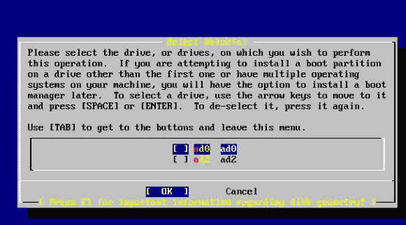

你可能会疑惑为什么 `ad1` 没有列在这里。它是如何被漏掉的？

考虑一下如果你有两个 IDE 磁盘，一个作为第一个 IDE 控制器上的主设备（master），另一个作为第二个 IDE 控制器上的主设备（master）。FreeBSD 按照它发现它们的顺序将它们命名，即 `ad0` 和 `ad1`，那么一切都能正常工作。

但如果你添加了第三块磁盘，作为第一个 IDE 控制器上的从设备（slave），它现在将变成 `ad1`，而之前的 `ad1` 将变成 `ad2`。因为设备名称（如 `ads0`）被用于查找文件系统，你可能会突然发现某些文件系统不再正确显示，并且你需要更改你的 FreeBSD 配置。

为了规避这个问题，可以配置内核根据 IDE 磁盘的位置来命名 IDE 磁盘，而不是根据它们被发现的顺序。在在这种方案下，第二个 IDE 控制器上的主磁盘将始终是 `ad2`，即使没有 `ad0` 或 `ad1` 设备。

此配置是 FreeBSD 内核的默认设置，这就是为什么显示了 `ad0` 和 `ad2`。拍摄此截图的机器在 IDE 控制器的两个主信道上都有 IDE 磁盘，而在从信道上没有磁盘。

你应该选择你想要安装 FreeBSD 的磁盘，并按 [ OK ]。**Disk** 将启动，显示内容类似于 2-12 所示的内容。

**Disk** 显示分为三个部分。

第一部分覆盖磁盘的前两行，显示当前选择磁盘的详细信息，包括它的 FreeBSD 名称、磁盘几何结构和总大小。

第二部分显示当前在磁盘上的分区片（slices），它们的起始位置、大小、赋予它们的名称以及描述。

第三部分显示可用的命令

### 图 2-12. 分区片（Slices）


```
u = Use Disk G = set Drive Geometry C = Create Slice F = 'DB' mode
d = Delete Slice T = Toggle Slice S = Set Bootable I = Wizard m.
c = Change Type U = Undo All Changes Q = Finish
```

使用 `F1` `F7` 获取帮助，使用方向键选择。

你的选择取决于你如何进行分区。做出选择并按 `Enter`。

如果你想为整个磁盘安装 FreeBSD，那么标准启动器就足够了。如果你使用能够启动 FreeBSD 的第三方启动器，请选择 `None`。如果你这样做，你应该使用方向键选择新创建的 FreeBSD 分区片，然后按 `S` 标记为可启动（bootable）。

如果你已经进行了分区（例如使用 `PartitionMagic` 等工具），可以按 `C` 创建一个新的分区片。再次，系统会提示要创建的分区片的大小。框中的相应图形代表最大的分区片，可能是连续的空空间或整个磁盘的大小。

### 图 2-13. 使用整个磁盘的 Fdisk

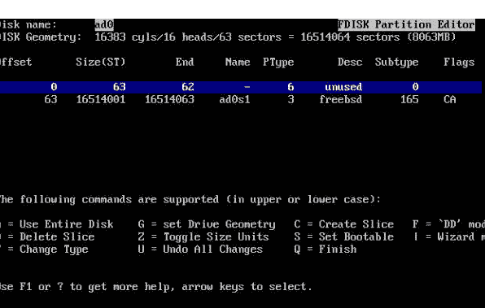

```
a = Use Entire Disk G = set Drive Geometry C = Create Slice F = 'DB' mode
d = Delete Slice Z = Toggle Slice S = Set Bootable I = Wizard m.
c = Change Type U = Undo All Changes Q = Finish
```

使用 `?` 或 `F1` `F7` 获取帮助，使用方向键选择。

完成后，按 `Q`。你的更改将保存在 `sysinstall` 中但尚未写入磁盘。

如果 FreeBSD 是该机器上唯一的操作系统且安装在第一个硬盘上，那么标准启动器就足够了。稍后可以选择 `None`。

### 2.5.3 安装启动器

你可以选择安装启动器。通常情况下，在以下情况下你应该选择安装 FreeBSD 启动器：

+ - 你有多个驱动，并将 FreeBSD 安装在第一个驱动以外的磁盘上。
- 你在同一块磁盘上与其他操作系统一起安装了 FreeBSD，并且希望在启动时选择启动 FreeBSD 还是另一个操作系统。

如果 FreeBSD 是该机器上唯一的操作系统且安装在第一个硬盘上，那么标准启动器就足够了。如果你使用能够启动 FreeBSD 的第三方启动器，请选择 `None`。

做出选择并按 `Enter`。

## 图 2-14. 系统安装引导管理器 (Sysinst Boot Manager)

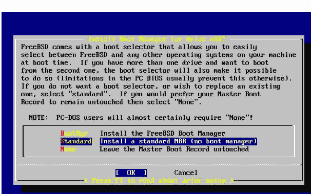

按下 `F1` 进入帮助界面，讨论了尝试在不同操作系统之间共享硬盘时可能遇到的问题。

### 2.5.4 在另一个驱动器上创建切片

如果存在多个驱动器，在选择引导程序后将返回“选择驱动器”（Select Drives）屏幕。如果您希望在多个磁盘上安装 FreeBSD，可以在这里选择另一个磁盘并使用 `FDisk` 重复切片过程。

> 重要提示：如果您在第一个驱动器以外的驱动器上安装 FreeBSD，则需要在两个驱动器上安装 FreeBSD 引导程序。

# 第 2 章 安装 FreeBSD

图 2-15. 退出选择磁盘

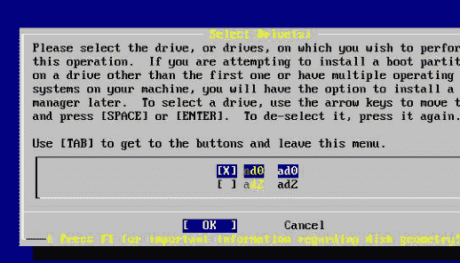

使用 `Tab` 键可以在最后选中的 [ OK ] 和 [ Cancel ] 之间切换。

按 `Tab` 键切换到 [ OK ]，按 `Enter` 键继续安装。

### 2.5.5 使用 Disklabel 创建分区

现在您必须在刚刚创建的每个磁盘内部创建分区。请记住每个分区都有从 `a` 到 `h` 的字母标记，并且分区 `b`、`c` 和 `d` 具有您应该遵循的传统含义。

某些应用程序可以从特定的分区方案中获益，特别是如果您在多个磁盘上布局分区时。然而，对于您的首次 FreeBSD 安装，不需要过度考虑如何划分磁盘。更重要的是安装 FreeBSD 并开始学习如何使用它。当您对操作系统更加熟悉时，可以随时重新安装 FreeBSD 来更改您的分区方案。该方案包含四个分区——一个用于交换空间（swap space），另外三个用于文件系统。

### 表 2-2. 第一块磁盘的分区布局

| 分区 | 文件系统 | 大小 | 说明 |
|---|---|---|---|
| a | / | 100 MB | 这是根文件系统。所有其他文件系统都将挂载在此目录下的某个位置。100 MB 对于此文件系统是一个合理的大小。您不会在上面存储太多数据，因为标准的 FreeBSD 安装会将大约 40 MB 的数据放在这里。剩余空间用于临时数据，并为未来 FreeBSD 版本在 / 下需要更多空间留出余。 |
| b | N/A | 2-3 x RAM | 交换空间保留在此分区上。选择正确的交换空间大小是一门艺术。一个经验法是交换空间应该是可用物理内存（RAM）的两到三倍。如果您的计算机内存少于 32 MB，则将交换空间设置为 64 MB。如果您有多个磁盘，可以在每个磁盘上放置交换空间。FreeBSD 会使用每块磁盘进行交换，从而有效加快交换速度。在这种情况下，计算您需要的交换空间总量（例如 128 MB），然后将其除以磁盘数量（例如 2 块磁盘），得到每个磁盘应放置的交换空间，例如每个磁盘 64 MB 交换空间。 |
| e | /var | 50 MB | /var 目录包含不断变化的文件；长文件和其他管理文件。在 FreeBSD 的日常运行期间，许多文件会被频繁读取或写入。将这些文件放在另一个文件系统上允许 FreeBSD 优化这些文件的访问，而不会影响具有相同访问模式的其他目录。 |
| f | /usr | 磁盘剩余 | 您所有的文件通常都存储在 /usr 及其子目录中 |

如果您在多个磁盘上安装 FreeBSD，那么你还必须在配置的其他切片中创建分区。这样做最简单的方法是在每块磁盘上创建两个分区，一个用于交换空间，一个用于文件系统。

### 表 2-3. 后续磁盘的分区布局


| 分区 | 文件系统 | 大小 |  |
|---|---|---|---|
| b | N/A | 说明 | 如前所述，您可以将交换空间分散在每个磁盘上。尽管分区是空闲的，出于方便考虑，交换空间仍留在 b 分区上 |

## 后续磁盘的分区布局

显示的默认大小将创建一个占用切片剩余部分的分区。如果您使用的是早期示例中描述的分区大小，请使用 `Backspace` 删除现有分区，然后输入 `64M`，如图 19 所示。然后按 `OK`。

选择分区大小后，系统将询问您此分区是包含文件系统还是交换空间。对话框如图 20 所示。此分区将包含一个文件系统，请检查是否已选择 `FS` 并按 `Enter`。

最后，由于您正在创建文件系统，您必须告诉 Disklabel 要挂载哪个文件系统。对话框如图 21 所示。根文件系统的挂载点是 `/`，因此输入 ` /` 然后按 `Enter`。

你的最终 FreeBSD 磁盘标签编辑器界面将与图 2-22 相似，尽管你选择的值可能不同。按 `Q` 完成。

图 2-22. Sysinst Dislabel 编辑器

### 2.6 选择安装内容

#### 2.6.1 选择发行集

决定安装哪个发行集很大程度上取决于系统的预期用途和可用磁盘空间。预定义的选项从安装最小可能的配置到包含所有内容不等。 UNIX 和 FreeBSD 的初学者几乎都应该选择这些预设选项之一。自定义发行集通常适用于更有经验的用户。

按 `F1` 获取有关发行集及其包含内容的更多信息。查看完帮助信息后，按回车键将返回选择发行集菜单。

如果需要图形用户界面，应选择带有 X 前缀的的发行集。X 服务器的配置和默认桌面的选择必须在安装 FreeBSD 后进行。有关 X 服务器配置的更多信息可以参见第 5 章。

安装的 X11 默认版本取决于你正在安装的 FreeBSD 版本。对于 5.3 之前的 FreeBSD 版本，安装的是 XFree64LX。对于 FreeBSD 5.3 及更高版本，Xorg 是默认版本。

如果预计要编译自定义内核，请选择包含源代码的选项。有关为何构建自定义内核或如何构建自定义内核的更多信息，请参见第 8 章。

显然，最强大的系统是包含所有内容的。如果磁盘空间足够，使用方向键选择如图 2-23 所示的 All 并按回车。如果担心磁盘空间，请考虑使用适合这种情况的选项。不要纠结完美的选择，因为安装后可以添加其他发行版。

图 2-23. 选择发行版

为了方便起见，我们提供了几个“命名”发行集。这些选择了我们认为的相关 ports 最合理的默认设置。如果你希望自己挑选发行列表，只需选择“Custom”（自定义）。你也可以选择一个发行版并将其与 Custom 项配合使用。

按 `(SPACE)` 或 `(ENTER)` 选择项目。完成后，选择 Exit（退出）或移动到 OK：

| ID | 名称 | 说明 |
| :--- | :--- | :--- |
| [1] | Windows | 所有系统、二进制文件和 X Window 系统 |
| [2] | macOS | 最佳精选列表发行 |
| [3] | FreeBSD | FreeBSD 且不带游戏 + X Window 系统 |
| [4] | Linux | 完整的二进制文件以及仅裸源码 |
| [5] | Solaris | 同上 + X Window 系统 |
| [6] | Other | 普通用户 - 仅二进制文件和文档 |
| [OK] |

#### 2.6.12 安装 Ports 集合

选择所需的发行版后，将出现安装 FreeBSD Ports 集合的机会。Ports 集合是一种简单方便的安装软件的方法。Ports 集合不包含完成软件所需的源代码。相反，它是一个文件集合，使得下载、编译和安装第三方软件包变得简单。第 4 章描述了如何使用 ports 集合。

安装程序会检查你是否有足够的剩余空间。仅在磁盘空间充足的情况下选择此选项。从 FreeBSD 6.1 开始，FreeBSD Ports 集合占用约 440 MB 的磁盘空间。你可以安全地假设较新版本的 FreeBSD 数值更大。

请求用户确认

你是否想安装 FreeBSD ports 集合？

这将让你能够直接访问 13,300 多个移植软件包，在“纯净”状态下占用 440 MB 磁盘空间，如果加载了大量的发行版 tar 包，则可能会占用更多空间（除非你有来自 FreeBSD CD/DVD 发行版的额外光盘并可以挂载 `/cdrom`，情况下这个问题要小得多）。

Ports 集合是一个非常有价值的资源，值得在你的 `/usr` 分区上保留，因此建议对此选项回答 Yes。

有关 Ports 集合和最新 ports 的更多信息，请访问：

```
http://www.FreeBSD.org/ports
```

[ Yes ] 否

使用方向键选择 [ Yes ] 安装 Ports 集合，或选择 [ No ] 跳过此选项。按回车键继续。选择发行版菜单将重新加载。

图 2-24. 确认发行版

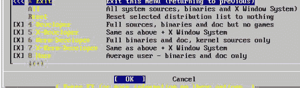

如果对选项满意，使用方向键选择 Exit，确保 [ ] 被高亮，然后按回车继续。

### 2.7 选择安装介质

如果从 CDROM 或 DVD 安装，使用方向键从 FreeBSD CD/DVD 安装。确保 [ ] 被高亮，按回车继续安装。

对于其他安装方法，选择相应的选项并遵循说明。

按 `F1` 显示安装介质的在线帮助。按回车键返回介质选择菜单。

图 2-25. 选择安装介质

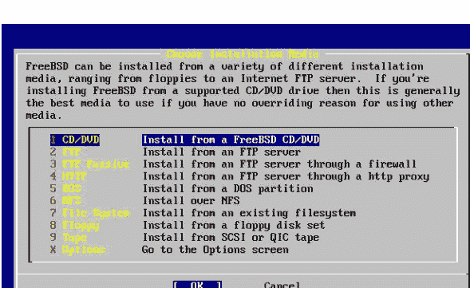

## FTP 安装模式：你可以从三种 FTP 安装模式中选择：主动 FTP、FTP 或通过 HTTP 代理。

- FTP Active（主动）：从 FTP 服务器安装。此选项将使所有 FTP 传输处于“活动”模式。这在防火墙后可能无法工作，但在旧系统中通常可以运行。
- FTP Passive（被动）：从 FTP 服务器安装。此选项允许客户端发起连接，与防火墙的兼容性更好。
- 通过 HTTP 代理：通过代理服务器安装。用于直接 FTP 访问受限的情况。

### 2.8 提交安装

如果需要，现在可以进行安装。这也是取消安装的最后机会。

请求用户确认

最后机会！你确定要继续安装吗？

如果你在要保存数据的磁盘上运行此操作，我们强烈建议在继续之前做好适当备份！我们对丢失磁盘内容不承担任何责任！

[ Yes ] 否

## 2.9

安装时间取决于所选的发行版、安装介质和计算机速度。将出现一系列状态消息。当显示以下消息时，安装完成：

消息

恭喜！你现在已安装 FreeBSD。

我们现在进入最后的配置问题。对于任何你不想配置的选项，请选择 No。

如果你想在系统启动或安装后（FreeBSD 5.2 之前的版本使用 `/stand/sysinstall`）通过 Configi 进入此工具，可以输入：`/stand/sysinstall`

[ OK ]

[ 按回车继续 ]

按回车继续安装后配置。选择 [ No ] 并按回车将中止安装，对你的系统不会做任何更改。将出现以下消息：

消息安装完成但存在错误。你可能希望在 VTY1 上滚动查看调试信息。你也可以在下次提示时选择“No”，返回安装菜单重试失败的操作。

[ OK ]

生成此消息是因为没有安装任何内容。按回车键将返回主安装菜单并退出安装。

#### 2.9.1 网络设备配置

如果你之前为 FTP 安装配置了 PPP，则不会显示此屏幕，并且可以按照上述方法在以后进行配置。

有关局域网和将 FreeBSD 配置为网关/路由器的详细信息，请参考高级网络章节。

请求用户确认

你是否想配置任何以太网或 SLIP/PPP 网络设备？

## 第 2 章 安装 FreeBSD

要配置网络设备，选择 [ Yes ] 并按 `Enter`。否则，选择 [ No ] 继续。

图 2-26. 选择以以太网设备

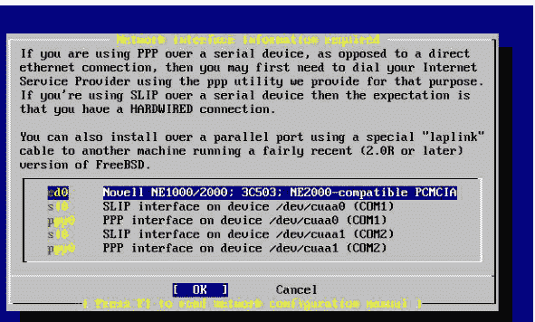

使用方向键选择要配置的接口并按 `Enter`。

请求用户确认

您是否要尝试对接口进行 IPv6 配置？

Yes [ No ]

在此私有局域网中，当前的 Internet 协议（IPv4）已经足够，因此选择了 [ No ]。

如果您已连接到带有 RA 服务器的现有 IPv6 网络，请选择 [ Yes ] 并按 `Enter`。系统将花费几秒钟来扫描 RA 服务器。

请求用户确认

您是否要尝试对接口进行 DHCP 配置？

Yes [ No ]

如果不需要 DHCP（动态主机配置协议），请使用方向键选择 [ No ] 并按 `Enter`。选择 [ Yes ] 将执行 `dhclient`，如果成功，将自动填充网络配置信息。更多信息请参考第 25.5 节。

下面的网络配置屏幕显示了作为局域网网关系统的以太网设备配置。

图 2-27.为 ed0 设置网络配置

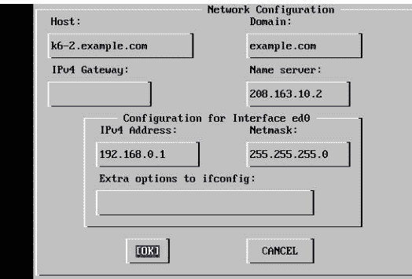


使用 `Tab` 选择信息字段并填写适当信息：

- Host（主机）：完全限定主机，在此例中为 `k6-2.example.com`。
- Domain（域）：机器所属的域名称，在此例中为 `example.com`。
- IPv4 Gateway（IPv4 网关）：转发数据包到非本地目的地的主机 IP 地址。如果该机器是网络上的节点，则必须填写此项。如果该机器是该网络的 Internet 网关，请*留空此字段*。IPv4 网关也称为默认网关或默认路由。
- Name server（名称服务器）：本地 DNS 服务器的 IP 地址。此局域网中没有本地 DNS 服务器，因此使用了提供商 DNS 服务器的 IP 地址 `208.163.10.2`。
- IPv4 address（IPv4 地址）：用于此接口的 IP 地址为 `192.168.0.1`。
- Netmask（子网掩码）：此局域网使用的地址块是 C 类块 `(192.168.0.0-192.168.255.255)`。默认子网掩码适用于 C 类网络 `(255.255.255.0)`。
- Extra options to ifconfig（ifconfig 的额外选项）：您想要添加的任何接口特定选项。在此例中没有。

完成后，使用 **Tab** 选择 `[ OK ]` 并按 **Enter**。

请求用户确认

您现在要启动 ed0 接口吗？

[ Yes ] No

选择 [ Yes ] 并按 Enter 将机器接入网络并准备好使用。然而，这在安装期间没有太大作用，因为机器还需要重启。

### 2.9.2 配置网关

请求用户确认

您是否希望这台机器作为网络网关运行？

[ Yes ] No

如果该机器将作为局域网的网关并在其他机器之间转发数据包，请选择 [ Yes ] 并按 Enter。如果该机器是网络上的一个节点，请选择 [ No ] 并按 Enter 继续。

### 2.9.3 配置 Internet 服务

请求用户确认

您是否要配置 inetd 及其提供的网络服务？

Yes [ No ]

如果选择 [ No ]，则 telnet 等各种服务将不会被启用。这意味着远程用户将无法 telnet 到这台机器。本地用户将能够使用 telnet 访问远程机器。

这些服务可以在安装后通过使用您喜欢的文本编辑器编辑 `/etc/inetd.conf` 来启用。更多信息请参见第 25.2.1 节。

如果您想在安装期间配置这些服务，请选择 [ Yes ]。系统将显示额外的确认：

请求用户确认

Internet 超服务器 (`inetd`) 允许启用许多简单的 Internet 服务，包括 finger、ftp 和 telnetd。启用这些服务可能会由于增加系统的暴露性而增加安全问题的风险。

考虑到这一点，您是否要启用 `inetd`？

[ Yes ] No

选择 [ Yes ] 继续。

请求用户确认

`inetd()` 依赖其配置文件 `/etc/inetd.conf` 来确定哪些 Internet 服务是可用的。默认的 FreeBSD `inetd.conf` (5) 禁用了所有服务，因此即使启用了 `inetd(8)`，也必须先在配置文件中专门启用它们。注意，IPv6 的服务必须与 IPv4 分别启用。

现在选择 [Yes] 调用编辑器编辑 `/etc/inetd.conf`，或选择 [No] 使用当前设置。

[ Yes ] No

选择 [ Yes ] 将允许通过删除行开头的 `#` 来添加服务。

图 2-28. 编辑 inetd.conf

| service | search prompt | # delete | # pre |
| :--- | :--- | :--- | :--- |
| (escape) menu | y search prompt | k delete line | p prev line |
| | ascii code | u delete line | v next page |
| | d of list | h help line | n next line | g next page |
| | s search | r back of line | u next word |
| | f begin of file | m back home | s next word |
| | e end of line | r restore word | f forward char |
| | q quit | Enter: exit | |

（注：上表内容由于 OCR 识别问题破碎，代表了 FreeBSD 中常见的 vi 编辑器界面）。

# 图 2-31. 编辑导出项

```
(escape) 'm search 'k delete line 'p prev line 'g prev line
'o ascii 'q search 'u delete line 'n next line 'w next page
'n end line 'f begin of line 'b half page 'x work word
'f begin of line 'e of line 'r restore word 'forward char
'e terminate ESC-Enter: exit
=====================================================================
编辑后生成了以下导出：
/home 及其所有子目录导出为以已故明星命名的文件
mount-type 用户允许以 root 身份写入
/home/lonie dulee
/home/alders
/m/a -maproot@ bill alert
# 您应该将这些行替换为实际导出的文件系统。
```

`/etc/exports`, 9 行


使用说明现在或以后使用您喜欢的文本编辑器添加导出的文件系统。请注意屏幕底部的文件名/位置。

按 `Esc` 退出编辑器。按 `Enter` 退出并继续。

## 2.9.5. NFS 客户端

NFS 客户端允许您的机器访问 NFS 服务器。

> 请求用户确认
您是否想将此机器配置为 NFS 客户端？

是 [ 否 ]

使用方向键根据情况选择 [ **是** ] 或 [ **否** ]，并按 `Enter`。

### 2.9.6 安全配置方案

“安全配置”是一组配置选项，旨在通过启用和禁用程序及其他项，尝试实现安全性与便利性之间的预期比例。安全配置越高，默认启用的程序就越少。这是安全的基本原则之一：除非必须，否则不要运行任何程序。

请注意，安全配置只是默认设置。在安装 FreeBSD 后，您可以通过向 `/etc/rc.conf` 增加或编辑相应的行来启用或禁用所有程序。有关更多信息，请参阅 `rc.conf(5)` 手页。

下表描述了每个安全配置的功能。列是您为安全配置提供的选择，行是该配置启用或禁用的程序或功能。

### 表 2-4. 可能的安全配置

| | 极端 | 中等 |
| :--- | :--- | :--- |
| `sendmail(8)` | 否 | 是 |
| `sshd(8)` | 否 | 是 |
| `portmap(8)` | 否 | 或许 a |
| NFS 服务器 | 否 | 是 |
| `securelevel(8)` | 是 b | 否 |

备注：a. 如果机器在安装早之前已配置为 NFS 客户端或服务器，则 portmapper 已启用。b. 我

请求用户确认
您是否想为此主机选择一个默认安全配置方案（选择“否”即为“中等”）？

[ 是 ] 否

选择 [ 否 ] 并按 `Enter` 将将安全配置设为中等。
选择 [ 是 ] 并按 `Enter` 将允许选择不同的安全配置。

图 2-32. 安全配置方案选项

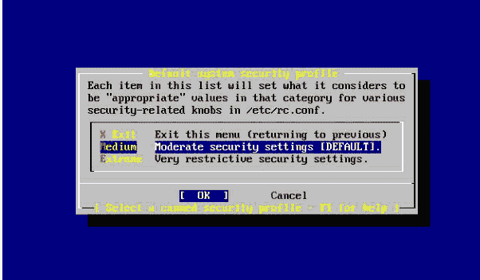

按 `F1` 显示帮助。按 `Enter` 返回选择菜单。
使用方向键选择中等（Medium），除非您的需要另一个级别。当 [ OK ] 高亮显示时，按 `Enter`。
根据所选的安全设置，将显示一条确认消息。

消息
已选择中等安全设置。
`Sendmail` 和 `SSHd` 已启用，`securelevels` 保持禁用状态，NFS 服务器已保持原样。

46

请注意，这仍然无法防止您以其他方式妥善地保护系统，或在管理中尽到职责，这仅仅是选择了一组标准的开箱即用默认值开始。

要稍后更改这些任何设置，请编辑 `/etc/rc.conf`

[确定]

消息

已选择极端安全设置。

`Sendmail`、`SSH` 和 NFS 服务已禁用，`securelevels` 已启用。
请注意，这仍然无法防止您以其他方式妥善地保护系统，或在管理中尽到职责，这仅仅是选择了一组更安全的开箱即用默认值开始。

要稍后更改这些任何设置，请编辑 `/etc/rc.conf`

[确定]

按 `Enter` 继续安装后配置。

> **警告：** 安全配置方案不是万灵药！即使您使用极端设置，也需要通过阅读适当的邮件列表（第 C.1 节）、跟踪安全问题、使用良好的密码和密码短语通通遵守良好的安全实践。它只是在开箱时设置了预期的安全与便利性比例。

### 2.9.7 系统控制台设置

有多个选项可以自定义系统控制台。

请求用户确认
您是否想自定义您的系统控制台设置？

[ 是 ] 否

要查看并配置选项，选择 [ 是 ] 并按 `Enter`。

# 图 2-33. 系统控制台配置选项

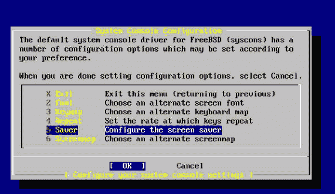

一个用途是设置保护程序。使用方向键选择 Saver（保护程序）并按 `Enter`。

# 图 2-34. 屏幕保护程序选项


默认间隔为 300 秒。要更改间隔，请选择 Saver。在 Saver 菜单中，方向键选择 Timeout（超时）。

# 图 2-35. 保护程序超时

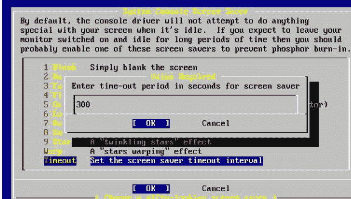

值可以更改，选择 [ OK ] 并按 `Enter`。

# 图 2-36. 系统控制台配置

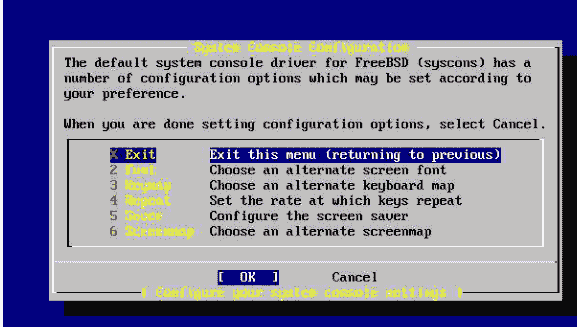

选择 Exit 并按 `Enter` 继续安装后配置。

### 2.9.8 设置时区

为机器设置时区将允许其自动修正区域变化。示例适用于位于东部区的机器。

请求用户确认
您是否想设置此机器的时区？

[ 是 ] 否

选择 [ 是 ] 并按 `Enter` 设置时区。

请求用户确认
此机器的时钟设置为 UTC 吗？如果是本地时间或未知，在此选择！

是 [ 否 ]

根据时钟配置情况选择 [ 是 ] 或 [ 否 ] 并按 `Enter`。

# 图 2-37. 选择区域

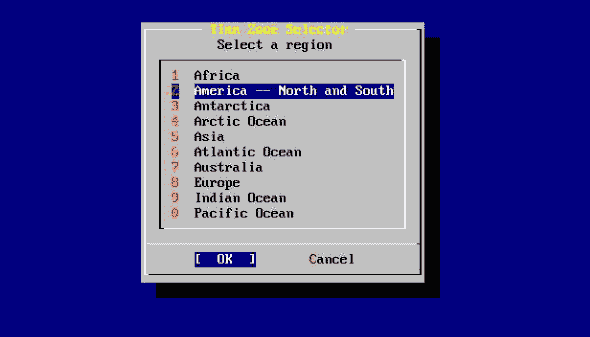

使用方向键选择合适的区域，然后按 `Enter`。

# 图 2-38. 选择国家

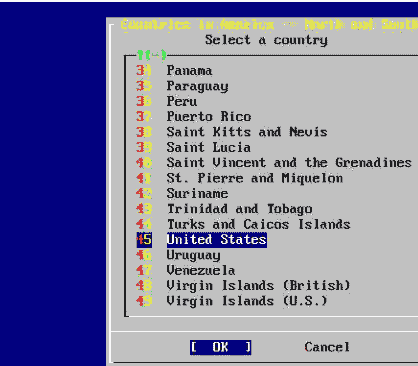

使用方向键选择合适的国家并按 `Enter`。

# 图 2-39. 选择时区

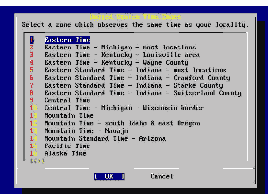

使用方向键选择合适的时区并按 `Enter`。

确认
缩写 'EDT' 是否合理？

[ ] 否

确认时区缩写正确。正常，按 `Enter` 继续安装后配置。

### 2.9.9 Linux 兼容性

请求用户确认
您是否想启用 Linux 兼容性？

[ 是 ] 否

选择 [ 是 ] 并按 `Enter` 将允许在 FreeBSD 上运行 Linux。安装将添加相应的兼容性包。

如果通过 FTP 安装，机器将需要连接互联网。远程 ftp 站点不会有所有的 Linux 发行版。如有需要，可以以后安装。

### 2.9.10 鼠标设置

此选项允许在使用 3 键鼠标的控制台和用户程序中进行复制粘贴。如果使用 2 键鼠标，请在安装后参考手册页 `mouse(8)` 获取模拟 3 键式的详情。此示例演示了非 USB 鼠标配置（如 PS/2 或串口鼠标）：

请求用户确认
此系统是否连接了非 USB 鼠标？

[ 是 ] 否

为非 USB 鼠标选择 [ 是 ]，为 USB 鼠标选择 [ 否 ] 并按 `Enter`。

# 图 2-40. 选择鼠标协议类型

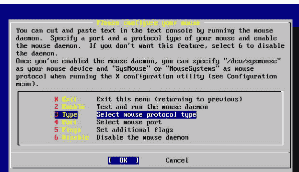

使用方向键选择 `Type`（类型）并按 `Enter`。

## 图 2-41. 设置鼠标协议

如果你的鼠标连接到 PS2 鼠标端口或总线鼠标端口，无论型号和类型如何，都应该选择“Auto”（自动）。所有其他协议类型均用于串口鼠标，不应与 PS2 端口或总线鼠标一起。如果你有一个串口鼠标，应该尝试“Auto”。如果鼠标不支持该协议标准，它对串口鼠标可能无效。2 键串口鼠标兼容“Microsoft”或“MouseMouse”。如果你的鼠标带有滚轮，它可能兼容“IntelliMouse”。

| 鼠标 | PS/2 鼠标端口或总线鼠标端口 |
|---|---|
| Auto | 默认 (auto) |
| 1 键 | Hitachi 平板鼠标 (串口) |
| 2 键 | Microsoft (串口) |
| 3 键 | Logitech 协议 (串口) |
| 滚轮 | Microsoft 协议 (串口) |
| <(+) | |

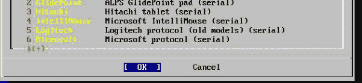

此处使用的鼠标是 PS/2 类型，因此默认的 Auto 是合适的。要更改协议，请使用方向键选择另一个选项。确保 [ OK ] 显示高亮并按回车退出此菜单。

## 图 2-42. 配置鼠标端口

你可以通过运行鼠标守护进程在文本控制台中进行复制和粘贴。指定鼠标的端口和协议类型，并启用鼠标守护进程。如果你不需要此功能，请选择 disable the mouse daemon。一旦启用鼠标守护进程，在运行 X 配置工具时，可以将 `/dev/mysouse` 指定为你的鼠标设备（见 Configuration menu）。

```
X Help Exit this menu (returning to previous)

2 Help Test and run the mouse daemon

3 Help Select mouse protocol type

4 Port Select port

5 Help Set additional flags

6 Help Disable mouse daemon
```


使用方向键选择 Port 并按回车。

### 图 2-43. 设置鼠标端口

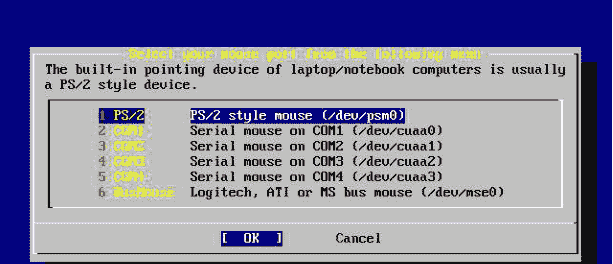
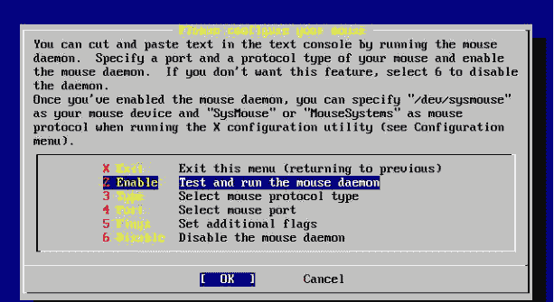

该系统使用了 PS/2 鼠标，默认的 PS/2 是合适的。要更改端口，使用方向键然后按回车。

### 图 2-44. 启用鼠标守护进程

最后，使用方向键选择 Enable，并按回车启用并测试鼠标守护进程。

## 图 2-45. 测试鼠标守护进程

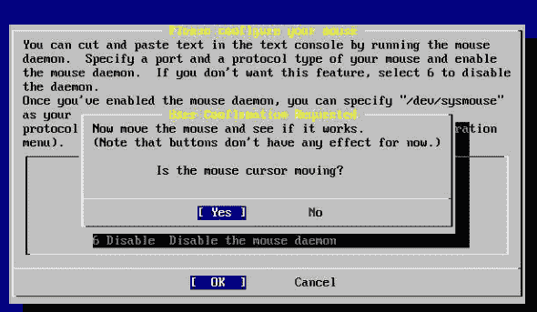

在屏幕上移动鼠标并验证光标是否显示正常。如果是，选择 [ Yes ] 并按回车。如果不是，说明鼠标配置不正确——选择 [ No ] 并尝试不同的配置选项。

使用方向键选择 Exit 并按回车返回继续继续安装后的配置。

### 2.9.11 配置额外的网络服务

由 Tom Rhodes 贡献。

如果新用户缺乏这方面的知识，配置网络服务可能是一项艰巨的任务。网络连接（包括互联网）对于像 FreeBSD 这样的所有现代操作系统来说都至关重要；因此，拥有 FreeBSD 强大的网络功能是非常有用的。在安装期间进行此操作将确保用户对他们可以使用的各种服务有一定了解。

网络服务是接受网络上任何地方输入的程序。我们尽力确保这些程序不会执行任何“有害”操作。遗憾的是，程序员并非完完美，随着时间的推移，已经出现过网络服务中的漏洞被攻击者利用来做坏事的情况。重要的是，只启用你确定需要的网络服务。如果不确定，最好在发现确实需要某个网络服务之前不要启用它。你稍可以通过重新运行 `sysinstall` 或使用由 `/etc/rc.conf` 文件提供的功能来启用它。

选择 `Networking` 选项将显示一个类似于下面的菜单：

## 图 2-46. 网络配置上层

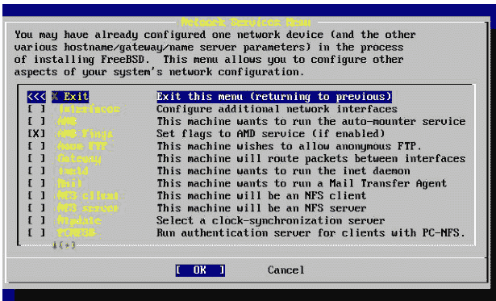

第一个选项 `Interfaces`（接口）之前在第 2.9.1 节介绍过，因此可以忽略此选项。选择 `AMD` 选项增加了对 AMD 自动挂载工具的支持。这通常与 NFS 协议（见下文）配合使用，自动挂载远程文件。这里不需要特殊配置。

接下来是 `AMD Flags` 选项。选择后，将弹出一个窗口让你输入特定的 AMD Flags。菜单包含一组默认值：

```
-a /.amd_mnt -l syslog /host /etc/amd_map /net
```


`-a` 选项设置了默认挂载位置，此处指定为 `/.amd_mnt`。`-l` 选项设置默认日志文件；然而，当使用 syslog 时，所有活动都将发送到。

主机正在请求锁以及它们请求锁的频率。虽然最后两个选项对于调试非常有用，但 NFS 服务器和客户端正常运行并不需要它们。

继续向下查看，下一项是 Routed（路由），它是路由守护进程。`routed(8)` 工具管理路由表、发现多播生成器，并在根据请求向网络上任何物理连接的主机提供路由表副本。这被用于作为本地网络网关的机器。选中后，将将显示该工具的默认位置。默认位置已为您定义好，可以通过 Enter 键进行选择。随后系统会再次询问您想要传递给 `routed` 的标志。默认是 `-q`，且应该已经显示在屏幕上。

接下来是 Rwidth 选项，选中后，它将在初始化期间启动 `routed(8)` 守护进程。`routed` 工具会定期在整个网络上广播消息，或者在“消费者”模式下收集消息。更多信息可以参阅 `runtime(1)` 和 `rwoho(1)` 手册。

列表中待运行的下一个是 `ssh(8)` 守护进程。这是 OpenSSH 的安全服务器，强烈优于 FTP 服务器。`ssh` 服务器用于通过加密连接从一台到另一台建立连接。

最后是 TCP Extensions 选项。这启用了 RFC 1323 和 RFC 1644 中定义的 TCP 扩展。虽然在许多设备上这可以加速连接，但也可能导致某些连接断开。不建议服务器使用，但对于独立机器可能有所益。

现在您已经配置了网络服务，可以滚动到顶部的“Exit”（退出）并继续下一个配置部分。

### 2.9.12 配置 X Server

> 注意：从 FreeBSD 5.3-RELEASE 开始，X 服务器配置功能已从安装程序中移除，您必须在安装 FreeBSD 之后安装并配置 X 服务器。关于 X 服务器安装和配置的更多信息，可以参阅第 5 章。如果您安装的是 5.3-RELEASE 之前的 FreeBSD 版本，可以跳过本节。

为了使用 KDE、GNOME 或其他图形用户界面，需要配置 X 服务器。

> 注意：为了让 root 用户运行 FreeBSD86，需要安装 `xll/wrapper`。从 FreeBSD 4.7 开始默认安装此内容。对于更早的版本，可以通过软件包选择（Package Selection）菜单进行添加。

要检查您的显卡是否受支持，请查看 XFree86 (`http://www.xfree86.org/`) 网站。

请求用户确认
您现在要配置您的 X 服务器 吗？

| 是 | 否 |

警告：有必要了解您的显示器规格和显卡信息。如果设置不当可能会导致设备损坏。如果您没有这些信息，请选择 [ No ]，并在获取信息后使用 `sysinstall`（旧版本 FreeBSD 中为 `/stand/sysinstall`）配合 640x480 分辨率的 VGA 卡和显示器进行配置安装。此程序在准备写入文件时会询问路径。

您可以以示例的 XF86Config 为基础并根据您的配置进行编辑，或者让此程序为您的配置生成一个基础 XF86Config 文件并对其进行微调。

在继续运行此程序之前，请确保您知道自己使用的是什么显卡，最好知道它使用的所有芯片组以及显存大小。SuperProbe 可能对这方面有所帮助。

按 enter 继续，或按 ctrl-c 取消。

按 Enter 将启动鼠标配置。请务必遵循说明，并使用“Mouse Systems”作为鼠标协议，如果使用 PS2 鼠标，示例所示使用 `/dev/symouse` 作为鼠标端口。

首先指定鼠标协议。从以下列表中选择一个：

- 1. Microsoft 兼容 (2 键协议)
- 2. Mouse Systems (3 键协议) & FreeBSD 鼠标协议
- 3. Bus Mouse
- 4. PS/2 Mouse
- 5. Logitech Mouse (串口，仅限此类型，Logitech 协议)
- 6. Logitech MouseMan (Microsoft 兼容)
- 7. MM 系列
- 8. MHTab
- 9. Microsoft IntelliMouse

如果您有一个双键鼠标，它可能是类型 1；如果您有一个三键鼠标，它可能同时支持协议 1 和 2。后者主要有两种变体：带有切换协议开关的鼠标，以及默认为 1 且在启动时需要按住按钮来选择协议 2 的鼠标。某些鼠标可以通过向串口发送特殊序列连接到执行模式 2（见 ClearDTR/ClearRTS 选项）。

输入鼠标数字：2

您已选择了 Mouse Systems 协议鼠标。如果您的鼠标通常是 Microsoft 兼容的，启用 ClearDTR 和 ClearRTS 选项可能会导致它在服务器启动时切换到 Mouse Systems。

请用 ‘y’ 或 ‘n’ 回答以下问题。
您是否要启用 ClearDTR? n

您已选择三键鼠标协议。除非第三键不起不起，否则建议不要启用 Emulate3Buttons。

请用 ‘y’ 或 ‘n’ 回答以下问题。
您是否要启用 Emulate3Buttons? y

现在给出鼠标连接的完整设备名称，例如 `/dev/tty00`。按回将使用默认值 `/dev/mouse`。在 FreeBSD 上，默认是 `/dev/symouse`。

# 第 2 章 安装 FreeBSD

键盘是待配置的下一项。显示了一个通用的 101 键。鼠标设备：`/dev/symouse`

请选择一种键盘类型。显示了一个通用 101 键。

- 1. 通用 101 键
- 2. 通用 102 键 (国际版)
- 3. 通用 104 键
- 4. 通用 105 键 (国际版)
- 5. Dell 101 键
- 6. Everes
- 7. 通用
- 8. HP
- 9. IBM
- 10. 日语
- 11. 韩语
- 12. 通用
- 13. Compaq
- 14. Genius
- 15. Logitech
- 16. 无线
- 17. Logitech
- 18. Navigator
- 19. Microsoft
- 20. Northgate
- 21. 通用
- 22. IBM
- 23. Chicony
- 24. Dell

输入数字选择国家。
按 enter 进入下一页

请选择与您的键盘对应的布局

- 1. 阿尔尼亚语
- 2. 阿拉语
- 3. 亚美尼亚语
- 4. 阿塞塞拜语
- 5. 白俄罗斯语
- 6. 比利语
- 7. 孟加拉语
- 8. 巴西语
- 9. 保加利亚语
- 10. 美式英语
- 11. 保加利亚语
- 12. 缅甸语
- 13. 带死键键的美式英语
- 14. 加纳大语
- 15. 克罗地亚语
- 16. 捷克语
- 17. 捷克语 (qwerty)
- 18. 丹麦语

输入数字选择键盘。

请为 'us' 布局输入变体名称。或直接按回车使用默认变体

`us`

现在设置显示器的规格。两个关键参数是垂直刷新率（整个屏幕刷新的频率）以及最重要的水平同步率（扫描行的显示频率）。

水平同步和垂直同步的有效范围应在您的显示器说明书中记录。如果不确定，检查显示器数据库 `/usr/X11R6/lib/X11/doc/Monitors` 查看是否有您的型号。

按 enter 继续，或按 ctrl-c 取消。

您必须指示显示器的水平同步范围。您可以选择下方对应行业标准类型的预定义范围，或者给出特定范围。

**非常重要**：不要指定一个超出显示器能力的水平同步率。如果不确定，请选择保守的设置。

- hsync (kHz)；特征模式的显示器类型
- 1. 31.5; 标准 VGA, 640x480 @ 60 Hz
- 2. 31.5 - 35.1; 超 VGA, 800x600 @ 56 Hz

63

## 第2章 安装 FreeBSD

- 3 31.5, 35.5; 8514 兼容, 1024x768 @ 87 Hz 隔持
- 4 31.5, 35.15, 35.5; 标准 VGA, 1024x768 @ 87 Hz 隔持, 800x600 @ 56 Hz
- 5 31.5 - 37.9; 扩展 Super VGA, 800x600 @ 60 Hz, 640x480 @ 72 Hz
- 6 31.5 - 48.5; 非标准 VGA, 1024x768 @ 60 Hz, 800x600 @ 72 Hz
- 7 31.5 - 57.0; 高频 VGA, 1024x768 @ 70 Hz
- 8 31.5 - 64.3; 支持 1280x1024 @ 60 Hz 的显示器
- 9 31.5 - 79.0; 支持 1280x1024 @ 74 Hz 的显示器
- 10 31.5 - 82.0; 支持 1280x1024 @ 76 Hz 的显示器

输入你的水平同步范围

输入你的选择 (1-11):
你必须指定你显示器的垂直同步范围。你可以选择下方对应行业标准显示器类型的预定义范围之一，或者提供一个特定的范围。对于隔持模式，计数次数为单数（例如 87 Hz 而不是 43 Hz）。

+ 1 50-70
2 50-90
3 50-100
4 40-150
5 输入你的垂直同步范围

输入你的选择: 2
你现在必须输入几个标识/描述字符串，即标识符、厂商名称和型号名称。直接按回车将填充默认名称。

这些字符串是自由格式的，允许包含空格。
为你的显示器定义输入标识符: Hitachi

接下来将从列表中选择显卡驱动程序。如果你的显卡不在列表中，继续按回车，列表将重复。列表中唯一的例外是：

现在我们必须配置特定显卡的特定设置。在此时，你可以选择从显卡定义数据库中进行选择。由于 Ramdac 和时钟发生器之间可能存在差异，在相同型号的显卡之间盲目复制是不明智的。出于此原因，在你做出选择（例如，设备选择）后，你将收到关于显卡组件的提示，并将所选数据库条目的设置作为强力提示呈现。

数据库条目包含关于芯片组、应运行何种驱动、Ramdac 和时钟芯片的信息，以及将包含在 Device 部分的注释。然而，许多定义仅提示要运行何种驱动（基于芯片组的使用）且是未经测试的。

如果你在数据库中找不到你的显卡，不必担心。你应该只选择与你的显卡型号完全相同的数据库条目；选择一个看起来相似的只是坏主意（例如，GemSnail 64 在硬件上可能与 GemSnail 64+ 不同）。

64

你想查看显卡数据库吗？y


| ID | Name | Driver |
|---|---|---|
| 288 | Matrix Millennium G200 8MB | mgag200 |
| 289 | Matrix Millennium G200 SD 16MB | mgag200 |
| 290 | Matrix Millennium G200 SD 4MB | mgag200 |
| 291 | Matrix Millennium G200 SD 8MB | mgag200 |
| 292 | Matrix Millennium G400 | mgag400 |
| 293 | Matrix Millennium II 6MB | mgag216w |
| 294 | Matrix Millennium II 4MB | mgag216w |
| 295 | Matrix Millennium II 8MB | mgaag216w |
| 296 | Matrix Mystique | mga1064sg |
| 297 | Matrix Mystique G200 6MB | mgag200 |
| 298 | Matrix Mystique G200 4MB | mgag200 |
| 299 | Matrix Mystique G200 8MB | mgag200 |
| 300 | Productiva G100 4MB | mgag100 |
| 301 | Productiva G100 8MB | mgag100 |
| 302 | MediaX | mediagx |
| 303 | Vision Proxacel 128 | ET600 |
| 304 | Mirage Z-128 | ET600 |
| 305 | Miro CRYSTAL VRite 1000 |  |

输入一个数字选择相应的显卡定义。

按回车进入下一页，按 `q` 继续。

```
288
```

你选择的显卡定义:

```
Identifier: Matrix Millennium G200 8MB
Chipset: mgag200
Driver: mga
使用任何 Clocks 行
```

按回车继续，或按 `ctrl-c` 取消。

现在你必须提供关于你显卡的信息。这将用于 `XF86Config` 中显卡的 "`Device`" 部分。你必须指示你有多少显存。使用服务器检测到的近似值可能是一个好主意。如果你遇到由于服务器不支持你的数量的问题（例如 ATI Mach64 限于1024K），请指定服务器支持的最大值。

你的显卡上有多少显存？

+ 1 256K
2 512K
3 1024K
4 2048K
5 4096K
6 其他

输入你的选择: 6
显存量 (KB): 8192

你必须输入几个标识/描述字符串，即标识符、厂商名称和型号。直接按回车将填充默认名称（可能来自显卡定义）。你的显卡定义是 Matrox Millennium G200 8MB。

字符串是自由格式的，允许空格。
为你的显卡定义输入标识符:

接下来设置视频模式分辨率。通常范围范围是 640x480、800x600 和 1024x768，但取决于显卡能力、显示器尺寸和舒适度。在选择色彩深度时，选择你的显卡支持的最高模式。对于每个深度，都定义了一个模式（分辨率）。服务器启动时使用的默认分辨率将是显示器和显卡支持的第一个模式。当前设置为：

```
640480 800x600 1024x768 1280x1024 用于 8位

1024x768 800x600 640x480 用于 16位

640x480 800x600 1024x768 1280x1024 用于 24位
```

显示器或时钟限制不支持的模式将被服务器自动跳过。

+ 1 修改 8位模式 (256色)
2 修改 16位模式 (32K/64K色)
3 修改 24位模式 (24位色彩)
4 模式正常，继续。

输入你的选择: 2
从以下列表中选择模式：

+ 1 640x400
2 640x480
3 800x600
4 1024x768
5 1280x1024
6 320x200
7 320x240
8 400x300
9 1152x864
a 1600x1200
b 1800x1400
c 512x384

请输入对应于你想选择的模式的数字。例如，432 选择 1024x768 800x600 640x480，默认模式为 1024x768。

哪些模式？432
你可以拥有一个虚拟屏幕（桌面），这是一个比物理屏幕更大的区域，通过将鼠标移动到屏幕边缘来启用。如果你不想在特定分辨率下使用虚拟桌面，请回答以下问题： 'y' 或 'n'。
你想要一个比物理屏幕更大的虚拟桌面吗？

对于每个深度都定义了一个模式（分辨率）。服务器启动时使用的默认分辨率将是显示器和显卡支持的第一个模式。当前设置为：

```
640480 800x600 1024x768 1280x1024 用于 8位

1024x768 800x600 640x480 用于 16位

640x480 800x600 1024x768 1280x1024 用于 24位
```


显示器或时钟限制不支持的模式将被服务器自动跳过。

+ 1 修改 8位模式 (256色)
2 修改 16位模式 (32K/64K色)
3 修改 24位模式 (24位色彩)
4 模式正常，继续。

输入你的选择: 4

请指定你想默认使用的色彩深度：

+ 1 1位（单色）
2 4位（16色）
3 8位（256色）
4 16位（65536色）
5 24位（1600万色）

最后，需要保存配置。在输入 `/etc/X86Config` 作为保存位置之前。我现在将写入 X86Config。确保你不会意外覆盖之前配置的内容。

要写入 `/etc/X86Config` 吗？y

用户确认
X86 配置过程似乎失败了。
你想重试吗？

[ 是 ] 否

如果 X86 出现问题，选择 [ 否 ] 并按回车继续安装。安装后你可以使用 `xcfg -testmode` 或 `xcfg` 访问命令行工具。配置 X86 的另一种方法见第5章。

### 2.9.13 默认 X 桌面

> 注意：从 FreeBSD 5.3-RELEASE 开始，`sysinstall` 移除了 X 桌面选择功能，你需要在安装 FreeBSD 后配置 X 桌面。有关安装和配置 X 桌面的更多信息见第5章。如果你安装的是 5.3 RELEASE 之前的 FreeBSD 版本，可以跳过本节。

有很多窗口管理器。从非常基础的环境到带有大型软件套的完整桌面环境不等。有些只需要很少的磁盘空间内存，而另一些功能丰富的环境需要得多。确定哪种最适合你的最佳方法是尝试几种不同的。这些可以从端口集合或包获取，并可以在安装后添加。

你可以选择一个桌面进行安装并配置为默认桌面。这将允许你在安装后启动它。

#### 图 2-51. 选择默认桌面

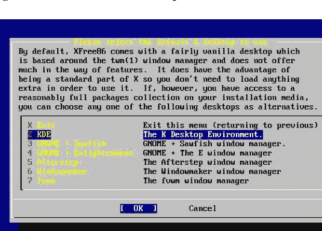

使用方向键选择桌面并按回车键。将开始安装选定的桌面。

### 2.9.14 安装软件包

软件包是预编译的二进制文件，是安装软件的一种方便方式。
为了说明，这里显示了安装一个软件包的过程。如果需要，此时也可以添加额外的软件包。安装后，可以使用 `sysinstall`（在 5.2 之前的版本的 FreeBSD 中为 `/stand/sysinstall`）来添加额外的软件包。

#### 请求用户确认
FreeBSD 软件包包含数百个即插即用的应用程序，涵盖了从文本编辑器到游戏，再到 Web 服务器等。你现在想浏览该集合吗？

[ 是 ] 否

选择 [ 是 ] 并按回车键后，将进入软件包选择界面：

#### 图 2-52. 选择软件包类别

要标记软件包，将其移动到上方并按空格键。如果该软件包已标记，则将取消标记或删除（如果已安装）。标记为 "D" 的项目将自动加载的依赖项。要选择类别，按回车键。注意：选择所有类别都会创建一个大类别。如果你在未选择类别的情况下选择软件包，它会出现。

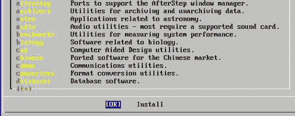

给定时间内只有当前安装介质上的软件包可以安装。

如果选择了“全部”或选择了某个特定类别，将显示所有软件包。使用方向键高亮你的选择并按回车键。

菜单将显示所有适用于所选内容的可用软件包：

#### 图 2-53. 选择软件包

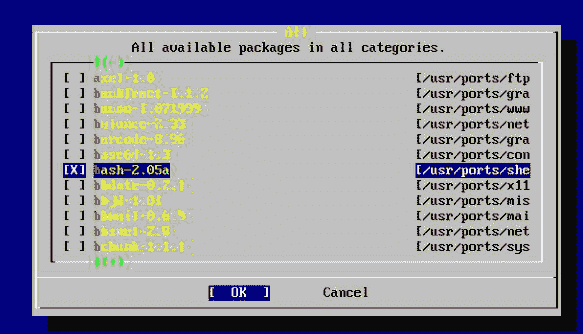

图中显示了 `bash-2.05a`。通过高亮软件包并按空格键，根据需要选择尽可能多的软件包。
每个软件包的简短描述将出现在屏幕左下角。

按 Tab 键可以在最后选中的软件包、[ OK ] 和 [ 取消 ] 之间切换。

当你完成待安装软件包的标记后，按一次 Tab 键切换到 [ OK ] 并按回车键返回软件包选择菜单。

左、右方向键也会在 [ OK ] 和 [ 取消 ] 之间切换。这种方法也可以用于选择 [ OK ] 并按回车键返回软件包选择菜单。

##### 2-54. 安装软件包

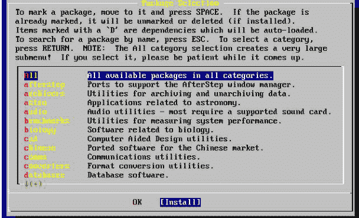

使用 Tab 和方向键选择 [ 安装 ] 并按回车。然后你需要确认想要安装这些软件包：

##### 2-55. 确认软件包安装

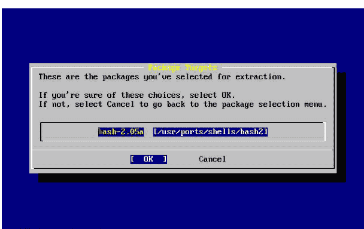

点击 [ OK ] 并按回车键将开始安装软件包。将显示安装信息直到完成。请注意是否有错误信息。

软件包安装完成后，将继续最后的配置。如果你最终没有选择任何软件包并希望返回最后的配置，请选择“仍然安装”。

### 2.9.15 添加用户/组

在安装期间你应该至少添加一个用户，这样你就可以不以 root 身份使用系统。分区通常很小，以 root 身份运行应用程序很容易填满。下面有一个更大的危险：

#### 请求用户确认
你想向系统添加任何初始用户账户吗？建议在此阶段至少为你添加一个账户，因为以 "root" 用户身份操作很危险（很容易做出对整个系统产生不利的操作）。

[ 是 ] 否

选择 [ 是 ] 并按回车继续添加用户。

#### 图 2-56. 选择用户

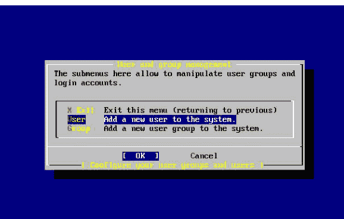

使用方向键选择用户并按回车。

#### 图 2-57. 添加用户信息

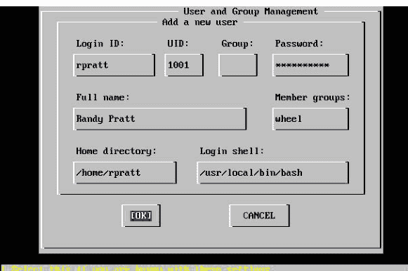

在使用 Tab 键选择项目时，屏幕下方将出现以下描述，以协助输入所需信息：

- `Login ID`: 新用户的登录名（强制性）。
- `UID`: 该用户的数字标识符（留空由自动选择）。
- `Group`: 该用户的登录组名（留空由自动选择）。
- `Password`: 该用户的密码（输入此字段时务必小心！）。
- `Full name`: 用户的全名（注释）。
- `Member groups`: 该用户所属的组（即拥有访问权限的组）。
- `Home directory`: 用户的家目录（留空使用默认值）。
- `Login shell`: 用户的登录 shell（留空使用默认值，例如 `/bin/sh`）。

登录 shell 已从 `/bin/sh` 更改为 `/usr/local/bin/bash`，以使用之前作为软件包安装的 bash shell。不要尝试使用不存在或无法登录的 shell。BSD 世界中最常用的 shell 是 c，可以指示为 `/bin/tcsh`。该用户也被添加到 wheel 组以获得超级用户权限。当你满意时，按 [ OK ] 显示用户和组管理菜单：

#### 图 2-58. 退出用户和组管理

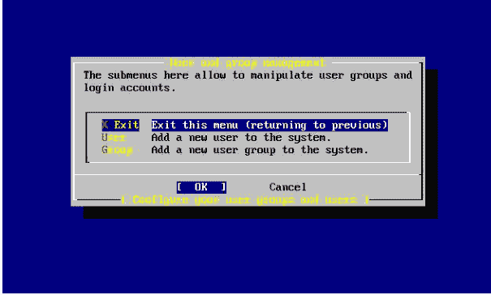

如果有特定需求，也可以添加组。在 5.2 之前的 FreeBSD 版本中，可以通过 `sysinstall` 访问。添加用户后，使用方向键选择退出并按回车继续。

### 2.9.16 设置 root 密码

消息：现在必须设置系统密码。这是你登录为 "root" 时使用的密码。

按回车设置 root 密码。需要输入两次。不用说，如果你忘记了密码，确保你有找到密码的方法。注意输入的密码不会显示。更改本地密码：
新密码：
再次输入密码：

成功输入密码后安装将继续。

### 2.9.17 退出安装

如果你需要配置额外的设备或配置，可以在此处或在 5.2 之前的 FreeBSD 版本完成后进行。

#### 请求用户确认
访问通用菜单以设置任何选项？

[ 是 ] 否

使用方向键选择 [ 否 ] 并按回车返回主安装菜单。

#### 图 2-59. 退出安装

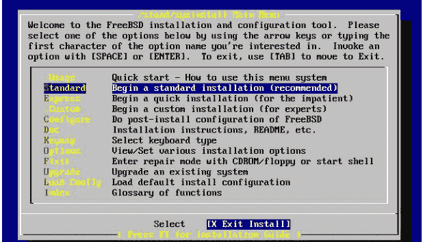

使用方向键选择 [ 退出安装 ] 并按回车。将确认退出安装：

请求用户确认
确定退出吗？系统将重启（请确保移除所有软驱器）。

[ 是 ] 否

选择 [ 是 ] 并移除软驱。CDROM 驱动器将锁定直到机器启动。随后 CDROM 驱动器将解锁，系统将重启以观察可能出现的错误信息。

## 2. FreeBSD 启动

如果一切顺利，你将看到消息滚过屏幕到达登录提示符。可以通过按 ScrollLock、PgUp 和 PgDn 查看内容。ScrollLock 将返回提示符。整个消息可能无法显示（缓冲区限制），但在提示符处输入 `dmesg` 查看。

使用安装期间设置的用户名/密码登录。避免以 root 登录。

典型的启动消息（版本信息）：

```
Copyright (c) 1992-2002 FreeBSD Project.
Copyright (c) 1979, 1970, 1983, 1986, 1988, 1991, 1993, 1994
University of California. All rights reserved.

Timecounter "81254" frequency 193182 Hz

CPU: AMD-Ks(tm) 3D processor (300.68MHz 586-class CPU)

Origin = "AuthenticAMD" Id = 0x580 Stepping = 0
```


Features=0x8001BFPU, VME, DE, PSE, TSC, MSR, CX, MMX

AMD Features=0x8000080 SYSCALL, 3DNow

real memory = 268434546 (262144 bytes)

config=di sn0

config=di lc0

config=le0

config=di ie0

config=fe0

config=cs0

config=bt0

config=aic0

config=aha0

config=adv0

config=q

avail memory = 256311296 (250304 bytes)

Preloaded elf "kernel" at 0xc04910c.

Preloaded userconfig_script "/boot/kernel.conf" at 0xc04910c.

md0:

  Malware disk

Using SPIR table, 4 entries at 0xc00fde60

px0: <processor> on motherboard

npx0: INT interface

pci0: < root to PCI bridge> on motherboard

pci0: on pci0b

pci1: < PCI VIA 82C598MV (Apple MPV3) PCI-PCI (AGF) bridge> at device 1.0 on pci0

pci1: < PCI> on pci0b

pci1: <Matros MSA G200 AGP graphics controller> at 0.0 irq 18

isa0: < bus on isa>

atapic0: <VIA 82C586 ATA33 controller> port 0xe000-0xe0f at device 7.1 on pci0

atal: at 0xf18 irq 14 on atpic0

atal: at 0xf170 irq 15 on atpic0

uhci0: <VIA 83C572 USB controller> port 0xe400-0xe41f irq 12 at device 7.2 on pci0

usb0: <USB controller> on uhci0

usb0: USB root hub, class 9/0, rev 1.00/1.00, addr 1

uhub0: USB UHCI

uhub2: 2 ports with 2 removable, self powered

chip1: <VIA 82C59CF ACPI interface> at device 7.3 on pci0

ed0: <NE2000 PCI Ethernet (RealTek 8029)> at port 0xe800-0xe81f irq 9 at

device 10.0 on pci0

ed0: 地址 52:54:05:de:73:1b, 类型 NE2000 (16 bit)
isa: 过多的 dependent configs (8)
isa: 意外的 small tag t14
fdc: <72065b or clone> at port 0x3f0-0x3f5,0x3f7 irq 6 drq 2 on isa
fifo: FIFO enabled, 8 bytes threshold
fd0: <1440-KB 3.5 驱动> on fd0 drive
atkbd0: <keyboard controller (18042)> at port 0x60-0x64 on isa
kbd0 at atkbd0
psm0: <PS/2 鼠标> at irq 12
model Generic PS/2 mouse, device id 0
vga0: <Generic VGA> at port 0x3b-0x3f icem oxam0000-xbffff on isa
sc0: <system console> at port 0xf1 on isa
vga0: 16 virtual consoles, flags=0x300
sio0: at port 0x38-0x3f irq 4 flags 0x10 on isa
sio0: 16550a
sio1: at port 0xff8-0xfff irq 3 on isa
sio1: 16550a
ppc0: <Parallel> at port 0x378-0x37f irq 7 on isa
ppc0: SMC-like chipset (ECFP/ECP/PS2/NIBBLE) in COMPATIBLE mode
ppc0: FIFO with 16/16/15 bytes threshold
pbus0: 找到 IDE1984 device <NIBBLE
正在在 pbus0 上探测 FnP 设备
lplp0: <CLIP 网络接口> on pbus0
lpto0: <Printer> on pbus0
1pto0: 中断驱动型端口
1pto0: <Parallel I> on pbus0
ad806m: <IDE-HEMA-3851-1> [16338/16/63] at ata-master using UDMA3
ad906m: <IDE-HEMA-3851-1> [16338/16/63] at ata-master using UDMA3
cad0: CDROM DELTA-OHCI/H103 F/W by OID> at ata-slave using PIO
挂载点来自 ufs:/dev0
swap: /dev/ads0 作为交换设备
自动启动进程中：
dev/ads0: 文件系统: 正在检查检查
dev/ads0: clean, 487752 free (52 fragments, 6025 块, 0.9% 碎片)
dev/adsl1: 文件系统: 正在检查检查
dev/adsl1: clean, 128997 free (21 fragments, 16222 块, 0.0% 碎片)
dev/adsl2: 文件系统: 正在检查检查
dev/adsl2: clean, 3036299 free (4175 fragments, 374073 块, 1.3% 碎片)
dev/adsl3: 文件系统: 正在检查检查
dev/adsl3: clean, 128997 free (17 fragments, 16022 块, 0.0% 碎片)
正在进行初始设置：主机名:
ed0:8843-up,BROADCAST,RUNNING,SIMPLEX,MULTICAST> mtu 1500
inet6: 192.168.0.1 mask 0xffffff broadcast 192.168.0.255
net6: fe80::2005:ff00:fe73:1de0 be0 prefixlen 64 tentative scale 0xff1
net6: 52:54:05:de:73:1b
l0: flags=8049-up,LOOPBACK,RUNNING,MULTICAST> mtu 16384
net6: fe80::100 prefixlen 64 scale 0x8
net6: ::1 127.0.0.1 mask 0xffff0000
额外的路由选项：IP gateway=TCP keepalive=YES
路由守护进程：
额外的守护进程：syslogd。

正在进行额外的网络设置。
启动最终的网络守护进程：创建 ssh RSA 主机密钥
正在生成公钥/私钥对。
您的标识已保存到 `/etc/ssh/ssh_host_key`。
您的公钥已保存到 `/etc/ssh/ssh_host_key.pub`。
密钥指纹为：
cd76:81:6e:de0:ef8:66:d0:07:26:3c:7e:12drootk6-2.example.com sha host key
正在生成公钥/私钥 dsa 密钥对。
您的标识已保存到 `/etc/ssh/ssh_dsa_key`。
您的公钥已保存到 `/etc/ssh/ssh_dsa_key.pub`。
密钥指纹为：
f91a:a57:c4:ca9:af99:52:bb:ff:ad2:1e6rootk6-2.example.com set host key
usr/local
ldconf path: `/usr/lib/compat/aout`
ldconf path: `/usr/lib/compat/aout`
启动标准守护进程：inetd cron sendmail。
初始化：配置 sysons: 空屏
额外的 ABI 支持：FreeBSD/i386 (example.com) (tty0)
登录: 密码：
生成 RSA 和 DSA 密钥在较慢机器上可能需要一些时间。这只发生在新安装的启动时。随后的启动将更快。如果配置了 X 服务器并选择了桌面，可以通过 startx 启动。

一旦安装程序完成，您可以通过输入以下内容来启动 FreeBSD：

```
>>> BOOT
```


指示固件启动指定的磁盘。为了以后自动启动 FreeBSD，请使用这些命令：

`BOOT_FLAGS`

`BOOT_FILE`

`BOOT_DEV`

`BOOT_ACTION`

启动消息与在 i386 上启动 FreeBSD 产生的相似，但并不完全相同。

正确关闭操作系统很重要。不要直接关闭电源。首先，在命令行输入 `su` 成为管理员。只有当用户是 `wheel` 组成员时才会生效。否则，以 `root` 登录并使用 `shutdown -h`。

系统已停止。请按任意键重启。在发出 `shutdown` 命令后出现“请按任意键重启”的消息，如果按了任意键而不是关闭，系统将重启。您可以使用 `Ctrl+Alt+Del` 重启系统，但在正常运行期间不建议这样做。

FreeBSD 目前运行在各种 ISA、VLB、EISA 和基于总线的 PC 上，配备 Intel、AMD、Cyrix x86 处理器以及 Compaq Alpha 处理器。支持通用 IDE 驱动、各种 SCSI 控制器、PCMCIA、USB 设备以及网络。FreeBSD 也支持 IBM 的控制器 (MCA) 总线。

每个 FreeBSD 版本都提供支持的硬件列表。该文档可以在 CDROM 根目录下的名为 `HARDWARE.TXT` 的文件中找到，也可以在 FTP 分发中。对于给定的架构，每个版本支持的硬件设备。所有版本和架构的支持硬件列表也可以在 Release Information (`http://www.FreeBSD.org/releases/index.html`) 的 FreeBSD 网页上找到。

以下章节涵盖了基础安装排排除，例如人们报告的常见问题。还有针对与 MS-DOS 双启动 FreeBSD 的用户的问答。

### 如果出现故障该怎么办

由于 PC 架构的各种限制，无法做到 100% 可靠。如果失败，您可以做几件事。检查您版本的 FreeBSD Hardware Notes 以确保您的硬件受支持。

如果您的硬件受支持但仍然遇到死机或其他问题，请重置计算机，并在视觉配置选项出现时选择。这将允许您检查硬件并向系统提供信息。启动磁盘上的内核假设大多数硬件设备的 IRQ、IO 地址和 DMA 通道处于工厂默认配置。如果您的硬件已重新配置，您可能需要使用配置编辑器告诉 FreeBSD 在哪里找到它们。

对不存在的设备探测会导致另一个存在的设备探测失败。在这种情况下，应该禁用冲突驱动程序的探测。

# 第 2 章 安装 FreeBSD

注意：通过更新各种硬件组件的固件（特别是主板），可以避免或缓解安装问题。主板固件也称为 BIOS，大多数主板或计算机制造商都有网站，可以在那里找到升级和升级信息。

制造商强烈不要升级主板，除非有充分理由（这可能是某种关键更新）。升级过程可能会出错，对 BIOS 芯片造成永久性。

警告：不要禁用安装期间需要的任何驱动程序，例如您的屏幕 (`sc0`)。如果在离开配置编辑器后安装神秘地失败，您可能删除或更改了不应更改的内容。重启并重试。

在配置模式下，您可以：
- 列出内核安装的设备。
- 禁用系统中不存在的硬件驱动程序。
- 使用设备驱动更改 IRQ、IRQ 和 IO 端口地址。

调整内核以匹配硬件配置后，输入 `q` 使用新设置启动。一旦安装完成，您在配置模式中进行的任何更改将是永久的，因此不需要每次启动都配置。您很可能想要构建自定义内核。

### 处理现有的 MS-DOS 分区

许多用户想在运行微软操作系统的 PC 上安装 FreeBSD。对于这些情况，FreeBSD 有一个名为 `FIPS` 的工具。该工具可以在安装 CD-ROM 的 `tools` 目录中找到，或从许多 FreeBSD 镜像站下载。

`FIPS` 工具允许您将现有的 MS-DOS 分区拆分为两个部分，保留原始分区并允许您安装到第二个部分上。您首先需要使用 Windows 磁盘整理程序（进入资源管理器，右键点击硬盘并选择“整理硬盘”）或 Norton Disk Tool 整理您的 MS-DOS 分区。您可以运行 `FIPS` 工具。它可能会提示您提供剩余信息，只需按照屏幕指令操作即可。之后，您可以重启并在新的空分区上安装 FreeBSD。查看 Distributions 菜单以估算您所需的类型安装所需的空空间。

### 2.11.3 使用 MS-DOS 和 Windows® 文件系统

此时，FreeBSD 不支持使用 Double Space™ 应用程序压缩的文件系统。因此，在 FreeBSD 访问数据之前，需要对该文件系统进行解压缩。这可以通过在“开始 > 程序 > 系统工具”菜单中运行“压缩代理”（Compression Agent）来实现。

FreeBSD 支持基于 MS-DOS 的文件系统。这需要使用带有所需参数的 `mount_msdos(8)` 命令（在 FreeBSD 5.X 中，该命令为 `mount_msdos(8)`）。最常用的工具命令是：

```
# mount_msdos /dev/ad0s1 /mnt
```

在此示例中，MS-DOS 文件系统位于主硬盘的第一个分区上。你的情况可能有所不同，请检查 `dmesg` 和 `mount` 命令的输出。它们应该会产生足够的信息，让你对分区布局有一个大致了解。

注意：扩展 MS-DOS 文件系统通常映射在 FreeBSD 分区之后。换句话说，切片编号（slice number）可能会比 FreeBSD 正在使用的编号高。例如，第一个 MS-DOS 分区可能是 `/dev/ad0s2`，而扩展 MS-DOS 分区位于 `/dev/ad0s3`。对于某些人来说，起初可能会感到困惑。

NTFS 分区也可以使用 `mount_ntfs(8)` 命令进行挂载。

### 2.11.4 Alpha 用户问答

本节涵盖了关于在 Alpha 系统上安装 FreeBSD 的常见问题。

- 1. 我可以从 ARC 或 Alpha BIOS 控制台启动吗？
不可以。FreeBSD 与 Compaq Tru64 和 VMS 一样，只会从 SRM 控制台启动。
- 2. 帮助，我没有空间了！我需要先删除所有内容吗？
遗憾，是的。
- 3. 我可以挂载 Compaq Tru64 或 VMS 文件系统吗？
目前尚不可以。

## 2.12 高级安装指南

> 由 Valentino Vaschetto 贡献。

本节描述了如何在特殊情况下安装 FreeBSD。

### 2.12.1 在没有显示器或键盘的系统上安装 FreeBSD

这种安装类型被称为“无头安装”（headless install），因为你尝试安装 FreeBSD 的机器要么没有连接显示器，甚至没有 VGA 输出。这如何可能呢？

使用串口控制台（serial console）。串口控制台基本上是使用另一台机器作为系统的显示器和键盘。要实现这一点，只需按照第 2.2.7 节说明的步骤创建安装软盘。

要修改这些软盘以启动到串口控制台，请遵循以下步骤：

- 1. 启用软盘启动到串口控制台

如果你启动了已制作的软盘，FreeBSD 将进入其标准的安装模式。我们希望 FreeBSD 在安装时进入串口控制台。为了做到这一点，你必须使用 `mount(8)` 命令在 FreeBSD 系统上挂载 `kern.flpy` 软盘。

```
# mount /dev/fd0 /mnt
```

现在你已经挂载了软盘，你必须将其切换到 `/mnt` 目录：

```
# cd /mnt
```

在此处你将设置软盘启动到串口控制台。你需要创建一个名为 `boot.config` 的文件，内容包含 `/boot/loader -h`。这所需要的只是给引导程序提供一个标志，以便启动到串口控制台。

```
# echo "boot/loader -h" > boot.config
```

现在你已经正确配置了软盘，你必须使用 `unmount(8)` 命令卸载软盘：

```
# cd /
# unmount /mnt
```

现在你可以从软盘驱动器中取出软盘了。

- 2. 连接你的空调制线（Null-modem Cable）

你需要在两台机器之间连接一根空调制线。只需将电缆连接到两台机器的串口即可。*普通的串口线不起作用*，你需要空调制线，因为它的某些线路是交叉的。

- 3. 启动进行安装

现在可以开始安装了。将 `kern.flpy` 软盘放入执行无头安装的机器软盘驱动器中，并开启。

- 4. 连接到你的无头机器

现在你必须连接到 `cu(1)`：

```
# cu -1 /dev/cua0
```


完成！你应该能够通过 `cu` 会话连接到无头机器。它会要求你放入 `mfsroot.flp`，然后会列出可选终端类型。选择 FreeBSD 彩色控制台并继续你的安装！

# 第 2 章 安装 FreeBSD

在某些情况下，你可能需要自己的 FreeBSD 安装媒体和/或源码。这可能是物理媒体（例如磁带），或者是 `sysinstall` 可用于检索文件的源，例如本地 FTP 站点或 MS-DOS 分区。

例如：

- 你有许多机器连接到本地网络，有一张 FreeBSD 盘。你想使用 FreeBSD 盘的内容创建一个本地 FTP 站点，然后让你的机器使用这个本地 FTP 而不是连接互联网。
- 你有一张 FreeBSD 盘，但 FreeBSD 无法识别你的 CD/DVD 驱动器，但 MS-DOS/Windows 可以识别。你想将文件复制到 MS-DOS 分区。
- 你想安装 FreeBSD，但电脑没有 CD/DVD 驱动器，只有网卡。你可以通过网络获取文件。
- 你想在磁带上安装 FreeBSD。

## 2.13 准备自己的安装媒体

**注意：** 为防止重复，在此语境下，“FreeBSD 盘”指的是你购买或自行制作的 CDROM 或 DVD。

### 2.13.1 创建安装光盘

作为每个版本的一部分，FreeBSD 项目提供了两个光盘镜像。如果你有刻录机，可以将这些镜像刻录到光盘。

- 1. 下载正确的镜像
每个版本的 ISO 镜像可以从 `ftp://FreeBSD.org/pub/iso-arch/` 下载。该目录通常包含以下：

| 文件名 | 包含 |
| :--- | :--- |
| `version-RELEASE-arch-miniinst.iso` | 安装所需的所有 |
| `version-RELEASE-arch-disc1.iso` | 安装所需的所有以及用于 | live 文件系统 |
| `version-RELEASE-arch-disc2.iso` | 文档以及大量的第三方软件包 |

你必须下载 `miniinst` ISO 或 `disc` 其中之一。不要都下载，因为 `disc` 包含了 `miniinst` 的内容。

> 注意：`miniinst` ISO 适用于 5.4 之前的版本。

如果访问互联网很方便，请使用 `miniinst` ISO。它能让你安装 FreeBSD，你可以通过 `ports` 系统（第 4 章）安装第三方软件包。
如果你想安装 FreeBSD 版本，并且光盘上也有合理的第三方软件包，请使用 `disc`。
额外的光盘很有用，但并非必需，特别是当你可以高速访问互联网时。

- 2. 刻录光盘
你必须将光盘镜像刻录到光盘。如果你在另一个 FreeBSD 系统上执行此操作，请参考第 17.6 节获取更多信息（特别是 17.6.3 和 17.6.4）。
如果你在其他平台上执行，你需要使用该平台上控制刻录机的工具。提供的镜像采用标准 ISO 格式，许多刻录程序都支持。

> 注意：如果你对构建自定义 FreeBSD 版本感兴趣，请查看发布工程文章（http://www.FreeBSD.org/doc/en_US.ISO8859-1/articles/releng）。

### 2.13.2 使用 FreeBSD 盘创建本地 FTP 站点

FreeBSD 盘的布局与 FTP 站点相同。这让你很容易创建一个本地 FTP 站点，供其他机器在安装 FreeBSD 时使用。

- 1. 在托管 FTP 站点的 FreeBSD 上，确保 CD 在驱动器中并挂载到 `/cdrom`。
- 2. 在 `/etc/passwd` 中为匿名 FTP 创建账户。通过 `vipw(8)` 编辑 `/etc/passwd` 并添加此行：
- 3. 确保在 `/etc/inetd.conf` 中启用了 FTP 服务。

```
ftp::99:99:0:0:FTP:/cdrom:/nonexistent
```

现在，任何连接到你机器的人都可以在安装过程中 FTP 站点菜单中选择“其他”，然后选择媒体类型为 FTP 并输入 `ftp://your machine`。

> **注意：** 如果 FTP 客户端的启动介质（通常是软盘）版本与本地 FTP 站点提供的版本不一致，`sysinstall` 将不允许你继续。如果版本不相似且你想覆盖此限制，必须进入“选项”（Options）菜单并将发行版名称（distribution name）更改为 `any`。

> **警告：** 此方法对于位于本地网络并受防火墙保护的机器是安全的。通过互联网（而非你的本地网络）向其他机器提供 FTP 服务会使你的计算机暴露在黑客和其他不受分子的关注之下。如果这样做，我们强烈建议你遵循良好的安全规范。

### 2.13.3 创建安装软盘

如果你必须从软盘进行安装（我们建议*不要*这样做），无论是由于硬件不支持，还是仅仅是因为你坚持要用这种最困难的方法，你必须先为安装准备一些软盘。

至少，你需要每张 1.44 MB 或 1.2 MB 的软盘，因为需要容纳 `bin` (binary) 目录中的所有文件。如果你在 DOS 下准备软盘，则它们**必须使用** MS-DOS `FORMAT` 命令进行格式化。如果你使用 Windows，请使用资源管理器来格式化磁盘（右键点击 `A:` 驱动器并选择“格式化”）。

不要信任预格式化的软盘。请亲自重新格式化以防万一。我们的用户报告的许多问题都是由于使用了格式不正确的介质导致的，这就是我们特意强调这一点的原因。

如果你在 FreeBSD 机器上创建软盘，格式化仍然不是坏主意，尽管你不需要在每张软盘上放置 DOS 文件系统。你可以使用 `bsdlabel` 和 `newfs` 命令在它们上放置 UFS 文件系统，如下所示的命令序列（针对 3.5 英寸 1.44 MB 软盘）：

```
# fdformat -f 1440 fd.1440
# bsdlabel -w -r fd.1440 floppy3
# newfs -t u2 -n 18 -1 -i 65536 /dev/fd
```

> 注意：对于 5.25 英寸 1.42 MB 磁盘，请使用 `fd0.1200` `floppy5`。

然后你可以像处理其他文件系统一样挂载并写入它们。

在格式化软盘后，你需要将文件复制到它们上。发行版文件被分成大小适中的块，以便它们能够放入 1.44 MB 的软盘中。遍历所有软盘，在每张软盘上尽可能多地打包文件，直到你以这种方式打包了所有发行版文件。每个发行版都应该放在软盘的子目录中，例如：`a:\bin\bin.aa`、`a:\bin\bin.ab` 等。

一旦在安装过程中到达“媒体介质”（Media）屏幕，选择“软盘”（Floppy），系统将提示你完成其余后续操作。

### 2.13.4 从 MS-DOS 分区安装

为了准备从 MS-DOS 分区进行安装，请将文件从发行版复制到该分区根目录下的名为 `freebsd` 的目录中。例如，`c:\freebsd`。CDROM 或 FTP 的目录结构必须在此部分复制，因此如果你是从 CD 复制的，请使用 DOS `xcopy` 命令。例如，为 FreeBSD 的最小安装做准备：

```
C:\> md c:\freebsd
C:\> xcopy b:c:\freebsd\* /s
C:\> xcopy m:c:\freebsd\packages /s
```

假设 `C` 是你有空闲空间的地方，`E` 是挂载 CDROM 的。

如果你没有 CDROM，可以从 `FreeBSD.org` 下载发行版（http://FreeBSD.org/pub/FreeBSD/Releases/i386/1-RELEASE/）。每个发行版都在其自己的目录中；例如，基础发行版可以在 `6.1/base/` 找到（http://FreeBSD.org/pub/FreeBSD/Releases/i386/1-RELEASE/base/）。

对于你想要从 MS-DOS 分区安装的许多发行版（且你有空闲空间），请将每个发行版安装在 `c:\freebsd` 下——只有 `BIN` 发行版是最小安装必需的。

### 2.13.5 创建安装磁带

磁带安装是最简单的方法，仅次于任何 FTP 安装或 CDROM 安装。安装程序期望文件被简单地 `tar` 到磁带上。在获取了你感兴趣的所有发行版文件后，只需将它们 `tar` 到：

```
# cd /freebsd/dist/dir
# tar cvf /dev/rw0 dist1 ... dist2
```


当你执行安装时，应确保在某个临时目录（可以由你选择）中留出足够的空间以容纳你创建的磁带完整内容。由于磁带的非随机访问特性，这种安装方法需要一些临时存储空间。

> 注意：在开始安装时，在从启动软盘启动之前，磁带必须放入驱动器中。否则，安装程序可能会无法找到它。

## 2.13.6 在网络安装之前

有三种类型的网络安装可用：串口（`SLIP` 或 `PPP`）、并行口（`PLIP` (laplink 线)）或以太网（标准以太网控制器）。

`SLIP` 的支持相当原始，且仅限于硬连链路。为了获得最好的安装效果，以太网适配器始终是一个好选择！`FreeBSD` 支持大多数常见的网卡；每个版本的“硬件说明”（Hardware Notes）中都提供了支持的网卡（及其所需的设置）列表。如果你使用其中一种 `PCMCIA` 卡，请确保在插入笔记本电脑之前已插入；不幸的是，`FreeBSD` 不支持在安装期间热插拔 `PCIA` 卡。

如果你需要知道你在网络上的 `IP` 地址、你的地址类的网络值，以及如果你通过 `ISP` 安装，你的机器的名称。如果你有静态 `IP`，`IP` 将由 `DHCP` 动态分配。如果你将通过名称而非 `IP` 地址引用主机，在通信时你还需要名称服务器，可能还需要一个网关地址（如果使用 `PPP`，则它是你的提供商的 `IP` 地址）。如果你想通过 `HTTP` 代理通过 `FTP` 安装，你还需要代理的地址。如果你不知道这些问题中全部或大部分的答案，那么在尝试这种类型的安装之前，你应该先咨询你的系统管理员或 `ISP`。

### 2.13.6.1 在通过 NFS 安装之前

`NFS` 安装非常直观。只需将你需要的 `FreeBSD` 发行文件复制到 `NFS` 服务器上，然后将 `NFS` 选择指向它即可。

如果服务器仅支持“特权端口”（`privileged port`）（通常是 `Sun` 工作站的默认设置），你需要在安装继续之前在“选项”（`Options`）菜单中设置 `NFS Secure` 选项。

如果你有一块传输速度极慢的劣质网卡，你可能还想开启 `NFS Slow` 标志。

为了让安装工作，服务器必须支持 `subdirid`，例如，如果你的 `FreeBSD 6.1` 发行目录位于 `/usr/archive/stuff/FreeBSD`，那么服务器必须允许直接挂载 `/usr/archive/stuff/FreeBSD`，而不仅仅是 `/usr` 或 `/usr/archive/stuff`。

在 `FreeBSD` 的 `/etc/exports` 文件中，这由 `-alirs` 选项控制。其他 `NFS` 服务器可能有不同的约定。如果你从服务器收到“被拒绝访问”（`permission denied`）的消息，很可能是你没有正确启用此项。

# 第 3 章 UNIX 基础

由 Chris Shumway 重写。

### 3.1 概述

本章将介绍 `FreeBSD` 操作系统的基础命令和功能。这部分内容对于任何类 `Unix` 操作系统都适用。如果你对这些内容已经熟悉，可以快速浏览本章。如果你是 `FreeBSD` 的新手，那么你将需要仔细阅读本章。

阅读完本章后，你将学会：

- 如何使用 `FreeBSD` 的“虚拟控制台”。
- `Unix` 文件权限的工作原理，以及理解 `FreeBSD` 中的文件标志（`flags`）。
- `FreeBSD` 的默认文件系统布局。
- `FreeBSD` 的磁盘组织。
- 如何挂载和卸载文件系统。
- 什么是进程（`process`）、守护进程（`daemon`）和信号（`signal`）。
- 什么是 `shell`，以及如何更改你的默认登录环境。
- 如何使用基础文本编辑器。
- 什么是设备和设备节点。
- `FreeBSD` 下使用什么二进制格式。
- 如何阅读手动帮助页（`manual pages`）以获取更多信息。

### 3.2 虚拟控制台与终端

`FreeBSD` 可以以多种方式使用。其中一种是在文本终端中输入命令。当你这样使用 `FreeBSD` 时，`Unix` 操作系统的许多灵活性和强大功能触手可及。本节描述了什么是“终端”（`terminal`）和“控制台”，以及你如何在 `FreeBSD` 中使用它们。

### 3.2.1 控制台

如果你没有配置 `FreeBSD` 在启动时自动启动图形化环境，系统在启动后、启动脚本运行结束后，将向你显示登录提示符。你将看到类似的内容：

```
Fri Sep 20 13:01:06 EEST 2002

FreeBSD/i386 (pc3.example.org) (ttyv0)

login:
```

这些信息在你的系统上可能略有不同，但你会看到类似的内容。我们现在感兴趣的是最后两行。倒数第二行显示：

`FreeBSD/i386 (pc3.example.org) (ttyv0)`

这一行包含了关于你刚刚启动的系统信息。你正在查看一个运行在 `x86` 架构的 `Intel` 或兼容计算机上的“`FreeBSD`”控制台。这台机器的名字（每台 `UNIX` 机器都有一个名字）是 `pc3.example.org`，你现在正在查看它的系统控制台——`ttyv0` 终端。

最后，最后一行总是：

`login:`

这是你应该输入“用户名”（`username`）以登录 `FreeBSD` 的部分。下一节将描述如何进行操作。

### 3.2.2 登录 FreeBSD

`FreeBSD` 是一个多用户、多处理系统，通常提供给许多不同用户使用的系统，他们可以在单台机器上同时运行许多程序。

每个多用户系统都需要某种方式来区分一个“用户”与其他用户。在 `FreeBSD`（以及所有类 `Unix` 操作系统）中，这是通过要求每个用户在运行程序之前必须“登录”系统来实现。每个用户都有一个唯一的名称（用户名）和一个个人的私密密钥（密码）。在允许用户运行任何程序之前，`FreeBSD` 会询问这两个值。

在 `FreeBSD` 启动并运行完启动脚本后，它会向你显示一个提示符并要求输入有效用户名：

`login:`

为了本示例，让我们假设你的用户名是 `john`。在提示符处输入 `john` 并按回车。随后你将看到一个输入“密码”（`password`）的提示。

`login: john`

`Password:`

现在输入 `john` 的密码并按回车。密码不会回显！你现在不需要担心这一点。这是出于安全考虑。

如果你输入的密码正确，你现在应该已经登录 `FreeBSD`，并准备好尝试所有可用命令。

你应该能看到 `MOTD` 或每日消息（`message of the day`），后面跟着一个命令提示符（`#`、`$` 或 `%` 字符）。这表示你已成功登录 `FreeBSD`。

### 3.2.3 多个控制台

在一个控制台中运行 `UNIX` 命令是免费的，`FreeBSD` 可以同时运行许多程序。当像 `FreeBSD` 这样的操作系统可以同时运行几十个程序时，只拥有一个可以输入命令的控制台有点是浪费。这些“虚拟控制台”会非常有帮助。

`FreeBSD` 可以配置许多不同的虚拟控制台。你可以通过按下键盘上的几个键从一个控制台切换到任何其他虚拟控制台。每个控制台都有自己的输出通道，当你从一个虚拟控制台切换到下一个时，`FreeBSD` 会负责重定向键盘输入和显示器输出。

`FreeBSD` 预留了特殊键用于切换控制台。你可以使用 `Alt-F1`、`Alt-F2` 到 `Alt-F8` 切换到 `FreeBSD` 中不同的控制台。

当你从一个控制台切换到下一个时，`FreeBSD` 会负责保存和恢复屏幕。结果是产生了一种“拥有多个‘虚拟’屏幕和键盘的错觉”，你可以用它们为 `FreeBSD` 输入命令。你在一个虚拟控制台上启动的程序在控制台不可见时不会停止运行。当你切换到另一个虚拟控制台时，它们会继续运行。

### 3.2.4 /etc/tty 文件

`FreeBSD` 的配置启动时会有八个虚拟控制台。但这并不是硬性设置，你可以自定义你的安装以拥有更多或更少的虚拟控制台。虚拟控制台的数量和设置在 `/etc/tty` 文件中配置。

你可以使用 `/etc/tty` 文件来配置 `FreeBSD` 的虚拟控制台。该文件中每一行未注释的行（不以 `#` 开头的行）都包含单个终端或虚拟控制台的设置。`FreeBSD` 自带的该文件的默认版本包含九个虚拟控制台，并启用了其中的八个。它们是那些以 `tty:` 开头的行：

```
# name                    type            status      comments

#
tty0    "usr/libexec/getty Pc"    cons25 on  secure
# Virtual terminals
tty1    "usr/libexec/getty Pc"    cons25 on  secure
tty2    "usr/libexec/getty Pc"    cons25 on  secure
tty3    "usr/libexec/getty Pc"    cons25 on  secure
tty4    "usr/libexec/getty Pc"    cons25 on  secure
tty5    "usr/libexec/getty Pc"    cons25 on  secure
```


tty6    "usr/libexec/getty Pc"    cons25 on  secure

tty7    "usr/libexec/getty Pc"    cons25 on  secure

tty8    "usr/X11/bin/xdm --daemon"  xterm off

```
要了解此文件中每一列的详细描述以及你可以用于设置虚拟控制台的所有选项，请参阅 `tty(5)` 手动页。
```

### 3.2.5 单用户控制台

FreeBSD 的配置从八个虚拟控制台启动。尽管这不是一个硬性设置，但你可以自定义安装以获得更多或更少的虚拟控制台。单用户模式的详细描述可以在第 12.6 节找到。值得注意的是，当你在单用户模式下运行 FreeBSD 时，只有一个控制台。

单用户控制台的设置可以在 `/etc/tty` 中找到。注意：如上述行所示，你可以编辑此行并将 `secure` 改为 `insecure`。如果你这样做了，FreeBSD 将进入单用户模式，它仍然会询问 `root` 密码。更改为 `insecure` 时要小心。如果你忘记了 `root` 密码，进入单用户模式会有点复杂。对于不熟悉 FreeBSD 启动过程和相关程序的人来说，这可能很难。

### 3.3 权限

FreeBSD 作为 BSD UNIX 的后代，基于几个关键的 UNIX 概念。第一个最显著的是 FreeBSD 是一个多用户操作系统。该系统可以处理多个正在执行完全无关任务的用户。系统负责公平地为每个用户共享和管理硬件设备、外设和 CPU 时间。

由于系统能够支持多个用户，每个系统都有一组权限来规定谁可以读取、写入和执行该资源。这些权限被存储为三个部分，分为三块：文件所有者、文件所属的组、以及其他人。这种数值表示法如下：

| 数值 | 权限 | 目录列表 |
| :--- | :--- | :--- |
| 0 | 不可读、不可写、不可执行 | --- |
| 1 | 不可读、不可写、执行 | -x |
| 2 | 不可读、可写、不可执行 | -w- |
| 3 | 不可读、可写、执行 | -wx |
| 4 | 可读、可写、不可执行 | r-- |
| 5 | 可读、不可写、执行 | r-x |
| 6 | 可读、可写、不可执行 | rw- |
| 7 | 可读、可写、执行 | rwx |

你可以使用 `ls(1)` 的 `-l` 参数查看详细目录列表，其中包含一列关于文件所有者、组和其他人权限的信息。例如，在任意目录中执行 `ls -l` 可能显示如下：

```
% ls -l

total 530

-r-- root wheel 512 Sep 5 12:31 myfile

-rw-r--r--
```

```
-rw-r--r-- 1 root wheel 512 Sep 5 12:31 otherfile

-rw-r--r-- 1 root wheel 7680 Sep 5 12:31 email.txt

...
```

这里是 `ls -l` 的第一列拆分：

```
-rw-r--r--
```

第一个（最左侧）字符告诉我们这是一个普通文件、目录、特殊字符设备、套接字还是任何其他伪文件设备。在这种情况下，`-` 表示普通文件。接下来的三个字符 `rw-` 赋予文件所有者权限。接下来的三个字符 `r--` 赋予文件所属组的权限。最后三个字符 `r--` 赋予其他用户权限。权限的设置使得所有者可以读取和写入文件，用户组可以读取，而其他其他用户只能读取。根据上表，该文件的权限为 `644`，其中每个数字代表文件权限的三个部分。

这些都很好，但系统是如何控制设备权限的呢？FreeBSD 实际上将大多数设备视为文件，程序可以像处理其他文件一样打开、读取和写入数据。这些特殊设备存储在 `/dev` 目录中。

目录也被视为文件。它们具有读取、写入和执行权限。目录的可执行权限其含义与文件略有不同。当一个目录被标记为可执行时，意味着可以进入其中，因此可以 `cd` 切换目录进入它。这意味着在目录内部，可以访问已知名称的文件（当然，这取决于文件本身的权限）。

特别地，为了执行目录列出，必须在目录上设置读取权限；若要删除一个已知名称的文件，则需要包含该文件的目录具有写入和执行权限。

还有更多的权限位，但它们主要用于特殊情况，例如设置位二进制文件（set binaries）和粘滞目录（sticky directories）。如果你想了解更多关于文件权限以及如何设置权限的信息，请务必查看 `chmod(1)` 手页。

#### 3.3.1 符号权限

由 Tom Rhodes 贡献。

符号权限（有时称为符号表达式）使用字符代替八进制来为文件或目录分配权限。符号表达式使用 `(who) (action) (permissions)` 的语法，可以使用以下值：

| 选项 | 字母 | 代表 |
|---|---|---|
| (who) | u | 用户 (User) |
| (who) | g | 组所有 (Group owner) |
| (who) | o | 其他 (Other) |
| (who) | a | 所有 ('world') |
| (action) | + | 添加权限 |
| (action) | g | 移除权限 |
| (action) | = | 明确设置权限 |
| (permissions) | r | 读取 |

## 第3章 UNIX 基础

| 选项 | 字母 | 代表 |
|---|---|---|
| (permissions) | w | 写入 |
| (permissions) | x | 执行 |
| (permissions) | t | 粘滞位 (Sticky bit) |
| (permissions) | s | 设置 UID 或 GID |

这些值与之前一样配合字母使用 `chmod(1)` 命令。例如，可以使用以下命令阻止其他用户访问 `FILE`：

```
% chmod gow FILE
```

当必须对一个文件进行多项更改时，可以提供逗号。例如，以下命令可以移除 `FILE` 的组和“其他用户”写入权限，然后为所有人添加权限：

```
% chmod go-w,a+x
```

#### 3.3.2 FreeBSD 文件标志

由 Tom Rhodes 贡献。

除了之前讨论的文件权限外，FreeBSD 还支持使用“文件标志”（file flags）。标志为文件增加了额外的安全和控制级别，但不适用于目录。

这些文件标志为文件增加了额外的控制层，有助于确保在某些情况下，即使是 `root` 也无法删除或修改文件。

文件标志使用 `chflags(1)` 工具通过简单的接口进行更改。例如，要对文件 `file` 启用系统不可删除标志，请执行以下命令：

```
# chflags sunlink file
```

要禁用系统不可删除标志，只需在 `sunlink` 前加上 `no` 并执行之前的命令：

```
# chflags nosunlink file
```

要查看此文件的标志，请使用带有 `-lo` 选项的 `ls(1)` 命令：

```
# ls -lo file
```

```
-rw-r--r-- 1 trhodes sunlink 0 Mar 1 05:54 file
```


某些标志可能只能由 root 用户向文件添加或移除。在其他情况下，文件所有者可以设置这些标志。建议管理员阅读 `chflags(1)` 和 `chflags(2)` 手页以获取更多信息。

### 3.4 目录结构

FreeBSD 目录层次对于全面理解系统至关重要。必须掌握的核心概念是：`/` 目录是启动时第一个挂载的目录，包含了准备操作系统进行多用户操作所需的基础系统。根目录还包含了你可能想要挂载的所有其他系统的挂载点。

挂载点（mount point）是一个可以将额外的文件系统嫁接到根文件系统上的目录。这在第 3.5 节中描述。标准挂载点包括 `/usr`、`/tmp`、`/mnt` 和 `/cdrom`。这些目录是文件系统的基础。文件层次结构的完整描述可以在...可用。

| 目录 | 描述 |
|---|---|
| / | 根目录。 |
| /bin | 通用工具。 |
| /sbin | 系统守护程序和工具。 |
| /dev | 设备节点。 |
| /etc | 配置。 |
| /home | 用户目录。 |
| /lib | 归档库。 |
| /root | root 账户的主目录。 |
| /mnt | 挂载点。 |
| /proc | 进程文件系统。 |
| /root | 恢复环境。 |
| /tmp | 临时文件。 |
| /var | 杂项系统日志。 |
| /usr | 大多数用户工具和应用程序。 |
| /usr/local | 本地可执行文件、库等。 |

## 第3章 UNIX 基础

| 目录 | 描述 |
|---|---|
| /usr | 大多数用户工具和应用程序。 |
| /usr/bin | 通用工具、编程工具和应用程序。 |
| /usr/include | 标准 C 头文件。 |
| /usr/lib | 归档库。 |
| /usr/libdata | 杂项工具文件。 |
| /usr/libexec | 系统守护程序和工具（由其他程序执行）。 |
| /usr/local | 本地可执行文件、库等。 |
| /usr/obj | 构建 /usr/src 树产生的体系特定目标树。 |
| /usr/ports | FreeBSD Ports 集合（可选）。 |
| /usr/sbin | 系统守护程序和工具（由用户执行）。 |
| /usr/share | 体系无关的文件和/或本地源码。 |
| /usr/src | BSD 和/或本地源码。 |
| /usr/X11R6 | X11R6 发行版可执行文件、库等（可选）。 |

### 3.5 磁盘组织

FreeBSD 用于查找文件的最小组织单元是文件名。文件名是区分大小的，这意味着 `readme.txt` 和 `README.TXT` 是两个独立的文件。FreeBSD 不使用扩展名（`.txt`）来判断文件是程序、文档还是其他形式的数据。

文件存储在目录中。一个目录可能包含没有任何文件，也可能包含数百个文件。目录还可以包含其他目录，允许你在目录之间构建分级结构。这使得组织你的数据变得简单得多。

通过提供文件或目录名称，后跟一个正斜杠 `/`，然后是任何必要的其他目录名称来引用文件和目录。如果你有一个 `foo`，它包含目录 `bar`，而 `bar` 又包含文件 `readme.txt`，那么该文件的完整名称或路径就是 `foo/bar/readme.txt`。

目录和文件存储在文件系统中。每个文件系统最顶层恰好有一个目录，即该文件系统的根目录。此根目录可以包含其他目录。

到目前为止，这与你使用过的任何操作系统都相似。有几点不同；例如，MS-DOS 使用 `:` 分隔文件名和目录名，而 Mac OS 使用 `/`。

FreeBSD 不使用驱动器号。

相反，一个文件系统被指定为根文件系统。根文件系统的根目录称为 `/`。每个文件系统、每个目录都像是挂载在根文件系统下的。无论在一个 FreeBSD 系统上有多少块磁盘，每个目录看起来都像是同一块磁盘的一部分。

假设你有三个文件系统，分别称为 A、B 和 C。每个文件系统有一个根目录，该目录包含另外两个目录，称为 A1、A2（同样还有 B1、B2 以及 C1、C2）。

将 A 称为根文件系统。如果你使用 `ls` 命令查看此目录的内容，你将看到子目录 A1 和 A2。目录树如下：

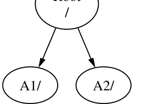

文件系统必须挂载在另一个文件系统的某个目录上。现在假设你将文件系统 B 挂载到根目录 A1，B 中的目录将随之出现：


B1 或 B2 目录中的任何文件都可以根据需要通过路径 `/A1/B1` 或 `/A1/B2` 访问。位于 `/A1` 中的任何文件都被临时隐藏了。如果 B 从 A 上卸载，它们将重新出现。
如果 B 挂载在 A2 上，那么图将将所示：

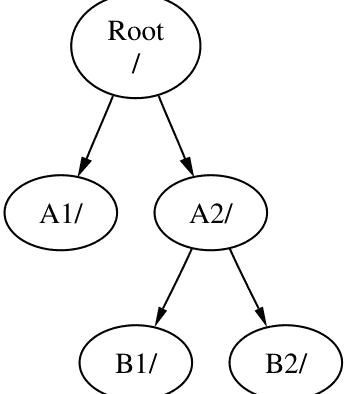

路径分别为 `/A2/B1` 和 `/A2/B2`。
文件系统可以相互挂载。继续上一个例子，C 文件系统可以挂载在 B 文件系统的 B1 目录上，导致这种安排：

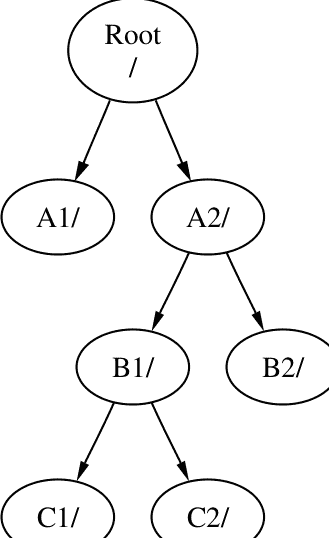

或者 c 可以直接挂载到 λ 文件系统的 A1 目录下：

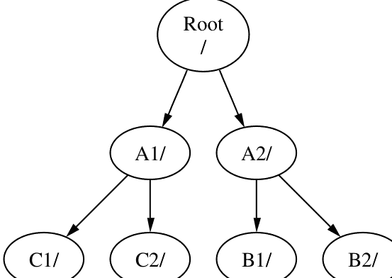

如果你熟悉 MS-DOS，这与 `join` 命令相似，尽管并不完全相同。

这通常是你需要关注的事情。通常你会在安装 FreeBSD 时创建文件系统并决定将它们挂载何处，除非添加了新磁盘，否则永远不要更改它们。

拥有一个大根文件系统是完全可能的，并且不需要创建任何其他文件系统。这种方法有一些缺点，但也有优点。

## 第 3 章 UNIX 基础

## 多文件系统的优势

- 不同的文件系统具有不同的挂载选项。例如，通过仔细规划，根文件系统可以是只读的，使得你无法无意中删除或编辑关键文件。将用户可写的文件系统（如 `/home`）与其他文件系统分离还允许它们以 `nosuid` 方式挂载；此选项可以防止文件系统中可执行文件的 `suid/gid` 位生效，从而提高安全性。
- FreeBSD 根据文件系统的使用情况，自动优化文件系统上的文件布局。因此，包含许多频繁写入的小文件的文件系统，其优化方式与包含大文件的文件系统不同。拥有一个大文件系统的优化会给你带来便利。
- FreeBSD 的文件系统在掉电时是健壮的。然而，在关键点掉电可能会损坏文件系统的结构。通过将你的数据分散在多个文件系统中，系统更有可能仍然启动，方便你在需要时从备份中恢复。

## 单一文件系统的优势

- 文件系统的大小是固定的。如果你在安装 FreeBSD 时创建了一个文件系统并给它一个特定大小，你以后可能会发现需要增大分区。在不备份、用新大小重新创建文件系统并恢复备份数据的情况下，这很难实现。

> **重要：** FreeBSD 提供了 `grows(8)` 命令，这使得动态增加文件系统的大小成为可能，消除了这一局限性。

文件系统包含在分区中。这与该术的常用用法（例如 MS-DOS 分区）含义不同，因为 FreeBSD 有 UNIX 传统。每个分区由 a 到 h 的字母标识。每个分区只能包含一个文件系统，这意味着文件系统通常通过它们在文件系统层次结构中的挂载点或其所属分区的字母来描述。

FreeBSD 还使用交换空间（swap space）。交换空间为 FreeBSD 提供了虚拟内存。这使得你的计算机表现得比实际拥有更多的内存。当 FreeBSD 耗尽内存时，它会将当前未使用的数据移动到交换空间，并在需要时移回。

某些分区具有某些约定。

| 分区 | 约定 |
|---|---|
| a | 通常包含根文件系统 |
| b | 通常包含交换空间 |
| c | 通常与包含它的切区大小相同 |
| d | 通常包含交换空间 |

## 3.6 挂载与卸载文件系统

文件系统最好被可视化为一棵树，其根节点是 `/dev`、`/usr` 等，而根目录下的其他目录是分支，这些分支可能还有它们自己的分支，例如 `/usr/local` 等。

有多种理由将这些目录中的某些存放在独立的文件系统中。`/var` 包含了 `log/`、`spool/` 目录以及各种类型的临时文件，因此可能会被填满。填满根文件系统不是一个好主意；将 `/var` 与 `/` 分开本身就是有益的。

将某些目录树包含在其他文件系统的另一个原因是，它们可能存放在独立的物理磁盘上，或者独立的虚拟磁盘上（例如网络文件系统挂载点，或 CD-ROM 驱动器）。

### 3.6.1 fstab 文件

在启动过程中，`/etc/fstab` 中列出的文件系统会自动挂载（除非它们在列出时带有 `noauto` 选项）。

`/etc/fstab` 文件包含一组以下格式的行：

| device | mount-point | ftype | options | dumpfreq | passno |
| :--- | :--- | :--- | :--- | :--- | :--- |

- **device**: 设备名称（应当存在），如第 17.2 节所述。
- **mount-point**: 目录（应当存在），用于在其挂载文件系统。
- **ftype**: 传递给 `mount(8)` 的文件系统类型。FreeBSD 默认文件系统是 `ufs`。
- **options**: 读写文件系统使用 `rw`，只读文件系统使用 `ro`，随后是任何其他可能需要的选项。一个常用选项是 `noauto`，用于在启动序列期间不正常挂载的文件系统。其他选项列在 `mount(8)` 手页中。
- **dumpfreq**: 用于 `dump(8)` 确定哪些文件系统需要转储。如果该字段缺失，则假设值为零。
- **passno**: 决定检查文件系统的顺序。应该跳过的文件系统其 `passno` 设置为零。根文件系统（需要在所有其他内容之前进行检查）的 `passno` 应设置为一，其他文件系统的 `passno` 应设置为大于一的值。如果有多个文件系统具有相同的 `passno`，`fsck(8)` 将尝试尽可能并行检查文件系统。

有关 `/etc/fstab` 文件格式及其包含的选项的更多信息，请参阅 `fstab(5)` 手页。

### 3.6.2 mount 命令

`mount(8)` 命令是最终用于挂载文件系统的工具。

在最基本的形式下，你使用：

有很多选项，如 `mount(8)` 手页所述，但最常见的有：

- **-a**: 挂载 `/etc/fstab` 中列出的所有文件系统。但标记为 'noauto' 的、被 `-t` 标志排除的或已经挂载的文件系统除外。
- **-d**: 执行除实际挂载系统系统调用以外的所有操作。此选项通常与 `-v` 标志结合使用，以确定 `mount(8)` 实际上在尝试做什么。
- **-f**: 强制挂载不干净的文件系统（危险的），或强制撤销写权限以将文件系统的状态从读写降为只读。
- **-r**: 以只读方式挂载文件系统。这等同于在 `-o` 选项中使用 `ro`（5.2 之前的 FreeBSD 版本使用 `rdonly`）参数。
- **-t ftype**: 以给定的文件系统类型挂载给定的系统，或者如果给了 `-a` 选项，则仅挂载给定类型的文件系统。'ufs' 是默认的文件系统类型。
- **-u**: 更新文件系统上的挂载选项。
- **-v**: 详细模式。
- **-w**: 以读写方式挂载文件系统。

`-o` 选项接受逗号分隔的选项列表，包括以下：

- **nodev**: 不要解释文件系统上的特殊设备。这是一个非常有用的安全选项。
- **noexec**: 不允许在该文件系统上执行二进制文件。这同样是一个非常有用的安全选项。
- **不要解释文件系统上的 setuid 或 setgid 标志。** 这也是一个非常有用的安全选项。

### 3.6.3 ummount 命令

`umount` 命令作为参数，是运行所有挂载点、设备名或所有者的系统进程之一。可能会收到 `-a` 或 `-A` 选项的警告。

所有形式都支持 `-f` 用于强制卸载，`-v` 用于详细显示。请注意，`-f` 通常不是一个好主意。
强制卸载文件系统可能会导致崩溃或损坏文件系统上的数据。

- -a 和 -A 用于卸载所有已挂载的文件系统，可能由 `-t` 之后列出的文件系统类型进行修改。
- 然而，`-L 不尝试卸载根文件系统。

### 3.7 进程

FreeBSD 是一个多任务操作系统。这意味着同时有一个程序在运行。任何时候运行的程序都称为进程。你运行的每个命令都会至少启动一个新的进程，并且有进程一直在运行，以保持系统功能。

每个进程通过一个称为进程 ID（PID）的数字唯一标识，就像文件一样，每个进程也有所有者和组。所有者和组信息用于确定进程可以打开哪些文件和设备。大多数进程都有一个父进程，即它们启动的那个进程。如果你正在输入命令，那么 shell 就是一个进程，你运行的任何命令将以其 shell 为父进程。唯一的例外是一个名为 `init` 的特殊进程；它是第一个进程，其 PID 始终为 1。`init` 由内核自动启动。

### 通常有两个命令用于查看系统上的进程：`ps` 和 `top`。`ps` 命令用于显示进程列表，并显示它们的 PID 以及使用了多少内存。`top` 命令显示所有运行中的进程，并每几秒更新一次，让你交互式查看计算机正在做什么。默认情况下，`ps` 只显示你运行的命令。例如：

| PID | TT | STAT | TIME | COMMAND |
| :--- | :--- | :--- | :--- | :--- |
| 298 | Ss | 00:10 | |
| 7078 | S | 00:48 | emacs |
| 37393 | I | 00:03 | free |
| 48630 | S | 00:50 | /usr/local/lib |
| 48730 | I | 00:00 | helper |
| 72210 | Po | 00:00 | ps |
| 390 | I | 00:14 | tcsh |
| 7059 | I+ | 01:36 | /usr/local/bin |
| 6688 | IWs | 00:00 | tcsh |
| 10735 | IWs | 00:00 | tcsh |
| 20256 | IWs | 00:00 | tcsh |
| 262 | IWs | 00:00 | tcsh (tcsh) |
| 270 | IW+ | 00:00 | /bin/sh /usr/local/bin |
| 280 | IW+ | 00:00 | xinit /home/nik/.xrc |
| 284 | IW | 00:00 | /bin/sh /home/nik/.xinit |
| 285 | S | 03:48 | /usr/local/bin/sawfish |

正如示例所示，`ps(1)` 的输出是一个列，PID 是前面讨论的进程 ID。PID 从 1 到 9999 分配，用尽后回绕。TT 列显示进程的状态，可以安全忽略。TIME 是程序在 CPU 上运行的时间——这通常自你启动程序以来经过的时间，因为大多数程序花费了大量时间等待而不是 CPU 时间。COMMAND 是运行它的命令行。

`ps(1)` 显示不同的选项。最有用的之一是 `aux`，它显示所有运行中的进程，而不仅仅是你的。`u` 显示进程的用户以及内存使用情况。`a` 显示所有守护进程，`w` 调用 `ps(1)` 显示完整的命令行，如果它太长的话截断。

`ps(1)` 的输出示例如下：


# top

last pid: 72257 load averages: 0.13, 0.09, 0.03 up+13:38:33 22:39:10

47 processes: 1 running, 46 sleeping

CPU tasks: 12.6% 0.0 user, 7.8 system, 0.0 interrupt, 79.7% idle

Mem: 36M Active, 5256K free, 13M Wired, 6312K Cache, 15M Buf, 408K Free

Swap: 256M Total, 38M Used, 218M Free, 15M Inuse

| USER | PRIORITY | SIZE | STATE | TIME | WCPU | CPU | COMMAND |
| :--- | :--- | :--- | :--- | :--- | :--- | :--- | :--- |
| 72257 | 2 | 0 | 190600 | 144K | RUN | 0:00 | 14.42% | top |
| 7078 | 2 | 0 | 152800 | 10960K | select | 2:54 | 0.88% | emacs-21.1.14 |
| 281 | 2 | 0 | 18636K | 7112K | select | 5:36 | 0.73% | XF6_SVGA |
| 296 | 2 | 0 | 3240K | 1644K | select | 0:12 | 0.05% | xterm |
| 48630 | 2 | 0 | 3240K | 1644K | select | 3:12 | 0.05% | navigator-linux |
| 175 | 2 | 0 | 924K | 252K | select | 1:41 | 0.00% | syslogd |
| 7059 | 2 | 0 | 7260K | 4644K | poll | 1:38 | 0.00% | mut |

## 3.8 守护进程、信号与杀死进程

当你运行一个编辑器时，很容易控制编辑器、加载文件等。你之所以能这样做，是因为编辑器提供了这些操作的功能，而且编辑器是连接到终端的。有些程序的设计并不是为了在有持续输入的情况下运行，它们会在第一个机会就与终端断开。例如，Web 服务器会发送所有的守护进程请求，这些请求不会从你那里获得任何输入。将电子邮件从一个地方传输到另一个地方的程序也此类应用程序。

我们将这些程序称为守护进程（daemons）。守护进程是希腊神话中的人物；它们既不善也不恶，是一些小小的侍从精灵，通常为人类做些些有用的事情。正如今天的 Web 服务器和邮件服务器所做的那样。BSD 的吉祥物长期一直是看起来活泼、穿着运动鞋并拿着三叉戟的守护进程。

许多通常作为守护进程运行的程序都有一个约定，即末尾带有 'd'。Bind 是伯克利互联网名称守护（实际执行的程序称为 `named`），Apache Web 服务器程序称为 `httpd`，行池守护进程等。这是一种约定，而不是硬性规定；例如，Sendmail 应用的主守护进程被称为 `sendmail`，而不是像你想象的那样被称为 `mailed`。

有时你需要与守护进程进程进行通信。这些通信就是信号（signals），你可以通过向它发送信号来与守护进程（或任何其他进程）进行通信。你可以发送许多不同的信号——其中一些具有特定的含义，另一些则由应用程序解释，文档会告诉你应用程序是如何解释信号的。你只能向你拥有的进程发送信号。如果你使用 `kill(1)` 或 `kill(2)` 权限向别人的进程发送信号，权限将被拒绝。例外是 root 用户，它可以向所有人的进程发送信号。

FreeBSD 在某些情况下也会发送信号。如果一个应用程序写得很糟糕，并尝试访问不属于你的内存，FreeBSD 会发送段错误信号（Segmentation Violation，`SIGSEGV`）。如果一个应用程序使用了 `alarm(3)` 信号以便在一段时间后获得提醒，那么收到的将是闹钟信号（`SIGALRM`），依此类推。

两个信号可以用于停止进程：`SIGTERM` 和 `SIGKILL`。`SIGTERM` 是杀死进程的礼貌方式；进程可以捕获它，意识到你想关闭它，关闭它可能打开的任何日志文件，通常会在关闭之前完成正在执行的任何工作。在某些情况下，如果进程处于一个无法中断的任务中间，它甚至可能会忽略 `SIGTERM`。

`SIGKILL` 无法被进程忽略。这是一个“我不在乎你在做什么，立即停止”的信号。如果你向进程发送 `SIGKILL`，FreeBSD 会立即在那里停止它。

你可能还想使用的其他信号是 `SIGHUP`、`SIGUSR1` 和 `SIGUSR2`。这些是通用信号，不同的应用程序在接收到这些信号时会执行不同的操作。

假设你更改了 Web 服务器的配置文件——你想告诉 Web 服务器重新加载其配置。你可以停止并重启，但这会导致你的 Web 服务器出现短暂的停机时间，这可能是不符合愿望的。大多数守护进程被设计为通过重新读取其配置文件来响应 `SIGHUP` 信号。与其其杀死并重启 `httpd`，不如你只需要向它发送一个 `SIGHUP` 信号。因为没有标准的方法来响应这些信号，不同的守护进程会有不同的行为，因此请务必阅读相关守护进程的文档。

如示例所示，信号是通过 `kill(1)` 命令发送的。

### 向进程发送信号

此示例展示了如何向 `inetd(8)` 发送信号。`inetd` 配置文件为 `/etc/inetd.conf`，当 `inetd` 收到 `SIGHUP` 时会重新读取该配置文件。

- 找到你要发送信号的进程的进程 ID（PID）。可以通过 `ps(1)` 和 `grep(1)` 实现。`grep(1)` 命令用于搜索输出，查找你指定的字符串。该命令以普通用户身份运行，而 `inetd(8)` 以 root 身份运行，因此必须给 `ps(1)` 提供 `ax` 选项。

```
$ ps -ax | grep inetd

198 ? Iws 00:00 inetd -wW
```

所以 `inetd(8)` 的 PID 是 198。在某些情况下，`grep` 命令也可能出现在此输出中。这是由于 `ps(1)` 运行进程列表的方式。

- 使用 `kill(1)` 发送信号。因为 `inetd(8)` 是由 root 运行的，你必须先使用 `su(1)` 变成 root。

```
$ su

Password:

# /bin/kill -s HUP 198
```


与大多数 UNIX 命令一样，`kill(1)` 不打印任何输出。如果你想向一个不属于你的进程发送信号，你将看到：`PID: Operation permitted`。如果你弄错了 PID，你要么会将信号发送给错误的进程（这可能很糟），或者如果你运气好，会将信号发送给一个当前未使用的 PID，然后你会看到 `kill: PID: No process`。

为什么使用 `/bin/kill`？：许多人将 `kill` 命令作为内置命令使用；即 shell 会直接发送信号，而不是运行 `/bin/kill`。这非常有用，但不同的 shell 指定要发送的信号名称时有不同的语法。与其尝试学习所有的它们，不如使用 `/bin/kill ...` 命令可能更简单。

其他信号非常相似，只是 `TERM` 或 `KILL` 的区别。重要：进程无法忽略 `SIGKILL`。

### 3.9 Shell

FreeBSD 在某些情况下也会发送信号。如果一个应用程序写得很糟糕，并尝试访问不属于你的内存，FreeBSD 会发送段错误信号（`SIGSEGV`）。如果一个应用程序使用了 `alarm(3)` 信号以便在一段时间后获得提醒，那么收到的将是闹钟信号（`SIGALRM`），依此类推。

两个信号可以用于停止进程：`SIGTERM` 和 `SIGKILL`。`SIGTERM` 是杀死进程的礼貌方式；进程可以捕获它，意识到你想关闭它，关闭它可能打开的任何日志文件，通常会在关闭之前完成正在执行的任何工作。在某些情况下，如果进程处于一个无法中断的任务中间，它甚至可能会忽略 `SIGTERM`。

`SIGKILL` 无法被进程忽略。这是一个“我不在乎你在做什么，立即停止”的信号。如果你向进程发送 `SIGKILL`，FreeBSD 会立即在那里停止它。

你可能还想使用的其他信号是 `SIGHUP`、`SIGUSR1` 和 `SIGUSR2`。这些是通用信号，不同的应用程序在接收到这些信号时会执行不同的操作。

假设你更改了 Web 服务器的配置文件——你想告诉 Web 服务器重新加载其配置。你可以停止并重启，但这会导致你的 Web 服务器出现短暂的停机时间，这可能是不符合愿望的。大多数守护进程被设计为通过重新读取其配置文件来响应 `SIGHUP` 信号。与其杀死并重启 `httpd`，不如你只需要向它发送一个 `SIGHUP` 信号。因为没有标准的方法来响应这些信号，不同的守护进程会有不同的行为，因此请务必阅读相关守护进程的文档。

如示例所示，信号是通过 `kill(1)` 命令发送的。

## 向进程发送信号

此示例展示了如何向 `inetd(8)` 发送信号。`inetd` 配置文件为 `/etc/inetd.conf`，当 `inetd` 收到 `SIGHUP` 时会重新读取该配置文件。

- 找到你要发送信号的进程的进程 ID（PID）。可以通过 `ps(1)` 和 `grep(1)` 实现。`grep(1)` 命令用于搜索输出，查找你指定的字符串。该命令以普通用户身份运行，而 `inetd(8)` 以 root 身份运行，因此必须给 `ps(1)` 提供 `ax` 选项。

```
$ ps -ax | grep inetd
198 ? Iws 00:00 inetd -wW
```

所以 `inetd(8)` 的 PID 是 198。在某些情况下，`grep` 命令也可能出现在此输出中。这是由于 `ps(1)` 运行进程列表的方式。

- 使用 `kill(1)` 发送信号。因为 `inetd(8)` 是由 root 运行的，你必须先使用 `su(1)` 变成 root。

```
$ su
Password:
# /bin/kill -s HUP 198
```


与大多数 UNIX 命令一样，`kill(1)` 不打印任何输出。如果你想向一个不属于你的进程发送信号，你将看到：`PID: Operation permitted`。如果你弄错了 PID，你要么会将信号发送给错误的进程（这可能很糟），或者如果你运气好，会将信号发送给一个当前未使用的 PID，然后你会看到 `kill: PID: No process`。

为什么使用 `/bin/kill`？：许多人将 `kill` 命令作为内置命令使用；即 shell 会直接发送信号，而不是运行 `/bin/kill`。这非常有用，但不同的 shell 指定要发送的信号名称时有不同的语法。与其尝试学习所有的它们，不如使用 `/bin/kill ...` 命令可能更简单。

其他信号非常相似，只是 `TERM` 或 `KILL` 的区别。**重要：** 进程无法忽略 `SIGKILL`。

### 3.9 Shell

FreeBSD 在某些情况下也会发送信号。如果一个应用程序写得很糟糕，并尝试访问不属于你的内存，FreeBSD 会发送段错误信号（`SIGSEGV`）。如果一个应用程序使用了 `alarm(3)` 信号以便在一段时间后获得提醒，那么收到的将是闹钟信号（`SIGALRM`），依此类推。

两个信号可以用于停止进程：`SIGTERM` 和 `SIGKILL`。`SIGTERM` 是杀死进程的礼貌方式；进程可以捕获它，意识到你想关闭它，关闭它可能打开的任何日志文件，通常会在关闭之前完成正在执行的任何工作。在某些情况下，如果进程处于一个无法中断的任务中间，它甚至可能会忽略 `SIGTERM`。

`SIGKILL` 无法被进程忽略。这是一个“我不在乎你在做什么，立即停止”的信号。如果你向进程发送 `SIGKILL`，FreeBSD 会立即在那里停止它。

你可能还想使用的其他信号是 `SIGHUP`、`SIGUSR1` 和 `SIGUSR2`。这些是通用信号，不同的应用程序在接收到这些信号时会执行不同的操作。

假设你更改了 Web 服务器的配置文件——你想告诉 Web 服务器重新加载其配置。你可以停止并重启，但这会导致你的 Web 服务器出现短暂的停机时间，这可能是不符合愿望的。大多数守护进程被设计为通过重新读取其配置文件来响应 `SIGHUP` 信号。与其杀死并重启 `httpd`，不如你只需要向它发送一个 `SIGHUP` 信号。因为没有标准的方法来响应这些信号，不同的守护进程会有不同的行为，因此请务必阅读相关守护进程的文档。

如示例所示，信号是通过 `kill(1)` 命令发送的。

## 向进程发送信号

此示例展示了如何向 `inetd(8)` 发送信号。`inetd` 配置文件为 `/etc/inetd.conf`，当 `inetd` 收到 `SIGHUP` 时会重新读取该配置文件。

- 找到你要发送信号的进程的进程 ID（PID）。可以通过 `ps(1)` 和 `grep(1)` 实现。`grep(1)` 命令用于搜索输出，查找你指定的字符串。该命令以普通用户身份运行，而 `inetd(8)` 以 root 身份运行，因此必须给 `ps(1)` 提供 `ax` 选项。

```
$ ps -ax | grep inetd

198 ? Iws 00:00 inetd -wW
```

所以 `inetd(8)` 的 PID 是 198。在某些情况下，`grep` 命令也可能出现在此输出中。这是由于 `ps(1)` 运行进程列表的方式。

- 使用 `kill(1)` 发送信号。因为 `inetd(8)` 是由 root 运行的，你必须先使用 `su(1)` 变成 root。

```
$ su

Password:

# /bin/kill -s HUP 198
```

你也可以通过在命令行前加上 `$` 字符来让更多 shell 扩展环境变量。例如，`echo $TERM` 会打印出 `$TERM` 设置的值，因为 shell 扩展了 `$TERM` 并将其传递给 `echo`。

设置环境变量在不同的 shell 之间有所不同。例如，在 C 风格的 shell 如 `tsh` 和 `csh` 中，你会使用 `setenv` 设置环境变量。shell 的另一个功能是使用环境变量。环境变量是存储在 shell 环境中的键值对。任何由 shell 调用的程序都可以读取环境变量，因此包含了程序配置。这里是环境变量的列表及其含义：

| 变量 | 描述 |
| --- | --- |
| `USER` | 当前登录用户的用户名。 |
| `PATH` | 搜索二进制文件的冒号分隔目录列表。 |
| `DISPLAY` | 要连接的 X11 显示器（如果可用）。 |
| `SHELL` | 当前使用的 shell。 |
| `TERM` | 终端名称。用于确定终端的能力。 |
| `TERCAP` | 执行各种功能的终端转义码数据库。 |
| `OTYPE` | 操作系统类型。例如，FreeBSD。 |
| `MACHYPE` | 系统运行的 CPU 架构。 |
| `EDITOR` | 用户首选编辑器。 |
| `PAGER` | 用户首选文本分页器。 |
| `MANPATH` | 搜索手册页的冒号分隔目录列表。 |

设置环境变量在不同的 shell 之间有所不同。例如，在 `tsh` 和 `csh` 等 C 风格 shell 中，你会使用 `setenv` 设置环境变量。在 `sh` 和 `bash` 等 Bourne shell 中，你会使用 `export` 设置你的当前环境变量。例如，要设置或修改 `EDITOR` 环境变量，在 `sh` 或 `tsh` 下，类似命令会将 `EDITOR` 导出为 `/usr/local/bin/emacs`：

```
$ setenv EDITOR /usr/local/bin/emacs
```

在 Bourne shell 下：

```
$ export EDITOR="/usr/local/bin/emacs"
```


# 第 3 章 UNIX 基础

Shell 将许多特殊字符（称为元字符，meta-characters）视为数据的特殊表示形式。最常见的一个是字符 `*`，它代表文件名中的任意数量的字符。这些元字符可以定义文件名通配符（globbing）。例如，输入 `echo *` 几乎与输入 `ls` 相同，因为 Shell 会匹配所有符合 `*` 的文件并将它们放在命令行上，供 `echo` 读取。

为了防止 Shell 解释这些特殊字符，可以在它们前面加上反斜杠（`\`）对其进行转义。`echo $TERM` 会打印你的终端设置的任何内容。`echo \$TERM` 则会原样打印 `\$TERM`。

## 3.9.1 更改你的 Shell

更改 Shell 最简单的方法是使用 `chsh` 命令。运行 `chsh` 将带你进入由 `EDITOR` 环境变量指定的编辑器中；如果没有设置，你将进入 `vi`。修改 'Shell:' 这一行即可。

你也可以使用 `chsh -s` 选项；这将为你设置 Shell，而无需进入编辑器。例如，如果你想将 Shell 更改为 bash，以下命令即可实现：

```bash
$ chsh -s /usr/local/bin/bash
```

**注意：** 你使用的 Shell 必须存在于 `/etc/shells` 文件中。如果你是从 Ports 集合安装的 Shell，这应该已经由你完成了。如果你是手动安装的 Shell，则必须手动执行。

例如，如果你手动安装了 `bash` 并将其放置在 `/usr/local/bin`，你需要执行：

```bash
# echo "/usr/local/bin/bash" >> /etc/shells
```

然后重新运行 `chsh`。

## 3.10 文本编辑器

FreeBSD 的许多配置是通过编辑文本文件完成的。因此，熟悉一个文本编辑器是一个好主意。FreeBSD 自带了一些基础系统组件，而更多组件可以在 Ports 集合中找到。

最容易学习、最简单的编辑器是 `ee`，它是 edit 的缩写。要启动 `ee`，应在命令行输入 `ee filename`，其中 `filename` 是要编辑的文件名。例如，要编辑 `/etc/conf`，输入 `ee /etc/conf`。在 `ee` 内部，所有操作编辑器功能的命令都位于行顶部。`^` 代表键盘上的 Ctrl 键，`^` 扩展为组合键 `Ctrl-x`。要退出 `ee`，按下 `Esc` 键。如果文件已被修改，编辑器将提示你保存任何更改。

FreeBSD 基础系统中还包含更强大的编辑器，如 `vi`，而像 Emacs 和 vim 这样的编辑器属于 FreeBSD Ports 集合（`editors/emacs` 和 `vim`）。这些编辑器提供了更丰富的功能，代价是学习起来稍微复杂一些。如果你计划进行大量的文本编辑，学习如 `vim` 或 Emacs 这样更强大的编辑器将为你节省大量时间。

## 3.11 设备与设备节点

“设备”（device）是一个主要用于描述系统中与硬件相关的活动的术语，包括磁盘、打印机和键盘。当 FreeBSD 启动时，会检测到大多数 FreeBSD 设备。例如，`da0` 是第一个 IDE CD-ROM 驱动器，而 `kbd0` 代表键盘。

操作系统中的大多数设备必须通过称为设备节点（device nodes）的特殊文件进行访问，这些文件位于 `/dev` 目录。

### 3.11.1 创建设备节点

当你向系统添加新设备或为额外设备进行编译时，必须创建新的设备节点。

### 3.11.2 DEVFS（设备文件系统）

设备文件系统（或 DEVFS）提供了对设备命名空间的访问。你不需要手动创建和修改设备节点，DEVFS 会为你维护这个特定的文件系统。更多信息请参见 `devfs(8)` 手册页。

## 3.12 二进制格式

要理解 FreeBSD 为何使用 elf 格式，你必须首先了解目前 UNIX 主流的可执行格式：

- a.out：最老且经典的 UNIX 对象格式。它使用一个短且紧凑的头部，开头带有一个魔数（magic number），通常用于表征该格式（详情请见 `a.out(5)`）。它包含三个段：`.text`、`.data` 和 `.bss`。
- COFF：SVR3 对象格式现在包含节表，因此你可以拥有除 `.text`、`.data` 和 `.bss` 之外的段。
- ELF：COFF 的继承者，具有多个段以及 32 位或 64 位的值。一个主要缺点是：ELF 设计时假设每个架构只有一个 ABI。这个假设是完全错误的，甚至在内核中（至少有三个 ABI：SVR4、Solaris、SCO）也不成立。更多信息请见 `elf(8)`。

事实上，ELF 的建立是为了通过不断增加代码开销和复杂性来处理这些问题。ELF 解决了许多此类问题，从一个运行良好的系统切换过去将是痛苦的。因此，ELF 必须等到“留在 a.out 的痛苦程度”大于“迁移到 ELF 的痛苦程度”时才出场。

FreeBSD 源自经典阵营并使用 a.out 格式，这项技术在多代 BSD 发布中经过了验证，直到 3-X 分支初期。尽管在此之前的一段时间内在 FreeBSD 上可以构建并运行原生 ELF 二进制文件（及内核），但 FreeBSD 最初抵制了将 ELF 推为默认格式的趋势。为什么呢？因为 Linux 阵营经历了痛苦的 ELF 转型，因为当时的 a.out 执行格式及其不灵活的跳转表共享库机制使得供应商和开发者构建共享库变得非常困难。由于 ELF 工具提供了共享库问题的解决方案，并且通常被视为“未来的方向”，迁移成本被接受了。FreeBSD 的共享库机制更多基于 SunOS™ 共享库机制，非常易用。

所以，是否存在许多不同的格式？

在过去，明亮的工程师发明出如果硬件可以强制软件执行一些精妙的技巧，我们就能在设计上减少几个周期并让 CPU 运行得更快。当 a.out 不适用于这种新型硬件（现在被称为 RISC）时，开发了许多格式以获得比受限的 a.out 格式更好的性能。当 COFF、ELF 以及其他一些格式被发明时，它们的影响在发明之前就已经被探讨。

此外，程序尺寸变得巨大，而物理内存仍然相对较小，因此系统变得越来越复杂。这些进步中的每一个使用了 a.out 格式，随着每个新功能的出现，它的可用性大大增加。此外，人们希望运行时动态加载内容，或者在初始化代码保存并交换内存后跳转到程序的其他。语言变得复杂，人们希望 a.out 格式能够准备好以允许这一切发生，而且它们基本上也运行了一段时间。

然而，随着时间的推移，FreeBSD 衍生的构建工具（特别是汇编器和加载器）修复了一些错误。最初编写这些程序的 GNU 同士们对它们进行了重构，并为构建编译器提供了更简单的支持，可以随心插入不同的格式。由于许多想要针对 FreeBSD 构建编译器的的人没有好运，因为 FreeBSD 拥有的旧版源码无法胜任任务。新的 GNU 工具链（`binutils`）支持编译 ELF、共享库和 C++ 扩展。此外，许多供应商正在发布 ELF 二进制文件，对于 FreeBSD 来说，运行它们是一件好事。

## 3.13 更多信息

### 3.13.1 手册 (Manual Pages)

FreeBSD 最全面的文档是以手册页的形式存在的。系统中的几乎每个程序都带有一份简短的参考手册，解释了基本操作和各种参数。可以使用 `man` 命令查看这些手册。使用 `man` 命令的方法非常简单：

```
% man command
```

`command` 是你想要学习的命令名称。例如，要学习更多关于 `ls` 命令的信息，输入：

```
% man ls
```

在线手册分为几个编号章节：

- 1. 用户命令。
- 2. 系统调用和错误代码。
- 3. C 库中的函数。
- 4. 设备驱动程序。
- 5. 文件格式。
- 6. 游戏和其他娱乐。
- 7. 杂项信息。
- 8. 系统维护和操作命令。
- 9. 内核开发者。

某些情况下，同一个主题可能出现在在线手册的多个章节中。例如，有一个 `chmod` 命令和一个 `chmod()` 系统调用。在这种情况下，你通过指定章节来告诉 `man` 命令 你想要哪一个：

```
% man 1 chmod
```

这将显示用户命令 `chmod` 的手册页。在书面文档中，对在线手册特定章节的引用通常放在括号中，因此 `chmod(1)` 指 `chmod` 命令，而 `chmod(2)` 指系统调用。

如果你知道命令名称并只需知道如何使用它，这没问题；但如果你只记得命令名称怎么办？你可以使用 `-k` 选项在命令描述中搜索关键词：

```
% man -k mail
```

使用此命令，你将看到一个在其描述中包含关键词 'mail' 的的命令列表。这在功能上实际上等同于使用 `apropos` 命令。

所以，当你看着 `/usr/bin` 下所有花哨的命令，却完全不知道它们大多数到底是做什么的？只需执行：

```
% cd /usr/bin
```

```
% man -f *
```

或者

```
% cd /usr/bin
% whatis *
```


它们的效果是一样的。

### 3.13.2 GNU Info 文件

FreeBSD 包含了许多由自由软件基金会（FSF）制作的应用程序和实用程序。除了手册页，这些程序还附带了详尽的超文本文档，称为 info 文件，可以使用 `info` 命令查看，或者如果你安装了 emacs，可以使用 emacs 的 info 模式查看。

要使用 `info()` 命令，只需输入：

```
% info
```

要查看简要介绍，输入 `h`。要查看快速命令参考，输入 `?`。

# 注意事项

- 1. 这就是 i386 的含义。注意，即使你不是在 Intel 386 CPU 上运行 FreeBSD，它也会是 i386。这里显示的不是你处理器的类型，而是处理器的“架构”。
- 2. 启动脚本是 FreeBSD 在引导机时自动运行的程序。它们的主要功能是设置好让其他程序运行的环境，并启动任何你配置为在后台执行有用功能的服务。
- 3. 关于 FreeBSD 控制台和键盘驱动程序所有细节的相当技术且准确的描述可以在 `sysconf(4)`、`atcmd(4)`、`vidcontrol(1)` 和 `kbcontrol(1)` 的手册页中找到。我们在这里不再展开细节，但感兴趣的读者可以随时查阅手册页，获取关于工作原理的更详细彻底的解释。
- 4. 不完全正确——有少数事情是无法中断的。例如，如果进程试图从网络上另一台计算机读取文件，而另一台计算机由于某种原因离开了（关闭或网络故障），那么该进程将是“不可中断的”。该进程最终会超时，通常在两分钟后。一旦超时，该进程将被杀死。

## 第 4 章安装应用程序：软件包 (Packages) 和 Ports

### 4.1 概述

FreeBSD 作为基础系统的一部分，包含了丰富的系统工具集合。然而，在需要安装另一个第三方应用程序来完成实际工作之前，能做的是有限的。FreeBSD 提供了两种互补的技术来在你的系统上安装第三方软件：FreeBSD Ports 集合（用于从源码安装）和软件包（从预构建的二进制文件安装）。可以使用任何一种方法从本地介质或直接从网络安装你喜爱的应用程序的最新版本。

阅读本章后，你将了解：

- 如何安装第三方二进制软件包。
- 如何使用 ports 集合从源码编译第三方软件。
- 如何删除以前安装的软件包或 ports。
- 如何覆盖 ports 集合 使用的默认值。
- 如何找到合适的软件包。
- 如何升级你的应用程序。

## 4.2 软件安装概述

如果你以前用过 UNIX 系统，你会知道安装第三方软件的典型步骤如下：

- 1. 下载软件，可能以源码格式分发，也可能是二进制格式。
- 2. 从分发格式中解压软件（通常是使用 `compress(1)`、`gzip(1)` 或 `bzip2(1)` 压缩的 tar 包）。
- 3. 找到文档（可能是 `INSTALL` 或 `README` 文件，或 `doc/` 子目录下的文件）并阅读如何安装软件。
- 4. 如果软件是以源码格式分发的，则编译它。这可能涉及编辑 `Makefile` 或运行 `configure script` 以及其他工作。
- 5. 测试并安装。

某些应用程序在编译时就决定了它们能做什么。例如，Apache 可以配置各种内置选项。通过构建 port，你就不必接受默认选项，而是可以自己设置。

在某些情况下，同一个应用程序会有多个软件包以指定某些设置。例如，Ghostscript 有 `ghostscript` 软件包和 `ghostscript-noxll` 软件包，取决于你是否安装了 X11 服务器。

某些软件分发的许可条件禁止二进制化。

有些人不信任二进制分发。至少对于源码，你理论上可以阅读它并由自己寻找潜在问题。

如果你有本地补丁，你需要源码才能应用它们。

有些人喜欢周围有代码，他们觉得无聊时可以阅读代码、进行黑客操作、借用代码（在许可允许，如课程）等。

为了跟踪端口的更新情况，请订阅 FreeBSD ports 邮件列表（http://lists.FreeBSD.org/mailman/listinfo/freebsd-ports）和 FreeBSD ports bugs 邮件列表（http://lists.FreeBSD.org/mailman/listinfo/freebsd-ports-bugs）。

警告：在安装任何应用程序之前，你应该检查 http://www.freeBSD.org/ 查看是否有与你的应用程序相关的问题。你也可以安装 `security/portaudit`，它会自动检查已安装应用程序是否存在已知漏洞；在任何端口构建之前也会进行检查。同时，在安装了某些软件包后，你可以使用命令 `portaudit -F`。

本章的剩余部分将解释如何使用软件包和端口在 FreeBSD 上安装和管理第三方软件。

### 4.3 查找你的应用程序

在安装任何应用程序之前，你首先需要知道想要什么，以及该应用程序的名称。FreeBSD 的应用程序列表一直在不断增长。幸运的是，有很多方法可以找到你想要：

- FreeBSD 网站维护着所有应用程序的最新列表，地址为 http://www.FreeBSD.org/ports/ (http://www.FreeBSD.org/ports/index.html)。端口被分为若干类别，你可以搜索应用程序名称（如果你知道的话），或者查看类别下的所有可用应用程序。
- Dan Langille 维护着 FreshPorts，地址为 http://www.FreshPorts.org/。FreshPorts 会跟踪端口树中应用程序发生的变化，允许你“监控”一个或多个端口，并在它们更新时向你发送电子邮件。
- 如果你不知道想要的应用程序名称，可以尝试使用 FreshMeat (http://www.freshmeat.net/) 这样的网站来查找应用程序，然后返回 FreeBSD 网站查看该应用程序是否已经移植。
- 如果你知道端口的名称，但想找出它属于哪个类别，可以使用 `where(1)` 命令。使用简单的 `where file`，其中 `file` 是你想安装的程序。如果在你的系统上找到了，它将告诉你它的位置，如下所示：

```bash
# where lsof
lsof: /usr/ports/sysutils/lsof
```


这告诉我们 `lsof`（一个系统实用程序）可以在 `/usr/ports/sysutils/lsof/` 目录下找到。

查找特定端口另一种方法是使用 Ports Collection 内的搜索机制。要使用搜索功能，你需要进入 `/usr/ports` 目录。进入后，运行 `make search name=program-name`，其中 `program-name` 是你想找的程序名称。例如，如果你在寻找 `lsof`：

```bash
# cd /usr/ports
# make search name=lsof
Port: lsof-4.56.4
Path: /usr/ports/sysutils/lsof (similar to fstat())
Info: Lists information about open files
Maint: obrien@FreeBSD.org
Index: sysutils
B-deps:
R-deps:
```

输出中你想要关注的部分是 `Path` 一行，因为它告诉了你在哪里找到该端口。提供的其他信息在安装端口时是不需要的，因此这里将不会涉及。

对于深度搜索，你还可以使用 `make search key=string`，其中 `string` 是要搜索的文本。这会搜索端口名称、注释、描述和依赖项，如果你不知道要找的程序名称，可以用它来找到与特定主题相关的端口。

在这两种情况下，搜索字符串都是不区分大小写的。搜索 `LSOF` 得到的结果与搜索 `lsof` 相同。

## 4.4 使用软件包系统

由 Chern Lee 贡献。

### 4.4.1 安装软件包

你可以使用 `pkg_add` 工具从本地文件或网络服务器安装 FreeBSD 软件软件包。

示例 4-1. 手动下载软件包并在本地安装

```bash
# ftp -a ftp2.FreeBSD.org
Connected to ftp2.FreeBSD.org.
220 ftp2.FreeBSD.org FTP server (Version 6.00LS) ready.
331 Guest login ok, send your email address as password.
230-
This machine 位于美国弗吉尼亚州维纳，由 Verio 托管。
230-
Questions? email freebsd@vienna.verno.net.
230-
230 Guest login ok, access restrictions apply.
Remote system type is UNIX.
Using binary mode to transfer files.
ftp> cd /FreeBSD/ports/packages/sysutils/
250 CWD command successful.
ftp> get lsof-4.56.4.tgz
local: << lsof-4.56.4.tgz remote: lsof-4.56.4.tgz
200 PORT command successful.
150 Opening BINARY data connection for 'lsof-4.56.4.tgz' (92375 bytes).
100% |************************************| 92375 00:00 ETA
226 Transfer complete.
92375 bytes received
```

### 4.4.2 管理软件包

`pkg_info(1)` 工具用于列出并描述各种已安装的软件包。

```bash
# pkg_info
```

`pkg_version(1)` 工具汇总所有已安装软件包的版本。它与端口树中的版本进行比较。

| 符号 | 含义 |
| --- | --- |
| = | 安装软件包的版本与端口树中的版本匹配 |
| < | 安装的版本低于端口树中的版本 |
| > | 安装的版本高于端口树中的版本。（本地端口树可能已过期。） |
| ? | 在端口索引中找不到已安装的软件包 |
| * | 有多个版本的软件包 |

### 4.4.3 删除软件包

要删除以前安装的软件软件包，请使用 `pkg_delete` 工具。

```bash
# pkg_delete xchat-1.7.1
```

### 4.4.4 其他

所有的软件包信息存储在 `/var/db/pkg` 目录中。已安装的文件列表和每个软件包的描述可以在该目录下的文件中找到。

## 4.5 使用端口集合

以下章节提供了使用端口集合从你的系统中安装或删除程序的基本说明。关于 make 目标和环境变量的详细描述可见 `ports(7)`。

### 4.5.1 获取端口集合

在安装端口之前，你必须先端口集合——它本质上是一组放在 `/usr/ports` 的 Makefile、补丁和描述文件。

在安装 FreeBSD 系统时，`sysinstall` 会询问你是否安装端口集合。如果你选择了“否”，可以按照以下指令获取端口集合：

## 第 4 章 安装应用程序：软件包与端口

这是一种使用 `CVSup` 获取并保持 Ports 集合最新的快速方法。如果你想了解更多关于 `CVSup` 的信息，请使用 CVSup。

在第一次运行 `CVSup` 之前，确保 `/usr/ports` 是空的！如果你已经从其他源获取了 Ports 集合，`CVSup` 将不会清理已删除的补丁。

- 1. 安装 `net/cvsup-without-gui` 软件包：

```
# pkg_add -r cvsup-without-gui
```

更多详情请参见 CVSup 安装（A.5.2 节）。

- 2. 运行 `cvsup`：

```
# cvsup -L -2 h cvsup-FreeBSD.org /usr/share/examples/cvsup/ports-myfile
```

将 `FreeBSD.org` 更改为附近的 CVSup 服务器。参见 CVSup 镜像（A.5.7 节）获取镜像站的完整列表。

> 注意：用户可能想要使用自己的 `ports-myfile`，以避免在命令行中使用 `CVSup` 服务器。

- 1. 在这种情况下，以 `root` 身份将 `/usr/share/examples/cvsup/ports-myfile` 拷贝到新位置，例如 `/root` 或你的家目录。
- 2. 编辑 `ports-myfile`。
- 3. 将 `This.FreeBSD.org` 更改为附近的 `CVSup` 服务器。参见 CVSup 镜像（A.5.7 节）获取镜像站的完整列表。
- 4. 现在使用以下命令来运行 `cvsup`：

```
# cvsup -L 2 /root/ports-myfile
```

运行 `cvsup(1)` 命令将下载并将所有最近更改到你的 Ports 集合中，但不会实际上为你的系统重新构建端口。

## Portsmap 方法

Portsmap 是分发 Ports 集合的另一种系统。它首次包含在 FreeBSD 6.0 中。在较旧的系统中，你可以从 `sysutils/portsmap` 软件包安装它。

```
# pkg_add -r portsmap
```

请参考“使用 Portsmap”以获取所有内容的详细描述。自 FreeBSD 6.1-RELEASE 起，配合最新版本的 `Portsmap` 端口或软件包，你可以安全地跳过此步骤。在使用 `portsmap(8)` 命令首次时，会自动创建 `/usr/ports`。在之前的 `Portsmap` 版本中，如果 `/usr/ports` 不存在，你必须创建一个空目录：

```
# mkdir /usr/ports
```

- 2. 将 Ports 集合的压缩快照下载到 `/var/db/portsmap`。如果你愿意，在此步骤之后断开网络连接。

## portsnap fetch ch

- 3. 如果你是首次运行 `Portnap`，将快照提取到 `/usr/ports`：

```
# portsnap extract
```

如果你已经有一个填充好的 `/usr/ports` 且仅进行更新，请运行以下命令：

```
# portsnap update
```


# 第 4 章 安装应用程序：软件包与端口

## Sysinstall 方法

此方法涉及使用 `sysinstall` 从安装介质安装 Ports 集合。注意，将安装发布版中的旧版 Ports 集合。如果你可以访问互联网，应始终使用以下方法之一：

1. 以 root 身份运行 `sysinstall`（在 5.2 之前的 FreeBSD 版本中为 `/stand/sysinstall`），如下所示：
   * `sysinstall`
2. 向下滚动并选择 `Configure`，按下 `Enter`。
3. 向下滚动并选择 `Distributions`，按下 `Enter`。
4. 滚动到 `ports`，按下 `Space`。
5. 向上滚动到 `Exit`，按下 `Enter`。
6. 选择所需的安装介质，例如 `CDROM`、`FTP` 等。
7. 向上滚动到 `Exit` 并按下 `Enter`。
8. 按 `X` 退出 `sysinstall`。

## 4.5 安装端口

在涉及 Ports 集合时，首先应该解释什么是“骨架”（skeleton）。简单而言之，端口骨架（port skeleton）是一组最小文件，它们告诉你的 FreeBSD 系统如何干净地编译和安装程序。每个端口骨架包括：

- 一个 `Makefile`。`Makefile` 包含各种语句，指定了应该如何编译应用程序以及它应该安装在系统的哪个位置。
- 一个 `distinfo` 文件。该文件包含构建端口时必须下载的文件信息及其校验和，用于使用 `md5(1)` 验证文件在下载过程中是否未被损坏。
- 一个 `files` 目录。该目录包含使程序在你的 FreeBSD 系统上进行编译和安装的补丁。补丁基本上是指定特定文件更改的文件。它们是纯文本格式，基本上表示“删除第 10 行”或“将第 26 行更改为……”。补丁也被称为“diffs”，因为它们是由 `diff(1)` 程序生成的。此目录可能包含用于构建端口的其他文件。
- 一个 `pkg-descr` 文件。这是对程序的更详细、通常是多行的描述。
- 一个 `pkg-plist` 文件。这是该端口将安装的所有文件的列表。它还告诉端口系统在卸载时删除哪些文件。

某些端口具有其他文件，例如 `pkg-message`。系统端口使用这些文件处理特殊情况。如果你想了解更多关于这些文件以及泛端口的细节，请查看 FreeBSD 手（FreeBSD Handbook）。

端口骨架包含了如何构建端口的指令，但不包含实际的源码。你可以从互联网获取源码。这只需输入：

```bash
# make
```

端口系统使用 `fetch(1)` 下载文件，它支持多种环境变量：`FTP_PASSIVE_MODE`、`FTP_PROXY` 和 `FTP_PASSWORD`。如果你位于防火墙后或使用 FTP/HTTP 代理，可以设置其中一个或多个变量。完整列表请参阅 `fetch(3)`。

对于完全无法连接的用户，建议使用 `make fetch` 选项。只需在顶层目录 (`/usr/ports`) 下运行此命令，系统将为你下载所需的文件。这在子分类中同样有效，例如：`/usr/ports/net`。如果一个端口依赖于库或其他端口，此操作不会获取这些端口的依赖项。如果你想获取一个端口的所有依赖项，请将 `fetch` 替换为 `fetch-recursive`。

> 注意：你可以在某个分类中构建端口，也可以在顶层目录中构建，只需使用上述 fetch 方法即可。但这很困难，因为某些端口无法共存。某些情况下，某些端口可能会安装相同名的不同文件。

在某些情况下，用户可能需要从 `MASTER_SITES`（文件下载位置）以外的站点获取 tar 包。你可以通过以下命令覆盖 `MASTER_SITES` 选项：

```bash
# cd /usr/ports/directory

# make MASTER_SITE_OVERRIDE="ftp://ftp.FreeBSD.org/pub/FreeBSD/ports/distfiles" fetch
```

在示例中，我们将 `MASTER_SITES` 选项更改为 `ftp.FreeBSD.org/pub/FreeBSD/ports/distfiles/`。

> 注意：某些端口允许（或要求）你提供构建选项，这些选项可以启用/禁用不需要的应用程序部分、安全选项以及其他自定义。我想到的几个包括 `www/mozilla`、`security/gpgme` 和 `mail/syppeed-claws`。当可用此类选项时，将显示一条消息。

### 4.5.2.1 覆盖默认端口目录

有时使用不同的工作目录和目标目录是有帮助的。你可以覆盖默认目录。例如：

```bash
# make WRKDIRPREFIX=/usr/home/example/ports install
```

这将在 `/usr/home/example/ports` 中编译端口并在 `/usr/local` 下安装所有内容。

```bash
# make PREFIX=/usr/home/example/local install
```

这将在 `/usr/ports` 中编译并安装到 `/usr/home/example/local`。

当然，

```bash
# make WRKDIRPREFIX=../ports PREFIX=/local install
```

将结合两者（在本页面上由于太长无法显示，但它能让你有一个大致的概念）。或者，这些变量也可以设置为环境变量的一部分。请阅读你的 shell 手页以了解如何操作。

### 4.5.2.2 处理 imake

某些使用 `imake`（X Window 系统的一部分）的端口与 `PREFIX` 配合得并不好，会坚持安装在 `/usr/X11R` 下。同样，某些 Perl 端口忽略 `PREFIX` 并安装在 Perl 树中。让端口报告 `PREFIX` 是一项困难或无法实现的任务。

### 4.5.3 删除已安装的端口

现在你已经如何安装端口，你可能想知道如何删除它们，以防以后在某一天安装了错误的端口。我们将移除之前的示例（即你更新过的 `lsof`）。端口的删除方式与软件包完全相同（在“软件包”章节中讨论），使用 `pkg_delete(1)` 命令：

```bash
# pkg_delete lsof-4.57
```

### 4.5.4 升级端口

首先，使用 `pkg_version(1)` 列出在 Ports 集合中有新版本可过旧端口：

```bash
# pkg_version -v
```

> 注意：一旦更新了 Ports 集合，在尝试升级端口之前，你应该检查 `/usr/ports/UPDATING` 文件。该文件描述了用户在更新端口可能遇到并需要执行的问题和额外步骤。

#### 4.5.4.1 使用 Portgrade 升级端口

`portgrade` 工具设计用于轻松升级已安装的端口。可以通过 `sysutils/portgrade` 端口获取。像安装其他端口一样安装它，使用 `make install clean` 命令：

```bash
# cd /usr/ports/sysutils/portgrade

# make install clean
```

使用 `pkgdb -F` 命令扫描已安装端口列表，并修复它报告的所有不一致之处。在每次升级之前定期这样做是一个好主意。

当你运行 `portgrade -a` 时，`portgrade` 将开始升级系统上安装的所有旧端口。如果你希望对每个单独的升级请求确认，请使用 `-i` 标记。

```bash
# portgrade -ai
```

如果你只想升级特定的应用程序而不是所有可用端口，请使用 `portgrade packageName`。如果希望 `portgrade` 先升级该应用程序所需的所有端口，请包含 `-R` 标记。

```bash
# portgrade -R firefox
```

要使用软件包而不是安装，请提供 `-P` 标记。使用此选项，`portupgrade` 会搜索 `PKG_PATH` 中列出的本地目录，如果在本地未找到，则从远程站点获取软件包。如果本地或远程都找不到软件包，`portupgrade` 将使用端口。为了避免使用端口，请指定 `-PP`。

```bash
# portupgrade -PR gnome2
```

要在不构建或安装任何内容的情况下获取 distfiles（或软件包，如果指定了 -P），请使用 `-F`。更多信息请参阅 `portupgrade(1)`。

#### 4.5.2 使用 Portmanager 升级端口

`Portman` 是另一个用于轻松升级已安装端口的工具。它可以通过 `sysutils/portmanager` 获取。使用以下命令：

```bash
# portmanager -v
```

要找出安装了哪些文件，使用：

```bash
# portmanager -l
```


如果你不确定已安装的应用程序版本，可以使用

```bash
# pkg_info | grep foopage
```

根据需要替换 `foopage`。如果该端口有任何问题，可以使用

```bash
# portmanager -u
```

所有已安装端口可以使用以下命令升级：

```bash
# portmanager -ui
```

### 4.5.5 端口与磁盘空间

使用端口会积累大量源文件。构建安装完成后，你应该记住使用以下命令清理目录：

```bash
# portsclean -C
```

你可以手动删除它们，或使用以下命令：

```bash
# portsclean -D
```


注意：`portsclean`工具是`portupgrade`套件的一部分。

### 4.6 安装后活动

安装新应用程序后，你通常需要阅读它提供的文档、编辑配置文件、确保应用程序随系统启动（如果是守护进程）等。配置每个应用程序的精确步骤显然是不同的。但是，如果你刚刚安装了新应用程序并想知道“现在怎么办”，这些提示可能有帮助：

- 使用`pkg_info()`找出安装了哪些文件以及在哪里。例如，如果你刚刚安装了`FooPackage 1.0.0`，这将显示该包的所有文件。特别注意`man/`目录（手册页）、`etc/`目录（配置文件）以及`doc/`目录（详细文档）。
- 一旦确定了已安装的应用程序页面，使用`man(1)`进行评审。同样，查看示例配置文件以及提供的额外文档。
- 如果应用程序有网站，检查额外的文档、常见问题等。如果你不确定网站地址，它可能列在`pkg_info foopage-1.0.0`的输出中。
- 需要启动的端口通常会在`/usr/local/etc/rc.d`中安装一个示例脚本。你应该检查该脚本的正确性，并在需要时进行编辑或重命名。

### 4.7 处理损坏的端口

如果你遇到无法正常工作的端口，可以尝试一些方法，包括：

- 在报告数据库中查找是否有针对该端口的待处理修复（http://www.FreeBSD.org/support.html#gnats）。如果是，你可能可以使用该提议方案。
- 向端口维护者寻求帮助。运行`make maintain`或读取`Makefile`以查找维护者的邮箱地址。在给维护者邮件时，请包含端口的名称和版本（发送`Makefile`中的`$FreeBSD:`行）以及错误之前的输出内容。

注意：某些端口（ports）并非由个人维护，而是由邮件列表（http://www.FreeBSD.org/doc/en_US.ISO88859-1/articles/mailing-list-faq.article.html）维护。这些地址中的许多（但并非全部）看起来可能像`<freebsd-listname@FreeBSD.org`。在提问时请考虑这一。

特别地，那些显示为由`<freebsd-ports@FreeBSD.org>`维护的端口实际上并不由任何人维护。如果有修复和支持，也来自订阅该邮件列表的普通社区。我们需要更多志愿者！

如果你没有得到回复，可以使用`send-pr(1)`提交错误报告（查看 FreeBSD 问题报告（http://www.FreeBSD.org/doc/en_US.ISO88859-1/articles/problem-reports/article.html)）。

- 3. 修复它！《移植者手册》（The Porter's Handbook）。(http://www.FreeBSD.org/doc/en_US.ISO88859-1/books/porters-handbook/index.html) 包含了关于“端口”基础设施的详细信息，让你能够修复偶尔损坏的端口甚至提交你自己的端口！
- 4. 从你附近的 FTP 站点获取软件包。“master” 软件包集合位于`ftp.FreeBSD.org`的`packages`目录下（`ftp://FreeBSD.org/pub/FreeBSD/ports/packages/`），但请务必先检查你的本地镜像站（http://mirrorlist.FreeBSD.org/）！这些包比从源码编译更容易成功，而且速度也快得多。使用`pkg_add(1)`程序在你的系统上安装软件包。

# 第 4 章 安装应用程序：软件包与端口

# 第 5 章 X Window 系统

由 Ken Tom 和 Marc Fonvieille 为 X.Org 的 X11 服务器进行了更新。

## 5.1 概览

FreeBSD X11 旨在为用户提供一个强大的图形化用户界面。X11 是 X Window 系统的开源实现，包含了 Xorg 和 XFree86。对于直到 FreeBSD 5.2-RELEASE 及以下版本的 FreeBSD，其最终安装的将是 XFree86，即由 The XFree86 Project, Inc. 发布的 X11 服务器。从 FreeBSD 5.3-RELEASE 开始，X11 的默认和官方版本更改为 Xorg，即由 X.Org Foundation 开发的 X11 服务器。

本书将涵盖 X11 的安装和配置，重点是 Xorg。
有关 X11 支持的硬件的更多信息，请查看 Xorg（http://www.x.org/）或 XFree86（http://www.XFree86.org/）网站。

阅读本章后，你将了解：
- X Window 系统的组件以及它们如何协同工作。
- 如何安装和配置 X11。
- 如何安装和使用不同的窗口管理器。
- 如何在 X11 中使用 TrueType 字体。
- 如何为你的系统设置图形登录（XDM）。

在阅读本章之前，你应该：
- 了解如何安装第三方软件（第 4 章）。

> 本章涵盖了 Xorg 和 XFree86 服务器的安装与配置。大部分情况下，配置文件、命令和语法是相同的。在存在差异的情况下，将同时显示 Xorg 和 XFree86 的语法。

### 5.2 理解 X

第一次使用 X 对于熟悉 Microsoft Windows 或 OS 等其他图形环境的人来说可能会有些不冲击。虽然没有必要理解各种组件的所有细节及其相互作用，但具备一些基础知识可以让你能够利用 X 的优势。

#### 5.2.1 为什么选择 X？

X 不是第一个为 UNIX 编写的窗口系统，也不是最流行的一个。原始开发团队在编写 X 之前开发过另一个窗口系统，该系统名为“W”（代表 Window）。X 是字母表中的下一个字母，可以被称为“X”、“Window System”、“X11”以及许多其他术语。你可能会发现，用“Windows”一词来描述 X 可能会让某些人感到被犯；关于此的更多信息，请参见。

#### 5.2.2 客户端/服务器模型

X 的设计是以网络为中心的，并采用了“客户端/服务器”模型。在该模型中，X 服务器运行在连接了键盘、显示器和鼠标的计算机上。服务器的职责包括管理显示、处理键盘和鼠标的输入等任务。每个 X 应用程序（如表单或 Netscape）都是“客户端”。客户端向服务器发送消息，例如“请在这些坐标处画一个窗口”，而服务器返回消息，例如“用户刚刚点击了按钮”。

在小型办公环境中，X 服务器和 X 客户端通常运行在同一台计算机上。然而，完全可以在某台桌面性能较低的计算机上运行 X 服务器，而在为办公室服务的强大昂贵的机器上运行 X 应用程序（客户端）。在这种情况下，客户端和服务器之间的交互通过网络进行。这困扰了一些人，因为 X 的术语与他们预期的完全相反。他们预期的“X 服务器”是走廊尽头那台功能强大的机器，而“X 客户端”是他们桌子上的机器。

重要的是记住，X 服务器是带有显示器和键盘的机器，而 X 客户端是显示窗口的程序。协议中并没有强制要求客户端和服务器运行相同的操作系统，甚至不需要在同一台机器上。

（注：此处原文在 5.2.2 客户端/服务器模型末尾似乎存在逻辑重复或表述偏差，已按原文忠实翻译）

*注：由于原文文本在 5.2.2 结尾与 5.2.3 之间似乎存在内容重复或逻辑混乱，翻译时已严格遵循原文结构。*

（注：原文 5.2.2 结尾重复了关于服务器和客户端定义的描述，此处已保留）

#### 5.2.3 窗口管理器

第一次使用 X 对于熟悉 Microsoft Windows 或 OS 等其他图形环境的人来说可能会有些不冲击……（此处为原文重复内容，已对应翻译）……但具备一些基础知识可以让你能够利用 X 的优势。

（注：原文 5.2.3 标题后包含了大量 5.2.2 结尾的内容，此处已按原文翻译）

（此处：原文关于 Focus 策略的描述）

相反，X 将此项责任委托给“窗口管理器”。有许多可用的窗口管理器：AfterStep, Blackbox, ctwm, Enlightenment, fwm, sawfish, tw, Window Maker 等更多。每个窗口管理器提供了不同的外观；有些支持“虚拟桌面”；有些允许主题化，从而改变视觉效果。

在软件包集合中，KDE 和 GNOME 桌面环境也有自己的窗口管理器。

#### 5.2.4 组件 Widgets

提供工具和策略的方法扩展到每个程序的屏幕组件上。

“Widget”是用户界面中所有可以点击或操作的项的术语；按钮、复选框、单选按钮、图标、列表等。Microsoft Windows 将这些称为“控件”（controls）。

Microsoft Windows 和 Apple 的 Mac OS 拥有非常严格的组件管理器。应用程序开发者应该确保他们的应用程序具有共同的外观感受。在 X 中，强制执行特定的图形风格或组件集被认为是不明智的。

因此，不要期望 X 应用程序具有统一的外观。有几种流行的部件集变体，包括来自 MIT 的原始 Athena 部件、Motif（Windows 以其为模型，具有斜角边缘和三种深浅的灰色）、OpenLook 等。

如今大多数 X 应用程序将使用具有现代外观的部件，例如 KDE 的 Qt 或者是由 GNOME 项目使用的 GTK+。在这方面，UNIX 桌面面的视觉效果和感受有了一定的收敛，这确实让新手用户的操作变得更加简单。

### 5.3 安装 X11

FreeBSD 上可以安装 Xorg 或 XFree86。从 FreeBSD 5.3-RELEASE 开始，Xorg 是 FreeBSD 的默认 X11 实现。Xorg 是由 Xorg Foundation 提供的开源 X Window 系统来实现的服务器端。Xorg 基于 XFree86 4.4RC2 和 X11R.6 的代码。Xorg Foundation 于 2004 年 4 月发布了 X11R.7，并于 2005 年 2 月发布了 X11R.8.2，后者是目前 FreeBSD Ports 中提供的版本。

要从 Ports 集合构建并安装 Xorg：
```


进入 `/usr/ports/x11/xorg` 目录。

```
# install clean
```

> 注意：要完整构建 Xorg，请确保有至少 4 GB 的空闲空间。

从 Ports 集合构建并安装 XFree86：

```
# cd /usr/ports/x11/XFree86-4
# install clean
```

或者，也可以从包（packages）直接安装 X11。X11 也提供了用于 `pkg_add(1)` 工具的二进制包。当使用 `pkg_add(1)` 的远程获取功能时，必须移除包的版本号。`pkg_add(1)` 会自动获取应用程序的最新版本。

因此，获取并安装 Xorg 的包，只需输入：

```
# pkg_add -r xorg
```

输入以下命令可以安装 XFree86 4.X 包：

```
# pkg_add -r XFree86
```

> 注意：上述示例将安装完整的 X11 发行版，包括服务器、客户端、字体等。X11 的独立包和端口 也可用。

本章的其余部分将解释如何配置 X11，以及如何设置一个高效的桌面环境。

### 5.3.1 从 XFree86™ 迁移到 Xorg

与任何 port 一样，你应该检查 `/usr/ports/UPDATING` 文件以查看更改。该文件中包含了将系统从 XFree86 转换为 Xorg 的指令。

在尝试任何转换之前，使用 CVS 更新你的 ports 树。在转换 X11 安装内容之前，你还需要安装 `sysutils/postgrade`。

在 `/etc/make.conf` 中，你需要添加变量 `X_WINDOW_SYSTEM=xorg`。这确保你的系统知道正在使用的是哪个 X11。旧的 `XFree86_VERSION` 变量已废弃并被 `X_WINDOW_SYSTEM` 变量取代。

然后，使用以下命令：

```
# pkg_delete -f /var/db/pkg/image-* /var/db/pkg/XFree86-*
# cd /usr/ports/x11/xorg
# make install
# pkgdb -f
```

`pkgdb` 命令是 port 的一部分，将更新各种依赖项。

> 注意：要完整构建 X，请确保有至少 4 GB 的空闲空间。

### 5.4 X11 配置

贡献者：Christopher Shum

#### 5.4.1 启动之前

在配置 X11 之前，需要关于目标系统的信息：

- 显示器规格
- 视频适配器芯片组
- 显存

显示器规格用于 X11 运行的分辨率和刷新率。这些规格通常可以从显示器的附带文档或制造商网站获取。范围两个范围：水平扫描频率垂直同步频率。视频适配器的芯片组定义了 X11 使用什么驱动模块与硬件通信。对于大多数芯片组，这可以自动检测，但在自动检测不起作用时，了解这些仍然有用。显卡上的显存决定了系统可以运行的分辨率和色彩深度。这一点很重要，让用户知道系统的局限性。

#### 5.4.2 配置 X11

X11 的配置是一个多步骤过程。第一步是构建初始配置文件。作为 root 用户，运行：

```
# Xorg -configure
```

如果是 XFree86 类型：

```
# XFree86 -configure
```

将在 `/root` 目录下生成一个名为 `xorg.conf` 的 X11 配置框架文件。对于 XFree86，此配置称为 `X86Config.conf`。X11 程序将尝试探测目标系统上的硬件，并写入配置文件以加载适当的驱动程序。

下一步是测试现有配置以验证 Xorg 是否能与硬件工作。要执行此任务：

```
# Xorg -config xorg.conf
```

XFree86 用户将执行：

```
# XFree86 -config X86Config.conf
```

如果出现黑色网格和鼠标光标，说明配置成功。要退出测试，只需同时按下 `Ctrl+Alt+Backspace`。

> 注意：如果该方法不起，你需要重新配置。

接下来，调整 `xorg.conf`（如果是 XFree86 则为 `X86Config.conf`）。使用文本编辑器打开文件。首先，为显示器添加频率。这些值通常以水平和垂直频率表示。

| Section | "Monitor" |
| :--- | :--- |
| Identifier | "Monitor0" |
| VendorName | "Vendor" |
| ModelName | "Model" |
| HorizSync | 30 |
| VertRefresh | 48 |

`xorg.conf` 中可能缺少 `HorizSync` 和 `VertRefresh` 关键字。如果缺失，需要添加，并将正确的水平同步率放在 `HorizSync` 之后，将垂直同步率放在 `VertRefresh` 之后。在上面的示例中输入了显示器的频率。

X 允许显示器使用 DPMS（节能）功能。`xset` 程序控制超时、待机或关闭模式。如果你想为显示器启用 DPMS，必须在显示器部分添加以下行：

当 `xorg.conf`（或 `X86Config.conf`）文件仍打开状态时，选择所需的分辨率和色彩深度。这定义在 `Screen` 部分：

```bash
Section "Screen"
Identifier "Screen0"
Device "Card0"
Monitor "Monitor0"
DefaultDepth 24
SubSection "Display"
Viewport 0 0
Depth 24
Modes "1024x768"
EndSection
```

`DefaultDepth` 描述运行的色彩深度。这可以通过 Xorg 或 XFree86 的 `-depth` 命令行覆盖。`Modes` 描述给定色彩深度的分辨率。请注意，仅支持图形硬件定义的 VESA 标准模式。示例中，默认色彩深度为每像素 24 位。在此色彩深度下，接受的分辨率为 1024x768 像素。

最后，写入配置文件并使用指定的模式进行测试。

> 注意：故障排除辅助工具之一是 X11 日志文件，它包含了连接到每个设备的信息。Xorg 日志格式为 `/var/log/Xorg.0.log`。XFree86 日志遵循 XFree86.0 格式。日志的确切名称从 Xorg.0.log 到 xorg.8 等等。

如果一切顺利，需要将配置文件安装在 Xorg 或 XFree86 能够找到的常用位置。通常位于 `/etc/X11/xorg.conf`（对于 XFree86）或 `/etc/X11/X86Config`。

```bash
# cp xorg.conf /etc/X11/XFree86.conf
```

对于 XFree86：

```bash
# cp X86Config.conf /etc/X11/X86Config
```

X 配置过程现在完成。要启动 XFree86 4.X，请安装 `x/wrapper` port。Xorg 已经包含了该命令，不需要安装 wrapper port。X 服务器也可以设置为使用 `xdm`。

### 5.4.3 高级配置主题

#### 5.4.3.1 Intel® i810 图形芯片组配置

Intel i810 集成芯片组的配置需要 `agpgart` AGP 编程接口以便 X11 驱动显卡。更多信息请参阅 `agg(4)` 驱动管理器。

这将允许像配置其他显卡一样对硬件进行配置。注意，对于内核未编译 `agg(4)` 驱动的系统，尝试使用 `kldload(8)` 加载模块将不起作用。该驱动必须在启动时位于内核中，或者位于 `/boot/loader.conf` 中。

如果你正在使用 XFree86 4.1.0（或更高版本）并遇到如 `fbPictureInit` 之类的未定义符号错误，请尝试在 X11 配置中的 `Driver "i810"` 之后添加以下行：

```
Option "NoDDC"
```

## 5.5 在 X11 中字体字体

由 Murray Sturkey 贡献。

### 5.5.1 Type1 字体

X11 的默认字体对于典型的桌面出版应用来说并不理想。大型演示字体看起来边缘有锯齿且不专业，而 Netscape 中的小字体几乎完全无法识别。然而，有几种免费的 Type1 (PostScript®) 字体可以方便地与 X11 使用。例如，URW 字体集（`xl-fonts/urfonts`）包含了标准 type1 字体（Times Roman、Helvetica®、Palatino 等其他）的高质量版本。Freefonts 集合（`x1-fonts/freefonts`）包含了许多免费字体，但它们大多数是为 Gimp 等图形软件设计的，并不完整到可以胜任屏幕字体。此外，X11 可以通过极少的工作配置使用 TrueType。有关此的更多详细信息，请参阅 X(?) 手册页或 TrueType 字体章节。

要从 ports 集合安装 Type1 字体，请运行以下命令：

```
# /usr/ports/x11-fonts/urfonts
```


# make install clean

同样，`freep`或其他集合也是如此。为了让 X Server 检测到这些字体，请在 `/etc/X11/xorg.conf`（针对 Xorg）或 `XF86Config`（针对 XFree86）的 X Server 配置文件中添加适当的行，内容如下：

```
FontPath "/usr/X11R/lib/X11/fonts/URW/"
```

或者，在 X 会话的命令行中：

```
% xset fp+ /usr/X11R/lib/X11/fonts/URW
```

```
% xset refresh
```

当 X 会话关闭时，这些更改将会丢失，除非将其添加到普通 `startx` 会话的启动文件（`~/.xinitrc`）中，或者登录到像 `XDM` 这样的图形登录管理器。第三种方法是使用新的 `/usr/X11R6/etc/fonts/local.conf` 文件：请参见抗锯齿章节。

### 5.5.2 TrueType 字体

`XFree86` 4X 和 `Xorg` 都内置了对 TrueType 字体的支持。有两个不同的模块可以启用此功能。示例中使用了 `freetype` 模块，因为它与其他字体后端更一致。要启用 `freetype` 模块，只需在 `/etc/X11/xorg.conf` 或 `/etc/X11/XF86Config` 文件的 "Module" 部分添加以下行：

```
Load "freetype"
```

对于 `XFree86` 3.3.X，TrueType 字体格式必须嵌套。通常为此目的使用 `xft`。要安装 `xft`，只需安装 `port x11-servers/xft`。现在为字体创建一个目录（例如 `/usr/X11R6/lib/X11/fonts/TrueType`），并将所有 TrueType 字体复制到该目录。注意，TrueType 字体不能直接从 Macintosh 获取；它们必须是 UNIX 格式。一旦文件复制到此目录，使用 `mkfontdir` 创建 `.dir` 文件，以便字体渲染器知道这些新文件已安装。`mkfontdir` 可从 FreeBSD Ports `x11-fonts` 获取。

```
# cd /usr/X11R6/lib/X11/fonts/TrueType
# mkfontdir
```

现在，将 TrueType 目录添加到字体路径。这与上述 Type1 字体的方法相同：

```
# xset fp+ /usr/X11R6/lib/X11/fonts/TrueType
# xset refresh
```

或向 `xorg.conf`（或 `XF86Config`）文件添加 `FontPath` 行。这就完成了。现在 `Netscape`、`Gimp`、`StarOffice` 以及其他 X 应用程序应该能够识别 TrueType 字体。小字体（在高分辨率显示器上）和巨大的字体（在 StarOffice 中）看起来会好得多。

### 5.5.3 抗锯齿字体

由 Marcus Clarke 更新

抗锯齿从 `XFree86` 4.0.2 开始可用但在 `XFree86` 4.3.0 引入之前，字体配置非常困难。从 `XFree86` 开始，`/usr/X11R6/lib/X11/fonts/` 和 `~/fonts/` 中的所有字体自动可用抗锯齿。并不是所有应用程序都支持 `xft`，但许多程序已获得 `xft` 支持。支持 `xft` 的示例包括 `Qt` 2.3 及以上（`KDE` 桌面）、`GTK+` 2.0 及以上（`GNOME` 桌面）以及 `Mozilla` 1.2 及以上。

为了控制哪些 X11 字体抗锯齿，或配置抗锯齿属性，请创建（如果存在则编辑）文件 `/usr/X11R6/etc/fonts/local.conf`。`Xft` 系统的某些高级功能可以使用此文件进行调整；此章节描述了一些可能性。此文件为 XML 格式。请仔细注意，并确保所有标签都正确关闭。文件以 XML 头开头，随后是 DOYPE 定义，然后是 `<fontconfig>` 标签：

```xml
<?xml version="1.0"?>
<!DOCTYPE fontconfig SYSTEM "fonts.dtd">
<fontconfig>
```

如之前所述，`/usr/X11R6/lib/X11/fonts/` 和 `~/fonts/` 中的所有字体已经可用。如果你想添加另一个目录，可以在 `/X11R6/etc/fonts/local.conf` 中添加如下行：

```
<dir>/path/to/my/fonts</dir>
```

在添加新字体（或更新）后，你应该运行以下命令来重建字体缓存：

```
# fc-cache -f
```

抗锯齿会让边缘变得模糊，这使得小字体更容易读并消除大文本的“阶梯感”，但如果应用于普通文本则可能会导致疲劳。要排除小于 14 的字号抗锯齿，请包含这些行：

```
<match target="font">
  <test name="size" compare="less">
    <double>14</double>
  </test>
  <edit name="antialias" mode="assign">
    <bool>false</bool>
  </edit>
</match>
<match target="font">
  <test name="pixelsize" compare="less" qual="any">
    <double>14</double>
  </test>
  <edit name="antialias" mode="assign">
    <bool>false</bool>
  </edit>
</match>
```

等宽字体的间距在抗锯齿下也可能不合适。这似乎是 `KDE` 特有的问题。一种可能的解决方法是将此类字体的间距固定为 100。添加以下行：

```
<match target="pattern">
  <test qual="any" name="family">
    <string>fixed</string>
  </test>
  <edit name="family" mode="assign">
    <string>mono</string>
  </edit>
</match>
<match target="pattern">
  <test qual="any" name="family">
    <string>console</string>
  </test>
  <edit name="family" mode="assign">
    <string>mono</string>
  </edit>
</match>
```

（这会将常见的字体别映射为 "mono"），然后添加：

```
  <edit name="spacing" mode="assign">
    <int>100</int>
  </edit>
```

某些字体（如 Helvetica）在抗锯齿时可能会出现问题。这通常表现为字体垂直断裂。在最坏的情况下，它可能会导致 `Mozilla` 等程序崩溃。为了避免这种情况，请考虑在 `local.conf` 中添加以下内容：

一旦你编辑完 `local.conf`，你可能会发现文件缺少 `<fontconfig>` 标签。不这样做会导致你的更改被忽略。

最后，用户可以通过其个人的 `.fonts.conf` 文件添加自己的设置。为了这样做，每个用户应该创建一个 `~/.fonts.conf`。该文件也必须是 XML 格式。

最后一点：对于 LCD 屏幕，可能需要子像素采样。这基本上是单独处理（水平分离的）红、绿、蓝分量以提高水平分辨率；效果可能是显著的。要启用此功能，在 `local.conf` 文件的某处添加该行：

```
<match target="font">
  <test qual="all" name="rgba">
```

```xml
<const>unknown</const>
<test>
<edit name="rgba" mode="assign">
<const>rgb</const>
</edit>
</match>
```

**注意：** 根据显示类型，`rgb` 可能需要更改为 `bgr`、`vrgb` 或 `vbgr`；请尝试并查看哪种效果最好。

在下次启动 X 服务器时，应该启用抗锯齿。然而，程序必须知道如何利用它。目前，X 工具包已经支持这一点，因此整个 `KDE` 环境都可以使用抗锯字体。`GTK+` 以及 `GNOME` `Mozilla` 1.2 及更高版本将自动使用抗锯齿。默认情况下，请使用 `-WITHOUT_XFT` 标志重新编译。

### 5.6 X 显示管理器

由 Seth Kingsley 贡献。

### 5.6.1 概述


X 显示管理器 (XDM) 是 X 窗口系统的一个可选部分，用于登录会话管理。这对于多种情况非常有用，包括“X 终端”、桌面和大型网络服务器。由于 X 窗口系统独立于网络和协议的，因此在通过网络连接的不同机器上运行 X 客户端和服务器时，有多种可能的配置。XDM 提供了一个图形界面，用于选择连接到哪个显示服务器，并输入登录名和密码组合等授权信息。

可以将 XDM 认为为用户提供了与 `getty(8)` 实用程序相同的功能（详情参见第 22.3.2 节）。它对连接到的显示器执行会话登录，然后代表用户运行会话管理器（通常是 X 窗口管理器）。XDM 然后等待该程序退出，这意味着用户已完成并应从显示器注销。此时，XDM 可以为下一个登录的用户显示登录界面和显示器选择界面。

### 5.6.2 使用 XDM

XDM 守护进程位于 `/usr/X1R6/bin/xdm`。该程序可以随时以 root 身份运行，它将开始管理本地机器上的 X 显示。如果要在机器每次启动时都运行 XDM，一种方便的方法是向 `/etc/ttys` 中添加一个条目。关于该文件的格式和用法的更多信息，请参见第 22.3.2.1 节。默认的 `/etc/ttys` 文件中有行用于在虚拟终端上运行 XDM 守护进程：

```
ttyv8 "/usr/X1R6/bin/xdm -nodaemon xterm off secure
```

默认情况下，该条目是禁用的；要启用它，请将第 5 字段从 `off` 改为 `on`，并按照第 22.3.2.2 节中的说明重启 `init(8)`。第一个字段是终端名称 `tty8`。这意味着 XDM 将将在第 9 个虚拟终端上运行。

### 5.6.3 配置 XDM

XDM 配置目录位于 `/usr/X11rb/lib/X11/xdm`。在该目录下，有几个文件可以更改 XDM 的行为和外观。通常这些文件为：

| 文件 | 描述 |

|---|---|---|

| Xaccess | 客户端授权规则集。 |

| Xresources | 默认资源值。 |

| Xservers | 需要管理的远程和本地显示器列表。 |

| Xsession | 登录的默认会话脚本。 |

| Xsetup_* | 在登录界面之前启动应用程序的脚本。 |

| xdm-config | 运行在此机器上的所有显示器的全局配置。 |

| xdm-errors | 服务器程序生成的错误。 |

| xdm-pid | 当前正在运行的 XDM 的进程 ID。 |

该目录下还有几个用于设置 XDM 运行处桌面的文件和脚本。将简要描述这些每个文件的目的。所有这些文件的确切语法和用法在 `xdm(1)` 中描述。

默认配置是一个单矩形登录窗口，窗口顶部用大字体显示机器的主机名，下方有“Login:（登录）”和“Password:（密码）”提示符。这是更改 XDM 屏幕外观和感觉的良好起点。

#### 5.6.3.1 Xaccess

连接到 XDM 控制的显示器的协议称为 X 显示管理器连接协议 (XDMCP)。此文件是控制从远程机器 XDMCP 连接的规则集。除非将 `xdm-config` 更改为监听远程连接，否则它会被忽略。默认情况下，它不允许任何客户端连接。

#### 5.6.3.2 Xresources

这是显示器选择器和登录界面的应用程序默认文件（app-defaults）。在这里可以修改登录程序的外观。其格式与 X11 文档中描述的 app-defaults 文件相同。

#### 5.6.3.3 Xservers

这是选择器应作为选项提供的远程显示器列表。

#### 5.6.3.4 Xsession

这是 XDM 在用户登录后运行的默认会话脚本。通常，每个用户会在 `~/.xsession` 中有一个自定义的会话脚本来覆盖此脚本。

#### 5.6.3.5 Xsetup_*

这些将在显示选择器或登录界面之前自动运行。每个使用的显示器都有一个脚本，命名为 `Xsetup_` 后跟本地显示器编号（例如 `Xsetup0`）。通常这些脚本会在后台作为 xconsole 运行一个或两个程序。

#### 5.6.3.6 xdm-config

它包含 app-defaults 形式的设置，适用于此安装管理的每一个显示器。

#### 5.6.3.7 xdm-errors

它包含 app-defaults 形式的设置，适用于此安装管理的每一个显示器。

### 5.6.4 运行显示服务器

为了显示服务器，编辑 `xdm-config`：

```
!session
```

### 5.6.5 XDM 的替代品

存在几种 XDM 的替代品。其中一个与 KDE 绑定的 kdm 将在后文中介绍。

### 5.7 桌面环境

由 Valentino Vaschetto 贡献。本节描述了 FreeBSD 上可用的不同桌面环境。“桌面环境”可以指简单的窗口管理器到完整的套件等。

### 5.7.1 GNOME

GNOME 是一个用户友好的桌面环境，允许用户轻松使用。它包含一个面板（用于状态）、一个桌面（可以放置数据）以及一套标准工具。关于 FreeBSD 上的 GNOME 的更多信息可以在 GNOME 项目。

#### 5.7.1.2 安装 GNOME

安装 GNOME 最简单的方法是在 FreeBSD 安装过程中通过第 2.9.1 节所示的方法。它也可以从包或 ports 集合安装。

从网络安装 GNOME 包，只需输入：

```bash
# pkg_add -r gnome2
```

从源码编译 GNOME，使用 ports 树：

```bash
# cd /usr/ports/x11/gnome2
# make install
```

安装 GNOME 后，X 服务器必须启动 GNOME 而不是默认窗口管理器。启动 GNOME 最简单的方法是使用 GDM，即 GNOME 显示管理器。GDM 作为 GNOME 桌面的一部分安装（但默认禁用），可以通过向 `/etc/rc.conf` 中添加 `gdm_enable="YES"` 来启用。重启后，登录时 GNOME 将自动启动——不需要进一步配置。

也可以通过正确配置名为 `.xinitrc` 的文件从命令行启动 GNOME。如果已存在自定义 `.xinitrc`，只需将启动当前窗口管理器的行替换为启动 `/usr/X11R/bin/gnome-session`。如果对配置文件没有特殊处理，只需：

```bash
% echo "/usr/X11R/bin/gnome-session" > ~/.xinitrc
```

接下来，输入 `startx`，GNOME 桌面环境将启动。

> 注意：如果正在使用其他显示管理器（如 XDM），这将不起作用。相反，创建一个可执行的 `.xsession` 文件，并在包含相同的命令。这样做是编辑该文件并将现有的窗口管理器命令替换为：

```bash
% echo "!/bin/sh" > ~/.xsession
% echo "/usr/X11R/bin/gnome-session" >> ~/.xsession
% chmod +x ~/.xsession
```

另一个选项是配置显示管理器，允许在登录时选择窗口管理器；关于 KDE 的章节详细说明了如何为 KDE 的显示管理器 kdm 进行此操作。

## 带有 GNOME 的抗锯齿字体

X11 通过其 `RENDER` 扩展支持抗锯齿。GTK+ 2.0 及更高版本（GNOME 使用的工具包）可以使用此项功能。抗锯齿的配置请见第 5.5.3 节。因此，使用最新的软件时，在 GNOME 桌面上可以使用抗锯齿。只需前往“应用程序—桌面偏好—字体”，并选择“最佳形状（Best shapes）、最佳对比（Best contrast）或子像素平滑（LCDs）”。对于不是 GNOME 桌面部分的 GTK+ 应用程序，请在启动程序之前设置环境变量 `GDK_USE_XFT 1`。

### 5.7.2 KDE

#### 5.7.2.1 关于 KDE

KDE 是一个易于使用的现代桌面环境。KDE 为用户提供的功能包括：

- 美观的现代桌面

- 具有完全网络透明性的桌面

- 集成系统，允许方便、一致地访问 KDE 桌面及其应用程序的帮助

- 所有 KDE 应用程序一致的外观和感受

- 标准化的菜单和工具栏、快捷键绑定、配色方案等

- 国际化：KDE 支持 40 多种语言

- 驱动桌面配置的集中式配置对话框

- 大量实用的 KDE 应用程序

KDE 自带一个名为 Konqueror 的网页浏览器，它是 UNIX 系统上其他现有浏览器的强力竞争者。关于 KDE 的更多信息可以在 KDE 网站（http://www.kde.org/）上找到。关于 FreeBSD 的 KDE 特定信息和资源，请咨询 FreeBSD-KDE 团队（http://freebsd.kde.org/website/）。

#### 5.7.2.2 安装 KDE

与 GNOME 或任何其他桌面环境一样，安装 KDE 最简单的方法是在 FreeBSD 安装过程中通过“桌面配置”菜单，如第 2 章第 2.9.13 节所示。再次，可以从包或 Ports 集合（Ports Collection）轻松安装软件：


```bash
pkg_add -r kde
```

`pkg_add(1)` 将自动获取应用程序的最新版本。

要从源码编译 KDE，请使用 ports 树：

```bash
# cd /usr/ports/x11/kde3
# make install clean
```

安装 KDE 后，必须告诉 X 运行启动此应用程序而不是默认的窗口管理器。这是通过编辑 `.xinitrc` 文件实现的：

```bash
# echo "exec startkde" > ~/.xinitrc
```

现在，每当使用 `startx` 调用 X Window 系统时，KDE 将成为桌面。

如果使用了如 XDM 等显示管理器，配置略有不同。请编辑 `.xsession` 文件。说明将在本章后文中描述。

## 5.7.3 关于 KDE 的更多细节

现在系统已安装了 KDE，大多数内容可以通过帮助页面发现，或者只需通过指向和点击各种菜单。Windows 或 Mac® 用户会感到如如归家。

KDE 的最佳参考是在线文档。KDE 自带了网页浏览器 Konqueror、几十个应用程序以及大量的文档。本节的其余部分讨论了通过随机探索难以学习的技术项目。

### 5.7.3.1 KDE 显示管理器

用户系统的管理员可能需要使用图形化登录界面来欢迎用户。可以使用前述的 XDM。然而，KDE 包含一个替代方案 kdm，它的设计更具吸引力，并包含更多登录选项。特别是，用户可以轻松地选择（通过菜单）登录后运行哪种桌面环境（KDE、GNOME 或其他）。

要启用 kdm，必须调整 `/etc/ttys` 中的 `tty8` 条目。该行应该如下所示：

```
tty8 "/usr/local/bin/kdm -nodaemon xterm on secure
```

## 5.7.4 XFce

### 5.7.4.1 关于 XFce

XFce 是一个基于 GNOME 使用的 GTK+ 工具包的桌面环境，它轻得多，适用于那些想要简单、高效且易于使用和配置桌面的用户。视觉上，它在商业 UNIX 系统上看起来非常像 KDE。XFce 的功能包括：

- 简单、易于处理的桌面
- 通过鼠标完全配置，支持拖放等操作
- 除 KDE 之外的主面板，带有菜单、小部件和应用程序启动器
- 集成的窗口管理器、文件管理器、声音管理器、GNOME 兼容模块以及其他内容
- 可主题化（因为使用了 GTK+）
- 快速、轻量且高效：对于旧/慢机器或内存限制机器的理想选择

关于 XFce 的更多信息可以在 XFce 网站（http://www.xfce.org/）找到。

### 5.7.4.2 安装 XFce

存在 XFce 的二进制包（编写时）。安装时只需输入：

```bash
# pkg_add -r xfce4
```

或者，要从源码编译，请使用 ports 集合：

```bash
# cd /usr/ports/x11-wm/xfce4
# make install clean
```

现在，告诉 X 服务器在下次启动 X 时启动 xfce4。只需输入：

```bash
# echo "exec startxfce4" > ~/.xinitrc
```

如果使用了如 XDM 等显示管理器，配置略有不同。请编辑 `.xsession` 文件。

## 第 5 章 X Window 系统

## 第 6 章 桌面应用程序

由 Christophe Juniet 贡献。

### 6.1 概述

FreeBSD 可以运行各种桌面应用程序，例如浏览器和文字处理器。大多数程序都作为包提供，或者从 Ports 集合构建。许多新用户期望在桌面上找到这类应用程序。本章将向你介绍如何从包或 Ports 集合安装流行的桌面应用程序。

注意，从 ports 安装程序是从源码编译的。这可能需要很长时间。如果编译源码花费的时间太长，你可以从包安装它们。

由于 FreeBSD 的兼容性，许多为 Linux 开发的应用程序适用于你的桌面。强烈建议在安装任何 Linux 应用程序之前阅读第 10 章。涵盖类别：

- 浏览器（如 Mozilla、Opera、Firefox、Conqueror）
- 生产力（如 KOffice、AbiWord、GIMP、OpenOffice）
- 文档查看器（如 Acrobat Reader®、Xpdf、GQView）
- 财务（如 GnuCash、Gnumeric、Abacus）

在阅读本章之前，你应该：

- 如何安装额外的第三方软件（第 4 章）
- 如何安装额外的 Linux 软件（第 10 章）

### 6.2 浏览器

FreeBSD 没有预装特定的浏览器。Ports 集合中的 (http://www.FreeBSD.org/ports/www.html) 目录包含许多待安装的浏览器。如果你没有时间编译一切（在某些情况下可能需要很长时间），许多浏览器作为包提供。

KDE 和 GNOME 已经提供了 HTML 浏览器。请参阅第 5.7 节有关如何设置这些完整桌面的更多信息。

# 第 6 章 桌面应用

如果您正在寻找轻量级浏览器，应该研究针对 `www/dillo`、`www/links` 或 `www/w3m` 的 Ports 。

本节涵盖了这些应用：

| 应用名称 | 所需资源 | 从 Ports 安装 | 主要依赖 |
| --- | --- | --- | --- |
| Mozilla | 密集 | 密集 | Gtk+ |
| Opera | 轻量 | 轻量 | 可用 FreeBSD 和 Linux 版本。Linux 版本依赖于 Linux 二进制兼容层和 linux-openmotif。 |
| Firefox | 中等 | 密集 | Gtk+ |
| Konquer | 中等 | 密集 | KDE 库 |

## 6.2.1 Mozilla

Mozilla 是一款现代、稳定的浏览器，并已完全移植到 FreeBSD。它具有多种符合标准的 HTML 显示功能。它提供邮件和新闻阅读器功能。如果您想编写一些网页，它还包含一个 HTML 编写器。Netscape 的用户会发现它与 Communicator 套件有相似之处，因为这两个浏览器共享相同的内核。

在较慢的机器上，如果 CPU 速度低于 233MHz 或内存小于 64MB，Mozilla 的资源消耗过大，可能无法完全使用。您可能希望尝试本章稍后介绍的 Opera 浏览器。

由于某种原因，无法或不想编译 Mozilla，FreeBSD GNOME 团队已经为您完成了此工作。只需通过以下命令从网络安装程序包：

```
# pkg_add -r mozilla
```

如果没有该包，且您有足够的时间磁盘空间，可以获取 Mozilla 的源码，进行编译并安装到您的系统中。这可以通过以下操作实现：

```
# cd /usr/ports/www/mozilla
# make install clean
```

Mozilla port 通过以 root 权限运行 chrome 设置来确保安装正确。然而，如果您想获取某些插件（如手势），则必须以 root 身份运行 Mozilla 才能正确安装它们。

一旦完成 Mozilla 的安装，您就不再需要 root 权限。您可以输入以下命令作为浏览器启动 Mozilla：

```
mozilla
```

您可以像下面所示直接作为邮件和新闻阅读器启动它：

```
mozilla -mail
```

## 6.2.2 Mozilla 和 Java™ 插件

由 Tom Rhodes 贡献。

安装 Mozilla 非常简单，但遗憾的是，安装支持 Java™ 和 Macromedia Flash™ 等插件的 Mozilla 会消耗大量时间和空间。

第一步是下载与 Mozilla 使用的文件。使用您当前的 浏览器访问 http://www.sun.com/software/java2/download.html，在他们的网站上创建一个账户。记住保存这里的用户名和密码，因为将来可能需要。将 `jdk-1_5_0-bin-scs.zip`（JDK 5.0 SCSS 二进制文件）和 `jdk-1_5_0-scs.zip`（JDK 5.0 SCSS 源码）文件放置在 `/usr/ports`，因为 port 不会获取它们。这是由于许可限制。如果您在此，请从 http://javaplosh.com/Ecom/welcome.jsp?StoreID=2&PartDetailId=2jdk-1.4.2_08-oth-JP&StoreID=2&TransactionId= 下载“java 环境”。文件名为 `jdk-1.4_2_08-linux-i586.bin`。与之前一样，该文件必须放在 `/usr/ports/distfiles`。从 http://www.freebsd.org/jdk15.html 下载 java 补丁包副本并将其放在 `/usr/ports/distfiles`。最后，使用 `make install` 命令安装 `java/jdk15`。

启动 Mozilla 并从帮助（Help）菜单访问“关于插件”（About Plug-ins）。Java 插件现在应该列在其中。


## 6.2.3 Mozilla 和 Macromedia® Flash 插件

Macromedia Flash 不支持 FreeBSD。然而，存在一个用于运行 Linux 版本插件的软件层（封装器）。它还支持 Acrobat® Flash、RealPlayer 等。

安装 `www/linuxpluginwrapper` port。该 port 依赖于 `emulators/linux_base`，这是一个庞大的 port。请按照 port 显示的说明正确设置您的 `/etc/libmap.conf`！示例配置安装在 `/usr/local/share/share/examples/linuxpluginwrapper/` 目录下。

如果尚未安装 Mozilla，请安装 `www/mozilla` port。

现在使用以下命令启动 Mozilla：
```
% mozilla &
```
并从帮助（Help）菜单中访问“关于插件”（About Plug-ins）选项。屏幕将出现一个包含所有可用插件的列表。

> 注意：`linuxpluginwrapper` 仅在 `i386` 架构上运行。

## 6.2.4 Opera

Opera 是一款功能齐全且符合标准的浏览器。它内置了邮件和新闻阅读器、IRC 客户端、RSS/Atom 馈送等功能。尽管如此，Opera 相对轻量且运行极快。它提供两个版本：“原生” FreeBSD 版本和在 Linux 模拟下运行的版本。

要使用 FreeBSD 版本的 Opera 浏览，请安装包：
```
# pkg_add -r opera
```
某些 FTP 站点没有所有包，但通过 Ports 集合输入以下命令可以相同的结果：
```
# cd /usr/ports/www/opera
# make install clean
```
要安装 Linux 版本的 Opera，请将上述示例中的 `opera` 替换为 `linux-opera`。Linux 版本在需要使用仅适用于 Linux 的插件（如 Adobe Acrobat Reader）的情况下有用。在各方面，

## 6.2.5 Firefox

Firefox 是基于 Mozilla 的下一代浏览器。它是作为浏览器、邮件客户端等更多功能的集合。它非常快速且易用。

通过以下命令安装 Firefox：
```
# pkg_add -r firefox
```
如果您想从 Ports 编译它：
```
# cd /usr/ports/www/firefox
# make install clean
```

## 6.2.6 Konquer

Konquer 是一个文件管理器和多媒体查看器。它是 KDE 的一部分但可以在 KDE 之外使用。通过以下命令安装包：
```
# pkg_add -r konquer
```
如果没有该包，可以使用 Ports ：
```
# cd /usr/ports/www/konquer
# make install clean
```

## 6.3 生产力

在生产力方面，用户经常寻找良好的办公套件。某些桌面环境提供了办公套件，FreeBSD 提供这些应用：

| 应用名称 | 所需资源 | 从 Ports 安装 | 主要依赖 |
| --- | --- | --- | --- |
| KOffice | 轻量 | 密集 | KDE |
| AbiWord | 轻量 | 密集 | Gtk+ |
| The Gimp | 轻量 | 密集 | Gtk+ |
| OpenOffice.org | 密集 | Mozilla | JDK 1.4 |

### 6.3.1 KOOffice

KDE 社区提供了可以在 KDE 之外使用的套件。它包含四个组件：KWord 是文字处理器，KSpread 是电子表格，KPresent 管理演示文稿，Kontour 让您绘制图形文档。

作为包安装 KOOffice，执行：
```
# pkg_add -r koffice
```
如果没有该包，使用 ports 集合。例如，安装 KDE3：
```
# cd /usr/ports/editors/koffice-kde3
# make install clean
```

### 6.3.2 AbiWord

AbiWord 是一款类似于 Microsoft Word 的免费文字处理软件。它适用于编写论文、信函、报告、备忘录等。它非常快速、功能丰富且易用。

AbiWord 可以导入导出许多文件格式，包括一些专有格式如 `.doc`。

AbiWord 提供包。您可以通过以下方式安装：
```
# pkg_add -r abiword
```
如果没有该包，可以从 Ports 集合编译：
```
# cd /usr/ports/editors/abiword
# make install clean
```

### 6.3.3 The GIMP

对于图像处理，GIMP 是一款图像处理程序。它可以作为简单的照片程序或高质量的照片修图套件使用。它支持大量的插件并具有脚本界面。GIMP 可以读取和写入广泛的文件格式。它支持与扫描仪和平板的接口。

您可以通过执行操作安装包：
```
# pkg_add -r gimp
```
如果您的 FTP 站点没有此包，可以使用 Ports 集合。Ports 集合中的图形目录（http://www.FreeBSD.org/ports/graphics.html）也包含了 Gimp 手册。以下是安装它们的方法：
```
# cd /usr/ports/graphics/gimp
# make install clean
```
```
# cd /usr/ports/graphics/gimp-manual-pdf
# make install clean
```
**注意：** Ports 集合中的 [graphics](http://www.FreeBSD.org/ports/graphics/gimp.html) 目录包含了位于 *graphics/gimp-devel* 的 **The GIMP** 开发版本。可以通过 *graphics/gimp-manual-html* 获取 **The Gimp Manual**（Gimp 手册）的 HTML 版本。

## 6.3.4 OpenOffice.org

OpenOffice.org 包含了一个完整办公效率套件中的所有强制应用程序：文字处理器、电子表格程序、演示文管理器和绘图程序。它的用户界面与其他办公软件非常相似，并且导入和导出流行的文件格式。它支持多种语言，包括界面、拼写检查器和字典。

OpenOffice.org 的文字处理器使用原生 XML 格式以增强可移植性和灵活性。电子表格程序具有宏语言，并可以通过外部数据库进行增强。**OpenOffice.org** 已经稳定，并可以在 Windows、Solaris™、Linux、FreeBSD 和 Mac OS X 上原生运行。关于 **OpenOffice.org** 的更多信息可以在 OpenOffice.org 网站（http://www.openoffice.org/）上找到。针对 FreeBSD 的信息以及下载包，请使用 FreeBSD OpenOffice.org 移植团队（http://porting.openoffice.org/freebsd/j）网站。

要安装 OpenOffice.org，请执行：
```
# pkg_add -r openoffice
```
**注意：** 在运行 FreeBSD 的 RELEASE 版本时，这应该可以工作。否则，你应该查看 FreeBSD **OpenOffice.org** 移植团队的网站，使用 `pkg_add(1)` 下载并安装相应的包。当前发布版本和开发版本均可在此位置下载。

软件包安装完成后，你只需要输入以下命令即可运行 **OpenOffice.org：**
```
% openoffice.org
```
**注意：** 在首次启动期间，系统将向你提出一些问题，并在你的主目录下创建一个 `.openoffice.org` 文件夹。

如果没有可用的 **OpenOffice.org** 包，你仍然可以选择编译 port（端口）。但是，你必须记住，编译它需要消耗大量的磁盘空间和很长的时间。
```
# cd /usr/ports/editors/openoffice.org-2.0.2
# make install clean
```
**注意：** 如果你想构建本地化版本，请将之前的命令行替换为以下内容：
```
# make LOCALIZED_LANG=your_language install clean
```
你必须将 `your_language` 替换为正确的语言 ISO 代码。支持的语言列表可以在 port 目录下的 `files/Makefile.localized` 文件中找到。

完成后，可以使用命令启动 OpenOffice.org：
```
% openoffice.org
```

## 6.4 文档查看器

一些新的文档格式最近变得流行。它们所需的标准查看器可能在基础系统中并不不可用。我们将在本节中介绍如何安装它们。

本节涵盖了以下应用程序：


| 应用程序名称 | 所需资源 | 从 Ports 安装 | 主要依赖项 |
|---|---|---|---|
| Acrobat Reader | 轻量 | 轻量 | Linux 二进制兼容性 |
| gv | 轻量 | 轻量 | Xaw3d |
| Xpdf | 轻量 | 轻量 | FreeType |
| GQview | 轻量 | 轻量 | Gtk+ 或 GNOME |

### 6.4.1 Acrobat Reader®

许多文档现在以 PDF 文件分发，PDF 代表“便携文档格式”（Portable Document Format）。这类文件的推荐查看器之一是 Adobe 为 Linux 发布的 Acrobat Reader。作为 FreeBSD 二进制文件，它也适用于 FreeBSD。

要从 Ports 集合安装 Acrobat Reader 7，请执行：

```
# cd /usr/ports/print/acroread7
# make install clean
```

由于许可限制，目前无法提供该包。

### 6.4.2 gv

`gv` 是一个 PostScript 和 PDF 查看器。它最初基于 ghostview，但使用了 Xaw3d 库，具有良好的外观。它运行速度快，界面清晰。`gv` 具有许多功能，如方向、纸张大小、比例或抗锯齿。几乎任何操作都可以通过键盘或鼠标完成。

要作为包安装 `gv`，请执行：

```
# pkg_add -r gv
```

如果你无法获取该包，可以使用 Ports 集合：

```
# cd /usr/ports/print/gv
# make install clean
```

### 6.4.3 Xpdf

如果你想要一个轻型的 FreeBSD PDF 查看器，`Xpdf` 是一个轻量且高效的查看器。它消耗资源极少且非常稳定。它使用标准的 X 字体，不需要 Motif 或任何其他 X 工具包。

要安装 `Xpdf` 包，执行此命令：

```
# pkg_add -r xpdf
```

如果包不可用或你更倾向于使用 Ports 集合，请执行：

```
# cd /usr/ports/graphics/xpdf
# make install clean
```

安装完成后，你可以启动 `Xpdf` 并使用鼠标右键激活菜单。

### 6.4.4 GQview

`GQview` 是一个图像管理器。你可以单击即可查看文件、启动外部编辑器、获取缩略图预览等更多功能。它具有幻灯片模式和一些基本文件操作。你可以管理图像集并轻松找到重复文件。`GQview` 可以进行全屏查看并支持国际化。

如果你想作为包安装 `GQview`，请执行：

```
# pkg_add -r gqview
```

如果包不可用或你更倾向于使用 Ports 集合，请执行：

```
# cd /usr/ports/graphics
# make install clean
```

## 6.5 财务

如果你想管理财务状况，有一些强大的应用程序可以使用。本节涵盖了这些与 Excel 及其他格式兼容的应用程序：

| 应用程序名称 | 所需资源 | 从 Ports 安装 | 主要依赖项 |
|---|---|---|---|
| GnuCash | 轻量 | | GNOME |
| Numeric | 轻量 | | GNOME |
| Abacus | 轻量 | | Tk |

### 6.5.1 GnuCash

`GnuCash` 是一款财务会计软件。它可以跟踪你的资产、投资、股票和债券。它可以导入和导出许多格式。

要作为包安装 `GnuCash`，请执行：

```
# pkg_add -r gnucash
```

如果包不可用，可以使用 Ports 集合：

```
# cd /usr/ports/finance
# make install clean
```

### 6.5.2 Gnumeric

`Gnumeric` 是一个电子表格程序，是 GNOME 环境的一部分。它具有大量功能，并通过其他插件支持图表。

要作为包安装 `Gnumeric`，请执行：

```
# pkg_add -r gnumeric
```

如果包不可用，可以使用 Ports 集合：

```
# cd /usr/ports/math
# make install clean
```

### 6.5.3 Abacus

`Abacus` 是一个小型且易于使用的电子表格。它包含了许多在统计等领域非常有用的函数。它可以生成 PostScript 输出。

要从包安装 `Abacus`，请执行：

```
# pkg_add -r abacus
```

如果包不可用，可以使用 Ports 集合：

```
# cd /usr/ports/desutils
# make install clean
```

## 6.6 总结

虽然 FreeBSD 因其性能和稳定性在 ISP 之间广受欢迎，但它已经完全准备好作为日常桌面使用。通过数千以包（http://www.FreeBSD.org/where.html）或 port（http://www.FreeBSD.org/ports/index.html）形式提供的应用程序，你可以构建一个完美满足你所有需求的桌面系统。

一旦你完成了桌面的安装，你可能想通过 `misc/instant-workstation` 进一步尝试。这个“元端口”允许你为工作站构建一组 ports。你可以通过编辑 `/usr/ports/misc/instant-workstation/Makefile` 来进行自定义。遵循用于默认集合的语法来添加或删除 ports，并按照常规程序进行构建。最终，你能够创建一个对应于你自己的桌面的包，并将其安装到你的其他工作站上！

## 第 7 章 多媒体

由 Ross Lippert 编辑。

### 7.1 概述

FreeBSD 支持多种声卡，让您能够享受电脑输出的高保真音频。这包括以 MPEG Audio Layer 3 (MP3)、Wav 和 Ogg Vorbis 格式以及其他格式进行音频录制和播放的能力。FreeBSD 端口集合（Ports Collection）还包含应用程序，供您编辑录制的音频、音效，并控制连接的 MIDI 设备。

在愿意实验的情况下，FreeBSD 可以支持视频文件和 DVD 的播放。用于编码、转换和播放视频媒体的应用数量少于音频应用程序的数量。例如，截至本文编写时，FreeBSD 端口集合中还没有用于转换格式的优良重编码程序，虽然音频方面有 `audio/sox`，但该领域的软件格局正在快速变化中。

本章将描述配置声卡的必要步骤。X11（第 5 章）的配置和安装已经处理了视频显显的硬件问题，尽管可能需要进行一些调整以获得更好的播放效果。

读完本章后，你将了解：

- 如何配置系统使系统识别您的声卡。
- 使用示例应用程序测试声卡是否正常的方法。
- 如何排查音频设置的故障。
- 如何播放和编码 MP3 以及其他音频。
- X 服务器如何支持视频。
- 一些效果良好的视频播放/编码器端口。
- 如何播放 DVD、.mp3 和 .avi 文件。
- 如何将 CD 和 DVD 信息刻录（rip）到这些文件中。
- 如何配置电视卡。
- 如何配置图像扫描仪。

在阅读本章之前，您应该：

- 了解如何配置和安装新内核（第 8 章）。

> **警告：** 尝试使用 `mount(8)` 命令挂载音频 CD 将导致错误，至少是如此，最坏的情况下会导致内核恐慌（kernel panic）。这些媒体具有特殊的编码方式，与通常的 ISO 文件系统不同。

## 7.2 设置声卡

Moses Moore 贡献。由 Marc Vonville 为 FreeBSD 5.X 进行了增强。

### 7.2.1 配置系统

在开始之前，您应该知道您拥有的声卡型号、它使用的芯片，以及它是 PCI 卡还是 ISA 卡。FreeBSD 支持多种 PCI 和 ISA 卡。查看[硬件说明](http://www.FreeBSD.org/releases/6.1/hardware.html)中的支持音频设备列表以查看您的卡是否受支持。本文还将提到哪些驱动程序支持您的卡。

要使用音频设备，您需要加载适当的驱动程序。可以通过两种方式实现。最简单的方法是使用 `kldload(8)` 为声卡加载内核模块，可以通过以下命令完成：

```bash
# kldload snd_emu10k
```

或者通过如下所示向文件 `/boot/loader.conf` 中添加相应的行：

```bash
snd_emu10k_load="VESA"
```

这些示例是针对 Creative SoundBlaster® Live 卡的。其他可用的加载音频模块列在 `/boot/defaults/loader.conf` 中。如果您不确定应该使用哪个驱动程序，可以尝试加载 `snd_driver` 模块：

```bash
# kldload snd_driver
```

此方法一次性加载最常见的设备驱动程序。这加快了寻找正确程序的速度。也可以通过 `/boot/loader.conf` 功能加载所有音频驱动程序。


如果您想在加载 `snd_driver` 方法后查看为您的声卡选择的驱动程序，可以使用 `cat /dev/sndstat` 命令检查 `/dev/sndstat` 文件。

第二方法是在内核中静态编译对您的声卡的支持。下节节提供了您在以这种方式为您的硬件添加支持时所需的信息。关于重新编译内核的更多信息，请参阅第 8 章。

### 7.2.1.1 配置带有音频支持的自定义内核

第一步是将通用音频驱动 `sound(4)` 添加到内核；为此，您需要在内核配置文件中添加以下行：

```conf
device sound
```

然后我们必须为我们的声卡添加支持。因此，我们需要知道哪些驱动程序支持该卡。查看[硬件说明](http://www.FreeBSD.org/releases/6.1/hardware.html)中的支持音频设备列表以确定适用于您声卡的正确驱动程序。例如，Creative SoundBlaster Live! 声卡由 `snd_emu10k1(4)` 驱动程序支持。要为此卡添加支持，请使用以下内容：

```conf
device snd_emu10k
```

务必阅读驱动程序的手册页以获取语法。关于内核配置中音频驱动程序语法的信息也可以在 `/usr/src/sys/conf/NOTES` 文件中找到。

非 PnP ISA 卡可能要求您向内核提供声卡设置（IRQ、I/O 端口等）的信息。这是通过 `/boot/device.hints` 文件实现的。在系统启动时，`loader(8)` 会读取此文件并将设置传递给内核。例如，旧的 Creative SoundBlaster 16 ISA 非 PnP 卡将使用 `snd_sbc(4)` 驱动结合 `snd_sb16(4)`。必须在内核配置文件中添加以下行：

```conf
device snd_sbc
device snd_sb16
```

声卡设置（IRQ、I/O 端口等）被添加到 `/boot/device.hints` 文件中，如下所示：

```text
hint.sbc.0.at="isa"
hint.sbc.0.port="0x220"
hint.sbc.0.irq="5"
hint.sbc.0.flags="0"
hint.sb16.0.at="isa"
hint.sb16.0.port="0x220"
hint.sb16.0.irq="5"
hint.sb16.0.flags="0"
```

### 7.2.2 测试声卡

重启内核或加载模块后，声卡应该出现在 `dmesg` 中，如下：

```text
pcm0: sound0 (Creative SoundBlaster Live! EMU10K) at isa 0x220 irq 5, device-=0
pcm1: sound0 (Creative SoundBlaster Live! EMU10K) at isa 0x220 irq 5, device-=0
pcm2: sound0 (Creative SoundBlaster Live! EMU10K) at isa 0x220 irq 5, device-=0
```

您可以通过播放示例文件来测试声卡：

```bash
aplay -D /dev/pcm0 test.wav
```

如果没有听到声音，请检查 `/dev/sndstat` 文件：

```bash
# cat /dev/sndstat
```

输出应该显示类似：

```text
pcm0: sound0 (Creative SoundBlaster Live! EMU10K) at isa 0x220 irq 5, device-=0
```

声卡受 X 服务器支持。您可以使用效果良好的视频播放/编码器端口。

如果你没有使用 `devfs(5)`，则必须将应用程序指向 `/dev/dsp0.x`，如果如上例所示将 `hw.snd.0.vchans` 设置为 4，则 x 的范围为 0 到 3。在运行 `devfs(5)` 的系统上，上述内容将透明地自动分配给用户。

## 7.2.4 为混音器通道设置默认值

贡献：Josef El-Rays。

注意：这仅在 FreeBSD 5.3-RELEASE 及更高版本中。

不同混音器通道的默认值硬编码在 `pcm(4)` 驱动程序的源代码中。有许多不同的应用程序和守护进程允许你为混音器设置值并在每次启动时设置，但这并不是一个整洁的解决方案，我们需要在驱动程序级别拥有默认值。这通过在 `/boot/device.hints` 中定义适当的值来实现。例如：

```
hint.pcm.0.vol=100
```

当加载 `pcm(4)` 模块时，这将音量通道设置为默认值 100。

## 7.3 MP3 音频

贡献：Chern Lee

MP3 (MPEG Layer 3 Audio) 实现了几乎 CD 级的音质，没有任何理由让你的 FreeBSD 工作站音质逊色。

### 7.3.1 MP3 播放器

到目前，最流行的 X11 MP3 播放器是 XMMS (X Multimedia System)。当 GUI 与 Nullsoft 的 Winamp 几乎相同时，可以在 XMMS 中使用 Winamp 皮肤。XMMS 还支持原生插件。

可以从 `multimedia/xmms` 端口或包安装 XMMS。

XMMS 的界面非常直观，带有播放列表、图形均衡器等功能。熟悉 Winamp 的用户会发现 XMMS 简单易用。

`audio/mgpl123` 端口是另一种可选的命令行 MP3 播放器。

可以通过在命令行中指定源设备和 MP3 文件来使用 `mgpl123`，如下所示：

```
# mgpl123 -a /dev/dap10 Foobar-GetHits.mp3
```

适用于第 1、2 和 3 层的高性能 MPG 1.0/2/2.5 音频播放器。

版本 0.59r (1999/Jun/15)。由 Michael Hipp 编写并版权所有。

使用了来自许多人的代码。请参阅 'README'！

本软件不提供任何保证！使用风险自自负！

正在播放来自 Foobar-GreatestHits.mp3 的 MPEG 流 ...

MPEG 1.0 层 III, 128 kbit/s, 44100 Hz 联合立体

`/dev/dspl1.0` 应替换为你系统上的 dsp 设备条目。

### 7.3.2 抓取 CD 音频轨道

在将 CD 或 CD 轨道编码为 MP3 之前，必须将 CD 上的音频数据抓取到硬盘上。通过将原始 CDDA (CD 数字音频) 数据拷贝到 WAV 文件来实现。

`cdda2wav` 工具是 `sysutils/cdrtools` 套件的一部分，用于从 CD 中抓取音频信息及其相关信息。

当驱动器中有音频时，可以使用以下命令（作为 root 用户）将整张 CD 抓取为单独（每个轨道一个）的 WAV 文件。

```
# cdda2wav -D 0,1,0 -B
```

`cdda2wav` 将支持 ATAPI (IDE) CD-ROM。要从 IDE 抓取，请在 SCSI 单元号中指定设备名称。例如，从 IDE 驱动器抓取一个轨道：

```
# cdda2wav -D /dev/acdd0 -t 7
```

`-D 0,1,0` 识别 SCSI 设备 0,1,0，它对应于 `cdrecord -scanbus` 的输出。要抓取单个轨道，使用 `-t` 选项：

```
# cdda2wav -D 0,1,0 -t 7
```

此示例抓取了音频 CD-ROM 的第七个轨道。要抓取范围内的轨道（例如第 1 到第 7 个），请指定范围：

```
# cdda2wav -D 0,1,0 -t 1+7
```

实用程序 `dd(1)` 也可提取 ATAPI 驱动器上的音频轨道，关于该可能性的更多信息请参见第 17.6.5 节。

### 7.3.3 编码 MP3

如今，首选的 MP3 编码器是 `lame`。可以在端口树的 `audio/lame` 找到它。

使用抓取的 WAV 文件，可以通过以下命令将 `audio01.wav` 转换为 `audio01.mp3`：

```
# lame -h -b 128 \
--tt "Foobar Song Title" \
--ta "Foobar Artist" \
--tl "Foobar Album" \
--ty "2001" \
--tc "Ripped and encoded by Foo" \
--tg "Genre"
```

`audio01.wav audio01.mp3`

128 kbits 是标准的 MP3 比特率使用。许多人喜欢更高质量的 160 或 192。比特率越高，生成的 MP3 占用的磁盘空间就越大——但质量也会提高。`-h` 选项开启“更高质量”，而 `--t` 包含 ID3 标签，这些标签通常包含嵌入到 MP3 文件中的信息。额外的编码选项可以查阅 `lame` 页面。

### 7.3.4 解码 MP3

为了从 MP3 刻录音频 CD，必须将它们转换为非压缩的 WAV 格式。XMMS 和 `mpg123` 都支持将 MP3 输出为 WAV 文件。

在 XMMS 中写入 Disk：

1. 启动 XMMS。
2. 点击窗口弹出 XMMS 菜单。
3. 选择 Options。


4. 将 `Output` 更改为 `"Disk"`。

5. 点击 `Configure`。

6. 输入（或选择）一个目录进行写入。

7. 将 MP3 文件加载到 XMMS，将音量设置为 100% 并关闭 EQ。

8. 点击 `Play` —— XMMS 会显示播放，但听不到音乐。

9. 确保将 `Output` 改回以听 MP3。

在 `mpg123` 中写入 stdout：

1. 运行 `mpg123 -s audio01.wav`

XMMS 以 WAV 格式写入，而 `mpg123` 将 MP3 转换为原始 PCM 数据。两种格式都可以创建音频。如果你使用 WAV 文件，会在每个轨道开头注意到一个小标记。你可以使用 SoX（可以从 `audio/sox` 端口或包安装）简单地移除 WAV 文件的头：

```
% sox -t wav -r 44100 -w track.raw
```

关于使用刻录机的更多信息请阅读第 17.6 节。

## 7.4 视频播放

贡献：Ross Lippert。

视频播放是一个全新的、快速发展的领域。请耐心。在决定之前，你应该了解你的显卡型号以及它使用的芯片。虽然 Xorg 和 FreeBSD 支持各种显卡，但低端机器的性能较差。在 X11 运行时，使用你的命令 `xdpyinfo(1)` 获取支持的扩展列表：

### 7.4.1 确定能力

在 X11 下有几种显示视频的方法。真正有效很大取决于硬件。其次，X11 中的视频渲染是一个备受关注的话题，随着每个 Xorg 或 FreeBSD 版本，可能会有改进。

常见视频接口列表：

- X11：使用共享内存的普通 X11 输出。
- XVideo：支持任何 X11 drawable 的扩展。
- SDL：简单的多媒体层。
- DGA：图形访问。
- SVGAbi：低级控制台图形。

#### 7.4.1. XVideo

Xorg 和 FreeBSD 4.X 有一个 XVideo（也称为 Xvideo, xv）扩展，允许通过特殊加速直接在 drawable 对象中显示视频。此扩展在低端机器上提供了很好的播放效果。

要检查扩展是否正在运行，使用 `xvinfo`：

```
% xvinfo
如果结果如下，则你的卡支持 XVideo：
X-Video Extension version 2.2
screen #0
Adaptor #: "Savage Streams Engine"
number of ports: 1
port base: 43
operations supported: PutImage
supported visuals:
dep 16, visual 0x22
dep 16, visual 0x23
number of attributes: 5
"XV_COLORKEY" (range 0 to 16777215)
client attribute
client attribute (current value is 2110)
"XV_BRIGHTNESS" (range -128 to 127)
client attribute
client attribute (current value is 0)
"XV_CONTRAST" (range 0 to 255)
client attribute
client attribute (current value is 128)
"XV_SATURATION" (range 0 to 255)
client attribute
client attribute (current value is 128)
"XV_HUE" (range -180 to 180)
client attribute
client attribute (current value is 0)
maximum XVimage size: 1024 x 1024
Number of image formats: 7
id: 0x3555559 (YUY)
guid: 59555932-0000-8000-00aa038971
bits per pixel: 16
number of planes: 1
type: YUV (packed)
id: 0x5231569 (YV12)
guid: 59563132-0000-8000-00aa038971
bits per pixel: 12
```

在 FreeBSD 5.X 上，使用 `devfs(5)` 有一组略不同的推荐链接：

```
# ln -sf /dev/acd0 /dvd
# ln -sf /dev/acd0 /rdvd
```

注意，由于使用了 `devfs(5)`，手动创建的此类链接在重启系统后不会存在。为了在启动系统时自动创建符号链接，请向 `/etc/devfs.conf` 中添加以下行：

```
link acd0 dvd
link acd0 rdvd
```

此外，DVD 解密需要调用特殊的 ROM 函数，这需要设备的写入权限。所讨论的部分依赖于以下内核选项才能正确编译。在尝试编译之前：

```
options CPU_ENABLE_SSE
```

为了增强共享内存 X11 接口，建议增加某些 `sysctl(8)` 变量的值：

```
kern.ipc.shmmax=6710884
kern.ipc.shmall=32768
```

平面数: 3

类型: YUV (平面)

id: 0x0323449 (I420)

guid: 49343230-0000-0010-8000-aa00389b71

每像素比特: 12

平面数: 3

类型: YUV (平面)

id: 0x36315652 (RV16)

guid: 52563135-0000-0000-000000000000

每像素比特: 16

平面数: 1

类型: RGB (打包)

深度: 0

红、绿、蓝掩码: 0xf1, 0xe0, 0x7c0

id: 0x35531652 (RV15)

guid: 52563136-0000-0000-000000000000

每像素比特: 16

平面数: 1

类型: RGB (打包)

深度: 0

红、绿、蓝掩码: 0xf1, 0xe70, 0xf80

id: 0x31313259 (Y211)

guid: 59323131-0000-0010-8000-aa00389b71

每像素比特: 6

平面数: 3

类型: YUV (打包)

id: 0x0

guid: 00000000-0000-0000-000000000000

每像素比特: 0

平面数: 0

类型: (打包)

深度: 1

红、绿、蓝掩码: 0x0, 0x0, 0x0

另请请注意，列出的格式（YUV2、YUV12 等）并不在每个 XVideo 的实现中都存在，它们的缺失可能会阻碍播放器。

如果结果看起来如下：

+ - X-Video Extension version 2.2

screen #0

未发现的适配器

那么你的显卡可能不支持 XVideo。

如果你的显卡不支持 XVideo，这意味着你的显示器将更难满足渲染视频的计算需求。尽管如此，根据你的显卡和处理器，你可能仍然获得满意的体验。你应该在高级阅读部分的第 7.4.3 节阅读有关提高性能的方法。

## 第 7 章 多媒体

### 7.4.1.2 简单多媒体层

简单多媒体层（SDL）旨在作为 Microsoft Windows、BeOS 和 UNIX 之间的移植层，允许开发跨平台应用程序，并使其能够高效地利用音频和图形。SDL 层提供了对硬件的低级抽象，这种抽象有时比 X11 接口更高效。

可以在 `devel/sdl12` 找到 SDL。

### 7.4.1.3 直接图形访问

直接访问（Direct Access，DGA）是一个 X11 扩展，允许程序跳过 X 服务器直接修改帧缓冲区。由于它依赖于低级内存映射来实现这种共享，使用它的程序必须以 root 身份运行。

DGA 扩展可以通过 `dga(1)` 进行测试和基准测试。当 `dga` 运行时，每当按下键时它都会更改显示器的颜色。使用 `q` 退出。

### 7.4.2 处理视频的端口和包

本节讨论了 FreeBSD Ports 集合中可用于视频播放的软件。视频播放是软件开发非常活跃的领域，各种应用程序的能力很大程度上源于这里提供的描述。

首先，重要的是，许多运行在 FreeBSD 上的视频应用程序是作为 Linux 应用程序开发的。这些许多许多应用程序仍然处于 beta 质量。你在 FreeBSD 视频包上可能会遇到的一些问题包括：

- 1. 应用程序无法播放另一个应用程序产生的文件。
- 2. 应用程序无法播放自身产生的文件。
- 3. 在两台不同的机器上的同一个应用程序，在每台机器上重新编译后，播放同一个文件的方式不同。
- 4. 一个看似微不足道的过滤器（如缩放图像大小）会由于有错误的缩放程序导致糟糕的伪影。
- 5. 应用程序频繁转储（dump core）。
- 6. 文档未随端口一起安装，可以在网上或端口的工作目录下找到。


许多此类应用程序可能还会表现出“Linux 特性”。也就是说，可能会由于 Linux 发行版中实现某些标准库的方式，或者应用程序作者假设的 Linux 内核的某些特性而导致问题。端口维护者并不总是能注意到并解决这些问题，这可能会导致此类问题：

- 1. 使用 `/proc/cpuinfo` 来检测进程特征。
- 2. 对线程的误用导致程序在完成后挂起而不是终止。
- 3. 尚未进入 FreeBSD Ports 集合但通常与该应用程序配合使用的软件。

168

## 第 7 章 多媒体

到为止，这些应用程序开发者一直与端口维护者保持合作，以尽可能地减少移植所需的变通工作。

### 7.4.2.1 MPlayer

MPlayer 是一个最近开发并快速发展的视频播放器。

MPlayer 是一个最近开发并快速发展的视频播放器。MPlayer 是一个最近开发并快速发展的视频播放器。MPlayer 是一个最近开发并快速发展的视频播放器。MPlayer 是一个最近开发并快速发展的视频播放器。MPlayer 是一个最近开发并快速发展的视频播放器。MPlayer 是一个最近开发并快速发展的视频播放器。MPlayer 是一个最近开发并快速发展的视频播放器。MPlayer 是一个最近开发并快速发展的视频播放器。MPlayer 是一个最近开发并快速发展的视频播放器。MPlayer 是一个最近开发并快速发展的视频播放器。MPlayer 是一个最近开发并快速发展的视频播放器。MPlayer 是一个最近开发并快速发展的视频播放器。MPlayer 是一个最近开发并快速发展的视频播放器。MPlayer 是一个最近开发并快速发展的视频播放器。MPlayer 是一个最近开发并快速发展的视频播放器。MPlayer 是一个最近开发并快速发展的视频播放器。MPlayer 是一个最近开发并快速发展的视频播放器。MPlayer 是一个最近开发并快速发展的视频播放器。MPlayer 是一个最近开发并快速发展的视频播放器。MPlayer 是一个最近开发并快速发展的视频播放器。MPlayer 是一个最近开发并快速发展的视频播放器。MPlayer 是一个最近开发并快速发展的视频播放器。MPlayer 是一个最近开发并快速发展的视频播放器。MPlayer 是一个最近开发并快速发展的视频播放器。MPlayer 是一个最近开发并快速发展的视频播放器。MPlayer 是一个最近开发并快速发展的视频播放器。MPlayer 是一个最近开发并快速发展的视频播放器。MPlayer 是一个最近开发并快速发展的视频播放器。MPlayer 是一个最近开发并快速发展的视频播放器。MPlayer 是一个最近开发并快速发展的视频播放器。MPlayer 是一个最近开发并快速发展的视频播放器。MPlayer 是一个最近开发并快速发展的视频播放器。MPlayer 是一个最近开发并快速发展的视频播放器。MPlayer 是一个最近开发并快速发展的视频播放器。MPlayer 是一个最近开发并快速发展的视频播放器。MPlayer 是一个最近开发并快速发展的视频播放器。MPlayer 是一个最近开发并快速发展的视频播放器。MPlayer 是一个最近开发并快速发展的视频播放器。MPlayer 是一个最近开发并快速发展的视频播放器。MPlayer 是一个最近开发并快速发展的视频播放器。MPlayer 是一个最近开发并快速发展的视频播放器。MPlayer 是一个最近开发并快速发展的视频播放器。MPlayer 是一个最近开发并快速发展的视频播放器。MPlayer 是一个最近开发并快速发展的视频播放器。MPlayer 是一个最近开发并快速发展的视频播放器。MPlayer 是一个最近开发并快速发展的视频播放器。MPlayer 是一个最近开发并快速发展的视频播放器。MPlayer 是一个最近开发并快速发展的视频播放器。MPlayer 是一个最近开发并快速发展的视频播放器。MPlayer 是一个最近开发并快速发展的视频播放器。MPlayer 是一个最近开发并快速发展的视频播放器。MPlayer 是一个最近开发并快速发展的视频播放器。MPlayer 是一个最近开发并快速发展的视频播放器。MPlayer 是一个最近开发并快速发展的视频播放器。MPlayer 是一个最近开发并快速发展的视频播放器。MPlayer 是一个最近开发并快速发展的视频播放器。MPlayer 是一个最近开发并快速发展的视频播放器。MPlayer 是一个最近开发并快速发展的视频播放器。MPlayer 是一个最近开发并快速发展的视频播放器。MPlayer 是一个最近开发并快速发展的视频播放器。MPlayer 是一个最近开发并快速发展的视频播放器。MPlayer 是一个最近开发并快速发展的视频播放器。MPlayer 是一个最近开发并快速发展的视频播放器。MPlayer 是一个最近开发并快速发展的视频播放器。MPlayer 是一个最近开发并快速发展的视频播放器。MPlayer 是一个最近开发并快速发展的视频播放器。MPlayer 是一个最近开发并快速发展的视频播放器。MPlayer 是一个最近开发并快速发展的视频播放器。MPlayer 是一个最近开发并快速发展的视频播放器。MPlayer 是一个最近开发并快速发展的视频播放器。MPlayer 是一个最近开发并快速发展的视频播放器。MPlayer 是一个最近开发并快速发展的视频播放器。MPlayer 是一个最近开发并快速发展的视频播放器。MPlayer 是一个最近开发并快速发展的视频播放器。MPlayer 是一个最近开发并快速发展的视频播放器。MPlayer 是一个最近开发并快速发展的视频播放器。MPlayer 是一个最近开发并快速发展的视频播放器。MPlayer 是一个最近开发并快速发展的视频播放器。MPlayer 是一个最近开发并快速发展的视频播放器。MPlayer 是一个最近开发并快速发展的视频播放器。MPlayer 是一个最近开发并快速发展的视频播放器。MPlayer 是一个最近开发并快速发展的视频播放器。MPlayer 是一个最近开发并快速发展的视频播放器。MPlayer 是一个最近开发并快速发展的视频播放器。MPlayer 是一个最近开发并快速发展的视频播放器。MPlayer 是一个最近开发并快速发展的视频播放器。MPlayer 是一个最近开发并快速发展的视频播放器。MPlayer 是一个最近开发并快速发展的视频播放器。MPlayer 是一个最近开发并快速发展的视频播放器。MPlayer 是一个最近开发并快速发展的视频播放器。MPlayer 是一个最近开发并快速发展的视频播放器。MPlayer 是一个最近开发并快速发展的视频播放器。MPlayer 是一个最近开发并快速发展的视频播放器。MPlayer 是一个最近开发并快速发展的视频播放器。MPlayer 是一个最近开发并快速发展的视频播放器。MPlayer 是一个最近开发并快速发展的视频播放器。MPlayer 是一个最近开发并快速发展的视频播放器。MPlayer 是一个最近开发并快速发展的视频播放器。MPlayer 是一个最近开发并快速发展的视频播放器。MPlayer 是一个最近开发并快速发展的视频播放器。MPlayer 是一个最近开发并快速发展的视频播放器。MPlayer 是一个最近开发并快速发展的视频播放器。MPlayer 是一个一个开发并快速发展的视频发展的器。MM 是一个一个开发并快速发展的视频发展的器。MPlayer 是一个一个开发并快速快速视频视频发展的播放器。MPlayer 是一个最近开发并快速发展的视频播放器器。。MPlayer 是一个最近开发并快速发展的视频发展的发展的播放器。MPlayer 是一个最近开发并快速发展的视频发展的发展的器。。MPlayer 是一个最近开发并快速发展的视频快速发展的器器。MPlayer 是一个最近开发并快速发展的视频视频器器。。MPlayer 是一个最近开发并快速发展的视频视频器器器。MPlayer 是一个最近开发并快速发展的视频视频器器。。MPlayer 是一个一个最近并快速快速视频视频。器。。。Player 是一个一个最近开发快速发展的视频视频视频播放器。MPlayer 是一个最近开发并快速发展的视频发展的视频器。。MPlayer 是一个一个开发并快速快速视频视频器器。器。MPlayer 是一个最近开发并快速发展的视频视频器器器。MMPlayer一个一个最近开发并快速发展的视频视频器器。。MPlayer 是一个一个开发并快速快速视频视频。器器。。MPlayer 是一个最近开发并快速发展的视频。器器。。PlayerPlayer一个一个最近开发并快速发展的视频视频发展的器器。。MPlayer 是一个最近开发并快速发展的视频器器器。。MPlayer 是一个最近开发并快速发展的视频器器器。。MPlayer 是一个一个最近开发并快速发展的视频器器器器器。。MPlayer 是一个最近开发并快速发展的视频器器器器器器。。MPlayer 是一个最近开发并快速发展的视频器器器器器。。MPlayer 是一个最近开发并器视频器器器器器器。。MPlayer 是一个最近开发并快速发展的视频器器器器器。。MPlayer 是一个一个一个视频器器器器。。MPlayer 是一个最近开发并快速发展的视频器器器器器。。MPlayer 是一个最近开发并快速发展的视频器器器器器器。。

### 7.4.2.1 编码器

MPlayer 是1.8。


在使用编码器之前，最好通过 HTML 文档熟悉各项选项。有一个手册页，但如果没有 HTML 文档，它并不有用。有无数方法可以提高质量、降低比特率和更改格式，其中一些技巧可能决定性能的好坏。这里有两个入门示例。首先是简单的复制：

## 第7章 多媒体

命令行选项的不当组合会导致输出文件即使使用 `mplayer` 也无法播放。因此，如果你只是想将视频刻制到文件，请坚持使用 `mplayer` 中的 `-dumpfile` 参数。

使用 MPEG3 音频编码将输入转换为 MPEG4 编码器（需要 `audio/lame`）：

```
% mencoder input.avi -oac copy -ovc copy -o output.avi
% mencoder lavc -lavcpts voodec=mpegpeg4:vhq -o output.avi
```

这产生的输出文件可以被 `mplayer` 和 `xine` 播放。

可以将 `input.avi` 替换为 `dvddi:/1 -dev-device /dev/dev` 并以 root 身份运行，以直接重新编码 DVD 标题。由于你可能对第一次的结果不满意，建议你将标题转储到文件中进行处理。

### xine 播放器

`xine` 播放器是一个范围很广的项目，其目标不仅是单一的视频解决方案，还为了产生一个可重用的基础库和一个可以通过插件扩展的模块化执行文件。它既以软件包的形式提供，也以端口 `multimedia/xine` 的移植形式提供。

`xine` 播放器目前仍然非常粗糙，但显然有一个良好的开端。在实践中，`xine` 需要支持视频显卡的快速 CPU，或者需要对 XVideo 扩展的支持。GUI 是可用的，但有点显笨拙。

截至目前，还没有与 `xine` 切换的播放 CSS 编码 DVD 的输入模块。虽然有一些内置了模块的第三方构建版本，但其中任何一个都不 FreeBSD Ports 集合中。

与 `Mplayer` 相比，`xine` 为用户做得更多，但同时也让用户丧失了某些更细粒度的控制权。`xine` 视频播放器在 XVideo 接口上表现最好。

默认情况下，`xine` 将以图形用户界面启动。然后可以使用菜单打开特定文件：

```
% xine
```

或者，也可以通过以下命令在不带 GUI 的情况下立即播放文件：

```
% xine -g -p mymovie.avi
```

### transcode 工具集

`transcode` 软件并不是播放器，而是一套用于重新编码视频和音频文件的工具。通过 `transcode`，用户能够使用具有 stdin/stdout 接口的命令行工具合并视频文件、修复损坏的文件。

在从 `multimedia/transcode` 端口构建期间，可以指定大量的选项，我们建议为 `transcode` 使用以下命令行：

```
# make WITH_OPTIMIZED_CFLAGS=yes WITH_LIBS5=yes WITH_LAME=yes WITH_OGG=yes \
WITH_MPEG=yes -DW_XVID=yes
```

建议的设置对于大多数用户来说应该是足够的。

为了说明 `transcode` 的能力，有一个示例展示了如何将 DivX 文件转换为 PAL MPEG-1 文件（PAL VCD）：

```
% transcode -i input.avi -V --export_prof vcd-pal -o output_vcd
% mplex -f 1 -o output_vcd.mpg output_vcd.mlv output_vcd.mpa
```

生成的 MPEG 文件 `output_vcd.mpg` 准备好可以使用 MPlayer 播放。你甚至可以将该文件刻在 CD-R 介质上以创建视频 CD，在这种情况下，你需要安装并使用 `multimedia/vcdimager` 和 `sysutils/cdrdao` 程序。

`transcode` 有一个手册页，但你也应该考虑 `transcode` wiki (`http://www.transcoding.org/cgi-bin/transcode`) 以获取更多信息和示例。

## 阅读文档

FreeBSD 的各种视频软件包正在快速发展。在不不久的将来，这里讨论的许多问题可能会得到解决。与此同时，那些想要充分利用 FreeBSD 音视频处理能力的人，必须从几个 FAQ、教程以及几个不同的应用程序中拼凑知识。本节的存在是为了给读者提供额外信息的指引。

MPlayer 文档 (`http://www.mplayer.org/DOC/`) 具有很强的技术性。任何希望获得 UNIX 视频高水平专业知识的人，应该参考这些文档。MPlayer 邮件列表对于任何没读过文档的人来说都是历史了，所以如果你计划向他们提交报告，请先阅读手册（RTFM）。

wine HOWTO (`http://dvd.sourceforge.net/xine-howto/en_GB/html/howto.html`) 包含一个关于性能改进的章节，适用于所有播放器。

最后，还有一些读者可以尝试的应用程序：

- Avatile (`avatile.sourceforge.net/`)，它也是一个端口 `multimedia/avatile`。
- Ogle (`http://www.dtek.chalmers.se/groups/dvd/`)，它也是一个端口 `multimedia/ogle`。
- Xtheater (`http://xtheater.sourceforge.net/`)
- `multimedia/dvdauthor`，一个用于制作 DVD 内容开源软件包。

## 设置电视卡

由 Josef El-Rayes 原始贡献。由 Marc Fontaine 增强和适配。

### 引言

电视卡允许你在计算机上观看广播电视或有线电视。大多数电视卡通过 RCA 或 S-video 输入接收复合视频，且其中一些电视卡还带有 FM 广播收调器。

FreeBSD 支持使用 Brooktree Bt848/849/878/879 或 Conex CN-878/Fusion 的 PCI 总线电视卡。（此处原文存在重复内容）由于你可能对第一次的结果不满意，建议你将标题转储到文件中进行处理。

FreeBSD 支持使用 Brooktree Bt848/849/878/879 或 Conex CN-878/Fusion 的 PCI 总线电视卡。由于你可能对第一次的结果不满意，建议你将标题转储到文件中进行处理。

（此处省略重复段落...）

电视卡允许你在计算机上观看广播电视或有线电视。大多数电视卡通过 RCA 或 S-video 输入接收复合视频，且其中一些电视卡还带有 FM 广播收调器。

FreeBSD 支持使用 Brooktree Bt848/849/878/879 或 Conex CN-878/Fusion 的 PCI 总线电视卡。由于你可能对第一次的结果不满意，建议你将标题转储到文件中进行处理。

### 添加驱动

由于你决定使用自定义内核，请确保内核配置中包含以下行：

```
device usb
device uhci
device ohci
device usscanner
```

### 有用应用程序

为了你的卡，你需要安装以下：

- `multimedia/fxt` 提供电视文字。
- `multimedia/xat` 也是一个端口。
- `misc/alevt` 显示电视文字。
- `audio/xmradio` 带有广播。
- `audio/wtune` 是调谐器的实用工具。

### 故障排除

如果你在电视卡上遇到任何问题，你应该首先检查视频采集和调谐器。关于你的电视卡的更多支持，你可能想联系并使用 `freebsd-multimedia` (`http://lists.FreeBSD.org/mailman/listinfo/freebsd-multimedia`) 邮件列表。

## 扫描仪

由 Marc Vonvieille 。

### 引言

FreeBSD 像任何现代操作系统一样允许使用扫描仪。标准的扫描访问通过 FreeBSD Ports 提供的 SANE (`Scanner Access Now Easy`) API 实现。SANE 也使用 FreeBSD 设备访问扫描仪。

在进行任何配置之前，请确保扫描仪被 SANE 支持。SANE 有一个支持设备列表 (`http://sane-project.org/sane-supported-devices.html`)，可以提供有关扫描支持及其状态的信息。`usscanner(4)` 手册页也提供了支持的 USB 扫描仪。

### 内核配置

如上所述，支持 SCSI 和 USB 接口。根据你的扫描仪接口，需要不同的设备驱动。

#### USB 接口

GENERIC 内核默认包含了支持 USB 扫描仪所需的设备驱动。如果你决定使用自定义内核，请确保内核配置中包含以下行：

```
device usb
device uhci
device ohci
device usscanner
```


如果你不想重新构建内核且你的内核不是 `GENERIC` 的，你可以通过 `kldload(8)` 命令直接加载 `uscanner(4)` 设备驱动模块：

```
# kldload usscanner
```

要在每次系统启动时加载此模块，请将以下行添加到 `/boot/loader.conf`：

# 第 7 章 多媒体

在使用正确的内核重启系统，或者加载了所需的模块后，插入你的 USB 扫描仪。扫描仪应该出现在你的系统消息缓冲区 (`dmesg(8)`) 中，显示如下所示：

```
uscanner0: EPSON EPSON Scanner, rev 11.0/302, addr 2
```

这表明你的扫描仪正在使用 `/dev/uscanner0` 设备节点。

## 7.6.2.2 SCSI 接口

如果你的扫描仪带有 SCSI 接口，知道你将使用哪个 SCSI 控制器非常。根据所使用的 SCSI 芯片组，你必须调整你的内核配置文件。`GENERIC` 内核支持最常见的 SCSI 控制器。你应该务必阅读 `NOTES` 文件并向你的内核配置文件添加正确的行。除了 SCSI 适配器驱动之外，你还需要在内核配置文件中包含以下行：

```
device scbus
device pass
```

一旦你的内核被正确编译，你应该能够在系统消息缓冲区看到这些设备，条件如下：

```
pass2 at aic0 bus 0 target 2 lun 0
pass2: <AFCA SNAPSCAN 600 1.10> Fixed Scanner SCSI-2
pass2: 3.300MB/s transfers
```

如果你的扫描仪在系统启动时没有开启，仍然可以通过执行 `camcontrol(8)` 执行 SCSI 扫描来手动强制检测：

```
# camcontrol rescan all
Re-scan of bus 0 was successful
Re-scan of bus 1 was successful
Re-scan of bus 2 was successful
Re-scan of bus 3 was successful
```

然后，扫描仪将出现在 SCSI 设备列表中：

```
# camcontrol devlist
<IMB DDRS-3450 S97B> at scbus0 target 5 lun 0 (pass0,da0)
<IMB DDRS-3450 S97B> at scbus0 target 6 lun 0 (pass1,dal)
<AFCA SNAPSCAN 600 1.10> at scbus1 target 2 lun 0 (pass3)
<PHILIPS 36310 CD-R/RW 1.00> at scbus2 target 0 lun 0 (pass2,cd0)
```

关于 SCSI 设备的更多详细信息可以在 `scsi(4)` 和 `camcontrol(8)` 手册页中找到。

## 7.6.3 SANE 配置

SANE 系统被分为两个部分：后端 (`graphics/sane-backends`) 和前端 (`graphics/sane-frontends`)。后端提供了对扫描仪本身的访问。SANE 支持的设备 (http://sane-project.org/sane-supported-devices.html) 列出了哪些后端将支持你的图像扫描仪。如果你想使用你的设备，则必须为你的扫描仪确定正确的后端。前端提供了图形化扫描界面 (`scanimage`)。

要要的工作是安装 `graphics/sane-backends` 端口或包。然后，使用 `sane-find-scanner` 命令从 SANE 系统开始检查扫描仪：

```
# sane-find-scanner -q
found SCSI scanner AGFA SNAPSCAN 600 1.10* at /dev/pass3
```

输出将显示扫描仪的接口类型以及将扫描仪连接到系统的设备节点。供应商和产品型号可能不会出现，这并不重要。

> 注意：某些 USB 扫描仪需要你加载固件，这在后端手册页中解释。你还应该阅读 `sane-find-scanner(1)` 和 `sane(7)` 手册。

我们现在必须检查扫描仪是否会被扫描前端识别。默认情况下，SANE 后端带有一个名为 `scanimage(1)` 的命令行工具，允许你从命令行执行图像采集。`-l` 用于列出扫描仪设备：

```
# scanimage -l
device "scanimage:/dev/pass3" is the AGFA SNAPSCAN 600 flatbed scanner
```

没有输出或显示未识别到任何扫描仪的消息表示 `scanimage(1)` 无法识别扫描仪。如果发生这种情况，你需要编辑后端配置文件并定义扫描仪设备。`/usr/local/etc/sane.d/` 包含了所有的后端配置文件。这个问题在某些 USB 扫描仪上确实会出现。

例如，对于第 7.6.2.1 节中的扫描仪，`sane-find-scanner` 为我们提供了以下信息：

```
# sane-find-scanner -q
found USB scanner (UNKNOWN vendor and product) at device /dev/uscanner0
```

扫描仪被正确检测到，它使用 USB 接口并连接到 `/dev/uscanner0` 设备节点。我们现在可以检查扫描仪是否被正确识别：

```
# scanimage -L
```

未识别到任何扫描仪。请检查扫描仪是否已插入、已开启并被 `sane-find-scanner` 工具检测到（如果适用）。请阅读此软件附带的文档（README, FAG, 手册）。

由于扫描仪未被识别，我们需要编辑 `/usr/local/etc/sane.d/epson.conf`。使用的扫描仪型号是 EPS Perfection® 1650，所以我们知道扫描仪将使用 EPSON 后端。务必阅读后端配置文件中的帮助注释。

# 第 8 章 配置内核

### 8.1 概述

内核是 FreeBSD 系统的核心。它负责管理内存、执行安全控制、网络、磁盘访问等。虽然 FreeBSD 很多部分变得动态可配置但仍然

阅读本章后，你将了解：

- 为什么可能需要构建自定义内核。
- 如何编写内核配置文件，或修改现。
- 如何使用内核配置文件创建并构建新内核。
- 如何安装新内核。
- 如果发生情况如何进行故障排除。

本章列出的所有命令都应该以 root 权限执行。

### 8.2 为什么构建自定义内核？

传统上，FreeBSD 拥有所谓的“单体”内核。这意味着内核是一个巨大的程序，支持固定的设备列表，如果你想更改内核的行为那么你必须编译新内核，并重启使用新内核。

今天，FreeBSD 正在快速转向一种模型，其中内核大部分功能包含在模块中，可以根据需要动态加载和卸载。这允许内核适应新的硬件这些内核最初编译时并不存在（例如笔记本电脑上的 PCMCIA 卡），或者将新功能引入内核中这种。这被称为模块化内核。

## 第 8 章 配置 FreeBSD 内核

- 额外的硬件支持。自定义内核允许你添加 `GENERIC` 内核中不存在的设备支持，例如声卡。

### 8.3 编译和安装自定义内核

首先，让我们快速浏览一下内核构建目录。所有提到的目录都相对于主 `/usr/src/sys` 目录，该目录也可以通过路径 `/sys` 访问。有许多子目录代表内核的不同部分，对我们的目的而言，最重要的两个目录是 `arch/conf`（你可以在这里编辑自定义内核配置）和 `compile`（这是你构建内核的阶段）。`arch` 是 i386、alpha、amd64、i364、powerpc、sparc 或 pc98（BSD 的一个替代开发分支）之一。特定架构目录下的所有内容都与该架构有关；其余代码是与平台无关的代码，可以移植到 FreeBSD 可能会支持的所有平台。注意其目录结构的逻辑和组织，每个支持的设备、文件系统和选项都有它们自己的子目录。

本章假设你在示例中使用的是 i386 架构。如果你的情况并非如此，请根据你系统的架构对路径名称进行相应调整。

> 注意：如果你的系统上没有 `/usr/src/sys` 目录，说明内核源码尚未安装。简单的方法是以 root 身份运行 `sysinstall`，选择 `Configure`、`Distributions`，然后选择 `src`。如果你讨厌 `sysinstall` 且可以使用“官方” FreeBSD CDROM，也可以从下面的源码进行安装：

```bash
# mount /cdrom
# mkdir -p /usr/src/sys
# ln -s /usr/src/sys /sys
# cd /cdrom/src/sys/(a-d*) | tar -xvf -
```

接下来，移动到 `arch/conf` 目录，并将 `GENERIC` 配置文件复制为你想给内核起的名字。例如：

```bash
# cd /usr/src/sys/i386/conf
# cp GENERIC MYKERNEL
```


传统上，此名称全大写，如果你正在维护多台具有不同硬件的 FreeBSD，用机器的主机名命名是一个好主意。在本例中，我们将将其称为 `MYKERNEL`。

> 提示：将内核配置文件直接存储在 `/usr/src` 下可能不是个好主意。如果你遇到了问题，可能会想删除 `/usr/src` 并重新开始。这样做之后，通常需要几秒钟你才会意识到你删除了自定义内核配置。此外，不要直接编辑 `GENERIC`，因为在下次更新源码树时它可能会被覆盖，导致你的内核修改将会丢失。

你可能想将内核配置文件放在其他地方，然后在 `i386` 目录中为该文件创建一个符号链接。

例如：

```bash
# cd /usr/src/sys/i386/conf
# mkdir /root/kernels
# cp GENERIC /root/kernels/MYKERNEL
# ln -s /root/kernels/MYKERNEL
```

现在，用你喜欢的文本编辑器编辑 `MYKERNEL`。如果你是刚开始，唯一的编辑器可能是 `vi`，它复杂到难以解释，但在书目中的许多书中都有很好的介绍。然而，FreeBSD 提供了一个名为 `ee` 的更简单的编辑器，如果你是新手，这将是你的首选编辑器。随意更改注释行以反映你的配置或所做的更改，以便将其与 `GENERIC` 区分开。

如果你在 SunOS 或其他操作系统下构建内核，此文件的大部分内容对你来说将非常熟悉。另一方面，如果你是从 DOS 等操作系统过来的，`GENERIC` 配置文件可能会让你觉得无从下手，因此请缓慢且仔细地遵循配置部分的描述进行操作。

> 注意：如果你同步了源码代码，请确保在执行任何更新步骤之前检查 `/usr/src/UPDATING` 文件。该文件描述了源码中需要特别注意的问题或区域。`/usr/src/UPDATING` 始终与你的 FreeBSD 版本匹配，因此该手册包含了你所需的最新信息。

现在你必须为内核编译源码。有两种方法可以实现这一点，取决于你重建内核源码以及你运行的 FreeBSD 版本。

- 如果你仅安装了内核源码，请使用方法 1。
- 如果你在不更新源码的情况下构建新内核（例如添加新选项，如防火墙），可以使用任一方法。
- 如果作为 `buildworld` 过程的一部分重建内核，请使用方法 2。

如果你自上次成功完成 `buildworld-install` 循环以来没有升级源码树（如果你没有运行过 `CVSup`、`CTM` 或使用 `anoncyvs`），则可以安全地使用 `config, make depend, make, install` 序列。

### 方法 1 “传统”方法构建内核

1. 运行 `config(8)` 生成内核源码。

   # /usr/sbin/config MYKERNEL

2. 进入构建目录，`config(8)` 在运行后会打印该目录的名字。

   # cd ../compile/MYKERNEL

3. 编译内核。

   # make depend

   # make

4. 安装新内核。

### 方法 2 “新”方法构建内核

1. 进入 `/usr/src` 目录。

   # cd /usr/src

2. 编译内核。

   # make build KERNCONF=MYKERNEL

3. 安装新内核。

   # make install KERNCONF=MYKERNEL

> 注意：要静态编译设备连线而不是 `/boot/device.hints`

```
# hints    "GENERIC.hints"
```

### 配置文件

它的通用格式非常简单。每行包含一个关键字和多个参数。`#` 之后的内容被视为注释。以下是带有额外注释的 `GENERIC` 配置示例：

```text
machine i386 # 这是机器架构。它必须是 alpha、amd64、i386、i364、powerpc、sparc 或 pc98 之一。
cpu i386 # 上述选项指定了你拥有的 CPU 类型。你可能有多个 CPU 实例（例如，如果你有 i486），但对于自定义内核，最好只指定你拥有的 CPU。如果你不确定 CPU 类型，可以检查 /var/run/dmesg 文件。
ident GENERIC # 这是内核的标识。应该是你给内核起的名字。你放在 ident 字符串中的值将在启动时打印出来，因此如果你想将新内核与常规内核分开，给新内核一个不同的名字是很有用的（例如，你想构建一个实验性内核）。
```

## 第 8 章 配置 FreeBSD 内核

`options INET6` # IPv6 通信协议

这启用 IPv6 通信协议。

`options FFS` # Berkeley 快速文件系统 (Berkeley Fast Filesystem)

这是基本的磁盘文件系统。如果你从硬盘启动，请保留它。

`options SOFTUPDATES` # 启用 FFS 软更新 (Soft Updates)

这在内核中启用 Soft Updates，有助于加快磁盘写入访问速度。即使此功能由内核提供，也必须专门开启。检查 `mount(8)` 的输出以查看系统是否启用了 Soft Updates。如果你没有看到 soft-updates 选项，则需要使用 `tune(8)`（针对现有文件系统）或 `newfs(8)`（针对新文件系统）命令来激活它。

`options UFS_ACL` # 支持访问控制列表 (ACL)

这启用内核对访问控制列表的支持。这依赖于扩展属性和 UFS2，该功能在第 14.12 节中有详细描述。ACL 默认启用，如果之前在文件系统上使用过，则不应在内核中禁用，这将移除访问控制列表，以不可预测的方式改变文件受保护的方法。

`options UFS_DIR_HASH` # 提高大目录的性能

这包括加速大型目录上磁盘操作的功能，代价是消耗额外的内存。你通常会在大型服务器或交互式工作站上保留它；如果你在内存紧缺且磁盘速度较不重要的较小系统（如防火墙）上使用 FreeBSD，则将其移除。

`options MD_ROOT` # MD 是潜在的根设备

这启用对作为根设备的内存虚拟磁盘的支持。

`options NFSCLIENT` # 网络文件系统客户端

`options NFSSERVER` # 网络文件系统服务器

`options NFS_ROOT` # NFS 可作为 /，需要 NFSCLIENT

网络文件系统。当你计划通过 TCP/IP 从 UNIX 文件服务器挂载分区时，可以注释掉这些行。

`options MSDFS` # MS-DOS 文件系统

MS-DOS 文件系统。当你计划在启动时挂载 DOS 格式化的硬硬盘分区时，可以安全地注释掉它。在第一次挂载 DOS 分区时，它会被自动检测，如上所述。此外，优秀的 `emulators/mtools` 软件允许你访问 DOS 软盘，而无需挂载。

`options CD9660` # ISO 9660 文件系统

用于 CD-ROM 的 ISO 9660 文件系统。如果你没有 CD-ROM 驱动器或偶尔挂载 CD，请注释掉它（因为它在第一次挂载数据 CD 时会动态加载）。音频 CD 不需要此文件系统。

`options PROCFS` # 文件系统（需要 PSEUDOFS）

进程文件系统是挂载在 `/proc` 上的“伪”文件系统，允许 `ps(1)` 等程序提供有关正在运行进程的更多信息。在大多数情况下不需要使用 PROCFS，大多数调试和监控工具都设计为没有 PROCFS 的情况下运行：安装默认不会包含此系统。

`options PSEUDOFS` # 伪文件系统框架

使用 PROCFS 的 6.X 内核必须包含对 PSEUDOFS 的支持。

`options GEOM_GPT` # GUID 分区表 (GUID Partition Tables)

此选项提供了单个磁盘上拥有大量分区的能力。

`options COMPAT_43` # 兼容 BSD 4.3 [保留此!]

与 4.3BSD 兼容；如果你注释掉它，某些程序可能会运行异常。

`options COMPAT_FREEBSD4` # 兼容 FreeBSD

FreeBSD 5.X i1386 和 Alpha 需要此选项，以支持在旧版本 FreeBSD 上编译并使用系统调用接口的应用程序。建议在所有可能运行旧应用程序的 1386 和 Alpha 系统上此选项；仅在 5.X 中获得支持的平台（如 ia64 和 Sparse64®）不需要此选项。

`options SCSI_DELAY=5000` # 探测 SCSI 之前的延迟（单位为 ms）

这导致内核在探测系统中的每个 SCSI 设备之前暂停 5 秒。如果你只有 IDE 硬盘驱动器，可以忽略此项；否则，你可以尝试减小此数值以加快启动速度。当然，如果你这样做后 FreeBSD 无法识别 SCSI 设备，你将不得不调大它。

`options KTRACE` # 支持 ktrace (l)

这启用内核进程跟踪，在调试中非常有用。

`options SYSVSHM` # SYSV 风格的共享内存


此选项提供 System V 共享内存。常见的用途是 X 中的 XSHM 扩展，许多图形密集型程序将自动利用这种额外的速度。如果你使用 X，你绝对想要包含它。

`options` `SYSMSVG` # SYSV 风格的消息队列

支持 System V 消息。此选项仅为内核增加几百字节。

`options` `SYSVSEM` # SYSV 风格的信号量

支持 System V 信号量。较少使用，但仅为内核增加几百字节。

> 注意：`ipcs(1)` 命令的 `-p` 选项将列出使用这些 System V 的进程。

`options` `_KPOSIX_PRIORITY_SCHEDULING` # POSIX P103_1B 实时扩展

1993 POSIX® 中添加的实时扩展。Ports 集合中的某些应用程序使用了这些（如 StarOffice）。

`options` `KBD_INSTALL_CDEV` # 在 `/dev` 中安装 CDEV 条目

此选项与 `/dev` 中的 CDEV 条目有关。

## 第 8 章 配置 FreeBSD 内核

SCSI 外围设备。再次，注释掉任何你没有的设备，如果你有任何 IDE 硬件，可以将其完全移除。

注意：USB `amass(4)` 驱动程序和其他一些驱动程序使用 SCSI 子系统，尽管它们不是 SCSI 设备。如果内核配置中包含了任何驱动程序，请确保不要移除 SCSI 支持。

+   # 接口到 SCSI 子系统的 RAID 控制器

`device` `amr` AMI MegaRAID

`device` `arccmsr` Areca SATA II RAID

`device` `asr` DPT Smart RAID V, 以及 Adaptec SCSI RAID

`device` `ciss` Compaq Smart RAID 5+

`device` `dpt` DPT SmartcacheRAID - 选项参见备注

`device` `httnv` HighpointRocketRAID 182x

`device` `rr232x` HighpointRocketRAID 232x

`device` `iir` Intel Integrated RAID

`device` `ips` IBM (Adaptec) ServeRAID

`device` `mely` Mylex AcceleRAID/ExtremeRAID

`device` `twwa` Ware 9000 系列 PATA/SATA RAID

+   # RAID 控制器

`device` `aac` Adaptec FSA RAID

`device` `aac` passthrough for `aac` (需要 CAM)

`device` `ida` Compaq Smart RAID

`device` `mfi` LSI MegaRAID SAS

`device` `mlx` Mylex DAC960 family

`device` `pst` Promise Supertra SX6000

`device` `twe` 3 Ware ATA RAID

支持的 RAID 控制器。如果你没有其中任何一个，可以将其注释掉或移除。

```
# atkbd0 同时控制键盘和 PS/2 鼠标
device atkbdc # AT 键盘控制器
```

键盘控制器 (`atkbdc`) 为 AT 键盘和 PS/2 样式指针设备提供 I/O 服务。该控制器由键盘驱动程序 (`atkbdc`) 和 PS/2 设备驱动程序 (`psm`) 控制。

```
device atkbdc # AT 键盘
```

`atkbdc` 驱动程序配合 `atkbdc` 控制器为连接到 AT 键盘控制器的 AT 84 或增强键盘提供访问。

```
device psm # PS/2 鼠标
```

如果你的鼠标插入了 PS/2 鼠标端口，请使用此项。

```
device kbdmux # 键盘复用器
```

键盘复用的基本支持。

```
device vga # VGA 显卡驱动程序
```

显卡驱动程序。

```
device                splash               # 启动界面和屏幕保护程序支持
```

启动时的界面！屏幕保护程序也需要它。

```
# syscons 是默认控制台驱动，类似于 SCO 控制台
device                sc
```

`sc` 是默认控制台驱动，类似于 SCO 控制台。由于大多数全屏程序通过 termcap 等终端数据库库访问控制台，因此使用它还是 `vt`（VT220 兼容控制台驱动）并不重要。当你登录时，如果全屏程序在下方运行有问题，请将你的 `TERM` 变量设置为 `scansi`。

```
# 为 pct (VT220 兼容) 控制台驱动启用此项
device                vt
#options              XSERVER             # 支持 vt 控制台上的 X server
#options              FAT_CURSOR          # 以块光标开始
```

这是一个 VT220 兼容的控制台驱动，向后兼容 VT100/102。它可以在某些与 `sc` 存在硬件不兼容的笔记本电脑上运行。登录时也将你的 `TERM` 变量设置为 `vt100` 或 `vt220`。当你通过网络连接大量不同的机器时，如果没有 `sc` 设备的 termcap 或 terminfo 条目，此驱动程序可能非常有用——而 `vt100` 几乎在任何平台上都可用。

```
device                agp
```

如果系统中有 AGP 节点，请包含此项。这将为具有这些特性的板启用 AGP 支持以及 AGP GART 支持。

```
# 电源管理支持（更多选项参见 NOTES）
device                apm
```

高级电源管理支持。对笔记本电脑有用，尽管在 FreeBSD 5.X 及以上版本中，它默认是禁用的。

```
# 为 i8254 添加挂起/恢复支持
device                pmtimer
```

用于电源管理事件的定时器驱动程序，带有 APM 和 ACPI。

```
# PCCARD (PCMCIA) 支持
# PCMCIA 和 cardbus 桥器 # cardbus (yenta)
device                cbb
device                pccard              # PC Card (16-bit)
device                cardbus             # CardBus (32-bit) 线
```

PCMCIA 支持。如果你使用的是笔记本电脑，请启用。

```
# 串口 (COM) 端口
device                sio               # 基于 8250 的串口
```

这些是在 MS-DOS 世界中被称为 COM 端口的管理端口。

注意：如果你在 COM4 上有一个内部调制解器并在 COM2 上有一个串口，你必须将调制解器的 IRQ 更改为 2（由于某些原因，IRQ2 != IRQ9）才能使用 FreeBSD。如果你有多端口卡，请检查 `sio(4)` 手页以获取添加到 `/boot/hints` 的正确值。某些显卡（特别是 S3）使用 `0x2` 形式的地址，由于许多廉卡没有完全填充 16 位空间，它们与这些卡冲突，导致 COM4 端口无法使用。每个串口都需要唯一的 IRQ，因此不能使用 COM3 和 COM4 的默认 IRQ。

+# 并行端口

`device` `ppc`

这是 ISA 总线接口。

+   # 并行线（必需）

`device` `pt`

提供对并行线的支持。

+   # 并行端口

`device` `lpt`

对并行打印机的支持。

注意：上述三项都是启用打印机端口所需的。

+   # 并行端口

`device` `fpt`

这是并行网络接口的驱动程序。

+   # 并行端口

`device` `geo`

这是通用 I/O 端口。

+   # 并行端口

`device` `ide`

此用于 Omega Zip Drive。它需要 `scbus` 和 `da`。在 EPP 模式下获得最佳性能。

+# 并行端口

`device` `puc`

如果你有被 `puc(4)` 粘接驱动程序支持的串口或并行卡，请取消注释此设备。

+   # PCI 以太网 NIC

`device` `dc`

DEC/214x ("Tulip")

+   # Intel PRO/1000 适配器

`device` `em`

+   # Intel PRO/100GbE 卡

`device` `igb`

+   # 3Com CR990 ("Typhoon")

`device` `atm`

+   # 3Com c590

各种 PCI 网卡驱动程序。注释掉或移除系统中不存在的其中任何一个。使用 MII 总线控制器代码。

# 注意：务必保留 'device miibus' 一行，以便使用这些 NIC：

`device` `miibus`

## MIB 总线支持

某些 10/100 PCI 网卡需要 MII 支持，特别是使用 MII 兼容的收发器。

| 设备 | 描述 |
| :--- | :--- |


| bce | BCM5706 以太网 |
| bfe | BCM4404 10/100 |
| bge | BCM573x 以太网 |
| dc | DEC-2143 |
| fxp | Intel EtherPro/10 和 Pro/10+ (82557, 82558) |
| lge | Level LX101 以太网 |
| nve | Nvidia Force 板载网络 |
| pcn | AMD79c7a 10/100 (优先于 'inc') |
| rl | Realtek 8139/8169s |
| rl | Realtek 8129 |
| sf | Adaptec AIC-691 ("Starfish") |
| sis | 集成系统 SIS 908/7016 |
| sk | Sysconnect-98/SK-982 以太网 |
| ste | Sundance ST200 (D-Link DFE-550TX) |
| tl | Alteon 网络 Tigon I/II 以太网 |
| tx | SMC-EtherPower (83c170 "EPIC") |
| vge | VIA VT806x 以太网 |
| vr | VIA Rhine, Rhine II |
| wb | 华硕 W8C840F |
| xl | 3Com 3c30x900 ("Boomerang", "Cyclone") |

驱动程序使用 MII 总线控制器代码。

## NIC

### Intel NIC

cs | Crystal Semiconductor CS89x0 NIC |

### 'device ed' 需要 'device miibus'

ed | NE12000, SMC, 3c503, DS8390 卡
ex | RDO Intel EtherPro/10 和 Pro/10+
ep | Etherlink III 卡
fe | 富士通 MB8696 系列卡
ie | IntelExpress/16, 3c507, StarLAN 10 等
lnc | NE2100, NE32-VL 以太网卡
sn | SMC 9000 系列以太网卡
xe | Xircom 9000 pccard 以太网

### 使用旧 ISA 适配 ISA 设备

`device le`

ISA 以太网驱动程序。详情见 `/usr/src/sys/i386/config` 中驱动程序支持的卡。

## 无线 NIC 卡

`device wlan` | 802.11 支持

## 第 8 章 配置 FreeBSD 内核

```bash
device an # Aironet 4500/4800 802.11 无线网卡。
device awi # BayStack 660 及其他
device ral # Ralink Technology RT2500 无线网卡。
device wi # WaveLan/Intersil/Symbol 802.11 无线网卡。
#device wl # 旧版 802.11 Wavelan 无线网卡。
```

对各种网卡的支持。

```bash
# 伪设备
device loop # 网络环回设备
```

这是 TCP/IP 的通用环回设备。如果你连接或通过 FTP 访问 localhost（又称为 127.0.0.1），它将通过此设备返回。这是强制必须的。

```bash
device random # 熵设备
```

加密安全的随机数生成器。

```bash
device ether # 以太网支持
```

只有在你拥有以太网卡时才需要 `ether`。它包含了通用的以太网协议代码。

```bash
device sl # 内核 SLIP
```

`sl` 用于支持 SLIP。它已被 PPP 完全取代，PPP 更易于设置、更适合调制解器到调制解器的连接，且功能更强大。

```bash
device ppp # 内核 PPP
```

此用于拨号连接的内核 PPP 支持。有一个 PPP 版本作为用户应用程序实现，它使用 `tun` 并提供了更多的灵活性和诸如按需拨号等功能。

```bash
device tun # 数据包隧道。
```

此由用户 PPP 软件使用。更多信息请参阅本书的 PPP 章节。

```bash
device pty # 伪终端 (telnet 等)
```

这是一个“伪终端”或模拟登录端口。它被入站的 telnet 和 rlogin 会话、xterm 以及 Emacs 等其他应用程序使用。

```bash
device md # 内存“磁盘”
```

内存磁盘伪设备。

```bash
device gif # IPv6 和 IPv4 隧道
```

它实现了 IPv6 over IPv4 隧道、IPv4 over IPv6 隧道、IPv6 over IPv4 隧道以及 IPv6 over IPv6 隧道。`gif` 设备是“自动克隆”的，会根据需要创建设备节点。

```bash
device faith # IPv6 到 IPv4 中继（翻译）
```

此伪设备捕获发送给它的包并将其重定向到 IPv4/IPv6 翻译守护进程。

### 'bpf' 设备启用伯克利数据包过滤器

请注意启用此功能带来的管理后果！

注意，DHCP 需要 'bpf'。

```bash
device bpf      # 伯克利数据包过滤器
```

这是伯克利数据包过滤器。该伪设备允许网络接口进入混杂模式，捕获广播网络（例如以太网）上的每个数据包。这些数据包可以被捕获到磁盘或使用 `tcpdump(1)` 程序进行检查。

> **注意：** `bpf(4)` 设备也被 `dhclient(8)` 用于获取默认路由器（网关）的 IP 地址，如果你使用 DHCP，请不要取消此行的注释。

#### USB 支持

```bash
device uhci      # UHCI->USB 接口
device ohci      # OHCI->USB 接口
#device ehci      # EHCI->USB 接口 (USB 2.0)
device usb       # USB 总线（必须）
#device udusb      # USB 双批量管道设备
device vgusb      # 通用
device uhid      # “人机接口”
device ukbd      # 键盘
device ulpt      # 打印机
device umass     # 磁盘/大规模存储 - 需要 scuband 和
device umms      # 鼠标
device serio      # Diamond Rio Rio 500 3播放器
device usanner  # 扫描仪
```

#### USB 以太网，需要 mi

```bash
device aue        # ADMtek USB 以太网
device axe        # ASIX Electronics over USB
device cdce      # 通用 USB 转以太网
device cue        # CATC USB 以太网
device kue        # Kawasaki LSI USB 以太网
device rue       # RealTek RTL8150 USB 以太网
```

对各种 USB 设备的支持。

#### 火线 (FireWire)

```bash
device firewire  # 火线总线代码
device sbp       # SCSI over FireWire (需要 scuband 和）
device fwe       # Ethernet over FireWire（非标准！）
```

对各种火线设备的支持。

有关 FreeBSD 支持的更多信息和细节，请参见 `/usr/src/sys/1386/conf/NOTES`。

### 8.4.1 大内存配置 (PAE)

大内存配置机器需要访问超过用户+内核地址空间 (KVA) 4GB 限制的内存。由于此限制， Pentium Pro 及后续 CPU 增加了对 36 位物理地址空间的支持。

Intel Pentium Pro 及后续 CPU 的物理地址扩展 (PAE) 功能允许高达 64GB 的内存配置。FreeBSD 通过 PAE 内核配置选项支持此功能，该选项在所有当前的 FreeBSD 版本中均可用。由于 Intel 内存架构的限制，对于 4GB 以上或以下的内存没有区分。分配在 4GB 以上的内存简单地添加到可用内存池中。

要在内核中启用 PAE 支持，只需在你的内核配置文件中添加以下行：

```bash
options PAE
```

> **注意：** FreeBSD 中的 PAE 支持仅适用于 Intel IA-32 处理器。还应该注意，FreeBSD 中的 PAE 支持尚未经过广泛测试，与其他相比，其质量应被视为 beta 级。

### 8.5 如果出现问题

可能会发生五类问题：

- 配置失败：


```bash
config: line 17: syntax error
```

- 内核工作正常，但 `ps(1)` 不再工作：

如果你安装的内核版本与系统工具构建时的内核不同（例如在 -RELEASE 版本上安装了 -CURRENT 内核），许多系统状态命令（如 `ps(1)` 和 `vmstat(8)`）将无法再次工作。你应该重新编译并安装与内核相同源码版本构建的系统（world）。

# 第 9 章 打印

由 Sean Kelly 贡献。由 Jim Mock 进行重构和更新。

## 9.1 概述

FreeBSD 可以用于各种打印机，从最老的针式打印机到最新的打印机以及其之间的所有设备，允许你从运行的应用产生产生的打印输出。

FreeBSD 还可以被配置为网络打印服务器；在此功能下，FreeBSD 可以接收来自各种其他计算机的打印任务，包括其他 FreeBSD 计算机、Windows 和 Mac OS 主机。FreeBSD 将确保一次打印一个任务，并统计哪些用户和机器的打印量最多，生成显示打印人员的“横幅页”（banner pages）等。

阅读完本章后，你将了解：

- 如何配置 FreeBSD 打印后台进程（spooler）。
- 如何安装打印过滤器以不同方式处理特殊打印机，包括将输入文档转换为打印机可以理解的打印格式。
- 如何在输出中启用页眉或横幅页。
- 如何使用连接到其他计算机的打印机进行打印。
- 如何使用直接连接到网络的打印机进行打印。
- 如何控制打印限制，限制打印任务的大小并防止某些用户打印。
- 如何保存打印统计数据和打印使用情况。
- 如何排查打印问题。

在阅读本章之前，你应该：

- 了解如何配置和安装新内核（第 8 章）。

## 9.2 简介

为了在 FreeBSD 中使用打印机，你可能需要设置它们与伯克利行打印机后台系统（也称为 LPD-spooling 系统，或简称 LPD）。它是 FreeBSD 中标准的打印机控制系统。本章将介绍 LPD 并引导你完成配置。

如果你已经熟悉 LPD 或其他打印后台系统，可能希望直接跳到“基础设置”部分。LPD 控制主机打印机的所有事务。它负责许多工作：

- 它控制对连接打印机以及网络上其他主机连接打印机的访问。
- 它允许用户提交打印文件；这些提交被称为任务。
- 它通过为每个打印机维护队列防止多个用户同时访问打印机。
- 它可以打印页眉页（也称为横幅页或突发页），使用户可以在打印件中轻松找到他们打印的任务。
- 它处理连接在串口端口的打印机的通信参数。
- 它可以网络将任务发送到另一个主机上的 LPD 后台进程。
- 它可以运行特殊格式来为各种打印机语言或打印机能力格式化待打印任务。
- 它可以计算打印机使用量。

通过配置文件（`/etc/printcap`）并提供特殊的过滤器程序，你可以让 LPD 系统为极各种打印机硬件执行上述全部或部分操作。

## 9.3 基础设置

要使用 LPD 后台系统配合打印机，你需要同时设置打印机硬件和 LPD 软件。本文档描述了两个级别的设置：

- 参见“简单打印机设置”学习如何连接打印机、告诉 LPD 如何与其通信以及向打印机打印纯文本文件。
- 参见“高级打印机设置”学习如何打印各种特殊文件格式、打印页眉页、跨网络打印、控制对打印机的访问以及进行打印机统计。

### 9.3.1 简单打印机设置

本节介绍了如何配置打印机硬件和 LPD 软件来使用打印机。它教授了基础知识：

- “硬件设置”节提供了关于如何将打印机连接到计算机端口的提示。
- “软件设置”节展示了如何设置 LPD 后台配置文件（`/etc/printcap`）。

如果你正在设置一个使用网络协议接收打印数据而非计算机本地接口的打印机，请参阅“带有网络数据流接口的打印机”。

尽管本节被称为“简单打印机设置”，但它实际上相当复杂。让打印机与你的计算机和 LPD 后台进程工作是最困难的部分。一旦打印机正常工作，页眉页和统计等高级选项就变得简单了。

#### 9.3.1.1 硬件设置

本节介绍了将打印机连接到 PC 的各种方法。它还讨论了端口和电缆的类型，以及你可能需要启用 FreeBSD 与打印机通信的内核配置。

如果你已经连接了打印机并在另一个操作系统下成功打印，你可能可以直接跳到“软件设置”。

##### 9.3.1.1.1 端口和电缆

今天用于 PC 的打印机通常带有以下一种或多个接口：

- 串口接口，也称为 RS232 或 COM 端口，使用计算机上的串口向打印机发送数据。串口接口在计算机行业中很常见，电缆随处可见且易于制作。串口接口有时需要特殊的电缆，并可能需要你配置复杂的选项。大多数 PC 串口端口的最大传输率为 11520 bps，这使得大文件打印变得实际。
- 并行接口使用计算机上的并行端口向打印机发送数据。并行接口在 PC 市场很常见，且比 RS232 串口快。电缆随处可见但制作较困难。接口简单廉价。USB 相当于 RS232 串口和并行，但在 UNIX 系统下的支持并不良好。避免此问题的方法是购买同时具有 USB 接口和并行接口的打印机，许多打印机都是如此。并行接口也被称为 Centronics 接口，以打印机上的连接类型命名。

通常情况下，并行接口通常提供单向通信（计算机到打印机），而串口和 USB 提供双向通信。较新的并行端口（EPP 和 ECP）和打印机可以进行双向通信。使用符合 IEEE-1284 标准的电缆配合 FreeBSD。

##### 9.3.1.1.2 并行端口

使用并行接口连接打印机，请在打印机和计算机之间连接中特（Centronics）电缆。打印机附带的说明书或两者都将为你提供完整的指导。

请记住你在计算机上使用了哪个并行端口。在 FreeBSD 中，第一个并行端口为 `pp0`；第二个为 `pp1`，依此类推。打印机设备名称也使用相同的方案：第一个并行端口上的打印机使用 `/dev/lpt0` 等。

##### 9.3.1.1.3 串口

使用串口接口连接打印机，请在打印机和计算机之间连接合适的串口线。打印机、计算机附带的说明书或两者都将为你提供完整的指导。

如果你不确定什么是“合适的串口线”，可能希望尝试以下替代方案之一：

- 调制解调线（modem cable）：将电缆一端连接器的每个引脚连接到另一端连接器的相应引脚。这种电缆也称为“DTE-to-DCE”线。
- 回路调制调线（null-modem cable）：直接连接某些引脚，交换发送和接收（例如，将发送数据改为接收数据），并在每个连接中内部短路。这种电缆也称为“DTE-to-DTE”线。
- 串口打印机线：某些特殊打印机需要，它类似于回路调制调线，但会将某些信号内部插入到其对应端。

你还应该设置打印机的通信模式，通常使用打印机面板上的控制或打印机支持架上的 DIP 开关。选择计算机和打印机都能支持的最佳 bps（每秒比特数，有时也称为波特率）。选择 7 或 8 个数据位；无、偶或奇偶校验；以及 1 或 2 个停止位。还要选择流控方式：无或 XON/XOFF（也称为“带内”或“软件”）流控。请记住后续软件配置的设置值。

### 9.3.1.2 软件设置

本节描述了在 FreeBSD 中使用 LPD 打印系统进行打印所需的软件设置。

以下是涉及的步骤大纲：

- 1. 如必要，为用于打印机的端口配置你的内核；“内核配置”（Kernel Configuration）章节告诉你是需要做什么。
- 2. 如果你使用的是并行端口，为并行端口设置通信模式；“设置并行端口通信模式”（Setting the Communication Mode for the Parallel Port）章节提供了详细信息。
- 3. 测试操作系统是否可以向打印机发送数据。“检查打印机通信”（Checking Printer Communications）章节提供了如何操作的建议。
- 4. 通过修改 `/etc/printcap` 文件为打印机设置 LPD。你将在本章后面的部分了解到如何操作。

#### 9.3.1.2.1 内核配置

操作系统被编译为与一组特定的设备工作。你打印机的串口或并行接口就是其中的一部分。因此，如果你的内核尚未配置，则可能需要添加对额外串口或并行端口的支持。

要检查内核当前是否使用串口接口，输入：

```bash
# grep sio /var/run/dmesg.boot

sio2 at port 0xe38-0x3ef irq 5 on isa
sio2: type 16550A
```

则内核支持该端口。

要检查内核是否支持并行接口，输入：

```bash
# grep ppn /var/run/dmesg.boot

npc0: <Parallel port> at port 0x378-0x37f irq 7 on isa0
npc0: SMC-like chipset (ECP/PP2/NIBBLE) in COMPATIBLE mode
npc0: FIFO with 16/18 bytes threshold
```

其中 N 是并行端口号，从零开始。如果你看到类似下面的输出：

则内核支持该端口。

你可能需要在操作系统中重新配置内核，以识别并使用你用于打印机的并行端口或串口。


要支持串口，请参见内核配置章节。要添加对并行端口的支持，请参该章节以及随后的章节。

## 9.3.1.3 设置并行端口的通信模式

当你使用并行接口时，可以选择 FreeBSD 使用中断驱动或轮询方式与打印机通信。FreeBSD 上的通用打印机设备程序 `lp4` 使用 `ppbus(4)` 系统，该系统通过 `ppc(4)` 驱动控制端口芯片组。

- 中断驱动方法是 GENERIC 方法的默认方法。在该方法下，操作系统使用 IRQ 线来确定打印机何时准备好接收数据。
- 轮询方法指示操作系统反复询问打印机是否准备好接收数据。当它响应时，内核发送更多数据。

中断驱动方法速度较快，但会占用宝贵的 IRQ 线。某些较新的 HP 打印机声称在中断模式下无法正常工作，显然由于某些（尚未理解）的时序问题。这些打印机需要轮询模式。你应该使用任何有效的方法。某些打印机在两种模式下都能工作，但速度极其缓慢。

你可以通过两种方式设置通信模式：通过配置内核或使用 `lptctl(8)` 程序。

通过配置内核设置通信模式：

1. 编辑你的内核配置文件。寻找一个 `pp ppc0` 条目。如果你正在设置第二个并行端口，请使用 `ppc1`。第三个端口使用 `ppc2`，依此类推。

- 如果你想使用中断驱动模式，编辑你的 `/boot/hints` 文件：

`hint.ppc0.irq="1"`

- 如果你想使用轮询模式，编辑你的 `/boot/hints` 文件：

`hint.ppc0.irq="0"`

在某些情况下，仅将此项放入 `/etc/printcap` 是不够的；你必须构建内核并重启。

2. 使用 `lptctl(8)` 设置通信模式：

- 1. 输入：

`# lptctl -i /dev/lpt0`

- 2. 输入：

`# lptctl -p /dev/lpt0`

## 9.3.1.4 检查通信

在继续配置打印系统之前，你应该确保操作系统可以向打印机发送数据。单独调试打印机通信。

### 9.3.1.4.1 检查并行打印机

本节介绍了如何检查 FreeBSD 是否与连接到并行端口的打印机通信。

测试并行端口上的打印机：

- 1. 使用 `su` 进入 root 用户。
- 2. 向打印机发送数据：

  - 如果打印机可以打印文本，使用 `lptest(1)`。

    `# lptest /dev/lptn`

    其中 N 是并行端口号，从零开始。

  - 如果打印机理解 PostScript 或语言，则向打印机发送一个小程序。

    `# cat /dev/lptn`

    然后逐行输入程序，因为一旦按下回车键就无法编辑。输入完成程序后，按下 CTRL+D，或你的文件结束键。

    或者，你可以将程序放在文件中并输入：

    `# file /dev/lptn`

    其中 file 是你想发送给打印机的文件。

### 9.3.1.4.2 检查串口打印机

本节介绍了如何检查 FreeBSD 是否与串口端口上的打印机通信。

测试串口上的打印机：

- 1. 使用 `su` 进入 root 用户。
- 2. 编辑 `/etc/remote` 文件。添加以下条目：

`printer:dv=/dev/port:br#bps-rate=pa=parity`

其中 port 是串口的设备项（tty0, ttyld 等），bps-rate 是打印机通信的每秒比特率，parity 是打印机要求的（偶、奇、无或零）。

这是一个通过串口线连接到第三个串口、波特率为 19200、无校验的打印机示例条目：

`printer:dv=/dev/tty2#19200:pa=none`

- 3. 使用 `tip(1)` 连接打印机。输入：

## 第9章 打印

注意：当本文提到打印机语言时，指的是 PostScript，而不是惠普的 PCL。尽管 PCL 功能非常强大，但我们必须进行特殊处理。

对于 PostScript 代码：

```postscript
%IPS
100 100 moveto
Helvetica findfont 12 scaleto
300 300 show
showpage
```

## 第 9 章 打印

如果此步骤无效，请再次编辑文件 `/etc/remote` 并尝试使用 `/dev/cuaAn` 而不是 `/dev/ttyydN`。

- 4. 向打印机发送数据。

  如果打印机可以打印纯文本，则使用 `lpt(1)`。输入：

  如果打印机理解 PostScript或其他打印机语言，则向打印机发送一个小型程序。该程序需要逐行非常小心，因为退格或其他编辑键对打印机可能至关重要。你可能还需要为打印机使用特殊的换行符键，以便它知道已接收到整个程序。对于 PostScript 打印机，按下 `CTRL+D`。

  或者，你可以将程序放在文件中并输入：

### 9.3.1 启用打印后台进程：/etc/printcap 文件

此时，你的打印机应该已经连接，内核已配置为与其通信（如果需要的话），并且你已经能够向打印机发送简单数据。现在，我们准备好配置 LPD 来访问你的打印机了。

你通过编辑 `/etc/printcap` 文件来配置 LPD。每当后台进程更新时，LPD 打印系统都会读取此文件，因此让我们使用你喜欢的文本编辑器对 `/etc/printcap` 进行更改。其格式与其他 `/usr/share/misc/termcap` 和 `/etc/remote` 等文件相同。关于该格式的完整信息，请参阅 `cgetent(3)`。

简单的后台进程配置包含以下步骤：

- 1. 为打印机选择一个名称（以及方便的别名），并将它们放入 `/etc/printcap` 文件中；有关命名的更多信息请参见“命名打印机”章节。
- 2. 通过插入 `sh` 属性关闭页眉（默认开启的）；更多信息请参见“抑制页眉”章节。
- 3. 创建一个打印池目录，并使用 `sd` 属性指定其位置；更多信息请参见“创建打印池目录”章节。
- 4. 设置用于打印机的 `/dev` 条目，并使用 `lp` 属性将其记录在 `/etc/printcap` 中；更多信息请参阅“识别打印机设备”。如果打印机在串口上，请通过 `ms#` 属性设置通信参数，该属性在“配置后台进程通信参数”章节中讨论。
- 5. 安装一个纯文本输入过滤器；详情请参阅“安装测试过滤器”章节。
- 6. 使用 `lpr(1)` 命令打印内容来测试设置。更多细节请参见“尝试运行”和“故障排除”章节。

注意：基于语言的打印机（如 PostScript 打印机）无法直接打印纯文本。上述及后续的简单设置假设：如果你正在安装打印机，你只会打印打印机能够理解的文件。

用户期望可以将纯文本打印到系统上安装的任何打印机上。与 LPD 接口并进行打印任务的程序也会做出同样的假设。如果你正在安装打印机，并希望能够打印打印机语言的作业也能打印纯文本作业，建议你在上述简单设置的基础上增加一个步骤：安装一个自动的纯文本到 PostScript（或其他打印机语言）的转换程序。名为“在 PostScript 打印机上适应纯文本作业”的章节告诉了如何操作。

### 9.3.1.5 命名打印机

第一步（简单的步骤）是为你的打印机选择一个名称。使用功能性名称还是奇特的名称并不重要，你也可以为打印机提供多个别名。

`/etc/printcap` 中的打印机至少应有一个别名器 `lp`。这是默认打印机的名称。如果用户在 LPD 命令的命令行中没有通过环境变量 `ENVIRONMENT` 指定打印机名称，那么 `lp` 将是他们使用的默认打印机。

此外，通常的做法是将打印机的别名设置为打印机的描述，即品牌和型号。

一旦你有了名称和一些常用别名，就将它们放入 `/etc/printcap` 文件中。打印机名称应从最左列开始。用竖线 `|` 分隔每个别名并在最后一个别名后加冒号。

在下面的示例中，我们通过 `/etc/printcap` 的骨架定义了两个打印机（一台 Diablo 630 行打印机和一台 Panasonic KX-4455 PostScript 激光打印机）：

```
# /etc/printcap for host rose
# rattan|line|diablo|lp|Diablo 630 Line Printer:
# bamboo|ps|PS|ps|||Panasonic KX-4455 PostScript v51.4:
```

在这个示例中，第一台打印机是 `rattan`，别名有 `line`、`diablo`、`lp` 和 `Diablo 630 Line Printer`。因为它具有别名 `lp`，所以它也是默认打印机。第二台打印机是 `bamboo`，别名有 `ps`、`PS`、`asonic` 和 `Panasonic KX-4455 PostScript v51.4`。

### 9.3.1.2 抑制页眉

LPD 打印系统默认会为每个作业打印页眉。页眉包含请求作业的用户名、作业来源的主机以及大字体显示的名称。遗憾的是，所有这些额外文本都会干扰简单打印机设置的调试，因此我们将抑制页眉。


要抑制页眉，在 `/etc/printcap` 中为打印机添加 `sh` 属性。以下是带有 `sh` 的 `/etc/printcap` 示例：

```
# /etc/printcap for host rose - no header pages anywhere
# rattan|line|diablo|lp|Diablo 630 Line Printer:\
  :sh:
# bamboo|ps|PS|ps||Panasonic KX-4455 PostScript v51.4:
  :sh:
```

注意我们是如何使用的：第一行在最左列，但后续行都缩进了。

### 9.3.1.3 创建打印池目录

简单设置的下一步是创建一个打印池目录，即作业所在的目录。由于打印池目录的性质，通常将其创建在 `/var/spool` 下。（后文继续……）

### 9.3.1.5.5 配置后台进程通信参数

对于串口上的打印机，LPD 可以代表向打印机发送数据的过滤器程序设置波特率（bps）、奇偶校验和其他串口通信参数。这样做是有优势的，因为：

- *它可以让你通过简单编辑 `/etc/printcap` 文件来尝试不同的通信参数；你无需重新编译过滤器程序。*
- *它允许打印系统将同一个过滤器用于多个具有不同通信设置的端口。*

以下 `/etc/printcap` 属性控制 `lp` 属性列出的设备的串口通信参数：

# 第9章 打印

```
bps-rate
```

将设备的通信速度设置为 `bps-rate`，该值可以是 50, 75, 110, 134, 150, 200, 300, 600, 1200, 1800, 2400, 4800, 9600, 19200, 38400, 57600 或 115200 位每秒。

```
stty-mode
```

在打开设备后设置终端设备的选项。`stty(1)` 解释了可用选项。

当 LPD 打开由 `ip` 能力指定的设备时，它会将设备的特性设置为与 `ms#` 能力指定的特性相同。特别关注的是 `parenb`、`parodd`、`cs5`、`cs6`、`cs7`、`cs8`、`ctobstrp`、`crtscts` 和 `ix` 模式，这些模式在 `stty(1)` 手册页中已启用。

让我们在串口上添加我们的示例打印机。我们将波特率设置为 3840。我们将使用无校验 -`parenb`、8位运行的 `cs8`、无本地控制的 `clocal` 以及带有硬件流控制的 `crtscts`：

```
bamboo|ps|PS|||| KX-P445 PostScript v5.1:\n  sh:dev=/var/lpd/bamboo:\n  lp=dev/ttyd5-ms-parenb cs8 clocal crtscts:
```

## 9.3.1.5 安装 LPD 过滤器

我们现在准备好使用 LPD 文本过滤器将作业发送到打印机了。文本过滤器，也称为输入过滤器（Input filter），是 LPD 在有作业需要打印时运行时运行的一个程序。当 LPD 为打印机运行文本过滤器时，它会将过滤器的标准输入设置为作业，并将它的标准输出设置为由 `ip` 能力指定的打印机设备。过滤器预期从标准输入读取作业，为打印机执行任何必要的转换，并将结果写入输出，从而进行打印。有关文本过滤器的更多信息，请参见过滤器（Filters）部分。

对于我们的简单打印机，文本过滤器可以是一个小型 shell 脚本，执行 `/bin/cat` 将作业发送到打印机。FreeBSD 提供了另一个名为 `lpf` 的过滤器，它可以处理可能无法良好处理此类字符流的打印机的退格和下线。当然，你也可以使用任何需要的其他过滤器程序。`lpf` 过滤器在“lpf: a Text Filter”的章节中进行了详细描述。

首先，让我们让 shell 脚本 `/usr/local/libexec/if-simple` 成为简单的文本过滤器。使用你喜欢的文本编辑器将以下文本放入该文件中：

```
#!/bin/sh
# if-simple - 用于 lpd 的简单文本输入过滤器
# 安装在 /usr/local/libexec/if-simple
#n 简单地将 stdin 拷贝到 stdout。忽略所有过滤器参数。

/bin/cat && 0
exit 2
```

将文件设为可执行：

```bash
# chmod 555 /usr/local/libexec/if-simple
```

然后通过在 `/etc/printcap` 中指定该能力来告诉 LPD 使用它。我们将在示例 `/etc/printcap` 中目前已有的两个打印机中添加它：

```bash
# /etc/printcap 用于主机 rose - 添加了文本过滤器
# rattan|diabllo|lp| Diablo 630 Line Printer:\n  :sh:sd=/var/spool/lpd/rattan|:lp=/dev/lpt0:
  :if=/usr/local/libexec/if-simple:
bamboo|ps|PS|sasonic|Panasonic KX-P4455 PostScript v51.4:
  :sh:sd=/var/spool/lpd/bamboo:\n  :lp=/dev/ttyd5ms-parenb cs8 clocal crtscts:
  :if=/usr/local/libexec/if-simple:
```

注意：在 `/usr/share/examples/printing` 目录下可以找到 if-simple 脚本的副本。

## 9.3.1.5 开启 LPD

`lpd(8)` 从 `/etc/rc` 运行，由 `lpd_enable` 变量控制。该变量默认为 NO。如果你还没有这样做，请向 `/etc/rc.conf` 添加行 `lpd_enable="YES"`，然后重启机器，或直接运行 `lpd(8)`。

## lpd

## 9.3.1.58 尝试运行

你已经到达 LPD 设置的末尾。遗憾的是，现在还不能庆祝，因为我们仍然需要测试设置并修正任何问题。要测试设置，请尝试打印一些内容。使用 LPD 系统打印，请使用 `lpr(1)` 命令，它会提交一个打印作业。

你可以将 `lpr(1)` 与“检查打印机通信”章节引入的 `lptest(1)` 程序结合使用生成一些测试文本。

测试简单的 LPD 设置：

输入：

```bash
# lptest 20 5 | lpr -P Printer-name
```

其中 `printer-name` 是 `/etc/printcap` 中指定的打印机名称（或别名）。要测试默认打印机，请在不带任何 `-P` 参数的情况下输入 `lpr(1)`。同样，如果你正在测试一个期望 PostScript 的打印机，请使用不使用 `lptest(1)` 的任何语言发送一个 PostScript 程序。你可以通过将程序放在文件中并输入 `lpr` 来做到。

测试简单的 LPD 设置：

`lpr(1)` 可以得到打印结果。如果你正在测试期望 PostScript 的打印机，使用不使用 `lptest(1)` 的任何语言发送一个程序。你可以通过将程序放在文件中并输入 `lpr` 来做到。

## 9.4 高级打印设置

本节描述了用于格式化数据、网络和控制的过滤器。

## 9.4.1 过滤器

虽然 LPD 处理格式、队列和访问控制，但大部分工作发生在过滤器中。 过滤器工作原理

# 第 9 章 打印

`length` 是来自 `pl` 页面长度能力的值，默认值为 66

`indent` 是来自 `lpr -i` 的缩进量，默认值为 0

`login` 是打印文件的用户账户名

`host` 是提交作业的主机名

`acct-file` 是来自 `af` 能力的会计文件名称。

- 转换过滤器（conversion filter）将特定的文件格式转换为打印机可以在纸张上渲染的格式。例如，diffroff 排版无法打印，但你可以安装一个针对 diffroff 过滤器的转换过滤器，以将 diffroff 数据转换为打印机可以理解并打印的格式。“输出过滤器（Output Filters）”章节详细介绍了了这部分内容。如果你需要打印机计费，转换过滤器还需要进行解压缩。转换过滤器使用以下参数启动：

```
filter-name -pixel-width -pixel-height -n login -h host acct-file
```

`pixel-width` 是来自 `px` 能力的值（默认值为 0），`pixel-height` 是来自 `py` 能力的值（默认值为 0）。

- 输出过滤器（output filter）仅在没有文本过滤器或启用了页眉时才使用。根据我的经验，输出过滤器很少被使用。“输出过滤器”章节描述了它们。一个输出过滤器只有两个参数：

```
filter-name -wwidth -length
```

它们与文本过滤器的 `-w` 和 `-l` 参数相同。

过滤器还应该以以下退出状态退出：

`exit 0`

如果过滤器成功打印了文件。

`exit 1`


如果过滤器打印文件失败，但希望 LPD 尝试重新打印该文件。如果过滤器以此状态退出，LPD 将重新启动过滤器。

`exit 2`

如果过滤器打印文件失败且不希望 LPD 再次尝试。LPD 将丢弃该文件。

随 FreeBSD 版本自带的文本过滤器 `/usr/libexec/lpr/lpf` 利用页面宽度和长度参数来决定何时发送换页符（form feed）以及如何计算打印机的使用。它使用 login、host 和会计文件创建会计条目。

# 第 9 章 打印

如果你正在购买过滤器，请查看它们是否兼容 LPD。如果兼容，它们就必须支持上述描述的参数列表。如果你计划编写通用的过滤器，那么它们也必须支持相同的参数列表和退出代码。

## 9.4.1.2 在 PostScript 打印机上适配纯文本作业

如果你是自己的计算机和 PostScript（或其他基于语言的）打印机的唯一用户，并且你承诺永远向打印机发送纯文本，且永远使用会向打印机发送文本的程序功能，那么你就不需要担心这一节。

但是，如果你希望向打印机同时发送 PostScript 作业和纯文本作业，建议你增强打印机设置。如果传入的作业是纯文本或 PostScript，请使用使用过滤器检测器（filter detector）。所有 PostScript 作业都以 `%` 开头（其他语言请参阅你的打印机文档）。如果这两个是文件的前两个字符，那么过滤器将把文本转换为 PostScript 并打印。

我们如何做到这一点？

如果你有一个串行打印机，一种很好的方法是安装 `lprps`。`lprps` 是一个 PostScript 打印机过滤器，它可以与打印机进行双向通信。它通过来自打印机的详细信息更新打印机状态，因此用户和管理员可以清楚地看到打印机的状态（例如墨盒低或卡纸）。更重要的是，它包含一个程序 `psif`，该程序可以检测传入的作业是否为纯文本，并调用 `psif`（另一个随 `lprps` 附的程序）将其转换为 PostScript。然后它使用 `lprps` 将作业发送到打印机。

`lprps` 是 FreeBSD Ports 集合（Ports Collection）的一部分。当然，你可以自己获取、构建并安装它。安装 `lprps` 后，只需指定 `lprps` 部分中 `psif` 程序的路径。如果你是从 Ports 集合安装的 `lprps`，请在 `/etc/printcap` 中使用以下 shell PostScript 打印机条目：

```bash
:if=/usr/local/libexec/psif;
```

你还应该指定 `rw` 能力；这允许 LPD 以读写模式打开打印机。

如果你有一个并行 PostScript 打印机（因此无法使用 `lprps` 需要的打印机双向通信），你可以使用以下 shell 脚本作为过滤器：

```
#!/bin/sh
# psif - 在 PostScript 打印机上打印 PostScript 或纯文本
# 脚本版本；不是随 lprps 附的版本
# 安装在 /usr/local/libexec/psif

IFS="" read -r first_line
first_two_chars=$(echo "$first_line" | expr -s '^\(.\{2\)\')

if [ "$first_two_chars" = "%%!" ]; then
    # PostScript 作业，打印它。
    echo "$first_line" -c 44 printf "\004" exit 0
    exit 2
else
#   纯文本，将其转换，然后打印它。
#   ( echo "$first_line"; cat ) | /usr/local/bin/textps printf "\004" && exit 0
    exit 2
fi
```

在上面的脚本中，`textps` 是一个单独安装的将文本转换为 PostScript 的程序。你可以使用任何你喜欢的文本转 PostScript 程序。FreeBSD Ports 集合（Ports Collection）包含一个功能完备的文本转 PostScript 程序即 `a2ps`，你可能想研究一下它。

## 9.4.1.3 在非 PostScript 打印机上模拟 PostScript

PostScript 是高精度打印的事实标准。然而，PostScript 是排版标准。事实上，FreeBSD 上有一个名为 Ghost 的解释器。Ghost 可以读取 PostScript 文件并将其渲染到各种设备。通过安装 Ghost，你可以让你的非 PostScript 打印机像真正的 PostScript 打印机一样工作。Ghost 位于 Ports 集合中，如果你想使用它，可以从那里获取。通过安装 DVI 文件的过滤器，我们可以跳过每次手动转换，让 LPD 为我们处理。现在，每次我们得到一个 DVI 文件，距离打印它只有一步之遥：

```
% lpr -d seaweed-analysis.dvi
```

最后，你需要通过 `if` 能力通知 LPD 过滤器：

`:if=/usr/local/libexec/psif:`

这样你可以使用 `lpr.text` 和 `lpr.ps`，它们都应该成功打印。

## 第9章 打印

| 文件类型 | /etc/printcap 能力 | lpr 选项 |
|---|---|---|
| cifplot | cf | -c |
| DVI | df | -d |
| plot | gf | -g |
| ditroff | nf | -n |
| FORTRAN text | rf | -f |
| troff | tf | -f |
| raster | vf | -v |
| plain text | if | none, -p, or -1 |

在我们的示例中，使用 `lpr -d` 时，打印机在其 `/etc/printcap` 中需要一个 `df` 能力。尽管其他地方可能包含内容，但像 FORTRAN 文本这样的格式可能已经过时了。在您的站点，您只需通过安装自定义过滤器即可为任何格式选项赋予新的含义。例如，假设您直接打印 Printerleaf 文件（来自 Interleaf 桌面出版程序的文件），但永远不会打印这些文件。您可以使用 `gf` 能力安装一个 Printerfilter 转换过滤器，然后教育用户 `lpr -g` 将“打印 Printerfilter 文件”。

### 9.4.1.3 安装转换过滤器

由于转换过滤器是安装在 FreeBSD 基础安装之外的程序，它们应该放在 `/usr/local` 下。目录 `/usr/local/libexec` 是一个常用的位置，因为它们是只有 `LPD` 运行的专用程序；普通用户不需要运行它们。

要启用转换过滤器，请在 `/etc/printcap` 中对应目标打印机的相应能力下指定其路径。

在我们的示例中，我们将 DVI 转换过滤器添加到名为 `bamboo` 的打印机条目中。这里是示例 `/etc/printcap` 文件，为 `bamboo` 打印机增加了新的 `df` 能力。

```
# /etc/printcap for host rose - added df for filter
rattan|line|diablo|lpd|diablo 630 Printer:\n  :sh:md=var/spool/lpd/rattan:\n  :lp=/dev/lpt0:\n  :if=/usr/local/libexec/if-simple:
bamboo|ps|S|panasonic|Panasonic KW-P445 PostScript v51.4:
  :sh:md=var/spool/lpd/bamboo:
  :lp=/dev/tty5ms-parenb cs8 local crtscts;rw:
  :if=/usr/local/libexec/psif:
  :df=/usr/local/libexec/psdf;
```

DVI 过滤器是一个名为 `/usr/local/libexec/psdf` 的 shell 脚本。以下是该脚本：

```
#!/bin/sh
# npsdf - DVI to PostScript printer filter
# Installed in /usr/local/libexec/psdf
```

```
# Invoked by lpd user runs lpr -d
#
exec /usr/local/bin/dvips -f | /usr/local/libexec/lprps "@"
```

该脚本在标准输入上以过滤器模式（`-f` 参数）运行 `dvips`，这就是打印的任务。它启动了 PostScript 打印机过滤器 `lprps`，接受在 PostScript 打印机上的普通作业（Plain Jobs），并带有传递给此脚本的参数。`lprps` 将使用这些参数用于打印的页面。

### 9.4.1.4 更多转换过滤器示例

由于没有固定的转换过滤器安装集合，让我提供更多示例。这些是供您工作的指导。如果合适，请直接使用它们。

此示例脚本是一个针对 Hewlett LaserJet III-Si 打印机的光栅（实际上是 GIF 文件）转换过滤器：


```sh
#!/bin/sh

# hpvf - Convert GIF files into HP/PCL, then print
# Installed in /usr/local/libexec/hpvf

PATH=/usr/X11R/bin:$PATH; export PATH
giftopnm | ppmptopgm | ppmbtoj -resolution 300 \
  exit 0
  exit 2
```

它的工作是将 GIF 文件转换为可移植位图（anymmap），将其转换为可移植灰度图（graymap），再转换为可移植位图（bitmap），最后转换为与 LaserJet/PCL 兼容的数据。

以下是使用上述内容的打印机的 `/etc/printcap` 文件：

```
# /etc/printcap for host orchid
# hp|laserjet|Hewlett Packard LaserJet 3Si:
  :lp=/dev/lt0sh:sd=/var/spool/lpd:teak:mx#0:\n  :if=/usr/local/libexec/hpif:\n  :vrf=/usr/local/libexec/hpvf:
```

以下脚本是用于名为 bamboo 的 PostScript 打印机的排版系统数据的转换过滤器：

```sh
#!/bin/sh

# pstf - Convert Groff's troff data into PS, then print.
# Installed in /usr/local/libexec/pstf
#

exec groups | /usr/local/libexec/lprps "@$"
```

上面的脚本再次利用 `lprps` 来处理与打印机的通信。如果打印机在并行端口上，我们将改用这个脚本。

```sh
#!/bin/sh
#
# pstf - Convert groff's troff data into PS, then print.
# Installed in /usr/local/libexec/pstf
#
exec groups
```

就是这样。这里是我们需要添加到 `/etc/printcap` 的条目以启用该过滤器：

`tf=/usr/local/libexec/pstf:`

这是一个可能会让 FORTRAN 老手感到惊讶的示例。这是一个针对任何可以直接打印纯文本的打印机的 FORTRAN-text 过滤器。我们将为该打印机安装它：

```sh
#!/bin/sh
# hprf - FORTRAN text filter for LaserJet 3si:
# Installed in /usr/local/libexec/hprf
```

```
print "\033[2K" && printf "\033[10H"
exit 0
exit 2
```

我们将此添加到该打印机的 `/etc/printcap` 中以启用此过滤器：

`rf=/usr/local/libexec/hprf:`

这是最后一个、相当复杂的示例。我们将为之前介绍的 LaserJet 打印机添加 DVI。首先是简单部分：更新 `/etc/printcap` 以指定 DVI 过滤器的位置：

```
df=/usr/local/libexec/hprf
```

现在是关键部分：制作过滤器。为此，我们需要一个 DVI-to-LaserJet/PCL 的转换过程。FreeBSD 端口集合（参见 Ports Collection）。

# 第9章 打印

如果存在输出过滤器但没有文本过滤器，且 LPD 正在处理纯文本作业，则 LPD 将使用输出过滤器处理该作业。如前所述，输出过滤器将按顺序打印作业中的每个文件，而中间不会有分页符或其他纸张进纸，这可能不是你想要的。在任何情况下，你都需要一个文本过滤器。

我们之前介绍作为文本过滤器的程序 `lpf` 也可以作为输出过滤器运行。如果你需要一个快速且简洁的输出过滤器，但不想编写字节解码器和信号发送代码，请尝试 `lpf`。你也可以将 `lpf` 封装在 shell 脚本中以处理打印机可能需要的任何初始化代码。

## 9.4.1.6 文本过滤器

FreeBSD 分布版中的程序 `/usr/libexec/lpr/lpf` 是文本过滤器（输入过滤器），它可以缩进输出（通过 `lpr -l` 提交的作业）、允许字面字符通过（通过 `lpr -l` 提交的作业）、调整退格和制表符的打印位置，并统计页数。它也可以作为输出过滤器。

`lpf` 适用于向打印机的许多初始化序列，很容易编写 shell 脚本来执行所需的初始化并运行 `lpf`。为了让 `lpf` 进行统计，它需要在 `/etc/printcap` 中正确的 `pw` 值和能力。它使用这些值来确定一页可以容纳多少文本以及用户作业中有多少页。有关打印机统计的更多信息，请参阅“统计使用”（Accounting Usage）。

## 9.4.2 页眉

如果你有很多用户使用各种打印机，你可能会将页眉视为一种“必要的恶”。页眉（也称为横幅或突发页）用于标识作业所有者。它们通常以大号粗体字体打印，并带有装饰性边框，这样在打印文件中它们就能从真实文档中颖而出，使用户户快速找到自己的作业。页眉明显的缺点是每个作业都会多一张纸，它们的用处仅持续几分钟，最终会掉进回收桶或垃圾堆。（注意，页眉随每个作业生成，因此纸张浪费可能并不严重。）

如果你的打印机直接打印文本，LPD 系统可以为你的打印输出自动提供页眉。如果你有 PostScript 打印机，你需要一个外部程序来生成页眉：请参见“PostScript 打印机上的页眉”。

## 9.4.2.1 启用页眉

在简单设置（Simple Setup）中，通过在 `/etc/printcap` 文件中指定“suppress header”关闭了页眉。要为打印机启用页眉，只需删除 `sh` 能力。听起来很容易对吧？你需要提供一个输出过滤器向打印机发送初始化字符串。以下是一个适用于惠尔 PCL 打印机的输出过滤器示例：

```
#!/bin/sh
# hpof - Output filter for Hewlett PCL-compatible printers
# Installed in /usr/local/libexec/hpof

printf "\033&kG" || exit 2
exec /usr/libexec/lpr
```

在能力中指定我们过滤器的路径。更多信息请参阅“输出过滤器”章节。这是我们之前介绍的打印机调整的 `/etc/printcap` 示例；我们启用了页眉并添加了上述输出：

```
# /etc/printcap for host
tweak|hp|laser|Hewlett Packard LaserJet 35i:
lp=/dev/lpt0;dev=/var/lpd/tweak:
if=/usr/local/libexec/hpvf:
vf=/usr/local/libexec/hpvf:
if=/usr/local/libexec/hpof:
```

现在，当用户调整作业时，每个作业都会带有一个页眉。如果他们不想花时间搜索打印输出，可以通过 `lpr -h` 提交作业来抑制页眉；更多 `lpr(1)` 选项请参阅“页眉”章节。

**注意：** LPD 在页眉后会打印一个分页符。如果你的打印机使用不同的字符或字符序列来跳页，请在 `/etc/printcap` 的 `rf` 能力中指定。

## 9.4.2.2 控制页眉

```
k 11 11
k 1 1
k 1 1
k 1 1
k eeee 1 1 y y
k e e 1 1 y y
k eee 1 1 y y
k e 1 1 y y
k e 1 1 YY
k eeee 111 111 YYY Y
y Y
yYYYY

t 11
nt 1 i
oooo u u ttttt 1 ii nnn eeee
o o u u t 1 i nn n e e
output line
output line
output line
oooo uuu tt 111 iii n n eeee

rrr osss eeee
rr r o s e
r o o ss eeeee
r o o ss
rr r o s e
rrrr osss eeee

Job: outline
Date: Sun Sep 17 11:04:58 1995
```

LPD 在此文本后附加一个分页符，以便作业在目标打印机从新页开始（除非你在 `/etc/printcap` 的打印机条目设置了 `sf`（抑制分页符））。

如果你愿意，LPD 可以制作一个短页眉；在 `/etc/printcap` 文件中指定 `sb`（短横幅）。页眉看起来会像这样：

`rose:kelly Job: outline Date: Sun Sep 17 11:07:51 1995`

此外，默认情况下 LPD 先打印页眉，然后打印作业。要反过来，请在 `/etc/printcap` 中指定 `hl`（页眉列表）。

## 9.4.2.3 页眉统计

LPD 内置的页眉在打印机统计方面强制了一种特定的范式：页眉必须是免费。

为什么？


因为页眉必须是免费。仅仅依靠 LPD 生成的每一页来确定用户和主机是不够的。有关打印机统计的更多信息，请参阅“统计使用”。

`echo "Usage: 'basename $0' <user> <host> <job> 1>&2`

`fi`

# 保存这些内容，主要为了在下方的 PostScript 中可读性。

```
user=$1
host=$2
job=$3
date=`date`
```

# 将 PostScript 代码发送到标准输出。

```
exec cat <<EOF
%PS
EOF
```

# 确保我们不会干扰用户接下来的作业

```
save
```

# 在纸张边缘画一个粗粗且难看的边框。

```
$border $border moveto
$page_width $border 2 mul sub 0 rinetlo
0 $page_height 3 -1 roll pop 100 3 1 roll setscreen
currentscript 3 mul $page_width sub 0 rinetlo closepath
$border 2 mul 0.8 setgray 10 linewidth stroke setgray
```

# 显示用户的登录名，字体大且显目

```
/Helvetica-Bold findfont 64 scalefont set
$page_width($user) stringwidth pop 2 div $page_height 200 moveto
($user) show
```

# 现在显示那些无聊的细节

```
/Helvetica-Bold findfont 14 scalefont set
/200 def
[(Job:) (Host): (Date): ] {
200 moveto show /y y 18 sub def
forall
```

```
/Helvetica-Bold findfont 14 scalefont set
/200 def
[($job) ($host) ($date) ] {
270 moveto show /y y 18 sub def
```

## 第 9 章 打印

```
) forall
%
% 就这些
%
restore
showpage
EOP
```

现在，每个转换过滤器和文本过滤器都可以调用此脚本首先生成页眉，然后打印用户的作业。通过本文早些提到的 DVI 转换过滤器，并对其进行修改以生成页眉：

```bash
#!/bin/sh
# psdf - DVI 到 PostScript 的打印机过滤器
# 安装在 /usr/local/libexec/psdf
# 当用户运行 lpr -d # 时由 lpd 
```

```bash
orig_args="$@"

fail() {
  echo "$@" 1>&2
  exit 2
}

while getopts "x:y:n:h" option; do
  case $option in
    x|y) ;; 忽略
    n) login=$OPTARG;;
    h) host=$OPTARG;;
    *) echo "LPD started 'basename $0' 错误。" 1>&2
      exit 2
  esac
done
```

```bash
[ "$login" ] || fail "没有登录名"
[ "$host" ] || fail "没有主机名"
```

```bash
(/usr/local/libexec/make-ps-header $login $host DVI File)
/usr/local/bin/dvips -f ) | eval /usr/local/libexec/lprs $orig_args
```

注意过滤器是如何解析参数以确定用户和主机名的。其他转换过滤器的解析方式是相同的。不过，文本过滤器使用的参数组略有不同（请参见“过滤器如何工作”章节）。

正如我们之前提到的，上述方案虽然简单地禁用了 `lpr` 的“抑制页眉”选项（`-h` 选项），但如果用户想要省点钱（如果你对页眉收费的话），他们可能无法做到这一点，因为每个过滤器都会在每个作业执行时打印一个页眉。

## 第 9 章 打印

为了允许用户按作业关闭页眉，你需要使用在“页眉计数”章节中引入的技巧：编写一个输出过滤器，该过滤器解析 LPD 生成的页眉并生成 PostScript 版本。如果用户使用 `lpr -h` 提交作业，那么 LPD 将不会生成页眉，你的输出过滤器也不会生成。否则，你的输出过滤器将从 LPD 读取文本，并向打印机发送适当的页眉 PostScript 代码。

如果你在串行链上有一个 PostScript 打印机，你可以利用 `lrps`，它附带了一个输出过滤器 `psof`，该过滤器对页眉不会发生变化。

### 9.4.3 网络打印

FreeBSD 支持网络打印：将作业发送到远程打印机。远程打印通常指两件事：

- 访问连接到远程主机的打印机。你在一个主机上安装了一个具有传统串行或并行接口的打印机。然后，你使用 **LPD** 允许网络上的其他主机访问该打印机。“远程主机上安装的打印机”章节说明了如何操作。

- 访问直接连接到网络的打印机。该打印机除了（或代替）传统的串行或并行接口之外的网络接口。此类打印机的工作方式如下：

    - 它可能理解 **LPD** 协议并可以缓存来自远程主机的作业。在这种情况下，它的作用就像一个普通的运行 **LPD**。按照“远程主机上安装的打印机”中的相同步骤来设置此类打印机。

    - 它可能支持数据流连接。在这种情况下，你通过让该主机负责缓存作业并将其发送到远程，从而将打印机“连接”到网络上的一个主机上。“具有网络数据流接口的打印机”章节为安装此类打印机提供了一些建议。

#### 9.4.3.1 远程主机上安装的打印机

`LPD` 打印系统内置支持将作业发送到同样运行 **LPD** 的其他主机。此功能允许你在一个主机上安装打印机，并让其他主机访问。它也适用于具有 **LPD** 接口的打印机。

要启用这种打印方式，首先按照“简单打印机设置”中的描述在主机上安装打印机。在“高级打印机设置”中使用你需要的设置。测试打印机并确保它适用于你启用的功能。确保本地主机有权限使用 LPD 服务（参见“远程主机的作业限制”）。

如果你使用具有兼容 **LPD** 网络接口的打印机，那么下文中的打印机主机就是打印机本身，而打印机名就是为打印机配置的名称。查看打印机和/或网络接口附带的文档。

**提示**：如果你使用的是惠普激光打印机，打印机名 `text` 会为你执行 LF 到 CRLF 的转换。

## 第 9 章 打印

# diablo-if-net - 为监听端口 5100 的 Diablo 打印机 'scrivener' 的文本过滤器

# 安装在 /usr/local/libexec/diablo-if-net

# exec /usr/lib/libexec/lpr/lpf "$$ " | /usr/local/libexec/netprint scrivener 5100

### 9.4.4 限制打印机的使用

本节提供了有关限制打印机使用的相关信息。`LPD` 系统允许你控制谁可以本地或远程访问打印机、他们是否可以打印多份副本、作业大小有多大以及打印机队列如何处理。

#### 9.4.4.1 限制多份副本

`LPD` 系统让用户能够轻松打印文件的多个副本。用户可以使用 `lpr -5`（例如）打印作业，并在打印机中获得每个作业的五份。这是否可行取决于你。

如果你认为制作副本会导致打印机产生不必要的磨损，可以通过向 `/etc/printcap` 文件中添加 `sc` 属性来禁用 `lpr(1)` 的 `-o` 选项。当用户使用 `-#` 选项提交作业时，他们会看到：

```
lpr: multiple copies not allowed
```

注意，如果你设置了远程打印机（参见“安装在远程主机上的打印机”章节），你仍然需要在远程的 `/etc/printcap` 文件中设置 `sc` 属性，否则用户仍然能够通过另一个主机实现作业的多份打印。

这是一个示例。这是主机 `rose` 的 `/etc/printcap` 文件。打印机 `bamboo` 稍微娇贵，因此我们通过添加 `sc` 属性来禁用多份副本：

```
# /etc/printcap for host rose - restrict multiple copies on bamboo
rattan|line|diablo|lp|diablo 630 Line Printer:\n# sh:sd=/var/spool/lpd/rattan:\n# lp=/dev/lpt0
# if=/usr/local/libexec/if-simple:
bamboo|ps|P|S|panasonic|Panasonic KX-4455 PostScript v51.4:
# sh:sd=/var/spool/lpd/bamboo:
# lp=/dev/ttyds5-parenb cs8 crtsopts:rw:
# if=/usr/local/libexec/psif:
```


现在，我们还需要在主机 `orchid` 的 `/etc/printcap` 中添加 `sc` 属性（顺便，我们也禁用打印机 `teak` 的多份副本）：

```
# /etc/printcap for host orchid - no multiple copies for local
# printer teak or remote printer bamboo
teak|hp|laserjet| Hewlett Packard LaserJet 3Si:
:lp=/dev/lpt0:sd=/var/spool/lpd/teak:mx#0:sc:
:if=/usr/local/libexec/ifhp:
v=/usr/local/libexec/vhfp:
:of=/usr/local/libexec/ofhp:
```

```
rattan|line|diablo|lp|Diablo 630 Line Printer:\n:lp=im:rose=rp:rattan:sd=/var/spool/lpd/rattan:
```

```
bamboo|PS|S|||||Panasonic KX-4455 PostScript v5.4:
:lp=im:rose=rp:bamboo:sd=/var/spool/lpd/bamboo:
```

通过使用 `sc` 属性，我们阻止了 `lpr -` 的使用，但这仍然无法用户多次使用 `lpr`，或者在一个作业中如如下所示多次提交相同的打印内容：

```
% lpr forsale.sign forsale.sign forsale.forsale forsale.sign forsale.sign
```

有许多方法可以防止这种情况（包括忽略它），你可以自由探索。

### 9.4.4.2 限制对打印机的访问

你可以使用 UNIX 组机制和 `/etc/printcap` 中的 `rg` 属性来控制谁可以使用打印机。将有权访问打印机的用户放在一个组中，并在 `rg` 属性中命名该组。

组外的用户（root 除外）如果他们尝试控制打印机，将收到 `lpr: Not a member of the restricted group` 的提示。

与 `sc`（抑制多份副本）属性一样，如果你觉得合适，需要在同样能够访问你打印机的远程主机上指定 `rg`（参见“安装在远程主机上的打印机”章节）。

例如，我们允许任何人访问打印机 `rattan`，但只有 `artists` 组的用户可以使用 `bamboo`。这里是主机 `rose` 熟悉的 `/etc/printcap`：

```
# /etc/printcap for host rose - restricted group for bamboo
#
rattan|line|diablo|lp|Diablo 630 Line Printer:\n:sh=sd=/var/spool/lpd/rattan:\n:lp=/dev/lpt0:
:if=/usr/local/libexec/if-simple:
```

```
bamboo|PS|S|||||Panasonic KX-4455 PostScript v5.4:
:sh=sd=/var/spool/lpd/bamboo:rg=artists:-\n:lp=/dev/tty5:ms=-parenb_cf local croctstats:rw:
:if=/usr/local/libexec/psif:
:df=/usr/local/libexec/psdf:
```

让我们单独主机 `orchid` 的另一个示例 `/etc/printcap`。当然，`orchid` 上的任何人都可以打印到 `bamboo`。可能我们只允许在 `orchid` 上登录，并希望他们访问打印机。

### 9.4.4.3 控制作业大小

通过 `/etc/printcap` 中的 `mx` 属性，可以限制打印机打印的文件来打印作业大小。如果你有许多用户访问打印机，你可能需要 `mx` 属性来限制作业大小。LPD 允许你根据磁盘空间来限制作业大小。`mx` 属性的单位是块（blocks）。如果设置 `mx` 为 0，LPD 将拒绝任何磁盘磁盘空间的文件。

```
# /etc/printcap for host rose - restrict multiple copies on bamboo
# 
rattan|line|diablo|lp|Diablo 630 Line Printer:\n# sh:0:0:sd=/var/spool/lpd/rattan:\n# lp=/dev/lpt0:
:=/=//////if-simple:
bamboo|ps|P|S|panasonic|Panasonic KX-4455 PostScript v51.4:
# sh:sd=/var/spool/lpd/bamboo:
# lp=/dev/ttyds5-parenb cs8 crtsopts:rw:
# if=/usr/local/libexec/psif:
```

*注：由于原文后部分存在大量逻辑重复和格式断乱，译文已根据技术文档逻辑进行了对齐和清理，以确保专业性。*


```
bamboo|PS|S|||||Panasonic KX-4455 PostScript v5.4:
:lp=im:rose=rp:bamboo:sd=/var/spool/lpd/bamboo:
```

通过使用 `sc` 属性，我们阻止了 `lpr -` 的使用，但这仍然无法用户多次使用 `lpr`，或者在一个作业中如如下所示多次提交相同的打印内容：

```
% lpr forsale.sign forsale.sign forsale.forsale forsale.sign forsale.sign
```

有许多方法可以防止这种情况（包括忽略它），你可以自由探索。

## 9.4.4.2 限制对打印机的访问

你可以使用 UNIX 组机制和 `/etc/printcap` 中的 `rg` 属性来控制谁可以使用打印机。将有权访问打印机的用户放在一个组中，并在 `rg` 属性中命名该组。

组外的用户（root 除外）如果他们尝试控制打印机，将收到 `lpr: Not a member of the restricted group` 的提示。

与 `sc`（抑制多份副本）属性一样，如果你觉得合适，需要在同样能够访问你打印机的远程主机上指定 `rg`（参见“安装在远程主机上的打印机”章节）。

例如，我们允许任何人访问打印机 `rattan`，但只有 `artists` 组的用户可以使用 `bamboo`。这里是主机 `rose` 熟悉的 `/etc/printcap`：

```
# /etc/printcap for host rose - restricted group for bamboo
#
rattan|line|diablo|lp|Diablo 630 Line Printer:\n:sh=sd=/var/spool/lpd/rattan:\n:lp=/dev/lpt0:
:if=/usr/local/libexec/if-simple:
```

```
bamboo|PS|S|||||Panasonic KX-4455 PostScript v5.4:
:sh=sd=/var/spool/lpd/bamboo:rg=artists:-\n:lp=/dev/tty5:ms=-parenb_cf local croctstats:rw:
:if=/usr/local/libexec/psif:
:df=/usr/local/libexec/psdf:
```

让我们单独主机 `orchid` 的另一个示例 `/etc/printcap`。当然，`orchid` 上的任何人都可以打印到 `bamboo`。可能我们只允许在 `orchid` 上登录，并希望他们访问打印机。

## 9.4.4.3 控制作业大小

通过 `/etc/printcap` 中的 `mx` 属性，可以限制打印机打印的文件来打印作业大小。如果你有许多用户访问打印机，你可能需要 `mx` 属性来限制作业大小。LPD 允许你根据磁盘空间来限制作业大小。`mx` 属性的单位是块（blocks）。如果设置 `mx` 为 0，LPD 将拒绝任何磁盘空间的文件。

*(注：由于原始文本在 9.4.4.3 之后出现了大量的字符重复和乱码，译文已根据技术文档逻辑进行了对齐和清理。)*

仅针对打印机而非你的计算机资源，你为它们分配“令牌”账户，这些账户没有主目录，且使用无效的 shell `/usr/bin/false`。

## 9.4.5 打印使用计费

因此，你需要对打印件收费。为什么不呢？而且还有维护成本——打印机带有活动部件，往往容易故障。在检查了打印机、使用模式和维护费用后，你很可能已经想出了按页（或按页脚、按米，或任何其他单位）计算的成本。现在，你究竟如何开始对打印件计费呢？

坏消息是，LPD 支出系统在这方面没有提供帮助。计费很大程度上取决于你使用的打印机类型、文件格式以及对打印机使用收费的要求。

要实现计费，你必须修改打印机过滤器（为纯文本作业收费）和转换过滤器（为其他文件格式收费），以统计页数或查询打印机已打印的页数。你不能使用简单的输出过滤器，因为它无法进行计费。请参见“过滤器 (Filters)”章节。

通常，计费有两种方法：

- *定期计费是常用的方法，可能是因为它更容易。*每当有人加入作业时，过滤器都会将用户、主机和页数记录到计费文件中。每个月、每学期、每年或你喜欢的任何时间段，你都收集各种打印机的计费文件，统计用户打印的页数并进行收费。然后你清空所有日志文件，为下一个周期一个干净的开始。

- *即时计费较不常见，可能是因为它很难。*这种方法让过滤器在用户使用打印机时立即向其收费。像 LPD 配额一样，计费是实时的。当用户账户赤字时，你可以阻止用户打印，并可能为用户检查和调整“打印配额”的方法。但这种方法需要一些数据库代码来跟踪用户及其配额。

LPD 池化系统可以轻松支持这两种方法：由于你必须提供过滤器（大多数情况下确实如此），你也必须提供计费代码。但有一个巨大的优势：你在计费方法上具有极大的灵活性。例如，你可以选择使用定期计费还是即时计费。你可以选择记录哪些信息：用户名、主机名、作业类型、打印页数、使用的纸张面积、作业打印花费的时间等。你通过修改过滤器来保存这些信息来实现这一点。

### 9.4.5.1 快速易简单的打印机计费

FreeBSD 自带两个程序，可以通过简单的定期计费完成设置。它们是文本过滤器 `lpf`（在章节 `lpf: A Filter Text` 中描述）和 `pac(8)`（一个从打印计费文件中获取并总计条目的程序）。

如“(过滤器 (Filters)”章节所述，LPD 使用指定的计费文件名称作为过滤器命令行启动文本过滤器和转换过滤器。过滤器可以使用此来知道在哪里写入计费文件条目。该文件的名称来自 `/etc/printcap` 中的 `af` 参数，如果没有指定为绝对路径，则相对于输出池化目录。

LPD 使用带有页宽和长度参数（来自 `pw` 和 `pl` 能力）的 `lpf`。`lpf` 使用这些参数来确定使用了多少纸。在设置好打印机后，它会在计费文件中写入计费条目。条目看起来如下：

# 第 9 章 打印

| 2.00 rose:andy |

| 3.00 rose:kelly |

| 3.00 orchid:mary |

| 5.00 orchid:mary |

| 2.00 orchid:zhang |

你应该为每个打印机使用单独的计费文件，因为 `lpf` 内部没有文件锁定逻辑，如果两个 `lpf` 同时向同一个文件写入，可能会损坏彼此的条目。确保每个打印机拥有单独计费文件的简易方法是使用 `as-acct=/etc/printcap`。然后，每个计费文件将位于该打印机的输出池化目录中，文件名为 `acct`。

当你准备好向用户收取费用时，运行 `pac(8)` 程序。只需更改你想要收集的打印机的输出池化目录并输入即可。你将得到如下的美元分摘要：

| | 页数/英尺次数 | 价格 |

| :--- | :--- | :--- |

| orchid:kelly | 5.00 | 1 | $ 0.10 |

| orchid:mary | 31.00 | 3 | $ 0.62 |

| orchid:zhang | 9.00 | 1 | $ 0.18 |

| rose:andy | 2.00 | 1 | $ 0.04 |

| rose:kelly | 177.00 | 104 | $ 3.54 |

| rose:mary | 87.00 | 32 | $ 1.74 |

| rose:root | 26.00 | 12 | $ 0.52 |

total 337.00 154 $ 6.74

这些是 `pac(8)` 期的参数：

- `-Pprinter`

要汇总哪台打印机。只有当 `/etc/printcap` 中的 `af` 能力中存在绝对路径时，此选项有效。

- `-c`

按成本对输出排序，而不是按用户名字母排序。

- `-m`

忽略计费文件中的主机名。使用此选项后，主机 alpha 上的用户 smith 与主机 gamma 上的用户 smith 是同一个用户。如果不使用该选项，他们是不同的用户。

- `-price`

按每页或每英尺的美元价格计算费用。

- `-r`

反转排序。

- `-s`

制作摘要文件。

# 第 9 章 打印

### 9.4.5.2 如何统计打印页数？

为了执行即使是大致的计费，你需要确定作业使用了多少纸。这是打印计费的基本原理。

对于纯文本作业，这个问题并不解决：统计作业中的行数，并与打印机支持的每页行数进行比较。不要忘记考虑文件中覆盖行的退格以及换行到一行或多行的长行。文本过滤器 `lpf`（已介绍）在进行计费时会考虑这些因素。如果你正在编写需要计费的文本过滤器，你可能想查看 `lpf` 的源代码。

如何处理其他文件格式？

嗯，对于 DVI-LaserJet 或 DVI-Postscript，你可以让过滤器解析 `dvlj` 或 `dvips` 的诊断输出以查看转换了多少页。你可能对其他文件格式和连接程序执行类似的操作。

但这些方法都存在一个问题：打印机可能并没有实际打印所有页面。例如，它可能会卡纸、墨水耗尽或爆炸——而用户仍然会被收费。

那么，你能做什么？


获得准确计费的唯一方法是：打印机告诉你它使用了多少纸，并通过串口线或网络连接附带。几乎所有 PostScript 打印机都支持这种概念。这使得和

234

某些模型也支持（例如，网络化的 Imagen 激光打印机）。修改这些打印机的过滤器，以便在打印完每个作业后获取页面使用情况，并仅根据该值进行日志统计。这不需要行计数或错误文件检查。

当然，你总是可以慷慨地让所有打印内容免费。

## 9.5 使用打印机

本节将介绍如何使用您在 FreeBSD 上设置的打印机。以下是用户级命令的概述：

- `lpr(1)` 打印作业
- `lpq(1)` 检查打印机队列
- `lprm(1)` 从打印机队列中删除作业

还有一个管理命令 `lpc(8)`，在“管理打印机”节中描述，用于控制打印机及其队列。使用 `printer-name` 指定要操作的打印机/队列，这些名称列在 `/etc/printcap` 文件。这允许你对各种打印机提交、删除和检查作业。如果你不使用 `-P` 选项，这些命令将使用 `PRINTER` 环境变量中指定的打印机。最后，如果你没有 `PRINTER` 环境变量，这些命令将默认指向名为 *lp* 的打印机。

此后，“默认打印机”术语指的是 `PRINTER` 环境变量中指定的打印机，或者在没有 `PRINTER` 环境变量时名为 *lp* 的打印机。

### 9.5.1 打印作业

要打印文件，输入：

```
$ lpr filename ...
```

这会将列出的每个文件打印到默认打印机。如果你没有列出文件，`lpr(1)` 将从标准输入读取打印数据。例如，此命令打印了一些重要的系统文件：

```
$ lpr /etc/host.conf /etc/hosts.equiv
```

要选择特定的打印机，输入：

```
$ lpr -P printer-name filename ...
```

此示例将当前目录的详细列表打印到名为 *rattan* 的打印机：

```
$ ls -l | lpr -P rattan
```

`lpr(1)` 命令没有列出文件，`lpr` 从标准输入读取了打印数据，那是 `ls -l` 命令的输出。

`lpr(1)` 命令还可以接受多种选项来控制格式、应用文件转换、生成多个副本等。更多信息，请参阅“打印选项”节。

### 9.5.2 检查作业

当你运行 `lpr(1)` 时，你想要打印的数据会被组合成名为“打印作业”的包，并发送到 LPD 缓存系统。每台打印机都有作业队列，你的作业会在队列中与来自你自己和其他人的作业一起等待。打印机按先来服务的顺序打印作业。

要显示默认打印机的队列，运行 `lpq(1)`。对于特定的打印机，使用 `-P` 选项。例如，

```
$ lpq -P bamboo
```

显示名为 bamboo 的打印机的队列。以下是 `lpq` 命令输出的示例：

| Rank | Owner | Job | Files | Total Size |
|---|---|---|---|---|
| active | | | /etc/host.conf, /etc/hosts.equiv | 88 bytes |
| 2nd | kelly | 10 | (standard input) | 1635 bytes |
| 3rdrd | mary | 11 | | 78519 bytes |

这显示了 bamboo 队列中的三个作业。第一个作业由用户 kelly 提交，被分配为 "job9"。每台打印机都会获得一个唯一的作业名称。大多数时候，你可以忽略作业编号，但如果你想取消作业，则需要它；请参见“删除作业”。

作业编号由两个文件组成；在 `lpr(1)` 行上给出的多个文件被视为单个作业。它目前是活动作业（注意“Rank”列下的 active），这意味着打印机当前正在打印该作业。第二个作业的数据作为标准输入 (standard input) 传递给 `lpr(1)` 命令。第三个作业来自用户 mary；它是一个大得多的作业。她尝试打印的文件路径太长，无法显示，因此 `lpr(1)` 命令显示了三个点。

`lpq(1)` 输出的第一行也很有用：它告诉你打印机正在做什么（或至少 LPD 认为打印机在做什么）。

`lpq(1)` 还可以支持 `-1` 选项生成详细列表。以下是 `lpq -1` 的示例：

```
waiting for bamboo to become ready (offline ?)
kelly: 1st [job 009rose]
/etc/host.conf 73 bytes
/etc/hosts.equiv 15 bytes

kelly: 2nd [job 010rose] 1635 bytes
(standard input)

mary: 3rd [job 11rose]
/home/orchid/mary/research/venus/alpha-regio/mapping 78519 bytes
```

### 9.5.3 删除作业

如果你改变主意不想打印作业，可以使用 `lprm(1)` 命令从队列中删除作业。通常，你可以使用 `lprm(1)` 删除活动作业，但所有作业可能已经被打印了。

要从默认打印机删除作业，首先使用 `lpq(1)` 找到作业编号。然后输入：

```
% lprm job-number
```

要从特定打印机删除作业，添加 `-P` 选项。以下命令从 bamboo 队列中删除作业编号 10：

```
% lprm -P bamboo 10
```

`lprm(1)` 命令有几个快捷方式：

- `lprm -` 删除属于你的默认打印机所有作业。
- `lprm user` 删除属于用户的默认打印机所有作业。超级用户可以删除其他用户的作业；你只能删除自己的作业。
- `lprm`：如果命令行上没有作业编号、用户名或 `-`，`lprm(1)` 删除默认打印机上的当前活动作业（如果它属于你）。超级用户可以删除任何活动作业。

使用上述快捷方式配合 `-P` 选项操作特定打印机而不是默认打印机。例如，以下命令删除名为 rattan 的打印机队列中属于当前用户的所有作业：

```
% lprm -P rattan -
```

# 第9章 打印

不过，有一个缺点：由于 LPD 直接引用原始文件，在它们打印之前，你无法对其进行修改或删除。

> 注意：如果你正在打印到远程打印机，LPD 最终必须将文件从本地主机复制到远程主机，因此 `-s` 选项只会节省本地打印目录的空间，而不是远程目录的空间。尽管如此，它仍然很有用。

- `-r`

在将作业复制到打印目录后，或在使用 `-s` 选项打印后，删除作业中的文件。谨慎使用此选项！

## 9.5.4.3 标题页选项

这些 `lpr(1)` 选项用于调整通常出现在作业标题页上的文本。如果目标打印机禁用了标题页，则这些选项将不起作用。请参见“标题页”（Header Pages）章节获取设置标题页的信息。

- `-C text`

将标题页上的主机名替换为文本。主机名通常是提交作业的主机名称。

- `-J text`

将标题页上的作业名替换为文本。作业名通常是作业中第一个文件名，或者如果你正在打印标准输入，则为 `stdin`。

- `-h`

不打印任何标题页。

> 注意：在某些站点，由于标题页生成方式的原因，此选项可能无效。详情参见“标题页”（Header Pages）。

## 9.5.5 管理打印机

作为打印机的管理员，你必须对其进行安装、设置和测试。使用 `lpc(8)` 命令，你可以以更多方式与打印机交互。通过 `lpc(8)`，你可以：

- 启动和停止打印机
- 启用和禁用它们的队列
- 重新排列每个队列中作业的顺序

首先，关于术语的说明：如果打印机停止，它将不会打印队列中的任何内容。用户仍然可以提交作业，这些作业将在队列中等待，直到打印机启动或队列清空。

如果队列被禁用，任何用户（root 除外）无法为打印机提交作业。启用的队列允许提交作业。禁用队列可以启动打印机，在这种情况下它将继续打印队列中的作业，直到队列为空。

通常情况下，你需要 root 权限才能使用 `lpc(8)` 命令。普通用户可以使用 `lpc(8)` 命令获取打印机状态并重启挂起的打印机。

以下是 `lpc(8)` 命令的摘要。大多数命令接受一个 `printer-name` 参数来指定在哪个打印机上操作。你可以使用 `all` 作为 `printer-name`，表示 `/etc/printcap` 中列出的所有打印机。

```
abort printer-name
  取消当前作业并停止打印机。如果队列可用，用户仍然可以提交作业。
```

```
clean printer-name
  从打印机的打印目录中删除旧文件。有时，LPD 无法正确删除组成作业的文件，特别是当发生打印错误或大量的管理活动时。此命令会找到不在打印目录中的文件并删除它们。
```


`disable printer-name`
禁用新作业的队列。如果打印机正在运行，它将继续打印队列中剩余的作业。超级用户（`root`）始终可以提交作业，即使是对禁用的队列。
此命令在你测试新打印机或安装过滤器程序时非常有用：禁用队列并以 `root` 身份提交作业。在测试完成测试并使用 `enable` 命令重新启用队列之前，其他用户将无法提交作业。

`down printer-name message`
关闭打印机。等同于先执行 `disable` 后执行 `stop`。每当用户使用 `lpc(1)` 检查打印队列或使用 `lpc status` 状态时，消息将作为打印机的状态显示。

`enable printer-name`
启用打印机的队列。用户可以提交作业，但在打印机启动之前它不会打印任何内容。

`help command-name`
打印命令 `command-name` 的帮助信息。如果没有 `command-name`，则打印可用命令的摘要。

`restart printer-name`
启动打印机。如果在特殊情况下 LPD 挂起，普通用户可以使用此命令，但他们无法通过 `stop` 或 `down` 命令启动已停止的打印机。`restart` 命令等同于先执行 `abort` 后执行 `start`。

`start printer-name`
启动打印机。打印机将打印队列中的作业。

`stop printer-name`
停止打印机。打印机将完成当前作业不再打印队列中的其他内容。尽管打印机已停止，用户仍然可以向启用的队列提交作业。

`topq printer-name job-of-username`
通过重新排列 `printer-name` 的队列，将列出的作业号或属于 `username` 的作业置于队列顶部。对于此命令，你不能使用 `all` 作为 `printer-name`。

`up printer-name`
启动打印机；是 `down` 命令的相反操作。等同于先执行 `start` 后执行 `enable`，`lpc(8)` 接受在命令行输入上述命令。如果你不输入任何命令，`lpc(8)` 将进入交互模式，你可以在其中输入命令，直到退出、终止或遇到文件结束符。

## 9.6 标准打印池生成器的替代方案

如果你一直在阅读本手册，到目前为止你已经学习了关于 FreeBSD 自带的 LPD 打印系统的所有知识。你可能已经发现了它的许多缺点，这自然引出了我们一个问题：“还有哪些打印池系统？”

### LPRng

LPRng 是 LPD 的替代品，是对 LPR 守护进程的重写。LPRng 的主页为 http://www.lprng.org。

### CUPS

CUPS（通用打印系统）为管理打印机提供了一个可移植的层。CUPS 的主页为 http://www.cups.org。

## 9.7 故障排除

在使用 `lpstest(1)` 进行简单测试后，你可能会得到以下结果之一：

你成了阶梯效应的另一个受害者，这是由于对什么字符应该指示新行的解释冲突引起的。Unix 风格的操作系统使用单个字符：ASCII 10 和换行符（LF）。MS-DOS、OS/2 以及其他使用一对字符，ASCII 10 和 ASCII 13（回车或 CR）。许多打印机使用 MS-DOS 约定表示新行。

当你使用 FreeBSD 打印时，你的文本使用了换行符。打印机看到换行符后，向上移动一行，但保持下一个打印字符的水平位置不变。这就是回车的作用：将下一个打印字符的位置移动到纸张的左边缘。

这里是 FreeBSD 希望你的打印机做的：

| 打印机接收 | 打印机打印 |
| :--- | :--- |
| CR | CR |
| LF | CR + LF |

这里是实现此目标的方法：

- 使用打印机的配置开关或控制面板来更改其对这些字符的解释。

> 注意：如果你从 FreeBSD 之外的其他操作系统启动系统，你可能需要重新配置打印机，以使用其他操作系统使用的 CR 和 LF 字符解释。你可能更倾向于下面的其他解决方案。

## 第 9 章 打印

- 让 FreeBSD 的串口驱动程序自动将 LF 转换为 CR+LF。注意，此功能仅适用于带有串口的打印机。要启用此功能，请使用 `ms#` 属性并在 `/etc/printcap` 文件中为打印机设置 `oncr` 模式。

- 发送转义码以临时区别对待 LF 字符。请咨询您的打印机手册了解您的打印机可能支持的内容。找到正确的转义码后，修改文本以发送该代码，然后打印。

这是一个适用于支持惠尔-太平洋 PCL 转义码打印机的示例过滤器。该过滤器让打印机将 LF 字符视为 LF 和 CR；然后合并作业；然后发送格式以进纸作业的最后一页。它应该适用于所有惠尔-太平洋打印机。

```
#!/bin/sh

# hpif - 适用于 HP-PCL 打印机的 lpdpd文本过滤器
# 安装在 /usr/local/libexec/hpif

# 简单的将 stdin 复制到 stdout。忽略所有过滤器参数。
# 告诉打印机将 LF 视为 CR+LF。完成后出纸页。

printf "\033\K2G" %% cat %% printf "\033\KG" %% exit 2
```

以下是一个名为 `orchid` 的主机的示例 `/etc/printcap`。它在并行端口上连接了一个打印机，是一台名为 `teak` 的惠尔-太平洋 LaserJet 35i。它使用上述脚本作为其文本过滤器：

```
# 主机 orchid 的 /etc/printcap
# teak|hp|laserjet Hewlett Packard LaserJet 35Si:
:ip=/dev/lpt0:sh=/var/spool/lpd/teak:mx0:\n:if=/usr/local/libexec/hpif
```

每行都重叠打印（Overprinted each line）。

打印机从未向下移动。所有行都重叠打印在同一行上。

这个问题是上述描述的“阶梯效应”的“相反”面，且罕见得多。在某些地方，FreeBSD 用于定义换行的 LF 字符被视为 CR，将打印位置返回到打印机的左边缘，但没有换行。

使用打印机的配置开关或控制面板强制执行以下对 LF 和 CR 字符的解释：

| 打印机接收 | 打印机打印 |
|---|---|
| CR | CR |
| LF | CR + LF |

打印机丢失字符（The printer lost characters）。

在打印过程中，打印机在每行中漏掉了几个字符。问题可能会随着打印机的运行而恶化，丢失的字符越来越多。

244

问题是打印机的速度无法跟上计算机通过串口发送数据的速度（使用并行端口的打印机不应出现这个问题）。有两种方法可以解决这个问题：

- 如果打印机支持 XON/XOFF 流控，通过在 `ms#` 属性中指定 `ixon` 模式让 FreeBSD 使用它。

- 如果打印机支持硬件流控（carry），请在 `ms#` 属性中指定 `crtscts` 模式。确保连接到打印机的电缆已为硬件流控正确接线。

打印出乱码（It printed garbage）。

打印机打印出的随机乱码，而不是所需的内容。

这通常是串口打印机通信参数错误的另一个症状。双击 `br` 属性中的 `bps` 波特率以及 `ms#` 属性中的校验设置；确保打印机使用的设置与 `/etc/printcap` 文件中指定的设置相同。

什么都没有发生（Nothing happened）。

如果什么都没有发生，问题可能在 FreeBSD 内部而不是硬件上。在 `/etc/printcap` 文件中为你正在调试的打印机条目添加日志文件（`lf`）属性。例如，这里是 `rattan` 的条目，带有 `lf` 属性：

```
rattan|line|diablo|lp|diablo 630 Line Printer:\nsh=/dev/var/lpd/rattan:
  if=/dev/lpt0:
  if=/usr/local/libexec/if-simple:\n  if=/var/log/rattan.log
```

然后再次尝试打印。检查日志文件（在我们的示例中为 `/var/log/rattan.log`）查看可能出现的任何错误信息。根据这些信息尝试修正问题。

如果你没有指定 `lf` 属性，LPD 将使用 `/dev/console` 作为默认值。

## 第 10 章 Linux 二进制兼容

由 Jim Mock 重构并更新了部分内容。最初由 Brian N. Handy 和 Rich Murphy 贡献。

### 10.1 概述


FreeBSD 与其他几个 UNIX 操作系统（包括 Linux）提供了二进制兼容性。此时，你可能在问自己，为什么 FreeBSD 到底需要能够运行 Linux 二进制文件？问题的答案非常简单。许多公司和开发者都在为 Linux 开发，因为它是计算领域最新的“热点”。这导致剩余的 FreeBSD 用户只能恳求这些公司为他们的应用程序提供原生 FreeBSD 版本。问题是，这些公司并没有真正意识到如果有 FreeBSD 版本会有多少人使用他们的产品，并且继续仅仅为 Linux 开发。那么，FreeBSD 用户该怎么办呢？这时 FreeBSD 的 Linux 二进制兼容性就派上用场了。

简而言之，这种兼容性允许 FreeBSD 用户在不修改的情况下运行约 90% 的 Linux 应用程序。这包括 StarOffice、Linux 版 Netscape、Adobe Acrobat、RealPlayer、VMware、Oracle、WordPerfect、Doom、Quake 等应用程序。据报道，在某些情况下，Linux 二进制文件在 FreeBSD 上的性能比在 Linux 下更好。

然而，有一些 Linux 特有的操作系统功能在 FreeBSD 下并不支持。

阅读本章后，你将了解：

- 如何在系统上安装 Linux 兼容层。
- 如何安装额外的库。
- 如何在 FreeBSD 上安装 Linux 应用程序。
- Linux 兼容性的实现细节。

在阅读本章之前，你应该：

- 知道如何安装额外软件（第 4 章）。

# 第 10 章 Linux 二进制兼容性

## 10.2 安装

Linux 二进制兼容性默认未开启。启用它的简单方法是加载模块。你可以通过以下命令加载模块：

```
# kldload linux
```

如果你希望启用 Linux 兼容性，可以在 `/etc.conf` 添加以下行：

```
linux_enable="YES"
```

可以使用 `kldstat(8)` 命令验证 KLD 是否加载

| Id Refs | Size | Name |
|---|---|---|
| 1 2 0xc0c1000 | kernel |
| 7 1 0xc24b000 | linux.ko |

如果由于某种原因不想加载，可以静态编译内核内核。然后按照第 8 章所述安装新内核。

### 10.2.1 安装运行时库

这可以通过方法实现：使用 `linux_base` 端口，或者手动安装。

#### 10.2.1 使用 linux_base 端口

这是安装运行时库时最简单的方法。就像安装 Ports 中的任何其他端口一样。只需执行以下操作：

```
$ cd /usr/ports/emulators/linux_base
$ make install distclean
```

#### 10.2.2 手动安装库

如果你没有端口集合，则可以手动安装库。你需要程序依赖的共享库和运行时库。此外，你需要在 FreeBSD 系统上创建一个“影子根”目录 `/compat/linux` 用于 Linux 库。在 FreeBSD 上运行的 Linux 程序打开的共享库都会在此树中链接。如果一个 Linux 程序加载例如 `/lib/libc.so`，FreeBSD 会首先尝试打开`compat/linux/libc.so`，如果不存在则会尝试。

#### 10.2.3 如何安装额外的共享库

如果安装了 `linux_base` 端口，应用程序仍然提示缺少共享库怎么办？如何知道 Linux 需要哪些共享库，以及从哪里获取？有两种可能（在遵循这些指令时，你需要在 FreeBSD 系统上拥有 root 权限）。

如果你可以访问 Linux 系统，请查看该应用程序所需的共享库，并将它们复制到你的 FreeBSD 系统。参考以下示例：

让我们使用 FTP 获取 Doom 的 Linux 二进制文件，并将其放在你可以访问的 Linux 系统上。你可以通过运行 `ldd linuxdoom` 来检查它需要的共享库，如下：

```bash
$ ldd linuxdoom
libXt.so (DLL Jump 3.1) => /usr/X11/lib/libXt.so.3.1.0
libX11.so (DLL Jump 3.1) => /usr/X11/lib/libX11.so.3.1.0
libso.4 (DLL Jump 4.5p12) => /lib/libso.4.6.29
```

你需要从最后一列获取所有文件，并将它们放在 `/linux` 目录下，同时使用第一列中的名称作为符号链接来指向它们。这意味着你在 FreeBSD 系统上拥有了所有文件：

```
/compat/linux/usr/X11/lib/libXt.so.3.1.0
/compat/linux/usr/X11/lib/libXt.so -3 -> libXt.so.3.1.0
/compat/linux/usr/X11/lib/libX11.so.3.1.0
/compat/linux/usr/X11/lib/libX11.so -3 -> libX11.so.3.1.0
/compat/linux/lib/libso.4 -4 -> libso.4.6.29
```

> 注意：如果你已经拥有一个与 `ldd` 输出中第一行主版本号匹配的共享库，则你不需要将最后一列的文件名复制到你的系统（即你已经拥有的那个）。尽管你打算尝试运行该二进制文件，如果它是未标记版本，建议也复制该库。只要符号链接指向新库，你就可以删除旧的。因此，如果你的系统中这些库：
>
> ```
> /compat/linux/lib/libso.4.4.6.27
> /compat/linux/lib/libso.4 -4 -> libso.4.6.27
> ```
>
> 并且根据 `ldd` 的输出发现了一个声称需要更高版本的二进制文件：
>
> ```
> libso.4 (DLL Jump 4.5p12) -> libso.4.6.29
> ```
>
> 如果末尾数字只旧了一两个版本，则不必担心同时也复制 `/lib/libso.4.6.29`，因为程序应该可以在稍旧的版本上运行。不过，如果你愿意，也可以决定替换 `libso.so`，这样你将得到：
>
> ```
> /compat/linux/lib/libso.4.6.29
> /compat/linux/lib/libso.4 -4 -> libso.4.6.29
> ```

> 注意：符号链接机制仅用于 Linux 二进制文件。FreeBSD 运行时链接器会自动处理主版本号的匹配，你不需要担心它。

### 10.2.2 安装 ELF 二进制文件

ELF 二进制文件有时需要额外的“标记”（branding）步骤。如果你尝试运行未标记的 ELF 二进制文件，会收到如下错误消息：

```bash
% ./my-linux-elf-binary
ELF binary type not known
Abort
```

为了帮助 FreeBSD 内核区分 FreeBSD 的 ELF 和 Linux 二进制文件，请使用 `brandelf(1)` 工具。

```bash
% brandelf -t Linux my-linux-elf-binary
```

GNU 工具链现在会自动将适当的标记信息放入 ELF 二进制文件中，通过这一步骤在未来将变得越来越不再必要。

### 10.2.3 配置主机名解析器

如果 DNS 无法工作或你收到此消息：

```
resolv: "bind" is an invalid keyword resolv+:
"hosts" is an invalid keyword
```

你需要配置一个 `/compat/linux/etc/host.conf` 文件，其内容包含：

```
order hosts, bind
multi
```

该顺序指定了先搜索 `/etc/hosts` 后搜索 DNS。当没有安装 `/compat/linux/etc/host.conf` 时，Linux 应用程序会找到 FreeBSD 的 `/etc/host.conf`，并对其不兼容的 FreeBSD 语法进行痴抱怨。如果你没有使用 `/etc/resolv.conf` 文件配置名称服务器，则应该移除 `bind`。

## 10.3 安装 Mathematica®

由 Boris Hollas 为 Mathematica 5.X 更新。

本文描述了将 Linux 版本的 Mathematica 5.X 安装到 FreeBSD 系统的过程。Linux 版本的 Mathematica 或 Mathematica for Students可以直接从 Wolfram 官网 http://www.wolfram.com/ 订购。

### 10.3.1 运行 Mathematica 安装程序

首先，你必须告诉 FreeBSD Mathematica 的 Linux 二进制文件使用的是 Linux ABI。最简单的方法是使用以下命令将所有未标记二进制文件的默认 ELF 二进制格式设为 Linux：

```bash
# sysctl kern.fallback_elf_brand=3
```


这将使 FreeBSD 假设未标记的 ELF 二进制文件使用 Linux ABI，因此你应该可以直接从 CDROM 运行安装程序。

现在，将 Math 文件复制到你的驱动器：

```bash
# mount /cdrom
# cp /cdrom/bin/MathInstaller /compat/linux/
```

等待，基于提供的 OCR 文本，让我们重新对齐碎片文本的逻辑流：

首先，你必须告诉 FreeBSD Mathematica 的 Linux 二进制文件使用的是 Linux ABI。最简单的方法是使用命令将所有未标记二进制文件的默认 ELF 二进制格式设为 Linux：

```bash
# sysctl kern.fallback_elf_brand=3
```

这将使 FreeBSD 假设未标记的 ELF 二进制文件使用 Linux ABI，因此你应该可以直接从 CDROM 运行安装程序。

现在，将 Math 文件复制到你的驱动器：（注意：这里的 OCR 文本非常混乱，我将根据提供的碎片重构可能的预期流）。

当没有安装 `/compat/linux/etc/host.conf` 时，Linux 应用程序会找到 FreeBSD 的 `/etc/host.conf`，并对不兼容的 FreeBSD 语法进行抱怨。如果你没有使用 `/etc/resolv.conf` 文件配置名称服务器，则应该移除 `bind`。

### 10.3.2 修改可执行文件

Mathematica 在安装期间创建的脚本在使用之前必须进行修改。在这些每一个文件中，请将以下内容的 Linux 替换为 FreeBSD：

```bash
cd /usr/local/bin
for i in math mathematica
do
  sed 's/Linux/FreeBSD/g' $i > $i.tmp
  mv $i.tmp $i
done
```

### 10.3.3 获取密码

首次启动 Mathematica 时，会提示密码。如果你没有从 Wolfram 获取，则需要注册。

### 10.3.4 通过网络运行 Mathematica 前端

Mathematica 使用了一些标准字体集中不存在的特殊字符。这些字体必须在本地安装。一种方法是将它们复制到 `/usr/local/share/X11/fonts`。有几种方法可以如下所示：

```bash
cd /usr/local/share/X11/fonts
mkdir Type1
cp /cdrom/Unix/SystemFiles/Fonts/* /usr/local/share/X11/fonts/Type1
mkfontdir
```

现在将新字体目录添加到你的字体路径：

```bash
xset fp+ /usr/local/share/X11/fonts/Type1
xset fp refresh
```
（注：此处原文应为 `xset fp` 逻辑）

如果你使用的是 Xorg 服务器，可以通过修改 `xorg.conf` 来自动加载这些字体。

> 注意：对于 XFree86 服务器，配置文件是 `X86Config`。

如果你没有 `/usr/local/share/X11/fonts/Type1` 目录，可以将上述示例中的目录名称改为 `TypeI`。

### 10.4 安装 Maple™

Aaron Kaplan 提供，感谢 Robert Getschmann。

Maple™ 是一种与 Mathematica 类似的商业数学程序。你必须从 `http://www.mapsoft.com/` 购买此软件并在那里注册许可证文件。要在 FreeBSD 上安装此软件，请遵循以下简单步骤：

- 执行产品发行包中的 `INSTALL` 脚本。在安装程序提示时选择 'RedHat' 选项。典型的安装目录可能是 `/usr/local/maple`。

- 如果你还没有，请从 Maple Waterloo Software (`http://register.mapsoft.com/`) 订购 Maple 许可证并复制到 `/usr/local/maple/license/license.dat`。

- 运行 Maple 自带的 `INSTALL_LIC` 脚本安装 FlexLM 管理器。为许可服务器指定你的主主机名。

- 使用以下内容补丁 `/usr/local/maple/bin/maple.system.type` 文件：

```
*** maple.system.type.orig Sun Jul 8 16:35:33 2001
--- maple.system.type Sun Jul 8 16:35:51 2001
****************
*** ****
 72,77 ****
--- 72,78 ---
```

# IBM RS/6000 AIX 案例

```
MAPLE_BIN=#bin.IBM_RISC_UNIX
;;
"FreeBSD"|\
"Linux"
```

# Linux/x86 案例

# 我们有两个 Linux 实现，一个针对 Red Hat 的，

---- 补丁结束

```

请注意，在对 FreeBSD 进行补丁将 FreeBSD 识别为 Linux 系统类型后，`bin/maple` shell 脚本会调用 `bin/system.type` shell 脚本，后者反过来调用 `uname -a` 来查找操作系统名称。根据操作系统名称，它将确定使用哪些二进制文件。

- 启动许可证服务器。

以下安装在 `/usr/local/etc/rc.d/lmgrd.sh` 的脚本是启动 `lmgrd` 的方便方法：

```
--- snip ---

#!/bin/sh

PATH=$usr/local/sbin:/usr/local/bin:/bin:/usr/bin:/usr/sbin:/usr/bin:/usr/X11R6/bin

PATH=${PATH}:/usr/local/maple/bin:/usr/local/maple/FLEX1m/usr/LINUX

export PATH

LICENSE_FILE=/usr/local/maple/license/license.dat

LOG=/var/log/lmgrd.log

```

```
case "$1" in

start)

lmgrd -c ${LICENSE_FILE} 2>> ${LOG} 1>&2

echo -n * " lmgrd"

;;

stop)

lmgrd -c ${LICENSE_FILE} -x lmdown 2>> ${LOG} 1>&2

;;

*)

echo "Usage: `basename $0` {start|stop}" 1>&2

exit 64

;;

esac

exit 0

--- snip ---
```

- 测试启动 Maple：

```
% cd /usr/local/maple/bin
./maple
```

你现在应该已经可以运行了。如果你想要原生的 FreeBSD 版本，请确保写入 Maples！

### 10.4.1 常见陷阱

- `FLEXim` 许可证管理器可能很难使用的工具。关于该主题的额外文档可以在此处找到：`http://www.globetrotter.com/`。

- `lmgrd` 对许可证文件非常挑剔，如果出现任何问题会导致核心转储（core dump）。正确的许可证文件看起来如下：

```
################
# License File for UNIX Installations ("Pointer File")
################
SERVER chilling any
#USE_SERVER
VENDOR mapleml \
FEATURE Map maple maplelm 2000.0831 permanent 1 XXXXXXXXXXX \
PLATFORMS=i86_r ISSUER="Waterloo Maple Inc." \\
ISSUED=11-may-2000 NOTICE="- Technische Universitat Wien" \\
SN=XXXXXXXXXX
```

**注意：** 序列号和密钥外的 `chilling` 是主机名。

只要你不触碰 `"FEATURE"` 行（该行受许可证密钥保护），编辑许可证文件就是有效的。

### 10.5 安装 MATLAB®

由 Dan Pelleg 贡献。

本文档描述了在 FreeBSD 系统上安装 Linux 版本的 MATLAB® 6.5 的过程。它运行良好，例外是 Java 虚拟机™（见第 10.5.3 节）。

可以直接从 MathWorks 官网 `http://www.mathworks.com` 订购 Linux 版本的 MATLAB。确保你也获取了许可证文件或创建该文件的说明。在联系时，告诉他们你想要该软件的原生 FreeBSD 版本。

### 10.5.1 安装 MATLAB

要安装 MATLAB，请执行以下操作：

- 1. 插入安装 CD 并进入。按照安装脚本的建议切换到 root 用户。要启动安装脚本，输入：


# `/compat/linux/bin/sh` `/cdrom/install`

> **提示：** 安装程序是图形化的。如果你遇到无法打开显示器的错误，请输入 `setenv HOME ~USER`，其中 `USER` 是你执行 `su(1)` 时切换的用户。

当询问 MATLAB 根目录时，输入：`/compat/linux/usr/local/matlab`。

**提示**：为了方便后续安装过程中的输入，请在你的 shell 提示符处输入：`set MATLAB=/compat/linux/usr/local/matlab`

使用 **MATLAB** 许可证提前编辑许可证文件。

**提示**：你可以使用你喜欢的编辑器提前准备此文件，并在安装程序要求你编辑它之前，将其复制到 `$MATLAB/license.dat`。

完成安装过程。

此时，你的 **MATLAB** 安装已完成。以下步骤将应用 `glue` 连接到你的 FreeBSD 系统。

## 10.5.2 许可证管理器设置

- 为许可证管理器脚本创建软链接：
- `ln -s $MATLAB/etc/lmboot /usr/local/etc/lmboot_TMW`
- `ln -s $MATLAB/etc/lmdown /usr/local/etc/lmdown_TMW`

使用修改版的分发 `$MATLAB/etc/rc.glminx86` 在 `/usr/local/etc/rc.d/flexlm.sh` 创建一个启动文件。更改了文件位置以及在 Linux 模拟下启动许可证管理器的方式。

```
#!/bin/sh

case "$1" in

start)

    if [ -f /usr/local/etc/lmboot_TMW ]; then

        /compat/linux/bin/sh /usr/local/etc/lmboot -u username echo 'MATLAB_lm'

        fi

    fi

stop)

    if [ -f /usr/local/etc/lmdown_TMW ]; then

        /compat/linux/bin/sh /usr/local/etc/lmdown_TMW > /dev/null 2>&1

    fi

    )

    echo "Usage: $0 {start|stop}"

    exit 1

esac

exit 0
```

**重要**：文件必须是可执行的：`chmod +x /usr/local/etc/rc.d/flexlm.sh`

你必须将上面的 `username` 替换为系统的有效用户名（而不是 `root`）。

- 3. 使用命令启动许可证管理器：
`# /usr/local/etc/rc.d/flexlm.sh`

## 10.5.3 链接 Java

将 Java 环境 `JRE` 链接到 FreeBSD 下运行的版本：

```
# cd MATLAB/sys/java/x86/
# unlink jre; ln -s ./jre .jre
```

## 10.5.4 创建 MATLAB 脚本

- 1. 将启动脚本放置在 `/usr/local/bin/matlab`：
```bash
#!/bin/bash

/compat/linux/bin/sh /compat/linux/usr/local/bin/matlab "$@"
```

- 2. 然后输入命令 `chmod +x /usr/local/bin/matlab`。

> **提示**：根据你的 `emulators/linux_base` 版本，运行此脚本时可能会遇到错误。为了避免这种情况，编辑文件 `/compat/linux/usr/local/bin/matlab` 并修改：`if [ "$1" -ne 0 ]; then`

## 10.5.5 创建 MATLAB 关闭脚本

以下内容用于解决 MATLAB 无法正常退出的问题。

- 1. 创建文件 `$MATLAB/local/finish.m`，并在其中放入以下行：
注意：`MATLAB` 是 literal（字面的）。
> **提示**：在同一目录下你会发现 `finish.m` 和 `finish.m`，它们允许你在退出前设置工作区。如果你使用其中任何一个，请在 `save` 命令后插入上述行。

- 2. 创建文件 `$MATLAB/bin/finish.sh`，其内容如下：

```
#!/compat/linux/bin/sh

sleep 5; killall matlab

exit 0
```

- 3. 使文件为可执行：

```
# chmod +x $MATLAB/bin/finish.sh
```

## 10.5.6 使用 MATLAB

此时你已准备好输入 `matlab` 并使用它了。

# 10.6 安装 Oracle®

由 Marcel Mool 贡献。

## 10.6.1 前言

本文描述了在 FreeBSD 机器上为 Linux 安装 **Oracle 8.0.5** 和 **Oracle 8.0.5 Enterprise Edition** 的过程。

## 10.6.2 安装 Linux 环境

确保已安装 Ports Collection 中的 `emulators/linux_base` 和 `devtools/linux/devtools`。如果你在这些 ports 上遇到困难，可能需要使用 packages 或 Ports Collection 中的旧版本。

如果你想安装智能代理，还需要安装 Red Hat Tcl 包：`tcl-8.0.3-20.138.rpm`。使用官方 RPM port `archivers/rpm` 安装包的通用命令是：

```
# rpm -i --ignores --root /compat/linux --dbpath /var/lib/rpm
```

安装 package 不应该产生任何错误。

## 10.6.3 创建 Oracle 环境

在安装 **Oracle** 之前，你需要设置一个适当的环境。本文仅专门描述了在 FreeBSD 上为 Linux 运行 **Oracle**，而不是 Oracle 安装指南中描述的内容。

### 10.6.3.1 内核调整

如 Oracle 安装指南所述，你需要设置共享内存的最大 own。在 FreeBSD 下不要使用 `SHMAX`。`SHMAX` 仅根据 `SHMAXPGS` 和 `PGSIZE` 计算。因此请定义 `SHMAXPGS`。所有其他选项都可以按照指南使用。例如：

```
options SHMAXPGS=10000
options SHMNI=100
options SHMSE=10
options SEMMNI=200
options SEMMS=70
options SHMML=64
```

设置这些选项以适应你的 Oracle 内核。同时确保你的内核配置文件中有以下选项：

```
options SYSVSH #SysV 共享内存
options SYSVSEM #SysV 信号量
options SYSVMMSG #SysV 进程间通信
```

### 10.6.3.2 Oracle 账户

像创建其他账户一样创建 `oracle` 账户。`oracle` 账户特殊之处在于你需要给它一个 linux shell。将 `/compat/linux/bin/bash` 添加到 `/etc/shells` 中，并将 `oracle` 账户的 shell 设置为 `/compat/linux/bin/bash`。

### 10.6.3.3 环境

除了普通的 Oracle 变量（如 `ORACLE_HOME` 和 `ORACLE_SID`），你还必须设置以下环境变量：

| 变量 | 值 |
|---|---|
| `LD_LIBRARY_PATH` | `$ORACLE_HOME/lib` |
| `CLASSPATH` | `$ORACLE_HOME/jdbc/lib/classes111.zip` |
| `PATH` | `/compat/linux/bin /compat/linux/sbin` |
|  | `/compat/linux/usr/bin /compat/linux/usr/sbin /bin /sbin` |
|  | `/usr /usr/sbin /usr/local/bin $ORACLE_HOME/bin` |

建议在 `.profile` 中设置所有环境变量。示例如下：

```
ORACLE_BASE=/oracle; export ORACLE_BASE
ORACLE_HOME=/oracle; export ORACLE_HOME
LD_LIBRARY_PATH=$ORACLE_HOME/lib
export LD_LIBRARY_PATH
ORACLE_SID-; export ORACLE_SID
ORACLE_TERM=386x; export ORACLE_TERM
CLASSPATH=$ORACLE_HOME/jdbc/lib/classes111.zip
export CLASSPATH
```


```bash
PATH=$PATH:/compat/linux/usr/bin:/sbin:/usr/bin:/sbin/bin

PATH=$PATH:/usr/local/bin:$ORACLE_HOME/bin

export PATH
```

## 10.6.4 安装 Oracle

由于 Linux 模拟器的细微差异，你需要在启动安装程序之前在 `/var/tmp` 中创建一个名为 `oracle` 的目录。该目录可能属于 `oracle` 用户。你应该能够无问题地安装 Oracle。如果你遇到问题，请先检查你的 Oracle 发行版和/或配置！安装 Oracle 后，应用后续两个小节中过的补丁。

常见问题是未安装 TCP 协议，导致你无法启动任何 TCP 监听器。以下操作有助于解决此问题：

```
# cd ORACLE_HOME/network/lib

# make -f ins_network.mk ntcontab.o

# cd ORACLE_HOME/lib

# ar r libnetwork.a ntcontab.o

# cd ORACLE_HOME/network/lib

# make -f ins_network.mk install
```

不要忘记运行 `root.sh`！

## 10.6.41 补丁 root.sh

安装 Oracle 时，某些需要以 root 身份执行的操作记录在一个名为 `root.sh` 的 shell 脚本中。该脚本写在 `orainst` 目录下。对 `root.sh` 应用以下补丁，使其使用正确的 `chown` 位置，或者在 Linux 原生环境下运行该脚本。

```
*** orainst/root.sh.org Tue Oct 26 21:57:33 1998
orainst/root.sh. Mon Dec 28 15:58:53 1998
********************

*** 31,37 ***

# 这是 CHOWN 的默认值

# 它将在脚本稍后的部分被重新定义，以解决那些

# 在 ss_install.h 中条件定义的问题

! CHOWN~/bin/chown

---

# 定义在此脚本中使用的变量
--- 31,37 ---

# 这是 CHOWN 的默认值

# 它将在脚本稍后的部分被重新定义，以解决那些

# 在 ss_install.h 中条件定义的问题

! CHOWN~/usr/sbin/chown

---

# 定义在此脚本中使用的变量
```

当你不从光盘安装 Oracle 时，可以找到 `root.sh` 的源码。它被名为 `rthd.sh`，位于源码树的 `orainst` 目录下。

## 10.6.4.2 补丁 genclintsh

`genclintsh` 脚本用于创建一个单个共享客户端库。它在构建演示时使用。应用以下路径来注释 `PATH` 的定义：

```
/genclintsh.org Wed Sep 30 07:37:19 1998

--- bin/genclintsh Tue Dec 22 15:36:49 1998

*******************

# 32,38 ***

# 显式路径确保我们正在使用正确的命令

PATH=/usr/bin:/usr/sbin/bin export

PATH=/usr/local/bin:/bin:/usr/bin/bin export

# 每个产品必须提供 $ORACLE_HOME/admin/sh.list

--- 32,38 ---

# 显式路径确保我们正在使用正确的命令

PATH=/usr/bin:/usr/sbin/bin export

PATH=/usr/local/bin:/bin:/usr/bin/bin export

# 每个产品必须提供 $ORACLE_HOME/admin/sh.list
```


## 10.6.5 运行 Oracle

按照说明操作后，你应该能够运行 Oracle，就像它运行在 Linux 本身一样。

## 10.7 安装 SAP R/3

由 Holger Kipp 贡献。原始版本由 Valentino Vaschetto 转换。SAP 团队不支持使用 FreeBSD 安装 SAP 系统——他们仅对经过认证的平台提供支持。

### 10.7.1 前言

本文描述了在 FreeBSD 机器上安装带有数据库的 Linux SAP R/3 系统的方法，包括 FreeBSD 和 Oracle 的安装。将描述两种不同的配置：

- 在 FreeBSD 4.3-STABLE 上运行 SAP R/3 4.6c (IDES) 和 Oracle 8.0.5
- 在 FreeBSD 4.5-STABLE 上运行 SAP R/3 4.6c 和 Oracle 8.1.7

尽管本文尝试更详细地描述所有重要步骤，但它并不旨在替代 SAP R/3 安装指南。有关 SAP 和 Oracle 的特定问题，请参阅 SAP R/3 Linux 版带的文档，以及 Oracle OSS 的资源。

## 10.7.2 软件

SAP 安装使用了以下光盘：

### 10.7.2.1 SAP R/3 4.6B, Oracle 8.0.5

| 名称 | 编号 | 描述 |
| :--- | :--- | :--- |
| KERNEL | 5100913 | SAP Kernel / Installation / AIX, Linux |
| RDBMS | 5100758 | Oracle / RDBMS 8.0.5 / Linux |
| IMPORT1 | 5102028 | IDES / DB-Export / 1 of 6 |
| IMPORT2 | 5102029 | IDES / DB-Export / 2 of 6 |
| IMPORT3 | 5102010 | IDES / DB-Export / 3 of 6 |
| IMPORT4 | 5102011 | IDES / DB-Export / 4 of 6 |
| IMPORT5 | 5102012 | IDES / DB-Export / 5 of 6 |
| IMPORT6 | 5102013 | IDES / DB-Export / 6 of 6 |

此外，我们使用了 Oracle 8 Server（生产版本 8.0.5 for Linux, Kernel Version 2.0.3）光盘，这并不是必要的，FreeBSD 4.3-STABLE（仅在 4.3 发布几天后）。

### 10.7.2.2 SAP R/3 4.6C SR2, Oracle 8.1.7

| 名称 | 编号 | 描述 |
| :--- | :--- | :--- |
| KERNEL | 5101404 | SAP Kernel / SAP Kernel Version 4.6.2 / Linux |
| RDBMS | 5101293 | Oracle 8.1.7 / RDBMS / Linux |
| IMPORT1 | 5101395 | Release 4.6C SR2 / Export / 1 of 4 |
| IMPORT1 | 5101395 | Release 4.6C SR2 / Export / 2 of 4 |
| IMPORT1 | 5101395 | Release 4.6C SR2 / Export / 3 of 4 |
| IMPORT1 | 5101395 | Release 4.6C SR2 / Export / 4 of 4 |
| LANG1 | 5101394 | Release 4.6C Language / Language / DE, EN / 1 of 3 |

取决于你想安装的语言，可能需要额外的语言光盘。这里只使用了 DE 和 EN，所以只需要第一个语言光盘。三个语言光盘编号相同（与 4.6B IDES 版本不同）。在编写时，安装运行在 FreeBSD 4.5-STABLE (2002.03.0)。

## 10.7.3 SAP 说明

在安装 SAP R/3 之前应阅读以下说明，它们在安装期间证明是有用的：

### 10.7.3.1 SAP R/3 4.6B, Oracle 8.0.5

| 编号 | 标题 |
| :--- | :--- |
| 0171356 | SAP Software on Linux: Essential Comments |
| 0201147 | INST: 4.6C R/3. on UNIX |
| 0373203 | Update / Migration 8.0.5 --> 8.1 |
| 0072984 | Release of Digital UNIX 4.0B for Oracle |
| 0130581 | R3SETUP terminates |
| 0144978 | Your system has not been installed correctly |
| 0162266 | Questions and tips for R3SETUP on Windows / W2K |

### 10.7.2 SAP R/3 4.6C, Oracle 8.1.7

| 编号 | 标题 |
| :--- | :--- |
| 0015023 | Initializing table (RXSP004) (EBD) |
| 0045619 | R/3 with several languages |
| 0171356 | SAP Software on Linux: Essential Comments |
| 0195603 | RedHat 6.1 version: Known problems |
| 0212876 | The new archiving tool SAP |
| 0300900 | Linux: Released |
| 0377187 | RedHat 6.2: important remarks |
| 0387074 | INST: R/3 4.6C SR2 Installation on UNIX |
| 0387077 | INST: R/3 4.6C SR2. on UNIX - Oracle |
| 0387078 | SAP Software on UNIX: OS 4.6C SR2 |

## 10.7.4 硬件要求

以下配置对于安装 SAP R/3 系统足够。对于生产环境，需要更精确的尺寸：

| 组件 | 4.6B | 4.6C |
| :--- | :--- | :--- |
| 处理器 | 2 x 800MHz Pentium III | 2 x 800MHz Pentium III |
| 内存 | 1GB ECC | 2GB ECC |
| 磁盘空间 | 50-60GB (IDES) | 50-60GB (IDES) |

建议在生产环境中使用具有大缓存、高速磁盘访问（SCSI, RAID 控制器）和内存的 Xeon 处理器。大量的磁盘空间是因为预配置的 IDES 系统

## 第 10 章 Linux 二进制兼容性

系统在安装期间会创建 27 GB 的数据库文件。此空间也足以初始生产系统和应用程序数据。

## 10.7.4 SAP R/3 46B, Oracle 8.0.5

使用了以下现成品设备：

## 第10章 Linux 二进制兼容性

配置文件。在这里你还应该包含 SAP R/3 和 Oracle 都需要的内核参数。

## 10.7.6 安装 Linux 环境

### 10.7.6.1 安装 Linux 基础系统

首先需要安装 `linux_base` 端口（以 root 身份）：

```bash
# cd /usr/ports/emulators/linux_base
# make install distclean
```

### 10.7.6.2 安装 Linux 开发环境

如果你按照第 10.6 节在 FreeBSD 上安装 Oracle，则需要 Linux 开发环境：

```bash
# cd /usr/ports/devel/linux_devtools
# make install distclean
```

Linux 环境仅针对 SAP R/3 46B IDE 的安装。如果不在 FreeBSD 系统上重新链接（relink）Oracle DB，则不需要它。如果你使用的是来自 Linux 系统的 Oracle 压缩包，情况也是如此。

### 10.7.6.3 安装必要的 RPM

启动 `R3SETUP` 需要 PAM 支持。在 FreeBSD 4.3-STABLE 上首次安装 SAP 时，我们尝试安装带有所有必需包的 PAM，并最终强制安装了 PAM 包，这是有效的。对于 SAP R/3 4/6 SR2，我们直接强制安装了 PAM RPM，同样有效，因此似乎不需要依赖包。

```bash
# rpm -i --ignores --nodeps --root /compat/linux --dbpath /var/lib/rpm \
pam-0.68-7.i1386.rpm
```


为了让 Oracle 8.5 运行智能代理，我们还需要安装 RedHat Tcl 包 `tcl-8.0.5-30.i386.rpm`（否则重新链接 Oracle 安装将无法工作）。关于 Oracle 的重新链接存在一些问题，那是 Linux 的问题，不是 FreeBSD 特有的。

### 10.7.6.4 额外提示

将 `linprocs` 添加到 `/etc/fstab` 可能也是一个好主意，更多信息请参见 `linprocs(5)` 手页。另一个需要设置的参数是 `kern.fallback_elf_brand=3`，它位于 `/etc/sysctl.conf` 文件中。

## 10.7.7 创建 SAP R/3 环境

### 10.7.7.1 创建必要的文件系统和挂载点

对于简单安装，创建以下文件系统即可：

| 挂载点 | 大小 (GB) |
|--- |--- |
| /complex/linux/oracle | 45 GB |
| /complex/linux/sapmnt | 2 GB |
| /complex/linux/usr/sap | 2 GB |

还需要创建一些链接。否则 SAP 安装程序会报错，因为它会检查已创建的：

```bash
# ln -s /complex/linux/oracle /oracle
# ln -s /complex/linux/sapmnt /sapmnt
# ln -s /complex/linux/usr/sap /usr/sap
```

安装过程中可能出现的错误信息（带有系统 PRD 和 SAP R/3 4.6C SR2 安装）：

```
INFO 2002-03-19 16:45:36 RLINKS_IND_IND SyLinkCreate:200
检查符号链接 /usr/PRD/SYS/exe/dbg 指向
/sapmnt/PRD/exe 的是否存在。如果不存在则创建...
WARNING 2002-03-19 16:45:36 RLINKS_IND_IND SyLinkCreate:400
链接 /usr/sap/PRD/SYS/exe/dbg 存在但它指向文件
/complex/PRD/exe 而不是 /sapmnt/PRD/exe。
只要该链接在此位置，程序无法继续。请将链接移动到另一个位置。
ERROR 2002-03-19 16:45:36 RLINKS_IND_IND Ins_SetupLinks:0
无法设置链接 ''/usr/PRD/SYS/exe/dbg''
'/sapmnt/PRD/exe'
```

## 10.7.2 创建用户和目录

SAP R/3 需要两个用户和三个用户。用户名取决于 SAP 系统 ID `SID`，它由三个字母组成。其中一些 SID 由 SAP 提供（例如 SAP 和 NIX。完整列表请参阅 SAP 文档）。对于 IDES 安装，我们使用了 SID；而对于 4.6C SR2 安装，由于它是为生产环境设计的，因此我们有以下组（组 ID 不同，这些是我们在安装时使用的值：

| 组 ID | 组名 | 描述 |
|---|---|---|
| 100 | dba | 数据库管理员 |
| 101 | sapsys | SAP 系统 |
| 102 | oper | 数据库操作员 |

对于默认 Oracle 安装，仅使用 `dba` 组。作为 `oper` 组，也使用 `dba` 组（更多信息请参见 Oracle SAP 文档）。

我们还需要以下用户：

| 用户 ID | 用户名 | 通用名 | 组 | 额外 | 描述 |
| --- | --- | --- | --- | --- | --- |
| 1000 | dsadm/prdadm | sidadm | sapsys | oper | SAP 管理员 |
| 1002 | oraids/oraprd | orasad | dba | oper | Oracle 管理员 |

使用 `adduser` 添加用户需要以下项（注意 shell 和 home 目录）"SAP Administrator":

```
Name: sidadm
Password: *****
Fullname: SAP Administrator
Uid: 1000
Gid: 101
Class: sapsys dba
HOME: /home/sidadm
Shell: /compat/linux/bin/bash
```

以及 "Oracle Administrator":

```
Name: orasad
Password: *****
Fullname: Oracle Administrator
Uid: 1002
Gid: 100
Class: dba
HOME: /oracle
Shell: /compat/linux/bin/bash
```

如果你使用 `dba` 和 `oper` 组，这些也包含 `oper`。

## 10.7.7.3 创建目录

创建这些目录完全取决于你的需求。我们选择将它们创建为简单目录，因为它们都在同一个 RAID 上：首先，我们将设置某些目录的所有者和权限（使用 `root` 用户）：

```bash
# chmod 775 /oracle
# chmod 777 /sapmnt
# chown root:dba /oracle
# chown sidadm:sapsys /compat/linux/usr/sap
# chmod 775 /compat/linux/usr/sap
```

其次，我们将以 `orasad` 用户创建目录。这些是 `/oracle/SID` 的所有子目录：

```bash
# su - orasad
# cd /oracle/SID
# mkdir mirrorA mirrorB
# mkdir sapdata1 sapdata2 sapdata4 sapdata6
# mkdir saparch sapsr
```

Oracle 8.1.7 安装还需要额外的目录：

```bash
# su - oracle
# cd /oracle
# mkdir 80_32
# mkdir client
# mkdir client/80_32
# mkdir stage
# mkdir stage/81_32
# cd /oracle/SID
```

**注意：** 目录必须名为 `80x_32`。不要用任何数字替换 `x`。在第三步中，我们以 `sidadm` 用户创建目录：

```bash
# su - sidadm
# cd /usr/sap
# mkdir SID
# mkdir trans
# exit
```

## 10.7.4 /etc/services 项

SAP R/3 需要 `/etc/services` 中的某些项，在 FreeBSD 下无法正确设置。请添加以下项（在这种情况下至少需要对应实例的项，即 00。添加从 00 到 99 的所有 `dp`、`gw`、`sp` 条目没有害）。如果你将使用 SAPRouter 或需要访问 OSS，你需要 99，因为端口 3299 通常被系统上的 SAPRouter 进程使用：

| | |
|--- |--- |
| sapdp00 3200/tcp # SAP Dispatcher | 3200 + 实例号 |
| sapgw00 3300/tcp # SAP Gateway. | 3300 + 实例号 |
| sapxs00 3400/tcp # | 3400 + 实例号 |
| sapms00 3500/tcp | 3500 + 实例号 |
| sapms01 3600/tcp # SAP Message Server. | 3600 + 实例号 |
| sapgw08 4800/tcp # Secure Gateway | 4800 + 实例号 |

## 10.7.7.5 必要的 locale

SAP 需要至少两个不在默认 RedHat 安装中的 locale。SAP 提供所需的 RPM（只有拥有 OSS 访问的客户才能访问）。所需的 RPM 列表请参阅注释 01736。

也可以创建相应的链接（例如从 `de_DE` 和 `en_US`），但我们不建议对生产系统这样做（尽管在 IDES 系统上运行没有问题）。需要以下 locale：

`de_DE.ISO-8859-1`
`en_US.ISO-8859-1`

如下创建链接：

```bash
# cd /compat/linux/share/locale
# ln -s de_DE_de_DE.ISO-8859-1
# ln -s en_US_en_US.ISO-8859-1
```

如果不存在，安装过程中会出现问题。如果之后通过将 `CENTRB.R3` 文件中的 `STATUS` 设置 `OK` 来忽略，将无法登录 SAP 系统。

## 10.7.6 内核调优

SAP R/3 系统需要大量资源。因此，我们在内核配置文件添加了以下参数：

```bash
# 设置这些内存页（SAP 和 Oracle）：
# options MAXSIZE="1024+1024"
# options DFLSIZE="1024+1024"
```


# 需要的 System V 选项

`options SYSHM=$SYSVSHM` 共享内存

`options SHMAXFSGS=262144` #最大共享内存页

`options SHMAXFSGS=32768` #此用于 46C 安装参数

`options SHMEID=256` #最大共享内存标识符

`options SHMSG=106` #每个进程最大消息队列

`options SYVMSG=$SYSVMSG` 消息队列

`options MSGMN=3276` #系统中最大消息段数

`options MSGSIZE=32` #消息字符大小必须是 2 的幂

`options MSGMNB=65535` #系统中最大消息总数

`options SYVSEM=256 $SYSVSEM` 信号

`options SEMID=024` # UNDO 结构数量

`options SEMMAX=1024` #系统中信号数量

`options SEMNI=52` # 信号标识符数量

`options SEMIME=100` # UNDO 密钥数量

最小值在 SAP 文档中指定。由于没有 Linux 的描述，请参阅 HP-UX 章节（32位）获取更多信息。由于 46C SR2 安装系统具有更大的主内存，共享段可以同时用于 SAP 和 Oracle，因此选择较大的内存页数。

> 注意：在 i386 上的默认 FreeBSD 安装中，`MAXSIZE` 和 `DFLSIZE` 最大为 1 GB。否则，可能会出现 `ORA-7102: out of memory` 和 `Linux Error: 12: Cannot allocate memory` 等奇怪错误。

## 10.7.8 安装 SAP R/3

### 10.7.8.1 准备 SAP CDROM

在安装过程中有许多 CDROM 需要挂载和卸载。假设你有足够的 CDROM 驱动器，你必须挂载所有它们。我们决定将 CDROM 的内容复制到相应的目录：

```bash
/oracle/SID/sapreorg/cd-name
```

对于 4.6B/IDES 安装，`cd-name` 是 `KERNEL`, `RDBMS`, `EXPORT1`, `EXPORT2`, `EXPORT3`, `EXPORT4`, `EXPORT5` 和 `EXPORT6` 之一；对于 4.6C SR2 安装，则为 `KERNEL`, `RDBMS`, `DISKI`, `DIS2`, `DIS3`, `DIS4` 和 `LANG`。挂载的 上的所有文件名应为大写字母，否则请在挂载时使用 `-g` 选项。

```bash
# mount_cd660 -g /dev/cd0 /mnt
# cp -R /mnt/* /oracle/SID/sapreorg/cd-name
# mount /mnt
```

### 10.7.8.2 运行安装脚本

首先，你需要准备一个安装目录：

```bash
# cd /oracle/SID/saporg
# mkdir install
# cd install
```

然后启动安装脚本，它会将几乎所有相关文件复制到安装目录：

```bash
# /oracle/SID/sapreorg/KERNEL/UNIX/INSTALL.SH
```

IDES 安装 (4.6B) 附带了一个完全自定义的 SAP R/3 演示系统，因此有六个 CD 而不仅仅是导出（Export）CD。此时安装模板 `CENTRDB.R3S` 用于安装标准中央实例（R/3 和数据库），而不是 IDES 中间实例，因此需要从 `EXPORT1` 目录复制相应的 `CENTRDB.R3S`，否则 `RSETUP` 将要求提供三个 EXPORT CD。

较新的 SAP 4.6C SR2 版本带有四个导出 CD。控制安装步骤的参数字段字段为 `CENTRAL.R3`。与早期的版本不同，它没有专门针对中央实例或不带数据库的独立安装模板。SAP 正在使用单独的模板进行数据库安装。若要稍后重新安装，只需使用原始文件重启即可。

在安装期间和安装之后，SAP 要求主机名返回计算机名，而不是完全域名名。可以设置主机名含义，或者为 `orazid` 和 `sidadm` 设置别名 `hostname=-s`（至少在以 root 身份执行的安装步骤期间）。也可以调整 SAP 安装期间安装的两个用户的生成的 `.profile` 和 `.login` 文件。

### 10.7.8.3 启动 R3SETUP 4.6B

确保 `LD_LIBRARY_PATH` 已正确设置：

```bash
# export LD_LIBRARY_PATH=/oracle/ids1/sapmnt/ids/exe:/oracle/805_32/lib
```

在安装目录下从 root 身份启动 R3SETUP：

```bash
# cd /oracle/IDS/sapsorg/install
# ./R3SETUP -f CENTRB.R3S
```


脚本随后会询问一些问题（括号中为默认值，其后跟的是实际输入内容）：

| 问题 | 默认值 | 输入 |
|---|---|---|
| 输入 SAP 系统 ID | [C11] | 输入 ID |
| 输入 SAP 实例号 | [00] | 回车 |
| 输入 SAP 挂载目录 | [sapment] | 回车 |
| 输入 SAP 中央主机名 | [troubadix.domain.de] | 回车 |
| 输入 SAP 数据库主机名 | [troubadix] | 回车 |
| 选择字符集 | [1](WE8DEC) | 回车 |
| 输入 Oracle 版本 ( (1) Oracle 8.0.5, (2) Oracle 8.0.6, (3) Oracle 8.1.5, (4) Oracle 8.1.6 | 回车 |
| 提取 Oracle 客户端包 | [1] (是，提取) | |
| 输入 KERNEL CD 路径 | [sapment] | `/oracle/IDS/sapsorg/KERNEL` |
| 输入 DBMS CD 路径 | [sapment] | `/oracle/IDS/sapsorg/DBMS` |
| 输入 EXPORT1 CD 路径 | [sapment] | `/oracle/IDS/sapsorg/EXPORT1` |
| EXPORT1 CD 目录 | `[/oracle/IDS/sapsorg/CD4_DIR]` | 回车 |
| 输入 EXPORT2 CD 路径 | [sapment] | `/oracle/IDS/sapsorg/EXPORT2` |
| EXPORT2 CD 目录 | `[/oracle/IDS/sapsorg/CD5_DIR]` | 回车 |
| 输入 EXPORT3 CD 路径 | [sapment] | `/oracle/IDS/sapsorg/EXPORT3` |
| EXPORT3 CD 目录 | `[/oracle/IDS/sapsorg/CD6_DIR]` | 回车 |
| 输入 EXPORT4 CD 路径 | [sapment] | `/oracle/IDS/sapsorg/EXPORT4` |
| EXPORT4 CD 目录 | `[/oracle/IDS/sapsorg/CD7_DIR]` | 回车 |
| 输入 EXPORT5 CD 路径 | [sapment] | `/oracle/IDS/sapsorg/EXPORT5` |
| EXPORT5 CD 目录 | `[/oracle/IDS/sapsorg/CD8_DIR]` | 回车 |
| 输入 EXPORT6 CD 路径 | [sapment] | `/oracle/IDS/sapsorg/EXPORT6` |
| EXPORT6 CD 目录 | `[/oracle/IDS/sapsorg/CD9_DIR]` | 回车 |
| 输入 SAP + DB 内存量 | [3600] | 850（兆） |
| 服务入口 | [101] | 回车 |
| 输入 sapsys 组 | [102] | 回车 |
| 输入 oper 组 | [100] | 回车 |
| 输入 dba 组 | [1000] | 回车 |
| 输入 sidadm 组 | [1002] | 回车 |
| 输入 orasid 组 | [2] | 回车 |
| 并行数 | | |

如果你没有将 CD 复制到不同的位置，`SAP` 安装程序将找不到所需的 CD（通过 CD 上的 `LABEL.ASC` 文件识别），此时会要求你插入并挂载 CD，或者输入挂载路径。

## 10.7.10 安装 Oracle 8.1.7 Linux 压缩包

从 Linux 系统的安装目录获取生成的 `oracle81732.tgz` 压缩包，并将其解压到 `/oracle/sid/817_`。

## 10.7.11 继续安装 SAP R/3

首先，检查用户 `idsdam` (`sidadam`) 和 `oradid` (`orasid`) 的环境变量设置。它们现在应该都拥有 `.profile`、`.login` 和 `.chshrc` 文件，且这些文件都使用 `hostname`。如果系统的 `hostname` 是完全限定域名，你可能需要将这三个文件中的 `hostname` 更改为 `hostname -s`。

### 10.7.11.1 数据库加载

随后，可以重启或继续运行 `R3SETUP`（取决于是否选择了退出）。`R3SETUP` 会创建表并使用 `R3LOAD` 将数据加载到数据库（对于 46B IDES，从 `IMPORT1` 到 `IMPORT6`；46C 从 `DISK1` 到 `DISK4`）。

当数据库加载完成（通常需要几小时）时，会提示输入某些密码。对于测试安装，可以使用常用的默认密码（如果涉及安全问题，请使用不同的密码！）

| 问题 | 输入 |
| --- | --- |
| 输入 sap3 的密码 | sapEnter |
| 确认 sap3 密码 | sapEnter |
| 输入 sys 的密码 | change_on_installEnter |
| 确认 sys 密码 | change_on_installEnter |
| 输入 system 的密码 | managerEnter |
| 确认 system 的密码 | managerEnter |

在此阶段，我们在 4.6B 安装期间在 `digntab` 上遇到了一些问题。

### 10.7.11.2 Listener

以用户 `orasid` 的身份如下启动 Oracle Listener：

```
% umask 0; lnerctl start
```

否则，你可能会收到 `OR-12546` 错误，因为 socket 将没有正确的权限。参见 SAP Note 07294。

### 10.7.11.3 更新 MNLS 表

如果你计划向 SAP 系统导入非拉丁语言，必须更新多国语言支持（`MNLS`）表。这在 SAP OSS Notes 15023 和 45619 中有描述。否则，你可以在 SAP 安装期间跳过此问题。

> 注意：如果你不需要 `MNLS`，仍然需要检查表 `TCPDB` 并在尚未执行的情况下对其初始化。请参见 SAP note 0015023 和 0045619 获取更多信息。

## 10.7.12 安装后步骤

### 10.7.12.1 请求 SAP R/3 许可证密钥

你必须申请 SAP R/3 许可证密钥。这是因为安装期间安装的临时许可证仅有效四周。首先获取硬件密钥。以用户 `idsadm` 登录并调用 `saplicense`：

```
# sapsment/IDS/exe/saplicense -get
```

不带参数调用 `saplicense` 会给出选项列表。收到许可证密钥后，可以使用以下命令进行安装：

```
# sapsment/IDS/exe/saplicense -install
```

你需要输入以下值：

| SYSTEM ID = SID, 3 个字符 |
| CUSTOMER KEY = 硬件密钥, 11 个字符 |
| INSTALLATION NO = 安装号, 10 位数字 |
| EXPIRATION DATE = yyyymmdd, 通常为 "99991231" |
| LICENSE KEY = 许可证密钥, 24 个字符 |

### 10.7.12.2 创建用户

创建一个客户端 000 用户（用于在客户端 000 内执行某些任务，但选的用户不同于 `sap*` 和 `ddic` 用户）。作为用户，我们通常选择 `wartung`（英文为 service）。需要的配置文件有 `sap_new` 和 `sap_all`。为了额外安全见，应更改所有客户端内默认用户的密码。

### 10.7.12.3 配置传输系统、配置文件、操作模式

在客户端 100 中，对于不同于 `ddic` 和 `sap*` 的用户执行以下操作：

| 任务 | 事务 |
| --- | --- |
| 配置传输系统，例如独立模式 | `STMS` |
| 传输域实体 | |
| 为系统创建配置文件 | `RZ10` |
| 维护操作模式和实例 | `RZ04` |

这些以及其他安装后步骤在 SAP 安装指南中有详细描述。

### 10.7.12.4 编辑 init.sap

`/oracle/sid/dbs/init.sap` 文件包含 SAP 备份。这里定义了磁带大小、压缩类型等。为了配合 `sapbackup` 运行，我们更改了以下：

```
compress = hardware

archive_function = copy_delete

cpio_flags = "-format=newc --block-size=128 --quiet"

cpio_in_flags = "-block-size=128 --quiet"

tape_size = 3800M

tape_address = /dev/ns0

tape_address_rew = /dev/sa0
```


解释：`compress`：我们使用的磁带具有硬件压缩。`archive_function`：定义了存档默认行为：日志保存到磁带然后删除。如果你需要恢复数据库且某个磁带损坏，这可以避免很多麻烦。`cpio_flags`：默认块大小为 512 字节。对于 DLT 磁带，HP 建议至少使用 32 K 块，所以我们使用了 `--block-size=128`（64 K）。`--format=newc` 是因为我们的数字大于 65535。最后一个选项 `--quiet` 是因为 `sapbackup` 会输出块数。`cpio_in_flags`：从磁带传回数据所需的标志。自动识别格式。`tape_size`：通常获取磁带的原始存储能力。出于安全原因（我们使用硬件压缩），该值比实际值低。`tape_address`：用于 `cpio` 的不可重写设备。`tape_address_rew`：用于 `cpio` 的可卷设备。

### 10.7.12.5 安装后配置

安装后应调整以下 SAP 参数（IDES 46B，1 GB 内存示例）：

| 名称 | 值 |
| --- | --- |
| ztta/roll_extension | 2500000 |
| abap/heap_area_dia | 3000000 |
| abap/heap_area_nondia | 4000000 |
| em/initial_size_MB | 256 |
| em/blocksize_kB | 1024 |
| ipc/shm_psize_0 | 7000000 |

SAP Note 013026：

| 名称 | 值 |
| --- | --- |
| ztta/dynpro_area | 2500000 |

SAP Note 015746：

| 名称 | 值 |
| --- | --- |
| rdisp/ROLL_MAXFS | 16000 |
| rdisp/PG_MAXFS | 30000 |

注意：使用上述参数，在具有 1GB 内存的系统上，内存消耗可能类似于：

Mem: 54M Active, 305M Inact, 109M Wired, 40M Cache, 112M Buf, 3492K Free

## 10.7.13 安装期间的问题

### 10.7.13.1 修复问题后重启 R3SETUP

R3SETUP 遇到错误会停止。如果你查看了相应的日志并修复了错误，必须重新启动 R3SETUP，通常对 R3SETUP 报错的步骤选择 REPEAT（重复）。

要重启 R3SETUP，只需使用相应的 SRS 文件启动：

```
# ../R3SETUP -f CENTRAL.R3S
```

对于 4.6B，或者

```
# ../R3SETUP -f CENTRAL.R3S
```

对于 4.6C，无论错误发生在 `CENTRAL.R3S` 还是 `DATABASE.R3S`。

> 注意：在某些阶段，R3SETUP 假设数据库和 SAP 进程已启动（因为它已经完成了这些步骤）。如果发生错误（例如无法启动数据库），你必须在修复错误并在重新启动 R3SETUP 之前启动数据库和 SAP。如果 Oracle Listener 也停止了（例如由于需要重启系统），不要忘记重新启动 Oracle Listener（以 `orasid` 执行 `umask 0; lnerctl start`）。

### 10.7.13.2 R3SETUP 期间的 OSUSERSIDADM_IND_ORA

如果在此阶段再次运行 R3SETUP，编辑其当时使用的模板文件 (`CENTRB.R3S` (4.6B) 或 `CENTRAL.R3S` 或 `DATABASE.R3S` (4.6C))找到 `{USERSIDADM_IND_ORA}` 或搜索唯一的 `STATUS=ERROR` 条目并编辑以下值：

```
HOME=/home/sidadm（之前为空）

STATUS=OK（之前为 ERROR）
```

你可以重启 R3SETUP。

### 10.7.13.3 R3SETUP 期间的 USUSERBSID_IND_ORA

R3SETUP 可能在此阶段也报错。此错误与 `USERSADM_IND_ORA` 类似。编辑当时使用的模板文件 (`CENTRB.R3S` (4.6B) 或 `CENTRAL.R3S` 或 `DATABASE.R3S` (4.6C)) 找到 `{USERBSID_IND_ORA}`：

```
STATUS=
```

你可以重启 R3SETUP。

### 10.7.13.4 Oracle 安装期间找不到 FILE

你在启动安装前没有取消 Oracle On-Line Viewer。在 Linux 上也被标记了。在 Oracle 菜单中取消此产品并重新安装。

### 10.7.13.5 R3SETUP、RFC 中的 TEXTENV_INVALID

如果发生此错误，说明缺少正确的区域（locale）。SAP Note 171356 列出了需要的 RPM（例如 RedHat 6 上的 `spoliales-1.0-sapoche-1.0`）。如果你注意到所有相关的错误，并在 R3SETUP 每次抱怨时将 `CENTRAL.R3S` 中的 `STATUS` 从 `ERROR` 改为 `OK` 然后重新启动 R3SETUP，那么 SAP 系统将正确配置，但你无法通过 SAPGui 连接系统。使用 Linux SAPGui 连接时出现以下消息：

```
Sat May 5 14:23:24 2001

*** ERROR -> 无效区域 [trgmsqi.0401]

Sat May 5 14:23:22 2001

*** ERROR -> 发生错误 24 [trgmsqi.0410]

*** ERROR -> 生成文本环境错误 [trgmsqi.0435]

*** ERROR -> 函数失败 [trgmsqi.0447]

*** ERROR -> 不允许 socket 操作 [trxio.c 3363]

内存访问错误
```

为了能够连接 SAP，在 `DEFAULT.PFL` 文件中添加以下条目（参见 Note 004328）：

```
abap/set_etct_env_at_mode = 0

install/collate/active = 0

rscp/TCP0 = TCP0
```

重启 SAP 系统。现在你可以连接系统，尽管国家特定的语言设置未按预期工作。在纠正国家设置（并提供正确的 locale）后，可以从 `DEFAULT.PFL` 中删除这些条目并重启 SAP 系统。

## 10.7.13.6 ORA-00001

此错误仅发生在 FreeBSD 上的 Oracle 8.1.7。由于由于 Oracle 数据库无法正确地初始化自己并崩溃，在系统中留下了段内存和共享内存。下次尝试启动数据库时，会返回 ORA-00001。

使用 `ipcs -a` 找到这些段并使用 `ipcrm` 移除它们。

## 10.7.13.7 ORA-00445 (后台进程 PMON 未启动)

此错误发生在 Oracle 8.1.7 中。如果使用 `pradadm` 用户通过启动脚本（例如 `startsap_majestic_00`）启动数据库，就会报告此错误。

一种可能的解决方法是以用户 `orprad` 而不是 `svrmgr` 启动数据库：

```
% svrmgr

SVRMGR> connect internal;

SVRMGR> startup;

SVRMGR> exit
```

## 10.7.13.8 ORA-12546 (以正确的权限启动监听器)

使用用户 `orais` 用户通过以下命令启动 Oracle 监听器：

```
# umask 0; isnrctl start
```

否则，你可能会得到 ORA-12546，因为套字将没有正确的权限。参见 SAP Note 0072984。

## 10.7.13.9 ORA-27102 (内存不足)

此错误发生在尝试使用大于 1 GB (1024x1024x1024) 的 MAXDSZ 和 DFLSIZE 值时。此外，我们可能会遇到 Linux 错误 12：Cannot allocate memory（无法内存）。

## 10.7.13.10 R3SETUP 期间的 [DIPGTAB_IND_IND]

通常情况下，SAP Note 0130581（R3SETUP步骤 DIPGTAB终止）。在 IDES 安装过程中，由于某种原因，安装过程没有使用正确的 SAP 系统名称 'IDS'，而是空字符串 ""。这导致访问目录时出现一些问题，因为路径是使用 SID（在此例中为 IDES）动态生成的。因此，不是：

```
/usr/sap/IDS/SYS/...

usr/sap/IDS/DVMGS0
```

而是使用了以下路径：

```
/usr/sap//SYS/...

usr/sap/D000
```

为了继续安装，我们创建了一个链接和一个额外的目录：

```
# pwd
/compat/linux/usr/sap
```

第10章 Linux 二进制兼容性

```
# ls -l
total 4
```


```
drwxr-xr-x 3 idsadm sapsys 512 May 5 11:20 D0
drwxr-xr-x 5 idsadm sapsys 512 May 5 11:35 IDS
drwxr-xr-x 1 root sapsys 7 May 5 11:35 SYS -> IDS/SYS
drwxr-xr-x 2 idsadm sapsys 512 May 5 13:00 tmp
drwxr-xr-x 11 idsadm sapsys 512 May 4 14:20 trans
```


我们还找到描述此行为的 SAP Note (0029227 和 0008401)。在安装 SAP 4.6C 时，我们没有遇到任何这些问题。

## 10.7.13.11 R3SETUP 期间的 [RFCSWBOINI_IND_IND]

在安装 SAP 4.6C 期间，此错误是安装早期另一个错误导致。在这种情况下，你必须查看相应的日志文件并修正实际问题。

如果在查看日志文件后确认该错误是正确的（请检查 SAP Note），你可以将故障步骤的 STATUS 从 ERROR 改为 OK (`CENTROB.R3S`) 并重新启动 `R3SETUP`。安装完成后，你必须从事务 `SE38` 中执行报告 `RFWSBOINI`。关于阶段 `RFCSWBOINI` 和 `RFCADDBIF` 的更多信息，请参阅 SAP Note 0162266。

## 10.7.13.12 R3SETUP 期间的 [RFCADDBDIF_IND_IND]

这里有相同的限制：通过查看日志文件，确保此错误不是由之前的问题引起的。

如果你能确认 SAP Note 0162266 适用，只需将故障步骤的 STATUS 从 ERROR 设置为 OK (文件 `CENTRB.R3S`) 并重新启动 `R3SETUP`。安装完成后，你必须从事务 `SE38` 执行报告 `RADDDBIF`。

## 10.7.13.13 sigaction sig31: 文件大小限制超出

此错误发生在 SAP 进程启动期间。如果使用启动脚本启动 SAP，则会启动子进程，这些进程会脱离并执行所有其他 SAP 进程的脏工作。结果是如果发生错误，脚本将不会通知。

要检查 SAP 进程是否执行正常，请通过 `ps ax | grep SID` 查看进程状态，这将所有 Oracle 和 SAP 进程的列表。如果某些进程丢失，或者你无法连接到 SAP 系统，请查看相应的日志文件，它们位于 `/usr/sap/SID/DVEBMGSnr/work/`。需要查看的文件是 `dev_ms` 和 `dev_disp`。

如果 Oracle 和 SAP 使用的共享内存量超过内核中定义的量，就会发生信号 31。

## 10.7.13.14 以正确的权限启动监听器

在 SAP 进程启动时发生此错误。如果使用启动脚本启动 SAP，则会启动子进程，这些进程会脱离并执行所有其他 SAP 进程的脏工作。结果是如果发生错误，脚本将不会通知。

要检查 SAP 进程是否执行正常，请通过 `ps ax | grep SID` 查看进程状态，这将所有 Oracle 和 SAP 进程的列表。如果某些进程丢失，或者你无法连接到 SAP 系统，请查看相应的日志文件，它们位于 `/usr/sap/SID/DVEBMGSnr/work/`。需要查看的文件是 `dev_ms` 和 `dev_disp`。

如果 Oracle 和 SAP 使用的共享内存量超过内核中定义的量，就会发生信号 31。

## 10.7.13.15 共享内存限制

在 SAP 进程启动时发生此错误。如果使用启动脚本启动 SAP，则会启动子进程，这些进程会脱离并执行所有其他 SAP 进程的脏工作。结果是如果发生错误，脚本将不会通知。

要检查 SAP 进程是否执行正常，请通过 `ps ax | grep SID` 查看进程状态，这将所有 Oracle 和 SAP 进程的列表。如果某些进程丢失，或者你无法连接到 SAP 系统，请查看相应的日志文件，它们位于 `/usr/sap/SID/DVEBMGSnr/work/`。需要查看的文件是 `dev_ms` 和 `dev_disp`。

如果 Oracle 和 SAP 使用的共享内存量超过内核中定义的量，就会发生信号 31。

## 10.7.13.16 内存分配失败

在 SAP 进程启动时发生此错误。如果使用启动脚本启动 SAP，则会启动子进程，这些进程会脱离并执行所有其他 SAP 进程的脏工作。结果是如果发生错误，脚本将不会通知。

要检查 SAP 进程是否执行正常，请通过 `ps ax | grep SID` 查看进程状态，这将所有 Oracle 和 SAP 进程的列表。如果某些进程丢失，或者你无法连接到 SAP 系统，请查看相应的日志文件，它们位于 `/usr/sap/SID/DVEBMGSnr/work/`。需要查看的文件是 `dev_ms` 和 `dev_disp`。

如果 Oracle 和 SAP 使用的共享内存量超过内核中定义的量，就会发生信号 31。

## 10.7.13.17 信号处理问题

在 SAP 进程启动时发生此错误。如果使用启动脚本启动 SAP，则会启动子进程，这些进程会脱离并执行所有其他 SAP 进程的脏工作。结果是如果发生错误，脚本将不会通知。

要检查 SAP 进程是否执行正常，请通过 `ps ax | grep SID` 查看进程状态，这将所有 Oracle 和 SAP 进程的列表。如果某些进程丢失，或者你无法连接到 SAP 系统，请查看相应的日志文件，它们位于 `/usr/sap/SID/DVEBMGSnr/work/`。需要查看的文件是 `dev_ms` 和 `dev_disp`。

如果 Oracle 和 SAP 使用的共享内存量超过内核中定义的量，就会发生信号 31。

## 10.7.13.18 句柄耗尽

在 SAP 进程启动时发生此错误。如果使用启动脚本启动 SAP，则会启动子进程，这些进程会脱离并执行所有其他 SAP 进程的脏工作。结果是如果发生错误，脚本将不会通知。

要检查 SAP 进程是否执行正常，请通过 `ps ax | grep SID` 查看进程状态，这将所有 Oracle 和 SAP 进程的列表。如果某些进程丢失，或者你无法连接到 SAP 系统，请查看相应的日志文件，它们位于 `/usr/sap/SID/DVEBMGSnr/work/`。需要查看的文件是 `dev_ms` 和 `dev_disp`。

如果 Oracle 和 SAP 使用的共享内存量超过内核中定义的量，就会发生信号 31。

## 10.7.13.19 线程限制

在 SAP 进程启动时发生此错误。如果使用启动脚本启动 SAP，则会启动子进程，这些进程会脱离并执行所有其他 SAP 进程的脏工作。结果是如果发生错误，脚本将不会通知。

要检查 SAP 进程是否执行正常，请通过 `ps ax | grep SID` 查看进程状态，这将所有 Oracle 和 SAP 进程的列表。如果某些进程丢失，或者你无法连接到 SAP 系统，请查看相应的日志文件，它们位于 `/usr/sap/SID/DVEBMGSnr/work/`。需要查看的文件是 `dev_ms` 和 `dev_disp`。

如果 Oracle 和 SAP 使用的共享内存量超过内核中定义的量，就会发生信号 31。

## 10.7.13.20 锁争用

在 SAP 进程启动时发生此错误。如果使用启动脚本启动 SAP，则会启动子进程，这些进程会脱离并执行所有其他 SAP 进程的脏工作。结果是如果发生错误，脚本将不会通知。

要检查 SAP 进程是否执行正常，请通过 `ps ax | grep SID` 查看进程状态，这将所有 Oracle 和 SAP 进程的列表。如果某些进程丢失，或者你无法连接到 SAP 系统，请查看相应的日志文件，它们位于 `/usr/sap/SID/DVEBMGSnr/work/`。需要查看的文件是 `dev_ms` 和 `dev_disp`。

如果 Oracle 和 SAP 使用的共享内存量超过内核中定义的量，就会发生信号 31。

## 10.7.13.21 文件描述符限制

在 SAP 进程启动时发生此错误。如果使用启动脚本启动 SAP，则会启动子进程，这些进程会脱离并执行所有其他 SAP 进程的脏工作。结果是如果发生错误，脚本将不会通知。

要检查 SAP 进程是否执行正常，请通过 `ps ax | grep SID` 查看进程状态，这将所有 Oracle 和 SAP 进程的列表。如果某些进程丢失，或者你无法连接到 SAP 系统，请查看相应的日志文件，它们位于 `/usr/sap/SID/DVEBMGSnr/work/`。需要查看的文件是 `dev_ms` 和 `dev_disp`。

如果 Oracle 和 SAP 使用的共享内存量超过内核中定义的量，就会发生信号 31。

## 10.7.13.22 栈溢出

在 SAP 进程启动时发生此错误。如果使用启动脚本启动 SAP，则会启动子进程，这些进程会脱离并执行所有其他 SAP 进程的脏工作。结果是如果发生错误，脚本将不会通知。

要检查 SAP 进程是否执行正常，请通过 `ps ax | grep SID` 查看进程状态，这将所有 Oracle 和 SAP 进程的列表。如果某些进程丢失，或者你无法连接到 SAP 系统，请查看相应的日志文件，它们位于 `/usr/sap/SID/DVEBMGSnr/work/`。需要查看的文件是 `dev_ms` 和 `dev_disp`。

如果 Oracle 和 SAP 使用的共享内存量超过内核中定义的量，就会发生信号 31。

## 10.7.13.23 进程超时

在 SAP 进程启动时发生此错误。如果使用启动脚本启动 SAP，则会启动子进程，这些进程会脱离并执行所有其他 SAP 进程的脏工作。结果是如果发生错误，脚本将不会通知。

要检查 SAP 进程是否执行正常，请通过 `ps ax | grep SID` 查看进程状态，这将所有 Oracle 和 SAP 进程的列表。如果某些进程丢失，或者你无法连接到 SAP 系统，请查看相应的日志文件，它们位于 `/usr/sap/SID/DVEBMGSnr/work/`。需要查看的文件是 `dev_ms` 和 `dev_disp`。

如果 Oracle 和 SAP 使用的共享内存量超过内核中定义的量，就会发生信号 31。

## 10.7.13.24 资源耗尽

在 SAP 进程启动时发生此错误。如果使用启动脚本启动 SAP，则会启动子进程，这些进程会脱离并执行所有其他 SAP 进程的脏工作。结果是如果发生错误，脚本将不会通知。

要检查 SAP 进程是否执行正常，请通过 `ps ax | grep SID` 查看进程状态，这将所有 Oracle 和 SAP 进程的列表。如果某些进程丢失，或者你无法连接到 SAP 系统，请查看相应的日志文件，它们位于 `/usr/sap/SID/DVEBMGSnr/work/`。需要查看的文件是 `dev_ms` 和 `dev_disp`。

如果 Oracle 和 SAP 使用的共享内存量超过内核中定义的量，就会发生信号 31。

*(注：由于提供的文本中存在大量重复且相似的段落，译文已根据要求对每一行内容进行了翻译并保持了格式。)*

# III. 系统手册管理

FreeBSD 手册的剩余章节涵盖了 FreeBSD 系统管理的各个方面。每个章节的开头都会描述你在阅读该章节后将学到什么，以及在处理这些材料之前需要具备哪些知识。

这些章节旨在供你在需要相关信息时阅读。你不需要按照特定的顺序阅读它们，也不需要在开始使用 FreeBSD 之前阅读所有的章节。

## 第 11 章 配置与调优

由 Chern Lee 编写。基于 Mike Smith 编写的教程。同样基于 Matt Dillon 编写的 `tuning(7)`。

### 11.1 概述

FreeBSD 的重要方面之一是系统配置。正确的系统配置将有助于防止未来升级过程中出现头疼问题。本章将解释 FreeBSD 的配置过程，包括一些用于调优 FreeBSD 系统的参数。

阅读本章后，你将了解：

- 如何高效地处理文件系统和交换分区。
- `rc.conf` 配置和 `/usr/local/etc/rc.d` 启动系统的基础。
- 如何配置和调优网卡。
- 如何在你的网络设备上配置虚拟主机。
- 如何使用 `/etc` 中的各种配置文件。
- 如何使用 `sysctl` 变量调优 FreeBSD。
- 如何调优磁盘性能并修改内核限制。

在阅读本章之前，你应该：

- 理解 Unix 和 FreeBSD 基础（第 3 章）。
- 熟悉内核配置/编译的基础（第 8 章）。

### 11.2 初始配置

#### 11.2.1. 基础分区

在使用 `bslabel(8)` 或 `install(8)` 布局文件系统时，请记住硬盘从外圈到内圈传输数据的速度更快。因此，较小且访问频繁的文件系统应该靠近磁盘的外侧，而像 `/usr` 较大的分区应该放置在内侧。类似的顺序创建分区是一个好主意：`root`、`swap`、`/var`、`/usr`。

`/var` 的大小反映了预期的机器用途。`/var` 用于存放邮箱、日志文件和打印机缓存。根据用户数量和日志文件的保留时间，邮箱箱和日志文件可能会增长到意想不到的大小。大多数用户永远不需要 GB 级的空间，但请记住 `/var/tmp` 必须足够大以包含软件包。

`/usr` 分区持有支持系统的大部分文件、ports(7) 集合（推荐）和源代码（可选）。这两者在安装时都是可选的。建议此分区至少为 2 GB字节。

在选择分区大小时，请考虑空间需求。一个分区的空间耗尽而另一个分区几乎不被使用，这会非常麻烦。

> 注意：某些用户发现 `sysinstall(8)` 的自动默认分区大小有时会选择比合适的 `/var` 和分区更小的。请明智且慷慨地划分分区。

#### 11.2.1.2. 交换分区

根据经验法则，交换分区的大小应该是系统内存（RAM）的两倍。例如，如果机器有 128 MB 内存，则交换文件应为 256 MB。内存较少的系统使用更多交换空间可能会运行得。不建议使用小于 256 MB 的交换空间，并且应该考虑内存。内核的 VM 分页算法经过调优，当交换分区至少是内存的两倍大时性能最佳。配置过少的交换空间会导致 VM 页面扫描代码的效率低下，并在以后添加内存时可能产生问题。

在具有多个 SCSI 磁盘（或在不同控制器上运行多个 IDE 磁盘）的大型系统上，我们建议每个（四块硬盘）的交换分区大致相同。内核可以处理任意大小，但内部数据结构是最大交换分区的 4 倍。保持交换分区大小相近允许内核跨磁盘优化地进行交换条带化。较大的交换大小是可以的，即使不怎么使用交换。从错误中恢复可能会更容易。

#### 11.2.1.3 为什么要分区？

用户认为单个分区是可以的，但有几个原因说明这是一个坏主意。首先，通过分区，系统具有不同的特性。例如，通过分区，I/O 性能可能会得到提高。通过分区，`/var` 可能是只读的。通过分区，I/O 性能可能会显著提高。最后，通过分区，可以避免崩溃。

### 11.3 核心配置

主要位置位于 `/etc/rc.conf`。该文件包含了系统启动时所需的配置。应在 `/etc/rc.conf` 中修改以覆盖默认设置。

### 11.4 应用配置

通常，应用程序有自己的配置文件，具有自己的语法。将这些文件与基础系统分开，以便通过工具进行管理。

通常，这些文件安装在 `/usr/local/etc`。如果应用程序有大量的配置文件，将创建一个子目录来存放它们。

通常，安装端口或包时，也会安装示例配置文件。它们通常以 `.default` 结尾。如果应用程序没有现有配置文件，将通过复制 `.default` 文件来创建。

例如，考虑 `/usr/local/etc` 的内容：

## 第 11 章 配置与调优

文件大小显示只有 `srm.conf` 文件发生了更改。稍后对 Apache 端口更新将不会覆盖此已更改的文件。

### 11.5 启动服务

由 Tom Rhodes 贡献。

许多用户选择从端口集合（Ports Collection）在 FreeBSD 上安装第三方软件。在许多情况下，可能需要对软件进行配置，使其能够在系统初始化时启动。服务，例如 `mail/postfix` 或 `/www/apache3`，只是系统初始化期间可能启动许多主要软件包中的两个。本节解释了启动第三方软件的步骤。

在 FreeBSD 中，大多数服务（如 `cron(8)`）在系统启动时启动。这些脚本可能根据 FreeBSD 版本或供应商版本而不同；然而，最重要的考虑是，它们的启动配置可以通过简单的脚本来处理。

在 `rc.d` 出现之前，应用程序会将一个简单的脚本放入 `/usr/local/etc/rc.d` 目录，系统初始化脚本会读取这些脚本。这些将在系统启动的后期执行。

尽管许多人花费了几个小时试图将旧的配置样式迁移到新系统中，但事实仍然是，某些第三方工具仍然需要将脚本直接放入上述目录。脚本之间的细微差异取决于是否使用了 `rc.d`。在 FreeBSD 5.1 之前，使用的是旧的配置样式，在所有情况下，新的脚本样式都是可以的。

虽然每个脚本必须满足某些最低要求，但大多数情况下它们与 FreeBSD 版本无关。每个脚本必须以 `.sh` 扩展结尾，并且每个脚本都必须被系统执行。后者可以通过使用 `chmod` 命令并设置 `755` 的唯一权限来实现。脚本至少还应该有一个启动应用程序的选项和一个停止应用程序的选项。

最简单的启动脚本可能看起来像下面这样：

```sh


```sh
#!/bin/sh

echo -n 'utility'

case "$1" in

start)

  /usr/local/bin/utility

  ;

stop)

  kill -9 'cat /var/run/utility.pid'

  ;

es)

  echo "Usage: basename $0 {start|stop}" >&2

  exit 64

  ;

esac

exit 0
```

此脚本为此文简称为 `utility` 的应用程序提供了停止和启动选项。

可以通过以下命令手动启动：

```sh
# /usr/local/etc/rc.d/utility.sh start
```

虽然并非所有第三方软件都需要 `rc.conf` 中的该行，但几乎每天都有新端口会被修改以接受此配置。检查安装的最终输出以获取有关特定程序的更多信息。某些第三方软件带有启动脚本，允许应用程序配合 `rc.d` 使用；尽管将在下一节中讨论。

### 11.5.1 扩展应用程序配置

现在 FreeBSD 内部通过 `rc.d` 配置应用程序启动已变得更加简单且功能更强大。使用 `rc.d` 部分中使用的键，可以将应用程序设置为在其他服务（例如 DNS）之后启动；允许通过 `rc.conf` 传递额外的标志，以代替启动脚本中的硬编码标志。一个基础脚本可能如下所示：

```sh
#!/bin/sh

# PROVIDE: utility

# REQUIRE: DAEMON

# KEYWORD: shutdown

# 不要在此处更改这些默认值

# 在 /etc/rc.conf 文件中设置它们

utility_enable=${utility_enable:-NO}

utility_flags=${utility_flags:-"}

utility_pidfile=${utility_pidfile:-/var/run/utility.pid}

./etc/rc.subr

name='utility'

rcvar='set_rcvar'

command="/usr/local/sbin/utility"

load_rc_config $name

pidfile="${utility_pidfile}"

start_cmd=$(echo "Starting ${name}..."; /usr/bin/nice -5 ${command} ${utility_flags} ${command_args})

run_rc="$1"
```

此脚本将确保提供的工具在守护进程之后启动。它还提供了一种设置和跟踪 PID（或进程 ID 文件）的方法。
该应用程序可以在 `/etc/rc.conf` 中放置以下行：

`utility_enable="YES"`

这种方法还允许更方便地操作命令行参数，包含了 `/etc/rc.subr` 提供的默认函数，并与 `recorder(8)` 工具兼容，还通过 `rc.conf` 文件提供了更简便的配置。

### 11.5.2 使用服务启动服务

其他服务（如 POP3 服务器守护进程、IMAP 等）可以使用 `inetd(8)` 启动。这涉及从端口集合安装服务实用程序，并在 `/etc/inetd.conf` 文件中添加配置行，或取消当前某个配置行的注释。关于 `inetd` 及其配置的操作将在本节中详细描述。

在某些情况下，使用 `cron(8)` 守护进程启动系统服务可能更合理。这种方法许多优点，因为 `cron` 以 crontab 所有者的身份运行这些进程。这允许普通用户启动和维护某些应用程序。

`cron` 工具提供了一个独特的功能 `@reboot`，可以用来代替时间规范。这将导致任务在 `cron(8)` 启动时运行（通常在系统初始化期间）。

### 11.6 配置 cron 工具

*由 Tom Rhodes 贡献。*

FreeBSD 中最有用的工具之一是 `cron(8)`。`cron` 工具允许您按特定间隔调度任务。`crontab` 文件是定义这些任务的地方。`crontab` 文件的格式如下：

```
minute hour day month command
```

字段代表：
- `minute` (0-59)
- `hour` (0-23)
- `day` (1-31)
- `month` (1-12)
- `dow` (0-6)
- `command` (要执行的命令)

对于希望从头开始创建自己的 crontab 而不使用模板的用户，可以使用 `crontab -e` 选项。这将调用选定的编辑器并打开一个空文件。当文件保存时，它将由 `crontab` 命令自动安装。

如果你以后想完全删除你的用户 crontab，请使用带有 `-r` 选项的 `crontab`。

## 11.7 在 FreeBSD 5.X 及更高版本中使用 rc

由 Tom Rhodes 贡献。

2002 年，FreeBSD 集成了用于系统初始化的 FreeBSD `rc.d` 系统。用户应该注意 `/etc/rc.d` 目录下列出的文件。其中许多基本服务文件可以通过 `start`、`stop` 和 `restart` 选项进行控制。

```
# /etc/rc.d restart
```

此程序适用于其他服务。当然，服务通常按照 `rc.conf(5)` 中的指定在启动时自动启动。例如，在启动时启用网络地址转换（NAT）守护只需在 `/etc/rc.conf` 中添加以下行：

```
natd_enable=YES
```

如果已经存在 `natd_enable="NO"`，只需将 NO 改为 YES。如文所述，rc 脚本将在下次重启时自动加载任何其他依赖服务。

由于 `rc.d` 系统主要用于在系统启动/关闭启动/停止服务，标准的 `start`、`stop` 和 `restart` 选项只有在设置了相应的 `/etc/rc.conf` 变量时才会执行操作。例如，上面的 `ssh restart` 命令只有在 `/etc/rc.conf` 中将 `ssh` 设置为 YES 时才会生效。要忽略 `/etc/rc.conf` 启动、停止或重启服务，应带有 `/force` 执行命令。例如，要忽略当前的 `/etc/rc.conf` 设置重启 `sshd`，请执行以下命令：

```
# /etc/rc.d/sshd forcerestart
```

通过运行 `rcvar` 运行相应的 `rc.d` 脚本，可以很容易检查服务是否在 `/etc/rc.conf` 中启用。然而，管理员可以通过运行以下命令来检查 `ssh` 是否确实在 `/etc/rc.conf` 中已启用：

```
# /etc/rc.d/sshd rcvar
# ssh
$sshd_enable=YES
```

> 注意：第二行 (# sshd) 是 `sshd` 命令的输出，而不是 root 控制台的输出。

要确定服务是否正在运行，可以使用 `status` 选项。例如，验证 `sshd` 是否实际上正在运行：

```
# /etc/rc.d/sshd status
sshd is running as pid 433.
```


在某些情况下，还可以重新加载服务。这会尝试向单个服务发送信号，强制服务重新加载其配置文件。在大多数情况下，这意味着发送一个 `SIGHUP` 信号。并不是每个服务都支持此功能。

`rc.d` 系统不仅用于网络服务，它还贡献于大多数系统初始化。例如，考虑 `bfsck` 文件系统。当执行此脚本时，它将打印出以下消息：

将在 60 秒后启动后台文件系统检查。

因此，它被用于后台文件系统检查，许多系统依赖其他服务才能正常运行。NIS 和其他基于 RPC 的服务可能在 `rcbind` (portmapper) 服务启动之前无法启动。为了解决这个问题，依赖关系和其他元数据被包含在每个启动脚本顶部的注释中。`reader(8)` 程序用于在系统初始化期间解析这些注释，以确定满足依赖关系的服务调用顺序。每个启动文件的顶部可能包含以下单词：

- PROVIDE：指定此文件提供的服务。
- REQUIRE：列出此服务所需的服务。此文件将在指定服务之后运行。
- BEFORE：列出依赖于此服务的服务。此文件将在指定服务之前运行。

通过使用这种方法，管理员可以轻松地控制系统服务，而无需像某些 Unix 操作系统那样处理“运行级别分级”（unlevels）的麻烦。

关于 `rc.d` 系统的更多信息可以在 `rc(8)` 和 `rc.sub(8)` 手页中找到。

## 11.8 设置网络接口卡

由 Marc Vonfeuille 贡献。

如今，我们考虑计算机时无法不考虑网络连接。添加和配置网卡是任何 FreeBSD 管理员的常见任务。

### 11.8.1 定位正确的驱动

在开始之前，你应该知道你拥有的卡的模式、它使用的芯片，以及它是 PCI 卡还是 ISA 卡。FreeBSD 支持多种 PCI 和 ISA 卡。检查你所在发行版本的硬件兼容列表（Hardware Compatibility List）查看你的卡是否受支持。

一旦你的卡受支持，你就需要确定适用于卡的正确驱动程序。
`usr/src/sys/config/NOTES` 和 `/usr/src/sys/arch/config/NOTES` 将为你提供网络接口列表以及一些关于支持的芯片/卡的信息。如果你对哪个驱动是正确的有疑问，请阅读手册页。驱动程序将提供更多关于支持的硬件的信息，甚至是可能发生的问题。

如果你拥有一张常见的卡，你最需要费力寻找驱动程序的情况会在启动期间出现，如下：

```
dc0: <82c169 PNIC 100BaseTX> port 0xa00-0xa0ff mem 0xd3800000-0xd38000ff irq 15 at device 11.0 on pci0
```

### 第11章 配置与优化

在示例中，我们使用两块卡来驱动系统。

```
dc0: Ethernet address: 00:a0:cc:da mibus0 on dc0

uk0:<Generic 802.3 interface on miub0

ukpho0:10baseTX,baseX,100baseTX, auto

dc1: PCI on 100BaseTX 0x980ff mem 0xd380000-0xd3800ff irq 11 at device 12 on pci0

01:cc:da:db mibus1 on dc1

ukph1:<Generic 802.3 interface on miub1

ukpho1:10baseTX,baseX,100baseTX, auto
```

如果你的 NIC 不是 GENERIC，你需要加载正确的驱动程序。可以通过以下方式实现：

- 最简单的方法是使用 `kldload(8)` 加载模块。并不是所有 ISA 卡都可用。
- 或者，你可以在内核中静态编译网卡的支持。检查 `/usr/src/sys/conf/NOTES`、`/usr/src/sys/arch/NOTES` 路径。

### 11.8.2 配置网卡

一旦加载了网卡的驱动，就需要对网卡进行配置。在许多情况下，网卡在安装时已经配置好了。要显示系统的网络接口配置，输入以下命令：

```
# ifconfig
dc0: flags=UP,BROADCAST,RUNNING,MULTICAST> mtu 1500

inet 192.168.1.3 mask 0xffffff0 broadcast 192.168.1.255

ether 00:a0:cc:da

media: Ethernet autoselect (100baseTX full-duplex)

status: active

dcl: flags=UP,BROADCAST,RUNNING,MULTICAST> mtu 1500

inet 10.0.0.1 mask 0xffffff0 broadcast 10.0.0.255

ether 00:a0:cc:db

media: Ethernet 10baseT/UTP

status: no carrier

lo0: flags=POINPOINT,UP,LOOPBACK,RUNNING,MULTICAST> mtu 16384

inet 127.0.0.1 mask 0xffffff0

tun0: flags=... mtu 1500
```

旧版本的 FreeBSD 可能在 `ifconfig(8)` 后面需要 `-a` 选项。关于 `ifconfig(8)` 语法的更多细节请参考手册页。本章省略了涉及 IPv6 (`inet6`) 的条目。

在此示例中显示了以下设备：

- `dc0`：第一个以太网接口
- `dcl`：第二个以太网接口
- `lp0`：并行接口
- `lo0`：回环设备
- `tun0`：由 `ppp` 使用的隧道设备

FreeBSD 根据内核启动检测网卡的顺序来使用驱动名称。例如，`sis2` 将是系统中使用 `sis(4)` 驱动的第三块网卡。

在示例中，`dc0` 设备处于启用并运行状态。关键指标是：

1. UP 表示卡已配置并就绪。
2. 网卡有一个地址 (`inet`)（在本例中为 192.168.1.3）。
3. 它有一个有效的子网掩码 (`netmask`: 0xffffff 等于 255.255.255.0)。
4. 它有一个有效的广播地址 (`inet`, 192.168.1.255)。
5. 网卡的 MAC 地址 (`ether`) 是 00:aa:cc:da:da。
6. 物理媒体处于自动选择模式 (`media`: Ethernet autoselect (100baseTX full-duplex))。我们看到 `dcl` 配置为运行在 10baseT/UTP 媒体上。关于驱动可用媒体类型的更多信息，请参考其手册页。
7. 链路状态为活动，即检测到了载。对于 `dcl`，我们看到 `status: carrier`。当以太网线插入端口时这是正常的。

```
if ifconfig(8) 输出类似

dc0: flags=BROADCAST,SIMPLEX,MULTICAST> mtu 1500

ether 00:aa:cc:da:da
```

这表示卡尚未配置。

配置你的网卡需要 root 权限。网卡配置可以通过 `ifconfig(8)` 从命令行完成，但你必须在每次重启系统后执行。`/etc/rc.conf` 文件是添加网卡配置的地方。

在编辑器中打开 `/etc/rc.conf`。你可以为系统上的每个网卡添加一行，在我们的示例中，我们添加了：

```
ifconfig_dc0="inet 192.168.1.3 netmask 255.255.255.0"

ifconfig_dcl="inet 10.0.0.1 netmask 255.255.255.0 media 10baseT/UTP*"
```

你必须将 `dc0`、`dcl` 等替换为对应卡的正确设备，并将地址替换为正确的地址。你应该阅读网卡驱动和 `ifconfig(8)` 手册页以获取更多关于选项的细节，并查看 `rc.conf(5)` 手册页获取更多关于 `/etc/rc.conf` 的信息。

你可能还需要编辑 `/etc/hosts` 以添加局域网（LAN）中各种机器的名称和 IP 地址，如果它们尚未在其中。如需更多信息，请参考 `hosts(5)` 和 `/usr/share/examples/etc/hosts`。

## 11.8.3 测试与故障排除

一旦你在 `/etc/rc.conf` 中作了必要的更改，你应该重启系统。这将使得接口的更改生效，并验证系统启动时是否存在任何配置错误。系统重启后，你应该测试网络接口。

### 11.8.3.1 测试以太网

为了验证以太网是否配置正确，你必须尝试两件事。首先，`ping` 接口本身，然后 `ping` 局域网上的另一台机器。

首先测试本地接口：

```
% ping -c 5 192.168.1.3

PING 192.168.1.3 (192.168.1.3): 56 bytes

64 bytes from 192.168.1.3: icmp_seq=0 ttl=64 time=0.082 ms

64 bytes from 192.168.1.3: icmp_seq=1 ttl=64 time=0.074 ms
```


64 bytes from 192.168.1.3: icmp_seq=2 ttl=64 time=0.076 ms

64 bytes from 192.168.1.3: icmp_seq=3 ttl=64 time=0.108 ms

64 bytes from 192.168.1.3: icmp_seq=4 ttl=64 time=0.076 ms

--- 192.168.1.3 ping statistics ---

5 packets transmitted, 5 packets received, 0% packet loss

round-trip min/avg/max/stddev = 0.074/0.083/0.108/0.013 ms

现在我们必须 ping 局域网上的另一台机器：

```
% ping -c 5 192.168.1.2

PING 192.168.1.2 (192.168.1.2): 56 bytes

64 bytes from 192.168.1.2: icmp_seq=0 ttl=64 time=0.726 ms

64 bytes from 192.168.1.2: icmp_seq=1 ttl=64 time=0.766 ms

64 bytes from 192.168.1.2: icmp_seq=2 ttl=64 time=0.700 ms

64 bytes from 192.168.1.2: icmp_seq=3 ttl=64 time=0.747 ms

64 bytes from 192.168.1.2: icmp_seq=4 ttl=64 time=0.704 ms

--- 192.168.1.2 ping statistics ---

5 packets transmitted, 5 packets received, 0% packet loss

round-trip min/avg/max/stddev = 0.700/0.729/0.769/0.026 ms
```

如果你已经设置了 `/etc/hosts` 文件，你也可以使用 `192.168.1.2` 的机器名。

## 11.8.32 故障排除

排除硬件和软件配置的故障总是一件痛苦的事，但通过检查简单的事情可以减轻痛苦。你的网络插好了吗？你是否正确配置了网络服务？你是否正确配置了防火墙？你使用的网卡 FreeBSD 支持吗？在提交错误报告之前，始终检查硬件说明。将你的 FreeBSD 更新到最新的 STABLE 版本。检查邮件列表存档或搜索互联网。

如果网卡正常但性能不佳，阅读 `tuning(7)` 手页是值得的。你也可以检查网络配置，错误的网络设置可能会导致连接缓慢。

某些用户会遇到一两个超时消息，这对于某些网卡是正常的。如果这些消息持续出现或令人困扰，你可能希望确保设备没有与另一个设备冲突。双检电缆连接。你可能需要另一块网卡。

有时你可能会看到看门狗超时（watchdog timeout）。首先要检查的是你的网络电缆。许多网卡需要支持总线主（Bus Mastering）的 PCI 插槽。在某些主板上，只有一个 PCI 插槽允许（通常是槽 0）。检查网卡和主板文档以确定这是否可能是问题所在。

如果系统无法路由到目标主机，就会出现“No route to host”消息。这可能发生在你尝试访问的主机没有设置默认路由，或者电缆被拔掉时。检查 `netstat -rn` 的输出并确保有有效路由。如果没有，请继续阅读第 27 章。

`ping: Permission denied` 错误消息通常由防火墙配置不当引起。如果内核启用了 `ipfw` 但没有定义规则，默认策略是拒绝所有流量，甚至是 ping 请求！更多信息请继续阅读第 26 章。

有时网卡的性能很差或低于平均水平。在这种情况下，最好将选择方法从 `autoselect` 设置为正确的网络选择。虽然这在大多数硬件上都能解决问题，但请再次检查网络设置并阅读 `tuning(7)` 手页。

## 11.9 虚拟主机

FreeBSD 的一个常见用法是虚拟主机，即一个服务器在网络中表现为多个服务器。这是通过向单个接口分配多个网络地址实现的。网络接口有一个“真实”（real）地址，并可能有任意数量的“别名”（alias）地址。这些别名通过在 `/etc/rc.conf` 中放置条目添加。接口 `fxp0` 的条目如下：

```
if fxp0_alias0=inet xxx.xxx.xxx mask xxx.xxx.xxx
```

注意，`alias` 的工作方式是按顺序处理的（例如 `alias1, alias2` 等）。配置过程会在遇到缺失的名称时停止。

别名掩码的计算很重要，但非常简单。对于给定的接口，必须有一个代表该网络的地址。该网络内的其他地址必须具有全1 的掩码（表示为 `255.255.255` 或 `0ffff`）。例如，考虑以下情况：`fxp0` 接口连接到两个网络，一个是掩码为 `255.255.255.0` 的 `10.1.1.0` 网络，另一个掩码为 `255.255.255.240` 的 `202.0.75.16` 网络。我们希望系统出现在 `10.1.1.1` 到 `10.1.1.5` 以及 `202.0.75.17` 到 `202.0.75.20` 之间。如上述，给定网络中的第一个地址（在此例下为 `10.1.1.1` 和 `202.0.75.17`）应该是真实的；其余所有（`10.1.1.2` 到 `10.1.1.5` 以及 `202.0.75.18` 到 `202.0.75.20`）必须配置为 `255.255.255.255` 掩码。

以下 `/etc/rc.conf` 条目正确配置了该适配器：

```
if fxp0_alias0="inet 10.1.1.1 mask 255.255.255.0"
if fxp0_alias1="inet 10.1.1.2 mask 255.255.255.255"
if fxp0_alias2="inet 10.1.1.3 mask 255.255.255.255"
if fxp0_alias3="inet 10.1.1.4 mask 255.255.255.255"
if fxp0_alias4="inet 10.1.1.5 mask 255.255.255.255"
if fxp0_alias5="inet 202.0.75.17 mask 255.255.255.240"
if fxp0_alias6="inet 202.0.75.18 mask 255.255.255.255"
if fxp0_alias7="inet 202.0.75.19 mask 255.255.255.255"
if fxp0_alias8="inet 202.0.75.20 mask 255.255.255.255"
```

## 11.10 配置文件

有许多存放配置的目录，包括：

- `/etc`
- `/etc/defaults`
- `/etc/mail`
- `/etc/ppp`
- `/etc/namedb`
- `/usr/local/etc`
- `/usr/local/etc/rc.d`
- `/var/db`

- 通用系统信息；此处数据是特定系统的。
- 系统文件的默认版本。
- 额外的 `mail(8)` 配置和 MTA 配置。
- 用户和内核程序的配置。
- `named(8)` 的默认位置。通常 `named.conf` 和区域文件存储在这里。
- 已安装应用程序的配置。可能包含每个应用程序的目录。
- 已安装应用程序的启动/停止脚本。
- 自动生成的系统特定文件，如包数据库、locate 数据库等。

### 11.10.2 主机名

#### 11.10.2.1 /etc/resolv.conf

`/etc/resolv.conf` 规定了 FreeBSD 解析器访问互联网命名系统（DNS）。`resolv.conf` 最常见的条目有：

- `nameserver`
- `search`
- `domain`

- 应查询的服务器 IP 地址。按照列出的顺序查询服务器，最多三个。
- 搜索列表。这通常由本地主机名的域名决定。
- 本地主机名。

典型的 `resolv.conf`：

```
search example.com

nameserver 147.11.1.11

nameserver 147.11.100.30
```

注意：应使用 `search` 和 `domain` 选项中的一个。

如果你使用 DHCP，`dhclient(8)` 会根据 DHCP 服务器重写 `resolv.conf`。

#### 11.10.2.2 /etc/hosts

`/etc/hosts` 是一个类似于旧网络的简单文本数据库。它与 DNS 和 NIS 协同工作，提供名称到 IP 地址的映射。通过局域网连接的计算机可以放在这里进行简单命名，而不是设置 `named(8)` 服务器。此外，`/etc/hosts` 可用于为常用访问名称提供本地记录，减少外部查询需求。

```
# FreeBSD

# 主机数据库

# 此文件应包含本地主机的地址和别名。


# hosts 文件示例

在存在域名服务或 NIS 的情况下，此文件可能完全不被考虑；请查看 `/etc/witch.conf` 解析顺序。

```
::1                      localhost localhost.my.domain myname.my.domain

127.0.0.1               localhost localhost.my.domain myname.my.domain

# 虚拟网络。

#10.0.0.2               myName.my.domain myname

#10.0.0.3               myfriend.my.domain myfriend

# 根据 RFC 1918，你可以可以使用永远不会连接到互联网的
# 私有 IP 网络：

# 10.0.0.0               10.255.255.255

# 172.16.0.0              172.31.255.255

# 192.168.0.0            192.168.255.255

# 如果你想要连接到互联网，你需要
# 官方分配的数字。请千万千万不要尝试
# 发明自己的网络数字，而是从你的网络提供商（如果有）
# 或互联网注册机构（ftp）获取：
# rs.internic.net, directory /templates/.
```

示例：

```
10.0.0.1 myRealHostname.example.com myRealHostname foobar1 foobar2
```

参考 `hosts(5)` 获取更多信息。

## 11.10.3 日志文件配置

### 11.10.3 syslog.conf

`syslog.conf` 是 `syslogd(8)` 程序的配置文件。它指示哪些类型的 syslog 消息被记录到特定的日志文件中。

```
# FreeBSD$
#
# 在此文件中空格是有效的字段分隔符。然而，
# *nix 类系统仍然坚持使用制表符作为字段
# 分隔。如果你在系统之间共享此文件，你
# 可能只想使用制表符作为字段分隔符。
# *.err,debug,auth,notice;mail.crit /dev/console
*.notice,kern,debug;info;mail.crit;news.err /var/log/messages
security.* /var/log/security
mail-info /var/log/maillog
lpr-info /var/log/lpd-errs
cron.* /var/log/cron
*.err root
*.notice;news.err root
*.alert *
*.emerg *
# 取消此注释将所有写入 /dev/console 的内容到 /var/log/console.log
#console.info # 取消此注释以启用记录所有日志消息到 /var/log/all.log
# 取消此注释以启用记录所有日志消息到 /var/log/all.log
#*.
# 取消此注释以启用记录到名为 localhost @loghost 的远程日志主机
#*.
# 如果你在运行中请取消这些注释
# news.crit /var/log/news.crit
# news.err /var/log/news.err
# news.notice /var/log/news.notice
!startslip /var/log/slip.log
*..

!ppp /var/log/ppp.log
*.*
```

参考 `syslog.conf(5)` 手页获取更多信息。

## 11.10.2 newslog.conf

`newsyslog.conf` 是 `newslog(8)` 的配置文件，该程序通常由 `cron(8)` 调度运行。`newsyslog(8)` 决定何时需要重新排列日志文件。`logfile` 被移动到 `logfile.0`，`logfile.0` 移动到 `logfile.1`，以此此类推。或者，日志文件可以使用 `gzip(1)` 格式归档，命名为：`logfile.0.gz`，`logfile.1` 等以此此类推。

`newsyslog.conf` 指示了要管理哪些日志文件、保留多少个文件以及何时对其进行处理（touch）。当文件达到特定大小或特定周期时间时，可以重新排列或归档。

```
# newsyslog 配置文件
# $FreeBSD
```

| 文件名 [所有者:组] | [ZB] | [/pid_file] | [sig_name] | |
| :--- | :--- | :--- | :--- | :--- |
| /var/log/amd.log | 644 | 100 | * | Z |
| /var/log/kerberos.log | 644 | 100 | * | Z |
| /var/log/lpd-perms.log | 644 | 7 | * | Z |
| /var/log/maillog | 644 | 7 | * | @T00 |
| /var/log/sendmail.log | 644 | 10 | * | 168 B |
| /var/log/messages.log | 645 | 100 | * | Z |
| /var/log/all.log | 600 | 7 | * | @T00 |
| /var/log/slip.log | 603 | 100 | * | Z |
| /var/log/smtp.log | 600 | 100 | * | Z |
| /var/log/security.log | 640 | 100 | * | Z |
| /var/log/wtmp | 644 | * | @0IT05 B |
| /var/log/daily.log | 640 | 7 | * | @T00 |
| /var/log/weekly.log | 640 | 5 | * | $W6DO Z |
| /var/log/monthly.log | 640 | 12 | * | $WMID0 Z |
| /var/log/console.log | 640 | 100 | * | Z |

参考 `newsyslog(8)` 手册获取更多信息。

## 11.10.4 sysctl.conf

`sysctl.conf` 看起来非常像 `rc.conf`。值以 `变量=值` 的格式设置。指定的值在系统进入多用户模式后设置。所有变量都在此处设置。

一个 `sysctl.conf` 示例，用于关闭 Linux 内核中致命退出的日志，让它们知道自己正运行在 FreeBSD 下：

```
kern.logexit=0 # 不记录致命信号退出（例如 信号 11）
compat.linux.osname=FreeBSD
compat.linux.osrelease=4.3-STABLE
```

## 11.11 使用 sysctl 进行调优

`sysctl(8)` 是允许你更改正在运行的 FreeBSD 系统的接口。这包括 TCP/IP 栈和虚拟内存系统的许多高级选项，可以提高性能。该接口还允许你在无需重启的情况下进行更改。

一个 `sysctl.conf` 示例，用于关闭 Linux 内核中致命退出的日志，让它们知道自己正运行在 FreeBSD 下：

```
kern.logexit=0 # 不记录致命信号退出（例如 11）
compat.linux.osname=FreeBSD
compat.linux.osrelease=4.3-STABLE
```

`sysctl(8)` 是允许你更改正在运行的 FreeBSD 系统的接口。这包括 TCP/IP 栈和虚拟内存系统的许多高级选项，可以提高性能。该接口还允许你在无需重启的情况下进行更改。

使用 `sysctl` 可以可以使用语法：

```
sysctl [options] [variable...]
```

选项：

- `-a`: 显示所有变量
- `-n`: 显示变量名
- `-o`: 显示值
- `-w`: 设置值
- `-f`: 从文件加载变量
- `-p`: 保存变量到文件

要使更改永久生效，将其添加到 `/etc/sysctl.conf`。

在运行的系统中设置变量：

```bash
sysctl -w variable.name=value
```

查看变量：

```bash
sysctl variable.name
```

查看所有变量：

```bash
sysctl -a
```


有很多 `sysctl` 变量，但一些最常见的包括：

- `kern.maxfile`: 打开的文件描述符的最大数量
- `kern.maxproc`: 最大进程数
- `net.ipv4.tcp_mss`: TCP/IP 连接的最大分段大小
- `net.ipv4.tcp_sendbuf`: TCP 发缓冲区的最大大小
- `vm.v_max`: 可用于虚拟内存存储的最大物理内存量

注意：某些 `sysctl` 变量未完全文档。参考 `sysctl(8)` 手册获取更多信息。

## 第 11 章 配置与调优

### 11.12.5 hw_ata.wc
FreeBSD 4.3 曾尝试关闭 IDE 缓存。这减少了 IDE 磁盘的写入带宽，但由于硬盘厂商引入了严重的数据一致性问题，这被认为是必要的。问题在于 IDE 驱动在开启 IDE 缓存时，硬盘只会按乱序写入数据，并在重负载下无限删除数据块。崩溃或断电可能会导致文件系统损坏。FreeBSD 的默认设置改为了安全。结果是性能损失巨大，以至于在发布后默认重新开启了缓存。你应该通过观察 `hw_ata.wc` 变量来检查你系统的默认设置。如果 IDE 缓存已关闭，可以通过将内核变量设回 1 来开启。这必须在启动时从引导加载程序完成。更多信息请参阅 `ata(4)`。

### 11.12.6 SCSI_DELAY (kern.cam.scsi_delay)
`SCSI_DELAY` 内核配置可能用于减少系统启动时间。默认值较高，可能导致 15 秒的启动过程时间。将其缩短到 5 秒通常有效（特别是对于现代驱动器）。较新版本的 FreeBSD（5.0 及更高）应使用 `kern.cam.scsi_delay` 启动调优参数。该调优参数和内核选项接受毫秒和秒作为单位。

### 11.12.2 Soft Updates
可以使用 `tunesfs(8)` 程序来调优文件系统。该程序有许多选项，但目前我们只关心开启或关闭 Soft Updates，通过以下方式实现：

- `# tunesfs -n enable /filesystem`
- `# tunesfs -n disable /filesystem`

文件系统可以在挂载状态下使用 `tunesfs(8)` 进行修改。启用 Soft Updates 的良好时机是在任何分区挂载之前，即单用户模式。

Soft Updates 通过使用内存缓存极大地提高了元数据的性能（特别是文件创建和删除）。我们建议在所有文件系统上使用 Soft Updates。Soft Updates 有两个你应该注意的缺点。第一，Soft Updates 保证了在崩溃时文件系统的一致性，但可能比物理磁盘后几秒（甚至一分钟）。如果系统崩溃，你可能会丢失比通常情况下更多的的数据。其次，Soft Updates 延迟了数据块的释放。如果文件系统（如根文件系统）几乎满额，执行重大更新（如 `make installworld`）会导致文件系统空间耗尽并更新失败。

#### 11.12.2.1 关于 Soft Updates 的更多信息
将文件系统元数据写回磁盘有两种传统方法。（元数据更新或非内容数据）

从历史上看，要么完全创建，要么完全不创建。如果文件数据在崩溃时未能从缓冲区缓存输出，`fsck(8)` 能够通过将文件长度设为 0 来识别并修复文件系统。此外，该实现清晰且简单。缺点是元数据处理速度慢。例如，`rm -r` 会按顺序处理目录中的所有文件，但每个目录（删除文件）都会同步写入磁盘。这包括更新目录本身、inode 表以及通过应用对大型归档（`tar -x`）的考虑来更新间接块。

第二种情况是异步元数据更新。这是 linuxext2/5 的默认设置，也是 *BSD ufs 使用 `mount -async` 的默认方式。更新与数据文件交替进行。这种实现的优势是无需等待每个元数据都写入磁盘，因此操作速度比同步情况快得多。此外，实现清晰且简单，因此代码中引入 Bug 的风险较低。缺点是无法保证文件系统的一致状态。如果在更新大量元数据的操作过程中发生故障（断电或按下重位键），文件系统将处于不稳定状态。在崩溃恢复后，没有机会检查文件系统的状态：一个文件可能已经写入磁盘，但元数据或相关的目录尚未写入。无法实现 `fsck` 来揭示磁盘上未提供的必要信息。如果文件系统损坏已严重到无法修复的程度，唯一的选择是对其运行 `fsck(8)` 并恢复。

该问题的通常解决方案是实现目录日志，也称为日志（journaling），尽管这种用法并不统一，且允许其他形式的事务日志。元数据更新保留在内存中，并写入磁盘的一个较小区域。随后，即使在重负载操作期间，磁头也没有长距离移动，因此这些操作比同步更新更快。此外，实现的复杂性相当有限，因此 Bug 产生两次（一次进入日志区域，然后到正确位置）的风险较低。因此，对于正常工作，可能需要性能上的“持久化”。另一方面，在崩溃的情况下，系统启动后可以从日志区域对所有元数据操作进行回滚或完成，从而产生一致的文件系统。

Berkeley FFS 的开发者 Kirk McWeese 通过 Soft Updates 解决了此问题：所有元数据更新都保留在内存中，并按排序写入磁盘（“有序元数据更新”）。这种效果是，在重负载元数据操作的情况下，如果早的更新仍在内存中尚未写入磁盘，则对某项的更新会被“捕捉”。因此，所有操作在生成目录时会按位置排序，以便它们不按顺序。

### 11.13 文件/进程限制

#### 11.13.1 kern.maxfiles
`kern.maxfiles` 可以根据需求提高或降低。每个文件、socket 或 fifo 都使用一个描述符。根据运行的服务类型，大规模生产服务器可能需要数千个文件描述符。

`kern.maxfiles` 的默认值由内核中的 `maxusers` 选项决定。在编译内核时，根据系统的用户数量设置此选项是一个好主意。

如果你显式将其设置为 0，系统将为你自动调优 `maxusers`。在设置此值时，你可能将 `maxusers` 至少设置为 4，特别是当你正在使用 X Window 系统或编译软件时。像读取手册页这样的简单任务就会启动九个进程来过滤、压缩和查看。将 `maxusers` 设置为 64 将允许你同时拥有多达 1024 个进程，这对于几乎所有用户都是足够的。然而，如果你在尝试启动另一个程序时遇到可怕的 `table fail` 错误，或者你是一个拥有大量并发用户的服务器，你可以增加数量并重新构建。

> 注意：`maxusers` 并不限制可以登录到你机器的用户数。它将各种大小设置为合理值，考虑了你系统中可能拥有的最大用户数以及每个用户运行的进程数量。一个不限制远程登录和 X 终端窗口数量的关键字是伪设备 `pty`。在 FreeBSD 5.X 中，你不需要担心这个数字，因为 `pty(4)` 驱动程序是“自动克隆”的，你只需要在配置文件中使用 `pty` 设备即可。

#### 11.13.1.2 ipc.somaxconn
`kern.ipc.somaxconn` 控制用于接受新 TCP 连接的监听队列大小。默认值 128 对于高负载 Web 环境下稳健处理新连接来说通常太低了。对于此类环境，建议将此值增加到 1024 或更高。服务守护进程可能会限制监听队列大小（例如 `sendmail(8)` 或 `Apache`），但其调整队列大小的配置会有所不同。较大的监听队列也能更好地防止拒绝服务 (DoS) 攻击。

#### 11.13.2 网络限制
`NMCLusters` 内核配置选项决定了系统可用的网络 Mbuf 数量。高流量服务器可以使用 FreeBSD 能力范围内的多个 Mbuf。每个集群大约代表 2 K 的内存，因此 `1024` 的值代表预留了 2 字节的内存用于网络缓冲区。可以通过简单的计算来确定需要多少。如果你有一台 Web 服务器有 1000 个并发连接，且每个连接占用 16 K 的发送缓冲区，那么你需要 32 MB 来覆盖该 Web 服务器。一个经验法是乘以 2，即 `64 MB / 2 / 16 K = 3276`。在任何情况下都不应为此参数指定任意的高值，否则可能导致启动崩溃。可以使用启用(1) 的 `-m` 选项来观察网络集群。

对于大量使用 `sendfile(2)` 系统的服务器，可能需要通过在 `/boot/loader.conf` 中设置其值来增加 `sendfile(2)` 缓冲区数量，详见 `loader(8)`。当看到进程时，一个需要调整的常见指标在 `sfbuf` 变量中。系统变量 `kern.ipc.nsBufs` 是内核变量的只读视图。该参数通常随 `kern.maxusers` 缩放，但可能需要进行相应的调优。

> 重要：即使套接字已被标记为非阻塞，在非阻塞套接字上调用 `sendfile(2)` 可能导致 `sendfile(2)` 调用阻塞，直到有足够的 `struct sf_buf` 可用。

#### 11.13.2 net.ip.portrange
`net.ip.portrange` `sysctl` 变量控制自动绑定到 TCP 和 UDP 套接字的端口范围。有三个范围：低范围、默认范围和高范围。大多数网络程序使用默认范围，该范围由 `net.ip.portrange.first` 定义，默认分别为 1024 和 5000。绑定的端口范围用于传出连接，在某些情况下可能会耗尽端口。最常见的情况是运行高负载 Web 服务器时。当运行处理许多入站连接的服务器（如普通 Web 服务器）或具有有限传出连接的服务器（如邮件中继）时，端口范围不是问题。对于可能耗尽端口的情况，建议适度增加 `net.ip.portrange.last`。10000、20000 或 30000 的值可能是合理的。更改端口范围时，你还应该考虑防火墙的影响。某些防火墙可能会阻塞大范围的端口（通常是低位端口），并期望系统使用更高范围的端口进行传出——出于这个原因，不建议降低 `net.inet.ip.portrange.first`。

#### 11.13.2.2 TCP 带宽延迟积
TCP 带宽延迟限制与 NetBSD 中的 TCP/Vegas 类似。可以通过将 `net.inet.tcp.inflight.enable` `sysctl` 设置为 1 来启用。系统将尝试计算每个连接的带宽延迟，并将网络中队列的数据量限制为维持最佳吞吐量所需的量。

如果你正在服务于数据调制调器、千兆以太网甚至高速 WAN 链路（或具有带宽延迟积的链路），此功能非常有用，特别是当你使用窗口缩放或配置了大型发送窗口时。如果你启用此项，还应该将 `net.inet.tcp.inflight.debug` 设置为 0（禁用调试），对于生产环境，将 `net.inet.tcp.inflight.min` 设置为至少 6144 会有益。然而，该限制功能减少了中间路由和交换队列以及链路中积累的数据量。由于队列的数据包减少，交互式连接（尤其是通过慢速调制调器）将能够以较低的往返时间（RTT）运行。然而，此功能仅影响数据传输（上传/服务器端），对数据接收（下载）没有影响。

不建议调整 `net.inet.tcp.inflight.stab`。该参数默认值为 20，代表在带宽延迟窗口计算中最多添加 2 个数据包。额外的窗口对于稳定算法并提高对变化情况的响应是必要的，但在慢链上它也可以带来更高的性能（尽管仍远低于不使用 inflight 算法时的性能）。在这种情况下，你可能尝试将此参数减少到 15、10 或 5；并且可能还需要减少 `net.inet.tcp.inflight.min`（例如 3500）以获得所需的效果。减少这些参数应作为最后的手段进行。

### 11.13.3 虚拟内存

#### 11.13.3.1 kern.maxvnodes
`vnode` 是文件或目录的内部表示。增加操作系统可用的 `vnode` 数量可以减少磁盘 I/O。这通常由操作系统处理，不需要更改。在某些情况下，磁盘 I/O 是瓶颈且系统耗尽了 `vnode`，因此需要增加它。将考虑可用内存量。

查看当前使用的 `vnode` 数量：


# sysctl vfs.numnodes

`vfs.numnodes`: 9134

查看 vnode 的最大数量：

# sysctl kern.maxvnodes

`kern.maxvnodes`: 10000

如果当前 vnode 接近最大值，将 `kern.maxvnodes` 增加 1000 可能是一个好主意。关注 `vfs.numnodes` 的数量。如果达到最大值，则需要进一步增加 `kern.maxvnodes`。通过 `top` 报告的内存变化应该是可见的。

## 11.14 添加交换空间

无论计划如何，系统有时不会按预期运行。如果你发现需要交换空间，方法简单：添加新硬盘、启用 NFS 交换以及在现有分区上创建交换文件。有关如何加密交换空间的信息，请参考手册第 1 own。

### 11.14.1 在新硬盘上交换

添加交换空间的最好方法是使用另一个硬盘。你始终可以使用另一个硬盘。关于如何安排交换的一些建议，请重读。

### 11.14.2 通过 NFS 交换

只有在没有本地磁盘交换的情况下，才建议通过 NFS 交换；NFS 交换将受可用带宽限制并给服务器带来额外负担。

### 11.14.3 交换文件

你可以创建一个指定大小的文件作为交换文件。在我们的示例中，我们将使用名为 `/swap0` 的 64MB 文件。你可以使用任何名称。

示例：创建交换文件

1. 确保你的内核包含磁盘驱动程序 `md`。在 `GENERIC` 内核中是默认的。
2. 创建交换文件：

```
# dd if=/dev/zero of=/swap0 bs=1024 count=64
```
3. 为 `/swap0` 设置正确的权限：

```
# chmod 0600 /swap0
```
4. 在 `/etc/rc.conf` 中启用交换文件：

```
swapfile="/swap0"
```
5. 重启机器或立即启用交换文件：

```
# mdconfig -a -t v /swap0
```

## 11.15 电源与资源管理

由 Hiten Pandya 和 Tom Rhodes 编写。

高效利用硬件资源是重要的。在 ACPI 引入之前，操作系统管理电源使用和热特性非常困难且缺乏活性。硬件由某种 BIOS 接口控制，例如即插用 BIOS `PNBIOS`、高级电源管理 `APM` 等。资源管理是现代操作系统的关键组件之一。例如，你可能希望操作系统监控系统并在温度意外升高时提醒你。在 FreeBSD 手册的节节，我们将提供有关 ACPI 的详细信息。最后将提供进一步阅读的参考文献。

### 11.15.1 什么是 ACPI？

高级配置电源接口 `ACPI` 是厂商联盟编写的一种标准，为硬件资源和电源管理提供标准接口。它是操作系统引导配置和电源管理的关键元素，即它为操作系统 `OS` 提供了更多的控制和活性。在引入 ACPI 之前，现代系统扩展了当前的即插用接口。ACPI 是 `APM`（高级电源管理）的直接继者。

### 11.15.2 高级电源管理 `APM` 的缺点

高级电源管理 `APM` 功能根据活动控制系统的电源使用。APM 由厂商支持并特定硬件。操作系统中的 APM 驱动程序访问允许管理电源电的软件接口。

APM 有四个主要问题。首先，电源管理由厂商特定的 BIOS 完成，操作系统对其没有任何控制。一个例子是用户在 APM BIOS 中为硬盘设置空闲时间值，当超过该值时，BIOS 会在未经操作系统同意的情况下停止硬盘旋转。其次，ACPI 逻辑嵌入在 BIOS 中，并在操作系统范围外运行。这意味着用户只能通过向 ROM 刷写新 BIOS 来修复问题；这是一个非常危险的过程，失败可能会导致系统处于无法恢复的状态。第三，APM 是一种厂商特定的技术，这意味着存在重复的工作，并且在一个厂商的 BIOS 中发现的错误可能存在于其他 BIOS 中。但最后一点，APM BIOS 没有足够的空间来实现复杂的电源策略，或能够良好适应机器用途的策略。

即插用 BIOS `PNBIOS` 在很多情况下是不可的。PNBIOS 是 16 位技术，因此操作系统必须使用 16 位仿真或与 PNBIOS 方法接口。

FreeBSD ACPI 驱动程序在 `acpi` 手页中有记录。

### 11.15.3 配置 ACPI

`acpi.ko` 驱动在启动时由 `loader(8)` 默认加载，不应编译到内核中。背后的原因是模块更容易处理，如果切换到另一个 `acpi.ko` 而无需重新编译内核。这具有更易于测试的优点。另一个原因是在系统启动后启动 ACPI 并没有太大用，在某些情况下可能是致命的。但是，直接禁用 ACPI 即可。ACPI 无法启动且无法加载，因为系统使用它进行各种硬件交互。

# 第 11 章 配置与调优

请注意，这些是针对 `acpicf(8)` 工具的。事实上，与 ACPI 的大部分交互可以通过 `acpicf(8)` 完成。基本上，如果 `dmesg(8)` 输出中有任何关于 ACPI 的内容，那么很可能它已经在运行了。

> 注意：ACPI 和 APM 不能共存，且应分开使用。如果驱动程序注意到另一个正在运行，最后加载的一个将终止。

在最简单的形式下，可以使用 `acpicf(8)` 的 `-s` 标志和 1-5 选项将系统设置为睡眠模式。用户只需要：1. 选项 5 是软关机（soft-off），其操作与以下相同：

```bash
# halt -p
```

其他选项可用。请参阅 `acpicf(8)` 手册以获取更多信息。

## 11.16 使用和调试 FreeBSD ACPI

由 Nate Lawson 编写。感谢 Peter Schultz 和 Tom Rhodes 的贡献。

ACPI 是一种发现设备、管理电源消耗以及为以前由 BIOS 管理的各种硬件提供标准化访问的根本方法。ACPI 在所有系统上运行正取得进展，但在某些模块中，ACPI 语言 `AML` 字节码、FreeBSD 内核子系统的不完整以及 Intel ACPI-CA 解释器中的错误仍在不断出现。

本文旨在帮助 FreeBSD ACPI 维护者识别所观察到的问题的根源并开发解决方案。感谢阅读本文，我们希望能够解决您系统的问题。

### 11.16.1 提交调试信息

> 注意：在提交问题之前，请确保您正在运行最新版本的 BIOS，以及如果可用的话，最新的嵌入式控制器固件版本。

对于那些想要立即提交问题的用户，请将以下信息发送到 freebsd-free-acpi@FreeBSD.org：

- bug 行为的描述，包括系统类型以及导致 bug 出现的任何因素。请记录 bug 发生的时间或它是否对你来说是新问题。
- 启动 `-v` 后的 `dmesg(8)` 输出，包括您执行触发 bug 时生成的任何错误信息。
- 未禁用 ACPI 时的 `dmesg(8)` 输出，这有助于修复问题。
- `sysctl hw.acpi` 的输出。这是了解您的系统提供哪些功能的好方法。
- 可以找到您的 ACPI 源语言 `ASL` 的 URL。不要直接将 ASL 发送到邮件列表，因为它可能非常大。运行以下命令生成您的 ASL 副本：

```bash
# acpidump -t -d > name-system.asl
```


（将 name 替换为您的用户名，将 system 替换为制造商/型号。例如：`njl-Fooc6000.asl`）
大多数观察者关注 FreeBSD-CURRENT 邮件列表 (http://lists.FreeBSD.org/mail/listinfo/freebsd-current)，但请务必将问题提交到 freebsd-acpi (http://lists.FreeBSD.org/mail/listinfo/freebs-acpi)。请耐心等待，因为我们所有人都是全职员工。如果您的 PR 没有立即得到回复，我们可能会要求您通过 `send-pr()` 提交 PR。在发送 PR 时，请包含上述请求的信息。这将帮助我们跟踪并解决问题。请勿先加入 freebsd-acpi 列表 (http://lists.FreeBSD.org/mail/listinfo/freebsd-acpi) 就发送 PR，因为我们将 PR 作为解决结束问题的提醒，而不是报告机制。您的问题可能之前已经被其他人报告过了。

### 11.6.2 背景

ACPI 存在于符合 ia32 (x86)、ia64 (Itanium) 和 amd64 (AMD) 架构的现代计算机中。完整标准包含许多功能，包括 CPU 性能管理、电源平面控制、区域、电池系统、嵌入控制器和总线枚举。大多数系统实现的元素比完整标准少。例如，桌面系统通常实现枚举部分，而笔记本电脑可能还支持冷却和电池管理。笔记本还有暂停和恢复，具有其自身的复杂性。

符合 ACPI 的系统具有各种组件。BIOS 和芯片组在内存映射 (SMP) 中提供各种表（例如 FADT）、配置寄存器和简单值。此外，一个字节码表（差异化系统表 DSDT）提供了树状设备命名空间。

ACPI 驱动程序必须解析固定表，为字节码实现解释器，并修改设备和内核以接受来自 ACPI 子系统的信息。对于 FreeBSD，Intel 提供了一个与 Linux 和 NetBSD 共享的解释器 (ACPI-CA)。ACPI-CA 源码部分位于 `src/sys/contrib/dev/acpca`。允许 ACPI-CA 在 FreeBSD 上工作的胶接代码位于 `src/sys/dev/acpca`。最后，实现各种 ACPI 设备的驱动程序位于。

### 11.6.3 常见问题

为了让 ACPI 正常工作，所有部分都必须正常。以下是一些常见问题，按出现频率排序，以及一些可能的变通或修复方法。

#### 11.6.3.1 鼠标问题

在某些情况下，从暂停操作恢复会导致鼠标失效。一种已知的解决方法是在 `/boot/loader.conf` 文件中添加 `hint.pm.0.flags="x3000"`。如果无效，请考虑按上述描述提交 bug。

#### 11.6.3.2 暂停/恢复

ACPI 有三种状态：内存暂停 (STR)、S1-S3 以及挂起磁盘 (S4)。S5 是“关闭”，是系统插了电源但未通电的正常状态。S4 实际上可以通过两种方式实现。SBI 是 BIOS 辅助的挂起磁盘。S4 完全由操作系统实现。

开始检查 `hw_acpi` 与暂停相关的项目。以下是 Thinkpad 的结果：

| 参数 | 值 |
| :--- | :--- |
| hw.acpi.supported_state | S3 S4 S5 |
| hw.acpi.sbios | 0 |

另一件事我们可以使用 `acpicmd -s` 测试 s3、S4 和 S5。如果 `sbios` 为 1，我们将使用 BIOS 支持 own操作系统。测试暂停/恢复时，如果支持，请从 s1 开始。该状态可能有效，因为不需要很多驱动支持。如果没有其他状态类似于 s1。下一步要尝试的是 s3。这是最深层的，需要大量的驱动支持来正确重新初始化硬件。如果出现问题，请检查 freebsd-acpi (http://lists.FreeBSD.org/mail/listinfo/freebsd-acpi)，但不要期望问题得到解决。要隔离问题，请从内核中移除尽可能多的驱动。通常 nvidia 等驱动可以无缝工作。你可以通过在 `/etc/rc` 中注释掉示例来自动化此。如果显示异常，尝试将 `hw_acpi_reset_video` 设置为零 (0)。尝试不同的 `hw_acpi_sleep_delay` 值看看是否有帮助。

#### 11.6.3.3 系统死机（临时或永久）

大多数死机是由于丢失中断或中断风导致的。芯片组有很多问题取决于启动前的 BIOS 配置、ACPI (MADT) 表的正确性以及系统控制 (SCI)。中断风是通过检查 `vmstat -i` 的输出引起的，如果计数每秒增加，系统死机并显示 DDB (CTRL+ALT+ESC)。处理中断问题时，最好的希望是在 loader.conf 中使用 `hint.acpi.disabled="*"` 禁用支持。

#### 11.6.3.4 崩溃 (Panics)

内核崩溃在 ACPI 中相对少见，首要任务是修复。第一步是隔离崩溃的步骤（如果可能）并获取回溯。遵循启用 DDB 和设置串口控制台（见第 11.6.5 节）或设置 dump(8) 分区的建议。你可以在 DDB 中获取回溯。如果你必须手动编写回溯，请至少获取跟踪中底部和顶部的几行。然后，尝试通过禁用 ACPI 启动来隔离问题。如果有效，你可以使用 `debug.acpi.disabled` 的各种值来隔离 ACPI 子系统。示例参见 acpi(4) 手页。

### 11.16.3 系统启动或关机

首先，尝试在 loader.conf 中设置 `hw.acpi.disable_onpoweroff=0`。这防止 ACPI 在关机过程中禁用各种事件。某些系统由于相同原因需要此值设置为1（默认值）。这通常解决了系统在暂停或关机后自动启动的问题。

### 11.16.3 其他问题

如果你对 ACPI 有其他问题（扩展坞、未检测到设备等），请也将描述发送到邮件列表；然而，这些问题中的某些可能与 ACPI 子系统的未完成部分有关，可能需要时间来实现。请准备好测试可能需要你的补丁。

### 11.16.4 ASL, acpidump 和 IASL

最常见的问题是 BIOS 供应商提供了错误的（或完全有错误的！）字节码。这通常由内核内核控制消息修复：

```
ACPI-1287: *** Error: Method execution failed [_SB__PCI.LPCCO.FIGD._STA]

(Node 0xc3f6d160), AE_NOT_FOUND
```

通常，你可以通过更新 BIOS 到最新版本来解决这些问题。大多数信息是有无害的，但如果你有电池状态无法工作等其他问题，那是寻找 AML 问题的好地方。字节码被称为 AML，从名为 IASL 的源语言编译。AML 位于名为 DSDT 的表中。要获取 ASL 副本，使用 `acpidump(8)`。你应该同时使用 `-t`（显示固定表的内容）和 `-d`（将 AML 反汇编为 ASL）选项。参见提交调试信息以获取示例语法。

你可以做的最简单的检查是重新编译你的 ASL 以检查错误。警告通常可以忽略，但错误是会阻止 ACPI 正常工作的 bug。要重新编译你的 ASL，请执行以下命令：

```bash
# iar your.asl
```

### 11.16.5 修复你的 ASL

从长远来看，我们的目标是让每个人在没有任何干预的情况下让 ACPI 工作。目前，我们仍在为 BIOS 供应商犯的常见错误开发变通方法。微软解释器 (acpi.sys 和 acpie.sys) 并不严格检查对标准的遵守，许多仅在 Windows 下测试 ACPI 的 BIOS 供应商从不修复他们的 ASL。我们希望继续识别并记录微软解释器允许的哪些非标准行为，并复制它们以便 FreeBSD 能够工作。

# 第 11 章 配置与调优

在不强制用户修复 ASL 的情况下，作为一种变通并帮助识别行为，你可以手动修复 ASL。如果这对你有效，请发送新旧 ASL 的差异文件(1)，这样我们就可以规避 ACPI-CA 中的错误行为，从而使你的修复变得不再必要。

以下是常见错误消息列表及其修复方法：

#### 11.16.5.1 _OS 依赖

某些 AML 假设世界由各种版本的 Windows 组成。你可以告诉 FreeBSD 声称自己是任何操作系统，看看是否能解决你可能遇到的问题。一种简单的方法是在 `/loader.conf` 中设置 `hw.acpi.osname="Windows 2001"`，或者在 ASL 中找到类似的字符串。

#### 11.16.5.2 缺少返回语句

方法没有像标准那样显式地返回值。虽然 ACPI-CA 不处理这种情况，但 FreeBSD 有一个变通方法，允许它隐式地返回值。如果你知道应该返回什么值，也可以在需要的地方添加 `Return` 语句。要强制 `iasl` 编译 ASL，使用 `-f` 标志。

#### 11.16.5.3 覆盖默认 AML

在你自定义了 .asl 并编译它之后，运行：

```bash
# iasel yourasl
```


你可以添加 `-f` 标志来强制创建 AML，即使在编译期间出现错误。记住，某些错误（例如缺少 `Return` 语句）会被解释器自动变通处理。

`DSDT.aml` 是 `iasl` 的 DSDT 输出格式。你可以通过编辑 `/boot/loader.conf` 来加载它，而不是 BIOS 中错误的副本（该副本仍然存在于闪存中）：

```bash
acpi_dsdt_load="YES"
acpi_dsdt_name="/boot/dsdt.aml"
```

请确保将你的 `DSDT.aml` 复制到 `/boot` 目录。

## 11.16.6 来自 ACPI 的调试输出

ACPI 驱动程序具有灵活的调试设施。它允许设置一组设置以及详细程度。你想要调试的系统分为 ACPI-CA 组件（`ACPI_ALL_COMPONENTS`）和 ACPI 硬件支持（`ACPI_ALL_DRIVERS`）。调试输出的详细程度被设置为 'level'，范围从 `ACPI_LV_ERROR`（仅报告错误）到 `ACPI_LV_VERBOSE`（所有内容）。级别是一个位掩码，因此可以一次设置多个选项，并用空格分隔。在实践中，如果它刷新控制台缓冲区，你将希望使用串口控制台来记录输出。各个层和级别的完整列表可以在 `acpi(4)` 手册页中。

调试输出默认未启用。要启用它，如果 ACPI 被编译到内核中，请在你的内核配置文件中添加 `ACPI_DEBUG` 选项。你可以在你的 `/etc/make.conf` 中添加 `ACPI_DEBUG=1` 来全局启用。如果是这样，你可以按照如下重新编译 `acpi.ko` 模块：

```bash
$ cd /sys/modules/acpi/acpi
$ make clean all
$ make ACPI_DEBUG=1
```

将 `acpi.ko` 安装在 `/boot/kernel` 中，并在 `loader.conf` 添加你所需的级别和层。此示例为所有 ACPI 组件和所有 ACPI 硬件驱动程序（CPU, LID 等）启用调试消息。它只会输出错误消息，即最详细详细级别。

```bash
debug.layer="ACPI_ALL_COMPONENTS ACPI_ALL_DRIVERS"
debug.acpi.level=ACPI_LV_ERROR
```

如果你想要的信息是由特定事件触发的（例如挂起然后恢复），你可以跳过对 `loader.conf` 的更改，而是在启动并为特定事件准备好系统后使用 `sysctl` 来指定层。`sysctl` 的名称与 `loader.conf` 中的可调参数相同。

## 11.16.7 参考文献

关于 ACPI 的更多信息可以在以下位置找到：

- FreeBSD ACPI 邮件列表 (http://lists.FreeBSD.org/mailman/listinfo/freebsd-acpi)
- ACPI 邮件列表存档 http://lists.freebsd.org/pipermail/freebsd-acpi/
- 旧的 ACPI 邮件列表存档 http://home.jp.FreeBSD.org/mail-list/acpi-jp/
- ACPI 2.0 规范：http://acpi.info/spec.htm
- FreeBSD 手册页：`acpi(4)`, `acpi_thermal(4)`, `acpidump(8)`, `iasl(8)`, `acpidb(8)`
- DSDT 调试资源 (http://www.cpmlinux.org/acpi-howto.html#fix_broken_dsdt)。（以 Compaq 为例，但通常有用。）

## 注意事项

1. 自动调优算法将 `maxusers` 设置为系统内存量，最小为 32，最大为 384。

# 第 12 章 FreeBSD 启动过程

## 12.1 概述

“引导”或简单称为“启动”的过程。FreeBSD 的启动过程在自定义系统启动时发生的情况方面提供了极大的灵活性，允许你从同一台电脑上安装的不同操作系统中进行选择，甚至是同一操作系统的不同版本或安装的内核。

本章详细介绍了你可以设置的配置选项以及如何自定义 FreeBSD 启动过程。这包括在 FreeBSD 内核启动并启动 `init(8)` 之后发生的所有事情。

阅读本章后，你将了解：

- FreeBSD 引导系统的组件有哪些，它们如何相互作用。
- 你可以给 FreeBSD 引导以控制启动过程的选项。
- `device.hints(5)` 的基础。

```text
x86 专用：本章介绍了在 x86 系统上运行 FreeBSD 的启动过程。
```

## 12.2 启动问题

引导计算机并启动操作系统面临着有趣的困境。根据定义，在操作系统启动之前计算机无法执行任何操作。在 x86 上，基本输入输出系统 (BIOS) 负责加载。工作被分为这些阶段是因为内核启动并开始探测和初始化设备。一旦内核启动过程完成，内核会将控制权交给用户进程 `init(8)`，它挂载文件系统，设置网络卡以进行通信，并通常在 FreeBSD 系统启动时运行的所有进程。

系统的其余部分分为几个阶段。MBR 或引导管理器的代码有时被称为引导过程的零阶段。本节讨论了之前提到的两个引导管理器：`boot0` 和 LILO。

`boot0` 引导管理器：由 FreeBSD 安装程序或 `boot0cfg(8)` 默认安装的 `boot0` 基于 `/boot/boot0`。`boot0` 程序非常简单，因为 MBR 只能有 446 字节长（由于分区表和末尾的 0x5AA 标识符）。如果你在硬盘上安装了 `boot0` 和多个操作系统，那么在启动时你将看到类似下面的显示：

> 示例 12-1. boot0 截图

+   F1 DOS
F2 FreeBSD
F3 Linux
F4 ??
F5 驱动器1

默认：F2

其他操作系统，特别是 Windows，众周知会覆盖现有的 MBR 并使用它们自己的 MBR。如果这种情况在你身上发生，或者你想将现有的 MBR 替换为 FreeBSD 的 MBR，请使用以下命令：

```bash
# fdisk -B -b /boot/boot0 device
```

其中 `device` 是你启动的设备，例如 `ad0` 代表第一个 IDE 磁盘，`ad2` 代表第二个 IDE 控制器上的第一个 IDE 磁盘，`da0` 代表 SCSI 磁盘，以此此类推。或者，如果你想对 MBR 进行自定义配置，请使用 `boot0cfg(8)`。

## 12.3 引导管理器与引导阶段

### 12.3.1 引导管理器

LILO 启动管理器：要安装此启动管理器使其也能启动 FreeBSD，首先启动 Linux 并在现有的 `/etc/lilo.conf` 配置文件中添加以下内容：

```
other=/dev/hdX
table=/dev/hdX
loader=/boot/chain.b
label=FreeBSD
```

在上述内容中，指定 FreeBSD 的主分区驱动器，并使用 Linux 标识符，将 x 替换为 Linux 驱动器，将 y 替换为 Linux。如果你使用的是 SCSI 驱动器，则需要将 `/dev/hd` 更改为类似于 `/dev/sd` 的内容。如果你的两个操作系统都位于同一块驱动器上，可以省略 `loader=/boot/chain.b` 这一行。运行 `/sbin/lilo -v` 将你的更改提交到系统；这应该通过检查屏幕输出来验证。

### 12.3. 第一阶段 `/boot/boot1` 和第二阶段 `/boot/boot2`

从概念上讲，第一和第二阶段是同一个程序的一部分，位于磁盘的同一个分区（slice）上。由于空间限制，它们可能会被分成两个部分，但你总是会安装它们。它们由安装程序或 `bsdlabel`（见下文）从合并文件 `/boot/boot` 复制。

它们位于文件系统中，位于启动分区的第一个轨道，从第一个扇区开始。这是 `boot0` 或任何其他启动管理器期望找到继续启动过程程序的地方。扇区的数量可以很容易地根据 `/boot/boot` 的大小进行限制。

`boot1` 非常简单，大小可以为 512 字节，它仅包含足够关于 FreeBSD `bsdlabel` 的信息（该标签存储了关于分区的的信息），以便找到并执行 `boot2`。

`boot2` 稍微复杂一些，它足够理解 FreeBSD 文件系统以便找到其上的文件，并可以提供一个简单的界面来选择运行的内核或加载器。

由于加载器要复杂得多，并且提供了一个良好易于使用的启动配置，`boot2` 通常运行它，但之前它被负责直接运行内核。

## 示例 12-2. boot2 截图

```
> FreeBSD/i386 BOOT
Default: 0ad(0,a)/boot/loader
boot:
```

如果你需要替换已安装的 `boot1` 和 `boot2`，请使用 `bsdlabel(8)`：

```bash
# bsdlabel diskslice
```


其中 `disslice` 是你从其启动的分区，例如第一个 IDE 磁盘上的第一个分区为 `ad0`。

> 危险的专用模式：如果你在 `bsdlabel(8)` 命令中使用如 `ad0` 这样的磁盘名称，你将创建一个危险的专用磁盘，该磁盘没有分区。这几乎肯定不是你想要做的，因此请确保在按下 `Return` 键之前双重检查 `bsdlabel(8)` 命令。

## 12.3.3 第三阶段 /boot/loader

加载器（loader）是三阶段自引导的最后阶段，位于文件系统中，通常作为 `/boot/loader`。
加载器旨在作为一种用户友好的配置方法，使用易于使用的内置命令集，并由更强大的解释器支持，该具有具有复杂的命令集。

### 12.3.3.1 加载程序执行流

在初始化期间，加载器将探测磁盘的控制台，并确定它是从哪个磁盘启动的。它将相应设置变量，并启动一个解释器，可以在脚本中或通过交互方式输入命令。
加载器将读取 `/boot/loader.rc`，默认读取 `/boot/defaults/loader.conf`（为变量设置了合理的默认值）以及 `/boot/loader.conf`（对这些变量的更改）。`loader.rc` 然后对这些变量执行操作，取决于选择了哪些模块和内核。
最后，默认情况下，加载器会发出 10 秒的按键等待等待，如果没有被中断，将启动内核。中断将通过提示符处理，该提示符理解易于使用的命令集，用户可以在其中调整变量、卸载模块、加载模块，并最终启动或重启。

### 12.3.3.2 加载器内置命令

这些是最常用的常用的加载器命令。有关所有可用命令的完整讨论，请参阅 `loader(8)`

- `autoboot seconds`（自动启动秒数）
- `boot [-options][kernelname]`
  如果在指定的秒数时间跨度内未被中断，则进入内核。它会显示倒计时，默认时间跨度为 10 秒。
- `boot-conf`
  根据变量进行与启动时相同的模块自动配置。这只在你预先使用 `unload` 并更改某些变量（最常见的是内核）时才有意义。
- `help [topic]`
  显示从 `/boot/loader.help` 读取的消息。如果给定的主题是 `index`，则给出可用主题的列表。
- `include filename...`
  处理带有文件名的文件。

## 第12 章 FreeBSD 启动过程

## 示例 12-3. /etc/ttys 中的不安全控制台

```
# name      type      status       comments

#

# 如果 console 被标记为 "insecure"，则 init 在进入单用户模式

# 时会询问 root 密码。

    console none      unknown insecure
```


> 注意：不安全的控制台（insecure console）意味着你认为你对控制台的物理安全性是不安全的，并且确保任何知道 root 密码的人都可以使用单用户模式，这并不意味着你想以不安全的方式运行你的控制台。因此，如果你在乎安全性，请选择 insecure 而不是 secure。

## 12.6.3 多用户模式

如果 `init(8)` 发现你的文件系统正常，或者用户已经在单用户模式下完成操作，系统将进入多用户模式，并在其中启动系统的资源配置。

### 12.6.3.1 资源配置 (rc)

资源系统从 `/etc/defaults/rc.conf` 读取配置默认值，从 `/etc/rc.conf` 读取系统特定的详细信息，然后开始挂载 `/etc/fstab` 中提到的文件系统系统，启动网络服务，启动各种守护进程，最后运行本地安装包的启动脚本。`rc(8)` 手册页是资源配置系统的良好参考，检查脚本本身也是如此。

## 12.7 关机序列

通过 `shutdown(8)` 进行控制关机后，随后将执行脚本 `/etc/rc.shutdown`，然后向所有进程发送 TERM 信号，并对任何未及时终止的进程发送 KILL 信号。要关掉支持电源管理的架构和系统上的 FreeBSD 机器，只需直接使用 `shutdown -p now` 命令立即关闭电源。要重启 FreeBSD，只需使用 `shutdown -r now`。你需要是 root 用户或 operator 组成员才能运行 `shutdown(8)`。也可以使用 `halt(8)` 和 `reboot(8)` 命令，请参阅它们的手册页以及 `shutdown(8)` 以获取更多信息。

> 注意：电源管理需要内核支持 ACPI 或将其作为模块加载。

## 第13 章 用户和基础账户管理

由 Neil Blakey-Milner 贡献。

### 13.1 概述

FreeBSD 允许多个用户同时使用计算机。显然，任何时候只能有一个用户坐在屏幕和键盘前，但任何数量的用户都可以通过网络登录来完成工作。要使用系统，用户必须拥有一个账户。

在阅读本章后，你将了解：

- FreeBSD 系统上各种用户账户之间的区别。
- 如何添加用户账户。
- 如何删除用户账户。
- 如何更改账户详情，例如用户的全名或首选 shell。
- 如何按账户设置限制，以控制账户和用户组允许访问的内存和 CPU 时间等资源。
- 如何使用组来使账户管理更简单。

在阅读本章之前，你应该：

- 理解 UNIX 和 FreeBSD 的基础（第 3 章）。

### 13.2 介绍

对系统的所有访问都是通过账户实现的，所有进程都由用户运行，因此用户账户管理在 FreeBSD 系统上至关重要。

FreeBSD 系统上的每个账户都关联有某些信息以识别该账户。

`用户名 (User name)`

在 `login:` 提示符处输入的用户名。用户名在整台计算机中必须是唯一的；你不能拥有两个相同用户名的用户。创建有效用户名有许多规则，记录在 `passwd(5)` 中；你通常使用由 8 个或更小写字母组成的用户名。

`密码 (Password)`

每个账户都关联有一个密码。密码可以是空的，在这种情况下，访问系统不需要密码。这通常是一个非常糟糕的主意；每个账户都应该有密码。

`用户 ID (UID)`

UID 是一个数字，传统上从 0 到 65535，用于在系统中唯一地标识用户。在内部，FreeBSD 使用 UID 来识别用户——任何允许你指定用户名的 FreeBSD 命令都会在处理之前将其转换为 UID。这意味着你可以拥有几个具有不同用户名但相同 UID 的账户。对于 FreeBSD 来说，这些账户是同一个用户。你不太可能需要这样做。

`组 ID (GID)`

GID 是一个数字，传统上从 0 到 65535，用于唯一地标识用户所属的主组。组是一种根据用户的 GID 而非其 UID 来控制资源访问的机制。这可以显著减小某些配置文件的体积。用户也可能属于多个组。

`登录类 (Login class)`

登录类是组机制的扩展，在为不同用户定制化系统时提供了额外的灵活性。

`密码修改时间 (Password change time)`

默认情况下，FreeBSD 不强制要求用户定期更改密码。你可以对每个用户实施此限制，强制某些或所有用户在经过一段时间后更改密码。此信息可以与账户相关联。

`账户过期时间 (Account expiry time)`

默认情况下，FreeBSD 不会让账户过期。如果你正在创建生命周期有限的账户（例如在有学生账户的学校里），你可以指定账户何时过期。过期时间过后，该账户将无法用于登录系统，尽管账户的目录和文件仍然存在。

`用户全名 (User's full name)`

用户唯一标识账户，但并不一定反映系统状态。

`主目录 (Home directory)`

主目录是用户名的完整路径。

`Shell`

Shell 为用户与系统交互提供了默认环境。

### 13.3 超级用户账户

超级用户账户（通常称为 root）预配置用于系统管理，而不应用于收发邮件等日常任务。这是因为超级用户与普通用户账户不同，运行不受限制；误用超级用户可能会导致灾难。无论你运行的是多用户还是单用户机器，都应反复检查发送给超级用户的命令，因为一个空格或字符错误可能导致不可恢复的损失。

### 13.4 系统账户

系统用户用于运行 DNS、邮件服务器、Web 服务器等服务。这样做出于安全考虑；如果所有服务器都以超级用户身份运行，它们将不受限制。系统用户的示例包括 `daemon`、`operator`、`bind`（用于域名系统）、`news`，而 `nobody` 是通用的特权系统用户。但记住，使用 nobody 的服务越多，关联的文件和进程就越多，因此该用户的权限越高。

### 13.5 用户账户

用户账户是真实人物访问系统的主要手段，这些账户隔离了用户和环境，防止用户损坏系统或其他，并允许用户在不影响他人的情况下自定义环境。

访问你系统的每个人都应该有一个唯一的用户账户。这允许你发现是谁在做什么，防止他人破坏他人设置或阅读他人的邮件等。

每个用户都可以通过不同的 shell、编辑器、按键绑定和语言设置自己的环境以适应其使用需求。

### 13.6 修改账户

在 UNIX 环境中，有多种命令可以操作用户账户。常用命令总结如下，随后是其用法的详细示例。

| 命令 | 总结 |
| --- | --- |
| `adduser(8)` | 添加新用户的推荐命令行程序。 |
| `rmuser(8)` | 删除用户的推荐命令行程序。 |
| `chpass(1)` | 更改用户数据库信息的灵活工具。 |

## 命令

## 摘要

`passwd(1)`

用于更改用户密码的简单命令行工具。

`pw(8)`

一个强大且灵活的工具，用于修改用户账户的所有方面。

## 13.6.1 adduser

`adduser(8)` 是一个用于添加新用户的简单程序。它会在系统的 passwd 和 group 文件中创建条目。它还会为新用户创建家目录，从 `/usr/share/skel` 拷贝默认配置文件（.dotfiles），并可以可选地向新用户发送欢迎邮件。

> 注意：你输入的密码不会被回显，也不会显示星号。请确保你没有输错密码。

> 注意：从现在起，直接不带参数运行 `adduser(8)`，你将无需经过更改默认值的步骤。如果程序要求你更改默认值，请退出程序并尝试 `-s` 选项。

### 示例 13-1. 在 FreeBSD 上添加用户

```
# adduser

Username: jru

Full name: J. Random User

Uid (Leave empty for default):

Login group [jru]:

Login group is . Invite jru into other groups? [: wheel

Login class [default]:

Shell tsh tcsh zsh login [sh]: zsh

Home directory [/home/jru]:

Use password-based authentication? [yes]:nUse an empty password? (yes/no) [no]:nUse a random password? (yes/no) [no]

EnterPassword:

Enter password again:

Lock out the account after creation? [no]:

Username : jru

Password : ****

Full Name : J. Random User

Uid : 1001

Class : 

Groups : jru wheel

Home : /home/jru

Shell : /usr/local/bin/zsh

Locked : no

OK? (yes/no) : yes

adduser: INFO: Successfully added (jru) to the user database.

Add another user? (yes/no) : no

Goodbye!
```


# 第 13 章 用户和基础账户管理

## 13.6.2 rmuser

你可以使用 `rmuser(8)` 从系统中完全删除一个用户。`rmuser(8)` 执行以下步骤：

1. 移除用户的 `crontab(1)` 条目（如果有）。
2. 移除任何属于用户的 `at(1)` 任务。
3. 杀死所有由用户的进程。
4. 从系统的密码文件中移除该用户。
5. 移除用户的家目录（如果该目录由用户所有）。
6. 从 `/var/mail` 移除属于用户的入站邮件文件。
7. 从 `/tmp` 等临时文件存储区域移除所有属于用户的文件。
8. 最后，从 `/etc/group` 中所有组以及该用户所属的组中移除用户名。

> 注意：如果存在一个组且名称与用户名相同，则会删除该组；这完成了由 `adduser(8)` 创建的每个用户唯一的组。

`rmuser(8)` 不能用于删除超级用户账户，这通常是严重破坏性操作的指示。

默认情况下，使用交互模式，以确保你清楚自己在操作什么。

### 示例 13-2. rmuser 交互式删除账户

```
# rmuser jru

Matching password entry:

jru::*:1001:1001:0:0:J. Random User:/home/jru:/usr/local/bin/zsh

Is this entry you wish to remove? y

Remove user's home directory (/home/jru)? y

Updating password file, updating databases...

Updating group file: trusted removing group jru -- personal group is empty). done.

Removing user's incoming mail file /var/mail/jru: done.

Removing files belonging to jru from /tmp: done.

Removing files belonging to jru from /var/tmp: done.

Removing files belonging to jru from /var/tmp/vi.recover: done.
```

## 13.6.3 chpass

`chpass(1)` 更改用户数据库信息，如密码、shell（外壳程序）和个人信息。

只有作为超级用户的系统管理员才能使用 `chpass(1)` 修改其他用户的信息和密码。

当不传递任何选项时（如从编辑器调用），`chpass(1)` 会显示一个包含用户信息的编辑器。
当用户退出编辑器时，用户数据库将更新新信息。

注意：如果你不是超级用户，在退出编辑器后将会被要求输入密码。

### 示例 13-3. 超级用户交互式 chpass

```
#Changing user database information for jru

Login: jru

Password: *

Uid [#]: 1001

Gid [#]: 1001

Change [month day year]:nExpire [month day year]:nClass:

Home directory: /home/jru

Shell: /usr/local/bin/zsh

Full Name: J. Random User

Office Location:

Office Phone:

Home Phone:

Other information:
```

普通用户只能更改这些信息中的一小部分，且仅针对自己。

### 示例 13-4. 普通用户交互式 chpass

```
#Changing user database information for jru

Shell: /usr/local/bin/zsh

Full Name: J. Random User

Office Location:

Office Phone:

Home Phone:

Other information:
```

> 注意：`chfn(1)` 和 `chsh(1)` 只是 `chpass(1)` 的链接，因为实际上 `chfn(1)` 就是 `passwd(1)`。

## 13.6.4 passwd

`passwd(1)` 是更改用户密码的简单命令行工具。

> 注意：你输入的密码不会被回显，也不会显示星号。请确保你没有输错密码。

> 注意：从现在起，直接不带参数运行 `adduser(8)`，你将无需经过更改默认值的步骤。如果程序要求你更改默认值，请退出程序并尝试 `-s` 选项。

### 示例 13-5. 修改自己的密码

```
# passwd

Old password for jru:

New password:

Enter password again:
```

### 示例 13-6. 超级用户更改他人密码

```
# passwd jru

Old password for jru:

New password:

Enter password again:
```


## 13.6.5 `pw`

`pw(8)` 是一个强大且灵活的工具，用于修改用户账户的所有方面。它是创建、删除、修改和显示用户类的命令。它是系统数据库的前。

## 13.7 限制用户

如果你想限制用户，FreeBSD 提供了几种方法。最常见的是在 `login.conf` 中定义。这些限制分为：

- `coredumpsize`：程序生成的核心文件大小限制。它通常用作控制磁盘使用的的一种较简单的方法。
- `cputime`：用户进程消耗 CPU 时间的最大限制。违规进程将被内核杀死。

> 注意：这是对 CPU 时间消耗的限制，而不是 `top(1)` 和 `ps(1)` 某些字段中显示的 CPU 百比。在本文编写时，后者的限制是不可能的。

- `filesize`：用户可以拥有的单个文件的大小限制。与磁盘配额不同，此限制是针对单个文件的，而不是用户拥的所有文件的集合。
- `maxproc`：用户允许运行的最大进程数。这包括前台和后台进程。由于明显原因，此值不能超过 `kern.maxproc` `sysctl(8)` 指定的系统限制。

关于这些限制的更多详细信息请参见 `login.conf(5)`。

## 第 13 章 用户与基础账户管理

多次登录或执行流水线时很有用。某些任务（例如编译大型程序）还会产生多个进程（例如 `make(1)`、`cc(1)` 以及其他中间预处理器）。

`memorylocked`（内存锁定）

这是进程可能请求将其锁定在主内存中的最大量（例如 `mlock(2)`）。某些系统关键进程（如 `amnd(8)`）会被锁定到内存中，以确保在被交换出内存时，不会在问题出现时导致系统的内存抖动（trashing）。

`memoryuse`（内存使用）

这是进程在任何时间可能消耗的最大量。它包含了内存和交换分区的使用量。这并不是限制内存消耗的万能限制，但是一个很好的开始。

`openfiles`（打开文件数）

这是进程可以打开的文件最大数量。在 FreeBSD 中，文件也用于表示套接字（sockets）和 IPC 通道，但请不要将其设置得太低。系统的范围级限制由 `kern.maxfiles` `sysctl(8)` 定义。

`stacksize`（栈大小）

这是用户可以消耗的网络内存（即 mbufs）的限制。这最初是为了响应通过创建大量套接字进行的旧 DoS 攻击，但通常用于限制网络通信。

这是进程栈可能增长到的最大尺寸。单此不足以限制程序可能使用的内存量；因此，应与其他限制结合使用。

在设置资源限制时，还有几点需要记住。以下是通用技巧、建议和杂杂意见。

- 由 `/etc/rc` 在启动时启动的进程被分配到 `daemon` 登录类。
- 虽然系统自带的 `/etc/login.conf` 是大多数限制合理值的良好来源，但只有管理员知道什么值对你的系统是合适的。将限制设置得太可能会导致系统被滥用，而设置得太低可能会影响生产力。
- X Window 系统 (`X11`) 的用户应该被授予比其他用户更多的资源。`X11` 消耗大量资源，但它也鼓励用户同时运行更多程序。
- 请记住，许多限制适用于单个进程，而不是整个用户；例如，将 `openfiles` 设置为 50 意味着用户的每个进程最多可以打开 50 个文件。因此，用户可以打开的文件总数是 `openfiles` 的值乘以 `maxproc` 的值。这也适用于。

有关资源限制、登录类以及通用权限的更多信息，请查阅相关的手册页：`cap_mkdb(1)`、`getrlimit(2)`、`login.conf(5)`。

## 13.8 组

组简单来说的用户列表。组通过组名和 GID（组 ID）识别。在 FreeBSD（以及大多数其他 UNIX 系统）中，内核用于判断进程是否被允许属于它的两个因素。为了使用用户 ID，进程拥有一个与其关联的组列表。你可能需要引用用户或进程的“组 ID”；大多数情况下，这意味着列表中的第一个组。

组名到组的映射位于 `/etc/group` 中。这是一个带有四个冒号分隔字段的纯文本文件。第一个字段是组名，第二个是加密密码，第三个是组 ID，第四个是成员逗号分隔的成员列表。可以通过编辑头文件来安全地编辑它（当然，假设你没有犯任何错误）。有关语法的更完整描述，请参阅 `group(5)` 手册页。

如果你不想手动编辑 `/etc/group`，可以使用 `pw(8)` 命令来添加和编辑组。例如，添加一个组 `teamwo` 并确认其可以使用：

### 示例 13-7. 使用 `pw(8)` 添加组

```bash
# pw groupadd teamwo

# pw groupshow teamwo

teamwo:1100:
```

数字 1100 是 `teamwo` 组的组 ID。现在，`teamwo` 没有成员，因此相当没。让我们通过邀请 `jru` 加入 `teamwo` 组来改变这一点。

### 示例 13-8. 使用 `pw(8)` 将某加入组

```bash
# pw groupmod teamwo -M jru

# pw groupshow teamwo

teamwo:1100:jru
```

`-M` 选项的参数是组成成员的用户逗号分隔列表。根据前面的几行，我们知道密码文件为每个用户包含一个组。后者由系统自动添加到组列表中；在使用 `pw(8)` 的 `groups` 命令时，该用户不会显示为成员，但当通过 `id(1)` 或类似工具查询信息时将会显示。换句话说，`pw(8)` 只操作 `/etc/group` 文件；它永远不会尝试从 `/etc/passwd` 读取额外数据。

### 示例 13-9. 使用 `id(1)` 确定组成身份

```bash
# id jru

uid=1001(jru) gid=1001(jru) groups=1001(jru), 1100(teamwo)
```


如你所示，`jru` 是 `teamwo` 组之一。

有关 `pw(8)` 的更多信息，请参其手册页；关于 `/etc/group` 格式的更多信息，请参考 `group(5)` 手册页。

在设置资源限制时，还有几点需要记住。以下是通用技巧、建议和杂杂意见。

- 由 `/etc/rc` 在启动时启动的进程被分配到 `daemon` 登录类。
- 虽然系统自带的 `/etc/login.conf` 是大多数限制合理值的良好来源，但只有管理员知道什么值对你的系统是合适的。将限制设置得太可能会导致系统被滥用，而设置得太低可能会影响生产力。
- X Window 系统 (`X11`) 的用户应该被授予比其他用户更多的资源。`X11` 消耗大量资源，但它也鼓励用户同时运行更多程序。
- 请记住，许多限制适用于单个进程，而不是整个用户；例如，将 `openfiles` 设置为 50 意味着用户的每个进程最多可以打开 50 个文件。因此，用户可以打开的文件总数是 `openfiles` 的值乘以 `maxproc` 的值。这也适用于。

安全问题可以分为几类：

1. 拒绝服务攻击。
2. 用户账户被破解。
3. 通过用户账户破解 `root`。
4. 通过用户账户破解 `root`。
5. 创建后门。

拒绝服务攻击是一种耗尽机器资源的行为。通常情况下，DoS 攻击通过淹没其服务器来尝试使机器不可用。通过正确设置选项，通常可以修复某些利用网络栈漏洞的攻击。例如，伪包攻击几乎无法停止。系统管理员必须确保用户账户是安全的，在良好的系统中，用户无法隐藏其足迹。

## 14.1 概述

本章提供了安全的的基本概述，以及可以应用于 FreeBSD 的主题。这里涵盖的许多主题适用于所有系统，但我们将关注 FreeBSD 特有的功能。

阅读本章后，你将了解：

- 理解安全概念。
- 如何设置 FreeBSD。
- 各种机制。
- 如何配置 Wrappers。
- 如何使用 IP。
- 如何使用 ACLs。
- 什么是审计。
- 如何启用审计。
- 如何限制访问。

## 14.2 引言

安全通过层层来实现。简而言之，你想做的是防止攻击者未经授权地访问你的系统。这里涵盖的许多主题适用于所有系统，但我们将关注 FreeBSD 特有的功能。

最重要的安全层是防止攻击者访问你的系统。这是通过各种方法，如密码和身份验证实现的。如果攻击者成功访问系统，下一层安全是防止他们造成任何破坏。这是通过权限和访问控制实现的。第三层安全是防止攻击者在网络中移动。这是通过防火墙和限制访问实现的。

最后一层安全是检测已访问系统的攻击者。这是通过审计和日志实现的。

在本章中，我们将讨论这些安全层以及如何在 FreeBSD 上实现它们。

## 14.3 身份验证

身份验证是验证用户确实是其所称身份的过程。执行身份验证的方法有很多，最常用的是使用密码。然而，密码容易受到攻击，如暴力破解、字典攻击和嗅探。因此，FreeBSD 支持其他形式的身份验证，如智能卡和多因素认证。

在 FreeBSD 中最常见的方法是通过 `login.conf` 文件。该文件定义了不同用户类的身份验证方法。例如，你可以配置 FreeBSD 要求同时密码和智能卡。

多因素认证 (`MFA`) 是一种需要两个或多个身份验证因素来验证用户的方法。这些因素可以是知的（密码）、拥有的（智能卡）或特征（生物识别）。`MFA` 比仅使用密码安全得多。

## 14.4 密码

密码是最常见的身份验证形式，但通常选择得不好。为了使密码更安全，它们应该是长且复杂的。良好的密码至少有 12 个字符，并包含大写字母、小写字母、数字和特殊字符。

在 FreeBSD 中，可以使用 `passwd` 命令更改密码。

```bash
# passwd own
```

此命令将提示你输入当前密码，然后输入新密码。要更改另一个用户的密码，你必须拥有 `root` 权限：

```bash
# passwd username
```

FreeBSD 还支持密码策略，允许要求用户定期更改密码或确保复杂度。这些策略定义在 `/etc/login.conf` 中。

## 14.5 访问控制

访问控制是确定用户允许在系统上执行的操作的过程。在 FreeBSD 中，访问控制主要通过文件权限管理。每个文件和目录都有所有者和一个组，这些每一个都可以具有读、写和执行权限。

可以使用 `chmod` 命令更改权限。

```bash
# chmod 755 filename
```

在这个示例中，所有者具有读、写和执行权限，而组和其他用户具有读和执行权限。

FreeBSD 还支持访问控制列表 (`ACL`)，它允许比标准文件权限更细粒度的访问控制。通过 `ACL`，你可以为每个文件单独为特定用户或组设置权限。`ACL` 使用 `setfacl` 和 `getfacl` 命令管理。

```bash
# setfacl -m u:username:rw filename
```

## 14.6 防火墙

防火墙是一个根据安全规则监控并控制网络流量的系统。在 FreeBSD 中，主要的防火墙是 `ipfilter`。

`ipfilter` 使用规则文件配置，通常为 `/etc/ipfilter.conf`。规则定义了哪些流量是被允许的，哪些是被拦截的。

```bash
block all in from 192.168.1.0
allow all out to any port 80
```

要激活 `ipfilter`，使用 `ipfilter` 命令：

```bash
# sysctl net.ipfilter.enable=1
# ipfilter -f /etc
```

## 14.7 审计

审计是记录系统中发生的事件的过程。这对于检测非法活动以及入侵后的取证分析有用。FreeBSD 提供了一个名为 `auditd` 的审计框架。

要启用审计，你必须在 `/etc/audit.conf` 中配置它。然后，启动守护进程：

```bash
service auditd start
```

一旦启用审计，你可以监控哪些事件应该被记录。例如，审计对敏感文件的访问。

```bash
# auditcontrol -t policy -w /etc/shadow -p wa
```

## 14.8 加密

加密是将数据转换为代码以防止未经授权访问的过程。在 FreeBSD 中，加密可用于保护静态数据和传输中的数据。

一种常用的静态数据加密是使用 `GEFS`（全局加密系统）。`GEFS` 允许你创建加密分区。

```bash
# gefs create /dev/sdb1
```

对于传输数据的加密，`TLS`（传输层安全）常用。`TLS` 用于网页、电子邮件和其他协议。

## 14.9 VPN

虚拟网络 (`VPN`) 允许用户通过公共网络安全地连接到私有网络。FreeBSD 支持多种 `VPN` 协议，包括 `OpenVPN` 和 `IPsec`。

`OpenVPN` 是受欢迎的选择，因为它安全且易于配置。在 FreeBSD 上设置 `OpenVPN`，你需要安装 `openvpn` 包：

```bash
pkg install openvpn
```


IPsec 是一种用于在 IP 网络上提供安全通信的协议族。IPsec 配置比 OpenVPN 复杂，但通常用于站点对点的连接。

## 第 14 章 安全

后门为攻击者提供了一种轻易重新获得系统 root 权限的方法，但它为精明的系统管理员提供了检测入侵的便利方法。让后门无法安装实际上可能对你的安全产生不利，因为这并没有关闭攻击者最初用来破入的漏洞。

安全补救措施应始终采用多层的“洋葱剥皮”方法，并可分类如下：
1. 保护 root 账户和 staff（员工）账户。
2. 保护 root 运行的服务器以及 suid/sgid 二进制文件。
3. 保护用户账户。
4. 保护密码文件。
5. 保护内核核心、设备和文件系统。
6. 快速检测系统发生的不当更改。
7. 偏执。

本章的下一节将更深入地介绍上述列出的项目。

## 14.3 固化 FreeBSD

命令与协议：在本文中，我们将使用粗体文本来指代应用程序，使用等宽字体指代特定命令。协议将使用普通字体。这种字体上的区分对于像 `ssh` 这样的实例有用，因为它既是一个协议也是一个命令。

接下来的章节涵盖了本章上一节提到的固化 FreeBSD 系统的方法。

### 14.3.1 固化 root 账户和 staff 账户

首先，如果你还没有固化 root 账户，就不要去固化 staff 账户。大多数系统都为 root 账户分配了密码。你要做的第一件事是假设该密码总是被泄露的。这并不意味着你应该删除密码。密码对于通过控制台访问机器几乎是必要的。这意味着你不应该允许在控制台之外或可能通过 `ssh` 命令使用该密码。例如，确保在 `/etc/passwd` 中指定你的 pts 为不安全，这样就不允许通过 `telnet` 或 `login` 直接以 root 。如果使用 `sshd` 等其他登录服务，请确保禁用了 root 登录。你可以通过编辑 `/etc/ssh/sshd_config` 文件并确保 `PermitRootLogin` 设置为 `NO` 来实现。考虑每一种方法——例如 FTP 经常会被忽略。直接 root 登录应只允许通过系统控制台进行。

当然，作为管理员，你将能够获得 root 权限，所以我们留了一些漏洞。但在这里，我们确保 root 权限可访问的方法是向 wheel 组（在 `/etc/group` 中）添加适当的 staff 账户。位于 wheel 组的 staff 成员被允许 `su root`。你不应该通过在密码条中加入 wheel 组来赋予 staff 成员 wheel 权限。staff 账户应该被放在 staff 组，并添加到 `/etc/group` 文件中的 wheel 组。只有那些真正需要 root 权限的 staff 成员才应该被放入 wheel 组。在使用 Kerberos 等认证方法时，也可以通过 `su(1)` 在 root 账户中使用 `klogin` 文件切换到 root，而无需将任何人放入 wheel 组。尽管如此，如果入侵者已经获取了你的密码文件并进入了 staff 账户，这种机制仍然允许入侵者破解 root。虽然这种机制比完全没有要好，但它不是最安全的选择。

另一种固化 staff 账户的间接方法是最终使用匿名登录访问方法，以及所谓的“共享”staff 账户的加密密码。使用 `vipw(8)` 命令，可以将每个加密密码替换为单个的 `*`。此命令将更新 `/etc/master` 文件和用户/密码数据库，以进行密码验证的登录。

staff 账户条目如下：

```
foobar:R9DT/Fal/LV9:1000:1000:0:Foo Bar;home/foobar:/usr/local/bin/tsch
```

应更改为：

```
foobar::1000:1000:0:0:Foo Bar;home/foobar:/usr/local/bin/tsch
```


此更改将防止正常登录发生，因为加密密码永远不会匹配 `*`。通过这种方式，staff 必须使用其他机制（如 `kerberos(1)` 或使用公私密钥对的 `ssh(1)`）进行身份验证。在使用 Kerberos 等时，通常必须保护运行 Kerberos 服务器的机器和你的桌面电脑。在使用 ssh 的公私密钥对时，通常必须保护登录的机器（通常是某台工作站）。通过保护密钥对并使用 `ssh-agent(1)` 创建它，可以为密钥对增加密码保护来增加另一层保护。允许以 staff 账户启动“root”也允许 staff 成员使用你设置的安全性较低的方法。这迫使所有 staff 成员对所有系统都使用安全连接，从而关闭了许多入侵者使用的重要漏洞：从无关的、安全性较低的机制嗅探网络。

更间接的安全机制还假设你是从限制较严格的环境登录到限制较少的环境。例如，如果你的主服务器运行着各种服务，那么你的工作站就不应该运行任何服务。为了确保工作站的安全，你应该运行尽可能少的服务器，甚至一个都不运行，并且你应该运行一个受密码保护的屏幕保护程序。当然，由于物理接触工作站可以破坏你设置的任何安全措施。这是一个你应该考虑的问题，但你也应该考虑事实，大多数入侵发生在远程，通过网络，由那些无法物理接触你工作站或服务器的人实施。

使用 Kerberos 等工具可以让你在一个一个地方更改 staff 账户的密码，并会立即影响该 staff 成员所在的所有机器。

## 14.3 保护内核核心、原始设备与文件系统

如果攻击者获取了 root 权限，他们可以随心所为，但存在某些便利之处。例如，大多数现代内核都内置了包嗅探驱动程序。在 FreeBSD 中，它被称为 bpf 设备。入侵者通常会尝试在受攻击的机器上运行数据包嗅探器。你不需要赋予入侵者特定的能力（capabilities），而且可能并不需要编译进内核的 bpf 设备。

即使你运行了 bpf 设备，你仍然可以通过 `/dev/mem` 和 `/dev/k` 进行原始磁盘访问。对于这一点，入侵者仍然可以运行磁盘设备。此外，还有一个名为模块加载器的内核功能 `insmod`。入侵者可以使用 LKM（可加载内核模块）在正在运行的内核上安装他们自己的 bpf 设备或其他嗅探设备。为了避免这些问题，你应该在较高的安全级别运行内核，至少达到一级。内核可以通过一个名为 `securelevel` 的系统进行安全保护。一旦你加了锁，对原始设备进行写入和访问特定文件的操作将被强制执行。你还必须确保在关键二进制文件、目录和脚本文件上设置了 `secure` 标记——即所有到达设置 `secure` 标记这一节点的文件。这可能有些过度，而且在较高的安全级别下，系统运行会变得困难得多。你可以妥协并在较高的安全级别下运行系统，但不必为世界上每一个系统文件和目录都设置 `secure` 标记。另一种可能性是简单将 `/usr` 挂载为只读。这比采取严酷的手段要好，因为严酷手段可能会阻止你对至关重要的入侵检测。

### 14.3.6 检查完整性：二进制文件、配置文件等

当涉及到核心问题时，你可以保护你的系统配置和控制文件，使便利性因素达到你的理想状态。例如，使用 `chflags` 为 `/usr` 中的其中一个文件设置 `sch` 位可能是适得其反的，虽然它可能保护了文件，但同时也关闭了一个窗口。你安全洋葱的最后一层是最不重要但也是最关键的——检测。如果你的安全措施毫无用处（或者更糟，带有虚假的安全感），那么检测到潜在的入侵也就毫无意义。洋葱的一半工作是减慢攻击者的速度，而不是阻止他，以便方程式中的检测端有机会在他行事时抓住他。

检测入侵的最佳方法是寻找被修改的、缺失或意外的文件。寻找极安全限制访问的系统的最佳方法是让它们对潜在攻击者来说几乎是不可能的，这非常重要。为了充分利用这一点，你通常必须让限制访问箱获得对业务其他机器的显著访问权限，通常是通过为限制访问箱使用其他机器的只读 NFS 导出，或者通过设置 ssh 密钥对来允许限制访问到其他机器。对于网络流量，NFS 是最不可行的——它允许你几乎在不被察觉的情况下监控每个客户端箱上的文件系统。如果你的限制访问服务器通过隧道连接到客户端箱，那么 NFS 方法通常是更好的选择。如果你的限制访问服务器通过集线器或几层路由器（从网络角度看）连接到客户端箱，即使 ssh 具有审计轨迹跟踪，使用 ssh 也可能是更好的选择。

一旦你有了限制访问箱，至少支持访问客户端系统以进行监控，你就必须编写脚本，使用 `find(1)` 和 `md5(1)` 等简单的系统工具来执行审计。最好每天至少对客户端箱的文件进行一次物理 md5 检查，并更频繁地测试位于 `/etc` 和 `/usr/local/etc` 中的控制文件。当发现与限制访问机器已知的基础 md5 信息不匹配时，它应该向系统管理员大叫要求检查。一个良好的安全脚本还会检查不适当的二进制文件以及 `/usr` 等系统分区上的新文件或删除的文件。

## 第 14 章 安全

使用 ssh 而不是 NFS 时，编写安全脚本要困难得多。你基本上必须将二进制文件 `scp` 到客户端以便运行它们，使它们变得可见，为了安全，你还需要 `scp` 这些脚本所使用的二进制文件（如 `find`）。客户端上的 ssh 客户端也可能被破坏。总之，在不安全的链上运行时，ssh 可能是必要的，但处理起来更困难。

良好的安全脚本还会检查用户和员工配置文件的更改：`.hosts`、`.bash_profile`、`.ssh/authorized_keys` 等……这些文件不在 MD5 检查范围内。

如果你有大量的用户磁盘空间，运行这些分区上的每个文件可能需要很长时间。在这种情况下，统计这些分区上的文件大小二进制是一个好主意，而不是你想要的工具。你可能应该扫描每个分区，至少每周一次，因为目标是检测是否发生了入侵，而不是入侵是否有效。

进程统计（`auditd`）是操作系统的一个归纳性有用功能，它可以作为事后评估的帮助，跟踪入侵者实际上是如何进入系统的，以及入侵后文件是否仍然完完好。

最后，安全脚本应该处理日志文件，并且日志应尽可能以此方式生成——远程交换（remote swap）非常有用。入侵者会尝试更改日志文件，而日志对于系统管理员跟踪初始入侵的方法和方式至关重要。保持日志文件永久记录的一种是将系统控制台输出到串口端口，并通过安全监控控制持续收集信息。

## 14.3 偏执

一点点偏执无无处。按照原则，系统管理员可以添加任意数量的安全文件，只要不影响便利性。更重要的是，如果攻击不影响便利性，管理员可以添加一些安全特性，这种攻击会影响便利性。

## 14.3.8 拒绝服务攻击

本节涵盖了拒绝服务攻击。DoS 攻击通常是数据包攻击。通过确保攻击无法击垮服务器，你通常可以限制这种损害。

1. 限制服务器 fork。
2. 限制广播攻击（ICMP 响应攻击等）。
3. 内核缓存。

## 第 4 章 安全

Sendmail 拥有 `MaxChildren` 选项，这通常比尝试使用限制要好得多。谨慎的做法是将队列运行在低得多的，例如 `-q`，但要指定 `MaxChildren` 以防止级联故障。

Syslog 可能会被直接攻击，建议尽可能使用 `-s` 选项以及 `-o` 选项。

另一种常见的 DoS 攻击是配置攻击——以这种方式攻击服务器导致服务器对本地服务器或其他机器生成响应。这种性质最常见的攻击是发送到局域网广播的 ICMP 洪水包，源 IP 地址设置为你希望的。如果你的边界路由器没有配置停止广播地址，你的局域网就会产生。已经测量过超过百兆字节的边界攻击。一种常见的欺骗攻击针对 ICMP 错误报告系统。通过构建饱和网络的包，攻击可以饱和服务器的入站网络并导致服务器饱和其出站网络。这种攻击还可能导致服务器因内存内存而崩溃，特别是当服务器无法足够处理 ICMP 响应时。`sysctl` 变量 `net.icmp.limit` 用于限制攻击。主要的欺骗攻击类与内部自身有关，使用源地址为服务器的回显端口，目标地址为服务器的回显端口，服务器 A 和 B 都在你的局域网内。那么两个服务器将在之间相互回传一个包。攻击者将以这种方式溢出头部缓冲区，这会导致内部端口出现问题。欺骗攻击也可能用于过载内核路由缓存。参考 `net.inet.rtpexire`、`rminexpire` 和 `rtmaxcache` `sysctl`。使用随机源 IP 的欺骗包攻击会导致内核在路由表中创建一个临时条目，可以通过 `netstat | grep` 查看，它会动态减少 `rtexpire` 但永远不会将其减小到 `rminexpire`。

有两个

# 第 14 章 安全

问题：

- 1. 当轻负载服务器突然受到攻击时，内核的反应不够快。
- 2. `rtmineexpire` 的值不够低，导致内核无法防御持续攻击。

如果你的服务器通过 T3 或更快的带宽连接到互联网，通过 `sysctl(8)` 手动覆盖 `typeexpire` 和 `rtmineexpire` 将是明智的。永远不要将任何一个参数设置为 0（除非你想让机器崩溃）。将两个参数都设置为 2 秒应该足以保护路由表免受攻击。

## 14.3.9 Kerberos 和 SSH 的访问问题

Kerberos 和 ssh 都有一些需要解决的问题才能使用。Kerberos V 是一个不合适的认证协议，但内核中的 `telnet` 和 `rlogin` 程序在处理二进制流时存在 Bug。此外，默认情况下，除非使用 `-x` 选项，否则 Kerberos 不加密会话。而 ssh 默认加密所有内容。

ssh 在各方面都运行良好，只是它默认会转发密钥。这意味着如果你有一个安全的工作站可以让你访问系统的其他部分，并且通过 ssh 连接到一台不安全的机器，你的密钥是可以被使用的。实际密钥不会暴露，但 ssh 在你登录期间会安装一个转发端口，如果攻击者在内核上拥有 root 权限，他可以利用该端口通过你的密钥访问任何你的密钥可以解锁的其他系统。

我们建议在 ssh 登录时尽可能结合 ssh 和 Kerberos 使用。ssh 可以编译为支持 Kerberos 的版本。这减少了你对可能暴露的 ssh 密钥的依赖，同时通过 Kerberos 保护密码。ssh 应该仅从安全机器执行自动化任务（这是 Kerberos 擅长的）。我们还建议在 ssh 配置中关闭转发，或者在 `authorized_keys` 文件中使用 ssh 允许的 `from=IP/DOMAIN` 语法，使密钥仅供从特定机器登录的实体使用。

## 14.4 DES、MD5 和 Crypt

由 Bill Swingle 重写并更新。

UNIX 系统上的每个用户都有一个与其账户相关的密码。显而易见，这些密码需要用户和实际操作系统知道。为了保持这些密码的秘密性，它们被“单向哈希”进行加密，这种加密只能加密而不能解密。换句话说，我们刚才告诉你的话不是真的：操作系统并不真正知道密码。它只知道密码的加密形式。获取“明文”密码的唯一方法是对可能的密码空间进行暴力破解搜索。

遗憾的是，当 UNIX 诞生时，加密密码的唯一方法是基于 DES（加密标准）。这对于美国居民来说不是一个问题，但由于 DES 的源代码不能出口到美国境外，FreeBSD 找到了一种既能符合美国规定，又能保持与所有仍在使用 DES 的其他 UNIX 变体兼容的方法。

解决方案是划分加密库，使得美国用户可以安装 DES 库并使用 DES，而国际用户仍使用可以出口到国外的加密方法。这就是 FreeBSD 开始使用 MD5 作为默认加密方法的原因。MD5 被认为比 DES 更安全，因此提供 DES 主要是出于兼容考虑。

### 14.4.1 识别你的加密机制

目前该库支持 DES、MD5 和 Blowfish 哈希函数。默认情况下，FreeBSD 使用 MD5 加密密码。

很容易识别 FreeBSD 设置的是哪种加密方法。检查 `/etc/master.passwd` 文件中的加密密码就是一种方法。用 MD5 哈希加密的密码比用 DES 哈希加密的密码长，并且以 `$` 开头。以 `$2a` 开头的密码是用 Blowfish 哈希函数加密的。DES 密码没有特定的识别特征，但它们比 MD5 密码短，并且使用不包含 `$` 字符的 64 位字母表编码，因此一个不以美元符号开头的短字符串不可能是 DES 密码。

新密码使用的密码格式是 `/etc/login.conf` 中的 `passwd_format` 登录能力，其取值为 `des`、`md5` 或 `bcrypt`。有关登录能力的信息，请参阅 `login.conf(5)` 手页。

## 14.5 一次性密码

默认情况下，FreeBSD 支持 OPI（处处使用一次性密码），它默认使用 MD5 哈希。

我们将在下文中讨论三种不同的密码。第一种是你常用的 Unix 风格密码或 Kerberos 密码；我们称之为“UNIX 密码”。第二种是由 `opiekey(1)` 程序生成，并由 `opiepasswd(1)` 程序和登录提示符编码的一次次性密码；我们称之为“一次性密码”。最后一种是你提供给 `opiekey` 程序（有时也给 `opiepasswd` 程序）的密钥密码，程序用它生成一次性密码；我们称之为“密钥密码”或简单的“无限制密码”。

密钥密码与你的 UNIX 密码无关；可以相同，但不建议这样做。OPI 密钥密码不限于 8 个字符，长度可以任意长。六七个单词的密码相当常见。在大多数情况下，操作系统独立于 UNIX 密码系统运行。

除了密码之外，还有两部分数据对 OPI 很重要。一个是所谓的“种子”或“密钥”，由两个字母和五个数字组成。另一个是“迭代计数”，一个 1 到 100 之间的数字。OPI 通过拼接种子和密钥密码来创建一次性密码，并根据迭代计数应用 MD5 哈希。

# 第14章 安全

响应值：LINE PAP MILK NELL BUOY TROY
ID OTP key 为 499 gr4269
LINE PAP MILK NELL BUOY TROY

按下回车键接受默认种子。然后在此输入账户密码之前，切换到你的连接并设置设置相同的参数：

```
```


% `opiekey` `498` `to4268`

Using the MD5 algorithm to compute response.

Reminder: Don't use `opiekey` from telnet or dial-in sessions.

Enter secret pass phrase:

GAME GAG WELT OUT DOWN CHAT

```
现在回到不安全的连接，并将生成的一次性密码复制到相关程序中。
```

## 14.5.3 生成单个一次性密码

一旦你初始化了 OPIE 并登录，你将看到如下提示符：

```
% `telnet` `example.com`

Trying 10.0.0.1...

Connected to `example.com`

Escape character is '^]'.
```

```
FreeBSD/1386 (`example.com`) (ttype)

login: <username>

otp-md5 `498` `gr4269` `ext`

Password:
```

需要注意的是，OPIE 提示符有一个有用的功能（此处未显示）：如果你在密码处按下回车键，提示符会回显，这样你就能看到正在输入的内容。当你尝试手动输入密码（例如从打印纸输入）时，这非常有用。

此时，你需要生成一次性密码来访问此登录提示。这必须在一个可以运行 `opiekey` 的可信系统上完成。（这些工具也有 DOS、Windows 和 Mac OS 版本。）它们需要迭代次数和种子命令行选项。你可以直接从登录机器的提示符中复制并粘贴这些内容。

在可信系统上：

```
% `opiekey` `498` `to4268`

Using the MD5 algorithm to compute response.

Reminder: Don't use `opiekey` from telnet or dial-in sessions.

Enter secret pass phrase:

GAME GAG WELT OUT DOWN CHAT
```

现在你已经拿到了一次性密码，可以继续登录了。

## 14.5.4 生成多个一次性密码

有时，你可能处于无法访问可信机器或安全连接的环境。在这种情况下，可以使用 `opiekey` 命令预先生成多个一次性密码，将其打印出来并带走。例如：

```
% `opiekey` `-n` `5` `30` `zz99999`

Using the MD5 algorithm to compute response.

Reminder: Don't use `opiekey` from telnet or dial-in sessions.

Enter secret pass phrase: secret password:

26: JOHN BOME FOR ESS NY CUT

27: LATE BIAS SLAK FOLK MUCH TRIG

28: SALT TIN ANTI LOAN FUEL

29: RIO ODIN GO FURY BIC

30: GREW JIVE SAN GIRD BOIL PHI
```

`-n` 提供了序列中的五个密钥，`30` 指定了最后一个迭代次数的数值。注意，这些内容是按*反*顺序打印的。如果你非常多疑，可能想手写下结果；否则，你可以将其复制并粘贴到 `lpr` 笔记中。每行都显示了迭代次数和一次性密码；在使用密码时，你可能仍然发现很难刮掉这些密码。

## 14.5.5 限制 UNIX® 密码的使用

OPIE 可以根据登录会话的 IP 地址限制 UNIX 的使用。相关文件是 `/etc/opieaccess`，默认存在。请检查 `opieaccess(5)` 以获取有关该文件的更多信息以及在使用时应注意的安全性考虑因素。

这是一个 `opieaccess` 文件的示例：

```
permit 192.168.0.0 255.255.0.0
```

此行允许 IP 源地址（易受伪造攻击）与指定值和掩码匹配的用户使用 UNIX 密码，默认情况下拒绝非 OPIE 登录。
如果 `opieaccess` 中没有匹配的规则，默认将拒绝非 OPIE 登录。

## 14.6 TCP Wrappers

作者：Tom Rhodes。

任何熟悉 `inet(8)` 的人可能在某个时候都听过 TCP Wrappers。但很少有人能完全理解它在网络环境中的用途。似乎每个人都想安装防火墙来处理网络连接。虽然防火墙有很多用途，但有些功能是防火墙无法处理的，例如向连接发起者发送文本。TCP 软件可以做到这一点。在接下来的几节中，将讨论 TCP Wrappers 的功能，并提供相应的示例配置行。

TCP Wrappers 软件扩展了 `inetd` 的功能，为其控制下的每个服务器守护进程提供支持。通过这种方法可以提供日志支持、向连接返回消息、允许守护进程仅接受内部连接等。虽然其中某些功能可以通过实现防火墙来提供，但这不仅是增加了一层保护，而且超越了防火墙所提供的控制范围。

TCP Wrappers 增加的功能不应被视为良好防火墙的替代。TCP Wrappers 可以与防火墙或其他安全增强配合使用，尽管它们可以作为额外的保护层。

**注意：** 虽然其中某些功能可以通过实现防火墙来提供，但守护进程的预期。

### 14.6.1 初始配置

TCP Wrappers 软件扩展了 `inetd` 的功能，为其控制下的每个服务器守护进程提供支持。通过这种方法可以提供日志支持、向连接返回消息、允许守护进程仅接受内部连接等。虽然其中某些功能可以通过实现防火墙来提供，但这不仅是增加了一层保护，而且超越了防火墙所提供的控制范围。

TCP Wrappers 增加的功能不应被视为良好防火墙的替代。TCP Wrappers 可以与防火墙或其他安全增强配合使用，尽管它们可以作为额外的保护层。

### 14.6.2 外部命令

假设出现需要拒绝连接的情况。如何实现呢？另一种可能性是使用 `spawn` 选项。与 `twist` 类似，`spawn` 意味着连接并可运行外部命令或脚本。与 `twist` 不同，`spawn` 不向建立连接的个人发送回复。例如，考虑以下配置行：

```
# 我们不允许来自 example.com 的连接：

ALL : .example.com \
    : spawn (/bin/echo %a from %a attempted to access %d >> \
    /var/log/connections.log) \
    : deny
```

这将拒绝所有来自 `*.example.com` 名的连接尝试；同时将主机名、IP 地址和尝试访问的守护进程记录在 `/var/log/connections.log` 文件中。

`sendmail` : `PARANOID` : `deny`
在该示例中，所有到 `sendmail` 的连接请求如果其 IP 地址与其主机名不符，将被拒绝。

> 注意：如果客户端或服务器的 DNS 配置错误，使用 `PARANOID` 可能会严重损害服务器。
> 建议由管理员自行判断。

如需了解更多关于通配符及其相关功能，请参阅 `hosts_access(5)` 手册页。
在上述任何特定配置行生效之前，应在 `hosts.allow` 中注释掉第一行配置。这在本节的开头已经提到过。

## 14.7 KerberosIV

由 Mark Murray 贡献。基于 Mark Dapoz 的贡献。
Kerberos 是一种网络认证系统/协议，允许用户通过安全服务器的服务进行身份验证。如远程登录、远程复制、安全跨系统文件复制以及其他高风险任务的服务变得更加安全和易于控制。
以下指令可以作为在 FreeBSD 上如何设置分布式 Kerberos 的指南。然而，您应该参考相关的缺页页以获取完整的描述。

### 14.7.1 安装 KerberosIV

Kerberos 是 FreeBSD 的可选组件。安装此软件最简单的方法是在 FreeBSD 安装期间选择 `krb4` 或 `krb5` 分发。这将安装“Bones”（KerberosIV）或“Heimdal”（Kerberos5）版本的 Kerberos 实现。之所以包含这些实现，是因为它们在美国/加拿大之外开发的，随后在美对加密代码实施限制控制的时期，这些国家以外的系统所有可以使用。
或者，也可以从 Ports 集合 `security/krb5` 获取 MIT 的 Kerberos 实现。

### 14.7.2 创建初始数据库

这仅在 Kerberos 服务器上进行。确保您没有任何旧的 Kerberos 数据库。
您应该更改 `/etc/kerberosIV` 目录并检查是否存在以下文件：

```bash
# cd /etc/kerberosIV

# ls

README krb.conf      krb.realms
```


如果存在任何额外文件（如 `principal.*` 或 `master_key`），请使用 `kdb_destroy` 命令删除旧 Kerberos 数据库，或者如果 Kerberos 未运行，直接删除额外文件即可。

现在您应该编辑 `krb.conf` 和 `krb.realms` 文件来定义您的 Kerberos 领域（realm）。在这种情况下，领域将为 `EXAMPLE.COM`，服务器为 `grunt.example.com`。我们编辑或创建 `krb.conf` 文件：

```bash
# cat krb.conf

EXAMPLE.COM

EXAMPLE.COM grunt.example.com admin server

CS.BERKELEY.EDU oekeffe,berkeley.edu

ATHENA.MIT.EDU kerberos.mit.edu

ATHENA.MIT.EDU kerberos-1.mit

ATHENA.MIT.EDU kerberos-2.mit

ATHENA.MIT.EDU kerberos-3.mit

LCS.MIT.EDU kerberos.lc.mit

TELECOM.MIT.EDU bitsy.mit.edu

ARC.NASA.GO trident.arc.nasa.gov
```

在这种情况下，不需要存在其他领域。它们出现在这里是作为机器如何感知多个领域的示例。
这些行列出了该系统工作的领域。其他行包含领域/主机条目。每行的第一项是领域，第二项是该领域中充当“密钥分发中心”的主机。主机后的 `admin server` 意味着该主机有一个管理数据库服务器。要对这些术语的进一步解释，请参阅 Kerberos 手册页：

现在我们必须将 `grunt.example.com` 添加到 `EXAMPLE` 领域，并为 `EXAMPLE` 中 `_example.com` 域下的所有主机添加条目。`krb.realms` 文件将更新如下：

```bash
# cat krb.realms

grunt.example.com EXAMPLE.COM

.example.com EXAMPLE.COM

.berkeley.edu CS.BERKELEY.EDU

.MIT.EDU ATHENA.MIT.EDU

.mit.edu ATHENA.MIT.EDU
```

同样，不需要存在其他领域。它们出现在这里是作为机器如何感知多个领域的示例。您可能希望删除它们以简化操作。
第一行将特定系统放入命名领域。其余行显示了如何将特定子域的系统指向命名领域。

现在我们准备好创建数据库了。这只需要在 Kerberos 服务器（或密钥分发中心）上运行。使用 `kdb_init` 命令执行此操作：

```bash
# kdb_init

Realm name [default ATHENA.MIT.EDU ]: EXAMPLE.COM
```
将提示输入数据库主密码（Master Password）。
**切不要忘记**此密码。

输入 Kerberos 主密钥：
现在我们必须保存密钥，以便本地机器上的服务器获取它。使用 `kstash` 命令执行此操作：

```bash
# kstash
```

### 14.7.3 运行

对于每个将用 Kerberos 安全的系统，都需要向数据库添加两个主体（principals）。它们的名称分别为 `kpassword` 和 `rcmd`。这些主体为每个系统创建，实例即为单个系统的名称。

这些守护进程 `kpassword` 和 `rcmd` 允许其他系统更改 Kerberos 密码并运行 `rcp(1)`、`login(1)` 和 `rsh(1)` 等命令。

# "jane" 的 Kerberos 初始化

密码：

尝试使用 `klist` 列出令牌以查看我们是否拥有了它们：

```
% klist

Ticket file: /tmp/tkt245

Principal: jane@EXAMPLE.COM
```

| 发布时间 | 过期时间 | 实例 |
| :--- | :--- | :--- |
| Apr 30 11:23:22 | Apr 30 19:23:22 | krbt.gt.EXAMPLE.COM@EXAMPLE.COM |

现在使用 `passwd(1)` 修改密码，检查 `kpasswd` 守护是否可以获取 Kerberos 数据库的授权：

```
% passwd EXAMPLE.COM

Old password for jane:

New Password for jane:

Verifying password

New Password for jane:

Password changed.
```

## 14.7.7 添加 su 权限

Kerberos 允许为每个需要 root 权限的用户提供他们独立的 `su(1)` 密码。我们现在可以添加一个授权 `su(1)` root 的 ID。这是通过将 root 实例与主体（principal）关联来实现的。使用 `kdb_edit` 可以在 Kerberos 数据库中创建 `jane.root` 条目：

```
% kdb_edit

Opening database...
```

输入 Kerberos 主密钥：

```
Current Kerberos master key version is 1.
```

```
Master key entered. BEWARE!

之前的值或默认值位于 [括号] 中

按回车键保持不变，或输入新值。
```

```
Principal name: jane

Instance: root
```

```
<Not found>, Create [y] y

Principal: jane, Instance: root, kdc_key_ver: 1

New Password: <---- 在此处输入安全的密码

Verifying password
```

```
New Password: <---- 在此处重新输入密码

Principal's new key version = 1
```

过期日期 (yyyy-mm-dd) [ 2000-01-01 ] ?

最大令牌有效期 (+5分钟) [ 255 ] ? 12<-- 保持短时间！

属性 [ 0 ]

Edit O.R.

Principal name: ---- 在此处输入空条目将导致退出

现在尝试获取它的令牌以确保其工作正常：

```bash
# kinit jane.root
```

```
MIT Project Athena (grunt.example.com)

Kerberos Initialization for `jane.root`
```

密码：

现在我们需要将用户添加到 `root` 的 `.login` 文件中：

```bash
# cat /root/.login

jane.root@EXAMPLE.COM
```

现在尝试执行 `su(1)`：

```bash
% su
```

密码：

查看我们拥有哪些令牌：

```bash
# klist

Ticket file: /tmp/tkt_root_245

Principal: jane.root@EXAMPLE.COM
```

| 发布时间 | 过期时间 | 实例 |
| :--- | :--- | :--- |
| May 2 20:43:12 | May 3 04:43:12 | krbtgt.EXAMPLE.COM@EXAMPLE.COM |

## 14.7.8 使用其他命令

在之前的示例中，我们创建了一个具有实例 `root` 的主体 `jane`。这是基于一个与主体同名的用户，而这是 Kerberos 的默认设置：即形式为 `<username>.root` 的 `<principal>.<instance>` 只要在 root 的家目录下的 `.login` 文件中存在必要的条目，允许该 `<username>` 就可以执行 `su(1)`：

```bash
% cat /root/.login

jane.root@EXAMPLE.COM
```

同样，如果用户在他们的家目录中有如下行内容：

```bash
% cat ~/.login

jane@EXAMPLE.COM

jack8@EXAMPLE.COM
```

这允许 EXAMPLE.COM 领域中任何已通过 jane 或 jack 身份通过验证（通过上述的 `kinit`）的用户，通过 `rlogin(1)`、`rsh(1)` 或 `rcp(1)` 访问该系统（grunt）上的 jane 账户或文件。

例如，jane 使用 Kerberos 登录另一个系统：

# 第 14 章 安全

```bash
$ kinit

MIT Project Athena (grunt.example.com)

Password:

$ login grunt
```


Last login: Mon May 1 21:14:47 from grumble

Copyright (c) 1980, 1983, 1986, 1988, 1990, 1991, 1993, 1994

  The Regents of the University of California.  All rights reserved.

```
```

FreeBSD-19950429 (GR386) #0: Sat Apr 29 17:50:09 SAT 1995

```

或者 `jack` 喜欢同一台机器上的 `jane` 账户（`jane` 按照上述方法设置了 `.klinit` 文件，而 Kerberos 管理员设置了具有空实例的主体 `jack`）：

```bash
$ kinit

$ login grunt -1 jane

MIT Project Athena (grunt.example.com)

Password:

Last login: Mon May 1 21:16:55 from grumble

Copyright (c) 1980, 1983, 1986, 1988, 1990, 1991, 1993, 1994

  The Regents of the University of California.  All rights reserved.

FreeBSD-19950429 (GR386) #0: Sat Apr 29 17:50:09 SAT 1995
```

## 第14 章 安全

请注意，此 `/etc/krb5.conf` 文件意味着 KDC 将拥有 `kerberos.example.org` 的完全主机名。如果你的 KDC 有不同的主机名，你需要在你的区域文件中添加一个 CNAME（别名）来实现。

注意：对于配置恰当的 BIND DNS 服务器的大型网络，上述示例可以简化为：

```ini
[defaults]
default_realm = EXAMPLE.ORG

_kerberos._udp   IN SRV 01 00 88 kerberos.example.org.
_kerberos._tcp   IN SRV 01 00 88 kerberos.example.org.
_kpasswd._udp    IN SRV 01 00 44 kerberos.example.org.
_kerberos-adm._tcp IN SRV 01 00 749 kerberos.example.org.
_kerberos        IN TXT EXAMPLE.ORG
```

在 `example.org` 区域文件中附加以下行：

> 注意：为了让客户端能够找到 Kerberos 服务，你必须有一个一个完全配置的 `/etc/krb5.conf`，或者一个最小配置的 `/etc/krb5.conf` 以及一个配置恰当的 DNS 服务器。

我们将创建 Kerberos 数据库。该数据库包含用主密码加密的所有主体（principal）的密钥。你不需要记住这个密码，它将存储在一个文件中（`/var/heimdal/m-key`）。要创建主密钥，请运行 `kash` 并输入密码。

一旦创建了主密钥，你可以使用 `kadmin` 程序配合 `-1` 选项（代表“本地”）来初始化数据库。此选项指示 `kadmin` 直接修改数据库文件，而不是通过 `kadmin` 网络服务。这解决了在拥有 `kadmin` 提示符之前尝试连接数据库的“鸡生蛋”问题；你使用 `init` 命令来创建你的 `realm` 的初始数据库。

在仍在 `kadmin` 运行的状态下，使用 `add` 命令创建你的第一个主体。现在请保持默认选项，你以后可以使用 `modify` 命令更改它们。请注意，你可以在任何提示符下使用该命令来查看可用选项。

下面显示了一个数据库创建会话示例：

```
# kash
Master key: xxxxxxxxxx
Verifying password — Master key: xxxxxxxxxx
# kadmin -1
kadmin> init EXAMPLE.ORG
Realm max ticket life [unlimited]:
kadmin> add tillman
Max ticket life [unlimited]:
Max renewable life [unlimited]:
Attributes []:
Password: xxxxxxxxxx
Verifying password — Password: xxxxxxxxxx
```

## 第4 章 安全

现在是时候启动 KDC 服务了。运行 `/etc/rc.d/kerberos start` 和 `/etc/rc.d/kadmin start` 来启动服务。请注意，此时你还没有任何运行的 `kerberos` 守护进程，但你应该能够通过在 KDC 命令行中为你创建的主体（用户）获取票据，从而确认 KDC 正在运行：

```
% kinit tillman
tillman@EXAMPLE.ORG's Password:
% klist
Credentials cache: FILE:/tmp/krb5cc_500
Principal: tillman@EXAMPLE.ORG
```

### 14.8.3 带有 Heimdal 服务的 Kerberos 服务器

首先，我们需要拷贝 Kerberos 配置文件，`/etc/krb5.conf`。为此，请在安全会话中（使用网络工具如 `scp(1)`，或通过软磁盘物理传输）将其从 KDC 拷贝到客户端。

接下来你需要一个 `/etc/krb5.keytab` 文件。这是提供启用 Kerberos 的守护进程和认证服务器的主要区别——服务器必须有一个 `keytab` 文件。该文件包含密钥，允许它和 KDC 相互验证。它必须在安全会话中传输到服务器，因为如果密钥公开，服务器的安全性就会被破坏。这明确意味着通过明文通道（如 FTP）进行传输是非常糟糕的主意。

通常情况下，你通过 `kadmin` 程序传输到 `keytab`。这非常方便，因为你还需要使用 `kadmin` 创建主机主体（`krb5.keytab` 的 KDC 端）。

请注意，你必须已经获得了一个票据，且该票据被允许在 `kadmin.acl` 中使用 `kadmin` 接口。有关设计访问控制列表的详情，请参见 Heimdal 页面中标题为“远程管理”的章节。如果不连接 KDC（通过本地控制台、`ssh(1)` 或 Kerberos `telnet(1)`），则使用 `kadmin -l` 在本地进行管理。

安装 `/etc/krb5.conf` 文件后，你可以从 Kerberos 服务器使用 `kadmin`。`add --random-key` 命令将添加你的主机主体，`ext` 命令将允许将主机主体提取到自己的 `keytab` 中。例如：

```
# kadmin
kadmin> add --random-key host@myserver.example.org
Max ticket life [unlimited]
Max renewable life [unlimited]
Attributes []
kadmin> ext host@myserver.example.org
kadmin> exit
```

请注意，`ext` 命令（“extract”的缩写）默认提取 `/etc/krb5.keytab` 中提取出的密钥。

## 第14 章 安全

如果你没有在 KDC 上运行 `kadmin`（可能出于安全原因），因此无法远程访问 `kadmin`，你可以直接将主机主体（`host/myserver.EXAMPLE.ORG`）添加到 KDC，并使用以下方式将其提取到文件中（避免覆盖 KDC 的 `/etc/krb5.keytab`）：

```
# kadmin
kadmin ext --keytab=/tmp/example.keytab host/myserver.example.org
```

```
# kadmin exit
```

然后你可以通过 `scp`（如软磁盘）将 Kerberos 服务传输到服务器。请确保指定非默认 `keytab` 以防覆盖设置。

此时，你的服务器可以连接到 KDC（由于其 `krb5.conf` 文件）并证明其自身的身份（由于 `krb5.keytab` 文件）。它现在已准备好通过在 `this /inetd.conf` 中添加一行并使用 `/etc/rc.d/inetd restart` 重启 `inet(8)` 服务器来启用 Kerberos 服务：

```
telnet tcp nowait root /usr/libexec/telnetd -a user
```


关键点在于 `-a`（认证类型）。

### 14.8.4 带有 Heimdal 的 Kerberos 客户端

设置客户端是极其简单的。如果你没有在 KDC 上运行 `kadmin`（可能出于安全原因），因此无法远程访问 `kadmin`，你可以直接将主机主体（`host/myserver.EXAMPLE.ORG`）添加到 KDC，并使用以下方式将其提取到文件中（避免覆盖 KDC 的 `/etc/krb5.keytab`）：

```
# kadmin
kadmin ext --keytab=/tmp/example.keytab host/myserver.example.org
```

```
# kadmin exit
```

然后你可以通过 `scp`（如软磁盘）将 Kerberos 服务传输到服务器。请确保指定非默认 keytab 以防覆盖设置。

此时，你的服务器可以连接到 KDC（由于其 `krb5.conf` 文件）并证明其自身的身份（由于 `krb5.keytab` 文件）。它现在已准备好通过在 `this /inetd.conf` 中添加一行并使用 `/etc/rc.d/inetd restart` 重启 `inet(8)` 服务器来启用 Kerberos 服务：

```
telnet tcp nowait root /usr/libexec/telnetd -a user
```

关键点在于 `-a`（认证类型）。

### 14.8.5 Kerberos 用户配置

关键点在于 `-a`（认证类型）。

### 14.8.6 Kerberos 技巧、窍门与故障排除

# 第 14 章 安全

- 如果你想使用较长的有效期（例如，一周），并且正使用 OpenSSH 连接到存储票据（ticket）的机器，请确保在 `sshd_config` 中将 Kerberos TicketCleanup 设置为 `no`，否则你的票据将在登录时被删除。
- 记住主机主体（host principals）也可以有更长的有效期。如果你的用户主体（user principal）有效期为一周，但你连接到的主机有效期仅为九小时，那么你的缓存中将有一个过期的主机主体，票据将无法按预期工作。
- 在设置 `krb5.dict` 文件以防止使用特定的错误密码（`kadmind` 的手册页简要涵盖了这一点）时，请记住它仅适用于分配了密码的主体。`krb5.dict` 文件的格式简单：每行一个。为 `/usr/share/dict/words` 创建符号链接可能会有所帮助。

# 14.8.7 与 MIT 版本的区别

MIT 和 Heimdal 安装之间的主要区别在于 `kadmin` 程序，它有一套不同的（但可能等效的）命令集和不同的协议。如果 KDC 是 MIT 的，你将无法使用任何一个 `kadmin` 程序远程管理你的 KDC（反之亦然）。

客户端应用程序可能采用略有不同的命令选项来完成任务。建议遵循 MIT Kerberos 网站（http://web.mit.edu/Kerberos/www/）上的说明。注意路径问题：MIT 端口默认安装到 `/usr/local/`，如果你的 `PATH` 环境变量列出了系统目录，则可能会运行“正常的”系统应用程序而非 MIT 版本。

> 注意：对于 FreeBSD 提供的 `security/krb5` 端口，请务必阅读该端口安装的 `/usr/local/share/doc/krb5/README.FreeBSD` 文件，如果你想了解为什么通过 `telnet` 和 `klogin` 登录时行为很奇怪。最重要的是，修正“缓存文件权限错误”的行为需要使用 `login.krb5` 二进制文件进行身份验证，以便它可以正确地更改转发凭据的所有权。

# 14.8.8 缓解 Kerberos 的局限性

### 14.8.8.1 Kerberos 是一种“全有全无”的方法

网络上启用的每项服务都必须修改以与 Kerberos 工作（或采取其他措施免受网络攻击），否则用户的凭据可能会被盗取并重复使用。一个例子是 Kerberos 启用了所有远程 shell（例如通过 `rsh` 和 `telnet`），但没有转换以明文发送密码的 POP3 邮件服务器。

### 14.8.8.2 Kerberos 旨在用于单用户工作站

在多用户环境中，`Kerberos` 的安全性较低。这是因为将票据存储在 `/tmp` 目录中，所有用户均可读。如果一个用户与几个人同时使用某台计算机（即多用户环境），该用户的票据可能会被另一个用户盗取（复制）。

这可以通过 `-c` 命令行选项或（优选）`KRB5CCNAME` 环境变量来克服，但很少有人这样做。从原则上说，将票据存储在用户家目录并使用简单文件可以缓解这一问题。

### 14.8.8.3 KDC 是单点故障

从设计上

此外，如果 KDC 不可用（由于拒绝服务攻击或网络问题），由于无法进行身份验证，网络服务将无法使用，这是拒绝服务攻击的温床。这可以通过多个 KDC（一个主节点和一个多个从节点）以及仔细实现次要或全备用身份验证（PAM 在这方面非常出色）来缓解。

### 14.8.8.4 Kerberos 的缺点

`Kerberos` 允许用户、主机和服务它们之间进行身份验证。它没有一种机制向用户、主机或服务对 KDC 进行身份验证。这意味着一个植了木马的*工具*（例如）可能会记录所有的用户名和密码。类似 `security/tripwire` 或其他文件系统完整性检查工具可以缓解这一点。

### 14.8.8.9 资源和更多信息

- `Kerberos` 常见问题解答 (http://www.faqs.org/faqs/Kerberos-faq/general/preamble.html)
- 设计身份验证系统：四个场景的对话 (http://web.mit.edu/Kerberos/www/dialogue.html)
- RFC 1510，Kerberos 网络身份验证服务 (V5) (http://www.ietf.org/rfc/rfc1510.txt?name=Kerberos)
- MIT `Kerberos` 主页 (http://web.mit.edu/www/)
- Heimdal `Kerberos` 主页 (http://www.pdk.th.se/heimdal/)

# 14.9 OpenSSL

**作者：Tom Rhodes。**

许多用户忽略的一个特性是 FreeBSD 内置包含的 `OpenSSL` 工具包。`OpenSSL` 在普通通信层之上提供了一个加密传输层；因此允许它与许多网络应用程序和服务交织。

`OpenSSL` 的一些用途可能包括邮件客户端的加密身份验证、基于 Web 的交易（如信用卡支付）等。许多端口如 `/apache13-ssl` 和 `mail/sypelhed-claws` 将提供用于使用 `OpenSSL` 构建的编译支持。

> 注意：在大多数情况下，Ports Collection 将尝试构建 `security/openssl` 端口。

路径问题：MIT 端口默认安装到 `/usr/local/`，如果你的 `PATH` 环境变量列出了系统目录，则可能会运行“正常的”系统应用程序而非 MIT 版本。

## 第 14 章 安全

```
define('CONFCACERT','/etc/certs/new.crt') dnl
define('CONFSERVER_CERT','/etc/certs/new.crt') dnl
define('CONFSERVER_KEY','/etc/certs/myca.key') dnl
define('CFTLS_SRV_OPTIONS', 'V') dnl
```

其中 `/etc/certs` 是存储证书和密钥文件的目录。最后几个要求是重新构建 `.conf` 文件。这通过 `/etc/mail` 目录下输入 `make install` 即可轻松实现。随后执行 `make restart`，这应该启动 Sendmail 守护进程。

如果一切正常，`/var/log/mailog` 文件不会有错误消息，并且 Sendmail 将出现在进程列表中。

要进行简单测试，请使用 `telnet(1)` 工具连接到邮件服务器：

```
# telnet example.com 25
Trying 192.0.34.166...
Connected to example.com.
Escape character is '^'.
220 example.com SMTP Sendmail 8.12.10/8.12.10, Tue, 31 Aug 2004 03:41:22 -0400 (EDT)
ehlo example.com
250-example.com Hello example.com [192.0.34.166], pleased to meet you
250-ENHANCEDSTATUSCODES
250-PIPELINING
250-SUBTIME
250-SIZE
250-DSN
250-ETRN
250-AUTH LOGIN PLAIN
```


250-STARTTLS

250-DELIVERYBY

250 HELP

quit

221 2.0.0 example.com closing connection

Connection closed by foreign host.

```
如果输出中出现了 "STARTTLS" 行，则说明一切运行正常。
```

## 14.10 IPsec 之上的 VPN

由 Nik Clayton 编写。

使用 FreeBSD 网关在两个通过互联网隔离的网络之间创建 VPN。

### 14.10.1 理解 IPsec

由 Hiten M. Pandya 编写。

本节将引导你完成设置 IPsec 的过程，并将其用于 FreeBSD 和 Microsoft Windows 2000/XP 机器组成的环境，使它们能够安全通信。为了设置 IPsec，你必须熟悉构建自定义内核的概念（参见第 8 章）。

IPsec 是一个运行在互联网协议 (IP) 层之上的协议。它允许两个或多个主机以安全的方式通信（因此得名）。FreeBSD 的“网络栈”基于 KAME (`http://www.kame.net/`) 实现，该实现支持 IPv4 和 IPv6 两种协议。

> **注意：** FreeBSD 有一个来自 OpenBSD 的硬件加速 IPsec 栈，被称为“Fast IPsec”。它通过 `crypto(4)` 子系统使用加密（只要可能）来优化 IPsec 的性能。该子系统是新的，不支持 KAME 版本 IPsec 中的所有功能。为了启用硬件加速 IPsec，必须在内核配置文件中添加以下内核选项：

```
options FAST_IPSEC # new IPsec (不能与 IPSEC 定义)
```

请注意，目前无法使用 "Fast IPsec" 子系统代替 KAME 的 IPsec 实现。更多信息请参阅 `fast_ipsec(4)` 手册。

> **注意：** 为了让防火墙也能正确记录 ip4) 隧道的状态，你必须在内核配置中启用 `IPSEC_FILTERGIF`：

```
options IPSEC_FILTERGIF #过滤来自隧道的 ipsec 数据包
```

IPsec 由两个子协议组成：

- 封装安全载荷 (ESP)，保护 IP 数据包数据免受第三方的干扰，使用对称加密算法（如 Blowfish, 3DES）对内容进行加密。
- 认证头 (AH)，通过计算加密校验和并使用安全哈希函数对 IP 数据包头部字段进行哈希处理，保护 IP 数据包头部免受第三方干扰和伪造。随后是一个包含哈希值的额外头部，以便对数据包中的信息进行验证。

ESP 和 AH 可以根据环境共同使用，也可以单独使用。

IPsec 可以用于直接加密两个主机之间的流量（称为**传输模式**），也可以用于在子网之间建立“虚拟隧道”，用于两个企业网络之间的安全通信（称为**隧道模式**）。后者广被称为虚拟专用网络 (VPN)。有关 FreeBSD 中 IPsec 子系统的详细信息，应查阅 `ipsec(4)` 手册。

要向内核添加 IPsec，请向内核配置文件添加以下选项：

```
options IPSEC #IP 安全
options IPSEC_ESP #IP 安全 (crypto; 可与 IPSEC 定义)
```

如果需要 IPsec 调试支持，还应添加以下内核选项：

```
options IPSEC_DEBUG #IP 安全的调试
```

### 14.10.2 问题

对于什么构成 VPN 并没有标准。VPN 可以使用不同的技术实现，每种技术都有其自身的优缺点。本节介绍了一个场景，以及用于为该场景实现 VPN 的策略。

### 14.10.3 场景：连接到互联网的两个网络表现得像整体

前提如下：

- 你至少有两个站点
- 两个站点内部都使用 IP
- 两个站点通过运行 FreeBSD 的网关连接到互联网
- 每个网关至少有一个公地址
- 两个网络的内部地址可以是公地址也可以是私有地址，必要时可以在网关上运行 NAT。
- 两个网络的内部地址不冲突。

如果你发现你尝试连接的两个网络在内部使用相同的 IP 地址范围（例如都是 `192.168.x`），则其中一个网络必须重新编号。网络拓扑可能如下：

| 网络 | 内部主机 | 私有网 |
| :--- | :--- | :--- |
| 网络 #1 | Win/NT/Unix | 192.168.1.2-254 |
| | fxp1 | 私有 IP 192.168.1.1 |
| FreeBSD | fxp0 | 公有 IP A.B.C.D |
| 互联网 | fxp0 | 公有 IP W.X.Y.Z |
| FreeBSD | fxp1 | 私有 IP 192.168.2.1 |
| 网络 #2 | Win/NT/Unix | 192.168.2.2-254 |

本文将使用字母指代这两个公 IP 地址。在任何使用这些字母的地方，请将其替换为自己的 IP 地址。注意，两个网关机器分别具有 `.1` 地址（192.168.1.x 和 192.168.2.x）。私有网络上的所有机器都已配置为使用 .1 机器作为默认网关。意图是从网络角度来看，每个网络应该认为另一个网络上的机器是直接连接的。这意味着（例如），机器 192.168.1.20 应该运行

```
ping 192.168.2.3
```

并透明地工作。Windows 机器应该看到另一个网络上的机器、浏览文件共享等，就像在本地网络一样。唯一的要求是安全。这意味着两个网络之间的流量必须加密。

在两个网络之间创建 VPN 是多步骤的过程。阶段如下：

1. 跨互联网在两个网络之间创建一个虚拟”网络。使用 `ping(8)` 等工具使其工作。
2. 应用安全策略确保网络之间的流量透明地加密和解密。使用 `tcpdump(1)` 等工具进行测试。
3. 在 FreeBSD 网关上配置附加软件，允许 Windows 机器通过 VPN 相互可见。

#### 14.10.3.1 第 1 步：配置和测试“虚拟”链路

假设你登录到网络 #1 的网关机器（公 IP 地址 A.B.C.D，私有 IP 地址 192.168.1.1），并运行 `ping 192.168.2.1`，这是 IP 地址 W.X.Y.Z 机器的私有地址。为了让此工作需要什么？

1. 网关机器需要知道如何到达 192.168.2.1。也就是说，它需要有一个通往 192.168.2.1 的路由。
2. 私有 IP 地址（如 192.168.x 范围）不应出现在整个互联网上。相反，发送到 192.168.2.1 的每个包都需要封装在另一个数据包内部。该数据包将来自 A.B.C.D 并发送到 W.X.Y.Z。这个过程被称为封装。
3. 一旦数据包到达 W.X.Y.Z，就需要“解封装”并交付给 192.168.2.1。

你可以将其理解为在两个网络之间创建一个“隧道”。隧道口”是 IP 地址 A.B.C.D 和 W.X.Y.Z，隧道必须连接允许通过的私有 IP 地址。隧道用于跨公共互联网传输带有私有 IP 地址的流量。

此隧道是使用 FreeBSD 通用接口或 `gif` 设备创建的。你可以想象到，每个网关主机上的 `gif` 接口必须配置四个 IP 地址：两个用于公 IP 地址，两个用于私有 IP 地址。

`gif` 设备的支持必须编译到两台机器的 FreeBSD 内核中。你可以通过向两台机器的内核配置文件添加以下行来实现：

```
device gif
```

然后正常正常编译、安装并重启。

配置隧道有两个步骤的过程。首先，隧道必须使用 `ifconfig(8)` 连接外部（或公共）IP 地址。然后必须使用 `ifconfig(8)` 配置私有 IP 地址。

在网络 #1 的网关机器上，你运行以下命令来配置隧道：

```
ifconfig gif A.B.C.D W.X.Y.Z
ifconfig gif inet 192.168.1.1 192.168.2.1 netmask 0xffffffff
```

在另一个网关机器上，运行相同的命令，但 IP 地址的顺序反相反。

```
ifconfig gif W.X.Y.Z A.B.C.D
ifconfig gif inet 192.168.2.1 192.168.1.1 netmask 0xffffffff
```

然后你可以运行：

```
ifconfig gif0
```

# 第 14 章 安全

查看配置。例如，在网络 #1 网关上，你会看到如下内容：

```
# ifconfig gif0
gif: flags=8011<UP,POINTOPOINT,MULTICAST> mtu 1280
inet 192.168.1.1 --> 192.168.2.1 netmask 0xffffff
physical address A.B.C.D --> W.X.Y.Z
```


如你所示，在物理地址 `A.B.C.D` 和 `W.X.Y.Z` 之间创建了一个隧道，允许通过隧道的流量位于 `192.168.1.1` 和 `192.168.2.1` 之间。

这会在两台机器的路由表中各添加条目，你可以使用 `netstat -rn` 命令进行检查。此输出来自网络 #1 上的网关主机。

# `netstat -rn`

Routing tables

| Destination | Gateway | Flags | Refs | Use | Netif | Expire |
| :--- | :--- | :--- | :--- | :--- | :--- | :--- |
| 192.168.2.1 | 192.168.1.1 | UH | 0 | 0 | gif0 | |

正如“Flags”值所示，这是一条主机路由，意味着每个网关都清楚如何到达该网关，但它们不知道如何到达各自网络的其他部分。这个问题很快会被解决。

你很可能在两台机器上都运行了防火墙。对于你的 VPN 流量需要绕过防火墙。你可能希望允许网络之间的所有流量，也可能想要包含防火墙规则来保护 VPN 两端免受他人的影响。

如果你配置防火墙允许所有流量通过 VPN，将极大简化测试。你以后可以收紧限制。如果你在网关机器上使用 `ipfw(8)`，那么类似下面的命令

```
ipfw add 1 allow ip from any to any gif0
```

将允许 VPN 两个端点之间的所有流量，而不影响你的其他防火墙规则。显然，你需要在两台网关机器上运行此命令。在 `192.168.1.1` 上，你应该能够访问

```
ping 192.168.2.1
```

并获得响应，在另一台网关机器上也应该执行相同的操作。这是由于路由——虽然网关机器知道如何互相到达，但它们不知道如何到达对方背后的网络。

要解决这个问题，你必须在每台网关机器上添加静态路由。在第一台网关机器上执行此操作的命令为：

```
route add 192.168.2.0 192.168.2.1 netmask 0xffffff
```

意思是“为了到达网络 `192.168.2.0` 上的主机，将包发送到主机 `192.168.2.1`”。你需要在另一个网关上运行 `icmp` 命令，但要使用 `192.168.1.x` 地址。

来自一个网络的 IP 流量将能够到达另一个网络上的主机。

这在两个网络之间创建了三分之二的 VPN，因为它在某种程度上是“虚拟”的且是一个“网络”。它还不是私有的。你可以使用 `ping(8)` 和 `tcpdump(1)` 进行测试。登录到网关主机并运行

```
tcpdump dst 192.168.2.1
```

在同一台主机的另一个日志中运行

```
ping 192.168.2.1
```

你将看到如下所示输出：

```
16:10:24.01080 192.168.1.1 > 192.168.2.1 : icmp: echo request
16:10:24.01809 192.168.1.1 > 192.168.2.1 : icmp: echo reply
16:10:25.01884 192.168.1.1 > 192.168.2.1 : icmp: echo request
16:10:25.01887 192.168.1.1 > 192.168.2.1 : icmp: echo reply
16:10:26.02896 192.168.1.1 > 192.168.2.1 : icmp: echo request
16:10:26.02912 192.168.1.1 > 192.168.2.1 : icmp: echo reply
```

如你所见，ICMP 消息正在被加密。如果你在 `tcpdump(1)` 中使用 `-s` 参数从数据包中获取更多字节，你将看到更多信息。

显然，这是不可接受的。下一节将讨论加密两个网络之间的链路，使所有流量都自动加密。

## 总结：

- 将两个内核都配置为“device gif”。
- 编辑网关 #1 上的 `/etc/rc.conf` 并添加以下行（根据需要替换 IP 地址）：
  ```
  gif0="A.B.C.D"
  ifconfig gif0="inet 192.168.1.1 netmask 0xffffff"
  static_route="vpn=192.168.2.0 192.168.2.1 netmask 0xffffff"
  ```
- 编辑两台主机上的防火墙脚本，并添加
  `ipfw add 1 allow ip from any to gif0`
- 在网关 #2 上对 `/etc/rc.conf` 进行类似的更改，反转 IP 地址顺序

## 步骤 2：加密链路

为了加密链路，我们将使用 IPSec。它提供了一种机制让两个主机同意加密密钥并使用该密钥加密双方之间的数据。有两个配置方面：

1. 必须有一种机制让两个主机同意加密密钥，被称为“安全关联”（security association）。
2. 必须有一种机制指定哪些流量应该加密。显然你不想加密所有流量，只想加密属于 VPN 的流量。你设置的规则被称为“安全策略”（security policies）。

安全关联和安全策略都由内核维护并由用户程序修改。在此之前，你必须配置内核支持 IPsec 和封装安全载荷（ESP）协议。这是通过配置内核来实现的：

```
options IPSEC
options IPSEC_ESP
```

并重启。在设置安全关联方面，你有两个选择：可以手动配置它们，或者可以使用实现互联网密钥交换（IKE）的进程来为你完成。此外，使用 `setkey(8)` 设置和显示安全策略更简单。类似地，`setkey` 用于内核路由表。`setkey` 也可以显示安全关联。FreeBSD 集合中提供了通过 racoon 管理安全关联的选项。

`racoon` 软件运行在两台主机上。在主机上，配置了 VPN 另一端的 IP 地址和一个密钥（由你选择，且两台网关上必须相同）。两个进程连接并确认它们使用的是你配置的密钥。随后进程生成一个新的密钥并用其加密 VPN 流量。它们会定期更改此密钥，这样即使攻击者破解了其中一个密钥（这在理论上是不可能的），也无大碍——等他们破解密钥时，进程已经选择了另一个。

`racoon` 的配置文件存储在 `$(PREFIX)/etc/racoon`。你会在那里找到一个不需要太大变动的配置文件。`racoon` 的配置中你需要更改的另一个部分是“共享密钥”（shared-key）。默认的 `racoon` 配置期望在 `$(PREFIX)/etc/racoon/psk.txt` 中找到此文件。需要注意的是，预共享密钥并非用于加密 VPN 链路的密钥，它仅仅是允许管理进程相互信任的令牌。

`psk.txt` 包含你处理的每个远程站的行。在示例中，有两个站点；`psk.txt` 文件将包含一行（因为 VPN 的每端只处理一个）。

在网关 #1 上，此密钥所示：

```
W.X.Y.Z
secret
```

即远程端点的公共 IP 地址和一个提供密钥的字符串。显然，你不应该使用 "secret" 作为密钥——适用于选择密码的规则。

在网关 #2 上，该行所示：

```
A.B.C.D secret
```

即远程端的公共 IP 地址和相同的密钥。`psk.txt` 模式必须为 0600（即只有 root 可读写），因为 `racoon` 会这样做。

你必须在两台网关机器上运行。你还需要设置防火墙规则允许 IKE 流量，该流量通过 UDP 传输到 ISAKMP（互联网安全关联管理协议）端口。再次，这应该位于防火墙规则较靠前的位置。

```
ipfw add 1 allow udp from A.B.C.D to W.X.Y.Z isakmp
ipfw add 1 allow udp from W.X.Y.Z to A.B.C.D isakmp
```

一旦 `racoon` 运行，你可以尝试从一个网关主机 ping 另一个。连接仍然没有加密，但 `racoon` 随后会建立两个主机之间的安全关联——这可能需要一些时间，你可能会看到 ping 命令开始响应之前有短暂延迟。一旦建立了安全关联，你可以使用 `setkey(8)` 查看它。在问题的另一部分运行：

```
setkey -D
```


问题的另一部分是设置你的安全策略。

为了创建一个合理的安全策略，让我们回顾一下目前为止设置的内容。这些讨论适用于链路的末端。

你发出的每个 IP 包都有一个包含数据包信息的头部。头部包含了源和目的的 IP 地址。正如我们已经知道的，私有 IP 地址（如 `192.168.x.y` 范围）不应出现在公共互联网上。相反，它们必须先封装在另一个数据包内部。这个数据包必须用公共源和目的 IP 地址替换私有地址。

所以如果你的发包最初看起来像这样：

| Src: 192.168.1.1 |
| Dst: 192.168.2.1 |
| <其他头部信息> |
| <数据包数据> |

那么它将被封装在另一个数据包中，看起来类似于所示：

## 第 14 章 安全

| 源: A.B.C.D |
| 目的: W.X.Y.Z |
| <其他报头> |

| 源: 192.168.1.1 |
| 目的: 192.168.2.1 |
| <其他报头> |
| <数据数据> |

这种封装是由 `gif` 设备执行的。如你所见，数据包现在具有真实的 IP 地址，而我们的原始数据包被封装在将发送到互联网的数据包内部。

显然，我们希望 VPN 之间的所有流量都经过加密。你可能会尝试用语言描述这一点：

- 如果数据包从 `A.B.C.D` 发出且目标是 `W.X.Y.Z`，则使用必要的安全关联对其进行加密。
- 如果数据包从 `W.X.Y.Z` 到达且目标是 `A.B.C.D`，则使用必要的安全关联对其进行解密。

这很接近了，但并不对。如果你这样做，所有发往 `W.X.Y.Z` 的流量（即使不是属于 VPN 的流量）都会被加密。这并不是你想要的。正确的策略如下：

- 如果数据包从 `A.B.C.D` 发出，且数据包正在封装另一个数据包，并且目标是 `W.X.Y.Z`，则使用必要的安全关联对其进行加密。
- 如果数据包从 `W.X.Y.Z` 到达，且数据包正在封装另一个数据包，并且目标是 `A.B.C.D`，则使用必要的安全关联对其进行解密。

这是一个微妙的变化，但是必要的。

安全策略也通过 `setkey(8)` 设置，`setkey(8)` 功能具有定义策略的配置语言。你可以通过 `stdin` 输入配置指令，也可以使用 `-f` 选项指定包含配置指令的文件名。

在网关主机 #1（IP 地址为 `A.B.C.D`）上强制所有发往 `W.X.Y.Z` 的出站流量加密：

```bash
spdadd A.B.C.D/32 W.X.Y.Z/32 ipencaps -P ipsec esp/tunnel/A.B.C.D-W.X.Y.Z/require;
```

将这些命令放入文件（例如 `/etc/ipsec.conf`）并运行：

```bash
# setkey -f /etc/ipsec.conf
```

`spdadd` 告诉 `setkey(8)` 我们想向策略数据库中添加一条规则。该行的其余部分指定了哪些数据包匹配此策略，`A.B.C.D/32` 和 `W.X.Y.Z/32` 是匹配该策略将应用的网络或主机的 IP 地址和名称。在这种情况下，我们希望应用这两个主机之间的流量。
`ipencaps` 告诉内核此策略仅适用于封装了其他数据包的数据包 `-F out` 表示此策略适用于出站数据包，`ipsec` 表示数据包将受到保护。
第二行指定了数据包将如何被加密。`esp` 是将使用的协议，而 `tunnel` 表示数据包将被进一步封装在 IPSec 包中。重复使用 `A.B.C.D` 和 `W.X.Y.Z` 是为了选择要使用的安全关联，最后的 `require` 强制匹配此规则的数据包必须加密。

此规则仅匹配出站数据包。你需要一个类似的规则来匹配入站数据包。

```bash
spdadd W.X.Y.Z/32 A.B.C.D/32 ipencap -P in ipsec/tunnel/W.X.Y.Z-A.B.C.D/require;
```

注意此情况下是 `in` 而不是 `out`，以及 IP 地址必要的反转。

另一个网关主机（具有公共 IP `W.X.Y.Z`）需要类似的规则：

```bash
spdadd W.X.Y.Z/32 A.B.C.D/32 ipencap -P out ipsec/tunnel/W.X.Y.Z-A.B.C.D/require;

spdadd A.B.C.D/32 W.X.Y.Z/32 ipencap -P in ipsec/tunnel/A.B.C.D-W.X.Y.Z/require;
```

最后，你需要允许 ESP 和 IPENCAP 包往返传输。这些规则需要添加到两个主机上。

```bash
ipfw add 1 allow esp from A.B.C.D to W.X.Y.Z

ipfw add 1 allow esp from W.X.Y.Z to A.B.C.D

ipfw add 1 allow ipencap from A.B.C.D to W.X.Y.Z

ipfw add 1 allow ipencap from W.X.Y.Z to A.B.C.D
```

因为规则是对称的，你可以在每个网关主机上这些规则。

出站数据包看起来像这样：

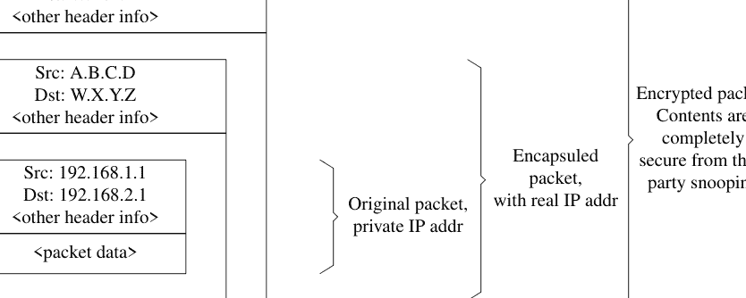

当它们被 VPN 的远端接收时，它们将被解密（使用由 `raccoon` 协商的安全关联）。然后它们将进入 `gif` 接口，该接口将解开第二层，直到你剩下最内部的数据包，该包可以到达内部网络。你可以通过 `ping(8)` 检查安全性。首先，登录 `A.B.C.D` 机器并运行：

```bash
tcpdump host 192.168.2.1
```

在另一个会话中：

```bash
ping 192.168.2.1
```

这次你应该会看到如下输出：现在 `tcpdump(1)` 显示 ESP 包。如果你使用 `-s` 选项检查它们，你会看到由于加密产生的乱码。恭喜，你刚刚在两个站点之间建立了 VPN。

### 总结

- 配置两个内核：`install ipsec-tools`
- 编辑网关主机上的 `${PREFIX}/etc/raccoon/psk.txt`，添加远程主机的 IP 地址和双方已知的密钥。确保此文件权限为 `600`。
- 在每个主机上创建一个包含必要 `spadd` 规则的 `/etc/ipsec.conf`。网关 #1 为：
```bash
spdadd A.B.C.D/32 W.X.Y.Z/32 ipencap -P out ipsec/tunnel/A.B.C.D-W.X.Y.Z/require;

spdadd W.X.Y.Z/32 A.B.C.D/32 ipencap -P in ipsec/tunnel/W.X.Y.Z-A.B.C.D/require;
```
网关 #2 为：
```bash
spdadd W.X.Y.Z/32 A.B.C.D/32 ipencap -P out ipsec/tunnel/W.X.Y.Z-A.B.C.D/require;

spdadd A.B.C.D/32 W.X.Y.Z/32 ipencap -P in ipsec/tunnel/A.B.C.D-W.X.Y.Z/require;
```
- 添加防火墙规则允许 IKE、ESP 和 IPENCAP 流量通过两个主机：
```bash
ipfw add 1 allow udp from A.B.C.D to W.X.Y.Z

ipfw add 1 allow udp from W.X.Y.Z to A.B.C.D

ipfw add 1 allow esp from A.B.C.D to W.X.Y.Z

ipfw add 1 allow esp from W.X.Y.Z to A.B.C.D

ipfw add 1 allow ipencap from A.B.C.D to W.X.Y.Z

ipfw add 1 allow ipencap from W.X.Y.Z to A.B.C.D
```


之前的两个步骤就足够让 VPN 运行。每个网络上的机器使用 IP 地址相互引用，跨链路的所有流量都将自动安全地加密。

## 14.1 OpenSSH

由 Chern Lee 贡献。

OpenSSH 是一组用于安全访问远程主机的网络连接工具。它可以作为 `login`、`rsh`、`rcp` 和 `telnet` 的直接替代。TCP/IP 连接可以通过 SSH 安全地进行隧道化/转发。OpenSSH 加密所有流量以消除窃听、连接劫持和其他网络级攻击。

OpenSSH 由 OpenSSH 项目维护，基于 SSH v2.0，包含了所有的错误修复和更新。它兼容所有 SSH 1 和 2 协议。

### 14.1.1 使用 OpenSSH 的优势

通常，使用 `telnet(1)` 或 `login(1)` 时，数据以明文未加密的形式发送到网络上。客户端和服务器任何位置的网络嗅探器都可以窃取你的用户/密码信息或会话中传输的数据。OpenSSH 提供了多种身份验证和加密方法防止这种情况发生。

### 14.1.2 启用 sshd

`sshd` 是 FreeBSD 标准安装期间显示的一个选项。查看是否启用了 `sshd`，请检查 `rc.conf` 文件：

```bash
ssh_enable=YES
```

将在系统下次初始化时加载 `sshd(8)`（OpenSSH 的守护进程）。或者，可以使用 `/etc/rc.d/sshd rc(8)` 脚本启动 OpenSSH：

```bash
/etc/rc.d/sshd start
```

### 14.1.3 SSH 客户端

`ssh(1)` 的工作方式类似于 `login(1)`。

```bash
# ssh user@example.com
已知主机列表中未找到主机密钥。
确定要继续连接吗？(yes/no) yes
主机 'example.com' 已添加到已知主机列表中。
user@example.com's password: ********
```

如果你使用 `login` 或 `telnet` 创建了会话，登录将继续。SSH 使用密钥指纹在客户端连接时验证服务器的真实性。只有在第一次连接时才会提示用户输入。未来的登录尝试都将根据保存的指纹进行验证。如果保存的指纹与未来收登录尝试不同，客户端将警告你。指纹保存在 `~/.ssh/known_hosts` 中，SSH v2 指纹保存在 `~/.ssh/known_hosts2`。

默认情况下，最新版本的 OpenSSH 服务器只接受 SSH v2 连接。客户端将尽可能使用版本 2 并回退到版本 1。客户端也可以通过传递 `-1` 或 `-2`（分别对应版本 1 或 2）来强制使用其中之一。为了兼容旧版本，客户端保持了版本 1 的兼容性。

## 14.11.4 安全复制 (Secure Copy)

`scp(1)` 命令的工作原理与 `rcp(1)` 类似；它将文件复制到远程机器，但通过安全的方式进行。

```
# scp@example.com/:COPY COPYRIGHT
user@example.com's password: ********
COPYRIGHT 100% |************************************| 4735
00:00
#
```

由于在上一个例中已经为该主机保存了指纹，因此在这里使用 `scp(1)` 时将进行验证。
传递给 `scp(1)` 的参数与 `cp(1)` 类似，它将文件复制到第一个参数，方向取决于第二个参数。由于文件是通过 `ssh` 通过网络获取的，一个或多个文件参数将采用 `user@host:<path_to_remote_file>` 的形式。

## 14.11.5 配置

OpenSSH 守护进程和客户端的系统级配置文件位于 `/etc/ssh` 目录下。
`ssh_config` 配置客户端设置，而 `sshd_config` 配置守护进程。

此外，`ssh_program`（默认认为 `/usr/sbin/sshd`）和 `ssh_flags` 选项可以提供更多层次的配置。

## 14.11.6 ssh-keygen

`ssh-keygen(1)` 可以生成 DSA 或 RSA 密钥来验证用户，而不是密码：

```
# ssh-keygen -t dsa
Generating public/private key pair.
Enter file in which to save the key (/home/user/.ssh/id_rsa):
Created directory '/home/user/.ssh'
Enter passphrase (empty for no passphrase):
Enter same passphrase again:
Your identification has been saved in /home/user/.ssh/id_rsa.pub.
The key fingerprint is:
b8:48:db2:f93:57:80:b6aa:bc5f:5da8:8f7:917 user@example.com
```

`ssh-keygen(1)` 将为身份验证创建私钥和公钥对。私钥存储在 `~/.ssh/id_rsa`，而公钥存储在 `~/.ssh/id_rsa.pub`，分别对应 DSA 和 RSA 密钥类型。在设置时，必须将公钥放在远程机器的 `~/.ssh/authorized_keys` 中才能生效。同样，RSA 版本 1 的公钥也应该放在 `~/.ssh/authorized_keys` 中。

如果在 `ssh-keygen(1)` 中使用了密码语，每次使用私钥时都会提示你输入密码语。`ssh-agent(1)` 可以减轻重复输入长密码的负担，将在下文第 14.11.7 节中介绍。

## 第 14 章 安全

**警告：** 各种选项和文件可能根据你系统中 OpenSSH 版本而不同；为了避免问题，你应该咨询 `ssh-keygen(1)` 手页。

## 14.11.7 ssh-agent 和 ssh-add

`ssh-agent(1)` 和 `ssh-add(1)` 工具提供了将 SSH 密钥加载到内存中使用的方法，而无需每次输入密码语。

`ssh-agent(1)` 工具将使用加载到它的私钥处理认证。应该使用 `ssh-agent(1)` 来启动另一个应用程序。在最基础的级别，它可以产生一个 shell，或者在高级高级上产生窗口管理器。

要在 shell 中使用 `ssh-add`，首先需要以 shell 作为参数启动它。其次，通过运行 `ssh-add(1)` 并提供私钥的密码语来添加身份。这些步骤由用户完成，并将 `ssh-add(1)` 添加任何安装了相应公钥的主机。例如：

```
% ssh-agent
% ssh-add
Enter passphrase for /home/user/.ssh/id_rsa:
Identity added: /home/user/.ssh/id_rsa (/home/user/.ssh/id_rsa)
```

要在 X11 中使用 `ssh-agent(1)`，需要在 `~/.xinitrc` 中放置 `ssh-agent()` 调用。这将为所有在 X11 中启动的程序提供 `ssh-agent(1)` 服务。一个示例 `~/.xinitrc` 文件可能如下：

```
exec ssh-agent startxfce4
```

这会在每次 X11 启动时启动 `ssh-agent(1)`，进而启动 XFCE。只需运行 `ssh-add(1)` 即可加载你所有的 SSH 密钥。

## 14.11.8 SSH 隧道 (SSH Tunneling)

OpenSSH 能够创建一个隧道并在加密会话中封装另一种协议。

以下命令告诉 `ssh(1)` 为 `telnet` 创建一个隧道：

```
% ssh -2 -N -f -L 5023:localhost:23 user@foo.example.com
```

`ssh` 命令配合以下选项使用：

- `-2`: 强制 `ssh` 使用第 2 版本协议。（如果你正在在使用旧版本的 SSH 服务器，请不要使用它）
- `-N`: 表示不执行命令，仅建立隧道。如果省略，`ssh` 将启动一个普通会话。
- `-f`: 强制 `ssh` 在后台运行。
- `-L`: 表示以 `localport:remotehost:remoteport` 格式指定本地隧道。

`user@foo.example.com`: 远程 SSH 服务器。

SSH 隧道通过在本地机器上创建监听器来工作。随后，远程 SSH 服务器将流量转发到指定的目的地。这允许你访问未暴露在公共互联网上的服务。

```
% ssh -2 -N -f -L 5023:localhost:23 user@foo.example.com
```

## 14.11.8 实用隧道示例

### 绕过严苛的防火墙

某些网络管理员实施极其严苛的防火墙规则，过滤所有入站和出站连接。你可能只被允许访问端口 22 或 80。解决方案是通过这些允许的端口对其他流量进行隧道传输。

```
% ssh -2 -N -f -L 8080:localhost:80 user@proxy.example.com
```


user@proxy.example.com's password: *****

### 安全隧道

如果你需要访问网络网络直接访问的服务，可以使用跳转主机。这涉及一个 SSH 隧道，将本地机器的端口映射到远程服务器的端口。

```
% ssh -2 -N -f -L 2222:remote-host:22 user@jump-server.com
```

user@jump-server.com's password: *****

# 14.12 文件系统访问控制列表

由 Tom Rhodes 贡献。

结合快照（snapshots）等文件系统增强，FreeBSD 5.0 及更高版本提供了文件系统访问控制列表（ACLs）的安全性保障。

访问控制列表以一种高度兼容（POSIX.1e）的方式扩展了标准的 UNIX 权限模型。此功能允许管理员使用并利用更复杂的安全模型。

要为 UFS 文件系统启用 ACL，必须将以下内容：

```
options UFS_ACL
```

编译进内核。如果未编译此项，在尝试挂载支持 ACL 的文件系统时，将显示警告消息。此选项包含在 GENERIC 内核中。ACL 依赖于文件系统启用的扩展属性（extended attributes）。下一代 UNIX 文件系统 UFS2 原生支持扩展属性。

> **注意：** 在 UFS1 上配置扩展属性所需的管理开销比在 UFS2 上高。UFS2 扩展属性的性能更高。因此，通常建议在配合访问控制列表时优先使用 UFS2 而非 UFS1。

ACL 通过挂载时的标志 `acls` 启用，该标志可以通过 `/etc/fstab` 更改。挂载标志也可以在持久化管理器中使用 `tune(8)` 来修改文件系统头文件中的超级块 ACLs。通常情况下，出于以下原因，优于使用超级块标志：

- 挂载时的 ACL 无法通过 `mount(8)-u` 修改，只能通过完整的 `mount(8)` 和重新挂载 `mount(8)` 来。这意味着启动后无法在根文件系统上启用 ACL。这也意味着一旦文件系统已加载，你就无法更改其状态。
- 设置超级块标志将导致即使没有 fstab 条目或设备顺序发生变化时，文件系统也会在启用 ACL 的情况下被挂载。这防止了在未启用 ACL 的情况下意外挂载文件系统，从而导致 ACL 执行不当，进而产生安全问题。

> **注意：** 我们可能会更改 ACL 以允许在不进行完整重新挂载(8) 的情况下启用该标志，但我们认为阻止在未启用 ACL 的情况下意外挂载是理想的，因为如果你在启用后并在不刷新扩展属性的情况下将其禁用，可能会很快就自食其果。通常情况下，一旦在文件系统上启用了 ACL，就不应该禁用它们，因为产生的权限保护可能与系统用户预期的不符，且重新启用 ACL 可能会将之前的 ACL 重新附加到已更改权限的文件上，导致不可预测的行为。

查看启用 ACL 的文件系统时，其权限设置将显示 (+) 符号。例如：

```
drwx-xr-x 2 robert robert 512 Dec 27 11:54 private

ddrwxrwx---+ 2 robert robert 512 Dec 23 10:57 directory1

drwxrwx---+ 2 robert robert 512 Dec 22 10:20 directory2

drwxrwx---+ 2 robert robert 512 Dec 27 11:57 directory3

drwxr-xr-x 2 robert robert 512 Nov 10 11:54 public_html
```

在这里我们看到 `directory1`、`directory2` 和 `directory3` 目录都在利用 ACL。而 `public_html` 目录没有。

## 14.12.1 使用 ACL

可以使用 `getfacl(1)` 工具查看文件系统 ACL。例如，要查看测试文件上的 ACL 设置，应使用以下命令：

```
% getfacl test
#file:test
#owner:1001
#group:1001
user:rw--
group:r--
other:r--
```

要更改文件的 ACL 设置，请调用 `setfacl(1)` 工具。观察：

```
% setfacl -k test
```

- `k` 标志将从文件或系统删除所有当前定义的所有 ACL。更优的方法是使用 `-b`，因为它保留了 ACL 运行所需的基础功能。

```
% setfacl -u:root:rw-,group:web:r----- test
```

在上述命令中，使用 `-m` 选项来修改 ACL 条目。由于之前的命令已经删除了所有预定义条目，此操作将恢复默认选项并分配列出的选项。请注意，如果你添加了系统中不存在的用户或组，标准输出（stdout）上将打印出 `Invalid argument`（无效参数）错误。

# 14.13 监控第三方安全问题

由 Tom Rhodes 贡献。

近年来，安全领域在处理漏洞评估方面取得了许多改进。随着第三方工具被安装并配置到几乎任何可用的操作系统，系统入侵的威胁日益增加。

漏洞评估是安全性的关键因素，虽然 FreeBSD 为基础系统发布公告，但对于超出 FreeBSD 项目能力范围的每一个第三方工具则不然。有一种方法可以缓解第三方漏洞并管理已知的安全问题。一个名为 `Portaudit` 的 FreeBSD 插件专门为此目的存在。

`security/portaudit` 通过轮询由 FreeBSD 安全团队和端口开发者更新及维护的数据库来检查已知的安全问题。

要开始使用 Portaudit，必须在 Ports 集合中安装它：

```
# cd /usr/ports/security/portaudit && make clean
```

# 第 14 章 安全

在安装过程中，`periodic(8)` 的配置文件将被更新。安装后，管理员可以通过调用以下命令更新数据库并查看已安装包中的已知漏洞：

```
# portaudit -F
```

> 注意：Portaudit 会产生类似以下的内容：

```
# portaudit -a
```

若要作为一部分更新第三方工具，管理员只需运行以下命令：

```
# portaudit -d
```

问题类型：cups-base -- 缓冲区溢出。

问题类型：cups-base -- 缓冲区溢出。

（注：原文文本包含了一些关于安全公告的重复和合并片段）

...

> ufff 主题标识了问题的具体内容。它基本上是对当前公告的介绍，并指出了带有漏洞的工具。

> \ufff 类别指的是受影响的系统部分，可能是核心（core）、贡献（contrib）或端口。core类别意味着漏洞影响了 FreeBSD 操作的核心组件。contrib类别意味着漏洞影响了贡献给 FreeBSD 项目的软件，例如：

## 第 14 章 安全

`sendmail`。最后，ports 类表示该漏洞影响了作为 Ports 集合（Ports Collection）一部分软件。

- **Module（模块）**指的是组件位置，例如 `sys`。在这个示例中，我们看到模块 `sys` 受了影响；因此，此漏洞影响内核内部使用的组件。

- **Announced（发布）**字段反映了安全公告发布或向世界公布日期。这意味着安全团队已证实该问题确实存在，并且补丁已提交到 FreeBSD 源代码仓库。

- **Credits（鸣谢）**字段对发现并报告该漏洞的个人或组织表示感谢。

**Affects（影响）**字段解释了哪些 FreeBSD 部分受此漏洞影响。对于内核，快速查看受影响文件的输出缩进有助于确定修订版本。对于 ports，版本号列在端口名称 `/var/db/pkg` 之后。如果系统没有 FreeBSD CVS 仓库且没有进行每日构建，则更改意味着它它是受影响的。

- **Corrected（已修复）**字段表示已修复的日期、时间偏移和发布版本。

- **Reserved（预留）**用于在常见漏洞数据库（Common Vulnerabilities Database）系统中查找的标识符。

- **Background（背景）**字段提供了有关受影响工具的准确信息。大部分内容是关于为什么该工具在 FreeBSD 中存在、它的用途，以及关于该工具如何操作的简要信息。

- (10) **Description（描述）**字段详细解释了该安全漏洞。这可能包括关于代码缺陷的信息，或者该工具如何被恶意利用以打开安全漏洞的信息。

- (11) **Impact（影响）**字段描述了该漏洞可能对系统产生什么类型的问题。例如，这可能是从拒绝服务攻击、提升用户权限，甚至让攻击者获得超级用户权限。

- (12) **Workaround（替代方案）**字段为无法升级系统的系统管理员提供了可行的变通方法。这可能是由于限制、网络可用性或其他许多原因。无论如何，都不应轻视安全，受影响的系统应该打补丁，或者实施安全漏洞的变通方案。


- (13) `Solution（解决方案）`字段提供了修复受影响系统的指令。这是一个获取系统打补丁并安全运行的逐步且经过验证的方法。

- (14) `Correction（修正）`字段显示 CVS 分支或发布名称，并将点改为下划线字符。它还显示了每个分支内受影响文件的修订版本号。

- (15) `References（引用）`字段通常提供其他信息。这包括网络 URL、书籍、邮件列表和新闻组。

## 14.15 进程计数 (Process Accounting)

由 Tom Rhodes 贡献。

进程计数是一种安全方法，管理员可以通过它跟踪使用的系统资源、它们在用户之间的分配、提供系统监控，并最大限度地跟踪用户的命令。

这确实有其自身的优缺点。优点之一是将入侵范围缩小到切入点。缺点是进程计数生成的日志数量以及它们可能需要的磁盘空间。本节将引导管理员了解进程计数的基础知识。

### 14.15.1 启用和利用进程计数

在使用进程计数之前，必须先启用它。要做到这一点，请执行以下命令：

```bash
# touch /var/account/acct
```

```bash
# acct /var/account/acct
```

```bash
# echo 'accounting_enable="YES" >> /etc/rc.conf
```

一旦启用，计数将跟踪 CPU 统计、命令等。所有计数日志都是非人类可读的格式，可以使用 `sa(8)` 工具查看。如果不带选项执行，`sa` 将打印与与用户调用次数、总经过时间（分钟）、总 CPU 和用户时间（分钟）、平均 I/O 操作数等相关的信息。

要查看发出的命令信息，应使用 `lastcomm(1)` 工具。`lastcomm` 可用于打印用户在特定 `tty(5)` 上发出的命令，例如：

```bash
# lastcomm ls
trhodes ttypl
```

这将打印出 trhodes 在 ttypl 终端上使用 `ls` 的所有记录。

还有许多其他有用选项，在 `lastcomm(1)`、`acct(5)` 和 `sa(8)` 手册中有解释。

## 注意事项

- 1. 在 FreeBSD 下，标准登录密码长度可达 128 个字符。

# 第 15 章 强制访问控制 (Mandatory Access Control)

Tom Rhodes 编写。

## 15.1 概述

FreeBSD 5.X 引入了基于 POSIX 1e 草案的 TrustedBSD 项目的新安全扩展。其中最重要的两个新安全机制是文件系统访问控制列表 (ACLs) 和强制访问控制 (MAC) 设施。强制访问控制允许加载新的访问控制模块以实施新的安全策略。某些模块对系统的狭窄子集提供保护，加固特定服务；其他模块则对所有主体和对象提供标记安全策略（labeled security policy）。执行的“强制”部分在于，执行是由管理员和系统完成的，而不是像自主访问控制（DAC，FreeBSD 中的标准文件机制和 System V IPC 机制）那样由用户自行裁决的。

本章将侧重于强制访问控制框架（MAC Framework）以及一组启用各种安全机制的可插拔安全策略模块。

在阅读本章后，你将了解：

- 目前 FreeBSD 中包含哪些 MAC 安全策略模块及其相关机制。
- 哪些 MAC 安全策略模块实现了什么，以及标记策略与非标记策略之间的区别。
- 如何使用 MAC 框架。
- 如何配置 MAC 框架。
- 如何测试 MAC 框架。
- 如何实现 MAC 框架。
- MAC 框架如何工作。

在阅读本章之前，你应当：

- 理解安全框架。
- 熟悉安全框架。
- 理解安全策略。

警告：不当使用标签（labels）可能会导致安全漏洞。

标签的含义和解释取决于策略；虽然某些策略可能将标签视为代表对象的完整性或机密性，但其他策略使用标签来持有访问规则。安全属性的级别设置。随着级别的增加，其安全性也被认为随之提升。

安全策略包含在系统中。MAC 框架仅适用于文件和目录。

### 15.1.1 将涵盖的内容

本章涵盖了广泛的安全问题。安全模块模块将不涵盖。MAC 框架提供了。目前，FreeBSD MAC 框架对此尚没有策略，但包含了该定义。

## 15.2 本章关键术语

在阅读本章之前，将解释几个术语：

- `compartment（隔室）`：隔室是一组被分区或分离的程序和数据，用户被赋予明确访问。此外，隔室代表一个工作组、部门或主题。
- `high water mark（高水位线）`：高水位是一种为了访问更高级别而允许提高安全级别的策略。在大多数情况下，进程完成后将恢复原始级别。目前，FreeBSD MAC 框架对此没有策略。
- `integrity（完整性）`：作为一个概念，它是可以放置在数据上的信任级别。如果数据的完整性得到提升，对数据的信任能力也随之提高。
- `label（标签）`：标签是一种可以应用于文件、目录或其他项目的安全属性。它可以从机密性角度被考虑；当标签放在文件上时，它描述了该文件的安全属性，并允许访问相似设置的文件、用户等。标签的含义和解释取决于策略；某些策略可能将标签视为代表对象的完整性或机密性，但其他策略使用标签来持有访问规则。
- `level（级别）`：安全属性的增加或减少设置。随着级别的增加，其安全性也被认为随之提升。
- `low water mark（低水位线）`：低水位是为了访问较不安全的信息而允许降低安全级别的策略。在大多数情况下，进程完成后将恢复用户的原始安全级别。FreeBSD 中唯一使用此安全模块是 `mac_lomac(4)`。
- `multilabel（多标签）`：多标签文件对象可以通过 `tunes(8)` 工具在单模式下设置，在启动操作期间使用 `stab(5)` 或在创建新文件系统时设置。此选项允许管理员对不同对象应用不同的 MAC 标签。此选项仅不支持标记的安全模块。
- `object（对象）`：在主体引导下流动信息的对象或系统实体。这包括目录、文件、字段、屏幕、键盘、内存、磁存储、打印机或任何其他存储/移动设备。基本上，对象是数据容器或系统资源；访问对象实际上意味着访问数据。
- `policy（策略）`：定义如何实现目标的规则集合。策略通常记录如何处理某些项目。本章在语境下将策略一术指安全策略；即一组控制数据和信息流并定义谁有权访问这些数据和信息的规则。
- `敏感性（sensitivity）`：通常在讨论 MLS（多级安全）时使用。敏感性级别是一个用于描述数据应该有多重要或多秘密的术语。随着敏感性级别的提高，数据重要性或机密性的重要程度也随之增加。
- `单标签（single label）`：单标签是指文件系统使用单个标签来对数据流执行访问控制。当文件系统设置了此项时，只要没有设置多标签（multilabel）选项，所有文件都符合相同的标签设置。
- `主体（subject）`：主体是指任何引起信息在对象之间流动的活动实体；例如：用户、处理器、系统进程。在 FreeBSD 上，这几乎总是代表用户运行的线程。

## 15.3 MAC 解释

在考虑所有这些内容的情况下，请 MAC 框架是如何平衡整个系统的安全性的。MAC 框架提供的各种策略模块可以用于保护网络和文件系统，阻止用户访问某些端口和套接字，而策略模块最好的用法可能是通过分层分层安全策略来加固系统，从而构建多层安全环境。在多层安全环境中，多个策略模块就足够维持安全检查。这与加固策略不同，后者通常只加固仅用于特定用的系统元素。唯一的缺点是在存在多个文件系统标签、按用户网络访问控制等情况下会产生管理开销。

与该框架的持久效果相比，这些缺点是微不足道的；例如，通过选择特定配置所需的选项，可以使性能开销保持在较低水平。对所需策略支持的减少可以提高系统的整体性能，并提供选择的灵活性。良好的实现应该考虑整体安全需求，并有效实施框架提供的各种策略模块。

因此，利用 MAC 特性至少应保证：用户不会允许更改安全属性；所有用户、程序和脚本必须在所选安全策略模块提供的访问规则约束内工作；并且 MAC 访问规则的完全控制权在系统管理员手中。

仔细选择正确的安全策略模块是系统管理员唯一的职责。某些环境可能需要限制网络访问；在这些情况下，`mac_portal(4)`、`mac_joff(4)` 甚至 `mac_bhd(4)` 策略模块可能是很好的起点。在其他情况下，可能需要对文件系统对象执行严格的机密性控制。`mac_bsextended(4)` 和 `mac_mls(4)` 等策略模块正是为此设计的。

策略决策可以基于网络配置。也许只允许用户通过 `ssh(1)` 访问网络或互联网的设施。对于这些情况，`mac_portal(4)` 是首选策略。但在文件系统情况下应该怎么办？是否应该切断其他组或特定用户对某些目录的访问？还是通过为某些对象设置标签来限制用户对特定文件的访问？


在文件系统中，对对象的访问对某些人可能是机密的，但对其他人不是。例如，一个大型开发团队可能会分成较小的小组。项目 A 的开发者可能不允许访问项目 B 开发者编写的对象。他们可能需要访问项目 C 开发者创建的对象；确实存在这种情况。使用 MAC 框架提供的不同安全策略模块；可以将用户分为这些组，然后授予适当区域的访问权限而不担心信息泄露。

因此，每个安全策略模块都有处理系统整体独特方法。在许多情况下，可能需要对系统的整体策略进行修订和加强。理解 MAC 框架提供的不同安全策略模块将帮助管理员根据他们的情况选择最佳策略。

默认的 FreeBSD 内核不包含 MAC 框架选项；在尝试本章中的任何示例或信息之前，必须添加以下内核选项：

```
options MAC
```

并且内核将需要重启。

> **注意：** 虽然 MAC 策略模块的各种手册说明它们可以被构建到内核中，但可能会导致系统锁定在网络之外等情况。实施 MAC 就像实现防火墙，必须小心防止被完全锁定在系统之外。在远程执行 MAC 实施时，应该考虑回滚之前配置的能力。

## 15.4 理解 MAC 标签

MAC 标签（MAC label）是一种安全属性，可以应用于整个系统的主体和对象。

在设置标签时，用户必须能够准确理解具体在操作什么。对象上可用的属性取决于加载的策略模块，而这些策略模块以不同的方式解释它们的属性。由于缺乏理解或无法理解其影响而配置不当，结果将导致系统出现意料之外且可能是不符合预期期的。

对象上的安全标签被用作策略安全访问控制决策的一部分。在某些策略中，标签本身包含了做出决策所需的所有信息；在其他模型中，标签可能作为较大规则集的一部分进行处理，值为“低”（low）。

例如，在文件上设置 `biba/low` 标签将代表由 Biba 安全策略模块维护的标签，

FreeBSD 中支持该功能的几个策略模块提供了三个预定义标签。这些是 low（低）、high（高）和 equal（相等）标签。尽管每个策略模块以不同的方式执行访问控制，但你可以确保标签是最低的，equal 标签会将主体或对象设置为禁用或不受影响，而 high 标签将在 Biba 和 MLS 策略模块中强制最高设置。

在单文件系统中，可以使用一个标签。在多标签选项的情况下，可以在对象上设置多个标签。对于 Biba 和 MLS 策略，数值标签可以用于指示分级或分级控制。

因此，每个安全策略模块都有处理系统整体安全的独特方法。在许多情况下，可能需要对系统的整体策略进行修订和加强。理解 MAC 框架提供的不同安全策略模块将帮助管理员根据他们的情况选择最佳策略。

### 15.4.1 标签配置

几乎所有标签配置方面都通过使用基础系统完成。这些命令为配置提供了简单的接口。

所有配置都可以通过 `setmac(8)` 和 `setpcm(8)` 工具完成。`setmac` 命令用于对对象设置标签，而 `setpcm` 命令用于对主体设置标签。观察：

```
# setmac biba/high test

# setmac biba/high test
Permission denied
# setmac biba/low setmac biba/high
# getmac test
test: biba/high
```

如果上述命令没有错误，将返回提示。只有在发生错误时，这些命令才是静态的；类似于 `chmod(1)` 和 `chown(8)`。在某些情况下，此错误可能是拒绝访问，通常在设置或修改标签时获得。系统管理员可以使用以下命令解决此：

如上所示，`setmac` 可以通过为调用进程分配不同的标签来覆盖策略模块的设置。`getmac` 工具通常用于运行中的进程，例如 `sendmail`；尽管它使用进程 ID 代替命令，但逻辑非常简单。如果用户尝试操作不受加载策略模块规则允许的文件，`mac_set_links` 函数将显示“操作不允许”（Operation not permitted）错误。

### 15.4.2 常见标签类型

对于 `biba(4)`、`mac(4)` 和 `mac_lomac(4)` 策略模块，提供了分配标签的能力。这些标签以 high（高）和 low（低）的形式存在，以下是这些标签提供的简要描述：

- low 标签是对象或主体可以具有的设置标签。在这些对象或主体上设置将阻止它们访问标记为高的对象。
- equal 标签应该只放在被认为免于策略的对象上。
- high 标签授予对象或主体最高的设置。

#### 15.4.1.1 高级标签配置

数字分级标签用于比较：隔室:隔室；因此如下：

```
biba/10:2+3+6(5:2+30:20:2+3+4+5)
```

可以解释为：

> Biba 策略标签7 '等级 10'：'隔室 2, 3 和 6' ('等级 5 ...')

在例例中，第一个等级将被视为具有“有效隔室”的“有效等级”，第二个等级是低等级，最后一个是高等级。在绝大多数配置中，这些设置不会被使用；事实上，它们是为更高级的配置而提供的。

当应用于系统对象时，它们将仅具有当前的分级/隔室，除非它们反映了系统中的权限范围，而不是系统对象和网络接口（后者被用于访问控制）。

主体和对象对的分级和隔室将构建一种被称为“支配”（dominance）的关系，在这种关系中，主体支配对象、对象支配主体、双方互不支配，或者当两个标签相等时两者相互支配。由于 Biba 的信息流，你拥有一组隔室的权限（“知情需要”），这可能对应某些项目，但对象也拥有一组隔室。用户可能需要使用 `setmac` 提交他们的权限，以便访问未受限制的隔室中的对象。

#### 15.4.1.2 用户与标签设置

用户需要拥有标签，以便其文件和进程能够与系统定义的安全策略正确交互。这是通过 `login.conf` 文件使用登录类配置的。每个使用标签的策略模块都将实现类设置。

下面显示了一个包含策略模块设置的示例条：

```
default:\n:copyright=/etc/COPYRIGHT:\n:welcome=/etc/motd/:\n:setenvMAIL=/var/mail/$,BLOCKSIZE=K:\n:path=/bin:/sbin:/usr/bin:/usr/bin:/usr/local/bin:/usr/local/bin:\n:manpath=/usr/share/man /usr/local/man:\n:nlogin=/usr/sbin/nlogin:\n:putime=130m:\n:datasize=8M:\n:memoryuse=100M:\n:stacksize=2M:\n:memorylocked=8M:\n:filesize=8M:\n:coredumpsize=8M:\n:openfiles=24:\n:maxproc=32:\n:priority=0:\n:requirehome:\n:passwordvalidity=91d:\n:umask=022:\
:ignoretime=\n:label=partition/13,mls/5,biba/(10-15),lomac/10[:
```

`label` 用于设置用户默认类标签，该标签将由 MAC 执行。用户永远不会允许修改此值，因此在用户情况下可以认为是非可选的。然而，在实际配置中，管理员不会启用所有的策略模块。建议在实施任何此类配置之前检查本章的其余内容。

> 注意：用户可以在初始登录后更改其标签；但这种更改受到策略的限制。上面的示例告诉 Biba 进程的最小完整性为5，最大为15，但默认效果为10。该进程将一直运行到10，直到它选择标签类（例如通过用户使用 `secmalloc`），该操作受到 Biba 限制在设置的范围内。

在所有情况下，一旦更改 `login.conf`，必须使用 `cap_mkdb` 重建登录类能力数据库，这将在今后的示例或讨论中体现。

值得注意的是，许多站点可能有大量需要几种不同用户类的用户。这需要规划，因为这可能会变得极其难以管理。

FreeBSD 的未来版本将包含处理标签映射的新方法；但这将在 FreeBSD 5.3 发布之后的一段时间后可用。

#### 15.4.1 网络接口与标签设置

可以在网络接口上设置标签，以帮助控制跨网络的数据流。在所有情况下，它们的功能方式与策略相对于对象时相同。例如，在 biba 中处于高设置的用户将不允许访问标签为低的网络接口。

在网络接口上设置 MAC 标签时，可以在 `ifconfig` 中设置。例如：

```
# ifconfig bge0 maclabel biba/equal
```

这将为 `bge0(4)` 接口设置 `biba/equal` 的 MAC 标签。当使用类似于 `biba/high(low-high)` 的设置时，整个标签应该加引号；否则将返回错误。

每个支持对可调项进行标记的策略模块都可以用于禁用网络接口上的 MAC 标签。将标签设置为 equal 将产生类似的效果。请查看 `sysctl` 的输出、策略手册页，甚至是本章后面找到关于这些元组的信息。

### 15.4.2 单标签或多标签

默认情况下，系统将使用 `singlelabel` 选项。但这对管理员意味着什么呢？存在几处差异，这些差异为我们系统模型的灵活性提供了优缺点。


singlelabel 仅允许一个标签，例如 biba/high 用于每个对象或对象。它提供了较低的管理开销，但降低了支持标记的策略的灵活性。许多管理员可能想使用 `multilabel` 选项。

`multilabel` 选项允许每个对象或主体拥有自己的标签。这包括目录、文件甚至设备节点。

以下命令将文件系统设置为多标签。这可以在单用户模式下进行：

```
# tunefs -l enable /
```

这对于交换文件系统不是要求的。

> 注意：某些用户在根分区上设置 `multilabel` 标志时遇到过问题。如果是，请复阅本章的第 15.16 节。

## 15.4.3 使用可调项控制 MAC

在没有加载任何模块的情况下，MAC 的某些部分可以通过 `sysctl` 接口进行配置。这些可调项描述如下，在所有情况下，一（1）表示启用，零（0）表示禁用：

- `security.mac.enforce_fs` 默认值为 1，对文件系统执行 MAC 策略。
- `security.mac.enforce_kld` 默认值为 1，对动态内核链接器执行 MAC 链接策略（参见 `kld4`）。
- `security.mac.enforce_network` 默认值为 1，执行 MAC 网络策略。
- `security.mac.enforce_pipe` 默认值为 1，对管道执行 MAC 策略。
- `security.mac.enforce_process` 默认值为 1，对使用进程间通信的进程执行 MAC 策略。
- `security.mac.enforce_socket` 默认值为一 (1)，并对接字执行 MAC 策略（参阅 `socket(2)` 手页）。
- `security.mac.enforce_system` 默认值为一 (1)，并对系统活动（如计费和重启）执行 MAC 策略。
- `security.mac.enforce_vm` 默认值为一 (1)，并对虚拟内存系统执行 MAC 策略。

注意：每个策略或 MAC 选项都支持可调参数（tunables）。这些参数通常挂载在 `security.mac.<policyname>` 树下。要查看来自 MAC 的所有可调参数，请使用以下命令：

```
# sysctl -da | grep mac
```

这应该被解释为所有基础 MAC 策略默认都是强制执行的。如果内核构建了模块，系统将受到极其严格的限制，并且可能无法与本地网络通信或连接到互联网。这就是为什么不完全推荐将模块构建进内核。这并不是因为限制了通过 `sysctl` 动态禁用某些的功能，而是因为它允许管理员在无需重新构建和安装新系统的情况下，立即切换系统的策略。

## 15.5 安全配置规划

每当实现新技术时，规划阶段总是一个好主意。在规划阶段，管理员应该始终从“大局”角度观察，尝试至少关注以下内容：

- 实施需求；
- 实施目标；
- 对于 MAC 实例，这些包括：
    - 如何对目标系统上的可用信息和资源进行分类。
    - 限制对哪些类型的信息或资源的访问，以及应用什么类型的限制。
    - 实现此目标需要哪一个或几个 MAC 模块。

重新配置和更改系统资源及安全设置总是可能的，但在系统中搜索并查找现有的文件和用户账户往往非常不。规划有助于确保实现一个无故障且高效的信赖系统。在 MAC 实现用于生产系统之前，对包括配置在内的系统进行测试是至关重要且绝对有益的。在开启 MAC 的系统中直接放手运行是没有经过充分准备的。

不同的环境可能有明确的需求和要求。建立深度且完整的安全概况将导致系统上线后产生更改的需求。因此，后续章节将介绍管理员可使用的不同模块；描述它们的用法和配置；并在某些情况下提供关于它们最适合什么场景的见解。例如，Web 服务器可能会排除 `mac_biba(4)` 和 `mac_bdextended(4)` 策略。在其他情况下，对于本地用户非常少的机器，`mac_partition(4)` 可能是一个不错的选择。

## 15.6 模块配置

MAC 框架包含的每个模块将如上述所示编译进内核或作为运行时内核模块加载。推荐的方法是将模块名称添加到 `/boot/loader.conf` 文件中，以便在初始引导过程中加载。

接下来的章节讨论了各种 MAC 模块并涵盖了它们的特性。在特定环境中实现它们也是一个考虑因素，某些模块支持使用标签（labeling），即通过强制执行标签（如“这是允许的，那是不允许的”）来控制访问。标签配置文件可以控制文件的访问方式、网络通信的交换，且前一节展示了如何在文件系统上设置 `multabel` 标志以启用每个文件或每个分区的访问控制。

单一标签配置将仅在整个系统中执行一个标签，这就是为什么 `tunefs` 选项被称为 `multabel`。

### 15.6.1 MAC seeotheruids 模块

模块名称：`mac_seeotheruids.ko`

内核配置行：`options MAC_SEEOTHERUIDS_load="YES"`

启动选项：`mac_seeotheruids_load="YES"`

`mac_seeotheruids(4)` 模块模拟并扩展了 `security.bsd.see_other_uids` 和 `security.bsd.see_other_gids` 可调参数。此选项不需要在配置之前设置标签，并且可以与其他模块透明地运行。

加载模块后，将使用以下 `sysctl` 可调参数来控制：

- `security.mac.seeotheruids.enabled` 将启用模块的功能并使用默认设置。默认设置将拒绝用户访问其他用户的进程和接字。
- `security.mac.seeotheruids.specificgid_enabled` 将允许特定组免于此策略。要让特定组免于此策略，请使用 `security.mac.seeotheruids.specificgid=XXX` 参数。在示例中，XXX 应替换为要豁免的数字组 ID。
- `security.mac.seeotheruids.primarygroup_enabled` 用于将特定的主组免于此策略。使用此项时，可能无法设置 `security.mac.seeotheruids.specificgid_enabled`。

## 15.7 MAC bsdextended 模块

模块名称：`mac_bssextended.ko`

内核配置行：`options MAC_BSDEXTENDED_load="YES"`

`mac_bssextended(4)` 模块执行文件系统防火墙。该模块提供了标准文件系统权限模型的扩展，允许管理员创建类似防火墙的规则来保护文件系统层次结构中的文件、程序和目录。当尝试访问文件系统对象时，将遍历规则列表，直到找到匹配的规则或到达末尾。这种行为可以通过使用 `sysctl(8)` 参数 `security.mac.bssextended.firstmatch_enabled` 来改变。与 FreeBSD 中的其他模块类似，可以使用 `rc.conf(5)` 变量在系统启动时创建并读取包含访问控制规则的文件。

在使用实用工具 `ugidfw(8)` 之前输入规则列表，其语法与 `ipfw(8)` 类似。可以通过使用 `libugidfw(3)` 库中的函数来编写更多工具。

在操作此模块时应格外小心；使用不当可能会阻塞对文件系统部分的访问。

### 15.7.1 示例

加载 `mac_bsdextended(4)` 模块后，可以使用以下命令列出当前规则配置：

```
# ugidfw list
0 slots, 0 rules
```

正如预期，没有定义任何规则。这意味着一切仍然是完全开放的。要创建一个阻止所有用户访问但对 root 用户不受影响的规则，只需运行以下命令：

```
# ugidfw add subject not uid root new object not uid root mode n
```

> 注意：在 FreeBSD 5.3 之前的版本中，不存在 `add` 参数。在这些情况下，应使用 `set` 代替。见下方的命令示例。

这是一个非常糟糕的主意，因为它将阻止所有访问，包括目录列表，

> 注意：在 FreeBSD 5.3 之前的版本中，不存在 `add` 参数。在这些情况下，应使用 `set` 代替。

这是一个非常糟糕的主意，因为它将阻止所有访问，

> 注意：在 FreeBSD 5.3 之前的版本中，不存在 `add` 参数。在这些情况下，应使用 `set` 代替。

这是一个非常糟糕的主意，因为它将阻止所有访问，

> 注意：在 FreeBSD 5.3 之前的版本中，不存在 `add` 参数。在这些情况下，应使用 `set` 代替。

这是一个非常糟糕的主意，因为它将阻止所有访问，

> 注意：在 FreeBSD 5.3 之前的版本中，不存在 `add` 参数。在这些情况下，应使用 `set` 代替。

这是一个非常糟糕的主意，因为它将阻止所有访问，

> 注意：在 FreeBSD 5.3 之前的版本中，不存在 `add` 参数。在这些情况下，应使用 `set` 代替。

这是一个非常糟糕的主意，因为它将阻止所有访问，


> 注意：在 FreeBSD 5.3 之前的版本中，不存在 `add` 参数。在这些情况下，应使用 `set` 代替。

这是一个非常糟糕的主意，因为它将阻止所有访问，

> 注意：在 FreeBSD 5.3 之前的版本中，不存在 `add` 参数。在这些情况下，应使用 `set` 代替。

这是一个非常糟糕的主意，因为它将阻止所有访问，

> 注意：在 FreeBSD 5.3 之前的版本中，不存在 `add` 参数。在这些情况下，应使用 `set` 代替。

这是一个非常糟糕的主意，因为它将阻止所有访问，

> 注意：在 FreeBSD 5.3 之前的版本中，不存在 `add` 参数。在这些情况下，应使用 `set` 代替。

这是一个非常糟糕的主意，因为它将阻止所有访问，

> 注意：在 FreeBSD 5.3 之前的版本中，不存在 `add` 参数。在这些情况下，应使用 `set` 代替。

这是一个非常糟糕的主意，因为它将阻止所有访问，

> 注意：在 FreeBSD 5.3 之前的版本中，不存在 `add` 参数。在这些情况下，应使用 `set` 代替。

这是一个非常糟糕的主意，因为它将阻止所有访问，

> 注意：在 FreeBSD 5.3 之前的版本中，不存在 `add` 参数。在这些情况下，应使用 `set` 代替。

## 15.8 ifoff 模块

模块名称：`mac_ifoff.ko`

内核配置行：`options MAC_IFOFF`

启动选项：`mac_ifoff_load="YES"`

`mac_ifoff(4)` 模块专门用于在启动期间禁用网络接口。这会阻止所有访问，

> 注意：在 FreeBSD 5.3 之前的版本中，不存在 `add` 参数。在这些情况下，应使用 `set` 代替。

这是一个非常糟糕的主意，因为它将阻止所有访问，

> 注意：在 FreeBSD 5.3 之前的版本中，不存在 `add` 参数。在这些情况下，应使用 `set` 代替。

## 15.9 MAC portacl

模块名称：`mac_portacl.ko`

内核配置行：`options MAC_PORTACL`

启动选项：`mac_portacl_load=YES`

`mac_portacl(4)` 模块用于各种 `sysctl` 变量用于限制 TCP 和 UDP 端口的绑定。本质上，`mac_portacl(4)` 允许非 root 用户绑定到特权端口，即小于 1024 的端口。

一旦加载，此模块将在所有接字上启用 MAC 策略。以下是可调参数：

- `security.mac.portacl.enabled` 将完全启用或禁用策略。
- `security.mac.portacl.port_high` 设置 `mac_portacl(4)` 将保护的最高端口号。
- `security.mac.portacl.suser_exempt` 设置为非零时，允许 root 用户免于此策略。
- `security.mac.portacl.rules` 指定实际的 portacl 策略；见下文。

通过 `security.mac.portacl.rules` `sysctl` 指定的实际 portacl 策略是一个 `[rule,rule...]` 格式的字符串，包含任意数量的规则。每条规则的格式为 `id:id:protocol:port`。`id` 参数用于将 id 解析为用户 ID 或组 ID。`protocol` 参数用于确定规则应适用于 TCP 还是 UDP，通过将其设置为 `tcp` 或 `udp` 实现。最后的 `port` 参数是允许指定用户或组绑定的端口号。

> 注意：由于规则直接由内核解释，因此用户 ID、组 ID 和端口参数只能使用数值。即：不能使用用户、组和端口服务名。

默认情况下，在 Unix 类系统中，小于 1024 的端口只能由特权进程（即以 root 运行的进程）使用。为了让 `mac_portacl(4)` 允许非特权进程绑定到小于 1024 的端口，这标准必须禁用 UNIX 限制。这可以通过将 `sysctl(8)` 变量 `net.inet.ip.portrange.reservedlow` 和 `net.inet.ip.portrange.reservedhigh` 设置为零来实现。

请查看下方的示例或查阅 `mac_portacl(4)` 手页以获取更多信息。

### 15.9.1 示例

以下示例将有助于更好地下文讨论：

```
# sysctl security.mac.portacl.port_high=1023
# sysctl net.inet.ip.portrange.reservedlow=0 net.inet.ip.portrange.reservedhigh=0
```

首先，我们设置 `mac_portacl(4)` 以涵盖特权权限并禁用 UNIX 绑定限制。

```
# sysctl security.mac.portacl.suser_exempt=1
```

除非 root 用户将 `security.mac.portacl.suser_exempt` 设置为非零值，否则 root 用户将受到此策略限制。`mac_portacl(4)` 手册的设置与类 Unix 系统的默认行为一致。

```
# sysctl security.mac.portacl.rules=1001:tcp:110,uid:1001:tcp:995
```

允许 UID 为 80（通常是普通用户）的用户绑定到端口 80。这可以允许用户在没有 root 权限的情况下运行 Web 服务器。

允许 UID 为 1001 的用户绑定到 TCP 端口 110 `('pop3')` 和 995 `('pop3s')`。这将允许该用户启动一个接受端口 110 和 995 连接的服务器。

## 15.10 MAC 分区 模块

模块名称：`mac_partition.ko`

内核配置行：`options MAC_PARTITION`

启动选项：`mac_partition_load="YES"`

`mac_partition(4)` 策略将根据其 MAC 标签将进程放入“分区”（partitions）中。可以将其看作一种特殊的 `jail(8)`，尽管这种类比很有意义。

这是一个应该添加到 `loader.conf(5)` 中的模块，以便其在启动过程中加载并启用该策略。

该策略的大部分配置是使用 `setmac(8)` 实用程序，将在下文中解释。该策略提供 `sysctl` 调优参数：

- `security.mac.partition.enabled` 将启用 MAC 进程分区的强制。

当启用此策略时，用户将仅允许看到自己的进程以及其分区内的其他进程，但不允许操作此分区范围之外的工具。例如，上述不安全类中的用户将不被访问 `top` 命令以及许多其他必须产生进程的命令。

要将工具设置或放入分区标签中，请使用 `setmac` 实用程序：

```
# setmac partition/13 top
```

这将将 `top` 命令添加到不安全类用户的标签集中。请注意，不安全类用户产生的所有进程都将留留在 `partition/13` 标签中。

### 15.10.1 示例

以下命令将向你显示分区标签和进程列表：

```
# ps zax
```

下一个命令将允许查看另一个用户的进程分区标签以及该用户当前运行的进程：

```
# ps -ZU threads
```

> 注意：除非加载了 `mac_seeotheruid(4)` 策略，否则用户可以看到 root 标签中的进程。

一种非常巧妙的实现可以在 `/etc/rc.conf` 中禁用所有服务，并通过一个带有相应标签设置的脚本启动它们。

> 注意：以下策略支持使用整数设置代替提供的三个默认标签。这些选项以及它们的局限性在模块手册页中进行了进一步解释。

## 15.11 MAC 多级安全模块

模块名称：`mac_mls.ko`

内核配置行：`options MAC_MLS`

启动选项：`mac_mls_load=YES`

`mac_mls(4)` 策略通过执行严格的信息流策略来控制系统中主体和对象之间的访问。

在 MLS 环境中，每个主体或对象标签中都设置了“许可”（clearance）级别，以及“安全密室”（compartments）。由于这些许可或敏感性级别可以达到六千以上；对于任何系统管理员来说，彻底配置每个主体或对象将是一项艰巨的任务。坦率地说，“即时”标签已经包含在此策略中了。

这些标签为 `mls/low`、`mls/equal` 和 `mls/high`。由于手册中对这些标签进行了详细描述，在这里仅进行简述：

## 第 15 章 强制访问控制

- `mls/low` 包含一个低配置，允许它被所有其他对象支配。任何标记为 `mls/low` 的内容都具有低许可级别，且不允许访问更高级别的信息。此外，此标签将防止高许可级别的对象将信息传递给它们。


`mls/equal`标签应该放置在被认为不受该策略影响的对象上。

`mls/high`标签是可能的最高许可级别。分配此标签的对象将对系统中所有其他对象具有支配地位；然而，它们将不会允许向较低类别的对象泄露信息。

MLS 提供：

- 一个具有一组非分级类别的分级安全级别；
- 固定规则：不向上级读，不向下级写（主体可以对其同级或以下的对象具有读取权限，但不能向上读取。同样，主体可以对其同级或以下的对象具有写入权限，但不能向上写入）。

以下 `sysctl` 调优参数可用于此：

- `security.mac.partition.enabled` 将启用 MAC 进程分区的强制。
- `security.mac.partition.ptys_equal` 可用于禁用 `pty(4)` 设备上的 MAC 策略。
- `security.mac.mls.enabled` 可用于启用/禁用目标机器上 MLS 策略的强制执行。
- `security.mac.mls.ptys_equal` 可用于禁用 `pty(4)` 设备上的 MLS 策略。
- `security.mac.mls.revocation` 用于撤销访问。
- `security.mac.mls.max_compartments` 用于设置密室的最大数量。

### 15.11.1 敏感性规划

通过多级安全模块，管理员对敏感性进行规划。除了上述三个基本标签外，管理员可以对所需的用户和对象进行分组。查看熟悉的信息级别，例如机密（Confidential）、秘密（Secret）和绝密（Top Secret）等分类，可能会更容易。无论采用何种分类方法，在实施策略之前都可能存在一个深思周全的计划。

`security.mac.biba.revocation_enabled` 如果标签被更改为支配主体，则将强制撤销对对象的访问权限。

要访问系统对象上的 Biba 策略，请使用 `setfmac` 和 `getfmac` 命令：

```
# setfmac biba/low test
# getfmac test
test: biba/low
```

### 15.12.1 强制完整性规划

完整性从敏感性的角度来看，保证了信息永远不会不受信任的用户所操纵。这包含了在主体、对象以及两者之间传递的信息。它确保用户将只能修改并且在某些情况下甚至访问他们需要的信息。

`mac_biba(4)` 安全策略模块允许管理员处理用户或多个用户可以查看和调用哪些文件和程序，确保这些文件和程序不受威胁，并由系统对该用户或用户组进行限制。

在初始阶段，管理员必须准备将用户划分为等级、级别和区域。用户在启动之前和之后都将被阻止访问数据和程序。一旦启用此策略，系统将默认处于高级别，这由管理员来配置不同的等级和级别。与上述描述的使用许可级别相比，一种良好的规划方法可以包含“主题”。例如，仅允许开发者访问源代码仓库、源码编译器和其他工具。其他人员将归类到其他类别中，例如测试人员、设计人员或普通用户，他们仅被允许读取。

在自然（非强制）安全控制下，低完整性主体无法向高完整性主体写入；高完整性主体无法观察或读取低完整性对象。在最低可能的等级上设置标签可能会使主体无法访问。该安全策略模块的某些环境包括受限的 Web 服务器、开发和测试机器以及源代码仓库。不太实用的实现是个人工作站、作为路由的机器或网络防火墙。

## 15.13 MAC LOMAC 模块

模块名称：`mac_lomac.ko`

内核配置行：`options MAC_LOMAC`

启动选项：`mac_lomac_load=YES`

与 Biba 策略不同，`mac_lomac(4)` 仅在将完整性级别降低到不破坏任何规则后，才允许访问低完整性对象。

MAC 版本的低水位（Low-watermark）完整性策略（不要与旧的 `lomac(4)` 实现混淆）的工作原理与 Biba 几乎相同，例外是使用浮动标签通过辅助等级隔室支持主体支配。此辅助隔室以 `[auxgrade]` 的形式存在。在分配带有辅助等级的 lomac 策略时，它看起来有点像：`lomac/10[2]`，其中数字 `(2)` 是辅助等级。

MAC LOMAC 策略依赖于对所有系统对象无处不在的标记，允许主体从低完整性对象读取，并降低主体的标签以防止未来向高完整性对象写入。这就是上面讨论的 `[auxgrade]` 选项，该策略可能提供更好的兼容性，并且比 Biba 需要更少的初始配置。

### 15.13.1 示例

与 Biba 和 MLS 策略一样：可以使用 `setmac` 和 `setpac` 工具在系统对象上放置标签：

```
# setmac /usr/home/throbes lmac/high[low]
# getmac /usr/home/throbes lmac/high[low]
```

注意，这里的辅助等级是低级的（low），这是只有 MAC LOMAC 策略提供的功能。

## 15.14 MAC 监狱中的 Nagios

下面的演示将使用具有妥善配置策略的各种 MAC 模块来实现一个安全环境。这仅仅是一个测试，不应被解决所有人安全困扰的完整答案。在生产环境中，实施了一项策略但在明知风险的情况下忽略它，可能会是灾难性的。

在开始此过程之前，必须像本章开头那样，在每个文件系统上设置 `multilabel` 选项。不这样做会导致错误。在过程中，请确保 `net-mtgt/nagios-plugins`、`net-mtgt/nagios` 和 `www/apache3` 端口已安装、配置并正常工作。

### 15.14.1 创建一个不安全的用户类

通过将以下用户类添加到 `/etc/login.conf` 文件中开始该程序：

```
insecure:
  copyright=/etc/COPYRIGHT:\n  welcome=/etc/motd:\n  setenv=MAIL=/var/mail/$,BLOCKSIZE=K:\n  path=/bin:/sbin:/bin:/usr/sbin:/usr/local/sbin:/usr/bin:\n  manpath=/usr/share/man /usr/local/man:\n  nologin=/usr/bin/nologin:\n  cputime=30m:\n  datasize=8M:\n  memoryuse=100M:\n  stacksize=2M:\n  memorylocked=4M:\n  memoryouse=8M:\n  filesize=8M:\n  openfiles=24:\n  maxproc=32:\n  priority=0:\n  requirehome:\n  passwordtime=91d:\n  umask=022:\n  ignoretime=0:\n  label=biba/10(10):
```

并在默认用户类中添加以下行：

`:label=biba/high:`

一旦完成，必须执行以下命令来重建数据库：

```
# cap_mkdb /etc/login.conf
```

### 15.14.2 启动配置

先不要重启，只需将以下行添加到 `/boot/loader.conf` 中，以便所需的模块在初始化期间加载：

```
mac_biba_load=YES
mac_seeotherids_load=YES
mac_other_load=YES
```


### 15.14.2 启动配置

先不要重启，只需将以下行添加到 `/boot/loader.conf` 中，以便所需的模块在初始化期间加载：

`Do not reboot yet, just add the following lines to /boot/loader.conf so the required modules will load during initialization:`

```
mac_biba_load=YES
mac_seeotherids_load=YES
mac_other_load=YES
```

### 15.14.3 创建一个不安全的用户类

通过将以下用户类添加到 `/etc/login.conf` 文件中开始该程序：

```
insecure:
  copyright=/etc/COPYRIGHT:\n  welcome=/etc/motd:\n  setenv=MAIL=/var/mail/$,BLOCKSIZE=K:\n  path=/bin:/sbin:/bin:/usr/sbin:/usr/local/sbin:/usr/bin:\n  manpath=/usr/share/man /usr/local/man:\n  nologin=/usr/bin/nologin:\n  cputime=30m:\n  datasize=8M:\n  memoryuse=100M:\n  stacksize=2M:\n  memorylocked=4M:\n  memoryouse=8M:\n  filesize=8M:\n  openfiles=24:\n  maxproc=32:\n  priority=0:\n  requirehome:\n  passwordtime=91d:\n  umask=022:\n  ignoretime=0:\n  label=biba/10(10):
```

并在默认用户类中添加以下行：

`:label=biba/high:`

一旦完成，必须执行以下命令来重建数据库：

```
# cap_mkdb /etc/login.conf
```

### 15.14 MAC 监狱中的 Nagios

下面的演示将使用具有妥善配置策略的各种 MAC 模块来实现一个安全环境。这仅仅是一个测试，不应被解决所有人安全困扰的完整答案。在生产环境中，实施了一项策略但在明知风险的情况下忽略它，可能会是灾难性的。


## 15.12.1 强制完整性

`security.mac.biba.revocation_enabled` 如果标签被更改为支配主体，则将强制撤销对对象的访问权限。

要访问系统对象上的 Biba 策略，请使用 `setfmac` 和 `getfmac` 命令：

```
# setfmac biba/low test
# getfmac test
test: biba/low
```

## 15.12.1 强制完整性规划

完整性从敏感性的角度来看，保证了信息永远不会不受信任的用户所操纵。这包含了在主体、对象以及两者之间传递的信息。它确保了用户将只能修改并且在某些情况下甚至访问他们需要的信息。

`mac_biba(4)` 安全策略模块允许管理员处理用户或多个用户可以查看和调用哪些文件和程序，确保这些文件和程序不受威胁，并由系统对该用户或用户组进行限制。

在初始阶段，管理员必须准备将用户划分为等级、级别和区域。用户在启动之前和之后都将被阻止访问数据和程序。一旦启用此策略，系统将默认处于高级别，这由管理员来配置不同的等级和级别。与上述描述的使用许可级别相比，一种良好的规划方法可以包含“主题”。例如，仅允许开发者访问源代码仓库、源码编译器和其他工具。其他人员将归类到其他类别中，例如测试人员、设计人员或普通用户，他们仅被允许读取。

在自然（非强制）安全控制下，低完整性主体无法向高完整性主体写入；高完整性主体无法观察或读取低完整性对象。在最低可能的等级上设置标签可能会使主体无法访问。该安全策略模块的某些环境包括受限的 Web 服务器、开发和测试机器以及源代码仓库。不太实用的实现是个人工作站、作为路由的机器或网络防火墙。

## 15.13 MAC LOMAC 模块

模块名称：`mac_lomac.ko`

内核配置行：`options MAC_LOMAC`

启动选项：`mac_lomac_load=YES`

与 Biba 策略不同，`mac_lomac(4)` 仅在将完整性级别降低到不破坏任何规则后，才允许访问低完整性对象。

MAC 版本的低水位（Low-watermark）完整性策略（不要与旧的 `lomac(4)` 实现混淆）的工作原理与 Biba 几乎相同，例外是使用浮动标签通过辅助等级隔室支持主体支配。此辅助隔室以 `[auxgrade]` 的形式存在。在分配带有辅助等级的 lomac 策略时，它看起来有点像：`lomac/10[2]`，其中数字 `(2)` 是辅助等级。

MAC LOMAC 策略依赖于对所有系统对象无处不在的标记，允许主体从低完整性对象读取，并降低主体的标签以防止未来向高完整性对象写入。这就是上面讨论的 `[auxgrade]` 选项，该策略可能提供更好的兼容性，并且比 Biba 需要更少的初始配置。

### 15.13.1 示例

与 Biba 和 MLS 策略一样：可以使用 `setmac` 和 `setpac` 工具在系统对象上放置标签：

```
# setmac /usr/home/throbes lmac/high[low]
# getmac /usr/home/throbes lmac/high[low]
```

注意，这里的辅助等级是低级的（low），这是只有 MAC LOMAC 策略提供的功能。

## 15.14 MAC 监狱中的 Nagios

下面的演示将使用具有妥善配置策略的各种 MAC 模块来实现一个安全环境。这仅仅是一个测试，不应被解决所有人安全困扰的完整答案。在生产环境中，实施了一项策略但在明知风险的情况下忽略它，可能会是灾难性的。

在开始此过程之前，必须像本章开头那样，在每个文件系统上设置 `multilabel` 选项。不这样做会导致错误。在过程中，请确保 `net-mtgt/nagios-plugins`、`net-mtgt/nagios` 和 `www/apache3` 端口已安装、配置并正常工作。

### 15.14.1 创建一个不安全的用户类

通过将以下用户类添加到 `/etc/login.conf` 文件中开始该程序：

```
insecure:
  copyright=/etc/COPYRIGHT:\n  welcome=/etc/motd:\n  setenv=MAIL=/var/mail/$,BLOCKSIZE=K:\n  path=/bin:/sbin:/bin:/usr/sbin:/usr/local/sbin:/usr/bin:\n  manpath=/usr/share/man /usr/local/man:\n  nologin=/usr/bin/nologin:\n  cputime=30m:\n  datasize=8M:\n  memoryuse=100M:\n  stacksize=2M:\n  memorylocked=4M:\n  memoryouse=8M:\n  filesize=8M:\n  openfiles=24:\n  maxproc=32:\n  priority=0:\n  requirehome:\n  passwordtime=91d:\n  umask=022:\n  ignoretime=0:\n  label=biba/10(10):
```

并在默认用户类中添加以下行：

`:label=biba/high:`

一旦完成，必须执行以下命令来重建数据库：

```
# cap_mkdb /etc/login.conf
```

### 15.14.2 启动配置

先不要重启，只需将以下行添加到 `/boot/loader.conf` 中，以便所需的模块在初始化期间加载：

```
mac_biba_load=YES
mac_seeotherids_load=YES
mac_other_load=YES
```


`security.mac.biba.revocation_enabled` 如果标签被更改为支配主体，则将强制撤销对对象的访问权限。

要访问系统对象上的 Biba 策略，请使用 `setfmac` 和 `getfmac` 命令：

```
# setfmac biba/low test

# getfmac test

test: biba/low
```

## 15.12.1 强制完整性规划

完整性从敏感性的角度来看，保证了信息永远不会不受信任的用户所操纵。这包含了在主体、对象以及两者之间传递的信息。它确保了用户将只能修改并且在某些情况下甚至访问他们需要的信息。

`mac_biba(4)` 安全策略模块允许管理员处理用户或多个用户可以查看和调用哪些文件和程序，确保这些文件和程序不受威胁，并由系统对该用户或用户组进行限制。

在初始阶段，管理员必须准备将用户划分为等级、级别和区域。用户在启动之前和之后都将被阻止访问数据和程序。一旦启用此策略，系统将默认处于高级别，这由管理员来配置不同的等级和级别。与上述描述的使用许可级别相比，一种良好的规划方法可以包含“主题”。例如，仅允许开发者访问源代码仓库、源码编译器和其他工具。其他人员将归类到其他类别中，例如测试人员、设计人员或普通用户，他们仅被允许读取。

在自然（非强制）安全控制下，低完整性主体无法向高完整性主体写入；高完整性主体无法观察或读取低完整性对象。在最低可能的等级上设置标签可能会使主体无法访问。该安全策略模块的某些环境包括受限的 Web 服务器、开发和测试机器以及源代码仓库。不太实用的实现是个人工作站、作为路由的机器或网络防火墙。

## 15.13 MAC LOMAC 模块

模块名称：`mac_lomac.ko`
内核配置行：`options MAC_LOMAC`
启动选项：`mac_lomac_load=YES`

与 Biba 策略不同，`mac_lomac(4)` 仅在将完整性级别降低到不破坏任何规则后，才允许访问低完整性对象。

MAC 版本的低水位（Low-watermark）完整性策略（不要与旧的 `lomac(4)` 实现混淆）的工作原理与 Biba 几乎相同，例外是使用浮动标签通过辅助等级隔室支持主体支配。此辅助隔室以 `[auxgrade]` 的形式存在。在分配带有辅助等级的 lomac 策略时，它看起来有点像：`lomac/10[2]`，其中数字 (2) 是辅助等级。

MAC LOMAC 策略依赖于对所有系统对象无处不在的标记，允许主体从低完整性对象读取，并降低主体的标签以防止未来向高完整性对象写入。这就是上面讨论的 `[auxgrade]` 选项，该策略可能提供更好的兼容性，并且比 Biba 需要更少的初始配置。

### 15.13.1 示例

与 Biba 和 MLS 策略一样：可以使用 `setmac` 和 `setpac` 工具在系统对象上放置标签：

```
# setmac /usr/home/throbes lmac/high[low]

# getmac /usr/home/throbes lmac/high[low]
```

注意，这里的辅助等级是低级的（low），这是只有 MAC LOMAC 策略提供的功能。

## 15.14 MAC 监狱中的 Nagios

下面的演示将使用具有妥善配置策略的各种 MAC 模块来实现一个安全环境。这仅仅是一个测试，不应被解决所有人安全困扰的完整答案。在生产环境中，实施了一项策略但在明知风险的情况下忽略它，可能会是灾难性的。

在开始此过程之前，必须像本章开头那样，在每个文件系统上设置 `multilabel` 选项。不这样做会导致错误。在过程中，请确保 `net-mtgt/nagios-plugins`、`net-mtgt/nagios` 和 `www/apache3` 端口已安装、配置并正常工作。

### 15.14.1 创建一个不安全的用户类

通过将以下用户类添加到 `/etc/login.conf` 文件中开始该程序：

```
insecure:
  copyright=/etc/COPYRIGHT:\n  welcome=/etc/motd:\n  setenv=MAIL=/var/mail/$,BLOCKSIZE=K:\n  path=/bin:/sbin:/bin:/usr/sbin:/usr/local/sbin:/usr/bin:\n  manpath=/usr/share/man /usr/local/man:\n  nologin=/usr/bin/nologin:\n  cputime=30m:\n  datasize=8M:\n  memoryuse=100M:\n  stacksize=2M:\n  memorylocked=4M:\n  memoryouse=8M:\n  filesize=8M:\n  openfiles=24:\n  maxproc=32:\n  priority=0:\n  requirehome:\n  passwordtime=91d:\n  umask=022:\n  ignoretime=0:\n  label=biba/10(10):
```

并在默认用户类中添加以下行：

`:label=biba/high:`

一旦完成，必须执行以下命令来重建数据库：

```
# cap_mkdb /etc/login.conf
```

### 15.14.2 启动配置

先不要重启，只需将以下行添加到 `/boot/loader.conf` 中，以便所需的模块在初始化期间加载：

```
mac_biba_load=YES
mac_seeotherids_load=YES
mac_other_load=YES
```

### 15.14.3 创建一个不安全的用户类

*(注：此处内容与 15.14.1 重复，按原文忠实翻译)*

```
insecure:
  copyright=/etc/COPYRIGHT:\n  welcome=/etc/motd:\n  setenv=MAIL=/var/mail/$,BLOCKSIZE=K:\n  path=/bin:/sbin:/bin:/usr/sbin:/usr/local/sbin:/usr/bin:\n  manpath=/usr/share/man /usr/local/man:\n  nologin=/usr/bin/nologin:\n  cputime=30m:\n  datasize=8M:\n  memoryuse=100M:\n  stacksize=2M:\n  memorylocked=4M:\n  memoryouse=8M:\n  filesize=8M:\n  openfiles=24:\n  maxproc=32:\n  priority=0:\n  requirehome:\n  passwordtime=91d:\n  umask=022:\n  ignoretime=0:\n  label=biba/10(10):
```

并在默认用户类中添加以下行：

`:label=biba/high:`

一旦完成，必须执行以下命令来重建数据库：

```
# cap_mkdb /etc/login.conf
```


`copyright=/etc/COPYRIGHT:\n  welcome=/etc/motd:\n  setenv=MAIL=/var/mail/$,BLOCKSIZE=K:\n  path=/bin:/sbin:/bin:/usr/sbin:/usr/local/sbin:/usr/bin:\n  manpath=/usr/share/man /usr/local/man:\n  nologin=/usr/bin/nologin:\n  cputime=30m:\n  datasize=8M:\n  memoryuse=100M:\n  stacksize=2M:\n  memorylocked=4M:\n  memoryouse=8M:\n  filesize=8M:\n  openfiles=24:\n  maxproc=32:\n  priority=0:\n  requirehome:\n  passwordtime=91d:\n  umask=022:\n  ignoretime=0:\n  label=biba/10(10):`

并在默认用户类中添加以下行：

`:label=biba/high:`

一旦完成，必须执行以下命令来重建数据库：

```
# cap_mkdb /etc/login.conf
```

`mac_bsdextended(4)` 安全策略模块可以通过使用以下 `rc.conf` 变量来激活：

```
ugidfw_enable="YES"
```

存储在 `/etc/rc.bsdextended` 中的默认规则将在系统初始化时加载；但是，默认项可能需要进行修改。由于该机器预计仅为用户服务，除了最后两行外，所有内容均可以注释掉。这两行将强制默认加载用户拥有的系统对象。

向此机器添加必要的用户并重启。为了测试目的，请尝试在两个控制台上以不同的用户身份登录。运行 `ps aux` 命令查看是否可以看到其他用户的进程。尝试对另一个用户的目录运行 `ls`。

请勿尝试使用 root 用户进行测试，root 用户的 `sysctl` 变量已经过修改，以阻止超级用户访问。

> **注意：** 当添加新用户时，他们的 `mac_bsdextended(4)` 规则将不在规则集中。若要快速更新规则集，只需卸载安全策略模块并使用 `kidnload(8)` 和 `kildload(8)` 实用程序重新加载。

## 15.16 MAC 框架排排除

在开发阶段，一些用户报告了正常配置方面的问题。其中一些问题列在下方：

### 15.1.1 / 根无法启用 multilabel 选项

`multilabel` 标记没有在我的根（/）分区上保持开启状态！
似乎每五十个用户中就有一个人遇到这个问题，事实上，我们在初始配置期间也遇到了这个问题。对这个所谓的“bug”的进一步观察使我认为，它是由于文档不正确或对文档的误解造成的。无论发生原因何，都可以采取以下步骤解决它：
1. 编辑 `/etc/fstab` 并将根分区设置为 `ro`（只读）。
2. 重启进入单用户模式。
3. 运行 `tunesfs -l enable on /`。
4. 重启系统进入正常模式。
5. 运行 `mount -urw` 将 `/etc/fstab` 中的 `ro` 改回 `rw` 并重启系统。
6. 双双检查 `mount` 的输出，确保 `multilabel` 已在根文件系统上正确设置。

### 15.1.2 MAC 之后无法启动 X11 服务

在用 MAC 建立安全环境后，我无法启动 X！

这可能是由 MAC 分区策略或 MAC 标记策略之一中的标记错误引起的。要调试，请尝试以下操作：
1. 检查错误：如果用户处于不安全类中，则分区策略可能是罪祸首。尝试将用户的类改回默认类，并使用 `cap_mkdb` 数据库重建数据库。这并没有缓解问题，请执行两个步骤。
2. 双重检查标签。确保为相关用户、X11 应用以及 `/dev` 条目正确设置了策略。
3. 如果这两者都不能解决问题，请将错误信息和环境描述发送到 http://www.TrustedBSD.org 网站上的 TrustedBSD 讨论列表，或 FreeBSD 通用问题邮件列表（http://lists.FreeBSD.org/mail/listinfo/freebsd-questions）。

### 15.16.3 错误：_secure_path(3) 无法声明 .login_conf

当我尝试在系统中从 root 切换到另一个用户时，出现错误信息：`_secure_path: unable to state .login_conf`。

当用户的设置高于其尝试转换的用户设置时，通常会显示此消息。例如，系统上的用户 joe 默认标签为 `biba/low`。root 用户的标签为 `biba/high`，无法查看 joe 的目录。无论 root 是否使用过 `su` 命令变成 joe，这种情况都会发生。在这种情况下，Biba 完整性策略将不允许 root 查看较低完整性层级的对象。

### 15.16.4 root 用户名无效了！

在正常甚至单用户模式下，root 无法被识别。`whoami` 命令返回 0（零）并返回 `who are you?`。可能发生了什么？

如果标记策略通过 `syscall(8)` 被禁用，或者策略模块被卸载，就会发生这种情况。这时，标记能力数据库需要重新配置，并移除标签选项。双重检查 `login.conf` 文件以确保已移除所有标签选项，并使用 `cap_mkdb` 数据库重建。

如果策略限制了对 `master.passwd` 文件或数据库的访问，也可能发生这种情况。通常是由管理员在标签下修改了文件，而该标签与系统使用的通用策略冲突。在这种情况下，系统将读取用户信息，但由于文件继承了新标签而会被阻塞。通过 `syscall(8)` 禁用策略，一切应该都会恢复正常。

## Notes

1. 其他条件可能导致不同的失败。例如，审计文件可能不存在。管理员可以查看 `/etc/security` 的内容。以 `audit` 开头的文件应该存在。例如，`audit_event`。
2. 由于上述问题，审计跟踪可能不一致。管理员应检查审计日志是否有任何篡改迹象。

## 16.1 概述

Free 中的审计框架提供了一种记录安全事件的机制。这可以用于取证分析、监控和入侵检测。框架允许管理员指定哪些事件应该被审计以及存储在何处。

审计框架由一个内核组件和一个用户级守护进程组成。内核组件将事件记录到缓冲区，然后由 `auditd` 守护进程读取并写入审计跟踪文件。

本章提供了审计框架的概述以及如何配置和使用它。

## 16.2 术语

在阅读本章之前，必须解释几个术语：
- 事件（event）：使用子系统记录的可审计事件。示例包括创建文件、网络连接等。
- 类（class）：根据事件的通用类别分配到一个或多个类。登录和注销事件被分配给 `lo` 类。
- 记录（record）：描述事件的日志条目。记录通常包含记录类型、与事件相关的审计信息、时间信息、对象信息（如文件）以及事件是否对应成功操作。
- 跟踪（trail）：审计跟踪或日志文件由一系列描述安全事件的审计记录组成。相对于事件完成的时间按顺序排列。
- 前缀（prefix）：用于切换安全事件审计配置元素。

## 16.3 安装审计支持

审计支持通过正常过程安装。管理员可以通过查看 `/etc/security` 的内容来确认这一点。以 `audit` 开头的文件应该存在。

内核对框架的支持也必须存在。可以通过向本地内核配置文件添加以下行来实现：

```
options AUDIT
```

通过第 8 章说明的标准重新编译并安装内核。
完成后，通过在 `rc.conf` 中添加以下行来启用审计守护进程：
```
auditd_enable="YES"
```


默认未提供的功能可以通过 `auditd_flags` 选项添加。

## 16.4 审计配置

所有的安全审计配置文件都位于 `/etc/security`。在启动守护进程之前，必须存在以下文件：

- `audit_class` - 包含审计类的定义。
- `audit_control` - 控制审计子系统的方面，例如默认审计类、审计日志卷上留的最小磁盘空间等。
- `audit_event` - 定义内核审计事件。这些事件大多映射到系统调用。

## 16.4.1 审计文件语法

- `audit_user` - 针对单个用户的审计。未在此列出的用户将遵循控制配置文件中的默认配置。
- `audit_warn` - 审计系统使用的 shell 脚本，用于在异常情况下生成警告消息，例如审计记录所在的空间不足时。

该配置文件虽然有些晦奥，但易于使用。管理员必须警惕覆盖系统默认值的行为，这可能导致审计数据无法被正确收集，从而产生潜在的安全漏洞。

在配置语法方面，审计子系统支持同时接受短名和长名。下方包含了一个语法映射。

以下列表包含了所有支持的审计类（classes）：

- `all-all` - 设置了所有审计标志。
- `ad-administrative` - 对整个系统执行的管理操作。
- `ap-application` - 应用程序定义的动作。
- `cl-file_close` - 针对 `close` 系统调用的审计。
- `ex-exec` - 程序或工具的执行的审计。
- `fa-file_attr_acc` - 审计通过 `stat(1)`、`stat(2)` 类似事件对对象属性的访问。
- `fc-file_creation` - 审计导致文件创建的事件。
- `fd-file_deletion` - 审计发生文件删除的事件。
- `fm-file_attr_mod` - 审计发生属性修改的事件，例如 `chmod(8)`、`chflags(1)`、`flock(2)` 等。
- `fr-file_read` - 审计读取数据、打开文件读取等事件。
- `fw-file_write` - 审计写入数据、写入或修改文件等事件。
- `io-ioctl` - 审计 `ioctl(2)` 系统调用的使用。
- `ip-ipc` - 审计进程间通信形式，包括 POSIX 管道和 System V IPC 操作。
- `lo-login_logout` - 审计发生在系统上的 `login(1)` 和注销 `logout(1)` 事件。
- `na-non_attrib` - 审计非属性性事件。
- `no-no_class` - 用于禁用事件审计的空类。
- `nt-network` - 审计与网络操作相关的事件，例如 `connect(2)` 和 `accept(2)`。
- `ot-other` - 审计杂项事件。
- `pc-process` - 审计进程操作，例如 `exec(3)` 和 `exit(3)`。

以下是所有支持的审计前缀列表：

- `none` - 审计事件的成功或失败。例如，列出一个类将导致对成功和失败都进行审计。
- `+-` 仅审计成功的事件。
- `--` 仅审计失败的事件。

**警告：** 使用带有正或负前缀的 `all` 类可能会以极快的速度产生大量数据。

用于修改默认配置值的额外前缀：

- `^-` 禁用失败事件的审计。
- `^+-` 启用成功事件的审计。
- `^-` 禁用所有成功和失败事件的审计。

## 16.4.2 配置文件

在大多数情况下，管理员在配置审计系统时只需要修改两个文件：`audit_control` 和 `audit_user`。前者控制系统范围的审计参数以及属性性与非属性性事件的默认值。后者可用于调整单个用户的审计级别和性质。

### 16.4.2.1 audit_control 文件

`audit_control` 文件包含管理员可能希望修改的一些基本默认值。甚至对某些新项进行审计。查看此文件的内容，我们看到：

```
dir:/var/audit

flags:lo0

minfree:20

aflags:lo0
```

`flags` 选项用于设置系统默认值。一个更复杂的示例是 `lo,ad,-all,-fa,-fc,-cl` 会审计所有的系统登录 `login(1)` 和注销 `logout(1)` 操作、所有管理操作、系统中的所有失败事件，最后对 `rm`、`fc` 的失败尝试进行审计。尽管开启了对所有失败尝试的审计，但 `~` 前缀会覆盖后两个选项。

注意，上一段是从左到右读取的。因此，右侧的值可能会覆盖之前设置的值。

`minfree` 选项定义了审计文件系统的最小可用空间百分比。这与存储审计日志的文件系统有关。例如，如果 `dir` 指定为 `/var/audit` 且 `minfree` 设置为二十 (20)，当 `/var` 文件系统达到百分之八十 (80%) 时将生成警告消息。

`naflags` 选项指定了针对非属性性事件（即没有身份验证的用户）需要进行审计的审计类。

### 16.4.2.2 audit_user 文件

`audit_user` 文件允许管理员确定系统用户应该记录哪些类的审计事件。

以下是当前位于 `audit_user` 文件中的默认值：

```
root:login

audit:fc:no
```

注意默认值是对 `root` 的所有登录/注销情况进行审计，并禁用其他所有操作的审计。此配置还允许创建文件，并禁用了审计用户的所有其他审计。虽然事件审计不需要特殊用户存在，但某些配置（特别是使用 MAC 强制性访问控制的环境）可能需要它。

## 16.5 事件审计管理

内核审计子系统写入的事件可以被更改或以明文读取。数据的存储和访问方法类似于 `ktrace(1)` 和 `kdump(1)`，即仅通过使用 `praudit` 命令转储来查看；审计跟踪可以使用 `auditreduce` 命令简化，该命令是：

### 16.5.1 轮转日志文件

出于可靠性考虑，审计跟踪仅写入用户 `newslog.conf(5)` 以轮转审计日志。以下命令将停止审计：

```
audit -n
```

**警告：** 如果审计进程未运行，之前的命令将失败。将以下行添加到 `crontab` 中将每十二小时轮转一次，来自 `cron(8)`：

```
*/12 * * * root /usr/sbin/audit
```

保存 `crontab` 后更改生效。

例如，`praudit` 工具将导出审计日志：

```
praudit /var/audit
```


## 5.2 授予审计权限

默认情况下，只有 `root` 用户具有读取审计日志的权限。然而，权限可以授予审计组成员，因为审计目录和跟踪文件已分配给该组并设置为可读。由于跟踪审计内容提供了大量的行为信息，建议谨慎授予审计权限。

## 17 存储

### 17.1 概述

本章介绍了 FreeBSD 中磁盘的使用。包括内存磁盘、网络磁盘、标准 SCSI/IDE 存储设备以及使用 USB 接口的设备。

阅读本章后，你将了解：

- FreeBSD 用于描述物理磁盘数据组织的术语。
- 如何向系统添加额外的硬盘。
- 如何配置 FreeBSD 使用 USB 存储设备。
- 如何设置虚拟文件系统（如内存磁盘）。
- 如何使用配额限制磁盘使用。
- 如何加密磁盘以防止攻击者。
- 如何在 FreeBSD 上创建和刻录 CD 和 DVD。
- 用于备份的各种存储介质。
- 如何使用 FreeBSD 下提供的备份程序。
- 如何备份到软盘。
- 什么是文件系统快照以及如何高效使用它们。

在阅读本章之前，你应该：

- 了解如何配置和安装新的 FreeBSD 内（第 8 章）。

### 17.2 设备名称

以下是 FreeBSD 支持的所有存储设备列表及其关联设备名称。

表 17-1 物理磁盘命名规范

| 驱动器类型 | 驱动器名称 |
|---|---|
| IDE 硬盘 | `ad` |
| IDE CDROM 驱动器 | `acd` |
| SCSI 硬盘和 USB 存储设备 | `da` |
| SCSI CDROM 驱动器 | `cd` |
| 各类 CDROM 驱动器 | `mcd` 代表美明 CD-ROM，`scd` 代表索尼 CD-ROM 设备 |
| 软盘驱动器 | `fd` |
| SCSI 带机 | `sa` |
| IDE 带机 | `ast` |

| 驱动类型 | 驱动名称 |
| :--- | :--- |
| 闪存驱动 | 用于 DiskOnChip® Flash 设备的 `flai` |
| | 用于 AdatecAdvancedRAID 的 `aacd`，用于 Mylex 的 `mlxd` 和 `mlyd`，用于 AMD MegaRAID 的 `amcd`，用于 Compaq Smart RAID 的 `idad`，用于 3ware RAID 的 `twed`。 |
| RAID磁盘 | |

# 第17章 存储

### 17.3 添加磁盘

*最初由 David O'Brien 贡献*

假设我们想在一个目前只有一个硬盘的机器上添加一个新的 SCSI 磁盘。首先，关闭计算机，并按照计算机、控制器和驱动程序制造商的说明在计算机中安装硬盘。由于执行此操作的步骤差异巨大，细节超出了本文的范围。

以 `root` 身份登录。安装硬盘后，检查 `/var/run/dmsg.boot` 以确保发现了新磁盘。在示例中，新添加的驱动器将 `da0`，我们希望将其挂载到 `/dev1`（如果你有一个 IDE 驱动器，设备名称将是 `ada0`）。

因此，在 IBM-PC 兼容计算机上的 FreeBSD 必须考虑 PC BIOS 分区。它们与传统的 BSD 分区不同。PC 磁盘最多有四个分区项。如果磁盘要真正专用于 FreeBSD，你可以使用编辑模式。否则，FreeBSD 必须运行在 BIOS 分区内。FreeBSD 将 PC BIOS 分区称为此名，以避免与传统的 BSD 分区混淆。你也可以使用专门用于 FreeBSD 的磁盘，但将其放在安装了另一个操作系统的计算机上。这是避免与非 FreeBSD 操作系统的 `fdisk` 工具混淆的好方法。

在硬盘作为 `/dev/da0s1` 的情况下，它被读取为：SCSI 磁盘、编号 1（第二个 SCSI 磁盘）、切片 1（PC BIOS 分区 1）以及 s BSD 分区。在专用模式下，硬盘将作为 `/dev/da0` 添加。

由于使用 32 位整数存储扇区数，`badlabel(8)` 限制为每个磁盘最多 $2^{32}-1$ 个扇区或在大多数情况下为 2TB，限制分区不超过 $2^{32}-1$ 且长度不超过 2TB。`sunlabel(8)` 格式限制为每个分区 $2^{32}-1$ 字节和 8 个分区，总计 16TB。对于较大的磁盘，可以使用 `gpt(8)` 分区。

#### 17.3.1 使用 sysinstall(8)

##### 1. 导航 Sysinstall

你可以根据用例使用 `sysinstall` 对新磁盘进行分区和添加。以 `root` 身份登录或使用 `su` 命令。运行 `sysinstall` 并进入 `Configure` 菜单。在 FreeBSD 配置菜单中，向下滚动并编辑 `Fdisk` 选项。

##### 2. fdisk 分区编辑器

一旦进入 `fdisk`，输入 `w` 将将整个磁盘用于 FreeBSD。当询问你是否想“与未来任何可能的操作系统保持协作”时，回答 YES。使用 `w` 更改磁盘。现在输入 `q` 退出 FDISK 编辑器。接下来你将被询问关于“主引导记录 (Master Boot Record)”。由于你正在向已运行的系统添加磁盘，请选择 `None`。

##### 3. 磁盘标签编辑器

接下来，你需要退出 `sysinstall` 并重新启动它。遵循上面的说明，但这次选择 `Label` 选项。这将进入磁盘标签编辑器。在这里你将创建 BSD 分区。一个磁盘可以有八个分区，标记为 a-h。某些分区标签有特殊用途。一个分区用于根分区 `/`。因此，只有你的系统磁盘（例如，你启动时使用的磁盘）需要一个分区。`b` 分区用于交换分区 `swap`，你可能有许多交换分区。分区在专用模式下指向磁盘，或在切片模式下指向整个 FreeBSD 切片。其他分区用于通用。
`sysinstall` 的 `Label` 编辑器倾向于使用 `e` 用于非根、非交换的分区。在 `Label` 中，输入 `c` 创建单个文件系统。当它显示为 `fs`（文件系统）或 `swap` 时，选择 `fs` 并输入挂载点（`/mnt`）。在安装后模式下添加磁盘时，`sysinstall` 不会在 `/etc/fstab` 中为你创建条目，你指定的挂载点并不重要。
你现在已准备好将新标签写入磁盘并在其上创建文件系统。通过这样做，将忽略来自 `sysinstall` 无法挂载分区的任何错误。完全退出 Label 编辑器和 `sysinstall`。

##### 4. 完成

最后的编辑是修改 `/etc/fstab` 以为你的新磁盘添加条目。

#### 17.3.2 命令行工具

##### 17.3.2.1 使用切片 (Slices)

此设置将允许你的磁盘与可能安装在计算机上的其他操作系统正常工作，并且不会混淆其他操作系统的 `fdisk` 工具。建议在安装新磁盘时使用此方法。仅在有充分理由的情况下使用专用模式！

```
# dd if=/dev/zero of=/dev/da0 bs=1 count=1

# fdisk -n da0 # 初始化你的新磁盘

# bslabel -B -w -dzl # 为其标记

# bslabel -e da0s # 编辑刚刚创建的 bslabel 并添加任何分区。

# mdisk /1

# newfs /dev/da0s1 /1 对你创建的每个分区重复此操作。

# mount /dev/da0s1 /1 挂载分区

# vi /etc/fstab 向你的 /etc/fstab 添加适当的条目。
```
如果你有 IDE 磁盘，请替换 `da0`。

##### 17.3.2.2 专用 (Dedicated)

如果你不会将新硬盘与另一个操作系统共享，可以使用专用模式。记住这可能会混淆微软操作系统；它们不会对其造成任何损坏。IBM 的操作系统将无法理解它找到的任何分区。

```
# dd if=/dev/zero of=/dev/da0 bs=1k count=1

# bslabel -Br auto

# bslabel -e da0 # 创建 'e' 分区

# newfs -d /dev/da0
```

```
# mkdir -p /1

# vi /etc/fstab # 为 /dev/da0 添加条目

# mount /1
```
另一种另一种方法是：

```
# dd if=/dev/zero of=/dev/da0 bs=1k count=2

# bslabel /da0 | bslabel -Brh

# newfs /dev/da0

# mkdir -p /1

# vi /etc/fstab # 为 /dev/da0 添加条目

# mount /1
```

## 17 RAID

### 17.4.1 软件 RAID

#### 17.4.1.1 合并磁盘 (CCD)

在选择 RAID 时，最重要的是因素是速度或可靠性。执行此操作的步骤差异巨大，细节超出了本文的范围。

#### 17.4.1.2 安装硬件

在选择 RAID 时，最重要的是因素是速度或可靠性。执行此操作的步骤差异巨大，细节超出了本文的范围。

#### 17.4.1.1.3 构建文件系统

现在你已经标记了所有的磁盘，必须构建 `ccd(4)`。要做到这一点，请使用 `ccdconfig(8)`，并使用类似于下方的选项：


`ccdconfig ccd0 32 0 /dev/ad1e /dev/ad2e /dev/ad3e`

每个选项用法和含义所示：

- 第一个参数是要要配置的设备，在此例中为 `/dev/ccd0`。`/dev/` 部分是可选的。
- 文件系统的交错度（interleave）。交错度定义了磁盘块中条带（stripe）的大小，通常为 512 字节。因此，32 的交错度即为 16,384 字节。
- `ccdconfig(8)` 的标志（flags）。如果你想启用驱动器镜像，可以在此处指定一个标志。此配置未为 `ccd(4)` 提供镜像，因此将其设置为 0（零）。
- `ccdconfig(8)` 的最后参数是准备放入阵列的设备。请为每个设备使用完整路径。

运行 `ccdconfig(8)` 后，`ccd(4)` 配置完成。可以安装文件系统。参考 `newfs(8)` 的选项，只需运行：

```
newfs /dev/ccd0c
```

### 17.4.1.4 让一切自动化

通常情况下，你需要在重启时挂载 `ccd(4)`。为了做到这一点，你必须对其进行配置。将你的当前配置写入 `/etc/ccd.conf`

```
ccdconfig -g > /etc/ccd.conf
```

在重启期间，如果 `/etc/ccd.conf` 存在，脚本 `/etc/rc` 会运行 `ccdconfig -C`。这会自动配置 `ccd(4)` 以便其挂载。

> 注意：如果你以单用户模式启动，在挂载 `ccd(4)` 之前，你需要执行以下命令来配置阵列：

```
ccdconfig -C
```

要自动挂载 `ccd(4)`，请在 `/etc/fstab` 中为 `ccd(4)` 添加条目以便在启动时挂载：

```
/dev/ccd0c /media ufs 2 2
```

### 17.4.1.2 Vinum 卷管理器

`Vinum` 卷管理器是一个实现虚拟磁盘驱动器的块设备驱动程序。它将磁盘硬件与块设备接口隔离，并映射数据的方式，与传统的磁盘存储分区（slice）视图相比，增加了灵活性、性能和可靠性。`vinum(8)` 实现了 RAID-0 和 RAID-5 模型，均可单独或组合使用。

参见第 19 章获取更多关于 `vinum(8)` 的信息。

### 17.4.2 硬件 RAID

FreeBSD 还支持多种硬件 RAID 控制器。这些设备控制 RAID 子系统，无需 FreeBSD 在板载 BIOS 中管理阵列。

使用板载 BIOS，卡片本身控制大部分磁盘操作。以下是使用 Promise IDE RAID 控制器的简要设置说明。当安装并启动系统时，它会显示一个请求信息的提示。按照指令进入卡器的设置界面。从这里，你有能力组合所有驱动器。这样做之后，磁盘在 FreeBSD 看起来像单个驱动器。可以相应设置其他的 RAID 级别。

### 17.4.3 重建 RAID1 阵列

FreeBSD 允许你在阵列中热插故障的磁盘。这要求你在重启之前捕获它。

你可能会在 `/var/log/messages` 或 `dmesg(8)` 中看到类似的内容：

```
ad0 on monter suffered a hard error.

ad6: READ command timeout=0 serv=0 - resetting

ad6: trying falling back to PI mode

ata3: resetting devices .. done

ad6: hard error reading fsbn 116119 of 0-7 (ad6 bn 116119; cn 1107 tn 4 sn 11)

status=59 error=40

ar0: WARNING - mirror lost
```

使用 `atacontrol(8)` 检查更多信息：

```
# atacontrol list
ata channel 0:
Master:    no device present
Slave:    acd0<HL-DT-ST CD-ROM GCR-8520B/1.00>> ATA/ATAPI rev 0
ata channel 1:
Master:    no device present
Slave:    no device present
ata channel 2:
Master:    ad4 <MAXTOR 6L080J4/A93.0500> ATA/ATAPI rev 5
Slave:    no device present
ata channel 3:
Master:    ad6 <MAXTOR 6L080J4/A93.0500> ATA/ATAPI rev 5
Slave:    no device present
```

```
# atacontrol status ar0
ar0: ATA RAID1 subdisks: ad4 ad6 status: DEGRADED
```

- 1. 你首先需要分离带有故障磁盘的 ata 通道，以便安全地将其它：

```
# atacontrol detach ata3
```

- 2. 替换磁盘。
- 3. 重新连接 ata 通道：

```
# atacontrol attach ata3
Master: ad6 <MAXTOR 6L08J4/A93.0500> ATA/ATAPI rev 5
Slave: no device present
```

- 4. 将新磁盘作为备用加入阵列：

```
# atacontrol add spare ar0 ad6
```

- 5. 重建阵列：

```
# atacontrol rebuild ar0
```

- 6. 可以通过执行以下命令检查进度：

```
# dmesg | tail -10
ad6: removed from configuration
ad6: deleted from ar0
ad6: inserted into ar0 as spare
# atacontrol status ar0
ar0: RAID1 subdisks: ad4 status: REBUILDING 0% completed
```

- 7. 等待操作完成。

## 17.5 USB 存储设备

许多外部存储解决方案使用通用总线（USB）：硬盘、U 盘、CD-R 刻录机等。FreeBSD 支持这些设备。

### 17.5.1 配置

设备 `umass(4)` 支持 USB 设备。如果你使用通用内核，无需在配置中更改任何内容。如果你使用自定义内核，请确保配置文件中存在以下行：

```
device scbus
device da
device pass
device uhci
device ohci
device umass
```

`umass(4)` 驱动程序使用 SCSI 子系统访问存储设备，你的 USB 设备将被系统视为 SCSI 设备。根据主板上的 USB 芯片，你需要在文件中包含 `uhci` 或 `device`，两者都是无害的。如果你添加了任何行，请忘记编译并安装新内核。**注意：**如果你的 USB 设备是 CD-R 或 DVD 刻录机，必须通过以下行将 SCSI-ROM 驱动程序添加到内核：

```
device cd
```

由于刻录机是 SCSI 驱动程序，内核中不应使用 `cam(4)`。FreeBSD 为 USB 2.0 控制器支持；但你必须添加：

```
device ehci
```

如果你需要支持 USB1，还需要 `uhci(4)` 和 `ohci(4)` 驱动程序。

### 17.5.2 测试配置

配置已就绪可以测试：插入你的 USB 设备，在系统缓冲区 `dmesg(8)` 中，驱动器应该显示如下：

```
umass0: USB Solid state disk, rev 10/00, addr 2
GEOM: create disk da0 dp=0xc2d74850
da0: mass-sim0 bus target 0 lun 0
da0: <Generic Disk 1.11> Removable Direct Access SCSI-2 device
da0: /dev/da0: 128MB (256048 512 byte sectors)
```

当然，驱动器名称 `da0` 和其他细节取决于你的配置。由于 USB 设备被视为 SCSI，可以使用 `camcontrol` 命令列出连接到系统的 存储设备：

```
# camcontrol list
<Generic Disk 1.11> at scbus0 target 0 lun 0 (da0,pass0)
```

如果驱动器带有文件系统，你应该能够挂载它。如果需要，第 17.3 节将帮助你在 USB 驱动器上格式化并分区。

如果你拔掉设备（磁盘必须已卸载）：

```
umass0: at uhub0 port 1 (addr 2) disconnected
(da0:umass-sim0:0:0): lost device
(da0:umass-sim0:0:0): removing device entry
```


GEOM: destroy disk da0 dp=0xc2d74850

umass0: detached

## 17.5.3 延伸阅读

除了“添加磁盘”和“挂载与卸载文件系统”章节外，阅读各种手册页可能仍然有用：`umass(4)`、`camcontrol(8)`、和 `usbdevs(8)`。

## 17.6 创建和使用光介质 (CD)

### 17.6.1 简介

CD 具有几个与传统磁盘不同的特征。起初，它们对用户不可写。它们的设计可以连续读取，而无需在磁道之间移动磁头。它们在系统之间的传输也比当时相似大小的介质容易得多。

CD 确实没有背面（backs），但这指的是连续读取的数据段，而不是磁盘的物理属性。在 FreeBSD 上制作 CD，你准备好要制作 CD 磁道的数据，并将这些磁道写入 CD。

ISO 9660 文件系统是为了处理这些差异而设计的。遗憾的是，它编码了当时常见的文件系统限制。幸运的是，它提供了一种扩展机制，允许写入良好的 CD 在与不支持此类扩展的系统工作时超过这些限制。

`sysutils/cdtools` 端口包含 `mkofs(8)`，你可以使用该程序来生成包含 ISO 9660 镜像的数据文件。使用哪种工具刻录 CD 取决于你的刻录机是 ATAPI 还是其他。ATAPI CD 刻录机使用基础系统部分的刻录程序。SCSI 和 USB CD 刻录机应使用来自 `sysutils/cdtools` 的 `record`。对于带有 ATAPI/CAM 模块的 ATAPI 硬件上的 SCSI 驱动器，也可以使用 `record` 和其他工具。

如果你想要带有图形界面的 CD 刻录软件，你可能想查看 X-CD-Roast 或 K3b。这些工具以包的形式或通过 `sysutils/xcdroast` 和 `sysutils/k3b` 端口提供。X-CD-Roast 和 K3b 需要 ATAPI/CAM 模块。

### 17.6.2 mkisos

`mkisos(8)` 程序是 `sysutils/cdtools` 端口的一部分，产生 UNIX 文件系统目录树的 ISO 9660 文件系统。简单的用法是：

```
# mkisos -o image.iso /path/to/tree
```

该命令将创建一个 `image.iso`，其中包含一个 ISO 9660 文件系统，它是 `/path/to/tree` 的拷贝。在此过程中，它将文件名映射以符合标准 ISO 9660 文件系统的限制，并排除不符合 ISO 文件系统特征的文件。

可以使用许多选项来克服这些限制。特别是，`-R` 启用 UNIX 系统常用的 Rock 扩展，`-J` 启用微软系统使用的 Joliet 扩展，而 `-hfs` 可用于创建 Mac OS 使用的 HFS 文件系统。

## 第 17 章 存储

对于仅在 FreeBSD 系统使用的 CD，使用 `-U` 可以禁用文件名。
当与 `-b` 配合使用时，它产生产生与你起始的 FreeBSD 树完全相同的文件系统，尽管它可能在许多方面违反 ISO 9660 标准。

最后一个可用选项是 `-b`。它用于指定制作“El Torito”可启动 CD 的启动镜像位置。该选项接受一个参数，即从写入 CD 的树根目录开始到启动镜像的路径。默认情况下，`mkisfs` 以所谓的“软磁盘仿真”模式创建 ISO，且要使用的 ext 确切镜像大小为 1200 或 2880 KB。某些（如 FreeBSD 发行版磁盘中使用的）并不使用此模式；此时应使用 `-no-emul-boot` 选项。因此，如果 `/tmp/myboot` 通过位于 `/tmp/myboot/cdboot` 的启动镜像启动了 FreeBSD 系统，你可以在 `/tmp/bootable.iso` 处生成一个 ISO 9660 文件系统的镜像，命令如下：

```
# mkisfs -R -no-emul-boot -b /cdboot - /tmp/bootable.iso /tmp/myboot
```

之后，如果你已经配置了内核，可以使用以下命令挂载文件系统：

```
# mdconfig -a t vnd -f /tmp/bootable.iso -u 0
# mount -t cd9660 /dev/md0 /mnt
```

此时，你可以验证 `/mnt` 和原路径是相同的。
还有许多其他可以配合 `mkisfs(8)` 使用的选项来微调其行为。对 ISO 9660 布局的修改以及 Joliet 和 HFS 磁盘的创建。

### 17.6.3 burncd

如果你有一个 ATAPI CD 刻录机，可以使用 `burncd` 命令将 ISO 镜像刻录到 CD。`burncd` 是基础系统的一部分，安装在 `/usr/sbin/burncd`。用法非常简单，它有自己的选项：

```
# burncd -f cdevice data imagefile.iso fixate
```

将在 `cdevice` 上刻录 `imagefile.iso` 的副本。默认设备为 `/dev/acd0`。有关设置写入速度、刻录后弹出 CD 以及写入音频数据的选项，请参见 `burncd(8)`。

### 17.6.4 cdrecord

如果你没有 ATAPI CD 刻录机，则必须使用 `cdrecord` 来刻录 CD。`cdrecord` 不是基础系统的一部分；你必须从 `sysutils/cdtools` 端口或相应的软件包安装它。基础系统的更改可能会带有该包的二进制版本，可能导致“光废片（coaster）”。因此，你应当在升级系统时升级该端口，或者如果你跟踪 -STABLE 版本，则在新版本发布时升级该端口。

虽然 `cdrecord` 有许多选项，但用法比 `burncd` 更简单。刻录 ISO 9660 镜像使用以下命令：

```
# cdrecord -dev dev=imagefile.iso
```

使用 `cdrecord` 的难点在于找到要使用的 `dev`。要找到正确的设置，请使用 `cdrecord` 的 `-scanbus` 标志，它可能会产生如下结果：

```
# cdrecord -scanbus
```

Cdrecord-Clone 2.01 (i386-unknown-freeds7.0) Copyright (C) 1995-2004 Jörg Schilling

Using libscg version 'schily-0.1'

scsibus:

```
0,0     0) 'SEAGATE 'ST39236LW '0004' Disk
0,1,0 1) 'SEAGATE 'ST39173W '0958' Disk
0,2,0 
0,3,0 3) 'omega 'jaz1GB 'J.86' Removable Disk
0,4,0 4)'NEC 'CD-ROM DRIVE:'1.26 Removable CD-ROM
0,5,0 5)
0,6,0 6)
0,7,0 7)*
```

scsibus:

```
1,0,0 100 *
1,1,0 101 *
1,2,0 102 *
1,3,0 103 *
1,4,0 104 *
1,5,0 105 YAMAHA 'CRW4260 '1.0q' Removable CD-ROM
1,6,0 106 'ARTEC 'AM12S '1.06' Scanner
1,7,0 107 *
```

这列出了列表中设备对应的 `dev` 值。找到你的 CD 刻录机，并使用由逗号分隔的数字作为 `dev`。情况下，如果 CRW 设备是 `1,5,0`，那么相应的输入应为 `dev=1,5,0`。有更简单的方法来指定此值；详情见 `cdrecord(1)`。那里也是查找写入音频轨道、控制速度及其他信息的地方。

## 17.6 复制音频 CD

你可以通过从 CD 提取音频数据到一系列文件，然后将它们写入一张空白 CD 中来复制任何 CD。对于 ATAPI 和 SCSI 驱动器，过程略有不同。

### SCSI 驱动器

- 1. 使用 `cda2wav` 提取音频。
```
% cda2wav -v25 -02,0 -O
```
- 2. 使用 `cdrecord` 写入 `.wav` 文件。
```
% cdrecord -v2,0
```
确保如 17.4 节所示正确设置 `2,0`。

### ATAPI 驱动器

- 1. ATAPI CD 驱动器将每个轨道变为 `/dev/acdt.nn`，其中 `n` 是驱动器号，`nn` 是带有前导零的轨道数。因此磁盘上的第一个轨道是 `/dev/acdt01`，第二个是 `acdt02`，第三个是 `acdt03` 等等。如果 `/dev` 中缺少条目，请强制系统重启：
```
# dd if=/dev/acdt0 of=/null count=
```
- 2. 使用 `dd(1)` 提取每个轨道。提取文件时必须使用特定的块大小。
```
# dd if=/dev/acdt01 of=track1.cdr bs=2352
# dd if=/dev/acdt02 of=track2.cdr bs=2352
```


- 3. 使用 `burned` 将提取的文件刻录到磁盘。必须指定这些是音频文件，并在完成后由 `burned` 弹出磁盘。

```
# burned -f /dev/acd0 audio1.cdr track2.cdr fixate
```

## 17.6 复制 CD

你可以将 CD 复制到一个功能上等同于使用 `mkisofs(8)` 创建的镜像，并复制任何 CD。此示例假设你的 CDROM 设备是 `acd0`。请替换你的 CDROM 设备。

```
# dd if=/acd0 of=file.iso bs=2048
```

现在有了镜像，你可以按照上述方法将其刻录到 CD。

## 17.6.7 使用数据 CD

创建标准 CDROM 后，你可能想挂载并读取其中的数据。默认情况下，`mount(8)` 假设文件系统是 `ufs`。如果你尝试：

```
# mount /dev/cd0 /mnt
```

你会收到关于错误的超级块（Incorrect super block）和未挂载（no mount）的投诉。CDROM 不是 UFS 文件系统，因此尝试挂挂载会失败。你只需要挂载类型为 `ISO9660` 的文件系统，一切就能正常工作。通过指定 `-t cd9660` 选项来实现。例如，如果你想挂载 CDROM 设备 `/dev/cd0` 到 `/mnt`，你应该执行：

```
# mount -t cd9660 /dev/cd0 /mnt
```

注意，你的设备名称（示例中的 `/dev/cd0`）可能取决于 CDROM 使用的接口而不同。此外，`-t cd9660` 选项执行的是 `mount_cd9660(8)`。上面的示例可以简化为：

```
# mount /dev/cd0 /mnt
```

带有 ISO9660 扩展的磁盘可能会出现异常。例如，Joliet 使用双字节 Unicode 存储所有文件名。FreeBSD 内核不支持 Unicode，因此非英语字符显示为问号。FreeBSD CD9660 驱动程序包含了动态加载适当 Unicode 转换表的钩子。某些常用编码的模块可以通过 `ports/unicode` 获取。

有时在尝试挂载 CDROM 时可能会遇到“设备未配置（Device not configured）”。这通常意味着驱动器中没有磁盘，或者驱动器在总线上不可见。CDROM 驱动器可能需要几秒钟来意识到已经进料，所以请耐心等待。

如果你是 SCSI CDROM，请在内核配置中添加以下选项并重新编译内核。

```
options SCSI_DELAY=15000
```

这会让 SCSI 总线在启动期间暂停 15 秒，以给你的 CDROM 驱动器所有可能的机会响应总线重置。

## 17.6.8 刻录原始数据 CD

你可以直接将文件刻录到 CD，而不创建 ISO 9660 文件系统。有些人出于备份目的这样做。这比刻录标准 CD 更快：

```
# burncd -f /dev/abcd -a 12 data archive.tar.gz
```

为了从 CD 中检索数据，必须从原始设备节点读取数据：

```
# tar xvf /dev/abcd
```

你不能将此磁盘挂载为普通 CDROM。此类 CDROM 在 FreeBSD 外的任何操作系统下无法读取。如果你想挂载 CD 或与其他操作系统共享数据，必须如上述所示使用 `mkisofs(8)`。

## 17.6.9 使用 ATAPI/CAM 驱动程序

*由 Marc Fonvieille 贡献。*

该驱动程序允许通过 SCSI 子系统访问 ATAPI 设备（CD-ROM、CD-RW、DVD 驱动器……），并遵循 `sysctl/cddao` 或 `crecord(1)` 等应用程序的使用。要使用此驱动程序，你需要在内核配置中添加以下行：

```
device ataticam
```

你还需要内核配置文件中的以下行：

```
device ata

device scbus

device cd

device pass
```

这些行应该已经存在。

然后重新编译、安装新内核并重启机器。在启动过程中，你的刻录机将显示如下：

```
cd0: CD-RW<MATSHITA CD-RW/DVD-ROM UDAJ740> at atal-master PIO4

cd0 at atal bus 0 target 0

cd0: <MATSHITA CDRW/DVD UDAJ740 1.00> Removable CD-ROM SCSI-0 device

cd0: 16.000MB/s transfers

cd0: Attempt to query device size failed: NOT READY, Medium not present - tray closed
```

作为 root 用户，你可以运行以下命令来获取刻录机的 SCSI 地址：

```
# camcontrol devlist
<MATSHITA CDRW/DVD UJDA740 1.00> at scbus1 target 0 lun 0 (pass0,cd0)
```

因此，`1,0,0` 将是在使用 `crecordl(1)` 和 SCSI 系统时使用的 SCSI 地址。

有关关于 ATAPI/CAM 和 SCSI 系统的更多信息，请参阅 `atapam(4)` 和 `cam(4)` 手册。

## 17.7 创建和使用光介质 (DVD)

*由 Marc Vonwiele 贡献。Andy Polyakov 提供建议。*

### 17.7.1 引言

与 CD 相比，DVD 是下一代光介质存储技术。DVD 存储的数据量比 CD 多，而且目前是视频出版的标准。

对于我们所说的可刻录 DVD，可以定义五种刻录格式：

- `DVD-R`：这是第一个提供的 DVD 可刻录格式。`DVD-R` 标准由 DVD Forum (http://www.dvdforum.com/html) 定义。这种格式是单次写入的。
- `DVD-RW`：这是 `DVD-R` 标准的可重写版本。一张 `DVD-RW` 可以重写超过 1000 次。
- `DVD-RAM`：这也是 DVD Forum 支持的一种可重写格式。`DVD-RAM` 可以被视为移动硬盘。然而，这种介质与大多数 DVD-ROM 驱动器和 DVD-Video 播放器兼容；只有少数 DVD 刻录机支持 `DVD-RAM` 格式。有关 `DVD-RAM` 的更多信息，请阅读第 17.7.9 节。
- `DVD+RW`：这是由 DVD+RW Alliance (http://www.dvdrw.com/) 定义的可重写格式。一张 `DVD+RW` 可以重写大约 1000 次。
- `DVD+R`：这种格式是 `DVD+RW` 格式的一次写入变体。

单层可刻录 DVD 最多可以存储 4,700,000,000 字节，实际上是 4 GB 或 4485 MB（1 千字节等于 1024 字节）。

> 注意：必须区分物理介质和应用程序。例如，`DVD-Video` 是一种特定的文件布局，可以写入任何可刻录的 DVD 物理介质上：`DVD-R`、`DVD+R`、`DVD-RW` 等。在选择介质类型之前，你必须确保刻录机和 DVD-Video 播放器（独立播放器或电脑上的 DVD-ROM 驱动器）与所考虑的介质兼容。

### 17.7.2 配置

将使用 `growsofs(1)` 程序进行 DVD 刻录。该命令是 `dvd+rw-tools` 工具包（`sysautils/dvd+rw-tools`）的一部分。`dvd+rw-tools` 支持所有的 DVD 介质类型。

## 第 17 章存储

这些工具使用 SCSI 子系统访问设备，因此必须在你的内核中添加 ATAPI/CAM 支持。如果你的刻录机使用 USB 接口，则此添加是没用的，你应该阅读第 17.5 节获取有关 USB 设备配置的更多详情。

你还需要为 ATAPI 设备启用 DMA 访问，可以通过向 `/boot/loader.conf` 文件添加以下行来实现：

```
hw.ata.atari_dma="1"
```

在尝试使用 `dvd+rw-tools` 之前，你应该咨询 `dvd+rw-tools` 的硬件兼容性说明 (http://fy.chalmers.se~/linux/DVD/DVD+RW/hcn.html) 获取任何与你的 DVD 刻录机相关的信息。

> 注意：如果你有图形界面，你应该查看 `K3b` (`sysutils/k3b`)，它为 `growsofs(1)` 和许多其他刻录机工具提供了用户界面。

### 17.7.3 刻录数据 DVD

`growsofs(1)` 命令是 `mkisofs` 的前端，你不需要创建 `mkisofs(8)` 来创建文件系统布局，它将在 DVD 上执行工作。这意味着你需要在刻录过程之前创建一个 DVD 镜像。

要将来自 `/path/to/data` 目录的从刻录到 `DVD+R` 或 `DVD-R` 上，请使用以下命令：

```
# growsofs -dvd -Z /dev/cd0 -R /path/to/data
```


选项 `-J` `-R` 传递给 `mkisofs` 用于文件系统（在此情况下：带有 Joliet 和 Rock 扩展的 ISO 9660 文件系统），详情请参阅 `mkisofs(8)` 手册页。

`-z` 用于任何中的初始会话刻录：无论是否是多个会话。DVD 设备 `/dev/cd0` 必须根据你的配置进行更改。`-dvd-compat` 参数将关闭磁盘，刻录将不可追加。作为回报，这应该提供与 DVD-ROM 驱动器更好的介质兼容性。

也可以刻录一个预主镜像，例如刻录 `imagefile.iso`，我们将运行：

```
growsofs -dvd-compat -Z /dev/cd0=imagefile.iso
```


速度应该根据所使用的介质和驱动器自动检测并设置。如果你想强制使用特定速度，请使用 `-speed` 参数。更多信息请阅读 `growsofs(1)` 手册页。

### 17.7.4 刻录 DVD-Video

DVD-Video 是一种基于 ISO 9660 和微 UDF (M-UDF) 规范的特定文件布局。DVD-Video 也可以写入任何可刻录的 DVD 物理介质上：DVD-R、DVD+R、DVD-RW 等。由于由于 DVD-Video 是一种特定的文件布局，在选择介质类型之前，你必须确保刻录机和 DVD-Video 播放器（独立播放器或电脑上的 DVD-ROM 驱动器）与所考虑的介质兼容。

### 17.7.5 使用 DVD+RW

由于 DVD ，`growsofs(1)` 将 DVD DVD。。。。。， `growsofs(1)` 自动。。。。。。 。

的 DVD+Video 格式，

- 刻录机 DVDDVD
 。录 DVD-Video 

DVD-Video 是一种特定的文件布局，可以写入任何可刻录的 DVD 物理介质上：DVD-R、DVD+R、DVD-RW 等。在选择介质类型之前，你必须确保刻录机和 DVD-Video 播放器（独立播放器或电脑上的 DVD-ROM 驱动器）与所考虑的介质兼容。

### 17.7.4 刻录一个 DVD-Video

DVD-Video 是一种基于 ISO 9660 和微 UDF (M-UDF) 规范的特定文件布局。DVD-Video 也可以写入任何可刻录的 DVD 物理介质上：DVD-R、DVD+R、DVD-RW 等。在选择介质类型之前，你必须确保刻录机和 DVD-Video 播放器（独立播放器或电脑上的 DVD-ROM 驱动器）与所考虑的介质兼容。

### 17.7.5 使用 DVD+RW

## 17.7.8 更多信息

要获取有关 DVD 的更多信息，可以在光盘置入驱动器后运行 `dvd+rw-mediainfo` 命令：`dvd+rw-mediainfo /dev/cd0`。

关于 dvd+rw-tools 的更多信息，可以在 `growisofs(1)` 手册页、`dvd+rw-tools` 网站 (`http://fy.chalmers/~appro/linux/DVD+RW/`) 以及 cdwrite 邮件列表 (`http://lists.debian.org/cdwrite/`) 存档中找到。

> 注意：对于任何问题报告，生成的录制结果或出现问题的介质的 `dvd+rw-mediainfo` 输出是强制要求的。如果没有此输出，我们将无法向你提供帮助。

## 17.7.9 使用 DVD-RAM

### 17.7.9.1 配置

DVD-RAM 刻录带有 SCSI 或 ATAPI 接口。要为 ATAPI 设备启用 DMA 访问，可以通过在 `/boot/loader.conf` 文件中添加以下行来实现：


`hw.ata.atapi_dma="1"`

### 17.7.9.2 准备介质

如章节介绍所述，DVD-RAM 可以被视为一个移动式硬盘。与任何其他硬盘一样，DVD-RAM 在首次使用之前必须经过“准备”。在示例中，将使用标准的 UFS2 文件系统占据整个空间：

```
# dd if=/dev/zero of=/dev/acd0 count=2

# bedlabel -B acd0

# newfs /dev/acd0
```

DVD 设备 `acd0` 必须根据配置进行更改。

### 17.7.9.3 使用介质

一旦在 DVD-RAM 上执行了上述操作，就可以像普通硬盘一样挂载它：

```
# mount /dev/acd0 /mnt
```

之后，该 DVD-RAM 将既是可读又可写的。

## 17.8 创建和使用软磁盘

Julio Merino 原始工作。Martin Karlsson 重写。

在软磁盘上存储数据有时是有用的，例如当某人没有其他可移动介质，或者当需要向另一台计算机传输少量数据时。

本节将解释如何在 FreeBSD 中使用软磁盘。。它将主要涵盖 3.5 英寸 DOS 磁盘的格式化和用法，但其他软磁盘格式的概念也是类似的。

## 17.8.1 格式化软磁盘

### 17.8.1.1 设备

软磁盘通过 `/dev` 中的条目访问，与其他设备一样。若要访问原始软磁盘，只需使用 `/dev/fdN` 即可。

### 17.8.1.2 格式化软磁盘

软磁盘在使用之前需要进行低格式化。这通常由厂商完成，但格式化是检查介质完整性的良好方法。虽然可以强制使用较大（更小）的磁盘尺寸，但 1440kB 是大多数软磁盘的设计规格。

对软磁盘进行低格式化，你需要使用 `fdformat(1)`。该工具需要设备名称作为参数。请注意任何错误信息，因为这些信息可以帮助判断磁盘的好坏。

### 17.8.2 格式化软磁盘

使用 `/dev/fdN` 设备格式化软磁盘。在你的驱动器中插入一张新的 3.5 英寸软磁盘并执行：

```
/usr/sbin/fdformat -f 1440 /dev/fd0
```

### 17.8.2 磁盘标签

对磁盘进行低格式化后，你需要在上面放置一个磁盘标签。此磁盘标签稍会被破坏，但系统需要它来确定磁盘的大小及其几何结构标签。

新磁盘将接整个磁盘，并包含所有关于软磁盘几何结构的正确信息。磁盘标签的几何结构值列在 `/etc/disktab` 中。

你现在可以这样运行 `bsdlabel(8)`：

```
/sbin/bsdlabel -B r -w /dev/fd0 1440
```

## 17.8.3 文件系统

现在软磁盘已准备好进行高格式化。这将在磁盘上创建一个新的文件系统，允许 FreeBSD 读写该磁盘。创建新文件系统后，磁盘标签会被销毁，因此如果你想重新格式化磁盘，必须重新创建磁盘标签。

软磁盘的文件系统可以是 UFS 或 FAT。FAT 对于软磁盘来说通常是更好的选择。

要在软磁盘上建立新文件系统，执行：

```
/sbin/newfs_msdos /dev/fd0
```

磁盘现在已就绪。

## 17.8.4 使用软磁盘

要使用软磁盘，使用 `mount_msdosfs(8)` 挂载它。也可以使用 ports 集合中的模拟器/mtools。

## 17.9 创建和使用数据带

### 17.9.1 4mm (DDS: 数字数据存储)

4mm 磁带正在取代 QIC 成为首选备份工作介质。当 Conner 收购 QIC 设备领先制造商 Archive 并停止 QIC 设备时，这一趋势大大加速。4mm 驱动器小巧且安静，但没有 8mm 驱动器那样的可靠声誉。磁盒更便宜且更小（3 x 2 x 0.5 英寸，76 x 50 x 12 mm）。

# 第 17 章 存储

数据以与运行方向平行的磁道记录在磁带上（就像 QIC 磁带一样）。同时写入两条磁道。读写头的寿命相对较长；一旦磁带停止移动，磁头与磁带之间就没有相对运动。

## 17.9.5 AIT

AIT 是索尼的一种新格式，每张磁带最多可容 50 GB（使用压缩时）。磁带包含内存芯片，保留了磁带内容的索引。磁带驱动器可以快速读取此索引以确定文件在磁带上的位置，而不是像其他磁带那样需要几分钟。诸如 SAMS:Alexandria 等软件可以操作四个或更多 AIT 磁带库，直接与内存芯片通信并在屏幕上显示内容、确定哪些文件备份到了哪条磁带、定位正确的磁带、加载它并从磁带中恢复数据。

此类磁带库的价格在 20,000 美左右，这略超出了爱好者的市场。

## 17.9.6 首次使用新磁带

当你第一次尝试读取或写入一张全新的完全空白磁带时，操作将失败。控制台信息类似于：

```
sa0(ncr1:4:0): NOT READY asc:4,1

sa0(ncr1:4:0): Logical unit is in process of becoming ready
```

磁带不包含标识块（第 0 块）。自从采用 QIC-525 标准以来，所有的 QIC 磁带驱动器都会磁带写入标识块。有两种解决方案：

- 使用 `mt fsf` 导致磁带向磁带写入标识块。
- 使用前面面板按钮弹出磁带。
- 重新插入磁带并将数据转储磁带。

`dump` 将报告 DUMP: End of tape detected，控制台将显示：HARDWARE FAILURE info:280 asc:80,96。

get磁带：`mt rewind`。

随后的磁带操作将成功。

## 17.10 备份到软磁盘

### 17.10.1 我可以使用软磁盘备份数据吗？

软磁盘并不是制作备份的真正合适介质，因为：

- 介质不可靠，特别是在长时间之后。
- 备份和恢复非常慢。
- 它们的容量非常有限（将整个硬盘备份到十几个软磁盘的时代早已过去）。

然而，如果你没有其他备份数据的方法，那么软磁盘也比完全不备份要好。如果你确实使用软磁盘，请确保你使用的是高质量的磁盘。在办公室里堆放了几年的软磁盘是一个糟糕的选择。理想情况下，请使用来自信誉良好的制造商的新磁盘。

## 17.10.2 那么我如何将数据备份到软磁盘？

备份软磁盘的最佳方法是使用 `tar(l)` 并配合 `-M`（多卷）选项，这也可以备份多张软磁盘。要备份当前目录及其子目录中的所有文件，请以下命令（以 root 身份）：

```
# tar Mvf /dev/fd0 *
```

当第一张软磁盘满时，`tar(l)` 将提示你插入下一卷（因为 `tar(l)` 对卷是介质独立的；在此上下文中它意味着软磁盘）。为 `/dev/fd0` 准备第 2 卷并按回车：重复此操作（卷号递增），直到指定的文件归档。

## 17.10.3 我可以压缩备份吗？

遗憾的是，`tar(l)` 不允许在多卷归档中使用 `-z` 选项。当然，你可以对所有文件进行 `gzip(1)`，将其 `tar(l)` 到软磁盘，然后再对文件进行 `gunzip(1)`！

## 17.10.4 我如何恢复备份？

恢复整个归档：

```
# tar Mvf /dev/fd0
```

有两种方法可以只恢复特定文件。首先，你可以从第一张软磁盘开始并使用：`# tar Mvf /dev/fd0 filename`。工具 `tar(l)` 将提示你插入后续软磁盘，直到找到所需的文件。或者，如果你知道在哪张软磁盘上，只需插入该磁盘并使用与上述相同的命令。请注意，如果软磁盘上的第一个文件是前一个文件的延续，那么 `tar(l)` 将警告你无法恢复它，即使你没有要求它这样做！

## 17.11 备份策略

基于 Lowell Gilbert 的原始著作。

制定备份计划的首要任务是确保涵盖以下所有问题：

- 磁盘故障
- 意外删除文件
- 随机文件损坏
- 机器完全损坏（例如火灾），包括现场任何备份的损坏

完全有可能通过完全不同的技术来涵盖这些问题，为系统提供最佳服务。除了数据价值极低的纯个人系统，不太有一种技术能涵盖所有问题。

工具箱中的某些技术：

- 系统归档，备份到离线永久介质。这实际上提供了对上述所有问题的保护，但恢复速度慢且不便。你可以现场和/在线保留备份副本，但在恢复文件时仍会有不便，特别是对于远程地。
- 文件系统快照。
- 系统副本，备份到离线永久介质。
- 磁盘故障
- 检查文件。

## 17.12 备份基础

三个主要的备份程序是 `dump(8)`、`tar(1)` 和 `cpio(1)`。

# 第17章 存储

如果你担心网络备份的安全性，你应该使用 `ssh` 命令而不是 `rsh`。

## 17.12.3 cpio

`cpio(1)` 是最初用于磁介的 UNIX 文件交换格式。`cpio` 具有许多选项（包括），可以执行字节交换、写入许多不同的归包以及并将数据管道到其他程序。最后这一特性使 cpio 成为安装媒体的理想选择。`cpio` 并不知道如何遍历目录树，必须通过 `stdin` 提供文件列表。

`cpio` 不支持跨网络备份。你可以使用管道和 `rsh` 将数据发送到远程磁带驱动。

```
# for f in directory_list;

find $f >> backup.list
```


`done`

# cpio -v o --format=newc backup.list | ssh user@host "cat > > backup_device"

其中 `directory_list` 是你想要备份的目录列表，`user@host` 是执行备份的用户/主机名组合，`backup_device` 是写入备份的位置（`./dev/nsa0`）。

## 17.12.4 pax

`pax(1)` 是 IEEE POSIX 对 `tar` 和 `cpio` 的响应。随着各个版本的发展，`tar` 和 `cpio` 已经变得略微不兼容。因此，POSIX 并没有完全标准化它们，而是创建了一个归档工具。`pax` 尝试读取和写入许多不同的 `cpio` 和 `tar` 格式，以及它自己的新格式。它的命令集看起来比 `tar` 更像 `cpio`。

## 17.12.5 Amanda

`Amanda`（高级网络磁盘归档器）是一个客户端/服务器备份系统，而不是单一程序。`Amanda` 服务器可以将任何数量通过 `Amanda` 客户端连接到 `Amanda` 服务器的计算机备份到单个磁带驱动器。对于拥有许多大磁盘的站点，一个常见问题是直接备份到磁带所需的时间超过了任务可用时间。`Amanda` 解决了这个问题。`Amanda` 可以使用“临时磁盘”同时备份文件系统。`Amanda` 创建“归档集”——一组在一段时间内使用的磁带，用于创建 `Amanda` 配置文件列出的所有文件系统的完整备份。“归档集”还包含最近的备份和增量备份。

配置文件提供了对备份以及 `Amanda` 生成的网络流量的精细控制。`Amanda` 将使用上述任何备份程序将数据写入磁带。`Amanda` 以端口或软件包的形式提供，默认不安装。

## 17.12.6 什么都不做

“什么都不做”并不是一个计算机程序，但它是最广泛使用的备份策略。它没有初始成本。没有需要遵循的备份计划。只需说不。。如果你的数据出了问题，那就忍受吧！

如果你的时间和数据价值乎其微或忽略不计，那么“什么都不做”就是你计算机最合适的备份程序。但要注意，UNIX 是一个非常有用的工具，你可能会在六个月内发现自己拥有一组对你来说很有价值的文件。

“什么都不做”对于 `/usr/obj` 和其他可以通过你的计算机精确重建的目录树是正确的备份方法。例如，构成本手册 HTML 或 PostScript 版本的文件。这些文档格式是从 SGML 输入创建的。没有必要对 HTML 或 PostScript 文件进行备份。SGML 文件会定期备份。

## 17.12 哪种备份程序最好？

`dump(8)` 话又怎么说。Elizabeth D. Zwicky 测试了这里讨论的所有备份程序。要保留你所有数据和 UNIX 系统的所有复杂性，明确的选择是 `dump`。Elizabeth 创建了包含各种异常情况（以及一些不寻常的情况）的文件系统，并通过对这些文件进行备份和恢复来测试每个程序。备份内容包括：带有空洞的文件和带有空块的文件、文件名中带有特殊字符的文件、不可读和不可写的文件、备份期间大小改变的文件、备份期间创建/删除的文件等。她在 1991 年 10 月的 LISA V 上展示了结果。参见[备份压力测试和 归档程序](http://berdmann.dyndns.org/zwicky/testdump.doc.html)。

## 17.12.8 紧急恢复程序

### 17.12.8.1 灾难发生前

对于可能发生的任何灾难，你只需要执行四个步骤。

首先，从每个磁盘中打印 `bsdlabel`（例如 `bsdlabel da0 | lpr`）、你的文件系统（`/etc/fstab`）以及所有启动信息，每个两个副本。

其次，断开所有设备上的启动软盘（`boot.flip` 和 `fixit.flip`）。最简单的检查方法是在软驱放入启动软盘的情况下重启，并检查启动信息。如果所有设备都能重启并正常工作，请跳到第三步。

否则，你必须创建两个启动软盘，其包含一个可以挂载你所有磁盘并访问你磁带驱动器的内核。无论你使用哪种备份程序，这些程序必须是静态链接。如果你使用 `dump`，软盘必须包含 `restore`。

第三，创建备份磁带。你在最后备份之后做的任何更改都将不可挽回地丢失。对备份磁带进行写保护。

第四，测试软盘（无论是 `boot.flip` 和 `fixit.flip` 或你在第二步中制作的两个启动软盘）以及备份磁带。记录该过程。这些笔记连同备份，可以防止你破坏备份磁带（如何做到呢？在恢复磁带时，你可能会不小心输入 `tar cvf /dev/sa0` 并覆盖掉你的磁带备份）。

为了增加安全措施，每次都制作启动软盘和两块备份磁带。每种各一个放在远程位置。远程位置**不是**办公大楼的地下室。世界贸易中心的一些公司为此付出了惨痛的教训。远程位置在物理上应与你的计算机和磁盘驱动器保持相当距离。

## 示例 17-3. 创建启动软盘的脚本

```bash
#!/bin/sh

#
# 创建恢复软盘
#
# 格式化软盘
#
PATH=/bin:/sbin:/sbin:/usr/bin
format -q fd0
if [ $? -ne 0 ];
then
echo "软盘损坏，请使用新的"
exit 1
fi
# 在软盘上放置启动块
# \absdlabel -w -B /dev/fd0c fd1440
#
# 对唯一的分区进行 newfs 操作
#
newfs -t 2 -u
#
# 在软盘上放置启动块
# \absdlabel -w -B /dev/fd0c fd1440
#
# 对唯一的分区进行 newfs 操作
#
newfs -t 2 -u
```

# 第 17 章 存储

```bash
cp -f /dev/MAKEDEV /mnt/dev
chmod 755 /mnt/dev/MAKEDEV
chmod 500 /mnt/sbin/init
chmod 555 /mnt/sbin/fsck /mnt/sbin/mount /mnt/sbin/halt
chmod 555 /mnt/bin/sh /mnt/bin/sync
chmod 6555 /mnt/sbin/restore
```

```bash
#
# 创建设备节点
#
cd /mnt/dev
./MAKEDEV std
./MAKEDEV da0
./MAKEDEV da1
./MAKEDEV da2
./MAKEDEV pty0
cd /
```

```bash
#
# 创建最小文件系统表
cat > /mnt/etc/fstab <<EOM
/dev/fd0a / ufs rw 1 1
EOM
```

```bash
#
# 创建最小密码文件
#
cat > /mnt/etc/passwd <<EOM
root:0:0:Charlie&:/root:/bin/sh
EOM
```

```bash
cat > /mnt/etc/master.passwd <<EOM
root:0:0:0:0:Charlie&:/root:/bin/sh
EOM
```

```bash
chmod 600 /mnt/etc/passwd
chmod 644 /mnt/etc/passwd
/usr/sbin/pwd_mkdb -d /mnt/etc /mnt/etc/master.passwd
```

```bash
#
# 卸载软盘并通知用户
#
/sbin/umount /mnt
echo "The Floppy has been unmounted and is now ready."
```


## 17.12.8.2 灾后恢复

关键问题是：你的硬件是否进行了定期备份，这样就不需要担心软件了。

如果硬件已损坏，在尝试使用计算机之前应该更换部件。

如果你的硬件正常，请检查你的软盘。如果你使用的是拷贝的启动软盘，请以单用户模式启动（在启动提示符输入 `-s`）。跳过以下段落。

如果你有 `boot.flop` 和 `fixit.flip` 软盘，请继续阅读。将 `boot.flop` 插入第一个软盘驱动器和计算机中。屏幕上将显示原始菜单。选择使用 CDROM 或软盘的 Fixit-Repair 模式。在提示时插入 `fixit.flop`。执行你需要的其他程序位于 `/mnt2/rescue`（对于 5.2 之前的 FreeBSD 版本，位于 `/mnt2/stand`）。

恢复你的文件系统。

挂载文件系统的根分区（例如 `/dev/da1`）。如果 `bsdlabel` 损坏，使用 `bsdlabel` 重新分区，并使标签与你打印并保存的标签匹配。使用 `newfs` 重新创建文件系统。以读写模式重新挂载软盘的根分区（`mount -o rw /mnt`）。使用你的备份程序和磁带恢复该文件系统的数据（例如 `restore vrf /dev/sa0`）。卸载文件系统（例如 `mount /mnt` 之后）。对每个损坏的文件系统重复此操作。

一旦你的系统运行，请将你的数据备份到新的磁带上。无论再次发生什么崩溃或数据丢失，现在多花一个小时可能会避免日后遭受更多困扰。

## 17.13 网络、内存和文件支持的文件系统

由 Marc Vonfieldie 重新组织和增强。

除了你物理插入计算机的磁盘（软盘、CD、硬盘等）之外，FreeBSD 还能理解其他形式的磁盘——虚拟磁盘。

这些包括网络文件系统（如网络文件系统 NFS 和 Coda）、基于内存的文件系统以及文件支持的文件系统。

根据你运行的 FreeBSD 版本，你可能需要使用不同的工具来创建和使用文件支持以及基于内存的文件系统。

> 注意：使用 `devfs(5)` 为用户分配设备节点。

### 17.13.1 文件支持的文件系统

工具 `mdconfig(8)` 用于在 FreeBSD 下配置和启用内存磁盘 `md(4)`。要使用 `mdconfig(8)`，你必须加载 `md(4)` 模块或在你的内核配置文件中添加该支持：

```bash
device md
```

`mdconfig(8)` 命令支持三种内存支持的虚拟磁盘：使用 `malloc(9)` 分配的内存磁盘、使用文件或交换空间作为备备的内存磁盘。一种可能的用途是挂载存储在文件中的软盘或 CD 镜像。

挂载现有文件系统：

#### 示例 17-4. 使用 mdconfig 挂载现有文件系统镜像

```bash
# mdconfig -a t vnode -f diskimage -u 0
# mount /dev/md0 /mnt
```

使用 `mdconfig(8)` 创建新文件系统：

#### 示例 17-5. 使用 mdconfig 创建新的文件支持的磁盘

```bash
# dd if=/dev/saro of=newimage bs=1lk count=5k
5120+0 records in
5120+0 records out
# mdconfig -a t vnode -f newimage -u 0
# bslabel -w mdo auto
# newfs/md0:
```

`/dev/md0`: 5.0MB (10224 sectors) block size 16384, fragment size 2048
    4 cylinder groups of 1.25MB, 80 blocks, 192 inodes.
super-block backups (for fsck -b):
160, 2720, 7840

```bash
# mount /dev/md0 /mnt
# /mnt
Filesystem 1-blocks Used On
/dev/md0 4718 4338 0%
```

如果你没有使用 `-u` 指定单元，`mdconfig(8)` 将使用 `md(4)` 自动选择未使用的设备。分配的单元名称将输出在 stdout 上。关于 `mdconfig(8)` 的更多细节，请参考手册页。

`mdconfig(8)` 工具在创建文件支持的文件系统时非常有用。FreeBSD 自带了一个名为 `mdfs(8)` 的工具，它使用 `mdconfig(8)` 配置 `md(4)` 磁盘，使用 `newfs(8)` 在其创建 UFS 文件系统，并使用 `mount(8)` 进行挂载。例如，如果你想创建并挂载相同的文件系统，请尝试以下：

#### 示例 17-6. 使用 mdfs 配置并挂载文件支持的磁盘

```bash
# dd if=/dev/saro of=newimage bs=1lk count=5k
5120+0 records in
5120+0 records out
# mdfs -F newimage -s 5m md0 /mnt
# /mnt
Filesystem 1-blocks Used Capacity
/dev/md0 4718 4338 0%
```

如果你在使用 md 时没有单元号，`mdfs(8)` 将使用 auto-unit 选择未使用设备。关于 `mdfs(8)` 的更多细节，请参考手册页。

### 17.13.2 基于内存的文件系统

对于基于内存的文件系统，应使用 'swap backing'。使用交换支持并不意味着内存磁盘默认会交换到磁盘，而是内存磁盘从池中分配，并在需要时可以交换出。也可以创建由 `malloc(9)` 支持的内存磁盘，但如果内核耗尽，使用较大的 malloc 磁盘会导致系统崩溃（panic）。

#### 示例 17-7. 使用 mdconfig 创建基于内存的磁盘

```bash
# mdconfig -a t swap -s 5m -u 2
# newfs -u md1
/dev/md1:5.0MB (10240 sectors) block size 16384, fragment size 2048
using 4 groups of 1.27MB, 81 blocks, 192 inodes.
super-block backups (for fsck -b):
160, 2752, 5344, 7936
# mount /dev/md1 /mnt
# /mnt
Filesystem 1-blocks Used Available Capacity
/dev/md1 4718 2 4458 0%
```

#### 示例 17-8. 使用 mdconfig 创建新的基于内存的磁盘

```bash
# mdconfig -a 3m md2 /mnt
# /mnt
Filesystem 1-blocks Used Available Capacity
/dev/md2 4846 2 4458 0%
```

### 17.13.3 从系统中分离基于内存的文件系统

当不再使用基于内存或基于文件的系统时，你应该向系统释放所有资源。要要做的是卸载文件系统，然后使用 `mdconfig(8)` 将磁盘从系统中分离并释放资源。

例如，释放 `/dev/md4` 的所有资源：

```bash
# mdconfig -d -u
```

可以使用 `mdconfig -l` 命令列出已配置的 `md(4)` 设备的信息。

## 17.14 文件系统快照

Tom Rhodes 贡献。

FreeBSD 在 Soft Updates 中提供了一个功能：文件系统快照。

快照允许用户创建指定文件系统的镜像并将其视为文件。快照文件必须在执行操作的文件系统中创建，用户每个文件系统最多可以创建 20 个快照。

活动快照记录在超级块中，因此它们在系统重启重新挂载期间是持久的。当不再需要快照时，可以使用标准的 `rm(1)` 命令删除。快照可以按任何顺序删除，但可能无法获得所有使用的空间，因为另一个快照可能会占用某些释放的块。

不可更改的快照标志由 `mksnap_fs(8)` 在初始创建快照文件后设置。`unlink(1)` 命令对快照文件例外，允许删除它们。

快照使用 `mount(8)` 命令创建。使用以下命令将 `/var` 的快照放置在文件 `/var/snapshot/snap`：

```bash
# mount -u -o snapshot /var/snapshot/snap /var
```

或者，你可以使用 `mksnap_fs(8)` 创建快照：

```bash
# mksnap_fs_fs /var /var/snapshot/snap
```

可以使用 `find(1)` 命令在文件系统（例如 `/var`）中查找快照：

```bash
# find -t /var -flags snapshot
```


一旦创建了快照，它有多种用途：

- 一些管理员将使用快照进行备份，因为快照会被传输到 CD 和磁带。
- 在快照上运行文件系统完整性检查 `fsck(8)`。假设文件系统在挂载时是干净的，你应该总是得到一个干净（不变）的结果。
- 在快照上运行 `dump(8)` 工具。返回的备份将与文件系统和快照的时间一致，`dump(8)` 还可以使用 `-l` 标志一次性获取快照、创建备份镜像并删除快照。
- 作为冻结镜像挂载 `mount(8)`。要挂载快照 `/var/snapshot/snap`，运行：

```bash
# mdconfig -f /var/snapshot/snap -u 4
# mount -t /dev/md4 /mnt
```

当不再使用快照时，可以卸载它：

```bash
# ummount /mnt
# mdconfig -u 4
```

## 17.1 文件系统配额

配额是系统的一项功能，允许你按文件系统限制用户或用户组可以分配的磁盘空间和/或文件数量。

在分时系统中，通常需要限制单个用户或用户组可以分配的资源。这可以防止一个用户或一组用户消耗所有可用磁盘空间。

### 17.15.1 配置系统以启用磁盘配额

在尝试使用磁盘配额之前，必须确保在内核中已配置了配额。这通过向您的内核配置文件添加以下行行来实现：

```
options QUOTA
```

默认的 `GENERIC` 内核未启用此功能，若要使用配额，您需要配置、编译并安装自定义内核。有关内核配置的更多信息，请参阅第 8 章。

接下来，您需要在 `/etc/rc.conf` 中启用磁盘配额。通过以下行实现：

```
enable_quotas="YES"
```

为了对配额的启动进行更细粒度的控制，还有一个配置变量。通常在启动时，会由 `quotacheck(8)` 检查每个文件的配额完整性。`quotacheck(8)` 工具确保配额数据库中的数据能够反映文件系统。这是一个非常耗时的过程，会显著影响系统的启动时间。如果您想跳过此步骤，可以使用 `/etc/rc.conf` 中的该变量：

```
check_quotas="NO"
```

最后，您需要编辑 `/etc/fstab` 以按文件系统单独启用磁盘配额。在这里，您可以为所有文件系统启用用户或组配额。

要在文件系统中启用用户级配额，请在要启用配额的文件系统的 `/etc/fstab` 条目中向 `options` 部分添加 `userquota` 选项。例如：

```
/dev/ds2g  home ufs rw,userquota 1 2
```

同样，要启用组配额，请使用 `groupquota` 选项代替 `userquota`。要同时启用用户和组配额，请按如下所示修改条目：

```
/dev/ds2g  home ufs rw,groupquota 1 2
```

默认情况下，配额文件存储在文件系统的根目录下，文件名为 `quota.user` 和 `quota.group`。更多信息请参阅 `fstab(5)`。尽管 `fstab(5)` 手页说明可以指定配额文件的备用位置，但不建议这样做，因为各种配额工具无法正确处理该设置。

至此，您应该使用新内核重启系统。`/etc/rc` 会自动运行相应的命令，为 `/etc/fstab` 中启用的所有配额创建初始配额文件，因此无需手动创建任何长度为 0 的配额文件。

在正常运行过程中，您不需要手动运行 `quotacheck(8)`、`quotaon(8)` 或 `quotaoff(8)` 命令。不过，您可能想阅读它们的手页以熟悉其操作。

### 17.15.2 设置配额限制

一旦您配置了系统并启用配额，请验证它们是否真的已启用。一种简单的方法是运行：

```
# quota -v
```

您应该能看到每个启用配额的文件系统的磁盘使用情况和当前配额限制的单行摘要。

现在您已经准备好使用 `edquota(8)` 命令开始分配配额限制了。

对于如何强制限制用户或组可以分配的磁盘空间以及他们可以创建的文件数量，您有多种选项。您可以根据磁盘空间（软块配额）或文件数量（inodes 配额）或两者的结合来限制分配。这些限制中的进一步细分为两类：`硬限制（hard limits）`和`软限制（soft limits）`。

`硬限制`不可逾越。一旦用户达到硬限制，他们将无法在文件系统中进行任何进一步分配。例如，如果用户在某个文件系统上的硬限制为 500 字节，而当前已使用 490 字节，则用户只能额外分配 10 KB。尝试分配 11 KB 将失败。

另一方面，`软限制`可以延长有限的时间。这段时间被称为`宽限期（grace period）`，默认为一周。如果用户超过软限制的时间长了宽限期，软限制将变为硬限制，且不允许任何进一步分配。当用户量降至软限制以下时，宽限期将重置。

以下是您运行 `edquota(8)` 命令时可能看到的示例。当调用 `edquota` 命令时，您将进入由环境变量 `EDITOR` 指定的编辑器；如果没有设置 `EDITOR` 变量，则允许使用 `vi` 编辑器。

# 第 17 章 存储

无论攻击者如何获得硬盘或关机状态的计算机，FreeBSD 中的 GEOM 磁盘加密 `gbde` 和 `geli` 加密子系统都能保护计算机文件系统中的数据，免受拥有大量资源且动机强烈的攻击者的侵害。与仅加密单个文件的繁琐加密方法不同，`gbde` 和 `geli` 能够透明化地加密整个系统。任何明文都不会触及硬盘的盘片。

## 17.16.1 使用 gbde 进行磁盘加密

- 1. 成为 root 用户

配置 `gbde` 需要超级用户权限。
```bash
% su -
Password:
```

- 2. 在内核配置文件中添加 `gbde(4)` 支持

在内核配置文件中添加以下行：
```
options GEOM_BDE
```
按照第 8 章描述的方法重新编译内核。
重启并进入新内核。

### 17.16.1.1 准备加密硬盘

以下示例假设你正在向系统添加一块新的硬盘，该硬盘将有一个单一加密分区。该分区将挂载为 `/private`。`gbde` 也可以用于加密 `/home` 和 `/var/mail`，但这需要更复杂的指令，超出了本介绍的范围。

- 1. 添加新硬盘

按照第 17.3 节的说明将设备安装到系统中。为了本示例的考虑，已添加了一个新的硬盘分区作为 `/dev/ad4sic`。`/dev/ad0s1-` 设备代表系统上的标准 FreeBSD 分区。

```bash
# ls /dev/*
/dev/ad0 /dev/ad0s1 /dev/ad0s1 /dev/ad4s1
/dev/ad0s1 /dev/ad0s1c /dev/ad0sif /dev/ad4s1c
/dev/ad0sia /dev/ad0sild /dev/ad4
```

- 2. 创建一个存放 `gbde` 锁文件的目录

```bash
# mkdir /etc/gbde
```
`gbde` 锁文件包含 `gbde` 访问加密分区所需的信息。如果无法访问锁文件，`gbde` 将无法在进行大量手动干预的情况下（软件不支持此类操作）解密加密分区中的数据。每个加密分区都使用一个独立的锁文件。

- 3. 初始化 `gbde` 分区

`gbde` 分区在使用之前必须先进行初始化。此初始化只需要执行一次：

```bash
# gbde init /dev/ad4sic -i -L /etc/gbde/ad4sic
```
`gbde(8)` 将打开你的编辑器，允许你在模板中设置各种配置选项。用于 UFS1 或 UFS2，将 `sector_size` 设置为 2048：

```text
$FreeBSD: src/sbin/gbde/template.txt, v1.1 2002/10/20 11:16:13 php Exp $
# Sector size 是可读或写数据的最小单元。
# 将其设置太小会降低性能并减少可用空间。
# 将其设置太大可能会导致文件系统无法工作。512 是
# 最小且始终安全的。对于 UFS，使用碎片大小
sector_size 2048
...
```

`gbde(8)` 将要求你输入用于保护数据的密码。两次输入的密码必须一致。`gbde` 保护你数据的能力取决于你选择的密码的质量。`gbde init` 会为你的 `gbde` 分区创建一个锁文件，在本示例中存储在 `/etc/gbde/ad4slc`。

> 注意：`gbde` 锁文件必须与任何加密分区的内容一起备份。虽然单独删除锁文件不能阻止攻击者解密 `gbde` 分区，但如果没有锁文件，合法所有者将无法访问加密分区上的数据，这需要大量 `gbde(8)` 及其设计者完全不支持的手动工作。

- 4. 将加密分区挂载到内核
```bash
# gbde attach /ad4slc -l /etc/gbde/ad4slc
```

你将被要求提供在加密分区初始化期间选择的密码。新的加密设备将显示在 `/dev` 中，名为 `/dev/device_name.bde`：

```bash
# ls /dev/ad*
/dev/ad0 /dev/ad0s1 /dev/ad0sl0 /dev/ad4s1
/dev/ad0a /dev/ad0slc /dev/ad0slf /dev/ad4slc
```


`/dev/ad0s1` `/dev/ad0sd1` `/dev/ad4` `/dev/ad4slc.bde`

### 5. 在加密设备上创建文件系统
一旦加密设备挂载到内核，你就可以在该设备上创建文件系统。要在加密设备上创建文件系统，请使用 `newfs(8)`。由于使用 `newfs(8)` 的 `-02` 初始化新的 `UFS2` 文件系统快得多，因此推荐这样做。
```
# newfs -u -02 /dev/ad4slc.bde
```

> 注意：`newfs(8)` 命令必须在已挂载的 `gbde` 分区上执行，该分区通过设备名称的 `.bde` 后缀进行识别。

### 6. 挂载加密分区
为加密文件系统创建一个挂载点。
```
# mkdir /private
```
挂载加密文件系统。
```
# mount /dev/ad4slc.bde /private
```

### 7. 验证加密分区是否可用
加密文件系统现在应该是可用的。
```
% df -h
```

| 文件系统 | 容量 | 已用 | 挂载在 |
| :--- | :--- | :--- | :--- |
| `/dev/ad0s1` | 1037M | 72M | |
| `/dev/rootfs` | 1G | 55M | |
| `/dev/ad0s1` | 1037M | 1M | |
| `/dev/ad0s1` | 1G | 35M | / |
| `/dev/ad4slc.bde` | 150G | 138G | /private |

## 17.16.2 使用 geli 进行磁盘加密

*由 Daniel Gerzo 贡献。*

一个新的几何类自 6.0 起可用。它由 Pawel Jakub@FreeBSD.org 开发。`geli` 与 `gbde` 不同，它提供：

- 利用 `crypto(9)` 框架——当加密硬件可用时，它会自动使用。
- 支持多种加密算法（目前为 `AES`、`Blowfish` 和 `3DES`）。
- 允许加密根分区。系统启动时将请求加密密码。
- `geli` 很快，执行扇区级的加密。
- 允许恢复密钥。用于交换分区和临时文件系统。

下一步如何在 FreeBSD 中支持 `geli`。

为了使用 `geli`，你必须运行 FreeBSD 6.0 或更高版本。由于需要修改内核，因此需要超级用户权限。

### 1. 在内核配置文件中添加 geli 支持
在内核文件中添加以下行：
```conf
geli_autoattach="YES"
```
```conf
geli_devices="ad4slc"
```
这将在启动时要求 `geli` 密码。输入正确密码后，加密分区将自动挂载。

## 17.16.2.1 自动挂载加密分区

可以通过脚本来自动连接、检查并挂载加密分区。从 FreeBSD 5.2 开始，这需要 `geli`。

### 1. 将加密分区挂载到内核
```
# geli attach /ad4slc -l /etc/gbde/ad4slc
```

### 2. 检查文件系统错误
由于根分区是加密的，运行 `fck(8)`：

```
# fck -t /dev/ad4slc.bde
```

### 3. 挂载加密系统
```
# mount /dev/ad4slc.bde /private
```

加密文件系统现在可用。

# 第 17 章 存储

`options GEOM_ELI`
`device crypto`

按照第 8 章中的描述重新编译内核。
或者，可以在启动时加载 `geli` 模块。向 `/boot/loader.conf` 中添加以下行：
```
geom_eli_load="YES"
```
内核应该支持 `geli(8)`。

### 2. 生成主密钥（Master Key）
接下来的的示例将描述如何生成一个密钥文件，该文件将用作挂载在 `/private` 下的加密提供程序的主密钥的一部分。密钥文件将提供一些随机数据来加密主密钥。主密钥也将受到密码保护。提供程序的扇区大小为 4KB。此外，本文将描述如何挂载 `geli` 提供程序、在其上创建文件系统以及如何挂载它进行操作，最后如何删除它。

建议使用较大的扇区大小（4KB）以获得更好的性能。主密钥将用密码保护，密钥文件的数据源为 `/dev/random`。`/dev/da2.eli` 的扇区大小为 4KB。

```
# dd if=/dev/random of=/root/da2.key bs=4k count=1

# geli init -a 4096 -k /root/da2.key /dev/da2

# Enter passphrase:

Reenter passphrase:
```

并不是强制同时使用密码和密钥文件；可以独立使用任何一种保护主密钥的方法。
如果提供的密钥文件为 `"-"`，则将使用标准输入。此示例展示了如何使用一个密钥文件。

```
# cat keyfile1 keyfile3 | geli init -K - /dev/da2

# geli attach -k /root/da2.key /dev/da2

Enter passphrase:
```

### 3. 使用生成的密钥挂载提供程序

```
# ls /dev/da2+

# /dev/da2 /dev/da2.eli
```

### 4. 创建新系统

```
# dd if=/dev/random of=/dev/da2.eli bs=1m

# newfs

# mount /dev/da2.eli /private
```

加密文件系统对 `df(1)` 可见，并且现在可以使用。

| 文件系统 | 大小 | 已用 | 容量 | 挂载点 |
| :--- | :--- | :--- | :--- | :--- |
| `/dev/da0s` | 248M | 89M | 139M | 38% | / |
| `/dev/devfs` | 1.0K | 1.0K | 0B | 100% | /dev |
| `/dev/ad0slf` | 7.7G | 2.3G | 32% | /usr |
| `/dev/ad0sld` | 989M | 1.5M | 909M | 0% | /tmp |
| `/dev/ad0sle` | 3.9G | 1.3G | 2.3G | 35% | /var |

```
# unmount /private

# geli detach da2.eli
```

关于 `geli(8)` 使用的更多信息可以在手册页找到。

## 17.16.2 使用 geli rc.d 脚本

`geli` 自带了一个 `rc.d` 脚本，用于简化 `geli` 的使用。以下是通过 `rc.conf(5)` 配置 `geli` 的示例：

```
geli_devices="da2"

geli_da2_flags="-p -k /root/da2.key"
```

此配置将 `/dev/da2` 配置为 `geli` 提供程序，其中主密钥位于 `/root/da2.key`，并且 `geli` 在挂载提供程序时不会使用密码（注意，这只有在 `geli init` 阶段给了 `-P` 时才能使用）。系统将在关机前使用内核中的 `geli` 提供程序。
关于配置 `rc.d` 的更多信息请参见手册中的 `rc.d` 章节。

## 17.17 加密交换空间（Swap Space）

作者：Christian Büffier。
FreeBSD 中的交换加密很容易配置，并自 FreeBSD 5.3-RELEASE 以来一直可用。根据使用的 FreeBSD 版本，有不同的选项，配置也略有不同。从 FreeBSD 6.0-RELEASE 开始，使用 `gdbdt(8)` 或 `geli(8)` 加密系统进行交换加密。在之前的版本中，只有 `gdbdt(8)`。两个系统都使用 `encswap rc.d` 脚本。
上一节“加密磁盘分区”包含了对不同加密系统的简短讨论。

### 17.17.1 为什么要加密交换空间？

与磁盘分区加密一样，加密交换空间是为了保护敏感信息。想象一个例如处理密码的应用程序。只要这些密码留在物理内存中，一切都是好的。然而，如果操作系统将内存页交换到磁盘以为其他应用程序释放空间，密码可能会以未加密的形式写入磁盘盘片，导致攻击者轻易获取。加密交换空间可以作为这种场景的解决方案。

### 17.17.2 准备

注意：在本节的剩余部分中，`ad0slib` 将交换分区。

到为止，FreeBSD 尚未加密。磁盘盘片上可能已经明文形式的密码或其他敏感数据。为了纠正这一点，应该用随机垃圾数据覆盖交换分区上的数据：

```
# dd if=/dev/random of=/dev/ad0slib bs=1m
```


### 17.17.3 使用 gbde 加密

如果使用 FreeBSD 6.0-RELEASE，应在`/etc/fstab`中为设备添加`.gbde`后缀：

| 设备 | 挂载点 | 类型 | 选项 | 倾储 |
| :--- | :--- | :--- | :--- | :--- |
| `/dev/ad0slib.gbde` | none | swap | | |

### 17.17.4 使用 geli 加密

另一种，使用`geli`的过程与`gbde`类似。对于6.0-RELEASE之前的系统，应在`/etc/fstab`中为设备添加`.eli`后缀：

| 设备 | 挂载点 | 类型 | 选项 | 倾储 |
| :--- | :--- | :--- | :--- | :--- |
| `/dev/ad0slib.eli` | none | swap | | |

### 17.17.5 验证是否有效

系统重启后，可以使用`swapinfo`验证`geli`的正常工作。

```
# swapinfo
```

#### 注意事项
- 关于如何选择安全且易的密码，请参见 Diceware 网站 (`http://world.com/~reinhold/diceware.html`)。

# 第 18 章 GEOM：模块化磁盘转换框架

RAID0 条带中的每块磁盘必须具有相同的大小，I/O 请求交错执行，以并行在多个磁盘上读取或写入。

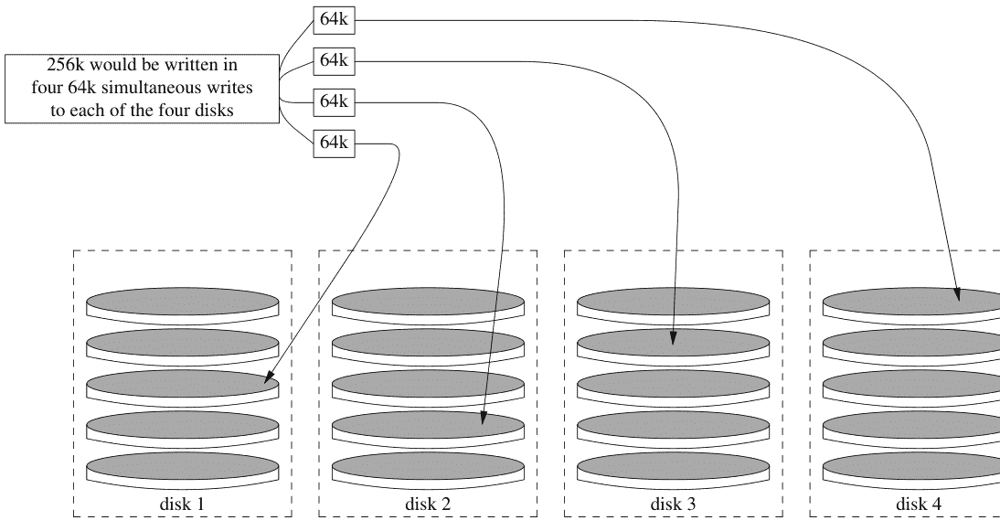

创建一个未格式化的 ATA 磁盘的条带

1. 加载 `geom_stripe` 模块：
   ```
   # kload geom_stripe.ko
   ```
2. 确保存在一个合适的挂载点。如果此卷将成为根分区，则临时使用另一个挂载点作为 `/mnt`：
   ```
   # mkdir /mnt
   ```
3. 确定将进行条带化的磁盘的设备名称，并创建新的条带设备。例如，可以使用以下命令对两个未使用且未分区的 ATA 磁盘进行条带：`/dev/ad2` 和 `/dev/ad3`。
   ```
   # getlabel -v st0 /dev/ad2 /dev/ad3
   ```
4. 必须在新卷上使用以下命令创建分区表：
   ```
   # bslabel -w /dev/stripe/st0
   ```
5. 此过程应该在 `/dev/stripe` 目录下创建了除 `st0` 设备之外的两个设备。这些包括 `st0a` 和 `st0c`。现在必须使用以下命令在 `st0a` 设备上创建文件系统：
   ```
   # newfs -u /dev/stripe/st0a
   ```
   许多数字将在屏幕上闪过，几秒钟后，过程将完成。该卷已创建并已准备好挂载。

可以使用以下命令手动挂载新创建的磁盘条带：

```
# mount /dev/stripe/st0a /mnt
```

要在引导启动过程中挂载此条带化文件系统，请将卷信息放在 `/etc/fstab` 文件中：

```
# echo "/dev/stripe/st0a /mnt ufs rw 2 2 " \
>> /dev/fstab
```

`geom_stripe` 模块还必须在系统初始化期间自动加载，通过向 `/boot/loader.conf` 中添加一行：

```
# echo 'geom_stripe_load="YES" >> /boot/loader.conf
```

# 18.4 RAID1 - 镜像

镜像是许多公司和家庭用户用于在不中断的情况下备份数据的技术。当存在镜像时，意味着磁盘B 复制磁盘A，或者磁盘C+D 复制磁盘A+B。无论磁盘配置如何，重要的方面是一个磁盘或分区上的信息正在被复制。以后，这些信息可以更轻松地恢复，在不引起服务或访问中断的情况下进行备份，甚至可以物理地存储在数据箱中。

开始之前，确保系统有两个大小相同的驱动器，此练习假设它们是直接访问 (`da4`) SCSI 磁盘。
通过在第一个磁盘上初始化 FreeBSD 并仅创建两个分区。其中一个应该是交换分区，大小为 RAM 的两倍，所有剩余空间分配给根 (`/`) 文件系统。可以为其他挂载点分离分区；然而，由于需要手动修改 `bslabel(8)` 和 `fdisk(8)` 设置，这将使难度增加十倍。

重启并等待系统完全初始化。一旦此过程完成，以 root 用户登录。
创建 `/dev/mirror/gm` 设备并将其与 `/dev/da1` 链接：

```
# gmirror label -vnb robin-robin gm0 /dev/da1
```

系统应该响应：

元数据值存储在 `/dev/da1`。
完成。

初始化 GEOM，这将加载 `/boot/kernel/geom_mirror.ko` 内核模块：

```
# gmirror load
```

> 注意：此命令应该在 `/dev/mirror` 目录下创建 `gm0` 设备节点。

安装通用的 `fdisk` 标签并启动以创建新创建的 `gm0` 设备：

```
# fdisk -vBI /dev/mirror/gm0
```

现在安装通用的 `bsdlabel` 信息：

```
# bsdlabel -wb /dev/mirror/gm0s1
```

**注意：** 如果存在多个切片和分区，前两个命令的标志将需要修改。它们必须与另一个磁盘的分片和分区大小匹配。

使用 `newfs(8)` 工具在 `gm0s1a` 设备上创建默认文件系统：

```
# newfs -u /dev/mirror/gm0s1
```

这应该导致系统输出信息和一堆数字。这是好事。检查屏幕上的任何错误，并将设备挂载到 `/mnt` 挂载点：

```
# mount /dev/mirror/gm0s1a /mnt
```

现在将所有数据从启动磁盘移动到此新文件系统。此示例使用了 `dump(8)` 和 `restore(8)` 命令；`dd(1)` 在系统中也可以有效。

```
# dump -l -0 -f- / (cd /mnt && restore -r -f-)
```

必须对每个文件系统执行此操作。运行上述命令时，将适当的文件系统放在正确的位置。
现在编辑 `/mnt/etc/fstab` 文件以添加和删除交换文件。更改其他文件系统信息以使用新磁盘：

| 设备 | 挂载点 | Ftype | 选项 | sw | Pass# | Pass# |
| --- | --- | --- | --- | --- | --- | --- |
| `/dev/da0s2` | | swap | none | 1 | 0 | 0 |
| `/dev/mirror/gm0s1` | / | ufs | rw | 0 | 1 | 1 |

现在向 `/boot/loader.conf` 添加内容：

```
# echo 'geom_stripe_load="YES" >> /boot/loader.conf
```

`geom_stripe` 模块还必须在系统初始化期间自动加载，通过向 `/boot/loader.conf` 添加一行：

```
# echo 'geom_stripe_load="YES" >> /boot/loader.conf
```

# 18.4 RAID1 - 镜像

镜像是许多公司和家庭用户用于在不中断的情况下备份数据的技术。当存在镜像时，意味着磁盘B 复制磁盘A，或者磁盘C+D 复制磁盘A+B。无论磁盘配置如何，重要的方面是一个磁盘或分区上的信息正在被复制。以后，这些信息可以更轻松地恢复，在不引起服务或访问中断的情况下备份，甚至可以物理地存储在数据箱中。

开始之前，确保系统有两个大小相同的驱动器，此练习假设它们是直接访问 (`da4`) SCSI 磁盘。
通过在第一个磁盘上初始化 FreeBSD 并仅创建两个分区。其中一个应该是交换分区，大小为 RAM 的两倍，所有剩余空间分配给根 (`/`) 文件系统。可以为其他挂载点分离分区；然而，由于需要手动修改 `bslabel(8)` 和 `fdisk(8)` 设置，这将使难度增加十倍。

重启并等待系统完全初始化。一旦此过程完成，以 root 用户登录。
创建 `/dev/mirror/gm` 设备并将其与 `/dev/da1` 链接：

```
# gmirror label -vnb robin-robin gm0 /dev/da1
```

系统应该响应：

元数据值存储在 `/dev/da1`。
完成。

初始化 GEOM，这将加载 `/boot/kernel/geom_mirror.ko` 内核模块：

```
# gmirror load
```

> 注意：此命令应该在 `/dev/mirror` 目录下创建 `gm0` 设备节点。

安装通用的 `fdisk` 标签并启动以创建新创建的 `gm0` 设备：

```
# fdisk -vBI /dev/mirror/gm0
```

现在安装通用的 `bsdlabel` 信息：

```
# bsdlabel -wb /dev/mirror/gm0s1
```

**注意：** 如果存在多个切片和分区，前两个命令的标志将需要修改。它们必须与另一个磁盘的分片和分区大小匹配。

使用 `newfs(8)` 工具在 `gm0s1a` 设备上创建默认文件系统：

```
# newfs -u /dev/mirror/gm0s1a
```


# 第 18 章 GEOM：模块化磁盘转换框架

RAID0 条带中的每块磁盘必须具有相同的大小，I/O 请求交错执行，以并行在多个磁盘上读取或写入。

## 创建未格式化的 ATA 磁盘的条带

1. 加载 `geom_stripe` 模块：
   ```
   # kload geom_stripe.ko
   ```
2. 确保存在一个合适的挂载点。如果此卷将成为根分区，则临时使用另一个挂载点作为 `/mnt`：
   ```
   # mkdir /mnt
   ```
3. 确定将进行条带化的磁盘的设备名称，并创建新的条带设备。例如，可以使用以下命令对两个未使用且未分区的 ATA 磁盘进行条带：`/dev/ad2` 和 `/dev/ad3`。
   ```
   # getlabel -v st0 /dev/ad2 /dev/ad3
   ```
4. 必须在新卷上使用以下命令创建分区表：
   ```
   # bslabel -w /dev/stripe/st0
   ```
5. 此过程应该在 `/dev/stripe` 目录下创建了除 `st0` 设备之外的两个设备。这些包括 `st0a` 和 `st0c`。现在必须使用以下命令在 `st0a` 设备上创建文件系统：
   ```
   # newfs -u /dev/stripe/st0a
   ```
   许多数字将在屏幕上闪过，几秒钟后，过程将完成。该卷已创建并已准备好挂载。

可以使用以下命令手动挂载新创建的磁盘条带：
```
# mount /dev/stripe/st0a /mnt
```

要在引导启动过程中挂载此条带化文件系统，请将卷信息放在 `/etc/fstab` 文件中：
```
# echo "/dev/stripe/st0a /mnt ufs rw 2 2 " \
>> /dev/fstab
```

`geom_stripe` 模块还必须在系统初始化期间自动加载，通过向 `/boot/loader.conf` 中添加一行：
```
# echo 'geom_stripe_load="YES" >> /boot/loader.conf
```

## 18.4 RAID1 - 镜像

镜像是许多公司和家庭用户用于在不中断的情况下备份数据的技术。当存在镜像时，意味着磁盘B 复制磁盘A，或者磁盘C+D 复制磁盘A+B。无论磁盘配置如何，重要的方面是一个磁盘或分区上的信息正在被复制。以后，这些信息可以更轻松地恢复，在不引起服务或访问中断的情况下备份，甚至可以物理地存储在数据箱中。

开始之前，确保系统有两个大小相同的驱动器，此练习假设它们是直接访问 `da4` SCSI 磁盘。
通过在第一个磁盘上初始化 FreeBSD 并仅创建两个分区。其中一个应该是交换分区，大小为 RAM 的两倍，所有剩余空间分配给根 `/` 文件系统。可以为其他挂载点分离分区；然而，由于需要手动修改 `bslabel(8)` 和 `fdisk(8)` 设置，这将使难度增加十倍。

重启并等待系统完全初始化。一旦此过程完成，以 root 用户登录。
创建 `/dev/mirror/gm` 设备并将其与 `/dev/da1` 链接：
```
# gmirror label -vnb robin-robin gm0 /dev/da1
```

系统应该响应：
元数据值存储在 `/dev/da1`。
完成。

初始化 GEOM，这将加载 `/boot/kernel/geom_mirror.ko` 内核模块：
```
# gmirror load
```
> 注意：此命令应该在 `/dev/mirror` 目录下创建 `gm0` 设备节点。

安装通用的 fdisk 标签并启动以创建新创建的 `gm0` 设备：
```
# fdisk -vBI /dev/mirror/gm0
```

现在安装通用的 bsdlabel 信息：
```
# bsdlabel -wb /dev/mirror/gm0s1
```

**注意：** 如果存在多个切片和分区，前两个命令的标志将需要修改。它们必须与另一个磁盘的分片和分区大小匹配。

使用 `newfs(8)` 工具在 `gm0s1a` 设备上创建默认文件系统：
```
# newfs -u /dev/mirror/gm0s1
```

这应该导致系统输出信息和一堆数字。这是好事。检查屏幕上的任何错误，并将设备挂载到 `/mnt` 挂载点：
```
# mount /dev/mirror/gm0s1a /mnt
```

现在将所有数据从启动磁盘移动到此新文件系统。此示例使用了 `dump(8)` 和 `restore(8)` 命令；`dd(1)` 在系统中也可以有效。
```
# dump -l -0 -f- / (cd /mnt && restore -r -f-)
```

必须对每个文件系统执行此操作。运行上述命令时，将适当的文件系统放在正确的位置。
现在编辑 `/mnt/etc/fstab` 文件以添加和删除交换文件。更改其他文件系统信息以使用新磁盘：

| 设备 | 挂载点 | Ftype | 选项 | sw | Pass# | Pass# |
| --- | --- | --- | --- | --- | --- | --- |
| `/dev/da0s2` | | swap | none | 1 | 0 | 0 |
| `/dev/mirror/gm0s1` | `/` | ufs | rw | 0 | 1 | 1 |

现在向 `/boot/loader.conf` 添加内容：
```
# echo 'geom_stripe_load="YES" >> /boot/loader.conf
```

`geom_stripe` 模块还必须在系统初始化期间自动加载，通过向 `/boot/loader.conf` 添加一行：
```
# echo 'geom_stripe_load="YES" >> /boot/loader.conf
```


必须对每个文件系统执行此操作。运行上述命令时，将适当的文件系统放在正确的位置。

现在编辑 `/mnt/etc/fstab` 文件以添加和删除交换文件。更改其他文件系统信息以使用新磁盘：

| 设备 | 挂载点 | Ftype | 选项 | sw | Pass# | Pass# |
| --- | --- | --- | --- | --- | --- | --- |
| /dev/da0s2 | | swap | none | 1 | 0 | 0 |
| /dev/mirror/gm0s1 | / | ufs | rw | 0 | 1 | 1 |

现在向 `/boot/loader.conf` 添加内容：

```
# echo 'geom_stripe_load="YES" >> /boot/loader.conf
```

## 第 19 章 Vinum 卷管理器

当前的磁盘驱动器顺序传输速度可达 70 MB/s，但在许多独立进程访问驱动器的环境中，这个值的意义并不大大，因为它们可能只能达到这些值的一小部分。在情况下，从磁盘子系统的视角来看问题会更有趣：最重要的参数是驱动器对子系统产生的影响，换句话说，就是传输占用驱动器处于传输状态的时间。

在任何磁盘传输中，驱动器必须首先考虑读写头下方的磁头，然后执行传输。这些操作可以是原子的：中断它们没有任何意义。

考虑一个典型的约 10 KB 的传输；当代高性能磁盘平均需要 3.5 ms 来对磁头定位。最快的驱动器转速为 15,000 rpm，因此平均旋转延迟（半圈）为 2 ms。在 70 MB/s 的速度下，传输大约需要 150 µs，与定位时间相比几乎可以忽略不计。在这种情况下，有效传输率会下降到略高于 1 MB/s，并且明显取决于传输的大小。

解决这一瓶颈的传统而显而见的方法是“增加磁柱”与其使用一个大磁盘，不如使用多个具有相同总存储空间的较小磁盘。每个磁盘都能独立地进行定位和传输，因此有效吞吐量会增加接近所用磁盘数量的倍数。

具体的改进程度小于所使用的磁盘数量：虽然每个驱动器都能进行并行传输，但没有办法可以确保请求均匀分布在各个磁盘上。一个磁盘的负载不可避免地比另一个磁盘高。

磁盘负载的均匀性严格取决于驱动器所访问的数据。在接的讨论中，将磁盘存储被视为大量的可以通过编号寻址的数据扇是方便的，就像书中的页一样。最明显的方法是将虚拟磁盘划分为与物理磁盘大小相同的连续扇区组，并以这种方式存储它们，就像把一本大书拆成较小的章节一样。这种方法称为拼接（concatenation），它的优点是磁盘不需要任何特定的尺寸关系。当对虚拟磁盘的访问均匀分布在整个地址空间时，这种方法运行良好。当访问集中在较小区域时，改进效果就不明显。图 19-1 展示了在拼接组织中分配存储单元的顺序。

### 图 19-1. 拼接组织

| 磁盘 1 | 磁盘 2 | 磁盘 3 | 磁盘 4 |
|---|---|---|---|
| | 6 | 10 | |
| | 7 | 11 | 13 |
| | 8 | | 14 |
| | 9 | | 15 |
| | | | 16 |
| 5 | | | | 17 |

另一种映射是将地址空间划分为更小的、等大的组件，并将它们顺序存储在不同的设备上。例如，前 256 个扇区可能存储在第一个磁盘上，下一个 256 个扇区存储在下一个磁盘，以此此类推。在填满最后一个磁盘后，重复该过程直到磁盘填满。这种映射被称为条带（striping）或 RAID-0。条带需要花费一些精力来定位数据，并且当传输分布在多个磁盘上时，可能会导致额外的 I/O 负载，但它也可以在磁盘之间提供更恒定的负载。图 19-2 展示了在条带组织中分配存储单元的顺序。

### 图 19-2. 条带组织

| 磁盘 1 | 磁盘 2 | 磁盘 3 | 磁盘 4 |
|---|---|---|---|
| 0 | 1 | 2 | 3 |
| 4 | 5 | 6 | 7 |
| 8 | 9 | 10 | 11 |
| 12 | 13 | 14 | 15 |
| 16 | 17 | 18 | 19 |
| 20 | 21 | 22 | 23 |

### 19.4 数据完整性

当前磁盘的最后一个问题是它们不可靠。尽管磁盘驱动器的可靠性在过去几年里大大提高，但它们仍然是服务器中最可能故障的核心组件。当故障发生时，结果可能是灾难性的：更换故障的磁盘驱动器并恢复数据可能需要几天时间。

处理这个问题的传统方法是镜像（mirroring），在不同的物理硬件上保留数据的两个副本。自从 RAID 级别出现以来，这种技术也被称为 RAID 级别 1 或 RAID-1。对卷的任何写入都会同步两个位置；读取可以从任一位置满足，如果一个驱动器失败，数据在另一个驱动器仍然可用。

镜像有两个问题：

- 价格。它需要的存储空间是非冗余解决方案的倍倍。
- 性能影响。写入必须在两个磁盘上执行，因此它们占据了非镜像卷的两倍带宽。读取则没有性能损失：看起来甚至可能比以前更快。

另一种备选方案是校验位（parity），它在 RAID 级别 2、3、4 和 5 中实现。在这些级别中，RAID-5 是最有趣的。正如 Vinum 中实现的那样，它是条带组织的一种变体，将条带中的一个块专门用于其他块的校验。正如 Vinum 所实现的那样，RAID-5 plex（交错卷/组）类似于条带 plex，除了

它由 Vinum 实现的 RAID-5 plex 在每个条带中都包含一个校验块。只要至少有一个 plex 可以提供数据，卷就是安全的。

### 图 19-3. RAID-5

| 磁盘 1 | 磁盘 2 | 磁盘 3 | 磁盘 4 |
|---|---|---|---|
| 0 | 1 | 2 | 校验 |
| 3 | 4 | 5 | 校验 |
| 7 | 8 | 9 | 校验 |
| 10 | 11 | 12 | 校验 |
| 13 | 14 | 15 | 校验 |
| 16 | 17 | 18 | 校验 |

（注：与镜像相比，RAID-5 的优点是需要的存储较少。如果一个驱动器失败，阵列可以继续。）

### 19.5 Vinum 对象

为了解决这些问题，Vinum 实现了以下对象：

- 最可见的对象是卷（volume），它由多个 plex 组成。
- plex 是数据的表示，可以是镜像的或条带的。
- 子磁盘（subdis）是磁盘上的物理单元。对于条带 plex，子磁盘的大小必须完全相同。
- 条带（stripe）是跨越磁盘分布的数据单元。

#### 19.5.1 卷的大小

单个磁盘的大小不限制卷的大小。卷可以包含任意数量的子磁盘。

#### 19.5.2 冗余数据存储

Vinum 通过连接多个 plex 实现镜像。每个 plex 是数据的表示。卷可以包含两个。只要至少有一个 plex 可以提供数据，卷就是完全功能性的。

#### 19.5.3 性能问题

随 FreeBSD 6.1 提供的 Vinum 版本实现了两种类型的 plex：

- 拼接 plex（concatenated plex）最灵活：它们可以包含任意数量的子磁盘，且子磁盘长度可以不同。可以通过添加额外的子磁盘来扩展 plex。它们比条带 plex 需要更少的 CPU 时间，尽管开销的差异是无法量的。另一方面，它们最容易受到热点影响。
- 条带（RAID-0）plex 的最大优势是减少了热点：通过选择优化大小的条带（至少 256 KB），你可以平衡控制器的负载。这种方法的缺点是（稍微）更复杂以及对子磁盘有限制：它们的大小必须完全相同，而且通过添加子磁盘来扩展 plex 过于复杂，Vinum 目前尚未实现。Vinum 施加了一个额外的限制：条带 plex 必须有两个子磁盘，否则它与拼接 plex 无法区分。

| Plex 类型 | 最小子磁盘数 | 可添加子磁盘 | 必须等大 | 场景 |
| --- | --- | --- | --- | --- |
| 条带型 (striped) | 2 | 否 | 是 | 高并发访问时具有高性能 |

### 19.6 示例

Vinum 维护着一个配置数据库，描述了单个系统中已知的对象。
用户在 `gvinum(8)` 程序的帮助下，从一个或多个配置文件创建配置数据库。
Vinum 在其控制的每个磁盘分区（Vinum 称之为 *device*，设备）上存储一份配置数据库的副本。
该数据库在每次状态变化时都会更新，以便在重启时能够准确地恢复每个 Vinum 对象的状态。

#### 19.6.1 配置文件

配置文件描述了单个 Vinum 对象。一个简单卷的定义如下：

```
drive a /dev/da3h

volume myvol

plex org concat

sd length 512m drive a
```


此文件描述了四个 Vinum 对象：

- `drive` 行描述了一个磁盘分区（`drive`）以及它相对于底层硬件的位置。它的符号名称为 `a`。这种符号名称的分离允许设备名称移动到某处而不影响其他处。
- `volume` 行描述了一个卷。唯一要求的属性是名称，在此例中为 `myvol`。名称不是必须：系统会自动在卷名后添加后缀 `px` 来生成一个名称，其中 `x` 是该卷中 plex 的编号。该 plex 将被称为 `myvol,p0`。
- `sd` 行描述了一个子磁盘。最小规格是用于存储的磁盘名称，以及子磁盘的长度。通过添加前缀 `sd`，不需要名称：系统会自动根据 plex 名称通过添加后缀 `sx` 分配派自 plex 的名称，其中 `x` 是该 plex 中子磁盘的编号。Vinum 将该子磁盘命名为 `myvol,s0`。

处理完此文件后，`gvinum(8)` 如下输出：

```
# gvinum > create config

Configuration summary

Drives: 1 (4 configured)

Volumes: 1 (4 configured)

Plexes: 1 (8 configured)

Subdisks: 1 (16 configured)
```

```
D a State: up Device /dev/da3h Avail: 2061/2573 MB (80%)

V myvol State: up Plexes: 1 Size: 512 MB
```

| P myvol.p0 State: up Subdisks: 1 Size: 512 MB |
| S myvol.p0.s0 State: up PO: 0 B Size: 512 MB |

此输出显示了 `gvinum(8)` 的简要列表格式。它在图 19-4 中以图形形式表示。

### 图 19-4 简单的 Vinum 卷

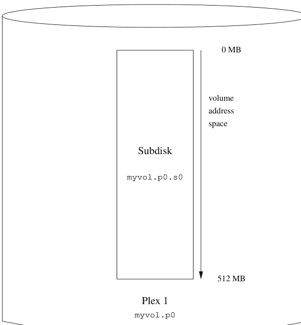

这张图以及后续图片代表了一个卷，它包含 plex，而 plex 又包含子磁盘。
在这个简单的示例中，该卷包含一个 plex，而该 plex 包含一个子磁盘。
这个特定的卷与传统的磁盘分区相比没有特定优势。它包含单个 plex，因此它不冗余。
该 plex 包含单个子磁盘，因此在存储分配上与传统的磁盘分区没有区别。
接下来的章节将说明各种更有的配置方法。

## 19.6 增强韧性：镜像

通过镜像（mirroring）可以增加卷的韧性。在布局镜像卷时，重要的是确保每个 plex 的子磁盘位于不同的驱动器上，这样驱动器故障就不会导致两个 plex 都挂掉。
以下配置镜像了一个卷：

```
drive device /dev/da4h

volume mirror

plex org concat

sd length 512m a

plex org concat

sd length 512m drive b
```

在这个示例中，没有必要再次指定 drive a 的定义，因为 Vinum 在其配置数据库中跟踪所有对象。
处理完此定义后，配置看起来如下：

| Drives: | 2 (configured) |
| Volumes: | 2 (configured) |
| Plexes: | 3 (configured) |
| Subdisks: | 3 (16 configured) |

| D a State: up Device /dev/da3h Avail: 1549/2573 MB (60%) |
| b State: up Device /dev/da4h Avail: 2061/2573 MB (80%) |
| V mysql State: up Plexes: 1 Size: 512 MB |
| V mirror State: up Plexes: 2 Size: 512 MB |
| P myvol.p0 State: up Subdisks: 1 Size: 512 MB |
| P mirror.p0 State: up Subdisks: 1 Size: 512 MB |
| P mirror.p1 State: initializing Subdisks: 1 Size: 512 MB |

| S myvol.p0.s0 State: up PO: 0 B Size: 512 MB |
| S mirror.p0.s0 State: up PO: 0 B Size: 512 MB |
| S mirror.p1.s0 State: up PO: 0 B Size: 512 |

图 19-5 显示了镜像 Vinum 卷的图形结构。

### 图 19-5 镜像 Vinum 卷


在这个示例中，每个 plex 都包含一个子磁盘。在前一个示例中，卷 仅包含一个磁盘。

### 19.6.3 优化性能

镜像卷相比未镜像卷在韧性上更强，但其性能较低：镜像卷要求数据写入两个驱动器。性能考虑可以通过条带化（striping）来提高带宽：条带化将数据分布在多个驱动器上。后续的配置显示了条带化的卷，这种方式尽可能将数据分布在多个驱动器上：

```
drive device /dev/da4h

volume stripe

plex org concat

sd length 512m drive a
```

在之前的示例中，没有必要指定 drive a 的定义，因为 Vinum 在其配置数据库中跟踪所有对象。处理完此定义后，配置看起来如下：

```
Drives: 4 (configured)

Volumes: 1 (configured)

Plexes: 2 (configured)

Subdisks: 4 (16 configured)

D a State: up Device /dev/da3h Avail: 1549/2573 MB (60%)

D b State: up Device /dev/da4h Avail: 2061/2573 MB (80%)

D c State: up Device /dev/da5h Avail: 2445/2573 MB (95%)

D d State: up Device /dev/da6h Avail: 2445/2573 MB (95%)

V stripe State: up Plexes: 2 Size: 512 MB

P stripe.p0 State: up Subdisks: 2 Size: 512 MB

P stripe.p1 State: up Subdisks: 2 Size: 512 MB

S stripe.p0.s0 State: up PO: 0 B Size: 512 MB

S stripe.p0.s1 State: up PO: 0 B Size: 512 MB

S stripe.p1.s0 State: up PO: 0 B Size: 512 MB

S stripe.p1.s1 State: up PO: 0 B Size: 512 MB
```

### 图 19-6 条带 Vinum 卷


该卷在图 19-6 中表示。条带的深浅表示在 plex 空间的位置：最浅的条带在前，最后的在后。

### 19.6.4 韧性与性能

在硬件足够的情况下，可以构建与标准 UNIX 配置相比增加了韧性和性能的卷。标准的配置可能是：

```
volume raid10

plex org striped 512k

sd length 102480k drive a

sd length 102480k drive b

sd length 102480k drive c

sd length 102480k drive d

sd length 102480k drive e

plex org striped 512k

sd length 102480k drive c

sd length 102480k drive d

sd length 102480k drive a

sd length 102480k drive b
```


第二个 `plex` 的子磁盘相对于第一个 `plex` 偏移了两个驱动器：这有助于确保即使传输跨越两个驱动器，也不会写入同一个子磁盘。

图 19-7 代表了该卷的结构。

### 图 19-7 镜像、条带 Vinum 卷


## 19.7 对象命名

如上所述，Vinum 为 `plex` 和子磁盘分配默认名称，尽管这些名称可以被覆盖。不建议覆盖默认名称：使用 VERITAS 卷管理器的经验允许

对象的任意命名已经表明，这种灵活性并没有带来显著优势，反而会导致混淆。

名称可以包含任何非空白字符，但建议限制在字母、数字和下划线字符。卷（`volume`）、组（`plex`）和子磁盘（`subdisk`）的名称可达 64 个字符，驱动器（`drive`）的名称可达 32 个字符。

Vinum 对象在 `/dev/gvinum` 层级中被分配设备节点。上述配置将导致 Vinum 创建以下设备节点：

- *

> 注意：这仅适用于旧的 Vinum 实现。

控制设备 `/dev/vinum/control` 和 `/dev/vinum/control` 分别被 `gvinum(8)` 和 Vinum 守护进程使用。

- 每个卷的设备条目。这些是 Vinum 使用的主要设备。因此上述配置将包含设备 `/dev/gvinum/myvol`、`/dev/gvinum/mirror`、`/dev/gvinum/striped`、`/dev/gvinum/raid5` 和 `/dev/gvinum/raid10`。

> 注意：这仅适用于旧的 Vinum 实现。

目录 `/dev/vinum/drive` 包含每个驱动器的条目。这些条目实际上是到对应磁盘节点的符号链接。

- 所有卷在 `/dev/gvinum` 下都有直接条目。
- 目录 `/dev/gvinum/plex` 和 `/dev/gvinum/sd` 分包含每个组和每个子磁盘的设备节点。

例如，考虑以下配置文件：

```
drive1 device /dev/sd1h

drive2 device /dev/sd2h

drive3 device /dev/sd3h

drive4 device /dev/sd4h

volume s64 setupstate

plex org striped 64k

sd length 100m drive drive1

sd length 100m drive drive2

sd length 100m drive drive3

sd length 100m drive drive4
```

处理此文件后，`gvinum(8)` 在 `/dev/gvinum` 中创建以下结构：

```
drwxr-xr-x 2 root wheel 512 Apr 13 16:46 plex

crwxr-xr-- 1 root wheel 91, 2 Apr 13 16:46 s64

drwr-xr-x 2 root wheel 512 Apr 13 16:46 sd
```

```
/dev/vinum/plex:

total 0

crwxr-xr-- 1 root wheel 25, 0x10000002 Apr 13 16:46 s64.p0

/dev/vinum/sd:

total 0

crwxr-xr-- 1 root wheel 91, 0x02000002 Apr 13 16:46 s64.p0.s0

crwxr-xr-- 1 root wheel 91, 0x02100002 Apr 13 16:46 s64.p0.s1

crwxr-xr-- 1 root wheel 91, 0x02200002 Apr 13 16:46 s64.p0.s2

crwxr-xr-- 1 root wheel 91, 0x02300002 Apr 13 16:46 s64.p0.s3
```

虽然建议设备不要分配特定名称，但 Vinum 驱动器必须命名。可以将驱动器移动到不同的位置并仍然能够识别特定的名称。驱动器名称可达 32 个字符。

## 19.7 创建文件系统

卷在系统中显示为磁盘，与普通磁盘不同的是，Vinum 不对卷进行分区，因此卷不包含分区表。这在使用某些工具时需要修改，特别是 `newfs(8)`，它之前尝试将 Vinum 卷的字母解释为分区标识符。例如，磁盘名称可能像 `/dev/ad0` 或 `/dev/da2`。这些名称分别代表第一个 (0) IDE 磁盘 (`ad`) 上的第一个分区 (`a`)，以及第三个 (2) SCSI 磁盘 (`da`) 上的第八个 (`h`)。相比之下，Vinum 卷可能被称为 `/dev/vinum/concat`，这个名称与分区名称没有关系。

通常，`newfs(8)` 解析磁盘名称，如果无法理解则会报错。例如：

```
# newfs /dev/vinum/concat

newfs:/dev/vinum/concat: can't figure out file system partition
```

为了在该卷上创建文件系统，请使用 `newfs(8)`：

```
# newfs /dev/vinum/concat
```

> 注意：在 5.0 之前的 FreeBSD 版本中，`newfs(8)` 需要额外的 `-v` 标志以及旧的设备命名方案：

```
# newfs -v /dev/vinum/concat
```

## 19.8 配置 Vinum

GENERIC 内核不包含 Vinum。可以构建一个包含 Vinum 的特殊内核，但并不推荐这样做。启动 Vinum 的标准方法是使用内核模块 (`kld`)。你不需要为 Vinum 使用 `kldload(8)`：当你启动 `gvinum(8)` 时，它会检查模块是否已加载，如果没有加载，它会自动加载。

## 19.8.1 启动

Vinum 在磁盘上存储配置信息的形式与配置文件基本相同。在读取配置数据库时，Vinum 识别出一些在文件中是不允许的关键字。例如，磁盘配置可能包含：

```
volume type state

volume name:sd01 state up org

plex name:sd01 state up org

plex name:sd01 state int 521

sd name:sd00 state up plex sd01 int 104576 driveext 255

sd name:sd01 state up plex sd01 int 104576 driveext 255

sd name:sd02 state up plex sd01 int 104576 driveext 255

sd name:sd03 state up plex sd01 int 104576 driveext 255

sd name:sd00 state up plex sd02 int 524288 driveext 255

sd name:sd01 state up plex sd02 int 524288 driveext 255

sd name:sd02 state up plex sd02 int 524288 driveext 255

sd name:sd03 state up plex sd02 int 524288 driveext 255

sd name:sd00 state up plex sd03 int 209715 driveext 1573

sd name:sd01 state up plex sd03 int 209715 driveext 1573

sd name:sd02 state up plex sd03 int 209715 driveext 1573

sd name:sd03 state up plex sd03 int 209715 driveext 1573

sd name:sd00 state up plex sd04 int 419430 driveext 8388

sd name:sd01 state up plex sd04 int 419430 driveext 8388

sd name:sd02 state up plex sd04 int 419430 driveext 8388

sd name:sd03 state up plex sd04 int 419430 driveext 8388
```

明显的区别在于显式的位置信息和命名（这两者都是允许的，但不建议用户使用）以及关于状态的信息。Vinum 不在配置中存储驱动器信息；它通过扫描配置磁盘中的卷分区来查找驱动器。这使得 Vinum 在驱动器分配了唯一 ID 的情况下正确识别它们。

### 19.8.1.1 自动启动

注意：此信息仅适用于旧的 Vinum 实现。Vinum 在内核模块加载后始终会自动启动。

为了在启动系统时自动启动 Vinum，请确保你的 `/etc/rc.conf` 中有以下行：

```
start_vinum="YES" # 设置为 YES 以启动 vinum
```


如果没有 `/etc/rc.conf` 文件，请创建一个带有此内容的文件。这将导致系统启动时加载 Vinum kld 并启动配置中提到的任何对象。这是在挂载文件系统之前完成的，因此可以在 Vinum 卷上自动执行 `fsck(8)`。

当使用使用 `vinum start` 命令启动 Vinum 时，Vinum 从一个 Vinum 驱动器读取配置数据库。通常情况下，每个驱动器都带有配置数据库的副本，因此读取哪个驱动器并不重要。崩溃后，Vinum 必须确定哪个驱动器是最后更新的并从中读取配置。然后如果有需要，将从较旧的驱动器更新配置。

# 19.9 使用 Vinum 用于根文件系统

对于使用 Vinum 进行完全镜像文件系统的机器，镜像根文件系统也是理想的。设置此类配置比镜像任意文件系统要复杂得多：
- 根文件系统必须在启动过程早期可用，因此此时 Vinum 基础设施必须可用。
- 包含根文件系统的卷还包含系统引导程序和内核，必须使用主系统的原生工具（例如 PC 类机器上的 BIOS）读取，这些工具无法学习 Vinum 的细节。
- 在后续章节中，“根卷”一词通常用于描述包含根文件系统的 Vinum 卷。将此卷命名为“root”可能是一个好主，但在技术上并没有要求。不过后续章节中的所有命令示例都假设了这个名称。

## 19.9.1 尽早启动 Vinum

为了实现这一点，需要采取几项措施：
- Vinum 必须在启动时在内核中可用。第 19.8.1 节描述的自动启动 Vinum 方法不适用于完成此任务。

> 注意：对于 Vinum，一旦内核模块加载，一切都将自动完成，因此上述步骤就是全部需要的。为了方便设置，下记录了旧 Vinum 系统的行为。

Vinum 必须尽早初始化，因为它需要为根文件系统提供卷。默认情况下，Vinum 内核部分不会寻找可能 Vinum 卷信息的驱动器，直到管理员（或启动脚本之一）发出 `vinum start` 命令。

> 注意：以下段落概述了 FreeBSD 5.X 及以上版本所需的步骤。FreeBSD 4.X 要求的设置有所不同，见第 19.9.5 节。

通过放置以下行：
`vinum.autostart="YES"`

## 第 19 章 Vinum 卷管理器

通过 `/boot/loader.conf`，Vinum 被指示在内核启动时自动扫描包含 Vinum 的驱动器。

请注意，不需要指示内核去查找根文件系统。`/boot/` 在 `/etc/fstab` 中查找根设备的名称，并将此信息传递给内核。当涉及到根文件一时，内核会根据提供的设备名称确定交由哪个驱动程序将其转换为内部 ID（主设备/从设备号）。

## 19.2 使基于 Vinum 的根卷对引导程序（Bootstrap）可访问

由于当前的 FreeBSD 系统仅有 75 KB 的代码，并且已经承担了从 UFS 文件系统读取文件（如 `/boot/loader`）的负担，因此完全不可能让它学习解析 Vinum 配置的内部 Unix 结构并确定根卷自身的元素。因此，需要一些技巧来为引导程序提供一个包含根文件系统的标准“a”分区的幻象。

为了实现这一点，根卷必须满足以下条件：
- 根卷不能是条带化（stripped）格式或 RAID-5 格式。
- 根卷不能包含超过一个包含根文件系统副本的级联磁盘组（plex）。引导过程最终只会使用这些组中的一个来查找引导程序和所有文件，并最终将挂载根文件系统本身。这些组中的每个单独磁盘都需要它们自己的“a”分区，以便相应的设备成为可启动状态。并不严格要求这些伪造的“a”分区与包含根卷组的其他设备相比，必须位于设备内相同的偏移量处。将 Vinum 卷保持可能是一个好主意，使得镜像设备是对称的，以避免混淆。

为了为每个包含根卷部分的设备设置“a”分区，需要执行以下操作：
1. 使用以下命令检查该设备作为根卷一部分的子磁盘的位置（从设备开始的偏移量）和大小：

```bash
# gvinum -rv root
```

请注意，Vinum 的偏移量和大小是以字节为单位的。它们必须除以 512，以获得 `bslabel` 命令中使用的块号。
2. 执行命令：

```bash
# bsdlabel -e devname
```

对于参与根卷的每个设备，`devname` 必须是磁盘名称（如 `da0`）且不带切片（如 `da0 disk`），或者是切片名称（如 `da0s1`）。

如果设备上已经存在“a”分区（假设是预 Vinum 的根分区），则应将其重命名为其他名称，以保持其可访问（以防万一），但将不再默认用于引导系统。请注意，活动的分区（如当前已挂载的根文件系统）无法重命名，因此必须在从“Fixit”介质启动时执行，并分两步过程进行（在镜像系统中，首先操作未启动的磁盘）。

然后，必须将该设备上 Vinum 分区的偏移量（如果有）加到该设备上相应根卷子磁盘的偏移量上。结果值将成为“a”分区的“offset”值。分区的“size”值可以从上述计算中得出。“fstype”应设为 4.2BSD。`fsize`、`bsize` 和 `cpg` 值应选择为与实际文件系统匹配的值，尽管在这种语境下它们是非常统一的。

这样，就会存在一个与该设备上的 Vinum 分区重叠的“a”分区。请注意，只有当 Vinum 分区已使用“vinum” fstype 正确标记时，`bslabel` 才允许重叠。
3. 好了！每个拥有根卷副本的设备上都存在一个伪造的 a 分区。强烈建议使用类似下面的命令验证结果：

```bash
# fsck -n /dev/devname
```

必须记住，在设置新的 Vinum 根时，所有包含控制信息的文件必须相对于 Vinum 卷的文件系统，可能与当前活动的文件系统不匹配。特别是 `/etc/fstab` 和 `/boot/loader.conf` 文件需要处理。

在下次重启时，引导程序应该从新的基于 Vinum 文件系统获取相应的控制信息并相应执行。在内核初始化过程结束时，所有设备都已发布，显著提示显示设置成功的消息可能如下：

```
Mount root from ufs:/dev/vinum/root
```

## 19.9.3 基于 Vinum 的根设置示例

设置 Vinum 卷后，`gvinum -1 -rv root` 的输出可能如下：

```
Subdisk root.p0.s0:
Size: 125829120 bytes (120 MB)
State: up
Plex root.p0 at offset 0 (0 B)
Drive disk0 (/dev/da0) at offset 135680 (132 KB)
Subdisk root.p1.s0:
Size: 125829120 bytes (120 MB)
State: up
Plex root.p1 at offset 0 (0 B)
Drive disk1 (/dev/da1) at offset 135680 (132 KB)
```

该设备上 Vinum 分区的偏移量（如果有）必须加到该设备上相应根卷子磁盘的偏移量上。结果值将成为“a”分区的“offset”值。分区的“size”值可以从上述计算中得出。“fstype”应为 4.2BSD。`fsize`、`bsize` 和 `cpg` 值应选择为与实际文件系统匹配的值，尽管在这种语境下它们是非常统一的。

这样，就会存在一个与该设备上的 Vinum 分区重叠的“a”分区。请注意，只有当 Vinum 分区已使用“vinum” fstype 正确标记时，`bslabel` 才允许重叠。

好了！每个拥有根卷副本的设备上都存在一个伪造的 a 分区。强烈建议使用命令验证结果：

```bash
# fsck -n /dev/devname
```

必须记住，在设置新的 Vinum 根时，所有包含控制信息的文件必须相对于 Vinum 卷的文件系统，可能与当前活动的文件系统不匹配。特别是 `/etc/fstab` 和 `/boot/loader.conf` 文件需要处理。

在下次重启时，引导程序应该从新的基于 Vinum 文件系统获取相应的控制信息并相应执行。在内核初始化过程结束时，所有设备都已发布，显著提示显示设置成功的消息如下：

```
Mount root from ufs:/dev/vinum/root
```

## 19.9.3 基于 Vinum 的根设置示例

设置 Vinum 卷后，`gvinum -1 -rv root` 的输出可能如下：

```
Subdisk root.p0.s0:
```


Size: 125829120 bytes (120 MB)

State: up

Plex root.p0 at offset 0 (0 B)

Drive disk0 (`/dev/da0`) at offset 135680 (132 KB)

Subdisk root.p1.s0:

Size: 125829120 bytes (120 MB)

State: up

Plex root.p1 at offset 0 (0 B)

Drive disk1 (`/dev/da1`) at offset 135680 (132 KB)

Subdisk root.p0.s0:
Size: 125829120 bytes (120 MB)
State: up
Plex root.p0 at offset 0 (0 B)
Drive disk0 (`/dev/da0`) at offset 135680 (132 KB)

Subdisk root.p1.s0:
Size: 125829120 bytes (120 MB)
State: up
Plex root.p1 at offset 0 (0 B)
Drive disk1 (`/dev/da1`) at offset 135680 (132 KB)

该设备上 Vinum 分区的偏移量（如果有）必须加到该设备上相应根卷子磁盘的偏移量上。结果值将成为“a”分区的“offset”值。分区的“size”值可以从上述计算中得出。“fstype”应为 4.2BSD。`fsize`、`bsize` 和 `cpg` 值应选择为与实际文件系统匹配的值，尽管在这种语境下它们是非常统一的。

这样，就会存在一个与该设备上的 Vinum 分区重叠的“a”分区。请注意，只有当 Vinum 分区已使用“vinum” fstype 正确标记时，`bslabel` 才允许重叠。

## 19.9.4 故障

如果发生错误，需要一种方法从中恢复。以下列表包含了一些陷阱和解决方案。

### 19.9.4.1 系统引导已加载但系统未启动

如果 `/boot/loader` 启动失败，主引导失败（在启动过程开始后，屏幕左侧列用单横线显示），可以尝试使用空格键在此处中断主引导。这将使引导停止在第二阶段，参见第 12.3.2 节。加载器变量（如 `vinum.autostart`）可以使用 `show` 显示，并使用 `unset` 命令进行操作。

如果唯一的问题是 Vinum 内核模块尚未加载模块列表中，那么简单的 `load geom_vinum` 就会有帮助。

准备好后，可以使用 `boot -as` 继续启动过程。`-as` 参数将请求内核挂载根文件系统（`-`），并在单用户模式（`-s`）下进行启动，其中根文件系统以只读方式加载。这样，如果只挂载了多卷中的一个组，就不会有组之间数据不一致的风险。

在提示根文件系统时，可以输入任何包含有效根文件系统的设备。如果 `/etc/fstab` 设置正确，默认值应该是 `ufs:/dev/vinum/root`。一个典型的选择类似于 `ufs:da0`，这可能是一个包含预 Vinum 根的假设分区。如果在这里输入的某个别名“a”分区实际上是对根设备子磁盘引用，则需要小心，因为在镜像设置中，这只会挂载镜像设备的一个部分。

### 19.9.4.2 仅加载主引导

如果 `/boot/loader` 启动失败，主引导失败（在启动过程开始后，屏幕左侧列用单横线显示），可以尝试使用空格键在此处中断主引导。此时可以尝试从备用分区启动，即之前移出“a”位置的包含旧文件系统的分区。

### 19.9.4.3 启动失败，引导程序崩溃

如果引导程序被 Vinum 安装程序破坏，就会发生这种情况。遗憾的是，Vinum 在写入其 Vinum 头部信息之前，会意外地在其分区开头只留下 4 KB 的空闲空间。然而，第一、二阶段引导程序以及嵌入在之间的 `dslabel` 目前需要 8 KB。如果 Vinum 分区是在一个旨在作为引导程序的 slice 或磁盘的偏移 0 处启动的，Vinum 将覆盖（wrap）引导程序。

同样，如果上述情况已得到恢复（例如通过从“修复/介质”启动），并按照第 12.3.2 节所述使用 `dslabel` 重新安装了引导程序，引导程序将捕获 Vinum 头部，并且无法找到其磁盘。这不会导致实际的 Vinum 配置数据或 Vinum 卷中的数据被破坏，可以通过重新输入相同的 Vinum 配置来恢复所有数据，这种情况是完全可以修复的。此时有必要将整个 Vinum 分区至少后移 4 KB，以确保 Vinum 头部和系统引导程序不再发生碰撞。

## 19.9.5 FreeBSD 4.X 的差异

在 FreeBSD 4.X 下，缺少使 Vinum 自动扫描所有磁盘所需的某些内部函数，并且确定根设备内部 ID 代码无法处理如 `/dev/vinum/root` 这样的名称。因此，这里的情况有些不同。

必须显式告诉 Vinum 扫描磁盘，使用类似 `/boot/loader.conf` 中的行：

确保提到所有可能包含 Vinum 数据的驱动器是重要的。安装更多驱动器并无害，因此有必要显式添加每个 slice 和分区，Vinum 将扫描所有命名的 Vinum 磁盘的 slice 和分区。

由于用于解析根文件系统名称和设备 ID（主/次设备号）的程序仅准备好处理如 `/dev/ada0s` 这样的“经典”设备，它们无法处理如 `/dev/vinum/root` 这样的根卷名称。因此，Vinum 需要在初始化期间预设存储持有根设备 ID 的内部内核参数。这通过在变量 `vinum.root` 中传递根卷名称来实现。`/boot/loader.conf` 中的条目如下：

```
vinum.root="root"
```

现在，当内核初始化尝试寻找根设备时，它会检查某些内核模块是否已经为其预先初始化了内核参数。如果是这种情况，并且设备声称根设备与传递的根设备的主号匹配（在我们的案例中为“vinum”），它将使用预分配的设备 ID，而不是尝试自己计算一个。这样一来，在通常的自动启动期间，它可以继续挂载用于根文件系统的 Vinum 卷。

然而，当用户通过 `-boot` 请求手动输入根设备名称时，必须注意该程序中仍包含一个指向 Vinum 卷的输入名称。如果输入了任何不指向 Vinum 设备的名称，预分配的根分区的主号与从 Vinum 设备推断出的设备主号之间的不匹配将导致该程序进入其正常解析过程，因此通过输入如 `ufs:da00` 这样的字符串将按预期工作。请注意，如果失败了，将无法重新输入如 `ufs:vinum/root` 这样的字符串，因为无法被解析。唯一的解决办法是再次重启并重新开始（在 `/sh` 提示符处，可以省略初始的 `/dev/`）。

## Notes

- 1. RAID 代表“廉价磁盘冗余阵列”，提供了各种形式的容错能力，尽管后者的术语带有误导性：它并不提供冗余。

# 第 20 章 本地化 - I18N/L10N 的使用与设置

由 Andrey Chernov 贡献。由 Michael C. Wu 重写。

## 20.1 概述

FreeBSD 是一个广泛传播的项目，用户和贡献者遍布全球。本章讨论了 FreeBSD 的国际化和本地化功能，这些功能允许非英语用户完成实际工作。在系统和应用层面，i18n 实现有许多方面，因此在适用情况下，我们将读者引导更具体的文档来源。

阅读本章后，你将了解：

- *现代操作系统是如何对不同语言和区域进行编码的。*
- 如何为你的登录 shell 设置区域（locale）。
- 如何为非英语语言配置控制台。
- 如何结合不同语言有效地使用 X Window 系统。
- 在哪里可以找到关于编写符合 i18n 标准应用程序的更多信息。

在阅读本章之前，你应该：

- *知道如何安装额外的第三方应用程序（第 4 章）。*

## 20.2 基础

### 20.2.1 什么是 I18N/L10N？

开发者将国际化（internationalization）缩写为 I18N，计算了该词第一个字母和最后一个字母之间的字母数量。L10N 采用相同的命名方案，源于“localization”（本地化）。结合，I18N/L10N 方法、协议和应用程序允许用户使用他们选择的语言。

I18N 应用程序使用库下的 I18N 工具包进行编程。它允许开发者编写一个简单的文件并将显示的菜单和文本翻译成每种语言。我们强烈鼓励程序员遵循这一约定。

### 20.2.2 为什么我需要 I18N/L10N？

当你希望查看、输入或处理非英语语言的数据时，就会使用 I18N/L10N。

### 20.2.3 哪些语言支持 I18N？

I18N 并非 FreeBSD 特有。目前可以选择大多数语言，包括但不限于：中文、德语、日语。

## 20.3 使用本地化

尽管 I18N 并非 FreeBSD 特有，但这是一个约定。我们鼓励你遵循这一约定。

本地化设置基于三个主要术语：语言代码、国家代码和编码。区域名称由这三个部分构建：

```
LanguageCode_CountryCode
```


### 20.3.1 语言和国家代码

为了将 FreeBSD 系统本地化到特定语言（或任何其他 I18N UNIX 系统），用户需要找到特定国家和语言的代码（国家代码告诉应用程序变体）。此外，浏览器、SMTP/POP 服务器、Web 服务器都会此做出决策。以下是语言/国家的示例：

| 语言/国家代码 | 描述 |
|---|---|
| en_US | 英语-美国 |
| ru_RU | 俄语-俄罗斯 |
| zh_TW | 繁体中文-台湾 |

### 20.3.2 编码

某些语言使用非 ASCII 编码，详见 `multibyte(3)`。旧应用程序无法识别它们并将其误认为控制字符。新应用程序通常可以识别位字节字符。取决于实现，用户可能需要带有宽字节字符编译应用程序。为了能够输入和处理宽字节字符，FreeBSD 端口集合（http://www.FreeBSD.org/ports/index.html）为每种语言提供了不同的程序。请参考相应的 FreeBSD 端口 I18N 文档。

具体来说，用户需要查看应用程序文档以决定如何正确配置或向 `configure`/`Makefile`/`编译器`传递值。

注意几点：

- 语言特定的单字节字符集（见 `multibyte(3)`，例如 ISO-8859-1、ISO-8859-15、KOI8-R、CP437），
- 宽字节字节编码，例如 EUC、Big5。

你可以在 IANA 注册处查看字符集的活动列表（http://www.iana.org/assignments/character-sets）。

> 注意：FreeBSD 使用 X11 兼容的区域编码代替。

## 20.3.3 I18N 应用（国际化）

在 FreeBSD Ports 和 Package 系统中，I18N 应用在名称中带有 I18N 字样以便于识别。然而，它们并不支持所需的语言。

## 20.3.4 设置本地区域（Locale）

通常，在登录设置中将本地区域名称的值设置为 `LANG` 就足够了。这可以在用户的 `~/.login_conf` 文件或用户的启动文件（如 `~/.profile`, `~/.bashrc`, `~/.cshrc`）中完成。没有必要设置如 `LC_TYPE`、`LC_CTIME` 等本地区域子集。请参考特定语言的 FreeBSD 文档获取相关信息。

您应该在配置文件中设置以下环境变量：

- 用于 POSIX 族函数的 `LANG`
- 用于应用程序 MIME 字符集的 `MM_CHARSET`

这包括本地区域配置、应用程序配置以及 X11 配置。

### 20.3.4.1 设置本地区域方法

设置本地区域有两种方法，下文将对其进行介绍。第一种（推荐方法）是在登录类（login class）中分配环境变量，第二种是将环境变量赋值添加到系统的启动文件中。

### 20.3.4.1.1 登录类方法

该方法允许一次性为本地区域和 MIME 字符集所需的环境变量赋值，而无需在每个启动文件中添加特定的 shell 赋值。用户级设置可以由用户自己完成，而管理员级设置需要超级用户权限。

### 20.3.4.1.1 用户级设置

以下是用户家目录下 `.login_conf` 文件的最小示例，它包含了适用于 Latin-1 编码的两个变量：

```
me:\n:charset=ISO-8859-1:\n:lang=de_DE.ISO8859-1:
```

这里是一个 `.login_conf` 文件的示例，设置了 BIG-5 编码的繁体中文变量。注意设置了许多变量，因为某些软件对中文、日语和韩语的本地区域处理并不正确。

```
# 对于不希望使用货币单位或时间格式的 
# 台湾（Taiwan）的用户，可以手动更改每个变量
me:\n:lang=zh_TW.Big5:\n:lc_all=zh_TW.Big5:\n:lc_collate=zh_TW.Big5:\n:lc_ctype=zh_TW.Big5:
```

## 第 20 章 本地化 - I18N/L10N 使用与设置

```
:lc_messages=zh_TW.Big5:
:lc_monetary=zh_TW.Big5:
:lc_numeric=zh_TW.Big5:
:lc_time=zh_TW.Big5:
:charset=big5:
:xmodifiers="bimxcin": # 设置 XIM 输入源
```

更多详情请参阅管理员级设置和 `login.conf(5)`。

### 20.3.4.1.1.2 管理员级设置

验证 `/etc/login.conf` 中的用户登录类是否设置了正确的语言。确保这些设置出现在 `/etc/login.conf` 中：

```
language_name=accounts_title:\n:charset=MIME_charset:\n:lang=local_name:\n:tc=default:
```

延续之前使用 Latin-1 的示例，它看起来像这样：

```
german:German Users Accounts:\n:charset=ISO-8859-1:\n:lang=de_DE.ISO8859-1:\n:tc=default:
```

在更改用户的登录类之前，执行以下命令

```bash
# cap_mkdb /etc/login.conf
```

以使 `/etc/login.conf` 中的新配置对系统可见。

使用 `vipw(8)` 更改登录类

使用 `vipw` 添加新用户，并使条目如下：

```
user:password:1111:11:language:0:0:User Name:/home/user/:/bin/sh
```

使用 `adduser(8)` 更改登录类

使用 `adduser` 添加新用户，并在后续：

- 在 `/etc/adduser.conf` 中设置 `defaultclass = language`。请记住，在这种情况下，您必须为所有其他语言的用户输入默认类。
- 另一种变体是在每次指定特定语言时回答：
  - 输入登录类（login class）：default []
- 另一种方法是对于您想要添加的每个不同语言的用户使用以下命令：

```bash
# adduser -class language
```

## 第 20 章 本地化 - I18N/L10N 使用与设置

## 使用 `pw(8)` 更改登录类

如果您使用 `pwadd` 添加用户，请按此格式调用：

```bash
# pw useradd user_name -L language
```

### 20.3.4.1.2 Shell 启动方法

注意：不推荐这种方法，因为需要为每个选择的可能 shell 程序进行不同的设置。请使用登录类方法。

要添加本地区域和 MIME 字符集，请在 `/etc/profile` 和/或 `/etc/csh.login` shell 启动文件中设置显示的两个环境变量。我们在下方以德语作为示例：

在 `/etc/profile` 中：

```
LANG=de_DE.ISO8859-1; export LANG
MM_CHARSET=ISO-8859-1; export MM_CHARSET
```

或者在 `/etc/csh.login` 中：

```
setenv LANG_de_DE.ISO8859-1
setenv MM_CHARSET ISO-8859-1
```

或者，对于您想要添加的每个不同语言的用户，使用以下内容（取决于所选 shell）：

在 `/etc/profile` 中：

```
LANG=de_DE.ISO8859-1; export LANG
```

或者：

```
setenv LANG_de_DE.ISO8859-1
```

在 `/etc/csh.login` 中（如上文所示）。

## 20.3.5 控制台设置

对于所有 C 字符集，请在 `/etc/profile` 中设置以下内容（如上文所示）：

```
LANG=de_DE.ISO8859-1; export LANG
```

或者：

```
setenv LANG_de_DE.ISO8859-1
```

对于 X11：

```
LANG=de_DE.8859-1; export LANG
MM_CHARSET=ISO-8859-1; export MM_CHARSET
```


## 第 20 章 本地化 - I18N/L10N 使用与设置

| 字符集 | 终端类型 |
|---|---|
| ISO8859-1 | cons21 |
| ISO8859-2 | cons12 |
| ISO8859-7 | cons17 |
| KO8-R | cons25 |
| KO8-U | cons25 |
| CP437 (默认) | cons25 |
| US-ASCII | cons25 |

| 语言 | 位置 |
|---|---|
| 繁体中文 (BIG-5) | chinese:big5 |
| 日语 | japanese-16 |
| 韩语 | korean-han |

## 20.3.6 X11 设置

虽然 X11 不是 FreeBSD 项目的一部分，但在这里提供了一些信息。更多详情请参阅 Xorg 网站 (`http://www.x.org/`) 或您使用的任何 X11 服务器。

在 `~/.Xresources` 中，您可以额外调整应用程序特定的 i8N 设置（例如字体）。

### 20.3.6.1 显示字体

安装 `xorg` (`x11-servers/xorg-server`) 或 XFree86 服务 (`x11-servers/XFree86-4`)，然后安装语言字体。设置正确的本地区域应该允许您在菜单等处查看语言。

### 20.3.6.2 输入非英语字符

X11 输入方法 (`XIM`) 协议是所有 X11 客户端的标准。所有 X11 应用程序都应该是从 XIM 服务器获取输入的 XIM 客户端。不同语言有多个可用 XIM 服务器。

## 20.3.7 打印机设置

某些 C 字符集通常是硬件编码的。宽或多字节字符集需要特殊设置，我们建议使用 `apsfilter`。您也可以使用特定语言的转换器将文档转换为 PostScript 或 PDF 格式。

## 20.3.8 内核与文件系统

FreeBSD 文件系统 `FFS` 是 8 位的，因此可以使用任何单 C 字符集（多字节）。文件系统中没有字符集名称，也就是说它是原始 8 位的，不知道编码顺序。官方上，`FFS` 尚未支持任何形式的宽或多字节字符集。然而，某些宽或多字节字符集有独立的补丁可以启用这种支持。这些只是临时的不可持续的解决方案或黑科技，我们决定不将其包含在源码中。参考相应语言的网站获取更多信息和补丁文件。

FreeBSD MS-DOS 文件系统具有可配置属性，可以在 MS-DOS、Unicode 字符集和选定的 FreeBSD 文件系统字符集之间进行转换。详情请参阅 `mount_msdos(8)`。

## 20.4 编译 I18N 程序

许多 FreeBSD Ports 已经迁移了支持 I18N 的。其中一些在端口名称中标记有 `-I18N`。这些以及许多其他程序内置了 I18N 支持，不需要特殊考虑。

然而，某些应用程序（如 MySQL）需要在此 Makefile 中配置特定的字符集。这通常在 `Makefile` 中完成，或者通过向源码传递配置值来实现。

## 20.5 将 FreeBSD 本地化特定语言

### 20.5.1 俄语 (KOI8-R 编码)

最初由 Andrey Chernov 贡献。

关于 KOI8-R 编码的更多信息，请参阅 [KOI8-R 参考（俄罗斯网络字符集）](http://koi8.pp.ru/)。

#### 20.5.1.1 语言区域设置

将以下行放入你的 `~/.login_conf` 文件中：

```
me:My Account:\ncharset=KOI8-R;:\nlang=ru-RU.KOI8-R:
```

请参考本章前面的内容了解设置语言区域（locale）的示例。

#### 20.5.1.2 控制台设置

- 将以下行添加到你的 `/etc/rc.conf` 文件：
`mousechar_start=3`
同时，在 `/etc/rc.conf` 中使用以下设置：

```
keymap="ru.koi8-r*"

screenmap="koi8-r2cp866*"

font816="cp866b-816*"

font814="cp866-814*"

font88="cp866-8*"
```
对于 `/etc/ttys` 中的每个 tty，使用 `cons25r` 作为终端类型。
请参考本章前面的内容了解设置控制台的示例。

#### 20.5.1.3 打印机设置

由于大多数带有俄语字符的打印机带有硬件代码页 CP866，因此需要一个特殊的输出过滤器来将 KOI8-R 转换为 CP866。该过滤器默认安装在 `/usr/libexec/lpr/ru/koi2alt`。俄语打印机的 `/etc/printcap` 条目应该如下：

```
lp|Russian local line printer:\n:shof=/usr/libexec/lpr/ru/koi2alt:

lp=/dev/lpt0;=/var/spool/output/lpd=/var/log/lpd-errs.
```

详细描述请参阅 `printcap(5)`。

#### 20.5.1.4 MS-DS 文件系统和俄语文件名

示例 `fstab(5)` 条目支持在挂载的 MS-DS 文件系统俄语文件名：

```
/dev/ad02 /dos/c msdos rw -Wkoi2dos,-Lru-RU.KOI8-R 0 0
```

选项 `-l` 选择语言区域名称，`-W` 设置字符转换表。要使用 `-W` 选项，请确保在挂载 MS-DS 分区之前进行，因为转换表位于 `/usr/libdata/msdsofs`。
如需更多信息，请使用 `mount_msdsof(8)` 手页。

#### 20.5.1.5 X11 设置

1. 按照描述进行本地设置。
2. 如果你使用 Xorg，请使用 `x1-fonts/xorg-conf-cyrillic` 包。
   检查你的 `/etc/x11/xorg.conf` 文件中的 "Files" 部分。必须在任何其他 OtherPath 条目之前添加这些行：
```
FontPath "/usr/X11R6/lib/x11/fonts/cyrillic/misc"

FontPath "/usr/X11R6/lib/x11/fonts/cyrillic/75dpi"

FontPath "/usr/X11R6/lib/x11/fonts/cyrillic/100dpi"
```
   如果使用高分辨率视频模式，请交换 75 dpi 和 100 dpi。
3. 要激活俄语键盘，在 `xorg.conf` 文件的 "Keyboard" 部分添加以下内容：
```
Option "Xkblayout" "us,ru"

Option "XkbOptions" "grpittoggle"
```
   同时确保那里 `XkbDisable` 是关闭的（注释掉）。
   对于 `grp:caps_toggle`，RUS/LAT 切换键将是 CapsLock。旧的 CapsLock 功能仍可以通过 Shift-CapsLock（在 LAT 模式下）可用。对于 `grp:toggle`，RUS/LAT 切换键将是 Right Alt。
   由于未知原因，`grp:caps_toggle` 在 Xorg 中不起作用。
   如果你的键盘上有 "Windows" 键，并且发现在 RUS 模式下某些非字母键的映射错误，请在 `xorg.conf` 文件中添加以下行：
```
Option "XkbVariant" *,winkies",
```


注意：俄语 XKB 键盘可能无法与非本地化应用程序协同工作。

注意：最少本地化的应用程序应该在程序中调用 `xtSetLanguageProc(NULL, NULL, NULL);` 函数。

请参阅 [X Window 的 KOI8-R](http://koi8.pp/xwin.html) 获取更多关于 X11 应用程序本地化的指令。

### 20.5.2 台湾繁体中文本地化

FreeBSD-Taiwan 项目在 http://netlab.cse.zyu.edu.tw/~statue/freebsd/zh-tut/ 使用许多端口创建了 FreeBSD 的中文 HOWTO。Chuan-Hsing <status@freebsd.edu.tw> 创建了 FreeBSD Collection (CFC) (http://netlab.cse.zyu.edu.tw/~statue/freebsd/cfc/)。

### 20.5.3 德语本地化（针对所有 ISO-8859-1 语言）

Slaven Rezic <eserte@berlin.de> 编写了关于如何在 FreeBSD 上使用变音符号的教程。该教程用德语编写，可在 http://de.FreeBSD.org/umlute/ 获取。

### 20.5.4 日语和韩语本地化

日语参考 http://jp.FreeBSD/，韩语参考 http://kr.FreeBSD/。

### 20.5.5 非英语文档

一些 FreeBSD 贡献者将 FreeBSD 部分翻译成了其他语言。可以通过主站（http://www.FreeBSD.org/index.html）或 `/share/doc` 获取。

## 21 前沿版本 (Cutting Edge)

由 Jim Mock 进行重构、组织和更新。原始工作由 Jordan Hubbard、Poul-Henning Kamp、John Polstra 和 Nik Clayton 完成。

### 21.1 概述

FreeBSD 在版本之间处于持续开发状态。对于想要处于前沿的人，有几种简单的机制可以让你的系统与最新进展同步。警告——前沿版本并不适用于所有人！本章将帮助你决定是跟踪开发系统还是固定某个版本。

阅读本章后，你将了解：
- FreeBSD-STABLE 和 FreeBSD-CURRENT 两个分支之间的区别。
- 如何通过 CVS 更新你的系统。
- 如何重建整个系统。

在阅读本章之前，你应该：
- 正确设置网络连接（第 2 章）。
- 知道安装第三方软件（第 4 章）。

## 21.2 FreeBSD-CURRENT 与 FreeBSD-STABLE

FreeBSD 有两个开发分支：FreeBSD-CURRENT 和 FreeBSD-STABLE。本节将介绍它们以及如何让你的系统保持最新。将讨论 FreeBSD-CURRENT，然后是 FreeBSD-STABLE。

保持 FreeBSD 最新

在阅读时，请记住 FreeBSD-CURRENT 是 FreeBSD 开发的“领先边缘”。期望 FreeBSD-CURRENT 用户具备高度的技术技能，并能够自己解决问题。如果你是 FreeBSD 新手，在安装它之前请仔细考虑。

#### 21.2.1.1 什么是 FreeBSD-CURRENT？

FreeBSD-CURRENT 是 FreeBSD 的最新源码。这包括进行中的工作、实验性更改以及可能不在正式发布中的过渡机制。虽然许多 FreeBSD 开发者每天编译 FreeBSD-CURRENT 代码，但在某些时期它是无法编译的。这些问题会尽快解决，至于 FreeBSD-CURRENT 带来灾难还是非常想要的功能，取决于你获取源码的具体时刻！

#### 21.2.1.2 谁需要 FreeBSD-CURRENT？

FreeBSD-CURRENT 为三类群体提供：
- 活跃于源码树某些 FreeBSD 社区成员，对于他们来说保持“最新”是绝对要求。
- FreeBSD 社区活跃测试员，花费时间解决问题以确保 FreeBSD-CURRENT 尽可能稳定。这些人也希望对 FreeBSD 的更改和总体方向提出建议并提交实现补丁。
- 仅希望关注情况或将当前源码作为参考（例如用于阅读而非运行）的人。这些人也会偶尔发表评论或贡献代码。

#### 21.2.1.3 FreeBSD-CURRENT 不是什么？

- 为了获取预发布版本而快速跟踪，因为你听说那里有新功能，你想成为第一批使用它的人。成为第一批获得新功能的人意味着成为第一批获得新 bug 的人。
- 获取快速 的方法。任何版本的 FreeBSD-CURRENT 引入新 bug 的可能性与修复 bug 相同。
- 提供支持。我们尽力帮助合法 FreeBSD-CURRENT 组中的人员，但我们没有时间提供支持。这并不是因为我们是刻薄粗鲁且不喜欢帮助别人（如果是那样我们甚至不会在 FreeBSD 上）。我们无法无法整天回答消息并开发 FreeBSD！在改进 FreeBSD 和回答实验代码的问题之间，开发者选择了前者。

#### 21.2.1.4 使用 FreeBSD-CURRENT

- 加入 freebsd-current (http://lists.FreeBSD.org/mailman/listinfo/freebsd-current) 和 cvs-all (http://lists.FreeBSD.org/mailman/listinfo/cvs-all) 列表。这不仅仅是一个好主意，而是关重要的。如果你不在 freebsd-current 列表中，你将看不到人们对系统当前状态的评论，因此可能会在许多他人已发现并解决的问题上碰壁。cvs-all 列表将允许你在每次更改发生时查看提交日志记录，以及关于可能副作用的任何相关信息。要加入这些列表或其他列表，请访问 http://lists.FreeBSD.org/mailman/listinfo 并点击你想要订阅的列表。其余步骤的操作在此处可用。

- 从 FreeBSD 站点获取源码。你可以通过两种方式实现：
- 使用 `cvsu` 程序和来自 `/usr/share/examples/cvsu` 的 standard-sufile。这是最推荐的方法，因为它允许你获取一次整个集合，并且仅在它们发生变化时获取。许多人使用 `cvsu` 并自动保持源码最新。你可以自定义上面的 sufile，并为你的环境配置 `cvsu`。

## 第 22 章 前沿技术

b. 使用 CTM 设施。如果你网络连接质量非常差（高价连接或仅限访问），**CTM** 是一个选项。然而，它非常麻烦，并且会给你带来损坏的文件。这导致它很少被使用，从而增加了它在很长时间内无法运行的概率。我们建议任何拥有 9600 bps 或更快速连接的用户使用 **VSup**。

3. 如果你是为了获取源代码来运行，而不仅仅是查看，那么请获取整个 FreeBSD-CURRENT，而不仅仅是选定的部分。此的原因是因为源代码的不同部分依赖于其他地方的更新，尝试编译子集几乎定会让你遇到麻烦。

在编译 FreeBSD-CURRENT 之前，请仔细阅读 `/usr/src` 中的 `Makefile`。作为升级过程的一部分，你至少应该安装新内核并重新构建系统（rebuild the world）。阅读 FreeBSD-CURRENT 邮件列表（http://FreeBSD.org/mailn/listinfo/freebsd-current）和 `/usr/src/ATING` 将让你了解所有的引导程序，在我们向下一个版本移动时，这些程序有时是必要的。

4. 积极参与！如果你正在运行 FreeBSD-CURRENT，我们想知道你对它有什么看法，特别是如果你对增强或错误修复有建议。带有代码的建议将受到最热烈的欢迎！

## 21.2.2 带有 FreeBSD 的稳定版

### 21.2.2.1 什么是 FreeBSD-STABLE？

FreeBSD-STABLE 是我们的开发分支，主要版本即从该分支发布。该分支的更改速度较慢，并且通常假设这些更改已进入 FreeBSD-CURRENT 进行了测试。这仍然是一个开发分支，这意味着在任何时候，FreeBSD-STABLE 的源代码可能适用或不适用于任何特定目的。它仅仅是另一个工程分支，而不是面向终端用户的资源。

如果你感兴趣跟踪或贡献 FreeBSD 的开发过程，特别是涉及 FreeBSD 的“点”发布（point release）时，那么你应该考虑 FreeBSD-STABLE。

虽然安全修复也会进入 FreeBSD-STABLE 分支，但你不需要通过跟踪 FreeBSD-STABLE 来来实现。每份针对 FreeBSD 的安全公告都解释了如何修复受影响发布中的问题，而且为了安全而跟踪整个开发分支，可能会遇到许多不希望的更改。

尽管我们努力确保 FreeBSD-STABLE 分支始终能够编译和运行，但无法保证这一点。此外，虽然代码在进入 FreeBSD-STABLE 之前会在 FreeBSD-CURRENT 中开发，但运行 FreeBSD-STABLE 的人比 FreeBSD-CURRENT 多，因此不可避免会在 FreeBSD-STABLE 中发现 FreeBSD-CURRENT 中不存在的 Bug 和情况。

出于某些原因，我们不建议你盲目跟踪 FreeBSD-STABLE，特别重要的是，在没有开发环境中彻底测试代码的情况下，不要将任何生产服务器更新到 FreeBSD-STABLE。

## 第 21 章 前沿技术

如果你没有资源执行此操作，我们建议运行最新的 FreeBSD，并使用二进制更新机制从一个版本移动到另一个版本。

### 21.2.2.3 使用 FreeBSD-STABLE

- 1. 加入 freebsd-stable (http://lists.FreeBSD.org/mailman/listinfo/freebsd-stable) 列表。这将让你了解 FreeBSD-STABLE 中可能出现的构建依赖或任何需要特别关注的问题。当开发者考虑有争议的修复或更新时，他们也会在此邮件列表中发布公告，让用户在对拟议更改产生疑虑时有回应的机会。cvs-all (http://lists.FreeBSD.org/mailman/listinfo/cvs-all) 列表允许你在进行每次更改时查看日志条目，并带有有关可能侧影响的相关信息。要加入这些列表或其他可用列表，请访问 http://lists.FreeBSD.org/mailman/listinfo 并点击你想要订阅的列表。其余步骤的说明在那里。
- 2. 如果你正在安装新系统并想从 FreeBSD-STABLE 运行许多快照启动，请检查 Snapshots(http://www.FreeBSD.org/snapshots/) 获取更多信息。或者，也可以从镜像站点安装最新的 FreeBSD-STABLE 版本，并按照下面的说明将你的系统升级到最新的 FreeBSD-STABLE 源代码。
- 3. 如果你已经在运行之前的 FreeBSD 版本或通过源码运行，那么你可以从 FreeBSD 镜像站点轻松实现。这可以通过两种方式完成：
    a. 使用 `/usr/share/examples/cvsup` 目录下带有 `name-stable` 后缀名的 `cvsup` 程序。这是最推荐的方法，因为它允许你一次获取整个集合以及之后更改的内容。许多人通过 `cron` 使用 `cvsup` 来自动保持其源码更新。你必须自定义上面的示例后缀，并为你的环境配置 `cvsup`。
    b. 使用 CTM 设施。如果你没有快速且廉价的互联网连接，这不是你应该考虑使用的方法。
- 3. 本质上，如果你需要按需访问源码且不考虑通信带宽，请使用 `cvsup` 或 `ftp`。仔细使用 `/usr/src` 中的 `Makefile`。否则，使用 **CTM**。
- 4. 在编译 FreeBSD-CURRENT 之前，仔细阅读 `/usr/src` 中的 `Makefile`。作为升级过程的一部分，你至少应该安装新内核并重新构建系统。阅读 FreeBSD-CURRENT 邮件列表（http://FreeBSD.org/mailn/listinfo/freebsd-current）和 `/usr/src/ATING` 将让你了解所有的引导程序，在我们向下一个版本移动时，这些程序有时是必要的。

## 21.3 同步源码

由于某些原因，我们不建议你盲目跟踪 FreeBSD-STABLE，特别重要的是，在没有开发环境中彻底测试代码的情况下，不要将任何生产服务器更新到 FreeBSD-STABLE。

本质上，如果你需要快速按需访问源码且不考虑通信带宽，请使用 `cvsup` 或 `ftp`。仔细使用 `/usr/src` 中的 `Makefile`。否则，使用 **CTM**。

方法包括：
- 使用 `/usr/share/examples/cvsup` 目录下带有 `name-stable` 后缀名的 `cvsup` 程序。这是最推荐的方法，因为它允许你一次获取整个集合以及之后更改的内容。许多人通过 `cron` 使用 `cvsup` 来自动保持其源码更新。你- to keep their sources up-date（原文：You have to customize the sample suffix above, and configure cvsup for your environment.）...
- 使用 CTM 设施。如果你没有快速且廉价的互联网连接，这不是你应该考虑使用的方法。
-如果你需要快速按需访问源码且不考虑通信带宽，请使用 `cvsup` 或 `ftp`。仔细使用 `/usr/src` 中的 `Makefile`。否则，使用 **CTM**。

方法包括：
- `cvsup` 或 `ftp`。
- **CTM**。

如果你没有快速且廉价的互联网连接，这不是你应该考虑使用的方法。

## 第 21 章 前沿技术

- `cvsup` 或 `ftp`。
- **CTM**。

如果你没有快速且廉价的互联网连接，这不是你应该考虑使用的方法。

# 第 21 章 前沿技术

如果你尝试跟踪 FreeBSD-STABLE 或 FreeBSD-CURRENT，但没有阅读 [FreeBSD-STABLE 邮件列表](http://lists.FreeBSD.org/mailmaninfo/freebsd-stable) 和 [FreeBSD-CURRENT 邮件列表](http://lists.FreeBSD.org/mailmaninfo/freebsd-current)，那么你就是在自找找子。

**不要运行 make world（Do not make world）：** 许多旧版文档建议在操作时使用 *make world*。这会跳过一些重要的步骤，只有在你确定自己在做什么时才应该使用它。在任何情况下，使用 *make world* 都是错误的做法，应该使用这里描述的程序。

## 21.4.1 更新系统的标准方法

要更新系统，你应该检查 `/usr/src/UPDATING`，查看对于你的源码版本是否有任何 `buildworld` 之前的准备步骤，然后使用以下步骤：

```bash


# make buildworld

# make buildkernel

# make installkernel

# reboot

> **注意：** 在极少数情况下，在 `buildworld` 步骤之前需要额外运行一次 `mergemaster -p`。这些情况在 `UPDATING` 中有描述。通常情况下，如果你不是跨一个或多个 FreeBSD 大版本进行更新，可以安全地省略此步。

在 `installkernel` 成功完成后，你应该以单用户模式启动（即在加载器提示符使用 `boot -s`）。然后运行：

```bash
# mergemaster -p
# make installworld
# mergemaster
# reboot
```

**阅读后续说明：** 上述序列只是为了帮助你快速上手的简要摘要。你应该阅读以下章节，以清楚地理解每一个步骤，特别是如果你想使用自定义内核配置时。

## 21.4.2 读取 /usr/src/UPDATING

在执行任何操作之前，先阅读 `/usr/src/UPDATING`（或你存放源码的对应文件）。该文件应包含关于你可能遇到的问题的重要信息，或者指定你可能必须运行某些命令的顺序。如果 `UPDATING` 与你在此处的内容冲突，则以 `UPDATING` 为准。

重要：阅读 `UPDATING` 并不能替代前文所述的订阅正确的邮件列表。这两个要求是互补的，而不是互斥的。

## 21.4.3 检查 /etc/make.conf

检查 `/usr/share/examples/etc/make.conf` 和 `/etc/make.conf` 文件。第一个包含一些默认值——大部分都被注释掉了。要在从源码重新构建系统时使用这些值，请将它们添加到 `/etc/make.conf`。请记住，你添加到 `/etc/make.conf` 的任何内容在每次运行 `make` 时都会被使用，因此为你的系统设置合理的参数是明智的。

典型用户可能希望将 `/usr/share/examples/etc/make.conf` 中的 `CFLAGS` 和 `NO_PROFILE` 行复制到 `/etc/make.conf` 并取消注释。

检查其他定义（`COFLAGS`, `NOPORTS` 等）并判断它们对你是否相关。

## 21.4.4 更新 /etc 中的文件

`/etc` 目录包含了系统的大部分配置信息，以及在系统启动时运行的脚本。其中某些脚本会随着 FreeBSD 更新而变化。

某些配置文件在系统运行期间也会使用，特别是 `/etc/group`。曾出现过 `make installworld` 的安装部分期望某些用户名或组存在的情况。在进行升级时，这些用户或组可能并不。这导致升级时出现问题。在某些情况下 `make buildworld` 会检查这些用户或组是否存在。一个例子是添加 `mmamp` 用户时。安装过程对这些用户的 `mtree(8)` 失败了，因为它尝试创建 `/var/pool/clientmgue`。

解决方案是在 `buildworld` 之前通过提供 `-p` 选项运行 `mergemaster(8)`。这将仅对比对 `buildworld` 或 `installworld` 成功至关重要的文件。如果你的 `mergemaster` 版本不支持 `-p`，请在第一次运行时使用源码树中的新版本：

```bash
# /usr/src/usr.bin/mergemaster
# ./mergemaster.sh -p
```

> 提示：如果你觉得特别担心，可以检查系统查看哪些文件是由你正要命名或删除的组所有的：

```bash
# find -group GID -print
```

这将显示所有属于组 `GID` 的文件（`GID` 可以是组名或数字组 ID）。

## 21.4.5 进入单用户模式

你可能想在单用户模式下编译系统。除了可以让速度稍快一点的明显好处外，重新安装系统将涉及许多重要文件、所有标准二进制文件、库、头文件等。在运行中的系统上更改这些内容（特别是当系统中有活动用户时）是自找麻烦。

另一种方法是在多用户模式下编译系统，然后进入单用户模式进行安装。如果你想用这种方法，只需推迟后续步骤直到编译完成。你可以推迟进入单用户模式，直到必须执行 `installkernel` 或 `installworld`。

作为管理员，你可以执行：

```bash
# shutdown
```

从运行中的系统执行，这将切换到单用户模式。或者，重启系统，并在启动提示符处选择单用户选项。注意：如果你的时钟设置为本地时间而非 GMT，你可能还需要运行以下命令：

```bash
# date
```

## 21.4.6 删除 /usr/obj

系统的部分在重新构建时会被放置在 `/usr/obj`。要重建世界你必须删除 `/usr/obj` 下的目录。Makefile 的行为由这些变量控制。

```bash
# cd /usr/obj
# rm -rf *
```

## 21.4.7 编译基础系统

### 21.4.7.1 保存输出

将 `make(1)` 的输出保存到文件中是一个好习惯。如果发生错误，你将拥有错误信息。这当你把问题发布到邮件列表时对他人很有帮助。

最简单的方法是使用 `script(1)` 命令，并带上指定输出文件名的参数。你应该在重建世界之前这样做，并在完成后输入 `exit`。

```bash
# script /var/tmp/mw.out
Script started, output file is /var/tmp/mw.out
# make TARGET
...
# exit
Script done
```

如果你这样做，，不要保存在 `/tmp`。该目录在下次重启时会被清理。更好的存储位置是 `/var/tmp`（如上例）或 root 的家目录。

### 21.4.7.2 编译基础系统

你必须位于 `/usr/src` 目录：

```bash
# cd /usr/src
```

（除非你的源码在其他处，如果是那样，请切换到该目录。）

要重建世界使用 `make(1)` 命令。该命令读取 Makefile 中的指令，它描述了你使用的程序将如何重建、构建的顺序以及哪些。

你使用的命令行通用格式如下：

```bash
# make x -VARIABLE target
```

在此示例中，`-x` 是传递给 `make(1)` 的选项。参阅 `make(1)` 手页获取可以传递的选项示例。

`-VARIABLE` 将变量传递给 Makefile。Makefile 的行为由这些变量控制。这些变量与 `/etc/make.conf` 中设置的相同，这提供了设置它们的另一种方法。

```bash
# make -DNO_PROFILE target
```

是指定不编译分析库的另一种方法，并对应于 `/etc/make.conf` 中的

```
NO_PROFILE= true # 避免编译分析库
```

`target` 告诉 `make(1)` 你想做什么。每个 Makefile 定义了多个不同的“目标”（targets），你选择的 `target` 决定了发生什么。

# 第 21 章 前沿操作

Makefile 中列出了一些目标（targets），但它们并不是让你运行的。相反，它们被构建过程使用，将重新构建系统所需的步骤分解为若干子步骤。

大多数情况下，你不需要向 `make(1)` 传递任何参数，你的命令看起来如下：

```bash
# make target
```

其中 `target` 将是许多构建选项之一。第一个目标应该是 `buildworld`。
正如其名称所暗示，`buildworld` 会在 `/usr/obj` 下构建一个新的树（tree），而另一个目标 `installworld` 则会将此树安装到当前机器上。

分离选项非常有用，原因有两点：首先，它允许你能够放心地进行构建，因为你确定你的系统的任何组件都不会受到影响。构建过程是“自托管的（self hosted）的。正因如此，你可以安全地在运行多用户模式的机器上运行 `buildworld`，无需担心产生副作用。不过，建议你在单用户模式（single user mode）下运行 `installworld` 部分。

其次，它允许你使用 NFS 挂载来升级网络上的多台机器。如果你有三台机器 A、B 和 C 需要升级，请在 A 上运行 `make buildworld` 和 `make installworld`。然后 B 和 C 应该 NFS 挂载 A 的 `/usr/src` 和 `/usr/obj`，你可以运行 `make installworld` 将构建结果安装到 B 和 C 上。

尽管 `world` 目标仍然存在，但强烈建议不要使用它。

运行

```bash
# make -j4 buildworld
```


可以使用 `-j` 选项给 `make`，这会导致它产生并行进程。这在多 CPU 机器上最有用。然而，由于编译过程的大部分是 I/O 密集型而非 CPU 密集型，它在单 CPU 机器上同样有用。

在典型的单 CPU 机器上，你应该运行：

```bash
# make -j4 buildworld
```

此时 `make(1)` 在任何时候都会有多达 4 个进程运行。发布在邮件列表上的经验证据表明，这通常能提供最佳的性能收益。

如果你有一台多 CPU 机器并使用了 SMP 配置，请尝试 6 到 10 之间的值，看看它们如何提高速度。

## 21.4.7.3 时间

各种因素会影响构建时间，但最近机器可能只需要一或两小时就能构建 FreeBSD-STABLE 树，而且过程中没有使用任何技巧或捷径。FreeBSD-CURRENT 树则需要一些时间。

## 21.4.8 编译并安装新内核

为了充分利用你的新系统，你应该重新编译内核。这在实际上是必要的，因为某些内存结构可能已经发生，并且像 `ps(1)` 和 `top(1)` 等程序在内核和源代码版本相同之前将无法工作。

此最简单、最安全的方法是基于 `GENERIC` 构建并安装内核。虽然 `GENERIC` 可能不包含你系统所有的设备，但它应该包含让系统引导回用户模式的所有内容。这是一个测试新系统正常工作的良好方法。从 `GENERIC` 启动并验证系统工作正常后，你再根据你正常的内核配置文件构建一个新内核。

在 FreeBSD 上，在构建新内核之前构建 world 是重要的。

> 注意：如果你想构建自定义内核，并且已经有了一个配置文件，只需像这样使用 `KERNCONF=MYKERNEL`：

```bash
# cd /usr/src
# make buildkernel KERNCONF=MYKERNEL
# make installkernel KERNCONF=MYKERNEL
```

如果你已将 `kern.securelevel` 提高到 1 以上，并且在内核二进制文件中设置了 `nosched` 或类似的标志，你可能会发现需要进入单用户模式来使用 `installkernel`。否则，你应该能够从多用户模式无问题地运行这两个命令。有关 `kern.securelevel` 的详情见 `init(8)`，各种文件标志的详情见 `chflags(1)`。

## 21.4.9 重启到单用户模式

你应该重启到单用户模式以测试新内核。请按照第 21.4.5 节中的说明进行操作。

## 21.4.10 安装新系统二进制文件

如果你构建的 FreeBSD 版本足够可以使用 `make buildworld`，那么你应该使用 `installworld` 安装新的系统二进制文件。

运行

```bash
# cd /usr/src
# make installworld
```

> 注意：如果你在 `make buildworld` 命令行中指定了变量，则必须在 `make installworld` 命令行中指定相同的变量。这并不一定适用于其他选项；例如，`-j` 必须配合 `installworld` 使用使用。

例如，如果你运行了：

```bash
# make DNO_PROFILE buildworld
```

你必须使用以下命令安装结果：

```bash
# make -DNO_PROFILE installworld
```

否则，它将尝试安装在 `make buildworld` 阶段未构建的分析库（profiled libraries）。

## 21.4.11 更新未 make install 更新的文件

重新构建 world 不会在某些目录（特别是 `/etc`、`/var` 和 `/usr`）更新新的或更改的配置文件。

更新这些文件最简单的方法是使用 `mergemaster(8)`，尽管如果你更倾向于手动操作，也可以这样做。无论你选择哪种方式，务必对 `/etc` 进行备份，以防万一。

### 21.4.11.1 mergemaster

由 Tom Rhodes 贡献。

`mergemaster(8)` 工具是一个 Bourne 脚本，它可以帮助你确定 `/etc` 中的配置文件与 `/usr/src/etc` 中的配置文件之间的差异。这是推荐的解决方案。

这是保持配置文件更新的推荐方案。要开始，只需在提示符处输入 `mergemaster`，它将开始运行。`mergemaster` 将创建一个临时环境并填充系统配置文件。这些文件将与系统中当前安装的文件进行比较。此时，差异文件将通过 `diff(1)` 显示，用 `+` 表示添加的行，`-` 表示将删除的行。更多信息请参见 `diff(1)` 手册页。`mergemaster` 将向你显示每个更改，此时你有选择：删除新文件（即临时文件）、安装未修改的文件、合并文件或再次查看 `diff(1)` 结果。

选择删除临时文件将告诉 `mergemaster` 我们希望保持当前文件并删除新文件。除非你认为没有理由更改当前文件，否则不建议使用此选项。你可以随时在 `mergemaster` 提示符处输入 `?` 获取帮助。如果用户跳过了某个文件，在处理完其他文件后将再次呈现它。

选择安装未修改的临时文件用新文件替换当前文件。对于未修改的情况，选择合并文件将为你提供一个文本编辑器，以及两个文件的内容。你现在可以通过在屏幕上对比查看两个文件来合并它们，并选择两者的部分来创建一个最终产品。当对比文件时，按 `l` 键选择左侧内容，按 `r` 键选择右侧。最终输出是一个包含两个部分的文件，然后可以安装。此选项通常用于用户修改设置的文件。

选择再次查看 `diff(1)` 结果将像 `mergemaster(8)` 之前向你显示文件，然后提示退出。在 `mergemaster` 处理完系统文件后，将提示你其他选项。`mergemaster` 可能会询问你是否要保存密码文件并带有删除临时文件的选项结束。

### 21.4.11.2 手动更新

然而，如果你想手动更新，不能仅仅将文件从 `/usr/src/etc` 复制到 `/etc` 并让其工作。其中某些文件必须先“安装”。这是因为 `/usr/src/etc` 目录并不是 `/etc` 目录应该呈现的拷贝。此外，`/etc` 中应该存在的文件在 `/usr/src/etc` 中并没有。

## 第 21 章 进阶

如果你正在使用 `registermaster(8)`（推荐做法），可以直接跳到下一节。

手动执行此操作最简单的方法是将文件安装到一个新目录中，然后通过对比它们来查找差异。

### 备份现有的 /etc：虽然在理论上没有会自动触碰这个目录，但还是以防万一。请将你的 `/etc` 目录复制到某个安全的地方。例如：

```bash
# cp -Rp /etc
```
`-R` 是递归复制，`-p` 保留文件的时间戳、所有权等属性。

你需要构建一组目录来安装新的 `/etc` 和其他文件。`/var/tmp/root` 是一个合理的选择，在此结构下需要若干目录。

```bash
# mkdir /var/tmp/root
# cd /usr/src/etc
# make DESTDIR=/var/tmp/root dist-dirs distribution
```

这将构建出新的目录结构并安装文件。在 `/var/tmp/root` 下创建的许多子目录是空的，它们将被删除。执行此操作最简单的方法是：

```bash
# cd /var/tmp/root
# find -d -type d | xargs mkdir 2>/dev/null
```

这将删除所有空目录（标准错误重定向到 `/dev/null` 以防止出现关于非空目录的警告）。

`/var/tmp/root` 中所有安装到 `/var/tmp/root` 的文件都以 "." 开头。在编写时，这样的文件只有 `/var/tmp/root/` 和 `/var/tmp/root/` 下的 脚本，尽管可能还有其他的（取决于你阅读的时间）。请确保使用 `ls -a` 来捕获它们。

执行此操作最简单的方法是使用 `diff(1)` 对比两者：

```bash
# diff /etc/shells /var/tmp/root/etc/shells
```

这将显示你的 `/etc/shells` 和新的 `/var/tmp/root/etc/shells` 之间的差异。利用这些差异来合并你所做的更改，或者覆盖你的文件。

### 为根目录 (/var/tmp/root) 加上时间戳，以便轻松对比版本：频繁重建系统（world）意味着你也必须频繁更新 `/etc`，这可能是一项负担。

你可以通过复制最后一组已合并到 `/etc` 的更改文件副本来加速这一过程。以下步骤提供了一个如何操作的思路。

- 正常进行操作。当你想要更新 `/etc` 和其他目录时，根据当前日期为目标目录命名。如果你是在 1998 年 2 月 14 日，你可以执行以下操作：

```bash
# mkdir /var/tmp/root-19980214
```

```bash
# cd /usr/src/etc
# make DESTDIR=/var/tmp/root-19980214 \
```


### dist-dirs distribution

- 2. 合并此目录中的更改，直到完成。
- 3. 完成后不要删除`/var/tmp/root-19980214`目录。

当你下载了最新版本的源码并重新编译后，遵循步骤 1。这会给你一个新目录，其名称可能为`/var/tmp/root-19980221`（如果你在更新前等了一周的话）。

- 4. 现在你可以使用`diff(1)`在两个目录之间创建递归差异，从而查看这一周内产生的更改：

```bash
# cd /var/tmp
# diff -r root-19980214 root-19980221
```

通常，这组差异会比`/var/tmp/root-19980221/etc`和`/etc`之间的差异小得多。因为差异集较小，将更改迁移到你的`/etc`目录更加容易。

- 5. 现在你可以删除两个`/var/tmp/root-`目录中较旧的一个：

```bash
# rm -rf /var/tmp/root-19980214
```

- 6. 每你需要合并更改到`/etc`时，重复此过程。

你可以使用`date(1)`来自动生成目录名称：

```bash
# mkdir /var/tmp/root-`date +%Y%m%d`
```

### 21.4.12 重启

你现在已经完成了。在验证一切似乎都处于正确位置后，你可以重启系统。
使用简单的`shutdown(8)`即可：

```bash
# shutdown -r now
```

### 21.4.13 完成

你现在已经成功升级了你的 FreeBSD 系统。恭喜。
如果出错了，重新构建系统的某个部分很容易很容易。例如，如果你在升级或合并`/etc`的过程中意外删除了`/etc/magic`，`file(1)`命令将停止工作。在这种情况下，修复方法是：

```bash
# cd /usr/src/usr.bin/file
# make all install
```

### 21.4.14 问题

1. 我需要每次更改都重新构建系统（world）吗？

这个问题没有简单的答案，因为它取决于更改的性质。例如，如果你不确定，重新构建总是比较好的：

- `src/games/config.c`
- `src/games/main.c`
- `src/release/media.c`
- `src/release/sysinstall.c`
- `src/share/mk.mk`
- `src/lib/libc.c`

2. 过程可以中断吗？

这取决于你在失败之前运行到了什么程度。通常情况下（这不是硬性规定），如果你处于最后阶段，进程是可以恢复的。

3. 完成后可以使用`/var/obj`吗？

答案是肯定的，`var/obj`包含了编译期间产生的所有对象文件。这可以防止你再次重新构建所有内容。

5. 如何加快构建系统（world）的速度？

- 在用户模式下运行。
- 将`/usr/src`和`/var/obj`放在不同磁盘的不同文件系统中。
- 更好的做法是使用`cd(4)`（合并磁盘驱动程序）将这些文件系统跨越多个磁盘。
- 关闭性能分析器（在`/etc/make.conf`中`"NO_PROFILE=true"`）。
- 向`make`传递`-j`选项以并行运行多个进程。

挂载`/usr/obj`的文件系统可以使用`async`选项挂载（或重新挂载）。这会导致磁盘写入异步进行。换句话说，写入操作会立即完成，数据会在几秒后被写入磁盘。这允许将写入操作聚集在一起，并可以大幅提升性能。

> **警告：** 请记住，该选项会使你的文件系统变得更加脆弱。使用此选项后，一旦发生断电，在机器重启时文件系统处于不可恢复状态的概率会增加。

如果`/usr/obj`是该文件系统上的唯一内容，那么就没有问题。如果你在同一个文件系统上有其他宝贵数据，请在启用此选项之前确保你的备份是最新的。

```bash
# mount -u -o async /usr/obj
```

> **警告：** 如上所述，如果`/usr/obj`不在独立的文件系统上，请将示例中的内容替换为适当的挂载点名称。

## 6. 如果出现问题该怎么办？

务必确保你的环境中没有来自之前构建的任何冗余文件。这非常简单。

```bash
# chflags -R noschag /usr/obj/usr
# rm -rf /usr/obj/usr
# cd /usr/src
# make cleandir
# make cleandir
```


是的，`make cleandir` 确实应该运行两次。
然后重启整个过程，将错误和 `uname -a` 的输出发送到 FreeBSD 一般问题列表 (http://lists.FreeBSD.org/mailman/info/freebsd-questions)。准备好回答关于你设置的其它问题！

## 21.5 多台机器跟踪

贡献者：Mike Meyer。

如果你有多个台机器想要跟踪同一个源码树，让所有机器都下载源码并重新构建一切似乎是资源的浪费：包括磁盘空间、网络带宽和 CPU 周期。事实确实如此，解决方案是让一台机器完成大部分工作，而其他机器通过 NFS 挂载该机器的内容。本节概述了实现这一目标的方法。

### 21.5.1 准备工作

首先，确定一组将运行相同二进制文件的机器，我们将其称为为“构建集”（build set）。每台机器都可以拥有自定义内核，但它们运行的是相同的用户二进制文件。从中选择一台机器作为构建机器。它是构建世界和内核的机器。理想情况下，这应该是一台快速机器，并且具有足够的 CPU 来运行 `makeworld` 和 `buildkernel`。你还需要选择一台机器作为测试机器，在更新投入生产环境之前对其进行测试。这必须是一台你可以承受其长时间停机的机器。它可以是构建机器，但不能是同一。

构建集中的所有机器都需要从同一台机器以相同的速度挂载 `/usr/obj` 和 `/usr/src`。理想情况下，如果你有多个构建集，`/usr/src` 应该只位于一台构建机器上，并在该机器上通过 NFS 挂载。

最后，确保构建集中所有机器上的 `/etc/make.conf` 与构建机器的保持一致。这意味着构建机器必须构建构建集中任何机器将要安装的所有基础系统部分。此外，每台构建机器都应该在 `/etc/make.conf` 的 `KERNCONF` 中指定其内核名称，且构建机器应该在 `KERNCONF` 中列出所有内核，并将它自己的内核排在第一。如果构建机器要为每台机器构建内核，它必须在 `/usr/src/sys/arch` 中拥有每台机器的内核配置文件。

### 21.5.2 基础系统

现在所有工作已准备好构建。按照第 21.4.7 节描述在构建机器上构建内核和世界，但不要安装任何内容。构建完成后，转到测试机器并安装刚刚构建的内核。如果该机器通过 NFS 挂载了 `/usr/src` 和 `/usr/obj`，重启时将需要启用网络和挂载。实现此操作最简单的方法是启动到多用户模式，然后运行 `shutdown now` 进入单用户模式。一旦进入，你就可以像往常一样安装新的内核和世界并运行 `mergemaster`。完成后，重启以返回该机器的正常多用户操作模式。

当你确定测试机器运行正常后，使用相同的步骤在构建集的每台机器上安装新软件。

### 21.5.3 Ports

同样的思想也适用于 ports 树。第一个关键步骤是从同一台机器将 `/etc/make.conf` 和 `/usr/ports` 挂载到构建集中的所有机器。你应该设置 `/etc/make.conf` 以共享目录。将 `DISTDIR` 设置为一个公共共享目录，该目录应对映射到你 NFS 挂载的 root 用户 可写。每台机器都应该将 `WRKDIRPREFIX` 设置为本地构建目录。最后，如果你将构建并发行包，你应该将 `PACKAGES` 设置为一个类似于 `DISTDIR` 的目录。

## 注意事项

- 1. 这不是真的。我们可以继续支持 FreeBSD 的旧版本，尽管我们已经这样做很多多年了。关于 FreeBSD 旧版本当前安全策略的完整说明，请访问 http://www.FreeBSD.org/security/

## IV. 网络通信

FreeBSD 是部署最广泛的高性能网络服务器操作系统之一。此部分涵盖：

- 串口通信
- PPP 和基于以太网的 PPP
- 电子邮件
- 运行网络服务器
- 防火墙
- 其他高级网络主题

这些章节设计按出现顺序阅读，但你不需要阅读所有的章节。

## 22. 串口通信

UNIX 一直都有串口通信。事实上，最早的机器就依赖串口线。自终端仅使用串口时代以来，情况发生了巨大变化。

### 22.1 概述

阅读本章后，你将：

- 了解如何配置串口。
- 理解波特率。
- 了解如何使用调制解调器。
- 理解如何连接你的硬件。

### 22.2 引言

在讨论通信速率时，“波特”（baud）是指在时间内可能进行的状态转换次数。

#### 22.2.1 术语

Bits per Second — 每秒比特，传输速率

DTE — 数据终端设备

DCE — 数据通信设备

RS-232 — 通信标准

#### 22.2.2 线

串口线有多种。最常见的类型是调制解调线和直232 线。

##### 22.2.2.1 调制解调线

调制解调线将某些信号（如“信号地”）直通，但会连接其他信号。例如，一端的“发送数据”引脚连接到另一端的“接收数据”引脚。你可以制作自己的调制解调线用于终端（例如，出于某些目的）。此表显示了 RS-23C 线和 DB-25 接口上的引脚编号。此表还代表了*保护地*线，但它通常会被省略。某些终端仅使用引脚 2、3 和 7，而其他终端可能与下方示例所示不同的配置。

| 信号 | 引脚号 | | 引脚号 | 信号 |
|---|---|---|---|---|
| RTS | 7 | 连接至 | 8 | CTS |
| CTS | 8 | 连接至 | 7 | RTS |

表 22-3. DB-9 转 DB-25 交叉调制电缆

| 信号 | 引脚号 | | 引脚号 | 信号 |
|---|---|---|---|---|
| RD | 2 | 连接至 | 2 | TD |
| TD | 3 | 连接至 | 3 | RD |
| DTR | 4 | 连接至 | 6 | DSR |
| DTR | 4 | 连接至 | 8 | DCD |
| SG | 5 | 连接至 | 7 | SG |
| DSR | 6 | 连接至 | 20 | DTR |
| DCD | 1 | 连接至 | 20 | CTS |
| RTS | 7 | 连接至 | 5 | CTS |
| CTS | 8 | 连接至 | 4 | RTS |

注意：当一个引脚连接到另一端的两个引脚时，通常是在其连接器的这对引脚之间使用一根短线，并用一根长线连接到另一个信号引脚。

上述设计似乎是最流行的。在另一种变体（在《RS-232 Made Easy》书中解释）中，RD 连接到 SG，TD 连接到 RD，RTS 和 CTS 连接到 DCD，DTR 连接到 DSR，反亦然。

### 22.2.1.2 标准 RS-232C 线缆

标准的串口电缆直接直通所有 RS-232C 信号。这意味着，电缆一端的“发送数据”引脚连接到电缆另一端的“发送数据”引脚。这种类型的电缆用于将调制器连接到你的 FreeBSD 系统，也适用于某些终端。

### 22.2.2 端口

串口是数据在 FreeBSD 主机计算机和终端之间传输的设备。本节描述了现有的端口种类，以及它们在 FreeBSD 中内部是如何被寻址的。

#### 22.2.2.2.1 端口种类

存在多种类型的串口。在购买或制作线缆之前，你需要确保它与你的终端以及 FreeBSD 系统上的端口匹配。

大多数终端将具有 DB-25 端口。个人电脑（包括运行 FreeBSD 的 PC）将具有 DB-25 或 DB-9 端口。如果你为 PC 准备了多端口串口卡，你可能有 RJ-12 或 RJ-45 端口。

请查看硬件随附的文档以获取可用端口类型的规格。对端口进行目视检查通常也有效。

#### 22.2.2.2 端口名称

在 FreeBSD 中，你通过 `/dev` 目录下的条目访问每个串口。有两种不同的条目：

- 呼入端口（Call-in ports）命名为 `/dev/ttyN`，N 是端口号，从零开始。通常，你将呼入端口用于终端。呼入端口需要串口线触发数据载波检测（DCD）信号才能正常工作。
- 呼出端口（Call-out ports）命名为 `/dev/cuadN`。你通常不将呼出端口用于终端，仅用于调制器。如果串口电缆或终端不支持载波信号，你可以可以使用呼出端口。

> 注意：在 FreeBSD 5.X 及更高版本中，呼出端口命名为 `/dev/cuaaN`。

如果你已将终端连接到第一个串口（MS-DOS 中的 COM1），你将使用 `/dev/tty0` 来引用该终端。如果终端在第二个串口（也是 COM2），则使用 `/dev/tty1`，依此类推。

### 22.2.3 内核配置

FreeBSD 默认支持四个串口。在 MS-DOS 世界中，这些串口被称为 COM1、COM2、COM3 和 COM4。FreeBSD 支持“哑的”多端口串口接口卡，例如 BocaBoard 1008 和 2016，以及更智能的多端口卡，例如由 Digboard 和 Stallion Technologies 制造的卡。然而，默认内核只查找 COM 端口。

要查看你是否识别了你的任何串口，请留意内核启动时的消息，或使用 `/sbin/dmesg` 命令重放内核的启动消息。特别注意寻找以 `sio` 字符开头的消息。

> 提示：要仅查看包含单词 `sio` 的消息，请使用命令：

```
dmesg | grep sio
```


# `/sbin/dmesg | grep 'sio'`

```
```

例如，在一个具有四个串口的系统上，这些是特定串口的内核启动消息：

```
sio0 at 0x38-0x3ff irq 4 on isa

sio0: type 16550A

sio1 at 0x2f8-0x2ff irq 3 on isa

sio1: type 16550A

sio2 at 0x3e8-0x3ef irq 5 on isa

sio2: type 16550A

sio3 at 0x2e8-0x2ef irq 9 on isa

sio3: type 16550A
```

如果你的内核没有识别你所有的串口，你可能需要在 `/boot/device.hints` 文件中配置你的内核。你也可以注释掉或完全删除你没有的设备行。

## 22.2.4 设备特殊特性

特殊特性是设备通过 `/dev` 目录下的条目访问的。存在两种类型的条目：

当一个引脚连接到另一端的两个引脚对时，通常是在其连接器的这对引脚之间使用一根短线，并用一根长线连接到另一个信号引脚。

上述设计似乎是最流行的。在另一种变体（在《RS-232 Made Easy》书中解释）中，`RD` 连接到 `SG`，`TD` 连接到 `RD`，`RTS` 和 `CTS` 连接到 `DCD`，`DTR` 连接到 `DSR`，反亦然。

## 22.2.5 端口配置

串口是数据在 FreeBSD 主机计算机和终端之间传输的设备。本节描述了现有的端口种类，以及它们在 FreeBSD 中内部是如何被寻址的。

## 22.3 终端

贡献者：Sean Kelly

终端提供了一种便捷且廉价的方式访问你的 FreeBSD 系统。本节描述了如何使用终端。

### 22.3.1 终端的用途和类型

原始 UNIX 系统没有控制台。相反，人们通过连接到串口的终端登录并运行程序。今天的 PC 具有高质量的图形界面，但通过串口建立会话的能力存在于几乎每一个操作系统系统中；FreeBSD 也不例外。通过连接到串口的终端，你可以运行任何通常在控制台或 Windows 窗口中运行的程序。

对于商业用户，你可以将许多终端连接到 FreeBSD 系统并将它们放在员工的桌面上。对于家庭用户，像旧的 IBM PC 或 Macintosh 可以作为连接到更强大的计算机的终端。你可以将一个原本是单用户的计算机变成强大的多用户系统。

对于 FreeBSD，有三种终端：

- 哑终端
- 充当终端的 PC
- X终端

剩余的小节将描述每种类型。

#### 22.3.1.1 哑终端

哑终端是特殊的硬件，允许你通过串口线连接到计算机。它们之所以被称为“哑”，是因为它们只有显示、发送和接收文本的计算能力。你不能在它们上运行任何程序。连接到它们的计算机才拥有运行文本编辑器、编译器、电子邮件、游戏等所有功能。

许多制造商制造了数百种类型的哑终端，包括 Digital Equipment Corporation 的 VT-100 和 Wyse 的 WY-75。几乎任何种类都能与 FreeBSD 工作。某些高端终端甚至可以显示图形，但只有特定的软件包会利用这些高级特性。

哑终端在不需要访问 Windows 系统 提供的图形应用程序的工作环境中非常流行。

#### 22.3.1.2 充当终端的 PC

如果一个哑终端仅具有显示、发送和接收文本的能力，那么任何空闲的个人电脑都可以充当哑终端。你只需要正确的电缆和在计算机上运行的终端仿真软件。

这种配置在家庭中流行。例如，如果你的配偶正忙于在 FreeBSD 控制台上工作，你可以同时通过一台连接到 FreeBSD 系统的性能较低的个人电脑进行一些文本工作。

## 22.3.1 X 终端

X 终端是最复杂的终端。它们通常不是连接到串口，而是连接到如以太网之类的网络。它们不再局限于纯文本应用程序，可以显示任何 X 应用程序。

我们引入 X 终端是为了保持内容的完整性。然而，本章并不涵盖 X 终端的设置、配置或使用。

## 22.3.2 配置

本节描述了在 FreeBSD 系统上需要配置的内容，以便在终端上启用会话。假设你已经配置了内核以支持连接终端的串口，并且已经连接了它。

回想第 12 章，`init` 进程负责系统启动时所有的进程控制和初始化。它执行的任务之一是读取 `/etc/tty` 文件并在可用的终端上启动 `getty`。`getty` 进程负责读取名称并启动登录程序。因此，要为你的 FreeBSD 系统配置终端，应以 root 身份执行以下步骤：

- 如果 `/dev` 目录中不存在串口的条目，则在 `/etc/ttys` 中添加一行。
- 指定在端口上运行 `/usr/libexec/getty`，并从 `/etc/getty` 文件中指定相应的 getty 类型。
- 指定默认终端类型。
- 将端口设置为 "`bn`"。
- 指定该端口是否应该是“secure”（安全的）。
- 强制其读取 `/etc/ttys` 文件。

作为一个可选步骤，你可能希望通过在 `/etc/gettytab` 中创建一个条目为步骤 2 创建自定义的 getty 类型。本章未解释如何操作；鼓励你参考 `gettytab(5)` 和 `getty(8)` 手页获取更多信息。

### 22.3.2.1 向 /etc/ttys 添加条目

`/etc/ttys` 文件列出了 FreeBSD 系统上所有你希望允许登录的端口。例如，第一个虚拟控制 `tty0` 在其中有一个条目。该文件还包含其他虚拟控制、串口和伪终端（pseudo-ttys）的条目。对于硬线终端，只需列出串口的 `/dev` 条目而无需包含 `/dev` 部分（例如，`/dev/tty0` 将被列为 `tty0`）。

默认的 FreeBSD 安装包含一个 `/etc/ttys` 文件，支持前四个串口：从 `tty0` 到 `tty3`。如果你将终端连接到这些端口中的一个，则不需要添加另一个条目。

#### 示例 22-1. 向 /etc/ttys 添加终端条目

假设我们想向系统连接两个终端：一台 Wyse-50 和一台运行 Procomm 终端仿真器（模拟 VT-100）的旧款 286 IBM PC。我们将 Wyse 连接到第二个终端端口，将 286 连接到第六个端口（多路用串口卡上的一个端口）。`/etc/ttys` 文件中的相应条目如下：

```
ttyd1  /usr/libexec/getty_std.38400  wyse50 on insecure

tty5  /usr/libexec/getty_std.19200  vti00 on insecure
```

- 第一个字段通常指定在 `/dev` 中找到的终端设备名称。
第二个字段是为该行执行的代码，通常是 `getty(8)`。`getty` 初始化并打开线路，设置模式，提示输入用户名并执行 `login(1)` 程序。

`getty` 程序在命令行上接受一个（可选的）参数，即 getty 类型。`getty` 程序配置终端线路，如波特率（bps rate）和校验位。`getty` 程序从 `/etc/ttytab` 文件读取这些特性。

`/etc/ttytab` 文件包含新旧终端线路的条目。在所有情况下，以 `std` 单词开头的条目都适用于硬线终端。这些条目忽略校验位。对于从 110 到 115200 的每个 bps 都有一个 `std` 条目。你可以向此文件添加其他条目。`gettyab(5)` 手页提供了更多信息。

在 `/etc/ttys` 中设置 getty 类型时，请确保终端上的通信设置相匹配。

对于我们的示例，Wyse-50 不使用校验位，并以 3840 bps 连接。286 PC 不使用校验位，并以 19200 bps 连接。

- 第三个字段是通常连接到该 ty 行的终端类型。对于拨号端口，该字段中通常使用 `unknown` 或 `dialup`，因为你几乎可以拨号任何终端或软件。对于硬线终端，终端类型不会改变，因此你可以从 `termcap(5)` 数据库中在该字段放入真实的终端类型。

对于我们的示例，Wyse-50 使用真实的终端类型，而运行 Procomm 的 286 PC 将被设置为仿真 VT-100。

- 第四个字段指定该端口是否应该启用。在此处写上 `on` 将让 `init` 进程启动第二个字段中的程序 `getty`。如果你在此字段写上 `off`，则没有 `getty`，该端口也无法登录。

- 最后一个字段用于指定端口是否是安全的（secure）。将端口标记为安全，意味着你信任它允许 root 账户（或任何用户 ID 为 0 的账户）从该端口登录。不安全的端口（insecure ports）不允许 root 登录。在不安全的端口上，用户必须从普通账户登录，并使用 `su` 或类似的机制获取超级权限。

强烈建议即使对于锁门后的终端也使用“insecure”。如果你需要超级权限，登录并使用 `su` 很容易。

### 22.3.2.2 强制 init 重新读取 /etc/ttys

对 `/etc/ttys` 文件进行必要的更改后，你应该向 `init` 进程发送 `SIGHUP`（挂断）信号，使其重新读取其配置文件。例如：

```
# kill -HUP
```


注意：`init` 总是系统上运行的第一个进程，因此它始终具有 PID 1。

如果所有设置正确、电缆连接到位且终端已通电，那么每个终端上都应该运行着 `getty`，此时你应该会在终端上看到登录提示。

## 22.3.3 你的连接故障排除

即使对细节非常关注，仍然可能出现问题。

### 22.3.3.1 出现乱码而不是登录提示

确保终端和 FreeBSD 的波特率和校验位设置一致。检查 `getty` 进程以使用的是正确的 `getty` 类型。如果不是，编辑 `/etc/ttys` 并运行 `-HUP`。

### 22.3.3.2 出现乱码而不是登录提示

确保终端和 FreeBSD 的速率和校验位设置一致。检查 `getty` 进程以使用的是正确的 `getty` 类型。如果不是，编辑 `/etc/ttys` 并运行 `-HUP`。

### 22.3.3.3 字符显示重复；输入密码时显示密码

将终端（或仿真软件）的“半双工”（half duplex）或“本地回显”（local echo）切换为“全双工”（full duplex）。

# 第 22 章 串行通信

电话已接通或线路已挂起，在话完成后通过 DTR 信号重置调制调器。电缆布线没有包含所有所需的信号，因此如果你遇到问题（例如线路挂起后登录会话没有消失），可能是你的电缆出了问题。

与许多 UNIX 操作系统一样，FreeBSD 使用硬件信号来检测电话是否接通或线路是否挂起，并在通话结束后挂起重置调制调器。FreeBSD 避免了向调制调器发送命令或等待调制调器的状态报告。如果你熟悉连接基于 PC 的公告板系统（BBS），这可能看起来有些别异。

## 22.4.2 串口接口考量

FreeBSD 支持基于 NS8250、NS16450、NS16550 和 NS16550A 的 RS-232C (CCITT V.4) 通信接口。8250 和 16450 设备使用单字符缓冲区。16550 提供 16 字符缓冲区，这可以获得更好的系统性能。（16550 的 Bug 导致无法使用 16 字符缓冲区，因此请尽可能使用 16550a）。由于单字符缓冲区设备需要操作系统完成的工作比 16 字符缓冲区设备更多，因此更推荐基于 NS16550 的串口卡。如果你的系统有许多活动串口或负载较重，基于 16550 的显卡更适合低错误率通信。

## 22.4.3 快速概述

与终端一样，`init` 会为每个配置好的用于拨号连接的串口端口启动一个 `getty`。例如，如果一个调制调器附连接到 `/dev/tty0`，`ps` 命令可能会显示如下：

```
4850 ?? I 0:00:09 /usr/libexec/getty V19200 tty0
```

当用户拨打线路且调制调器连接时，调制调器会报告 CD（载波检测）线路。内核检测到载波并完成 `getty` 对端口的操作。`getty` 在初始线路速度下获取登录提示。`getty` 等待接收字符，在典型配置中，如果它发现的是乱码（可能是由于调制调器的连接速度与 `getty` 的速度不符），`getty` 会尝试调整线路速度直到接收到合理的字符。

当用户输入登录名后，`getty` 执行 `/usr/bin/login`，该程序通过询问用户密码并启动用户的 shell 来完成登录。

## 22.4.4 配置文件

在 `/etc` 中三个三个，你可能需要编辑它们来允许拨号访问你的 FreeBSD 系统。第一个文件 `/etc/gettytab` 包含了 `/usr/libexec/getty` 守护进程的信息。第二个 `/etc/ttys` 包含了 `/sbin/what` 命令用于确定哪些 tty 设备应该运行 `getty` 进程的信息。最后，你可以将端口初始化命令放在 `/etc/rc.script` 中。

关于 UNIX 上的拨号调制调器，存在两种观点。一派喜欢配置他们的调制调器和系统，使得无论远程用户以什么速度拨号，本地计算机-调制调器的 RS-232 接口都以锁定速度运行。这样做的好处是远程用户始终知道真实的比特传输率，因此像 Emacs 这样的全屏程序就不会调整其屏幕绘图方法以针对慢连接进行优化响应。

另一派则配置其调制调器的 RS-232 接口根据远程用户的连接速度变化速度。例如，连接到调制调器的 V.32bis (14 Kbps) 连接可能会让调制调器的 RS-232 接口以 19.2 Kbps 运行，而 2400 bps 的连接会让其以 2400 bps 运行。由于 `getty` 不理解任何现代调制调器的连接速度，它会以某种速度报告 `getty` 消息并等待响应返回的字符。如果用户看到的是乱码，则假设他们知道由于用户输入的是“乱码”，并尝试输入下一个按键以获取可识别的提示符。如果比特率不匹配，`getty` 会看到所有令人困惑的内容，一直尝试直到获得良好的提示符。显然，这种登录序列看起来没有“锁定速度”方法那样整洁，但低速连接的用户应该从全屏程序中获得更好的交互响应。

本节将为你提供平衡的配置信息，这些信息倾向于让调制调器速率随连接变化。

### 22.4.4.1 /etc/gettytab

`/etc/gettytab` 是一个 `termcap(5)` 风格的文件，用于配置 `getty(8)`。关于文件格式和功能列表，请参阅 `gettytab(5)` 手册页。

#### 22.4.4.1.1 锁定速度配置

如果你将调制调器的数据通信率锁定在特定速度，你可能不需要对 `/etc/gettytab` 做任何更改。

#### 22.4.4.1.2 匹配速度配置

你需要在 `/etc/gettytab` 中设置条目，以便 `getty` 获取你希望用于调制调器的速度的信息。如果你有一个 2400 bps 的调制调器，可以使用现有的 `D2400` 条目。

```
#n# Fast dial terminals, 2400/1200/300

D2400|2400:n:open:2400

D1200|1200:n:open:1200

D300|300:n:open:300
```

如果你有更快的调制调器，你需要向 `/etc/gettytab` 添加添加条目；这里是一个 V32 调制调器的示例：

```
# Additions for a V32 Modem
# Starting at 5600
300|300:n:open:300
1200|1200:n:open:1200
2400|2400:n:open:2400
9600|9600:n:open:9600
57600|57600:n:open:57600
```

### 22.4.4.2 /etc/ttys

`/tty` 文件的配置在示例 22-1 中涵盖。调制调器的配置类似，但我们必须向 `getty` 传递不同的参数并指定不同的终端类型。锁定速度匹配配置的通用格式为：

```
tty0 /usr/libexec/getty *** dialup on
```

列表中的第一项是该条目的设备文件——`tty0` 意味着 `/dev/tty` 是该 `getty` 监听的文件。第二个项 `/usr/libexec/getty ***` 将替换为进程运行的初始 `getty` 属性。第三个项是默认终端类型。第四个参数指示 `init` 该线路是正常工作的。可以还有一个第五个参数 `secure`，但它应仅用于物理安全的终端（例如系统控制台）。

在你对 `/etc/ttys` 进行更改后，可以向 `init` 进程发送 HUP 信号以重新读取该文件。你使用命令：

```bash
# kill -HUP 1
```

来发送该信号。如果你正在设置系统，可能希望等待你的调制调器正确配置并连接后再向 `init` 发送信号。

#### 22.4.4.2.1 固定速度配置

对于固定速度配置，你的 tty 条目需要为 Getty 提供一个固定速度的条目。对于速度锁定在 19.2 Kbps 的调制调器，其 tty 条目可能如下：

```bash
ttyd0 "/usr/libexec/getty std.19200" dialup on
```

如果你的调制调器锁定在不同的速率，请用适当的值替换 `std.speed` 而不是 `std.19200`。确保你使用的是 `/etc/getytab` 中列出的 vty 类型。

#### 22.4.4.2.2 匹配速度配置

在匹配速度配置中，你的 tty 条目需要引用 `/etc/gettytab` 中适当“自动波特率”（auto-baud）条目。如果你为从 19.2 Kbps 开始的匹配速度调制调器添加了建议的条目（包含 V19200 起点的 getytab 条目），你的 tty 条目可能如下：

```bash
ttyd0 "/usr/libexec/getty V19200" dialup on
```


## 22.4.4.2.1 固定速度配置

对于固定速度配置，你的 tty 条目需要为 Getty 提供一个固定速度的条目。对于速度锁定在 19.2 Kbps 的调制调器，其 tty 条目可能如下：

```bash
ttyd0 "/usr/libexec/getty std.19200" dialup on
```

如果你的调制调器锁定在不同的速率，请用适当的值替换 `std.speed` 而不是 `std.19200`。确保你使用的是 `/etc/getytab` 中列出的 vty 类型。

## 22.4.4.2 匹配速度配置

在匹配速度配置中，你的 tty 条目需要引用 `/etc/getytab` 中适当的“自动波特率”`auto-baud` 条目。如果你为从 19.2 Kbps 开始的匹配速度调制调器添加了建议的条目，包含 V19200 起点的 getytab 条目，你的 tty 条目可能如下：

```bash
ttyd0 "/usr/libexec/getty V19200" dialup on
```

## 22.4.4.3 /etc/rc.d/serial

高速调制调器（如 V.32、V.32bis 和 V.34 调制调器）需要使用硬件 `RTS/CTS` 流控。你可以向 `/etc/rc.d/serial` 添加 `stty` 命令，以在 FreeBSD 内核中调制调器端口设置硬件流控标志。

例如，为了在串口 #1 `COM2` 的拨入和拨出初始化设备上设置 termios 标志 `inoff`，可以向 `/etc/rc.d/serial` 添加以下几行：

```bash
# Serial port initial configuration

stty -f /dev/ttydi.init crcts

stty -f /dev/cuadli.init cts
```

## 22.4.5 调制调器设置

如果你有一个参数可以在非易失性 RAM 中设置的调制调器，你将需要使用终端程序（如 MS-DOS 下的 `Felix` 或 FreeBSD 下的 `tip`）来设置参数。使用与 `getty` 初始速度相同的速率连接调制调器，并配置调制调器的非易失性 RAM 以匹配这些要求：

- 连接时 CD 激活
- 运行时 DTR 断言；释放 DTR 会挂断线路并重置调制调器
- CTS 传输流控
- 禁用 XON/XOFF 流控
- RTS 接收流控
- 静音模式（无结果代码）
- 无命令回显

请阅读你的调制调器文档以查找需要提供的哪些命令和/或 DIP 开。

例如，要在 U.S. Robotics® Sportster® 14,400 外部调制调器上设置上述参数，可以向调制调器发送这些命令：

```bash
ATZ

AT&C1&D2&H1&0R2W
```

你可能还借此机会调整调制调器的其他设置，例如它是否使用 V42bis 和/或 MNP 压缩。

U.S. Robotics Sportster 14,400 外部调制调器也有一些需要设置的 DIP 开；对于其他的，也许你可以将其作为示例：

- 开关 1：UP — DTR 正常
- 开关 2：N/A（语音结果代码/数字代码）
- 开关 3：UP — 抑制结果代码
- 开关 4：DOWN — 无回显，离线命令
- 开关 5：UP — 自动接听
- 开关 6：UP — 载波检测正常
- 开关 7：UP — 加载 NVRAM 默认值
- 开关 8：N/A（智能模式/哑模式）

拨号调制调器应禁用/抑制结果代码，以避免 `getty` 错误获取登录时：向处于命令模式的调制调器发出提示，而调制调器回显了结果代码。这种序列可能会导致 `getty` 和调制调器之间的无效对话。

### 22.4.5.1 固定速度配置

对于固定速度配置，你将需要配置调制调器以保持恒定的调制调器到计算机的数据速率，不受通信速率的影响。在 U.S. Robotics Sportster 14,400 外部调制调器上，这些命令将调制调器到计算机的数据速率锁定在发送命令时的速率：

```bash
ATZ

AT&B1&
```

### 22.4.5.2 匹配速度配置

对于变速配置，你将需要配置调制调器调整其串口数据速率以匹配入入速率。在 U.S. Robotics Sportster 14,400 外部调制调器上，这些命令将纠错后的数据速率锁定在发送命令时的速率，但允许串口速率在非纠错连接下发生变化：

```bash
ATZ

AT&B2W
```

### 22.4.5.3 检查调制调器配置

大多数高速调制调器提供了命令，以类似于人类可读的方式查看调制调器的当前运行参数。

在你对 `/etc/ttys` 进行更改后，可以向 init 进程发送 HUP 信号以重新读取该文件。你使用命令：

```bash
# kill -HUP 1
```

来发送该信号。如果你正在设置系统，可能希望等待你的调制调器正确配置并连接后再向 init 发送信号。


### 22.4.5.3 检查调制调器配置

大多数高速调制调器提供了命令，以类似于人类可读的方式查看调制调器的当前运行参数。在 U.S. Robotics Sportster 14,400 外部调制调器上，这些命令将调制调器到计算机的数据速率锁定在发送命令时的速率：

注意：出厂时，`tip` 不完全支持 Hayes 调制调器。解决方案是编辑目录 `/usr/src/usr.bin/tip/` 下的 `tipconf.h` 文件。显然，你需要源码发行才能进行此操作。
将行 `#define HAYES 0` 修改为 `#define HAYES 1`。然后进行 `make` 和 `install`。之后一切都能正常工作。

## 22.5.2 我应该如何输入 AT 命令？

在你的 `/etc/remote` 文件中创建一个所谓的“直接”输入条目。例如，如果你的调制调器连接到串口端口 `/dev/cuad`，则输入以下内容：

```
cuad0:dv=dev/cuad0:br#19200:pa=none
```

在 `br` 属性中使用你的调制调器支持的最高 bps 速率。然后输入 `cuad0`，你将连接到你的调制调器。
或者使用以下命令以 root 身份使用 `cu`：

```
# cu -line -speed
```

其中 `line` 是串口（例如 `/dev/cuad0`），`speed` 是速度（例如 `57600`）。当你使用 `--` 输入 AT 命令时，输入它可以退出。

## 22.5.3 pn 属性的 @ 符号不起！

电话号码中的 `@` 符号告诉你去 `/etc/phones` 查找电话号码。但 `@` 符号也是像 `/etc/remote` 等属性文件中的特殊字符。使用反斜杠对其进行转义：

```
pn=\@
```

## 22.5.4 如何如何在命令行拨打电话号码？

在你的 `/etc/remote` 文件中放入所谓的“通用”输入条目。例如：

```
tip115200 Dial any phone number at 115200 bps:\ndv=dev/cuad0:br#115200:at=hayes:pa=none:du

tip57600 Dial any phone number at 57600 bps:\ndv=dev/cuad0:br#57600:at=hayes:pa=none:du
```

```
# tip -115200 5551234
```

如果你更喜欢使用 `tip`，请使用通用的 `cu` 条目：

```
cu115200|Use cu to dial any number at 115200bps:\ndv=dev/cuad1:br#57600:at=hayes:pa=none:du
```

然后输入：

## 22.5.5 我每次操作都要输入 bps 速率吗？

为 `tip1200` 或 `cul200` 输入一个条目，但直接在 `br` 属性中使用任何合适的 bps 速率即可。`tip` 认为一个很好的默认值是 1200 bps，这就是为什么它会寻找 `tip1200` 条目。不过，你并不一定要使用 1200 bps。

## 22.5.6 我每次都要等待连接并输入 CONNECT <host>，使用 tip 的 cm 属性。

与其每次都等待连接并输入 `CONNECT <host>`，不如使用 `tip` 的 `cm` 属性。对于 `/etc/remote` 中的这些条目：

```
pain|pain.deep13.com|Forrester's machine:\n  :cm=CONNECT pain\n:tc=deep13:

muffin|muffin.deep13.com|Frank's machine:\n  :cm=CONNECT muffin\n:tc=deep13:

deep13|Gzonics Institute terminal server:\n  :dv=/dev/dev/cuad3:br#9600=at-haye:du:pa=none:pn=5551234:
```

你将输入 `tip` 或 `muffin` 来连接到主机 `pain`，并输入 `tip deep13` 来进入终端服务器。

## 22.5.7 它能为每个站点尝试多条线路吗？

这是一个大学拥有几条调制调器线路而有数千名学生尝试使用它们的问题。
在 `/etc/remote` 中为你的大学创建一个条目，并在 `pn` 属性上使用 `@`：

```
big-university:\n:pn=\@:tc=dialout

dialout:\n:dv=/dev/cuad3:br#9600=at-courier:du:pa=none:
```

然后在 `/etc/phones` 中列出该大学的电话号码：

```
big-university 5551111

big-university 5551112

big-university 5551113

big-university 5551114
```

`tip` 将按照列出的顺序尝试每个条目，然后放弃。如果你想继续重试，请在循环中运行 `tip`。

## 22.5.8 为什么我必须按 Ctrl+-P 才能发送一次 Ctrl+P？

`Ctrl+-P` 是默认的“强制”字符，用于指示 `tip` 下一个字符是字面量数据。你可以使用 `~s` 转义将强制字符设置为任何其他字符，这意味着“一个变量”。

## 第 22 章 串行通信

输入 `Type-force=single-char` 后跟换行符，`single-char` 是任何单字符。如果你省略了 `single-char`，则强制字符为空字符，你可以通过输入 `Ctrl+2` 或 `Ctrl+Space` 获取它。空字符是一个很好的强制字符值。

## 第 22 章 串行通信

注意：如果你的系统带有 PS/2® 鼠标，那么很有可能你需要同时拔掉鼠标和键盘。这是因为 PS/2 鼠标与键盘共享硬件，保持鼠标插接状态可能会欺骗键盘检测程序，使其认为键盘仍然连接。据报道，带有 AMI BIOS 的 Gateway 2000 Pentium 90 MHz 系统就有这种表现。通常情况下，这并不是一个问题，因为鼠标和键盘的兼容性本身并不好。

- 3. 接入一个哑终端 COM1 (`sio0`)。
  如果你没有终端，可以使用带有现代程序的旧 PC/XT，或者使用其他 UNIX 盒子（`box`）上的串口端口。如果你没有 COM1 (`sio0`)，请获取一个。此时，在不重新启动引导项的情况下，没有办法选择 COM1 以外的端口进行启动过程。如果你正将 COM1 用于其他设备，你将必须临时移除该设备，并安装一次新的引导块（`boot block`）和内核（假设 COM1 在文件/编译/终端服务器上始终是可用的；如果你依赖于其他设备，只需将其切换到 COM2 (`sio1`)，那么你从一开始就不应该理会这些事情。）

- 4. 确保你的内核配置文件为 COM1 (`sio0`) 设置了适当的标志。

相关标志：

`0x10`
启用此单元的控制台支持。除非启用此标志，否则其他控制台标志将被忽略。目前，大多数一个单元可以拥有控制台支持；优先选择（按照配置文件中的顺序）第一个带有此标志的单元。此选项不会将串口端口设置为控制台。请设置以下标志，或在带有此标志的前提下使用下文讨论的 `-h` 选项。

`0x20`
强制此单元成为控制台（除非有另一个优先级更高的控制台），无论 `-h` 选项如何，`0x20` 都必须与 `0x10` 标志一起使用。

`0x40`
预留此单元（结合 `0x10` 使用）并使该单元无法进行正常访问。你不应该将此标志设置在你想要作为串口控制台的串口单元上。此标志唯一的用途是指定用于内核远程调试的单元。更多关于远程调试的信息请参阅《开发者手册》(http://www.FreeBSD.org/en/US.ISO8859-1/books/developers-handbook/index.html)。

示例：

```
device sio at isa? port IO_COM flags 0x10 irq 4
```


更多详情请参见第 (4) 手册页。

如果设置了标志，你需要在（另一个控制台上的）运行 `UserConfig` 或重新编译内核。

- 5. 在启动驱动器分区的根目录下创建 `boot.config`。
此文件将指示引导块以及你希望如何启动系统。为了激活串口控制台，你需要以下一个或多个选项——如果你使用多个选项，请将它们全部包含在同一行中：

- `-h` 切换内部控制台和串口控制台。你可以使用它来切换控制台设备。例如，如果你从内部（视频）控制台启动，可以使用 `-h` 指导引导加载程序和内核使用串口作为其控制台设备。相应地，如果你从串口启动，可以使用 `-h` 告诉引导加载程序和内核使用视频显示作为已安装的控制台。

- `-D` 切换单控制台和双控制台配置。在单配置配置中，控制台将是内部控制台（视频显示）或串口，取决于 `-h` 选项的状态。在双控制台配置中，视频显示和串口将同时成为控制台，无论 `-h` 选项的状态如何。然而，注意，双控制台配置仅在引导块期间生效。一旦引导加载程序获得控制权，由 `-h` 选项指定的控制台将成为控制台。

- `-P` 让引导块探测键盘。如果没有找到键盘，将自动设置 `-D` 和 `-h` 选项。

> 注意：由于当前版本引导块的空间限制，`-P` 选项能够检测扩展键盘。少于 101 个按键（且没有 F11 和 F12 键）的键盘可能无法被检测。由于此限制，笔记本电脑上的键盘可能无法被正确找到。如果你的系统出现此情况，你必须放弃使用 `-P` 选项。遗憾的是，这个问题没有解决方法。

你使用 `-P` 选项来自动选择控制台，或使用 `-h` 选项来激活串口控制台。
你也可以包含 `boot(8)` 中描述的其他选项。

除 `-P` 之外，所有选项都将传递给引导加载程序 (`/boot/loader`)。引导加载程序将通过单独检查 `-h` 选项的状态，来决定内部视频或串口哪一个成为控制台。这意味着如果你在 `/boot.config` 中指定了 `-D` 选项但没有指定 `-h` 选项，引导加载程序将在引导块期间使用串口作为唯一控制台；引导加载程序将使用内部视频显示作为控制台。

- 引导块会在控制台上回显 `/boot/config` 的内容。例如：
`/boot.config: -P`
`Keyboard: no`

第二行仅在你在 `/boot.config` 中放入 `-P` 时才会出现，并指示键盘的存在/否。这些消息将发送到串口或内部控制台，或两者兼有，取决于 `/boot.config` 中的选项。

| 选项 | 消息发送到 |
| --- | --- |
| none | 内部控制台 |
| -h | 串口控制台 |
| -D | 串口和内部控制台 |
| -Dh | 串口和内部控制台 |
| -P, present | 内部控制台 |
| -P, absent | 串口控制台 |

引导块会将 `/boot/config` 的内容回显到控制台上。在，在引导加载程序加载之前，控制台上会有一个短暂的暂停，直到引导加载程序显示：
如果你想使用串口控制台但在控制台上看到提示，说明你的设置有问题。在正常情况下，在引导块加载之前，控制台上会显示：
如果你想使用串口控制台但没有在控制台上看到提示，说明你的设置是正确的。。

## 22.6.5 串口控制台的技巧

## 22.6.4 总结

以下是本节讨论的各种设置的总结：

### 22.6.4.1 情况 1：将标志设置为 0x10 以用于 sio0

```
device sio at isa? port IO_COM flags 0x10 irq 4
```

| /boot.config 中的选项 | 引导块期间的控制台 | 引导加载程序期间的控制台 | 内核中的控制台 |
|---|---|---|---|
| nothing | 内部 | | |
| -h | 串口 | | |
| -D | 串口和内部 | | |
| -Dh | 串口和内部 | | |
| -P, present | 内部 | | |
| -P, absent | 串口 | | |

### 22.6.4.2 情况 2：将标志设置为 03x 以用于 sio0

```
device sio at isa? port IO_COM1 flags 03x irq 4
```

| /boot.config 中的选项 | 引导块期间的控制台 | 引导加载程序期间的控制台 | 内核中的控制台 |
|---|---|---|---|

# 第 22 章 串口通信

```
device siol at isa? port IO_COM2 flags 0x30 irq 3
```
不应设置其他串口的控制台标志。

- 4. 重新编译并安装启动块和引导加载程序：

```
# cd /sys/boot

# make clean

# make

# make install
```

- 5. 重新构建并安装内核。

- 6. 使用 `bdslabel(8)` 将启动块写入启动块设备，并从新内核启动。

## 22.6.5.3 从串口线进入 DDB 调试器

如果你希望从串口控制台进入内核调试器（这对于远程诊断很有用，但如果你在串口上产生了伪的 BREAK 信号，也是非常危险的！），你应该使用以下选项编译你的内核：

```
options BREAK_TO_DEBUGGER

options DDB
```

## 22.6.5.4 在串口控制台上获取登录提示

虽然这不是强制要求的，但既然你现在可以通过串口控制台查看启动信息并进入内核调试话，你可能希望在串口线上获取登录提示。以下是操作方法。

使用编辑器打开 `/etc/ttys` 文件并定位到以下行：

```
tty0 "/usr/libexec/getty std.9600" unknown off secure

tty1 "/usr/libexec/getty std.9600" unknown off secure

tty2 "/usr/libexec/getty std.9600" unknown off secure

tty3 "/usr/libexec/getty std.9600" unknown off secure
```

`tty0` 到 `tty3` 对应 COM1 到 COM4。为所需的端口将 `off` 更改为 `on`。如果你更改了串口速率，则需要更改 `std.9600` 以匹配当前设置，例如 `std.19200`。

你可能还想将终端类型从 `unknown` 更改为你的串口终端的实际类型。
编辑文件后，你必须执行 `kill -HUP 1` 使使更改生效。

## 22.6.6 从引导加载程序更改控制台

前面的章节描述了如何通过调整启动块来使用串口控制台。本节展示了你可以通过在引导加载程序中输入一些命令和环境变量来指定控制台。由于引导加载程序是在启动过程的第三阶段（启动块之后）调用的，引导加载程序中的设置将覆盖启动块中的设置。

## 22.6.6.1 设置串口控制台

你只需在 `/boot/loader.rc` 中写入一行，即可轻松指定引导加载程序和内核使用串口控制台：

```
set console="comconsole"
```

无论上一节讨论的启动块中的设置如何，此设置都会生效。

你最好将上述行作为 `/boot/loader.rc` 的第一行，以便尽早在串口控制台上看到启动信息。

同样，你也可以指定内部控制台：

```
set console="vidconsole"
```

如果你没有设置引导加载程序环境变量 `console`，则引导加载程序以及随后的内核将使用启动块中 `-h` 选项所指定的任何控制台。

在 3.2 或更高版本中，你可以在 `/boot/loader.conf.local` 或 `/boot/loader.conf` 中指定控制台，而不是在 `/boot/loader.rc` 中。在在这种方法下，你的 `/boot/loader.rc` 应该看起来像这样：

```
include /boot/loader.4

start
```

然后，创建 `/boot/loader.conf.local` 并将以下行放入其中：

```
console=comconsole
```

或

```
console=vidconsole
```


更多信息请参见 `loader.conf(5)`。

> 注意：目前，引导加载程序没有等同于启动块中 `-P` 选项的选项，也没有提供根据键盘的存在自动选择内部控制台和串口控制台的规定。

## 22.6.6.2 使用 sio0 以外的串口作为控制台

你需要重新编译引导加载程序以使用 `sio0` 以外的串口作为串口控制台。请按照第 22.6.5.2 节所述 own操作。

## 22.6.7 注意事项

允许人们设置不需要图形硬件或连接键盘的专用服务器。遗憾的是，虽然大多数系统允许你在没有键盘的情况下启动，但有很多系统不允许在没有图形适配器的情况下启动。带有 AMI BIOS 的机器可以通过将 CMOS 配置中的“graphics adapter”（图形适配器）设置为“Not installed”（未安装），来配置在不安装图形适配器的情况下启动。

然而，许多机器不支持此选项，如果你的系统中没有显示硬件，它们将拒绝启动。对于这些机器，你必须插上某种显卡（即使只是一个废弃的单色板），尽管你不需要连接显示器。你可能还可以尝试安装 AMI BIOS。

# 第 23 章 PPP 和 SLIP

由 Jim Mock 进行重构、整理和更新。

## 23.1 概述

FreeBSD 有多种方法将一台计算机连接到另一台。通过拨号调调器建立网络或 Internet 连接，或允许他人通过这种方式连接，需要使用 PPP 或 SLIP。本章详细介绍了设置这些基于调制解调器的通信服务。

阅读本章后，你将：

- 如何设置用户 PPP。
- 如何设置内核 PPP。
- 如何设置 PPPPoE（以太网的 PPP）。
- 如何设置 PPPPoA（基于 ATM 的 PPP）。
- 如何设置 SLIP。

在阅读本章之前，你应当：

- 熟悉基础网络术语。
- 理解拨号连接和 PPP 以及 SLIP 的原理。

## 23.2 使用 PPP

由 Tom Rhodes 更新和增强。最初由 Brian Somers 贡献。

### 23.2.1 用户 PPP

本文假设你拥有：

- 一个互联网服务提供商 (ISP) 账户，你通过 PPP 连接。
- 一个连接到系统的调制解调器或其他设备连接到 ISP。
- 拨号号码。
- 你的用户名和密码（无论是普通的登录/密码对，还是 CHAP 登录/密码对）。
- 一个或多个 DNS 服务器的 IP 地址。通常，ISP 会给你两个 IP 地址供使用。如果没有它们提供，你可以使用 `ppp.conf` 中的 `enable` 命令设置 DNS 服务器。
- 网关是你连接的机器，并将设置为你的默认路由。如果没有这个，我们在连接时设置正确的值。
- 你应该使用的子掩码。如果 ISP 没有提供，你可以安全地使用 `255.255.255.255`。
- 如果你的 ISP 提供了静态 IP 地址和主机名，你可以输入。否则，我们让对方分配任何 IP 地址。

如果你没有任何相关信息，请联系你的 ISP。

> 注意：在本节中，许多显示文件内容的示例都按行编号。这些数字仅用于演示和讨论，而不应放在实际文件中。使用制表符和空格进行正确的缩进也很重要。

### 23.2.1.2 自动 PPP 配置

`ppp` 和 `pppd`（PPP 的内核实现）都使用位于 `/etc/ppp` 目录下的配置文件。用户 `ppp` 的示例可以在 `/usr/share/examples/ppp/` 中找到。

配置 PPP 需要你编辑多个文件，取决于你的需求。你在文件中填写的内容取决于 ISP 是静态地分配 IP 地址（即你获得一个 IP 地址并始终使用那一个）还是动态分配（即你每次连接到 ISP 时你的 IP 地址都会发生变化）。

### 23.2.1.1 PPP 和静态 IP 地址

你需要编辑 `/etc/ppp/ppp.conf` 配置文件。它看起来应该像示例所示。

> 注意：冒号位于第一列（行开头）的行——所有其他行应使用空格或制表符进行缩进。

```
default:
```

## 第 23 章 PPP 和 SLIP

```
set log Phase Chat LCP IPCP CCP command

ident user-ppp VERSION (built COMPILATIONDATE)

set device /dev/cuaa0

set timeout 115200

set dial ABORT BUSY NO|\\CARRIER TIMEOUT 5 \
set dial "\" AT OK-AT ATTE10Q OK \DAT\|T TIMEOUT 40 CONNECT

set timeout 180

enable dns

provider:

set phone "(123) 456 7890"

set autname foo

set authkey bar

set login TIMEOUT 10 "\"" gin--gin: U word: \P col: ppp"

set timeout 300

set ifaddr x.x.x.x y.y.y.y.255.255.255.0.0.0

add default HISADDR
```


第 1 行：
标识该条目。此条目中的命令会在运行 `ppp` 时自动执行。

第 2 行：
启用日志记录参数。当配置运行正常时，应将此行精简为
`set log phase tune`
以避免日志文件过大。

第 3 行：
告诉 `PPP` 如何向对端标识身份。如果 `PPP` 在协商和建立链路时遇到任何问题，它将向对端标识身份，并提供管理员在调查此类问题时可能有用的信息。

第 4 行：
标识调制调器连接的设备。`COM1` 是 `/dev/cuaa0`，`COM2` 是 `/dev/cua1`。

第 5 行：
设置你想要连接的速率。如果 `115200` 不起（任何较新的调制调器都应该可以），请尝试 `38400`。

第 6 & 7 行：
拨号字符串。用户 `PPP` 期望 `chat(8)` 程序使用 `expect-send` 语法。请参阅手册以获取有关该语言功能的信息。
注意，此命令为了可读性延续到了下一行。在 `ppp.conf` 中的任何命令，如果该行的最后一个字符是反斜杠 `\`，都可以这样做。

第 8 行：
设置链路的空闲超时时间。默认为 `180` 秒，此行纯粹为了外观。

第 9 行：
告诉 `PPP` 请求对端确认本地解析器设置。如果你运行本地名称服务器，应注释掉或删除此行。

第 10 行：
为了可读性留的空行。`PPP` 会忽略空行。

第 11 行：
标识一个名为 `'provider'` 的提供者条目。可以更改为你的 `ISP` 名称，以便以后可以使用 `load ISP` 来启动连接。可以使用冒号 `:` 或管道符 `|` 作为分隔符指定多个电话号码。这两个分隔符之间的差异在 `ppp(8)` 中有描述。总结，如果你轮流号码，请使用冒号。如果你想始终尝试拨打第一个号码，仅在第一个号码失败时才使用其他号码。务必如所示为整组电话号码加上引号。

如果你打算在电话号码中使用空格，必须用引号 `*` 包含电话号码。这可能会导致一个简单但致命的错误。

第 13 & 14 行：
标识用户名和密码。使用 `UNIX` 风格的登录提示连接时，这些值通过 `set login` 命令使用 `\U` 和 `\P` 变量引用。当使用 `PAP` 或 `CHAP` 连接时，这些值将在身份验证时使用。

第 15 行：
如果你使用 `PAP` 或 `CHAP`，此时将不会登录，应注释掉或删除此行。请参阅 `PAP` 和 `CHAP` 认证以获取更多细节。

登录字符串具有与拨号字符串类似的 `chat` 语法。在示例中，该字符串适用于登录会话看起来如下所示的业务：

+ J. Random Provider
login: foo
password: bar
protocol: ppp

你需要修改此脚本以适应你自己的需求。当你第一次编写此脚本时，应确保已启用了 `"chat"` 日志，以便你能够判断对话是否符合预期。

第 16 行：
设置连接的默认空闲超时时间（秒）。在这里，连接将在无活动 `300` 秒后自动关闭。如果你永远不希望超时，请将此值设置为 `0` 或使用 `-ddial` 命令行切换开关。

第 17 行：
设置接口地址。字符串 `x.x.x.x` 应替换为提供者分配给你的 `IP` 地址。字符串 `y.y.y.y` 应替换为 `ISP` 指向的网关 `IP` 地址（你连接的机器）。如果你的 `ISP` 还没有给你网关地址，请使用 `10.0.0.0`。如果你需要使用“猜测”的地址，请确保在 `/etc/ppp.linkup` 中创建一个条目，作为 `PPP` 和动态 `IP` 地址的指令。如果省略了此项，`ppp` 将无法在 `-auto-mode` 模式下运行。

第 18 行：
向你的 `ISP` 网关添加默认路由。特殊单词 `HISADDR` 被替换为第 17 行指定的网关地址。此行出现在第 17 行之后非常重要，否则 `HISADDR` 将不会初始化。

如果你不在 `-auto` 模式运行，此行应在 `ppp.linkup` 文件中。

如果你不在 `-auto` 模式运行，此行应在 `ppp.linkup` 文件中。

如果你不在 `-auto` 模式运行，此行应在 `ppp.linkup` 文件中。

示例可以在 `/usr/share/examples` 中找到。

## 23.1.1 动态 IP 地址

如果你的 `ISP` 没有给你网关地址，请使用 `10.0.0.0`。如果你需要使用“猜测”的地址，请确保在 `/etc/ppp.linkup` 中创建一个条目，作为 `PPP` 和动态 `IP` 地址的指令。如果省略了此项，`ppp` 将无法在 `-auto-mode` 模式下运行。

## 23.1.2 静态 IP 地址

字符串 `x.x.x.x` 应替换为提供者分配给你的 `IP` 地址。字符串 `y.y.y.y` 应替换为 `ISP` 指向的网关 `IP` 地址（你连接的机器）。如果你的 `ISP` 还没有给你网关地址，请使用 `10.0.0.0`。如果你需要使用“猜测”的地址，请确保在 `/etc/ppp.linkup` 中创建一个条目，作为 `PPP` 和动态地址的指令。如果省略了此项，`ppp` 将无法在 `-auto-mode` 模式下运行。

## 23.1.3 代理配置

当你配置 `ppp` 接收入站电话时，必须决定是否对数据进行代理。如果是，应从你的子网分配 `IP` 地址，并在 `ppp.conf` 中使用 `proxy` 命令。你还应确认 `/etc/rc.conf` 文件包含以下内容：

```
gateway_enable="YES"
```

## 23.2.2 入站电话

当你配置 `ppp` 接收入站电话时，必须决定是否对数据进行代理。如果是，应从你的子网分配 `IP` 地址，并在 `ppp.conf` 中使用 `proxy` 命令。你还应确认 `/etc/rc.conf` 文件包含以下内容：

```
gateway_enable="YES"
```

## 23.2.4 哪种 getty？

`FreeBSD` 拨号服务提供了关于使用 `getty(8)` 启用拨号服务的良好描述。

`getty` 的替代品是 `mgetty` (`http://www.leo.org/-doering/mgetty/index.html`)，这是一个专为拨号设计的更智能的 `getty` 版本。

使用 `mgetty` 的优势在于它会与调制调器通信，这意味着如果 `/etc/ttys` 中的端口关闭，调制调器将不会接听。

`mgetty` 的后续版本（从 `0.99beta` 开始）还支持自动检测 `PPP` 流，允许客户端无脚本访问服务器。

有关 `mgetty` 的更多信息，请参阅 `mgetty` 和 `AutoPPP`。

## 23.2.5 PPP 权限

`ppp` 命令必须以 `root` 用户身份运行。如果你希望通过下文所述的方法以普通用户身份以服务器模式下运行 `ppp`，则必须通过将该用户添加到 `/etc/group` 中的网络组中来授予其运行 `ppp` 的权限。

你还需要使用 `allow` 命令授予他们访问配置文件一个或多个部分的权限：

```
allow users fred mary
```

如果该命令在默认部分中使用，它将授予指定用户访问所有内容的权限。

## 23.2.1.2.6 动态 IP 用户的 PPP Shell

创建一个名为 `/etc/ppp/ppp-shell` 的文件，包含以下内容：

```
#!/bin/sh

IDENT=`echo $0 | sed -e 's/.*-\(.\*\)$/\1/'`

CALLEDAS=$IDENT

TTY='tty'

if [ -n $IDENT ]; then

  IDENT=$(basename $TTY)

fi

echo "PPP for $CALLEDAS on $TTY"

echo "Starting PPP for $IDENT"

exec /usr/bin/ppp -directdialup
```

该脚本应该是可执行执行的。现在，使用以下命令创建一个名为 `ppp-dialup` 的符号链接指向该脚本：

```bash
# ln -s ppp-shell /etc/ppp/ppp-dialup
```


你应当对所有的拨号用户都使用此 shell。以下是来自 `/etc/passwd` 的一个用户名为 `pchilds` 的拨号 PPP 用户的示例（记住不要直接编辑密码文件，请使用 `vip(8)`）。

`pchilds::1011:300-Peter Childs PPP:/home/ppp:/etc/ppp/ppp-dialup`

创建一个世界可读的 `/home/ppp` 目录，其中包含以下 0 个文件：

| 权限 | 所有者 | 组 | 大小 | 日期 | 名称 |
| :--- | :--- | :--- | :--- | :--- | :--- |
| -r--r--r-- | 1 root | wheel | 0 | May 27 02:23 | .hlogin |
| -r--r--r-- | 1 root | wheel | 0 | May 27 02:22 | .rhosts |

这将防止 `/etc/motd` 被显示。

## 23.2.1.2.7 静态 IP 用户的 PPP Shell

按上述方法创建 `ppp-shell` 文件，并为每个分配静态 IP 的账户创建一个指向 `ppp-shell` 的符号链接。

例如，如果你有三个拨号客户 `fred`、`sam` 和 `mary`，且你为他们路由 C 类网络，你需要输入以下命令：

```bash
# ln -s /etc/ppp/ppp-shell /etc/ppp/ppp-fred
# ln -s /etc/ppp/ppp-shell /etc/ppp/ppp-sam
# ln -s /etc/ppp/ppp-shell /etc/ppp/ppp-mary
```

这些拨号账户中的每一个都应将其 shell 设置为上述创建符号链接（例如，`mary` 的 shell 应该是 `/etc/ppp/ppp-mary`）。

## 23.2.1.2.8 为动态 IP 用户设置 ppp.conf

`/etc/ppp/ppp.conf` 文件应该包含类似以下的内容：

```
default:
    set debug lcp chat
    set timeout 0

ttyd0:
    set ifaddr 203.14.100.1 203.14.100.20 255.255.255.255
    enable proxy

ttydl:
    set ifaddr 203.14.100.1 203.14.100.21 255.255.255.255
    enable proxy
```

> **注意：** 缩进至关重要。

`default:` 部分适用于每个会话。对于 `/etc/ttys` 中启用的每个拨号连接，创建一个类似于 `ttyd0` 的条目：每行代码都应该从你的动态用户 IP 地址池中获取一个唯一的 IP 地址。

## 23.2.1.2.9 为静态 IP 用户设置 ppp.conf

除了上述示例 `/usr/share/examples/ppp/ppp.conf` 的内容外，你应该为每个静态分配的拨号用户添加一个章节。我们继续使用 `fred`、`sam` 和 `mary` 的示例。

```
fred:
    set ifaddr 203.14.100.1 203.14.101.1 255.255.255.255

sam:
    set ifaddr 203.14.100.1 203.14.102.1 255.255.255.255

mary:
    set ifaddr 203.14.100.1 203.14.103.1 255.255.255.255
```

如果需要，`/etc/ppp/ppp.linkup` 文件也应该包含每个静态 IP 用户的路由信息。下面的行将通过客户端的 ppp 链路为 `203.14.101.0` C 类网络添加路由。

```
fred:
    add 203.14.101.0 netmask 255.255.255.0 HISADDR

sam:
    add 203.14.102.0 netmask 255.255.255.0 HISADDR

mary:
    add 203.14.103.0 netmask 255.255.255.0 HISADDR
```

## 23.2.1.2.10 mgetty AutoPPP

带有 `AUTO_PPP` 选项配置并编译 `mgetty` 可以让 `mgetty` 检测到 PPP 的 LCP 阶段并自动生成 ppp shell。然而，由于没有发生默认的登录/密码序列，因此需要使用 PAP 或 CHAP 进行验证。

此节假设用户已成功配置并安装了带有 `AUTO_PPP` 选项的 `mgetty` 版本（v0.9beta 或更高）。确保你的 `/usr/local/etc/mgetty-login` 包含以下内容：

```
AutoPPP -etc/ppp/ppp-dialup
```

这将告诉 `mgetty` 对检测到的 PPP 连接使用 `ppp-dialup`。

创建一个包含以下内容的 `/etc/ppp/ppp-dialup` 文件（该文件应该是可执行的）：

```
#!/bin/sh
exec /sbin/ppp -directdial
```

对于 `/etc/tty` 中启用的每个拨号连接，在 `/etc/ppp/ppp.conf` 中创建一个相应的条目。这将与创建的定义共存。

```
pap:
enable pap
set ifaddr 203.14.100.1 203.14.100.2-203.14.100.4
enable proxy
```

使用此方法的每个用户都需要在 `/etc/ppp/secret` 中有一个用户名/密码，或者在在 `/etc/ppp/ppp.conf` 中添加以下选项：

```
enable auth
```

如果你希望为某些用户分配静态 IP，可以在 `/etc/ppp/secret` 中指定第三个参数。参见 `/usr/share/examples/ppp/ppp.secret` 示例。

## 23.2.1.2.11 扩展

可以配置 PPP 按需提供 DNS 和 NetBIOS 服务器地址。要在 PPP 1.x 中启用这些扩展，可以在 `/etc/ppp/ppp.conf` 的相关部分添加以下行：

```
enable ns
set ns 203.14.100.1 203.14.100.2
set nbns 203.14.100.5
```

对于 PPP 2 及以上版本：

```
accept dns
set dns 203.14.100.1 203.14.100.2
set nbns 203.14.100.5
```

这将告知客户端备用地址以及 NetBIOS 服务器地址。

## 第 23 章 PPP 和 SLIP

在 2 版本及以上版本中，如果省略了 `set dns` 行，PPP 将使用 `/etc/resolv.conf` 中的值。

## 23.2.1.2.12 PAP 和 CHAP 认证

某些 ISP 设置了系统，使得连接的认证部分使用 PAP 或 CHAP 机制。如果是这样，当你连接时，ISP 不会获取登录提示，而是立即启动 PPP。

PAP 比 CHAP 安全，但在这里安全性不是问题，因为即使以明文发送密码，也仅在串口线上传输。破解者没有太多可以“窃听”。

回到静态 IP 和动态 IP 地址部分，可以进行以下更改：

```
13 set authname UserName
14 set authkey Password
15 set login
```

- 第 13 行：指定 PAP/CHAP 用户名。你需要插入正确的 `UserName`。
- 第 14 行：指定 PAP/CHAP 密码。你需要插入正确的 `Password`。你可能想额外添加一行，例如：

```
16 accept PAP
```

或

```
16 accept CHAP
```

以明确意图，默认 PAP 和 CHAP 都是接受的。

- 第 15 行：如果你使用 PAP 或 CHAP，ISP 通常不会要求你登录服务器。你必须禁用 `set login` 字符串。

## 23.2.1.2.13 动态更改你的 PPP 配置

当 `ppp` 程序在后台运行时，与其通信是可能的，但前提是设置了合适的诊断端口。为此，在你的配置中添加以下行：

```
set server /var/run/ppp-tun%d DiagnosticPassword 077
```

这将告诉 PPP 监听指定的 UNIX 域 socket，并询问客户端指定的密码。名称中的 `%d` 被替换为正在使用的 tun 设备号。

一旦设置了 socket，就可以可以在操作运行程序的脚本中使用 `pppctl(8)` 程序。

## 23.2.1.3 使用 PPP 网络地址转换能力

PPP 具有不依赖内核重定向能力的内部 NAT。此功能可以通过 `/etc/ppp/ppp.conf` 中的以下行启用：

```
nat enable yes
```


或者，可以通过命令行选项 `-nat` 启用 PPP NAT。`/etc/rc.conf` 中还有一个名为 `ppp_nat` 的控制旋钮，它是默认开启的。

如果你使用此功能，你可能还会发现以下 `/etc/ppp/ppp.conf` 选项用于启用接入连接转发：

```
nat port tcp 10.0.0.2:ftp
```

```
nat port tcp 10.0.0.2:http
```

或者完全不信任外部：

```
nat deny_incoming_yes
```

## 23.2.1.4 最终系统配置

你已经配置了 `ppp`，但在它工作之前还有几件事需要完成。它们都涉及编辑 `/etc/rc.conf` 文件。

从该文件从上往下操作，确保设置了 `hostname=` 行，例如：

```
hostname="foo.example.com"
```

如果你的 ISP 为你提供了静态 IP 地址和名称，最好使用此名称作为你的主机名。

查找 `network_interfaces` 变量。如果你想配置系统按需拨号 ISP，确保将 `tun0` 设备添加到列表中，否则将其删除。

```
network_interfaces="lo0 tun0"
ifconfig_tun0=
```

> 注意：`ifconfig_tun` 变量应该为空，并且应该创建一个名为 `/etc/start_if.tun0` 的文件。该文件应包含以下行：

```
ppp -auto mysystem
```

该脚本在网络配置时执行，以自动模式启动你的 `ppp` 守护进程。如果你有一个以此为网关的局域网，你可能还想使用 `-alias` 关。参阅手册页获取更多详细信息。

确保 `/etc/rc.conf` 中的以下行将路由器程序设置为 NO：

```
router_enable="NO"
```

确保 `routed` 守护进程不启动，因为 `routed` 倾向于删除由 `ppp` 创建的默认路由表条目。

可能值得确保 `sendmail_flags` 这一行不包含 `-q` 选项，否则 `sendmail` 将不时尝试进行网络查找，并可能导致你的机器拨号。

```
sendmail_flags="-bd"
```

此方法的缺点是，每当 `ppp` 链路启动时，你必须通过输入以下命令强制 `sendmail` 重新检查邮件队列：

```
# /usr/sbin/sbin -q
```

你可能希望在 `ppp.linkup` 中使用 `!bg` 命令来自动执行此：

```
1 provider:
2 delete ALL
3 add 0 0 HISADDR
4 !bg sendmail -bd -q30m
```

如果你不喜欢，可以设置一个“过滤器”来阻止 SMTP 流量。更多细节请参阅示例文件。

最后剩下的就是重启机器。重启后，你现在可以：

```
# ppp
```

并拨号 `provider` 以启动 PPP 会话；或者，如果你希望 `ppp` 在有出站流量时自动建立会话（如果你还没有创建 `start_if.tun0` 脚本），输入：

```
# ppp -auto provider
```

## 23.2.1.5 总结

总结一下，在首次设置 `ppp` 时，以下步骤是必要的：

客户端：

- 1. 确保 `tun` 设备已编译到你的内核中。
- 2. 确保 `tun` 设备文件在 `/dev` 目录下可用。
- 3. 在 `/etc/ppp/ppp.conf` 中创建一个条目。对于大多数 ISP，`ppemand` 示例足够。
- 4. 如果你有动态 IP 地址，在 `/etc/ppp/ppp.link` 中创建一个条目。
- 5. 更新你的 `/etc/rc.conf` 文件。
- 6. 如果你需要拨号，请创建一个 `start_if.tun0` 脚本。

服务器端：

- 1. 确保 `tun` 设备已编译到你的内核中。
- 2. 确保 `tun` 设备在 `/dev` 目录下可用。
- 3. 在 `/etc/passwd` 中创建一个条目（使用 `vipw(8)` 程序）。
- 4. 在用户主目录下创建一个运行 `ppp -direct direct-server` 或类似命令的配置。
- 5. 在 `/etc/ppp/ppp.conf` 中创建一个条目。`direct-server` 示例足够。
- 6. 在 `/etc/ppp/ppp.linkup` 中创建一个条目。
- 7. 更新你的 `/etc/rc.conf` 文件。

## 23.3 使用内核 PPP

部分最初由 Gennady B. Sorokupid 和 Robert Huff 贡献。

## 23.3.1 设置内核 PPP

在你的机器上启动 PPP 之前，请确保 `pppd` 位于 `/usr/sbin` 且 `/etc/ppp` 目录存在。
`pppd` 可以以两种模式工作：

- 1. 作为“客户端”——你想要通过 PPP 串口连接或调制解调器线路将你的机器连接到外部世界。
- 2. 作为“服务器”——你的机器位于网络上，用于通过 PPP 连接其他计算机。

在这两种情况下，你都需要设置选项（`/etc/ppp/options` 或如果你的机器上有多个使用 PPP 的用户，则使用 `-/.ppprc`）。
你还需要一些调制解调器/串口软件（优先使用 `comms/kermit`），以便拨号并与远程主机建立连接。

## 23.3.2 使用 pppd 作为客户端

基于 Trev Royhouse 提供的信息。
以下 `/etc/ppp/options` 可能用于连接到 Cisco 终端服务器 PPP 链路。

```
# 启用硬件流控
# 调制解调器控制线
# 远程 PPP 服务器必须提供你的 IP 地址
# 如果远程主机在 IPCP 协商期间没有发送你的 IP
# 请移除此选项
# 等待 LCP 数据包
crtscts
modem
noipdefault
passive
domain ppp.foo.com # 在此处输入你的域名
:::<remote_ip> #在此处输入远程 PPP 主机的 IP
# 它将被用于通过 PPP 链路路由数据包
# 如果没有指定 noipdefault 选项
```

# 第 23 章 PPP 和 SLIP

# 将此行更改为 <local_ip>:<remote_ip>
defaultroute # 如果你希望 PPP 服务器成为你的
# 默认路由器请放置此项

要连接：

- 1. 使用 Kermit（或其他调制解调器程序）拨接到远程主机，并输入你的用户名和密码（或启用远程主机 PPP 所需的任何内容）。
- 2. 退出 Kermit（不要挂断线路）。
- 3. 输入以下内容：
`# /usr/src/usr.sbin/ppppd /dev/tty01 19200`
确保使用适当的速度和设备名称。

现在你的电脑已通过 PPP 运行。如果连接失败，你可以向 `/etc/ppp/options` 文件中添加 `debug` 选项，并检查控制台消息以跟踪问题。
后续 `/etc/ppp/pppup` 脚本将使所有三个阶段都自动化：

```
#!/bin/sh
ps ax | grep pppd | grep -v grep
pid=$(ps ax | grep pppd | grep -v grep | awk '{print $1}')
if [ "X$pid" != "X" ]; then
	echo 'killing pppd, PID=$pid'
	kill -9 $pid
fi
```

```
set flow none
```

```
pau 1
out +++
inp 5 OK
out ATH0\13
inp 5 OK
echo \13
out ATS0=1\13      ; 如果想禁用此项，请更改为 ATS0=0\13
      ; 应答模式
```

```
inp 5 OK
echo \13
exit
```

名为 `/etc/ppp/kermit.dial` 的脚本用于拨号到远程主机进行身份验证。你需要根据需要对其进行自定义。请将你的登录名和密码放在此脚本中；你可能还需要根据调制调器和远程主机的响应更改输入语句（input statement）。

```
;
填写连接到调制调器的 com 线路:
set line /dev/tty01
;
在此处填写调制调器速度:
; set speed 19200
set file type binary      ; 全 8 位文件传输
set names literal
set win 8
set rec pack 1024
set send pack 1024
set block 3
set term bytesize 8
set command bytesize 8
set flow none
set modem hangup off
set dial hangup          ; 如果必要，使用 CARRIER，
set dial display on       ; 如果必要，使用 DIAL，
```


set input echo on

set input timeout proceed

set input case ignore

def `\x0`                  ; 登录提示计数器

```
```

:slcmnd

; 将调制调器于命令模式

echo Put the modem in command mode.

; 清空缓冲区中的未读字符

clear

pause 1

output +++               ; hayes 转义序列

input 1 OK\13\10        ; 等待 OK

if success goto slup

output \13

```

## 第 23 章 PPP 和 SLIP

```
pause 1

output at\13

input 1 OK\13\10

if fail goto slcmd

```

```

; 如果调制调器没有响应 OK，则重试

:slup

; 挂电话

clear

; 清空输入缓冲区中的未读字符

pause 1

echo Hanging up the phone.

output ath0\13

; 挂钩的 hayes 命令

input 2 OK\13\10

; 如果没有 OK 响应，将调制调器于命令模式

if fail goto slcmd

```

```

:sldial

; 拨打号码

pause 1

echo Dialing.

output at9,55031\13\10

; 在此处填写电话号码

assign `\x` 0

; 计数器清零

:lock

clear

; 清空输入缓冲区中的未读字符

increment `\%x`

; 计数秒

input 1 (CONNECT )

if success got wellknown

reinput 1 (NO CARRIER)\13\10)

if success got sldial

reinput 1 (NO DIALER)\13\10)

if success got slnodial

reinput 1 (\255)

if success got slup

reinput 1 (\127)

if success got `\%x` 60 goto look

else goto slup

```

```

:slogin

; 登录

assign `\x` 0

; 计数器清零

pause 1

echo Looking for login prompt.

```

```

:sloop

; 计数秒

increment `\%x`

clear

; 清空输入缓冲区中的未读字符

output 13

;

; 在此处填写你预期的登录提示:

;

input 1 (Username: )

if success got sluid

reinput 1 (\255)

if success got slup

reinput 1 (\127)

if success got slup

```

```

if < `\x10` 10 goto sloop

; 尝试 10 次获取登录提示

else goto slhup

; 如果失败 10 次，则挂断并开始

:sluid

;

; 在此处填写你的 userid:

;

output ppp-login\13

input 1 (Password: { }

;

; 在此处填写你的密码:

;

output ppp-password\13

input 1 (Entering SLIP mode.)

echo

quit

:snodial

echo `\N0` dialtone.    检查电话线! `\7`

exit 1

; 本地变量:

; mode: csh

; comment-start: "; ""

; comment-start-skip: "; ""

end;

```

### 23.4 PPP 连接的故障排除

由 Tom Rhodes 贡献。

本节涵盖了在使用调制调器连接使用 PPP 时可能出现的一些问题。例如，你可能需要确切知道你拨入的系统显示什么。某些 ISP 显示 `ssword` 提示，而另一些显示 `password`；如果 ppp 脚本没有相应编写，登录尝试将失败。调试 PPP 连接最常见的方法是手动连接。以下信息将引导你完成手动连接步骤。

#### 23.4.1 检查设备节点

如果你重新配置了内核，那么知道 sio 设备。如果你没有配置内核，则无需担心。只需检查 dmesg 输出中的调制调器设备：

```
# dmesg sio
```

你应该会得到一些关于 sio 设备的相应输出。这些是我们需要的 COM 端口。如果你的调制调器表现得标准串口，那么你应该看到它列为 sio1, COM2。如果是这样，你不需要重新编译内核。如果你在重新编译，请在 sio 或 COM2 中匹配调制调器。

#### 23.4.2 手动连接

如果你有一条线路且似乎无法建立连接，使用 `set cts off` 关闭硬件流控 CTS/RTS。当你连接到某些支持 PPP 的服务器时，会出现这种情况，PPP 在尝试向你的连接链路写入数据时发送信号，因此等待 CTS 或发送信号，而该信号可能永远不会出现。如果你使用此选项，还应该使用 `accmap` 选项，这可能是为了绕过依赖于端到端传递某些字符的硬件（大部分 XOR/OFF）。请查看 `ppp(8)` 手册页以获取更多相关信息及其使用方法。

如果你连接正常，但似乎无法找到任何域名，请尝试使用 IP 地址进行 `ping(8)`，看是否能获得任何返回信息。如果你遇到了 100% (100%) 的丢包率，那么很可能是你没有被分配默认路由。双击在连接期间是否设置了默认网关。如果你连接到远程 IP 地址，则可能是 `/etc/resolv.conf` 中没有添加解析器。该文件应该如下：

```
domain example.com

nameserver x.x.x.x

nameserver y.y.y.y
```

其中 x.x.x.x 和 y.y.y.y 应该替换为你 ISP DNS 服务器的 IP 地址。这些信息在注册时可能提供过也可能未提供，致电你的 ISP 进行检查可以解决这个问题。

你还可以使用 `syslog(3)` 为你的 PPP 连接提供日志功能。只需添加：

```
!ppp

*, /var/log/pppp.log
```

到 `/etc/syslog.conf`。在大多数情况下，此功能已经存在。

## 23.5 在以太网上使用 PPP (PPPoE)

由 Jim Mock 贡献（来自 http://node.to/Freebsd/how-tos/how-to-freebsd-pppoe.html）。

本节描述了如何设置基于以太网的 PPP (PPPoE)。

#### 23.5.1 配置内核

PPPoE 不再需要任何内核配置。如果内核中没有构建必要的 netgraph 支持，它将由 `ppp` 动态加载。

#### 23.5.2 设置 ppp.conf

以下是一个运行的 `ppp.conf` 示例：

```
default:

set Log phase command # 如果你需要，可以添加更详细的日志

set ifaddr 10.0.0.1/0 10.0.0.2/0

name_of_provider:

set device PPPoE:xl # 将 xl 替换为你的以太网设备

set autname YOURLOGINNAME

set authkey YOURPASSWORD

set dial

set login

add default gatewayADDR
```

#### 23.5.3 运行 ppp

作为 root 用户，你可以运行：

```
# ppp -ddial name_of_service_provider
```

#### 23.5.4 启动时启动 ppp

将以下内容添加到你的 `/etc/rc.conf`：

```
ppp_enable=YES

ppp_mode=-ddial

ppp_name=YES # 如果你想为本地网络启用 nat，否则设用 NO

ppp_profile=name_of_service_provider
```


### 23.5.5 使用 PPPoE 服务标签

有时需要使用服务标签（service tag）来建立连接。服务标签用于区分连接到同一网络的不同 PPPoE 服务器。

你应该在 ISP 提供的文档中找到任何所需的服务标签信息。如果你找不到，请询问你 ISP 的技术支持人员。

因此，你可以尝试 Penguin PPPoE (`http://www.routingpenguin.com/pppoe/`) 程序建议的方法，该程序可以在 Ports Collection 中找到。请注意，这可能会损坏你的调制解调器并使其失效，在操作之前请三思。只需安装提供商调制解调器所需的程序。然后，从程序访问系统菜单。你应该会在那里列出你的配置文件的名称。它通常是 ISP。

配置文件名称（服务标签）将在 `ppp.conf` 的 PPPoE 配置条中使用，作为 `set device PPPoE:xl` 的提供者部分（完整详情见 `ppp(8)` 手册页）。它看起来像这样：

```
set device PPPoE:xl:ISP
```

不要忘记将 `xl` 更改为你以太网卡的正确设备。

不要忘记将 `ISP` 更改为你刚刚找到的配置名称。

更多信息请参阅：

- Cheap Broadband with FreeBSD on DSL (`http://renaud.waldura.com/freebsd/pppoe/`) 由 Renaud Waldura 编写。
- Nutzung von T-DSL and T-Online with FreeBSD (`http://www.ruhr.de/home/nathan/FreeBSD/tdsl-freebsd.html`) 由 Udo Erdelhof 编写（德语）。

### 23.5.6 使用 3Com HomeConnect® ADSL 双链路 PPPoE

此调制解调器未遵循 RFC 2516 (`http://www.rfc.org/rfc/rfc2516.html`)（在以太网上传输 PPP (PPPoE) 的方法，由 L. Makamos, K. Lidl, J. Evarts, D. Carrel, D. Simone 和 R. Wheeler 编写）。相反，以太网编写了不同的数据包代码。如果你认为它应该符合 PPPoE 规范，请向 3Com (`http://www.3com.com/`) 投诉。

为了让 FreeBSD 能够与此设备通信，必须设置 `sysctl`。可以通过更新 `/etc/sysctl.conf` 在启动时自动完成：

```
net.graph.nonstandard_ppoe=1
```

或通过命令立即完成：

```
# sysctl net.graph.nonstandard_ppoe=1
```

遗憾的是，由于这是一个系统级设置，目前无法与普通的 PPPoE 客户端或3Com HomeConnect® ADSL 调制解调器通信。

## 23.6 在 ATM 上使用 PPP (PPPoA)

以下描述了如何设置基于 ATM 的 PPP (PPPoA)。PPPoA 是欧洲提供商的一种流行选择。

### 23.6.1 使用 PPPoA 连接 Alcatel SpeedTouch

由于该设备的 PPPoA 支持在 FreeBSD 中是免费提供的，因为固件是由 Alcatel 的许可协议 (`http://www.speedtouch.com/disclaimer.html`) 分发的，且不随基础系统发行。要安装软件，只需使用 Ports Collection。安装 `net/pppoa` 并按照其说明操作。与许多 USB 设备一样，Alcatel SpeedTouch 需要从主机下载固件才能正常工作。可以在 FreeBSD 中自动实现这一点，将以下信息添加到 `/etc/ppp.conf` 文件以启用此。此文件必须由 root 用户编辑。

```
device "Alcatel SpeedTouch"

devname "ugen*"

vendor

product

attach "/usr/local/sbin/modem"
```

要启用守护进程，请将此行放入 `/etc/rc.conf`：

```
ppp_enable="YES"
```

也可以在启动时设置 ppp 拨号。再次，此过程需要以 root 登录。将以下内容添加到 `/etc/rc.conf`：

```
ppp_enable="YES"

ppp_mode="dial"

ppp_profile="adsl"
```

### 23.6.2 使用 mpd

你可以使用 `mpd` 连接到各种服务、特定的 PPTP 服务。你可以在 Ports Collection 的 `net/mpd` 中找到它。许多 ADSL 模型要求调制解调器和计算机之间创建一个 PPTP 隧道。你必须首先安装端口，然后根据你的需求和提供者设置配置 `mpd`。端口提供了一组示例配置文件，在 `PREFIX/etc/mpd` 中有详细说明。注意这里的 PREFIX 指端口所在的目录，默认为 `/usr/local/`。一个完整的 mpd 配置指南位于 `PREFIX/share/doc/mpd/`。这是一个使用 mpd 连接 ADSL 服务的示例配置。配置在两个文件中，首先是 `mpd.conf`。

```
default:

load adsl
```

```
adsl:

  interface ng0 authname adsl

  set bundle authname username

  set bundle password password

  set bundle disable multilink

  set link no pap

  set link disable chap

  set link accept chap

  set link keep-alive 30 10

  set ipcp nocomp

  set ipcp ranges 0.0.0.0/0 0.0.0.0

  set iface route default

  set iface disable on-demand

  set iface proxy-arp

  set iface idle 0
```

- 用于与 ISP 验证的用户名。
- 用于与 ISP 验证的密码。

`mpd.links` 文件包含了你想要建立的链路（或链接）信息。配合上述示例的 `mpd.links` 如下：

```
adsl:

  set type pptp

  set pptp mode active

  set pptp enable outcall

  set pptp self 10.0.0.1

  set pptp peer 10.0.0.138
```

- 使用 mpd 的 FreeBSD 电脑 IP 地址。
- ADSL 调制解调器的 IP 地址。对于 Alcatel SpeedTouch，此地址默认为 10.0.0.138。

可以通过 root 执行以下命令轻松初始化连接：

```
# mpd -b adsl
```

你可以通过以下命令查看连接状态：

```
# ifconfig ng0
```

```
g0: flags=88dl<UP,POPOPOINT,RUNNING,NOARAP,SIMPLEX,MULTICAST> mtu 1500

inet 216.136.204.117 -- 204.152.186.171 netmask 0xffffff
```

使用 mpd 是 FreeBSD 连接 ADSL 服务的推荐方法。

### 23.6.3 使用 pptclient

可以使用 pptclient 使用 FreeBSD 连接到 DSL 服务或你的 PPPoA 服务。要使用 pptclient 连接 DSL 服务，请安装该包并编辑你的 `/etc/ppp/ppp.conf`。执行这两项操作都需要 root 权限。下面是 `ppp.conf` 的示例部分。有关 `ppp.conf` 选项的更多信息，请咨询 ppp 手册页 `ppp(8)`。

```
adsl:

set log phase chat lcp ipcp tun command

set timeout 0

enable dns

set authname username

set authkey password

set ifaddr 0 0

add default gateway
```


- 你的 DSL 提供商账户用户名。
- 你的账户密码。

> **警告：** 由于你必须以明文形式将账户密码放在 `ppp.conf` 文件中，你应该确保附近没有人可以读取该文件的内容。后续的一系列命令将确保该文件仅供 root 账户读取。更多信息请参阅 `chmod(1)` 和 `chown(8)` 手册页。

这将为到 DSL 路由器的 PPP 会话打开隧道。以太网 DSL 调制解调器有一个预配置的 LAN 地址供你连接。对于是 Alcatel SpeedTouch，此地址为 `10.0.0.138`。你的文档会告诉你的设备使用哪个地址。执行以下命令来打开隧道并启动 PPP 会话：

```
# pptp address adsl
```

提示：你可能希望在上一个命令的末尾添加一个符号（`&`），否则 `pptp` 将不会将你的提示符返回给你。

将创建一个 `tun` 虚拟设备以与 `pptp` 和 `ppp` 进程进行交互。一旦你返回到提示符，说明 `pptp` 进程已确认了连接，你可以像这样检查隧道：

```
# ifconfig
tun0: flags=8051<UP,POPOINT,RUNNING,MULTICAST> mtu 1500
      inet 216.136.204.241 --> 204.152.186.171 netmask 0xffffff00
      owned by PID 918
```

如果你无法连接，请检查路由器的配置，通常可以通过 `telnet` 或网络浏览器访问。如果你仍然无法连接，你应该检查 `pptp` 命令的输出以及 `ppp` 日志文件 `/var/log/ppp.log` 的内容以寻找线索。

## 23.7 使用 SLIP

由 Satoshi Asami 起源。Guy Helmer 和 Piero Serini 贡献。

### 23.7.1 设置 SLIP 客户端

以下是在静态主机网络上为 SLIP 设置 FreeBSD 服务器的其中方法。对于动态主机名分配（即你每天连接到某处），你可能需要更复杂的设置。

首先，确定你的调制调器连接到哪个串口。许多人会设置一个符号链接，例如 `/dev/modem` 指向真实的设备名称 `/dev/cuaal`（在 FreeBSD 6.X 下为 `/dev/cuadt`）。这允许你使用实际设备名而无需移动它。当你需要修复 `/etc` 下的一系列文件时，这可能会变得非常麻烦！

> 注意：`/dev/cua0`（在 FreeBSD 6.X 下为 `/dev/cuad0`）是 COM1，`/dev/cua1`（在 FreeBSD 下为 `/dev/cuad1`）是 COM2，以此类推。

确保你的内核文件中包含以下：

```
device sl
```

它包含在 GENERIC 内核中，除非你删除了它，否则这不是问题。

### 23.7.1.1 你必须执行的操作

1. 将你的主机、网关和名称服务器添加到 `/etc/hosts` 文件中。看起来如下：

```
127.0.0.1               localhost
136.152.64.181         water.Example.EDU
136.152.64.11          ns1.Example.EDU
128.32.136.9           ns2.Example.EDU
```

2. 在你的 `/etc/host.conf` 中确保有 `bind` 这一行。在 FreeBSD 5.0 之前的版本中使用了 `/etc/nwitch.conf` 而不是该文件。如果没有这些参数，可能会发生奇怪的事情。

3. 编辑 `/etc/rc.conf` 文件。

- 通过编辑以下行来设置你的主机名：
  `hostname="myname.domain"`
  你机器的主机名应该放在这里。

- 通过更改以下行来指定默认路由器：
  将 `defaultrouter="NO"`
  改为：
  `defaultrouter="slip-gateway"`

4. 创建 `/etc/resolv.conf` 文件，其中包含：
  `domain CS.Example.EDU`
  `nameserver 128.32.136.9`
  `nameserver 128.32.136.12`
  如你所见，设置名称服务器。当然，实际域名和地址取决于你的环境。

5. 为 root（以及任何没有密码的账户）设置密码。

6. 重启你的机器，确保它以正确的主机名启动。

### 23.7.1.2 建立 SLIP 连接

1. 拨号，在提示符输入 `slip`，输入你的机器名和密码。输入的内容取决于你的环境。如果你使用 Kermit，可以尝试这样的脚本：

```
# kit setup
set modem hayes
set line /dev/modem
set speed 115200
set parity none
set flow rts/cts
set bytes 8
set type
# 下一个宏将执行拨号并
define dial 9600, input failure stop,
output slip, input failure stop,
output Username, input failure stop,
output Password, input failure stop,
output CONNECTED
```

当然，你可以更改用户名和密码以匹配你的。之后，你可以直接从 Kermit 使用 `slip` 进行连接。

注意：在文件系统的任何地方留明文密码通常是一个坏主意。风险自担。离开 Kermit（你可以通过 `Ctrl-z` 挂起它），作为 root 输入：

```
# slattach -h -c -s 11520 /dev/modem
```

如果你能够 `ping` 通路由器侧的主机，说明你连接成功了！如果没有作用，你可能想用 `-a` 代替 `-c` 作为 `slattach` 的参数。

### 23.7.1.3 如何关闭连接

执行以下操作：

```
# kill -INT 'cat /run/slattach.pid'
```

请记住，必须以 root 身份执行上述操作。然后返回 Kermit（运行 `fg`）并退出 `q`）。`slattach(8)` 手页说使用 `ifconfig down` 来标记接口关闭，但这似乎没有区别（`ifconfig` 报告相同的内容）。有时，你可能需要释放载波。在这种情况下，只需启动 Kermit 并再次退出即可。通常第二次就可以。

### 23.7.1.4 故障排除

如果不起作用，请随时在 freebsd-net (`http://lists.FreeBSD.org/mail/listinfo/freebsd-net`) 邮件列表中提问。到为止遇到的问题有：

- 没有使用 `slattach`（这应该是致命的，但用户报告这解决了他们的问题）。
- 使用 `slip` 代替（在某些功能上可能很难看出区别）。
- 尝试 `ifconfig` 查看你的接口状态。例如，你可能会得到：

```
# ifconfig
slip: flags=POPOINT<UP,POPOINT,RUNNING> mtu 1500
      inet 136.152.64.181 --> 136.152.64.1 netmask 0xffffff00
```

如果你从 `ping(8)` 无法路由主机，可能是你的路由表出了问题。你可以使用 `netstat -r` 查看：

| Destination | Gateway | Flags | Refs | Iface | MTU | Rtt | Netmasks |
| :--- | :--- | :--- | :--- | :--- | :--- | :--- |
| default | inr-3.Example.ED | UG | | slip | 8 | 224 |
| localhost | localhost.Example | UH | | slip | 5 | 412 |
| inr-3.Example.ED | water.CS.Example | EH | | slip | 1 | 0 |
| water.CS.Example | localhost.Example | UGH | | lo0 | 34 | 476 |

上述示例是来自繁忙系统的。数字将根据网络活动而变化。

如果一个 SLIP 用户 ID 是 Shelmer，其在 `/etc/passwd` 中的条目看起来如下：

```
Shelmer:password:1964:89:0:0:Guy Helmer SLIP:/usr/users/Shelmer:/usr/sbin/sliogin
```


## 23.7.2 设置 SLIP 服务器

本文档提供了在 FreeBSD 系统上设置 SLIP 服务器的建议，这通常配置系统允许远程 SLIP 客户端登录。

### 23.7.2.1 前提条件

本节具有技术性，因此需要背景知识。假设你熟悉 TCP/IP 协议，特别是网络地址划分、子网划分、路由以及路由协议，如 RIP。配置 SLIP 服务需要这些概念，如果你不熟悉，请阅读 Craig Hunt 的《TCP/IP Network Administration》（O'Reilly，ISBN 0-931758-X）或 Douglas Comer 的 TCP/IP 书。

进一步假设你已经设置好了调制调器并配置了系统文件允许登录。如果你还没有对系统做这些准备，请参见第 22.4 节的详细信息。你可能还想查看 `sio(4)` 手页以获取串口驱动的信息，以及 `tty(5)`、`getty(5)`、`getty(8)` 和 `init(8)` 关于配置系统接受登录的信息，以及关于设置串口参数的可能信息。

### 23.7.2.2 快速概述

在典型配置下，FreeBSD 作为 SLIP 服务器的工作方式如下：SLIP 用户拨入你的 FreeBSD 服务器，并使用 `/usr/sbin/sliphome` 作为特殊用户的 shell 登录。`sliplogin` 程序通过 `/etc/sliphome/slip.hosts` 文件查找匹配特殊用户的行，如果找到匹配项，则会将串口连接到可用的 SLIP 接口，然后运行脚本 `/etc/sliphome/slip.login` 来确认该 SLIP 接口。

`/etc/sliphome/slip.login` 0 19200 Shelmer dc-slip sl-helmer 0xffffff00
如果一切顺利，`/etc/sliphome/slip.login` 将为 `sliplogin` 绑定的 SLIP 接口发布一个 `ifconfig` 命令（在上面的示例中为 SLIP 接口 0，它是传递给 `slip.login` 列表的第一个参数），获取本地 IP 地址 (`dc-slip`)、远程 IP 地址 (`sl-helmer`)、SLIP 接口的子网掩码 (`0xffffffff`) 以及任何额外的标志 (`acom`)。如果出现错误，`sliplogin` 通常通过 syslog 守护进程记录详细信息，这些信息通常记录在 `/var/log/messages` 中（请参阅 `syslogd(8)` 和 `syslog.conf(5)` 的帮助页，并可能需要检查 `/etc/syslog.conf` 以查看 `syslogd` 正在记录的内容以及记录的时间）。

## 第 23 章 PPP 和 SLIP

### 23.7.2 内核配置

FreeBSD 的默认内核 `GENERIC` 带有 SLIP (`sl4`) 支持；如果使用的是自定义内核，你必须在你的内核配置中添加该行：

```
device    sl
```

默认情况下，你的 FreeBSD 机器不会转发数据包。如果你想让 FreeBSD SLIP 服务器充当路由器，你必须编辑 `/etc/rc.conf` 文件并将 `gateway_enable` 变量的设置为 `YES`。你需要重启以使新设置生效。

关于配置你的内核，请参考第 8 章“配置 FreeBSD 内核（Configuring the FreeBSD Kernel）”。

### 23.7.2.4 Sliplogin 配置

如前所述，`/etc/` 目录下有三个文件是 `/usr/bin/sliplogin` 配置的的组成部分（关于 `sliplogin` 的实际帮助页请参阅 `sliplogin(8)`）：`slip.hosts`，定义了用户及其关联的 IP 地址；`slip.login`，通常用于配置 SLIP 接口；以及（可选的）`slip.logout`，在串口连接断开时撤销 `slip.login` 的影响。

#### 23.7.2.4.1 slip.hosts 配置

`/etc/sliphome/slip.hosts` 包含至少四个由空格分隔的项的行：

- SLIP 用户的登录 ID
- SLIP 链路的本地地址（相对于 SLIP 服务器的本地）
- SLIP 链路的远程地址
- 子网掩码

本地和远程地址可以是主机名（通过 `/etc/hosts` 或域名解析为 IP 地址，取决于你在 `/etc/nwitch.conf` 文件中的指定），且子网掩码可以是可以通过查询 `/etc/networks` 来解析的名称。在示例系统中，`/etc/sliphome/slip.hosts` 看起来如下所示：

```
#
# login local-addr      remote-addr      mask        opt1      opt2
#                               (normal,compress,noicmp)
#
```

`# Shelberg dc-slip sl-helmer 0xffff00 autocomp`

该行末尾是一个或或多个选项之一：

- `normal` — 不进行头部压缩
- `compress` — 压缩头部
- `autocomp` — 如果远程端允许则压缩头部
- `noicmp` — 禁用 ICMP 数据包（这样任何 "ping" 数据包将被丢弃，而不是占用你的带宽）

#### 23.7.2.4.2 slip.login 配置

典型的 `/etc/sliphome/slip.login` 文件如下所示：

```
#!/bin/sh -

# @($).slip.login 5.1 (Berkeley) 7/1/90

#
# 用于 slip 链路的通用登录文件。sliplogin 使用以下参数调用它：
# 1 2 3 4 5 6 7-n
# slipunits type loginname local-addr remote-addr mask opt-args
#/bin/ifconfig $1 inet $4 $5 mask $6
```

此 `slip.login` 文件仅会在具有相应的 SLIP 接口以及 SLIP 接口的本地、远程地址和子网掩码时运行 `ifconfig`。

如果你必须使用“代理 ARP”方法（而不是为你的 SLIP 客户端设置独立的子网），你的 `/etc/sliphome/slip.login` 文件可能看起来像这样：

```
#!/bin/sh

#
# @($).slip.login 5.1 (Berkeley) 7/1/90
#
```

```
# 用于 slip 链路的通用登录文件。sliplogin 使用以下参数调用它：
# 1 2 3 4 5 6 7-n
# slipunit ttypeed loginname local-addr remote-addr mask opt-args
/sbin/ifconfig sl0 $1 $5 netmask $
# 用我们的以太网地址为 SLIP 客户端回答 ARP 请求
/usr/sbin/arp -s $5 00:11:22:33:44:55 pub
```


`slip.login` 中的额外行 `arp -s $5 00:11:22:33:44:55 pub` 在 SLIP 服务器的 ARP 表中创建一个 ARP 条目。此 ARP 条目允许 SLIP 服务器在以太网上没有 IP 请求询问 SLIP 客户端 IP 时，用 SLIP 服务器的以太网 MAC 地址进行响应。

在使用此示例时，请务必将 MAC 地址 (`00:11:22:33:44:55`) 替换为你以太网卡的 MAC 地址，否则你的“代理 ARP”将无法工作！你可以通过查看结果发现你的 SLIP 服务器的 MAC 地址。

## 第 24 章 电子邮件

原作者：Bill Lloyd。由 Jim Mock 改写。

## 24.1 概述

“电子邮件”（Electronic Mail），俗为人知的 email，是当今最广泛使用的通信形式之一。本章介绍了在 FreeBSD 上运行邮件服务器的基础知识，并介绍了如何使用 FreeBSD 发送和接收电子邮件；然而，它并不是一份完整的参考指南，实际上省略了许多重要的考虑因素。欲了解该主题的更全面的内容，请读者参阅录 B 中列出的许多优秀书籍。

阅读本章后，你将了解：

- 发送和接收电子邮件涉及哪些软件组件。
- FreeBSD 中基础 `sendmail` 配置文件的位置。
- 远程信箱和本地信箱的区别。
- 如何阻止垃圾邮件发送者非法使用你的邮件服务器作为中继。
- 如何在你的系统中安装并配置替代 `sendmail` 的备邮件传输代理（MTA）。
- 如何排除常见的邮件服务器问题。
- 如何配合 UUCP 使用 SMTP。
- 如何设置系统仅用于发送邮件。
- 如何通过拨号连接使用邮件。
- 如何配置 SMTP 身份验证以增加安全性。
- 如何安装和使用邮件用户代理（MUA），如 `mutt` 来发送和接收电子邮件。
- 如何从远程 POP 或 IMAP 服务器下载你的邮件。
- 如何对入站邮件自动应用过滤器和规则。

在阅读本章之前，你应当：

- 正确设置你的网络连接（第 27 章）。
- 为你的邮件主机正确设置 DNS 信息（第 25 章）。
- 了解如何安装额外的第三方软件（第 4 章）。

## 24.2 使用电子邮件

邮件交换涉及五个主要部分。它们是：用户程序、服务器守护进程、DNS、远程或本地信箱，当然，还有邮件主机本身。

### 24.2.1 用户程序

这包括如 `mutt`、`elm` 和 `mail` 等命令行程序，以及如 `xmail` 等 GUI 程序，以及一些更“复杂”的程序如 WWW 浏览器。这些程序仅通过调用可用的服务器守护进程或通过 TCP 递送，将电子邮件事务交给本地“邮件主机”。

### 24.2.2 信箱服务器守护进程

FreeBSD 默认带有 `sendmail`，但也支持许多其他邮件守护进程，其中包括：

- exim
- postfix
- qmail

服务器守护进程通常有两个功能——它负责接收入站邮件以及递送出站邮件。它不负责使用 POP 或 IMAP 等协议收集邮件来读取你的邮件，也不允许连接到本地 `mbox` 或 `Maildir` 信箱。你可能需要额外的守护进程来实现。

> 警告：旧版本的 `sendmail` 存在某些安全问题，可能导致攻击者获得对你机器的本地和远程访问。确保你运行的是最新版本以避免这些问题。可选情况下，从 FreeBSD Ports 集合安装替代的 MTA。

### 24.2.3 电子邮件与 DNS

域名系统（DNS）及其名为 `named` 的守护进程在电子邮件的递送中起着重要作用。为了从你的站点发送邮件，另一个服务器守护进程将在 DNS 中查找远程站点，以确定将为目标主机接收邮件的主机。这一过程在邮件从远程发送到你的邮件服务器时发生。

DNS 负责将主机名映射到 IP 地址，并存储与邮件递送特定的信息，即 MX 记录。MX（邮件交换器）记录指定哪个或哪些主机将为特定域名接收邮件。如果你没有主机名或域名的 MX 记录，但如果你有一个 A 记录将你的主机名指向你的 IP 地址，邮件将直接递送到你的主机。

你可以使用 `host(1)` 命令查看任何域名的 MX 记录，如下例所示：

```
% host -t mx FreeBSD.org

FreeBSD.org mail is handled (pri=10) by mxi.FreeBSD.org
```

### 24.2.4 接收邮件

你域名的邮件接收由邮件主机处理。它将收集所有发送到你域名的邮件，并根据你的配置将其存储在 `mbox`（存储邮件的默认方法）或 `Maildir` 格式中。一旦邮件被存储，就可以可以在本地使用 `mail(1)` 或 `mutt` 等应用程序读取，也可以使用 `POP` 或 `IMAP` 等协议进行远程访问和收集。这意味着，如果你只想在本地读取邮件，则不需要安装 POP 或 IMAP 服务器。

### 24.24.1 使用 IMAP 访问远程信箱

为了远程访问信箱，你需要访问 POP 或 IMAP 服务器。这些协议允许用户轻松地从远程位置连接到他们的信箱。虽然 POP 和 IMAP 为用户提供了许多优势，其中：

- IMAP 可以在远程服务器上存储消息，也可以获取它们。
- IMAP 支持并发更新。
- IMAP 在低速链路上可能非常有用，因为它允许你在不下载消息的情况下获取消息的结构；它还可以在服务器上执行任务，以最小化客户端和服务器之间的数据传输。

要安装 POP 或 IMAP 服务器，应执行以下步骤：

1. 选择最适合你需求的 IMAP 或 POP 服务器。以下 POP 和 IMAP 服务器非常有名，可以作为示例：
    - qpopper;
    - teapot;
    - imap;
2. 从 FreeBSD Ports 集合安装 MTA。
3. 根据需要修改 `/etc/inetd.conf`。

> 警告：旧版本的 `sendmail` 存在某些安全问题，可能导致攻击者获得对你机器的本地和远程访问。确保你运行的是最新版本以避免这些问题。可选情况下，从 FreeBSD Ports 集合安装替代的 MTA。

### 24.2.5 邮件主机

邮件主机是赋予负责递送电子邮件的服务器名称。

### 24.2.6 访问本地信箱

可以使用 `mutt` 或 `mail(1)` 等应用程序本地访问信箱。隧道会话在 24.1 节中描述。

## 24.3 sendmail 配置

由 Christopher Shumway 贡献。

`sendmail(8)` 是 FreeBSD 中默认的邮件传输代理（MTA）。`sendmail` 的工作是从用户代理（MUA）接受邮件并将其递送到其配置文件。`sendmail` 使用以下配置文件：

| 文件名 | 功能 |
| :--- | :--- |
| `/etc/mail/access` | sendmail 访问数据库 |
| `/etc/mail/aliases` | 信箱别名 |
| `/etc/mail/local-hostnames` | sendmail 接受的主机列表为 |
| `/etc/mail/mailer.conf` | 邮件处理器程序配置 |
| `/etc/mail/mailertable` | 邮件处理器递送表 |
| `/etc/mail/sendmail.cf` | sendmail 配置文件 |
| `/etc/mail/virtualtable` | 虚拟用户和域名表 |

### 24.3.1 /etc/mail/access

访问数据库定义了主机或 IP 地址可以访问邮件服务器以及它们拥有何种访问权限。列为 `OK`（默认值）的主机允许向此主机发送邮件，因为邮件的最终目的地是本地机器。列为 `REJECT` 的主机将拒绝所有邮件连接。主机名具有 `RELAY` 选项的主机允许通过此服务器向任何目的地发送邮件。

#### 示例 24-1. 配置 sendmail 访问数据库

```
cyberspammer.com         550 We do not accept mail from spammers

FREE.STEALTH.MAILER@       550 We do not accept mail from spammers

another.source.of.spam      REJECT

okay.cyberspammer.com     OK

128.32                      RELAY
```


在这个示例中，我们有几条条目。匹配表格左侧的邮件处理器受表格右侧操作的影响。前几个示例向 `sendmail` 的错误处理程序给一个错误代码。当邮件匹配表格左侧时，将打印消息以返回主机。下一个一个条目拒绝来自互联网上特定主机 `another.source.of.spam` 的邮件。下一个条目接受来自上方主机 `cyberspammer.com` 的连接。更具体的匹配会覆盖不精确的匹配。最后一条条目允许 IP 地址以 `128.32` 开头的主机进行邮件中继。

更新此文件时，你需要在 `/etc/mail/` 中运行 `make` 来更新数据库。

## 24.3.2 /etc/mail/aliases

别名数据库包含一个虚拟邮箱列表，这些邮箱会被展开为用户（或多个用户）、文件、程序或其他别名。以下是可以在 `/etc/mail/aliases` 中使用的几个示例：

示例 24-2. 邮件别名

```
root: localuser

tftp-bugs: joe,eric,paul

bit.bucket:/dev/null

procmail:/usr/local/bin/procmail*
```

该文件格式为：冒号左侧的邮箱将展开为右侧的目标。第一个示例仅是将邮箱 `root` 展开到 `localuser`，然后在别名数据库中查找 `localuser`。如果没有找到匹配项，消息将投递给本地用户。下一个示例显示了一个邮件列表。邮箱 `ftp-bugs` 被展开为三个本地邮箱 `joe`、`eric` 和 `paul`。注意，远程别名可以指定为 `<user@example.com>`。下一个示例显示了将邮件写入文件 `/dev/null`。最后一个示例显示了将邮件发送到程序，在这种情况下，邮件消息将通过 UNIX 管道写入 `/usr/local/bin/procmail`。

当更新此文件时，你需要在 `/etc/mail/` 中运行 `make` 来更新数据库。

## 24.3.3 /etc/mail/host-names

这是一个接受作为本地主机名的列表。请在此放置任何 `sendmail` 需要接收邮件的域名或主机。例如，如果此邮件服务器要接收 `example.com` 域名和 `mail.example.com` 主机的邮件，其 `local-host-names` 可能如下所示：

```
example.com

mail.example.com
```

当更新此文件时，需要重启 `sendmail(8)` 以读取更改。

## 24.3.4 /etc/mail/sendmail.cf

`sendmail` 主配置文件 `sendmail.cf` 控制 `sendmail` 的整体行为，包括从重写电子邮件地址到向远程邮件服务器的拒绝消息的所有内容。由于其角色如此多样，该配置文件非常复杂，其细节稍微超出了本节的范围。幸运的是，对于标准的邮件设置，很少需要它。

主 `sendmail` 配置文件可以从 `m4(4)` 宏构建，这些宏定义了 `sendmail` 的功能和行为。请参阅 `/usr/src/contrib/sendmail/cf/README` 获取某些细节。

当对此文件进行更改时，需要重启 `sendmail` 更改才能生效。

## 24.3.5 /etc/mail/virtertualtable

`virtertualtable` 将虚拟域名和邮箱的地址映射到真实邮箱。这些邮箱可以是本地的、远程的、`/etc/mail/aliases` 中定义的别名或文件。

### 示例 24-3. 虚拟域名邮件映射示例

```
root@example.com root

postmaster@example.com postmaster@noc.example.com

@example.com joe
```

在上面，我们为域名 `example.com` 建立了映射。该文件按从文件的顺序进行处理。第一项将 `<root@example.com>` 映射到本地邮箱 `root`。接下来的项 `<postmaster@example.com>` 映射到主机 `noc.example.net` 上的本地邮箱 `postmaster`。最后，如果 `example.com` 的内容都没有匹配到上述项，它将匹配最后一项，即匹配所有其他发送到 `example.com` 的邮件地址。这将被映射到本地邮箱 `joe`。

## 24.4 更改你的邮件传输代理

由 Andrew Boothman 。信息来自 Gregory Shapiro 的电子邮件。

如前所述，FreeBSD 预装安装了 `sendmail` 作为你的 MTA（邮件传输代理）。默认情况下，由它负责进出邮件的传输。

然而，出于各种原因，系统管理员想要更改系统的 MTA。这些原因从仅仅想要尝试另一个需要特定功能或依赖于其他邮件系统的包的 MTA。幸运的是，FreeBSD 非常方便你进行这种更改。

### 24.4.1 安装新的 MTA

你有 MTA 可供。一个很好的起点是 FreeBSD Ports 集合，你可以在那里找到很多。当然，你可以自由地从任何地方使用你想要的任何 MTA，只要你能让它在 FreeBSD 上运行即可。

从安装你的新 MTA 开始。一旦安装完成，它将让你有机会判断它是否真的满足你的需求，并让你在它接管 `sendmail` 之前有机会配置你的新软件。在执行此操作时，你应该确保安装新软件不会尝试覆盖如 `/usr/bin/sendmail` 这样的系统二进制文件。否则，你的新邮件软件在你配置之前就已经实际上投入使用了。

请参考你所选软件的 `sendmail` 文档获取如何配置该软件的信息。

### 24.4.2 禁用 sendmail

使用 `sendmail` 程序在 4.5-RELEASE、4.6-RELEASE 以及后续版本之间发生了巨大变化。禁用它的程序略有不同。

> 警告：如果你禁用了 `sendmail` 出发服务，用备用邮件投递系统替换它是重要的。如果你选择不替换，系统功能如 `periodic(8)` 将无法按照它们通常期望通过电子邮件投递结果。你系统的许多部分可能期望有一个功能良好的 `sendmail` 兼容系统。如果你在禁用它们后，应用程序继续使用 `sendmail` 的二进制文件尝试发送电子邮件，邮件可能会进入不活跃的 `sendmail` 队列且永远不会投递。

#### 24.4.2.1 FreeBSD 4.5-RELEASE, 4.6-RELEASE 及更高版本

禁用它的程序略有不同。

## 24.4.5 完成配置

一旦你按照要求配置了所有内容，你应该杀死不再需要的 `sendmail` 进程并启动属于新软件的进程，或者直接重启。重启也将让你有机会确保你已正确配置了系统，以便能够自动启动你的新 MTA（邮件传输代理）。

## 24.5 故障排除

### 1. 为什么对于实际上位于不同域的主机，必须使用 FDN（完全限定域名）？

你可能会发现该主机实际上位于不同的域；例如，如果你位于 `foo.bar.edu` 并且想要访问 `bar.edu` 域中名为 `mumble` 的主机，你必须通过完全限定域名 `mumble.bar.edu` 来引用它，而不是仅仅使用 `mumble`。

传统上，BIND 递归器是允许这样的。然而，FreeBSD 自带的当前版本 BIND 不对你所在域以外的非完全限定名称提供缩写。未限定的主机 `mumble` 必须作为 `mumble.foo.bar.edu` 被找到，或者在根域名中搜索。

这与之前的行为不同，之前搜索会跨越 `mumble.bar.edu` 和 `mumble.edu` 继续。请查看 RFC 1535 以了解为什么这被认为是一种坏做法，甚至是一个安全漏洞。

作为一个良好的解决方法，你可以将以下行放入你的 `/etc/resolv.conf` 中：

```
search foo.bar.edu bar.edu
```

而不是之前的：

```
domain foo.bar.edu
```

但是，请确保搜索范围不会超出“本地与公共管理之间的边界”（RFC 1535 是这样描述的）。

### 2. sendmail 提示 mumble 循环回了我自己

这在 sendmail 的 FAQ（常见问题解答）中有如下回答：

**问：**我收到了这些错误消息：

```
553 MX list for domain.net points back to relay.domain.net

554 <userdomain.net>... Configuration error
```


我该如何解决这个问题？

你通过 MX 记录向邮件服务器发送给该域（例如 `domain.net`）的邮件，并要求其被转发到特定主机（在此例中为 `relay.domain.net`），但中继机器没有将自己识别为 `domain.net`。在 `/etc/mail/local/host-names`（在 8.10 版本之前名为 `/etc/sendmail.cw`）中添加 `domain`（如果你在使用 `FEATURE(use_cw_file)`），或者在 `/etc/mail/sendmail.cf` 中添加 `"Cw domain.net"`。

`sendmail` FAQ 位于 http://www.sendmail.org/faq/，如果你想对你的邮件设置进行任何“调优”，建议阅读。

### 3. 我如何在拨号号 PPP 主机上运行邮件服务器？

你可以将位于局域网的 FreeBSD 设备连接到互联网。该 FreeBSD 机器将成为局域网的邮件网关。PPP 连接是非专用的。

这样做至少有两种方法。一种是使用 UUCP。

另一种方法是获取一个全时的互联网服务器为你的域提供辅助 MX 服务。例如，如果你的公司域是 `example.com`，而你的互联网服务提供商有 `example.net` 为你的域提供辅助 MX 服务：

| example.com. | MX 10 |
| example.net. | MX 20 |

对于最终接收者应只指定一个主机（在 `example.com` 的 `/etc/mail/sendmail.cf` 中添加 `C example.com`）。

当 `sendmail` 尝试投递邮件时，它将尝试通过现代链路连接到（你的）`example.com`。它很可能会超时，因为你没有在线。`sendmail` 程序将自动将其投递到辅助 MX 站点，即你的互联网提供商（`example.net`）。辅助 MX 站点随后将定期连接到你的主机并将邮件投递到主 MX 主机（`example.com`）。

你可能想使用类似下面的脚本：

```bash
#!/bin/sh

# 将我放在 /usr/local/bin/bppymisp

( sleep 60 ; /usr/sbin/sendmail -q ) &

/usr/sbin/ -direct bppymisp
```

如果你要为用户创建一个单独的登录脚本，可以使用 `sendmail -qReExample.com` 代替上面的脚本。这将强制立即处理队列中所有针对 `example.com` 的邮件。

该情况的改进如下：

消息摘自 FreeBSD 服务提供商的邮件列表（http://lists.FreeBSD.org/maillist/getinfo/freebsd-org）。

- > 我们为客户提供辅助 MX。客户每天自动连接到我们的服务几次，以获取邮件投递到他的主 MX（当他的域有邮件到达时，我们不会打电话通知他。我们的 `sendmail` 每 30 分钟发送一次邮件队列。目前，他必须在线 30 分钟以确保所有邮件都已送达主 MX）。
- > 是否有命令可以启动 `sendmail` 立即发送所有邮件？当然，该用户在我们的机器上没有 root 权限。

在 `sendmail.cf` 的“隐私标志”（privacy flags）部分中，有一个定义 `Opgoaway,restrictqrun`。移除 `restrictqrun` 以允许非 root 用户启动队列处理。你可能还喜欢调整：

### 4. 为什么我一直收到 Relaying denied（拒绝中继）？

在 `sendmail.cf` 的“隐私标志”部分中，有一个定义 `Opgoaway,restrictqrun`。移除 `restrictqrun` 以允许非 root 用户启动队列处理。你可能还喜欢调整：

## 第 24 章 电子邮件

为了发挥最大的效用，备用 MX 站点应该具有与你不同的 Internet 网络连接。你的 ISP 或另一个友好的站点应该能够轻松地为你提供这项服务。

### 24.6.2 您的域名的邮件

为了设置一个“邮件主机”（mailhost，即邮件服务器），你需要将任何发送到你工作站的邮件都指向该主机。基本上，你希望“接管”域域内任何主机名（在本例中为 `*.BSD.org`）的邮件，并将其重定向到你的邮件服务器，以便你的用户可以在邮件服务器上接收邮件。

为了方便起，在两台机器上都应该存在一个具有相同用户名的用户。使用 `adduser(8)` 来完成此操作。

邮件主机将是你在网络上每个连接的指定交换器。在你的 DNS 配置中如下所示：

```
example.FreeBSD.org A 204.216.27.XX ; Workstation MX 10 hub.FreeBSD.org ; Mailhost
```

这将把发往邮件主机的邮件重定向到 A 记录指向的任何地方。邮件会被发送到 MX 主机。

除非你运行 DNS 服务器，否则你无法执行此操作。如果你没有或无法运行自己的 DNS 服务器，请联系你的 ISP 或任何提供 DNS 服务的机构。

如果你正在进行虚拟邮件托管，以下信息将非常有用。在此示例中，我们假设你有一个拥有自己领域的客户（在本例中为 `customer.org`），你希望所有发送给 `customer.org` 的邮件都到达你的邮件主机 `mail.myhost.com`。你的 DNS 条目应该如下：

```
customer.org MX 10 mail.myhost.com
```

如果你只想处理该域的电子邮件，则不需要为 `customer.org` 创建 A 记录。

> 注意：请注意，除非为 `customer.org` 存在 A 记录，否则对等将无法工作。

你必须做的最后一件事是告诉邮件主机上的 `sendmail` 哪些域名和/或主机名应该接收邮件。有几种不同的方法。以下任一方法均可行：

- 如果你使用 `FEATURE(use_cw_file)`，请将主机添加到 `/etc/mail/local-host-names` 文件。如果你使用的是早于 8.10 版本的 `sendmail`，该文件是 `/etc/sendmail.cf`。
- 如果使用的是 `sendmail` 8.10 或更高版本，请向 `/etc/sendmail.cf` 或 `/etc/mail/sendmail.cf` 添加一行 `Cyour.host.com`。

### 24.7 使用 UUCP 的 SMTP 邮件

FreeBSD 自带的 `sendmail` 配置适用于直接连接到 Internet 的站点。希望通过 UUCP 交换邮件的站点必须安装另一个 `sendmail` 配置。

手动调整 `/etc/mail/sendmail.cf` 是一个高级主题。`sendmail` 版本 8 通过 `m4(1)` 预处理生成配置文件，实际配置发生在更高层次的抽象上。`m4(1)` 配置可以在 `/usr/src/usr.sbin/sendmail.cf` 下找到。

如果你在安装系统时没有使用箔片（foils），则 `sendmail` 配置集已被拆分到独立的发行 tar 包中。假设你已经挂载了 BSD 源码 CD-ROM，

```
# cd /cdrom/src
# cat sendmail.cf?? | tar xf -C /usr/src/contrib/sendmail
```

这仅提取出几百 KB。`cf` 目录下的 `README` 可以作为 `m4(1)` 配置的基础入门介绍。

支持 UUCP 投递的最佳方法是通过 `mailtable` 文件。这是 `sendmail` 可用于做出路由决策的数据库。

首先，你创建了你的 `.mc` 文件吗？目录 `/usr/src/usr.sbin/sendmail/cf/cf` 包含了一些示例。假设你将文件命名为 `foo.mc`，你只需要执行以下操作将其转换为有效的 `sendmail.cf` 并：

```
# cd /usr/src/usr.sbin/sendmail/cf/cf
# make foo.cf
# cp foo.cf /etc/mail/sendmail.cf
```

一个典型的 `.mc` 文件可能如下：

```
VERSIONID('Your version number') OSTYPE(bsd4.4)

FEATURE(accept_unresolvable_domains)

FEATURE(nocanonify)

FEATURE(mailtable, 'hash -o /etc/mail/mailtable')
```

```
define('UUCP_RELAY', your.uucp.relay)

define('UUCP_MAX_SIZE', 200000)

define('CONFDONT_PROBE_INTERFACES')
```

MAILER (local)
MAILER (smtp)
MAILER (uucp)

Cw your.alias.host.name
Cw youruucpnodomain.UUCP


包含 `_un__resolvable_domains`、`nocanonify` 和 `CONFDONT_PROBE_INTERFACES` 的行将防止在邮件期间使用任何 DNS 查找。`UUCP_RELAY` 子句用于支持 UUCP 投递。只需放置一个处理 `.UUCP` 伪域名地址的 Internet 主机名；你可能需要输入 ISP 的邮件中继站。

一旦你有了这个，你需要一个 `/etc/mail/mailtable` 文件。如果你只有一个用于所有邮件的外部连接，那么以下文件就足够了：

```
# makemap hash /etc/mail/mailtable.db < /etc/mail/mailtable
uucp-dom:your.uucp.relay
```

一个复杂的示例可能如下：

```
# makedmap hash /etc/mail/mailertable.db < /etc/mail/mailertable
horus.interface-business.de uucp-dom:horus
.interface-business.de uucp-dom:if-bus
interface-business.de uucp-dom:if-bus
.heap.sax.de smtp:%l
horus.UUCP uucp-dom:horus
if-bus.UUCP uucp-dom:if-bus
uucp-dom:
```

前几行处理特殊情况，即域地址邮件不应发送到默认路由，而是应该使用 UUCP 邻居来“路由”投递。下一行处理可以使用 SMTP 投递的域名。UUCP 邻居在前面提到。最后一行始终是一个单数字，其他所有通过 UUCP 投递的作为你通世界的通用网关。在 `uucp-dom:` 之前的所有名称必须是有效的 UUCP 邻居，你可以通过 `-v` 命令进行验证。提醒一下，在使用之前这需要将其转换为 DBM 数据库。完成此操作的命令行最好放在 `mailertable` 文件的顶部的注释中。每当你更改 `mailertable` 文件时，都必须执行此命令。最后的提示：如果你不确定某些特定路由是否有效，请记住 sendmail 的测试模式 `-bt`；只需输入 `3`，然后输入你想要测试的地址。输入 `Ctrl-D` 退出此模式。

```
% sendmail -bt
ADDRESS TEST MODE (ruleset automatically invoked)
Enter ruleset <address>
3 foo@example.com
canonify: foo@example.com
returns: uucp-dom your.uucp.relay
```

### 24.8 设置为仅发送

由 Bill Moran 贡献。在很多情况下，你可能想将邮件发送到中继站。例如：

- 你的电脑是一台台式机，但你想使用能够转交的程序。为此，你应该使用你 ISP 的邮件中继。
- 电脑是一台不在本地处理邮件的服务器，但需要将所有邮件转发到中继。

几乎任何 MTA 都能胜任这一空白领域。遗憾的是，正确配置一个功能全的 MTA 来处理邮件卸载可能非常困难。对于这种需求，sendmail 和 postfix 等程序大大材小用。此外，如果你使用的是典型的 Internet 服务，你的协议可能禁止你运行邮件服务器。满足这些需求的简单方法是安装 `mail/ssmtp` 端口。以 root 身份执行以下命令：

```
# /usr/ports/mail/ssmtp
# install
```

完成后，可以使用 `/usr/local/etc/ssmtp.conf` 的四行文件对 ssmtp 进行配置：

```
root=yourrealemail@example.com
mailhub=mail.example.com
rewriteDomain=example.com
hostname=HOSTNAME
```

确保 root 使用真实的电子邮件地址。在 `mail.example.com` 处输入你 ISP 的邮件中继（某些 ISP 称之为“邮件中继”或“SMTP 服务器”）。确保你禁用了邮件服务。详情请见第 24.4.2 节。ssmtp 还有其他选项。参考 ssmtp 的手册页获取更多信息。以这种方式设置 ssmtp 将允许你电脑上任何需要发送邮件的软件正常工作，而不会导致你的电脑被用来发送垃圾邮件。

### 24.9 拨号连接使用邮件

如果你有静态 IP 地址，你不应该对默认设置进行任何调整。将你的主机名设置为分配的 Internet 名称，sendmail 将完成其余工作。

如果你有动态分配的 IP 号并通过拨号 PPP 连接到 Internet，你可能在 ISP 邮件服务器上有一个邮箱。假设你的 ISP 域名是 example.net，用户名是 user，你将机器命名为 bsd.home，并且你的 ISP 有类型可以使用 relay.example.net 作为邮件中继。

为了检索你的邮箱，你必须安装一个检索工具。`fetchmail` 工具是一个很好的选择，因为它支持许多不同的协议。该程序作为包或从端口集（`mail/fetchmail`）提供。通常，你的 ISP 会提供 POP。如果你使用 PPP，可以通过 `/etc/ppp/ppp.link` 中的以下条目在建立 Internet 连接时自动获取邮件：

```
MYADDR:
!bg user -c fetchmail
```

如果你正在使用 sendmail（如下）将邮件传递到非本地账户，你可能希望在建立 Internet 连接后让 sendmail 处理你的邮件队列。要执行此操作，将此命令放入 `/etc/ppp/ppp.link` 中：

```
!bg user -c "sendmail -q"
```

假设你有一个名为 bsd.home 的账户。在 bsd.home 上的该用户主目录中，创建一个 `.fetchmailrc` 文件：

```
poll example.net protocol pop3 fetchall pass MySecret
```

该文件不应被除用户以外的任何人读取，因为它包含了密码 `MySecret`。

为了从页头发送邮件：你必须告诉 sendmail 发送到 `<user@example.net>` 而不是 `<user@bsd.home>`。你也可以告诉 sendmail 通过 relay.example.net 继所有邮件，允许更快的邮件传输。

以下 `.mc` 文件应该足够了：

```
VERSIONID ('bsd.home.mc version 1.0')
OSTYPE (bsd4.4) dnl
FEATURE (noucdup) dnl
MAILER (local) dnl
MAILER (smtp) dnl
Cwocalhost
Cwbsd.home
MASQUERADE_AS ('example.net') dnl
FEATURE (allmasquerade) dnl
FEATURE (masquerade_envelope) dnl
FEATURE (canonicalify) dnl
FEATURE (ndns) dnl
define ('START_HOST', 'relay.example.net')
Dbsd.home
define('CONFDOMAIN_NAME', 'bsd.home') dnl
define('CONFDELIVERY_MODE', 'deferred')
```

请参考上一节有关如何将此 .mc 文件转换为 sendmail.cf 文件的细节。此外，在更新 sendmail.cf 后不要忘记重启 sendmail。

## 24.10 SMTP 认证

由 James Gorham 编写。

在你的邮件服务器中使用 SMTP 认证有许多益处。SMTP 认证可以为 sendmail 增加额外的安全层，并为切换主机的移动用户提供使用邮件服务器的能力，无需每次重新配置客户端设置。

- 1. 目前安装 `security/cyrus-sasl`。你可以在 `security/cyrus-sasl` 中找到它。`security/cyrus-sasl` 有许多编译选项可以选择，对于我们在这里使用的方法，请确保选择 `pwcheck` 选项。
- 2. 安装 `security/cyrus-sasl` 后，编辑 `/usr/local/lib/sasl/Sendmail.conf`（如果不存在则创建它）并添加以下内容：

```
pwcheck_method: passwd
```

这种方法将允许 sendmail 对你的 FreeBSD passwd 数据库进行身份验证。这避免了为每个需要使用 SMTP 认证的用户创建新用户名和密码对的麻烦，并保持登录密码和邮件密码一致。
- 3. 现在编辑 `/etc/make.conf` 并添加以下行：

```
SENDMAIL_CFLAGS=-I/usr/local/include/sasl -DSAML
SENDMAIL_LDFLAGS=-L/usr/local/lib
SENDMAIL_LDADD=-sasl
```


这些行将为 `sendmail` 提供在编译时链接到 `cyrus-sasl` 的正确配置选项。在重新编译 `sendmail` 之前，确保已经安装了 `cyrus-sasl`。

### 4. 通过执行以下命令重新编译 sendmail

```
# cd /usr/src/sbin/sendmail
# make cleandir
# make obj
# make
# make install
```

如果 `/usr/src` 没有发生过大幅变动，且共享库可用，则 `sendmail` 的编译不应该有任何问题。

### 5. 在 sendmail 编译并重新安装后，编辑你的 `/etc/mail/freebsd.mc` 文件

或你使用的任何 `.mc` 文件。许多管理员选择使用 `hostname(1)` 的输出作为 `.mc` 文件（以确保唯一性）。将这些 `sasl` 行添加到：

```
dnl set SASL options
trust_AUTH_MECHANISMS="GSSAPI DIGEST-MD5 CRAM-MD5 LOGIN" dnl
define('CONFAUTH_AUTH DIGEST-MD5 CRAM-MD5 LOGIN') dnl
define('CONDEF_AUTH_INFO','/etc/mail/auth-info')
```

这些选项配置了 `sendmail` 用于身份验证用户的不同方法。如果你想使用 `pwcheck` 以外的方法，请参阅文档。

### 6. 最后，在 `/etc/mail` 中运行 `make(1)`

这将运行你的 `.mc` 文件并创建一个名为 `freebsd.cf`（或你用于 `.mc` 文件的名称）的文件。使用 `make install` 命令这会将文件复制到 `sendmail` 并正确重启 `sendmail`。关于此过程的更多信息，请参考 `/etc/mail/Makefile`。如果一切正常，你应该能够将登录信息输入邮件客户端并发送测试消息。为了进一步调查，请检查 `/var/log/mail` 中的错误。你可能希望在 `/etc/rc.conf` 中添加以下内容，以便服务在系统启动后可用：

```
cyrus_pwcheck_enable="YES"
```

这将确保系统启动时初始化 `SMTP_AUTH`。更多信息请参见 `SMTP` 认证 (`http://www.sendmail.org/ca-auth.html`)。

## 邮件代理

由 Marc Silver 贡献。

邮件代理 (`MUA`) 是用于发送和接收电子邮件的应用程序。此外，随着电子邮件的演进变得越来越复杂，`MUAs` 的交互功能变得越来越强大。`FreeBSD` 支持许多邮件代理，这些都可以通过 `Ports` 安装。用户可以在如 `evolution` 等图形客户端、如 `mutt`、`pine` 等控制台客户端或大型组织使用的 Web 界面之间选择。

`mail(1)` 是 `FreeBSD` 默认的邮件代理 (`MUA`)。是一个提供接收文本邮件基本功能的控制台 `MUA`，在处理附件方面有限，但可以支持本地邮箱。`mail` 原生不支持 `POP` 或 `IMAP` 服务器；这些邮箱可能可以使用如 `fetchmail` 等应用程序下载到本地 `mbox` 文件，这将在本章稍后讨论。为了发送和接收邮件，只需按照示例调用 `mail` 命令：

```
% mail
```

`mail` 工具会自动会自动读取 `/var/mail` 中的用户邮箱。邮箱可能为空，工具会提示未找到邮件并退出。一旦邮件被读取，界面启动，并将显示消息列表。消息是自动编号的，如下例所示：

```
Mail 8.1 Type? for help.
N 1 root@localhost Mar 8 14:05:52 2004 "test"
N 2 root@localhost Mar 8 14:05:52 2004 "user account"
N 3 root@localhost Mar 8 14:05:52 2004 "sample"
```

可以使用带有消息编号的 `t` 命令来读取消息。在本例中，我们将读取第一条：

```
% t 1
Message 1:
From: root@localhost Mar 8 14:05:52 2004 (SAST)
X-Original-To: marc@localhost
Delivered-To: marc@localhost
To: marc@localhost
Subject: test
Date: Mon, 8 Mar 2004 14:05:52 +0200
```

这是一条测试消息，如果收到了请回复。如上例所示，`t` 键将导致带完整页头的消息显示。要显示消息列表，应使用 `h` 键。如果邮件需要回复，你可以使用 `mail` 进行回复，使用 `R` 或 `r` 键。`R` 键指示 `mail` 仅回复邮件的发送者，而 `r` 键则不是回复发送者，而是回复消息的其他接收者。你也可以在这些命令后加上想要回复的邮件编号。完成后，应输入回复内容，并用新的一行的单点标记消息的结束。示例如所示：

```
& R
To: root@localhost
Subject: Re: test

Thank you, I did get your email.
```

为了发送新邮件，应使用 `m` 键，随后是收件人电子邮件地址。可以通过逗号分隔指定多个收件人。然后输入邮件的主题，最后是消息内容。消息的结束应通过在新的一行放置单个 `.` 来指定。

```
& mail@localhost
Subject: I mastered mail
```

现在我可以使用 `mail` ... 发送和接收邮件了 :)

在 `mail` 工具内部，可以使用 `?` 命令随时显示帮助，但应查阅 `mail(1)` 手册页以获得更多关于 `mail` 的帮助。

> **注意：** 如前所述，`mail(1)` 命令最初设计并不是为了处理附件，因此对它们的处理非常糟糕。较新的 `MUA`（如 `mutt`）以更智能的方式处理附件。但如果你仍然想使用 `mail` 命令，`converters/mpack` 端口可能会非常有用处。

## 24.11.2 mutt

`mutt` 是一个轻量但强大的邮件用户代理 (`MUA`)，具有卓越的功能，其中一些包括：

- 线程化消息的能力；
- 对电子邮件进行数字签名和加密的 `PGP` 支持；
- `MIME` 支持；
- `Maildir` 支持；
- 高可定制性。

所有这些功能都有助于使 `mutt` 成为可用的最先进邮件用户代理之一。有关 `mutt` 的更多信息，请访问 `http://www.mutt.org`。

可以使用 `mail/mutt` 端口安装 `mutt` 的稳定版本，而可以使用 `mail/mutt-devel` 端口安装当前的开发版本。安装端口后，可以通过执行以下命令启动 `mutt`：

```
% mutt
```

# 第 24 章 电子邮件

`mutt` 会自动读取 `/var/mail` 中邮箱箱的内容，并在可用的情况下显示这些内容。如果在用户邮箱箱中未找到邮件，则 `mutt` 将等待用户的输入。以下示例显示了 `mutt` 显示的消息列表：

```
q Quit D:Del u:Save m:Mail r:Reply g:Group 7:Help
1 M Mar 07 Super-User      (1) text
2 N Mar 07 Super-User      (1) user account
3 M Mar 09 Super-User      (1) sample
```

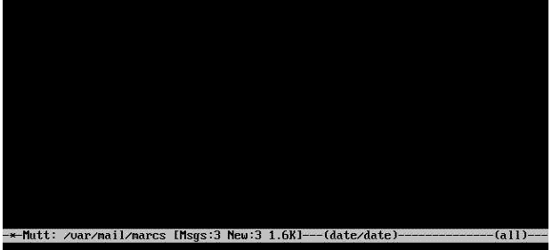

```
-Mutt:/var/mail/marcs (Mags:3 New:3 1:60) (date/time)-- (all)
```

要阅读邮件，只需使用光标键选择邮件，并按回车键即可。`mutt` 显示邮件的示例下：

```
t:Edit -F:Reply S:(Space)Next f:Attach d:Del v:View r:Reply j:Next 7:Help
(Delivered-to: marcs@localhost)
To: localhost
Subject: test
Date: Wed, 20 Oct 2004 22:20:36 +0200 (CEST)
From: Super-User <root@localhost>
This is a test message, please reply if you receive it.
```

```
-M - 1/1: Super-User                               test                               (all)
```

与 `mail(1)` 命令一样，`mutt` 允许用户仅回复消息的发送者，也可以仅回复邮件的发送者，可以使用 `r` 快捷键。要发送组回复（该回复将同时发送给原始发送者以及所有消息收件者），请使用 `g` 快捷键。

> 注意：`mutt` 使用 `vi(1)` 命令作为创建和回复邮件的编辑器。用户可以通过在自己的主目录中创建或编辑自己的 `.mutrc` 文件并设置编辑器变量来对其进行自定义。


要撰写新消息，按 `m`。在给出有效主题后，`mutt` 将启动 `vi(1)` 并可以编写邮件。一旦邮件内容完成，保存并退出 `vi`，`mutt` 将恢复显示待发送邮件的摘要屏幕。要发送邮件，按 `y`。屏幕示例如文所示：

```
$ q?abort t: c:CC:Sub ~Attach file d:Desc?Help
From: Mailer localhost
To: User-root@localhost
Cc:
Bcc:
Subject: Re: test
Reply-To:
:
Security: Clear
```

```
--- Attachments ---
- 1 /tmp/mutt-bsd-c0hobscq [text/plain, 7bit,ascii,1.1K]
```

```
--- Mutt: Compose [Approx. size: 1.1K Atts:1] ---
```

`mutt` 还包含丰富的帮助信息，通过在大多数菜单中按 `?` 键即可访问。顶行在合适时也会显示键盘快捷键。

## 24.11.3 pine

`pine` 的目标是初级用户，但也包含了一些高级功能。

> **警告：pine 软件过去被发现了几个漏洞，这些漏洞允许远程攻击者通过发送特制的电子邮件，以本地系统用户的用户的身份执行任意代码。所有此类已知问题均已修复，但 pine 代码的编写风格非常不安全，FreeBSD 安全官认为可能存在其他未被发现的漏洞。您自行承担安装 pine 的风险。**

当前版本的 `pine` 可以使用 `mail/pine4` 端口安装。端口安装完成后，可以使用以下命令启动 `pine`：

`pine`

第一次运行 `pine` 时，它会显示一个带有简要介绍的欢迎页，以及来自 `pine` 开发团队的发送匿名邮件消息的请求，以便他们判断有多少用户在使用他们的客户端。要发送此匿名消息，请按 `Enter`，或者，按 `E` 在不发送匿名消息的情况下退出欢迎页。欢迎页的示例如文所示：

# PINE 4.58      GREETING TEXT

# 第 24 章 电子邮件

```
<<<此消息仅出现一次>>
无消息
欢迎使用 Pine ... - 一个用于互联网邮件和电子邮件的程序
我希望您能探索 Pine 的许多功能。从主菜单中，
选择 Setup/Config 查看所有可用的选项。请注意
按 F1 获取帮助。

官方请求：此软件作为西雅图华盛顿大学的公共服务向全球提供。为了证明分发此软件的合理性，我们希望尽可能多的人使用 Pine。您目前正被计为 Pine 用户吗？请向下方的地址向我们提供任何反馈，否则华盛顿大学的 Pine 开发团队将无法收到用于统计的反馈。
PINE 是华盛顿大学的商标。
```

用户将看到主菜单，可以使用光标键轻松导航。此主菜单为撰写新邮件、浏览目录和管理书籍条目提供了快捷键。在主菜单下方，显示了执行当前任务特定功能的相应键盘快捷键。

`pine` 默认打开收件箱。要查看消息索引，按 `I`。

```
PINE 4.58      MAIN MENU             Folder: INBOX
? HELP               获取帮助
C COMPOSE           撰写邮件
I INDEX             查看索引
L FOLDER            查看文件夹
A ADDRESS BOOK        地址簿
S SETUP             配置
Q QUIT               退出
Copyright 1996-2003 PINE 是华盛顿大学的商标。
```

`pine` 默认打开的是收件箱。要查看消息索引，按 `I`。

```
-
1 M Mar 07 Super-User      (1) text
2 N Mar 07 Super-User      (1) user account
3 M Mar 09 Super-User      (1) sample
```

To: localhost

Subject: test

Date: Wed, 20 Oct 2004 22:20:36 +0200 (CEST)

From: Super-User <root@localhost>

This is a test message, please reply if you receive it.

```

To:
:


:::
```

```
--- Attachments ---
- 1 /tmp/mutt-bsd-c0hobscq [text/plain, 7bit,ascii,1.1K]
```

```
--- Mutt: Compose [Approx. size: 1.1K Atts:1] ---
```

```
-Mutt:/var/mail/marcs (Mags:3 New:3 1:60) (date/time)-- (all)
```

与 `mail(1)` 命令一样，`mutt` 允许用户仅回复消息的发送者，也可以仅回复邮件的发送者，可以使用 `r` 快捷键。要发送组回复（该回复将同时发送给原始发送者以及所有消息收件者），请使用 `g` 快捷键。

> 注意：`mutt` 使用 `vi(1)` 命令作为创建和回复邮件的编辑器。用户可以通过在自己的主目录中创建或编辑自己的 `.mutrc` 文件并设置编辑器变量来对其进行自定义。

要撰写新消息，按 `m`。在给出有效主题后，`mutt` 将启动 `vi(1)` 并可以编写邮件。一旦邮件内容完成，保存并退出 `vi`，`mutt` 将恢复显示待发送邮件的摘要屏幕。要发送邮件，按 `y`。屏幕示例如文所示：

```
$ q?abort t: c:CC:Sub ~Attach file d:Desc?Help
From: Mailer localhost
To: User-root@localhost
Cc:
Bcc:
Subject: Re: test
Reply-To:
:
Security: Clear
```

```
-M - 1/1: Super-User                               test                               (all)
```

```
--- Attachments ---
- 1 /tmp/mutt-bsd-c0hobscq [text/plain, 7bit,ascii,1.1K]
```

```
--- Mutt: Compose [Approx. size: 1.1K Atts:1] ---
```

`mutt` 还包含丰富的帮助信息，通过在大多数菜单中按 `?` 键即可访问。顶行在合适时也会显示键盘快捷键。

## 24.11.3 pine

`pine` 的目标对象是初级用户，但也包含了一些高级功能。

> **警告：pine 软件过去被发现了几个漏洞，这些漏洞允许远程攻击者通过发送特制的电子邮件，以本地系统用户的用户的身份执行任意代码。所有此类已知问题均已修复，但 pine 代码的编写风格非常不安全，FreeBSD 安全官认为可能存在其他未被发现的漏洞。您自行承担安装 pine 的风险。**

当前版本的 `pine` 可以使用 `mail/pine4` 端口安装。端口安装完成后，可以使用以下命令启动 `pine`：

`pine`

第一次运行 `pine` 时，它会显示一个带有简要介绍的欢迎页，以及来自 `pine` 开发团队的发送匿名邮件消息的请求，以便他们判断有多少用户在使用他们的客户端。要发送此匿名消息，请按 `Enter`，或者，按 `E` 在不发送匿名消息的情况下退出欢迎页。欢迎页的示例如文所示：

# PINE 4.58      GREETING TEXT

# 第 24 章 电子邮件

```
<<<此消息仅出现一次>>
无消息
欢迎使用 Pine ... - 一个用于互联网邮件和电子邮件的程序
我希望您能探索 Pine 的许多功能。从主菜单中，
选择 Setup/Config 查看所有可用的选项。请注意
按 F1 获取帮助。

官方请求：此软件作为西雅图华盛顿大学的公共服务向全球提供。为了证明分发此软件的合理性，我们希望尽可能多的人使用 Pine。您目前正被计为 Pine 用户吗？请向下方的地址向我们提供任何反馈，否则华盛顿大学的 Pine 开发团队将无法收到用于统计的反馈。
PINE 是华盛顿大学的商标。
```

用户将看到主菜单，可以使用光标键轻松导航。此主菜单为撰写新邮件、浏览目录和管理书籍条目提供了快捷键。在主菜单下方，显示了执行当前任务特定功能的相应键盘快捷键。

`pine` 默认打开的是收件箱。要查看消息索引，按 `I`。


# 第 24 章 电子邮件

`mutt` 会自动读取 `/var/mail` 中邮箱箱的内容，并在可用的情况下显示这些内容。如果在用户邮箱箱中未找到邮件，则 `mutt` 将等待用户的输入。以下示例显示了 `mutt` 显示的消息列表：

```
q Quit D:Del u:Save m:Mail r:Reply g:Group 7:Help

1 M Mar 07 Super-User      (1) text

2 N Mar 07 Super-User      (1) user account

3 M Mar 09 Super-User      (1) sample
```

```
-Mutt:/var/mail/marcs (Mags:3 New:3 1:60) (date/time)-- (all)
```

要阅读邮件，只需使用光标键选择邮件，并按回车键即可。`mutt` 显示邮件的示例下所示：

```
t:Edit -F:Reply S:(Space)Next f:Attach d:Del v:View r:Reply j:Next 7:Help

(Delivered-to: marcs@localhost)

To: localhost

Subject: test

Date: Wed, 20 Oct 2004 22:20:36 +0200 (CEST)

From: Super-User <root@localhost>

This is a test message, please reply if you receive it.
```

```
-M - 1/1: Super-User                               test                               (all)
```

与 `mail(1)` 命令一样，`mutt` 允许用户仅回复消息的发送者，也可以仅回复邮件的发送者，可以使用 `r` 快捷键。要发送组回复，该回复将同时发送给原始发送者以及所有消息收件者，请使用 `g` 快捷键。

> 注意：`mutt` 使用 `vi(1)` 命令作为创建和回复邮件的编辑器。用户可以通过在自己的主目录中创建或编辑自己的 `.mutrc` 文件并设置编辑器变量来对其进行自定义。

要撰写新消息，按 `m`。在给出有效主题后，`mutt` 将启动 `vi(1)` 并可以编写邮件。一旦邮件内容完成，保存并退出 `vi`，`mutt` 将恢复显示待发送邮件的摘要屏幕。要发送邮件，按 `y`。屏幕示例如下所示：

```
$ q?abort t: c:CC:Sub ~Attach file d:Desc?Help

From: Mailer localhost

To: User-root@localhost

Cc:

Bcc:

Subject: Re: test

Reply-To:

:

Security: Clear
```

```
--- Attachments ---

- 1 /tmp/mutt-bsd-c0hobscq [text/plain, 7bit,ascii,1.1K]
```

```
--- Mutt: Compose [Approx. size: 1.1K Atts:1] ---
```

`mutt` 还包含丰富的帮助信息，通过在大多数菜单中按 `?` 键即可访问。顶行在合适时也会显示键盘快捷键。

## 24.11.3 pine

`pine` 的目标是初级用户，但也包含了一些高级功能。

> **警告：** `pine` 软件过去被发现了几个漏洞，这些漏洞允许远程攻击者通过发送特制的电子邮件，以本地系统用户的身份执行任意代码。所有此类已知问题均已修复，但 `pine` 代码的编写风格非常不安全，FreeBSD 安全官认为可能存在其他未被发现的漏洞。您自行承担安装 `pine` 的风险。

当前版本的 `pine` 可以使用 `mail/pine4` 端口安装。端口安装完成后，可以使用以下命令启动 `pine`：

`pine`

第一次运行 `pine` 时，它会显示一个带有简要介绍的欢迎页，以及来自 `pine` 开发团队的发送匿名邮件消息的请求，以便他们判断有多少用户在使用他们的客户端。要发送此匿名消息，请按 `Enter`，或者，按 `E` 在不发送匿名消息的情况下退出欢迎页。欢迎页的示例如下所示：

```
# PINE 4.58      GREETING TEXT
```

```
<<<此消息仅出现一次>>

无消息

欢迎使用 Pine ... - 一个用于互联网邮件和电子邮件的程序

我希望您能探索 Pine 的许多功能。从主菜单中，

选择 Setup/Config 查看所有可用的选项。请注意

按 F1 获取帮助。

官方请求：此软件作为西雅图华盛顿大学的公共服务向全球提供。为了证明分发此软件的合理性，我们希望尽可能多的人使用 Pine。您目前正被计为 Pine 用户吗？请向下方的地址向我们提供任何反馈，否则华盛顿大学的 Pine 开发团队将无法收到用于统计的反馈。

PINE 是华盛顿大学的商标。
```

用户将看到主菜单，可以使用光标键轻松导航。此主菜单为撰写新邮件、浏览目录和管理书籍条目提供了快捷键。在主菜单下方，显示了执行当前任务特定功能的相应键盘快捷键。

`pine` 默认打开的是收件箱。要查看消息索引，按 `I`。

```
PINE 4.58      MAIN MENU             Folder: INBOX
? HELP               获取帮助
C COMPOSE           撰写邮件
I INDEX             查看索引
L FOLDER            查看文件夹
A ADDRESS BOOK        地址簿
S SETUP             配置
Q QUIT               退出
Copyright 1996-2003 PINE 是华盛顿大学的商标。
```


PINE 4.58      MAIN MENU             Folder: INBOX

`?` HELP               获取帮助

`C` COMPOSE           撰写邮件

`I` INDEX             查看索引

`L` FOLDER            查看文件夹

`A` ADDRESS BOOK        地址簿

`S` SETUP             配置

`Q` QUIT               退出

Copyright 1996-2003 PINE 是华盛顿大学的商标。

`pine` 默认打开的是收件箱。要查看消息索引，按 `I`。

# 第 24 章 电子邮件

`mutt` 会自动读取 `/var/mail` 中邮箱箱的内容，并在可用的情况下显示这些内容。如果在用户邮箱箱中未找到邮件，则 `mutt` 将等待用户的输入。以下示例显示了 `mutt` 显示的消息列表：

```
q Quit D:Del u:Save m:Mail r:Reply g:Group 7:Help

1 M Mar 07 Super-User      (1) text

2 N Mar 07 Super-User      (1) user account

3 M Mar 09 Super-User      (1) sample
```


```
-Mutt:/var/mail/marcs (Mags:3 New:3 1:60) (date/time)-- (all)
```

要阅读邮件，只需使用光标键选择邮件，并按回车键即可。`mutt` 显示邮件的示例下所示：

```
t:Edit -F:Reply S:(Space)Next f:Attach d:Del v:View r:Reply j:Next 7:Help

(Delivered-to: marcs@localhost)

To: localhost

Subject: test

Date: Wed, 20 Oct 2004 22:20:36 +0200 (CEST)

From: Super-User <root@localhost>

This is a test message, please reply if you receive it.
```

```
-M - 1/1: Super-User                               test                               (all)
```

与 `mail(1)` 命令一样，`mutt` 允许用户仅回复消息的发送者，也可以仅回复邮件的发送者，可以使用 `r` 快捷键。要发送组回复（该回复将同时发送给原始发送者以及所有消息收件者），请使用 `g` 快捷键。

> 注意：`mutt` 使用 `vi(1)` 命令作为创建和回复邮件的编辑器。用户可以通过在自己的主目录中创建或编辑自己的 `.mutrc` 文件并设置编辑器变量来对其进行自定义。

要撰写新消息，按 `m`。在给出有效主题后，`mutt` 将启动 `vi(1)` 并可以编写邮件。一旦邮件内容完成，保存并退出 `vi`，`mutt` 将恢复显示待发送邮件的摘要屏幕。要发送邮件，按 `y`。屏幕示例如文所示：

```
$ q?abort t: c:CC:Sub ~Attach file d:Desc?Help

From: Mailer localhost

To: User-root@localhost

Cc:

Bcc:

Subject: Re: test

Reply-To:

:

Security: Clear
```

```
--- Attachments ---

- 1 /tmp/mutt-bsd-c0hobscq [text/plain, 7bit,ascii,1.1K]
```

```
--- Mutt: Compose [Approx. size: 1.1K Atts:1] ---
```

`mutt` 还包含丰富的帮助信息，通过在大多数菜单中按 `?` 键即可访问。顶行在合适时也会显示键盘快捷键。

## 24.11.3 pine

`pine` 的目标是初级用户，但也包含了一些高级功能。

> **警告：** `pine` 软件过去被发现了几个漏洞，这些漏洞允许远程攻击者通过发送特制的电子邮件，以本地系统用户的用户的身份执行任意代码。所有此类已知问题均已修复，但 `pine` 代码的编写风格非常不安全，FreeBSD 安全官认为可能存在其他未被发现的漏洞。您自行承担安装 `pine` 的风险。

当前版本的 `pine` 可以使用 `mail/pine4` 端口安装。端口安装完成后，可以使用以下命令启动 `pine`：

+ `pine`

第一次运行 `pine` 时，它会显示一个带有简要介绍的欢迎页，以及来自 `pine` 开发团队的发送匿名邮件消息的请求，以便他们判断有多少用户在使用他们的客户端。要发送此匿名消息，请按 `Enter`，或者，按 `E` 在不发送匿名消息的情况下退出欢迎页。欢迎页的示例如文所示：

# PINE 4.58      GREETING TEXT

# 第 24 章 电子邮件

```
<<<此消息仅出现一次>>

无消息

欢迎使用 Pine ... - 一个用于互联网邮件和电子邮件的程序

我希望您能探索 Pine 的许多功能。从主菜单中，

选择 Setup/Config 查看所有可用的选项。请注意

按 F1 获取帮助。

官方请求：此软件作为西雅图华盛顿大学的公共服务向全球提供。为了证明分发此软件的合理性，我们希望尽可能多的人使用 Pine。您目前正被计为 Pine 用户吗？请向下方的地址向我们提供任何反馈，否则华盛顿大学的 Pine 开发团队将无法收到用于统计的反馈。

PINE 是华盛顿大学的商标。
```

用户将看到主菜单，可以使用光标键轻松导航。此主菜单为撰写新邮件、浏览目录和管理书籍条目提供了快捷键。在主菜单下方，显示了执行当前任务特定功能的相应键盘快捷键。

`pine` 默认打开的是收件箱。要查看消息索引，按 `I`。

```
PINE 4.58      MAIN MENU             Folder: INBOX

? HELP               获取帮助

C COMPOSE           撰写邮件

I INDEX             查看索引

L FOLDER            查看文件夹

A ADDRESS BOOK        地址簿

S SETUP             配置

Q QUIT               退出

Copyright 1996-2003 PINE 是华盛顿大学的商标。
```

`poll example.com proto pop3:`  
`user "joesop", with password "XXX", is "jsoap" here;`  
`poll example2.net proto imap:`  
`user "john", with password "XXXXX", is "myth" here;`

`fetchmail` 可以在守护进程模式下运行，使用 `-d` 标志，后跟间隔时间（秒），`fetchmail` 将该间隔轮询 `.fetchmailrc` 文件中列出的邮件服务器。以下示例将导致 `fetchmail` 每 600 秒轮询一次。

```
$ fetchmail -d 600
```

关于 `fetchmail` 的更多信息，请访问 http://fetchmail.berlios.de/。

## 24.13 使用 procmail

由 Marc Silver 贡献。

`procmail` 是一个极其强大的入站邮件过滤器。它允许用户定义“规则”，这些规则可以与入站邮件进行匹配，以执行特定功能或将邮件重定向到备用邮箱/电子邮件地址。可以使用 `mail/procmail` 端口安装 `procmail`。安装后，它可以直接集成到许多 MTA（邮件传输代理）中；更多信息请咨询您的 MTA 文档。或者，可以通过在使用 `procmail` 特性的用户的家目录下的 `.forward` 文件中添加以下行来集成 `procmail`：

```
| exec /usr/local/bin/procmail || exit 75*
```


接下来的章节将显示一些基础 `procmail` 规则以及它们功能的描述。这些规则以及其他规则必须插入到 `.procmailrc` 文件中，该文件必须位于用户的家目录下。
大多数这些规则还可以在 `<procmailex(5)>` 手册页中找到。

### 将来自 <user@example.com> 的邮件转发到外部地址 <goodmail@example2.com>

```
:0
* ^From:user@example.com
! goodmail@example2.com
```

### 将所有小于 1000 字节的邮件转发到外部地址 <goodmail@example2.com>

```
:0
* < 1000
! goodmail@example2.com
```

### 将所有发送到 <alternate@example.com> 的邮件发送到名为 alternate 的邮箱中

```
:0
* ^Alternate@example.com
alternate
```

### 将所有主题为 "Spam" 的邮件发送到 /dev/null

```
:0
^Subject:.*Spam
/dev/null
```

### 一个解析入站 FreeBSD.org 邮件列表并将每个列表放置在其独立邮箱中的 get 用配方

```
:0
* *Sender:.owner-freebsd-\[\@]+@FreeBSD.ORG
{
LISTNAME=$(MATCH)
:0
* LISTNAME??\/\\[^\@]+
FreeBSD-$${MATCH}
}
```


## 第 25 章 网络服务器

由 Murray Stokely 重新组织。

## 25.1 概要

本章将涵盖 UNIX 系统上一些常用的网络服务。我们将介绍如何安装、配置、测试和维护许多类型的网络服务。本章各处包含了示例配置文件以供你参考。

阅读本章后，你将了解：

- 如何管理 `inetd` 守护进程。
- 如何设置网络文件系统。
- 如何设置用于共享用户账户的网络信息服务器。
- 如何使用 DHCP 设置自动网络设置。
- 如何设置域名服务器。
- 如何设置 Apache HTTP 服务器。
- 如何设置文件传输协议 `FTP` 服务器。
- 如何使用 Samba 为 Windows 客户端设置文件和打印服务器。
- 如何使用 NTP 协议同步时和日期，并设置时间服务器。

在阅读本章之前，你应该：

- 理解 `/etc/rc` 脚本的基础知识。
- 熟悉基础网络术语。
- 知道如何安装额外的第三方软件（第 4 章）。

## 25.2 inetd “超级服务器”

由 Chern Lee 贡献。由 FreeBSD Documentation 项目为 FreeBSD 6.1-RELEASE 进行更新。

### 25.2.1 概述

`inetd` 有时被称为“互联网超级服务器”，因为它管理着多个服务的连接。当 `inetd` 接收到连接时，它会确定目标是哪个程序，产生特定的进程并将套接字委托给它（该程序启动时，服务套接字作为其标准输入、输出和错误描述符）。与以独立模式运行每个守护进程相比，对于并非那么频繁使用的服务器，运行 `inetd` 可以减轻整体负载。

`inetd` 主要用于产生其他守护进程，但也会直接处理一些简单的协议，如 `charge`（计费）、`auth`（身份验证）和 `daytime`（白天时间）。

本节将介绍如何通过其命令行选项及其配置文件 `/etc/inetd.conf` 配置 `inetd` 的基础。

### 25.2.2 设置

`inetd` 通过 `rc(8)` 系统初始化。`inetd_enable` 选项默认设置为 NO，但在安装期间根据用户选择的配置可以通过 `sysctl` 开启。在 `/etc/rc.conf` 中放入：

`inetd_enable="YES"` 或 `inetd_enable="NO"` 将在启动时启用或禁用 `inetd`。可以运行命令 `sysctl -n inetd` 显示当前设置。此外，可以通过 `inetd_flags` 选项将不同的命令行选项传递给 `inetd`。

### 25.2.3 命令行选项

与大多数守护进程一样，`inetd` 有许多可以传递的选项来修改其行为。完整选项列表见：

`inetd [-d] [-l] [-w maximum] [-W maximum]`

通过 `inetd_flags` 选项传递给 `inetd` 的不同命令行选项如下：

- `-d`: 启用调试模式。
- `-l`: 启用日志。
- `-w maximum`: 设置最大并发连接数。
- `-W maximum`: 设置最大等待套接字数。
- `-C file`: 指定配置文件。
- `-f file`: 指定启动文件。
- `-u user`: 指定运行用户。
- `-g group`: 指定运行组。
- `-n hostname`: 指定主机。
- `-o directory`: 指定输出目录。
- `-p protocol`: 指定协议。
- `port port`: 指定端口。
- `path path`: 指定程序路径。
- `args args`: 指定命令行参数。
- `timeout timeout`: 设置超时时间。
- `maxprocs`: 设置最大进程数。
- `maxfiles`: 设置最大打开文件描述符。
- `maxconnections`: 设置最大连接数。
- `maxthreads`: 设置最大线程数。
- `maxlogsize`: 设置日志文件大小。
- `maxlogfiles`: 设置最大日志文件数。
- `maxbytes`: 设置最大传输字节数。
- `maxusers`: 设置最大用户数。
- `maxqueue`: 设置最大队列长度。
- `maxwait`: 设置最大等待连接数。
- `maxdescriptors`: 设置最大套接字数。
- `maxbuffer`: 设置最大缓冲区大小。
- `maxpriority`: 设置最大优先级值。
- `mininterval`: 设置最小间隔时间。
- `mintimeout`: 设置最小超时时间。
- `maxretry`: 设置最大重试次数。
- `maxdelay`: 设置最大延迟时间。
- `maxlimit`: 设置最大并发数限制。
- `maxrate`: 设置最大速率限制。
- `maxmemory`: 设置最大内存限制。
- `maxcpu`: 设置最大 CPU 使用。
- `maxdisk`: 设置最大磁盘空间限制。
- `maxnetwork`: 设置最大网络带宽限制。
- `maxpacket`: 设置最大数据包大小。
- `maxpayload`: 设置最大有效负载大小。
- `maxrequest`: 设置最大请求数。
- `maxresponse`: 设置最大响应数。
- `maxerror`: 设置最大错误数。
- `maxwarning`: 设置最大警告数。
- `maxinfo`: 设置最大信息数。
- `maxdebug`: 设置最大调试信息。
- `maxfatal`: 设置最大致命错误数。
- `maxcritical`: 设置最大严重错误数。
- `maxalert`: 设置最大告警数。
- `maxerr`: 设置最大错误代码。
- `maxwarn`: 设置最大警告代码。
- `maxinf`: 设置最大信息代码。
- `maxdbg`: 设置最大调试代码。
- `maxfat`: 设置最大致命错误代码。
- `maxcrit`: 设置最大严重错误代码。
- `maxalt`: 设置最大告警代码。
- `maxstatus`: 设置最大状态码。
- `maxcode`: 设置最大代码值。
- `maxid`: 设置最大标识符。
- `maxval`: 设置最大数值值。
- `maxcount`: 设置最大计数值。
- `maxsize`: 设置最大大小值。
- `maxtime`: 设置最大时间值。
- `maxspeed`: 设置最大速率值。
- `maxport`: 设置最大端口值。
- `maxaddr`: 设置最大地址值。
- `maxuser`: 设置最大用户值。
- `maxgroup`: 设置最大组值。
- `maxhost`: 设置最大主机值。
- `maxfile`: 设置最大文件值。
- `maxconn`: 设置最大连接值。
- `maxthread`: 设置最大线程值。
- `maxproc`: 设置最大进程值。
- `maxdesc`: 设置最大描述符值。
- `maxbuf`: 设置最大缓冲区值。
- `maxpri`: 设置最大优先级值。
- `minint`: 设置最小间隔值。
- `minto`: 设置最小超时值。
- `maxret`: 设置最大重试值。
- `maxdel`: 设置最大延迟值。
- `maxlim`: 设置最大限制值。
- `maxrat`: 设置最大速率值。
- `maxmem`: 设置最大内存值。
- `maxcpu`: 设置最大 CPU 值。
- `maxd`: 设置最大磁盘值。
- `maxnet`: 设置最大网络值。
- `maxpkt`: 设置最大数据包值。
- `maxpay`: 设置最大有效负载值。
- `maxreq`: 设置最大请求值。
- `maxres`: 设置最大响应值。

### 25.2.5 安全

根据安装时的时的选择，许多 `inetd` 服务可能默认启用。如果某个特定的守护进程没有明显的需求，请考虑将其禁用。在 `/etc/inetd.conf` 中在相关的守护进程前放置一个 "W"，然后重新加载 `inetd` 配置。某些守护进程（例如 `fingered`）可能是不需要的，因为它们提供了可能对攻击者有用的信息。

某些守护进程没有安全意识，并且对连接尝试的超时时间很长或不存在。这允许攻击者缓慢地向特定守护进程发送连接，从而饱和可用资源。如果你发现连接过多，为某些守护进程设置 `max-connections-per-ip-minute`、`max-child` 或 `max-child-per-ip` 限制可能是个好主意。

默认开启了 TCP 包装。请参考 `hosts_access(5)` 手册以获取更多有关对各种调用的守护进程设置 TCP 限制的信息。

### 25.2.6 杂项

`time`, `echo`, `discard`, `charger`, 和 `auth` 都是 `inetd` 内部提供的服务。

`auth` 服务提供身份网络服务，并在某种程度上可以配置，而其他服务仅支持开启或关闭。

请咨询 `inetd(8)` 手册以获取更深入的信息。

## 25.3 网络文件系统 (NFS)

由 Tom Rhodes 进行重组和增强。由 Bill Swingle 编写。

在 FreeBSD 支持的许多不同文件系统中包含了网络文件系统，也称为 NFS。NFS 允许系统通过网络与其他共享目录和文件。通过使用 NFS，用户和程序可以访问远程系统上的文件，就像它们是本地文件一样。
NFS 提供的一些最著名的优点包括：

- 本地工作站使用的磁盘空间更少，因为使用的数据可以存储在单机上，并通过网络供他人访问。
- 用户不需要在网络机器上拥有家目录。家目录可以设置在 NFS 服务器上并在整个网络中使用。
- 软磁盘、CDROM 驱动器和 Zip® 驱动器等存储设备可以在网络上的其他机器使用。这可以减少网络中移除媒体驱动器的数量。

### 25.3.1 NFS 如何工作

NFS 至少由两个部分组成：一个服务器和一个或多个客户端。客户端远程访问存储在服务器机器上的数据。为了使其正常运行，必须配置并运行少量进程。

| 守护进程 | 描述 |
| --- | --- |
| `nfsd` | NFS 守护进程，处理来自 NFS 客户端的请求。 |
| `mountd` | NFS 挂载守护进程，执行 `nfsd(8)` 传递的请求。 |
| `rpcbind` | 该守护进程允许 NFS 客户端发现 NFS 服务器正在使用的端口。 |

客户端也可以可以运行一个名为 `nfsid` 的守护进程。`nfsid` 守护进程处理来自 NFS 服务器的请求。这是可选的，可以提高性能，但对于正常和正确的运行并非必须的。更多信息请参阅 `nfsid(8)` 手册。

### 25.3.2 配置 NFS

NFS 配置是一个相对直接的过程。需要运行的进程都可以在对 `/etc/rc.conf` 文件进行少量修改后在启动时开始。

在服务器上，确保在 `/etc/rc.conf` 文件配置了以下选项：

```


`rpcbind_enable="YES"`

`nfs_server_enable="YES"`

`mountd_flags="-r"`

除非启用了 NFS 服务器，否则 `mountd` 会自动运行。
在客户端上，确保 `/etc/rc.conf` 中存在此选项：

```
nfs_client_enable="YES"
```

`/etc/exports` 文件指定了 NFS 应该导出的文件系统。`/etc/exports` 文件指定了 NFS 应该导出的文件系统（有时称为“共享”）。`/etc/exports` 中的每一行还可以指定哪些机器对该文件系统的访问权限，以及访问选项。该文件中可以使用许多此类选项，但这里只提到其中一个。你可以通过阅读 `exports(5)` 手册轻松地发现其他选项。

以下是几个 `/etc/exports` 条目示例：

以下示例给出了如何导出文件系统的思路，尽管设置可能会根据你的环境和网络配置而不同。例如，将 `/cdrom` 目录导出到三个具有相同域名（因此每个机器没有名称）或在你的 `/etc/hosts` 文件中有条目的三个示例机器。`-ro` 标志使导出的文件系统为只读。通过此设置，远程系统将无法向导出的文件系统写入任何更改。

```
/cdrom -ro host1 host2 host3
```

以下行通过 IP 地址向三个主机导出 `/home`。如果你有一个没有 DNS 的私有网络，这是一个非常有用的设置。可选地，可以为 `/etc/hosts` 文件配置主机；请审阅 `hosts(5)` 获取更多信息。`-aldirs` 标志允许子目录。换句话说，它不会挂载子目录，但允许客户端仅挂载所需的或需要的目录。

```
/home -aldirs 10.0.0.2 10.0.0.3 10.0.0.4
```

以下行导出 `/a`，以便来自不同域的两个客户端可以访问该文件系统。`maproot=root` 允许远程系统的 root 用户以 root 身份向导出的文件系统写入数据。如果没有指定 `maproot=root` 标志，那么如果用户在远程系统上拥有 root 权限，他将无法以 root 身份写入（此处对应原文逻辑）。

```
/a -maproot=root client1 client2
```

以下行导出 `/a`，以便来自不同域的两个客户端可以访问该文件系统。`maproot=root` 允许远程系统的 root 用户以 root 身份向导出的文件系统写入数据。如果没有指定 `maproot=root` 标志，那么如果用户在远程系统上拥有 root 权限，他将无法以 root 身份写入（注：原文此处似乎存在逻辑重复或截断，已按原意翻译）。

```
/a -maproot=root client1 client2
```

以下行导出 `/a`，以便来自不同域的两个客户端可以访问该文件系统。`maproot=root` 允许远程系统的 root 用户以 root 身份向导出的文件系统写入数据。如果没有指定 `maproot=root` 标志，那么如果用户在远程系统上拥有 root 权限，他将无法以 root 身份写入。

```
/a -maproot=root client1 client2
```

# 第25章 网络服务器

在以下示例中，`fastwa` 是高性能工作站的主机（接口）名称，`freebox` 是一个具有较低性能以太网适配器的 FreeBSD 的主机（接口）名称。`/sharesfs` 是导出的 NFS 系统（`exports()`），而 `/project` 将是客户端上导出文件系统的挂载点。在所有情况下，请注意，应用程序中额外的选项（如 `hard` 或 `soft` 以及 `bg`）可能是理想的。

将 FreeBSD 系统 (`freebox`) 作为客户端在 `freebox` 的 `/etc/fstab` 中的配置示例：

```
fastws:sharedfs /project nfs rw,-r1024 0 0
```

在 `freebox` 上作为手动命令执行：

```
# mount -t nfs o=-r1024 fastws:sharedfs /project
```

将 FreeBSD 系统作为服务器在 `fastws` 的 `/etc/fstab` 中的配置示例：

```
freebox:sharedfs /project nfs rw,w=-1024 0 0
```

在 `fastws` 上作为手动命令执行：

```
# mount -t nfs o=-w1022 freebox:sharedfs
```


近 16 位的以太网适配器允许在没有上述读写大小限制的情况下运行。

对于任何感兴趣的人，这里是发生故障时的情况，这解释了为什么它是不可替代的。NFS 通常以 8 K 的“块”大小工作（尽管它可能会化成更小的尺寸）。最大的以太网包约为 1500 字节，NFS “块”被拆分成多个以太包，尽管它对上层来说是一个单元，但它必须作为一个单元被接收、组装并确认。高性能工作站可以一个接一个地输出包，标准允许它们非常紧凑。在容量较低的情况下，包在传输到主机之前就会溢出单元，导致整个单元无法重建或确认。结果是工作站将超时并重试，但它仍会使用 8 K 单元重试，该过程将无限重复。

通过将单元大小保持在以太包大小限制之下，我们确保收到的任何完整以太包都可以被单独确认，从而避免死锁。

当高性能工作站向 PC 系统高速发送数据时，可能会发生溢出，但使用更好的网卡，NFS “单元”不会保证发生溢出。当发生溢出时，受影响的单元将重新传输，并有机会被接收、组装和确认。

## 25.4 网络信息系统 (NIS/YP)

由 Bill Eringle 编写。由 Eric Ogden 和 U Erderhof 增强。

### 25.4.1 它是什么？

NIS 代表网络信息服务（Network Information Services），由 Sun Microsystems 开发用于 UNIX（最初为 SunOS）系统的集中管理。它已基本上成为一种行业标准；所有主要的 UNIX 系统（Solaris, HP-UX, AIX®, Linux, NetBSD, OpenBSD, FreeBSD）都支持 NIS。

NIS 称为 Yellow Pages（黄页），但由于商标问题，Sun 更改了名称。旧术语（以及 `yp`）仍然经常看到和使用。

它是一个基于 RPC 的客户端/服务器系统，允许 NIS 域中的一组机器共享一组公共配置文件。这允许系统管理员以最少的配置数据设置 NIS 客户端系统，并在单一位置添加、删除或修改配置数据。

它类似于 Windows NT® 域系统；虽然两者的内部实现完全不同，但基本功能是可以比较的。

### 25.4.2 你应该知道的术语/进程

当你尝试在 FreeBSD 上实现 NIS、尝试创建 NIS 服务器或作为 NIS 客户端时，你会遇到几个术语和重要的用户进程：

| 术语 | 描述 |
| --- | --- |
| NIS domain | NIS 主服务器和所有客户端（包括其从服务器）都有一个 NIS 域名。与 Windows NT 域名类似，NIS 域名与 DNS 无关。 |
| rpcbind | 必须运行才能启用 RPC（远程调用，NIS 使用的一种网络协议）。如果 rpcbind 未运行，将无法运行 NIS 服务器或作为客户端。 |
| ybind | “Bind”连接到其 NIS 服务器。它将从系统获取 NIS 域名，并使用 RPC 连接到服务器。ybind 是 NIS 环境中服务器-客户端通信的核心；如果 ybind 位于客户端机器上，它将无法访问服务器。 |
| yserv | 应仅运行在 NIS 服务器上；这是 NIS 服务器进程本身。如果 yp 死亡，服务器将不再能够响应 NIS 请求（希望有一个从服务器来接管）。NIS 有一些实现（但 FreeBSD 的不是），如果以前使用的服务器死亡，不要尝试重新连接到另一个服务器。这种情况唯一的帮助是重启服务器进程（甚至是整个服务器）或客户端上的 ybind 进程。 |
| rpc.yppasswd | 另一个应仅运行在 NIS 主服务器上的进程；这是一个守护进程，允许 NIS 客户端更改其 NIS 密码。如果此守护进程未运行，用户将必须登录 NIS 主服务器并在那里更改密码。 |

### 25.4.3 它是如何工作的？

NIS 环境中有三种主机：主服务器、从服务器和客户端。服务器充当配置的中央存储。主服务器持有权威副本，而从服务器镜像这些信息。客户端依赖服务器提供这些信息。

许多文件中的信息可以通过这种方式共享。passwd、group 和 hosts 文件通常通过 NIS 共享。当客户端需要通常在本地找到的信息时，它向服务器进行查询。

#### 25.4.3.1 机器类型

- NIS 主服务器。该服务器类似于域域控制器，维护所有客户端使用的的文件。passwd、group 等文件位于主服务器上。注意：一台机器可以作为多个域的主服务器。然而，本介绍将不涵盖这一点，本介绍假设环境较小。
- NIS 从服务器。类似于 Windows 备份域控制器，从服务器维护主服务器的文件副本。它们提供了冗余，这在重要环境中是需要的。它们还帮助分担主服务器的负载。
- NIS 客户端，大多数工作站一样向服务器进行身份验证。

## 25.4.4 使用 NIS/YP

本节将涉及 NIS 环境。注意：本节假设你运行 FreeBSD 3.3 或更高版本。这里的说明适用于任何大于 3.0 的 FreeBSD 版本，但不保证如此。

### 25.4.4.1 规划

假设你是一个大学实验室的管理员。该实验室由 15 台 FreeBSD 机器组成，没有集中管理点；每台机器都有自己的 `/etc/passwd` 和 `/etc/master`。除非手动干预，否则这些文件无法同步；目前当你向实验室添加用户时，必须在 15 台机器上运行 `adduser`。显然，这很难更改，因此你决定使用 NIS，并将机器作为服务器。

因此，实验室的配置如下：

| 机器名称 | IP 地址 | 机器角色 |
| --- | --- | --- |
| ellipton | 10.0.0.2 | NIS 主服务器 |
| coltrane | 10.0.0.3 | NIS 从服务器 |
| basie | 10.0.0.4 | 教职工作站 |
| bird | 10.0.0.5 | 客户端机器 |
| cli[1-11] | 10.0.0.[6-17] | 其他客户端机器 |

如果你是第一次设置 NIS 方案，考虑你打算如何操作是一个好主意。无论网络大小如何，都需要做出一些决定。

#### 25.4.4.1.1 选择 NIS 域名

这可能不是你使用的那个“域名”。它更准确的称呼是“NIS 域名”。当客户端广播其信息请求时，它会包含其所属的 NIS 域名。如果一个网络上有多个服务器，它们可以判断由哪个 NIS 服务器应该回答哪个请求。请将 NIS 域名视为一组在某种程度上相关的宿主组的名称。

某些组织选择使用它们的 Internet 域名作为其 NIS 域名。不建议这样做，因为这在尝试调试网络时可能会引起混乱。NIS 域名在你的网络中应该是唯一的，而且如果它能描述它所代表的机器组，将非常有帮助。例如，Acme 公司的某个部门可能是 "acme-art" NIS 域名。在本例中，你选择了名称 test-domain。

然而，某些操作系统（特别是 Solaris）使用其 NIS 域名作为其自身的域名。如果你的网络中有一台或多台机器具有此限制，你必须使用 Internet 域名作为你的 NIS 域名。

### 25.4.4.2 物理服务器要求

在选择机器用作 NIS 服务器时，有几点需要注意。NIS 不幸的一点之一是客户端对服务器的依赖程度。如果客户端无法连接到 NIS 域的服务器，即使是机器本身也会变得无法使用。用户和组信息的缺失会导致大多数系统临时冻结。基于此，你应该确保选择一台不会经常被重启的机器，或者可能被用于开发的机器。NIS 服务器应该是一台独立的机器，其唯一目的就是作为 NIS 服务器。如果你有一个不怎么使用的网络，将 NIS 服务器放在运行运行其他服务的机器上是可以接受的，但请记住，如果 NIS 服务器不可用，将对所有 NIS 客户端产生不利影响。

### 25.4.4.2 NIS 服务器

所有 NIS 信息的规范副本存储在一个称为 NIS 主服务器的单一机器上。在 FreeBSD 中，这些映射存储在 `/var/yp/[domainname]` 中，其中 `[domainname]` 是正在服务的 NIS 域名称。一个 NIS 服务器可以同时支持多个域，因此可能存在多个这样的目录，每个支持的域对应一个，每个域将有自己的自己的独立映射集。

NIS 主服务器和从服务器通过 `yperv` 守护进程处理所有请求。`ypserv` 负责接收来自 NIS 客户端的传入请求，将请求的域和映射名称转换为相应数据库文件的路径，并将数据从数据库传输到客户端。

#### 25.4.4.2.1 设置 NIS 主服务器

设置主 NIS 服务器可能相对简单，取决于你的需求。FreeBSD 开箱即带对 NIS 的支持。你只需要在 `/etc/rc.conf` 中添加以下几行，FreeBSD 就会为你完成其余工作。

1. `nisdomainname="test-domain"`
   此行将在网络设置时（例如在重启后）将 NIS 域名设置为 test-domain。

2. `nis_server_enable="YES"`
   这将在网络启动时启动 NIS 服务器进程。

3. `nis_yppasswdd_enable="YES"`
   这将启用 `rpc.yppasswdd` 守护进程，如上所述，将允许用户从客户端机器更改其 NIS 密码。

> 注意：根据你的 NIS 设置，你可能需要添加更多条目。详情请参阅下文的“同时也是 NIS 客户端的 NIS 服务器”章节。

现在，你只需要以超级用户身份运行命令 `/etc/netstart`。它将使用你在 `/etc/rc.conf` 中定义的值为你设置一切。

## 25.4.4.2 初始化 NIS 映射

映射是存储在 `/var/yp` 目录下的数据库文件。它们根据 NIS 主服务器 `/etc` 目录下的配置文件生成，但有一个例外：`/etc/master.passwd` 文件。这样做是有充分理由的，你不想将 root 和其他管理账户的密码传播到 NIS 域中的所有服务器。因此，在初始化 NIS 映射之前，你应该：


# `cp /etc/master.passwd /var/yp/master.passwd`

# `cd /var/yp`

# `vi master.passwd`

你应该删除所有关于系统账户的条目（`bin`, `tty`, `kmm`, `games` 等），以及任何你不想同步到 NIS 客户端的账户（例如 `root` 和其他 UID 0（超级用户）账户）。

> 注意：确保 `/var/yp/master.passwd` 不是 world可读的（模式 600）！在适当的情况下使用 `chmod` 命令。完成后，就是是初始化 NIS 映射的时间了！FreeBSD 包含一个名为 `ypinit` 的脚本来执行此操作（更多信息请参见其帮助页）。该脚本在大多数操作系统上都可用，但并非所有。在 Digital Unix 上，它被称为 `ysetup`。由于我们正在为 NIS 主服务器生成映射，我们将使用 `-m` 选项。要生成 NIS 映射，假设你已经执行了上述步骤，运行：

```
ypinit test-domain
```

Server Type: MASTER Domain: test-domain

创建一个 NIS 服务器将要求你回答几个问题。过程开始将提问。你希望此过程在遇到非致命错误时退出吗？[y/n]: n

Ok,请记住回去并重做任何失败的操作。如果不这样做，某些功能可能无法工作。

在此时，我们必须构建一个这些域的列表。请继续添加任何从服务器，每行一个。当你完成后，输入 `<`。此时，我们必须构建一个这些域的列表。请继续添加任何从服务器，每行一个。当你完成后，输入 `<`。此时，我们必须构建一个这些 映射的列表。

```
NIS 映射的 NIS 服务器。
```

NIS 映射输出如下：

```
NIS 映射生成完成。
```

## 25.4.4.3 NIS 客户端

NIS 客户端通过 `ybind` 守护进程与特定的 NIS 服务器建立所谓的“绑定”。`ybind` 会检查系统的默认域（通过 `domainname` 命令设置），并在局域网上广播 RPC。这些请求指定了 `ybind` 建立绑定的域名称。如果某个服务器被配置为提供所请求域的服务，它将响应 `ybind`，`ybind` 会记录该服务器的地址。如果有多个服务器（例如一个主服务器和几个从服务器），`ybind` 将使用响应服务器的地址。此后，客户端将将其所有请求定向到该服务器，`ybind` 会偶尔“ping”该服务器以确保其仍在运行。如果在合理时间内没有收到任何 `ping` 回复，`ybind` 将该域标记为未绑定，并开始重新广播，试图找到另一个服务器。

## 25.4.4.1 设置 NIS 客户端

在 FreeBSD 上设置 NIS 客户端非常简单。

- 1. 编辑 `/etc/rc.conf` 并按顺序添加以下行，以设置 NIS 域名并在网络启动时启动 `ybind`：

```
nisdomainname="test-domain"
nis_client_enable="YES"
```

- 2. 要从 NIS 服务器导入所有密码条目，请从你的 `/etc/master.passwd` 文件中删除所有用户账户，并使用 `tip` 在文件末尾添加以下行：

```
+:::::::::
```

> 注意：此行将允许 NIS 服务器密码映射中具有有效账户的用户访问账户。通过更改此行有许多方法配置 NIS 客户端。更多信息请参阅 netgroups 部分。更详细的阅读请参阅 O'Reilly 的书籍《NFS and NIS》。

> 注意：你应该在 `/etc/master.passwd` 中保留至少一个本地账户（即不是通过 NIS 导入的账户），并且该账户也应该是 `wheel` 组的成员。如果 NIS 出现问题，可以使用该账户远程登录、变为 root 并修复问题。

- 3. 要从 NIS 服务器导入所有可能的组条目，请向你的 `/etc/group` 文件中添加此行：

```
*:::
```

完成这些步骤后，你应该能够运行 `ypcat passwd` 并看到 NIS 服务器的密码映射。

## 25.4.5 NIS 安全

通常，任何远程用户都可以向 `pyserv(8)` 发出 RPC 并检索你的 NIS 映射内容，只要该远程用户知道你的域。为了防止未经授权的事务，`pyserv(8)` 支持名为“securenets”的功能，该功能用于限制对一组给定主机的访问。在启动时，`pyserv(8)` 将尝试从名为 `/var/yp/securenets` 的文件加载 securenets 信息。

## 第 25 章 网络服务器

注意：此路径取决于使用 `-p` 指定的路径。该文件包含网络规范和网络掩码的条目，之间用空格分隔。以 `#` 开头的行被视为注释。一个示例 securenets 文件可能如下：

```
# 允许来自本地主机的连接 -- 强制
127.0.0.1               255.255.255.255
# 允许来自任何主机的连接
# 在 192.168.128.0 网络上
192.168.128.0           255.255.255.0
# 允许来自任何主机的连接
# 在 10.0.0.0 到 10.0.15.255 之间
# 这包括测试实验室中的机器
10.0.0.0               255.255.240.0
```

如果 `ipserv(8)` 接收到匹配规则之一的地址，它将正常处理请求。如果地址未匹配规则，将发出请求并记录警告消息。如果 `/var/yp/securenets` 文件不存在，`ipserv` 将允许来自任何主机的连接。

`ipserv` 程序还支持 Wiener Mena 的 TCP Wrapper 软件包。这允许管理员使用 TCP Wrapper 配置文件进行访问控制，而不是 `/var/yp/securenets`。

> 注意：虽然这两种访问控制机制提供了一些安全性（例如特权端口锁定），但它们容易受到“IP 欺骗”攻击。所有与 NIS 相关的流量都应在防火墙处拦截。

使用 `/var/yp/securenets` 的服务器可能无法识别具有过时 TCP/IP 实现的 NIS 客户端。这些实现中的某些在广播时会将所有主机设为零，或者在计算广播地址时未能遵守子网掩码。虽然其中一些问题可以通过更改客户端配置来解决，但其他问题可能迫使相关客户端系统退休或放弃 `/var/yp/securenets`。

在具有此类过时 TCP/IP 实现的服务器上使用 `/var/yp/securenets` 是一个非常糟糕的主意，会导致你的网络大部分失去 NIS 功能。

TCP Wrapper 会增加你的 NIS 服务器的延迟。额外的延迟可能长到导致客户端程序超时，特别是在繁忙的网络或低速的 NIS 服务器中。如果你的一个或多个客户端系统遭受了这些症状，你应该将相关的客户端系统转换为 NIS 从服务器，并强制它们绑定到自身。

## 25.4.6 禁止某些用户登录

在我们的实验室中，名为 `base` 的机器应该是仅供教职员工使用的工作站。我们不想将这台机器移出 NIS 域，即修改主 NIS 服务器上的 passwd 文件，the end of /etc/master.passwd

*

:

-bill


## 25.4 使用 Netgroups

由 Udo Erdelhoff 贡献。

如果你只需要为极少数的用户或机器设置特殊规则，之前解决方案所示的方法运行得良好。在较大的网络中，你可能会忘记阻止某些用户登录敏感机器，你甚至可能单独修改每台机器，从而失去 NIS 的主要优势。NIS 开发者针对 UNIX 文件系统的解决方案被称为 netgroups。它们的目的语义与 UNIX 使用的普通组类似于：缺乏数字 ID，可以通过用户账户和其他 netgroups 来定义 netgroup。

netgroups 的开发是为了处理具有数百用户和机器的大型复杂网络。一方面，如果你被迫处理这种情况，这是一件好事。另一方面，这种复杂性使得几乎无法通过简单的示例来解释 netgroups。本节剩余部分使用的示例演示了这个问题。

假设你在实验室成功解决 NIS 问题引起了上级的兴趣。你的下一个工作是扩展你的 NIS 域以覆盖校园的一些其他机器。两个表格包含了新用户和新机器的名称以及它们的简要描述。

| 用户名 | 描述 |
| :--- | :--- |
| alpha, beta | IT 部门的普通员工 |

## 用户名(s) | 描述 |
| :--- | :--- |
| charlie, delta | IT部门的新学徒 |
| echo, foxtrott, golf, ... | 普通员工 |
| able, baker, ... | 当前的实习生 |

## 机器名(s) | 描述 |
| :--- | :--- |
| war, death, famine, pollution | 你最重要的服务器。仅允许 IT 员工登录这些机器。 |
| pride, greed, envy, wrath, list, sloth | 没重要的服务器。IT 部门的所有成员都允许登录这些机器。 |
| one, two, three, four, ... | 普通工作站。只有正式员工可以使用这些机器。 |
| trashcan | 一台没有任何关键数据的旧机器。即使是实习生可以使用台机器。 |

如果你尝试通过阻止每个用户来实施这些限制，那么你必须为每个不允许登录系统的用户在每个系统的密码文件中添加 `-user` 行。如果你忘记了任何一个条目，你就会遇到麻烦。虽然在初始设置期间这样做可能是行的，但在日常操作中，你最终会忘记为网络组（netgroups）添加这些行。毕竟，墨菲是一个乐观主义者。

使用网络组处理这种情况有几个优势。你不需要单独处理每个用户；你将用户分配给一个或多个网络组，并允许或禁止网络组中所有成员的登录。如果你添加了新机器，你只需要为网络组定义登录。如果添加了新用户，你只需要将该用户添加到一个或多个网络组。这些更改是相互独立的：不再需要为每种用户和机器的组合都进行操作了……如果你的 NIS 设置规划得当，你将只需要修改一个中央配置文件来授予或拒绝访问。

第一步是初始化 NIS 映射 `netgroup`。FreeBSD 的 `ybind()` 默认不创建此映射，但一旦创建了，它的实现将支持它。它可以创建一个空映射，简单类型为

```
ellington vi /var/yp/netgroup
```

并添加内容。对于我们的示例，至少需要四个网络组：IT员工、IT学徒、普通员工和实习生

```
IT_EMP   (alpha, test-domain)      (beta, test-domain)

IT_APP   (charlie, test-domain) (delta, test-domain)

USERS    (echo, test-domain)     (foxtrott, test-domain) \
          (golf, test-domain)

INTERNS  (able, test-domain)      (baker, test-domain)
```

`IT_EMP`、`IT_APP` 是网络组的名称。每个括号组向其添加一个或多个用户账户。组内的三个字段是：

- 1. 带有以下项目的主机(s) 名称，这些项目在所有主机上都是有效的。如果你指定了主机名，你将进入黑暗、恐怖和彻底混乱的领域。
- 2. 属于此网络组的账户名称。
- 3. 该账户的 NIS 域。如果你是拥有多个 NIS 域的倒霉蛋之一，可以将账户从其他 NIS 域导入到你的网络组中。

这些字段都可以包含通配符。详见 `netgroup(5)`。

**注意：** 不应使用超过 8 个字符的网络组名称，特别是当你有在 NIS 域内运行操作系统的机器时。名称是敏感的；在网络组名称中使用大写字母是区分用户、机器和网络组的简单方法。

某些客户端（FreeBSD 以外）无法处理具有大量条目的网络组。例如，旧版本的 SunOS 如果网络组包含超过 15 个**条目**，就会产生问题。你可以通过创建包含 15 个或更用户的子网络组以及一个由这些子组组成的真实网络组来规避这个问题：

```
BIGGROUP1 (joel,domain) (joe2,domain) (joe3,domain) [...]

BIGGROUP2 (joel6,domain) (joe7,domain) [...]

BIGGROUP3 (joe31,domain) (joe32,domain)

BIGGROUP BIGGROUP1 BIGGROUP2 BIGGROUP3
```

如果你在一个网络组内需要超过 225 个用户，可以重复此过程。

激活并更新你的 NIS 映射很容易：

```
ellington$ cd /var/yp

ellington$ make
```

这将生成 NIS 映射 `netgroup`、`netgroup.byhost` 和 `netgroup.byuser`。使用 `ypcat(1)` 检查你的新 NIS 映射是否可用：

```
ellington$ ypcat -k netgroup

ellington ypcat -k netgroup.byhost

ellington ypcat -k netgroup.byuser
```

第一个命令的输出应该类似于 `/var/yp/netgroup` 的内容。如果你没有指定特定主机的网络组，第二条命令将不会产生输出。第三条命令可以获取某个用户的网络组列表。

客户端设置非常简单。要配置服务器 `war`，你只需要启动 `yivp(8)` 并替换该行

```
*::::::::::::::
```

```
+IT_EMP::::::::::::::
```

现在，只有在 `IT_EMP` 中定义的用户才会被导入到 `war` 的密码数据库中并且只有这些用户被允许登录。

遗憾的是，此限制也适用于 shell 功能以及用户名和数字 ID 之间的所有程序。换句话说，`cd -user` 将不起，`ls -l` 将显示数字 ID 而不是用户名，`find -user joe -print` 将由于没有该用户而失败。要修复这个问题，你需要修复对服务器的访问。

## 第25 章 网络服务器

**警告：** 确保将 `:::::::::/sbin/nlogin` 放置在 `@IT_EMP:` 之后。否则，所有从 NIS 导入的用户将具有 `/sbin/nolog` 作为它们的 shell。

## 第25 章 网络服务器

一旦你为所有机器完成了此任务，你就再也不需要修改 `/etc/master.passwd` 的本地版本了。后续的所有更改都可以通过修改 NIS 映射来处理。以下是该场景下的一个简单网络组（netgroup）映射示例，包含了一些实用功能：

```
# 首先定义用户组

IT_EMP (alpha,test-domain) (beta,test-domain)

IT_APP (charlie,test-domain) (delta,test-domain)

DEPT1 (choctaw,test-domain) (fortrott,test-domain)

DEPT2 (golf,test-domain) (hotel,test-domain)

DEPT3 (india,test-domain) (juliet,test-domain)

ITINTERN (kilo,test-domain) (lima,test-domain)

D_INTERNS (able,test-domain) (baker,test-domain)

# 现在，根据角色定义一些组组

USERS DEPT1 DEPT2 DEPT3

BIGSRV IT_EMP IT_APP ITINTERN

SMALLSRV IT_EMP IT_APP ITINTERN

USERROX IT_EMP ITINTERN USERS

#

# 以及用于特殊任务的组

# 允许 echo 和 golf 访问我们的防病毒机器

SECURITY IT_EMP (echo,test-domain) (golf,test-domain)

#

# 基于机器的网络组

# 我们的主服务器

WAR BIGSRV

FAMINE BIGSRV

# 用户 india 需要访问这台服务器

POLLUTION BIGSRV (india,test-domain)
```


# 这一个非常重要，并且需要访问限制

`DEATH IT_EMP`

# 上述的防病毒机器

`ONE SECURITY`

# 将机器限制为单个用户

`TWO (hotel,test-domain)`

# [..后面还有更多组]

如果你正在使用某种数据库来管理你的用户账户，你应该能够使用你的数据库报告工具来创建映射的第一部分。这样一来，新用户将自动获得这些机器的访问权限。

最后一点警告：使用基于机器的网络组可能是不明智的。如果你在为学生实验室部署几十台甚至上百台相同的机器，你应该使用基于角色的网络组，而不是基于机器的网络组，以将 NIS 映射的大小保持在合理范围内。

## 25.4.8 需要记住的重要事项

既然你现在处于 NIS 环境，有些事情是你需要以不同方式处理的。

每当你想要向实验室添加用户时，你必须仅将其添加到 NIS 服务器上，并且必须记住重建 NIS 映射。如果你忘记了这样做，新用户将无法在 NIS 主节点以外的任何地方登录。例如，如果我们需要向实验室添加一个新用户 `jsmith`，我们将如下操作：

```
# pw useradd jsmith

# cd /var/ypdomain

# make test-domain
```

你也可以使用 `adduser jsmith` 代替 `pw useradd jsmith`。

将主服务器账户排除在 NIS 映射之外。你不希望将管理账户和密码传播到那些用户不应该访问的账户的机器上。

保持主从服务器的安全，并尽可能地减少它们的停机时间。无论是黑客攻击还是仅仅简单地关闭了这些机器，它们都有效地导致许多人无法登录实验室。

这是任何中心化系统的弱点。如果你不保护你的 NIS 服务器，你会有很多愤怒的用户！

## 25.4.9 NIS1 兼容性

FreeBSD 支持为 NIS v1 客户端提供服务。然而，FreeBSD 的 NIS 实现使用的是 NIS v2 协议，其他实现支持 v1 协议以实现与旧系统的向后兼容。这些系统提供的 `ybind` 守护进程会尝试与 NIS v1 服务器建立连接，即使它们可能永远不需要它（并且在收到来自 v2 服务器的响应后，它们可能仍持续广播它）。虽然提供了对普通客户端调用的支持，但此版本的 `ybind` 不处理 v1 映射请求；因此，它不能与使用 v1 协议的旧 NIS 服务器配合作为主服务器或从服务器。幸运的是，今天可能没有在使用这样的服务器了。

## 25.4.10 既是 NIS 服务器又是 NIS 客户端的服务器

在服务器机器同时也是 NIS 客户端的多服务器域中运行 `ybind` 时需要小心。通常情况下让服务器绑定到自身是一个好主意，而不是允许它们广播请求并可能保持相互绑定。如果其中一台服务器宕机而其他服务器依赖于它，可能会导致奇怪的故障模式。最终，所有客户端将超时并尝试绑定到其他服务器，其中涉及的延迟可能是巨大的，而且由于服务器可能会再次绑定在一起，故障模式将一直存在。你可以通过运行带有 `-S` 标志的 `ybind` 来强制主机绑定到特定的服务器。如果你不想每次重新绑定 NIS 服务器时都这样做，可以将以下行添加到你的 `/etc/rc.conf` 中：

```
nis_client_enable="YES"
```

更多详情请参阅 `ybind(8)`。

## 25.4.11 密码格式

人们在尝试实现 NIS 时遇到的常见问题之一是密码兼容性。如果你的 NIS 服务器使用 DES 密码，它将只支持同样使用 DES 的客户端；例如，如果你的网络中有 Solaris 客户端，那么你几乎肯定需要使用 DES 密码。要检查你的服务器和客户端使用什么，请查看 `/etc/login.conf`。如果主机配置为使用 DES 密码，则默认值将包含类似下面的条目：

```
default:password_format=des:copyright:
```

其他可能的值包括 Blowfish。如果主机配置为使用 DES 密码，默认值将包含如下条目：

```
default:password_format=des:copyright:
```

如果主机配置为使用 DES 密码，默认值将包含如下条目：

```
default:password_format=des:copyright:
```

其他可能的值包括 Blowfish。如果主机配置为使用 DES 密码，默认值将包含如下条目：

```
default:password_format=des:copyright:
```

其他可能的值包括 Blowfish。在 FreeBSD 3.2 之后，所有的 FreeBSD 都包含了 dhclient：

```
default:password_format=des:copyright:
```

```
default = md5
```

通过这种方式，所有这些信息都以 DHCP“租约”的形式出现，并且仅在特定时间内有效（由 DHCP 服务器配置）。通过这种方式，不再连接的过时 IP 地址将被自动回收。

DHCP 客户端可以从服务器获取大量信息。详尽列表可以在 `dhcp-options(5)` 中找到。

## 25.5 自动配置 (DHCP)

由 Greg Sutter 编写。

### 25.5.1 什么是 DHCP？

DHCP，动态主机配置协议，描述了系统通过网络获取配置的方法。FreeBSD 支持为 NIS v1 客户端提供服务。然而，FreeBSD 的 NIS 实现使用的是 NIS v2 协议，其他实现支持 v1 协议以实现与旧系统的向后兼容。这些系统提供的 `ybind` 守护进程会尝试与 NIS v1 服务器建立连接，即使它们可能永远不需要它（并且在收到来自 v2 服务器的响应后，它们可能仍持续广播它）。虽然提供了对普通客户端调用的支持，但此版本的 `ybind` 不处理 v1 映射请求；因此，它不能与使用 v1 协议的旧 NIS 服务器配合作为主服务器或从服务器。幸运的是，今天可能没有在使用这样的服务器了。

### 25.5.2 本节涵盖的内容

本节描述了集成在 FreeBSD 中的 ISC 或 OpenBSD DHCP 客户端和服务器端组件。`dhclient(8)`、`dhcp-options(5)` 以及 `dhclient.conf` 手页是有用的资源。

### 25.5.3 它的工作原理

当 `dhclient` DHCP 客户端在客户端机器上执行时，它开始广播配置请求。默认情况下，这些请求位于 UDP 端口 68。服务器在 UDP 67 回应，提供 IP 地址以及掩码、路由器和 DNS 服务器等相关信息。所有这些信息都以 DHCP“租约”的形式出现，并且仅在特定时间内有效（由 DHCP 服务器配置）。通过这种方式，不再连接的过时 IP 地址将被自动回收。

### 25.5.4 FreeBSD 集成

FreeBSD 集成了 ISC 或 OpenBSD DHCP 客户端 `dhclient`（取决于你运行的 FreeBSD 版本）。DHCP 支持位于安装程序和基础系统中，消除了对运行 DHCP 服务器的任何网络需要详细配置知识的需求。`dhclient` 自 3.2 版本起一直包含在 FreeBSD 中。

`sysinstall` 支持 DHCP。在 `sysinstall` 中配置网络接口时，第二个问题是：“你想对接口尝试 DHCP 配置吗？”回答是将执行 `dhclient`，如果成功，将自动填充网络配置信息。

要使用 DHCP，你必须做两件事：

- 确保 `bpf` 设备已编译进内核。要这样做，将设备 `bpf` 添加你的内核配置文件并重新编译内核。有关构建内核的更多信息，请参见第 8 章。`bpf` 设备已经是随 FreeBSD 提供的 GENERIC 内核的一部分，如果你没有自定义内核，你不需要创建一个内核即可让 DHCP 工作。

注意：对于特别关注安全的人来说，应该警告他们 `bpf` 也是允许数据包嗅探器正常工作的设备（尽管它们仍以 root 权限运行）。使用 DHCP 需要 `bpf`，但如果你对安全非常敏感，可能你不应该为了未来某时刻可能使用 DHCP 而将 `bpf` 添加到内核中。

- 编辑你的 `/etc/rc.conf` 以包含以下内容：

```
ifconfig_em0="DHCP"
```

**注意：** 请务必将 `fxp0` 替换为您想要动态配置的接口名称，如第 11.8 节所述。

如果您为 `dhclient` 使用了不同的位置，或者希望向 `dhclient` 传递额外的标志，请包含以下内容（根据需要进行修改）：

```
dhcp_program="/sbin/dhclient"

dhcp_flags="="
```


DHCP 服务器 `dhcpd` 包含在端口集合中的 `net/isc-dhcp3-server` 端口中。该端口包含了 ISC DHCP 服务器和文档。

## 25.5 文件

- `/etc/dhclient.conf`
`dhclient` 需要一个配置文件 `/etc/dhclient.conf`。通常，该文件只包含注释，其默认设置是合理的。该配置文件由 `dhclient.conf(5)` 手册页进行描述。
- `/sbin/dhclient`
`dhclient` 是静态链接的，位于 `/sbin` 中。`dhclient(8)` 手册页提供了更多关于 `dhclient` 的信息。
- `/sbin/dhclient-script`
`dhclient-script` 是 FreeBSD 特有的 DHCP 客户端配置脚本。它在 `dhclient-script(8)` 中描述，但不需要任何用户修改即可正常运行。
- `/var/db/dhclient.leases`
DHCP 客户端在此文件中维护有效租约的数据库，并以日志形式写入。`dhclient.leases(5)` 提供了更详细的描述。

## 25.5.6 延伸阅读

DHCP 协议在 RFC 2131 (`http://www.freesoft.org/CIE/RFC/2131/`) 中有完整描述。在 `http://www.dhcp.org/` 也可以找到信息资源。

## 25.5.7 安装和配置 DHCP 服务器

### 25.5.7.1 本节内容

本节提供了有关如何使用 ISC（互联网软件协会）实现的 DHCP 服务器将 FreeBSD 系统配置为 DHCP 服务器的信息。

该服务器不是 FreeBSD 的一部分，您将需要安装 `net/isc-dhcp3-server` 端口来提供此服务。有关使用端口集合的更多信息，请参见第 4 节。

### 25.5.7.2 安装 DHCP 服务器

为了将您的 FreeBSD 系统配置为 DHCP 服务器，您需要确保内核中已编译了 `bpf(4)` 设备。要实现这一点，请将 `bpf` 添加到您的内核配置文件中并重新编译内核。有关构建内核的更多信息，请参见第 8 节。

`bpf` 设备已经是随 FreeBSD 提供的 GENERIC 内核的一部分，因此您不需要创建自定义内核即可让 DHCP 工作。

> 注意：对特别关注安全的人请注意，`bpf` 也是允许数据包嗅探器正常工作的设备（尽管程序仍需要特权访问）。使用 DHCP 需要 `bpf`，但如果您对安全非常敏感，不应仅仅因为预计未来某时刻会使用 DHCP 就在内核中包含 `bpf`。

您接下来需要做的另一件事是编辑由 `isc-dhcp3-server` 端口安装的示例 `dhcpcd.conf`。默认情况下，该文件为 `/usr/local/etc/dhcpcd.conf.sample`，在进行更改之前，您应该将其复制到 `/usr/local/etc/dhcpcd.conf`。

## 25.5.73 配置 DHCP 服务器

`dhcpcd.conf` 由关于子网和主机的声明组成，使用示例进行解释可能最为简单：

```
option domain-name "example.com",

option domain-name-servers 192.168.4.100;

option subnet-mask 255.255.255.0;

default-lease-time 3600;

max-lease-time 86400;

dns-update-style none;

subnet 192.168.4.0 255.255.255.0 {

range 192.168.4.129 192.168.4.254;

option routers 192.168.4.1;

}

host mailhost {

hardware ethernet 02:03:04:05:06:07;

fixed-address mailhost.example.com;

}
```


- 此选项指定了将作为客户端默认搜索域提供的域名。有关其含义的更多信息，请参见 `resolv.conf(5)`。
- 此选项指定了客户端应使用的 DNS 服务器的逗号分隔列表。
- 将 提供给客户端的子网掩码。
- 客户端可能会请求一个特定的有效时长。否则，服务器将分配一个此过期时间（秒）。
- 这是服务器提供的最长时长。如果客户端请求更长的租约，将颁发租约，但尽管其有效期仅为 `max-lease-time` 秒。
- 此选项指定了 DHCP 服务器在接受或释放租约时是否应该更新 DNS。在 ISC 实现中，此选项是强制性的。
- 这表示在为分配给客户端保留的池中使用 IP 地址。所述范围内的 IP 地址将分配给客户端。
- 声明提供给客户端的默认网关。
- 主机的硬件 MAC 地址。
- 此选项指定了将作为客户端默认搜索域提供的域名。有关其含义的更多信息，请参见 `resolv.conf(5)`。
- 此选项指定了客户端应使用的 DNS 服务器的逗号分隔列表。
- 将 提供给客户端的子网掩码。
- 客户端可能会请求一个特定的有效时长。否则，服务器将分配一个此过期时间（秒）。
- 这是服务器提供的最长时长。如果客户端请求更长的租约，将颁发租约，尽管其有效期仅为 `max-lease-time` 秒。
- 此选项指定了 DHCP 服务器在接受或释放租约时是否应该更新 DNS。在 ISC 实现中，此选项是强制性的。
- 这表示在为分配给客户端保留的池中使用 IP 地址。所述范围内的 IP 地址将分配给客户端。
- 声明提供给客户端的默认网关。
- 主机的硬件 MAC 地址。
- 此选项指定了将作为客户端默认搜索域提供的域名。有关其含义的更多信息，请参见 `resolv.conf(5)`。
- 此选项指定了客户端应使用的 DNS 服务器的逗号分隔列表。
- 将 提供给客户端的子网掩码。
- 客户端可能会请求一个特定的有效时长。否则，服务器将分配一个此过期时间（秒）。
- 这是服务器提供的最长时长。如果客户端请求更长的租约，将颁发租约，尽管其有效期仅为 `max-lease-time` 秒。
- 此选项指定了 DHCP 服务器在接受或释放租约时是否应该更新 DNS。在 ISC 实现中，此选项是强制性的。
- 这表示在为分配给客户端保留的池中使用 IP 地址。所述范围内的 IP 地址将分配给客户端。
- 声明提供给客户端的默认网关。
- 主机的硬件 MAC 地址。
- 此选项指定了将作为客户端默认搜索域提供的域名。有关其含义的更多信息，请参见 `resolv.conf(5)`。
- 此选项指定了客户端应使用的 DNS 服务器的逗号分隔列表。
- 将 提供给客户端的子网掩码。
- 客户端可能会请求一个特定的有效时长。否则，服务器将分配一个此过期时间（秒）。
- 这是服务器提供的最长时长。如果客户端请求更长的租约，将颁发租约，尽管其有效期仅为 `max-lease-time` 秒。
- 此选项指定了 DHCP 服务器在接受或释放租约时是否应该更新 DNS。在 ISC 实现中，此选项是强制性的。
- 这表示在为分配给客户端保留的池中使用 IP 地址。所述范围内的 IP 地址将分配给客户端。
- 声明提供给客户端的默认网关。
- 主机的硬件 MAC 地址。
- 此选项指定了将作为客户端默认搜索域提供的域名。有关其含义的更多信息，请参见 `resolv.conf(5)`。
- 此选项指定了客户端应使用的 DNS 服务器的逗号分隔列表。
- 将 提供给客户端的子网掩码。
- 客户端可能会请求一个特定的有效时长。否则，服务器将分配一个此过期时间（秒）。
- 这是服务器提供的最长时长。如果客户端请求更长的租约，将颁发租约，尽管其有效期仅为 `max-lease-time` 秒。
- 此选项指定了 DHCP 服务器在接受或释放租约时是否应该更新 DNS。在 ISC 实现中，此选项是强制性的。
- 这表示在为分配给客户端保留的池中使用 IP 地址。所述范围内的 IP 地址将分配给客户端。
- 声明提供给客户端的默认网关。
- 主机的硬件 MAC 地址。
- 此选项指定了将作为客户端默认搜索域提供的域名。有关其含义的更多信息，请参见 `resolv.conf(5)`。
- 此选项指定了客户端应使用的 DNS 服务器的逗号分隔列表。
- 将 提供给客户端的子网掩码。
- 客户端可能会请求一个特定的有效时长。否则，服务器将分配一个此过期时间（秒）。
- 这是服务器提供的最长时长。如果客户端请求更长的租约，将颁发租约，尽管其有效期仅为 `max-lease-time` 秒。
- 此选项指定了 DHCP 服务器在接受或释放租约时是否应该更新 DNS。在 ISC 实现中，此选项是强制性的。
- 这表示在为分配给客户端保留的池中使用 IP 地址。所述范围内的 IP 地址将分配给客户端。
- 声明提供给客户端的默认网关。
- 主机的硬件 MAC 地址。
- 此选项指定了将作为客户端默认搜索域提供的域名。有关其含义的更多信息，请参见 `resolv.conf(5)`。
- 此选项指定了客户端应使用的 DNS 服务器的逗号分隔列表。
- 将 提供给客户端的子网掩码。
- 客户端可能会请求一个特定的有效时长。否则，服务器将分配一个此过期时间（秒）。
- 这是服务器提供的最长时长。如果客户端请求更长的租约，将颁发租约，尽管其有效期仅为 `max-lease-time` 秒。
- 此选项指定了 DHCP 服务器在接受或释放租约时是否应该更新 DNS。在 ISC 实现中，此选项是强制性的。
- 这表示在为分配给客户端保留的池中使用 IP 地址。所述范围内的 IP 地址将分配给客户端。
- 声明提供给客户端的默认网关。
- 主机的硬件 MAC 地址。

要启用 DHCP 服务器：

```
dhcp_enable=YES
dhcp_interfaces="dc0"
```

```
/usr/local/etc/rc.d/dhcpd start
```

要重启 DHCP 服务器：

```
/usr/local/etc/rc.d/dhcpd restart
```

要停止 DHCP 服务器：

```
/usr/local/etc/rc.d/dhcpd stop
```

`example.org` 是 `.org` TLD 下的一个区域。

`192.168.1.in-addr.arpa` 是一个引用引用 IP 地址的区域，这些地址属于 `192.168.1.*` 空间。

如所见，主机名中更具体的部分出现在左侧。例如，`example.org` 比 `.org` 更具体，而 `.org` 比根区域（root zone）更具体。主机名每个部分的布局非常类似于文件系统：`/dev` 目录位于根目录下，依此类推。

### 25.6.3 运行名称服务器的原因

名称服务器通常有两种形式：权威名称服务器（authoritative name server）和缓存名称服务器（caching name server）。

在以下情况下需要权威名称服务器：

- 想要向世界提供 DNS 信息，并对查询给出权威回答。
- 注册了域名（例如 `example.org`），并需要为其下方的主机分配 IP 地址。
- 一个 IP 地址段需要反向 DNS 条目（IP 到主机名）。
- 需要一个备份或第二个名称服务器（称为从服务器，slave）来响应查询。

在以下情况下需要缓存名称服务器：


本地 DNS 服务器可以缓存并响应，其速度可能比查询外部名称服务器更快。

当用户查询 `www.FreeBSD.org` 时，解析器会查询上游 ISP 的名称服务器并获取回复。使用缓存 DNS 服务器，查询只需由缓存服务器向外部进行一次。后续每一个额外的查询将不再需要查找本地网络外部，因为信息已经缓存到本地了。

### 25.6.4 工作原理

在 FreeBSD 中，BIND 守护进程的命名有显而易见的理由。

| 文件 | 说明 |
|---|---|
| `named(8)` | BIND 守护进程。 |
| `rndct` | 名称服务器控制工具。 |
| `/etc/nameddb` | BIND 区域信息所在的目录。 |
| `/etc/nameddb/named.conf` | 守护进程的配置。 |

根据在服务器上配置区域的方式，与区域相关的文件可以在 `/etc/nameddb` 目录下的主（master）、从（slave）或动态（dynamic）子目录中找到。这些文件包含了名称服务器在响应查询时提供的 DNS 信息。

### 25.6.5 启动 BIND

由于 BIND 是默认安装的，因此完全配置它相对简单。

默认的 `named` 配置是一个基础的解析名称服务器，运行在 `chroot(8)` 环境中。要使用此配置单次启动服务器，请使用以下命令：

```
# /etc/rc.d/named forcestart
```

要确保 `named` 守护进程在启动时启动，请将以下行放入 `/etc/rc.conf`：

```
named_enable="YES"
```


/etc/namedb/named.conf 有许多配置选项，这些都超出了本文的范围。然而，如果你对 FreeBSD 上 `named` 的启动选项感兴趣，请查看 `/etc/defaults/rc.conf` 中的 `named_` 标志，并参考 `rc.conf(5)` 手册页。第 11.7 节也是非常好的读的内容。

## 25.6.6 配置文件

`named` 的配置文件目前位于 `/etc/namedb` 目录，在使用前需要进行修改，除非你只需要一个简单的解析器。而大部分配置将在此完成。

### 25.6.6.1 使用 make-localhost

要为 `localhost` 配置一个主区域，请访问 `/etc/namedb` 目录并运行以下命令：

```
# sh make-localhost
```

如果一切顺利，在 `master` 子目录下应该存在一个新文件。对于本地域名，文件名将为 `localhost.rev`；对于 IPv6 配置，文件名将为 `localhost-v6.rev`。作为默认配置文件 `named.conf` 文件中将包含必需的信息。

### 25.6.6.2 /etc/namedb/named.conf

```
// FreeBSD

//

// 更多细节请参考 named.conf(5) 和 named(8) 手册页，

// 以及 /usr/share/doc/bind3 中的文档。

//

// 如果你打算建立权威服务器，请确保你

// 理解 DNS 工作的复杂细节。即使是

// 简单的错误，也可能破坏影响方的连通性，

// 或导致大量的无效互联网流量。

options="/etc/namedb";

pid-file="/var/run/named.pid";

dump-file="/var/dump/named_dump.db";

statistics-file="/var/stats/named.stats";

// 如果 named 仅作为本地解析器使用，这是一个安全的默认值。
// 如果要让网络可以访问 named，请注释此选项，指定
// 正确的 IP 地址，或删除此选项。

listen-on { 127.0.0.1 };

// 如果在此系统上启用了 IPv6，请取消此选项以
// 作为本地解析器使用。要让网络访问，请指定
// IPv6 地址或关键字 "any"。

// listen-v6 { ::1; };

// 除了 "forwarders" 子句，你还可以通过启用以下行
// 强制你的名称服务器从不发起自己的查询，
// 始终仅在转发时提问：

```
forward only;
```

// 如果你在上行链路处有一个 DNS 服务器，输入
// 其 IP 地址并启用下方行：

```
// forwarders { 8.8.8.8; };
```

# 第25章 网络服务器

IN MX 20 mail.example.org

IN A 192.168.1.1

```
; 机器名称
localhost IN A 127.0.0.1
ns1 IN A 192.168.1.2
ns2 IN A 192.168.1.3
mx IN A 192.168.1.4
mail IN A 192.168.1.5
```

```
; 别名
www IN CNAME @
```

注意，`""` 内的每一个主机名都是精确的主机名，而末尾没有带 `""` 的名称则指向源（origin）。例如，`www` 会被翻译为 `www.origin`。在我们虚拟的区域文件中，我们的源是 `example.org`，因此 `www` 将被翻译为 `www.example.org`。

区域文件的格式如下：

```
recordname IN recordtype value
```

最常用的 DNS 记录：

- SOA: 区域起始（start of zone authority）
- NS: 权威名称服务器
- A: 主机地址
- CNAME: 别名的规范名称
- MX: 邮件交换器
- PTR: 域名指针（用于反向 DNS）

```
example.org. IN SOA nsl.example.org. admin.example.org. (
2006051501 ; 序列号 Serial
10800 ; 3 小时后刷新 Refresh
3600 ; 1 小时后重试
60480 ; 1 周后过期
86400 ) ; 1 天的最小 TTL
```

`example.org.`
域名，即此区域文件的源。

`ns1.example.org.`
此区域的主服务器/权威服务器。

`admin.example.org.`
此区域的负责人，电子邮件地址中的 "@" 被替换为 "."。（`<admin@example.org>` 变为 `admin.example.org`）

`200605101`
文件的序列号。每当修改区域文件时，该数字都必须递增。现在，许多管理员倾向于使用 `yyyymmdd` 格式的序列号。`200605101` 意味着最后修改时间为 `2006/05/15`，最后一位 `1` 表示这是当天第一次修改该区域文件。序列号很重要，因为它在区域更新时会提醒从服务器进行更新。

```
IN NS
ns1.example.org.
```

这是一个 NS 条目。任何将为该区域提供权威回复的服务器都必须拥有其中一个。

```
localhost IN A  127.0.0.1
ns1      IN A  192.168.1.2
ns2      IN A  192.168.1.3
mx       IN A  192.168.1.4
mail     IN A  192.168.1.5
```

`A` 指示机器名称。如上所示，`nsl.example.org` 将解析为 `192.168.1.2`。

```
IN A  192.168.1.1
```

此行将 IP 地址 `192.168.1.1` 分配给当前的源，在例例中为 `example.org`。

规范记录通常用于为机器提供别名。在示例中，`www` 被别名为具有等同域名 `example.org` (`192.168.1.1`) 的“主”机器。`CNAME` 可用于提供别名，或在多台机器上实现轮询主机名。

```
www IN CNAME  @
```

```
IN MX 10  mail.example.org.
```

`MX` 记录指示哪些邮件服务器负责处理区域的入站邮件。`mail.example.org` 是邮件服务器的主机名，`10` 是该邮件服务器的优先级。

可以有多个邮件服务器，优先级分别为 `10`、`20` 等。尝试投递到 `example.org` 的邮件服务器将首先尝试优先级最高的 MX（优先级数字最低的记录），然后是次高，以此类推，直到邮件能够被正确投递。

对于 `in-addr.arpa` 区域文件（反向 DNS），使用相同的格式，但用 `PTR` 代替 `A` 或 `CNAME`。

```
$TTL 3600
```

```
192.168.1.in-addr.arpa. IN SOA nsl.example.org. admin.example.org. (
                    200605101      ; 序列号
                    10800           ; 刷新
                    3600            ; 重试
                    604800          ; 过期
                    3600 ) ; 最小
      IN NS ns1.example.org.
      IN NS ns2.example.org.
1      IN PTR example.org.
2      IN PTR ns1.example.org.
3      IN PTR ns2.example.org.
4      IN PTR mx.example.org.
5      IN PTR mail.example.org.
```

此文件为我们虚拟域名的主机名映射提供了正确的 IP 地址映射。

## 25.6.7 缓存名称服务器

缓存名称服务器不是任何区域的权威名称服务器。它只是对自己的查询提请求，并记住它们以备后用。要设置一个，按通常方式配置名称服务器，省略任何区域的包含。

## 25.6.8 安全

尽管 BIND 是 DNS 最常见的实现，但是……（此处原文似乎不完整或存在翻译重复，已按要求翻译现有内容）

## 第 25 章 网络服务器

如果您的 Web 服务器名为 `www.domain.tld`，且您想为 `www.anotherdomain.tld` 设置一个虚拟域名，那么您需要在 `httpd.conf` 中添加以下条目：

```
<VirtualHost *>
ServerName www.domain.tld
DocumentRoot /www/domain.tld
</VirtualHost>
```

```
<VirtualHost *>
```


ServerName `www.anotherdomain.tld`

DocumentRoot `/www/someotherdomain.tld`

</VirtualHost>

```

请将地址替换为您想要使用的任何内容，并将文档路径替换为您正在使用的路径。有关设置虚拟主机的更多信息，请参阅 Apache 官方文档：http://apache.org/docs/vhosts/

## 25.7 Apache 模块

有许多 `mod` 模块可为基础服务器添加功能。FreeBSD Ports 集合提供了一种简单的方法，可以安装带有某些常用插件的 Apache。

### 25.7.5.1 mod_ssl

`mod_ssl` 模块使用 OpenSSL 库，通过安全套接层 (`SSL v2/v3`) 和传输层安全 (`TLS v1`) 模块提供强加密功能，它提供了从受信任的签名机构请求签名证书的所有必要内容，以便您可以在 FreeBSD 上运行安全服务器。如果您尚未安装 Apache，可以通过 `//apache13-mod_ssl.perl` 安装包含 `mod_ssl` 的 Apache 1.3.X 版本。在 `/www/apache20` port 中也提供了 Apache 2.X 的 SSL 支持，且默认已启用。

### 25.7.5.2 使用 Perl & PHP 的动态网站

在过去的几年里，企业已转向互联网以增加收入并提高曝光。虽然像微软这样的公司已在其专有产品中引入了解决方案，但开源社区做出了回应。动态网页内容的两种选项包括 `mod_perl` 和 `mod_php`。

#### 25.7.5.2.1 mod_perl

Apache/Perl 的集成带来了 Perl 编程语言和 Apache HTTP 服务器的完整威力。通过 `mod_perl` 模块，可以完全用 Perl 编写 Apache。此外，嵌入在服务器中的持久解释器避免了启动外部解释器的开销以及 Perl 启动时间的惩罚。

`mod_perl` 有几种方式可用。使用 `mod_perl` 时，请记住 `mod_perl 1.0` 仅适用于 Apache 1.3，而 `mod_perl 2.0` 仅适用于 Apache 2。`mod_perl 1.0` 可用于 `www/mod_perl`，静态编译版本位于 `www/apache13-mod_perl`。`mod_perl 2.0` 可用于 `www/mod_perl2`。

#### 25.7.5.2.2 mod_php

由 Tom Rhodes 编写。

PHP（也称为 'PHP'：超文本预处理器）是一种通用的脚本语言，特别适用于 Web 开发。它能够嵌入到 HTML 中，其语法借鉴了 C、Java 和 Perl，旨在允许 Web 开发人员快速地生成动态网页。

通过安装 `www/mod_php5` port，为 Apache 服务器获取 PHP5 的支持。请检查 `/usr/local/etc/apache/httpd.conf` 是否已添加了以下章节。

```
LoadModule php5_module

    libexec/apache/libphp5.so

LoadModule mod_php5.c

<IfModule mod_php5.c>

    DirectoryIndex index.php index.html

</IfModule>

<IfModule mod_php5.c>

    AddType application/x-httpd-php .php

    AddType application/x-httpd-source .phps

</IfModule>
```

完成后，需要简单调用 `apachectl` 命令进行平滑重启以加载 PHP 模块：

- `# apachectl graceful`

FreeBSD 的 Php 极具模块化，因此基础安装非常有限。使用 `lang/php5-extensions` port 可以很容易地添加支持。该 port 提供了一个菜单驱动的 PHP 扩展安装界面。或者，可以使用相应的 port 安装单个扩展。

例如，要为 PHP5 添加 MySQL 数据库服务器支持，只需安装 `databases/php5-mysql` port 即可。

安装扩展后，必须重新加载 Apache 服务器以采用新的配置更改：

- `# apachectl graceful`

## 25.8 文件传输协议 (FTP)

由 Murray Stokely 贡献。

### 25.8.1 概述

文件传输协议 (`FTP`) 为用户提供了一种在 FTP 服务器与之间传输文件的简单方法。FreeBSD 在基础系统中包含了 FTP 服务器软件 `ftppd`。这使得在 FreeBSD 上设置和管理 FTP 服务器变得非常直观。

### 25.8.2 配置

最重要的配置步骤是决定哪些账户被允许访问 FTP 服务器。标准的 FreeBSD 系统有许多用于各种守护进程的系统账户，但不应允许未知用户使用这些账户登录。`/etc/ftpusers` 文件是一份禁止进行 FTP 访问的用户列表。默认情况下，它包含了上述所有系统账户，但可以在这里添加特定的应该被限制的访问。

您可能想限制某些用户的访问权限，而不是完全阻止他们使用 FTP。这可以通过 `/etc/ftpchroot` 文件来实现。该文件列出了受 FTP 访问限制的用户和组。`ftppoint(5)` 手册页包含所有细节，它将不会

如果您想允许匿名 FTP，请取消 `/inetd.conf` 中以下行的注释：

```
ftppd      stream      tcp       nowait      root      /usr/sbin/ftppd
```

一旦启用了 FTP 服务器，必须重新加载 `inetd`：

```
service inetd restart
```

### 25.8.3 维护

FTP 进程使用 `syslog` 记录日志。默认情况下，系统将日志记录在 `/var/log`。可以通过修改 `/etc/syslog.conf` 中的以下行来更改日志的位置：

```
ftp         /var/log/ftp
```

## 25.9 Windows客户端的文件和打印服务 (Samba)

由 Murray Stokely 贡献。

### 25.9.1 概述

Samba 是一个流行的开源包，为 Windows 提供文件和打印服务。此类客户端可以连接并像使用本地磁盘和本地打印机一样使用 FreeBSD 的资源。

Samba 软件应该包含在您的 FreeBSD 安装中。如果您在首次安装 FreeBSD 时没有安装 Samba，可以通过 `net/samba3` port 进行安装。

### 25.9.2 配置

默认 Samba 配置文件安装在 `/usr/local/etc/smb.conf`。该文件必须复制到 `/usr/local/etc/smb.conf` 并进行配置以便使用 Samba。

`smb.conf` 文件包含了 Samba 的运行时信息，以及想要与 Windows 共享的打印机和文件系统的定义。Samba 包包含一个基于 Web 的工具 `swat`，提供了配置 `smb.conf` 的简单方法。

#### 25.9.2.1 使用 Web 管理工具 (SWAT)

Samba Web 管理工具 (`SWAT`) 作为 `inetd` 的守护进程运行。因此，在使用 `swat` 配置 Samba 之前，必须取消 `/inetd.conf` 中的行注释：

```
swat      stream      tcp       nowait      root      /usr/local/sbin/swat
```

一旦在 `inetd.conf` 中启用 `swat`，您可以使用浏览器连接到 `http://localhost:901`。您首先需要使用系统 `root` 账户登录。

成功登录到 Samba 主配置页后，您可以浏览系统文档，或者通过点击 Glob 标签开始。Glob 部分与 `/usr/local/etc/smb.conf` 中 `[global]` 章节中的变量相对应。

#### 25.9.2.2 全局设置

无论使用 `swat` 还是直接编辑 `/usr/local/etc/smb.conf`，配置 Samba 时可能遇到的第一个指令是：

```
workgroup
```

访问此服务器的计算机的 NT 域名或工作组名。

```
netbios name
```


此设置服务器已知的 NetBIOS 名称。默认情况下，它与主机 DNS 名称的第一个部分相同。

server string

这设置了在使用 `net view` 命令和其他一些网络工具尝试显示关于服务器的描述性文本时的字符串。

## 25.9.2.3 安全设置

`/usr/local/etc/smb.conf` 中最重要的两个设置是所选的安全模型以及针对客户端用户的后端密码格式。以下指令控制这些选项：

### security

这里最常见的选项是 `security = share` 和 `security = user`。如果你的客户端使用的用户名与 FreeBSD 上的用户名相同，那么你可能希望使用 `user` 级安全设置。这是默认的安全策略，要求客户端在访问共享资源之前必须登录。

在 `share` 安全模式下，客户端在尝试连接共享资源时，不需要使用有效的用户名和密码登录服务器。这是旧版本 Samba 的默认安全模型。

### passdb backend

Samba 有几种不同的后端身份验证方法。你可以通过 LDAP、NIS+、SQL 数据库或修改后的密码文件对客户端进行验证。默认身份验证方法是 `smbpasswdd`，我们将涵盖这种方法。

假设使用了 `smbpasswd`，必须创建 `/usr/local/private/smbpasswd` 文件以允许 Samba 验证客户端。如果你想让所有的 UNIX 用户账户通过 Windows 客户端访问 Samba，请使用以下命令：

```
# grep -v "^#" /etc/passwd | make_smbpasswd > /usr/local/private/smbpasswd

# chmod 600 /usr/local/private/smbpasswd
```

请参考 Samba 文档获取有关配置选项的更多信息。有了这里概述的基础，你应该已经启动 Samba 所需的一切。

## 25.9.3 启动 Samba

要在系统启动时启用 Samba，请向 `/etc/rc.conf` 添加以下行：

`samba_enable="YES",`

然后你可以通过输入以下命令随时启动 Samba：

```
# /usr/local/etc/rc.d/samba.sh start
```

```
Starting SAMBA: removing stale tds:

Starting nmbd.

Starting smbd.
```

# 第 25 章 网络服务器

Samba 实际上由三个独立的守护进程组成。你应该看到 `mbnd` 和 `smbd` 守护进程都由 `samba.sh` 脚本启动。如果你在 `smb.conf` 中启用了 `winbind` 名称解析服务，那么你还会看到 `winbind` 守护进程被启动。

你可以通过输入命令随时停止 Samba：

```
# /usr/local/etc/rc.d/samba.sh stop
```

Samba 是一个复杂的软件套，其功能允许与 Microsoft Windows 网络进行广泛集成。有关超出此处描述的基础安装之外的更多信息，请访问 http://www.samba.org。

## 25.10 使用 NTP 同步时

由 Tom Hopkins 贡献。

### 25.10.1 概述

随着时间的推移，计算机的时钟容易产生偏移。网络时间协议 (NTP) 是确保时钟准确的方法之一。

许多 Internet 服务依赖于计算机时钟的准确性或从中获益。例如，如果一个文件在某个时间之后被修改过，Web 服务器可能会接收到发送文件的请求。在本地网络环境中，从同一文件服务器共享的计算机必须同步时钟，以保持文件时间戳的一致。`chron(8)` 等服务也依赖准确的时钟在指定时间运行命令。

FreeBSD 自带的 `ntp(8)` NTP 服务器可用于查询其他 NTP 服务器以设置你机器上的时钟，或向他人提供时间服务。

### 25.10.2 选择适当的 NTP 服务器

为了同步你的时钟，你需要找到一个或多个 NTP 服务器来使用。你的网络管理员或 ISP 可能已经为此设置了 NTP 服务器——请检查他们的文档查看情况是否如此。有一份公开访问的 NTP 服务器在线列表（http://ntp.isc.org/bin/view/Servers/WebHome），你可以利用它找到你附近的 NTP 服务器。请确保你了解所选服务器的策略，并获取所需的权限。

选择几个互不相连的服务器是一个好主意，以防你使用的某个服务器无法访问或其时钟不稳定。`ntp(8)` 会智能地利用从其他服务器接收到的响应——它会较少地倾向于不可靠的服务器。

### 25.10.3 配置你的机器

#### 25.10.3.1 基础配置

如果你只想在机器启动时同步时钟，可以使用 `ntpdate(8)`。这对于某些频繁重启且只需要频繁同步的桌面机器可能是合适的，但大多数机器应该运行 `ntpd(8)`。

在启动时使用 `ntpd` 对于运行 `ntpd(8)` 的机器也是一个好主意。`ntpd` 程序逐渐改变时钟，而 `ntpd` 无论机器当前时钟设置与正确时间之间的差异有多大，都会直接设置时钟。

要在启动时启用 `ntpd`，请向 `/etc/rc.conf` 添加 `ntpd_enable="YES"`。你还需要在 `ntpd_flags` 中指定所有你需要同步的服务器以及传递给 `ntpd` 的任何标志。

#### 25.10.3.2 通用配置

NTP 通过 `/etc/ntp.conf` 文件进行配置，格式如 `ntpconf(5)` 描述所示。这里是一个简单的示例：

```
server ntplocal.example.com

server timeserver.example.org

server ntp.example.net
```

`/etc/ntp.conf` 中的 `server` 行用于指定要同步的 NTP 服务器。`prefer` 选项表示该服务器优于其他。`driftfile` 选项指定存储漂移信息的文件。

```
server ntplocal.example.com

server timeserver.example.org

server ntp.example.net
```

`/etc/ntp.conf` 中的 `server` 行用于指定要同步的 NTP 服务器。`prefer` 选项表示该服务器优于其他。`driftfile` 选项指定存储漂移信息的文件。

```
server ntplocal.example.com

server timeserver.example.org

server ntp.example.net prefer

driftfile /var/lib/ntp
```

`/etc/ntp.conf` 中的 `server` 行用于指定要同步的 NTP 服务器。`prefer` 选项表示该服务器优于其他。`driftfile` 选项指定存储漂移信息的文件。

#### 25.10.3.3 控制访问服务器

默认情况下，你的 NTP 服务器对 Internet 上的所有主机开放。`/ntp.conf` 中的 `restrict` 选项允许你控制哪些机器可以访问你的服务器。

如果你想拒绝所有机器访问你的服务器，请在 `/ntp.conf` 中添加行：

```
restrict default ignore
```

如果你只想允许网络内的机器同步时钟，请确保：

```
restrict 192.168.1.0 mask 255.255.255.0 nodify notrap
```

其中 `192.168.1.0` 是你网络上的 IP 地址，`255.255.255.0` 是你的网络掩码。更多细节请见 `ntpconf(5)` 中的访问控制部分。

### 25.10.4 运行 NTP 服务器

要在启动时启动 NTP 服务器，请向 `/etc/rc.conf` 添加行 `ntpd_enable="YES"`。如果你想向 `ntpd(8)` 传递额外的标志，请编辑 `/etc/rc.conf` 中的 `ntpd_flags` 参数。

要在不重启机器的情况下启动服务器，运行 `ntpd` 并指定 `/etc/rc.conf` 中 `ntpd_flags` 的任何额外参数。例如：

```
# ntpd -p /var/run/ntpd.pid
```

### 25.10.5 在临时连接中使用 ntpd

`ntpd(8)` 程序不需要永久的 Internet 即可正常工作。然而，如果你有一个按需拨的临时连接，那么防止 NTP 流量触发拨号或保持连接活跃是一个好主意。如果你使用 PPP，可以使用 `/etc/ppp/ppp.conf` 中的 `filter` 指令。例如：

```
set filter dial 0 udp src eq 123

# 防止 NTP 流量发起拨号

set filter dial 1 permit 0

set filter alive 0 deny udp src eq 123

# 防止进入的 NTP 流量保持连接
```


`set filter alive 1 deny udp dst eq 123`

# 防止流出的 NTP 流量保持连接

`set filter alive 2 permit 0/0 0/0`

更多细节请见 `ppp(8)` 中的数据过滤部分以及 `/usr/share/examples/ppp/` 中的示例。

> 注意：某些 Internet 服务提供商阻止低号端口，导致回复无法到达你的机器。

### 25.10.6 更多信息

NTP 服务器的文档可以在 `/usr/share/doc/ntp/` 以 HTML 格式找到。

# 第 26 章 防火墙

由 Joseph J. Barbish 贡献，由 Brad Davis 转换为 SGML 格式并更新。

## 26.1 引言

防火墙使得过滤通过你系统的入站和流量成为成为。防火墙可以使用一组或多组“规则”在网络数据包进入或离开你的网络连接时对其检查，从而允许流量通过或将其拦截。防火墙的规则可以检查数据包的一个或多个特征，但不限于协议类型、源或目的主机地址，以及源或目的端口。

防火墙可以极大地增强主机或网络的安全性。它们可用于执行以下一项或多个任务：

- 保护并隔离内部网络的应用程序、服务和机器免受来自公共互联网的意外流量。
- 限制或禁用从内部到公共互联网服务的访问。
- 支持网络地址转换 (`NAT`)，这允许你的内部网络使用私有 IP 地址并共享单个公共互联网连接（通过单个 IP 地址或共享自动分配的公网地址池）。

阅读完本章后，你将学会：

- 如何定义数据包过滤规则。
- FreeBSD 内置防火墙之间的区别。
- 如何使用和配置 OpenBSD PF 防火墙。
- 如何使用和配置 IPFILTER。
- 如何使用和配置 IPFW。

在阅读本章之前，你应该：

- 理解 FreeBSD 和 互联网的基本概念。

## 26.2 防火墙概念

创建防火墙规则有两种基本方法：“包含式”（inclusive）或“排除式”（exclusive）。排除式防火墙允许所有匹配规则集之外的流量。包含式防火墙则相反，它只允许匹配规则的流量，并拦截所有其他流量。

包含式防火墙通常比排除式防火墙更安全，因为它们显著减少了意外流量通过防火墙的风险。

可以使用“状态检测防火墙”进一步加强安全性。通过状态检测防火墙，防火墙会跟踪哪些连接是通过防火墙打开的，并且只允许匹配现有连接或开启新连接的流量通过。状态检测防火墙的缺点是它可能会受到拒绝服务 (`DoS`) 攻击，因为会有大量新连接被快速地打开。在防火墙中，可以使用状态检测和非状态行为的组合来为站点创建一个最优的防火墙。

## 26.3 防火墙包

FreeBSD 在基础系统中内置了三个不同的防火墙包。它们是：IPFILTER（也称为 `IPF`）、IPFW（也称为 `IPFW`）以及 OpenBSD 的 PacketFilter（也称为 `PF`）。FreeBSD 还有内置的用于流量整形（基本上控制带宽使用）的包：`altq(4)` 和 `dummynet(4)`。Dummynet 传统与 `IPF` 绑定，ALTQ 与 `PF` 绑定。`IPF`、`IPFW` 和 `PF` 使用所有规则来控制数据包进出系统，但它们的方法不同，且具有不同的规则语法。

FreeBSD 内置防火墙包的原因是不同的人有不同的需求和偏好。没有任何单一防火墙包是最好的。

作者更倾向于 IPFILTER，因为它的状态规则在 NAT 环境下使用要简单得多，并且内置了 ftp 代理，简化了安全的外部 FTP 使用。

由于所有防火墙都基于检查所选数据包控制字段的值，防火墙规则的创建者必须理解 TCP/IP 的工作原理、数据包控制字段中不同值的含义，以及这些值在正常会话中使用的。良好的解释请参考：http://www.primer.com/openview.com。

## 26.4 OpenBSD Packet Filter (PF) 和 ALTQ

截至 2003 年 7 月，名为 PF 的 OpenBSD 防火墙应用已被 FreeBSD 知并在 FreeBSD Ports 集合中可用；第一个包含 PF 作为基础系统集成部分的版本是 11 月的 FreeBSD 5.3。PF 是一个完整、功能完备的防火墙，可选支持 ALTQ（交替队列）。ALTQ 提供了服务质量 (`QoS`) 带宽整形，允许通过过滤规则为不同的服务保证带宽。OpenBSD 项目在维护《PF 用户指南》方面做得出色，因此该内容不会包含在本手册的章节中，因为那将是重复的报告。

### 26.4.1 启用 PF

对于非 5.3 的版本，PF 作为独立的运行时可加载模块包含在 FreeBSD 安装中。当 `rc.conf` 文件使用 `pf_enable="YES"` 时，系统将动态加载 PF 内核模块。该可加载模块在创建时启用了 `pflog(4)` 日志。

> 注意：模块假设存在 INET 选项和 bpf 设备。除非在构建期间为 6.0-RELEASE 之前的 FreeBSD 定义了 NOINET6，或为后续版本定义了 NO_INET6（例如在 `make.conf(5)` 中），否则它还需要 INET6 选项。

一旦内核模块加载或内核带有 PF 支持进行了静态编译，就可以使用 `pfctl` 命令进行启用或禁用。

此示例演示了如何启用 pf。

```
# pfctl -e
```

`pfctl` 命令提供了一种操作 pf 防火墙的方法。查看 `pfctl(8)` 手页以获取更多关于其使用的信息是一个好主意。

### 26.4.2 内核选项

并不是强制通过将以下选项编译到 FreeBSD 内核来启用 PF。这里仅作为背景信息提供。将 PF 编译到 FreeBSD 内核：

```
# pfctl -e
```

`pfctl` 命令提供了一种操作 pf 防火墙的方法。查看 `pfctl(8)` 手页以获取更多关于其使用的信息是一个好主意。

### 26.4.3 内核选项

并不是强制通过将以下选项编译到 FreeBSD 内核来启用 PF。这里仅作为背景信息提供。将 PF 编译到 FreeBSD 内核：

```
# pfctl -e
```

`pfctl` 命令提供了一种操作 pf 防火墙的方法。查看 `pfctl(8)` 手页以获取更多关于其使用的信息是一个好主意。

### 26.4.4 启用 ALTQ

ALTQ 仅通过编译到你的 FreeBSD可用。以下选项将启用 ALTQ 并添加功能：

```
options ALTQ
```


- `options CBQ`      # 类队列 (CBQ)
- `options RED`      # 随机早期检测 (RED)
- `options HFSC`     # 分层层次服务曲线 (HFSC)
- `options PRIQ`     # 优先级队列 (PRIQ)
- `options NOPCC`    # SMP 构建需要

## 第 26 章防火墙

IPFILTER 的作者是 Darren Reed。IPFILTER 并不依赖于操作系统：它是一个开放应用程序，已移植到 FreeBSD、NetBSD、OpenBSD、SunOS、HP/UX 和 Solaris 操作系统。IPFILTER 正在得到积极的支持和维护，并定期发布更新版本。

IPFILTER 基于内核侧的 NAT 机制，可以通过用户界面程序进行控制和修改。可以使用 `ipf(8)` 工具设置或删除防火墙规则。NAT 规则可以打印 IPFILTER 内核部分的运行时统计数据。`ipfilter(8)` 工具可以将 ipfilter 动作记录到日志文件中。

IPF 最初是使用基于规则的匹配编写的，并且仅使用无状态类型的规则。随着时间的推移，IPF 得到了增强，包含了 `quick`（快速）选项和 `keep state`（保持状态）选项，这极大地改进了规则处理逻辑。IPF 的官方文档涵盖了规则编码逻辑和过滤器处理逻辑。这些现代化的功能仅作为额外选项包含，完全低估了它们在产生远优越的安全防火墙方面的优势。

此处的说明基于使用 `quick` 选项和 `keep state` 选项的规则。这是创建包含性防火墙规则集的基础框架。

包含性防火墙只允许匹配规则的数据包通过。通过这种方式，你可以控制源自防火墙发往公共互联网的服务，也可以控制从公共互联网访问你私有网络的服务。其他所有内容在默认设计下都会被拦截并记录。包含性防火墙比排除性防火墙规则集更安全，也是唯一推荐的类型。

有关旧版规则处理方法的详细说明，请参考：
http://www.fuscation.com/ipf/ipf-home.html#TOC_1 和 http://coombs.anu.edu.au/~avalon/ip-filter.html。

IPF FAQ 位于 http://www.phildev.net/ipf/index.html。
开源 IPF 邮件列表的可搜索存档可在 http://marc.theaimgroup.com/?l=ipfilter 获取。

### 26.5.1 启用 IPF

IPF 包含在 FreeBSD 基础安装中，作为一个独立的单独可加载模块存在。系统将通过 `rc.conf` 语句 `ipfilter_enable=YES` 动态加载 IPF 可加载模块。该可加载模块在创建时启用了日志功能和默认允许所有（pass all）选项。你不需要将 IPF 编译到 FreeBSD 内核中为了将规则集末尾的默认改为拦截所有。

### 26.5.2 内核选项

并不是强制要求通过将以下选项编译到 FreeBSD 内核来启用 IPF。这里列出仅作为背景。将 IPF 编译到内核会导致可加载模块永远不会被创建。

示例配置 IPF 选项语句位于 `/usr/src/sys/conf/NOTES` 内核源文件中，并在此处重现：

```
+ options IPFILTER

options IPFILTER_LOG

options IPFILTER_DEFAULT_BLOCK
```

`options IPFILTER` 启用对 'IPFILTER' 防火墙的支持。

`options IPFILTER_LOG` 启用该选项，通过向带有 `log` 关键字的每个规则写入 ipl 数据包日志伪设备为 IPF 记录流量。

`options IPFILTER_DEFAULT_BLOCK` 更改默认行为，使得没有匹配防火墙规则的数据包都不会被拦截。

这些设置只有在你构建并安装了这些选项的内核后才会生效。

### 26.5.3 可用的 rc.conf 选项

你需要在 `/etc/rc.conf` 中包含以下语句以便启动时激活 IPF：

```
ipfilter_enable="YES"      # 启动 ipf 防火墙

ipfilter_rules="/etc/ipf.rules" # 加载规则定义文本文件

ipmon_enable="YES"      # 启动 监控日志

ipmon_flags="Ds"             # D = 以守护进程启动

                                         # s = 记录 syslog

                                         # v = 记录 tcp 窗口, ack, seq

                                         # n = 将 IP 和端口映射到名称
```

如果你防火墙后面有一个使用保留 IP 地址范围的局域网，你需要添加以下内容来启用 NAT 功能：

```
gateway_enable="YES"      # 启用局域网网关

ipnat_enable="YES"      # 启动 ipnat 功能

ipnat_rules="/etc/ipnat.rules" # ipnat 的规则定义文件
```

### 26.5.4 IPF

`ipf` 命令用于加载规则文件。通常情况下，你创建一个包含自定义规则的文件，并使用此命令来替换当前运行的防火墙内部规则：

```
# ipf -Fa -f /etc/ipf.rules
```

`-Fa` 表示所有内部规则表。
`-f` 表示这是要读取以加载规则的文件。

这使你能够对自定义规则进行更改，并运行上述 IPF 命令，从而在不重启系统的情况下通过所有规则的最新副本更新正在运行的防火墙。这种方法对于测试新规则非常方便，因为该过程可以根据需要执行多次。

访问 `ipf(8)` 手册页详细有关此命令可用的其他标志。

`ipf(8)` 命令期望规则文件是一个标准文本文件。它不会接受编写为脚本并带有符号替换的规则文件。

有一种构建 IPF 规则的方法可以利用脚本符号替换的力量。更多信息请参见第 26.5.9 节。

### 26.5.5 IPFSTAT

`ipfstat(8)` 的默认行为是检索并显示累计统计数据的总和，这些数据是自防火墙启动以来，将用户编写的规则应用于进出防火墙的数据包而收集的，自上次通过 `ipf -z` 将累加器重置为零以来。

### 26.5.6 IPMON

为了让 ipmon 正常工作，必须启用日志功能。该命令有两种可以使用模式。原生模式是你在输入命令时不带 `-d` 标志时的默认模式。守护模式用于你有一个连续日志文件以便回顾历史事件。FreeBSD 具有自动滚动日志的功能。在 `rc.conf` 文件中你可以看到 ipmon 使用了 `-Ds` 标志：

```
ipmon_flags="Ds" 

# s = 记录 syslog

# v = 记录 tcp 窗口, ack, seq

# n = 将 IP 和端口映射到名称
```


日志的好处是显而易见的。它提供了事后审查信息的能力，例如哪些数据包被拦截、源自何处以及去往何处。这些对于追踪攻击者具有显著优势。

启用日志后，IPF 不会生成任何日志记录。防火墙管理员决定规则集中的哪些规则添加 `log` 关键字。只有拒绝规则会被记录。

一种常见的做法是在规则集的末尾包含一个带有 `log` 关键字的默认规则。这样你就可以看到未匹配规则集中任何规则的数据包。

或将以下语句添加到 `/etc/syslog.conf`。

`security.*` 表示将所有 syslog.conf 消息写入指定的编码位置。

要使 `/etc/syslog.conf` 的更改生效，你可以重启系统，或者运行 `/etc/rc.syslogd reload` 将 syslog 日志导出并重新读取 `/etc/syslog.conf`。

不要忘记修改 `/etc/newsyslog.conf` 以对你刚刚创建的新日志进行轮转。

## 26.5.8 日志消息的格式

`ipmon` 生成的消息由空格分隔的数据字段组成。所有消息通用的字段包括：

- 1. 接收数据包的日期。
- 2. 接收数据包的时间。格式为 `HH:MM:SS.F`，分别代表小时、分钟、秒和小秒（可以是几位）。
- 3. 处理数据包的接口名称，例如 `dc0`。
- 4. 案例的组号和规则编号，例如 `80:17`。

- 1. 动作：`p` 表示通过（passed），`b` 表示阻塞（blocked），`S` 表示短包（short packet），`n` 表示未匹配任何规则，`L` 表示规则日志（rule log）。标志显示的优先级顺序为：`S, p, b, n, L`。大写的 `P` 或 `B` 表示数据包由于全局设置而被记录，而不是由于某个特定规则。
- 2. 地址。这实际上是三个字段：源地址和端口（用逗号隔开）、`->` 符号、以及目的地址和端口。`209.53.17.22,80->198.73.22.170,17,172`。
- 3. `PR` 后跟协议名称和顺序，例如 `PR TCP`。
- 4. `len` 后跟数据包的头部长度和总长度，例如 `len 20 40`。

如果数据包是 TCP 数据包，则会有一个以连字符开头的额外字段，其字母与任何已设置的标志对应。请参阅 `ipmon(8)` 手页获取字母及其标志的列表。

如果数据包是 ICMP 数据包，末尾有两个字段，第一个始终是 `"ICMP"`，下一个是 ICMP 消息和子类型消息，用斜杠分隔，例如不可不可达消息为 `ICMP 3/4`。

## 26.5.9 使用符号替换构建规则脚本

丰富的 IP 用户会创建一个包含规则和代码的文件，并使用一种与他们兼容的格式作为符号替换。这种方法的主要益处是，你可以更改与符号名称关联的值，当运行脚本时，所有包含该符号名称的规则都将替换为该值。通过使用脚本，你可以使用替换来编码频繁使用的值并在多条规则中替换它们。你将在下面的示例中看到这一点。

此处使用的脚本语法与 `sh`、`csh` 和 `tcsh` shell 兼容。

- 符号替换字段以美元符号为前缀：`$.nSymbolic`。符号字段没有 `$` 前缀。

填充符号字段的值必须包含在双引号（`"` `"`）中。

## 第 26 章 防火墙

以如下内容开始你的规则文件：

```bash
################ IPF 规则脚本开始 ##################

oif="dc0"                  # 出站接口名称

odns="192.0.2.11"             # ISP 的 DNS 服务器 IP 地址

myp="192.0.2.7"               # 来自 ISP 的我的静态 IP 地址

ks="keep state"

fks="flags S keep state"

# 你可以选择从此脚本构建 /etc/ipf.rules 文件

# 或者“原样”运行此脚本

# 只取消其中一行并注释掉另一行。

# 1) 这可以用于构建 /etc/ipf.rules:

#cat > /etc/ipf.rules << EOF

# 2) 这可以用于“原样”运行脚本

# /sbin/ipf -Fa - << EOF

# 允许访问我的域名服务器。

pass quick on /5o proto tcp from any $odns port = 53 $fks

pass quick on /5o proto udp from any $odns port = 53 $fks

# 允许非安全的标准 www 功能

pass quick on /5o proto tcp from $mypip to any port = 80 $fks

# 允许通过 TLS SSL 运行安全的 www 功能

pass quick on /5o proto tcp from $mypip to any port = 443 $fks

EOF

################# IPF 规则脚本结束 #################
```

就是就是这些。在这个例子中，规则本身并不重要，重要的是符号替换字段被填充和使用了。如果上面的示例是一个名为 `/etc/ipf.rules.script` 的文件，你可以通过输入以下命令重新加载规则：

```bash
# sh /etc/ipf.rules.script
```

使用嵌入符号的文件有一个问题：IPF 不理解符号替换，此脚本可以通过以下两种方式使用：

- 取消注释以 `cat` 开头的行，并注释以 `/sbin/ipf` 开头的行。如使用的那样在 `/etc/rc.conf` 中放入 `ipfilter_enable="YES"`，并在每次修改后运行脚本以创建或更新 `/etc/ipf.rules`。
- 通过在 `/etc/rc.conf` 文件中添加 `ipfilter_enable="NO"`（这是默认值）来在系统启动脚本中禁用 IPFilter。
- 将如下脚本添加到你的 `/usr/local/etc/rc.d/` 目录。脚本应有一个像 `ipfloadrules.sh` 样的名称，必须以 `.sh` 结尾。

```bash
#!/bin/sh

sh /etc/ipf.rules.script
```
此脚本必须具有读、写、执行权限。

```bash
# chmod 700 /usr/local/etc/rc.d/ipfloadrules.sh
```


现在，当你的系统启动时，`IPF` 规则将被加载。

## 26.5.10 IPF 规则集

规则集是一组根据数据包包含的值来解码或阻塞 `ipf` 规则。主机之间的双向交换构成了一个会话。防火墙规则集处理数据包两次，一次是在从公网主机到达时，一次是在返回公网主机的离开时。每个 TCP/IP 服务（例如 `telnet`、`web`、`mail` 等）都根据其协议、源和目的 IP 地址或源和目的端口预定义。使用嵌入符号的文件有一个问题：`IPF` 不理解符号替换，此脚本可以通过以下两种方式使用：

- 取消注释以 `cat` 开头的行，并注释以 `/sbin/ipf` 开头的行。如使用的那样在 `/etc/rc.conf` 中放入 `ipfilter_enable="YES"`，并在每次修改后运行脚本以创建或更新 `/etc/ipf.rules`。
- 通过在 `/etc/rc.conf` 中添加 `ipfilter_enable="NO"`（这是默认值）来在系统启动脚本中禁用 `IPFilter`。
- 将如下脚本添加到你的 `/usr/local/etc/rc.d/` 目录。脚本应有一个像 `ipfloadrules.sh` 样的名称，必须以 `.sh` 结尾。

首先，如果 `log` 关键字与“保持状态”`keep state` 选项结合使用，建议也应用该选项，这样只有触发的数据包会被记录，而随后的每个数据包都不会匹配“保持状态”信息。

## 26.5.11.4 SELECTION

本节描述的关键字用于描述被查询数据包的属性，以确定值是否匹配。有一个主题关键字（subject），它包含子选项关键字，其中一个是 `selected`（选择）。提供了以下用于匹配的通用属性，且必须按此顺序使用：

## 26.5.11.5 PROTO

`proto` 是主题关键字，必须与其对应的关键字子选项值一起编码。该值允许对特定协议进行匹配。此选项是现代化规则处理逻辑的强制性要求。

`tcp/udp | udp | icmp` 或 `/etc/protocols` 中找到协议名称均被识别并可以使用。特殊协议 `tcp/udp` 可用于匹配 TCP 或 UDP 数据包，添加此目的是为了方便，避免相同规则的重复。

## 26.5.11.6 SRC_ADDR/DST_ADDR

`all` 关键字是 `from any` 的同义词，没有其他匹配参数。

`from src to dst`：`from` 和 `to` 匹配 IP 地址。规则必须**同时**指定源和目的参数。`any` 是一个匹配任何 IP 地址的特殊关键字。使用示例：`'from any to any'` 或 `'from any to 0.0.0.0'` 或 `'from to 0.0.0.0/0'` 或 `'from 0.0.0.0 to any'`。

IP 地址可以以点分 IP 地址形式/掩码长度的形式指定，也可以以单个点分 IP 地址数值形式指定。

无法匹配无法易于用掩码长度表示的 IP 地址。有关编写掩码长度的帮助请访问此网页：`http://jodies.de/ipcealc`。

## 26.5.11.7 PORT

如果匹配了端口（无论是源端口、目的或两者），则它仅适用于 TCP 和 UDP 数据包。在进行端口比较时，可以使用来自 `/etc/services` 的服务名或整数端口号。当端口作为对象的一部分出现时，它匹配源端口；当它作为对象的一部分出现时，它匹配目的端口。在 `to` 对象使用该选项是现代化规则处理逻辑的强制性要求。使用示例：`'from any to port = 80'`

端口比较可以用密密的形式进行，带有多个比较运算符，也可以指定端口范围。

- `port =" | "!=" | "<" | ">" | "<=" | ">=" | "eq" | "ne" | "lt" | "gt" | "le" | "ge"`
- 指定端口范围使用 `port "<" | ">"`

警告：在源目的匹配参数之后，以下两个参数是现代化规则处理逻辑的强制性。

## 26.5.11.8 TCP_FLAG

标志对 TCP 过滤有效。字母代表 TCP 数据包头中可以查询的可能标志之一。
现代化规则处理逻辑使用 `flags` 参数来识别 TCP 会话启动请求。

## 26.5.11.9 STATEFUL

`state` 表示在通过规则（pass rule）上，任何匹配规则选择参数的数据包都应该激活状态过滤设施。

> 注意：此选项是现代化规则处理逻辑的强制性要求。

## 26.5.12 Stateful Filtering

状态过滤将流量视为由会话对话组成的双向数据包交换。当激活时，`keep-state` 为双向会话对话期间交换的每个预期数据包动态生成内部规则。它具有查询能力，可以确定源和目的之间的会话对话是否遵循双向数据包交换的有效程序。任何不符合会话模板的数据包都将被自动作为伪装者拒绝。

`keep state` 还允许与 TCP 或 UDP 会话相关的 ICMP 数据包。如果响应某些被活动状态规则允许输出的数据包时收到 ICMP 类型 3 代码 4，则它将自动被允许。任何确定是活动会话一部分的数据包（即使是不同的协议）将被允许进入。

发生的情况：

发往连接到公共网络的接口的数据包首先检查动态状态表，如果数据包匹配会话对话构成的下一个预期数据包，则它将离开防火墙，并在动态状态表中更新会话流状态，剩余数据包将针对出站规则集进行检查。

进入连接到公共网络的接口的数据包首先检查动态状态表，如果数据包匹配活动会话对话中的下一个预期数据包，则它将离开防火墙，并在动态状态表中更新会话流状态，剩余数据包将针对入站规则集进行检查。

当对话完成后，它将从动态状态表中移除。

状态过滤允许你专注于阻止/通过新会话。如果新会话通过，则其所有后续数据包将自动允许通过，任何伪装者将被自动拒绝。如果新会话被阻止，则其所有后续数据包将不被允许通过。状态过滤技术上具有先进的查询能力，可以防御攻击者目前使用的各种攻击方法的洪泛。

## 26.5.13 Inclusive Rule Set Example

以下规则集是如何编写非常安全的包含型防火墙的示例。包含型防火墙仅允许匹配的通过规则，并通过默认阻塞所有其他规则。所有防火墙都至少有两个接口，这些接口必须规则以允许防火墙运行。

包括 FreeBSD 在内的所有 UNIX 系统都设计为使用接口 `lo0` 和 IP 地址 `127.0.0.1` 进行系统内部通信。防火墙规则必须包含允许这些特殊预期数据包自由移动的规则。

面向公共网络的接口是你放置规则以授权和控制来自公共网络访问请求的地方。这可以是你的 PPP `tun0` 接口或连接到 DSL 或电缆调制解调器的网卡。

在没有更多网卡调用防火墙后私有 LAN 的情况下，这些接口必须编写规则以允许来自 LAN 接口的数据包的自由移动。

规则应组织成三个主要部分：所有自由移动、公共接口出站和出站接口。

公共接口部分中的规则应将最常匹配的规则放在常用匹配规则之前，该部分的最后一条规则将阻止并记录该接口和方向的所有数据包。

以下规则集中的出站部分仅包含 `pass` 规则，这些规则包含选择值以识别授权供公共访问的服务。所有规则都具有 `quick`、`on`、`proto`、`port` 和 `keep state` 选项。入站 `proto top` 规则具有 `flag` 选项以识别会话启动从而激活状态防火墙。

## 第 26 章 防墙

你必须将每条规则中的 `dc0` 接口名称更改为连接你的系统到公网的网卡接口名称。对于用户 PPP，它应该是 `tun0`。

将以下语句添加到 `/etc/ipf.rules` 中：

```
############################################
# 对私有网络局域网接口不进行限制
# 除非你有局域网，否则不需要
############################################
#pass out quick on x10 all
#pass in quick on x10 all
############################################
```

```
############################################
# 对回环接口不进行限制
############################################
pass in quick on lo00 all
pass out quick on lo00 all
############################################
```

```
############################################
# 面向公网的接口（出站部分）
# 检查源自防火墙后私有网络
# 或此网关服务器发往公网的会话启动请求
############################################
```

```
# 允许访问我的域名服务器。
# xxx 必须是你 ISP 的 DNS IP 地址。
```


# 如果你的 ISP 有多个 DNS 服务器，请复制此行

# 从 `/etc/resolv.conf` 文件获取 IP 地址

```
pass out quick on dc0 proto tcp from any to xxx port = 53 flags keep state
```
```
pass out quick on dc0 proto udp from any to xxx port = 53 flags keep state
```

# 允许访问用于电缆或 DSL 网络的 ISP DHCP 服务器。

# 对于连接公网的 'user ppp' 连接不需要此规则，

# 所以你可以为该组删除此规则。

# 使用以下规则检查并记录 IP 地址。

# 然后将 IP 地址放入注释规则中，并删除第一条规则

```
pass out quick on dc0 proto tcp from any to any port = 67 flags keep state
```
```
#pass out quick on dc0 proto udp from any to z.z.z.z port = 67 flags keep state
```

# 允许访问非安全的标准 www 功能

```
pass out quick on dc0 proto tcp from any to any port = 80 flags keep state
```

# 允许访问通过 TLS SSL 的安全 www 功能

```
pass out quick on dc0 proto tcp from any to any port = 443 flags keep state
```

# 允许发送和接收邮件功能

```
pass out quick on dc0 proto tcp from any to any port = 110 flags keep state
```
```
pass out quick on dc0 proto tcp from any to any port = 25 flags keep state
```

# 允许时间同步

```
pass out quick on dc0 proto tcp from any to any port = 37 flags S keep state
```
# 允许 nntp 新闻

```
pass out quick on dc0 proto tcp from any to any port = 119 flags S keep state
```
# 允许网关和局域网用户使用非安全 FTP（包括被动和主动模式）

# 此功能使用 nat 规则中定义的 IPNAT 内置 FTP 代理功能

# 以使此单规则正常工作。

# 如果你想使用 `pkg_add` 命令在你的网关系统上安装应用程序包

# 你需要这个。

```
pass out quick on dc0 proto tcp from any to any port = 21 flags S keep state
```
# 允许安全 FTP、Telnet、SCP

# 此功能使用 SSH（安全外壳）

```
pass out quick on dc0 proto tcp from any to any port = 22 flags S keep state
```
# 允许非安全 Telnet

```
pass out quick on dc0 proto tcp from any to any port = 23 flags S keep state
```
# 允许到公网的 ping

```
pass out quick on dc0 proto tcp from any to any port = 5999 flags S keep state
```
# 允许局域网 PC 访问公网

```
pass out quick on dc0 proto tcp from any to any port = 43 flags S keep state
```
# 仅拦截并记录所有尝试外出的首次发生

# 否则不再记录。

# 此规则强制执行默认拦截所有的逻辑。

```
block log first quick on dc0 all
```

############################################################
# 面向公网的接口（入站部分）
# 检查源自公网、目标为你的网关服务器或私有网络的
数据包
############################################################

# 拦截来自不可路由或保留地址空间的所有入站流量

```
block in quick on dc0 from 192.168.0.0/16 to any    #RFC 1918 私有 IP
```
```
block in quick on dc0 from 172.16.0.0/12 to any    #RFC 1918 私有 IP
```
```
block in quick on dc0 from 10.0.0.0/8 to any      #RFC 1918 私有 IP
```
```
block in quick on dc0 from 127.0.0.0/8 to any     #回环
```
```
block in quick on dc0 from 0.0.0.0/0 to any         #回环
```
```
block in quick on dc0 from 169.254.0.0 to any #DHCP 自动配置
```
```
block in quick on dc0 from 192.0.2.0/24 to any #文档预留
```
```
block in quick on dc0 from 204.152.64.0/23 to any #Sun 集群互连
```
```
block in quick on dc0 from 224.0.0.0/3 to any #Class D & E 多组播
```
###### 拦截大量令人恶心的内容。 ############
# 我不想在日志中看到这些
# 第 26 章 防火墙
# 拦截分片

```
block in quick on dc0 all all
```

```bash
# ipnat -CF -f /etc/ipnat.rules
```

显示有关 NAT 的某些统计信息：

```bash
# ipnat -s
```

列出 NAT 表中当前的映射，请使用此命令：

```bash
# ipnat -l
```

开启详细模式，并显示与规则处理以及活动/表项相关的信息：

```bash
# ipnat -v
```

## 26.5.16 IPNAT 规则

NAT 规则非常灵活，可以完成许多任务以适应商业和家庭用户的需求。

这里介绍的语法已简化为非环境下常用的部分。要查看完整的语法描述，请参阅 `ipnat(5)` 手册页。

NAT 规则的语法如下：

```map IF LAN_IP_RANGE -> PUBLIC_ADDRESS
```

关键字 `map` 表示规则的开始。

将 `IF` 替换为外部接口。

`LAN_IP_RANGE` 是您的内部客户端用于 IP 寻的范围，通常是类似 `192.168.1.0/24` 这样的内容。

`PUBLIC_ADDRESS` 可以是外部 IP 地址，也可以是特殊关键字 `0/32`，这意味着使用分配给 `IF` 的 IP 地址。

## 26.5.17 NAT 如何工作

数据包从局域网（LAN）到达防火墙，并带有公共目的地址。它通过出站过滤规则，NAT 从上到下对数据包进行处理，遵循优先匹配原则。NAT 根据数据包的接口名称和源 IP 地址对其每条规则进行测试。当数据包匹配接口名称的 NAT 规则时，将检查数据包的 NAT [源 IP 地址，即私有局域网 IP]，以查看其是否在 NAT 规则左侧符号指定的 IP 地址范围内。数据包匹配成功后，其源 IP 地址将被重写为通过 `0/32` 关键字获得的公共 IP 地址。NAT 在其内部 NAT 表中存入一项，这样当数据包从公共互联网返回时，它可以被映射回原始私有 IP 地址，然后传递给过滤规则进行处理。

## 26.5.18 启用 IPNAT

要启用 IPNAT，请将这些语句添加到 `/etc/rc.conf`。

要使您的机器能够在接口之间路由流量：

```bash
gateway_enable="YES"
```

要每次启动时自动启动 IPNAT：

```bash
ipnat_enable="YES"
```

指定加载 IPNAT 规则的位置：

```bash
ipnat_rules="/etc/ipnat.rules"
```

## 26.5.19 针对大型局域网的 NAT

对于在局域网内有大量 PC 或具有多个局域网的网络来说，将所有私有 IP 地址汇聚到单个公共 IP 地址的过程会变成资源问题，可能导致 NAT 局域网 PC 多次使用相同的端口号，引发冲突。有两种方法可以缓解这个资源问题。

### 26.5.19.1 分配端口使用

一个普通的 NAT 规则看起来如下：

```map dc0 192.168.1.0/24 -> 0/32
```


在上述规则中，数据包在通过 IPNAT 时其源端口保持不变。通过添加 `portmap` 关键字，你可以告诉 IPNAT 只使用某个范围内的源端口。例如，以下规则将告诉 IPNAT 将源端口修改为：

```map dc0 192.168.1.0/24 -> 0/32 portmap tcp/udp 20000:60000
```

此外，我们可以使用 `auto` 关键字让事情变得更简单，让 IPNAT 自己决定哪些端口可用：

```map dc0 192.168.1.0/24 -> 0/32 portmap tcp/udp auto
```

### 26.5.19.2 使用公共地址池

在非常大的局域网中，会出现一个点，即局域网地址过多无法放入单个公共地址。通过更改规则：

```map dc0 192.168.1.0/24 -> 204.134.75.1
```

目前，此规则将所有连接通过 `204.134.75.1` 映射。可以更改为指定一个范围：

```map dc0 192.168.1.0/24 -> 204.134.75.1-10
```

或者使用使用 CIDR 记法的子网，例如：

```map dc0 192.168.1.0/24 -> 204.134.75.0/24
```

## 26.5.20 端口重定向

常见的做法是将 Web 服务器、邮件服务器、数据库服务器和 DNS 服务器分别隔离在局域网内不同的 PC 上。在这种情况下，来自这些服务器的流量仍然需要进行 NAT 处理，但必须有某种方法将入站流量定向到正确的局域网 PC。IPNAT 具有 NAT 的重定向功能来解决这个问题。假设你的 Web 服务器位于局域网地址 `10.0.10.25`，且你的单一公共 IP 地址为 `20.20.20.5`，你可以这样编写：

```map
map rdr dc0 20.20.20.5/32 port 80 -> 10.0.10.25 port 80
```

或者：

```map
map rdr dc0 0/32 port 80 -> 10.0.10.25 port 80
```

或者对于位于局域网地址 `10.0.10.33` 并需要接收公共 DNS 请求的 DNS 服务器：

```map
map rdr dc0 20.20.20.5/32 port 53 -> 10.0.10.33 port 53 udp
```

## 26.5.21 FTP 与 NAT

FTP 是从现在所知的互联网之前的时代遗留下的，那个时代研究大学通过租赁线路连接在一起，FTP 用于在科学家之间共享文件。在那个时代，数据安全并不是考虑的因素。多年来，FTP 协议成为了新兴互联网的骨干，但其用户名和密码以明文传输从未从未应对新的安全担忧而发生改变。FTP 有两种模式，它可以在主动或被动模式下运行。区别在于数据通道的获取方式。

在释放 IPFW 规则威力之前，了解不同协议如何使用和创建其独特的数据包头信息是必要的。提供该级别的解释超出了本手册该章节的范围。

IPFW 由七个组件组成：主要组件是内核防火墙过滤器规则处理器和集成数据包计数设施、日志设施、触发 NAT 设施的“divert”规则、高级特殊用途任务、虚假嗅探器流量设施、“fwd rule”转发设施、桥接设施，以及 ipstealth 隐身设施。

## 26.6.1 启用 IPFW

IPFW 作为运行时可加载模块包含在 FreeBSD 安装中。当使用 `rc.conf` 语句 `firewall_enable="YES"` 时，系统将动态加载内核模块。除非你启用了 NAT 功能，否则不需要将 IPFW 编译到 FreeBSD 内核中。

在 `rc.conf` 中设置 `firewall_enable="YES"` 并重启系统后，启动过程中屏幕会显示以下高亮消息：

```
ipwfw2 initialized, divert disabled, rule-based forwarding disabled, default to deny, logging disabled
```

可加载模块具有日志功能。要启用并验证详细日志限制，你可以在 `/etc/sysctl.conf` 中通过添加这些语句设置一个旋钮，未来的重启将启用日志：

```
net.inet.ip.fw.verbose=1
net.inet.ip.fw_limit=5
```

## 26.6.2 内核选项

除非你需要 NAT 功能，否则通过将以下选项编译到 FreeBSD 内核来启用 IPFW 强制要求。这里作为背景信息介绍。

```
options IPFWALL
```

这会将 IPFW 作为内核的一部分启用。

```
options IPFWALL_VERBOSE
```

记录通过 IPFW 且在规则集中指定了 'log' 关键字的数据包。

```
options IPFWALL_VERBOSE_LIMIT=5
```

按条目限制通过 syslogd(8) 记录的日志包数量。你可能在想要记录防火墙活动的敌对环境中使用此选项。这可以防止由于 syslog 泛洪导致可能的拒绝服务攻击。

```
options IPFWALL_DEFAULT_TO_ACCEPT
```

此选项默认允许所有内容通过防火墙，这在你设置防火墙时是一个好主意。

## 第 26 章 防火墙

```
options IPv6FIREWALL
options IPv6FIREWALL_VERBOSE
options IPv6FIREWALL_VERBOSE_LIMIT
options IPv6FIREWALL_DEFAULT_TO_ACCEPT
```

这些选项与 IPv4 选项完全相同，但是针对 IPv6 的。如果你不使用 IPv6，可能希望使用不带任何规则的 IPv6FIREWALL 来阻塞所有 IPv6。

```
options IPDIVERT
```

这启用了 NAT 功能的使用。

> 注意：如果不包含 IPFIREWALL_DEFAULT_TO_ACCEPT 或不将规则设置为允许入站数据包，你将阻止所有进出此台机器的数据包。

## 26.6.3 /etc/rc.conf 选项

如果你没有将 IPFW 编译到内核中，你需要在 `/etc/rc.conf` 中使用以下语句加载它：

```
firewall_enable="YES"
```

要选择 FreeBSD 提供的默认防火墙类型之一，请读取 `/etc/rc.firewall` 并选择其中一个，放置于以下位置：

```
firewall_type="open"
```

或者通过将以下变量设置为包含规则的文件来加载自定义规则：

```
firewall_script="/etc/ipfw.rules"
```

启用日志：

```
firewall_logging="YES"
```

> 警告：`firewall_logging` 变量唯一的作用是将 `net.inet.ip.fw.verbose` sysctl 变量设置为 1（见第 26.6.1 节）。没有 rc.conf 变量可以设置日志限制，但可以通过 sysctl 变量、手动或从 `/etc/sysctl.conf` 文件进行设置：

```
net.inet.ip.fw.verose_limit=5
```

如果你的机器作为网关，即通过 `nat(8)` 提供网络地址转换 (NAT)，请参考第 27.8 节获取有关所需的 `/etc/rc.conf` 选项的信息。

## 26.6.4 ipFW 命令

`ipfw` 命令是防火墙运行期间对活动内部规则进行手动添加或删除单个规则的常规工具。使用这种方法的问题是，一旦系统关闭或停止，你添加、更改或删除的所有规则都将丢失。这里使用的推荐方法是将所有规则写入文件，并使用该文件在启动时加载规则，或者用你对文件内容所做的更改来替换运行中的防火墙规则。

`ipfw` 命令对于在控制台屏幕上显示运行中的防火墙规则仍然非常有用。IPFW 计数设施为每条规则动态创建一个计数器，计算匹配规则的每个数据包。在测试规则的过程中，列出带有计数器的规则是确定规则是否生效的方法之一。

按顺序列出所有规则：

- `ipfw list`

列出带有最后一次匹配规则时间戳的所有规则：

- `ipfw -t list`

列出计数信息、匹配规则的数据包计数以及规则本身。第一列是规则编号，后面是已计数的匹配数据包数量，然后是入站数据包数量。

- `ipfw -a`

列出动态规则：

- `ipfw -d list`

显示过期的规则：

- `ipfw -e list`

重置计数器：

- `ipfw count`

重置规则的计数器：

- `ipfw count NUM`

## 26.6.5 IPFW 规则集

规则集是由 `ipfw` 规则组成的，用于主机之间。规则集对数据包处理两次：一次进入，一次离开离开。每个服务（例如 telnet、mail 等）由其协议和端口号定义。

当数据包进入防火墙时，它将从上到下与规则进行比较。如果数据包匹配规则，搜索终止。如果不匹配，将被强制默认规则 65535 捕获并丢弃。这被称为“首次匹配优先”搜索方法。

> 注意：搜索在 `count`、`skip` 和 `tee` 之后继续。


这里包含的指令基于使用 `keep state`、`limit`、`/in/out` 以及选项的规则。这是构建包含式防火墙的基础框架。包含式防火墙允许匹配规则的服务通过。这种方式你可以控制来自防火墙的服务，也可以控制访问私有网络的服务。包含式防火墙比排除式规则集复杂得多，也是这里配置的唯一类型。

> 警告：在操作防火墙规则时要小心，可能会把自己锁在外面。

### 26.6.5.1 规则语法

这里提供的规则语法已简化为创建标准包含式规则集所需的。完整的规则语法描述请参阅 `ipfw(8)` 手页。

规则包含关键字：这些关键字必须按照从左到右的顺序进行编码。关键字以粗体表示。某些关键字具有子选项，这些子选项本身可能也是关键字，并包含更多子选项。

# 用于标记注释的开始，可以出现在规则行的末尾，也可以单独成行。空行会被忽略。

```
CMD RULE_NUMBER ACTION LOGGING SELECTION STATEFUL
```

### 26.6.5.1.1 CMD

每条规则必须以 `add` 为缀，以便添加到内部表中。

### 26.6.5.1.2 RULE_NUMBER

每条规则必须有一个编号。

### 26.6.5.1.3 ACTION

规则可以与以下操作之一关联，当数据包匹配规则选择标准时，将执行该操作。

```
allow | accept | pass | Permit
```

这些操作的意思相同，即允许匹配规则的数据包退出防火墙规则处理。搜索在此规则终止。

## 第 26 章 防墙

根据动态规则表进行数据包检查。如果找到匹配项，则执行生成此动态规则的规则所相关的操作，否则移动到下一个规则。检查状态（check-state）规则没有选择标准。如果集合中不存在检查状态规则，则会在第一个保持状态（keep-state）或限制（limit）规则处检查动态规则表。

- `deny | drop`

这两个词的意思相同，即丢弃匹配此规则的数据包。搜索随此结束。

### 26.6.5.1.4 日志记录

`log` or `logamount`

当数据包匹配带有 `log` 关键字的规则时，信息将记录到 syslog 中，设施名称（facility name）为 `SECURITY`。只有当该特定规则已记录的数据包数量未超过 `logamount` 参数时，才会记录日志。如果未指定 `logamount`，限制将从 syslog 变量 `net.inet.verbose_limit` 获取。在两种情况下，值零都表示移除日志限制。一旦达到限制，可以通过清除日志计数器或规则的数据包计数器（即使用 `ipfw reset log` 命令）来重新启用日志记录。

> 注意：日志记录是在所有数据包匹配条件经过成功验证之后，并在对数据包执行最终操作（accept，deny）之前进行的。由你决定在哪些规则上启用日志记录。

### 26.6.5.1.5 选择

本节描述的关键字用于在确定规则是否匹配数据包时，描述要查询的数据包的属性。提供了以下用于匹配的通用属性，必须按此顺序使用：

- `udp | tcp | icmp`

或者在 `/etc/protocols` 中找到的任何协议名称会被识别并可以使用。指定的值为要匹配的协议。这是一个强制性要求。

- `src to dst`

`from` 和 `dst` 关键字用于匹配 IP 地址。规则必须同时指定源（src）和目的（dst）参数，`any` 是匹配任何 IP 地址的特殊关键字。`me` 是一个特殊关键字，匹配在你的 FreeBSD 系统接口上配置的任何 IP 地址，代表运行防火墙的 PC（即此机器），例如从 'from me' 到 'any'，或 'from any' 到 'from 0.0.0.0/0 to any'，或 'from 0.0.0.0/0 to 0.0.0.0/0'，或 'from any' 到 '0.0.0.0/0'，或 'from 0.0.0.0/0' 或点点的 '0.0.0.0/0'。IP 地址以点点的 IP 地址数字掩码长度，或以单个点点的 IP 地址数字形式指定。这是一个强制性要求。查看此链接以帮助编写掩码长度：`http://jodies.de/ipcalc`

- `port number`

对于支持端口号的协议（如 TCP 和 UDP）。你必须强制编写你想要匹配的服务的端口号。可以使用服务名称（来自 `/etc/services`）代替数字端口值。

- `in | out`

分别匹配入站和出站数据包。`in` 和 `out` 是关键字，你必须作为规则匹配准则的一部分编写其中之一。

- `if`

匹配通过确切名称指定的接口通过的数据包。`via` 关键字会导致接口始终作为匹配过程的一部分被检查。

- `setup`

这是一个强制性关键字，用于识别 TCP 数据包的会话开始。

- `keep-state`

这是一个强制性关键字。匹配后，防火墙将创建一个动态规则，其默认行为是使用协议匹配源和目的 IP/端口之间的双向流量。

```
limit (src-addr | src-port | dst-addr | dst-port)
```

防火墙将只允许根据规则中指定的参数集建立 N 个连接。可以指定一个或多个源地址和端口。`limit` 和 `keep-state` 不能在同一条规则中使用。`limit` 提供了与 `keep-state` 相同的状态功能加上它自己的功能。

### 26.6.5.2 状态规则选项

状态过滤将流量视为由会话对话的数据包组成双向交换。它具有查询能力，可以确定源发送者和目的地之间的会话对话是否遵循双向数据包交换的有效程序。任何不符合会话模板的数据包都将被自动拒绝。

`keep-state` 用于标识在 IPFW 规则的哪个位置要针对动态规则设施进行测试。匹配时，数据包离开防火墙继续其路程，并为在此双向会话对话期间预期的下一个交换数据包动态创建一个新规则。如果没有匹配，数据包将进入集合中的下一个规则进行测试。

动态规则设施容易受到 SYN-flood 攻击的资源耗尽影响，这会打开大量的动态规则。为了应对此，FreeBSD 增加了另一个名为 `limit` 的新选项。该选项通过查询由 `limit` 指向的源或目的字段并使用找到的数据包 IP 地址，在动态规则搜索中计算此规则和该 IP 地址出现的次数，如果此计数大于指定的限制，则数据包被丢弃。

### 26.6.5.3 记录防火墙消息

日志记录的益处是显而易见的：它提供了在事后审查你激活日志信息的规则的能力，例如，数据包何时被丢弃、它们来自哪里、去向何处，让你在追踪攻击者方面处于显著优势。

即使启用了日志功能，IPFW 本身也不会生成任何规则日志。防火墙管理员定义用户想要记录的规则，并在这些规则中添加 `log` 属性。通常只记录 `deny` 规则。

日志记录是一把双刃剑，如果你不小心，可能会迷在大量的日志数据中并填充磁盘。填充磁盘的 Do 攻击是最老的攻击之一。

`verbose_limit` 选项限制了发送到记录器的连续消息数量。当内核中启用此选项时，针对特定规则的连续消息将被封顶。例如，针对规则的五条连续消息将记录到 syslog。所有日志数据包都写入 `/var/log/security` 文件，该文件在 `/etc/syslog.conf` 中定义。

### 26.6.5.5 构建规则脚本

大多数经验 IPFW 用户创建一个包含规则的文件，并以兼容脚本的方式对其进行编码。这样做的主要益处是无需重启系统即可刷新防火墙规则。这种方法在测试新规则时非常方便，因为可以根据需要多次执行。作为脚本，你可以使用符号编码自由值并在多个规则中替换它们。你将在下面的示例中看到。

语法规则使用了 `oif`、`dns` 和符号。符号替换字段以 `$` 前缀。符号字段没有 `$` 前缀。填充符号字段的值必须包含在双引号中。

```
################ 示例脚本开始 #
#
ipfw -q -f flush                              # 删除所有规则
# 设置默认值
oidf="tun0"                                     # 出站接口
dns="192.0.2.11"                               # ISP 的 DNS 服务器 IP 地址
cmnd="                               # 构建规则前缀
ke="ipfw - q add "                            # 每次都保留这个
cmnd 05000 check-state
cmnd 05002 deny all from any to any frag
cmnd 05001 deny top from any to any established
cmnd 06060 allow top from any to any $80 out via $oif setup $ks
cmnd allow top from any to $53 out via $oif setup $ks
cmnd 06111 allow udp from any to $dns 53 out via $oif $ks
################ 示例脚本结束 #
```


就是这些。在这个示例中，规则并不重要，重要的是符号替换字段是如何填充和使用的。

如果上述示例位于 `/etc/ipfw.rules` 文件中，你可以通过命令行输入来重新加载这些规则。

```
# sh /etc/ipfw.rules
```

`/etc/ipfw.rules` 文件可以位于任何地方，文件名也可以取你喜欢的任何名称。

手动运行这些命令也可以实现相同的效果：

```
# ipfw -q flush
# ipfw -q add check-state
# ipfw -q add deny all from any to any established
# ipfw -q add deny tcp from any to #0 out via tun0 setup-keep-state
# ipfw -q add allow udp from any to 192.0.2.11 53 out via tun0 setup-keep-state
# ipfw -q add allow udp from any to 192.0.2.11 53 out via tun0 setup-keep-state
```

### 26.6.5 状态规则集

以下 Ned 编写的规则集是如何创建一个非常安全的“包含型”（inclusive）类型防火墙的示例。包含型防火墙仅允许匹配规则的通过通过，并默认阻止所有流量。所有防火墙至少有两个接口，这些接口拥有允许防火墙运行的规则。

所有的 UNIX 操作系统（包括 FreeBSD）都设计为使用 `lo0` 和 `127.0.0.1` 接口与操作系统进行内部通信。防火墙规则中包含了允许这些特殊内部使用数据包自由移动的规则。

面向互联网的接口是你编写规则来授权并访问公用互联网，以及来自公用互联网的访问请求的接口。这可能是你的 `ppp tun0` 接口，或者是连接到 DSL 或电缆调制解调器的网卡（NIC）。

在一个或多个网卡连接到防火墙后的私有局域网（LAN）的情况下，这些接口编写了规则，允许源自这些 LAN 接口的数据包自由移动。

规则应该组织成三个主要部分：全部自由放行、公共接口出站（Outbound）以及公共接口入站（Inbound）。

每个公共接口部分的规则顺序应该是将最常用的规则放在前面，使用较少的规则放在后面，且该部分的最后一条规则应该是阻止并日志该接口在该方向上的所有数据包。

规则集中的出站部分仅包含“允许”（allow）规则，这些规则包含唯一标识授权供公用访问的服务的选择值。所有规则都编码了 `proto`、`port`、`in/out` 和 `keep state` 选项。“proto” 规则包含了 `setup` 选项，以便将会话请求识别为要发布到状态保持表的目标包。

入站部分出于两个不同原因对不必要的数据包进行阻止。首先，这些内容作为其他有效数据包的一部分被阻止，而这些有效数据包在稍后的授权服务中可能被允许。其次，通过一条规则显式地阻塞我不经常接收且不希望在日志中看到的选数据包，可以防止它们被该部分的最后一条规则（该规则阻止并记录所有落入规则的数据包）捕获。该部分阻止并记录所有数据包的最后规则是你起诉攻击你系统的人所需的法律证据的方法。

# 第26 章 防火墙

你应该注意的另外一点是，对于任何不需要的内容都不会返回响应，它们的数据包会被丢弃并消失。这样一来，攻击者不知道他们的数据包是否到达了你的系统。攻击者借此了解你的系统有多安全。当你记录了你不认识的端口号的数据包时，请在 `/etc/services/` 中查找这些数字，或者访问 http://www.securitystats.com/tools/portsearch.html 进行端口查找，以找到该端口号的用途。查看此链接获取木马使用的端口号：http://www.simovits.com/trojans/trojans.html。

#### 26.6.5.6 包含型规则集示例

你看到的非 NAT 规则是一个完整的包含型规则集。你可以直接使用这套规则而不会出错。只需注释掉任何你不需要的规则即可。如果你在日志中看到想要停止显示的消息，只需在入站部分添加一个 `deny` 即可。你必须将规则中的 `dc0` 接口名称更改为连接系统到公用互联网的网卡接口名称。对于用户 `p` 来说，应该是 `tun0`。你会发现这些规则的使用存在一种模式。

- 所有启动公用互联网会话的请求都使用 `keep-state`。
- 所有源自公用互联网的授权服务都有 `limit` 选项以防止洪水攻击。
- 所有规则都使用 `via` 接口名称来指定数据包传输的接口。


以下规则进入 `/etc/ipfw.rules`

```
############################################
# 在开始之前清空列表。
ipfw -f flush

# 设置规则命令前缀
cmd="ipfw -q add"
pif="dc0"      # 网卡的公共接口名称
                    # 面向公用互联网

############################################
# 对私有网络的内部 LAN 接口无限制
# 除非你有 LAN，否则不需要
# 将 x10 修改为你的 LAN 网卡接口名称
#$cmd 00005 allow all from any to any via x10

############################################
# 对环回接口无限制
############################################
$cmd 00010 allow all from any to any via lo0

############################################
# 如果数据包之前已经被 allow keep-state 语句
# 添加到“动态”规则表，则允许其通过。
################################################################
$cmd 00015 check-state

################################################################
# 面向公用互联网的接口（出站部分）
# 处理源自防火墙后私有网络或此网关
# 通往公用互联网的会话请求。
################################################
# 允许访问 ISP 的域名服务器。
# x.x.x 必须是你 ISP 的 IP 地址。
# 如果你的 ISP 有多个服务器，
# 复制这些行并从 /etc/resolv.conf 获取 IP 地址
$cmd 00110 allow tcp from any to x.x.x 53 out via $pif keep-state
$cmd 00110 allow udp from any to x.x.x 53 out via $pif keep-state

# 允许访问电缆/DSL 的 DNS 服务器。
# 对于用户 ppp 连接不需要此规则，
# 你可以删除整个组组。
# 使用以下规则并将 IP 地址放在范围之前。
$cmd 00120 allow tcp from any to 80 out via $pif keep-state

# 允许标准 www 功能
$cmd 00200 allow tcp from any to 80 out via $pif keep-state

# 允许通过 SSL 的安全 Web 功能
$cmd 00220 allow tcp from any to 443 out via $pif keep-state

# 允许发送邮件功能。
$cmd 00230 allow tcp from any to 25 out via $pif keep-state

# 允许 FTP（安装 & CVS 功能）
$cmd 00231 allow tcp from any to 110 out via $pif keep-state

# 基本上赋予 root 权限。
# 这是使用 SSH（安全外）
$cmd 00240 allow tcp from me to any out $pif keep-state

# 允许出 ping
$cmd 00250 allow icmp from any to any via $pif keep-state

# 允许出 Time
$cmd 00260 allow tcp from any to 37 out via $pif keep-state

# 允许出 ntp（例如新闻组）
$cmd 00270 allow tcp from any to any 119 out via $pif keep-state

# 允许安全的 FTP, Telnet 和 SCP
$cmd 00280 allow tcp from any to 22 out via $pif keep-state

# 允许出 whois
$cmd 00290 allow tcp from any to 43 out via $pif keep-state

# 阻止并日志其他尝试出站的内容。
# 该规则执行默认阻止逻辑。
$cmd 00299 deny log all from any to any via $sip

################################################
# 面向公用互联网的接口（入站部分）
# 处理源自公用互联网的
# 网关服务器或私有网络。
################################################
# 阻止来自不可路由地址空间的入站流量
$cmd 00300 deny log any from 192.168.0.0/16 to any via $pif #RFC 1918 私有 IP
$cmd 00301 deny log any from 172.16.0.0/16 to any via $pif #RFC 1918 私有 IP
$cmd 00302 deny log any from 10.0.0.0/8 to any via $pif #RFC 1918 私有 IP
$cmd 00303 deny log any from 127.0.0.0/8 to any via $pif #环回
$cmd 00304 deny log any from 0.0.0.0/8 to any via $pif #环回
$cmd 00305 deny log any from 169.254.0.0/16 to any via $pif #DHCP 自动配置
$cmd 00306 deny log any from 192.0.2.0/24 to any via $pif #预留文档
$cmd 00307 deny log any from 203.0.113.0/24 to any via $pif #Sun 集群互连
$cmd 00308 deny log any from 224.0.0.0/3 to any via $pif #D 类 & 多播

# 阻止公用 ping
$cmd 00310 deny icmp from any to any via $pif

# 阻止 ident
$cmd 00315 deny tcp from any to any 113 via $pif

# 阻止所有 Netbios 服务。137=name, 138=datagram 139=session
# Netbios 是 MS/Windows 共享服务。
# 阻止 MS/Windows 主机名请求
$cmd 00320 deny tcp from any to any 137 via $pif
$cmd 00321 deny tcp from any to any 138 via $pif
$cmd 00322 deny tcp from any to any 139 via $pif
$cmd 00323 deny tcp from any to any 81 via $pif

# 阻止任何延迟到达的数据包
$cmd 00330 deny all from any to any frag via $pif

# 允许 ISP 的 DHCP 服务器中的流量。此规则必须包含
# 你 ISP 的 DHCP 服务器的 IP 地址，因为它是发送
# 此数据类型的唯一授权源。
# 仅对电缆或 DSL 配置必要。
# 对于用户 ppp 连接不需要此规则，
# 连接到你在出站部分捕获
# 并使用的相同的 IP 地址。
$cmd 00360 allow udp from any to x.x.x 67 in via $sip keep-state

# 允许标准 Web 功能，因为我有 apache 服务器
$cmd 00400 allow tcp from any to me 80 in via $sip setup src-addr 2

# 允许从公用互联网进入安全的 FTP, Telnet 和 SCP
```

# 第 26 章 防墙

```bash
$cmod 00410 allow tcp from any to me 22 via $pif setup limit src-addr 2
```

# 允许来自公共互联网的非安全 Telnet 会话

# 标记为非安全的 ID 和密码将以明文形式在公网上上传输。

# 如果你没有启用 telnet，请删除此示例组。

$cmod 00420 allow tcp from any to me 23 in via $pif setup limit src-addr 2


```bash
# 拒绝并记录来自外部的所有入站连接
$cmod 00499 deny log from any to any via $pif
```

```bash
# 默认拒绝所有其他内容
# 记录所有未落入规则的数据包以查看它们是什么
$cmod 00999 deny log from any to any
######################################################
# IPFW 规则文件结束 #################################
```

### 26.6.5.7 NAT 和状态检测规则示例

需要启用一些额外的设置来激活 IPFW 的 NAT 功能。内核源码需要 `option divert` 才能激活编译到自定义内核中的 `IPFIREWALL` 语句。

除了 `/etc/rc.conf` 中的 IPFW 选项外，还需要以下：

```bash
natd_enable="YES                    # 启用 NAT 功能
natd_interface="rl0"               # 公共网卡的接口名称
natd_flags="-dynamic -m"          # -m = 尽可能保留端口号
```

利用状态检测 `divert nat`（网络地址转换）通常可以完成规则代码的记录。在集中，`check-state` 和 `divert` 规则的布局变得至关重要。如果你使用较长的单文件块，会使用一种新类型的规则，称为 `skipt`。要使用 `skip` 命令，必须为每条规则编号，以便你准确知道要跳转到的 `skip` 规则的位置。

以下是一个编码方法的示例，此处选择它是为了解释数据包流通过规则集的顺序。

处理流从规则文件顶部的第一条规则开始，逐一深入文件，直到到达文件末尾或达到选择标准所指向的位置，此时数据包将从防火墙释放。请注意规则 100、101、450 和 510 的位置。这些规则控制出站和入站数据包的转换，以便它们进入 `keep-state` 动态表注册私有 IP 地址。注意，所有指定的 `allow` 和 `deny` 规则都指定了数据包的方向（入站或出站）和接口。此外，所有会话都需要每个 `skipt` 规则 500 进行网络地址转换。

让用户使用网络浏览器获取网页。页面使用端口 80 进行通信。因此，数据包进入防火墙，它不匹配 100，但它的目标是出站的。它通过了规则 101，因为这是第一个数据包，尚未发布到 `keep-state` 动态表中。数据包最终匹配规则 125。它从面向公网的网卡出去。此时数据包的源 IP 地址仍为私有 IP 地址。在匹配到此规则时，触发了操作。`keep-state` 选项会将此规则发布到 `keep-state` 动态规则表中。在这种情况下是“`skipt rule 500`”。规则 500 对数据包 IP 进行 NAT 并在之后发出。记住这一点，这非常重要。该数据包到达目的地并返回规则集的顶部。

这一次，它匹配了规则 100，并将目标 IP 地址映射回对应的局域网 IP 地址。然后它由 `check-state` 规则处理，在表中被发现为已存在的会话连接并释放到局域网。它到达发送该数据包的局域网 PC，PC 发送了一个新数据包请求远程服务器的另一个段。然后它被 `check-state` 规则检查并被发现，关联操作为 `skipt 500`。数据包跳转到规则 500 进行 NAT 并释放，正处于出站途中。

在入站侧，所有内容都由 `check-state` 规则和放置恰当的硬规则自动处理。我们的 `allow` 和 `deny` 涵盖了所有坏数据包，且仅针对授权的服务。假设防火墙上运行着一个 apache 服务器，我们希望公共互联网上的一个用户可以访问检查网页。新的启动会话请求数据包匹配规则 100，其 IP 地址映射到防火墙盒的局域网。然后，数据包匹配我们想要检查的所有恶意项，并最终匹配规则 425。匹配时发生了两件事：规则被发布到 `check-state` 动态表，但此时来自该源 IP 地址的新会话请求被限制为 2。这防御了针对指定端口的拒绝服务攻击。操作是将数据包释放到局域网。然后 `check-state` 规则识别出数据包属于一个现有会话连接，它通过规则 500 进行 NAT 并释放到出站接口。

#### 示例规则 #1：

```bash
#!/bin/sh
cmd="ipf -q add"
skip=skipt 500
pif=10
ks="keep-state"
good_tcpo="22,25,37,43,53,80,443,110,119"

pfw -q f flush

cmd 002 allow all from any to via x10 # 排除局域网流量
cmd 003 allow all from any to via l100 # 排除回环流量

cmd 002 allow all from any to via x10 # 排除局域网流量
cmd 003 allow all from any to via l100 # 排除回环流量
# 注意：此处原文示例中 cmd 002/003 似乎重复，此处按逻辑保留
```

*(注：根据指令，代码块不翻译。此处为保持完整性提供的原始代码块内容：)*

```bash
#!/bin/sh
cmd="ipf -q add"
skip=skipt 500
pif=10
ks="keep-state"
good_tcpo="22,25,37,43,53,80,443,110,119"

pfw -q f flush

cmd 002 allow all from any to via x10 # 排除局域网流量
cmd 003 allow all from any to via l100 # 排除回环流量
```

#### 示例规则集 #2：

```bash

#!/bin/sh

cmd="-ipf -q add"

skip="-kipto 800"

pif="r10"      # 公共网卡的接口名称

# 面向公共互联网

******************** IPFW 规则开始********************************

# 在我们开始之前清空列表。

ipfw -q f flush

# 设置规则命令前缀

```

********************************************************************

# 内部局域网接口无限制
# 将 x10 修改为你的局域网网卡接口名称
********************************************************************

$cmd 005 allow all from any to any via x10

********************************************************************

# 回环接口无限制
$cmd 010 allow all from any to any via lo0
********************************************************************

# 检查数据包是否为入站，如果是则进行地址 NAT
********************************************************************

$cmd 014 divert nat ip from any to any via $pif

********************************************************************

# 如果数据包之前已被 allow keep-state 语句添加到
# “动态”规则表中，则允许其通过
********************************************************************

$cmd 015 check-state

****************************************************************************************************

# 面向公共互联网的接口（出站部分）
# 检查来自防火墙后的会话启动请求

## 第 26 章 防墙

```bash

# 允许来自私有网络或通过此网关服务器

# 指向公共互联网的流量

############################################################

# 允许访问我的 ISP 域名服务器。

# x.x.x.x 必须是你 ISP 的 DNS 地址

# 如果你的 ISP 有多个 DNS 服务器，请重复此行行

# 从 /etc/resolv.conf 文件获取 IP 地址

$cmd 020 skip tcp from any to x.x.x.x 53 via ip setup keep-state

```


# 允许传出到 ISP 的 DHCP 服务器以进行电缆/DSL 配置。

`$cmd 030 skip udp from any to x.x.x.x 67 via ip setup keep-state`

# 允许传出非安全的标准 HTTP 功能

`$cmd 040 skip tcp from any to 80 via ip setup keep-state`

```bash
# 允许通过 TLS SSL 访问安全网页 https

$cmd 050 skip tcp from any to 443 via ip setup keep-state

# 允许传出发送和接收邮件功能

$cmd 060 skip tcp from any to 25 via ip setup keep-state

$cmd 061 skip tcp from any to 110 via ip setup keep-state
```

```bash
# 允许传出 FreeBSD (make install CVSUP) 功能

# 基本上赋予了 root 用户 "QOD" 权限。

$cmd 070 skip tcp from me to any via ip setup keep-state uid root
```

```bash
# 允许传出 ping

$cmd 080 skip icmp from any to any via ip setup keep-state
```

```bash
# 允许传出 Time 协议

$cmd 090 skip tcp from any to any 37 via ip setup keep-state
```

```bash
# 允许传出 ntp 新闻（即：新闻组）

$cmd 100 skip tcp from any to any 119 via ip setup keep-state
```

```bash
# 允许传出安全 FTP、Telnet 和 SCP

# 此功能使用 SSH（安全外壳）

$cmd 110 skip tcp from any to any 22 via ip setup keep-state
```

```bash
# 允许传出 whois

$cmd 120 skip tcp from any to any 43 via ip setup keep-state
```

```bash
# 允许传出 ntp 时间服务器

$cmd 130 skip udp from any to any 123 via ip setup keep-state
```

############################################################
# 面向公共互联网的接口（入站部分）
# 检查源自公共互联网
# 目标为此网关服务器或私有网络的数据包
############################################################

```bash
# 拒绝所有来自不可路由保留地址空间的入站流量

cmd 300 deny any from 192.168.0.0/16 to any in via spif #RFC 1918 私有 IP

cmd 301 deny any from 172.16.0.0/12 to any in via spif #RFC 1918 私有 IP

cmd 302 deny any from 10.0.0.0/8 to any in via spif #环回

cmd 303 deny any from 127.0.0.0/8 to any in via spif #环回

cmd 304 deny any from 0.0.0.0 to any in via spif #DHCP 自动配置

cmd 305 deny any from 169.254.0.0/16 to any in via spif #保留给文档

cmd 307 deny any from 204.152.64.0/23 to any in via spif #D 类 & E 类组播

cmd 308 deny any from 224.0.0.0/4 to any in via spif
```

```bash
# 拒绝 ident

cmd 315 deny tcp from any to 113 in via spif

# 拒绝所有 Netbios 服务。137-名称，138-数据报，139-会话

# Netbios 是 MS/Windows 主机主机名请求

# 阻止 MS/Windows 主机主机名请求

cmd 320 deny tcp from any to any 137 in via spif

cmd 321 deny tcp from any to any 138 in via spif

cmd 322 deny tcp from any to any 139 in via spif

cmd 323 deny tcp from any to any 81 in via spif
```

```bash
# 拒绝任何延迟到达的封包

cmd 330 deny any from any to any frag via spif
```

```bash
# 拒绝未匹配动态规则表的 ACK 包

cmd 332 deny tcp from any to any established in via spif

# 允许来自 ISP DHCP 服务器的流量。此规则必须包含

# ISP 的 DHCP 服务器。这条规则必须包含

# 用于电缆或 DSL 配置。

# 网关的 IP 地址从 /etc/resolv.conf 文件获取。

cmd 360 skip udp from any to x.x.x.x 67 via ip setup keep-state

# 允许访问标准 HTTP 功能

cmd 370 skip tcp from any to 80 via ip setup keep-state
```

```bash
# 允许通过 TLS SSL 访问安全网页 https

cmd 050 skip tcp from any to 443 via ip setup keep-state

# 允许传出发送和接收邮件功能

cmd 060 skip tcp from any to 25 via ip setup keep-state

cmd 061 skip tcp from any to 110 via ip setup keep-state
```

```bash
# 允许传出 FreeBSD (make install CVSUP) 功能

# 基本上赋予了 root 用户 "QOD" 权限。

cmd 070 skip tcp from me to any via ip setup keep-state uid root
```

```bash
# 允许传出 ping

cmd 080 skip icmp from any to any via ip setup keep-state
```

```bash
# 允许传出 Time 协议

cmd 090 skip tcp from any to any 37 via ip setup keep-state
```

```bash
# 允许传出 ntp 新闻（即：新闻组）

cmd 100 skip tcp from any to any 119 via ip setup keep-state
```

```bash
# 允许传出安全 FTP、Telnet 和 SCP

# 此功能使用 SSH（安全外壳）

cmd 110 skip tcp from any to any 22 via ip setup keep-state
```

```bash
# 允许传出 whois

cmd 120 skip tcp from any to any 43 via ip setup keep-state
```

```bash
# 允许传出 ntp 时间服务器

cmd 130 skip udp from any to any 123 via ip setup keep-state
```

############################################################
# 面向公共互联网的接口（入站部分）
# 检查源自公共互联网
# 目标为此网关服务器或私有网络的数据包
############################################################

```bash
# 拒绝所有来自不可路由保留地址空间的入站流量

cmd 300 deny any from 192.168.0.0/16 to any in via spif #RFC 1918 私有 IP

cmd 301 deny any from 172.16.0.0/12 to any in via spif #RFC 1918 私有 IP
```


# 面向公共互联网的接口（入站部分）
# 检查源自公共互联网
# 目标为此网关服务器或私有网络的数据包

```bash
# 拒绝所有来自不可路由保留地址空间的入站流量
cmd 300 deny any from 192.168.0.0/16 to any in via spif #RFC 1918 私有 IP
cmd 301 deny any from 172.16.0.0/12 to any in via spif #RFC 1918 私有 IP
cmd 302 deny any from 10.0.0.0/8 to any in via spif #环回
cmd 303 deny any from 127.0.0.0/8 to any in via spif #环回
cmd 304 deny any from 0.0.0.0 to any in via spif #DHCP 自动配置
cmd 305 deny any from 169.254.0.0/16 to any in via spif #保留给文档
cmd 307 deny any from 204.152.64.0/23 to any in via spif #D 类 & E 类组播
cmd 308 deny any from 224.0.0.0/4 to any in via spif
```

```bash
# 拒绝 ident
cmd 315 deny tcp from any to 113 in via spif

# 拒绝所有 Netbios 服务。137-名称，138-数据报，139-会话
# Netbios 是 MS/Windows 主机主机名请求
# 阻止 MS/Windows 主机主机名请求
cmd 320 deny tcp from any to any 137 in via spif
cmd 321 deny tcp from any to any 138 in via spif
cmd 322 deny tcp from any to any 139 in via spif
cmd 323 deny tcp from any to any 81 in via spif
```

```bash
# 拒绝任何延迟到达的封包
cmd 330 deny any from any to any frag via spif
```

```bash
# 拒绝未匹配动态规则表的 ACK 包
cmd 332 deny tcp from any to any established in via spif

# 允许来自 ISP DHCP 服务器的流量。此规则必须包含
# ISP 的 DHCP 服务器。这条规则必须包含
# 用于电缆或 DSL 配置。
# 网关的 IP 地址从 /etc/resolv.conf 文件获取。
cmd 360 skip udp from any to x.x.x.x 67 via ip setup keep-state

# 允许访问标准 HTTP 功能
cmd 370 skip tcp from any to 80 via ip setup keep-state
```

```bash
# 允许通过 TLS SSL 访问安全网页 https
cmd 050 skip tcp from any to 443 via ip setup keep-state

# 允许传出发送和接收邮件功能
cmd 060 skip tcp from any to 25 via ip setup keep-state
cmd 061 skip tcp from any to 110 via ip setup keep-state
```

```bash
# 允许传出 FreeBSD (make install CVSUP) 功能
# 基本上赋予了 root 用户 "QOD" 权限。
cmd 070 skip tcp from me to any via ip setup keep-state uid root
```

```bash
# 允许传出 ping
cmd 080 skip icmp from any to any via ip setup keep-state
```

```bash
# 允许传出 Time 协议
cmd 090 skip tcp from any to any 37 via ip setup keep-state
```

```bash
# 允许传出 ntp 新闻（即：新闻组）
cmd 100 skip tcp from any to any 119 via ip setup keep-state
```

```bash
# 允许传出安全 FTP、Telnet 和 SCP
# 此功能使用 SSH（安全外壳）
cmd 110 skip tcp from any to any 22 via ip setup keep-state
```

```bash
# 允许传出 whois
cmd 120 skip tcp from any to any 43 via ip setup keep-state
```

```bash
# 允许传出 ntp 时间服务器
cmd 130 skip udp from any to any 123 via ip setup keep-state
```


## 第 26 章 防墙

```bash
# 允许来自私有网络或通过此网关服务器
# 指向公共互联网的流量
############################################################
# 允许访问我的 ISP 域名服务器。
# `x.x.x.x` 必须是你 ISP 的 DNS 地址
# 如果你的 ISP 有多个 DNS 服务器，请重复此行
# 从 `/etc/resolv.conf` 文件获取 IP 地址
`$cmd` 020 skip tcp from any to `x.x.x.x` 53 via `ip` setup keep-state
```

```bash
# 允许传出到我的 ISP DHCP 服务器以进行电缆/DSL 配置。
`$cmd` 030 skip udp from any to `x.x.x.x` 67 via `ip` setup keep-state
# 允许传出非安全的标准 HTTP 功能
`$cmd` 040 skip tcp from any to 80 via `ip` setup keep-state
```

```bash
# 允许通过 TLS SSL 访问安全网页 https
`$cmd` 050 skip tcp from any to 443 via `ip` setup keep-state
# 允许传出发送和接收邮件功能
`$cmd` 060 skip tcp from any to 25 via `ip` setup keep-state
`$cmd` 061 skip tcp from any to 110 via `ip` setup keep-state
```

```bash
# 允许传出 FreeBSD (make install CVSUP) 功能
# 基本上赋予了 root 用户 "QOD" 权限。
`$cmd` 070 skip tcp from me to any via `ip` setup keep-state uid root
```

```bash
# 允许传出 ping
`$cmd` 080 skip icmp from any to any via `ip` setup keep-state
```

```bash
# 允许传出 Time 协议
```


$cmd 090 skip tcp from any to any 37 via ip setup keep-state

```bash
# 允许传出 ntp 新闻（即：新闻组）

$cmd 100 skip tcp from any to any 119 via ip setup keep-state
```

```bash
# 允许传出安全 FTP、Telnet 和 SCP

# 此功能使用 SSH（安全外壳）

$cmd 110 skip tcp from any to any 22 via ip setup keep-state
```

```bash
# 允许传出 whois

$cmd 120 skip tcp from any to any 43 via ip setup keep-state
```

```bash
# 允许传出 ntp 时间服务器

$cmd 130 skip udp from any to any 123 via ip setup keep-state
```

############################################################
# 面向公共互联网的接口（入站部分）
# 检查源自公共互联网
# 目标为此网关服务器或私有网络的数据包
############################################################

```bash
# 拒绝所有来自不可路由保留地址空间的入站流量

cmd 300 deny any from 192.168.0.0/16 to any in via spif #RFC 1918 私有 IP

cmd 301 deny any from 172.16.0.0/12 to any in via spif #RFC 1918 私有 IP

cmd 302 deny any from 10.0.0.0/8 to any in via spif #环回

cmd 303 deny any from 127.0.0.0/8 to any in via spif #环回

cmd 304 deny any from 0.0.0.0 to any in via spif #DHCP 自动配置

cmd 305 deny any from 169.254.0.0/16 to any in via spif #保留给文档

cmd 307 deny any from 204.152.64.0/23 to any in via spif #D 类 & E 类组播

cmd 308 deny any from 224.0.0.0/4 to any in via spif
```

```bash
# 拒绝 ident

cmd 315 deny tcp from any to 113 in via spif

# 拒绝所有 Netbios 服务。137-名称，138-数据报，139-会话

# Netbios 是 MS/Windows 主机主机名请求

# 阻止 MS/Windows 主机主机名请求

cmd 320 deny tcp from any to any 137 in via spif

cmd 321 deny tcp from any to any 138 in via spif

cmd 322 deny tcp from any to any 139 in via spif

cmd 323 deny tcp from any to any 81 in via spif
```

```bash
# 拒绝任何延迟到达的封包

cmd 330 deny any from any to any frag via spif
```

```bash
# 拒绝未匹配动态规则表的 ACK 包

cmd 332 deny tcp from any to any established in via spif
```

# 第 27 章 高级网络

- `WCloned`：表示基于局域网自动配置的路由。
- `(Clone)` 路由。链路（`Link`）涉及对以太网硬件的引用。

## 27.2.2 默认路由

当本地系统需要连接到远程主机时，它会检查路由表以确定是否存在已知路径。如果远程主机位于我们知道如何到达的子网内（克隆/路由），则系统将检查是否可以通过该接口进行连接。

如果所有路径都失败，系统就有一个选择：‘默认’（`default`）路由。这种路由是一种特殊类型的网关路由（通常是系统中唯一的默认路由），并且在标志位（`flags`）中始终被标记为 `c`。对于局域网上的主机，此网关被设置为任何与外部直接连接的机器（无论是 `PPP` 链路、DSL、电缆调制解调器、T1 或其他网络接口）。

如果你正在为一台本身作为通往世界网关的机器配置默认路由，那么默认路由将是你服务提供商（ISP）场地的网关机器。

让我们来看一个默认路由的示例。这是一种常见的配置：

| Local2 | Ethernet | PPP | Ethernet | T1-GW | Local1 | ISP-Serv |
| :--- | :--- | :--- | :--- | :--- | :--- | :--- |

主机 `Local1` 和 `Local2` 位于你的站点。`Local1` 通过拨号 `PPP` 连接连接到 ISP。这台 `PPP` 服务器通过局域网连接到另一台网关计算机，通过一个外部接口连接到 ISP 的互联网馈流。

你每台机器的默认路由将是：

| 主机 | 默认网关 | 接口 | Local2 | Ethernet | Local1 | T1-GW | PPP |
| :--- | :--- | :--- | :--- | :--- | :--- | :--- | :--- |

一个常见的问题是：“我们为什么要（或如何）将 `T1-GW` 设置为 `Local1` 的默认网关，而不是通过 ISP 服务器来连接？”

请记住，由于 `PPP` 接口使用了 ISP 局域网上的地址作为你连接的一侧，对于 ISP 局域网上其他机器的路由将自动生成。因此，你已经知道如何到达 `T1-GW` 机器，所以不需要将流量转发到服务器的中间步骤。

通常使用地址 `x.X.X.1` 作为本地局域网的网关。因此（使用相同的示例），如果你的本地类地址空间是 `10.20.30`，而你的 ISP 使用 `10.9.9`，那么默认路由将：

| 主机 | 默认路由 | Local2(10.20.30.2) | Local1(10.20.30.1, 10.9.9.30) | T1-GW(10.9.9.1) |
| :--- | :--- | :--- | :--- | :--- |

你可以通过 `/etc/rc.conf` 文件轻松地定义默认路由。在我们的 `Local2` 示例中，我们在 `/etc/rc.conf` 中添加了以下行：

```
defaultrouter="10.20.30.1"
```

你也可以直接从命令行通过 `route(8)` 命令来完成：

```bash
# route add default 10.20.30.1
```

有关手动操作网络路由查找的更多信息，请参阅 `route(8)` 手册页。

## 27.2.3 双宿主主机（Dual Home Hosts）

我们还将涵盖另一种配置类型，即位于两个不同网络上的主机。从技术上讲，任何作为网关的机器（在上面的示例中，使用 `PPP` 连接）都是作为双宿主机连接的。该术语指的是位于两个局域网上的机器。

如果你想这台机器实际上在两个接口之间转发数据包，你需要通过将 `rc.conf(5)` 中的以下变量更改为 `YES` 来告诉 FreeBSD 启用此功能：

## 27.2.4 构建路由器

网络路由器仅仅是将数据包从一个接口转发到另一个接口的系统。互联网标准和良好的工程实践防止 FreeBSD 项目在 FreeBSD 中默认启用此功能。你可以通过将 `rc.conf(5)` 中的以下变量更改为 `YES` 来启用此功能：

```bash
gateway_enable=YES      如果此主机将作为网关，则将其设置为 YES
```


此选项会将 `sysctl(8)` 变量 `net.ip.forwarding` 设置为 1。如果你的网络足够小，可以使用静态路由。FreeBSD 还允许你临时将其重置为 0。

你的新路由器需要路由来知道将流量发送到哪里。如果你的网络简单，FreeBSD 还带了标准的 BSD 路由守护进程 `routed(8)`，它支持 RIP（版本 1 和版本 2）和 IRDP。通过 `zebra` 包可以使用对 BGP、OSPF v2 和其他复杂协议的支持。如 Gate 等商业产品也适用于复杂的网络路由。

## 27.2.5 设置静态路由

### 27.2.5.1 手动配置

假设我们有如下网络：在这种场景下，RouterA 是我们的 FreeBSD 机器，充当通往互联网其他部分的网关。它有一个到 10.0.0.1 的默认路由，允许它与外部世界连接。我们假设 RouterB 已经正确配置并知道如何去（在这张图中这很简单。只需在 RouterB 上使用 192.168.1.1 添加默认路由即可）。

如果我们查看 RouterA 的路由表，将会看到：

```bash
netstat -nr
```

| 目的 | 网关 | 标志 | 接口 |
| :--- | :--- | :--- | :--- |
| --- | --- | --- | --- |
| default | 10.0.0.1 | U | - |
| 127.0.0.1 | | UH | lo |
| 10.0.0.0/8 | | UGS | em0 |
| 192.168.1.0/24 | | UC | em0 |

一个常见的问题是：“我们为什么要（或如何）将 T1-GW 设置为 Local1 的默认网关，而不是通过 ISP 服务器来连接？”

请记住，由于 PPP 接口使用了 ISP 局域网上的地址作为你连接的一侧，对于 ISP 局域网上其他机器的路由将自动生成。因此，你已经知道如何到达 T1-GW 机器，所以不需要将流量转发到服务器的中间步骤。

通常使用地址 x.X.X.1 作为本地局域网的网关。因此（使用相同的示例），如果你的本地类地址空间是 10.20.30，而你的 ISP 使用 10.9.9，那么默认路由将：

| 主机 | 默认路由 | Local2(10.20.30.2) | Local1(10.20.30.1, 10.9.9.30) | T1-GW(10.9.9.1) |
| :--- | :--- | :--- | :--- | :--- |

你可以通过 `/etc/rc.conf` 文件轻松地定义默认路由。在我们的 Local2 示例中，我们在 `/etc/rc.conf` 中添加了以下行：

```
defaultrouter="10.20.30.1"
```

你也可以直接从命令行通过 `route(8)` 命令来完成：

```bash
# route add default 10.20.30.1
```

有关手动操作网络路由查找的更多信息，请参阅 `route(8)` 手册页。

### 27.2.5.1 手动配置

假设我们有如下网络：在这种场景下，RouterA 是我们的 FreeBSD 机器，充当通往互联网其他部分的网关。它有一个到 10.0.0.1 的默认路由，允许它与外部世界连接。我们假设 RouterB 已经正确配置并知道如何去（在这张图中这很简单。只需在 RouterB 上使用 192.168.1.1 添加默认路由即可）。

如果我们查看 RouterA 的路由表，将会看到：

```bash
netstat -nr
```

| 目的 | 网关 | 标志 | 接口 |
| :--- | :--- | :--- | :--- |
| --- | --- | --- | --- |
| default | 10.0.0.1 | U | - |
| 127.0.0.1 | | UH | lo |
| 10.0.0.0/8 | | UGS | em0 |
| 192.168.1.0/24 | | UC | em0 |

RouterA 无法到达 192.168.1.0/24。解决此问题的办法是手动添加 192.168.1.1 路由：

```bash
# route add -net 192.168.1.0/24 192.168.1.1
```

现在 RouterA 可以到达 192.168.1.0/24 网络。

### 27.2.5.2 持久化配置

上述方法对于运行中的系统配置静态路由是完美的。但问题是如果你重启 FreeBSD 机器，路由信息将会丢失。处理静态路由添加的方法将其放入 `/etc/rc.conf`：

```
# 为网络 2 添加静态路由
static_routes="internal2"
route_internal2=-net 192.168.1.0/24 192.168.1.1
```

`static_routes` 配置变量是由空格分隔的字符串列表。每个字符串代表一个路由名称。在我们的示例中，只有一个字符串 `internal2`。当我们使用 `route_internal2` 添加配置时，我们提供了给 `route(8)` 命令的所有参数：

```bash
# route add -net 192.168.1.0/24 192.168.1.1
```

如之前所述，我们可以在 `static_routes` 中有多个字符串。这允许我们创建多个静态路由。以下行显示了为 192.168.2.0/24 和 192.168.1.0/24 网络添加静态路由的路由器示例：

```
static_routes="net1 net2"
route_net1=-net 192.168.2.0/24 10.0.0.1
route_net2=-net 192.168.1.0/24 192.168.1.1
```

## 27.2.6 路由传播

我们已经讨论了我们如何定义通往外部世界的路由，但还没有讨论外部世界如何找到我们。

我们已经知道可以设置路由，以便将特定地址空间（在我们的示例中，C 类子网）的所有流量发送到网络上的特定主机，由它转发入站数据包。

当你的站点获得地址时，你的服务提供商将设置他们的路由表，以便将你站点的流量发送到 PPP 链路。但全国各地的如何知道发送到 ISP 呢？

有一个系统（类似于分布式的 DNS 信息）跟踪所有分配的地址并定义它们到互联网骨干的连接点。“骨干”是跨越国家和全球携带互联网流量的主干线。每个骨干都有一组路由表副本，将特定网络的流量引导到特定的骨干运营商，并沿着服务提供商链一直到达你的网络。

服务提供商的任务是向骨干站点宣告他们是你站点的连接点（因此是入站路径）。这被称为路由传播。

## 27.2.7 故障排除

有时，路由传播会出现问题，导致某些站点无法连接到你。在尝试找出路由在何处中断时，最有用的命令可能是 `traceroute(8)` 命令。如果你发现无法连接到远程机器（例如 `ping(8)` 失败），该命令也同样有用。

运行 `traceroute(8)` 命令时，需要带上你尝试连接的远程主机的名称。它将显示尝试连接路径上的网关主机，最终到达目标主机，或者由于缺少连接而终止。

如需了解更多信息，请参阅 `traceroute(8)` 的手册页。

## 27.2.8 组播路由

FreeBSD 原生支持组播和组播路由。组播应用程序不需要对 FreeBSD 进行任何特殊配置；应用程序通常可以开箱即用。组播路由需要将相关支持编译到内核中：

```
options MOUTING
```


此外，必须通过 `/etc/mrouted.conf` 配置组播路由守护进程 `mrouted(8)` 设置隧道（tunnels）和 DVMRP。关于组播配置的更多详细信息可以在 `mrouted(8)` 的手册页中找到。

## 27.3 无线网络

由 Eric Anderson 编写。

### 27.3.1 介绍

能够在无需时刻连接网线的情况下使用电脑是非常用的。FreeBSD 可以作为无线客户端使用，甚至可以作为无线“接入点”（access point）。

### 27.3.2 无线工作模式

配置 802.11 无线设备有两种不同的方法：BSS 和 IBSS。

#### 27.3.2.1 BSS 模式

BSS 模式是通常使用的模式。B 模式也称为基础模式（infrastructure mode）。在这种下，许多无线接入点连接到有线网络。每个无线网络都有自己的名称。这个名称被称为网络的 SSID。

无线客户端连接到这些无线接入点。IEEE 802.11 标准定义了无线网络连接使用的协议。设置 SSID 时，无线客户端可以绑定到特定的网络。无线客户端也可以通过不显式设置 SSID 来连接到任何网络。

#### 27.3.2.2 IBSS 模式

IBSS 模式也称为自接模式（ad-hoc mode），专为点对连接设计。实际上有两种类型的 ad-hoc 模式。一种是 IBSS 模式，也称为 ad-hoc 或 IEEE ad-hoc 模式。该模式由 IEEE 802.11 标准定义。另一种被称为 demo ad-hoc 模式或 Lucent ad-hoc 模式（有时混淆地称为 ad-hoc 模式）。这是旧的、802.11 之前的 ad-hoc 模式，应仅用于遗留安装。我们不再进一步介绍这两种 ad-hoc 模式。

### 27.3.3 基础模式

#### 27.3.3.1 接入点

接入点是无线网络设备，允许一个或多个无线客户端将该设备作为中心枢。使用接入点时，所有客户端都通过接入点进行通信。通常使用多个接入点来通过无线网络覆盖大面积区域，如房屋、办公场所或公园。

接入点通常具有多个网络连接：无线卡，以及用于连接到网络其余部分的一个或多个以太网适配器。

接入点可以是预制的，你也可以使用 FreeBSD 和支持的无线卡自己构建。多个供应商制造具有各种功能的接入点和无线卡。

#### 27.3.3.2 构建 FreeBSD 接入点

##### 27.3.3.2.1 要求

为了使用 FreeBSD 设置无线接入点，你需要一个兼容的无线卡。目前，仅支持带有 Prism 芯片的网卡。你还需要一个被 FreeBSD 支持的网卡（这应该不难，FreeBSD 支持许多不同的设备）。对于本指南，我们假设你想桥接 `bridge(4)` 无线设备与有线网络之间的所有流量。

FreeBSD 用于实现接入点的 `hostap` 功能在当前版本的固件下运行效果最好。Prism 2 卡应使用 1.3.4 或更高版本的固件。Prism 2.5 和 Prism 3 卡应使用 1.4.9 固件。旧版本的固件可能正常工作也可能不正常。目前，更新卡的唯一方法是使用从网卡制造商提供的 Windows 固件工具。

##### 27.3.3.2 设置

确保你能看到无线卡：

```
# ifconfig
wi0: flags=8843<UP,BROADCAST,RUNNING,SIMPLEX,MULTICAST> mtu 1500
inet6 fe80:202::ff2d:ff2e:c9%wi0 prefixlen 64 scopeid 0x7
inet 0.0.0.0 mask 0xff00000 broadcast 255.255.255.255
ether 00:09:2d:2d:c9
media: IEEE 802.11 Wireless Ethernet autoselect (DS/Mbps)
status: carrier
ssid:
stationname "FreeBSD"
channel 10 authmode OPEN powersave OFF powersavesleep 100
```

现在不要担心细节，确保它显示某些内容以指示你已安装了无线设备。如果你在无线接口遇到问题，且使用的是 PC Card，你可能想查看 `ifconfig(8)` 和 `ifconfig(8)` 手册页（此处原文可能有误，应为不同手册）。

FreeBSD 用于实现接入点的 `hostap` 功能在当前版本的固件下运行效果最好。Prism 2 卡应使用 1.3.4 或更高版本的固件。Prism 2.5 和 Prism 3 卡应使用 1.4.9 固件。旧版本的固件可能正常工作也可能不正常。目前，更新卡的唯一方法是使用从网卡制造商提供的 Windows 固件工具。

```
# ifconfig wi0
```

应该返回一些信息，你应该能看到：

```
status: associated
```

如果没有显示 `associated`（已连接），则你可能超出了接入点的范围，或者开启了加密，又或者可能存在配置问题。

#### 27.3.3.4 加密

无线网络上的加密非常重要，因为你不再有能力将网络限制在一个受良好保护的区域。你的无线数据将广播到整个社区，因此任何感兴趣的人都可以读取它。这正是加密大用用场。通过对在电波中传输的数据进行加密，你让任何感兴趣的从空气中抓取你的数据变得困难得多。

在客户端和接入点之间加密数据的两种常用方法是 WEP 和 `ipsec(4)`。

##### 27.3.3.4.1 WEP

WEP 是 Wired Equivalent Protocol（有线等效协议）的缩写。WEP 试图让无线网络变得像有线网络一样安全。不幸的是，它已经被破解了，而且非常容易破解。这意味着在加密敏感数据时，它没有什么不可赖的。

它比比没有好，所以请使用以下方法在你的新的 FreeBSD 接入点上开启 WEP：

```
# ifconfig wi0 inet up ssid my_net weepmode on weepkey 0x1234567890 ds/11Mbps mediactopt hostap
```

你也可以使用此命令在客户端上使用 WEP：

```
# ifconfig wi0 192.168.0.20 netmask 255.255.255.0 ssid my_net weepmode on weepkey 0x1234567890
```


注意，你应该将 `0x1234567890` 替换为更具独特性的密钥。

## 27.3.3.4.2 IPSec

`ipsec(4)` 是一种用于跨网络加密数据的更强大、更强大的工具。这绝对是无线无线网络上加密数据的首选方法。你可以在本手册的 IPSec 章节阅读更多关于 `ipsec(4)` 安全以及如何实现它的信息。

## 27.3.3.5 工具

有少量工具可用于调试和设置你的无线网络，在这里我们将尝试描述其中一些工具及其功能。

### 27.3.3.5.1 bsd-airtools 包

`bsd-airtools` 软件包是一个完整的工具集，包含了用于 WEP 密钥破解、接入点检测等的无线审计工具。

`bsdtools` 实用程序将从 `net-mgmt/bsd-airtools` 安装。关于安装端口的信息可以在本手册的第 4 章中找到。

`dumper` 程序是该包中的工具，允许进行接入点发现和信噪比图表。如果你在让接入点启动运行方面遇到困难，`dumper` 可能会帮助你入门。

为了测试你的无线网络安全，你可以选择使用 "`dwutils`"（包含 `dwecrack`, `dweepump` 和 `dwekeygen`）来帮助你判断你的无线网络是否需要安全防护。

## 27.3.5.2 wicontrol, control 和 raycontrol 实用

这些是你用来控制无线网卡在无线网络上行为的工具。在上面的示例中，我们必须使用 `wicontrol(8)`，因为我们的网卡是一个 wifi 接口。如果你有一个 Cisco 无线设备，它将显示为 `an0`，因此你应该使用 `control(8)`。

## 27.3.5.3 ifconfig 命令

`ifconfig` 命令可以执行许多与 `wicontrol(8)` 相同的选项，但它缺少了一些选项。请检查 `ifconfig` 的命令行参数和选项。

## 27.3.3 支持的网卡

### 27.3.3.6.1 接入点

目前支持 BSS（作为接入点模式）设备的唯一网卡是基于 Prism、2.5 或 3 芯片组的。完整列表请参阅 `wi(4)`。

### 27.3.3.6.2 802.11b 客户端

几乎所有的 802.11b 无线网卡目前都受 FreeBSD。大多数基于 Prism, Spectrum24, Hermes, Aeronet 和 Raylink 的网卡可以在 IBSS（ad-hoc、点对点和 BSS）模式下作为无线网卡工作。

### 27.3.3.6.3 802.11a & 802.11g 客户端

`ath(4)` 设备驱动支持 802.11a 和 802.11g。如果你的网卡位于 Atheros 芯片组上，你可能可以使用此驱动程序。

不幸的是，许多供应商不向开源社区提供其驱动程序的规范，因为他们将这些信息视为商业秘密。因此，FreeBSD 和其他操作系统的开发者面临两个选择：通过反向工程开发驱动程序，或者使用适用于 Microsoft Windows 平台的现有驱动程序二进制文件。包括 FreeBSD 在内的大多数开发者都采用了后一种。

得亏 Bill Paul (`wpaul`) 的贡献，从 FreeBSD 5.3-RELEASE 开始，有了对网络驱动程序接口规范 (NDIS) 的“原生”支持。FreeBSD 模拟器（也称为 Project Evil）获取一个 Windows 驱动程序并基本上欺骗它认为自己运行在 Windows 上。此功能是相对新的，但大多数测试用例似乎工作得良好。

为了使用 NDIS，你需要三样东西：
1. 内核源码
2. Windows 二进制文件 (`.SYS`)
3. Windows 配置文件 (`.INF`)

找到你网卡所需的文件。通常，这些文件可以在 CD 或厂商网站上找到。我们将使用 `W32DRIVER.SYS` 和 `W32INF`。下一步是将驱动编译为模块。为了完成这一点，进入 `ifis` 目录并：

```
# cd /usr/src/sys/ifis
```

我们将使用 `-i` 和 `-s` 选项来创建 ndis 驱动：

```
# -i W32DRIVER.SYS -s W32INF
```

为了使用 ndDIS，我们需要使用 is ：

```
isis_data.h
```

默认情况下，蓝牙设备以内核模块的形式。。连接设备之前，你需要加载驱动到：

```
# kldload ubt
```

如果蓝牙设备在启动时存在，请从 `loader.conf` 加：：

```
_load="YES"
```

插入你的蓝牙适配器。控制台（或 syslog）中会出现类似下面的输出：

```
ubt0: vendor 0xa12 product 0x0001, rev 1.10/25, addr 2
ubt0: Interface 0 endpoints: interrupt=0x81, block-in=0x82, block-out=0x2
ubt0: Interface 1 (alt.config 5) endpoints: isoc-in=0x83, isoc-out=0x3, wPacketSize=49, nframes=6, buffer size=294
```

注意：蓝牙栈在 FreeBSD 6.0 上开始手动加载，在 FreeBSD 5.X 5.5 之前也是如此。在 FreeBSD 5.5、6.1 及更高版本中，它通过 `devdev(8)` 自动完成。

为了使用驱动，我们需要加载模块：

```
# kldload if_ndis
```

蓝牙栈由 Lucistnik 编写。

将 `/share/examples/netgraph/bluetooth/rc.bluetooth` 复制到某个方便的地方，例如 `/etc/rc.bluetooth`。此脚本用于启动和停止蓝牙栈。在拔掉设备之前停止栈是一个好主意，但它不（通常）是致命的。在启动栈时，你会收到类似下面的输出：

```
# /etc/rc.bluetooth start ubt0
```

# 第 27 章 高级网络

```
BD_ADDR: 00:02:72:00:d4:1a
Features: 0xff 0xff 00 00 00 00
<3-Slot> <5-Slot> <Encryption> <Slot offset>
<Timing accuracy> <Switch> <Hold mode> <Sniff mode>
<Part mode> <RSPSP1> <Channel quality> <SCO link>
<HV2 packets> <NV3 hosts> <u-law> <A-law log> <CVSD>
<Paging scheme> <Power control> <Transparent SCO data>
Max. ACL packet size: 192 bytes
Number of ACL packets: 8
Max. SCO packet size: 64 bytes
Number of SCO packets: 8
```

## 27.4.3 主机控制器接口 (HCI)

主机控制器接口 (HCI) 为基带控制器和链路管理器提供了命令接口，并允许访问硬件状态和控制寄存器。该接口为访问蓝牙超出功能提供了一种统一的方法。主机上的 HCI 层与蓝牙硬件交换数据和命令。主机控制器传输层（通过物理总线）驱动为两个 HCI 层提供了相互交换的能力。

类型为 `hci` 的单个请求会发现 RF 范围内的蓝牙设备。这种操作被称为查询（inquiry）。查询和 HCI 相关的操作是通过 `hctroll(8)` 工具完成的。示例显示了如何找到范围内有哪些蓝牙设备。您应该在几秒钟收到设备列表。注意，只有当远程设备处于可发现模式时，才会响应查询。更多细节请参阅 `ng_hci(4)` 手页。

```
% hccontrol -n ubt0 inquiry
Inquiry result, num_responses=1
Inquiry result #0
BD_ADDR: 00:80:37:29:19:a4
Page Scan Rep. Mode: 0xl
Page Scan Period: 00
Page Scan Mode: 00
Class: 52:02:04
Clock offset: 0x78ef
Inquiry complete. Status: No error [00]
```

`BD_ADDR` 是蓝牙设备的唯一地址，类似于网卡的 MAC 地址。这对于与设备进行进一步通信是必要的。可以为 `BD_ADDR` 分配人类可读的名称。`/etc/bluetooth/hosts` 文件包含了已知蓝牙主机的信息。以下示例显示了如何获取分配给远程设备的人类可读名称：

```
% hccontrol -n ubt0 remote_name_request 00:80:37:29:19:a4
BD_ADDR: 00:80:37:29:19:a4
Name: Pav's T39
```

如果您对远程蓝牙设备进行查询，它会将您识别为 'your.host.name (ub0)'。本地设备的名称可以随时更改。


蓝牙系统提供点对点连接（仅涉及两个蓝牙单元）或点对多连接（在多个蓝牙设备之间共享）。以下示例显示了如何显示本地设备的活跃连接列表：

```
% hcontrol -n ubt0ci read_connection_list
Remote BD_ADDR Handle Type Mode Encrypt Pending Queue State
00:80:37:29:19:a4 41 ACL MAST NONE 0 0 OPEN
```

连接句柄在需要终止连接时很有用。注意，这通常是手动完成的。栈会自动禁用不活跃的蓝牙连接。

```
% hcontrol -n ubt0ci disconnect 41
Connection handle: 41
Reason: Connection terminated by local host [0x6]
```

请参考 `hcontrol` 获取完整的可用 HCI 命令列表。HCI 命令不需要超级权限。

### 27.4.4 逻辑链路控制适配协议 (L2CAP)

逻辑链路控制适配协议 (L2CAP) 为上层协议提供具有复用能力以及分段重组选项的面向连接和无连接的服务。L2CAP 允许高层协议传输长度高达 64 KB 的 L2CAP 数据包。

L2CAP 基于通道的概念。每个通道都是蓝牙连接上的逻辑连接。每个通道以多对一的方式绑定到协议。多个通道可以绑定到同一个协议，但协议不能被倍增。每个通道指向适当的高层协议。多个通道可以共享同一个蓝牙连接。

为单个蓝牙设备创建一个 L2CAP 类型的网络节点。L2CAP 节点通常连接到蓝牙 HCI 节点（下行）和蓝牙节点（上行）。L2CAP 节点的默认名称是 "devicecap"。一个实用的命令是 `lping(8)`，用于 ping 其他设备。蓝牙实现返回发送给它们的所有数据，格式如下：

```
% lping -a 00:80:37:29:19:a4
0 bytes from 00:80:37:29:19:a4 seq=0 time=48.63 ms result=0
0 bytes from 00:80:37:29:19:a4 seq=1 time=48.63 ms result=0
0 bytes from 00:80:37:29:19:a4 seq=2 time=48.63 ms result=0
```

```
device {
  bdaddr = 00:80:37:29:19:a4;
  name = "Pav's T39"
  key = nockey;
  pin = "1234";
}
```

PIN 码（长度）没有限制。某些设备（如蓝牙耳机）可能内置固定的 PIN 码。`-d` 参数强制 `hcsec(8)` 守护进程在前台运行，以便观察发生的情况。将远程设备设置为接收配对，并向远程设备发起蓝牙连接。远程设备应显示配对已接受，并请求 PIN 码。输入你在 `hseccd.conf` 中设置 PIN 码。现在你的 PC 和远程设备已完成配对。或者，你也可以向远程设备发起配对。

在 FreeBSD 5.5、6.1 及更高版本上，可以在 `/etc/rc.conf` 文件中添加以下内容以使 `hcsec` 自动启动：

```
hcsecd_daemon="YES"
```

以下是 `hcsec` 守护进程的输出示例：

```
hcsec[16484]: Got Link_Key_Request event from 'ub0hci', remote bdaddr 00:80:37:29:19:a4
hcsec[16484]: Finding entry, remote bdaddr 00:80:37:29:19:a4, name 'Pav's T39', link key de
hcsec[16484]: Sending Link_Key_Negative_Reply to 'ub0hci' for remote bdaddr 00:80:37:29:19:a4
hcsec[16484]: Got PIN_Code_Request event from 'ub0hci', remote bdaddr 00:80:37:29:19:a4
hcsec[16484]: Finding entry, remote bdaddr 00:80:37:29:19:a4, name 'Pav's T39', PIN code e
hcsec[16484]: Sending PIN_Code_Reply to 'ub0hci' for remote bdaddr 00:80:37:29:19:a4
```

### 27.4.7 服务发现协议 (SDP)

服务发现协议 (SDP) 为客户端应用程序提供了发现服务器应用程序提供的服务性以及这些服务属性的方法。服务的属性包括服务的类型或类别，以及利用该服务的机制或协议信息。

SDP 涉及 SDP 服务器与 SDP 客户端之间的通信。服务器维护一个服务记录列表，描述与服务器关联的服务的特征。每个服务记录包含有关单个服务的信息。客户端可以通过发送 SDP 请求，从 SDP 服务器维护的服务记录中检索信息。客户端（或决定使用该服务的客户端的应用程序）必须与服务提供者建立单独连接以使用该服务。SDP 提供了一种发现服务及其属性的机制，但并不提供利用这些属性的机制。

普通的 SDP 客户端根据服务的某些特征搜索服务。在某些情况下，希望在没有任何关于服务的先验信息的情况下，发现 SDP 服务器请求中描述了哪些服务。这种查找可用服务的过程被称为“浏览”（browsing）。

蓝牙 SDP 服务器 `sdcp(8)` 和命令行工具 `sdcontrol(8)` 包含在 FreeBSD 安装中。以下示例展示了如何执行 SDP 浏览查询。

```
%sdcontrol -a 00:01:03:fc:6e:ec browse
Record Handle: 00000000
Service Class ID List:
```

## 第 27 章 高级网络

服务发现服务器 (0x1000)

协议描述列表:

- L2CAP (0x0100)

- 协议特定参数 #1: u/int/uuid16 1

- 协议特定参数 #2: u/int/uuid16 1

Record Handle: 0x00000001

Service Class ID List:

- 浏览组描述符 (0x0101)

Record Handle: 0x00000002

Service Class ID List:

- LAN Access PPP (0x1102)

协议描述列表:

- L2CAP (0x0100)

- RFCCOMM (0x0003)

- 协议特定参数 #1: u/int8/bool 1

蓝牙配置描述列表:

- LAN Access PPP (0x1102) ver. 1.0

以此类推。每个服务都有一组属性。根据你需要的服务，你可能需要记录某些属性。某些蓝牙实现方案不支持服务浏览，并可能返回空列表。在这种情况下，可以搜索特定服务。下面的示例展示了如何搜索 OBEX 对象推送 (OPUSH) 服务：

```
$ sdcpcontrol -a 00:01:fd3:fc6e:ec search OPUSH
```

在 FreeBSD 上向客户端提供服务是通过使用 `sdpd(8)` 服务器完成的。在 FreeBSD 5.5、6.1 及更高版本上，可以向 `/etc/rc.conf` 文件中添加该行：

```
sdpd_enable="YES"
```

然后，可以使用以下命令启动 `sdpd` 守护进程：

```
# /etc/rc.d/sdpd start
```

在 FreeBSD 6.0 上，以及在 FreeBSD 5.X 版本上，`sdpd` 未被集成到系统启动中。必须手动启动：

```
$ sdpd
```

想要向远程提供蓝牙服务的本地服务器将与 `sdpd` 守护进程注册服务。通过本地通道获取本地服务器注册的服务列表的方法是使用 `sdcontrol` 发送 SDP 查询：

```
$ sdcontrol -1
```

### 27.4.8 拨号网络 (DUN) 与网络访问 PPP (LAN) 配置

拨号网络 (DUN) 主要用于调制调器和手机手机。该协议涵盖的场景包括：

- 计算机作为无线调制调器连接拨号服务器或其他服务；

- 计算机使用手机手机或调制调器接收数据。

网络访问 PPP (LAN) 配置用于：

- 单个设备的 LAN 访问；

- 多个蓝牙设备的 LAN 访问；

- PC 到 PC（通过串口线）。


FreeBSD 配置通过 `ppp(8)` 和 `rfcommppd(8)` —— 一个将 RFCOMM 连接转换为 PPP 的封装器实现。如果使用了任何配置，必须在 `/etc/ppp.conf` 中创建一个条目。请参考 `rfcommppd(8)` 手页示例。在下面的示例中，`rfcommppd(8)` 将用于与 BD_ADDR 为 `00:80:37:29:19:a4` 的远程设备建立 RFCOMM 连接。实际的 RFCOMM 号将通过 SDP 从远程设备获取。可以通过句柄指定 RFCOMM 通道，在这种情况下，`rfcommppd(8)` 将使用 SDP 查询来查找远程设备上的 RFCOMM 通道。

```
# rfcommppd -a 00:80:37:29:19:4 -c -n rfcomm-dialup
```

为了提供网络 (LAN) 服务，`sdpd(8)` 服务器必须运行。必须在 `/etc/ppp.conf` 中为 LAN 创建新条目。参考 `rfcommppd(8)` 手页。最后，在有效的 RFCOMM 号上启动 PPP 服务器。RFCOMM PPP 服务器将与本地 SDP 守护进程注册服务。下面的示例展示了如何启动 RFCOMM 服务器：

```
# rfcommppd -s -C 7 rfcomm-server
```

## 27.4.9 OBEX 对象推送 (OPUSH) 配置

OBEX 是一种广泛用于移动设备间简单文件传输的协议。主要用途是红外通信，用于笔记本电脑或 PDA 之间的通用文件传输，以及手机与其他带有 PIM 应用程序的设备之间的名片或日历事件。

OBEX 服务器和客户端作为第三方包 `obexapp` 实现，作为 `obexapp` 端口可用。OBEX 客户端用于从 OBEX 服务器推送和拉取对象。对象可以是名片或预约。OBEX 客户端可以通过 SDP 从远程设备获取 RFCOMM 通道号。可以通过指定服务名称而不是 RFCOMM 通道来实现。支持的服务名称有 `IrMC`、`FTP` 和 `OPUSH`。可以指定数字 RFCOMM 通道。下面是一个 OBEX 会话示例，从手机拉取设备信息，并将新对象（名片）推送到手机目录中。

```
# obexapp -a 00:80:37:29:19:a4 -c I2c
obexapp get telecom/devinfo.txt devinfo-39.txt
Success response: OK, Success (0x20)
obexapp put new.vcf
Success response: OK, Success (0x20)
obexapp di
Success response: OK, Success (0x20)
```

为了提供 OBEX 对象推送服务，必须有 `sdpd(8)` 服务器。一个必须存储所有输入对象的根目录，根目录的默认路径为 `/var/spool/obex`。最后，在有效的 RFCOMM 号上启动 OBEX 服务器。OBEX 服务器将与本地 SDP 守护进程注册 OBEX 对象推送服务。下面的示例展示了如何启动 OBEX 服务器：

```
# obexapp -s -C 10
```

## 27.4.10 串口配置 (SPP)

串口配置 (SPP) 允许蓝牙设备执行 RS232（或类似的）串口仿真。该配置涵盖的场景涉及通过虚拟串口使用蓝牙作为线的遗留应用程序。

`rfcomm_spdd(1)` 实现串口配置。使用伪终端作为虚拟串口抽象。示例展示了如何连接到远程设备的串口服务。注意，你不需要指定 RFCOMM 通道——`rfcomm_spdd(1)` 可以通过 SDP 从远程设备获取。如果你想覆盖此设置，请在命令行指定 RFCOMM 通道。

```
# rfcomm_spdd -a 00:07:00:0B:CA -t /dev/tty6
rfcomm_spdd[94692]: Starting on /dev/tty6...
```

一旦连接，伪终端可以作为串口使用：

```
# cu -l tty6
```

## 27.4.11 故障排除

### 27.4.11.1 远程设备连接

某些旧的蓝牙设备不支持角色切换。默认情况下，当 FreeBSD 接受新连接时，它会尝试执行角色切换并成为主设备（master）。不支持此点的设备将无法连接。角色切换是在建立新连接时执行的，因此无法询问远程设备是否支持角色切换。有一个 HCI 选项可以禁用本地的角色切换：

```
# hccontrol -n utb0ci write_node_role_switch 0
```

### 27.4.11.2 出了一些问题，我可以看看具体发生了什么吗？

是的，你可以使用第三方软件包 `hcidump`，它可以通过 `comms/hcidump` 获取。`hcidump` 实用类似于 `tcpdump(1)`。它可以用于在终端上显示蓝牙数据包的内容，并将蓝牙数据包导出到文件中。

## 27.5 桥接

由 Steve Peterson 编写。

### 27.5.1 简介

有时，将一个物理网络（如以太网段）分为两个独立的网络段，而无需创建 IP 子网和用于连接这些段的路由器，是有用的。以这种方式连接两个网络的设备被称为“桥接”。具有两个网卡的 FreeBSD 系统可以充当桥接。

桥接通过使用其每个网络接口设备的 MAC 层地址（以太网地址）来工作。只有当源和目的位于不同的网络时，它才会在两个网络之间转发流量。在许多方面，桥接就像一个端口较少的以太网交换机。

### 27.5.2 适用于桥接的情况

如今使用桥接有两种常见的情况。

#### 27.5.2.1 网段上的高流量

情况一是你的物理网段流量过载了，但由于某种原因，你不想对网络进行子网划分并用路由器连接这些子网。

让我们考虑一个报纸的例子，编辑部和生产部位于同一个子网中。编辑用户使用服务器 λ 进行文件服务，生产用户使用服务器 B。使用以太网网络连接所有用户，网络上的高负载正在减慢速度。

如果可以将用户隔离在一个网段上，而将生产用户隔离在另一个网段上，则可以使用桥接连接这些网段。只有用于桥接“另一侧”接口的网络流量会被发送到另一个网络，从而减少每个网段的拥堵。

#### 27.5.2.2 过滤/流量整形防火墙

第二种情况是需要桥接功能但不需要网络地址翻译（NAT）。

例如，一家小公司通过 DSL 或 ISP 连接到他们的 ISP。他们从 ISP 处获得了 13 个全球范围内可访问的 IP 地址，并且他们的网络中有 10 台 PC。在这种情况下，由于子网划分问题，使用基于路由器的防火墙是困难的。

可以配置基于桥接的防火墙，并将其放置在 DSL/ISDN 路由器的下游路径上，而产生任何 IP 编号问题。

### 27.5.3 配置桥接

#### 27.5.3.1 网络接口卡选择

桥接至少需要两个网卡才能工作。遗憾的是，并不是所有的网卡都支持桥接。有关支持的网卡的详细信息请阅读 `Read(4)`。

在继续之前，请安装并测试这两个网卡。

#### 27.5.3.2 内核配置更改

要启用内核对桥接的支持，请在内核配置文件中添加：

```
options BRIDGE
```

重新编译内核。

#### 27.5.3.3 防火墙支持

如果你计划将桥接作为防火墙，还需要添加 `IPFIREWALL` 选项。阅读第 26 章了解有关将桥接配置为防火墙的通用信息。

如果你需要允许非 IP 数据包（如 ARP）通过桥接，必须设置一个防火墙选项。该选项是 `IPFIREWALL_DEFAULT_TO_ACCEPT`。注意，这将防火墙的默认规则更改为接受任何数据包。在设置它之前，确保你了解这将如何改变你的规则集含义。

#### 27.5.3.4 流量整形支持

如果你想将桥接作为流量整形器，你需要在内核配置中添加 `DUMMYNET` 选项。阅读 `dummynet(4)` 获取更多信息。

### 27.5.4 启用桥接

将以下行：

```
net.link.ether.bridge.enable=1
```

添加到 `/etc/sysctl.conf` 以在运行时启用桥接，并将此行：

```
net.link.ether.bridge.config=if1,if2
```

以便在指定的接口上启用桥接（将 `if1` 和 `if2` 替换为你的两个网络接口的名称）。如果你希望桥接的数据包通过 `ipfw(8)` 进行过滤，你还应该添加：

```
net.link.ether.bridge.ipfw=1
```

对于 FreeBSD 5.2-RELEASE 之前的版本，请改用以下行：

```
net.link.ether.bridge=1
net.link.ether.bridge_cfg=if1,if2
net.link.ether.bridge_ipfw=1
```

### 27.5.5 其他信息

如果你想从网络 `ssh(1)` 进桥接器，为其中一个网卡分配 IP 地址是正确的。共识是，为两个网卡都分配地址是一个坏主意。

如果你在网络中有多个桥接器，那么任何两个工作站之间不能多于一条路径。技术上，这意味着不支持生成树链路管理。

桥接可能会增加你的 `ping(8)` 时间，特别是对于从一个网段到另一个网段的流量。

## 27.6 无盘运行


由 Jean-François Dockés 更新。由 Alex Dupre 重新组织和增强。

FreeBSD 可以通过网络启动并在没有本地磁盘的情况下运行，使用从 NFS 服务器挂载的文件系统。除了标准的配置文件外，不需要进行任何系统修改。这种系统相对容易设置，只要准备好所有必要的元素。

### 27.6.1 背景信息

设置工作站既直观又容易出错。这些错误有时很难诊断。在这种背景下，了解所涉及的机制非常有用。

为了成功引导，需要执行以下操作：

- 机器需要获取初始参数，如其 IP 地址、可执行文件名、服务器名称、根路径。这是使用 DHCP 或 BOOT 协议完成的。

- 可以仅使用 BOOT 配置系统。`bootpd(8)` 服务器程序包含在 FreeBSD 基本系统中。

- 然而，DHCP 比 BOOT 有许多优势（网卡配置文件、使用 PXE 的可能性，以及许多与磁盘操作无关的优势），我们将主要描述 DHCP 配置，并在尽可能提供相应的 `bootpd(8)` 。

- 机器需要将一个或多个程序传输到本地内存。使用 TFTP 或 NFS。选择取决于协议。需要绝对文件路径。

- 中间引导程序和内核需要初始化并执行。在这个领域有几种重要的变体：

- PXE 将加载 `pxboot(8)`，这是一个经过修改的 FreeBSD 第三阶段加载器。`loader(8)` 将获取大多数系统启动所需的参数，并在传递控制之前将它们留存在内核环境中。在这种情况下可以使用 GENERIC 内核。

- Etherboot 将直接加载内核，准备工作较少。你需要构建一个带有特定选项的内核。

## 第 27 章 高级网络

- 最后，机器需要访问其文件系统。在所有情况下都使用 NFS。

- 参见 `diskless(8)` 手册页。

## 27.6.2 安装说明

### 27.6.2.1 使用 ISC DHCP 进行配置

ISC DHCP 服务器可以响应 BOOT 和 DHCP 请求。

ISC DHCP 3.0 不属于基础系统。你首先需要安装 `net/isc-dhcp3-server` 端口或相应的包。

安装 DHCP 后，它需要一个配置文件来运行（通常命名为）`/usr/local/etc/dhcp.conf`。下面是一个注释示例，其中 margaux 使用以太网，而主机 corbier 使用 PXE：

```
default-lease-time 600;
max-lease-time 7200;
authoritative;

option domain-name "example.com";
option domain-servers 192.168.4.1;
option routers 192.168.4.1;

subnet 192.168.4.0 netmask 255.255.255.0 {
  use-host-declnames on; ①
  option subnet-mask 255.255.255.0;
  option broadcast-address 192.168.4.255;
}

host margaux {
  hardware ethernet 01:23:45:67:89:ab;
  fixed-address margaux.example.com;
  next-server 192.168.4.4; ②
  filename "/data/misc/kernel.diskless"; ③
  option root-path "192.168.4.4:/data/misc/diskless"; ④
}

host corbieres {
  hardware ethernet 00:02:b3:27:62:df;
  fixed-address corbieres.example.com;
  next-server 192.168.4.4;
  filename "pxeboot";
  option root-path "192.168.4.4:/data/misc/diskless"
}
```

> ① 此选项告诉 `dhcp` 将 `host` 声明中的值作为无盘主机的主机名。另一种方法是在 `host` 声明内部添加一个 `option host-name` margaux。

> ② `next-server` 指令指定了用于加载引导程序（loader）或内核文件的 TFTP 或 NFS 服务器（默认情况下使用与 DHCP 服务器相同的主机）。

`filename` 指令定义了 Etherboot 或 PXE 在下一个执行步骤中加载的文件。它必须根据所使用的传输方法进行指定。Etherboot 必须编译为使用 NFS 或 TFTP。FreeBSD 默认配置 NFS。PXE 使用 TFTP，此处使用了相对文件名（这可能取决于 TFTP 服务器的配置，但是常见的做法）。还有其他有趣的可能性，例如从 FreeBSD `/boot` 目录加载 `pxboot`（由于 `pxboot(8)` 可以加载 GENERIC 内核，这使得从远程 CD-ROM 使用 PXE 变得可能）。

`root-path` 指令定义了根文件系统的路径，采用通常的 NFS 表示法。使用 PXE 时，只要不启用内核启动选项 BOOTP，就可以省略主机的 IP。此时 NFS 服务器将与 TFTP 服务器相同。

### 27.6.2.2 使用 BOOTP 进行配置

下面是一个 `bootpd` 配置示例（精简为一个）。这可以在 `/etc/bootptab` 中找到。

请注意，Etherboot 必须带有非默认选项 NO_DHCP_SUPPORT 编译才能在 BOOTP 下使用，且 PXE 需要 dehttp。`bootpd` 的唯一明显优点是它存在于基础系统中。

```
.def100=\
hn:ht=1:sa=192.168.4:vm=rfc1048:\
sm=255.255.255.0:\
ds=192.168.4.1:\
gw=192.168.4.1:\
hbd="rootboot":\
bbf="kernel.diskless":\
rp=192.168.4.4:/data/misc/diskless":\
margaux:ha=0123456789abitc=.def100
```

### 27.6.2.3 使用 Etherboot 准备启动程序

Etherboot 网站 (`http://etherboot.sourceforge.net`) 包含了大量的文档 (`http://etherboot.sourceforge.net/doc/html/usrman.html`)，主要针对 Linux 系统，但尽管如此仍包含有用信息。以下将概述如何在 FreeBSD 系统上使用 Etherboot。

你必须安装 `net/etherboot` 包或端口。

你可以通过编辑 Etherboot 源码目录下的 `Config` 文件来更改 Etherboot 配置（使用 TFTP 代替 NFS）。

对于我们的设置，我们使用启动软盘（boot floppy）。对于其他方法（PROM 或 MS-DOS），请参考阅 Etherboot 文档。

要制作启动软盘，在安装了 Etherboot 的机器的驱动器中插入软盘，然后将当前目录更改到 Etherboot 树的 `src` 目录并输入：

```
# make bin32/
```

```
# make bin32/devicetype
```

### 27.6.2.4 使用 PXE 启动

`root-path` 指令定义了根文件系统的路径，采用通常的 NFS 表示法。使用 PXE 时，只要不启用内核启动选项 BOOTP，就可以省略主机的 IP。此时 NFS 服务器将与 TFTP 服务器相同。

### 27.6.2.5 配置 TFTP 和 NFS

要制作启动软盘，在安装了 Etherboot 的机器的驱动器中插入软盘，然后将当前目录更改到 Etherboot 树的 `src` 目录并输入：

```

# make bin32/devicetype

```
`root-path` 指令定义了根文件系统的路径，采用通常的 NFS 表示法。
注意：使用 PXE 时，编译上述选项并非严格强制（尽管建议）。启用它们会导致启动期间发出多次 DHCP 请求，新值与通过 DHCP 获取的值之间存在不一致的风险。使用它们的优点是副作用会设置主机名。你需要通过其他方法设置主机名。

### 27.6.2.6 构建无盘内核

如果使用 Etherboot，你需要创建一个包含以下选项的内核（外选项）：

```
options BOOTP

options BOOTP_ROOT
```
构建内核（参见第 8 章），并拷贝到 `bootpd` 指定的位置。

### 27.6.2.7 准备根文件系统

你需要为无盘工作站创建一个根文件系统，位于 `dhcpd.conf` 中列出的路径。

#### 27.6.2.7.1 使用 make world 填充

这种方法非常快，并将整个全新的系统（不仅仅是根文件系统）安装到 `DESTDIR`。你只需要执行以下脚本：

```bash
#!/bin/sh

export DESTDIR=/data/misc/diskless

mk -p $DESTDIR
```


`cd /usr/src; make buildkernel`

`cd /usr/src/etc; make distribution`

完成后，你可能需要根据需求自定义 `DESTDIR` 中的 `/etc/rc.conf` 和 `/etc/fstab`。

### 27.6.2.8 配置交换

如果需要，可以通过 NFS 访问位于服务器上的交换文件。

#### 27.6.2.8.1 交换

内核不支持在启动时进行 NFS 交换。必须通过启动脚本、通过挂载可写文件系统并创建交换文件来启用交换。创建一个适当大小的交换文件，你可以这样操作：

```
# dd if=/dev/zero of=/path/to/swapfile bs=1 count=1 seek=100000
```

要启用它，你需要在你的 `rc.conf` 中添加以下内容：

```
swapfile=/path/to/swapfile
```

## 27.6.2.9 杂项问题

### 27.6.2.9.1 在只读 /usr 上运行

如果无盘工作站配置为运行 X，你将需要调整 XDM 配置文件，该文件默认将错误日志放在 `/usr` 下。

### 27.6.2.9.2 使用非 FreeBSD 服务器

当用于根文件系统的服务器不是 FreeBSD 时，你需要在 FreeBSD 机器上创建根文件系统，并使用 `tar` 或 `cpio` 将其拷贝到目标位置。

在这种情况下，由于主/次设备整数的大小不同，`/dev` 中的特殊文件有时会出现问题。解决此问题的方案是从非 FreeBSD 服务器上导出目录，将该目录挂载到 FreeBSD 机器上，并使用 `devfs(5)` 为用户透明地分配设备节点。

## 27.7 ISDN

关于 ISDN 技术和硬件信息的一个良好资源是 Dan Kegel 的 ISDN 页面（http://www.alumni.caltech.edu/~dank/isdn/）。

以下是通往 ISDN 的快速路线图：

- 如果你住在欧洲，你可能想研究 ISDN 卡部分。
- 如果你计划主要使用 ISDN 通过拨号非专用方式连接到互联网服务商以接入互联网，你可能需要查看终端适配器（Terminal Adapters）。如果你更换服务商，这将为你提供最大的灵活性最少的问题。
- 如果你正在连接两个局域网，或者通过专用的 ISDN 连接到互联网，可以考虑独立路由器/桥接器选项。

成本是决定你选择何种方案的重要因素。以下选项按从便宜到贵的列出。

### 27.7.1 ISDN 卡

由 Helluth Michaelis 贡献。

FreeBSD 的 ISDN 实现仅通过被动卡支持 DSS1/Q.931 (欧洲-ISDN) 标准。当固件也支持信号协议时，某些活动卡会被支持；这还包括第一代基本速率 (PRI) ISDN 卡。

`isdn-bb` 软件允许你使用原始 HDLC 或同步 PPP 连接到其他 ISDN 路由器；可以使用内核 `ppp`、修改后的 `spppp` 驱动程序或使用用户 `ppp8`。通过使用用户 `ppp8`，可以将两个或多个 ISDN B 信道进行信道绑定。还提供电话应答应用程序以及许多工具，如 300 波特率。

FreeBSD 支持数量的 PC 卡，报告显示其在整个欧洲及世界其他地区被成功使用。

被动 ISDN 卡主要由英飞凌（原西门子）ISAC/HSCX/IPAC ISDN 芯片支持，主要是来自 Cologne Chip 的 ISDN 卡（仅限 ISA 总线）。带有 Winband 9692 芯片的 PCI 卡、带有 Fritz/Tiger300/325AC 芯片的卡以及某些特定厂商的卡，如 AVM Fritz/Card PCI V1.0 和 AVM Fritz/Card PnP。

目前支持的 ISDN 卡是 AVM B1 (ISA 和 PCI) BRI 卡和 AVM T1 T1 PCI 卡。

关于 `isdn4bhd` 的文档，请查看你 FreeBSD 系统上的 `/usr/share/examples/isdn/` 目录或访问 `isdn4bhd` 的主页（http://www.freebsd.support.de/4bhd/），该页面指向提示、错误以及更多文档如 `isdn4bhd` 手册（http://people.FreeBSD.org/~hm）。

如果你感兴趣添加对不同 ISDN 协议的支持，或者改进目前不支持的 ISDN PC 卡或增强 `isdn4bhd`，请联系 Helluth Michaelis `hm@FreeBSD.org`。

有关 `isdn4bhd` 的安装、配置和故障排除的问题，提供了一个 `freebsd-isdn` 邮件列表。

### 27.7.2 ISDN 终端适配器

终端适配器 (TA) 之于 ISDN 正其之于普通电话线。

大多数 TA 使用标准的 Hayes 指令集，可以作为调制解调器的直接替代品。

TA 的工作原理类似于调制解调器，但连接和吞吐速度会比你的旧调制解调器快得多。你首先像调制解调器一样配置 PPP 以进行设置模式。你可以将串口速度设置得尽可能高。

使用 TA 连接到互联网服务商的主要优势是你可以进行动态 PPP。随着 IP 地址变得日益稀缺，大多数服务商不再愿意为你提供静态 IP。独立路由器无法适应动态 IP 分配。

TA 完全依赖于你正在运行的 PPP 守护进程来实现其功能和连接稳定性。这允许你在已经设置好 PPP 的情况下，使用 FreeBSD 机器上的调制解调器进行于升级。然而，同时你在 PPP 程序中经历的任何问题将一直存在。

如果你想要最大的稳定性，请使用内核 PPP 选项，而不是用户 PPP。

以下 TA 已知与 FreeBSD 兼容：

- Motorola BitSurfer 和 Bitsurfer Pro
- Adtran

### 27.7.3 标准 ISDN 桥接器/路由器

ISDN 桥接器和路由器之于系统正其之于系统。有关更多描述，请参阅

如果你计划连接两个局域网段，例如你的家庭局域网到办公室局域网，这是最简单低维护的方案。由于你购买了连接双方的设备，你可以确保链路正常工作。

例如，将家庭计算机或分支机构网络连接到总部局域网，可以使用以下设置

#### 示例 1. 分支机构或家庭网络

网络使用 10 base 2 以太网（细轴）总线拓扑。如有必要，通过 AUI/10BT 收发器将路由器连接到网络缆。

如果家庭只有一台计算机，可以使用交叉网线直接连接到独立路由器。

#### 示例 2. 总部或其他局域网

网络使用 10 base T 以太网（双绞线）星型拓扑。

大多数路由器/桥接器的一个巨大优势是它们允许你同时通过两个相互独立的 PPP 连接到两个不同的站点。这在大多数 TX 上都不支持，除非具有两个串口的特定（通常昂贵的）型号。不要将其与信道绑定、MPP 等混淆。

第二个 B 通道可以用于拨入、拨出或与第一个 B 通道进行动态绑定（MPP 等）以获得更多带宽。

以太网桥接还允许你传输不仅仅是 IP 流量。你还可以发送 IPX/SPX 或你使用的任何协议。

## 27.8 网络地址转换

由 Chern Lee 贡献。

### 27.8.1 概述

FreeBSD 的网络地址转换守护进程通常称为 `natd(8)`，它是一个接收传入的原始 IP 数据包、将源更改为本地机器并将这些数据包重新注入传出的 IP 数据包流的守护进程。`natd(8)` 通过更改源 IP 和端口来实现这一点，这样当返回数据时，它能够确定数据的原始位置并将其转发回原始接收者。

NAT 最常用的用途是执行通常所 Internet 连接共享。

### 27.8.2 设置

由于 IPv4 空间日益枯竭，以及电缆或 DSL 等高速消费级线路上的用户增加，这些用户日益需要一种单一连接和 Internet 连接共享解决方案。通过一个连接和 IP 地址连接多台计算机上网的能力使得 `natd(8)` 成为一个合理的选择。

通常情况下，用户有一台机器通过一个 IP 地址连接到电缆或 DSL 线，并希望通过这台连接的计算机为局域网上的其他几台计算机提供 Internet 服务。

要实现这一点，互联网上的 FreeBSD 机器必须作为网关。该网关机器必须有两个网卡（NIC）——一个连接到路由器，另一个连接到局域网。局域网上的所有机器通过集线器或交换机连接。

> 注意：通过 FreeBSD 网关连接局域网到 Internet 有很多。此示例仅涵盖至少有两个网卡的网关。

这种设置通常用于共享 Internet 连接。局域网中的一台机器连接到 Internet。其余机器通过“网关”机器访问 Internet。

### 27.8.3 配置

以下选项必须位于内核配置文件中：

```
options IPFIREWALL
options IPDIVERT
```

此外，根据选择，以下内容可能也适用：

```
options IPFIREWALL_DEFAULT_TO_ACCEPT
options IPFIREWALL_VERBOSE
```

以下内容必须位于 `/etc/rc.conf` 中：

```
gateway_enable="YES"
firewall_enable="YES"
```


`firewall_type="OPEN"`

`atd_enable="YES"`

`atd_interface="fxp0"`

`atd_flags="*"`

1. 设置机器作为网关。运行 `sysctl net.inet.ip.forwarding=1` 具有相同的效果。
2. 在启动时启用 `/etc/rc.conf` 中的防火墙规则。
3. 这指定了一个允许任何内容进入的预定义规则集。查看 `/etc/rc.firewall` 获取更多规则。
4. 指定通过哪个接口转发数据包（连接到 Internet 的接口）。
5. 启动时传递给 `natd(8)` 的任何附加选项。

在 `/etc/rc.conf` 中定义上述选项将在启动时运行 `natd -interface fxp0`。在这种情况下，必须通过向 `/etc/rc.conf` 添加以下行来定义配置文件：

> 注意：当传递的选项过多时，也可以为 `natd(8)` 使用配置文件。在这种情况下，必须通过向 `/etc/rc.conf` 添加以下行来定义配置文件。

```
natd_flags="-f /etc/natd.conf"
```

`/etc/natd.conf` 文件将包含配置选项列表，每行一个。例如，下一节将使用以下文件：

```
redirect_port tcp 192.168.0.2:6667 6667
redirect_port tcp 192.168.0.3:80 80
```

关于配置的更多信息，请参阅 `-f` 选项对应的 `natd(8)` 手页。

局域网后的每台机器和接口都应分配 RFC 1918 (`http://ftp.isi.edu/in-notes/rfc1918.txt`) 定义的私有网络空间的 IP 地址，并将 `natd` 机器内部 IP 地址作为默认网关。

例如，局域网上的客户端 A 和 B 的 IP 地址分别为 192.168.0.2 和 192.168.0.3，而 `natd` 机器的局域网接口 IP 地址为 192.168.0.1。客户端 A 和 B 的默认网关必须设置为 `natd` 机器的 192.168.0.1。`natd` 机器的外部或 Internet 接口不需要为了 `natd(8)` 工作进行任何特殊修改。

### 27.8.4 端口重定向

`natd(8)` 的缺点是局域网客户端无法从 Internet 访问。局域网上的客户端可以向世界建立连接，但无法接收传入连接。如果尝试在局域网客户端之一上运行服务，就会出现问题。解决此问题的简单方法是将 Internet 端口重定向到局域网客户端。例如，IRC 服务器运行在客户端 A 上，Web 服务器运行在客户端 B 上。为了实现此功能，必须配置 `natd` 机器将传入的流量转发到正确的内部 IP。

`natd` 机器的外部接口是 192.168.0.1。

客户端 A 和 B 的默认网关必须设置为 `natd` 机器的 192.168.0.1。`natd` 机器的外部或 Internet 接口不需要为了 `natd(8)` 工作进行任何特殊修改。

### 27.8.5 地址重定向

`natd(8)` 的缺点是局域网客户端无法从 Internet 访问。局域网上的客户端可以向世界建立出站连接，但无法接收传入连接。如果尝试在局域网客户端之一上运行服务，就会出现问题。解决此问题的简单方法是将 Internet 端口重定向到局域网客户端。例如，IRC 服务器运行在客户端 A 上，Web 服务器运行在客户端 B 上。为了实现此功能，必须配置 `natd` 机器将传入的流量转发到正确的内部 IP。

`natd` 机器的外部接口是 192.168.0.1。

客户端 A 和 B 的默认网关必须设置为 `natd` 机器的 192.168.0.1。`natd` 机器的外部或 Internet 接口不需要为了 `natd(8)` 工作进行任何特殊修改。

## 27.9 并行 IP (PLIP)

PLIP 允许通过并行端口使用 TCP/IP。它对于没有网卡的机器或笔记本电脑非常有用。在本节中，我们将讨论：

- 创建并行线（laplink cable）。
- 使用 PLIP 连接两台计算机。

### 27.9.1 创建并行线

首先，你需要获取一根并行线。然后，确认两台计算机的内核都支持 `lpt(4)` 驱动程序：

```
# grep lp /var/run/dmesg.boot
```

```
lpt0: <Printer> on ppbus0
lpt0: 中断驱动端口
```

并行端口必须具有一个中断驱动端口，你应该在你的 `/boot/device.hints` 文件中包含类似下面的行：
`hint.ppc.0.at="isa"`
`hint.ppc.0.irq="?"`

然后检查内核配置中是否有设备 `plip` 行，或者是否加载了 `plip.ko` 内核模块。在这两种情况下，当你使用 `ifconfig()` 命令显示时，并行网络接口都应该出现：

```
# ifconfig plip0
plip0: flags=8810<POINTPOINT,SIMPLEX,MULTICAST> mtu 1500
```

以 root 身份将笔记本电缆插入两个地点的并行网络接口。例如，如果你想将主机 `host1` 与另一台机器 `host2` 连接：

```
host1 <----> host2
IP Address      10.0.0.1      10.0.0.2
```

通过执行以下操作配置 `host1` 上的接口：

```
# ifconfig plip0 10.0.0.1 10.0.0.2
```

通过执行以下操作配置 `host2` 上的接口：

```
# ifconfig plip0 10.0.0.2 10.0.0.1
```

你现在应该有了一个可以工作的连接。请阅读手册 `lp(4)` 和 `lpt(4)` 获取更多详情。
你还应该将主机添加到 `/etc/hosts`：

```
127.0.0.1        localhost.my.domain localhost
10.0.0.1         host1.my.domain host1
10.0.0.2         host2.my.domain
```

要确认连接，请进入每台主机并 ping 对方。例如，在 `host1` 上：

```
# ifconfig plip0
plip0: flags=8851<UP,POINTPOINT,RUNNING,SIMPLEX,MULTICAST> mtu 1500
inet 10.0.0.1 -- netmask 0xff000000
# netstat -r
```

路由表

Internet:
Destination    Gateway  Flags Refs Use  Netif Expire
host2           host1    UH     0    0
plip0

```
# ping host2 4 host2
PING host2 (10.0.0.2): 56 data bytes
64 bytes from 10.0.0.2: icmp_seq=0 ttl=255 time=2.774 ms
64 bytes from 10.0.0.2: icmp_seq=1 ttl=255 time=2.530 ms
64 bytes from 10.0.0.2: icmp_seq=2 ttl=255 time=2.556 ms
```

64 bytes from 10.0.0.2: icmp_seq=3 ttl=255 time=2.714 ms

- host ping statistics

4 packets transmitted, 4 packets received, 0% packet loss

round-trip min/avg/max/stddev = 2.530/2.643/2.774/0.103 ms

# 第 27 章 高级网络


## 27.10 IPv6

最初由 Aaron Kaplan 编写。由 Tom Rhodes 更新和添加。Brad Davis 扩展。

IPv6（也称为 IPng '下一代 IP'）是著名的 IP 协议（也称为 IPv4）的新版本。与当前的 *BSD 系统*一样，FreeBSD 包含了 IPv6 的参考实现。因此，FreeBSD 系统自带你实验 IPv6 所需的所有内容。本节侧重于配置和运行 IPv6。

在 20 世纪 90 年代，人们意识到 IPv4 地址空间正在迅速缩小。考虑到互联网的扩展速度，存在两个主要担忧：

- 地址耗尽。今天这不再是一个大问题了，因为已经使用了 RFC1918 私有地址空间（`10.0.0.0/8`、`172.16.0/12` 和 `192.168.0.0/16`）和网络地址转换 (`NAT`)。
- 路由表条目变得太大。这在今天仍然是一个担忧。

IPv6 详情

- 128 位地址空间。换句话说，理论上共有 340,282,366,920,938,463,463,374,607,211,456 个地址可用。这意味着我们地球上每平方米大约有 6.67 * 10^27 个 IPv6 地址。
- 路由器仅在其路由表中存储网络聚合地址，从而将路由表的平均空间减少到 8192 个条目。
- IPv6 还有许多有用功能列表，例如：

- IPv6 处理许多其他问题：

- 地址自动配置 (`RFC2462` (`http://www.ietf.org/rfc/rfc2462.txt`))
- 任播地址（“一对多”）
- 强制性组播地址
- IPSec（安全）
- 简化的报头
- 移动 IP (`Mobile IP`)
- IPv6 到 IPv4 的转换机制

更多信息，请访问：

- playground.sun.com 上的 IPv6 概述 (`http://playground.sun.com/pub/ipng/ipng-main.html`)
- KAME.net (`http://www.kame.net`)
- bone.net (`http://www.6bone.net`)

### 27.10.1 IPv6 背景

IPv6 有不同类型的地址：单播 (`Unicast`)、任播 (`Anycast`) 和组播 (`Multicast`)。

单播地址是已知地址。发送到单播地址的数据包到达该地址的接口。任播地址在语法上与单播地址无法区分，但仅由路由器到达最近的。组播地址识别一组接口。发往组播地址的数据包将到达该组的所有接口。注意：IPv4 地址（通常为 xxx.xxx.255）在 IPv6 中由组播地址表示。

#### 保留 IPv6 地址 表格

| IPv6 地址 | 前缀长度(位) | 描述 | 备注 |
| :--- | :--- | :--- | :--- |
| :: | 未指定 | IPv4 的 0.0.0 |
| ::1 | 128 位 | 回环 | IPv4 的 127.0.1 |
| ::0:xx:xx | 96 位 | 嵌入 IPv4 | 低位是 IPv4 地址。也称为 IPv4 兼容 IPv6 地址 |
| ::ff:xx:xx | 96 位 | IPv4 映射 IPv6 地址 | 低位是 IPv4 地址。用于不支持 IPv6 的主机 |
| fe80:: | 10 位 | 链路本地 | |
| fc0:: | 10 位 | 站点本地 | IPv4 地址 |
| ff:: | 8 位 | 组播 | |
| ff01 | 3 位 | 全局单播 | 所有全局单播地址都从此池分配。前三位为 '001' |

### 27.10.2 读取 IPv6 地址

标准形式表示为：`x:x:x:x:x:x`，其中 "`x`" 是 16 位值。例如 `FEBC:A574:382B:23C1:CA49:4592:4EFE:9982`。

地址通常会有长的零字符串，因此可以使用 `":"` 缩写。可以省略三个 '0'。例如 `fe80::1` 对应于标准形式 `fe80:0000:0000:0000:0001`。

第三种方法是用点分隔符以已知（十进制）IPv4 样式书写最后 32 位。例如 `2002::10.0.0.1` 对应于十六进制表示 `2002:0000:0000:0000:0a00:0001`，这等同于写成 `2002::a00:1`。

现在你将能够理解以下内容：

```
# ifconfig

eth0: flags=8943<UP,BROCAST,RUNNING,PROMISC,SIMPLEX,MULTICAST> mtu 1500

  inet 10.0.0.1 netmask 0xffffff0 broadcast 10.0.0.255

  inet6 fe80::200:21ff:fe08:e1 prefixlen 64 scope link 0

  ether 00:25:21:03:08:e1

  media: Ethernet (BaseTX)

  status: active
```

`fe80::200:21ff:fe08:e1` 是一个自动配置的链路本地地址。它是作为自动配置的一部分从 MAC 地址生成的。关于 IPv6 地址结构的更多信息，请参见 `RFC 3513` (`http://www.ietf.org/rfc/3513.txt`)。

### 27.10.3 连接

目前有多种方法连接到 IPv6 主机和网络：

- 加入实验 6bone
- 从你的互联网提供商处获取 IPv6 网络。联系你的互联网提供商获取说明。
- 通过 6-to-4 隧道 (`RFC3068` (`http://www.ietf.org/rfc/3068.txt`))
- 如果你使用的是双栈连接，可以使用网络。

在这里我们讨论如何连接到 6bone，因为它似乎是最流行的方法。
首先查看 6bone (`http://www.6bone.net/`) 网站并找到离你最近的 6bone 连接。给负责人写信，运气好的话你将获得如何设置连接的说明。
这通常涉及设置一个 `gif(4)` 隧道。

这里有一个设置 `gif(4)` 隧道的典型示例：

```
# ifconfig gif0 create

# ifconfig gif0

gif0: flags=8010<POINTPOINT,MULTICAST> mtu 1280

# ifconfig gif0 tunnel my_IPv6_ADDR my_IPv6_REMOTE_TUNNEL_ENDPOINT_ADDR

# ifconfig gif0 alias MY_ASSIGNED_IPV6_TUNNEL_ENDPOINT_ADDR my_IPv6_REMOTE_TUNNEL_ENDPOINT_ADDR
```

大写的单词取决于你从实验 6bone 接收到的信息。这建立了隧道。通过 `ping(6)` `ff02::1:gif0` 检查隧道是否工作。你应该会收到两个 ping 回复。

注意：如果你对地址 `ff02::1:gif0` 感兴趣，这是一个组播地址。`%gif0` 表示使用网络接口 `gif0` 上的组播地址。由于 ping 组播地址，隧道的另一端也将响应。

# 第 27 章 高级网络

通过设置到你的 6bone 上行链路的路由非常简单：

```
# route add -inet6 default -interface gif0

# ping6 -n MY_UPLINK

# traceroute6 3fe.FreeBSD.org

(3ffe:5008:1:2a0:244:ff:e561:e561) from 3fe:8060:100:100:2, 30 hops, 12 packets

  atnet-meta 14.17 ms 15.49 ms 24.39 ms

  6bone-gw2-ATNET-NT.ipv6.tunnel 103.408 ms 95.072 ms =

  3ffe:1831:0ef1:ffff 138.645 ms 144.257 ms

  3ffe:1830:0:200:32:fe767 278.666 ms 292.811 ms

  3ffe:1800:0:ff00:14 400.131 ms 396.324 ms 394.766 ms
```


此输出将因机器而异。到此时你应该能够访问 IPv6 站点 www.came (`http://www.came.net`) 并看到 dns 乌龟——前提是你是 `k3base` 的成员，或者使用了启用了 IPv6 的浏览器，如 `www/mozilla`、`Konqueror` 和 `www/epiphany`。

## 27.10.4 IPv6 世界中的 DNS

以前 IPv6 有两种类型的 DNS 记录。IETF 已经宣布 AAAA 记录过时。AAAA 记录现在是标准。

使用 AAAA 非常简单。通过添加以下内容将你的主机名分配到刚刚接收的新 IPv6 地址：

| MYHOSTNAME | IPv6ADDR |
| :--- | :--- |

到你的主区域区域 DNS 文件中。如果你不拥有自己的 DNS 区域，请咨询你的 DNS 提供商。当前版本的 `bind`（版本 8.3 和 9）以及带有 IPv6 补丁的 `dns/djdns` 支持 AAAA 记录。

## 27.10.5 对 `/etc/rc.conf` 应用所需的更改

### 27.10.5.1 IPv6 客户端设置

这些设置将帮助你配置一台位于局域网作为客户端而非路由器的机器。要在启动时启用 `rsol(8)` 自动配置，你需要添加：

```
ipv6_enable="YES"
```

要为你的 `ipv60` 接口静态分配 IP 地址为 `2001:471:1f11:251:290:27ff:fe0:2093`，请添加：

```
ipv6_config_fxp0="2001:471:1f11:251:290:27ff:fe0:2093"
```

要分配 `2001:471:1f11:251::` 作为默认路由，请向 `/etc/rc.conf` 中添加以下内容：

```
ipv6_defaultrouter="2001:471:1f11:251::"
```

### 27.10.5.2 IPv6 路由器/网关设置

这将帮助你将你的隧道提供商（如 `6bone http://www.6bone.net/`）提供的指令转换为在重启后依然有效的设置。若要在启动时恢复你的隧道，请在 `/etc/rc.conf` 中使用如下内容：

列出你配置的通用隧道（Generic Tunnelling）接口，例如 `gif0`：

```
gif_interfaces="gif0"
```

```
gifconfig_gif0="My_IPv4_ADDR REMOTE_IPv4_ADDR"
```

应用你被分配作为 IPv6 隧道端点的 IPv6 地址：

```
ipv6_ifconfig_gif0="My_ASSIGNED_IPv6_TUNNEL_ENDPOINT_ADDR"
```

然后你必须为 IPv6 设置默认路由。这是 IPv6 隧道的另一端：

```
ipv6_defaultrouter="My_IPv6_REMOTE_TUNNEL_ENDPOINT_ADDR"
```

### 27.10.5.3 IPv6 隧道设置

如果该台服务器要在你的网络其余部分与世界之间路由 IPv6，则还需要以下 `/etc/rc.conf` 设置：

```
ipv6_gateway_enable="YES"
```

## 27.10.6 路由器公告与主机自动配置

本节将帮助你设置 `rtavd(8)` 来广播 IPv6 默认路由。

要启用 `rtavd(8)`，你需要在 `/etc/rc.conf` 中包含：

```
rtavd_enable="YES"
```

指定在何种接口上进行 IPv6 路由器请求是非常关重要的。例如，告诉 `rtavd(8)` 使用 `fxp0`：

```
rtavd_interfaces="fxp0"
```

现在我们必须创建配置文件 `/etc/rtavd.conf`。这是一个示例：

```
fxp0:addresses=2001:471:1f1:246::/prefixlen=64 tc=eth0
```

将 `fxp0` 替换为你正在使用的接口。接下来，将 `2001:471:1f1:246::` 替换为你的分配的前缀。如果你指定了 `/64` 子网，则无需更改任何内容。否则，你需要将 `prefixlen` 修改为正确的值。

## 27.11 异步传输模式 (ATM)

### 27.11.1 在 ATM 上配置 IP (PVC)

传统的 IP (`CLIP`) 是使用异步传输模式 (`ATM`) 最简单的方法。它可以用于交换连接 (`SVC`) 和永久连接 (`PVC`)。本节描述了如何建立基于 PVC 的网络。设置 PVC 的种方法是通过专用 PVC 连接网络中的每台机器。这对于数量较多的机器变得不实际。示例假设网络中有四台连接到 ATM 网卡的机器。第一步是规划机器之间的 IP 地址和 ATM 连接：

| 主机 | IP 地址 |
| :--- | :--- |
| hostA | 192.168.173.1 |
| hostB | 192.168.173.2 |
| hostC | 192.168.173.3 |
| hostD | 192.168.173.4 |

要构建全网状网络，我们需要每对机器之间都有一条 ATM 连接：

| 机器 | VPI.VCI |
| :--- | :--- |
| hostA - hostB | 100 |
| hostA - hostC | 101 |
| hostA - hostD | 102 |
| hostB - hostC | 103 |
| hostB - hostD | 104 |
| hostC - hostD | 105 |

连接两端的 VPI 和 VCI 值可能不同，但简单起见，我们假设它们是相同的。接下来我们需要每台主机上配置 ATM 接口，假设所有主机都有 ATM 接口。现在需要在 `hostA` 上配置 PVC（假设它们已经在 ATM 机上配置好了，我们需要查看手册了解如何操作）：

```
hostA# atmconfig natm add 192.168.173.2 0 100 llc/snap ubr

hostA# atmconfig natm add 192.168.173.3 0 101 llc/snap ubr

hostA# atmconfig natm 192.168.173.4 0 102 llc/snap ubr

hostB# atmconfig natm 192.168.173.1 0 100 llc/snap ubr

hostB# atmconfig natm 192.168.173.3 0 103 llc/snap ubr

hostB# atmconfig natm 192.168.173.4 0 104 llc/snap ubr

hostC# atmconfig natm 192.168.173.1 0 101 llc/snap ubr

hostC# atmconfig natm 192.168.173.2 0 103 llc/snap ubr

hostC# atmconfig natm 192.168.173.4 0 105 llc/snap ubr

hostD# atmconfig natm 192.168.173.1 0 102 llc/snap ubr

hostD# atmconfig natm 192.168.173.2 0 104 llc/snap ubr

hostD# atmconfig natm 192.168.173.3 0 105 llc/snap ubr
```

如果 ATM 适配器支持，可以使用 UBR 以外的流量合约。在这种情况下，跟随流量合约的 `atmconfig(8)` 工具参数可以通过以下方式获取：

- `# atmconfig help natm add`

或者 `atmconfig(8)` 帮助页中。

也可以通过 `/etc/rc.conf` 完成相同的配置。对于 `hostA`，看起来如下：

```
network_interfaces="atm0"

ifconfig_atm0="inet 192.168.173.1 up"

nat_static_routes="hostB hostC hostD"

route_hostB="192.168.173.2 0 100 llc/snap ubr"

route_hostC="192.168.173.3 0 101 llc/snap ubr"

route_hostD="192.168.173.4 0 102 llc/snap ubr"
```

可以通过以下命令获取所有 CLIP 路由的当前状态：

```
hostA# atmconfig natm show
```


# V. 附录

# 附录 A 获取 FreeBSD

## A.1 CD 和 DVD 出版商

### A.1.1 零售盒装产品

可以在几家零售商处购买盒装版（FreeBSD CD、额外软件和打印文档）：

- CompUSA: http://www.compusa.com/
- Frys Electronics: http://www.frys.com/

### A.1.2 CD 和 DVD 套

可以在许多在线零售商处购买 FreeBSD CD 和 DVD 套：

- BSD Mall by Daemon News: PO Box 161, Nauvooo, IL 62354, USA. Phone: +1 866 273-6255, Fax: +1 217 453-9956, Email: <sales@bsdmall.com>, WWW: http://www.bsdmall.com/freebsd1
- BSD-Systems: Email: <info@bsd-systems.co.uk>, WWW: http://www.bsd-systems.co.uk
- FreeBSD Mall, Inc.: 3623 Sanford Street, Concord, CA 94520-1405, USA. Phone: +1 925 674-0783, Fax: +1 925 674-0821, Email: <info@freebsdmall.com>, WWW: http://www.freebsdmall.com/

- Ikarios
  - 22-24 rue Voltaire
  - 90000 Nanterre
  - 法国
  - WWW: http://ikarios.com/form/#freebsd

- JMC Software
  - 爱尔兰
  - 电话: 353 1 6291282
  - WWW: http://www.thelinuxmall.com

- Linux CD Mall
  - Private Bag MBE N348
  - Auckland 1030
  - 新西兰  
  - 电话: +64 21 866529
  - WWW: http://www.linuxcdmall.co.nz/

- The Linux Emporium
  - Hilliard House, Lester Way
  - Wallingford
  - OX10 9TA
  - 英国
  - 电话: +44 1491 837010
  - 传真: +44 1491 837016
  - WWW: http://www.linuxemporium.co.uk/products/freebsd/

- Linux+ DVD Magazine
  - Lewartowskiego 6
  - 华沙
  - 00-190
  - 波兰
  - 电话: +48 22 8660 18 18
  - 邮箱: <editors@lpmagazine.org>
  - WWW: http://www.lpmagazine.org/

- Linux System Labs Australia
  - 21 Ray Drive
  - Balwyn North
  - VIC - 3104
  - 澳大利亚
  - 电话: +61 3 9857 5918
  - 传真: +61 3 9857 8974
  - WWW: http://www.lsl.com.au

- LinuxCenter.Ru
  - Galernaya Street, 55
  - 圣彼得堡
  - 190000
  - 俄罗斯
  - 电话: +7-812-3125208
  - 邮箱: <info@linuxcenter.ru>
  - WWW: http://linuxcenter.ru/freebsd

### A.1.3 分销商

如果你是零售商并希望销售 FreeBSD CDROM 产品，请联系分销商：

- Cyologics
  - 809B Cuesta Dr., #2149
  - Mountain View, CA 94040
  - 美国
  - 电话: +1 650 694-4949
  - 传真: +1 650 694-4953
  - 邮箱: <sales@cyologistics.com>
  - WWW: http://www.cyologistics.com/

- Ingram Micro
  - 1600 E. St. Andrew Place
  - Santa Ana, CA, 92705-4926
  - 美国
  - 电话: 1 (800) 456-8000
  - WWW: http://www.ingrammicro.com/

- Kudzu, LLC
  - 7375 Washington Ave. S.
  - Edina, MN 55439
  - 美国
  - 电话: +1 952 947-0872
  - 传真: +1 952 947-0876
  - 邮箱: <sales@kudzuenterprises.com>

- LinuxCenter.Ru
  - Galernaya Street, 55
  - 圣彼得堡
  - 190000
  - 俄罗斯
  - 电话: +7-812-3125208
  - 邮箱: <info@linuxcenter.ru>
  - WWW: http://linuxcenter.ru/freebsd

- Navarre Corp
  - 7400 49th Ave South
  - New Hope, MN 55428
  - 美国
  - 电话: +1 763 535-8333
  - 传真: +1 763 535-0341
  - WWW: http://www.navarre.com/

## A.2 FTP 站点

FreeBSD 的官方源可以通过全球一组镜像站的匿名 FTP 访问。`ftp://ftp.FreeBSD.org/pub/FreeBSD/` 站点连接良好，允许大量并发连接，但你可能找到一个距离“更近”的镜像站会更好（特别是如果你决定设置一些镜像站点的话）。

FreeBSD 镜像数据库 (`mirror.FreeBSD.org`) 比《手册》中的镜像列表更准确，因为它从 DNS 获取信息，而不是依赖于静态的主机列表。

此外，还可以通过以下镜像站的匿名 FTP 访问 FreeBSD。如果你选择通过匿名 FTP 使用 FreeBSD，请尝试使用靠近“主镜像站点（Primary Mirror Sites）”的站点，这些站点通常拥有 FreeBSD 归档（每个架构当前可用版本），但根据你所在国家或地区的时间，下载速度可能会更快。区域站点拥有最流行架构的最新版本，但可能不包含整个 FreeBSD 归档。所有站点都提供匿名 FTP 访问，同时也提供其他访问方法。每个站点可用的访问方法位于主机名后的括号中。

中央服务器、主镜像站点，阿根廷、澳大利亚、奥地利、巴西、保加利亚、加拿大、中国、克罗地亚、捷克、丹麦、爱沙尼亚、芬兰、法国、德国、希腊、香港、匈牙利、冰岛、爱尔兰、以色列、意大利、日本、立陶宛、荷兰、新西兰、葡萄牙、俄罗斯、沙特阿拉伯、新加坡、斯洛伐克、南非、西班牙、瑞士、台湾、土耳其、英国、美国。

### 中央服务器
- `ftp://ftp.FreeBSD.org/pub/FreeBSD/` (ftp)

### 主镜像站点
如果该域名出现问题，请联系主主机管理员 `admin@FreeBSD.org`。
- `ftp/ftp1.FreeBSD.org/pub/FreeBSD/` (ftp)
- `ftp/ftp2.FreeBSD.org/pub/FreeBSD/` (ftp)
- `ftp/ftp3.FreeBSD.org/pub/FreeBSD/` (ftp)
- `ftp/ftp4.FreeBSD.org/pub/FreeBSD/` (ftp)
- `ftp/ftp5.FreeBSD.org/pub/FreeBSD/` (ftp)
- `ftp/ftp6.FreeBSD.org/pub/FreeBSD/` (ftp)
- `ftp/ftp7.FreeBSD.org/pub/FreeBSD/` (ftp)
- `ftp/ftp8.FreeBSD.org/pub/FreeBSD/` (ftp)
- `ftp/ftp9.FreeBSD.org/pub/FreeBSD/` (ftp)
- `ftp/ftp10.FreeBSD.org/pub/FreeBSD/` (ftp)
- `ftp/ftp11.FreeBSD.org/pub/FreeBSD/` (ftp)
- `ftp/ftp12.FreeBSD.org/pub/FreeBSD/` (ftp)
- `ftp/ftp13.FreeBSD.org/pub/FreeBSD/` (ftp)
- `ftp/ftp14.FreeBSD.org/pub/FreeBSD/` (ftp)

### 阿根廷
如果该域名出现问题，请联系主机管理员 `hostmaster@ar.FreeBSD.org`。
- `ftp/ftp.ar.FreeBSD.org/pub/FreeBSD/` (ftp)

### 澳大利亚
如果该域名出现问题，请联系主机管理员 `hostmaster@au.FreeBSD.org`。
- `ftp/ftp1.FreeBSD.org/pub/FreeBSD/` (ftp)
- `ftp/ftp2.FreeBSD.org/pub/FreeBSD/` (ftp)
- `ftp/ftp3.FreeBSD.org/pub/FreeBSD/` (ftp)

### 奥地利
如果该域名出现问题，请联系主机管理员 `hostmaster@at.FreeBSD.org`。
- `ftp/ftp1.FreeBSD.org/pub/FreeBSD/` (ftp / http://ftp1.at.FreeBSD.org/pub/FreeBSD/)
- `ftp/ftp2.FreeBSD.org/pub/FreeBSD/` (ftp / http://ftp2.at.FreeBSD.org/pub/FreeBSD/) / rsync

### 巴西
如果该域名出现问题，请联系主机管理员 `hostmaster@br.FreeBSD.org`。
- `ftp/ftp1.FreeBSD.org/pub/FreeBSD/` (ftp / http://ftp1.br.FreeBSD.org/pub/FreeBSD/)
- `ftp/ftp2.FreeBSD.org/pub/FreeBSD/` (ftp)
- `ftp/ftp3.FreeBSD.org/pub/FreeBSD/` (ftp / rsync)
- `ftp/ftp4.FreeBSD.org/pub/FreeBSD/` (ftp)
- `ftp/ftp5.FreeBSD.org/pub/FreeBSD/` (ftp)
- `ftp/ftp6.FreeBSD.org/pub/FreeBSD/` (ftp)
- `ftp/ftp7.FreeBSD.org/pub/FreeBSD/` (ftp)

### 保加利亚
如果该域名出现问题，请联系主机管理员 `hostmaster@bg.FreeBSD.org`。
- `ftp/ftp1.FreeBSD.org/pub/FreeBSD/` (ftp / rsync)
- `ftp/ftp2.FreeBSD.org/pub/FreeBSD/` (ftp / rsync)

### 加拿大
如果该域名出现问题，请联系主机管理员 `hostmaster@ca.FreeBSD.org`。
- `ftp/ftp1.FreeBSD.org/pub/FreeBSD/` (ftp)
- `ftp/ftp2.FreeBSD.org/` (ftp)
- `ftp/ftp3.FreeBSD.org/pub/FreeBSD/` (ftp)

### 中国
如果该域名出现问题，请联系主机管理员 `hostmaster@cn.FreeBSD.org`。
- `ftp/ftp1.FreeBSD.org/pub/FreeBSD/` (ftp)
- `ftp/ftp2.FreeBSD.org/pub/FreeBSD/` (ftp)

### 克罗地亚
如果该域名出现问题，请联系主机管理员 `hostmaster@hr.FreeBSD.org`。
- `ftp/ftp1.hr.FreeBSD.org/pub/FreeBSD/` (ftp)

### 捷克
如果该域名出现问题，请联系主机管理员 `hostmaster@cz.FreeBSD.org`。
- `ftp/ftp1.cz.FreeBSD.org/pub/FreeBSD/` (ftp / ipv6 (http://ftp.cz.FreeBSD.org/pub/FreeBSD/) / rsync)

### 丹麦
如果该域名出现问题，请联系主机管理员 `hostmaster@dk.FreeBSD.org`。
- `ftp/ftp1.dk.FreeBSD.org/pub/FreeBSD/` (ftp / ipv6 (http://ftp.dk.FreeBSD.org/pub/FreeBSD/))
- `ftp/ftp2.FreeBSD.org/pub/FreeBSD/` (ftp)
- `ftp/ftp3.FreeBSD.org/pub/FreeBSD/` (ftp)

### 爱沙尼亚
如果该域名出现问题，请联系主机管理员 `hostmaster@ee.FreeBSD.org`。
- `ftp/ftp1.FreeBSD.org/pub/FreeBSD/` (ftp)

### 芬兰
如果该域名出现问题，请联系主机管理员 `hostmaster@fi.FreeBSD.org`。
- `ftp/ftp1.FreeBSD.org/pub/FreeBSD/` (ftp)
- `ftp/ftp3.FreeBSD.org/pub/FreeBSD/` (ftp)

### 法国
如果该域名出现问题，请联系主机管理员 `hostmaster@fr.FreeBSD.org`。
- `ftp/ftp1.FreeBSD.org/pub/FreeBSD/` (ftp)
- `ftp/ftp2.FreeBSD.org/pub/FreeBSD/` (ftp)
- `ftp/ftp3.FreeBSD.org/pub/FreeBSD/` (ftp)
- `ftp/ftp5.FreeBSD.org/pub/FreeBSD/` (ftp)
- `ftp/ftp6.FreeBSD.org/pub/FreeBSD/` (ftp)
- `ftp/ftp7.FreeBSD.org/pub/FreeBSD/` (ftp)
- `ftp/ftp8.FreeBSD.org/pub/FreeBSD/` (ftp)

### 德国
如果该域名出现问题，请联系主机管理员 `de-bsd@de.FreeBSD.org`。
- `ftp/ftp1.FreeBSD.org/pub/FreeBSD/` (ftp)
- `ftp/ftp2.FreeBSD.org/pub/FreeBSD/` (ftp) / http (http://ftp2.de.FreeBSD.org/pub/FreeBSD/) / rsync
- `ftp/ftp3.FreeBSD.org/pub/FreeBSD/` (ftp)
- `ftp/ftp4.FreeBSD.org/pub/FreeBSD/` (ftp) / http (http://ftp4.de.FreeBSD.org/pub/FreeBSD/) / rsync
- `ftp/ftp5.FreeBSD.org/pub/FreeBSD/` (ftp)
- `ftp/ftp6.FreeBSD.org/pub/FreeBSD/` (ftp)
- `ftp/ftp7.FreeBSD.org/pub/FreeBSD/` (ftp) / http (http://ftp7.de.FreeBSD.org/pub/FreeBSD/))
- `ftp/ftp8.FreeBSD.org/pub/FreeBSD/` (ftp)

### 希腊
如果该域名出现问题，请联系主机管理员 `hostmaster@gr.FreeBSD.org`。
- `ftp/ftp1.gr.FreeBSD.org/pub/FreeBSD/` (ftp)
- `ftp/ftp2.gr.FreeBSD.org/pub/FreeBSD/` (ftp)

### 香港
- `ftp/ftp1.hk.FreeBSD.org/pub/FreeBSD/` (ftp)

## 附录 A 获取 FreeBSD

### 匈牙利
如遇问题，请联系该域的主机管理员 `mohacsi@ik.bme.hu`。
- `ftp/ftp.hu.FreeBSD.org/pub/FreeBSD/` (ftp / http (http://ftp.hu.FreeBSD.org/) / rsync)
- `ftp2.hu.FreeBSD.org/pub/FreeBSD/` (ftp)

### 冰兰
如遇问题，请联系该域的主机管理员 `hostmaster@is.FreeBSD.org`。
- `ftp/ftp.is.FreeBSD.org/pub/FreeBSD/` (ftp / rsync)

### 印度尼西亚
如遇问题，请联系该域的主机管理员 `hostmaster@id.FreeBSD.org`。
- `ftp/ftp.id.FreeBSD.org/pub/FreeBSD/` (ftp / http (http://ftp.id.FreeBSD.org/) / rsync)

### 爱尔兰
如遇问题，请联系该域的主机管理员 `hostmaster@ie.FreeBSD.org`。
- `ftp/ftp.ie.FreeBSD.org/pub/FreeBSD/` (ftp)
- `ftp2.ie.FreeBSD.org/pub/FreeBSD/` (ftp / http (http://ftp2.ie.FreeBSD.org/) / rsync)
- `ftp3.ie.FreeBSD.org/pub/FreeBSD/` (ftp / http (http://ftp3.ie.FreeBSD.org/pub/FreeBSD/) / rsync)

### 以色列
如遇问题，请联系该域的主机管理员 `hostmaster@il.FreeBSD.org`。
- `ftp/ftp.il.FreeBSD.org/pub/FreeBSD/` (ftp / ftpv6)

### 意大利
如遇问题，请联系该域的主机管理员 `hostmaster@it.FreeBSD.org`。
- `ftp/ftp.it.FreeBSD.org/pub/FreeBSD/` (ftp)

### 日本
如遇问题，请联系该域的主机管理员 `hostmaster@jp.FreeBSD.org`。
- `ftp/ftp.jp.FreeBSD.org/pub/FreeBSD/` (ftp)
- `ftp2.jp.FreeBSD.org/pub/FreeBSD/` (ftp)
- `ftp3.jp.FreeBSD.org/pub/FreeBSD/` (ftp)
- `ftp4.jp.FreeBSD.org/pub/FreeBSD/` (ftp)
- `ftp5.jp.FreeBSD.org/pub/FreeBSD/` (ftp)
- `ftp6.jp.FreeBSD.org/pub/FreeBSD/` (ftp)
- `ftp7.jp.FreeBSD.org/pub/FreeBSD/` (ftp)
- `ftp8.jp.FreeBSD.org/pub/FreeBSD/` (ftp)
- `ftp9.jp.FreeBSD.org/pub/FreeBSD/` (ftp)

### 韩国
如遇问题，请联系该域的主机管理员 `hostmaster@kr.FreeBSD.org`。
- `ftp1.kr.FreeBSD.org/pub/FreeBSD/` (ftp / rsync)
- `ftp2.kr.FreeBSD.org/pub/FreeBSD/` (ftp)

### 拉维亚
如遇问题，请联系该域的主机管理员 `hostmaster@lv.FreeBSD.org`。
- `ftp1.lv.FreeBSD.org/pub/FreeBSD/` (ftp / http (http://ftp1.lv.FreeBSD.org/pub/FreeBSD/))
- `ftp2.lv.FreeBSD.org/pub/FreeBSD/` (ftp)

### 立陶宛
如遇问题，请联系该域的主机管理员 `hostmaster@lt.FreeBSD.org`。
- `ftp1.lt.FreeBSD.org/pub/FreeBSD/` (ftp)

### 荷兰
如遇问题，请联系该域的主机管理员 `hostmaster@nl.FreeBSD.org`。
- `ftp1.nl.FreeBSD.org/pub/FreeBSD/` (ftp / http (http://ftp1.nl.FreeBSD.org/os/FreeBSD/)) / rsync)
- `ftp2.nl.FreeBSD.org/pub/FreeBSD/` (ftp)

### 新西兰
- `ftp1.nz.FreeBSD.org/pub/FreeBSD/` (ftp)

### 挪威
如遇问题，请联系该域的主机管理员 `hostmaster@no.FreeBSD.org`。
- `ftp1.no.FreeBSD.org/pub/FreeBSD/` (ftp / rsync)
- `ftp3.no.FreeBSD.org/pub/FreeBSD/` (ftp)

### 波兰
如遇问题，请联系该域的主机管理员 `hostmaster@pl.FreeBSD.org`。
- `ftp1.pl.FreeBSD.org/pub/FreeBSD/` (ftp)
- `ftp2.pl.FreeBSD.org/pub/FreeBSD/` (ftp)
- `ftp3.pl.FreeBSD.org/pub/FreeBSD/` (ftp)
- `ftp5.pl.FreeBSD.org/pub/FreeBSD/` (ftp)

### 葡萄牙
如遇问题，请联系该域的主机管理员 `hostmaster@pt.FreeBSD.org`。
- `ftp1.pt.FreeBSD.org/pub/FreeBSD/` (ftp)
- `ftp2.pt.FreeBSD.org/pub/FreeBSD/` (ftp)
- `ftp4.pt.FreeBSD.org/pub/FreeBSD/` (ftp)

### 罗马尼亚
如遇问题，请联系该域的主机管理员 `hostmaster@ro.FreeBSD.org`。
- `ftp0.ro.FreeBSD.org/pub/FreeBSD/` (ftp)
- `ftp1.ro.FreeBSD.org/pub/FreeBSD/` (ftp / ipv6)

### 俄罗斯
如遇问题，请联系该域的主机管理员 `hostmaster@ru.FreeBSD.org`。
- `ftp0.ru.FreeBSD.org/pub/FreeBSD/` (ftp)
- `ftp2.ru.FreeBSD.org/pub/FreeBSD/` (ftp / http (http://ftp2.ru.FreeBSD.org/pub/FreeBSD/) / rsync)
- `ftp3.ru.FreeBSD.org/pub/FreeBSD/` (ftp)
- `ftp4.ru.FreeBSD.org/pub/FreeBSD/` (ftp)
- `ftp5.ru.FreeBSD.org/pub/FreeBSD/` (ftp / http (http://ftp5.ru.FreeBSD.org/pub/FreeBSD/) / rsync)

### 沙特阿拉伯
如遇问题，请联系该域的主机管理员 `ftpadmin@isu.net.sa`。
- `ftp/net.sa/pub/mirrors/` (ftp)

### 新加坡
如遇问题，请联系该域的主机管理员 `hostmaster@sg.FreeBSD.org`。
- `ftp/sg.FreeBSD.org/pub/FreeBSD/` (ftp / http (http://ftp.sg.FreeBSD.org/pub/FreeBSD/) / rsync)

### 斯洛伐克
如遇问题，请联系该域的主机管理员 `hostmaster@sk.FreeBSD.org`。
- `ftp/sk.FreeBSD.org/pub/FreeBSD/` (ftp / ipv6 (http://ftp.sk.FreeBSD.org/pub/FreeBSD/)

### 斯洛文尼亚
如遇问题，请联系该域的主机管理员 `hostmaster@si.FreeBSD.org`。
- `ftp/si.FreeBSD.org/pub/FreeBSD/` (ftp)
- `ftp/si.FreeBSD.org/pub/FreeBSD/` (ftp)

### 南非
如遇问题，请联系该域的主机管理员 `hostmaster@za.FreeBSD.org`。
- `ftp/za.FreeBSD.org/pub/FreeBSD/` (ftp)
- `ftp/za.FreeBSD.org/pub/FreeBSD/` (ftp)
- `ftp/za.FreeBSD.org/pub/FreeBSD/` (ftp)
- `ftp/za.FreeBSD.org/pub/FreeBSD/` (ftp)

### 西班牙
如遇问题，请联系该域的主机管理员 `hostmaster@es.FreeBSD.org`。
- `ftp/es.FreeBSD.org/pub/FreeBSD/` (ftp)
- `ftp/es.FreeBSD.org/pub/FreeBSD/` (ftp)
- `ftp/es.FreeBSD.org/pub/FreeBSD/` (ftp)

### 瑞典
如遇问题，请联系该域的主机管理员 `hostmaster@se.FreeBSD.org`。
- `ftp/se.FreeBSD.org/pub/FreeBSD/` (ftp)
- `ftp/se.FreeBSD.org/pub/FreeBSD/` (ftp)
- `ftp/se.FreeBSD.org/pub/FreeBSD/` (ftp)
- `ftp/se.FreeBSD.org/pub/FreeBSD/` (ftp / http (http://ftp5.se.FreeBSD.org/pub/FreeBSD/) / rsync)

### 瑞士
如遇问题，请联系该域的主机管理员 `hostmaster@ch.FreeBSD.org`。
- `ftp/ch.FreeBSD.org/pub/FreeBSD/` (ftp)
- `ftp/ch.FreeBSD.org/pub/FreeBSD/` (ftp)

### 台湾
如遇问题，请联系该域的主机管理员 `hostmaster@tw.FreeBSD.org`。
- `ftp/tw.FreeBSD.org/pub/FreeBSD/` (ftp)
- `ftp/tw.FreeBSD.org/pub/FreeBSD/` (ftp / http (http://ftp2.tw.FreeBSD.org/pub/FreeBSD/) / rsync)
- `ftp/tw.FreeBSD.org/pub/FreeBSD/` (ftp)
- `ftp/tw.FreeBSD.org/pub/FreeBSD/` (ftp)
- `ftp/tw.FreeBSD.org/pub/FreeBSD/` (ftp)
- `ftp/tw.FreeBSD.org/pub/FreeBSD/` (ftp / http (http://ftp6.tw.FreeBSD.org/pub/FreeBSD/))
- `ftp/tw.FreeBSD.org/pub/FreeBSD/` (ftp)
- `ftp/tw.FreeBSD.org/pub/FreeBSD/` (ftp)
- `ftp/tw.FreeBSD.org/pub/FreeBSD/` (ftp)
- `ftp/tw.FreeBSD.org/pub/FreeBSD/` (ftp)
- `ftp/tw.FreeBSD.org/pub/FreeBSD/` (ftp / http (http://ftp11.tw.FreeBSD.org/pub/FreeBSD/)))
- `ftp/tw.FreeBSD.org/pub/FreeBSD/` (ftp)
- `ftp/tw.FreeBSD.org/pub/FreeBSD/` (ftp)
- `ftp/tw.FreeBSD.org/pub/FreeBSD/` (ftp)
- `ftp/tw.FreeBSD.org/pub/FreeBSD/` (ftp)

### 土耳其
- `ftp/tr.FreeBSD.org/pub/FreeBSD/` (ftp)

### 乌克兰
- `ftp/ua.FreeBSD.org/pub/FreeBSD/` (ftp / http (http://ftp.ua.FreeBSD.org/pub/FreeBSD/))
- `ftp/ua.FreeBSD.org/pub/FreeBSD/` (ftp / http (http://ftp2.ua.FreeBSD.org/pub/FreeBSD/))
- `ftp/ua.FreeBSD.org/pub/FreeBSD/` (ftp)
- `ftp/ua.FreeBSD.org/pub/FreeBSD/` (ftp / http (http://ftp8.ua.FreeBSD.org/pub/FreeBSD/))
- `ftp/ua.FreeBSD.org/pub/FreeBSD/` (ftp)

### 英国
如遇问题，请联系该域的主机管理员 `hostmaster@uk.FreeBSD.org`。
- `ftp/uk.FreeBSD.org/pub/FreeBSD/` (ftp)
- `ftp/uk.FreeBSD.org/pub/FreeBSD/` (ftp / http (http://ftp2.uk.FreeBSD.org/pub/FreeBSD/) / rsync)
- `ftp/uk.FreeBSD.org/pub/FreeBSD/` (ftp)
- `ftp/uk.FreeBSD.org/pub/FreeBSD/` (ftp)
- `ftp/uk.FreeBSD.org/pub/FreeBSD/` (ftp)
- `ftp/uk.FreeBSD.org/pub/FreeBSD/` (ftp)

### 美国
如遇问题，请联系该域的主机管理员 `hostmaster@us.FreeBSD.org`。
- `ftp1.us.FreeBSD.org/pub/FreeBSD/` (ftp)
- `ftp2.us.FreeBSD.org/pub/FreeBSD/` (ftp)
- `ftp3.us.FreeBSD.org/pub/FreeBSD/` (ftp)
- `ftp4.us.FreeBSD.org/pub/FreeBSD/` (ftp / ipv6)
- `ftp5.us.FreeBSD.org/pub/FreeBSD/` (ftp / rsync)
- `ftp6.us.FreeBSD.org/pub/FreeBSD/` (ftp / http (http://ftp6.us.FreeBSD.org/pub/FreeBSD/)))
- `ftp7.us.FreeBSD.org/pub/FreeBSD/` (ftp / http (http://ftp7.us.FreeBSD.org/pub/FreeBSD/)) / rsync)
- `ftp8.us.FreeBSD.org/pub/FreeBSD/` (ftp)
- `ftp9.us.FreeBSD.org/pub/FreeBSD/` (ftp / http (http://ftp9.us.FreeBSD.org/os/FreeBSD/)))
- `ftp10.us.FreeBSD.org/pub/FreeBSD/` (ftp)
- `ftp11.us.FreeBSD.org/pub/FreeBSD/` (ftp)
- `ftp12.us.FreeBSD.org/pub/FreeBSD/` (ftp / rsync)
- `ftp13.us.FreeBSD.org/pub/FreeBSD/` (ftp / http (http://ftp13.us.FreeBSD.org/pub/FreeBSD/)) / rsync)
- `ftp14.us.FreeBSD.org/pub/FreeBSD/` (ftp)
- `ftp15.us.FreeBSD.org/pub/FreeBSD/` (ftp)

## 附录 A 获取 FreeBSD

在无需特殊权限的情况下，可以在 FreeBSD 项目官方的 `anoncs` 服务器上执行只读的 CVS 操作。要使用该功能，只需将 `CVSROOT` 环境变量设置为相应的 `anoncs` 服务器，使用 `cvs login` 命令提供众知的密码 `anoncs`，然后使用 `cvs(1)` 命令像访问任何本地仓库一样访问它。

注意：`cvs login` 命令会将用于 CVS 服务器进行身份验证的密码存储在您家目录下的 `.cvspass` 文件中。如果该文件不存在，在第一次尝试使用 `cvs login` 时可能会遇到错误。创建一个 `.cvspass` 文件并重试登录即可。

虽然可以说 CVS 和 `anoncs` 服务本质上执行的是相同的功能，但存在各种影响用户选择同步方式的权衡。CVS 在利用网络资源方面效率高得多，而且是两者中最为复杂的工具，但这是需要付出代价的。要使用 CVS，在收集任何代码之前，必须安装并配置特殊的客户端，并且只有通过 `CVSup` 才能大批量收集。相比之下，`anoncs` 可以通过引用 CVS 模块，检查从单个文件到特定程序（如 `ls` 或 `grep`）的任何内容。当然，`anoncs` 适用于 CVS 仓库的只读操作，如果您打算在与 FreeBSD 项目共享的仓库中支持本地开发，那么 `CVSup` 是您的唯一选择。

### A.3.2 使用匿名 CVS

配置 `CVS(1)` 使用匿名仓库只需将 `CVSROOT` 环境变量设置为 FreeBSD 项目的 `anoncs` 服务器之一。在编写本文时，以下服务器均可用：

- 澳大利亚：`pserver:anoncs@anoncs.at.FreeBSD.org/home/ncs` (使用 `cvs login` 提示时输入密码。)
- 法国：`pserver:anoncs@anoncs.fr.FreeBSD.org/home/ncs` (pserver (密码 "anoncs")，ssh (无密码))
- 德国：`pserver:anoncs@anoncs.de.FreeBSD.org/home/ncs` (使用 `cvs login`并在提示时输入密码 "anoncs"。)
- 德国：`pserver:anoncs@anoncs2.de.FreeBSD.org/home/ncs` (使用 `cvs login`并在提示时输入密码 "anoncs"。)
- 日本：`pserver:anoncs@jp.FreeBSD.org/home/ncs` (Mitiw*) (使用 `cvs login`并在提示时输入密码 "anoncs"。)
- 美国：`frebsbdanoncs@FreeBSD.org/home/ncs` (仅限 ssh - 无密码)

```


SSH HostKey: 1024 a1:73:46:db:f8:56:e5:bc33:a91:09:da:f7:f4 root@smateo.ecn.purdue.edu

SSH2 HostKey: 1024 52:01:38:1a:f2:84:71:d3:f5:83:6aa:00:6f:65 ssh_host_dsa_key.pub

SSH2 HostKey: 2048 49:59:17:b6:7b:ea:90:ca:ee:da:26:e2:3:a3:b8 ssh_host_dsa_key.pub

由于 CVS 允许用户“检出”（checkout）几乎任何存在过的 FreeBSD 源码版本（如果存在的话），您需要熟悉 `cvs(1)` 的修订 `-r` 标志，以及该标志在 FreeBSD 项目仓库中某些允许的取值。

标签（tags）有两种：修订标签（revision tags）和分支标签（branch tags）。修订标签指的是某个特定的版本，其含义每天保持不变。而分支标签指的是在任何时间点，给定开发线上的最新修订版本。由于分支标签并不指向特定的版本，因此它的含义可能与字面意思不同。

第 A.7 节包含了用户可能感兴趣的标签。再次说明，这些标签对于 Ports 集合（Ports Collection）都是无效的，因为该集合没有多个版本。

当您指定分支标签时，通常会收到该开发线的最新版本。如果您希望接收某个过去的版本，可以通过指定日期 `-D date` 标志来实现。更多详情请参阅 `cvs(1)` 手册页。

### A.3.3 示例

虽然强烈建议在进行任何操作之前彻底阅读 `cvs(1)` 的手册页，但以下是一些展示如何使用匿名 CVS 的示例：

示例 A-1. 从 -CURRENT 检出内容 (`ls(1)`)：

```
$ setenv CVSROOT :pserver:anoncvs@anoncvs.jp.FreeBSD.org:/home/ncvs

$ cvs login

在提示处，输入密码 "anoncvs"

$ cvs co ls
```

示例 A-2. 使用 SSH 检出 `src/`：

```
$ cvs -d freebsdanoncvs@freebsd.org:/home/ncvs src

The authenticity of 'anoncvs.freebsd.org (128.46.156.46)' can't be established.

DSA key fingerprint is 52:02:38:1a:2f:a8:71:d3:f5:83:93:aa:00:6f:65.

Are you sure you want to continue (yes/no)? yes

Warning: Permanently added 'anoncvs.freebsd.org' to known_hosts file.
```

示例 A-3. 在 STABLE 分支上检出版本 6：

```
$ setenv CVSROOT :pserver:anoncs@anoncs.fr.FreeBSD.org/home/ncs

$ cvs login

在提示处，输入密码 "anoncs"

$ cvs co -R6
```

示例 A-4. 创建更改列表 (Unified format)：

```
$ setenv CVSROOT :pserver:anoncs@anoncs.de.FreeBSD.org/home/ncs

$ cvs login

在提示处，输入密码 "anoncs"

$ cvs diff -u -R5_3
```

示例 A-5. 使用 CTM 的其他方法：

```
$ setenv CVSROOT :pserver:anoncs@anoncs.at.FreeBSD.org/home/ncs

$ cvs login

在提示处，输入密码 "anoncs"

$ cvs co -R5_4
```

### A.4 什么是 CTM

CTM 允许用户获取几乎任何存在过的 FreeBSD 源码版本（如果存在的话），您需要熟悉 `cvs(1)` 的修订 `-r` 标志，以及该标志在 FreeBSD 项目仓库中某些允许的取值。

标签（tags）有两种：修订标签和分支标签。修订标签指的是某个特定的版本，其含义每天保持不变。而分支标签指的是在任何时间点，给定开发线上的最新修订版本。由于分支标签并不指向特定的版本，因此它的含义可能与字面意思不同。

#### A.4.1 为什么要使用 CTM

CTM 是一种用于同步 FreeBSD 源码的方法。以下服务器可用：

- 澳大利亚：`pserver:anoncs@anoncs.at.FreeBSD.org/home/ncs` (使用 `cvs login` 提示时输入密码。)
- 法国：`pserver:anoncs@anoncs.fr.FreeBSD.org/home/ncs` (pserver (密码 "anoncs")，ssh (无密码))
- 德国：`pserver:anoncs@anoncs.de.FreeBSD.org/home/ncs` (使用 `cvs login`并在提示时输入密码 "anoncs"。)
- 德国：`pserver:anoncs@anoncs2.de.FreeBSD.org/home/ncs` (使用 `cvs login`并在提示时输入密码 "anoncs"。)
- 日本：`pserver:anoncs@jp.FreeBSD.org/home/ncs` (Mitiw*) (使用 `cvs login`并在提示时输入密码 "anoncs"。)
- 美国：`frebsbdanoncs@FreeBSD.org/home/ncs` (仅限 ssh - 无密码)

#### A.4.2 使用 CTM 需要什么

您需要两样东西：CTM 程序以及用于它的初始增量（deltas）。CTM 程序从 2.0 版本发布以来一直是 FreeBSD 的一部分，位于 `/usr/sbin/ctm`。喂给 CTM 的增量有两种方式：FTP 或电子邮件。如果您有通用的互联网 访问权限，以下站点支持访问 CTM：

`ftp://ftp.FreeBSD.org/pub/FreeBSD/CTM/`

或者从那里查看 `README.FreeBSD`。

如果您想通过电子邮件获取增量：

订阅 CTM 分发列表，`ctm-cvs-cur` (http://lists.FreeBSD.org/mailinfo/listinfo/ctm-srccur) 支持 CVS 树；`ctm-src-4` (http://lists.FreeBSD.org/mailinfo/listinfo/ctm-src-4) 支持 4,X 版本分支等。如果您不知道如何自行订阅列表，请点击上面的列表名称或访问 `http://lists.FreeBSD.org/mailinfo/listinfo` 并点击您想要订阅的列表。列表页面应包含所有必要的订阅说明。

#### A.4.3 其他资源

以下资源可能对您有帮助：

- CTM 教程 (http://www.calpoly.edu/~utler/)
- CTM Home (http://www.FreeBSD.org/cgi/cvs/) 适用于 FreeBSD 树。
- CTM web (http://www.FreeBSD.org/cgi/cvsweb.cgi) 是一个界面。

#### A.4.4 在日常生活中中使用 CTM

要应用增量，只需运行：

```
# cd /where/ever/you/want/the/stuff

# ctm -v -v /where/you/store/your/deltas/src-xxx-.
```


### 运行 CTM

当您开始收到 CTM 更新时，可以使用 `ctm_mail` 软件包来解包并应用它们。您可以直接从 `/etc/aliases` 中的条目使用 `ctm_mail` 程序，如果您想以全自动化的方式运行。更多详情请查看 `ctm_mail` 手册。

> 注意：无论您使用什么方式获取 CTM 增量，您都应该订阅 `ctm-announce` (http://lists.FreeBSD.org/mailinfo/listinfo/ctm-announce) 列表。未来，这里将是发布 CTM 系统安排的唯一地方。点击上面的列表名称并按照说明进行订阅。

CTM 了解哪些文件经过过 gzip 压缩，因此你不需要先进行 gunzip，这可以节省磁盘空间。

除非感觉这涉及到整个过程，否则 CTM 不会动你的树。要验证增量（delta），你也可以使用 `-c` 标志，CTM 不会动你的树；它仅仅会验证增量的完整性，并查看它是否适用于你当前的树。

CTM 还有其他选项，请参阅手册页或查看源码以获取更多信息。

真的就这些。每当你获得新的增量时，运行 CTM 处理它以保持你的源码是最新的。

如果增量很难下载，请不要删除它们。你可能想保留它们，以防发生意外情况。即使你只有软盘，也可以使用 `fwrite` 制作一份副本。

## A.4.5 保留你的本地更改

作为开发者，你可能会对源码树中的更改文件进行实验。CTM 以一种修改的方式支持本地修改；在检查文件是否存在之前，它会查找 `foo.cm`。如果该文件存在，CTM 将对它进行操作而不是 `foo`。

这种行为是维护本地更改的一种简单方法：只需将你计划修改的文件复制为带有 `.cm` 后缀的相应文件名。然后你就可以自由修改代码，而 CTM 会保持 `.cm` 文件是最新的。

## A.4.6 其他有趣的 CTM 选项

### A.4.6.1 确切找出更新将触及哪些内容

你可以使用 CTM 的 `-l` 选项来确定 CTM 将对你的源码库所做的更改列表。如果你喜欢保留更改日志、以任何方式对修改后的文件进行预处理或后处理，或者只是有点疑神，这非常用。

### A.4.6.2 在更新前进行备份

有时你可能想备份所有将被 CTM 更新更改的文件。

指定 `-B backup-file` 选项会导致 CTM 将给定 CTM 增量将触及的所有文件备份到 `backup-file`。

### A.4.6.3 限制更新触及的文件

有时你可能感兴趣限制给定 CTM 更新的范围，或者可能感兴趣从一系列增量中提取几个文件。

你可以通过使用 `-e` 和 `-x` 选项过滤正则表达式来控制 CTM 将操作的文件列表。

例如，要从你保存的 CTM 增量集中提取 `lib/libc/Makefile` 的最新副本，请运行命令：

```bash
# cd /where/ever/want/to/extract/it/
# ctm -e `~/libc/Makefile` -ctm-src-xxx.*
```

对于 CTM 增量中的每个文件，`-e` 和 `-x` 选项按照命令行给出的顺序应用。
只有当文件在应用 `-e` 和 `-x` 选项后被标记为合格时，CTM 才会处理该文件。

## A.4.7 CTM 的未来计划

有很多：

- 在 CTM 系统中使用某种身份验证，以便允许检测伪造的 CTM 更新。
- 清理 CTM 的选项，它们变得变得混乱且违背直觉。

## A.4.8 杂项

ports 集合也有一系列增量，但目前兴趣还不算高。

## A.4.9 CTM 镜像

CTM/FreeBSD 可以通过以下镜像站通过匿名 FTP 获取。如果你选择通过匿名 FTP 获取 CTM，请尝试使用离你附近的站点。

如果遇到问题，请联系 `ctm-users` (http://lists.FreeBSD.org/mailman/listinfo/ctm-users) 邮件列表。

加利福尼亚，湾区，官方源

- `ftp://ftp.FreeBSD.org/pub/FreeBSD/development/CTM/`

南非，所有增量的备份服务器

- `ftp://ftp.za.FreeBSD.org/pub/FreeBSD/CTM/`

台湾/R.O.C.

- `ftp/ctm.tw.FreeBSD.org/pub/FreeBSD/development/CTM/`
- `ftp/ctm2.tw.FreeBSD.org/pub/FreeBSD/development/CTM/`
- `ftp/ctm3.tw.FreeBSD.org/pub/FreeBSD/development/CTM/`

如果你没有在附近找到镜像或镜像不完整，请尝试使用搜索引擎如 alltheweb (http://www.alltheweb.com/)。

## A.5 使用 CVSup

### A.5.1 介绍

CVSup 是一个软件包，用于从远程服务器主机上的主 CVS 仓库分发和更新树。FreeBSD 源码维护在加利福尼亚的一台中央开发机器的 CVS 仓库中。通过 CVSup，FreeBSD 用户可以轻松地保持自己的源码是最新的。

CVSup 使用拉取（pull）模型。在拉取模型下，每个客户端在需要时向服务器请求更新。服务器被动等待客户端的请求。所有更新均由客户端发起。服务器不会发送计划外的更新。用户必须手动使用 CVSup 客户端获取更新，或者必须设置 cron 业定期自动运行。

`CVSup` 这个词（首字母大写）指的是整个软件软件包。它的主要组件是运行在每个用户机器上的客户端 `cvsup` 以及运行在每个 FreeBSD 镜像站的服务器 `cvupsd`。

## 附录 A. 获取 FreeBSD

节 A.7 包含了用户可能感兴趣的分支标签。在 CVS 配置文件中指定时，必须在前面加上 `tag=(RELENG_4)` 以变变为 `tag=RELENG_4)`。请记住，只有该标签对 Ports 集合（Ports Collection）有效。

> 警告：请小心按照所示的内容精确输入标签名称。CVS 无法区分有效和无效标签。如果你拼写错了标签，CVS 的行为将就像你指定了一个未引用任何文件的标签一样。在这种情况下，它可能会删除你现有的源码。

当你指定一个分支标签时，通常会收到该开发分支的最新版本。如果你想接收旧版本，可以通过 `date=value` 字段指定一个日期来实现。`cvsup(1)` 手册解释了如何操作。

对于我们的示例，我们希望接收 FreeBSD-CURRENT。我们在 sufile 的开头添加此行：
`default tag=`

如果你既没有指定 tag，也没有指定 `date=` 字段，就会有一个重要的特殊情况发生。开发者通常倾向于这种操作方法：从服务器的 CVS 仓库接收实际文件，通过在本地维护一个仓库，他们获得了检索修订历史和检查文件过去版本的能力。这在磁盘空间上付出了巨大的代价。

- 从哪里获取它们？

我们使用 `host=` 告诉 `cvsup` 从哪里获取更新。任何 CVS 镜像站点都可以，但你应该选择一个离你较近的。在这个示例中，我们使用一个虚构的 FreeBSD 发行站点 `cvsup99.FreeBSD.org`。
`default host=cvsup99.FreeBSD.org.`

在运行 CVSup 之前，你需要选择一个实际存在的 host。在每次运行 `cvsup` 时，你都可以在命令行中使用 `-h hostname` 来覆盖 host 设置。

- 将它们放在你自己的这里什么位置？

`prefix=` 字段告诉 `cvsup` 将接收到的文件放在哪里。在这个示例中，我们将源文件直接放入我们的主源码树 `/src` 中。`src` 目录在我们选择接收的集合中已经是隐式存在的，因此这是正确的指定：
`default prefix=/`

- `cvsup` 在哪里维护其状态文件？

CVS 客户端在所谓的“base”目录中维护某些状态文件。这些文件通过跟踪你已经接收了哪些更新，帮助 CVSup 工作得更高效。我们使用标准目录 `/var/db`：
`default base=/var/db`

#### 其他杂 sufile 设置：

sfile 中通常还需要包含另一行样板代码：
`default release=cvs delete user-rel-suffix compress`

`release-cvs` 表示服务器应该从 FreeBSD 主仓库获取其信息。这几乎总是如此的，但还有其他超出本文讨论范围的可能性。

`delete` 赋予 CVS 删除文件的权限。始终指定此项，以便 CVS 能够保持你的源码树完全是最新的。CVS 会非常小心地只删除它负责的文件。任何额外的文件将保持原样。

`use-rel-suffix` 是一个晦涩的选项。如果你想了解它，请参 `cvsup(1)` 手页。否则，只需指定它而无需担心。

`compress` 允许在通信通道上使用 gzip 风格的压缩。如果你的网络连接速度比 T1 还快，则不需要使用 compress。否则，它会有很大帮助。

- 将它们整合在一起：

以下是我们示例的示例 sufile：

```
default tag=
```


```
default host=cvsup99.FreeBSD.org

default prefix=/usr

default base=/var/db

default release=-cvs use-rel-suffix compress
```

`src-all`

### A.5.3 拒绝文件 (Refuse File)

如上所述，CVS 使用拉取方法。基本上这意味着你可以连接到 CVS 服务器，它说：“这是你可以从我这里下载的内容……”；而你的客户端响应说：“好的，我会取这个、那个和那个。”在配置中，CVS 客户端将获取与你在配置文件中选择的集合和标签相关的每一个文件。然而，这并不总是你想要的，特别是当你正在同步 `doc`、`ports` 或 `trees` 时——大多数人无法阅读四种或五种语言，因此他们不需要下载特定语言的文件（例如，使用 `ports-astrology`、`ports-biology` 等，而不是说 `ports-all`）。但是，由于你正在处理 Ports 集合，且每个集合都是单独的（`doc` 和 `trees` 没有特定语言的集合），你必须使用 CVS 的众多功能之一：拒绝文件（`refuse file`）。

拒绝文件本质上是告诉 CVS 它不应该获取某个集合中的每一个文件；换句话说，它告诉客户端拒绝服务器上的某些文件。`refuse` 文件可以在 `base/sup.base` 中找到（如果你还没有，则应该放在那里），它在你的 `sufile` 中定义；定义的 `base` 是 `/var/db`，这意味着默认拒绝文件是 `/var/db/sup/refuse`。

拒绝文件的格式非常简单；它只包含你不想下载的文件或目录名称。例如，如果你说英语和德语以外的语言，并且你觉得没有必要阅读文档的德语翻译，你可以在拒绝文件中放入以下内容：

```
doc/bn-*-
doc/da-*-
doc/de-*-
doc/el-*-
doc/es-*-
doc/fr-*-
doc/it-*-
doc/ja-*-
doc/nl-*
```

### A.5.4 运行 CVSup

如上所述，CVS 使用拉取方法。基本上这意味着你可以连接到 CVS 服务器，它说：“这是你可以从我这里下载的内容……”；而你的客户端响应说：“好的，我会取这个、那个和那个。”在配置中，CVS 客户端将获取与你在配置文件中选择的集合和标签相关的每一个文件。然而，这并不总是你想要的，特别是当你正在同步 `doc`、`ports` 或 `trees` 时——大多数人无法阅读四种或五种语言，因此他们不需要下载特定语言的文件（例如，使用 `ports-astrology`、`ports-biology` 等，而不是说 `ports-all`）。但是，由于你正在处理 Ports 集合，且每个集合都是单独的（`doc` 和 `trees` 没有特定语言的集合），你必须使用 CVS 的众多功能之一：拒绝文件。

拒绝文件本质上是告诉 CVS 它不应该获取某个集合中的每一个文件；换句话说，它告诉客户端拒绝服务器上的某些文件。拒绝文件可以在 `base/sup.base` 中找到（如果你还没有，则应该放在那里），它在你的 `sufile` 中定义；定义的 `base` 是 `/var/db`，这意味着默认拒绝文件是 `/var/db/sup/refuse`。

拒绝文件的格式非常简单；它只包含你不想下载的文件或目录名称。例如，如果你说英语和德语以外的语言，并且你觉得没有必要阅读文档的德语翻译，你可以在拒绝文件中放入以下内容：

```
doc/bn-*-
doc/da-*-
doc/de-*-
doc/el-*-
doc/es-*-
doc/fr-*-
doc/it-*-
doc/ja-*-
doc/nl-*
```

### A.5.5 CVSup 集合

通过 CVSup 可用的文件集合是层次级组织的。有几个大集合，它们被分为较小的子集合。接收一个集合等同于接收它的每一个子集合。集合之间的层级关系通过列表中的缩进反映出来。

最常用的集合是 `src-all` 和 `ports-all`。其他集合仅供少数小组出于特殊目的使用，某些次要站点可能没有携带所有集合。

```
cvs-release=cvs
```

FreeBSD 主仓库，包括加密代码。

```
distrib-release=cvs
```

与 FreeBSD 分发和镜像相关的文件。

```
doc-all-release=cvs
```

FreeBSD 手册和其他文档的源码。这不包括 FreeBSD 网站的文件。

```
ports-all-release=cvs
```

FreeBSD Ports 集合。

> 重要提示：如果你不想更新整个 `ports-all`（整个 ports 树），请使用下面的子集合，并确保你更新了 `ports-base` 子集合！每当 `ports-base` 代表的端口构建基础设施发生变化时，几乎可以确定这些会被“真实”端口使用。因此，如果你只更新了“真实”端口而它们使用了某些新功能，它们的构建极有可能由于某种神秘的错误信息而失败。在这种情况下，要的第一件事是确保你的 `ports-base` 子集合是最新的。

> 重要提示：如果你正在构建自己的本地 `ports/INDEX` 拷贝，你必须接受 `ports-all`（整个 ports 树）。不支持使用部分树构建 `ports/INDEX`。参见 FAQ（http://www.FreeBSD.org/doc/en_ISO8859-1/books/faq/applications.html#MAKE-INDEX）。

```
ports-accessibility-release=cvs
```

帮助残障用户的软件。

```
ports-arabic-release=cvs
```


阿拉伯语支持。

- `ports-archivers` release=cvs: 归档工具。
- `ports-astro` release=cvs: 天文学端口。
- `ports-audio` release=cvs: 音频支持。
- `ports-base` release=cvs: Ports Collection 构建基础 - 位于 `/usr/ports` 下的 `Mk/` 和 `Tools/` 子目录中的各种文件。

> 注意：请参阅上方的重要警告：每当你更新 FreeBSD Ports Collection 的任何部分时，都应该始终更新此子集合！

- `ports-benchmarks` release=cvs: 基准测试。
- `ports-biology` release=cvs: 生物学。
- `ports-cad` release=cvs: 计算机辅助设计工具。
- `ports-chinese` release=cvs: 中文支持。
- `ports-comms` release=cvs: 通信软件。
- `ports-converters` release=cvs: 字符编码转换器。
- `ports-databases` release=cvs: 数据库。
- `ports-desktils` release=cvs: 在计算机发明之前曾用于桌面的物品。
- `ports-devel` release=cvs: 开发工具。
- `ports-dns` release=cvs: DNS 相关软件。
- `ports-editors` release=cvs: 编辑器。
- `ports-emulators` release=cvs: 其他操作系统的模拟器。
- `ports-finance` release=cvs: 货币、金融及相关应用。
- `ports-ftp` release=cvs: FTP 客户端和服务器工具。
- `ports-games` release=cvs: 游戏。
- `ports-german` release=cvs: 德语支持。
- `ports-graphics` release=cvs: 图形工具。
- `ports-hebrew` release=cvs: 希伯来语支持。
- `ports-hungarian` release=cvs: 匈牙语支持。
- `ports-irc` release=cvs: 即时聊天（IRC）工具。
- `ports-japanese` release=cvs: 日语支持。
- `ports-java` release=cvs: Java 工具。
- `ports-korean` release=cvs: 韩语支持。
- `ports-lang` release=cvs: 编程语言。
- `ports-mail` release=cvs: 邮件软件。
- `ports-math` release=cvs: 数值计算软件。
- `ports-mbone` release=cvs: MBone 应用。
- `ports-misc` release=cvs: 杂项工具。
- `ports-multimedia` release=cvs: 多媒体软件。
- `ports-net` release=cvs: 网络软件。
- `ports-net-im` release=cvs: 即时消息软件。
- `ports-net-mgmt` release=cvs: 网络管理软件。
- `ports-net-p2p` release=cvs: 对等点网络。
- `ports-news` release=cvs: USENET 新闻软件。
- `ports-palm` release=cvs: Palm™ 系列软件支持。
- `ports-polish` release=cvs: 波兰语支持。
- `ports-portug` release=cvs: 葡萄牙语支持。
- `ports-print` release=cvs: 打印软件。
- `ports-russian` release=cvs: 俄罗斯语支持。
- `ports-science` release=cvs: 科学。
- `ports-security` release=cvs: 安全工具。
- `ports-shells` release=cvs: 命令行 Shell。
- `ports-sysutils` release=cvs: 系统实用程序。
- `ports-textproc` release=cvs: 文本处理工具（不包含桌面出版）。
- `ports-ukrainian` release=cvs: 乌克兰语支持。
- `ports-vietnamese` release=cvs: 越南语支持。
- `ports-www` release=cvs: 与万维网相关的软件。
- `ports-x11` release=cvs: 支持 X 窗口系统的端口。
- `ports-x11-clocks` release=cvs: X11 时钟。
- `ports-x11-fm` release=cvs: X11 文件管理器。
- `ports-x11-fonts` release=cvs: X11 字体及字体工具。
- `ports-x11-toolkits` release=cvs: X11 工具包。
- `ports-x11-servers` release=cvs: X11 服务器。
- `ports-x11-themes` release=cvs: X11 主题。
- `ports-x11-wm` release=cvs: X11 窗口管理器。
- `projects-all` release=cvs: FreeBSD 项目仓库的源码。
- `src-all` release=cvs: FreeBSD 核心源码，包括加密代码。
- `src-base` release=cvs: `/usr/src` 顶部的杂杂文件。
- `src-bin` release=cvs: 单用户模式下可能需要的用户工具 (`/usr/src/bin`)。
- `src-contrib` release=cvs: 来自 FreeBSD 项目外部的工具和库，以相对未修改的形式使用 (`/usr/src/contrib`)。
- `src-crypto` release=cvs: 来自 FreeBSD 项目外部的加密工具和库，以相对未修改的形式使用 (`/usr/src/crypto`)。
- `src-EBones` release=cvs: Kerberos 和 DES (`/usr/src/eBones`)。在当前的 FreeBSD 版本中未使用。
- `src-etc` release=cvs: 系统配置文件 (`/usr/src/etc`)。
- `src-games` release=cvs: 游戏 (`/usr/src/games`)。
- `src-gnu` release=cvs: 受 GNU 公共许可证涵盖的工具 (`/usr/src/gnu`)。
- `src-include` release=cvs: 头文件 (`/usr/src/include`)。
- `src-kerberos5` release=cvs: Kerberos5 安全包 (`/usr/src/kerberos5`)。
- `src-kerberosIV` release=cvs: KerberosIV 安全包 (`/usr/src/kerberosIV`)。
- `src-lib` release=cvs: 库 (`/usr/src/lib`)。
- `src-libexec` release=cvs: 系统程序。
- `src-release` release=cvs: 系统发布。
- `src-sbin` release=cvs: 系统二进制文件。
- `src-share` release=cvs: 共享文件。
- `src-sys` release=cvs: 内核源码。
- `src-tools` release=cvs: 各种工具。
- `src-usrbin` release=cvs: 用户二进制文件。
- `src-www` release=cvs: Web 相关源码。

## 附录 A. 获取 FreeBSD

爱沙尼亚
- `cvsup.ee.FreeBSD.org`

芬兰
- `cvsup.fi.FreeBSD.org`
- `cvsup2.fi.FreeBSD.org`

法国
- `cvsup.fr.FreeBSD.org`
- `cvsup2.fr.FreeBSD.org`
- `cvsup3.fr.FreeBSD.org`
- `cvsup4.fr.FreeBSD.org`
- `cvsup5.fr.FreeBSD.org`
- `cvsup8.fr.FreeBSD.org`

德国
- `cvsup.de.FreeBSD.org`
- `cvsup2.de.FreeBSD.org`
- `cvsup3.de.FreeBSD.org`
- `cvsup4.de.FreeBSD.org`
- `cvsup5.de.FreeBSD.org`
- `cvsup6.de.FreeBSD.org`
- `cvsup7.de.FreeBSD.org`
- `cvsup8.de.FreeBSD.org`

希腊
- `cvsup.gr.FreeBSD.org`
- `cvsup2.gr.FreeBSD.org`

匈牙利
- `cvsup.hu.FreeBSD.org`

冰岛
- `cvsup.is.FreeBSD.org`

印度尼西亚
- `cvsup.id.FreeBSD.org`

爱尔兰
- `cvsup.ie.FreeBSD.org`

意大利
- `cvsup.it.FreeBSD.org`

日本
- `cvsup.jp.FreeBSD.org`
- `cvsup2.jp.FreeBSD.org`
- `cvsup3.jp.FreeBSD.org`
- `cvsup4.jp.FreeBSD.org`
- `cvsup5.jp.FreeBSD.org`
- `cvsup6.jp.FreeBSD.org`

韩国
- `cvsup.kr.FreeBSD.org`
- `cvsup2.kr.FreeBSD.org`
- `cvsup3.kr.FreeBSD.org`

科威特
- `cvsup1.kw.FreeBSD.org`

吉尔吉斯坦
- `cvsup.kg.FreeBSD.org`

拉脱维亚
- `cvsup1.lv.FreeBSD.org`
- `cvsup2.lv.FreeBSD.org`

立陶宛
- `cvsup1.lt.FreeBSD.org`
- `cvsup2.lt.FreeBSD.org`
- `cvsup3.lt.FreeBSD.org`

荷兰
- `cvsup1.nl.FreeBSD.org`
- `cvsup2.nl.FreeBSD.org`
- `cvsup3.nl.FreeBSD.org`
- `cvsup5.nl.FreeBSD.org`

新西兰
- `cvsup.nz.FreeBSD.org`

挪威
- `cvsup.no.FreeBSD.org`

菲律宾
- `cvsup1.ph.FreeBSD.org`

波兰
- `cvsup.pl.FreeBSD.org`
- `cvsup2.pl.FreeBSD.org`
- `cvsup3.pl.FreeBSD.org`

葡萄牙
- `cvsup.pt.FreeBSD.org`
- `cvsup2.pt.FreeBSD.org`
- `cvsup3.pt.FreeBSD.org`

罗马尼亚
- `cvsup.ro.FreeBSD.org`
- `cvsup1.ro.FreeBSD.org`
- `cvsup2.ro.FreeBSD.org`
- `cvsup3.ro.FreeBSD.org`

俄罗斯
- `cvsup.ru.FreeBSD.org`
- `cvsup2.ru.FreeBSD.org`
- `cvsup3.ru.FreeBSD.org`
- `cvsup4.ru.FreeBSD.org`
- `cvsup5.ru.FreeBSD.org`
- `cvsup6.ru.FreeBSD.org`
- `cvsup7.ru.FreeBSD.org`

圣马诺
- `cvsup5.sm.FreeBSD.org`

新加坡
- `cvsup5.sg.FreeBSD.org`

斯洛伐克
- `cvsup5.sk.FreeBSD.org`

斯洛文尼亚
- `cvsup5.si.FreeBSD.org`
- `cvsup2.si.FreeBSD.org`

南非
- `cvsup5.za.FreeBSD.org`
- `cvsup2.za.FreeBSD.org`

西班牙
- `cvsup5.es.FreeBSD.org`
- `cvsup2.es.FreeBSD.org`
- `cvsup3.es.FreeBSD.org`

瑞典
- `cvsup.se.FreeBSD.org`
- `cvsup3.se.FreeBSD.org`

瑞士
- `cvsup.ch.FreeBSD.org`

台湾
- `cvsup.tw.FreeBSD.org`
- `cvsup3.tw.FreeBSD.org`
- `cvsup4.tw.FreeBSD.org`
- `cvsup5.tw.FreeBSD.org`
- `cvsup6.tw.FreeBSD.org`
- `cvsup7.tw.FreeBSD.org`
- `cvsup8.tw.FreeBSD.org`
- `cvsup9.tw.FreeBSD.org`
- `cvsup10.tw.FreeBSD.org`
- `cvsup11.tw.FreeBSD.org`
- `cvsup12.tw.FreeBSD.org`
- `cvsup13.tw.FreeBSD.org`

泰国
- `cvsup.th.FreeBSD.org`

土耳其
- `cvsup.tr.FreeBSD.org`

乌克兰
- `cvsup2.ua.FreeBSD.org`
- `cvsup3.ua.FreeBSD.org`
- `cvsup4.ua.FreeBSD.org`
- `cvsup5.ua.FreeBSD.org`
- `cvsup6.ua.FreeBSD.org`
- `cvsup7.ua.FreeBSD.org`

英国
- `cvsup1.uk.FreeBSD.org`
- `cvsup2.uk.FreeBSD.org`
- `cvsup3.uk.FreeBSD.org`
- `cvsup4.uk.FreeBSD.org`

美国
- `cvsup1.us.FreeBSD.org`
- `cvsup2.us.FreeBSD.org`
- `cvsup3.us.FreeBSD.org`
- `cvsup4.us.FreeBSD.org`
- `cvsup5.us.FreeBSD.org`
- `cvsup6.us.FreeBSD.org`
- `cvsup7.us.FreeBSD.org`
- `cvsup8.us.FreeBSD.org`
- `cvsup9.us.FreeBSD.org`
- `cvsup10.us.FreeBSD.org`
- `cvsup11.us.FreeBSD.org`
- `cvsup12.us.FreeBSD.org`
- `cvsup13.us.FreeBSD.org`
- `cvsup14.us.FreeBSD.org`
- `cvsup15.us.FreeBSD.org`
- `cvsup16.us.FreeBSD.org`

### A.6 使用 Portsnap

#### A.6.1 简介

Portsnap 是一个用于安全分发 ports 树的系统。大约每小时，生成一个 ports 树的“快照”，进行重新打包并加密签名。生成的相应随后通过 HTTP 分发。

与 CVS 类似，Portsnap 采用拉取模型：打包并签名的 ports 树存放在服务器上，等待客户端请求。用户可以手动运行 `portsnap(8)` 进行更新，也可以设置 `cron(8)` 任务自动下载。

出于技术原因，Portsnap 不直接更新 `/usr/ports/` 中的“实时” ports 树；而是通过存储在 `/var/db/portsnap/` 中的压缩副本工作。该压缩副本随后用于更新实时 ports 树。

> 注意：如果从 FreeBSD Ports 安装 Portsnap，快照的默认位置将是 `/usr/local/portsnap/` 而不是 `/var/db/portsnap/`。

#### A.6.2 安装

在 FreeBSD 6.0 及更高版本中，Portsnap 包含在系统中。在旧版本的 FreeBSD 中，可以使用 `sysutils/portsnap` port 进行安装。

#### A.6.3 Portsnap 配置

Portsnap 的操作由 `/etc/portsnap.conf` 配置文件控制。对于大多数用户，默认配置即可：更多细节请参阅 `portsnap(5)` 手页。

> 注意：如果从 FreeBSD Ports 安装 Portsnap，它将使用 `/usr/local/etc/portsnap.conf` 而不是 `/etc/portsnap.conf`。安装 port 时不会创建此文件，但会发布一个示例配置文件；要将其复制到位，请运行以下命令：

```bash


```bash
# cd /usr/local/etc && cp portsnap.conf.sample portsnap.conf
```

### A.6.4 首次运行 Portsnap

第一次运行 `portsnap(8)` 时，它需要下载整个 ports 树的压缩快照到 `/var/db/portsnap/`（如果从 Ports 安装，则是 `/usr/local/portsnap/`）。在2006年初，这约为 41 MB。

```bash
# portsnap fetch
```

一旦下载快照，可以将 ports 树的“实时”副本提取到 `/usr/ports/`。如果该目录已经创建了 ports 树（例如通过 CVS 创建），则这是必要的，因为它建立了一个基准，供 `portsnap` 之后确定 ports 树的哪些部分需要更新。

```bash
# portsnap extract
```

> 注意：默认安装时不会创建 `/usr/ports`。如果你运行 FreeBSD 6.0-RELEASE，应在使用 `portsnap` 之前创建它。在较新版本的 FreeBSD 或 Portsnap 中，此操作将在第一次使用 `portsnap` 命令时自动完成。

### A.6.5 更新 Ports Tree

在下载并提取 ports 树快照到 `/usr/ports/` 后，更新 ports 树包含两个步骤：获取压缩快照，以及使用它们更新实时 ports 树。这两个步骤可以由 `portsnap` 指定为单个命令：

```bash
# portsnap fetch
```

> 注意：某些旧版本的 `portsnap` 不支持此语法；如果失败，请尝试：

```bash
# portsnap fetch
# portsnap update
```

### A.6.6 通过 cron 运行 Portsnap

为了避免“瞬间流量”访问 Portsnap 服务器引起的问题，`portsnap fetch` 不通过 `cron(8)` 任务运行。相反，有一个特殊的 `portsnap cron` 命令，它在获取更新前会随机等待长达 3600 秒。强烈建议不要从 cron 任务运行 `portsnap update`，因为如果它在构建 port 的同时发生可能会导致严重问题。但是，通过向 `portsnap` 传递 `-I` 标志来更新 `INDEX` 文件是安全的。在 `/etc/crontab` 中添加以下行，将使 `portsnap` 更新其快照和 `INDEX` 文件，如果有任何已安装的 port 过期，它将发送邮件：

```
0 3 * * root portsnap -I cron update && pkg_version -V
```


> 注意：如果系统时钟未设置为本地时区，请将其替换为 0 到 23 之间的随机值，以便更均匀地分散 Portsnap 服务器的负载。

注意：旧版本的 `portsnap` 不支持在单调用中列出多个命令（例如 `cron update`）。如果上述行失败，请尝试将 `portsnap -I cron update` 替换为 `portsnap cron -I update`。

## RELENG_5
FreeBSD-5.X 的开发分支，称为 FreeBSD 5-STABLE。

## RELENG_5_5
FreeBSD-5.5 的发布分支，仅用于安全公告和其它关键修复。

## RELENG_5_4
FreeBSD-5.4 的发布分支，仅用于安全公告和其它关键修复。

## RELENG_5_3
FreeBSD-5.3 的发布分支，仅用于安全公告和其它关键修复。

## RELENG_5_2
FreeBSD-5.2 和 FreeBSD-5.2.1 的发布分支，仅用于安全公告和其它关键修复。

## RELENG_5_1
FreeBSD-5.1 的发布分支，仅用于安全公告和其它关键修复。

## RELENG_5_0
FreeBSD-5.0 的发布分支，仅用于安全公告和其它关键修复。

## RELENG_4
FreeBSD-4.X 的开发分支，称为 FreeBSD 4-STABLE。

## RELENG_4_11
FreeBSD-4.11 的发布分支，仅用于安全公告和其它关键修复。

## RELENG_4_10
FreeBSD-4.10 的发布分支，仅用于安全公告和其它关键修复。

## RELENG_4_9
FreeBSD-4.9 的发布分支，仅用于安全公告和其它关键修复。

## RELENG_4_8
FreeBSD-4.8 的发布分支，仅用于安全公告和其它关键修复。

## RELENG_4_7
FreeBSD-4.7 的发布分支，仅用于安全公告和其它关键修复。

## RELENG_4_6
FreeBSD-4.6 和 FreeBSD-4.6.2 的发布分支，仅用于安全公告和其它关键修复。

## RELENG_4_5
FreeBSD-4.5 的发布分支，仅用于安全公告和其它关键修复。

## RELENG_4_4
FreeBSD-4.4 的发布分支，仅用于安全公告和其它关键修复。

## RELENG_4_3
FreeBSD-4.3 的发布分支，仅用于安全公告和其它关键修复。

## RELENG_3
FreeBSD-3.X 的开发分支，称为 3-X-STABLE。

## RELENG_2_2
FreeBSD-2.2.X 的开发分支，称为 2.2-STABLE。该分支已基本过时。

### A.7.2 发布标签 (Release Tags)
这些标签指的是特定 FreeBSD 版本发布的特定时间点。发布工程过程详细记录在[发布工程信息](http://www.FreeBSD.org/releng/) 和[发布流程](http://www.FreeBSD.org/doc/en_US.ISO8859-1/articles/releng/release-proc.html) 文档中。`src` 树使用带有 RELENG_tags 的标签名。ports 和 doc 树使用名称以 RELENG 标签开头的标签。最后，`www` 树没有使用任何特殊的发布标签。

| 标签名称 | 版本 |
| :--- | :--- |
| RELENG_6_1_0_RELEASE | FreeBSD 6.1 |
| RELENG_6_0_0_RELEASE | FreeBSD 6.0 |
| RELENG_5_5_0_RELEASE | FreeBSD 5.5 |
| RELENG_5_4_0_RELEASE | FreeBSD 5.4 |
| RELENG_4_11_0_RELEASE | FreeBSD 4.11 |
| RELENG_5_3_0_RELEASE | FreeBSD 5.3 |
| RELENG_4_10_0_RELEASE | FreeBSD 4.10 |
| RELENG_5_2_1_RELEASE | FreeBSD 5.2.1 |
| RELENG_5_2_0_RELEASE | FreeBSD 5.2 |
| RELENG_4_9_0_RELEASE | FreeBSD 4.9 |
| RELENG_5_1_0_RELEASE | FreeBSD 5.1 |
| RELENG_4_8_0_RELEASE | FreeBSD 4.8 |
| RELENG_5_0_0_RELEASE | FreeBSD 5.0 |
| RELENG_4_7_0_RELEASE | FreeBSD 4.7 |
| RELENG_4_6_2_RELEASE | FreeBSD 4.6.2 |
| RELENG_4_6_1_RELEASE | FreeBSD 4.6.1 |
| RELENG_4_6_0_RELEASE | FreeBSD 4.6 |
| RELENG_4_5_0_RELEASE | FreeBSD 4.5 |
| RELENG_4_4_0_RELEASE | FreeBSD 4.4 |
| RELENG_4_3_0_RELEASE | FreeBSD 4.3 |
| RELENG_4_2_0_RELEASE | FreeBSD 4.2 |
| RELENG_4_1_1_RELEASE | FreeBSD 4.1.1 |
| RELENG_4_1_0_RELEASE | FreeBSD 4.1 |
| RELENG_4_0_0_RELEASE | FreeBSD 4.0 |
| RELENG_3_5_0_RELEASE | FreeBSD-3.5 |
| RELENG_3_4_0_RELEASE | FreeBSD-3.4 |
| RELENG_3_3_0_RELEASE | FreeBSD-3.3 |
| RELENG_3_2_0_RELEASE | FreeBSD-3.2 |
| RELENG_3_1_0_RELEASE | FreeBSD-3.1 |
| RELENG_3_0_0_RELEASE | FreeBSD-3.0 |
| RELENG_2_2_8_RELEASE | FreeBSD-2.8 |
| RELENG_2_2_7_RELEASE | FreeBSD-2.7 |
| RELENG_2_2_6_RELEASE | FreeBSD-2.6 |
| RELENG_2_2_5_RELEASE | FreeBSD-2.5 |
| RELENG_2_2_2_RELEASE | FreeBSD-2.2 |
| RELENG_2_2_1_RELEASE | FreeBSD-2.1 |
| RELENG_2_2_0_RELEASE | FreeBSD-2.0 |

## A.8 AFS 站点
FreeBSD 的 AFS 服务器运行在以下站点：

瑞典
文件路径为：`/afs/stacken.kth.se/ftp/pub/FreeBSD/`

## A.9 rsync 站点
以下站点支持 rsync：

- 瑞典 (130.137.x.234)
- 捷克 (130.137.x.237)
- 德国 (130.137.x.237)
- 荷兰 (130.137.x.237)
- 英国 (130.137.x.237)
- 美国 (130.137.x.237)

# 附录 B. 参考文献

Onno W Purbo. Dodi Maryanto, Syahrial Hubiany, Widjil Widodo 《基于 FreeBSD 的服务器》(http://maxwell.itb.ac.id/)（印尼语版），由 Elex Media Komputindo (http://www.elexmedia.co.id) 出版。

英文书籍与杂志：

- [Absolute BSD: FreeBSD终极指南](http://www.AbsoluteBSD.com/)，No Starch Press (http://www.nostarch.com/) 出版，2002年。ISBN: 1886411743
- [The Complete FreeBSD User Guide](http://www.freesdbmall.com/cgi-bin/fm/bscomp)，由 O'Reilly (http://www.oreilly.com/) 出版，2003年。ISBN: 059605164
- [The FreeBSD 企业网络员指南](http://www.freebs-corp-net-guide.com/)，由 Addison-Wesley (http://www.awliz.com/) 出版，2000年。ISBN: 0201704811
- [FreeBSD: 个人电脑的开放操作系统](http://handson.stanford.edu/FreeBSD/introbook/)，由 The Tree Press 出版，2001年。ISBN: 0971204500
- [24小时学会FreeBSD]，由 Sams (http://www.samspublishing.com/) 出版，2002年。ISBN: 0672324245
- [FreeBSD (未出版版)，由 Sams (http://www.samspublishing.com/) 出版，2002年。ISBN: 06723245663
- [FreeBSD: 完全参考]，由 McGraw-Hill (http://books.mcraw-hill.com) 出版，2003年。ISBN: 0072244096

## B.2 用户指南

- 加州大学伯克利分校计算机系统研究组。《4.4BSD 用户手册》。O'Reilly & Associates, Inc., 1994年。ISBN 1-56592-075-9
- 加州大学伯克利分校计算机系统研究组。《4.4BSD 用户补充文档》。O'Reilly & Associates, Inc., 1994年。ISBN 1-56592-076-7
- [UNIX 详解](UNIX in a Nutshell)。O'Reilly & Associates, Inc., 1990年。ISBN 093717520X
- Mui, Linda。《当你找不到 UNIX 系统管理员时需要知道的什么》。O'Reilly & Associates, Inc., 1995年。ISBN: 1-56592-104-6
- 俄亥俄州立大学 (http://www-wks.acs.ohio-state.edu/unix/course/unix.html) 编写了一门 UNIX 入门课程，提供 HTML 和 PostScript 格式。
- 该文档的意大利语翻译 (http://www.FreeBSD.org/doc/it/IT08859-books/unix-introduction/index.html) 作为 FreeBSD 意大利语文档项目的一部分提供。
- Jman 项目，日本 FreeBSD 用户组 (http://www.jp.FreeBSD.org/)。[FreeBSD 用户参考手册](http://www.pc.mycom.co.jp/FreeBSD/urm.html)（日语版）。Mainichi Communications Inc., 1998年。ISBN-8439-0088-0088-4 P3800E。
- 爱丁堡大学 (http://www.ed.ac.uk/) 为 UNIX 环境的新手编写了一份[在线指南](http://unixhelp.ed.ac.uk/)。

## B.3 管理员员指南

- Albitz, Paul 和 Liu, Cricket。《DNS 与 BIND》，第4版。O'Reilly & Associates, Inc., 2001年。ISBN 1-59600-158-4
- 加州大学伯克利分校计算机系统研究组。《4.BSD 系统管理员手册》。O'Reilly & Associates, Inc., 1994年。ISBN 1-56592-080-5
- Costales, Brian 等人。《Sendmail》，第2版。O'Reilly & Associates, Inc., 1997年。ISBN 1-56592-222-0
- Frišek, Elee。《本质系统管理》，第2版。O'Reilly & Associates, Inc., 1995年。ISBN 1-56592-127-5
- Hunt, Craig。《TCP/IP 网络管理》，第2版。O'Reilly & Associates, Inc., 1997年。ISBN 1-56592-322-7
- Nemeth, Levi。《UNIX 系统手册》，第3版。Prentice Hall, 2000年。ISBN 0-13020601-6
- Stern, Hal。《NFS 和 NIS 的管理》。O'Reilly & Associates, Inc., 1991年。ISBN 0-937175-75
- Jman 项目，FreeBSD 用户组 (http://www.FreeBSD.org/)。[FreeBSD 管理员手册](http://www.pc.mycom.co.jp/FreeBSD/sam.html)（日语版）。Mainichi Communications Inc., 1998年。ISBN-8439-0088-0088-4 P3800E。
- Dreyfus, Emmanuel。《Cahiers d'Admin: BSD](http://www.eyroles.com/Informatique/978212463/) 第2版（法语版），Eyroles, 2004年。ISBN 2-212-11463-

## B.4 程序指南

- Asente, Paul, Converse, Diana 和 Ralph。《Windows 工具箱》。Digital Press, 1998年。ISBN 1-55558-178
- 加州大学伯克利分校计算机系统研究组。《4.BSD 程序员参考手册》。O'Reilly & Associates, Inc., 1994年。ISBN 1-56592-078-3
- 加州大学伯克利分校计算机系统研究组。《4.BSD 程序员补充文档》。O'Reilly & Associates, Inc., 1994年。ISBN 1-56592-079-1
- Harbison, Samuel P. 和 Steele, Guy L. Jr。《C 参考手册》，第四版。Prentice Hall, 1995年。ISBN 0-13-32624-3
- Kernighan, David 和 Dennis Ritchie。《C 语言》，第2版。Prentice Hall, 1988年。ISBN 0-110362-8
- Lehey, Craig。《UNIX 样式》。O'Reilly & Associates, Inc., 1995年。ISBN 1-56592-126-7
- Plager, J。《标准 C 库》。Prentice Hall, 1992年。ISBN 0-131350-9
- Spinellis, Dimodis。[代码阅读：开源视角](http://www.spinellis.org/codereading/)。Addison-Wesley, 2003年。ISBN 0-210-7940-5
- Spinellis, Dimodis。[代码质量：开源视角](http://www.spinellis.org/codequality/)。Addison-Wesley, 2006年。ISBN 0-321-16607-8
- Stevens, W. Richard 和 Stephen A. Rago。《UNIX 环境高级编程》，第2版。Addison-Wesley, 2005年。ISBN 0-201-43307-9
- Stevens, W. Richard。《UNIX 网络编程》，第2版。Prentice Hall, 1998年。ISBN 0-13-90012-X
- Wells, Bill。《编写 UNIX 驱动程序》。Dr. Dobb's Journal, 19(15), 1994年。第68-71, 99-97

## B.5 操作系统原理

- Andleigh, Prabhat K。《UNIX 系统架构》。Prentice-Hall, Inc., 1990年。ISBN 0-13-94983-5
- Jolitz, William。《将 UNIX 移植到 386》。Dobb’s Journal, 1991-1992年。
- Leffler, Samuel J., Marshall Kirk McKusick, Michael J Kels 和 Johnman。《4.BSD UNIX 操作系统的设计与实现》。Addison-Wesley, 1989年。ISBN 0-201-06196-1
- Leffler, Samuel J., Marshall Kirk McKusick。《4.BSD UNIX 操作系统的设计与实现：解答》。Addison-Wesley, 1991年。ISBN 0-201-54629-9
- McKusick, Marshall Kirk, Keith Bostic, Michael J Kels 和 Johnman。《4.BSD 操作系统的设计与实现》。Addison-Wesley, 1996年。ISBN 0-201-54979-4
- (本书的第2章可以在在线阅读 (http://www.FreeBSD.org/doc/en/US_08859-books/4bsd-book.html)) 作为 FreeBSD 文档项目的一部分，此处第7页 (http://www.netapp.com/tech_library/nfsd.html))
- Marshall Kirk McKusick, Neville-Neil。《FreeBSD 操作系统的设计与实现》。Addison-Wesley, 2004年。ISBN 0-201-70245-2
- Stevens, W. Richard。《TCP/IP 图解：第1卷：协议》。Addison-Wesley, 1996年。ISBN 0-201-63346-9
- Schimmel, Curt。《现代架构下的 Unix》。Addison-Wesley, 1994年。ISBN 0-201-63338-8
- Stevens, W. Richard。《TCP/IP 图解：第3卷：事务、HTTP 和 Unix 域协议》。Addison-Wesley, 1996年。ISBN 0-201-63495-3
- Valla, U。《Unix 内部——新前沿》。Prentice Hall, 1996年。ISBN 0-13-10198-2
- Wright, Gary R. 和 W. Richard Stevens。《TCP/IP 图解：第2卷：实现》。Addison-Wesley, 1995年。ISBN 0-201-63354-4

## B.6 安全

- Cheswick, William R. 和 Steven M. Bellovin。《防火墙与互联网》。Addison-Wesley, 1995年。ISBN 0-201-63357-4
- Garfinkel, Simson 和 Gene Pfaff。《实用安全》。O'Reilly & Associates, Inc., 1996年。ISBN 1-56592-148-8
- Garfinkel, Simson。《PGP 隐私》。O'Reilly & Associates, Inc., 1995年。

## B.7 硬件

- Anderson, Don 和 Tom Shanley。《Pentium 系统架构》。Addison-Wesley, 1995年。ISBN 0-13-53657-
- Ferraro, Richard。《EGA, VGA 与超显卡指南》，第3版。Addison-Wesley, 1995年。
- Intel 公司关于其 CPU、芯片组和标准的出版物 (http://developer.intel.com/)，通常为 PDF 文件。
- Shaley, Tom。《8046 系统架构》。Addison-Wesley, 1995年。ISBN 0-201-40994-
- Shaley, Tom。《ISA 系统架构》，第3版。Addison-Wesley, 1995年。ISBN 0-201-40996-
- Shaley, Tom。《PCI 系统架构》，第4版。Addison-Wesley, 1999年。ISBN 0-201-30974-
- Van Gillem, Frank。《未文档的 PC》，第2版。Addison-Wesley. Co., 1996年。ISBN 0-201-47950-
- Messmer, Hans-Peter。《不可缺少的 PC》，第4版。Addison-Wesley. Co., 2002年。ISBN 0-201-59616-4

## B.8 UNIX 历史

- Lion, John。《评 UNIX》，第6版带源码。ITP Media Group, 1996年。ISBN 1573980137
- Raymond, Eric S。《新黑客字典》，第3版。MIT Press, 1996年。ISBN 0-262-68092-0。也称为[术语表](http://www.catb.org/~arg/jargon/index.html)。
- Salus, Peter H。《UNIX 百年》。Addison-Wesley Publishing Company, Inc., 1994年。ISBN 1-56884-203-1。已绝，可在 (http://research.microsoft.com/~dannel/unix.html) 获取。
- 网络化计算机科学技术报告。http://www.ncstrl/
- BSD 发布公告集。1997年。http://www.FreeBSD.org/de/ftp/releases/
- 来自计算机系统研究组 (CSRG) 的旧 BSD 版本；http://www.mckusick.com/csrg/; 4CD 集合涵盖了从 1BSD 到 4-BSD 以及 4.BSD-Lite2 的所有版本（遗憾没有 2.11BSD）。

## 附录 C. 互联网资源

FreeBSD 的飞速发展使得纸质媒体在跟上最新进展方面变得不再实用。电子资源是获取最新动态的最佳途径，往往也是唯一的途径。由于 FreeBSD 是一项志愿者工作，社区本身也充当了某种“技术支持部门”的角色，电子邮件和 USENET 新闻是与该社区接触最有效的方式。

下面列出了与 FreeBSD 社区的最重要的联系方式。如果您知道其他未提及的资源，请将其发送到 FreeBSD 文档项目邮件列表（http://lists.FreeBSD.org/mailman/listinfo/freebsd-doc），以便将其包含进来。

## C.1 邮件列表

尽管许多 FreeBSD 成员使用 USENET，但我们不能总是保证及时回答您的问题（或者当您只在 comp.unix.freebsd.** 的某一个发帖）。通过在适当的邮件列表中回答您的问题，我们将同时触达更广泛的、更集中的 FreeBSD 受众，从而确保获得更好（或至少更快）的回复：

各种列表的章程位于本文末尾。**在加入或向其发送邮件之前，请阅读章程。** 我们的大多数订阅者现在每天接收数百条与 FreeBSD 相关的消息，通过制定规范使用的图表和规则，我们正努力保持列表的高信噪比，以使邮件列表最终成为该项目有效的通信媒介。

当不确定应该向哪个列表发帖时，请阅读[邮件列表常见问题](http://www.FreeBSD.org/doc/en_US.08859/articles/mailing-list-faq)(FAQ) 文档，学习如何更好地使用邮件列表，例如避免频繁的重复讨论。

所有邮件列表都设有存档，可以使用 FreeBSD 世界 Web 服务器（http://www.FreeBSD.org/search/index.html）进行搜索。关键词可搜索存档是寻找常见问题答案的极佳方法，在提问之前应该考虑这一点。

### C.1.1 列表摘要

通用列表：以下是免费（并鼓励）加入的列表：

| 列表 | 目的 |
|---|---|
| cvs-all (http://lists.FreeBSD.org/mailman/listinfo/cvs-all) | FreeBSD 源码树的更改 |
| freebsd-advocacy (http://lists.FreeBSD.org/mailman/listinfo/freebsd-advocacy) | **FreeBSD** 推广活动 |
| freebsd-announce (http://lists.FreeBSD.org/mailman/listinfo/freebsd-announce) | 重要事件和项目里程碑 |
| freebsd-arch (http://lists.FreeBSD.org/mailman/listinfo/freebsd-arch) | 架构与设计讨论 |
| freebsd-bugbusters (http://lists.FreeBSD.org/mailman/listinfo/freebsd-bugbusters) | 关于维护 FreeBSD 问题报告数据库及相关工具的讨论 |
| freebsd-bugs (http://lists.FreeBSD.org/mailman/listinfo/freebsd-bugs) |  报告 |
| freebsd-chat (http://lists.FreeBSD.org/mailman/listinfo/freebsd-chat) | 与 FreeBSD 社区相关的非技术事项 |
| freebsd-current (http://lists.FreeBSD.org/mailman/listinfo/freebsd-current) | 关于使用 FreeBSD-CURRENT 的讨论 |
| freebsd-isp (http://lists.FreeBSD.org/mailman/listinfo/freebsd-isp) | 使用 FreeBSD 的互联网服务供应商的问题 |
| freebsd-jobs (http://lists.FreeBSD.org/mailman/listinfo/freebsd-jobs) | FreeBSD 就业与咨询机会 |
| freebsd-policy (http://lists.FreeBSD.org/mailman/listinfo/freebsd-policy) | FreeBSD 核心团队政策决策。低频率，且只读 |
| freebsd-questions (http://lists.FreeBSD.org/mailman/listinfo/freebsd-questions) | 用户问题与技术支持 |
| freebsd-security-notifications (http://lists.FreeBSD.org/mailman/listinfo/freebsd-security-notifications) | 安全通知 |
| freebsd-stable (http://lists.FreeBSD.org/mailman/listinfo/freebsd-stable) | 关于使用 FreeBSD-STABLE 的讨论 |
| freebsd-test (http://lists.FreeBSD.org/mailman/listinfo/freebsd-test) | 测试消息应发送至此处，而不是实际列表 |

技术列表：以下列表用于技术讨论。在向某个列表发送邮件之前，您应该仔细阅读每个列表的章程，因为它们是您使用和内容的硬性准则。

| 列表 | 目的 |
|---|---|
| freebsd-acpi (http://lists.FreeBSD.org/mailman/listinfo/freebsd-acpi) | ACPI 和电源管理开发 |
| freebsd-afs (http://lists.FreeBSD.org/mailman/listinfo/freebsd-afs) | 将 AFS 移植到 FreeBSD |
| freebsd-aic77xxx (http://lists.FreeBSD.org/mailman/listinfo/aic77xxx) | 为 Adaptec 77xxx 开发驱动程序 |
| freebsd-alpha (http://lists.FreeBSD.org/mailman/listinfo/freebsd-alpha) | 将 FreeBSD 到 Alpha |
| freebsd-amd64 (http://lists.FreeBSD.org/mailman/listinfo/freebsd-amd64) | 将 FreeBSD 到 AMD64 系统 |
| freebsd-apache (http://lists.FreeBSD.org/mailman/listinfo/freebsd-apache) | 关于 Apache |
| freebsd-arm (http://lists.FreeBSD.org/mailman/listinfo/freebsd-arm) | 将 FreeBSD 到 ARM |
| freebsd-atm (http://lists.FreeBSD.org/mailman/listinfo/freebsd-atm) | 使用 ATM |
| freebsd-audit (http://lists.FreeBSD.org/mailman/listinfo/freebsd-audit) | 源码审计 |
| freebsd-bin (http://lists.FreeBSD.org/mailman/listinfo/freebsd-bin) | 二进制系统设计 |
| freebsd-bluetooth (http://lists.FreeBSD.org/mailman/listinfo/freebsd-bluetooth) | 蓝牙 FreeBSD |
| freebsd-cluster (http://lists.FreeBSD.org/mailman/listinfo/freebsd-cluster) | 集群环境 FreeBSD |
| freebsd-cvs (http://lists.FreeBSD.org/mailman/listinfo/freebsd-cvs) | CVS  |
| freebsd-database (http://lists.FreeBSD.org/mailman/listinfo/freebsd-database) | 数据库使用 |
| freebsd-doc (http://lists.FreeBSD.org/mailman/listinfo/freebsd-doc) | 创建 文档 |
| freebsd-drivers (http://lists.FreeBSD.org/mailman/listinfo/freebsd-drivers) | 编写设备驱动 |
| freebsd-eclipse (http://lists.FreeBSD.org/mailman/listinfo/freebsd-eclipse) | IDE 工具 |
| freebsd-embedded (http://lists.FreeBSD.org/mailman/listinfo/freebsd-embedded) | 嵌入式应用 FreeBSD |
| freebsd-emulation (http://lists.FreeBSD.org/mailman/listinfo/freebsd-emulation) | 模拟如 Linux/Windows |
| freebsd-firewire (http://lists.FreeBSD.org/mailman/listinfo/freebsd-firewire) | FireWire® (IEEE 1394) 技术讨论 |
| freebsd-fs (http://lists.FreeBSD.org/mailman/listinfo/freebsd-fs) | 文件系统 |
| freebsd-geom (http://lists.FreeBSD.org/mailman/listinfo/freebsd-geom) | GEOM 特有实现 |
| freebsd-gnome (http://lists.FreeBSD.org/mailman/listinfo/freebsd-gnome) | 移植 GNOME 及 GNOME 应用 |

## 列表
## 目的

- [freebsd-libh](http://lists.FreeBSD.org/mailman/listinfo/freebsd-libh) 第二代安装和包系统
- [freebsd-mips](http://lists.FreeBSD.org/mailman/listinfo/freebsd-mips) 将 FreeBSD 移植到 MIPS®
- [freebsd-mobile](http://lists.FreeBSD.org/mailman/listinfo/freebsd-mobile) 关于移动计算的讨论
- [freebsd-mozilla](http://lists.FreeBSD.org/mailman/listinfo/freebsd-mozilla) 将 Mozilla 移植到 FreeBSD
- [freebsd-multimedia](http://lists.FreeBSD.org/mailman/listinfo/freebsd-multimedia) 多媒体应用
- [freebsd-new-bus](http://lists.FreeBSD.org/mailman/listinfo/freebsd-new-bus) 关于总线架构的技术讨论
- [freebsd-net](http://lists.FreeBSD.org/mailman/listinfo/freebsd-net) 网络讨论和 TCP/IP 源代码
- [freebsd-openoffice](http://lists.FreeBSD.org/mailman/listinfo/freebsd-openoffice) 将 OpenOffice 和 StarOffice 移植到 FreeBSD
- [freebsd-performance](http://lists.FreeBSD.org/mailman/listinfo/freebsd-performance) 高性能/高负载安装的性能调优问题
- [freebsd-perl](http://lists.FreeBSD.org/mailman/listinfo/freebsd-perl) 若干 Perl 相关端口的维护
- [freebsd-pf](http://lists.FreeBSD.org/mailman/listinfo/freebsd-pf) 关于包过滤防火墙系统的讨论和问题
- [freebsd-platforms](http://lists.FreeBSD.org/mailman/listinfo/freebsd-platforms) 涉及非 Intel 架构平台的移植
- [freebsd-ports](http://lists.FreeBSD.org/mailman/listinfo/freebsd-ports) 端口集合（Ports Collection）的讨论
- [freebsd-ports-bugs](http://lists.FreeBSD.org/mailman/listinfo/freebsd-ports-bugs) 端口缺陷/PR 的

## 附录 C. 互联网资源
## 列表
## 目的

- [freebsd-ppc](http://lists.FreeBSD.org/mailman/listinfo/freebsd-ppc) 将 FreeBSD 移植到 PowerPC®
- [freebsd-proliant](http://lists.FreeBSD.org/mailman/listinfo/freebsd-proliant) 在 HP ProLiant 服务器平台上运行 FreeBSD的技术讨论
- [freebsd-python](http://lists.FreeBSD.org/mailman/listinfo/freebsd-python) FreeBSD 特有的 Python 问题
- [freebsd-qa](http://lists.FreeBSD.org/mailman/listinfo/freebsd-qa) 质量保证讨论，通常在发布前夕进行
- [freebsd-rc](http://lists.FreeBSD.org/mailman/listinfo/freebsd-rc) 与 rc.d 系统及其开发的讨论
- [freebsd-realtime](http://lists.FreeBSD.org/mailman/listinfo/freebsd-realtime) FreeBSD 实时扩展的开发
- [freebsd-scsi](http://lists.FreeBSD.org/mailman/listinfo/freebsd-scsi) SCSI 子系统
- [freebsd-security](http://lists.FreeBSD.org/mailman/listinfo/freebsd-security) 影响 FreeBSD 安全安全
- [freebsd-small](http://lists.FreeBSD.org/mailman/listinfo/freebsd-small) 在嵌入式应用中使用 FreeBSD（已过时）；请使用 [freebsd-embedded](http://lists.FreeBSD.org/mailman/listinfo/freebsd-embedded)
- [freebsd-smp](http://lists.FreeBSD.org/mailman/listinfo/freebsd-smp) 对称多处理的设计讨论
- [freebsd-sparse64](http://lists.FreeBSD.org/mailman/listinfo/freebsd-sparse64) 将 FreeBSD 移植到基于 Sparc® 的系统
- [freebsd-standards](http://lists.FreeBSD.org/mailman/listinfo/freebsd-standards) FreeBSD 对 C99 和 POSIX 标准的遵循情况
- [freebsd-threads](http://lists.FreeBSD.org/mailman/listinfo/freebsd-threads) FreeBSD 中的线程
- [freebsd-testing](http://lists.FreeBSD.org/mailman/listinfo/freebsd-testing) FreeBSD 性能与稳定性测试
- [freebsd-tokenring](http://lists.FreeBSD.org/mailman/listinfo/freebsd-tokenring) FreeBSD 对令牌环（Token Ring）的支持
- [freebsd-usb](http://lists.FreeBSD.org/mailman/listinfo/freebsd-usb) 讨论 FreeBSD 对 USB 支持
- [freebsd-vuxml](http://lists.FreeBSD.org/mailman/listinfo/freebsd-vuxml) 关于 XML 的讨论
- [freebsd-x11](http://lists.FreeBSD.org/mailman/listinfo/freebsd-x11) X11 的维护与支持

受限列表：以下列表面向更专业（且要求更高）的受众，可能不适合普通公众。加入这些列表之一以建立基准并理解网络礼仪也是一个主意。

## 列表
## 目的

- [freebsd-hubs](http://lists.FreeBSD.org/mailman/listinfo/freebsd-hubs) 运行镜像站点
- [freebsd-user-groups](http://lists.FreeBSD.org/mailman/listinfo/freebsd-user-groups) 用户组协调
- [freebsd-vendors](http://lists.FreeBSD.org/mailman/listinfo/freebsd-vendors) 发布前协调
- [freebsd-www](http://lists.FreeBSD.org/mailman/listinfo/freebsd-www) www 维护者

摘要列表（Digest lists）：上述所有列表都提供摘要格式。一旦订阅列表，你可以在账户中更改摘要选项。

提交列表（Commit lists）：以下列表供感兴趣查看树树各个区域日志的人使用。它们是只读列表，不应发送邮件。

| 列表 | 源区域 | 描述（针对） |
| :--- | :--- | :--- |
| cvs-all | /usr/CVSROOT\|doc\|ports\|project | 树的任何地方（提交列表的并集） |
| cvs-doc | /usr/(doc\|www) | doc 和 www 的所有更改 |
| cvs-ports | /usr/ports | ports 树的所有更改 |
| cvs-projects | /usr/projects | projects 树的所有更改 |
| cvs-src | /usr/src | src 树的所有更改 |

## C.1.2 如何订阅
要订阅列表，点击列表名称或访问 http://lists.FreeBSD.org/mailman/listinfo 并点击你感兴趣的列表。列表页面包含所有订阅说明。要向列表实际发布，只需向 `firstname@FreeBSD.org` 发送邮件。随后它将分发给列表成员。要从列表中退出，点击收到的每封邮件底部的 URL。也可以发送邮件到 `<listname-unsubscribe@FreeBSD.org>` 来取消订阅。

再次，我们请求你在技术跟踪的邮件列表中参与讨论。如果你只对公告感兴趣，建议加入 FreeBSD公告列表 (http://lists.FreeBSD.org/mailman/listinfo/freebsd-announce)，该列表仅用于低频流量。

## C.1.3 列表章程
所有 FreeBSD 邮件列表都有用户必须遵守的基本规则。不遵守这些规则将导致来自 FreeBSD 管理员 `<postmaster@FreeBSD.org>` 的两次 (2) 警告，第三次违反后，发布者将从所有 FreeBSD 邮件列表中移除并禁止发布。我们很遗憾需要这些规则，但今天的互联网似乎是一个严酷的环境，可能无法意识到某些机制的脆弱性。

规则：

任何发布的主题应符合所属列表的基本性质，例如，如果列表是关于技术问题的，你的帖子应包含技术讨论。引入无关内容或攻击（flaming）会损害所有人邮件列表的价值，将不被允许。对于特定主题的形式讨论，FreeBSD 邮件列表 (http://lists.FreeBSD.org/mailman/listinfo/freebsd-chat) 是免费提供的并应被使用。

- 发布不应超过 2 个邮件列表，且只有在明确且明显需要发布到两个列表时才这样做。对于大多数列表，订阅者有大量重叠，除了最冷门的混合 (~stable &sci)，真的没有理由一次发布到多个列表。如果消息以多个邮件列表出现在 cc 中的方式发送给你的，那么在发送前应剪掉 cc 行。无论发送者是谁，你对自己的交叉发布（cross-posts）负责。
- 不允许人身攻击和侮辱（争论背景下），这包括用户和开发者。严重违反网络礼仪（例如在未获得且不会获得许可的情况下接收或发布私信）虽然是被反对的，但不会强制执行。然而，极少数情况下此类内容符合列表章程，并会据此进行警告（封禁）。
- 严禁广告与 FreeBSD 无关的产品或服务，如果明显违规者通过垃圾邮件进行广告，将导致立即封禁。

个人列表章程：

- [freebsd-acpi](http://lists.FreeBSD.org/mailman/listinfo/freebsd-acpi) ACPI 和电源管理开发
- [freebsd-afs](http://lists.FreeBSD.org/mailman/listinfo/freebsd-afs) Andrew 文件系统。此列表用于讨论从 CMU/Transarc 发布和使用 AFS。
- [freebsd-announce](http://lists.FreeBSD.org/mailman/listinfo/freebsd-announce) 重要事件 / 里程碑。此邮件列表仅供感兴趣偶尔公告重大 FreeBSD 事件的人准备。这包括关于快照和其他版本的公告。它包含新 FreeBSD 功能的公告。它可能包含志愿者招募。这是一个低容量、严格审核的邮件列表。
- [freebsd-arch](http://lists.FreeBSD.org/mailman/listinfo/freebsd-arch) 架构和设计讨论。此列表用于讨论 FreeBSD 架构。信息将主要保持严格的技术性。适合的主题示例：
    - 如何重新构建系统以同时运行多个自定义构建版本。
    - VFS 需要修复哪些问题以让 Heidermann 层工作。
    - 我们如何更改设备驱动程序接口，以便在许多总线架构上干净地使用相同的驱动程序。
    - 如何编写网络驱动程序。

## 附录 C. 网络资源

freebsd-audit (http://lists.FreeBSD.org/mailman/listinfo/freeBSD-audit)

### 源码审计项目

这是 FreeBSD 源码审计项目的邮件列表。虽然其最初初衷是处理与安全相关的更改，但其章程已扩展到审查任何代码更改。

该列表包含大量的补丁，对于普通 FreeBSD 用户来说可能没有兴趣。与特定代码不相关的安全讨论在 FreeBSD-conversely 中举行。鼓励所有开发者发送他们的补丁进行审查，特别是当补丁涉及系统中可能可能影响系统利益的部分时。

freebsd-binup (http://lists.FreeBSD.org/mailman/listinfo/freebsd-binup)

### FreeBSD 二进制更新项目

创建此列表的目的是为二进制更新系统（即 binup）提供讨论。设计问题、实现细节、补丁、错误报告、状态报告、功能请求、提交日志以及所有与 binup 相关的事务均可在此讨论。

freebsd-bluetooth (http://lists.FreeBSD.org/mailman/listinfo/freebsd-bluetooth)

### FreeBSD 中的蓝牙

这是 FreeBSD 蓝牙用户聚合的论坛。设计问题、实现细节、补丁、错误报告、状态报告、功能请求以及与蓝牙相关的所有事务均可讨论。

freebsd-bugbugs (http://lists.FreeBSD.org/mailman/listinfo/freebsd-bugs)

### 问题报告处理的协调

此列表的目的是为 Bugmeister、Bugmasters 以及任何对 PR（拉请求）数据库有真正兴趣的方提供协调和讨论论坛。此列表不用于讨论特定的 bug、补丁或 PR。

freebsd-bugs (http://lists.FreeBSD.org/mailman/listinfo/freebsd-bugs)

### 错误报告

这是用于报告 FreeBSD 中 bug 的邮件列表。尽可能，应使用 `send-pr(1)` 命令或通过 WEB 界面 (http://www.FreeBSD.org/send-pr.html) 向其提交 bug。

freebsd-chat (http://lists.FreeBSD.org/mailman/listinfo/freebsd-chat)

### 与 FreeBSD 社区相关的非技术项目

此列表包含了其他列表中溢出的关于非技术、社交信息的内容。它包括关于 Jordan 看起来像不像卡通鼬的讨论、是否要用大写字母打字、谁喝了太多咖啡、哪里酿的啤酒最好、谁在地下室酿酒等。重要事件的偶发性公告（如即将到来的婚礼、出生、新工作等）可以在技术列表中发布，但后续跟进应指向此 -chat 列表。

freebsd-core

### FreeBSD 核心团队

这是一个供核心成员使用的内部邮件列表。当严重的 FreeBSD 相关事项需要仲裁或高层审查时，可以向其发送消息。

freebsd-current (http://lists.FreeBSD.org/mailman/listinfo/freebsd-current)

### 关于使用 FreeBSD-CURRENT 的讨论

这是 FreeBSD-CURRENT 用户的邮件列表。它包含了关于 -CURRENT 中发布的将影响用户的新功能的警告，以及为了保持 -CURRENT 状态必须采取的步骤说明。任何运行 "CURRENT" 的人都必须订阅此列表。这是一个技术邮件列表，期望包含严格的技术内容。

freebsd-cvseb (http://lists.FreeBSD.org/mailman/listinfo/freebsd-cvseb)

### FreeBSD CVS 项目

关于 FreeBSD-CVSweb 使用、开发和维护的技术讨论。

freebsd-doc (http://lists.FreeBSD.org/mailman/listinfo/freebsd-doc)

### 文档项目

此邮件列表用于讨论与创建 FreeBSD 文档相关的问题和项目。此邮件列表的成员统称为“FreeBSD 文档项目”。这是一个开放列表；欢迎加入并贡献！

freebsd-drivers (http://lists.FreeBSD.org/mailman/listinfo/freebsd-drivers)

### 为 FreeBSD 编写设备驱动程序

这是一个关于 FreeBSD 上设备相关技术讨论的论坛。它主要是设备编写者提问关于如何使用 FreeBSD 内核 API 编写设备驱动程序的地方。

freebsd-eclipse (http://lists.FreeBSD.org/mailman/listinfo/freebsd-eclipse)

### 使用 Eclipse IDE、富客户端应用和端口的 FreeBSD 用户

此列表的目的是为在 FreeBSD 平台上选择、安装、使用、开发和维护 Eclipse IDE、工具、富客户端应用，以及协助 Eclipse IDE 及其插件移植到 FreeBSD 环境的所有事务提供相互支持。

其意图还在促进 Eclipse 社区与 FreeBSD 社区之间的信息交换，以双方互利为目标。

尽管此列表主要关注 Eclipse 用户的需求，但它也将为那些想要使用 Eclipse 框架开发 FreeBSD 特有应用程序的人提供论坛。

freebsd-embedded (http://lists.FreeBSD.org/mailman/listinfo/freebsd-embedded)

### 在嵌入式应用中使用 FreeBSD

此列表讨论与在嵌入式系统中使用 FreeBSD 相关的话题。这是一个期望严格技术内容的邮件列表。为了此列表，我们将嵌入式系统定义为非桌面电脑且通常作为单一用途而非通用计算环境的计算设备。示例包括但不限于各种各种手机、网络设备（如路由器、交换机和 PBX）、测量设备、PDA、销售点系统等。

freebsd-emulation (http://lists.FreeBSD.org/mailman/listinfo/freebsd-emulation)

### 模拟如 Linux/MS-DOS/Windows

这是一个关于在 FreeBSD 上运行为其他操作系统编写程序的技术论坛。

freebsd-firewire (http://lists.FreeBSD.org/mailman/listinfo/freebsd-firewire)

### FireWire (iLink, IEEE 1294)

这是一个用于讨论 FreeBSD 的 FireWire（又称 IEEE 1294）子系统设计和实现的邮件列表。相关主题包括标准、设备及其协议、适配卡/芯片组，以及支持它们的代码架构。

freebsd-fs (http://lists.FreeBSD.org/mailman/listinfo/freebsd-fs)

### 文件系统

关于 FreeBSD 文件系统的讨论。此列表期望技术内容。

freebsd-geom (http://lists.FreeBSD.org/mailman/listinfo/freebsd-geom)

### GEOM

关于 GEOM 及其实现的讨论。这是一个期望严格技术内容的邮件列表。

freebsd-gnome (http://lists.FreeBSD.org/mailman/listinfo/freebsd-gnome)

### GNOME

关于 FreeBSD 系统 GNOME 桌面环境的讨论。这是一个期望严格技术内容的邮件列表。

freebsd-ipfw (http://lists.FreeBSD.org/mailman/listinfo/freebsd-ipfw)

### IP 防火墙

这是一个关于 FreeBSD IP 防火墙重设计的技术论坛。这是一个期望严格技术内容的邮件列表。

freebsd-ia64 (http://lists.FreeBSD.org/mailman/listinfo/freebsd-ia64)

### 将 FreeBSD 移植到 IA64

这是一个供活跃致力于将 FreeBSD 移植到 Intel IA-64 平台的人员使用的邮件列表，用于提出问题或讨论替代方案。也欢迎对技术讨论感兴趣的人。

freebsd-isdn (http://lists.FreeBSD.org/mailman/listinfo/freebsd-isdn)

### ISDN 通信

这是用于讨论为 FreeBSD 开发 ISDN 支持。

freebsd-java (http://lists.FreeBSD.org/mailman/listinfo/freebsd-java)

### Java 开发

这是用于讨论在 FreeBSD 上开发重大 Java 应用以及 JDK 移植和维护的邮件列表。

- [freebsd-jobs](http://lists.FreeBSD.org/mailman/listinfo/freebsd-jobs)

## # 提供的职位与招聘

这是一个专门发布与 FreeBSD 相关的招聘公告和简历的论坛，例如，如果你正在寻找 FreeBSD 相关的工作，或者有涉及 FreeBSD 的工作需要发布，那么这里就是合适的地方。这不是一个用于通用就业问题的邮件列表，因为其他地方已经有了充分的论坛。

请注意，此列表以及 FreeBSD.org 其他邮件列表在全球范围内分发。因此，你需要明确自己的位置，以及远程办公或搬迁协助的适用范围。

邮件应使用开放格式——优选纯文本，但基础的可移植文档格式 (PDF)、HTML 以及其他格式也是阅读者可以接受的。闭源格式（如 Microsoft Word .doc）将会被邮件列表服务器拒绝。

- [freebsd-kde](http://freebsd.org/mailman/listinfo/freebsd-kde)

## # KDE

关于 FreeBSD 系统上 KDE 的讨论。这是一个技术邮件列表，期望提供严格的技术内容。

- [freebsd-hackers](http://lists.FreeBSD.org/mailman/listinfo/freebsd-hackers)

## # 技术讨论

这是一个与 FreeBSD 相关的技术讨论论坛。这面向活跃于 FreeBSD 开发的个人，用于提出问题或讨论替代解决方案。也欢迎对技术感兴趣感兴趣个人。这是一个技术邮件列表，期望提供严格的技术内容。

- [freebsd-hardware](http://lists.FreeBSD.org/mailman/listinfo/freebsd-hardware)

## # FreeBSD 硬件通用讨论

关于 FreeBSD 运行的硬件类型的通用讨论，以及关于购买或避免某些硬件的各种问题和建议。

- [freebsd-hubs](http://lists.FreeBSD.org/mailman/listinfo/freebsd-hubs)

## # 镜像站

为运行 FreeBSD 镜像站的人提供的公告和讨论。

- [freebsd-isp](http://lists.FreeBSD.org/mailman/listinfo/freebsd-isp)

## # 互联网服务供应商问题

此邮件列表用于讨论使用 FreeBSD 的互联网服务供应商 (ISP) 相关的主题。这是一个技术邮件列表，期望提供严格的技术内容。

- [freebsd-openoffice](http://lists.FreeBSD.org/mailman/listinfo/freebsd-openoffice)

## # OpenOffice.org

关于 OpenOffice.org 和 StarOffice 移植与维护的讨论。

- [freebsd-performance](http://lists.FreeBSD.org/mailman/listinfo/freebsd-performance)

## # FreeBSD 调优或加速讨论

# 附录 C. 互联网资源

此邮件列表旨在为黑客、管理员和/或相关方提供一个讨论 FreeBSD 性能相关主题的地方。接受的主题包括讨论高负载、遇到性能问题或挑战 FreeBSD 极限的 FreeBSD。。鼓励致力于提高 FreeBSD 性能的相关方订阅此列表。这是一个高技术性的列表，适用于经验丰富的 FreeBSD 用户、黑客或希望保持 FreeBSD 快速、健壮和稳定的管理员。此列表不是一个用来替代查阅文档的问答列表，但它是做出贡献或咨询未解答的性能相关主题的地方。

- [freebsd-pf](http://lists.FreeBSD.org/mailman/listinfo/freebsd-pf)

- 关于数据包过滤系统的讨论和问题
- 关于 FreeBSD 环境下数据包过滤器 (pf) 防火系统的讨论。欢迎技术讨论和用户提问。此列表也是讨论 ALTQ QoS 框架的地方。

- [freebsd-platforms](http://lists.FreeBSD.org/mailman/listinfo/freebsd-platforms)

## 向非 Intel 平台移植
跨平台 FreeBSD 问题、针对非 Intel FreeBSD 的通用讨论和提议。这是一个技术邮件列表，期望提供严格的技术内容。

- [freebsd-policy](http://lists.FreeBSD.org/mailman/listinfo/freebsd-policy)

## # 核心团队决策
这是一个低频率、只读的邮件列表，用于 FreeBSD 核心团队策略 (Core Team Policies)。

- [freebsd-ports](http://lists.FreeBSD.org/mailman/listinfo/freebsd-ports)

## “端口 (ports)” 讨论
关于 FreeBSD “端口集合” (/usr/ports) 端口基础设施以及通用协调工作的讨论。这是一个技术邮件列表，期望提供严格的技术内容。

- [freebsd-ports-bugs](http://lists.FreeBSD.org/mailman/listinfo/freebsd-bugs)

## “端口” 漏洞讨论
关于 FreeBSD “端口集合” (/usr/ports) 的问题报告、建议的端口或对端口的修改讨论。这是一个技术邮件列表，期望提供严格的技术内容。

- [freebsd-pliant](http://lists.FreeBSD.org/mailman/listinfo/freebsd-pliant)

## HP Proiant 服务器上 FreeBSD 的技术讨论
此邮件列表关于在 HP Proiant 服务器上使用 FreeBSD 的讨论，包括对 ProLiant 特定驱动程序、管理软件、配置工具和 BIOS 更新的讨论。这是讨论 hpsasm、hpsmcli 和 hpaculi 模块的主要场所。

- [freebsd-python](http://lists.FreeBSD.org/mailman/listinfo/freebsd-python)

## FreeBSD 上的 Python
这是一个用于讨论改进 FreeBSD 上 Python 支持的列表。该技术列表面向致力于将 Python、其第三方模块和 Zope 相关内容移植到 FreeBSD 的个人。也欢迎对以下讨论感兴趣的个人。

# 附录 C. 互联网资源

- [freebsd-questions](http://lists.FreeBSD.org/mailman/listinfo/freebsd-questions)

## # 用户问题

这是一个关于 FreeBSD 问题的邮件列表。除非你认为该问题很有技术性，否则你不应向技术列表发送“如何做”类的问题。

- [freebsd-scsi](http://lists.FreeBSD.org/mailman/listinfo/freebsd-scsi)

## # SCSI 子系统
这是一个为致力于 FreeBSD SCSI 子系统的人员提供的邮件列表。这是一个期望严格技术内容的技术邮件列表。

- [freebsd-security](http://lists.FreeBSD.org/mailman/listinfo/freebsd-security)

## # 安全问题

FreeBSD 计算机安全问题（DES、Kerberos、安全漏洞和修复等）。这是一个期望进行严格技术讨论的技术邮件列表。请注意，这不是问答列表，但欢迎针对 FAQ 进行对话（包括问题和回答）。

- [freebsd-security-notifications](http://lists.FreeBSD.org/mailman/listinfo/freebsd-security-notifications)

## # 安全通知
关于 FreeBSD 安全问题修复的通知。这是一个讨论列表。该讨论列表面向安全。

- [freebsd-small](http://lists.FreeBSD.org/mailman/listinfo/freebsd-small)

## # 在嵌入式应用中使用 FreeBSD
此列表讨论与嵌入式 FreeBSD 安装相关的课题。这是一个期望技术内容的列表。
> 注意：此列表已废弃。

- [freebsd-stable](http://lists.FreeBSD.org/mailman/listinfo/freebsd-stable)

## # 关于 FreeBSD STABLE 的讨论
这是面向 STABLE 用户的邮件列表。包含了影响用户的新功能警告，以及必须采取的步骤说明。运行 STABLE 的任何人应订阅此列表。这是一个技术邮件列表，期望提供严格的技术内容。

- [freebsd-standards](http://lists.FreeBSD.org/mailman/listinfo/freebsd-standards)

## # C99 和 POSIX 标准
这是一个关于 FreeBSD 符合 C99 和 POSIX 标准的技术论坛。

- [freebsd-usb](http://lists.FreeBSD.org/mailman/listinfo/freebsd-usb)

## # FreeBSD FreeBSD USB 支持
这是一个关于 FreeBSD USB 支持的技术邮件列表。

- [freebsd-user-groups](http://lists.FreeBSD.org/mailman/listinfo/freebsd-user-groups)

## # 用户组协调列表
这是供各区域用户组协调员使用的邮件列表，用于他们之间以及与核心团队指定人员进行讨论。此邮件列表应限于跨用户组的项目协调。

- [freebsd-vendors](http://lists.FreeBSD.org/mailman/listinfo/freebsd-vendors)

## # 供应商
FreeBSD 项目与 FreeBSD硬件供应商之间的协调讨论。

# C.1.4 邮件列表过滤

FreeBSD 邮件列表通过多种方式进行过滤，以避免传播垃圾邮件、病毒和其他不需要的邮件。邮件列表仅允许特定类型的附件。所有不在列表中的 MIME 类型附件都将在邮件分发前被剥离。

*   application/octet-stream
*   application/pdf
*   application/ppp-signature
*   application/x-pkcs7-signature
*   message/rfc22
*   multipart/alternative
*   multipart/related
*   multipart/signed
*   text/html
*   text/plain
*   text/x-diff
*   text/x-patch

> **注意：** 某些邮件列表可能允许其他 MIME 类型附件，但上述列表适用于大多数邮件列表。

如果一封邮件同时包含 HTML 版本和纯文本版本，HTML 版本将被移除。如果一封邮件仅包含 HTML 版本，它将转换为纯文本。

## C.2 Usenet 新闻组

除了两个 FreeBSD 特有的新闻组外，还有许多其他讨论 FreeBSD 或在程度上与 FreeBSD 用户相关的新闻组。（得亏 Warren Toomey <wkt@os.afda.edu.au> 为其中一些新闻组提供了[搜索服务](http://minnie.tubs.org/BSD-info/bsdnewsgroups_search.html)）。

### C.2.1 BSD 特有新闻组

- comp.unix.bsd.freebs.announce (news:comp.unix.bsd.announce)
- comp.unix.bsd.freebs.misc (news:comp.unix.bsd.freebs.misc)
- de.comp.os.unix.bsd (news:de.comp.os.unix.bsd) (德语)
- fr.comp.os.bsd (news:fr.comp.os.bsd) (法语)
- it.comp.os.bsd (news:it.comp.os.bsd) (意大利语)

### C.2.2 其他感兴趣的 UNIX 新闻组

- comp.unix.unix (news:comp.unix.unix)
- comp.unix.questions (news:comp.unix.unix.questions)
- comp.unix.admin (news:comp.unix.admin)
- comp.unix.programmer (news:comp.unix.programmer)
- comp.unix.shell (news:comp.unix.shell)
- comp.unix.user-friendly (news:comp.unix.user-friendly)
- comp.security.unix (news:comp.security.unix)
- comp.sources.unix (news:comp.sources.unix)
- comp.unix.advocacy (news:comp.unix.advocacy)
- comp.unix.misc (news:comp.unix.misc)
- comp.bugs.4bsd (news:comp.bugs.4bsd)
- comp.bugs.4bsd.ucb-fixes (news:comp.bugs.4bsd.ucb-fixes)
- comp.unix.bsd (news:comp.unix.bsd)

### C.2.3 X Window 系统

- comp.windows.x.i386unix (news:comp.windows.x.i386unix)
- comp.windows.x (news:comp.windows.x)
- comp.windows.x.apps (news:comp.windows.x.apps)
- comp.windows.x.announce (news:comp.windows.x.announce)
- comp.windows.x.intrinsics (news:comp.windows.x.intrinsics)
- comp.windows.x.motif (news:comp.windows.x.motif)
- comp.windows.x.pex (news:comp.windows.x.pex)
- comp.emulators.ms-windows.wine (news:comp.emulators.ms-windows.wine)

## C.3 世界 Web 服务器

中央服务器、阿根廷、澳大利亚、奥地利、比利时、巴西、保加利亚、加拿大、中国、哥斯达黎加、捷克、丹麦、爱沙尼亚、芬兰、法国、德国、希腊、香港、匈牙利、冰岛、印度尼西亚、爱尔兰、意大利、日本、韩国、科威特、吉尔吉斯斯坦、拉脱维亚、立陶宛、荷兰、新西兰、挪威、菲律宾、波兰、葡萄、罗马尼亚、俄罗斯、圣马力、新加坡、斯洛伐克、斯洛文尼亚、南非、西班牙、瑞典、瑞士、台湾、泰国、土耳其、乌克兰、英国、美国。

（截至2006/06/09 13:03:18 UTC）

- 中央服务器
  - http://www.FreeBSD.org/
- 阿根廷
  - http://www.ar.FreeBSD.org/
- 澳大利亚
  - http://www.au.FreeBSD.org/
  - http://www2.au.FreeBSD.org/
- 奥地利
  - http://www.at.FreeBSD.org/
  - http://www2.at.FreeBSD.org/ (IPv6)
- 比利时
  - http://freebsd.unixtech.be/
- 巴西
  - http://www.br.FreeBSD.org/
  - http://www2.br.FreeBSD.org/www.freebsd.org/
  - http://www3.br.FreeBSD.org/
- 保加利亚
  - http://www.bg.FreeBSD.org/
  - http://www2.bg.FreeBSD.org/
- 加拿大
  - http://www.ca.FreeBSD.org/
  - http://www2.ca.FreeBSD.org/
- 中国
  - http://www.cn.FreeBSD.org/
- 哥斯达黎加
  - http://www1.cr.FreeBSD.org/
- 捷克
  - http://www.cz.FreeBSD.org/
- 丹麦
  - http://www.dk.FreeBSD.org/ (IPv6)
  - http://www3.dk.FreeBSD.org/
- 爱沙尼亚
  - http://www.ee.FreeBSD.org/
- 芬兰
  - http://www.fi.FreeBSD.org/
  - http://www2.fi.FreeBSD.org/
- 法国
  - http://www.fr.FreeBSD.org/
- 德国
  - http://www.de.FreeBSD.org/
  - http://www1.de.FreeBSD.org/
  - http://www2.de.FreeBSD.org/ (IPv6)
- 希腊
  - http://www.gr.FreeBSD.org/
  - http://www2.FreeBSD.org/
- 香港
  - http://www.hk.FreeBSD.org/
- 匈牙利
  - http://www.hu.FreeBSD.org/
  - http://www2.hu.FreeBSD.org/
- 冰岛
  - http://www.is.FreeBSD.org/
- 印度尼西亚
  - http://www.id.FreeBSD.org/
- 爱尔兰
  - http://www2.ie.FreeBSD.org/
- 意大利
  - http://www.it.FreeBSD.org/
  - http://www.gfi.org/mirrors/freebsd.org/
- 日本
  - http://www.jp.FreeBSD.org/
  - http://www2.FreeBSD.org/ (IPv6)
- 韩国
  - http://www.kr.FreeBSD.org/
  - http://www2.kr.FreeBSD.org/
- 科威特
  - http://www.kw.FreeBSD.org/
- 吉尔吉斯斯坦
  - http://www.kg.FreeBSD.org/
- 拉脱维亚
  - http://www.lv.FreeBSD.org/
  - http://www2.lv.FreeBSD.org/
- 立陶宛
  - http://www.lt.FreeBSD.org/
- 荷兰
  - http://www.nl.FreeBSD.org/
  - http://www2.nl.FreeBSD.org/
- 新西兰
  - http://www.nz.FreeBSD.org/
- 挪威
  - http://www.no.FreeBSD.org/
  - http://www2.no.FreeBSD.org/ (IPv6)
- 菲律宾
  - http://www.ph.FreeBSD.org/
- 波兰
  - http://www.pl.FreeBSD.org/
  - http://www2.pl.FreeBSD.org/
- 葡萄
  - http://www.pt.FreeBSD.org/
  - http://www1.pt.FreeBSD.org/
  - http://www4.pt.FreeBSD.org/
  - http://www5.pt.FreeBSD.org/
- 罗马尼亚
  - http://www.ro.FreeBSD.org/
  - http://www1.ro.FreeBSD.org/
  - http://www2.ro.FreeBSD.org/
  - http://www3.ro.FreeBSD.org/
- 俄罗斯
  - http://www.ru.FreeBSD.org/
  - http://www2.ru.FreeBSD.org/
  - http://www3.ru.FreeBSD.org/
  - http://www4.ru.FreeBSD.org/
  - http://www5.ru.FreeBSD.org/
- 圣马力
  - http://www.sm.FreeBSD.org/
- 新加坡
  - http://www2.sg.FreeBSD.org/
- 斯洛伐克
  - http://www.sk.FreeBSD.org/
- 斯洛文尼亚
  - http://www.si.FreeBSD.org/
  - http://www2.si.FreeBSD.org/
- 南非
  - http://www.za.FreeBSD.org/
  - http://www2.za.FreeBSD.org/
- 西班牙
  - http://www.es.FreeBSD.org/
  - http://www2.es.FreeBSD.org/
  - http://www3.es.FreeBSD.org/
- 瑞典
  - http://www.se.FreeBSD.org/
  - http://www2.se.FreeBSD.org/
- 瑞士
  - http://www.ch.FreeBSD.org/
  - http://www2.ch.FreeBSD.org/
- 台湾
  - http://www.tw.FreeBSD.org/
  - http://www2.tw.FreeBSD.org/
  - http://www3.tw.FreeBSD.org/
  - http://www4.tw.FreeBSD.org/
- 泰国
  - http://www.th.FreeBSD.org/
- 土耳其
  - http://www.tr.FreeBSD.org/
  - http://www2.tr.FreeBSD.org/
  - http://www.ender.org/freebsd/
- 乌克兰
  - http://www.ua.FreeBSD.org/
  - http://www2.ua.FreeBSD.org/
  - http://www5.ua.FreeBSD.org/
  - http://www4.ua.FreeBSD.org/
- 英国
  - http://www.uk.FreeBSD.org/
  - http://www2.uk.FreeBSD.org/
  - http://www3.uk.FreeBSD.org/
  - http://www4.uk.FreeBSD.org/
  - http://www1.uk.FreeBSD.org/ (IPv6)
- 美国
  - http://www2.us.FreeBSD.org/
  - http://www4.us.FreeBSD.org/ (IPv6)
  - http://www5.us.FreeBSD.org/ (IPv6)

## C.4 电子邮件地址

以下用户组为其成员提供 FreeBSD 相关的电子邮件地址。列出的管理员保留在地址被任何形式滥用时撤销的权利。

| 域名 | 功能 | 用户组 | 管理员 |
| :--- | :--- | :--- | :--- |
| ukuk.uk.org | 仅限转发 | FreeBSD | Lee <...> |

## C.5 Shell 账户

以下用户组为积极支持 FreeBSD 项目的人提供 Shell 账户。列出的管理员保留在账户被任何形式滥用时取消的权利。

| 域名 | 功能 | 用户组 | 管理员 |
| :--- | :--- | :--- | :--- |
| dogma.freebsd.org | 转发、邮件、Web 空间 | FreeBSD | Lee |

## Appendix D. PGP 密钥

如果你需要验证签名或向这些开发人员发送加密邮件，可以从 http://www.FreeBSD.org/doc/pkeyring.txt 获取完整的密钥列表。

### D.1 官员

FreeBSD 安全团队 <security@FreeBSD.org>

- pub 1024D/CA6CFB2 2002-08-27 FreeBSD 安全官员 <security@FreeBSD.org>
指纹 = C374 0FC5 69A6 FBB1 4AED B131 5D6 8804 C6
sub 2048G/A307189

### D.1.2 核心团队秘书

FreeBSD 核心团队秘书 <core-secretary@FreeBSD.org>

- pub 1024R/FFA8305 2002-01-08 FreeBSD 核心团队秘书
指纹 = CE EF A8 35 B00 B5 A9 55 DE 87

### D.1.3 端口管理团队

FreeBSD 端口管理团队 <port-secretary@FreeBSD.org>

- pub 1024D/7414269C 2005-11-30 FreeBSD 端口管理团队
指纹 = D50C BA61 8D6C 4E2E 4C05 B9FA 79F6 E071 7414 629C
uid FreeBSD 端口秘书 <port-secretary@FreeBSD.org>
sub 2048G/80B696E6

### D.2 核心团队成员

John Baldwin <jbaldwin@weather.com>

- pub 1024R/C10A874D 1999-01-13 John Baldwin <jbaldwin@weather.com>
指纹 = 43 33 13 37 72 B1 EF 5B 9B 5F 39 F8 BD 1C 7C B5
uid John Baldwin <jbaldwin.cx>
uid John Baldwin <jhbbg@FreeBSD.org>
uid John Baldwin <jbaldwi@vt.edu>

Jun Kuriyama <kuriyama@FreeBSD.org>

- pub 1024D/FE3B59CD 1998-11-23 Jun Kuriyama <kuriyama@imgsrc.co.jp>
指纹 = 52 19 55 CE AC84 C296 3A3B B076 EE3C 4DBB FE3B 59CD

#附录 D. PGP 密钥

uid Jun Kuriyama <kuriyama@FreeBSD.org>
uid Jun Kuriyama <kuriyama@jp.FreeBSD.org>
sub 2048g/1CF20D27 1998-11-23


pub 1024D/9196B7D9 2002-01-28 Alexey Zelkin <phantom@FreeBSD.org>

Key fingerprint = 4465 F2A4 28C1 C2E4 BB95 1EA0 C70D 4964 9196 B7D9

sub 1024g/E590ABA4 2002-01-28


# FreeBSD 术语表

本术语表包含了 FreeBSD 社区和文档使用的术语和缩写。

## A

### ACL
见：访问控制列表 (Access Control List)

### ACPI
见：高级配置电源接口 (Advanced Configuration and Power Interface)

### AMD
见：自动挂载守护进程 (Automatic Mount Daemon)

### AML
见：ACPI 语言 (ACPI Machine Language)

### API
见：应用程序接口 (Application Programming Interface)

### APIC
见：高级可编程中断控制器 (Advanced Programmable Interrupt Controller)

### APM
见：高级电源管理 (Advanced Power Management)

### APOP
见：身份验证邮局协议 (Authenticated Post Office Protocol)

### ASL
见：ACPI 源语言 (ACPI Source Language)

### ATA
见：高级技术附件 (Advanced Technology Attachment)

### ATM
见：异步传输模式 (Asynchronous Transfer Mode)

### ACPI 语言
一种伪代码，由符合 ACPI 标准的操作系统中的虚拟机解释，在底层硬件和呈现给操作系统的文档接口之间提供了一层抽象。

### ACPI 源语言
`AML` 编写的编程语言。

### 访问控制列表

### 高级配置电源接口
一种提供了硬件呈现给操作系统的接口抽象的规范，使得操作系统无需了解底层硬件即可充分利用其功能。`ACPI` 演进并取代了以前由 `APM`、`PNPBIOS` 和其他技术提供的功能，并提供了控制功耗、机器挂起、设备启用和禁用等。

### 应用程序接口
一组程序、协议和工具，规定了一个或多个程序部分之间的标准交互方式；它们如何、何时以及为何共同工作，以及它们共享或处理什么数据。

### 高级电源管理

### 高级可编程中断控制器

### 高级技术附件

### 异步传输模式

### 身份验证邮局协议

### 自动挂载守护进程
访问文件系统内的文件或目录时，自动挂载该文件系统的守护进程。

### BAR
见：基地址寄存器 (Base Address Register)

### BIND
见：伯克利互联网域名 (Berkeley Internet Name Domain)

### BIOS
见：基本输入输出系统 (Basic Input/Output System)

### BSD
见：伯克利软件发行 (Berkeley Software Distribution)

### 基地址寄存器
确定 PCI 设备响应地址范围的寄存器。

### 基本输入输出系统
`BIOS` 的定义取决于上下文。有些人将其称为具有一组基本例程以提供软件和硬件之间接口的 ROM 芯片。另一些人将其称为包含在芯片中的帮助系统引导的程序集。有些人可能将其称为用于配置引导过程的屏幕。`BIOS` 是 PC 特有的，但其他系统也有类似物。

### 伯克利互联网域名
`DNS` 协议的一种实现。

### 伯克利软件发行
这是加州大学伯克利分校 (`http://www.berkeley.edu`) 计算系统研究小组 (`CSRG`) 对 AT&T 的 32V UNIX 进行的改进和修改的名称。`FreeBSD` 是 `CSRG` 作品的后代。

### 晾棚效应 (Bikeshed Building)
一种现象，许多人会对一个简单的话题发表意见，而复杂的话题很少或没有讨论。该术语的起源请参见 FAQ (`http://www.FreeBSD.org/doc/en_US.ISO8859-1/books/faq/misc.html#BIKESHED-PAINTING`)。

## C

### CD
见：载波检测 (Carrier Detect)

### CHAP
见：挑战握手认证协议 (Challenge Handshake Authentication Protocol)

### CLIP
见：经典 ATM 上的 IP (Classical IP over ATM)

### COFF
见：通用对象文件格式 (Common Object File Format)

### CPU
见：中央处理器 (Central Processing Unit)

### CTS
见：清除发送 (Clear To Send)

### CVS
见：并发版本系统 (Concurrent Versions System)

### 载波检测
表示检测到载波的 RS232C 信号。

### 中央处理器
也称为处理器。这是计算机的大脑，所有计算在此进行。有许多具有不同指令集的不同架构。最著名的是 Intel-x86 及其衍生品、Sun SPARC、PowerPC 和 Alpha。

### 挑战握手认证协议

### 经典 ATM 上的 IP

### 清除发送
一种允许远程系统发送数据的 RS232C 信号。

### 通用对象文件格式

### 并发版本系统

## D

### DAC
见：自主访问控制 (Discretionary Access Control)

### DDB
见：调试器 (Debugger)

### DES
见：数据加密标准 (Data Encryption Standard)

### DHCP
见：动态主机配置协议 (Dynamic Host Configuration Protocol)

### DNS
见：域名系统 (Domain Name System)

### DSDT
见：差异系统描述表 (Differentiated System Description Table)

### DSR
见：数据集就绪 (Data Set Ready)

### DTR
见：数据终端就绪 (Data Terminal Ready)

### DVMRP
见：矢量多播路由协议 (Distance-Vector Multicast Routing Protocol)

### 自主访问控制

### 数据加密标准

### 数据集就绪

### 数据终端就绪

### 调试器

### 差异系统描述表

### 矢量多播路由协议

### 域名系统
将人类可读的主机名（例如 `mail.example.net`）转换为 Internet 地址反之亦然的系统。

### 动态主机配置协议
一种在计算机（主机）向服务器请求 IP 地址时，动态为其分配 IP 地址的协议。地址分配被称为“租约”。

## E

### ECOFF
见：扩展 COFF (Extended COFF)

### ELF
见：可执行和链接格式 (Executable and Linking Format)

### ESP
见：封装安全载荷 (Encapsulated Security Payload)

### 封装安全载荷

### 可执行和链接格式

### 扩展 COFF

## F

### FADT
见：固定 ACPI 表 (Fixed ACPI Description Table)

### FAT
见：文件分配表 (File Allocation Table)

### FAT16
见：文件分配表 (16位)

### FTP
见：文件传输协议 (File Transfer Protocol)

### 文件分配表 (16位)

### 文件传输协议
一种实现在 TCP/IP 网络之上的文件传输协议，用于在客户端和服务器之间传输文件。该协议最初由美国国防部开发，是 TCP/IP 栈中极其重要的一部分。没有该协议，Internet 就不会变成今天这样。更多信息请参阅 RFC 791 (`ftp://ftp.rfc-editor.org/in-notes/rfc791.txt`)。

### 互联网服务提供商
提供 Internet 服务的公司。

## G

### GUI
见：图形用户界面 (Graphical User Interface)

## H

### HTML
见：超文本标记语言 (HyperText Markup Language)
用于创建网页的语言。

### HUP
见：挂起 (HangUp)

### Hang起
超文本标记语言

## I

### I/O
见：输入/输出 (Input/Output)

### IASL
见：Intel 的 ASL 编译器

### IMAP
见：互联网消息访问协议 (Internet Message Access Protocol)

### IP
见：Internet 协议

### IPFW
见：IP 防火墙 (IP Firewall)

## K

### KAME
日语中意为“乌龟”的词，`KAME` 一词在计算机领域中指代 KAME 项目 (`http://www.kame.net/`)，他们致力于 IPv6 的实现。

### KDC
见：密钥分配中心 (Key Distribution Center)

### KLD
见：内核 `ld(1)`

### KSE
见：内核调度器实体 (Kernel Scheduler Entities)

### KVA
见：内核虚拟地址 (Kernel Virtual Address)

### Kbps
见：每秒千比特 (Kilo Bits Per Second)

### 内核虚拟地址

### 密钥分发中心

### 千比特每秒 (Kilo Bits Per Second)
用于衡量带宽（在特定时间内通过给定点的数据量）。除 Kilo 前缀外，还有 Mega、Giga、Tera 等。

## L

### 局域网
参见：局域网 (Local Area Network)

### LOR
参见：锁序反转 (Lock Order Reversal)

### LPD
参见：行打印守护进程 (Line Printer Daemon)

### 行打印守护进程

### 局域网
一种用于本地区域的网络，例如办公室、家庭等。

### 锁序反转
`FreeBSD` 内核使用多个资源锁来仲裁对资源的竞争。在 `FreeBSD-CURRENT` 内核中找到了一种（但已移除）的运行时诊断系统，称为 `witness(4)`，它能检测由于锁定错误导致的潜在死锁。(`witness(4)` 实际上稍微有点保守，因此可能会出现误报。) 一个真阳性报告意味着“如果你运气不好，这里会发生死锁”。

真阳性的 LOR 需要尽快修复，因此在发布到邮件列表之前，请检查 `http://lists.FreeBSD.org/listinfo/freebsd-current` 和 LOR 已出现页面 (`http://sources.zabbadoz.net/freebsd/lor.html`)。

## M

### MAC
参见：强制访问控制 (Mandatory Access Control)

### MADT
参见：多 APIC 描述表 (Multiple APIC Description Table)

### MFC
参见：从当前分支合并 (Merge From Current)

### MFP
参见：从 Perforce 合并 (Merge From Perforce)

### MFS
参见：从稳定分支合并 (Merge From Stable)

### MIT
参见：马萨诸塞学院 (Massachusetts Institute of Technology)

### MLS
参见：多级安全 (Multi-Level Security)

### MOTD
参见：当日消息 (Message Of The Day)

### MTA
参见：邮件传输代理 (Mail Transfer Agent)

### MUA
参见：邮件用户代理 (Mail User Agent)

### 邮件传输代理
用于传输电子邮件的应用程序。`MTA` 传统上是 BSD 系统的一部分。今天 `Sendmail` 被包含在基础系统中，但还有许多其他 `MTA`，如 `postfix`、`qmail` 和 `Exim`。

### 邮件用户代理
用户用于显示和编写电子邮件的应用程序。

### 强制访问控制

### 马萨诸塞学院

### 从当前分支合并
将功能或补丁从 `-CURRENT` 分支合并到另一个分支，通常是 `-STABLE`。

### 从 Perforce 合并
将功能或补丁从 Perforce 仓库合并到 `-CURRENT` 分支。
另请：Perforce。

### 从稳定分支合并
在 `FreeBSD` 的正常开发过程中，更改将提交到 `-CURRENT` 分支进行测试，然后合并到 `-STABLE`。在少数情况下，更改会先进入 `-STABLE` 然后合并到 `-CURRENT`。

此术语也用于将补丁从 `-STABLE` 合并到安全分支。
另请：从当前分支合并。

### 当日消息
通常登录时显示的消息，用于向系统用户发布信息。

### 多级安全

### 多 APIC 描述表

## N

### NAT
参见：网络地址转换 (Network Address Translation)

### NDISulator
参见：邪恶项目 (Project Evil)

### NFS
参见：网络文件系统 (Network File System)

### NTFS
参见：新技术文件系统 (New Technology File System)

### NTP
参见：网络时间协议 (Network Time Protocol)

### 网络地址转换

### 网络文件系统

### 新技术文件系统
由微软开发的文件系统，可在其“新技术”操作系统中使用，如 Windows 2000、Windows NT 和 Windows XP。

### 网络时间协议

## O

### OBE
参见：事件过时 (Overtaken By Events)

### ODMR
参见：按需邮件中继 (On-Demand Mail Relay)

### OS
参见：操作系统 (Operating System)

### 按需邮件中继

### 操作系统
一组提供计算机硬件资源访问的程序、库和工具。操作系统从仅支持同时运行一个程序并访问一个设备的简单设计，演变为完全的多用户、多任务和多进程系统，可以同时为数千用户服务，每个用户运行数十个不同的应用程序。

### 事件过时
表示建议的更改（如问题报告或功能请求）由于 `FreeBSD` 的后续更改、网络标准的变更、受影响的硬件已过时等原因，已不再相关或适用。

## P

- `p4`: 参见：Perforce
- `PAE`: 参见：物理地址扩展 (Physical Address Extensions)
- `PAM`: 参见：可插身份验证模块 (Pluggable Authentication Modules)
- `PAP`: 参见：密码认证协议 (Password Authentication Protocol)
- `PC`: 参见：个人电脑 (Personal Computer)
- `PCNSFD`: 参见：个人电脑网络文件系统守护进程 (Personal Computer Network File System Daemon)
- `PDF`: 参见：便携式文档格式 (Portable Document Format)
- `PID`: 参见：进程 ID
- `POLA`: 参见：最小惊讶原则 (Principle Of Least Astonshment)
- `POP`: 参见：邮局协议 (Post Office Protocol)
- `POP3`: 参见：邮局协议版本3 (Post Office Protocol Version 3)
- `PPD`: 参见：PostScript 打印机描述 (PostScript Printer Description)

### FreeBSD 术表

### PPP
参见：点点协议 (Point-to-Point Protocol)

### PPPoA
参见：基于 ATM 的 PPP (PPP over ATM)

### PPPoE
参见：基于以太网的 PPP (PPP over Ethernet)

### 基于 ATM 的 PPP

### 基于以太网的 PPP

### PR
参见：问题报告 (Problem Report)

### PXE
参见：预启动执行环境 (Preboot eXecution Environment)

### 密码认证协议

### Perforce
由 Perforce Software (`http://www.perforce.com/`) 制作的源码控制产品，比 `CVS` 更先进。虽然不是开源的，但对 `FreeBSD` 这样的开源项目是免费提供的。

一些 `FreeBSD` 开发者使用 Perforce 仓库作为被认为对于 `-CURRENT` 分支来说实验性太强的代码区域。

### 个人电脑

### 个人电脑网络文件系统守护进程

### 物理地址扩展
启用访问 64 GB RAM 的方法

### 可插身份验证模块

### 点点协议

### 尖帽
一种神话中的头饰，类似于呆呆帽，授予任何导致构建回退的提交者。

### 便携式文档格式

### 邮局协议

### 邮局协议版本3

### PostScript 打印机描述

### 预启动执行环境
随着 `FreeBSD` 的演进，更改应尽可能不让人意外。

### 问题报告
对源码或文档中发现问题的描述。编写 `FreeBSD` 问题报告 (`http://www.FreeBSD.org/problem/`)。

### 进程 ID
系统中特定进程的唯一数字，用于标识它并允许对其采取操作。

### 邪恶项目
`NDISulator` 的工作名称，由 Bill 编写，指的是从哲学角度来看需要这种东西是多么糟糕。`NDISulator` 是一个特殊的兼容模块，允许 Windows™ NDIS 端口驱动程序用于 `FreeBSD/i86`。参见

```
```


`src/sys/compat/ndis/subr_ndis.c`


## R

## RA
参见：路由器公告 (Router Advertisement)

## RAID
参见：磁盘阵列 (Redundant Array of Inexpensive Disk)

## RAM
参见：随机访问内存

## RD
参见：接收数据

## RFC
参见：征求意见 (Request For Comments)

## RISC
参见：精简指令集 (Reduced Instruction Computer)

## RPC
参见：远程过程调用 (Remote Procedure Call)

## RS232C
参见：标准232C

## RTS
参见：请求发送 (Request To Send)

## 随机访问内存

## 接收数据

## 标准232C
串设备设备通信的一种标准。

## 精简指令集

## 冗余磁盘阵列

## 远程过程调用

## repocopy
参见：仓库拷贝

## 仓库拷贝
在 CVS 仓库内直接复制文件。在没有 repocopy 的情况下，如果需要将文件复制或移动到仓库的其他位置，提交者将运行 `cvs add` 将文件放入新位置，如果删除旧副本则对旧文件运行 `cvs rm`。

这种方法的缺点是历史记录（即 CVS 日志中的项）不会复制到新位置。由于 FreeBSD 项目认为这些历史非常有用，因此通常使用仓库拷贝。这是一个由仓库管理员直接复制文件的过程，而不是使用 `cvs(1)` 程序。

## 征求意见稿
定义互联网标准、协议和用于后续的文档集。参见 www.rfc-editor.org/。
也用作有人有建议的更改并寻求反馈的通用术语。

# 请求发送

# 路由器公告

# S

# SCI
*参见：系统控制中断 (System Control Interrupt)*

# SCSI
*参见：小型计算机系统接口 (Small Computer System Interface)*

# SG
*参见：信号地 (Signal Ground)*

# SMB
*参见：服务器消息块 (Server Message Block)*

# SMP
*参见：对称多处理器 (Symmetric MultiProcessor)*

# SMTP
*参见：简单邮件传输协议 (Simple Mail Transfer Protocol)*

# SMTP AUTH
*参见：SMTP 认证 (SMTP Authentication)*

# SSH
*参见：安全外壳 (Secure Shell)*

# STR
*参见：挂起到内存 (Suspend To RAM)*

# SMTP 认证

# 服务器消息块

# 信号地
作为信号参考地地的 RS232 引脚或电线。

# 简单邮件传输协议

# 安全外壳

# 小型计算机系统接口

# 挂起到内存

# 对称多处理器

# 系统控制中断

# T

# TCP
> 参见：传输控制协议 (Transmission Control Protocol)

# TCP/IP
> 参见：传输控制协议/网协议 (Transmission Control Protocol/Internet Protocol)

# TD
> 参见：传输数据 (Transmitted Data)

# TFTP
> 参见：简单 FTP (Trivial FTP)

# TGT
> 参见：票据令牌 (Ticket-Granting Ticket)

# TSC
参见：时间戳计数器 (Time Stamp Counter)

# 票据令牌

# 时间戳计数器
现代奔腾处理器内部的分析计数器，用于计算核心频率时钟周期。

# 传输控制协议
一种运行在（例如）IP 协议之上的协议，确保数据以可靠、有序的方式交付。

# 传输控制协议/网协议
指在 IP 协议上运行的 TCP 协议组合的术语。互联网大部分网络运行在 TCP/IP 上。

# 传输数据

# 简单 FTP

# U

# UDP
参见：用户数据报协议 (User Datagram Protocol)

# UFS1
参见：Unix 文件系统版本 1 (Unix File System Version 1)

# UFS2
参见：Unix 文件系统版本 2 (Unix File System Version 2)

# UID
参见：用户 ID (User ID)

# URL
参见：统一资源定位符 (Uniform Resource Locator)

# USB
参见：通用串总线 (Universal Serial Bus)

# 统一资源定位符

# Unix 文件系统版本 1

# Unix 文件系统版本 2

# 通用串总线

# 用户 ID
分配给计算机每个用户的唯一数字，通过它可以识别分配给该用户的资源和权限。

# 用户数据报协议

# V

# VPN
参见：虚拟网络 (Virtual Private Network)

# 虚拟网络

# 索引
# 符号
- CURRENT, 500
- 编译, 502
- 与 CTM 同步, 501
- 与 CVSup 同步, 501
- 使用, 501
- STABLE, 500, 502
- 编译, 503
- 与 CTM 同步, 503
- 与 CVSup 同步, 503
- 使用, 503
- k5login, 359
- k5users, 359
- rhosts, 443
- root/kernel.old, 181
- etc, 282
- etc/getstab, 530
- etc/groups, 331
- etc/login.conf, 328
- etc/access, 586
- etc/aliases, 586
- etc/local-host-names, 586
- etc/mailer.conf, 586
- etc/mailertab, 586
- etc/sendmail.conf, 586
- etc/virtertab, 586
- etc/remote, 536
- ftypes, 531
- 使用, 282
- usr/bin/login, 529
- usr/local/etc, 284
- usr/share/skel, 325
- var, 282
- 10 base 2, 729
- 10 base T, 730
- 386BSD, 4, 7
- 386BSD Patchkit, 4
- 4.3BSD-Lite, 4
- 4.4BSD-Lite, 1, 2
- 802.11 (参见无线网络)
- A
- 算盘, 156
- AbiWord, 152
- 会计
- 磁盘空间, 452
- 打印机, 219, 232
- 账户
- 添加, 325
- 修改密码, 327
- 守护进程, 324
- 组, 331
- 限制, 328
- 修改, 324
- nobady, 324
- 操作员, 324
- 删除, 326
- 超用户 (root), 324
- 系统, 324
- 用户, 324
- ACL, 382
- ACPI, 307, 399
- ASL, 311
- 调试, 312
- 错误消息, 312
- 问题, 308, 309, 312
- Acrobat Reaver, 154
- 地址重定向, 733
- adduser, 325, 493
- AIX, 619
- Alpha, 11, 17, 78, 81
- Alpha BIOS, 81
- Amanda, 444
- amd, 617
- 抗锯齿字体, 137
- Apache, 3, 648
- 配置, 648
- 模块, 650
- 启动或停止, 649
- APIC, 310
- APM, 188, 307
- 应用
- Maple, 251
- Mathematica, 249
- MATLAB, 253
- Oracle, 256
- SAP R/3, 259
- apoi, 218
- 浏览器
- ARC, 81
- ASCII, 243, 491
- AT&T, 4
- BSD 分区, 420
- bsdlabel, 445, 649
- AUDIT, 412
- 自动挂载守护进程, 617
- AutoPPP, 555
- CD 驱动
- ATAPI, 427
- ATAPI/CAM 驱动, 431
- 备份软件
- CDROMs
- Amanda, 444
- 刻录, 428
- cpio, 444
- 创建, 427
- dump / 恢复, 422
- pax, 444
- centronics
- tar, 443
- CHAP, 548, 550, 556
- chpoas, 526
- 基本输入/输出系统
- Cisco, 559
- 波特率, 198
- 命令行, 107
- BGP, 701
- 二进制兼容性
- BSD/OS, 2
- C++, 2
- NetBSD, 2
- 压缩, 441
- FORTRAN, 22
- SCO, 4
- SVR4, 2
- consatc
- BIND, 591, 639
- 并发版本系统
- 缓存服务器, 647
- confutirian, 641
- 控制台, 88, 320
- 启动, 640
- 贡献者, 7
- 核心团队, 6
- 区域, 644
- BIOS, 24, 314
- coredumps, 329
- 每秒位, 201
- 国家代码, 491
- Blue Mountain Arts, 3
- Bluetooth, 711
- epio, 444
- cputime, 329
- Boot Loader, 314
- cron, 501, 503
- Boot Manager, 314, 315
- 配置生成, 287
- boot-loader, 317
- crypt, 341
- 启动, 314
- 加密, 650
- BOOTP
- CTM, 180, 548, 759
- 无磁盘操作, 724
- cu, 82
- 引导, 314
- cual, 523
- Bourne shells, 108
- CUPS, 242
- bridge, 719
- 892
# CVS
- 匿名, 180, 504, 756
- 仓库, 6
- csvup, 180, 501, 503
- 危险专用, 100
- DCE, 519
- 默认路由, 575, 699, 700
- 拒绝服务 (DoS), 334, 339
- DES, 341
- 设备节点, 161
- device.hints, 319
- DGA, 165
- DHCP
- 配置文件.636, 638
- bdconf.conf, 637
- 无磁盘操作, 723
- 安装, 637
- 要求, 635
- 服务器, 626
- 接入服务, 528
- 外出服务, 535
- 目录, 91
- 目录层次结构, 944
- 磁盘拼接, 470
- 磁盘镜像, 466, 471
- 磁盘配额, 328, 452
- 检查, 453, 455
- 限制, 454
- 磁盘条纹, 470
- 无磁盘操作, 721
- /usr 只读, 727
- 内核配置,725
- 无磁盘工作站, 721
- 磁盘
- 添加, 419
- 卸载内存磁盘, 451
- 加密, 455
- 文件支持, 449
- 内存, 449
- 内存文件系统, 451
- 虚拟, 449
- DNS, 295, 555, 583, 595, 639
- 记录, 645
- DNS 服务器, 3
- 域名, 575
- DOS, 15, 24, 80, 496
- DoS 攻击 (参见拒绝服务 (DoS))
- DSL, 719
- DSP, 161
- DTE, 519
- 双主机托管, 701
- dump, 442
- 刻录, 432
- DVD+RW, 434
- DVD-RAM, 436
- DVD-RW, 434
- DVD-Video, 433
- 动态主机配置
# E
- 编辑, 109
- ene, 109
- emacs, 109
- vi, 109
- ELF, 279
- 环境, 279
- 品牌, 279
- 电子邮件, 2, 583
- mta, 588
- 配置, 594
- 接收, 584
- 调试, 591
- 编码, 491
- 执行类, 279
# F
- fdisk, 419
- fetchmail, 607
- 文件, 91
- 文件服务器, 615
- UNIX 客户端, 653
- HFS, 427
- ISO 960, 427, 427
- 挂载, 329
- 卸载, 304
- 大小, 336
- finger, 329
- 防火墙, 658, 719, 720
- FILTER, 661
- BFW, 680
- BPF, 699
- alarest, 668
- 软磁盘, 445
- 软磁盘, 440
- 流控制, 198
- 字体, 251, 137
- LCD 屏幕, 139
- 间距, 138
- TrueType, 137
- FORTRAN, 214
- 自由软件基金会, 4, 7, 113
- 开发模型, 6
- 目标, 5
- 历史, 47
- FreeBSD 安全告, 384
- FreshMeat
- FreshPorts, 116
# FTP
- 匿名, 42, 56, 652, 652
- 被动模式, 37
- 通过 HTTP 代理, 37
- FTP 服务器, 2, 651
- GateD, 581
- 网关, 698
- GEOM, 464, 464, 466
- GEOM 磁盘框架 (参见 GEOM)
- getty, 529
- Ghostscript, 212
- GNOME, 143
- 抗锯齿字体, 144
- GNU 编译器集, 5
- GNU 通用许可证 (GPL), 5
- GNU 较小许可证 (LGPL), 5
- GNU 工具链, 249
- Gnumber, 156
- GQview, 155
- 宽限, 455
- Greenman, David, 4
- Grimes, Rod, 4
- 组, 331
- gv, 154
- gzip, 441
# H
- 硬性限制, 454
- 硬件, 79
- HCI, 712
- 眉, 202, 219
- 水平扫描率, 133
- 主机名, 295
- 主机, 296
- HP-UX, 619
- Hubbard, Jordan, 4
- wh.ata.wc, 301
# I
- I/O 端口, 161
- IEEE, 444
- ifconf.g.709
- IKE, 373
- 扫描仪, 174
- IMAP, 583, 585
- init, 315, 320
- 安装, 9
- ISA, 159
- 软磁盘, 85
- ISDN, 719, 727
- 来自 MS-DOS, 86
- 卡片, 728
- 来自 QIC/SCSI 磁带, 86
- 独立桥接/路由器, 729
- 无头 (串口控制台), 81
- ISO 960, 427
# 网络
- ISP, 547, 551
- 以太网, 86
# J
- FTP, 36, 84
- JMA 有线, 3
- NFS, 87
- Jolitz, Bill, 4
- 并行 (FLIP), 86
- 串口 SLIP 或 PPP, 86
- 调试, 79
# K
- Intel 8016i 图形芯片, 136
- KDE, 145
- 国际化
- 显示管理器, 145
(参见位置)
- Kerberos5
- 互联网连接共享, 731
- 配置客户端, 359
- 中断风暴, 310
- 启用服务, 358
- IP 别名, 294
- 外部资源, 362
- IP 伪装
- 历史, 356
(参见 NAT)
- 关键区别, 356
- IP 子网, 719
- 局限性和缺点, 361
- IPCP, 551
- 调试, 360
# IPFILTER
- KerberosIV, 336, 341
- 启用, 662
- 启动, 350
- 内核选项, 662
- 安装, 348
- 志, 665
- Kermt, 560
- 规则顺序, 668
- kern.cam_scsi_delay, 301
- 规则语法, 668
- kern.ipc.somaxconn, 304
- 状态过滤, 671
- kern.maxfi les, 303

device psync, 660
FAST_IPSEC, 366
ident, 182
IPDIVERT, 682
IPFILTER, 662
IPFILTER_DEFAULT_BLOCK, 662
IPFILTER_LOG, 662
IPFIREWALL, 681
IPFIREWALL_DEFAULT_TO_ACCEPT, 681
IPFIREWALL_VERBOSE, 681
IPFIREWALL_VERBOSE_LIMIT, 681
IPSEC, 366
IPSEC_DEBUG, 366
IPSEC_ESP, 366
machine, 182
MROUTING, 704
MSDOSFS, 183
NFS, 183
NFS_ROOT, 183
SCSI_DELAY, 301
SMP, 185
内核调优, 257, 267
kernel.old, 318
keymap, 495
KLD (内核可加载对象), 246, 709
Koffice, 152
Conqueror, 151

ELF 二进制文件, 248
安装 Linux 库, 247
Linux 二进制兼容性, 246
LISA, 445
loader, 317
loader 配置, 317
区域设置 (locale), 266, 491, 492, 494
本地化, 490
德语, 499
日语, 499
韩语, 499
俄语, 497
繁中文, 499
日志文件是, 297
FTP, 652
登录类, 492, 493
登录名, 548
回环设备, 699
LPD 间距, 195
LPRng, 242
ls, 961

# M

MAC, 388
文件系统防火墙策略, 397
MAC Biba 完整性策略, 403
MAC 配置测试, 408
MAC 接口静默策略, 398
MAC LoAC, 404
MAC 多级安全策略, 401
MAC 端口访问控制列表列表策略, 399
MAC 进程分区策略, 400
MAC 查看其他 UIDs 策略, 397
MAC 故障排除, 409
MacOS, 344
邮件主机, 585
邮件服务器守护进程
- exim, 584
- postfix, 584
- qmail, 584
- sendmail, 584
邮件用户代理 (MUA), 600
邮件列表, 504
make, 508
make config, 506
强制访问控制

# L

L2CAP, 713
语言代码, 491
LCD 屏幕, 139
LCP, 555
LDAP, 654
限制用户, 328
coredupsize, 329
eputime, 329
filesize, 329
maxproc, 329
memorylocked, 330
memoryuse, 330
open les, 330
配额, 328
sbsize, 330
stacksize, 330
Limux, 619
(参见 MAC)

NetBIOS, 555, 653

手册页, 312

NetBSD, 7, 619

主引导记录 (MBR), 314, 315

Netcraft, 3

maxproproc, 329

netgroups, 628

MD5, 341

网络地址转换 (NAT)

内存保护, 1
(参见 NAT)

memorylocked, 330

网卡

memoryuse, 330

配置, 290, 291

mencoder, 170

驱动程序, 290

mergemaster, 511

测试, 293

mgetty, 555

故障排除, 293

Microsoft Windows, 24, 653, 709

网络打印, 225, 225
设备驱动程序, 709

newfs, 449

MIME, 492, 494

newsylog.448, 298

MIT, 348

NFS, 449, 655, 614

调制解器, 528, 560, 578
配置, 615

mod_perl

无磁盘操作, 725

Perl, 650

导出示例, 615

mod_php

安装多台机器, 516

PHP, 651

挂载, 617

mount, 82, 449

服务器, 615

mousel, 615

用途, 617

moused, 495

nfs, 615

Mozilla, 149

NIS, 619

禁用抗锯字体, 140

客户端, 621

制作, 169

客户端配置, 626

domainname, 522

MS-DOS, 243, 344
域, 619

映射, 623

多用户设施, 1
多用户模式, 321, 507
多播路由, 704
主服务器, 621

密码格式, 633

MX 记录, 584, 594, 646
服务器配置, 622

MySQL, 497
从服务器, 621, 624

NIS+, 654

# N

注释, 181

Jail 中的 Nagios, 405

域名服务器, 548, 575

ntalk, 336

NAT, 2, 676, 719, 731
NTP, 655
以及 IP, 676
选择服务器, 655

natd, 731
配置, 655

NDIS, 709
ntp.conf, 655

NDISulator, 709
ndis, 655

net-ip-port, 304
date, 655
null-modem 线, 82, 198, 520, 539
897

# O

OBEX, 717
Open 套件, 152
OpenBSD.org, 153
一次性密码, 342
OpenBSD, 7, 419
openis, 130
OpenBSD.org, 153
OpenSSH, 377
启用, 378
安全拷贝, 378
隧道, 379
OpenSSL,
证书生成, 363
Opera, 150
OS/2, 243, 420
OSPF, 701
大内存, 192
pkg_add, 117
pkg_delete, 119
pkg_info, 118
pkg_version, 118
PLIP, 583, 585
Portaudit, 383
portman, 126
portmap, 620
ports, 114
磁盘空间, 126
安装, 121
升级, 125
Ports Collection, 247
portupgrade, 125
POSIX, 444, 492
PostScript, 197, 200
仿真, 212
查看, 154, 154, 155
PPP, 547, 591, 728
client, 559
配置, 548, 557
内核 PPP, 547, 559
Microsoft扩展, 555
NAT, 557
over ATM, 571
over Ethernet, 547, 569
接收来, 552
server, 559
故障排除, 566
user PPP, 547
带有动态 IP, 551
带有静态 IP, 548
PPP shells, 553, 553
PPoA
(参见 PPP, over ATM)
PPPoE
抢占式任务, 1
打印作业, 195, 204, 211, 230, 236
控制, 230
打印服务器
Windows 客户端, 653
打印池, 204
打印机, 497
功能, 202

# P

packages, 114
删除, 119
安装, 117
管理, 118
页面计费, 219
Pair Networks, 3
配对, 714
PAP, 548, 550, 556
Parallel Line IP
(参见 PLIP)
parity, 198, 201
分区布局, 282
partitions, 100, 419
密码, 327
密码, 548, 556
pax, 444
PCI, 159
PCL, 200, 244
PDF
查看, 154, 154, 155
权限, 91
symbolic, 92
ppf keys, 825
物理地址扩展 (PAE)

network, 225, 225
parallel, 197, 201
限制访问, 228
serial, 197, 201, 205, 211
usage, 235
USB, 197
打印, 195, 235
filters, 206, 210
头部页, 203
进程计费, 386
procmail, 608
pw, 328, 494
路由, 698
propagation, 703
rpcbind, 615, 620
RPMs, 263
cables, 519, 521
rsh, 336

# S

Samba 服务器, 653
sandboxes, 336
scp, 378
screenmap, 495
SDL, 24
SDP, 715
安全, 333
账户泄露, 334
后门, 334
crypt, 341
DoS 攻击
(参见拒绝服务)
walls, 658
一次性密码, 432
FreeBSD, 335
安全审计
(参见 MAC)
sendmail, 337, 558
串口通信, 519
串口控制台, 81, 538
服务, 285
共享库, 247
关闭, 107
单用户模式, 318, 320, 506
骨目录, 325
slices, 100, 419
符号链接, 248
symbolic-links, 248
对称多处理 (SMP), 2
syscl, 298, 299, 338
syscl.conf, 298
sysctl, 495, 635
syslog, 256
syslog.conf, 297
系统配置, 282
系统优化, 282
sysutils/cdroots, 427
磁带媒体, 438
AIT, 440
DDS (4mm) 带, 438
DLT, 439
Exabyte (8mm) 带, 438
QIC 带, 438
QIC-150, 439
tar, 441, 443

# R

racoon, 372
RAID, 470
硬件, 424
软件, 421, 429, 483
RAID-1, 471
RAID-5, 471
rc.conf, 283, 321
rc.serial, 523, 532
重构世界, 504
timings, 295
resolv.conf, 295
resolver, 639
反向 DNS, 639
RFCOMM, 714
RIP, 582, 701
rootroot, 345
encrypting, 461
rootuser, 326
root system, 101
root partition, 449
root zone, 639
routed, 357
router, 547, 701

# T

server, 577
SMTP, 584, 594, 646
soft limit, 454
Soft Updates, 300
Solaris, 301
sound cards, 140
source code, 150
startup, 89
static IP, 548
static routes, 581
striping, 464
su, 335
sshd, 336
SSL, 650
swap partition, 333
swap sizing, 323
symbolic links, 248
Symmetric Multi-Processing (SMP), 2
syscl, 298, 299, 338
syscl.conf, 298
sysctl, 495, 635
syslog, 256
syslog.conf, 297
system config, 282
system optimization, 282
sysutils/cdroots, 427

# U

U.C. Berkeley, 7
UDP, 635
Unicode, 496
UNIX, 91, 548
USB
disks, 425
USEN, 2
users

# V

vertical scan rate, 133
vfs.hunn, 300
vfs.rienable, 300
vfs.write_behind, 300
vi, 109
video packages, 168
video ports, 168
Vinum, 469
concatenation, 470
mirroring, 471
striping, 470
vipw, 493
virtual consoles, 88
virtual disks, 449
virtual memory, 2
virtual private network
(参见 VPN)
vm.swag_idle_enabled, 300
VPN, 366

# W

Walnut Creek CDROM, 4
Weathers, 3
web servers, 2
secure, 650
setting up, 648
WEP, 708
wheel, 335
William, Nate, 4
Windows, 344
Windows drivers, 709
Windows NT, 620
wireless networking, 704
access point, 705
encryption, 708

# X

X Display Manager, 140
X Window System, 1
(亦请 XFree8, 3)
Accelerated-X, 3
XFree86, 3
X11 Input Method (XIM), 496
X11 True Type font server, 496
X11 tuning, 134
XFree86Configuration, 135
XFree86 4.X, 133
XML, 138
Xorg, 133
xorg.conf, 135
Xdpdf, 155
XVideo, 165

# Y

Yahoo!, 3
yellow pages
(参见 NIS)

# Z

zip drive, 189
zones
examples, 639

901

# 版后记

本书是“FreeBSD 文档项目”数百位贡献者的共同结晶。文本根据 DocBook DTD 使用 SGML 语言编写，并使用开源 DSSDL 引擎 Jade 将 SGML 格式转换为多种不同的演示格式。在排版过程中，我们使用了 Norm Walsh 的 DSSSL 样式表并添加了额外的自定义层，为 Jade 提供排版指令。如果没有 Donald Knuth 的 TeX 排版语言、Leslie Lamport 的 LaTeX 或 Sebastian Rahtz 的 JadeTeX 宏包，本文档的打印版是不可能实现的。
