# General Linux I 考试备考 (考试：101)


Dee-Ann LeBlanc

“新的 A+ 考试备考书绝对是所有人寻找的答案。” —Fran Reynolds，培训协调员，测试管理员

“我认为你们的书非常棒！我发现你们的书让我更全面地理解了通过测试所需的掌握的关键概念和原则。” —M.T. O'Neil, MCP

“我购买了整个考试备考书库，并一直专门用它们来学习考试。它们是最容易理解的，语言非常通俗易懂。这套丛书将是我职业生涯中持续的参考源。感谢你们的高质量工作。” —Dennis W. Shuffler

“我只想说你们的书太棒了！它们针对了通过考试所需的信息。我第一次尝试就通过了测试！做得好。” —Matthew Bratton, MCP

“因为有了你们的书，我将在两个月内获得 MCSE，并在三个月内获得 MCSE+ I。感谢你们，Coriolis！” —Harry Yeh

“如果没有 Ed Tittel 和他的团队的专业知识，我无法获得这份工作。我的感激之情无法言表……” —Jack R. Watson

“你们的书以压缩的格式提供了大量有用且详细的信息。这对于像我这样的人太棒了……不需要论文长度的材料。最让我满意的是，我昨天参加的实际微软考试得了 882 分。这比及格线高出 177 分——我接受了！” —Scott Reid, MC


Dee-Ann LeBlanc


# 总裁、首席执行官

Keith Weiskamp

Steve Saye

# 购编辑

Shari Jo Hehr

# 营销专家

Cynthia Caldwell

# 项目编辑

Stephanie Palenque

# 技术审核员

Ray Rowden

# 制作协调

Wendy Littley

# 封面设计

Jesse Dunn

# 布局设计

April Nielsen

# CD-ROM 开发人员

Robert Clarfield


# Coriolis: 获取认证的最智能方式™

为了帮助你实现目标，我们听取了像你这样的读者的建议，并根据你喜欢的学习、掌握和掌握挑战性学科的方式设计了我们的整个产品线。

除了我们广受欢迎的考试冲刺（Exam Cram）和考试备考（Exam Prep）书籍外，我们还提供了其他帮助你通过认证的产品。我们的模拟测试（Practice Tests）和闪卡（Flash Cards）旨在让学习变得有趣且高效。

获取认证的最新方式是考试冲刺（Exam Cram）系列互动课程。考试内部人士（Exam Insider）是一份双周通讯，包含最新的认证新闻、学习技巧以及来自 Coriolis 的公告（如需订阅，请发送电子邮件至 e@coriolis.com 并在正文中输入“subscribe”）。我们还赞助认证协会和 Coriolis 帮助中心——两个帮助你获取认证的资源！


感谢父母帮助我走到今天。

# 关于作者

**Dee-Ann LeBlanc** 是 Renaissanceoft, Inc. 的技术作家。她是多本关于 Linux 及其他主题的书籍，包括来自 Coriolis Group 的《Linux 安装与配置》以及即将出版的《Linux 系统管理》。自1994年以来，她一直是终端用户和系统管理员使用 Linux。Dee-Ann 还是 RHCE，并且正在学习 LPIC。

# 致谢

我要感谢 LANrights 的帮助和支持，感谢我的丈夫在项目期间对我的包容。此外，本书还有许多幕后贡献者。首先，感谢 Ray Rowden 出色的技术编辑工作。接下来，感谢书中其他章节的人：Ed Tittel、Janet Valade、Kyle Findlay、John Kloian 和 Nick Estes，感谢他们的辛勤工作以及在最后时刻的支持！

## 第一章

- 复习题 26

## 第二章 Linux 安装与包管理 ........................................ 33

## 第三章 设备、Linux 文件系统与文件系统层级 ........................................ 61

## 第四章 启动初始化、关机与运行级别 ............................ 93

## 第五章 Shell、脚本、编程与编译 ........................... 115

- 动手项目 159

## 第 7 章

修复简单的接口问题 236

## 第 9 章

LINUX 网络服务 305

- Linux 网络服务模型 306

## 第 10 章

## 第 11 章

## 第 12 章

- 加固用户安全 437

- 设置 umask 437

## 第 13 章

# 考试洞察

欢迎阅读《通用 Linux I 考试备考》！本书旨在帮助你准备并通过 101 考试“通用 Linux I”，该考试涵盖了各种发行版中的常见元素。本“考试洞察”章节讨论了考试准备资源、测试情况、通用的三种不同认证计划，以及本书如何帮助你准备 Linux 认证考试。

考试类书籍可以帮助你理解并掌握通过认证考试所需的科目和材料。我根据考试课程大纲目标进行了编写，以确保所有关键主题都得到了清晰的解释。我的目标是尽可能汇集关于 Linux 认证考试的信息。

尽管如此，为了完全准备任何 Linux 测试，我建议你从读完本“考试洞察”章节后，立即开始书中包含的自测。该工具将帮助你根据理想和现实情况，评估你的知识储备与某项 Linux 等级 I 认证要求的程度。

根据你从该练习中学习到的内容，你可能决定从一些课堂培训或背景阅读开始学习。你可能决定先阅读你手头的 Coriolis Group 备考书籍，也可能决定从其他方法开始。你可能还会参考考试的组织提供的学习指南。

我还强烈建议你安装、配置并尝试使用你将要参加测试的软件，因为在理解认证测试中可能遇到的问题时，实践经验和熟练程度至关重要。书本学习是必不可少的，但实践是最好的老师！

# 如何准备考试

准备任何 Linux 相关的测试，需要获取并学习相关材料，这些材料旨在提供有关产品及其功能的全面信息，这些信息将出现在你所准备的特定考试中。以下材料列表将帮助你学习和准备：

- 发行版附带的手手册。

此外，在追求 Linux 专业知识的道路上，可能会发现以下任何或所有材料很有用：

- **学习指南**：包括 Coriolis Group 在内的几家出版社都提供 Linux 相关的丛书。Coriolis Group 系列包括：

    - **Exam Cram 系列**：这些书籍为你提供了通过测试所需的材料信息。*RHCE Linux Exam Cram* 是你准备红帽认证工程师初级（Level I）的完美学习伴侣。如果你打算参加 LPI 红帽专项考试，或者仅仅觉得你需要尽可能多地找到各种备考材料，那么这本书也值得考虑。

    - **Exam Prep 系列**：这些书籍比 *Exam Cram* 系列提供了更详尽的细节，旨在从考试的角度教你所需要的所有知识。

    这两个系列共同构成了一对完美组合。

- **多媒体**：这些 Coriolis Group 材料旨在支持所有类型的学习者——无论你是通过听、读还是动手操作来学习的：

    - **Practice Tests Exam Cram 系列**：提供最有价值的考试准备材料：模拟考试。每场考试后都有一套完整的答案，以及关于为什么正确答案是正确的错误答案是错误的解释。每本书都附带一张 CD，其中包含一个或多个交互式模拟考试。

    - **Exam Flash Card 系列**：在可以随地使用的便携卡片上提供练习题。问题及其可能的答案出现在卡片正面，答案、解释和有价值的参考出现在卡片背面。该套书还包含一张 CD，内有电子模拟考试，让你体验真实考试的感觉——并进行更多练习！

    - **Exam Audio Review 系列**：对考试涵盖的关键要点进行简要回顾，并提供练习题。

- **课堂培训**：有很多机会获得课堂培训，红帽提供自己的课程，其他认证组织要么提供课程，要么在他们的网站上指明这些课程。

在书中，你还会发现对其他出版物和资源的直接引用，但关于 Linux 的材料并不稀缺。我在附录 A 到 F 中包含了一个完整的资源部分。这应该让你对我认为应该去哪里寻找进一步讨论有一个想法。

到为止，这套要求的和推荐材料代表了 Linux 及相关主题无与伦比的资源集合。预计你会发现这本书非常有价值。

# 参加认证考试

准备好考试后，你需要在测试中心注册。每个 Linux 认证路径都不同，因此将分别讨论。

## 参加红帽考试

红帽在多个测试中心提供课程和考试组合。你可以选择单独参加考试（约为 750 美元），或者作为 RHCE 全周课程的第五天参加（总费用约为 2500 美元）。如果你第一次没有通过考试，可以重新参加考试部分。

红帽考试和课程在多个地点提供。要获取最新的测试中心、价格和课程列表，请访问 **www.redhat.com/training**。如果有额，你可以临时注册——因为课程和考试是实操的，人数受机器限制——但在红帽收到购买订单和信用卡信息之前，注册不会完成。

## 参加 LPI 考试

Linux 专业协会（LPI）考试通过 VUE（Virtual University Enterprises）提供，每场 100 美元。你可以通过公司网站 **www.vue.com** 注册考试。或者你可以通过电话 877-619-2096（在美国或加拿大境内）或 VUE 网站提供的系列电话进行注册。

## 使用 VUE 或 Sylvan Prometric 注册

要报名考试，你必须拥有一个有效的信用卡，或者联系其中任何一家公司获取邮寄寄送说明（仅限美国）。只有在付款通过验证或支票兑现后，你才能正式注册考试。

如需安排考试，请提前一天拨打电话或访问任一网页。如需取消或重新安排考试，你必须在预定考试时间前一天太平洋标准时间下午 7 点之前致电（即使你未到场考试也可能被收取费用）。在你想要安排考试时，请准备好以下信息：

- 你的姓名、组织和邮寄地址。

- 你的测试 ID（Test ID）。（在美国，这意味着你的社会安全号码；其他国家的公民应查询注册考试所需的身份识别码类型。）

- 你想要参加的考试名称和编号。

- 支付方式。（正如我之前提到的，信用卡是最方便的方法，如有必要，也可以提前安排其他支付方式。）

一旦你注册了考试，你将收到考试安排的时间和地点通知。请尝试提前 15 分钟到达。

## 考试现场

当你到达预约考试的测试中心时，需要向考试协调员签到。他或她会要求你出示两种身份证明，其中一种必须是照片身份证。签到并到达你的时间段后，会被要求寄存存随身携带的书籍、包或其他物品。然后，你将被引导进入一个封闭房间。

如果你正在参加 RHCE 考试，并且这是系列课程的最后一天，你会发现签到流程并不那么严格，因为你已经是一个已知身份。

所有考试均为完全闭卷考试。事实上，你不被允许携带任何物品进入测试区域，但他们会为你提供一张白纸和一支笔，或者在某些情况下提供一张可擦的塑料片和一支可擦笔。在考试之前，你应该在坐在电脑前后尽可能多记住重要的材料。在考试期间，你可以随地参考这张纸，但在离开房间时必须交回这张纸。

如果你参加的是 RHCE 考试，你还将获得完成考试实操部分所需的材料，例如用于安装组件的发行版 CD-ROM。

如果你参加的是 LPI 或 LP 考试，你将会有时间调整状态、记录这些信息，并在正式考试之前参加模拟引导考试。我建议你在第一次考试之前参加引导测试，但由于这些测试在布局、行为和控制方面大同小，你可能不需要做超过一次。如果你参加的是 RHCE 路径考试，监考将向所有就座的人解释程序和指南。

通常，房间内将配备一到六台电脑，每个工作站之间用隔板隔开，以防止你看到别人电脑上的内容。大多数考室都有一面带有大玻璃窗户的墙。这允许考试协调员监控房间，防止考生互相交谈，并观察可能发生的任何异常情况。考试协调员将预加载适当的 Linux 认证考试——对于本书来说，那就是 101 考试——对于 LP 和 LPI 考试，你一旦坐在电脑前就可以开始，或者在监考宣布可以开始后开始。

所有 Linux 认证考试都允许在最长规定时间内完成工作（此时间会在屏幕上的计数器/时钟显示，或由你决定）。所有的 LPI 和大多数 LP 认证考试都是计算机生成的，大多数采用多选题格式，其中一项 RHCE 考试也是多选题。尽管这听起来非常简单，但问题的设计不仅是为了检查你对 Linux 系统管理基础事实和数字的掌握情况，还要求你评估一个或多个情况或需求。通常，你会被要求对一个问题给出多个答案。同样，你可能被要求从一系列选项中选择问题的最佳或最有效的解决方案，而所有这些选项在技术上都是正确的。

对于 RHCE 考试，你必须按照监考的说明完成某些特定任务。这些任务中的一项涉及根据监考的规范在系统上安装和配置发行版，另一项涉及对监考设置的系统进行诊断和故障排除。参加任何此类考试都是一次冒险；它们涉及真实的思考。本书将向你展示会遇到什么，以及如何处理可能出现的问题、谜题和困境。

当你完成 Linux 认证考试时，软件或认证联系人将告诉你你是通过还是未通过，尽管 RHCE 考试的结果不是即时的。结果被分为几个主题领域。如果你未通过，我建议你索取并保留在参加 LPI 或 LP 考试时测试管理员应该打印的详细报告。如果需要，你可以使用此报告帮助你准备另一轮尝试。

已评分。对于第2 题，你必须勾选项目 a 和 c 旁的框才能获得正确答案的分。注意，选择正确答案也意味着要知道为什么其他答案是错误的！

## LINUX 测试格式

目前，Linux 认证机构在笔试中中使用固定长度的测试格式。所有的 LPI 和 Cair Level I 考试都以这种选择题的形式进行。所有的 RHCE 考试也是这种方式，但另外两个考试是基于性能的，这意味着你必须完成一组特定的结果。

Cair 的测试和红帽的笔面考试各有约 50 道题。相比之下，LPI 的考试在发布时间上还是“新秀”。最初，随着题目中 Bug 的消除，它们的题目数量将在 60 到 100 题之间波动——你仍然可以通过参加测试考试获得认证，你的成绩部分程度上是与其他考者的表现进行比较的——最后可能会稳定在 50 题左右。

## 针对不同测试格式的策略

在选择答题策略之前，你必须知道你的考试是固定长度的还是基于性能的。在 Linux 认证中，这很简单。对于 Level I 候选人，只有 RHCE 考者需要面对基于性能的考试。你应对这些不同类型的方法在某些方面截然不同，在某些方面又非常相似。

### 固定长度考试策略

参加固定长度考试的一项著名原则是首先从头到尾读完整个考试，只回答那些你绝对有把握的题目。在随后的过程中，由于知道还剩下多少道题，你可以更深入地研究更复杂的问题。

幸运的是，固定长度测试的考试软件使得多次访问的方法易于实现。每个认证路径的软件略有不同，但它们都允许你在题目之间来回移动，直到你对结果满意。

当你阅读每道题时，如果只回答你确定的题目，并对不确定的题目标记为复习，你就可以按照顺序回答那些复杂的题目，继续处理不断减少的题目列表。

### 考试洞察 xxx

在回答难题之前完整读完整个考试至少有一个潜在的处：有时，后期题目中提供的信息会为前面的题目提供提示。在其他情况下，你在后期题目中读到的可能会可能会你对 Linux 事实、数据或行为的记忆，帮助你回答前面的问题。无论如何，如果你推迟那些你没有绝对把握的题目，你将会处于优势。

以下是一些适用于固定长度测试的题目处理策略。如果有机会，请使用它们：

- 在初次阅读后返回某道题目时，再次阅读每一个单词——否则，你的思维很快就会陷入定式。有时，将注意力转移别处后重新查看某道题目可以让你看到遗漏的内容，但强烈的倾向是看到你以前看过的东西。尽一切避免这种倾向。

- 如果你返回某道题目超过两次，试着向自己说明你不理解这道题的哪里，为什么答案看起来不合理，或者似乎缺少了什么。如果你对这个主题反复思考一会儿，你的潜意识可能会提供你所缺少的细节，或者你可能会发现一个指向正确答案的“技巧”。

对于固定长度测试，明智的做法是合理分配时间，确保在考试时间过四分之一时已经完成了四分之一的题目。对于 50 道题来说，那就是 12 或 13 道。如果你在时间到完时未完成，应该提交你已经做完的部分。

下一节将介绍各种 Linux 认证的考试要求。

## 红帽认证系统管理员计划

目前每种 Linux 认证计划都有其各自的认证路径，并拥有一个特殊的缩写（作为一名潜在的认证获得者，你需要对各种类型的字母缩写组合有很高的容忍度）。

## 红帽认证路径

红帽认证路径目前遵循以下路径：

- RHCE（红帽认证工程师）任何持有当前 RHCE 证书的人都被认为对红帽 Linux 6.0 具有高级别的专业知识。该证书旨在让人员能够计划、实施、维护和支持基于红帽 Linux 6.0 或更高版本以及其他 Linux产品的机器和网络服务。

这一初级认证通过完成为期一天的三场不同的考试来获得。其中一项是笔试部分，用于测试你的通用 Linux 知识。另外两项都是在实验室进行的实操部分。其中一项实验室考试涉及在机器上完成基于网络的网络服务安装和配置；另一项涉及修复损坏的安装。

你必须通过所有三场考试，并且三场平均分达到最低分数，才能获得 RHCE 认证。

- RHCE II（红帽认证工程师二级）任何持有当前 RHCE II 证书的人都被认为对红帽 Linux 6.0 或更高版本以及各种 Linux 程序和产品具有高级别的专业知识。该证书旨在让人员能够计划、实施、维护和支持基于红帽 Linux 6.0 或更高版本的机器和网络。


获取 RHCE II 证书的细节尚未公布。然而，其主题将涵盖高级系统管理、安全以及网络和服务器管理。如果你已经是 RHCE 且有兴趣进入 RHCE II 阶段，请访问 `www.redhat.com/training` 了解更多详情。

- RHCX（红帽认证考官）红帽认证考官是指根据技术知识、教学经验和能力，被认为能够管理、监督和评分 RHCE 考试的人员。因此，寻求 RHCX 认证员必须首先通过 RHCE 考试，拥有至少一年的培训经验，并在 Linux 网络和安装问题方面具有深厚的背景。

证书颁发后，RHCE 通常拥有一年的时间在红帽当前的内版本上需要进行重新认证。如果个人未在规定时间内进行重新认证，其证书将失效。由于技术不断变化，新产品不断超越旧产品，这并不应该感到意外。

关注红帽培训和认证计划及其各种认证的最佳地点是红帽官网。RHCE 程序的当前 URL 为 `www.redhat.com/training`。如果该 URL 无效，请尝试查看当前的网站索引。这将帮助你找到关于红帽认证计划的最新、最准确的信息。

## Linux 专业协会（LPI）认证路径

Linux 专业协会认证路径目前遵循以下路径：

- LPIC I（Linux 专业协会认证一级）任何持有当前 LPIC 证书的人都被认为对通用 Linux 具有某种专业知识水平，并在某一个发行版方面拥有专长。该证书旨在让人员能够计划、实施、维护和支持 Linux 机器和基础网络服务。

这一初级认证通过完成一系列两场考试（T1 和 T2）获得。这两场考试均为笔试。T1 考试测试你在网络、文本文件编辑、shell 脚本以及专业 Linux 系统管理员所需的其他基本能力方面的 Linux 知识。T2 考试分为两个部分。T2 的第一部分测试你对安装规划与执行、软件包处理、设备等的知识。最后，T2 的第二部分是特定于发行版的，你需要从以下选项中选择一个：Caldera、Debian、TurboLinux、RedHat、Slackware 或 SuSE。

你必须通过 T1 和 T2 考试才能获得 LPIC I 级认证。

- LPIC II（Linux 专业协会认证二级）任何持有当前 RHCE II 证书的人被认为能够在没有助手的情况下管理连接到互联网的 Linux 机器局域网（LAN）。该证书旨在让人员能够计划、实施、维护和支持 Linux 机器和网络。

获取 LPIC II 证书的细节尚未确定。然而，将会有两场考试涵盖故障排除问题、使用 `sh` 编写 shell 脚本以及互联网、局域网和服务器管理等主题。该级别没有计划发行版专长方向。如果你已经是 LPIC I 且有兴趣进入 LPIC II 阶段，请访问 `www.lpic.org` 了解更多详情。

- LPIC III（Linux 专业协会认证三级）任何持有当前 RHCE III 证书的人被认为能够在助手的指导下管理大型 Linux 机器局域网或互联网站点。该证书旨在让人员能够计划、实施、维护和支持 Linux 机器网络或混合操作系统的大型网络。

获取 LPIC III 证书的细节尚未确定。然而，将有一五场考试，你可以从中选择两个专长方向：Windows 集成；互联网服务器；数据库服务器；安全、防火墙与加密；内核原理、设备驱动、C语言编程以及创建发行包。如果你已经是 LPIC I 和 LPIC II，且有兴趣进入 LPIC III 阶段，请访问 `www.lpic.org` 了解更多详情。

## Sair Linux & GNU 认证路径

Sair Linux & GNU 认证路径目前遵循以下路径：

- LCP（Sair Linux & GNU 认证专业人士）任何持有当前 LCP 证书的人都被认为对通用 Linux 具有某种专业知识水平，并在某一个发行版拥有专长。该证书旨在让人员能够计划、实施、维护和支持 Linux 机器和基础网络服务。

这一初级认证通过完成一系列两场考试（安装与配置、系统管理）获得。这两场考试均为笔试。第一场考试安装与配置涵盖了 Linux 安装、配置以及熟悉操作等问题。第二场考试系统管理涵盖了系统调优、用户管理、进程管理等问题。

- LCA（Sair Linux & GNU 认证管理员）任何持有当前 LCA 证书的人被认为对主流发行版有深入理解。该证书旨在让高级用户和系统管理员管理单机和小型网络。

这一级别认证通过完成一系列四场考试（安装与配置、系统管理、网络连接和安全）获得。这四场考试均为笔试。涵盖的主题包括安装、用户管理、内核编译、基础网络和防火墙设置、命令行操作以及进程控制。

你必须通过所有四场考试才能获得 LCA 认证。

- LCE（Sair Linux & GNU 认证工程师）任何持有当前 LCE 证书的人被认为能够管理连接到互联网的 Linux 机器局域网。该证书旨在让人员能够计划、实施、维护和支持 Linux 机器和网络。

获取 LCE 证书的细节尚未确定。然而，将会有两场考试涵盖命名服务配置等主题。如果你已经是 LCA 并想获取更多信息，请访问 `www.linuxcertification.org` 了解更多详情。

- MCLE（大师 Sair Linux & GNU 认证工程师）任何持有当前 MCLE 证书的人被认为能够在助手的指导下管理由 Linux 机器组成型局域网或互联网站点。该证书旨在让人员能够计划、实施、维护和支持 Linux 机器或混合操作系统的大型网络。

获取 MCLE 证书的细节尚未确定。然而，将会有四场考试，结构与前两个级别相似。

# 关于本书

对于准备充分的 Linux 管理员来说，职业机会无处不在。本书旨在通过各种 Linux 发行版，成为你进入 Linux 系统管理的大门。如果你是 Linux 或系统管理领域的新手，这本书就是你通往精彩未来的门票。对于其他已经具有 Linux 和系统管理经验的人来说，你会发现这本书为你的经验增加了深度和广度。此外，本书还提供了你准备各种 Linux 认证路径所需的知识。这些考试将引导你走完成为认证系统管理员的整个过程。

由于 Linux 是一种网络操作系统，并拥有许多网络工具，它具有极佳的可扩展性，适用于大型和小型组织。它为构建 Internet 网站或内网提供了基石，并保护你的网络其他部分免受外部世界的影响。Linux 的成功体现在大量涌入该环境并进行开发的软件供应商和开发者中，尤其是那些从其他环境切换到 Linux 的人员。

当你完成本书后，你将处于一个既充满成就感又充满挑战的系统管理职业门槛上。这是一个快速发展的领域，为个人成长以及为你的业务或组织做出贡献提供了充足的机会。本书旨在为你提供可以立即运的知识，以及理解未来将要遇到的变化的坚实基础。它还旨在赋予你成为组织中受重视的专业人士所需的实践技能。

书中充满了真实世界的项目，涵盖了管理 Linux 工作的各个方面。这些项目的设计旨在让你通过实际执行任务来进行生中学习。此外，每一章都包含一系列练习题，帮助你准备 Linux 认证考试。所有这些功能都旨在强化你的学习效果，让你对从每章中获得的知识充满信心。

# 特性

为了帮助你充分理解 Linux 管理概念，书中设计了许多提高其价值的特性：

- **章节目标**：本书的每一章开头都详细列出了在该章节内需要掌握的概念列表。该列表为你提供了对该章节内容的快速参考，并是一份实用的学习辅助工具。

- **图解和表格**：大量的截图和组件插图有助于你直观地理解常见的设置步骤、理论和概念。此外，许多表格提供了实践性和理论信息的详尽细节和对比。

- **注释、提示和警告**：注释提供了与所描述主题相关的其他额外帮助材料。来自作者经验的提示提供了关于如何解决问题、如何根据特定需求配置 Linux 或在某些真实情况下该做什么的额外信息。书中还包含了警告，帮助你预测潜在的错误或问题，从而防止它们的发生。

- **动手项目**：虽然理解 Linux 和系统管理背后的理论很重要，但没有什么是比真实世界的经验更好的了。为此，每章在提供理论解释的同时，还提供了大量的动手项目，旨在为你提供真实的实现经验。

- **章节总结**：每章正文之后都有对其所介绍概念的总结。这些总结提供了一个回顾和重新审视每章所涵盖思想的有用方法。

- **复习题**：章末评估从一组复习题开始，这些题目强化了每章引入的思想。这些问题不仅确保你掌握了这些概念，而且其编写目的是为了帮助准备 Linux 认证考试。这些问题的答案可以在附录 G 中找到。

- **样本测试**：使用第 14 章和第 15 章中的样本测试和答案来测试自己。然后，转向 CD-ROM 上的两个交互式模拟考试。

# 你应该从哪里开始？

本书旨在从头到尾顺序阅读。每一章都建立在前章节的基础上，以提供对 Linux 系统管理概念的坚实理解。完成章节后，你可能会发现回读一遍这本书很有用。如果你有任何改进建议的想法，请与我们分享你的反馈或意见。

然而，从一开始就应该明确两点：

- 即使是计算机科学背景平平也会有所帮助。

- 在网络化、管理环境中具有 Linux 实践经验是获得认证成功的关键要素。

## 教育背景

- 1. 你是否上过任何与计算机相关的课程？[是或否]

如果是，请跳转到第 2 题；否，请跳转到第 4 题。

- 2. 你是否上过关于计算机操作系统的课程？[是或否]

如果是，你可能能够处理有关 Linux 架构和系统组件的讨论。如果你已经生疏了，请温习基础操作系统的概念，特别是 Linux 和 Unix，尤其是虚拟内存、多任务机制、用户模式与内核模式的操作，以及通用的计算机安全主题。

如果否，请考虑该领域的一些基础读物。我强烈推荐一本好的操作系统书籍，例如 Abraham Silbersatz 和 Peter Baer Galvin 编写的《操作系统概念》（Aison-Wesley, 1997, ISBN 0-201-59113-8）。如果这本书不能吸引你的兴趣，可以在你最喜欢的在线书店查看类似书目的评论。

- 3. 你是否上过任何网络概念或技术的课程？[是或否]

如果是，你可能能够处理 Linux 网络术语、概念和技术。如果你已经生疏了，请温习基础网络概念和术语，特别是 TCP/IP 以及 Linux 网络配置与故障排除。

如果否，你可能想阅读该主题的一两本书。我所知的最好的书籍是 Andrew S. Tanenbaum 编写的《计算机网络》（第三版，Prentice-Hall, 1996, ISBN 0-13-34995-6）以及 Douglas E. Comer 写的《计算机网络与互联网》（Prentice-Hall, 1997, ISBN 0-13-23970-1）。

跳转到下一节，“实践经验”。

- 4. 你是否读过关于操作系统或网络的任何读物？[是或否]

如果是，请复习第 2 题和第 3 题之后前段落中列出的要求。如果你符合这些要求，请进入下一节，“实践经验”。如果否，请咨询这两个主题的推荐读物。深厚的背景将比任何其他事物更好地帮助你准备 Linux 考试。

## 实践经验

在所有 Linux 测试中成功的最重要的关键是实践经验，特别是在故障排除和长期管理问题方面。如果我在完成这次自测后只让你产生一个感悟，那应该是：花在安装、配置和使用各种 Linux 软件包上的时间没有浪费，因为你将反复且深入地测试这些软件包。

- 5. 你是否安装、配置并使用过以下内容：

- > 作为网络服务器的 Linux？[是或否]

如果是，确保你理解之前讨论过的基础网络概念。你还应该学习 Linux TCP/IP 接口、实用程序和服务。

你可以从这三个小组的网站下载本书中涵盖的考试目标、模拟考试以及关于有关考试的其他信息：`www.redhat.com`，`www.lpi.org` 和 `www.linuxcertification.org`。

如果你没有用过 Linux 作为网络服务器、TCP/IP 以及流行的 Linux 服务器软件包的经验，你必须获取一两台机器和你最喜欢的 Linux 发行版副本。然后学习该操作系统，并对 TCP/IP 以及你也将面临测试的其他任何软件组件进行同样的操作。

事实上，我建议你获取两台电脑，每台配有一个网络接口，并建立一个双节点网络进行练习。如今性能良好的 Linux 电脑每台售价约为 500 到 600 美元，这不应该是太大的财务负担。你可以从你最喜欢的发行商处订购带有 Linux 发行版的光盘，或从互联网下载。

- > 作为客户端的 Linux？[是或否]

- > 如果是，确保你理解如何作为用户使用 Linux，以及用户可能需要系统管理员帮助的问题。

如果否，你将希望使用获取的相同版本来学习系统管理问题，并在没有管理员权限的用户身份下利用它。

- 6. 对于任何不是内核本身的特定 Linux 软件包（例如 X 窗口系统、各种桌面环境等），你是否安装、配置并升级过该软件？[是或否]

如果答案是是，请跳转到下一节，“测试你的考试就绪情况”。如果是否，你必须获得一些经验。请阅读后续关于如何操作的建议。

对于任何 Linux 考试，经验都是必不可少的，无论是添加用户这样简单的任务，还是安全地设置匿名 FTP 服务器这样具有挑战性的任务。利用那个双节点网络，将一台机器视为服务器，另一台视为用户机器，安装任何你认为用户可能想要或对网络有用的服务和软件包。测试你自己的安全措施和服务。有许多网站和书籍提供了实用的信息来帮助你进步，包括本书。

如果你有资金，或者你的雇主为你买单，可以考虑参加由你选择的考试的特定机构授权的课程。课堂接触对于填补知识空白和澄清你之前只在表面上理解的问题非常有帮助。

在你甚至考虑参加任何 Linux 考试之前，请确保你已经在相关软件上花费了足够的时间，以理解它是如何安装和配置的，如何维护此类安装，以及在出现问题时如何对该软件进行故障排除。这对考试和现实生活对你有帮助！

## 测试你的考试就绪情况

无论你是参加特定主题的正式课程来准备考试，还是使用书面材料自学，为 Linux 系统管理认证考试做一些准备都是至关重要的。每次尝试花费 100 美元或更多，无论通过与否，你都希望尽一切在第一次尝试时通过。这就是学习的原因。

我在书中包含了一份模拟考试，所以如果你得分不高，请再次尝试，并尝试该机构网站提供的任何模拟测试。我还在书末的光盘中包含了两份考试。如果你在这些测试后仍然没有达到 85% 的分数，你将需要调查机构网站上列出的模拟测试资源。

对于任何特定学科，如果你已经尝试了自学材料、参加了测试但仍然失败，请考虑参加课程。如果你能负担得起这种特权，与导师和同学互动的机会可能会产生天壤之别。有关 Linux 课程的信息，请访问 `www.redhat.com`、`www.lpi.org` 或 `www.linuxcertification.org` 的培训与认证页面。

如果你无法负担课程费用，尽管访问这些网站，因为它们通常包含免费的模拟考试和其他学习指南。

- 7. 你是否针对你选择的主题参加过模拟考试？[是或否]

如果是，且你的分数在 85% 以上，你可能已经准备好应对了。如果不是达到这个关键阈值，请继续努力直到突破障碍。

> 在评估你的考试就绪情况时，没有比参加一份高质量的模拟考试更好的方法了。

Ellen Sievier, O'Reilly 员工，Andy Oram (编辑):《Linus In Nutshell》，O'Reilly & Associates, Cambridge, MA, 1999。ISBN: 1-56592-585-8。

Matt Welsh, Matthias Kalle Dalheimer, Lars Kufman:《Running Linux》第3版，O'Reilly & Associates, Cambridge, MA, 1999。ISBN: 1-56592-469-X。

访问你喜爱的书店或在线书店查看以下一个或多个资源。我相信第一本是目前可用关于 TCP/IP 最好的通用参考书，第二本完美地补充了基础系统管理知识，而最后两本则与这本考试备考指南（Exam Prep）的内容非常契合。

最后一点说明：希望在 Linux 考试的背景下，强调实践经验的重要性是有意义的。当你复习考试材料时，你会发现对 Linux 命令、工具和实用程序的实操经验是无价之宝。

# 向前迈进，穿过迷雾！

一旦你评估了自己的就绪状态，进行了正确的背景学习，获得了有助于你理解工作产品和技术的实操经验，并回顾了许多帮助你准备考试的信息源，你就可以准备进行一轮模拟测试了。当你的分数足够高以通过考试时，你就可以准备好迎接实战了。如果你遵循这套评估方案，你不仅知道需要学习什么，还知道何时准备在 Sylvan、VUE 或另一个适合你所选考试方向的场地预约考试日期。祝你好运！

## 第一章

# 硬件与安装

在阅读本章并完成练习后，你将能够：

- 理解内核空间（`kernel space`）和用户空间（`user space`）之间的区别

- 了解什么是 Linux 内核并理解它的功能

- 了解什么是模块（`module`）并理解它的功能

- 管理进程

- 了解什么是库（`libraries`）并理解它们的功能

- 了解什么是驱动（`driver`）并理解它的功能

- 判断特定硬件是否被 Linux 支持

- 在启动时使用传递给的参数初始化设备

为了理解 Linux 操作系统，了解系统的底层架构以及它如何与硬件交互是非常重要的。本介绍性章节将涵盖各个层级以及它们如何协同工作，以及 Linux 内核本身的基础知识。

# Linux 与自由软件

Linux——以其目前的形态——如果没有自由软件运动，今天就不会存在。然而，这是一场通常被误解的运动。新闻播者叫着 Linux 将推翻微软。他们说这种发生是因为 Linux 是“自由的”（free），而在没有真正理解其含义的情况下，他们进一步混淆了公众，因为他们似乎并不理解这个问题。

### GNU/Linux 如何诞生

1984年，理查德·史尔曼（Richard Stallman）开始开发他所谓的“GNU 软件”，因为他认为需要让软件代码回归科学的同行评审方法，而不是被压倒性的非保密协议和封闭代码取代。GNU 代表“GNU 不是 Unix”（GNU Not Unix）。它与自由软件基金会（FSF）紧密结合，该基金会为 GNU 的工作筹资金。

Stallman、GNU 和 FSF 的共同努力产生了 GNU Emacs 和 GCC（C 编译器）等工具。随着 Linus Torvalds（Linux 内核作者）的 Linux 内核不断增长和繁荣，GNU 团队在1992年决定围绕 Linux 构建自己的工具集，因为他们自己的内核尚未准备好投入生产。Linux 内核结合 GNU 工具被称为 GNU/Linux，尽管人们通常用“Linux”来指代整个操作系统及其组件。


Linux 社区经常用于替代 GNU 的其他项目包括 `gzip`、`bash` shell、`Ghostscript` 解释器及其表兄弟 `Ghostview`、`glibc`（GNU C 库）、`GNU tar` 等。要查看完整列表，请访问 `www.gnu.org/software/software.html`。

### GNU 通用公共许可证

GNU 向世界引入了“左式拷贝”（copyleft）概念。这个术语用于防止为了明确为了向社区开放而编写的代码被封闭。实际上有多种法律形式的 copyleft，其中一种就是 GNU 通用公共许可证（GPL）。

GPL 是你在处理开源软件时最常遇到的许可证。如果你打算使用任何 GNU 或受 GPL 保护的工具进行软件开发，仔细阅读是非常重要的。否则，GPL 对终端用户而言主要意思是：你应该能够免费访问你下载或购买的任何 GPL 保护软件包的源代码。这一条款并不意味着源代码一定会包含在购买产品中。如果没有包含，在实践中，通常可以在 Web 或 FTP 站点找到源代码。

像 GPL 这样的开源许可证与专有软件开发者使用的版权许可证形成鲜明对比，后者声明了相关代码的所有者。更重要的是，如果可以的话，专有代码通常不会向公众展示。软件仅以二进制格式提供。

## “自由（Free）”软件

在 FSF 中，以及在提到 Linux 及其可用工具集时，*free*（自由）一词实际上并不是指成本。引用理查德·史尔曼的话，“自由指的是自由，而不是价格。”FSF 将自由定义为：

- 为任何目的运行该程序的自由。
- 为了你的需要修改程序源代码的自由。
- 重新分发程序副本的自由。
- 学习和改进该程序，并将修改后的副本分发给公众的自由。

*free* 这个词也用于意为“免费”（no cost）时。这通常与“自由软件”混淆，后者指的是自由而非价格。

## Linux 架构概述

Linux 架构由两个主要部分组成；这些部分被称为*内核空间*（kernel space）和*用户空间*（user space）。正如预期的那样，内核空间处理所有的低层功能，而用户空间处理所有的高层功能。

在内核空间中，发生着许多有趣的事情。那里运行各种子系统，而在这些子系统中可以找到各种低层*驱动程序*（drivers）。另一方面，用户空间要简单得多，它仅仅作为一系列*进程*（processes）存在。

用户空间和内核空间并不是物理上划分的，它们更多是系统进程中的一种虚拟划分。

## 用户空间

用户空间是 Linux 架构中最容易理解的一个方面。当一个程序被加载到用户空间时，无论是 Web 浏览器、文字处理器甚至仅仅是一个*应用*（app），都是如此。一旦加载到用户空间，它就会使用内核空间提供的服务来执行诸如在屏幕上打印文本、打开文件以及几乎所有需要执行其他系统交互。

## 内核空间

内核空间是魔法发生的地方。当一个应用程序想要打印“Hello World”时，是位于内核空间中的代码实现了这一点。内核空间中的进程负责将计算机的原始系统资源转换为你的应用程序可以使用的内容。

这里填充了低层系统库。这些库等同于城市的商业区；它们接收来自用户空间的请求，对其进行缓冲并将请求传递给 Linux 内核。

## Linux 内核

一个常见的误区是认为 Linux 只指内核。而实际上，Linux 指的是整个操作系统。

内核负责所有的低层任务；这些任务包括与外设通信、向硬盘写入数据，甚至将应用程序加载到用户空间。这是通过驱动程序实现的。

例如，当应用程序发送请求来初始化计算机中的设备时，驱动程序会调用 `whizbang_init()` 系统调用并向端口 `0x489` 发送单词 `0x42`。

内核的另一个角色是处理不依赖硬件的低层功能。例如，操作文件系统是内核的功能。其他内核职责包括处理 TCP/IP 栈、控制串口数据流等。

## 主要子系统

当用户空间和内核空间建立并相互通信后，会有几个子系统变得显性化。这些是内核模块、进程和系统库。

# 硬件与安装

在阅读本章并完成练习后，你将能够：

- 理解内核空间（kernel space）和用户空间（user space）之间的区别
- 了解什么是 Linux 内核并理解它的功能
- 了解什么是模块（module）并理解它的功能
- 管理进程
- 了解什么是库（libraries）并理解它们的功能
- 了解什么是驱动（driver）并理解它的功能
- 判断特定硬件是否被 Linux 支持
- 在启动时使用传递给的参数初始化设备

## 模块

在处理大量设备时，内核可能会变得非常大。尺寸增加有两个缺点：一个是整体系统性能略微下降。另一个是内核大小影响了从软盘启动的能力。

## 硬件与驱动程序

一台正常工作的计算机由许多不同的设备组成，这些设备相互通信并协作以处理、存储和显示信息。这些设备如何知道按顺序执行这些操作？答案是：驱动程序。

### 驱动程序如何工作

驱动程序通过位于操作系统和特定硬件之间来工作。驱动程序告诉操作系统如何与设备通信，同时解释设备正在告诉操作系统的内容。

设备驱动程序无非是一个指令集，告诉内核如何向设备发送信息，以及如何从设备接收信息。当你安装设备驱动程序时，就像是在教操作系统一种新语言，即设备的语言。

### 确定你的硬件是否受支持

尝试确定某件硬件在 Linux 下是否受支持，首先要查看的是 Linux 硬件兼容性指南（Linux Hardware Compatibility How-To）。它可以在任何镜像 How-Tos 的网站上找到，例如 `www.linuxdoc.org/HOWTO.html`。

另一个极佳的地方是内核本身及其附带的文档。有关操作系统支持的实时信息，请尝试设备制造商。

### 获取 Linux 驱动程序

如果你使用的内核支持该设备，你就不需要担心。通常，Linux 驱动程序通常在设备发布后推出。

如果一个公司不提供 Linux 驱动程序，那么外部程序员必须创建一个驱动程序才能进行发行。创建设备驱动程序的任务并不一定简单。

# 向前迈进，穿过迷雾！

一旦你评估了自己的就绪状态，进行了正确的背景学习，获得了有助于你理解工作产品和技术的实操经验，并回顾了许多帮助你准备考试的信息源，你就可以准备进行一轮模拟测试了。

## 第一章

# 硬件与安装

# Linux 与自由软件

### GNU/Linux 如何诞生

1984年，理查德·史尔曼（Richard Stallman）开始开发他所谓的“GNU 软件”。GNU 代表“GNU 不是 Unix”（GNU Not Unix）。它与自由软件基金会（FSF）紧密结合。

Stallman、GNU 和 FSF 的共同努力产生了 GNU Emacs 和 GCC（C 编译器）等工具。随着 Linus Torvalds 的 Linux 内核不断增长和繁荣，GNU 团队在1992年决定围绕 Linux 构建自己的工具集。Linux 内核结合 GNU 工具被称为 GNU/Linux，尽管人们通常用“Linux”来指代整个操作系统及其组件。

Ellen Sievier, O'Reilly 员工，Andy Oram (编辑):《Linus In Nutshell》，O'Reilly & Associates, Cambridge, MA, 1999。ISBN: 1-56592-585-8。

Matt Welsh, Matthias Kalle Dalheimer, Lars Kufman:《Running Linux》第3版，O'Reilly & Associates, Cambridge, MA, 1999。ISBN: 1-56592-469-X。


与内核的应用程序。用户库仅仅是让程序员编程更方便、让用户体验更一致的常用函数。这种类型的库的一个示例是 GTK+；该特定库包含了一组标准函数，用于在 X 窗口环境中绘制和操作对象。程序倾向于使用它，这样它们就不需要编写操作 X 图形的代码；它们可以集中在程序中有意义的部分。当程序员使用该库时，用户也喜欢，因为他们知道当一个程序使用它时，该程序的外观和感受与其他使用该库的程序将保持一致。

## 硬件与驱动程序

一台正常工作的计算机由许多不同的设备组成，这些设备相互通信并协作以处理、存储和显示信息。这些设备如何知道按顺序执行这些操作？答案是：驱动程序。驱动程序是一种软件，告诉特定设备如何与其他设备或软件（主要是操作系统）进行交互。本书专门专注于驱动程序，是为了告诉操作系统（即 Linux）如何与运行其的计算机上可能安装的设备进行通信。然而，请注意，驱动程序并不一定是你安装的软件部分。还有其他类型的驱动程序，例如烧录在设备微芯片上的固件。例如，调制解器和主板都有固件。计算机的 BIOS 也是固件的一个例子。

### 驱动程序如何工作

驱动程序通过位于操作系统和特定硬件之间来工作。驱动程序告诉操作系统如何与设备通信，同时解释设备正在告诉操作系统的内容。例如，当信息从网络上发送出去时，内核会根据所使用的协议将数据封装成确定配置的数据包；然后，内核将信息发送到网络接口卡（NIC）以通过网络进行传输。由于有许多不同类型的网卡——每天都有新的类型出现——操作系统无法知道如何与每一个存在或将存在的网卡进行通信。如果操作系统能做到这一点，它的体积将呈指数级增长，导致其运行缓慢且效率低下。这就是驱动程序的用武之地。

设备驱动程序无非是一个指令集，告诉内核如何向设备（在此例中为网卡）发送信息，以及如何从设备接收信息。当你安装设备驱动程序时，就像是在教操作系统一种新语言，即设备的语言。正如人们有不同的语言，计算机中使用的每种硬件也是如此。

### 确定你的硬件是否受支持

如今有很多出色的硬件可用，几乎每天都有有新产品问世。遗憾的是，如果没有驱动程序，设备几乎毫无用处。在组装任何系统或对现有系统进行升级之前，务必检查特定设备是否受你计划使用的操作系统支持。

尝试确定某件硬件在 Linux 下是否受支持，首先要查看的是 Linux 硬件兼容性指南（Linux Hardware Compatibility How-To）。它可以在任何镜像 How-Tos 的网站上找到，例如 www.linuxdoc.org/HOWTO.html。该文档更新频繁且非常详尽，但不要期望在这里看到列出最新的 3D 图形加速器或硬盘控制器。此外，位于 http://lhad.datapower.com 的“Linux 硬件数据库”可以让你搜索设备以查看它是否在 Linux 下受支持。另一个极佳的地方是内核本身及其附带的文档。有关操作系统支持的实时信息，请尝试设备制造商。大多数制造商都通过其驱动程序支持 Linux；但到目前，并非所有人都支持。在这些支持的厂商中，Linux 驱动程序通常在设备发布后推出。通常，如果一个设备已经存在了一段时间，它通常在 Linux 下受到支持。如果一个设备是全新的、冷门的或正在实现某些实验性或新技术，没有什么比在最新设备上花费数百美元却发现因为没有可用驱动程序而无法使用它更糟糕的了。

### 获取 Linux 驱动程序

如果你使用的内核支持该设备，你就不需要担心。当你安装设备驱动程序时，就像是在教操作系统一种新语言，即设备的语言。正如人们有不同的语言，计算机中使用的每种硬件也是如此。……如果一个公司不提供 Linux 驱动程序，那么外部程序员必须创建一个驱动程序才能进行发行。创建设备驱动程序的任务并不一定简单。如果制造商提供了供程序员使用的规格列表，那么这项工作要比反向工程驱动程序要简单得多。

### 为什么新硬件通常不受支持

当一个新的计算机硬件上市时，根据一个一般规律，它很少有驱动程序。这些驱动程序通常是为微软产品，当然不兼容 Linux。由于硬件到达与驱动程序完成之间存在延迟，通常建议在组装 Linux 机器时避免选择最新的组件。至少，要做你的功课——你可能会惊喜地发现你想要的新产品有驱动程序。

### 即插播放的担忧

尽管有一天会做到，但到目前 Linux 并不感知 ISA 即插播放。然而，因为即插播放是 PCI 的标准，Linux 将检测并尝试配置 PCI 设备而不是 BIOS。请确保在安装之前关闭 BIOS PnP 自动检测。

拥有此功能并不意味着你应该期望安装新设备并让 Linux 为你检测并配置该设备。正如之前提到的，大多数设备都需要驱动程序才能正常工作。

Linux 在 ISA 总线上最支持即插播放的方法是 `isapnp` 工具。这些工具轮询 ISA 总线并返回其中存在设备的信息。然而，尽管正在努力帮助内核与它们通信，但仍需要用户干预来加载和配置 `isapnp` 工具以正确设置设备和任何所需的驱动程序。请记住，`isapnp` 工具是内核的独立包，并且在用户空间运行，任何 ISA 即插播放设备的驱动程序必须作为模块加载。

## 第一章

在安装 `isapnp` 后，你通常需要通过输入 `pnpump > /etc/isapnp.conf` 来启动 `pnpump` 命令。该命令会探测具有即插即用（Plug and Play）功能的 ISA 卡。如果板上没有卡，你会得到一个以“No boards found”（未找到板）语句结尾的列表，因此在不进行重定向的情况下运行 `pnpump` 是查看系统是否检测到 ISA 即插即用设备的方法。

接下来，你需要使用命令 `vi /etc/isapnp.conf` 来打开文件（关于使用 `vi` 的详细信息请见第 5 章）。任何以井号（`#`）开头的行都是被注释并忽略的。为卡设置生成的语句可能跨多行，并由括号中的术语组成。请理解此文件分为三个部分，第一部分和最后一部分简单。

`/etc/isapnp.conf` 的第一部分用于设备初始化。如果你的 BIOS 中的 PnP 项目已关闭，那么该段通常看起来如下：

```
(ISOLATE CLEAR)
(IDENTIFY *)
```

这两行结合在一起，可以确保为每块卡分配唯一的数字，并确保每块卡都被正确识别。最后一部分是清理部分，由单行组成：

```
(WAITKEY)
```

该语句会重置卡，以便它们等待操作系统的进一步指令。

使用较复杂的中间部分进行配置。`pnpump` 找到的每个 ISA 即插即用设备都有条目。你需要做的是通过删除井号来取消你想使用的那些行。对于这一点，理解你所看到的内容非常重要。以下是 `pnpump` 对声卡结果的运行演示。

文件开头是来自 `pnpump` 的信息，然后是类似下面的行：

```
# Trying port address 0203
# Trying port address 020b
# Board 1 has serial identifier fe 10 09 f4 74 28 00 8c 0e
```

在该示例的前两行中，`pnpump` 测试了可用的 ISA 端口。它找到了一块 ISA PnP 卡并输出了它发现的内容。初始化部分之后将继续以下以下代码：

```
# # (DEBUG)
(READPORT 0x020b)
(ISOLATE PRESERVE)
(IDENTIFY *)
(VERBOSITY 2)
(CONFLICT (IO FATAL)(IRQ FATAL)(DMA FATAL)
(MEM FATAL) # or WARNING
```

> 注意，某些代码行在这里为了打印目的而断开，行延续部分相对于其所属的行进行了缩进。

注意，`DEBUG` 语句被注释掉了。如果你想为此设备生成诊断信息——也许你无法让它工作，并认为问题可能在卡本身——请删除注释。否则，保持原样。之后，`pnpump` 会找到哪个地址可以存储注册表信息并将其分配给 `READPORT`。如果你愿意，可以手动设置此值，但请确保你选择的是一个未使用的地址。

接下来是 `ISOLATE` 选项。当与 `PRESERVE` 参数一起使用时，所有的即插即用设置将被启用。在此之前，`ISOLATE` 设置是带有 `CLEAR` 参数显示的。该组合的结果是将所有 ISA PnP 设备设置为机器开机时的设置。之后，带有通配符的 `IDENTIFY` 语句将告诉机器为每个已安装的 ISA PnP 卡确定卡选择号（CSN）。CSN 是分配给卡的仅用于配置的唯一句柄。

`VERBOSITY` 选项接受从零开始的参数，零提供的输出最少，最大的最多。最后，示例中的 `CONFLICT` 语句显示，如果与其他卡存在 I/O、DMA、IRQ 或 MEM 资源冲突，你尝试用此卡使用的程序将因错误失败。语句的最后部分“`# or WARNING`”是一个注释，告知你可以改为获取冲突的警告，而不是强制程序因任何资源而退出。

现在，实际配置部分开始。它的第一部分是简单的标识符信息，告诉你代码的哪部分指的是什么，以及它注册的内容能够利用什么。该部分可能如下所示：

```
# Card 1: (serial identifier fe 10 09 f4 74 28 00 bc 0e)
# Vendor Id CTL0028, Serial Number 269087860, checksum 0xFE.
# Version 1.0. Version version 1.0
# ANSI string -->Creative SB16 PnP--
```

```
# Logical device id CTL0031
# Device supports vendor reserved register @ 0x38
# Device supports vendor reserved register @ 0x3a
# Device supports vendor reserved register @ 0x3b
# Device supports vendor reserved register @ 0x3e
# Edit the entries below to uncomment out the configuration required.
# Note that only the first value of any range is given,
# this may be changed if required
# Don't forget to uncomment the activate (ACT Y) when happy
```

注意下一行有两个左括号而没有右括号。这是因为你编辑此文件的任务是取消注释将组成语句剩余部分的划分。对于这块特定的卡，代码段的开启是：

```
(CONFIGURE CTL0028/269087860 (LD 0
# ANSI string -->Audio
```

现在你必须继续该语句。然而，不要被误导。注意来自开启符之后的警告：

```
# Start dependent functions: priority preferred
```

文件中可能有多多个 `configure` 语句。每个语句都有不同的 `LD` 值。你需要配置这些部分中的每一个。第一个 `CONFIGURE` 语句很可能提供一系列语句。每个语句都以类似下面的行开始：

```
# Start dependent functions: priority preferred
```

使用这些行来做出选择。先采用首选选项，如果卡无法正常工作，你可以再次注释该语句并尝试接受的选项。你可能会得到以下部分：

```
# Start dependent functions: priority preferred
# IRQ 5
# High true, edge sensitive interrupt (by default)
(INT 0 (IRQ 5 (MODE Y)))
# First DMA channel 1.
# 8 bit DMA only
# Logical device is not a bus master
# DMA may execute in byte mode
# DMA may not execute in word mode
# DMA speed in compatible mode
```

```
(DMA 0 (CHANNEL 1))
# Next DMA channel 5.
# 16 bit DMA only
# Logical device is not a bus master
# DMA may not execute in byte mode
# DMA may execute in word mode
# DMA speed in compatible mode
```

```
(DMA 1 (CHANNEL 5))
# Logical device decodes 16 bit IO address lines
# Minimum IO base address 0x020
# Maximum IO base address 0x020
# IO base alignment 1 bytes
# Number of IO addresses required: 16
```

```
(IO 0 (SIZE 16) (BASE 0x020))
# Logical device decodes 16 bit IO address lines
# Minimum IO base address 0x020
# Maximum IO base address 0x020
# IO base alignment 1 bytes
# Number of IO addresses required: 16
```

```
(SIZE 16) (BASE 0x020))
# Logical device decodes 16 bit IO address lines
# Minimum IO base address 0x020
# Maximum IO base address 0x020
# IO base alignment 1 bytes
# Number of IO addresses required: 1
```


## 第一章

在安装 `isapnp` 后，你通常需要通过输入 `pnpump > /etc/isapnp.conf` 来启动 `pnpump` 命令。该命令会探测具有即插即用（Plug and Play）功能的 ISA 卡。如果板上没有卡，你会得到一个以“No boards found”（未找到板）语句结尾的列表，因此在不进行重定向的情况下运行 `pnpump` 是查看系统是否检测到 ISA 即插即用设备的方法。

接下来，你需要使用命令 `vi /etc/isapnp.conf` 来打开文件（关于使用 `vi` 的详细信息请见第 5 章）。任何以井号（`#`）开头的行都是被注释并忽略的。为卡设置生成的语句可能跨多行，并由括号中的术语组成。理解此文件分为三个部分，第一部分和最后一部分简单。

`/etc/isapnp.conf` 的第一部分用于设备初始化。如果你的 BIOS 中的 PnP 项目已关闭，那么该段通常如下：

```
(ISOLATE CLEAR)

(IDENTIFY *)
```

这两行结合在一起，可以确保为每块卡分配唯一的数字，并确保每块卡都被正确识别。最后一部分是清理部分，由单行组成：

```
(WAITKEY)
```

该语句会重置卡，以便它们等待操作系统的进一步指令。

使用较复杂的中间部分进行配置。`pnpump` 找到的每个 ISA 即插即用设备都有条目。你需要做的是通过删除井号来取消你想使用的那些行。对于这一点，理解你所看到的内容非常重要。以下是 `pnpump` 对声卡结果的运行演示。

文件开头是来自 `pnpump` 的信息，然后是类似下面的行：

```
# Trying port address 0203

# Trying port address 020b

# Board 1 has serial identifier fe 10 09 f4 74 28 00 8c 0e
```

在该示例的前两行中，`pnpump` 测试了可用的 ISA 端口。它找到了一块 ISA PnP 卡并输出了它发现的内容。初始化部分之后将继续以下代码：

```
# # (DEBUG)

(READPORT 0x020b)

(ISOLATE PRESERVE)

(IDENTIFY *)

(VERBOSITY 2)

(CONFLICT (IO FATAL)(IRQ FATAL)(DMA FATAL)

(MEM FATAL) # or WARNING
```

> 注意，某些代码行在这里为了打印目的而断开，行延续部分相对于其所属的行进行了缩进。

注意，`DEBUG` 语句被注释掉了。如果你想为此设备生成诊断信息——也许你无法让它工作，并认为问题可能在卡本身——请删除注释。否则，保持原样。之后，`pnpump` 会找到哪个地址可以存储注册表信息并将其分配给 `READPORT`。如果你愿意，可以手动设置此值，但请确保你选择的是一个未使用的地址。

接下来是 `ISOLATE` 选项。当与 `PRESERVE` 参数一起使用时，所有的即插即用设置将被启用。在此之前，`ISOLATE` 设置是带有 `CLEAR` 参数显示的。该组合的结果是将所有 ISA PnP 设备设置为机器开机时的设置。之后，带有通配符的 `IDENTIFY` 语句将告诉机器为每个已安装的 ISA PnP 卡确定卡选择号（CSN）。CSN 是分配给卡的仅用于配置的唯一句柄。

`VERBOSITY` 选项接受从零开始的参数，零提供的输出最少，最大的最多。最后，示例中的 `CONFLICT` 语句显示，如果与其他卡存在 I/O、DMA、IRQ 或 MEM 资源冲突，你尝试用此卡使用的程序将因错误失败。语句的最后部分“`# or WARNING`”是一个注释，告知你可以改为获取冲突的警告，而不是强制程序因任何资源而退出。

现在，实际配置部分开始。它的第一部分是简单的标识符信息，告诉你代码的哪部分指的是什么，以及它注册的内容能够利用什么。该部分可能如下所示：

```
# Card 1: (serial identifier fe 10 09 f4 74 28 00 bc 0e)

# Vendor Id CTL0028, Serial Number 269087860, checksum 0xFE.

# Version 1.0. Version version 1.0

# ANSI string -->Creative SB16 PnP--
```

```
# Logical device id CTL0031

# Device supports vendor reserved register @ 0x38

# Device supports vendor reserved register @ 0x3a

# Device supports vendor reserved register @ 0x3b

# Device supports vendor reserved register @ 0x3e

# 编辑下方的条目以取消注释所需的配置。

# 注意，任何范围都仅给出了第一个值，

# 如果需要，可以更改该值

# 满意后，不要忘记取消激活 (ACT Y) 的注释
```

注意下一行有两个左括号而没有右括号。这是因为你编辑此文件的任务是取消注释那些将组成语句剩余部分的划分。对于这块特定的卡，代码段的开启符号是：

```
(CONFIGURE CTL0028/269087860 (LD 0
# ANSI string -->Audio
```

现在你必须继续该语句。然而，不要被误导。注意开启符之后的警告：

```
# Start dependent functions: priority preferred
```

文件中可能有多多个 `configure` 语句。每个语句都有不同的 `LD` 值。你需要配置这些部分中的每一个一个。第一个 `CONFIGURE` 语句很可能提供了一系列语句。每个语句都以类似下面的行开始：

```
# Start dependent functions: priority preferred
```

使用这些行来做出选择。先采用首选选项，如果卡无法正常工作，你可以再次注释该语句并尝试接受的选项。你可能会得到以下部分：

```
# Start dependent functions: priority preferred

# IRQ 5

# 高真，边沿敏感中断（默认）

(INT 0 (IRQ 5 (MODE Y)))

# 第一个 DMA 通道1。

# 仅限 8 位 DMA

# 逻辑设备不是总线主

# DMA 可能以字节模式执行

# DMA 可能不会以字模式执行

# 兼容模式下的 DMA 速度
```

```
(DMA 0 (CHANNEL 1))
# 下一个 DMA 通道 5。

# 仅限 16 位 DMA

# 逻辑设备不是总线主

# DMA 可能不会以字节模式执行

# DMA 可能以字模式执行

# 兼容模式下的 DMA 速度
```

```
(DMA 1 (CHANNEL 5))
# 逻辑设备解码 16 位 IO 地址线

# 最小 IO 基地址 0x020

# 最大 IO 基地址 0x020

# IO 基对齐 1 字节

# 需要的 IO 地址数量：16
```

```
(IO 0 (SIZE 16) (BASE 0x020))
# 逻辑设备解码 16 位 IO 地址线

# 最小 IO 基地址 0x020

# 最大 IO 基地址 0x020

# IO 基对齐 1 字节

# 需要的 IO 地址数量：16
```

注意此节比之前的代码要短。再次，该语句位于你需要取消注释激活行的附近。下面显示了取消注释后的内容：

```
# End dependent functions
(NAME CTL0028/269087860[1](IDE      ")
(ACT Y)
)
```

文件继续下去。在这种情况下，仍然有 `LD 2` 和 `LD 3` 需要配置。此配置可能如下所示：

```
# Logical device id PNPffff

# Device supports vendor reserved register @ 0x38

# Device supports vendor reserved register @ 0x3a

# Device supports vendor reserved register @ 0x3b

# Device supports vendor reserved register @ 0x3e

# 编辑下方的条目以取消所需的配置。

# 注意，任何范围仅给出了第一个值，根据需要可以进行更改。

# 确认无误后不要忘记取消激活 (ACT Y)。
```

```
(CONFIGURE CTL0028/269087860 (LD
# ANSI string ---Reserved---

# Logical device decodes 16 bit IO address lines

# Minimum IO base address 0x0100

# Maximum IO base address 0x03f8

# IO base alignment 8 bytes

# Number of IO addresses required: 1
(IO 0 (SIZE 1) (BASE 0x0100))
(NAME CTL0028/269087860[2](Reserved      ")
(ACT Y)
)
```

```
# Logical device id CTL7001

# Device supports vendor reserved register @ 0x38

# Device supports vendor reserved register @ 0x3a

# Device supports vendor reserved register @ 0x3b

# Device supports vendor reserved register @ 0x3e

# 编辑下方的条目以取消所需的配置。
```

```
# 注意，任何范围仅给出了第一个值，这

# 根据需要可以进行更改。

# 确认无误后不要忘记取消激活 (ACT Y)。
(CONFIGURE CTL0028/269087860 (LD 3
# ANSI string ---Reserved---

# Logical device decodes 16 bit IO address lines

# Minimum IO base address 0x0200

# Maximum IO base address 0x0200

# IO base alignment 1 bytes

# Number of IO addresses required: 6
(IO 0 (SIZE 8) (BASE 0x0200))
(NAME CTL0028/269087860[3](IDE)
(ACT Y)
))
# End...
```

此节中除了 `IO` 行的注释外，没有删除任何内容。该文件的每个阶段都变得越来越短，因为需要设置的选项少了。最后，我们到达该节并告知卡配置已完成，它应该与操作系统交互。

```
# Returns all cards to the "Wait for" state
(WAIT)
```


## 硬件问题

Linux 对某些人来说之所以困难的原因之一是它并不兼容所有的硬件。然而，人们很容易忘记，所有的操作系统对它们接受的硬件都非常挑剔。关键在于学会做出不会导致昂贵时间成本和退货设备的决策。

## SCSI 和网卡

如之前所学，内核在启动时在内核空间中配置设备（`isaptools` 等用户空间程序除外）。如果内核配置并编译正确，那么大多数设备在启动时都不应出现任何问题。然而，某些设备或设备的多个实例需要某些用户干预，以帮助内核在硬件级别设置和配置这些设备。最常见的是，SCSI 设备有它们自己的寻址方案。在你准备安装 Linux 的系统上如果有任何此类设备，你需要确保这些设备被机器正确检测并分配了 SCSI ID。你去哪里进行此操作取决于主板是否对 SCSI 有内置支持。如果主板有内置支持，SCSI 信息将直接在 BIOS 中设置。但是，可能有一个独立的“SCSI BIOS”，它在计算机确定你不想使用主 BIOS 后启动。按下所需的键打开 SCSI BIOS，你就可以从那里进行配置。

设备驱动程序的设置方式（即：作为模块加载还是直接编译到内核中）将决定这些额外参数如何在硬件加载和初始化设备时传递给内核。对于特定性质的设备（例如 SCSI 卡），没有通用的规则；在尝试向内核传递参数之前，请务必参考该设备的文档。

## 硬件安装

购买网卡设备时，请确保购买的是 PCI 网络卡。如果你使用 ISA 卡，你将不得不手动设置许多功能。然而，Linux 可以检测 PCI 版本并为你处理大部分设置。这一方面可以节省一些烦恼。

## Winmodems

Winmodems 基本上是没有任何任何固件的调制解调器。这意味着整个调制解调器由软件操作。与带有固件的普通调制调器相比，winmodems 需要软件告诉它们如何与其他调制解调器通信，而普通调制调器由于其固件已经知道如何与其他调制解调器通信。

如前，内核驱动程序在通用系统调用和硬件原生语言之间充当解释层。对于 winmodems，没有直接翻译；必须实现完整的调制调器仿真，这会导致过度且不可接受的内核膨胀。因此，任何对 win modem 的支持都必须以用户空间仿真包的形式出现。目前有项目正在进行，但在写作期间，尚未计划将这些包合并到内核中。

## 声卡

许多用户在尝试在 Linux 中配置声卡时遇到困难。如果声卡是 ISA 的，你可能首先需要使用 `isaptools` 来配置其即插用功能。更让初学者感到困扰的是，并不是所有的 Linux 发行版都将启用音频的内核作为默认选项。要检查是否是这种情况，请使用命令 `/dev/sndstat`。如果得到的结果不是错误，并且在结果中看到类似的一行：

Load type: Driver loaded as a module

这节省了编译内核的时间。否则，请参见第11章如何编译新版本的内核。


如果你使用的是 Red Hat 发行版或其衍生版本，它包含了一个特殊的声卡配置工具。

## 笔记本电脑

在计划在笔记本电脑上安装 Linux 时，很多额外问题与对内部硬件的控制有限有关。在购买机器之前，花额外的时间确保它有合理的概率运行 Linux 是非常重要的。

## 硬件安装 21

RAID 指的是系列存储选项，每个选项都有自己的功能和成本。该系列最初包含五个不同的标准，每种都比前一种具有更多功能。有时会添加更多的 RAID 级别，但理解了基础级别，你就掌握了后续内容的。

理解 RAID 技术中最重要的方面之一是**介质条带（media striping）**的概念。这种技术允许数据分散在多个驱动器上，其方式如图 1.1 所示。

条带（stripes）的宽或窄取决于 RAID 阵列组的设计目的——适用于什么应用程序。如果阵列的目的是存储大量小记录的信息（例如数据库条目或文字处理文件），可以将条带设置得足够大，使得条目完全存储在一个物理驱动器上。大条带可以达到数兆字节宽。这样做允许同时访问数据，因为不同的记录会分布在不同的驱动器上。

相反，如果你处理的是视频、高分辨率图像或其他产生巨大文件的大项，那么你需要小条带，甚至可以小到 512 字节。这样做可以将文件分散在多个物理驱动器上，从而加快打开和保存速度。

在选择 RAID 条带的数量和大小的同时，你必须选择利用哪种 RAID 级别。RAID-0 是简单的形式。它没有任何错误恢复或数据冗余机制，但如图 1.1 所示使用了条带驱动器。由于条带化，可以同时在每个驱动器上读取或写入数据，如果布局得当，可以提高输入/输出（I/O）性能。

| 磁盘 1 | 磁盘 2 | 磁盘 3 |
|---|---|---|
| 驱动器 1 | | | |
| 驱动器 2 | | | |
| 驱动器 3 | | | |
| 驱动器 4 | | | |

图 1.1 使用三个物理磁盘和四个大数据条带的 RAID 条带，创建四个逻辑 RAID 驱动器。

## 第一章

RAID-1 有点不同。它涉及使用对驱动器，每对在机器看来只为一个硬盘。数据并不是将顺序数据分散到对中，而是写入每个驱动器完全相同的位置。这样做提供了冗余，因此如果一个驱动器发生物理故障，另一个可以无缝接替工作。它还允许快速访问，因为你可以同时从两个驱动器读取数据。然而，问题是，如果系统出现数据问题，它也会镜像到两个驱动器上。

RAID-2 类似于 RAID-0，但内置了错误纠正。然而，这种纠正类型现代驱动器在每个扇区中已经保存了它，因此目前被认为是过时的。另一方面，RAID-3 仍在在使用。它的纠正比 RAID-2 使用的要彻底得多，但一次只能执行一个任务，因此对于单用户的小型系统来说非常有用。图 1.2 给出了其工作原理。注意大量的小数据条带。在这种 RAID 级别中，数据必须存储在所有驱动器上以最大化 I/O 速度。

RAID-4 的设置与 RAID-3 类似，但关键点在于：条带更大，允许文件完全存储在一个驱动器上。这使得该 RAID 级别适用于多用户系统。它慢的地方在于，一次只能写入一个驱动器，因为校验信息存储在所有系统驱动器中。这极大地加快了写访问和读访问。你为此级别选择的条带大小决定了是一个小条带更好还是多个大条带更好。

原始 RAID 级别中提供的解决方案解决方案是 RAID-5。它不是像 RAID-4 那样有一个单一的校验驱动器，而是校验信息存储在所有系统驱动器中。

| 磁盘 1 | 磁盘 2 | 磁盘 3 | 磁盘 4 |
|---|---|---|---|
| | | | 校验驱动器 |
| | | | | |
| | | | | |
| | | | | |
| | | | | |
| | | | | |
| | | | | |
| | | | | |

图 1.2 使用三个数据驱动和一个校验驱动器的 RAID-3，用于存储纠正信息。

# 基准测试的迷

随着操作系统世界竞争的激烈，基准测试（benchmark）变得越来越流行。基准测试是比较程序、操作系统或机器的标准。如果你研究 Linux 和基准测试，你会发现有很多这样的测试结果，甚至更令人沮丧的是，你会发现相互冲突的结果！这其中原因，也是为什么在你阅读了它们的方法以及它们如何得出结果之前，应该对基准测试保持怀疑态度。

首先，基准测试必须明确说明它在测试什么。例如，测试哪个操作系统更快，这是一个相当宽泛的说法。脑海中会产生许多问题：

- 他们到底在测试什么来产生这个基准测试结果？
- 他们测试的项目是否代表了影响他们所给结论的全部？例如，如果他们正在测试操作系统速度；他们是否涵盖了操作系统的所有方面，还是只选择了部分内容？
- 测试是否使用了相同的硬件？
- 所选的硬件是否已知对某一个操作系统或另一个操作系统明确有益？
- 两个操作系统是否都由相应系统的专家进行了微调？
- 两个操作系统是否都是以开箱即用的状态使用的
- 这些测试使用了什么软件？该软件最初是为一个操作系统编写的，然后由某人移植到另一个系统的吗？

这些只是查看基准测试报告时想到的几个问题。主要问题是，许多基准测试存在偏见，无论是故意的还是无意的。在计算机世界中，有很多需要关注的内容。最可靠的基准测试是那些不特定化的。

# 什么是系统管理员？

在准备 Linux 认证时，请记住，拥有实战经验至关重要。你可能拥有系统管理员的头衔，但从未处理过该工作涉及的某些。然而，理解该头衔涵盖的范围是非常重要的，而不仅仅是你打算的技术深度。

# 保持运行顺畅

系统管理员的工作通常可以总结为一句：“保持运行顺畅”。在一个支持局域网（LAN）或从互联网收发信息的服务器环境中，你就像摇滚乐队的器师。你的工作是在幕后维持运行。你负责维护机器正常运行、软件安装、网络添加和升级，并在出现问题时进行修复。

# 技术支持

你热爱或讨厌的工作之一是技术支持。局域网环境中的系统管理员通常负责所有硬件，包括保持打印机运行、帮助用户从磁盘崩溃中恢复。你可能还会为遇到问题或只是不知道如何完成任务的用户提供电子邮件和电话支持。

# 文档

在计算机和 Unix 早期，许多程序员和管理员喜欢把他们做的事情变得隐晦和难懂。这种习惯的原因有很多，从确保安全到精英主义等。这种保持隐藏的愿望导致后者没有文档可用，无法得知进行过什么，或者使用了什么样的逻辑来设置系统。但这样做还有另一个问题。

如果你不记录详细的文档，那么遭受痛苦将是你以及所有人。在计算机世界中，有很多需要关注的内容。值得记录的好东西是流程，例如。特别是那些需要你花时间研究的复杂程序。

需要仔细记录的其他项目包括机器配置，以及所做的任何更改。这使你能够在需要更换机器时快速恢复系统，或者在用户不小心弄乱设置时进行修复。跟踪文件系统的位置也有极大帮助，如果你忘记了某个文件在哪里，或者当发生故障时你正不在办公室、有人尝试自行修复时，这能提供极大支持。


- 一个装有笔记、提醒以及收集的技巧和窍门打印件的三环活夹通常是系统管理员的好朋友！

## 协助管理层

经常交给系统管理员的另一项重要工作是协助层做出设备购买决策。这有许多原因，普通经理的工作并不是理解技术在以通常极快的速度演进时的内部细节。此外，还存在为 Linux 发行版获取合适硬件的问题，更不用说选择最符合你需求的发行版了。

在为 Linux 选择硬件之前，简单地理解底层原理——例如检查硬件兼容性列表，而不是盲目追求最新最强大的产品——这会极大地增加你的职位价值。能够进行一些研究，并至少在硬件送到你的办公桌且必须被退回之前双重检查购买决策，会让包括你在在内所有人的生活都变得更轻松。

当管理层没有让你参与购买决策时，可以考虑询问是否可以在提交购买订单前先审阅它们。当你需要报告由于购买了不兼容 Linux 的硬件而导致进度落后时，这种请求通常会受到非常欢迎。

## 章节总结

本章探讨了 Linux 架构，并讨论了用户空间与内核空间之间的区别，以及内核实际上在做什么。你了解了主要的 Linux 子系统，包括内核模块、用户进程和系统库。此外还涵盖了硬件，以及功能驱动程序在使其与操作系统正常工作方面所起的作用。你查看了判断特定设备在 Linux 下是否被支持的方法。涵盖了如调制解器等即插用设备，最后，你学习了如何通过传递内核参数在启动时配置设备，以帮助你正确配置设备并加载相应的驱动程序。

## 第 1 章

对于 Linux 认证而言，本章中没有比理解内核是什么以及它是如何运行更重要的了。一旦掌握了这个概念，一切工作都会顺理就章。理解用户空间和内核空间之间的区别同样重要，特别是在处理进程时。记住，用户空间仅仅是运行程序或应用程序所在的地方，而内核空间是所有实际处理和设备交互发生的地方。为了考试，另一个一个需要了解的重要点是如何使用 `ps` 和 `kill` 命令执行成功的进程管理。

如果你对 Cair 认证路线感兴趣，请务必学习 Linux、GNU 和自由软件基金会的历史。即使你不打算遵循该路线，对事物的来源有一个基本的了解也是好的。这些知识将帮助你更好地理解关于未来发展的讨论。

## 复习题

- 1. 设备驱动程序位于 ________ 空间。
   a. driver
   b. kernel
   c. user
   d. root

- 2. 驱动程序在内核和硬件之间充当（一个） ________。
   a. 语言学家 (linguist)
   b. 解释器 (interpreter)
   c. 中间人 (go-between)
   d. 网关 (gateway)

- 3. Linux 操作系统的哪部分实际上是 Linux？
   a. 模块 (module)
   b. 库 (library)
   c. 内核 (kernel)
   d. 驱动程序 (driver)

- 4. 内核负责什么种任务？
   a. 高级 (high-level)
   b. 中级 (mid-level)
   c. 低级 (low-level)
   d. 琐事 (menial)

- 5. 使用哪个命令杀死停止进程号 889？
   a. job -s 889
   b. stop 889
   c. job -k 889
   d. kill 889

- 6. 使用哪个命令停止所有的 /usr/bin/smbd 实例？
   a. kill -a /usr/bin/smbd
   b. killall /usr/bin/smbd
   c. job -k /usr/bin/smbd
   d. stop -a /usr/bin/smbd

- 7. 使用哪个命令重启进程 ID 为 945 的守护进程？
   a. kill 945
   b. kill -HUP 945
   c. killall 945
   d. kill -9 945

- 8. Linux 架构的哪部分持有通用系统调用？
   a. 用户空间 (user space)
   b. 库 (libraries)
   c. 内核空间 (kernel space)
   d. 线程 (threads)

- 9. 如果经常需要设备驱动程序，你可能会什么来访问时间？
   a. 内核 (kernel)
   b. 库 (library)
   c. 线程 (thread)
   d. 模块 (module)

- 10. 你编辑哪个文件以为作为模块加载的驱动提供内核设备信息？
   a. /etc/modules
   b. modules.conf
   c. /lilo.conf
   d. /dev/modules

- 11. 你编辑哪个文件将内核设备配置参数直接传递给内核？
   a. /etc/modules
   b. /modules.conf
   c. /dev/modules
   d. /lilo.conf

- 12. 什么划分了用户空间和内核空间？
   a. 虚拟区域 (virtual zones)
   b. 不同的文件系统 (different file system)
   c. 分区 (partitions)
   d. 物理的 (physical)

- 13. 从硬盘启动时，内核大小对以下哪项产生影响？
   a. 剩余硬盘空间 (remaining hard drive)
   b. 模块数量 (number of modules)
   c. 视频能力 (video capability)
   d. 系统性能 (system performance)

- 14. 哪个组织生产了 Linux 中使用的多数工具？
   a. NSF
   b. NAFTA
   c. GPL
   d. GNU

- 15. 下列哪项准确描述了 Linux 如何处理用户？
   a. 单用户 (single user)
   b. 顺序用户 (sequential users)
   c. 多用户 (multi-user)
   d. 同时用户 (simultaneous users)

- 16. 下列哪项准确描述了 Linux 如何处理进程？
   a. 单进程进程 (single process)
   b. 顺序进程 (sequential process)
   c. 多进程 (multi-process)

- 17. 编写 Linux 内核的人是 ________。
   a. Linus Torvalds
   b. Richard Stallman
   c. Matt Welsh
   d. Scott Mac

- 18. 在为新机器选择硬件时，你应该总是购买最新的设备。对还是错？

- 19. ________ 指的是编程代码应该公开开放以供所有人修改、打包和编译的哲学？
   a. 自由软件 (Free software)
   b. 共享软件 (Shareware)
   c. 公有领域 (Public domain)

- 20. GNU 的财务部门是什么？
   a. 自由软件 (Free Software)
   b. 自由软件基金会 (Free Software Foundation)
   c. GNU 本身 (GNU itself)
   d. GNU 项目 (GNU Project)

## 动手项目


### 项目 1.1

对于此项目，需要一个带有标准工具的功能 Linux 系统。这是一个进程管理的示例。在第 7 章中，将扩展进程管理的思想。

1. 启动一个进程。在本例中，将使用 `yes` 命令。该命令会输出大量的 `y` 直到它被杀死。虽然它在脚本中很有用，但在控制台上直接运行它非常烦人，你会希望快速杀掉它。在继续之前，请注意，在 telnet 连接期间或通过串口终端执行此项目不是一个好主意；`yes` 命令会迅速溢出缓冲区并让你的生活变得痛苦；所以请在实际控制台上操作。要启动该命令，运行：

```
> yes
```

2. `yes` 命令现在正在运行，但当屏幕闪烁着 `y` 时，很难完成任何事情。所以按 Ctrl+C 停止 `yes`。

3. 让我们以一种稍微友好的方式再次启动 `yes`。这次你将让 `yes` 输出到 `/dev/null` 而不是屏幕，并将其放入后台，这样你就能找回命令提示符。

```
> yes /dev/null &
```

`>` 字符告诉系统重定向输出，在这种情况下重定向到 `/dev/null`，`&` 字符告诉系统将进程放入后台。

4. 现在你有了新进程的 PID，所以你可以向它发送信号。

```
> ps ax
```

此命令将输出一个类似于所示的进程列表；使用你计算机的输出找到一个类似的条目，并获取其 PID 以供后续使用。

| PID | TTY | STAT | TIME | COMMAND |
| :--- | :--- | :--- | :--- | :--- |
| 1 | ? | S | 0:03 | init [3] |
| 2 | ? | SW | 0:00 | (kflush) |
| 3 | ? | SW | 0:00 | (kupdate) |
| 4 | ? | SW | 0:00 | (kpiod) |
| 5 | ? | SW | 0:00 | (kswapad) |
| 12 | ? | S | 0:00 | /sbin/kerneld |
| 28 | ? | S | 0:00 | /usr/sbin/cron -110 |
| 44 | ? | SW | 0:01 | (klogd) |
| 47 | ? | S | 0:08 | /usr/sbin/syslogd |
| 59 | ? | S | 0:00 | /usr/sbin/inetd |
| 61 | ? | SW | 0:00 | (lpd) |
| 66 | ? | S | 0:00 | (sendmail) |
| 95 | ? | S | 0:00 | /usr/local/apache/bin/httpd |
| 102 | ? | S | 0:00 | /usr/sbin/dhcpd eth0 |
| 104 | ? | S | 0:00 | /usr/sbin/named |
| 944 | 4 | R | 9:53 | yes |
| 972 | 1 | R | 0:00 | ps ax |

5. 现在向进程发送一个杀死信号，但首先你需要知道要发送什么信号。要查看可用信号，请运行：

```
> kill -1
```

它将产生类似下面的输出：

- 1) SIGHUP 2) SIGINT 3) SIGQUIT 4) SIGILL 5) SIGTRAP 6) SIGABRT 7) SIGBUS 8) SIGFPE 9) SIGKILL 10) SIGUSR1 11) SIGSEV 12) SIGUSR2 13) SIGPIPE 14) SIGRM 15) SIGTERM 17) SIGCHLD 18) SIGCONT 19) SIGSTOP 20) SIGTSTP 21) SIGTTIN 22) SIGTTO 23) SIGURG 24) SIGXCPU 25) SIGFSZF 26) SIGVALRM 27) SIGPROF 28) SIGWINCH 29) SIGID 30) SIGPWR

6. 你想要发送的信号是 #9，或 KILL。


> `kill -KILL 944`

```

或者

```

> `kill -9 944`

```

记住在运行该命令时，请将 `PID` 替换为你的进程 ID。

7. 成功了吗？使用 `ps` 来检查它现在是否已经消失。

```

> `ps ax`

PID | TTY | STAT | TIME | COMMAND |

| :--- | :--- | :--- | :--- | :--- |

| 1 | ? | S | 0:03 | init [3] |

| 2 | ? | SW | 0:00 | (kflushd) |

| 3 | ? | SW | 0:00 | (kupdate) |

| 4 | ? | SW | 0:00 | (kpiod) |

| 5 | ? | SW | 0:00 | (kswapd) |

| 12 | ? | S | 0:00 | /sbin/kernel |

| 28 | ? | S | 0:00 | /usr/sbin/cron -110 |

| 44 | ? | S | 0:01 | /usr/sbin/syslog |

| 47 | ? | S | 0:08 | /usr/sbin/syslog |

| 59 | ? | S | 0:00 | /usr/sbin/inetd |

| 61 | ? | S | 0:00 | (lpd) |

| 66 | ? | S | 0:00 | (sendmail) |

| 95 | ? | S | 0:00 | /usr/local/apache/bin/httpd |

| 102 | ? | S | 0:00 | /usr/sbin/dhcpd eth0 |

| 104 | ? | S | 0:00 | /usr/sbin/named |

| 976 | | R | 0:00 | ps ax

```

## 项目 1.2

该项目分为两个部分。对于项目的第一个部分，你需要一个运行良好的 Linux 系统以及两个 Linux 支持的网卡（驱动程序已编译进内核）。你还必须以 root 登录登录。对于第二部分，你需要访问万维网，尽管使用哪种操作系统来访问并不重要。

项目的目标是使用 Linux 内核加载器 LILO 传递内核参数，帮助它在启动期间配置这些网卡。

1. 使用文本编辑器（如 `joe` 或 `vi`），你需要在 `/etc/lilo.conf` 中添加一个条目：

```
> append="ether-0.0,eth0 ether=0.0,eth1"
```

正如你从本书前面记得的，`ether` 状态会告诉内核自动配置两个网卡的 `IRQ` 和基础地址（`BASE_ADDRESS`）。

2. 退出编辑器并执行 `lilo` 命令：

```
> lilo
```

生成的输出应该像这样：

```
>Added linux *
>
```

3. 重启机器。

现在，你需要更多关于 Linux 世界以及它提供的功能。为了实现这一点，请执行以下操作：

1. 阅读附录 B 中的 GPL 文档。你可能需要仔细阅读以理解其法律术语。
2. 访问 `www.gnu.org` 网站，阅读概述其哲学和实践的各种文档。
3. 访问 `www.linuxdoc.org` 网站，查看那里其他 Linux 用户帮助向公众提供的海量手册和信息。
4. 访问 `www.linuxgazette.com` 网站，查看你可以使用的文章和信息。
5. 访问 Google 搜索引擎的 Linux 板块（`www.google.com/linux`）并将其收藏。尝试搜索“Certification”看看结果。

## Linux 安装与包管理

在阅读本章并完成练习后，你将能够：

- 确定哪些硬件可以在 Linux 下运行
- 使用 `fdisk` 对硬盘进行分区
- 安装 Linux
- 对 Linux 安装进行基础故障排除
- 更新现有的 Linux 安装
- 从源码编译程序
- 处理最常见的调制解调器和声卡问题

正如你所料的，安装 Linux 是让 Linux 系统运行起来的重要步骤。在这样做时，首先需要知道使用哪种发行版。尽管许多 Linux 粉丝对于哪种发行版最好以及为什么存在分歧，但请记住，一旦系统安装，Linux 就是 Linux。主要的区别在于实际的安装过程。

## Linux 安装前的概述

Red Hat 和 Caldera 等 Linux 发行版的安装过程非常简单，而像 Stamp...

项目的目标是使用 Linux 内核加载器 LILO 传递内核参数，帮助它在启动期间配置这些网卡。

# 第 2 章

一旦确定了 `IRQ`（中断请求）和端口地址，请记下所有的信息。你可能会需要它们。


# 准备 SCSI 和 NIC 设备

在安装 Linux 之前，可能需要完成两件事以确保你的 SCSI 设备和驱动器能够正常工作。首先，你可能需要进入第 1 章提到的 SCSI BIOS——或者如果支持 SCSI 则进入主 BIOS。此 BIOS 能够检测哪些 SCSI ID 可用，哪些已被占用。确保为所有 SCSI 设备和驱动器分配唯一的 ID，并且如果启动信息位于 SCSI 驱动器上，要确保已正确标记为启动设备。

处理好 BIOS 信息后，你可能需要对 SCSI 驱动器进行低级格式化。制造商提供了完成此格式化所需的工具。

NIC（网卡）设备也涉及类似的问题。你可能需要使用制造商提供的磁盘来设置网卡的 I/O、IRQ 和 DMA 信息。不过，你可能并不需要使用这些工具。请记住这些事项，以备遇到麻烦，并查阅安装材料和制造商网站，获取有关设备与 Linux 兼容性的信息。你可能会感到惊喜，发现它们提供了有用数据。

# 选择分区方案

虽然对于普通用户来说，选择分区是一个简单的问题，但对于系统管理员来说，任务要复杂得多。理解文件系统的哪些部分可以和不能独立存放，以及你为什么要将它们隔离至关重要。

作为一个一般原则，大多数用户只需要两个分区：根分区（root，挂载在 `/`）和交换分区（swap）。在终端用户上，整个文件系统可以很好地放在根分区中，除非有特定理由创建其他分区。利用本节其他部分提供的知识来判断是否有必要这样做。

在安装服务器或管理机器时，选择并不总是一目易见的。在某些领域，存在争论，例如，当文件系统拆分为多个分区时，性能是会增加还是减少。答案倾向于折中方案：将文件系统分散到过多的分区上实际上会减慢运行速度。

如前所述，考虑将文件系统的部分放在独立分区上有特定原因。硬盘上包含频繁变化信息（每天变化多次）的区域，比偶尔变化的部分更容易受到介质磨损的损坏。这些部分是 `/var/mail`、`/var/spool`、`/var/lock`、`/var` 层级下的几乎所有其他内容以及 `/tmp`。

因此，担心在于介质损坏的可能。如果根文件系统中间发生了磨损，你可能会遇到严重问题。然而，将潜在的罪魁祸首移动到它们自己的分区（`/var` 和 `/tmp`）可以使它们只影响自身。不过，一种权衡是，这样做会将磨损以比文件系统某一个部分更集中的方式集中起来。不过，彻底的备份程序可以解决这个问题。

拆分文件系统分区的可能是潜在的存储问题。例如，某些日志会失控运行并填满整个文件系统`/tmp` 目录可能会被产生临时文件的 Bug 程序所溢出，也可能被滥用权限在该处存放文件的用户所占满。此外，还有执行用户配额的问题。正如你在第 3 章将学到的，配额只能按分区为单位使用。因此，如果你想创建用户配额，必须将家目录分离到另一个分区。事实上，防止这些问题溢出文件系统的最佳方法是使用单独分区。如果 `/var` 或 `/var/log` 有自己的分区，那么日志文件就无法超出分区的边界。有了 `/tmp` 目录，你的文件系统对它是安全的。

将 `/home` 层级单独放置的另一个原因是：有时你可能想要完全重新安装系统，但不想丢失用户信息。你可以通过创建一个 `/home` 分区，并在安装期间在该分区上不创建新文件系统来实现。

有一项你可能想要单独处理的事务（取决于你正在使用的发行版）是 `/boot` 目录。如果你的发行版将内核存放在 `/boot` 目录，通常建议给此目录分配一个单独的分区，可能是 16MB。这样做可以确保即使文件系统的其他部分崩溃，该部分也能保持安全，这意味着你仍然能够启动系统进行修复。

一个有趣的问题是实际上可以远程保留的目录和层级`/usr` 目录包含用户群体运行的程序，通常保持集中存储以便于软件管理。`/opt` 也是如此（如果你选择使用它的）。

然而，你不能单独移动所有的目录和层级。某些必须留在根文件系统一起。例如，`/bin` 目录必须保留在根分区中；`/dev`、`/etc`、`/sbin` 和 `/lib` 也必须如此。


# LINUX 安装概述

这一步是每个 Linux 发行版走向独特方向的地方。某些从安装媒体启动后会自动开始安装过程，而另一些会让你运行设置程序。无论何种，发行版的安装程序都会向你提问并提供分步说明，引导你以最少困扰完成安装过程。

## 准备启动磁盘

如果要在安装的机器上无法从光驱启动，或者由于其他原因在安装期间需要启动磁盘，你可以使用提供的或自己创建。你不能直接拷贝镜像到软盘；相反，你需要在 Linux（或任何操作系统）下执行此操作。挂载安装光驱，将软盘插入驱动器，然后使用以下格式的 `dd` 命令将镜像写入磁盘：

```
dd if=image of=/floppy
```

例如，如果你正在制作 Red Hat 安装磁盘，命令看起来如下：

```
dd if=image of=/mnt/floppy
```

> 提示 这两个工具运行速度比通常慢。请耐心等待。

## 使用 fdisk 准备驱动器

无论你选择什么发行版，在安装过程中必须执行的操作就是分区并格式化文件系统。对于基本设置，需要两个分区：一个用于 Linux 本身，另一个用于虚拟内存交换。这需要使用 `fdisk` 命令。通过运行 `fdisk /dev/drive` 来执行该命令。对于大多数用户，驱动器将是 `hda`（主 IDE 设备）。一旦 `fdisk` 运行，将出现可用选项，如表 2.1所示所示

| 命令 | 操作 |
| :--- | :--- |
| A | 切换启动标记 |
| b | 编辑 bsd 磁盘标签 |
| c | 切换 DOS 兼容标记 |
| d | 删除分区 |
| l | 列出已知分区类型 |
| m | 打印此菜单 |
| n | 添加新分区 |
| o | 创建新的空 DOS 分区表 |
| p | 打印分区表 |
| q | 不保存更改退出 |
| t | 更改分区的系统 ID |
| u | 更改显示/输入单位 |
| v | 验证分区表 |
| w | 将表写入磁盘并退出 |
| x | 额外功能（仅限专家） |

对于大型服务器，有许多使用分区来提高 Linux 系统安全性和性能的技巧；但为了让基本系统运行，本章将仅涵盖基础方案。关于文件系统和层级的更高级讨论，请参阅第 3 章。

以下是一个仅包含交换分区和根分区的基本设置硬盘分区的记录。命令和注释以*斜体*显示。

# fdisk /dev/hda
设备既没有有效的 DOS 分区表，也没有 Sun 或 SGI
磁盘标签
正在建立新的磁盘标签。更改将仅保留在内存中，
直到你决定写入它们。此后，当然，之前的内容将无法恢复。
此磁盘的磁道数设置为 16383。
这没有问题，但它大于 1024，
在某些设置下可能会导致以下问题：
1) 启动时运行的软件（例如 LILO）
2) 来自其他操作系统的启动和分区软件（例如 DOS FDISK, FDISK）
命令 (m 帮助): p
磁盘 /dev/hda: 16 头部, 63 扇区, 16383 磁道
单位 - 1008 * 512 字节的磁道
设备 启动 起始块 Id 系统
在这里我们确认了表目前是空的。
命令 (m 帮助): n
命令操作
e 扩展
p 主分区 (1-4)
p
分区编号 (1-4): 1
第一个磁道 (1-16383, 默认 1): 1
最后一个磁道或 +sizeM 或 +sizeK (1-16383, 默认 16383): +64M
将 64 更改为你任何想要的交换分区大小。
命令 (m 帮助): n
命令操作
e 扩展
p 主分区 (1-4)
p
分区编号 (1-4): 2
第一个磁道 (132-16383, 默认 132): 132 默认
最后一个磁道或 +sizeM 或 +sizeK (132-16383, 默认 16383): 16383 也是默认
命令 (m 帮助): t
分区编号 (1-4): 1
十六进制代码 (按 L 列出代码): 82
已将分区 1 的系统类型更改为 82 (Linux swap)
命令 (m 帮助): a
分区编号 (1-4): 2
我们必须激活分区才能从其启动！
命令 (m 帮助): w

# Linux 安装与包管理 41

分区表已更改。
正在调用 ioctl() 重新读取分区表。
hda: hda2
hda: hda2
同步磁盘。
警告：如果你创建或修改了任何 DOS 6.x
分区，请参阅 fdisk 手册以获取更多信息。

# 非破坏性驱动器准备

如果你在为用户设置一台双启动机器，而该机器的整个硬盘已经交给了 Windows 操作系统，那么你不能简单地对其进行分区。对活动硬盘进行分区会破坏已存在的分区。一个名为 `fips` 的工具——可以在 `http://bmrc.berkeley.edu/people/chaffee/fips/fips.html` 找到——很好地解决了这一问题。它适用于 FAT16 (Windows 3.x) 和 FAT32 (Windows 9x) 硬盘，本质上是更改分区表和引导区中的值以适应现有分区。

> 标准警告适用于对任何你无法承受损失的内容进行备份。

为了准备拆分硬盘，首先运行你最喜欢的 MS-DOS 或 Windows 磁盘检查——例如 DOS 下的 `chkdsk` 或 Windows 9x 辅助工具菜单、系统工具子菜单下的 ScanDisk——来定位硬盘上的任何簇。之后，格式化一个可引导的 MS-DOS 软盘。如果你在 MS-DOS 窗口中执行此操作，输入 `format a:/s` 创建系统磁盘。FIPS 允许在分配过程中发生任何问题时将硬盘恢复到以前状态的三个文件。将这些文件复制到格式化的系统软盘中：`ERROR.TXT`、`FIPS.EXE` 和 `RESTORB.EXE`。现在将它们放在一边；稍后你会需要它们。

现在你需要整合硬盘上的数据。项目散落在硬盘各个角落，特别是如果你已经使用了一段时间。这些数据需要被放置在你打算为硬盘留出的区域内。如果任何内容仍然位于你想通过 FIPS 拆掉的硬盘区域，那么即使 FIPS 允许你这样做，它也将丢失。在 Windows 9x 中，使用辅助工具菜单、系统工具子菜单中的磁盘碎片整理程序，或你熟悉的任何其他碎片整理程序。

从你之前制作的软盘启动。从软盘驱动器运行 FIPS 工具；你应该可以直接在提示符处输入。它将收集有关你当前运行的操作系统和你的硬盘的信息。然后它会显示你的分区表并询问你想拆分哪个分区（如果你已经有多个分区）。

在显示引导区信息并进行若干检查以确保硬盘健康后，FIPS 允许你选择新分区应该从硬盘空白部分的哪一个磁道开始。它通过一个界面来实现，你可以让你使用光标键增加或减少大小，并告诉你生成的分区有多大或有多小。一旦对显示的内容满意，按下回车。

由于 FIPS 的设计是为了确保你不会轻易犯错，请再次检查硬盘的这部分是空的，并再次查看分区表。按 y 使更改生效。在某个时刻，FIPS 会向磁盘写入一些信息，允许你回溯到原始配置。将这些信息放在那个可引导的软盘上。你可能需要它，尽管很可能不需要。

如果你是谨慎类型，请使用相同的引导软盘重启，并在你的 Windows 分区上运行 `chkdsk` 以确保其无误。之后，你可以正常重启并确保一切运行正常，然后继续 Linux 安装的其余部分。

# 选择启动管理器

尽管某些操作系统让启动管理器问题变得透明，但 Linux 要求你对其进行思考。许多用户选择 LILO，Linux OLoader。这对于只运行 Linux 的单启动系统（如服务器）尤其如此。

对于双启动用户系统来说，选择并不总是简单的。只要你在安装 Linux 时安装程序删除了主引导记录 (MBR) 中的 LILO，LILO 通常运行良好。另一个替代方案是 Loadlin，它利用 Windows 9x 的启动选项允许你在启动时选择 Linux 而不是 Win-dos。Windows 用户还可以选择商业产品。System Commander (`www-v-com.com`) 可以管理多启动系统，Boot Magic (`www.power..com`) 也是如此。

其他操作系统自带自己的启动管理器。Microsoft Windows NT 和 IBM OS/2 都有你可以用来代替 LILO 的启动管理器。只需确保在安装 Linux 之后安装它们，或者确保告诉发行版安装程序不要覆盖 MBR 即可。

# 选择工具和包

无论你选择哪种 Linux 发行版，都会有一列表可用包供你安装。要记住的第一点是，如果你忘记了某些，可以以后添加。此外，请记住这台机器将用于何处。将决策分为两类：绝对需要和绝对不需要。

# Linux 安装与包管理 43

在“绝对需要”类别中，机器功能所需的项目。如果它将用于局域网，那么需要基础网络工具。如果机器打算作为 Web 服务器，那么需要 Apache 服务器包。仔细阅读选项并选择符合逻辑的内容。

另一方面，你有“绝对不需要”类别。一个仅作为邮件服务器的机器不需要 GUI，因此不要安装 X 系统或任何桌面环境。没有 GUI 的机器不需要任何需要 GUI 的工具，事实上，任何服务器机器都不应该有游戏。它们浪费 CPU 周期的方式和 GUI 一样，甚至更糟。

然后是中间的项目。那些可能有用但可能永远需要的。再次记住，你可以手动添加包，或者在需要时删除。

# 排除安装故障

有时在安装 Linux 发行版后会出现问题。通常是启动问题或文件丢失问题。对于启动问题，`/etc/lilo.config` 是罪祸首。对于我们在 fdisk 部分的示例设置，lilo.config 文件应如下：

```
# Global Section

boot = /dev/hda

vga = normal

# End of Global Section

# Begin Linux Partition Section

image = /vmlinuz
```


`root = /dev/hda2`

`label = linux`

`read-only`

# End of Linux Partition Section

然而，如果问题是文件丢失，请遵循下一节关于更新现有 Linux 安装的指南。如果问题严重到无法进行操作，最好的修复方法是使用正确的选项重新安装整个系统。

# 设置 SCSI 和网卡设备

有三种方法在启动时使用内核参数配置设备。第一是在启动时直接传递内核参数；这种方法适用于驱动程序被编译进内核的情况。第二种方法是内核在启动时作为模块加载。第三种选择是在内核加载之前停止内核加载器并直接从提示符传递参数；对于 lilo，这将通过按下来实现

在 LILO 阶段按下 Tab 键：屏幕上会显示提示符。前两种方法在达到所需的配置后使用一次；第三种方法通常用于测试一组给定的参数或配置很少使用的设备。

为了通过内核加载器传递内核参数，必须编辑配置文件。对于 LILO 来说，该文件是 `/etc/lilo.conf`。为设备传递内核参数时使用 `append` 关键字。`append` 关键字的通用用法如下：

```
append "parameters to pass to the kernel"
```

例如，如果你有两个网卡（NIC），并想在启动时告诉内核如何配置它们，你将使用 `ether` 命令。`ether` 命令的通用格式如下：

```
ether=IRQ, BASE_ADDRESS(io port), PARAM_1, PARAM_2, DEVICE
```

在 `/etc/lilo.conf` 文件中，我们的条目看起来如下：

```
append "ether=0.0,eth0 ether=0.0,eth1"
```

通过对 IRQ 和 BASE_ADDR（基地址）参数使用 0，你是在指示内核自动配置它们。如果这不起作用，你需要添加特定的 IRQ 和 BASE_ADDR，如下例所示，两个网卡的 IRQ 分别为 10 和 11，基地址分别为 220 和 330：

```
append "ether=10,0x220,eth0 ether=11,0x330,eth1"
```

请记住，引用 I/O 端口时，必须使用十六进制（即 `0x220`），即在任何 I/O 端口地址前加上 "0x"。你会注意到，我们从未说明 `ether` 状态中的 `PARAM_1` 或 `PARAM_2` 是完全可选的。如果你需要向内核传递可选参数，请参考你特定硬件的文档。

在大多数情况下，IRQ 和 BASE_ADDR 就是你帮助内核配置网卡所需的所有。此过程的最后一步是最重要的；你必须运行 `lilo` 来更新你的配置文件。未能运行 `lilo` 将导致你所所的更改对系统来说不存在。按照如下方式运行 `lilo`：

- `lilo`

生成的转储内容将向你显示 `/etc/lilo.conf` 文件和你的启动分区中的所有添加内容。带有星号 (*) 的的是你的启动分区。假设你有一个名为 `linux` 的启动分区，你应该看到类似下方的输出：

* Added linux

如果你作为模块加载设备驱动程序，过程是类似的；只需更改传递给内核的参数位置即可。这通常通过编辑 `/etc/modules.conf` 文件来实现。`/etc/modules.conf` 文件中的大多数条目结构类似于所示：

```
alias [device] [driver name]
```

在接下来的示例中，你将配置两个网卡 eth0 和 eth1，它们将使用作为模块加载的 `smc-ultra` 驱动程序。

```
alias eth0 smc-ultra

alias eth1 smc-ultra
```

这告诉内核使用模块化驱动程序 `smc-ultra` 来配置并与设备 eth0 和 eth1 通信。如果你需要为每个设备传递额外的内核选项（例如 irq、基地址等），你可以在 `/etc/modules.conf` 文件中添加以下内容：

```
alias eth0 smc-ultra

options smc-ultra irq=10 io=0x220

alias eth1 smc-ultra

options smc-ultra irq=11 io=0x330
```

描述所有可能设备的所有启动时参数超出了本书的范围。然而，关于如何在启动时为特定设备传递内核参数的文档可以在此处找到：www.linuxdoc.org/HOWTO/BootPrompt-HOWTO/BootPrompt-HOWTO.html。该 HOWTO 包含了针对一些常用和一些不常用设备的丰富信息。这在任何情况下都不被认为取代设备制造商的任何文档。

# 更新现有的 LINUX 安装

与其他所有事物一样，计算机软件会变化。随着时间的推移，构成 Linux 系统的几乎每个软件组件都会有更新、补丁和新版本。这包括内核、库、驱动程序应用程序。每个操作系统都有某些更新方式。由于操作系统不同，更新方法也不同。对于不同的 Linux 发行版也是如此；大多数拥有更新工具（有时是包管理工具），有些则。无论使用何种方法，每个发行版的目标都是相同的：将现有软件更新为新软件或安装一个全新的软件。

## 需要下载哪些文件

在更新系统之前，第一个要问的问题是：什么需要更新？这个问题的答案将决定你需要下载哪些包或文件。一个简单的例子是，系统需要一种在比当前使用的版本更高的内核版本中才有的增强。因此，执行更新所需的文件是一个新内核，通常在 us.kernel.org 找到。虽然这听起来像下载文件一样简单，但并不总是那么简单。有时当你想要升级几个其他项目时，你可能并没有考虑到它们。请务必阅读某个软件的文档，以确定安装相关软件时是否需要额外的升级或安装。

另一个必须考虑的问题是，某些软件仅以源代码的形式提供。在这种情况下，你需要下载源代码并自己进行编译。这是一个更复杂的过程，并且安装适当的开发工具。然而，这是获取某些尚未为你的发行版打包的软件最新版本的唯一方法。

另一个必须考虑的问题是，某些软件可以在软件存储库中找到。在这种情况下，你可以你的包管理器来安装和更新软件。这要简单得多，也是大多数用户的首选方法。大多数发行版都有自己的存储库，也有许多第三方存储库可用。

创建一个 tar 包比文件压缩要稍微复杂一些。正确使用 tar 的技巧之一在于理解如何构建标志（flags）。要创建一个归档，你绝对需要从 `tar -c` 开始。之后，还有你可能使用的使用的标志，如表 2.2 所示。

创建 tar 归档常用的标志组合是 `tar cvf file.tar files`。例如，你可能输入以下命令将整个家目录层次结构打包在一起，以便在升级后替换：

```bash
> tar cvf backup.tar /home
```

`tar` 命令假设如果你给出一个目录名称，你就想要整个目录。提取文件也大相同。主要的区别在于，你使用的不是 `c` 标志，而是用 `x` 来提取。例如，如果你下载了了一些源代码，并想将其放置在 `/usr/src` 目录结构下，你可以执行如下操作：

```bash
> tar xvf source.tar
```

常见的打包组合是使用 tar 打包文件，然后使用 gzip 对它们进行压缩。结果被称为 Tarball，具有 `.tar.gz` 或 `.tgz` 扩展名。

还有其他类型的包。某些发行版创建了自己的打包和管理格式。常见的有 `.rpm` 和 `.deb`。有关这些条目的更多信息，请参阅第 15 章。

表 2.2 用于 tar 命令的标志。
| 标志 | 用途 |
|---|---|
| A | 将新的 tar 文件连接到旧文件上。 |
| f | 将归档存放在指定的文件。 |
| p | 提取文件时，保持与归档时相同的权限。 |
| r | 将列出的文件添加到指定的现有归档中。 |
| u | 如果新文件比归档中的文件新，则用给的文件更新归档中的文件。 |
| v | 显示详细输出。 |
| X | 从包中排除列出的文件。 |
| z | 在文件放入归档时对其进行 Gzip 压缩，或在提取时解压缩。 |

### 更新问题

如前面提到的，软件更新或新安装并不总是像安装所需的软件或更新那样简单。Linux 系统上的每件软件对其他软件都有某种程度的依赖关系。在这些依赖中，最重要的是库文件（第 1 章）；尽管还有其他可能依赖于它们的软件。

你有许多工具可以用来确定你的系统是否具有执行更新或安装所需的软件或软件版本。例如，如果某个软件的文档说你需要 `make` 版本 3.77 来编译和安装，你可以按照如下方式验证你是否拥有 `make` 且版本是否正确：

查找 make：

- `which make`

`which` 命令搜索你的路径并返回第一个名为 `make` 的可执行文件的实例。如果你的系统中有其他 `make` 实例，它不会通知你。可以使用 `locate *` 或 `find` 命令来查找多个 `make` 实例：

- `locate make`

你可以随时使用 `updatedb` 命令更新 `locate` 数据库。运行此程序需要一些时间，但它可以确保你使用的是最新版本的数据库，而不是不得事而求助于更复杂的 `find` 命令，

或：

```bash
find -name make
```

现在，要确定你拥有哪个版本的 `make`，请使用 `-v` 或 `-version` 选项执行 `make`，格式为 `"make -v"` 或 `"make --version"`。

如果你的系统上有 3.77 版本的 `make`，你应该会看到以下内容：

- `make -v`

GNU Make version 3.77, by Richard Stallman and Roland McGrath,
Copyright (C) 1988, 89, 90, 91, 92, 93, 94, 95, 96, 97, 98
Free Software Foundation, Inc.
This is free software; see the source for copying conditions.
There is NO warranty, not even for MERCHANTABILITY or FITNESS FOR A PARTICULAR PURPOSE.
Report bugs to <bug-make@gnu.org>。

Linux 系统上的几乎每个可执行程序都有一个用于确定其版本的选项，通常为 `-v` 或 `-version`。如果有疑问，请参考该命令相应的帮助手册（man page）。

除了可执行文件外还有其他依赖项，通常是库。在大多数 Linux 系统上，大部分库存在 `/lib`, `/usr/lib`, `/usr/local/lib` 或任何名为 `lib` 的目录中。`/etc/ld.conf` 包含了大多数库搜索路径。环境变量 `LD_LIBRARY_PATH` 可能包含库路径信息。作为一个一般规则，系统库位于 `/lib` 中；用户库位于 `/usr/lib` 中。

```bash
echo $LD_LIBRARY_PATH
```

上一个命令将显示环境变量的内容。

库文件不是可执行文件，因此我们无法通过带 `-v` 选项运行它们来确定它们是什么版本。库的版本信息通常包含在名称中。例如，如果你想确定系统上是哪个版本的 `libc`（一个系统库），你可以执行以下操作：

- 1. 到通常存放系统库的 `/lib` 目录：

```bash
cd /lib
```

- 2. 然后在该目录中搜索所有 `libc.so*` 实例：

```bash
ls libc.so.*
```

- 3. 你应该得到类似下面的输出，假设你的系统安装了 `libc 6.0`：

```bash
libc.so.6
```

- 4. 注意名为 `libc.so.6` 的文件；这是文件版本命名的通用格式（即库名后跟版本号）。如果你有 5 版本的 `lib`，你将得到如下输出：

```bash
libc.so.5
```

如果你在系统中找不到所需的库，请检查之前列出的搜索站点以获取下载位置。

## Linux 安装与包管理 51

关于彻底阅读某个特定软件文档的重要性，怎么说都不为过。在安装软件时，这一点尤其如此。彻底阅读文档将显著减少更新或安装过程中出现的任何问题。

## 从源码编译并安装程序

这是一个复杂的问题，因为编译和安装程序的方法完全取决于程序员在当时决定做什么。然而，许多程序遵循一套标准，使我们的生活变得更简单。在进行任何操作之前，始终记住阅读 `INSTALL` 和 `README` 文件，以获取程序员提供的特定安装说明。

尽管如此，通常第一要要做的事情是解压源码文件。执行如下：

```bash
tar xvf filename.tar.gz
```

一旦解压了源码，进入新创建的目录。这里是存放 `INSTALL` 和 `README` 文件的地方。阅读这些文件后，下一步是运行：

```bash
./configure
```

如果 `configure` 报错，运行：

```bash
./configure --help
```

接下来的工作是执行实际编译，通过：

```bash
make
```

一旦 `make` 完成，程序就准备好安装了。比单个可执行文件复杂的程序通常可以使用以下命令安装：

```bash
make install
```

而简单的单个可执行文件程序有时需要手动安装到路径。

## 配置调制解调器和声卡

在计算机的各种设备中，调制解调器和声卡可能是最难工作的。由于它们的流行以及存在时间之久，几乎每一个都不同。大多数问题由于资源冲突。幸运的是，这些卡的 PCI 版本变得越来越可用，因此在未来几年内，这些问题应该都会被消除。

### 调制问题

最常见的问题是 IRQ 冲突。IRQ 是通知计算机数据等待数据的机制，如果两个调制解调器共享同一个 IRQ，计算机可能无法与它们通信。这通常发生在内部调制解调器的设置与主板上的某个内置串口设置相同时。要解决这个问题，只需更改其中一个的设置。这就是另一个常见问题出现。问题是调制解调器使用了非标准配置；为了解决这个问题，使用下面描述的 `setserial` 程序：

```
usage: setserial serial-device [cmd1 [arg]] ...

port XXX 设置 I/O 端口

irq IRQ# 设置中断

uart UART 设置 UART 类型 (none, 8250, 16450, 16550, 16550A)

auto-irq 在配置期间自动确定 irq

skip_test 在配置期间跳过 UART 测试

spd_hi 使用 56kb 代替 38.4kb

spd_vhi 使用 115kb 代替 38.4kb

spd_normal 在选择波特率为 38.4kb 时使用 38.4kb
```


一个经常问的问题是：为什么 Linux 能够正确识别非标准配置的串口？答案是，没有安全的方法可以自动探测串口；探测导致系统崩溃的可能性并不亚于它找到调制解调器的概率。为了避免这种情况，用户必须使用 `setserial` 配置非标准端口。

## 声卡问题

声卡比调制解调器（mod）稍微难对付。它们面临与大多数设备相同的基础问题，但没有单一的修复方法。排查声卡故障时，首要任务是参考 Linux 内核附带的文档以获取最新的信息。如果声卡是 ISA PNP 设备，请检查第 1 章中讨论的 `pnpumpd` 信息。如果你知道资源设置，第 5 章涵盖了如何将驱动程序编译为模块（`module-compilation`），以及如前所述使用 `/etc/modules.conf` 文件进行配置设置。截至本文编写时，音频支持才进入主流内核没多久，在标准进一步演进之前，你的实际使用情况可能有所不同。为了获得最佳效果，请使用常见或流行的声卡，并在购买前检查内核文档。

Red Hat 发行版及其衍生版本包含一个名为 `sndconfig` 的声卡配置工具。有关该工具及其使用的更多信息，请参见第 15 章。

## 总结

在本章中，你学习了如何确定哪些硬件可以在 Linux 下运行。这是 Linux 安装过程中的重要一步。接下来的内容是在必要时如何使用 FIPS 准备硬盘，然后使用 `fdisk` 对其进行分区。硬盘分区完成后，下一步是安装 Linux。当然，并非所有的安装都能完美完成，因此我们还讨论了排查 Linux 安装故障的几个基本步骤。

拥有一个运行良好的 Linux 系统后，了解如何更新现有的 Linux 安装非常重要，这包括从源码编译程序以及处理各种现有软件包的能力。在安装和维护 Linux 系统时，最常见的问题出现在调制解调器和声卡上，我们向你演示了如何处理最常见的调制解调器和声卡问题。

对于 Linux 认证考试而言，最重要的知识点是：如何使用 `fdisk` 对驱动进行分区；理解使用 FIPS 的原因以及需要注意的问题；能够操作 `.tar`、`.gz` 和 Tarball 文件；以及理解如何从源码手动安装和编译程序的基础知识。

## 复习题

- 1. 可以假设一张全新的、刚刚发布的、超加速显卡可以在 Linux 上运行。
  a. 正确
  b. 错误

- 2. 通常运行一个 Linux 系统最少需要多少个分区？
  a. 0
  b. 1
  c. 2
  d. 3

- 3. Linux 中通常使用哪类软件更新程序？
  a. 软件包管理 (`package management`)
  b. 库 (`library`)
  c. 升级 (`upgrade`)
  d. makefile

- 4. 如果你的发行版没有首选软件包管理工具，你就无法更新系统。
  a. 正确
  b. 错误

- 5. 你正在编译的程序说找不到某个库；你知道该库在系统中的安装位置。你会输入什么来查找如何将此信息传递给程序的配置脚本？
  a. `configure --help`
  b. `configure --help`
  c. `./configure -h`
  d. `./configure -help`

- 6. 当你不知道文件在文件系统层次结构中的位置时，输入什么命令来定位名为 `foo` 的文件？
  a. `find foo`
  b. `find /-name foo`
  c. `find -name foo`
  d. `find /`

- 7. 如果 `foo` 是路径中的可执行文件，可以使用哪个命令替代 `find`？
  a. run
  b. where
  c. which
  d. when

- 8. 运行程序时，错误信息显示 `LD_LIBRARY_PATH` 中列出了一个无效路径；你会输入什么来检查该路径是什么？
  a. `lib LD_LIBRARY_PATH`
  b. `LD_LIBRARY_PATH`
  c. `locate LD_LIBRARY_PATH`
  d. `echo LD_LIBRARY_PATH`

- 9. 程序需要 `libdb` 版本 1.2.17 或更高版本；以下哪些文件是可以接受的？[选择所有正确答案]
  a. `libdb.so.4.2.5`
  b. `libdb.so.1.2.18`
  c. `libdb.so.1.2.16`
  d. `libdb.so.2.1.17`

- 10. 什么工具简化了编译过程？
  a. `make`
  b. `build`
  c. `run`
  d. `edit`

- 11. 哪个命令可以配置一个 I/O 端口为 `0x03f8`、未知 IRQ 且在探测时错误报告自身的 16450 UART 调制解调器？
  a. `set serial 0x03f8 16450`
  b. `seterial 0x03f8 16450`
  c. `seterial port 0x03f8 auto_irq uart 16450 skip_test`
  d. `set serial p 0x03f8 auto_irq uart 16450`

- 12. 你的声卡说明书显示它100%兼容 SoundBlaster。这意味着 SoundBlaster 驱动程序可以在上面工作。
  a. 正确
  b. 错误

- 13. 在机器上安装 Linux 之前，必须检查并调整哪些选项？
  a. RAM
  b. VRAM
  c. BIOS
  d. BEOS

- 14. 你会确定安装以下哪些包？
  a. Server
  b. File
  c. Driver
  d. Kernel

- 15. 你可能会获得以下哪些信息？
  a. ID
  b. Flag
  c. Port
  d. Path

- 16. 什么工具被用于分区？
  a. `fdisk`
  b. partition
  c. format
  d. create

- 17. 以下哪些项可用于分区？
  a. `fdisk`
  b. format
  c. label
  d. delete

- 18. 你可以使用哪种硬件？
  a. motherboard
  b. video
  c. RAM
  d. disk

- 19. 最佳分辨率是多少？
  a. 1024×768
  b. 800×600
  c. 640×480
  d. 1200×800

- 20. 你会使用以下哪一个？
  a. Server
  b. Console
  c. HTML
  d. Kernel

```
ftp> get glib-1.2.5.tar.gz

local: glib-1.2.5.tar.gz remote: glib-1.2.5.tar.gz

200 PORT command successful.

150 Opening BINARY mode data connection for glib-1.2.5.tar.gz

40949 bytes).

226 Transfer completed.

40949 bytes received in 26.5 secs (15 Kbytes/sec)

ftp> quit

221 Goodbye.
```

- 2. 解压文件：

```
tar xfvz glib-whatever.tar.gz
```

- 3. 切换到刚解压的源目录：

```
cd glib-whatever
```

- 4. 配置 glib：

```
./configure
```

- 5. 编译 glib：

```
make
```

完成这些步骤后，你的源目录中应该会有一个新编译的 `glib.so.whatever`。

# 设备、Linux 文件系统和文件系统层次结构

在读完本章并完成练习后，你将能够：

- 为系统添加一个新的未格式化的分区
- 访问软盘和 CD-ROM 等临时数据设备
- 控制文件系统的挂载、卸载和访问
- 创建并使用磁盘配额
- 处理文件和链接

如果说内核是 Linux 机器的心脏，那么文件系统也是至关重要的器官——也许是肺部。文件系统中包含了设备驱动、数据、系统文件以及运行操作系统的所有其他部分。就像肺部一样，如果文件系统得不到妥维护或遭遇某种物理危机，整个安装都会受到损坏。

# 管理分区和文件系统

从用户的角度来看，分区和文件系统融合在一起。作为系统管理员，理解它们之间的区别非常重要。分区是硬盘或单个硬盘的一个片段，被标记为一个块。对于内核来说，每个分区都是一个独立的设备。（分区将在第 2 章详细介绍。）

文件系统是内核看到的整个目录树的整体。当你将分区和设备挂载到系统中使用时，你就使它们成为了目录树的一部分，从而文件系统的一部分。有时，当前的文件系统设置可能不再适用，需要更新。

## 决定因素

许多因素影响着你何时是时候更新文件系统。其中一些因素包括：

- 物理硬盘故障导致对更新文件系统的明确需求。无论是整个硬盘故障还是仅其中一个分区故障，丢失的空间通常必须由新单元来替换。
- 如果一个或多个分区持续充满其分配的空间，你必须更高效地使用它们，或者为它们提供更多空间。根据分区的情况，你可以将文件系统移动到更大的空间，或将其拆分为多个分区。
- 也许你想添加一个新的物理硬盘或分区，允许外部人员通过 NFS 或 Samba 进行挂载，但其中仅包含你希望外部人员访问的数据。

如果你打算让向机器添加的另一块硬盘成为文件系统的一部分，还需要创建分区。

# 添加新分区

向文件系统添加新分区涉及许多步骤。通常情况下完全遵循每个步骤是一个好主意，以确保在将宝贵数据放入新文件系统之前发现并消除任何问题。

## 使用 fdisk 进行分区

虽然某些 Linux 发行版自带了分区工具，但它们都带有 `fdisk`，这是一个命令行分区编辑器。在初始安装时，分区工具非常有用，但在你对正在运行的文件系统进行更改时，使用 `fdisk` 通常更快。

要获取当前分区列表，请输入以下命令：

```
fdisk -l
```

# 设备、Linux 文件系统和文件系统层次结构 63

如果你安装了一个简单的 Linux 系统，你的分区列表可能看起来像：

| Device | Boot | Start | End | Blocks | Id | System |
|---|---|---|---|---|---|---|
| `/dev/hda1` | | 1 | 255 | 2048256 | Linux | |
| `/dev/hda2` | | 256 | 627 | 2988090 | Extended | |
| `/dev/hda5` | | 256 | 272 | 136521 | Swap | |

在这种情况下，标记为 Extended（扩展）的分区包含可用空间。查看 `/dev/hda2` 和 `/dev/hda5` 的起始和结束扇区。将它们想象得如图 3.1 所示。

现在是准备新的 Linux 原生分区了。输入 `fdisk` 将调出以下提示：

Command (m for help):

通过输入 `n` 并按回车创建一个新分区。出现以下提示：

| Command | Action |
|---|---|
| l | logical (5 or over) |
| p | primary partition (1-4) |

由于新分区也在扩展分区内部，输入 `l` 表示逻辑分区（logical）并按回车。在 First Cylinder（第一个柱面）和 Last Cylinder（最后一个柱面）提示下，默认值是可以的，因为对于这个示例，目的是填充剩余的空空间。

这个新分区需要被识别为 Linux 原生（Linux Native）。Linux `fdisk` 会自动将新分区标记为此类类型。然而，双重检查是明智的。


**图 3.1** 分区布局

# 3 章

如果你需要在 fdisk 中查看分区列表，请使用 `p`。如果你需要查看每个分区的类型，是 Linux Native 还是 Swap。完成后，输入 `w` 写入分区表，然后输入 `q` 退出。`fdisk` 工具将在第 2 章详细介绍。

# 格式化

一旦创建了并保存了分区表，你需要对其进行格式化。要格式化 Linux Native 分区，使用 `mkfs`。然而，如果新分区是 swap，命令是 `mkswap`。你也可以格式化 MS-DOS 分区，例如：

```
mkfs /dev/hda1
```

格式化完成后，必须挂载（参见后文的“控制文件系统的挂载和卸载”）。

# 删除分区

删除分区是一个不复杂的问题。首先，它必须卸载，然后手动删除（参见后文的“理解 fstab”）。

# 维护文件系统完整性

如果文件系统完整性出现问题，采取行动至关重要。尽管这看起来显而易见，但重要的是查看方法。

## 文件系统检查器

系统管理员工具箱最重要的工具之一是 `fsck`，它检查文件系统的故障并尽可能修复它们。

# 设备、Linux 文件系统和文件系统层次结构 65

当你尝试打开文件时遇到读取错误，在文件系统上运行此命令以检查介质是否损坏。


如果你要检查的文件系统在当前运行期间被标记为干净（clean），你仍然可以通过输入以下命令强制检查：

```
fsck -f
```

# 备份文件系统

有时硬盘故障是避免的。有时你会通过偶尔的驱动问题获得警告。其他时候，故障是立即且灾难性的。

硬盘故障是严重事件还是小麻烦，取决于你在规划和实施备份方案上投入了多少心血。文件备份将在第 6 章详细介绍。

强烈建议你保留一份文件系统选定部分或整体权限结构的打印输出或磁盘备份。

备份整个文件系统和权限结构最简单的方法是从根目录 (`/`) 输入以下命令：

```
ls -laR > /filesystem.backup
```

如果你倾向于备份文件系统的特定部分，但又希望将它们存储在同一个文件中，那么你可以单独备份每个部分并将它们全部追加到同一个文件中。例如，如果你想存档 `/etc` 目录及其子目录加上主 `/bin` 目录；将第二个部分追加到第一个文件的列表中，你会输入以下命令：

```bash
cd /etc
ls -laR > /partial.backup
cd /bin
ls -la >> /partial.backup
```

# 66 第 3 章

如果你经常需要备份同一组目录，那么这个过程将非常适合你来练习你的 Shell 脚本技巧（更多关于 Shell 脚本的内容请见第 5 章）。

## 临时文件系统的挂载与卸载

Linux 处理额外介质（始于 Unix）的一种优方法——无论是软盘、CD-ROM、Zip 驱动器还是位于其他机器上的硬盘——其美之处在于，各种介质都能无缝地集成到你自己的文件系统中。为了将这些设备之一添加到文件系统，你需要对它进行挂载（mount）。

## 挂载过程

要将媒体设备添加到你的文件系统，你必须首先为它创建一个挂载点（mount point）。挂载点是文件系统中用于存放媒体内容的目录。`/mnt` 目录作为添加这些项目的基准存在。关于这个主题有不同的观点。有些管理员简单会将任何内容挂载到 `/mnt`，但这种方法仅在一次挂载一个项目时有效。另一些人则倾向于使用分层次的方法。

如果你希望为每种类型的介质创建一个挂载层次结构（当你挂载了多个项目时，这是为了保持条理清晰的推荐做法），你将为每种介质创建一个目录。一组常用的目录选择是 `/mnt/cdrom`、`/mnt/floppy` 和 `/mnt/zip`。请使用易记的名字。

一旦创建了挂载点，你就需要知道 Linux 如何识别你想要挂载的设备。有些发行版创建了方便的别名和链接，而有些则没有。设备文件本身位于 `/dev` 目录。

`mount -t filesystem /dev/device /mnt/mountpoint` 命令的语法如下：

```
mount -t filesystem /dev/device /mnt/mountpoint
```

常用的文件系统类型如表 3.1 所示。

如果你正在挂载一个 Linux 格式的设备，则可以使用此命令代替它：

```
mount /dev/device /mnt/mountpoint
```

例如，要挂载一个数据 CD-ROM，你可能输入以下命令：

```
mount -t iso9660 /dev/cdrom /mnt/cdrom
```


### 表 3.1 频繁使用的挂载文件系统类型。

| 类型 | 系统 |
| --- | --- |
| ext2 | Linux 文件系统 |
| iso9660 | CD-ROM 文件系统 |
| mdsdos | MS-DOS 文件系统；否则为 fat 或 fat16 |
| nfs | 网络文件服务器文件系统 |
| ntfs | Windows NT 文件系统 |
| smbfs | 基于 SMB 协议的 Samba 文件系统 |
| swap | 交换空间 |
| sysv | 系统 Unix 文件系统 |
| vfat | Windows 文件系统；包括 Windows 98 及后续格式 FAT32 |

一旦你移动了文件系统，访问它的方法就是切换目录到挂载点。在前面的示例中，你将切换到目录 `/mnt/cdrom`。执行文件列表操作将向你显示 CD-ROM 上的顶层目录。

## 卸载过程

在从系统中移除临时介质之前，你首先需要将其卸载（unmount）。正确地卸载介质可以确保文件系统意识到挂载点现在为空，并在将数据写入介质之前写入 RAM 中保留的任何数据。

要卸载设备，请使用 `umount` 命令。你可以使用以下两种格式之一：

- `umount /dev/device`
- `umount /mnt/mountpoint`

## 理解 /etc/fstab

文件系统挂载的核心控制中心是 `/etc/fstab` 文件。你文件系统的所有基本部分都列在这里。`/etc/fstab` 中使用的格式如下：

设备 挂载点 文件系统 类型 挂载选项 备份(Dump) 挂载顺序

当你第一次安装 Linux 时，会创建一个默认的 `/etc/fstab` 文件。该默认文件包含了你在安装过程中创建的挂载点和分区。某些管理员可能需要手动编辑此文件。然而，作为系统管理员，理解如何最好使用它是最重要的。

可以创建快捷方式来快速挂载临时项目。填写信息并确保不要自动挂载。例如，为了创建一个快捷方式，让你不需要每次都输入挂载 CD-ROM 的命令，你可能会使用这些值：`/cdrom`, `/mnt/cdrom`, `iso9660`, `auto`, `0`, `0`。这样做让你只需在挂载 CD-ROM 的提示符处输入 `mount /mnt/cdrom`。

## 设备字段

`/etc/fstab` 中的 Device 字段包含要挂载设备的名称。例如，如果你在第一个 IDE 驱动器的第一个分区上创建了一个分区 (`/temp`)，则 Device 字段将包含 `/dev/hda1`。

## 挂载点字段

`/etc/fstab` 中的 Mount 字段包含内核分配给设备的文件系统挂载点。参考前面的示例，列出的挂载点将是 `/temp`。

## 文件系统类型

`/etc/fstab` 中的 Filesystem 字段包含要挂载的文件系统类型。继续示例，新分区是 Linux 格式的，因此文件系统类型将是 `ext2`。

## 挂载选项

`/etc/fstab` 中的 Mount Options 字段包含应用于挂载分区的控制和权限。常用的挂载选项如表 3.2 所示。如果你使用多个选项，请用逗号分隔且不留空格。

### 表 3.2 频繁使用的挂载选项

| 选项 | 用途 |
| --- | --- |
| asynch | 异步处理文件系统输入/输出。 |
| auto | 启动时挂载。 |
| defaults | 默认选项的组合：rw,dev,exec,auto,nouser,noid,async。 |
| dev | 允许使用设备。 |
| exec | 允许执行二进制文件。 |
| noauto | 不自动挂载。 |
| nodev | 不允许旧式设备。 |
| noexec | 不允许执行二进制文件。 |
| nouser | 不允许普通用户操作。 |
| suid | 允许设置 suid 权限。 |

表 3.2 频繁使用的挂载选项（继续）

| 选项 | 用途 |
| --- | --- |
| nosuid | 不允许设置 suid 权限的位。 |
| ro | 只读挂载。 |
| rw | 读写挂载。 |
| suid | 允许设置 suid 权限。 |
| user | 允许普通用户操作。 |

> 注意：为了快速挂载临时项目，可以创建快捷方式。填写信息并确保不要自动挂载。例如，为了创建一个快捷方式，让你不需要每次都输入挂载 CD-ROM 的命令，你可能会使用这些值：`/cdrom`, `/mnt/cdrom`, `iso9660`, `auto`, `0`, `0`。这样做让你只需在挂载 CD-ROM 的提示符处输入 `mount /mnt/cdrom`。

## 备份 (Dump)

`/etc/fstab` 中的 Dump 字段决定是否对分区进行备份。0 表示不备份，1 表示备份。

## 挂载顺序

`/etc/fstab` 中的 Mount Order 字段决定了 `fsck` 检查分区的顺序。

## 操作 MS-DOS 文件

有一个名为 `mtools` 的软件包可以操作软盘。该工具系列工具见表 3.3。

### 表 3.3 mtools 中的工具

| 工具 | 用途 |
| --- | --- |
| attrib | 修改 MS-DOS 属性。可用标志见表 3.4。 |
| cd | 切换目录。 |
| mcopy | 在软盘之间复制文件。这些文件具有 MS-DOS 命名。 |
| mdel | 删除软盘上的文件。 |
| mdir | 列出软盘上的目录。 |
| mformat | 将磁盘格式化为 MS-DOS。 |
| mlabel | 为磁盘分配卷标。 |
| mmd | 在软盘上创建新的子目录。 |
| mrd | 删除软盘上的子目录。 |
| mread | 从软盘复制文件到 Linux 文件系统。 |
| mren | 重命名软盘上的文件。 |
| mtype | 显示软盘上文本文件的内容。 |
| mwrite | 从 Linux 文件系统复制文件到软盘。 |

例如，你可能会插入空白软盘并输入以下序列将其格式化为 MS-DOS "text" 子目录，并将 `/usr/src/linux/README` 文件复制到该子目录：

```
mformat
mmd \text
mwrite /usr/src/linux/README a:\text
```

### 表 3.4 MS-DOS 文件属性

| 属性 | 结果 |
|---|---|
| +a | 开启 MS-DOS 归档属性，标记为备份程序备份。 |
| -a | 关闭 MS-DOS 归档属性，标记文件不需要备份。 |
| +h | 开启 MS-DOS 隐藏文件属性。 |
| -h | 关闭 MS-DOS 隐藏文件属性。 |
| +r | 将 MS-DOS 文件设置为只读。 |
| -r | 将 MS-DOS 文件设置为读写。 |
| +s | 设置 MS-DOS 系统文件属性。 |
| -s | 关闭 MS-DOS 系统文件属性。 |

# 列出挂载的文件系统

要快速查看在任何时刻挂载了哪些文件系统，请输入以下命令：

```bash
df
```

此命令还会提供挂载点、分区空间、剩余空间以及可用百分比。

# 设置和查看磁盘配额

提供用户账户会带来许多重要问题，其中之一就是磁盘空间。如果用户不注意随着时间推移下载的数据量，即使是少数用户也可能溢出分区。解决此问题的方法之一是将所有用户空间放在一个分区上，这样用户存储的数据总和就不会影响文件系统的其他部分。然而，这种空间控制方法会导致节省存储空间的用户感到不公平，因为那些不负责任的用户会填满驱动器的剩余部分。

处理存储空间问题的另一种方法是创建磁盘配额。为你认为需要的人分配配额，可以防止他们超出磁盘空间的限制。

在进行任何配额相关工作之前，你必须双重检查一些准备工作。根据你使用的内核版本和 Linux 发行版，你可能在继续操作之前需要完成一些额外工作。

# Quota 软件包

要检查系统是否安装了 quota 软件包本身，请输入以下命令：

```bash
which quota
```

如果已安装软件包，你将看到 quota 程序所在位置列表。继续下一节。

如果 `which` 找不到 quota 软件包，你需要安装它。该软件包可以在 Linux 发行版介质中或通过发行版的网站获取（有关包管理的更多细节，请参阅第 2 章）。

# 内核配额支持

`quota` 软件包是核心组件，其使用必须在内核级别得到支持。如果你的内核不支持配额，你需要编译一个新内核（有关内核的更多信息请参阅第 11 章）。

# 设置配额

要利用 quota 软件包，你必须执行若干步骤。首先，设置要监控的文件系统。接下来，创建配额存储文件。最后，编辑将执行配额的每个文件系统的配额数据。

# 为文件系统分配配额

要通知 Linux 系统文件系统的部分已分配了配额，请编辑 `/etc/fstab` 文件。使用配额时，有两个新的挂载选项：`usquota` 和 `grpquota`。你使用哪种选项取决于哪种更高效地满足你的需求。

`usquota` 选项适用于限制文件系统上的一个、一些或所有用户使用特定数量空间的情况。这种选项在以下情况下特别有用：当有大量人员使用系统及其可用磁盘空间时，向公众提供 Linux Shell 或拨号账户；或者，当一个或多个用户坚持使用远超其份额的空间时。

可能某个特定分区被多个不同的项目组用于存储他们的工作。在这种情况下，更高效的配额使用方法是对该分区分配 `grpquota` 选项。然后，可以为每个项目组分配总的可用空间，每个项目成员都在该空间内工作。没有任何小组可以逾越该分区。

在保存并退出 `/etc/fstab` 后，创建包含每个分区配额信息的文件是非常重要的。每个使用配额的分区都会获得自己的 `quota.user` 文件和/或 `quota.group` 文件（取决于你分配了哪些挂载选项，尽管两者都添加也无妨）。这些文件必须放在分区的根目录下（基本上就是其挂载点）。例如，为根分区分配用户配额意味着创建文件 `/quota.user`。为挂载在 `/home/project_teams` 的独立分区分配组配额意味着创建文件 `/home/project_teams/quota.group`。

这些空 `quota.user` 和 `quota.group` 文件的所有者必须是 root，且“文件”权限必须为 600。完成此过程后，重启系统以便所有更改能够正确生效。

# 理解配额选项

你可以为配额分配三个不同的项目：硬限制（hard limits）、软限制（soft limits）和宽限期（grace period）。*硬限制*是用户或组可以占据的空间量；他们不能超过此空间。然而，*软限制*允许用户或组在指定的时间（即*宽限期*）内超出限制。

有时，特定用户会经常滥用软限制，并定期以不合理的水平超出限额。

可以在软限制之上添加一个硬限制，用户即使是一刻也无法超过该限制。

# 设置配额限制

在告诉文件系统预期配额并创建了配额存储结构后，是时候分配配额本身了。你使用的方法取决于环境和用户群。然而，配额分配的基本原理是相同的。

用于分配配额的命令是 `edquota`。其标志见表 3.5。

根据你想要完成的任务，命令的格式略有不同。为单个用户设置配额，请输入：

```bash
edquota -u username
```

此命令会打开一个包含用户设置的临时文件，类似于如下：

Quotas for user username:
/dev/hdal: blocks in use: 0, limits (soft = 0, hard - 0)
inodes in use: 0, limits (soft - 0, hard - 0)

根据你的喜好编辑括号中的值。要按大小限制配额，请编辑 `blocks` 值。要限制文件数量，编辑 `inodes` 值。

（注：提供的文本包含大量重复循环，已根据逻辑流进行了整合。）

# 76 第 3 章

假设存在一个具有以下权限的文件：

```
-rwxrwx-
```

要移除组的写权限，但允许其他用户读取文件，请输入以下命令：

```
chmod g-x,o+r
```

操作文件权限的第二种方法在许多方面都要简单得多。其关键在于理解：权限集可以用一个数字来表示，然后根据一组新数字显式地设置新权限。根据定义，权限集是一个八进制值，三元组中的每个位值都有一个特定的值。读取权限计为四，写权限计为二，执行权限为一。将三元组内的值相加即可得到该三元组的数字。这三个数字共同组成了权限集的八进制值。

以上一个示例中的权限集为例（在更改之后）。第一个三元组是 rwx；其位值之分别为四、二和一，总和为七。第二个三元组现在是 rw--；其位值四和二总和为六。第三个三元组是 r--，值为四。因此，rwx-rw-- 的八进制表示为 764。

## 使用 umask

`umask` 是八进制文件创建掩码。它包含了在创建新文件时默认关闭的位。`umask` 加上权限值之和等于 777。

以下是使用 `umask` 的方法。通过这个示例，你将创建一个新文件，更改 `umask`，然后创建另一个文件。你将更改第二个文件的权限以与第一个文件匹配。要完成此任务，请遵循以下步骤：

- 1. 进入新分区的根目录。例如：

```
cd /project
```

- 2. 输入以下内容创建空文件：

```
touch project-file
```

- 3. 使用以下命令获取文件列表（包括权限）：

```
ls -l project-file
```

- 4. 输入以下内容将 `umask` 修改为一个通常情况下不同的值：

```
umask 011
```

- 5. 创建第二个空文件 `project-file2`。
- 6. 获取两个文件的文件列表，包括权限。
- 7. 使用 `chmod` 命令将 `project-file2` 的权限更改为与 `project-file1` 一致。

## 权限使用的艺术

考虑为目录和文件选择权限组合所产生的影响是非常重要的。目录上宽松的权限会危及受严格保护的文件。选择不当的组权限允许任何其他用户（如果都在一个通用的“用户”组中）查看其他用户拥有的所有内容。

如果你发现用户倾向于留下过于宽松的权限，可以使用 `umask` 在创建时关闭某些位，使他们的新文件更安全。你也可以在用户目录上设置粘滞位（sticky bit），使得其中的每个文件默认都以它们的权限创建。当用户完全缺乏理解时，这种类型的监控可以在很大程度上加强用户端的系统安全性。

> 不要将 shell 脚本设置为以 SUID root 。这不仅从安全角度来看是危险的，而且实际上无法运行。内核将不允许这样做。

## 管理文件所有权

除了文件权限外，文件所有权问题也随之出现。权限三元组指的是用户、组和其他人被允许的操作。用户是文件的所有者，组是该用户所属的组。

文件所有权涉及文件属于谁以及用户属于哪个组。一个文件只能由一个用户和一个组拥有。但一个用户可以属于多个组。

## 特殊组

如果系统上有许多用户，有时值得为不同的用户群创建特殊组。例如，你可能为所有都需要访问相同信息的项目团队成员创建一个特殊组。使用紧凑权限和特殊组的组合可以帮助防止未经授权的用户进入文件系统的敏感区域（关于安全的更多内容请见第 12 章）。

## 更改所有权

系统管理员经常为其他用户创建文件。在用户主目录下留一个所有者为该用户和“root”的文件而不更改所有权，意味着该用户将无法访问该项。要更改文件的所有权，请使用 `chown` 命令。`chown` 的格式如下：

```
chown username.groupname item
```

## 创建和管理链接

文件管理疏忽的一个危险是在文件系统中留有许多相同文件的副本。这样做的问题在于，更新一处的文件并不会更新到所有地方。除非管理员极其勤奋，否则无法保证他不会遗漏某处文件并留下旧版本继续使用。创建链接允许系统管理员控制重复文件。

## 硬链接

硬链接创建一个指向完全相同节点文件（inode）的文件名。对链接文件进行的任何更改也会应用于原始文件。链接也具有原始文件的权限。由于链接指向同一个节点，你无法从一个分区向另一个分区创建硬链接。第二个分区的节点将指向与第一个分区的节点完全不同的项，因为每个分区的节点都是从开始计数，而不是累加计数。

> 即使你删除了原始文件，硬链接仍然存在，直到它也被删除。

## 符号链接

软链接（或符号链接）创建一个指向原始文件的文件名，但并不共享同一个节点。符号链接（symlink）看起来具有完整的权限，但它只是指向原始文件。符号链接显示为 lrwxrwx，由于可以跨分区边界创建符号链接，符号链接出现在文件列表中。在某些情况下，它会指向原始文件。

## 创建链接

创建链接的命令是 `ln`。要创建硬链接，格式如下：

```
ln source
```

要创建符号链接，使用以下命令：

```
ln -s source
```

- 1. 进入新分区的根目录。例如：

```
cd
```

- 4. 将 `umask` 修改为一个通常情况下不同的值，通过输入：

```
umask 011
```

- 2. 输入以下内容创建空文件：

```
touch
- project-file
```

- 3. 获取文件列表，包括权限，使用以下命令：

```
ls -l
```

- 5. 创建第二个空文件 `project-file2`。
- 6. 获取两个文件的文件列表，包括权限。
- 7. 使用 `chmod` 命令将 `project-file2` 的权限更改为与 `project-file1` 一致。

## 列出链接

要查看文件有多少个链接，使用以下命令：

```
ls -l
```

# 设备、Linux 文件系统与文件系统层次结构

`which` 命令在用户 `PATH` 环境变量中列出的目录（关于环境变量的更多信息请参见第 5 章）中查找程序列表，其格式如下：

```
which program
```


当使用 `which` 命令时，必须使用程序的完整名称。

如果系统中存在多个版本的程序，此命令将特别有用。`which` 命令输出中显示的路径是在命令行中输入程序名时运行的那个版本的路径（因为它在 PATH 语句中排在靠前）。

如果你想运行程序的另一个版本，请输入其完整路径以跳过 PATH 语句。

# locate

`locate` 命令通过查找自己的数据库来快速找到所搜索的项目。该数据库 `locate.db` 包含了自上一次运行 `updateddb` 程序以来的整个文件系统结构。更新程序通常在凌晨时分的每日 `cron` 任务中运行（关于 `cron` 的更多信息请参见第 6 章）。

`updateddb` 程序实际上只是 "`slocate -u`"，它会创建一个从根目录开始的文件系统数据库。

`locate` 命令使用的格式如下：

```
locate file
```

`locate` 命令接受带有通配符 `*`、`?` 和 `[]` 的模式。星号 (`*`) 代表一组长度未知的字符集。问号 (`?`) 代表单个未知字符，可以分组使用以指示固定数量的未知字符。括号 (`[]`) 定义了一个由连字符分隔且没有空格的字母或数字范围。

# 第 3 章

# find

`find` 命令是一个复杂且强大的工具，用于搜索当前文件系统结构。当它用于从根目录搜索部分文件名时，其基本格式如下：

```
find / -name 'pattern'
```

> 如果已知整个文件名，直接使用它而无需加单引号。

`find` 命令的另一种格式是搜索由特定用户拥有的文件。这种方法是清理账户注销后用户所属项目的极佳方法。其格式如下：

```
find / -user username
```

# 正确地放置文件

虽然没有一种强制性的文件系统布局标准方法，但存在一些可以让系统管理员工作更轻松的指南。遵循这些指南可以让新程序能够找到它们所需的系统文件以及额外的库和程序，而无需编写琐的配置文件或修改代码。遵循指南也更容易培训其他系统管理员或助手如何维护系统。

# 文件系统层次结构

Linux 文件系统标准 (FSTND) 在 `http://www.pathname.com/` 上有详细阐述。它规定了 Linux 文件系统的标准布局，FSSTND 文档还尽可能地列出了哪些发行版之间可能更相似，哪些地方可能更不同。这在某种程度上是对下一步操作的演练。

涵盖所有 Unix 的第二个标准是文件系统层次结构 (FHS)，它在 `www.pathname.com/` 上也有对应概述。制定如此广泛的文件位置指南的原因，是为了让那些尝试为日益增长的各种 Unix 平台编写软件的开发者在为所有平台制作版本时少些麻烦。种类变得越分散，它们获得的支持就越少，直到只有少数几个真正可行。在确定放置你自己的包时，请记住这一点，特别是当你处理大量商业软件时。

当然，没有人会强制你遵循 FHS。有时这样做可能并没有意义。然而，意识到它的标准布局是明智的。Linux 文件系统与文件系统层次结构 83

当需要安装那些在预期位置找不到文件的程序时，这些知识会很有帮助。通常，快速添加一个软链接就可以解决问题。

# 权限问题

文件存储在何处取决于谁需要访问它们。如果你将用户本应使用的程序或 shell 脚本放在只有超级用户（Superuser）才能使用的目录中，你就违背了使用它们的目的。

# 硬盘性能

你在 Linux 中进行的大部分工作涉及文件系统，因此密切关注你的硬盘及其正在的操作非常重要。你可以做某些事情来优化它的性能，并确保你不会在不应该耗尽文件系统资源。

# 驱动器优化

Linux 下有一个名为 `hdparm` 的实用程序。它大多数 Linux 发行版自带，所以你可能不需要下载它。重要的一点是，你需要谨慎使用这个工具。每个硬盘都是不同的，如果你设置错误，可能会损坏你的文件系统。这里涵盖了安全操作的一些基本介绍，因为无法知道你机器中是种种硬件，而这些基础知识也是考试的要求。

`hdparm` 命令使用的格式为 `hdparm flags device`。你可能想要使用的标记如表 3.7 所示。注意，每个标记都有自己的参数，因此每个标记都需要单独使用。例如，`hdparm -c1 -d1 /dev/hda`。

表 3.7 常用于 `hdparm` 命令的标记。

| 标记 | 参数 | 目的 |
| :--- | :--- | :--- |
| A | 0 或 1 | 禁用 (0) 或启用 (1) IDE 预读功能。 |
| c | 0 或 1 | 禁用 (0) 或启用 (1) 写入缓存。 |
| d | 0 或 1 | 禁用 (0) 或启用 (1) DMA。 |
| i | 0 或 1 | 禁用 (0) 或启用 (1) 驱动识别模式。 |

[139]
（续）

# 常用于 hdparm 命令的标记

| 标记 | 目的 |
| :--- | :--- |
| b | 以字节为打印文件大小。 |
| c | 生成数据的总计。 |
| h | 以人类可读的格式打印文件大小。 |
| k | 以 KB 输出文件大小。 |
| s | 仅给出目录总计，不显示文件。 |
| S | 不统计子目录，留在主目录。 |
| x | 仅留在当前文件系统上。 |

## 86 第3章

- 2. 哪条命令允许你对驱动器进行分区？
a. `e2fsck`
b. `fdisk`
c. `chmod`
d. `stab`

- 3. 哪条命令允许你格式化分区？
a. `e2fsck`
b. `fdisk`
c. `mke2fs`
d. `chmod`

- 4. 哪条命令允许你扫描文件系统问题？
a. `e2fsck`
b. `fstab`
c. `mke2fs`
d. `chmod`

- 5. 使用什么命令将包含 Windows 95 数据的第二个 IDE 驱动器的第一个分区挂载到 `/mnt/win`？
a. `mount -t msdos /dev/sda1 /mnt/win`
b. `mount /dev/hdb1 /mnt/win`
c. `mount -t vfat /dev/hdb1 /mnt/win`
d. `mount /mnt/win`

- 6. 在挂载 `/mnt/win` 分区后，你会输入什么来切换到对应 d:\work\faxes 的目录？
a. `cd /mnt/win/work/faxes`
b. `cd /mnt/win/work\faxes`
c. `cd /work/faxes`
d. `cd /dev/hdb1/work/faxes`

- 7. 为了卸载 `/mnt/win` 分区，你会输入什么命令？
a. `rm /mnt/win`
b. `unmount /mnt/win`
c. `umount /mnt/win`
d. `del /mnt/win`

8. 哪个文件包含了重要的文件系统信息，包括哪些分区强制执行了配额？
a. `/etc/mke2fs`
b. `/filesystem`
c. `/etc/fstab`

- 9. 如果你想给某人一个关于超过配额限制的警告，但允许他们临时超出限制，你会分配哪种配额？
a. soft（软配额）
b. hard（硬配额）
c. symbolic（符号配额）
d. block（块配额）

- 10. 使用什么命令查看配额分区列表以及拥有配额的用户状态？
a. `edquota`
b. `repquota`
c. `find`
d. `df`

- 11. 权限集 `rw-r--r--` 的八进制表示法是什么？
a. 322
b. 422
c. 741
d. 644

- 12. 下列哪个权限集属于符号链接？
a. `drwxr-----`
b. `lrwxrwxrwx`
c. `rw-rw-rw-`
d. `-r--r--r--`

- 13. 在尝试定位守护进程（daemon）时，你第一个查看的地方是哪里？
a. `/bin`
b. `/usr`
c. `/etc`
d. `/var`

## 88 第3章

- 15. 如果你遇到一个熟悉的 Linux 系统，你会遵循哪种标准来帮助寻找重要的系统文件？
a. POSIX
b. DNS
c. TCP/IP
d. FSSTND

- 16. 如果必须恢复文件系统部分的权限，你可以使用哪种方法（方法）获取原始设置？[选择所有正确答案]
a. 全文件系统备份
b. 部分文件系统备份
c. 保持原样
d. 文件系统列表打印输出

- 17. 权限集 `rwxr--rw--` 的掩码是什么？
a. 644
b. 723
c. 746
d. 632

- 18. 权限集 `rwxr--rw--` 的掩码是什么？
a. 746
b. 031
c. 022
d. 以上都不是。

- 19. 权限集 `rw-r--rw--` 的掩码是什么？
a. 020
b. 022
c. 646
d. 以上都不是。

- 20. 为了创建一个即使在原始文件被删除后确保链接文件存在的链接，你会创建哪种类型的链接？
a. hard（硬链接）
b. symbolic（符号链接）
c. soft（软链接）
d. virtual（虚拟链接）

## 实践项目

这些项目需要运行至少内核版本 2.0 的 Linux 系统。这台计算机必须有一个可供你添加到文件系统的分区，必须在内核中激活配额，并且必须安装了配额包。

### 项目 3.1

在这个项目中，你将使用 `fdisk` 创建一个新的 Linux 分区，然后使用 `//fstab` 中的默认选项挂载该分区。

**要添加此新分区：**

1. 输入以下命令获取当前分区的列表：
```
fdisk -l
```

2. 使用以下命令启动 `fdisk`：
```
fdisk
```

3. 通过填写类似下面的提示信息来创建新分区：
```
Command (m for help): n

Command action: p (primary or l)

primary partition: 1

First cylinder (default): 673

Last cylinder (default): 627

Command (m for help): w
```

4. 输入以下命令格式化新分区（根据实际情况填写你的分区位置）：
```
mkfs /dev/hda6
```
当你尝试运行此命令时可能会遇到错误。如果是这样，请重启系统并重试。

5. 使用类似下行的行将新分区添加到 `/etc/fstab` 文件中：
```
/dev/hda6 /project ext2 defaults 1 4
```

## 启动、初始化、关闭和运行级别 95

> 提示：确保在安装 LILO 后准备好紧急启动盘，以防出现任何问题。你需要这些紧急磁盘在没有它的情况下启动系统并修复问题。

## 自定义 LILO

一旦 LILO 成功启动机器，系统管理员可以应用许多自定义选项来让工作变得更方便。

## 延迟

可以添加时间延迟，让忙碌的系统管理员有机会拦截 LILO 并做出启动选择，而无需守在正在重启的机器前。用于此目的参数位于 `/etc/lilo.conf` 的全局部分，位于标签定义之上。使用的格式为：

```
delay = tenths_of_seconds_to_wait
```

例如，如果延迟时间为 30 秒，则该行应该是：

```
delay = 300
```


如果不包含此选项，LILO 将立即启动。

## 默认操作系统

要设置默认启动哪个标签，请将其置于标签列表的第一项。

## 注释

作为系统管理员，尽可能对你所做的所有工作进行注释是一个良好的习惯。这样做在你以后进行更改或重新学习如何使用脚本或程序时会变得更简单。在 LILO 中进行注释请使用井号（`#`）。如果注释跨多行，则每行的开头必须出现一个井号。

## 启动消息

在 LILO 启动提示符之前可以显示一条短消息（65,535 字节）。如果该文本文件位于默认位置 `/etc/lilo.msg`，则在 `/etc/lilo.conf` 的全局部分添加的行是：

```
message=/etc/lilo.msg
```

## 传递内核选项

你可以通过两种不同的方式通过 LILO 传递内核选项。一种方法是手动在 LILO 提示符处输入它们。另一种方法是在 `/etc/lilo.conf` 中添加语句。如果你需要在每次启动 Linux 时都传递相同的选项，请将其放入配置文件中。这可以节省大量的打字时间并防止你忘记任何内容。

要在 LILO 提示符处传递选项，输入你想要使用的启动实例的标签——例如 `linux`——然后输入要传递的参数命令。它看起来可能如下：

```
LILO: linux ether-IRQ, BASE_ADDRESS(io port), PARAM_1, PARAM_2, DEVICE
```

当你想要在配置文件中向内核传递选项时，请记住你需要在需要传递信息的镜像定义部分执行，而不是在 `/etc/lilo.conf` 的全局部分。使用 `append` 语句来声明如第 2 章所述需要传递的内容。以示例为例，你将按照以下格式添加此语句：

```
append "eth=0,0,eth0 ether=0,0,eth1"
```

## LINUX 启动和运行时行为

当计算机启动时，它在查看 CMOS 和 BIOS 后会转向 MBR 以查看需要做什么。在 Linux 情况中，如果你选择了 LILO（或其他备用引导程序）作为启动管理器，LILO 将根据其配置继续该过程。如果 Linux 是你从 LILO 提示符选择的操作系统，LILO 会调用内核，内核在某些发行版中会调用 `/etc/rc.init`，另一些则直接从内核进入下一步。当任务完成时，它会调用程序 `/bin/init`。根据使用的 Linux 发行版，此项有多个版本。可以通过查看配置文件 `/etc/initabb` 来识别它。`initabb` 文件根据分配的运行级别（runlevel）分配级别并启动相应的守护进程。在所有脚本的末尾，运行 `/etc/rc.d/rc.local`；然后用户最终看到登录提示符。

> 提示：如果系统通过了 LILO 但在到达提示符之前崩溃，那么问题很可能出现在这些脚本或数据文件之一。

## 系统初始化脚本

系统初始化脚本按照精确的顺序执行。首先，如果 `rc.init` 在特定的发行版中存在，则启动。它加载基本的系统和网络信息，挂载驱动器并开启配额（Quotas）。接下来，`/bin/init` 调用相应的 `/etc/rc.d/rc#` 初始化脚本或 `/etc/rc.d/rc` 级别管理器——某些发行版有此管理器，某些没有，取决于指定的运行级别。之后，`rc#.d rc` 脚本确保只有分配给该运行级别的守护处于激活状态。最后，`/etc/local` 读取特定于机器的信息（而非网络）。

## 初始化文件

系统初始化文件包含启动过程中使用的数据。每个文件都是专门的，包含与特定任务和问题相关的数据。例如，文件 `/etc/stab` 启动时挂载文件系统所需的数据和设置（在第 3 章中的 `/etc/fstab`）。当需要进入运行级别时，使用的级别来自文件 `/etc/initab`。最后，用于控制台和 Telnet 用户的登录和 Telnet 提示符的数据分别从文件 `/etc/issue` 和 `/etc/issue.net` 加载。

## LINUX 初始化行为

现在让我们详细查看启动初始化行为。以下章节追踪了一些重要的系统初始化步骤。

## /etc/rc.d/rc#

当 `/bin/init` 声明默认运行级别（0 到 6）时，系统会查找 `/etc/rc.d` 层级结构。其中包含一系列编号的目录：`rc0.d`、`rc1.d` 到 `rc6.d`。这些目录对应于运行级别本身（详细内容将在本章后半部分的“更改和管理运行级别”中讨论），并包含了进入该级别时启动和停止的守护进程（daemon）的排序。要读取此排序，请遵循下节节描述的相对简单的格式。

### ActionOrderDaemon

排序文件中的 `Action` 组件分配了进入运行级别时对守护进程可能发生的两种操作之一：启动守护进程或杀死守护进程。在查看 `Order` 组件时，请记住 `K`（Kill，杀死）项的 `Order` 值与 `S`（Start，启动）项的 `Order` 值是分开计算的。这些值是从 00 到 99 的两位整数。`Daemon` 组件是排序文件所指的实际守护进程名称。

> 注意：这些排序文件并不是守护进程本身的副本。相反，它们是指向守护进程的软链接。

## /etc/rc.d/rc.local

最后加载的初始化脚本是 `/etc/rc.d/rc.local`。根据所使用的发行版，该文件可能除了少数注释外完全为空，也可能包含代码。系统管理员在此文件中放置自定义初始化脚本代码。

## LINUX 登录行为

当你靠近 Linux 终端或机器并面对登录界面时，屏幕上看到的另一个项目（通常在顶部）是文件 `/etc/issue` 或 `/etc/issue.net` 的内容。这两个文件都有独立的功能，取决于这是本地登录还是网络登录。这两个文件都用于在登录提示符上方显示介绍信息；将发行版信息排除在这些文件中是明智的，尤其是 `/etc/issue.net`，这是用户在尝试建立 telnet 连接时会看到的内容。如果你提供了发行版信息，那些研究此类事宜以作破坏的人将获得关于追求何种弱点的线索。

一旦你输入了用户名、密码并按回车，`getty` 会调用 `login` 程序。该程序根据 `/etc/passwd` 或 `/etc/shadow` 验证密码。如果密码检查正确，你将被传递到 `/etc/passwd` 或 `/etc/shadow` 中分配的 shell 或程序。

## 更改和管理运行级别

无论你是使用它们切换到单用户模式以重置 root 密码，还是在用户机器上自动启动到 X 窗口管理器，运行级别都是非常有用的管理工具。

### 在命令行更改

若要在命令行中直接更改运行级别，请使用 `init` 命令。该命令调用初始 `init` 程序，然后该程序调用 `inittab`，随后该程序遵循相应的 `/etc/rc/rc#` 目录中的指令，为新的运行级别停止和启动守护进程。

`init` 命令的格式为：

```
init x
```

其中 `x` 是要切换的运行级别。遗憾的是，哪些数字对应哪些运行级别在发行版之间并没有标准。表 4.1 显示了红帽（Red Hat）可用的运行级别，而表 4.2 根据 SuSE 的文档列出了 SuSE 可用的级别。

表 4.1 运行级别及其功能。

| 级别 |  |
| :--- | :--- |
| 0 | 停机或关机 |
| 1 | 单用户模式 |
| 2 | 多用户模式，无 NFS可用 |
| 3 | 全多用户模式；默认的命令行运行级别 |
| 4 | 不再使用 |
| 5 | 带图形化登录的全多用户模式；默认的基于 X 的运行级别 |
| 6 | 重启 |

### 表 4.2 SuSE Linux 中的运行级别。

| 运行级别 |  |
| :--- | :--- |
| 0 | 停机 |
| S | 单用户 |
| 1 | 多用户，无网络 |
| 2 | 多用户，网络，标准运行级别 |
| 3 | 多用户，网络，GUI |
| 4 | 未使用 |
| 5 | 未使用 |
| 6 | 重启 |

注意它们之间有一些相似之处。总的来说，它们利用了使用 `init` 的一个有趣方面。输入

`init 0`

会关闭机器，输入

`init 6`

会重启机器。

> 要从 LILO 启动提示符直接进入某个运行级别，请输入 Linux 标签和运行级别数字。例如，“linux 5”。

### 更改运行级别默认值

要更改某个运行级别的默认守护进程启动和停止，请更改相应的 `/etc/rc.d/rc#` 目录的内容。要移除某项以受运行级别更改的影响，请从目录列表中删除它。要添加一个在进入运行级别时被杀死或启动的守护进程，请在 `/etc/rc.d/rc#` 目录中创建一个指向实际守护进程文件的软链接。如前所述，该文件的命名方式非常重要。

如果 `init` 在进入新运行级别时需要杀死守护进程，则链接名以 `K` 开头。然而，如果它需要在移动到新运行级别时启动守护进程，则以 `S` 开头。守护进程名称的后续部分是一个 00 到 99 的整数，用于将守护进程放在杀死或启动顺序中。记住依赖关系是非常重要的：如果守护进程在启动之前需要另一个守护进程已经在运行，请确保将其放置在它依赖的项之后。

## 自动化启动

当系统进入特定的运行级别时，通常会执行脚本。这利用了使用 `init` 的一个有趣方面。

### 服务

启动一个服务，如 Web 服务器，通常涉及到运行级别。

### 非守护进程应用程序

在启动期间，系统可能会执行某些脚本，这在 `/etc/rc.d/rc.local` 中。

### 系统关机

通常，系统管理员想要添加特定的应用程序和进程以便在启动时运行。添加此类项的方法取决于程序类型。

### 关机

有某些命令可以准备关闭 Linux 机器。其中之一是前面提到的

`init 0`

该命令将系统切换到运行级别0，对应于停机命令。优雅关机 Linux 机器的方法是使用命令：

```
shutdown -h
```

### 重启

有某些命令可以重启 Linux 。其中之一是

`init 6`

该命令将系统切换到运行级别6，对应于重启命令。再次，记住这些命令中优雅重启 Linux 机器的方法是相同的命令，但使用了不同的标志：

```
shutdown -r
```

其他 `shutdown` 选项将在节讨论。

### shutdown 命令选项

`shutdown` 命令有很多选项，如表 4.3 所示。这些选项允许管理员设置等待时间、向用户发出警告等。

表 4.3 shutdown 选项。

| 标志 | 目的 |
| :--- | :--- |
| -c | 在启动后取消关机。 |
| -f | 创建 /fastboot 文件，以便当计算机重新启动时检查文件系统。 |
| -F | 创建 /forceck 文件，以便当计算机重新启动时检查文件系统。 |
| -h | 在关机过程结束时停机系统，以便关闭电源。 |
| -k | 打印警告信息但不自动关机。 |
| -r | 在关机过程结束后重启系统。 |
| -t | 输入 shutdown 调用 init 之前等待的秒数。 |
| hh:mm | 实际的关机时间。 |
| +#m | 在若干分钟后关机，其中井（#）是分钟数。 |

## 第 4 章

要在关机时包含自定义消息，请在引号 (`"" "`)中输入消息。例如：

```
shutdown -hf5m "Shutting down in five minutes."
```

## 启动、初始化和关机问题的故障排除

当机器无法正常启动或初始化时，这是一个相当严重的危机。然而，修复问题所需的所有信息在启动过程中显示的消息中都可以找到。关键在于知道如何读取这些信息。

## LILO 失败

LILO 可能会由于多种原因而失败。遗憾的是，LILO 启动提示符的显示背后隐藏着代码。随着 LILO 各个阶段的进行，提示符的一部分会被打印出来，直到它完全就位。因此，诊断 LILO 失败的关键在于理解提示符每个部分出现后发生了什么。

### 空提示符

如果没有出现提示符，说明计算机根本没有访问 LILO。这可能是安装程序在重启之前忘记运行 LILO，以确保其所有组件已正确就位。在这种情况下，使用紧急救援磁盘启动（请参阅本章节后文“创建救援磁盘”部分以获取更多信息）并挂载根（`/`）分区。然后，运行程序 `/mnt/mountpoint/bin/lilo`。

如果启动提示符仍然保持空白，需要检查的另一个问题是 LILO（至少是其第一阶段）是否安装在可启动的分区上。如果不是，使用你喜爱的磁盘分区程序将根（`/`）或启动（`/boot`）分区标记为可启动，或使用紧急救援磁盘启动、挂载根分区并使用 `/mnt/mountpoint/sbin/fdisk`。

### L error_code

如果提示符处出现第一个 L 后面跟着一个错误代码，说明第一阶段 LILO 启动加载器（位于 `/boot`）已正确加载。它还启动了。error 指的是尝试加载 LILO 的第二阶段。错误代码指向了问题的确切性质。有时，解决问题只需重启机器一次或几次那么简单。在其他其他情况下，修复涉及重新安装 LILO。对于一个特定的错误代码 0x04，尝试从你的 LILO 配置中删除“compact”单词，或添加“linear”单词。

### LI

如果你在提示符处看到 LI 然后进程挂起，说明第二阶段启动加载器已正确加载但无法执行。尝试在 `/etc/lilo.conf` 的全局部分添加“linear”单词，重新运行 LILO 并重启。

### LIL

如果你在提示符处看到 LIL、LIL? 或 LIL-，那么第二阶段启动加载器已正确加载，但它依赖的一些文件位置不正确。尝试在 `/etc/lilo.conf` 的全局部分添加“linear”单词，重新运行 LILO 并重启。

### LILO

如果出现了整个 LILO 提示符，说明 LILO 已成功加载。

## Init 失败

一旦 LILO（或其他启动加载器）执行完毕，它就会调用内核。内核执行并启动 init 循环。随着内核和 init 进程运行，许多消息会被打印到屏幕和日志文件中。

### 屏幕消息

系统管理员经常忽略启动时在屏幕上滚动的消息，因为还有其他事情要处理。然而，如果机器无法正常启动，这些消息是无价的。即使启动失败导致自动重启，这些消息也会保存到日志文件中（如下一节所述）。

通常，导致启动失败的错误是进程挂起前显示的最后几个项目之一。可能还有其他问题——这些问题可能停止启动过程但可能导致以后的问题——也会显示在屏幕消息中。偶尔查看它们并检查你可能需要进行的任何调整是一个好主意。

> 启动序列中的某些警告和错误实际上对系统几乎没有影响。学习哪些需要注意，哪些应该避免是一个经验问题。一个良好的指南是首先处理对启动过程或机器运行时产生即时影响的错误。当你有空闲停机进行维护时，可以再查看其他的错误。

使用组合键 Shift+PgUp 和 Shift+PgDwn 在发送到屏幕的信息上上下移动。

## 第 4 章

你可以随时使用 `dmesg` 命令调用内核消息。

## 启动日志

如前所述，启动消息保存在日志文件中。即使启动导致了立即重启，也可以通过使用救援磁盘启动（启动救援）来获取这些消息（请参阅“紧急系统救援”部分以获取更多信息），并挂载相应的分区来查看日志。

启动特定的消息保存在文件 `/var/log/boot.log` 中。`/etc/rc.d/rc.sysinit` 文件调用 `/var/log/dmesg`。另一个有用的日志是 `/var/log/messages`，它（尽管可能包含重叠信息）可能会显示其他日志未显示的特定消息。

## 异常关机

只要没有遵循正确的关机程序，就会导致异常关机。这个问题可能是由于用户在没有关机的情况下关闭机器、没有无间断电源（UPS）保护时停电或停电时间超过了 UPS 容量、系统崩溃或其他意外事件导致的。

当 Linux 机器在异常关机后启动时，它会强制进行文件系统检查。如果没有问题，启动过程将正常进行。如果发生文件系统错误，你将获得允许 `fsck` 修复它们。。让检查器这样做是好的；但如果问题的解释令人担忧，请不要修复特定问题，而是观察它如何影响系统功能。稍后，如果仍然是，你可以手动运行 `fsck` 来修复它。

如果系统在异常关机后无法启动，则需要一对救援磁盘。更多信息请参见下一节。

## 紧急系统救援

当 Linux 机器无法启动时，该执行紧急系统救援程序了。这些步骤涉及获取自定义启动磁盘并使用它启动机器。一旦启动，你就可以挂载分区、检查文件系统并在必要进行修复。

## 创建救援磁盘

手头准备一个特殊的磁盘盒以备不时之需是明智的。这些磁盘不是购买的发行版附带的，也不是为了调用安装程序而创建的启动磁盘。一旦安装完成后，为这台机器——如果局域网内有多台机器，则为每台机器创建一个自定义启动磁盘。此磁盘作为紧急救援磁盘或启动磁盘使用。

某些发行版有特殊的方法创建这种启动磁盘以及配套的特殊救援磁盘，有些 CD 上就有救援镜像，可以使用 rawwrite 或 dd 将其放入软盘。这里介绍的是最通用的方法。

在安装后创建启动磁盘，将空软盘插入驱动器。使用 `mkbootdisk` 命令创建启动磁盘。其最基本的格式如下：

```
mkbootdisk kernelversion
```


然后将安装在机器上的内核版本逐扇写入启动磁盘。

## 进入救援模式

要进入允许修复系统的模式，首先尝试进入运行级别 1。这通过在 LILO 提示符的 Linux 标签后加上“single”来实现。例如，如果标签是“linux”，那么你就输入 `linux single`。

如果系统无法进入运行级别 1，则需要救援磁盘。使用启动磁盘启动系统；它将以原始形式启动，在你挂载分区之前，只有启动磁盘上的内容是可用的。

## 启动、初始化、关机以及运行级别

## 救援技术

一旦机器进入 Linux，追踪问题本身的艰巨任务就开始了。你可以通过输入 `fdisk -l` 获取现有分区列表，尽管这不会提供挂载点信息。通常，你可以根据大小判断它们是哪个，但如果无法判断，刻意挂载错误的也没有害。一旦你挂载了根文件系统，请像本章前面的“启动、初始化和关机问题的故障排除”节那样检查启动消息和日志。这些项目可能可能不会为你提供解决问题的线索。追踪运行行为，遵循你发现的线索，检查配置文件和脚本的潜在问题。

或者某些东西被意外重置了。有时候，问题可以追溯到某个意图良好的用户，他掌握的知识恰好足以产生危险。

另一个需要记住的点是：如果你必须使用启动盘和救援磁盘启动，然后挂载根文件系统，在卸载驱动器之前你必须输入 `sync`——有时需要输入多次——以确保所有内容都已正确处理。如果你必须在挂载到 `/mnt` 层次结构下的根分区上运行 LILO（在这种情况下正是如此），那么你需要带有 `-r` 标志运行 `/sbin/lilo`，并告诉它要安装根文件系统的位置。例如，如果你将其挂载为 `/mnt/root`，那么你应该输入 `/mnt/root/sbin/lilo -r /mnt/root`。

## 测试系统修复

在进行一两次修改后重启系统是有用的，可以查看系统是否成功启动，或者故障迹象是否正在减少。在关闭电源之前，确保所有更改都已正确保存。例如，当你进入紧急修复模式时，并没有正常的关机。再次记住，在卸载修复过程中挂载的所有分区之前输入 `sync`——许多人喜欢为了以防万一而输入多次。最后，输入 `exit` 退出修复 shell，然后关闭电源或重置以使其重启。

> 不要因为忘记正确关闭各项操作而让问题变得糟糕！

## 章节总结

系统启动、初始化和救援程序在考试中占重要地位，它是区分系统管理员与普通用户的方法。了解并熟悉涉及系统问题诊断和 Linux 机器基本原理的问题非常重要。

记住，每个发行版在系统初始化和运行级别方面都有其自己的特点。如果你正在参加涵盖了特定发行版的考试，请务必了解你所选专业领域中这些特定的转折和细节。这些信息在系统救援过程中特别有用。此外，检查你所选择的发行版提供哪种救援过程。有些提供救援磁盘镜像，有些则在安装 CD-ROM 上提供救援工具。

## 复习题

- 1. 下面哪项不是系统初始化脚本？
  - a. `/etc/rc.d/rc.sysinit`
  - b. `/etc/fstab`
  - c. `/etc/inittab`
  - d. `/etc/rc.d/rc.local`

- 2. 下面哪个命令不会让你的系统做好关机准备？
  - a. `shutdown -r`
  - b. `shutdown -h`
  - c. `halt`
  - d. `init 0`

- 3. `init` 命令处理什么？
  - a. 挂载分区
  - b. 启动程序
  - c. 格式化分区
  - d. 设置运行级别

- 4. 在紧急救援情况下，如果你对文件系统进行了任何更改，在卸载分区之前你必须记住输入哪个命令？
  - a. `sync`
  - b. `umount`
  - c. `/sbin/lilo`
  - d. `init`

- 5. 哪个系统初始化文件包含默认的运行级别设置？
  - a. `/etc/rc.d/rc.local`
  - b. `/etc/lilo.conf`
  - c. `/etc/inittab`
  - d. `/sbin/loglevel`

- 6. 哪个运行级别对应于多用户命令行界面？
  - a. 1
  - b. 3
  - c. 5
  - d. 6

## 110 第 4 章

- 7. 哪个运行级别对应于多用户 GUI 界面？
  - a. 1
  - b. 3
  - c. 5
  - d. 6

- 8. 如果你忘记了 root 密码，在重启时 LILO 处如果你的 L Linux 标签是 "Linux"，你应该输入什么来更改它？[选择所有正确答案]
  - a. Linux
  - b. Single
  - c. Linux single
  - d. Linux 1

- 9. LILO 在启动期间卡住时，良好的第一反应是什么？[选择所有正确答案]
  - a. 重装 Linux
  - b. 使用救援磁盘启动并重新安装 LILO
  - c. 重启并查看这次 LILO 是否能正常出现
  - d. 更换硬盘

- 10. 你使用哪个命令重新运行 LILO？
  - a. `lilo`
  - b. `/etc/lilo.conf`
  - c. `/bin/lilo`
  - d. `/sbin/lilo`

- 11. 如果你的 `/etc/lilo.conf` 文件中出现 `delay = 5000` 这一行，系统启动到默认 OS 选择之前要等待多长时间？
  - a. 500 秒
  - b. 50 秒
  - c. 5 分钟
  - d. 50 秒（此处重复）

- 12. 在 `/etc/lilo.conf` 的基础 Linux OS 定义中，以下哪行是不必要的？
  - a. `image=/bzImage`
  - b. `label=Linux`
  - c. `root=/dev/hdb1`
  - d. `message=/etc/lilo.msg`（注：此处根据原文逻辑翻译）

- 13. 文件系统的 `/proc` 部分有什么特殊之处？
  - a. 它包含了哪些进程应该在何时运行的设置。
  - b. 它完全存储在 RAM 中。
  - c. 它是全局可读的。
  - d. 它必须始终在（或在）上。

- 14. 在紧急救援过程中，你选择的发行版提供了哪种救援工具？
  - a. `pnp`
  - b. `pnpconfig`
  - c. `setupnp`
  - d. `isnp`

- 15. 在哪里可以找到你想要启动的守护进程？
  - a. `/etc/inittab`
  - b. `/rc.d/5`
  - c. `/sbin/loglevel`
  - d. `/rc.d/rc.local`

- 16. 如果你对文件系统进行了任何更改，在关机命令中添加哪个标志可以等待 10 分钟？
  - a. `+10`
  - b. `t10`
  - c. `t10`
  - d. `-10`

- 17. 你使用哪个命令创建启动磁盘？
  - a. `bootdisk`
  - b. `bootdisk`（重复）
  - c. `mkboot`
  - d. `mkboot`（逻辑）

- 18. 在 `/etc/lilo.conf` 中设置哪项用于 Windows 分区？
  - a. `label`
  - b. `root`
  - c. `other`
  - d. `table`

- 19. 哪个环境变量包含你的域名？
  - a. `DOMAIN`
  - b. `DOMAIN`
  - c. `DOMAIN`
  - d. `DNS`

- 20. 你使用哪个命令关机？
  - a. `shutdownprocess`
  - b. `shutdownprocess`
  - c. `shutdown -k`
  - d. `shutdown -c`

## 动手项目

这些项目要求已安装 Linux 2.0 系统，启动管理器将是 LILO。

### 项目 4.1

在此项目中，你将自定义 `/etc/lilo.conf` 文件并重启机器以观察其行为。

要自定义 `/etc/lilo.conf` 文件，请执行以下操作：

- 1. 以 root 身份登录。
- 2. 使用你喜欢的编辑器编辑 `/etc/lilo.conf` 文件。
- 3. 在 LILO 的全局段中添加以下行：
  `message=/etc/lilo.msg`
- 4. 关闭并退出文件。
- 5. 编辑 `/etc/lilo.msg` 文件。
- 6. 添加以下文本：
  `这是 LILO 在启动期间显示我的自定义注释的地方。`
- 7. 保存并退出文件。
- 8. 重新运行 LILO 以确保信息到位：
  `/sbin/lilo`

### 启动、初始化与运行级别

- 9. 使用以下命令立即重启并跳过文件系统检查：
  `shutdown -rf now`
- 10. 查看系统关闭和重启时滚动的消息。你添加的自定义消息应该出现在 LILO 提示符上方。

### 项目 4.2

在此项目中，你将创建一个启动磁盘并用它启动系统运行文件系统检查。

要创建启动磁盘并用它启动系统，请执行以下操作：

- 1. 将空白启动盘放入软盘器。
- 2. 以 root 身份登录。
- 3. 输入 `uname -r` 以确定你的内核版本数字。
- 4. 如果你的软盘器是设备 `/dev/fd0` 且内核版本为 `2.2.5-15`，输入：
  `mkbootdisk -device /dev/fd0 2.2.5-15`
- 5. 进程完成后，将磁盘留在驱动器中并重启机器。
- 6. 在空的紧急 shell 中，输入 `fdisk -l` 获取机器上的分区列表。
- 7. 确定哪个可能是你的根分区并为其创建一个挂载点；然后挂载它。

- 8. 检查文件系统。
- 9. 完成后，输入 `sync` 以确保所有内容都已正确保存。
- 10. 确保你已离开挂载的分区；然后卸载它。
- 11. 输入 `exit` 退出紧急 shell。
- 12. 按下重置（Reset）按钮或关闭机器。

# Shell、脚本、编程与编译

在阅读本章并完成练习后，你将能够：

- 使用 `vi` 执行基础编辑任务
- 在 `vi` 中构建并使用搜索模式
- 分析并编写简单的 shell 脚本
- 更改并自定义所选的默认 shell

尽管系统管理员并不一定是程序员，但具备基础的脚本和编程技能是有用的。这些技能让系统管理员能够自动化任务，并且在安装新软件包时非常有用，某些软件包在在使用之前必须经过编译或微调。

# UNIX Shell 环境概述

所有的脚本编写和编程活动都是在 shell 环境中进行的，因此理解这一工作环境的基础知识至关重要。shell 是用户与内核之间的接口。shell 拥有一套工具和功能，用于处理在命令行执行的操作。

在 Linux 世界中有许多流行的 shell。每个不同的 shell 都有特定的专业领域，这使其对特定群体具有吸引力。三个最流行的 shell 如下：

- Bash shell (`bash`) Linux 的默认 shell；Unix shell 的派生版本。
- 公有领域 Korn shell (`pdksh` 或 `ksh`) 较流行的替代 shell 之一，基于 Unix Korn shell。
- 增强型 C shell (`tcsh`) 另一个流行的 Linux shell。该 shell 的命令结构基于 C 语言语言，因此它是许多精通 C 语言的人的最爱。

# 文本编辑原则与实践

系统管理员在编辑文本早期必须处理的一个问题是：许多系统配置和调优步骤都需要编辑。许多实践可以帮助这一过程变得更加顺畅。接下来的章节将探索其中一些实践。

# 复制原始文件

在对任何你不熟悉的系统文件进行更改之前，请在相同位置创建一个它的备份副本，并保持相同的权限和所有者。这样，如果配置过程中出现任何问题，就可以轻松地回到起点并重新开始。

# 定期保存

用户一次又一次地丢失他们完成的工作，是因为在工作过程中发生了某些事情导致他们无法正常保存文件。在创建或编辑文件时，务必定期保存。养成每次使用编辑器进行思考后就保存的习惯是有帮助的。

这一原则与开始工作前复制原始文件的原则非常契合。否则，最初的内容会迅速在反复保存的更改之海中流失。

# 使用 vi 执行编辑操作

`vi`（视觉编辑器）文本编辑器既有死忠的追随者，也有反对者。另一些人倾向于使用此编辑器而不是任何其他编辑器。由于其晦涩的命令结构，人们会尽可能避免使用它。然而，它具有明显的优势：可以存放在单张软磁盘上，不占用内存，并且有时它可能是唯一可用的编辑器。

# 打开文件

若要在 `vi` 中打开现有文件或新文件，请输入 `vi filename`（其中 `filename` 是你想打开的文件名）。如果需要编辑文件，请确保你拥有该文件的适当读写权限。还可以通过两种方法之一，在光标已定位在特定行的情况下打开文件。第一种，你可以包含 `+` 标记来指定特定的行号。例如：

```
vi +5 file
```

第二种直接使用 `vi` 编辑编辑点的方法是为 `vi` 提供一个搜索模式供其查找。如果找到了模式，`vi` 将打开并将光标定位在首次出现的地方。要打开到搜索模式的位置，请使用 `+/` 标记。例如：

```
vi +complaint
```


# vi 模式

在 `vi` 中工作时，你可以使用三种模式：命令模式、插入模式和冒号模式（末行模式）。每种模式在处理文本或文件时都有特定的功能，如下：

- **命令模式 (Command mode)**：`vi` 接受编辑命令的模式。这些命令通常以字母或数字开头，并与随后的字母对应。编辑器首先以命令模式打开。可以随时按下 `Esc` 键返回命令模式。
- **插入模式 (Insert mode)**：用于添加新文本或编辑现有文本。要进入此模式，从命令模式输入 `i` 并按回车键。
- **冒号/末行模式 (Colon/last line mode)**：输入更复杂命令（通常与文件相关）的模式。要进入末行模式，输入冒号 `:`。然后执行命令时，按回车键。此操作将你返回命令模式。

# 在文本中移动

现代计算机用户注意到 `vi` 的第一点是其简洁的界面。几乎所有使用的命令都是单字母或构成完整命令的简短字母组合。习惯于使用鼠标的人很快就会对使用光标在文件间移动感到厌倦。幸运的是，`vi` 提供了许多快捷键来加速这一任务。后续章节将讨论这些快捷键。

# 显示行号

大多数 `vi` 移动命令都涉及行号。要显示当前文本行的行号，请按 `Ctrl+G`。要显示文档的所有行号，你必须首先进入冒号模式。然后，你可以输入 `set nu` 并按回车键。

# 通过行号移动

有两个命令可以让你移动到特定行。其中一个命令仅仅是移动到最后一行：`G`。另一个允许移动到特定行：输入行号后跟 `G`。例如，要移动到第 50 行，输入 `50G`。

# 更多移动命令

并不是所有的键盘都有方向键。因此，`vi` 有了一套移动命令。图 5.1 展示了方向键与 `vi` 命令之间的对应。了解这些快捷键在许多程序中非常有用。不仅你可以使用这些命令每次移动一个字符或一行，你还可以通过在字母前输入数字来跳转。例如，要让光标向下移动十二行，输入 `12j`。

![d0b4337577e7372b4ece3c82334_173.png]
图 5.1 方向键

# Shell、脚本、编程与编译

除了方向键（如 5.1 所示），你还可以使用加号 `+` 键向上移动，使用减号 `-` 向下移动。要移动多行，照常在命令前输入数字。

# 插入文本

如前所述，要插入文本，输入 `i`。然而，`vi` 拥有一丰富的特殊命令集合，可以帮助加速过程。要访问这些命令，关键是要处于命令模式，而不是插入模式。

# 追加文本

有两个不同的命令允许用户追加文本。这两个命令都首先要求光标已在相应位置。第一个命令是 `a`，它指导 `vi` 在光标后直接添加新文本。第二个命令是 `A`，它告诉 `vi` 跳到光标所在行的末尾并追加文本。

# 开始新行文本

有两个命令可用于开始插入文本的新行。再次，这些命令要求光标已在相应位置。第一个命令 `o` 在光标所在行的下方打开新行。第二个命令 `O` 在光标所在行的上方创建一个新行。

# 修改文本

更改选项是一个需要额外参数才能完成的命令。调用时，被标记为更改的项目将被删除以便进行替换。
要开始更改命令，在命令模式下输入 `c`。如果更改适用于一个单词，输入 `w`；如果适用于整个句子，输入 `s`。`vi` 编辑器在看到空格或标点符号时确定单词的结束；在看到句号、叹号或问号后跟着两个空格时确定句子的结束。

> 更改整行的快捷键是输入 `C`。

通过在更改命令中包含数字，可以更改多个单词、行或句子。例如，要更改下一个五个单词，命令为 `5cw`。输入此命令会删除接下来的五个单词，以便对其进行替换。

# 覆盖文本

有时你只需要覆盖现有的文本，而无需指定要替换多少个单词、句子或行。幸运的是，`vi` 也提供了此此的选项。要覆盖文本，将光标直接置于想要开始覆盖的字符之前，然后在命令模式下输入 `R`。但是，如果你只需要在不进入插入模式的情况下替换单个字符，请输入 `r`。

# 添加空格

`vi` 中的空格键的作用与几乎所有其他编辑器都一样，即它会向右移动并在光标所在的位置留下一个空格。然而，你也可以在按下空格键之前输入一个数字，创建一个空格组，让光标向右移动相应数量的字符。这对于创建列或简单的文本表格是一个非常有用的功能。

# 替换文本

替换是 `vi` 中可用的一种编辑选项，位于插入和删除之间。在进行替换时，选定的字符会被删除；然后 `vi` 会进入插入模式，直到用户选择返回命令模式。要使用此命令的最简单形式，用光标标记要替换的字符，然后输入 `s`。此命令会删除该字符，之后 `vi` 会切换到插入模式。

有几个选项允许你替换多个字符。如果你需要替换固定数量的字符，输入数字后跟 `s`。例如，要为下一个九个字符替换新文本，请输入 `9s`。要替换整行的文本，输入 `S` 删除它并直接进入插入模式。

# 删除文本

`vi` 编辑器还提供了一系列删除选项，以缩小要移除的项目的范围。你可以在命令模式下访问这些选项。

# 删除单个字符

删除单个字符有两种不同的命令。具体使用哪一个取决于你想要删除的方向。要删除光标当前停留的字符，请输入 `x`。否则，要删除光标正后方（左侧）的字符，请输入 `X`。

# Shell、脚本、编程与编译 121

如果你的目标是删除多个字符，输入数字后按 `X` 向后删除，或按 `x` 向前删除。例如，要删除上六个字符，输入 `6X`。你也可以使用退格键。你可以通过只按该键来退格删除一个字符，也可以先输入数字再按退格键来回退并删除多个字符。

# 删除单词

如果你想删除当前单词，将光标放在第一个字母上并输入 `dw`。你也可以一次删除多个单词。要实现此目标，将光标移动到第一个单词的字母字母，然后输入数字和 `dw`。例如，要连续删除三个单词，输入 `3dw`。

# 删除文本行

可以批量删除文本块。要删除单行，在命令模式下将光标置于该行并输入 `dd`。如果你的目标是删除几行，请在 `dd` 命令之前输入数字。例如，要删除当前行及后续三行，输入 `4dd`。

# 删除到光标

删除光标位置有两个不同的方面。第一个涉及删除光标之前的内容，第二个涉及删除光标之后的内容。

更常用的功能是删除光标之后的内容。要从光标位置删除到行尾，输入 `D`。另一个实用的命令是删除到屏幕上的最后一行。要使用它，输入 `dL`。另一方面，要删除到文件末尾，输入 `dG`。要从光标位置删除到行首，输入 `d^`。

# 删除文本块

你需要删除的内容并不总是方便以单个单词、一组连续单词或在同一行内的形式存在。你可能不想去数想要删除多少个单词或字符。有许多选项可以帮助你移除此类文本块。

要从光标位置删除到行尾，输入 `d`。你也可以从当前光标位置删除到文件开头（`$dG`）或从光标位置删除到文件末尾（`$dG$`）。然而，这些中最具实用的允许你从当前光标位置删除到指定的行。要实现此目标，输入 `d#$`，其中数字代表要删除到的行号。例如，如果你想从当前位置删除到第 20 行末尾，则输入 `d20$`。

# 复制和粘贴文本

`vi` 许多现代文字处理器的功能，包括复制、剪切和粘贴文本的能力。了解的这些功能越多，工作就越快。

# 复制和粘贴行

在系统管理/`shell` 脚本或 `Makefile` 编辑过程中，有时需要再次使用相同的行。在这种情况下，你会输入 `yy` 或 `Y` 命令（它们完全相同）来“剪取”（复制）行，然后输入 `p` 来放置它们。如果你想复制多行，在 `yy` 命令前加一个数字。例如，`4yy` 复制四行；然后将它们粘贴到光标正下方的行。

# 移动文本

另一个文本编辑器功能是将文本从一个地方移动到另一个地方。你可以以单词为单位移动文本。

# 在文档之间复制或移动

在文件之间复制或移动文本也是可能的。要执行此操作，必须使用寄存器。寄存器是可以存储文本的命名存储区域。`vi` 有许多寄存器，但最常用的是未命名寄存器，用 `""` 表示。要复制文本到特定寄存器，使用 `y` 后跟寄存器名称。例如，`ay` 会复制当前行到寄存器 `"a"`。从特定寄存器粘贴文本，使用 `p` 后跟寄存器名称。寄存器还可以用于存储搜索结果。搜索寄存器用 `"/"` 表示，存储上一次执行的搜索模式。你可以通过输入 `"//"` 查看其内容。替换寄存器用 `":"` 表示，存储替换命令中使用的字符串。通过输入 `"::"` 查看其内容。另一种寄存器是标记。标记允许你保存特定的位置并在稍后返回。标记有两种类型：本地标记和行标记。本地标记特定于当前文件并在文件关闭时丢失。设置本地标记，按 `m` 后跟字母。例如，`ma` 在光标位置设置本地标记 `"a"`。返回本地标记，使用 `'` 标记。行标记是全局的，文件关闭后仍然存在。设置行标记，按 `m` 后跟大写字母和数字。例如，`mA` 在行首设置行标记 `"A"`。返回行标记，使用 `` ` `` 标记。标记对于浏览大文件或在不同章节之间跳转特别有用。例如，你可以在章节开头设置标记，并在处理另一个章节后返回。

# 未命名寄存器

未命名寄存器是最常用的寄存器。每当你删除或复制文本时，都会存储在未命名寄存器中。这允许你通过按 `p` 粘贴刚刚复制的文本。为了防止删除文本时覆盖未命名寄存器，你可以使用 `b` 寄存器（注：此处原文可能为 b）。例如，`bd` 会删除文本并存储在寄存器 `"b"` 中。如果你想复制文本到特定寄存器，使用 `y` 后跟寄存器名称。例如，`ay` 会复制当前行到寄存器 `"a"`。从特定寄存器粘贴，使用 `p` 后跟寄存器名称。例如，`ap` 会粘贴来自寄存器 `"a"` 中的文本。

# 使用寄存器

在 `vi` 中，寄存器用于存储文本。有很多寄存器，但最常用的是未命名寄存器、`b`寄存器和命名寄存器。未命名寄存器用于删除或复制的文本。`b`寄存器仅用于删除的文本。命名寄存器允许你在特定位置存储文本。要复制文本到命名寄存器，使用 `y` 后跟寄存器名称。例如，`ay` 会复制当前行到寄存器 `"a"`。从命名寄存器粘贴，使用 `p` 后跟标记名称。例如，`ap` 会粘贴寄存器 `"a"` 中的文本。寄存器还可以用于存储搜索和替换的结果。搜索寄存器用 `"/"` 表示，存储上一次执行的搜索模式。你可以通过输入 `"//"` 查看其内容。替换寄存器用 `":"` 表示，存储替换命令中使用的字符串。通过输入 `"::"` 查看其内容。

# 标记

标记允许你保存文件的特定位置并在稍后返回。标记有两种类型：本地标记和行标记。本地标记特定于当前文件并在文件关闭时丢失。设置本地标记，按 `m` 后跟字母。例如，`ma` 在光标位置设置本地标记 `"a"`。返回本地标记，使用 `'` 标记。行标记是全局的，文件关闭后仍然存在。设置行标记，按 `m` 后跟大写字母和数字。例如，`mA` 在行首设置行标记 `"A"`。返回行标记，使用 `` ` `` 标记。标记对于浏览大文件或在不同章节之间跳转特别有用。例如，你可以在章节开头设置标记，并在处理另一个章节后返回。

# 在 vi 中搜索

`vi` 提供了几种在文件中搜索文本的方法。你可以使用内置搜索命令或正则表达式。

# 向前搜索

要向前搜索字符串，输入 `"/"` 后跟模式并按回车。`vi` 会将光标移动到模式的第一次出现处。找到下一次出现，按 `n`。找到上一次出现，按 `N`。

# 向后搜索

要向后搜索字符串，输入 `"?"` 后跟模式并按回车。`vi` 会将光标移动到光标之前模式的第一次出现处。找到向后的下一次出现，按 `n`。找到向前的前一次出现，按 `N`。

# 正则表达式

`vi` 支持用于搜索的正则表达式。这允许你搜索复杂的模式。

# 任意字符

点 `"."` 匹配除换行符外的任意单个字符。例如，模式 `c.t` 会匹配 `"cat"`,`"cut"` 和 `"cot"`。

# 字符组合

星号 `"*"` 匹配前一个字符的一个或多个。例如，模式 `f*t` 会匹配 `"ft"`,`"fft"` 和 `"ffff"`。

# 行首

脱字符 `"^"` 匹配行的开头。例如，模式 `^the` 会匹配行首的 `"the"`。

# 行尾

美元符号 `"$"` 匹配行尾。例如，模式 `dog$` 会匹配行尾的 `"dog"`。

# 字符的一个或多个

加号 `"+"` 匹配前一个字符的一个或多次出现。例如，模式 `a+` 会匹配 `"a"`,`"aa"` 和 `"aaa"`。

# 字符的一个或一个

问号 `"?"` 匹配前一个字符的一个或一次出现。例如，模式 `a?b` 会匹配 `"ab"` 和 `"b"`。

# 特定次数

大括号 `"{n}"` 允许你指定前一个字符出现的精确次数。例如，模式 `a{3}` 会匹配 `"aaa"`。

# 备选

管道符号 `"|"` 当作或 运算符。例如，模式 `(cat|dog)` 会匹配 `"cat"` 或 `"dog"`。

# 分组

括号 `"()"` 用于将字符分组在一起。例如，模式 `(abc)*` 会匹配 `"abc"`。

# 在 vi 中替换文本

替换允许将一个字符串替换为另一个。使用的命令是 `:s`。

# 全局替换

替换的基本语法是 `:s/pattern/replacement/`。例如，`:s/foo/orange/` 会替换行中的 `"foo"`。

# 替换所有出现

要替换行中的所有出现处，使用 `"g"` 标志。例如，`:s/foo/orange/g` 会替换所有的 `"foo"`。

# 替换确认

在替换每次出现处之前提示确认，使用 `"c"` 标志。例如，`:s/foo/orange/c` 会询问你是否要替换 `"foo"`。

# 在整个文件中

要对整个文件执行替换，使用 `"%"` 命令。例如，`%s/foo/orange/` 会替换整个文件中的 `"foo"`。

# vi 命令总结

`vi` 有许多可以使用的命令。这里是最常用命令的总结表：

| 命令 | 描述 |
| :--- | :--- |
| i | 进入插入模式 |
| a | 在光标前插入模式 |
| I | 在光标前插入模式 |
| O | 在当前行上方开启新行 |
| o | 在当前行下方开启新行 |
| Esc | 返回命令模式 |
| h | 向左 |
| k | 向上 |
| j | 向下 |
| l | 向右 |
| x | 删除光标下 |
| 0 | 移动到行首 |
| $ | 移动到行尾 |
| dd | 删除当前行 |
| dw | 删除当前单词 |
| yy | 复制当前行 |
| p | 在光标后粘贴 |
| :s | 行内替换 |
| / | 向前搜索 |
| ? | 向后搜索 |

我坐下来看书，但结果睡着了。
从现在起，我阅读文本时将站着看。

# 忽略此元字符

要忽略搜索模式中使用的任何元字符，请使用转义字符反斜杠（`\`）对其进行转义。例如，若要搜索以下模式：

```
end. And then.
```

你需要添加一个转义字符来告诉 `vi` 该点被视为一个字符，而不是一个元字符。因此，搜索模式看起来应该是这样的：

```
end\. And then.
```

# 匹配范围内的任意字符

可以在搜索词中提供特定的字母或数字范围。要做到这一点，请将范围括在方括号中。`[a-d]` 会匹配 1a、1b、1c 和 1d。

# 匹配必须位于单词开头

如果你的目标是定位特别位于单词开头的项，请使用元字符集 `\<`。例如，搜索

`\<the`

将匹配 then，但不会匹配 bathe。

# 匹配必须位于单词结尾

要定位位于单词结尾的术语，请使用元字符集 `\>`。因此，搜索词

`\>the`

将匹配 bathe，但不会匹配 then。

# 在文本中搜索

`vi` 编辑器提供了许多搜索功能来帮助文件编辑过程。这里涵盖了其中几项，包括如何搜索文本模式以及如何重复搜索。

# 向后搜索文本或模式

`vi` 中提供了两种不同类型的搜索。一种是一种简单、快速的向后搜索模式或文本的方法。你必须处于命令模式

才能使用此功能。启动搜索时，输入正斜杠（`/`）来向右搜索文本，或输入问号（`?`）向左搜索文本。然后，输入要搜索的模式或文本并按回车键。

第二类搜索能力由一组单字母搜索词组成。这些词中的每一个项都指定了一个方向和光标应该结束的位置，并后面跟着一个且仅一个要查找的字符。要向后遍历文件并将光标停在该字符上，请使用 `f` 命令，这本质上与使用斜杠并输入要查找的字符相同。使用该词的示例是 `fa`，用于搜索当前光标位置右侧的下一个 `"a"`，然后停在 `"a"` 上。要在左侧执行相同的操作，请改用 `F` 开头。

你可能不想直接落在字符搜索词上。要向右搜索并将光标移动到搜索词左侧的字符上，请以 `t` 开始。你也可以在左侧执行此操作，停在搜索右侧的字符上。使用 `T` 来完成此任务。

一旦搜索完成，你可以在任一方向重复它。要再次向右搜索同一个字符，请按分号（`;`）键。要再次向左侧运行搜索，请按逗号（`.`）。

记住 Unix 变体是区分大小写的。在搜索字符时，请务必使用你正在查找的正确大小。


# 重复搜索

一旦搜索完成，有几种方法可以重复它。输入正斜杠（`/`）并按回车——或直接输入字母 `n`——即可重复向后搜索。要向后重复搜索，使用 `N`。

# 搜索与替换

有时，在文件内搜索文本的全部理由是你想将其替换为其他文本。有时替换只发生在文件中的一或两个位置，而在另一些时候你需要在整个文档中执行此操作。`vi` 编辑器包含了搜索和替换函数以方便你使用。

搜索和替换语句是一个冒号命令，因此你通过使用 `:` 来调用它。然后你必须决定此操作需要在哪里进行。如果你想在整个文件中进行搜索和替换，语句以 `:%g` 开始。要从当前光标位置到文件末尾运行操作，以 `:$$` 开始。你也可以告诉它要对哪些行进行操作。可以使用范围（如 `"1-10"`）、序列（如 `"1,5,10"`）或相对于光标位置的相对值（如 `:+10`）。如果你只使用冒号，则搜索和替换只在当前行执行。

现在你已经确定正在运行冒号命令，并指定了命令应该影响文本文件的哪些部分，你需要告诉 `vi` 使用哪种命令。此功能的官方命令是 `s` 在之后，你需要按照以下格式构建命令的其余部分：

```
/pattern/replace
```

我们已经讨论过*pattern*（模式）部分。它需要尽可能匹配必须被替换的文本，以免遇到替换错误文本的问题。*replace*（替换）组件是你想要用什么来替换*pattern*部分。

现在来看一个示例来尝试将所有内容整合在一起。你正在编写一个 `shell` 脚本，发现你给变量命名太宽泛了。你想将此项的每个实例更改为更具体的名称，以免与你意识到需要的其他类似变量产生混淆。原始项是 `"discount"`，你想将其更改为 `"clothing_discount"`。在命令模式下，你会输入：

```
:%/discount/clothing_discount
```


如果你不确定替换是否正确，在命令末尾添加 `/c`。

# 撤销更改

如果你做了一个需要撤回的更改，没有比这更糟糕了。`vi` 编辑器提供了允许你撤销更改的功能。

# 关闭文件

对于任何编辑器，你都需要了解各种关闭方法。其中一些涉及不保存关闭，这对于你做了错误很有用。务必学会使用这些。它们在编辑任何文件时都是必要的。

# 不保存

首先，知道如何在不关闭的情况下保存是有用的。这样做允许你在系统中保留一份最近副本，以防发生崩溃或其他可能导致丢失工作的问题。要在不保存的情况下保存，使用命令 `:w`。

# 保存并关闭

如果你现在完成了文件的编辑并想保存更改并退出，有两种快速方法。其中一种涉及冒号模式，使用命令 `:wq` 保存并退出。另一种是使用命令 `ZZ`。

# 不保存关闭

由于某些原因你需要返回文件的原始状态，你可以在不保存的情况下关闭它。不保存关闭文件，使用命令 `:q!`。感叹号覆盖了保存要求。

`vi` 编辑器还有很多内容！如果你将此程序作为你的首选文本编辑器，那么阅读帮助页并学习一些高级复杂的命令是值得的。

# 自定义 Shell 环境

大多数工作环境的一个目标是自定义环境，使其对使用者来说最直观。系统管理员和账户 shell 用户也有的需求。对 shell 环境的大部分控制通过环境变量进行。

# 环境变量简介

在 shell 编程和日常工作中有两种不同的变量集。其中一种是 shell 变量。这是一个仅用于特定 shell 实例的可配置项。打开子 shell（shell 中的 shell）或退出使用该变量的程序都会丢失其值。

然而，环境变量存储的是在 shell 中运行的所有脚本、程序和命令都可以访问的值。环境变量名称通常使用全大写字母，主要是为了与 shell 变量区分开来。环境变量的设置和利用在某些取决于所使用的 shell。由于 `bash` 是默认 shell，这里讨论了 `bash` 格式。

## 表 5.1 常用环境变量。

| 变量 | 内容 |
|---|---|
| `HOME` | 当前用户主目录的路径 |
| `LOGNAME` | 当前用户的登录 ID |
| `PATH` | 当前用户的可执行文件搜索路径 |
| `PS1` | 用户提示符 |
| `PWD` | 当前工作目录 |
| `SHELL` | 用户当前正在使用的 shell |

## 常用环境变量

有很多环境变量是经常被关注和使用的。表 5.1 列出了这些变量。

## 使用环境变量

环境变量是一种特殊的变量，它与普通 shell 变量不同，它是全局的，并且必须以不同的方式处理。使用变量是引用处理环境变量、设置以及显示其内容等复杂操作简化方法。这里讨论的处理环境变量的方法适用于 shell 中处理普通变量。

## 查看内容

要在几乎任何 shell 中查看环境变量的内容，请使用如下格式的 `echo` 命令：

```
echo $VARIABLE
```

美元符号向 shell 信号 `VARIABLE` 的值是命令的操作对象。例如，`echo SHELL` 会显示当前正在使用的 shell。

## 设置值

在 `bash` shell（或 `korn`）中设置环境变量的值，请使用此格式：

```
VARIABLE=value
```

如果值是字符串，请将其放入引号。

例如，此命令设置 `bash` 中的主提示符以显示完整的工作目录：

```
PS1="\w >"
```

在 `csh` 和 `tcsh` shell 中，环境变量使用以下格式进行赋值：

```
setenv VARIABLE value
```

例如：

```
setenv COLOR blue
```

## 创建环境变量

可以创建新的环境变量。首先，给变量赋值。然后——在 `bash` 和 `korn` shell 中——将该变量导出到 shell 环境。此操作确保该变量存在于特定 shell 进程之外。例如：

```
COLOR="blue"
export COLOR
```

在 `csh` 和 `tcsh` shell 中，这项工作通过前述列出的 `setenv` 命令一步即可完成。

## 存储 shell 设置

用户 shell 设置存储在各种文件中，因为某些 shell 会调用它们自己的特殊文件。标准的 shell 环境自定义数据存储在两个地方。第一个位置是所有登录的主文件，由 root 配置。第二个位置是每个用户都有控制 own的本地文件。

## 主配置文件 (Master Profile)

主 shell 环境设置以 profile 的形式存储在 `/etc/profile` 文件中。每个用户的 shell 在登录过程中都会首先咨询此文件。在 `/etc/profile` 中，你可以存储应该为每个用户设置的环境变量。例如，如果你不喜欢默认提供的标准提示符，它可以包含一个自定义提示符。如果用户足够专业并偏于使用多个 shell，可以使用一系列 if-then 语句为每个 shell 设置不同的默认提示符。

示例 `/etc/profile` 的开头可能如下：

```bash
# /etc/profile
# 系统级环境和启动程序
# 函数和别名放在 /etc/bashrc
```

首先，主配置文件通过以下语句确保所有用户都有权运行 X 客户端所需的目录，该语句获取初始 `PATH` 值并将新项添加到末尾：

```
PATH=$PATH:/usr/X11R6/bin
```

示例文件的下一个项设置了登录会话的默认命令提示符。因为 `bash` 是 Linux 的默认 shell，通常将其留在 `bash` 格式是一个好主意。以下内容将提示符设置为 `[user@host currentdirectory]` 格式的字符串：

```
PS1="[\u@h \w] "
```

注意结束双引号前的额外空格。这个空格确保提示符处的光标不会紧贴着右括号。

某些管理员喜欢对 shell 会话可以启动的进程设置限制。这样做允许他们防止用户过度消耗资源，这可能会对你的服务器造成破坏。`ulimit` 选项允许你添加此类功能。在这种情况下，使用了 `-c` 标志，它限制了 shell 进程可以创建的任何转储（core dump）文件的大小这是确保未注意的一组转储不会溢出文件系统的快捷方法。

```
ulimit -c 1000000
```

有关更多关于 `ulimit` 的信息，请输入 "help ulimit"。

现在是设置常用环境变量了。虽然以下内容全大写字母是为了告知读者它们是环境变量，但仅仅设置它们不足以让它们全局化。

```
USER='id -un'
LOGNAME=$USER
MAIL="/var/spool/mail/$USER"
```

# Shell、脚本、编程与编译

## 登录配置文件 (Login Profile)

用户 shell 设置存储在各种文件中，因为某些 shell 会调用它们自己的特殊文件。标准的 shell 环境自定义数据存储在两个地方。第一个位置是所有登录的主文件，由 root 配置。第二个位置是每个用户都有控制的本地文件。

## 注销配置文件 (Logout Profile)

你也可以拥有 profile 来管理注销系统时发生的情况。`bash` shell 的这个 profile 是 `~/.bash_logout`。默认情况下，该文件中通常只有一行：

```
clear
```

这一行确保在用户注销后清除屏幕，让下一个使用机器的人只看到登录提示符，而无法看到之前发生了什么。

# Shell、脚本编写、编程与编译 133

## 安装与选择备用 Shell

不想使用 `bash` shell 的可以选择切换到不同的 shell。根据发行版的不同，这些 shell 中的一些是默认安装的，而另一些则没有。

### 确定是否存在某个 Shell

要查看机器上是否安装了某个 shell，请输入命令 `chsh -l`。此命令将列出所有可用的 shell，包括它们在文件系统中的位置。

### 安装 Shell

如果你想使用一个尚未安装的 shell，请先在随发行版一起下载的文件中查找。该 shell 可能就在其中，只是不属于你安装的软件包。如果是此类情况，请安装 RPM 或 `.gz.tar` 文件（有关这些文件格式的更多信息，请参阅第 2 章）。尽量确保新 shell 的位置与旧的相同。

### 更改账户的默认 Shell

要为自动登录的账户更改 shell，请使用 `chsh` 命令。首先，确保该 shell 存在并在必要时进行安装。然后，如果你已登录该用户账户，请使用以下命令：

```
chsh -s /shellpath
```

例如，如果列表显示 shell 位于 `/bin/pdksh`，则输入：

```
chsh -s /bin/pdksh
```

当你以 root 身份登录并另一个账户的默认 shell 时，请使用以下格式：

```
chsh -s /bin/shellpath username
```

例如，将用户 `tom` 的 shell 更改为 `/bin/csh` 需要此命令：

```
chsh -s /bin/csh tom
```

> 也可以通过编辑 `/etc/passwd` 中的用户条目来手动更改任何用户的默认 shell。

### 临时更改 Shell

若要在登录账户时仅临时更改 shell，请输入 shell 的完整路径（例如 `"/bin/csh"`）。通常，唯一可见的变化是用户提示符现在变得不同。要返回原始 shell，请输入 `exit`。

## 脚本原则与实践

Shell 脚本是系统管理员非常有用的工具。它们允许管理员自动化处理原本手动操作会变得非常繁琐的过程。某些实践可以使脚本编写过程变得简单，并使脚本以后更容易回溯和编辑。

### 注意 Shell 的特殊性

每个脚本中定义的第一个项是运行它的所需的 shell 解释器。程序员意识到在该特定脚本语言中工作的原理是非常重要的，或者至少分配额外时间通过测试、研究，并通过产生的错误来发现命令和语法的差异。

> 当你切换 shell 时，很快而易见的一点是，每个 shell 定义提示符的格式都是不同的。

```
/bin/bash
```

由于 `bash` 是默认 shell，因此先为它的解释器编写脚本是一个好主意。你已经习惯了在命令行级别使用 `bash`，为 shell 编写脚本不需要过渡。

```
/bin/ksh
```

`Korn shell` 是许多 shell 程序员的青睐，因为它提供了许多有助于其工作的广泛功能。它的函数构建和加载工具比 `bash` 提供的更丰富，shell 变量工具也是如此。`ksh` 提供了更广泛的通配符用于模式匹配。此外，程序员几乎总是非常欢迎额外的的调试工具。

```
/bin/tcsh
```

在增强型 C Shell（Enhanced C Shell）的情况下，`tcsh` 与其他 shell（C shell 本身或 `csh` 除外）之间的许多差异涉及命令语法，这种语法更接近 C 语言编程。

### 注释

注释是程序员防止重复造轮子的最佳武器。尽管通常注释行数不应比代码多，但彻底地注释每个脚本片段的作用是确保所学知识不被遗忘的好方法。在编写代码需要大量阅读或研究的情况下，注释尤为重要。

在进行更改时进行注释也是很有用的。在这些注释中，给出更改的原因，如果更改很重要，还要给出更改的日期。如果你仔细应用注释，这种实践可以让你简单地切换到代码之前的版本——甚至可以切换到几个版本前的原始代码。

### 脚本存储实践

将所有脚本集中在一个中心位置通常是一个好主意（除非它们是为所有用户编写的，如果是那样，它们最好存放在 `/bin` 下的某个地方）。对于个人脚本，无论是为系统管理员还是用户编写的，良好的存储位置是 `~/.bin`。这样，通过正确使用所有权和权限，个人脚本可以得到很好的保护，以后无需在系统中搜寻它们。

> 当你向脚本中添加变量时，给它们起一个有意义的名字。这种实践可以防止以后在你尝试跟踪脚本以进行调试、编辑或增强它时进行猜测。对循环和其他此类捆绑语句进行代码缩进，以便在视觉上扫描文件时易于发现。

### 测试脚本

在将脚本应用于任何关键任务之前，务必测试该脚本。在将脚本应用于任何关键任务之前，务必测试该脚本。在将脚本应用于任何关键任务之前，务必测试该脚本。在将脚本应用于任何关键任务之前，务必测试该脚本。在将脚本应用于任何关键任务之前，务必测试该脚本。在应用任何内容之前务必测试脚本。脚本中的一个拼写错误可能是毁灭性的。

> 当你向脚本中添加变量时，给它们起一个有意义的名字。这种实践可以防止以后在你尝试跟踪脚本以进行调试、编辑或增强它时进行猜测。对循环和其他此类捆绑语句进行代码缩进，以便在视觉上扫描文件时易于发现。

## 创建简单脚本

### 开始 Shell

这里将讨论脚本的基本组件。创建一个脚本的第一步是确定存储位置。脚本以井号开始，之后该行的所有内容都会被忽略，除非下一个项是感叹号。在 shell 中使用它，例如，你可能这样做：

```
#!/bin/bash
```

### 编写

你还可以接受命令行输入。在脚本名称后输入的项将被读取为 shell 变量，并赋值为递增的整数，每个整数都是计数的一部分。你可以通过作为 shell 变量来使用这些项。要使用变量，使用格式 `"$variable"`。因此，之前的示例 shell脚本现在是：

```
#!/bin/sh
ls -la $1 | more
```

脚本也可以向屏幕打印信息，它们不需要独立的程序为它们打印内容。看以下脚本：

```bash
#!/bin/bash
echo "The name you entered is $2, $'
echo "The name you entered is $2, $1"
```

注意输出。在使用单引号的行中，变量的值显示在输出中。然而，在用双引号的地方，整行被视为纯文本，没有值。

## 第5章 第13节

否则，你可能会导致某些项被视为变量，而你并不需要它们这样做。然而，这会让以下输入输出的正常工作变得有些复杂：

- > price 12.95
  > The price is $12.95

你需要下面的代码来实现这一目标：

```bash
/bin/bash
echo 'The price is \$1'
```

美元符号 `$` 是 `bash` 壳脚本语言中的元字符。如果你想在单引号内将其作为字面量处理，就必须对其进行转义。`bash` 的转义字符是反斜杠 `\`，因此在上面的代码中，第一个美元符号会被实际打印，而第二个则被认为是 `"$1"` 的一部分，因为它没有被转义。

并不是所有变量都是从命令行获取的。有时，在脚本或程序内部为变量赋值比硬编码它更明智。这种这种做法允许你快速更改程序本身中经常使用的某个值，而不需要在它出现的地方都进行修改。例如，你可能正在编写一个需要反复计算你所在地销售税的脚本。销售税有时会发生，因此你决定需要将此值分配给一个变量。脚本版本的脚本可能如下：

```bash
/bin/sh
tax=.06
echo 'The tax on this item is ' $tax*$1
```

注意计算是在引号外进行的。将变量放在引号外有时会让代码更易读，特别是当对字符字符串进行操作时。然而，变量并不总是数字。它们有时是字符字符串，例如单词或句子。如果你只给变量分配一个没有空格的字符串，那么你可以按照以下格式进行：

```
FirstName=Alfred
```

然而，如果字符串中有空格，你就需要将其放在引号中。这条规则既适用于脚本内部赋值的字符串，例如：

```
color="pea green"
```

也适用于在调用脚本时从命令行输入的字符串，例如：

> > colorsort 'pea green' red white 'sky blue'

你也不必直接为变量赋值。变量可以是命令的输出，这允许你避免进一步地硬编码诸如日期等问题。要在脚本代码中赋值，你需要将命令放在反引号（`` ``）中。考虑这个简短的示例：

```bash
#!/bin/bash
today=$(date)
echo 'Today is $today'
```

更有用的是命令替换的概念。命令替换允许你将一个命令的结果作为另一个命令的输入。要利用这一点，请将想要作为输入的命令及其结果放在反引号中。例如，你可能想将所有名称中包含 "test" 字符串的文件复制到已挂载的 `fd0` 软盘上。你可以在脚本中——或命令行上放置以下内容以最快的方式完成任务：

```bash
cp 'locate test*' /dev/fd0
```

## 在脚本中测试值

`bash` 壳提供了广泛的测试能力。这些测试从测试文件是否存在或类型，到字符和数字的比较。你如何利用这些功能取决于你，但知道它们的存在以及它们能做什么是非常重要的。这在添加循环和条件语句时尤为如此。这些将在本章后面的“向脚本中添加循环”和“向脚本中添加条件语句”部分介绍。

`case` 命令将字符串值与模式进行比较，然后允许你根据结果确定将发生什么。按以下格式使用此命令：

```bash
case string in
  pattern)
  commands
  ;
esac
```

通常，格式中的字符串部分是某种变量。模式则对应你正在寻找的目标值。你可以有多个模式语句，每行一个。例如，你可能正在编写一个脚本，需要知道运行它的人在其路径中是否包含 `/src/linux` 目录。如果他她没有，就需要将其添加。`case` 代码段如下：

```bash
case $PATH in
  */usr/src/linux*)
    haspath=1
  ;;
esac
```

这个语句需要一个条件判断来完成。条件语句将在下一节介绍。如果你想创建一个基础示例，`case` 语句会特别有用。假设你想创建一个小菜单，为用户提供三种文件操作选择。你可能会这样写这段代码：

```bash
case $action in
  O|o) echo "You chose option one.";
  T|t) echo "You chose option two.";
  R|r) echo "You chose option three.";
esac
```


测试项的另一种方法是使用 `test` 命令。这是一个多功能命令，具有大量的标志，允许你测试从文件到字符串到数字的任何内容。由于这种复杂性，每种测试类型将在稍后分开介绍，以避免混淆。

增加程序或脚本健壮性的一种方法是确保错误纠正和检测。快速编写的脚本可能会在没有权限的情况下盲目地写入文件，或覆盖项。

## 表 5.4 用于配合 test 命令比较整数的标志。

| 标志 | 用途 |
| --- | --- |
| eq | 如果两个整数相等，则为 True。 |
| ge | 如果第一个整数大于或等于第二个，则为 True。 |
| gt | 如果第一个整数大于第二个，则为 True。 |
| le | 如果第一个整数小于或等于第二个，则为 True。 |
| lt | 如果第一个整数小于第二个，则为 True。 |
| ne | 如果两个整数不相等，则为 True。 |

你还可以使用最后一组标志来组合测试。第一种的格式为 "`test test1 -a test2`"，如果两个测试产生相同的结果，则为 True。第二种如果测试产生相反的结果，则为 True，其格式为 "`test test1 -o test2`"。为了更进一步，你可以在命令前加加一个感叹号来反转测试结果。例如，如果 `test1` 和 `test2` 不相等，则 "`test test1 -a test2`" 的结果为 True，这与使用 `-o` 的效果相同。

下一节将展示运行测试的示例，在条件语句的语境下，这些示例会更有意义。

你应该能够掌握的最后一个基本项目是提示并接受命令行的数据。一个允许你实现此点的命令是 `read` 命令。按照以下格式使用该命令：

```
read item
```

如果你想一次性读取多个项目，可以包含多个变量。

## 在脚本中添加条件语句

条件语句是根据满足的条件执行特定内容的语句。在编写 shell 脚本时，有两种主要的条件语句。第一个是 `case`，它在测试部分介绍过，因为它本身就在测试项目。第二个是 `if` 语句。

最基本的 `if` 语句通常称为 if-then，其格式如下：

```
if conditions
then command
fi
```

基本上，该语句会检查条件，如果这些条件为 True（零），则执行 `then` 之后的命令。`test` 命令通常与 `if` 配合使用。例如，也许你正在编写一个脚本，它要求用户主目录下存在一个特定的文件（"scriptdata"）以便进行写入。下行代码将检查该文件是否存在，如果不存在，它将为你创建一个：

```
if test -e $USER/scriptdata
  touch $USER/scriptdata
fi
```

下一个复杂级别是 `if-then-else` 语句，其格式如下：

```
if conditions
  then command
  else command
fi
```

该语句检查条件，如果条件为 True，则执行 `then` 语句之后的命令。然而，如果条件为 False，则执行 `else` 语句之后的命令。假设你正尝试计算产品的版税，且版税是根据阶梯标准计算的。如果销售的前一万份版税为 7%，以上任何部分版税为 9%。你的语句可能看起来如下：

```
if test $sales -le 10000
  then royalty - $sales * .07
  else royalty - $sales * .09
fi
```

> 将第一行写为 "if [$sales -le 10000]" 可以实现相同的功能。方括号是 `test` 命令的简写。

bash 中提供的复杂的 `if` 语句形式是 `if-then-else-elif` 语句。你按照以下格式使用该条件语句：

```
if conditions
  then command
  elif conditions
    then command
  else command
fi
```

该语句检查条件，如果条件为 True，则执行 `then` 之后的命令。如果条件为 False，它首先移动到 `elif` (else if) 并检查那里的条件。如果满足了那些条件，脚本将执行 `elif` 下的 `then`。然而，如果它们为 False，脚本最终移动到 `else` 并执行该命令。例如，考虑一种情况：你正尝试为商品设置折扣，这些折扣根据销售量计算。如果买者购买 1 到 10 件物品，则他没有折扣。然而，如果他购买 11 到 20 件物品，他将获得 5% 的折扣。购买 21 件及以上获得 10% 的折扣。该语句看起来如下：

```
if test $volume -le 10
then discount = 0
elif test $volume -le 20
then discount = .05
else discount = .1
fi
```

你可以在 `then` 之后拥有多个命令。

## 在脚本中添加循环

脚本中经常需要添加循环。也许你需要遍历一组值。也许你可能脚本一直执行某事，直到特定值超过某个数量。bash shell 提供了多种循环类型，供你完成任务。

常用的循环类型是 `for` 循环，它是一种遍历一系列项目的迭代语句。`for` 循环有两种不同的格式。第一种是：

```
for item in list do
  commands
done
```

该语句在 `for` 循环中遍历 `list` 中的项目。第二种是：

```
for item in list
do
  commands
done
```

另一个常用的循环类型是 `while` 循环，它只要条件为 True 就会执行。其格式为：

```
while condition
do
  commands
done
```

最后是 `until` 循环，它会一直执行，直到条件变为 False。其格式为：

```
until condition
do
  commands
done
```

# Shell、脚本、编程与编译 147

任何获得 root 权限的入侵者都可能尝试以 root 身份构建 shell 脚本，而系统管理员可能甚至不会察觉。此外，运行一个未经过充分测试的脚本可能会造成巨大的破坏。

## 常见任务示例脚本分析

现在，让我们来看一些示例脚本以及是如何构建的。Shell 脚本都是为 bash 解释器编写的。

## 添加用户

此脚本自动化了添加用户的过程，使其成为一条单行命令，并带有可供填写的选项，而不是分两个独立的命令。它非常短，用以展示即使是实用的简短 shell 脚本也可以做到简洁。

## Shell 脚本语言定义

如前所述，shell 脚本的第一行定义了使用哪种解释器。此脚本的第一行（不包括初始注释）如下：

```
#!/bin/bash
```

## 向用户请求信息

创建用户账户所需的数据是用户信息和密码。高亮显示的语句实际上是在读取信息：

```
# 获取用户 ID。
echo "Enter user ID: "
read user
```

## 应用数据

现在数据已经输入，可以将其插入命令中。为用户提供一种查看程序运行正常的方法是一个良好习惯，因此脚本会在执行过程中回显它正在输入的命令。高亮显示的语句将数据插入到通常在命令行中手动输入的内容的内容中：

```
# 回显接下来将发生什么。
echo "Creating an account for $user, "
echo "enter password when prompted."
# 创建用户账户。
adduser $user
passwd $user
```

某些发行版（如 Slackware）已经内置了更复杂的用户添加程序。

## 测试并保存文件

测试脚本显示其运行正常。完成后，登录新用户账户并查看其是否可用。现在，为了以后使用保存该脚本，请给它起一个有意义的名字和位置。在本例中，良好的选择是将文件保存为新目录 `/root/bin` 下的 "newer"。最后，更改权限使脚本成为一个可执行文件。

## 备份文件

系统管理员的另一个常见任务是定期进行系统备份。此脚本的目的是将 root 的家目录备份到软盘。

## Shell 脚本语言定义

再次，脚本的第一行如下：

```
#!/bin/bash
```

## 格式化必要的磁盘

在向软盘备份时，首要任务是确保软盘已使用 ext2 文件格式进行了格式化。在这种情况下，使用了循环，以便管理员根据任务需要格式化尽可能多的磁盘。用于创建文件系统的代码已高亮显示：

```
# 将测试变量设为 true，这样 if
# 语句将开始。
more = "y"
# 开始 if 语句，直到没有
# 更多磁盘需要格式化为止。
while test "$more" = "y"
do
  echo "Press Enter to format a disks:"
  # 读取空变量，以便脚本
# 暂停等待 Enter 键。
  read foo
  mke2fs /dev/fd0
  # 检查是否任何磁盘需要格式化。
  echo "Do you want to format another disk (y/n)?"
  read more
done
```

# Shell、脚本、编程与编译 149

## 备份目录

现在是脚本的核心部分，即执行备份。同样，脚本将指示进度，用户可以跟正在发生的情况，并确保脚本没有挂起。实际执行备份的代码已高亮显示：

```
echo "Making backup of /root/bin ..."
# 备份。
tar -cvfM /dev/fd0 /bin/root
```

关于 `tar` 命令和选项的更多信息，请参见第 2 章。

## 自动制作缩略图

shell 脚本的一个用途是处理批量操作。术术是指你需要对大量项目批量执行相同操作的情况。当你可以编写一个快速脚本来为你处理所有事务时，一个一个地输入命令是没有意义的。在这种情况下，你为用户提供了一个专门上传图像的位置，shell 脚本的任务是自动为图像创建缩略图版本，然后将图像本身移动到适当的位置。

## Shell 脚本语言定义

脚本的第一行应该是下所示，因为我们使用的是默认的 Linux shell：

```
#!/bin/bash
```

## 判断待处理目录中是否有文件

你可能会将此脚本作为 cron 任务（定时任务）运行，因为它允许你采取无需干预的方法。因此，此脚本需要做的第一件事是查看图像目录（你命名为 `/Web/incoming`）是否添加了任何文件。

完成此任务的一种快速方法是将整个脚本放在 for 循环中。该循环会为目录中的每个文件执行一次迭代。如果那里什么都没有，那么脚本将无事可做并退出。外层循环为：

```
for file in /Web/incoming; do
  # 脚本的其余部分在这里！
done
```

## 制作缩略图

此脚本需要做的第一件事是如果存在文件，就为该文件制作缩略图。shell 脚本本身不能制作缩略图，但它可以调用一个知道如何制作的程序。假设你已经下载了一个名为 `mkthumbnail` 的程序来完成工作，并将其放在 `/usr/bin` 中。在循环中，你会添加以下内容：

```
mkthumbnail $file
```

## 移动文件

缩略图创建完成后，你需要将它们从临时目录移动到最终位置。执行此操作需要使用 move 命令：

```
mv $file /Web/images/
```

## 启动 CGI 脚本

尽管书中编程的内容是 shell 脚本，而且你准备的 Linux 认证也涵盖 shell 脚本，但也有需要处理 CGI 脚本。通常 Linux 下的 CGI 用 Perl 编写的。因此，本节包含了使用 Perl 处理表单的简单介绍。

Perl 脚本在许多方面与 shell 脚本并没有大区别。因为 Perl 脚本和 shell 脚本一样也是文本文件，而且 Perl 是脚本语言与实际编程语言的混合体，它实际上能够加载自己的 库。在这种情况下，你需要特定的库模块来处理 CGI 表单并在保存表单数据时创建时间戳。但首先，你必须告诉 Perl 去哪里查找这些模块。包含 Perl 模块的目录存储在 `@INC` 数组中。使用 `push` 命令将值放入数组。该命令的格式为：

```
push(@where,what);
```

所以，假设一下，你想将 `/usr/local/lib/perl` 和 `/usr/local/libdata/perl` 设置为 Perl 在尝试加载库模块时查找的两个位置。使用以下代码将目录放入 `@INC` 数组：

```
push(@INC,"/usr/local/lib/perl");
push(@INC,"/usr/local/libdata/perl");
```

## CGI 实践

CGI 程序和脚本通常划分到一个服务器知的特殊目录，该目录通常称为 `cgi-bin`。该目录是服务器允许运行的唯一位置。虽然制作自己的 CGI 工具的用户可能没有恶意，但如果某些管理员允许每个用户拥有自己的 `cgi-bin` 目录，他们仍然可能造成破坏。给予用户此类内容的控制权越大，对系统的安全风险就越大。如果你决定提供此类服务，请务必小心。

# 第 5 章

然后你需要显式地包含两个不同的模块。其中第一个模块是用于处理来自 Web 的表单的。第二个模块是你需要的，以便在表单数据文件中放置时间戳。现在你可以加载这些模块了，因为 Perl 知道去哪里查找。你可以使用几个命令来完成这一点。本示例选择了 `use` 命令，它在编译 Perl 脚本时加载库模块。`use` 命令以以下格式添加：

```
use "module.pl";
```

此 Perl 脚本需要 `cgi-lib` 模块来处理表单数据，并需要 `ctime` 模块来处理你类型时间戳的系统时间。使用以下代码加载这些模块：

```
use "cgi-lib.pl";
use "ctime.pl";
```

## 构建 CGI 脚本

当你从 Web 页面调用 CGI 时——指令将在下一节讨论——脚本就会执行。在后台执行必要任务时，它需要发送回的任何信息，都是通过该语言中任何将信息发送到 STDOUT 的命令完成的——这等同于 bash 脚本中的 `echo`。这一过程正是 CGI 具有移植性的原因。

通常 CGI 用于处理表单数据，因此在这里结合语境对其进行讨论。首先，你需要一个可以运行的表单。HTML 编写和表单创建不在本书的范围内。如果你想学习更多关于这个主题的知识，可以考虑 Brent Heslop 和 David Holz 编写的 *HTML Publishing on the Internet*, *Second Edition*。为了示例起见，考虑以下代码：

```html
<<html>
<head><title>Example Form</title></head>
<<body>
<form method="GET" action="cgi-bin/formprocessor.cgi">
  <p>First Name <input type="text" name="FName" size="20"></p>
  <p>Last Name <input type="text" name="LName" size="20"></p>
  <p>Gender:</p>
  <input type="radio" value="F" checked name="Gender"> Female <input type="radio" value="M" name="Gender"> Male</p>
  <input type="submit" value="Submit" name="submit"><input type="reset" value="Reset" name="reset"></p>
</form>
</body>
</html>
```

这段代码生成了图 5.2 所示的简单表单。

现在你必须编写 Perl 脚本 "cgi-bin/formprocessor.cgi"。此脚本必须接受表单生成的信息并进行处理，然后将结果返回给页面。由于表单语句开头列出的 METHOD 是 POST（而不是另一种可能性 GET），服务器会将数据块内的表单数据加密并放入 STDIN，并将数据块的大小放在 CONTENT_LENGTH 环境变量中。这种轻量级的加密并非不可破解，但也不直观——如果它可以被破解，也就没有太大价值。幸运的是，Perl 有内置工具可以帮助，这使得编写此脚本的过程比编写 bash shell 脚本要快得多。简单的一行代码就能为你读取数据：

```
&ReadParse;
```

现在，你需要对数据进行一些处理。你可能想将其写入文件，因此首先在脚本外部你需要创建你的数据文件。对于这个示例，该文件是 `demographics.txt`。你可能输入以下内容来创建一个空文件并使其对所有人可读可写：

- `> touch demographics.txt`
- `chmod a+wr demographics.txt`

回到脚本。首先，你需要定义你的输出文件。要做到这一点，使用以下格式的 Soutfile 命令：

```
$outfile = ">>filename.txt";
```

**图 5.2** 用于 CGI 脚本处理的简单表单。

双重定向符号表示，如果文件存在且包含数据，则新数据应该追加到末尾。因此脚本中的下一行是：

```
$outfile = ">>demographics.txt";
```

你现在需要打开文件。在 Perl 中，你使用以下代码打开一个输入文件：

```
open(OUTFILE, $outfile);
```

最后，你可以写入文件。首先，你想获取当前数据，以便将你的时间戳添加到数据条目中。为了获取日期并删除末尾的换行符（这是 Perl 中的一个典型问题），请使用以下代码：

```
$date = &ctime(time);
chop($date);
```

通过 `&ReadParse` 命令带入的数据存储在 `$in` 变量中，每个项目都以以下格式与其名称关联：

```
$in('name');
```


进入`/path/to/xxx`目录，找到`xxx.json`。

在表达式`cvar = avar + bvar`中，加法运算符（`+`）将`avar`与`bvar`相加，得到它们的和`cvar`

在`List.of(arg0, arg1, arg2)`中，`List`接口的工厂方法`of()`接受一系列的元素，返回包含它们的只读列表。

之后我们这样调用`cmd`命令：`cmd arg0 arg1 arg2`。

```
if (condVar > someVal) {console.log("xxx")}
```

然后将数据发送到文件，你可能会使用：

```
print "On $date, $in('FName') $in('LName') visited and said they were gender $in('Gender').";
```

现在你需要关闭文件：

```
close(OUTFILE);
```

保存并退出脚本，使其变为全局可执行，你就可以准备就了！

## 在 LINUX 环境中编程

许多程序员喜欢在类 Unix 环境中工作。原因有很多且各异，包括在学校期间的熟悉。

## 在 Linux Unix 中编程

Linux 和 Unix 之间的差异并不大。

## Shell、脚本、编程与编译

### 文档问题
当你在后台执行必要任务时，它需要发送回的任何信息，都是通过该语言中任何将信息发送到 STDOUT 的命令完成的——这等同于 bash 脚本中的 `echo`。这一过程正是 CGI 具有移植性的原因。

通常 CGI 用于处理表单数据，因此在这里结合语境对其进行讨论。首先，你需要一个可以运行的表单。HTML 编写和表单创建不在本书的范围内。如果你想学习更多关于这个主题的知识，可以考虑 Brent Heslop 和 David Holz 编写的 *HTML Publishing on the Internet*, *Second Edition*。为了示例起见，考虑以下代码：

### 混合问题
通常 CGI 用于处理表单数据，因此在这里结合语境对其进行讨论。首先，你需要一个可以运行的表单。HTML 编写和表单创建不在本书的范围内。如果你想学习更多关于这个主题的知识，可以考虑 Brent Heslop 和 David Holz 编写的 *HTML Publishing on the Internet*, *Second Edition*。为了示例起见，考虑以下代码：

### 移动目标
通常 CGI 用于处理表单数据，因此在这里结合语境对其进行讨论。首先，你需要一个可以运行的表单。HTML 编写和表单创建不在本书的范围内。如果你想学习更多关于这个主题的知识，可以考虑 Brent Heslop 和 David Holz 编写的 *HTML Publishing on the Internet*, *Second Edition*。为了示例起见，考虑以下代码：

### 程序员可用的语言
通常 CGI 用于处理表单数据，因此在这里结合语境对其进行讨论。首先，你需要一个可以运行的表单。HTML 编写和表单创建不在本书的范围内。如果你想学习更多关于这个主题的知识，可以考虑 Brent Heslop 和 David Holz 编写的 *HTML Publishing on the Internet*, *Second Edition*。为了示例起见，考虑以下代码：

## 编辑-编译-测试循环

当你编写大型、复杂的代码时，遵循编辑-编译-测试循环是明智的。这个循环分解了过程。

### 循环拆解
编辑-编译-测试循环分为四个步骤：

- 编辑代码。在这一步中，你编写一个完整的段。“完整”指的是可以独立运行且不再需要更多代码的部分。
- 编译代码。在这一步中，你通过编译器运行文件以查看它们是否可以编译。如果没有，则返回编辑。
- 测试代码。代码必须提供所需的结果才能继续后续阶段。如果测试不正常，则返回编辑阶段。
- 回到编辑。在循环的最后一步中，你返回编辑以处理下一个部分。

### 调试技巧与提示
在尝试调试代码时，可以使用许多技巧和提示。

### 打印值
如果问题可能出现在某一个变量中，在路径的每一步（或至少在每个关键节点）插入打印变量的语句。这样做让你观察并看到变量从何时开始出现。

### 注释代码
有时注释掉部分代码很有帮助，看看将其从部分中移除是否也能消除错误。

### 手动单步执行
如果问题特别难以捉摸，考虑手动单步执行代码，看看你自己在每个点所做的事情与屏幕上发生的情况是否匹配。

## 如何更新库

尽管更新库的命令和函数的细节在每个版本之间略有不同，但处理过程是相同的。首先，检查是否可以直接从安装在机器上的发行版获取更新。否则，你可以从 Linux 站点获取它们，这些库通常位于如 `/pub/Linux/GCC` 的路径下；它们的名称以 `*lib*` 开头。当你获得这些文件时，请仔细阅读说明并严格遵循操作。

## 使用库

当你编写使用库例程的 C 程序时，以及当你编写 C 程序时，你几乎总是会使用库例程。这要么是在重复造轮——你必须在运行某些函数之前加载包含你所需要函数的库。在 C 代码中，这是通过 `include` 语句实现的。例如，在文件的开头，你总是会有：

```c
#include <stdio.h>
```

该语句使程序能够访问标准 C 输入输出库及其系列函数。然而，有时这个库是不够的。你的系统上可能没有你需要的库。`ld` 命令允许你以以下格式列出程序运行时所需的共享库：

- `ld program`

要找到你的系统中有哪些库，请查看 `/usr/lib` 目录。在此处执行列表操作时，你会发现很长的文件列表。大部分情况下，所有以 `.so` 结尾的文件都是 C 库。如果你遇到缺少适当库的错误，在下载或从发行版介质安装它后，将其放在此目录中。一旦安装了新库，运行 `ldconfig` 命令。该程序会更新 `/etc/ld.so.conf` 文件（它包含存放库的目录列表）和 `/etc/ld.so.cache` 文件（它列出了库本身）。如果你想知道是否安装了某个库，最后一个文件是另一个查询的地方。

> 决定将你的新库放在某些非标准目录中？以“`ldconfig directory`”的格式运行 `ldconfig` 命令，它会在构建文件时将该目录包含进来。

## 编写 C 代码

教你 C 编程所需的所有知识超出了本书的范围。当需要编译从资源站点下载的程序时，系统管理员确实需要了解一些基础知识。这些基础知识大部分围绕 `make` 软件包展开。

## Make，构建管理器

`make` 软件包本质上是一个构建管理器，这意味着允许原始编写程序的程序员为其他程序员和用户提供一种方法，让他们可以快速编译软件，而无需了解有关编译的所有细节。`make` 软件包的关键在于构建一个 `Makefile`，你将在本书的多个部分遇到这种东西。这个 Makefile 包含一组指令，可以使编译过程自动化，使得用户只需输入几个单词，一切就会为他或她完成。

## 定制 Makefile

并不是所有的 Makefile 都是平等的，即使是制作良好的 Makefile 也可能不包含你所需的一切。因此，你需要能够阅读它并挑选出可能需要更改的项，以及哪些项是不宜触碰的。如果你熟悉 C 编程，你会很快发现 Makefile 仅仅是你编译程序时需要执行的操作的反向版本。第一部分是将所有内容整合在一起的部分，其格式如下：

```make
program : one.o two.o three.o
cc -o program one.o two.o three.o
```

在此之后，你有了较小的组件，每个组件负责组装构建程序所需的项目。在这种情况下，这些项目是：

```make
one.o : one.c
cc -c one.c
two.o : two.c
cc -c two.c
three.o : three.c
cc -c three.c
```

这可能就是整个 Makefile。有了这个文件，有人只需要在源码目录中使用 `./make program` 命令，一切就会为他或她完成。这可能就是整个 Makefile。当然，这是一个非常简单的 Makefile 版本。实际上甚至没有需要你编辑的内容。为了让事情变得更复杂，你可以添加一些宏（macros）。宏的设置格式为：

```make
macro = string
```

通常使用宏来设置系统变量。你可能会发现如下宏：

```make
weblogs = /var/log/web
```

虽然该语句本身是有效的，但你的 Web 服务器日志可能不在 `/var/log/web`。编辑此语句将确保稍后在 Makefile 中插入它时，使用格式 `$(macro)` 和 `${macro}` 的值是正确的。

## 典型的 Make 命令

多年来，许多程序员采用了特定的 Makefile 目标，这些目标几乎已成为标准。例如，有一个 "all" 目标，运行 Makefile 中的所有内容。另一个常用的目标是 "clean"，用于删除之前构建生成的临时文件。大多数情况下，有一个目标与你正在构建的程序同。

其他常见目标如 "install"，它不是编译程序，而是将其放在正确位置并设置所有适当的权限。Makefile 的这种非常灵活。

## 总结

虽然 Linux 认证考试可能不涉及脚本和编程，但包含了关于这些主题的一些通用知识。特别重要的是，你不需要编写自己的脚本和程序，而是要查看提供的库并根据自己的需求进行定制。

# 第 5 章

12. 在编写二进制程序时，遵循哪种流程是最好的？

+   a. 编辑、编译、编辑、编译、测试
- b. 编辑、测试
- c. 编辑、测试、编辑、测试、编译
- d. 编辑、编译、测试、编辑、编译、测试

13. 在 vi 中使用什么字符序列可以在不关闭文件的情况下保存文件？

+   a. :wq
- b. :u[回车]
- c. :q[回车]
- d. :u[回车]

14. 在 bash 或 korn shell（shell）中，你会使用哪种格式创建环境变量 MYNAME 并将其值设为 Dawn Smith？

+   a. MYNAME="Dawn Smith"
- b. MYNAME=Dawn Smith
- c. set MYNAME="Dawn Smith"
- d. export MYNAME=Dawn Smith

15. 下列哪项是脚本的有效第一行？[选择所有正确答案]

+   a. ls -la | more
- b. #/bin/bash
- c. #!/bin/bash
+   d. #!/bin/ksh

16. 下列哪个命令删除了一行文本但不删除行本身，保持行打开状态并进入插入模式以便输入新文本？

+   a. c
- b. C
- c. w
- d. d

17. 你输入什么字符来告诉 vi 你想要搜索文本？

-   a. :
- b. \
+   c. /
- d. [Esc]

18. read 命令在 shell 脚本中起什么作用？

- a. 等待用户按下任意键后继续
+   b. 等待用户输入数据并按回车
- c. 在屏幕上打印数据
- d. 将数据打印到文件中

19. 在直接输入名称运行 shell 脚本之前，必须做什么？

- a. 必须移动到文件系统中的特殊位置。
- b. 它必须经过编译。
+   c. 必须更改其权限为可执行。
- d. 它的所有者必须是 root。

20. Linux 中最常用哪种 C 编译器？

+   a. gcc
- b. gC
- c. cc
- d. c-comp

# 实践项目

这些项目要求你有一个安装了以下 shell 的 Linux 系统：bash, ksh 和 tsh。

# 项目 5.1

在这个项目中，你将在 vi 中创建一个文件，编辑它，然后保存并退出。

在 vi 中创建文件：

+   1. 登录到任意用户账户。
2. 输入以下命令使用 vi 编辑你主目录下的 project5-1 文件：

```bash
vi ~/project5-1
```

+   3. 输入“i”进入插入模式。
4. 输入以下文本：

```
How much wood
could a woodchuck chuck
if a woodchuck
could chuck wood?
```

# 项目 5.2

+   5. 按 Esc 回到命令模式。
6. 输入冒号（:）进入冒号行模式。
7. 输入 "w" 并按回车保存文件。
8. 输入 "3G" 将光标移动到第三行的开头。
9. 输入 "o" 在三行下方插入一个空行并进入插入模式。
10. 输入 "How does a woodchuck chuck anyway?" 并按 Esc 回到命令模式。
11. 输入冒号（:）进入冒号行模式。
12. 输入 "set nu" 然后按回车显示行号。
13. 输入 "1G" 回到文件开头。
14. 输入正斜杠（/) 打开搜索。
15. 输入单词 "wood" 并按回车。光标移动到该单词第一次出现的地方。
16. 输入正斜杠（/) 并按回车。光标移动到该单词的下一个出现处，它是单词 woodchuck 的。
17. 输入 "4G" 到你添加行（*How does a woodchuck chuck anyway?*）。
18. 输入 "dd" 删除该行并将其余文本向上移动。
19. 输入 "A" 到当前行末尾进入插入模式。
20. 输入 "a lot of"。
21. 输入冒号（:）进入冒号行模式。
22. 输入 "wq" 并按回车保存并退出文件。在这个项目中，你将在 bash shell、korn shell 和增强型 C shell 中设置自定义提示符。你将探索返回原始 shell 时会发生什么，并在用户配置文件中永久更改 bash shell 设置。

要设置自定义提示符，请执行以下操作：

+   1. 登录使用 bash shell 的用户账户。
2. 检查默认提示符。
3. 输入

```bash
PS1="\w>"
```

将提示符更改为类似的内容：

```
/home/user>
```


# Shell、脚本、编程与编译 165

+   4. 输入 "chsh -l" 查看可用 shell 及其路径列表。
5. 输入 "/bin/ksh" 或 tsh shell 的相应路径。
6. 输入你的密码。
7. 输入：

```bash
PS1="\w>"
```


# Linux任务

阅读本章并完成练习后，你将能够：

- 开发基础用户策略
- 向系统添加新用户并移除现有用户
- 配置保留多少数据以及保留多久
- 创建定时自动化任务
- 开发备份计划

# 系统管理的原则与实践

许多系统管理员遵循许多总体原则。这些原则定义了如何管理用户行为、提供支持以及确保系统安全。

# 与用户交互

尽管许多人寻找避免与用户交互的方法，但这并非可能的。最终，每个系统管理员都必须与用户交互。交互取决于许多因素，包括用户的预先了解以及他们的目标。

# 用户策略

减少用户困难情况的方法是发布一套所有用户都可以阅读的策略。即使用户没有立即阅读，拥有这些文档让系统管理员能够指示他们在继续操作之前阅读策略。

最重要的策略声明之一是“合理使用策略”。该文档应明确说明哪些行为会导致用户纪分或销销销。垃圾邮件、新闻组或电子邮件骚扰、破解网站以及任何一般的犯罪活动都是大型站点管理员必须处理的问题。提前考虑对此类情况的响应有助于发生时的处理。

> 如果站点是 ISP 或公司站点，建议让律师审查并批准策略声明。

# 新软件请求

当用户想要目前没有的服务或需要安装比典型用户更高权限的软件时，他们经常联系管理员。有时请求仅是要求访问其未包含的新闻组。有时，可能存在新的商业软件、共享软件或免费软件需要集中安装，或者用户根本没有权限进行安装。

评估是否授予用户请求有许多方法。许多方法取决于系统中的用户数量，

新软件的留空间大小、它属于什么类型的程序，以及来源的可信程度。最可疑的情况是由用户编写的程序，或者代码并非来自可靠的来源。如果用户想要安装的软件提供了对许多用户都有用的增值服务，那么可能值得检查代码以确保其安全性。

对于拥有大量用户的本地局域网（LAN）或互联网服务提供商（ISP）来说，制定关于如何请求向系统添加新软件的策略通常是有用的。

## 客户服务

客户服务对任何业务都关重要。如果用户觉得他们的问题会得到及时处理，他们往往会更快乐且更容易相处。即使相关用户是系统管理员同一家公司的员工，系统管理员与终端用户之间的对抗关系也可能产生毫无意义的紧张关系。一种特定的报告问题或请求协助的方法，例如特殊的电子邮箱地址或电话号码。然后在你感到耐心和冷静时处理这些问题。

如果客户支持和服务工作不是你愿意处理的任务，请将这项任务外包。分配其他人来负责这项任务，他们既要有能够独立处理许多问题的技术知识，又有处理沮丧用户的人际技巧。

> 当有高质量文档时，客户支持问题较少成为问题。

## 计划内维护

如果系统必须停机进行升级或调整，请尽可能提前48小时通知用户。这段时间让用户有机会备份他们担心丢失的任何数据，复制他们在在系统停机期间需要处理的文件，或者根据预计的不可用时间调整他们的计划。

宣布维护时间通常涉及对系统不可用多久进行估算。在估计维护时间时，请尝试考虑即使是最顺畅的操作也可能遇到不可预见的障碍。在向用户提供估计时间时，将其翻倍甚至三倍，并在公告中包含一条条款，说明必要时维护时间可能会更长。

## 超级用户 (Superuser)

```
su root
Password:
>
```

从任何用户账户执行该命令看起来并不就打开了一个以 root 身份运行的子壳。这与以超级用户登录并不完全相同。你拥有权限，但不会运行 root 的任何登录文件。你可能会遇到的最大问题之一是尝试寻找你想运行的程序。使用这种方法不会分配 root 的路径（path）。

> 如果你输入“su”而不指定用户，假设你正尝试切换到 root 账户。

要退出子壳，只需输入“exit”。事实上，只要你有密码，就可以使用 su 临时变成任何用户。然而，root 不需要密码。root 可以使用 su 变成任何用户。请谨慎使用此权限。

超级用户登录的另一种方法是仅在确实需要使用它时才以 root 登录。以 root 登录，完成任务，然后注销并返回使用你自己的用户账户。

## 管理用户 (Managing USERS)

如果系统上的用户超过几个，用户管理问题最终会变得突出。

## 默认用户

系统管理员可以控制创建用户时的默认设置。

## useradd

`useradd` 脚本执行手动完成的操作。它会创建主目录，该目录通常已经就绪。

## 骨架目录 (Skeleton Directory)

`/skel` 包含所有自动复制到新用户主目录的文件。这对于设置默认值特别有用。

## 理解 /passwd

`/etc/passwd` 文件包含用户的登录名和 UID。在命名用户方面采用了多种不同的哲学。

## 显示 useradd 默认值

要显示当前默认值，使用 `useradd`。

## 默认主目录位置

主目录通常位于 `/home`。

## 修改过期时间

系统可以设置密码保留的天数。

## 默认组

`/etc/group` 文件包含每个组的信息。

## 默认 Shell

默认 shell 通常是 `/bin/bash`。

## 默认用户文件

可以通过更改设置对用户文件进行任何修改。

## Linux 管理任务 173

# 第 6 章

## GID

GID（组 ID）是标识用户所属组的唯一数字。每个 Linux 发行版都以自己的方式处理此问题。与 UID 类似，请查看 `/etc/group` 文件以了解发行版如何处理已分配的组，并按照该模式进行操作。

### 名称 (Name)

名称条目是分配给用户的真实姓名或别名。此处的内容取决于系统所使用的策略。在工作环境中，通常会使用用户的真实姓名。在其他环境中，用户可以选择分配给其账户的名称，只要为账单信息提供真实的身份证明即可。

### 主目录 (Home)

主目录条目是主目录的位置。此项几乎总是 `/home/user`。

### 终端 (Shell)

Shell 条目是该账户默认使用的 shell 路径。在 Linux 中，除非管理员使用自定义 shell 而非通用用户，否则默认通常是 `/bin/bash`。

### 理解 /etc/shadow

如果系统启用了影子密码（shadow passwords），那么 `/etc/shadow` 文件将包含不再存储在不安全的文件 `/etc/passwd` 中的密码信息。`/etc/shadow` 文件中的一个一个条目布局如下：

```
user:password:lchange:mchange:wchange:disable:expire:system
```

是上述代码的解析：

- **User (用户)**：用户条目是目标账户的登录名。
- **Password (密码)**：密码条目是最初位于 `/etc/passwd` 文件中的编码密码。现在它受保护在该文件中，该文件不像 `/etc/passwd` 那样所有人可读。
- **Lchange**：自 1970 年 1 月 1 日以来最后一次更改密码所需的天数。
- **Mchange**：密码可以再次更改前所需的天数。此值默认设置为零。
- **Wchange**：在密码设置过期前，系统开始警告用户更改密码的剩余天数。
- **Disable (禁用)**：一旦密码达到必须更改的时间，禁用值表示在不更改密码的情况下，账户被自动禁用的前的天数。
- **Expire (过期)**：自 1970 年 1 月 1 日以来的天数，等于账户过期的日期。
- **System (系统)**：保留的系统值。

## 添加 Shell 账户

在添加新用户时，考虑系统安全性是非常重要的。Shell 账户通常被认为是一个安全弱点，因为它们提供了一个入口，聪明的人可以通过此入口渗透到系统本身。因此，不仅要知道如何添加 shell 账户，还要知道如何以及为什么要添加非 shell 账户。

对于那些需要访问 shell 本身而不仅仅是某种互联网服务的透传访问的人来说，shell 账户是必须的。这种 shell 可以是 Linux 发行版自带的之一，可以是从信誉良好的网站下载的额外的，或者是系统管理员为了限制访问而创建的自定义 shell，或者是为不习惯使用 Linux 或 Unix 的用户提供的菜单式 shell。

要为新用户创建 shell 账户，请使用 `useradd` 命令（有时别命名为 **adduser**），格式为“adduser 用户名”。

## 添加非 Shell 账户

并不是所有用户账户都需要 shell 访问权限。对于那些只想访问 POP（邮局传输协议）、PPP（点对点协议）、SLIP（串行接口协议）、互联网或其他不需要实际 shell 账户服务的的用户，可以分配不带 shell 访问权限的用户账户。首先，正常创建账户。然后，在 `/etc/passwd` 内部或使用第 5 章讨论的 `chsh` 命令将其 shell 分配改为 `/bin/false`。这告诉 Linux 系统该用户不应具有任何 shell 访问。

> 许多 Linux 发行版在其 GUI 套件中也提供了账户创建工具，包括一步创建非 shell 账户的能力。

## 密码

`usadd` 工具不包含创建密码的选项，因此不要忘记这一步非常重要。要以 root 身份为用户分配或更改密码，请使用格式“passwd 用户名”。例如，要让用户“marvin”使用密码“a9b8c5”，命令为 `passwd marvin a9b8c5`。

为用户分配某些由数字和字母组成的随机生成的密码是明智的，并指导他们在第一次登录时立即更改，包括如果他们不熟悉 Linux 或 Unix 时的如何操作的说明。将新密码通过物理邮寄发送给新用户，或在设置账户时面对面或电话告诉他们。系统的安全级别决定了需要多大的精力来确保密码不被潜在入侵者嗅获。

## 用户

随着时间的推移，用户会来往往去。有时他们欠费，或者要离开当地，希望确保在不在期间没有其他人访问他们的账户。也许他们要搬到新地点，不再需要该账户。

## 禁用用户

如果目标是在拒绝访问用户账户而不删除与其相关的任何信息，如果不使用影子密码，请打开 `/etc/passwd`；如果使用影子密码，请打开 `/etc/shadow`。将密码条目（即用户列表中的第二个项目——第一个冒号之后）更改为星号（*）。这会移除密码并导致无法从登录界面登录该账户。

要重新激活账户，请以 root 身份使用 `passwd` 命令为他们创建一个新密码。

## 删除用户

如果目标是从系统中删除用户，该过程会稍微复杂一些。可以删除用户但保留他们的文件。两种方法都从删除文件条目开始。此任务通过使用格式为 `userdel` 的 `userdel` 命令完成。

删除用户涉及从系统删除删除条目。`find` 命令有一个用于搜索特定所有者的选项。在删除目录后，使用 `find -user`。有时此列表非常长。如果是这样，将输出重定向到文件“find -user > 文件名”。完成后，将编写一个脚本来解析文件中的数据。

## 管理用户组

在考虑系统管理时，用户账户和新软件往往获得大部分关注。然而，精明的系统管理员还会记得偶尔将注意力转向组。虽然每个用户账户在创建时都会自动分配给一个组，但可以利用组结构来完成原本需要大量分配的任务。

### 组存储

组信息存储在 `/etc/group` 文件中。用户可以被分配任意数量的组。在默认组列表的末尾在文件中添加注释（以 # 开头创建行来创建注释），然后在下方添加特殊用途组，通常是一种良好的做法。当需要删除旧组时，此任务可以确保系统所需的特殊组不会被意外删除。

### 创建组

你既可以手动创建组，也可以使用 `groupadd` 命令。手动创建将进行详细介绍，以便你理解如何管理 `/etc/group` 文件以及如何处理哪些用户在哪些组中。如何创建组取决于个人喜好。

### 手动创建组

要手动创建一个新组，请将其添加到 `/etc/group` 列表的末尾。该文件的条目格式与 `/etc/password` 文件类似。一个条目的布局如下：

```
name:password:GID:user(s)
```

一个示例可能是：

```
database:*:100:webadmin.root.sally
```


前面的代码可以拆解如下：

- **名称 (Name)**：在为组命名时，尝试选择目的明确的名称，否则在将用户添加到特殊组时，将花费额外时间来确定该组的目的。
- **密码 (Password)**：在 Unix 的某个时期，曾使用组密码。星号表示不需要密码。该条目现在是一项遗留功能，不再起作用。
- **GID**：这里的 `GID`（组 ID）与其他文件中的 `GID` 相同，是定义每个特定组的唯一名称。
- **用户 (User(s))**：用户条目包含属于该组的用户列表。多个用户之间用逗号分隔且没有空格；例如，`mary,bob,joe,janice`。

## 使用 groupadd 创建组

Linux 提供了一个名为 `groupadd` 的命令用于创建组，尽管通常如上一节所述，会手动创建组。在最简单的格式中，该命令使用的格式为 `groupadd group`，其中分配的 `GID` 将紧接在列表中。你也可以使用 `-g` 选项指定要使用的精确 `GID`，命令格式为 `groupadd -g GID group`。

## 移除组

接下来将讨论手动和基于命令的组移除方法。为了考试目的，你需要理解这些命令执行的底层过程，同时也为了帮助你胜任系统管理员的工作。这种理解在编写 shell 脚本时特别有用。

## 手动移除组

手动移除组涉及的内容不多，取决于它们如何被使用。通常，首先必须的是记录该组的 `GID`。一旦记录，就必须从 `/etc/group` 中删除该组，并将 `/etc/passwd` 中分配给该组的用户重新分配到其他组。如果需要，使用格式为 `find / -group group` 的 `find` 命令来定位属于该组名称或 `GID` 的每个文件。

## 使用 groupdel 移除组

在 Linux 中移除组涉及 `groupdel` 命令。它以简单的格式 `groupdel group` 使用。然而，它涉及的考虑因素比单纯添加组要多。`groupdel` 命令不允许你删除作为任何用户主组的组，因为这将破坏该用户的所有权设置。你还需要按照上一节中的说明，手动查找并处理任何遗留的该组旧 `GID` 的文件。

## 组密码

有一个经常被忽略的额外组层级。在这个层级中存在组管理员、密码等。这在工作组和其他面向项目的组中非常有用，在这些组中，系统管理员确实不需要在组创建阶段之后进行干预；项目经理可以负责组本身以及其成员身份。一旦创建了组，你就可以使用命令 `gpasswd -A group` 为某人分配组管理员状态。系统管理员还可以使用 `gpasswd -M user group` 为组添加成员。

之后，组管理员可以从一组命令中选择。要添加组成员，使用 `gpasswd -a user group`；要移除某人，使用 `gpasswd -d user group`。要为组添加密码以防止非成员通过 `newgrp` 命令（将在下一节讨论）加入组，组管理员使用 `gpasswd group` 并提示输入新密码。

## 切换组

在一个许多用户组织成工作组的环境中，有时会遇到用户需要在一段时间内显示为某个组，然后又变为另一个组的问题。幸运的是，用户可以为自己的账户这样做。属于多个组的用户可以使用格式为 `newgrp group` 的 `newgrp` 命令切换到另一个组。

## 管理守护进程 (DAEMONS)

到目前为止已零星提到守护进程，但还没有进行详细解释。虽然用户不需要了解或完全不了解它们，但系统管理员必须知道它们的作用、工作原理以及如何最好地利用它们以尽好工作。

## 守护进程简介

守护进程（daemon）是一种在没有人工交互的情况下独立运行的程序。通常，守护进程是服务器，等待客户端发送请求并根据其编程对这些请求做出响应。大量的网络服务都是守护进程服务器。你通常可以通过程序名称结尾的“d”来识别它们。例如，Linux 上的 Web 服务器是 Apache。然而，程序本身是 `httpd`，即 HTTP 守护进程。

守护进程（或服务器）花费大量时间监听特定地址的连接；这一过程将在第 9 章介绍。在这种情况下，客户端（如 Netscape 等 Web 客户端）被设计为知道其类型的典型服务器如何接收请求，例如在 Web 中请求 URL。当守护进程收到请求时，它会处理请求并将请求的信息返回给客户端。然后由客户端负责格式化数据并显示给用户。

## 启动和停止守护进程

守护进程本质上以两种方式之一运行：手动，对于网络守护进程来说，这意味着管理员手动启动它们或将它们交给超级守护进程（superdaemon）运行——超级守护进程将在第9章详细介绍。第二种运行守护进程的方法是在系统启动时设置它们，并在系统关闭时关闭。

### 手动

这里讨论的手动进程管理版本是你实际上在命令行中手动操作。关于守护进程（尤其是网络守护进程）的一个重要点是，许多它们带有一起安装的初始化脚本。这些脚本并不存储在相同的位置，因此如果你尝试通过输入例如“httpd”来定位守护进程，你将找到守护进程本身，而不是它的初始化脚本。

> 在某些发行版中，你可能完全无法命令找不到守护进程。请记住，命令只会查找路径语句中的项。

通常，守护进程的初始化脚本存储在 `/etc` 层次结构下，通常位于 `/etc/rc.d`。在某些情况下，它们位于该位置的子目录下：`/etc/rc.d/init.d`。脚本以守护进程本身命名。它们可能完全相同。守护进程 `/usr/sbin/httpd` 在一个发行版中可能有初始化脚本 `/etc/rc.d/init.d/httpd`，而守护进程 `/var/lib/apache/sbin/httpd` 可能使用初始化脚本 `/etc/rc.d/rc.httpd`。

## Linux 管理任务 181

例如，如果初始化脚本在 `/etc/rc.d/init.d`，那么你输入 `/etc/rc.d/init.d/httpd start`。不需要知道守护进程的实际位置，脚本知道。

如果你已经在 `/etc/rc.d/init.d` 目录下，那么你可以输入 `./httpd start`。

要停止守护进程，你基本上做相同的事，只需输入 `/path/initscript stop`。在例中，它是 `/etc/rc.d/init.d/httpd stop`。某些守护进程还有重启选项，允许你避免先停止再启动。

需要记住的一点是，每当你更改大多数守护进程的配置时，必须重启该守护进程它才会加载新设置。

### 启动时

在启动时自动启动守护进程涉及处理系统的启动过程。在该过程的某个地方有一个可以设置需要启动的守护进程的地方事实上，有时有两种方法。第一种方法是在启动文件中放置对守护进程初始化脚本的调用。通常，放置此内容的地方是 `/etc/rc.d/rc.local`。输入完整路径名和命令，就像在脚本目录之外启动守护进程一样。例如：

`/etc/rc.d/init.d/httpd start`

另一种方法通常是推荐选项。这是因为你可以根据离开或进入的运行级别设置守护进程的启动和停止。为了实现这一点，你需要查看 `/etc/rc.d/inittab` 文件，并查看你使用的发行中对应的运行级别。现在，查看所有以 `/etc/rc.d/rc.#`（例如对应运行级别 2 的 `/etc/rc.d/rc.2`）甚至字母开头的所有文件或目录。某些发行版使用字母表示关键运行级别，例如无 GUI 的多用户模式。如果是文件，则可以直接使用 `/etc/rc.d.local`，或者确保在该运行级别的脚本中有你想要使用的服务器的调用。如果是目录，请按照第 4 章的说明将项目添加到特定的运行级别目录中。

# 创建别名 (ALIASES)

可以让你的生活变得更简单的工具之一是别名（alias）。别名是你为另一个命令配置的命令。这个工具不要与脚本混淆。别名并不复杂，它只是单行上的一个或多个命令。作为系统管理员，你有两种方法可以选择：你可以为所有人创建全局别名，也可以仅为你自己和你的账户创建别名。

## 创建全局别名

为了确保所有使用 bash 的人都能获得特定的命令别名，请在 `/etc/profile` 或 `/etc/bashrc` 文件中设置，这取决于你使用的发行版——如果没有 `/etc/bashrc`，则使用 `/etc/profile`。此操作允许更丰富的用户用他们自己的别名替换你的别名，但可以防止初学者 Linux 用户不得不自己创建别名。

别名的创建格式如下：

```
alias alias='command'
```

例如，某些用户喜欢设置一个别名，使得输入 "ls" 实际上执行 "ls -a"。要创建这个别名，你需要在 `/etc/bashrc` 中添加以下内容：

```
alias ls='ls -la'
```

## 创建用户别名

作为用户，无论是以 root 还是其他账户身份登录，都可以通过 `alias` 命令创建你自己的别名。该命令使用的格式与登录脚本实际上相同。因此，在命令行中，你可能会输入：

```
alias rm='rm -f'
```

# 系统资源 (SYSTEM RESOURCES)

在机器上，系统资源通常不是问题所在；当事情完成时才是。然而，当你管理服务器和服务服务时，这些资源可能意味着机器运行缓慢。基本上有三种可用资源：内存、处理器和如磁盘之类的设备。每种资源都有自己的考虑因素。

## 内存 (Memory)

Linux 系统上的内存资源是物理内存加上交换空间（swap space）。当运行的进程超过了物理内存时，内核开始分页（paging）。要理解分页过程，你需要了解 CPU 如何访问内存。

你可能很熟悉包含内存芯片。这些芯片共同构成了总可访问内存，如图 6.1 所示。这总内存被分为等大小的页（pages）。当系统需要内存中的某些内容时，CPU 向总线发送该页的请求。页的内容随后加载到 CPU 的内部缓存中，在那里可以进行读取或操作。

当然，系统上的物理内存是有限的。与其使用这种容量作为界限，这里讨论的分页是内核开始将许多页移到硬盘。只有当内存满但仍许多进程请求空间时，交换才会开始将整个程序移到交换空间而不是单个页。

**图 6.1** 当 CPU 需要访问内存时将页调入内部缓存。

## 处理器 (Processor)

处理器或 CPU 是你机器的大脑，没有它计算机无法运行。如今，你的计算机可能有多个 CPU。要理解处理器对你系统的影响，你需要它是如何工作的。

处理器在一个三步循环内运行。在第一步，CPU 从计算机内存中获取指令。第二步将此指令转换为二进制值。该值存储在处理器本身的寄存器中。现在 CPU 可以访问循环的最后一步；执行完成任务所需的所有步骤。在这个循环结束时，处理器可能还没有运行整个程序。相反，它可能完成了它的某个方面：返回值、存储数据或向设备发出指令。只有当这个循环完成后，另一个才能开始。

因此，你的处理器越快，你的机器就越快。然而，情况并非如此。所有的处理器执行指令。机器内部还有许多其他项目可以创建瓶颈。将整个机器看作一个整体，作为 CPU、内存和驱动控制器等元素的总和。

## 设备 (Devices)

在系统资源的背景下，“设备”指的是用于任何形式输入和输出的项目。虽然键盘和鼠标是 I/O 设备，但这些硬件部分很少引起资源问题，除非它们没有配置妥当。其他项目取决于它们的使用强度，无论是单数据传输还是多用户并发。

每个设备都有一组有助于其速度的特征。控制器、驱动程序和调用都可以限制设备 I/O 的带宽。设备控制器通常是主板上的一个卡或芯片。如果是芯片，那么在升级之前，你通常受限于它的能力。事实上，主板越高，内置的控制器就越多。对于低端现代主板，你倾向于购买 SCSI、以太网和视频控制器。在很多情况下，这种需要实际上是件好事，因为许多用户喜欢控制自己的桌面硬件。然而，对于不需要此类尖端显卡技术的服务器机器，通常认为留空插槽用于其他而非控制器用途更好。

设备本身也可以是一个限制。例如，每个硬盘都有自己的读写速度规格，以及（如果可以的话）它们可以同时执行多少操作。

# 调整系统性能 (TUNING SYSTEM PERFORMANCE)

现在你对系统资源有了更好的了解，你更有准备去学习如何调整它的性能了。大部分调整发生在内存和设备 I/O 领域。你必须关注的其他方面是进程、守护进程（daemons），甚至内核本身。在修复任何性能问题之前，你必须隔离它们。发现和修复系统的问题区域需要知道正确的工具以及如何使用它们。这些项目某些将在第 7 章进一步介绍，此处也可能进行讨论。

## 测量性能 (Measuring Performance)

在衡量进程给系统带来的负载类型时，有三个基本工具可用。其中之一是简洁的 `uptime` 程序。输入 "uptime"，你将得到类似下面的响应：

```
12:54am up 6 days, 3 users, load average: 1.00, 2.00, 1.25
```

这些项目代表：

- 当前时间
- 系统运行了多久
- 登录的用户数
- 一分钟前的平均负载
- 五分钟前的平均负载
- 十五分钟前的平均负载

# 第6章

```
5:40am up 6 days, 2.11 load average: 0.61, 0.18, 0.06

43 processes: 40 sleeping, 1 zombie, 0.0% nice, 81.4 idle

cpu us: 13.3% user, 0.0% system, 86.7% idle

mem : 926k used, 7768k free, 20172k cache, 652k buff

swap : 12848k used, 7458k free, 10132k

  PID USER PRIME SIZE RSS SHR STAT TIME COMMAND

  3488 root 16 2014 2024 920 R 0.7 10.2 00:00-screen

  5450 root  5 1020 1024 824 R 0.0 3.3 00:01 top

  5268 dee  4 3020 3020 100 S 0.0 5.0 00:01 cow

  3572 dee  3 4632 4632 328 S 0.5 15.0 00:27 kannel

  5264 root  3 5332 5332 512 S 0.5 13.3 00:05 gnome

  5441 dee  0 5604 5604 2596 S 0.5 18.2 00:03 init

  2 root  0 136 136 0 S 0.0 0.0 00:00 -

  2 root  0 0 0 0 S 0.0 0.0 00:00 kuupdate

  3 root  0 0 0 0 S 0.0 0.0 00:00 -

  3 root  0 0 0 0 S 0.0 0.0 00:00 -

  -20 root  0 0 0 0 S 0.0 0.0 00:00 recovery

  206 bin  0 80 80 0 S 0.0 0.0 00:00 portmap

  222 root  0 288 288 0 S 0.0 0.0 00:00 apod

  275 root  0 204 152 124 S 0.0 0.0 00:00 syslog

  286 root  0 448 488 128 S 0.0 0.5 00:00 kgd

  302 daemon 0 144 104 76 S 0.0 0.3 00:00 at

  328 root  0 128 128 80 S 0.0 0.3 00:00 cron

  338 root  0 76 76 0 S 0.0 0.0 00:00 inord

  354 root  0 0 0 0 S 0.0 0.0 00:00 lpd

  392 root  0 488 488 236 S 0.0 0.9 00:00 sendmail

  409 root  0 108 56 36 S 0.0 0.1 00:00 gpm
```

**图 6.2** `top` 命令给出的输出。

## 提升性能

对于经常出现极高负载（例如在 5 或以上）的机器，基本上有两种处理方法。其中一种方法涉及让程序更好地共享资源。你可以通过 **nice 命令** 实现这一目标。第 7 章将详细介绍该工具的使用方法。

虽然人们往往直意识地认为另一种方法是涉及升级处理器速度，但这是一个错误的假设。通常情况下，通过为计算机增加更多内存，比升级处理器要有效得多。如果你有太多进程阻塞了工作，且它们超过了系统的内存，那么它们就会进行分页和交换。如果 `nice` 不足以挽救局面，请为过载的系统添加新内存。如果这不能解决你的问题，你可能需要将某些服务转移到其他机器上以减轻负担，或者尝试升级处理器。

## 文件属性

用户甚至系统管理员使用的文件权限还有一个额外的层级。你至少需要理解这一额外层级——属性而非权限，以及如何使用它；即使你在日常运行中发现并不需要它。它包含在本章中，是因为这种额外的结构通常被管理员使用在某些重要的文件系统上，但在其他情况下会被忽略。这种额外的控制层级由访问控制列表（ACL）提供。

### 列出并理解属性

某些发行版可能已经对某些文件设置了属性。无论你是否设置，都可以使用 `lsattr` 命令获取已设置属性的列表。它的工作原理本质上类似于 `ls`，允许你列出单个文件、一组文件或整个目录。当输入“ls -l”时，可能会得到如下输出：

```
-rw-r---- 2 root wheel 4096 Apr 7 1999 file

-rw-r---- 3 root wheel 4096 Aug 30 1999 file
```

而同样的项目将显示如下：

```
---- file
```


如你所见，这两个都没有分配属性。属性由八个部分组成，每个项目要么开启要么关闭。可用的属性按表 6.1 所示顺序列出。

### 设置和更改属性

ACL 属性使用 `chattr` 命令添加和删除。该命令的格式为 `chattr flags`。如表 6.2 所示，你有三种不同的标志可供选择。

表 6.1 按 `ls` 显示顺序列出的 ACL 属性。

| 属性 | 目的 |
|---|---|
| A | 更改文件时不更新 atime（最后访问时间）值。尚在使用中使用。 |
| S | 将所有文件更改直接写入磁盘，而不是先将数据缓存到缓冲区。 |
| a | 文件只能追加，不能覆盖写。此属性对 root 用户可用。 |
| c | 内核在将文件写入磁盘之前自动进行压缩，并在输出数据时进行解压缩。尚未使用。 |
| d | 不使用 dump 命令归档此文件。 |
| i | 文件无法删除、重命名、链接或写入。此属性对 root 用户可用。 |
| s | 当此文件被删除时，其块将被完全清空。 |
| u | 当此文件被删除时，其块保持完好，可以恢复。 |

表 6.2 用于 `chattr` 命令的标志。

| 标志 | 目的 |
|---|---|
| R | 列出的更改应递归应用于整个目录，忽略符号链接。 |
| v | 为文件分配一个版本值。用于格式 "-v"。 |

格式中的更改部分非常易于使用。你可以用加号 (`+`) 或减号 (`-`) 开头该项。如果你以加号开头，则列出所有想要添加的属性。以减号开头意味着移除这些属性。

## 配置和使用日志文件

一个经常被管理员忽略的工具是日志文件，它记录了发生的一切。日志文件大致分为两类：系统日志和软件日志。系统日志是在启动和运行期间由内核生成的。软件日志则是如 Web 服务器等程序写入的。

### 理解系统日志文件

信息发送到系统日志，定义在 `/etc/syslog.conf` 中。该文件有详尽的注释，尽管默认设置已经足够，但系统管理员可能希望更改它们。`syslog.conf` 中的一个条目分为两列，用制表符分隔。第一列包含要记录的数据类型定义，第二列包含这些数据应该记录到哪里。

### 配置记录哪些数据

定义字段分为两个部分，用冒号分隔且没有空格。第一部分是设施（facility），即产生消息的程序类型。每种类型的进程都有其特定的日志设施。可选设施术语有限，如表 6.3 所示。第二部分是优先级（priority），即该设施所需的日志级别。优先级级别列表如 6.3 所示。在设置优先级时，请记住记录的是设置优先级及以上的消息。例如，选择优先级“alert”将只记录“alert”和“emerg”消息。

可用的优先级级别（从最严重到最轻）：`emerg`、`alert`、`crit`、`err`、`notice`、`info` 和 `debug`。

### 配置将数据写入哪里

`/etc/syslog.conf` 的最后部分概述了如何处理记录的数据。通常情况下，此条目包含日志文件的路径，格式如下：

```
/path/file
```

如果某个程序产生冗余日志导致系统变慢，请在路径的斜杠（`/`）之前直接加上减号（`-`）。这样做可以防止系统在每次写入后都同步日志文件，从而加快整个过程。然而，如果系统崩溃，任何未同步到文件的数据都会因为未同步而无法恢复。

表 6.3 `/etc/syslog.conf` 中可用的设施值。

| 设施 | 日志消息来源 |
|---|---|
| auth | 授权程序 |
| auth-priv | 私有授权程序 |
| cron | cron 和 at 服务 |
| daemon | 其他未单独列出的系统守护进程 |
| kern | 内核 |
| lpr | 打印 (lpr) 守护进程 |
| mail | 邮件系统 |
| news | 新闻系统 |
| syslog | syslog 守护进程本身 |
| user | 通用日志输出 |
| uucp | UUCP 系统 |
| local0 - local7 | 本地软件 |

## 整合在一起

现在，将所有这些部分组合成一个完整的语句 `/etc/syslog.conf` 中的行格式如下：

```
facility.priority                 location
```

还有一些可用的技巧和通配符使该过程更具活性。要引用所有设施（facilities）或所有优先级（priorities），请在相应位置使用星号（`*`）（例如：`*.priority` 或 `facility*`）。此外，若要指定特定设施不记录任何优先级级别，请使用条目“none”（`facility.none`）。

条目中的每个部分都有特定的操作符，可以进一步定制处理过程。在处理要记录的进程类型时，可以将多个进程类型分配给同一个优先级级别，并用逗号隔开且不留空格，例如 `facility1,facility2.priority`。对于优先级，与其选择一个级别并包含其以上的所有级别，不如管理员可以在优先级前加一个等号（`=`）以仅记录该级别的消息，例如 `facility.=priority`。另一种选项是在优先级前加一个感叹号（`!`）来排除该优先级。

一些巧妙的技巧涉及使用多个语句来精确缩小要记录的内容。一个语句中可以使用分号（`;`）隔开并使用多个“设施/优先级”对。这种能力被视为巧妙技巧的原因是，当这些对组合在同一个语句中时，`/etc/syslog.conf` 中的某行可以抵消现有的条目。例如，`/etc/syslog.conf` 中的下行：

```
kern.*;kern.info;kern.notice                 /var/log/kernel
```

等同于使用以下组合语句：

```
kern.-debug                               /var/log/kernel

kern.warning                             /var/log/kernel
```

## 配置软件日志的原则

有很多程序（通常是服务器）会保存自己的日志文件。在配置这些日志时，请记住以下几点。

如果系统日志位于单独的分区，请将软件日志放在该分区上，或为它们创建一个新分区。管理员遇到的一种非常痛苦的系统问题是日志文件失控（runaway log file）。这可能发生在进程失控并开始极速记录日志时，此时文件会不断增长直到整个文件系统被满——这种不幸的情况发生在根文件系统时，字面上会停止一切运行。然而，失控的日志文件不会跨越分区，因此如果所有日志文件都位于特定分区，它们的活动就不会不利影响其他分区。

此外，虽然对于新程序或新更新的程序记录大量数据是一个好主意，但在它们证明自己稳定之后，最好修剪保存的数据以仅包含必要的项目。如果磁盘空间短缺，这一因素尤为重要。如果设备连接到互联网，则需要修剪此规则，例如调试数据。一个例外是连接信息。记录对监听端口服务的访问和连接尝试，被定义为日后定位入侵者足迹的一种方法。

## 修剪和归档日志文件

日志文件的本质导致其随着时间的推移变得非常大。如果这些文件从不裁剪或修剪，它们最终将溢出文件系统。Linux 提供了工具来帮助避免这个问题。

### Logrotrate

`/usr/sbin/logrotate` 程序会轮转日志文件，删除旧日志并创建新的空文件以包含 Red Hat 和 Caldera 实例的日志信息。它还有许多其他实用的日志管理功能，所有功能都通过 `/etc/logrotate.conf` 文件控制。许多管理员作为 cron 作业每天运行此程序（在后的章节中详细讨论），以保持日志状况受控。

### /etc/logrotate.conf 简介

Logrotate 的默认配置文件有详尽的注释，消除了部分猜测。在安装发行版时，通常已经有了默认值，某些管理员永远不需要编辑此文件。此配置文件的开头包含适用于每个所引日志文件的全局设置。之后，是针对每个所涉及文件的特定设置，这些设置可以覆盖全局值。

### 如何设置日志轮转错误

这些设置中的第一个允许将在处理日志文件时发生的任何错误发送电子邮件。通常，这些错误会被发送到 root 账户，输入格式为 `errors root`；但它们也可以发送到局域网上的中央管理账户，格式为 `errors admin@mainserver`，或者由于某种原因需要发送到域外，格式为 `errors admin@domain.org`。

### 多多久轮转一次日志文件

另一个重要的设置是控制轮转日志文件的频率。可以输入的值为 `daily`（每日）、`monthly`（每月）和 `weekly`（每周）。因此，为了让日志文件每周自动轮转一次，应包含行“weekly”。

### 旋转或删除文件

系统管理员在删除或归档之前的日志之前应该保留多少份旧日志？使用 `rotate` 命令，输入在删除或邮寄到相应地址之前要保留的轮转日志数量。值为 0（`rotate 0`）表示完全不轮转日志，相反，不会保存任何日志。只有当你确定这些日志中的数据永远不需要时，才使用此值。

### 压缩旧日志文件

存储旧日志文件最终会占用巨大的空间。处理此问题的方法之一是使用 `compress` 命令，在轮转时对旧日志进行 gzip 压缩。

### 轮转特定大小的文件

要设置日志文件在达到特定大后进行轮转，请使用 `size` 命令。

### 构建简单的 logrotate.conf

`logrotate` 配置文件由适用于每个所引日志文件的全局设置组成。之后，是针对每个所涉及文件的特定设置，这些设置可以覆盖全局值。配置文件的开头包含适用于每个所引日志文件的全局设置。之后，是针对每个所涉及文件的特定设置，这些设置可以覆盖全局值。

全局部分可能如下所示：

```
# Global settings

errors root

size 1M
```

本地部分可能如下所示：

```
# Local settings

/var/log/* {

rotate 6

compress

postrotate

/sbin/killall -HUP httpd

}
```

例如，为了在每周一、周三和周五的凌晨 12 点和下午 12 点整零刻运行 `/etc/cron.weekly/` 中的程序脚本，对应 `/etc/cron.weekly/` 文件的定时格式应为：

```
0 0,12 * * * 1,3,5
```

### 确定运行内容

为了确保脚本或程序作为系统 cron 设置的一部分运行，请将文件本身或该文件的链接放在适当的目录（hourly、daily、weekly 或 monthly）。当达到 crontab 中设置的时间时，该目录下的所有项都会运行。

### 用户 cron 文件

用户没有权限访问主 cron 配置文件。相反，他们使用一个名为“crontab”的程序来编辑属于自己的个人条目，这些条目存储在 `/var/spool/cron` 下，并以各自的登录名命名。

### 显示用户 cron 条目

无论用户的 `/var/spool/cron` 条目是否为空，系统管理员都可以通过“`crontab -u user -l`”来显示内容。用户本身也可以通过“`crontab -l`”查看自己的 cron 设置内容。

### 创建用户 cron 条目

若要在用户的 `/var/spool/cron` 条目中添加新条目或编辑现有条目，管理员可以使用 `crontab -u user -e` 格式，或者用户也可以输入“`crontab -e`”。条目中的一行由定时时间和要运行的命令组成。其格式与系统 cron 文件中的相同。之后，在时间到达时需要执行的命令，就像在命令行中输入的那样。例如，要在每月月初运行自定义脚本 `/root/bin/totaluser`，格式可能是：

```
0 0 1* * * /root/bin/totaluser | mail -s "User Totals" root
```

### 删除用户 cron 文件

要删除用户的 `/var/spool/cron` 条目（例如在删除其账户时），输入“`crontab -u user -r`”。用户本身如果需要也可以通过命令 `crontab -r` 来执行此操作。

## at 替代方案

另一个在指定时间运行作业的程序是“at”。然而，cron 处理需要重复运行的项目，而 at 处理那些只需要运行一次的项目。

## Linux 员任务 195

### 添加作业

要设置新作业，使用 `at time` 格式，然后按回车。此操作会将用户置于 at 提示符下，此时应输入要在时间值处运行的一系列命令。要完成添加作业，按 Ctrl+D。该作业产生的任何未指定特定目的输出将通过邮件发送给用户。

#### at 时间格式

有多种方式表示 at 时间。对于数字，它接受 12 小时制（例如 1:00 P.M.）和 24 小时制（例如 1300）。还有一系列时间关键字可用：`midnight`、`noon`、`teatime` 或 `now`。`now` 选项必须包含一个增量修饰符，它告诉 at 相对于当前时间何时运行作业。首先，使用加号 (`+`)，然后是修饰符，修饰符是一个带有以下关键字之一的数字：`minute`、`hour`、`day`、`week`、`month` 或 `year`。

例如，要创建一个在进入队列的 20 分钟后运行某个命令的作业，请执行以下序列：

```
at now + 20 minute
at> echo "I am at your job."
at> ^D
```

然后，20 分钟后，输入此序列的用户将收到一封以 echo 文本作为正文的邮件。

> 注意：加号和数字之间的空格对于 at 正确解析至关重要。

#### at 日期格式

除了时间选项，还有设置日期的方法。设置日期的关键字有：`today`、`tomorrow`、拼出的星期几（例如 Wednesday），或星期几的前三个字母（例如 Wed）。若要更进一步，可以使用以下选项：拼出的月份（例如 June），或前三个字母（例如 Jun），或四位年份。

例如，若要在 1999 年 7 月 3 日下午 4:00 运行命令，格式应为：

```
at 4 pm Jul 3, 1999
at> echo "You told me to send you mail right now."
at> ^D
```


## 第 6 章

### 列出 at 作业
要列出队列中的作业——无论是作为 root 的作业还是用户的作业——请输入`atq`或`at -l`。

### 删除 at 作业
要从队列中删除作业，输入`atrm job`或`at -d job`。

### 核心转储控制
`cron`命令的一个有效用途是核心转储（core dump）控制。核心转储是一个文件，包含了在导致问题发生时 RAM 中的所有内容，该问题导致系统“转储核心”。拥有一台 128MB RAM 的机器意味着每个核心转储都是 128MB。大量的核心转储会导致磁盘空间出现大问题。

这些核心转储文件对程序员来说真正有用。如果你不是试图调试程序，那么你可能只是想盲目地删除这些东西。你可以移除或注释掉处理这些内容的 cron 作业。

这些核心转储文件对程序员来说真正有用。如果你不是试图调试程序，那么你可能只是想盲目地删除这些东西。你可以移除或注释掉处理这些内容的 cron 作业。

在 Linux 上可帮助你检查问题的工具是`gdb`，GNU 调试器。

### 创建有效的数据备份
为了避免系统崩溃，对于任何管理员创建数据备份都是至关重要的。当有了适当的备份，即使硬盘故障也只是微不足道。

### 确定备份哪些数据
创建数据备份时最大的任务之一是决定哪些数据足够重要备份。衡量标准是：如果数据丢失，替换有多困难？如果这个问题让你感到不安，那么这些数据应该包含在备份中。

### 全备份
在理想的世界里，每个人都拥有分钟级的备份。然而，维护这种级别的备份通常是不可能的。因此，管理员通常必须选择备份文件系统的部分。

但请记住，如果经常变化的文件更定期地进行备份（例如每月一次），那么偶尔的全系统备份效果会很好。

### 用户目录
如果系统上的用户很活跃，并于在他们的目录中填充工作或娱乐文件，那么将`/home`层级包含在备份中是好的。如果涉及的网络是一个 ISP，用户期望在崩溃时能够恢复数据，或者在大学计算实验室这样的地方，用户可以使用账户，这一点尤为如此。

### 配置文件
任何根据管理员规范进行配置的文件都应该包含在备份中。否则，在崩溃和恢复后，将浪费大量时间，因为管理员发现越来越多需要调整和优化的软件。

### 自定义程序和脚本
系统常规运行或客户、员工或其他使用的任何自定义软件（源代码和二进制文件）以及脚本都应该包含在备份中。虽然有很多标准软件可以在丢失数据后下载，但自定义项目需要投入人工时来重新制作，如果它们可以重新制作的话。

### 数据文件
服务器上各种程序和脚本保留的数据文件应该包含在备份中。在为证明 Web 页面广告价格时丢失 Web 访问统计，在为过量使用收费时丢失用户流量和磁盘使用统计数据，或其他重要数据块，对业务来说可能是痛苦的。

### 服务器文件
服务器提供的文件——Web 页面、FTP 服务器内容或服务器配置为用户提供的任何其他内容都应定期备份，以防止数据丢失。

### 文件系统结构
备份过程中一个经常被忽视的部分是文件系统结构。正如大多数经验丰富的系统管理员所知，一个深思熟虑的命令可能会在整个目录层次结构上递归地更改权限。在错误发生时通过“试错法”来更改权限并不是解决问题最高效的方法，对于重要文件，这可能导致系统停机。在备份方案中包含文件系统，允许系统管理员快速查找到被修改结构之前的权限，并将其恢复为正常。

### 备份介质
随着技术的进步，各种类型的备份介质层出不穷。需要记住的一点是，系统管理员并不局限于那些广告为备份工具的项目，有时必要的硬件已经为了其他目的存在于内部。在获取任何新的备份驱动器之前，务必检查硬件兼容性列表，并确保有适用于 Linux 的驱动程序。

#### 软磁盘
对于较小的备份场景，软磁盘就足够了。特别是小型文本数据文件，很容易存储到一张或一系列软磁盘中。

#### 硬盘
硬盘作为一种备份介质经常被忽视。在很多方面，它具有欺骗性的简单。它不需要花哨的驱动程序，备用硬盘可能就闲置在那里等待使用。主要的局限性是机器是否有空间放置更多的驱动器。

使用硬盘进行备份的一个特别实用的方面是，如果创建了全备，当原始硬盘崩溃时，备份硬盘可以替代它。

#### Zip 磁盘
Zip 磁盘由于其巨大的存储容量，是极好的备份介质。它们特别适用于数据大到无法放入软磁盘，或者需要太多磁盘以至于维护备份和恢复工作变得过于繁琐的情况。

#### 可写光盘 (CD-ROMs)
可写 CD 光盘非常适合存储管理员需要长期保留的数据，但如果数据需要定期备份（每天或每周），则是介质的浪费。然而，可重写 CD 光盘由于其可重复使用的特性，对于定期备份很有用。

#### Linux 管理任务 199
使用 CD 备份数据的优势是，许多磁盘可以存储在紧凑的空间内。

#### 磁带
磁带驱动器是备份介质的热门。原因之一是今天的磁带驱动器容量达到了 GB 级，这正是使用密集型服务器机器可能需要的。

### 备份频率
一旦系统管理员知道了需要备份的内容以及使用什么类型的介质，就剩下一个最后的问题：什么时候？对此的答案是备份应该在系统空闲时段进行，这通常意味着在深夜。在系统在使用期间备份可能会导致冲突，或者导致备份的数据不一致，因为文件在被复制时对其进行了修改。

#### 每日
一些系统管理员选择进行每日备份。除非涉及的 Linux 系统不经常使用，否则建议采用这种策略。在使用这种方法时，交替使用介质是一个好主意，以确保同一个项目不会被连续覆盖。一方面，这种高强度的使用会损坏备份介质并降低其可靠性。此外，如果一个严重错误在被发现三天前发生，而只保留了一两天的备份，那么就没有干净的系统副本可以恢复。

#### 每周
那些倾向于更大规模或全量备份的人可能会选择每周执行。虽然某些区域的单个文件变化速度很快，但总的来说，文件系统在周与周之间保持相当一致。再次，拥有多个介质并轮换项目以减少磨损并保留干净的副本是明智的。

#### 自定义
大多数人最终选择的是这些哲学的混合。每周甚至每两周进行一次全系统备份，并对文件系统中更活跃的部分进行每日备份。有些方案甚至相当复杂，涉及每天进行一次部分备份，每周进行一次较大的部分备份，以及每月进行一次全系统备份。

### 备份软件
在准备备份时，你有很多选择，尽管你所做的决定在某种程度上取决于你正在使用的介质。如果你使用磁带驱动器，则你需要确保磁带已安装并运行正常。对于任何类型的 CD-ROM 变体，你都需要适当 CD-ROM 刻录软件。传统的备用方案使用 `tar` 备份到一组软磁盘或硬盘上始终可用，而且实际上非常有效。你也可以使用 `dump` 工具。

一个在管理圈内日益流行的应用程序是高级马里兰自动网络磁盘归档器 (`AMANDA`)。该工具允许你在局域网 (`LAN`) 上集中备份 Linux 系统，这需要你具备一个方便的功能——与 `SAMBA` 结合你也可以备份 Windows。该软件包可以通过 FTP 在 `ftp.amanda.org` 的 `/amanda` 目录下获取。有关该工具的更多信息，请访问 `www.umd.edu/projects/aganda`。还有值得研究的商业备份选项。

### 验证备份成功
许多管理员在某个时候会犯盲目信任备份的错误。接着，系统故障的致命时刻来临了。可靠的备份拿了出来。他们将其放入驱动器进行测试，令他们失望的是，它不起作用。

无论如何强调，验证备份是否成功创建以及你是否可以检索它们是多么重要。

### 章节总结
由于几乎所有的 Linux 考试都涉及系统管理，因此对系统管理员需要什么技能要有某种感觉至关重要。系统管理从用户开始。如果 Linux 机器涉及大量用户，可能会有相应的策略。必须为每个用户创建账户，有时甚至一个用户创建多个。

出于安全考虑，必须考虑不同类型的账户。不需要 shell 访问的用户应只被赋予所需服务的权限。如果密码在合理时间内未更改，则需要使其过期并禁用账户。通向系统更安全的每一步小操作都能在日后修复入侵损坏时节省数小时。

随着系统的运行，它会产生海量信息，大部分每天都会写入日志。通过 `logrotate` 程序和 `cron` 守护进程的结合，可以定期修剪和清理这些日志，而无需手动处理。通过自定义 shell 脚本和 `cron` 的结合可以自动化更多任务，释放系统管理员的时间去做常规命令行功能以外的事情。

最后，没有任何系统如果没有至少某种形式的备份就能被认为是安全的。什么类型的备份方案取决于涉及的介质、系统空闲到足够备份的频率、有多少资金购买备份硬件和软件，以及系统必须包含哪些部分。

### 复习题
- 1. 使用什么命令创建用户账户？
  - a. `useradd`
  - b. `add user`
  - c. `user -add`
  - d. `user -a`

- 2. 使用什么命令创建用户密码？
  - a. `password`
  - b. `pw`
  - c. `passwd`
  - d. `pass`

- 3. 使用什么命令查看新用户创建默认设置？
  - a. `newuser -d`
  - b. `useradd -D`
  - c. `useradd`
  - d. `userdefault`

### 202 第 6 章
- 4. 默认用户目录信息存储在哪里？
   a. `/etc/skel`
   b. `/etc/skeleton`
   c. `/home/default`
   d. `/home/usr`

- 5. 哪个守护进程监控配置文件并在指定的时刻自动运行重复任务？
   a. `atd`
   b. `timed`
   c. `rund`
   d. `crond`

- 6. 用户可能利用哪个程序来设置一个在未来日期运行的进程？[选择所有正确答案]
   a. `cron`
   b. `crontab`
   c. `attab`
   d. `at`

- 7. 下列项中哪一个 `/etc/syslog.conf` 条目的格式不正确？
   a. `mail.notify /var/log/mail`
   b. `news.--debug /var/log/news`
   c. `*.crit /var/log/danger`
   d. `*.emerg /var/log/emergency`

- 8. 下列哪一个 `cron` 条目将进程设置为在每周三午夜运行？
   a. `00**3`
   b. `000003`
   c. `midnight Wed`
   d. `0 *00 Wed`

- 9. 哪个程序在日志文件达到指定的更改状态时更改它们？
   a. `cron`
   b. `logrotate.conf`
   c. `logrotate`
   d. `crontab`

- 10. 哪些文件存储程序可能对制作文件系统备份有用？[选择所有正确答案]
   a. `gzip`
   b. `back`
   c. `at`
   d. `tar`

- 11. 哪个程序用于删除用户账户？
   a. `deluser`
   b. `remuser`
   c. `usrmem`
   d. `userdel`

- 12. 下列目录中不包含用于系统 cron 任务的文件的是？
   a. `/etc/cron.daily`
   b. `/etc/cron.weekly`
   c. `/etc/cron.montly`
   d. `/etc/cron.yearly`

- 13. 你可能使用什么格式来创建一个在明天下午 2 点运行的任务？
   a. `now + 24 hours`
   b. `1400 tomorrow`
   c. `2:00 tomorrow`
   d. `2 pm ★`

- 14. 哪个程序对于寻找旧用户的最后遗留有用？
   a. `find`
   b. `which`
   c. `locate`
   d. `userdel`

- 15. 系统 cron 任务或日志轮转期间发生的错误会发生什么？
   a. 它们消失在虚太中。
   b. 它们被保存到日志文件中。
   c. 它们被发送给 root。
   d. 它们被发送到屏幕并往往在其他信息中丢失。

- 16. 下列哪种媒体对于制作重复备份最不利？
   a. 硬盘
   b. 可写 CD-ROM
   c. zip 磁盘
   d. 软磁盘

- 17. 你会为一个只需要账户检查 POP 邮件的用户分配哪种 shell？
   a. `/bin/bash`
   b. `/bin/tcsh`
   c. `/bin/ksh`
   d. `/bin/false`

- 18. 下列哪一个不是有效的 cron 时间条目？
   a. `40 4 1,15,30 **`
   b. `30 2,4,6,8 12 90`
   c. `15 14 20–25 15 4`
   d. `1–3 ** *`

- 19. 用户登录信息存储在哪里？
   a. `/usr/login`
   b. `/etc/group`
   c. `/etc/passwd`
   d. `/usr/home`

- 20. 用户 cron 信息存储在哪里？
   a. `/var/spool/crontab`
   b. `/var/spool/cron`
   c. `/usr/crontab`
   d. `/etc/crontab`

### 动手实践项目
这些项目要求你拥有一个处于命令行模式的运行中的 Linux 系统。`/root/bin` 目录应该已经存在，并且必须安装邮件程序 (`/bin/mail`)。

#### 项目 6.1
在本项目项目中，你将创建一个用户，然后调整默认用户设置并创建另一个。然后，使用其中一个用户账户创建一个 cron 任务、一个 at 任务，最后删除其中一个新用户。

要创建一个用户，然后调整默认用户设置并创建另一个，请执行以下操作：

1. 以 root 身份登录。
2. 输入 `"useradd user1"` 创建新用户 `user1`。
3. 输入 `"passwd user1"` 为新用户设置密码 `"project61"`，然后在两个密码提示处都输入 `"project61"`。
4. 切换到 `/home/user1` 目录并检查其内容。
5. 打开一个新的虚拟终端。
6. 以新用户身份登录。注意默认外观。
7. 返回 root 终端。
8. 切换到 `/etc/skel` 目录。
9. 打开 `.profile` 或 `.bash_profile`（以存在的那个为准）。
10. 在配置文件的末尾添加以下代码行：

```
PS1="\w> "
```

11. 保存并退出文件。
12. 创建 `/home/classaccts` 目录。
13. 查看用户账户设置。
14. 将默认目录位置更改为 `/home/classaccts`。
15. 创建用户2。
16. 在两个密码提示处都输入 `"project61"`。
17. 查看其内容。
18. 查看其内容。
19. 切换到另一个虚拟终端。
20. 以新用户身份登录。
21. 注意默认外观。
22. 返回 root 终端。
23. 将默认目录更改回 `/home`。
24. 返回到 user1 虚拟终端。
25. 打开用户的 cron 设置。

#### 6
26. 创建一个在每周三午夜运行的 cron 任务：
```
00**3
```
27. 保存并退出文件。
28. 创建一个在明天运行的 at 任务：
```
at tomorrow
```
29. 返回 user2 终端。
30. 返回 root 窗口。
31. 删除 user2。
32. 退出账户。

#### 项目 6.2
在项目中，你将创建一个用户，然后调整默认用户设置并创建另一个。然后，使用其中一个用户账户创建一个 cron 任务、一个 at 任务，最后删除其中一个新用户。

要创建一个用户，然后调整默认用户设置并创建另一个，请执行以下操作：

1. 以 root 身份登录。
2. 输入 `"useradd user1"` 创建新用户 `user1`。
3. 输入 `"passwd user1"` 为新用户设置密码 `"project61"`，然后在两个密码提示处都输入 `"project61"`。
4. 切换到 `/home/user1` 目录并检查其内容。
5. 打开一个新的虚拟终端。
6. 以新用户身份登录。注意默认外观。
7. 返回 root 终端。
8. 切换到 `/etc/skel` 目录。
9. 打开 `.profile` 或 `.bash_profile`（以存在的那个为准）。
10. 在配置文件的末尾添加以下代码行：

```
PS1="\w> "
```

11. 保存并退出文件。
12. 创建 `/home/classaccts` 目录。
13. 查看用户账户设置。
14. 将默认目录位置更改为 `/home/classaccts`。
15. 创建用户2。
16. 在两个密码提示处都输入 `"project61"`。
17. 查看其内容。
18. 查看其内容。
19. 切换到另一个虚拟终端。
20. 以新用户身份登录。
21. 注意默认外观。
22. 返回 root 终端。
23. 将默认目录更改回 `/home`。
24. 返回到 user1 虚拟终端。
25. 打开用户的 cron 设置。

#### 6
26. 创建一个在每周三午夜运行的 cron 任务：
```
00**3
```
27. 保存并退出文件。
28. 创建一个在明天运行的 at 任务：
```
at tomorrow
```


```
29. 返回 user2 终端。
30. 返回 root 窗口。
31. 删除 user2。
32. 退出账户。
```

---

# 第七章

# GNU 和 UNIX 命令

在读完本章并完成练习后，你将能够：

- 使用命令行界面输入命令
- 重定向命令的输入和输出
- 连接命令以执行复杂操作
- 显示、比较、子集和重新格式化文本文件
- 监控和管理进程
- 组织和管理文件及目录
- 在程序中使用正则表达式

## 使用 UNIX 命令行

Linux 允许你在命令行输入命令，类似于 Unix。在命令行输入的大多数命令的执行方式与 Unix 命令相同，或至少相似。虽然某些用户可能在不需要使用命令行的情况下就能完成所有任务，但许多任务（特别是系统管理任务）通过在命令行输入命令来执行效果是最好的。

## 命令行界面

`shell` 程序是你与内核之间的接口。当 `shell` 准备好接收输入时，会显示一个提示符（prompt）。`shell` 接受你的命令行输入并对其进行解释，根据需要解码语法；例如，展开包含通配符的文件名，或将变量名替换为它们的值。当命令被处理成带有必要参数的简单、可识别命令时，`shell` 就会执行该命令。

`shell` 允许你在命令运行时停止其执行。输入 `Ctrl+C` 通常会退出命令并返回提示符，但并非所有情况下都是如此。如果在输入 `Ctrl+C` 后输出继续显示，可能是因为程序实际上已经停止且没有产生任何新输出，只是在显示已经生成并缓冲的输出，等待显示。当所有缓冲输出显示完毕后，将显示提示符。

> 如果 `Ctrl+C` 没有停止命令执行，`Ctrl+Z` 将挂起执行而非停止命令。在第二步中，你可以继续其执行，也可以使用 `kill` 命令将其停止。

Linux 提供了多种可用 `shell`，正如第 5 节所述。不同 `shell` 提供的可用命令之间存在差异。大多数 Linux 系统的默认 `shell` 是 `bash`，它是由 GNU 开发的 `shell`。本章中的信息指的是 GNU 命令。在使用不同的 `shell` 时，你可能会发现差异。

## 命令与参数

命令行指令由命令和参数组成，在 `shell` 命令行使用正确的语法输入。

### 格式

通过在命令行提示符处输入命令来执行命令。按 `Enter` 键将命令提交给 `shell`。命令的格式为：

`commandname arguments`

其中 `commandname` 是正在执行的命令的名称，`arguments` 是命令在执行期间使用的信息。接受的参数数量随命令而异。大多数命令对于未在命令行中输入的任何参数都会使用默认值。例如，用于显示目录列表的 `ls` 具有以下格式：

```
ls dirname
```

如果没有输入 `dirname` 参数，默认将使用当前目录名称。因此，输入：

```
ls
```

将显示当前目录的列表。输入：

```
ls /etc
```

无论在发布命令时当前目录是什么，都会显示 `/etc` 目录的列表。

除了参数外，大多数 Linux 命令还接受选项（options），需要以下格式：

```
commandname options arguments
```

选项会改变命令执行的方式。大多数选项（有时称为标志 `flags`）由一个减号 `-` 后跟由一个或多个字符组成的关键字组成继续使用没有任何选项的 `ls` 将仅显示文件和目录名的列表。然而，如果你希望输出包含更多或不同的信息、以不同的方式组织和显示列表，或者仅包含特定类型的文件，可以使用选项请求 `ls` 命令产生不同的输出。例如：

```
ls -l
```

这也会产生目录列表，但输出格式不同，包含了更多信息，并且仅列出子目录。

> 如果 Linux 命令太长而无法在一行命令行中输入，可以通过在第一行的最后一个字符输入反斜杠 `\` 来在第二行继续输入。

## 内置命令

`shell` 执行两种类型的命令子程序：内置命令和系统命令。内置命令在 `shell` 本身中执行，并在命令行输入正确的命令时运行。内置命令特定于某个 `shell`，但通常包含相似的命令。`bash shell` 的一些命令包括 `alias`、`break`、`echo`、`exit`、`help`、`jobs`、`wait` 等许多。要查看内置命令列表，请使用 `help`。

## 系统命令

大多数命令是系统程序。通过输入命令获取。系统命令以文件形式存储在文件系统中，如果你在命令行输入命令。。。 ` `` 命令。。。


特定命令命令，可以使用 `man` 命令。如果你不知道特定命令，，可以 `命令。

作为系统管理员，你的任务是确保所有用户都能访问系统命令。通常命令安装在 `/bin`、`usr/bin` 和 `/sbin`。需要权限的系统命令位于 `/sbin`。

。当你发布命令时，`shell` 会搜索用户路径，直到找到指定的文件。如果未找到文件，它会返回“command not found”错误消息。如果它找到了文件但权限不足，它会返回“permission denied”错误消息。

## 214 第 7 章

| 表 7.1 man 页面章节 |
| 章节 | 类型 |
| :--- | :--- |
| 1 | 可执行程序或 shell 命令 |
| 2 | 系统调用（内核提供的函数） |
| 3 | 库调用（系统库中的函数） |
| 4 | 特殊文件（通常位于 dev 中） |
| 5 | 文件格式和规范，例如 /etc |
| 6 | 游戏 |
| 7 | 宏包和规范 |
| 8 | 系统管理命令，通常仅供特权用户使用 |
| 9 | 内核例程（非标准） |

如果你知道要查找的命令所属的章节，可以输入
`man rm`
以更快地显示。

作为系统管理员，你有时需要向系统添加 man 页面（帮助文档）。你可能安装的许多应用程序包含 man 页面，如果你为用户编写了命令，则需要添加这些页面。你需要为每个命令添加一个 man 页面。要添加 man 页面，请向相应的目录添加具有特定名称的文件，并检查权限代码是否设置正确。

这些页面存储在 man 层次结构内部的子目录。该层次结构分为 `man1`、`man2` 等章节，因此每个 man 页面都存储在单独的文件中以便于删除和更新。所记录命令的 man 页面文件以 `manX` 结尾。例如，包含 `rm` 命令 man 页面的文件名为 `rm.1`，它将存储在 `usr/share/man`。man 页面用一种名为 `troff` 的特殊格式编写。在某些情况下，嵌入了文本格式命令的 Nroff 文件；文件被压缩以节省空间；因此文件将具有 `.gz` 扩展名，`rm.1.gz`。

当发布命令时，它会在 man 目录中搜索名称与命令行给出的参数匹配的文件。命令行中包含的章节号 man 搜索只搜索指定的章节。程序使用 `troff` 格式化 man 页面，在必要时解压文件，并使用 `less` 显示它。

`man` 命令使用的配置信息存储在 `/etc/man.conf` 中（或某些发行版中的 `/usr/lib/man.conf` 中）。man 目录的位置在配置文件中设置。目录的路径应该存储在环境变量 `MANPATH` 中。man 页面的可能位置是 `/usr/doc`。

## GNU 和 Unix 命令 215

`info` 命令显示在线超文本文档，由按层次排列的主题组成。如果不带任何参数输入 `info`，将显示主题的高级索引，显示 `bash`、`实用程序` 和 `awk` 的解释。

`info` 文件通过使用 Texinfo 系统格式编写文档，并使用 `makeinfo` 工具将其转换为 `info` 文件来创建。`info` 文件是存储在以 `info` 开头的命名的文件中的独立页面。它们通常位于 `/usr/info`。`info` 系统包括创建 `info` 页面的说明。输入 `"info texinfo"`。

# 输入命令

Linux 在输入命令时提供了了极大的灵活性，允许你：

- 仅输入文件和目录名的前几个字符
- 在一行内输入多个命令
- 重复上一次的命令
- 在命令中使用变量
- 将命令的输出作为命令行上的参数
- 编辑命令行

当你输入文件或目录名时，你只需要输入足够的字母来唯一标识文件名。然后，按下 `Tab` 键，`shell` 将填充剩余的字符。

你可以通过分号 `;` 分隔命令在单行内输入多个命令，如下所示：

```
hostname;pwd;ls
```

你可以通过几种方式重复命令，如表 7.2 所示。

你可以在命令中使用变量。一种常见的用法是 `echo` 变量的内容。例如，命令：

```
echo Hello!
```

产生以下显示：

Hello!

## 表 7.2 重复命令、其描述及示例。

| 重复命令 | 描述 | 示例 |
| :--- | :--- | :--- |
| !! (两个感叹号) | 重复上一次输入的命令。 | Date<br>Thu Aug 12 13:11:48 PDT 1999<br>!!<br>date<br>Thu Aug 12 13:11:48 PDT 1999 |
| 上方向键 | 在命令行上逐个显示之前的命令。 | 你输入了 !!，shell 回显了 date 并执行了它。<br>cp file12 |
| ! (一个感叹号和上一个命令中足够的前起始字符，以唯一标识它) | 重复一个以输入字符开头的上一个命令。 | cd ..<br>date<br>按上方向键<br>按上方向键<br>cp file1 file2 现在显示在命令行上。按回车键提交显示的 cp 命令。<br>cp file12 |
| | | cd ..<br>date<br>ls<br>执行的命令序列为：<br>1) cp file12<br>2) cd ..<br>3) date<br>4) cp file12.<br>需要 ls 来指定复制命令，因为 cd 命令也以 c 开头。输入 !c 将重复 cd 命令。 |

## 表 7.2 重复命令、其描述及示例（续）。**

| 重复命令 | 描述 | 示例 |
| :--- | :--- | :--- |
| !n (一个感叹号和一个代表历史文件中命令行号的数字) | 重复历史文件中指定行上显示的上一个命令。 | Date<br>cp file12<br>cd ..<br>history<br>1) cp file12<br>2) cd ..<br>3) date<br>4) cp file12.<br>ls<br>!2 |

| 变量 | 描述 | 示例 |
| :--- | :--- | :--- |
| `echo` | 变量的内容 | |

可以使用以下产生相同的输出：

```
var=Hello!

echo $var
```

你也可以在命令中使用系统变量。例如：

```
cd $HOME
```

切换到主目录。

你可以将命令的输出作为命令行中的参数。例如：

```
echo 'date'
```

显示以下输出：
Thu Aug 12 13:11:48 PDT 1999

当包含所有选项和参数时，命令很长。Linux 允许你在不重新输入整个命令的情况下修正错误。在按下回车之前，你会注意到命令中的错误。使用方向键移动到需要纠正的位置。`Ctrl+A` 将光标移动到行首；`Ctrl+E` 将光标移动到行尾。你输入的任何字符将插入到光标处。`Ctrl+D` 删除光标下的字符。`Esc+S` 删除光标右侧的单词。

如果你输入命令由于输入错误收到错误消息，可以使用插入 `^` 重复命令。

```
oldtext^newtext
```

例如：

```
mv /user/local/file1 /usr/bin/

file not found

^ser^sr

mv /user/local/file1 /usr/bin/
```

第一行是命令，返回“file not found”错误。第三行是替换命令，指示将命令中的 `ser` 替换为 `sr`。替换后的命令被回显并执行。

# 在后台运行命令

某些命令运行需要时间。例如，在整个文件空间搜索文件名的 `Find` 命令可能需要几分钟执行。在提示符出现之前，无法发布其他命令。在命令行执行的命令被称为在前运行。一次只能有一个作业在前运行。在 Linux 中，你可以在后台运行命令，也可以在前运行。后台作业不会占用系统，为其他用户留下命令行。你可以同时在后台运行多个命令。

要将命令直接发送到后台，请在命令末尾添加 `&`。发送到后台时会分配并显示一个数字。第一个发送到后台的作业是 1，下一个是 2，依此类推。作业号用于监控后台命令的状态。当后台命令执行完成时，`shell` 会显示消息。

# GNU Unix 命令 219

你也可以在命令运行的同时将其发送到后台。这需要两个步骤：

`Ctrl+Z`
`bg`

`Ctrl+Z` 会挂起作业。`bg` 命令将作业移动到后台并恢复执行。

`jobs` 命令在不带参数的情况下，会显示后台作业的作业号、执行的命令以及状态。你可以通过输入以下内容将任何作业带回前台：

`fg %jobnumber`

你可以使用如下格式的 `kill` 命令停止后台作业的执行：

`kill %jobnumber`

# 创建命令别名

Linux 允许你为命令分配别名（昵号）。当你输入别名时，就会执行该命令。如果你频繁输入同一个长命令，别名就会非常有用。

要创建一个别名，请输入：

`alias nickname='command'`

其中 *nickname* 是该de命令的别名或短名称，*command* 是被设置别名的命令。例如，如果你经常需要列出一个名称很长的目录，可以为该命令创建一个别名，如下：

`alias lsdir='ls -l /usr/local/dir1/dir2/dir3/dir4/dir5'`

输入不带任何参数的 `"alias"` 可以显示你当前的所有别名列表。你在会话期间创建的任何别将在注销时都会丢失。如果你希望某个别名永久有效，请将 `alias` 命令添加到你的 `.login` 文件中。

作为系统管理员，你可能想创建一些供所有用户使用的别名。也许你的 Linux 系统被用于特殊用途。如果你知道用户反复执行某些任务，可以开发一些别名来帮助他们。

# 命令行下的循环与脚本

现在你已经理解了如何编写 shell 脚本，你不需要创建脚本文件就可以利用所有可用函数。记住，shell 脚本本质上是你想执行整个过程时可以在命令行上执行的一系列函数字符串。

假设你想重命名一组已知的文件。这些文件最初在 `~/images` 目录中名为 `file1`、`file2` 和 `file3`。问题在于你忘记在名称中包含文件类型。你可以手动重命名这些每一个文件，也可以在命令行上像所示启动一个快速的 for 循环：

```
$ for file in ~/images/file1 ~/images/file2 ~/images/file3
```

这条语句就足够开始循环了。注意，你还没有包含语句中的“do”部分。一旦按下回车键，提示符就会改变。在这里你输入循环的剩余部分：

```
> do
> mv $file "$file.jpg"
> done
```

现在执行目录列表操作，原本的 `file1`、`file2` 和 `file3` 现在变成了 `file1.jpg`、`file2.jpg` 和 `file3.jpg`。如果你喜欢将所有操作写在一行，可以按照以下格式输入相同的示例：

```
$ for file in ~/images/file1 ~/images/file2 ~/images/file3: do mv $file "$file.jpg": done
```

# 使用环境变量

设置和查看环境变量的内容在第 5 章中讨论过。这些项目在实际的命令行级别是有用的；它们并不是专门预留给登录和 shell 脚本使用的。你可以随时创建或修改环境变量。

当你需要重复输入相同的值时，环境变量非常有用。`shell` 脚本可以设置环境变量，供其他脚本或命令使用。如果你有一个包含许多不同类型机器的网络——即使它们都是 Linux 或 Unix 的变体——你可以使用环境变量来检查并存储程序自定义其响应所需的信息。

记住，环境变量可能被认为是“全局”的，但它们实际上只在那个环境存在时有效。即使你同时在两个不同的虚拟终端上登录，你也无法访问相同的环境变量。因此，任何你想在多个会话中访问的环境变量都需要在你的登录文件中设置。

# 常用命令

最常用的命令是后续章节讨论的文本处理和文件管理命令。

# 处理文本流

文本存储在 ASCII 字符编码文件中。当对文件执行操作时，文本以单字符流的形式进行处理，包括标记行结束的字符。流进入处理程序并输出，显示在屏幕上。对文本流操作的命令被称为过滤器（filters），它们旨在当文本通过过滤器时对其执行特定的、独特的操作。

# 显示文本

最简单的文本操作是显示文本。最简单的显示命令是 `echo` 命令，它显示一行文本，该文本来自参数或变量。例如：

```
echo This is a line of text.

This is a line of text.

echo $HOME

/home/user
```

显示文本文件的命令列在表 7.3 中。

要显示文件中的文本，请输入以下：

```
command filename
```


| 命令 | 说明 |
| --- | --- |
| `cat` | 显示整个文件。 |
| `more` | 逐页显示文件。 |
| `less` | 逐页显示文件。 |
| `head` | 显示文件前几行。默认显示 10 行。要指定行数，输入 `head -30 filename`。 |
| `tail` | 显示文件最后几行。默认显示 10 行。要指定行数，输入 `tail -30 filename`。 |
| `zcat` | 显示压缩文件的内容。 |

# 第 7 章

如果你不确定文件是否包含文本，在显示之前检查文件类型。应该显示在屏幕上的文本通过 `"filename"`。

`more` 和 `less` 命令是过滤器，它们显示屏幕文本并暂停。按空格键显示下一页。按 `q` 停止显示。`more` 和 `less` 有许多命令，例如显示特定行数、搜索特定字符串等。`less` 启动更快并允许向回移动。查看帮助页获取所有命令的描述。

## 在文件中搜索文本

通常，你需要在文件中搜索某一行或文本。例如，假设应用程序的操作（包括错误）都记录在日志文件中。你需要知道记录的错误数量。然而，日志文件有 3MB——你可以逐行查看错误，也可以使用程序搜索文件并报告发现“error”单词的次数。

`grep` 是一种过滤器，搜索一个或多个文件以找到指定的字符串并输出搜索结果。格式为：

`grep options string filenames`

其中 `string` 是要匹配的文本。`string` 可以是精确匹配的字符串或正则表达式。正则表达式是待匹配的模式，例如任何大写字母或任何三个数字的字符串。正则表达式在本章后面的“使用 Sed 和 Awk 编辑文本文件”部分描述。

选项决定了搜索参数以及输出的内容和格式。例如，`i` 表示搜索字符串时忽略大小写，`-v` 反转输出不匹配字符串的每一行，`-c` 输出包含字符串的行数。要搜索字符串 `wizard of oz`，请输入：

```
grep -in "wizard of oz *"
```

`i` 选项忽略大小写。`n` 指示 `grep` 输出行号。字符串包含引号是因为有空格。星号指示 `grep` 搜索当前目录下的所有文件。输出列出发现字符串的文件，随后是文件中的行号，最后是该行的文本。

## GNU Unix 命令

两种变体命令 `fgrep` 和 `egrep` 运行速度稍快，但它们的灵活性都较低。`fgrep` 仅搜索精确文本字符串，不使用正则表达式。`egrep` 搜索某些正则表达式，但并非全部。

## 排序文本文件

Linux 包含一个可以对文件中行进行排序的过滤器。在不使用任何选项的情况下，`sort` 会根据字符的 ASCII 值升序对文件进行排序。特殊字符在前，数字次之，大写字母第三，小写字母在最后。`sort` 会使用行中尽可能多的字符来确定排序顺序。下面显示了名为 `test1` 的文件在用该命令排序前后的对比：

```
sort test1
```

Unsorted File  Sorted File

AAAA           $$
aaaa xxxx       ...
aaaa bbbb       ...
....           1111
$$$$           4444
cccc           6666
BBBB           AAAA
bbbb           BBBB
....           XXXX
xxxx           aaaa bbbb
XXXX           aaaa xxxx
rrrr           bbbb
1111           cccc
vvvv           rrrr
6666           vvvv
4444           xxxx

`sort` 有许多影响排序顺序和输出的选项，如表 7.4 所示。

| 选项 | 描述 |
| --- | --- |
| `-b` | 忽略前面的空格和制表符。 |
| `-c` | 如果文件已经排序，则不处理。 |
| `-d` | 字典序。 |
| `-f` | 忽略大小写。 |
| `-help` | 打印帮助信息。 |
| `-i` | 忽略非打印字符。 |
| `-m` | 合并输入文件并对合并后的文件进行排序。 |
| `-n` | 按数值排序。 |

### 表 7.4 sort 命令选项（续）。

| 选项 | 描述 |
| --- | --- |
| `-filename` | 将输出写入名为 `filename` 的文件。 |
| `-r` | 反序排序。 |
| `-tc` | 使用字符 `c` 作为字段分隔符。 |
| `-u` | 相同的输入行只输出一次。 |
| `-zrecs` | 为文件中的任意一行提供 `resc`。此选项可以防止某些情况下 `sort` 的异常终止。 |
| `+n [-m]` | 仅使用字段 `n` 和 `m` 之间的字符进行排序。如果未指定 `m`，则使用从字段 `n` 到行尾的字符进行排序。 |
| `-M` | 将前三个字符视为月份。 |

## 比较文件

通常，你需要知道两个文件是否相同，或者两个文件之间的差异是什么。`diff` 命令提供了这些信息。输入：

```
diff file1 file2
```

即可让 `diff` 比较 `file1` 和 `file2` 并输出每一行不同的。来自 `file1` 的行开头用 `<` 显示；来自 `file2` 的行开头用 `>` 显示。使用选项 `-q` 会会产生说明存在差异的输出，而不会打印差异的具体行。其他选项包括 `-i`（忽略大小写）和 `-c`（显示差异行后的行）。

`diff 3` 比较三个文件。使用 `-m` 选项，它会产生将两个文件的更改合并到原始文件中的输出。

## 使用 sed 和 awk 编辑文本文件

之前讨论过使用 `vi` 等编辑器交互式地编辑文本文件。然而，当你需要重复应用某项更改或一组更改，并可能应用到多个文件时，过滤器提供了一种快速且更高效的文件编辑方法。Linux 提供了两个非交互式文本编辑的命令：`sed` 和 `awk`（通常是 `awk` 的 GNU 实现，称为 `gawk`）。

`sed` 用于简单的编辑任务，而 `awk` 可用于更复杂的编辑和格式化任务。`sed` 提供了相同的基本编辑命令，如插入文本、删除文本。

你还可以使用正则表达式来指定行。正则表达式是匹配文本字符串的字符组合。例如，你可以编写一个正则表达式来表示空行或所有以空白字符开头的行。该命令将仅适用于正则表达式给出的模式。正则表达式将在本章的后续部分详细讨论。正则表达式封装在正斜杠（`/`）之间。例如，以下 `sed` 命令使用了正则表达式：

```
sed /^$/ filename
```

此命令删除了文件中的所有空行。`awk` 可用于对文件进行更复杂的处理。`awk` 是一种编程语言，一种结构化程度且指令集简单的语言。`awk` 的语法和结构与 C 或 shell 编程相似，如第 5 章所述。

`awk` 提供了一些内置变量，并允许你创建和操作额外的变量。当 `awk` 读取一行时，它将行分成字段。默认情况下，`awk` 使用空格识别字段，但你可以更改为你指定的任何字符将行分成字段：你可以将每个字段引用为变量，按其在行中的顺序编号。第一个字段是 `$1`；第二个字段 `$2`，依此类推。`$0` 引用整行。如果你有以下输入行：

The house is red

并使用以下 `awk` 指令：

```
{ print $4 " " $2 }
{ print $0 }
```

你的输出是：

red house

The house is red

`awk` 内置的其他系统变量还包括：

- `FS`: 字段分隔符（默认为空格）
- `NF`: 当前行的字段数
- `NR`: 当前行的行号
- `FILENAME`: 当前输入文件的文件名

你可以通过使用表达式给变量赋一个值来创建一个变量。例如：

```
a = "Hello"
x = 3
y = x+2
z = y/x
```

`awk` 程序组织成三个部分：`BEGIN` 部分、主程序和 `END` 部分。主程序是读取每一行并对其处理的循环。主部分中的 `awk` 指令会在每次从输入文件读取新行时执行。`BEGIN` 部分包含仅在程序开始处理输入文件之前执行一次的指令；`END` 部分的指令将在程序处理完输入文本文件中所有记录后执行一次。`BEGIN` 部分的格式为：

```
BEGIN { awk instructions }
```

`awk` 指令用分号分隔。例如：

```
BEGIN { x=1;y=2 }
```

## 第 7 章

`END` 部分具有相似的格式：

```
END { awk instructions }
```


BEGIN 和 END 部分不是必须的。如果 `awk` 没有看到 `BEGIN` 或 `END` 关键字，它假设所有指令都是主文本处理循环部分的一部分。

`awk` 的一个简单基础的用法是从文本文件中选择性地输出行。例如，你可能有一个包含人员姓名和年龄的文件，你想只想出 21 岁或以上的人员。`awk` 可以轻松地做到这一点。因为 `awk` 不会输出已处理的记录，只需要识别出 21 岁以上的人行，并指示 `awk` 输出选定的行即可。对于所需的任务，一个 `if` 语句就足够了。假设输入文件包含：

```
John Smith 18

Henry Jones 22

Mary Lewis 15
```

创建并运行了以下 `awk` 脚本文件：

```
{ ($3 >= 21) print $0 }
```

其中 `$3` 指向每行的第三字段，`>=` 表示大于或等于，`$0` 指向整行。

输出是：

Henry Jones 22

在 `if` 语句中可以使用运算符有：

- `>` 大于
- `<` 小于
- `>=` 大于或等于
- `<=` 小于或等于
- `==` 等
- `!=` 不等于

假设你想重新格式化文本，使姓氏位于每行的开头。新的 `awk` 脚本文件是：

```
{ if ($3 >= 21) print $2 " " $1 " " $3 }
```

## 229 GNU Unix 命令

注意 `print` 语句通过将字符包含在引号中，指定了放置在每个字段之间的精确字符——字段 2 和字段 1 之间有一个逗号和一个空格，字段 1 和字段 3 之间有一个空格。

输出是：

Jones, Henry 22

另一种选择输出行的方法是查找包含匹配特定模式文本的行。该模式可以是特定字符串或正则表达式。要匹配的字符串放在指令开头的正斜杠之间。例如，使用上述相同的输入文件，创建并运行了 `awk` 脚本：

```
/Jones/ { print $0 }
```

输出是：

Henry Jones 22

记住，这是 Linux，所以包含 `jones` 或 `JONES` 的行将不会输出。你可以在模式前使用感叹号 `!` 来表示“不”。因此，脚本文件：

```
!Jones/ { print $0 }
```

输出了以下内容：

John Smith 18
Mary Lewis 15

输出了所有不包含模式 `Jones` 的的行。假设你只想选择姓氏为 `Jones` 的行，但名字不为 `Jones` 的行。你可以使用以下指令指定模式必须匹配哪个字段：

```
$2 ~ /Jones/ { print $0 }
```

你也可以使用 `!~`。要匹配的模式可以是正则表达式。正则表达式是一个提供通用匹配模式的表达式，例如任何连续的三个数字，或者两个字符后紧跟一个 9 或一个 8。例如，以下 `awk` 指令将输出所有非空行：

```
!^$ { print $0 }
```

## 230 第 7 章

关于创建正则表达式的详细信息将在本章稍后提供。

你可以打印你创建的变量，也可以打印系统变量。假设你有一个包含学生姓名和成绩的输入文件，并想打印一份学生平均成绩报告。输入文件是：

| Jones 78 70 0 |
| Lewis 99 98 90 |
| Wong 88 94 87 |
| Reyes 80 90 75 |

你可以使用以下脚本：

```
{
  tot = $2 + $3 + $4
  n = NF-1
  print $0 " The average is " tot/n
}
```

第二行使用系统变量 `NF`（字段数）来确定第三行使用的除数 `n`。包含第二行是为了显示 `NF` 的用法。在这个例子中，第二行可以省略，在第三行中使用 `n` 作为除数。输出是：

| Jones 78 70 0 The average is 49.3333 |
| Lewis 99 98 90 The average is 95.6667 |
| Wong 88 94 87 The average is 89.6667 |
| Reyes 80 90 75 The average is 81.6667 |

你可以使用 `printf` 语句将输出格式化为更有序的形式，而不是 `print` 语句。`printf` 语句允许指定间隔和制表符。格式为：

```
printf("format",arguments)
```

为了格式化你的输出，使用以下 `printf` 语句代替 `print` 语句：

```
printf("%s\t%d\t%.2f\n", $1, $2, tot/n)
```

其中 `%s` 表示字符串，`\t` 是制表符，`%d` 表示整数，`%.2f` 表示两位小数的浮点数，`\n` 是换行。

`if` 语句中可以使用的运算符：

- `>` 大于
- `<` 小于
- `>=` 大于或等于
- `<=` 小于或等于
- `==` 等
- `!=` 不等于

假设你想重新格式化文本，使姓氏位于每行的开头。脚本文件是：

```
{ if ($3 >= 21) print $2 " " $1 " " $3 }
```

输出是：

Jones, Henry 22

注意 `print` 语句通过将字符包含在引号中，指定了放置在每个字段之间的精确字符——字段 2 和字段 1 之间有一个逗号和一个空格，字段 1 和字段 3 之间有一个空格。另一种选择输出行的方法是查找匹配特定模式的行。模式可以是特定字符串或正则表达式。要匹配的字符串放在指令开头的正斜杠之间。例如，使用上述相同的输入文件，创建并运行 `awk` 脚本：

```
/Jones/ { print $0 }
```

输出是：

Henry Jones 22

记住，这是 Linux，所以包含 `jones` 或 `JONES` 的行将不会输出。你可以在模式前使用感叹号 `!` 来表示“不”。因此，脚本文件：

```
!Jones/ { print $0 }
```

输出了：

John Smith 18
Mary Lewis 15

输出了所有不包含模式 `Jones` 的行。假设你只想姓氏为 `Jones` 的行，但名字不为 `Jones` 的。你可以使用以下指令指定模式必须匹配哪个字段：

```
$2 ~ /Jones/ { print $0 }
```

你也可以使用 `!~`。要匹配的模式可以是正则表达式。正则表达式是一个提供通用匹配模式的表达式，例如任何连续的三个数字，或者两个字符后紧跟一个 9 或一个 8。例如，以下 `awk` 指令将输出所有非空行：

```
!^$ { print $0 }
```

关于创建正则表达式的详细信息将在本章稍后提供。

## 基本文件管理

如前所述，Linux 被组织成文件系统——目录的集合，根 `/` 位于顶部。目录使得定位文件成为可能。文件是信息的集合（位），物理分布在存储介质。文件系统包含

## GNU Unix 命令

（此部分似乎根据 OCR 流程重复或合并）

## 获取文件的统计信息

`awk` 的一个简单基础的用法是从文本文件中选择性地输出行。例如，你可能有一个包含人员姓名和年龄的文件，你想只想出 21 岁或以上的人员。`awk` 可以轻松地做到这一点。因为 `awk` 不会输出已处理的记录，只需要识别出 21 岁以上的人行，并指示 `awk` 输出选定的行即可。对于所需的任务，一个 `if` 语句就足够了。假设输入文件包含：

```
John Smith 18

Henry Jones 22

Mary Lewis 15
```

创建并运行了以下 `awk` 脚本文件：

```
{ ($3 >= 21) print $0 }
```

其中 `$3` 指向每行的第三字段，`>=` 表示大于或等于，`$0` 指向整行。

输出是：

Henry Jones 22

`ls` 命令有许多选项可以控制输出。最有用的之一是 `-l`，用于列出许多文件属性的长列表。选项允许你指定显示哪些属性、显示格式、显示哪些文件类型以及文件列表显示的顺序。请查看 `man` 页以获取所有选项的描述。

## 文件属性

存储在 `inode` 中的信息包括：文件类型、文件权限、所有者 ID 和组 ID、文件大小、文件创建日期和时间以及修改日期和时间。要显示文件属性，使用 `ls` 命令，这是常用的 Linux 命令。`ls` 命令有许多选项可以控制输出。最有用的之一是 `-l`，用于列出许多文件属性的长列表。选项允许你指定显示哪些属性、显示格式、显示哪些文件类型以及文件列表显示的顺序。请查看 `man` 页以获取所有选项的描述。

| 标志 | 目的 |
| -c | 限制计数为字符数 |
| -l | 限制计数为行数 |
| -w | 限制计数为单词数 |

...目录的集合，根 `/` 位于顶部。目录使得定位文件成为可能。文件是信息的集合（位），物理分布在存储介质。通过将文件存储在目录中，访问文件变得更容易。可以通过沿着树路径定位文件，而不是搜索整个文件。目录是特殊文件，包含目录内文件的列表。每个文件的条目包含文件名和指向文件信息的指针。文件名是最长 256 个字符的序列。指针是一个指向单个节点的索引号，节点位于节点列表中，文件系统中每个文件有一个。`inode` 包含文件信息以及指向数据物理位置的指针（见图 7.1）。

所有目录至少包含 `.` 和 `..` 的条目，指向对应 `inode` 的指针。`.` 指向当前目录并指向该目录的 `inode`；`..` 指向当前目录上方的父目录并指向该目录的 `inode`。显然，多个目录条目可以指向同一个文件（见

图 7.1 Linux 中的目录。）

可以使用 `mv` 命令更改文件的名称：

```
mv file1 file2
```

生成的 `file2` 具有与 `file1` 相同的内容和属性。`file1` 不再存在。现在目录条目中的文件索引号指向一个索引节点（`inode`），该索引节点包含了之前存储于 `file1` 的相同文件信息。

某些命令只在特定类型的文件上正常工作。在尝试对文件进行操作之前，输入以下命令来确定文件类型：

```
file filename
```

Linux 识别的一些文件类型：ASCII 文本、C 程序文本、shell 命令、空文件、目录、符号链接、可执行文件。文件保护、所有者和组在前面的章节中讨论过。文件大小属性显示在 `ls` 命令的输出中，以字节为单位。`ext` 文件系统上的最大文件大小为 2GB。

可以使用 `touch` 命令更改文件的日期属性。最常见的是使用以下命令将最后访问日期和最后修改日期更新为当前日期：

```
touch filename
```

你可以使用 `-a` 选项指定只更新最后访问日期，或使用 `-m` 选项指定只更新最后修改日期。如果作为参数的文件名不存在，`touch` 会创建一个指定名称的空文件。`-c` 选项可以防止创建新文件。

你可以使用 `-t` 选项指定 `touch` 将日期属性更新为特定日期。指定的时间必须符合以下格式：`MMDDhhmmCCYYss`，其中 `MM` 是月份，`DD` 是日期，`hh` 是小时，`mm` 是分钟，`CC` 是世纪，`YY` 是年份，`ss` 是秒。例如：

```
touch -t 01031455 file1
```

`file1` 的日期属性被更新为 1999 年 1 月 3 日下午 1:55。你也可以使用以下命令将日期更改为与另一个文件的日期：

```
touch -r file2 file1
```

`file1` 的日期属性被更改为与 `file2` 的日期属性相同。

# 添加、更改和删除目录

文件被组织成目录。所有文件都位于一个目录中，即使是根目录 `/` 也是。你可以在目录中创建文件，也可以将现有文件从一个目录移动到另一个目录。在将文件添加到目录之前，该目录必须存在。

使用 `mkdir` 命令创建目录。格式为：

```
mkdir directorypath
```

其中 `directorypath` 是正在创建的目录的路径和名称。要创建一个目录，你必须对该目录所在所在的父目录具有写入权限。`-p` 选项会在父目录不存在时创建任何所需的父目录。例如：

```
mkdir -p dir1/dir2
```

这表示在当前目录下创建一个名为 `dir1` 的目录，并在 `dir1` 目录中创建一个名为 `dir2` 的目录，`dir2` 在 `dir1` 中创建。如果 `dir1` 目录尚不存在，则会创建它，并在 `dir1` 中创建 `dir2`。你需要当前目录的写入权限。

新目录是根据系统 `umask` 指定权限创建的。权限和 `umask` 命令在第 3 章中讨论。可以使用 `-m` 选项为正在创建的目录设置特定的权限。

可以使用 `mv` 命令将文件和目录从一个父目录移动到另一个父目录。要将文件从一个目录移动到另一个目录，输入：

```
mv dir1/file1 dir2
```

如果目录 `dir2` 已经存在，`file1` 将移动到 `dir2` 中且不再存在于 `dir1`。如果没有名为 `dir2` 的目录，则会创建一个名为 `dir2` 的文件，包含 `file1` 的内容，并删除 `file1`。要移动目录，输入：

```
mv dir1 dir2
```

`dir1` 中的所有文件都将移动到 `dir2`。如果 `dir2` 不存在，将创建 `dir2` 并将 `dir1` 中的所有文件放入 `dir2`。`dir1` 不再存在。如果 `dir2` 已经存在，`dir1` 将连同其所有文件移动到 `dir2` 中，例如结果为 `dir2/dir1`。你可以将目录从一个父目录移动到另一个父目录：

```
mv dir1/dir2 dir3/dir2
```

# GNU 和 Unix 命令 235

`rmdir` 命令删除目录。可以使用 `-p` 选项删除任何中间目录。然而，`rmdir` 只删除空目录。例如：

```
rmdir dir1/dir2
```

如果它们是空目录。如果任意一个目录包含文件，则该目录不会被删除。你可以使用 `rm` 命令删除包含文件的目录。如果使用 `-r` 选项且参数是目录名，`rm` 将删除整个目录及其所有内容，包括子目录。使用此选项时要极度小心……这可能是危险的。想象一下，如果超级用户发布了该命令可能会产生的噩梦：`rm -r /`

# 获取用户信息

你有某些命令允许你和所有用户获取关于谁登录了系统以及关于他们的一些信息。在某些情况下，你可以获取的信息类型受限于用户的设定。

# 谁登录了系统

要获取任何时刻登录的用户列表，请使用 `w` 或 `who` 命令。这些项目中的每一项都会查看 `uttmp` 文件并根据内容提供信息。较短的命令 `w` 提供最详细的响应。示例如图 7.2 所示。

相比之下，`who` 命令提供的信息少得多，如图 7.3 中相同的用户列表所示。

```
USER     TTY             FROM             LOGIN@IDLE   TIME     CPU

root     tty0            :                              0:00    0m00.02s,0.01s

user     pts/0           192.168.1.10            14:20        1:15    1m0.05s,0.01s

user     pts/1           192.168.1.11           14:25        0:00    0m0.01s
```

```
USER     TTY             LOGIN           TIME

root     tty0                               

user     pts/0           192.168.1.10    14:20

user     pts/1           192.168.1.11    14:25
```


此命令允许你修改 LED 的当前状态，无论是通过将它们重置以匹配按键状态，还是更改它们使其不一定与按键匹配，而是反映其他内容。输入“`setleds -L`”可以让 LED 回到原始状态。

## 使用 Unix 数据流、管道和重定向 (`REDIRECTs`)

理解几个概念可以让你组合命令，通过单条命令完成非常复杂的操作。数据流是 Unix 中的一个重要概念，描述了数据的处理方式。管道和重定向是用于引导数据流流向的概念。通过使用这三个重要概念，你可以极大地提高系统管理和编程的威力和效率。

## Unix 数据流及其功能

数据流是 Unix 操作系统的基础。所有数据传输都通过流进行。文本流（在单个字符流中处理的文本）在本章之前已经讨论过。事实上，所有的 I/O 操作都被视为单字节数据。

在 I/O 操作期间，数据会被传输到设备或从设备。。通信由内核处理。所有设备都以文件的形式包含在 `/dev` 目录的文件系统中。从鼠标到视频显示器：键盘、打印机、声卡或连接到系统的任何其他设备，都由文件表示。向不同设备传输数据的细节由设备驱动程序处理，驱动程序是文件系统中表示设备的文件。内核只负责将数据移动到指定设备的传输点文件。通过这种方式，Unix 并不限于特定类型的计算机。它只需要正确的驱动程序来与任何设备通信。

流建立了应用程序与设备之间的连接。数据从应用程序通过内核以单字节流的形式传输到设备文件，就像数据从设备移动到应用程序一样。应用程序位于流头。设备的方向被视为下游；应用程序是上游。流是一个双向连接。

正如 Unix 中预期的那样，流头由文件表示。要输出数据，应用程序将数据发送到一个文件，文件通过流将数据传输到设备文件。每当程序运行时，默认都会被分配三个流：输入流、输出流和错误消息流，称为 `stdin`、`stdout` 和 `stderr`。通常情况下，`stdin` 连接到键盘，而 `stdout` 和 `stderr` 连接到视频显示器。然而，你有能力将任何标准流重定向到不同的设备。重定向将在本章稍后的“重定向流”节中讨论。

`stdin` 是程序可以从其中读取数据的流，但程序也可以被写为从另一个源（例如文件）而不是 `stdin` 读取数据。程序语句决定了程序从哪里读取数据。例如，如果指定了文件，`sort` 程序将从文件读取数据；如果没有提供名称，则从 `stdin` 读取数据。如果你不带任何参数输入 `sort`，程序将保持对 shell 的控制，不显示提示符，只是等待键盘的输入。你输入的任何字符都会被视为输入，直到你输入 `Ctrl+D`，这表示数据的结束。此时，`sort` 程序运行，对你从键盘输入的数据进行排序。例如：

```
sort

bbbbb

aaaa
^D

aaaa

bbbb
```

在第一行之后，程序等待你输入接的三行。在 `^D` 之后，`sort` 运行并显示最后两行——排序后的输出。

## 重定向流

`stdin`、`stdout` 和 `stderr` 可以很容易地重定向到不同的文件。元字符 `<` 和 `>` 用于重定向。输入使用 `<` 重定向；输出使用 `>` 重定向。

对于输出重定向，在命令末尾输入元字符，后跟目标位置。例如，要重定向 `sort` 过滤器的输出，输入：

```
sort file1 > file2
```

`file1` 经过排序。输出保存在 `file2` 中，而不是输出到屏幕。如果 `file2` 不存在，则创建它。如果 `file2` 已经存在，可能会覆盖或可能不覆盖，取决于名为 `noclobber` 的系统变量的值。当 `noclobber` 开启时，会返回错误消息说文件已存在，命令将停止执行。在 `bash` shell 中，`noclobber` 默认关闭。开启或关闭 `noclobber` 的命令是：

```bash
set -o noclobber
set +o noclobber
```

`-o` 选项开启 `noclobber`；`+o` 选项关闭它。

将输出追加到现有文件的末尾，使用 `>>`。

```
sort file >> file2
```

输入重定向也是类似的。例如：

```
mail jane < file2
```

`file2` 的内容被用 `mail` 命令的输入；`file2` 的内容被邮寄到邮箱地址 `jane`。

当 shell 接受命令时，它会识别重定向字符。在执行命令之前，它会为输出创建一个新流（从 `stdout` 到 `file2`），或者为输入创建一个新流（从 `file2` 到 `stdin`）。重定向流仅适用于特定命令运行时。它不是永久性的重定向。

并不是所有输出都需要被看到或保存。重定向的一个有用替代目标是 `/dev/null`，这是一个丢弃输出的设备。

## 利用管道

管道（直接从一个程序到另一个程序的连接）是 Unix 的一种强大结构。一个命令的 `stdout` 可以连接到另一个命令的 `stdin`。元字符 `|` 用于连接两个程序。例如，假设你想从文件中选择名称并对输出进行排序。你可以这样做：

```bash
cat file | sort
```

然而，你可以更高效地获得相同的结果：

```bash
sort file
```

## 程序间传递特殊字符

管道的一种用途是在程序之间传递特殊字符——元字符。在管道中处理特殊字符的困难之处在于，不同的程序看待字符的方式不同。然而，可以使用 `tr` 命令将特殊字符转换为另一个程序所需的格式。该命令按如下格式使用

```
tr flags string
```

`tr` 本身意义不大。该项通常与管道或重定向配合使用。表 7.7 列出了与 `tr` 使用的标志及其用途。

为 `tr` 构建字符串本身并不总是直观的，因为它对处理特殊字符有一套语法。这些字符在表 7.8 中列出并定义。

还有一些范围和特殊字符分类是你可以在命令中指定的。这些项目位于表 7.9 和 7.10 中。

正如你所见，`tr` 是一个复杂的工具。问题在于寻找使用它的方法。一种流行的使用 `tr` 方法是移除其他操作系统创建的文本文件中的回车符。这些回车符会让 Linux 文本文件混乱，并且通常很麻烦。要利用 `tr` 完成此任务，执行：

```bash
cat textfile | tr -s \r > textfile
```

### 表 7.7 `tr` 使用的标志

| 标志 | 目的 |
| :--- | :--- |
| `-c` | 输出字符串的补，或一系列字符串的各个补。这个补补术语指的是不匹配字符串的所有内容 |
| `-d` | 删除匹配字符串的字符。 |
| `-s` | 需要两个字符串项。寻找第一个字符串重复多次以上的实例。将这些实例还原为列出的第二个字符串。 |
| `-t` | 将匹配第一个列表字符串的字符组截断为第二个给定字符串的大小。 |

### 表 7.8 告诉 `tr` 命令监控特殊字符。

| 字符 | 含义 | 在其他命令中的字符用法 |
|---|---|---|
| `\a` | PC 扬声器蜂鸣 | Ctrl-G |
| `\b` | 退格 | Ctrl-H |
| `\f` | 打印机换页 | Ctrl-L |
| `\n` | 换行 | Ctrl-J |
| `\r` | 回车 | Ctrl-M |
| `\t` | 制表符 | Ctrl-I |
| `\v` | 垂直制表符 | Ctrl-K |
| `\val` | 八进制值为 val 的字符。 | 取决于具体。 |
| `\` | 转义反斜杠。 | 取决于具体。 |

### 表 7.9 告诉 `tr` 命令监控范围和类型。

| 对象 | 目的 | 示例 |
|---|---|---|
| start-end | 从 start 到 end 的字符范围。 | `[L-R]` |
| `[item*times]` | 连续显示 item 字符 times 次。 | `[-*15]` |
| `[:class]` | 显示指定类中每个字符的列表。带有示例的类列表见表 7.10。 | `[:lower]` |
| `[item=]` | 显示所有与 item 属于同一类的字符。带有示例的类列表见表 7.10。 | `[=a=]` |

### 表 7.10 `tr` 命令可用的字符类。

| 类 | 包含 |
|---|---|
| alphan | 大写、小写字母以及数字 0–9。 |
| alpha | 大写和小小写字母。 |
| blank | 空。 |
| cntrl | 控制字符。 |
| digit | 数字 0–9。 |
| graph | 除空格以外的任何可打印字符。 |
| lower | 小写字母。 |
| print | 任何可打印字符。 |
| punct | 所有形式的标点符号。 |

| 表 7.10 `tr` 命令可用的字符类（续） |
| 类 | 包含 |
|---|---|
| space | 水平或垂直空白。 |
| upper | 所有大写字符。 |
| xdigit | 所有十六进制数字。 |

如你所见，深入理解管道和重定向有助于使用此命令。

## 脚本中的重定向

你可以对脚本文件中所使用的命令进行输出重定向。因为脚本文件中的每个命令都是独立运行的，所以这些命令连接到 `stdin` 和 `stderr`。`<` 和 `>` 命令在脚本中的功能与命令行命令行类似。

在脚本文件中重定向的一个常见用途是使用 `echo` 命令将数据写入文件。例如，执行了以下脚本文件：

```bash
set noclober
total = 1 + 2
/bin/echo -n "The total is " > outputfile1
/bin/echo $total >> outputfile1
```

文件 `outputfile1` 包含以下行：

The total is 3

第一个 `echo` 命令使用了 `-n` 参数，该参数会停止默认输出行尾符。引号是必须的，这样 shell 就会将空格视为字符而不是分隔符。它使用一个 `>` 来创建文件。第二个 `echo` 命令没有使用 `-n` 参数，以确保在变量值之后输出一个换行符。使用双符号 `>>` 将变量 `total` 的值追加到 `outputfile1` 的原有内容。

注意脚本中关闭了 `noclober`，因此如果 `outputfile1` 已经存在，它将被覆盖。如果你不想更改整个脚本的 `noclober`，但想让某个语句覆盖任何现有文件，可以在重定向后使用管道，如下：

```bash
echo "start a new file" | file1
```

如果 `file1` 存在，它将被覆盖。`file1` 仅包含 `echo` 命令写入的新行。

## 标准文件编号

在命令行中，标准文件通过数字引用：

- `0`—标准输入
- `1`—标准输出
- `2`—标准错误

使用这些数字，你可以重定向 `stdout`、`stderr` 或两者。重定向命令为：

- `> file1`—将标准输出重定向到 `file1`
- `> n>file1`—将 `n` 重定向到 `file1`，其中 `n` 是 `1` 或 `2`。
- `> &file1`—将 `stdout` 和 `stderr` 都重定向到 `file1`

例如：

```bash
cat infile1 2> | sort
sort infile1 > file1 2> file2
sort infile1 &> file1
```

第一条命令将 `stdout` 管道给 `sort` 命令，并将任何错误消息发送到 `file1`，而不是给 `sort` 命令。第二条命令将排序后的文件输出到 `file1`，将任何错误消息发送到 `file2`，而不是 `file1`。第三条命令将 `stdout` 和 `stderr` 都发送到 `file1`。

`stdin` 可以被重定向，使得输入数据从脚本文件中读取。使用 `<<` 指令，格式如下：

```bash
mail root <<MESG
Notification:
The script completed normally
MESG
ls
```

`<<` 后面跟着一个分隔符，在此例中为 `MESG`。文本被读取作为输入，直到再次遇到分隔符。在上面的脚本中，向 `root` 发送了一封邮件，内容如下：

```
Notification:
The script completed normally.
```

然后执行 `ls` 命令。如果不存在包含 `MESG` 的第四行，`ls` 命令 将被视为输入文本的一部分，并包含在邮件消息行中，而不是被执行。

## 创建、监控、杀死进程

当命令执行时，shell 会创建一个进程。每个进程都有任务要执行，当任务完成后，它就会退出。另一种类型的进程被称为守护进程（`daemon`），它是始终运行的系统进程，监听特定的事件。当预期事件发生时，守护进程唤醒并执行任务，任务完成后返回睡眠状态。例如，`lpd` 是一个处理 Linux 打印的守护进程。它处于睡眠状态等待打印请求。当它感知到进入打印请求时，`lpd` 接收并将其复制到缓冲区。当传输传输后，`lpd` 返回等待状态，等待下一个请求。

### 进程

每个进程都会创建一个进程 ID（`PID`），用于监控进程。内核包含一个进程表，系统中运行的每个进程都有一个条目。进程条目包含进程的信息，包括执行程序的用户 ID 和组 ID、进程的当前状态、内存需求、处理优先级、执行时间、资源利用率等信息。

`ps` 命令用于显示进程信息。`ps` 命令从 `/proc` 文件系统获取信息。在不带选项或参数的情况下输入 "`ps`" ，会列出你 `UID` 下运行的所有进程。输出如下：

| PID TTY TIME COMMAND |
|---|---|---|
| 1916 tty1 0:00 bash |
| 1943 tty1 0:00 cat |
| 2003 tty1 0:00 ps |

其中 `PID` 是进程 ID，`TIME` 是使用的 CPU 时间，`COMMAND` 是进程中运行的命令。注意，列出的命令之一就是创建显示的 `ps` 命令。

`ps` 命令有许多选项，可以控制显示的信息量和格式。`-l` 选项提供一个包含更多信息的详细列表。

### GNU Unix 命令 247

信息包括父进程 ID、大小、用户 ID (`User ID`)、状态和进程优先级。状态 (`STAT`) 的可能值有：`R`（运行中）、`T`（睡眠且不可中断）、`S`（睡眠）、`Z`（僵尸）、`W`（无驻留页）和 `N`（正值）。注意

`-A` 选项列出所有进程，显示了许多系统进程。其中一个进程运行着 PID 为 1 的 `init` 程序。这是你登录后运行的第一个程序。注意有几个进程正在运行 `getty`——这是一个用于设置终端类型和选项的命令。这些运行的进程包括系统程序和守护进程，可能包括 `sendmail`、`inetd`、`cron`、`syslog` 和 `http.apache`。可能还运行着与 `Xwindows` 和 `KDE` 桌面相关的进程。

要以树形结构列出所有进程并显示父子进程之间的关系，请输入 `pstree`。

### 杀死进程

进程可能会挂起，也就是说就是永远不再运行。这种现象可能是由于程序运行不当导致，可能是那些运行在无限循环中或被指示执行不可能任务的程序。在其他情况下，进程有时会变得混乱且无响应。此类进程需要被杀死。

使用 `kill` 命令杀死进程。要杀死一个进程，输入：

```
kill pid
```

其中 `pid` 是进程 ID 数字。你只能杀死你拥有的进程，除非你是 `root` 账户，它被允许杀死任何进程。对于一个特别顽固的进程，你可能需要输入：

```
kill -9 pid
```

> 如果你杀死一个父进程，该父进程的子进程也将被移除。

有时多个进程在运行同一个程序。也许你曾尝试多次运行某个程序但未成功。`killall` 命令允许你杀死所有运行指定命令的进程。例如：

```
killall sort
```


所有运行 `sort` 命令的进程都会被删除。

# 修改进程执行优先级

在任何时刻，你的系统中都有进程在运行。然而，在任何时刻只有一个程序在实际执行。单个 CPU 一时间只能执行一个程序。一种解决方案是从头到尾串行执行每个程序。这种解决方案效率很低，会导致程序在等待时 CPU 闲置无所事事。程序等待等待事件，例如外围设备的 I/O 完成、另一个进程的终止、缓冲区中数据或空间的可用性以及系统资源的释放。大多数程序频繁等待——它们的运行更多源于等待时间，而不是程序代码的实际执行（而代码执行的速度远快于数据传输）。

Unix 系统是分时的——它根据优先级数字在所有活动进程之间共享 CPU 时间。程序被移动到内存并开始执行。如果没有遇到等待时间，该程序将执行其指定的时间片（几秒钟分之一），然后被换出内存。另一个程序被换入内存并开始执行。这种切换一个接一个地持续进行。如果程序在执行过程中进入等待状态，它会被换出，而另一个当前处于就绪状态的程序会被换入。通过共享 CPU 时间，Unix 确保了所有程序都能以最有效的方式使用 CPU 并获得所需的执行时间。由于计算机执行指令的速度极快，且每个进程使用的时间片极小，程序 似乎是连续且并行执行的。

# 监控进程执行

作为系统管理员，系统性能是你的责任。监控和操作进程是管理系统性能的主要方法。进程可能会挂起，占用 CPU 时间却永不完成。进程可能包含编写糟糕的程序，从而干扰系统性能。程序可能正在执行比系统可用资源更多的活动。系统管理员可以监控进程，并在进程行为异常时干预。进程可以被杀死或更改其优先级。你可以牺牲其他进程为代价来加速某些进程。例如，可以给大型程序分配较低的优先级，留出更多资源让其他程序在更合理的时间完成。

如果你的系统似乎有问题，`ps` 命令的一个有用选项是 `-u`。`ps` 命令提供了包含表 7.11 所示数据的显示。

注意一个进程正在使用 99.4% 的 CPU。怀疑该进程的问题可能导致了你的系统问题。占用可用内存大比例的进程可能是另一个潜在问题的根源。

# 表 7.11 使用 -u 选项的 ps 命令的输出。

| USER | PID | %CPU | %MEM | VSZ | RSS | TTY | STAT | TIME | COMMAND |
|---|---|---|---|---|---|---|---|---|---|
| user1 | 964 | 0.0 | 0.7 | 1844 | | tty1 | S | 10:12 | 0:00 | bash HELP-PATH=/us |
| user2 | 1048 | 99.4 | 0.2 | 1068 | 372 | tty2 | R | 10:24 | 1.57 | yes HOST-NAME=nona |
| user1 | 1050 | 0.0 | 0.2 | 1076 | 348 | tty1 | T | 10:24 | | cat HOST-NAME=nona |

通常，更改进程的优先级会有帮助。另一个有用的命令是 `top` 命令，它实时显示运行中进程的信息。`top` 命令每几秒刷新一次。进程的优先级可以动态更改。

# 执行顺序

决定执行顺序的实际优先级数字是所谓的 `nice` 值。每个进程在创建时分配的默认数字是 0。nice 值的范围从 19 到 -20。最小数字 -20 具有最高优先级。nice 值较大的进程相对于 nice 值较小的进程优先级较低。调度程序给给 nice 为 0 的进程提供的 CPU 时间比给 nice 为 6 的进程多。

# 修改 Nice 值

当输入命令时，它会被分配默认的 nice 值。要输入具有不同于默认 nice 值的命令，使用 `nice` 命令。例如，要输入具有不同 nice 值的 ls，输入：

```
nice -n 6 ls
```

ls 执行时的 nice 值比默认值高六。如果默认是 0，则该 ls 的 nice 值为 6。如果不使用 `-n` 选项，nice 值将增加 10。特权用户可以输入负数（例如 -6）将 nice 值改为更小的值。

要显示 nice 值，输入不带参数或选项的 nice"。现有进程的 nice 值可以使用 `renice` 命令更改。例如，要提高 PID 为 800 的进程的 nice 值，所有者可以输入：

```
renice +6 800
```

进程的 nice 值将在当前 nice 值的基础上增加 6。如果没有指定 +6，nice 值将增加 10。可以通过输入用户名更改特定用户进程的 nice 值：

```
renice +8 user1
```

超级用户可以增加或减少任何用户进程的 nice 值。用户可以更改自己作业的 nice 值以提高 nice（降低优先级），但不能降低。超级用户账户可以更改任何进程的 nice 值，无论所有者是谁。

# 使用正则表达式

Unix 提供了许多命令来查找和/或选择文件中的特定文本进行处理。本章中的示例包括 `grep`、`sed` 和 `awk`。其他示例还有 `vi`、`Emacs` 和 `Perl`。Unix 文本处理能力的强大和高效很大源于其匹配模式的能力，而不仅仅是匹配字面字符串。

模式是字面字符和元字符的组合。字面字符是普通字符，没有特殊含义。例如 `a` 是一个除了字母表中 26 个字母外没有其他含义的字符。元字符是程序或操作系统识别的、在指令或命令中使用具有特殊含义的特殊字符。模式匹配的一个熟悉例子是使用星号表示文件名的一部分。命令：

```
ls *.txt
```

列出所有以 `.txt` 结尾的文件名，无论 `.txt` 之前的字母是什么。星号 `*` 代表元字符，而 `.txt` 是字面字符。

Unix 和 DOS 为文件名模式匹配提供的 `*` 替换字符是一个方便但并不强大的模式匹配示例。Unix 提供的用于模式匹配的正则表达式是一个强大的工具，几乎是一门编程语言。得于正则表达式的灵活性，你可以进行相当复杂的文本处理。

# 表达式及其功能

正则表达式由模式组成，根据其位置或字符类型唯一标识一个文本字符串。

# 行的开始和结束

两个非常有用的元字符是 `^` 和 `$`，它们代表行的开始和结束。使用它们，你可以搜索仅出现在这些位置的字符串。例如，你可以使用正则表达式搜索以 `XX` 开头的行：

```
^XX
```

搜索将忽略任何 XX 位于行中间或结尾的行。这些字符的常用用途是使用表达式搜索空行：

```
^$
```

`^` 和 `$` 之间没有任何字符，代表一个空行。

# 匹配任意字符

点 `.` 是一个匹配任意字符的元字符。它在某些情况下非常有用。例如，以下字符串可以找到任何长度为单字符的行，无论该字符是什么：

```
^.$
```

# 匹配带有可选字符的模式

在字符后插入 `?` 可以匹配包含该字母和不包含该字母的模式。例如，你可以使用模式 `June? 1` 搜索 `June 1` 和 `Jun 1`。

你可以使用括号将字符分组，使其视为一个单元。例如，以下模式：

```
Ju(ne)? 1
```

匹配 `June 1` 或 `Ju 1`，但不匹配 `Jun 1`。

# 匹配字符集中的一个

如果你将字面字符列表括在方括号中，如果在指定位置包含了括号内的任何一个字符，则匹配模式。例如，假设你正在一个文件中查找一个地址，不确定是 `111 Green St.` 还是 `112 Green St.`。你可以使用以下表达式：

```
1[[12]]
```

两个地址都被找到了。该表达式的意思是：1，后面跟着 1，然后是 1 或 2 之一，然后是空格，然后是 G，依此类推。你可以包含任意数量的字符。你可以包含一个字符范围。例如，表 7.12 显示了合法的正则表达式。

| 正则表达式 | 查找 |
|---|---|
| report[012] | report0report1report2 |
| report[0-9] | report0report1 ... report8report9 |
| report[a-z-Z] | reportareb ...reportzAreportB ... reportZ |
| report[3-5?!] | report3report4report5 report? |
| report[1-9][1-9][A-Z] | report11Areport21A ... report99Yreport99Z |

# GNU 和 Unix 命令

如果你在括号开头插入 `^`，它会反转该字符列表，查找在指定位置不包含所列字符的字符串。例如：

```
report[^1-7]
```

不会查找 `report1` 到 `report7`。它只查找以 `report` 开头、后面跟着除 1 到 7 之外任何字符的字符串。注意，在括号内部 `^` 表示“非”，当置于模式之前时，它表示行的开始，如下：

```
^report[^01]
```

该模式匹配 `report` 实例，后跟一个非 0 或非 1 的字符，但仅当 `report` 是行首的第一个字符字符串时。

# 匹配模式集中的一个

匹配两个或多个备选模式之一的模式由元字符 `|` 指示，表示“或”。备选集被括在括号中。例如：

```
(James|Jim|Jimmy)Jones
```

该模式查找以下任意一个：`Jones Jones`、`Jim Jones` 或 `Jimmy Jones`。管道元字符 `|` 可以指示备选模式，也可以指示字面字符串，例如：

```
(Report[12]|File[12])
```

正则表达式查找以下任意一个：`Report1`、`Report2`、`File1`、`File2`。

# 匹配重复模式

字符 `*` 和 `+` 用于匹配重复的字符或模式。`+` 表示紧跟前面的项目一个或多个；`*` 表示紧跟前面的项目零或多个。这两个字符之间的差异在表达式所示：

```
Report[12]*nReport[12]+
```

这两个表达式都匹配以下任意内容。

# 阅读电子邮件

许多计算机用户实际上对阅读电子邮件非常着迷。在 Unix 和 Linux 用户中，有两个电子邮件程序非常流行。它们并不是所有可用的邮件阅读器，但是使用最广泛的。它们之间的主要区别在于，pine 阅读器是菜单驱动的，而 elm 则不是。这里将介绍使用这两个读取器的基本方法。

# 使用 Elm 读邮件

要启动 elm 客户端，只需输入 "elm" 即可。如果你是第一次运行该程序，它会询问是否要为你创建配置文件和目录，一旦你回答了问题，它就会如图 7.6 所示打开邮件读取器。该读取器通过每个项目旁边的字母列出你的邮件，帮助你判断其状态。如果你看到 "N"，说明该邮件是新的且未读的。"O" 意味着它是旧的，但你尚未打开并阅读它。如果邮件头旁边完全没有符号，则该邮件已经读过但留在了信箱中。

elm 中可用的命令显示屏幕底部。要实际阅读某封邮件，使用向上和向下光标移动到邮件头，并按 Enter 键打开邮件。你可以按 `i` 或 `q` 返回邮件索引。如果你想删除这封邮件，按 `d`。邮件头旁边会出现一个 "D"。在关闭程序之前，邮件不会被实际删除。这一事实为防止意外删除提供了良好的保护。

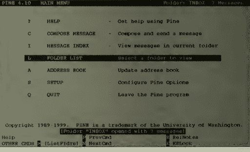

图 7.6 elm 客户端。

如果你想将消息从 In 信箱移动到你的另一个信箱，按 `s`。这将提供保存到你选择的信箱文件的选项。确保在信箱名称开头保留等号，除非你希望将信箱放在 elm 信箱目录之外。一旦消息被保存，列表中就会显示有一个 “D”。

最后退出时，输入 `q` 退出程序。系统会询问你是否想删除标记为删除的消息。除非你意识到你需要保留其中一个或多个项目，否则请选择 yes。如果你想要保存任何项的信箱之前不存在，elm 会在保存文件时为你创建它。

要打开一封要发送的新消息，按 `m`。

# 使用 Pine 读邮件

要启动 pine 电子邮件客户端，输入 “pine”。如果你是第一次运行该程序，它将创建它需要的一些目录，然后带你进入欢迎界面。按 `e` 退出并进入图 7.7 所示的主菜单。

如果你想读取“In”信箱中的邮件，使用方向键移动到 Message Index 菜单选项并按 Enter 键。这将打开信箱。

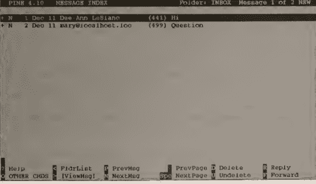

图 7.7 pine 电子邮件客户端的主菜单。

邮件条目的标签与 elm 中的几乎完全相同，区别是已读消息旁边有加号。要阅读消息，按 Enter 键。如果你按 `d` 删除，则消息被标记为已删除，但不会移出消息内容显示，这让一些用户感到困惑。每当你在消息中时，按 `<` 返回索引，或按 `n` 移动到下一条消息。一旦完成，先从消息内容移动到索引处，然后按 `m` 进入 pine 的主菜单。从那里，你可以通过按 `q` 退出 pine。

> 要打开一封要发送的新消息，进入主菜单并选择 Compose Message 选项。

# 章节总结

Linux 提供了一个类 Unix 命令行用于输入命令。shell 提供了用户界面，接受在命令行输入的命令，处理命令并执行它们。命令有两种类型：内置 shell 命令是 shell 的子程序，而系统命令是存储在文件系统中并通过输入文件名来执行的程序。命令的输入格式格式为：`commandname options arguments`，其中 `commandname` 是命令名称，`options` 决定命令的执行方式，而 `arguments` 是命令在执行期间使用的信息。当执行一个命令时，它会创建一个进程。系统上的所有活动进程根据系统从可用信息分配的优先级数字轮流使用 CPU 时间，这种程序称为时间分片。

数据以单字节流的形式进行存储和处理。文件以树形式存储在目录中，`/` 位于顶层。目录是特殊文件，包含每个文件的记录，并指向其 inode（索引节点），inode 是包含访问和管理文件所需信息的数据结构。

有很多命令可可用。最常用的命令是文件管理和文本处理命令。文件管理命令包括创建、定位、移动和删除目录的命令。文本处理命令包括显示、比较和重新格式化文本的过滤器。还有命令用于监控和管理进程以增强系统性能。

# 复习题

- 1. 下列哪项不是正则表达式中使用的元字符？
  - a. `$`
  - b. `.`
  - c. `^`
  - d. `==`

- 2. 关于数据流，下列哪个说法是不正确的？
  - a. 数据流是单向的。
  - b. 数据流一次传输一个字节的数据。
  - c. 数据流可以连接到文件。
  - d. 数据流是信息。

- 3. 可以创建多少进程？
  - a. 1
  - b. 2
  - c. 3
  - d. 无限

- 4. 假设你需要编辑所有文件。你会使用哪个命令？
  - a. `cat`
  - b. `sed`
  - c. `file`
  - d. `grep`

- 5. 下列哪项是过滤器？
  - a. `sort`
  - b. `cd`
  - c. `ps`
  - d. `date`

- 6. 下列哪项是管道？
  - a. `sort`
  - b. `vi`
  - c. `wc`
  - d. `cat`

- 7. 下列哪个项不接受输入？
  - a. `cat`
  - b. `ps`
  - c. `sort`
  - d. `grep`

- 8. 如果你使用 awk，下列哪项会输出任何数字？
  - a. `/`
  - b. `.`
  - c. `|`
  - d. `*`

- 9. 下列哪些信息可以在 inode 中找到？
  - a. 文件的 UID
  - b. 进程的 UID

- 10. 下列哪个命令是有效的？
  - a. `nice`
  - b. `linux`
  - c. `de`
  - d. `grep`

- 11. 假设你有一个格式为：姓、名、城市、年龄的文本。在经过 sort 命令处理后，哪些行会在文件顶部？
  - a. 1111
  - b. `$$$$`
  - c. `aaaa`
  - d. `AAAA`

- 12. 关于系统命令，下列哪项是正确的？
  - a. 是 shell 的子程序。
  - b. 是 shell 中的函数。
  - c. 是文件系统中的文件。
  - d. 是内核的子程序。

- 13. 下列命令最可能提供系统命令的语法信息？
  - a. `commandname`
  - b. `help commandname`
  - c. `info commandname`
  - d. `man -k commandname`

- 14. 在命令行输入命令时，下列说法哪些正确的？[选择所有正确答案]
  - a. 选项通常位于命令名之后，参数之前。
  - b. 你可以重复之前的命令而无需再次输入。
  - c. 你可以在一行中输入多个命令。
  - d. 如果在名称前加上 $, 就可以变量。

- 15. 你可以使用什么命令将一个命令使用的特殊字符转换为另一个命令所需的格式？
  - a. `tr`
  - b. `grep`
  - c. `vi`
  - d. `wc`

- 16. 你可以使用哪个命令查看 .gz 文本文件的完整内容？
  - a. 结合使用 `gunzip` 和 `cat`
  - b. `gcat`
  - c. `zcat`
  - d. 结合使用 `gunzip` 和 `tail`

18. 哪个命令可以提供如文件行数等信息？

- a. `w`
- b. `wl`
- c. `w -l`
- d. `wc`

19. 哪个命令允许你最快地杀死围绕同一命令的一组进程？

- a. `kill`
- b. `kill -9 killall`
- d. `kill -all`

20. 下列哪项不是有效的命令序列？

- a. `ps aux | grep http`
- b. `cp -r /home/bob /home/joe; cd /home/bob; rm -r *; cd ..; rdir /home/bob`
- c. `sed s/ab?d/AB?D/g < template.txt`
- d. `tr -s data.txt`

## 动手项目

### 项目 7.1

在本项目项目中，你将学习进程和作业。你将检查和监控作业以及进程。你将创建新的作业和进程、更改优先级并杀死它们。

要创建新的作业和进程、更改优先级并杀死它们，请执行以下步骤：

1. 登录用户账户。
2. 列出系统上所有的当前进程。输入：

```
ps -el
```


### 3. 查看所有进程
有多少个进程？找到 `PID` 列。识别 `PID` 1。它正在运行 `init` 命令吗？哪个 `UID` 拥有它？它是 `root` (0) 吗？识别正在运行你的 `shell` 的进程。它是否有关联的 `tty`？你是否看到了运行输出显示内容的 `ps` 命令的进程？注意 `Status` 列，`S`。`shell` 进程正在休睡眠，等待 `ps` 进程运行结束。查看 `NI` 列。这是 `nice` 值（优先级值）。你认为默认值是多少？

### 4. 检查后台作业
通过输入 `"jobs"` 检查是否有任何作业在后台运行。

### 5. 创建后台作业
如果你刚刚登录，不应该有作业在运行。创建一个作业并将其放入后台。如果你在不带任何参数的情况下输入 `cat` 命令，它将继续运行并等待输入。输入：

```
cat
```
`Ctrl+z`

### 6. 查看作业状态
输入 `"jobs"`。现在有作业了吗？它的状态是什么？

### 7. 前台恢复
通过输入 `"fg"` 将 `cat` 命令带回前台。发生了什么？

### 8. 后台恢复
再次使用 `Ctrl+Z` 停止 `cat` 作业。输入 `"bg"` 将其发送后台。现在输入 `"jobs"`。现在的状态是什么？输入 `"jobs -l"`。记下 `PID`。

### 10. 修改 nice 值
使用 `renice +6 PID` 更改 `cat` 进程的 `nice` 值。再次显示进程。现在 `cat` 进程的 `NI` 列中的数字是多少？

### 11. 杀死进程
杀死 `cat` 进程。输入 `"kill PID"`。显示进程。`cat` 进程消失了吗？如果没有，输入 `"kill -9 PID"`。现在消失了吗？检查你的作业？作业是否也消失了？

### 12. 创建持续输出作业
另一个用于进程的有用命令是 `"yes /dev/null"`。`yes` 命令会持续输出单词的流，直到你停止它。你需要重定向输出，否则它将接管你的屏幕。在单行命令行中输入这两个命令并通过输入将其发送到后台：

```
cat ; yes /dev/null &
```

### 13. 检查作业和进程数
检查你的作业。你有几个作业？检查你的进程。该作业有多少个进程？

### 14. 管道作业
在管道中输入这两个命令。输入：

```
yes | cat > /dev/null &
```

## 第 7 章

### 15. 再次检查作业
检查你的作业。你有几个作业？检查你的进程。该作业有多少个进程？

### 16. 按作业号杀死
通过输入 `'kill %jobnumber'` 杀死作业。检查你的作业。它消失了吗？检查你的进程。该作业的进程消失了吗？

### 项目 7.2

在本项目中，你将从一个数据文件生成报告。你有一个包含特定课程学生姓名和成绩的文件。你想为所有未退课的学生编写一份报告（退课的学生所有测试项目都显示为 0）。你想按课程对报告进行排序。你可以使用 `grep` 和 `sort` 来此。

要从数据文件生成报告，请执行以下步骤：

#### 1. 创建输入文件
创建名为 `infile1` 的输入文件，包含以下数据。

```
Mary Smith Math250 90 80 88
Harry Wang Math150 98 96 97
Greg Olson Math250 87 78 80
Tom Valdez Math250 92 95 96
Sally Jones Math250 0 0 0
Bob Hunt Math150 0 70 72
```

#### 2. 筛选完成课程的学生
使用 `grep` 命令选择完成课程的学生。例如：

```
grep -v '0 0 0' infile1
```

#### 3. 排序
使用 `sort` 命令按班级和姓氏进行排序。例如：

```
sort +2 infile1
```

#### 4. 合并命令并输出
将操作合并到一个命令中并将输出重定向到文件。例如：

```
grep -v "0 0 0" infile1
```

#### 5. 创建别名
为此创建一个别名：

```
alias='grep -v "0 0" infile1 | sort'
```


## LINUX 网络基础知识

在阅读完本章后，你将：

- 计算子网
- 理解网络层
- 配置网络
- 追踪路由
- 设置网络
- 故障排除网络故障

## TCP/IP 协议

`TCP/IP` 是互联网的标准。每当你访问 Web 页面或从互联网下载文件时，你都在使用 `TCP/IP`。在大多数情况下，连接是基于流的。并不是所有的连接都需要每个字节到达目的地。在流媒体音频或视频或网络游戏等情况下，丢失小组数据是可以的。对于这些目的，使用 `UDP`（用户数据报协议）而不是 `TCP`，这种流量本质上是无连接的。涉及的官僚程序较少。

## TCP/IP 地址

使用 `IP`，每个网络接口都被分配一个 `IP` 地址。这些地址有两种标准，`IPv4` 和 `IPv6`。`IPv4` 地址由点分隔的4 个字节组成，例如 `192.168.4.1`，正如预期的那样，`IPv6` 地址由 6 个字节组成。截至本文编写，`IPv6` 仍在开发中，但预计将在2000年底之前取代当前的 `IPv4` 标准。

就像单个接口有地址一样，整个网络也有地址。网络的地址方案由网络地址和一个网络掩码组成；这被称为子网。为了理解子网，我们必须以二进制形式查看这些地址。如果你有一台 `IP` 地址为 `192.168.4.1` 掩码为 `255.255.255.0` 的计算机，你可以使用简单的二进制运算获取其余的网络信息：

- 网络地址 = 与 掩码
- 广播地址 = 网络地址 或 (非 掩码)

## 预留地址

通常情况下，私有局域网通过 `IP` 伪装或其他 `NAT`（网络地址转换）扩展连接到互联网。

# 第 8 章

## 表 8.1 IP、网络和广播二进制地址。

| 二进制操作 | IP | 二进制 IP | 结果地址 |
|---|---|---|---|
| | 192.168.4.1 | 11000000.10101000.00000100.00000001 | IP |
| AND | 255.255.255.0 | 11111111.11111111.11111111.00000000 | 子网掩码 |
| = | 192.168.4.0 | 11000000.10101000.00000100.00000000 | 网络 |
| OR | 0.0.0.255 | 00000000.00000000.00000000.11111111 | (非子网掩码) |
| = | 192.168.4.255 | 11000000.10101000.00000100.11111111 | 广播 |

在此过程中，将局域网地址分配到预留子网之一是非常重要的（关于预留地址的规定请参考 `RFC 1918`）。预留子网是在互联网上不使用的地址范围；这样你就可以确保局域网上的计算机与互联网上的计算机通信时不会产生冲突。

三个地址类中的每类都有自己的预留给内部子网的地址空间：

- 1 类 A: `10.x.x.x`
- 16 类 B: `172.16.x.x` – `172.31.x.x`
- 255 类 C: `192.168.x.x`

# 安装 TCP/IP 网络

安装 `TCP/IP` 网络涉及为每个网络设备或接口配置适当的地址。它还需要整个网络和子网地址，并通通用了解所有地址信息如何形成一个同质的 `TCP/IP` 网络，该网络能够与自身以及外部世界成功通信。

# 设置机器地址

每个要在网络上通信的设备都必须有一个地址。如果是物理设备，则有两个地址：硬件地址和 `IP` 地址。硬件（或 `MAC`，介质访问控制）被硬编码在设备中，例如网络网卡（`NIC`）。在大多数情况下，`MAC` 地址可以被忽略，除非使用了 `DHCP`（动态主机配置协议）或 `BOOTP`（启动协议）。但你如何知道该使用哪个 `IP` 地址呢？要被分配 `IP` 地址的接口是公开的，因此通常会给你一个地址，或者在在线时预先配置好，确定接口的 `IP` 地址取决于你。

正如前面提到的，存在一些预留的 `IP` 地址块。通常，使用这三类预留网络地址之一用于私有网络接口是一个好主意，以避免任何潜在的安全问题或地址冲突。问题是，哪种类网络适用于特定情况？在此时，讨论这三类网络之间的差异将有助于回答这个问题。

常用的 `IP` 地址类有：

- **A 类地址**：这些地址使用点分四位（`IP` 地址）左侧的 8 位来识别网络。这留下了右侧的 24 位（或三个字节）来识别网络上的主机。在位位上，A 类地址第一个字节的最左位始终设置为 0（该字节的十值为 0 到 127）。这意味着第一个字节的右侧位可以是 1 也可以是 0，这提供了 2^7 种可能的组合，即 128 个不同的网络，以及 (2^24)-2 或 16,777,214 种可能的接口。你可能在想为什么从可能的接口组合中减去 2。原因是：在给定的网络上必须有一个网络地址和一个广播地址，通常分别为 0 和 255。需要注意的是，网络 `0.0.0.0`（默认路由）和 `127.0.0.0`（环回地址）具有特殊含义，不可用于接口。因此，只有 126 个可 A的 A 类网络地址。

- **B 类地址**：这些地址使用点分四位的左两个字节来识别接口。在位位上，B 类地址第一个字节的最左 2 位设置为 10。这留下了 14 位来指定网络地址，提供了 16,384 个网络。因此，B 类网络的第一个字节的十进制范围为 128 到 191，第二个字节为 0 到 255，每个网络包含多达 65,534 种可能的接口。

- **C 类地址**：这些地址使用点分四位的左三个字节来识别接口。C 类地址始终从第一个字节左侧 3 位设置为 110，左侧点分四位的十进制范围为 192 到 253。2^8 得到 254 种可能的接口。需要注意的是，网络 `0.0.0.0`（默认路由）和 `127.0.0.0`（环回地址）具有特殊含义，不可用于接口。

（注：原文中存在大量 OCR 错误和重复片段，译文已根据逻辑进行了清理和整合。）

## 表 8.3 ifconfig 命令中常用的可用选项（续）。

| 选项 | 附加选项 | 目的 | 参数 |
|---|---|---|---|
| point | | 设置（如果使用减号则取消）此接口与列出的接口之间的直接连接 | 外部接口的 IP 地址 |
| promisc | | 设置（如果使用减号则取消）混杂模式，该模式告诉接口接收所有流经网络的数据包，而不是忽略发送给自己的数据包。 | 无。 |
| tunnel | 无。 | 在此接口与列出的接口之间创建一个隧道。隧道是一种在越互联网上创建虚拟连接的方法，用于创建 VPN（私有网络）。这是一种将基于出站的机器添加到本地局域网（LAN）的常用方法。 | 隧道终点的 IP 地址。 |
| up | 无。 | 激活接口驱动程序。down 选项的反面。 | 无。 |

将多个选项组合成实用的命令是 `ifconfig` 的诀窍。之前已经给出了一些示例。但是，你不需要在每次构建机器时通过这个过程。物理设备通常在启动时由 init 脚本进行配置。这些脚本位于 `/etc/rc.d/` 树中。

## 路由之前

在数据被路由到特定机器之前，路由器需要知道哪个硬件对应给定的 `IP` 地址。当你启动一台位于局域网或直接连接到互联网的 Linux 机器时，机器会在网络初始化组件期间运行 `ifconfig` 命令。该命令将以太网卡映射到 `IP` 地址。如果机器内有多个以太网卡，该命令会将每个 `MAC` 地址映射到其相应的 `IP` 地址，这些是在你配置这些信息时定义的。

你可以随时使用命令 `arp -a` 来查看 `ARP` 缓存的内容。请记住，更具体的路由问题会让位于更通用的问题。如果你设置了特定的 `ARP` 信息，这些信息可以覆盖你之后在运行时设置的设置。确保你的 `ARP` 信息是准确的。

## 设置路由

现在你已经有一个配置恰当的网络接口，你需要告诉内核如何路由出站数据包。假设一下，`eth0` 接口配置了 `IP` 地址 `192.168.4.5`。我们首先需要为 `192.168.4.0` 网络添加一条路由。如下所示执行 `route` 命令将实现以下目标：

```
route add -net 192.168.4.0 netmask 255.255.255.0 eth0
```

以下命令将为该接口向目标网络添加相应的路由。延续前面的示例，假设 `eth0` 连接到一个集线器，该集线器是一个互联网网关，其 `IP` 地址为 `192.168.4.10`。你现在需要做的是告诉你的 Linux 系统如何访问互联网。为了做到这一点，你需要在路由表中创建一个条目。使用 `route` 命令来实现：

```
route add default gw 192.168.4.10
```

如果你不带任何参数参数使用 `route`，你应该看到类似下面的路由表：

| 目的 | 网关 | 生成子掩码 | 标志 | 标量 接口 |
|---|---|---|---|---|
| 192.168.4.5 | | 255.255.255.0 | U | 0 | eth0 |
| 192.168.4.0 | | 255.255.255.0 | U | 0 | eth0 |
| loopback | | 255.0.0.0 | U | 0 | lo |
| default | 192.168.4.10 | 0.0.0.0 | UG | 0 | eth0 |

路由表对于任何 `TCP/IP` 网络都是至关重要的。如果配置错误，网络将无法工作，因为数据包不知道它们需要去哪里。

## 子网掩码 (Netmasks)

子网掩码无非与 `IP` 地址进行位与（AND）运算，以确定地址的哪些部分是网络，哪些是接口。在标准的非子网 `IP` 地址中，子网掩码将是 `255.255.255.0`。在位级别上，子网掩码看起来如下：

`11111111.11111111.11111111.00000000`

基本上，这意味着从左到右所有为 1 的位表示接口地址的这部分指的是网络。0 位是可能的接口地址。对于非子网类，相应的子网掩码为：

- 类 A: `255.0.0.0`
- 类 B: `255.255.0.0`
- 类 C: `255.255.255.0`

## 设置子网

上一节讨论了子网掩码。为了更好地利用 `IP` 地址空间，你将应用对子网掩码的知识来创建子网。子网划分是将单个类 A、B 或 C 网络划分为至少两个部分。要实现子网，你必须确定未来需要多少网络和接口。这些数字将决定如何将网络划分为子网。为了说明，以类 C 网络 `192.168.0.0` 为例。在位级别上，地址和标准子网掩码看起来如下：

地址：`11000000.10101000.00000000.00000000`
子网掩码：`11111111.11111111.00000000`

为了说明目的，假设你已经确定要在基础网络上创建 4 个或即 2^2 个不同的子网。为了实现这一点，取最后一个字节的前两位，并使用它们来指定四个不同的子网。这将留下最后一个字节的后六位来识别接口。这将给你一个子网掩码：

`11111111.11111111.11000000` 或 `255.255.255.192`

子网 1-4 地址：
- 网络1：`11000000.10101000.00000000.00000000` 或 `192.168.0.0`
- 广播1：`11000000.10101000.00000000.00111111` 或 `192.168.0.63`
- 网络2：`11000000.10101000.00000000.01000000` 或 `192.168.0.64`
- 广播2：`11000000.10101000.00000000.01111111` 或 `192.168.0.127`
- 网络3：`11000000.10101000.00000000.10000000` 或 `192.168.0.128`
- 广播3：`11000000.10101000.00000000.10111111` 或 `192.168.0.191`

## IP组播 (IP Multicast)

为了理解组播的概念，请考虑你的收音机。每个电台都在预留的频率上广播。在理想情况下，任何调到该电台的人都可以听到它。

`IP`组播实际上是嵌入在 `IP` 结构中的一种选项。类 D 地址范围从 `224.0.0.0` 到 `239.255.255.255`——在位上，所有以 1110 开头的地址——是专门为组播分配的。事实上，`224.0.0.0` 到 `224.255.255.255` 是本地保留的组播地址，而 `225.0.0.0` 到 `239.255.255.255` 在互联网上有效，且只有一个唯一的发送者。

`IP`组播是通过 `UDP` 数据包完成的。你可以将广播范围限制在若干组内，包括留在你的局域网或大陆。在许多方面，这是普通的系统管理员并不实施的服务，但你确实需要它是什么以及类 D 地址段是什么。

## 定义和管理常用端口地址

在处理网络时，你会反复遇到相同的端口号。这是因为所有常用服务都有标准的端口号。表 8.4 显示了一些常用的端口号；要查看完整列表，请查看 `/etc/services` 文件。

## 表 8.4 常用端口号。

| 服务 | 定义 | 端口 |
| --- | --- | --- |
| DNS | 域名服务 | 53 |
| FTP 数据 | 文件传输 | 20 |
| FTP 控制信息 | 文件传输 | 21 |
| HTTP | Web 网页数据 | 80 |
| IMAP | 远程邮件访问 | 143 |
| POP3 | 邮件取回 | 110 |
| NetBIOS | 非 TCP/IP 网络应用通信 | 139 |
| NNTP | 新闻服务 | 119 |
| SMTP | 邮件服务 | 25 |
| SNMP | 网络设备管理 | |
| Telnet | 远程 shell 访问 | 23 |

## 为什么要使用标准端口

当你打开 浏览器访问 Web 页面时，它会在端口 `80` 上建立连接，因为它知道 `80` 是 `HTTP` 连接的标准端口。几乎所有其他网络服务也是如此的。以这种方式设置端口是一件好事；这意味着任何人都可以在不了解具体细节的情况下访问 Web 页面。然而，正如人们所料的那样，某些时候不使用标准端口号是更好的。

## 为什么要偏离标准端口

任何服务器不面向普通公众的情况都是使用非标准端口的绝佳选择。例如，假设你的公司希望员工能够同时登录 Web 服务器检查电子邮件，但你不希望向全世界宣扬此功能的存在。实现这一点的的一种好方法是将 WWW 网关服务器放置在 `80` 以外的端口上。

> 在此过程中需要记住的一点是，非标准端口并不是良好安全性的替代品。另一方面，它可以且通常经常被用来增强良好的安全方案。

## 在 Linux 中使用 TCP/IP

每个 Linux 发行版都带有大量的网络工具。这些工具大部分对于网络的维护和故障排除是至关重要的。在许多可用工具中，最常用且最重要的三个工具是 `PING`、`netstat` 和 `traceroute`。

## Linux 网络基础 277

## PING 主机

`PING` 可能是最常用的 `TCP/IP` 工具。该程序使用 `ICMP` 协议，该协议发送 `UDP` 数据包。`ICMP` 之所以基于 `UDP` 的原因是 `PING` 的整个目的就是查看数据包是否到达目的地并返回。`PING` 最常用于判断接口是否处于开启状态并进行通信。`PING` 使用 `ICMP` 协议的 `ECHO_REQUEST` 来触发网络接口产生 `ECHO_RESPONSE`。例如，如果你想确定 `IP` 地址为 `192.168.0.2` 的接口是否在网络上通信，你将发出以下命令：

```
PING 192.168.0.2
```

如果接口确实在线，你将收到如下所示的响应：

```
> PING 192.168.0.2

PING 192.168.0.2 (192.168.0.2): 56 data bytes

64 bytes from 192.168.0.2: icmp_seq=0 ttl=128 time=1.0 ms

64 bytes from 192.168.0.2: icmp_seq=1 ttl=128 time=0.9 ms

64 bytes from 192.168.0.2: icmp_seq=2 ttl=128 time=0.9 ms

64 bytes from 192.168.0.2: icmp_seq=3 ttl=128 time=0.9 ms

64 bytes from 192.168.0.2: icmp_seq=4 ttl=128 time=0.9 ms
```


在使用发出的 `PING` 命令时，该流将一直持续直到用 `^C` 停止。如果你只想发送特定数量的 `PING` 数据包，你可以在 `PING` 命令中使用 `-c` 选项：

- `> PING -c 5 192.168.0.2`

这将只会发送五个数据包并终止。

## 网络状态

作为网络管理员，查看你的网络状态非常重要。在 Linux 中，使用 `netstat` 命令。`netstat` 显示网络连接、路由表、接口统计、伪装连接和 netlink 标量。例如，假设你想查看本地路由表。使用 `netstat`，你将发出以下命令：

- `> netstat -re`

你将收到内核 IP 路由表的数据输出：

```
Kernel IP routing table
Destination Gateway Genmask Flags Metric Ref Use Iface
default * 255.255.255.0 U 0 0 0 eth0
255.255.50 * 255.255.50 U 0 0 0 eth1
loopback * 255.0.0.0 U 0 0 0 lo
default hostname 0.0.0.0 UG 0 0 0 eth1
```

表 8.5 显示了执行 `netstat` 命令时使用的一些常用选项。

## 路由追踪

有时，知道数据包通往给定目标所经过的路径是有用的。此外，如果你的数据包被丢弃了，你可以确定数据包是在哪里被丢弃的你还可以找到通往某个主机的路由在哪里中断。在 Linux 中，执行这些诊断的命令是 `traceroute`。例如，你想找出通往 `amazon.com` 的路径。你将发出命令：

- `> traceroute amazon.com`

你将获得数据包到达 `amazon.com` 经过的所有不同主机的行列表以及相关的 `PING` 时间。如果由于某种原因无法到达 `amazon.com`，`traceroute` 将显示你在尝试访问 `amazon.com` 时最后到达的机机。

| 选项 | 可选选项 | 功能 |
| --- | --- | --- |
| `-r` | —route | 显示路由表 |
| `-i` | —interfaces | 显示接口表 |
| `-s` | —statistics | 显示网络统计数据（如 SNMP） |
| `-M` | —masquerade | 显示伪装连接 |
| `-v` | —verbose | 详细模式 |
| `-n` | —numeric | 不解析名称 |
| `-N` | —symbolic | 解析硬件名称 |
| `-e` | —extend | 显示其他/ |
| `-c` | —continuous | 持续 |
| `-l` | —listening | 显示监听 |
| `-a` | —all | 显示所有 |
| `-o` | —timeout | 显示计时器 |
| `-C` | —cache | 显示缓存 |

## 第8 章

## 排除 TCP/IP 问题

问题在 Linux 中不可避免地会出现，当问题发生时，知道如何处理它们很重要。为了缩小范围，请查看你的网络状态。

## 查看网络设置

首先检查接口设置。例如，如果接口配置错误，就会出现问题。使用 `netstat -r` 检查路由表。如果接口不在列表中，请按照“安装 TCP/IP”部分的步骤操作。如果接口已开启，`netstat -n` 命令将输出路由表。

# Linux 网络基础 281

要修复路由，请使用 `route del destination` 将其删除，然后按照“安装 TCP/IP 网络”章节中的指令重新创建它。

# 常见问题

Linux 网络中通常会发生两类问题：操作失误和硬件故障。在五年的 Linux 网络工作经验中，我只见过极少数不属于这二者之一的问题。如果地址信息持续错误，请检查你的脚本中是否有拼写错误；如果电脑里冒出了烟，请关闭电源，拔掉插头并打开机箱检查内部。

# 配置与使用 PPP

在 `/etc` 目录下，通常有一个名为 `ppp` 的目录。所有与建立和关闭 PPP 连接相关的脚本都存储在此处。通常情况下，`pppd` 使用这些文件来为了更方便地管理 PPP 连接，但请注意，PPP 连接的建立或关闭并不需要任何文件；整个过程都可以通过命令行完成。`pppd` 通常使用六个脚本来帮助建立、拨通和关闭一个 PPP 连接。这些脚本如下：

- 任意名称的 chat 脚本
- `Options`（选项）
- `pap-secrets`
- `chap-secrets`
- `ip-up`
- `ip-down`

> `ISDN` 只是另一种类型的调制调器连接。你也可以将 `pppd` 用于 `ISDN`。

# 设置 Chat 脚本

`chat` 脚本是负责为调制调器连接成功协商设置“期望与响应”对的脚本。例如，当你向调制调器发送 `ATZ` 命令时，你期望收到调制调器返回的 `OK`。在 `chat` 脚本中，它看起来如下：

```
"ATZ"
"OK" "ATDT5551234"
```

第一个空引号 `""` 表示你不期望接收任何内容，并用 `"ATZ"` 对此响应。随后，你期望接收到 `"OK"`。如果收到了 `"OK"`，我们就发送拨号字符串 `"ATDT5551234"`。请尝试确定以下 `chat` 脚本中的期望与响应对：

```
"ATZ"
"ATDT5551234"
"OK"
"login" "username"
"OK"
"password" "password"
```

你已经知道前两行的作用了，但你确定后两行的作用了吗？`"login"` 表示你期望通过调制调器从你拨入的地方接收到字符串 `"login"`。在成功从提供商处收到登录提示后，你发送你的用户名进行身份验证。发送用户名后，你期望被提示输入密码。这就是第四行第一个字符串的意思，即来自提供商的 `"password"`。在收到密码提示后，发送你的密码。如果最后这一步成功完成，你就已经与提供商建立了链接。如果由于某种原因，你的提供商提示用户名和密码的方式与上一个示例不同（例如，使用 `"hello"` 作为用户名，使用 `"authenticate"` 作为密码），你将相应地更改脚本中的期望值。

到此时，你的 PPP 连接尚未完成。你仍然需要配置本地和远程 IP 地址，并在路由表中添加一个条目，以便信息能够沿着你的 PPP 连接向上游和向下流动。

# 使用 pppd 连接

如前所述，`pppd` 使用六个不同的脚本来建立、拨通和关闭 PPP 连接。在上一节中，你学习了如何设置 `chat` 脚本。请使用该 `chat` 脚本配合其他 `pppd` 脚本，作为 ISP 成功拨入网络。

为了正确使用 `pppd`，请对你的 `chat` 脚本进行微调。从 `chat` 脚本中删除所有与身份验证相关的行（即用户名和密码）。使用另外两个文件 `pap-secrets` 和 `chap-secrets` 在拨号过程中进行身份验证。接下来，设置 `/etc/ppp/options` 文件。该文件包含若干行，告诉 `pppd` 使用哪个串口来建立连接、如何建立连接，以及在连接建立后如何配置连接。一个标准的 `/etc/ppp/options` 文件可能如下所示：

```
#use device ttyS1 (cu1) for the ppp connection
/dev/ttyS1
#lock the device while in use
lock
#remote end does not need to authenticate itself
noauth
```

```
# 身份验证此 ppp 会话时使用的用户名
# 告诉 pppd 在需要时自动建立此链接
demand
# 如果空闲 600 秒（10 分钟）则断开链接
idle 600
# 使用服务器分配的本地 IP 地址
ipcp-accept-local
# 使用服务器分配的网关 IP 地址
ipcp-accept-remote
# 自动在路由表中为 ppp 连接添加条目
defaultroute
# 使用调制调器，使用硬件流控在 115200 锁定链接
modem 115200 crtscs
# 用于拨号调制调器的线路
connect 'usr/sbin/chat -v -f /etc/ppp/[name of chat script]'
# 本地和远程 IP 地址，会被 ipcp 选项覆盖
192.168.0.1:192.168.0.3
```

当使用 PPP 连接拨入 ISP 时，这个 `/etc/ppp/options` 文件在多程度上是一个标准文件。

接下来，告诉 `pppd` 在拨入后对自己进行身份验证。这需要 `/etc/ppp/pap-secrets` 和 `/etc/ppp/chap-secrets` 文件存在。这些文件包含了 `/etc/ppp/options` 文件中提到的用户名以及关联的密码。用户 "bob" 密码为 "hello" 的 `pap-secrets` 和 `chap-secrets` 文件看起来如下：

```
# pap-secrets 示例
 hello
# 文件的权限应为 600
bob hello
# chap-secrets 示例
 hello
# 文件的权限应为 600
bob hello
```

在 Linux 网络中，这里有几点需要注意：`pppd` 使用六个不同的脚本来建立、拨通和关闭 PPP 连接。 (注：此处原文示例处逻辑略有重复，翻译已保持意意一致)

## 第 8 章

注册新的 `.net`、`.com` 或 `.org` 名称的通用过程是：你必须检查该名称是否已被占用。使用“获取域名信息”章节中讨论的 `whois` 工具来查找你想要注册的任何名称和扩展名组合的信息。如果没有结果，你就可以注册它。然而，如果它已被占用，你就必须找到某种尚未被占用的名称变体。

还有一系列可用的扩展名，可以指定域名所在的国家。这些扩展名都是通过其各自的组织注册的。你可以自行查找该国家的注册机构，也可以利用注册商来由他们为你处理整个过程。

## 域名解析翻译

一旦域名及其相应的 IP 信息输入互联网名称数据库，就可以通过名称解析程序快速地在两者之间双向转换。当你尝试访问一个域名时，Linux 会查找你的解析规则列表。它首先倾向于本地查找，查看你是否已经在机器上输入了该域名的 IP 信息，或者在之前的查询中已将其缓存。如果没有，它将访问规则指定的域名服务器。该服务器可能包含也不包含地址信息。如果有，则你的查询完成，并返回 IP 值。

如果本地域名服务器没有你需要的信息，它将查找相关地址的区域服务器（zone server）。区域服务器有多种，在这种情况下，域名服务器会查找该特定域名扩展的任何区域服务器。该服务器保存了每个特定域名站点的区域服务器列表，并将请求转发给这些服务器。这些本地区域服务器拥有该域名下特定机器的 IP 信息并返回该信息。

## 基础网络工具

任何系统管理员都应该熟悉一组特定的网络工具。这组工具与你将在第 9 章中设置的网络服务无关。相反，它们在许多领域提供帮助，例如获取有关其他域名和地址的信息，以及远程连接到你自己的机器。

## 获取域名信息

获取域名和 IP 地址信息的工工工。其中第一个是 `whois`。如果你想获得更多关于域名所在位置或谁是所有者的信息，可以使用此命令获取信息。输入 "`whois domain.extension`" 可以获取该站点的注册地址、管理员的联系信息、该站点的注册域名服务器，以及最初注册该域名所需的其他管理信息。

如果你有一个 IP 地址并想知道它属于哪个域名，你通常可以使用 `nslookup` 命令获取这些信息。输入 `nslookup IPAddress` 会给你它能提供的信息——取决于该地址在网络中的位置，有时 `nslookup` 并不非常有用。它还有进一步的功能。你可以通过此命令获取有关域名及其名称服务器的信息等内容。

## 远程访问机器

有两个不同的命令用于远程访问 Linux 机器。其中一个是 `telnet`，它几乎适用于所有的操作系统。输入 `telnet host.domain.extension` 如果该机器启用了 `telnet` 服务，你就可以获得该机器的登录提示。如果你在那里有一个 shell 账户，你就可以登录它。然而，除非该机器显式设置了该功能，否则你无法登录。`root` 的 `telnet` 访问是一个主要的安全漏洞。

如果你想访问同一网络上的其他机器（且这些机器启用了该服务），另一个可用的命令是 `login`。这些机器需要是类似的，具有相同的终端类型和屏幕大小。你可以输入 `login host` 使用相同的用户名远程登录到特定机器，或者使用 `login -l username` 远程登录到不同的账户。

你可以在想要 `login` 的机器的主目录中创建 `.hosts` 文件，你可以在该文件中列出你信任可以从该账户登录的机器列表。这样做可以避免在在登录时输入密码。然而，这也是一个安全漏洞，因为如果有人破译了受信任的机器，他或她可以立即进入另一台机器上的账户。

## 传输文件

如果你需要在机器之间传输文件，`telnet` 等工具是不够的。相反，你需要使用 `ftp`。无论你想在自己的网络内部移动或复制文件，还是在与外部位置之间移动，只要你要连接的机器上有 `ftp` 服务器监听，并且你有账户或某种形式的匿名访问，你就可以 `ftp`。输入“`ftp host.domain.extension`”建立连接。然后，使用你的用户名和密码登录，或者使用可用的匿名或访客账户。如果你是匿名登录且该服务已激活，请使用用户名“`anonymous`”并输入你的电子邮件地址作为密码。

连接后将获得一个命令提示符。使用 `cd` 命令切换到你想传输文件的目录。使用命令 `ascii`（文本文件）或 `binary`（编译程序）来告诉 `ftp` 你正准备传输哪种类型的文件。`dir` 和 `ls` 命令允许你获取目录列表。要实际传输数据，可以使用 `get`（单个文件）或 `mget`（使用通配符的多个文件）命令下载文件，或者使用 `put`（单个文件）或 `mput`（使用通配符的多个文件）命令上传。

这些本地区域服务器拥有该域名下特定机器的 IP 信息并返回该信息。

如果本地域名服务器没有你需要的信息，它将查找相关地址的区域服务器。区域服务器有多种，在这种情况下，域名服务器会查找该特定域名扩展的任何区域服务器。该服务器保存了每个特定域名站点的区域服务器列表，并将请求转发给这些服务器。

## 第 8 章

表 8.6 `/etc/bootptab` 定义的参数。

| 参数 | 用途 | 示例 |
| --- | --- | --- |
| `dn` | 项目的域名名称。 | `dn=colors.org` |
| `ds` | 项目应查找的域名服务器或服务器列表。 | `ds=192.168.15.14` |
| `gw` | 网关地址，或地址列表。该网关通常是代理服务器或 IP 掩伪装服务器。 | `gw=192.168.12.1` |
| `ha` | 用于标识特定客户端的12位硬件地址——通常是以太网网的 MAC 地址。 | `ha=56248F67AD449` |
| `hn` | 传输分配给客户端的主机名。该名称是你用于为单个机器条目命名的名称。 | `hn` |
| `ht` | 根据 RFC 1340 主机使用的硬件类型。 | `ht=RS-232` |
| `ip` | 分配给主机的 IP 地址。 | `ip=192.168.162.9` |
| `lg` | 记录主机信息的服务器地址，或地址列表。 | `lg=192.168.173.5` |
| `lp` | 打印服务器的地址，或地址列表。 | `lp=192.168.12.5` |
| `sm` | 传递给主机的子网掩码。 | `sm=255.255.255.0` |
| `tc` | 指向你想要引用的模板以填充空白。 | `tc=all` |

考虑以下代码：

```
.all:sm-255.255.255.0:ip=192.168.12.61:hn-ds-192.168.12.4:dn-colors.org:
blue:tc-ha=A513A62E28F:ip=192.168.12.10:
green:tc-ha=1276B2F5E26:ip=192.168.12.11:
purple:tc-ha=A516A3F628E16:ip=192.168.12.12.
```


高亮部分是模板。此模板中的所有数据——子网掩码、打印服务器、传递给机器的主机名、DNS 服务器和域名——对于之后定义的每台机器都是相同的。只有特定于机器的信息（例如名称本身、硬件地址和 IP 地址）在每次运行时被显式定义。

> 这是一个使用 boot 的非常基础的方法。也可以在跨子网中使用此服务。

一旦完成配置，保存并退出文件。如果你是单独运行 `bootcpd`，请确保停止并重启守护进程。

## 配置 bootp 客户端

`bootp` 客户端是一个名为 `bootpc` 的程序。你必须创建一个 shell 脚本来配合该客户端，以便它知道要向哪台机器请求信息以及请求什么数据。该脚本必须在你的初始化脚本中运行，因此通常与其他 rc 项目（如 `rc.bootp`）放在一起。`bootpc` 软件包附带了一个 `rc.bootp` 示例。

编辑 `rc.bootp` 脚本以匹配你的客户端机器。该脚本有许多注释来解释每个阶段发生什么，以及许多默认被注释的代码。作为管理员，你的工作是确定哪些是保留的，哪些是不需要的。

一旦你将 `rc.bootp` 设置为所需的格式，请确保在你的启动脚本中引用了它。

## 配置和使用 DHCP

在安装或启动期间提供地址和域信息的一个常用工具是 DHCP（动态主机配置协议）。该工具比它的表兄弟 boot 更先进，尽管它与旧协议向后兼容。这两个工具之间的一个主要区别是 DHCP 可以分配租用时间。参考机器允许保留 DHCP 服务器分配给它的 IP 地址的时间。

> 这里对 DHCP 的讨论仅限于启动时分发网络地址。

## 安装 DHCP

要使用 DHCP 工具，你必须首先安装 bootp 守护进程。如果你使用的内核版本高于 2.2——输入 `uname -r` 查看你正在使用的内核版本——那么你需要确保你有一个至少是 1.3 版本的客户端守护进程 `dhcpcd`。2.2 内核无法与旧的 `dhcpd` 正常工作。对于服务器端，如果发行版自带了服务器版本，请使用该版本。否则，请从 `http://fip.org/isc/dhcp/` FTP 下载最新版本。

当你将发行版放在机器上时，该守护进程可能已经安装。输入 `which dhcpd` 查看是否安装了服务器，输入 `which dhcpcd` 查看是否安装了客户端。如果没有，你需要在发行版中找到它。

## 配置服务器

现在你必须创建一个实际分发信息的语句。你可以使用以下格式进行动态分发，这意味着没有向某台机器承诺特定的地址。此示例演示了分发 `192.168.13.50` 到 `192.168.13.200` 之间的地址范围：

```
subnet 192.168.13.0 netmask 255.255.255.0 (
  range 192.168.13.50 192.168.13.200
)
```

在设置租用时间之后，你需要设置全局选项。全局选项是所有机器通用的值。例如，此部分可能如下：

```
option domain-servers 192.168.13.4;
option domain-name "colors.org";
option subnet-mask 255.255.255.0;
option routers 192.168.13.1;
option broadcast-address 192.168.13.255
```

根据你的需求混合使用这两种分配方法。一旦 `/etc/dhcp.conf` 文件完成，保存并退出。你现在需要启动服务器，或者如果它已经在运行，则重启它。如果你想为特定主机分配每个 IP 地址，请使用此格式。此示例是针对名为 `pink` 的机器的，我想为其分配地址 `192.168.13.50`：

```
host pink (
  hardware ethernet 01:5A:61:68:FE:01;
  fixed-address 192.168.13.50
)
```

本质上，你需要找到网络初始化脚本（如果有单独的），或者另一个初始化脚本中的网络初始化部分，将其替换为新代码——但保留分配主机名和回环 `loopback` 信息的区域。用于告知客户端通过主以太网 `eth0` 获取网络信息的完整代码类似于：

```
/sbin/dhcpcd
```

确保你拥有 DHCP 客户端守护进程 `dhcpcd` 的正确路径。然而，如果你使用的是红帽 `Red Hat` 发行版，客户端默认使用的命令是 `pump`。在这种情况下，代码可能看起来如下所示：

```
/sbin/pump -i DEVICE -h HOSTNAME
```

现在，确保 DHCP 服务器正在运行，并重启客户端机器。输入 `ifconfig` 将显示 DHCP 客户端是否已获取其信息。

## 配置和使用 NIS

在基础层面，NIS（网络信息服务）对于在局域网 `LAN` 上集中管理用户账户和密码具有极高的价值。在较大的网络中，用户可能在任何时间使用任何机器，NIS 变得尤为重要，因为在每台机器上单独维护账户将非常麻烦，甚至可能需要助手才能完成真正的行政工作。

### 安装 NIS 之前

NIS 服务器和客户端通常随发行版一起提供。你还需要安装 RPC Portmapper，它会将程序信息转换为端口号。此守护进程不仅被包含在发行版中，而且通常已经默认安装了。

首先，检查是否存在 Portmapper。输入 `ps aux | grep portmapper` 查看它是否在独立运行。此外，检查 `/etc/inetd.conf`。Portmapper 通常由超级守护进程 `superdaemon` 运行，因此请检查它是否存在且未被注释。如果你没有取消注释，请记住重启 `inetd`。如果系统各处都没有 Portmapper，请确保从发行版光盘安装它并确保它已激活。

### 设置 NIS 服务器

NIS 服务器应该包含在你的发行版材料中，或者根据你选择的软件包可能已经安装了。然而，该软件包的名字中可能不会包含 N-I-S 这几个字母。相反，请查找 `upserverv`。这个名字源于服务器曾被称为太阳黄页服务 `Sun Yellow Pages`，但由于电话公司商标的原因必须重命名。

你需要 `ipsyerv` 和 `makedbm` 程序，这两个程序很可能打包在一起。

一旦安装了这些软件包，你就需要编辑两个文件。第一个是 `/var/yp/securenens`——如果你在该位置找不到它，请搜索 `securenens`。此文件用于设置哪些范围的主机可以访问你的 NIS 服务器。通过使用 IP 地址和主机掩码组合来描述此范围，在一个简单的示例中，你可能希望确保机器本身可以访问自己的 NIS 服务器，可能还包括 `192.168.150.*` 范围内的所有机器，那么你会在文件中包含以下文本：

```
host 127.0.0.1
255.255.255.0 192.168.150.0
```

保存并退出该文件后，编辑 `/etc/ypserv.conf`。这个文件不像上一个直接。你可以创建两种类型的行：选项 `options` 和规则 `rules`。选项的格式为：

```
option: value
```

本质上有两个不同的选项。第一个是 `dns`，以两种格式之一使用：`dns: yes` 或 `dns: no`。如果你将此选项设置为 `yes`，NIS 服务器将进行 DNS 查询，以获取未在其自己的文件中显式定义的机器的主机。此选项的默认值为 `no`，因为通常对于系统管理员来说，明确列出哪些机器允许使用该服务器更安全。第二个选项是 `xfr_check_port`，其格式与 `dns` 选项相同。如果你将此选项设置为 `yes`（这是默认值），则 NIS 服务器必须运行在低于 1024 的端口上。

规则用于定义谁可以在什么层级访问服务器，其格式为：

```
host:names:security:mangle:which
```


这些字段中某些是强制的，另一些是可选的。`host`字段是适用于规则的IP地址或地址范围。你可以将它们作为IP和网络掩码的组合，或带有通配符的范围来指定。例如，"192.168.250.*"和"192.168.250.0/255.255.255.0"指的是相同的地址范围。`names`字段列出将单个IP地址映射到域名名的文件。如前提到的，此功能允许你安全地管理谁拥有什么访问权限。请使用文件的完整路径。该文件所需的格式将在本章后面的部分讨论。

### 表 8.7 定义访问规则时 `/etc/ypserv.conf` 的安全选项。

| 选项 | 目的 |
| :--- | :--- |
| deny | 如果请求NIS信息的主机匹配所列出的地址组，则拒绝发送信息。 |
| none | 始终允许访问主机映射。 |
| port | 如果请求来自源机器上1024以下的端口，则允许访问。如果来自更高的端口，则拒绝。 |

`security`字段提供了多种选择，如表8.7所示。请根据你所定义的主机的相关考虑选择最合适的功能。

## 复习题

- 1. 一个Linux程序通过 ______ 请求一个状态报告。
  a. SNMP
  b. NNTP
  c. SMTP
  d. TCP

- 2. 下列哪项是传输协议？
  a. TCP/IP
  b. SNMP
  c. UDP
  d. IPX

- 3. TCP连接是基于 ____ 的网络连接。
  a. Linux
  b. 数据报
  c. 流
  d. 应用程序

- 4. 为什么“TCP/IP网络”这个短语具有误导性？
  a. A类
  b. B类
  c. C类
  d. D类

- 5. IP地址分配给 ____。
  a. 模块
  b. 接口
  c. 网络
  d. CPU

- 6. 某个网络接口的IP地址为172.16.0.24，掩码为255.255.0.0。该接口的广播地址和网络地址分别是什么？
  a. 广播 = 172.16.0.255, 网络 = 127.0.0.1
  b. 广播 = 172.16.255.255, 网络 = 172.16.0.0
  c. 广播 = 172.16.0.0, 网络 = 255.255.255
  d. 广播 = 172.16.255.255, 网络 = 255.255.0.24

- 7. 上一个问题中的IP地址可以从互联网访问。
  a. 正确
  b. 错误

- 8. 问题6中的地址属于哪一类网络？
  a. A
  b. B
  c. C
  d. D

- 9. 为了让问题6中的接口访问互联网，它必须通过：
  a. NAT
  b. PPP
  c. SNMP
  d. TCP/IP

- 10. B类网络的前两个位是什么样的？
  a. xxx
  b. xxx.xxx
  c. xxx.xxx.xxx
  d. xxx.xxx.xxx.xxx

- 11. 如果你可以获得整个类地址，你最可能获得的是哪种地址类？
  a. A类
  b. B类
  c. C类
  d. D类

- 12. 使用哪些命令配置接口`eth0`IP地址为192.168.0.4，掩码为255.255.255.0？[选择所有正确答案]
  a. `ifconfig eth0 192.168.0.4 netmask 255.255.255.0`
  b. `route eth0 192.160.0.4 255.255.255.0`
  c. `route eth0 192.160.0.4`
  d. `ifconfig eth0 192.168.0.4`

- 13. 下列哪个命令用于为IP地址为172.4.25.3的互联网网关在路由表中添加条目？
  a. `route add defgw 172.4.25.3`
  b. `route add default 172.4.25.3`
  c. `route add gate 172.4.25.3`
  d. `route add defgw 172.4.25.3`

- 14. 你使用哪个哪个命令删除问题13中添加的路由表条目？[选择所有正确答案]
  a. `route del 0.0.0.0`
  b. `route del default`
  c. `delroute default`
  d. `route -d gate`

- 15. B类网络的非子网划分掩码是什么？
  a. 255.0.0.0
  b. 255.255.0.0
  c. 255.255.255.0
  d. 255.255.255.255

- 16. 哪个命令将向接口172.4.0.23发送六个PING包？
  a. `PING 172.4.0.23`
  b. `PING 6 172.4.0.23`
  c. `PING -n6 172.4.0.23`
  d. `PING -c 6 172.4.0.23`

- 17. 如果你怀疑数据包在通往目的地的途中丢失，你会使用哪个命令？
  a. `netstat`（不带选项）
  b. `PING`
  c. `traceroute`
  d. `route`

- 18. 如果你想集中控制账户，你会实施哪种服务？
  a. NFS
  b. DNS
  c. NIS
  d. DHCP

- 19. 你使用什么工具来获取站点技术管理员的联系信息？
  a. `nslookup`
  b. `netstat`
  c. `ifconfig`
  d. `whois`

- 20. 哪个命令可以修复上一个问题中的问题？
  a. `route mask 255.255.0.0`
  b. `ifconfig eth0 netmask 255.255.0.0`
  c. `netmask 255.255.0.0`
  d. `ifconfig netmask 255.255.0.0`

- 21. 哪个目录包含与`pppd`关联的文件？
  a. `/etc/pppd`
  b. `/etc/ppp`
  c. `/usr/local/ppp`
  d. `/var/pppd`

- 22. PPP登录`chat`脚本包含以下哪些？[选择所有正确答案]
  a. 提示 (`prompts`)
  b. 登录密码
  c. 响应 (`responses`)
  d. 用户`shell`

- 23. 在`/etc/ppp/options`文件中添加哪些行可以告诉`pppd`使用带有硬件流控控制的串口设备`ttyS1`？[选择所有正确答案]
  a. `demand`
  b. `crtscts`

- 24. 拨入 (`dial-in`) 和拨出 (`dial-out`) 有什么区别？
  a. `chat`
  b. `password`
  c. `responses`
  d. `user shell`

## 停止与启动守护进程

当对守护进程配置文件进行更改时，重启守护进程以采用新设置。为了实现这一点，需要找到守护进程的控制脚本。使用`which`命令将不起作用，因为将指向守护进程本身。相反，对于大多数网络守护进程，请进入`/etc/rc.d/init.d`，许多脚本都位于那里。输入`./daemon`，它将为你列出它接受的命令列表。关于控制守护进程的更多信息，请参见第7章的“创建、监控和杀死进程”部分。

网络守护进程有两个或三个选项。最常用的选项是`start`和`stop`，还有一个`restart`：

- **Stop**：在更改守护进程配置文件后，执行命令`/etc/rc.d/init.d/daemon stop`。此指令将将地关闭守护进程。如果在停止守护进程过程中发生任何错误，请再次执行相同的命令。

- **Start**：成功停止守护进程后，执行`/etc/rc.d/init.d/daemon start`。此指令将守护进程恢复运行。如果发生任何错误，请执行`stop`命令并重新启动。

- **Restart**：某些守护进程包含`restart`简写命令。使用该命令的格式为`/etc/rc.d/init.d daemon restart`。此指令将关闭守护进程，然后立即运行。如果发生任何错误，请再次执行`restart`命令，或使用`stop`和`start`代替。

## 配置与管理 INETD

配置`inetd`根据系统需求运行涉及更改其两个配置文件：`/etc/inetd.conf`和`/etc/services`。许多管理员不需要更改`/etc/services`，但通常需要调整`/etc/inetd.conf`以提供所需的网络服务。

## 了解 `/etc/inetd.conf`

`/etc/inetd.conf`文件主要由服务定义和注释组成。服务行的格式如下：

| Service | Socket | Protocol | Flags | User-Run-As | Path | Arguments |
| :--- | :--- | :--- | :--- | :--- | :--- | :--- |

以下是上述代码的详细说明：

- **Service**：正在定义的服务的名称。此名称必须与`/etc/services`中列出的名称匹配。

- **Socket**：两个网络应用程序之间的虚拟连接，由IP地址和端口号组成。Linux中仅使用两种类型的`socket`，所需的`socket`类型取决于使用什么协议。TCP使用`stream`类型的`socket`，而UDP使用`datagram`类型的`socket`。

- **Protocol**：两个服务之间通信使用的语言。通常提供的两种协议是TCP和UDP。

- **Flags**：UDP标志，用于控制`inetd`在接收到连接请求时执行的操作。可用`wait`或`nowait`两种选择。如果`socket`类型不是`datagram`，则将此值设为`nowait`。

- **User-Run-As**：运行服务时账户的用户ID。此值最常见的情况是`root`。关于何时这样做是一个个坏主意的讨论，请参阅第12章。

- **Path**：访问服务时运行的程序的位置。虽然在其他版本的Unix中路径可能有所不同，但Linux中的路径几乎总是`/usr/sbin/tcpd`。

- **Arguments**：当此服务被激活时传递给`tcpd`服务器的命令和标志。

更改任何守护进程设置意味着在这些设置生效之前，必须停止并重启`inetd`。

## 了解 `/etc/services`

`/etc/services`文件主要由服务端口分配和注释组成。端口定义行的格式如下：

| Service | Port | Aliases |
| :--- | :--- | :--- |

上述代码的详细说明如下：

- **Service**：分配端口的服务的名称。此名称必须与`/etc/inetd.conf`文件中的内容匹配。

- **Port**：分配给服务的端口号。通常，此端口号是互联网通用的标准。这种做法使得客户端更容易找到服务器，因为他们知道会有这些服务器。当使用非标准端口时（出于安全原因，这样做请参阅第12章），客户端的用户必须指定端口号以连接到非标准端口服务器。

- **Aliases**：端口的备名称（如果有）。用单个空格隔开。

## Linux 网络服务 309

更改任何守护进程设置意味着在这些设置生效之前，必须停止并重启`inetd`。

## 设置与配置基本服务

更改任何守护进程设置意味着在这些设置生效之前，必须停止并重启`inetd`。

## BIND 差异

更改任何守护进程设置意味着在这些设置生效之前，必须停止并重启`inetd`。

## 在启动时运行 named

取决于发行版，`named`守护进程默认可能配置为启动时运行。检查`/etc/rc`中`rc`目录的内容，以查看此包是否已设置为自动运行。如果不是，则创建必要的`start`和`kill`链接。此外，检查`/etc/inetd.conf`的内容查看`named`是否由超级守护进程（superdaemon）配置。如果是这种情况，注释掉该行并重启超级守护进程。

## 为什么要安装缓存域名服务器

域名保留最近解析的名称和IP地址组合的记录。拥有这些解析日志可以减轻解析器和系统的负载，加快整体访问。此项目通过单独的包提供，并安装四个新的配置文件，其中一个是修改后的`/etc/named.conf`。

## named 配置文件

`named`守护进程需要多个配置文件。每个文件包含名称解析所需的特定信息。由于配置`named`本身是一项复杂的任务，它未包含初级认证考试。尽管如此，了解涉及的基础知识是重要的。

## `/etc/named.conf`，主 BIND 配置文件

用于配置`named`守护进程的主要文件是`/etc/named.conf`。该配置文件由如下格式的一系列语句组成：

```
parameter {
settings;
settings;
);
```

## `/etc/named.boot`

`/etc/named.boot`配置文件包含了`named`服务器查找识别所有机器所需信息的列表。

## 表 9.1 命名配置文件 `/etc/named.conf` 的某些参数。

| 参数 | 说明 |
| :--- | :--- |
| acl | 代表访问控制列表（access control list）；定义谁可以访问命名服务器。 |
| key | 为服务器分配特定的安全密钥，在收到请求时发送。 |
| logging | 一项功能，用于将管理服务器的日志设施初始化到高程度。 |
| options | 捕获语句，包含了可以分配给服务器的各种设置。 |
| server | 用于为特定的外部DNS服务器分配特定特性。 |

提供服务于。它以以下格式的单行条目分解：

`servicicetype domainins lookupfile backupfile`

当`named`守护进程启动时，它会读取此文件并从以下查找文件中加载信息：

- `/var/named/named.ca`：该文件从`internic.net`下载。其目的是初始化`named`缓存的缓存部分。来自根命名服务器的缓存文件包含了来自层级结构中顶层的名称。
- `/var/named/named.local`：该文件存储了域内所有机器的数据。它在`/etc/named.boot`文件中引用，并在`named`服务器启动时被加载。

## `/etc/hosts`

`/etc/hosts`文件是你可以为名称解析设置某些快捷方式的地方。在此文件中，你显式地将IP地址分配给特定的计算机，无论是通过它们的完全限定域名还是仅通过主机名。这通常是你输入你的域中所有机器名称的地方，以便机器无需查找它们。一组`/etc/hosts`条目可能如下：

```
192.168.150.20  dog.animals.org  dog
192.168.150.21  cat.animals.org  www.cat
192.168.150.22  fish.animals.org  ftp.fish
192.168.150.23  monkey.animals.org monkey
```

## 第 9 章

### `/etc/resolv.conf`

`/etc/resolv.conf`文件是你告诉机器去查找最多三个命名服务器的地方。你还可以告诉它你网络的域名，这样当你只指定主机名时，解析器可以自动附加该值，并列出当显式本地条目找不到时在哪些域中搜索主机。`/etc/resolv.conf`中的设置示例如下：

```
nameserver 192.168.150.4
domain animals.org
search animals.org
```

### `/etc/host.conf`

`/etc/host.conf`文件是一个短文件，可以快速告诉系统它应该如何处理名称解析。它通常包含以下内容：

```
order hosts,bind
multi on
```

该文件倾向于包含这些行的原因是，你正在告诉它首先查找`/etc/hosts`文件，然后利用`bind`将名称解析为IP地址。它还告诉你的机器，特定机器可能分配了多个IP地址。当然，如果你使用多个IP地址，你需要为每个IP地址准备一个接口——例如，对于两个IP地址，你需要两个以太网卡，通常是`eth0`和`eth1`。

### `/etc/nsswitch.conf`

名称服务切换（Name Service Switch）文件`/etc/nsswitch.conf`用于保留各种域和其他相关数据库的中央列表。你可以在文件中列出的数据库详见表9.2。

一旦你定义了所引用的数据库，就可以指定使用什么服务从数据库中获取信息。`/etc/nsswitch`中可用的服务列于表9.3。

一旦你设置了什么类型服务的信息应该从哪里获取，还有一个进一步细化的步骤。在这一步中，你可以根据你所设内容的输出指定应该发生的操作。输出状态选项有：`SUCCESS`、`NOTFOUND`、`UNAVAIL`或`TRYAGAIN`。可用的操作有`return`（返回）和`continue`（继续）。

## 表 9.2 `/etc/nsswitch.conf` 文件中的可用数据库。

| 数据库 | 包含 |
| :--- | :--- |
| aliases | Sendmail 别名。 |
| ethers | 以太网硬件地址。 |
| group | 用户分组。 |
| hosts | 主机名和IP地址。 |
| netgroup | 每个主机上的用户列表。 |
| network | 网络名称和数字。 |
| passwd | 用户密码列表。 |
| protocols | 网络上使用的协议。 |
| publickey | 如果使用加密传输，则NIS+和NFS需要的密钥。 |
| rpc | 过程调用名称和数字。 |
| services | 网络服务列表。 |
| shadow | 使用shadow套件保护的密码列表。 |

## 表 9.3 在 `/etc/nsswitch.conf` 文件中访问数据库的可用服务。

| 服务 | 目的 |
| :--- | :--- |
| compat | 用于`passwd`、`group`和`shadow`，如果应在本地机器上进行查找。 |
| dns | 去域名服务器获取此信息。 |
| files | 去适当的文件获取此信息。 |
| nis | 从NIS服务器获取此信息。 |
| nisplus | 从NIS+服务器获取此信息。 |

将这些项目组合在一起，你可能会得到如下所示`/etc/nsswitch.conf`：

```
passwd: compat
group: compat
shadow: compat
hosts: files nfs dns
networks: files
ethers: files
services: files [NOTFOUND=return]
```


## 仅使用缓存名称服务的潜在问题

仅使用缓存名称服务的问题在于，如果地址发生变化，或者第一次获取了错误信息，这些数据将留在缓存中而不会刷新。信息变化的问题已经足够棘手，因此你应该使用 `dig` 工具每隔几周定期更新一次缓存。`cron` 工具和简单的 shell 脚本可以轻松处理此任务。

名称服务缓存数据实际上并不存储在文件中。如果你遇到机器内存问题，手动重建缓存是明智的。这一事实意味着每当名称服务守护进程 `named` 停止运行时，你都需要重新构建缓存。

作为转发器。转发器不需要以守护模式运行，因为它的唯一工作是在机器和邮件服务器之间中继邮件。然而，邮件服务器必须作为守护进程运行，否则对机器的性能影响将非常大。

## 使用 m4 宏进行配置

多年来，系统管理员一直受到 `sendmail.cf` 文件的困扰，该文件虽然极其灵活，但难以配置。今天，m4 宏选项极大地简化了邮件服务器的配置过程，消除了编写可能需要多年才能完全理解的复杂规则集的必要。某些 Linux 发行版默认安装 m4 文件，而有些没有。然而，m4 几乎包含在软件包列表的某个处。有时找到它需要一两分钟的调查。

使用 m4 配置方法代替 `sendmail.cf` 的优势在于，通过 m4 配置，数据被拆分为表格而不是规则集。事实上，机器或局域网 `LAN` 邮件设置的需求越简单，甚至需要编辑这些材料的可能性就越小。

幸运的是，m4 sendmail 工具带有一系列示例配置文件，以便为忙碌的系统管理员提供便利。

## 查找文件

m4 配置文件的位置取决于安装了哪个 Linux 发行版。可以使用 Red Hat 软件包管理器 `RPM` 工具列出其内容的安装位置，或者使用 `find` 命令搜索文本 `m4`。最终，通常有一个名为 `cf` 的目录，其中包含以 `.m4`、`.mc` 和 `.cf` 结尾的文件。处理此配置格式的说明通常可以在 `README` 文件中找到。

## 选择通用的 .mc

查看可用的 `.mc` 文件列表，并选择列出所需操作系统的那一个。如果没有列出 `linux` 或特定于发行版的文件，则选择一个通用选项，如 `tcproto.mc`。如果选择了一个与操作系统不完全匹配的通用文件，请复制该文件以确保仍有一个安全版本，然后将 `OSTYPE` 值更改为 `linux`。确保其他值看起来正确。

> 可用操作系统类型列表可以在当前父目录的 `ostype` 子目录下找到。

## 个性化 .mc 文件

从现在起可以随时构建 `sendmail.cf`。然而，有许多更多的自定义功能可以利用，以确保 sendmail 服务器按要求运行。首先，管理员设置定义系统本身以及功能和定义的宏。网络情况越复杂，越需要深入挖掘以找到最适合设置的配置部分。

## Sendmail 独立宏

m4 版本 sendmail 配置中的一个重要特性是宏。这些宏允许管理员快速、方便地设置值。一个宏由一个全大写的术语组成，其值放在括号中，并且有时末尾还带有进一步的功能信息。这些术语之间没有空格分隔。值为 `value` 的宏 `GENERIC` 的写法如下：

```
GENERIC(value)
```

表 9.4 列出了 `.mc` 文件中常用的宏。这些宏按照它们在 `.mc` 文件中应被使用的的顺序出现。

有时这些宏定义后面直接紧跟 `dnl` 字符。例如，将它添加到 `GENERIC` 定义中的格式如下：

```
GENERIC(value)dnl
```

表 9.4 用于用于生成 `sendmail.cf` 的个性化 `.mc` 文件中使用的宏。

| 宏 | 目的 |
| :--- | :--- |
| `MASQUERADE_AS` | 将所有邮件显示为来自一个特定的名称。此项往往会将所有邮件标记为来自域名本身，而不是特定的机器。你的域名的 MX 记录或域名本身。 |
| `OSTYPE` | sendmail 配置运行的计算机上安装的操作系统。已包含在发行版提供的 `.mc` 文件中。如果通用文件包含该设置，请使用 `linux` 或特定的发行版名称。 |
| `DOMAIN` | 服务器所在的域名。全限定域名（例如，`animals.org`），或者如果服务器运行在独立机器上，则使用 `generic` 一词。 |
| `MAILER` | 通过服务器发送的程序类型。`local`, `smtp`, `uucp`, `usenet`, `fax`, `pop`, `procmail`, `mail1`, `phquery` 和 `cyrus` 的其中一个或多个，每个类型都有单独的陈述。几乎所有基于互联网的站点都应该至少使用 `local` 和 `smtp`。 |

这些字符代表“删除换行”，并导致创建 `sendmail.cf` 的程序擦除从该点到该行末尾的所有内容。此功能主要用于防止由于大量空白宏而导致 `sendmail.cf` 增长到不必要的尺寸。

## Sendmail 定义宏

在 sendmail 中为宏分配值的另一种方法是使用格式化为 `define(macro, value)` 的 `define` 功能。

### 特性

`feature` 语句告诉 m4 处理器在 `sendmail.cf` 文件中包含或不包含哪些规则集，以及检查哪些文件以查找更多信息。特性以 `FEATURE(fieldname)` 的格式使用。表 9.5 列出了宏文件中常用的特性。

## 整合一切

`.mc` 文件的第一行必须是：

```
include('./../m4/cf.mc')
```

此行确保了在将 `.mc` 文件转换为 `.cf` 文件时，任何被调用的宏都有定义。文件的文件的后续部分可能是：

```
OSTYPE(linux)

FEATURE(nuucp)

MASQUERADE_AS(ANIMALS.ORG)

DOMAIN(animals.org)dnl

MAILER(local)dnl

MAILER(smtp)dnl
```

## 创建 cf 文件

在此目录内有一个 `Makefile`：

```
m4 personalized.mc > sendmail.cf
```

表 9.5 用于生成 `sendmail.cf` 的宏文件中使用的特性。

| 特性 | 目的 |
| :--- | :--- |
| `nuucp` | `sendmail.cf` 中包含 uucp 相关的规则集。 |
| `nullclient` | 将所有邮件转发到服务器。在非服务器机器上使用此特性。 |
| `use_cw_file` | 在 `sendmail.cf` 中查找所有主机或域名的列表。 |

生成的文件是 sendmail 守护处理邮件。

## 测试 .cf 文件

在创建文件的目录下通过测试新的 `sendmail.cf`：

```
/usr/sbin/sendmail -Csendmail.cf
```

## 安装新的 sendmail.cf

找到旧的 `sendmail.cf`——必要时使用 `find` 命令——对其进行备份。然后，将新的 `sendmail.cf` 复制到该位置。之后，重启 sendmail 守护进程，除非它在在该机器上通过 `inetd` 运行。

## /etc/sendmail.cf

虽然不再建议直接处理 `sendmail.cf`，但在需要时了解其结构是有用的。文件被分为标记良好的部分，例如本地信息和如何解析标头。每个 sendmail 配置选项仅一个字母长。此之后是它需要的其他数据，如标志、值以及与如何重写地址相关的加密字符集。如果将来必须更改 `sendmail.cf` 中的某些值，请在更改之前对其备份，或者对默认的 `.mc` 文件进行更改。

`sendmail.cf` 中的某些项你可能会发现自己感兴趣并快速更改。例如，如果你更改了作为你域主服务器的机器，你还需要更改每个客户端机器 `sendmail.cf` 中的 `DR` 选项。将 `DR` 更改为主机。例如，从 `DRcat.animals.org` 更改为 `DRanimals.org`。当机器移动到另一个网络时，另一个可能需要更改的项目是它使用的域名。如果你将机器从 `animals.org` 移动到 `fruit.org`，你将需要将 值从 `DDanimals.org` 更改为 `DDfruit.org`。

如果你开始分派任务，并由不同的人运行不同的机器，你可能想要取消某些地址的伪装。这将确保来自 `root@cat.animals.org` 的邮件看起来不像来自 `root@animals.org`，因为 `root@cat.animals.org` 是一个不同的人。每个不应伪装的账户都应该带有 `CE` 行出现。

## 第 9 章

```
CEroot
CEadmin
Cwemaster
```

有些人非常习惯直接操作 `sendmail.cf` 文件。如果你发现自己更倾向于通过这种方式处理 sendmail 的配置，而不是通过宏构建器，那么请务必深入学习该文件中的命令结构。

## 邮件管理

配置和运行邮件服务器是一个问题，邮件管理则是另一个。日常的邮件服务器操作包括通过邮件池移动大量数据。此外还有垃圾邮件、用户投诉以及其他烦扰问题，这些都是邮局管理员 `postmaster` 的职责范围，该人员可能与系统管理员是同一个人。

## 邮件队列

了解邮件服务器运行状态的一种方法是查看邮件队列。如果队列中有许多项目已经停留了很久，那么可能是上游邮件有问题，或者邮件服务器本身可能出现了故障。要列出邮件队列的内容，输入 `mailq` 或 `sendmail -bp`。这两个本质上是同一个命令。

如果队列为空，则说明邮件服务运行正常，所有邮件都已发送，或者邮件根本没有进入队列。查看 `/var/sp/mqueue` 目录可以查看队列内容。该目录中的每封邮件都有两个同名的不同部分。通常情况下，其中一个文件是头部信息，另一个是邮件正文。如果目录中有 20 个文件，而 `mailq` 列表中有 10 封邮件，说明一切正常。如果有 20 个文件但 `mailq` 列表中为空，说明队列未正常工作。尝试重启邮件守护进程。

## 邮件别名

邮件管理员工具箱中一个非常有用的工具是邮件别名 `mail alias`。你在 `/etc/aliases` 文件中创建这些项目。邮件别名允许你将发送到特定地址的邮件路由到其他地方。这些别名按以下格式添加：

```
alias: username
```

常见的别名项是 `postmaster` 地址。每个站点都应该至少有一个 `postmaster`，这是外部用户联系某种形式的管理邮件联系方式的地址。如果你想将 `postmaster` 指向 `root`，可以包含以下内容：

```
postmaster: root
```

事实上，该别名可能已经存在于文件中了。在很多情况下，这被认为是一项要求。别名的另一个绝用法是为那些地址通常会被拼错的人设置邮件。如果你的一名员工名字叫 `Jond`，用户名是 `jond`，人们很可能会不小心拼成 `johnd`。以下简单的一行就可以解决这个问题，而无需处理大量的退信邮件：

```
Johnd: Jond
```

你还可以使用别名将发送到一个地址的邮件转发到多个地址，这是一种事实上的邮件列表。要创建一个多地址的别名，请使用以下格式：

```
alias: user1, user2, user3, user4
```


## 其他邮件服务器与服务

Sendmail 并不是 Linux 系统管理员唯一可选邮件服务器。此外，SMTP 邮件服务也不是 Linux 或互联网上唯一的邮件服务形式。尽管 SMTP 是邮件在互联网上从一个地方移动到另一个地方的方式，但还有其他用于获取邮件的协议，会让你这样的管理员感兴趣。

### Smail SMTP 传输代理

Sendmail 的一个流行替代品是名为 Smail 的服务器。该程序也是一个 SMTP MTA，许多人发现它比 sendmail 更容易操作。尽管大多数 Linux 认证考试侧重于 sendmail 而不是 smail，但至少了解替代方案以及一些使用它的方法是重要的。此选项的扩展性没有 sendmail 那么，这意味着对于大规模邮件服务，smail 可能无法处理这些负载。但是，对于个人网站或小型业务网站，它是没问题的。

> 该服务器包含大多数 Linux 发行版中，因为它是 sendmail 非常流行的替代品，所以你可能不需要下载它。然而，如果你需要获取源码，可以在 FTP 站点 `ftp.planix.com` 的 `/pub/Smail` 目录下找到它们。

一旦安装了 smail，编辑 `/usr/lib/smail/config.var` 文件。你可能想要更改的变量如表 9.6 所示。

表 9.6 `/usr/lib/smail/config` 中常用的更改变量

| 变量 | 目的 | 示例 |
| --- | --- | --- |
| `delivery_mode` | 设置主邮件服务器是立即交付邮件（前台）、让子进程处理它（后台），还是将邮件排队直到到达下次队列处理时间（队列）。 | `delivery_mode=queued` |
| `postmaster` | 设置发送到邮件服务器且发给邮件管理员的邮件应该去向哪里。 | `postmaster=root` |
| `smart_host` | 定义局域网中作为主邮件处理器的机器。如果你配置 smart_host 则不要设置此值。 | `smart_host=cat` |
| `smart_path` | 用于告诉主邮件服务器使用哪个机器名称作为邮件主机。此名称必须正确配置以指向网络上的该机器。 | `smart_path=mail` |
| `smart_transport` | 用于告诉主邮件服务器及其从服务器之间使用什么协议进行通信。 | `smart_transport=smtp` |
| `max_message_size` | 如果消息超过某些 K，则将其截断以节省空间。 | `max_message_size=500k` |
| `visible_domain` | 你的域名，smail 可以此判断是否为本地 | `visible_domain=animals.org` |
| `visible_name` | 通常情况下，你不希望从任何特定主机发送。 | `visible_name=animals.org` |

由于 smail 不是邮件交付的主要方法之一，许多程序在以下位置查找它：`/usr/bin/mail`, `/usr/bin/sendmail`, `/usr/bin/mailq` 和 `/usr/bin/smtpd`。

### Qmail SMTP 传输代理

Linux 社区另一种可选的 MTA 是 qmail。人们选择 qmail 而不是 sendmail 的原因有很多，从感知的安全优势到管理的便利性，再到内置的邮件列表功能。有关此包及其完整功能范围的信息，请访问 qmail 主页 `www.qmail.org`。

你通常必须手动安装 qmail。幸运的是，该包带有非常有用的文档。FAQ 和一系列 INSTALL 文件将引导你创建必要的目录、用户和组，然后运行 `setup make`。之后使用自动配置脚本设置系统信息以及文件中列出的其他配置。最后，当你准备好后，可以禁用 sendmail 并进行测试。

> 在 qmail 正常工作之前，不要从系统中完全删除 sendmail。目前只需禁用它即可让你以最小的精力进行测试。

你的 qmail 配置文件位于 `/var/mail/control`。有关安装 qmail 具体步骤的绝佳说明，请查看 Qmail HOWTO `www.flounder.net/qmail-howto.html`。

### POP3 邮件传输代理

另一种获取邮件的方法对于那些与邮件服务器所在的网络没有永久连接，或从多个地点工作的人来说是 POP（邮局协议）服务。这种邮件交付形式不使用 SMTP。相反，它使用 POP3 协议，其功能更像信箱而不是邮件传递单元。它不会自动将你的邮件投递到邮件客户端，而是将其保留直到你连接它并使用如 elm 或 pine 等客户端请求最新项目。

幸运的是，你可能根本不需要特意去安装 POP3 服务器。大多数 Linux 发行版默认包含一个，你可以根据自己的意愿激活或禁用它，路径为 `/etc/inetd.conf`。

> 你无法通过 POP3 发送邮件，只能接收。发送邮件仍然需要访问 SMTP 服务器。

## IMAP 邮件传输代理

POP 将电子邮件传输到客户端机器，以便用户稍后通过 SMTP 进行离线读取和回复，而互联网消息访问协议（IMAP）则最初将消息留存在服务器上，并仅下载邮件头。POP 和 IMAP 之间的主要区别在于，POP 对于那些没有持久连接的用户是一个极佳方案，而 IMAP 要求在处理邮件时保持连接。

当你使用 IMAP 客户端连接到 IMAP 服务器时，你会下载一组消息邮件头。然后，你可以选择要下载哪些消息。你所做的的一切都会反映在服务器本身，而不仅仅是在客户端端处理。如果你保存了邮件，它将保存在服务器上的账户邮箱中。对于那些需要移动访问电子邮件但不需要甚至不想在机器上保留项目副本的用户来说，该选项也可用。

> 再次提醒，你无法使用 IMAP 发送邮件，只能接收。你仍然需要访问 SMTP 服务器来发送邮件。

系统默认也会安装 IMAP 服务器，可以在 `/etc/inetd.conf` 中激活或禁用它。

## 邮件列表

有时候，邮件别名（aliases）是不够的。对于一个用户可以随意加入和退出的讨论邮件列表，且该列表可以由运行它的特定个人而非邮件管理员来管理，你需要功能全邮件列表软件。该领域有三个主要参与者：Majordomo、LISTSERV 和 ezmml。

### 邮件列表功能

人们在邮件列表软件中寻找各种功能。你需要的哪些功能实际上取决于你想要从软件中获得什么。最常见的需求功能之一是归档（archiving），它保留帖子的副本，并允许列表成员在需要时检索这些旧帖子。另一个是列表摘要（list digesting），它让列表成员选择以单封邮件邮件（分组发送）的形式接收帖子，而不是作为单条消息。这是系统管理员控制混乱邮箱箱的手段之一。

一个变得越来越流行且在如今几乎是必需品的功能是订阅确认（subscription confirmation）。当有人发送请求时，邮件列表软件会向新订阅的地址发送电子邮件，要求其回复以确认此人确实想加入列表。遗憾的是，有些人认为这很有趣或很可爱，或者出于更阴暗的原因而订阅了他们从未请求加入的列表，这可能会导致管理上的头疼。如果你使用的软件可以执行确认功能，那么错误的订阅永远不会进入这一阶段。

### Majordomo

Majordomo 邮件列表管理器允许其邮件列表几乎完全通过电子邮件进行管理。这一功能确保了系统或邮件管理员不需要参与任何列表的日常操作。Majordomo 支持列表消息归档、摘要和订阅确认。

Majordomo 的最新版本以及相关文档可以在 `www.greatcircle.com/majordomo` 获取。

### LIST

LISTSERV 邮件列表根据你获取的版本而具有不同的功能。这是一款商业产品，但对于那些不需要超过 10 个邮件列表或不需要具备超过 500 个订阅者能力的用户，提供了免费版本。免费版许可的关键在于，你不能用它来运行一个你从中盈利的列表。LISTSERV 的免费版本是为那些只想拥有自己的讨论列表而非付费服务的人设计的。

免费版和商业版之间的功能略有不同，但两个版本都功能丰富。可扩展性是一个主要因素，许可证的商业组件也是如此。要了解更多信息，请访问 `www.lsoft.com`。

### Ezmlm

Ezmlm（EZ 邮件列表管理器）软件及其 Ezmlm-idx 插件专门用于 Qmail 邮件服务器。今天被认为是邮件列表服务器中必不可少的功能，该程序也全部提供。该程序的工作方式与 Majordomo 和 LISTSERV 不同，文档清楚地阐述了这一点。其一个功能是可以直接向列表发送命令而非请求地址的实用能力。包含该包文档和源码的主页位于 `www.ezmlm.org`。

## 配置和运行 WU-FTP

Linux 社区中常用的一种 FTP 服务器是 in.wuftpd。它为远程用户提供了基于账户的访问，并且针对某些发行版的细微增补，还提供了匿名访问。这是一个运行在 inetd 内部的服务，因此在 `/etc/inetd.conf` 中需要取消注释，并在尝试测试它之前重启 inetd。并不是所有发行版都默认带有此服务器。

### wu-ftp 配置文件

有多个可供 wu-ftp 软件包使用的配置文件。这些文件控制许多问题，包括谁有权访问服务器以及从何位置访问。必须多仔细地对待这些设置取决于 FTP 服务器及其文件区域所需的安全级别。

#### `/etc/ftpaccess`

`/etc/ftpaccess` 文件是 FTP 服务器的主配置文件。它非常灵活，如果 FTP 实现需要提供许多功能，它提供了广泛的配置选项可供利用。在此文件中，系统管理员可以创建用户类，并设定这些类在 FTP 连接到服务器时运行的规则，对服务器或用户类的带宽和数据使用设置限制，设置信息文件的存放位置等。

#### `/etc/ftphosts`

`/etc/ftphosts` 配置文件用于防止特定账户从某些主机登录。默认情况下，该文件除了注释外空无一物。

#### `/etc/ftpusers`

`/etc/ftpusers` 文件包含一个不允许用户进行 FTP 登录的列表。

### 设置访问控制站点

wu-ftp 服务器默认受访问控制，这意味着它需要用户身份验证。请按照以下步骤设置访问控制站点：

1. 安装服务器。在配置之前，必须安装服务器。如果已经存在，请使用它或用 wu-ftp 软件包替换它。
2. 准备配置服务器。有很多设置。这里涵盖了基础知识，以及一些有趣的选项。
3. 创建类。要创建一个用户类，请编辑 `/etc/ftpaccess`。为该类指定一个简短且描述性的名称。然后选择包含其中的用户类型（类型列表见 9.7）。
4. 决定地址方案。在为该类命名并分配用户类型后，确定分配给该类的地址方案。地址最简单的形式是通配符（`*`），意味着“来自各地的”。其他通配符格式如域名（例如 `*.animals.org`）、IP 范围（例如 `192.168.15.*`）等都是允许的。相反，要阻止地址范围访问，请在其前面加感叹号（`!`）。例如，`!*.animals.org`。
5. 添加虚拟主机。通常，要添加虚拟 FTP 服务器，必须带有 VIRTUAL 标志重新编译 wu-fptd。然后，必须创建虚拟 FTP 主机的目录结构，并修改 ftpacces 以处理服务器及其日志文件。
6. 激活服务器。为了确保 in.fptd 在进入特定的运行级别时自动启动和停止，需要在 `/etc/rc.d /rc#.d` 层级中创建相应的链接。

一旦所有参数就绪，请按照以下格式添加语句：

```
class classname usertype addressrange
```

| 类型 | 目的 |
| :--- | :--- |
| `anonymous` | 允许匿名访问。如果不需要匿名 FTP ，请勿使用此类型 |
| `guest` | 将系统上的所有有效用户分配给“guest”。如果出于安全考虑，此类型非常有用 |
| `real` | 将传入的 FTP 用户映射到系统上的现有账户。 |

## 设置匿名 FTP 访问

某些发行版带有一个可以就绪安装的匿名 FTP 软件包。而在其他发行版中，管理员必须从零开始。除非有特定的理由，否则不应安装匿名 FTP 访问支持。否则，该服务会带来安全风险。要设置匿名 FTP 站点，请执行以下步骤：

- 1. 创建用户和组。首先，匿名访问的用户需要一个用户账户。创建一个名为 "`fftp`" 的用户，家目录为 `/home/fftp`，shell 为 `/bin/true`，密码使用星号（`*`）。将 FTP 用户分配到其所属的 FTP 组，或者根据您的意愿分配给 wheel 组。
- 2. 创建基础目录。在上述位置（home/fftp）为 FTP 创建一个家目录。将其所有者更改为 root，并将组（group）更改为 "`fftp`" 或 "`wheel`" ，然后将权限更改为 r-xr-xr-x。
- 3. 创建并填充目录 `/home/fftp/bin`。创建目录 `/home/fftp/bin`。将其所有者和组更改为与家目录一致，并将权限更改为 --x--x--x。然后，将 "`ls`" 程序复制到此目录中——不要使用链接，它们无法正常工作——并赋予其相同的权限。
- 4. 创建并填充目录 `/home/fftp/etc`。创建目录 `/home/fftp/etc`。赋予与 `/home/fftp/bin` 目录相同的权限和所有者。现在，在此目录中创建一个较版本的 "`passwd`" 文件，内容如下：

```
root*:0:0:System Administrator:

daemon:*:UID:GID:System Daemons::

ftp:*:UID:GID:FTP Site::
```

其中 UID 和 GID 是 `/etc/passwd` 文件中相应语句的实际值。如果特定用户拥有 FTP 层次级结构中的文件，请也为他们添加特殊账户。完成后，将文件权限设置为 r--r--r--。
- 5. 创建 `/home/fftp/etc/group`。创建 `/home/fftp/etc/group`，并在内部复制来自 `/etc/group` 的 FTP 语句。然后保存并赋予该文件与新 passwd 文件相同的权限。
- 6. 创建下载公共目录。创建目录 `/home/fftp/pub`。分配所有者为 root 以及与 FTP 相同的组，权限设置为 sr-x-rx-rx (2555)，这样公共目录内创建的所有文件都与目录具有相同的权限。
- 7. 创建上传公共目录。创建目录 `/home/ftp/pub/incoming`。分配所有者为 root 以及与 FTP 相同的组。权限应设置为 trwx-wx-wx (1733)，这样没有人可以覆盖已存在的文件。
- 8. 重启超级守护进程，因为它控制着 FTP 守护守护进程。

## 配置入站 Telnet 访问

如果需要入站 telnet 访问，配置内容很少。这是一个非常简单且选项较少的服务。但是，您首先需要决定是否要提供该服务。在无法承担此类安全漏洞的某些特定机器上关闭 telnet 可能是明智的——毕竟，如果人们 telnet 到您的入站 telnet 端口，他们就可以尝试猜测用户名密码组合。然而，关闭此服务会使该机器的远程维护变得困难。

超级守护进程控制 telnet 是否运行，因此请查看 `/etc/inetd.conf` 文件中的类似下面的行：

```
telnet stream tcp nowait root /usr/sbin/tcpd in.telnetd
```


进入`/path/to/xxx`目录，找到`xxx.json`。

如果该行前面没有井号（如示例所示），则`telnet`服务处于激活状态。如果有井号则表示它被注释且未激活。如果需要，请更改此行以激活或禁用该服务。

> 如果您在`/etc/inetd.conf`中进行了任何更改，不要忘记重启超级守护进程。

当您保留`telnet`时，技术上您可以在不需要配置任何内容的情况下继续。如果您发现`telnet`在您的系统上需要特定选项才能工作，一种方法是在`/etc/skel`中创建一个`.telnet`文件，其中包含`telnet`手页中概述的启动命令。

## 配置和运行 Apache

Linux世界中使用得最多的Web服务器是Apache。大多数Linux发行版都带有此服务器，它基于原始的`httpd`，但最终发展成了自己独立的软件包。

### Apache 配置文件

旧版本的Apache（1.3.3及更早版本）有三个不同的配置文件，每个都有自己的侧重点。`access.conf`文件控制可以在哪些目录中运行什么（如CGI脚本）以及谁可以访问它们。`httpd.conf`文件是实际的守护进程配置文件，包含了虚拟主机信息、监听端口和日志分配等项目。第三个配置文件是`srm.conf`，它存储了如服务器应该在何处查找Web文等信息。

在Apache 1.3.4中，三个服务器配置文件（`httpd.conf`, `srm.conf`和`access.conf`）的内容已合并到单个`httpd.conf`文件中。`srm.conf`和`access.conf`文件现在是空的，除了指示Web管理员查看`httpd.conf`的注释外。此外，合并后的`httpd.conf`文件已经过重构，以允许使用指令（`directives`）。

## 设置 Web 站点

Apache的许多方面已经预配置。要设置Web站点，请执行以下步骤：

- 7. 拒绝外部客户端访问。要设置服务器仅允许网络内部客户端，编辑`access.conf`并查看其开头。“`order`”的值应该是"`deny,allow`”，下方的"`allow`”语句应列出域名（例如`.suffix`）。
- 也可能向外部用户拒绝某些目录。要构建正确的目录语句，请遵循格式：

```
<Directory path>
order: deny,allow
deny from all
allow from .suffix
</Directory>
```
- 9. 添加虚拟主机。如果Web服务器必须处理多个域名的文件，则必须配置虚拟主机。创建此虚拟主机时需要考虑的关键点是它的文档和日志必须与主主机不同。在`httpd.conf`末尾添加的创建虚拟主机设置的代码示例：

```
<VirtualHost domain.suffix>
ServerAdmin webmaster@domain.suffix
DocumentRoot /home/http/www.domain.suffix
ServerName www.domain.suffix
ErrorLog /var/log/httpd.domain.suffix
TransferLog /var/log/htmlaccess.domain.suffix
</VirtualHost>
```

注意，引用虚拟主机的项目已为该特定主机进行了标记。这种做法可以显著减少以后的问题，例如访问报告和拥有大量的虚拟托管用户。

虚拟主机也必须添加到DNS表中。

- 9. 重启服务器。现在所有设置已更改，必须重启Web守护进程。该守护进程是`httpd`。

# Linux 网络服务 333

如果你希望Apache在启动机时默认启动，可以将其添加到你的运行级别（`runlevel`）目录或`.rc.local`文件中。许多发行版默认配置了此服务器运行。

# 挂载与导出 NFS 系统

`NFS`（网络文件系统）程序允许系统管理员将特定机器上的特定分区作为Linux网络中可挂载的内容提供。这种设置非常有用，可以用于为支持NFS安装的发行版在安装期间提供分发文件、为项目团队集中存储文件，以及许多其他用途。

# /etc/exports

为了为NFS挂载提供分区，必须将这些项目配置为允许外部用户访问。此任务通过编辑`/etc/exports`文件来完成。该文件中的每一行要么是注释，要么是目录或分区的路径。该条目必须在单行文本中完整定义对共享内容的访问权限，因此它以一种简写形式写，分为两部分：导出的分区和导出的规则。

# 导出分区

NFS导出语句的第一部分是提供共享的分区或文件系统部分。共享目录内的所有子目录都包含在定义中，因此请务必小心其中的内容。

# 导出规则

导出规则的编写方式非常重要。如果对其缺乏足够的思考，NFS导出将变成一个巨大的漏洞。单个导出规则不包含空格。空格字符被视为分隔符，用于区分不同的导出规则。分配给一个导出项目的导出规则数量可以有很多，只要能容纳在定义行内。

规则本身被分为两部分。导出规则的第一部分定义了谁允许访问导出区域。第二部分设置了这些访问分区的用户允许执行的操作规则。

# 分配“谁”（The Who）

分配允许访问导出共享内容的选项非常灵活。首先，名称和IP地址都是有效的条目。此外，这些设置的细粒度或广度可以进行调整，范围从单台机器到整个互联网（尽管通常不建议这样做）。

# 分配“如何”（The How）

在许多情况下，允许或禁止某些操作的选项是文件中设置最重要的项目。这是因为如果这些选项过于宽松，NFS导出将成为安全风险；但如果它们过于严格，则可能无法实现其创建的目的。可用选项如表 9.8 所示。

表 9.8 设置NFS导出时常用的访问选项。
| 选项 | 目的 |
| --- | --- |
| all_squash | 所有访问者都被设置为匿名用户。 |
| insecure | 对NFS挂载的来源没有限制。 |
| noaccess | 不允许访问者进入子目录。 |
| ro | 给予访问者只读权限。 |
| root_squash | 出于安全考虑，使用root用户访问挂载的内容将强制映射为nobody用户（默认）。 |
| rw | 给予访问者读/写权限（默认）。 |
| no_root_squash | 允许访问者在通过NFS挂载访问分区时保留root权限。 |
| secure | 要求所有NFS挂载源自1024以下的端口（默认）。 |

它们都必须升级，或者管理员在信任它们能够协同工作之前，在其他新版本发布之前保留原始文件的备份。某些系统库的升级也可能破坏这些守护进程（`daemon`）。

# 进程启动顺序

由于服务之间的依赖关系，`portmap`守护进程需要在`nfs`守护进程之前启动。可以使用名为`rpc.statd`的额外守护进程来测试所有三个程序是否已正确加载。在运行该守护运行时，输入`rpcinfo -p`获取列表并查看所有程序是否注册。对于不向网络上的其他机器提供任何共享的NFS客户端，只需要`portmap`守护进程。

# 列出导出的 NFS 文件系统

可以看到哪些客户端当前挂载了系统的NFS共享。在目标机器上以root登录时，输入`showmount -e`查看导出共享列表。

# 挂载导出的 NFS 文件系统

要挂载NFS共享，使用以下命令结构：`mount -t nfs NFSserver:sharepath /mnt/mountpoint`。例如，要将机器`gorilla`共享`/users`挂载到挂载点`share`，输入`mount -t nfs gorilla:/mnt/share`。

# 综合应用

`/etc/exports`文件的内容可能如下：

```
/ cheetah(rw,root_squash)
/incoming +-animals.org(rw.all_squash)
```

第一行创建了一个NFS语句，允许来自机器“`cheetah`”的用户通过NFS挂载根（`/`）分区，但root会自动映射为匿名用户。该机器位于管理员办公室，在无人时会保持锁闭，因此相当值得信，并被授予了整个文件系统的读/写权限。

第二行创建了一个NFS语句，允许该域内的任何人通过NFS挂载特殊目录"`/incoming`"并具有读/写权限。然而，所有挂载此项的用户都会被强制赋予匿名用户权限。

# 在多操作系统网络中提供 Samba 文件系统和打印机

`Samba`对于每个需要将运行多种操作系统的机器连接到单个局域网（LAN）的系统管理员来说都是福音。配置完成后，它几乎无缝地集成到LAN网络中，允许Linux用户跨网络挂载非Linux驱动器，并让非Linux设备在它们的网络驱动器列表中看到Samba共享。对于一级认证，了解Samba的基础知识是有用的。

# Samba

`Samba`对于每个需要将运行多种操作系统的机器连接到单个局域网的系统管理员来说都是福音。它基于`SMB`（服务器消息块）协议，该协议用于跨网络传输驱动器和打印机信息及数据。在Linux中使用它是因为有Windows NT、OS/2、MS-DOS、Windows、Apple Macintosh以及其他操作系统的工具都理解SMB，从而允许跨网络共享文件和打印机。`/etc/smb.conf`是Samba使用的配置文件。它是定义和配置所有驱动器共享和打印机共享的地方，也是分配用户访问的地方。Samba客户端是`smclient`。该软件包与FTP类似，但它允许访问驱动器和打印机。

任何形式配置Samba都涉及编辑`/etc/smb.conf`文件。有两种不同形式的共享：允许用户连接到文件系统的共享，以及访问网络打印机的共享。这些部分将分别介绍。

默认文件中的注释以两种方式开始。任何描述后续内容的注释以井号（`#`）开头。另一方面，作为注释的阻止激活的代码行以分号（`;`）开头。要激活被禁的代码，请删除分号。

# 配置全局设置

`/etc/smb.conf`的第一个部分包含全局参数（Global parameters）。这些参数定义了后续共享的默认行为。全局参数可以添加到从“`[global]`”文本之后的行到共享定义部分之前的任何位置。添加到全局部分的定义通常使用以下格式：

```
setting = value
```

常用的全局定义如表 9.9 所示。

| 9.9 /etc/smb.conf 中常用的全局定义。 |
| 定义 | 描述 | 默认值 | 可能的值 |
| --- | --- | --- | --- |
| Default Service | 设置远程用户未请求特定共享时连接的共享。 | 无 | 共享名称但不带括号。 |
| Load Printers | 使 /etc/printcap 中定义的每个打印机都可以通过 Samba 打印。 | 是 | 无 |

# 设置驱动器共享

每个通过Samba远程访问的文件系统段都需要定义为单独的共享。共享定义的格式大致如下：

```
[sharename]
setting1 = value
setting2 = value
...
settingX = value
```

## 表 9.10 /smb/conf. 中常用的共享定义。

| 定义 | 描述 | 默认值 | 可能值 |
| --- | --- | --- | --- |
| Browseable (可浏览) | 设置用户在查看可用共享列表时该共享是否可见。 | 是。 | 是或 否。 |
| Comment (注释) | 一段短文本，用于为共享提供比共享名称更具描述性的标签。 | 空。 | 任何文本字符串。 |
| Deny Hosts (拒绝主机) | 不允许访问共享的地址。 | 无。 | 完整域名或 IP 地址，不必要的部分地址（例如 192.168.15.）。 |
| Don't Descend (不进入) | 列出共享内不允许远程用户进入的子目录。 | 无。 | 相对路径，例如 /smbase/bin 子目录下的 /bin。 |
| Follow Symlinks (跟随符号链接) | 设置远程用户可以跟随共享内的符号链接。 | 是。 | 是或 否。 |
| Guest Ok (允许访客) | 允许访客访问共享，而不仅仅是拥有账户的用户。 | 否。 | 是或 否。 |
| Read Only (只读) | 远程用户无法向共享写入。 | 是。 | 否。 |
| Writeable (可写) | 远程用户可以向共享写入。 | 否。 | 是。 |

常用的共享定义列在表 9.10 中。单独的共享定义也可以在全局（Global）定义部分中使用，在这种情况下，除非在特定共享中进行了不同的设置，否则它们将作为所有共享的默认行为。

## 设置打印共享

如果打印机需要分配特殊的权限或规则，则需要为每个打印机创建自己的共享。打印定义使用的格式与驱动器共享大致相同，但需要包含以下两个选项：

```
path = /pathtospool
printable = yes
```

例如，一个典型的打印机条可能是：

```
[mainprinter]
path = /usr/spool/print
writeable = no
guest ok = no
printable = yes
```

## 访问共享项目

要在Linux内部访问SMB项目，请使用Samba软件包提供的工具。首先，列出可以获取的项目列表。此任务通过输入 "`smclient -L`" 完成。之后，只需要挂载共享或向其打印。

## 挂载共享驱动器

挂载SMB共享时，使用文件系统类型 "`smb`" 。挂载Microsoft Windows共享需要使用正确的格式，以便Windows网络能够理解请求的位置。例如，当在机器 PROJECT 上挂载共享目录 C:\\SAMBA 时，使用以下格式：

```
mount -t smb '\\PROJECT\\SAMBA'
```

或者，如果不使用单引号，每个反斜杠都必须转义，否则shell将无法正确识别它们，这意味着格式必须如下：

```
mount -t smb \\\PROJECT\\SAMBA
```


## 打印到共享打印机

打印到 SMB 共享打印机，首先使用 `smclient` 连接到打印机，然后进行打印。连接打印机类似于挂载服务；其格式为 "`smclient //server/printer`" 。打印本身使用格式 "`smclient filename`" 完成。

## 使用 SWAT 配置 Samba

有多种工具可以帮助你配置 Samba——更多信息请访问 `www.samba.org`。在这些工具中，真正随 Samba 附带的工具是 Samba Web 管理工具 `SWAT`。正如名称所示，该工具在 Web 浏览器中运行，而不是自己的自定义启动器。在大多数 Linux 发行版中，该工具与 Samba 包的其他部分一起安装。

### Linux 网络服务 339

由于某些原因必须手动安装 SWAT，请确保在 `/etc/services` 和 `/etc/inetd.conf` 中添加其条目。`SWAT` 由 `superdaemon` 管理。

要启动 SWAT，请在 Samba 服务器上打开你喜爱的 Web 浏览器并访问 `http://127.0.0.1:901/`。如果访问此 URL 报错，请先尝试 `http://127.0.0.1:901/` 查看是否有效。如果带端口号无效，则 SWAT 可能在 `superdaemon` 的配置文件中未激活。编辑 `/etc/inetd.conf` 并删除该条目前面的注释。保存并关闭文件，然后重启 `inetd` 守护进程。

一旦正确找到 SWAT，你看到的第一个就是登录对话框。以 `root` 或你创建的任何 Samba 管理员账户登录，然后点击 OK。见图 9.1 的 SWAT 的插图。

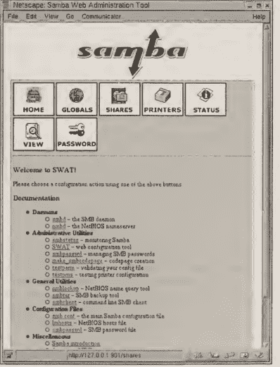

图 9.1 SWAT Samba 配置工具的主界面。

点击 `Global`（全局）按钮处理你的全局配置；点击 `Shares`（共享）按钮创建、删除或编辑现有的文件共享；点击 `Printers`（打印机）按钮添加、删除或编辑现有的打印共享。此工具可以是学习如何配置 Samba 的良好方法。进行一些更改，然后点击 `View`（视图）按钮查看更改后的配置情况。

## 其他网络服务

有许多其他你可能选择或不选择使用的网络服务，但为了 Linux 认证考试，你至少需要熟悉它们。其中某些服务仅特定网络设置需要，而另一些则消耗大量资源，因此通常由 ISP 及其他机构设置。

## 缓存代理

有许多其他你可能选择或不选择使用的网络服务，但为了 Linux 认证考试，你至少需要熟悉它们。其中某些服务仅特定网络设置需要，而另一些则消耗大量资源，因此通常由 ISP 及其他机构设置。

## 新服务器

有许多其他你可能选择或不选择使用的网络服务，但为了 Linux 认证考试，你至少需要熟悉它们。其中某些服务仅特定网络设置需要，而另一些则消耗大量资源，因此通常由 ISP 及其他机构设置。

## 时间服务器

有许多其他你可能选择或不选择使用的网络服务，但为了 Linux 认证考试，你至少需要熟悉它们。其中某些服务仅特定网络设置需要，而另一些则消耗大量资源，因此通常由 ISP 及其他机构设置。

## 虚拟网络计算

虚拟网络计算 `VNC` 是一种 GUI 远程管理工具。该工具允许你在窗口内查看并操作另一台机器的桌面。更好，你可以查看并操作非运行 Linux 的机器桌面。`VNC` 是一个免费开源工具。它最初由 `ORL`（奥利贝研究实验室）编写；该实验室现在是英国 `AT&T` 的。主页地址为 `www.uk.research.att.com/vnc`。

## 章节总结

Linux 认证一级考试要求对网络服务有基础的理解。了解如何为简单任务设置每个讨论的服务是重要的，但对配置和 Samba 等主题的深度处理将在二级考试中进行测试。尽管如此，尽可能深入理解这些主题是有用的。理解得越深，遗漏细节的可能性就越小。

在网络服务中，对于考试目的最重要且最常用的是 `inetd`、`FTP` 和 `Apache`。这因为这些服务虽然有复杂的方面，但一旦理解了它们，设置起来相对简单。随后，注意这些服务之间的区别，例如各种配置文件中用于允许和拒绝访问的格式。

总而言之，在各种网络服务方面的经验越丰富，对你就越有利。在处理这些服务时涉及许多细微差别和步骤，如果没有亲手实践，很容易忘记。这是一个你值得花时间建立一个完整的测试站的领域。

# 复习题

- 1. 哪个文件用于配置由 `superdaemon` 控制的进程？
   a. `/etc/services`
   b. `/etc/inetd.conf`
   c. `/etc/hosts`
   d. `/etc/hosts.allow`

- 2. 哪个文件用于配置机器上网络进程使用的哪些端口？
   a. `/etc/services`
   b. `/etc/inetd.conf`
   c. `/etc/hosts`
   d. `/etc/hosts.allow`

- 3. 使用哪个守护进程管理机器的 DNS？
   a. `inetd`
   b. `dnsnd`
   c. `named`
   d. `bind`

- 4. 使用 `m4` 选择开始配置 `sendmail` 的初始文件时，你应该寻找什么扩展名？
   a. `.m4`
   b. `.cf`
   c. `.mc`
   d. `.sd`

- 5. 下列中哪一个不是有效的 FTP 服务器配置文件？
   a. `/etc/ftpasswd`
   b. `/etc/ftphosts`
   c. `/etc/ftpusers`
   d. `/etc/ftpdny`

- 6. 下列中哪一个不是有效的 Apache 服务器配置文件？
   a. `srm.conf`
   b. `hosts.conf`
   c. `access.conf`
   d. `httpd.conf`

- 7. 如果你想在仅限 Linux 网络上提供 Linux 分区的远程挂载，你应该安装哪个服务？
   a. `SMB`
   b. `FIPS`
   c. `DNS`
   d. `NFS`

- 8. 如果你想在混合操作系统的网络上提供 Linux 分区的远程挂载，你应该安装哪个服务？
   a. `SMB`
   b. `FIPS`
   c. `DNS`
   d. `NFS`

- 9. 关闭在 `/etc/rc.d/init.d/daemon` 中有 init 脚本且当前作为进程 `1022` 运行的守护进程 `/sbin/daemon`，最干净的方法是哪个？
   a. `kill -9 1022`
   b. `kill 1022`
   c. `/sbin/daemon stop`
   d. `/etc/rc.d/init.d/daemon stop`

- 10. 如果你想防止 `inetd` 监听传入的 `talk` 请求，因为你没有打算使用该服务，推荐的做法是什么？
   a. 从 `/etc/services` 中删除包含 `talk` 服务数据的行。
   b. 从 `/etc/inetd.conf` 中删除包含 `talk` 服务数据的行。
   c. 注释掉 `/etc/inetd.conf` 中包含 `talk` 服务数据的行。
   d. 注释掉 `/etc/services` 中包含 `talk` 服务数据的行。

- 11. `sendmail.mc` 文件中的字母 ".dnl" 是什么意思？
   a. 域名名称许可。
   b. 删除到行末尾的空白字符。
   c. 忽略此行。
   d. 运行一个宏。

# 344 第9章

- 12. `sendmail.mc` 文件的第一行必须是什么？
   a. `include('../m4/cf.m4')`
   b. `#sendmail.cf`
   c. `#!/bin/sh`
   d. `OSTYPE(linux)`

- 13. 如何从 `sendmail.mc` 文件创建 `sendmail.cf` 文件？
   a. `m4 sendmail.mc sendmail.cf`
   b. `m4 sendmail.mc`
   c. `m4 sendmail.mc > sendmail.cf`
   d. `m4 sendmail.mc < sendmail.cf`

- 14. 如果你想为你的 Web 服务器添加虚拟主机支持，你编辑哪个 Apache 配置文件？
   a. `access.conf`
   b. `httpd.conf`
   c. `srm.conf`
   d. `smb.conf`

- 15. 在 Apache 配置文件中更改哪个变量可以移动 Web 服务器查找其提供给 Web 客户端文件的基础目录？
   a. `Home`
   b. `RootDir`
   c. `BaseDir`
   d. `DocumentRoot`

- 16. 你使用哪个程序查看哪些 Samba 共享对可用？
   a. `smbclient`
   b. `mount`
   c. `fstab`
   d. `smb`

- 17. 你使用哪个程序访问 Samba 共享？
   a. `smbclient`
   b. `mount`
   c. `fstab`
   d. `smb`

- 18. 你编辑哪个文件来创建 NFS 共享？
   a. `/etc/smb.conf`
   b. `/etc/nfs.conf`
   c. `/etc/exports`
   d. `/etc/access.conf`

- 19. 你编辑哪个文件来创建 Samba 共享？
   a. `/etc/smb.conf`
   b. `/etc/nfs.conf`
   c. `/etc/exports`
   d. `/etc/access.conf`

- 20. 哪个文件共享协议也处理打印共享？
   a. `SMB`
   b. `NFS`
   c. `FTP`
   d. `HTTP`

# 动手项目

这些项目要求你拥有一个安装了命令行模式的运行中的 Linux 系统。根据你所发行版使用的方法，必须已经安装但尚未配置以下包：`wu-ftp`、`Apache`、像 Netscape 这样工作的 Web 浏览器、`NFS` 和 `Samba`。如果你正在工作的机器是生产机器，请务必配合备份进行操作。

# 项目 9.1

为了在仅限 Linux 网络上提供 Linux 分区的远程挂载：

1. 注释掉 `/etc/inetd.conf` 中包含 `talk` 服务数据的行。
2. 注释掉 `/etc/services` 中包含 `talk` 服务数据的行。
3. 使用 `/sbin/daemon stop`。
4. 使用 `/etc/rc.d/init.d/daemon stop`。
5. 使用 `kill 1022`。
6. 使用 `kill -9 1022`。

# 项目 9.2

要同时处理 NFS 和 Samba 共享：

1. 以 `root` 身份登录。
2. 创建 `projects` 目录。
3. 创建 `projects/public` 目录。
4. 使用 `vi /etc/exports` 编辑 `/etc/exports` 文件。
5. 允许登录特定机器的用户以读写权限挂载 `/projects` 目录，添加行：
   `/localhost(rw)`
6. 允许你的域名只读读访问 `/projects` 目录，其中 `root` 账户被视为 `nobody` 账户，添加行：
   `*.domain.extension(ro,root_squash)`
7. 允许世界对 `/projects/public` 目录进行只读非 root 访问，添加行：
   `/projects/public (ro,root_squash)`
8. 输入 `:wq` 保存并退出文件。
9. 通过 `ps aux | grep nfsd` 检查 NFS 进程是否已经运行。
10. 找到 `nfsid` 控制脚本，它通常与 `inetd` 脚本位于同一位置。
11. 进入脚本所在的目录。
12. 输入 `./nfsid stop` 停止守护进程。
13. 输入 `./nfsid start` 启动守护进程。
14. 现在创建 SMB 共享。使用 `vi /etc/smb.conf` 编辑 `/etc/smb.conf` 文件。
15. 通过搜索文本 "Share Definitions" 找到创建新共享的地方，使用命令 `Share Definitions` 并按回车。

18. 输入 "O" 在章节横幅下方创建一个新行，然后进入插入模式。

19. 为 `/projects` 目录创建一个共享。该共享应允许你所在域内的任何人写入，但域外的任何人无法访问。代码可能如下：

```
[projects]

path = /projects

writeable = true

allow hosts = .domain.extension
```

20. 输入 ":wq" 并按回车保存并退出文件。

21. 输入 "ps aux | grep smbd" 检查 SMB 守护进程是否已经在运行。如果正在运行，请继续。如果没有，请跳到第 15 步。

22. 找到 `smbd` 控制脚本，它应该与 `inetd` 和 `httpd` 控制脚本位于同一位置。在某些发行版中，它可能被称为 "samba"。

23. 进入脚本所在的目录。

24. 输入 "./smbd stop" 或 "./samba stop" 停止守护进程。

25. 输入 "./smbd start" 或 "./samba start" 重启守护进程。

26. 创建挂载点 `/mnt/smbd`。

27. 输入 "smbclient -L" 测试 SMB 设置。

28. 输入 "mount -t smb /path/project /mnt/smbd" 挂载提供的分区。

# 在 LINUX 环境下打印

+ 在阅读完本章并完成练习后，你将能够：
- 在基础层面上向机器或局域网添加新打印机。
- 在需要时使打印机和打印队列变为可用或不可用。
- 在队列中移动打印任务，并在需要时将其删除。

除非你工作在一个完全无纸化的环境中，否则你最终将不得不面对打印机和打印任务。从安装打印机到确保它们日常运行良好，一切都属于系统管理员的工作描述范围。

# 安装打印机

打印机是 Linux 下最难使其正常运行的组件之一。尽管某些发行版在 GUI 中提供了工具来简化这一过程，但理解该过程在命令行层面的工作原理至关重要。只有这样，管理员才能处理可能出现的细微问题，或者在没有安装 GUI 的服务器上配置打印。这一事实是一个主要的考虑因素，因为并不是所有的考试都允许使用 GUI 工具。

# 添加本地打印机条目

添加打印机条目是一个多步骤过程，不仅涉及创建指向正确配置文件的指针，还涉及定义打印缓存 `print spool` 和其他项目的存放位置。这里涵盖了如何向系统添加新打印机的基础。

```
/etc/printcap
```

`/etc/printcap` 文件包含了 Linux 了解其正在处理什么种类型的打印机所需的数据、将打印任务发送到打印机队列的位置，以及处理打印任务时需要考虑的因素。文件中的每个条目都遵循以下格式：

```
printername|printeralias:\n:definitions:\
:lastdefinition:
```

处理打印任务本身的细节就位于定义 `definitions` 中。

# 向 /etc/printcap 添加打印机

向 `/etc/printcap` 添加打印机涉及构建语句和设置定义。`/etc/printcap` 语句的第一部分打开特定打印机的节，因此其开头没有冒号。如果只列出一个打印机，则第一个给定的名称应为 `lp`。如果有多个打印机，请选择打印任务默认应发送的那一个，并为它分配名称 `lp`。

例如，假设你想用作默认打印机的打印机是一台激光打印机。编写打印机配置开头的方法是：

```
lp|laser:\
```

行末尾的反斜杠 `\` 表示语句尚未完成。这一功能源于许多编程和脚本语言中使用反斜杠来表示代码继续到下一行。接下来，输入指定要打印到设备的代码。此行将上一行列出的第一个名称与驱动程序的位置等同起来，例如：

```
:lp=/dev/lpp0:
```


注意行开头的冒号（`:`）。所有定义语句都有这个开头冒号。再次，该行以反斜杠结束，表示完整语句尚未完成。设备驱动条目之后通常是打印缓存（print spool）的位置。该目录通常位于 `/spool/lpd` 或 `/usr/spool/lpd` 中，然后位于以打印机本身命名的特定子目录中。如果有多个打印机，这种命名方案尤为重要，因为为了管理目的，缓存目录必须保持分开。

此示例的缓存目录定义可能如下：

```
:sd=/spool/lpd/laser
```

此行没有额外的语句结束字符，因为这三行代码是本地打印机列表目中绝对必要的全部内容。表 10.1 显示了打印语句中常用的几种不同类型。

| 表 10.1 /etc/printcap 中常用的打印定义 |
| 变量 | 用途 | 参数 | 示例 |
| --- | --- | --- | --- |
| if | 在打印任务发送到打印机之前对其过滤 | 输入过滤器 shell 脚本的路径。 | `:if=/var/spool/lpd/laser/input:\` |
| If | 打印错误日志文件。 | 现有文件的路径。 | `:if=/var/spool/lpd/laser/error:\` |
| lo | 打印机开启时创建的锁文件。对于多个用户访问的打印机有用。 | `:lo=/spool/lpd/laser/lock:\` |
| mx | 允许打印任务的最大 own。 | 以块为单位限制，或使用0 表示无限制。 | `:mx=0:\` |
| rm | 如果打印机连接到另一台机器。 | 连接机器的地址。 | `:rm=animals.org:\` |
| rp | 如果打印机连接到另一台机器。 | 远程打印机的指针。 | `:rp=inkjet:\` |
| sh | 不打印标题页。 | 无需。 | `:sh:\` |

# 添加网络条目

如果你想跨网络打印，还需要进行一些配置。你需要配置本地机器发送到远程打印机，并配置打印服务器接受来自其他机器的打印任务。你处理此问题的方法取决于你是尝试通过 Samba 打印还是直接到其他机器。Samba 在之前的章节讨论过。本节专门介绍到远程 Linux 服务器。

# 设置打印服务器

在打印服务器上打开 `/etc/hosts.lpd` 文件。你将在这里列出哪些机器允许使用这些打印机，甚至可以限制为特定用户。如果你在 `fruit.org` 上设置打印服务器并仅允许 `apple`、`mango` 和 `peach` 机器打印，那么你的 `/etc/hosts.lpd` 文件所示：

```
apple.fruit.org

mango.fruit.org

peach.fruit.org
```

要限制特定用户对这些机器打印机的访问权限，请在机器列表后添加用户名。例如，要让用户 `jen` 从 `apple` 打印，用户 `joe` 从 `mango` 打印，并让 `admin` 从这三处打印，你可以这样编辑文件：

```
apple.fruit.org jen admin

mango.fruit.org joe admin

peach.fruit.org admin
```

> 请记住，如果你在其中设置了用户限制，没有显式列出的其他人将打印。

保存并退出文件并重启 `lpd`。

# 设置客户端

当你想要配置局域网内的 Linux 机器打印到另一台机器时，你需要对 `/etc/printcap` 进行一些更改。在打印机定义中，你需要包含一个 `rm` 行来定义打印到的远程机器，一个 `rp` 行来定义远程机器的 `/etc/printcap` 文件中设置的打印机名称，并重置此打印定义的 `lp` 行，所有内容格式如下：

```
:rm-printserver.domain.extension:\n:rp-printername:\n:lp-/dev/null:
```

在 Linux 环境下打印 353

然而，你需要在该打印机定义中保留你的本地打印池。任何从打印机客户端机器发送到打印机服务器的打印作业最终都将被池化两次：一次在客户端，另一次在服务器上。

## 创建打印池

包含打印机队列的目录必须手动创建。在本例中，执行此操作的命令是 `mkdir /var/spool/lpd/laser`。然后，必须设置该目录的组（不要让该目录的所有者为 root）。通常情况下，该目录权限的组应该是 `daemon`，或者在某些情况下，如果存在特定的打印机组的话。要将组设置为 `daemon`，请使用 `chgrp daemon /var/spool/lpd/laser`。最后，必须设置正确的权限。这些权限必须是 `775` (rwxrxr-x)。此设置确保了各种队列管理程序和守护进程也能访问打印池。

## 创建日志文件

特定打印机活动的日志文件也必须手动创建。使用 `touch` 命令创建一个空文件以包含日志，其位置和名称必须与 `/etc/lcpd` 打印机定义中使用的一完全一致。例如，`touch /var/spool/lpd/laser/error.log`。赋予它与打印池相同的所有权（root组，daemon 组）以及权限 `664` (rw-rw-rw-)。 

## 选择灵活的打印过滤器

如果管理员和用户只想打印文本文件，那么就没有需要使用打印过滤器。然而，通常并非如此。想要打印图表、统计图或图形的人需要访问非文本打印机功能。这就是打印过滤器发挥用场的地方。


### 编写还是下载

管理员有两个选择。首先，他或她可以编写一个打印过滤器。那些擅长编写 shell 脚本（关于编写 shell 脚本的更多信息请见第5 章）并且对用户打印的许多潜在文件类型有经验的人，通常可能会编写自己的。其他人可能希望完全控制局域网或机器上处理打印作业的方式，因此根据需要承担开发自己打印过滤器的任务。

第二个选择是从互联网下载现成的打印过滤器。互联网上有两种在 Linux 系统上常用的打印过滤器：APS 过滤器和 magicifier。这两者都可以在 `metalab.unc.edu/pub/linux/system/printing/` 获得。

354 第10 章


熟悉编写简单的打印过滤器并利用这两个现成的过滤器是非常重要的。

## 安装 APS 过滤器

APS 过滤器带有一个菜单驱动的配置和安装脚本，它不仅能安装过滤器，还为你设置了 `/etc/printcap` 文件。像任何实用的脚本一样，你可以通过检查安装程序的代码并熟悉其内部工作原理来学习很多知识。如果你在理解如何在更复杂的环境中设置打印机存在困难，可以通过以下步骤查看 APS 过滤器如何配置你的 `/etc/printcap`：

- 1. **解压 APS 过滤器** 一旦你从上一节列出的网站下载了脚本包，将其放置在你偏好的源目录或下载目录。使用 `gunzip` 和 `tar -xf` 压缩并解压源码，然后进入生成的目录。
- 2. **运行安装脚本** 因为这个新目录可能不在你的路径语句中，请使用命令 `./SETUP` 来运行配置和安装脚本。在按下回车键跳过这些屏幕之前，务必阅读两个初始屏幕。注意程序将做什么以及不会是非常重要的。
- 3. **配置打印机驱动程序** 要开始配置打印机，按“1”来配置你需要的打印机驱动，然后按回车。你将看到一个可以选择的打印机品牌菜单。如果你的打印机明显属于列出的类别之一，输入菜单选项对应的数字并按回车。如果不是，选择一个可能的候选者并执行相同操作。你可以搜索各种菜单选项，直到找到一个看起来可靠的打印机驱动，然后选择它。

一旦你选择了想要使用的驱动程序，输入其菜单项对应的数字并按回车。系统将要求你确认这是你想要使用的驱动程序。按“y”然后按回车确认并返回主菜单。如果你在剩余的配置过程中决定需要选择不同的驱动程序，可以返回并更改。

- 4. **配置打印机接口** 一旦你选择了打印机驱动程序，你需要配置打印机接口。从主菜单按“2”，然后按回车调出短接口菜单。有两个可用选项：并行（parallel）和串行（serial）。假设你有一个并行接口，正如你在“接口选择”部分读到的，并行也是首选。然而，如果打印机连接到串行设备，请选择串行。当你准备好继续时，输入菜单选项的数字并按回车。

在 Linux 环境下打印 355

在你告诉 APS Filter 使用哪种接口后，它将带你进入配置系统。输入指向打印机的设备。通常，如果你在第一个端口有并行打印机，该设备将是 `/dev/lp0`。输入设备路径并按回车，脚本返回主菜单。

- 5. **测试打印机** 虽然本文讨论了没有特殊软件的打印机，但 APS 设置脚本也提供了打印测试页的选项。如果你选择这样做，你需要配置分辨率、黑白或彩色以及使用的纸张。在做出选择之前，务必阅读每个项目提供的文本。完成后回到主菜单，按“T”键并按回车。如果测试页没有正确打印，请参考“解决打印问题”寻求帮助。
- 6. **编译 APS 过滤器** 在完成配置并打印测试页（或你决定跳过该部分）后，是编译程序了。按“C”键并按回车。编译过程是自动的，期间偶尔暂停提问。在此任务过程中务必仔细阅读一切。进程完成后，设置脚本返回你的提示符。
- 7. **检查 /etc/printcap** 使用 `more` 或 `vi` 等工具查看 APS Filter 如何修改 `/etc/printcap`。

一旦你编译了程序，APS Filter 的文件将安装到各个地方。某些文件的安装位置取决于你将源码放在哪里。结果将位于 apsfilter 源码的 `/bin` 子目录下，以及用于配置的 `/etc/apsfilterrc`。


## 安装 Magicfilter

Magicfilter 程序在安装阶段完成的工作少得多，这对某些用户来说是优点，对另一些用户来说是缺点。该包带有一个自动配置脚本，省去了你编辑配置文件的麻烦，并使用 `make` 工具进行编译。然而，你必须手动将其添加到 `/etc/printcap`。操作方法如下：

- 1. **解压 Magicfilter** 一旦你从本章较早“选择灵活的过滤器”节列出的网站下载了脚本包，将其放置在你偏好的源目录或下载目录。使用 `gunzip` 和 `-xvf` 程序解压缩并解包源码，然后进入生成的目录。

- 2. 配置 Magicfilter：使用 `./configure` 命令运行配置脚本，因为其位置可能不在你的路径段中。该 脚本会显示配置过程的每一步，以便你可以查看是否有错误以及错误所在。

- 3. 编译 Magicfilter：Magicfilter 遵循一个相当标准的过程。使用 `make` 命令编译过滤器。再次，屏幕上会滚动一串文本流，让你了解编译器在过程中的所处的位置。一旦程序完成编译，使用 `make install` 命令将其及其文档放置到就位。


为了良好的编程习惯，请执行 `make clean` 命令以清理编译过程中产生的临时文件。

- 4. 将 Magicfilter 添加到 /etc/printcap。打印过滤器本身不是作为一个单独的项目添加的。相反，你应该在现有的或新建的 `/etc/printcap` 方法中添加一行指向打印机的内容。如果 `make install` 没有明确说明它将新的打印过滤器放置在何处，请使用 `find` 命令搜索“magicfilter”。


一旦程序编译完成，Magicfilter 的文件将安装到 `/usr/local/bin`。

# 管理打印服务

一旦打印机及其服务已正确安装、测试并正常工作，长期来看剩下的就是管理。不仅打印机必须保持顺利运行，打印池和队列也是如此。

# 管理打印机

一旦设置、配置、测试并运行了打印机，就必须对其进行管理。必须临时禁用对打印机的访问，例如在维修期间，或者由于长时间队列积压而阻塞接收新作业。打印机管理主要通过 `lpc` 程序完成。

# 列出所有可用打印机

要列出已配置并可用的打印机，`lpc` 有两种不同的格式输出。一种方法是直接输入 `lpc`，然后在命令行输入 `status all`。另一种方法是输入 `lpc status all`。如果选择使用 `lpc` 使其显示提示符，则可以使用 `quit` 和 `exit` 命令关闭程序。

# 启用打印机

要启用打印机以接收打印作业，请使用 `lpc enable` 选项。输入 `lpc enable all` 会使所有打印机可用，而输入 `lpc enable printername` 则使某个特定的打印机可用。例如，如果 `/etc/printcap` 中某个条目的第一行是：

```
lpc|inkjet:
```

那么命令的格式为 `lpc enable inkjet`。

# 禁用打印机

禁用打印机的一种方法是在 `/etc/printcap` 文件的每个行定义语句开头添加标记 (`#`) 来注释掉所有内容，然后重启打印守护进程。关于此主题，请参阅本章前面的“管理打印守护进程”部分。

然而，更简单的方法是使用格式为 "Lpc disable printername" 的 Lpc 命令。

# 管理打印队列

所有发送到打印机的数据都列在队列中。每个打印队列都是由打印队列守护进程 lpc 维护的列表，并与特定的打印机对应。这些队列作业在打印机的 spool 目录中等待打印时间，或者对于网络打印机，它们在本地机器的 spool 目录中等待，直到托管打印机的网络机器接收其 spool 目录中的文件。处理打印队列函数的守护进程是 `lpq`。

# 列出打印队列的内容

要查看默认打印队列（对应于 /etc/printcap 中名为 lpq 的打印机的队列）的内容，请输入 `lpq`。给输出格式如下：

| Active/Inactive | User | Printing | Job Number | File Name | Size |
| :--- | :--- | :--- | :--- | :--- | :--- |

要在许多队列中列出特定打印队列的内容，请使用 `lpq -Pprintername` 格式。例如，如果 `/etc/printcap` 中某个条目的第一行是：

```
lpq|inkjet:
```


那么命令的格式为 `lpq -Pij`。

# 第十章

## 重新排列打印队列中的条目

移动打印队列中的条目需要多个步骤。一旦获得了需要移动到列表顶部的项目的打印作业编号，请使用格式为 "`lpc topq printername job1 job2`" 的 `lpc` 程序。例如，"`lpc inkjet 25 41 63`" 将把打印作业 25 移动到 `inkjet` 队列的顶部，41 移到 25 之下，然后 63 移到 41 之下。

## 获取队列状态报告

要获取打印机及其队列状态，使用 "`lpc status printername`" 或 "`lpc status all`"。继续示例，命令可能看起来像 "`lpc status inkjet`"。

## 禁用打印队列

要禁用打印队列以便让任何内容溢出到特定的打印机，请输入 "`lpc disable printername`" 或 "`lpc disable all`"。对于示例，用法可能是 "`lpc disable inkjet`"。

在打印队列重新启用之前，不会有作业发送到打印机。

## 启用打印队列

要启用打印队列以便接受打印作业进入打印机的 spool——或任何打印机的 spool——请输入 "`lpc enable printername`" 或 "`lpc enable all`"。对于示例，用法可能是 "`lpc enable inkjet`"。

## 管理打印守护进程

处理打印队列的守护进程是 `lpq`。所有发送到打印机的数据都列在队列中。每个打印队列都是由打印队列守护进程 `lpc` 维护的列表，并与特定的打印机对应。这些队列作业在打印机的 spool 目录中等待打印时间，或者对于网络打印机，它们在本地机器的 spool 目录中等待，直到托管打印机的网络机器接收其 spool 目录中的文件。

### lpd

处理打印队列的守护进程是 `lpq`。所有发送到打印机的数据都列在队列中。每个打印队列都是由打印队列守护进程 `lpc` 维护的列表，并与特定的打印机对应。这些队列作业在打印机的 spool 目录中等待打印时间，或者对于网络打印机，它们在本地机器的 spool 目录中等待，直到托管打印机的网络机器接收其 spool 目录中的文件。

### 运行打印守护进程

处理打印队列的守护进程是 `lpq`。所有发送到打印机的数据都列在队列中。每个打印队列都是由打印队列守护进程 `lpc` 维护的列表，并与特定的打印机对应。这些队列作业在打印机的 spool 目录中等待打印时间，或者对于网络打印机，它们在本地机器的 spool 目录中等待，直到托管打印机的网络机器接收其 spool 目录中的文件。

### 打印守护进程

处理打印队列的守护进程是 `lpq`。所有发送到打印机的数据都列在队列中。每个打印队列都是由打印队列守护进程 `lpc` 维护的列表，并与特定的打印机对应。这些队列作业在打印机的 spool 目录中等待打印时间，或者对于网络打印机，它们在本地机器的 spool 目录中等待，直到托管打印机的网络机器接收其 spool 目录中的文件。

### 启动打印守护进程

处理打印队列的守护进程是 `lpq`。所有发送到打印机的数据都列在队列中。每个打印队列都是由打印队列守护进程 `lpc` 维护的列表，并与特定的打印机对应。这些队列作业在打印机的 spool 目录中等待打印时间，或者对于网络打印机，它们在本地机器的 spool 目录中等待，直到托管打印机的网络机器接收其 spool 目录中的文件。

### 停止打印守护进程

处理打印队列的守护进程是 `lpq`。所有发送到打印机的数据都列在队列中。每个打印队列都是由打印队列守护进程 `lpc` 维护的列表，并与特定的打印机对应。这些队列作业在打印机的 spool 目录中等待打印时间，或者对于网络打印机，它们在本地机器的 spool 目录中等待，直到托管打印机的网络机器接收其 spool 目录中的文件。

### 重启打印守护进程

处理打印队列的守护进程是 `lpq`。所有发送到打印机的数据都列在队列中。每个打印队列都是由打印队列守护进程 `lpc` 维护的列表，并与特定的打印机对应。这些队列作业在打印机的 spool 目录中等待打印时间，或者对于网络打印机，它们在本地机器的 spool 目录中等待，直到托管打印机的网络机器接收其 spool 目录中的文件。

### lpc

处理打印队列的守护进程是 `lpq`。所有发送到打印机的数据都列在队列中。每个打印队列都是由打印队列守护进程 `lpc` 维护的列表，并与特定的打印机对应。这些队列作业在打印机的 spool 目录中等待打印时间，或者对于网络打印机，它们在本地机器的 spool 目录中等待，直到托管打印机的网络机器接收其 spool 目录中的文件。

### lpq

打印文件

Linux 打印设置基于 Unix 处理打印作业的方法，因此将每个打印机都视为行打印机。频繁使用打印过滤器是因为它们对数据进行预处理，以避免按其编码格式打印。

## 测试新安装的打印机

在对打印机尝试任何复杂操作之前，请对其进行测试并确保其工作正常。初始测试打印有两个不同方面。第一个只是将原始数据转储到打印机，看纸上是否有任何输出。第二个涉及打印机的 `/etc/printcap` 定义。

要在最基础的层面查看数据是否正确到达打印机，请打印一个简单文件。创建一个短文本文件并使用 `cat` 命令将其重定向到打印设备。例如，使用以下命令：

```
cat printtest > /dev/lp0
```

## 文本文件

打印原始 ASCII 文本文件相对简单。虽然可以 `cat` 文件内容到打印机，但最好是利用打印池守护进程，以避免与其他用户的任何冲突。要将文本发送到 `lpd` 打印后台进程，请使用 `lpr` 命令，其基本格式如下：

`lpr Pprintername file`

如果你想打印到局域网上另一台机器的打印机，并且你已经在 `/etc/printcap` 中配置了打印机，那么只需像本地操作一样发送打印作业即可。使用打印机的本地名称，即在你所在机器的 `/etc/printcap` 文件中分配给它的名称。

### 打印 PostScript 文件

Ghostscript 软件包可在发行版光盘和 `www.cs.wis.edu/ghost/` 上获取，是 Linux 下打印 PostScript 文件的非常有用的工具。PostScript 是一种页面描述语言，可确保文本格式和图形无论发送到什么打印机或显示器，都能按预期显示。尽管这种格式在 Windows 世界中并不常用，并被 RTF 和 PDF 等文档格式所取代，但在 Unix 内部仍在广泛使用。

### 创建 Ghostscript /etc/printcap 条目

Linux 用户打印的文本通常比 PostScript 文件多，除非他们深陷文字处理和格式化。由于这种偏好，为同一台打印机设置单独的条目通常很有用。第一个条目可能是简单的，将文本传递到打印队列；而第二个条目则通过 PostScript 处理器路由打印作业。这样做可以节省打印开销，因为在不需要时，文本文件不会被预处理。与其根据类型为打印机命名，例如 "`laser`" ，你应该根据 `/etc/printcap` 条目设置处理的作业来命名它。一个定义可以命名为 "`text`" ，另一个可以命名为 "`postscript`"。

要创建一个处理 PostScript 的条目，请在 `/etc/printcap` 中创建一个新语句，并将 Ghostscript 程序作为输入过滤器。该语句可能如下所示：

```bash
ps|postscript:\n:lp=/dev/lpd0:\n:sd=/var/spool/lpd/laser:\n:mx#0:\n:if=/var/spool/lpd/laser/ghost_filter
```

### 创建简单的 Ghostscript 输入过滤器

在精细调整发送到打印机的输出时，Ghostscript 有许多可用的微调和设置。这里讨论的是为了让程序运行起来而设置初始过滤的最基本知识。

互联网上还有许多可用的输入过滤器，可以处理各种文件类型。

在打印机定义中输入过滤器行指定的位置创建过滤器。在该文件中，创建一个类似下文的 shell 脚本：

```bash
#!/bin/bash

# 调用 ghostscript 处理文件。

# 单词 path 指向 gs 程序的完整路径。

cat $1 /path/gs -dSAFER
```

保存文件并将其权限更改为 `rw-rw-rw-` `666`，然后确保其所有者为 `root`，组为 `daemon`。

`gs` `Ghostscript` 工具可以在命令行中使用，也可以与它的伴侣工具 `ghostview` 使用，`ghostview` 是一个帮助导航复杂程序的 GUI 界面。了解如何在命令行中使用 Ghostscript 是至关重要的。

> 如果由于某种原因，你的分发行版中没有包含 Ghostscript，请访问 `cs.wisc.edu/~ghost` 下载它。该位置对于获取最新的 Ghostscript 文档和信息也很有用。该网站也包含 Ghostview。

`gs` 工具非常复杂，有许多选项可以精炼最终产品。它值得在日后进一步研究。

### 将文本文件转换为 PostScript

有必要了解如何手动将文件转换为 PostScript 格式。通常，Linux 和 Unix 文档在互联网上直接以 PostScript 格式提供，但并非总是如此。如果你有一台 PostScript 打印机，不能将其作为 ASCII 文本发送。因此，即使是文本在使用之前也进行转换。

常用于此目的工具是 `a2ps`。该软件包在许多发行版中可用，如果你的文件系统中没有，你应该能在互联网上找到它。使用命令 `a2ps -h` 获取许多可用选项的完整列表，这些选项对于精调创建的 PostScript 文档的外观和功能有用。

在基础层，利用程序如下将文本文件发送到 PostScript 打印机：

```
a2ps -o textfile | lpr
```

要将文本文件发送到 PostScript 文件而不打印，请使用：

```
a2ps -o psfile textfile | lpr
```

## 管理打印作业

管理打印队列和打印作业本身之间存在细微区别。处理队列涉及控制它们是否向特定打印机提供作业、重新排列队列内的作业以及其他此类更大规模的任务。然而，管理打印作业涉及从队列或作业组中删除单个作业。

取消已入队列的打印作业通过 `lp` 命令完成。该命令及其标志的效果取决于使用者是谁，取决于调用它的人是超级用户还是普通用户。

### 取消单个打印作业

要取消默认打印机上的单个打印作业，首先查看打印机队列并获取文档的作业号。然后输入 `lprm job`。用户可以查看自己作业的队列并取消自己的自己的作业，而超级用户可以列出并删除任何人的作业。

如果有多个打印机或打印队列，请使用以下格式取消作业：

```
lprm -Pprintername job
```


> 用户可以通过输入 `lprm -` 一次取消所有打印作业。

## 故障排除

有时打印机安装运行顺畅，而在其他时候却问题百生。幸运的是，大多数打印问题都属于特定类别。不要掉入认为问题必须复杂的陷阱，而实际上可能是由于有人绊到了电线。

### Lpd

如果打印机无法工作或莫名停止工作，请检查并确保打印守护进程 (`lpd`) 正在运行。守护进程可能由于某种原因崩溃了，可能只需要重启。另一方面，问题可能比简单的重启守护进程更微妙。

如果 `lpd` 看起来不稳定，将其设置为记录事务以帮助追踪问题。在 `lpd` 初始化脚本中，找到处理 `"start"` 选项的部分以及该部分内包含 `"daemon lpd"` 的行。将此行更改为 `daemon lpd -l`。`lpd` 通过 syslog 命令日志，因此配置信息级别和位置 `/etc/syslog.conf`。

在问题解决后确保删除 `-l` 标志。

### 队列

另一个潜在问题可能是队列被禁用。使用工具检查打印队列。首先输入 `lpc status all` 获取所有打印机的状态，或针对特定打印机输入 `lpc status printername`。如果打印机队列被禁用，请重新启用。如果打印机被列为 `"down"`，这会完全使打印机停止工作，则输入 `lpc up printername` 或 `lpc up all`。

### 打印机

检查打印机本身。确保它已连接到活动电源上，其电缆已正确插入服务器机器，并且打印机已开启。尽管这看起来像是一个极不可能发生的事件，但路人绊到电缆导致连接松动并不罕见。

如果你怀疑打印机本身有问题，请尝试将其连接到另一台计算机，并将文件 `cat` 到打印机设备以测试硬件。即使由于打印机驱动程序或其他系统不匹配导致新计算机只打印乱码，你至少能够判断打印机是否能够接收来自机器的命令。

如果可能，也尝试用不同的电缆连接打印机。

> 该建议适用于任何形式的硬件故障排除。有时，问题似乎在内核或软件层面，但事实证明是主板、内部卡、电缆或其他硬件项目。

# 第10章

## `/etc/printcap`

打开 `/etc/printcap` 文件——特别是如果你是第一次尝试使用此打印机，或者你最近对 `/etc/printcap` 做过某些更改——并双检所有的条目。确保每一行都以冒号开头，且每行的最后都以冒号和反斜杠（`\`）结束。如果文件中配置了多台打印机，请确保定义没有意外重叠。例如，确保两台打印机没有共享同一个打印目录或名称。

确保 `/etc/printcap` 中的条目实际上是正确的。如果设备定义没有指向正确的打印机，或者最大打印作业被不小心设置了某个小值，这些方面将干扰打印机的正常运行。

双检 `/etc/printcap` 的部分工作之一是确保打印机配置文件引用的所有文件和目录都实际存在，并且具有正确的的用户、组和权限设置。如果存在以下条件之一，`lpd` 可能无法将打印作业缓冲到队列中：

- 打印池目录从未创建
- 打印池目录未分配给 `root` 用户或守护进程组（`daemon`）
- 打印池目录的权限为 `775`

## 过滤器（The Filters）

不熟悉打印过滤器（print filters）的人可能会发现他们对过滤器如何工作的基本假设是错误的。打印过滤器可能会导致许多问题问题。其中之一就是过滤器的权限和所有权是否正确的简单问题。

打印过滤器可以是二进制文件，也可以是 shell 脚本。过滤器的目的是处理发送到打印机的数据。确保过滤器在调用其运行的命令时带有必要的标志位和正确的路径。

> 如果你在进行网络打印时尝试利用过滤器，请确保过滤器位于服务器机器上，而不是你尝试打印的本地机器上。

## 空间可用性（Space Availability）

打印问题悄悄影响系统管理员的一种方式是磁盘驱动空间不足。验证包含打印池的分区存储空间是否较低。如果有大量打印作业通过系统，可能值得为打印池目录单独分区，以避免超出主系统分区。

## 局域网（The LAN）

如果你正尝试跨网络连接打印，网络本身可能存在问题。尝试通过 `PING` 其他机器、访问其他机器上的服务或其他执行其他操作来测试打印机器，以确定 Linux 机器局域网是否正常通信。

## 本章总结

你需要了解多少打印知识（如果有的话），取决于你尝试参加哪种 Linux 认证考试。通常，理解打印的基础知识是非常重要的。这些基础包括在 Linux 下安装打印机、向其打印，以及管理单机或网络上的打印机、队列、驱动程序和作业。

要向打印机发送打印作业，需要先安装并配置打印机。编辑 `/etc/printcap` 文件并创建打印机定义条目（包括必要的选项以确保文件正常传输），在打印机守护进程（printer daemon）启动后就可以解决这个问题。然后，要打印作业并将其放入打印机队列，请使用 `lpc` 命令。

`lpd` 守护进程以及 `lpc`、`lpq` 和 `lprm` 程序在处理打印机时都非常重要。守护进程本身负责将打印作业移动到适当的打印池中。`lpq` 程序允许仔细检查已存在的队列及其作业 ID。然后，`lpc` 程序处理打印机和队列管理任务，例如使它们可用或不可用，以及重新排列队列中的作业。如果目标是从队列中删除打印作业，`lprm` 是首选工具。

务必实验打印过滤器。安装本章中讨论的两种过滤器——APS 过滤器和 Magicfilter——并研究其他的。练习编写自己的过滤器。你不需要能够写出像你要下载的那两个那样面面俱到的，但你应该能够为单个任务编写简单的内容。

## 复习题

1. 下列哪项是打印守护进程？
a. `lpc`
b. `lpd`
c. `lpr`
d. `lpq`

2. 哪个文件包含打印机配置信息？
a. `/etc/services`
b. `/etc/printcap`
c. `/etc/lp`
d. `/etc/lp.conf`

3. 下列哪项不是有效的 `lpc` 命令？
a. `up`
b. `enable`
c. `stop`
d. `remove`

4. 下列哪项用于将文档添加到打印队列？
a. `lpc`
b. `lpd`
c. `lpr`
d. `lpq`

5. 使用什么命令（s）format printername 来指定打印机？
a. `lpr`
b. `lprpm`
c. `lpq`
d. 以上所有

6. 哪个组应该拥有打印池目录？
a. `root`
b. `daemon`
c. `wheel`
d. `print`

7. 下列哪项是 `/etc/printcap` 中打印机定义中的有效条目，且不是定义中的第一行或最后一行？
a. `:sh:`
b. `:sh:`
c. `:sh:\`
d. `:sh\`

8. 下列哪项用于列出打印队列的内容？
a. `lpc`
b. `lpd`
c. `lpr`
d. `lpq`

9. 下列哪项不是 `/etc/printcap` 中有效的 `lpc` 命令？
a. `if`
b. `of`
c. `lo`
d. `lq`

10. 通常用什么命令测试守护进程？
a. `cat`
b. `of`
c. `lo`
d. `print`

11. 使用哪个命令（s）配置日志？
a. `/var/spool/lpd/`
b. `/etc/printcap`
c. `/etc/syslog`
d. `/`

12. 哪个程序用于管理打印机和队列？
a. `lpc`
b. `lpd`
c. `lpr`
d. `lpq`

13. 下列哪项用于在启动时启动守护进程？
a. `/etc/inetd.conf`
b. `/rc.d/`
c. `/rc`
d. `/services`

14. 使用什么命令打印 PostScript 文件？
a. `gs`
b. `of`
c. `ps`
d. `lp`

15. 最大大小以什么单位设置？
a. `bytes`
b. `kilobytes`
c. `blocks`
d. `bits`

16. 使用哪个 `printcap` 变量来确保每个作业前打印标识？
a. `of`
b. `mx`
c. `rm`
d. `sh`

17. 下列哪项是检查为什么打印作业没有通过的快速检查？
a. 打印机开了？
b. 线缆是否插好？
c. 守护进程是否运行？
d. 过滤器是否有 bug？

18. 下列哪项是有效的过滤器类型？
a. 编译的 C 程序
b. Shell 脚本
c. 纯文本
d. 编译的 C

19. 使用何种命令序列（忽略标志和值）来获取打印机的作业号并取消该作业？
a. `lpq`, `lpr`
b. `lpq`, `lprm`
c. `lpc`, `lprm`
d. `lpr`

20. 调用守护进程时，如果你想让记录日志，输入什么？
a. `lpd -lf`
b. `lpd -log`
c. `lpd -L`
d. `lpd -l`

# 实验项目（HANDS-ON PROJECTS）

这些项目需要你访问一个处于命令行模式的 Linux 系统。必须安装打印包，并且手头有一段短文本用于测试设置。由于无法预知特定的打印机型号，我们将为一个虚拟打印机进行设置。

## 项目 10.1

1. 以 `root` 身份登录。
2. 输入 `"vi /etc/printcap"` 打开配置文件。
3. 输入 `"G"` 到文件末尾。
4. 输入 `"O"` 打开新行。
5. 通过添加打印机的短名称和名称来开始打印条目。由于这是一个测试设置且不应与站点已配置的任何其他打印机冲突，你不会使用默认打印机 `"lp"`。相反，添加文本：
`tst\test_printer:`

6. 因为你不希望此条目指向真实的打印机，所以不要输入设备。
7. 使用以下内容指向池目录：
`:sd=\var/spool/lpd/tst:`

8. 设置约为 1MB 的输出限制。1MB 是 1024Kb，一个块是 512b，512b 是一个 KB 的一半。因此这意味着 1MB 是 2048 个块。相应的定义行如下：
`:mx#2048:`

对于最后一行，由于这是一个单台测试打印机，请抑制横幅页以节省磁盘空间：
`:sh:`

输入 `"wq"` 并按回车保存并退出 `/etc/printcap`。

输入 `"mkdir /var/spool/lpd/tst"` 创建生成池目录。

该目录的所有者应该已经是 `root`。输入 `"chgrp daemon /var/spool/lpd/tst"` 更改其所属组。

输入 `"chmod 755"` 将目录权限更改为 `rxr-xr-xr`。

输入 `"ps aux | grep lpd"` 查看打印守护进程是否正在运行。

如果守护进程正在运行，则你需要停止它，以便让它读取 `/etc/printcap`。为了安全地停止守护进程，而不对机器或局域网上可能运行的当前打印机造成任何问题，请输入
`"lpc down all Restarting the print daemon"`。在守护进程和队列关闭期间尝试打印的任何人都将收到 `"Restarting the print daemon"` 的消息。

输入 `"lpc up all"` 启动新的打印守护进程并启用所有打印机队列。

现在，使用你已经准备好的打印文件设置本地设置，输入 `"lpr -Pstst filename"`。

输入 `"lpq"` 查看打印作业是否已进入队列。

使用 `lprm` 命令从队列中删除作业。

## 项目 10.2

设置一个处理到网络打印机的打印条目：

- 1. 以 `root` 身份登录。
- 2. 输入 `"vi /etc/printcap"` 编辑 `printcap` 文件。
- 3. 输入 `"G"` 到文件末尾。
- 4. 输入 `"O"` 开启新行。
- 5. 通过分配打印机名称开始打印语句：

```
tstnet|network_test_printer:\
```

- 6. 指向本地生成池目录：

```
:sd=/var/spool/lpd/tstnet:\
```

通过以下内容告诉守护进程哪台机器托管远程打印机：

```
:rm=prinstthost.networkprinttest.org:\
```

8. 托管远程打印机的机器（`prinstthost.networkprinttest.org`）必须在其自己的 `/etc/printcap` 中已经定义了此打印机。此打印机是机器上的默认打印机，因此可以简单地称为 `"lp"`。
n. 告诉本地打印守护进程文件应该去远程机器的哪个位置：

```
:rp=lp:\
```

9. 此打印作业要打开的设备在本地机器上不存在，因此将其设置为 `/dev/null`：

```
:lp=dev/null:\
```

10. 对于最后一行，这是一个单用户测试打印机，抑制横幅页以节省磁盘空间：

```
:sh:
```

11. 输入 `":wq"` 并按回车保存并编辑 `/etc/printcap`。在重启打印守护进程后，如果远程打印机存在，你现在就可以打印到它了。

### 允许外部机器打印到你的本地测试打印机：

- 1. 使用命令 `vi /etc/hosts.lpd` 编辑 `"hosts.lpd"` 文件，允许外部主机向你的机器打印。
- 2. 按 `"I"` 进入 `vi` 的插入模式。
- 3. 添加以下条：

```
.networkprinttest.org
```

- 4. 输入 `":wq"` 并按回车保存并编辑文件。现在，远程打印机可以打印到这个虚拟打印机。

## 编译自定义内核

在阅读本章并完成练习后，你将能够：
- 区分你可用的各种内核源码
- 对内核源码应用补丁
- 配置自定义内核
- 编译并安装自定义内核

每位系统管理员最终都将面临编译新内核的需求。安装自定义内核是一个复杂的过程，涉及选择正确的源码版本、精炼内核配置等。你对创建自定义内核的背后的方法和方法论、如何创建内核、以及如何为 Linux 系统优化内核理解得越深，你的工作效率就会越高。

## 编译自定义内核的原因

虽然为了开箱即用 Linux 系统，并不一定需要编译自定义内核，但在某些情况下，这是不可避免的。即使目标不是添加默认未包含的功能或优化默认内核，升级操作系统的唯一方法最终也是编译所需的所需的内核。安装内核二进制文件通常不是一个好主意，因为这过度依赖这些二进制文件，而它们需要考虑到系统所有的硬件和软件需求。

## 访问未包含的功能

驱动许多管理员编译第一个自定义内核的原因是屏幕上显示的一条消息，声明内核不支持特定功能，或者 README 文件说明需要非标准内核功能。尽管有时这些问题可以通过手动插入内核模块来处理。

## 内核模块

现代 Linux 的设计并不是庞然巨大的。相反，模块在需要时加载，不使用时卸载。例如，`parport` 处理并行端口。

## 手动插入模块

`insmod` 命令加载内核模块。例如，在之前讨论的脚本中，你需要在备份程序完成后卸载模块，除非你打算一直保留到下次重启机器。执行此操作的行可能是：

```
insmod /lib/modules/version/ide-tape
```

## 手动移除模块

`rmmod` 命令移除当前未使用或没有其他模块需要它运行的内核模块。要查看当前加载了哪些模块，使用 `ismod` 命令。例如，在之前讨论的脚本中，你需要在备份程序完成后卸载模块。执行此操作的行可能是：

```
rmmod ide-tape
```


## 设置自动加载的模块

你可以在无需重新编译内核的情况下选择自动加载的模块。要做到，首先找到 `/etc/conf.modules` 或 `/etc/modules.conf` 文件。这两个文件名随发行版而异。在该文件中，你可以列出要加载的模块以及使用它们时对应的选项。

## 优化默认内核

每个发行版都会产生一个能够让机器充分运行的默认内核。然而，这个内核可以并且应该针对其安装的每个系统进行精细化改进。默认内核必须涵盖广泛的硬件和配置问题，以满足大多数安装该发行版的用户。这些额外功能中的每一个都会都会内核的体积。

## 升级到新内核版本

Linux 世界的内核开发速度非常快。通常情况下，紧跟最新且最强大的内核版本并不是一个好主意。这意味着操作系统处于不断变动中，极有可能导致稳定性问题。请记住，每次内核升级都可能导致在几分钟前还运行良好的功能突然出现故障。

## 选择新的内核版本

要在可用的内核版本之间做出明智的选择，了解内核开发过程的运作方式至关重要。缺乏相关知识，很容易认为自己正在选择最佳可用内核，结果却得到了一个在实际上完全不可靠的东西。

## 内核开发

Linux 的最初作者 Linus Torvalds 保留了对内核本身的控制权。然而，内核的开发是由全球的人完成的。当有人想要想要的内容时，他或她会以内核补丁（kernel patch）的形式发送，然后他对其进行考虑，并可能批准也可能拒绝。

内核开发分为两个流。其中一个是“前沿的”（bleeding edge），意味着补丁包含了需要测试稳定性的全新项目。另一个是“经过验证且可靠的”（tried and true）——被认为足够用于生产环境机器的代码。

## 内核编号系统

内核编号系统相对易于理解。在如今的内核中，这两个流都从相同的初始数字开始。在这个主版本号之后是一个点（.`）然后是次内核版本号。如果这个次版本号是偶数，则内核属于生产级类型并被认为是稳定的。相反，奇数版本是实验性的。

次版本号之后是构建号（build number），即到目前为止添加到该次内核版本上的补丁数量。该数字通过另一个点（.`）与主版本和次版本分开，例如 `patch`。如果内核有细微变化或特定于发行版的更改，末尾会有一个连字符以及另一个数字，列出进行了多少处更改。图 11.1 进一步说明了内核编号系统。

## 实验流

不建议在生产机器上选择使用实验性内核（例如 `2.3.14`）。虽然开发内核大多是稳定的，但无法保证稳定性。请记住，这个流被用于测试前沿代码，并没有先例证明它已经准备好在提供基本服务的机器上使用。


图 11.1 内核编号系统。

然而，那些需要仅在实验流中提供的功能或设备驱动程序的人确实会尝试冒险，并且通常对结果感到满意。只需记住内核可能会崩溃。在机器经过几周的测试并证明其可靠性之前，不要从系统中删除旧内核。

## 生产流

内核树的生产分支是稳定的、经过证明的代码，它经历了内核开发过程的其余阶段。如果目标是仔细选择满足系统需求的精确内核版本，而不是仅仅获取最新的生产版本（例如 `2.2.52`），那么阅读随每个版本递增的变更文档至关重要。仅仅因为内核来自生产流，并不意味着一切都能正常工作。

对于任何软件开发者来说，一个问题是添加一个东西有时会破坏另一个东西。当涉及到整个操作系统时，这个问题会呈指数级增长。研究每个内核更改修复了什么，又破坏了什么。最终会出现需要运行的正确组合。如果没有，就获取最新版本或最接近系统需求的版本，并密切关注后续进展。

图 11.2 详细说明了内核开发过程，展示了两个流如何相互作用。

## 编译前的准备

无论替换内核的原因是什么，都使用相同的通用步骤。源代码必须安装在机器上，如果需要应用补丁则必须进行更新。如果机器并不经常用于编程

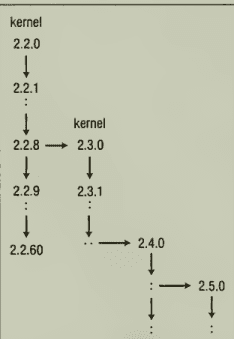

图 11.2 内核开发过程。

## 编译自定义内核

任务，那么可能还有许多相关的包也需要安装或更新。通常，较新的内核需要较版本的 C 编译器共享库。

## 获取内核源代码

内核源代码可以在多个地方获得。用于构建发行版所安装内核的源码可以在发行版的 CD 中找到。否则，还有存档网站存储了到每个官方补丁级别的内核源码，也有其他存储了非官方补丁的网站。所有这些项目在互联网上都可以获得。

## 获取发行版的源码

如果编译自定义内核的目标是优化当前系统的运行，而不是实际更新到新版本，那么直接从随 Linux 发行版的 CD 中获取源码。

大多数发行版至少带有两张 CD。其中第一张通常是发行版本身。第二张通常是发行版上所有开源项目的源码。内核源码是在发行版 CD 上还是源码 CD 上，取决于使用的是哪种发行版。

## 获取非发行特定源码

如果目标是安装比已安装版本更新的，互联网上有许多站点提供内核源码。一个内核信息的权威来源——以及对源码本身的指向——位于 Web 网站 `kt.opensrc.org`。该页面是一份通讯，概述了上周在 linux-kernel 邮件列表上的讨论，Linux 和协助内核开发的人们讨论了新增内容和问题，以及最新源码的形成情况。内核相关文档和源码站点的指向在该页面也可用。

获取新版本源码有两种不同的方法。其中一种方法是下载特定版本的源码包。如果不可用，则下载接近版本的源码以及将其提升到所需版本的补丁。例如，如果目标是安装内核 `2.4.5`，第一步是下载 `2.4` 版本的源码（实际上是 `2.4.0`），然后是补丁 `2.4.1`、`2.4.2`、`2.4.3`、`2.4.4` 和 `2.4.5`。

## 添加源码补丁

如果一个主源码包和补丁集是获取内核源码的最终结果，那么必须按顺序应用补丁。每个补丁都会修改主包的代码，使得在应用每个补丁后，源码与补丁编写时对应的内核版本匹配。在应用补丁之前，必须先进行解压缩和解压，然后将其放在源码目录（通常为 `/usr/src/linux`）。完成此任务后，使用 `patch` 程序将其添加到内核源码中。使用命令 `patch -p0 < patchfile`。

按顺序执行操作至关重要。在补丁文件解压缩并解包后，要将内核 `2.4.0` 补到 `2.4.5`，命令序列如下：

```
$ patch -p0 < patch2.4.1

$ patch -p0 < patch2.4.2

$ patch -p0 < patch2.4.3

$ patch -p0 < patch2.4.4

$ patch -p0 < patch2.4.5
```

## 更新或安装相关软件包

当你更新内核时，有时程序也必须进行更新。需要更新的数量取决于当前内核与新内核之间的跨度有多大。另一个问题是，某些日常操作中可能不需要安装的包——例如，如果机器不用于此类操作，则编译 C 语言——在需要编译它们（尤其是内核）时会变得必不可少。

与其等待错误信息列出需要替换或安装的哪些包，不如阅读内核本身自带的文档。这些文档通常位于源码目录的 `documentation` 子目录中。

## 编译器

为了用源码新内核替换当前内核，必须对源码进行编译。如果没有安装编译器，则需要将其添加到系统中。Linux 中用于构建内核的编译器是 `GCC`，即 GNU/C 编译器，它目前属于软件包 `EGCS`（通常显示为 `egcs`）。如果需要更高版本的软件包，且 Linux 发行版网站上未提供，则提供该软件包的组织主页位于 `egcs.cygnus.com`。

## 预处理器

在准备编译 C 源码时使用的一个工具是 `cpp`，即 C 预处理器。该程序与 C 编译器配合工作工作，为编译过程增加功能和自动化程度。虽然 `cpp` 可能不需要升级，但如果尚未安装，则绝对需要安装。

## 库

编译内核还需要访问正确的库。GNU 版本的 C 库被称为 `glibc`，根据涉及的内核版本及其文档中的说明，这些库也需要安装或升级。

## 构建管理器

当需要编译内核源码等软件时，`make` 构建器会协助用户。管理员只需要知道 `make` 目标（targets），大部分编译过程都由构建管理器自动完成。运行编译需要安装此软件包，但通常不需要升级。

## 其他软件包

取决于你编译内核的方法以及使用的发行版，你可能需要的其他软件包是用户包（users packages）和内核头文件（kernel headers）。如果你下载了内核源码，则包含了头文件。然而，请注意发行版中包含的文件。如果 CD 上有内核源码和内核头文件包，请将它们都安装了。

用户包包含光标控制库，允许在非图形用户界面（GUI）下使用光标。如果选择了特定的内核配置方法，这组软件包可能是必要的。

## 编译内核

让大多数非程序员感到紧张的一个过程是编译编译过程。幸运的是，内核编译的大部分过程都通过 `make` 软件包实现了自动化。以下是从源码编译内核所需的逐步步操作流程。

## 理解 Makefile

用于内核编译的 `Makefile` 位于 `/usr/src/linux/Makefile`。虽然该文档的大部分内容你并不需要理解，但某些特定部分值得关注。本节的目的是让你对文件内容有一个直观的，并在你需要为了自己的目的而修改它时知道该做什么。它还具有更重要的功能：向你展示在 `Makefile` 中可以执行的高级功能。

`Makefile` 的开头——确切地说是前四行——是你可能需要修改的部分：这些行定义了分配给内核的版本号。以下行对应内核 `2.2.80`：

```
VERSION = 2

PATCHLEVEL = 2

SUBLEVEL - 80

EXTRAVERSION -
```

如果 `extraversion` 下有项，它将对应连字符后的最后一个数字。`extraversion` 为 `12` 将此内核版本变为 `2.2.80-12`。如果你对 `Makefile` 或内核源码的任何部分进行了微调，就会更改 `extraversion`。这样做可以让你在查看代码时清楚地知道哪个是你修改过的，哪个是原始的。

下一行可能类似于：

```
ARCH := $(shell uname -m | sed -e s/i86/i386/ -e s/sun4u/spark64/ -e s/arm.**/arm/ -e s/sa110/arm/)
```

任何带有 `:` 的行都是宏定义。在这种情况下，变量 `ARCH` 被设置为括号内语句的值。这些语句本质上由三部分组成，并且现在并没有实际执行。每当 `$ARCH` 被引用时，它们都会被执行。然而，为了演示，你将获得整个执行过程。

这三部分的第一部分是 `shell` 术语。第二部分是命令，第三部分是输出。`Makefile` 使用这些工具进行变量赋值和基于文件存在的条件分支。

现在设置了更多的变量，然后你会遇到以下内容：

```
ifdef CONFIG_SMP

CFLAGS += -D_SMP_

AFLAGS += -D_SMP_

endif
```

这里有两个新项。第一个是 `ifdef` 语句。该条件用于测试变量（在此例中为 `CONFIG_SMP`）是否分配了值。如果是，它将继续执行 `ifdef` 语句内部的内容。否则，它将跳过。第二个要讨论的项是 `+=` 定义。加号符号一起允许你将项追加到文本变量之后。例如，无论 `FLAGS` 原本是什么，现在 `-D_SMP_` 都会被添加到它的末尾。

到目前为止，这里的语句类型越来越多，已经变得越来越熟悉了。跳过变量和宏定义、注释，以及 `ifdef` 和 `ifeq` 语句。在某处，你会遇到一个 `ifneq` 语句，它仅仅是 `ifeq` 的相反。如果括号中的项不匹配，则它为真。

现在，你遇到了另一个新项。以下几行

```
.S.s:

$(CC) -D_ASSEMBLY__ $(AFLAGS) -traditional -E *.s

.S.o:

$(CC) -D_ASSEMBLY__ $(AFLAGS) -traditional -c -o *.o
```

看起来可能像这些，但它们实际上是后缀。在 "c" 或 "o" 或 "c.o" 格式中，这是一个后缀。熟悉 C 编程的人已经熟悉 `.c`（源文件）或 `.o`（链接成可执行文件之前的非可执行编译对象文件）。然而，当构建 `Makefile` 的人无法确定中间文件在过程中的某处没有更改时，这种双部分后缀就是新概念。要拆解 `.c.o` 的制作，请查找 `.SUFFIXES` 行并查看在 `make` 准备好生成对象文件时，是否有 `.c` 文件的源代码已被更改。

现在我们进入了 `make` 目标的实际设置。`version`、`boot`、`vlinux`、`symlinks`、`oldconfig`、`xconfig`、`menconfig`、`config` 等都在这里被赋值。注意，如果一个目标在冒号后没有任何内容，它将直接继续通过冒号，然后执行其后的指令。如果冒号后面有内容，无论有多少项，在继续之前都必须制作这些项。例如，考虑以下内容：

```
boot: vlinux

$(MAKE) -C arch/$(ARCH)/boot
```

## 第 11 章


# 编译自定义内核

## 编译自定义内核 385

在执行 `make boot` 之前，必须已经执行了 `make vmlinux`。如果没有执行，`make` 会运行 `make vmlinux`，然后继续执行 `make boot` 的指令。

> 如果你在 `make` 目标中使用斜杠 `/`，请参考相对于 `Makefile` 所在处的相对路径。

`Makefile` 继续。你至少应该能够识别在其余部分中看到的组件，无论你是否完全理解每个组件的作用。

## 构建默认配置文件

在内核主源码根目录中（很可能是 `/usr/src/linux` 或类似的路径），通过构建默认配置文件来开始编译过程。该默认文件包含了上次配置内核时所使用的所有选项，这使得配置过程变得快得多，因为每一项都不需要从零开始。

要构建此初始配置文件，请使用 `make oldconfig` 命令。即使内核是由发行版安装程序编译的或直接作为二进制文件安装的，也有一组默认配置作为起点。正如前面提到的，该配置文件是 `/usr/src/linux/.config`。

## 准备配置内核

有三个不同的程序处理内核配置。使用哪一个程序取决于多种因素的结合。主要的考虑因素是安装的硬件以及系统在连接局域网（LAN）中的功能。如果机器上没有安装 GUI——例如，因为它是用于特定功能的服务器，如邮件服务器——那么基于 X 的配置工具就不是选项。此外，这三个之间的选择取决于管理员需要配置多少的内核。

## 选择文本内核配置

完全基于文本的内核配置选项是 `config`，如图 11.3 所示。对于不习惯配置内核的人来说，这个选项是最耗时且最令人困惑的。`config` 工具会引导用户通过长时间的问答环节，讨论哪些特征应该被编译、排除在外或作为模块可用。如果目标是对生成的内核进行高度细微调整，理解其中一些选项可能需要进行一定的研究。

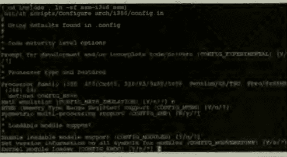

图 11.3 "`config`" 内核配置选项。

### 选择菜单内核配置

一种混合配置选项提供了一个不需要 X 运行的菜单驱动界面，即 `menuconfig`，如图 11.4 所示。这个选项需要一组必要的包才能正常运行。对于那些不熟悉用于各种内核特征的晦涩名称和术语的人来说，这个界面要友好得多。对于那些想要更改几个特征，或者希望以更自上而下的方法面对内核配置，但在机器上无法访问 GUI 的人，`menuconfig` 工具是一个非常好的选择。


图 11.4 `menuconfig` 内核配置选项。

# 编译自定义内核 389

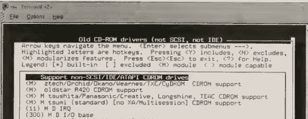

图 11.6 使用 `menuconfig` 配置内核功能

## 使用 xconfig

在 GUI 中输入命令 `make xconfig` 启动 `xconfig` 工具。该工具是完全图形化的。使用按钮选择所需的内核部分。系统会弹出一个新的对话框，其中包含该内核配置部分的选项。每个选项的右侧都有一个 Help（帮助）按钮，点击它会显示一个包含该项信息的对话框。如果在其他情况下不确定，帮助按钮还会注明最佳选择。

要关闭内核分部分的对话框，请点击 Main Menu（主菜单）按钮。此操作将使管理员返回内核中央配置菜单。配置完成后，点击 Save and Exit（保存并退出）按钮。

在内核重配置时，有许多选项可以更改。这些项目列在表 11.3 中。

## 编译内核

编译内核的实际操作相当简单。只需要遵循由 `make` 软件包自动执行的一系列步骤。完成后，你将获得一个全新的内核供使用。每一步可能需要一些时间，因为这是操作的核心。

- **构建依赖列表**：要构建源码的哪些部分依赖于源码的其他部分的列表，请使用 `make dep` 命令。
- **清理临时文件**：要清理配置和依赖构建过程中创建临时文件，请使用 `make clean` 命令。
- **构建内核**：编译内核的主部分，使用命令 `make bImage`。有时它是 `zImage`。`bzImage` 文件是一个压缩内核，且使用频率更高，因为现在的 `zImage` 内核已经很少能完全放入单张软磁盘中了。无法放入单张软磁盘的内核将无法放入应急启动盘中。
- **构建模块**：要编译内核根据需要加载和卸载的模块，请使用命令 `make modules`。

## 表 11.3 经常更改的内核配置选项

| xconfig 章节 | 选项 | 更改原因 | 新值 |
|---|---|---|---|
| 处理器类型和特性 | 处理器族 | 默认是 386。如果目标机器不是 386，请更改。 | 你机器中当前的处理器类型。选择列出的选项之一。 |
| 处理器类型和特性 | 数学仿真 | 任何 486DX 且内置数学协处理器的机器。如果目标机器速度以此或更高，请更改。 | "n" |
| 业余无线电支持 | 业余无线电支持 | 除非你是业余爱好者，否则不需要此选项。 | "n" |
| 红外端口设备驱动程序 | 所有项目 | 除非使用了红外端口设备，否则不需要。 | "n" |
| ISDN 子系统 | ISDN 支持 | 如果不使用 ISDN 作为网络连接，则不需要。 | "n" |
| 旧 CD-ROM 驱动程序 | 支持非 SCSI/IDE/ATAPI CD-ROM 驱动器 | 除非 CD-ROM 驱动器老到不属于上述任何一类，否则此选项不是必要的。 | |
| 摇杆支持 | 摇杆支持 | 对于不运行游戏的服务器或如果没有摇杆，则是不必要的。 | "n" |
| 磁带、软磁盘磁带驱动程序 | 磁带、软磁盘磁带驱动程序 | 如果没有磁带驱动器，则不需要。 | "n" |
| 原生语言支持 | 任意 | 移除你需要的语言支持模块，通常大多数都是你不需要的。 | "n" |
| 音频 | 声卡支持 | 如果机器不是用于多媒体目的且没有声卡，则是不必要的。 | "no" |

## 安装内核

内核编译完成后，你的任务并未结束。它现在必须被安装，一个聪明的系统管理员会以这种方式安装新内核，以便于备份和返回到之前的内核。毕竟，无法保证内核会运行正常，或者至少符合预期。因此，请仔细遵循此过程，在确定一切运行正常之前，不要“烧掉”自己的后路”。

## 将内核移动到就位位置

编译器不会自动用新内核覆盖旧内核。虽然这一事实可能会让某些人感到困扰，但最好让编译器不要尝试读取管理员的心。不小心覆盖旧内核，如果新内核被证明是不可靠的，不仅可能是灾难性的，而且会严重的头疼。一旦编译了新内核，请按照以下步骤安装它：

1. 新内核应位于 `/usr/src/linux/arch/i386/boot/bzImage` 区域。如果不在那里，请使用命令 `find -name 'bzImage'`。`locate` 命令将不起用，因为它的数据库自编译完成后一直没有更新。`which` 命令也不行，因为内核镜像不在你的路径语句中。
2. 确定你当前的内核是位于 `/boot` 分区还是根分区。你可以使用 `ls` 命令或 `find` 命令来实现此。
3. 将内核文件复制到适当的目录或分区。该目录包含了 LILO（或备用启动管理器）在启动期间包含的项。
4. 在此阶段，重命名内核是常见的。使用 `vmlinux-version` 格式，其中 *version* 是安装的内核的完整版本，无论名称上标记了多少组件。
5. 系统映射位于 `/usr/src/linux`。如果需要，再次使用 `find` 命令。
6. 将系统映射文件复制到 `/boot`。保留其名称。

## 将模块移动到就位位置

现在内核和系统映射已就位，需要将模块移动到它们所在的地方，以便内核加载它们。幸好 `make` 软件包处理了这项工作。要完成这一点，首先返回源码目录，然后使用命令 `modules_install`。

## ramdisk

`ramdisk` 是在启动时加载到内存中的内核版本。此步骤是否有必要取决于内核的组成。如果每个内核模块（包括驱动程序）都编译进内核，则无需制作 `ramdisk`。例如，如果系统上有持有根分区的 SCSI 驱动器，且 SCSI 处理模块已编译进内核，则跳到下一步。然而，如果你发现有必要制作初始 `ramdisk`，这个特殊的内核将包含模块，即使它们没有直接编译进主内核。在启动过程完成后，该 `ramdisk` 将被卸载。要制作此 `ramdisk`，类型 `mkinitrd /boot/initrd-version`，其中 *version* 是安装的完整版本。

## 构建新依赖列表

如果你以后想使用手动操作模块的命令，如 `insmod` 或 `rmmod`，你需要一个正确的模块依赖列表。该列表位于 `lib/modules/version/modules.dep`，包含了你安装并构建的内核模块的整个依赖树。

要构建你的新依赖列表，输入 `/sbin/depmod -a`。你只需要在每次机器上构建新模块时执行一次。

## 重新配置 LILO

编译并安装新内核并不意味着机器将自动使用此内核启动。必须对 LILO 进行配置，使其能够看到新内核并为其提供启动选项。聪明的做法不是丢弃旧的启动选项，而是为已工作的旧内核和尚未测试的新内核提供启动选择。

## 打开 LILO 配置文件

LILO 配置文件是 `/etc/lilo.conf`。打开此文件并检查其内容。该配置文件将在第 4 章中深入介绍。假设这是你内核当前条目：

```
image=/boot/vmlinuz-2.2.5-25
label-Linux
```

## 手动添加新选项

你的操作取决于你正在使用哪种发行版。输入 `/sbin/lilocfig`。如果该文件存在，请跳转到“通过 /etc/lilocfig 添加新选项”部分。然而，了解如何手动执行此操作是非常重要的。

插入一个新章节，其与指向之前内核的章节完全相同。不要删除旧章节。然后，确保这两行镜像（image）行分别指向新内核和旧内核（vmlinuz 文件）。

为了确保在重启期间易于区分两个内核实例，请更改其中一个或两个标签（label）行。使用诸如“Linuxversion”或“Linux-new”之类的标签有助于将它们分开。最终版本可能看起来如下：

```
image=/root/boot/vmlinuz-2.2.5-25
label=Linxtwo2
root=/dev/hda2
read-only
image=/boot/vmlinuz-2.4.12
label=Linxtwo4
root=/dev/hda2
read-only
```


## 通过 `/etc/lilocfig` 添加新选项

如果你使用的是提供 `/etc/lilocfig` 工具的发行版（如 Slackware），你可以允许该工具为你完成工作。确保 `vmlinuz` 文件位于根目录而不是 `/boot` 目录，然后输入 `/etc/lilocfig` 来更改 `lilocfig` 配置文件。

> 注意：请确保有一对可用的应急磁盘镜像，以防新内核无法正常启动。

## 重新运行 LILO 并测试新内核

LILO 配置文件的更改在运行 `lilo` 程序之前是不生效的。输入 `/sbin/lilo -v` 会运行 LILO，然后它会将所需的文件精确地放置在需要的地方。

如果关机重启后，机器运行稳定且似乎没有问题，请再次编辑 `/etc/lilo.conf` 并移除旧内核的选项。同时从 `/boot` 目录或分区中删除内核的 `vmlinuz` 文件。执行此操作后，再次运行 LILO 并为新内核分配默认名称，这样在下次启动时就会显示新菜单。

然而，如果新内核运行不正常，请仔细检查错误信息，然后再次重启机器，这次选择旧内核作为 LILO 启动选项。根据错误信息，内核可能需要重新编译，或者安装可能没有正确完成。任何情况下，如果最终放弃了此新内核，请确保将其文件从 `/boot` 中删除并修改 LILO 使其不再作为一个选项，然后重新运行 LILO。

## 章节总结

几乎所有的 Linux 认证考试都从某种程度上涵盖了内核的配置、编译和安装。多次运行这个过程并尝试你所拥有的不同方法是很，这样你才能真正理解所有运作原理。这个过程相当长且复杂，因此通常不需要记忆硬背，但你理解得越深，就能更快地想起下一步要做什么。还要花些时间检查内核配置选项，并思考哪些选项可以删除，看看你的内核占用了多少 RAM，以及模块占用了多少磁盘空间。

安装新内核的第一部分有时是最困难的部分：选择使用哪种源码包。每个补丁级别之间存在细微的差别，添加、删除或禁用的功能，这决定了哪个版本最适合你的设置和需求。对于那些需要访问尖端功能或驱动程序的人来说，甚至必须考虑实验性源码。

一旦下载并打好源码补丁（如有需要），你就必须确保机器上安装了所需的软件包。这些包主要涉及编译内核所需的项目，因此如果你经常进行 C 语言编程，它们可能已经存在于系统中。如果你在编译过程的任何步骤遇到奇怪错误，请考虑你可能缺少某个所需的程序。

配置内核是这些步骤中最不固定的部分。有三种工具选项可用于配置，最流行的是 GUI 工具 `xconfig`。探索 `xconfig` 中的菜单选项，以及你的内核中哪些项目是你可以不要的，哪些是必须的。例如，如果你没有 ISDN 连接或旧的 CD-ROM 驱动器，你就不需要支持这两种服务。

然后，有一系列用于构建内核及其模块的 `make` 命令。这些命令各有其特殊用途，并且必须按照正确的顺序执行。一旦构建了内核和模块，必须将它们移动到指定位置，然后告知 LILO 在哪里可以找到新文件。请记住，在确定新内核运行正常之前，完全移除之前的内核通常不是一个好主意。

## 复习题

- 1. 用哪个词指代操作系统本身？
  a. LILO
  b. kernel
  c. ramdisk
  d. ncurses

- 2. 下列哪项是实验性内核版本？[选择所有正确答案]
  a. 2.12.52
  b. 3.12.49
  c. 4.11.25
  d. 5.15.12

- 3. 用哪个命令加载内核模块？
  a. addmod
  b. insmod
  c. lsmod
  d. mod add

- 4. 用哪个命令列出所有已加载的内核模块？
  a. lsmod
  b. mod -
  c. list -
  d. list

- 5. 用哪个命令卸载模块？
  a. rmmod
  b. mod -
  c. mod
  d. del

- 6. 下列哪些是生产级内核版本？[选择所有正确答案]
  a. 2.12.52
  b. 3.12.49
  c. 4.11.25
  d. 5.15.12

- 7. 哪个包用于管理过程？
  a. make
  b. build
  c. compile
  d. run

- 8. 哪个包用于升级内核？
  a. patch
  b. source
  c. make
  d. insmod

- 9. 哪个包包含实际？
  a. patch
  b. source
  c. make
  d. vux

- 10. 如果你想使用 GUI 配置内核，应该运行哪个 make 选项？
  a. oldconfig
  b. xconfig
  c. menuconfig
  d. config

- 11. 使用哪个 make 选项构建内核？
  a. bzImage
  b. kernel
  c. vmlinuz
  d. version

- 12. 将文件移动到哪个目录？
  a. /
  b. /boot
  c. /root
  d. /kernel

- 13. 内核正确放置后，重命名内核？
  a. bzImage
  b. kernel
  c. vmlinuz
  d. initrd

- 14. 如果你想用文本界面配置内核，应该运行哪个 make 选项？
  a. config
  b. menuconfig
  c. xconfig
  d. initrd

- 15. 编译完成后用什么命令将模块移动到位？
  a. insmod
  b. cp
  c. make
  d. install

- 16. 如果启动过程所需的硬件驱动已编译进内核，你需要运行哪个命令（包含参数）？
  a. mkinitrd
  b. make initrd
  c. make ramdisk
  d. mkdisk

- 17. 如果你想用图形界面配置内核，应该运行哪个 make 选项？
  a. config
  b. menuconfig
  c. xconfig
  d. initrd

- 18. 为了确保机器可以启动新内核，你需要编辑哪个文件？
  a. /boot
  b. /etc/lilo
  c. /etc/lilo.conf
  d. /sbin/lilo

- 19. 为了确保机器可以启动新内核，你需要运行哪个程序？
  a. install
  b. make kernel
  c. /sbin/lilo
  d. /etc/lilo

## 动手项目

这些项目要求你对一个运行中的 Linux 设备具有管理员（root）权限，并拥有该发行版的配套光盘。能够使用 X GUI 更好，但必要时可以绕过。

### 项目 11.1

在这个项目中，你将为内核内核做准备。

为了准备内核，请执行以下操作：

- 1. 以 root 身份登录。

- 2. 输入 `ls -la /usr/src/linux`。如果该目录存在，查看它是软链接还是独立的，然后执行以下操作之一：

  > `/usr/src/linux` 是软链接，删除它。

  > 如果它是独立的目录，则使用 `mv` 命令将其重命名。
  示例新名称为 `/usr/src/linux-old`。

- 3. 下载你想安装的新内核源码，或者从发行版光盘中获取当前内核的源码。

## 编译自定义内核 399

如果你在这一过程中发现有很多程序需要更新，那么考虑做某种备份是一个好主意。如果你正在更新到发行版的较新版本，这一点尤其如此。为了本次练习，你可以随意使用你已安装的发行版自带的内核源码，以避免与当前机器产生复杂问题。

- 4. 在 `/usr/src/` 目录下解压并提取新源码，或者安装源码 RPM，取决于你使用的发行版。

- 5. 在 `/usr/src/` 目录下输入 `ls -a`，查看代码是否创建了 `/usr/src/linux` 目录或 `/usr/src/linux-version` 目录。如果没有 `/usr/src/linux` 目录，输入 `ln -s /usr/src/linux-version /usr/src/linux` 创建指向 `/usr/src/linux` 的软链接。

- 6. 如果必要，将你需要应用的任何补丁文件解压并包到创建的源码包中。确保你拥有所有必要的补丁文件。

- 7. 进入新的 `/usr/src/linux` 目录。

取决于该包的来源，它可能会进入 `/usr/src/linux` 或 `/usr/src/linux-version`。

- 8. 如果你在更新源码，请逐一个应用补丁。要应用补丁，输入 `patch -p0 < patchfile`，其中 `patchfile` 是特定补丁的文件名。

通常情况下你不需要对内核进行修补；相反，你应该能够从如 `www.kernel.org` 等受信任源下载完整版本。

- 9. 使用命令 `more README` 或 `less README` 阅读内核自带的安装说明。

如果你不熟悉内核构建过程，请在另一个虚拟终端中打开此文件。

- 10. 使用命令 `cd Documentation` 切换到 `/usr/src/linux/Documentation` 目录。

## 400 第11章


找些时间至少浏览一下此目录下的文件。

- 11. 使用 `more Changes` 命令阅读列出正确编译内核所需的程序版本的文档。`Changes` 文件中可能内容的示例如图 11.7 所示。


如果你进一步查看此文件，你将发现关于需要升级的内容以及在哪里找到它们的更详细的指引！

- 12. 在 `Changes` 文件的软件部分，列出了所需的软件包、必要的版本以及如何确定你机器上运行的是哪个版本。检查此列表并确认每个包。例如，图 11.7 中的列表首先说你需要内核模块版本 2.1.121。要检查你机器上该程序的版本，你应该根据右侧列使用命令 `insmod -V`。

保留一份你需要更新的每个包的列表。


> 警告！更新 `Changes` 文件中列出的软件包极其重要。否则，你将没完没了地尝试让一切正常工作。通常，人们会安装发行版的新版本连同内核，而不是手动更新一切。

| 内核最低要求 | | | |
| :--- | :--- | :--- |
| 在遇到 bug 之前，“至少”升级到这些软件修订版本！如果你不确定当前运行什么版本，命令应该告诉你。 | | |
| 内核 Modutils | 2.1.121 | `insmod -V` |
| Gnu C | 2.7.2.3 | `gcc -V` |
| G++ | 2.2.0.23 | `ls -1 /lib/libc*` |
| Linux libc5 库 | 4.4.6 | `ls -1 /lib/libc*` |
| Linux libc6 库 | 2.0.7pe6 | `ldd -version` or `ldd -V` |
| 动态链接器 (ld.so) | 2.7.2.8 | `ls -1 /usr/lib/ld-so.so.*` |
| Linux C+ 库 | 1.2.9 | `ps -version` |
| Proctop | 16.0 | `ptree -V` |
| Profsnd | 16.6 | | |
| Pmacs | 1.50 | `hostname -V` |
| Net-tools | 1.16 | | |
| Wh-utils | 9.1 | `basename -version` |
| Autofs | 2.2beta40 | `automount -version` |
| BASH | 1.2.5 | `bash -version` |
| Nfs | | | |
| Ncpfs | 2.2.0 | `ncmount -V` |
| Pcmia-cs | 3.0.7 | `cardgr -V` |

图 11.7 软件版本列表，软件版本部分。

## 编译自定义内核 401

- 13. 如果进一步查看此文件，你将发现关于需要升级的内容以及在哪里找到它们的更详细的指引！

- 14. 在 `Changes` 文件的软件部分，列出了所需的软件包、必要的版本以及如何确定你机器上运行的是哪个版本。检查此列表并确认每个包。例如，图 11.7 中的列表首先说你需要内核模块版本 2.1.121。要检查你机器上该程序的版本，你应该根据右侧列使用命令 `insmod -V`。

- 6. 如果必要，将你需要应用的任何补丁文件解压并包到创建的源码包中。确保你拥有所有必要的补丁文件。

*最终输出如下：*

# 404 第 11 章

- 23. 进入目录 `/usr/src/linux/i386/boot/`，或者如果你将文件放在其他地方，则进入相应的目录。
- 24. 使用命令 `cp bImage /boot/vmlinuz-version` 复制并重命名内核，其中 `version` 是你刚刚编译的内核完整版本号。例如，如果内核版本为 2.2.12，则你应该输入 `cp bImage /boot/vmlinuz-2.2.12`。
- 25. 进入 `/usr/src/linux` 目录。
- 26. 使用命令 `cp System.map /boot` 将新的映射复制到 `/boot` 目录。
- 27. `make modules_install` 命令将指示 Makefile 将模块放置在它们需要的地方。
- 28. 如果你需要内存磁盘（ramdisk），使用命令 `mkinitrd /boot/initrd-version version` 创建此内存磁盘。例如，如果你刚刚制作的内核是 2.2.12，则你应该输入 `mkinitrd /boot/initrd-2.2.12 2.2.12`。
- 29. 注销机器。
- 30. 以 root 身份登录。
- 31. 使用命令 `vi /etc/lilo.conf` 编辑 LILO 配置文件。
- 32. 选择你是否希望新内核默认启动。如果你希望默认启动进入该内核，请将其添加到列出的任何其他镜像之前。如果不想这样，请确保它不是列出的第一个镜像。
- 33. 将光标移动到你想让新定义开始的行。
- 34. 输入 "O" 在光标处创建一个新行，并切换到插入模式（Insert mode）。
- 35. 输入新内核的新列表项。它看起来应该像这样：

```
image=/boot/vmlinuz-version

label=Linux-new

root=/dev/location

read-only
```


- 36. 按 `esc` 键返回命令模式（Command mode）。
- 37. 输入命令 `:wq` 或 `ZZ` 保存并退出 LILO。
- 38. 使用命令 `/sbin/lilo -v` 以详尽模式运行 LILO。此操作会将所有数据写入它们必须所在的位置，以便根据刚刚添加的设置进行启动。
- 39. 执行命令 `shutdown -r now` 立即重启机器。
- 40. 在 LILO 提示符处，按 `Tab` 键列出菜单选项。
- 41. 根据步骤 6 中的示例输入新内核的条目——“Linux-new”—并按回车。
- 42. 观察启动过程。希望机器能够正常启动且一切无碍。如果是这样，请继续。如果不是，检查错误并重启到旧内核。你可能需要重新编译。
- 43. 使用命令 `cd /boot` 进入 `/boot` 目录。
- 44. 使用命令 `ls -la` 列出内容。
- 45. 使用命令 `del vmlinuz-oldversion` 删除旧内核镜像。
- 46. 使用命令 `vi /etc/lilo.conf` 编辑 LILO 配置文件。
- 47. 将光标移动到旧内核镜像条目的的第一行。
- 48. 使用命令 `dd` 逐行删除行，直到旧条目消失。
- 49. 将新内核条目重命名为你喜的 Linux 启动菜单选项。
- 50. 使用命令 `:wq` 保存并退出文件。
- 51. 使用命令 `/bin/lilo -v` 运行 LILO 并再次重写文件。
- 52. 使用命令 `shutdown -r now` 重启机器。
- 53. 当到达 LILO 提示符时，按 `Tab` 键查看菜单。
- 54. 在菜单中输入新内核的选项。机器现在将进入新的、正常的内核。

# 第十二章

## 管理 LINUX 安全

读完本章并完成练习后，你将能够：

- 理解属于“系统安全”标签的许多方面
- 为你的配置制定适当的安全计划
- 确定你的系统是否适合使用防火墙，并实现一个
- 在网络中的机器上应用安全微调原则

网络管理员负担不起在系统安全上的松懈。。如果管理员在设置过程中粗疏大，或者没有跟进最新的安全建议，系统可能会通过许多众知的安全漏洞被攻破。如果一个系统管理员忙到只能跟进系统的某一方面保持更新，那么跟进最新的安全信息应该是首要任务。

### LINUX 安全模型

Linux 安全涉及物理考量方面的结合，例如控制谁有权对机器进行直接操作；网络安全，即对服务访问进行收紧和监控；以及软件安全，例如在发布漏洞修复程序时持续更新软件包。在初始系统设置期间，处理安全问题是一个特别耗时的过程。然而，这是有回报的。

### 大局观

Linux 安全涉及物理考量方面的结合，例如控制谁有权对机器进行直接操作；网络安全，即对服务访问进行收紧和监控；以及软件安全，例如在发布漏洞修复程序时持续更新软件包。在初始系统设置期间，处理安全问题是一个特别耗时的过程。然而，这是有回报的。

### 物理安全

Linux 安全涉及物理考方面的结合，例如控制谁有权对机器进行直接操作；网络安全，即对服务访问进行收紧和监控；以及软件安全，例如在发布漏洞修复程序时持续更新软件包。在初始系统设置期间，处理安全问题是一个特别耗时的过程。然而，这是有回报的。

#### 控制台访问

物理安全方面的第一道防线是机器的物理放置位置以及谁有权对其进行物理访问。随意放置的机器可能会被盗，但也可能受到干扰，干扰用户可以触摸键盘、电源线、电源按钮或系统的 UPS；任何做这些事情的人都掌握着机器的命运。

#### 设备室

确保只有授权人员才能访问特定机器的一种方法是设置一个特殊房间来容纳设备。无论这个房间是一个人在离开时锁上的办公室（如果为了被视为安全措施，必须严格遵守此政策），还是一个用于后台网络服务的机器房，都取决于管理员及其需求。

#### 安全机柜

如果没有整个房间，带锁的计算机存储柜机架是另一个不错的选择。这些机架可以用于存储计算机的所有组件，或者在有大量机器时只存储部分计算机。毕竟，如果有大型交换机允许网络机器共享一个，为什么还需要二十个显示器呢？即使是将一些显示器放在带轮的小车上在柜子之间移动也能节省空间和资金。

#### 防盗设备

机器并不能总是完全隔绝于世外。在一个许多用户进出的环境中，没有人能持续监控状况，设备被盗的问题变得和数据被窃同样严重了。这种情况在大学环境以及一般的教育机构中为常见。

解决此问题的一种方案是线缆锁。在这种情况下，线缆并不是真的锁在硬件上，而是实际上用胶粘在硬件上，然后连接到地板或墙壁等安全表面。

#### 安全机箱

当机器向公众开放时，发生的另一个问题是用户可以使用螺丝刀打开硬件机箱并盗取内部组件（如内存）。可以购买特殊的、需要唯一螺丝刀才能替换默认机箱螺丝。虽然这种操作可以防止内部组件被盗，但它可能会无意中促使小偷拿整台机器而不是零件——因此请务必配合其他安全措施。

### 本地登录访问

本地登录保护有两种类型。第一种涉及初始登录过程，第二种与用户登录后离开机器时发生的情况有关。远程登录问题属于主机安全问题。

#### 保护登录过程

机器软件防御的第一道防线是登录提示，用户在此输入用户 ID 和密码。虽然屏幕在输入密码时实际上不会显示内容，但这种形式的保护不足以阻挡入侵者……尤其是当保护措施选择不当时。确保管理员和用户都理解如何选择安全密码至关重要。关于选择密码以及确保用户不会因其糟糕的选择而危及系统安全的策略，将在本章稍后的“测试不良密码”节中进行讨论。

#### 保护开启会话的闲置机器

有时用户会忘记注销机器，或离开办公桌处理其他事情。这段简短的差事可能会变成长途跋涉，如果情况恰好，可能会导致另一个用户在闲置的机器上工作。该用户甚至可能不是入侵者，而可能是一个并无恶意意图员工。

也许办公室里的某人有需要快速完成的任务，并被邀请使用某位恰好在午餐的同事的机器。然而，所有者的权限可能比此人高，从而开放了其访问权限和造成意外伤害的能力。记住这句话：“浅学而殆懂，是危险的。”

避免这一问题的方法是实施一种密码保护方案，该方案在闲置一段时间后会激活。某些发行版在其图形化用户界面（GUI）中默认启用了该功能。实施此类保护将在本章稍后的“闲置时保护账户”节中进行讨论。

### 数据访问

最终，对许多公司和组织来说，重要的是他们的数据是安全的。机器和组件是可以更换的。但如果对业务日常运行至关重要的数据、财务信息、员工记录、库存和股票信息以及其他重要记录发生丢失，可能会导致公司陷入瘫痪。请花时间识别并保护重要数据。

#### 权限

确保关键数据受到稳固的权限设置和所有权的保护。不要留下任何可以被利用的漏洞。如有必要，以普通用户身份登录并测试哪些部分可以被入侵。

> 权限和所有权管理将在第3章中介绍。

#### 备份

在听到机器崩溃后，大多数用户向管理员提出的第一个问题是：“你做备份了吗？”如果有任何丢失会造成困扰的数据（无论是特定数据还是配置文件、源代码或程序），请务必根据需要频繁创建备份。确定频率的通常取决于如果必须重新复制，工作会造成多大的困扰。

> 创建数据备份将在第6章中介绍。

#### 存储

盗窃会发生。即使是洪水也被已知进入机房并造成破坏。保留备份是防止数据丢失的方法之一，但如果这些备份与数据存在同一场所，自然灾害会将它们连同其他东西一起摧毁。尽管这个问题并不是许多人的担心——毕竟，如果建筑被冲走，数据是最不值考虑的问题——但在某些行业，数据是业务的核心。丢失重要客户的数据可能会引发诉讼。

在不那么灾难的方面，任何放置在或未锁柜子中的物品都可能被盗、误拿或遗失。将重要的备份保存在安全的地方，要么放在防水防火保险箱中，要么如果不需要保存在现场，则放在他处的保险箱中。或者使用互联网连接将它们存储在远程位置。

移动式硬盘是数据锁定问题最有趣的应用。这些驱动器安装在匣中，然后根据需要插入或弹出计算机。这种设置的最大优势之一是驱动器本身可以被锁定以保护自身。

### 加强主机安全

确保局域网（LAN）上每台机器安全的维护工作有助于整体网络安全。一旦特定主机被攻破，整个网络可能很快就会失效。在认为 LAN 设置“完成”之前，考虑处理每台机器的各种任务。

#### 禁用不需要的网络服务

要做的第一件事之一是查看在各个端口上监听的服务列表，并确定哪些是不会使用的。一旦识别出所需的服务，就应该禁用这些服务。需要移除这些服务，因为潜在的入侵者会猛击任何向世界开放监听的端口，甚至可能了解使用的特定守护进程（daemon）的固有弱点。减少开放和监听的端口是迈向主机安全的第一步。执行以下步骤完成此任务：

- 1. 使用 `vi` 编辑器打开 `/etc/inetd.conf`。
- 2. 找到所有不以井号（`#`）开头的活动服务。
- 3. 对每个服务进行认真考虑，并决定哪些没用。
- 4. 通过在行末尾添加井号（`#`）来禁用不需要的服务。
- 5. 完成编辑守护进程配置文件后，输入 `"ZZ"` 并按回车退出。
- 6. 重启 `inetd` `"/rc.d/init.d/inetd"` 取取决于所用发行版的结构。

#### 表 12.1 由 superdaemon 管理的未使用服务。

| 服务 | 功能 | 建议禁用？ |
| :--- | :--- | :--- |
| finger | 允许人们查看特定用户是否登录，并获取办公地点、电话号码等任何用户选择提供的其他信息。 | 此工具经常被入侵者滥用，强烈建议禁用。 |
| ftp | 允许机器之间进行文件传输的服务。 | 如果局域网内只有一个 FTP 服务器，或者没有理由让人们 FTP 到该机器，那么此服务是不需要的。但是，请确保在需要在此机器与其他机器之间移动文件时，有其他方法。 |
| gopher | 一种在 Web 时代之前更流行的文本检索服务。 | 除非有特定需求或想要运行 gopher 服务器，否则禁用此。 |
| imap, pop2, pop3 | 互联网消息访问协议以及邮局版本 2 和 3 守护进程。这些是处理 POP 和其他邮件提取请求的工具。 | 虽然这些服务通常是必要的，但如果有中央邮件服务器，则并非每台机器都需要。这取决于你是需要所有三个，还是一个都不需要。 |
| talk | talk 程序允许局域网内或外的用户（使用 Linux 或 Unix）在文本界面内进行聊天。 | 如果不需要该程序，请禁用它。通常，talk 并不常用，因为邮件、IRC（网络聊天）和电话都可以实现相同的功能。 |
| ntalk | ntalk 程序是 talk 程序的更新版本。 | 如果不需要该程序，请禁用它。通常，talk 并不常用，因为邮件、IRC（网络聊天）和电话都可以实现相同的功能。 |
| telnet | 允许人们登录到其他机器的 shell 账户的服务。 | 如果这是一台希望远程登录的虚拟机，则不需要此服务。但请记住，禁用此服务意味着管理员也无法远程 telnet 到该机器。 |

### 414 第 12 章

超级守护进程（superdaemon）管理的经常使用的网络服务（续）。

| 服务 | 功能 | 建议禁用吗？ |
|---|---|---|
| ucp | Unix to Unix-Copy 服务。一种允许批量移动数据的专用工具，曾经常被用于提供间歇性的新闻和电子邮件服务。 | 随着连接时间成本的降低，该服务在许多地方已经过时。如果没有特定理由使用它，请务必禁用 ucp。 |

#### 特殊用户组

谨慎利用用户组可以限制对文件系统特定部分的访问（第 3 章中提到）。这种方法对于将关键数据隔离到文件系统的独立分段特别有用，因为管理员可以专门创建组，来容纳应该拥有访问权限的精确人员。例如，在所有用户都是“user”组成员的系统中，特殊组尤为有用。

#### 个人用户组

加强文件安全的一种方法是为每个用户创建一个特殊的特殊组。为了方便起见，该组的名称可以与用户的登录 ID 相同。某些发行版（如 Red Hat）默认就会这样做。

使用此类特殊组的原因是，默认情况下，没有人可以访问任何人的文件或目录。此外，所有用户都可以分配到“user”组。

#### 特殊项目组

隔离仅限特定人员访问的文件的良好方法是为需要访问文件系统区域的人员创建特殊组。例如，管理员可能使用 NIS 集中管理用户数据文件，以便每个人在所有机器上都有账户。在 `192.168.12.2` 机器上，有一个位于 `/dev/sd1` 的分区被挂载为 `/ProjectX`。在 `/etc/group` 中创建“projectx”组并将项目成员加入其中，然后将挂载所有者的组权限设置为 root 组和 projectx 组，给予读写权限，就可以将数据目录的访问限制仅限于分配给该组的人员和管理员。

项目团队随后可以通过 NFS 将该分区跨 Linux 局域网挂载，或者同时打开并保存其数据到该专用分区。

> 如果无法使用发行版自带的工具简单地实现这种组创建方法，请编写一个 shell 脚本来处理添加新用户。

#### Nobody 用户

与其总是为守护进程服务创建特殊账户，常见的做法是有一个名为“nobody”的非 shell 账户用户。通常，这些软件包默认假定此身份。如果是这样，除非你有更想使用的其他类型安全账户，否则请保留此设置。如果尚未更改，那些更改为 nobody 账户可以从中受益的服务是：nobody 应该能够登录，但不会受到 nobody 用户受限权限的阻碍。

### 数据包过滤

可以限制对特定机器提供的网络服务的访问。这种额外的安全措施是通过告诉机器根据传入数据包来自局域网或互联网的位置来分析它们来实现的。要完成此任务，请使用 `tcp_wrappers` 工具。

#### 是否安装了 tcp_wrappers

要查看机器上是否安装了 `tcp_wrappers`，输入 `which tcpd`。如果 `tcpd` 已安装，跳过后续两个部分。

#### 获取 tcp_wrappers 工具

`tcp_wrappers` 工具可能已经包含在发行版的 CD-ROM 中。如果没有，请从 FTP 站点 `ftp.cert.org` 的 `/pub/tools/tcp_wrappers` 目录下载源码。

#### 安装 tcp_wrappers 工具

安装 `tcp_wrappers` 工具的方法取决于该包是 RPM 格式还是 tar 经过 gzip 压缩的源码文件。安装 RPM 版本使用标准的 RPM 安装格式 `rpm -ivh package`。然而，源码版本——在用 `tar -xvf` 解压并用 `gunzip` 解压缩后——必须编译到临时或源码存储目录。

> 你在继续之前需要安装编程工具——至少是 `make` 和 `gcc (gcc)` 工具（在第 11 章中讨论）。

进入新的 `tcp_wrappers` 目录，然后用 `vi` 编辑器打开 `Makefile`。搜索文本“`REAL_DAEMON_DIR`”并将等号（`=`）后的值更改为“`/usr/bin`”。在保存并退出 `Makefile` 后，输入 `make linux` 编译程序，然后输入 `make install` 将文件安装到需要的地方。

#### 确定安全级别

此时，管理员必须决定以何种限制程度设置对机器的访问。所涉及的 Linux 机器需要被严密保护，遵循安全准则：“拒绝所有访问，然后允许特定组进入特定区域。”然而，如果只有一个服务或少数服务需要被限制，则仅拒绝对这些服务的访问，然后允许需要使用服务的特定组进入。

#### 配置数据包过滤

用于 `tcp_wrappers` 的配置文件是 `/etc/hosts.allow` 和 `/etc/hosts.deny`。deny 文件中的任何规则都用于阻止进入，allow 文件中的任何设置都用于允许数据包进入。首先查找 `hosts.allow` 文件，如果传入的数据包没有被任何 allow 规则覆盖，则咨询 `hosts.deny` 文件。如果没有找到显式规则，则允许数据包进入。

两个配置文件的定义构建方式是一致的。所使用的格式为：

```
daemon: who_allowed
```

这两个文件中都不使用星号（`*`）通配符。对于规则的 `daemon` 或 `who_allowed` 部分，存在一组特殊的通配符供选择，如表 12.2 所示。

想要使用严格安全级别的人首先打开 `/etc/hosts.deny` 文件并添加“`ALL: ALL`”。保存并退出文件，然后打开 `/etc/hosts.allow` 文件并显式添加允许访问服务的规则。一个额外的术语位于 `who_allowed` 字段，例如：

| 表 12.2 / hosts.allow 和 hosts.deny 变量 |
| 变量 | 目的 |
| --- | --- |
| ALL | 所有。适用于守护进程或 who_allowed。 |
| KNOWN | 规则适用于任何可以解析名称的机器或 IP 地址 |
| LOCAL | 规则适用于局域网内的所有机器。 |
| PARANOID | 规则适用于任何名称不匹配其反向 |
| UNKNOWN | 规则适用于任何无法解析名称的用户。 |
| EXCEPT | 规则适用于列表之外的所有人员。 |

```
ALL: LOCAL 192.168.61.4
```

#### 配置欢迎消息

可以为每个被封装的服务包含自定义 banner。要这样做，首先用 `mkdir` 命令创建 `/usr/local/etc/banners` 目录。每个服务都有自己的 banner。banner 文件是一个与守护同名的文本文件。例如，如果 FTP 服务使用 `tcp_wrappers` 限制，则欢迎信息位于 `/usr/local/etc/banners/in.ftpd` 或 `/usr/local/etc/banners/wu-ftpd`。

#### 更新日志文件

由于 `tcp_wrappers` 监控所有的连接，可以让 `tcpd` 守护进程记录访问信息。这些日志对于检测尝试入侵非常有帮助，或者在考虑访问限制时进行筛选。因为日志文件在第 6 章中详细介绍过，本部分的说明非常简短。编辑 `/etc/syslog.conf` 文件并在系统合适的地方添加 `auth.info` 条目。一个示例条目可能是

```
auth.info /var/log/authlog
```


## 使用新配置

为了利用新的配置设置，必须重启更改文件的守护进程。现在，需要重启的守护进程是 `inetd` 和 `syslog`。

## 安全 telnet 登录

潜在黑客可能正在监控网络包，寻找任何可以被他们进入的工具。一个问题是 `telnet` 程序以明文形式跨网络传输密码——如果连接来自局域网外部，甚至可能通过互联网传输。`telnet` 的替代方案是 `ssh` (secure shell) 程序。

## 第 12 章

## 获取并解压 Secure Shell (SSH) 源代码

加密法律禁止在美国的 Linux 发行版中自带 `ssh` 程序。你可以通过访问 `ftp.replay.com` 网站并进入 `/pub/crypto/crypto/SSH` 目录来下载该程序的完整（未补丁）版本。

该程序有两个不同的开发分支。以“1.”开头的版本可供任何非商业用途免费使用。然而，以“2.”开头的版本仅供个人或教育用途免费使用，商业用途必须购买。解压源码并进入其目录：

### 编译 Secure Shell

首先查看主 `ssh` 目录下的 `README` 文件，检查其说明是否与此处打印的指令有冲突。然后，输入 `configure` 运行自动配置程序。该程序可能需要一段时间才能完成工作，但最终它会生成在特定机器上正确编译 `ssh` 所需的自定义信息。该过程完成后，输入 `make` 实际编译程序。

### 安装 Secure Shell

编译完成后，使用 `make install` 命令安装所有组件。此时，`ssh` 安装器会生成用于传输时加密密码的公钥和私钥。

### 配置 Secure Shell 服务器

要配置 secure shell 服务器的行为，管理员必须以 `root` 身份登录。使用命令 `ssh-keygen` 运行公私钥生成程序。当它完成大部分工作后，会要求输入一个短语（passphrase）。请确保该短语不是字典中的单词。通常使用一个没有标点符号句子更好。确认短语后，密钥将保存到 `~/.ssh` 目录，文件名以“id_rsa_1024”文本开头。公钥是以“.pub” 结尾的文件。

接下来，让每个需要通过 secure shell 访问机器的用户登录，并在其账户下运行 `keygen` 程序。一旦生成了密钥，必须将他们的公钥文件内容复制到 `/root/.ssh/authorized_keys` 文件中，每行一个公钥。

在每个需要接受 secure shell 连接的机器上安装服务器。

### 配置 Secure Shell 客户端

要连接到 secure shell 服务器，你必须安装 secure shell 客户端。在没有 `root` 权限的情况下，可以将 `ssh` 包安装在需要安全访问的 Linux 账户中。如果机器本身还没有 `ssh` 服务器，请按照前面的指令设置 `ssh`。然后，将用 `ssh-keygen` 命令生成的公钥文件副本发送给目标连接机器的管理员。

### 使用 Secure Shell 连接

为了安全地 `telnet`，如果一切都配置妥当，输入 "`ssh host.domain extension`"。仅使用标准的 `telnet` 过程无法访问此工具，除非你通过输入 "`telnet`" 创建一个别名来调用 `ssh`。然而，这样做会产生自己的问题。记住，只有当两端都设置了 `ssh` 时，你才能使用 `ssh` 进行连接。如果你想从该机器 `telnet` 到另一个未设置安全性的账户，最初创建这样的别名会产生阻碍。

## 安全与设置 ID (Set IDs)

对任何文件或目录开启设置位（SUID，或 Set User ID）或组（SGID，或 Set Group ID）。然而，这也是一种安全隐患。正如第 5 章提到的，你实际上无法设置 shell 脚本以 SGID 或 SUID 运行——更准确地说，你可以分配设置位，但它们不会被使用。

每当你想要使用 SUID 或 SGID 时，请花时间考虑其他可用选项。问问自己，为什么这个文件或目录需要设置 ID？它是否等同于创建一个包含该文件/目录以及用户需要运行权限的新组？如果是这样，请高效地使用该选项。

搜索设置 ID 文件和目录有时是值得的，看看那里有什么。重要的是在系统安装尽早（或者至少在安装系统后立即）执行一次，这样你就知道哪些项目应该设置 ID。如果你有原始文件的备份，就能更容易发现那些可能不属于那的项。毕竟，如果入侵者获得了 `root` 或其他访问权限，他们可以在系统上放置运行设置 ID 的程序，而你可能永远不会察觉，特别是当它们在你睡觉的凌晨时分运行时。

若要在整个文件系统中搜索 SGID 文件，输入 `"find / -perm g+s"`；若要搜索 SUID 节点，输入 `"find / -perm u+s"`。

## 移除给破解者的线索

外部人员获取的关于你系统的信息越少越好。系统中有一个名为 `/etc/issue.net` 的文件，默认包含关于该机器上运行的 Linux 版本和发布版本的文本。问题在于，这些文本会显示给任何尝试 `telnet` 系统的用户，作为登录提示的一部分，无论他们是否成功登录。一旦他们知道了发行版和发布版本，破解者就可以查找你所运行程序的各种漏洞，并开始观察你修复了哪些、尚未修复。

因此，强烈建议从 `/etc/issue.net` 中移除对 Linux 发行版、发布版本和内核版本的引用。

## 从受信任站点下载

许多 Linux 用户觉得对病毒和其他恶意程序是安全的，因为现在的印象是，这种担忧是微软 Windows 和 Apple Macintosh 世界才有的。因此，没有那么多的……（注：原始 OCR 文本不完整，此处仅处理可用片段）。

## 限制用户内存和进程使用

确保没有单个用户或进程（包括恶意进程、病毒或木马）过度消耗的一种方法是限制用户一次可以利用多少内存以及用户可以运行多少个进程。做这两件事可以确保你的系统不会被恶意进程耗到无法修复的程度。PAM（可插认证模块）工具——稍后在“其他密码安全增强”章节中讨论——提供了此项功能。获取 PAM 功能完整列表的优秀页面位于 `www.kernel.org/pub/libs/pam/index.html`。用于设置这些限制的模块是 `pam_limits`。为了配置此模块，你需要创建文件 `/etc/security/limits.conf`。`limits.conf` 文件中的每行格式如下：

| WhoToLimit | TypeOfLimit | WhatLimit | WhatLimit |
| --- | | | |

`WhoToLimit` 字段可以是三者之一：
- 用户名，如 "`bart`"。
- 前带符号的组名，如 `"@users"`。
- 表示“所有”的通配符 `"*"`。

尽管你有时只想限制某个特定用户或所有人，但限制用户基础而非守护进程和程序通常是最有用的。

> 即使你显式尝试将它们设置为 `root`，这些限制也不适用于 `root`。

`TypeOfLimit` 字段可以是三个选项之一，它们会让你想起设置文件系统配额：
- 终端 "`soft`"：设置软限制，即定义的用户或组开始担心空间耗尽的点。
- 终端 "`hard`"：设置硬限制，即用户或组无法再请求更多指定资源的点。
- 字符 "`-`"：关闭对定义项的限制。

你可以为同一个 `WhoToLimit` 同时设置硬限制（`hard`）和软限制（`soft`），但它们必须在单独的语句中创建。此选项和前一个选项是仅两个绝对必需的选项。如果你还包含了下一个选项，那么也必须添加最后一个选项。

与进程和 RAM 相关的 `WhatToLimit` 选项有：

- 术语 "`memlock`"：用于设置定义用户或组可用的最大 RAM 数量。与此选项关联的值必须以 KB 为单位。
- 术语 "`nproc`"：用于设置用户或组可以运行的最大进程数。
- 术语 "`priority`"：用于设置定义用户或组进程默认的 `nice` 级别。

最后，`WhatToLimit` 项目的值与 `WhatToLimit` 项目本身的要求相关。

例如，若要将 "`users`" 组中的所有人限制为 `nice` 级别为 13，最大 `nice` 级别为 9，你需要输入以下行：

```
@users soft priority 13

@users hard priority 9
```

一旦你按照需要设置了这些信息，保存并退出文件。然后，你需要告诉 PAM 这些限制的存在，以及要将这些限制应用于哪些服务。打开 `/etc/pam.conf` 文件并按格式添加行：

```
Service session required pam_limits.so
```

因此，你可能会包含这样的一行：

```
OTHER session required pam_limits.so
```

保存并退出此文件，你就准备好了。

# 防火墙

“防火墙”是网络安全领域最大的流行词之一，这个词被反复提及，仿佛它是解决入侵者担忧的万灵药。然而，防火墙只是与其他任何服务一样的一种工具。对于某些目的，防火墙非常有效；但在另一些情况下，这种措施对网络使用的阻碍大于帮助。在涉及到防火墙是否真的能解决安全问题时，实施方式也是一个巨大的因素。

防火墙是一种集中管理网络进出流量的工具。没有数据直接发送到背后的任何机器。相反，进入的数据包将首先由防火墙检查。如果它们被认为是适当的，它们会被发送到管理员配置工具发送它们的地方。有时，对于外部世界来说，他们看不到防火墙之外的任何内容。

这种工具有多种形式。有些公司销售现成的设备盒，可以插入网络并调节流量。还有可以安装在普通计算机上的商业产品，也可以使用免费的开源软件。软件防火墙通常可以安装在专用的防火墙机器上，也可以安装在多用途的计算机上。

## 防火墙的缺点

安装防火墙并不是网络安全问题的答案。有时，网络需求使得防火墙变得微不足道，而在另一些时候，它带来的麻烦远大于它的帮助。

将防火墙想象成挂在灯光前的一块大纸板。每当管理员必须配置防火墙允许数据传入或传出时，这种操作都需要向外部世界开放一点网络。这样做等同于在纸板上钻一个洞，让一束光的光透过去。必须通过防火墙的信息越，，需要钻的洞就越多，透过去的光也越多。如果必须允许大量数据进出，防火墙开始看起来就像瑞士奶酪一样。在这个过程的某一个点，它的效用就会被稀释，应该考虑其他的安全方案。

某些日常任务任务必需的软件可能无法正确利用防火墙。如果该程序是开源的，可以对其进行修改以适应防火墙的需求。然而，如果源代码不可用且初始程序不提供支持防火墙的版本，那么就会陷入困境。要么防火墙不是选项，要么必须使用另一个能够在其限制内运行的程序。

## 防火墙的类型

本质上有两种防火墙：代理防火墙，它为后面的用户处理所有的 Internet 服务；以及 IP 过滤防火墙，它检查所有进入和流出的 TCP/IP 数据包，并根据内部设置的规则进行处理。

## 代理防火墙

代理防火墙处理网络的所有流量。当防火墙后的用户尝试访问互联网上的 Web 页面时，请求将发送到代理服务器。防火墙随后使用自己的客户端打开请求的 URL，然后将此信息传递给用户。所以，基本上互联网上的目标服务器看到所有请求直接来自防火墙本身。使用代理防火墙的优点是，每个连接和尝试连接都可以被轻松记录。缺点是即使出于合法目的，无法从外部进入网络。

## 过滤防火墙

IP 过滤防火墙的工作类似于 `tcpwrappers`，但在更大的层面上。它允许管理员对每个进入和流出的数据包进行检查，然后根据规范进行处理。这个工具的优点是，谁花时间正确构建规则，就可以配置什么。缺点是使用这个工具有很大的马虎空间。

## 实现代理防火墙

这里涵盖的代理防火墙是 `SOCKS5` 协议。该服务器可以免费下载，并能很好地保护任何网络。虽然安装过程相当简单，但注意配置以最大化使用代理的安全益处是非常重要的。管理员可以在 `www.socks.com` 获取 `SOCKS5` 代理服务器。点击 Download 按钮并阅读各种可用包的信息。没有特定的 Linux 源码版本。下载 Unix 源码到临时目录。Web 服务器要求用户在下载软件之前输入信息。下载包后，按照链接查看是否有可用的补丁。如果有，点击补丁将在浏览器中打开它。使用浏览器的“另存为”功能将补丁保存为文件。

## 安装 SOCKS5 服务器

为了安装服务器，必须编译防火墙代码。幸运的是，`SOCKS5` 工具带有一个自动配置脚本和一个编写良好的 Makefile。如果在编译阶段没有问题，那么安装这个工具就相当简单。遵循以下步骤：

- 解包源码——使用 `gunzip` 和 `tar` 程序将源码解包到 `/usr/src` 的部分或优先的源码临时目录。
- 检查文本文件——查看 `README` 和 `INSTALL` 文件，查看指令与此处是否不同。
- 运行自动配置脚本——进入解包源码时创建的目录，然后输入 `./configure` 开始运行自动配置脚本。此脚本收集系统上硬件和软件的信息以提供给 Makefile。它也有助于确保所有必要的内容已安装。GNU C 编译器会列出完成服务器安装需要安装的内容，包也是如此，可能还有 C 库。
- 编译代码——一旦自动配置脚本完成，输入 `make` 开始编译。希望这个过程进展顺利。如果不是，回看第 11 章，那里讨论了需要安装的包。可能需要包含内核源码和头文件等包。
- 安装 SOCKS5 服务器——完成后，输入 `make install` 将二进制文件和库移动到位置。

## 构建 /etc/socks5.conf 语句

了解 SOCKS V5 配置语句的布局非常重要，以便充分利用配置可能性。有时在特定机器上进行练习会有帮助，默认拒绝所有访问，然后允许特定类型的数据。

`etc/socks5.conf` 文件中的语句以表 12.3 显示的选项之一开头。每个选项的正确实现都很复杂。

表 12.3 `/etc/socks5.conf` 配置语句类型。

| 类型 | 用途 | 禁止进入规则定义的实体 |
|---|---|---|
| ban | | |
| auth | 显式定义从规则定义的实体接受连接必需的身份验证类型 | | |
| interface | 在具有多个 IP 地址的机器上，显式定义该接口从哪里或向哪里连接 | | |
| set | 定义 SOCKS V5 环境变量 | | |
| proxytype | 显式定义代理的用途，类型为 socks5 或 noproxy | | |
| accestype | 显式定义连接是否被接受，类型为 permit 或 deny | | |

## 构建主机和端口模式

当一个入站连接到达你的代理防火墙时，可以对其进行分析以确定源机器和进程是否可以接受。在 SOCKSV5 配置文件中引用主机或多个主机时，有多种方法可以精确缩小要包含的机器。可用术语列于表 12.4。

由于代理防火墙会查看端口本身的入站和出站连接，因此仔细定义规则所指的端口至关重要。表 12.5 概述了添加端口条目的可用术语。

可以混合括号类型以获得所需的的结果。


表 12.4 SOCKSV5 配置文件中的主机模式类型。
| 格式 | 含义 | 示例 |
| - | - | - |
| - | 匹配所有项。 | - |
| domain.extension | 指定域内的任何主机。 | colors.org |
| IPbeginning | 指定 IP 段内的任何主机。 | 192.168 |
| host.domain.extension | 连接必须源自此特定主机。 | green.colors.org |
| IP/Mask | IP 和掩码定义范围内的任何主机。 | 192.168.10.0/255.255.255.12 |

表 12.5 SOCKSV5 配置文件中的端口模式类型。
| 格式 | 含义 | 示例 |
| - | - | - |
| - | 匹配所有项。 | - |
| service | 使用该端口的服务 | http |
| port | 规则所适用的端口号。 | 90 |
| [start,end] | 括号内列出的端口号范围。 | [70,90] |
| (start,end) | 括号内列出的端口号范围，不包含数字本身。 | (69,91) |

## 构建身份验证模式

根据你对防火墙后网络安全的需求，你可能选择或不选择入站连接需要身份验证。代理防火墙提供了几种不同类型的身份验证。身份验证模式允许管理员在建立连接时定义使用什么类型的用户身份验证。该模式的可用选项如表 12.6。

在创建模式时列出多个项时，请用逗号隔开且不留空格。例如，“k,n”。

## 设置环境变量

该语句允许管理员初始化环境变量。其中一些变量列在表 12.7 中。通过输入 "`man socks5`" 可以查看完整列表。要设置环境变量，请使用以下格式：

```
set variable value
```


| 类型 | 含义 |
|---|---|
| - | 任何身份验证方法。 |
| k | 接受 Kerberos 5 身份验证。 |
| n | 不需要身份验证。仅对面向普通公众的服务使用此设置，并请谨慎使用。 |
| u | 接受用户名和密码身份验证。 |

| 变量 | 用途 | 值 |
|---|---|---|
| `SOCKS_MAXCHILD` | 设置 SOCKS V5 服务器可以创建的最大子进程数。默认值为 64。 | 允许的子进程数量。 |
| `SOCKS_NOIDENT` | 告诉 SOCKS V5 服务器不要向入站连接请求 ident。如果大多数入站连接来自 Unix 机器，此选项可以减少浪费的时间。 | 无值。 |

表 12.7 SOCKS V5 服务器常用的环境变量（续）。

| 变量 | 用途 | 值 |
| --- | --- | --- |
| `SOCKS5_REVERSEMAP` | 始终解析主机名。使用此选项会降低性能，但会创建更丰富的日志文件。 | 无值。 |
| `SOCKS5_SERVICENAME` | 始终解析端口服务名。使用此选项会降低性能，但会创建更丰富的日志文件。 | 无值。 |
| `SOCKS5_PASSWD` | 设置 SOCKS V5 服务器在尝试连接时给另一个 SOCKS V5 服务器的密码。 | 密码本身。 |
| `SOCKS5_USER` | 设置 SOCKS V5 服务器在尝试连接时给另一个 SOCKS V5 服务器的登录名。 | 登录名本身。 |

# 构建规则语句

现在你已经如何构建规则中使用的各种模式，就可以开始构建配置代理防火墙行为的语句了。有多种语句：`ban`、`auth`、`interface`、`proxy` 和 `access`。`ban` 语句指的是 SOCKS V5 服务器不应接受哪些主机的连接。该语句的格式为：

```
ban hostfrom portform
```

语句中的 `hostfrom` 和 `portform` 部分——以及本节其余语句——表示连接的源地。该语句最严格的版本是 `ban --`，这意味着禁止来自任何人在任何端口的外部连接。然而，通常 `ban` 语句并不那么严格。

`auth` 语句指的是 SOCKS V5 服务器接受来自特定主机的何种类型身份验证。该语句的格式为：

```
auth hostfrom portform authpathtern
```

该语句最宽松的格式是 `auth --`，这种格式并不少见。

如前所述，`interface` 语句仅对于具有两个 IP 地址（因此有两个以太网卡）的机器是必要的。该语句用于告诉 SOCKS5 服务器使用哪块以太网卡。

```
interface host address
```

```
interface port address
```

```
proxy hostto port
```

```
proxy hostfrom portfrom
```

```
proxy authtern hostfrom
```

表 12.8 SOCKS5 access 语句识别的命令。
| 命令 | 描述 |
| - | - |
| - | 匹配所有命令。 |
| b | 附加特殊用途密钥。 |
| c | 连接到服务。 |
| p | PING 服务。 |
| t | 路由。 |
| u | 使用 UDP 协议。 |

# 配置 SOCKS5 服务器

在配置 SOCKS5 服务器时，请记住，最好的安全性是拒绝所有连接，然后允许必要的项通过。虽然可能采取更松散的方法，但那会让防火墙形同虚设。然而，对于防火墙后机器的限制可以很多。

# 创建配置文件

登录并使用 `vi` 编辑器打开文件 `/etc/socks5.conf`。这是配置代理防火墙的地方。

# 配置 SOCKS V5 服务器

通常，防火墙后的机器被管理员认为是“可信的”，或者至少在很大程度上是。由于这个原因，它们通常不需要为大多数服务使用代理服务器。它们可能访问外部无法访问的服务器和服务。

`/etc/socks5.conf` 中代表内部网络的部分可能如下——为了示例，它跨越了 B 类地址范围 172.16.10.0 到 172.16.10.15，SOCKS V5 服务器位于机器 172.16.10.20：

```
# 代理服务器接受任何形式的身份验证。
auth - -

# 代理服务器不限制内部局域网连接。
permit - 172.16.10.0/255.255.0.15 - - -

# 代理服务器不会接受来自教育机构的连接
# 因为之前出现过尝试入侵的问题。
ban .edu -
```

注意，由于 `ban` 语句的存在，网络保护区域的用户将无法访问教育机构的服务。

## 构建 `/etc/libsocks5.conf` 语句

SOCKS5 客户端配置文件 `/etc/libsocks5.conf` 包含一种类型的语句。然而，该语句非常复杂，必须正确配置，以确保机器能够访问其所需的信息，并确保安全性不受损害。该文件中的语句都是按照以下方式构建的代理定义：

- **代理语句格式**：`/etc/socks5.conf` 中的语句格式与 `/etc/libsocks5.conf` 不同。客户端配置文件的格式如下：

```
proxy command hostto portto users proxies
```

- **代理类型**：`proxy` 的值可以是 "`socks5`" 或 "`noproxy`"。对于客户端被信任在安全区域内访问的任何服务，使用 "`noproxy`"；对于该机器必须通过代理服务器使用的的服务，使用 "`socks5`"。

- **可用命令**：命令选项与前面的表 12.8 中列出的相同。按照惯例，这些命令可以通过逗号隔开且不留空格的串联使用来混合和组合。

- **主机与端口**：`hostto` 和 `portto` 项目再次是规则的定义主机和端口模式。

- **可选用户列表**：如果需要，可以通过包含规则涵盖的特定用户名来缩小范围。除了代表所有用户的破折号（`-`）之外，不允许使用任何通配符。

- **可选代理服务器**：规则指向的 `proxyhost:proxyport`，如果不是默认值。

## 配置 SOCKS V5 客户端

如果防火墙后的机器没有配置为 SOCKS5 客户端，它们将不知道如何采取行动。请花一点时间考虑防火墙后的机器是否都被信任可以在不受干扰的情况下相互通信。然后，考虑哪些外部服务允许访问，并配置它们通过代理进行。否则，网络结构将无法得到适当保护。按照以下步骤配置您的 SOCKS5 客户端：

1. 创建配置文件。登录并使用 `vi` 编辑器打开文件 `/etc/libsocks5.conf`。这是告诉机器客户端如何利用代理系统的地方。

2. 配置 SOCKS5 客户端。通常，防火墙服务器后的客户端机器被管理员认为是“受信任”的，或者在很大程度上受信任的。由于由于原因，大多数服务通常不需要它们使用代理服务器。它们可能还可以访问外部世界无法访问的所有服务器和服务。

`/etc/libsocks5.conf` 中代表内部网络的部分（对于同一个示例，它跨越了 B 类范围 172.16.10.0 到 172.16.10.15，SOCKS5 服务器位于 172.16.10.20 机器上）可能如下：

```
# 这里是受保护网络在内部
# 通信的设置。
noproxy - 172.16.10.0/255.255.255.0 -

socks5 - 172.16.10.20
```

代理地址末尾没有 `:proxyport` 的原因是所有代理的服务都被发送到防火墙，并且每个服务都通过其标准的 `/etc/services` 端口运行。

## 实现过滤防火墙

这里介绍的 IP 过滤防火墙是 `ipchains`。该软件包包通常随 Linux 发行版自带，即使它在互联网上无法免费获取。曾经，在用 `ipfwadm` 工具实现 IP 过滤之前，需要重新编译内核，但 IP 过滤工具——`ipchains` 在内核 2.1.102 及更高版本中默认已启用。

如果尚未安装 `ipchains` 软件包，则必须先在机器上安装。输入 `man ipchains` 查看该软件包是否存在于系统中。如果该程序没有手册页（man page），则查看发行版 CD-ROM。如果由于某种原因它未包含在其中，请尝试发行者的网站。可以从 IP Firewalling Chains 的主页（www.rustcorp.com/linux/ipchains/）获取该软件包的最新版本。

## IP Chains

IP 链是一组相关的 TCP/IP 数据包处理规则。`ipchains` 软件包至少包含三条链：`input`（输入）、`forward`（转发）和 `output`（输出）。所有规则都可以放在这三条链之一下，或者如果管理员需要，也可以创建新的链。对于如何将规则划分为各种链，没有规定规定。主要要求是将相关的规则保持在一起，以便它们可以相互检查。

链的顺序同样重要。对于传入的数据，首先应用的链是 `input` 链，而 `forward` 链会检查它并将其传递给适当的本地机器。相反，对于传出的数据，首先应用的链是 `forward` 链，然后是 `output` 链。

## 设置链策略

每条初始链（`input`, `forward`, `output`）都需要一个覆盖策略。该策略处理未被链中设置的规则具体涵盖的条目。可用策略的选择如表 12.9 所示。

要为链设置策略，请使用格式：

```
ipchains -P chain policy
```

一旦设置了链的策略，就可以开始创建规则。例如，从这一行开始是明智的：

```
ipchains -P Input REJECT
```

从那里开始，管理员可以开始添加必须允许的规则。

## 规则部分

创建规则可能是复杂的，取决于它的需求。基本格式是：

```
ipchains -A chain
```

## 地址规范

另一类规则标志指的是地址。其中一些在表 12.10 中。

| 标志 | 目的 |
| :--- | :--- |
| d | 测试目标地址。 |
| i | 测试接口。 |
| j | 指定目标。 |
| s | 测试数据包来源地址。 |

## 地址格式

规则中的地址可以是书中使用的格式之一。第一个是域名，例如 `example.org`。第二个是 IP 地址，例如 `10.15.26`。第三是 IP 地址和掩码组合，例如 `172.19.12.0/255.255`。第四个是使用掩码的整个类范围。为了准备第四种类型，请考虑掩码的每个部分作为独立的实体。255 是八位，0 是无。255.0 是八位，255.255 是十六位，255.255.0 是二十四位，255.255.255.255 是三十位。这种情况使用的格式是 IP 地址基础以及位数大小。例如，`192.168.15.0/32` 表示 192.168.15.0 到 192.168.15.255。

| 策略 | 结果 |
| :--- | :--- |
| ACCEPT | 如果未被任何规则涵盖，则允许。 |
| DENY | 如果未被任何规则涵盖，不允许。 |
| MASQ | 如果未被任何规则涵盖，则使用地址转换允许。 |
| REJECT | 如果未被任何规则涵盖，则发送错误消息。 |

## 数据包类型规范

另一类规则标志指的是通过的数据包类型。这里显示了两个标志：

- `p` 此标志测试处理数据包的协议。该协议通常是 TCP 或 UDP。
- `y` 此标志测试数据是否专门为 SYN 包。

## 特殊 TCP 和 UDP 协议处理

如果在规则中引用了 TCP 或 UDP 端口，也可以指定特定的端口或端口范围。列出单个端口使用数字。对于范围，用冒号（:）分隔数字。

另一个 TCP 特有的项目是 SYN 包，它用于请求连接。如果目标是阻止某些地方的连接，同时允许内部用户从内部连接到相同的机器，那么阻止 SYN 包效果很好。要阻止这些数据包，请在 TCP 协议规则中添加 `-y` 标志。

## 特殊 ICMP 处理

如果在规则中指定了 ICMP（网控制协议），则有机会指定规则适用于哪种 ICMP 服务。

## 表 12.11 用于 ipchains 指定要测试的 ICMP 数据包类型的术语。

| 名称 | 提供的功能 |
|---|---|
| destination-unreachable | 一个泛指术语，指无法到达目的地的 TCP 或 UDP 流量。 |
| echo-reply | ping 的 "pong" 响应。 |
| echo-request | 一个 ping 请求。 |
| host-unreachable | TCP 或 UDP 流量无法到达其目的地主机。 |
| network-unreachable | TCP 或 UDP 流量无法到达包含其目的地的网络。 |
| port-unreachable | TCP 或 UDP 流量无法到达其目的地本应监听的端口。 |

这些名称必须与 `-s` 选项配合使用。表 12.11 列出了可用 ICMP 服务的一个示例。要获取完整列表，请输入“`ipchains -h icmp`”。


如果目标是反转规则——即使用其相反规则——则在标志及其值之间添加感叹号 (`!`)，并在两者之间留空格。例如 "`-! UDP`“。

## 规则目标 (Rule Targets)

- 一旦设置了规则本身，它的最后部分定义了目标，即规则匹配时发生的情况。构建 `ipchains` 规则时可用的六个目标：
- `ACCEPT`: 允许数据包通过。
- `DENY`: 不接受数据包，且不发送错误消息。
- `MASQ`: 修改数据包头，使其看起来来自防火墙。仅在运行 IP 伪装（IP Masquerading）时有用。
- `RED`: 将沿输入链到达的 TCP 或 UDP 数据包发送到本地端口，而不是其声明的目的地。
- `REJECT`: 不接受数据包，并返回一个 ICMP 数据包声明目的地不可达。
- `RETURN`: 将数据包视为刚刚击中了链中规则的末尾（即使它没有），并将测试结果应用于链策略。

## 构建规则 (Building Rules)

由于包含许多部分，在为 `ipchains` 构建规则时，可能很难知道从何开始。一个良好的通用流程涉及从通用到具体，直到规则精确定义了它需要监管的内容。过于宽泛的 `ipchains` 规则可能会限制它们本不必限制的访问，或者导致安全松散。按照以下步骤构建您的链规则：

- 1. 选择链（chain）——选择规则应该放在哪个链中。默认链已经足够，因此这取决于规则监管的是入站数据、出站数据还是需要传递到其他地方的数据。如果有理由创建一个新的专用链，请使用命令 `ipchains -N newchain`。
- 2. 考虑链策略（chain policy）——默认链策略决定了规则最终如何表述。任何不匹配规则的数据包都由默认策略处理。因此，规则必须给出一个与默认策略不同的结果。
- 3. 选择目标（target）——与其从左到右处理规则，不如花点时间确定结果。目标决定了如果数据包恰好匹配规则会发生什么，因此对数据包需要发生什么是至关重要的，并决定了是否需要移除某些项。
- 4. 构建准则（criteria）——添加规则最复杂的部分是确定识别需要生效的数据包所需的系列准则。在开始使用 `ipchains` 时，为特定情况设置非常窄的规则（例如允许哪些流量进入）可能是值得的，而不是创建可能让太多流量进入的通用规则。
- 5. 整合（Put it together）——将所有内容整合，顺序应该是“链目标”。例如，考虑管理员想要防止任何入站 TCP/IP 连接的情况。如之前讨论的，当人们连接到保护区域之外的服务时，会产生问题，这些服务必须能够发送数据包以维持它们连接的一部分。问题的解决方案是仅防止用于启动 TCP/IP 连接的数据包。这些数据包被称为 SYN 数据包。

为了构建这些语句，必须采取以下步骤：

- 1. 初步需要选择链。因为入站连接需要监管，所以链是“`input`”。
- 2. 接下来，该链是新的，尚未设置策略。默认情况下，所有链都设置为 ALLOW，这并不是使用防火墙最安全的方法。因此，入站连接的链策略需要设置为 REJECT。
- 3. 现在已经选择了 `input` 链并将其策略定义为 REJECT，就可以构建准则了。该规则适用于防火墙保护区域外的 TCP SYN 数据包。任何非 SYN 数据包的 TCP 数据包将通过。

现在，可以构建语句本身。要构建语句，必须遵循以下步骤：

- 需要双重检查默认策略。管理员将输入 `-ipchains -L` 来获取现有链列表及其策略。然后，为了将 `input` 链的默认策略设置为 REJECT，他将输入 `-ipchains -P input REJECT`。
- 一旦策略设置为 REJECT，则目标将是 ACCEPT。因此，规则的准则必须匹配数据包通过时所需的内容。数据包不能是来自外部网络的 TCP SYN 数据包。如果网络位于 192.168.1.0/24 包含的 C 类 IP 地址范围内，规则可能如下：
```bash
ipchains -A input -s 192.168.1.0/24 -! UDP ACCEPT
```

## 在重启间保留规则 (Keeping Rules Between Boots)

这些规则在系统重启时会丢失。为了防止这种情况，必须将规则保存到文件并在启动时恢复它们。常用的方法是使用以下命令。

- 要将当前规则保存到文件，使用以下命令：
```bash
ipchains-save /etc.d/
```
- 为了确保规则在启动时加载，必须在系统中添加一个脚本调用 `ipchains-restore /etc.d/`

- 要从文件恢复规则，使用以下命令：
```bash
ipchains-restore /etc.d/
```

## 加固用户安全 (ENING USER SECURITY)

一旦解决了主机安全，就是该考虑用户安全了。这种形式的安全管理比其他方法精细。关键是防止导致账户安全的错误。

## 设置 umask (Setting umask)

文件或目录的默认权限是 `umask`。`umask` 包含了关闭的位。要获取机器上设置的掩码，输入：
```bash
umask
```


通常默认是 22，这意味着第一组没有关闭，第二组关闭，第三组关闭。这转换为 `rwxrxr-x` 的掩码。现在你需要决定在系统中使用的 `umask`。

默认允许组和其他用户读取文件是不安全的。用户数据可以被任何人访问。更糟糕的是，如果这是默认设置且许多用户不懂权限，那么每个用户都会拥有一开放的文件。因此，要的任务之一是移除其他两个组的权限，使用 `umask 26`。如果有必要，也移除同组的权限，这提供了 66 的 `umask`。

要实施新的默认权限集，使用 `umask 066` 命令。从那时起，用户和 `root` 创建的文件将具有 `rwx--x--` 的权限。

# Linux 安全管理 439

当软件无法理解 `shadow`（影子）密码设置且源代码不可用时。

## 检查是否安装了 shadow

大多数发行版默认安装了 `shadow` 密码，因此可能不需要手动安装。检查该软件包是否已安装的快速方法是输入 `ls /etc/shadow`。如果文件已存在，说明已安装该软件包。然后，要查看它是否在使用，请输入 `more /etc/passwd`。如果账户条目中的第二个字段始终或几乎总是 `x` 而不是加密密码，那么 `shadow` 软件包已已激活。

## 安装与转换

密码套件很可能包含在 Linux 发行版 CD 的软件包中。在 CD 上找到这些软件包，然后根据特定发行版进行相应的安装。一旦安装了软件包，输入 `pwconv` 将机器转换为使用 `shadow` 密码。

无论 `shadow` 是手动安装还是默认安装的，都可以使用 `pwunshadow` 命令将其禁用。

请记住，转换为 `shadow` 密码对 `/etc/groups` 文件没有任何作用。你可能不需要隐藏你的主组文件。如果出于某种原因你需要这样做，请使用 `grpasswd` 命令转换为 `shadow` 组，再次使用 `grpasswd` 命令返回普通组。新的组列表包含在 `/etc/gshadow` 中。

## 其他密码安全增强

实际上，Linux 发行版经常默认使用许多增强功能，以增加破解密码的难度。理解这些新增功能非常重要，这样你就能知道基础密码包的能力，以及何时可能需要禁用增强功能或修改代码以便特定程序能够与之协同工作。

## PAM，可插拔认证模块

一种密码程序增强是 `PAM`（可插拔认证模块）。该软件包并不直接应用于密码验证方案。相反，`PAM` 允许对系统功能进行模块化处理。该功能适用于密码验证，它防止了程序本身必须确切知道你是如何验证密码的。

如果你使用 `PAM`，那么程序将直接要求用户认证，而不是任何特定的验证程序。`/etc/pam.conf` 文件包含了设置重定向的信息。

## MD5，消息摘要算法 5

`MD5` 指的是 128 位加密类型，在此背景下，它被应用于你的用户密码。使用这种认证增强的额外优势是它允许使用长密码。密码越长，随机字符生成程序猜出来的时间就越长。它还涉及校验和，这意味着在密码字段的末尾包含一个值，该值是由密码中所有单个字节之和得出的。

所有这些项目共同构成了一个更安全的系统。

## 测试坏密码

无论管理员反复解释安全密码的必要性，某些用户仍会使用容易解码的密码。这样做的原因各异，从害怕忘记复杂密码到纯粹的懒惰。如果系统安全是一个严重关注的问题，那么偶尔检查以确保机器上所有账户的密码都是安全的。

## Crack

多年来，管理员一直使用 `crack` 程序破解系统上的密码，并测试是否存在糟糕的密码。该程序会对字典单词进行检查，这正是大多数尝试破入系统的人所做的。它会报告它能够获取的任何账户。

如果 `crack` 能猜出某人的密码，潜在的入侵者也可以。

`crack` 程序可以在 FTP 站点 `sunsite.unc.edu` 获取，位于 `/pub/Linux/system/security` 文件夹中。将程序解压到需要存储的地方——最好是文件系统的安全区域——然后进入该目录。

## 自定义输出

`Crack` 是一个 `shell` 脚本，需要进行编辑。使用 `vi Crack` 命令打开此文件。检查变量 `CRACK_HOME` 的值。如果它与当前目录不同，请将其更改为适当的位置。

- 要从命令行获取当前位置，请使用命令 `pwd`。

另一个可能需要更改的变量是 `CRACK_OUT`。如果结果不存储在 `CRACK_HOME` 位置，则将此值更改为结果文件所在的目录。如果该目录目前不存在，确保在运行 `shell` 脚本之前创建它。现在，保存并退出脚本。

## 编辑自动邮件文件

`crack` 程序的实用之处之一是它可以自动向那些密码被破解的人发送邮件，让他们发现自己的弱密码可能损害系统安全。邮件的文本包含在 `crack` 程序目录下 `Scripts` 子目录下的一个文件中，文件名为 `nastygram`。已经存在信的模板版本。只需使用 `vi` 编辑器器对其进行编辑，并更改文本以适应系统需求。

`crack` 程序每次运行时都会创建一个长文件。可以编写 `shell` 脚本或程序来跟踪哪些用户持续显示有坏密码。

## 运行 Crack

一旦 `crack` 文件完全配置完成，选择需要运行的命令的格式。基本格式是 `./Crack /etc/shadow`。可用的标志有：

- `f`：在前台运行
- `m`：向用户发送邮件

## 空闲时保护账户

空闲时发生的一个问题是人们离开时没有注销。如果你想锁定屏幕，可以使用 `xlock`、`vlock` 或 `tlock` 等程序。

| 标志 | 目的 |
| :--- | :--- |
| `f` |在前台运行 |
| `m` | 向用户发送邮件 |
| `v` | 在一段时间持续后锁定屏幕 |
| `x` | 在一段时间持续后锁定屏幕 |

你使用哪种程序进行锁定取决于你在 GUI 内部还是命令行。如果你不在 GUI 内部，请查找 `tlock`。记住，如果你只锁定，只要人们知道密码，他们就可以登录其他账户。

## 利用日志文件

取决于系统上日志文件的配置方式，它们可能包含丰富的信息。非常优秀的入侵者知道如何掩盖踪迹。如果有人已经破入并删除了所有痕迹，那么可能已经来不及抓住他们了。然而，检查日志会告诉你潜在的入侵者是否在窥探，或者机器的新问题是由错误产生还是更阴险的原因引起的。

## 失败登录

想要访问机器的人可能的第一件事就是尝试破入 `root`，或者尝试系统中的某些账户。一旦黑客获得了至少一个账户的名称，就可以开始尝试破解该账户的密码。虽然有些人会手动尝试，但潜在的入侵者会使用遍历字典单词的程序或脚本——也许就是 `crack` 程序本身。

由于登录流量巨大，此文件可能会迅速变大——`btmp` 文件对于帮助监控入侵尝试至关重要。如果此文件不存在，请使用 `/var/log/btmp` 命令创建它。系统将自动利用它。

要查看 `btmp` 文件中的内容，输入 `last`。`btmp` 文件需要不同的命令 `lastb`。使用这两个命令中的任意一个，格式命令 `-n number` 将提供更长的列表。例如，`lastb -n 10`。

跟踪尝试入侵的一种实用策略（而无需定期手动查阅 `btmp` 文件）是写一个 `shell` 脚本，将 `lastb` 的输出发送到文件中——例如：

```
lastb -n 100 > btmp.output
```

然后解析信息以查找特定账户的过度重复情况。

## 跟踪尝试的端口进入

`tcp_wrappers` 工具允许记录进入端口的数据。如果你有理由相信有人一直在猛击机器的端口，或者他/她可能这样做，那么利用此工具并充分发挥其功能是一个好主意。否则，端口访问将不会被记录。

## 配置 tcp_wrappers 以记录尝试

假设如本章前面讨论过的，`tcp_wrappers` 已经安装，那么需要做的只是添加额外的日志功能。编辑 `/etc/hosts.allow` 文件，并在每行的末尾添加文本 `"severity auth.info: allow"`。然后，编辑 `/etc/hosts.deny` 文件，并在每行的末尾添加文本 `"severity auth.info: deny"`。最后，重启 `syslogsd`，新的日志结构就生效了。

现在，所有接受和拒绝的连接都记录在 `syslog` 中分配给 `tcp_wrappers` 的日志文件中——在前面的示例中，此文件是 `/var/log/authlog`。编写一个脚本来监控 `/var/log/authlog` 文件很有用，类似于监控 `btmp` 的脚本。此脚本应该监控过度的连接，无论是尝试的还是失败的。然而，完善这个脚本需要一些时间，因为大多数通过的数据包都是完全合法的。

> 在处理 `/var/log/authlog` 文件时，务必充分利用 `logrotate` 功能。如果机器的流量很大，此文件将很快变得巨大。

## SWATCH 日志分析工具

手动查看日志文件是一项艰巨的任务。幸运的是，有一个系统管理员使用的工具叫做 `SWATCH`（简单监视器和过滤器）。这个 `Perl` 程序消除了在视觉上搜寻日志并试图发现异常的需求。如果此程序没有随你的 Linux 发行版提供，请从 FTP `ftp.stanford.edu` 的 `/general/security-tools/swatch/` 目录获取。

在你偏好的存储目录中解压文件，进入包含 `SWATCH` 文件的目录，然后通过输入 `sh install.sh` 运行安装脚本。该脚本将引导你完成 `SWATCH` 的安装过程。一旦实际程序到位，你就可以立即设置配置文件 `/etc/swatchrc`。遗憾的是，实际设置这需要一些时间和严谨的思考。你必须确定你想在哪些日志文件中监控什么种的可疑活动，以及什么样的正则表达式能让 `SWATCH` 捕获问题。一旦发现问题——它会被立即被发现，因为 `SWATCH` 是实时监控的——管理员将收到一封邮件，其信息已预设为随问题发送。

将你的 `SWATCH` 配置视为一个持续的过程。随着时间的推移，你将对在日志文件中监控什么有越来越多的理解，这可以帮助你在问题变得严重之前发现它们。`/etc/swatchrc` 中的一行看起来如下：

```
instruction-expression action-options
```


- `watchdog` 信号任何匹配表达式的项都立即需要执行后续操作。
- `ignore` 信号任何匹配表达式的项都没有大碍。
- `waitfor` 信号在匹配到此特定表达式之前不应执行任何操作。

> 很快就会明显看出，你如何构建 `/etc/swatchrc` 对于使其顺畅运行至关重要。许多人只使用 `watchdog` 并让其他两个指令不管，直到他们更充分地了解这个过程。

另一方面，表达式值是一个正则表达式。请参第 7 章以回顾如何高效地构建这些项目。一旦 `SWATCH` 找到正则表达式并从指令知道如何对其做出反应，你就需要按照表 12.13 所示定义动作。

## 表 12.13 `/etc/swatchrc` 中可用的动作

| 动作 `Action` | 目的 `Purpose` | 选项 `Option` | 选项值 `Option Value` | 是否需要值？ `Value Required?` |
| :--- | :--- | :--- | :--- | :--- |
| `bell` | 显示匹配表达式的行内容，然后响铃。 | 响铃的次数。 | 正整数 | 否，默认为 1。 |
| `echo` | 显示匹配表达式的行内容。 | 文本的格式化。 | 粗体、闪烁、反转、普通或下划线 | 否，默认为普通。 |
| `exec` | 如果表达式匹配，则执行后续命令。 | 要运行的命令。 | 无。 | 否。 |
| `mail` | 如果表达式匹配，向列出的地址发送电子邮件。 | 要发送邮件的地址。 | 用必要的冒号分隔的地址，无空格。 | 否，默认是运行程序的用户。 |
| `pipe` | 将包含匹配表达式的行管道到后续命令。 | 要管道到的命令。 | 无。 | 否。 |
| `throttle` | 不要多次执行相同的动作。 | 要监控的选项。 | 无。 | 否。 |
| `write` | 在给终端上显示匹配的表达式。 | 通知的用户。 | 无。 | 否。 |

现在，所有接受和拒绝的连接都记录在 `syslog` 中分配给 `tcp_wrappers` 的日志文件中——在前面的示例中，此文件是 `/var/log/authlog`。

编写一个脚本来监控 `/var/log/authlog` 文件很有用，类似于监控 `btmp` 的脚本。此脚本应该监控过度的连接，无论是尝试的还是失败的。然而，完善这个脚本需要一些时间，因为大多数通过的数据包都是完全合法的。

> 在处理 `/var/log/authlog` 文件时，务必充分利用 `logrotate` 功能。如果机器的流量很大，此文件将很快变得巨大。...（正文剩余部分）

如果你知道寻找什么，入侵者经常留下一些痕迹。这些最大的之一是隐形文件名。这些文件名在乍看之下并不吓人。只有当你停下来眨眨眼时，才会意识到它们是不对的。最常见的是“...”没有“...”的目录引用。在每日 `cron` 检查中发现该文件名对于安全目的是一个很好的开始。事实上，所有以点开头的文件名都是可疑的，因为它们不会在快速文件列表中显示。还要寻找不位置的文件，例如 `/usr/bin/.profile`。

> 每一处系统管理员的另一个有用项目是通过 Debian 提供的 `checksecurity` 脚本。

### 检测并移除入侵者

发现你的系统被入侵并移除入侵者的访问在某种程度上是一门艺术。本节讨论了可以使用的一些基本策略和要监控的问题。你遇到的问题类型不可避免取决于入侵者进入系统的原因。有些目标是破坏或监视你的系统，而另一些可能将你的机器作为攻击其他地方的跳板。

要记住的事情之一是你——或者 `cron` 守护进程，在可以容易自动化的情况下——应该对你的系统进行每日检查。利用在本章和其他地方学到的所有知识建立一套安全惯例并严格执行它。否则，你可能不知道你的系统已被破解，直到另一个点的管理员指出他/她正从你的站点遭受攻击！

# 管理 Linux 安全 447

一旦你真的发现了入侵者，要移除他或她可能会非常困难。你必须找到他或她所有的后门、他或她攻入的所有账户等等。这正是备份（第 6 章）至关重要的地方。如果你有长期的备份可用，那么你就可以利用它们来像 `ls` 一样对你的关键程序进行对比和比较，并确保它们没有被更改。通常建议在解决所有问题之前，将感染的机器断开网络。

## 跟踪安全更新

在节奏飞快的系统安全世界中，保持更新是非常关重要的。黑客会不断测试互联网、网络服务和其他应用程序的极限，这是一个周而始的循环。能够击垮软件或服务的人就有很大机会访问系统。幸运的是，当发现新漏洞时，有一个网络可以将这些信息发送给系统管理员。

### 获取新闻

有很多地方可以关注，以获取安全问题和修复的最新新闻。其中之一是正在使用的发行版的官方主页。许多发行版都提供下载最新更新的地方，甚至还有邮件列表会通知用户安全修复和其他上传内容。

获取安全新闻可以访问的网站有：

- `www.cert.org`
- `www.ciac.org`
- `www.sans.org`
- `www.rootshell.com`

不要忘了也检查发行版的网站！

有很多邮件列表可以获取 Linux 安全新闻。表 12.14 显示了其中一些列表以及如何加入它们。

当安全警报到达时，它通常包含一个指向问题修复方案的指针。有时，这个指针指向某个特定的 Linux 发行版，而该版本可能正是问题机器上正在使用的版本。如果不是，请前往相应的发行版网站，查看它是否有自己版本的修复程序或补丁。

# 12

## 表 12.14 包含 Linux 信息的安全邮件列表

| 名字 | 订阅地址 | 主题 | 正文 |
| :--- | :--- | :--- | :--- |
| `bugtraq` | `listerv@securityfocus.com` | (空) | `SUBSCRIBE BUGTRAQ LastName, FirstName` |
| `cert-advisory` | `cert-advisory-request@cert.org` | `SUBSCRIBE email@address` | (空) |
| `linux-alert` | `linux-alert-request@redhat.com` | `subscribe` | (空) |
| `linux-security` | `linux-security-request@redhat.com` | `subscribe` | (空) |
| `SANS Network Security Digest` | `digest@sans.org Network Security` | `subscribe` | (空) Getting The Updates Digest |

有时可以使用另一个发行版的修复程序或补丁。这一事实对于基于其他发行版的发行版可能尤为真实，因为父版本的修复程序和补丁可能适用于子版本。

## 本章总结

系统安全是一个复杂的课题，物理和虚拟融合在一起构成了整体图景。每个方面对你系统整体安全的影响程度取决于它所处的位置、有多少用户以及它对外部世界的可见性有多高。

大多数安全主题在初级考试中仅略有涉及。例如，物理安全不是考试重点，可能会被留给安全专家考试。相反，考试涵盖了围绕网络安全的问题，即那些在设置机器时可以快速处理的基础项目。这些任务包括在 `/etc/` 中禁用不必要的网络服务、配置 `tcp-wrappers` 和 `ipchains` 的基础，以及使用 `shadow` 密码与不使用 密码之间的区别。

对于某些考试的其它重要问题，与其说是“如何做”，不如说是“为什么”。例如，为什么要确定防火墙对你的特定情况是否有用，什么构成了一个坏密码，应该向哪些组织寻求安全告告以及为什么。

在认证和系统管理性能方面，需要记住的最重要的一是：系统安全世界在不断变化。不要被落在后。

# 复习题

- 1. 在哪个文件中创建自定义组？
  a. `/etc/passwd`
  b. `/etc/shadow`
  c. `/etc/groups`
  d. `/etc/group`

- 2. 哪种工具限制进入和离开特定特定机器的数据包流量？
  a. `ifconfig`
  b. `ipchains`
  c. `tcp_wrappers`
  d. `socks`

- 3. 使用 `tcp_wrappers` 时，使用哪个文件设置哪些流量不允许进入机器？
  a. `/etc/hosts.deny`
  b. `/etc/deny`
  c. `/etc/tcp_deny`
  d. `/etc/inetd.conf`

- 4. 使用 `tcp_wrappers` 时，使用哪个文件设置哪些流量允许进入机器？
  a. `/etc/allow`
  b. `/etc/hosts.allow`
  c. `/etc/inetd.conf`
  d. `/etc/tcp_allow`

- 5. 以下哪一个不是有效的 `tcp_wrappers` 规则？
  a. `ALL: LOCAL 192.168.`
  b. `ALL: UNKNOWN`
  c. `ALL EXCEPT in.smtpd: 172.16.`
  d. 全部有效。

- 6. 哪种工具提供了安全的 telnet 连接以及其他安全的远程连接？
  a. `tcp_wrappers`
  b. `ssh`
  c. `telnet`
  d. `inetd`

- 7. 哪种工具用于指定地址是？
  a. `tcp_wrappers`
  b. `ipchains`
  c. `SOCKS`
  d. `ssh`

- 8. 使用哪种工具来指定该地址来自哪里？
  a. `tcp_wrappers`
  b. `ipchains`
  c. `SOCKS`
  d. `ssh`

- 9. 使用哪种工具来指定流量是？
  a. `tcp_wrappers`
  b. `ipchains`
  c. `SOCKS`

- 10. 哪个标志位表示“所有”？
  a. `ALL`
  b. `*`
  c. `-`
  d. `any`

- 11. 以下哪一个不是有效的语句？
  a. `192.168.0`
  b. `192.168.32`
  c. `192.168.24`
  d. `-`

- 12. 使用哪种命令来列出链？
  a. `ipchains`
  b. `-L`
  c. `-P`
  d. `list`

- 13. 以下哪一个对于设置策略是有效的？
  a. `ipchains -P`
  b. `ipchains -L`
  c. `ipchains -A`
  d. `-`

- 14. 哪个标志用于设置策略？
  a. `-P`
  b. `-L`
  c. `-A`
  d. `-`

- 15. 哪个标志用于防止通过？
  a. `-p`
  b. `-s`
  c. `-y`
  d. `-d`

- 16. 哪个标志用于指定流量来自哪里？
  a. `-p`
  b. `-s`
  c. `-y`
  d. `-d`

- 17. 哪个标志用于指定流量去向哪里？
  a. `-p`
  b. `-s`
  c. `-y`
  d. `-d`

- 18. 以下哪一个是向现有链添加规则的有效语句？
  a. `ipchains -A`
  b. `-p`
  c. `-Y`
  d. `REJECT`

- 19. 哪个命令实际上将机器转换为使用影子密码？
  a. `shadow`
  b. `/etc/shadow`
  c. `pwconv`
  d. `spass`

- 20. 哪个文件必须以记录失败登录？
  a. `/var/log/utmp`
  b. `/var/log/btmp`
  c. `/var/log/login`
  d. `/var/log/failed_log`

- 21. 使用哪种命令查看失败登录日志的最新内容？
  a. `last`
  b. `lastb`
  c. `more`
  d. `tail`

# 实践项目

这些项目要求你对一个运行内核为 2.2.x 或更高版本的 Linux 机器拥有管理员（root）权限，并有一个可以下载软件的互联网连接——这不一定直接连接到 Linux 机器上。确保存在几个用户账户，其中至少一个账户有一个弱密码（直接来自字典的密码）。此外，机器上必须安装 Web 服务器，尽管其 Web 目录中只需要默认 Web 页面即可。干净的 `ipchains` 实现也是必要的。

# 项目 12.1

在这个项目中，你将检查系统上的细微安全漏洞并修复任何需要处理的问题。

要完成此任务，请执行以下操作：

1. 以 root 身份登录。
2. 输入 `vi /etc/inetd.conf` 打开超级守护配置文件。
3. 检查该文件。在未注释的服务中，哪些是你实际使用的？

4. 在行开头添加井号（`#`）来注释掉任何你不使用的服务，例如 `finger`。

5. 再次检查超级守护进程（superdaemon）初始化脚本的位置。在许多发行版中，它位于 `/etc/rc.d/init.d/`，文件名为 `initd`。

6. 输入 `/etc/rc.d/init.d/initd stop` 来停止超级守护进程，根据需要调整路径。

7. 输入 `/etc/rc.d/init.d/inetd start` 用新的设置重新启动它。

8. 现在，输入 `ls /etc/shadow` 检查你是否在使用影子密码（shadow passwords）。

9. 如果文件存在，则说明你正在使用影子密码；跳过并跳转到第 16 步。

10. 如果文件不存在，则挂载发行版 CD 并寻找 `shadow` 包，其名称可能为 "shadow-utils"。

11. 根据其包类型（RPM、`.tgz`或其他格式）安装 `shadow` 包。

12. 输入 `pwuncon` 以实施影子密码。

13. 输入 `more /etc/passwd` 查看该文件现在发生了什么变化。

14. 输入 `more /etc/shadow` 查看新文件。

15. 如果出于某些原因你不想在系统上使用影子密码，请输入 `pwuncon` 将其移除。

16. 现在，从 `sunsite.unc.edu` 的 `/pub/Linux/system/security` 文件夹下载破解工具。

17. 选择你想存储此工具的地方。这并不是你希望普通用户访问的内容，它完全是管理员的工具。因此，将其放置在 `/root` 层次结构的某处可能是一个好主意。例如 `/root/bin`。

18. 解压工具。它会在解压所在位置创建一个 `Crack-version` 目录。

19. 使用 `cd` 命令进入 `Crack-version` 目录。

20. 使用命令 `vi Crack` 打开 Shell 脚本。

21. 使用命令 `CRACK_HOME` 然后按回车键来搜索 `CRACK_HOME` 环境变量。

22. 修改分配给 `CRACK_HOME` 的值以匹配当前目录位置。例如，如果 shell 脚本当前存储在 `/root/bin/Crack-version`，则将其更改为该路径。

23. 使用命令 `wq`，然后按回车保存并关闭文件。

24. 使用命令 `cd Scripts` 切换到破解脚本的 `Scripts` 子目录。

25. 使用命令 `vi nastygram` 打开自动发送邮件文件。

## 项目 12.2

26. 编辑文件内容以符合你的需求。

27. 使用命令 `:wq`，然后按回车保存并关闭文件。

28. 使用命令 `cd ..` 返回主目录。

29. 使用命令 `./Crack -m /etc/passwd /etc/shadow` 运行 Crack 密码扫描器，并自动向那些选择了弱密码的用户发送邮件。

30. 当此脚本运行完成后，检查其输出文件。

31. 使用弱密码登录用户账户，并确保它收到了邮件副本。

在这个项目中，你将安装并配置一个 `SOCKS5` 代理防火墙。

为了完成此任务，请执行以下操作：

- 1. 以 root 身份登录。
- 2. 使用浏览器访问网站 `www.socks.nec.com`。
- 3. 下载最新的 `SOCKS5` 代理防火墙 Unix 源码到你首选的源码包位置，例如 `/usr/src`。
- 4. 使用 `gunzip` 命令解压源码。
- 5. 使用 `tar -xvf` 命令解包源码。
- 6. 使用命令 `cd socks5-version` 进入新目录。
- 7. 使用命令 `./configure` 运行自动配置脚本。

> 如果脚本失败，请确保你已安装了编程工具（如 `gcc (egcs)`）和 C 库。

- 8. 使用 `make` 命令编译源码。
- 9. 使用 `make install` 命令安装代理防火墙。

- 10. 输入 `vi /etc/socks5.conf` 打开代理防火墙服务器配置文件。

- 11. 现在你必须决定你的防火墙策略。由于这是一个练习，你只需配置一个服务以观察它是如何工作的，但现实情况中的问题要广泛得多。确定你想保护哪些机器，是整个网络还是部分网络，或者哪些服务需要被保护。从此处继续。

# Linux 安全管理 455

- 12. 通过添加以下行，让服务器接受任何类型的身份验证（只要使用了某种形式的认证）：

`auth - -`

- 13. 通过以下行，告诉服务器阻止从本地机器访问本地 Web 服务器：

`deny - 127.0.0.1 127.0.0.1 - www -`

- 14. 使用 `: :wq`，然后按回车保存并关闭文件。
- 15. 使用 `vi /etc/socks5.conf` 命令打开代理防火墙客户端配置文件。
- 16. 告诉客户端对于直接发送此特定机器的任何请求不要使用代理：

`nproxy - 127.0.0.1 -`

- 17. 使用 `: :wq`，然后按回车保存并关闭文件。
- 18. 输入命令 `socks` 启动 `SOCKS V` 服务器。
- 19. 打开 Web 浏览器。

- 20. 输入 `"http://127.0.0.1"` 访问。

- 21. 使用 `ps aux` 命令查看进程。
- 22. 使用 `kill` 命令停止该进程。

## 项目 12.3

在这个项目中，你将安装并配置一个 `SOCKS5` 代理防火墙。

为了完成此任务，请执行以下操作：

- 1. 以 root 身份登录。
- 2. 使用浏览器访问网站 `www.socks.nec.com`。
- 3. 下载最新的 `SOCKS5` 代理防火墙 Unix 源码到你首选的源码包位置，例如 `/usr/src`。
- 4. 使用 `gunzip` 命令解压源码。
- 5. 使用 `tar -xvf` 命令解包源码。
- 6. 使用命令 `cd socks5-version` 进入新目录。
- 7. 使用命令 `./configure` 运行自动配置脚本。

> 如果脚本失败，请确保你已安装了编程工具（如 `gcc (egcs)`）和 C 库。

- 8. 使用 `make` 命令编译源码。
- 9. 使用 `make install` 命令安装代理防火墙。

- 10. 输入 `vi /etc/socks5.conf` 打开代理防火墙服务器配置文件。

- 11. 现在你必须决定你的防火墙策略。由于这是一个练习，你只需配置一个服务以观察它是如何工作的，但现实情况中的问题要广泛得多。确定你想保护哪些机器，是整个网络还是部分网络，或者哪些服务需要被保护。从此处继续。

# Linux 安全管理 455

- 12. 通过添加以下行，让服务器接受任何类型的身份验证（只要使用了某种形式的认证）：

`auth - -`

- 13. 通过以下行，告诉服务器阻止从本地机器访问本地 Web 服务器：

`deny - 127.0.0.1 127.0.0.1 - www -`

- 14. 使用 `: :wq`，然后按回车保存并关闭文件。
- 15. 使用 `vi /etc/socks5.conf` 命令打开代理防火墙客户端配置文件。
- 16. 告诉客户端对于直接发送此特定机器的任何请求不要使用代理：

`nproxy - 127.0.0.1 -`

- 17. 使用 `: :wq`，然后按回车保存并关闭文件。
- 18. 输入命令 `socks` 启动 `SOCKS V` 服务器。
- 19. 打开 Web 浏览器。

- 20. 输入 `"http://127.0.0.1"` 访问。

- 21. 使用 `ps aux` 命令查看进程。
- 22. 使用 `kill` 命令停止该进程。

## 第 13 章 Linux 环境

在阅读本章并完成练习后，你将能够：
* 安装并配置窗口系统
* 选择合适的窗口管理器
* 配置用户界面

## X 概述

当 Unix 开发时，计算机使用的是显示字符的终端，但无法显示图形。Unix 使用基于字符的用户界面访问。随着时间的推移，能够图形的高位显示设备（如 Unix 工作站和终端）被开发出来并用于 Unix。`X` 的开发是为了利用显示设备的能力提供图形用户界面（GUI）。`X` 系统是一种硬件无关的系统。它是可的、网络透明的，并且运行在几乎所有类型的计算机上。`X` 提供 GUI是为了让计算机的使用更加简单直观。

## GUI

没有 GUI，Unix 将显示设备视为基础字符终端。提供窗口系统的 GUI 更容易使用，对大多数用户来说更熟悉。被称为 `X` 的窗口系统广泛可用，运行在几乎所有硬件上。尽管窗口系统与 Windows 相似。

## X11 与 XFree86

`X` 是在马诸塞理工学院（MIT）开发的。Athena 项目是与 DEC 和 IBM 合作建立的一项耗资 1 亿美元的计划，于 80 年代初启动，旨在设计一种教育计算环境。目标是将现有的不兼容工作站转换为图形化工作站网络，允许学生和教师在校园内任何计算机上工作并访问自己的文件。这是一项开创性的教育和计算开发。`X` 的开发是为了作为工作站的用户界面。

20 世纪 80 代中期，当 GUI 在用户中获得快速认可（受 1984 年第一台 Macintosh 发布的推动），`X` 主要在 MIT 和 DEC 内部开发和使用。`X` 最初通过几个版本经历了快速演变。1986 年，响应外部组织对 `X` 的需求，`X` 首次商业化发行——`X11`，这是广泛发布的第 11 版本；1987 年开启了 `X` 的普及，并确立了其作为 Unix 系统主导标准的持续地位。`X` 的后续发布在增加额外功能的同时，尝试在很大程度上保持向后兼容。当前的发行版本是 Release 6 (`X11R6`)，具体为 `X11R6.4`。

`X` 从一开始就是开源的。MIT 拥有 `X` 的权利，但将其免费提供。随着 1988 年 `X11R2` 的发布，名为 `X.Org` 的 `X` 联盟接管了 `X` 标准的管理。`X.Org` 是全球性的联盟，负责 `X` 窗口系统技术和标准的管理与协作开发。`X` 的官方版本通过 `X.Org` (`http://www.x.org`) 提供。

所有 Linux 发行版中提供的 `X` 窗口系统版本都是 `Free86`。除非你专门获取并安装不同的版本（例如 Motif 等商业版本），否则你的 Linux 系统安装将包含 `Free86`——它由 `Free86` 项目（`XFree86 Project, Inc.`）设计、实现和分发。这是一个非营利机构，由四位对现有基于 Intel 的 Unix 平台支持不满的开发者于 1992 年发起，并由捐赠资助。`XFree86` 项目是 `X` 联盟的成员，为 `X` 窗口系统软件提供增强功能，并移植到许多基于 Intel 的 Unix 和类 Unix 操作系统。`XFree86` 包含了所有相关的二进制文件、支持文件、库和工具。

# X 窗口系统架构

`X` 系统遵循 Unix 通用的组件分离的范式，而不是一个巨大的软件整体，这允许通过替换相关组件来更改系统的特定部分，而不影响系统的其他部分。`X` 窗口系统软件由多个独立且并发运行的协作部分组成。

`X` 窗口系统是客户端/服务器软件。客户端/服务器计算是一种模型，客户端软件向服务器软件请求服务（处理或数据），服务器软件用相应的服务响应请求。客户端和服务器软件可以位于同一台计算机上，也可以位于不同的计算机。一个常见的客户端/服务器应用程序是 WWW。浏览器是客户端，HTTP 服务器是服务器。浏览器向 HTTP 服务器发送文件请求，工作站将其下载到浏览器，然后由浏览器显示信息。

## 第 13 章

`X` 窗口系统的中心是 `X` 服务器，它是一个特定的组件，由一组 `XFree86` 软件包组成，旨在支持如 `SVGA` 等各种图形级别。`X` 服务器位于你的 Linux 系统上，驱动图形和输入硬件。服务器是窗口化软件，可以将物理显示区域组织为子区域（窗口），并同时控制和管理许多活动。服务器监控输入并在显示器上渲染图形。服务器依赖于硬件，并知道如何与你的显卡、键盘和指针设备通信。

此外还有大量的客户端。任何需要使用显示图形的应用程序都是 `X` 客户端。客户端是执行操作的软件，例如数据库应用程序或电子邮件应用程序。当客户端需要图形显示时，它向 `X` 服务器发送请求，由服务器绘制请求的显示内容。服务器响应请求发送确认消息或错误消息。客户端也接受服务器发起的消息。`X` 服务器监听输入并发送包含输入的消息（如键盘或鼠标点击和坐标）。客户端接受并处理由服务器发送的事件。

`X` 服务器使用 `X` 协议与 `X` 客户端通信。为了让客户端和服务器通信，它们必须说“同一种语言”。正如口语有规则（语法、词汇定义、拼写），通信也有称为协议的规则。协议规定了客户端/服务器软件交换的数据传输的格式和含义。`X` 协议是 `X` 服务器和 `X` 客户端之间通信使用的语言。`X` 协议是免费提供的，因此计算机供应商可以实现自己的服务器和客户端。由于软件理解 `X` 协议，程序将与任何其他 `X` 服务器或客户端配合。因此，`X` 客户端程序可以编写为运行在任何系统上，且显示器将在任何带有 `X` 服务器的任何操作系统下与任何硬件协同工作。

`X` 服务器并不关心客户端位于何处。它可以与位于同一台计算机上的客户端通信，也可以通过网络连接与位于国家另一侧的客户端通信。只要客户端理解 `X` 协议，`X` 服务器就能与其通信并响应其对显示的请求。此外，`X` 协议是一种允许不同类型计算机之间通信的标准。应用程序可以在其中一台计算机上运行并使用其 CPU，并在另一台计算机上显示输出，即使另一台计算机是不同类型的计算机。例如，运行在 MS-Windows 上的 `X` 服务器可以根据通过网络连接来自远程 Unix 计算机 `X` 客户端的 `X` 协议消息，在其本地显示器上显示图形。

# Linux X 环境 461

在介质上运行的 `X` 客户端/服务器应用程序可能会导致响应缓慢。例如，更快的网络连接（如电缆调制解调器）是一个实际需求。

如果你熟悉应用程序中的客户端/服务器计算，可能会发现 `X` 窗口系统模型令人混乱。大多数客户端/服务器应用程序由本地计算机上的客户端软件和远程计算机上的服务器软件组成。用户与客户端软件交互，客户端与远程服务器通信以获取数据或服务。之前的 Web 模型示例是更典型的客户端/服务器应用程序。用户与客户端（浏览器）交互，浏览器与远程服务器（HTTP 服务器）通信以请求下载文件。在 `X` 窗口系统中，用户与服务器交互，即本地软件向 `X` 服务器请求服务——绘制图形显示。

`X` 服务器负责显示管理。这包括打开窗口和绘制客户端请求的显示内容。窗口管理（如窗口的定位和调整大小、从一个窗口移动到另一个窗口）由称为窗口管理器的软件处理。

# 窗口管理器

通用 `X` 客户端分为多个类别。这些类别中的第一个是窗口管理 `X` 组件。窗口管理器是一个帮助你管理多个窗口并有效使用它们的 `X` 程序。窗口管理器控制窗口的外观，并提供你与其交互的。窗口管理器负责定位新窗口、提供窗口标题和边框、移动现有窗口、更改窗口大小、识别窗口、切换焦点以及移除窗口。

窗口管理软件本身提供了相当大的定制空间。这与 Windows 或 Macintosh 系统非常不同，在这些系统中，窗口管理器是内置的，让你对显示器的外观几乎没有控制权。

你的窗口管理器定义了 GUI 并决定了 Windows 系统的外观和感受。窗口管理器可能只提供一组基础功能（移动、调整大小、隐藏或关闭窗口），或者提供一个极其复杂和/或可配置的界面。越复杂的界面会消耗更多资源——内存、屏幕空间、显示时间和磁盘空间。不同的窗口管理器以不同的方式实现基本功能。例如，窗口管理器处理窗口在屏幕上初始位置的方法有多种不同方式：

- 显示新窗口的轮廓，允许你对其进行定位
- 由窗口管理器决定的随机放置
- 在同一位置显示每个新窗口，位置由用户决定

其他以不同方式处理的功能还包括：启动 `X` 时启动多少个以及哪些程序；你如何切换窗口；你如何移动或调整窗口大小；如何处理重叠窗口；你如何编辑文件；是否、如何以及在何处放置图标；如何最大化窗口以及许多其他功能。

更复杂的特性包括可配置的按钮、背景、菜单、边框、按钮面板、音频功能、用户指定的键和指针按钮绑定以及动画。某些窗口管理器提供的额外功能包括虚拟屏幕或工作空间。用户可以为特定目的设计虚拟工作空间，例如，每个空间包含所需的应用程序，并在需要时显示适当的工作空间，如一个（dock）或码头（wharf）——存储常用应用程序以便立即访问的位置。

`OPEN LOOK` 是 Sun 开发的一种 GUI 标准，旨在为不同的工作站提供统一的外观和感受。`OPEN LOOK` 在 Unix 世界被广泛使用，是 Sun 的 Open Windows 图形界面使用的标准。`Motif` 作为 `OPEN LOOK` 的替代品被开发，现在提供于几乎所有的标准 Unix 发行版中。某些 Linux 窗口管理器遵循 `OPEN LOOK` 或 `Motif` 标准。

可以在 Linux 上安装的某些常用窗口管理器有：

- `AfterStep`: `AfterStep` 最初基于 NeXT 界面的外观和感受（该是为 NEXT 计算机开发的操作系统），但根据用户反馈进行了大幅修改。它的内存占用很小，意味着它不占用大量 RAM，因此不会消耗系统性能。（`http://www.afterstep.org`）
- `AMIwm`: Amiga Window Manager 尝试让你的显示器看起来和用起来像 Amiga Workbench 屏幕。（`http://www.lysator.se/~marcus/amiwm.html`）
- `BlackBox`: `BlackBox` 强调极简和速度。它具有基础功能集，但不包含会影响主要速度的扩展功能或装饰特性：它的代码量较小，用 C++ 编写。（`http://blackbox.alug.org/`）
- `ctwm`: Claude's Tab Window Manager 支持多达 32 个虚拟屏幕，每个工作空间都可以使用不同的颜色、名称、背景和按钮进行自定义，你可以在不同工作空间之间切换。它基于 MIT X11 分发版中的 `twm`，经过修改以适应多个虚拟屏幕的使用。（`http://brugd.ctrl-cliu.se~/dl/ctwm/`）
- `Enlightenment`: `Enlightenment` 通常以外观和感受上的可配置性而闻名。它是色彩色彩的，你可以设计自己的窗口边框、菜单和其他屏幕元素。`Enlightenment` 是一个具有许多特性的复杂窗口管理器。它很大，在高端机器上运行得最好。（`http://www.enlightenment.org`）
- `FLWM`: Fast Light Window Manager 强调空间，旨在尽可能少占用屏幕空间。它的边框和标题尽可能细，最小化的程序从弹出菜单中选择，而不是用图标浪费空间。（`http://www.cinenet.net/users/spitzak/flwm`）
- `fvwm`: Virtual Window Manager 是 Linux 上最常用的窗口管理器。（F 可以代表你喜欢的任何词——fantastic, fantastic, fabulous, flashy, fine, feeble, Fred’s）。为窗口框提供 3D 效果和简单的桌面。它源自它们。当前版本称为 `fvwm2`。还有一个名为 `fvwm95` 版本，旨在仿真 Windows 95。（`http://www.fvwm.org`）
- `GWM`: Generic Window Manager 允许用户通过编写描述屏幕对象的文件来构建窗口管理器，作为 X 应用程序的装饰、弹出菜单或独立窗口。它应该能够高效地模拟其他窗口管理器，并在窗口管理器中扮演类似于 EMACS 之于文本编辑器的角色。它带有预定义的配置文件（standard, twvm-like, twm-like, mwm-like），或者用户也可以精确设计他们想要的内容。它不是给新手用户使用的。（`http://www.inria.fr/koala/gwm`）
- `IceWM`: `IceWM` 的目标是提供一个小型、快速且熟悉的窗口管理器，兼容 `mwm`。它设计用于仿真 Motif、OS/2 Warp 4、OS/2 Warp 3 和 Windows 95 的外观。它是为了速度和灵活性从头编码的，而不是其他窗口管理器。（`http://icewm.tux.nu`）
- `LessTif`: `LessTif` 是一个免费副本，提供 Motif 界面并运行 Motif 。（`http://www.lestif.org`）
- `MWM`: Motif Window Manager 是商业产品，不免费提供。它是大多数商业 Unix 工作站上的标准窗口管理器。
- `OLWM`: Open Look Window Manager 实现了 `OPEN LOOK` 图形界面的一部分。`OLWM` 是提供所有功能的桌面版本。
- `twm`: Tab Window Manager 是 `X` 系统的一部分。
- `vtwm`: Virtual Tab Manager 设计用于仿真 NeXT 的视觉观。
- `wm2`: Window Manager 提供五个功能：
    - 在屏幕上移动窗口
    - 水平和垂直调整窗口大小
    - 隐藏窗口
    - 恢复窗口
    - 删除窗口

## 显示管理器

`X` 系统的第二部分是显示管理器。这里的灵活性较小，因为你对窗口管理器或桌面环境的选择（见下节）通常决定了这一点。

- `gdm`: GNOME 桌面环境的显示管理器。
- `kdm`: KDE 的显示管理器。
- `xdm`: 通用的 X 显示管理器。

## 桌面环境

为 Unix 和类 Unix 系统提供易用 GUI 的最新进展是桌面环境。桌面环境不仅仅窗口管理器。它们是一套应用程序，除了窗口管理器外包含文件管理器、面板控制中心以及许多组件。Linux 有两个主要的桌面环境：`GNOME` 和 `KDE`。

GNU Network Object Environment (`GNOME`) 是 GNU 项目的一部分，该项目始于1984年旨在开发完全免费的类 Unix 操作系统。`GNOME` 是完全开源软件构建的桌面环境。它包括面板（用于启动应用程序和显示状态）、桌面（可以放置数据和应用程序）以及一系列标准的桌面工具和应用程序，如日历和通讯录。`GNOME` 由 Red Hat 分发版发行，如图 13.1 所示。

图 13.1 Red Hat 6.1 中的 `GNOME` 桌面环境。

`K` 桌面环境 (`KDE`) 是一个完整、集成的桌面环境，它是免费开源的并运行在大多数 Unix 发行版上。它包含一个文件管理器、帮助系统、配置系统、终端模拟器、工具和实用程序，以及不断增加的应用，包括邮件和新闻客户端、绘图程序、PostScript 和 DVI 视器等。`KDE` 如图 13.2 所示，并随 Su.S.E.、Caldera 和 Red Hat 分发。

`KDE` 并不是窗口管理器，但它包含一个名为 `kwm` 的自定义窗口管理器。然而，如果你想使用另一个窗口管理器，可以更改它。`KDE` 提供了一个开发环境，以便开发可以在 `KDE` 上运行的软件。

## 客户端

`X` 窗口系统的另一个客户端组件是可用于 `X` 的各种应用程序。这些应用程序涵盖了各种 Internet 接口，如 Web 客户端、桌面环境提供的接纸牌游戏、图形程序和工具等。任何在 `X` 中以图形方式运行的程序都是客户端。

## 安装和配置 Free86

为了让 GUI 正确工作，它必须能够接受键盘和指针设备的信息，并为你的特定显卡和显示器正确显示信息。因此，`X` 服务器必须是

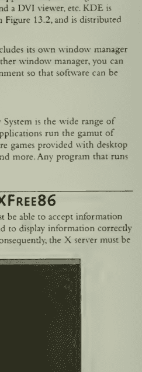

图 13.2 Red Hat 6.1 中用于超级用户的 `KDE` 桌面环境。

安装知道如何与你的硬件通信的服务器。`XFree86` 的安装程序包括为正确类型的硬件进行配置。

## 获取当前版本文件

`XFree86` 是每个主要 Linux 发行版的一部分。当前的发布版本 `XFree86-3.3.5` 基于 `X` 窗口系统 `X11R6.3`。当 `XFree86-4.0` 发布时，它将基于 `X11R6.4`。要查看你当前使用的版本，请输入以下命令：

```


X -showconfig

```
```

XFree86 通过 XFree86 项目开发和发布。源码和二进制文件均可以在其网站 (`http://www.xfree86.org`) 上获取。新版本的发布说明描述了更改。检查发布说明以确定你是否需要或需要升级到新版本。目前，网站建议用户升级到 `XFree86-3.3.5`，因为问题已经得到修复。

## 安装 X 窗口系统

XFree86 默认安装在所有主要的 Linux 发行版中。在大多数 Linux 初安装中，你不需要单独安装 XFree86。然而，你可以在现有的 Linux 系统中单独安装 XFree86，例如你需要升级到更高版本的 XFree86。

在安装 XFree86 之前，你需要确定它是否运行在你的硬件上，并识别出适用于你硬件的 X 服务器。XFree86 发行版提供的发布说明和 README 文件包含了支持的显卡列表。除非你使用的是老旧或非常特殊的显卡，否则你的显卡可能被支持。

由于 X 服务器是你的硬件的驱动程序，你需要下载并安装合适的 X 服务器。识别合适服务器所需的信息应该在你的显卡说明书中。目前可用以下服务器：

- `X8514.tgz` 适用于 8514 基板的服务器。
- `XAGX.tgz` 适用于 AGX 基板的服务器。
- `XI128.tgz` 适用于 Number Nine Imagine 128 的服务器。
- `Mach32.tgz` 适用于 Mach32 基板的服务器。
- `Mach64.tgz` 适用于 Mach64 基板的服务器。
- `Mach8.tgz` 适用于 Mach8 基板的服务器。
- `Mono.tgz` 适用于单色视频模式的服务器。
- `XP9K.tgz` 适用于 P9000 基板的服务器。
- `XS3.tgz` 适用于 S3 基板的服务器。
- `XS3.Vtgz` 适用于 S3ViRGE 和 ViRGE/VX（视为测试版）的服务器。
- `XVGA.tgz` 适用于 SuperVGA 基板的服务器。
- `XVGA16.tgz` 适用于 VGA 16 的服务器。
- `XW32.tgz` 适用于 ET4000/W32 基板的服务器。

如果你无法为你的特定硬件识别服务器，请选择通用的 `XVGA16` 或可能的 `XSVGA` 服务器。


带有错误的显卡驱动程序安装 X 服务器可能会损坏你的系统！错误的设置会损坏显示器。在错误的时钟频率下驱动的显示器会发生物理烧毁。

Free86 可以从 `http://www.xfree86.org` 下载。除了合适的 X 服务器外，必须下载几个文件。下载 `XVGA16` 服务器，因为配置实用程序需要它。从下载目录下载其他文件，例如 `preinst.sh`（预安装脚本）、`Xbin.tgz`（其他二进制文件）、`Xcfg.tgz`（配置文件）、`Xdoc.tgz`（文档）等。

Free86 应该安装在 `/usr/X11R6` 中。如果该目录不存在，请从 root 账户创建它。请务必在该目录下解压下载的文件，因为文件名是相对于该目录的。使用如下所示的命令解压文件：

```
gzip -dc Xbin.tgz | tar xB
```

在文件解压后，运行 `mkfontdir /usr/X11R6/lib/added` 以更新该目录的字体列表，然后运行 `xset refresh` 告诉 X 服务器加载字体数据库。

（注：原文中存在多行重复的描述，此处已按翻译要求处理。）

任何时候你都可以按 Abort（取消）来结束程序而不保存任何设置，鼠标设置除外。鼠标设置在设置后会立即生效。

你需要先配置鼠标，这样在你配置其他设备时，它才能正常工作。在 XF86Setup 程序的鼠标部分（如图 13.4 所示），屏幕上显示有一个三个按键的鼠标。

如果你移动鼠标，程序应该显示坐标。如果你按下某个按钮，程序应该将相应的屏幕按钮变为黑色。如果这一切都工作正常，说明你的鼠标配置已完成。如果没有正常工作，你需要更改配置。

你可以选择不同的鼠标设备或不同的协议。要选择不同的鼠标设备，按 N 键，然后按 Tab 键。按 P 键尝试不同的协议。如果你在移动鼠标时鼠标指针有动作，但移动不正确，请尝试不同的协议。最常用的协议是 Microsoft；其次常用的是 Mouse-Systems。按 A 键应用更改。

如果你的鼠标只有两个按钮，请使用 Emulate3Buttons。同时点击两个按钮应该模拟点击第三个按键。你也可以尝试更改 ChordMiddle 设置。

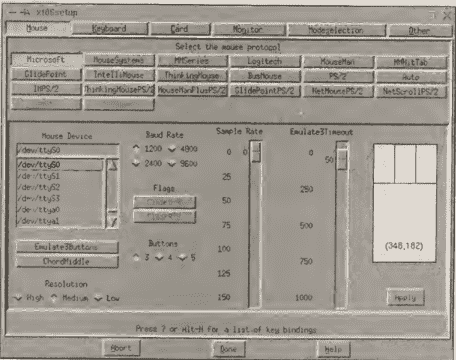

图 13.4 XF86Setup 工具，鼠标配置屏幕。

# 472 第 13 章

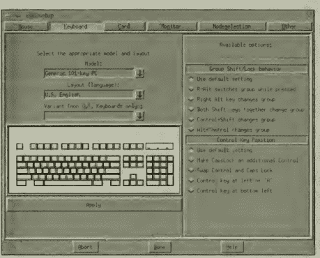

图 13.5 XF86Setup，键盘配置屏幕。

在键盘配置部分（如图 13.5 所示），选择你键盘的型号和布局。屏幕会显示所选键盘的图形表示，并在你选择不同型号时随之发生变化。

在显卡配置部分（如图 13.6 所示），选择你显卡的型号。如果你的型号有 README 文件按钮，点击 README 按钮。点击 Detailed Setup（详细设置）来选择设置。如果你的显卡不在列表中，或者 README 文件没有提供详细设置，你可以使用详细设置选择选项。选择合适的 X 服务器。如果服务器探测不正确，为你的显卡选择正确的芯片组和 Ramdac。选择时钟芯片。选择 Ramdac 的最大速度。选择显卡上的 RAM 数量。

在模式选择部分（如图 13.7 所示），选择你喜的深度（一次可以显示多少颜色）并选择所有你想使用的模式。如果你的硬件不支持你选择的所有深度和模式组合，服务器在尝试启动时将拒绝这些组合。

在显示器配置部分（如图 13.8 所示），输入你的显示器支持水平和垂直频率范围。如果你的显示器支持多个不同的频率或范围，请将它们全部列出来并用逗号隔开。

# Linux X 环境 473

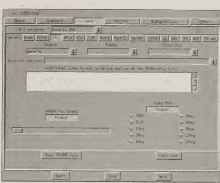

图 13.6 XF86Setup 工具，显卡配置屏幕。

当你完成所有满配置后，按 Done（完成），然后按 ok。XF86Setup 将返回文本模式并尝试启动 X 服务器。如果无法启动服务器，它会询问你是否

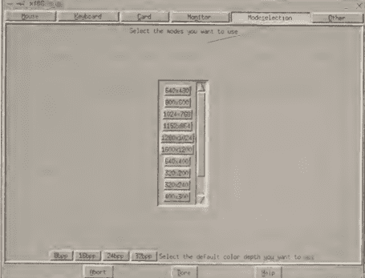

图 13.7 XF86Setup 工具，模式选择配置屏幕。

13

想要返回设置并重试。如果服务器启动，你可以点击一个按钮将配置设置保存到配置文件中。点击 OK 完成。

# 474 第 13 章


图 13.8 XF86Setup 工具，显示器配置屏幕。

如果服务器启动了但显示看起来并不完全正确，你可以使用 `xvidtune`（如图 13.9 所示）进行调整。你可以通过点击 XF86Setup 中的按钮或在命令行输入 `xvidtune` 来访问它。阅读警告并点击 OK。点击 Auto（自动）。点击任何所需的调整更改以

| Hisplay: 1024 | VDisplay: 768 |
| HSyncStart: 1032 | VSyncStart: 771 |
| HSyncEnd: 1176 | VSyncEnd: 777 |
| HTotal: 1344 | VTotal: 806 |
| Left | Wider | Marrow | Up | Down | Shorter | Taller |
| flags (hex): J300a | Pixel Clock (MHz): 65.00 |
| Quit | Apply | Auto | Test | Restore | Horizontal Sync (kHz): 48.36 |
| Fetch | Show | Next | Prev | Vertical Sync (Hz): 60.00 |

图 13.9 xvidtune 工具。

# Linux X 环境 475

X Window 系统允许你在一个主机上运行 X 客户端并在另一台主机上显示。你可以在一组网络计算机之间分配计算。客户端程序并不生成图形，而是位图发送到网络进行显示。

必须指定目标显示。在讨论 X 时，“显示”（display）是指由单个键盘和指针设备访问的显示器集合。单个键盘可以控制多个显示器。因此，输出位置的标识符需要指定具体的屏幕。标识符的格式为

```
host:displaynumber.screennumber
```

其中 `host` 是 X 服务器所在的计算机的名称或 IP 地址。如果目标显示器只有一个服务器和一个屏幕，则标记为 `0.0`。如果有多个，则使用 `displaynumber` 和 `screennumber` 指定。

屏幕标识符存储在环境变量 `DISPLAY` 中。X 客户端向指定的指定的 X 服务器发送显示请求。你可以通过输入命令查看发送到本地屏幕的值：

```
echo $DISPLAY
0.0
```

发送到另一个计算机的 `DISPLAY` 值可能如下：

```
197.134.15.2:0.0
host2.mynet.com:0.0
```

如果你设置了远程计算机的 `DISPLAY` 在你的系统上显示，你还需要设置你的计算机接受来自远程计算机的显示。要允许远程主机在你的系统上显示，输入

```
xhost
```

其中 `host` 是允许在你的系统上显示的计算机的名称或 IP 地址。例如

```
xhost host2.mynet.com
```

允许远程主机 `host2` 在你的系统上显示。命令：

```
xhost +
```

# Linux X 环境 477

允许任何人在你的 Linux 屏幕上显示内容。你可以使用命令显式地防止主机在你的系统上显示：

```
xhost -host2.mynet.com
```

# 管理用户窗口环境

当 X 窗口系统启动时，一个配置脚本会决定屏幕的打开环境。它可以启动你想要自动运行的程序，例如 `xterm` 终端模拟器会话或时钟，并启动你选择的窗口管理器。作为系统管理员，你可以决定在 X 启动时运行的是系统配置脚本还是用户家目录下的配置脚本。

通过以下命令启动 X：

```
startx
```

`Startx` 是一个位于 `/usr/X11R6/bin` 的 shell 脚本。作为系统管理员，你可以修改 `startx` 脚本。`startx` 脚本的唯一要求是命令：

```
exec xinit
```

**`xinit`** 命令启动 X 窗口系统，启动 X 服务和一个客户端程序。你可以指定启动哪个 X 服务和哪个客户端，或者允许 **`xinit`** 启动默认的服务和客户端。

如果命令行上没有指定服务器，**`xinit`** 会在用户家目录查找名为 `.xserver` 的脚本并运行该脚本来启动服务器。如果找不到该脚本，它将运行服务器 `X:0`。它会在用户的路径中搜索 `X`。为了确保 **`xinit`** 能找到 `X`，请在 `/usr/X11R6/bin` 中创建一个名为 `X` 的链接，该链接指向正确的 X 服务器文件（例如 `XVGA16`）。

如果命令行上没有指定客户端，**`xinit`** 会在用户家目录查找名为 `.xinitrc` 的脚本并运行该脚本来启动客户端程序。如果找不到该脚本，它将运行以下命令启动一个 `xterm` 会话作为第一个客户端。

```
xterm -geometry +1+1 -n login -display :0
```

你可以在 `startx` 脚本的 **`xinit`** 命令行中使用 `--` 和路径来指定 X 服务器。例如：

```
exec xinit -- /usr/X11R6/bin/Xvga :0
```

# 478 第 13 章

你可以在命令行上指定第一个客户端。客户端程序及其参数应该是命令行上的第一个 `xinit` 参数。

为了让客户端和/或服务器程序的名称被识别为程序名，它们必须以斜杠（`/`）或点（`.`）开头。否则，`xinit` 将其视为参数。

作为系统管理员，你可以定义一个中心配置脚本。你可以创建一个默认的 `xinitrc` 安装在每个用户账户中，该脚本引用一个系统启动文件。或者，你可以在 `startx` 脚本的 `xinit` 命令行上指定配置脚本。例如：

```
exec xinit /etc/X11/xinit/xinitrc
```

为了让客户端和/或服务器程序或脚本名称被识别为程序名，它们必须以斜杠（`/`）或点（`.`）开头。否则，`xinit` 将其视为参数。

# X 资源管理

系统管理员甚至个人用户都可以配置 X 消耗的资源。对于全局 X 资源，进入目录 `/usr/X11R6/lib/X11/app-defaults/`。该目录下的每个文件都以其所管理的应用程序命名。这些文件的关键在于，你可以在这里全局更改它们，或者使用它们在 `/etc/skel` 为新用户账户创建一个 Xresources 文件，仅更改特定信息。

其中一个文件的内容示例将向你展示如何挑选你可能更改的项目。以应用程序 GV——GhostView（X 下可用的 Ghostscript 文件查看器）为例，该目录下有一个文件。该文件开头为：

```
!\gv_user.ad
! User specific application defaults for gv
! Copyright (C) 1995, 1996, 1997 Johannes Plass
```

```
###### g_user_res.dat
```

以感叹号开头的语句都是注释。井号仅作为占位符或表示强调。接下来，你将看到一个前缀为：

```
##### Application specific Resources
```

# Linux X 环境 479

此标签告诉你你即将进入仅适用于特定应用程序的赋值赋值。因为你正处于一个特定应用程序文件的中间，发现整个内容都用于 GV 并不意外。然而，更棒的是，你可以取这些行中的任何一行并简单地复制到 `~/.Resources` 中。X 资源文件中的所有变量由两部分具体命名：相关的程序（在后续示例中为 GV），然后是变量名。

取文件的第一部分：

```
GV.pageMedia:           automatic
GV.orientation:        automatic
GV.fallbackOrientation:  portrait
GV.swapLandscape:       False
GV.autoCenter:          True
GV.antialias:           True
GV.respectDSC:          True
GV.ignoreEOF:            True
GV.confirmPrint:         True
GV.reverseEyeScrolling:  False
GV.scrollingEyeGuide:   True
GV.autoResize:          True
GV.maximumWidth:        screen-20
GV.maximumHeight:       screen-44
GV.minimumWidth:        400
GV.minimumHeight:       430
GV.confirmQuit:         False
GV.watchFile:           1
GV.Frequency:           1
GV.showTitle:           True
GV.miscMenu:           \n
GV.stop:                0
GV.toggleEven:         \n
GV.toggleOdd:          \n
GV.update:              \n
GV.toggleMarked:      \n
GV.printAll:           \n
GV.saveAll:            \n
```

# 480 第 13 章

你可以在命令行上指定第一个客户端。客户端程序及其参数应该是命令行上的第一个 `xinit` 参数。

为了让客户端和/或服务器程序的名称被识别为程序名，它们必须以斜杠（`/`）或点（`.`）开头。否则，`xinit` 将其视为参数。

作为系统管理员，你可以定义一个中心配置脚本。你可以创建一个默认的 `xinitrc` 安装在每个用户账户中，该脚本引用一个系统启动文件。或者，你可以在 `startx` 脚本的 `xinit` 命令行上指定配置脚本。例如：

```
exec xinit /etc/X11/xinit/xinitrc
```

为了让客户端和/或服务器程序或脚本名称被识别为程序名，它们必须以斜杠（`/`）或点（`.`）开头。否则，`xinit` 将其视为参数。

# Linux X 环境 481

命令行上指定的值将覆盖环境变量的值。`geometry` 参数的位置格式为：

```
-geometry charlines+leftoffset+topoffset
```

`xterm` 窗口将以每行80 个字符、25 行打开。如果指定了 `char` 和 `lines`，80x25 是默认值。窗口将距离屏幕左侧 10 像素、顶部 40 像素处打开。

任何程序都可以在 `xterm` 终端模拟器窗口中通过命令行启动。刚才列出的参数也可以在命令行输入。

# 使用窗口

X 环境的功能由你的窗口管理器决定。屏幕上显示的功能、按钮、菜单以及移动和调整窗口的方法取决于使用的管理器。理论上，你可以在没有窗口管理器的情况下运行 X11，但你将得到一个无法移动或调整大小的空白窗口。

所有窗口管理器提供基本功能。你可以显示多个窗口，需要时允许重叠。你可以通过将鼠标指针移动到不同的窗口或点击不同的窗口来切换焦点。窗口管理器允许通过拖动来移动窗口。它们允许通过拖动窗口边缘来调整窗口大小。有些允许通过拖动窗口角落来保持比例调整。提供了一种方法（通常是顶部角落的按钮）来缩小窗口并将其存储（作为任务栏上的图标）。窗口管理器允许你通过点击图标来重新显示最小化的应用程序。


例如，`fwm` 是最常用的窗口管理器，它会在大多数窗口周围绘制一个框，该框由每侧的一个栏条和每个角的一个小 L 型部分组成。还有一个称为标题栏的顶部栏，用于显示窗口名称。表 3.2 显示了一些基础的鼠标功能。

点击鼠标右键可以显示窗口操作菜单。默认情况下，标题栏上会有几个按钮。左侧按钮会弹出一个窗口选项列表。右侧按钮用于标识窗口。

所有这些内容都是可配置的。鼠标点击可以配置为执行不同的功能。可以定义按钮来执行任何可用功能。例如，标题栏上可以有多多 10 个用户定义的按钮。这些按钮可以执行配置函数，也可以执行窗口操作函数。

以下是不同窗口管理器提供的其他额外功能：

- 允许你配置窗口管理器的控制面板。
- 带有图标化应用程序的任务栏。
- 带有一组功能的按钮面板。
- 应用程序菜单。你可以配置菜单以包含你可能想要使用的应用程序。
- 虚拟屏幕。你可以创建多个不同的虚拟屏幕。你可以设置一个提供处理所需的特性和文字的屏幕，以及另一个提供 Web 浏览环境的屏幕。你可以在屏幕之间切换。
- 应用程序坞。一个你可以存储频繁使用的应用程序以便于访问的地方。

窗口管理器拥有的特性和功能越多，对内存和磁盘空间所需的资源就越多，显示也越慢。在决定使用哪种窗口管理器时，你需要考虑 Linux 账户上的可用资源。某些用户需要高级功能，而另一些用户不需要。

## 表 3.2 基础鼠标功能

| 功能 | 说明 |
|---|---|
| 当光标位于标题栏或侧边栏时点击左鼠标键 | 移动窗口 |
| 当光标位于角部时点击左鼠标键 | 调整窗口大小 |
| 点击鼠标右键 | 显示窗口操作菜单 |

## xman 命令

X 提供了一个在 GUI 中查看手动帮助页（man pages）的工具。要访问此工具，请输入：

```
xman
```

你首先会看到一个包含几个按钮的小对话框，如图 13.10 所示。当你点击 Manual Page（帮助页）按钮时，会显示一个如图 13.11 所示的信息屏幕。

从 Options（选项）按钮向下拖动到 Display Directory（显示目录）选择框，会得到一个帮助页菜单，如图 13.12 所示。你可以浏览所有可用帮助页的列表并使用鼠标选择一个帮助页进行查看。


图 13.10 `xman` 工具。

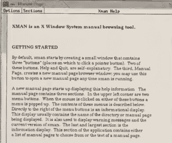

### 入门

默认情况下，`xman` 启动时创建一个包含三个“按钮”（点击光标按键的位置）的小窗口。其中两个 Help（帮助）和 Quit（退出）是自而易见的。第三个 Manual Page（帮助页）会创建一个新的帮助页浏览器窗口。你可以在 `xman` 运行时随时使用它来打开新的帮助页窗口。

一个新的帮助页启动时会显示这些帮助信息。帮助页包含三个部分。在左上角有两个菜单。点击其中任何一个按钮，都会弹出一个菜单。这些菜单的内容见下文。此显示通常包含正在显示的目录或帮助页的名称。它还用于显示警告信息和命令行格式。最后部分是信息显示。应用程序的这一部分包含供选择的帮助页列表或帮助页的文本。

下拉 Sections（部分）菜单来选择帮助页。当显示某个部分时，点击你想查看的帮助页名称上的左光标键。`Xman` 用选定的帮助页替换显示内容。

这些足够入门了。一旦你理解了如何使用 `xman` 的基础，请查看此文件的其余部分，看看可用的使 `xman` 快速高效的高级功能。

### 滚动文本

滚动条与 `stem` 和 `xbm` 滚动条类似：当光标位于滚动条底部时，点击左或右光标键将分别向下滚动文本或翻一页。光标进一步点击则会滚动滚动条本身。

图 13.11 `xman` 工具信息屏幕。

## 484 第 13 章

| 选项部分 | 目录的：(1) 用户命令 |
|---|---|
| Fail | `a2p` `addtinfo` `addrLine` |
| `afshat` | `als` | `anno` `atopra` |
| `awk` | `sleepee` | `apropos` `ar` |
| `arch` | `mail` | `asciitopm` |
| `as` | `audioocompose` | `autospect` |
| `ast` | `hasname` | `bash` |
| `bc` | `biortage` | `bison` |
| `deatports` | `bluntop` | `bz2` |
| `(-rad)` | `-cfit` | `cal` |
| `conf(info)` | `cut` | `chfn` |
| `chase` | `chart` | `chrot` |
| `chrood` | `chvrt` | `chpy` |
| `cham` | `clear` | `cmwetab` |
| `colum` | `come` | `compress` |
| `confront` | `crontab` | `crystal` |
| `clags` | `cut` | `Date` |
| `decymord` | `date` | `mallo` |
| `dislocate` | `div` | `clann` |
| `dreadn` | `dime` | `else` |
| `dupe` | `empty` | `els` |
| `elms` | `exam` | `eruct` |
| `expr` | `ectom` | `false` |
| `fast2` | `listname` | `file2` |
| `flat` | `for` | `free` |
| `folder` | `free` | `free` |
| `gic` | `gcc` | `getname` |
| `getting` | `ghostscript` | `gedit` |
| `grinddb` | `glob-root` | `grefer` |
| `gic` | `gom-root` | `grep2` |
| `grinddb` | `grep2iff` |


**终端模拟器**

终端模拟器是你用于命令行提示符的。大多数发行版都提供了几种终端模拟器。如果你使用桌面环境（如 GNOME 或 KDE），它们自带了终端模拟器。否则，这两个程序的主要区别在于 `rxvt` 更小、速度更快，而 `xterm` 标准自带的功能更多。

一个通用规则是，如果你发现你的终端模拟器运行缓慢，请尝试 `rxvt`。问题可能源于显卡慢、内存不足或其他限制性能的因素。

## 设置 XDM 和自定义环境

X 环境的设计初衷就是为了可定制性。Unix 哲学主张最大的灵活性，允许用户创建适合自己的环境。从启动到关闭，环境的每个方面都是可定制的。

### X 环境

X 环境由其视觉呈现和功能组成。进入 X 环境的方法提供了不同的视觉和功能。环境的外观和感受由窗口管理器决定。正如前面的章节所述，不同窗口管理器提供的界面可能完全不同。此外，许多窗口管理器是可配置的，因此同一个窗口管理器在不同系统上提供的界面也可能不同。某些窗口管理器提供的配置性之至于你几乎期望它们在你工作时泡咖啡。

### 启动环境

到目前为止，只描述了一种启动 X 的方法——使用 `startx` 命令。`startx` 可以在命令行输入，也可以在第一个用户登录时自动运行。使用 `startx`，X 窗口会在每个用户登录后单独启动。

## 第 13 章

- 未使用
- X11
- `reboot`（不要将 `initdefault` 设置为此项）

对于 SuS.E.，启动 `xdm` 的运行级别是 3，这意味着带有 `xdm` 的全功能多用户模式。你的 `/etc/inittab` 文件将包含系统运行级别的描述。

系统的运行级别是在启动时通过在 `inittab` 文件中设置 `initdefault` 来指定的。若要在启动时使用 `xdm`，你需要设置正确的运行级别。查看你的 `inittab` 文件，你会发现一条类似下面的语句：

```
id:3:initdefault
```

数字 3 就是运行级别。在 Caldera 或 Red Hat 中，你会将 3 改为 5。

当用户通过 `xdm` 登录时，会运行脚本 `/usr/lib/X11/xdm/Xsession`，该脚本用于配置用户会话。`Xsession` 是通过运行用户目录下的名为 `.Xsession` 的脚本设置的。此文件用于配置 X 系统会话，类似于使用 `xinit` 启动 X 时的 `.xinitrc` 文件。你可以包含类似的命令来启动 X 客户端并启动窗口管理器。

## 自定义你的环境

自定义你的 X 环境的第一步是选择一个窗口管理器。阅读网站上的信息，决定哪种窗口管理器最符合你的需求。

所有 Linux 发行版都包含了窗口管理器。最常见的窗口管理器是 `fwm`（当前为 `fwm2`）。许多发行版都包含了 `twm` 管理器。其他发行版可能包含不同的窗口管理器。如果你决定使用一个你的 Linux 发行版未包含的窗口管理器，可以在该窗口管理器网站下载软件和安装说明。安装可能是 rpm 过程，或者简单地将下载的文件解压到正确的目录（通常是 `/usr/X11R6/bin`）。在某些情况下，可能需要库，例如 `libg++` 或 `xpm`。

窗口管理器在配置脚本 `.xinitrc` 中启动。如果你正在使用 `xdm`，脚本 `Xsession` 会启动窗口管理器。脚本的最后一行应该是：

```
exec umname
```

其中 `umname` 是正在启动的窗口管理器，例如 `fwm2` 或 `twm`。

大多数窗口管理器允许某些配置。许多窗口管理器允许大量的配置。在窗口管理器安装并启动后，可以根据个人偏好进行配置。配置方法各不相同。某些需要手动编辑配置文件，而某些配置可以通过窗口管理器界面和控制面板完成。每个窗口管理器都有自己的配置文件，它们可能位于不同的位置。本节将讨论最常用的窗口管理器 `fvwm` 的配置。

`fvwm` 使用一个名为 `fvwm2rc` 的配置文件。在安装 `fvwm` 时会提供一个示例配置文件，位于 `/var/X11R6/lib/fvwm/system.fwwm2rc`。它可以作为系统级配置文件使用，也可以复制到用户主目录并重命名为 `.fwwm2rc`。`fvwm` 在启动时会运行此文件。它首先查找用户主目录下的 `.fwwm2rc`，然后在系统配置目录查找。如果没找到该文件，它会查找系统配置目录中的 `system.fwwm2rc`。你可以在启动 `fvwm` 时通过命令行参数指定不同的配置脚本。例如：

```
exec fwwm2 -f /etc/myconfig
```

该命令告诉 `fvwm` 在启动时运行 `myconfig`，而不是 `.fvwm2`。`fvwm` 提供了使用模块添加功能的能力。模块是一个独立的程序，作为单独进程（`fvwm` 的子进程）运行，但向 `fvwm` 发送命令进行执行。提供现有的独立模块，用户也可以编写自己的模块。例如，`FwmGoodStuff` 模块允许创建按钮面板。模块为需要它们的用户提供了额外功能，而不会让不需要这些额外功能的用户程序变大。

`fvwm` 的功能定义在配置文件中。`fvwm` 为动作提供了许多功能，例如调整大小、滚动或蜂鸣声。配置文件中的语句将这些功能绑定到按钮或按键上。例如，使用以下语句创建一个菜单：

- AddToMenu Utilities "Utility" Title
- "Xterm" Exec exec xterm -e tc
- "Calculator" Exec exec xcalc
- "Xman" Exec exec xman
- "Mail" MailFunction \ xnmh "-font fixed"
- "Exit Fvwm" Popup Quit-Verify

Mouse 1 R A Popup Utilities

正在创建的菜单名为 `Utilities`，显示的标题为“Utilities”。`Exec` 指定运行以下命令。例如，点击 X term 菜单将执行命令：

```
exec x -e tcsh
```

最后一行将菜单作为弹出菜单绑定到鼠标按键 1。`R` 和 `A` 指定在根菜单的任何地方进行鼠标点击。你也可以创建自己的函数。`Mail` 菜单项是一个用户定义的函数。所有可用函数的描述及其格式在 `fwwm` man 页面中提供。

配置文件还使用如 `ButtonStyle` 和 `Border` 等函数定义你的 GUI 外观。可能的样式可以是内置样式，也可以是由你提供的名为 `pixmaps` 的图形图像。`pixmaps` 必须是 XPM 格式。

因此，GUI 的外观和功能是可自定义的。某些窗口管理器比其他更具自定义性。`Enlightenment` 是自定义性较高的窗口管理器之一。定义了特定外观和功能组合的良好设置组合被称为“主题”。

## 主题

X 窗口屏幕的自定义外观和感觉在窗口管理器的配置文件中定义。该配置文件可以分发给其他用户加载到他们的系统上。许多主题从简单的颜色组合到非常精美、艺术化的解释。

一种主题是围绕颜色组织的，提供令人愉目的的色调，例如蓝色主题或抛光铜主题。另一种类型的主题呈现外观，如金属感。另一种类型的主题呈现环境，如自然主题或太空主题。一种流行的主题提供了模拟，例如，Mac 主题会让 Linux 机器看起来和运行完全像 Mac。另一种类型主题围绕娱乐主题，例如卡通角色、电脑游戏或电影。例如，你可能会找到《星球大战》、《黑客帝国》或《吸血鬼》的主题。有许多主题可以下载。获取主题的网站是 www.themes.org。你可以查看许多主题，也许找到一个适合你的。

## Linux 环境

下载主题是免费且相对简单的。大多数下载包含必要的配置文件，通常打包为 `tar` 或 `zip` 文件。如果你有当前的窗口管理器设置，在用下载的主题覆盖之前，对配置文件进行备份。在某些情况下，你可能需要在窗口管理器命令中提供一个命令行参数指向配置文件。通常，主题包含许多位于一个或多个特定目录的文件。某些窗口管理器允许你通过按钮或菜单项设置多个主题。

如果你找不到适合你的的主题，可以创建自己的。具体方法取决于你使用的窗口管理器。通常情况下，你创建一个定义功能和外观的配置文件。如果你想要比背景色和前景色更复杂或艺术化的外观，你需要提供 `pixmaps`——图形图像。图形必须是 XPM 格式。图形程序（如 GIMP）可以以 XPM 格式保存。

`fwm` 允许某些主题，但不如某些窗口管理器（如 `Enlightenment`）那样精美。在 `fwm` 中，你可以通过定义装饰为 GUI 的元素定义集成外观。你通过 `.fwm2rc` 配置文件中的函数定义它。使用 `AddToDecor` 函数创建装饰并使用 `Style` 函数应用，如下：

```
AddToDecor tryla
+ ButtonStyle -- pixmap image1.bmp
+ TitleStyle -- flat + BorderStyle HiddenHandlesNoInset
+ HighlightColor white navy
Style "try1" UseDecor tryla
Style "xterm" UseStyle tryl
Style "*" UseStyle tryl
```

装饰命名为 `tryla`。`+` 行定义装饰的外观。第一个 `Style` 函数将装饰 `tryla` 分配给样式 `try1`。接下来的

函数 `applies` 将样式 `try1`（使用装饰 try1）应用到所有 xterm 窗口。

函数 `Last` 将样式 `try1` 应用到所有窗口。

可以使用 `ChangeDecor`、`UpdateDecor` 和 `DestroyDecor` 这几个函数。

要创建一个主题，你需要了解特定窗口管理器的配置方法。可以在软件下载包中找到文档，也可以在窗口管理器的网站上查阅。fwwm 可用的所有内置函数描述可以在 fwwm 的 man 页中找到。

## 维护 X 环境

在大多数情况下，你是从一个包含并安装了 XFree86 的发行版安装 Linux 系统的。你并没有单独安装它。同样，在大多数情况下，该发行版包含并安装了许多 X 客户端。在很多情况下，Linux 发行版的安装程序已经安装了你需要的所有软件。你拥有一个运行良好的 Linux 系统，它提供了所需的所有软件，你并没有专门下载和/安装 X 或 X 客户端。

维护 X 窗口系统和 X 客户端将不再那么简单。你或你的用户可能需要尚未安装的软件软件包。或者，会发布更高版本的软件软件包，并带有你想要使用的新功能。又或者，软件包会出现问题，而重新安装软件似乎是一个可能的解决方案。你需要下载并安装软件。

作为管理员，你有责任关注用户所需软件的当前状态。你需要了解何时可用新版本，以及新版本是否存在问题。万维网（WWW）是获取最新信息的来源。特别是，要监控你重要的 X 客户端应用程序软件及相关用户组的网站。

当有新版本的源码发布时，你只需下载并安装它。对于大多数软件，通用步骤如下：

```bash
./configure
make
make install
```

例如，安装 GIMP 的命令列如下所示。GIMP 是一个运行在 X 下的图形软件包。

```bash
tar xvfz gimp-1.0.0.tar.gz
cd gimp-1.0.0
./configure
make
make install
```

`configure` 脚本检查你的系统，并调整 GIMP 以便在上面运行。`make` 命令在假设构建成功的情况下构建所有必要的内容，`make install` 命令则安装软件。

软件应用程序的网站是你所需信息的最佳来源。新版本会提供发布说明。发布版中的问题会被识别。还会提供安装说明。

## 何时避免 X

请记住，当你选择图形化界面而非命令行工具时，始终存在性能权衡。即使你在另一台机器上运行 X 服务端，客户端也会消耗 CPU 周期和内存。在速度至关重要的情况下，完全避免 X 有时是。

此类关注的主要例子是单用途服务器。这些服务器通常为 Web、电子邮件或数据服务等高强度使用场景而创建。在这些情况下，每个 CPU 周期都是宝贵的。如果你的网页加载缓慢，网页查看者可能会放弃并转向另一个站点。如果 RAM 不足或机器不够快无法及时处理邮件，邮件列表可能会导致机器卡顿。


另一个可能明显的问题是显示器类型。在某些服务器机房中，交换机上只安装了基础低分辨率显示器，以便管理员在必要时处理机器。如果显卡和/或显示器无法胜任，请不要尝试通过安装 X 服务器和客户端来挑战命运。

## 故障排除

X 窗口系统的特定问题会产生与视频显示相关的症状。GUI 完全没有绘制，或者出现极其微小的异常。首要怀疑对象是配置错误。硬件定义得不正确。可能，X 服务器并不是你显卡的最佳选择。

如果你看到图像轻微失真，尝试使用 `xxdtime` 进行微调。如果问题很大，检查 `/usr/X11R/bin/X` 是否链接到正确的 X 服务器。你可以重新配置并使用不同的设置或安装不同的 X 服务器，看看是否能纠正问题。你可能尝试检查 `/etc/XF86Config` 文件，查看设置是否符合你的预期。

有时 X 应用程序无法正常关闭。如果你遇到性能问题，或者被告知由于已打开了一个实例而无法打开应用程序，请查看你的进程列表。可能需要使用 `kill -9`，尽管在使用该命令时应始终保持谨慎。

某些软件会编写包含有用错误信息的日志文件。例如，如果你在让 `xdm` 运行方面遇到问题，`xdm-errors` 可能包含诊断问题的有用信息。

此外，X 及其配套应用程序使用了大量的库。当你添加一个 Linux 发行版中未包含的新应用程序时，总有可能需要升级某个库，而该库反过来可能与其他程序不向后兼容。在安装软件包之前，务必始终阅读随包附的文档，并认真考虑哪些软件包值得升级整个 X 软件包套，哪些不值得。

## 第 13 章

WWW 是获取故障排除信息的最佳来源。Linux XFree86 HOWTO 是硬件问题信息的良好来源。它列出了支持的硬件问题。如果你有较新的显卡，本文中的信息非常重要（http://www.linuxdoc.org/HOWTO/XFree86-HOWTO.html）。

## 第13 章

StarOffice 可以从 Sun 网站免费下载，也可以通过带有纸质版文档的 CD-ROM 获得，价格约为 40 美元。该套件还提供英语以外的多种语言：荷兰语、法语、德语、意大利语、葡萄牙语、西班牙语和瑞典语。该套件的源代码遵循 CSL（社区源许可），可以在 www.sun.com/software/community/ 查看。

## WordPerfect

尽管 Corel 拥有一套包含 WordPerfect (http://linux.corel.com/linux8) 文字处理器及更多功能的完整办公套件，但其提供的服务仅限于 WordPerfect 程序本身。这一事实在未来某时候可能会发生，因为 Corel 在 Linux 开发上投入了更多精力。WordPerfect 本身对 Linux 用户来说是一个福音，因为它是一个已经存在一段时间、功能完整的 WYSIWYG（所见即所得）文字处理器。

> 尽管 Linux 版本的 WordPerfect 仅是 Corel 整体办公产品中的文字处理器组件，但该产品具有电子表格功能和其他项，在某些用途上弥补了这一缺陷。

Linux 版 WordPerfect 有一个免费的可下载版本，以及包含程序、CD-ROM 和纸质手册的封装版本。

## 图像处理程序

Linux 社区有许多可用程序，允许用户创建、转换和处理图形图像。这里介绍了三种最流行的选项：GIMP、ImageMagick 和 X-Fig。

GIMP (GNU 图像处理程序) 包根据 GPL 协议提供。该工具的主页位于 www.gimp.org，它是一组非常好的画刷、插件、过滤器等，此外还可以通过 GIMP 主页在互联网上下载更多额外的项目。

ImageMagick (www.imagemagick.com) 是 Linux 用户的另一个优秀图形工具。对于普通用户来说，该程序在功能上与 GIMP 有许多相似之处。它也有一系列画刷和其他必需品，并具有与其他程序和脚本建立接口的能力。通常，想在这两个程序之间做出选择的人需要尝试两者，看看自己更倾向于哪一个。

但同样重要的还有 X-Fig。这个程序并不像上述两个那样全能。它更像是一个基础绘图程序，适用于那些只需要完成工作而不需要大量图层、效果和阴影的人士。

## 本章总结

X Window System 是一种用于 Unix 和类 Unix 计算机的硬件无关窗口系统，旨在提供与 Windows 和 Mac 类似的功能并免费发布。X 联盟（X Consortium）提供 X 的正式发布，目前为版本 11 发布 (`X11R6`)。XFree86 项目提供了 X11 在许多操作系统上的增强和移植。XFree86 软件包含在几乎所有 Linux 发行版中并已安装。

X 是客户端/服务器软件。服务器位于本地 Linux 系统上并与硬件通信——通过显卡和显示器绘制显示，并接受来自键盘和指针的输入。X 客户端向 X 服务器发送显示请求，服务器通过绘制显示做出响应。任何需要图形显示的应用程序都是 X 客户端。X 客户端可以位于同一台计算机上，也可以位于远程计算机上。因此，你可以在一台计算机上运行应用程序，但通过 TCP/IP 连接在另一台计算机上显示 GUI。

主要的 X 客户端是窗口管理器，它负责移动、调整大小、隐藏和关闭窗口，以实现 GUI 的外观和感受。不同的窗口管理器提供不同的功能并具有极高的配置性，根据其特定的配置脚本文件在不同的计算机上提供非常不同的外观和功能。各种窗口管理器的配置文件均可提供，提供协调的主题（如 Ice 或 Star Wars），可供下载，你也可以创建自己的主题。

务必尝试不同的窗口管理器和环境。许多考试选项要求你了解如何安装这些项目、如何导航以及如何进行自定义。

## 复习题

+ 1. X Window System 的当前版本是什么？

   a. X10R6

   b. X11R6

   c. X11R5

   d. X11R5.9

2. 下列哪项不是窗口管理器？

   a. Window Maker

   b. xdm

   c. with

   d. Enlightenment

3. 下列哪个不是可以启动 X 的命令？

   a. xdm

   b. startx

   c. xinit

   d. xinit /usr/myconm

4. 下列哪个描述错误？

   a. XFree86 派自 X11。

   b. XFree86 是 X11 的增强。

   c. XFree86 由 X 联盟发布。

   d. XFree86 派自 X Window System。

5. 当你配置 XFree86 时，建议先配置哪个设备？

   a. 显卡

   b. 显示器

   c. 声卡

   d. 鼠标

6. 当你将窗口拖到新的屏幕位置时，你在使用哪种软件？

   a. X11

   b. 窗口管理器

   c. 显示管理器

   d. 服务器管理器

7. 下列哪项是窗口管理器？

   a. OPEN LOOK

   b. X11

   c. KDE

   d. wm2

8. 下列哪些是 X 服务器负责的？[选择所有正确答案]

   a. 显示根窗口

   b. 调整窗口大小

   c. 关闭窗口

   d. 在窗口中启动应用程序

9. 关于以下字符串：197.134.15.2:0.0，以下哪些描述是正确的？[选择所有正确答案]

   a. 这是 DISPLAY 的值。

   b. 0.0 表示显示器。

   c. 0.0 指令计算机进行显示。

   d. 需要主机名。

10. 下列哪项不是 XFree86 的实用？

    a. Setup

    b. xtune

    c. configurator

    d. xconfig

11. 下列哪个描述是正确的？

    a. 协议从客户端到服务器使用。

    b. 协议从服务器到客户端使用。

    c. 协议与此无关。

    d. 协议是位图。

12. 图像必须使用哪种图形格式？

    a. GIF

    b. XMP

    c. JPG

    d. EPS

13. xhost 用于什么？

    a. 将输出发送到远程计算机

    b. 将输出发送到本地计算机

    c. 接受来自远程计算机的请求

    d. 向另一个主机发送请求

14. 下列哪个描述是正确的？

    a. 命令在 /bin 中。

    b. 命令由 xdm 使用。

    c. 命令由 xinit 运行。

    d. 格式是二进制的。

在更改文件之前，您应该对其进行备份。

3. 还有其他哪些命令？是否有设置背景或前景颜色的命令？尝试更改名称以查看效果。

4. 你在使用哪种窗口管理器？启动窗口管理器的命令通常是文件中的最后一个命令。识别该窗口管理器。

5. 识别窗口管理器使用的配置脚本。它可能在你的主目录或系统配置目录中（例如 `/etc`）。如果你无法找到该文件，请阅读窗口管理器网页上的文档以确定在哪里找到它。

6. 检查窗口管理器配置文件。查看你是否能识别命令和效果。尝试更改内容看看会发生什么。（你可能想在更改之前对文件进行备份。）例如，更改颜色标记。尝试更复杂的配置。阅读窗口管理器的文档（如主页），学习命令的格式。

## 项目 13.2

在项目中，你将下载并安装一个窗口管理器。你将安装 fwm95 桌面环境，因为它没有包含在你的发行版中，对于某些考试，了解整个下载和安装过程是非常用的。fwm95 是 fwm 的变体，后者 可能包含在你的发行版中。如果你没有 fwm 并想下载它，过程与列出的类似。

要下载并安装 fwm96，请执行以下操作：

-1. 以 root 身份登录系统。

-2. 切换目录到 `/usr/local/src`。

-3. 下载文件：

```
ftp mitac11.uia.ac.be
anonymous
email address
cd pub
cd fwm95
get fwm95-2.0.43b.tar.gz
```

-4. 解压文件：`tar zxv fwm95-fwm95-2.0.43b.tar.gz`。

-5. 创建新目录——fwm95-2.0.43b，进入新目录并编译安装该包。

# 500 第 13 章

```bash
cd fwm95-2.0.43b
./configure
make
make install
```

- 6. 所有内容都安装在 `/usr/local`。你可以更改安装说明。系统会创建一个名为 `system.fvwm95rc` 的配置文件，该文件无需修改即可正常工作。不过，你可以将其拷贝到 `$HOME/.fvwm95rc`。该文件包含路径：ModulePath、IconPath 和 PixmapPath。请确保提供的路径是正确的。

- 7. 修改你的 `.xinitrc` 或 `.xession` 文件以调用 `fvwm95`，而不是当前使用的窗口管理器。文件中可能已经有一行以“exec”开头的命令。通常，窗口管理器是在文件的最后一行启动的，因此如果你使用 `vi`，输入“G”可以立即移动到末尾，并查看是否存在 `exec` 行。如果已经存在 `exec` 行，请在行首前加一个井号 (##) 将其注释掉，然后在下方新起的一行并输入文本“exec fvwm95”。

- 8. 尝试使用你的新窗口管理器。阅读相关文档。修改 `fvwm95rc` 配置文件以配置你的喜好。本章描述的 fvwm 语法也适用于 fvwm95。

# 第十四章

## 示例测试

第 1 至第 14 题使用相同的背景信息：你需要为局域网（LAN）安装一个新的邮件服务器。由于需要处理的海量邮件（例如给个人用户的邮件和邮件列表邮件），旧的服务器运行变慢了。

## 第 1 题

- 在做出任何最终购买建议之前，你应该咨询哪两份文档？

- a. 整体 Linux 硬件兼容性列表。

- b. 你所选择的发行版的硬件兼容性列表。

- c. 你所选择的发行版的安装说明。

- d. 内部管理文档。

- e. Linux 用户文档。

## 第 2 题

- 在组装此邮件服务器的组件列表时，应该考虑哪些硬件因素？（选择所有正确答案）

- a. 显示器分辨率

- b. RAM 大小

- c. VRAM 大小

- d. CPU 速度

- e. 大容量、快速访问的硬盘

### 第 3 题

| 在邮件服务器硬盘上除根分区、交换分区和启动分区外，你可能创建哪些分区？（选择所有正确答案） |

| :--- |

| a. /var/spool |

| b. /tmp |

| c. /proc |

| d. /bin |

| e. /home |

### 第 4 题

| 使用哪种类型的服务器在安装过程中为机器远程分配 IP 地址？ |

| :--- |

| a. SMB |

| b. NFS |

| c. DHCP |

| d. FT |

| e. HTTP |

### 第 5 题

| 你可以使用哪种类型的本地文件服务器在网络安装期间为新机器提供发行版安装材料？ |

| :--- |

| a. Inetd |

| b. FSSTND |

| c. DNS |

| d. NNTP |

| e. NFS |

## 第 6 题

- 列出四个流行的 Linux 发行版。

## 第 7 题

- 所有的发行版都提供哪种分区工具？

- a. Disk Druid

- b. fdisk

- c. Partition Magic

- d. FAT32

- e. System Commander

## 第 8 题

- 所有的发行版都提供哪种 X 配置工具？

- a. XF86Setup

- b. XF86Config

- c. XConfigurator

- d. Xconfigurator

- e. xconfig

## 第 9 题

安装以下 Linux 发行版之一，使该用户（或或）拥有他们尽可能多的图形化工具，并包含供管理员使用的所有网络工具：Caldera、Debian、Red Hat、Slackware、SuSE 或 TurboLinux。验证安装是否正确，并设置机器直接启动到 GUI。

## 第 10 题

- 下列哪些是某些发行版中提供的基于 X 的系统配置工具？（选择所有正确答案）

- a. COAS

- b. KConf

- c. Linuxconf

- d. Yast

- e. GnoConf

## 第 11 题

文件系统的哪一个一级分段在其子目录中包含了大部分系统和服务器配置文件？

- a. /var

- b. /etc

- c. /bin

- d. /sbin

- e. /lib

## 第 12 题

- 你编辑哪个文件来设置在启动时挂载分区？

- a. /etc/fstab

- b. /etc/services

- c. /etc/smb.conf

- d. /etc/fstab.conf

- e. /etc/mount.conf

## 第 13 题

- 你编辑哪个文件来设置打印机？

- a. /etc/printabb.conf

- b. /etc/print.conf

- c. /etc/lp.conf

- d. /etc/printtab

- e. /etc/printers

## 第 14 题

配置 Apache Web 服务器，使其在 `/data/html` 目录中查找 Web 页面，该目录位于 `/data` 分区上。同时，在服务器提供的所有 Web 页面上显示联系信息 webmaster@chapter14.exam.org。

## 第 15 题

- 下列哪种序列会导致命令的输出保存到接收者处？

- a. >

- b. |

- c. <

- d. >>

- e. ||

## 第 16 题

- 下列哪些序列会导致 X 的输出保存到文件中？

- a. >

- b. |

- c. <

- d. >>

- e. |

## 第 17 题

- 某些发行版可以使用哪些命令来搜索文件？（选择所有正确答案）

- a. locate

- b. which

- c. where

- d. look

- e. find

## 第 18 题

- 输入什么命令将“start”和“end”的内容合并到“whole”中？

- a. >

- b. |

- c. <

- d. >>

## 第 19 题

- 哪个命令告诉你分区已挂载？

- a. mount

- b. fs

- c. df

- d. head

- e. tail

## 第 20 题

- 输入什么命令将文件的最后 20 行发送到 STDIN？

- a. tail

- b. head

- c. cat

- d. grep

- e. more

## 第 21 题

- 下列哪些命令可以用于删除目录？

- a. rm

- b. -rf

- c. rmdir

- d. rd

## 第 22 题

- 你使用哪个命令来更改运行级别（runlevels）？

- a. initle

- b. runlevel

- c. level

- d. init

## 第 23 题

- 输入什么命令停止挂掉的进程？（选择所有答案）

- a. kill

- b. quit

- c. kill -9

- d. exit

- e. Ctrl+C

## 第 24 题

- 下列哪些命令可以干净地重启 Linux 机器？

- a. reboot

- b. init 6

- c. init 0

- d. shutdown -r

- e. shutdown

## 第 25 题

创建用户 "chap14"，密码为 "Testing"，然后设置系统确保该用户在 `/tmp` 中使用的空间不超过300 块。

## 第 26 题

- 你使用哪种命令在不打开的情况下创建一个空文件？

- a. open

- b. vi

- c. pico

- d. touch

- e. edit

## 第 27 题

- 为 POP3 仅限账户分配哪种 shell？

- a. /bin/false

- b. /bin/sh

- c. /bin/bash

- d. /bin/pop

- e. /bin/pop3

## 第 28 题

设置一台机器，使 exam.org 域内的 Windows 和 Linux 机器对 `/home` 目录具有读写权限。

## 第 29 题


设置一台机器，使其启动时以只读访问挂载来自局域网 `fileserver` 的 NFS 共享 `/policy`。该共享应该挂载到位置 `/docs/policy`。

## 第 30 题

- 关于 28 和 29 中服务的哪些对比是正确的？（选择所有正确答案）

a. 28 执行文件锁定，29 不执行。

b. 28 和 29 都可以用于多操作系统局域网，为所有机器提供服务。

c. 29 执行文件锁定，28 不执行。

d. 28 和 29 都有用于挂载的特殊文件系统类型。

e. 29 有用于挂载的特殊文件系统类型，但 28 没有。

## 第 31 题

- 哪种邮件服务控制邮件提取，但其本身不是控制网络传播的服务器？

a. `sendmail`

b. `pop3`

c. `inetd`

d. `smail`

e. `qmail`

## 第 32 题

- 哪个守护进程控制 31 中的网络服务？

a. `inetd`

b. `pop3d`

c. `maild`

d. `nntpd`

e. `pmaild`

# 问题 33

哪一个 `vi` 命令允许你删除单个字符？

- a. `d`
- b. `dd`
- c. `r`
- d. `x`
- e. `D`

# 问题 34

哪一个 `vi` 命令可以删除整行文本？

- a. `dl`
- b. `D`
- c. `dd`
- d. `d`
- e. `DL`

# 问题 35

在 `vi` 中输入什么内容可以退出文本文件而不保存你所所出的更改？

- a. `q`
- b. `Q`
- c. `xq`
- d. `:Q`
- e. `:q!`

# 问题 36

哪些命令允许你在不打开文件的情况下搜索文本文件的内容[选择所有正确答案]

- a. `vi`
- b. `grep`
- c. `ex`
- d. `sed`
- e. `more`

# 问题 37

哪一个命令允许你在 bash shell 中查看环境变量的内容？

- a. `vi`
- b. `echo`
- c. `more`
- d. `list`
- e. `print`

# 问题 38

以下哪一组权限设置允许 shell 脚本仅通过在命令行输入其名称即可运行，而不考虑输入命令的人[选择所有正确答案]

- a. `755`
- b. `644`
- c. `744`
- d. `666`
- e. `664`

# 问题 39

将你的工作站上加载的模块文本列表保存到文件 `/root/my_modules`。完成后，找到三个具有依赖关系的模块。将它们的依赖列表保存到文件 `/root/module_dependencies`。

# 问题 40

选择两个不同的内核开发流的名称：

- `alpha`
- `production`
- `beta`
- `test`
- `experimental`

# 问题 41

对于一个不需要前沿技术或没有此类需求的 Linux 服务器，你会选择以下哪一个内核版本（选择所有正确答案）

- `4.15.9`
- `3.52.101`
- `7.12.52`
- `6.15.8`
- `5.22.55`

# 问题 42

编译发行版附带的新版本内核。针对该内核所在的机器对该内核版本进行优化，并移除其中不必要的服务。验证机器是否正常启动到新内核。

# 问题 43

设置系统，将内核产生的所有紧急消息专门记录到文件 `/var/log/kernel_problems`。

# 问题 44

以下哪些是你可以用来查看机器网络连接是否正常的的快速命令[选择所有正确答案]

- a. `ifconfig`
- b. `ping`
- c. `netcheck`
- d. `netstat -nr`
- e. `eth0`

# 问题 45

你使用哪个命令来查看哪些守护进程正在运行，以便检查某个有问题的的服务是否启动？

- a. `ps`
- b. `jobs`
- c. `daemon`
- d. `ps aux`
- e. `dconfig`

# 问题 46

如果网络上的名称无法正确解析，你会检查以下哪些文件？[选择所有正确答案]

- a. `/etc/hosts`
- b. `/etc/nsswitch.conf`
- c. `/etc/resolv.conf`
- d. `/etc/named.conf`
- e. `/etc/hosts.allow`

# 问题 47

在转向电脑解决打印问题之前，以下哪些是需要检查的问题[选择所有正确答案]

- a. 打印机插好了了吗？
- b. 打印机配置是否正确？
- c. 打印机是否开启？
- d. 打印机电缆是否连接良好？
- e. 机器与网络通信正常吗？

# 问题 48

在调试问题时可以使用哪个命令禁用打印机（仅命令，不带参数）？

- a. `lpr`
- b. `lpc`
- c. `lprm`
- d. `lpq`
- e. `lpd`

# 问题 49

可以使用哪种格式的命令将文本文件直接发送到打印机而不经过处理？

- a. `lpr -nofil file`
- b. `lpr file`
- c. `more file > /dev/printer`
- d. `print file`
- e. `cat file > /dev/printer`

# 问题 50

你的机器在启动时卡在 LILO 上。以下哪些操作可以尝试修复这个问题[选择所有正确答案]

- a. 重启机器。
- b. 重新运行 LILO。
- c. 进入救援模式并重新运行 LILO。
- d. 进入救援模式并检查文件 `/etc/lilo.conf`。
- e. 进入单用户模式并检查文件 `/etc/lilo.conf`。

# 问题 51

哪一个日志文件包含启动过程中沿屏幕滚动的文本？

- a. `/var/log/bootmsgs`
- b. `/var/msgs`
- c. `/var/log/messages`
- d. `/usr/msgs`
- e. `/var/log/syslog`

# 问题 52

为了修复一个无法启动的 Linux 机器，你需要哪两项物品？

- a. 启动磁盘
- b. 救援磁盘
- c. 安装媒体
- d. 备用机器
- e. 硬盘

# 问题 53

哪一个命令在几乎所有发行版中都有效？

- a. `boot`
- b. `rescue`
- c. `installation`
- d. `spare`
- e. `make`

# 问题 54

哪一个包可以确保密码不会被轻易破解？

- a. `PAM`
- b. `tcpwrappers`
- c. `shadow`
- d. `securepass`
- e. `ssh`

# 问题 55

使用哪个包来限制哪些流量进入机器？

- a. `tcpwrappers`
- b. `ipchains`
- c. `SOCKS`
- d. `allow`
- e. `firewall`

# 问题 56

禁用未使用的网络服务

# 问题 57

哪一个包提供安全的登录会？

- a. `telnet`
- b. `ssh`
- c. `shadow`
- d. `ipchains`
- e. `SOCKS`

# 问题 58

哪一个工具通常用于创建 IP 防墙？

- a. `ipchains`
- b. `SOCKS`
- c. `tcpwrappers`
- d. `block`
- e. `make`

# 问题 59

为了跟进安全信息，你会访问以下哪些网站[选择所有答案]

- a. `www.linux.org`
- b. `www.cert.org`
- c. `www.kernel.org`
- d. `www.sans.org`
- e. `www.sf.org`

# 问题 60

为什么跟进安全信息很重要？

- 最好总是安装最新版本。
- 安全漏洞有时会被发现并发布。
- 最新版本的漏洞最少。
- 当你知道漏洞在哪里时就可以编写补丁。
- 紧跟趋势。

# 问题 61

用户实际上可以做什么来维护系统安全？

- 帮助安装最新版本。
- 尝试破解系统并指出问题。
- 采取自己的安全措施。
- 选择密码。
- 确保密码围绕一个主题。

# 问题 62

运行哪个工具可以确保用户选择了相对安全的密码？

- a. `passwordcheck`
- b. `crack`
- c. `checkpass`
- d. `passeest`
- e. `passwordtest`

# 问题 63

使用哪个工具可以确保不理解权限的用户默认创建不受保护的文件？

- a. `umask`
- b. `chmod`
- c. `mask`
- d. `perms`
- e. `setmask`

# 问题 64

设置机器或网络安全时使用哪种安全理念？

- 禁止一切。
- 允许特定流量通过。
- 拒绝所有并允许特定流量通过。
- 在需要时添加阻止。
- 防止用户访问外部。

# 问题 65

重启机器时你的 `ipchains` 设置会发生什么？

- 自动保存。
- 如果你设置了，它们就会自动保存。
- 无法保存。
- 除非你对关机程序执行了类似的操作，否则无法自动保存。
- 你必须都专门输入命令来保存它们。

# 问题 66

在哪个顶级目录下你会找到邮件队列、打印队列和日志文件？

- a. `/etc`
- b. `/bin`
- c. `/usr`
- d. `/var`
- e. `/opt`

# 问题 67

你会修改家目录下的哪一个文件来更改你想使用的窗口管理器？

- a. `Xinit`
- b. `.xinitrc`
- c. `XF86Setup`
- d. `xstart`
- e. `xf86init`

# 问题 68

在进程列表中查找哪个术语可以找到主 GNOME 进程的 PID？

- a. `kdm`
- b. `gnome`
- c. `xdm`
- d. `XDM`
- e. `gdm`

# 问题 69

你会输入什么来创建一个包含 `/bin` 目录下所有以字母 "a" 开头的项目的文件？

- a. `ls /bin/a* > file`
- b. `ls /bin/a? > file`
- c. `ls /bin/a? I file`
- d. `ls /bin/a* I file`
- e. `ls /bin/a* file`

# 问题 70

哪种类型的值对于每块以太网来说都是不同的？

- a. IP 地址
- b. 主机名
- c. MAC 地址
- d. 域名
- e. 默认网

# 问题 71

下列 IP 地址中，哪一个可能是广播值？

- a. `192.168.12.254`
- b. `192.168.176.0`
- c. `192.168.3.1`
- d. `192.168.51.255`
- e. `192.168.255.0`

# 问题 72

哪个命令允许你设置一个处理器密集型作业使用较少的 CPU 时间？

- a. `ps`
- b. `nice`
- c. `chps`
- d. `less`
- e. `more`

# 问题 73

下列哪些命令可以获取包信息？[选择所有正确答案]

- a. `man`
- b. `list`
- c. `apropos`
- d. `info`
- e. `more`

# 问题 74

存储供作者使用的 shell 脚本的好位置在哪里？

- a. `~/bin`
- b. `/bin`
- c. `/usr/bin`
- d. `/root`

# 问题 75

`man` 手页（帮助页）存储在什么层次结构下？

- a. `/usr/man`
- b. `/man`
- c. `/bin/man`
- d. `/etc/doc/man`
- e. `/usr/doc`

# 第十五章

# 答案页

1. a, b 26. d 50. a, c, d

2. b, d, e 27. a 51. c

3. a, b, e 28. 查看本章中的答案讨论 52. a, b

4. c 53. e 54. c

5. e 29. 查看本章中的答案讨论 55. a

6. 查看本章中的答案讨论

7. b 30. a, d 56. 查看本章中的答案讨论

8. a 31. b 57. b

9. 查看本章中的答案讨论 32. a 58. b

10. a, c, d 33. d 59. b, c, d

11. b 34. c 60. c

12. a 35. e 61. d

13. d 36. b, d 62. b

14. 查看本章中的答案讨论 37. b 63. a

15. b 38. a, c 39. 查看本章中的答案讨论 64. c

16. c 40. b, e 65. d

17. a, b, e 41. b, c, e 66. d

18. b 42. 查看本章中的答案讨论 67. b

19. e 43. 查看本章中的答案讨论 68. e

20. e 44. a, b, d 69. a

21. b, c 45. d 70. c

22. e 46. a, b, c, d 71. d

23. a, c, e 47. a, c, d 72. b

24. a, b, d 48. b 73. a, c, d

25. 查看本章中的答案讨论 49. e 74. a 75. e

# 问题 1

答案 a 和 b 是正确的。发行版的硬件兼容列表和通用 Linux 硬件兼容列表。在购买任何 Linux 设备之前，应该参考这两个文档。让事情运行起来最简单的方法是使用发行版本身涵盖的硬件。然而，如果你需要有外部驱动程序的设备，你可以在通用硬件列表中找到那类信息。

答案 c、d 和 e 都是为时过早。在系统实际安装之前，不需要安装、使用和管理指令，而这在采购设备之后很久。

# 问题 2

答案 b、d 和 e 是正确的。邮件服务器受益于大量的内存、快速的 CPU 以及大量的快速访问硬盘空间。它受益于大量内存的原因是它可以一次性处理组邮件消息。快速的 CPU 有助于更快地处理进程，特别是在向大型邮件列表生成帖子时。拥有大量的硬盘空间可以确保邮件队列不会耗尽可用空间。

在这样的机器上，答案 a 和 c 是重要的。

# 问题 3

答案 a、b 和 e 是正确的。将 `/var` 独立出来对系统有帮助。将 `/tmp` 独立出来是为了安全考虑。

# 问题 4

答案 c 是正确的。`/etc` 层次结构。将 `/home` 独立出来是为了安全。

# 问题 5

答案 e 是正确的。`/etc` 层次结构。

# 问题 6

流行的发行版有 Debian、SuSE、Caldera 和 Slackware。

# 问题 7

答案 b 是正确的。`fdisk` 工具。

# 问题 8

答案 a 是正确的。`/sbin` 目录。

# 问题 9

完成此项目需要执行多个操作：

- 在安装过程中，确保 GUI 和网络包包含在已安装的项目中。
- 如果机器正常启动进入 Linux，则说明安装已通过验证。
- 某些发行版在安装过程中提供配置机器启动到 GUI 的功能，而某些则没有。如有必要，以 root 身份编辑 `/etc/initt` 文件，并确保开头附近的以下行是 5 而不是 3：

```
id:5:initdefault
```

# 问题 10

答案 a、c 和 d 是正确的。某些发行版中提供的 GUI 配置工具有 COAS、Linuxconf 和 Yast。

# 问题 11

答案 b 是正确的。文件系统的 `/etc` 部分包含许多系统和守护进程配置文件。

# 问题 12

答案 a 是正确的。文件 `/etc/fstab` 管理着哪些分区被自动挂载到文件系统。

# 问题 13

答案 d 是正确的。文件 `/etc/printab` 包含了打印机配置信息。

答案 a、b、c 和 e 指向的文件不存在。

# 问题 14

完成此项目需要执行多个操作：

- 1. 包含 Web 服务器查找查找文档位置数据的文件是 `httpd.conf`，在某些发行版中，它位于 `/etc/httpd/conf` 目录下。如果你需要使用 `find / -name httpd.conf` 格式的命令来定位文件，然后切换到该目录。
- 2. 使用命令 `vi httpd.conf` 打开文件。
- 3. 使用命令 `/DocumentRoot` 并按回车，开始搜索告知 Web 服务器在哪里查找其提供的 Web 文件的变量。
- 4. 使用如 `x` 的命令删除默认的 `DocumentRoot` 值。
- 5. 进入插入模式——按 `i`——输入 `/data/html` 的新位置。
- 6. 按 `Esc` 键，然后输入 `:wq` 保存并退出文件。
- 7. 包含服务器联系信息的文件是 `httpd.conf`。包含联系信息的变量是 `ServerAdmin`。按照你更改 `DocumentRoot` 的相同过程来更改 `ServerAdmin` 项。
- 8. 现在你已经做了更改，必须重启 Web 服务器才能使其生效。Apache 初始化脚本的精确路径可能有所不同，但通常命令可能像 `/etc/rc.d/init.d/httpd stop`。
- 9. 重启 Web 服务器。通常命令可能像 `/etc/rc.d/init.d/httpd start`。

# 问题 15

答案 b 是正确的。运行 `ls` 命令，然后将结果通过管道到邮件程序，将其发送给 bob。答案 a、c 和 d 会产生错误。答案 e 显示 `ls` 命令的输出。

# 问题 16

答案 c 是正确的。运行 `who` 命令，并将结果保存到文件 `whenow` 中。答案 a 和 b 会产生错误。答案 d 和 e 不产生输出。

# 问题 17

答案 a、b 和 e 是正确的。查看文件名的三个工具是 `find`、`locate` 和 `which`。答案 c 不是命令，除非在特定的 shell (tsh) 中。答案 d 是命令，但不是文件系统搜索命令。`look` 命令用于搜索文本文件的内容。

# 问题 18

答案 b 是正确的。要合并这两个文件，你将使用命令 `cat start end > whole`。

答案 a、c、d 和 e 都使用了有效命令，但语法不一定有效。此外，这些命令没有执行题目要求的操作。`join` 命令存在于 ex 编辑器中，用于合并单独的文本行。该命令在语法中不使用重定向，也不使用文件名。然而，`cat` 命令需要重定向，除非你想让输出转到标准输出 (STDOUT)。最后，`merge` 命令用于合并两个略有差异的文件，并将那里的所有内容总和并并入其中。它不会像 `cat` 命令那样简单地将文件拼接在一起。

# 问题 19


答案 `e` 是正确的。`df` 命令列出挂载到文件系统的设备和分区。答案 `a` 和 `d` 指的是有效命令，尽管 `mount` 没有 `-l` 标志。然而，`mount` 命令是将设备添加到文件系统，它并不会提供这些设备的列表。答案 `b` 和 `c` 指的是不存在的命令。

# 问题 20

答案 `e` 是正确的。使用命令 `tail -20 filename` 查看文件的最后 20 行。答案 `a` 和 `d` 都指向无效命令。答案 `b` 指向一个有效命令。带有有效的文件名输入此命令甚至会给你一些输出。然而，最后一个命令告诉你是谁登录了，它并不会实际列出命令中命名的任何文件的内容。答案 `c` 是 `head` 命令，用于查看文件的开头，而不是结尾。

# 问题 21

答案 `b` 和 `c` 是正确的。你可以使用 `rmdir` 或 `rm -rf` 删除目录。

`A a` 是错误的，因为不带任何特定标志的 `rm` 命令不会删除目录，它只会删除文件。答案 `d` 和 `e` 指向不存在的命令。

# 问题 22

答案 `e` 是正确的。用于更改运行级别 `runlevels` 的命令是 `init`。答案 `a`、`c` 和 `d` 指向无效命令。答案 `b` 是有效命令，但没有设置当前的运行级别。`runlevel` 命令显示当前的运行级别，以及进入此处之前直接使用的运行级别。

# 问题 23

答案 `a`、`c` 和 `e` 是正确的。`kill` 命令本身尝试允许进程正常退出。另一方面，你输入 `kill -9 PID` 会强制停止无法通过其他方法退出的进程。此外，按 `Ctrl+C` 对许多程序有效。

答案 `b` 和 `d` 仅在某些上下有效，即使在那些上下文中对挂起的进程也不起作用。

# 问题 24

答案 `a`、`b` 和 `d` 是正确的。用于重启 Linux 系统的命令是 `shutdown -r`、`reboot` 和 `init 6`。答案 `c` 和 `e` 是错误的。它们都用于关闭 Linux 节点，而不是重启。

# 问题 25

完成此项目需要执行多个操作：

- 1. 创建用户，使用 `useradd`。
- 2. 设置密码，使用 `passwd`。
- 3. 更改用户组，使用 `usermod`。
- 4. 删除用户，使用 `userdel`。
- 5. 列出用户，使用 `cat /etc/passwd`。

# 问题 38

答案 `a` 和 `c` 正确。shell 脚本必须开启执行位才能在命令行中独立运行。答案 `b`、`d` 和 `e` 的执行位都处于关闭状态。

# 问题 39

完成此项需要多个操作。以下是完成该任务的一种方法：

- 1. 使用命令 `ismod > /root/my_modules` 将模块列表保存到所需的文件。
- 2. 使用你偏好的浏览命令或文本编辑器——`more, less, vi` 或其他工具——查看 `/root/my_modules` 的内容。
- 3. 对于每个模块，输入 `depmod modulename`。
- 4. 对于第一个有依赖的模块，输入 `depmod modulename > module1`。
- 5. 对于第二个有依赖的模块，输入 `depmod modulename > module2`。
- 6. 对于第三个有依赖的模块，输入 `depmod modulename > module3`。
- 7. 输入 `cat module1 module2 module3 > /root/module_dependencies`。

看看你是否能找到更快的方法来完成。

# 问题 40

答案 `b` 和 `e` 正确。两种不同的内核开发流是实验流和生产流。答案 `a`、`c` 和 `d` 都不是有效的内核生产流。

# 问题 41

答案 `b`、`c` 和 `e` 正确。生产流的第二部分是一个偶数，对于这样的服务器，你需要一个生产内核。答案 `a` 和 `d` 是实验性内核，你不会在这样的服务器上使用它们。

# 问题 42

完成此项需要多个操作。能够在无帮助的情况下完成此任务非常重要，因为编译内核在所有 Level 1 认证计划中都有大量介绍。完成此任务的方法之一：

- 1. 使用 `mount` 命令将发行版 CD-ROM 添加到文件系统，或者前往发行版的 FTP 或 网站。
- 2. 使用 `rmdir` 命令删除 `/usr/src/linux` 目录。
- 3. 将内核源码安装到 `/usr/src/linux`。你可能还需要内核头包以及内核 SRP。
- 4. 确保安装了以下包：`gcc` 编译器 `egcs`、`C` 库、`make` 和 `nurses`。
- 5. 使用 `cd` 命令切换到 `/usr/src/linux`。
- 6. 选择你想使用的内核配置工具：`config`、`menuconfig` 或 `xconfig`。输入 `make tool` 来打开它。
- 7. 根据其 CPU 类型对机器进行优化。
- 8. 移除对业余无线电、旧 CD-ROM 和摇杆等项目的模块化支持，这些在服务器上可能不需要。
- 9. 移除对机器上不存在硬件的支持。
- 10. 保存并退出内核配置工具。
- 11. 使用命令 `make dep` 构建源码依赖。
- 12. 使用命令 `make clean` 确保没有临时文件干扰。
- 13. 使用命令 `make bImage` 构建内核。
- 14. 使用命令 `make modules` 构建内核模块。
- 15. 找到新内核。如果需要搜索，它的名称应该是 `bzimage`。
- 16. 将新内核拷贝到 `/boot`。
- 17. 将新内核重命名为 `mlinux-version`。
- 18. 将新的系统映射——`System.map`——拷贝到 `/boot`。
- 19. 如果你离开了该目录，请切换回 `/usr/src/linux`。
- 20. 使用命令 `make modules_install` 安装模块。
- 21. 使用 `vi` 打开 `/etc/lilo.conf`。
- 22. 添加一个使用新内核启动的节。
- 23. 保留旧内核的节。确保它们都标记了标签，以便区分哪个是哪个。
- 24. 保存并退出文件。
- 25. 输入 `"/sbin lilo -v"` 运行 LILO 并激活更改。
- 26. 输入 `"shutdown -r now"` 重启机器。
- 27. 当 LILO 启动时，选择新内核选项。
- 28. 如果机器正常启动，则对于问题而言，新内核已通过验证。

# 问题 43

完成此项需要多个操作。完成此任务的方法之一：

- 1. 使用 `vi` 编辑器打开文件 `/etc/syslog.conf`。
- 2. 使用 `G` 命令到文件末尾。
- 3. 使用 `o` 命令在文件末尾创建一个空行并进入插入模式。
- 4. 构建日志守护进程。此时内核的设施是 `kern`，紧急优先级是 `emerg`。因此，该行以 `kern.emerg` 开始。

```
kern.emerg             /var/log/kernel_problems
```

- 5. 按 `ESC` 键并输入 `":wq"` 保存并退出文件。
- 6. 输入 `"/etc/rc.d/init.d/syslog stop"` 停止日志守护进程，根据需要调整路径。

# 问题 44

答案 `b` 和 `e` 正确。两种不同的内核开发流是实验流和生产流。答案 `a`、`c` 和 `d` 都不是有效的内核生产流。

# 问题 45

`d` 是正确的。`ps` 命令显示所有进程。答案 `a` 和 `b` 是错误的。`ps` 命令显示所有运行中的。

# 第 55

答案 `a` 是正确的。`tcp-wrappers` 包用于调节进出机器的 TCP/IP 网络流量。

答案 `b` 和 `c` 都指向了有效的防火墙包，但这些包是用于整个局域网 `LAN`，而不仅仅是单台机器。答案 `d` 指向在互联网上传输数据的通信协议。答案 `e` 指向一个无效的包。

# 第 56

完成此项目需要执行多个操作：

- 1. 使用命令 `vi /etc/inetd.conf` 打开超级守护进程 `superdaemon` 的配置文件。
- 2. 在以下服务的行首放置注释标记 `#`：`finger`、`gopher`、`talk`、`ntalk` 和 `uuccp`，以及根据你的特定情况可能需要或可能不需要的其他服务，如 `ftp` 和 `telnet`。
- 3. 按下 `Esc` 键，输入 `:wq` 并按回车键以保存并退出文件。
- 4. 停止超级守护进程。`inetd` 初始化脚本的准确路径可能不同，但通用命令可能看起来像 `"/etc/rc.d/init.d/inetd stop"`。
- 5. 重启超级守护进程。`inetd` 初始化脚本的准确路径可能不同，但通用命令可能看起来像 `"/etc/rc.d/init.d/inetd start"`。

# 第 57

答案 `b` 是正确的。`ssh` 包允许你配置安全的 `telnet` 会话和其他远程登录。答案 `a` 指向一个无效包。答案 `c` 指向一个有效包，但 `shadow` 处理的是密码而不是数据加密。答案 `d` 和 `e` 指向防火墙包，它们调节进出局域网的流量，但不处理数据加密。

# 第 58

答案 `a` 是正确的。`ipchains` 工具用于创建 IP 过滤防火墙。答案 `b` 指的是代理防火墙工具，而不是 IP 过滤。答案 `c` 是一个 IP 过滤工具，但不是防火墙。答案 `d` 是一个无效工具。答案 `e` 是 Novell 网络协议，而不是 TCP/IP 防火墙工具。

# 第 59

答案 `b`、`c` 和 `d` 都是正确的。通常关注安全更新的网站是 `www.cert.org`。另外两个是 `www.ciac.org` 和 `www.sans.org`。

答案 `d` 和 `e` 指向真实的网站，但它们都与 Linux 无关，更不用说与 Linux 安全相关了。

# 第 60

答案 `c` 是正确的。新的安全漏洞总会被发现，而想要侵入的人也会一直关注它们。如果你不修补它们，就会有人利用它们。

答案 `a` 和 `b` 是接触 Linux 的糟糕方法。更新发布速度非常快。持续更新 Linux 机器可能会使其不稳定。答案 `d` 是一个危险的假设。新软件在经过时间的考验之前无法保证是万无一失的，而且很少有包是万无一失的。答案 `e` 可能是正确的，但除非你是安全编程专家，否则它不是最佳方法，也不被推荐。

# 第 61

答案 `d` 是正确的。他们可以确保使用安全的密码。

`a`、`b` 和 `c` 都是错误的。用户不应该拥有安装安全补丁的必要权限，除非有充分理由，否则不应鼓励他们破解系统。即使他们的初意是好的，如果成功了，也可能导致无意的问题。至于用户安装自己的安全措施，任何有用的东西都必须安装在整个系统中，而用户不应该拥有那种权限。答案 `e` 是选择密码的糟糕方法。在密码中使用任何形式的可识别模式都是危险的。

# 第 62

答案 `b` 是正确的。`Crack` 工具测试用户密码的安全性。答案 `a`、`c`、`d` 和 `e` 都是无效命令。

# 第 63

答案 `a` 是正确的。`umask` 命令用于更改默认的创建权限。

答案 `b` 是有效命令，但它只更改特定项目的权限。答案 `c`、`d` 和 `e` 都是无效命令。

# 第 15 章

# 第 64

答案 `c` 是正确的。拒绝所有，允许特定内容通过。答案 `a` 和 `e` 过于严格。答案 `b` 和 `d` 过于宽松。

# 第 65

答案 `d` 是正确的。`ipchains` 的设置在重启或关机时会丢失，没有 `设置` 可以确保它们自动保存。答案 `a`、`b` 和 `c` 是完全错误的。答案 `e` 是错误的，但如果你选择，可以手动保存它们。

# 第 66

答案 `d` 是正确的。`/var` 目录包含经常变化的文件，例如日志文件和临时文件 `spool files`。答案 `a`、`b`、`c` 和 `e` 都是有效的顶级目录。然而，它们的内容并不包含问题中列出的文件。

# 第 67

答案 `b` 是正确的。`~/.xinitrc` 文件允许你设置从该账户登录 X 时想要使用的窗口管理器。答案 `a`、`d` 和 `e` 都是无效文件。答案 `c` 是 X 服务器的主配置文件。

# 第 68

答案 `e` 是正确的。GNOME 桌面管理器的主进程是 `gdm`。答案 `a` 和 `c` 是有效的桌面管理器，但不是针对 GNOME 的。答案 `b` 和 `d` 是无效的桌面管理器。

# 第 69

答案 `a` 是正确的。`ls` 命令列出目录内容，星号 `*` 允许你指定特定目录中所有以 `a` 开头的文件：将 `ls` 命令的结果重定向到文件中即可完成题目要求。答案 `b` 将只会保存文件名。

# 第 70

答案 `c` 是正确的。每个以太网都有一个由制造商分配的唯一地址。答案 `a`、`b`、`d` 和 `e` 都是有效项目，但这些项目中没有唯一的。

# 第 71

答案 `d` 是正确的。广播地址往往位于范围的最末端。答案 `a`、`b`、`c` 和 `e` 不一定是广播地址。

# 第 72

答案 `b` 是正确的。`nice` 命令用于更改作业的优先级水平，使其运行得更慢或更快。答案 `a`、`d` 和 `e` 不用于更改信息。

# 第 73

答案 `a`、`c` 和 `d` 都是正确的。`man` 命令调出帮助页，`info` 命令调出 `texinfo` 页面，这些页面已取代某些软件包的 `man` 页，`apropos` 命令帮助你找到相关的命令。答案 `e`。

# 第 74

答案 `a` 是正确的。最好将仅属于你账户的脚本放在 `~/bin` 下。答案 `b`、`c`、`d` 和 `e` 都是有效位置，但不是最佳地点。

# 第 75

答案 `e` 是正确的。`/usr/doc` 层级结构包含系统的 `man` 手页。答案 `a`、`b`、`c` 和 `d` 都是无效目录。

# 附录 A

# 目标

每个主要的 Linux 认证考试都有自己的标准。本附录概述了每个考试的学习目标，以及在书中何找到它们。它还指向了其他资源，以获取更多有关考试的信息以及可以提供帮助的网站。准备任何这些考试的极佳方法是学习它们的所有材料。

# 管理

| 管理 | 章节 |
| --- | --- |
| 理解 Linux 启动过程 | 4 |
| 能够编写和分析 shell 脚本 | 5 |
| 管理用户账户 | 6 |
| 管理组 | 6 |
| 创建和配置配额 | 3 |
| 创建 cron 任务 | 6 |
| 能够生成并理解 Kickstart 文件 | F |
| 内核管理与安装 | 11 |
| 网络基础 | 8 |
| 网络服务 | 9 |
| 日志文件 | 12 |
| 安全问题 |  |
| 系统救援 | 4 |

# Linux 职业协会 LPI 等级考试

LPIC 1 级计划由系列在不同时间参加的两场考试组成。由于此原因，每场考试都是单独的。在准备每场考试时，请确保了解其特定章节中概述的信息。

### T1a: 通用 Linux I

此考试涵盖了一半与发行版无关的 Linux 系统管理问题。在继续 T1b 之前，必须通过此考试。

# 使用 Linux | 章节

| 使用 Linux | 章节 |
| --- | --- |
| 在命令行下使用 Linux | 7 |
| 使用 shell | 5 |
| 理解文件系统 | 3 |

# 管理 | 章节

| 管理 | 章节 |
| --- | --- |
| 启动与初始化 | 4 |
| LILO | 4 |
| 配置和管理打印 | 10 |
| 构建和理解文档 | D |

# T1b: 通用 Linux II

此考试涵盖了一半与发行版无关的 Linux 系统管理问题。

| 安装问题 | 章节 |
|---|---|
| 硬件和架构问题 | 1 |
| Linux 安装与包管理 | 2 |

| 使用 Linux | 章节 |
| --- | --- |
| 使用 vi 编辑器 | 5 |
| X Window 系统 | 13 |

| 管理 | 章节 |
| 内核管理与安装 | 11 |
| 编写和理解 shell 脚本 | 5 |
| 源代码工作 | 11 |
| 设备操作 | 3 |
| 管理用户 | 5 |
| 管理组 | 5 |
| 日志文件 | 6 |
| 网络基础 | 8 |
| 网络服务 | 9 |
| 安全问题 | 12 |

# T2: 特定发行版

此考试涵盖你选择的一种特定 Linux 发行版，包括：Caldera、Debian、Red Hat、Slackware、SuSE 或 TurboLinux。通过此考试后，即可获得 LPI 1 级认证。

| 安装问题 | 章节 |
|---|---|
| Linux 安装与包管理 | E |
| 定位系统文件 | E |
| 管理工具 | 14 |

# SAIR LINUX & GNU 认证管理员考试

Sair 1 级计划是由系列在不同时间参加的四场考试组成，尽管完成前两场中的一场即可获得 LCP 证书。由于此原因，每场考试都是单独的。在准备每场考试时，请确保了解其特定章节中概述的信息。

尽管这些考试的某些问题听起来相似或相同，但请记住相关考试的标题并以此作为你的重点。例如，`安装与配置` 考试中涵盖的主题侧重于这些项目的安装和设置。

# 安装与配置 1级

此考试侧重于 Linux 的通用安装和配置。如果这是你参加并通过的第一场考试，通过它将获得 LCP 证书。

| 基础 | 章节 |
| --- | --- |
| FSF 历史 | 1 |
| GNU 历史 | 1 |
| Linux 历史 | 1 |
| 任务问题 | 1 |
| 用户问题 | 1 |
| GUI 权衡 | 13 |

| 使用 Linux | 章节 |
| --- | --- |
| Linux 命令 | 7 |
| X 问题 | 13 |

| 管理问题 | 章节 |
| --- | --- |
| 理解设备和文件系统 | 3 |
| Linux 启动过程 | 4 |
| 管理用户 | 5 |
| 管理组 | 5 |

# 系统管理

此考试侧重于 Linux 系统管理。它是你获取一级 LPIC 证书必须通过的四场考试中的第二场。如果这是你参加并通过的第一场考试，通过它将获得 LCP 证书。

| 使用 Linux | 章节 |
| --- | --- |
| 高级 Linux 命令 | 7 |
| 创建、监控和杀死进程 | 7 |
| 打印 | 10 |

# 系统管理

|  | 章节 |
| --- | --- |
| 配额 | 3 |
| 备份 | 6 |
| Cron 和 at 任务 | 6 |
| 管理用户 | 5 |
| 管理组 | 5 |
| 运行级别管理 | 4 |


| 挂载与卸载 | 3 |

| 编程与脚本 | 11 |

| 关机 | 4 |

| 日志文件 | 6 |

| 更新时的问题 | 2 |

| 检查文件系统 | 3 |

| X 管理与配置 | 13 |

# 网络问题

| | 章节 |

| --- | --- |

| 路由 | 8 |

| 深入理解启动与初始化 | 4 |

| 网络打印 | 10 |

# 网络

此考试侧重于 Linux 网络。由于其重点更窄，深入学习网络材料非常重要，且此部分未分为子章节。为了准备此考试，请关注：

## 网络基础

| | 章节 |

| --- | --- |

| TCP/IP 基础 | 8 |

| Linux 基础 | 8 |

| Linux 设置 | 8 |

| 网络服务 | 9 |

| 服务器设置 | 9 |

# 安全

此考试侧重于 Linux 网络。由于其重点更窄，深入学习网络材料非常重要，且此部分未分为子章节。为了准备此考试，请关注：

## 安全

| | 章节 |

| --- | --- |

| 安全 | 12 |

| 主机 | 12 |

| 局域网 (LAN) | 12 |

| 用户 | 12 |

# 附录 B

## 在线 Linux 软件与更新

尽管这些考试的某些问题听起来相似或相同，但请记住相关考试的标题并以此作为你的重点。例如，“安装与配置”考试中涵盖的主题侧重于这些项目的安装和设置。

## 在线 Linux 资源

以下提供了各种版本 Linux 的下载：

- 内核存档镜像系统 http://www.kernel.org/mirrors 89 个国家，支持另外 75 个国家或地区。

- Caldera OpenLinux http://www.calderystems.com 可从 Caldera 下载开源版本的 Linux。

- Debian http://www.debian.org 可从 Debian 下载基于 Linux内核的开源操作系统。

- 可嵌入 Linux 内核子集 (ELKS) http://www.elks.soton.ac.uk/cgi-bin/ELKS 提供 8086 和 8026 PC 的 Linux 版本，以及掌上电脑、单板计算机、嵌入式控制器系统等。

- Linux Mandrake http://www.linux-mandrake.com BeroLinux 成员已与 Mandrake 合并。该网站提供其发行版的免费下载，该版本曾获得 LinuxWorld 1999 年度奖。

- Linux for PC Systems http://www.linuxppc.org 该公司为 Apple、IBM、Motorola 以及其他符合标准的 Power PC 平台提供 Linux 版本。可下载或订购光盘。

- Red Hat Linux http://www.redhat.com Red Hat 将在线销售产品，如果你已拥有软件副本，还可以从其网站下载额外的文档、更新和错误信息。

- Slackware http://www.slackware.com Linux 发行版的“官方主页”；点击“GetSlack”按钮获取副本。

- Linuxmagia.org http://www.linuxmagia.org Slackware Linux 的另一个在线资源，其自诩为“工业级” Linux 发行版。

- Linux.com http://www.linux.com 获取最新信息的优质来源。

- Gnu is Not Unix http://www.gnu.org 许多开源实现、Linux 以及更多。

- Linuxgeek http://www.linuxgeek.org Linuxgeek 的官方网站，解决任何 Linux 相关问题。

- LinuxHelp http://www.linuxhelp.org 一个优秀的 Linux 合集。

- Slashdot http://www.slashdot.org 获取最新新闻和软件的流行来源。

- * SuSE: http://www.suse.com 欧洲领先的 Linux 发行版，SuSE 在其网站提供商业版和开源发行版，以及更多内容。

- * TurboLinux: http://www.turbolinux.com 一这是一个来自亚洲的进口，在美国和欧洲取得了巨大进展，TurboLinux 是另外一种新型 Linux 发行版，试图在繁忙的市场中利用其易于安装和使用的特点来获利。

以下提供了 Linux GUI 的下载：

- * GNOME: http://www.gnome.org GNOME 是一种新兴的开源 Linux 桌面左版共享（copyleft）标准，包括许多版本的 Linux。这是另一款 GNOME 软件。

- * WindowMaker: http://www.windowmaker.org 适用于 Linux 和其他开源发行版的 X11 窗口管理器，该 GUI 尝试提供 NeSTEP 桌面的外观和感受。支持 GNOME 和 KDE 窗口环境。WindowMaker 也属于 GNU 项目。

- * XFree86.org: http://www.xfree86.org/3.3.3.1/ftp.html 提供了源码补丁，用于将来自 X 联盟（现为 Open Group）的 X11R6.3 PL2 升级到 XFree86 3.3.3.1。还提供了许多操作系统的二进制文件。

- * Themes: http://www.themes.org 虽然主题更多与桌面的外观有关而非运行方式，但它们是所有良好的 Linux GUI 环境不可或缺的一部分。正如其名，该网站是桌面主题和设计的宝库。

以下提供了 Linux 软件包的下载：

- * Freshmeat.net: http://www.freshmeat.net 获取各种基于 Linux 应用程序信息的顶级来源之一，包括超文本预处理器 PHP；PHP 通常用于提供有关各种事物的（包括 Linux）的 Web 信息。

- * LinuxApps.Com: http://www.linuxapps.com 是 Linux 下载的几个通用来源之一，以同类类型中最完整、更新的而闻名。其基于类别的搜索区域非常有用。

- * GNU Software List: http://www.gnu.org/software/software.html 请务必浏览此页面上的“GNU 软件描述”，这是任何地方适用于 Linux 最完整的工具和软件列表之一。

- * FreeCode: http://www.freecode.com 浏览并下载广泛软件的源代码。对于那些通过观察和玩他人代码来学习的人来说，这是一个极佳的资源。

# 附录 C

## 在线 Linux 认证资源

Linux 不仅仅是对当前 Unix 现象的开源实现，它正顺利地成为一种自有的营销现象。尽管与微软的 Windows 产品线相比，它的市场份额仍然较低，但 Linux 已经获得了足够的动力来吸引组织、个人和供应商的严肃关注。

遗憾的是，市场上对于哪种 Linux 认证真正重要仍然存在一些困惑。尽管提供的 Linux 认证可能比我们提到的要多，但目前至少有三者正在开展 Linux 认证工作，成功程度各异：

- 红帽（Red Hat）是最大的 Linux 商业供应商（占据市场约 70% 的份额），显然是 Linux 认证游戏中的主要参与者。目前，红帽启动了自己的认证计划，创建了 RHCE（红帽认证工程师）。

如今，如果你在考试之前参加官方快速通道准备班，获得 RHCE 需要花费 2,498 美元（不包括培训和住宿）。课程需要一整天时间，费用为 749 美元。有关更多信息，请访问红帽的培训页面 www.redhat.com/products/training.html（或在其搜索引擎引擎中搜索“certification”）。

- Sylvan Prometric（如你可能已经知道，它是各类认证测试的领先供应商）与 Software Architecture Realization and Implementation（一家领先的 Unix 和 Linux 培训公司）合作，提供一种全球性的、厂商中立的 Linux 和 GNU 认证。他们的计划得到了 Caldera（第二大 Linux 商业提供商）的支持。这一努力产生了一个复杂的认证方案，包含四个级别的 Linux 和 GNU 认证。这些级别涵盖了从单一测试的 Linux 管理员凭证，到通过了一系列测试的主级 Linux 工程师，其中包括一项为期一天的考试，该考试包含了论述题、口头测试和实操部分。

较低级别的测试为多选择题，可以在任何 Sylvan 测试中心进行。每个测试费用约为 100 美元。四级测试的费用和地点尚待确定，但估计在 400 美元左右。有关更多信息，请访问 Sylvan/SAIR Linux 认证页面 www.linuxcertification.org。

Professional Institute（专业协会）是一个厂商中立的 Linux 认证小组，尽管如此，它成功地获得了多种 Linux 供应商的支持——包括 Caldera Systems、SuSE、LinuxCare 和 Starnix 等公司——同时设计了一套多级 Linux 考试。该小组的重点是开发认证标准和测试，通过类似的架构驱动、建立共识的方法，这种方法互联网架构委员会（IAB）曾成功用于设计和维护 TCP/IP 及关键相关的互联网技术。

在一次使认证问题竞争更加公平的举措中，Digital Metrics 是一家位于加州的小型公司，它启动了完全基于 Web 的 Linux 测试和认证工作，将其努力与 LPI 团队及其在考试开发方面的经验合并。

Professional Institute 是一个厂商中立的 Linux 认证小组，尽管如此，它成功地获得了多种 Linux 供应商的支持——包括 Caldera Systems、SuSE、LinuxCare 和 Starnix 等公司——同时设计了一套多级 Linux 考试。该小组的重点是开发认证标准和测试，通过类似的架构驱动、建立共识的方法，这种方法互联网架构委员会（IAB）曾成功用于设计和维护 TCP/IP 及关键相关的互联网技术。

在一次使认证问题竞争更加公平的举措中，Digital Metrics 是一家位于加州的小型公司，它启动了完全基于 Web 的 Linux 测试和认证工作，将其努力与 LPI 团队及其在考试开发方面的经验合并。

# 附录 D

## Linux 文档

到目前，你可能已经读过关于 Linux 操作系统的许多优点和卓越特性，文档可能是其最薄弱的环节。对于早期的 Linux，唯一的手册是内置文档，被称为“man”页面。事实上，第一代 Linux 内核只有目录树的截图；用户必须根据截图手动插入文件以安装系统。

近年来，由于在线参考项目和 LinuxTO，文档过程有了好转。

`man` 页面是针对 Linux 和 Unix 操作系统的内置文档。这些文档通常由涵盖的文件或函数的作者创建，或由所使用的 Linux 发行版制造。可以通过命令行或大多数 GUI 访问 `man` 页面（见第 13 章）。

可以在任何用户级别访问 `man` 页面，不同版本的 `man` 页面位于不同的目录。例如，在 `/usr/local` 中的手册可能与 `/usr/local/docs` 中的手册不同。原因是手册索引会在特定的预定义位置查找 `man` 页面，可能不会查看特定应用程序安装的 `/local/man` 目录。

### 访问 man 页面

访问 `man` 页面的最常见方法是通过命令行使用 `man` 命令。与其他所有命令一样，该命令需要一个参数，通常是被查询的文件或函数。

使用命令 `$ man mkdir`。这会显示命令的名称、命令语法的摘要、手册页中包含信息的描述以及该命令的选项。其他手册页会包含更具体的细节，如作者、注意事项、版权声明以及分发/权限策略。

页面底部的冒号表示该文档有多个页面。按下空格键进入下一页。要退出手册页并返回命令行，输入字母 `q`。

手册页（man pages）分为以下不同的章节：

- 1 用户命令

- 2 系统调用

- 3 库函数

- 4 设备

- 5 文件格式

- 6 游戏

- 7 杂项

- 8 系统管理

- 9 更多内核文档

- n 新文档

- o 旧文档

- 1 本地文档：特定于机器的信息

若想在特定章节中查找命令，只需使用 `man x` 即可，其中 `x` 是你想要访问的章节编号。当一个命令可能用于不同的任务时，这种方法非常有用，例如一个可以在用户级使用也可以在内核级使用的命令。例如，

```
$ man 1 ls
```

将为你提供手册页第一章节中 `ls` 命令的手册页。

这些非命令特定的参数也可以配合 `man` 命令使用：

- `man man` 显示手册自身的文档。

- `man info` 包含关于手册的信息。它也可以用于手册的特定章节，例如 `$ man 5 reports` 会显示关于手册页中游戏章节的信息。当你不记得某个章节涵盖了哪些信息时，这特别有用。你还应该注意，章节的存在并不保证该章节中会有任何信息。只有当程序或文件包安装了内容时，该章节才会有信息；也就是说，如果没有安装任何游戏，游戏章节将是空的。

使用 `apropos` 命令，你可以在手册页中搜索关键词。这会返回任何包含你请求的关键词的名称行：

```
$ apropos edit
```

此语法会在手册页中找到的所有名称字符串中搜索 `edit` 单词。访问手册页还有其他方法。Windows 包含一个名为 `xman` 的程序，它为页面提供了图形界面。该程序将在第 13 章中讨论。在互联网上也可以以 HTML 格式找到手册页。在线资源非常可靠，并且可能比你系统上的手册页更具当前。其中一个仓库可以在 http://www.linuxpowered.com/html/tutorials/todoindex.html 找到。如前所述，手册页仅索引特定目录。如果应用程序将手册页安装在 `/usr/local/manpage` 等目录中，手册可能不会搜索该目录。如果你收到过本该存在却“没有手册条目（No Manual Entry）”的消息，情况尤为如此。例如，以下代码更新了手册路径以包含 `usr/local/manpage` 目录下的文档：

```
$ export MANPATH=/usr/man:/usr/local/manpage
```

### 在手册页中移动

一旦你打开了手册页，你就需要在其中移动。幸运的是，手册页的格式非常便于在其中移动。毕竟，如果你正在寻找帮助，最不希望处理的就是复杂的界面！

若要阅读手册页，按下空格键一次翻一屏；或使用 `Page Down` 向下翻一屏，使用 `Page Up` 向上退一屏。你还可以使用向上和向下方向键逐行移动。此外还有通过关键词搜索页的功能。此功能的功能与你在书中学到的许多其他查看器完全相同。输入 `/` 表示你想进行搜索，输入搜索词并按回车。手册会跳转到该词的第一个出现处并移动到屏幕顶部，高亮显示所有可见的实例。

### 管理手册页和其他文档

实际上，在你的 Linux 上，用于帮助的功能不只有手册页系统。如果你有一台有很多初学用户的系统，或者仅仅是一些喜欢好奇并喜欢自己尝试解决问题的人，那么拥有一个完善的系统是明智的。实现这一目标有许多组件。

首先，确保你已经安装了手册页。你的整个手册页系统都保存在 `/usr/local/man` 或 `/usr/man` 中，取决于你的设置——事实上，`/usr/local/man` 中有一个空的完整目录集。查看一下你的手册页列表。大多数手册具有非常自而易懂的名称，如 `gunzip`。如果你在认为应该出现的相应章节中没有找到手册页，请从你的发行版介质安装它们，从发行版的 Web 或 FTP 站点下载它们，或者在互联网的其他地方查找它们。

还需要处理 `/usr/doc` 中的文件。这里是存放非手册类帮助信息的地方。你不仅可能会找到一个名为“how-to”的目录，其中包含 Linux 文档项目（Linux Documentation Project）的 HOWTO 版本，你还会在名为（希望是“packages”）的文件夹中找到各种已安装包的程序。

### 创建手册页

当程序员或管理员对发行版进行了更改或创建了新内容时，他们可能想添加手册页。使用文本编辑器创建的手页源文件以命令命名，然后是一个点和章节标识符。例如，一个名为 `fire` 的游戏命令将被命名为 `fire`。如果手册页要在 X Windows 下使用，作者可能会末尾添加“x”，以便系统能够利用它。非数字章节（n, o, l）已被标准废弃，因此应避免使用。

```
NAME
fire - 攻击外星

NOPSIS
fire [-blast]

DESCRIPTION
fire 创建针对敌人的能量，对人类无害，对外星致命。
```

#### Linux Documentation

FILE

`/local/fire.conf`

COPYRIGHT

LANWrites Inc. 1999-07-01 info@lan.com

以下列表包含了手册页的一些而非所有字段的描述。

- SYNOPS 提供选项的短列表，放在括号内；它也可以提供额外信息。

- DESCRIPTION 应该是对函数或程序最详细的描述。该部分提供了理解工作所需的所有知识，并包括算法、格式以及各种参数的解释。

- OPTIONS 列出所有选项及其影响。

- FILE 让你了解使用的文件。

- AUTHOR 提供作者的名字，通常带有其电子邮件地址，作为数字签名。

- SEE-ALSO 是引用相关文件和函数非常有用的补充。

- COPYRIGHT 包含有关给定手册页的版权和分发策略的信息。

当然，你可以随意为手册页添加字段。只有 NAME 字段与系统的其他部分交互；其他字段仅供用户阅读。

### 在线文档

再次，互联网是 Linux 社区的伟大资源。各种网站都有 HOWTOs、常见问题解答（FAQs）以及针对各种用户级别的教程。它们全天候可用，并由对 Linux 社区文档感兴趣的人经常更新。甚至有在线可搜索的手册仓库。

## Linux HOWTO


HOWTOs 是由用户创建的，作为 Linux 主题的扩展文档。这些用户记录了详尽的笔记并将其转换为易于阅读的文档。作者们在处理 Linux 环境不同方面的自身经验，激发了他们分享通过斗争所积累的信息和有益的见解。HOWTOs 还代表了 Linux 的整个知识库，收集的信息比任何书籍能涵盖的都要多，比任何帮助手册（man page）都要详细得多。因此，HOWTOs 是用户学习 Linux 及其环境的极佳工具。HOWTOs 是 Linux 特有的，这是 Linux 社区的另一项伟大成就。

HOWTOs 记录了 Linux 的特定方面，包括点点协议（PPP）、以太网的配置和操作，以及内核升级。虽然 HOWTO 可能类似于常见问题解答（FAQ），但它并不是问答格式。相反，它是作为对一个主题进行完整讨论的形式呈现的。此外还有 mini-HOWTOs，它们涵盖了短小且专门的主题，例如互联网协议（IP）多启动和咖啡。

北卡罗来纳大学的 MetaLab 包含了所有的 HOWTO，地址位于 http://metalab.unc.edu/metalab.shtml.html。HOWTO 既有 HTML 格式（http://metalab.unc.edu/mdw/HOWTO/HOWTO-INDEX.html），也有 ASCII 格式（http://metalab.unc.edu/mdw/HOWTO/HOWTO-INDEX.html）。ASCII 文件更容易打印和存档。HTML 文件被分为特定的章节，更便于导航。

# FAQs 常见问题解答与教程

FAQs 通常是解决特定问题的最佳资源。这些数据库易于搜索和导航，包含了最常见的问题，并以问答形式给出了如何解决问题的方法。FAQs 按程序或功能、主题排列，然后问题链接到讨论该主题的教程。

教程对于涵盖个人希望深入理解的广泛主题非常有帮助，因为它们提供了分步骤的说明。教程可能是学习最好的方式，因为大多数教程都创建了类似于课程的教育内容。

有很多网站提供 Linux FAQs 和教程，我们没有在这里列出所有网站，而是提供了几个引用了许多其他资源的在线网站：

- http://www.cse.unsw.edu.au/~conrad/linux/test.html Linux Life 是一个非常棒的精简版网站，充满了指向文档、教程和新闻的链接。
- http://www.linux.com Linux.com 最近刚开放，提供了各种格式的信息以及指向其他网站的链接。
- http://metalab.unc.edu/LDP Linux 文档项目（LDP）可以在此站点，即 UNC 的 MetaLab 获取。

在线帮助手册（man pages）的可搜索版本可以在 LinuxPowered 的教程页面找到，地址为 http://www.linuxpowered.com/html/tutorials/tutoindex.html。

这些帮助手册频繁更新，并包含所有 Linux 发行版的帮助手册。该搜索引擎也非常用户友好，因为不需要使用额外的命令——只需一个简单的关键词即可。通过关键词搜索的数据通过 HTML 链接到所引用的命令或文件，这使得找到你所需的特定项目变得简单得多。

# 附录 E

## 为特定发行版考试做准备

第三个 LPI 一级考试是发行版专项考试。对于这次考试，你必须从以下发行版中选择一个：

- Caldera (www.caldera.com)
- Debian (www.debian.org)
- Red Hat (www.redhat.com)
- Slackware (www.slackware.com)
- SuSE (www.suse.com)
- TurboLinux (www.turbolinux.com)

无论哪种发行版，每个专项考试的模式都是相同的，因此为了考试的关键在于理解 LPI 在寻找什么。实际上，对于其他考试遵循这个过程也是值得的，特别是 Red Hat 考试，因为那属于特定发行版考试。

### 考试部分

特定发行版考试分为四个主要部分：

- 安装该发行版。
- 使用发行版自带的软件包和软件管理工具。
- 识别发行版存储主配置文件的位置。
- 实现发行版自带的管理工具。

这些部分没有哪个特别难以处理。如果你真的熟悉该发行版，那么你可能已经知道大部分所需的信息。

### 准备学习

为了准备 LPI 专项考试，你需要执行以下操作：

- 获取你想要关注的发行版。虽然你可以下载它，在这种情况下，购买可能是值得的，这样你就有所有的文档可以学习了。
- 获取一台机器的权限，你可以在上面上多次安装该发行版，即使每次都必须完全清空机器。
- 找到发行版技术支持数据库的 URL。将其书签，并在有任何问题时参考它。

上述步骤看起来可能很麻烦，但请记住，这是一场完整的考试，并且完全针对特定的发行版。

# 备习考试

现在你已经拥有了所需的资源，是时候开始学习了。有适用于准备所有专项考试的通用说明，也有针对每个发行版的特定说明，请务必同时阅读你所选发行版的通用部分和特定部分。

### 通用学习指南

通常情况下，当你准备参加特定发行版的考试时，你需要：

- 安装发行版。
- 读取配置文件。
- 探索选项。
- 学习系统工具。
- 确定管理方法。
- 熟悉它们。

### 准备特定考试

如前所述，每个专项考试的布局都是类似的。毕竟，它们都必须和其他考试一样困难。由于专项考试目前尚未开发，对于可能出现在考试中的某些内容只能推测。下列表的前四项在各个考试中是固定的，其余的基于对问题类型的观察。在应对你选择的特定发行版考试之前，务必查看 LPI 网页获取最新的考试重点。

为了通过这些考试，你必须：

- 熟悉每个发行版在处理内核模块方面的细微差异。表 E.1 概述了每个发行版的特定文件，以及用于内核的命令和脚本。

| 发行版 | 文件与目录 | 命令 | 脚本 |
|---|---|---|---|
| Caldera | `/lib/modules/version` `/modules.dep`, `/etc` `/modules/` `/default`, `/etc` `/options/`, `/etc/modules.conf`, `/etc/rc.d/rc.modules` | `depmod`, `modinfo`, `modprobe` | 无 |
| Debian | `/lib/modules/version` `/modules.dep`, `/etc` `/modules`, `/conf.modules`, `/etc` `/modules/` | `depmod`, `modinfo`, `modprobe`, `modconf` | `/sbin/update-modules`, `/etc/init.d/modutils` |
| Red Hat | `/etc/rc.d/rc.modules`, `/etc/conf.modules`, `/lib/modules` `/modules.dep`, `/boot/module-info` | `lsmod`, `depmod`, `ksym`, `rmmod`, `modprobe` | 无 |
| Slack | `/etc/rc.d/rc.modules`, `/etc/conf.modules` | `depmod`, `modinfo` | 无 |
| SuSE | `/lib/modules/version`, `/etc/modules.conf` | `insmod`, `kmod`, `rmmod`, `depmod`, `modprobe`, `lsmod` | 无 |
| TurboLinux | `/lib/modules/version` `/modules.dep` `/etc` `/rc.d/modules`, `/etc/conf.modules`, `/etc/rc.modules` | `depmod`, `modinfo`, `modprobe` | `xturbokernelcfg` |

## 附录 E.2 每种 Linux 发行版的启动管理。

| 发行版 | 文件与目录 | 工具 |
|---|---|---|
| Caldera | `/etc/init.d`, `/etc/rc.d/`, `/etc/rc.d/`, `/etc/init.d/`, `/etc/sysconfig/`, `/etc/system.cmf` | Lisa, COAS |
| Debian | `/etc/init.d`, `/etc/rcS/`, `/etc/rc.d/`, `/etc/init.d/`, `/etc/rc.boot/` | 无 |
| Red Hat | `/etc/sysconfig/`, `/network-scripts/`, `/etc/rc.d/`, `/etc/rc.d/`, `/etc/init.d/` | `chkconfig`, `sndconfig`, `ntsysv` |
| Slackware | `/etc/init.d`, `/etc/rc.d.rc/`, `/inetd.conf`, `/etc/ttys` | 无 |
| SuSE | `/etc/init.d`, `/etc/rc.config`, `/etc/rc.config/`, `/sbin/init.d/rc.d/`, `/sbin/init.d/` | 无 |
| TurboLinux | `/etc/init.d`, `/etc/rc.d/`, `/etc/rc.d/`, `/etc/init.d/`, `/etc/sysconfig/` | 无 |

- 能够自定义启动过程。表 E.2 概述了每个发行版中涉及的具体文件，以及为了在文本编辑器之外进行更改而必须使用的工具。
- 安装发行版。这是每种 Linux 发行版差异最大的地方，也是通用学习指南适用最频繁的地方。尽可能通过尽可能多的方法熟悉安装该发行版。如果可用多个安装程序（例如 Caldera 的 LISA 和 LIZARD），请务必熟悉所有它们。如果有多个可用的启动盘，学习在何种情况下使用哪一个。
- 管理软件包。表 E.3 列出了哪些发行版使用哪种包管理方案。
- 利用发行版的系统维护工具。表 E.4 列出了在每种发行版中使用的使用的工具。

### 表 E.3 每种 Linux 发行版的包管理。

| 发行版 | 命令行工具 | GUI 工具 |
|---|---|---|
| Caldera | `rpm`, `lisa` | COAS, kpackage |
| Debian | `dpkg` | `dselect` |
| Red Hat | `rpm` | Gnormp |
| Slackware | `tar` | `pkgtool` |
| SuSE | `rpm` | YaST |
| TurboLinux | `rpm`, `turbopkg` | `xturbopkg` |

### 表 E.4 每种 Linux 发行版的管理工具。

| 发行版 | 命令行工具 | GUI 工具 |
|---|---|---|
| Caldera | `lisa` | COAS |
| Debian | `apacheconfig`, `bindconfig`, `gpmconfig`, `pppconfig`, `sambaconfig`, `sendmailconfig`, `smallconfig`, `update-modules` | 无 |
| Red Hat | `Xconfig`, `XF86Setup` | control-panel, linuxconf |
| Slack | `setup`, `pkgtool`, `netconfig`, `ppupset` | 无 |
| SuSE | `SaX`, `SuSEConfig` | YaST |
| TurboLinux | `turbodesk`, `turbopnpcfg`, `turbosoundcfg` | `xturbonetcfg`, `xturbouncercfg` |

- 了解系统文件的位置。表 E.5 列出了许多此类文件。请记住，这不是完整的列表！
- 能够在特定发行版下从源码编译内核。该发行版内核编译过程的说明：

  - **Caldera** 不在考试范围内。Caldera 提供内核二进制文件。
  - **Debian** 利用 Debian 打包的内核安装新版本，使用 `depmod`、`make-kpkg` 和 `update-modules` 工具。

### 表 E.5 系统文件位置。

| 发行版 | 文件 |
|---|---|
| Caldera | `/etc/hosts`, `/etc/resolv.conf`, `/etc/nwitch`, `/etc/system.cnf`, `/etc/sysconfig`, `/etc/XF86Config`, `/etc/password`, `/etc/shadow`, `/etc/group`, `/etc/coas`, `/etc/config.d/shells`, `/etc/hosts.allow`, `/etc/hosts.deny`, `/etc/login.defs`, `/etc/issue`, `/etc/issue.net`, `/etc/shells`, `/etc/skel`, `/etc/skel.d`, `/etc/crontab` |
| Debian | `/etc/hosts`, `/etc/resolv.conf`, `/etc/nwitch`, `/etc/XF86Config`, `/etc/passwd`, `/etc/shadow`, `/etc/group`, `/etc/hosts.allow`, `/etc/hosts.deny`, `/etc/issue`, `/etc/issue.net`, `/etc/skel` |
| Red Hat | `/etc/hosts`, `/etc/resolv.conf`, `/etc/nwitch`, `/etc/XF86Config`, `/etc/passwd`, `/etc/shadow`, `/etc/group`, `/etc/hosts.allow`, `/etc/hosts.deny`, `/etc/issue`, `/etc/issue.net`, `/etc/skel` |
| Slack | `/etc/hosts`, `/etc/resolv.conf`, `/etc/nwitch`, `/etc/XF86Config`, `/etc/passwd`, `/etc/shadow`, `/etc/group`, `/etc/hosts.allow`, `/etc/hosts.deny`, `/etc/issue`, `/etc/issue.net`, `/etc/skel`, `/etc/rc.d/inet1`, `/etc/rc.d/inet2` |
| SuSE | `/var/lib/YaST`, `/etc/rc.config`, `/etc/rc.config/`, `/sbin/init.d/rc.d/`, `/sbin/init.d/` |
| TurboLinux | `/etc/init.d`, `/etc/rc.d/`, `/etc/rc.d/`, `/etc/init.d/`, `/etc/sysconfig/` |

- **Red Hat** 利用 `rpm` 或 `gnorpm` 安装 Red Hat 打包的内核。
- **Slack** 利用 `tar` 源码编译并安装新内核。
- **SuSE** 利用 SuSE 提供的 `/usr/src/linux` 源码编译并安装新内核。
- **TurboLinux** 利用 TurboPkg、XTurboPkg 或 `rpm` 安装软件包版本的内核。
- 管理默认 GUI，特别是窗口管理器菜单。

（注：由于原始文本在第 224-226 页存在大量重复和 OCR 错误，上述内容已根据提供的核心逻辑片段进行了清理和翻译。）

# 附录 F

## GUI 管理工具

虽然了解如何在命令行执行任务是重要的，但许多发行版也提供了 GUI（图形界面）工具来协助系统管理工作。在考试中，你需要了解以下三个主要工具：

- Caldera Open Administration System (COAS)
- Linuxconf
- Yet another Setup (YaST)

## 附录 F 使用 COAS 配置网络

COAS 套件中有一个重要的“网络”菜单。毕竟，系统管理的大部分工作都是局域网管理。每个网络配置工具都是针对特定任务的。在接下来的章节中，我们将按照您最可能使用的顺序介绍这些工具。

### 设置以太网接口

设置一个或多个以太网接口，请执行以下步骤：

1. 打开 COAS 菜单。
2. 点击“网络”打开网络子菜单。
3. 点击“以太网接口”打开图 F.3 所示的接口配置对话框。
4. 如果机器中有多个以太网卡，请在“网络设备”下拉列表中选择 appropriate。
5. 如果您打算通过 DHCP 设置机器的网络信息，请在“PNP 配置”下拉列表中选择 DHCP。
6. 在“接口地址”文本框中输入 IP 地址。
7. 如必要，更改“网络子掩码”项。
8. 将“广播地址”项更改为正在配置的接口所需的地址。
9. 如果您想为数据传输设置默认路由，请点击“默认路由”按钮，然后在“默认网关”文本框中填写。
10. 如果您希望此接口在启动时开启，请点击“启动时初始化”按钮。
11. 要添加新网络设备，点击“新设备”按钮。

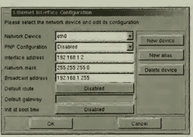

**图 F.3** 带有默认值的 COAS 以太网接口配置对话框。

12. 要添加新的网络别名，点击“新别名”按钮。
13. 要删除现有网络设备，点击“删除设备”按钮。
14. 点击 OK 关闭对话框。

### 设置名称解析

要使用 COAS 设置名称解析，请执行以下步骤：

1. 打开 COAS 菜单。
2. 点击“网络”打开网络子菜单。
3. 点击“TCP/IP”打开 TCP/IP 子菜单。
4. 点击“解析器”打开名称解析器设置对话框。
5. 如果您想从默认值更改解析顺序，请点击“信息源”按钮打开搜索顺序对话框。点击您想要移动的项目，并使用向上或向下按钮将其移动到适当的位置。完成后，点击 OK。
6. 如果您希望系统对入站数据包进行 IP 和名称信息的反向查找，请确保“尝试防止欺骗”复选框已勾选。
7. 如果您的系统正在监控欺骗尝试并将任何可疑欺骗行为记录在系统日志中，请确保“报告欺骗尝试”复选框已选中。
8. 如果您想添加或重新排序系统查找的名称服务器列表，请点击“DNS 服务器”按钮打开 DNS 名称服务器对话框。使用“编辑”菜单添加或删除服务器，并使用“向上”和“向下”按钮在整个列表中移动服务器。完成后，点击 OK。
9. 点击 OK 关闭对话框。

### 设置 NIS 客户端

要使用 COAS 设置 NIS 客户端或服务器，请执行以下步骤：

1. 打开 COAS 菜单。
2. 点击“网络”打开网络子菜单。
3. 点击“TCP/IP”打开 TCP/IP/服务器设置对话框。


## NIS 客户端/服务器设置

4. 点击“NIS”打开 NIS 客户端/服务器设置对话框。

5. 在“域名”文本框中输入 NIS 域名。

6. 如果您想在机器上运行 NIS 客户端，点击“启动时开启 NIS”按钮直到显示为“已启用”。

7. 如果您想显式设置机器使用您的 NIS 服务器的顺序，请点击“NIS 服务器”按钮打开 NIS 服务器对话框。点击“编辑”菜单获取添加、更改或删除列出服务器的选项。在通过“向上”和“向下”按钮更改顺序后，点击 OK。

8. 点击 OK 关闭 NIS 客户端/服务器设置框。

9. 点击“保存”保存您的更改。COAS 现在将停止并重启 NIS 守护进程。

## 设置基础邮件传输

为您的机器设置基础邮件传输功能，请执行以下步骤：

1. 打开 COAS 菜单。

2. 点击“网络”打开网络子菜单。

3. 点击“邮件传输”打开邮件传输配置对话框。

4. 在“可见域名”文本框中，输入您希望在发出的邮件中显示的域名信息。例如，对于 `cherry.fruit.org`，您可能希望所有邮件看起来都来自 `fruit.org`。

5. 如果机器间断连接到互联网或位于防火墙后，请在“邮件中继主机”文本框中输入中继主机信息。这样做将激活“传输方法”下拉列表。选择要使用的传输方法，在这些情况下通常是 TCP。然后，检查中继机制是“互联网枢纽”（与互联网交互的域中央邮件服务器）还是“本地枢纽”（防火墙后或间断连接机器之间的中央邮件服务器）。

6. 点击 OK 关闭对话框。

## 使用 COAS 配置系统信息

COAS 中提供的最大的菜单之一是“系统”菜单。这是因为 COAS 毕竟是为系统管理员准备的工具。它包含了各种项目。

### 设置系统名称

要设置您的机器的名称，请执行以下步骤：

1. 打开 COAS 菜单。

2. 点击“系统”打开系统子菜单。

3. 点击“主机名”打开主机名对话框。

4. 输入完全域名加扩展名。例如，`blue.colors.org`。

### 设置系统时间

要设置系统的时钟，请执行以下步骤：

1. 打开 COAS 菜单。

2. 点击“系统”打开系统子菜单。

3. 点击“时间”打开时间对话框。

4. 如果需要更改系统时间，请更改“设置时间”文本框中的值。

5. 如果需要更改系统时区，点击“时区”按钮打开大陆对话框。选择您所在的大陆和国家选项。

6. 点击 OK 关闭对话框。

### 管理文件系统

要管理挂载和取消挂载分区，请执行以下步骤：

1. 打开 COAS 菜单。

2. 点击“系统”打开系统子菜单。

3. 点击“文件系统”打开图 F.4 所示的文件系统对话框。

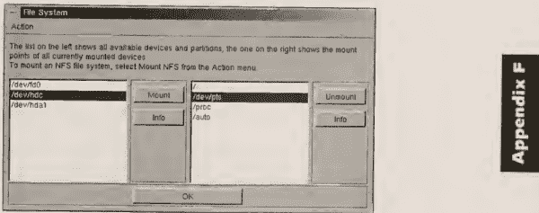

**图 F.4** COAS 文件系统对话框。

6. 点击 OK 关闭对话框。

### 管理用户

要处理系统上的帐户，请执行以下步骤：

1. 打开 COAS 菜单。

2. 点击“系统”打开系统子菜单。

3. 点击系统子菜单上的“账户”打开图 F.5 所示的用户帐户对话框。

COAS 帐户有许多功能。默认显示的是所有用户帐户列表。顶部有一组菜单——文件、用户、组、视图和选项。每个菜单都提供在后续章节中描述的特定服务。

#### 创建用户帐户

COAS 帐户工具允许您创建、删除和修改帐户。要创建帐户，请执行以下步骤：

1. 打开 COAS 用户帐户对话框（如“管理用户”部分所述），点击菜单栏上的“用户”。

2. 选择“用户”菜单上的“创建”打开创建用户帐户对话框。

3. 在“登录”文本框中填写帐户名称。

4. 点击 OK。打开图 F.6 所示的编辑用户对话框。

5. 在“全名”文本框中输入用户名或别名。

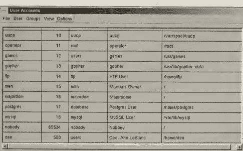

**图 F.5** COAS 用户帐户对话框。

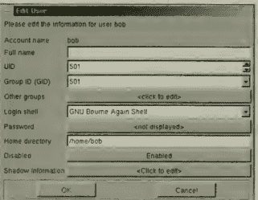

**图 F.6** COAS 编辑用户对话框。

- 6. 如果你有特殊理由，请更改 UID 或 GID 值。请注意，默认情况下这些值是相互相同的。

- 7. 如果你想将用户添加到其他组，请点击“其他组 (Other Groups)”按钮打开“用户所属的组 (Groups For User User)”对话框（User 将是正在编辑的用户账户名称）。使用左、右方向按钮将用户从额外组中添加或删除，直到符合你的要求，然后点击“确定 (OK)”关闭对话框。

- 8. 如果你想更改用户登录默认的 shell，请从“登录 shell (Login shell)”下拉列表中选择一个 shell。

- 9. 如果你想更改用户密码，请点击“密码 (Password)”按钮打开“更改密码 (Change Password)”对话框。在两个文本框中输入密码并点击“确定”。

- 10. 如果你想更改分配给用户的家目录，请在“家目录 (Home directory)”文本框中进行。

- 11. 如果由于某些原因你想现在禁用该账户，请点击“已禁用 (Disabled)”按钮将其状态从“已启用 (Enabled)”更改为“已禁用 (Disabled)”。

- 12. 如果你想编辑存储在 `/etc/shadow` 中的额外账户信息，请点击“影子信息 (Shadow Information)”按钮打开“密码过期 (Password Expiration)”对话框。将默认更改为新值并点击“确定”。

- 13. 点击“确定”关闭对话框。这将返回主对话框。

#### 编辑用户账户

在创建账户后，你可以对其进行编辑或删除。编辑操作与创建非常相似，事实上，在执行以下步骤后，其过程与“创建用户账户”部分中的步骤 5 至 13 完全相同：

- 1. 打开 COAS 用户账户对话框（如“管理用户”部分所述），并点击你想要编辑的账户。

- 2. 点击菜单栏上的“用户 (User)”。

- 3. 在“用户”菜单中选择“编辑用户 (Edit User)”打开之前在图 F.6 中所示的对话框。

- 4. 继续“创建用户账户”部分中的步骤 5 至 13。

#### 删除用户账户

删除账户与编辑用户账户不同。要删除账户，请执行以下步骤：

- 1. 打开 COAS 用户账户对话框（如“管理用户”部分所述），并点击你想要删除的账户。

- 2. 点击菜单栏上的“用户 (User)”。

- 3. 在“用户”菜单中选择“删除用户 (Delete User)”。

- 4. 点击“是 (Yes)”删除该用户。

- 5. 如果需要，点击“是 (Yes)”删除该组。

- 6. 如果需要，点击“是 (Yes)”删除该用户的家目录。

你也可以在“文件 (File)”菜单中关闭对话框，在“视图 (View)”菜单中切换查看所有账户与非守护进程/非系统账户的显示，并在“选项 (Options)”菜单中设置用户默认值。

### 管理组

要管理你的用户组，请执行以下步骤：

- 1. 打开 COAS 菜单。

- 2. 点击“系统 (System)”打开系统子菜单。

- 3. 点击系统子菜单下的“账户 (Accounts)”打开之前在图 F.5 中所示的用户账户对话框。

- 4. 点击“组 (Groups)”菜单打开它。

- 5. 点击“组”菜单下的“管理组 (Manage Groups)”打开“管理组”对话框。你在这里进行的操作取决于你想在该对话框的“组”菜单中做什么。请参阅后续章节获取说明。

- 6. 完成后，点击“确定 (OK)”关闭对话框。

#### 创建组

要创建一个组，请执行以下步骤：

- 1. 打开“管理组”对话框（如“管理组”部分所述），并点击“组 (Groups)”菜单打开它。

- 2. 点击“组”菜单下的“创建组 (Create Groups)”打开“创建组”对话框。

#### 录录

- 1. 在“名称 (Name)”文本框中输入。

#### 删除组

删除组与创建组一样简单。

- 1. 打开“管理组”对话框（如“管理组”部分所述），并点击“组 (Groups)”菜单打开它。

- 2. 点击“组”菜单下的“删除组 (Delete Groups)”打开“删除组”对话框。

- 3. 在列表中选择要删除的组。

- 4. 点击“是 (Yes)”删除该组。

- 5. 完成后，点击“确定 (OK)”关闭对话框。

#### 重命名组

重命名组与删除组类似，只需在“组”菜单中点击“重命名组 (Rename Group)”而不是“删除组”，输入新的组名即可。


#### 合并组

合并是一个不常讨论的有趣选项。当你有多个组需要合并成组时，这个功能非常有用。

- 1. 打开“管理组”对话框（如“管理组”部分所述），并点击要合并的组。

- 2. 点击“组 (Groups)”菜单。

- 3. 选择“合并组 (Merge Groups)”打开“合并组”对话框。

- 4. 在对话框中输入要添加的组名称。

- 5. 点击“确定 (OK)”关闭对话框。

#### 更改成员

最后，如果你想更改谁属于某个组，请执行以下步骤：

- 1. 打开“管理组”对话框（如“管理组”部分所述），并点击想要更改成员的组。

- 2. 点击“组 (Groups)”菜单。

- 3. 选择“成员身份 (Membership)”打开“成员身份”对话框。

- 4. 使用左右箭头在组之间移动用户，直到满意。

- 5. 点击“确定 (OK)”关闭对话框。

### 获取资源信息

要获取系统使用的资源信息，请执行以下步骤：

- 1. 打开 COAS 菜单。

- 2. 点击“系统 (System)”打开系统子菜单。

- 3. 点击系统子菜单下的“资源 (Resources)”打开图 F.7 所示的系统资源信息对话框。


**图 F.7** COAS 系统资源信息对话框。

- 4. 主对话框显示所有常规资源信息。点击“信息 (Info)”菜单列出了其他资源部分：块设备、字符设备、中断、系统负载以及 DMA。

### 管理内核模块

模块管理让人们感到困扰。COAS 提供了一个工具来帮助解决。使用 COAS 加载和卸载内核模块，请执行以下步骤：

- 1. 打开 COAS 菜单。

- 2. 点击 COAS 菜单上的“内核 (Kernel)”打开内核模块对话框。

- 3. 对话框左侧包含可用模块的完整列表，右侧列出已加载的模块。从左侧选择要加载的项，然后根据需要点击“加载 (Load)”或“卸载 (Unload)”按钮。

- 4. 仔细阅读打开的对话框，然后关闭它们。

- 5. 完成后，点击“确定 (OK)”关闭对话框。

### 管理 RPM

虽然在命令行操作 RPM 非常简单，但某些发行版和图形界面提供了管理软件包的组件。COAS 包含的软件包是 kpackage。这是一个功能强大的工具，减少了使用 RPM 命令的记忆负担。

#### 打开 kpackage

要打开 kpackage，请执行以下步骤：

- 1. 打开 COAS 菜单。

- 2. 点击 COAS 菜单上的“kpackage”打开图 F8 所示的 kpackage 对话框。

#### 安装 RPM

要使用 kpackage 安装 RPM，请打开程序并执行以下步骤：

- 1. 在“文件 (File)”菜单中选择“打开 (Open)”打开“选择打开的文件”对话框。

- 2. 点击目录项导航到软件包的位置。如果你想从 Caldera 光盘安装项，请导航到 `/Packages/RPMs`。

- 3. 点击你想要安装的文件进行选择。

- 4. 点击“确定 (OK)”。出现“安装软件包 (Install Package)”对话框。

## GUI 管理工具 583

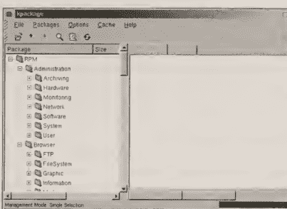

**图 F.8** COAS 软件包对话框。

- 5. 读取对话框内容。在左侧选择或取消勾选最符合你逻辑的项目。可用项目有：升级（Upgrade）、替换文件（Replace Files）、替换软件包（Replace Packages）、检查依赖（Check Dependencies）和测试（Test，不安装）。

- 6. 点击安装（Install）安装 RPM。你将返回 kpackage 对话框。

### 使用 kpackage 移除 RPM

要使用 kpackage 从系统中移除 RPM 包，请执行以下步骤：

- 1. 浏览左侧的软件包列表，找到你想要删除的软件包。

- 2. 点击该软件包进行选择。

- 3. 点击右侧的卸载（Uninstall）按钮打开卸载对话框。

- 4. 仔细阅读对话框中的信息。

- 5. 通常情况下，保持复选框的原样是较好的主意。如果你有需要，请根据需要更改复选框选项设置。

- 6. 点击卸载（Uninstall）移除软件包。

### X-Server

通过 COAS，Caldera 允许你在需要时运行 X 设置程序。这与你安装 OpenLinux 时遵循的程序相同。要启动 X 设置程序，打开 COAS 菜单并点击 X-Server。按照程序完成整个过程。这是从你不喜的 X 配置中恢复的极佳方法，而无需费力重新安装或手动查找 X 软件包进行手动操作。

## LINUXCONF

Linuxconf（见图 F.9）是由 Solucorp (`www.solucorp.qc.ca/linuxconf`) 制作的一款第三方 GUI 配置和系统管理工具。该工具主要在 Red Hat 及其衍生发行版中提供。它集成良好，在工具的某部分输入的数据会被正确地读取到其他部分，这使得你作为系统管理员的工作变得简单得多。

### Linuxconf 的布局

Linuxconf 由许多小型集成功能组成，并组织成一个菜单树。学习使用此工具的一部分工作包括学习如何在树结构中导航。Linuxconf 菜单树有两个主要分支——配置（Config）和控制（Control）。这种划分非常直观。基本上，所有配置选项都位于 Config 主干上，而所有的服务器和服务控制选项都位于 Control 上。

### 配置主干（Config Trunk）简介

树主干的 Config 部分分为五个部分：

- 网络（Networking）

- 用户账户（Users Accounts）

- 文件系统（File Systems）

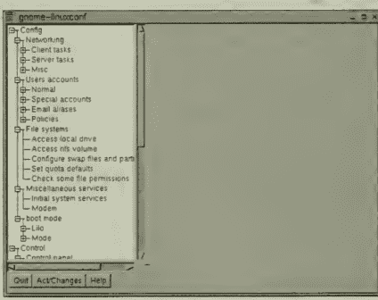

**图 F.9** Linuxconf 主对话框。

- 其他服务（Miscellaneous Services）

- 启动模式（Boot Mode）

这些每个部分会进一步嵌套到子分类。在这一层你遇到的是实际工具，而不是更多的分支。

### 控制主干（Control Trunk）简介

树主干的 Control 部分同样分为五个部分：

- 控制面板（Control Panel）

- 控制文件与系统（Control Files And Systems）

- 日志（Logs）

- 日与时间（Date & Time）

- 功能（Features）

Control 主干的部分比对应的 Config 部分要浅得多。在这一层，你已经遇到了实际工具，而不仅仅是菜单。

### 配置客户端网络

Linuxconf Config 主干的第一部分是网络（Networking）。该部分的第一块是客户端网络（Client Networking），你在此处配置网络服务的客户端方面。这些项目中的每个都是按照你可能使用的顺序列出的，因此它们在接下来的章节中会按顺序介绍。

要设置你的主机名并激活网络接口，请执行以下步骤：

- 1. 点击基础主机信息（Basic Host Information）打开主机基础配置对话框。

- 2. 在“此主机基础配置”（This Host Basic Configuration）对话框中输入完全域名（主机名、域名和扩展）。

- 3. 点击适配器 1（Adaptor 1）标签页打开适配器 1 对话框。

- 4. 确保选择了启用（Enabled）按钮。

- 5. 点击正确的配置模式按钮——手动（Manual）、Dhcp 或 Bootp。

- 6. 在 Primary Name + Domain 文本框中输入完全域名。

- 7. 在相应的文本框中输入机器别名、IP 地址和子网掩码（netmask）。

- 8. 如果你的太网卡是 PCI 卡，那么网络设备（Net Device）和内核模块（Kernel Module）文本框可能已经填充好。如果没有，请适当填充。

- 9. 如果你的以太网卡出现问题，考虑填充 I/O 端口（I/O Port opt）和 IRQ（opt）文本框。

- 10. 如果你有第二个以太网卡，点击 2 标签页对其进行配置。

否则，点击接受（Accept）关闭对话框。

### 配置域名服务

要使用 Linuxconf 配置你的域名服务解析，请执行以下步骤：

- 1. 点击域名服务规范（Name Service Specification DNS）打开图 F10 所示的解析器配置（Resolver Configuration）对话框。

- 2. 确保勾选 DNS 使用框，以便激活你的域名服务器。

- 3. 在默认域名（Default Domain）文本框中输入你的域名加扩展。例如，`colors`。

- 4. 在默认域名（Default Domain）文本框中输入你的域名加扩展。例如，`colors`。

- 5. 在默认域名（Default Domain）文本框中输入你的域名加扩展。

- 6. 点击接受（Accept）保存更改。

**图 F10** 解析器配置对话框。

### 配置路由

在 Linuxconf 中配置路由涉及菜单树。点击路由选项：

- 默认（Defaults）

- 其他网络路由（Routes To Networks）

- 其他主机路由（Routes To Hosts）

- 本地网络（Routes To Local Nets）

- 路由守护进程（Routed）

#### 配置路由：默认

要配置默认路由，请执行以下步骤：

- 1. 点击默认（Defaults）打开默认对话框。

- 2. 在文本框中输入默认网关。

- 3. 如果你需要作为路由器，勾选启用路由（Enable Routing）。


- 4. 点击`Accept`保存更改。

### 配置路由：其他网络

要配置到其他网络的路由（如子网），请执行以下步骤：

- 1. 点击`Routes To Networks`打开其他网络对话框。
- 2. 点击`Add`按钮打开路由规范对话框。
- 3. 在`Gateway`文本框中输入网关地址。
- 4. 在`Destination`文本框中输入网络的网络地址。
- 5. 如果必要，输入子网掩码（`netmask`）。
- 6. 点击`Accept`保存更改。

### 配置路由：其他主机

如果你想让不在主局域网的主机成为网络的一部分，你需要告诉路由器如何以及在哪里包含这些机器。要为此，请执行以下步骤：

- 1. 点击`Routes To Hosts`打开其他主机对话框。
- 2. 点击`Add`按钮打开路由规范对话框。
- 3. 在`Gateway`文本框中输入与远程主机通信的接口。
- 4. 在`Destination`文本框中输入主机名或 IP 地址。
- 5. 点击`Accept`保存更改。

### 配置路由：本地网络

如果在配置的任何点子网或其他网络共享局域网硬件，你需要设置本地网络路由。要为此，请执行以下步骤：

- 1. 点击`Routes To Local Nets`打开本地网络对话框。
- 2. 点击`Add`按钮打开路由规范对话框。
- 3. 在`Interface`文本框中输入与另一个本地网络通信的网络接口名称。
- 4. 在`Destination`文本框中输入另一个网络的网络地址。
- 5. 在`Netmask`文本框中输入另一个网络的子网掩码。
- 6. 点击`Accept`保存更改。

### 配置路由：路由守护进程

要配置实际路由守护进程，请执行以下步骤：

- 1. 点击`routed daemon`打开路由守护进程配置对话框。
- 2. 如果你希望你的路由守护进程在发出路由器请求时保持沉默而不是发言，确保选中了`Does Not Export Any Routes`框。
- 3. 如果你想将机器上的默认路由导出为整个网络的默认路由，确保选中了`Export Your Default Route`框。
- 4. 点击`Accept`保存更改。

## 配置名称查找顺序

要配置机器查找宿主机 IP 地址时查找的文件和服务的顺序，请执行以下步骤：

- 1. 点击`Host Name Search Path`打开图 F11 所示的`名称服务访问`对话框。
- 2. 如果你允许机器在一个接口上分配多个 IP 地址，或者分配到一组接口上，请确保勾选了`Multiple IPs For One Host`复选框。
- 3. 你只能在长选项列表中选择其中一个。阅读每个选项，并理解在选择其中一个时你开启或关闭了什么。
- 4. 点击`Accept`保存更改并关闭对话框。

## 设置 NIS 客户端

要将机器配置为 NIS 客户端，请执行以下步骤：

- 1. 点击`网络信息系统 (NIS)`打开`NIS 客户端配置`对话框。
- 2. 填写`NIS Domain`和`Server`文本框。
- 3. 点击`Accept`保存更改并关闭对话框。

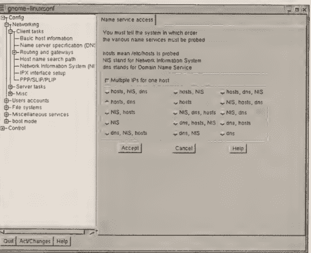

图 F.11 Linuxnameconf 名称服务访问对话框。

## 设置 IPX 接口

如果你需要为网络设置 IPX 接口，请执行以下步骤：

- 1. 点击`IPX Interface Setup`打开`IPX 接口配置`对话框。
- 2. 填写三个标签页中的数据。
- 3. 完成后，点击`Accept`保存更改并关闭对话框。

## 配置 PPP/SLIP/PLIP 连接

如果你需要设置拨号连接，请执行以下步骤：

- 1. 点击`PPP/SLIP/PLIP`打开`PPP/Slip/Plip 配置`框。
- 2. 点击`Add`打开`Type Of Interface`对话框。
- 3. 点击选项之一——`PPP`、`SLIP` 或 `PLIP`。
- 4. 点击`Accept`保存更改并打开 PPP 接口 `ppp0` 对话框（这假设你正在设置 PPP 连接，这是目前最常见的）。
- 5. 填写`Phone Number`、`Modem Port`和`Login Information`文本框及下拉列表框。
- 6. 如果你需要 PAP 配置，请确保该复选框已选中。
- 7. 点击`Customize`保存更改，并在`硬件`标签页打开下一个 PPP `ppp0` 对话框，如图 F12 所示。
- 8. 设置相应的硬件信息。
- 9. 点击`Communication`标签页打开`通信`对话框。
- 10. 设置必要的连接信息。
- 11. 使用脚本生成器创建你的拨号脚本。在 `Expect` 文本框中，告诉生成器监控什么文本；在 `Send` 文本框中，告诉它用什么数据响应。
- 12. 点击`Networking`标签页打开`网络`对话框。
- 13. 填写任何需要的信息。
- 14. 如果你需要设置 PAP 认证，点击 PAP 标签页并填写对话框。
- 15. 完成后点击`Accept`保存更改并关闭除原始对话框以外的所有对话框。
- 16. 点击`Quit`关闭 PPP/Slip/Plip 配置对话框。

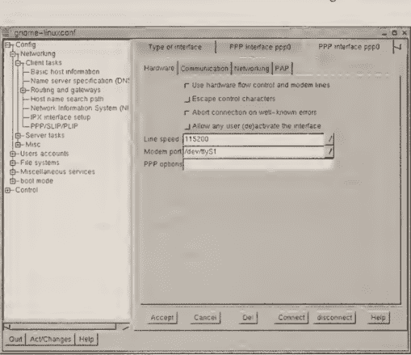

**图 F.12** Linuxconf PPP 接口 ppp00 对话框，硬件标签页。

## 配置服务器网络

Linuxconf 配置网络主部分的第二部分是服务器网络。这是你配置网络服务客户端方面的地方。这些项目都是按照你可能使用的顺序列出的，因此在接下来的章节中将按该顺序介绍。

### 导出 NFS 挂载

要设置你的机器导出 NFS 挂载，请执行以下步骤：

- 点击`Exported File Systems (NFS)`打开`导出文件系统`对话框。
- 点击`Add`按钮打开`One Exported File System`对话框。
- 定义你想导出的文件系统段及其规则。
- 完成挂载定义后，点击`Accept`。
- 点击`Add`添加另一个要导出的文件系统，或点击`Quit`关闭对话框。

# 附录 F

### 设置 IP 别名

要为你的任何虚拟主机设置 IP 别名，请执行以下步骤：

- 1. 点击`IP Aliases For Virtual Hosts`打开`编辑 IP 别名配置`对话框。
- 2. 点击列表中你想分配多个 IP 地址的网络设备，打开`IP Aliases For Device Name`对话框。
- 3. 输入你想分配给接口的 IP 别名或别名范围以及相应的掩码。
- 4. 完成后点击`Accept`。
- 5. 点击`Quit`关闭`编辑 IP 别名配置`对话框。

### 配置 Sendmail

在 Linuxconf 中配置 Sendmail 涉及一组新的菜单树。点击`Mail Delivery System (Sendmail)`旁边的展开按钮。你可以选择`Basic`和`Anti-spam`过滤器。接下来，你进一步展开树结构，发现你有广泛的选项可以考虑。虽然你可能需要配置这些过滤器中的多个，但你可能不需要配置所有的。在配置每个项目之前，请对其进行一些思考。

### 配置基础 Sendmail：基础信息

要从初始设置你的邮件服务器行为，请执行以下步骤：

- 1. 点击`Basic Information`获取 Sendmail 配置对话框。
- 2. 在`Present Your System As`文本框中输入你的域名和扩展名。例如，`colors.org`。
- 3. 如果邮件旨在作为你的主邮件服务器，勾选`Accept Email For Name.ext`框。
- 4. 在`Mail Server`和`Mail Gateway`文本框中输入相应机器的 IP 地址。
- 5. 如必要，更改邮件网关协议。
- 6. 适当填写`Features`、`Misc`和`Aliases`标签页。
- 7. 完成后，点击`Accept`生成新的 Sendmail 配置文件。你可能会收到警告对话框。在关闭它们之前仔细阅读它们。

### 配置基础 Sendmail：特殊路由

如果你需要为某些机器分配特殊的邮件路由，请执行以下步骤：

- 1. 点击`Special (Domain) Routing`打开`特殊路由`对话框。
- 2. 点击`Add`打开下一个`特殊路由`对话框。
- 3. 输入需要特殊路由的机器的 IP 地址。
- 4. 在`Destination`框中输入需要特殊路由的机器 IP 地址。
- 5. 选择接收邮件的方法。
- 6. 点击`Accept`保存更改。
- 7. 点击`Quit`。

### 配置基础 Sendmail：邮件重定向

如果你需要为特定机器重定向邮件，请执行以下步骤：

- 1. 点击`Special (User Routing)`打开`重路由`对话框。
- 2. 点击`Add`打开下一个`重路由`对话框。
- 3. 在`To`框中输入目标用户。
- 4. 填写重定向信息。
- 5. 点击`Accept`保存更改。
- 6. 点击`Quit`。

### 配置基础 Sendmail：创建伪装规则

要为输出邮件创建伪装规则，请执行以下步骤：

- 1. 点击`Masquerading Rules`打开`伪装规则`对话框。
- 2. 点击`Add`打开伪装规则对话框。
- 3. 在`From`框中输入原始发送者地址。
- 4. 在`From`框中输入新的发送者格式。
- 5. 点击`Accept`保存更改。
- 6. 点击`Quit`。

### 配置基础 Sendmail：创建邮件网关

要创建邮件到网关，请执行以下步骤：

- 1. 点击`Mail To Gateway`打开`邮件到网关`对话框。
- 2. 点击`Basic Information`打开对话框。
- 3. 点击`Active`激活网关。
- 4. 在`Spool Command`文本框中输入需要运行传真的命令。
- 5. 在相应的文本框中输入日志文件和命令。
- 6. 点击`Accept`返回对话框。
- 7. 点击`Access Rules`打开`访问规则`对话框。
- 8. 点击`Add`打开`访问规则`对话框。
- 9. 填写相应信息。
- 10. 点击`Accept`返回访问规则框。
- 11. 点击`Quit`。
- 12. 点击`Users`打开`用户`对话框。
- 13. 点击`Add`打开`用户`对话框。
- 14. 填写相应信息。
- 15. 点击`Accept`返回用户框。
- 16. 点击`Quit`。
- 17. 点击`Zones`打开`区域`对话框。
- 18. 点击`Add`打开`自己的区域`对话框。
- 19. 填写相应信息。
- 20. 点击`Accept`返回区域框。
- 21. 点击`Quit`。
- 22. 点击`Aliases`打开`别名`对话框。
- 23. 点击`Add`打开`别名`对话框。
- 24. 填写相应信息。
- 25. 点击`Accept`返回别名框。
- 26. 点击`Quit`。

### 配置基础 Sendmail：配置虚拟邮件域

要为虚拟域设置邮件，请执行以下步骤：

- 1. 点击`Virtual Email Domain`打开`虚拟邮件域`对话框。
- 2. 点击`Add`打开`One Vdomain Definition`对话框。
- 3. 在`Virtual Domain`文本框中输入虚拟域的全域名。例如，如果你为 **pretend.org** 提供邮件，则输入任一地址，或者你可以输入`pretend.org.`。
- 4. 点击`Match Full Name`复选框激活该功能。
- 5. 在`Aliases For This Domain`文本框中输入可能指向相同用户的其他域名。
- 6. 点击`Accept`返回主对话框。
- 7. 点击`Quit`关闭对话框。

## 配置基础 Sendmail：管理邮件队列

更改 Sendmail 队列，请执行以下步骤：

- 1. 点击邮件队列按钮打开邮件队列对话框。
- 2. 点击列表中你想要管理的队列。这将打开`One Status`对话框。
- 3. 点击`Delete`删除列出的消息。否则，点击`Cancel`。
- 4. 点击`Quit`关闭对话框。

## 配置基础 Sendmail：创建用户别名

在 Sendmail 中创建用户别名，请执行以下步骤：

- 1. 点击`User Aliases`打开编辑全局邮件别名对话框。
- 2. 点击一个别名进行编辑，或点击`Add`按钮创建一个新的。将打开`One Alias Definition`对话框。
- 3. 在`Alias Name`文本框中为别名命名。
- 4. 如果你想通过另一个程序管道所有消息到别名，请在`Filter Program`文本框中输入要运行的命令。
- 5. 如果你想让别名代表的人员列表位于文件中，请在`List File`文本框中输入文件路径。
- 6. 在行下方，逐个输入别名指向的用户名。如果需要的比空白位多，点击`Add`。
- 7. 点击`Accept`返回主对话框。
- 8. 点击`Quit`关闭对话框。

## 配置基础 Sendmail：在虚拟域上创建特定用户

如果你需要为你任何虚拟域的用户名创建别名，请执行以下步骤：

- 1. 点击`Virtual Domain User Aliases`打开`Pick The Domain`对话框。
- 2. 点击你想编辑的域名以打开 `/etc/vmail/aliases.domain.ext` 对话框。
- 3. 点击`Add`打开`One Alias`对话框。
- 1. `配置基础 Sendmail：创建别名`章节中的说明。
- 2. 点击`Accept`关闭对话框。
- 3. 点击`Add`创建一个新别名，或点击`Quit`关闭对话框。
- 4. 点击`Quit`关闭主对话框。

## 配置基础 Sendmail：重新生成 /etc/sendmail.cf

每你想重新生成 Sendmail 配置文件，点击 `/etc/sendmail.cf`。该文件会自动生成。

## 配置反垃圾 Sendmail：拒绝发送者

拒绝来自特定用户或域的邮件，请执行以下步骤：

- 1. 点击`Rejected Senders`打开`邮件拒绝来自`对话框。
- 2. 点击`Add`按钮打开`Rejected Message`对话框。
- 3. 在`Email Origin`文本框中输入你想拒绝的地址。
- 4. 在`Error Message`文本框中输入随被拒绝邮件退回的消息。
- 5. 点击`Accept`关闭对话框。
- 6. 点击`Add`拒绝另一个地址，或点击`Quit`关闭对话框。

## 配置反垃圾 Sendmail：设置允许转发的对象

将特定用户或地址设置为允许转发，请执行以下步骤：

- 1. 点击`Relay For By`打开`可以转发邮件`对话框，或点击`Relay By Name`打开同一个对话框。
- 2. 点击`Add`按钮打开`Allow Host/Domain To Use Your Server (IP)`对话框，或点击`Allow Host/Domain To Use Your Server`对话框。
- 3. 选择 IP 选项，为主机输入 IP 地址或为整个域输入网络地址。否则，输入机器主机名或域名。
- 4. 点击`Accept`关闭对话框。
- 5. 点击`Add`添加另一个定义，或点击`Quit`关闭对话框。

## 配置反垃圾 Sendmail：转发到主机

要设置 Sendmail 允许转发到的主机，请执行以下步骤：

- 1. 点击`Relay To Hosts`打开`可以转发邮件到`对话框。
- 2. 点击`Add`打开`Relay To This Host/Network`对话框。
- 3. 为主机输入 IP 地址、为整个域输入网络地址、机器主机名或域名。
- 4. 点击`Accept`关闭对话框。
- 5. 点击`Add`添加另一个定义，或点击`Quit`关闭对话框。


## 配置杂杂网络

Linuxconf 配置网络主部分的第三也是最后部分是杂杂网络。在这里，你可以配置不属于客户端或服务器应用程序的网络服务。每个杂杂网络项按照你可能使用的顺序列出，因此在随后的章节中将按顺序进行涵盖。

## 设置其他主机的信息

要输入关于局域网内或外其他机器的信息，请执行以下步骤：

- 1. 点击“其他主机信息”（Information About Other Hosts）打开 `/etc/hosts` 对话框。
- 2. 点击列表中的主机，或点击“添加”（Add）按钮打开“主机/网络定义”（Host/Network Definition）对话框。
- 3. 在“主名+域名”（Primary Name + Domain）文本框中输入完全限定域名名。
- 4. 在“别名(可选)(Aliases (Opt))文本框中输入你想分配给该主机的任何别名。
- 5. 输入机器主机名或域名。
- 6. 点击“接受”（Accept）关闭对话框。
- 7. 点击“添加”（Add）添加另一个定义，或点击“退出”（Quit）关闭对话框。

## 设置网络信息

要输入关于你的网络的信息，请执行以下步骤：

- 1. 点击“其他主机信息”（Information About Other Hosts）打开 `/etc/hosts` 对话框。
- 2. 点击列表中的主机，或点击“添加”（Add）按钮打开“主机/网络定义”（Host/Network Definition）对话框。
- 3. 在“主名+域名”（Primary Name + Domain）文本框中输入完全限定域名名。
- 4. 在“别名(可选)(Aliases (Opt))”文本框中输入你想分配给该主机的任何别名。
- 5. 输入主机名或域名。
- 6. 点击“接受”（Accept）关闭对话框。
- 7. 点击“添加”（Add）添加另一个定义，或点击“退出”（Quit）关闭对话框。

## 设置 Linuxconf 网络访问

要配置哪些主机可以远程访问 Linuxconf，请执行以下步骤：

- 1. 点击“Linuxconf 网络访问”（Linuxconf Network Access）打开访问控制对话框。
- 2. 点击“启用网络访问”（Enable Network Access）按钮激活远程访问。如果你激活此项，还将启用日志。
- 3. 在“网络或主机”（Network Or Host）框中输入可以访问 Linuxconf 的网络地址或 IP 地址。
- 4. 如果需要，在“子网掩码”（Netmask）框中输入网络或 IP 地址使用的掩码。
- 5. 如果需要，对第二对文本框重复步骤 3 和 4。
- 6. 点击“添加”（Add）访问更多文本框。
- 7. 点击“接受”（Accept）保存更改并关闭对话框。
- 8. 点击“退出”（Quit）关闭主对话框。

## 配置普通用户

Linuxconf 主部分的第二部分是用户账户。该部分的第一部分是普通。在这里你可以配置标准用户和组的问题。这些项目都按照你可能使用的顺序列出，因此在后续章节中按顺序涵盖。

### 配置用户账户

设置用户账户，请执行以下步骤：

- 1. 点击“用户账户”（User Accounts）打开用户账户对话框。
- 2. 点击账户进行编辑，或点击“添加”（Add）打开用户账户对话框。
- 3. 在“登录名”（Login Name）文本框中输入帐户名。
- 4. 在“全名”（Full Name）文本框中输入用户的姓名或昵称。
- 5. 在“组(可选)(Group (Opt))”文本框中输入或选择主组。
- 6. 如果你想让用户属于多个组，请在“附加组”（Supplementary Groups）文本框中列出辅助组。
- 7. 点击“参数”（Params）选项卡访问密码参数。
- 8. 如果你想强制更改密码的，请配置密码参数。
- 9. 点击“邮件设置”（Mail Settings）选项卡访问用户的邮件选项。
- 10. 如必要，将邮件转发到另一个地址，或为用户账户创建邮件别名。
- 11. 点击“权限”（Privileges）选项卡，访问一组与用户可以和不可以的操作相关的新选项卡。
- 12. 根据需要配置每个选项卡。
- 13. 点击“接受”（Accept）接受账户参数。
- 14. 输入用户的初始密码并点击“接受”。
- 15. 重新输入密码并再次点击“接受”。您将返回主对话框。
- 16. 点击“退出”（Quit）关闭主对话框。

### 配置组定义

要创建一个新组，请执行以下步骤：

- 1. 点击“组定义”（Group Definitions）打开“用户组”对话框。
- 2. 点击某个组以进行编辑，或点击“添加”（Add）打开“组规格”对话框。
- 3. 填充“组名”（Group Name）和 GID 文本框。
- 4. 在“备用成员”（Alternate Members）文本框中输入您知道想要添加到该组的用户。
- 5. 点击“目录”（Directories）选项卡。
- 6. 如果您希望每个组成员拥有不同的主目录，请确保勾选相应的复选框。否则，输入组主目录的路径。
- 7. 点击“接受”（Accept）返回主对话框。
- 8. 点击“退出”（Quit）关闭主对话框。

### 修改 Root 密码

使用 Linuxconf 更改 root 密码，请执行以下步骤：

- 1. 点击“更改 root 密码”（Change Root Password）获取“新 UNIX 密码”对话框。
- 2. 在文本框中输入新密码。
- 3. 点击“接受”（Accept）打开“确认密码”对话框。
- 4. 再次输入密码。
- 5. 点击“接受”（Accept）关闭对话框并正式更改密码。

## 配置特殊用户

“用户账户”部分的第二部分是“特殊账户”（Special Accounts）。在这里，您可以配置不是简单的 shell 登录的用户账户。每个项目都按照您可能使用的顺序列出，因此在后续章节中按该顺序进行介绍。

### 配置 PPP 或 SLIP 拨号账户

要设置 PPP 或 SLIP 拨号账户，请执行以下步骤：

- 1. 通过普通登录点击“PPP 账户”（PPP Accounts）或“SLIP 账户”（SLIP Accounts），打开图 F14 所示的“用户账户”对话框，尽管该项最初是空的。
- 2. 点击“添加”（Add）打开“用户账户”对话框。再次，这是您在创建普通用户时遇到的相同对话框，只是某些项目已为您填写，以将用户限制为 PPP 或 SLIP 账户。
- 3. 按照“配置用户账户”章节中的说明填充此对话框的其他部分并创建用户密码。
- 4. 点击“退出”（Quit）关闭“用户账户”对话框。用户将没有用于登录的 shell 账户。

### 配置 UUCP 或 POP 账户

要设置 UUCP 或 POP 邮件账户，请执行以下步骤：

- 1. 点击“UUCP 账户”（UUCP Accounts）或“POP 账户（仅邮件）”（POP Accounts (Mail Only)）打开图 F14 所示的“用户账户”对话框，尽管该项最初是空的。
- 2. 点击“添加”（Add）打开“用户账户”对话框。再次，这是您在创建普通用户时遇到的相同对话框，只是某些项目已为您填写，以将用户限制为 UUCP 或 POP 账户。
- 3. 按照“配置用户账户”章节中的说明填充此对话框的其他部分并创建用户密码。
- 4. 点击“退出”（Quit）关闭“用户账户”对话框。用户将没有用于登录的 shell 账户。

### 配置虚拟 POP 账户

要为虚拟托管域名的用户创建 POP 账户，请执行以下步骤：

- 1. 点击“虚拟 POP 账户（仅邮件）”(Virtual POP Accounts (Mail Only))打开“选择域名”对话框。
- 2. 点击您想要为其创建虚拟 POP 账户的域名。图 F14 所示的“用户账户”对话框将打开，尽管它是空的。
- 3. 按照“配置 UUCP 或 POP 账户”章节中的说明操作。
- 4. 完成后点击“退出”（Quit）关闭“选择域名”对话框。用户将没有用于登录的 shell 账户。

## 配置邮件别名

“用户账户”部分的第三部分是“邮件别名”（email aliases）。在这里，您可以为各种用户账户和虚拟托管账户设置邮件别名。该部分的两个项目都是冗余项，也用于 Linuxconf 的其他部分。因此，提供了指针。

### 为用户账户设置别名

要为用户创建邮件别名，请执行以下步骤：

- 1. 点击“用户别名”（User Aliases）打开“编辑全局邮件别名”（Edit Global Mail Ali）对话框。
- 2. 按照“配置基础 Sendmail：创建用户别名”（Configuring Basic Sendmail: Creating User Aliases）章节中的说明操作。

### 为虚拟域名设置别名

要为虚拟域名上的用户创建邮件别名，请执行以下步骤：

- 1. 点击“虚拟域名用户别名”（Virtual Domain User Ali）打开“选择域名”对话框。
- 2. 按照“配置基础 Sendmail：在虚拟域名上创建特定用户”（Configuring Basic Sendmail: Creating Specific Users On Virtual Domains）章节中的说明操作。

## 配置策略

“用户账户”部分的第四部分也是“策略”（Policies）。在这里，您可以配置不是简单的 shell 登录的用户账户。每个项目都按照您可能使用的顺序列出。

### 密码与账户

要设置账户策略，请执行以下步骤：

- 1. 点击“密码和账户”（Password and Account）打开图 F14 所示的“账户设置”对话框。
- 2. 如果您想更改默认密码，请在文本框中更改。
- 3. 如果您想禁用任何密码，请取消勾选复选框。
- 4. 如果您想限制密码长度，请在文本框中更改。
- 5. 点击“接受”（Accept）关闭对话框。

# gn-linuxconf GUI 管理工具 605

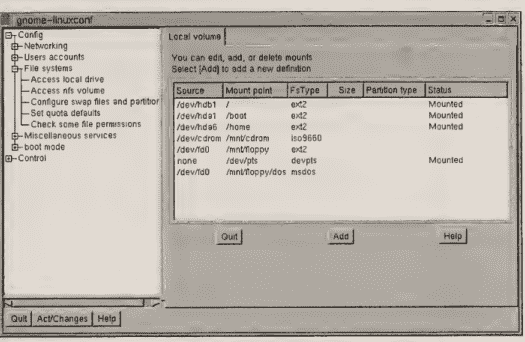

**图 F.16** Linuxconf 本地卷对话框。

- 5. 在挂载点（Mount Point）文本框中输入挂载点。
- 6. 点击选项（Options）选项卡打开对话框的选项部分。
- 7. 使用复选框选择或取消勾选各种挂载选项。
- 8. 根据需要设置 Dump 频率（Dump frequency）和 Fck 优先级（Fck priority）。
- 9. 在 DOS Options 对话框中，设置给任何挂载到文件系统上的 DOS 分区的值，使其不会处于脆弱状态并可供所有人访问。
- 11. 完成挂载定义后，点击接受（Accept）按钮。
- 12. 如果挂载点不存在，Linuxconf 将提议为您创建。点击是（Yes）创建挂载点。
- 13. 点击退出（Quit）关闭对话框。

## 挂载 NFS 分区

要从另一台 Linux 或本机挂载 NFS 分区，请执行以下步骤：

- 1. 点击访问 NFS 卷（Access NFS Volume）打开 NFS 对话框。
- 2. 点击要修改的定义，或点击添加（Add）按钮打开卷规范（Volume Specification）对话框。
- 3. 在服务器（Server）文本框中填写服务器的 IP 地址或域名。

# 附录 F

# 606 附录 F

- 4. 在卷（Volume）文本框中输入挂载名称。
- 5. 在挂载点（Mount Point）文本框中输入本地挂载点。
- 6. 点击选项（Options）选项卡进入对话框的选项部分。
- 7. 使用复选框选择或取消勾选各种通用挂载选项。
- 8. 点击 NFS 选项卡打开对话框的 NFS Options部分。
- 9. 使用选择框和文本框设置相应的 NFS 挂载选项。
- 10. 完成挂载定义后，点击接受（Accept）按钮。
- 11. 如果挂载点不存在，Linuxconf 将提议为您创建。点击是（Yes）创建挂载点。
- 12. 点击退出（Quit）关闭对话框。

## 操作交换文件和分区

如果您想对当前的交换空间安排进行更改，请执行以下步骤：

- 1. 配置交换文件和分区（Swap Files And Partitions）打开交换空间对话框。
- 2. 点击您要编辑的项目，或点击添加（Add）按钮打开卷规范（Volume Specification）对话框。
- 3. 在分区（Partition）文本框中输入分区的设备名称（例如 `hda1`）。
- 4. 完成挂载定义后，点击接受（Accept）按钮。
- 5. 点击退出（Quit）关闭对话框。

## 设置配额信息

如果您有一个启用了配额的分区，可以通过以下方法管理配额：

- 1. 点击设置默认配额（Set Quota Defaults）打开如图 F17 所示的用户和组默认配额对话框。
- 2. 点击对应您要修改或设置配额的分区的选项卡。
- 3. 设置用户磁盘空间软限制（Soft Limit）、硬限制（Hard Limit）和宽限期（Grace Period）选项。
- 4. 设置用户文件数软限制、硬限制和宽限期选项。
- 5. 设置组磁盘空间软限制、硬限制和宽限期选项。
- 6. 设置组文件数软限制、硬限制和宽限期选项。
- 7. 点击接受（Accept）关闭对话框。

# GUI 管理工具 607

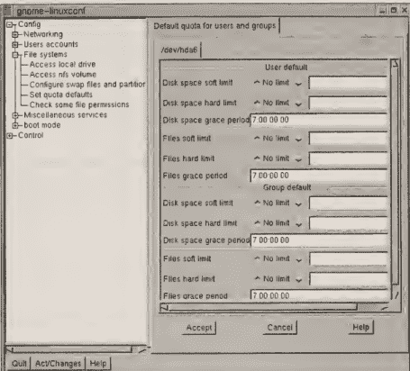

**图 F.17** Linuxconf 用户和组默认配额对话框。

## 检查文件权限

如果您想让 Linuxconf 检查关键文件的权限，请点击检查某些文件权限（Check Some File Permissions）选项。Linuxconf 会对您的文件系统进行检查并显示对话框。通常情况下，对话框仅告知您一切正常。请仔细阅读响应并点击 OK 关闭对话框。

## 配置杂项服务

Config 主干分支的第四个分支是杂项服务（Miscellaneous Services）。该部分包含了不属于其他任何部分的配置服务。

### 更改默认运行级别

要更改默认运行级别，请执行以下步骤：

- 1. 点击初始系统服务（Initial System Services）打开初始化默认运行级别（Init Default Runlevel）对话框。
- 2. 点击接受（Accept）按钮关闭对话框。

### 设置默认调制解调器端口

要设置调制解调器端口，请执行以下步骤：

- 1. 点击调制解调器（Modem）打开调制解调器配置（Modem Configurator）对话框。
- 2. 点击对应您的调制解调器的设备位置。
- 3. 点击接受保存信息并关闭对话框。

## 配置 LILO 启动信息

Off Config 主干第五分支是启动模式（Boot Mode）。启动模式的第一分支是 LILO。控制 LILO 在启动时为系统执行各种配置选项包含在接下来的章节中。

### 配置 LILO 默认设置

要设置 LILO 默认值，请执行以下步骤：

- 1. 点击 LILO 默认（LILO defaults）打开如图 F.18 所示的 LILO 默认设置对话框。
- 2. 要激活或禁用 LILO，选择 LILO 用于启动此系统（LILO Is Used To Boot This System）复选框。

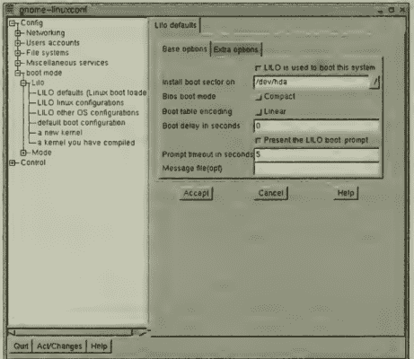

**图 F18** Linuxconf 默认对话框。

- 3. 使用安装（Install）下拉列表选择位置。
- 4. 如果需要压缩（Compact），激活相应的复选框。
- 5. 如果想让 LILO 在启动前等待，在启动延迟（Boot Delay）文本框中输入时间。
- 6. 要抑制 LILO 提示，取消勾选显示 LILO（Present LILO）。
- 7. 如果想让 LILO 在启动时打印特定文本，请在消息（Message）文本框中输入文本。
- 8. 点击选项（Options）选项卡打开对话框的选项部分。
- 9. 填写所需的参数。
- 10. 点击接受（Accept）生效更改。

### 添加 Linux 启动选项

要为 LILO 添加 Linux 启动选项，请执行以下步骤：

- 1. 点击 LILO Linux 配置（LILO Linux configurations）打开配置对话框。
- 2. 点击要修改的定义，或点击添加（Add）打开 Linux 配置对话框。
- 3. 在标签（Label）文本框中输入新的启动标签。
- 4. 在内核镜像文件（Kernel Image File）框中输入路径。
- 5. 在根分区（Root Partition）文本框中输入启动选项的分区。
- 6. 设置其他必要的参数。
- 7. 点击接受生效。

### 添加 其他操作系统 LILO 启动选项

要为 LILO 添加非 Linux 启动选项，请执行以下步骤：

- 1. 点击 LILO 其他操作系统配置（LILO Other OS configurations）打开其他操作系统配置对话框。
- 2. 点击要修改的项目，或点击添加（Add）打开其他操作系统设置（Other Operating System Setup）框。
- 3. 在标签（Label）文本框中输入启动选项的标签。
- 4. 在启动分区（Partition To Boot）文本框中输入包含操作系统启动信息的分区。
- 5. 点击接受生效。
- 6. 可能会收到警告对话框。如果是，请仔细阅读后点击 OK。
- 7. 点击退出（Quit）关闭对话框。

### 设置默认 LILO 启动选项

要设置默认启动操作系统，请执行以下步骤：

- 1. 点击默认启动配置（Default Boot Configuration）打开默认启动配置对话框。
- 2. 点击列表中您想要的默认启动项。
- 3. 点击接受生效。

### 在 LILO 选项中添加新内核

要向 LILO 启动选项中添加新内核，请执行以下步骤：

- 1. 点击新内核打开如图 F.19 所示的向 LILO 添加新内核的对话框。

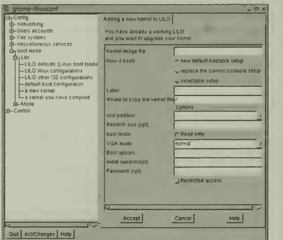


**图 F.19** Linuxconf 向 LILO 添加新内核的对话框。

## GUI 管理工具 611

- 2. 在内核镜像文件文本框中输入内核镜像路径。
- 3. 在“启动方式”选项中选择一个。
- 4. 在“标签”文本框下为此选项输入一个名称。
- 5. 如必要，填写启动内核所需的特殊选项。
- 6. 点击“接受”激活更改。
- 7. 你可能会收到一个警告对话框。如果是，请仔细阅读，然后点击“确定”。

> 如果你想添加一个刚刚编译的内核，请改用“你已编译的内核”选项。它的工作方式与之前的描述几乎相同。


# 配置默认启动模式

Config 主干分支分出的第五个分支是启动模式（Boot Mode）。启动模式的第二个分支是模式（Mode）。此部分只有一个选项。要为系统设置默认模式，请执行以下步骤：

- 1. 点击“默认启动模式”打开启动模式配置对话框。
- 2. 选择或取消勾选“启用启动菜单”复选框。
- 3. 在“默认操作模式”中，勾选“图形与网络”以进入 GUI，或勾选“文本模式与网络”以进入命令行。
- 4. 设置适当的延迟时间。
- 5. 点击“接受”激活更改。

# 使用 Linuxconf 控制面板

Linuxconf 控制主干的第一部分是控制面板。在这里，你可以让系统执行任务，而不仅仅是进行设置。每个项目都按照你可能使用它们的顺序列出，因此在接几个章节中会按该顺序进行介绍。

# 激活在 Linuxconf 中进行的更改

要激活你在 Linuxconf 中做的更改，请执行以下步骤：

- 1. 点击“激活配置”开始该过程。
- 2. 你可能会收到一些警告或通知。如果是，请仔细阅读每一个通知，并做出相应的响应。
- 3. 最后，你将看到“系统状态”对话框。这和你尝试在未先激活的情况下关闭 Linuxconf 时看到的对话框相同。
- 4. 点击一个选项。如果你激活了更改，可能会收到一组解释需要执行的操作的问题，询问你是否继续该程序。阅读每个问题并做出相应的响应。过程完成后，你将返回到空白对话框。


# 关机与重启

要使用 Linuxconf 关机或重启系统，请执行以下步骤：

- 1. 点击“关机/重启”打开关机控制面板对话框。
- 2. 选择“重启”或“关机并停止”选项之一。
- 3. 如果你想让关机过程在启动前等待，请输入延迟。
- 4. 如果你想向用户显示一条消息，请输入消息。
- 5. 点击“接受”。机器立即开始所启动的过程。

# 激活或禁用服务

要激活或禁用某项服务，请执行以下步骤：

- 1. 点击“控制服务活动”打开服务控制对话框。
- 2. 点击你想修改的服务。将打开一个“服务*名称*”对话框——例如，服务 pencia。
- 3. 要启动服务，点击“启动”。
- 4. 要停止服务，点击“停止”。
- 5. 如果需要，选择“启动时激活服务”或“在此禁用此服务”复选框。
- 6. 完成对服务的操作后，点击“接受”。

# 挂载与卸载：本地文件系统

要挂载或卸载本地文件系统的部分内容，请执行以下步骤：

- 1. 点击“控制已配置的本地驱动器”打开图 F.20 所示的本地卷对话框。
- 2. 点击你想挂载或卸载的项目。将打开“（卸）挂载文件系统”对话框。
- 3. 根据你的目标，点击“是”进行挂载或卸载。
- 4. 点击“退出”关闭对话框。

# 挂载与卸载：NFS 文件系统

要挂载或卸载其中一个 NFS 分区，请执行以下步骤：

- 1. 点击“控制已配置的 NFS 卷”打开 NFS 卷对话框。此项看起来与图 F.20 几乎相同。
- 2. 点击你想挂载或卸载的项目。将打开“（卸）挂载文件系统”对话框。

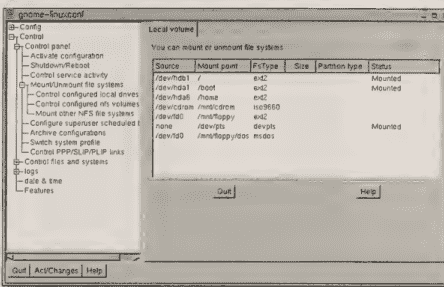

**图 F.20** Linuxconf 本地卷对话框。

- 3. 根据你的目标，点击“是”进行挂载或卸载。
- 4. 点击“退出”关闭对话框。

# 挂载与卸载：其他 NFS 分区

如果你想挂载一个尚未配置的 NFS 分区，请执行以下步骤：

- 1. 点击“挂载其他 NFS 文件系统”打开“手动挂载”对话框。
- 2. 在“服务器”文本框中输入 NFS 服务器名称。
- 3. 在“卷”文本框中输入 NFS 挂载名称。
- 4. 在“挂载点”文本框中输入挂载点。
- 5. 点击“接受”按钮。如果挂载点不存在，让 Linuxconf 为你创建。

# 计划系统 Cron 任务

要计划系统 Cron 任务，请执行以下步骤：

- 1. 点击“控制已配置的本地驱动器”打开如所示的本地卷对话框。
- 2. 点击你想挂载或卸载的项目。将打开“（卸）挂载文件系统”对话框。
- 3. 根据你的目标，点击“是”进行挂载或卸载。
- 4. 点击“退出”关闭对话框。


附录 F

- 6. 点击“接受”以。
- 7. 点击“退出”关闭。

# 计划系统任务

### Linuxconf 任务。

# 激活在 Linuxconf 中进行的更改

要激活你在 Linuxconf 中做的更改，请执行以下步骤：

- 1. 点击“激活配置”开始该过程。
- 2. 你可能会收到一些警告或通知。如果是，请仔细阅读每一个通知，并做出相应的响应。
- 3. 最后，你将看到“系统状态”对话框。这和你尝试在未先激活的情况下关闭 Linuxconf 时看到的对话框相同。
- 4. 点击一个选项。如果你激活了更改，可能会收到一组解释需要执行的操作的问题，询问你是否继续该程序。阅读每个问题并做出相应的响应。过程完成后，你将返回到空白对话框。

### 切换配置

要切换配置，请执行以下步骤：

- 1. 点击“切换配置”打开“切换配置”对话框。
- 2. 现在，你可以配置不同的。

### 计划系统任务

为了在 Linuxconf 中计划。

### 计划系统任务。

### Linuxconf 任务。

### 计划系统 任务。

### Linuxconf 任务。

# 使用 Linuxconf 控制面板

Linuxconf 控制主干的第一部分是控制面板。在这里，你可以让系统执行任务，而不仅仅是进行设置。每个项目都按照你可能使用它们的顺序列出，因此在接几个章节中会按该顺序进行介绍。

# 激活在 Linuxconf 中进行的更改

- 1. 点击“激活配置”开始该过程。
- 2. 用户可能会收到一些警告或通知。如果是，请仔细阅读每一个通知，并做出相应的响应。
- 3. 最后，你将看到“系统状态”对话框。这和你尝试在未先激活的情况下关闭 Linuxconf 时看到的对话框相同。
- 4. 点击一个选项。如果你激活了更改，可能会收到一组解释需要执行的操作的问题，询问你是否继续该程序。阅读每个问题并做出相应的响应。过程完成后，你将返回到空白对话框。

### 切换配置

要切换配置，请执行以下步骤：

- 1. 点击“切换配置”打开“切换配置”对话框。
- 2. 现在，你可以配置不同的。

### 计划系统任务

为了在 Linuxconf 中计划。

### 计划系统任务。

### Linuxconf 任务。

### 计划系统 任务。

### Linuxconf 任务。

# 计划系统 Cron 任务。

# 计划系统 Cron 任务

要计划系统 Cron 任务，请执行以下步骤：

- 1. 点击“控制已配置的本地驱动器”打开如所示的本地卷对话框。
- 2. 点击你想挂载或卸载的项目。将打开“（卸）挂载文件系统”对话框。
- 3. 根据你的目标，点击“是”进行挂载或卸载。
- 4. 点击“退出”关闭对话框。

附录 F

- 6. 点击“接受”以。
- 7. 点击“退出”关闭。

## 附录 F

- 1. 点击“配置文件权限和所有权”（Configure File Permissions And Ownership）打开过滤器前缀（Filter Prefix）对话框。
- 2. 如果需要，请构建搜索词以选择您想要检查的特定文件。
- 3. 将搜索词输入“项目前缀”（Item's Prefix）文本框，或留空该框以查看所有文件。
- 4. 点击“接受”（Accept）按钮打开“所有配置文件权限”（Permissions Of All Config Files）对话框。
- 5. 点击您想要修改的配置文件。不建议更改此类文件的权限或所有权！请务必确认您自己在做什么。将打开“单文件权限设置”（One File Permission Setting）对话框。
- 6. 进行您想要做的权限和所有权更改。
- 7. 点击“接受”保存更改。此操作将您返回到“过滤器前缀”对话框。
- 8. 点击“取消”关闭对话框。

## 设置 Linuxconf 加载的模块

要设置 Linuxconf 在启动时加载哪些模块，请执行以下步骤：

- 1. 点击“配置 Linuxconf 模块”（Configure Linuxconf Modules）打开“模块列表”（List Of Modules）对话框。
- 2. 选择或取消选择 Linuxconf 启动时加载的模块，或在需要时加载的模块。
- 3. 完成后点击“接受”按钮。对话框关闭。

## 设置系统配置

本附录前面的“切换系统配置”（Switching The System Profile）部分介绍了如何更改您正在使用的配置。在这里，您可以设置配置本身。要完成此操作，请执行以下步骤：

- 1. 点击“配置系统配置”（Configure System Profiles）打开“配置版本控制”（Configuration Versioning）对话框。
- 2. 选择现有配置项（Home 或 Office），或点击“添加”（Add）打开新的配置*名称*（Name）对话框。
- 3. 如必要，编辑“标题/注释”（Title/Comment）文本框。
- 4. 如必要，从下拉列表框中选择新的默认 RCS（版本控制系统）存档族。
- 5. 对于对应于您想要存档的项的每个文本框，提供一个存档族名称。
- 6. 完成后点击“接受”。
- 7. 点击“接受”关闭主对话框。

## 为 Linuxconf 添加新的插件

要为 Linuxconf 添加新插件，请执行以下步骤：

- 1. 点击“覆盖 Linuxconf 插件”（Override Linuxconf-Add-ons）或“创建 Linuxconf 插件”（Create Linuxconf-Add-ons）打开“插件管理”（Dropin Management）对话框。
- 2. 点击“添加”（Add）按钮打开“插件配置”（Dropin Configuration）对话框。
- 3. 在对话框中填写相应的包信息。
- 4. 点击“接受”保存更改。
- 5. 点击“退出”（Quit）关闭对话框。

## 控制日志及更多

Linuxconf 主部分的第三部分是“日志”（Logs）。日志之后有两个直接挂在主干上的项目。这些项目将按照您可能使用的顺序列出，因此在后续章节中将按该顺序进行介绍。

## 查看启动消息

要查看机器记录的最后一轮启动消息，点击“启动消息”（Boot Messages）。

## 查看 Linuxconf 日志内容

要查看在使用 Linuxconf 操作系统时生成的日志，点击“Linuxconf 日志”（Linuxconf Logs）。

## 更改日期和时间

要操作系统的日期和或时间，请执行以下步骤：

- 1. 点击“日期与时间”（Date & Time）打开图 F22 所示的“工作站日期与时间”对话框。
- 2. 如果需要使用，通过“时区”（Zone）下拉列表框更改时区。
- 3. 如果想将新的 GMT 时间设置保存到机器 CMOS 中，选择相应的勾选框。
- 4. 相应设置时间和日期值。
- 5. 点击“接受”按钮保存更改。屏幕可能会黑一秒。

## 设置 Linuxconf 功能

要设置某些深奥的 Linuxconf 功能，请执行以下步骤：

- 1. 点击“功能”（Features）打开“功能”对话框。
- 2. 从下拉列表框中选择“键盘映射”（Keyboard Map）。
- 3. 如果需要，点击“语言”（Language）按钮更改语言。
- 4. 如果需要，更改任何 HTML 设置。
- 5. 完成后点击“接受”。

图 F.22 Linuxconf 工作站日期与时间对话框。

## YAST

YaST 是随 SuSE Linux 发行版提供的一种管理工具。它是目前所有管理工具中图形化程度最低的，但这并不意味着它的功能最低。该程序协助您管理安装本身——这并不是一项小任务，因为 SuSE 包含六张 CD-ROM 或一张 DVD——以及通过图 F.23 所示的菜单式界面进行系统管理。您可以从命令行或在 GUI 内部运行 YaST。

## 获取安装帮助

如果您需要帮助来管理安装，请执行以下步骤：

- 1. 从 YaST 主菜单中选择“安装常规帮助”（General Help For Installation），并在选中该选项时按回车键打开讨论安装问题的帮助文件。虽然这看起来可能有点事后诸葛，但您可能已经先安装了 SuSE。阅读此文件可以帮助您理解如何进行更受控的安装，而不会在此过程中抓狂头发。

图 F.23 YaST 主菜单。

- 2. 使用向上和向下方向键在帮助内容中移动。

## 修改您当前的安装

在安装中添加新软件或删除包可能会让人感到畏畏，因为有很多。幸运的是，YaAST 为这些操作提供了工具：

- 1. 使用方向键选择“安装调整”（Adjustments Of Installation）。
- 2. 按回车返回子菜单。

## 选择语言

要在 SuSE 中选择语言，请执行以下步骤：

- 1. 选择“选择语言”（Select Language）。
- 2. 使用方向键选择您想要的语言，并按回车。

## 选择键位映射

如果您想更改您的映射，请执行以下步骤：

- 1. 选择“选择键位映射”（Select Keymap）。
- 2. 使用方向键选择您想要的键盘映射，并按回车。

## 选择安装介质

要选择介质，请执行以下步骤：

- 1. 选择“选择安装介质”（Select Installation Medium）。
- 2. 选择以下之一：
  - CD-ROM
  - NFS
  - 目录
  - 分区
  - FTP 站点
- 3. 按回车。

## 配置分区

在 SuSE 中配置分区，请执行以下步骤：

- 1. 配置硬盘分区（Configure Hard Disk Partitions）。
- 2. 使用方向键选择要更改的驱动器，并按回车。此操作将打开图 F24 所示的具有图形界面的分区表编辑器。
- 3. 从选项选择一个功能。

## **设置安装目标**

要在分区上创建新系统，请执行以下步骤：

- 1. 选择“设置目标分区/文件系统”（Set Target Partitions/Filesystems）。此选项打开文件系统创建菜单。
- 2. 使用光标选择您想要操作的分区，然后使用表 F.2 中列出的功能键菜单进行更改。
- 3. 当您准备好实施这些更改后，使用 Tab 键选择“继续”（Continue），并按回车。

# 表 F.2 YaST 文件系统创建编辑器功能键菜单。

| 按键 | 菜单选项 |
|---|---|
| F1 | 帮助 |
| F4 | 设置此分区的挂载点 |
| F5 | 进入专家菜单，允许您选择分区的详细文件系统 |
| F6 | 在分区上创建文件系统 |
| F7 | 重新读取 fstab |

- 1. 如果在被询问时对 `/etc/fstab` 进行了任何更改，YaST 将关闭，您需要重启机器以使这些更改生效。

## 配置卷管理器

要在系统上设置 LVM（本地卷管理器），请选择“配置本地卷管理器”。有关 LVM 及其它能为您提供的更多信息，请访问 `http://linux.msde.com/lvm/`。请勿随意选择此选项。

## 安装到目录

如果您想将整个 Linux 安装放在特定的目录下——这样做有某些原因，例如安装到另一台机器上的 NFS 分区——请执行以下步骤：

- 1. 选择“安装到目录”。
- 2. 在打开的对话框中输入安装主目录的路径。

## 安装新软件包

在处理完安装并设置了新分区、安装媒体等之后，您可以添加软件包。要为此，请执行以下步骤：

- 1. 在 YaST 主菜单上选择“选择/安装软件包”以打开安装工具。
- 2. 打开“加载配置”然后退出菜单。这将加载您安装的整个包列表，并使所有其他安装程序均可用。
- 3. 选择“更改/创建配置”选项，打开一个按字母排序的可用软件包类型菜单。
- 4. 选择其中一项并按回车键查看可用软件包列表。
- 5. 当您决定好要添加的软件包时，选择它并按回车键。
- 6. 通常会弹出一个对话框，告知您为了程序正常运行还需要安装哪些其他软件包。选择“自动”，让 YaST 自动标记依赖项为需要安装。
- 7. 在完成标记要安装的软件包后，按 F10 键返回安装菜单。然后，选择“开始安装”来安装您选择的软件包。
- 8. YaST 将要求您插入相应的 CD-ROM。在此过程完成后，您将返回安装菜单。此时程序将启动，并记录您在安装中所做的更改，以便下次启动 YaST 时使用，同时更改因您对设置的修改而需要更改的配置文件。

# GUI 管理工具 623

## 紧跟时代

当新的 SuSE 版本发布时，许多人喜欢升级他们的系统。然而，如果您必须手动完成，这项任务将是非常不妥的。在 YaST 中，选择“更新系统”主菜单选项进行升级。YaST 会检查您的硬盘，并对需要更新的程序提供建议，并很好地引导您完成整个过程。

## 管理您的系统

YaST 在其他方面是一个系统管理工具。当您在主菜单上选择“系统管理”时，您会看到一个大型子菜单。这些选项涵盖了从添加新硬件到用户和组管理的所有内容。这是 YaST 对于 LPI 考试最重要的部分之一。

## 配置您的硬件

要配置硬件，请执行以下步骤：

- 1. 选择“系统管理”主菜单选项。
- 2. 选择“将硬件集成到系统”。
- 3. 从子菜单中选择以下项目之一：
  - 鼠标配置：配置新鼠标或重新配置当前鼠标。
  - 调制解器配置：设置调制解器连接的设备。


- CD-ROM 配置：重新配置 CD-ROM。

- 配置打印机：启动 APSFilter 设置脚本。

- 配置 ISDN 硬件：允许您完全定义用于 ISDN 连接的箱体或网卡。

# 附录 F

- 配置您的扫描仪：配置 SCSI 扫描仪（此选项将不适用于非 SCSI 扫描仪）。

- 配置您的网络设备：设置所有必要的选项（而不是通过寻找相应的文件来执行）。

点击这些任何一个选项后的“继续”都会启动 SuSEconfig 工具。

## 配置启动信息

要配置启动信息，请执行以下步骤：

- 1. 选择“内核和启动配置”选项打开其子菜单。这个标签稍微有点误导性。内核与此选项相关的唯一原因是它被 LILO 引用了。

- 2. 选择“选择启动内核”选项打开内核选择菜单。在这里，您可以选择一个比默认内核更针对您当前系统的预制内核。

- 3. 选择一个内核并按回车键。

- 4. YaST 将安装您的选择，并提议测试您的 LILO 配置，以确保系统下次能够正常启动。对于此选项选择“是”。

- 5. 选择“创建救援盘”选项。这是良好系统管理的一个重要步骤。

- 6. 将软盘放入驱动器——程序说它必须经过格式化，但事实并非如此——并允许 YaST 构建如果下次系统能够正常启动时将所需的磁盘。

- 7. 清晰地标记磁盘并将其存放在安全的地方。

- 8. 选择“LILO 配置”

## 配置网络信息

许多管理员非常感谢拥有帮助他们解决网络问题的工具。要配置网络信息，请执行以下步骤：

- 1. 选择“网络配置”访问子菜单。

- 2. 选择以下选项之一：

- 网络基础配置：允许您操作各种网络设备。您可以激活或禁用接口；分配 IP、子网掩码和网关信息；以及通常情况下可以使用 `ifconfig` 完成的操作。

- 更改主机名：设置机器名称和域名。

- 配置网络服务：设置启动时启动的守护进程。这包括超级守护、端口映射和 NFS 服务器。在您做出更改后 SeeConfig 脚本将运行，使其立即生效。

- 配置名称服务器：设置名称服务。此选项询问您是否要配置名称服务器。如果您选择“是”，就可以输入该服务器的 IP 地址。

- 配置 YP 客户端：如果您在软件包中包含了它，则配置 NIS。否则，此选项不可用。

- 配置 Sendmail：允许您告诉 YaST 运行的环境，例如它是网络邮件客户端还是独立机器。在您退出时 SeeConfig 将更改您的邮件配置以反映该情况。

- 配置 ISDN 参数：配置 ISDN 连接。只有在您配置了 ISDN 设备后此选项才可用。尽管在没有配置 ISDN 设备时此菜单看起来可用，但在设置好之前，您将不允许使用它。

- 配置 PPP 网络：配置 PPP 连接。此选项打开 WvDial 配置程序，您可以使用它来设置拨出连接。

- 管理远程打印机：允许您配置所需的任何网络打印机。如果您在安装中包含了 Samba 或 Novell 支持，则用于配置打印机支持的最后两个菜单。

## 包含现场 CD-ROM 文件系统

要包含 CD-ROM 文件系统，请执行以下步骤：

- 1. 选择“配置现场系统”菜单打开其子菜单。

- 2. 在子菜单中，选择“集成 CD 文件系统”向您的 SuSE 安装添加现场文件系统，或选择“断开 CD 现场文件系统”将其移除。

## 配置登录环境

要更改任何通用登录设置，请执行以下步骤：

- 1. 选择“登录配置”。在这里您可以设置用户默认登录到命令行模式还是 GUI 模式。

## 附录 F

- 2. 选择要使用的显示管理器——SuSE 默认提供 XDM 或 KDM。

- 3. 选择允许关闭机器的人员，范围从仅 root 到所有人。

## 配置 Susewm

SuSE Linux 发行版为 root 自带了自己的窗口管理器 susewm。要配置窗口管理器的行为，请执行以下步骤：

- 1. 选择“配置 Susewm”。

- 2. 在弹出的菜单中，选择分配给默认窗口管理器。

- 3. 为所选的窗口管理器设置默认配置文件。

- 4. 选择您希望为用户提供的哪些窗口管理器和桌面环境配置。

## 维护您的用户库

要创建新用户账户和删除现有用户账户，请执行以下步骤：

- 1. 选择“用户管理”以打开子菜单。

- 2. 输入用户名并按回车键，系统将用默认值为您填充对话框的大部分。如果您想接受默认值，只需填写初始密码、标记该用户在存在调制解调器的情况下是否允许访问，并输入您想要包含的描述信息。

- 3. 按 F4 创建用户账户。

如果您想使用现有账户操作，但不记得其登录名，请按 F3 打开现有账户列表。

## 维护组

组的界面与用户类似。要添加新组、删除当前组、设置组密码或修改组的成员列表，请执行以下步骤：

- 1. 选择“组管理”。

- 2. 按 F3 打开现有组列表。

- 3. 在填写好信息后，按 F4 创建新组。

- 4. 按 F5 删除选定的组。

## 创建系统备份

要为系统文件创建备份，请执行以下步骤：

- 1. 选择“创建备份”。在选择此选项之前，必须先选择安装介质，否则将收到错误消息。

- 2. 继续通过消息进入“备份配置”对话框。

- 3. 选择您希望包含在标准备份方案中的文件系统，并选择添加的文件系统部分。屏幕右侧的列表会告诉您哪些已包含在内。

- 4. 要添加更多项目，输入 `+` 即可输入您想要添加到备份列表的目录路径。

- 5. 要移除某项，选择它并输入 `\\`。修改列表后，按 F10。

- 6. 备份程序会生成已安装包的列表。任务完成后，程序会询问是否搜索不属于安装包的文件。如果您倾向于从源码下载并安装程序，请回答此问题。如果您打算直接从 SuSE CD-ROM 或其他介质安装，请选择“否”。

- 7. 接下来，您将看到一个配置文件列表。选择是否将每个文件包含在备份中。项目旁边的 X 表示将包含。您可以通过按空格键删除 X，并通过相同操作替换它。完成包含配置文件的选择后，按 F10。

- 9. 现在，您将看到实际备份设置。YaST 的自动化备份设施使用 `tar` 命令。指定包名称（包括 .tar 或 .tgz）、是否压缩存档，以及是否生成一个由您命名的、包含存档内容的独立文件。

- 9. 要创建备份，按 F10。

## 配置安全

YaST 将帮助您设置某种程度的系统安全。要访问这些选项，请执行以下步骤：

- 1. 选择“安全设置”访问子菜单。

- 2. 选择“系统安全一般信息”：打开一个对话框，列出您可以为系统设置的安全级别。

- 3. 做出选择，然后选择“继续”。等待 SuSEconfig 运行完成。

- 4. 选择“配置 /etc/login.defs”以设置登录程序处理登录失败和密码的行为。

## 设置控制台字体

要选择控制台字体，选择“设置控制台字体”以测试可以在命令行使用的字体，并选择字体。

## 设置时区

要配置时区设置，请执行以下步骤：

- 选择“设置时区”。

- 从子菜单中选择您的国家和时区区域，并按回车键。

- 告知 YaST 您的硬件时钟设置为本地时间还是 GMT。

## 配置 X

当您选择“配置 Xfree86”时，YaST 提供三个选项。可以使用 SaX (SUSE Advanced XF86-Configurator) 工具设置 X、xf86config 文本工具，或者使用具有图形界面但不是完整 GUI 的 XF86-Setup 工具。选择这些选项之一，YaST 将为您启动。

## 配置 GPM

如果您想使用 GPM 允许在命令行终端进行剪切和粘贴，请选择“配置 GPM”菜单选项。您将获得在运行 GPM 的选项。

## 配置环境变量

SUSE 使用环境变量存储存储设置。您可以通过“更改配置”更改这些设置。

## 使用最后的 YaST 配置选项

YaST 的最后几个菜单项简单明了，因此被合并在了一起。

## 查看安装介质 README 文件

如果文件已安装在您的系统中，您可以选择“README 文件”来查看它。如果文件未安装，您将收到错误消息。

## 查看 YaST 和 SuSE 版权信息

有关 YaST 和 SuSE 版权的所有信息都可以通过在主菜单中选择“版权”来获取。阅读本文对开发人员特别有用。

## 关闭 YaST

最后，要关闭 YaST 程序，选择“退出 YaST”。它将清理临时文件并关闭程序。

## 632 附录 G

- 14. **d. GNU (GNU 的不是 Unix)** 组织是目前大多数 Linux 工具的背后推动者。

- 15. **d. Linux 可以同时处理多个用户登录。**

- 16. **c. Linux 可以同时处理多个进程运行。**

- 17. **a. 这** 位编写 Linux 内核的人是 Linus Torvalds。

- 18. **错误。** 设备驱动程序的延迟意味着 Linux 可能仍然能够支持最新、最强大的设备。

- 19. **a, d.** 自由软件（或源码软件）指的是一种哲学，即编程代码应该是公开的，供所有人修改、打包和编译运行。

- 20. **b. 自由软件基金会 (Free Software Foundation)** 是 GNU 的财务部门

## 第 2 章答案

- 1. **b. 这** 张卡在有人有机会为其编写驱动程序之前将不会被支持。

- 2. **c. 你** 至少应该有两个分区，一个交换分区（swap）和一个根分区（root）。

- 3. **a.** 一个软件包管理工具。

- 4. **b. 你** 始终可以通过源代码安装更新后的软件。

- 5. **d. 你** 会输入 `./configure -help` 来学习如何将库的位置传递给配置脚本。

- 6. **b. 你** 会输入 `find / -name foo` 来搜索名为 foo 的文件。

- 7. **c. 如果** foo 是你路径中的一个可执行文件，**你**将使用 `which` 命令。

- 8. **d. 你** 会输入 `echo LD_LIBRARY_PATH` 来确定无效的路径是什么。

- 9. **b. 如果** 一个程序需要版本 1.2.17 或更高版本的 libdb，则 libdb.so.1.2.18 是一个可以接受的文件。

## 633 复习题答案

- 10. a. `make` 极大地简化了编译过程。

- 11. c. `setserial port 0x03f8_auto_irq uart 16450 skip_test` 命令将配置一个具有 0x03f8 IO 端口、未知 IRQ 以及一个在探测时错误报告自我的 16450 UART 的现代设备。

- 12. b. 许多声卡声称兼容 SoundBlaster，但实际上并非如此。

- 13. c. 在安装 Linux 之前，必须检查并有时更改 BIOS 选项。

- 14. a, b, d. 服务器允许终端用户在 GUI 中工作，NFS 客户端允许他们挂载网络驱动器，而文字处理软件包有助于他们完成工作。

- 15. a, b, c. BIOS 可能包含 SCSI ID、IRQ 和端口信息。

- 16. d. BIOS 中的设备端口地址是三位数，末尾带有一个 H。

- 17. a. `fdisk` 在所有 Linux 发行版中可用，用于驱动器分区。

- 18. b. 将视频选项设置得高可能会损坏你的显示器。

- 19. b. 你可以获得两个设备都能处理的最高分辨率。

- 20. a, b, c. 你不会在高流量的 Web 服务器上使用 GUI，因为那只会减慢它的速度。你绝对不想在上面运行游戏，那将浪费 CPU 周期。最后，你不会希望直接在服务器上编辑 HTML 文档，因为那也会减慢速度，并可能导致部分编辑的文件提供给 Web 访客。

## 第 3 章答案

- 1. a, b, c. 分区、软磁盘驱动器和 Zip 驱动器都可以临时或更永久地挂载到 `/etc/fstab` 文件系统中。

- 2. b. `fdisk` 命令允许你添加、删除和设置分区类型。

- 3. c. `mk2fs` 命令在分区上创建 ext2 文件系统类型，这是 Linux 文件系统类型。

- 4. a. `fsck` 命令检查文件系统错误并在发现错误时提供修复。

- 5. c. `vfat` 文件系统类型用于 Windows 分区，系统上的第二个 IDE 驱动器是 `hdb`，硬盘上的第一个分区是 `hdb1`。

## 附录 G

- 6. **要访问挂载点 `/mnt/win` 上的任何文件，你必须先切换到 `/mnt/win` 目录，这在情况下类似于进入 d:\。然后，要进入 d:\work\faxes 目录，你需要切换到 `/mnt/win/work/faxes`。**

- 7. **要从文件系统中删除分区，你使用 `umount` 命令并将文件设备（file device）或挂载点作为参数。**

- 8. **文件 `/etc/stab` 包含了在启动时将分区挂载到文件系统的信息（以及用于手动挂载的数据）...**

- 9. **要创建一个用户可以在有限时间内（称为宽限期）超的配额，请创建一个软配额（soft quota）。在此基础上，你还可以创建一个用户无法逾越的硬配额（hard quota）。**

- 10. **`repquota` 命令是一个配额报告生成器。**

- 11. **记住 r 代表 4，w 代表 2，x 代表...**

- 12. **`fdisk` 命令允许你添加、删除和设置分区类型。**

- 13. **在安装 Linux 之前，必须检查并有时更改 BIOS 选项。**

- 14. **a, b, d. 服务器允许终端用户在 GUI 中工作...**

- 15. **a, b, c. BIOS 可能包含 SCSI ID、IRQ 和端口信息。**

- 16. **d. BIOS 中的设备端口地址是三位数，末尾带有一个 H。**

- 17. **a. `fdisk` 在所有 Linux 发行版中可用，用于驱动器分区。**

- 18. **b. 将视频选项设置得高可能会损坏你的显示器。**

- 19. **b. 你可以获得两个设备都能处理的最高分辨率。**

- 20. **a, b, c. 你不会在高流量的 Web 服务器上使用 GUI...**

## 第 4 章答案

- 1. b. `/etc/init` 文件包含默认的运行级别（runlevel）。

- 2. a. 该命令会重启系统。

## 第5章答案

- 1. b. Shell 是 Linux 或 Unix 用户的登录工作环境。

- 2. d. Shells tcsh（增强型 C）、bash（Bourne Again）和 ksh（Korn）都存在。

- 3. b, c, d. vi 中没有“删除（delete）”模式。删除可以在命令模式或插入模式下完成。

- 4. a, b, c, d. `c` 命令允许用户更改文本，`R` 命令进入覆盖模式，`s` 命令允许文本替换，`o` 命令打开一个新的空行。

- 5. d. 逗号（,）在 vi 中不是元字符。

- 6. c. 环境变量 PWD 包含用户当前所在的目录。

- 7. a. 主用户环境配置文件 `/etc/profile`。

- 8. b. `chsh` 命令列出可用的 shell，并可更改用户的默认 shell。

- 9. a, c. 用户被要求在可能不需要时制作至少一个备份软盘。而且，没有检查来确保数据是所请求的数据类型，或者是否输入了任何内容。

- 10. b. Shell 脚本能够完成你在命令行上可以做的任何事情。

- 11. a, b, d. `\` 告诉查看单词开头，句号 `.` 代表单个未知字符，而星号 `*` 代表任意数量的未知字符。

- 12. d. 二进制程序必须经过编译；遵循的最优流程是编辑、编译，然后测试。

- 13. b. 文件操作需要冒号模式（colon mode），`:w` 冒号保存文件。在按下回车键之前，冒号命令不会提交给编辑器。

- 14. a. bash 或 ksh 中的环境变量全大写字母输入。通过将变量等于值来分配变量。当值是多词字符串时，将其放在引号中。

- 15. c, d. 任何 shell 脚本的第一行都声明使用哪种 shell。shell 识别此声明，因为它以 `#!` 开头。

- 16. b. 在命令模式下输入 "C" 更改当前行文本。

- 17. c. 输入正斜杠（/）允许你输入想要搜索的文本或模式。

- 18. b. `read` 命令用于接受用户输入的数据。在按下回车键之前，脚本不会接收这些数据。

- 19. c. 除非具有执行权限，否则不能仅通过输入文件名来运行 shell 脚本。

- 20. a. Gnu C Compiler (`gcc`) 是 Linux 中最常用的 C 编译器。

## 第6章答案

- 1. a. 创建用户账户时，命令是 `useradd` 或 `adduser`。

- 2. c. 用于创建新用户密码的程序是 `passwd`。

- 3. b. 要查看默认用户设置应输入 `useradd -D` 或 `adduser -D`。

- 4. a. 默认用户目录设置信息存储在 `/etc/skel` 中。

- 5. d. cron 守护进程监控自动化系统任务。

- 6. b, d. `cron` 程序在指定时间运行一次进程，而 `crontab` 程序允许用户编辑或查看其 cron 配置文件，其中存储了重复进程信息。

- 7. d. 功能可以用逗号分隔，但不能用优先级分隔。

- 8. a. cron 格式为：小时后的分钟、24 小时制的小时、日期、月份以及从周日零开始的星期几。

- 9. c. `/usr/sbin/logrotate` 程序执行日志文件循环的实际工作。

- 10. a, d. 事实上，这些项目结合效果良好。首先，使用 `tar` 程序将文件存储在一个组中并保持层级结构，然后用 `gzip` 压缩 tar 文件。

- 11. d. `userdel` 命令用于从系统中删除用户。

- 12. d. 没有 `/etc/cron.yearly`。

- 13. b. 该格式允许使用 24 小时制和单词“tomorrow”，且下午 2 P.M. 是 1400 小时。

- 14. a. `find` 命令有一个选项允许你搜索特定用户拥的文件。

- 15. c. 系统 cron 任务和日志轮转中的错误默认发送给 root。

- 16. b. 可写 CD-ROM 只能写入一次，因此除非用于长期存储备份，否则浪费材料。

## 附录 G


## 17-20 题

- 17. d. Shell `/bin/false` 是一个意味着用户没有 shell 访问权的关键字。
- 18. c. 在月份槽中列出的数字是 15，但一年有 12 个月。
- 19. c. 文件 `/etc/passwd` 包含登录的用户名和 shell 信息，尽管文件 `/etc/shadow` 通常包含密码本身。
- 20. b. 用户 cron 数据存储在 `/var/spool/cron` 中。

## 第7章答案

- 1. d. `=` 字符不是正则表达式中的元字符。
- 2. a. 数据流是双向的。
- 3. d. 任务根据程序数量创建等等数量的进程。
- 4. b. `sed` 程序用于文件中的重复替换。
- 5. a. `grep` 是一个在文本文件上执行指定操作的过滤器。
- 6. b. 命令 `|` 是有效的管道。`sort` 命令将错误消息重定向到文件，但将输出传递给 `grep` 命令。
- 7. b. `ps` 命令显示关于 `/proc` 的信息。它不接受来自 stdin 的数据。
- 8. d. 正则表达式将匹配行中任何位置的数字的行。
- 9. d. 文件包含在 inode 中。
- 10. c. “renice” 命令由所有者发布以增加 nice 值。只有特权账户可以发布命令降低 nice 值。
- 11. d. 命令将产生所需的报告。
- 12. c. 系统命令存储在 `/` 中。
- 13. a. `man` 手页提供系统命令的信息。
- 14. b. 特殊字符将是开头。
- 15. a, b, d.
- 16. a. `tr` 命令可以转换特殊字符。
- 17. a, c. 你可以通过 "`gunzip file`" 或 "`zcat file`" 查看 `.gz` 文件的内容。
- 18. d. `wc` 命令统计文件中的行、字和字符。
- 19. c. `kill` 命令可以同时杀死运行相同命令的一组进程。
- 20. d. `tr` 命令没有足够的参数。

## 第8章答案

- 1. a. Linux 程序通过 SNMP（简单网络管理协议）请求状态。
- 2. d. IPX（Internetwork Package）是 Novell NetWare 中使用的传输协议。
- 3. c. TCP 连接是基于流的网络连接。
- 4. IP 是网络协议，而 TCP 是网络连接的形式。
- 5. IP 地址分配给特定机器上的网络接口。例如，如果每台机器上有不同的以太网卡，每个网卡将获得自己的 IP 地址。
- 6. b. 如果网络接口的 IP 地址为 172.16.24，子网掩码为 255.255.0.0，则其广播和网络地址分别为 172.16.255.255 和 172.16.0.0。
- 7. 无
- 8. b. 6 中描述的 IP 地址是 B 类地址。
- 9. a. 要让问题六中的接口访问互联网，它必须通过 NAT（网络地址转换）。
- 10. 10
- 11. 16,777,214。无。
- 12. a, d. 为 IP 地址为 172.4.25.3 的 Internet 网关在路由表中添加条目，使用代码：`route add default gw 172.4.25.3`。
- 14. a, b. 要删除上一个问题中添加的路由表条目，使用 `route del default` 或 `route del 0.0.0.0`。
- 15. b. B 类网络的非子网掩码为 255.255.0.0。
- 16. d. `PING -c 6 172.4.0.23` 命令将向接口 172.4.0.23 发送六个 ping 包。
- 17. c. 如果你怀疑数据包在往目的途中被丢弃，你会使用 `traceroute` 命令。
- 18. c. NIS 是正确的。
- 19. d. `whos` 是正确的。
- 20. b. `ifconfig eth0 netmask 255.255.0.0` 命令将解决上一个问题的问题。
- 21. b. `/etc/ppp` 目录包含与 `pppd` 相关的文件。
- 22. a
- 23. b, c. 你向 `/etc/ppp/options` 文件添加以下行，告诉 `pppd` 使用带有硬件流的串口设备 `ttyS1`：`/dev/ttyS1` 和 `crtscts`。
- 24. a. chat 脚本是使用 `pppd` 的拨入和拨出 p 服务的主要区别。

## 第9章答案

- 1. b. super inetd 及其定义其控制进程的配置文件 `/etc/inetd.conf`。
- 2. a. `/etc/services` 文件将网络服务映射到它们相应的端口。
- 3. c. 常用于处理网络机器 DNS 服务的守护进程名为 `named`。
- 4. c. m4 sendmail 配置以 `.mc` 文件开始，最终转换为 `.cf` 文件。
- 5. d. `/etc/ftpace`、`/etc/fthosts` 和 `/etc/ftusers` 都是用于配置 FTP 服务器的有效文件。
- 6. d. `srm.conf`、`httpd.conf` 和 `access.conf` 都是用于配置 Apache Web 服务器的有效文件。
- 7. NFS 服务允许在 Linux 机器上远程挂载 Linux 分区。
- 8. a. SMB 服务允许运行其他操作系统时远程挂载 Linux 分区。

# 复习题答案

- 9. d. 当网络服务守护进程有一个 init 脚本时，关闭它以便重新启动的最干净的方法是使用该 init 脚本的“stop”功能。
- 10. c. 配置 inetd 停止管理某服务的最佳方法是在 `/etc/inetd.conf` 中注释掉该服务。在 `/etc/services` 中注释掉它只会移除端口定义，并会导致错误。
- 11. b. “dnl”字符串通过删除从文本末尾到行尾的空白字符，防止 `sendmail.cf` 文件变得变得过长。
- 12. a. 你的自定义 `.mc` 文件的第一行必须包含 ("../m4/cf.m4")，这样当 m4 处理器创建 `sendmail.cf` 文件时，才能识别这些宏。
- 13. c. m4 处理器将其输出发送到 STDOUT，因此必须将其重定向到 `sendmail.cf` 文件中。
- 14. b. `httpd.conf` 文件的末尾是添加虚拟主机支持的地方。
- 15. d. Web 文件的基础目录被称为文档的“root”目录，因此称为 DocumentRoot。
- 16. a. 当输入“smclient -l”格式时，smclient 程序会列出可用的共享。
- 17. b. Samba 共享以“mount -t smb devicepoint”的格式挂载。
- 18. c. `/etc/exports` 文件包含用于 NFS 本地文件系统导出段的数据。
- 19. a. `/etc/smb.conf` 文件包含用于 SMB 本地文件系统导出段的数据。
- 20. a. Samba (SMB) 服务处理打印共享，也处理文件共享。

# 第 10 章答案

- 1. b. 打印守护进程是 `lpd`。
- 2. b. 打印机配置文件是 `/etc/printcap`。
- 3. d. `lpc` 命令启用所有打印机和打印队列，然后启动一个新的 `lpd`。`lpc enable` 允许作业进入打印队列；而 `lpc stop` 命令告诉队列停止接收新的打印作业，并在队列为空禁用打印机。
- 4. c. 用于打印文档并将其添加到队列的程序是 `lpr`。

# 642 附录 G

- 5. c. `lpq` 程序使用 `printername`，而 `lpr` 和 `lprm` 使用 `-Pprintername`。
- 6. b. 打印所需的目录和文件应该分配给守护进程组。
- 7. c. `/etc/printcap` 定义中的中间行以冒号开头，以冒号和反斜杠结束。
- 8. d. 用于列出打印队列内容的程序是 `lpq`。
- 9. d. `if` 定义输入过滤器，`of` 定义输出过滤器，而 `lo` 定义日志文件。
- 10. a. 使用 `cat file > /dev/printerdevice` 格式的 cat 命令。
- 11. c. syslog 守护进程处理 `lpd` 的通用日志需求。
- 12. a. 管理打印机、队列和作业的程序是 `lpc`。
- 13. b, c. 打印守护进程 `lpd` 不是网络守护进程，因此它要么由机器特定的 init 文件 `/etc/rc.d/rc.local` 启动，要么作为 `/etc/rc.d/rc.d` 目录中的链接启动。
- 14. a, d. `sh` 变量命令调用 Ghostscript 程序，它直接处理 postscript 文件，而当涉及打印过滤器时，`lpd` 命令可以处理 postscript 文件。
- 15. c. 最大打印作业大小代表“抑制页眉”。这对于使用打印机的人很少的情况非常有用，因为打印作业不需要识别页。
- 16. d. `sh` 变量代表“抑制页眉”。这对于使用打印机的人很少的情况非常有用，因为打印作业不需要识别页。
- 17. a, b, and c. 查看打印机是否开启、电缆是否到位以及 `lpd` 是否运行是一个非常快的过程。然而，调试输入过滤器可能需要一些时间。
- 18. a, b, and d. 输入过滤器可以是程序或 shell 脚本。
- 19. b. `lpq` 命令可以显示相关队列的内容，`lprm` 命令可以删除该队列中的特定作业。
- 20. d. 以 `lpd -l` 运行打印守护进程会查看 `/etc/syslog.conf` 以确定记录多少信息以及记录在何。

# 第 11 章答案

- 1. **b.** Linux 操作系统本身就是内核，就像任何其他操作系统一样。
- 2. **c, d.** 如果内核号的第二部分是奇数，那么它就是实验性内核。
- 3. b. `insmod` 命令加载内核模块。
- 4. a. `lsmod` 命令列出所有加载的内核模块及其依赖。
- 5. d. `rmmod` 命令移除空闲且其他已加载模块所需的模块。
- 6. a, d. 如果内核号的第二部分是奇数，那么它就是实验性内核。
- 7. a. `patch` 命令向源码中插入更改。
- 8. c. 一旦数字的第二部分是偶数，它就是生产内核。
- 9. b. `gcc` 包包含 GNU C 编译器。
- 10. b. `make menuconfig` 启动菜单驱动配置。
- 11. d. `make oldconfig` 命令构建默认配置。
- 12. a. `make bzImage` 命令构建压缩的 bzImage。
- 13. a, b. System.map 文件必须复制到 `/boot` 目录。
- 14. c. `vlinux-version` 被重命名为 `kernel`。
- 15. b. `make config` 命令启动内核配置。
- 16. d. `make modules_install` 命令将模块安装到需要的地方。
- 17. a. `mkinitrd` 命令创建引导所需的内存磁盘。
- 18. a. `make config` 命令遍历配置。
- 19. c. 要让 LILO 显示新内核，请编辑 `/etc/lilo.conf` 文件。
- 20. c. 要让 LILO 重置所有设置，运行 `/sbin/lilo -v`。
- 18. d. 地址没有分配源 `-s` 或目的 `-d`。过滤器需要知道检查标头中的哪个部分来做出决策。
- 19. c. `pwconv` 程序将系统转换为使用影子密码。
- 20. b. `btmp` 文件记录了所有失败的登录尝试。
- 21. b. `lastb` 命令显示 `/var/log/btmp` 文件的末尾内容。

# 第 13 章参考答案

- 1. b. X11R6 是当前版本。
- 2. c. `xdm` 不是窗口管理器。
- 3. a. `xdm` 不是启动 X 的命令。
- 4. c. XFree86 是由 XFree86 项目发布的，而不是由 X 联盟发布。
- 5. d. 先配置鼠标。
- 6. b. 窗口管理器负责移动窗口。
- 7. d. `wm2` 是一个窗口管理器。
- 8. a. 和 d. X 服务器不负责调整窗口大小或关闭窗口。
- 9. a. 这是一个有效的 DISPLAY 值。
- 10. d. XF86Config 不是工具程序。它是一个配置文件。
- 11. d. X 协议与位图无关。
- 12. b. XMP 格式的 Pixmaps 被窗口管理器使用。
- 13. c. `xhost` 允许远程 X 客户端在本地 X 服务器上显示。
- 14. b. `startx` 是用于启动 X 的脚本。
- 15. a. `xinit` 是一个命令。
- 16. c. 你在 initt 配置文件中更改运行级别。

# 术语表

- **argument (参数)**：命令在执行时使用的信息。
- **autoprobe (自动探测)**：随机猜测的过程。shell 解释为代表当前目录的特殊字符。
- **..**：shell 解释为代表当前目录父目录的特殊字符。
- **awk**：一种过滤器，为非交互式编辑文本文件提供一组编程函数。
- **!!**：重新输入上次输入的命令的命令。
- **/bin**：存储用户命令的目录。
- **backslash (\) (反斜杠)**：用于在 shell 命令中将命令从当前行延续到下一行的元字符。
- **/etc/fstab**：包含 Linux 启动时所需的文件系统数据的文件。
- **bg**：将停止的作业发送到后台的命令。
- **/sbin**：存储系统管理命令的目录。
- **binary (二进制文件)**：已经编译好的程序。
- **/usr/bin**：存储用户命令的目录。
- **^oldtext^newtext**：将上次输入命令中的旧文本替换为新文本并执行该命令。
- **alias (别名)**：命令的短名称。
- **ampersand (&) (符号)**：在命令末尾添加的元字符表示将命令发送到后台。
- **block device (块设备)**：以“块”为单位保存数据的数据存储设备。
- **broadcast address (广播地址)**：用于同时访问网络上所有节点的通用地址。
- **Commands (命令)**：指示计算机执行任务。
- **built-in commands (内置命令)**：shell 程序本身的子程序。
- **command line (命令行)**：shell 提供的输入命令的接口。
- **cable lock (安全锁)**：一种用于将计算机固定在桌子或房间内的安全设备。
- **commercial (商业软件)**：管理员或用户在使用前必须的软件。
- **caching nameserver (缓存域名服务器)**：缓存其通过 DNS 解析为 IP 地址的名称记录的服务器。
- **compile (编译)**：将源代码转换为实际可执行程序的行为。
- **compiler (编译器)**：将用 C 等编程语言编写的代码转换为可执行的二进制文件的程序。
- **cat**：读取文件并将其发送到标准输出的程序。
- **console (控制台)**：带有键盘和显示器的物理机器。
- **child process (子进程)**：在当前现有进程中创建的新进程。
- **cracker (破解者)**：专长通过猜测或其他获取密码来破解用户账户的人。
- **chmod**：用于更改文件权限的命令。
- **cron job (定时任务)**：添加到系统 crontab 中的项目，由 cron 守护进程在指定的日期时间运行。
- **chown**：用于更改文件所有权的命令。
- **Ctrl+C**：停止作业的命令。
- **client/server computing (客户端/服务器计算)**：一种计算模型。
- **Ctrl+Z**：挂起作业的命令。
- **command (命令)**：在命令行输入的指令。
- **daemons (守护进程)**：在后台运行的程序。
- **debugging (调试)**：在脚本或程序中发现并消除错误的过程。
- **default route (默认路由)**：当不存在特定路由时数据包的去处。
- **dependency (依赖项)**：使程序编译或运行所需的内容。
- **desktop environment (桌面环境)**：一组在用户屏幕上提供集成图形界面的应用程序。
- **device (设备)**：用于输入或输出信息的硬件项目。
- **dgram (数据报)**：“datagram”的缩写，UDP 协议发送的数据包类型。
- **diff**：比较两个文件并输出每一行不同内容的命令。
- **directory (目录)**：一个包含目录下文件列表的特殊文件。
- **DISPLAY**：指定 X 客户端输出绘制位置显示的环境变量。


- `display management` (显示管理) 由 X 服务器执行的操作，包括打开窗口和绘制 X 客户端请求的显示。
- `distribution` (发行版)：包含 GNU 工具和其他软件的 Linux 软件包。
- `dotted quad` (点分四)：描述由点分隔的 4 字节 IP 地址的常用术语。
- `downstream` (下游)：数据流向设备的方向。
- `driver` (驱动程序)：将通用系统调用转换为硬件语言的软件。
- `echo`：显示一行文本的命令。
- `edquota`：允许系统管理员编辑配额的命令。
- `environment variables` (环境变量)：在整个 shell 及其子 shell 中保持不变且可访问的变量。
- `escape` (转义)：告诉 shell 或程序某个通常作为特殊字符（元字符）的字符应按字面意思处理。
- `export` (导出)：将子 shell 或进程的值提取并作为环境变量供 shell 的所有部分使用。
- `facility` (设施)：生成日志消息的程序或守护进程类型，如 `/etc/syslog.conf` 中。
- `fdisk`：用于创建、删除和管理驱动分区的命令行程序。
- `fg`：将作业带回前台的命令。
- `file`：显示文件类型的命令。

# 文件系统 (filesystem)

Linux 系统及其文件跨的设备实体。

# 过滤器 (filter)

对文本流进行操作的命令。过滤器旨在于文本通过时对其执行特定的、不同的操作。

# find (find)

用于在实时文件系统中搜索某项存在内容的命令。

# 防火墙 (firewalls)

物理单元或软件，用于调节进入受保护网络或后续机器的流量，可能也调节出的流量。

# 固件 (firmware)

包含在硬件设备内部的软件。

# 前台 (foreground)

执行命令行并允许用户与之交互的命令被称为前台。一次只能有一个作业在前台。

# 格式化 (format)

准备一个分区以供特定类型的操作系统（如 Linux）存放文件。

# 免费软件 (freeware)

通常由作者拥有版权，但免费供公众无费用使用的软件。

# 函数 (function)

程序或 shell 内部返回值的子程序。

# gawk

`awk` 的 GNU 版本。

# GID (组标识) 数字

Linux 系统用于跟踪用户属于哪些用户组的数字。

# GNU (GNU 不是 Unix)

自由软件基金 (FSF) 的组成部分。GNU 共同编写免费提供的程序和文档。更多信息请访问 `www.gnu.org`。GNU 项目是大多数 Linux 软件的来源。

# GNU 网络对象环境 (GNOME)

完全由开源软件构建的桌面环境。它包含一个面板（用于启动应用程序和显示状态）、一个桌面（可以放置数据和应用程序）以及一组标准的桌面工具和应用程序，如日历和通讯录。

# 宽限期 (grace period)

具有软限制的用户在账户被禁用之前拥有的时长。

# 图形用户界面 (GUI)

高分辨率位图屏幕上的显示器，提供了一个让用户访问计算机资源的图形界面。

# grep

一种搜索一个或多个文件以查找特定文本字符串并输出搜索结果信息的过滤器。

# grpquota (组配额)

用于为组分配配额的命令。

# 黑客 (hacker)

最初指通过代码进行“黑客行为”的人，即程序员。现在泛指破解系统的人。

# 硬限制 (hard limit)

对于拥有配额的用户，可用的磁盘空间最大值。

# 硬链接 (hard link)

两个文件共享同一个 inode（索引节点）的文件之间的链接。

# head (head)

一种默认显示文件前几行的命令。

# 流头 (head of a stream)

数据流的应用程序端。

# help (help)

提供有关内置 shell 命令信息的命令。

# 主机 (host)

网络上的计算机，通过主机名而非 IP 识别。

# 如何 (How-To)

通用 Linux 文档的格式。

# info (info)

提供一个包含各种主题信息的超链接信息系统的命令。

# inode (索引节点)

一种包含文件信息以及指向文件中数据位置指针的数据结构。文件系统中的每个文件都有一个 inode。

# 接口 (interface)

连接主机与网络的设备，接口通常是网卡，但不总是如此。接口通过 IP 地址识别。

# IP 链 (IP chain)

在 IP 过滤防火墙内部使用的 TCP/IP 数据包分组。

# 作业号 (job number)

当命令发送到后台时分配并显示的数字。第一个进入后台的作业是 1，下一个是 2，依此类推。作业号用于监控后台命令的状态。

# jobs (jobs)

一种显示后台作业信息的命令。

# KDE 桌面环境 (KDE)

一个完整、集成的免费且开源的桌面环境，运行在大多数 UNIX 版本上。它包含文件管理器、帮助系统、配置系统、终端模拟器、工具以及日益增加的应用，包括绘图程序、PostScript 和 DVI 查看器等。

# 内核空间 (kernel space)

Linux 中包含低级进程的虚拟“区域”。

# 密钥 (key)

加密情况下使用的项，以确保用户确实是其声称身份。

# 键位映射 (keymap)

包含对应键盘键字符布局的文件。

# kill (kill)

一种删除进程和作业的命令。

# killall (killall)

一种一次删除多个进程的命令。

# less (less)

一种一次一页显示文件的命令。比 `more` 命令有更多选项。

# 库 (libraries)

程序使用的函数和子程序的集合。在编译时链接到代码中，将代码添加到执行文件中。

# 库 (library)

常用函数的集合。

# LILO (Linux 加载器)

管理启动带有 Linux（以及如果包含的其他操作系统）的机器的默认程序。

# 652 行打印机

行打印机
为快速、大容量输出设计的特殊打印机型号。

# man (man)

提供系统命令信息的命令。

# 链接 (link)

一种允许文件同时存在于两个地方的方法。

# 掩码 (mask)

文件或目录的权限。

# 字面字符 (literal character)

普通字符，无特殊含义。`a` 除了字母表中 26 个字母之一外没有意义。

# 元字符 (metacharacter)

一种被程序或操作系统识别的特殊字符，在指令或命令中使用时具有特殊含义。

# ln (ln)

用于创建链接的命令。

# mkdir (mkdir)

一种创建新目录的命令。

# 行打印机 (line printer)

为快速、大容量输出设计的特殊打印机型号。

# 掩码 (mask)

文件或目录的权限。

# mkdir (mkdir)

一种创建新目录的命令。

# 链接 (link)

一种允许文件同时存在于两个地方的方法。

# 日志 (log)

包含事件历史的文件。

# more (more)

一种一次一页显示文件的命令。比 `less` 命令有更多选项。

# 挂载 (mount)

将文件系统附加到目录树上。

# 挂载点 (mount point)

文件系统附加的位置。

# mv (mv)

一种移动文件或目录的命令。

# 名称服务 (nameservice)

将名称解析为 IP 地址。

# 进制 (octal)

一种具有 0-7 数字的数值系统，即八 进制。

# 模式 (pattern)

用于构建搜索词的字符集合，包含通配符以填充未知部分。

# Open Lock (OPEN LOCK)

一种由 Sun 开发的 GUI 标准，旨在为不同的工作站提供统一的外观和感受。

# 权限 (permission)

文件系统中项目的属性，设置谁允许读取、写入或执行它。

# 开源 (open source)

某些软件遵循的准则，规定必须提供源代码

# PID (进程 ID) 数字

进程在创建时分配的唯一数字。受可用进程和其他因素影响。此数字无法由用户或系统管理员更改。

# 管道 (pipes)

UNIX 的一种结构，允许你将一个命令的标准输出 (`stdout`) 直接连接到另一个命令的标准输入 (`stdin`)。使用元字符 `|` 来连接两个程序。

# 进程 (process)

一组按顺序执行的软件指令，通常以程序的形式存在；对于可以并行执行的操作，一个程序可能有多个进程。

# 即插即用 (plug and play)

一种（有时）自动配置设备的方法。

# 配置文件 (profile)

包含登录信息的文件。

# POP (邮局协议)

一种收集和存储电子邮件的方法，直到用户使用电子邮件客户端进行提取。

# 协议 (protocol)

引导网络通信的规则集。

# 端口 (port)

计算机上的虚拟访问点，本质是一个内部地址，机器通过该地址连接到外部局域网/或互联网。

# ps

一个显示进程信息的命令。

# PPP (点对点协议)

ISP 优的拨号接入协议，因为其具有灵活性，并且识别的协议比互联网的 TCP/IP 更多。

# pstree

一个以树形结构显示所有进程的命令，显示父子关系。

# 队列 (queue)

等待进入特定打印机的打印作业的编号列表，根据到达顺序进行编号。

# 打印作业 (print job)

等待打印的文档、图片或其他此类数据。

# 配额 (quota)

用户或组在分区内可以使用的限制空间。

# 打印溢流 (print spool)

包含所有等待进入特定打印机作业的目录。

# 内存磁盘 (ramdisk)

一种“虚拟磁盘”，或存储在内存中作为引导磁盘的代码，用于辅助启动过程。

# 优先级 (priority)

`/etc/syslog.conf` 中定义的程序或守护进程应使用的日志级别。

# 方向 (direction)

使用元字符更改程序输入输出流的过程。

# 优先级数字 (priority number)

代表进程绝对优先级的数字。优先级数字由调度器根据 nice 值、进程最近的资源使用情况等动态计算。

# 正则表达式 (regular expressions)

字面字符和元字符的模式，允许你选择性地处理文本。正则表达式被许多 Unix 命令和工具使用。

# 标准输入 (stdin) 655

正则表达式允许通过模式匹配进行复杂的文本处理。

# 共享库 (shared libraries)

程序使用的函数和子程序的集合。通过代码引用，而不编译到可执行文件中。程序运行必须安装它们。

# renice

一个更改运行进程的 nice 值的命令。

# 共享软件 (shareware)

可以从互联网免费下载的软件，人们在喜欢后预计需要付费。通常在某些方面被“阉割”，导致不付钱无法使用某些功能，或者除非付费并获取密钥，否则它只会运行特定一段时间。

# repquota

一个生成配额使用报告的命令。

# rmdir

一个删除空目录的命令。

# 壳 (shell)

登录会话期间的工作环境。

# 轮 (rotate)

关闭日志文件，重命名命名，并立即在原地创建一个新的日志文件以继续记录。

# SLIP (串行链路协议)

ISP 使用的拨号协议，因为缺乏灵活性。

# 运行级别 (runlevel)

`init` 文件中的一个参数，决定运行时的系统状态。你在启动时将运行级别设置为 `xdm`。不同的 Linux 发行版对不同的运行级别有不同的含义。Red Hat Caldera 带有 xdm 的运行级别为 5。

# 软限制 (soft limit)

用户在收到警告之前可以使用的配额空间量，如果超出，会获得一段规定的时间进行缩减。

# 调度器 (scheduler)

内核中负责分时决策的部分。调度器将进程换出内存内存以执行，以最大化 CPU 利用率，并确保所有进程无论优先级如何都能获得一些时间。

# 排序 (sort)

一个对文件中文本行排序的过滤器。

# 垃圾邮件 (spam)

不受欢迎的邮件或新闻组帖子轰，通常包含广告材料。

# sed

一个提供非交互式文本编辑的过滤器。`sed` 使用与交互式编辑相同的编辑命令，例如插入文本、删除文本、替换文本。你可以创建一组编辑指令并一次性应用到整个文件。该指令集保存在脚本中，可用于编辑任意数量的文件。

# 标准错误 (stderr)

创建时连接到进程用于显示错误消息的数据流。默认情况下，`stdin` 连接到视频显示器，但它可以重定向到另一个文件。它被分配文件符 2。

# 标准输入 (stdin)

创建时连接的输入数据流。默认情况下，`stdin` 连接到键盘，但它可以重定向到另一个文件。它被分配文件符 0。

# 影子 (shadow)

一种密码存储方法，将密码保护在只有 root 可访问的文件后面，而不是留在全局可访问的 `/etc/passwd` 中。

# 标准输出 (stdout)

创建时连接到每个进程的输出流。默认情况下，`stdout` 连接到视频显示器，但它可以重定向到另一个文件。它被分配文件符 1。

# 线程 (thread)

见进程。

# 分时 (timesharing)

根据优先级在所有活动进程之间共享 CPU 时间的方法。程序被移动到内存并开始执行。如果没有遇到等待时间，程序执行其指定的时间片（几分之一），然后另一个程序被换入内存并开始执行。这种交换一个接一个进程地进行。

# startx

一个启动 X Window 系统的脚本文件。它执行 `xinit` 命令。

# 流 (stream)

应用程序与设备之间的单字节连接，用于传输所有 I/O 操作的数据。

# top

一个显示使用大部分 CPU 时间的进程信息的命令。

# 子网 (subnet)

网络的一个子部分。

# 超守护进程 (superdaemon)

`inetd` 守护进程管理管理员配置它监控的任何守护进程。

# touch

一个更新文件最后访问日期和最后修改日期的命令。

# 符号链接 (symlink)

具有不同节点的文件之间的链接，但它们引用同一个原始文件。

# UID (用户标识符) 数字

系统用于跟踪用户自身的数字。

# 系统命令 (system commands)

存储在文件系统中的程序，通过输入命令名称来运行。

# 掩码 (umask)

在创建文件时显式未设置的权限位。

# 尾 (tail)

一个显示文件最后几行的命令。默认显示 10 行。

# 卸载 (unmount)

一个从文件系统移除设备的命令。

# telnet

用于远程登录外部机器的程序，位于局域网或外部。没有拨号功能；机器必须连接到网络或互联网。

# UPS (不间断电源)

一种用于在停电或电压波动期间计算机立即崩溃的设备。

# 上游 (upstream)

流应用程序的数据流的方向。

# 文本流 (text stream)

单字符流，包括标记行结束的字符。该流进入处理程序并显示在屏幕上。

# 用户空间 (user space)

Linux 中包含用户运行的虚拟“区域”。

# 主题 (theme)

一种定义特定外观和功能组合的良好开发的设置组合。

# usquota

用于给用户分配配额的命令。

# XF86Setup 657

`vi`

可用的，以便计算机供应商可以实现它们自己的 X 服务器和/或客户端。只要软件理解 X 协议，程序就可以在任何其他 X 服务器或客户端上运行。

一个小型文本编辑器。

# which

用于在 PATH 环境变量中搜索指定程序的命令。

# X 服务器

用于在搜索模式中表示未知字符的元字符。

用于绘制图形和输入硬件的软件。服务器位于你的 Linux 系统上，窗口化软件可以将显示区域划分为窗口等子区域，并能够同时控制和管理许多活动。服务器监控并渲染显示器上的绘图。服务器依赖于硬件，并知道如何与你的显卡、键盘和指针设备通信。


通配符

窗口

分配给给定应用程序的屏幕区域。

# 窗口管理器

X 客户端软件负责管理 X 窗口系统下的窗口。它控制窗口的外观以及你与之交互的方式。窗口管理器负责为新窗口定位、提供标题和边框、移动现有窗口的位置、更改窗口大小、在不同窗口之间切换焦点，以及移除窗口。

# X 窗口系统

一种硬件无关的、分布式窗口系统，提供 GUI 以让用户使用计算机更简单、更直观。它是可移植的、网络透明的，运行在几乎所有类型的计算机上。

# X 客户端

任何需要使用显示图形的应用程序。当客户端需要图形显示时，它向 X 服务器发送请求，由 X 服务器绘制请求的显示。

# X11

广泛发布的 X 窗口系统版本。它引发了 X 的普及接受，以及其作为 UNIX 系统主导标准的持续地位。X11 的后续发布在增加额外功能的同时，尝试保持大部分向后兼容性。当前版本是发布 6 (`X11R6.4`)。

# X 联盟

一个名为 X.Org 的全球联盟，授权负责 X 窗口系统技术和标准的管理与协作开发。X 的正式发布通过 X.Org 提供。

# xdwm

用于在启动时启动 X 的显示管理器。系统启动时 X 会启动并使用 X 登录界面，对于多用户机器是一个非常有用的设置。

# X 协议

一种用于 X 服务器和 X 客户端之间通信的语言。它规定了客户端/服务器软件交换的数据传输格式和含义。X 协议是免费的

# XF86Setup

一个用于配置 XFree86 硬件的实用。

# XFree86

由 XFree86 项目实现并分发的 X 窗口系统版本。它是免费软件。XFree86 项目是 X 联盟的成员，将 X 窗口系统移植到许多基于 Intel 的 Unix 和 Unix 类操作系统上。它随所有 Linux 发行版一起提供。它是免费软件——由 XFree86 Project, Inc.（一家非营利公司）设计、实现和分发，该项目由 1992 年四位对现有 Intel Unix 平台支持不满的开发者发起，并由捐助资金。XFree86 项目是 X 联盟的成员，为 X 窗口系统软件提供增强，并移植到许多基于 Intel 的 Unix 和 Unix 类操作系统上。XFree86 包含了所有所需的二进制文件、支持文件、库和工具。

# xinit

一个启动 X 窗口系统的命令，会启动 X 服务器和一个客户端程序。

# xman


一个在 GUI 中查看 man 页的实用工具。

# INDEX

1, 216–217

!!, 216

S, 123, 137, 251

$,, 146

&, 218

* 81, 123, 253, 521

+, 117, 253

/ 125

<, 239

<<, 244

>, 239, 243, 505, 514

>>, 240, 243

? 81, 252

? 125

\, 124, 254

\<, 124

\>, 124

\, 242

\, 123, 251, 253

\], 240–241, 253, 505

::, 123

::, 125

::, 252

目录条目, 232

... 目录条目, 232

... 目录条目, 446

\), 252

\], 81, 124, 252

- 类型权限字符, 75

128-位加密, 440

-A 标志, `ps` 命令, 247

a a 指令, `sed` 命令, 226

a a 参数, `ps` 命令, 8

a2ps 包, 55

异常关闭, 106

ACCEPT 策略, IP 链, 433

ACCEPT 规则目标, `iptables` 规则, 435

ACCEPT 控制。另见 权限, 安全性。

受控访问的 ftp 站点, 326–327

设备安全, 409

导出 NFS 共享, 333–334, 591

文件位置, 883

限制入站数据, 415–417, 516

安全级别, 416

Web 服务器配置, 331–332

访问控制列表 (ACL), 186–188。另见 文件。

Access 语句, `/etc/hosts.conf`, 425, 429, 430

`access.conf` 文件, 330

account–account, 415

"nobody"

非 shell 账户, 175, 508

通过账户, 175

root 账户, 170–171, 600

shell 账户, 175

超级用户账户, 170–171

用户: 另见 账户。

ACL, 186

acl 参数, `/etc/named.conf` 文件, 311

ACT 行, `/etc/network.conf`, 99

Activation 行, `/etc/network.conf` 文件, 16

add 选项, `ifconfig` 命令, 271

地址格式, `iptables` 规则, 434

address 选项, `ifconfig` 命令, 271

address 选项: 另见 地址。

管理, 另见 系统。

管理任务

cron 守护进程, 193–194

at 程序, 194–196

高级磁盘, 200

After 窗口管理器, 462

agetty 程序, 99

alias 命令, 文件, 216

Aliases 命令, aliases, 219

全局别名, 182

A

a, a 命令 (`vi` 编辑器), 119

A, 文件属性, 187

+-a, a 文件 (MS-DOS), 70

字符, `tr` 命令, 242

标志

`fdisk` 命令, 339

`hdparm` 实用工具, 83

`tar` 命令, 48

-a 标志

`arp` 命令, 273

`modinfo` 命令, 375

`netstat` 命令, 278

`test` 命令, 142

`touch` 命令, 233

aliases 数据库, `/etc/nsswitch.conf` 文件, 313

IP aliases, 使用 Linux 配置, 592

mail aliases, 320–321, 602

user aliases, 132, 182

alias 数据库, `/etc/nsswitch.conf` 文件, 313

alias 字段, `/etc/services` 文件, 308

alias 文件, 320–321

-all 选项, `netstat` 命令, 278

-ALL `/etc/hosts.allow` `/etc/hosts.deny`, 416

-all 选项, `ifconfig` 命令, 271

-all squash 选项, `/etc/exports` 文件, 334

-alnum 字符, `tr` 命令, 242

-alpha 字符, `tr` 命令, 242

AM 窗口管理器, 463

Awm 窗口管理器, 463

匿名文件类型, 228–329

匿名用户类型, `/etc/passwd` 文件, 225

反垃圾邮件守护进程, 396

反盗盗服务, 409

Apache Web 服务器配置文件, 330

概述, 329

Web 站点配置, 330–333, 504

append 关键字, 44, 96

将输出附加到现有 (vs 编辑器), 119

应用层协议, 266

启动时启动的应用程序, 102

X 资源管理, 478–480

Windows 系统, 466, 491–492, 493–494

apropos 命令, 522, 557, 558

AFS 过滤器, 448

归档文件, 65。另备份数据。

归档工具 gzip, 47-48

命令行参数, 137, 211

参数字段, `/etc/inet.conf` 文件, 308

arp 缓存, 273

arp 命令, ifconfig 命令, 271

方向键, vi vi 编辑器, 118

ASCII 文件, 打印, 53-54

异步挂载选项, 68

at 程序, 194–196

属性 (文件属性), 70, 186–188, 232–233

auth 日志设施, `/etc/syslog.conf` 文件, 189

auth 语句, `/etc/passwd.conf` 文件, 425, 428

认证模式, `/etc/shadows.conf` 文件, 427

使用 PAM 工具进行身份重定向, 439

authlog 文件, 443

AUTHOR 字段, 主页源文件, 559

授权密钥文件, 418

auth-priv 日志设施, `/etc/syslog.conf` 文件, 189

自动挂载选项, 668

awk 程序

从脚本文件应用指令, 225

命令格式, 225

格式化输出, 230

if 语句, 228

概述, 224–225

模式匹配, 229–251

计算, 230

程序结构, 227–228

正则表达式, 251–254

指定输出字段, 228–229

变量, 226–227

B

-b 字符, `tr` 命令, 242

b 标志

du 命令, 85

fdisk 命令, 393

test 命令, 141

-b 标志, sort 命令, 223

引号, 在脚本脚本中, 139

后台执行命令, 218–219

备份数据

备份权限结构, 65

备份媒体, 198–199

备份软件, 220

数据安全, 411–412

确定要备份的文件, 196

文件, 149

系统, 65

备份频率, 199

全备份, 196–197

使用 YaST 的系统备份, 627

验证备份, 200

备份软件, 220

ban 语句, `/etc/shadows.conf` 文件, 425, 428

bash. bash shell

/bash. bash Bash shell

bash shell

$? bash 变量, 146

环境变量, 127-5108

概述, 116

脚本脚本和, 143

/~bash_login 文件, 131–132

~/.bash_logout 文件, 132

~/.bash_profile 文件, 131–132

~/.bashrc 文件, 132

bash 操作, 149–150

BEGIN 部分, awk 程序, 227

铃声动作, `/etc/swatch` 文件, 444

基准测试, 233

Berkeley Internet Name Domain. 另见 BIND。

bg bg 命令, 219

/bin 目录, 212, 522

/bin/bash. 见 Bash shell。

/bin/ksh. 见 ksh shell, 17

# cert-advisory 邮件列表 661

/bin/tsh. tesch tsh 壳。

BIND

- BIND 4 vt. BIND 8, 309–310

- 守护进程, 309, 310–314

- 概述,

BIOS

- 启动信息位置, 35

- 启动病毒检测, 35

- 硬件信息, 36

- NIC 设备信息, 36

- 即插用自动检测, 11

- 准备 Linux 准备工作, 34–35

- SCSI 设备信息,

- BlackWindow  own, 63

空格类字符, tr 命令, 242

- 空格提示符（启动故障排除）, 104

- 块子目录, /lib/modules 目录, 375

- 启动循环

- 添加启动消息, 95

- 添加时间延迟, 95

- 异常关机后，在启动时, 102

- 启动日志, 106

- 自定义初始化脚本, 99, 102

- /etc/rc.d 目录

- /etc/rc.local 脚本, 97, 99

- /etc/rc.sys sysinit 脚本, 96–97

- 内核参数，使用 LILO 传递,

- LILO, 94–96, 104–105

- 网络概览,

- 运行多功能任务, 99

- 系统初始化, 96–99

- 故障排除, 35, 43, 103–106

- /boot 目录, 35

- 启动磁盘

- 使用磁盘启动, 107, 515

- 创建, 38, 106, 516

- 使用启动磁盘启动后关机, 108

- 使用 YaST 配置, 624

- 位置, 35

- 启动日志, 106

- 启动魔术, 426

- 启动管理问题, Linux 认证考试, 566

- 启动管理器, 42, 见 LILO。

- 启动消息, 95

- 启动问题

- 启动磁盘, 108–108, 516

- 启动信息位置, 位置, 35

- 故障排除, 35, 43, 104–105

- 启动提示符 HOWTO 网站, 425

- 启动病毒检测, 35

- 启动工具。见 DHCP 客户端，配置, 291

- 安装,

- 概述, 288

- 服务器, 配置, 289–291

- bootpc 程序, 291

- boottap 文件, 289

- 引导启动协议 (Bootstrap Protocol)。见 Snoop。

- -bp 标记选项, ifconfig 命令, 271

- 可共享定义, /sbin/conf 文件, 337

- 临时文件, 442–443

- 缓冲区 (vi 编辑器), 122

- ugra 邮件列表, 448

- 构建管理器, 158–159, 381

- 编译内核。服务器自定义内核。

- 内置命令, 212

# C

- c 命令 (vi 编辑器), 119

- c 文件属性, 187

- c 标记

- dump 命令, 85

- diskhdparm 工具, 83

- text 命令, 141

- -c 标记

- diff 命令, 224

- grep 命令, 222

- netstat 命令, 278

- PING 命令, 277

- shutdown 命令, 103

- sort 命令, 223

- tr 命令, 241

- wc 命令, 231

- -c 标记, netstat 命令, 278

- c 指令, 见命令, 226

- 参数, ps 命令, 8

- 预处理器, 380

- C 语言编程。见 程序和编程。

- 包含共享库, 157

- make 包, 158–159

- cell, 116. 见 csh 壳。

- 电脑锁, 409

- -cache spoon, netstat 命令, 278

- 缓存名称服务器, 310, 314

- 缓存代理服务器, 340

- 仅缓存名称服务器, 34

- Caldera Linux

- 特定于发行版的认证考试, 545, 563, 565–568

- 网站, 563

- Caldera 开放管理系统。见 COAS。

- Caldera  网站, 550

- 取消打印任务, 56

- 卡片

- 声卡, 19–20, 53

- 视频卡, 472

- case 语句, 见 列表, 139–140

- cat 命令, 221, 506, 514

- cd 子目录, /lib/modules 目录, 375

- CD-ROM, 198

- cert-advisory 邮件列表, 448

# CGI 脚本

- CGI 脚本

- 与 HTML 表单交互, 152–154

- Perl 脚本编写, 131–152

- 链策略, 433, 436

- 字段, /etc/shadow 文件, 174

- 脚本文件, 283

- 脚本, cpp 连接, 283

- 字符

- 编辑.。

- 元字符, 123–124, 251–254

- 模式匹配, 123–124, 251–254

- 正则表达式, 251–254

- 特殊字符, 在程序之间, 241–243

- chat ppt, cpp 命令, 281–282

- chatt 命令, 187

- 子进程, 245–246

- chmod 命令, 75–76

- chown 命令, 78

- chsh 命令, 193

- A 类 IP 地址, 269, 273–254

- B 类 IP 地址, 269, 273–254

- C 类 IP 地址, 269, 273–254

- Claude 窗口管理器, 463

- CLEAR 警告, /etc/isap.conf 文件, 123

- clear 命令, 237

- 客户端/服务器架构

- 概述, 459

- Windows 系统, 460–461

- 关闭文件, 126

- nrl 类, tr 命令, 242

- COAS

- 配置网络, 572–574

- 配置外围, 570–571

- 配置系统接口, 574–582

- 配置 X 服务器, 583

- 管理内核模块, 582

- 管理 RPDM, 582–583

- 概述, 503

- 冒号模式 (vi 编辑器), 117

- COM 端口, 在 BIOS 中, 35

- 命令历史, 255

- 命令行编辑器 (vi 编辑器), 117

- 命令行提示符, 设置默认, 130

- 命令替换, 139

- 命令行参数, 137, 211

- 命令行打印, 在 Windows 中, 484

- 内置命令, 212

- 命令历史, 255

- 命令接口, 210

- 命令名称, 212–213

- 纠错, 217–218

- 输入命令, 215, 217–218

- 环境变量, 220

- 退出状态, 在壳脚本中, 146

- 文件管理命令, 231–235

- 标记, 211

- 命令格式, 210–211

- 命令帮助, 213–215

- info 页面, 252

- 输入流, 238–239

- 接口管理命令, 236–238

- 杀死命令, 247, 507

- 命令行中的循环, 220

- man 页面, 213–214, 522

- 选项, 211

- 输出流, 238–239

- 管道命令输出, 240–243, 505

- 管道命令, 242

- 进程, 245

- 重定向命令输出, 239–240, 514

- 正则表达式, 251–254

- 重复命令, 216–217

- 后后台运行, 218

- 在壳脚本中运行, 136–137

- 命令行脚本, 220

- 壳例程, 212

- 特殊字符, 在命令之间, 241–243

- 系统命令, 212–213

- 终止执行, 210

- 文本处理命令, 221–231, 506

- 用户信息命令, 235–236

- 变量, 215

- 注释定义, /tmp/conf, 337

- 壳脚本注释, 135

- 命令服务, /etc/network.conf, 313

- 编译器, 380

- 构建管理器, 381

- 编译器, 380

- 默认配置文件, 355

- 依赖, 382, 392, 511

- 内核配置, 387–389, 392

- 内核编译, Linux 扩展, 657–568

- 需要的库, 381

- 定位源码, 379

- Makefile, 381–385

- 需要的包, 381

- 补丁, 379–380

- 编译准备, 378–381

- 预处理器, 380

- 编译步骤, 389–390, 512

- 编译程序, 551

- 组件安全 (内部组件), 410

- 压缩 SLIP, 285

- 压缩工具

- gzip, 47, 48

- tar, 47–48

- 壳脚本中的条件语句

- 每日备份, 191

- 数据备份

- 备份也许的结构, 65

- 备份媒体, 198–199

- 备份软件, 200

- 数据安全, 411–418

- 确定备份的文件, 196–198

- 文件, 148–149

- 文件系统, 65

-- 

- Caldera Linux

- 特定于发行版的认证考试, 545, 563, 565–568

- 网站, 563

- Caldera 开放管理系统。见 COAS。

- Caldera 开放网站, 550

- 取消打印任务, 56

- 卡片

- 声卡, 19–20, 53

- 视频卡, 472

- case 语句, 见 列表, 139–140

- cat 命令, 221, 506, 514

- cd 子目录, /lib/modules 目录, 375

- CD-ROM, 198

- cert-advisory 邮件列表, 448

# CGI 脚本

- CGI 脚本

- 与 HTML 表单交互, 152–154

- Perl 脚本编写, 131–152

- 链策略, 433, 436

- 字段, /etc/shadow 文件, 174


- 脚本文件, 283

- 脚本, cpp 连接, 283

- 字符

- 编辑.。

- 元字符, 123–124, 251–254

- 模式匹配, 123–124, 251–254

- 正则表达式, 251–254

- 特殊字符, 在程序之间, 241–243

- chat ppt, cpp 命令, 281–282

- chatt 命令, 187

- 子进程, 245–246

- `chmod` 命令, 75–76

- `chown` 命令, 78

- `chsh` 命令, 193

- A 类 IP 地址, 269, 273–254

- B 类 IP 地址, 269, 273–254

- C 类 IP 地址, 269, 273–254

- Claude 窗口管理器, 463

- CLEAR 警告, `/etc/isap.conf` 文件, 123

- `clear` 命令, 237

- 客户端/服务器架构

- 概述, 459

- Windows 系统, 460–461

- 关闭文件, 126

- nrl 类, `tr` 命令, 242

- COAS

- 配置网络, 572–574

- 配置外围, 570–571

- 配置系统接口, 574–582

- 配置 X 服务器, 583

- 管理内核模块, 582

- 管理 RPDM, 582–583

- 概述, 503

- 冒号模式 (`vi` 编辑器), 117

- COM 端口, 在 BIOS 中, 35

- 命令历史, 255

- 命令行编辑器 (`vi` 编辑器), 117

- 命令行提示符, 设置默认, 130

- 命令替换, 139

- 命令行参数, 137, 211

- 命令行打印, 在 Windows 中, 484

- 内置命令, 212

- 命令历史, 255

- 命令接口, 210

- 命令名称, 212–213

- 纠错, 217–218

- 输入命令, 215, 217–218

- 环境变量, 220

- 退出状态, 在壳脚本中, 146

- 文件管理命令, 231–235

- 标记, 211

- 命令格式, 210–211

- 命令帮助, 213–215

- info 页面, 252

- 输入流, 238–239

- 接口管理命令, 236–238

- 杀死命令, 247, 507

- 命令行中的循环, 220

- man 页面, 213–214, 522

- 选项, 211

- 输出流, 238–239

- 管道命令输出, 240–243, 505

- 管道命令, 242

- 进程, 245

- 重定向命令输出, 239–240, 514

- 正则表达式, 251–254

- 重复命令, 216–217

- 后后台运行, 218

- 在壳脚本中运行, 136–137

- 命令行脚本, 220

- 壳例程, 212

- 特殊字符, 在命令之间, 241–243

- 系统命令, 212–213

- 终止执行, 210

- 文本处理命令, 221–231, 506

- 用户信息命令, 235–236

- 变量, 215

- 注释定义, `/tmp/conf`, 337

- 壳脚本注释, 135

- 命令服务, `/etc/network.conf`, 313

- 编译器, 380

- 构建管理器, 381

- 编译器, 380

- 默认配置文件, 355

- 依赖, 382, 392, 511

- 内核配置, 387–389, 392

- 内核编译, Linux 扩展, 657–568

- 需要的库, 381

- 定位源码, 379

- `Makefile`, 381–385

- 需要的包, 381

- 补丁, 379–380

- 编译准备, 378–381

- 预处理器, 380

- 编译步骤, 389–390, 512

- 编译程序, 551

- 组件安全 (内部组件), 410

- 压缩 SLIP, 285

- 压缩工具

- `gzip`, 47, 48

- `tar`, 47–48

- 壳脚本中的条件语句

- 每日备份, 191

- 数据备份

- 备份也许的结构, 65

- 备份媒体, 198–199

- 备份软件, 200

- 数据安全, 411–418

- 确定备份的文件, 196–198

- 文件, 148–149

- 文件系统, 65

- 备份频率, 199

- 全量备份, 196–197

- 使用 YaST 进行系统备份, 627

- 验证备份, 200

## 664 数据安全

数据安全，111–412。另见 数据备份；安全。

### 数据流

- 与设备驱动程序的交互，238
- 概览，238
- 管道（piping），240–242
- 重定向，239–240, 243–244, 505
- `stderr`（标准错误），146, 239, 244
- `stdin`（标准输入），238–239, 244
- `stdout`（标准输出），146, 238, 239

### 数据格式

- `cron` 守护进程，193
- `at` 程序，195
- 日期，文件访问与修改，233
- `dd` 命令
- 复制书籍，38
- `vi` 文本编辑器，121, 510
- DD 选项，`/etc/sendmail cf`, 319

### Debian Linux

- 特定发行版的认证，545, 563, 565–568
- 更新，46
- 网站，550, 563
- Debian 网站，550, 563
- debs，46
- DEBUG 语句，`/etc/ifconf.conf`, 13
- 调试技术，156
- 默认引号，73
- 默认 shell，133
- 默认用户
- 修改用户默认值，172–173
- 默认用户文件，171, 172
- 默认 mount 选项，68
- 定义打印机，45
- 偏转，`/ifconf` 命令，271
- 删除目录，235, 506
- 删除组，178
- 删除日志文件，192
- 删除模块，375
- 删除分区，64
- 删除文本（`vi` 文本编辑器），120–121, 510
- 删除用户，176–177
- 删除变量，`/usr/lib/mail/config` 文件，322
- 拒绝热共享，`/smb/conf` 文件，337
- 拒绝选项，`/etc/psyserv.conf` 安全访问规则，296
- DENY 策略，IP 链，433
- 拒绝规则目标，`iptables` 规则，435
- 拒绝语句，`/etc/hosts5.conf` 文件，425, 429, 430

### 依赖关系

- 编译内核，389, 511
- 模块依赖列表，392, 511
- 软件依赖，49
- `depmod` 命令，392, 511
- DESCRIPTION 文件，页面源文件，505
- 设计分区，36–37, 62, 314, 502。另见 分区（Partition）。

### 桌面环境

- GNOME，465, 520
- KDE，466
- 忽略（overlook），465

### 桌面文件（Desktop file），98

- 目标不可达（Destination-unreachable）术语，icmps 规则，435
- 检测系统入侵者，446–447
- `dev` 目录，238
- `dev` mount 选项，68

### 设备驱动程序（Device drivers. Ser Drivers）

- 设备字段，`/etc/fstab` 文件，68
- 设备部分，XF8Config 文件，475
- 设备。另见 驱动程序（Drivers）。
- 使用内核参数配置，43–45
- 数据流及，238
- `/etc/fstab` 文件，67–69
- Linux 下支持的硬件，10–22
- 系统资源中的，184
- 笔记本电脑安装，20
- 查找 Linux 驱动程序，10–11
- 现代的，52
- 挂载媒体设备，66–67, 576
- MS-DOS 软盘，69–70
- NIC 设备，18–19, 36
- 即插即用设备，11–18
- 打印机。另见 打印机与打印。
- RAID 存储，20–22
- SCSI 设备，18–19, 36
- 声卡，19–20, 53
- 卸载媒体设备，67, 576
- 视频卡配置，XF86Setup，72
- 工作站，19
- `/dev/null` 设备，240
- `df` 命令，71–84, 506
- `diff`（`vi` 文本编辑器），121
- DHCP，293–294
- 安装，291
- 概览，502
- 服务器，292
- `dhcp.conf` 文件，292
- `diff` 命令，224
- `dig` 工具，314
- `digit` 类，`tr` 命令，242
- `dip` 程序，285

### 目录（Directories）

- 创建，224
- 在目录间移动文件，234
- NFS 共享，333–335, 508, 605
- 概览，232
- 移除，235
- 设置位，419
- SMB (Samba) 共享，335–340, 508
- 禁用文件文件，`/etc/fstab` 文件，175
- 禁用网络服务，412–414, 512
- 禁用打印队列，52
- 禁用打印机，514
- 禁用用户，176

### 灾难恢复（Disaster recovery）：同时也备份数据，

- 数据安全，411–412
- RAID，20–22
- 救援磁盘（启动盘），38, 106–107, 515, 516
- 救援模式（运行级别 1），107, 515
- 测试修复，108
- 故障排除技术，107–108

### 丢弃输出（Discarding output），240

### 磁盘配额（Disk quota）：

- 分配，72, 507
- 默认引号，73, 606
- ed `/etc/fstab` 文件，62
- 现有配额，查看，74
- 宽限期，72, 74
- 组配额，72–74
- 内核配额支持，71
- 概览，
- 分区，37
- 配额包，616
- 设置配额限制，73–74
- 软限制，72
- 用户配额，72–75

### 磁盘资源（Disk resources），监控，84–85

- 备份媒体，198
- 磁盘启动，38, 106–108, 515, 516
- 优化，83
- 磁盘性能，83–85
- MS-DOS 软盘，69–70
- 为 Linux 准备活动驱动器，41–42
- ramdisk，392

### 显示（Display）

- 显示管理器，X Window，464
- 配置，XF86Setup，472
- 重绘，237
- `DISPLAY` 变量，X Window，476

### 显示管理器（Display managers），464

- 分布式计算，457–477
- Linux 发行版：另见 特定发行版；
- 特定发行版的认证考试，
- 特定发行版的安装要求，34
- 登录屏幕，99–100, 419–420
- 安全警报与更新，447, 517, 518
- 选择，34
- 启动管理问题，566
- 认证考试概览，563
- 安装问题，566
- 内核安装，667–668
- 内核管理问题，665
- 概览，545
- 软件包管理问题，666
- 指南，663–664
- 系统管理，556–567

### 文档根位置（Document root），服务器配置，331, 504

### 驱动程序（Drivers）：另见 HOWTO 网站。

- 常见问题解答（FAQs），560–513
- 帮助命令，213
- info 命令，252, 515
- 在系统中的查找，580
- 维护，24–25
- man 命令，213–214, 522–555
- man 页面，213–214, 484–482, 555–559, 561
- 在线文档，Linux 语言，213–25
- 系统配置，Unix，555
- 教程，560–483, 522
- xman 命令，domain文件，317

### 域名（Domain name），domain文件

### 域名（Domain names）。另见 解析。

- 注册，285–286
- 期间设置，97

### 域名（Domain）：另见 名字。

- IP 地址，287
- 所有权信息，286
- shell 脚本中的双引号，271, 138
- down 选项，`ifconfig` 命令，271
- 下载的文件，安全，420
- 停机，169
- DR 选项，`/etc/terminal` 的，319
- 驱动器绘制（Xfig），494
- 驱动器共享，Samba，336, 538, 509
- 驱动器目录，238
- Linux 支持的硬件，10–22
- 与内核交互，6
- 与操作系统交互，9
- 与数据流交互，238
- 安装列表，20
- 作为模块加载，45
- 查找 Linux 驱动，10–11
- 模块，7
- NIC 设备，18–19
- RAID 管理，20–22
- SCSI 设备，18–19
- 声卡，19–20, 53
- winmodes，19

### 驱动器（Drives）。另见 磁盘（Disks），分区（Partitions）。

- 备份媒体，198
- 驱动器优化，83
- 磁盘性能，85–85
- 双启动系统
- 为 Linux 准备活动驱动器，41–42
- 启动管理器选择，42
- 分区硬盘，1–42
- dump 文件`/etc/file`，69
- `dump` 工具，200
- 核心储（core dump），196

### 复制文件（Duplicating Files）。另见 链接

- dw（`vi` 文本编辑器），121

### 动态主机协议（Dynamic Host Protocol）。另见 DHCP。

- flag
- `crontab` 程序，129
- `netstat` 命令，278
- e flag，测试命令，141
- 窗口管理器，463
- click 命令，64–65, 106
- `edquota` 命令，73, 507 另见 `vi` 文本编辑器。
- echo 动作；`etc/switchrc`，44
- `echo` 命令，128–222, 521
- echo-reply 术语，ip 规则，435
- echo-request 术语，ip 规则，435
- 编程用的 echo-code 键，155–156

### 编辑器（设置命令编辑器），255

- 邮件客户端，256–257

### 邮件客户端，256–257

- pint，257–258

### 嵌入式 Linux 内核网站，550

- 启用打印查询，52
- 启用打印机，551
- 加密（MD5加密），440
- END 部分。`awk` 命令，227–228
- 增强 C shell，116。另见 shell。
- Enlightenment 窗口管理器，463
- 输入命令，215–218
- 进程环境，245–246
- 环境变量。另见 特定变量名。
- 在动作行命令中，220
- 创建，129
- 将变量全局化，131
- 在主配置文件中，129–131
- 概览，127–128
- 设置值，128
- 查看内容，128, 511
- eq flag，测试命令，141
- 购买设备，25, 501
- 错误处理，509
- 脚本中的错误，140
- Esc 键（`vi` 文本编辑器），117
- 字符，254
- `/etc` 目录，79, 504
- `/etc/aliases` 文件，320–23
- 启动文件，289
- 配置文件，376
- `crontab` 文件，193–194
- `dhcp.conf` 文件，292
- 导出文件，333–334
- passwd 文件
- 分配配额，72, 507
- 挂载媒体设备，66–67
- 挂载媒体设备，67–69
- 挂载到启动，98
- 挂载文件, 516
- `/etc/fstab` 文件，62
- `/etc/fstab` 文件，326
- `/etc/passwd` 文件，326
- 组文件，174–178
- `/etc/host.conf_vi`，297–312
- `/etc/$HOSTNAME`，98
- `/etc/hosts` 文件，311, 513
- `/etc/hosts.allow` 文件，416–447, 443
- `/etc/hosts.deny` 文件，417, 443
- `/etc/inetd.conf` 文件，307–308, 312, 516
- appatt 文件
- `/etc/appnp.conf` 文件，459
- 清理顺序，12, 218
- 设备配置部分，12, 18
- 设备初始化部分，12–13
- isnap 工具，112
- `/etc/issue` 文件，99–100
- `/etc/net.file`，99–100
- `/etc/libsock5.conf` 文件，431–432
- `/etc/rc.d/init.functions` 脚本
- `/etc/rc.d/rc.local` 脚本, 97, 99-102
- `/etc/rc.d/sysvinit` 脚本, 96, 97-98
- `/etc/resolv.conf` 文件, 312, 513
- `/etc/security/limits.conf` 文件, 421-422
- `/etc/sendmail.conf` 文件, 316, 319-320
- `/etc/services.conf` 文件, 275-276, 308
- `/etc/shadow` 文件, 174-175, 438-439, 516
- `/etc/ldd.directory`, 171-172
- `/etc/smb.conf` 文件, 335, 336-337
- `/etc/socks.conf` 文件, 425-429, 430
- `/etc/swatch2` 文件, 441-446
- `/etc/sysconfig` 目录, 80


`/etc/sysconfig/desktop` 文件, 188-190, 512

`/etc/X11/XF86Config` 文件, 475

`/etc/vsync.conf` 文件, 225

ather 文件, 使用 `COAS` 配置, 372-373

ethers 数据库, `/etc/swatch.conf` 文件, 313

`exec` 操作, `/etc/swatch2.file`, 444

`exec` mount 选项, 068

## 执行

- 后台命令可执行, 218-219

使脚本为可执行, 248-249

监控进程可执行,

终止命令可执行, 210

命令的退出状态, 146

实验性内核流, 377, 512

`expire` 字段, `/etc/shadow` 文件, 175

`export` 命令, 129, 136

`export` 规则, NFS 共享, 333-334

导出 NFS 共享, 333-335, 508-591

`exports` 文件, 332-334

`extype2` 文件系统类型,

`-extend` 选项, `netstat` 命令, 278

退出邮件列表主进程, 329

# F

`f`, `F` 命令（带有文本编辑器）, 125

`if` 字符, `tr` 命令, 242

`flag`

`ckrack` 程序, 441

`e2fsck` 命令, 65

`tar` 命令, 148

`test` 命令, 141

`-F` 标记

`netstat` 命令, 278

`shutdown` 命令, 103

`-F` 标记

`shutdown` 命令, 103

`sort` 命令, 223

`F` 虚拟窗口管理器, 463

`Facilities`（日志设施）, 189, 190

失败的用户登录, 跟踪, 442

常见问题 (FAQs), 560–561

Fast Light 窗口管理器, 463

`/fastboot` 文件, 98

`FAT16` 驱动程序, 用于 Linux 安装, 41–42

`FAT32` 驱动程序, 用于 Linux 安装, 41–42

容错性（RAID 存储）, 20–22

另另：灾难恢复。

`fcomp` 命令,

`disk` 命令, 38–40, 62–64, 503

`grep` 命令, 223

`FS` 网站, 82

`-fbin` 选项, `netstat` 命令, 278

更改, 187–188, 233

列出, 187, 232

MS-DOS 文件属性, 70

文件创建, 76–77

`FILE` 字段, 手页源文件, 559

文件所有权

更改, 78

定位特定用户拥有的文件, 62

组, 77–78

概述, 77

权限, 74–77

文件服务器. NFS

`FILENAME` (awk 文本系统), 227

另另特定文件名和文件类型

归档工具, 47–48

备份, 148–199

文件名, 234

比较内容, 224

与 `test` 命令比较, 141

压缩工具, 47–48

创建, 508

显示内容, 221–222, 506

下载的文件, 复制副本, 420–421

复制。链接。

文件属性, 70, 186–188, 232–233

交互式文本编辑器。

使用 `vi`. 我们查看文本命令

使用配额限制, 73

指向文件的链接, 78–79

在目录间移动文件, 234

非交互式文本编辑。另见 `awk` 程序。

概述, 231–232

使用重定向输出覆盖, 239, 243

打包工具, 47–48

权限, 74–711, 607

搜索文件, 72, 805

搜索文本文件, 222–223, 511

设置位, 419

排序文本文件, 223

`test` 文件的统计信息, 231

系统文件, 定位, 79–82, 504

使用 `test` 命令测试状态, 141

文本文件, 转换为 PostScript, 55–56

文本文件, 打印, 53–54

传输, 287–288

`umask` (文件创建掩码), 76–77, 437–438, 519

`Files` 部分, `XF86Config`

更新最后日期, 223

更新修改日期, 223

`Files` 部分, `XF86Config`, 475

文件服务, `/etc/swatch.conf`, 313

文件系统

备份, 65, 148–149, 198

检查故障, 64–65, 98, 106

默认, 62

文件属性, 70, 166–188, 223–233

避免故障, 64–66

磁盘配额, 71–74

挂载的文件系统, 71, 506

挂载点, 66

使用救援磁盘挂载, 108

启动时挂载, 98, 504

在 `Linuxconf` 中挂载, 612–613

挂载媒体设备, 67–98, 504

分区, 添加, 38–42, 62–64

分区, 36–37, 62, 314, 502

权限结构, 备份, 65–77

规划和设计, 36–37, 62–82, 83–314

RAM 分区, 98

结构, 定位, 79–92

卸载媒体设备, 67, 576

更新, 62

文件系统检查, 64–65, 98, 106

文件系统层次结构网站, 822

文件系统结构, 备份, 198

文件系统类型, `/etc/fstab` 文件, 68

过滤, 424, 517 另见包。

Ghostscript 输入, 54–55

打印过滤器, 47–50

处理文本流, 221, 222, 224

`find` 命令, 49, 82, 505

Linux 驱动程序, 10–11

文件, 79–92, 505

在 Linux 系统上查找, 49

查找系统文件, 79–82, 505

查找文本. 另见正则表达式。

在文件中, 222–223

在 man 页中, 557

`vi` 文本编辑器, 124–126

`finger` 服务, 236, 413

`FIPS` 工具, 41–42

防火墙. 另见安全。

缺点, 423

过滤, 424, 432, 517

包, 432–337, 517

概述, 222–423, 430

代理文件, 423–424

`SOCKS` 代理服务器, 424–432

标记, 211

`Flags` 字段, `/etc/inet/conf.file`, 308

软盘磁盘, 69–70, 198

`FLWM` 窗口管理器, 463

字体

符号链接定义, `/smb/conf.file`, 337

初始化期间设置字体, 97

安装, 469

`for` 脚本, 144–145

`/force` 文件, 97

强制文件系统检查, 65, 98, 106

分区, 664

格式化文本文件. 见 `awk`。

表单, HTML, 152–154

转发链, 432 另见 Ip 包。

自由软件, 3

自由软件基金, 2, 3

`FreeCode` 网站, 551

`FS` (awk 系统变量), 227

子目录, `/modules` 目录, 379

`/config` 文件, 97

`FS`, 2,3

`FSTD` (Linux 文件系统标准) 网站, 82

分配配额, 752

在 `Linuxconf` 中配置, 604–605

挂载媒体设备, 67–98, 504

启动时挂载分区, 98, 504, 508

`ptmp` 命令, 287–288

`ftmp` 服务

访问控制文件, 326–327

匿名类型, 328–329

安全影响, 413

标准端口号, 276

`wu-ftp` 服务器, 325–326

`ftpaccess` 文件, 326, 327

`ftpposts` 文件, 326

`fusers` 文件, 326

`fuser` 命令, 249

窗口管理器, 463, 482, 487, 489

`g`, 命令（`vi` 文本编辑器）, 118

`-flag`, `edquota` 命令, 73

`g` flag, `test` 命令, 141

`g` flag, `test` 命令, 141

`gawk` 命令, 224

`GCC`, 386

显示管理器, 464, 520

`ge`, `test` 命令, 142

通用 Linux 2 认证, 54–545

通用公共许可证, 2–3

通用窗口管理器, 463

`getti` 程序, 99

`Ghostscript` 包, 54–55

`ghostscript` 工具, 55

## G

`GID` 文件

`/etc/group` 文件, 178

`/etc/passwd` 文件, 174

`GIMP` 包, 494

`Global-aliases`, 182

`GNOME`, 465, 520, 551

`GNU C` 编译器, 380

`GNU General`公共许可证, 2–3

`GNU Image Manipulation`, 494

`GNU Network Object Model`, 465

`GNU software`

`/etc/group` 文件, 178

`/etc/passwd` 文件, 174

`GIMP` 包, 494

`Global-aliases`, 182

`GNOME`, 465, 520, 551

`GNU C` 编译器, 380

`GNU General`公共许可证, 2–3

`GNU Image Manipulation`, 494

`GNU Network Object Model`, 465

`GNU software`

自由软件概念, 3

`GNU` 软件列表, 158

`gopher` 服务, 安全影响, 413

`gpasswd` 命令, 179

`GPL`, 2–3

`PGM`, 628

宽限期, 74

`graph:` 字符类, `tr` 命令, 242

图形配置, 387, 389

图形程序, 494

`grep` 命令, 222, 254, 511

组数据库, `/etc/nconf.file`, 313

`group` 文件, 174, 177–178

组 ID, 174

组权限, 74–77

组配额, 72–74

`groupadd` 命令, 178

`groupdel` 命令, 178

# 主目录

主目录

- 备份, 197

- 默认位置, 172

- `home` 字段, `/etc/passwd` 文件, 174

- 移除用户, 176

- `HOME` 环境变量, 128

- `home` 字段, `/etc/passwd` 文件, 426

- `/home/`层次

- 备份, 197

- 分区，规划, 37, 39, 502

- Samba 共享, 508

- `/ftp` 目录, 328–329

- 主机定义, 引导文件, 288–290

- 主机

- 使用 Linux 配置, 505–586

- 主机名查找，配置, 331

- 运行期间设置, 97, 98

- 主机模式, `/etc/hosts` 文件, 426

- `hostconf.file`, 296–297, 312

- `HOSTNAME` 环境变量, 97, 98

- `HOSTNAME` 文件, 98

- 主机数据库, `/etc/nwitch conf`, 313

- 主机文件, 311, 533

- 主机允许文件, 416–417, 443

- 主机拒绝文件, 416–417, 443

- 主机不可达错误，链规则, 435

## WEB 站点

- Boot Prompt HOWTO, 45

- Linux 硬件兼容性 HOWTO, 10, 34

- Linux 笔记本 HOWTO, 20

- Linux UUCP HOWTO, 288

- 概述, 560

- Qmail HOWTO, 323

- XFree86 HOWTO, 492

- 有参数，引导主机定义, 295

- 短参数，引导主机定义, 290

- HTML 表单，CGI 脚本和 152–154

- HTTP 服务，标准端口号, 276

- `httpd.conf` 文件, 330

- 选项, `ifconfig` 命令, 271

- `i` 命令（带文本编辑器）, 117

- `if` 文件属性, 187

- `i` 标志

- `hpdparm` 工具, 83

- `ichpams` 软件包, 434

- `- if` 标志

- `diff` 命令, 224

- `grep` 命令, 228

- `netstat` 命令, 278

- `sort` 命令, 223

- `ni` 指令, 526

- `nicecm`, 463

- `ICMP` 服务，在 `ipchan` 规则中, 434–435

- `id` 命令, 131

- `IDENTIFY` 语句, `/etc/isapnp conf` 文件, 123

- 空闲终端, 410, 441–442

- 如果打印机定义, `/etc/printcap` 文件, 45

- `if` 语句

- `awk` 程序, 228

- shell 脚本, 142–144

- `config` 命令, 270–273, 519

- `def` 语句, 384

- `ifeq` 语句, 383

- `ifneg` 语句, 384

- `ifthen` 语句, 142–143

- `if-then-else` 语句, 143

- `if-then-else-elif` 语句, 143–144

- 忽略指令, `/etc/swatchctrl` 文件, 444

- `ImageMagick`, 494

- 图像处理程序, 494

- 缩略图视图，创建, 149

- `IMAP` 服务。参见 MTAs。

- 概述, 324

- 安全影响, 413

- 标准端口号, 276

- `include` 语句（C 程序）, 157

- 入站连接，限制。另另防火墙。

- 入站 Telnet 访问, 329。另另 Telnet 服务。

- `inetd` 守护进程

- 配置, 307–308

- 禁用不必要的网络服务, 412, 516

- `/etc/inetd.conf` 文件, 306–308, 516

- `/services` 文件, 306, 308

- 概述, 366, 509

- `inet.conf` 文件, 306–307, 412, 516

- `info` 命令, 215, 522

- `info` 文件, 215, 522

- `INITLOG` 环境变量, 98

- `init` 命令, 100–101, 102, 104, 507

- `init` 周期

- 自定义初始化脚本, 99

- `/etc/rc.d` 目录, 99

- `/etc/re/local` 脚本, 97

- `/etc/re/init` 脚本, 96, 97–98

- `init` 文件, 97

- 运行级别排名文件, 999

- 故障排除, 105

- Init 脚本, 180

- 默认文件, `/etc/inittab` 文件, 486

- `inittab` 文件, 486

- `INN`, 340

- `imnd` 守护进程, 340

- Inodes（索引节点）

- 磁盘资源，监控, 84–85

- 硬链接, 78

- 概述, 232

- 输入，重定向, 239–240, 243–244

- 输入链, 322。另见 `ipchan` 软件包。

- 输入流 (`stdin`), 238–244

- `input_file`, 131, 132

# issue.net 文件 671

- 不安全访问, `/etc/passwd`, 334

- 不安全密码，检查: 440–441, 518

- 插入模式（`vi` 编辑器）, 117

- 插入（`vi` 编辑器）, 119

- `insmod` 命令, 374, 392

- `INSTALL` 文件, 551

- 安装和配置级别 1 考试, 546

- 安装引导盘, 38–106–107, 118

- 安装问题，Linux, 566

- Linux 发行版的安装, 34

- 安装自定义内核, 391

- 安装表单, 469

- 安装自定义；X Window 系统。

- 引导盘, 38–106–107, 118

- 网掩码, 267–268, 274

- NIS, 294–297

- 概述, 267

- `PING` 命令, 277, 279

- 私有网络地址。

- 保留地址, 266–268

- 标准, 267

- 子子网, 274–275

- 故障排除, 276–281, 279

- `ip` 参数，引导选项, 290

- IP 链。Ipchains 软件包。

- IP 防火墙, 424, 517。另见 Ipchains 软件包。

- IP 防火墙站点, 432。另见 Ipchains 软件包。

- IP 多处理, 275

- IP 协议。TCP/IP

- `ipchains` 软件包。另见防火墙。

- 构建规则, 433–435

- 链策略, 433

- 链, 332, 336

- `ipchains-restore` 脚本, 337

- `ipchains-save` 脚本, 337

- 概述, 332–517

- 规则格式, 333

- 规则目标, 335, 336

- 引导间的规则, 407, 519

- `dip-down` 脚本，`ppp` 链接, 283–284

- `ip-up` 脚本，`ppp` 链接, 283–284

- IPv4 标准, 267

- 引导管理器，选择, 462


- 安装问题，Linux 认证考试, 566

- NIC 驱动, 43–45

- 软件包，选择, 42

- 硬盘分区, 38–42, 52, 503

- 安装前任务, 34–37

- SCSI 驱动, 43–45

- 工具，选择, 42

- 安装故障排除, 43

- 磁盘磁盘实例, 45–46, 504

- 安装打印机, 44–45, 46, 504

- 从源码安装程序, 51–502

- 安装 shell, 133

- 安装 X Windows 系统, 467–468

- 安装 XFree, 86–467

- Inter，对比 test 命令, 142

- 接口选项, `ifconfig` 命令, 271

- 接口语句, `/etc/sysconfig.conf` 文件, 425, 429

- 接口, 267

- 配置 IP 地址, 270–272

- 使用 Linux 配置, 585–586

- 故障排除, 279–280

- 接口选项, `netstat` 命令, 278

- 内部安全中心, 410

- 内部控制消息协议。参见 ICMP 服务。

- 互联网访问协议, 324

- 互联网新闻服务器, 340

- 入侵者，检测, 446–447

- I/O 地址，在 BIOS 中锁定, 305

- `io_addr`, `ifconfig` 命令, 271

- IP 地址

- 地址类, 269, 273–274

- 使用引导配置, 288–291

- 使用 DHCP 配置, 291–294

- 使用 `ifconfig` 配置, 270–272

- 域名信息, 286, 287

- `/etc/hosts` 文件, 311

- as, 292

- MAC 地址, 268, 521

- 多组地址, 275, 521

- 域名解析, 286

- `ipv4` 目录, `/lib/modules` 目录, 375

- IPv6 标准, 267

- IF 接口使用 Linux 配置, 590

- `irq` 选项, `ifconfig` 命令, 271

- 模式配置中的冲突, 52

- 在 BIOS 中登录, 355

- ISA 即插用设备

- 在 init 周期配置, 98

- `/etc/isnpconf` 文件, 12–18

- `isnpap` 工具, 11

- Linux 的支持, 11

- `pdpump` 命令, 12

- `/etc/isnpconf` 文件, 12–18

- 概述, 11

- 运行期间, 98

- `isnpconf` 文件

- 清理部分, 12, 18

- 设备配置系统, 12–13

- 设备初始化系统, 12–13

- `iso-文件系统类型`, 67

- 隔离选项, `/etc/isnpconf` 文件, 13

- `nie-99`, 99, 100, 419

索引

# j 命令 (vi 编辑)

- `j` 命令 (vi 编辑), 118

- `j`, `ipains` 软件包, 434

- Jobs, 245

- `jobs` 命令, 219

# K

- `k` 命令 (vi 编辑), 118

- `k` 桌面环境, 466

- `k` 标志

- `du` 命令, 85

- `test` 命令, 141

- `-k` 标志，`shutdown` 命令, 103

- L 标志，`test` 命令, 141

- `kbdate` 命令, 237

- KDE, 466

- `kdm` 显示管理器, 496

- 内核日志设施; `/etc/syslog` 文件, 189

- 内核服务器。Linux

- 内核配置资源 (网站), 388

- 内核安装，Linux 考试, 567–568

- 认证考试, 565

- 内核模块管理, Linux

- 内核参数

- 配置设备使用: 43–45

- 通过 LILO 传递, 44, 95–96

- 内核案例: 5–6。也是 Linux。

- 内核参数; `/etc/named.conf` 文件, 311

键盘配置

- LEDs，重置, 237–238

- 输入期间加载 keymap, 97

- 重复率，调整, 237

- XF86Setup, 478

- 键盘输入, 239

- XF86Config 文件, 475

- Keymap，输入期间加载, 97

- Keys，公共和私有, 418, 419

- `kill` 命令, 218, 247, 507

- 守护进程顺序, 99, 101

- `killall` 命令, 227

- 杀死进程, 11, 219, 247

- KNOWN 变量; `/etc/hosts.allow` 和 `/etc/hosts` 文件, 416

- Korn shell。参见 sh shell。

- 软件包工具, 502–583

- `/sh` shell。参见 sh shell。

- sh shell: 116, 134。

- `kwm` 窗口管理器, 466

# L

- `l` 命令 (vi 编辑), 118

- `l` 标志

- `contrab` 程序, 194

- `f` 命令, 5

- `netstat` 命令, 278

- `ps` 命令, 246

- `l` 标志，磁盘命令, 39, 63

- `-L` 标志，`sett` 命令, 238

- L 标志，`test` 命令, 141

- 带有错误代码的提示, 104

- if 字符, 75

- LAN 连接。参见网络。

- 私有网络的 IP 地址, 267–268, 269

- 故障排除打印机问题, 59, 514

- 笔记本，Linux 问题, 200

- 最后访问日期, 233

- 最后行模式（vi 编辑器）, 117

- 最后修改日期, 235

- `lastub` 命令, 443

- 层（协议）, 266

- Lchange 字段; `/etc/shadow` 文件, 174

- `dconfig` 命令, 157

- `LD_LIBRARY_PATH` 环境变量, 50

- `le` 标志，`test` 命令, 142

- IP 地址的租期, 292

- `less` 命令, 221–222

- Lilo 窗口管理器, 464

- Lpr 定义; `/etc/printcap` 文件, 45

- `lg` 参数，引导定义, 290

- L 提示, 105, 515

- 库

- 确定需要的程序, 157

- 在 C 程序中, 157

- 库版本，确定, 50

- 定位, 59

- 概述, 8

- 内核编译需要, 381

- 共享库, 156–157

- 软件依赖, 49

- 系统库, 6, 9, 50

- 故障排除 X Window 系统, 492

- 更新, 156–157

- 用户库, 9, 50

- `lbsock5.conf` 文件, 431–432

- 许可证 (GNU 通用许可证), 2–3

- LIL, Lil?; LI-提示, 105

- LILO

- 添加新内核选项, 393

- 引导管理器，选择, 42

- 配置, 94

- 符合 Linuxconf, 608–611

- 自定义-, 95–96

- 内核参数，传递, 44, 95–96

- 为自定义内核重配置, 392

- 故障排除引导周期, 35, 43, 104–105

- `lilo` 命令, 44–45

- LILO 配置文件：参见 Lilo。

`we` 命令, 231

# Linuxhelp 网站 673

## lilo.conf

- 配置 LILO, 94

- 自定义内核, 392–393

- 自定义 LILO, 95–96

- 内核参数，传递, 44–95

- 排除启动问题, 43, 104–105, 555

- `lfig` 工具, 553

- `limits.file`, 421–422

- vi 编辑器中的行号, 118

## 链接 (Links)

- 创建, 79

- 硬链接, 78

- 列出链接, 79

- 符号链接, 78

## Linux 架构

- 内核空间, 6

- Linux 内核, 6

- 子系统, 6

- 系统库, 6

- 用户空间, 5

## Linux 认证考试

- 启动管理考试, 566

- 特定于发行版的考试, 545, 563–568

- 通用 Linux 1 和 2 考试, 544, 545

- 安装与配置 1 级考试, 546

- 安装考试, 566

- 内核编译问题, 567–568

- LPIC 1 级考试, 544–545, 554

- 模块管理考试, 575

- 网络考试, 566

- RHCE 证书, 543–544, 553

- SAIR 级级考试, 345–347, 553

- 安全考试, 547

- 学习指南, 34

- sylvan/SAIR 认证, 553

- 系统管理考试, 546–547

- 系统管理问题, 566–567

## Linux 发行版。另参阅特定发行版的名称；

- 特定于发行版的考试

- 特定发行版的安装要求, 344

- 初始登录界面，安全问题, 99–100, 419–420

- 安全警报和审计, 447, 517, 518

- 选择, 34

## Linux 驱动网站, 10–11

- Linux 环境，编程 (FND), 154–155

- Linux 文件系统标准 Web, 82

- Linux for Power PC 网站, 550

- Linux 硬件兼容性 HOWTO 网站, 10, 34

- Linux 硬件数据库网站, 10

## Linux HOWTO 网站

- 启动提示 HOWTO, 45

- Linux 硬件兼容性 HOWTO, 10, 34

- Linux 笔记本 HOWTO, 20

- Linux UUCP HOWTO, 288

- 概述, 560

- Qmail HOWTO, 323

- XFree86 HOWTO, 492

## Linux 安装。另参 安装 Linux。

## Linux 内核。另参 CPU。

- 编译, 另参编译内核。

- 自定义, 另参自定义内核。

- 实验性内核流, 377, 512

- 内核开发周期, 376–378, 512

- 内核参数, 43–45, 95–96

- 内核编译问题, Linux 认证考试, 567–568

- 在文件中查找, 580

- 内存管理, 183

- 模块 (Module), 7

- 开源网站, 379

- 优化, 372, 516

- 概述, 6

- 补丁, 376, 379–380

- 进程执行, 249, 592

- 生产内核流, 378, 512

- 配额支持, 371

- damisk, 392

- 调度程序, 249

- 安全警报和审计, 447–448, 517, 518

- 源代码, 定位, 379

- 升级, 376

- 版本编号, 376–377, 512

## Linux 存档镜像网站, 550

- Linux 笔记本 HOWTO 网站, 210

- Linux Mandrake 网站, 550

- 笔记本上的 Linux 网站, 220

- Linux Online 网站, 549

- Linux 专业协会, 544–545, 554

- Linux 资源和慈善 (Web) 网站, 549

- Linux 软件资源 (Web) 网站, 550–551

- Linux UUCP HOWTO, 288

- `linux-alert` 邮件列表, 448

- LinuxApps.com 网站, 551

- Linux.com 网站, 549

## linuxconf

- 配置内核网络, 585–590

- 配置默认启动模式, 611

- 配置邮件别名, 602

- 配置文件系统, 604–607

- 配置 LILO 启动信息, 608–611

- 配置 linuxconf, 615–617

- 配置各种杂网络, 597–599

- 配置各种杂策略, 602–604

- 配置服务器网络, 591–597

- 配置用户账户, 598–602

- 控制面板 (Control Panel), 611, 614–616

- 日志文件, 615–617

- 控制系统文件, 615–617

- 概述, 503, 584–585

- LinuxHelp Online 网站, 549

## linux.org 网站

- `linux.org` 网站, 550

- `linux-security` 邮件列表, 448

- 监听 `netstat` 命令, 278

- 列出命令, 255

- 列出共享, 335

- 列出文件属性, 187, 232

- 列出链接, 79

- 列出已加载模块, 375

- 列出挂载文件系统, 71, 506

- 列出分区, 62–63

- 列出打印作业, 51

- 列出事件, 7–8, 246–249

- 邮件列表管理器, 325

- 登录命令, 79

- 登录 `/etc/printcap` 文件, 45

- 平均负载值, 185

- 登录命令, 42

- 本地设施, `/etc/syslog.conf`, 118

- 本地打印机, 44–45

- 本地变量, `/etc/hosts.allow`, 416

- `locate` 命令, 49, 81, 505

- 查找 Linux 驱动, 10–11

- 日志文件, 79–82

- 日志库, 50

- 系统中的日志, 49

- 系统日志文件, 79–82

## 日志文件 (Log files)

- 归档, 192

- 尝试端口访问, 443

- 启动日志, 106

- 压缩, 192

- 配置, 188–191, 512

- 使用 linuxconf 配置, 617–618

- 删除, 192

- `/etc/syslog.conf` 文件, 188–190, 512

- 失败用户日志，跟踪, 442–443

- 入站包，监控, 417

- 在文件系统中的日志, 80, 520

- 日志设施, 189, 190

- `lpd` 命令，记录事务, 57

- 监控日志, 444–446

- 打印日志, 47

- 优先级级别, 189

- 轮, 191–193

- 软件日志, 191

- SWATCH 日志分析工具, 444–444

- 系统日志, 97, 188–190, 512

- 故障应用程序, 492

- `/var/log/authlog` 文件, 443

- `/var/log/bootstrap` 文件, 442–443

- `/var/log/messages` 文件, 442–443

- 日志设施, 189, 190, 512

- 日志参数, `/etc/named.conf` 文件, 311

## 块块地址 (Logging Address)

- 地址, 355

- 登录行为, 99–100

- 登录名称, 173

- 登录配置, 131–132

- 登录命令, 100

- 登录提示, 410

- 失败日志，跟踪, 442–443

- 初始登录界面，安全影响, 99–100, 419–420

- 调制调器登录, 99

- 打开会话, 410, 441–442

- root 命令, 287

- 安全 Telnet (ssh) 提示, 417–419, 517

- `SLOGLEVEL` 环境变量, 97

- `logofile` 脚本, 97

- `LOGNAME` 环境变量, 128

- 注销配置, 132

## 外观 (Look and feel)

- 术语, 488–490

- 窗口管理器, 461–464, 476, 478–482–486

## 查找文件, 311

## 循环语句 (Loop statements)

- 命令行中的 in, 220

- 脚本中的 in, 144–146

- 小写类，`tr` 命令, 242

## 低级函数 (Low-level functions), 6

- `ip` 参数，启动主机, 290

- `ip` 行, `/etc/printcap` 文件, 46

- `ipc` 命令, 50–51, 57, 514

- `lpd` 命令，记录事务, 57

- 概述, 52

- 开始, 52–53

- 停止, 53

- 故障排除, 53, 57

- pf 1 级考试, 544–544, 555

- `pr` 命令, 54

- `pr` 日志设施, `/etc/syslog.conf` 文件, 189

- `prm` 命令, 56

- LPT 端口，在 BIOS 中登录, 35

- `isattr` 命令, 232, 521

- `ismod` 命令, 375

- `test` 命令, 442

## m

- `m` 命令，关机命令, 103

- `+m` 标记

- `crack` 命令, 441

- `fdisk` 命令, 39

- `ip` 命令，工具, 83

- `-m` 标记

- `netstat` 命令, 278

- `sort` 命令, 224

## mkdir 工具

- `m` 软件包, 675

- `-m` 标记

- `dir` 命令, 224

- `mkdir` 命令, 234

- `touch` 命令, 333

- `m4` 脚本

- `feature` 语句, 318

- `macros`, 317

- `mc` 文件, 216–318

- 概述, 316

- `.sendmail.cf` 文件, 318–399

- addresses, 268, 221

- Machine addresses, 268, 221

- `m4` 脚本工具, 316

- 事务, 317–394

- Makefiles, 158–259

- action, 344

- 别名, 316

- 邮件客户端, 256–258

- 转发, 316

- 处理 AS, 317

- 邮件队列, 320

- 服务器, 315

- 邮件列表, 320

- `majordomo` 邮件管理器, 325

- `bzimage`, 390

- `clean` 命令, 390

- `config`, 388

- `dep` 命令, 389

- `menconfig`, 388

- 模块命令, 390

- `modules_install` 命令, 391

- `oldconfig`, 385


- `package`, 158–259

- `targets`, 383–384

- `utility`, 551

- `xconfig` 命令, 388

## Makefile

- 编译内核, 381–385

- `idef` 语句, 384

- `ifeq` 语句, 383

- `ifneq` 语句, 384

- `macos` 中的, 382–383

- `targets`, 383–384

- 概述, 158–159

- 后缀, 384

- 变量, 382–383

- `man` 命令, 213–214, 522

## 手页 (Man pages)。另参阅 文档 (Documentation)。

- `apropos` 命令, 522, 557, 558

- 创建, 555–559

- 关键字, 搜索, 557

- `man` 命令, 213–214, 522, 555–556

- 在手页中移动, 557, 561

- 在线手页, 213–214, 522, 555

- 章节, 556

- X 环境中的, 483

- `xman` 命令, 483

- `man.conf` 文件, 214

- 网码, 267–268, 273–274

- `umask` (文件掩码), 76–77, 437–438, 519

- MASQ 策略, `ip` 链, 433

- MASQ 规则目标, `it rules`, 435

- `masquerade` 选项, `netcommand`, 278

- MASQUERADE_AS `mc` 文件, 317

## 676 Media (媒体)

- 备份媒体，198–199

- 数据安全，411–412

- 媒体，损坏

- 媒体设备。另参见文件系统；存储媒体。

- `/etc/fstab` 文件，67–69, 504

- 挂载，66–67, 108, 576

- MS-DOS 软盘，69–70

- 卸挂载，67, 576

- 媒体条带 (Media striping)

- `menuconfig` 工具，386

- 菜单驱动的内核配置，386, 388

- 每日消息 (Message Of The Day)，640

- 消息摘要算法 (Message-Digest Algorithm)，5, 440

- 消息框，95

- 错误消息流 (`stderr`)，146, 238, 239, 244

- 介绍性登录界面，安全性影响，99–100, 419–420

- 每日消息，640

- 初始化期间的屏幕消息，105, 106, 515

- 欢迎消息，417

- 消息文件，106, 315

- 元字符

- 文本编辑器中的模式匹配，123–124

- 正则表达式，251–254

- `mformat` 工具，`mtools` 软件包，70

- `mimetype` 程序，99

- `inetty` 程序，99

- `misc` 子目录，`/lib modules` 目录，375

- MIT，X Window 系统以及，458–459

- `mkkabdem` 程序，29

- `mkbootdisk` 命令，107, 516

- `mkdir` 命令，234

- `mk2fs` 命令，64

- `mkfs_ext4` 命令，64

- `mkswap` 命令，64

- `mlabel` 工具，`mtools` 软件包，70

- `mmd` 工具，`mtools` 软件包，70

- `/mnt` 目录，66

- 调制解调器 (Modems)

- Linux 配置问题，52

- 排除串口连接故障，285

- `mod` 文本编辑器，117

- `modselection` 节，`XF86Setup`，472

- `modinfo`，374–375

- 模块 (Modules)。另参见自定义内核。

- 添加，374

- 为自定义内核构建，390

- 包含在自定义内核中，387

- 包含在 Perl 脚本中，151–152

- `/lib modules` 目录，374–375

- 列出已加载模块，375, 511

- 自动加载模块，376, 391

- 使用 GUI 管理，582

- 模块依赖列表，392, 511

- 模块管理问题，Linux 认证考试，565

- 概述，774, 397

- 移除，375

- `modconf.conf` 文件，45, 376

- 显示器配置，`XF86Setup`，472

- 显示器部分，`XF86Config` 文件，475

- 监控磁盘资源，84–85

- 监控传入的包，415–417

- 监控日志文件，444–446

- 使用 GUI 监控系统资源，581

- 监控 (Monitor)

- 显示器配置，`XF86Setup`，472

- 排除显示故障，237

- `more` 命令，221–222

- MOTD，604

- Motif 标准，462

- Motif 窗口管理器，464

- `mount` 命令，66–67

- 挂载选项，68–69, 72

- 挂载选项文件，`/etc/fstab` 文件，69

- 挂载点文件，`/etc/fstab` 文件，68

- 挂载点，66, 67

- 已挂载的文件系统，71, 506

- 启动循环期间的挂载文件系统，984, 500

- 媒体设备 (Media devices)

- 使用救援盘启动后，108

- 分配引号，72

- `/etc/fstab` 文件，67–69, 504

- `mount` 命令，66–67

- MS-DOS 软盘，69–70

- RAM 分区，88

- 使用 GUI，576

- 监控 NFS 共享，335, 508, 612–613

- 监控 SMB 共享，338

- 鼠标配置 (Mouse configuration)

- 使用 GUI，570–571

- `XF86Setup`，471

- 移动文本 (`vi` 文本编辑器)，122

- `mrd` 工具，`mtools` 软件包，70

- `mread` 工具，`mtools` 软件包，70

- `mron` 工具，`mtools` 软件包，70

- `msdos` 文件系统类型，67

- MS-DOS 文件属性，70

- MS-DOS 文件，69–70

- MS-DOS 软盘，69–70

- MTA (邮件传输代理):

- IMAP，324

- 概述，314–315

- POP3，175, 323, 508, 509

- `qmail`，323

- `sendmail`，314–315, 316

- Snail，321–323

## 677 网络 (Networking)

- `mtools` 软件包，69–70

- `mime` 工具，`mtools` 软件包，70

- 多组播 (Multicasting)，275

- 多任务系统，4–5

- `mv` 命令，233, 234

- `mica`，644

- `write` 工具，`mtools` 软件包，70

- `mx` 定义，`/etc/print` 文件，45

- MX 记录，315

- N

- `n` 命令 (`vi` 文本编辑器)，125

- 换行符，`tr` 命令，242

- `grep` 命令，222

- `netstat` 命令，278

- `route` 命令，223

- `n` 标志，`fdisk` 系统，39

- N 标志，`netstat` 命令，278

- `n` 标志，`command`，278

- `name` 字段，`/etc/group` 文件，178

- `/etc/passwd` 文件，374

- NAME 字段，源，558

- 名称解析 (Name resolution)

- BIND，309–310

- 使用 GUI 配置，573

- 使用 Linuxconf 配置，586

- DNS，309

- `/etc/hosts` 文件，311, 513

- 查找文件，315

- `named` 进程，309–314

- 概述，286

- 名称服务器 (Name servers)。另参见 Named daemon。

- BIND，309–310

- 缓存服务器，310, 314

- 配置，310–313

- 在 `named` 配置中指定，312

- 名称服务切换文件 (Name Switch file)，312

- `named` daemon (`vi` 文本编辑器)，122

- `named` 进程

- BIND，309–310

- 缓存服务器，310, 314

- 配置，310–313

- `/etc/hosts` 文件，312

- `/etc/hosts` 文件，311, 513

- `/etc/named.conf` 文件，310–311

- `/etc/named.conf` 文件，312, 513

- `/etc/nssconf` 文件，312, 513

- `/etc/resolconf` 文件，312, 513

- 查找文件，315

- MX 记录，315

- 概述，309

- 启动时运行，310

- `named.boot` 文件，310–311

- `named.ca.conf` 文件，311

- `named.conf` 文件，30–311, 513

- `named.hosts` 文件，315

- `named.local` 文件，311

- 名称 (Names)。另参见 名称解析。

- 命令名，212–213

- 域名，97, 285–286

- 文件名，239

- 登录名，173

- `name` 字段，`/etc/passwd` 文件，174

- 系统名，在 GUI 中配置，574

- Nast 文件，441

- `ne` 标志，`text` 命令，142

- 网络目录，`/lib modules` 目录，375

- `netBIOS` 服务，标准端口，276

- `netgroup` 数据库，`/etc/nswconf.conf`，313

- `netmask` 选项，`ifconfig` 命令，271

- 子掩码，267–238, 274

- `netstat` 命令，277–278, 519

- 网络地址 (Network addresses)。另参见 IP 地址。

- 网络数据库，`/etc/nswconf.conf`，313

- 网络信息服务 (NIS)

- 网络接口 (Network interface)

- 配置 IP 地址，270–272

- 使用 Linuxconf 配置，585–586

- 排除故障，270–290

- 网络层协议 (Network layer protocols)，266

- 网络登录 (Network logins)。另参见 登录。

- `getty` 程序，99

- `root` 命令，287

- `ssh` (shell secure)，程序，417–419, 511

- Telnet 服务，287, 329, 413

- 网络新闻传输协议 (Network News Transfer Protocol)，340

- 网络打印机，45–447

- 网络安全 (Network security)，408, 412, 519

- 网络服务 (Network services)。另参见服务名称；

- 守护进程 (Daemons): 网络，

- 出于安全禁用，412–414, 516

- `inetconfig`，306–308, 516

- 限制传入包，415–417, 516

- 网络状态，查看，277–278

- 网络时间传输协议 (Network Time Transfer Protocol)，341

- 网络服务器 (Network servers)。另参见 远程访问。

- 启动协议，288–291

- 使用 GUI 配置，572–574

- 使用 Linuxconf 配置，585–598

- 使用 YaST 配置，624–625

- DHCP，219–294, 502

- 禁用网络服务，412–414, 516

- `ifconfig` 命令，270–273, 513

- 接口 (interfaces)，配置，270–272, 585–586

- IP 地址，270–272, 286–294

- 多组播 (multicasting)，275

- 子掩码 (netmasks)，273–274

## 678 网络守护进程 (Networking daemons)

- 网络安全，48, 412, 519

- 网络状态，227–278

- 多任务守护进程，306–308, 509, 516

- NIS，294–297

- `no access` 选项，`/etc/exports` 文件，334

- `no mount` 选项，68

- "Nobody" 用户，415

- `noclober` (系统变量)，239

- `noev mount` 选项，68

- `noexec` 选项，68

- `none` 选项，`/etc/ysconf` 安全，296

- `non port`，278

- `noproxy` 系统，`/etc/socks.conf` 文件，425, 429

- `no_root access` 选项，`/etc/exports` 文件，334

- 通知用户安全通过，441, 518

- `nouser mount` 选项，69

- `ncep` 特性，`mc` 文件，318

- NR (`awk` 系统变量)，227

- `ner` 文件，214

- `named.conf` 文件，312, 513

- 概述，266–267

- 数据包，266

- PING 命令，277, 279, 513

- 端口号，275–276

- `pp` 连接，281–285, 590, 614

- 协议层，266

- `route` 命令，273, 279, 280

- 路由配置，213

- 独立守护进程，306

- `nubnets`，273–275

- `traceroute` 命令，278

- 排除故障，277–281, 533

- UUUCP，288

- `inetd`，306, 307–509, 516

- 概述，366

- 重启，307

- 独立守护进程，306

- 启动和停止，307

- 网络考试，547

- 网络不可不可达项目，`icmp r`，435

- `tf` 标志，`test` 命令，141

- `n-talk` 服务，安全性影响，413

- `nfs` 文件系统类型，67

- `null` 设备 (`null device`)，240

- `nullicient` 特性，`mc` 文件，318

- `numeric` 选项，`netstat` 命令，238

- Numeric 值，与 `test` 命令比较，142

- `value` 标志，崩溃程序，441

- `newgroup` 命令，179

- 新闻日志设施，`/etc/syslog.conf`，189

- 新闻服务器，340

- NF (`awk` 系统变量)，227

- `dacemons`，334–335

- 导出 NFS 共享，333–334, 591

- 列出 NFS 共享，339

- 通过共享挂载，335, 508, 605–606

- `nfs server` 共享，334–335

- 概述，332, 509

- `nfs` 文件系统类型，67

- `nfs server` 共享，332–335

- `dfdmon` 守护进程，334–335

- `dnic` 设备

- BIOS 配置，36

- 使用内核参数配置，43–45

- Linux 配置问题，18–19

- `dice` 命令，186, 250

- `nice` 数字，249–250, 522

- `nicnames`。别名 (Aliases)

- `nis` 服务

- 配置客户端，296–297

- 配置服务器，295–296

- 使用 GUI 配置，573–574

- 使用 Linuxconf 配置，589

- 列出 NIS 服务器，294–295

- 概述，294

- `nis` 等，`/etc/nwitch.conf` 文件，313

- `nisDOMAIN` 环境变量，97

- `nisplus` 服务，`/etc/nwitch.conf` 文件，313

- `o, o` (`vi` 文本编辑器)，119

- `-o` 标志

- `netstat` 命令，238

- `noclober` 系统变量，239

- `sort` 命令，224

- `o` 标志，`fdisk` 命令，39

- `+o, noclober` 系统变量，239

- `o` 标志，`test` 命令，141

- Office 办公效率程序，X Window 系统，493–494

- OLWM，461

- 在线文档，557, 559–561

- 另参见文档；帮助页；网站 (URL)。

- Open Look Window Manager，464

- 打开会话，410, 441–442

- 开源软件，3

- 开源网站，379

- 打开文本文件，117

- 操作系统，4–5

- 选项，用于命令行命令，211

# 模式匹配 679

## 出站命令，限制。参见防火墙。

## 输出

- 挂载到现有文件，240

- 丢弃，240

- 重定向，169–239, 240–244, 505, 514

- `shell` 脚本的屏幕输出，137–138

- 输出输出，432。另另 `ipchains` 软件包。

- 输出流 (`tmux`)，146, 238, 239, 240, 505, 514

- 用重定向的输出覆盖文件，239, 243

- 覆盖文本 (`vi` 编辑器)，120

## 所有权

- 更改，78

- 定位特定用户拥的文件：82

- 组，77–78

- 概述，77

- 权限，74–77, 511

## 磁盘分区

- `disk` 命令，38–40, 62–64, 503

- FIPS 实用，41–42

- 分区。另见共享目录

- 用于 Linux 安装的活动驱动器，41–42

- 分配配额，72

- `def`，62

- 双启动系统，41

- 导出 NFS 共享，333–335, 508, 591

- 文件系统，更新，64

- 文件系统层次，37

- 格式化，64

- Linux 原生分区，63–64, 64

- 列出分区，62–63

- 日志文件和，190–191

- 挂载设备，66–67, 536

- 启动循环期间挂载，98, 504

- `p` 命令 (`vi` 编辑器)，122

- `p` 标记

- `idisk`，39, 64

- `ipchains` 软件包，434


- `tar` 命令，48

- `test` 命令，141

- `-p` 标记

- `edquota`，73

- `midkr` 命令，234

- `modinfo` 命令，375

- `rmid` 命令，225

- `p` 指令，见命令，226

- Linux 认证考试软件包管理系统，566

- 软件包管理工具，46

## 软件包

- 压缩工具，47

- 打包工具，47–48

- 内核编译所需，381

- 安装选择，42–43

## 打包工具

- `gzip`，47, 48

- `tar`，47–48

## 数据包

- 限制入站包，415, 416, 516

- 路由配置，273

- TCP 工具，267

- `t_wrappers` 工具，415, 516, 516

- 在 `iptrules` 中测试，434

- UDP 数据包，267

## 分页，183

- PAM 工具，421–422, 439

- `pam limits` 模块，421

- `pp-scripts .ppt` 连接，283

- 参数（内核参数），43–45, 95–96

- `PARANOID` 变量，`/etc/hosts.allow` 和 `/etc/hosts.deny`，415

- 父条目，245

- 校验，RAID 存储系统，22

- 磁盘分区，38–42, 62–64, 503

- 规划与设计，36–37, 212, 504

- RAM 分区，98

- 移除，64

- 分区，36, 40

- 交换分区，36, 40, 606

- 卸载设备，67, 576

- 透传账户，175

- `passwd` 命令，175–176, 507

- `passwd` 数据库，`/etc/nsswitch.conf`，313

- `passwd` 文件，131–173–174, 297

- 密码字段

- `/etc/group` 文件，178

- `/etc/passwd` 文件，173

- `/etc/shadow` 文件，174

- 分配给用户的密码，175–176, 507

- 使用 PAM 工具减少认证，439

- 默认过期时间，172

- 禁用用户，176

- `/etc/passwd` 文件，131, 173–174, 297

- 组密码，179

- 检查不安全密码，440–441, 518

- `passwd` 命令，175–176, 507

- 密码文件，`/etc/passwd` 文件，173

- 在 Linuxconf 中配置策略，602

- 使用 Linuxconf 配置根密码，600

- `shadow` 密码，174–175, 438–439, 516

- 粘贴文本 (`vi` 编辑器)，123

- `patch` 命令，380

- 内核源码的补丁，376, 379–380

- `PATH` 环境变量，128

- `Path` 字段，`/etc/netd.conf`，308

## 模式匹配

- `awk` 程序中，229

- 元字符，123–124, 251–254

- 正则表达式，251–254

- (`vi` 编辑器) 搜索与替换，124–126

## PCMCIA 驱动程序，Linux 配置

- PCMCIA 驱动，子目录 `/lib/modules`，`pdkm` shell，255

## 性能

- 基准测试，23

- 磁盘资源，监控，44–85

- 驱动器优化，83

- 改进，186

- 平均负载值，185

- 测量，185

- 使用 Perl 脚本配置 COAS，570–571

- 与 HTML 表单交互，152–152

- 模块，包括，151–152

## 权限。另见 访问控制。

- 备份结构，65

- 更改，75–76

- 数据安全，411

- 文件位置和访问控制，83

- 网络打印机，47

- 概述，74–75

- 规划，77

- 符号链接，78

- 系统命令，212

- `umask` (文件创建)，76–77, 437–438, 519

- 许可语句，`/etc/socks.conf`，425, 430

- 端口模式，`/etc/socks.conf`，426

- `portmap` 守护进程，334–335

- `inet` 端口插入，306, 308

- 在 BIOS 中定位地址，35

- 网络守护进程，306–307

- 非标准端口号，275–276

- 标准端口访问，443

- 不破坏术语，`itchains` 规则，435

- Office 协议服务，323

- `postmaster` 变量，`/usr/lib/mail/config` 文件，322

## Postmasters

- Ghostscript 软件包，54–55

- 概述，54

- 文件转换为 PostScript，55–56

## ppp 连接

- `ppp` 的替代方案，285

- `chat` 脚本，282

- 使用 Linuxconf 配置，590, 614

- 拨入连接，284–285

- 拨出连接，282–284

- `ip-up` 脚本，283

- 选项，283–283, 284

- `pap-secrets` 脚本，283

- 串口故障排除，285

## 安装前任务

- BIOS 设置，34–35

- 硬件，列出，34

- 硬件兼容性，检查，34

- 从 BIOS 获取硬件信息，35

- NIC 设备，36

- 分区规划，36–37, 62, 314

- 预处理器 (`Preprocessor`)，380

- 保留参数 (`PRESERVE`)，`/etc/isnapmp.conf` 文件，13

- 打印字符类，`tr` 命令，242

- 打印客户端，46–47

## 打印过滤器

- APS 过滤器，48–49

- 去加载，47

- MagicFilter，49–50

- 概述，47

- 故障排除，58

- 写入，47

## 打印任务

- 取消，56

- 列出，51

- 重新排序，52

- 取消打印任务，56

- 创建打印任务，47

- 禁用打印任务，52

- 管理打印任务，51

- 打印服务器，46

- 共享打印任务，338

- 任务池，47

- 任务文件，`/etc/passwd` 文件，173

- 打印驱动，48

- 打印文件，53–54

- 打印任务，53–56

- 打印客户端，47–48

- 打印过滤器，47–50

- 打印任务，47–50

- 打印任务，47–50

## 优先级。另见 。

- 优先级，系统日志，190

- 优先级号，249–250

- 私有密钥，418, 419

## 私有网络地址

- 地址类，269–270

- 多播地址，273

- 网络，273–274

- 预留地址，275–276

- `/proc` 文件系统，98

## 进程识别号

- 进程识别号，8, 246

## 进程另见 守护进程。

- 子进程，245–246

- CPU 和进程执行，248–249, 522

- 创建，243

- 新进程环境，245–246

- 杀死内核，247, 507

- 限制进程使用，130, 241–422

- 列出，7–8, 246–248

- 平均负载值，185

- 修改优先级，249–250

- 监控执行，248–249

- `nice` 值，249–250, 522

- 概述，725

- 父进程，245

- PID 号，8, 246

- 信号发送到进程，8

- 用户进程，246

## 进程另见 Linux 内核。

- 概述，248–249

- 进程执行，248–249, 522

- 时间共享，248

- 生产版内核，378, 512

- `~/ profile` 文件，131–132

## 配置文件

- 登录配置，131–132

- 登销配置，132

- 主配置，129–131

- 系统配置，614, 616

## 程序和编程另见 脚本。

- `awk` 命令，224–231

- 备份自定义程序，159

- C 编程，157–159

- 编译，51

- 核心转储文件，196

- 调试技术，156

- `nedit` 编译循环，155–156

- 从源码安装，51–52

- 杀死内核，247, 507

- Linux 环境与 Unix 的对比，154–155

- `Makefiles`，240–249, 503

- 管道程序输出，251–254

- 使用 `cron` 守护进程调度，194, 613

- 共享库，156–157

- 特殊字符在程序间传递，241–243

## 协议字段，`/etc/inetd.conf` 文件, 308

- 协议层, 266

- 协议。特定协议的名称。

- 协议数据库，`/etc/nswconf.conf` 文件, 313

- `Proto-users`, 73

- 代理服务器：也 SOCKS 代理服务器。

  - 缓存代理服务器, 340

  - 代理防火墙, 423–424

- 代理语句，`/etc/socks5.conf` 文件, 425, 429

- `ps` 命令, 7–8, 185–186, 246–247, 248–249, 513

- `ps` 环境变量, 128

- `ps` 命令, 247

- 公共域 cron shell。参见 Pdish shell。

- 公钥, 418, 419

## r 标志

- `tar` 命令, 48

- `test` 命令, 141

- `-r` 标志

- `kbdate` 命令, 237

- `netstat` 命令, 278

- `rmdir` 命令, 235

- `shutdown` 命令, 103, 507

- `sort` 命令, 224

- `r` 标志，`chattr` 命令, 188

- `r` 参数，`ps` 命令, 8

## RAID 存储。参见灾难恢复。

- 介质分离, 219

- 概述, 20–21

- RAID 级别, 211–22

  - RAID-0, 21

  - RAID-1, 22

  - RAID-2, 22

  - RAID-3, 22

  - RAID-4, 22

  - RAID-5, 22

- `edquota`, 128

- `edictionary`, `/etc/nswconf.conf` 文件, 313

- 标点字符类，`tr` 命令, 242

- 购买决策, 25, 501

- `push` 命令 (`Perl` 脚本), 151

- `pwconv` 命令, 439

- `PWD` 环境变量, 128

- `pwunconv` 命令, 439

## q! 命令 (`vi` 编辑器), 127, 510

- `-q` 标志，`diff` 命令, 224

- `q` 标志，`fdisk` 命令, 39

- `qmail` 教程, 323

- `qmail` 服务器, 323。参见 MTAs。

## 队列

- 邮件队列, 320

- 打印机队列, 47, 51–52, 56

- `Quota` 软件包, 71

- 配额 组文件, 72

## 配额 (Quotas)

- 分配, 702

- 默认配额, 73

- `edquota` 命令, 507

- `/etc/quotstab` 文件, 72

- 查看现有配额, 74

- 宽限期, 72, 74

- 组配额, 72–74

- 硬限制, 72–73

- 内核对配额的支持, 71

- 概述, 71

- 分区规划, 37

- `quota` 软件包, 71, 606

- 设置配额限制, 73–74

- 软限制, 72–74

- 用户配额, 72

- `quota user` 文件, 72

- Shell 脚本中的引言, 137, 138–139

## 核心转储文件 (`core dump files`), 196

- 限制资源使用, 421–422

- 概述, 183

- RAM 分区, 98

- 内存磁盘, 392

- 运行级别排序文件, 99, 101

- 重写 unity, 38

- `rc/-d` 目录, 80

- `rc.local` 脚本, 97, 99, 102

- `rc.sysinit` 脚本, 96, 97–98

- `read` 命令, 142

- 只读共享，`/etc/conf/conf`, 337

- 阅读邮件, 256–258

- 阅读帮助页, 557

- `README` 文件, 551

- `&ReadParse` 命令 (`Perl` 脚本), 153

- 真实用户 `/etc/ftpaccess` 文件, 327

- 重新排列打印作业, 51

- “合理使用”策略, 168

- `reboot` 命令, 103

- 重启 Linux 系统, 103, 507, 612

## Red Hat

- 发行版规范认证考试, 545, 563, 565–568

- RHCE 考试, 543–574

- 运行级别, 100

- 系统 cron, 193

- 培训网站, 553

- 更新, 46

- 网站, 550, 563

## REDI 规则目标，`iptchains`, 规则, 435

- 使用 PAM 工具重定向认证, 439

- 重定向流, 239–240, 243–244

- 重绘屏幕, 237

## r, r 命令 (`vi` 编辑器), 120

- `r` 字符，`tr` 命令, 242

- `+r` 属性 (MS-DOS), 70

- `-r` 属性 (MS-DOS), 70

## +5, -s 文件属性 (MS-DOS) 683

廉价/独立磁盘冗余阵。

参见 RAID 存储。

注册域名, 285–286

## 正则表达式 (Regular expressions)

- 备模式, 253

- 模式中的任意字符, 252

- 行首, 251

- 行尾, 251

- 字面量元字符, 254

- 模式中的可选字符, 252

- 忽略, 251

- 重复模式, 253–254

- 模式中的字符集, 252–253

- 使用, 254

## REJECT 策略：IP 地址, 433

- REJECT 规则目标，`ipchains` 规则, 435

## 远程访问 (Remote access)

- 使用 Linuxconf, 598

- 分布计算, 475–477

- `ftp` 命令, 287–288

- `login` 命令, 287

- Telnet 服务, 276, 287, 329, 417–419, 517

- Telnet 计算, 417–419

- 远程命令, 287

- 远程打印机, 45–47

- 删除目录, 235, 506

- 删除用户组, 178

- 删除日志文件, 192

- 删除模块, 375

- 删除分区, 64

- 删除用户, 176–177

- `renice` 命令, 250

- 键盘重复率, 237

- 重复命令, 216–217

- 重复文本 (`vi` 编辑器), 125–126

- `repquota` 命令, 74

## 救援磁盘 (Rescue disks)

- 启动磁盘, 107, 515, 516

- 启动后关闭, 108

- 救援模式, 107–108, 515

- 预留 IP 地址, 267–268

- `reset` 命令, 237

- `resconf`, 312, 513

## 资源 (Resources) 和 Web 站点 (Web sites), 549

- (系统资源) CPU, 184

- 设备, 184

- 磁盘资源, 84–85

- 限制资源使用, 421–422

- 内存, 183

- 性能调整, 185–186

- 资源管理, 478–480

- 重启, 307

- 限制打印机访问, 46

- 限制入站连接。参见防火墙。

- 入站数据包, 415–417, 516

## 返回值 (Return Values)。状态命令。

- `login` 命令, 287

- `/etc/exports` 文件, 46

- 打印机定义，`etc/printcap` 文件, 45

- `rmdir` 命令, 235, 506

- `rmcmd` 命令, 235, 392

- 挂载选项，`etc/exports` 文件, 334

- `root` 账户, 170–171, 600

- `root` 分区, 40

- `root_squash` 访问选项，`ssh/authorized_keys` 文件, 418

- 路由日志文件, 199–193

- `route` 命令, 273, 279, 280

- `route` 选项，`netstat` 命令, 278

- `route` 进程, 588

## 规则 (Rules)

- 配置, 273, 587

- 故障排除, 279

- `rp` 行，`etc/printcap` 文件, 46

- `rp` 打印机定义，`etc/printcap` 文件, 45

- `rpc` 数据库，`etc/nss.conf`, 313

- `rpc` 挂载进程, 334–335

- `rpm`, 46, 582–583

- `Rule flags`，`ipchains` 软件包, 434

- `Rule` 语句，`etc/socks5.conf`, 428–429

- `Rule` 目标, 435

- `export` 规则, 333–334

- NS 访问规则, 295–296

- SOCKS 规则, 428–429

## 运行级别 (Runlevels)

- 更改行,100–101, 507

- 默认, 99, 101

- Red Hat Linux, 100–101

- 运行级别 0, 102

- 运行级别 1 (救援模式), 107

- SUSE Linux 规则, 101

- X Window 系统，启动时间, 485–486

- `rw` 挂载选项，`etc/exports` 文件, 334

- `rw` 挂载选项, 69

- `rvsext` 命令, 484

## S

- `s` 命令 (`vi` 编辑器), 120

- `S` 文件属性, 187

- `+,-s` 文件属性 (MS-DOS), 70

## s 命令 (`vi` 编辑器)

- `s` 命令 (`vi` 编辑器), 119

- `s` 标志，`du` 命令, 85

- `s` 标志，`du` 命令, 85

- `upchains` 软件包, 434

- `-s` 标志，`in` 命令, 79

- `netstat` 命令, 278

- `s` 指令，`sed` 命令, 226

- `s` 类型字符, 75


- AIR Linux & GNU 认证管理员, 545–547, 553

## Samba

- 配置, 336–337, 338–340, 508
- 驱动器共享, 336
- `/etc/smb.conf` 文件, 335, 336
- 概述, 339
- print 共享, 337
- SWAT, 338–340
- Samba Web 管理工具, 338
- 示例 shell 脚本, 147–150
- 这些文件的更改, 126–127
- `/sbin` 目录, 212
- `/sbin/loglevel` 脚本, 97
- `/sbin/setsyscript` 脚本
- 调度器, 249

## 调度管理任务 (Scheduling administrative tasks)

- `cron` 进程, 193–194, 613
- `at` 程序, 194–196
- 调度备份, 199
- 调度停机时间, 169

## Screen

- 监视器配置，`XF86Setup`, 472
- 重绘和故障排除, 237
- Screen 设计器，X Window 系统, 476
- Screen 消息
- 在循环期间, 105, 106, 515
- 会话选择命令，安全性, 190–419–420
- 日消息 (Message Of The Day), 604
- 欢迎消息, 417
- shell 脚本的 Screen 输出, 137–138, 146
- Screen 部分，`XF8Config` 文件, 475
- 脚本存储位置, 123

## 脚本 (Scripts)。另见 Awk；程序与编程。

- `awk` 指令, 225
- 备份, 197
- CGI, 151–154
- `chat` 脚本，`ppp` 连接, 281–282, 284
- `t` 行命令, 220
- Perl, 151–154
- 进程, 245
- 重定向命令输出, 243–244, 505, 514
- 使用 `cron` 进程调度, 194, 613
- `sed` 指令, 225
- `stderr`, 243
- `stdin`, 244

## SCSI 设备 (SCSI devices)

- BIOS 配置, 36
- 内核参数, 43–45
- Linux 配置, 39
- `scsi-utils`, 41
- 搜索命令, 80–82
- 搜索文本 (`vi` 编辑器), 124–126
- 安全挂载选项，`etc/exports` 文件, 334
- 添加用户, 175
- anti–hell 账户, 508
- 认证重定向, 439
- 缓存代理服务器, 340
- 使用 Vaft 配置, 627
- 破解程序, 440–441
- 数据安全, 411–412
- 下载的文件, 420–429
- `/etc/issue` 文件, 99,119–420
- 失败登录记录, 42–443
- 过滤防火墙, 340,422–424
- 组, 415–410
- 硬件安全, 408,409
- 主机安全, 408,412
- 空闲账户, 410,411–442
- 入站数据包监控, 417
- 内部安全词汇, 440–441
- 内部组件, 410
- 初始登录屏幕, 99–100,419
- 入侵者检测, 446–448
- 内核安全更新, 447,488, 517
- 限制资源使用, 421–422
- 本地安全, 410
- 锁定终端, 441–442

# Shell 脚本 685

- 代理防火墙，423–424, 424–432
- RAM 使用率，421–442
- 远程登录，287
- 限制入数据包，415–417, 516
- `root` 账户，170–171, 600
- 安全考试，547
- 安全更新，408, 447–448, 517, 518
- 设置 ID，419
- `shadow` 密码，174–175, 438–439, 516
- `shell` 账户，175
- `ssh`（安全 shell）程序，417–419, 517
- SUID 和 SGID，170–171
- 超用户账户，170
- SWATCH 日志分析工具，446
- `tcp_wrapper` 工具，323, 415–417, 536
- Telnet 访问，329, 417–419, 517
- 洛木马，420
- `umask`（文件创建掩码），76–77, 437–438, 516
- 用户组，415
- 用户策略，168
- 用户安全，437–442
- 病毒，420
- 蠕虫，421
- 安全考试，547
- 安全更新警报，447–448, 517, 518

## command

- 应用脚本文件的指令，225
- 指令，226
- 概述，224, 511
- 正则表达式的，254
- 内核配置中的 `set` 语句，382–383

## 参见信息，`man` 页面文件，559

- `sendmail`。参见 MTAs。
- 反垃圾邮件 `sendmail`，596
- 使用 `Linuxconf` 配置，592–597
- `/etc/sendmail.cf`，319–320
- `mtu` 数值，316, 317–319
- 文件，316–317
- 概述，314–315
- `sendmail` 命令，316, 319–320
- `sendmail.cf`，316–329
- 串行连接，参见 PPP。
- 串行接口协议，285
- 服务器端口，模式配置，52
- 服务器文件，备份，197
- 服务器消息块 (SMB)，petrol，335
- 服务器变量，`/etc/named.conf`，311
- 客户端/服务器架构中的服务器，459, 460–461。

## Service 字段

- `/etc/inetd.conf`，308
- `/etc/services.file`，308
- Services。参见 Daemons。
- 标准端口号，276
- 在 `Linuxconf` 中启动和停止，612
- 在启动时启动，102
- `services` 数据库，`/etc/nswitch.conf`，313
- Services 文件，275–276, 306
- `set` 位，419
- Set Group ID，419
- Set ID，419
- `set` 语句，`/etc/nswitch.conf`，425
- Set User ID，419
- `setiled` 命令，237–238
- `seterial` 程序，97
- SGID，419
- `/sh`，137
- `sh` 文件，`/etc/printcap`，45
- `shell` 列表，137
- `shadow` 数据库，`/etc/nswitch.conf`，313
- `shadow` 文件，174–175, 438–439
- `shadow` 组，439
- `shadow` 密码，174–175, 438–439, 516
- 共享目录，参见 Portions。
- NFS 共享，333–335, 509, 601–606
- SMB (Samba) 共享，335–340, 508
- 共享库，156–157
- 共享打印机，参见 Printing and printing
- SMB 打印机，337, 338
- `SHELL` 环境变量，128
- `shell` 文件，`/etc/passwd`，174
- `shell` 解析器，在脚本中声明，136
- `shell` 子程序，212
- `shell` 变量，127
- `shutdown` 命令，102, 104–107
- 关机周期
- 异常关机，106
- `halt` 命令，103, 100, 101, 102, 104
- 概述，102
- 准备关机，102–103
- 重启，103, 507
- `set wait till`，104
- `shutdown` 命令，102–107
- 重用磁盘启动后关机，108
- 使用 `Linuxconf` 关机，612
- 不正常关机警告，104
- SIGKILL 选项，`kill` 命令，8
- `shell` 脚本中的 `single`，137–138
- `skeleton` 目录，171–172
- Skeleton 目录，171–172
- Slackware
- 发行版特定认证考试，545, 563, 565–568
- 网站，550, 563
- Slash 网站，549
- SLIP，285, 590
- `sps`，46
- `sim` 参数，引导定义，290
- `size size`，321–323。参见 MTAs。
- `size/config` 文件，321–323
- `smart host` 变量，`/usr/lib/config`，322
- `smart path` 变量，`/usr/lib/config`，322
- `smart transport` 变量，`/usr/lib/config`，322
- SMB 协议，325, 335–337
- SMB conf 文件，335–337
- `sbfs` 文件类型，67

## SMTP 服务

- `mail` 转发器，316
- `mail` 服务器，315–316
- MX 记录，315
- 概述，314–315
- `qmail`，323
- `sendmail`，314–315, 316–320
- Smail，321–323
- 标准端口号，276
- SNMP 服务，标准端口号，276
- Socket 字段，`/etc/inetd.conf`，308
- `socks5` 代理服务器。参见。
- 访问方法，`/etc/socks5.conf`，425, 429, 430
- `auth` 系统，`/etc/socks5.conf`，425, 428
- 身份验证模式，427
- `ban` 语句，425, 428
- 客户端配置，431–432
- `deny` 语句，`/etc/socks5.conf`，425, 429
- 概述，426
- `permitt` 语句，`/etc/socks5.conf`，425, 429, 430
- 端口地址，426
- `proxy` 语句，`/etc/socks5.conf`，425, 429
- `rule` 语句，428–429
- 服务器配置，425–430
- `set` 语句，`/etc/socks5.conf`，425
- `sock5` 语句，`/etc/socks5.conf`，425–429, 430
- `soft limits`，72–74
- `soft links`，78
- Software。参见 Installing。
- 备份软件，202
- 编译，151
- 依赖项，49
- 自由软件，GNU Public License，2–3
- 从源码安装，51–52
- Linux 资源（网站），550–551
- 用户请求的，166–191
- `soft` 日志文件，166–191
- 更新 Linux 软件，46–50
- 软件架构实现，547–553
- 软件日志，190–191。参见 Also。
- 源码资源（网站），550–551
- `sort` 命令，584
- 声卡，Linux 配置，19–20
- 源码。参见内核源码 (Source code for kernels)。

## SYNOPSIS 字段，`man` 源文件，687

- 内核源码。参见自定义内核，开发周期，376–378, 512
- 定位，379
- Open Web 使用，379
- 补丁，379–380
- 版本编号，376–377, 512
- 空格字符，命令，243
- 空格键（`vi` 编辑器），120
- 特殊字符，123–124, 251–254
- 传递，241–243
- `spool`（打印缓冲），47, 520。参见 prints。
- Squid 代理服务器，340

## `ssh`（安全 shell）程序

- 配置，418–419
- 加密法，418
- 安装，418
- 安全 Telnet 地址，417, 419, 517
- `ssh-keygen` 命令，418
- Stallman, Richard，2, 3
- Stampede 守护进程，46, 550
- 独立守护进程，306
- 标准端口号，276
- StarOffice 套件，393–494
- 请求启动顺序，99, 101
- 启动守护进程，网络守护进程，307
- 在启动时启动，102, 181, 576
- 手动启动，180–181
- 启动 Linux。参见 `shutdown`。
- 应用程序，在启动时启动，102
- 启动周期，96–97
- `mat`周期，97–99
- 登录行为，99–100
- `runlevel`，100–101
- 启动环境，X Window 系统，485–486
- `startx` 脚本，477–478
- 统计选项，278
- `stderr`（错误流），146, 238, 239, 244
- `stdout`（输出流），146, 238, 239, 244, 505, 514
- 关机命令，执行，210
- 停止守护进程，101, 181

## 存储媒体

- 备份媒体，198–199
- 数据安全，411–412
- `/etc/stab` 文件，67–69
- 格式化，64
- 挂载媒体，66–67, 556
- MS-DOS 磁盘，69–70
- 分区，62–64
- 卸载媒体，67
- 存储 `shell` 脚本，135
- 条列 (Striping)，21

## 考试学习指南

- Caldera Linux，565–667
- Debian Linux，565
- 发行版特定考试，545, 563–568
- 通用指南，563–564
- 通用 Linux 1 和 2 考试，344–545
- 安装与配置：1级考试，546
- LPI 1 级考试，544–554
- 网络考试，548
- Red Hat Linux，365–568
- RHCE 证书，543–544, 553
- SAIR 1 级考试，544–547, 553
- 安全考试，547
- Slackware Linux，565–568
- SUSE Linux，565–568
- 系统管理考试，546
- TurboLinux，565–568
- `sum` 命令，170–171
- 地址类，269, 273–274
- 创建，274–275
- 网络地址，266–268, 269
- 邮件列表订阅确认，322

## 688 sysconfig 目录

`sysconfig` 目录, 80

`syslog` 日志设施, `/etc/syslog.conf`, 189

`syslog.conf` 文件， 188–190

系统管理。另见 COAS, `Linuxconf:YaST`。

- 添加用户， 175
- 别名, 132, 182
- 自动化管理任务, 193–196
- 备份数据, 196–200
- 核心转储文件, 196
- 创建组, 177
- 客户服务, 24, 169
- 守护进程, 179–181
- 默认用户, 171–173
- 确定登录用户， 235
- 禁用用户， 176
- 文档管理, 24–25
- 停机时间, 169
- 设备购买, 25, 501
- `finger` 服务, 236
- 组管理, 177–179
- 组密码, 179
- 序介绍，检测输入, 446–447
- 日志文件, 188–193, 520
- `man` 页面，管理, 558
- 网络服务，禁用, 412–414, 512, 516
- 非 `shell` 账户, 175, 508
- 概览, 24
- 密码, 173, 175–176, 179, 516
- 策略声明, 168
- 打印机。打印机与打印。
- 移除组, 178
- 移除用户， 176–177
- 调度管理任务, 193–196
- 安全更新警报, 447–448, 517, 518
- 影子密码, 174–175, 438–439
- `shell` 账户, 175
- 软件工具, 190–191
- 软件请求, 168–169
- 超级账户, 170–171
- 系统命令, 212
- 系统日志, 188–190, 512
- 系统维护问题，Linux 认证考试, 566–567
- 系统资源, 182–185, 581
- 技术支持职责, 24, 169
- 用户管理, 168–169, 171
- 用户窗口环境, 477–478
- 系统管理, 546
- 系统管理问题，Linux 认证考试, 566–567
- 系统备份
- 备份媒体, 198–199
- 备份软件, 200
- 确定要备份的文件, 196–198
- 备份频率, 199
- 全备, 196–197
- 验证备份, 200

System Commander, 42

系统命令, 212

系统配置文件, 80

系统文件

使用 `Linuxconf` 配置, 615

编辑, 116

定位, 79–82

系统文件问题，Linux 认证考试, 567

系统库, 6, 90

系统日志。另见 日志文件。

存档, 192

压缩, 192

配置, 188–190, 512

删除, 192

日志设施, 189, 190, 512

`lpd` 命令，日志记录, 57

优先级级别, 189, 190

轮转, 191–193

系统状态，使用 `Linuxconf`, 614, 516

系统资源

CPU, 184

设备, 184

磁盘资源，监控, 84–85

限制资源使用, 421–422

内存, 183

使用 COAS 监控, 581

性能，改进, 186

性能，测量, 185

系统关机

异常关机, 106

`halt` 命令, 103

`init` 命令, 100–101, 102, 104, 507

概览, 102

准备关机, 102–103

重启, 103, 507

设置关机等待, 104


`shutdown` 命令, 102, 103–104, 507

重启后关机 磁盘, 108

即将关机警告, 104

系统时间，在 COAS 中配置, 575

`sysconf` 文件类型, 67

## T

`t`, `cm` (`vi` 编辑器), 125

`at` 字符, `tr` 命令, 242

`t-` flag

`quota` 命令, 73

`shutdown` 命令, 103

`sort` 命令, 224

`touch` 命令, 233

`tr` 命令, 241

`tab` flag, 磁盘命令, 39

`tail` 命令, 221, 506

Tab Manager, 464

## Throttle 动作, `/etc/swatchrc` 文件 689

`talk` 服务，安全影响, 413

磁带，备份媒体, 199, 200

`tar` 文件扩展, 48

`tar` 工具, 47–48, 200

Tarballs, 目标 (`make`), 383, 384–385

`tar.gz` 文件扩展, 48

`tail` 参数, 启动主机, 290

`tcp` 包, 267

`tcp/IP` 地址, 266–270, 273

IP 地址，分配, 270–272, 288–294, 502

多播，子网掩码, 273–274

`netstat` 命令, 277–278, 279, 513

PING 命令, 275–276

端口号, 227, 279

`route` 命令, 273, 279, 280

路由，配置, 273

子网划分, 227–275

`traceroute` 命令, 278

故障排除, 277–281

`tcp_wrappers` 工具

配置, 416–417

安装, 415

日志文件, 427

概览, 415, 516

安全级别, 416

跟踪附加的访问, 443

欢迎消息, 417

`tcsh` shell

命令历史, 255

概览, 116

设置环境变量的值, 129

shell 脚本与, 134

技术支持。另见 文档。

FAQs, 560–561

`help` 命令, 213

`info` 命令, 215, 522

`man` 页面, 213, 214, 483–484, 522, 555, 569

在线文档, 559–561

系统管理员的一天, 24, 169

教程, 560–561

Telnet 服务

入站 Telnet 访问, 329

概览, 287

安全 Telnet 登录 (`ssh` 程序), 417–419, 517

安全影响, 413

标准端口号, 276

## 临时媒体

`/etc/stab` 文件, 67–69

挂载媒体设备, 66–67

MS-DOS 软盘, 69–70

RAM 分区, 918

卸载媒体设备, 667

终端模拟窗口, 481, 484

终止命令执行, 210

`tc` 命令, 在 shell 中, 140–142

测试自定义内核, 393–394

测试文件起始, 141

测试打印机, 53

测试程序, 155–156

测试 shell 脚本, 135

测试系统修复, 108

测试 shell 脚本中的值, 137–142

Testbench, 223

文本编辑器。另见 `vi` 编辑器。

更改文本, 119

复制并粘贴, 122–123

删除文本, 120–121, 510

插入文本, 119

覆盖文本, 120

模式匹配, 123–124

替换文本, 125–126

保存更改, 126–127

查找文本, 124–126

替换文本, 120

## 文本编辑器

命令行编辑器，设置, 255

`vi`. 见 文本编辑器

文本文件。另见 `vi` 文本编辑器

转换为 PostScript, 55–56

编辑, 116

打开 `vi`, 117

打印, 53–54

文本编辑器。另见 `vi` 文本编辑器

Prose。另见 `awk` 命令: `sed` 命令；

比较文本文件, 224

显示文本文件, 222

格式化输出, 230

模式匹配, 229

对数值进行计算, 230

形成结构化文件, 225

搜索文本, 222–223

选择的行，从文本输出, 228

文本字段, 223

文本流, 221

Text-based内核配置, 385, 388

`tgz` 文件扩展, 48

Themes, 488–490

Themes Web site, 551

## Index

## 时间

跨网络同步, 341

系统时间，在 COAS 中配置, 575

时区，使用 YaST 配置, 628

启动延迟, 95

时间格式

特定发行考试, 545

时间服务器, 341

Time-specific, 545

Time-based, 545, 563, 568

## `-v` 选项, `netstat` 命令 691

- 密码, 173, 175–176, 507

- 策略，在 Linux 中配置, 602

- 移除用户, 176–177

- 影子密码, 174–175, 438–439, 516

- shell 账户, 175

- 骨架目录, 171–172

- `useradd` 脚本, 171, 507

- 用户别名, 132, 182

- 用户配置文件, 80

- 用户 cron 任务, 214

- 用户默认值, 214

- 修改, 172–173

- 默认用户文件, 171, 172

- 用户字段, `/shadow` 文件, 174

- 用户组。见 user Groups

- 用户 ID, 173

- 用户输入，shell 脚本提示, 142

- 用户库, 9, 50

- 用户日志设施, `/etc/syslog.conf`, 189

- 用户挂载选项, 69

- 用户权限, 74–77, 亦见 Permissions

- 用户策略, 168

- 用户进程, 246

- 用户配额, 37, 72–74, 507

- 用户安全。亦见 user security

- 不安全的密码，检查, 440–441, 518

- `umask` (文件创建掩码), 66–77, 437–438, 519

- 用户空间, 5–8

- `useradd` 脚本, 171, 507

- 用户命令, 176

- 用户-Run-As 字段, `/etc/inetd.conf`, 308

- 添加到系统, 147–148

- 添加用户账户, 175

- 临时更改 shell, 134

- 默认 shell, 139

- 默认用户, 171–173

- 确定登录用户, 235

- 禁用用户, 176

- 环境变量，设置, 131–132

- 文件所有权, 78

- 限制资源使用, 421–422

- 登录名, 173

- 登录描述文件, 131–132

- 登录配置文件, 132

- “nobody”用户账户, 415

- 密码, 175–176, 438–441, 516

- 权限, 74–77, 511

- 明文文件, 236

- 策略语句, 168

- 移除用户, 176–177

- 获取用户配置信息, 236

- 影子密码, 174–175, 438–439, 516

- 超级账户, 170–171

- `umask` (文件创建掩码), 66–77, 437–438, 519

- 用户 cron 条目, 173–194

- 用户管理, 168–171, 177

- 用户配额, 72–74, 507

- 用户窗口环境, 477–478

- 用户(s) 文件, `/etc/group` 文件, 178

- 用户目录, 37

- `/user/bin` 目录, 212

- `/user/doc` 目录, 522, 558

- `/user/lib/shared config` 文件, 323–323

- `/user/lib/X11/xdm/Xsession` 脚本, 486

- `/user/main` 目录, 212

- 用户配额挂载选项, 72

- `/user/sbin/logrotate` 程序, 191–193

- `/user/src/Makefile` 文件, 381

- `/X11R` 目录, 468

- `/X11R/lib/fonts` 目录, 469

- `/X11R/lib/X11/app-defaults/`, 478–480

- `uuccp` 日志设施, `/etc/syslog.conf`, 189

- `uUOCP` 服务, 288, 414

## V

- `v` 字符，命令, 42

- `v` 标记

- `chatter` 命令, 188

- `disk` 命令, 39

- `tar` 命令, 48

- `-v` 标记

- 可执行程序, 49–50

- `grep` 命令, 222

- `netstat` 命令, 278

- `V` 标记, `chatter` 命令, 188

- `-V` 标记, `modinfo` 命令, 375

- 环境变量的值, 128–129

- 值，在 shell 脚本中, 137–142

- `/var` 层次结构, 37, 520

- :

- 为用户 shell 脚本赋值, 138

- `awk` 内置命令, 226–227

- 在命令行命令中, 215–218

- 环境变量, 132–132

- 导出, 246

- 在 Kernel Makefile 文件中, 382–383

- 将变量全局化, 131, 246

- 在 shell 脚本中, 137–139

- shell 变量, 127

- `/var/log/authlog` 文件, 443

- `/var/log/btmp` 文件, 442–443

- `/var/log/messages` 文件, 106, 515

- `/var/log/tmp` 文件, 442–443

- `/var/named/named.ca` 文件, 311

- `/var/named/local.log` 文件, 311

- `/var/spool/` 目录, 47, 502

- `/var/spool/cron` 目录, 80

- `/var/spool/mqueue` 目录, 320

- `/var/spool/security` 文件, 295

- `-v` 选项, `netstat` 命令, 278

## VERITY, `/etc/named.conf` 文件

- 验证备份, 200

- `-version` 标记, 可执行程序, 49–50

- 内核版本, 376–378, 512

- 软件版本, 49–50

- 库版本, 50

- `vfat` 文件系统, 67

- `vi` 文本

- 箭头键，启用, 118

- 关闭文件, 126–127

- 冒号模式, 117

- 命令模式, 117

- 复制和粘贴文本, 122

- 标标移动, 118–119

- 删除文件, 120–121, 510

- 插入模式, 117

- 插入文本, 119–120

- 最后一行模式, 117

- 模式, 117

- 打开文件, 117

- 查看, 117

- 模式匹配, 123, 251–254

- 正则表达式, 251–254

- 替换文本, 125–126

- 保存文件, 126–127

- 搜索文本, 124–126

- 替换文本, 120

- 撤销, 126–127

- 视频卡配置, XF6, 472

- 视频子目录, `/lib/modules`, 375

- 查看历史, 255

- 虚拟 FTP 服务器, 327

- 虚拟托管, 322

- 虚拟网络计算, 341

- 虚拟窗口管理器, 464

- 虚拟大学, 554

- 虚拟工作区, 462–484

- 病毒, 420

- `visible_domain` 变量, `usr/lib/mail/config` 文件, 322

- `visible_name` 变量, `usr/lib/mail/config` 文件, 322

- 可视编辑器

- VNC, 341

- `vim`, 464

- VUE, 554

- `watchdog` 指令, `/etc/switchrc` 文件, 444

- `wc` 命令, 231

- `watch` 字段, `/etc/switch` 文件, 174

- Web 管理员信息, 331, 504

- Web 服务器, Apache

- Web 站点配置, 229–333

- Web 站点 (URLs)

- AfterStep 窗口管理器, 462

- AMANDA 窗口管理器, 463

- Alwm 窗口管理器, 463

- Appliance 套件, 493

- BlackBox 窗口管理器, 463

- Boot Magnet, 462

- Boot Prompt HOWTO, 45

- Caldera Linux, 563

- Caldera OpenLinux, 550

- Corel WordPerfect, 494

- `crack` 程序, 440

- `ctwm` 窗口管理器, 463

- Debian, 550

- Debian, 563

- 可嵌入 Linux 内子集, 550

- Enlightenment 窗口管理器, 463

- Ezmail 邮件列表管理器, 325

- FAQs, 560–561

- 文件系统层次结构, 82

- FLWM 窗口管理器, 463

- FreeCode, 551

- Freshet.net, 551

- `fwvm` 窗口管理器, 463

- 一般 linux 信息, 111

- 一般 linux 资源, 549

- Ghostscript 包, 544

- GIMP 软件包, 494

- GNOME, 465, 551

- GNU C 编译器, 310

- GNU 不是 Unix, 549

- GNU 手册, 382

- GNU 软件, 2

- GNU 软件列表, 551

- GWM, 463

- 硬件兼容性 HOWTO, 34

- IceWM, 463

- ImageMagick, 49

- IP 防火墙链首页, 432

- IP 多播, 275

- 内核配置资源, 388

- 内核参数，文档, 464

- LessT 窗口管理器, 464

- Linux 驱动程序, 101

- Linux 文件系统标准 (FSSND), 82

- PC 系统的 Linux, 550

- Linux 硬件兼容性 HOWTO, 10

- Linux 硬件数据库, 10

- Linux HOWTO, 560

- Linux 内核镜像系统, 550

- `w` 命令 (linux 系统命令), 235

- `w` 命令 (wi 文本编辑器), 119

- `w` 命令 (wi 文本编辑器), 127

- `w` 标记

- `fdisk` 命令, 39, 64

- `test` 命令, 141

- `-w` 标记, `we` 命令, 231

- `w` 参数, `ps` 命令, 8

- `waitFor` 指令, `/etc/switchrc` 文件, 444

- WAIT 语句, `/etc/switch.conf` 文件, 122

## W

- X 显示管理器, 98

## W

- Linux Laptop HOWTO, 20

- Linux Mandrake, 550

- 笔记本上的 Linux, 20

- Linux Online, 549

- Linux 资源和信息中心, 347

- Linux UUCP HOWTO, 288

- Linux Apps

- Linux.com, 549

- Linuxhelp, 549

- Linuxmatia.org, 550

- LIST 邮件列表管理器, 325

- majorforms 创建管理器, 325

- 在线 man 页, 557, 561

- XFree86.org, 551

- X. Org, 459

- 每周备份, 199

- WhatLimit, `/etc/security/limits.conf` 文件, 421

- WhatTo 字段, `/etc/security/limits.conf` 文件, 421

- `which` 命令, 49, 81, 505

- `while` 循环，在 shell 脚本中, 145

- `who` 命令, 236

- whoTo 字段, `/etc/security/limits.conf` 文件, 421

- 通配符字符, 81, 521

- Network Solutions, 285

- 网络时间协议, 341

- 在线文档, 559–561

- 开源 Web 站点

- PAM 工具, 421

- 打印过滤器, 429

- `qmail` 首页, 323

- `qmail` HOWTO, 323

- Red Hat Linux, 550, 563

- Red Hat 软件包, 46

- Red Hat 训练首页, 553

- 安全更新, 447–448, 517, 518

- Slackware, 550

- Slackware Linux, 563

- Slacklord, 549

- SOCKS 代理服务器, 424

- 软件和软件更新, 472

- 软件更新, 550–551

- Solucorp, 584

- Squid 代理服务器, 340

- Stampede, 550

- Stamped Linux 软件包, 46

- StarOffice 套件, 493–494

- SuSE Linux, 551, 563

- SWAT, 338

- SWATCH 日志分析工具, 444–446

- Sylvan/SAR 认证页面, 553

- System 命令, 42

- `tcp_wrappers` 工具, 415

- 主题, 551

- thems, 488

- TurboLinux, 551, 563

- 教程, 560–561

- Linux 的更新, 472

- 虚拟网络计算, 341

- VUE, 554

- WindowMaker, 464, 551

- `wm2`, 464

- `wu-ftpd` 下载站点, 326

- XFree86 HOWTO, 492

- XFree86 项目, 467, 492

## 694 X 环境

X 环境

- 自定义, 486-488

- 概述, 485


- 启动, 486-503

- 故障排除, 491-492

+ * x flag

- `du` command, 85

- `disk` command, 39

- `test` command, 141

* x flag, `tar` command, 48

* 字体服务器 (Font Server), 469

* x parameter, `ps` command, 8

* 服务器

- 概述, 460-461

- 在笔记本上运行, 20

- 在 COAS 中运行设置, 583

- 选择, 467-468

- 从 `xinit` 命令启动, 477-478

* X窗口系统 (X Window System).

- 应用资源管理, 478-480

- 类, 466-493

* X 客户端 (X- Clients)

- 客户端-服务器-服务器架构, 459-475

- 命令行提示符, 484

- 调试, 467-503

- 自定义, 486-488

- 桌面环境, 465-466

- 缺点, 491

- 显示管理器, 464

- 分布式计算, 475-477

- 图形程序, 494

- GUI, 458

- 历史, 458-459

- 安装, 467-468, 503

- 创建 man pages, 558

- 办公生产力程序, 493-494

- 不使用的原因, 491

- `xrt` command, 484

- 屏幕设计器, 476

- 服务器。Ser X 服务器. 477-478

- 在启动时启动, 485, 486, 503

- 启动程序, 485-486

- 启动环境, 485-486

- `startx` 脚本, 477-478

- 终端仿真窗口, 481, 484

- 主题, 488-490

- 故障排除, 491-491

- 复制, 490-491

- 用户窗口环境, 477-478

- 窗口层次结构, 483

- 窗口管理器, 461-464, 481-482

* X 环境, 485

* 字体服务器 (Font Server), 469

基于 X 的系统配置, 503

- `xinit` command, 477-478

`xman` command, 483, 484

- `term` command, 481, 484

基于 X 的内核配置, 387, 389, 503

基于 X 的系统配置工具, 503.

另见 COAS: Linuxconf, YaST.

`xxconfig` 工具, 387, 389

`xdigit` 辅助类. `tr` command, 243

`xdm` 显示管理器, 464, 485

F86Config 文件, 475

F86Setup

- 键盘配置, 472

- 模式选择部分, 472

- 显示器配置, 472

- 鼠标配置, 471

- 概述, 470, 503

- 视频卡配置, 472

`xdvtune` 配置程序, 474-475

Free86

- 调试, 469-477

- 下载, 467

- 安装, 467-468

- 概述, 489

- F86Config 文件, 475

F86Setup, 470-475

Free86 HOWTO 网站, 492

Free86 项目, 467

Free86 项目官方网站, 492

Free86.org 网站, 551

`xinit` command, 477-478

`xinitrc` 脚本, 480, 486, 520

`xman` command, 483

`xntpd` 进程, 341

X.Org, 459

`Xsession` 脚本, 486

`xterm` command, 481, 484

## Y

- y flag, `yum` 软件包, 434

YaST

- 安装, 618-619

- 安装新软件包, 622-623

- 概述, 503, 618

- 系统管理, 623-628

- 使用 SuSE 安装进行复制, 619-622

黄页 (Ser. NIS)

另一个系统工具。Ser. YaST。

`ypbind` 程序, 296

`yppasswd` 程序, 296

`yspserv` 程序, 294-295

`yspserv.conf` 文件, 295

`yw` 命令 (vi文本编辑器), 122

`yY`, `Y` 命令 (vi文本编辑器), 122

## Z

+ Z 文件扩展名, 47

- z flag, `tar` command, 48

`zcat` command, 221

Zip 磁盘, 198

- -zsort flag, `sort` command, 224

`ZZ` 命令 (vi文本编辑器), 127

`ZZ` 命令 (vi文本编辑器) 695

索引

## Coriolis 简介

EXAM CRAM INSIDER™

一个免费在线内部资讯

获取最新的认证信息。

只需向我们发送电子邮件，即可接收有关 Microsoft、Java、Novell、A+ 及其他领域的最新认证和培训新闻！阅读 Exam Cram 和 Exam Prep 系列出版者 Keith Weiskamp 以及 Exam Cram 系列编辑 Ed Tittel 的电子邮件，了解 IT 培训和教育的未来趋势。获取有关考试更新、新测试程序、示例章节以及其他有用在线网站链接的宝贵内部信息。查看本月的特写节目以及今日的新闻焦点人物。

我们将所有这些及更多内容整合到我们的 *Exam Cram Insider* 在线通讯报中，确保*你*能够通过下次考试！

要订阅我们每每月两次一次的通讯报，请访问 www.coriolis.com 并点击注册表单，或向 e@coriolis.com 发送电子邮件，并在正文中输入“subscribe”。

**EXAM CRAM INSIDER** – 考试速习内部资讯

## Coriolis 帮助中心

获取最新的认证信息。

只需向我们发送电子邮件，即可接收有关 Microsoft、Java、Novell、A+ 及其他领域的最新认证和培训新闻！

我们致力于帮助您通过。

获取有关考试更新、新测试程序、示例章节以及其他有用在线网站链接的宝贵内部信息。

## EXAM CRAM INSIDER – 通过电子邮件联系我们

support@coriolis.com

获取最新的认证信息。

只需向我们发送电子邮件，即可接收。。

## 介绍作者

通过电子邮件联系我们

feedback@coriolis.com

获取最新的认证信息。

只需向我们发送电子邮件，即可接收。。

## 考试环境。

## 页面信息

support@coriolis.com

如果您在我们的 CD-ROM 上遇到问题。

## 系统要求

软件

- 任何能够运行 Java 兼容的浏览器并读取 CD-ROM 的操作系统。

- 运行考试模拟器需要 Java 兼容的浏览器。

- 您可能需要 Web 浏览器来查看书中的资源。

硬件

- 建议使用等同 Intel Pentium 100MHz 的处理器。

- 建议内存为 32MB。

- 建议使用彩色显示器（256 色）。

## 充实的内容和功能为您提供了通过考试所需的背景知识。

在书中您将学习如何：

- 为 GNU、Linux 和 Red Hat Level 1 认证考试做准备

- 理解主要 Linux 发行版的差异

- 有效管理 X 窗口系统

- 选择主要的系统管理工具：COAS、Linuxconf 和 YaST

- 管理 Linux 启动过程并进行自定义

- 实现文件系统

- 与用户良好的交互

- 部署用户创建过程并进行自定义

- 设置网络和网络服务

- 深入理解并有效管理内核

## 新 Exam Prep 特性：

- 独特的自评估分析您的教育和经验背景以及知识水平，并提供学习建议。

- 考试目标洞察。

- 实战练习和实验练习包含真实场景，教授您完成所需的技能，提供主题背景，并涵盖可能出现的工作情况。

- 每章节末尾的 Exam Prep 复习题可以帮助您适应考试环境。

- 书末的完整模拟测试带有答案和解释，说明为什么正确答案是正确的以及错误答案是错误的。

## CD-ROM 包含：

- 两个 75 题模拟考试，题目格式与实际考试中的题目相似。

- 包含基于书籍内容的考试题，以巩您的知识。
