# Adobe Flex 入门指南

## 前言

在当今世界保持技能更新日益具有挑战性。新技术层出不穷，而学习它们的时间却很少。DB2® 校园书籍系列旨在减少学习这些新技术所需的时间和精力。

## 谁应该阅读本书？

本书面向任何从事或计划从事基于 Web 2.0 范式（例如应用程序开发人员、软件架构师、顾问、讲师和学生）的 Web 应用程序设计和开发工作的人员。

## 本书的结构

- 第 1 章 - Adobe® Flex® 简介，简要介绍了 Adobe Flex 的历史，介绍了与 Flex 相关的各种资源，并将其与其他竞争性产品进行了比较。
- 第 2 章 - 安装 Flex，讨论了 Flex 的安装选项、Flex® Builder™ 的 Eclipse 插件，以及如何开始使用 Flex 程序。
- 第 3 章 - MXML™ 和 ActionScript® 简介，向您介绍 MXML 基础知识、ActionScript 基本原理、MXML 与 ActionScript 之间的关系，并提供事件的介绍。
- 第 4 章 - 使用 Flex 组件，向您介绍 Flex 容器和控件。
- 第 5 章 - 在控件之间绑定数据，解释什么是数据绑定以及实现数据绑定的方法。它还讨论了数据存储结构和机制，以及由数据驱动的用户界面控件。
- 第 6 章 - 使用视图状态、过渡和滤镜，解释如何使用状态、属性、样式和事件、行为、效果、过渡和滤镜。
- 第 7 章 - 与服务器交互，教您如何调用 Web 服务、如何使用远程对象，以及如何从 Flex 应用程序使用 HTTPService。它还提供了一个访问 DB2 数据库的示例 Flex 应用程序。
- 第 8 章 - 数据可视化，讨论 Flex 图表、如何使用不同的图表及其常见用法。

附录 A 包含每章末尾复习题的解答。
附录 B 包含有关如何在几分钟内开始使用 DB2 的信息。

大多数章节都提供了练习；这些实验所需的任何输入文件都随本书附带在 zip 文件 `Exercise_Files_AdobeFlex.zip` 中提供。

## 面向社区的书

本书由社区共同创建：一个由大学教授、学生和专业人员（包括 IBM 员工）组成的社区。本书的在线版本免费向社区发布。来自世界各地的众多社区成员参与了本书的开发，本书也将由社区翻译成几种语言。如果您想提供反馈、贡献新材料、改进现有内容，或帮助将本书翻译成另一种语言，请将您计划贡献的内容发送到 db2univ@ca.ibm.com，邮件主题为“Adobe Flex 书籍反馈”。

## 约定

全书中包含许多命令、SQL 语句和代码的示例。特定的关键字以大写字母粗体显示。例如：`NULL` 值表示未知状态。命令以小写字母粗体显示。例如：`dir` 命令列出 Windows 上的所有文件和子目录。SQL 语句以大写字母粗体显示。例如：使用 `SELECT` 语句从表中检索信息。

我们在示例中使用的对象名称以*粗体斜体*显示。例如：`flights` 表有五列。

斜体还用于命令或语句语法中的变量名。如果变量名包含多个单词，则用下划线连接。例如：CREATE TABLE `table_name`

## 接下来是什么？

我们建议您阅读本书系列中的以下书籍，以了解相关主题的更多详细信息：

- *快速入门：DB2 Express-C*
- *快速入门：IBM Data Studio for DB2*
- *快速入门：Eclipse*
- *快速入门：Web 2.0*

下图展示了 db2university.com 上可免费获得的 DB2 on Campus 书籍系列中的所有电子书。

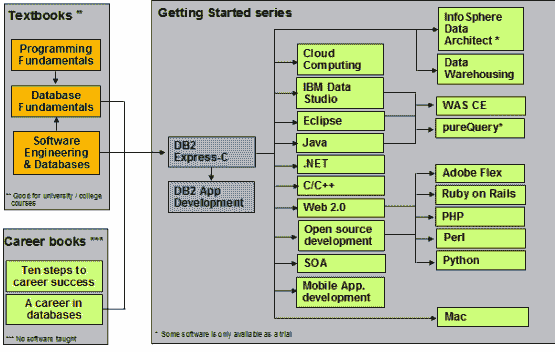

## DB2 on Campus 书籍系列

## 作者简介

**Amitava Kundu** 是驻印度班加罗尔印度软件实验室的高级软件工程师和架构师。他的主要职责是各种数据服务器和应用堆栈的性能监控、调优和管理相关的工具领域。作为技术负责人，他参与了使用 Adobe Flex 的一系列产品开发。在此之前，他是 IBM Rational 集团的一员，负责领导项目管理组合（PPM）团队的功能和技术团队。Amitava 拥有超过 16 年的 IT 经验，自 2005 年起加入 IBM。

**Karthik Ramanarayanan** 是驻印度班加罗尔印度软件实验室的顾问软件工程师。他目前参与使用 Adobe Flex 及其他技术进行性能监控和管理相关工具的产品开发。在此之前，他是 IBM Rational 集团的一员，曾在项目组合管理团队工作，涉及 DB2 和 Oracle 技术。Karthik 拥有超过 12 年的 IT 经验，自 2007 年起加入 IBM。

**Charu Agarwal** 是 IBM 印度班加罗尔印度软件实验室的系统软件工程师。她目前参与使用 Adobe Flex 和其他服务器端技术开发与性能监控和优化相关的工具。在此之前，她曾参与医疗领域的应用开发，并拥有数据库内部结构和 Web 2.0 应用开发方面的丰富经验。她拥有 4 年以上的 IT 经验，自 2008 年起加入 IBM。

**Mukul Kumar** 担任 IBM 印度软件实验室的系统软件工程师。在他总共 4 年 6 个月的工作经历中，他花了 3 年多时间使用 Java™、J2EE 及相关技术和框架开发 Web 应用程序。他目前在一个开发团队工作，该团队以 OPM 开发为重点，其中 OSGi 和 Flex 是主要的关注和开发方向。

**Anushka Chandrabau** 在印度班加罗尔的 IBM 印度软件实验室担任系统软件工程师。她拥有计算机科学与工程的学士学位和信息技术硕士学位。自 2008 年加入 IBM 以来，Anushka 一直作为 Optim Data Studio 产品系列的开发者。她是使用 Flex 技术进行新产品 Web 开发的关键设计者和开发者。

**Raul F. Chong** 是驻 IBM 多伦多实验室的 DB2 on Campus 计划经理，也是 DB2 技术布道者。他的主要职责是培养世界各地的 DB2 社区，帮助成员彼此互动，并为 DB2 论坛做出贡献。Raul 于 1997 年加入 IBM，在公司担任过多个职位。作为一名 DB2 顾问，Raul 帮助 IBM 业务伙伴从其他关系数据库管理系统迁移到 DB2，并解决数据库性能和应用设计问题。作为一名 DB2 技术支持专家，Raul 解决了在 OS/390®、z/OS®、Linux®、UNIX® 和 Windows® 平台上的 DB2® 问题。Raul 还曾作为应用开发解决方案团队的信息开发者，负责 CLI 指南和 Web 服务材料。Raul 教授过许多 DB2 研讨会，发表过大量文章，并为 DB2 认证考试教程做出贡献。Raul 通过其担任主要作者的书《Understanding DB2 - Learning Visually with Examples 2nd Edition》（ISBN-10: 0131580183）总结了他多年来在 DB2 方面的许多经验。他还共同撰写了《DB2 SQL PL Essential Guide for DB2 UDB on Linux, UNIX, Windows, i5/OS, and z/OS》（ISBN 0131477005），并担任 DB2 on Campus 书籍系列的项目负责人和合著者。

## 贡献者

以下人员对本书进行了编辑、审阅并作出了重大贡献。

| 贡献者 | 公司/大学 | 职位/职业 | 贡献内容 |
| :-- | :-- | :-- | :-- |
| Leon Katsnelson | IBM 多伦多实验室 | IBM 数据服务器计划总监 | 技术审阅 |

## 致谢

我们非常感谢以下个人在开发本书引用的材料方面提供的协助：

Natasha Tolub 和 Natasha Maxim 为本书设计了封面。

Susan Visser 协助出版了本书。


## 第 1 章 – Adobe Flex 简介

Adobe® Flex® 是一个用于开发富 Web 应用的免费开源框架，这些应用可以在所有主要浏览器、桌面和操作系统上一致地部署。本质上，它是 Adobe Systems 发布的一个软件开发工具包（SDK），允许 Web 开发者在 Flash® 平台上快速轻松地构建富互联网应用（RIAs）。

Adobe Flex 旨在提供一个基于 Flash 的客户端富客户端，既可以运行在桌面上，也可以嵌入到 Web 页面中。其焦点仅针对客户端，与任何支持 HTTP 的服务器技术进行异步数据交换。数据交换基于 XML，因此该产品不绑定于任何特定的通信框架或技术。服务器支持的技术包括 Java™ EE、Microsoft .NET 框架、PHP、Web 服务以及其他能够发送和接收 XML 数据的框架。

在本章中，您 will 学习到：

- Adobe Flex 的简要历史
- Adobe Flex 的版本和发行版
- Adobe Flex 社区和资源
- 与 Adobe Flex 竞争的产品


### 1.1 Adobe Flex 的简要历史

在描述 `Adobe Flex` 的历史之前，您需要了解导致富互联网应用框架开发的应用开发演变。图 1.1 说明了这种演变。

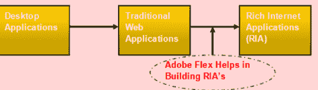

**图 1.1 – 应用开发的演变**

> **注意：**
> 由于本书专注于 Linux、UNIX、Windows 和 Mac 等分布式平台；因此不会讨论大型机应用。

在 90 年代初，应用主要是为了在单独的桌面上运行而开发的。这些应用功能丰富且强大，允许用户和开发者执行操作系统允许的任何操作。然而，这些应用的主要缺点在于其部署模型：一方面，用户必须不断获取新的 CD 来安装升级或补丁。另一方面，开发者必须考虑为不同客户端支持多个版本。这是因为每个用户都绑定于自己的应用程序副本，如 *图 1.2* 所示。


**图 1.2 – 桌面应用，每个用户都绑定于自己的副本**

到了 90 年代中期，随着互联网技术热潮的兴起，Web 应用开始变得流行。在 *图 1.1* 中，它们被描绘为“传统”Web 应用，因为当时没有技术使这些应用变得丰富，即；灵活、引人入胜、包含视频和其他有趣的功能。Web 应用运行在集中式计算机上。尽管传统 Web 应用并不丰富，但开发者发现这些应用部署增强和修复非常方便，因为 Web 应用部署在中央计算机上并由所有用户访问，如 *图 1.3* 所示。更新只需在中央计算机上进行一次。

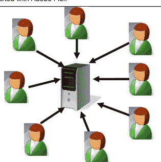

## 图 1.3 – Web 应用的优势：集中式部署

*图 1.4* 展示了一个传统网站示例；这是一个名为 "Eureka!!" 的虚构网站，但其风格与 20 世纪 90 年代初的网站非常相似。由于带宽限制，图形内容被减至最少。当时没有动态内容（页面是静态的），通常仅显示文本数据和指向其他页面的超链接。

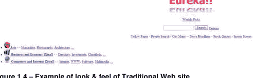

## 图 1.4 – 传统网站外观与感受示例

传统 Web 应用的主要问题在于，与桌面应用相比，它们提供的用户体验较差。然而，开发人员仍然偏爱 Web 应用，因为它们具有平台无关性，且在升级和部署方面更为便捷。

`JavaScript` 和层叠样式表（`CSS`）等技术在一定程度上缓解了这一问题，但由于 Web 在历史上被设计为文档分发机制（其中文本和超链接已足够），可用性方面的问题仍然存在。

多年来，开发人员尝试通过将尽可能多的应用逻辑转移到前端来改进可用性，以模拟类似桌面的体验。

然而，推向客户端的应用逻辑越多，浏览器不兼容性问题也就越多。讽刺的是，这恰恰是 Web 开发通过平台无关的应用试图避免的问题。

到 2000 年代中期，随着 `Adobe Flex` 等新技术的出现，富互联网应用（`RIAs`）得以开发。`RIAs` 提供了一种引人入胜、交互式、轻量且灵活的 Web 体验。`RIA` 结合了使用 Web 作为低成本部署模型的优势，以及媲美桌面应用的丰富用户体验。`RIAs` 引入了一种新的应用开发模型，将后端数据服务与丰富的前端客户端分离。通过访问 `Flex Store` 可以查看 `RIA` 的示例：[http://examples.adobe.com/flex2/inproduct/sdk/flexstore/flexstore.html](http://examples.adobe.com/flex2/inproduct/sdk/flexstore/flexstore.html)。下面的*图 1.5* 展示了一个 `RIA` 网站示例。

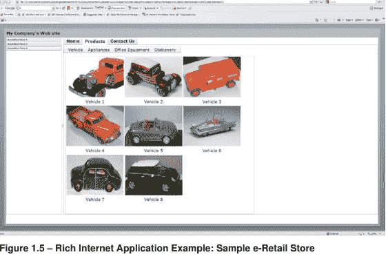

`RIAs` 带来了真正的平台中立性：无论环境如何，相同的应用都呈现相同的外观和感觉。这主要通过使用浏览器插件（适用于各种浏览器和操作系统）作为本地运行时引擎来实现。使用浏览器作为分发机制提供了高度的可部署性。

富互联网应用消除了传统 Web 应用中常见的大量网络流量，特别是在处理动态页面时。传统 Web 应用通过网络中的系列路由器发送请求，直到到达 Web 服务器。然后，Web 服务器将 HTML 页面打包并发送回浏览器，浏览器读取 HTML 并显示页面。

对于动态页面，Web 服务器将请求转发到实现业务逻辑的应用服务器。应用服务器生成动态 HTML 内容，并将其发送回 Web 服务器，再由 Web 服务器转发给浏览器进行显示。动态 Web 页面的实现效率较低，因为涉及大量的网络流量。

与瘦客户端 Web 应用相比，`RIAs` 通过在客户端执行更多处理工作，显著提高了系统性能。`RIAs` 是有状态的，它们不是由服务器控制的一组页面（如传统 Web 应用那样），而是在客户端计算机上运行的实际应用程序，仅与服务器通信以处理和数据交换。

2004 年 3 月，`Adobe Flex` 以 1.0 版本首次亮相。该版本以及 `Adobe Flex` 1.5 版本都是昂贵的基于服务器的产品。它们基于 `Flash® Player` 7.0 和 `ActionScript 2.0`，并且拥有自己的类似 `Dreamweaver®` 的开发工具，称为 `Flex Builder`。由于 `ActionScript 2.0` 的限制，这些版本从未获得广泛流行。

随着 2006 年 6 月 `Adobe Flex 2` 的发布，`Flex` 成为了一个完全基于客户端的产品。`Adobe` 从头重写了整个 `Flex` 框架和 IDE。这一变革的核心是引入了 `ActionScript 3.0`。`Flex 2` 基于 `Flash Player` 9.0 和 `ActionScript 3.0`。`Adobe` 决定不升级类似 `Dreamweaver` 的 `Flex Builder 1.0`，而是开始使用 `Eclipse` 并提供针对 `Eclipse` 的 `Flex Builder` 插件。`Adobe Flex 2.0` 提供了一种无需支付高昂许可费即可创建 `RIA` 的方法。

2008 年 2 月，`Adobe Flex 3` 发布。`Adobe Flex 3` 为 `Flex Builder` 增加了更多功能，例如重构、增强的样式支持以及 `Flex` 框架中新的数据可视化组件。`Adobe Flex 3` 也是 `Flex SDK` 和 `Flex` 编译器的官方开源版本。截至撰写本文时，`Adobe Flex 3` 是最新版本的 `Flex`，本书也将使用此版本。

`Adobe Flex 3` 附带了许多新的关键功能，包括：

- 分析器，用于监控内存和 CPU 消耗
- 重构功能，使得重命名几乎任何内容（如函数、变量和类）变得容易。
- `Adobe` 集成运行时（`AIR®`）框架，支持构建跨操作系统的富互联网应用程序，这些应用程序可以访问本地桌面资源。
- 持久缓存，减少 `SWF` 文件大小。
- 向导，用于生成代码，从而减少手工编码工作量。
- 图表增强功能
- `DataGrid` 组件，用于显示表格数据。高级 `DataGrid` 提供了额外的功能，例如多列排序和列跨接。
- `Flex Data Services` 现已更名为 `LiveCycle® Data Services`，现在支持 `Ajax` 数据服务器。
- 内存和性能分析器。

### 1.2 Flex 应用的优缺点

如今，Web 开发人员拥有大量选择来开发 `RIAs`，`AJAX` 是其中之一。那么为什么使用 `Adobe Flex` 呢？一个原因是 `Adobe Flex` 分离了表现层和数据访问层。这意味着 `Flex` 应用独立于后端：你可以使用任何满足需求的服务器技术——`ColdFusion`、`J2EE`、`PHP`、`.NET` 等。由于 `Adobe Flex` 的很大一部分设计围绕 `XML`（甚至 `MXML` 文档），你可以使用像 `HTTPService` 调用这样基础的工具来读取和写入数据存储中的数据。

另一个主要原因是，当你希望创建高度交互式、富有表现力的网站应用，并使用和可视化数据时，`Adobe Flex` 是理想的技术。`Adobe Flex` 允许你突破通常静态网页的限制，嵌入小程序，而无需承担诸如 Java 小应用程序等替代方案的复杂性和兼容性问题。

以下是考虑为你的网站使用 `Adobe Flex` 的其他一些理由：

- 它有助于构建健壮的能够以吸引人的方式显示复杂数据集的应用程序。
- 它对你的网站访客具有视觉吸引力。
- 它在所有主要平台上都能工作，用户除了 `Flash` 播放器外无需安装任何其他东西。
- 音频和视频允许实现更大的交互性。
- 数据同步允许更高效地使用实时数据

另一方面，`Adobe Flex` 可能不是所有需求的解决方案。例如，如果你计划开发带有简单动画且不编写太多代码的小型应用程序，`Flash` 可能是基于时间轴的动画工具的最佳选择。`Flex` 应用受限于 `Flash` 玩家的约束。此外，`Flex` 应用可能体积较大，因为它基于多个库。幸运的是，`Adobe Flex` 并不强制你使用所有 `Flex` 组件（甚至 `MXML`），并允许使用免费的 `Flex` 编译器编译 `ActionScript` 项目。


如果你计划建立一个需要大量富文本的网站，或者只需要简单的用户交互，使用 HTML/Ajax 可能更好。虽然 Adobe Flex 为 HTML 提供了良好的支持，但如果有很多文本，一些项目可能会遭受一点性能滞后。但是，如果你希望将应用部署到 AIR，Adobe Flex 是一个不错的选择，因为 AIR 为 HTML 提供了原生支持。对于包含大量文本、动画和部分交互内容的网站，结合使用 Flash 或 Flex 与 HTML 是一个很好的赌注。

在多层模型中，Flex 应用可以作为表现层。Flex 应用是基于 Web 的，但提供了一定水平的交互性和丰富的媒体体验，使其看起来更像计算机桌面程序。

### 1.3 Adobe Flex 的版本与发行版

正如前文所述，Adobe Flex 从 1.0 版本开始，随后发展到 1.5、2.0 和 3.0 版本。本书重点关注 Adobe Flex 3.0。Adobe Flex 3.0 由多个组件组成。

#### 1.3.1 Adobe Flex 3 SDK

你可以仅使用开源 Flex 3 SDK 或免费的 Adobe Flex 3 SDK 来创建和部署 Flex 应用程序。免费的 Adobe Flex 3 SDK 包含 Flex 框架、编译器和调试器，使你可以使用任意 IDE 开发 Flex 应用程序。开源 Flex 3 SDK 包含了 Flex SDK 的大部分功能（编译器、框架、调试器），但不包含任何非开源的内容，如 Adobe Flash Player、Adobe AIR 或高级字体编码库。

#### 1.3.2 Adobe Flex Builder 3

Adobe Flex Builder 3 软件是一款基于 Eclipse 的强大 IDE，作为授权产品提供。Adobe Flex Builder 3 加速了 Flex 应用程序的开发，因为它支持智能编码、交互式单步调试和可视化设计功能。Adobe Flex Builder 3 包含完整的 Flex SDK，包括编译器、组件库和调试器，以及 IDE。它也可作为 Eclipse 插件使用。Adobe Flex Builder 3 有两个可用的发行版：

- Adobe Flex Builder 3 标准版

- Adobe Flex Builder 3 专业版。

*下表 1.1* 展示了 Adobe Flex Builder 3 不同版本中功能特征的对比表。

| 功能 | Adobe Flex Builder 3 专业版 | Adobe Flex Builder 3 标准版 |
| :--- | :---: | :---: |
| 桌面 RIA | ✔ | ✔ |
| DataGrid | ✔ | ✔ |
| 高级 DataGrid | ✔ | |
| 图表组件 | ✔ | |
| 性能分析器 | ✔ | |
| 内存分析器 | ✔ | |
| 交互式调试 | ✔ | ✔ |
| 设计视图 | ✔ | ✔ |
| 编码工具 | ✔ | ✔ |
| 数据处理 | ✔ | ✔ |
| 浏览器集成 | ✔ | ✔ |

表 1.1 – Adobe Flex 不同版本的功能对比

> **注意：**
>
> 本书中所有的示例和代码片段均使用 Adobe Flex Builder 3.0 专业版和 Eclipse SDK 版本 3.3.2 创建和测试。

#### 1.3.3 Adobe Data Services

Adobe 提供两种数据服务解决方案以满足各种需求。

- **BlazDS**：这是一个开源项目，为所有开发者提供 Flex 远程处理和消息服务。Flex 远程处理使开发者能够快速轻松地连接到后端业务逻辑和数据。

- **Adobe LiveCycle Data Services**：这是一个功能齐全的框架，用于开发企业级 RIA 解决方案。这是一个可购买的授权产品。

### 1.4 Flex 社区

Adobe Flex 是一项相当新的技术；然而，在很短的时间内，Flex 社区已显著增长，这体现在可用于学习 Adobe Flex 的资源数量上。作为 Flex 开发者，你可以利用许多这些资源，无论是在线的还是现实世界中的，它们可以磨练你的 Flex 技能，并为你的应用程序提供绝佳技巧和窍门。Adobe 提供了良好的 Adobe Flex 文档，可以帮助初学者入门。该文档可在 [http://www.adobe.com/support/documentation/en/flex/](http://www.adobe.com/support/documentation/en/flex/) 访问。

#### 1.4.1 开发者资源

以下列表提供了一些流行的 Adobe Flex 开发者资源：

- Flex.org – [http://flex.org/](http://flex.org/)。这是 Flex 开发者的社区网站，拥有指向优秀开发者资源的链接。

- Adobe Flex 开发者中心 – [http://www.adobe.com/devnet/flex/](http://www.adobe.com/devnet/flex/)。这是官方 Adobe Flex 社区中心，拥有大量文章和出色信息。

- Flex Search – [http://flexsearch.org](http://flexsearch.org)。这是专为 Flex 社区定制的 Flex 搜索引擎。

#### 1.4.2 讨论论坛

以下列表是 Adobe Flex 的讨论论坛列表。这些讨论论坛有助于解决常见遇到的问题。

- Flex Coders – http://www.adobe.com/go/flexcoders

- Flex 组件开发 – http://tech.groups.yahoo.com/group/flexcomponents

- Flex 支持论坛 – http://www.adobe.com/cfusion/webforums/forum/index.cfm?forumid=60

- Flex 组件 – http://www.adobe.com/go/flexcomponents

- Flex Builder 3 Adobe 论坛 – http://www.adobe.com/cfusion/webforums/forum/categories.cfm?forumid=72&catid=651&entercat=y

#### 1.4.3 Adobe Flex 博客

随着近年来 Flex 开发者数量的显著增长，以及他们知识财富的急剧增加，许多 Flex 开发者开始在其博客上分享 Flex 信息。这些博客通常包含 Flex 框架现有 Bug 的变通方法、工作流改进提示、性能和内存管理技巧，以及关于 Adobe Flex、Flex 未来和 Flex 社区的一般发人深省的问题。以下是一些阅读率最高的博客列表：

- Flex Team Blog – http://blogs.adobe.com/flex/。这是 Adobe Flex 团队官方博客。

- Mike Morearty 的博客 – http://www.morearty.com/blog/ Mike 是 Adobe Flex Builder 调试部分背后的智慧。他的博客让你及时了解 Flex 世界正在发生的事情。

- Chet Haase 的博客 – http://graphics-geek.blogspot.com/ Chet 的博客专注于 Flex/Flash 图形技术。

### 1.5 比较 Adobe Flex 与类似产品

本节简要比较了 Adobe Flex 与市场上目前可用的其他类似技术。

#### 1.5.1 Adobe Flex 与 HTML/JavaScript/Ajax

使用 Adobe Flex 编写交互式 UI 应用程序既简单又强大。Flex 有两个主要组件：

- MXML，一种基于 XML 的标记语言，以及

- ActionScript，一种脚本语言，是 ECMA 脚本（JavaScript 标准）的实现。

Adobe Flex 允许开发者通过编译 MXML 来创建可在 Flash 播放器中执行的 Swift 文件（`.swf`），从而构建 RIA。

精通 XML 和 JavaScript 的程序员会发现在 MXML 和 ActionScript 中工作很容易。尽管在底层 MXML 和 ActionScript 不像 HTML 和 JavaScript 那样相互关联，但在表面上，其交互方式对大多数 Web 开发者来说是有意义的。

使用 Adobe Flex，你还可以开发 Ajax 所能实现的大多数琐碎和复杂的功能。在开源社区的贡献下，Ajax 库最近真的长大了，使用 Ajax 不再像过去那样困难。尽管如此，Flex 是一个框架的事实提供了一种优势，因为它比编写 Ajax 代码更容易编写和维护 MXML/ActionScript 代码。

#### 1.5.2 Adobe Flex 与 Flash IDE


虽然 Adobe Flex 应用程序被编译并转换为 `.swf` 文件，可以由 Flash 播放器运行，但 Flex 与 Flash 大不相同。Flash 核心是动画和绘图编辑器；开发功能是后来添加的。另一方面，Adobe Flex 是一个用于开发应用程序的开源组件库。与 Flash IDE 相比，Adobe Flex 是一个更灵活的开发框架，支持轻松移动数据、样式化和换肤、高级交互控制以及更多功能。

### 1.5.3 Adobe Flex 与 Java/JavaFX

如今，Flash 播放器存在于几乎所有的计算机上。Flex 应用程序将 Flash 播放器作为 Flex 应用程序的虚拟机使用；因此，Flex 应用程序可以在大多数计算机上运行。Java 也是一种流行的语言，大多数计算机都包含 Java 虚拟机 `JVM` 作为 Java 运行时环境 `JRE` 的一部分，或者可以轻松下载。JavaFX 是一个用于构建 RIA 的软件平台，类似于 Adobe Flex。使用 Adobe Flex，我们仍然可以使用 Java 作为后端，并使用更流行的 Flash 作为前端。

熟悉 XML 和 JavaScript 的 Web 开发者会发现在 Adobe Flex 中工作很容易。熟悉 Eclipse 的 Java 开发者也应该发现在 Adobe Flex Builder 中工作很容易，因为它是基于 Eclipse 的。与 Flex 一样，Java 允许应用程序部署在 Web 上或桌面上。

### 1.5.4 Adobe Flex 与 Java Server Faces (JSF)

Flex 应用程序侧重于客户端，用于部署到桌面或 Web 页面。与服务器进行数据交换使用 XML。另一方面，Java Server Faces 技术在服务器端工作，通常将其输出渲染为带或不带 AJAX 支持的 HTML 页面。JSF 技术提供了行为和表示之间的清晰分离。使用 JSF，客户端生成的事件被映射为服务器端对象的方法，生成响应并将其发送回客户端。此响应可以是同步的（常规组件，其中页面完全重新加载）或异步的（使用 AJAX，仅使用响应数据更新组件）。

Adobe Flex 在客户端需要一个插件（Flash），该插件目前存在于几乎 99% 的计算机上。JSF 不需要任何客户端插件。JSF 开发起来非常复杂，因为其基本实现相当基础，对于复杂的 UI，我们需要额外的组件库。对于具有非常复杂 UI 的跨企业应用程序，Adobe Flex 会是更好的工具选择。

### 1.5.5 Adobe Flex 与 Microsoft Silverlight

Microsoft Silverlight 是一个通过编译 `XAML`（一种基于 XML 的界面描述语言）来提供富 Web 内容开发支持的框架。Silverlight 框架被编译并转换为 `XAP` 文件，由 Silverlight 插件执行。它还提供了跨平台兼容性。

Flex 应用程序使用 Flash 插件以类似的方式工作。然而，Adobe Flex 是一个开源框架，而 Silverlight 归 Microsoft 所有。这引发了关于使用专有软件与开源软件的相同争论。就 Adobe Flex 而言，来自开源社区贡献的第三方 Flex 组件数量正在迅速增加。

### 1.6 总结

在本章中，你了解了 Adobe Flex 的简短历史、使用 Adobe Flex 的优缺点以及 Adobe Flex 的不同版本和迭代。本章的目标是介绍这项新技术并提供简要概述。

在章节的后半部分，你还了解了市场上的竞争产品以及简短的对比。

### 1.7 复习题

- 什么是 RIA，它有什么用？
- 什么是 MVC，你如何将其与 Flex 应用程序联系起来？
- 使用 Adobe Flex 3 可以构建哪些类型的应用程序？
- Flex 和 Flash 之间有什么区别？
- Adobe Flex 3.0 中引入了哪些新的关键特性？
- 以下哪一项好处是 Adobe Flex 无法实现的？
  - A. 增强的用户体验
  - B. 完整的开发环境
  - C. 支持任何面向对象的编程语言用于客户端开发
  - D. 企业级功能
  - E. 跨浏览器兼容性
- Adobe Flex 的主要竞争产品是什么？
  - A. Google code
  - B. Microsoft SilverLight
  - C. Ajax
  - D. JSF
  - E. 以上都不是
- 以下哪项未包含在 Adobe Flex 3 SDK 的免费版本中？
  - A. Flex 框架
  - B. 编译器
  - C. 调试器
  - D. 设计视图
  - E. IDE
- 哪些特性仅在 Adobe Flex Builder 3.0 专业版中提供？
  - A. 高级 DataGrid
  - B. 图表组件
  - C. 交互式调试
  - D. 性能分析器
  - E. 设计视图
- 以下哪项是富互联网应用程序（RIA）的特征？
  - A. 它提供实时交互性
  - B. 它对最终用户隐藏客户端和服务器之间的通信
  - C. 它自动在客户端机器上安装应用程序的最新版本
  - D. 以上都是
  - E. 以上都不是


## 第 2 章 – 安装 Flex

Flex® Builder™ 是一个用于开发 Flex 应用程序的高级 IDE。你可以下载并安装 Flex Builder 的 30 天试用版。试用期结束后，你可以从 Adobe 购买授权版本。虽然 Flex Builder 不是唯一可用于编写 `MXML™` 和 `ActionScript®` 的软件，但 Flex Builder 可以加速整个开发过程。

在本章中，你将了解以下内容：
- Flex Builder 组件
- 如何在 Windows 上安装 Eclipse Flex Builder 插件

### 2.1 安装 Flex：总体视图

Flex Builder 由三个独立的组件组成：
- Flex SDK：一组用于构建、运行和部署 Flex 应用程序的库。
- Eclipse 插件：这提供了 IDE 支持，使开发更容易、更快。
- Flash Player：Flex 应用程序仅在 Flash Player 9 或更高版本上运行。

这体现在 *图 2.1* 中

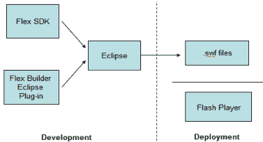

**图 2.1 – Flex Builder 组件总体视图**

如图所示，安装了 Flex Builder Eclipse 插件的 Eclipse 以及 Flex SDK 库，你可以开发编译为 `.swf` 文件的 RIA，并从 Flash Player 运行。

Flex Builder 可以以下列两种配置之一进行安装：
*独立 IDE*：如果你不是 Eclipse 用户，你可以安装此版本的 Flex Builder。它附带了一个兼容版本的 Eclipse。
*插件*：如果你正在使用 Eclipse，你可以安装 Flex Builder 的插件版本。在安装过程中，它会提示你输入 Eclipse 的位置。

> **注意：**
> 上述两种安装方法最终做的是同一件事，只有一个区别：如果你安装独立版本的 Flex Builder，默认透视图将是 Flex 开发；而如果你安装插件版本，默认透视图将是 Java 开发。
> 在这本书中，你将学习在 `Windows` 上安装 Flex Builder 的插件版本。本书当前范围不会讨论使用独立版本。

### 2.2 使用设置向导安装 Flex

安装 Flex Builder 插件是一个两步过程。第一步需要安装 Eclipse，第二步是安装 Flex Builder 插件。

#### 2.2.1 安装 Eclipse

请遵循以下步骤在 Windows 上安装 Eclipse：
1. 前往 `http://archive.eclipse.org/eclipse/downloads/drops/R-3.3.2-200802211800/index.php` 并下载与你计算机操作系统对应的 Eclipse RCP（富客户端平台）SDK 版本。
2. 将下载的文件解压到一个目录，例如你可以将其解压到 `c:\eclipse`。
3. 导航到解压/安装 Eclipse 的目录，并为 Eclipse 创建一个桌面快捷方式。

> **注意：**
> 有关 Eclipse 的更多信息，请参阅免费电子书 *Getting Started with Eclipse*，这也是本系列书籍的一部分。

#### 2.2.2 安装 Flex Builder

请遵循以下步骤安装 Flex Builder：


1. 你可以从安装 CD/DVD 安装 Flex Builder 插件，或者从 `http://www.adobe.com/cfusion/entitlement/index.cfm?e=flexbuilder3` 下载 60 天试用版。要安装 Flex Builder 插件，请通过执行 `setup.exe` 启动 InstallAnywhere 向导。

2. 向导将首先提示你选择安装语言，选择语言后点击确定。这体现在图 2.2 中

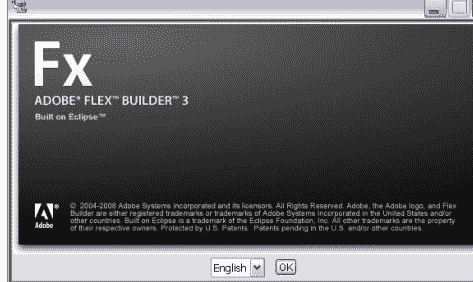

**图 2.2 – 语言选择器 - Flex Builder 安装向导**

3. 下一个屏幕将提示你关闭所有正在运行的应用程序，因为 Flex 将安装其自己的 Flash Player 版本。这体现在图 2.3 中

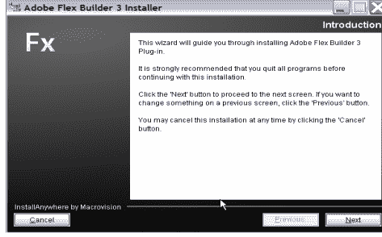

**图 2.3 – 关闭所有正在运行的应用程序 - Flex Builder 安装向导**

4. 下一个屏幕将提示你接受许可证。接受条款并点击下一步。这体现在图 2.4 中

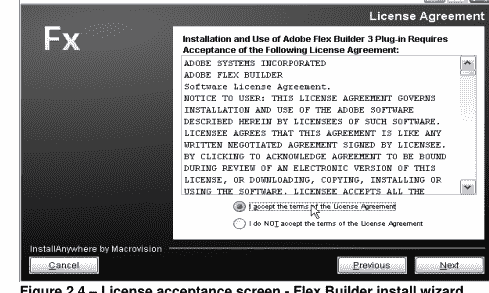

5. 向导现在将提示你选择默认安装位置 - 选择位置并点击下一步。这体现在图 2.5 中

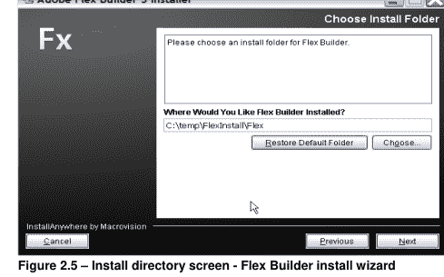

6. 下一个屏幕将询问你 Eclipse 安装目录的位置。选择你安装 Eclipse 的目录并点击下一步。这体现在图 2.6 中

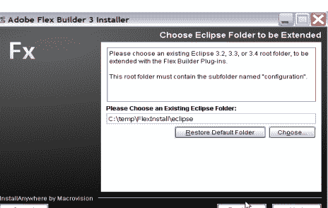

**图 2.6 – Eclipse 目录屏幕 - Flex Builder 安装向导**

7. 向导现在将提示你安装 Flash Player，如果系统中已安装的浏览器中尚未安装 Flash Player。Flash Player 渲染你在应用程序中创建的 swf 文件。此屏幕还将询问你选择开发过程中可能需要的其他插件。进行适当的选择并点击下一步。这体现在图 2.7 中

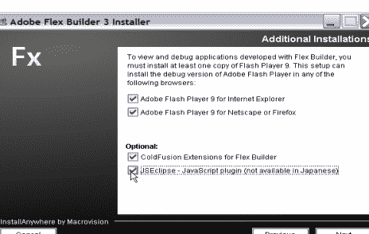

**图 2.7 – 浏览器的 Flash Player 插件 - Flex Builder 安装向导**

8. 以下屏幕允许你查看安装参数。验证后，点击 `安装` 按钮。这体现在图 2.8 中

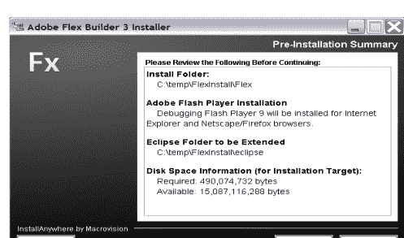

图 2.8 – 最终审阅界面 - Flex Builder 安装向导

9. 接下来，向导将引导你浏览进度界面，如图 2.9 所示

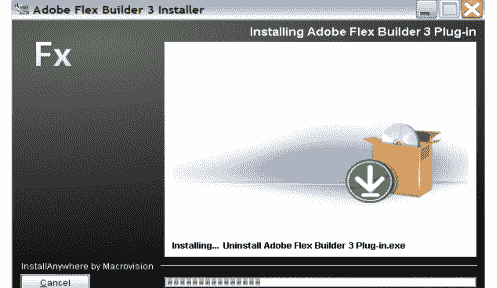

图 2.9 – 安装进度界面 - Flex Builder 安装向导

10. 最后一个界面将显示安装成功消息。如图 2.10 所示

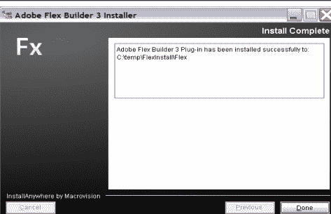

### 2.3 启动 Flex Builder

启动 Flex Builder 有两种方式：

- 打开文件资源管理器，导航到你安装 Eclipse 的目录，并通过双击 `eclipse.exe` 来启动它；或者
- 点击你在安装过程中在桌面上创建的 Eclipse 快捷方式。

Flex Builder 启动后，请按照以下步骤操作：

- 当提示时，选择一个工作区。Eclipse 工作区是硬盘上的一个位置，用于保存你的项目文件。指定一个工作区并点击确定。这如图 2.11 所示。

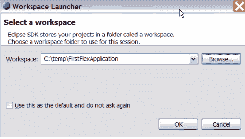

图 2.11 – Eclipse 工作区启动向导

- Flex Builder IDE 启动后，将显示一个与图 2.12 所示类似的界面。

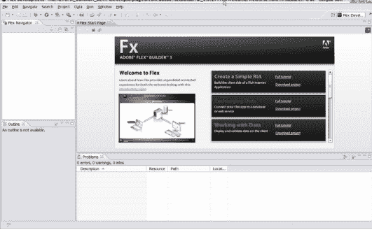

图 2.12 – Flex 起始页

- 如果你的屏幕显示不同，请尝试选择 `帮助 -> Flex 起始页`

- 这如图 2.13 所示

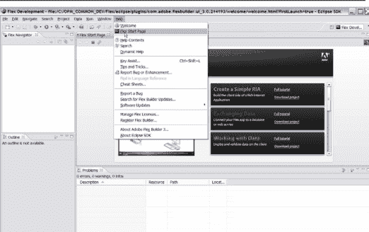

图 2.13 – Flex 起始页

现在，你已经准备好编写你的第一个 Flex 应用程序了。

### 2.4 开发你的第一个 Flex 应用程序

本节描述如何构建、运行和调试你的第一个 Flex 应用程序：“Hello Flex”。

#### 2.4.1 构建和运行 “Hello Flex” 应用程序

按照以下步骤构建 “Hello Flex” 应用程序：

- 创建一个新的 Flex 项目。从文件菜单中，选择 `文件 -> 新建 -> 项目`。这在下方的图 2.14 中展示。

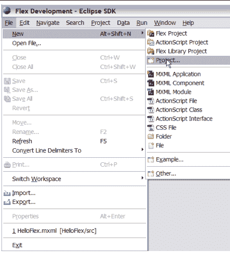

**图 2.14 – 创建新项目向导**

- 选择 `Flex 项目` 并点击 `下一步`。这如图 2.15 所示。

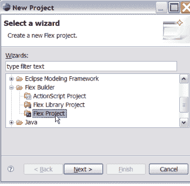

图 2.15 – 项目选择向导

- 输入项目名称 `HelloFlex`，如图 2.16 所示。

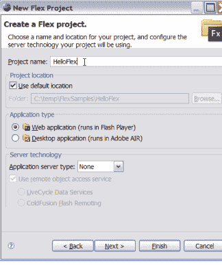

图 2.16 – 项目创建向导

- 项目名称下方是项目位置部分，它描述项目文件的位置。使用默认选择，它应该指向你的当前工作区。
- 在应用程序类型部分，你可以指定是否希望在 Web 浏览器中运行你的应用程序，选项为 Web 应用程序（在 Flash Player 中运行），或者在 Web 浏览器外部作为桌面应用程序运行你的应用程序，选项为桌面应用程序（在 Adobe AIR 中运行）。选择默认值：Web 应用程序（在 Flash Player 中运行）。
- 在服务器技术部分，你可以选择处理动态页面的 Web 服务器。一些选择包括 Java、.Net、ColdFusion 或 PHP。这些选择在下方的图 2.17 中展示。保留默认选择（无）并点击下一步。

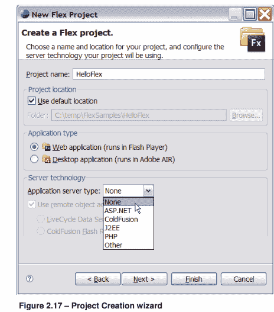

- 在配置输出界面中，指定 Flex 将放置编译后应用程序的位置。它应该是你的项目目录的一个子目录。保留默认选择并点击下一步。这如图 2.18 所示。

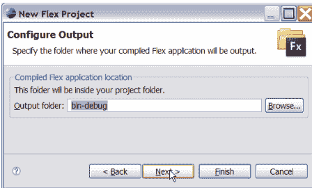

图 2.18 – 配置输出向导

- 下一个向导让你指定项目中的源文件夹。源文件夹是存储项目源文件的位置。Flex Builder 创建的默认文件夹是 `src`，如图 2.19 所示。保留默认选择并点击完成。

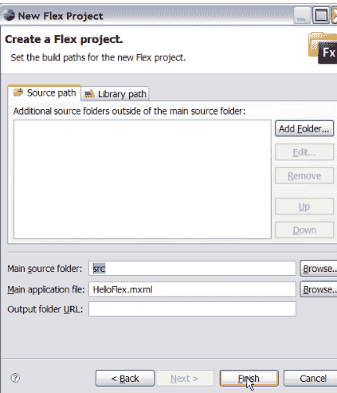

图 2.19 – 主源文件夹和主应用程序文件向导

- 下一个对话框，如图 2.20 所示，询问你是否切换到 `Flex 开发透视图`，点击 `是`。

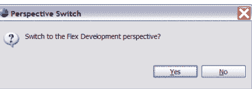

图 2.20 – 透视图切换向导

Flex Builder 现在将启动 `HelloFlex` 应用程序，如图 2.21 所示。

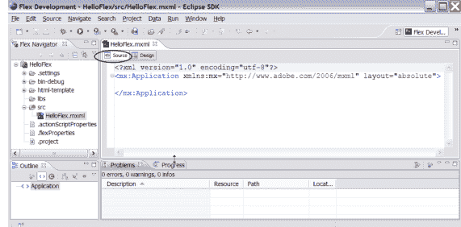

图 2.21 – 在源代码模式下查看应用程序

- 在 Flex 开发透视图中，你可以看到以下视图：
  - 左上角的 **Flex 导航器** 视图有助于查看你的项目及其文件夹。`src` 文件夹是你存储所有源文件以及编译应用程序所需的其他资源文件的地方。`bin-debug` 文件夹是存储编译后项目输出的地方。
  - 左下角的 **大纲** 视图显示你的应用程序的结构。
  - 右上角的 **编辑器** 视图是你编写和编辑源代码的区域。当你打开文件时，将有几个用于编辑的选项卡。例如，图中显示了 `HelloFlex.mxml` 源文件。
- 在文件 `HelloFlex.mxml` 的编辑器视图中，你还可以看到编辑器左上角的 `源代码` 和 `设计` 按钮。在上面的图中，`源代码` 按钮被选中，显示源代码（目前是一个空模板）。
- 要以设计模式查看应用程序，请单击 `设计` 按钮。由于 Flex Builder 生成的默认代码不做任何事情，你将在此模式下看到一个空白屏幕，如图 2.22 所示。

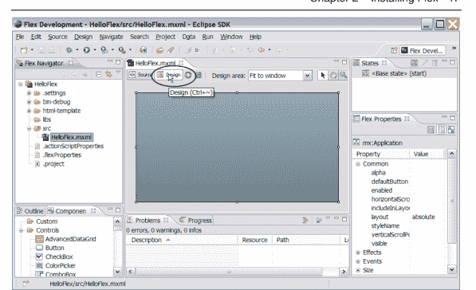


## 图 2.22 – 在设计模式下查看应用程序

- 12. 通过点击源代码按钮返回到源代码模式，并添加清单 2.1 中显示的代码。

```xml
<mx:Panel paddingTop="20" paddingBottom="20" paddingLeft="20" paddingRight="20" title="My First Flex Application">
<mx:Label text="Hello Flex!" fontWeight="bold" fontSize="20"/>
</mx:Panel>
```

### 清单 2.1 – 示例 Flex 应用程序代码片段

- 13. 你可以在图 2.23 中准确看到此代码添加的位置。

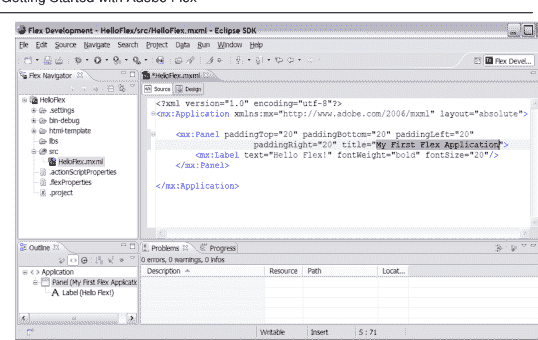

**图 2.23** – 在源代码模式下编辑应用程序

- 14. 通过点击保存按钮保存源文件，Flex Builder 将自动编译项目。为了运行应用程序，右键点击项目并选择 `运行方式 -> Flex 应用程序`。这在下面的 **图 2.24** 中展示。

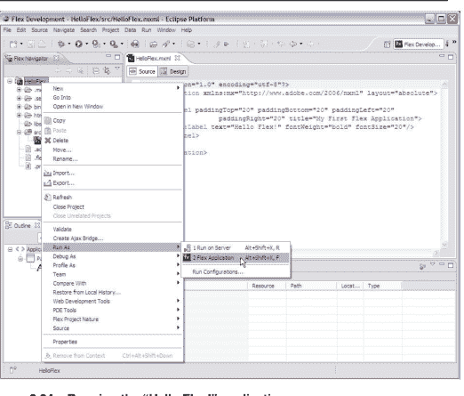

**图 2.24 – 运行 “Hello Flex!” 应用程序**

- 15. 一旦作为 Flex 应用程序运行，Eclipse 中配置的 Web 浏览器的一个实例将打开，以显示如下输出，如图 *2.25* 所示。

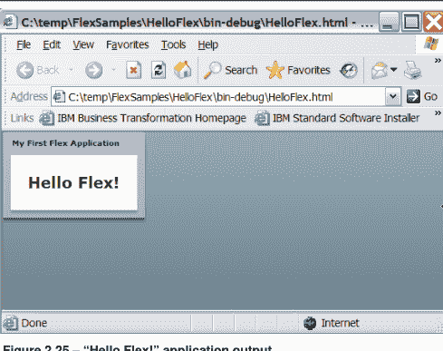

### 2.4.2 调试 Flex 应用程序

熟悉 Eclipse 的 Java 开发人员会发现调试 Flex 应用程序与调试 Java 应用程序类似。以下步骤解释如何调试你的第一个 Flex 应用程序：

- 1. 在源代码模式下打开 `HelloFlex.mxml` 文件，并通过点击标记栏（左侧栏）上的期望行来添加断点，如图 *2.26* 所示。

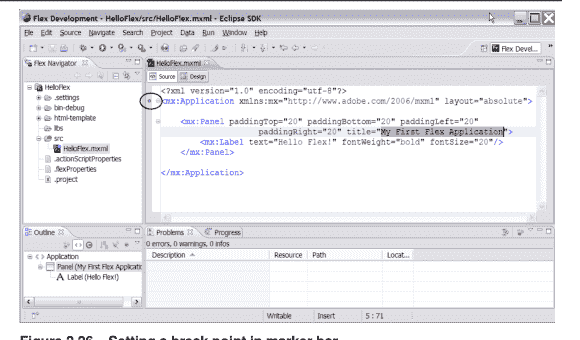

- 2. 在 Flex 导航器视图中，右键点击项目或文件名本身，并选择 `调试为 Flex 应用程序`，如图 *2.27* 所示。

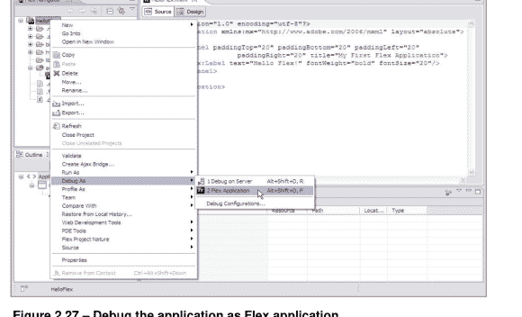

- 当你选择调试应用程序时，会出现一个窗口询问是否切换到 Flex 调试透视图。点击是，如图 *2.28* 所示。

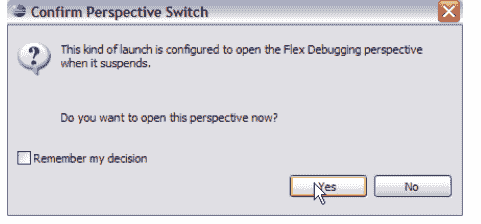

**图 2.28 – 切换到 Flex 调试透视图**

- 当 Flex 调试透视图打开时，会出现如图 *2.29* 所示的窗口。

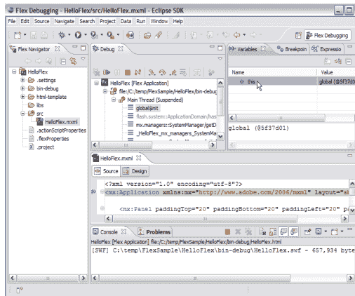

**图 2.29 – Flex 调试透视图**

### 2.5 练习

创建一个新的 Flex 应用程序，并将其命名为“Hello World!”。它应该与本章中介绍的 Hello Flex! 应用程序行为完全一致，但这次它将输出“Hello World!”。这个简单的练习将帮助你回顾本章所学的内容。

### 2.6 摘要

本章解释了安装 Eclipse Flex Builder 插件的各种步骤。Flex Builder 附带了打包好的 Flex SDK。它还解释了如何构建、运行和调试简单的 Flex 应用程序。

### 2.7 复习问题

- 1. Flex 应用程序是 HTML 应用程序吗？
- 2. 与 HTML 相比，Flex 有哪些局限性？
- 3. Flex 应用程序如何在性能上优于 HTML 应用程序？
- 4. 如何更改添加到 Flex 应用程序中的组件的属性？
- 5. 如何查看与组件相关的各种属性？
- 6. 从下表中选择免费的 Flex 组件：
    - A. Flex SDK
    - B. Flex Framework
    - C. Flex Builder
    - D. Life Cycle Data Services
    - E. 以上都不是
- 7. 从下表中选择需要授权的 Flex 组件：
    - A. Flex SDK
    - B. Flex Framework
    - C. Flex Builder
    - D. Life Cycle Data Services
    - E. 以上都不是
- 8. 在以下哪个窗口中，你可以看到特定应用程序使用的组件？
    - A. Console
    - B. Component
    - C. Problems
    - D. Outline
    - E. 以上都不是
- 9. 在 Flex 中可以创建哪种类型的项目？
    - A. Flex
    - B. ActionScript
    - C. MXML
    - D. Library
    - E. 以上所有
- 10. 在编写 Flex 应用程序之前，需要掌握哪些软件语言？
    - A. C++
    - B. Java
    - C. MXML
    - D. ActionScript
    - E. 以上所有

# 第 3 章 - MXML 和 ActionScript 简介

MXML 是 Flex 框架的核心。MXML 是一种基于 `XML`（可扩展标记语言）的标记语言，由 Adobe 创建，用于 Flex 平台。它像 HTML（超文本标记语言）一样易于阅读和编写，并且提供了 XML 的可扩展性。

ActionScript 是将 Flex 应用程序粘合在一起的工具。虽然 MXML 通常用于布局和结构化，但 ActionScript 用于实现功能。构建强大的 Flex 应用程序的关键在于正确使用脚本、创建可重用代码、了解 ActionScript 的基础知识，以及最重要的是理解 MXML 和 ActionScript 如何协同工作。

在本章中，你将学习以下内容：

- MXML
- ActionScript

## 3.1 MXML 和 ActionScript – 全局视角

下方的 *图 3.1* 提供了 MXML 和 ActionScript 及其关系的全局视角。

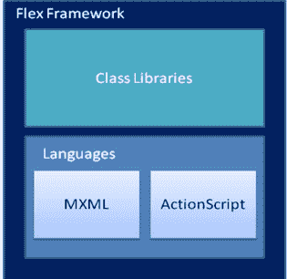

**图 3.1 – Flex 框架架构 – 全局视角**

如图所示，Flex 框架使用两种语言：ActionScript 和 MXML。类库为两者都提供了 API，包括可视组件（如控件和容器）以及无界面组件（如远程服务对象）。

图 3.2 通过展示 MXML 编译过程来说明 MXML 和 ActionScript 之间的关系。

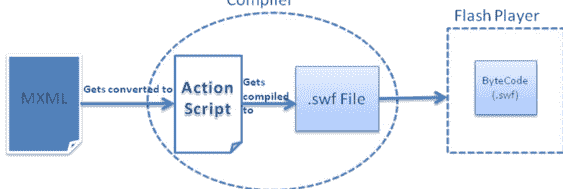

**图 3.2 – MXML 编译过程**

如图中所示，开发者创建的每个 MXML 文件首先会被转换为一个 ActionScript 类（`*.as` 扩展名）。然后，Flex 编译器会处理该 `*.as` 文件，将其转换为 `*.swf` 文件（Macromedia Small Web Format，发音为 *swiff*）。该文件被称为字节码，可以嵌入任何 HTML 或 JSP 文件等。为了在浏览器中查看这些文件，必须预装 Flash Player。

## 3.2 MXML

在本节中，我们将讨论 MXML 和 XML 之间的关系、如何有效地编写 MXML 代码以及命名空间。Adobe 没有为 MXML 这个缩写提供官方含义；然而，由于 Macromedia（被 Adobe 收购）开发了这门语言，有些人建议它代表 Macromedia Extensible Markup Language（Macromedia 可扩展标记语言），而另一些人则更喜欢说它代表 Magic Extensible Markup Language（神奇可扩展标记语言）。

### 3.2.1 XML

XML 代表 Extensible Markup Language（可扩展标记语言）。它是一种描述数据的语言，非常适合信息交换，无论平台如何。为了简单起见，你可以将 XML 文档视为带有标签的文本文档。例如，`<telephone>90542334</telephone>` 是一个 XML 文档。

> **注意：**
> 如今你可以找到大量关于 XML 的资源。鉴于 XML 是 MXML 的基础，本书提供了一个非常简短的介绍。

HTML 是一种用于描述如何显示数据的语言，而 XML 用于描述数据是什么。以下是两个简单的例子，第一个是 HTML，第二个是 XML：

```html
<b>Raul</b>
```

```xml
<name>Raul</name>
```


你能看出它们在标签方面的区别吗？在第一种情况（HTML）中，标签 `<b>` 用于指示名字 Raul 应以粗体显示。在第二种情况（XML）中，标签 `<name>` 用于描述 Raul 是什么，即一个名字。

XML 使用文档类型定义 (`DTD`) 或 XML 模式定义 (`XSD`) 文档来描述标签的规则。例如，一条规则可以是标签 `<name>` 只能包含字符。这些规则也用于验证文档是否遵循预定义的结构；此过程称为 XML 验证。

XML 的可扩展性来自于创建自定义标签的能力。这意味着你可以基于 XML 创建自己的词汇表。MXML 就是这样，它基本上是一个 XML 词汇表，其中 Adobe 创建了一些特定标签来为 Flex 应用程序提供结构。

就语法而言，当 XML 文档遵循由万维网联盟 (`W3C`) XML 标准定义的语法规则时，它是一个格式良好的 XML 文档。例如，其中一些规则规定如下：

- 所有开启的标签必须关闭 — 所有开启的标签，如 `<mx:Button>`，必须用结束标签如 `</mx:Button>` 进行关闭。如果开始标签和结束标签之间没有内容，如 `<mx:Button> </mx:Button>`，则可以简单地使用一个标签，如 `<mx:Button />`。
- XML 区分大小写 — 这意味着大写字母和小写字母不被视为相同。因此 `<mx:Label1>` 和 `<mx:label1>` 是不同的。

就表现而言，给定一个 XML 文档，你可以轻松将其转换为媒体知道如何呈现的格式。例如，使用 `XSLT`（eXtensible Stylesheet Language Transformation，可扩展样式表语言转换）将 XML 文档转换为 HTML 文档，以便数据可以在 Web 浏览器上准确显示。只需对同一 XML 文档应用不同的 XML 样式表，你就可以在浏览器上以不同的外观和感觉呈现内容数据。

就导航而言，当你想要在 XML 文档中搜索特定内容时，你可以使用不同的语言，如 `XQuery`、`XPath` 和 `SQL/XML`。

#### 3.2.2 XML 标签的结构分析

标签可以通过两种包含信息的方式，即通过内容或通过属性。内容就是位于开始标签和结束标签之间的文本。另一方面，属性是仅存在于开始标签中、用引号括起来的文本，并用于进一步描述该标签。例如：

```xml
<mx:Label id="myLabel" >
	<mx:text> Hello World!! </mx:text>
</mx:Label>
```

在上面的例子中，`id` 是标签 `<mx:Label>` 的属性，而 `<mx:text>`（是的，你可以像 HTML 那样将一个标签嵌套在另一个标签内）是标签 `<mx:Label>` 的内容。

同样的内容也可以写成：

```xml
<mx:Label id="myLabel" text="Hello World!!"/>
```

因此，属性可以提供一种更紧凑且可读性更强的方式来表示相同的信息。

不过，属性虽然更紧凑，但嵌套标签允许你表示更复杂的内容。它们对于插入无法使用属性表示的数据非常有用，如清单 3.1 中所示的例子。

```xml
<mx:DataGrid>
	<mx:columns>
		<mx:DataGridColumn headerText="Column 1" dataField="col1"/>
		<mx:DataGridColumn headerText="Column 2" dataField="col2"/>
		<mx:DataGridColumn headerText="Column 3" dataField="col3"/>
	</mx:columns>
</mx:DataGrid>
```

**清单 3.1 - 带有嵌套标签的 XML 文档**

#### 3.2.3 MXML 中的命名空间

在 MXML 中，每个标签前都带有 `mx` 前缀，后跟一个冒号。这是一个 XML 命名空间，表明该标签属于 `mx` 命名空间。命名空间用于在 XML 实例中提供具有唯一名称的元素和属性。一个 XML 文档可以包含多个词汇表，如果每个词汇表都赋予了不同的名称，那么通过使用命名空间可以解决不同词汇表中同名元素之间的歧义。命名空间使用 `URI`（通用资源标识符）进行声明，如下所示：

```
<mx:Application xmlns:mx="http://www.adobe.com/2006/mxml">
```

这里命名空间是 `mx`，从此处开始，在此命名空间中定义的所有组件都将带有 `mx` 前缀，后跟一个冒号。

### 3.3 ActionScript 3

多年来，ActionScript 已从用于 Flash 动画例程的语言演变为成熟的面向对象编程语言，即 ActionScript 3.0。本书假设读者已经熟悉面向对象编程（OOP）的基础概念。

注：有关 OOP 的更多信息，请参阅本系列书籍中的免费电子书 *Programming Fundamentals*。

ActionScript 是整个 Flex 框架的基础。本书讨论了用于 Flex 的 ActionScript API。

#### 3.3.1 内联 ActionScript

内联 ActionScript 用于 MXML 标签内部。例如：

```
<mx:Button id="myButton" label="Display alert" click="mx.control.Alert.show('Hello World!')"/>
```

在上面的示例中，定义了一个按钮。当有人按下此按钮时，应显示文本 *Hello World!*。该 ActionScript 用法在以下语句中说明：

```
click= "mx.control.Alert.show('Hello World!')"
```

这是针对点击事件的赋值语句。将 ActionScript 类 `Alert` 的 `show()` 方法分配给此点击事件，以显示带有 *Hello World!* 文本的警报对话框。

对于数据绑定，如下面的示例所示，使用花括号。花括号会导致其中放置的表达式被求值，并将结果分配给 MXML 标签的属性。

```xml
<mx:TextInput id="myText1" />
<mx:Text id="myText2" text="{myText1.text}" />
```

#### 3.3.2 MXML 脚本

在 MXML 中使用 ActionScript 的另一种方法是使用 `<mx:Script>` 元素：

```xml
<mx:Script>
</mx:Script>
```

`<mx:Script>` 块的内容必须包裹在 `CDATA` 结构中，如清单 3.2 所示，因为这可以防止编译器将内容解释为 XML，从而有助于正确生成 ActionScript 代码。

```xml
<mx:Script>
    <![CDATA[
        import mx.controls.Alert;
        private function result(evt:ResultEvent):void {
            Alert.show("Hello World!!!!");
        }
    ]]>
</mx:Script>
```

**清单 3.2 - 使用 `<mx:Script/>` 标签的 ActionScript**

ActionScript 代码块也可以放置在带有 `.as` 扩展名的单独文件中。在这种情况下，`<mx:Script>` 元素如以下所示使用。

```xml
<mx:Script source="example.as" />
```

#### 3.3.3 ActionScript 变量和数据类型

在 ActionScript 中，使用 `var` 关键字声明变量。使用以下语法：`var <变量名> : <数据类型> ;`

ActionScript 支持的数据类型列在下表 3.1 中。每种数据类型都具有一些属性和方法。您还可以在声明变量时分配值。这可以在表 3.1 提供的示例中看到。

| 数据类型 | 描述 | 默认值 | 示例 |
| :--- | :--- | :--- | :--- |
| String | 用于文本。可以包含一个或多个用单引号或双引号括起来的字符 | null | `var mystr:String="hello";` |
| Number | 可以是分数的数值 | NaN (Not a Number) | `var mynum:Number=3.25;` |
| Uint | 无符号整数。范围可以从 0 到 4,294,967,295 | 0 | `var myuint:uint=35;` |
| Int | 任意整数。范围可以从 -2,147,483,648 到 +2,147,483,647 | 0 | `var myint:int=-2.5;` |
| Boolean | 真或假值。可能的值包括 true 和 false。 | false | `var isCircle:Boolean= true;` |


| Void | 与函数一起使用的特殊值，表示函数不返回任何值。其值为 undefined。 | undefined | `function doNothing():void{ }` |

### 表 3.1 - ActionScript 数据类型

#### 3.3.4 ActionScript 类和对象

要在 Flex 中创建类，您需要创建一个新的带有 `.as` 扩展名的 ActionScript 类。使用 Flex Builder，选择 `文件 -> 新建 -> ActionScript 类`，如图 3.3 所示。

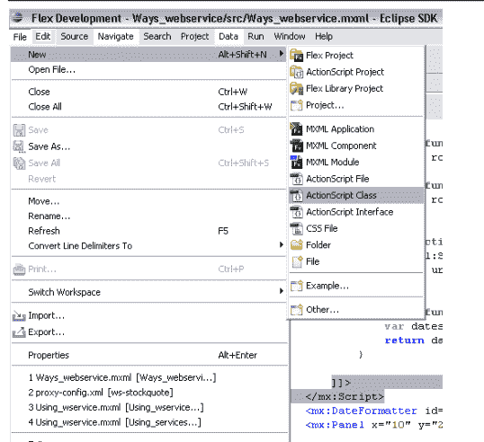

**图 3.3 – 使用 Eclipse – Flex Builder 插件创建 ActionScript 类**

要将类放在 `com.example1` 包中，您在上一步提供类名称时必须提供包名。现在在创建类后出现的编辑器窗口中插入 **清单 3.2** 中所示的代码。

```
package com.example1
{
    public class Car
    {
        private var speed:Number;
        private var make:String;

        public function Car()
        {
            speed=40;
            make="Honda";
        }

        public function getSpeed():Number{
            return speed;
        }

        public function getMake():String{
            return make;
        }

        public function setSpeed(mySpeed:Number):void{
            speed=mySpeed;
        }

        public function setMake(make:String):void{
            this.make=make;
        }
    }
}
```

**清单 3.2 – Car ActionScript 类**

在上面的示例中，`Car` 代表类，函数 `Car()` 是构造函数。关键字 `this` 表示正在使用的当前对象。它与其他像 Java、C++ 等面向对象编程语言的工作方式相同。

#### 3.3.5 函数和访问修饰符

要在 Flex 中创建函数，请使用以下语法：

```
[**public** | **private** | **protected** | **internal**] **function**
    <名称>([参数1:类型, 参数2:类型, ...]) : <返回类型> {
        //函数体
        //返回值
    }
```

函数可以放置在 MXML 文件中，使用 `<mx:Script>` 元素，或者作为 ActionScript 类中的方法。

上述函数定义前缀有像 `public`、`private`、`protected` 和 `internal` 这样的关键字。这些被称为**访问修饰符**，并定义其应用于的函数或变量的范围。下表 3.2 更详细地描述了这些访问修饰符的范围。

| **访问修饰符** | **同一类** | **同一包** | **不同包** |

|---|---|---|---|

| **private** | 是 | 否 | 否 |

| **internal** | 是 | 是 | 否 |

| **protected** | 是 | 是 | 是，如果是子类 |

| **public** | 是 | 是 | 是，使用 import |

**表 3.2 - 访问修饰符**

例如，如果您想在某个不同的包中使用上面定义的 `Car` 类，可以使用 `import` 如下面的清单 3.3 所示来实现。

```
package com.example2
{
   import com.example1.Car;
   public class Garage
   {
      private var car:Car;
      private var numOfCars:uint;

      public function Garage()
      {
         car = null;
         numOfCars = 0;
      }
      public function getCar() {
         return car;
      }
   }
}
```

**清单 3.3 – 在类中使用包**

那么，上述代码片段中的 `getCar()` 函数叫什么？类的组成部分函数被称为方法。您在 ActionScript 中找到的大多数类都具有一个或多个方法和属性。

#### 3.3.6 [Bindable] 标签

在 ActionScript 中，除非指定这样做，否则变量不会自动传输对其值所做的更改。为了实现这一点，使用称为 `[Bindable]` 的元数据标签。

简而言之，元数据标签是对 ActionScript 编译器的指示。当 ActionScript 编译器遇到此标签时，它会在后台进行必要的代码更改，以便变量的值更改能够传播到应用程序中使用它的不同部分。

清单 3.4 向您展示了如何使用 `[Bindable]` 标签。

```
<?xml version="1.0" encoding="utf-8"?>
<mx:Application xmlns:mx="http://www.adobe.com/2006/mxml" layout="absolute">
<mx:Script>
    <![CDATA[
        [Bindable]// 1
        var myText="Welcome to the world of Flex"; // 2
```

##### **清单 3.4 – 使用 [Bindable] 元数据标签**

在上面的示例中，如果移除第 (1) 处的 `[Bindable]` 标签，那么第 (3) 处的标签 `myLabel1` 就不会根据第 (2) 处显示的变量 `myText` 的值进行更新。Flex Builder 也会对此发出警告。

#### 3.3.7 MXML 和 ActionScript 的映射

ActionScript 和 MXML 相辅相成。虽然仅使用 ActionScript 也能构建完整的 Flex 应用程序，但 MXML 通常用于布局和结构化，而 ActionScript 为应用程序提供交互性。由于减少了需要编写的代码量，MXML 代码更具可读性且更容易编写。

当 MXML 或 Flex 应用程序被编译时，编译器在后端会生成一系列 ActionScript 文件。换句话说，ActionScript 是 Flash Player 的核心语言，Flex 中的所有功能最终都归结为 ActionScript。

表 3.3 展示了 MXML 和 ActionScript 之间的映射关系。

| MXML | ActionScript | 详情 |

|---|---|---|

| 标签 | 类中的代码 | Flex 应用程序中放置的 MXML 标签会被编译为 ActionScript 类中的相应代码，因此你可以在不依赖 MXML 的情况下动态编写 Flex 组件。 |

| 属性 | 类的属性 | 标签中出现的 MXML 属性实际上就是你创建的实例的 ActionScript 属性。 |

| 样式属性 | 使用 `setStyle()` 和 `getStyle()` 函数 | Flex 中的每个组件都有一个或多个类型的属性。其中一种属性类型是样式。样式是 Flex 组件的特殊属性，用于控制组件的外观和感觉。 |

虽然在 MXML 文件中样式是属性，但在 ActionScript 中不能直接使用点符号访问它们。在 MXML 文件中，可以使用属性直接设置样式；然而，由于样式在 Flex 框架中的实现方式不同，因此在 ActionScript 中是使用 `getStyle()` 和 `setStyle()` 方法来进行访问的。

表 3.3 - MXML 和 ActionScript 的映射

清单 3.5 和 3.6 展示了 MXML 标签和属性对应的 ActionScript 代码。

```xml
<?xml version="1.0" encoding="utf-8"?>
<mx:Application
       xmlns:mx="http://www.adobe.com/2006/mxml"
       layout="absolute">
      <mx:Button id="compute" label="Compute" borderColor="#0C6CAF"/>
</mx:Application>
```


### 清单 3.5 – 示例 MXML 代码

```as
package{
    import mx.core.Application; // 1
    import mx.controls.Button;
    public class Example extends Application{
        internal var compute:Button; // 2
        public function Example(){
            super();
            compute = new Button(); // 3
            compute.label="Compute"; // 4
            compute.setStyle("borderColor", "#0C6CAF"); // 5
            addChild(compute);
        }
    }
}
```

### 清单 3.6 – 对应于清单 3.5 中所示 MXML 代码的示例 ActionScript 类

这个例子是生成的 ActionScript 代码的简化版本。在上述代码片段中，第 (1) 处的 `import` 告诉编译器应用程序需要这些提到的类以备将来使用。

在第 (2) 处，声明了一个按钮 `compute`。这类似于 MXML 中的 `id` 属性。这可以在后续代码中用来引用此按钮。

在第 (3) 处，创建了按钮 `compute` 的一个实例。这是通过使用 `new` 关键字完成的。随后是该对象的构造函数，它启动了对象的创建。

在第 (4) 处，使用点符号为属性 `label` 分配了一个值。这表明 `label` 是 `Button` 类的一个属性。

在第 (5) 处，可以看到 MXML 样式属性到 ActionScript 的映射。

方法 `setStyle()` 接受两个参数，用于为组件设置样式。第一个是样式名称，在本例中为 `borderColor`，第二个是该样式的值。

方法 `getStyle()` 接受一个参数，并返回传递给该方法的组件的样式所设置的值。

#### 3.3.8 事件

`事件` 是一种运行时发生的事件，有可能触发程序中的响应。在 ActionScript 中，有两种类型的事件：`内置事件` 和 `自定义事件`。`内置事件` 描述运行时环境状态的变化，如鼠标点击；而 `自定义事件` 描述程序状态的变化，如程序结束。

> **注意：**
> 
> ActionScript 事件架构基于 W3C DOM（文档对象模型）级别 3 事件规范。

对于 ActionScript 中的事件处理，使用了 `事件监听器`。事件监听器是一个函数，当给定事件发生时执行。它持续监听给定事件的发生。为了在事件发生时通知程序，ActionScript 执行所有注册为针对该事件执行的事件监听器。这个通知过程被称为 `事件调度`。当事件发生时执行的代码片段被称为 `事件处理器`。

##### 3.3.8.1 事件对象

当 ActionScript 中发生事件时，会创建一个 `事件对象`。每个事件都有两个属性，`target`（目标）和 `type`（类型）。`target` 属性指定导致该事件的目标对象，`type` 属性指定事件的类型，例如点击、鼠标移动等。

*清单 3.7* 应有助于你更好地理解前面描述的术语。

```xml
<?xml version="1.0" encoding="utf-8"?>
<mx:Application xmlns:mx="http://www.adobe.com/2006/mxml" 
	layout="absolute">
	<mx:Script>
		<![CDATA[
			function showMe(evt:MouseEvent):void { // 1
				myLabel.text= evt.target.id + " is pressed!!"; // 3
			}
		]]>
	</mx:Script>
	<mx:Label id="myLabel"/>
	<!-- 2 -->
	<mx:Button id="myButton"  label="Press Me"  click="showMe(event)" />
</mx:Application>
```

**清单 3.7 – 演示事件对象用法的示例**

运行上述示例会产生如图 *图 3.4* 所示的结果。

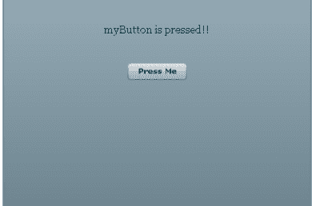

**图 3.4 - 运行清单 3.7 中程序时的输出**

在上述代码示例中，(1) 定义了第 (2) 中 `click` 事件的事件处理器 `showMe()`。`click` 是等待点击事件发生的事件监听器。

在第 (3) 处，使用 `id` 属性识别事件的目标，并且标签 `myLabel` 会根据事件的目标进行更新。

##### 3.3.8.2 addEventListener() 方法

你可以使用 MXML 标签中的属性来设置组件的事件监听器。但是，若要使用 ActionScript 动态地做到这一点，则使用 `addEventListener()` 方法。例如，对于以下 MXML 代码：

```xml
<mx:Button id="myButton" click="doSomething()"/>
```

等效的 ActionScript 代码如下：

```as
import mx.controls.Button;
var myButton:Button=new Button();
myButton.addEventListener(MouseEvent.CLICK,doSomething);
```

方法 `addEventListener()` 接受两个参数，事件的名称以及事件发生时调用的函数。在此示例中，函数 `doSomething` 指定时不带参数和括号。

### 3.4 练习

现在让我们来享受一下乐趣。你将看到如何仅使用 ActionScript 创建 Flex 应用程序，而 MXML 仅用于初始化。

首先，我们必须创建**容器**，它用于容纳组件。你将在即将发布的章节中更详细地学习这方面的内容。在这里，我们将使用 `VBox` 容器，它将其中的组件垂直堆叠放置。为了做到这一点，在 Flex Builder 中，选择 *File -> New -> Action Script Class*，如之前图 3.3 所示。

在包 `App` 下将其命名为 `MyApp`。完成后，它会看起来像下面这样。

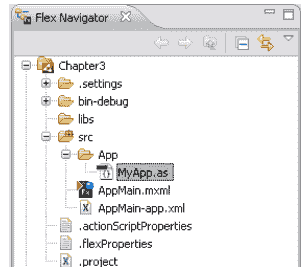

**图 3.5 – 在 Flex 导航器中显示的 MyApp.as**

在创建 ActionScript 类后打开的编辑器窗口中，插入下面显示的代码。

```as
package App
{
```

### 3.5 摘要

在本章中，你学习了 MXML 和 ActionScript。本章的目标并不是让你成为 ActionScript 专家，而是让你对这門卓越的语言有一个概览。

首先，你了解到 MXML 是为 Flex 应用程序创建的一种 XML 词汇。本章回顾了一些基本的 XML 概念，例如标签的结构和命名空间。

随后，本章介绍了 Flex 框架的构建模块——ActionScript。在这里，你学习了 ActionScript 语言的基础知识，以及如何将其与 MXML 有效结合使用。你还学习了事件处理的基础知识。

接下来的章节将更详细地介绍 Flex 组件及其事件。

### 3.6 复习问题

- 1. MXML 是在什么时候引入的？它有哪些优点？

- 2. ActionScript 中元数据标签的作用是什么？

- 3. 如何通过查看标签来识别 MXML 文件中的类和属性？

- 4. 为什么 MXML 中需要嵌套标签？

- 5. ActionScript 中 `[Bindable]` 元数据标签的作用是什么？

- 6. 指示仅对来自同一类的引用可见的修饰符是。

  - A. `protected`
  - B. `private`
  - C. `public`
  - D. `internal`
  - E. `static`

- 7. 向 MXML 文件添加 ActionScript 的不同方式包括

  - A. 内联 ActionScript
  - B. 使用 `<mx:Script>` 标签
  - C. 使用 `<mx:Script source="file_name">` 导入 ActionScript 文件
  - D. 在 `<mx:Script>` 标签内使用 `include` 指令
  - E. 以上所有

- 8. 事件对象的属性包括

  - A. `target`
  - B. `type`
  - C. `name`
  - D. B & C
  - E. A & B

- 9. 以下哪一项不是 ActionScript 3.0 的数据类型

  - A. `String`
  - B. `short`
  - C. `int`
  - D. `uint`


- E. Number

## 10. 以下哪些属性没有描述 ActionScript 访问器？

- A. 方法与属性之间的结合
- B. 也称为 getter/setter
- C. 使其能够重写从父类继承的属性
- D. 以上所有
- E. 以上都不是


# 第 4 章 - 使用 Flex 组件

Flex 是开发富用户界面的工具——视觉组件是其主要构建模块。用户几乎完全通过组件与任何 Flex 应用程序进行交互。Flex 组件大致分为两类：控件和容器。图表是 Flex 3.0 专业版中提供的另一组组件，但这些将在*第 8 章*中讨论。

在本章中，你将学习：

- Flex 组件类层次结构
- 使用容器
- 使用控件

### 4.1 使用 Flex 组件：全局视角

**Flex 组件**是构建 Flex 应用程序的构建模块。在幕后，它们基本上是在 Flex 中定义的类。Flex 拥有无数的组件——包括容器和单独的控件。*图 4.1* 展示了它们之间的关系。

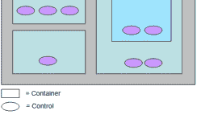

**图 4.1 - Flex 组件之间的关系：容器和控件**

*容器*定义 Adobe Flash Player 渲染表面的一个矩形区域。如上图中所示，容器可以包含控件和其他容器。定义在容器内的组件称为容器的子级。每个 Flex 应用程序都有一个名为 `Application` 容器的根容器，它代表整个 Flash Player 绘制表面。此 `Application` 容器持有应用程序内的所有其他容器和组件。这由上图中最大的灰色框表示。

控件是用户与之交互的 Flex 用户界面组件。例如，按钮或文本输入。控件始终放置在容器内部。

图 4.2 显示了一些 Flex 3 组件，包括 Flex Builder 中大纲视图和设计视图中的容器和控件。

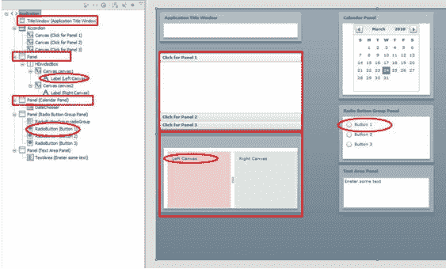

**图 4.2 – 设计视图和大纲视图中的示例 Flex 3 组件**

如图所示，每个控件，如 `Label`、`TextArea` 等，都包含在诸如 `Canvas`、`Panel` 等容器内。

下方的图 4.3 显示了 Flex 3 中可用的容器（左侧框）和控件（右侧框）列表。

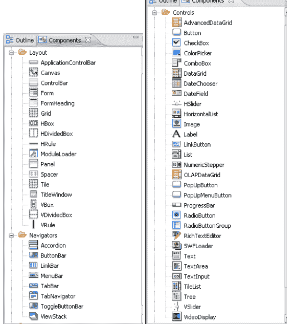

**图 4.3 – Flex 3 中的容器（左框）和控件（右框）列表**

从上图可以想象，Flex 为开发者提供了开发丰富且严肃应用程序的所有组件。如果发现默认功能不足，你始终可以通过 ActionScript 扩展现有组件来创建自定义组件。

### 4.2 组件

如前所述，组件是所有 Flex 应用程序的构建模块，它们对应于 ActionScript 类。图 4.4 显示了 Flex 组件的类层次结构，这些组件大多数通过继承 `UIComponent` 创建，有时从 `Sprite` 类继承。

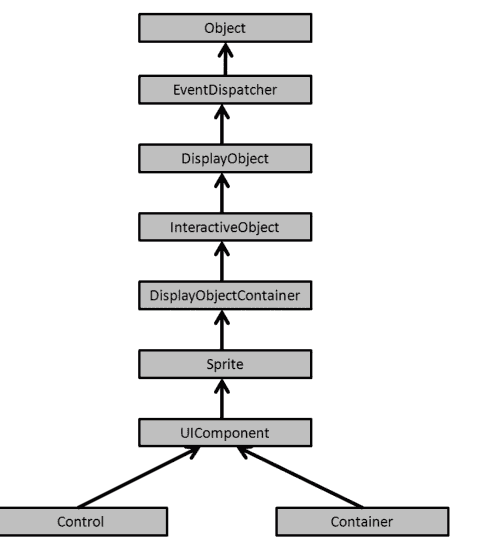

**图 4.4 – Flex 组件类层次结构**

注意：有关 ActionScript 类和层次结构的更多详细信息，请访问 [`http://livedocs.adobe.com/flex/3/langref/index.html`](http://livedocs.adobe.com/flex/3/langref/index.html)

## 4.3 容器

Flex 容器大致可以分为三种类型：应用程序容器、布局容器和导航容器。将在以下章节中通过具体示例解释每种类型。

### 4.3.1 应用程序容器

应用程序容器是 Flex 内容或组件的默认容器——只要你创建了一个新的*应用程序*，该容器就会随之创建。

在 Eclipse 的 Flex 透视图中，选择一个现有的 Flex 项目或创建一个新项目。右键单击该项目，并选择*新建* -> *MXML 应用程序*。此时会出现一个小窗口。在*文件名*字段中输入应用程序的名称。将其命名为*FlexComponent*。*图 4.5* 中所示的视图将显示出来。

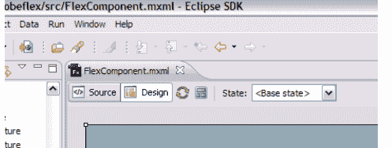

如果单击源代码视图，将显示*清单 4.1* 中生成的代码。

```xml
<?xml version="1.0" encoding="utf-8"?>
<mx:Application xmlns:mx="http://www.adobe.com/2006/mxml"
	layout="absolute">
</mx:Application>
```

**清单 4.1** – 定义应用程序时默认生成的代码

虽然你可以仅使用应用程序容器来构建应用程序，但这并不是一种好的做法。你在使用应用程序中的任何控件之前，应该先放置其他合适的容器。

默认情况下，应用程序容器的大小即为浏览器的大小。你可以通过指定高度和宽度属性来更改应用程序的相对大小；这样应用程序会根据浏览器大小按比例调整自身大小。

应用程序容器有几个重要的样式属性：

- * `backgroundColor`：此颜色在应用程序加载和初始化期间可见
- * `backgroundGradientAlphas`：控制背景的透明度
- * `backgroundGradientColors`：颜色从第一个到第二个变化；从上到下逐渐变化，如给定的 [顶部颜色, 底部颜色]
- * `backgroundImage`：应用程序背景图像

在开始添加控件之前，你应该在应用程序容器中绘制一个面板或表单容器。例如，*清单 4.2* 中的代码将为你要构建的公司网站放置一个面板。

```xml
<mx:Application xmlns:mx="http://www.adobe.com/2006/mxml" width="100%"
height="100%">
<mx:Panel title="My Company's Web site" width="100%" height="100%"
fontSize="30">
</mx:Panel>
</mx:Application>
```

**清单 4.2** – 在应用程序内定义面板容器

运行程序，你将看到*图 4.6* 中所示的输出：

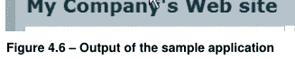

**图 4.6** – 示例应用程序的输出

应用程序容器的其他一些特性包括：

- 对于由 `<mx:Application>` 标签定义的每个应用程序容器，都有一个与之关联的应用程序对象。可以在 Flex 应用程序的任何地方使用 `mx.core.Application.application` 引用该应用程序对象。
- `Application` 类支持一种预加载器，该预加载器使用下载进度条来显示应用程序 SWF 文件的下载进度。这一点将在练习部分详细讨论。

### 4.3.2 布局容器

布局容器是在 Flex 应用程序运行时渲染在 Flash 播放器上的矩形区域。它控制其内部子容器和所绘控件的大小和位置。你可以将布局容器视为其他控件和容器的占位符。*表 4.1* 列出了 Flex 3.0 中的布局容器。

| 容器名称 | 用途/描述 |
|---|---|
| `Canvas` | 需要对其子组件进行特定定位（非自动定位）的矩形区域 |
| `Box` | 组件水平或垂直放置的矩形布局 |
| `HBox` |  |
| `VBox` |  |
| `ControlBar` | 用于 `Panel` 或 `TileWindow` 中的容器，它保存与父组件中其他子组件共享的组件 |
| `ApplicationControlBar` | 容器，保存提供应用程序导航控件访问权限的组件 |
| `DividedBox` |  |
| `HDividedBox` |  |
| `VDividedBox` |  |
| `Form` | 表单是最常用的容器，允许验证、数据绑定以及样式表的使用。`FormHeading` 是 `FormItem` 组件的可选标题组。`FormItem` 是一个具有单个标签和一个或多个子组件的特定表单元素 |
| `FormHeading` |  |
| `FormItem` |  |
| `Grid` | `Grid` 布局容器将其子组件排列成行和列 – 类似于 HTML 表格 |
| `Panel` | `Panel` 布局容器由标题栏、标题、边框、内容区域和状态区域组成 |
| `Tile` | `Tile` 布局容器，将子组件水平或垂直对齐排列。所有包含的单元格大小相同。 |
| `TileWindow` | 针对用作弹出窗口的 `TileWindow` 布局容器进行了优化 |

**表 4.1** – Flex 中的布局容器

**注意：**


在上述及随后的表格中，有些容器没有关联的图标。例如，`Box` – 通常如果存在子类（例如本例中的 `HBox`），它们会被默认替换。在某些情况下，一些控件只能由 `ActionScript` 渲染 – 没有等效的 `MXML`，例如 `Menu`。简而言之，你不能拖放这些控件 – 你只能使用 `ActionScript` 创建它们。

### 4.3.3 导航容器

导航容器容纳其他容器，以便你能够在其子项之间进行导航。

*表 4.2* 包含 Flex 3 中导航容器的列表。

| 容器名称 | 用途/描述 |
|---|---|
| `ViewStack` | 此容器由一组堆叠在彼此上方的子容器组成。一次只能有一个子项可见或处于活动状态。 |
| `TabNavigator` | 此容器创建、保存和管理一组选项卡 – 每个选项卡又可以容纳其他容器。 |
| `Accordion` | 此容器定义并保存一组子活动容器，一次只有一个容器完全可见 |

**表 4.2** – Flex 中的导航容器

下一节将展示上述容器的一些示例。为了说明目的，我们将使用下一节中描述的一些控件。

要查看上述容器中的一些实际运行效果，让我们继续之前的示例：

1. 选择一个 `HDividedBox` 容器并将其放入应用程序容器内部。
2. 在左侧放置一个 `Accordion` 容器。
3. 在 `HDividedBox` 容器的右侧放置一个 `TabNavigator` 容器。
4. 在 `TabNavigator` 容器内部绘制三个 `Canvas` 容器。

我们将调整容器的一些简单属性，以便它们能够在屏幕上良好适配，从下面*清单 4.3* 中显示的生成的 `MXML` 代码开始。

```xml
<?xml version="1.0"?>
<!-- containers\application\AppSizePercent.mxml -->
<mx:Application xmlns:mx="http://www.adobe.com/2006/mxml" width="100%"
height="100%">
<mx:Panel title="My Company's Web site" width="100%" height="100%"
fontSize="30">
<mx:HDividedBox width="100%" height="95%">
<mx:Accordion x="40" y="32" width="15%" height="100%"
maxWidth="300">
<mx:Canvas label="Accordion Pane 1" width="100%" height="100%">
</mx:Canvas>
</mx:Accordion>
<mx:TabNavigator width="85%" height="100%">
<mx:Canvas label="Tab 1" width="100%" height="100%">
</mx:Canvas>
<mx:Canvas label="Tab 2" width="100%" height="100%">
</mx:Canvas>
</mx:TabNavigator>
</mx:HDividedBox>
</mx:Panel>
</mx:Application>
```

**清单 4.3** – 示例导航容器的代码

该代码的输出如下所示：

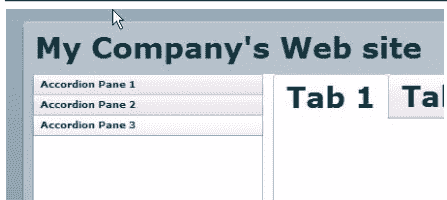

**图 4.7** – 带有布局容器的示例应用程序输出

你可以看到，使用很少的代码和很短的时间就能构建一个外观得体的网页非常方便。你可以更改 `HDividedBox` 的左侧和右侧窗格的大小 – 你也可以在 `Accordion` 或 `TabNavigator` 内部导航不同的画布。

## 4.4 控件

控件是用户交互的 Flex 用户界面组件。控件始终放置在容器内部。所有控件和容器一样，都是 `mx.core.UIComponent` 的派生类，如下面的**图 4.8** 所示。

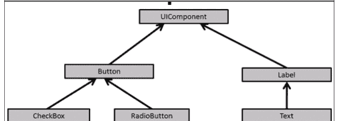

**图 4.8** – 按钮和级别控件的类层次结构

基于属性和用途，Flex 控件大致可以分为以下章节中描述的四个类别。

### 4.4.1 基于文本的控件

使用这些控件在你的 Flex 应用程序中显示和编辑文本及相关详细信息。除了 `RichTextEditor` 之外的所有控件都是简单控件。`RichTextEditor` 内部包含多个控件（`TextArea`、`ControlBar` 和一些其他格式化控件）。**表 4.7** 列出了 Flex 3 中基于文本的控件。

### 表 4.7 – Flex 中的基于文本的控件

| 控件名称 | 用途/ 描述 |
| :--- | :--- |
| `Label` | 单行仅显示控件 |
| `TextInput` | 单行可编辑控件 |
| `Text` | 多行仅显示控件 |
| `TextArea` | 多行可编辑控件 |
| `RichTextEditor` | 多行可编辑控件，包含对文本控件的格式化，即字体和大小、颜色、对齐方式等。 |

让我们通过修改当前示例应用程序中的一个选项卡来创建一个“联系我们”页面。步骤如下：

- 1. 将画布标签从 "Tab 3" 更改为 "Contact Us"。
- 2. 放置三个文本为 "Offices"、"North America"、"Europe" 和 "Asia-Pacific" 的 `Label`
- 3. 为每个 `Label` 添加一个包含一些虚构地址文本的 `Text`

*列表 4.4* 展示了示例代码。

```xml
<mx:TabNavigator width="85%" height="100%">
    <mx:Canvas label="Contact Us" width="100%" height="100%">
        <mx:Label x="45" y="10" text="Offices" fontSize="20" fontWeight="bold"
                   color="#0B333C" textDecoration="underline" fontStyle="italic"/>
        <mx:Label x="45" y="61" text="North America" fontSize="16" fontWeight="bold"/>
        <mx:Label x="306" y="61" text="Europe" fontSize="16" fontWeight="bold"/>
        <mx:Label x="501.5" y="61" text="Asia-Pacific" fontSize="16" fontWeight="bold"/>
        <mx:Text x="45" y="93" width="131" height="99" USA "
                  text="My Company, &xa;1000 Old Highway, &xa;Suite # 100&xa;AB, fontSize="12"/>
        <mx:Text x="285" y="93" width="131" height="99" UK "
                  text="My Company, &xa;2000 Old street, &xa;Suite # 200&xa;CD, fontSize="12"/>
        <mx:Text x="501.5" y="93" width="131" height="99"
                  text="My Company, &xa;3000 Old Road, &xa;Unit # 300&xa;EF,
ndia" fontSize="12"/>
    </mx:Canvas>
</mx:TabNavigator>
```

### 列表 4.4 – 基于文本的控件示例代码

运行应用程序，您将看到如图 4.9 所示的输出。

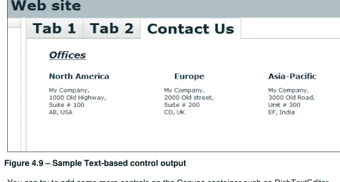

您可以尝试在 `Canvas` 容器上添加一些其他控件，例如 `RichTextEditor` 控件，并探索其功能。

## 4.4.2 基本控件

这组控件通常不携带任何数据，主要用于用户交互，如点击、滑动等。表 4.8 列出了 Flex 中的基本控件。

| 控件名称 | 用途/ 描述 |
| :--- | :--- |
| `Button` | 用户可点击的矩形控件 |
| `PopUpButton` | 按钮控件和弹出窗口的组合。用户可以从弹出窗口中选择一个选项并点击按钮。 |
| `ButtonBar` | 定义可以水平或垂直添加一组按钮的控件。`ToggleButtonBar` 维持按钮的两种状态：选中 和 未选中 |
| `ToggleButtonBar` | |


## 表 4.8 – Flex 中的基本控件

| `TabBar` | 定义用于一组选项卡的控件，水平或垂直 |

| `CheckBox` | 选中时包含对勾、未选中时为空白的控件 |

| `RadioButton` | 允许用户从一组互斥选项中选择一项的控件。 |

| `NumericStepper` | 允许用户从有序的数值集合中选择一个值。 |

| `DateChooser` | 这类似于日历控件。它显示当前月份的日历，默认选中当前日期。`DateField` 是一个带有日历图标的日期输入字段。用户可以在字段中输入有效日期，或通过点击日历图标进行选择。 |

| `DateField` | |

| `LinkButton` | 此控件用于创建单行超文本链接 |

| `LinkBar` | 此控件用于定义一组 `LinkButton` 控件，可以是垂直或水平排列 |

| `HSlider` | 这两个控件用于通过在滑块轨道的两个端点之间定位滑块拇指来选择值。`Hslider` 用于水平滑块，`VSlider` 用于垂直滑块。 |

| `VSlider` | |

| `SWFLoader` | 此控制器用于将一个 Flex 应用程序（SWF 文件）或其他文件（GIF、JPEG、PNG、SVG）加载到另一个 Flex 应用程序中。 |

| `Image` | 此控件允许用户将 Flex 支持的图像（GIF、JPEG、PNG、SVG 和 SWF）导入到 Flex 应用程序中。 |

| `VideoDisplay` | 此控件允许用户将流媒体（FLV 格式）整合到 Flex 应用程序中。 |

| `ColorPicker` | 允许用户从下拉调色板中选择颜色。 |

| `Alert` | 显示一个使用 `Alert` 类的静态 `show()` 方法显示消息的弹出窗口 |

| `ProgressBar` | 此控件直观地显示活动或任务的进度。 |

| `HRule` | `HRule` 创建单条水平线，`VRule` 创建单条垂直线，用于在容器内创建分隔线。 |

| `VRule` | |

| `ScrollBar` | 当显示的数据超过可用可见区域时使用这些控件 – `VscrollBar` 用于垂直对齐，`HScrollBar` 用于水平对齐。可以使用容器滚动属性访问这些控件。 |

| `VScrollBar` | |

| `HScrollBar` | |

现在让我们使用更多控件和容器来增强我们一直在开发的应用程序。执行以下操作：

- 1. 将画布标签从 "Tab 1" 更改为 "Home"。
- 2. 添加两个 `LinkButton`，并将它们命名为 "Company's Profile" 和 "Team's Profile"
- 3. 点击 "Company’s Profile" 时，打开一个 `TitleWindow`
- 4. 将与公司相关的文本添加到 `TitleWindow` 中

在下面列表 4.5 中找到修改后的代码。

```xml
<mx:Application xmlns:mx="http://www.adobe.com/2006/mxml" width="100%" height="100%">
    <mx:Script>
        <![CDATA[
            import mx.containers.TitleWindow;
            import mx.controls.Text;
            import mx.events.CloseEvent;
            
            public var companyProfile:TitleWindow;
            public var profileText:Text;
            
            public function showProfile():void {
                companyProfile = new TitleWindow();
                companyProfile.height = parent.height*(.3);
                companyProfile.width = parent.width*.3;
                companyProfile.showCloseButton = true;
                companyProfile.x = (parent.width - companyProfile.width)/2 ;
                companyProfile.y = (parent.height - companyProfile.height)/2;
                companyProfile.setStyle("backgroundColor","yellow");
                companyProfile.setStyle("fontSize", "20");
                
                profileText = new Text();
                profileText.width = (companyProfile.width)*.9;
                profileText.text = "Welcome to Our Company's Website. " + "Our mission is to help our customers succeed. " + "We deliver effective solutions to your critical business problems.";
                
                companyProfile.addChild(profileText);
                parent.addChild(companyProfile);
                companyProfile.addEventListener(CloseEvent.CLOSE, closeMe);
            }
            
            private function closeMe(e:CloseEvent):void {
                companyProfile.visible = false;
            }
        ]]>
    </mx:Script>
    
    ..
    ..
    
    <mx:Canvas label="Home" width="100%" height="100%">
        <mx:LinkButton x="10" y="40" label="Company's Profile"
            textDecoration="underline" color="#636E81" fontStyle="italic"
            click="showProfile()"/>
        <mx:LinkButton x="10" y="146" label="Team's Profile"
            textDecoration="underline" color="#636E81" fontStyle="italic"/>
    </mx:Canvas>
```

### 列表 4.5 – 包含基本控件的示例代码

上述代码列表包含 2 个部分。顶部部分有 2 个函数，

- `showProfile()` 创建 `TitleWindow` 并显示与公司相关的文本。
- `closeMe()` 关闭 `TitleWindow`。

底部部分创建 2 个 `LinkButton`。点击第一个 `LinkButton` 时，会调用 `showProfile`。运行程序时，您会在第一个选项卡上看到 2 个 Link 按钮，如 *图 4.10* 所示。

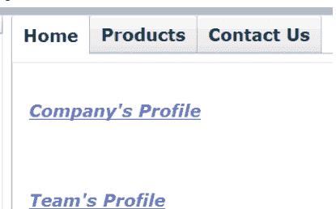

### 图 4.10 – 基本控件示例的输出

点击 "Company's Profile" 时，会打开一个标题窗口，如 *图 4.11* 所示。

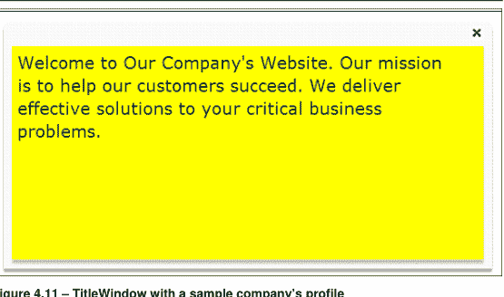

### 图 4.11 – 带有示例公司概况的 TitleWindow

## 4.4.3 基于菜单的控件

在正式的应用程序中，需要显示的内容总是比应用程序区域所能容纳的更多。基于菜单的控件及其相关功能可以帮助您以更具直觉性和紧凑的方式整理内容。Flex 3 中有几个基于菜单的控件，如下面的表 4.9 所述。

| 控件名称 | 用途/ 描述 |

| :--- | :--- |


### 表 4.9 – Flex 中的基于菜单的控件

| Menu | 此控件包含菜单或级联子菜单。它只能通过 ActionScript 定义和操作。 |
| MenuBar | 持有菜单项的水平栏 |
| PopUpMenuButton | `PopUpButton` 控件的子类，其辅助按钮会弹出一个 `Menu` 控件 |

### 4.4.4 数据驱动控件

如果应用程序不能显示和操作结构化的数据集，那么它就没有用处。Flex 拥有一套非常丰富和多样化的控件，可以接受来自数据提供者的数据。尽管基于菜单的控件在这方面具有相似性，但它们在本质上是静态的，很少用于显示可变数量的数据对象。表 4.10 包含 Flex 3 中数据提供控件的列表。

#### 表 4.10 - Flex 中的数据驱动控件

| 控件名称 | 用途/ 描述 |
|---|---|
| List | 包含菜单或级联子菜单的控件。 |
| HorizontalList | 一个水平条，用于承载菜单项。 |
| TileList | `PopUpButton` 控件的子类，其辅助按钮会弹出一个 `Menu` 控件。 |
| ComboBox | 一个下拉值列表，可从中选择一个值。 |
| DataGrid | 等价于具有多行多列的表格。这是最常用的一种数据驱动控件。 |
| Tree | 该控件有助于以层级方式处理数据。每个节点可以拥有自己的子树。 |

在下一节中，将向您展示基于菜单的控件和数据提供器控件的一些使用示例。

### 4.5 练习

我们将通过在中部标签页添加更多功能来增强本章一直在开发的应用程序。首先，我们将为该公司提供的不同产品类别创建一个 `MenuBar` 控件。接下来，我们将使用 `TileList` 控件显示类别详情。

请按照以下步骤操作：

1. 将 "Tab 2" 重命名为 "Products"

2. 定义一个 `XMLListCollection` 并创建一个 `XMLList` 来包含 `MenuBar` 的数据。使用 `menubarXML` 初始化 `menuBarCollection`。所需代码如下，显示在列表 4.6 中。

```actionscript
[Bindable]
public var menuBarCollection:XMLListCollection;
[Bindable]
private var menubarXML:XMLList = <>
<menuItem label="Vehicle">
<menuitem label="Sedan" data="Sedan"/>
<menuitem label="Truck" data="Truck"/>
<menuitem label="Van" data="Van"/>
</menuItem>
<menuItem label="Appliances">
<menuitem label="TV" data="TV"/>
<menuitem label="Freeze" data="Freeze"/>
</menuItem>
<menuItem label="Office Equipment">
<menuItem label="Printer" data="Printer"/>
<menuItem label="Scanner" data="Scanner"/>
<menuItem label="Copier" data="Copier"/>
</menuItem>
<menuItem label="Stationary">
<menuItem label="Pen" data="Pen"/>
<menuItem label="Cartige" data="Cartige"/>
<menuItem label="Scissor" data="Scissor"/>
</menuItem>
</>
private function initMenuBar():void {
menuBarCollection = new XMLListCollection(menubarXML);
}
```

#### 列表 4.6 – MenuBar 数据的定义和初始化

3. 在 Canvas 内放置一个 `MenuBar`。从 `menubarXML` 的标签中分配 Menu 的标签，将 `menuBarCollection` 分配为 `dataProvider`。还要为 `itemClick` 事件添加一个 `itemClickHandler` 方法。相应的代码如下所示：

```xml
<mx:MenuBar labelField="@label" dataProvider="{menuBarCollection}"
itemClick="menuClickHandler(event)" />
</mx:MenuBar>
```

4. 暂时将 `itemClick` 事件处理程序的定义定义为空方法 `menuClickHandler`：

```actionscript
private function menuClickHandler(event:MenuEvent):void {}
```

现在运行应用程序。您会看到下图（图 4.12）所示的画面。请继续尝试菜单选项。


#### 图 4.12 – 基于菜单的控件示例

5. 添加一个 `TileList`，并使用以下代码使其最初不可见：

```xml
<mx:TileList id="myTileList" x="10" y="47" width="60%" visible="false" height="95%"> </mx:TileList>
```

6. 为 `TileList` 控件添加数据以及一些图片。还将 `tileListArray` 绑定到 `ArrayCollection` `TileListDataProvider`。所需代码显示在列表 4.7 中。

```actionscript
[Bindable]
public var TileListDataProvider:ArrayCollection;
[Bindable]
 [Embed(source="vehicle 1.png")]
public var vehicle1:Class;
[Bindable]
 [Embed(source="vehicle 2.png")]
public var vehicle2:Class;
[Bindable]
 [Embed(source="vehicle 3.png")]
public var vehicle3:Class;
[Bindable]
 [Embed(source="vehicle 4.png")]
public var vehicle4:Class;
[Bindable]
 [Embed(source="vehicle 5.png")]
public var vehicle5:Class;
[Bindable]
 [Embed(source="vehicle 6.png")]
public var vehicle6:Class;
[Bindable]
 [Embed(source="vehicle 7.png")]
public var vehicle7:Class;
[Bindable]
 [Embed(source="vehicle 8.png")]
public var vehicle8:Class;
private var tileListArray:Array=[
(label: "Vehicle 1", data: 0, icon: "vehicle1"),
(label: "Vehicle 2", data: 1, icon: "vehicle2"),
(label: "Vehicle 3", data: 2, icon: "vehicle3"),
(label: "Vehicle 4", data: 3, icon: "vehicle4"),
(label: "Vehicle 5", data: 4, icon: "vehicle5"),
(label: "Vehicle 6", data: 5, icon: "vehicle5"),
(label: "Vehicle 7", data: 6, icon: "vehicle7"),
(label: "Vehicle 8", data: 7, icon: "vehicle8"),
];
[Bindable]
public var menuBarCollection:XMLListCollection;
```

#### 列表 4.7 — TileList 数据的定义和初始化

7. 修改 `menuClickHandler`。添加一些代码，当用户点击“Sedan”选项时显示上述数据。此外，当选择另一个选项时，应清除该区域并重新渲染相应的数据。在此示例中，`TileList` 被隐藏以使示例更简单。代码显示在列表 4.8 中。


```actionscript
private function menuClickHandler(event:MenuEvent):void {
    initSedanData();
    myTileList.visible = false;
    if ( event.item.@data == "Sedan" ){
        myTileList.visible = true;
        myTileList.dataProvider = TileListDataProvider;
    }
}
```

### 列表 4.8 – 在 TileList 中渲染数据

再次运行应用程序。从菜单选项中选择“Sedan”。您将看到贵公司产品的图片：漂亮的汽车。这不是很酷吗！*图 4.13* 提供了一个示例输出。


#### 图 4.13 – TileList 示例的输出

### 4.6 总结

在本章中，您学习了组件的基础知识，组件是 Flex 应用程序的构建模块。首先，您学习了组件的类层次结构；接下来，您被介绍了容器——其他容器和控件的占位符。`Application` 容器是任何 Flex 应用程序的第一个组件，它具有一些特定的属性和属性。然后，本章涵盖了其他类型的容器：布局型和导航型。

最后一节涵盖了控件。控件是用户与应用程序交互的手段。控件有不同的类型，例如文本、基本、基于菜单和数据驱动。本章从每个类别中详细展示了一些示例。

至此，您应该更加熟悉构建和操作 Flex 了。在后续章节中，我们将处理更复杂的 Flex 应用程序。

### 4.7 复习题

1. 指出作为大多数 Flex 组件超类的 ActionScript 类名。

2. 默认情况下，`Application` 容器的尺寸大于所包含的组件——为什么？

3. 您是否可以在控制器的可见区域外放置控件？如何操作？

4. `Grid Layout` 容器的 HTML 等价物是什么？

5. 可以使用哪个 ActionScript 方法动态设置组件的样式？

6. Flex 应用程序启动后的默认加载时长是多少，超过此时长进度条才会出现：

    - A. 100 毫秒

    - B. 1000 毫秒

    - C. 700 毫秒

    - D. 5 秒

    - E. 以上都不是

7. 以下哪种控件可以仅使用 ActionScript 渲染？

    - A. `Label`

    - B. `Image`

    - C. `Menu`

    - D. 以上全部

    - E. 以上都不是

8. `Alert` 类中用于显示数据的静态方法名称是什么？

    - A. `display()`

    - B. `show()`

    - C. `init()`

    - D. `render()`

    - E. 以上都不是

9. 数据提供给 Flex 控件的方式有哪些？

    - A. `ArrayCollection` 对象

    - B. `XMLListCollection` 对象

    - C. A 和 B 都是

    - D. `XMLText` 对象

    - E. 以上都不是

10. 您想要创建一个字段，让用户在地址文件中选择其当前居住地——应该使用以下哪种数据驱动控件？

    - A. `DataGrid`

    - B. `ComboBox`

    - C. `Tree`

    - D. 以上任意一种

    - E. 以上都不是

### 第 5 章 - 在控件之间绑定数据

Flex 框架提供了一个强大的结构，旨在最大程度地促进组件驱动架构。在 MVC（模型-视图-控制器）架构中，视图和控制器与模型的行为绑定。在组件驱动架构中，这种方法不可行。在这种情况下，用户界面（UI）元素在模型之前构建，以提供组件在许多不同应用程序中的重用性。在 Flex 中，我们通过称为数据绑定的机制来实现这一点。

在本章中，您将学习：

- 数据绑定

- 数据绑定的不同方式

- 数据绑定和存储机制

- 数据绑定和 UI 控件

#### 5.1 数据绑定 – 大局观

数据绑定是 Flex 中一个非常有趣的概念。它使您能够更高效地在客户端管理数据。图 5.1 提供了数据绑定的概述。


数据绑定是将一个对象（源）中的数据与另一个对象（目标）关联起来的过程。如图所示，当源对象发生变化时，通过触发事件，这些变化会自动反映到目标对象中。数据绑定提供了一种在应用程序不同层之间传递数据的便捷方式。它是生成代码、事件监听器和处理程序、错误捕获以及通过对象内省使用元数据的组合。在幕后，Flex 会代你生成大量代码。

#### 5.2 实现数据绑定的方式

在 Flex 中有多种实现数据绑定的方式：

- 使用大括号（`{}`）语法

- 在大括号中使用 ActionScript 表达式

- 在 MXML 中使用 `<mx:binding>` 标签

- 在 ActionScript 中使用 `BindingUtils`

##### 5.2.1 大括号（{}）语法

在下面的列表 5.1 中，一个文本控件从文本输入控件的属性获取数据。由于属性名位于大括号（`{}`）内，这意味着它是绑定表达式的源属性。每当源属性（`myTextInput.text`）发生变化时，Flex 都会将源属性的当前值复制到目标属性，即文本控件的 `text` 属性（`myTextDestination`）。

```xml
<mx:TextInput id="myTextInput" editable="true" enabled="true"/>
<mx:Text id="myTextDestination" text="{myTextInput.text}"/>
```

列表 5.1 – 使用大括号（`{}`）语法进行数据绑定。

##### 5.2.2 大括号（{}）中的 ActionScript 表达式

大括号还可以包含 ActionScript 表达式。例如，它们可以包含对可绑定属性的计算和字符串连接。下列列表 5.2 说明了这种情况。

```xml
<mx:Model id="myBinding">
    <myBinding>
        <!-- Perform string concatenation. -->
        <a>This is {nameInput.text}</a>
        <!-- Perform a calculation. -->
        <b>{(Number(numberInput.text) as Number) + 100}</b>
    </myBinding>
</mx:Model>
<mx:Panel width="100%" height="100%" title="Binding expressions">
    <mx:Form>
        <mx:FormItem label="Name:">
            <mx:TextInput id="nameInput"/>
        </mx:FormItem>
        <mx:FormItem label="Enter a number:">
            <mx:TextInput id="numberInput" text="0"/>
        </mx:FormItem>
    </mx:Form>
    <mx:Text text="{'Concatenation: ' + myBinding.a}"/>
    <mx:Text text="{'Calculation: 100 + ' + numberInput.text+' = ' + myBinding.b}"/>
</mx:Panel>
```

列表 5.2 – 在大括号（`{}`）中使用 ActionScript 进行数据绑定。

##### 5.2.3 MXML 中的 <mx:binding> 标签

`<mx:Binding>` 标签可作为大括号语法的替代方案使用。可以使用 `<mx:binding>` 标签的 `source` 属性提供源属性，并使用 `destination` 属性指定目标属性。`<mx:binding>` 标签还允许将一个源属性绑定到多个目标属性，或将多个源属性绑定到一个目标属性。我们也可以在 `<mx:binding>` 标签的 `source` 属性内部使用大括号（`{}`）。下列列表 5.3 提供了在 MXML 中使用 `<mx:binding>` 标签的示例。


```xml
<mx:Panel title="Data Binding Using mx Binding Tag">
    <mx:TextInput id="myTextInput" editable="true" enabled="true"/>
    <mx:Text id="myText" />
</mx:Panel>
<mx:Binding
    source="myTextInput.text"
    destination="myText.text"
/>
```

列表 5.3 – 使用 `<mx:binding>` 标签进行数据绑定。

### 5.2.4 ActionScript 中的绑定

也可以使用 `mx.binding.utils.BindingUtils` 类在 ActionScript 中实现数据绑定。我们可以使用 `bindProperty()` 方法或 `bindSetter()` 方法来完成数据绑定。这在下方的列表 5.4 中有所说明。

```xml
<?xml version="1.0" encoding="utf-8"?>
<mx:Application xmlns:mx="http://www.adobe.com/2009/mxml" width="200"
    height="200" initialize="initializeHandler();" >
    <mx:Script>
        <![CDATA[
        import mx.binding.utils.BindingUtils;
        private function initializeHandler():void
        {
            BindingUtils.bindProperty(myText, "text", myTextInput, "text");
        }
        ]]>
    </mx:Script>
    <mx:Panel
        title="Data Binding Using Action Script"
    >
        <mx:TextInput id="myTextInput" editable="true" enabled="true"/>
        <mx:Text id="myText" />
    </mx:Panel>
</mx:Application>
```

列表 5.4 – 在 ActionScript 中使用 `BindingUtils` 实现数据绑定

#### 5.3 数据存储结构和机制

数据结构是原生的 Flash 数据类型，如 `Array`、`XML`、`XMLList`，或者 Flex 的任何数据集合，如 `ArrayCollection` 或 `XMLListCollection`。这些通常用于 `ListBase` 类的 `dataProvider` 属性中。`ListBase` 类（`mx.controls.ListClasses.ListBase`）是数据驱动控件的父类，它允许你在 Flex 应用程序中与数据进行交互。

##### 5.3.1 Array

`Array` 是一种可以通过索引访问元素的数据结构。`Array` 类提供了一种有用的数据存储和检索机制。数组可以通过使用 MXML 标签或使用 ActionScript 来创建，如 *Listings 5.5* 和 *5.6* 分别所示。

```xml
<mx:Array id="shapes">
    <mx:String>Square</mx:String>
    <mx:String>Rectangle</mx:String>
    <mx:String>Circle</mx:String>
</mx:Array>
```

列表 5.5 – 使用 `<mx:Array>` 标签创建 `Array`。

```actionscript
<mx:Script>
    <![CDATA[
        public var colors:Array = ["Square", "Rectangle", "Circle"];
    ]]>
</mx:Script>
```

列表 5.6 – 使用 ActionScript 创建 `Array`。

##### 5.3.2 XML

可以在 Flash 中创建 `XML` 对象来存储 XML 数据。`XML` 对象可以通过使用 MXML 标签或使用 ActionScript 来创建，如 List 5.7 和 5.8 分别所示。

```xml
<mx:XML id="shapes" >
    <node label="Shapes">
        <node label="Square" />
        <node label="Rectangle" />
        <node label="Circle" />
    </node>
</mx:XML>
```

列表 5.7 – 使用 `<mx:XML>` 标签创建 `XML` 对象

```actionscript
<mx:Script>
    <![CDATA[
        public var shapes:XML = <node
            label='Shapes'><node label='Square' /><node
                label='Rectangle' /><node label='Circle' /></node>;
    ]]>
</mx:Script>
```

列表 5.8 – 使用 ActionScript 创建 `XML` 对象

在上面的列表中，Shapes 节点充当 Square、Rectangle 和 Circle 子节点的父节点。没有后代的子节点称为叶节点。`XML` 对象必须有一个根节点（Parent）来包裹所有定义的子节点，才能成为有效的 XML。

##### 5.3.3 XMLList

`XMLList` 与 `XML` 对象类似，不同之处在于 `XMLList` 对象不需要根节点来包裹后代节点。`XMLList` 对象可以通过使用 MXML 标签或使用 ActionScript 来创建，如 Listings 5.9 和 5.10 分别所示。

```xml
<mx:XMLList id="shapes" >
    <node label="Square" />
    <node label="Rectangle" />
    <node label="Circle" />
</mx:XMLList>
```

列表 5.9 – 使用 `<mx:XMLList>` 标签创建 `XMLList` 对象。

```actionscript
<mx:Script>
    <![CDATA[
        public var shapes:XMLList = <><node label='Square'/><node
            label='Rectangle' /><node label='Circle' /></>;
    ]]>
</mx:Script>
```

列表 5.10 – 使用 ActionScript 创建 `XMLList` 对象。

##### 5.3.4 Flex 数据管理类

Flex 提供了一组称为 `collections`（集合）的数据管理类。集合可以非常高效地处理对数据集中的修改、添加和删除。集合使用上述讨论的数据类型（`Array`、`XML`、`XMLList` 等），并管理用户界面更新以反映底层数据的变化。在下面的部分中，我们将通过示例讨论其中几个集合类。

###### 5.3.4.1 ArrayCollection

`ArrayCollection` 类是一个包装类，它将 `Array` 作为集合暴露出来，并可以使用 `ICollectionView` 或 `IList` 接口的方法和操作来访问和操作。要使用 DataBinding，需要使用 `ArrayCollection` 类而不是 `Array` 类。`ArrayCollection` 提供了 `Array` 的所有功能以及更多功能。每个 `ArrayCollection` 类都包含一个作为数据源的 `Array`。`ArrayCollection` 类和底层的 `Array` 类主要用于显示扁平数据或线性数据。`ArrayCollection` 类可以通过使用 MXML 标签或 ActionScript 类来创建，如 *Listings 5.11* 和 *5.12* 分别所示。

```xml
<mx:ArrayCollection id="shapes">
    <mx:source>
        <mx:Array id="ShapeArray">
            <mx:String>Rectangle</mx:String>
            <mx:String>Square</mx:String>
            <mx:String>Circle</mx:String>
        </mx:Array>
    </mx:source>
</mx:ArrayCollection>
```


### 列表 5.11 – 使用 `<mx:ArrayCollection>` 标签创建 ArrayCollection

```actionscript
<mx:Script>
    <![CDATA[
        import mx.collections.ArrayCollection;
        private var shapesArray:Array = ["Square", "Rectangle", "Circle"];
        public var shapes:ArrayCollection;

        private function createArrayCollection():void
        {
            shapes= new ArrayCollection();
            shapes.source = shapesArray;
        }
    ]]>
</mx:Script>
```

###### 5.3.4.2 XMLListCollection

`XMLListCollection` 类为 `XMLList` 对象提供集合功能，并使原生 `XMLList` 类的一些方法可用。`XMLList` 和 `XMLListCollection` 类主要用于显示具有层次数据的树形和基于菜单的控件。可以通过使用 MXML 标签或 ActionScript 类来创建 `XMLListCollection` 类，分别如清单 5.13 和 5.14 所示。

```xml
<mx:XMLListCollection id="shapes">
    <mx:source>
        <mx:XMLList>
            <node label="Square" />
            <node label="Rectangle" />
            <node label="Circle" />
        </mx:XMLList>
    </mx:source>
</mx:XMLListCollection>
```

**清单 5.13 - 使用 `<mx:XMLListCollection>` 标签创建 XMLListCollection**

```xml
<mx:Script>
    <![CDATA[
    import mx.collections.XMLListCollection;
    private var shapesXMLList:XMLList = new XMLList(<><node label='Square'/>
    <node label='Rectangle'/><node label='Circle'/></>);
    private var shapes:XMLListCollection;
    private function createXMLListCollection():void
    {
    shapes= new XMLListCollection();
    shapes.source = shapesXMLList;
    }
    ]]>
</mx:Script>
```

**清单 5.14 - 使用 ActionScript 创建 XMLListCollection**

##### 5.4 数据驱动的 UI 控件

数据驱动控件是任何 UI 工具包的关键。根据数据是线性的还是层次性的，Flex 提供不同类型的 UI 控件：

- 滚动列表控件
- DataGrid 控件
- 层次控件（Tree, Menu）

###### 5.4.1 滚动列表控件

Flex 框架提供了一组简单的列表控件，它们可以垂直或水平显示项，并内置了滚动功能。这些控件还提供单项或多项选择功能。列表控件通常以有组织的方式显示大量项目。

滚动列表控件主要有三种类型：

- `List` 控件
- `HorizontalList` 控件
- `TileList` 控件

####### 5.4.1.1 List 控件

`List` 控件是 Flex 框架提供的最简单的数据驱动 UI 控件。可以通过使用 `<mx:List />` MXML 标签在 Flex 应用程序中使用 `mx.controls.List` 类。列表控件显示垂直的项目列表，如果项目列表的全高可能无法容纳，则提供滚动条。水平滚动条也是可选的。用户可以从列表中选择一项或多项。清单 5.15 展示了使用 `<mx:List>` 标签与我们之前讨论过的 `ArrayCollection` 组合创建列表控件的示例。

```xml
<?xml version="1.0"?>
<mx:Application xmlns:mx="http://www.adobe.com/2006/mxml">
  <mx:ArrayCollection id="shapes">
    <mx:source>
      <mx:Array id="ShapeArray">
        <mx:String>Rectangle</mx:String>
        <mx:String>Square</mx:String>
        <mx:String>Circle</mx:String>
        <mx:String>Octagon</mx:String>
        <mx:String>Hexagon</mx:String>
        <mx:String>Triangle</mx:String>
      </mx:Array>
    </mx:source>
  </mx:ArrayCollection>
  <mx:List id="myList" width="200" height="100" dataProvider="{shapes}"/>
</mx:Application>
```

**清单 5.15 - 创建 List 控件的代码片段**

图 5.2 显示了创建的 List 控件。`ArrayCollection` 类充当 `List` 控件的数据提供器。


**图 5.2 - List 控件**

####### 5.4.1.2 HorizontalList 控件

`HorizontalList` 控件显示水平的项目列表。它特别适用于显示图像列表。可以通过使用 `<mx:HorizontalList />` MXML 标签在 Flex 应用程序中使用 `mx.controls.HorizontalList` 类。清单 5.16 提供了一个使用 `<mx:HorizontalList/>` MXML 标签的代码片段示例。图 5.3 展示了 `HorizontalList` 的外观。

```xml
<mx:HorizontalList id="myList" width="200" height="50" dataProvider="{shapes}"/>
```

**清单 5.16 - 创建 HorizontalList 控件的代码片段**


**图 5.3 - HorizontalList 控件**

####### 5.4.1.3 TileList 控件

`TileList` 控件与之前讨论的 `List` 和 `HorizontalList` 控件相似，不同之处在于它以图块（tile）方式显示项目，并且可以指定布局方向。通过设置 `TileList` 列的宽度或 `TileList` 行的高度，也可以设置单个图块的高度和宽度。可以通过使用 `<mx:TileList />` MXML 标签在 Flex 应用程序中使用 `mx.controls.TileList` 类。清单 5.17 提供了一个代码片段示例，图 5.4 展示了水平 `TileList` 的外观。

```xml
<mx:TileList direction="horizontal" dataProvider="{shapes}" rowCount="2" rowHeight="100"/>
```

**清单 5.17 - MXML 中的水平 TileList**


**图 5.4 - 水平 TileList**

清单 5.18 和图 5.5 分别提供了垂直 `TileList` 组件的 MXML 代码和截图。

```xml
<mx:TileList direction="vertical" dataProvider="{shapes}" columnCount="2" columnWidth="100"/>
```

**清单 5.18 - MXML 中的垂直 TileList**


**图 5.5 - 垂直 TileList**

###### 5.4.2 DataGrid 控件


DataGrid 控件用于显示多列数据。它通常用于在简单且干净的用户界面中显示大型数据集。`DataGrid` 提供可调整大小、可排序和可自定义的列布局，包括可隐藏列，并支持对数据进行分页以及不滚动的锁定行和列。最简单的 `DataGrid` 控件是 `mx.controls.DataGrid`，可以通过使用 `<mx:DataGrid>` MXML 标签在 Flex 应用程序中使用。清单 5.19 提供了一个将复杂数据对象（具有多个字段的单个数据项）绑定到 `DataGrid` 控件的代码片段。

```xml
<mx:ArrayCollection id="shapes">
    <mx:Object Shape="Rectangle" No_Of_Sides="4" Color="Red" />
    <mx:Object Shape="Square" No_Of_Sides="4" Color="Yellow" />
    <mx:Object Shape="Diamond" No_Of_Sides="4" Color="Red" />
    <mx:Object Shape="Octagon" No_Of_Sides="8" Color="Green" />
    <mx:Object Shape="Triangle" No_Of_Sides="3" Color="Pink" />
    <mx:Object Shape="Hexagon" No_Of_Sides="6" Color="Yellow" />
    <mx:Object Shape="Heptagon" No_Of_Sides="7" Color="Green" />
    <mx:Object Shape="Pentagon" No_Of_Sides="5" Color="Pink" />
    <mx:Object Shape="Nonagon" No_Of_Sides="9" Color="Yellow" />
</mx:ArrayCollection>

<mx:DataGrid dataProvider="{shapes}" />
```

**清单 5.19 - 使用 `<mx:DataGrid>` 控件创建 DataGrid 的代码片段。**

下图 **图 5.6** 显示了创建的 DataGrid。


**图 5.6 - 示例 DataGrid**

### 5.4.3 AdvancedDataGrid 控件

`AdvancedDataGrid` 是 Adobe Flex 3 中的一个新功能，仅随 Flex Builder Professional 提供。`AdvancedDataGrid` 控件内置了对聚合和格式化的支持。还可以用于创建摘要行。可以通过使用 `<mx:AdvancedDataGrid />` MXML 标签在 Flex 应用程序中创建 `AdvancedDataGrid` 控件。`AdvancedDataGrid` 为 `DataProvider` 使用特殊的数据对象。该数据对象是 `GroupingCollection` 数据对象，它将平面数据转换为层次数据。**清单 5.20** 下方提供了示例代码片段，说明了如何使用 `AdvancedDataGrid` 与 `GroupingCollection`。

```xml
<mx:ArrayCollection id="sales">
    <mx:Object Region="Asia" Country="India" Estimate="40000" Actual="49000" />
    <mx:Object Region="Asia" Country="Japan" Estimate="26345" Actual="21346" />
    <mx:Object Region="Asia" Country="China" Estimate="56325" Actual="53235" />
    <mx:Object Region="Asia" Country="Singapore" Estimate="21098" Actual="26234" />
    <mx:Object Region="Europe" Country="Germany" Estimate="65435" Actual="54124" />
</mx:ArrayCollection>
```

### 5.4.4 分层数据控件

Flex 具有一些分层数据驱动的控件，当数据本身具有分层特性（即所有数据项都拥有父子关系）时，这些控件非常有用。主要的分层数据控件包括：

-   树控件（Tree Control）
-   菜单控件（Menu Control）
-   菜单栏控件（MenuBar Control）

#### 5.4.4.1 树控件

树控件允许用户以树状结构查看分层数据。树中的每个项目称为节点（node），它可以是叶子节点或分支节点。分支可以是空的，或者包含叶子节点或分支节点。在 Flex 应用程序中，通过使用 `<mx:Tree />` MXML 标签来实现树控件。*Listing 5.21* 展示了一个创建树控件的示例代码。

```xml
<mx:Tree id="tree" labelField="@label1" showRoot="true" width="160">
<mx:XMLListCollection id="treelist">
<mx:XMLList>
			<folder label="File">
				<folder label="New"/>
				<folder label="Open">
					<Pfolder label="New Flex Project" />
					<Pfolder label="Open Existing Flex Project" />
				</folder>
				<folder label="Exit" />
			</folder>
		</mx:XMLList>
	</mx:XMLListCollection>
</mx:Tree>
```

**Listing 5.21** - 使用 `<mx:Tree>` MXML 标签的示例。

*图 5.8 展示了创建的树控件。*


**图 5.8** - 树控件

#### 5.4.4.2 菜单控件

当我们希望向用户显示弹出式菜单时，此控件非常有用。Flex 菜单控件无法通过使用 MXML 标签来创建，你需要使用 ActionScript 代码并通过导入 `mx.controls.Menu` 类来实现。下方的 *Listing 5.22* 展示了如何使用 ActionScript 创建弹出式菜单。可以在需要创建菜单时随时调用 `displayMenu` 函数。*图 5.9* 展示了菜单控件的显示效果。

```actionscript
<mx:Script>
	<![CDATA[
		import mx.controls.Menu;
		import mx.events.MenuEvent;
		private function displayMenu():void
		{
			var m:Menu = Menu.createMenu(this, treelist, false);
			m.labelField="@label";
			m.show();
		}
	]]>
</mx:Script>
```

**Listing 5.22** - 使用 ActionScript 创建菜单控件。


**图 5.9** - 菜单控件

#### 5.4.4.3 菜单栏控件

Flex 菜单栏控件用于创建独立的菜单栏，可以将其固定在应用程序的某个部分。可以使用 `<mx:MenuBar />` MXML 标签来创建 Flex 菜单栏。下面的代码片段展示了如何使用 `<mx:MenuBar />` MXML 标签创建菜单栏。

```xml
<mx:MenuBar dataProvider="{treelist}" labelField="@label" showRoot="false"/>
```

下方的图 5.10 显示了一个菜单栏控件。


**图 5.10** - 菜单栏控件

### 5.5 项渲染器控件

项渲染器控件用于覆盖 Flex 基于列表的对象的显示机制。它可以与本章节中讨论的所有控件配合使用，因为它们都继承自 `ListBase` 类。在项目中引入项渲染器可以增加价值，并有助于生成功能更强大、更动态的项目。

主要有三种类型的项渲染器可用：

-   即插即用项渲染器（Drop-In item renderers）


- 内联项渲染器（Inline item renderers）
- 自定义项渲染器（Custom item renderers）
- 我们稍后将在示例中使用 DataGrid 的 `ListBase` 对象。

### 5.5.1 即插即用项渲染器

这是最简单的项渲染器，直接写在 MXML 中。**Listing 5.23** 展示了如何使用 `NumericStepper` 控件通过即插即用项渲染器来编辑 `DataGridControl` 的字段。

```xml
<mx:ArrayCollection id="Orders">
    <mx:Object Item="Pens" Qty="5" />
    <mx:Object Item="Pencils" Qty="4" />
    <mx:Object Item="Erasers" Qty="3" />
    <mx:Object Item="Markers" Qty="8" />
    <mx:Object Item="Staplers" Qty="7" />
    <mx:Object Item="Notepads" Qty="10" />
</mx:ArrayCollection>

<mx:DataGrid id="myDG" dataProvider="{Orders}" variableRowHeight="true"
            editable="true" >
    <mx:columns>
        <mx:DataGridColumn dataField="Item" headerText="Item"/>
        <mx:DataGridColumn dataField="Qty" headerText="Qty"
            itemRenderer="mx.controls.NumericStepper"
            editorDataField="value" />
    </mx:columns >
</mx:DataGrid>
```

**Listing 5.23** - 使用即插即用项渲染器的示例

上述列表产生的显示效果如下图所示的 **图 5.11**。


**图 5.11** - 带即插即用项渲染器控件的数据网格（DataGrid）

### 5.5.2 内联项渲染器

内联项渲染器与即插即用项渲染器类似，不同之处在于我们可以使用内联项渲染器来配置项渲染器的值。为了创建更灵活的项渲染器，我们将项渲染器开发为一个内联组件。下方的 **Listing 5.24** 展示了如何使用内联项渲染器。此代码片段使我们在前面的示例中讨论的 `NumericStepper` 变得可配置。如你所见，我们为 `NumericStepper` 提供了最小值、最大值和步长值。

```xml
<mx:DataGridColumn dataField="Qty" headerText="Qty"
    editorDataField="value" >
    <mx:itemRenderer>
        <mx:Component>
            <mx:NumericStepper stepSize="5"    minimum="10"
                maximum="50"/>
        </mx:Component>
    </mx:itemRenderer>
</mx:DataGridColumn>
```

**Listing 5.24** - 使用内联项渲染器的示例

### 5.5.3 自定义项渲染器

自定义项渲染器提供了最高的灵活性，无论是易用性还是分离性。`ItemRenderer` 可以位于单独的 MXML 文件中，以便该类可以被多次重用，如果需要做出更改，只需执行一次即可。我们可以使用下方代码片段中所示的自定义渲染器。类 `custom.Renderer` 是一个可以单独创建的自定义 Flex 文件。

```xml
<mx:DataGridColumn dataField="Qty" headerText="Qty"
    editorDataField="value"    itemRenderer="custom.Renderer">
```

#### 5.6 摘要

本章讨论了数据绑定以及实现它的不同方式。它还讨论了 Flex 提供的不同数据存储机制以及数据驱动的 UI 控件。你了解了 Flex 如何使数据处理变得非常容易。本章的目标是让你对数据绑定以及 UI 数据驱动控件如何内在地使用数据绑定有一个非常基本的了解。本章还探讨了如何使用项渲染器来定制数据驱动 UI 控件中的显示。

#### 5.7 复习题

- MVC 架构与组件驱动架构之间的区别是什么？
- 所有基于 UI 的数据驱动控件的父类是什么？
- 对象要成为有效的 XML 需要满足什么条件？
- 瓷砖列表控件（tile list control）的哪个属性有助于确定它是水平瓷砖列表还是垂直瓷砖列表？
- 哪个集合类专门用于高级数据网格控件？
- 在 Flex 中，以下哪些是执行数据绑定的方式？
  - A. 花括号（{}）语法
  - B. ActionScript 表达式
  - C. MXML 中的 `<mx:binding>` 标签。
  - D. ActionScript 中的 `BindingUtils`
  - E. 以上所有
- 以下哪些是项目渲染器的不同类型？
  - A. 嵌入式项目渲染器
  - B. 内联项目渲染器
  - C. 自定义项目渲染器
  - D. 以上所有
  - E. 以上都不是
- 以下哪项不是 Flex 中的基本数据存储机制？
  - A. Array（数组）
  - B. XML
  - C. XMLList（XML 列表）
  - D. XMLArray（XML 数组）
  - E. XMLListCollection（XML 列表集合）
- 以下哪项不是 Flex 中的滚动控件？
  - A. List 控件
  - B. HorizontalList 控件
  - C. TileList 控件
  - D. DataGrid 控件
  - E. 以上都不是
- 以下哪些是 Flex 提供的层级控件？
  - A. Menu 控件
  - B. Tree 控件
  - C. DataGrid 控件
  - D. MenuBar 控件
  - E. 以上所有

## 第 6 章 - 使用视图状态、过渡和滤镜

在本章中，你将学习如何根据用户正在执行的任务来更改应用程序界面的外观和感觉的基本方法。一个例子是当用户将鼠标悬停在图标上时，更改该图标的图像。通过使用视图状态、过渡和滤镜，可以轻松地构建富互联网应用程序（RIA）。

在本章中，你将了解以下内容：

- 视图状态
- 使用带有状态的组件
- 使用效果
- 使用过渡
- 在效果中使用滤镜

### 6.1 使用视图状态、过渡和滤镜：宏观概览

视图状态允许你根据某些用户操作来更改应用程序的外观。过渡允许你定义这种视图状态变化在屏幕上的呈现方式。过渡是通过效果类来定义的，结合了专门用于处理过渡的不同效果。图 6.1 提供了这些概念之间关系的概览。


在图中，*视图状态 1* 是 UI 的初始状态。当定义的*过渡*应用于此视图状态时，UI 会变为*视图状态 2*。过渡是使用不同的效果（*效果 1、效果 2... 效果 N*）定义的。可以使用不同的*滤镜*连同效果来有条件地应用这些效果。滤镜用于仅将定义的效果有条件地应用于*过渡*中定义的子集目标组件。

### 6.2 视图状态

*状态*是对视图变更的集合。假设我们有一个包含许多组件（容器和控件）的视图。那么，如果这些视图组件的任何布局发生变化，它就成为一个视图状态。每个继承 `UIComponent` 类的组件都将拥有视图状态，并且这些组件将继承 `states` 属性。

#### 6.2.1 创建状态

在 Flex Builder 的设计视图中可以轻松创建状态。让我们通过一个简单的示例来看看如何操作。请遵循以下步骤：

1. 创建一个新的 Flex 项目。
2. 切换到设计视图，并使用布局工具添加两个组件，一个面板和一个按钮，如下面的*图 6.2*所示。这现在成为应用程序的基础状态。


### 3. 现在，你可以基于此基础状态创建一个新的状态。选择`窗口 -> 显示视图 -> 状态`以打开状态视图。`图 6.3`显示了状态视图。现在，点击如图下所示的`新建状态`图标。将出现一个弹出窗口。将新状态命名为 `firstState`，然后指定其基于的组件。在此示例中，它基于 `<base state>`。如果希望此状态为起始状态，可以可选地勾选“设为起始状态”选项。暂时不要勾选该选项，因为我们要将基础状态作为起始状态。


**图 6.3 - 状态视图**

### 4. 现在，为此新状态添加一个 TextArea，并如下所示定义 TextArea 的一些属性。

```xml
<mx:TextArea id="txt1" x="10" y="10" width="260" height="210"
 text="My First State" fontSize="20" textAlign="center"
 backgroundColor="#FFEA00"/>
```

### 5. 你可以像之前`图 6.3`中展示的那样以相同的方式添加另一个状态，并将其命名为 `secondState`。你可以添加尽可能多的状态。你甚至可以为此每个新状态添加多个你选择的组件。

### 6. 你可以检查源代码视图，以查看我们在创建这些新状态并向其添加组件时后台发生了什么。清单 6.1 展示了生成的代码。

```xml
<mx:Panel id="panel1" x="0" y="0" width="300" height="300"
 layout="absolute" title="Learn how to change states">
 <mx:Button x="99" y="228" label="Change"
 click="onClick(event)"/>
</mx:Panel>
<mx:states>
 <mx:State name="firstState">
 <mx:AddChild relativeTo="[panel1]" position="lastChild">
 <mx:TextArea id="txt1" x="10" y="10" width="260"
 height="210"
 text="My First State" fontSize="20" textAlign="center"
 backgroundColor="#FFEA00"/>
 </mx:AddChild>
 </mx:State>
 <mx:State name="secondState">
 <mx:AddChild relativeTo="[panel1]" position="lastChild">
 <mx:TextArea id="txt2" x="10" y="10" width="260"
 height="210"
 text="My Second State" fontSize="20" textAlign="center"
 backgroundColor="#0036FF"/>
 </mx:AddChild>
 </mx:State>
</mx:states>
```

**清单 6.1 - 定义状态**

### 7. 现在，在源代码视图中为按钮添加一个事件处理程序，以便在当前状态之间切换。ActionScript 代码如下面的清单 6.2 所示。

```actionscript
<mx:Script>
    <![CDATA[
    private function onClick(e:MouseEvent):void{
        if (currentState=='firstState')
            currentState='secondState';
        else if(currentState=='secondState')
            currentState='firstState';
        else
            currentState='firstState';
    }
    ]]>
</mx:Script>
```

**清单 6.2 - 在状态之间切换的代码**

### 8. 运行应用程序，你可以看到如图 6.4 所示的输出。这是应用程序的基础状态。


### 9. 现在点击`change`按钮，你可以看到如图`图 6.5`所示的你创建的第一个状态。


**图 6.5 - 用户第一次点击 `change` 按钮时的状态**

### 10. 再次点击 `Change` 按钮，你可以查看如图 `图 6.6` 所示的第二个状态。


**图 6.6 - 用户第二次点击 `Change` 按钮时的状态**

### 11. 使用设计视图创建不同的状态很简单，但你需要了解后台创建的所有代码。因此，让我们来看看这些新标签。

#### 6.2.1.1 `<mx:states>` 标签

`states` 属性为视图组件定义了一个视图状态数组。每个视图组件都将有一个基础状态，即第一个状态。基础状态是任何 Flex 应用程序的默认状态。`states` 属性不能在子控件上指定。它只能在自定义控件或应用程序的根上指定。

#### 6.2.1.2 `<mx:State>` 标签

可以将 `State` 对象添加到组件的 `state` 属性中。这样做会为该组件创建新的视图状态。

`<mx:State>` 标签的语法：

```xml
<mx:State basedOn="null" name="null" overrides="null"/>
```

`basedOn` 属性指定其基于的视图状态，`name` 属性指定当前 `State` 对象的名称。状态的目的是响应用户或系统发起的事件（例如，按钮的点击）来改变组件的外观。改变组件的外观涉及通过状态使用覆盖（overrides）。有效的覆盖包括：

- `AddChild`
- `RemoveChild`
- `SetEventHandler`
- `SetProperty`
- `SetStyle`

### 6.2.2 状态属性、样式和事件

为了进一步在外观、感觉和行为方面定制状态，可以使用以下标签。

#### 6.2.2.1 `<mx:SetEventHandler>` 标签

`<mx:SetEventHandler>` 标签允许你创建仅在特定状态期间有效的事件监听器。这是通过使用处理程序事件类型或 `handlerFunction` 属性实现的。

在处理程序事件类型中，你可以为事件监听器函数指定多个参数。你甚至可以添加 ActionScript 代码在标签内部，而不是提供事件监听器函数。这在下方的示例中展示：

```xml
<mx:SetEventHandler target="(Button)" name="ButtonClick"
    handler = "buttonHandler(event, linkButtonID)"/>
```

但是，如果使用 `handlerFunction` 属性，事件监听函数将只接受一个事件对象作为参数，如下所示。

```xml
<mx:SetEventHandler target="(Button)" name="ButtonClick"
     handlerFunction="buttonHandler"/>
```

### 6.2.2.2 `<mx:setProperty>` 标签

`<mx:setProperty>` 标签用于设置将在特定视图状态下生效的某些属性值：

```xml
<mx:SetProperty target="(container)" name="alpha" value="0.5"/>
```

在此处，`target` 指定包含要更改属性的对象，`name` 是值需要更改的属性，`value` 是属性的新值。

### 6.2.2.3 `<mx:setStyle>` 标签

`<mx:setStyle>` 标签用于设置将在特定视图状态下生效的某些样式值：

```xml
<mx:SetStyle target="(this)" name="backgroundColor" value="#ffcccc"/>
```

在此处，`target` 指定要更改样式的对象，`name` 是需要更改的样式，`value` 是样式的新值。

## 6.2.3 添加组件

不仅可以在状态期间更改现有组件的行为或外观，还可以添加新组件或移除现有组件。其定义方法如下。

### 6.2.3.1 `<mx:AddChild>` 标签

此标签告知 Flex，当应用程序处于此状态时，需要添加一个子元素。该子元素可以是任何组件，例如按钮或文本区域。`列表 6.3` 展示了使用该标签的示例。


```xml
<mx:AddChild relativeTo="(panel1)" position="lastChild"
          creationPolicy="all">
      <mx:TextArea id="t1" text="New State"/>
</mx:AddChild>
```

而 `none` 值意味着子元素不会被创建，直到调用 `createInstance()` 方法来创建它。

### 6.2.3.2 `<mx:RemoveChild>` 标签

此标签告知 Flex，当应用程序处于此状态时，需要移除一个子元素。

该子元素可以是任何组件，例如按钮或 TextArea。

```xml
<mx:RemoveChild target="{linkButton1}"/>
```

## 6.3 行为

*效果* 是组件在预定持续时间（以毫秒计）内发生的一种可见变化。Flex 效果的示例包括 `wipedown` 效果、`blur` 效果和 `dissolve` 效果等。*触发器* 是一种动作，例如鼠标点击。

但是，不应将其与事件混淆。触发器导致效果发生，而事件则调用 Actionscript 函数或对象。例如，一个组件可以拥有 `focusOut` 事件和 `FocusOutEffect` 触发器。当效果与触发器关联注册时，就创建了一个*行为*。行为允许你为应用程序添加运动、声音和动画。

### 6.3.1 常用效果

*表 6.7* 列出了 Flex 支持的效果。

| 效果 | 描述 |

|---|---|

| AnimateProperty | 用于对组件的数值属性（如高度、宽度、scaleX 或 scaleY）进行动画处理。 |

| Blur | 用于对组件应用模糊视觉效果。 |

| Dissolve | 用于修改叠加层的 alpha 属性，使目标组件逐渐出现或消失。 |

| Fade | 用于对组件进行从透明到不透明，或从不透明到透明的动画处理。 |

| Glow | 用于对组件应用发光视觉效果。 |

| Iris | 通过扩展或收缩以目标为中心的矩形蒙版，对效果目标进行动画处理。 |

| Move | 用于在指定时间间隔内更改组件的位置。 |

| Pause | 在给定时间段内不做任何操作。 |

| Resize | 在指定时间框架内更改组件的宽度和高度。 |

| Rotate | 围绕特定点旋转组件。 |

| SoundEffect | 用于播放 MP3 音频文件。 |

| WipeLeft, WipeRight, WipeUp, WipeDown | 用于定义条形清除（Wipe）效果。 |

| Zoom | 用于从中心点放大或缩小组件。 |

表 6.7 - 常用效果

### 6.3.2 使用效果

你可以通过调用 `pause()`、`resume()` 或 `end()` 方法来改变效果的播放方式。`pause()` 方法暂停效果，`resume()` 方法允许你恢复暂停的效果，`end()` 方法结束正在播放的效果。

当效果开始时，会分发 `startEffect` 事件；当效果结束时，会分发 `endEffect` 事件。你可以根据需要使用这些事件并执行特定功能。

可以使用 `<mx:sequence>` 和 `<mx:parallel>` 标签分别顺序或并行播放效果。序列中定义的效果按顺序逐个播放，而并行中定义的效果则同时播放。

通过一个示例，你可以更好地了解如何使用效果。因此，让我们创建一个在用户点击图片时变模糊的图像。请遵循以下步骤：

- 1. 创建一个新的 Flex 项目。

- 2. 在 `src` 文件夹中添加一个 `images` 文件夹，并在此文件夹中添加一张图片。在本例中，我们有一张名为 `rambutan.jpg` 的图片，它包含在随附的 zip 文件（`Exercise_Files_AdobeFlex.zip`）中的 Chapter 6 子目录下。

- 3. 转到设计视图。拖放一个面板并在面板上添加一张图片。你可以选择面板的属性，或使用以下列表 6.4 中显示的属性。

```xml
<mx:Panel title="Blur Effect" layout="vertical" color="0xffffff"
borderAlpha="0.15" width="500" paddingTop="10" paddingRight="10"
paddingBottom="10" paddingLeft="10" horizontalAlign="center">
<mx:Image id="fruit"
source="@Embed(\"/assets/images/fruit.jpg\")"/>
</mx:Panel>
```

列表 6.4：向应用程序添加面板

- 4. 现在，你可以如下列表 6.5 所示定义模糊效果及其属性。

```xml
<mx:Blur id="blurImage" duration="1000"
blurXFrom="0.0" blurXTo="10.0"
blurYFrom="0.0" blurYTo="10.0"/>
<mx:Blur id="unblurImage" duration="1000"
blurXFrom="10.0" blurXTo="0.0"
blurYFrom="10.0" blurYTo="0.0"/>
```

列表 6.5 - 定义模糊效果

- 5. 现在你需要定义启动该效果的 `trigger`。效果的 `id` 属性指定当触发器发生时播放哪个效果。

```xml
<mx:Image id="fruit" source="@Embed('images/fruit.jpg')"
mouseDownEffect="{blurImage}" mouseUpEffect="{unblurImage}"/>
```

- 6. 继续运行此应用程序。你可以在 *图 6.7* 中看到，图片在点击时优雅地模糊，然后恢复初始状态。


### 6.3.3 自定义效果

通过在代码中指定效果属性来自定义效果。例如，在上面的示例应用程序中，`duration` 属性定义了模糊持续的时间（以毫秒计）。

```xml
<mx:Blur id="blurImage" duration="1000" blurXFrom="0.0" blurXTo="10.0"
blurYFrom="0.0" blurYTo="10.0"/>
```

### 6.4 过渡

过渡是一种优雅地开启或关闭状态的方式。过渡实际上是分组在一起并在状态变化发生时播放的效果。过渡将其效果应用到一个或多个组件。与组件的 `states` 属性一样，`transitions` 属性也是继承自 `UIComponent` 类。

#### 6.4.1 使状态更有趣

过渡和状态密切相关。State 类定义了所有将从基础状态变更的动作。这包括从基础视图状态添加或移除组件、设置属性、设置样式或设置事件处理程序。在 transitions 类中，你定义了所有这些动作的顺序。在状态中发生的更改在过渡定义中再次声明。如果你没有将过渡应用于某个状态，则该状态的更改将立即应用，不会发生过渡。

你可以拥有来自不同状态的不同过渡。`<mx:transitions>` 标签定义了一个过渡对象数组。`<mx:Transition>` 标签定义了一个过渡。它具有 `toState` 和 `fromState` 属性，指定需要应用过渡的状态。默认情况下，`fromState` 和 `toState` 属性都设置为 `"*"`, 即从任意状态到任意状态应用过渡。`fromState` 属性指定你正在从中更改的视图状态，而 `toState` 属性指定你正在更改到的视图状态。使用过渡，你可以指定以并行或序列顺序应用更改。语法如下：

```xml
<mx:Transition id="ID" fromState="*" toState="*" />
```

#### 6.4.2 使用动作效果

Flex 定义了几种动作效果，以控制过渡发生时视图状态更改的顺序。当创建视图状态时，有四个类用于定义视图状态。这些类中的每一个都有一个对应的动作效果，用于控制由视图状态属性定义的更改在过渡中何时发生。

表 6.2 描述了动作效果

| 动作效果 | 对应的视图状态类 | 用途 |

| :--- | :--- | :--- |

| SetPropertyAction | SetProperty | 用于作为过渡的一部分设置属性值。 |

| SetStyleAction | SetStyle | 用于作为过渡的一部分将样式设置为某个值。 |

| AddChildAction | AddChild | 用于作为过渡的一部分添加子元素。 |

| RemoveChildAction | RemoveChild | 用于作为过渡的一部分移除子元素。 |

表 6.2 - 动作效果

现在，让我们在之前关于状态的示例中添加一些过渡，看看它是如何工作的。

### 6.5 过滤器

过滤器允许你将效果应用于特定的目标组件或目标组件的子集。如果没有过滤器，过渡中定义的所有效果默认会应用到所有目标组件上。


对于序列或并行效果，你都可以定义 `filter` 属性。例如，如果将 `filter` 属性指定为值 `move`，那么该效果将仅应用于在视图状态变更期间 `x` 或 `y` 值发生变化的那些组件。

### 6.5.1 常用过滤器

以下列出了 Adobe 文档中提供的 `filter` 属性最常用的值，见表 6.3。

| 值 | 描述 |
| :---- | :---- |
| add | 指定在视图状态变更期间播放针对所有新增子组件的效果。 |
| hide | 指定在视图状态变更期间，针对 `visible` 属性从 `true` 变为 `false` 的所有子组件播放效果。 |
| move | 指定在视图状态变更期间，针对 `x` 或 `y` 属性发生变化的所有子组件播放效果。 |
| remove | 指定在视图状态变更期间播放针对所有移除子组件的效果。 |
| resize | 指定在视图状态变更期间，针对 `width` 或 `height` 属性发生变化的所有子组件播放效果。 |
| show | 指定在视图状态变更期间，针对 `visible` 属性从 `false` 变为 `true` 的所有子组件播放效果。 |

表 6.3 - 过滤器属性的值

### 6.5.2 应用过滤器

`<mx:Sequence>` 或 `<mx:Parallel>` 标签的 `filter` 属性可以设置为上述表 6.3 中定义的任何值。然后，该效果将仅应用于满足该过滤器属性的目标组件或组件子集。如果你尝试为前一个示例应用程序中创建的并行效果添加过滤器（如图 6.8 所示），过滤器的概念就会变得清晰明了。

```xml
<mx:Transition id="transition1" fromState="" toState="firstState">
    <mx:Parallel id="seq1" targets="{[panel1,txt1]}" filter="add">
        <mx:RemoveChildAction/>
        <mx:WipeDown duration="2000"/>
        <mx:AddChildAction/>
    </mx:Parallel>
</mx:Transition>
```

列表 6.8 - 应用过滤器

当你运行带有上述代码更改的示例应用程序时，你会发现 `wipedown` 效果仅针对被添加到视图状态中的 `TextArea` 组件发生。

### 6.6 练习

你可以在这个练习中尝试状态和过渡。让我们创建一个简单的显示界面，展示各种水果图片。当你点击一张图片时，你将获取该水果的详细信息。

1. 创建一个新的 Flex 项目，并在项目中创建一个 `images` 文件夹。在此示例中，水果图片被添加到该文件夹中。

2. 切换到设计视图，并添加一个面板，如图 6.8 所示。这将成为应用程序的基础状态。


3. 接下来创建一个新的状态，并将其命名为 `ImagesState`。这个新状态基于基础状态。将此状态设置为应用程序的起始状态。向面板中添加六个图像组件，如图 6.9 所示。还将面板标题更改为“水果”。

*注意：原文中 “'Fruits'” 未要求翻译，但考虑到语境，此处保留原词或翻译为“水果”均可，根据惯例通常保留专有名词或品牌名，但这里更像是UI文本，故译为“水果”或保留英文。根据“翻译内容”原则，UI文本建议翻译。但示例中 `20 min` 未翻译代码变量，这里 `Fruits` 是标题字符串。为了保持准确性，我将翻译为“水果”。* -> 修正：根据通常的本地化实践，UI 文本通常翻译。我将翻译为“水果”。

*修正思考*：示例中代码 `console.log("xxx")` 没翻译。但这里是 UI 文本 `title='Fruits'`。通常 UI 文本会翻译。不过为了保险，且题目主要关注文档结构，我将翻译自然语言部分。

*再次阅读示例*：示例中 `Richard Feynman` 翻译为 `理查德·费曼`。所以专有名词需要翻译。

*决定*：将 'Fruits' 翻译为“水果”。

重新表述步骤 3：接下来创建一个新的状态，并将其命名为 `ImagesState`。这个新状态基于基础状态。将此状态设置为应用程序的起始状态。向面板中添加六个图像组件，如图 6.9 所示。还将面板标题更改为“水果”。这是图 6.9 所示的内容。


**图 6.9 - 添加图像后的面板**

4. 在每个图像组件的 `source` 属性中提供每个图像的源。此外，为每个图像添加点击事件。添加此状态后的代码如图 6.9 列表 6.9 所示。

```xml
<mx:states>
    <mx:State name="ImagesState">
        <mx:AddChild relativeTo="{panel1}" position="lastChild">
            <mx:Image id="image1" x="39" y="31" height="89" width="73" source="@Embed('images/lemon.jpg')" click="onImageClick(image1)" />
        </mx:AddChild>
        <mx:AddChild relativeTo="{panel1}" position="lastChild">
            <mx:Image id="image2" x="39" y="138" height="89" width="73" source="@Embed('images/apple.jpg')" click="onImageClick(image2)" />
        </mx:AddChild>
        <mx:AddChild relativeTo="{image1}" position="before">
            <mx:Image id="image3" x="144" y="138" height="89" width="73" source="@Embed('images/mango.jpg')" click="onImageClick(image3)" />
        </mx:AddChild>
        <mx:AddChild relativeTo="{panel1}" position="lastChild">
            <mx:Image id="image5" x="39" y="249" height="89" width="73" source="@Embed('images/papaya.jpg')" click="onImageClick(image5)" />
        </mx:AddChild>
        <mx:AddChild relativeTo="{panel1}" position="lastChild">
            <mx:Image id="image6" x="144" y="249" height="89" width="73" click="onImageClick(image6)" source="@Embed('../../images/watermelon.jpg')"/>
        </mx:AddChild>
        <mx:SetProperty target="{panel1}" name="title" value="Fruits"/>
        <mx:AddChild relativeTo="{panel1}" position="lastChild">
            <mx:Image x="144" y="31" width="73" height="89" source="images/orange.jpg"/>
        </mx:AddChild>
    </mx:State>
</mx:states>
```

列表 6.9 - 向应用程序添加状态

5. 为了显示水果的详细信息，你可以再创建一个新状态，并将其命名为 `descriptionState`。此状态也基于基础状态。添加一个图像组件以显示图像，一个文本区域以提供关于该图像的一些描述，以及一个返回按钮以返回到上一个状态。还将面板标题更改为“水果描述”。这在*图 6.10* 中进行了说明。注意左上角显示的一张小图像。这表明尚未指定该图像的源。


**图 6.10 - 添加第二个状态 - descriptionState**

6. 添加此状态后的源代码如*列表 6.10* 所示。


```xml
<mx:State name="descriptionState">
    <mx:AddChild relativeTo="{panel1}" position="lastChild">
        <mx:Image id="mainImage" x="0" y="0" width="252" height="169"/>
    </mx:AddChild>
    <mx:AddChild relativeTo="{panel1}" position="lastChild">
        <mx:TextArea id="textArea" x="10" y="197" height="106" width="232"/>
    </mx:AddChild>
    <mx:AddChild relativeTo="{panel1}" position="lastChild">
        <mx:Button x="99" y="321" label="Back" click="buttonClick()"/>
    </mx:AddChild>
    <mx:SetProperty target="{panel1}" name="title" value="Fruit Description"/>
</mx:State>
```

列表 6.10 - 添加新状态后的源代码

需要添加一些 ActionScript 代码来显示每个图像对应的描述。通过存储 XML 数据作为描述来保持简单。此外，两个状态之间的状态变更必须在 ActionScript 代码中管理，如下面的*列表 6.11* 所示。

```actionscript
<mx:Script>
    <![CDATA[
    import mx.controls.Alert;
    [Bindable]
    private var results:XMLList;
    private var text:XML = <image>
    <image id="image1"
        description="The lemon is a small evergreen tree (Citrus limon) originally native to Asia, and is also the name of the tree's oval yellow fruit. The fruit is used for culinary and nonculinary purposes throughout the world - primarily for its juice, though the pulp and rind (zest) are also used, mainly in cooking and baking. Lemon juice is about 5% (approximately 0.3 mole per litre) citric acid, which gives lemons a sour taste, and a pH of 2 to 3. This makes lemon juice an inexpensive, readily available acid for use in educational science experiments. Because of the sour flavor, many lemon-flavored drinks and candies are available, including lemonade and sour heads."/>
    <image id="image2" description="Give the description here"/>
    <image id="image3" description="Give the description here"/>
    </image>;

    private function onImageClick (image:Image):void {
        var item:XML;
        currentState='descriptionState';
    }
    ]]>
</mx:Script>
```

列表 6.11 - 用于状态更改和描述的 ActionScript 代码

```actionscript
mainImage.source=image.source;
results=text.images.(@id=image.id),@description;
textArea.text=results;
}

private function buttonClick():void{
currentState='ImagesState';
}
```

**清单 6.11 - 用于管理状态的 ActionScript 代码**

8. 当状态改变时，使用 `wipeDown` 和 `wipeRight` 效果提供简单的过渡。请尝试提供您选择的过渡效果，使其看起来更好。*清单 6.12* 展示了过渡效果的代码。

```xml
<mx:transitions>
<mx:Transition id="transition1" fromState="ImagesState"
toState="descriptionState">
<mx:Parallel id="seq1" targets="{[panel1]}">
<mx:RemoveChildAction/>
<mx:WipeDown duration="2000"/>
<mx:AddChildAction/>
</mx:Parallel>
</mx:Transition>
<mx:Transition id="transition2" fromState="descriptionState"
toState="ImagesState">
<mx:Sequence id="seq2" targets="{[panel1]}">
<mx:RemoveChildAction/>
<mx:WipeRight duration="2000"/>
<mx:AddChildAction/>
</mx:Sequence>
</mx:Transition>
</mx:transitions>
```

**清单 6.12 - 添加过渡效果**

9. 运行应用程序，您可以在第一个状态下查看图像，如下面的*图 6.11*所示。


**图 6.11 - 运行应用程序后的输出**

10. 当点击某张图片时，第二个状态下会显示详细信息，如图 6.12 所示


**图 6.12 - 查看过渡效果与特效**

### 6.7 摘要

在本章中，你学习了如何查看状态以及如何在不同状态之间转换。你还学习了 Flex 如何开箱即用地为你提供各种可视化和音频效果以用于你的应用程序，以及如何配合滤镜使用。Flex 允许你使用最少的代码提供丰富的用户体验。

### 6.8 复习题

- 触发器（trigger）和事件（event）之间的区别是什么？
- 举例说明什么是滤镜。
- `<mx:SetEventHandler>` 标签中 handler 属性的用途是什么？
- 编写代码以应用文本的缩放效果。
- 编写代码使图像无限旋转，直到按下 'stop' 按钮为止。
- 以下哪一项不是效果（effect）
    - 模糊
    - 溶解
    - 淡入淡出
    - 发光
    - 放大
- 以下哪种混合模式（BlendMode）用于在两个对象之间动画化变亮溶解 -
    - A. `BlendMode.SUBTRACT`
    - B. `BlendMode.ADD`
    - C. `BlendMode.LIGHTEN`
    - D. `BlendMode.INVERT`
    - E. 以上都不是
- 以下哪一项不是 `BlendMode` 类中的混合模式类型？ .
    - A. `BlendMode.DIFFERENCE`
    - B. `BlendMode.SOFTLIGHT`
    - C. `BlendMode.HARDLIGHT`
    - D. `BlendMode.MULTIPLY`
    - E. 以上都不是
- 以下哪一项不是 `flash.filter.*` 包中的滤镜类型？
    - A. `BevelFilter`
    - B. `DropShadowFilter`
    - C. `DisplacementMapFilter`
    - D. `ShadowFilter`
    - E. 以上都不是
- 10. 哪个方法允许你更改应用程序中的视图状态。
    - A. 1 和 4
    - B. 2 和 3
    - C. 1 和 3
    - D. 2 和 4
    - E. 以上都不是


- 1) 使用 `currentState` 属性。
- 2) 使用 `stateChanged` 事件
- 3) 使用 `newState` 属性
- 4) 使用 `UIComponent` 的 `setCurrentState()` 方法。

# 第 7 章 - 与服务器交互

现实生活中的大多数应用程序都需要检索、操纵和存储数据。由于性能等许多原因，尽可能在靠近数据存储的地方处理数据是理想的。因此，Flex 应用程序经常需要与后端服务器进行交互。在当前语境下，“服务器”一词主要指应用服务器。

在本章中，你将了解：

- 与远程 Web 服务器通信的不同方式
- 使用 Web 服务
- 使用远程对象
- 使用 HTTPS 服务对象
- 与数据库交互

## 7.1 与服务器交互：大局观

大多数 Flex 应用程序需要访问 Web 服务器。Flex 通过其提供的 **RPC**（远程过程调用）服务使这项工作变得简单。RPC 服务提供了一种调用-响应模型来访问远程数据，并基于面向服务架构公开组件。Flex 中有三个 RPC 类：

- `WebService` 类 允许你访问 Web 服务或设置远程操作的软件模块。
- `RemoteObject` 类 允许你访问远程类的公共方法
- `HTTPService` 类 帮助你针对特定 URL 执行 GET 或 POST 的 Http 请求。

你很快就会详细了解这些类，并配有它们在 Flex 中如何使用的示例。*图 7.1* 提供了 Flex 应用程序与服务器通信的概览。


**图 7.1 – 与服务器通信的 Flex 应用程序**

在图中，你可以看到典型的 Flex 应用程序如何与应用服务器通信。左边是浏览器，它使用 HTML 或其他客户端脚本语言与服务器通信。图中的 Flex 应用程序 app.swf 嵌入在 HTML 文件中，并包含使用 Web 服务（使用 SOAP（简单对象访问协议）和 XML）或 HTTP 服务（使用简单文本或 XML）与服务器通信的逻辑。Flex 还可以直接与服务器通信，并使用其远程对象调用 API 直接访问远程对象，该 API 进而使用 AMF（Action 消息格式）。

## 7.2 使用 Web 服务

根据 oas-is-open 的定义，“Web 服务是一种通过 WSDL 描述的软件组件，能够通过网络协议（包括但不限于通过 HTTP 的 SOAP）进行访问”。底层实现可以是 Java、.Net、PHP、Ruby 或其他语言。

在下面图 7.2 中，你可以看到服务提供者可以公开其希望向服务请求者提供的服务列表。


**图 7.2 – Web 服务架构**

业务逻辑可以是 Java、.Net 或任何其他语言。为了将应用程序公开到外部世界，服务提供者使用 Web 服务，该服务使用 HTTP 和 SOAP（简单对象访问协议）等标准协议。Web 服务包装器的功能是监听 SOAP 调用，然后使用输入 XML 调用业务应用程序。服务请求者可以通过 WSDL（Web 服务描述语言）文件获取服务提供者公开的 Web 服务列表，并根据 WSDL 文件请求所需的信息。服务请求者需要一个 Web 服务客户端代理来调用 WSDL 文件中定义的方法。客户端代理允许请求者像调用本地方法一样调用 Web 服务 API。

Flex 可以交互定义其接口为 WSDL 1.1 格式的 Web 服务，该格式可作为 URL 获取。WSDL 是一种标准格式，它描述了 Web 服务理解的消息形式、响应消息的格式、响应消息的目的地以及用于发送这些消息的协议。Flex 可以接口化 .NET、Java、ColdFusion、PHP 和 Ruby 的 Web 服务。Flex Web 服务 API 通常支持 SOAP 1.1、XML Schema 1.0 以及 WSDL 1.1 RPC-encoded、RPC-literal 和 document-literal。术语 *encoded* 和 *literal* 表示服务使用的 WSDL 到 SOAP 映射类型。

下面*图 7.3* 展示了 Flex 如何调用 Web 服务，以及如何使用不同的标签和方法。这些将在下一节中详细解释。


**图 7.3 – Web 服务标签和方法调用**

Flex 应用程序接受格式化为 SOAP 消息的 Web 服务请求和响应。它定义了 Web 服务客户端（如 Flex 应用程序）与 Web 服务之间可以交换的数据格式。

### 7.2.1 `<mx:WebService>` 标签

Flex 提供在 MXML 文件中使用 `<mx:WebService>` 标签。Flex 编译器会读取标签中引用的 WSDL，并将其编译为具有预期行为的相应 ActionScript 代码。`wsdl` 属性指定通过 HTTP 访问 WSDL 文件的位置。可选地，可以使用 `showBusyCursor` 属性来显示忙碌光标，直到收到来自服务提供商的结果。列表 7.1 展示了包含 `showBusyCursor` 属性的 `<mx:WebService>` 标签。

```xml
<mx:WebService
     concurrency="multiple|single|last"
     fault="No default."
     id="No default."
     load="No default."
     port="No default."
     protocol="http|https"
     result="No default."
     service="No default."
     serviceName="No default."
     showBusyCursor="false|true"
     wsdl="No default.">
</mx:WebService>
```

**列表 7.1 - <mx:WebService> 标签**

### 7.2.2 `send()` 方法

除非调用 `send()` 方法，否则 Web 服务不会被调用。可以在 `send()` 方法本身中指定操作参数。下面是一个调用 `send()` 的示例：

```actionscript
service.GetLocationInfoForPhoneNumber.send(areaCode.text,
                                   threeDigits.text);
```

### 7.2.3 ResultEvent 对象

此事件表示操作已成功返回结果。它有一个 `result` 属性，其中持有服务提供商返回的结果。列表 7.2 展示了 ResultEvent 的用法。

```actionscript
import mx.rpc.events.ResultEvent;

private function onResult(event:ResultEvent):void{
    searching=false;
    if(event.result.ServiceResult.Count==0){
        output.text =
                   event.result.ServiceResult.StatusDescription;

        return;
    }
}
```

**列表 7.2 – 使用 ResultEvent**

在上述代码列表中，`ServiceResult.Count` 是特定于所用示例的，并非在所有情况下都使用。在此处，它检查是否有关于给定区号和前缀的信息。完整的代码列表在第 7.2.10 节中提供。

### 7.2.4 FaultEvent 对象

当 Web 服务调用出现故障时，会分派此事件。`fault` 属性持有导致失败原因的信息。

列表 7.3 展示了 FaultEvent 处理程序的用法。

```actionscript
import mx.rpc.events.FaultEvent;

private function onFault(event:FaultEvent):void{
    isSearching = false;
    info.text = event.fault.message.toString();
}
```

**列表 7.3 – 使用 FaultEvent**

上述代码列表显示了当 Web 服务调用引发 FaultEvent 时执行的代码部分。在这里，向客户端显示了 FaultEvent 的原因。

### 7.2.5 result 属性


`result` 属性指定当 Web 服务将响应发送回客户端时要执行的操作。例如：

```xml
<mx:WebService id="ws" result="onResult(event)" />
```

#### 7.2.6 fault 属性

`fault` 属性指定当 Web 服务将异常作为响应返回给客户端时要执行的操作。例如：

```xml
<mx:WebService id="ws" result="onFault(event)" />
```

#### 7.2.7 service 属性

用户可以选择指定 `serviceName` 而不是使用 `wsdl` 属性。在这种情况下，WSDL 相关信息可以存储在服务器的 `flex-config.xml` 中。

#### 7.2.8 `<mx:operation>` 标签

`<mx:WebService>` 标签可以包含代表 Web 服务操作的可选 `<mx:operation>` 标签。以下是 `<mx:operation>` 标签的语法。

```xml
<mx:operation
    concurrency="multiple|single|last"
    fault="No default."
    name="No default, required"
    result="No default."
    resultFormat="object|xml"
/>
```

#### 7.2.9 `<mx:request>` 标签

`<mx:operation>` 标签可以有一个单一的 `<mx:request>` 子标签，其形式如下：

```xml
<mx:request format="object|xml">
</mx:request>
```

此标签可以包含子标签。如果指定的格式是 `object`，则子标签代表发送给服务的命名参数，其中参数的顺序不重要。如果指定的格式是 `xml`，则正文代表发送给服务的 SOAP 消息。

#### 7.2.10 示例应用程序

现在让我们开发一个 AIR 应用程序，它位于您的桌面上，如果您提供区号和电话号码的前三位数字，它会提供有关呼叫者的信息。

创建一个新的 Flex 项目，并将应用程序类型选择为桌面应用程序。

您将在 `src` 文件夹下找到新创建的 MXML 文件，其名称与项目名称相同。该文件看起来如下所示：

```mxml
<?xml version="1.0" encoding="utf-8"?>
<mx:WindowedApplication xmlns:mx="http://www.adobe.com/2009/mxml"
   layout="absolute">
</mx:WindowedApplication>
```

这表明应用程序类型是桌面应用程序，因为它使用了 `<mx:WindowedApplication>` 标签。

现在使用以下列表 7.4 中的代码为此应用程序定义图形用户界面。

```mxml
<mx:ApplicationControlBar dock="true" verticalAlign="middle">
	<mx:Label text="Area Code:" fontWeight="bold"/>
	<mx:TextInput id="areaCode" text="301" maxChars="3"/>
	<mx:Label text="First Three Digits:" fontWeight="bold"/>
	<mx:TextInput id="threeDigits" text="929" maxChars="3"/>
	<mx:Button label="Search" click="startSearch()"
		enabled="(!isSearching)" useHandCursor="true" buttonMode="true"/>
</mx:ApplicationControlBar>

<mx:TextArea id="info" editable="false" width="100%" height="513"/>
```

**列表 7.4 - 为示例应用程序定义图形用户界面**

添加图形用户界面后，按照列表 7.5 中所示提供需要调用的 Web 服务详细信息。

```xml
<mx:WebService id="ws" result="onResult(event)" fault="onFault(event)"
               showBusyCursor="true"
               wsdl="http://ws1ite.strikeiron.com/phoneumberinfo1ite01/PhoneNumberInfoLite.asmx?WSDL" />
```

**列表 7.5 - 提供 Web 服务调用详细信息**

接下来，我们需要编写 ActionScript 代码来调用 Web 服务，处理由服务返回的结果，或者处理如果调用导致服务提供商出现故障时的情况。这显示在列表 7.6 中。

```mxml
<mx:Script>
<![CDATA[
    import mx.rpc.events.FaultEvent;
    import mx.rpc.events.ResultEvent;

    [Bindable]
    private var isSearching:Boolean = false;

    private function startSearch():void {
        isSearching = true;
        ws.GetLocationInfoForPhoneNumber.send(areaCode.text, threeDigits.text);
    }

    private function onResult(event:ResultEvent):void {
        isSearching = false;
        if (event.result.ServiceResult.Count == 0) {
            info.text = event.result.ServiceResult.StatusDescription;
            return;
        } else {
            var infos: Object = event.result.ServiceResult.PhoneNumberInfo[0];
            info.text = "AreaCode: \t " + infos.AreaCode + "\n" +
                        "First 3 digits: \t " + infos.FirstThreeDigits + "\n" +
                        "Country: \t " + infos.Country + "\n" +
                        "City: \t " + infos.City + "\n" +
                        infos.State + "\n" +
                        "County: \t " + infos.County + "\n";
        }
    }

    private function onFault(event:FaultEvent):void {
        isSearching = false;
        info.text = event.fault.message.toString();
    }
]]>
</mx:Script>
```

**列表 7.6 - 调用 Web 服务的 ActionScript**

现在您可以运行刚才创建的 MXML 文件。您将在 *图 7.4* 中看到如图所示的窗口。


**图 7.4 - 示例应用程序输出**

### 7.3 使用远程对象

使用 Flex 访问远程数据的一种方式是通过远程对象调用。为了利用此功能，需要在应用服务器上使用 *Adobe Flex Data Services of Adobe LiveCycle Data Services*（或等效的 Flex 数据服务）。它允许您绕过 HTTP 直接访问远程对象（Java 或 ColdFusion）。

#### 7.3.1 `<mx:RemoteObject>` 标签

`<mx:RemoteObject>` 标签允许您使用 *Action Message Format (AMF) 编码* 访问 Java 远程对象。远程对象的语法如下所示，见列表 7.7。


```xml
<mx:RemoteObject
        concurrency="multiple|single|last"
        destination="No default."
        id="No default."
        endpoint="No default."
        showBusyCursor="false|true"
        source="No default."
        makeObjectsBindable="false|true"
        fault="No default."
        result="No default."
/>
```

**列表 7.7 - `<mx:RemoteObject>` 标签的语法**

### 7.3.2 `<mx:method>` 标签

`<mx:RemoteObject>` 可以有多个 `<mx:method>` 标签作为子标签。`<mx:method>` 标签指定了与远程对象相关的操作或方法。该标签的语法如下面的 *Listing 7.8* 所示。

```xml
<mx:method
    concurrency="multiple|single|last"
    name="No default, required."
    makeObjectsBindable="false|true"
    fault="No default."
    result="No default."
/>
```

*Listing 7.8* - `<mx:method>` 标签的语法

### 7.3.3 `<mx:arguments>` 标签

`<mx:method>` 标签可以有一个 `<mx:arguments>` 标签作为子标签。该标签表示一个对象数组，用于按顺序作为参数发送到远程对象的方法中。

```xml
<mx:arguments></mx:arguments>
```

> 注意：讨论 Flex 应用程序中远程对象的使用超出了本书的范围，因为它使用的是 Flex Data Services。

## 7.4 使用 HTTPService

Flex 提供的另一种用于访问远程数据的工具是 `HttpService` 请求对象。Flex 应用程序将发送 `HttpService` 请求来访问远程数据。由于 Flex 并不直接与数据库交互，Web 服务器将通过查询数据库并返回结果来响应 Http Service 请求。*Figure 7.5* 展示了 Flex 如何使用 `HttpService` 与数据服务器进行通信。


**Figure 7.5 – Flex 使用 HTTPService 与数据服务器通信**

在上述图中，你可以看到 Flex 应用程序正在向 Web 服务器发送一个 `HttpService` 请求，该服务器随后将向数据库（数据服务器）发送相应的数据请求。数据库返回的数据将由服务器端技术（如 Java Server Pages (JSP)、Java servlets、Cold Fusion 页面、PHP 页面、Ruby on Rails 或 Microsoft ASP 页面）捕获，并格式化后发送回 Flex 应用程序。

### 7.4.1 `<mx:HTTPService>` 标签

Flex 提供了一个 `<mx:HTTPService>` 标签来表示 MXML 文件中的 `HTTPService` 对象。该对象的 `url` 属性用于指定请求的目标 `url`。可选地，你可以向指定的 `url` 传递参数。例如：

```xml
<mx:HTTPService id="myHTTPService" method="POST" url="data/employee.xml"/>
```

这里的 `url` 是相对于 SWF 文件位置的路径。

### 7.4.2 `send()` 方法

上述声明并不会触发 `HTTPService` 调用。为此使用 `send()` 方法，它指示 `HTTPService` 对象连接到 `url`。根据你希望发起 HTTP 调用的时机，`send()` 方法可以与系统事件或用户事件相关联。可以在系统事件上调用 `send()` 方法，如下所示：

```xml
<mx:Application xmlns:mx="http://www.adobe.com/2009/mxml"
layout="absolute" creationComplete="myHTTPService.send()" >
```

也可以在用户事件上调用，如下所示：

```xml
<mx:Button label="Send HTTP" click="myHTTPService.send()" x="100" y="20"/>
```

### 7.4.3 `<mx:Request>` 标签

可以在 `mx:HTTPService` 标签内部放置一个 `mx:Request` 标签，以指定 Web 服务所需的任何参数的值。在 `mx:Request` 标签内部嵌套的是具有参数名称的标签，这些标签将包含具体的值。

```xml
<mx:HTTPService>
    <mx:Request>
        <deptId>{dept.selectedItem.data}</deptId>
    </mx:Request>
</mx:HTTPService>
```

**Listing 7.9 - `<mx:Request>` 标签**

### 7.4.4 `lastResult` 属性

请求的响应将返回到 `HTTPService` 对象的 `lastResult` 属性。此响应包含由 Web 服务器返回的完整对象。`lastResult` 属性可以绑定到数据网格，或者将结果转换为 `ArrayCollection`，然后将其绑定到数据网格。

### 7.4.5 使用 HTTPService 的示例应用程序

现在你可以使用到目前为止所学的知识，创建一个发起 `HTTPService` 请求并接收 `xml` 数据（该数据将绑定到数据网格）的 Flex 应用程序。请遵循以下步骤：

1. 创建一个 Flex 项目并新建一个 MXML 文件。

2. 向项目中添加一个 `data` 文件夹，并创建一个 `xml` 文件，其内容如 **Listing 7.10** 所示。

```xml
<?xml version="1.0" encoding="UTF-8"?>
<data>
    <employee>
        <employee_id> 3456</employee_id>
        <employee_name>Peter Sand</employee_name>
        <designation>Software Engineer</designation>
    </employee>
    <employee>
        <employee_id> 5368</employee_id>
        <employee_name>Maria Rachell</employee_name>
        <designation>Lead Architect</designation>
    </employee>
    <employee>
        <employee_id> 8245</employee_id>
        <employee_name>Renuka Sharma</employee_name>
        <designation>Associate Software engineer</designation>
    </employee>
</data>
```

**Listing 7.10 – data.xml 文件**

3. 首先，在 `Application` 标签下方添加 `<mx:HTTPService>` 标签，并指定 `xml` 文件的相对路径，如下所示：

```xml
<mx:HTTPService id="myHTTPService" url="data/employee.xml" />
```

4. 按照下面 `Listing 7.11` 所示，在 `HTTPService` 标签之后向应用程序添加 `DataGrid` 来定义图形用户界面。


```xml
<mx:Panel x="389" y="195" width="350" height="333"
      layout="absolute">
    <mx:DataGrid id="myDataGrid"
      dataProvider="{myHTTPService.lastResult.data.employee}" x="0"
      y="0"
      height="293" width="330">
      <mx:columns>
        <mx:DataGridColumn headerText="Employee id"
          dataField="employee_id" />
        <mx:DataGridColumn headerText="Name"
          dataField="employee_name"
          />
        <mx:DataGridColumn headerText="Designation"
          dataField="designation" />
      </mx:columns>
    </mx:DataGrid>
</mx:Panel>
```

**Listing 7.11 – 定义用户界面**

`DataGrid` 的 `dataProvider` 链接到 `lastResult` 属性，该属性包含由调用返回的 xml 结构。

5. 如下所示，在应用程序的 `creationComplete` 事件上调用 `send()` 方法。

```xml
<mx:Application xmlns:mx="http://www.adobe.com/2009/mxml"
      layout="absolute" creationComplete="myHTTPService.send()" >
```

6. 现在你可以保存并运行应用程序，看看如何用如此少的代码即可发起 http 服务请求，并在数据网格中显示 xml 文件中的数据，如下面的 Figure 7.6 所示。


**Figure 7.6 – 数据网格显示 xml 内容**

#### 7.4.6 使用 result 和 fault 事件

如果你尝试运行上述示例应用程序，响应很可能很快返回；然而，在实际应用中，你可能会经常遇到响应需要很长时间的情况，而且你可能不知道你的应用程序是否真的在工作，或者是否发生了某些错误。Flex 为 `HTTPService` 类提供了两个属性，`result` 和 `fault`，它们有助于管理 HTTP 请求期间可能发生的错误。这些属性实际上是事件，可以像下面所示那样链接到事件处理程序。

```xml
<mx:HTTPService id="myHTTPService" url="data/states.xml"
result="resultHandler(event)" fault="faultHandler(event)"/>
```

这些处理程序应在 Listing 7.12 的 ActionScript 代码中提供。

```actionscript
<mx:Script>
    <![CDATA[
        import mx.rpc.events.ResultEvent;
        import mx.rpc.events.FaultEvent;
        
        private function resultHandler(e:ResultEvent):void
        {
        }
        
        private function faultHandler(e:FaultEvent):void
        {
        }
    ]]>
</mx:Script>
```

**Listing 7.12 – 使用 Result 和 Fault 事件**

#### 7.4.7 使用 E4X 格式

`HTTPService` 对象具有一个 `ResultFormat` 属性，用于设置 `LastResult` 对象的数据类型。默认情况下，此属性的类型为 `Object`。`ResultFormat` 属性还可以接受数组格式、xml、flashvars、text 或 E4X（ECMAScript for XML）的值。此格式允许在 XML 节点之间导航，并跳过节点以访问子节点。你还可以在 xml 文件中搜索字符串，并基于某些集合过滤数据

标准。在使用 E4X 格式时，包含响应数据的变量数据类型应为 `XMLList` 或 `XML`。

### 7.5 数据库操作

Flex 无法直接访问数据库；不过，你可以使用 Flex 提供的功能来与诸如 DB2 之类的数据库进行数据发送和接收。利用本章前文讨论的基于 RPC 的服务，你可以与远程数据服务器交换数据。

例如，你可以开发一个前端 Flex 应用程序，该应用程序使用 HTTP 服务调用应用程序服务器中的 JSP。该 JSP 会调用一个使用 JDBC 访问 DB2 数据的 Java 类。下一节将更详细地说明此示例。

另一种操作数据服务器的方式是创建数据 Web 服务。数据 Web 服务是一种从数据库获取信息的 Web 服务。使用 IBM Data Studio 等免费工具，只需几分钟即可创建它。一旦创建了数据 Web 服务，你就可以在 MXML 中使用 `<mx:WebService>` 标签从 Flex 应用程序中调用它。

> **注意：**
>
> 本章使用 DB2 Express-C（DB2 数据服务器的免费版本）作为示例和练习的环境。如果你想跟随操作，请从 `ibm.com/db2/express` 下载并安装 DB2 Express-C。有关 DB2 的更多信息，请参阅附录 B “DB2 快速入门”或电子书 *Getting started with DB2 Express-C*。有关数据 Web 服务和 IBM Data Studio 的更多信息，请参阅电子书 *Getting started with IBM Data Studio for DB2*。这两本书都是 DB2 on Campus 丛书的一部分。

#### 7.5.1 访问 DB2 数据库的 Flex 应用程序示例

让我们开发一个简单的名为 *Employee Portal* 的 Flex 应用程序，该应用程序通过 *HTTPService* 和一些 JSP 连接到数据库。该应用程序的架构如下 *图 7.7* 所示。


**图 7.7 - 访问 DB2 数据库的 Flex 应用程序示例架构**

如图 7.7 所示，应用程序流程如下：

1. Flex 应用程序向驻留在 Tomcat 服务器上的 JSP 发起 `HTTPService` 调用。

2. 该 JSP 进而调用包含业务逻辑的 Java 类，以从数据库访问数据。

3. Java 类通过向数据库发送查询以供执行来访问数据库中的数据。

4. 数据库将结果集返回给调用者。

5. Java 类将数据格式化为 *Employee* 对象或 *Employee* 对象列表并返回。

6. JSP 随后将从 Java 类接收的数据格式化为 XML，并将其发送回 Flex 应用程序。

> **注意：**
>
> 本节假设读者对 Java、JSP 和 JDBC 有基本的了解。有关这些主题的更多信息，请参阅属于 DB2 on Campus 丛书一部分的电子书 *Getting started with Java*。

该应用程序使用 Flex 前端执行以下任务：

- 显示员工列表

- 显示所选特定员工的详细信息。

当应用程序开发完成后，其外观将如 *图 7.8* 所示。


在开始处理此应用程序之前，除了 Flex Builder 之外，请确保已安装 DB2 Express-C 9.7 和 Apache Tomcat。从 `http://tomcat.apache.org/download-60.cgi` 下载 Apache Tomcat，并将其安装到如 `C:\Apache_Tomcat` 这样的目录中。从现在开始，该目录将被称为 `TOMCAT_INSTALL_DIR`。

该应用程序将使用 DB2 中 SAMPLE 数据库自带的 `EMPLOYEE` 表。如果在安装 DB2 时未创建此数据库，你可以通过进入 *开始 -> 运行*，并输入 `db2cmd` 来创建它。当 DB2 CLP 窗口出现时，输入 `db2sample` 并按下 Enter 键。等待几分钟，让此命令创建数据库。

##### 7.5.1.1 准备开发环境

当你启动 Eclipse 时，系统会提示你提供一个用于保存项目的工作空间位置。在此处，输入你选择的目录。例如：`C:\EmpWorkspace`。

现在，欢迎页面会出现，关闭它并进入工作台。


在 Eclipse 中创建服务器运行时环境（Apache Tomcat）；在创建新项目时，系统会要求你提供此服务器运行时。要创建服务器运行时，请转到 *窗口 -> 首选项*。选择 *服务器*，逐级向下展开并单击 *运行时环境*，如下 *图 7.9* 所示。


**图 7.9 - Eclipse 服务器运行时环境设置**

现在单击 *添加* 以将 Tomcat 服务器添加到服务器运行时环境中。选择 *Apache Tomcat v6.0* 并单击 *下一步*。如下 *图 7.10* 所示。


**图 7.10 - 选择运行时环境类型**

在下一个屏幕中，提供 `TOMCAT_INSTALL_DIR` 位置，如下 *图 7.11* 所示，并单击 完成。现在可以将 Web 应用程序添加到此环境中。


**图 7.11 - 提供 Tomcat 安装目录**

### 7.5.1.2 构建应用程序

首先创建一个 Flex 项目。别忘了将应用程序服务器类型选择为 J2EE。给你的项目起个名字，例如，我们使用 `EmpApp`。如下 *图 7.12* 所示。


现在，在下一个屏幕中，选择我们在上一步中定义的运行时服务器（`EmpServer`）作为目标运行时，如下 *图 7.13* 所示。


**图 7.13 - 在项目创建时选择目标运行时**

单击 完成，系统会询问你是否要切换到 Flex 开发透视图。选择 是，现在你的 Flex 导航器看起来应该如下 *图 7.14* 所示。


**图 7.14 - 创建项目后的项目结构**

Flex 创建了一个与项目名称 `EmpApp` 同名的默认 MXML 应用程序。右键单击项目名称并选择 属性。在此屏幕中，选择 Flex 构建路径，并将输出文件夹更改为 `WebContent`，如下 *图 7.15* 所示。


**图 7.15 - 配置 Flex 构建路径**

### 7.5.1.3 复制 JDBC 库

你需要将一些 Java 库复制到项目中的 `lib` 文件夹。这是连接数据库所必需的。

将以下库复制到目标文件夹（`<your workspace>\EmpApp\WebContent\WEB-INF\lib`）：

- `<db2_install_dir>\java\db2\jcc.jar`

- `<db2_install_dir>\java\db2\jcc_license_cu.jar`

- 其中 `db2_install_dir` 是安装 DB2 的目录。默认情况下，DB2 安装在 `C:\Program Files\IBM\SQLLIB`

### 7.5.1.4 创建 Java 代码

现在，在 Flex 导航器中的 Java 源 `src` 文件夹下创建一个包。让包名为 `com.example.emp`。

将向此包添加两个文件。

- 一个位于 model 子包下 – `Employee.java`。这是一个简单的 Java Bean，包含 getter 和 setter 方法，代表数据库中的 Employee 实体。

- 一个位于 service 子包下 – `EmployeeService.java`。这包含员工应用程序的业务方法。

添加这两个文件后，你的项目结构必须如下 *图 7.16* 所示。


**图 7.16 - 添加 Java 代码后的项目结构**

`EmployeeService.java` 有 4 个重要方法。在这四个方法中，两个方法包含业务逻辑 – `getAllEmployees()` 和 `getEmployeeById()`。另外两个是类用于访问数据库和执行查询的私有方法。

- `getAllEmployees` – 此方法将数据库中所有员工的列表返回给调用者。

- `getEmployeeById` – 此方法根据调用者传递给此方法的 Id（主键）参数，返回员工的详细信息。

- `establishConnection` – 此方法检查现有连接，如果找到则返回，否则创建一个新连接并将其返回给调用者。

- `executeQuery` – 此方法执行查询，并根据传入的查询字符串将结果集返回给调用者。这避免了重复相同的代码。

*下方的 7.13 列表显示了 `EmployeeService.java` 的代码*

```java
package com.example.emp.service;

import java.sql.Connection;
import java.sql.DriverManager;
```

### 7.5.1.5 创建 JSP

##### 代码片段：EmployeeService.java


# 清单 7.13 - EmployeeService.java

```java
import java.sql.Connection;
import java.sql.DriverManager;
import java.sql.ResultSet;
import java.sql.SQLException;
import java.sql.Statement;
import java.util.ArrayList;
import com.example.emp.model.Employee;

public class EmployeeService {
    static Connection conn;
    static EmployeeService service;

    private EmployeeService() {
    }

    public ArrayList<Employee> getAllEmployees() {
        if (conn == null) establishDBConnection();
        String query = "select firstname, midinit, lastname, empno, job from employee";
        ResultSet rs = executeQuery(query);
        ArrayList<Employee> empList = new ArrayList<Employee>();
        try {
            while (rs.next()) {
                Employee emp = new Employee();
                emp.setEmpNo(rs.getString("empno"));
                emp.setFirstName(rs.getString("firstname"));
                emp.setMidInit(rs.getString("midinit"));
                emp.setLastName(rs.getString("lastname"));
                emp.setJob(rs.getString("job"));
                empList.add(emp);
            }
            rs.close();
        } catch (SQLException s) {
            s.printStackTrace();
        } catch (Exception e) {
            e.printStackTrace();
        }
        return empList;
    }

    private ResultSet executeQuery(String query) {
        ResultSet rs = null;
        try {
            Statement st = conn.createStatement();
            rs = st.executeQuery(query);
        } catch (SQLException s) {
            s.printStackTrace();
        } catch (Exception e) {
            e.printStackTrace();
        }
        return rs;
    }

    public Employee getEmployeeById(String empNo) {
        if (conn == null) establishDBConnection();
        String query = "SELECT EMPNO,FIRSTNAME,MIDINIT,LASTNAME,"
                + ",WORKDEPT,PHONENO,SALARY,SEX,HIREDATE,JOB FROM "
                + "EMPLOYEE";
        query += " WHERE EMPNO ='" + empNo + "'";
        ResultSet rs = executeQuery(query);
        Employee e = new Employee();
        try {
            for (int i = 0; rs.next(); i++) {
                e.setEmpNo(rs.getString(1));
                e.setFirstName(rs.getString(2));
                e.setMidInit(rs.getString(3));
                e.setLastName(rs.getString(4));
                e.setWorkDept(rs.getString(5));
                e.setPhoneNumber(rs.getString(6));
                e.setSalary(rs.getDouble(7));
                e.setSex(rs.getString(8));
                e.setHireDate(rs.getDate(9));
                e.setJob(rs.getString(10));
            }
        } catch (SQLException s) {
            s.printStackTrace();
        } catch (Exception ex) {
            ex.printStackTrace();
        }
        return e;
    }

    private void establishDBConnection() {
        String dburl = "jdbc:db2://localhost:50000/SAMPLE";
        String userid = "<userid>"; // your db userid
        String password = "<password>"; // your db password

        try {
            Class.forName("com.ibm.db2.jcc.DB2Driver").newInstance();
            conn = DriverManager.getConnection(dburl, userid, password);
        } catch (SQLException sqle) {
            sqle.printStackTrace();
        } catch (Exception e) {
            e.printStackTrace();
        }
    }

    public static EmployeeService getInstance() {
        if (service == null) service = new EmployeeService();
        return service;
    }
}
```

`Employee.java` 是一个简单的 `java` bean，包含员工属性的 `getter` 和 `setter` 方法。清单 7.14 显示了 `Employee.java` 的代码

### 代码片段：Employee.java


```java
package com.example.emp.model;

import java.util.Date;

public class Employee {
    private String empNo;
    private String firstName;
    private String midInit;
    private String lastName;
    private String workDept;
    private String phoneNumber;
    private Date hireDate;
    private String job;
    private String sex;
    private double salary;

    public String getEmpNo() {
        return empNo;
    }

    public void setEmpNo(String empNo) {
        this.empNo = empNo;
    }

    public String getFirstName() {
        return firstName;
    }

    public void setFirstName(String firstName) {
        this.firstName = firstName;
    }

    public String getMidInit() {
        return midInit;
    }

    public void setMidInit(String midInit) {
        this.midInit = midInit;
    }

    public String getLastName() {
        return lastName;
    }

    public void setLastName(String lastName) {
        this.lastName = lastName;
    }

    public String getWorkDept() {
        return workDept;
    }

    public void setWorkDept(String workDept) {
        this.workDept = workDept;
    }

    public String getPhoneNumber() {
        return phoneNumber;
    }

    public void setPhoneNumber(String phoneNumber) {
        this.phoneNumber = phoneNumber;
    }

    public Date getHireDate() {
        return hireDate;
    }

    public void setHireDate(Date hireDate) {
        this.hireDate = hireDate;
    }

    public String getJob() {
        return job;
    }

    public void setJob(String job) {
        this.job = job;
    }

    public String getSex() {
        return sex;
    }

    public void setSex(String sex) {
        this.sex = sex;
    }

    public double getSalary() {
        return salary;
    }

    public void setSalary(double salary) {
        this.salary = salary;
}
}
```

**清单 7.14 - `Employee.java`**

### 7.5.1.5 创建 JSP

如前所述，Flex 可以通过基于 RPC 的服务访问数据库，而当使用 `HTTPService` 时，无法直接调用 Java 方法。你需要一个 URL 来访问数据，并且数据必须采用 Flex 能够理解的格式（如 XML）。因此，现在需要两个 JSP，它们将访问这些 Java 类并以 XML 格式发送所需详细信息。

需要一个 JSP 来从数据库中获取所有员工并返回员工列表的 XML。这在 `EmployeeList.jsp` 的 *清单 7.15* 中有所展示

#### 代码片段：`EmployeeList.jsp`

```jsp
<%@ page language="java" contentType="text/xml; charset=UTF-8" %>
<%@ page import="com.example.emp.service.EmployeeService" %>
<%@ page import="com.example.emp.model.Employee" %>
<%@ page import="java.util.ArrayList" %>
<?xml version="1.0" encoding="UTF-8" ?>
<ITEM>
<%
    EmployeeService svc = EmployeeService.getInstance();
    ArrayList<Employee> empList = svc.getAllEmployees();
    for (Employee e : empList) {
        <EMPLOYEE>
            <EMPNO><%= e.getEmpNo() %></EMPNO>
            <EMPNAME><%= e.getFirstName() + " " + e.getMidInit() + (e.getMidInit()==null?"":" ")+e.getLastName() %></EMPNAME>
            <JOB><%= e.getJob() %></JOB>
        </EMPLOYEE>
    }
%>
</ITEM>
```

**清单 7.15 - `EmployeeList.jsp`**

接下来，另一个 JSP 将用于根据参数 `empNo` 获取所需员工的详细信息。该 JSP 的代码在 `EmployeeDetails.jsp` 的 *清单 7.16* 中展示

#### 代码片段：`EmployeeDetails.jsp`

```jsp
<%@ page language="java" contentType="text/xml; charset=UTF-8" %>
<%@ page import="com.example.emp.service.EmployeeService" %>
<%@ page import="com.example.emp.model.Employee" %>
<%@ page import="java.util.ArrayList" %>
<?xml version="1.0" encoding="UTF-8" ?>
<%
String empNo = (String) request.getParameter("empNo");
EmployeeService svc = EmployeeService.getInstance();
Employee emp = svc.getEmployeeById(empNo);
if (emp != null) {
    <EMPLOYEE>
        <EMPNO><%= emp.getEmpNo() %></EMPNO>
        <EMPNAME><%= emp.getFirstName() + " " + emp.getMidInit() +
(emp.getMidInit() == null ? "" : " ") +
emp.getLastName() %></EMPNAME>
        <JOB><%= emp.getJob() %></JOB>
        <SALARY><%= emp.getSalary() %></SALARY>
        <HIREDATE><%= emp.getHireDate() %></HIREDATE>
        <SEX><%= emp.getSex() %></SEX>
        <DEPT><%= emp.getWorkDept() %></DEPT>
        <PHONENUM><%= emp.getPhoneNumber() %></PHONENUM>
    </EMPLOYEE>
}
%>
```

**清单 7.16 - `EmployeeDetails.jsp`**


### 7.5.1.6 创建 Flex 代码

Flex UI 代码用于访问和显示数据。将 Flex 代码添加到 `flex-src` 文件夹中。打开 `EmpApp_mxml` 文件并将清单 7.17 中的代码复制进去。

#### 代码片段：EmpApp.mxml

```xml
<?xml version="1.0" encoding="utf-8"?>
<mx:Application xmlns:mx="http://www.adobe.com/2009/mxml"
layout="absolute" creationComplete="empService.send()"
currentState="LIST">

<mx:states>
<mx:State name="LIST">
<mx:SetProperty target="{panel1}" name="x" value="181"/>
<mx:SetProperty target="{panel1}" name="y" value="324"/>
<mx:RemoveChild target="{panel1}"/>
<mx:AddChild position="lastChild" target="{panel1}"/>
<mx:SetProperty target="{txt2}" name="text"
value="{(emp.getItemAt(0).DEPT)}"/>
<mx:SetProperty target="{text1}" name="text"
value="{(emp.getItemAt(0).PHONENUM)}"/>
<mx:SetProperty target="{panel1}" name="visible"
value="false"/>
</mx:State>
<mx:State name="details" basedOn="LIST">
<mx:SetProperty target="{panel1}" name="x"/>
<mx:SetProperty target="{panel1}" name="y"/>
<mx:RemoveChild target="{panel1}"/>
<mx:AddChild relativeTo="{hdvidedbox1}"
position="lastChild" target="{panel1}"/>
<mx:SetProperty target="{text1}" name="text"
value="{(emp.getItemAt(0).PHONENUM)}"/>
<mx:SetProperty target="{text2}" name="text"
value="{(emp.getItemAt(0).DEPT)}"/>
<mx:SetProperty target="{panel1}" name="visible"
value="true"/>
<mx:SetProperty target="{panel1}" name="width"
value="500"/>
<mx:SetProperty target="{hdvidedbox1}" name="x"
value="10"/>
<mx:SetProperty target="{hdvidedbox1}" name="y"
value="31"/>
<mx:SetProperty target="{empList}" name="width"
value="300"/>
</mx:State>
</mx:states>

<mx:transitions>
<mx:Transition id="myTrans" fromState="LIST"
toState="details">
<mx:Parallel id="myparallel" target="{empList}">
<mx:Move duration="600"/>
<mx:Resize duration="600"/>
</mx:Parallel>
</mx:Transition>
</mx:transitions>

<mx:HTTPService id="empService"
url="http://localhost:8080/EmpApp/EmployeeList.jsp"
showBusyCursor="true"
result="resultHandler(event);"
fault="faultHandler(event);"/>

<mx:HTTPService id="empDetails"
result="detailsHandler(event);"
```

```actionscript
import mx.collections.ArrayCollection;
import mx.rpc.events.FaultEvent;
import mx.rpc.events.ResultEvent;
import mx.controls.Alert;
import mx.events.ListEvent;
import mx.utils.ObjectProxy;

[Bindable]
private var resultData:XML;
[Bindable]
private var emps:ArrayCollection;
[Bindable]
private var emp:ArrayCollection;

private function resultHandler(event:ResultEvent):void
{
    emps = event.result.ITEM.EMPLOYEE;
}

private function faultHandler(event:FaultEvent):void
{
    Alert.show(event.fault.message, "Could not load data");
}

private function doSelection(event:ListEvent):void
{
    empDetails.url = "http://localhost:8080/EMPApp/EmpDetails.jsp?empNo=" + event.itemRenderer.data.EMPNO;
    application.currentState = "details";
    empDetails.send();
}

private function detailsHandler(event:ResultEvent):void
{
    if (event.result.EMPLOYEE is ObjectProxy)
    {
        emp = new ArrayCollection([event.result.EMPLOYEE]);
    }
    else
    {
        emp = event.result.EMPLOYEE;
    }
}
```


```xml
<mx:HDividedBox y="29" width="100%" id="hdividedbox1">
    <!-- List of employees -->
    <mx:DataGrid id="emplist" width="30%" dataProvider="{emps}" itemClick="doSelection(event);" rowCount="10">
        <mx:columns>
            <mx:DataGridColumn id="empno" dataField="EMPNO" visible="false"/>
            <mx:DataGridColumn id="empname" dataField="EMPNAME" headerText="Name"/>
            <mx:DataGridColumn id="job" dataField="JOB" headerText="Job Role"/>
        </mx:columns>
    </mx:DataGrid>
</mx:HDividedBox>

<mx:Panel width="390" height="236" layout="absolute" title="Employee Details" x="183" y="289" id="panel1">
    <!-- Detail information of selected employee -->
    <mx:Grid x="10" y="10" width="340" height="176">
        <mx:GridRow width="100%" height="100%">
            <mx:GridItem width="100%" height="100%">
                <mx:Label text="Name" id="ename" fontStyle="normal" fontWeight="bold" fontSize="13" color="#2553BB" textAlign="right"/>
            </mx:GridItem>
            <mx:GridItem width="100%" height="100%">
                <mx:Text id="nameTxt" text="{emp.getItemAt(0).EMPNAME}" width="161" height="24" fontFamily="Verdana" color="#060EAF"/>
            </mx:GridItem>
        </mx:GridRow>
        <mx:GridRow width="100%" height="100%">
            <mx:GridItem width="100%" height="100%">
                <mx:Label text="HireDate" fontWeight="bold" fontStyle="normal" fontSize="13" color="#2553BB" textAlign="right"/>
            </mx:GridItem>
            <mx:GridItem width="100%" height="100%">
                <mx:Text width="130" id="hireTxt" text="{emp.getItemAt(0).HIREDATE}" fontFamily="Verdana" color="#060EAF"/>
            </mx:GridItem>
        </mx:GridRow>
        <mx:GridRow width="100%" height="100%">
            <mx:GridItem width="100%" height="100%">
                <mx:Label text="Department" color="#2553BB" fontWeight="bold" fontSize="13" fontStyle="normal" textAlign="right"/>
            </mx:GridItem>
            <mx:GridItem width="100%" height="100%">
                <mx:Text text="{emp.getItemAt(0).DEPT}" id="text2" fontFamily="Verdana" color="#060EAF"/>
            </mx:GridItem>
        </mx:GridRow>
        <mx:GridRow width="100%" height="100%">
            <mx:GridItem width="100%" height="100%">
                <mx:Label text="Job" color="#2553BB" fontSize="13" fontWeight="bold" textAlign="right" width="33"/>
            </mx:GridItem>
            <mx:GridItem width="100%" height="100%">
                <mx:Text text="{emp.getItemAt(0).JOB}" color="#060EAF" fontFamily="Verdana"/>
            </mx:GridItem>
        </mx:GridRow>
        <mx:GridRow width="100%" height="100%">
            <mx:GridItem width="100%" height="100%">
                <mx:Label text="Salary" color="#2553BB" fontSize="13" fontWeight="bold" textAlign="right"/>
            </mx:GridItem>
            <mx:GridItem width="100%" height="100%">
                <mx:Text text="{emp.getItemAt(0).SALARY}" fontFamily="Verdana" color="#060EAF"/>
            </mx:GridItem>
        </mx:GridRow>
        <mx:GridRow width="100%" height="100%">
            <mx:GridItem width="100%" height="100%">
                <mx:Label text="Phone No" color="#2553BB" fontSize="13" fontWeight="bold" textAlign="right"/>
            </mx:GridItem>
            <mx:GridItem width="100%" height="100%">
                <mx:Text text="{emp.getItemAt(0).PHONENUM}" id="text1" fontFamily="Verdana" color="#060EAF"/>
            </mx:GridItem>
        </mx:GridRow>
    </mx:Grid>
</mx:Panel>
```

### 列表 7.17 - EmpApp.mxml

由于这是一个 Web 应用程序，根标签是 `<mx:Application>` 标签。在该标签内声明的 `creationComplete` 函数调用 `HttpService` 的 `send()` 函数，以从具有 id 为 `empService` 的 `<mx:HTTPService>` 标签中指定的 URL 获取数据。

进而，这将调用相关的 JSP，该 JSP 将员工列表的 XML 返回给 Flex，然后将其渲染在数据网格中。

具有 `id` `emplist` 的数据网格标签 `<mx:DataGrid>` 指定了一个函数 `doSelection`，当选择数据网格中的任何项目或行时，该函数会被调用。


`doSelection()` 函数获取所选员工的员工编号（EMPNO），并据此创建一个 URL，然后由第二个 HTTPService 标签调用该 URL。当接收到 XML 时，该服务的结果处理方法 `detailsHandler` 会被触发。

`detailsHandler()` 方法通过检查接收到的 XML 是否只有一行来审查结果，以查看其是否为 ObjectProxy 类型。如果是，则手动创建一个数组集合。

如果 HTTPService 的调用不成功，`faultHandler()` 方法会被触发。此方法向用户显示一个警报，告知他们调用失败。

MXML 代码的其余部分涉及定义应用程序的外观和感觉，您可以稍后进一步自定义。

### 7.5.1.7 准备运行应用程序

为了运行应用程序，请检查 `WEB-INF` 文件夹下的 `web.xml`。它必须在 `<welcome-file>` 标签中包含文件 `EmpApp.html`。如果未找到，则添加以下行，如列表 7.18 所示。

```xml
<?xml version="1.0" encoding="UTF-8"?>
<web-app id="WebApp_ID" version="2.4"
xmlns="http://java.sun.com/xml/ns/j2ee"
xmlns:xsi="http://www.w3.org/2001/XMLSchema-instance"
xsi:schemaLocation="http://java.sun.com/xml/ns/j2ee
http://java.sun.com/xml/ns/j2ee/web_2_4.xsd">
    <display-name>EmpApp</display-name>
    <welcome-file-list>
        <welcome-file>EmpApp.html</welcome-file>
    </welcome-file-list>
</web-app>
```

#### 列表 7.18 - web.xml 文件的内容

现在右键单击项目 `EmpApp`，并选择 `Run As` -> `Run on Server`，如图 `7.17` 所示。


##### 图 7.17 - 运行项目

这将把应用程序部署到 Tomcat 服务器，并在 Eclipse 嵌入式 Web 客户端中运行它。运行应用程序后的初始输出屏幕将如图 `7.18` 所示。


##### 图 7.18 - 初始屏幕

当您选择一名员工时（如上所示，最后一行），详情将如图 `7.19` 所示。


##### 图 7.19 - 选择员工后的员工屏幕

通过添加 CRUD（创建、更新和删除）功能以及为每个字段添加验证，可以进一步扩展该应用程序。此外，通过使用一些样式表和其他装饰器，可以使 UI 更加优雅。我们鼓励您改进和扩展该应用程序！

## 7.6 练习

本节包含两个练习。第一个练习用于创建一个调用 Web 服务以获取天气预报信息的 Web 应用程序。第二个练习用于创建一个调用 Web 服务以翻译文本的桌面应用程序。

### 7.6.1 练习 1 - 获取天气预报信息

让我们看看 Flex 应用程序如何使用 Web 服务与远程服务器通信。该示例应用程序向用户提供未来七天的天气预报。

所使用的 Web 服务的 WSDL 可在以下位置找到：<http://ws.cdyne.com/WeatherWS/Weather.asmx?wsdl>

它由 cdyne 提供，这是一家为最终用户社区和开发者免费提供大量 Web 服务的公司。

请遵循以下步骤：

- 1. 创建一个 Flex 项目，应用程序类型为 `Web Application`。

```xml
<?xml version="1.0" encoding="utf-8"?>
<mx:Application xmlns:mx="http://www.adobe.com/2009/mxml"
    layout="absolute">
</mx:Application>
```

- 2. 这里将使用数据网格来显示七天的天气预报。在此，天气预报仅限于美国城市。因此，作为输入提供的邮政编码必须是有效的美国邮政编码。代码如下 `列表 7.19` 所示。

```xml
<mx:DataGrid x="44" y="64" width="100%" id="forecastGrid">
    <mx:columns>
        <mx:DataGridColumn headerText="Date" id="dates"
            labelFunction="displayDate"/>
        <mx:DataGridColumn headerText="Description"
            dataField="Description">
            <mx:itemRenderer>
                <mx:Component>
                    <mx:HBox verticalAlign="middle"
                        verticalScrollPolicy="off"
                        horizontalScrollPolicy="off" paddingTop="4"
                        paddingLeft="4">
                        <mx:Image id="descImg" width="50" height="50"
                            source="{outerDocument.getURL(data.Description)}"
                            verticalAlign="middle" />
                        <mx:Text text="{data.Description}"/>
                    </mx:HBox>
                </mx:Component>
            </mx:itemRenderer>
        </mx:DataGridColumn>
        <mx:DataGridColumn headerText="Low Temperature(F) "
            labelFunction="displayLow"/>
        <mx:DataGridColumn headerText="High Temperature(F) "
            labelFunction="displayHigh" />
    </mx:columns>
</mx:DataGrid>
```

#### 列表 7.19 – 应用程序中使用的 DataGrid

在上面的代码清单中，可以看到在一些数据网格列中，使用 `labelFunction` 代替了 `dataField`。`labelFunction` 为用户提供了一个函数，用于处理显示在特定列中的数据格式。

此外，为了以更易读的格式显示日期，使用了 `dateFormatter`。

- **3.** 在数据网格列中调用了 `displayLow()` 函数。它包含对 `row` 对象的引用，该对象包含当前行的数据。这使得用户能够在在对应列中显示信息之前执行格式化、命名空间和其他与 XML 相关的任务。`代码清单 7.20` 展示了该函数的代码。


```javascript
protected function displayLow(row:Object, column:DataGridColumn): String {
    return row.Temperatures.MorningLow;
}

protected function displayHigh(row:Object, column:DataGridColumn): String {
    return row.Temperatures.DaytimeHigh;
}

public function getURL(description:String): String {
    var url:String = "images/" + description + ".gif";
    return url;
}

protected function displayDate(row:Object, column:DataGridColumn): String {
    var dates:String = dateFormatter.format(row.Date);
    return dates;
}
```

### 代码清单 7.20 – `displayLow` 函数

- **4.** 为了调用 Web 服务，服务器必须在 `crossdomain.xml` 文件中有一个适当的条目，以允许调用 Web 服务。在此处，必须在运行时调用 Web 服务，因此使用 ActionScript 在运行时调用该 Web 服务。使用 **代码清单 7.21** 中所示的方法在运行时加载 WSDL。

```actionscript
private function invokeService():void {
    var loginWS:WebService = new WebService();
    loginWS.useProxy = false;
    loginWS.GetCityForecastByZIP.addEventListener("result", result);

    loginWS.LoginOperation.resultFormat = 'e4x';
    loginWS.addEventListener("fault", fault);
    loginWS.loadWSDL('http://ws.cdyne.com/WeatherWS/Weather.asmx?wsdl');
    loginWS.GetCityForecastByZIP(zipcode, text);
}
```

### 代码清单 7.21 – `invokeService` 函数

- **5.** 当 Web 服务调用完成时，Web 服务操作将分发结果事件或错误事件。
- **6.** 如果发生结果事件，则调用下方代码清单 7.22 中的 `result` 函数。

```actionscript
private function result(evt:ResultEvent):void {
    var myObj:Object = evt.result as Object;
    cityName.text = "City: " + evt.result.City;
    forecastGrid.dataProvider = evt.result.ForecastResult;
}
```

### 代码清单 7.22 – `result` 函数

- **7.** 如果发生错误事件，则调用下方代码清单 7.23 中的 `fault` 函数：

```actionscript
private function fault(evt:FaultEvent):void {
    Alert.show(evt.fault.message);
}
```

### 代码清单 7.23 – `fault` 函数

- **8.** 当用户输入邮政编码并点击获取天气预报按钮时，Web 服务将得到调用。该按钮定义如下：

```xml
<mx:Button label="Get Weather Forecast" id="getWeather" click="invokeService()"/>
```

- **9.** 现在你的应用程序已准备好运行。当你使用给定的邮政编码运行该应用程序时，屏幕外观如 [图 7.20] 所示。


**[图 7.20 – 应用程序的输出]**

#### 7.6.2 练习 2 - 用于翻译文本的桌面应用程序

在这个练习中，让我们创建一个桌面小部件，将英语单词翻译为您选择的语言，同时也练习使用 `HTTPService` 调用。

为了进行翻译，您可以使用 Google Ajax 语言 API，这是一个开发者常用的开放源 API。您可以在 `http://code.google.com/apis/ajaxlanguage/` 查看此 API，以进一步扩展它或为应用程序添加更多语言。请按照以下步骤操作：

- **1.** 创建一个新的 Flex 项目，作为桌面应用程序。
- **2.** 添加两个文本输入框，一个用于要翻译的英语单词，另一个用于翻译后的文本。您可以添加一个组合框，列出您希望将文本翻译成的语言，以及一个按钮，点击该按钮将触发翻译过程。代码清单 7.24 展示了您可以使用的代码。

```xml
<mx:TextInput x="157" y="59" id="textToTranslate"/>
<mx:Button x="116" y="200" label="Translate" click="callGoogleLanguageTranslator()" width="104"/>
<mx:Label x="10" y="61" text="Text to be translated" width="128" height="47"/>
<mx:Label x="10" y="105" text="Translated text" width="119"/>
<mx:TextInput x="157" y="103" id="translatedText"/>
<mx:ComboBox x="189" y="151" width="128" id="language">
    <mx:dataProvider>
        <mx:Array>
            <mx:String>Chinese</mx:String>
            <mx:String>Italian</mx:String>
            <mx:String>Arabic</mx:String>
            <mx:String>Hindi</mx:String>
        </mx:Array>
    </mx:dataProvider>
</mx:ComboBox>
<mx:Label x="10" y="155" text="Language to be translated" width="158"/>
```

**代码清单 7.24 – 定义用户界面**

- **3.** 用于翻译的 Google 语言 API 接受符合 ISO 639 标准的语言代码，例如英语的 `'en'`。因此，对于放入组合框中的语言，请在下方所示的数组中提供这些代码，以便相应地映射并发送。

```actionscript
var languageArray:Array = new Array("zh", "it", "ar", "hi");
```

- **4.** 现在您可以使用 ActionScript 发起 http 服务请求。请求的 url 将是对 Google 翻译 API 的调用。您应该传递三个参数：API 版本、要翻译的文本以及语言对（源语言 | 目标语言）。*代码清单 7.25* 展示了要使用的代码。


```actionscript
private function callGoogleLanguageTranslator():void {
    var lang1 = 'en';
    var lang2 = languageArray[language.selectedIndex];
    var service:HTTPService = new HTTPService();
    service.url = 'http://ajax.googleapis.com/ajax/services/language/translate';
    service.request.v = '1.0';
    service.request.q = textToTranslate.text;
    service.request.langpair = lang1 + '|' + lang2;

    service.addEventListener(ResultEvent.RESULT, onResultFunction);
    service.addEventListener(FaultEvent.FAULT, onFaultFunction);
    service.send();
}
```

### 代码清单 7.25 - 发起 `HTTPService` 调用的函数

- **5.** 响应格式是 API 返回的 JSON 编码结果。为了支持 JSON，您必须将 Flex corelib swc 文件添加到项目中。可以从 Adobe 网站下载该 corelib 文件，并将其作为库文件添加到项目的 Flex 构建路径中，如下所示


- **6.** 可以在 http 服务调用的 `ResultEvent` 处理程序中处理响应，如 **代码清单 7.26** 所示

```actionscript
private function onResultFunction(event:ResultEvent) {
    try {
        var rawData:String = String(event.result);
        var jsonObject = JSON.decode(rawData);
        json.responseData.translatedText;
    } catch (ignored:Error) {
        Alert.show("Error during JSON decoding");
    }
}
```

### 代码清单 7.26 – `ResultEvent` 函数

- **7.** 您还可以为 http 服务请求过程中可能发生的 Fault Event 提供处理程序。我们留给读者自行编写这部分代码。

- **8.** 是时候运行应用程序并查看如何将单词翻译为您选择的语言了。*图 7.22* 展示了运行应用程序后的输出。


**图 7.22 – 语言翻译桌面应用程序**

- **9.** 您可以创建这个酷小部件的可分发包，并将其分享给您的朋友，他们可以将其安装在自己的桌面上。

### 7.7 摘要

在本章中，您学习了无论使用什么协议，与远程服务器进行通信是多么简单。

首先，您了解到如果远程服务器使用 SOAP 进行通信，则可以使用 Web 服务与之通信。如果使用的协议是 HTTP，则可以使用 `HttpService`。要访问位于服务器上的远程对象，可以使用 `RemoteObject` 配合 AMF 协议绕过任何网关。

然后您了解到，从服务器获得的响应可以不顾及类型而得到处理，因为 Flex 为我们提供了多种手段来处理它们（对象或 XML）。

最后，本章讨论了如何与 DB2 等数据库进行交互，并提供了一个详细的示例。

从这里开始，您将使用所学的概念来构建带有图表和数据网格的实时仪表板。

### 7.8 复习题

- 1. `HttpService` 和 `Dataservice` 之间的区别是什么？

- 2. 什么时候使用 `RemoteObject` 服务？

- 3. Adobe LifeCycle 数据服务的其他替代方案是什么？

#### 4. 使用 E4X 的优势是什么？

#### 5. `HttpService` 如何知道返回结果的数据格式？

#### 6. 通过 `HttpService` MXML 标签发送请求的默认方法是什么？

- A. GET

- B. POST

- C. PUT

- D. HEAD

- E. 以上都不是

#### 7. 你在 MXML 文档中有以下 http 服务标签。

`<mx:HTTPService id="myHS" url="data/fruits.xml" useProxy="false"/>`

以下选项中，你会选择哪一个来在代码的其他位置发起远程数据调用？

- A. `myHS.getData()`

- B. `myHS.getRemote()`

- C. `myHS.send()`

- D. `myHS.sendAndReceive()`

- E. 以上都不是

#### 8. 你已在应用程序中实现了 `<mx:WebService>` 标签。以下哪个 MXML 标签可以插入到 Web 服务标签内部，以便调用远程服务器的多个方法并相应地分离结果？

- A. `<mx:method>`

- B. `<mx:operation>`

- C. `<mx:RemoteObject>`

- D. `<mx:request>`

- E. 以上都不是

#### 9. 可以在 `WebService` 上指定的不同 `resultFormat` 包括

- A. object

- B. xml

- C. e4x

- D. 以上所有

- E. 以上都不是

#### 10. 对于以下哪种远程服务，你可以在组件本身上指定 result 和 fault 事件处理程序？

- A. `HttpService`

- B. `WebService`

- C. `RemoteObject`

- D. 以上所有

- E. 以上都不是


### 第 8 章 - 数据可视化

在本章中，你将学习如何使用 Flex 3 SDK 创建美观且实用的图表。尽管图表制作通常被视为高级主题，但本章将向你介绍这一功能，以展示其强大功能和潜力。

在本章中，你将了解以下内容：

- Flex 3 中的不同图表

- 创建流行的 Flex 图表

- 图表样式

> 注意：
>
> 图表功能是用户购买 **Flex Builder Professional** 时获得的关键功能之一 - 它不是免费 Flex SDK 或 Flex Builder Standard 的一部分。

#### 8.1 Flex 图表：概览

图表是一种展示变化项之间关系的图形。常见的图表使用条形、折线或圆的部分来显示数据。

在 Flex IDE 中，你可以转到主菜单并选择 Window -> Show View -> components -> Charts。点击 + 号展开并查看 Flex 中可用的图表。这在下面的图 8.1 中有所说明。每个图表选项旁边的小图标让你可以快速了解要创建的图表类型。


**图 8.1 – Flex 3 SDK 组件窗口中的图表选项**

#### 8.2 Flex 3 中的不同图表

本节描述了你可以在 Flex 中使用的不同类型的图表及其用法：

##### 8.2.1 面积图 [`AreaChart`]

- 面积图将系列显示为由线连接的一组点。使用它来：

    - 显示随时间（或其他维度）变化的信息

    - 确定一组数据如何累加成整体（累计总和）

    - 理解整体中每个元素所占的比例。

##### 8.2.2 条形图 [`BarChart`]

条形图将系列显示为水平条形组。普通条形图与柱状图密切相关，柱状图将系列显示为垂直条形组；还与范围条形图相关，范围条形图将系列显示为具有不同起点和终点的水平条形组。使用它来：

- 呈现随时间或在不同条件下（例如，国家、测试条件）的观察值

- 提供区间缩放（例如，时间）。

##### 8.2.3 气泡图 [`BubbleChart`]

在气泡图中，值由气泡在垂直和水平轴上的位置以及气泡的大小表示。可以通过在图表中使用不同颜色的气泡来引入额外的类别。

##### 8.2.4 蜡烛图 [`CandlestickChart`]

蜡烛图是一种主要用于描述股票随时间价格变动的条形图样式。它是折线图和条形图的结合，其中每个条代表给定时间间隔内的价格波动范围。它最常用于股票和货币价格形态的技术分析。

##### 8.2.5 柱状图 [`ColumnChart`]


柱状图将系列显示为按类别分组的垂直条形。柱状图适用于显示一段时间内的数据变化或说明项目之间的比较。普通柱状图与条形图密切相关，条形图将系列显示为水平条形组。

### 8.2.6 图例控件 [Legend]

图例本身不是一种图表类型 - 当图表中出现的数据包含多个数据系列时，图表可能包含图例。图例包含图表中出现的数据系列列表及其外观示例。此信息允许在图表中识别数据系列的数据。

### 8.2.7 高、低、开盘、收盘图 [HLOCChart]

HighLowOpenClose 图是专门为使用每个数据点最多四个值的金融或科学数据而设计的。这些值与用于绘制金融股票数据的高、低、开盘和收盘值相对应。

### 8.2.8 折线图 [LineChart]

折线图将系列显示为由单条线连接的一组点。折线图用于表示在连续时间段内发生的大量数据。使用它来：
- 显示长数据行
- 在数据点之间进行插值
- 在已知数据值之外进行外推（预测）
- 比较不同的图表

### 8.2.9 饼图 [PieChart]

饼图和圆环图将数据显示为整体的比例。饼图最常用于组间比较。使用它来：
- 传达某一时点的近似比例关系（相对量）
- 比较某一时点整体中的一部分
- 爆炸式：强调小部分的比例

### 8.2.10 散点图 [PlotChart]

使用散点图来：
- 显示随时间变化的测量值（一维散点图）
- 传达两个变量之间关系的整体印象（二维散点图）

让我们看看如何使用示例静态数据创建一些流行的图表。大多数图表都将使用相同的数据，并且对于每个图表，数据必须包裹在 *Listing 8.1* 中所示的代码内。

```xml
<mx:Script>
    <![CDATA[
    import mx.collections.ArrayCollection;
        [Bindable]

.. ..

    ]]>
</mx:Script>
```

**Listing 8.1 – 图表数据的占位符**

对于每种类型的图表，你应该创建一个面板并将代码放在面板中，如下面的 *Listing 8.2* 所示。当你将图表拖放到设计视图时，Flex 将生成相同的代码。

```xml
<mx:Panel title="Title of My Chart" height="100%" width="100%">
..
..
</mx:Panel>
```

**Listing 8.2 – 图表的面板**

## 8.3 柱状图示例

在本例中，你将学习如何创建一个柱状图来显示世界上人口最多的三个国家。点击组件视图中的 `BarChart` 控件并将其拖放到设计视图；接受默认值。当你转到源代码视图时，你应该看到 `Listing 8.3` 中显示的代码。

```xml
<?xml version="1.0" encoding="utf-8"?>
<mx:Application xmlns:mx="http://www.adobe.com/2006/mxml"
    layout="absolute">
    <mx:ColumnChart x="130" y="80" id="columncchart1">
        <mx:series>
            <mx:ColumnSeries displayName="Series 1" yField=""/>
        </mx:series>
    </mx:ColumnChart>
    <mx:Legend dataProvider="{columncchart1}"/>
</mx:Application>
```

**Listing 8.3 – 当柱状图控件放在设计视图中的默认代码**

在 [`Bindable`] 部分之后添加一个数据段，如下面的 `Listing 8.4` 所示：

```actionscript
private var population: ArrayCollection = new ArrayCollection( [
    { Country: "China", Population: 1200 },
    { Country: "India", Population: 1050 },
    { Country: "USA", Population: 300 } ]);
```

**Listing 8.4 - 柱状图的数据值**

添加 `Listing 8.5` 中所示的代码以指定柱状图的详细信息。

```xml
<mx:ColumnChart id="column"
    height="100%" width="45%" paddingLeft="5" paddingRight="5"
    showDataTips="true"
    dataProvider="{population}"
>
    <mx:horizontalAxis>
        <mx:CategoryAxis categoryField="Country"/>
    </mx:horizontalAxis>
    <mx:series>
        <mx:ColumnSeries
            xField="Country" yField="Population"
            displayName="Population (Millions)"
            fill="{sc1}" stroke="{s1}"
        />
    </mx:series>
</mx:ColumnChart>
```

#### 列表 8.5 – 创建柱状图的主代码

运行该程序，您将会看到图 8.2 中所示的柱状图。


#### 图 8.2 – 柱状图示例的输出

仔细查看使用 `ColumnChart` 控件定义图表数据的 `ColumnSeries` 图表系列。大多数图表都会有与图表控件相关联的类似图表系列。

## 8.4 条形图示例

使用与上一个示例相同的数据，将代码修改为下方 *列表 8.6* 中所示的内容。

```xml
<mx:BarChart id="bar" height="100%" width="45%"
             paddingLeft="5" paddingRight="5"
             showDataTips="true" dataProvider="{population}">
    <mx:verticalAxis>
        <mx:CategoryAxis categoryField="Country"/>
    </mx:verticalAxis>
    <mx:series>
        <mx:BarSeries
            yField="Country"
            xField="Population"
            displayName="Population (Millions)"
            fill="{sc1}"
            stroke="{s1}"
        />
    </mx:series>
</mx:BarChart>
<mx:Legend dataProvider="{bar}"/>
```

**列表 8.6 - 创建条形图的主代码**

条形图示例的输出显示在 *图 8.3* 中。


**图 8.3 – 条形图示例的输出**

如您所见，从柱状图转换为条形图非常简单。它们具有相似的属性；只需更改轴即可正确渲染数据。

## 8.5 折线图示例

在本示例中，您将看到如何使用 `form` 属性格式化折线图。该属性可以具有以下值：
- `segment:` 将线绘制为以角度连接系列中每个数据点的连接线段。这是默认值。
- `step:` 将线绘制为水平和垂直线段。在第一个数据点处，绘制一条水平线，然后绘制一条到第二个数据点的垂直线。对每个数据点重复此操作。
- `reverseStep:` 将线绘制为水平和垂直线段。在第一个数据点处，绘制一条垂直线，然后绘制一条到第二个数据点的水平线。对每个数据点重复此操作。
- `Vertical:` 仅在第二个点的 x 坐标处，从第一个点的 y 坐标到第二个点的 y 坐标绘制垂直线。对每个数据点重复此操作。
- `Horizontal:` 仅在第一个点的 y 坐标处，从第一个点的 x 坐标到第二个点的 x 坐标绘制水平线。对每个数据点重复此操作。
- `Curve:` 在数据点之间绘制曲线。

在 `[Bindable]` 部分后添加一个数据部分，如下方 *列表 8.7* 所示。


```actionscript
public var lineChartDemo:ArrayCollection = new ArrayCollection([
    {Time:"1:30", "Line chart (segment)":100, "Line chart (step)":85, "Line chart (curve)":40 },
    {Time:"1:30", "Line chart (segment)":60, "Line chart (step)":70, "Line chart (curve)":20 },
    {Time:"1:30", "Line chart (segment)":80, "Line chart (step)":40, "Line chart (curve)":40 },
    {Time:"1:30", "Line chart (segment)":50, "Line chart (step)":20, "Line chart (curve)":60},
    {Time:"1:30", "Line chart (segment)":60, "Line chart (step)":60, "Line chart (curve)":40 }
]);
```

**列表 8.7 - 折线图的数据值**

*列表 8.8 展示了创建折线图所需的主代码。*

```xml
<mx:LineChart x="103" y="90" id="lineChart1"
dataProvider="{lineChartDemo}"
showDataTips="true"
>
    <mx:horizontalAxis>
        <mx:CategoryAxis
            dataProvider="{lineChartDemo}"
            categoryField="Time"
        />
    </mx:horizontalAxis>
    <mx:series>
        <mx:LineSeries yField="Line chart (segment)"
displayName="Line chart (segment)" />
        <mx:LineSeries
            yField="Line chart (step)"
            displayName="Line chart (step)"
            form = "step"
        />
        <mx:LineSeries
            yField="Line chart (curve)"
            displayName="Line chart (curve)"
            form = "curve"
        />
    </mx:series>
</mx:LineChart>
<mx:Legend dataProvider="{lineChart1}"/>
```

**列表 8.8 - 创建折线图的主代码**

程序的输出显示在 *图 8.4* 中。


**图 8.4 – 折线图示例的输出**

### 8.6 面积图示例

将上述示例中的代码修改为下方 *列表 8.9* 中所示的内容：

```xml
<mx:AreaChart x="103" y="90" id="Areachart"
    dataProvider="{lineChartDemo}"
    showDataTips="true">
    <mx:horizontalAxis>
        <mx:CategoryAxis categoryField="Time"/>
    </mx:horizontalAxis>
    <mx:series>
        <mx:AreaSeries yField="Line chart (segment)"
        displayName="Area chart (segment)" alpha=".5"/>
        <mx:AreaSeries yField="Line chart (step)" form="curve"
        displayName="Area chart (curve)" alpha=".5"/>
        <mx:AreaSeries yField="Line chart (curve)" form="step"
    displayName="Area chart (step)" alpha=".5"/>
    </mx:series>
</mx:AreaChart>
```

**列表 8.9 - 创建面积图的主代码**

运行该程序，您将会看到如图 8.5 所示的输出。


**图 8.5 – 面积图示例的输出**

请注意在上述代码中如何使用 `alpha` 属性。这将在本章后面的图表样式部分中详细解释。

### 8.7 饼图示例

下面展示了一个饼图示例，用于显示 2008 年金砖国家（巴西、俄罗斯、印度和中国）的国内生产总值（GDP）。

在 **Bindable** 部分后添加一个数据部分，如下方 *列表 8.10* 所示。

```actionscript
private var bricGDP: ArrayCollection = new ArrayCollection([ 
{ Country:  "Brazil", GDP: 78 },
{ Country:  "China", GDP: 300 },
{ Country:  "India", GDP: 150},
{ Country:  "Russia", GDP: 277}
]);
```

**列表 8.10 – 饼图示例的数据值**

在上述数据部分后添加一个函数以显示详细标签，如下方 *列表 8.11* 所示。

```actionscript
private function displayGDP (data:Object,  field:String,  index:Number, 
percentValue:Number):String {
	var temp:String= (" " + percentValue).substr(0,6);
	return data.Country + " : " + '\n' + "Total GDP: " + data.GDP + 
" Billion $" + '\n' + temp + "%";
}
```

**列表 8.11 – 用于显示饼图标签的函数**

现在添加创建饼图的代码，如下方 *列表 8.12* 所示。

```xml
<mx:PieChart  id="chart" height="100%" width="100%"
				paddingRight="5" paddingLeft="5" showDataTips="true"
				dataProvider="{bricGDP}"
		>
	<mx:series>
		<mx:PieSeries
				nameField="Country" labelPosition="callout"
				field="GDP" labelFunction="displayGDP"
				fills="[{sc1, sc2, sc3, sc4}]"
		>
		</mx:PieSeries>
	</mx:series>
</mx:PieChart>
<mx:Legend dataProvider="{chart}"/>
```

**列表 8.12 - 创建饼图的主代码**

注意 **fills** 属性的使用，它用于定义 *SolidColor* 样式属性的使用，如下方 *列表 8.13* 中所示的定义。

```xml
<mx:SolidColor id="sc1" color="green" alpha=".6"/>
<mx:SolidColor id="sc2" color="yellow" alpha=".6"/>
<mx:SolidColor id="sc3" color="blue" alpha=".6"/>
<mx:SolidColor id="sc4" color="red" alpha=".6"/>
```

**列表 8.13 – 饼图的样式**

您可以在图 8.6 中看到生成的饼图。


**图 8.6 – 饼图示例的输出**

### 8.8 图表样式

定义或更改图表样式有很多方法。以下部分介绍了一些最常用的方法。

#### 8.8.1 描边

您将使用 **Stroke** 类与图表系列和网格线来控制 Flex 用于绘制图表元素的线的属性。Stroke 的一些属性包括：


- `Color`：指定线的颜色，作为十六进制值。
- `Weight`：指定线的宽度，以像素为单位。
- `Alpha`：指定线的透明度。

Stroke 定义的示例：

```xml
<mx:Stroke id="Stroke1" weight="2" color="0x999999" alpha=".8" />
```

### 8.8.2 堆叠

当您在 `AreaChart`、`BarChart` 和 `ColumnChart` 控件中使用多个数据系列时，您可以使用控件的 `type` 属性来控制系列的显示。表 8.1 描述了 `type` 属性支持的值。

### 8.8.3 填充

为了绘制多个数据系列，或者仅仅是为了改善图表的外观，你可以控制图表中每个系列的填充或系列中每个项目的填充。填充让你可以指定一种模式，定义 Flex 如何绘制图表元素。你还使用填充来指定图表的背景颜色，或由网格线定义的背景颜色带。填充可以是实心的，也可以使用线性或径向渐变。渐变指定了填充颜色中的渐变过渡。

| 属性 | 描述 |
| :--- | :--- |
| clustered | 每个系列中的图表元素按类别分组。这是 `BarChart` 和 `ColumnChart` 控件的默认值。 |
| overlaid | 每个系列中的图表元素相互叠加渲染，对应于最后一个系列的元素位于最上层。这是 `AreaChart` 控件的默认值。 |
| stacked | 每个系列相互堆叠。每个元素代表其下方所有元素的累积值。 |
| 100% | 相互叠加，总和为 100%。每个图表元素表示该值对相应类别值总和的贡献百分比。 |

表 8.1 - `type` 属性支持的值

#### 8.9 练习

现在是你应用本章所学内容及一些新知识的时候了。本练习将向你展示如何创建一个绑定 XML 数据的图表。你还将学习如何向下钻取到带效果的图表。

1. 创建一个新的 Flex 项目。在 `source` 文件夹中创建一个名为 `data` 的文件夹。在此 `data` 文件夹中创建一个名为 `profit.xml` 的新 XML 文件。此 XML 中包含的数据是一家公司在一年各个月份的利润分布，如下面清单 8.14 所示。

```xml
<?xml version="1.0" encoding="utf-8"?>
<items>
	<item month="Jan" profit="1.2" />
	<item month="Feb" profit="3" />
	<item month="Mar" profit=".7" />
	<item month="Apr" profit="5" />
	<item month="May" profit="2.3" />
	<item month="June" profit="4.5" />
	<item month="July" profit="6.6" />
	<item month="Aug" profit="2" />
	<item month="Sept" profit="3.1" />
	<item month="Oct" profit="4" />
	<item month="Nov" profit="6" />
	<item month="Dec" profit="5.5" />
</items>
```

清单 8.14 – `profit.xml` 的内容

2. 你需要以图形方式显示这些数据。因此，在应用程序中添加一个面板和一个柱状图。此时你应该知道，必须发送一个 HTTP 请求来获取 XML 数据，如下所示。

```xml
<mx:HTTPService id="ChartData" url="data/profit.xml"/>
```

3. 如下面清单 8.15 所示，将数据绑定到图表的数据提供程序。

```xml
<mx:ColumnChart id="ProfitChart" width="100%" height="100%"
    dataProvider="{ChartData.lastResult.items.item}" showDataTips="true"/>
```

清单 8.15 – 绑定图表数据提供程序

4. 由于需要在 y 轴上显示公司的利润，你可以将 `ColumnSeries` 属性的 `yField` 属性定义为数据提供程序中的 `profit` 字段，如下面清单 8.16 所示。

```xml
<mx:series>
    <mx:ColumnSeries id="series" displayName="Series 1"
        yField="value"/>
</mx:series>
```

清单 8.16 – 定义 y 轴

5. 为了在 x 轴上显示月份，你应该提供 `<mx:horizontalAxis>` 标签并指定 `categoryField`，如下面清单 8.17 所示。

```xml
<mx:horizontalAxis>
    <mx:CategoryAxis id="axis" categoryField="month" />
</mx:horizontalAxis>
```

清单 8.17 – 定义 x 轴

6. 现在你可以运行此应用程序以查看图表。输出结果如图 8.7 所示。


图 8.7 — 柱状图输出

7. 看到图表带有一些效果弹出效果会非常棒。你可以使用 `SeriesInterpolate` 效果，它将代表现有数据的图形移动到系列中的新点。`duration` 属性指定效果的持续时间，以毫秒为单位。例如：

```xml
<mx:SeriesInterpolate id="interpolateIn" duration="1000"/>
```

8. 现在可以使用该效果，如下面清单 8.18 所示。

```xml
<mx:series>
  <mx:ColumnSeries id="series" displayName="Series 1" yField="profit" showDataEffect="{interpolateIn}"/>
</mx:series>
```

清单 8.18 — 柱状图中柱形的数据效果

9. 你甚至可以尝试使用 `SeriesSlide` 和 `SeriesZoom` 效果。

10. 现在，假设你想查看利润在每个月份中各个业务部门的分布情况。那么你必须从图表向下钻取，以便在点击图表中的某个柱形时显示此详细信息。这可以通过使用图表的 `itemClick` 事件来实现。因此，你可以为一个名为 `init()` 的方法添加一个事件监听器，该方法将在应用程序的 `creationComplete` 事件中被调用，如下面清单 8.19 所示。

```actionscript
private function init() {
ProfitChart.addEventListener(ChartItemEvent.ITEM_CLICK, onItemClick);
}
```

清单 8.19 – 点击事件监听器

11. 在上述代码片段中，`onItemClick` 方法是事件处理函数，必须进行定义。假设每个月份都有一个 XML 文件，用于利润在各业务部门中的分布。例如，`Oct.xml` 包含十月份的数据，其他月份以此类推。这些文件中数据的示例如下面清单 8.20 所示。

```xml
<?xml version="1.0" encoding="utf-8"?>
<items>
<item industry="Textiles" value="30" />
<item industry="Agriculture" value="50" />
<item industry="Manufacturing" value="20" />
</items>
```

清单 8.20 – 特定月份的详细数据

12. 在 `itemClick` 处理程序中，你需要根据所需哪个月份的数据，发送一个 HTTP 请求从这些 XML 文件中获取数据。你可以使用 `HitData` 对象来获取事件触发时鼠标下方的数据，如下面清单 8.21 所示。

```actionscript
private function onItemClick(event:ChartItemEvent):void{
var month:String= event.hitData.item.month;
var request:HTTPService = new HTTPService();
request.url = "data/"+month+".xml";
request.addEventListener(FaultEvent.FAULT,onFaultEvent);
request.addEventListener(ResultEvent.RESULT,onResultEvent);
request.send();
}
```

清单 8.21 – 点击事件处理函数


### 13. 上述 HTTP 请求的结果事件处理程序应重新定义图表的数据提供程序，并根据要显示的数据设置坐标轴，如下面清单 8.22 所示。

```actionscript
private function onResultEvent (event:ResultEvent) {
stats = event.result.items.item;
ProfitChart.dataProvider=stats;
series.xField="industry";
series.yField="value";
axis.categoryField="industry";
}
```

清单 8.22 – 重新定义值的函数

### 14. 现在运行应用程序并点击某个月份，你可以看到向下钻取的数据出现，如图 8.8 所示。你可以添加一些事件处理代码以钻取回原始图表。这留作练习由你尝试。


#### 8.9 总结

在本章中，你学习了 Flex 3.0 中的各种图表选项。有十种可用的图表控件。对每种图表类型及其用法进行了描述，以帮助你根据应用程序的需求决定使用哪一种。你学习了如何创建 Flex 中两种最流行的图表类型：条形图和饼图。你还看到了对这些图表中样式进行格式化的示例。在章末，你获得了一些关于所有图表的通用功能的概述。本章还包含了一些练习，教你如何在图表中向下钻取以获取更多细节。

#### 8.10 复习问题

- 编写示例代码，为图表使用样式表
- 在开发股市系统时，你应该使用哪种类型的图表？
- 哪种图表没有水平和垂直坐标轴？

### 附录 A – 复习题答案

#### 第 1 章

- 1. 富互联网应用（RIA）是具有传统桌面应用程序功能和特性的 Web 应用程序。RIA 也可以被定义为三者的混合：在线的类桌面用户界面（UI）、看起来像在线应用的离线应用，以及在需要存储程序状态时可以让在线应用离线的应用。
- 2. 模型-视图-控制器（MVC）架构的目标是创建定义明确且范围有限的应用组件。这提高了组件的可重用性，并改善了整体系统的可维护性。使用 Flex，我们划分视图组件，该组件定义了应用程序的用户界面。
- 3. 你可以使用 Flex 3 创建各种高度交互、表达能力强的应用程序。例如，使用 Flex 构建的数据可视化应用程序可以从多个后端源提取数据并以视觉方式显示。业务用户可以深入挖掘数据以获得更深入的洞察，甚至更改数据并在后端自动更新。
- 4. Flex 是构建更大、更可靠且更复杂的 Flash 应用程序的工具套件和环境。你可以在 Flash 中做任何在 Flex 中能做的事情，但难度更大。Flex 提供了在任何浏览器中运行于 Adobe Flash Player 的 SWF 文件创建能力。
- 5. Flex 3.0 中引入的主要功能如下：
    - 用于监控内存和 CPU 消耗的 `Profiler`
    - 重构
    - 持久缓存
    - 生成代码的向导
    - 图表增强
    - `DataGrid` 组件
- 6. C – 支持的语言 `ActionScript` 和 `MXML`
- 7. B - Microsoft SilverLight，C - Ajax，D - JSF。
- 8. D 和 E。不包括 IDE 和设计视图。
- 9. A、B 和 D
- 10. A & B

#### 第 2 章

- 1. Flex 应用程序本质上是 Flash 应用程序。这意味着构建 Flex 应用程序时生成的输出是 `.swf`（swiff）格式，并由 Flash Player 执行。
- 2. Flash Player 显示 HTML 内容的能力并不强。Flash Player 的显示能力受限于其在网页范围内的边界。由于 Flex 应用程序运行在 Flash Player 上，出于显而易见的原因，部署在 Web 服务器上的 Flex 应用程序也不擅长显示 HTML 内容。另一方面，`AIR`（Adobe Integrated Runtime）应用程序支持 `AIR player`，其中完整的内置浏览器可以很好地显示 HTML 内容。此外，与 HTML 文件不同，加载 `.swf` 文件会有延迟。
- 3. 由于 Flex 应用程序生成的 `.swf` 文件在 Flash Player 上运行，Flex 提供了不依赖于 Web 浏览器环境的跨平台支持。当今大多数 Web 浏览器都提供对 Flash Player 插件的无缝支持。
- 4. 将组件添加到标签后，可以在设计模式下查看应用程序，然后使用“Flex 属性”视图更改组件的属性。例如，下面的图 A.1 显示了文本组件在标准视图中的属性：


**图 A.1：在标准视图中查看组件属性**
- 5. 可以利用类别视图查看组件的各种属性。在“Flex 属性”视图的右上角，第一个按钮是标准视图，第二个按钮是类别视图。这如下图所示 A.2 所示。


- 6. A & B
- 7. C & D
- 8. D
- 9. A、B & D
- 10. C & D

#### 第 3 章

- 1. `MXML` 于 2004 年由 Macromedia 引入。在 Adobe 于 2005 年 12 月收购 Macromedia 之后，开发了 Flex 框架，该框架大量使用并扩展了 `MXML`。`MXML` 的优点包括：
    - 它更容易使用，因为它类似于 HTML 等其他标记语言。它拥有更丰富的标签集。
    - 它和 `ActionScript` 一样强大，因为 `MXML` 代码被编译为 `ActionScript`，然后编译为 `swf` 文件。因此，`ActionScript` 和 `MXML` 的字节码相同。
    - `MXML` 代码比 `ActionScript` 更短且更易读。
- 2. 元数据标签不会被编译为可执行代码，但提供信息以控制代码部分的编译方式。
- 3. 标签是类，标签的属性是其属性。
- 4. 当属性的值不是简单的字符串时，需要嵌套标签。
    - 例如，`<mx:dataProvider>` 标签必须以嵌套方式表示，因为它接受集合作为其值。
- 5. 当属性是数据绑定的源时，当源属性更改时，Flex 自动将源属性的值复制到目标属性。
    - 为了让 Flex 知道这一点，必须使用 `[Bindable]` 元数据标签将该属性注册到 Flex。
- 6. B
- 7. E
- 8. E
- 9. B
- 10. E。以上皆非。它们都描述访问器。Getter 和 setter 的作用和访问方式类似于属性。它们通常被称为 getters 和 setters。它们使得可以覆盖从父类继承的属性。使用 `var` 关键字声明的类成员变量无法做到这一点。类成员变量不能在子类中覆盖。

#### 第 4 章

- 1. `UIComponent` 和 `Sprite`。
- 2. 因为 `Application` 容器有 24 像素的默认内边距。
- 3. 你可以使用 X 和 Y 位置的负值将控件放置在容器的可见区域之外。在需要时使用 `ActionScript` 将它们变为正值。
- 4. `Form` 容器
- 5. `setStyle()`
- 6. C – 700 毫秒
- 7. C - Menu
- 8. B - show()
- 9. C – A 和 B 两者
- 10. B - ComboBox

#### 第 5 章

- 1. 在 MVC 模型中，视图和控制器与模型的行为紧密相关。在组件驱动架构中，UI 元素在模型之前构建，以提供可重用性。
- 2. `mx.controls.listClasses.ListBase`
- 3. 该对象必须有一个根节点（父节点），它包裹所有后代子节点（叶节点）。
- 4. `TileListControl` 的方向属性用于确定它是 `horizontalTileList` 还是 `VerticalTileList`。通过设置 `TileList` 列的宽度或 `TileList` 行的高度，还可以设置各个磁贴的高度和宽度。
- 5. `GroupingCollection` 专门与 `mx:dataprovider` 标签一起使用，将扁平数据转换为分层数据。
- 6. E – Zoomin 不是一个特效，虽然有一个名为 zoom 的特效应用于目标组件。
- 7. D – 以上所有
- 8. D、E – `XMLArray` 和 `XMLListCollection` 是无效的。
- 9. D – `DataGrid` 控件不是滚动列表控件。
- 10. A、C 和 D。`DataGrid` 不是分层控件之一。

#### 第 6 章

- 1. 如本章所述，触发器导致特效发生，而事件调用 `ActionScript` 函数或对象。例如，一个组件可以有 `focusOut` 事件和 `FocusOutEffect` 触发器。


## 2. Flex 中应用于组件的最常见的滤镜之一是 `BevelFilter`
它用于为组件提供三维凿刻的外观。例如：

```xml
<?xml version="1.0" encoding="utf-8"?>
<mx:Application xmlns:mx="http://www.adobe.com/2006/mxml"
    backgroundColor="0xFFFFF" layout="absolute">
    <mx:BevelFilter id="bevel" angle="45" highlightColor="0x00000f"
        shadowColor="0x000ff00" shadowAlpha="0.8" strength="15"
        quality="3" distance="7" highlightAlpha="0.7"/>
    <mx:Image source="@Embed(source='../location of image/image.jpg')"
        filters="[bevel]"/>
</mx:Application>
```

## 3. 在处理器事件类型中
你可以为事件监听器函数指定多个参数。你甚至可以在标签内添加 ActionScript 代码，而无需提供事件监听器函数。

## 4. 无限旋转图像的代码

```xml
<?xml version="1.0" encoding="utf-8"?>
<mx:Application xmlns:mx="http://www.adobe.com/2006/mxml"
    backgroundColor="0xFFFFFF" layout="absolute">
    <mx:Rotate id="myRotate" repeatCount="0"/>
    <mx:Panel title="Click on Image to Rotate it">
        <mx:Image
            source="@Embed(source='../../path_to_your_image/image.jpg')"
            mouseDownEffect="[myRotate]"/>
        <mx:Button id="myBtn" label="Stop" click="myRotate.end();"/>
    </mx:Panel>
</mx:Application>
```

## 5. 缩放文本的代码

```xml
<?xml version="1.0" encoding="utf-8"?>
<mx:Application xmlns:mx="http://www.adobe.com/2006/mxml" layout="vertical"
    verticalAlign="middle" backgroundColor="white">
    <mx:Script>
        <![CDATA[
            import mx.effects.easing.*;
        ]]>
    </mx:Script>
    <mx:Style>
        @font-face {
            src: url('../../../../location_of_font_file/font.ttf');
            font-family: newFont;
        }
        .MyEmbeddedFont {
            font-family: newFont;
            font-size: 21px;
        }
    </mx:Style>
    <mx:Zoom id="zoom" duration="2500" easingFunction="Elastic.easeOut"
        target="[embeddedText]" />
    <mx:Text id="embeddedText" text="Welcome to the exciting world of Flex" styleName="MyEmbeddedFont" rotation="5" alpha="0.8"
        fontAntiAliasType="advanced" creationComplete="zoom.play();"
        effectEnd="zoom.play()" />
</mx:Application>
```

## 6. B - 错误
过渡 `Transitions` 不会替换效果 `Effects`。你仍然可以对组件应用单个效果，并使用触发器或 `playEffect()` 方法调用该效果。

## 7. B. ADD 模式用于创建变暗的溶解效果，而 SUBTRACT 用于创建变暗的溶解效果
注：原文中 lightening 应为 brightening，译为“变亮”，darkening 译为“变暗”

*修正翻译：* B. `ADD` 模式用于创建变亮的溶解效果，而 `SUBTRACT` 用于创建变暗的溶解效果。

## 8. B. 不存在 SOFTLIGHT 模式

## 9. D. `ShadowFilter` 无效
存在 `ShaderFilter` 和 `DropShadowFilter`，但没有 `ShadowFilter`。

## 10. A. `currentState` 属性或 `setCurrentState()` 方法都可以用来更改应用程序中的视图状态。

### 第 7 章

1. `Flex Data Service` 用于与多层应用程序的业务层进行通信。它们用于从 Web 服务、Http 服务和远程对象发送和接收数据。因此，`HttpService` 是数据服务的一部分，用于向 URL 发送 http 请求。

2. 当你需要直接以原生格式访问业务逻辑时，使用 `RemoteObject` 服务。由于数据以二进制格式序列化，传输的数据量减少，从而加快通信速度。

3. Adobe LifeCycle 数据服务的替代方案是 `BlazeDS`，这是 Adobe 提供的一个开源数据服务，需要在应用程序或 Web 服务器上安装，以便你的 Flex 文件与服务器上的 Java 类进行通信。

4. `E4X` 格式允许在 XML 节点之间导航，并跳过节点以访问子节点。你还可以在 xml 文件中搜索字符串，并基于某些设定标准筛选数据。

5. `HttpService` 的 `resultFormat` 属性指定返回结果的数据格式。

6. A – `GET`

7. C - `myHS.send()`

8. B - `<mx:operation>`

9. D - 以上所有。

10.
- A - `HttpService`
- B - `WebService`
- C - `.RemoteObject`

### 第 8 章

1. `<mx:Style source="styles/myexternal.css" />` – 其中 `myexternal.css` 是 `styles` 文件夹内的样式表

2. “K线图表”或“高低开收盘图表”

3. 饼图

4. 圆环图与饼图完全相同，只是中心有一个孔

5. `mx.collections.*`, `mx.charts.*;` `mx.charts.series.*;` `mx.charts.renderers.*;` `mx.charts.events.*;`

6. C – 图表绘制

7. E - 以上所有

8. D – 以上所有

9. D - 三个

10. A - `PolarChart`（极坐标图）

### B

#### 附录 B – DB2 入门

本附录是学习 DB2 的良好基础。本附录经过精简，旨在帮助快速且轻松地使用 DB2。

在本附录中，你将学习到：
- DB2 打包
- DB2 安装
- DB2 工具
- DB2 环境
- DB2 配置
- 连接数据库
- 基本示例程序
- DB2 文档

> **注意：** 有关 DB2 的更多信息，请参考本丛书中的免费电子书 *Getting Started with DB2 Express-C*。

#### B.1 DB2：全局视角

DB2 是一个数据服务器，允许你安全地存储和检索数据。DB2 命令、XQuery 语句和 SQL 语句用于与 DB2 服务器交互，使你能够在安全环境中创建对象和操作数据。*图 B.1* 中显示可以使用不同的工具输入这些命令和语句。该图提供了 DB2 的概述，摘自 *Getting Started with DB2 Express-C* 电子书。


在该图的左侧，我们列出了用户可以发出的不同命令和语句的示例。在图的中间，我们列出了你可以输入这些命令和语句的一些工具；在图的右侧，你可以看到 DB2 环境；你的数据库存储在那里。在随后的章节中，我们将更详细地讨论该图中的一些元素。

#### B.2 DB2 打包


DB2 服务器、客户端和驱动程序使用相同的组件核心创建，然后以允许用户以合理的价格选择所需功能的方式打包。本节描述了不同的 DB2 版本或可用的产品包。

### B.2.1 DB2 服务器

*图 B.2* 提供了可用的不同 DB2 数据服务器版本的概述。


图 B.2 - DB2 服务器打包

如图 B.2 所示，所有 DB2 服务器版本都是基于其他版本构建的。DB2 Express-C 是 DB2 的免费版本，也是所有 DB2 产品的核心组件。当向 DB2 Express-C 添加额外功能时，它就变成了 DB2 Express。向 DB2 Express 添加额外功能，就变成了 DB2 Workgroup，等等。图 B.2 阐明了为什么从 DB2 Express-C 升级到任何其他 DB2 服务器都非常容易（如果你将来需要这样做）：所有 DB2 服务器版本都是基于 DB2 Express-C 构建的。

此外，为 DB2 Express-C 构建的应用程序也适用于其他 DB2 版本。你的应用程序将无需任何修改即可运行！

### B.2.2 DB2 客户端和驱动程序

安装 DB2 服务器时，也会安装 DB2 客户端组件。如果你只需要安装客户端，你可以安装 IBM Data Server Client 或 IBM Data Server Runtime Client。图 B.3 说明了这两个客户端。


图 B.3 - DB2 客户端

从上面的图中可以看出，IBM Data Server Runtime 客户端拥有你连接和处理 DB2 Data Server 所需的所有组件（驱动程序和网络支持）。IBM Data Server 客户端拥有同样的支持，并且还包含用于应用程序开发的 GUI 工具和库。

除这些客户端外，还提供了以下其他客户端和驱动程序：

- DB2 Runtime Client Merge Modules for Windows：主要用于将 DB2 运行时客户端嵌入作为 Windows 应用程序安装的一部分
- IBM Data Server Driver for JDBC and SQLJ：允许 Java 应用程序在安装客户端的情况下连接 DB2 服务器
- IBM Data Server Driver for ODBC and CLI：允许 ODBC 和 CLI 应用程序在安装客户端的情况下连接 DB2 服务器
- IBM Data Server Driver Package：除了 ODBC、CLI 和开源支持外，还包括支持 .NET 环境的 Windows 专用驱动程序。此驱动程序以前被称为 IBM Data Server Driver for ODBC, CLI and .NET。

使用 DB2 客户端或驱动程序无需付费。

#### B.3 安装 DB2

在本节中，我们解释了如何使用 DB2 安装向导安装 DB2。

##### B.3.1 Windows 上的安装

在 Windows 上安装 DB2 很简单，需要以下基本步骤：

1. 确保你使用的是属于安装 DB2 的服务器上的 Administrator 组的本地或域用户。
2. 从 `ibm.com/db2/express` 下载并解压 Windows 版 DB2 Express-C 后，查找 `setup.exe` 文件，并双击它。
3. 按照向导的说明进行操作。通常选择默认值就足够了。
4. 安装过程中默认执行以下操作：
   - DB2 安装在 `C:\Program Files\IBM\SQLLIB`
   - 创建 `DB2ADMNS` 和 `DB2USERS` Windows 操作系统组。
   - 在 `C:\Program Files\IBM\SQLLIB\DB2` 下创建实例 `DB2`
   - 创建 DB2 Administration Server (DAS)
   - 安装日志存储在：
     - `My Documents\DB2LOG\db2.log`
     - `My Documents\DB2LOG\db2wi.log`
   - 创建多个 Windows 服务。

##### B.3.2 在 Linux 上安装

在 Linux 上安装 DB2 非常直观，需要执行以下基本步骤：

- 以 root 用户登录以安装 DB2。
- 从 `ibm.com/db2/express` 下载适用于 Linux 的 DB2 Express-C 后，查找文件 `db2setup`，并执行该文件：`./db2setup`
- 遵循向导提供的自明性说明。通常选择默认值即可。
- 安装过程中默认执行以下操作：
  - DB2 安装在 `/opt/ibm/db2/V9.7`
  - 创建三个用户 ID。默认值如下：
    - `db2inst1`（实例所有者）
    - `db2fenc1`（用于围栏例程的围栏用户）
    - `dasusr1`（DAS 用户）
  - 创建与上述用户 ID 对应的三个用户组：
    - `db2iadm1`
    - `db2fadm1`
    - `dasadm1`
  - 创建实例 `db2inst1`
  - 创建 DAS `dasusr1`
  - 安装日志存储位置如下：
    - `/tmp/db2setup.his`
    - `/tmp/db2setup.log`
    - `/tmp/db2setup.err`

#### B.4 DB2 工具

DB2 数据服务器附带多种工具，例如 DB2 控制中心、DB2 命令编辑器等。然而，从 DB2 9.7 版本开始，这些工具中的大部分已被弃用（即仍受支持但不再增强），取而代之的是 IBM Data Studio。IBM Data Studio 作为一个单独的包提供，不包含在 DB2 中。更多信息，请参阅电子书 *《IBM Data Studio for DB2 入门》*。

##### B.4.1 控制中心

在 DB2 9.7 之前，用于数据库管理的主要 DB2 工具是控制中心，如图 B.4 所示。该工具现已弃用，但仍包含在 DB2 服务器中。


图 B.4 - DB2 控制中心

在 Windows 上启动控制中心，请使用 *开始 -> 程序 -> IBM DB2 -> DB2COPY1 (Default) -> General Administration Tools -> Control Center*，或者在 Windows 命令提示符或 Linux 终端中输入命令 `db2cc`。

控制中心是一个集中管理工具，允许您：

- 查看您的系统、实例、数据库和数据库对象；
- 创建、修改和管理数据库及数据库对象；
- 启动其他 DB2 图形化工具

左侧窗格提供了系统中数据库对象的可视化层次结构，并为表、视图等提供了文件夹。当您双击一个文件夹（例如，如图 B.5 所示的表文件夹）时，右上方的窗格将列出所有相关对象，在此情况下，即与 `SAMPLE` 数据库关联的所有表。如果您在右上方窗格中选择某个表，右下方窗格将提供关于该表的更具体信息。

在对象树中的不同文件夹或对象上右键单击，将显示适用于给定文件夹或对象的菜单。例如，在实例上右键单击并选择 *Configure parameters*（配置参数），您可以查看和更新实例级别的参数。同样，如果您对数据库右键单击并选择 *Configure parameters*，您便可以查看和更新数据库级别的参数。

##### B.4.2 命令行工具

有三种类型的命令行工具：

- DB2 命令窗口（仅在 Windows 上）
- DB2 命令行处理器（DB2 CLP）
- DB2 命令编辑器（基于 GUI，已弃用）
- 这些工具将在接下来的部分中详细解释。

###### B.4.2.1 DB2 命令窗口

DB2 命令窗口仅适用于 Windows 操作系统；它常被误认为 Windows 命令提示符。尽管它们外观相同，但 DB2 命令窗口为您设置了操作 DB2 所需的环境。要启动此工具，请使用 Start -> Programs -> IBM DB2 -> DB2COPY1 (Default) -> Command Line Tools -> Command Window，或者从 Windows 命令提示符中输入命令 `db2cmd` 以在另一个窗口中启动它。图 B.5 展示了 DB2 命令窗口。


图 B.5 - DB2 命令窗口


通过查看窗口标题，您可以轻松识别出您正在 DB2 命令窗口中工作，该标题始终包含图中标记高亮的“DB2 CLP”字样。在 DB2 命令窗口中，所有命令都必须以 `db2` 为前缀。例如，在上图中，发出两条语句：

```
db2 connect to sample
db2 select * from staff
```

对于 Linux，DB2 命令窗口的等效物是 Linux shell（或终端），其中 DB2 环境已通过执行 `db2profile` 文件设置好。默认情况下会创建此文件，并将其添加到 DB2 实例所有者的 `.login` 文件中。默认情况下，DB2 实例所有者是 `db2inst1`。

### B.4.2.2 DB2 命令行处理器

DB2 命令行处理器（CLP）与 DB2 命令窗口相同，唯一的例外是提示符是 `db2=>` 而不是操作系统提示符。要在 Windows 上启动 DB2 命令行处理器，请使用 `Start -> Programs -> IBM DB2 -> DB2COPY1 (Default) -> Command Line Tools -> Command Line Processor`，或者从 DB2 命令窗口或 Linux shell 中输入 `db2` 并按 `Enter`。提示符将如图 B.6 所示更改为 `db2`。


**图 B.6 - DB2 命令行处理器 (CLP)**

注意，图 B.6 还说明了在 CLP 中工作时，您不需要在命令前加上 `DB2` 前缀。要退出 CLP，请输入 `quit`。

### B.4.2.3 DB2 命令编辑器

DB2 命令编辑器是 DB2 命令窗口或 DB2 命令行处理器的 GUI 版本，如图 B.7 所示。该工具在 DB2 9.7 版本中已弃用。


**图 B.7 - DB2 命令编辑器**

## B.5 DB2 环境

图 B.8 提供了 DB2 环境的快速概览。


**图 B.8 - DB2 环境**

该图展示了一个已安装 DB2 Express-C 的服务器。浅绿色的小框（环境变量、数据库管理器配置文件、数据库配置文件、DB2 配置注册表）是可以配置 DB2 服务器的不同区域，它们将在下一节中详细解释。较大的深绿色框代表一个实例，在此示例中，该实例的名称为 `myinst`。

实例是可以创建数据库对象的环境。在同一台服务器上，您可以创建多个实例，每个实例都被独立对待。例如，您可以将一个实例用于开发，另一个用于测试，还有一个用于生产。表 B.1 展示了一些您在实例级别可以使用的有用命令。请注意，本节中显示的命令也可以通过 DB2 GUI 工具执行。

| 命令 | 描述 |
|---|---|
| `db2start` | 启动当前实例 |
| `db2stop` | 停止当前实例 |
| `db2icrt <instance_name>` | 创建新实例 |
| `db2idrop <instance_name>` | 删除实例 |
| `db2ilist` | 列出您系统中的实例 |
| `db2 get instance` | 列出当前活动实例 |

**表 B.1 - 有用的实例级 DB2 命令**

在一个实例内，您可以创建许多数据库。**数据库**是对象（如表、视图、索引等）的集合。例如，在图 B.8 中，数据库 **MYDB1** 已在实例 `myinst` 中创建。**表 B.2** 展示了一些您在数据库级别可以使用的命令。

| 命令/SQL 语句 | 描述 |
| :--- | :--- |
| `create database <database_name>` | 创建新数据库 |
| `drop database <database_name>` | 删除数据库 |
| `connect to <database_name>` | 连接到一个数据库 |
| `create table/create view/create index` | 分别用于创建表、视图和索引的 SQL 语句 |

**表 B.2 - 数据库级别的命令和 SQL 语句**

## B.6 DB2 配置

可以使用配置顾问 GUI 工具配置 DB2 参数。可以通过控制中心访问配置顾问：右键单击数据库并选择 *Configuration Advisor*（配置顾问）。根据您对系统资源和负载等问题的回答，配置顾问将提供一组建议值的 DB2 参数列表，这些参数可以最优运行。如果您想更深入了解 DB2 配置，请继续阅读。否则，使用配置顾问后，您就可以开始使用 DB2 了！

如图 B.8 所示，DB2 服务器可以在四个不同级别进行配置：

- **环境变量**是在操作系统级别设置的变量。需要关注的主要环境变量是 `DB2INSTANCE`。该变量指示您当前操作的实例，您的 DB2 命令将应用于该实例。

- **数据库管理器配置文件 (dbm cfg)** 包含影响实例及其包含的所有数据库的参数。*表 B.3* 展示了一些管理 dbm cfg 的有用命令。

| 命令 | 描述 |
| :--- | :--- |
| `get dbm cfg` | 检索有关 dbm cfg 的信息 |
| `update dbm cfg using <parameter_name> <value>` | 更新 dbm cfg 参数的值 |

**表 B.3 - 用于操作 dbm cfg 的命令**

- **数据库配置文件（db cfg）** 包含影响特定数据库的参数。*表 B.4* 列出了一些用于管理 db cfg 的常用命令。

| 命令 | 描述 |
|---|---|
| `get db cfg for <database_name>` | 检索指定数据库的 db cfg 信息 |
| `update db cfg for <database_name> using <parameter_name> <value>` | 更新 db cfg 参数的值 |

**表 B.4 - 用于操作 db cfg 的命令**

- **DB2 概要文件注册表变量** 包含可能因平台而异的参数，这些参数可以全局设置（影响所有实例）或在实例级别设置（影响特定实例）。*表 B.5* 列出了一些用于操作 DB2 概要文件注册表的常用命令。

| 命令 | 描述 |
|---|---|
| `db2set -all` | 列出所有已设置的 DB2 概要文件注册表变量 |
| `db2set <parameter>==<value>` | 将给定参数设置为指定值 |

**表 B.5 - 用于操作 DB2 概要文件注册表的命令**

## B.7 连接数据库

如果数据库是本地的，即位于执行数据库操作的同一系统上；在创建数据库时，连接设置会自动完成。只需发出 `connect to database_name` 语句即可连接到数据库。

如果数据库是远程的，设置数据库连接的最简单方法是使用配置助手（Configuration Assistant）GUI 工具，按以下步骤操作：

1. 从希望连接数据库的系统启动配置助手。启动此工具时，请在 Windows 命令提示符或 Linux shell 中使用命令 `db2ca`。*图 B.9* 展示了配置助手。


图 B.9 - DB2 配置助手

2. 在配置助手中，点击 *Selected -> Add database using Wizard* 菜单。

3. 在 *Select how you want to set up a connection*（选择如何设置连接）窗口中，如果网络较小且没有太多集线器，可以使用 *Search the network*（搜索网络）。如果知道运行 DB2 的服务器名称，请选择 *Known systems*（已知系统）并一直向下钻取直到找到要连接的数据库。使用默认值继续向导操作。如果不知道系统名称，请选择 *Other systems (Search the network)*（其他系统（搜索网络））。请注意，如果网络很大，这可能需要较长时间。


4. 如果 `Search the network`（搜索网络）不起作用，请返回 `Select how you want to set up a connection`（选择如何设置连接）窗口，选择 `Manually configure a connection to a database`（手动配置到数据库的连接）。选择 `TCP/IP` 并点击 `next`（下一步）。输入 DB2 服务器所在的 `host name`（主机名）或 `IP address`（IP 地址）。输入 `service name`（服务名）或 `port number`（端口号）。

5. 继续向导提示，保持默认值。

6. 设置完成后，会弹出一个窗口询问是否要测试连接。也可以在设置完成后，右键点击数据库并选择 `Test Connection`（测试连接）来测试连接。

### B.8 基本示例程序

根据所使用的编程语言不同，连接 DB2 数据库并执行操作所需的语法也不同。以下是连接数据库并检索一条记录的基本示例程序的链接。建议您先下载本节中的所有示例程序（从 `ftp://ftp.software.ibm.com/software/data/db2/udb/db2express/samples.zip`）：

CLI 程序

[http://www.ibm.com/developerworks/db2/library/techarticle/dm-0401chong/index.html#scenario1](http://www.ibm.com/developerworks/db2/library/techarticle/dm-0401chong/index.html#scenario1)

ODBC 程序

[http://www.ibm.com/developerworks/db2/library/techarticle/dm-0401chong/index.html#scenario2](http://www.ibm.com/developerworks/db2/library/techarticle/dm-0401chong/index.html#scenario2)

带有嵌入式 SQL 的 C 程序

[http://www.ibm.com/developerworks/db2/library/techarticle/dm-0401chong/index.html#scenario3](http://www.ibm.com/developerworks/db2/library/techarticle/dm-0401chong/index.html#scenario3)

使用 Type 2 Universal (JCC) 驱动程序的 JDBC 程序

[http://www.ibm.com/developerworks/db2/library/techarticle/dm-0401chong/index.html#scenario6](http://www.ibm.com/developerworks/db2/library/techarticle/dm-0401chong/index.html#scenario6)

使用 Type 4 Universal (JCC) 驱动程序的 JDBC 程序

[http://www.ibm.com/developerworks/db2/library/techarticle/dm-0401chong/index.html#scenario8](http://www.ibm.com/developerworks/db2/library/techarticle/dm-0401chong/index.html#scenario8)

使用 IBM DB2 的 IBM OLE DB 提供程序 (IBMADb2) 的 Visual Basic 和 C++ ADO 程序

[http://www.ibm.com/developerworks/db2/library/techarticle/dm-0402chong2/index.html#scenario1](http://www.ibm.com/developerworks/db2/library/techarticle/dm-0402chong2/index.html#scenario1)

使用 Microsoft OLE DB 提供程序用于 ODBC (MSDASQL) 的 Visual Basic 和 C++ ADO 程序

[http://www.ibm.com/developerworks/db2/library/techarticle/dm-0402chong2/index.html#scenario2](http://www.ibm.com/developerworks/db2/library/techarticle/dm-0402chong2/index.html#scenario2)

使用 IBM DB2 .NET 数据提供程序的 Visual Basic 和 C# ADO.Net

[http://www.ibm.com/developerworks/db2/library/techarticle/dm-0402chong2/index.html#scenario3](http://www.ibm.com/developerworks/db2/library/techarticle/dm-0402chong2/index.html#scenario3)

使用 Microsoft OLE DB .NET 数据提供程序的 Visual Basic 和 C# ADO.Net

[http://www.ibm.com/developerworks/db2/library/techarticle/dm-0402chong2/index.html#scenario4](http://www.ibm.com/developerworks/db2/library/techarticle/dm-0402chong2/index.html#scenario4)

使用 Microsoft ODBC .NET 数据提供程序的 Visual Basic 和 C# ADO.Net

[http://www.ibm.com/developerworks/db2/library/techarticle/dm-0402chong2/index.html#scenario5](http://www.ibm.com/developerworks/db2/library/techarticle/dm-0402chong2/index.html#scenario5)

### B.9 DB2 文档

DB2 信息中心提供最新的在线 DB2 文档。DB2 信息中心是一个 Web 应用程序。您可以在线访问 DB2 信息中心 (`http://publib.boulder.ibm.com/infocenter/db2luw/v9r7/index.jsp`)，或者将 DB2 信息中心下载并安装到您的本地计算机。在线 DB2 信息中心的链接以及可下载版本可以在 `http://www.ibm.com/software/data/db2/9/download.html?S_TACT=download&S_CMP=exp csite` 处获取

### 参考文献

- [1] Adobe Flex 开发者中心 - <http://www.adobe.com/devnet/flex/>
- [2] Flex 开发者社区网站 - <http://flex.org>
- [3] IBM 按需网站，<http://www.ibm.com/ondemand>
- [4] SARACCO, C. *Understanding pureXML*，developerWorks 文章，2006 <http://www.ibm.com/developerworks/articles/saracco1>

### 资源

#### 网站

##### Flex

1. Flex 搜索：[http://flexxsearch.org](http://flexxsearch.org)

   这是一个面向社区的定制 Flex 搜索引擎

2. Flex 编码者：[http://www.adobe.com/go/flexcoders](http://www.adobe.com/go/flexcoders)

   flexcoders 邮件列表面向软件开发者

3. Flex 搜索：[http://flexxsearch.org](http://flexxsearch.org)：

   这是一个面向社区的定制 Flex 搜索引擎

4. Flex 组件开发：[http://tech.groups.yahoo.com/group/flexcomponents](http://tech.groups.yahoo.com/group/flexcomponents)

5. Flex 支持论坛：


[http://www.adobe.com/cfusion/webforums/forum/index.cfm?forumid=60](http://www.adobe.com/cfusion/webforums/forum/index.cfm?forumid=60)

### 6. Flex 组件 – [http://www.adobe.com/go/flexcomponents](http://www.adobe.com/go/flexcomponents)

### 7. Flex Builder 3 Adobe 论坛

[http://www.adobe.com/cfusion/webforums/forum/categories.cfm?forumid=72&catid=651&entercat=y](http://www.adobe.com/cfusion/webforums/forum/categories.cfm?forumid=72&catid=651&entercat=y)

### 8. Flex 团队博客

[http://blogs.adobe.com/flex/](http://blogs.adobe.com/flex/) 这是 Adobe Flex 团队的官方博客。

### 9. Mike Morearty 的博客

[http://www.morearty.com/blog/](http://www.morearty.com/blog/)

Mike 是 Flex Builder 调试部分背后的核心人物。他的博客让您了解 Flex 世界的最新动态。

### 10. Chet Haase 的博客：[http://graphics-geek.blogspot.com/](http://graphics-geek.blogspot.com/)

Chet 的博客专注于 Flex/Flash 图形技术。

###### DB2

### 11. DB2 Express-C 网站：

[`ibm.com/db2/express`](http://ibm.com/db2/express)

使用此网站下载 DB2 Express-C 服务器、DB2 客户端、DB2 驱动程序、手册的映像，访问团队博客，注册邮件列表等。

### 12. DB2 Express-C 论坛：

[`www.ibm.com/developerworks/forums/dw_forum.jsp?forum=805&cat=19`](http://www.ibm.com/developerworks/forums/dw_forum.jsp?forum=805&cat=19)

当无法在手册中找到答案时，请使用论坛发布技术问题。

### 13. DB2信息中心

`http://publib.boulder.ibm.com/infocenter/db2luw/v9/index.jsp`

信息中心提供了在线手册的访问入口。它是最新信息的来源。

### 14. developerWorks

`http://www-128.ibm.com/developerworks/db2`

此网站是一个出色的资源，为开发人员和DBA提供当前文章、教程等免费内容。

### 15. alphaWorks

`http://www.alphaworks.ibm.com/`

此网站提供直接访问IBM新兴技术的途径。这是一个可以发现来自IBM研究部门的最新技术的地方。

### 16. planetDB2

`www.planetDB2.com`

这是一个来自许多撰写DB2博客的博主的博客聚合器。

### 17. DB2技术支持

如果您购买了DB2 Express-C的12个月订阅许可，可以从本网站下载修正包。

`http://www.ibm.com/software/data/db2/support/db2_9/`

### 18. ChannelDB2

ChannelDB2是DB2社区的一个社交网络。它提供Linux、UNIX、Windows、z/OS和i5/OS相关的视频、演示、播客、博客、讨论、资源等内容。

`http://www.ChannelDB2.com/`

##### 书籍

1. Adobe® Flex® 3.0 For Dummies®（《Adobe® Flex® 3.0 傻瓜入门》）。

作者：Doug McCune, Deepa Subramaniam

由Wiley Publishing, Inc.出版，ISBN: 978-0-470-27792-8

2. Essential ActionScript 3.0（《ActionScript 3.0 精要》）

作者：Colin Moock

由O'Reilly Media, Inc.出版。

ISBN-13: 978-0-596-52694-8

3. Foundation Flex for Designers（《设计师的Flex基础》）

作者：Greg Goralski, LordAlex Leon

由Springer-Verlag New York, Inc.出版

ISBN-13 (平装本): 978-1-59059-877-1

4. 免费红皮书：DB2 Express-C: The Developer Handbook for XML, PHP, C/C++, Java, and .NET（《DB2 Express-C：XML、PHP、C/C++、Java和.NET开发者手册》）

作者：Whei-Jen Chen, John Chun, Naomi Ngan, Rakesh Ranjan, Manoj K. Sardana，2006年8月 - SG24-7301-00

`http://www.redbooks.ibm.com/abstracts/sg247301.html?Open`

5. Understanding DB2 -- Learning Visually with Examples V9.5（《理解DB2 -- 通过示例直观学习 V9.5》）

作者：Raul F. Chong 等，2008年1月

ISBN-10: 0131580183

6. DB2 9: pureXML overview and fast start by Cynthia M. Saracco, Don Chamberlin, Rav Ahuja（《DB2 9：pureXML概述与快速入门》，作者：Cynthia M. Saracco, Don Chamberlin, Rav Ahuja），2006年6月 SG24-7298

`http://www.redbooks.ibm.com/abstracts/sg247298.html?Open`

7. DB2™ SQL PL: Essential Guide for DB2™ UDB on Linux™, UNIX®, Windows™, i5/OS™, and z/OS®, 2nd Edition（《DB2™ SQL PL：Linux™、UNIX®、Windows™、i5/OS™和z/OS®上DB2™ UDB必备指南》，第2版）

作者：Zamil Janmohamed, Clara Liu, Drew Bradstock, Raul Chong, Michael Gao, Fraser McArthur, Paul Yip

ISBN: 0-13-100772-6

8. 免费红皮书：DB2 pureXML Guide（《DB2 pureXML指南》）

作者：Whei-Jen Chen, Art Sammartino, Dobromir Goutev, Felicity Hendricks, Ippel Komi, Ming-Pang Wei, Rav Ahuja, Mathias Nicola. 2007年8月

`http://www.redbooks.ibm.com/abstracts/sg247315.html?Open`

9. Information on Demand - Introduction to DB2 9 New Features（《按需信息 - DB2 9新功能介绍》）

作者：Paul Zikopoulos, George Baklarz, Chris Eaton, Leon Katsnelson

ISBN-10: 0071487832

ISBN-13: 978-0071487832

##### 联系邮箱

DB2 Express-C通用邮箱：`db2x@ca.ibm.com`

DB2校园计划通用邮箱：`db2univ@ca.ibm.com`

##### 开始使用Adobe Flex

开始使用Adobe Flex非常简单。阅读本书以便：

- 了解如何使用Adobe Flex构建丰富的互联网应用程序
- 学习如何使用Flex Builder创建、运行和调试Flex应用程序
- 了解Adobe Flex如何与Web服务和数据库协同工作
- 使用MXML和ActionScript学习Flex编程基础
- 快速掌握数据绑定、视图状态和图表等强大功能


# 通过实践练习进行操作

Adobe Flex是未来的技术；它通过提供一个免费的开源框架来开发丰富的互联网应用程序（RIAs），将您带到Web应用程序开发的下一个层级。Flex Builder软件是一个基于Eclipse的IDE，由于它包含许多丰富的功能，可以用来加速您的应用程序开发。通过这个高效的免费开源框架，您可以快速构建和维护非常交互式和直观的Web应用程序，并立即在所有浏览器和桌面上部署！

使用Flex框架，您可以构建企业级软件，该软件可以与其他服务器端技术结合使用，例如PHP、J2EE、ColdFusion、.NET等。您还可以与其他免费软件配合使用，例如DB2 Express-C（DB2数据库服务器的免费版本）；或者IBM Data Studio，一个免费的基于Eclipse的IDE，可以帮助您在几分钟内开发数据Web服务。

要了解更多信息或下载Adobe Flex Builder 3.0（包含框架）进行90天试用，请访问 [www.adobe.com/products/flex/flexdownloads](http://www.adobe.com/products/flex/flexdownloads)。您也可以下载免费的Flex SDK – 它具有Flex Builder的所有功能，除了Flex图表功能。

要了解更多信息或下载DB2 Express-C，请访问 [ibm.com/db2/express](http://ibm.com/db2/express)

要参与社交并观看Flex和DB2视频，请访问 [channelDB2.com](http://channeldb2.com)

本书是DB2 on Campus丛书的一部分，该丛书提供免费的社区电子书。在 [db2university.com](http://db2university.com) 上了解更多。


价格：**24.99 美元**
