# ASP.NET 5 在 OS X、Linux 和 Windows 上入门指南

## 前言

本书旨在帮助任何希望开始使用 ASP.NET 5 core 的人。它描述了 ASP.NET 5 core 的部署以及 ASP.NET 5 core 的基本元素，并展示了如何使用几个 ASP.NET 5 core 功能。
Agus Kurniawan
柏林 & 德波克，2015 年 6 月

## 1. 准备开发环境

### 1.1 ASP.NET 5

ASP.NET 5 是一个轻量级且可组合的框架，用于构建 Web 和云应用程序。
ASP.NET 5 完全开源，可在 GitHub 上获取，http://github.com/aspnet/home。
撰写本书时，ASP.NET 5 目前处于预览阶段。
本书将重点介绍如何在 OS X、Linux 和 Windows 平台上开发 ASP.NET 5。我们使用 ASP.NET 5 core beta4。

### 1.2 系统要求

为了进行测试，我使用了 Debian/Ubuntu Linux、OS X Yosemite 和 Windows 8.1。你可以使用任何源自 Debian 的 Linux 发行版。

### 1.3 开发工具

一般来说，我们可以使用任何编辑器来编写 ASP.NET 5 程序。我建议使用 Sublime Text，[http://www.sublimetext.com/](http://www.sublimetext.com/)，来编写 ASP.NET 5 代码。微软还发布了 Visual Studio Code，你可以在 [https://code.visualstudio.com/](https://code.visualstudio.com/) 上下载。

## 2 在 OS X 上部署 ASP.NET 5

在本章中，我们将学习如何在 OS X 上部署 ASP.NET 5。

### 2.1 入门

在本节中，我们开始在 OS X 上部署 ASP.NET 5。在本书中，我使用 ASP.NET 5 预览版，beta4。请按照下一节的步骤进行安装。

### 2.2 部署 ASP.NET 5

要在 OS X 上安装 ASP.NET，你可以使用 `brew`，[http://brew.sh/](http://brew.sh/)。输入以下命令来安装 ASP.NET 5。

```bash
$ brew tap aspnet/dnx
$ brew update
$ brew install dnvm
```

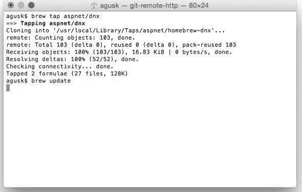

如果成功，你会看到一个你应该执行的任务。我们必须将 `dnvm` 添加到我们的配置文件中。

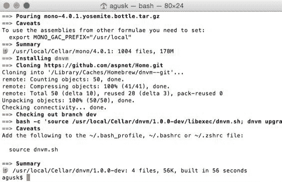

输入此命令。

```bash
$ nano ~/.bash_profile
```

然后，你会打开 `nano` 编辑器。你可以使用其他文本编辑器。将此脚本添加到 `~/.bash_profile` 中。

```bash
source dnvm.sh
```

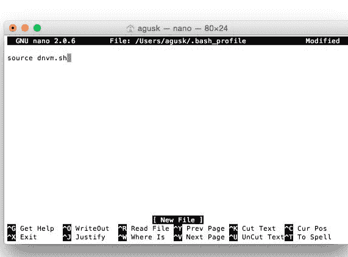

完成后，保存此文件。然后，关闭你的终端并重新打开，以便终端加载配置文件脚本。
下一步是升级。输入此命令。

```bash
$ dnvm upgrade
```

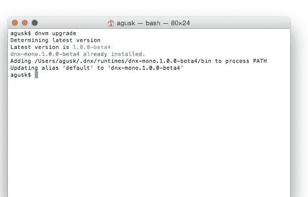

现在你已经安装了 `dnvm`。它将用于管理 OS X 上的 ASP.NET 5 运行时。你可以通过输入此命令来验证 `dnvm`。

```bash
$ dnvm help
```

因此你会看到 `dnvm` 参数列表。

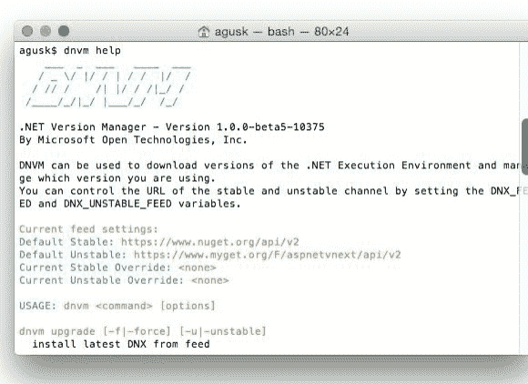

你还可以通过输入此命令来查看你的 DNX 运行时列表。

```bash
$ dnvm list
```

```text
dnvm alias <alias>
    display value of the specified alias

dnvm alias <alias> <semver>|<alias>|<package>
    <alias>
        <semver>|<alias>|<package>   the name of the alias to set
        the DNX version to set the alias to. Alternatively use the version of the specified alias

dnvm unalias <alias>
    remove the specified alias

dnvm [help|-h|--help|--help]
    displays this help text.

dnvm update-self
    updates dnvm itself.

agusk$ dnvm list

Active Version                Runtime Arch Location                 Alias
----- ------                  ---- ---- ----- ---                 -----
    *  1.0.0-beta4            mono            ~/.dnx/runtimes      default
agusk$
```

### 2.3 测试

为了测试我们的 ASP.NET 5，我们使用来自 [https://github.com/aspnet/Home](https://github.com/aspnet/Home) 的代码示例。我们克隆这些代码示例，然后使用 `dnu` 命令还原所有必需的库。输入这些命令。

```bash
$ git clone https://github.com/aspnet/Home
$ cd Home
$ dnu restore
```

如果你的 OS X 上没有 `git`，你可以通过 `brew` 安装它。

```bash
$ brew install git
```

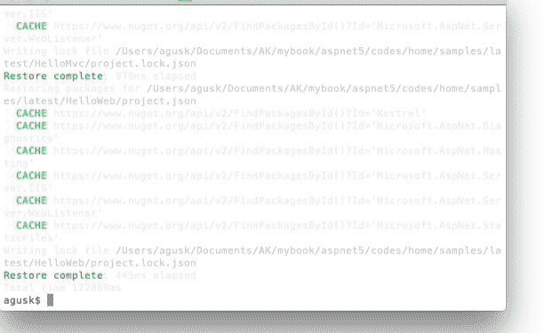

现在你准备好运行代码示例了。

#### 2.3.1 ASP.NET 控制台

要运行 ASP.NET 控制台，我们可以使用 `dnx`。首先，导航到 `ConsoleApp` 项目。输入这些命令。

```bash
$ cd samples/latest/ConsoleApp/
$ dnx . run .
```

如果成功，你可以在终端上看到消息 “Hello World”。

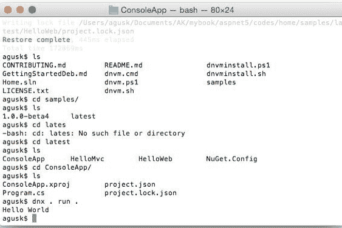

#### 2.3.2 ASP.NET 5

要运行 ASP.NET 5 应用程序，我们可以使用带有 `kestrel` 的 `dnx`。首先，导航到 `HelloWeb` 项目。
输入这些命令。

```bash
$ cd samples/latest/HelloWeb/
$ dnx . kestrel
```

现在打开浏览器，然后导航到 http://localhost:5004/。你应该会看到
ASP.NET 5 应用程序。

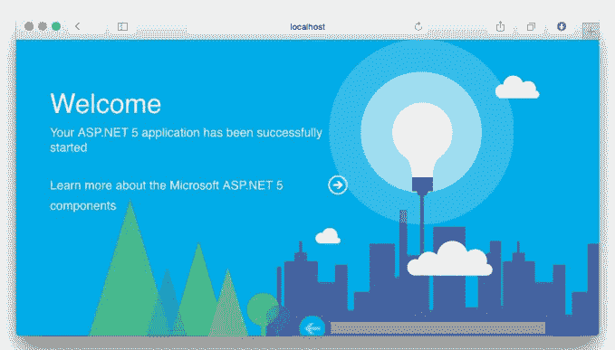

要停止 `kestrel`，你可以输入 `exit`。

```bash
exit
```

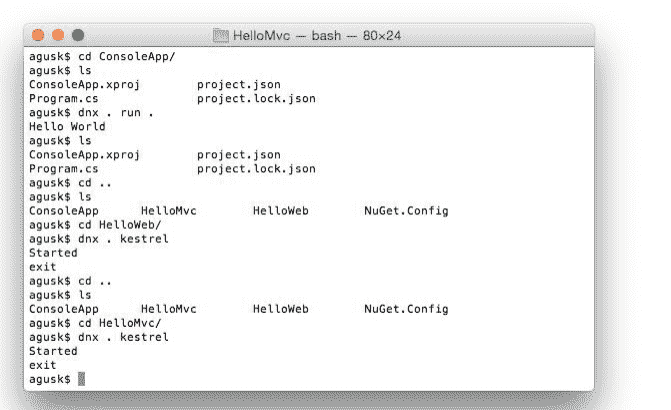

#### 2.3.3 ASP.NET MVC

要运行 ASP.NET MVC，我们可以使用 `dnx`。首先，导航到 `HelloMvc` 项目。输入这些命令。

```bash
$ cd samples/latest/HelloMvc/
$ dnx . kestrel
```

现在打开浏览器，然后导航到 http://localhost:5004/。你应该会看到 ASP.NET MVC 应用程序。

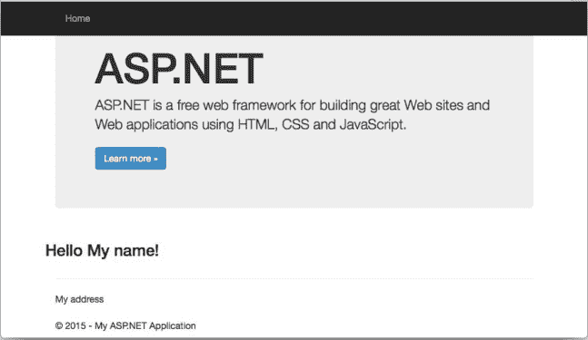

要停止 `kestrel`，你可以输入 `exit`。

### 2.4 开发工具

下一步是构建程序。要编写程序，你可以使用任何文本编辑器。微软还提供了 Visual Studio Code。它可以在 Windows、Linux 和 Mac 上运行。你可以在 [https://code.visualstudio.com/](https://code.visualstudio.com/) 上下载。

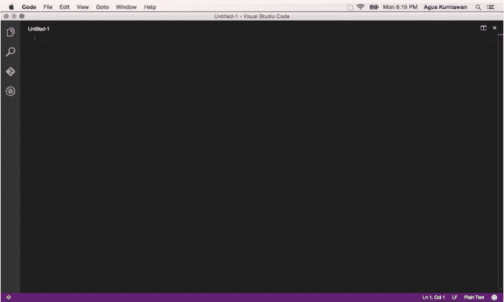

## 3 在 Linux 上部署 ASP.NET 5


在本章中，我们将学习如何在 Linux 上部署 ASP.NET 5。

### 3.1 入门

在本节中，我们将开始在 Linux 上部署 ASP.NET 5。在这本书中，我使用的是 ASP.NET 5 预览版，`beta4`。作为示例，我使用 Ubuntu 15.04 作为 Linux 发行版。请按照下一节的安装步骤进行操作。

### 3.2 部署 ASP.NET 5

此安装过程基于此文档：[https://github.com/aspnet/Home/blob/dev/GettingStartedDeb.md](https://github.com/aspnet/Home/blob/dev/GettingStartedDeb.md)。在本节中，我们将手动在 Linux 上安装 ASP.NET 5（不使用 `docker`）。首先，请更新你的发行版。

```bash
$ sudo apt-get update
```

通常，要在 Ubuntu 上安装 ASP.NET 5，你可以执行以下步骤：

- 安装 Mono
- 安装 libuv
- 安装 DNVM
- 安装 git（可选）

#### 3.2.1 安装 Mono

Mono 是用于 Linux 的 .NET 运行时。你需要最新版本的 Mono 运行时。要安装它，你可以输入这些命令。

```bash
$ sudo apt-key adv --keyserver keyserver.ubuntu.com --recv-keys 3FA7E032
$ echo "deb http://download.mono-project.com/repo/debian wheezy main" > /etc/apt/sources.list.d/mono.list
$ sudo apt-get update
$ sudo apt-get install mono-complete
```

完成后，你可以通过检查其版本来验证。

```bash
$ mono --version
```

```bash
agusk@ubuntu15:~$
agusk@ubuntu15:~$ mono --version
Mono JIT compiler version 4.0.1 (tarball Tue May 12 15:39:23 UTC 2015)
Copyright (C) 2002-2014 Novell, Inc, Xamarin Inc and Contributors. www.mono-project.com
    TLS:               __thread
    SIGSEGV:          altstack
    Notifications:    epoll
    Architecture:     amd64
    Disabled:         none
    Misc:             softdebug
    LLVM:             supported, not enabled.
    GC:               sgen
agusk@ubuntu15:~$
```

#### 3.2.2 安装 libuv

Libuv 是一个多平台异步 IO 库，由我们将用于托管 Web 应用程序的 `KestrelHttpServer` 使用。

输入这些命令来安装 libuv 库。

```bash
$ sudo apt-get install automake libtool curl
$ curl -sSL https://github.com/libuv/libuv/archive/v1.4.2.tar.gz | sudo tar -xz -C /usr/local/src/
$ cd /usr/local/src/libuv-1.4.2
$ sudo sh autogen.sh
$ sudo ./configure
$ sudo make
$ sudo make install
$ sudo rm -rf /usr/local/src/libuv-1.4.2 && cd ~/
$ sudo ldconfig
```

```bash
agusk@ubuntu15:~
in a given directory, LIBDIR, you must either use libtool, and
specify the full pathname of the library, or use the `-LLIBDIR'
flag during linking and do at least one of the following:
- add LIBDIR to the 'LD_LIBRARY_PATH' environment variable
during execution
- add LIBDIR to the 'LD_RUN_PATH' environment variable
during linking
- use the '-Wl,-rpath -Wl,LIBDIR' linker flag
- have your system administrator add LIBDIR to '/etc/ld.so.conf'

See any operating system documentation about shared libraries for
more information, such as the ld(1) and ld.so(8) manual pages.
----------------------
/bin/mkdir -p '/usr/local/include'
/usr/bin/install -c -m 644 include/uv.h include/uv-errno.h include/uv-threadpool.h include/uv-version.h include/uv-unix.h include/uv-linux.h '/usr/local/include/'
/bin/mkdir -p '/usr/local/lib/pkgconfig'
/usr/bin/install -c -m 644 libuv.pc '/usr/local/lib/pkgconfig'
make[1]: Leaving directory '/usr/local/src/libuv-1.4.2'
agusk@ubuntu15:/usr/local/src/libuv-1.4.2$ sudo rm -rf /usr/local/src/libuv-1.4.2 && cd ~/agusk@ubuntu15:~$ sudo ldconfig
agusk@ubuntu15:~$ 
```

#### 3.2.3 安装 DNVM

最后一步是安装 DNVM。输入此命令。

```bash
$ curl -sSL https://raw.githubusercontent.com/aspnet/Home/dev/dnvminstall.sh | DNX_BRANCH=dev sh && source ~/.dnx/dnvm/dnvm.sh
```

如果成功，你会看到一个你应该执行的任务。我们必须将 `dnvm` 添加到我们的配置文件 `profile` 中。

```bash
agusk@ubuntu15:~
agusk@ubuntu15:~$ curl -sSL https://raw.githubusercontent.com/aspnet/Home/dev/dnvm install.sh | DNX_BRANCH=dev sh && source ~/.dnx/dnvm/dnvm.sh
Downloading dnvm as script to '/home/agusk/.dnx/dnvm/dnvm'
Appending source string to /home/agusk/.bashrc
Type 'source /home/agusk/.dnx/dnvm/dnvm.sh' to start using dnvm
agusk@ubuntu15:~$ 
```

输入此命令。

```bash
$ nano /home/<account>/.bashrc
```

请将 `<account>` 替换为你的 Linux 登录账户。

然后，你将看到 `nano` 编辑器。你也可以使用 `gedit` 或其他文本编辑器来编辑此文件。将此脚本添加到你的配置文件（例如，`/home/<account>/.bashrc`）中的 `.bashrc` 文件里。

然后，输入此脚本。

```bash
source /home/<account>/.dnx/dnvm/dnvm.sh
```

请将 `<account>` 替换为你的 Linux 登录账户。

完成后，保存此文件。之后，关闭你的终端并再次打开，以便终端加载配置文件脚本。

下一步是进行升级。输入此命令。

```bash
$ dnvm upgrade
```

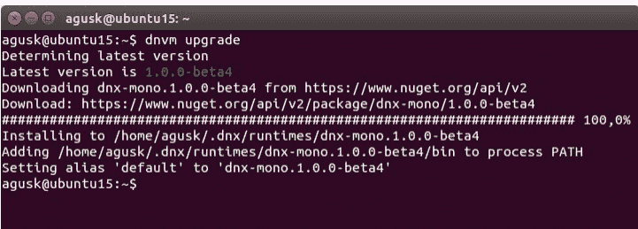


现在你已经安装好了 `dnvm`。它将用于管理 Linux 上的 ASP.NET 5 运行时。你可以通过输入此命令来验证 `dnvm`。

```bash
$ dnvm help
```

这样你就会看到 `dnvm` 参数列表。

```bash
agusk@ubuntu15:~$ dnvm upgrade
Determining latest version
Latest version is 1.0.0-beta4
Downloading dnx-mono.1.0.0-beta4 from https://www.nuget.org/api/v2
Download: https://www.nuget.org/api/v2/package/dnx-mono/1.0.0-beta4
############################################## 100.0%
Installing to /home/agusk/.dnx/runtimes/dnx-mono.1.0.0-beta4
Adding /home/agusk/.dnx/runtimes/dnx-mono.1.0.0-beta4/bin to process PATH
Setting alias 'default' to 'dnx-mono.1.0.0-beta4'
agusk@ubuntu15:~$ dnvm help

    ██████████████████████████

.NET Version Manager - Version 1.0.0-beta6-10381
By Microsoft Open Technologies, Inc.

DNVM can be used to download versions of the .NET Execution Environment and mana
ge which version you are using.
You can control the URL of the stable and unstable channel by setting the DNx_FE
ED and DNx_UNSTABLE_FEED variables.

Current feed settings:
```

你还可以通过输入此命令来查看你的 DNx 运行时列表。

```bash
$ dnvm list
```

```bash
dnvm alias <alias>
    display value of the specified alias

dnvm alias <alias> <sever>|<alias>|<package>
    <alias>              the name of the alias to set
    <sever>|<alias>|<package>    the DNx version to set the alias to. Alternativel
    y use the version of the specified alias

dnvm unalias <alias>
    remove the specified alias

dnvm [help|-h|-help|--help]
    displays this help text.

dnvm update-self
    updates dnvm itself.
agusk@ubuntu15:~$ dnvm list

Active Version          Runtime Arch Location           Alias
--------- ----------    --------  ---  --------    -----   ----
        *   1.0.0-beta4    mono      ~/.dnx/runtimes    default

agusk@ubuntu15:~$
```

### 3.2.4 安装 git

此任务是可选的，但我建议安装它，因为我们想要从 `https://github.com/aspnet/Home` 运行示例应用。

输入此命令来安装 `git`。

```bash
$ sudo apt-get install git
```

```bash
agusk@ubuntu15:~

agusk@ubuntu15:~$ sudo apt-get install git
[sudo] password for agusk:
Reading package lists... Done
Building dependency tree
Reading state information... Done
The following extra packages will be installed:
  git-man liberror-perl
Suggested packages:
  git-daemon-run git-daemon-sysvinit git-doc git-el git-email git-gui gitk
  gitweb git-arch git-cvs git-mediawiki git-svn
The following NEW packages will be installed:
  git git-man liberror-perl
0 upgraded, 3 newly installed, 0 to remove and 0 not upgraded.
Need to get 3,517 kB of archives.
After this operation, 22,7 MB of additional disk space will be used.
Do you want to continue? [Y/n]
```

### 3.3 测试

为了测试我们的 ASP.NET 5，我们使用来自 `https://github.com/aspnet/Home` 的代码示例。我们克隆这些代码示例，然后使用 `dnu` 命令恢复所有必需的库。

输入这些命令。

```bash
$ git clone https://github.com/aspnet/Home
$ cd Home
$ dnu restore
```

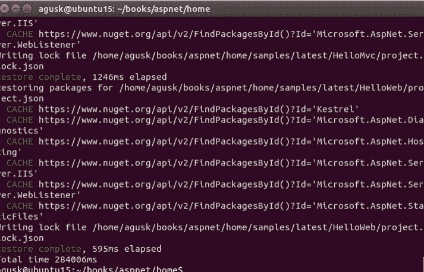

现在你准备好运行代码示例了。

#### 3.3.1 ASP.NET 控制台

要运行 ASP.NET 控制台，我们可以使用 `dnx`。首先，导航到 `ConsoleApp` 项目。

输入这些命令。

```bash
$ cd samples/latest/ConsoleApp/
$ dnx . run .
```

如果成功，你可以在终端上看到一条 “Hello World” 消息。

#### 3.3.2 ASP.NET 5

要运行 ASP.NET 5 应用程序，我们可以使用 `dnx` 搭配 `kestrel`。首先，导航到 `HelloWeb` 项目。输入以下命令。

```
$ cd samples/latest/HelloWeb/
$ dnx . kestrel
```

```
agusk@ubuntu15: ~/books/aspnet/home/samples/latest/ConsoleApp
agusk@ubuntu15: ~/books/aspnet/home$ ls
CONTRIBUTING.md    dnvm.ps1       GettingStartedDeb.md   README.md
dnvm.cmd           dnvm.sh        Home.sln               samples
dnvm.ps1           LICENSE.txt
agusk@ubuntu15: ~/books/aspnet/home$ cd samples/latest/ConsoleApp/
agusk@ubuntu15: ~/books/aspnet/home/samples/latest/ConsoleApp$ dnx . run .
Hello World
agusk@ubuntu15: ~/books/aspnet/home/samples/latest/ConsoleApp$
```

现在打开浏览器，然后导航到 `http://localhost:5004/`。你应该能看到 ASP.NET 5 应用程序。

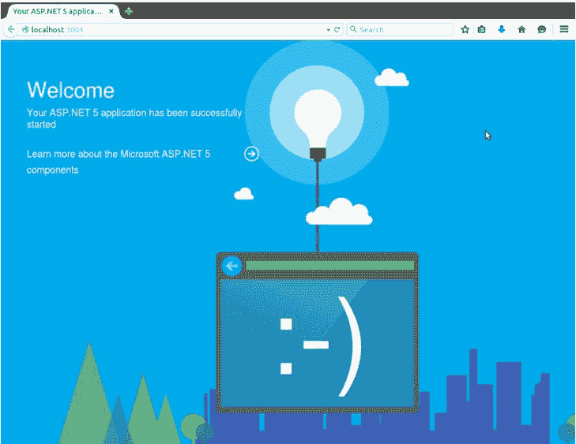

要停止 `kestrel`，你可以输入 `exit`。

```
exit
```

#### 3.3.3 ASP.NET MVC

要运行 ASP.NET MVC，我们可以使用 `dnx`。首先，导航到 `HelloMvc` 项目。输入以下命令。

```
$ cd samples/latest/HelloMvc/
$ dnx . kestrel
```


```
agusk@ubuntu15:~/books/aspnet/home/samples/latest/HelloMvc$ ls
Controllers  Models  project.lock.json  Startup.cs  wwwroot
HelloMvc.xproj  project.json  Properties  Views
agusk@ubuntu15:~/books/aspnet/home/samples/latest/HelloMvc$ dnx . kestrel
Started
```

现在打开浏览器，然后导航到 `http://localhost:5004/`。你应该能看到 ASP.NET MVC 应用程序。

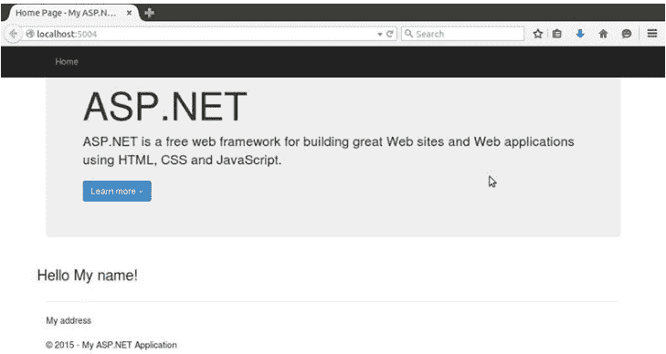

要停止 kestrel，你可以输入 `exit`。

### 3.4 开发工具

下一步是构建程序。为了编写程序，你可以使用任何文本编辑器。微软还提供了 Visual Studio Code。它运行在 Windows、Linux 和 Mac 上。你可以在 `https://code.visualstudio.com/` 上下载它。

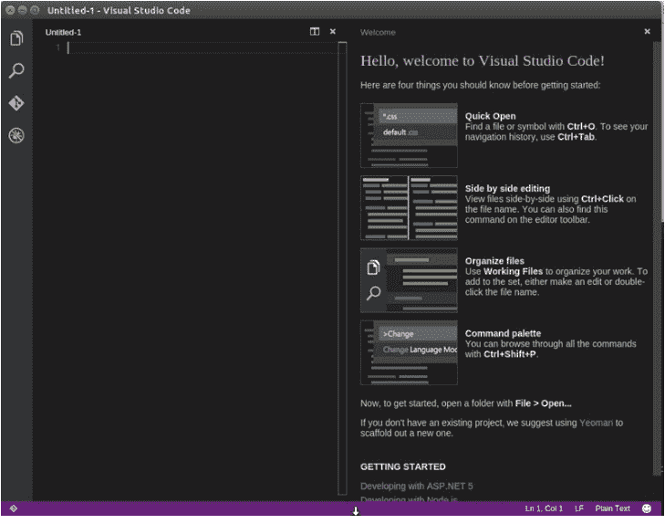

## 4. 在 Windows 上部署 ASP.NET 5

在本章中，我们将学习如何在 Windows 上部署 ASP.NET 5。

## 4.1 入门

在本节中，我们开始在 Windows 上部署 ASP.NET 5。在这本书中，我使用的是 ASP.NET 5 预览版，beta4。为了说明，我使用 Windows 8.1。请遵循下一节的安装步骤。

## 4.2 部署 ASP.NET 5

此安装过程基于此文档，`https://github.com/aspnet/Home/blob/dev/GettingStartedDeb.md`。在本节中，我们在 Windows 上安装 ASP.NET 5。首先，你更新你的 Windows。

通常，要在 Ubuntu 上安装 ASP.NET 5，你可以执行以下步骤：

- 安装 .NET
- 安装 DNVM
- 安装 git（可选）

### 4.2.1 安装 .NET

你需要最新版本的 .NET Framework 运行时。要安装它，你可以在 `https://www.microsoft.com/net` 上下载它。

### 4.2.2 安装 DNVM

你可以通过命令提示符安装 DNVM。打开 CMD 并输入此命令。

```
@powershell -NoProfile -ExecutionPolicy unrestricted -Command "&{$Branch='dev';iex ((new-object net.webclient).DownloadString('https://raw.githubusercontent.com/aspnet/Home/dev/dnvminstall.ps1'))}"
```

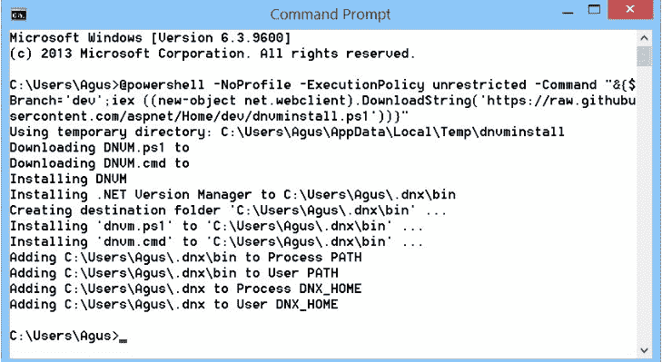

如果成功，你可以通过输入此命令来验证 `dnvm` 的位置。

```
where dnvm
```

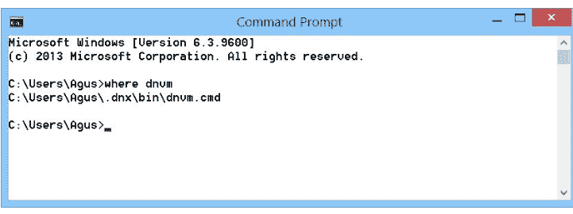

如果收到错误，请检查你的 PATH 配置。确保 `.dnx` 路径已经添加。

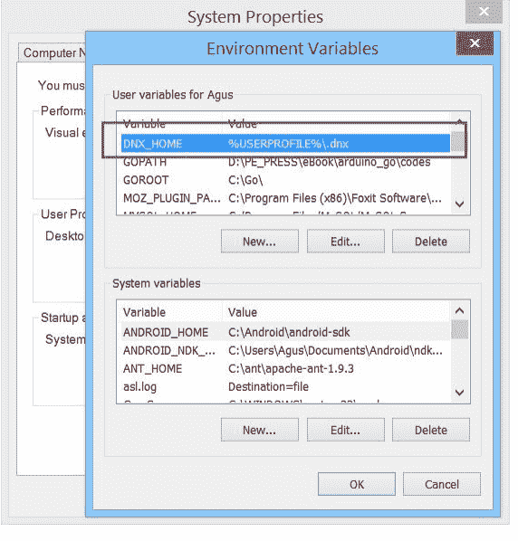

下一步是升级 DNVM。输入此命令。

```
$ dnvm upgrade
```

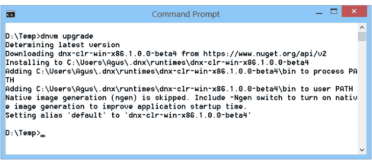

现在你已经安装了 `dnvm`。它将用于管理 Windows 上的 ASP.NET 5 运行时。你可以通过输入此命令来验证 `dnvm`。

```
$ dnvm help
```

因此你会看到 `dnvm` 参数列表。

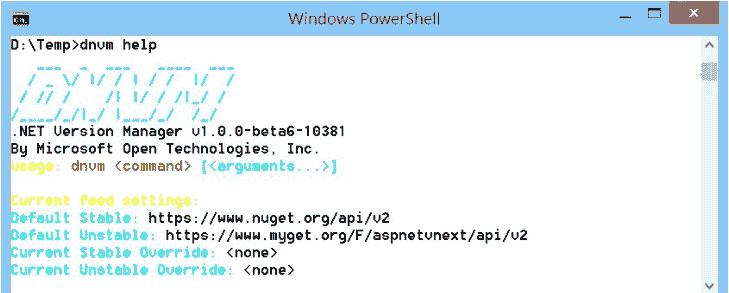

你还可以通过输入此命令来查看你的 DNX 运行时列表。

```
$ dnvm list
```

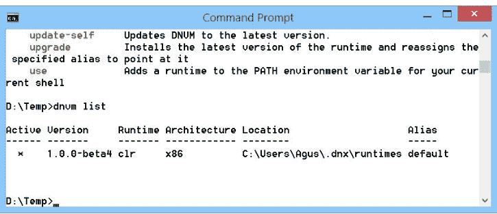

### 4.2.3 安装 git

此任务是可选的，但我建议安装它，因为我们想从 `https://github.com/aspnet/Home` 运行示例应用程序。你可以在 `https://git-scm.com/downloads` 上下载来安装 git。

## 4.3 测试

为了测试我们的 ASP.NET 5，我们使用来自 `https://github.com/aspnet/Home` 的代码示例。我们克隆这些代码示例，然后使用 `dnu` 命令还原所有必需的库。

输入这些命令。

```
$ git clone https://github.com/aspnet/Home
$ cd Home
$ dnu restore
```

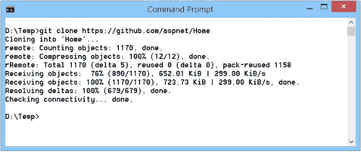

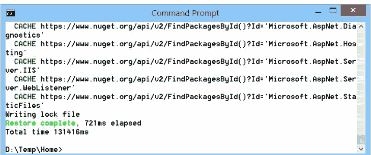

现在你准备好运行代码示例了。

### 4.3.1 ASP.NET 控制台

要运行 ASP.NET 控制台，我们可以使用 `dnx`。首先，导航到 ConsoleApp 项目。输入这些命令。

```
$ cd samples/latest/ConsoleApp/
$ dnx . run .
```

如果成功，你可以在终端上看到“Hello World”消息。

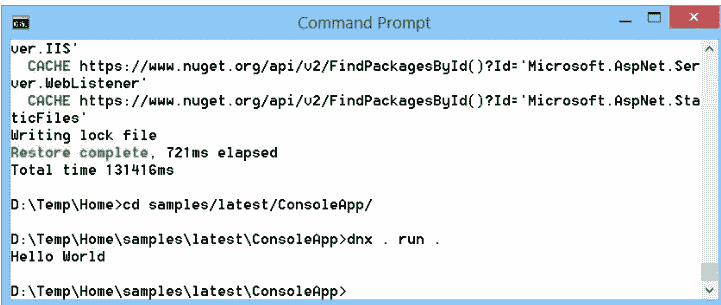

### 4.3.2 ASP.NET 5

要运行 ASP.NET 5 应用程序，我们可以使用 `dnx` 搭配 kestrel。首先，导航到 HelloWeb 项目。输入这些命令。

```
$ cd samples/latest/HelloWeb/
$ dnx . kestrel
```

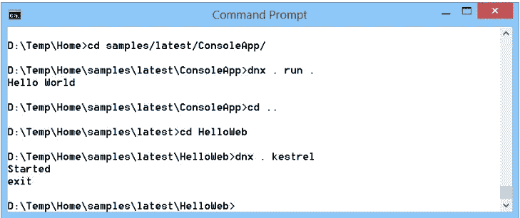

当你运行这些命令时，你可能会收到一个安全确认。请点击 **Allow access** 按钮以授予安全权限。

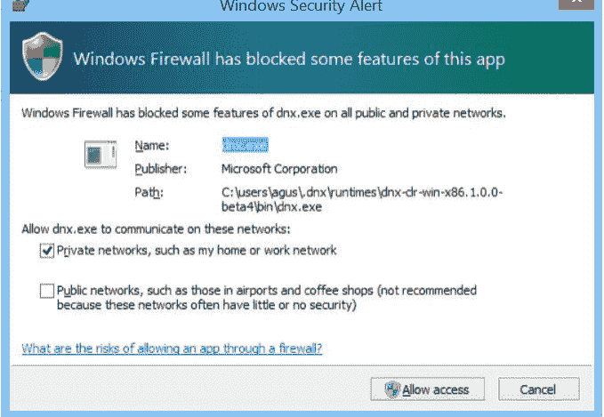

现在打开浏览器，然后导航到 `http://localhost:5004/`。你应该能看到 ASP.NET 5 应用程序。

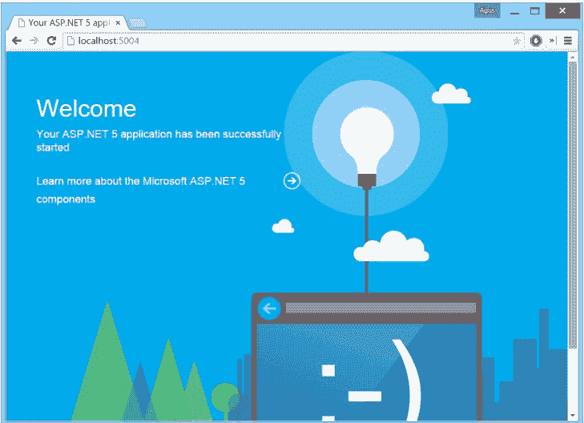

要停止 kestrel，你可以输入 `exit`。

```
exit
```

### 4.3.3 ASP.NET MVC

要运行 ASP.NET MVC，我们可以使用 `dnx`。首先，导航到 HelloMvc 项目。输入这些命令。

```
$ cd samples/latest/HelloMvc/
$ dnx . kestrel
```

```
D:\Temp\Home>cd samples/latest/ConsoleApp/
D:\Temp\Home\samples\latest\ConsoleApp>dnx . run.
Hello World

D:\Temp\Home\samples\latest\ConsoleApp>cd ..

D:\Temp\Home\samples\latest>cd HelloWeb

D:\Temp\Home\samples\latest\HelloWeb>dnx . kestrel
Started
exit

D:\Temp\Home\samples\latest\HelloWeb>cd ..

D:\Temp\Home\samples\latest>cd HelloMvc

D:\Temp\Home\samples\latest\HelloMvc>dnx . kestrel
Started
exit
```

现在打开浏览器，然后导航到 `http://localhost:5004/`。你应该能看到 ASP.NET MVC 应用程序。

```
D:\Temp\Home\samples\latest\ConsoleApp>cd ..

D:\Temp\Home\samples\latest>cd HelloWeb

D:\Temp\Home\samples\latest\HelloWeb>dnx . kestrel
Started
exit

D:\Temp\Home\samples\latest\HelloWeb>cd ..

D:\Temp\Home\samples\latest>cd HelloMvc

D:\Temp\Home\samples\latest\HelloMvc>dnx . kestrel
Started
exit
```

要停止 kestrel，你可以输入 `exit`。

## 4.4 开发工具


下一步是构建程序。为了编写程序，你可以使用任何文本编辑器。微软还提供了 Visual Studio Code。它运行在 Windows、Linux 和 Mac 上。你可以在 `https://code.visualstudio.com/` 上下载它。

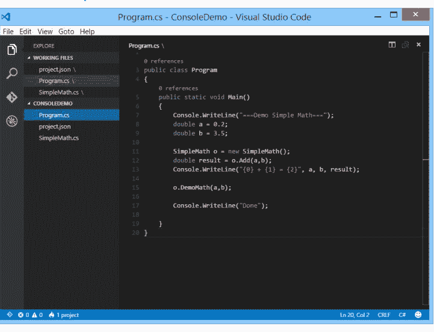

## 5. ASP.NET 5 开发

在本章中，我将解释如何处理 ASP.NET 5 开发。

### 5.1 入门

在本章中，我们学习如何从头开始为 ASP.NET 5 编写程序。我们使用两个场景，ASP.NET 5 控制台和 ASP.NET 5 MVC，进行说明。

### 5.2 构建 ASP.NET 5 控制台应用程序

在这种情况下，我们为 ASP.NET 5 控制台构建一个简单的程序。我们使用 `Math` 类来实现 Math 操作。

#### 5.2.1 创建项目

要创建一个项目，我们可以创建一个文件夹，名为 `ConsoleDemo`。在 Linux/OS X 中，你可以在终端中输入此命令。

```bash
mkdir ConsoleDemo
```

此外，我们创建一个文件，`project.json`。输入此脚本。

```json
{
"dependencies" : {
},
"commands" : {
"ConsoleApp" : "ConsoleDemo"
},
"frameworks" : {
"dnx451" : { },
"dnxcore50" : {
"dependencies" : {
"System.Console" : "4.0.0-beta- *"
}
}
}
}
```

此文件是一个项目配置，使用 ASP.NET 5 DNX。

#### 5.2.2 编写程序

要创建一个程序，我们创建一个类，`SimpleMath`。创建一个文件，名为 `SimpleMath.cs`。然后，编写此代码。

```csharp
using System;

public class SimpleMath
{
public SimpleMath(){ }
}
```

```csharp
public double Add(double a, double b)
{
    return a + b;
}

public void DemoMath(double a, double b)
{
    Console.WriteLine("cos({0}) = {1}", a, Math.Cos(a));
    Console.WriteLine("sin({0}) = {1}", b, Math.Sin(b));
    Console.WriteLine("exp({0}) = {1}", a, Math.Exp(a));
}
```

下一步是创建主程序。创建一个文件，`Program.cs`，并编写以下代码。

```csharp
using System;

public class Program
{
    public static void Main()
    {
        Console.WriteLine("===Demo Simple Math===");
        double a = 0.2;
        double b = 3.5;

        SimpleMath o = new SimpleMath();
        double result = o.Add(a, b);
        Console.WriteLine("{0} + {1} = {2}", a, b, result);

        o.DemoMath(a, b);

        Console.WriteLine("Done");
    }
}
```

保存所有文件。

以下是我们的项目结构。

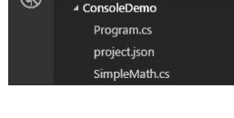

##### 5.2.3 测试

现在您可以测试该程序了。首先，我们使用 `dnu` 加载所有必需的库。然后，使用 `dnx` 执行该程序。

```bash
dnu restore
dnx . run .
```

如果成功，您将看到程序的输出。

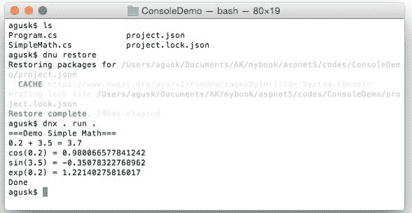

### 5.3 构建 ASP.NET 5 MVC 应用程序

第二个演示是构建一个 ASP.NET 5 MVC 应用程序。我们开发一个简单的输入表单并利用 ASP.NET MVC 会话。以下是我们的场景：

- 用户填写表格以创建新项目

- 用户点击保存按钮以保存数据

- 数据将被存储到一个会话堆栈中

- 然后，数据将在另一个页面中显示

让我们开始开发吧。

#### 5.3.1 创建项目

首先，我们通过创建一个名为 `WebDemo` 的文件夹来创建项目。然后，您创建以下文件夹：

- Controllers

- Models

- Properties

- Views

- wwwroot

您可以在下图中看到项目结构。

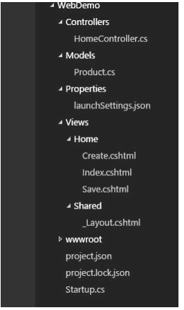

我们需要在项目的根目录中有一个配置文件，称为 `project.json`。它包含必需的库。请为 `project.json` 文件编写此脚本。

```json
{
  "version": "1.0.0-*",
  "webroot": "wwwroot",
  "exclude": [
    "wwwRoot"
  ],
  "packExclude": [
    "**.kproj",
    "**.user",
    "**.vspcc"
  ],
  "dependencies": {
    "Kestrel": "1.0.0-*",
    "Microsoft.AspNet.Diagnostics": "1.0.0-*",
    "Microsoft.AspNet.Mvc": "6.0.0-*",
    "Microsoft.AspNet.Server.IIS": "1.0.0-*",
    "Microsoft.AspNet.Server.WebListener": "1.0.0-*",
    "Microsoft.AspNet.Session": "1.0.0-*"
  },
  "commands": {
    "web": "Microsoft.AspNet.Hosting --server Microsoft.AspNet.Server.WebListener --server.urls http://localhost:5001",
    "kestrel": "Microsoft.AspNet.Hosting --server Kestrel --server.urls http://localhost:5004"
  },
  "frameworks": {
    "dnx451": {},
    "dnxcore50": {}
  }
}
```

应用程序将通过执行 `Startup.cs` 文件启动。创建此文件并编写以下代码。

```csharp
using Microsoft.AspNetCore.Builder;
using Microsoft.Framework.DependencyInjection;

namespace WebDemo
{
    public class Startup
    {
        public void ConfigureServices(IServiceCollection services)
        {
            services.AddMvc();
        }
        
        public void Configure(IApplicationBuilder app)
        {
            // handle error page
            app.UseErrorPage();
            // handle session
            app.UseInMemorySession();
            // aspNet routing
            app.UseMvc(routes =>
            {
                routes.MapRoute("default", "{controller=Home}/{action=Index}");
            });
        }
    }
}
```

我们还添加 `launchSettings.json` 来配置如何执行程序。将其存储在 Properties 文件夹中。请为 `launchSettings.json` 文件编写此脚本。


```json
{
  "profiles": {
    "IIS Express": {
      "commandName": "IISExpress",
      "launchBrowser": true,
      "environmentVariables": {
        "ASPNET_ENV": "Development"
      }
    },
    "kestrel": {
      "commandName": "kestrel",
      "launchBrowser": true,
      "launchUrl": "http://localhost:5004"
    },
    "web": {
      "commandName": "web",
      "launchBrowser": true,
      "launchUrl": "http://localhost:5001"
    }
  }
}
```

### 5.3.2 编写程序

在本节中，我们将编写我们的 ASP.NET 5 MVC 程序。

#### 5.3.2.1 创建模型

模型持有数据。在我们的情况下，我们创建一个名为 `Product` 的模型，它由四个属性组成。创建一个文件，称为 `Product.cs`，并编写以下代码。

```csharp
using System.ComponentModel.DataAnnotations;

namespace WebDemo.Web.Models
{
    public class Product
    {
        [Required]
        [MinLength(4)]
        [Display(Name = "Name")]
        public string Name { get; set; }
        [Display(Name = "Product Code")]
        public string ProductCode { get; set; }
        [Display(Name = "Quantity")]
        public int Quantity { get; set; }
        [Display(Name = "Is Discount")]
        public bool IsDiscount { get; set; }
    }
}
```

将此文件保存到 `Models` 文件夹中。

#### 5.3.2.2 创建控制器

现在我们将创建名为 `Home` 控制器的 MVC 控制器。创建一个文件，称为 `HomeController.cs`，并编写以下代码。

```csharp
using System;
using Microsoft.AspNet.Mvc;
using Microsoft.AspNet.Http;
using WebDemo.Web.Models;

namespace WebDemo.Web.Controllers
{
    public class HomeController : Controller
    {
        public IActionResult Index()
        {
            return View();
        }

        public IActionResult Create()
        {
            var product = new Product();
            return View(product);
        }

        [HttpPost]
        public IActionResult Create(Product obj)
        {
            // do database processing
            /////////////////
            // for testing, save it into a session
            Context.Session.SetString("name", obj.Name);
            Context.Session.SetString("code", obj.ProductCode);
            Context.Session.SetInt("quantity", obj.Quantity);
            Context.Session.SetString("discount", obj.IsDiscount.ToString());

            return RedirectToAction("Save");
        }

        public IActionResult Save()
        {
            var product = new Product();
            product.Name = Context.Session.GetString("name");
            product.ProductCode = Context.Session.GetString("code");
            product.Quantity = (int)Context.Session.GetInt("quantity");
            product.IsDiscount = Convert.ToBoolean(Context.Session.GetString("discount"));
            return View(product);
        }
    }
}
```

#### 5.3.2.3 创建视图

我们创建三个页面：

- `Index.cshtml`
- `Create.cshtml`
- `Save.cshtml`

我们还创建一个布局，称为 `Shared.cshtml`。编写此脚本。

```html
<!DOCTYPE html>
<html>
<head>
    <meta charset="utf-8" />
    <meta name="viewport" content="width=device-width, initial-scale=1.0" />
    <title>@ViewBag.Title - My ASP.NET Application</title>
    <link rel="stylesheet" href="//netdna.bootstrapcdn.com/bootstrap/3.0.3/css/bootstrap.min.css" />
</head>
<body>
    <div class="navbar navbar-inverse navbar-fixed-top">
        <div class="container">
            <div class="navbar-header">
                <button type="button" class="navbar-toggle" data-toggle="collapse" data-target=".navbar-collapse">
                    <span class="icon-bar"></span>
                    <span class="icon-bar"></span>
                    <span class="icon-bar"></span>
                </button>
            </div>
            <div class="navbar-collapse collapse">
                <ul class="nav navbar-nav">
                    <li><a href="/">Home</a></li>
                </ul>
            </div>
        </div>
    </div>
    <div class="container body-content">
        @RenderBody()
        <footer>
            <p>&copy; @DateTime.Now.Year - My ASP.NET Application</p>
        </footer>
    </div>
</body>
</html>
```

以下是 `Index.cshtml` 文件的脚本。


```html
@{
    Layout = "/Views/Shared/_Layout.cshtml";
    ViewBag.Title = "Home Page";
}

<div class="jumbotron">
    <h1>ASP.NET MVC Demo</h1>
    <p class="lead">Filling and submitting a form.</p>
    <p><a href="/Home/Create" class="btn btn-primary btn-lg">Create</a></p>
</div>
```

以下是 `Create.cshtml` 文件的脚本。

```html
@using WebDemo.Web.Models
@model Product
@{
    Layout = "/Views/Shared/_Layout.cshtml";
    ViewBag.Title = "Create Product";
}

<div class="jumbotron">
    <h1>ASP.NET</h1>
    <p class="lead">Create a new product. Fill this form. Then, click Save.</p>
</div>

@using (Html.BeginForm())
{
    <fieldset>
        <legend>Create a new Product</legend>

        <div class="editor-label">
            @Html.LabelFor(model => model.Name)
        </div>
        <div class="editor-field">
            @Html.TextBoxFor(model => model.Name)
        </div>
        <br/>

        <div class="editor-label">
            @Html.LabelFor(model => model.ProductCode)
        </div>
        <div class="editor-field">
            @Html.TextBoxFor(model => model.ProductCode)
        </div>
        <br/>

        <div class="editor-label">
            @Html.LabelFor(model => model.Quantity)
        </div>
        <div class="editor-field">
            @Html.TextBoxFor(model => model.Quantity)
        </div>
        <br/>

        <div class="editor-label">
            <div style="float: left;">
                @Html.CheckBoxFor(model => model.IsDiscount)
            </div>
            @Html.LabelFor(model => model.IsDiscount)
        </div>
        <br/>
        <div>
            <input type="submit" value="Save" />
        </div>
    </fieldset>
}
```

### 5.3.3 测试

以下是 `Save.cshtml` 文件的脚本。

```html
@model WebDemo.Web.Models.Product
@{
    Layout = "/Views/Shared/_Layout.cshtml";
    ViewBag.Title = "Reading Session";
}
<div class="jumbotron">
    <h1>ASP.NET</h1>
    <p class="lead">Reading data from ASP.NET MVC session.</p>
    <p><a href="/Home" class="btn btn-primary btn-large">Back to home &rarr;</a></p>
</div>
<div>
    <p>Name: @(Model != null ? Model.Name : "")</p>
    <p>Product Code: @(Model != null ? Model.ProductCode : "")</p>
    <p>Quantity: @(Model != null ? Model.Quantity : 0)</p>
    <p>Is Discount: @(Model != null ? Model.IsDiscount : false)</p>
</div>
```

保存所有文件并将其存储到 `Views` 文件夹中。参见项目结构。

现在你可以执行了。输入这些命令以加载所需的库并执行程序。

```bash
dnu restore
dnx . kestrel
```

```text
Restoring packages for /Users/agusk/Documents/AK/mybook/aspnet5/codes/WebDemo/project.json
CACHE https://www.nuget.org/api/v2/findPackagesById()?id='Kestrel'
CACHE https://www.nuget.org/api/v2/findPackagesById()?id='Microsoft.AspNet.OptimisticConcurrency'
CACHE https://www.nuget.org/api/v2/findPackagesById()?id='Microsoft.Mvc'
CACHE https://www.nuget.org/api/v2/findPackagesById()?id='Microsoft.AspNet.Server'
CACHE https://www.nuget.org/api/v2/findPackagesById()?id='Microsoft.AspNet.Server.Kestrel'
CACHE https://www.nuget.org/api/v2/findPackagesById()?id='Microsoft.AspNet.Session'
Writing lock file /Users/agusk/Documents/AK/mybook/aspnet5/codes/WebDemo/project.lock.json
Restore complete: 3283ms elapsed
agusk$ dnx . kestrel
Started
```

打开浏览器并导航到 `http://localhost:5004`。点击创建按钮。

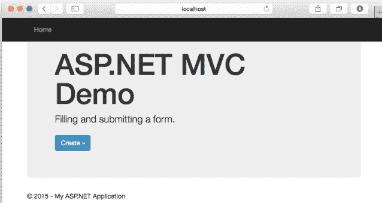

填写所有字段。完成后，点击保存按钮。

# ASP.NET

创建一个新产品。填写此表单。完成后，点击保存按钮。

### 创建一个新产品

名称：product abc  
产品代码：abc123  
数量：10  
是否折扣：[x]  
保存  
© 2015 - 我的 ASP.NET 应用程序

我们填写的表单将在下一页显示。它使用 ASP.NET 会话来保持我们填写的数据。

# ASP.NET

从 ASP.NET MVC 会话中读取数据。

返回主页 »

名称：product abc  
产品代码：abc123  
数量：10  
是否折扣：True  
© 2015 - 我的 ASP.NET 应用程序

## 6. ASP.NET 5 RESTful 和 AngularJS

在本章中，我将解释如何使用 ASP.NET 5 RESTful 和 AngularJS。

### 6.1 入门

在本节中，我们将开发一个简单的应用程序，以结合使用 ASP.NET RESTful 和 AngularJS。AngularJS 是一个由 Google 维护的开源 JavaScript 框架，它有助于运行单页应用程序。有关 AngularJS 的更多信息，你可以访问 `http://angularjs.org/` 上的官方网站。

要将你的应用程序与 AngularJS 集成，你可以从 `http://code.angularjs.org/` 下载 AngularJS。选择你要使用的 AngularJS 版本。要在你的 Web 应用程序中使用 AngularJS，你只需将其放在你的网页上：


```html
<script src="lib/angular.min.js"></script>
```

这意味着 AngularJS 文件将从本地下载。你也可以像下面这样放置 AngularJS。

```html
<script src="https://ajax.googleapis.com/ajax/libs/angularjs/1.2.15/angular.min.js"></script>
```

以下是我们的场景：

- 用户点击一个按钮
- 程序将通过 RESTful 向服务器请求数据

让我们开始开发。

## 6.2 创建项目

首先，我们通过创建一个名为 `RESTfuldemo` 的文件夹来创建一个项目。之后，你可以创建以下文件夹：

- `Controllers`
- `Database`
- `Models`
- `Properties`
- `Views`
- `wwwroot`

以下是项目结构。

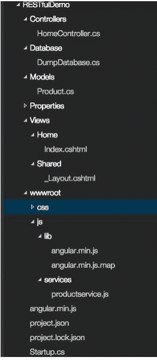

我们需要在项目的根文件夹中有一个项目配置文件，称为 `project.json`。它包含所需的库。请为 `project.json` 文件编写此脚本。

```json
{
    "version": "1.0.0-*",
    "webroot": "wwwroot",
    "exclude": [
        "wwwroot"
    ],
    "packExclude": [
        "*.kproj",
        "*.user",
        "*.vspscc"
    ],
    "dependencies": {
        "Kestrel": "1.0.0-*",
        "Microsoft.AspNet.Diagnostics": "1.0.0-*",
        "Microsoft.AspNet.Mvc": "6.0.0-*",
        "Microsoft.AspNet.Server.IIS": "1.0.0-*",
        "Microsoft.AspNet.Server.WebListener": "1.0.0-*",
        "Microsoft.AspNet.StaticFiles": "1.0.0-*"
    },
    "commands": {
        "web": "Microsoft.AspNet.Hosting --server Microsoft.AspNet.Server.WebListener --server.urls http://localhost:5001",
        "kestrel": "Microsoft.AspNet.Hosting --server Kestrel --server.urls http://localhost:5004"
    },
    "frameworks": {
        "dnx451": {},
        "dnxcore50": {}
    }
}
```

我们还添加 `launchSettings.json` 来配置如何执行程序。将其存储在 `Properties` 文件夹中。请为 `launchSettings.json` 文件编写此脚本。

```json
{
    "profiles": {
        "IIS Express": {
            "commandName": "IISExpress",
            "launchBrowser": true,
            "environmentVariables": {
                "ASPNET_ENV": "Development"
            }
        },
        "kestrel": {
            "commandName": "kestrel",
            "launchBrowser": true,
            "launchUrl": "http://localhost:5004"
        },
        "web": {
            "commandName": "web",
            "launchBrowser": true,
            "launchUrl": "http://localhost:5001"
        }
    }
}
```

通过执行 `Startup.cs` 文件来启动应用程序。创建此文件并编写此代码。

```csharp
using Microsoft.AspNetCore;
using Microsoft.Framework.DependencyInjection;

namespace WebDemo
{
    public class Startup
    {
        public void ConfigureServices(IServiceCollection services)
        {
            services.AddMvc();
        }

        public void Configure(IApplicationBuilder app)
        {
            // handle error page
            app.UseErrorPage();
            // handle static file requests
            app.UseStaticFiles();
            // aspNet routing
            app.UseMvc(routes =>
            {
                routes.MapRoute("default", "{controller=Home}/{action=Index}");
            });
        }
    }
}
```

### 6.3 编写程序

在本节中，我们将编写我们的 ASP.NET 5 MVC 程序。

#### 6.3.1 创建模型

首先，我们创建一个名为 `Product` 的模型。以下是代码实现。

```csharp
using System.ComponentModel.DataAnnotations;

namespace WebDemo.Web.Models
{
    public class Product
    {
        [Required]
        [MinLength(4)]
        [Display(Name = "Name")]
        public string Name { get; set; }
        [Display(Name = "Product Code")]
        public string ProductCode { get; set; }
        [Display(Name = "Quantity")]
        public int Quantity { get; set; }
        [Display(Name = "Price")]
        public double Price { get; set; }
    }
}
```

将此代码保存到一个名为 `Product.cs` 的文件中，并将其存储到 `Models` 文件夹中。

#### 6.3.2 模拟数据库

在这种情况下，我们不直接访问数据库，所以我们创建一个模拟数据库来生成产品数据。创建一个名为 `DumpDatabase.cs` 的文件并编写此代码。


```csharp
using System;
using System.Collections.Generic;

using WebDemo.Web.Models;

namespace WebDemo.Web.Database
{
    public class DumpDatabase
    {
        private DumpDatabase() { }

        public static List<Product> GetAllProducts()
        {
            // generate data
            List<Product> list = new List<Product>();
            for (int i = 0; i < 10; i++)
            {
                var item = new Product();
                item.Name = String.Format("Product {0}", i);
                item.ProductCode = String.Format("K0{0}", i);
                item.Quantity = 4 + i;
                item.Price = 1.43 * (i + 1);
                list.Add(item);
            }
            return list;
        }
    }
}
```

将此文件保存到 `Database` 文件夹中。

### 6.3.3 创建控制器

此外，我们通过创建一个名为 `HomeController.cs` 的文件来构建一个名为 `Home` 的控制器。编写此代码。

```csharp
using System;
using System.Collections.Generic;
using Microsoft.AspNet.Mvc;
using WebDemo.Web.Models;
using WebDemo.Web.Database;

namespace WebDemo.Web.Controllers
{
    public class HomeController : Controller
    {
        public IActionResult Index()
        {
            return View();
        }

        [HttpPost]
        public JsonResult GetAllProducts()
        {
            List<Product> list = DumpDatabase.GetAllProducts();
            return Json(list);
        }
    }
}
```

#### 6.3.4 创建视图

将此文件保存到 `Controllers` 文件夹中。

我们创建一个页面，`Index.cshtml`。我们还创建一个布局，称为 `_Shared.cshtml`。编写以下脚本。

```html
<!DOCTYPE html>
<html>
<head>
    <meta charset="utf-8" />
    <meta name="viewport" content="width=device-width, initial-scale=1.0" />
    <title>@ViewBag.Title - My ASP.NET Application</title>
    <link rel="stylesheet" href="//netdna.bootstrapcdn.com/bootstrap/3.0.0/css/bootstrap.min.css" />
    <link href="~/css/simple.css" rel="stylesheet" type="text/css" />
</head>
<body>
<div class="navbar navbar-inverse navbar-fixed-top">
    <div class="container">
        <div class="navbar-header">
            <button type="button" class="navbar-toggle" data-toggle="collapse" data-target=".navbar-collapse">
                <span class="icon-bar"></span>
                <span class="icon-bar"></span>
                <span class="icon-bar"></span>
            </button>
        </div>
        <div class="navbar-collapse collapse">
            <ul class="nav navbar-nav">
                <li><a href="~">Home</a></li>
            </ul>
        </div>
    </div>
</div>
<div class="container body-content">
    @RenderBody()
    <footer>
        <p>&copy; @DateTime.Now.Year - My ASP.NET Application</p>
    </footer>
</div>
</body>
</html>
```

以下是 `Index.cshtml` 文件的脚本。

```html
@{
    Layout = "/Views/Shared/_Layout.cshtml";
    ViewBag.Title = "Home Page";
}

<script src="~/js/lib/angular.min.js"></script>
<script src="~/js/services/productservice.js"></script>
<div class="jumbotron">
    <h1>ASP.NET 5 MVC, ASP.NET RESTful, and AngularJS</h1>
    <p class="lead"> This is demo to illustrate how to use ASP.NET 5 MVC
</div>
<h2>Product Application</h2>
<br />
<div ng-app="ProductService" ng-controller="MyController" >
    <p>
        <button class="btn btn-primary btn-large" ng-click="getAllData()">Load data from server</button>
    </p>
    <table>
        <thead>
            <tr>
                <th>Product Name</th>
                <th>Code</th>
                <th>Quantity</th>
                <th>Price</th>
                <th>Action</th>
            </tr>
        </thead>
        <tbody ng-repeat="product in products">
            <tr ng-class="{even: $even, odd: $odd}">
                <td>{{ product.Name }}</td>
                <td>{{ product.ProductCode}}</td>
                <td>{{ product.Quantity}}</td>
                <td>{{ product.Price | number:2}}</td>
                <td>
                    <a href="javascript:void(0)" ng-click="select(product)">edit</a>
                </td>
            </tr>
        </tbody>
    </table>
    <p>Selected: {{ selected }}</p>
</div>
<p><br></p>
```


此文件加载 AngularJS 文件。我们将在下一节中编写它们。

保存所有文件。以下是我们的视图结构。

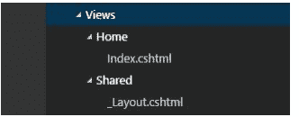

### 6.3.5 AngularJS 程序

首先，从 http://code.angularjs.org/ 下载 AngularJS。将这些文件放入 `/js/lib` 文件夹中。

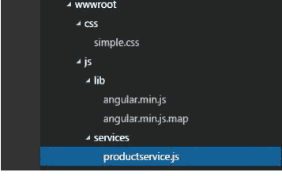

下一步是编写 AngularJS 程序。创建一个名为 `product.service.js` 的文件，并编写以下脚本。

```javascript
var myApp = angular.module('ProductService', []);

myApp.service('DataService', function ($http) {
    
    this.read = function (callback) {
        $http({
            method: 'POST',
            url: 'Home/GetAllProducts/',
            headers: {
                'Content-type': 'application/json'
            }
        }).success(function (resp) {
            callback(resp);
        }).error(function () {
            callback(undefined);
        });
    };

});

myApp.controller('MyController', function ($scope, DataService) {
    $scope.products = [];
    $scope.selected = {};

    $scope.getAllData = function () {
        DataService.read(function (data) {
            $scope.products = data;
        });
    };
    $scope.select = function (selected) {
        $scope.selected = selected;
    };
});
```

以下是 `simple.css` 文件的脚本。

```css
table { margin: 1em; border-collapse: collapse; }
td, th { padding: .3em; border: 1px #ccc solid; }
thead { background: #70ff45; }
.even{
    background-color: #beffca;
}
.odd{
    background-color: #f0fff6;
}
```

### 6.4 测试

现在你准备好运行了。输入以下命令以加载必需的库并执行程序。

```bash
dnu restore
dnx . kestrel
```

打开浏览器并导航到 http://localhost:5004 。

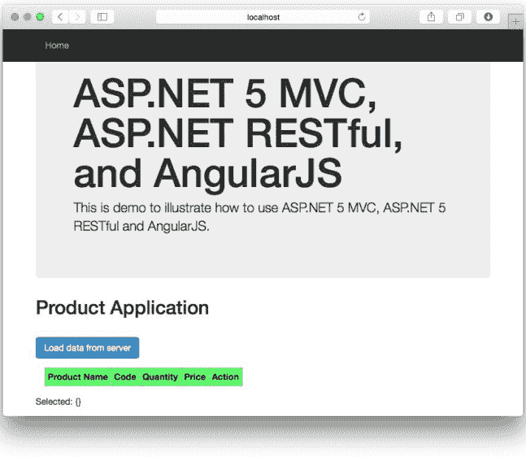

单击“从服务器加载数据”按钮。它应该显示来自服务器的数据。

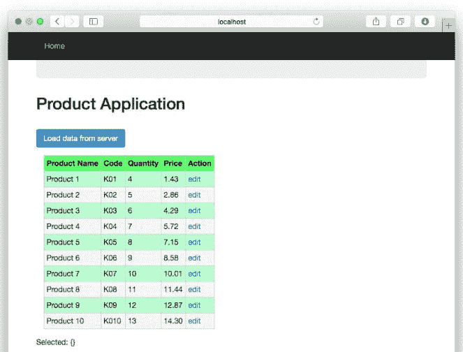

尝试单击表格行中的 `edit` 菜单。然后，选中的项将显示在底部。

#### 产品应用程序

| 产品名称 | 代码 | 数量 | 价格 | 操作 |
| :--- | :--- | :--- | :--- | :--- |
| 产品 1 | K01 | 4 | 1.43 | 编辑 |
| 产品 2 | K02 | 5 | 2.86 | 编辑 |
| 产品 3 | K03 | 6 | 4.29 | 编辑 |
| 产品 4 | K04 | 7 | 5.72 | 编辑 |
| 产品 5 | K05 | 8 | 7.15 | 编辑 |
| 产品 6 | K06 | 9 | 8.58 | 编辑 |
| 产品 7 | K07 | 10 | 10.01 | 编辑 |
| 产品 8 | K08 | 11 | 11.44 | 编辑 |
| 产品 9 | K09 | 12 | 12.87 | 编辑 |
| 产品 10 | K010 | 13 | 14.30 | 编辑 |

选中项：`{"Name":"产品 2","ProductCode":"K02","Quantity":5,"Price":2.86}`

### 6.5 接下来是什么？

你可以通过阅读互联网或书籍上的几个教程来进行更多 AngularJS 实践。我还写了一本关于 AngularJS 编程实例的书。这本书帮助你学习 AngularJS 编程。请访问我的博客，http://blog.aguskurniawan.net/post/AngularJS.aspx 。

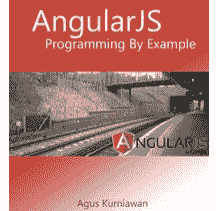

## 源代码

源代码可以从 http://www.aguskurniawan.net/book/aspnet5_06062015ZFR.zip.zip 下载。

## 联系

如果你有关于本书的问题，请通过 aguskur@hotmail.com 联系我。我的博客：http://blog.aguskurniawan.net 。
