# macOS、Linux 和 Windows 版 ASP.NET Core 入门指南


源代码

联系方式

# 前言

这本书旨在帮助任何想要上手 ASP.NET Core 的人。它描述了 ASP.NET Core 的部署以及 ASP.NET Core 的基本元素，并展示了如何使用多种 ASP.NET Core 功能。

Agus Kurniawan

Depok，2017年1月

## 1. 准备开发环境

### 1.1 ASP.NET Core

ASP.NET Core 是一个用于构建 Web 和云应用的轻量级可组合框架。ASP.NET Core 完全开源，并可以在 GitHub 上找到：http://github.com/aspnet/home。

本书将重点介绍如何在 OS X、Linux 和 Windows 平台上开发 ASP.NET Core 1.1。我们使用的是 ASP.NET Core 1.1 版本。

### 1.2 系统要求

为了测试，我使用了 Debian/Ubuntu Linux、macOS 和 Windows 10。你可以使用任何基于 Debian 的 Linux 发行版。

### 1.3 开发工具

通常，我们可以使用任何编辑器来编写 ASP.NET Core 程序。你可以使用 Sublime Text (http://www.sublimetext.com/) 来编写 ASP.NET Core 代码。微软还发布了 Visual Studio Code，你可以在 https://code.visualstudio.com/ 下载。在书中，我使用 Visual Studio Code 开发 ASP.NET Core 程序。

```
{
  "Microsoft.Net.Core": {
    "version": "1.0",
    "type": "nuget"
  },
  "Microsoft.AspNetCore.Diagnostics": {
    "version": "1.1.0"
  },
  "Microsoft.AspNetCore.Mvc.Mvc": {
    "version": "1.1.0"
  },
  "Microsoft.AspNetCore.Razor.Tools": {
    "version": "1.0.8-preview2-final",
    "type": "build"
  },
  "Microsoft.AspNetCore.Server.IISIntegration": {
    "version": "1.1.0"
  },
  "Microsoft.AspNetCore.Server.Kestrel": {
    "version": "1.1.0"
  },
  "Microsoft.AspNetCore.StaticFiles": {
    "version": "1.1.0"
  },
  "Microsoft.Extensions.Configuration.EnvironmentVariables": {
    "version": "1.1.0"
  },
  "Microsoft.Extensions.Configuration.UserSecrets": {
    "version": "1.1.0"
  },
  "Microsoft.Extensions.Logging.Console": {
    "version": "1.1.0"
  },
  "Microsoft.Extensions.Mvc": {
    "version": "1.1.0"
  },
  "Microsoft.Extensions.Options.ConfigurationExtensions": {
    "version": "1.1.0"
  },
  "tools": {
    "Microsoft.AspNetCore.Razor.Tools": "1.0.8-preview2-final",
    "Microsoft.NetCore.Web.Tools": "1.0.8-preview2-final"
  }
}
```

## 2. 部署 ASP.NET Core

在本章中，我们将学习如何部署 ASP.NET Core。

### 2.1 入门

在本节中，我们开始在你的平台上部署 ASP.NET Core。在书中，我使用的是 ASP.NET Core 1.1。请遵循下一节中的安装步骤。

### 2.2 在 macOS, Linux 和 Windows 上部署 ASP.NET Core

要在你的平台上安装 ASP.NET Core，你应该安装 .NET Core SDK。你可以在 https://www.microsoft.com/net/download/core 下载它。

可以在此网站上阅读安装步骤：

- macOS: https://www.microsoft.com/net/core#macos
- Linux: https://www.microsoft.com/net/core#linux
- Ubuntu: https://www.microsoft.com/net/core#ubuntu
- Windows: https://www.microsoft.com/net/core#windows

你可以在 macOS 上看到 .NET Core SDK 1.1。

### 欢迎使用 Microsoft .NET Core 1.1.0 - SDK 1.0.0 Preview 2.1-003177 (x64) 安装

### Microsoft .NET Core CLI

.NET Core 是一个用于构建命令行应用程序、微服务和现代网站的开发平台。它是开源、跨平台的，并由微软支持。如果你喜欢它，请考虑加入活跃的开发者社区……（注：原文此处有大量重复的描述性文本，已按翻译要求保留核心信息）

- 简介
- 许可证
- 安装
- 总结

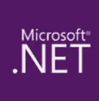

你可以在 macOS 上看到 .NET Core SDK 1.1。

### 欢迎使用 Microsoft .NET Core 1.1.0 - SDK 1.0.0 Preview 2.1-003177 (x64) 安装

### Microsoft .NET Core CLI

.NET Core 是一个用于构建命令行应用程序、微服务和现代网站的开发平台。它是开源、跨平台的，并由微软支持。如果你喜欢它，请考虑加入活跃的开发者社区……

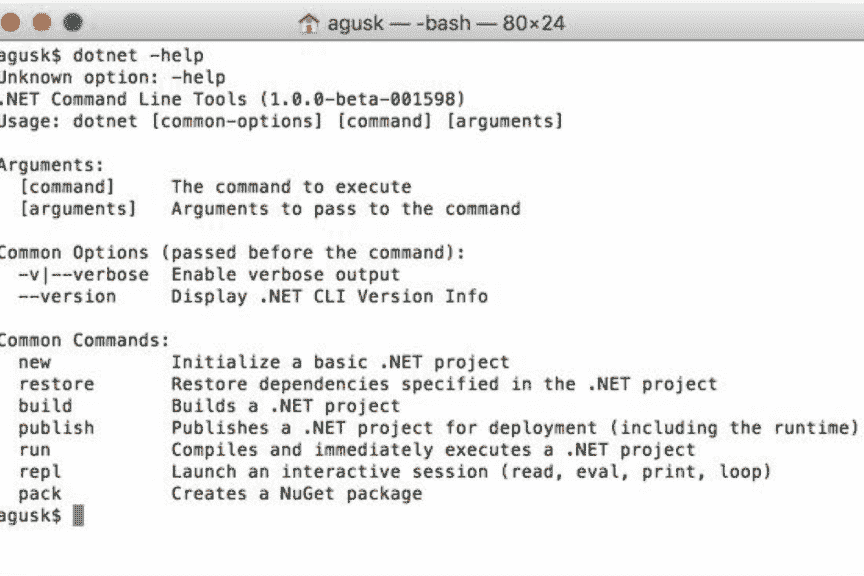

### 2.3 测试

为了测试我们的 .NET Core，我们构建了一个简单的控制台应用程序。在终端中输入这些命令。

```
$ mkdir hello
$ cd hello
$ dotnet new
```

现在你可以加载所有 .NET Core 库。然后运行程序。

```
$ dotnet restore
$ dotnet run
```

你应该在终端中看到“Hello World!”。你可以查看下面的图，这是我的实现。

```
Created new C# project in /Users/agusk/Documents/MyBooks/peppress/aspnet_core/codes/hello.
agusk$ dotnet restore
log : Restoring packages for /Users/agusk/Documents/MyBooks/peppress/aspnet_core/codes/hello/project.json
log : Writing lock file to disk. Path: /Users/agusk/Documents/MyBooks/peppress/aspnet_core/codes/hello/project.lock
log : /Users/agusk/Documents/MyBooks/peppress/aspnet_core/codes/hello/project.lock
log : Restore completed in 112ms.
agusk$ dotnet run
Project.hello (.NETCoreApp,Version=v.1) will be compiled because expected outputs are missing
Compiling hello for .NETCoreApp,Version=v.1
Compilation succeeded.
0 Warning(s)
0 Error(s)
Time elapsed 00:00:01.1428534
```

Hello World!

agusk$

# 3. ASP.NET Core MVC 开发

在本章中我将解释如何进行 ASP.NET Core MVC 开发。

### 3.1 入门


在本章中，我们学习如何从零为 ASP.NET Core MVP 编写程序。

### 3.2 ASP.NET Core 模板

为了简化开发，我们可以使用 `yo` 的 ASP.NET Core 模板。首先，你的电脑应该已经安装 Node.js (`https://nodejs.org/`)。

安装 Node.js 后，你可以安装 `yo` 和 ASP.NET Core 模板。输入这些命令。

```
$ npm install -g bower
$ npm install -g generator-aspnet
```

如果成功，你可以测试它。打开终端并输入此命令。

```
$ yo aspnet
```

你应该能看到模板列表，如下所示。

现在你已经准备好开发 ASP.NET Core 了。

## 3.3 构建你的第一个 ASP.NET Core MVC 应用程序

在本例中，我们为 ASP.NET Core MVC 构建一个简单的程序。我们使用来自 `yo aspnet` 的模板。

### 3.3.1 创建项目

在本节中，我们为 ASP.NET Core MVC 创建新项目。打开终端（Terminal）或命令提示符（Command Prompt）。然后，你可以在终端输入此命令。

```
$ yo aspnet
```

选择使用 Bootstrap 作为 UI 框架的 Web （Web Application）。输入项目名称，例如 `MvcDemo`。

```
codes – TERM_PROGRAM=Apple_Terminal SHELL=/bin/bash — 80×26
agusk$ yo aspnet
      Welcome to the
      marvellous ASP.NET Core
      generator!
  |--(o)--| 
  |       | 
  |   U   | 
  |  \   /  |
 /       /  \
|         /   
|---/    /
|  /      /
| /      /
|  *  Y

7? What type of application do you want to create? Web Application
7? Which UI framework would you like to use? Bootstrap (3.3.6)
7? What's the name of your ASP.NET application? (WebApplication) MvcDemo|
```

如果成功，你应该形成此结构。

### 3.3.2 构建并运行程序

现在你可以测试该程序了。首先，我们使用 `dotnet restore` 加载所有所需的库。然后，我们使用 `dotnet run` 执行程序。

```
$ cd MvcDemo
$ dotnet restore
$ dotnet run
```

如果成功，你可以看到程序的输出。

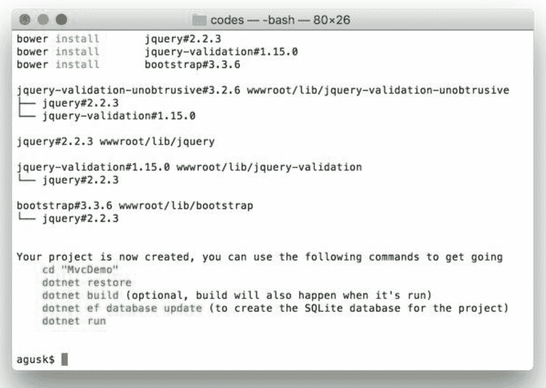

`MvcDemo` - `dotnet run` - 80x26

`MvcDemo` (.NETCoreApp.Version=v1.0) will be compiled because project is not safe for incremental compilation. Use --build-profile flag for more information.

Compiling `MvcDemo` for (.NETCoreApp.Version=v1.0)

Bundling with configuration from `/Users/agusk/Documents/MyBooks/pepress/aspnet_core/codes/MvcDemo/bundleconfig.json`

Processing www://root/css/site.min.css

Processing www://root/site.min.js

Compilation succeeded.

+   0 Warning(s)

0 Error(s)

Time elapsed 00:00:03.045627

(The compilation time can be improved. Run dotnet build --build-profile for more information)

+   - Microsoft.Extensions.DependencyInjection.DataProtectionServices[0]

- User profile is available. Using '/Users/agusk/.aspnet/DataProtection-Keys' at key repository; key will not be encrypted at rest.

- Hosting environment: Production

Content root path: `/Users/agusk/Documents/MyBooks/pepress/aspnet_core/codes/MvcDemo`

Now listening on: http://localhost:5000

Application started. Press Ctrl+C to shut down.

你可以打开浏览器并导航到 `http://localhost:5000`。你可以看到下方所示的表单。

## 3.4 构建 ASP.NET Core MVC 应用程序

第二个演示是从零开始构建 ASP.NET Core MVC 应用程序。我们开发了一个简单的输入表单并利用 ASP.NET Core MVC 会话（session）。以下是我们的场景：

- 用户填写表单创建一个新产品
- 用户点击保存按钮保存数据
- 数据将存储在会话栈（session stack）中
- 然后，数据将在另一个页面上显示

我们开始开发。

### 3.4.1 创建项目

首先，我们通过 `yo aspnet` 创建项目。打开终端并输入此命令：

```
$ yo aspnet
```

请选择空 Web 应用（Empty Web Application）。输入项目名称，`ProductApp`。

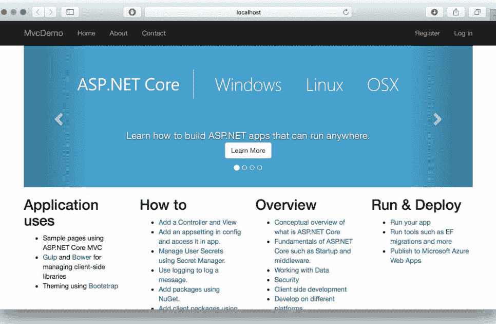

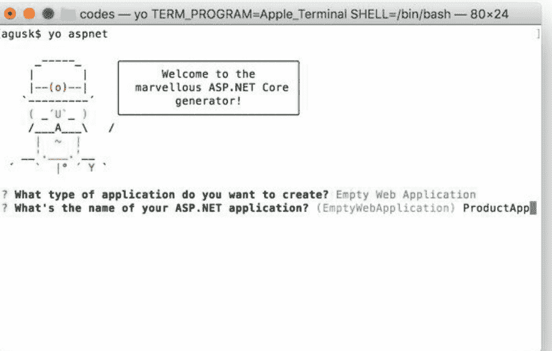

你应该选择空 Web 应用。你可以使用 Visual Studio Code 加载此文件夹。

### 3.4.2 配置 ASP.Net MVC 项目

我们需要在项目根文件夹上创建一个名为 `project.json` 的配置文件。它包含了所需的库。我们编写此 `project.json` 脚本以在 ASP.Net Core 上启用 MVC。

- Controllers（控制器）
- Models（模型）
- Views（视图）


```json
{
  "dependencies": {
    "Microsoft.NETCore.App": {
      "version": "1.1.0",
      "type": "platform"
    },
    "Microsoft.AspNetCore.Diagnostics": "1.1.0",
    "Microsoft.AspNetCore.Mvc": "1.1.0",
    "Microsoft.AspNetCore.Razor.TagHelpers": {
      "version": "1.0.0-preview-2-final",
      "type": "build"
    },
    "Microsoft.AspNetCore.Server.IISIntegration": "1.1.0",
    "Microsoft.AspNetCore.Server.Kestrel": "1.1.0",
    "Microsoft.AspNetCore.SpaServices": "1.1.0-*",
    "Microsoft.AspNetCore.StaticFiles": "1.1.0",
    "Microsoft.Extensions.Configuration.EnvironmentVariables": "1.1.0",
    "Microsoft.Extensions.Configuration.Json": "1.1.0",
    "Microsoft.Extensions.Configuration.CommandLine": "1.1.0",
    "Microsoft.Extensions.Logging": "1.1.0",
    "Microsoft.Extensions.Logging.Console": "1.1.0",
    "Microsoft.Extensions.Logging.Debug": "1.1.0",
    "Microsoft.Extensions.Options.ConfigurationExtensions": "1.1.0"
  },
  "tools": {
    "Microsoft.AspNetCoreCore.Razor.Tools": "1.0.0-preview2-final",
    "Microsoft.AspNetCore.Server.IISIntegration.Tools": "1.0.0-preview2-final",
    "Microsoft.DotNet.Watcher.Tools": "1.0.0-preview2-final"
  },
  "frameworks": {
    "netcoreapp1.1": {
      "imports": [
        "dotnet5.6",
        "portable-net45+win8"
      ]
    },
    "buildOptions": {
      "emitEntryPoint": true,
      "preserveCompilationContext": true,
      "compile": {
        "exclude": ["node_modules"]
      }
    },
    "runtimeOptions": {
      "configProperties": {
        "System.GC.Server": true
      }
    },
    "publishOptions": {
      "include": [
        "appsettings.json",
        "ClientApp/dist",
        "Views",
        "web.config",
        "wwwroot"
      ],
      "exclude": [
        "wwwroot/*.map"
      ]
    }
  }
}
```

然后，创建以下文件夹：

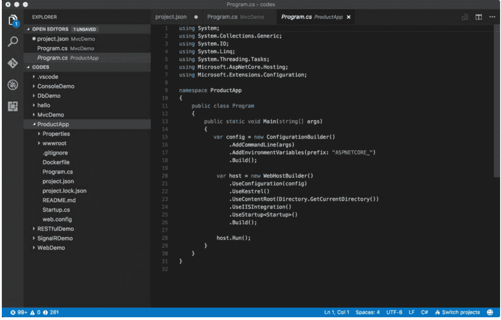

### 3.4.3 编写程序

在本节中，我们编写 ASP.NET Core 程序。

#### 3.4.3.1 创建模型

模型持有数据。在本例中，我们创建一个名为 `Product` 的模块，它包含四个属性。创建一个名为 `Product.cs` 的文件并编写此代码：

```csharp
using System.ComponentModel.Annotations;
namespace ProductApp.Models
{
    public class Product
    {
        [Required]
        [MinLength(4)]
        [Display(Name = "名称")]
        public string Name { get; set; }
        [Display(Name = "产品代码")]
        public string ProductCode { get; set; }
        [Display(Name = "数量")]
        public int Quantity { get; set; }
        [Display(Name = "是否有折扣")]
        public bool IsDiscount { get; set; }
    }
}
```

将此文件保存到 `Models` 文件夹。

#### 3.4.3.2 创建控制器

现在我们创建一个 MVC 控制器，名为 `HomeController`。创建一个名为 `HomeController.cs` 的文件并编写此代码：

```csharp
using System;
using System.Collections.Generic;
using System.Linq;
using System.Threading.Tasks;
using Microsoft.AspNetCore.Mvc;

using ProductApp.Models;
namespace ProductApp.Controllers
{
    public class HomeController : Controller
    {
        public IActionResult Index()
        {
            return View();
        }
        public IActionResult Create()
        {
            var product = new Product();
            return View(product);
        }
        [HttpPost]
        public IActionResult Create(Product obj)
        {
        }
    }
}
```

```csharp
// 执行数据库处理
/////
// 为了测试，将其保存到 Session
TempData["name"] = obj.Name;
TempData["code"] = obj.ProductCode;
TempData["quantity"] = obj.Quantity;
TempData["discount"] = obj.IsDiscount.ToString();

return RedirectToAction("Save");
}
public IActionResult Save()
{
    var product = new Product();
    product.Name = (string)TempData["name"];
    product.ProductCode = (string)TempData["code"];
    product.Quantity = (int)TempData["quantity"];
    product.IsDiscount = Convert.ToBoolean((string)TempData["discount"]);

    return View(product);
}
```

#### 3.4.3.3 创建视图

我们按照如下方式创建三个页面文件：

- `Index.cshtml`
- `Create.cshtml`
- `Save.cshtml`
- `_Layout.cshtml`

在 `Views` 文件夹内部创建一个名为 `Home` 的文件夹。然后，添加 `Index.cshtml`、`Create.cshtml` 和 `Save.cshtml` 文件。此外，创建一个名为 `Shared` 的文件夹。然后在该文件夹内添加 `_Layout.cshtml` 文件。

你可以从下图中查看视图结构。


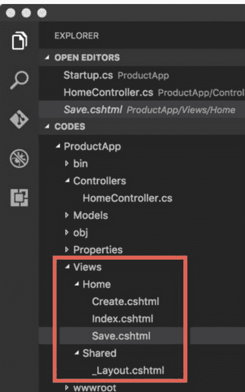

我们还创建了一个布局文件 `_Shared.cshtml`。它用于视图模板。编写此脚本。

```html
<!DOCTYPE html>
<html>
<head>
    <meta charset="utf-8" />
    <meta name="viewport" content="width=device-width, initial-scale=1.0">
    <title>ViewBag.Title - 我的 ASP.NET MVC Core </title>
    <link rel="stylesheet" href="https://cdn.bootstrapcdn.com/bootstrap/3.3.7/css/bootstrap.min.css" integrity="sha384-BVvYiISFekIdGmRYakcuHARgR32EdUcww7n3YJgdV4PmStssz/K8vdbE4jh4u" />
</head>
<body>
    <div class="navbar navbar-inverse navbar-fixed-top">
        <div class="container">
            <div class="navbar-header">
                <button type="button" class="navbar-toggle" data-toggle="collapse" data-target="navbar">
                    <span class="icon-bar"></span>
                    <span class="icon-bar"></span>
                    <span class="icon-bar"></span>
                </button>
            </div>
            <div class="navbar-collapse collapse">
                <ul class="navbar-nav">
                    <li><a href="/">首页</a>a></li>
                </ul>
            </div>
        </div>
    </div>
    <div class="container body-content">
        @RenderBody()
    </div>
    <footer>
        <p>@copy Date.Now.Year - 我的 ASP.NET MVC Core 应用程序</p>
    </footer>
</body>
</html>
```

### `Index.cshtml` 文件的脚本

```razor
{
  Layout = "/Views/Shared/_Layout.cshtml";
  ViewBag.Title = "首页";
}
<div class="jumbotron">
  <h1>ASP.NET Core MVC 演示</h1>
  <p class="lead"> 填写并提交表单。</p>
  <p><a href="/Home/Create" class="btn btn-primary btn-large">创建 &rsquo;</a</p>
</div>
```

### `Create.cshtml` 文件的脚本

```razor
@using ProductApp.Models
@model Product
{
  Layout = "/Views/Shared/_Layout.cshtml";
  ViewBag.Title = "创建产品";
}
<div class="jumbotron">
  <h1>ASP.NET MVC Core</h1>
  <p class="lead">创建一个新产品。填写此表单。完成后，点击保存按钮。</p>
</div>
@using Html.BeginForm() {
  <fieldset>
    <legend>创建一个新产品</legend>
    <div class="editor-label">
      @Html.LabelFor(model => model.Name)
    </div>
    <div class="editor-field">
      @Html.TextBoxFor(model => model.Name)
    </div>
    <br/>
    <div class="editor-label">
      @Html.LabelFor(model => model.ProductCode)
    </div>
    <div class="editor-field">
      @Html.TextBoxFor(model => model.ProductCode )
    </div>
    <br/>
    <div class="editor-label">
      @Html.LabelFor(model => model.Quantity)
    </div>
    <div class="editor-field">
      @Html.TextBoxFor(model => model.Quantity )
    </div>
  </fieldset>
<div class="editor-label">
  <div style="float: left;">
    @Html.CheckboxFor(model => model.IsDiscount)
  </div>

  @Html.LabelFor(model => model.IsDiscount)
</div>
<br/>

  <input type="submit" value="保存" />
</fieldset>
```

### `Save.cshtml` 文件的脚本

```razor
@using ProductApp.Models
@model Product
{
  Layout = "/Views/Shared/_Layout.cshtml";
  ViewBag.Title = "保存产品";
}
<div class="jumbotron">
  <h1>ASP.NET Core MVC 演示</h1>
  <p class="lead"> 保存产品。</p>
  <p><a href="/Home/Create" class="btn btn-primary btn-large">创建 &rsquo;</a</p>
</div>
```

App 将通过执行 `Startup.cs` 文件启动。请修改此文件并写入以下代码。


```csharp
using System;
using System.Collections.Generic;
using System.Linq;
using System.Threading.Tasks;
using Microsoft.AspNetCore.Builder;
using Microsoft.AspNetCore.Hosting;
using Microsoft.Extensions.Configuration;
using Microsoft.Extensions.DependencyInjection;
using Microsoft.Extensions.Logging;

namespace ProductAPI
{
    public class Startup
    {
        public Startup(IHostingEnvironment env)
        {
            var builder = new ConfigurationBuilder()
                .SetBasePath(env.ContentRootPath)
                .AddJsonFile("appsettings.json", optional: true, reloadOnChange: true)
                .AddJsonFile("appsettings.{env.EnvironmentName}.json", optional: true)
                .AddEnvironmentVariables();
            Configuration = builder.Build();
        }

        public IConfiguration Configuration { get; }

        // 此方法由运行时调用。使用此方法向容器中添加服务。
        public void ConfigureServices(IServiceCollection services)
        {
            // 添加框架服务。
            services.AddMvc();
        }

        // 此方法由运行时调用。使用此方法来配置 HTTP 请求。
        public void Configure(IApplicationBuilder app, IHostingEnvironment env, ILoggerFactory logger)
        {
            logger.AddConsole(Configuration.GetSection("Logging"));
            logger.AddDebug();

            app.UseMvc(routes =>
            {
                routes.MapRoute(
                    name: "default",
                    template: "controller=Home}/{action=Index}/{id?}");
                );
            });
        }
    }
}
```

## 4.2.2 为 ASP.Net Core API 编写程序

下一步是在 ASP.Net Core MVC 上编写 RESTful API。你将创建一个控制器 `ProductController.cs` 和一个模型 `Product.cs`。你可以看到如下项目结构。

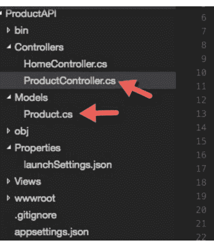

以下是 `Product` 模型的代码。

```csharp
using System.ComponentModel.DataAnnotations;

namespace ProductAPI.Models
{
    public class Product
    {
        [Required]
        [MinLength(4)]
        [Display(Name = "Name")]
        public string Name { get; set; }
        [Display(Name = "Product Code")]
        public string ProductCode { get; set; }
        [Display(Name = "Quantity")]
        public int Quantity { get; set; }
        [Display(Name = "is Discount")]
        public bool Isdiscount { get; set; }
    }
}
```

在 `Product` 控制器中，我们暴露了 `Get` 方法为 `Product` 生成一个随机列表。以下是代码实现。

```csharp
using System;
using System.Collections.Generic;
using System.Linq;
using System.Threading.Tasks;
using Microsoft.AspNetCore.Mvc;

using ProductAPI.Models;
namespace ProductAPI.Controllers
{
    public class ProductController : Controller
    {
        // 获取产品列表
        [HttpGet]
        public List<ProductAPI.Models.Product> Get()
        {
            // 生成产品
            List<ProductAPI.Models.Product> list = new List<ProductAPI.Models.Product>();
            for(int i=0;i<10;i++){
                Product o = new Product();
                o.Name = String.Format("Product %0",i);
                o.ProductCode = String.Format("PR%0",i);
                o.Quantity = i;
                o.IsDiscount = true;

                list.Add(o);
            }

            return list;
        }
    }
}
```

保存所有代码。

## 4.2.3 测试

现在我们可以测试我们的 ASP.NET Core API。在项目文件夹中，导航到终端并输入这些命令。

```bash
$ dotnet restore
$ dotnet build
$ dotnet run
```

如果完成，你可以打开浏览器并导航到 `http://localhost:5000/product`。你应该看到产品列表。你可以查看下中的输出。


```json
{"name":"Product 0","productCode":"PR0","quantity":0,"isDiscount":true},{"name":"Product 1","productCode":"PR1","quantity":1,"isDiscount":true},{"name":"Product 2","productCode":"PR2","quantity":2,"isDiscount":true},{"name":"Product 3","productCode":"PR3","quantity":3,"isDiscount":true},{"name":"Product 4","productCode":"PR4","quantity":4,"isDiscount":true},{"name":"Product 5","productCode":"PR5","quantity":5,"isDiscount":true},{"name":"Product 6","productCode":"PR6","quantity":6,"isDiscount":true},{"name":"Product 7","productCode":"PR7","quantity":7,"isDiscount":true},{"name":"Product 8","productCode":"PR8","quantity":8,"isDiscount":true},{"name":"Product 9","productCode":"PR9","quantity":9,"isDiscount":true}
```

现在你的 ASP.NET Core API 运行良好。在下一节中，我们将构建 ASP.NET Core MVC 来消费 RESTful API。

## 4.3 ASP.Net Core 客户端应用程序

在本节中，我们编写 ASP.Net MVC 程序。我们使用 HTML5 视图访问 RESTful API。

### 4.3.1 创建控制器

首先，我们创建一个 MVC 的控制器。创建一个 `HomeController.cs` 文件并写入此代码。

```csharp
using System.Collections.Generic;
using System.Linq;
using System.Threading.Tasks;
using Microsoft.AspNetCore.Mvc;

namespace ProductAPI.Controllers
{
    public class HomeController : Controller
    {
        public IActionResult Index()
        {
            return View();
        }
    }
}
```

接下来，你应该创建视图。

### 4.3.2 创建视图，Layout.cshtml 作为模板，Index.cshtml 作为 UI

我们创建两个页面：`Layout.cshtml` 作为模板，`Index.cshtml` 作为 UI。你可以看到下中的视图结构。

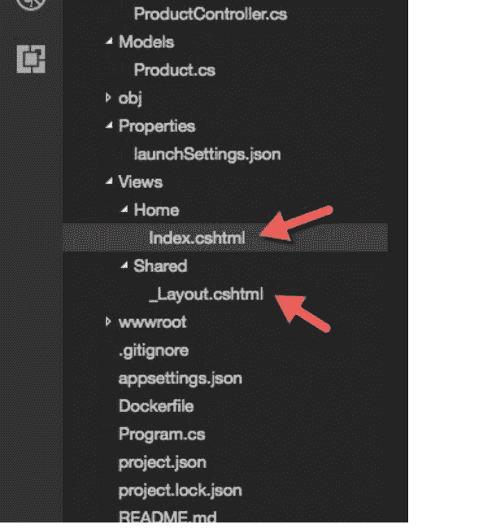

我们还创建了一个布局 `Layout.cshtml`。写入此脚本。

```html
<!DOCTYPE html>
<html>
<head>
    <meta charset="utf-8" />
    <meta name="viewport" content="width=device-width, initial-scale=1.0">
    <title>ViewBag.Title - My ASP.NET MVC Application</title>
    <link rel="stylesheet" href="https://cdn.bootstrapcdn.com/bootstrap/3.3.7/css/bootstrap.min.css">

<style>
    table { margin: 1em; border-collapse: collapse; }
    td, th { padding: 3em; border: 1px solid #ccc; }
    thead { background: #f0ff45; }
    .event{
      background-color: #beffca;
    }
    .odd {
      background-color: #f0f0f0;
    }
</style>
</head>
<body>
<div class="navbar navbar-default">
  <div class="container">
    <a class="navbar-brand" href="#">ASP.NET MVC Core</a>
    <div class="navbar-collapse-right">
      <button class="navbar-toggle" type="button" data-toggle="collapse" data-target="#navbar-collapse">
        <span class="glyphicon-icon"></span>
      </button>
      <ul class="nav navbar-collapse" id="navbar-collapse">
        <li class="nav-item"><a class="nav-link" href="/">Home</a></li>
      </ul>
    </div>
  </div>
</div>
<div class="container">
  @RenderBody()
</div>
<footer class="container">
  <p>&copy; @DateTime.Now.Year - My ASP.NET MVC Application</p>
</footer>
<script src="https://code.jquery.com/jquery-3.1.1.min.js"></script>
<script src="https://cdn.bootstrapcdn.com/bootstrap/3.3.7/js/bootstrap.min.js"></script>
</body>
</html>
```

以下是 `Index.cshtml` 文件。


```html
@{
    Layout = "_Shared/_Layout";
    ViewBag.Title = "Home Page";
}
<div class="jumbotron">
  <h1>ASP.NET MVC Demo</h1>
  <p class="lead">Access ASP.NET API.</p>
  <p><a href="#" id="get-data" class="btn btn-primary">Get JSON data</a></p>
  <span id="show-data"></span>
</div>
<table id="myTable" class="table">
  <thead>
    <tr>
      <th>Product Name</th>
      <th>Quantity</th>
      <th>Is Discount</th>
    </tr>
  </thead>
  <tbody>
    <!-- Data will be loaded -->
  </tbody>
</table>

<script>
$(document).ready(function () {
  $('#get-data').click(function () {
    var showData = $('#show-data');

    $.getJSON('/product/get', function (data) {
      console.log(data);

      var tableRef = document.getElementById('myTable').getElementsByTagName('tbody')[0];
      for (var i = 0; i < data.length; i++) {
        var newRow = tableRef.insertRow(tableRef.rows.length);
        var newCell1 = newRow.insertCell(0);
        var newText1 = document.createTextNode(data[i].name);
        newCell1.appendChild(newText1);
        var newCell2 = newRow.insertCell(1);
        var newText2 = document.createTextNode(data[i].productCode);
        newCell2.appendChild(newText2);
        var newCell3 = newRow.insertCell(2);
        var newText3 = document.createTextNode(data[i].quantity);
        newCell3.appendChild(newText3);
        var newCell4 = newRow.insertCell(3);
        var newText4 = document.createTextNode(data[i].isDiscount);
        newCell4.appendChild(newText4);
      }
    });
    showData.text('Loading the JSON file.');
  });
});
</script>
```

# ASP.NET Core MVC 演示

访问 ASP.NET Core API。

```
获取 JSON 数据 »
```

| 产品名称 | 编码 | 数量 | 是否有折扣 |
|---|---|---|---|
| 产品 0 | PR0 | 0 | true |
| 产品 1 | PR1 | 1 | true |
| 产品 2 | PR2 | 2 | true |
| 产品 3 | PR3 | 3 | true |
| 产品 4 | PR4 | 4 | true |
| 产品 5 | PR5 | 5 | true |
| 产品 6 | PR6 | 6 | true |
| 产品 7 | PR7 | 7 | true |
| 产品 8 | PR8 | 8 | true |
| 产品 9 | PR9 | 9 | true |

# 5. ASP.NET Core 与 Angular 2

在本章中，我将介绍如何配合 ASP.NET Core MVC 和 Angular 2 进行工作。

## 5.1 入门

在本节中，我们将开发一个简单的应用程序来配合 ASP.NET RESTful 和 AngularJS 使用。

AngularJS 是由 Google 维护的开源 JavaScript 框架，你可以访问其官方网站 `http://angularjs.org/`。

在本章中，我们将探索如何将 Angular 2 集成到 ASP.NET Core 中。

## 5.2 ASP.NET Core 和 Angular 2 项目模板

你可以在官方网站 `https://angular.io` 学习 Angular 2。我们使用 JavaScript 和 TypeScript 开发 Angular 2。

将 ASP.NET Core MVC 和 Angular 2 整合的思路是将这两个项目（ASP.NET Core 和 Angular 2）合并。幸运的是，我们可以使用 `aspnetcore` `spa` 模板，`https://github.com/aspnet/JavaScriptServices`。

你可以在终端中输入此命令来使用该模板。

```
$ npm install -g yo generator-aspnetcore-spa
```

如果完成，你可以从此项目模板构建一个示例项目。

## 5.3 运行演示：ASP.NET Core Angular SPA

在本节中，我们运行 `aspnetcore` `spa` 模板中的程序示例。

### 5.3.1 创建项目

你可以通过输入以下命令创建带有 Angular 2 的 ASP.NET Core。

```
$ yo aspnetcore-spa
```

选择 Angular 2 作为框架。

# aspnetcore_angular2 — yo TERM_PROGRAM=Apple_Terminal — 80x24

```
agusk$$ cd aspnetcore_angular2/
agusk$$ yo
? 'Allo Agus! 你想做什么? Aspnetcore Spa

请确保你处于想要脚手架的目录中。
此生成器也可以通过以下命令运行：yo aspnetcore-spa
```

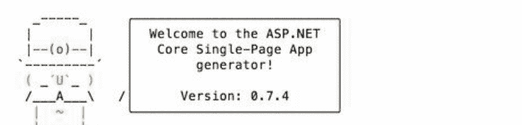

- 框架
- Angular 2
- Aurelia
- Knockout
- React
- 带 Redux 的 React

给项目命名命名，称为 ProductAng。

# aspnetcore_angular2 — yo TERM_PROGRAM=Apple_Terminal — 80x24

```
agusk$$ cd aspnetcore_angular2/
agusk$$ yo
? 'Allo Agus! 你想做什么? Aspnetcore Spa

请确保你处于想要脚手架的目录中。
此生成器也可以通过以下命令运行：yo aspnetcore-spa
```


- 框架 Angular 2。
- 你想创建什么类型的项目？`project.json` (兼容 .NET Core 工具预览 2 和 Visual Studio 2015)
- 你想包含单元测试吗？否
- 你的项目名称 (`aspnetcore_angular2`) ProductAng

### 5.3.2 运行程序

要运行程序，像往常一样操作。打开终端并导航到项目文件夹。然后输入这些命令。

```
$ dotnet restore
$ dotnet build
$ dotnet run
```

打开浏览器并导航到 `http://localhost:5000/`。你应该能看到带有 Angular 2 的 SPA。

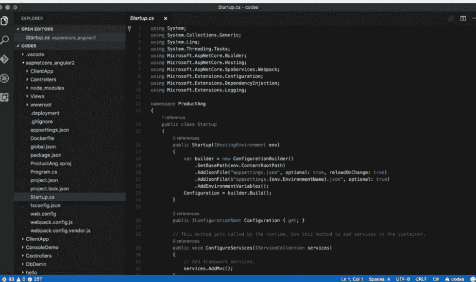

## Hello, world!

欢迎来到你的新单页应用，它构建于：

- 用于跨平台服务器代码的 ASP.NET Core 和 C#
- 用于客户端代码的 Angular 2 和 TypeScript
- 用于构建和打包客户端资源的 Webpack
- 用于布局和样式的 Bootstrap

为了帮助你入门，我们已经设置了：

- 客户端导航。例如，点击 Counter 然后点击 Back 返回此处。


- 服务端渲染。为了更快的初始加载和改进 SEO，你的 Angular 2 应用生成的 HTML 将传输到浏览器，那里有一个客户端副本。
- Webpack 开发中间件。在开发模式下，当你修改任何文件时都会更新。
- 热模块替换。在开发模式下，你无需刷新页面。
- 高效构建。在生产模式下，开发功能被禁用，webpack 会产生压缩后的 CSS 和 JavaScript 文件。

你可以点击 Fetch 数据来查看 Angular 2。

## 5.4 接下来是什么？

你可以通过阅读网络上的教程或书籍了解更多关于 AngularJS。我写了一本关于 AngularJS 的书。请访问我的博客 `http://aguskiawan.net/post/AngularJS`。我正在编写一本关于 Angular 2 的新书。

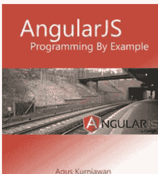

# 6. ASP.NET Core, Entity Framework 和 PostgreSQL

在本章中，我将解释如何配合 ASP.NET Core MVC、Entity Framework 和 PostgreSQL 进行工作。

## 6.1 入门

在本章，我们将学习如何配合 ASP.NET Core MVC、Entity Framework 和 PostgreSQL 进行工作。

## 6.2 PostgreSQL

在本章中，我们将使用 PostgreSQL。你可以将其安装在：

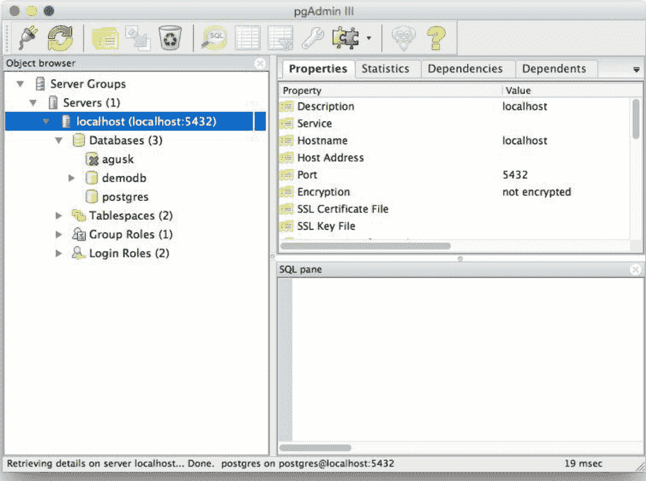

## 6.3 Entity Framework

在本节中，我们将使用 Entity Framework 构建 ASP.NET Core MVC。

## 6.4 数据访问

在项目中加载 EF Core 后，我们将开发访问 PostgreSQL 的类。我们创建 Model 和 Data 对象。

### 6.4.1 构建数据库

首先，我们在 PostgreSQL 中创建一个表。

```sql
CREATE TABLE product (
  id SERIAL PRIMARY KEY,
  name TEXT NOT NULL,
  product_code TEXT,
  quantity INTEGER,
  is_discount BOOLEAN
);
ALTER TABLE product OWNER TO postgres;
```

### 6.4.2 创建 ASP.NET Core 项目

我们创建一个 ASP.NET Core MVC 项目。

### 6.4.3 配置数据库

接下来，将连接字符串添加到 `appsettings.json`。

```json
{
  "ConnectionStrings": {
    "DefaultConnection": "Data Source=localhost;Port=5432;Database=PostgresDemo;User ID=agusk;Password=agusk"
  },
  "Logging": {
    "LogLevel": {
      "Default": "Debug",
      "Microsoft": "Information"
    }
  }
}
```

为了操作 Product 表，我们在我们的对象中定义了两个方法：`Save()` 和 `GetProductByCode()`。

```csharp
using System.Linq;
using PostgresDemo.Models;

namespace PostgresDemo.Data
{
    public class ProductRepo
    {
        private readonly DbContext _databaseContext;
        public ProductRepo(DbContext databaseContext)
        {
            _databaseContext = databaseContext;
        }
        public Product GetProductByCode(string code)
        {
            return _databaseContext.Products.SingleOrDefault(x => x.ProductCode == code);
        }
        public void Save(Product product)
        {
            var productFromDb = _databaseContext.Products.SingleOrDefault(x => x.Id == product.Id);
            if(productFromDb != null)
            {
                productFromDb = product;
            }
            else
            {
                _databaseContext.Products.Add(product);
            }
            _databaseContext.SaveChanges();
        }
    }
}
```

这些对象将从 Controller 中调用。

## 6.4.5 开发 ASP.Net MVC

我们创建了 Product Controller 来处理视图并将数据推送到 UI。以下是 ProductCategory 类的实现。


```csharp
using System;
using System.Collections.Generic;
using System.Linq;
using System.Threading.Tasks;
using Microsoft.AspNetCore.Mvc;
using PostgresDemo.Data;
using PostgresDemo.Models;

namespace PostgresDemo.Controllers
{
    public class ProductController : Controller
    {
        private readonly ProductRepo _productRepository;
        public ProductController(DemoDbContext databaseContext)
        {
            _productRepository = new ProductRepo(databaseContext);
        }

        public IActionResult Index()
        {
            return View();
        }

        public IActionResult Create()
        {
            return View();
        }
        [HttpPost]
        public IActionResult Create(ProductViewModel obj)
        {
            // 数据库处理
            ////
            Product o = new Product();
            o.Id = obj.Id;
            o.Name = obj.Name;
            o.ProductCode = obj.ProductCode;
            o.Quantity = obj.Quantity;
            o.IsDiscount = obj.IsDiscount;
            _productRepository.Save(o);
            return RedirectToAction("Save");
        }

        public IActionResult Save()
        {
            return View();
        }

        public IActionResult ActionResult ListProduct()
        {
            return View(new ProductViewModel());
        }
        [HttpPost]
        public IActionResult List(string code)
        {
            Product obj = _productRepository.GetProductByCode(code);
            ProductViewModel o = new ProductViewModel();
            if(o!=null)
            {
                o.Id = obj.Id;
                o.Name = obj.Name;
                o.ProductCode = obj.ProductCode;
                o.Quantity = obj.Quantity;
                o.IsDiscount = obj.IsDiscount;
            }
            return View(o);
        }
    }
}
```

为了在项目中激活 EF Core，我们在 `Startup.cs` 文件的 `ConfigureServices()` 方法中添加数据库上下文。添加这些代码。

```csharp
public void ConfigureServices(IServiceCollection services)
{
    // 添加框架服务。
    services.AddDbContext<ApplicationDbContext>(options =>
        options.UseSqlite(Configuration.ConnectionString("DefaultConnection")));

    services.AddIdentity<ApplicationUser, IdentityRole>()
        .AddEntityFrameworkStores<ApplicationDbContext>()
        .AddDefaultTokenProviders();

    services.AddMvc();

    // 添加 postgresql
    var connectionString = Configuration["DbContextSettings:ConnectionString"];
    services.AddDbContext<DemoDbContext>(opts => opts.UseNpgsql(connectionString));

    // 添加应用服务。
    services.AddTransient<IEmailSender, AuthMessageSender>();
    services.AddTransient<ISmsSender, AuthMessageSender>();
}
```

### 6.4.6 开发 ASP.NET Core MVC 视图

开发完 Controller 后，我们开发视图。我们在 Views 中创建 Product。然后创建如图所示的四个视图文件。


以下是 `Index.cshtml` 文件的实现。

```cshtml
@{
  Layout = "Views/Shared/Layout.cshtml";
  ViewBag.Title = "Home Page";
}

<div class="jumbotron">
  <h1>AS.NET Core MVC Demo //</h1>
  <p class="lead">填写并提交表单。</p>
  <p><a href="/Create" class="btn btn-primary btn-large">Create &raquo;</a></p>
</div
```

以下是 `Create.cshtml` 文件的实现。


```cshtml
@using PostgresDemo.Models
@model ProductViewModel
@{
  Layout = "Views/Shared/Layout.cshtml";
  ViewBag.Title = "Create Product";
}

<div class="jumbotron">
  <h1>AS.NET Core MVC and Postgres /</h1>
  <p class="lead">创建一个新产品。填写此表单。完成后，点击保存按钮。</p>
</div>
@using (Html.BeginForm()) {
  <fieldset>
    <legend>Create a new Product</legend>
<div class="editor-label">
    @Html.LabelFor(model => model.Name)
</div>
<div class="editor-field">
    @Html.TextBoxFor(model => model.Name)
</div>
<div class="editor-label">
    @Html.LabelFor(model => model.ProductCode)
</div>
<div class="editor-field">
    @Html.TextBoxFor(model => model.ProductCode)
</div>
<br/>
<div class="editor-label">
    @Html.LabelFor(model => model.Quantity)
</div>
<div class="editor-field">
    @Html.TextBoxFor(model => model.Quantity)
</div>
<br/>
<div class="editor-label">
    <div style="float: left;">
        @Html.CheckBoxFor(model => model.IsDiscount)
    </div>
    @Html.LabelFor(model => model.IsDiscount)
</div>
<br/>
<input type="submit" value="Save" />
</fieldset>
```

Save.cshtml 文件的实现。

```cshtml
@{
  Layout = "Views/Shared/Layout.cshtml";
  ViewBag.Title = "Saved";
}
<div class="jumbotron">
  <h1>AS.NET Core MVC and PostgreSQL</h1>
  <p class="lead">Product saved to PostgreSQL.</p>
</div>
```

List.cshtml 文件的实现。

```cshtml
@using PostgresDemo.Models
@model ProductViewModel
@{
  Layout = "Views/Shared/Layout.cshtml";
  ViewBag.Title = "List Product";
}
<div class="jumbotron">
  <h1>AS.NET Core MVC and PostgreSQL</h1>
  <p class="lead">Filter product by code search.</p>
</div>
@using (Html.BeginForm()) {
  <fieldset>
    <legend>Product Search</legend>
    <div class="editor-label">
      <label>Product Code</label>
    </div>
    <div class="editor-field">
      <input type="text" id="code" name="code">
    </div>
    <br/>
    <input type="submit" value="Search" />
  </fieldset>
}
```

## 6.4.7 测试

现在你可以运行程序了。

```
$ dotnet restore
$ dotnet build
$ dotnet run
```

打开浏览器并导航到 `http://localhost:5000/product`。

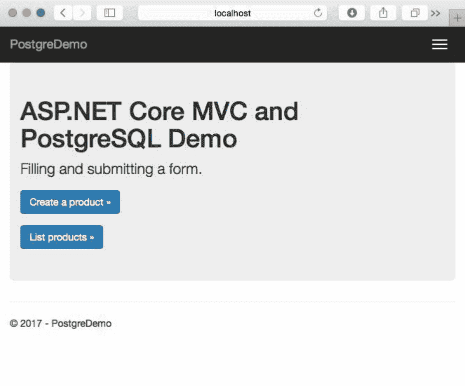

然后，点击 Create a product 按钮。

填写创建新产品的所有字段。

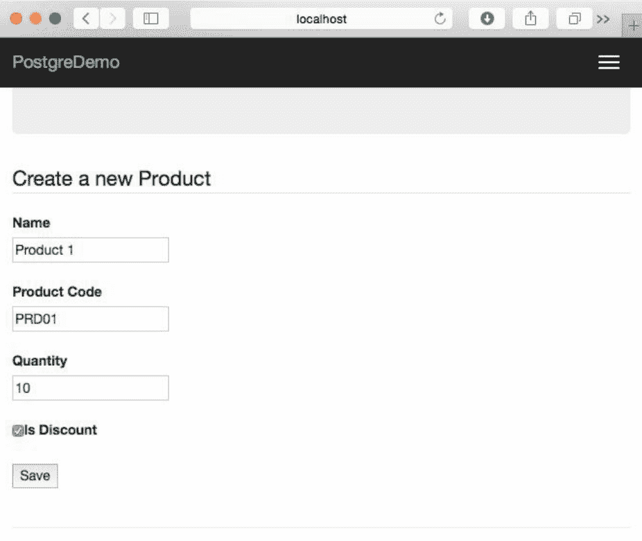

完成后，点击 Save 按钮。如果成功，你应该看到下面的表单。

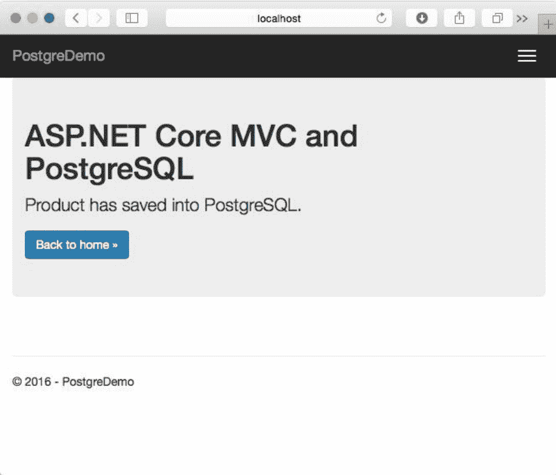

你可以在 PostgreSQL 管理器中验证数据。

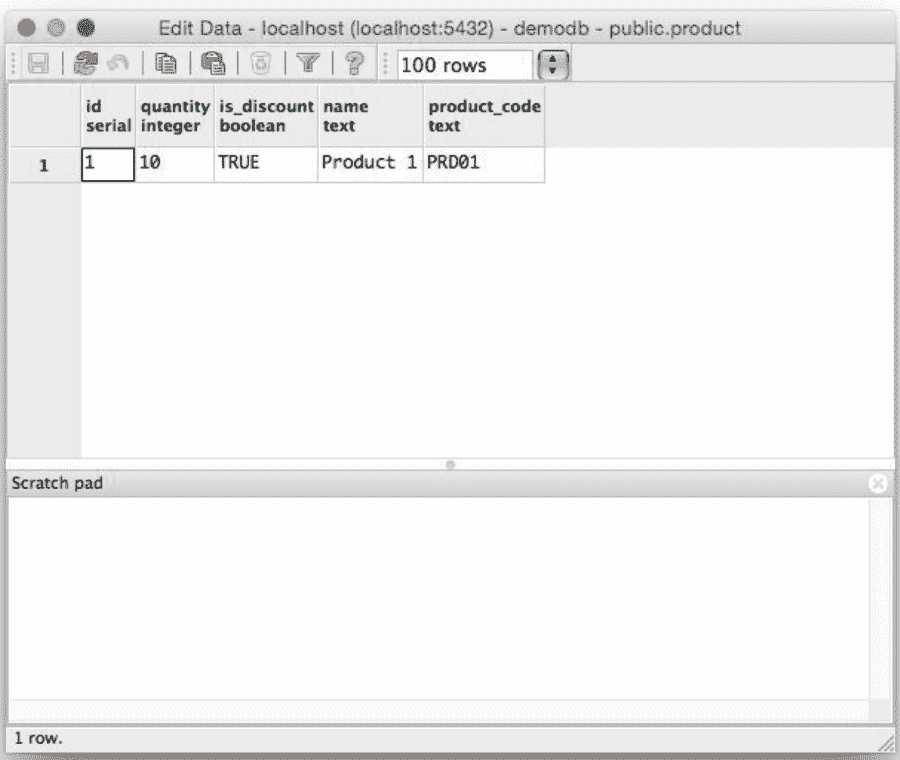

列表数据测试，您可以点击首页表单中的“列表产品”（List products）按钮。填写您之前插入过的产品代码。如果完成，点击“搜索”（Search）按钮。

您应该看到一个与输入的代码匹配的产品。

# PostgreDemo

| 产品代码 | 搜索 |
||---||

# 产品信息

| 名称 | 产品代码 | 数量 | 是否折扣 |
|---|---|---|---|
| 产品 1 | PRD01 | 10 | |

# 源代码

源代码可以在 `http://www.aguskurniawan.net/book/aspnetcore26st.zip` 下载。

# 联系方式

如果您有任何与此书相关的问题，请通过 `aguskur@hotmail.com` 与我联系。我的博客：`http://blog.aguskurniawan.net`。

# 目录

- 版权所有 2
- 前言 5
- 1. 准备开发环境 6
- 1.1 ASP.NET Core 6 6
- 1.2 系统要求 6
- 1.3 开发工具 6
- 2. 部署 ASP.NET Core 8 8
- 2.1 入门 8
- 2.2 在 macOS、Linux 和 Windows 上部署 ASP.NET Core 8
- 2.3 测试 10
- 3. ASP.NET Core MVC 开发 12
- 3.1 入门 12
- 3.2 ASP.NET Core MVC 模板 12
- 3.3 构建您的第一个 ASP.NET Core MVC 应用程序 13
- 3.3.1 创建项目 13
- 3.3.2 构建并运行程序 15
- 3.4 构建 ASP.NET Core MVC 应用程序 17
- 3.4.1 创建项目 17
- 3.4.2 配置 ASP.NET Core MVC 项目 19
- 3.4.3 编写程序 21
- 3.4.3.1 创建模型 (Model) 22
- 3.4.3.2 创建控制器 (Controller) 22
- 3.4.3.3 创建视图 (View) 23
- 3.4.4 测试 26
- 3.5 接下来是什么？29
- 4. ASP.NET Core API 开发 30
- 4.1 入门 30
- 4.2 构建 ASP.NET Core API 应用程序 30
- 4.2.1 创建项目 30
- 4.2.2 为 ASP.NET Core API 编写程序 33
- 4.2.3 测试 35
- 4.3 ASP.NET Core API 客户端应用程序 36
- 4.3.1 创建控制器 36
- 4.3.2 创建视图 37
- 4.4 测试 39
- 5. ASP.NET Core 和 Angular 41
- 5.1 入门 41
- 5.2 ASP.NET Core 和 Angular 2 项目模板 41
- 5.3 运行 Demo：ASP.NET Core Angular SPA 41
- 5.3.1 创建项目 41
- 5.3.2 运行程序 43
- 5.4 接下来是什么？45
- 6. ASP.NET Core, Entity Framework Core 和 PostgreSQL 46
- 6.1 入门 46
- 6.2 PostgreSQL 数据库 46
- 6.3 Entity Framework Core 47
- 6.4 Demo 应用程序 47
- 6.4.1 构建 PostgreSQL 数据库 47
- 6.4.2 创建 ASP.NET Core MVC 项目 47
- 6.4.3 配置 ASP.NET Core MVC 项目 48
- 6.4.4 开发数据访问层 48
- 6.4.5 开发 ASP.NET Core MVC 控制器 50


### 6.4.6 开发 ASP.NET Core MVC 视图 52

### 6.4.7 测试 55

源代码 61

联系方式 62
