# DB2 应用开发入门指南


# 前言

在当今世界保持技能与时俱进正变得日益具有挑战性。新开发的技术太多，而学习它们所有的时间却太少。DB2® on Campus 图书系列旨在将学习这些新技术所需的时间和精力降至最低。

# 谁应该阅读本书？

本书旨在供任何从事或打算开发数据库应用程序的人员阅读，例如应用程序开发人员、顾问、软件架构师、讲师和学生。它也是数据库管理员 (DBA) 和产品经理的良好参考书。

# 本书的结构如何？

本书与电子书《Getting Started with DB2 Express-C》密切相关；它扩展了该书中涵盖的应用程序开发章节。实际上，第 1 章和第 2 章直接取自该书中关于应用程序开发的章节，因为它们提供了 DB2 应用程序开发的绝佳概述。第 3 章讨论了服务器端编程，例如存储过程和函数。在本章中大量使用了 IBM® Data Studio 软件，因此本电子书也与电子书《Getting Started with IBM Data Studio for DB2》密切相关。从第 4 章开始，本书详细描述了针对不同编程语言（如 Java™、C/C++、.NET、Ruby on Rail、PHP、Perl 和 Python）的客户端编程。

大多数章节都提供了练习；所需的任何输入文件都提供在随本书附带的 zip 文件 Exercise_Files_DB2_Application_Development.zip 中。

# 面向社区的图书

本书是由社区创建的：一个由大学教授、学生和专业人士（包括 IBM 员工）组成的社区。本书的在线版本免费向社区发布。来自世界各地的众多社区成员参与了本书的开发，本书也将由社区翻译成多种语言。如果您希望提供反馈、贡献新资料、改进现有资料，或协助将本书翻译成另一种语言，请将您计划的贡献发送至 db2univ@ca.ibm.com，主题设为“Getting Started with DB2 Application Development book feedback”。


## 约定

全书中包含了大量命令、SQL 语句和代码示例。特定关键字以大写粗体显示。例如：A NULL value represents an unknown state（一个 NULL 值表示未知状态）。命令以小写粗体显示。例如：The dir command lists all files and subdirectories on Windows®（dir 命令列出 Windows® 上的所有文件和子目录）。SQL 语句以大写粗体显示。例如：Use the SELECT statement to retrieve information from a table（使用 SELECT 语句从表中检索信息）。

我们在示例中使用的对象名称以粗斜体显示。例如：The flights table has five columns（flights 表有五列）。

斜体也用于命令或语句语法中的变量名。如果变量名包含多个单词，则使用下划线连接。例如：CREATE TABLE table_name

## 下一步做什么？

我们建议您在本书系列中查阅以下书籍，以获取更多关于相关主题的细节：

- Getting started with DB2 Express-C
- Getting started with IBM Data Studio for DB2
- Getting started with Java
- Getting started with C/C++
- Getting started with .NET
- Getting started with Ruby on Rails
- Getting started with PHP
- Getting started with Perl
- Getting started with Python
- Getting started with Open source development
- Getting started with Eclipse

下图展示了 DB2 on Campus 图书系列中所有可供免费获取的不同电子书，访问地址为 ibm.com/db2/books

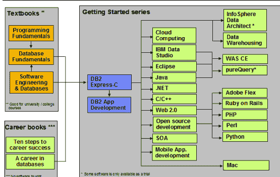

DB2 on Campus 图书系列

## 作者简介

**Raul F. Chong** 是 DB2 on Campus 项目经理，也是基于 IBM 多伦多实验室的 DB2 技术布道师。他的主要职责是发展全球范围内的 DB2 社区。Raul 于 1997 年加入 IBM，曾在公司担任多个职位。作为一名 DB2 顾问，Raul 帮助 IBM 业务合作伙伴将其从其他关系数据库管理系统迁移到 DB2，并协助解决数据库性能和应用设计问题。作为一名 DB2 技术支持专家，Raul 帮助解决了 OS/390®、z/OS®、Linux®、UNIX® 和 Windows® 平台上的 DB2 问题。Raul 教授了许多 DB2 研讨会，发表了多篇文章，并参与了 DB2 认证考试教程的编写。Raul 在其主著的书籍 *Understanding DB2 - Learning Visually with Examples 2nd Edition (ISBN-10: 0131580183)* 中总结了他多年来在 DB2 方面的许多经验。他还合著了 *DB2 SQL PL Essential Guide for DB2 UDB on Linux, UNIX, Windows, i/OS, and z/OS (ISBN 0131477005)*，并且是 DB2 on Campus 图书系列中多本书的项目负责人和合著者。

**Xiqiang Ji** 是 IBM 亚太地区 DB2 二级支持团队悉尼分部的高级支持工程师。他的主要职责是为 IBM 亚太区及全球客户解决各种 DB2 问题提供技术支持。在过去 5 年中，他帮助了许多来自不同行业的 DB2 客户解决了许多关键的技术问题。在此之前，他曾在 IBM 软件集团担任技术顾问 5 年，支持 IBM 业务合作伙伴和独立软件供应商开发 DB2 应用和 DB2 商业智能解决方案。

**Priyanka Joshi** 是 IBM 印度软件实验室的软件工程师，担任 DB2 高级技术支持专家。她的主要职责是为 IBM 全球客户提供 DB2 Linux®、UNIX® 和 Windows (LUW) 平台的高级技术支持。Priyanka 于 2006 年加入 IBM，此后参与了 DB2 LUW 的众多售前和售后支持项目。她擅长 DB2 - 通用客户端技术，并认证为 DB2 专业人员。Priyanka 被确认为 IBM 知识中心支持计划中亚太地区知识冠军，也是 IBM 享有盛誉的技术领导者团队的一员，负责与其他 IBM 产品团队合作，为 IBM 客户提供智能解决方案。

**Vineet Mishra** 是印度软件实验室 DB2 LUW 团队的软件工程师。Vineet 于 2007 年加入 IBM，专长是 C 和 C++。他的兴趣领域包括高可用性灾难恢复（HADR）、存储过程与 UDF、嵌入式 SQL 以及操作系统内核。Vineet 是 IBM 学术倡议和 IBM 大学关系计划的成员，并致力于在高校推广 DB2 (LUW) 知识。他经常在 DB2 论坛中回复疑问。

**Min Wei Yao** 是一名专注于商业智能的应用开发人员。Min Wei 于 2008 年加入 IBM，此后一直在 IBM 全球商务服务领域工作。除了担任开发人员外，Min Wei 还喜欢在 Linux 和 DB2 上进行实验。Min Wei 是 IBM 认证的 Linux、UNIX 和 Windows 平台的 DB2 应用开发人员和系统管理员。

## 贡献者

以下人员编辑、审阅、提供内容并对本书做出了重要贡献。

| 贡献者 | 公司 / 大学 | 职位 / 职业 | 贡献 |
|---|---|---|---|
| Antonio Cangiano | IBM 多伦多实验室 | 软件工程师和技术布道师 | 部分技术审阅 |
| Praveen Devarao | IBM 印度软件实验室 | 软件工程师，IBM 数据服务器开源技术 | 部分技术审阅 |
| Vinay B. Ganapavarapu | 新墨西哥大学 | 学生 | 部分技术审阅 |
| Upal Hossain | IBM 多伦多实验室 | 软件开发者，DB2 信息开发基础设施 | 部分技术审阅 |
| Leon Katsnelson | IBM 多伦多实验室 | IBM 数据服务器项目总监 | 技术审阅 |
| Anil Mahadev | IDUG India | IDUG India 主席，数据库顾问 | 部分技术审阅 |
| Leons Petrazickis | IBM 多伦多实验室 | 软件开发者和技术布道师 | 部分技术审阅 |
| Rahul Priyadarshi | IBM 印度软件实验室 | 系统软件工程师，IBM 数据服务器开源技术 | 部分技术审阅 |

## 致谢

我们非常感谢以下个人在开发本书中引用的材料时提供的帮助：

- Natasha Tolub 设计了本书的封面。
- Susan Visser 协助出版了本书。

## 第 1 章 — DB2 应用开发简介

IBM® DB2® 是一款强大的数据服务器软件，用于管理关系数据和 XML 数据。它不仅为数据库管理员提供了灵活性，也为数据库开发人员提供了灵活性。无论您使用哪种语言来开发程序，DB2 软件（"DB2"）都提供了您作为应用程序一部分处理数据库所需的驱动程序、适配器及扩展。此外，使用 DB2 Express-C，您可以零成本开发应用程序，没有数据库大小限制，并享有与其他版本 DB2 相同级别的编程语言支持。使用 DB2 Express-C 开发一次，您就可以在任何 DB2 版本上运行，而无需对应用程序进行任何修改。

在本章中，您将了解：

- 使用存储过程和用户定义函数进行的服务器端编程
- 使用不同编程语言进行的客户端编程

### 1.1 DB2 应用开发：全景图

DB2 为数据库开发人员提供了灵活性，使其能够利用服务器端开发功能，如存储过程和用户定义函数，同时，应用程序开发人员可以使用他们选择的编程语言开发客户端应用程序。这种灵活性在图 1.1 中进行了说明。

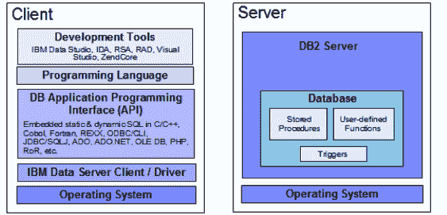

**图 1.1 - DB2 软件适用于每个人：数据库开发人员和应用程序开发人员**

在 *图 1.1* 中，左侧代表客户端机器，应用程序程序员在此开发并运行他的程序。在此客户端机器上，除了操作系统外，根据正在开发的应用程序类型，可能还安装了 IBM 数据服务器客户端。IBM 数据服务器客户端包含所需的连接驱动程序，如 JDBC 驱动程序和 ODBC/CLI 驱动程序。也可以访问 http://ibm.com/db2/express 上的 IBM DB2 Express-C 网站独立下载这些驱动程序。

使用诸如 IBM Data Studio、InfoSphere™ Data Architect (IDA)、Rational® Software Architect (RSA)、Rational Application Developer (RAD) 等编程工具，您可以使用期望的编程语言开发您的应用程序。支持这些语言的 API 库也包含在 IBM 数据服务器客户端中，因此当您连接到 DB2 服务器时，所有这些程序指令都会使用这些 API 适当地翻译为 DB2 理解的 SQL 或 XQuery 语句。*表 1.1* 提供了前述工具的简要描述。

| 工具名称 | 描述 |
| :--- | :--- |
| IBM Data Studio | IBM Data Studio 是一个免费的基于 Eclipse 的工具，允许用户管理其数据服务器并开发存储过程、函数和数据 Web 服务。欲了解更多信息，请参阅电子书 *Getting started with IBM Data Studio for DB2*。 |
| InfoSphere Data Architect (IDA) | IDA 是用于数据建模的工具。它帮助您构建数据库逻辑设计和物理设计。欲了解更多信息，请参阅 |


| 工具 | 描述 |
| :--- | :--- |
| InfoSphere Data Architect | 参见电子书 *《InfoSphere Data Architect 入门》*。 |
| Rational Software Architect (RSA) | RSA 是一款基于 Eclipse 的工具，旨在支持软件工程，帮助你开发 UML 图。 |
| Rational Application Developer (RAD) | RAD 是一款面向软件开发人员的基于 Eclipse 的快速应用开发工具。 |
| Visual Studio | Microsoft® Visual Studio 是一款 IDE，允许你使用 Microsoft 技术在 Windows® 平台上开发应用程序。 |
| Aptana Studio | 这是一款用于开发 PHP 应用程序的免费 IDE。 |

表 1.1 - 可用于使用 DB2 软件开发应用程序的工具

在图 1.1 的右侧，展示了一个包含一个数据库的 DB2 服务器。在该数据库中，存储有存储过程、用户定义函数和触发器。我们将在接下来的章节中详细描述所有这些对象。

值得一提的是，IBM 在 Amazon 云上以及 IBM 开发和测试云上提供 DB2。如果你或你的公司没有预算购买用于开发或生产需求的服务器，云是一个完美的替代方案，因为它允许你按分钟“租用”计算能力。关于 DB2 云服务的详细信息将在后续章节中讨论。

## 1.2 服务器端开发

DB2 软件中的服务器端开发意味着应用程序对象在 DB2 数据库上进行开发和存储。本节将简要讨论以下应用程序对象：

- 存储过程
- 用户定义函数 (UDF)
- 触发器

### 1.2.1 存储过程

存储过程是一种可以封装 SQL 语句和业务逻辑的数据库应用程序对象。将部分应用逻辑保留在数据库中可以提高性能，因为这减少了应用程序与数据库之间的网络流量。此外，存储过程提供了一个集中位置来存储代码，以便其他应用程序可以重用相同的存储过程。要调用存储过程，请使用 CALL 语句。在 DB2 中，你可以使用多种语言开发存储过程，包括 SQL PL、PL/SQL、Java、C/C++、CLR、OLE 和 COBOL。以下示例展示了如何从 DB2 命令窗口或 Linux® shell 创建和调用 SQL PL 存储过程：

```
db2 create procedure P1 begin end
db2 call P1
```

在示例中，过程 P1 是一个空的存储过程，它什么都不做。该示例说明了创建存储过程有多么简单。要开发逻辑更复杂的存储过程，我们建议你使用包含调试器的 IBM Data Studio。

### 1.2.2 用户定义函数

用户定义函数 (UDF) 是一种允许用户使用自己的逻辑扩展 SQL 语言的数据库应用程序对象。函数通常作为包含在函数中的业务逻辑的结果，总是返回一个或多个值。要调用函数，请将其用在 SQL 语句中，或者使用 values 函数。在 DB2 中，你可以使用多种语言开发 UDF，包括 SQL PL、PL/SQL、Java、C/C++、OLE DB、CLR。

这个简单的示例展示了如何从 DB2 命令窗口或 Linux shell 创建和调用 SQL PL UDF：

```
db2 create function F1() returns integer begin return 1000; end
db2 values F1
```

在示例中，函数 F1 是一个返回整数值 1000 的函数。VALUES 语句可用于调用该函数。与存储过程一样，我们建议你使用 IBM Data Studio 创建函数。

### 1.2.3 触发器

触发器是一种在表或视图上自动执行操作的对象。在定义触发器的对象上发生的触发动作会导致触发器被触发。触发器通常不被视为应用程序对象；因此，数据库开发人员通常不编写触发器，但数据库管理员会。由于需要一些编码，我们将触发器包含在本节中。以下是一个触发器的示例：

```
create trigger myvalidate no cascade before insert on T1
  referencing NEW as N
  for each row
    begin atomic
      set (N.myxmlcol) = XMLVALIDATE(N.myxmlcol
    according to xmlschema id myxmlschema);
    end
```

在这个示例中，触发器在表 T1 的 INSERT 操作之前触发。触发器将插入该值（这是一个 XML 文档），但会调用 XMLVALIDATE 函数使用给定的架构验证此 XML 文档。*第 15 章 DB2 pureXML* 更详细地介绍了 XML 和 XML 架构。

## 1.3 客户端开发

顾名思义，在客户端开发中，应用程序开发人员在其客户端上编写程序，然后使用随 DB2 提供的应用程序编程接口 (API) 连接并访问 DB2 数据库。在本节中，我们讨论：

- 嵌入式 SQL
- 静态 SQL 与动态 SQL
- CLI 和 ODBC
- JDBC、SQLJ 和 pureQuery
- OLE DB
- ADO.NET
- PHP
- Ruby on Rails
- Perl
- Python

### 1.3.1 嵌入式 SQL

***嵌入式 SQL 应用程序*** 是指将 SQL 嵌入到宿主语言（如 *C*、*C++* 或 COBOL）中的应用。嵌入式 SQL 应用程序可以包含下一节中描述的静态 SQL 或动态 SQL。*图 1.2* 展示了嵌入式 SQL 应用程序的构建方式。

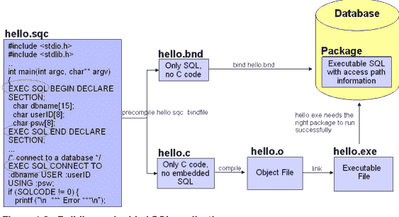

在图中，C 程序 `hello.sqc` 包含嵌入式 SQL。C 语言的嵌入式 SQL API 使用 **EXEC SQL**（在 *图 1.2* 中高亮显示）以便预编译过程区分嵌入式 SQL 语句和实际的 C 代码。你或许还注意到，在 `hello.sqc` 列表中，一些变量以冒号作为前缀，例如 `:dbname`、`:userID` 和 `:psw`。这些被称为宿主变量。宿主变量是从宿主语言中引用的、在嵌入式 SQL 语句中使用的变量。

使用带有 **bindfile** 选项发出 **precompile** 命令（也称为 **prep** 命令）会生成两个文件，包含仅 SQL 语句的 `hello.bnd` 绑定文件和包含仅 C 代码的 `hello.c` 文件。绑定文件将使用 **bind** 命令进行编译，以获取存储在数据库中的 **package**（包）。包包括编译/可执行的 SQL 以及 DB2 用于检索数据的访问路径。要发出 **bind** 命令，必须存在与数据库的连接。在图的底部，`hello.c` 文件像任何常规 C 程序一样被编译和链接。生成的可执行文件 `hello.exe` 必须与存储在数据库中的包匹配才能成功执行。

### 1.3.2 静态 SQL 与动态 SQL

静态 SQL 语句是指在预编译时 SQL 结构完全已知的语句。例如：

```
SELECT lastname, salary FROM employee
```

在这个示例中，语句中引用的列名（*lastname*、*salary*）和表名（*employee*）在预编译时是完全已知的。以下示例也是一个静态 SQL 语句：

```
SELECT *lastname*, *salary* FROM *employee* WHERE *firstnm* = :fname
```

在第二个示例中，宿主变量 *:fname* 被用作嵌入式 SQL 语句的一部分。虽然宿主变量的值在运行时之前未知，但其数据类型是从程序中已知的，并且所有其他对象（列名、表名）都是提前完全已知的。DB2 软件使用这些宿主变量的估计值来提前计算访问路径；因此，这种情况仍被视为静态 SQL。

你在运行应用程序之前预编译、绑定并编译静态执行的 SQL 语句。静态 SQL 最适合用于统计数据变化不大的数据库。现在让我们再看一个示例：

```
SELECT *?, *?* FROM *?*
```

在这个示例中，语句引用的列和表的名称直到运行时才可知。因此，访问计划仅在运行时计算，并使用当时可用的统计数据。这类语句被视为 *动态* SQL 语句。

某些编程 API，如 JDBC 和 ODBC，无论 SQL 语句是否包含已知对象，始终使用动态 SQL。例如，语句 *SELECT* *lastname*, *salary* FROM *employee* 的所有列和表名都是提前已知的，但通过 JDBC 或 ODBC，你不预编译语句。所有语句的访问计划都在运行时计算。

通常，使用两个语句将 SQL 语句视为动态：

- **PREPARE**：该语句准备或编译 SQL 语句，计算用于检索数据的访问计划
- **EXECUTE**：该语句执行 SQL

或者，你可以在单个语句中执行 **PREPARE** 和 **EXECUTE**：**EXECUTE IMMEDIATELY**

*清单 1.1* 展示了一个嵌入式 C 动态 SQL 语句的示例，该语句被准备并执行。

```
strcpy (hvStmtDyn, "SELECT *name* FROM emp WHERE dept = *?*" );
PREPARE Stmt tDyn FROM :hvStmtDyn;
EXECUTE StmtDyn USING 1;
EXECUTE StmtDyn USING 2;
```

*清单 1.1* - 使用 **PREPARE** 和 **EXECUTE** 的嵌入式 C 动态 SQL 语句

*清单 1.2* 展示了与 *清单 1.1* 相同的示例，但使用了 **EXECUTE IMMEDIATELY** 语句


# 1.3.2 使用 EXECUTE IMMEDIATELY 的内嵌 C 动态 SQL 语句

在 PHP 或 Ruby on Rails 等许多动态编程语言中，SQL 是动态执行的，程序员倾向于编写相同的 SQL 语句但使用不同的字段值，如下所示：

```
EXECUTE IMMEDIATELY SELECT name from EMP where dept = 1
EXECUTE IMMEDIATELY SELECT name FROM EMP where dept = 2
```

SELECT lastname, salary FROM employee where firstnm = 'Raul'
SELECT lastname, salary FROM employee where firstnm = 'Jin'
...

在这个例子中，除了列 firstnm 的值不同外，这些语句是相同的。DB2 将这两个动态 SQL 语句视为不同的语句，因此在运行时，它会独立地准备并执行每个语句。多次准备相同语句的开销可能会导致性能下降，因此在 DB2 9.7 之前，建议按如下方式编写语句：

```
SELECT lastname, salary FROM employee where firstnm = ?
```

语句中的问号 (?) 被称为参数标记。使用参数标记，程序只需准备一次语句，然后发出带有不同参数标记值的 EXECUTE 语句即可。


在 DB2 9.7 中，DB2 引入了一项名为语句集中器（statement concentrator）的技术，它将除字段值外相同的所有语句自动合并为一条带有参数标记的单一语句，然后使用不同的值执行 EXECUTE 语句。语句集中器确实具有智能，能够判断何时不要将某些语句合并在一起；例如，当你有意添加某些子句以影响 DB2 优化器时。

就性能而言，静态 SQL 通常比动态 SQL 性能更好，因为静态 SQL 的访问计划在预编译时执行，而不是在运行时。然而，对于活动频繁（如大量 INSERT 和 DELETE 操作）的环境，预编译时计算的统计信息可能不是最新的，因此静态 SQL 的访问计划可能不是最优的。在这种情况下，假设频繁执行 RUNSTATS 命令以收集当前统计信息，动态 SQL 可能是更好的选择。

> 注意：
> 许多用户认为内嵌 SQL 只有静态的。实际上，它既可以是静态的，也可以是动态的。

## 1.3.3 CLI 和 ODBC

调用层接口（Call Level Interface，CLI）最初由 X/Open Company 和 SQL Access Group 开发。它是一种可调用 SQL 接口的规范，旨在开发独立于 RDBMS 供应商的便携式 C/C++ 应用程序。基于 X/Open 调用层接口的初步草案，微软开发了*开放数据库连接（Open Database Connectivity，ODBC）*，随后 ISO CLI 国际标准接受了 X/Open 调用层接口规范的大部分。DB2 CLI 基于 ODBC 和 SQL/CLI 国际标准，如*图 1.3* 所示。

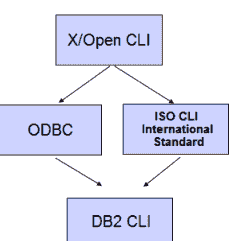

**图 1.3 - DB2 CLI 基于 ODBC 和 ISO CLI 国际标准**

DB2 CLI 符合 ODBC 3.51，并可在由 ODBC 驱动程序管理器加载时用作 ODBC 驱动程序。图 1.4 可以帮助你理解 DB2 CLI 对 ODBC 的支持。

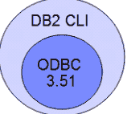

**图 1.4 - DB2 CLI 符合 ODBC 3.51**

CLI/ODBC 具有以下特征：

- 代码在多个 RDBMS 供应商之间轻松移植
- 与内嵌 SQL 不同，它不需要预编译器或宿主变量
- 它运行动态 SQL
- 它非常流行

要*运行* CLI/ODBC 应用程序，你只需要 DB2 CLI 驱动程序。该驱动程序可以从以下客户端和驱动程序中安装，这些客户端和驱动程序可以从 www.ibm.com/db2/express 免费下载和使用：

- IBM Data Server 客户端
- IBM Data Server 运行时客户端
- IBM Data Server ODBC 和 CLI 驱动程序

要*开发* CLI/ODBC 应用程序，你需要 DB2 CLI 驱动程序以及相应的库。这些只能找到在 IBM Data Server 客户端中。

让我们看看以下示例，以便更好地理解如何为应用程序设置 DB2 CLI 驱动程序。*图 1.5* 描绘了三台不同的机器，一台在印度尼西亚，另一台在巴西，还有一台在加拿大。

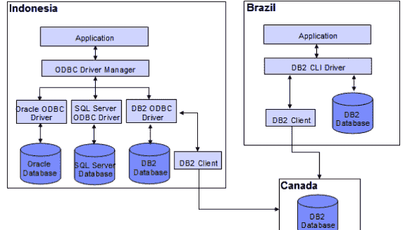

**图 1.5 - DB2 CLI/ODBC 示例场景**

该图显示了两种情况：

左侧假设印度尼西亚的机器正在运行一个*ODBC 应用程序*，它可以与任何 RDBMS（如 Oracle®、Microsoft® SQL Server® 或 DB2 数据库服务器）配合使用。ODBC 驱动程序管理器将根据正在访问的数据库加载适当的 ODBC 驱动程序。如果应用程序访问加拿大的 DB2 数据库，连接需要通过具有远程连接组件的 DB2 客户端进行。

右侧假设巴西的一台机器正在运行一个 CLI 应用程序。它是一个 CLI 应用程序，因为它可能使用了一些 ODBC 中不可用的特定功能，并且因为该应用程序仅适用于 DB2 数据库。CLI 应用程序将通过 DB2 CLI 驱动程序。应用程序可以连接到巴西本地的 DB2 数据库。当它需要连接到加拿大的远程数据库时，它将通过 DB2 客户端进行。

本节最后要提出的一点是 CLI/ODBC 应用程序与内嵌 SQL C 动态应用程序的比较。图 1.6 说明了这种比较。

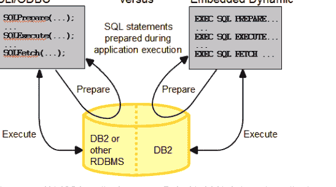

**图 1.6 - CLI/ODBC 应用程序与内嵌 SQL C 动态应用程序**

如图 1.6 所示，CLI/ODBC 与内嵌 SQL C 动态 SQL 的唯一区别在于，对于 CLI/ODBC，你的代码是可移植的，只需更改连接字符串即可访问其他 RDBMS，而在内嵌 SQL C 动态版本中，你可能会为 DB2 编写特定元素。当然，另一个区别在于调用 **PREPARE** 和 **EXECUTE** 不同函数的方式。

## 1.3.4 JDBC、SQLJ 和 pureQuery

Java 数据库连接（JDBC）是一种 Java 编程 API，它标准化了访问和数据库交互的方式。在 JDBC 中，代码在多个 RDBMS 供应商之间轻松移植。代码所需的唯一更改通常是加载哪个 JDBC 驱动程序和连接字符串。JDBC 仅使用动态 SQL，并且非常流行。

SQLJ 是在 Java 程序中嵌入 SQL 的标准。它主要用于静态 SQL，虽然它可以与 JDBC 互操作，如图 1.7 所示。虽然它通常比 JDBC 程序更紧凑并提供更好的性能，但它并未得到广泛接受。SQLJ 程序必须先通过预处理器（SQLJ 转换器）运行，然后才能编译。

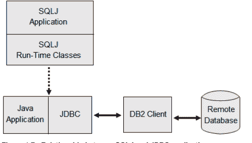

**图 1.7 - SQLJ 和 JDBC 应用程序之间的关系**

在图 1.7 中，根据本节稍后讨论的所使用的 JDBC 驱动程序类型，DB2 客户端可能需要也可能不需要。

pureQuery 是一个基于 IBM Eclipse 的插件，用于将关系数据作为对象进行管理。自 2007 年可用以来，pureQuery 可以自动生成代码，在你的面向对象的代码和关系数据库对象之间建立对象关系映射（ORM）。你首先使用 Optim™ Development Studio (ODS) 创建一个 Java 项目，连接到 DB2 数据库，然后让 ODS 发现所有数据库对象。通过 ODS 图形用户界面，你可以选择一张表，然后选择生成 pureQuery 代码，这将把任何底层关系表实体转换为 Java 对象。生成的代码用于创建相关的 SQL 语句和封装这些语句的父 Java 对象。生成的 Java 对象和包含的 SQL 语句可以进一步自定义。使用 pureQuery，你可以在运行时决定是以静态模式还是动态模式运行 SQL。pureQuery 支持 Java 和 .NET。

### 1.3.4.1 JDBC 和 SQLJ 驱动程序

虽然有多种类型的 JDBC 驱动程序，如 1 型、2 型、3 型和 4 型；但 1 型和 3 型不常用，并且 DB2 对这些类型的支持已弃用。对于 2 型，正如我们稍后将描述的那样，有两个驱动程序，但其中一个也已弃用。

2 型和 4 型与 DB2 软件兼容，如表 1.2 所示。2 型驱动程序需要安装 DB2 客户端，因为该驱动程序使用它来建立与数据库的通信。4 型是纯 Java 客户端，因此不需要 DB2 客户端，但驱动程序必须安装在运行 JDBC 应用程序的机器上。


## 1.3.5 OLE DB

对象链接和嵌入，数据库 (OLE DB) 是一组接口，用于访问存储在多种来源中的数据。它被设计作为 ODBC 的替代品，但扩展以支持更广泛的来源，包括非关系型数据库，例如面向对象数据库和电子表格。OLE DB 使用组件对象模型 (COM) 技术实现。

OLE DB 用户可以使用 IBM OLE DB Provider for DB2 来访问 DB2 数据库。此提供程序具有以下特性：

- 提供程序名称：IBMDADB2
- 支持 OLE DB 提供程序规范的 0 级，包括一些额外的 1 级接口
- 符合 Microsoft OLE DB 规范版本 2.7 或更高版本
- 必须安装带有 Microsoft 数据访问组件 (MDAC) 的 IBM 数据服务器客户端
- 如果未显式指定 IBMDADB2，则默认使用 Microsoft OLE DB 驱动程序 (MSDASQL)。MSDASQL 允许使用 OLE DB 的客户端通过 ODBC 驱动程序访问非 Microsoft SQL Server 数据源，但不保证 OLE DB 驱动程序的全部功能。

## 1.3.6 ADO.NET

.NET 框架是 Microsoft 对组件对象模型 (COM) 技术的替代方案。使用 .NET 框架，您可以使用 40 多种不同的编程语言编写 .NET 应用程序；其中最流行的是 C# 和 Visual Basic .NET。

.NET 框架类库提供了构建 .NET 应用程序的基本构件。该类库与语言无关，并提供操作系统和应用程序服务的接口。您的 .NET 应用程序（无论使用何种语言）都会编译为中间语言 (IL)，这是一种字节码。

通用语言运行时 (CLR) 是 .NET 框架的核心，它即时编译 IL 代码，然后运行它。在运行编译后的 IL 代码时，CLR 激活对象，验证其安全权限，分配内存，执行它们，并在执行完成后清理内存。

以 Java 的工作方式作为类比，在 Java 中，一个程序可以在多个平台上运行，只需很少或无需修改：一种语言，但多个平台。在 .NET 中，用 40 种受支持语言中的任意一种编写的程序可以在一个平台（Windows）上运行，只需很少或无需修改：多种语言，但一个平台。

ADO.NET 是 .NET 框架中提供数据访问支持的方式。ADO.NET 支持连接式和断开式访问。ADO.NET 中断开式数据访问的关键组件是 DataSet 类，其实例充当驻留在应用程序内存中的数据库缓存。

对于连接式和断开式访问，您的应用程序通过被称为数据提供程序的机制使用数据库。各种数据库产品包含它们自己的 .NET 数据提供程序，包括用于 Windows 的 DB2。

.NET 数据提供程序具备以下基本类的实现：

- Connection：建立并管理数据库连接。
- Command：对数据库执行 SQL 语句。
- DataReader：从数据库读取并返回结果集数据。
- DataAdapter：将 DataSet 实例与数据库关联。通过 DataAdapter 实例，DataSet 可以读取和写入数据库表数据。

*表 1.3* 中显示了三个可以与 DB2 软件一起使用的数据提供程序。

| 数据提供程序 | 特性 |
|---|---|
| ODBC .NET 数据提供程序（不推荐） | - 使用 DB2 CLI 驱动程序对 DB2 数据源进行 ODBC 调用。<br>- 其关键字支持和限制与 DB2 CLI 驱动程序相同<br>- 可与 .NET 框架版本 1.1、2.0 或 3.0 一起使用。 |
| OLE DB .NET 数据提供程序（不推荐） | - 使用 IBM DB2 OLE DB 驱动程序 (IBMDADB2)。<br>- 其关键字支持和限制与 DB2 OLE DB 驱动程序相同<br>- 仅可与 .NET 框架版本 1.1、2.0 或 3.0 一起使用。 |
| DB2 .NET 数据提供程序（推荐） | - 扩展了对 ADO.NET 接口的 DB2 支持。<br>- DB2 受管提供程序实现了相同的一组标准 ADO.NET 类和方法<br>- 它定义在 IBM.DATA.DB2 命名空间下。<br>- 可以通过下载以下任意一项获取：<br>  - ODBC、CLI 和 .NET 的数据服务器驱动程序<br>  - IBM 数据服务器运行时客户端<br>  - DB2 数据服务器 |

*表 1.3 - ADO.NET 数据提供程序*

## 1.3.7 PHP

*PHP 超文本预处理器 (PHP)* 是一种开源、平台无关的脚本语言，专为 Web 应用程序开发设计。它可以嵌入到 HTML 中，通常运行在 Web 服务器上，该服务器将 PHP 代码处理并创建 Web 页面作为输出。

PHP 是一种模块化语言。您可以使用扩展来定制可用的功能。一些最受欢迎的 PHP 扩展是用于访问数据库的扩展。IBM 通过两个扩展支持访问 DB2 数据库：

- **ibm_db2:** ibm_db2 扩展提供了一种过程式应用程序接口，用于创建、读取、更新和写入数据库操作，此外还能广泛访问数据库元数据。它可以与 PHP 4 或 PHP 5 一起编译。
- **pdo_ibm:** pdo_ibm 是 PHP 数据对象 (PDO) 扩展的驱动程序，它通过 PHP 5.1 中引入的标准面向对象数据库接口提供对 DB2 数据库的访问。它可以针对 DB2 库直接编译。

PHP 扩展和驱动程序可以从 [http://pecl.php.net/](http://pecl.php.net/) 的 PECL 存储库免费获取。扩展和驱动程序的 Windows 构建版本可在 [http://sourceforge.net/projects/db2mc/files/](http://sourceforge.net/projects/db2mc/files/) 获取。

在 Linux 和 UNIX 上安装 PHP 扩展需要 IBM Data Server Driver for ODBC and CLI。ibm_db2 和 pdo_ibm 都基于 IBM DB2 CLI 层。

## 1.3.8 Ruby on Rails

Ruby 是一种开源的面向对象语言。Rails 是使用 Ruby 创建的 Web 框架。Ruby on Rails (RoR) 是开发数据库支持 Web 应用程序的理想手段。这项热门新技术基于模型、视图、控制器 (MVC) 架构，并遵循敏捷软件开发的原则。

Rails 不需要特殊的文件格式或集成开发环境 (IDE)；您可以使用文本编辑器开始。不过，有多种支持 Rails 的 IDE 可用，例如 RadRails，它是 Eclipse 的一个 Rails 环境。有关 RadRails 的更多信息，请访问 [http://www.radrails.org/](http://www.radrails.org/)。

DB2 支持 Ruby 1.8.5 及更高版本以及 Ruby on Rails 1.2.1 及更高版本。IBM_DB gem 包含 IBM_DB Ruby 驱动程序和 Rails 适配器，允许您与 DB2 交互，并基于 CLI 层。必须与 IBM Data Server Client 一起安装此 gem。安装 IBM_DB 驱动程序和适配器时，可以使用 Ruby gem 或作为 Rails 插件。

## 1.3.9 Perl

Perl 是一种流行的解释型编程语言，在许多操作系统上均可免费使用。它使用动态 SQL，非常适合用于应用程序原型设计。

Perl 提供了一个名为数据库接口 (DBI) 模块的标准模块，用于访问不同的数据库。该模块可从 [http://www.perl.com](http://www.perl.com) 获取。该模块与不同数据库供应商的驱动程序进行“通信”。在 DB2 的情况下，这是 DBD::DB2 驱动程序，可从 [http://www.ibm.com/software/data/db2/perl](http://www.ibm.com/software/data/db2/perl) 获取。

## 1.3.10 Python

Python 是一种常用于脚本编写的动态语言。它强调代码可读性，并支持多种编程范式，包括过程式、面向对象、面向方面、元编程和函数式编程。Python 非常适合快速应用程序开发。


## 1.4 XML 和 DB2 pureXML

表 1.4 展示了可用于从 Python 应用程序访问 DB2 数据库的扩展。

| 扩展 | 描述 |
| :--- | :--- |
| **ibm_db** | 由 IBM 定义。<br>提供对高级功能的最优支持。<br>允许你发出 SQL 查询、调用存储过程、使用 pureXML® 以及访问元数据信息。 |
| **ibm_db_dbi** | 实现了 Python 数据库 API 规范 v2.0。<br>它不提供 ibm_db API 支持的一些高级功能。<br>如果你有一个使用支持 Python 数据库 API 规范 v2.0 的驱动器的应用程序，你可以轻松切换到 ibm_db。ibm_db 和 ibm_db_dbi API 是一起打包的。 |
| **ibm_db_sa** | 支持 SQLAlchemy，这是一个流行的开源 Python SQL 工具包和对象-关系映射器 (ORM)。 |

表 1.4 - IBM 数据服务器 - Python 扩展

*可扩展标记语言 (XML)* 是 Web 2.0 工具和技术以及*面向服务体系结构 (SOA)* 的底层技术。IBM 很早就认识到 XML 的重要性，并投入大量资源以提供 pureXML® 技术——一种为在 DB2 软件中更好地存储 XML 文档提供支持的技术。

2006 年推出的 DB2 9 是一个混合数据服务器：它允许原生存储关系数据以及层次数据。虽然市场中的 DB2 早期版本和其他数据服务器可以存储 XML 文档，但 DB2 9 中使用的存储方法提高了性能和灵活性。借助 DB2 9 的 pureXML 技术，XML 文档在内部以解析后的层次方式存储为一棵树；因此，处理 XML 文档的能力得到了极大增强。DB2 的较新版本，如 DB2 9.5 和 DB2 9.7，进一步改进了对 pureXML 的支持。*第 15 章，DB2 pureXML* 详细论述了这一主题。

## 1.5 Web 服务

作为一个简单的定义，可以将 Web 服务看作是一个你可以通过网络调用的函数，你不需要知道开发该函数所使用的编程语言，不需要知道该函数将在哪个操作系统上运行，也不需要知道其运行的位置。Web 服务允许一个应用程序使用基于 XML 的可扩展行业标准协议与另一个应用程序交换数据。这在*图 1.8*中进行了说明。

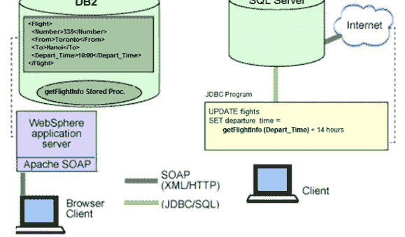

图 1.8 – 示例 Web 服务的工作原理

在图中，假设左侧代表一家虚构航空公司 Air Atlantis 的系统，该系统使用 Linux 上的 DB2，并在 DB2 数据库中以 XML 格式存储其航班信息。右侧是另一家虚构航空公司 Air Discovery 的系统，该系统使用运行在 Windows 上的 SQL Server。现在假设 Air Atlantis 和 Air Discovery 签署了一项合作协议，两家公司希望共享调度和定价信息以协调它们的航班。鉴于两家公司使用不同的操作系统（Linux、Windows）和不同的数据服务器（DB2、SQL Server），在这两家公司之间共享信息可能是一个挑战。当 Air Atlantis 更改其从多伦多飞往北京的航班时刻表时，Air Discovery 如何自动调整其从北京飞往上海的中转航班时刻表？答案在于 Web 服务。Air Atlantis 可以通过创建一个*数据 Web 服务*来公开其部分航班信息，该服务返回存储过程（**getFlightInfo** 存储过程）的输出，其中包含来自 DB2 数据库的航班信息。*数据* Web 服务是基于数据库信息的 Web 服务。当此数据 Web 服务部署到 WebSphere Application Server 等应用程序服务器时，像 Air Discovery 这样的客户端或合作伙伴可以轻松地使用浏览器访问 Air Atlantis 的航班信息。在这个例子中，Air Atlantis 充当 Web 服务提供者，因为它开发并提供了该 Web 服务，而 Air Discovery 充当 Web 服务消费者，因为它消费或使用该 Web 服务。

Air Discovery 还可以从其自身的 JDBC 应用程序中调用该 Web 服务，以便执行使用其 SQL Server 数据库中的数据进行的计算。例如，如果从多伦多飞往北京的航班平均耗时 12 小时，Air Discovery 可以通过将 Air Atlantis 航班离开多伦多的起飞时间加上飞行时间以及几个缓冲小时，来计算出从北京飞往上海的中转航班。在 Air Discovery 系统中，可用于缓冲的小时数可以存储在 SQL Server 数据库中，而在 JDBC 应用程序中使用的简单等式如下所示：


如果 Air Atlantis 更改其航班起飞时间，当它调用 Web 服务时，此信息会自动传达给 Air Discovery 系统。

## 1.6 管理 API

DB2 软件（“DB2”）提供了大量管理 API，开发人员可以使用这些 API 构建自己的实用程序或工具。例如，要创建数据库，你可以调用 *sqlcrea API*；要启动实例，使用 *db2lInstanceStart API*；或者要将数据导入表中，使用 *db2lImport API*。完整的列表可在 DB2 信息中心中找到。有关 DB2 信息中心的 URL，请参见*资源*部分。

## 1.7 开发工具

Microsoft Visual Studio 和 Eclipse 是当今开发人员使用的两个最受欢迎的集成开发环境 (IDE)。这两个 IDE 都能很好地与 DB2 软件（“DB2”）配合使用。

一些 DB2 用户还与 MS Excel 和 MS Access 等第三方产品进行交互，以创建连接到 DB2 的简单窗体。在本节中，我们将描述如何将这些产品与 DB2 Express-C 配合使用。

DB2 Express-C 也可在 Mac OS X 上使用，因此你可以使用 DB2 在 Mac 上原生开发数据库应用程序。这对已经接受 Mac 平台的 RoR 社区来说可能特别具有吸引力。

### 1.7.1 Visual Studio

对于 Microsoft Visual Studio，DB2 提供了 IBM Database Add-ins for Visual Studio。这是一个免费的独立可安装插件，安装后将 DB2 工具菜单集成到 Visual Studio 中。这样，开发人员就不需要切换到其他工具来操作 DB2 数据库。你可以从 http://ibm.com/db2/express 上的 DB2 Express-C 网站下载该插件。第 6 章“使用 .NET 进行应用程序开发”中提供了更多信息。

### 1.7.2 Eclipse

对于 Eclipse，IBM 提供了 IBM Data Studio，这是一个基于 Eclipse 的免费工具，允许你管理 DB2 实例和数据库，并开发 SQL 和 XQuery 脚本、存储过程、UDF 和数据 Web 服务。由于其基于 Eclipse 平台，许多开发人员可以利用现有知识来使用此工具。

要了解有关 IBM Data Studio 的更多信息，请参阅电子书 *Getting started with IBM Data Studio for DB2*。

### 1.7.3 Access 和 Excel

Microsoft Excel 和 Microsoft Access 是用于生成报告、创建窗体以及开发为数据提供一定商业智能的简单应用程序的流行工具。DB2 可以轻松地与这些工具进行交互。DBA 可以将公司数据安全地存储在 DB2 服务器中，而拥有 Access 或 Excel 的普通用户可以访问这些数据并生成报告。这在*图 1.9*中进行了说明。

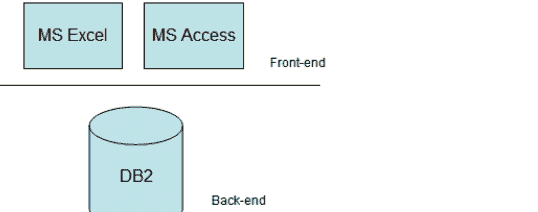

**图 1.9 - Excel、Access 和 DB2 的协同工作**

在图中，Excel 和 Access 可用于开发前端应用程序，而 DB2 作为应用程序的后端，负责数据的安全性、可靠性和性能。将所有数据集中在 DB2 中创建了一个简化的数据存储模型。

对于 Excel，访问 DB2 数据的最简单方法是使用 OLE DB 驱动程序，例如 IBM OLE DB Provider for DB2。安装免费的 IBM Data Server Client 时包含此驱动程序，可以从 http://ibm.com/db2/express 上的 DB2 Express-C 网站下载该客户端。安装后，你需要从 MS Excel 菜单中选择合适的 OLE DB 提供程序来选择你的数据源。选择“数据 → 导入外部数据 → 导入数据”。下一步骤记录在文章 *IBM® DB2® Universal Database™ 和 Microsoft® Excel 应用程序开发者... 初学者* [1] 中。详情请参见参考部分。

对于 Microsoft Access，你还需要安装以下任一驱动程序：

- IBM Data Server 客户端，或
- IBM Data Server 用于 ODBC、CLI 和 .Net 的驱动程序，或
- IBM Data Server 用于 ODBC 和 CLI 的驱动程序

IBM Data Server 用于 ODBC、CLI 和 .Net 的驱动程序以及 IBM Data Server 用于 ODBC 和 CLI 的驱动程序也被称为 IBM DB2 ODBC 驱动程序，它与 DB2 CLI 驱动程序相同。这是用于从 Access 连接到 DB2 的驱动程序。安装驱动程序后，创建一个 Access 2007 项目，并选择在“表工具”选项卡中的“外部数据”选项卡内提供的“ODBC 数据库”选项。下一步骤记录在文章 *DB2 9 和 Microsoft Access 2007 第 1 部分：获取数据...*[2] 中。在 Microsoft Access 中使用链接表时，数据可供 Access 2007 用户访问，但数据驻留在 DB2 数据服务器上。

对于 2007 年之前的 Access 版本，设置略有不同，但你可以参阅文章 *Use Microsoft Access to interact with your DB2 data* [3]。详情请参见参考部分。

## 1.8 开发环境

使用 DB2 开发应用程序并不局限于在笔记本电脑或公司电脑上安装软件。如今，你可以利用云计算在指定时间内供应一个 DB2 服务器。你还可以使用为 DB2 提供的虚拟设备来开发 DB2 应用程序。本节讨论这些开发环境。

### 1.8.1 云上的 DB2 服务

DB2 在云上提供了以下服务：

- Amazon Web Services
- IBM 开发和测试云
- IBM CloudBurst™ 和 IBM WebSphere CloudBurst 设备
- Rightscale™


这些内容将在下文中详细讨论。

### 1.8.1.1 Amazon Web Services（亚马逊网络服务）

IBM 已与 Amazon Web Services (AWS) 达成合作伙伴协议，以在亚马逊弹性计算云 (EC2) 上运行 DB2。AWS 提供了一组集成的服务，构成了“云中”的计算平台，并采用按量付费模式。也就是说，AWS 允许你“租用”计算资源（虚拟服务器和存储），你只需为你使用的资源付费。例如，假设你配置了一个 EC2 虚拟服务器用于常规数据库操作，并在高峰时段或季节性需求期间额外配置了一个数据库服务器运行几个小时。在这个例子中，你只需为额外配置的数据库服务器在运行的那几个小时向 AWS 付费。

IBM 为在亚马逊云平台上部署 DB2 提供了三种不同的选项：

- 用于评估和开发的 DB2 Express-C Amazon 机器镜像 (AMIs)
- 带有 DB2 Express 和 DB2 Workgroup 的按量付费生产就绪 AMI
- 使用你拥有的 DB2 许可证创建自定义 AMI 的能力

有关更多信息以及如何在 Amazon EC2 上开始使用 DB2，请访问：[http://www.ibm.com/db2/cloud](http://www.ibm.com/db2/cloud)

### 1.8.1.2 IBM 开发和测试云

IBM 云平台上的 IBM Smart Business 开发和测试（简称 IBM 开发者云）提供与 AWS 类似的服务，但专注于开发和测试。它允许按需灵活配置资源，成本预先确定。

在撰写本文时，IBM 开发者云上的 DB2 镜像包括：

- DB2 Express-C 9.7.1 PAYG（按量付费）。
  - 此镜像使用基于 32 位 SUSE Linux Enterprise Server (SLES) 构建的 DB2 Express-C 9.7.1。注意，使用 DB2 Express-C 是免费的；但是，你需要为基础设施付费。
- DB2 Enterprise Developer 9.7.1 - BYOL（自带许可证）。
  - 此镜像使用基于 32 位 SLES 构建的 DB2 Enterprise，并带有 IBM 数据库企业版开发者版 (DEDE) 许可证。
- DB2 Enterprise Developer 9.7.1 64 位 - BYOL。
  - 此镜像使用基于 64 位 Red Hat Enterprise Linux (RHEL) 的 DB2 Enterprise，并带有 IBM 数据库企业版开发者版 (DEDE) 许可证。

有关 IBM 开发者云的更多信息，请访问 [http://ibm.com/cloud/enterprise](http://ibm.com/cloud/enterprise)

### 1.8.1.3 用于开发和测试的 IBM CloudBurst

IBM CloudBurst 允许你在公司内部构建自己的私有云。它使用 IBM System x® BladeCenter® 平台，在硬件、中间件和应用之间提供预安装的、完全集成的服务管理功能。它包括来自 IBM 的实施服务。将 IBM CloudBurst 与 IBM WebSphere CloudBurst 设备一起使用。这两个关键产品相辅相成，帮助你的客户更轻松、更快速、更具成本效益地实现目标。

有关更多信息，请访问 <http://www-01.ibm.com/software/tivoli/products/cloudburst/>

### 1.8.1.4 IBM WebSphere CloudBurst

IBM WebSphere CloudBurst 是一种帮助开发人员建立和部署软件镜像和模式到云环境的设备。WebSphere CloudBurst 设备就像是软件环境进入私有云的“分发器”，而 IBM CloudBurst 则是“接收”私有云环境。

在撰写本文时，IBM Websphere CloudBurst 上可用的 DB2 镜像为：

- 32 位 DB2 Enterprise 9.7.0 试用版，评估期为 90 天
  - 此镜像使用基于 32 位 SLES 构建的 DB2 Enterprise

有关更多信息，请访问 <http://www-01.ibm.com/software/webservers/cloudburst/>

### 1.8.1.5 Rightscale

RightScale 是一个云管理平台。它允许你通过自动化、控制和可移植性更轻松地部署和管理业务关键应用。Rightscale 提供在其网站上发布的服务器模板和脚本（称为 RightScripts），允许你轻松实现操作自动化、克隆和重复。

在撰写本文时，*表 1.5* 中列出的模板和 RightScripts 可用于 DB2。

| 类型 | 名称 | 描述 |
| :--- | :--- | :--- |
| ServerTemplate | IBM DB2 Express-C 9.7 (CentOS 5.2) | 安装并配置 DB2 Express-C 9.7 |
| ServerTemplate | IBM DB2 Express-C 9.7 (Ubuntu 8.04) | 安装并配置 DB2 Express-C 9.7 |
| RightScript | VPN Cubed Client Connect | 将服务器添加到现有 VPN |
| RightScript | Add Users to Group | 将用户添加到组 |
| RightScript | Backup DB2 Database | 在运行中的实例上运行 DB2 备份 |
| RightScript | Create database | 创建一个数据库 |
| RightScript | Create Group | 创建一个新组 |
| RightScript | Create sample database | 运行 db2sampp |
| RightScript | Create User | 创建一个用户 |
| RightScript | Delete Group | 删除一个系统组 |
| RightScript | Delete User | 删除一个系统用户 |
| RightScript | Drop a database | 删除一个数据库 |
| RightScript | Install DB2 Express-C | 安装 DB2 Express-C 9.7 |
| RightScript | Remove Users from a Group | 从组中移除用户 |
| RightScript | Run command within db2 | 从 db2 命令行运行命令 |
| RightScript | Set DB2 parameter | 使用 db2set 命令 |
| RightScript | Start DB2 | 通过运行 db2start 启动 DB2 |
| RightScript | Start DB2 Administration Server | 通过运行 db2admin start 启动 DAS 服务器 |
| RightScript | Stop DB2 | 运行 "db2stop" 命令以停止 db2 |
| RightScript | Stop DB2 Administration Server | 通过运行 db2admin stop 停止 DAS 服务器 |

*表 1.5 - DB2 的 Rightscale 模板和 RightScripts*

有关 Rightscale 和 DB2 的更多信息，请访问  
[http://support.rightscale.com/27-Partners/IBM_DB2](http://support.rightscale.com/27-Partners/IBM_DB2)

## 1.8.2 用于 VMware 的 DB2 Express-C 虚拟设备

如果你在公司的环境中使用 VMware，你可以使用适用于 Linux 和 Windows 的 32 位或 64 位 DB2 Express-C 虚拟设备。从 http://www.ibm.com/db2/express/download.html 下载这些设备

## 1.9 示例程序

为了帮助你学习如何使用 DB2 作为数据服务器在不同语言中进行编程，你可以查看随 DB2 服务器安装提供的示例应用程序，这些示例位于 SQLLIB\samples 目录中。下图 1.10 展示了 Windows 平台上随 DB2 提供的一些示例程序。

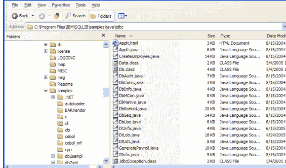

图 1.10 - 随 DB2 提供的示例程序

## 1.10 练习

- 使用 IBM Data Studio，创建一个什么也不做的存储过程 P2。从 DB2 命令窗口或 Linux shell 中调用此存储过程。
- 使用 IBM Data Studio，创建一个不接收参数并返回值为 2000 的函数 F2。从 DB2 命令窗口或 Linux shell 中调用此函数。
- 修改 P2，使其现在调用 F2。测试一下！

## 1.11 摘要

在本章中，我们探讨了 DB2 如何提供灵活性，以便在服务器数据库内部或通过连接到 DB2 数据服务器的客户端应用程序来编写数据库应用程序。

服务器端应用程序涵盖内容包括存储过程、用户定义函数和触发器。

在客户端方面，我们讨论了 DB2 应用程序开发允许的众多编程接口和方法，再次展示了 DB2 作为数据库服务器的卓越灵活性和容量。

## 1.12 复习问题

1. 列出使用存储过程的一个优点
2. 用户如何扩展 SQL 语言？
3. CLI 和 ODBC 之间的区别是什么？
4. 静态 SQL 和动态 SQL 之间的区别是什么？
5. 提及 JDBC Type 2 和 JDBC Type 4 驱动程序的一个区别？
6. 下列哪些对象存储在 DB2 数据库中？
    - A. 表
    - B. 存储过程
    - C. 用户定义函数
    - D. 以上所有
    - E. 以上都不是
7. 下列哪些语言可用于在 DB2 中编码存储过程？
    - A. SQL PL
    - B. PL/SQL
    - C. Cobol
    - D. Java
    - E. 以上所有
8. 选择正确的陈述：
    - A. 当数据库不断通过大量更新、删除和插入进行更改时，静态 SQL 通常比动态 SQL 更快。
    - B. 嵌入式 SQL 必须是静态 SQL


C. ODBC 和 JDBC 始终使用动态 SQL
D. 以上所有
E. 以上皆非

9. 以下哪一种是推荐用于 DB2 的 ADO.NET 提供程序？
A. ODBC .NET 数据提供程序
B. OLE DB .NET 数据提供程序
C. DB2 .NET 数据提供程序
D. 以上所有
E. 以上皆非

10. 以下哪一项不是 IBM 数据服务器 Python 扩展？
A. ibm_db
B. ibm_db_dbi
C. ibm_db_sa
D. ibm_db_python
E. 以上所有

## 2

## 第 2 章 – DB2 pureXML

在本章中，我们将讨论 pureXML，这是一种在 DB2 9 中引入的支持 XML 原生存储的新技术。本章中讨论的许多示例和概念均取自 IBM Redbook®：《DB2 9：pureXML 概览与快速入门》。有关该书的更多信息，请参见“资源”部分。图 2.1 概述了本章在 DB2“宏观图景”中讨论的部分。

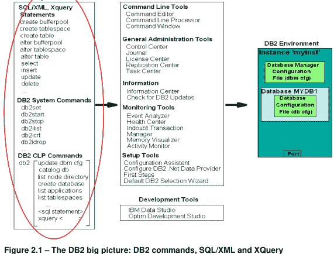

**图 2.1 – DB2 宏观图景：DB2 命令、SQL/XML 和 XQuery**

**注意：**

有关 pureXML 的更多信息，请观看此视频：
[http://www.channeldb2.com/video/video/show?id=607741:Video:4382](http://www.channeldb2.com/video/video/show?id=607741:Video:4382)

## 2.1 在数据库中使用 XML

XML 文档可以存储在文本文件、XML 存储库或数据库中。许多公司选择将 XML 存储在数据库中有两个主要原因：

-   管理大量 XML 数据是一个数据库问题。XML 与其他数据一样，只是整体格式不同。将关系数据存储到数据库中的原因同样适用于 XML 数据：数据库提供了高效的搜索和检索，对数据持久性的强大支持，备份和恢复，事务支持，以及性能和可扩展性。
-   集成：通过同时存储关系数据和 XML 文档，您可以将新的 XML 数据与现有的关系数据集成，并在一项查询中结合使用 SQL 与 XPath 或 XQuery。此外，关系数据可以发布为 XML，反之亦然。通过集成，数据库可以更好地支持 Web 应用程序、SOA 和 Web 服务。

## 2.2 XML 数据库

存储 XML 数据的数据库有两种类型：

-   支持 XML 的数据库
-   原生 XML 数据库

### 2.2.1 支持 XML 的数据库

支持 XML 的数据库使用关系模型作为其核心数据存储模型来存储 XML。这需要 XML（层次结构）数据模型与关系数据模型之间的映射，或者将 XML 数据作为字符大对象存储。虽然这可以被视为“旧”技术，但仍有许多数据库供应商在使用它。图 2.2 更详细地解释了支持 XML 的数据库的两种选项。

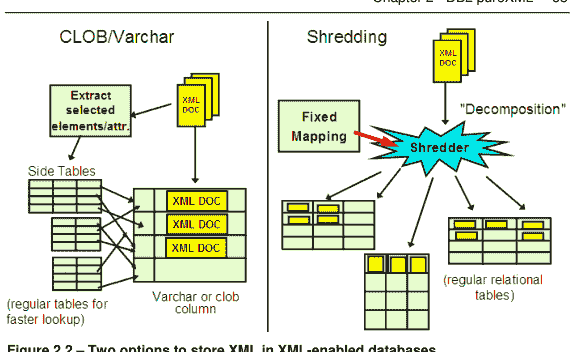

**图 2.2 – 在支持 XML 的数据库中存储 XML 的两种选项**

图 2.2 的左侧显示了在数据库中存储 XML 文档的 CLOB 和 varchar 方法。使用此方法时，XML 文档作为未解析的字符串存储在数据库中的 CLOB 或 varchar 列中。如果 XML 文档以字符串形式存储，当您要检索 XML 文档的一部分时，您的程序将必须检索整个字符串，并对其进行解析以找到所需内容。可以将解析视为在内存中构建 XML 文档树，以便您可以遍历该树。此方法内存密集且不够灵活。

支持 XML 的数据库的另一种选项称为拆分（shredding）或分解，如图 2.2 右侧所示。使用此方法时，整个 XML 文档被拆分为较小的部分，并存储在表中。使用此方法，您实际上是将基于层次结构模型的 XML 文档强制转换为关系模型。由于如果 XML 文档发生变化，这种变化不容易传播到相应的表中，并且可能需要创建许多其他表，因此此方法不够灵活。此方法在性能方面也不佳：如果需要重新获取原始 XML 文档，您需要执行昂贵的 SQL 连接操作，当涉及更多表时，这可能会变得更加昂贵。

### 2.2.2 原生 XML 数据库

原生 XML 数据库在内部使用层次结构 XML 数据模型来存储和处理 XML。存储格式与处理格式相同；没有映射到关系模型，并且 XML 文档不以未解析的字符串（CLOB 或 varchar）存储。当使用 XPath 或 XQuery 语句时，它们由引擎原生处理，而不会转换为 SQL。这就是为什么这些数据库被称为“原生”XML 数据库的原因。DB2 是目前唯一提供此支持的商用数据服务器。

## 2.3 DB2 中的 XML

图 2.3 概述了关系数据和层次结构数据（XML 文档）如何在 DB2 混合数据库中同时存储。该图还显示了用于创建 dept 表的 CREATE TABLE 语句。

```
CREATE TABLE dept (deptID CHAR(8), ..., deptdoc XML);
```

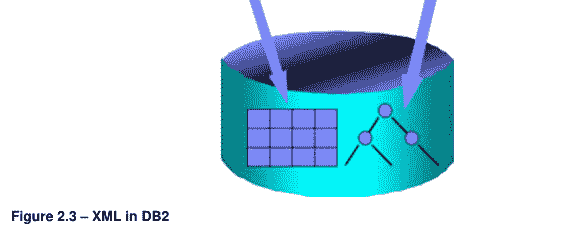

请注意，该表定义使用新的数据类型 XML 作为 deptdoc 列。图中的左箭头表示以关系格式（表）存储的关系列 deptID，而 XML 列 deptdoc 则以解析后的层次结构格式存储。

图 2.4 说明，在 DB2 9 中，现在有四种访问数据的方式：

-   使用 SQL 访问关系数据
-   使用带有 XML 扩展的 SQL（SQL/XML）访问 XML 数据
-   使用 XQuery 访问 XML 数据
-   使用 XQuery 访问关系数据

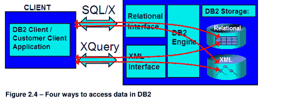

因此，根据您的背景，如果您是 SQL 专家，您可能会将 DB2 视为一个也支持 XML 的世界级 RDBMS。如果您是 XML 专家，您可能会将 DB2 视为一个也支持 SQL 的世界级 XML 存储库。

请注意，IBM 使用术语 *pureXML* 而不是 *native XML*（原生 XML）来描述这项技术。虽然其他供应商仍然使用旧的 CLOB/varchar 或拆分技术来存储 XML 文档，但他们将这些旧技术称为“原生 XML”。为了避免混淆，IBM 决定使用新术语 pureXML，并对该名称进行商标保护，以便其他数据库或 XML 供应商不能使用相同的术语来指代不同的技术。纯 XML 支持适用于创建为 Unicode 或非 Unicode 的数据库。

### 2.3.1 pureXML 技术优势

pureXML 技术提供了许多优势。

1.  鉴于 XML 文档使用新的 XML 数据类型存储在表的列中，您可以无缝利用您在关系方面的投资。
2.  您可以降低代码复杂性。例如，图 2.5 说明了使用和不使用 pureXML 编写的 PHP 脚本。使用 pureXML（左侧较小的框）时，代码行数减少了。这不仅意味着代码不那么复杂，而且由于代码中需要解析和维护的行数较少，整体性能也得到提高。

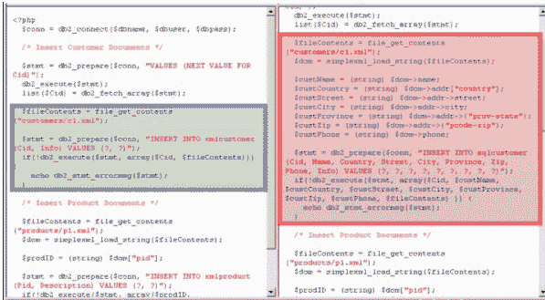

**图 2.5 – 使用和不使用 pureXML 的代码复杂性**

3.  使用 XML 和 pureXML 技术，模式变更更容易。图 2.6 说明了这种增强的灵活性。在图中，假设您有一个由 Employee 和 Department 表组成的数据库。通常，对于非 XML 数据库，如果您的经理要求您不仅存储每个员工的一个电话号码（家庭电话号码），还要存储第二个电话号码（手机号码），您可以向 Employee 表添加一个额外列，并将手机号码存储在新列中。然而，这种方法违反了关系数据库的规范化规则。如果要保留这些规则，您应该改为创建一个新的 Phone 侧表，并将所有电话信息移动到此表中。然后您还可以添加手机号码。创建新的 Phone 表成本高昂，不仅因为需要移动大量现有数据，而且因为应用程序中的所有 SQL 都必须更改以指向新表。

相反，在图的左侧，我们展示了如何使用 XML 来完成此操作。如果员工 Christine 还有一个手机号码，可以添加一个新标签来放入此信息。如果员工 Michael 没有手机号码，我们只需保持原样。

```
<DEPARTMENT deptid="15" deptname="Sales">
  <EMPLOYEE>
    <EMPNO>10</EMPNO>
    <FIRSTNAME>CHRISTINE</FIRSTNAME>
    <LASTNAME>SMITH</LASTNAME>
    <PHONE>408-463-4963</PHONE>
    <PHONE>415-010-1234</PHONE>
    <SALARY>52750.00</SALARY>
  </EMPLOYEE>
  <EMPLOYEE>
    <EMPNO>27</EMPNO>
    <FIRSTNAME>MICHAEL</FIRSTNAME>
    <LASTNAME>THOMPSON</LASTNAME>
    <PHONE>406-463-1234</PHONE>
    <SALARY>41250.00</SALARY>
  </EMPLOYEE>
</DEPARTMENT>
```

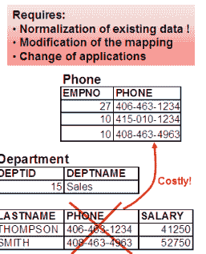

| DEPTID | EMPNO | FIRSTNAME | LASTNAME | PHONE | SALARY |
| --- | --- | --- | --- | --- | --- |
| 15 | 27 | MICHAEL | THOMPSON | 406-463-1234 | 41250 |
| 15 | 10 | CHRISTINE | SMITH | 408-463-4963 | 52750 |

**图 2.6 – 使用 XML 提高数据灵活性**

4.  您可以提高 XML 应用程序的性能。使用 pureXML 技术进行的测试显示，XML 应用程序的性能有巨大提升。表 2.1 显示了从旧技术切换到 pureXML 的公司的测试结果。第二列显示了使用另一种关系数据库以旧方法处理 XML 的结果，第三列显示了使用具有 pureXML 的 DB2 的结果。


### 2.3.2 XPath 基础

XPath 是一种可用于查询 XML 文档的语言。清单 2.1 展示了一个 XML 文档，而图 2.7 则以解析分层（也称为“节点”或“叶子”）格式展示了同一文档。我们将使用解析分层格式来解释 XPath 的工作原理。

```xml
<dept bldg="101">
   <employee id="901">
      <name>John Doe</name>
      <phone>408 555 1212</phone>
      <office>344</office>
   </employee>
   <employee id="902">
      <name>Peter Pan</name>
      <phone>408 555 9918</phone>
      <office>216</office>
   </employee>
</dept>
```

清单 2.1 – 一个 XML 文档

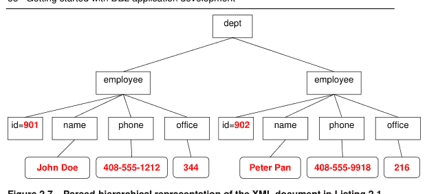

图 2.7 – 清单 2.1 中 XML 文档的解析分层表示

快速学习 XPath 的方法是将其与 MS-DOS 或 Linux/UNIX 中的 `change directory`（`cd`）命令进行比较。使用 `cd` 命令时，你按如下方式遍历目录树：

```bash
cd /directory1/directory2/...
```

同样，在 XPath 中，你使用斜杠在 XML 文档内部从一个元素移动到另一个元素。例如，使用 *清单 2.1* 中的文档，在 XPath 中可以使用此查询检索所有员工的姓名：

```xpath
/dept/employee/name
```

#### 2.3.2.1 XPath 表达式

XPath 表达式使用完全限定路径来指定元素和属性。“@”符号用于指定属性。若要检索元素的值（文本节点），请使用 `text()` 函数。*表 2.2* 展示了使用 *清单 2.1* 中 XML 文档的 XPath 查询及其相应结果。

| XPath | 结果 |
| :--- | :--- |
| `/dept/@bldg` | 101 |
| `/dept/employee/@id` | 901<br>902 |
| `/dept/employee/name` | `<name>John Doe</name>`<br>`<name>Peter Pan</name>` |
| `/dept/employee/name/text()` | John Doe<br>Peter Pan |

表 2.2 – XPath 表达式示例

#### 2.3.2.2 XPath 通配符

XPath 中有两个主要的通配符：

- `*` 匹配任何标签名
- `/` 是“后代或自身”通配符

*表 2.3* 提供了使用 *清单 2.1* 中 XML 文档的更多示例

| XPath | 结果 |
| :--- | :--- |
| `/dept/employee/*/text()` | John Doe<br>408 555 1212<br>344<br>Peter Pan<br>408 555 9918<br>216 |
| `/dept/*/ @id` | 901<br>902 |
| `//name/text()` | Peter Pan<br>John Doe |
| `/dept//phone` | `<phone>408 555 1212</phone>`<br>`<phone>408 555 9918</phone>` |

表 2.3 – XPath 通配符示例

#### 2.3.2.3 XPath 谓词

谓词包含在方括号 [ ] 中。打个比方，你可以将它们视为 SQL 中 WHERE 子句的等效物。例如 `[@id="902"]` 可以读作：“WHERE 属性 id 等于 902”。一个 XPath 表达式中可以包含多个谓词。要指定位置谓词，请使用 [n]，这意味着将选择第 n 个子元素。例如，`employee[2]` 表示应选择第二个员工。*表 2.4* 提供了更多示例。

| XPath | 结果 |
| :--- | :--- |
| `/dept/employee[@id="902"]/name` | `<name>Peter Pan</name>` |
| `/dept[@bldg="101"]/employee[office>"300"]/name` | `<name>John Doe</name>` |
| `//employee[office="344" or office="216"]/@id` | 901<br>902 |
| `/dept/employee[2]/@id` | 902 |

表 2.4 – XQuery 谓词示例

#### 2.3.2.4 父轴

类似于 MS-DOS 或 Linux/UNIX，你可以使用“.”（点）在表达式中表示你正在引用当前上下文，并使用“….”（双点）引用父上下文。*表 2.5* 提供了更多示例。

| XQuery | 结果 |
| :--- | :--- |
| `/dept/employee/name[.. /@id="902"]` | `<name>Peter Pan</name>` |
| `/dept/employee/office[. >"300"]` | `<office>344</office>` |
| `/dept/employee[office > "300"]/office` | `<office>344</office>` |
| `/dept/employee[name=. "John Doe"]/.. /@bldg` | 101 |
| `/dept/employee[name[.= "John Doe"]/.. /.. /@bldg` | 101 |

表 2.5 – XQuery 父轴

### 2.3.3 XQuery 基础

XQuery 是为 XML 创建的查询语言。XQuery 支持路径表达式以导航 XML 层次结构。事实上，XQuery 是 XPath 的超集；因此，我们之前关于 XPath 所学的一切也适用于 XQuery。XQuery 支持类型化和非类型化数据。由于 XML 文档省略缺失或未知数据，XQuery 缺少空值。XQuery 和 XQuery 表达式对大小写敏感，并且 XQuery 返回 XML 数据序列。

XQuery 支持 FLWOR 表达式。如果我们以 SQL 做类比，它等效于 SELECT-FROM-WHERE 表达式。下一节将更详细地描述 FLWOR。

#### 2.3.3.1 XQuery: FLWOR 表达式

FLWOR 代表：

- **FOR**：遍历序列，将变量绑定到项目
- **LET**：将变量绑定到序列
- **WHERE**：消除迭代中的项目
- **ORDER**：重新排列迭代中的项目
- **RETURN**：构建查询结果

它是一个允许操纵 XML 文档的表达式，使你能够返回另一个表达式。例如，假设你有一个具有此定义的表：

```sql
CREATE TABLE dept (deptID CHAR(8), deptdoc XML);
```

并且清单 2.2 中的 XML 文档被插入到 deptdoc 列中：

```xml
<dept bldg="101">
    <employee id="901">
        <name>John Doe</name>
        <phone>408 555 1212</phone>
        <office>344</office>
    </employee>
    <employee id="902">
        <name>Peter Pan</name>
        <phone>408 555 9918</phone>
        <office>216</office>
    </employee>
</dept>
```

清单 2.2 - 一个示例 XML 文档

然后，可以使用 FLWOR 表达式运行清单 2.3 中的 XQuery 语句：

```xquery
xquery
for $d in db2-fn:xmlcolumn('dept.deptdoc')/dept
let $emp := $d/employee/name
where $d/@bldg > 95
order by $d/@bldg
return
    <EmpList>
    {$d/@bldg, $emp}
    </EmpList>
```

清单 2.3 - 使用 FLWOR 表达式的示例 XQuery 语句

这将返回清单 2.4 中显示的输出：

```xml
<EmpList bldg="101">
    <name>
        John Doe
    </name>
    <name>
        Peter Pan
    </name>
</EmpList>
```

清单 2.4 - 运行清单 2.3 中的 XQuery 语句后的输出

### 2.3.4 插入 XML 文档

向 DB2 数据库中插入 XML 文档可以使用 SQL INSERT 语句或 IMPORT 实用程序执行。XQuery 不能用于此目的，因为标准中尚未定义。

让我们检查一下清单 2.5 下方显示的脚本 `table_creation.txt`，可以使用以下语句从 DB2 命令窗口或 Linux shell 中运行：

```bash
db2 -tvf table_creation.txt
```

```sql
-- (1)
drop database mydb
;

-- (2)
create database mydb using codeset UTF-8 territory US
;

-- (3)
connect to mydb
;

-- (4)
create table items (
       id         int primary key not null,
       brandname  varchar(30),
       itemname   varchar(30),
       sku        int,
       srp        decimal(7,2),
       comments   xml
);

-- (5)
create table clients(
       id         int primary key not null,
       name       varchar(50),
       status     varchar(10),
       contact    xml
);

-- (6)
insert into clients values (77, 'John Smith', 'Gold',
      '<addr>111 Main St., Dallas, TX, 00112</addr>')
;

-- (7)
IMPORT FROM "D:\Raul\clients.del" of del xml from "D:\Raul" INSERT INTO
CLIENTS (ID, NAME, STATUS, CONTACT)
;

-- (8)
IMPORT FROM "D:\Raul\items.del" of del xml from "D:\Raul" INSERT INTO
ITEMS (ID, BRANDNAME, ITEMNAME, SKU, SRP, COMMENTS)
;
```

清单 2.5 - 文件 table_creation.txt 的内容

请注意，此脚本文件和相关文件提供在本书随附的压缩文件 **Exercise_Files_DB2_Application_Development.zip** 中。随着我们描述清单 2.5 中脚本的每一行，请跟随阅读。

1.  删除数据库 **mydb**。这通常在脚本文件中执行以进行清理。如果 **mydb** 之前不存在，你将收到错误消息，但这没关系。
2.  使用代码集 UTF-8 创建数据库 **mydb**。这会创建一个 Unicode 数据库。pureXML 在 Unicode 和非 Unicode 数据库中均受支持。
3.  连接到新创建的数据库 **mydb**。这是创建数据库内部对象所必需的。
4.  创建表 **items**。注意，该表的最后一列（列 **comments**）使用新的 XML 数据类型定义为 XML 列。
5.  我们创建表 **clients**。注意，该表的最后一列（列 **contact**）也使用新的 XML 数据类型定义。
6.  使用此 SQL INSERT 语句，你可以将 XML 文档插入 XML 列。在 INSERT 语句中，你传递作为用单引号括起来的字符串的 XML 文档。
7.  使用 IMPORT 命令，你可以将多个 XML 文档连同关系数据一起插入或导入到数据库中。在 (7) 中，你正在从 *clients.del* 文件（分隔的 ascii 文件）导入数据，并且你还指示该 *clients.del* 文件引用的 XML 数据所在的位置（在此示例中，位于 D:\Raul）。

我们将更仔细地查看文件 *clients.del*，但首先，让我们看看目录 D:\Raul 的内容。*图 2.8* 提供了这些信息。


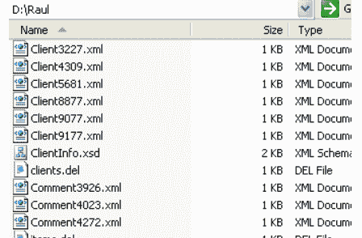

**图 2.8 - 包含 XML 文档的 D:\A\aul 目录内容**

清单 2.6 展示了文本文件 `clients.del` 的内容。

```text
3227,Ella Kimpton,Gold,<XDS FIL='Client3227.xml' />, 
8877,Chris Bontempo,Gold,<XDS FIL='Client8877.xml' />, 
9077,Lisa Hansen,Silver,<XDS FIL='Client9077.xml' />
9177,Rita Gomez,Standard,<XDS FIL='Client9177.xml' />, 
5681,Paula Lipenski,Standard,<XDS FIL='Client5681.xml' />
4309,Tina Wang,Standard,<XDS FIL='Client4309.xml'/>
```

**清单 2.6 - 文件 clients.del 的内容**

在 `clients.del` 文件中，`"XDS FIL="` 用于指向特定的 XML 文档文件。

图 2.9 展示了运行上述脚本后的控制中心。

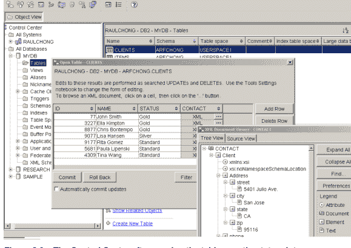

**图 2.9 – 运行 table_creation.txt 脚本后的控制中心**

请注意，图中显示的是 `CLIENTS` 表的内容。最后一列 **contact** 是一个 XML 列。当你点击带有三个点的按钮时，会打开另一个窗口，显示 XML 文档的内容。这在图 2.9 的右下角有所展示。

### 2.3.5 查询 XML 数据

在 DB2 软件中，查询 XML 数据有两种方式：

- 使用带 XML 扩展的 SQL (SQL/XML)
- 使用 XQuery

在这两种情况下，DB2 都遵循国际 XML 标准。

#### 2.3.5.1 使用 SQL/XML 查询 XML 数据

使用常规 SQL 语句允许你对行和列进行操作。SQL 语句可用于处理完整的 XML 文档；然而，当试图仅检索文档的一部分时，它将无助于解决问题。在这种情况下，你需要使用带 XML 扩展的 SQL (SQL/XML)。

表 2.6 描述了 SQL 2006 标准中可用的一些 SQL/XML 函数

| 函数名称 | 描述 |
| --- | --- |
| XMLPARSE | 解析字符或大对象二进制数据，生成 XML 值 |
| XMLSERIALIZE | 将 XML 值转换为字符或大对象二进制数据 |
| XMLVALIDATE | 验证 XML 值是否符合 XML 架构，并对 XML 值进行类型注释 |
| XMLEXISTS | 确定 XQuery 是否返回结果（即一个或多个项目的序列） |
| XMLQUERY | 执行 XQuery 并返回结果序列 |
| XMLTABLE | 执行 XQuery，将结果序列作为关系表返回（如果可能） |
| XMLCAST | 转换为 XML 类型或从 XML 类型转换 |

**表 2.6 – SQL/XML 函数**

以下示例可以使用之前创建的 **mydb** 数据库进行测试。

**示例 1**

假设你需要查找居住在某特定邮政编码的所有客户的姓名。**clients** 表在 XML 列中存储了客户地址，包括邮政编码。使用 XMLEXISTS，你可以搜索 XML 列中的目标邮政编码，并相应地限制返回的结果集。下面的清单 2.7 说明了所需的查询。

```sql
SELECT name FROM clients
WHERE xmlexists(
        '$c/Client/Address[zip="95116"]'
        passing clients.contact as "c")
```

**清单 2.7 - 使用 XMLEXISTS 的示例**

在清单 2.7 中，第一行是一个 SQL 子句，指定你想要检索 **clients** 表中 **name** 列的信息。

WHERE 子句调用了 XMLEXISTS 函数，指定了一个 XPath 表达式，提示 DB2 导航到 **zip** 元素并检查其值是否为 95116。$c/Client/Address 子句指示了 XML 文档层次结构内部的路径，DB2 可以在其中定位 **zip** 元素。美元符号 ($) 用于指定变量；因此 "c" 是一个变量。该变量随后由这一行定义：`passing clients.contact as "c"`。在这里，**clients** 是表名，**contact** 是具有 XML 数据类型的列名。换句话说，我们将 XML 文档传递给变量 "c"。

DB2 检查包含在 **contact** 列中的 XML 数据，从根节点 **Client** 导航到 **Address** 节点，再到 **zip** 节点，最后确定客户是否居住在目标邮政编码。XMLEXISTS 函数评估为 "true"，DB2 返回与该行关联的客户姓名。

从 DB2 9.5 开始，上述查询可以简化为如下清单 2.8 所示。

```sql
SELECT name FROM clients
	WHERE xmlexists(
			'$CONTACT//Client/Address[zip="95116"]'
	)
```

**清单 2.8 - 清单 2.7 中所示查询的简化版本**

具有与 XML 列相同名称的变量由 DB2 自动创建。在上述示例中，变量 **CONTACT** 由 DB2 自动创建。其名称与 XML 列 **CONTACT** 的名称匹配。

**示例 2**

让我们考虑如何解决创建报告以列出“Gold”状态客户电子邮件地址的问题。下面的清单 2.9 中的查询可以为此目的运行。

```sql
SELECT xmlquery('$c/Client/email' passing contact as "c")
	FROM clients
	WHERE status = 'Gold'
```

**清单 2.9 - 使用 XMLQUERY 的示例**

第一行表明我们要返回电子邮件地址，它是 XML 文档的一个元素（而不是关系列）。与前面的示例一样，"$c" 是一个包含 XML 文档的变量。在这个示例中，我们使用 XMLQUERY 函数，它可以在 SELECT 之后使用，而 XMLEXISTS 函数可以在 WHERE 子句之后使用。

**示例 3**

可能存在你希望将 XML 数据表示为表的情况。这可以通过 XMLTABLE 函数实现，如下面的清单 2.10 所示。

```sql
SELECT t.comment#, i.itemname, t.customerID, Message
	FROM items i,
	xmtable('$c/Comments/Comment' passing i.comments as "c"
columns Comment# integer path 'CommentID',
        CustomerID integer path 'CustomerID',
        Message varchar(100) path 'Message') AS t
```

**清单 2.10 - 使用 XMLTABLE 的示例**

第一行指定了结果集中要包含的列。以 "t" 变量为前缀的列基于 XML 元素值。

第三行调用 XMLTABLE 函数以指定包含目标数据的 DB2 XML 列 (i.comments) 以及列的 XML 文档中感兴趣元素所在的路径。

跨第 4 到 6 行的 columns 子句标识了将映射到第 1 行指定的 SQL 结果集中的输出列的特定 XML 元素。此映射的一部分涉及指定 XML 元素值将转换为什么数据类型。在此示例中，所有 XML 数据都转换为传统的 SQL 数据类型。

**示例 4**

现在让我们探讨一个简单的示例，其中你在 XMLQUERY SQL/XML 函数内部包含了一个 XQuery FLWOR 表达式。这在清单 2.11 中进行了说明。

```sql
SELECT name, xmlquery(
       'for $e in $c/Client/email[1] return $e'
       passing contact as "c"
      )
     FROM clients
     WHERE status = 'Gold'
```

**清单 2.11 - 使用 XMLQUERY 和 FLWOR 的示例**

第一行指定客户姓名和 XMLQUERY 函数的输出将包含在结果集中。第二行表明要返回 *Client* 元素的第一个 *email* 子元素。第三行标识了我们的 XML 数据来源（contact 列）。第四行告诉我们该列来自 *clients* 表；第五行表明只有 *Gold* 客户是我们感兴趣的。

**示例 5**

清单 2.12 中说明的示例再次展示了 XMLQUERY 函数，它接受一个 XQuery FLWOR 表达式；然而，请注意，这次我们不仅返回 XML，还返回 HTML。

```sql
SELECT xmlquery('for $e in $c/Client/email[1]/text()
      return <p>{$e}</p>'
      passing contact as "c")
     FROM clients
     WHERE status = 'Gold'
```

**清单 2.12 - 一个返回 XML 和 HTML 的示例**

XQuery 的 return 子句允许你根据需要转换 XML 输出。第一行中使用 **text**() 函数表明，我们只关心符合条件客户的第一个电子邮件地址的文本表示。第二行指定此信息将被 HTML 段落标签包围。

**示例 6**

下面的示例使用 XML:ELEMENT 函数创建一系列 item 元素，每个元素都包含从 items 表中相应列获取的 ID、品牌名称和库存单位 (SKU) 值的子元素。基本上，当你想要将关系数据转换为 XML 数据时，可以使用 XML:ELEMENT 函数。这在清单 2.13 中进行了说明。

```sql
SELECT
    xmlelement (name "item", itemname),
    xmlelement (name "id",  id),
    xmlelement (name "brand", brandname),
    xmlelement (name "sku",  sku)
FROM items
WHERE srp < 100
```

**清单 2.13 - 使用 XML:ELEMENT 的示例**

清单 2.13 中的查询将返回如下清单 2.14 所示的输出。

```xml
<item>
    <id>4272</id>
    <brand>Classy</brand>
    <sku>981140</sku>
</item>
...
<item>
    <id>1193</id>
    <brand>Natural</brand>
    <sku>557813</sku>
</item>
```

**清单 2.14 - 清单 2.13 中查询的输出**

#### 2.3.5.2 使用 XQuery 查询 XML 数据

在上一节中，我们研究了如何使用带 XML 扩展的 SQL 来查询 XML 数据。SQL 始终是主要的查询方法，而 XPath 或 XQuery 则嵌入在 SQL 内部。在本节中，我们讨论如何使用 XQuery 来查询 XML 数据。


# 2.3.5 使用 XQuery 进行查询

这一次，XQuery 将成为主要的查询方法，在某些情况下，我们将在 XQuery 内部嵌入 SQL（使用 **db2-fn:sqlquery** 函数）。在使用 XQuery 时，我们将调用一些函数，并且还会使用 FLWOR 表达式。

## 示例 1

这是一个简单的 XQuery，用于返回客户联系数据。在示例中，**CONTACT** 是 XML 列的名称，而 **CLIENTS** 是表的名称。

```sql
xquery db2-fn:xmlcolumn('CLIENTS.CONTACT')
```

务必在任何 XQuery 表达式前加上 **xquery** 命令前缀，以便 DB2 知道必须使用 XQuery 解析器，否则 DB2 会假设你试图执行的是 SQL 表达式。**db2-fn:xmlcolumn** 函数是一个用于检索指定参数列中 XML 文档的函数。它等价于以下 SQL 语句，因为它检索的是整个列的内容：

```sql
SELECT contact FROM clients
```

## 示例 2

在*清单 2.15*中展示的示例里，我们使用 FLWOR 表达式来检索客户传真数据。

```xml
xquery
for $y in db2-fn:xmlcolumn('CLIENTS.CONTACT')/Client/fax
return $y
```

### 清单 2.15 - XQuery 和 FLWOR 表达式

第一行调用了 XQuery 解析器。第二行指示 DB2 遍历包含在 **CLIENTS.CONTACT** 列中的传真子元素。每个 fax 元素都绑定到变量 `$y`。第三行表示，对于每次迭代，返回的值都是 "$y"。

此查询的输出如*清单 2.16*所示（我们在输出中省略了命名空间，否则由于可能跨越多行，阅读难度会增加）：

```xml
<fax>4081112222</fax>
<fax>5559998888</fax>
```

### 清单 2.16 - 清单 2.15 中查询的输出

## 示例 3

*清单 2.17*中的示例查询 XML 数据并返回 HTML 格式的结果。

```xml
xquery
<ul> {
    for $y in db2-fn:xmlcolumn('CLIENTS.CONTACT')/Client/Address
    order by $y/zip
    return <li>{$y}</li>
}
</ul>
```

### 清单 2.17 - 使用 FLWOR 表达式返回 HTML 的 XQuery 语句

返回的示例 HTML 看起来像*清单 2.18*中所示的内容。

```html
<ul>
<li>
<address>
    <street>9407 Los Gatos Blvd.</street>
    <city>Los Gatos</city>
    <state>ca</state>
    <zip>95302</zip>
</address>
</li>
<li>
<address>
    <street>4209 El Camino Real</street>
    <city>Mountain View</city>
    <state>CA</state>
    <zip>95302</zip>
</address>
</li>
...
</ul>
```

### 清单 2.18 - 在清单 2.17 中执行的查询输出

## 示例 4

以下示例展示了如何使用 **db2-fn:sqlquery** 函数在 XQuery 内部嵌入 SQL。**db2-fn:sqlquery** 函数执行 SQL 查询，并仅返回选定的 XML 数据。传递给 **db2-fn:sqlquery** 的 SQL 查询必须仅返回 XML 数据。然后，此 XML 数据可以进一步由 XQuery 进行处理。这一点在*清单 2.19*中有所说明。

```xml
xquery
    for $y in
        db2-fn:sqlquery(
            'select comments from items where srp > 100')
    /Comments/Comment
    where $y/ResponseRequested='Yes'
    return (
        <action>
            {$y/ProductID}
            {$y/CustomerID}
            {$y/Message}
        </action>
    )
```

### 清单 2.19 - db2-fn:sqlquery 函数在 XQuery 中嵌入 SQL 的示例

在示例中，SQL 查询基于条件筛选行，即 **srp** 列的值大于 100。从筛选出的这些行中，它会选择 **comments** 列，即 XML 列。接下来，应用 XQuery（或 XPath）以到达子元素。

> **注意：**
> SQL 对大小写不敏感，且 DB2 软件默认将所有表和列名存储为大写。另一方面，XQuery 对大小写敏感。上述函数是 XQuery 接口函数，因此应将这些函数中的表和列名以大写字母形式传递。如果以小写形式传递对象名称，可能会导致未定义对象名称错误。

### 2.3.6 使用 SQL/XML 进行连接

本节描述如何在不同表的两个 XML 列之间，或在一个 XML 列和一个关系列之间执行 JOIN 操作。假设你已经使用*清单 2.20*中显示的语句创建了两个表：

```sql
CREATE TABLE dept (unitID CHAR(8), deptdoc XML)
CREATE TABLE unit (unitID CHAR(8) primary key not null,
                     name CHAR(20),
                     manager VARCHAR(20),
                     ...)
```

### 清单 2.20 - 用于 JOIN 示例的表 DDL

你可以通过两种方式之一执行 JOIN 操作。第一种方法如*清单 2.21*所示。

```sql
SELECT u.unitID
   FROM dept d, unit u
  WHERE XMLEXISTS (
         '$e//employee[name = $m]'
   passing d.deptdoc as "e", u.manager as "m")
```

### 清单 2.21 - 使用 SQL/XML 执行 JOIN 的第一种方法

上述清单语句的第 4 行表明，JOIN 操作发生在元素 **name**（它是表 **dept** 中 **deptdoc** XML 列的子元素）和表 **unit** 中的关系列 **manager** 之间。

清单 2.22 展示了执行 JOIN 的第二种方法。

```sql
SELECT u.unitID
FROM dept d, unit u
    WHERE u.manager = XMLCAST(
            XMLQUERY('$e//employee/name'
                passing d.deptdoc as "e")
                AS char(20))
```

### 清单 2.22 - 使用 SQL/XML 执行 JOIN 的第二种方法

在这种第二种方法中，关系列位于等式的左侧。如果关系列位于等式的左侧，则可以使用关系索引而不是 XML 索引。

### 2.3.7 使用 XQuery 进行连接

假设已经创建了以下表：

```sql
CREATE TABLE dept(unitID CHAR(8), deptdoc XML)
CREATE TABLE project(projectDoc XML)
```

如果我们使用 SQL/XML，JOIN 看起来如清单 2.23 所示。

```sql
SELECT XMLQUERY (
    '$d/dept/employee'
    passing d.deptdoc as "d")
    FROM dept d, project p
    WHERE XMLEXISTS (
        '$e/dept[@deptID=$p/project/deptID]'
        passing d.deptdoc as "e", p.projectDoc as "p")
```

### 清单 2.23 - 使用 SQL/XML 进行 JOIN

使用 XQuery 的等效 JOIN 如清单 2.24 所示。

```xml
xquery
    for $dept in db2-fn:xmlcolumn("DEPT.DEPTDOC")/dept
    for $proj in db2-fn:xmlcolumn("PROJECT.PROJECTDOC")/project
    where $dept/@deptID = $proj/deptID
    return $dept/employee
```

### 清单 2.24 - 使用 XQuery 进行 JOIN

第二种方法更易于解释 —— 变量 $dept 保存表 dept 中 XML 列 deptdoc 的 XML 文档。变量 $proj 保存表 project 中 XML 列 projectdoc 的 XML 文档。然后，第 4 行在第一个 XML 文档的一个属性和第二个 XML 文档的一个元素之间执行 JOIN 操作。

### 2.3.8 更新和删除操作

对 XML 数据的更新和删除操作可以通过以下两种方式进行：

- 使用 SQL UPDATE 和 DELETE 语句
- 使用 TRANSFORM 表达式

对于使用 SQL UPDATE 和 DELETE 语句的第一种方式，更新或删除发生在文档级别：也就是说，整个 XML 文档会被更新后的文档替换。例如，在下面清单 2.25 中的 UPDATE 语句中，如果你只想更改 `<state>` 元素，实际上整个 XML 文档都会被替换。

```sql
UPDATE clients SET contact=(
        xmlparse(document
        '<Client>'
            '<address>'
            '<street>5401 Julio ave.</street>'
            '<city>San Jose</city>'
            '<state>CA</state>'
            '<zip>95116</zip>'
            '</address>'
            '<phone>'
            '<work>4084633000</work>'
            '<home>4081111111</home>'
            '<cell>4082222222</cell>'
            '</phone>'
            '<fax>4087776666</fax>'
            '<email>newemail@someplace.com</email>'
        '</Client>')
    )
    WHERE id = 3227
```

### 清单 2.25 - SQL UPDATE 的示例

对于第二种方式，你可以使用 TRANSFORM 表达式执行子文档更新，这要高效得多。这允许你替换、插入、删除或重命名 XML 文档中的节点。你也可以在不替换节点本身的情况下更改节点的值，通常是为了更改元素或属性值——这是一种非常常见的更新类型。此支持功能在 DB2 9.5 中添加。

TRANSFORM 表达式是 XQuery 语言的一部分；你可以在通常使用 XQuery 的任何地方使用它，例如在 FLWOR 表达式中或在 SQL/XML 语句中的 XMLQUERY 函数中。最典型的用法是在 SQL UPDATE 语句中修改 XML 列中的 XML 文档。

清单 2.26 展示了 TRANSFORM 表达式的语法。

```text
>>-transform--| copy clause |--| modify clause |--| return clause -->
```


### 2.3.8 TRANSFORM 表达式

**copy 子句**

```
|--copy--$VariableName--:=--CopySourceExpression--|
```

**modify 子句**

```
|--modify--ModifyExpression--------------------|
```

**return 子句**

```
|--return--ReturnExpression--------------------|
```

**列表 2.26 - TRANSFORM 表达式的语法**

copy 子句用于将您想要处理的 XML 文档分配给变量。

在 modify 子句中，您可以调用 insert、delete、rename 或 replace 表达式。这些表达式允许您对 XML 文档执行更新操作。

例如：

- 如果您想向文档添加新节点，则使用 insert 表达式。
- 要从 XML 文档中删除节点，使用 delete 表达式。
- 要重命名 XML 文档中的元素或属性，使用 rename 表达式。
- 要用新节点或节点序列替换现有节点，使用 replace 表达式。该表达式的 replace 值只能用于更改元素或属性的值。

return 子句返回 transform 表达式的结果。

*列表 2.27* 展示了一个使用 TRANSFORM 表达式的 UPDATE 语句示例。

```sql
(1)-- UPDATE customers
(2)-- SET contactinfo = xmlquery( 'declare default element namespace
(3)--                          "http://posample.org";
(4)--                     transform
(5)--          copy $newinfo := $c
(6)--                 modify do insert <email2>my2email.gm.com</email2>
(7)--                      as last into $newinfo/customerinfo
(8)--          return $newinfo' passing contactinfo as "c")
(9)-- WHERE id = 100
```

**列表 2.27 - 使用 TRANSFORM 表达式的 UPDATE**

在上面的示例中，行 (1)、(2) 和 (9) 是 SQL UPDATE 语法的一部分。在行 (2) 中，调用了 XMLQUERY 函数，该函数调用了行 (4) 中的 transform 表达式。transform 表达式块从行 (4) 到行 (8)，用于将新节点插入到包含 **email2** 元素的 XML 文档中。请注意，通过视图更新 XML 文档中的元素是不支持的。

从表中删除整个 XML 文档与在 SQL/XML 中使用 SELECT 语句一样简单。使用 SQL DELETE 语句并指定必要的 WHERE 谓词。

### 2.3.9 XML 索引

在 XML 文档中，可以为元素、属性或值（文本节点）创建索引。以下是一些示例。假设创建了以下表格：

```sql
CREATE TABLE customer(info XML)
```

并且假设 *列表 2.28* 中的 XML 文档是存储在表中的一个文档。

```xml
<customerinfo Cid="1004">
    <name>Matt Foreman</name>
    <addr country="Canada">
        <street>1596 Baseline</street>
        <city>Toronto</city>
        <state>Ontario</state>
        <pcode>M3Z-5H9</pcode>
    </addr>
    <phone type="work">905-555-4789</phone>
    <phone type="home">416-555-3376</phone>
    <assistant>
        <name>Peter Smith</name>
        <phone type="home">416-555-3426</phone>
    </assistant>
</customerinfo>
```

**列表 2.28 - 用于 XML 索引相关示例的 XML 文档**

*列表 2.29* 中显示的语句在属性 **cid** 上创建了一个索引。

```sql
CREATE UNIQUE INDEX idx1 ON customer(info)
    GENERATE KEY USING
    xmlpattern '/customerinfo/@Cid'
    AS sql DOUBLE
```

**列表 2.29 - 属性 Cid 上的索引**

*列表 2.30* 中显示的语句在元素 **name** 上创建了一个索引。

```sql
CREATE INDEX idx2 ON customer(info)
    GENERATE KEY USING
        xmlpattern '/customerinfo/name'
        AS sql VARCHAR(40)
```

**列表 2.30 - 元素 name 上的索引**

*列表 2.31* 中的语句在所有 *name* 元素上创建了一个索引。

```sql
CREATE INDEX idx3 ON customer(info)
    GENERATE KEY USING
        xmlpattern '//name'
        AS sql VARCHAR(40);
```

**列表 2.31 - 所有 name 元素上的索引**

*列表 2.32* 中的语句在所有文本节点（所有值）上创建了一个索引。这不建议这样做，因为维护索引以支持更新、删除和插入操作的成本过高，且索引体积过大。

```sql
CREATE INDEX idx4 ON customer(info)
    GENERATE KEY USING
        xmlpattern '//text()'
        AS sql VARCHAR(40);
```

**列表 2.32 - 所有文本节点上的索引（不建议）**

## 2.4 处理 XML 架构

DB2 允许您向数据库插入格式良好的 XML 文档。如果格式不良，您在插入时会收到错误。另一方面，DB2 并不强制要求验证 XML 文档。如果您希望验证 XML 文档，本节将讨论几种替代方案。

### 2.4.1 注册您的 XML 架构

XML 架构存储 DB2 数据库中的称为 XML 架构存储库的地方。要将 XML 架构添加到存储库中，请使用 REGISTER XMLSCHEMA 命令。

例如，假设您有一个 XML 文档存储在文件 *order.xml* 中，如 *图 2.10* 所示。

```xml
<?xml version="1.0" encoding="UTF-8"?>
<po:PurchaseOrder xmlns:po="http://www.test.com/po">
    <Header>
        <Id>1</Id>
        <date>2004-01-29</date>
        <description>purchase order</description>
        <value>20</value>
        <status>shipped</status>
    </Header>
    <Items>
        <Item>
            <ItemDescription color="red" weight="5">
                <Name>Widget C</Name>
                <SKU>1</SKU>
                <Price>50</Price>
                <Comment>no comment</Comment>
            </ItemDescription>
            <NumberOrdered>1</NumberOrdered>
        </Item>
    </Items>
    <Customer type="regular">
        <Name>Manoj K Sardana</Name>
        <Address>ring road, bangalore</Address>
        <Phone>918051055109</Phone>
        <email>msardana@in.ibm.com</email>
    </Customer>
</po:PurchaseOrder>
```

**图 2.10 - 包含 XML 文档的 order.xml 文件**

现在，假设您有一个 XML 架构文档存储在文件 order.xsd 中，如图 2.11 所示。

```xsd
<xsd:schema xmlns:xsd="http://www.w3.org/2001/XMLSchema"    
        targetNamespace="http://www.test.com/po" 
          xmlns:po="http://www.test.com/po"
          xmlns:head="http://www.test.com/header"
          xmlns:prod = "http://www.test.com/product" 
          xmlns:cust = "http://www.test.com/customer">

<xsd:import namespace="http://www.test.com/product" schemaLocation="product.xsd"/>
<xsd:import namespace="http://www.test.com/customer" schemaLocation="customer.xsd" />
<xsd:import namespace="http://www.test.com/header" schemaLocation="header.xsd" />

<xsd:complexType name="itemType">
  <xsd:sequence>
    <xsd:element name="Item" minOccurs="1" maxOccurs="unbounded" >
        <xsd:complexType>
          <xsd:sequence>
            <xsd:element name="ItemDescription" type="prod:prodType" />
            <xsd:element name="NumberOrdered" type="xsd:integer" />
          </xsd:sequence>
        </xsd:complexType>
    </xsd:element>
  </xsd:sequence>
</xsd:complexType>

<xsd:complexType name="potype">
  <xsd:sequence>
    <xsd:element name="Header"    type="head:headerType" />
    <xsd:element name="Items"     type="po:itemType" />
    <xsd:element name="Customer"  type="cust:customerType" />
  </xsd:sequence>
</xsd:complexType>

<xsd:element name="PurchaseOrder" type="po:potype" />

</xsd:schema>
```

**图 2.11 - 包含 XML 架构的 order.xsd 文件**

在此 XML 架构文档中，我们用椭圆高亮显示以下内容：

- `<xsd:schema ...>`：指示这是一个 XML 架构文档。
- `<xsd:import ...>`：我们导入其他 xsd 文件（其他 XML 架构），它们将是这个更大的 XML 架构的一部分。
- `minOccurs="1"`：这是一个 XML 架构“规则”的示例，对于 Item 元素，我们规定它至少应出现一次，换句话说，至少应有一个 Item 元素。

接下来，为了将 XML 架构注册到数据库，可以使用类似于下面 *列表 2.33* 中显示的脚本。该脚本包含使其自解释的注释。

```sql
-- CONNECT TO THE DATABASE
CONNECT TO SAMPLE;

-- REGISTER THE MAIN XML SCHEMA
REGISTER XMLSCHEMA http://www.test.com/order FROM D:\example3\order.xsd AS
```


-- 将 XML 模式文档添加到主模式
ADD XMLSCHEMA DOCUMENT TO order ADD http://www.test.com/header FROM
D:\example3\header.xsd;

-- 将 XML 模式文档添加到主模式
ADD XMLSCHEMA DOCUMENT TO order ADD http://www.test.com/product FROM
D:\example3\product.xsd;

-- 将 XML 模式文档添加到主模式
ADD XMLSCHEMA DOCUMENT TO order ADD http://www.test.com/customer FROM
D:\example3\customer.xsd;

-- 完成模式注册
COMPLETE XMLSCHEMA order;

## 列表 2.33 - 一个展示注册 XML 模式步骤的示例脚本

为了稍后回顾这些信息，您可以如*列表 2.34*所示，从目录（Catalog）表中 SELECT 相关信息。

```sql
SELECT CAST (OBJECTSCHEMA AS VARCHAR(15)), CAST (OBJECTNAME AS VARCHAR(15))
    FROM syscat.xsrobjects
    WHERE OBJECTNAME='ORDER';
```

## 列表 2.34 - 从 DB2 目录表中检索 XML 模式信息

### 2.4.2 XML 模式验证

一旦您的 XML 模式已在 DB2 中注册，您可以通过两种方式验证 XML 文档：

- 在 INSERT 操作中使用 XMLVALIDATE 函数
- 使用 BEFORE 触发器

*图 2.12* 展示了一个示例，其中*图 2.10*所示的 XML 文档根据*图 2.11*所示的 XML 模式进行了验证。

```sql
DROP TABLE t1;
CREATE TABLE t1 (po xml);

INSERT INTO t1 VALUES(xmlvalidate(xmlparse(document('<' ?xml version="1.0" encoding="UTF-8" '?>
  <po:PurchaseOrder xmlns:po="http://www.test.com/po">
    <Header>
      <id>1</id>
      <date>2004-01-29</date>
      <description>purchase order</description>
      <value>20</value>
      <status>shipped</status>
    </Header>
    <Items>
      <item>
        <itemDescription color="red" weight="5">
          <Name>Widget C</Name>
          <SKU>1</SKU>
          <Price>30</Price>
          <Comment>no comment</Comment>
        </itemDescription>
        <NumberOrdered>1</NumberOrdered>
      </item>
    </Items>
    <Customer type="regular">
      <Name>Manoj K Sardana</Name>
      <Address>ring road, bangalore</Address>
      <Phone>918051055109</Phone>
      <email>msardana@im.ibm.com</email>
    </Customer>
  </po:PurchaseOrder>') ACCORDING TO XMLSCHEMA id order));
```

图 2.12 - 使用 XMLVALIDATE 进行 XML 模式验证

若要测试 XML 文档是否已通过验证，您可以在 CHECK 约束上使用“IS VALIDATED”谓词。

您可以使用不同的 XML 模式验证列中的 XML 文档。这对于从 XML 模式版本 1 轻松迁移到版本 2 非常重要。在同一个 XML 列中，您也可能发现完全没有验证的 XML 文档。如果文档来自受信任和不受信任的来源，且只有后者需要模式验证，这会很有用。

### 2.4.3 其他 XML 支持

小型 XML 文档现在可以与基础表内联。这意味着 XML 数据存储在关系数据的同一位置，并且可以利用与普通关系数据相同的压缩机制。较大的 XML 文档存储在一个单独的内部对象中，该对象也可以进行压缩。

DB2 软件还支持 XML 模式演变。这意味着如果您的 XML 模式发生变化，您可以使用 UPDATE XMLSCHEMA 命令轻松更新 XML 模式。如果对 XML 模式的更改过于剧烈，您可能会遇到一些错误。

DB2 还支持 XML 分解或“粉碎（shredding）”。这是将 XML 存储在数据库中的“旧”方法，也是其他供应商存储 XML 的方法。如果您希望使用该方法，DB2 仍然支持它；但我们推荐使用 pureXML。DB2 还支持 XML Extender，它也使用旧方法来存储 XML，但该扩展器将不再进行增强。

在 DB2 9.7 中，pureXML 的所有优势已扩展至常用于数据仓库的数据库分区。数据库分区功能（DPF）随 DB2 Enterprise Edition 提供。

## 2.5 练习

在本章中，您已看到若干 SQL/XML 和 XQuery 语法示例，并熟悉了 DB2 命令编辑器和 IBM Data Studio。在本练习中，您将测试自己在 SQL/XML 和 XQuery 方面的知识，同时熟悉这些工具的使用。我们将使用本章前面使用 **table_creation.txt** 脚本文件创建的 **mydb** 数据库（*列表 2.5*）。

### 操作步骤

- 1. 创建 **mydb** 数据库并加载 XML 数据，如本章前面所述。文件 **table_creation.txt** 包含在随附文件 **Exercise_Files_DB2_Application_Development.zip** 中的第 2 章文件夹下。请从 DB2 命令窗口或 Linux shell 中按以下方式运行 `table_creation.txt` 脚本文件：
  ```
  db2 -tvf table_creation.txt
  ```

- 2. 如果脚本在任何步骤中失败，请尝试通过查看错误消息来找出问题所在。运行脚本时的典型问题是可能需要更改文件路径，因为文件可能位于不同的目录中。您始终可以删除数据库并重新开始，从 DB2 命令窗口或 Linux shell 发出此命令：
  ```
  db2 drop database mydb
  ```

- 3. 如果您在尝试删除数据库时收到错误，原因是存在活动连接，请先发出此命令：
  ```
  db2 force applications all
  ```

- 4. 成功运行脚本后，使用 DB2 控制中心或 IBM Data Studio 验证是否创建了 **items** 和 **clients** 表，并且它们分别包含 4 行和 7 行。

- 5. 创建 **mydb** 数据库并加载这两个表后，现在您可以连接到它，并执行*列表 2.7 到 2.19*中所示的查询

## 2.6 摘要

本章向您介绍了 XML 和 pureXML 技术。由于 Web 2.0 工具和技术的兴起以及 SOA，XML 文档的使用正呈指数级增长。通过将 XML 文档存储在 DB2 数据库中，您可以利用 pureXML 的优势，获得安全性、性能和编码灵活性。pureXML 是一种允许您将 XML 文档以解析后的层次格式（作为树）存储的技术，这在数据库插入时完成。在查询时，无需先解析 XML 文档以构建树才能进行处理。XML 文档的树已经构建并存储在数据库中。此外，pureXML 技术使用理解 XQuery 的本地 XML 引擎；因此，无需将 XQuery 映射到 SQL，而这是其他 RDBMS 产品所做的事情。

本章还讨论了如何使用 SQL/XML 和 XQuery 插入、删除、更新和查询 XML 文档。它还讨论了 XML 索引、XML 模式以及其他功能，如压缩和 XML 模式演变。

## 2.7 复习题

- 1. 为什么将 XML 文档存储在数据库中而不是文件中是个好主意？

- 2. 存储 XML 数据的两种数据库类型是什么？

- 3. pureXML 的两个主要特征是什么？

- 4. 为什么使用 pureXML 对应用程序性能更好？

- 5. 如何将 XML 文档插入 DB2 数据库？

- 6. 以下哪项可用于在 DB2 中检索 XML 数据？
  A. SQL
  B. SQL/XML
  C. XQuery
  D. B 和 C
  E. 以上所有

- 7. 以下哪项不是 SQL/XML 函数？
  A. XMLQUERY
  B. XMLTABLE
  C. XMLCAST
  D. XMLVALIDATE
  E. XMLNAVIGATE

- 8. 以下哪项不是 XQuery 函数
  A. db2-fn:xmlcolumn
  B. db2-fn:sqlquery
  C. XMLQUERY
  D. 以上所有
  E. 以上都不是

- 9. 如何更新 XML 文档？
  A. 使用 SQL INSERT 语句
  B. 使用 TREEUPDATE 表达式
  C. 使用 TRANSFORM 表达式
  D. 以上所有
  E. 以上都不是

- 10. 以下哪项陈述是正确的？
  A. 可以为元素和属性创建 XML 索引，但不能为值创建
  B. XML 模式存储在 XML 模式存储库中，这是一个与数据库无关的单独内部文件。
  C. 您可以使用 AFTER 触发器验证 XML 文档
  D. 以上所有
  E. 以上都不是


# 第 3 章 – 存储过程、UDF、触发器和数据 Web 服务

本章重点介绍使用存储过程、用户定义函数（UDF）和触发器进行的数据服务器端开发。

存储过程是一种数据库应用程序对象，能够封装 SQL 语句和业务逻辑。将部分应用程序逻辑保留在数据库中可以提升性能，因为应用程序与数据库之间的网络流量大幅减少。此外，存储过程提供了一个集中存储代码的位置，因此其他应用程序可以复用相同的存储过程。

UDF 允许你扩展 SQL 语言并封装你的业务逻辑。

触发器是数据库对象，允许数据库管理员在插入数据前自动验证数据的有效性，或在数据修改后对数据进行审计。

数据 Web 服务通过将 SQL 脚本或存储过程转换为 Web 服务，将 DB2 数据库中的信息外部化。这为需要共享数据库中存储信息的公司提供了一个灵活、低成本且便捷的解决方案。

在本章中，你将了解：

- SQL PL 和 Java 存储过程的基础知识
- 开发用户定义函数
- 创建数据 Web 服务
- 使用 IBM Data Studio
- 创建 BEFORE、AFTER 和 INSTEAD OF 触发器。

## 3.1 存储过程：宏观概览

DB2 存储过程可以使用 SQL PL（SQL 过程化语言）、C/C++、Java、COBOL、CLR（公共语言运行时）支持的语言以及 OLE 编写。由于 SQL PL 流行度高、性能良好且简洁，本章将重点介绍 SQL PL 过程。SQL PL 语言基于 SQL/PSM（SQL 持久化存储模块）标准。我们还将简要讨论如何使用 Java 语言创建存储过程。

> **注意：** DB2 9.7 新增了对 PL/SQL（过程化语言 / SQL）的支持，这是 Oracle 对其数据服务器 SQL/PSM 的专有过程化语言扩展，用于存储过程。DB2 Express-C 版本目前不支持 PL/SQL。

*图 3.1* 展示了存储过程的工作原理。

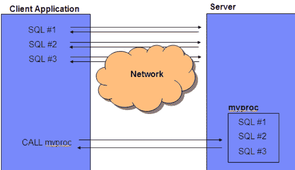

**图 3.1 – 使用存储过程减少网络流量**

在图的左上角，你可以看到若干条 SQL 语句依次执行。每条 SQL 都从客户端发送到数据服务器，然后数据服务器将结果返回给客户端。如果像这样执行大量 SQL 语句，网络流量会增加。另一方面，在底部，你看到了一种替代方法，它产生的网络流量更少。第二种方法调用存储在服务器上的名为 *myproc* 的存储过程，该过程包含相同的 SQL；然后在客户端（左侧），使用 CALL 语句来调用该存储过程。第二种方法更高效，因为只有一条调用语句通过网络传输，并且只有一组结果集返回给客户端。

存储过程还可以有助于数据库的安全目的。例如，你可以让用户仅通过存储过程访问表或视图；这有助于锁定服务器并防止用户访问他们不应访问的信息。这是可行的，因为用户不需要对他们通过存储过程访问的表或视图拥有显式权限；他们只需被授予调用存储过程所需的足够权限。

> **注意：** 有关 SQL PL 存储程序的更多信息，请观看此视频：http://www.channeldb2.com/video/video/show?id=807741:Video:4343

## 3.2 使用 IBM Data Studio

本章将使用 IBM Data Studio 2.2 来开发存储过程、UDF 和数据 Web 服务。IBM Data Studio 2.2 是免费的。它不包含在 DB2 中，而是作为独立的镜像提供；并且有两种版本：

- IDE：允许你与其他产品（如 InfoSphere Data Architect 和 Rational 产品）共享同一个 Eclipse（外壳共享）。它还提供了对数据 Web 服务的支持。
- 独立版：此版本提供与 IDE 版本几乎相同的功能，但不支持数据 Web 服务，也不支持外壳共享。此版本的占用空间小得多。

> **注意：** 如需全面了解 IBM Data Studio，请参考免费电子书 *Getting started with IBM Data Studio for DB2*，它是本 DB2 on Campus 免费书籍系列的一部分。

在本章中，我们使用 IDE 版本，因为我们要演示如何使用数据 Web 服务。Data Studio 镜像可以从 **www.ibm.com/db2/express** 下载。*图 3.2* 展示了 IBM Data Studio 2.2。

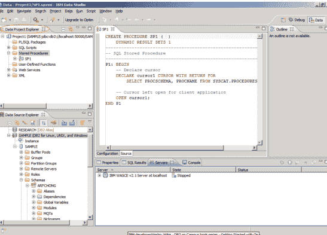

**图 3.2 – IBM Data Studio 2.2**

在本章中，我们专注于图中右上角高亮显示的 *Data Project Explorer* 视图。该视图专注于数据服务器端开发。

### 3.2.1 创建项目

在 Data Studio 中开发存储过程、UDF 或数据 Web 服务之前，你需要创建一个项目。从 Data Studio 菜单中选择 *File -> New -> Project*（文件 -> 新建 -> 项目），然后选择 *Data Development Project*（数据开发项目）。*图 3.3* 展示了此过程。

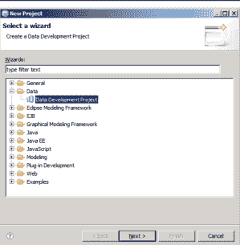

**图 3.3 – 创建数据开发项目**

按照向导的步骤输入项目名称，并指定你要将项目关联到哪个数据库。如果你没有任何现有的数据库连接，请点击 *Select Connection*（选择连接）面板中的 *New*（新建）按钮，将出现如图 *图 3.4* 所示的窗口。

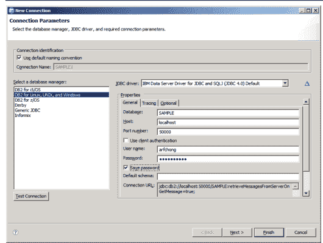

**图 3.4 – 新连接参数**

在图 3.4 中，请确保在图左侧的“Select a database manager”（选择数据库管理器）字段中选择 DB2 for Linux, UNIX and Windows。对于 JDBC 驱动程序下拉菜单，选择 DB2 for Linux, UNIX and Windows 后的默认值是列出的 JDBC type 4 驱动程序，名为 IBM Data Server Driver for JDBC and SQLJ (JDBC 4.0) Default。使用此默认驱动程序并填写指定字段。对于主机字段，你可以输入 IP 地址或主机名。在示例中，IBM Data Studio 和 DB2 数据库位于同一台计算机上，因此选择了 localhost。请通过点击图左下角所示的 Test Connection（测试连接）按钮来确保你的数据库连接正常工作。如果连接测试成功，点击 Finish（完成），数据库名称将被添加到你可以关联项目的连接列表中。选择数据库，然后点击 Finish（完成），你的项目应显示在 Data Project Explorer 视图中。在此视图中，如果你点击“+”符号，可以向下钻取项目以查看不同的文件夹，如 PL/SQL 包、SQL 脚本、存储过程等。

### 3.2.2 创建存储过程

要在 Data Studio 中创建 Java、PL/SQL 或 SQL PL 存储过程，请按照以下步骤操作。请注意，其他语言的存储过程无法从 Data Studio 创建。在以下步骤中，我们选择 SQL（代表 SQL PL）作为存储过程的语言，但类似的步骤也适用于 Java 和 PL/SQL 语言。

**步骤 1：编写或生成存储过程代码**

当你想要创建存储过程时，右键点击 Stored Procedures（存储过程）文件夹，选择 New -> Stored Procedure（新建 -> 存储过程）。在新建存储过程向导中填写所需信息，例如要关联的项目、过程和语言名称，以及要在过程中使用的 SQL 语句。默认情况下，Data Studio 会给你一个示例 SQL 语句。对于所有其他面板，你可以接受所有默认值，或者在此时点击 Finish（完成），此时将使用一些模板代码和之前提供的 SQL 语句作为示例创建一个存储过程。*图 3.5* 展示了此过程。

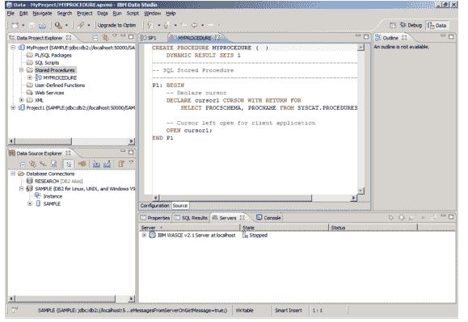

**图 3.5 – 一个示例存储过程**

在图 3.5 中，生成了示例存储过程 MYPROCEDURE 的代码。你可以用你自己的代码替换所有代码。为了简洁起见，我们将在本书中继续使用上述示例存储过程，就好像是我们编写的一样。

**步骤 2：部署存储过程**

存储过程创建完成后，要部署它，请在 Data Project Explorer 视图中选中它，右键点击，然后选择 Deploy（部署）。部署存储过程基本上就是执行 CREATE PROCEDURE 语句，编译该过程并将其存储在数据库中。*图 3.6* 说明了这一步骤。


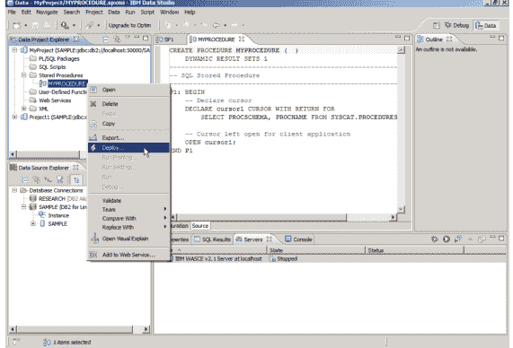

**图 3.6 – 部署存储过程**

点击“部署”（Deploy）后，在“部署选项”（Deploy options）面板中，通常接受默认值并点击“完成”（Finish）即可。

### 步骤 4：运行存储过程

一旦存储过程部署完成，你可以通过右键单击它并选择“运行”（Run）来执行该过程。结果将显示在 Data Studio 工作台窗口右下角的“结果”（Results）选项卡中，如图 3.7 所示。

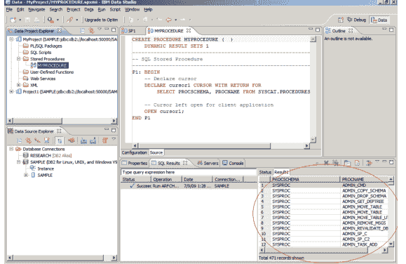

**图 3.7 – 运行存储过程后的输出**

要从 DB2 命令窗口或命令编辑器中运行存储过程，可以使用 `CALL <procedure name>` 语句。请记住，你需要先连接到数据库，因为存储过程就位于该数据库中。图 3.8 对此进行了说明。

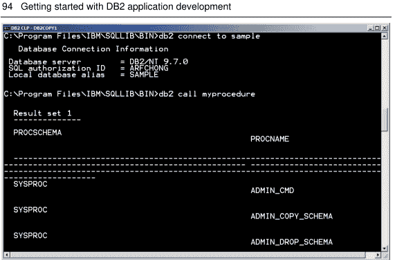

**图 3.8 – 从 DB2 命令窗口调用存储过程**

就像你可以从 DB2 命令窗口调用存储过程一样，你也可以从 Java 程序、C 程序、Visual Basic 程序等中调用它们。你只需要使用相应语言的正确语法即可。

## 3.3 SQL PL 存储过程基础

SQL PL 存储过程易于创建和学习。它们在 DB2 中具有最佳性能。SQL PL 存储过程（或简称为“SQL 存储过程”）是本章节的重点。

### 3.3.1 存储过程结构

基本存储过程语法如下所示。

```sql
CREATE PROCEDURE proc_name [ ( [ optional procedure parameters ] ) ]
[optional procedure attributes]
<statement>
```

其中 `<statement>` 可以是单条语句，也可以是由 `BEGIN [ATOMIC] ... END` 分组的一组语句。

### 3.3.2 可选存储过程属性

以下描述了一些可选的存储过程属性：

- **LANGUAGE SQL**
  此属性指示存储过程将使用的语言。LANGUAGE SQL 是默认值。对于其他语言，如 Java 或 C，分别使用 LANGUAGE JAVA 或 LANGUAGE C。

- **RESULT SETS <n>**
  如果存储过程将返回 n 个结果集，则此项是必需的。

- **SPECIFIC my_unique_name**
  这是可以分配给存储过程的唯一名称。存储过程可以被重载，即多个存储过程可以具有相同的名称，但参数数量不同。通过使用 **SPECIFIC** 关键字，你可以为这些存储过程中的每一个提供一个唯一的名称，这有助于简化存储过程管理。例如，若要使用 **SPECIFIC** 关键字删除存储过程，你可以发出以下语句：`DROP SPECIFIC PROCEDURE`。如果没有使用 **SPECIFIC** 关键字，你就必须使用 `DROP PROCEDURE` 语句并指定包含所有参数的过程名称，以便 DB2 知道你要删除的是哪个重载过程。

### 3.3.3 参数

SQL PL 存储过程中有三种类型的参数：

- **IN** - 输入参数
- **OUT** - 输出参数
- **INOUT** - 输入和输出参数

例如：

```sql
CREATE PROCEDURE proc(IN p1 INT, OUT p2 INT, INOUT p3 INT)
```

要调用该过程，请使用 **CALL** 语句。例如，要调用上述存储过程，可以指定：

```sql
CALL proc (10,?,4)
```

问号 (?) 用于 **CALL** 语句中的 **OUT** 参数。列表 3.1 提供了另一个带有参数的存储过程示例，你可以尝试运行。

```sql
CREATE PROCEDURE P2 (
IN v_p1 INT,
INOUT v_p2 INT,
OUT v_p3 INT)

LANGUAGE SQL
SPECIFIC myP2
BEGIN
-- my second SQL procedure
SET v_p2 = v_p2 + v_p1;
SET v_p3 = v_p1;
END
```

**列表 3.1 - 带参数的存储过程**

要从命令编辑器中调用该过程，可以使用：

```sql
call P2 (3, 4, ?)
```

### 3.3.4 SQL PL 存储过程中的注释

在 SQL PL 存储过程中指定注释有两种方式：

- 使用两个破折号。例如：
  `-- This is an SQL-style comment`
- 使用类似于 C 语言的格式。例如：
  `/* This is a C-style comment */`

### 3.3.5 复合语句

存储过程中的复合语句是由关键字 `BEGIN` 和 `END` 封装的、由多条过程指令和 SQL 语句组成的语句。当 `ATOMIC` 关键字紧跟在 `BEGIN` 关键字之后时，复合语句被视为一个单元，也就是说，为了使整个复合语句成功，其中的所有指令或语句都必须成功。如果其中一条语句未成功，则所有更改都会被回滚。图 3.9 显示了复合语句的结构。

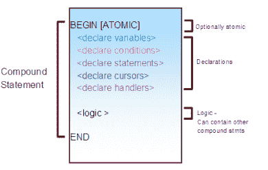

**图 3.9 – 复合语句**

### 3.3.6 变量声明

要声明变量，请使用 `DECLARE` 语句，如下所示。

```sql
DECLARE var_name <data type> [DEFAULT value];
```

列表 3.2 提供了一些示例。

```sql
DECLARE temp1 SMALLINT DEFAULT 0;
DECLARE temp2 INTEGER DEFAULT 10;
DECLARE temp3 DECIMAL(10,2) DEFAULT 100.10;
DECLARE temp4 REAL DEFAULT 10.1;
DECLARE temp5 DOUBLE DEFAULT 10000.1001;
DECLARE temp6 BIGINT DEFAULT 10000;
DECLARE temp7 CHAR(10) DEFAULT 'yes';
DECLARE temp8 VARCHAR(10) DEFAULT 'hello';
DECLARE temp9 DATE DEFAULT '1998-12-25';
DECLARE temp10 TIME DEFAULT '1:50 PM';
DECLARE temp11 TIMESTAMP DEFAULT '2001-01-05-12.00.00';
DECLARE temp12 CLOB(2G);
DECLARE temp13 BLOB(2G);
```

**列表 3.2 - 变量声明示例**

### 3.3.7 赋值语句

要为变量赋值，请使用 SET 语句。例如：

```sql
SET total = 100;
```

上述语句等同于

```sql
VALUES(100) INTO total;
```

此外，可以将任何变量设置为 NULL。例如：

```sql
SET total = NULL;
```

你可以根据 SELECT 语句的输出结果为变量赋值。例如：

```sql
SET total = (select sum(c1) from T1);
SET first_val = (select c1 from T1 fetch first 1 row only)
```

如果从表中提取了多于一个的值，而你试图将其赋值给单个变量，则会引发错误条件。如果你需要存储比单个值更多的信息，请使用数组或游标。

你还可以根据外部数据库属性或特殊的 DB2 寄存器变量来设置变量。例如：

```sql
SET sch = CURRENT SCHEMA;
```

### 3.3.8 游标

游标是一个持有 SELECT 语句结果的结果集。声明、打开、获取和关闭游标的语法如列表 3.3 所示。

```sql
DECLARE <cursor name> CURSOR [WITH RETURN <return target>]
    <SELECT statement>;
OPEN <cursor name>;
FETCH <cursor name> INTO <variables>;
CLOSE <cursor name>;
```

**列表 3.3 - 游标操作的语法**

当声明游标时，WITH RETURN 子句可以与以下值一起使用：

- CLIENT：结果集将返回给客户端应用程序
- CALLER：结果集返回给发起调用的客户端或存储过程

下面列表 3.4 提供了一个使用游标的存储过程示例。

```sql
CREATE PROCEDURE set()
DYNAMIC RESULT SETS 1
LANGUAGE SQL
BEGIN
    DECLARE cur CURSOR WITH RETURN TO CLIENT
        FOR SELECT name, dept, job
        FROM staff
        WHERE salary > 20000;
OPEN cur;
END
```

**列表 3.4 - 使用游标的存储过程**

### 3.3.9 流程控制

与其他许多语言一样，SQL PL 也有若干可用于控制逻辑流程的语句。下面列出了部分支持的控制流程语句：

- CASE（选择执行路径，简单搜索）
- IF
- FOR（针对表的每一行执行主体）
- WHILE
- ITERATE（强制进行下一次迭代。类似于 C 语言中的 CONTINUE）
- LEAVE（退出块或循环。“结构化 Goto”）
- LOOP（无限循环）
- REPEAT
- GOTO
- RETURN
- CALL（过程调用）

### 3.3.10 错误和条件处理程序

在 DB2 中，SQLCODE 和 SQLSTATE 关键字用于确定 SQL 语句执行是成功还是失败。这些关键字需要在过程的最外层作用域中显式声明，如下所示：

```sql
DECLARE SQLSTATE CHAR(5);
DECLARE SQLCODE INT;
```

DB2 将在每次 SQL 操作后自动设置上述关键字的值。对于 SQLCODE，值的设置如下：

- = 0，成功。
- > 0，带有警告的成功
- < 0，不成功
- = 100，未找到数据。（即：FETCH 语句未返回数据）

对于 SQLSTATE，值的设置如下：

- 成功：SQLSTATE '00000'
- 未找到：SQLSTATE '02000'
- 警告：SQLSTATE '01XXX'
- 异常：所有其他值

SQLCODE 是特定于关系数据库管理系统（RDBMS）的，且比 SQLSTATE 更详细。SQLSTATE 在 RDBMS 之间是标准的，但性质非常通用。几个 SQLCODE 可能对应一个 SQLSTATE。

任何 SQL 语句都可能引发条件，该条件将匹配一个 SQLSTATE。例如，如果在 SQL 操作期间值被截断，则会引发特定条件，如 SQLSTATE '01004'。不必使用 SQLSTATE '01004' 来测试此条件，可以为其分配名称。在这个特定示例中，可以按如下所示为条件 SQLSTATE '01004' 分配名称 trunc。

```sql
DECLARE trunc CONDITION FOR SQLSTATE '01004'
```

其他预定义的一般条件包括：

- SQLWARNING


#### 3.3.10.1 条件处理

要处理条件，您可以创建一个条件处理程序，其中必须指定：

-   它处理哪些条件
-   在哪里恢复执行（基于处理程序类型：CONTINUE、EXIT 或 UNDO）
-   为处理该条件需要执行哪些操作。这些操作可以是任何语句，包括控制结构。

如果引发 `SQLEXCEPTION` 条件且没有处理程序，过程将终止并返回错误给客户端。

#### 3.3.10.2 处理程序类型

有三种类型的处理程序：

-   **CONTINUE** – 此处理程序用于指示，在引发异常且处理程序处理完条件后，流程将**继续**执行引发条件的那个语句之后的下一条语句。
-   **EXIT** – 此处理程序用于指示，在引发异常且处理程序处理完条件后，流程将跳转到过程的结尾。
-   **UNDO** – 此处理程序用于指示，在引发异常且处理程序处理完条件后，流程将跳转到过程的结尾，并撤消或回滚已执行的任何语句。

*图 3.10 展示了不同的条件处理程序及其行为。*

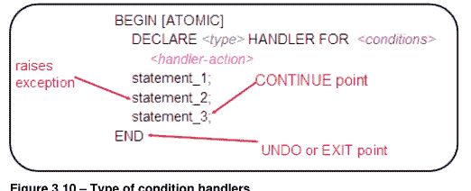

### 3.3.11 调用存储过程

以下代码片段（在 *清单 3.5、3.6 和 3.7* 中展示）分别说明了如何从 CLI/ODBC、VB.NET 和 Java 程序中调用存储过程。

```c
SQLCHAR *stmt = (SQLCHAR *)
"CALL MEDIAN_RESULT_SET( ? )";
SQLDOUBLE  sal = 20000.0;  /* Bound to parameter marker in stmt */
SQLINTEGER salind = 0;     /* Indicator variable for sal */

sqlrc = SQLPrepare(hstmt, stmt, SQL_NTS);
sqlrc = SQLBindParameter(hstmt, 1, SQL_PARAM_OUTPUT,
    SQL_C_DOUBLE, SQL_DOUBLE, 0, 0, &sal, 0, &salind);
SQLExecute(hstmt);

if (salind == SQL_NULL_DATA)
    printf("Median Salary = NULL\n");
else
    printf("Median Salary = %.2f\n\n", sal);

/* Get first result set */
sqlrc = StmtResultPrint(hstmt);
/* Check for another result set */
sqlrc = SQLMoreResults(hstmt);
if (sqlrc == SQL_SUCCESS) {
    /* There is another result set */
    sqlrc = StmtResultPrint(hstmt);
}
```

**清单 3.5 - 从 CLI/ODBC 应用程序调用存储过程的示例**

有关更多详细信息，请参阅 DB2 示例文件：`sqllib/samples/sqlproc/resultset.c`

```vbnet
Try
    ' Create a DB2Command to run the stored procedure
    Dim procName As String = "TRUNC_DEMO"
    Dim cmd As DB2Command = conn.CreateCommand()
    Dim parm As DB2Parameter

    cmd.CommandType = CommandType.StoredProcedure
    cmd.CommandText = procName

    ' Register the output parameters for the DB2Command
    parm = cmd.Parameters.Add("v_lastname", DB2Type.Varchar)
    parm.Direction = ParameterDirection.Output
    parm = cmd.Parameters.Add("v_msg", DB2Type.VarChar)
    parm.Direction = ParameterDirection.Output

    ' Call the stored procedure
    Dim reader As DB2DataReader = cmd.ExecuteReader
Catch myException As DB2Exception
    DB2ExceptionHandler(myException)
Catch
    UnhandledExceptionHandler()
End Try
```

**清单 3.6 - 从 VB.NET 应用程序调用存储过程的示例**

```java
try
{
   // Connect to sample database
   String url = "jdbc:db2:sample";
   con = DriverManager.getConnection(url);

   CallableStatement cs = con.prepareCall("CALL trunc_demo(?, ?)");

   // register the output parameters
   cs.registerOutParameter(1, Types.VARCHAR);
   cs.registerOutParameter(2, Types.VARCHAR);

   cs.execute();
   con.close();
}
catch (Exception e)
{
   /* exception handling logic goes here */
}
```

**清单 3.7 - 从 Java 应用程序调用存储过程的示例**

### 3.3.12 动态 SQL

在动态 SQL 中，与静态 SQL 不同，在运行时并非整个 SQL 语句都是已知的。例如，如果此语句中的 *coll* 和 *tabname* 是变量，那么我们就在处理动态 SQL：

```sql
'SELECT ' || coll || ' FROM ' || tabname;
```

对于 DDL，建议使用动态 SQL以避免依赖问题和服务包失效。它也是实现递归所必需的。

动态 SQL 可以使用两种方法执行：

-   使用 EXECUTE IMMEDIATE 语句 – 这适用于单次执行的 SQL
-   使用 PREPARE 语句配合 EXECUTE 语句 - 这适用于多次执行的 SQL

清单 3.8 中展示的代码片段提供了使用这两种方法实现动态 SQL 的示例。该示例假设已创建表 T2，其定义如下：

```sql
CREATE TABLE T2 (c1 INT, c2 INT)
```

```sql
CREATE PROCEDURE dyn1 (IN value1 INT, IN value2 INT)
SPECIFIC dyn1
BEGIN
    DECLARE stmt varchar(255);
    DECLARE st STATEMENT;

    SET stmt = 'INSERT INTO T2 VALUES (?, ?)';
    PREPARE st FROM stmt;

    EXECUTE st USING value1, value1;
    EXECUTE st USING value2, value2;

    SET stmt = 'INSERT INTO T2 VALUES (9, 9)';
    EXECUTE IMMEDIATE stmt;
END
```

**清单 3.8 - 使用动态 SQL 的存储过程示例**

## 3.4 Java 存储过程

DB2 中的 Java 存储过程是使用 CREATE PROCEDURE 语句创建的，该语句提供过程的定义，并指向外部 Java 应用程序。可以使用 IBM Data Studio 轻松创建 Java 存储过程。您可以遵循第 3.2 节中讨论的步骤，选择 Java 作为语言。IBM Data Studio 还允许您为过程选择 JDBC 或 SQLJ。如果在创建 Java 存储过程时接受所有默认设置，系统将为您生成相应的 Java 应用程序。图 3.11 展示了创建了 Java 存储过程的 IBM Data Studio。图 3.12 显示了相应的 Java 源代码。

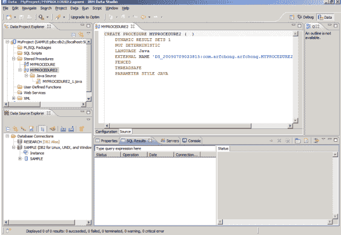

**图 3.11 - Java 存储过程的 CREATE PROCEDURE 定义**

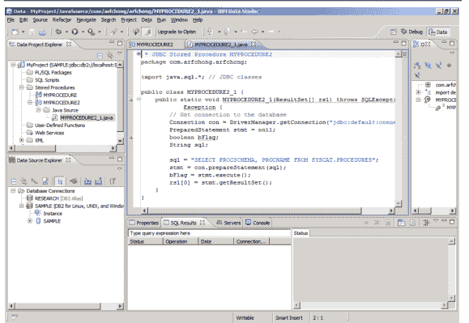

**图 3.12 – Java 存储过程的 Java 源代码**

## 3.5 用户定义函数：宏观视角

用户定义函数（UDF）是一种数据库应用程序对象，它将一组输入数据值映射为一组输出值。例如，一个函数可能接收以英寸为单位的测量值作为输入，并返回以厘米为单位的结果。

DB2 支持使用 SQL PL、PL/SQL、C/C++、Java、CLR（公共语言运行时）和 OLE（对象链接与嵌入）创建函数。在本书中，由于 SQL PL 函数的简单性、流行性和性能，我们重点关注 SQL PL 函数。

> **注意：**
> 在 DB2 9.7 之前，UDF 仅支持 SQL PL 语句的一个子集，称为内联 SQL PL。在 DB2 9.7 中，所有 SQL PL 语句都得到完全支持。

> **注意：**
> 要了解有关 UDF 的更多信息，请观看此视频：
> http://www.channeldb2.com/video/video/show?id=807741/Video:4362

函数有四种类型：标量、表、行和列函数。在本书中，我们仅关注标量函数和表函数。

### 3.5.1 标量函数

标量函数返回单个值。标量函数不能包含会更改数据库状态的 SQL 语句；即，不允许使用 INSERT、UPDATE 和 DELETE 语句。一些内置的标量函数包括 SUM()、AVG()、DIGITS()、COALESCE() 和 SUBSTR()。

DB2 允许您构建自定义用户定义函数，您可以其中封装经常使用的逻辑。清单 3.9 提供了标量函数的一个示例。

```sql
CREATE FUNCTION deptname (p_empid VARCHAR(6))
RETURNS VARCHAR(30)
SPECIFIC deptname
BEGIN ATOMIC
    DECLARE v_department_name VARCHAR(30);
    DECLARE v_err VARCHAR(70);
    SET v_department_name = (
        SELECT d.deptname FROM department d, employee e
        WHERE e.workdept = d.deptno AND e.empno = p_empid
    );
    SET v_err = 'Error: employee ' || p_empid || ' was not found';
    IF v_department_name IS NULL THEN
        SIGNAL SQLSTATE '80000' SET MESSAGE_TEXT = v_err;
    END IF;
    RETURN v_department_name;
END
```

**清单 3.9 - 标量函数的示例**

在上面的清单中，函数名为 *deptname*，它根据员工 ID 返回员工所属部门的名称。可以使用 VALUES 语句调用标量 UDF。也可以在 SQL 语句中期望标量值的地方调用它。例如，尝试从 DB2 命令窗口或从 Linux 或 UNIX 终端执行以下操作：

```bash
db2 "values (deptname ('000300'))"
```

或者

```bash
db2 "select (deptname ('000300')) from sysibm.sysdummy1"
```

注意在第二个示例中使用了 SYSIBM.SYSDUMMY1。这是一个特殊的虚拟表，包含一行和一列。它用于确保只返回一个值。如果您尝试用任何行数更多的其他表执行相同的 SELECT 语句，该函数将被调用与表中行数相同次数。


### 3.5.2 表函数

表函数返回一个行表。您可以使用查询的 FROM 子句来调用它们。与标量函数不同，表函数可以更改数据库状态；因此，允许使用 INSERT、UPDATE 和 DELETE 语句。一些内置的表函数包括 `SNAPSHOT_DYN_SQL()` 和 `MQREADALL()`。表函数类似于视图，但由于它们允许数据修改语句（INSERT、UPDATE 和 DELETE），因此功能更强大。通常，它们被用于返回表并保留审计记录。

列表 3.10 提供了一个表函数的示例，该函数枚举了一组部门员工：

```sql
CREATE FUNCTION getEnumEmployee(p_dept VARCHAR(3))
RETURNS TABLE
   (empno  CHAR(6),
    lastname VARCHAR(15),
    firstname VARCHAR(12))
SPECIFIC getEnumEmployee
RETURN
    SELECT e.empno, e.lastname, e.firstname
    FROM employee e
    WHERE e.workdept=p_dept
```

**列表 3.10** - 表函数示例

若要测试上述函数，请尝试图 3.13 中所示的 SELECT 语句。

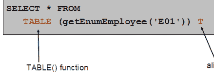

**图 3.13** – 调用表函数。

如上图所示，由于表 UDF 返回一个表，因此必须在 SQL 语句的 FROM 子句中调用它。必须应用特殊的 TABLE() 函数，并且在其调用后必须提供别名。

## 3.6 触发器：宏观视图

触发器是与表相关联的数据库对象，它们定义了在对表执行 INSERT、UPDATE 或 DELETE 操作时要执行的操作。触发器会自动激活。导致触发器触发的操作被称为触发 SQL 语句。

> 注意：
> 有关触发器的更多信息，请观看此视频：
> http://www.channeldb2.com/video/video/show?id=807741:video:4367

> 注意：
> 在 DB2 9.7 之前，触发器仅支持一种称为内联 SQL PL 的 SQL PL 语句子集。在 DB2 9.7 中，完全支持所有 SQL PL 语句。


### 3.6.1 触发器类型

有三种类型的触发器：“before”（前）触发器、“after”（后）触发器和“instead of”（取代）触发器。

#### 3.6.1.1 Before 触发器

Before 触发器在行被插入、更新或删除之前激活。此触发器执行的操作不能激活其他触发器；因此，不允许使用 INSERT、UPDATE 或 DELETE 操作。图 3.14 展示了一个简单的 before 触发器示例，并解释了其部分语法。

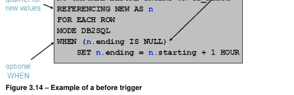

图 3.14 – before 触发器示例

在上图中，触发器 `default_class_end` 将在对表 `CL_SCHED` 执行 INSERT SQL 语句之前被触发。该表是 SAMPLE 数据库的一部分，因此当连接到该数据库时，您可以自行创建并测试此触发器。

触发器定义中的变量 **n** 代表 INSERT 中的新值，即正在插入的值。该触发器将检查正在插入表中的数据的有效性。如果在 INSERT 期间列 `ENDING` 没有值，则触发器将确保其值为列 `STARTING` 的值加 1 小时。

列表 3.11 显示了您可以尝试用于测试触发器的语句以及相应的输出。

```
C:\Program Files\IBM\SQLLIB\BIN>db2 insert into cl_sched (class_code, day, starting) values ('abc',1,current_time)
DB20000I The SQL command completed successfully.

C:\Program Files\IBM\SQLLIB\BIN>db2 select * from cl_sched

CLASS_CODE DAY  STARTING ENDING
--------  ----  ---------- -------
042:BF    4 12:10:00 14:00:00
553:MJA   1 10:30:00 11:00:00
543:CWM   3 09:10:00 10:30:00
778:RES   2 12:10:00 14:00:00
044:HD    3 17:12:30 18:00:00
abc       1 11:06:53 12:06:53

6 record(s) selected.
```

**列表 3.11** - 测试之前创建的 before 触发器

在上面的列表中，您可以看到 INSERT 语句中未为 `ENDING` 列传递值；因此其值为 NULL。此外，`CURRENT TIME` 是一个特殊的 DB2 寄存器，返回其被调用时的时间。在此示例中，当前时间为 11:06:53，因此该值被分配给 `STARTING` 列，而 `ENDING` 列获得触发器逻辑分配给它的值，即 11:06:53 加 1 小时。

下面所示的触发器 `validate_sched` 扩展了之前描述的 `default_class_end` 触发器的功能，以添加额外的条件。

```sql
CREATE TRIGGER validate_sched
NO CASCADE BEFORE INSERT ON cl_sched
REFERENCING NEW AS n
FOR EACH ROW
MODE DB2SQL
BEGIN ATOMIC
-- supply default value for ending time if null
IF (n.ending IS NULL) THEN
SET n.ending = n.starting + 1 HOUR;
END IF;

-- ensure that class does not end beyond 9pm
IF (n.ending > '21:00') THEN
   SIGNAL SQLSTATE '80000'
      SET MESSAGE_TEXT='class ending time is beyond 9pm';
ELSEIF (n.DAY=1 or n.DAY=7) THEN
   SIGNAL SQLSTATE '80001'
      SET MESSAGE_TEXT='class cannot be scheduled on a weekend';
END IF;
END
```

**列表 3.12** - 扩展之前创建的 before 触发器

#### 3.6.1.2 After 触发器

After 触发器在触发 SQL 语句成功执行完成后激活。此触发器执行的操作可以激活其他触发器（级联允许多达 16 层）。After 触发器支持 INSERT、UPDATE 和 DELETE 操作。列表 3.13 是一个 after 触发器的示例。

```sql
CREATE TRIGGER audit_emp_sal
   AFTER UPDATE OF salary ON employee
   REFERENCING OLD AS o NEW AS n
   FOR EACH ROW
   MODE DB2SQL
   INSERT INTO audit VALUES (
      CURRENT TIMESTAMP, ' Employee ' || o.empno || ' salary changed from '
   || CHAR(o.salary) || ' to ' || CHAR(n.salary) || ' by ' || USER)
```

**列表 3.13** - after 触发器示例

在上面的列表中，触发器 `audit_emp_sal` 用于对 `EMPLOYEE` 表的 `SALARY` 列执行审计。当有人修改此列时，触发器将被激活，将关于薪水所做的更改信息写入名为 `AUDIT` 的另一个表中。`OLD AS o NEW AS n` 行表示前缀 `o` 将用于表示表中的旧值或现有值，而前缀 `n` 将用于表示来自 UPDATE 语句的新值。因此，`o.salary` 代表薪水旧值或现有值，而 `n.salary` 代表薪水列数据的更新值。

#### 3.6.1.3 “Instead of” 触发器

Instead of 触发器定义在视图上。由于视图是使用访问一个或多个表的 SELECT 语句动态定义的，因此视图不能被更新。然而，使用这种类型的触发器，您可以给用户一种视图可以被更新的错觉，因为触发器中定义的逻辑会取代触发 SQL 语句执行。例如，如果您在视图上执行更新操作，instead of 触发器将被激活，实际上在构成该视图的基表上执行更新。

无法从 IBM Data Studio 创建触发器。它们可以从控制中心或通过命令行工具（DB2 命令窗口、命令行处理器或命令编辑器）创建。

## 3.7 数据 Web 服务

数据 Web 服务是基于数据库信息的 Web 服务。使用 IBM Data Studio 创建数据 Web 服务非常容易。Web 服务类似于 JEE 应用程序（以前称为 J2EE）；因此，Web 服务需要部署到应用程序服务器。在本书中，我们使用 **WebSphere Application Server Community Edition (WAS CE)** 版本 2.1，这是一个基于 Apache Geronimo 构建的免费应用程序服务器。可以从以下网站下载 WAS CE：

http://www.ibm.com/developerworks/downloads/ws/wasce/

WAS CE 占用空间小，安装非常简单。在处理数据 Web 服务之前，请确保已安装 WAS CE。

> 注意：
> 有关 WAS CE 的更多信息，请参阅本 DB2 on Campus 免费书籍系列的一部分电子书 *Getting started with WAS CE*（WAS CE 入门）。

要从 Data Studio 创建数据 Web 服务，请打开或创建新项目，并选择 **Web Services** 文件夹。右键单击此文件夹，然后选择 *New Web Service*（新建 Web 服务）。为 Web 服务命名，并点击 *Finish*（完成）。图 3.15 展示了使用上述步骤创建的 **MyWeb Service**。


## 112 DB2 应用程序开发入门

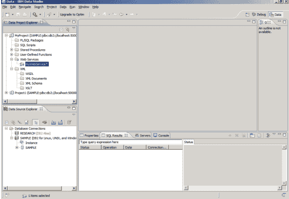

**图 3.15 – 创建数据 Web 服务**

虽然您已创建了一个 Web 服务，但它目前没有任何方法或操作。要向 Web 服务添加操作，您只需将之前在 Data Studio 中创建的存储过程或 SQL 脚本拖放到该服务中即可。例如，请查看下方的图 3.16。

上图展示了存储过程 `GETALLEMP`，它基于语句 `SELECT * FROM EMPLOYEE.` 返回一个游标。在该过程被部署和测试之后，只需将其拖放到 Web 服务 **MyWebService** 中，即可简单地将其作为该 Web 服务的操作添加进来，如图中高亮所示。对于之前创建的 SQL 脚本，甚至对于已经部署到数据库并从数据源资源管理器视图中找到的存储过程，也可以执行类似的操作。

一旦 Web 服务至少包含一个操作，您可以通过选择该 Web 服务，右键单击它并选择 *Build and Deploy*（构建并部署）来构建和部署它，如下图所示的图 3.17。

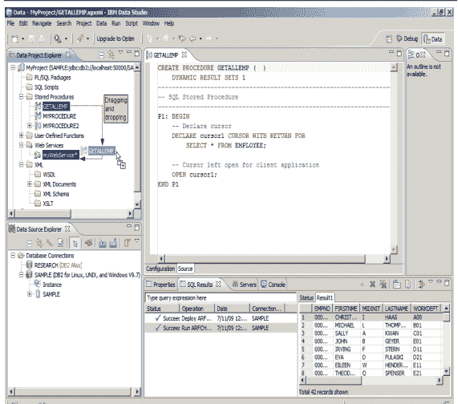

**图 3.16 – 拖放以创建数据 Web 服务操作**

## 114 DB2 应用程序开发入门

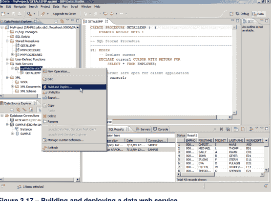

选择 *Build and Deploy*（构建并部署）后，将显示 *Deploy Web Service*（部署 Web 服务）窗口，如 *图 3.18* 所示。

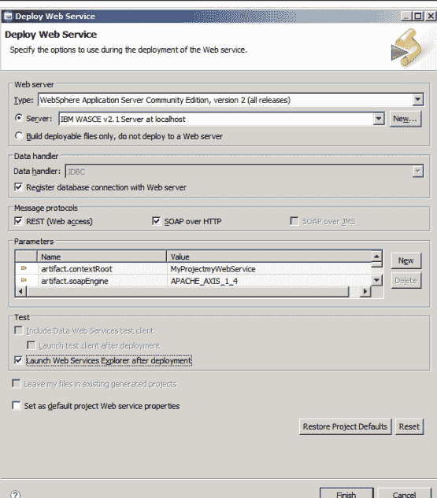

**图 3.18 – 部署 Web 服务窗口**

在部署 Web 服务窗口的 Web 服务器部分，我们为 *type*（类型）字段选择了 WAS CE 2.1。其他受支持的应用服务器包括 Apache Tomcat 和 WebSphere Application Server (WAS)。由于我们已在与 DB2 数据服务器相同的计算机上安装了 WAS CE，因此我们选择 *Server*（服务器）选项，而不是 *Build deployable files only, do not deploy to a Web server*（仅构建可部署文件，不部署到 Web 服务器）。第二个选项会创建 WAR 文件，您可以稍后将它们传输到您想要部署 Web 服务的应用服务器。在上图 3.20 中，应用服务器已添加到 IBM Data Studio。如果尚未添加，您需要点击 *New*（新建）按钮，并针对大多数面板接受所有默认设置。您需要指定的一件事是 WAS CE 的安装位置。Windows 上的默认安装路径为：

`C:\Program Files\IBM\WebSphere\AppServer\CommunityEdition`

回到 *Deploy Web Service*（部署 Web 服务）窗口，确保勾选 *Launch Web Services Explorer after deployment*（部署后启动 Web 服务资源管理器）复选框。然后点击 *Finish*（完成）。此时，WAS CE 将启动，随后部署数据 Web 服务。这可能需要大约 10 到 20 秒。完成后，Web 服务资源管理器将启动。图 3.19 展示了 Web 服务资源管理器。

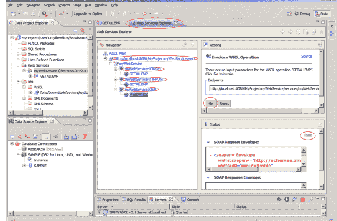

**图 3.19 – Web 服务资源管理器**

在上图中，Web 服务资源管理器左侧面板中有一个树状结构，起始于我们可以找到 Web 服务描述语言 (WSDL) 文档的 URL。对于这个特定示例，WSDL 位于：

<http://localhost:8080/MyProject/myWebService/wsdl>

该树状结构还显示了以下项：

- myWebServiceHTTPGET
- myWebServiceHTTPGET
- myWebServiceSOAP

前两项对应于 REST 协议，最后一项对应于 SOAP 协议。在图 3.18 的消息协议部分，我们勾选了 REST 和 SOAP 协议，因此生成了这两种类型的 Web 服务。REST 和 SOAP 是可用于 Web 服务的两种标准，具体使用哪一种由您决定。IBM Data Studio 可以使用其中一种或两种来生成 Web 服务。在图 3.19 中，SOAP 版本下的 GETALLEMOP 方法被高亮显示，当您在右侧面板点击 Go（执行）时，将测试此方法，并在右侧面板底部提供输出，同时以表单形式显示输出。在图 3.19 中，我们实际上是以源代码形式显示输出。

如果您希望从浏览器调用 REST 版本的 GETALLEMOP 方法，请先查看 WSDL 以了解如何调用该方法。如果您向下滚动 WSDL，您将看到如何调用该方法。图 3.20 对此进行了说明。

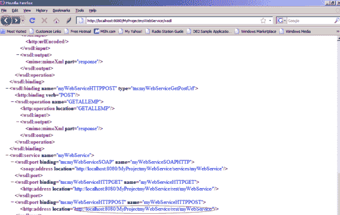

**图 3.20 – WSDL**

在上图中，我们高亮显示了用于调用 Web 服务的 URL。我们需要在这个 URL 后附加要执行的方法名称。我们示例的完整 URL 如下：

> http://localhost:8080/MyProject/myWebService/rest/myWebService/GETALLEMOP

请注意，方法名称区分大小写。图 3.21 展示了在浏览器中输入上述 URL 后的输出。


```xml
<ns1:GETALLMPResponse>
  <rowset>
    <row>
      <EMPNO>00010</EMPNO>
      <FIRSTNAME>CHRISTINE</FIRSTNAME>
      <MIDINT>I</MIDINT>
      <LASTNAME>HAAS</LASTNAME>
      <WORKDEPT>A00</WORKDEPT>
      <PHONE>6-3878</PHONE>
      <HIREDATE>1995-01-01</HIREDATE>
      <JOB>PRE S </JOB>
      <EDLEVEL>16</EDLEVEL>
      <SEX>F</SEX>
      <BIRTHDATE>1963-08-24</BIRTHDATE>
      <SALARY>15750.00</SALARY>
      <BONUS>1000.00</BONUS>
      <COMM>4220.00</COMM>
    </row>
    <row>
      <EMPNO>00020</EMPNO>
      <FIRSTNAME>MICHAEL</FIRSTNAME>
      <MIDINT>L</MIDINT>
      <LASTNAME>THOMPSON</LASTNAME>
      <WORKDEPT>B01</WORKDEPT>
      <PHONE>43476</PHONE>
...
```

**图 3.21 — 从 myWebService 调用 GETALLMP 方法**

如果愿意，您也可以对此 XML 输出应用 XSLT。这可以通过在 Data Studio 中右键单击数据 Web 服务中的方法并选择 *Manage XSLT*（管理 XSLT）来实现，如 *图 3.22* 所示。

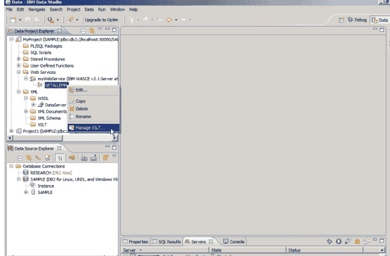

**图 3.22 – 对 Web 服务方法的输出应用 XSLT**

在配置 XSL 转换窗口中，点击 *Browse*（浏览）查找之前创建的 XSL 文件。例如，清单 3.14 展示了本示例中使用的 XSL 文件的一部分。

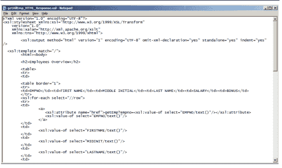

**清单 3.14 - 数据 Web 服务示例中使用的 XSL 文件**

**图 3.23** 展示了如何指定此 XSL 文件。

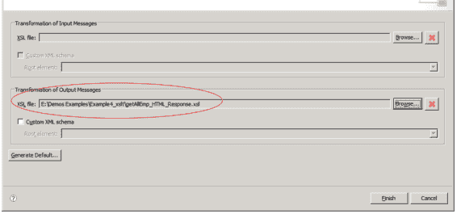

**图 3.23 – 指定要使用的 XSL 文件**

点击 **Finish**（完成）后，您需要再次构建和部署 Web 服务，然后在浏览器中刷新并使用与 **图 3.21** 中相同的 URL，您将看到如图 **3.24** 所示的输出。

第 3 章 - 存储过程、UDF、触发器和数据 Web 服务

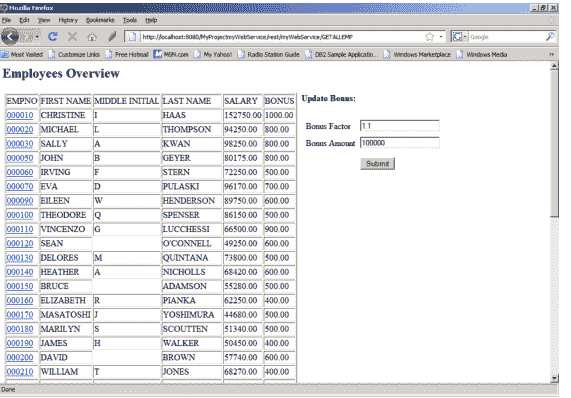

**图 3.24 – 应用 XSLT 调用 GETALLEMP 方法后的输出**

注意：

若要完整演示此数据 Web 服务示例，请观看此视频：
http://www.channeldb2.com/video/video/show?id=807741%3AVideo%3A1482

## 3.8 练习

在本练习中，您将使用 IBM Data Studio 创建一个标量 UDF。这将为您带来更多关于 Data Studio 的使用经验，并提高您对用于用户定义函数的 SQL PL 语言的熟悉程度。

### 步骤

1. 打开 IBM Data Studio（提示：可通过“开始”菜单访问）。
2. 创建一个新的项目，该关联到第 5 章练习中创建的 EXPRESS 数据库，如本章节前面所述。然后向下钻取直到找到 *User-Defined Functions*（用户定义函数）文件夹。
3. 右键单击 *User-Defined Functions*（用户定义函数）文件夹。选择 New -> *User-defined functions*（新建 -> 用户定义函数）。
4. 函数名称使用 *booktitle*，语言选择 *SQL*，这意味着您将创建一个 SQL PL 用户定义函数。
5. 此时，您可以多次点击 *NEXT*（下一步）按钮，接受所有默认值，直到完成 UDF 的创建。或者，现在就点击 *Finish*（完成）按钮。
6. 将显示一个包含一些示例代码的编辑器窗口。删除所有这些代码，并将其替换为以下代码。

```sql
CREATE FUNCTION booktitle(p_bid INTEGER)
RETURNS VARCHAR(300)
--------------------------------------------------------
SQL UDF (Scalar)
--------------------------------------------------------
SPECIFIC booktitle
F1: BEGIN ATOMIC
  DECLARE v_book_title VARCHAR(300);
  DECLARE v_err VARCHAR(70);
  SET v_book_title = (SELECT title FROM books WHERE p_bid = book_id);
  SET v_err = 'Error: The book with ID ' || CHAR(p_bid) || '
              ' was not found.';
  IF v_book_title IS NULL THEN SIGNAL SQLSTATE '80000' SET
    MESSAGE_TEXT=v_err;
  END IF;
  RETURN v_book_title;
END
```

7. 通过右键单击函数名称并选择 *Deploy*（部署），然后从 *Deploy options*（部署选项）面板中选择 *Finish*（完成）来构建函数。
8. 通过右键单击函数名称并选择 *Run*（运行）来运行该函数。
9. 由于该函数接受一个输入参数，将显示一个对话框窗口，要求您填写参数的值。

输入值：80002

结果是什么？

再次尝试，输入值：1002

这次发生了什么？（提示：查看 *SQL Results*（SQL 结果）选项卡）。

10. 完成后，关闭 IBM Data Studio。


## 3.9 总结

本章介绍了数据服务器端开发的入门知识。我们讨论了如何创建存储过程、UDF（用户定义函数）和触发器。讨论的核心是 SQL PL 语言以及 IBM Data Studio 工具的使用。本章还讨论了如何基于 SQL 脚本或存储过程创建数据 Web 服务。

## 3.10 复习题

- 存储过程有哪些好处？

- 标量 UDF 是否可以将审计信息写入表？

- 如何调用标量 UDF？

- BEFORE 触发器是否可用于更新（UPDATE）表？

- 在存储过程中，SPECIFIC 关键字用于什么目的？

- 以下哪项不是有效的触发器类型？
  - A. BEFORE
  - B. PRESENT
  - C. AFTER
  - D. INSTEAD OF
  - E. 以上都不是

- 以下哪些工具可用于创建触发器？
  - A. Control Center
  - B. Command Editor
  - C. DB2 Command Window
  - D. IBM Data Studio
  - E. 以上都不是

- 以下哪个语句正确调用了表函数 getFlights？
  - A. SELECT * FROM GETFLIGHTS()
  - B. SELECT * FROM GETFLIGHTS
  - C. SELECT * FROM TABLE (GETFLIGHTS) A
  - D. SELECT * FROM TABLE (GETFLIGHTS) AS A
  - E. C 和 D

- 以下哪个陈述是正确的？
  - A. WSDL 代表 Web 服务描述列表（Web Services Descriptor List）
  - B. SOAP 和 REST Web 服务在底层都使用 XML
  - C. 已部署的存储过程不能通过拖放到 Data Studio 中的 Web 服务来为该 Web 服务创建新方法
  - D. A 和 C
  - E. 以上都不是

- 以下哪个陈述是错误的？
  - A. DB2 中的存储过程可以使用 C/C++ 语言开发
  - B. UDF 仅支持 SQL PL 语言的一个子集，即内联 SQL PL
  - C. 存储过程可以调用 UDF
  - D. 触发器可以调用存储过程
  - E. 以上都不是

# 第 4 章 – 使用 Java 进行应用程序开发

本章讨论了使用 Java 和 DB2 进行应用程序开发的基础知识。大多数 Java 应用程序使用 *Java 数据库连接（JDBC）*通过动态 SQL 访问数据库；或使用 SQLJ 通过静态 SQL 访问数据库。这些是用 Java 编写的一组类和接口，且与厂商无关。

在本章中，您将学习：

- 使用 JDBC 编程
- 使用 SQLJ 编程
- 使用 pureQuery 编程

## 4.1 Java - DB2 应用程序：整体视图

开发访问数据库的 Java 应用程序使用 JDBC 或 SQLJ 标准。该标准的支持是通过数据库供应商提供的 JDBC 或 SQLJ 驱动程序提供的，如 *图 4.1* 所示，其中使用了 DB2 数据服务器。


**图 4.1 - 访问 DB2 数据库的 Java 应用程序**

在该图中，Java 应用程序通过 JDBC/SQLJ 驱动程序连接到 DB2 数据服务器。连接成功后，从 Java 应用程序发出的 SQL 或 XQuery 语句会传递给 DB2 数据服务器进行处理，然后结果返回给 Java 应用程序。

JDBC 和 SQLJ 应用程序可以在符合 JDBC/SQLJ 规范的数据服务器（如 DB2、Informix®、Oracle®、SQL Server® 等）上以最小的修改运行。DB2 9.7 支持 JDBC 4.0 规范及更早版本。

对于 DB2 而言，其 JDBC 和 SQLJ 驱动程序包含在以下任一组件中：

- 任何版本的 DB2 数据服务器
- IBM Data Server Client
- IBM Data Server Runtime Client
- IBM Data Server Driver for JDBC and SQLJ

数据服务器版本、客户端和驱动程序在 *第 1 章 - 什么是 DB2 Express-C?* 中进行了描述。客户端和驱动程序是免费的。根据您在应用程序中使用的 JDBC 驱动程序类型，您可能需要安装也可能不需要安装客户端。不同类型的 JDBC 驱动程序将在下一节中解释。

## 4.2 设置环境

在运行或开发 JDBC 或 SQLJ 应用程序之前，请确保环境已正确设置。

如果您希望开发驻留在 DB2 服务器上的 Java 存储过程和 Java 用户定义函数，请确保在 DB2 服务器上安装了 JDK。幸运的是，安装 DB2 9.7 版本时，默认会在所有平台上安装 IBM SDK for Java 6（也称为 JDK 6）。安装位置在数据库管理器配置（**dbm cfg**）参数 **JDK_PATH** 中显示。例如，在 Windows 上，默认位置为 `C:\Program Files\IBM\SQLLIB\java\jdk`。位于此位置的 Java 编译器（**javac**）将用于编译 Java 存储过程和 Java 用户定义函数。该 JDK 的一部分，即 **JVM**（Java 虚拟机），用于启动 DB2 GUI 工具，如 Control Center。

如果您希望从 DB2 服务器开发 JDBC/SQLJ 应用程序；除了 JDK 之外，请通过向 **CLASSPATH** 中添加正确的 jar 文件来确保正确设置 JDBC/SQLJ 驱动程序。同样，如果您希望从客户端机器开发 JDBC/SQLJ 应用程序，请确保已正确安装并设置 JDBC/SQLJ 驱动程序。如果您使用的是 JDBC 类型 2 驱动程序，还需要安装 DB2 客户端（IBM Data Server Client 或 IBM Data Server Runtime Client）。更多细节将在下一节中提供。

### 4.2.1 DB2 JDBC 和 SQLJ 驱动程序

*表 4.1* 描述了当前行业中可用的不同类型 JDBC 驱动程序。

| 类型 | 驱动程序名称 | 描述 | 是否随 DB2 提供？ |
| :--- | :--- | :--- | :--- |
| 类型 1 | JDBC-ODBC 桥接驱动程序 | 通过此驱动程序，JDBC 访问是通过 ODBC 驱动程序执行的。 | 否 |
| 类型 2 | 原生 API 驱动程序 | 此驱动程序要求安装 DB2 客户端在与 JDBC 应用程序运行的同一台机器上。稍后我们将介绍 DB2 提供的两种类型 2 驱动程序。 | 是 |
| 类型 3 | JDBC net pure-java 驱动程序 | 此驱动程序使用纯 Java 客户端并通过数据库无关协议与 net 服务器通信。net 服务器随后将客户端的请求传递给数据库。此驱动程序不再受 DB2 支持，转而支持类型 4 驱动程序。 | 否 |
| 类型 4 | 原生协议 pure-java 驱动程序。 | 这是最灵活的 JDBC API。此驱动程序将 JDBC 调用直接转换为 DB2 使用的网络协议。这允许从客户端机器直接调用 DB2 服务器，而无需安装 DB2 客户端。 | 是 |

**表 4.1 - JDBC 驱动程序类型**

虽然有几种类型的 JDBC 驱动程序，但类型 2 和类型 4 驱动程序是最受欢迎的且性能最佳；因此，在 DB2 9.7 中，为了支持这两种类型，已经取消了对其余类型的支持。类型 2 驱动程序需要在运行 Java 应用程序的机器上安装 DB2 客户端。类型 2 驱动程序使用 DB2 客户端建立与数据库的通信，如图 4.2 所示。


**图 4.2 - 使用 JDBC 类型 2 驱动程序的 Java 应用程序**

类型 4 是一种纯 Java 客户端，因此不需要 DB2 客户端，但驱动程序必须安装在运行 JDBC 应用程序的机器上。图 4.3 说明了使用类型 4 驱动程序的 JDBC 应用程序。


*表 4.2* 提供了有关 DB2 JDBC 和 SQLJ 驱动程序的更多详细信息。

| 驱动程序类型 | 驱动程序名称 | 打包形式 | 支持的 JDBC 规范 | 所需的最低 Java SDK 级别 |
| :--- | :--- | :--- | :--- | :--- |
| 类型 2 | Linux、UNIX 和 Windows 的 DB2 JDBC 类型 2 驱动程序 (*已弃用*) | `db2java.zip` | JDBC 1.2 和 JDBC 2.0 | 1.4.2 |
| 类型 2 和类型 4 | IBM Data Server Driver for JDBC and SQLJ | `db2jcc.jar` 和 `sqlj.zip` | 符合 JDBC 3.0 | 1.4.2 |
| | | `db2jcc4.jar` 和 `sqlj4.zip` | JDBC 4.0 及更早版本 | 6 |

**表 4.2 - DB2 JDBC 和 SQLJ 驱动程序**

* * “已弃用”意味着它仍受支持，但不再增强*

正如 *表 4.2* 所示，类型 2 提供了两种不同的驱动程序；然而，打包为 `db2java.zip` 的 Linux、UNIX 和 Windows 的 DB2 JDBC 类型 2 驱动程序已弃用。

打包为 `db2jcc.jar`（`com.ibm.db2.jcc`）的 IBM Data Server Driver for JDBC and SQLJ 包括对类型 2 和类型 4 驱动程序两者的支持。驱动程序的选择取决于在 Java 程序中连接数据库时使用的语法：如果连接字符串中包含主机名或 IP 地址以及端口，则使用类型 4；否则，使用类型 2。这将在本章的后续部分中详细讨论。IBM Data Server Driver for JDBC and SQLJ 已优化以访问所有平台上的所有 DB2 服务器，包括大型机。

当您安装 DB2 服务器、DB2 客户端或 IBM Data Server Driver for JDBC and SQLJ 时，符合 JDBC 3.0 的 `db2jcc.jar` 和 `sqlj.zip` 文件会自动添加到您的 **CLASSPATH** 中。如果您希望使用 JDBC 4.0 规范，请确保将 **CLASSPATH** 中的 `db2jcc.jar` 和 `sqlj.zip` 分别替换为 `db2jcc4.jar` 和 `sqlj4.zip`。

**注意：**


如果您是 Java 编程语言以及 JVM、JRE 或 JDK 概念的初学者，请回顾本书系列中免费电子书 *Getting Started with Java*。

## 4.3 JDBC 编程

开发 JDBC 程序包括以下步骤：

-   1. 使用 JDBC 类型 2 或类型 4 连接到数据库
-   2. 执行 SQL 语句
-   3. 接收结果
-   4. 处理 SQL 错误和警告
-   5. 关闭连接

我们将在后续章节中更详细地讨论这些步骤。*图 4.4* 总结了 JDBC 程序中使用的步骤、接口、类和方法。这些内容也会在后续章节中更详细地讨论。

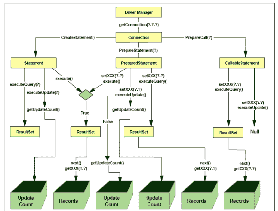

图 4.4 - JDBC 编程的步骤、对象和方法

**注意：**
本节中使用的几个示例和图表取自 IBM 红皮书 *DB2 Express-C: The Developer Handbook for XML, PHP, C/C++, Java, and .NET* (SG24-7301-00)。有关更多信息，请参阅本书的资源部分。

### 4.3.1 连接到 DB2 数据库

本节将展示如何使用 JDBC 类型 2 和 JDBC 类型 4 连接到数据库。让我们检查以下 *清单 4.1* 中展示的关于使用 JDBC 类型 2 进行连接的代码片段。

```java
import java.sql.*;

class myprg {
    public static void main (String argv[]){
        try {
            (1)  Connection con = null;
            (2)  Class.forName("com.ibm.db2.jcc.DB2Driver");
            (3)  String url = "jdbc:db2:SAMPLE";
                 if (argv.length == 2) {
                     String userID = argv[0];
                     String passwd = argv[1];
            (4)  con = DriverManager.getConnection(url,userID,passwd);
                 }
                 else
                 {throw new Exception
                     ("\n Usage: java myprg userID password\n");
                 }
        ...
        }
    }
}
```

**清单 4.1 - 使用 JDBC 类型 2 连接到 DB2 数据库**

让我们回顾 *清单 4.1* 中显示的每个项目：

-   (1) 该语句导入了 **java.sql** 包，其中包含 JDBC 核心 API。
-   (2) 该语句从 IBM Data Server Driver for JDBC and SQLJ (*db2jcc.jar/db2jcc4.jar/sqlj.zip/sqlj4.zip*) 加载驱动程序类。**forName** 方法接受一个字符串参数，其值是实现了 **java.sql** 包中定义的接口的类的名称。在这种情况下，类名为 "com.ibm.db2.jcc.DB2Driver"。如果您展开 *db2jcc.jar* 文件，在 Windows 上您会看到：

```
C:\Program Files\IBM\SQLLIB\java\db2jcc\com.ibm.db2\jcc\DB2Driver.class
```

对于已弃用的 Linux、UNIX 和 Windows 平台的 DB2 JDBC 类型 2 驱动程序，在 `forName` 方法中使用的类名应为 `"COM.ibm.db2.jdbc.app.DB2Driver"`。如果您在 Windows 上解压 `db2java.zip`，您会看到：

```
C:\Program Files\IBM\SQLLIB\java\db2java\COM.ibm.db2\jdbc\app\DB2Driver.class
```

-   (3) 在此行中，我们初始化 URL 并选择连接到 **SAMPLE** 数据库。在 URL 语法中，我们没有包含主机名或端口号；因此，这意味着使用的是类型 2。类型 2 需要安装 DB2 客户端，并使用它来配置与 **SAMPLE** 数据库的连接。
-   (4) 如果向程序传递了两个参数 (**userID** 和 **password**)，则使用它们来获取连接；否则，程序将抛出异常。`DriverManager.getConnection(url,userID,passwd)` 也可以不带 **userID** 和 **passwd** 调用，如下所示：`DriverManager.getConnection(url)`。在这种情况下，将使用登录到系统的用户 ID。对于类型 4，正如我们接下来要看到的，这将不起作用，因为该连接被视为远程 TCP/IP 连接，而 DB2 对所有远程连接都需要用户 ID 和密码。

现在让我们看看与 *清单 4.1* 中相同的代码片段，但使用 JDBC 类型 4 连接。这在 *清单 4.2* 中有说明。

```java
import java.sql.*;

class myprg {
    public static void main (String argv[]) {
        try {
            Connection con = null;
            Class.forName("com.ibm.db2.jcc.DB2Driver");
            (1) String url = "jdbc:db2://168.100.10.1:50000/SAMPLE";
            if (argv.length == 2) {
                String userID = argv[0];
                String passwd = argv[1];
                con = DriverManager.getConnection(url,userID,passwd);
            } else {
                { throw new Exception
                    ("\n Usage: java myprg userID password\n");
                }
            }
        ...
    }
}
```

**清单 4.2 - 使用 JDBC 类型 4 连接到 DB2 数据库**

*清单 4.2 显示了与清单 4.1 中完全相同的代码片段*，但 URL 已更改为使用类型 4 语法：

```
"jdbc:db2://<IP address or hostname>:<DB2 instance port number>/<dbname>"
```

在 *清单 4.2* 中，使用了虚构的 IP 地址 168.100.10.1。DB2 实例端口号是 50000，要连接的数据库名称是 *SAMPLE*。当未连接到网络时测试连接，您可以始终使用 *localhost* 或环回 IP 地址 `127.0.0.1` 指向自身。

> **注意：**
> 本章中展示的大多数代码片段提取自程序 *myprg.java*，该程序包含在随本书提供的 `Exercise_Files_DB2_Application_Development.zip` 文件中。您可以通过注释程序中的相应部分来测试每个代码片段。

创建 **Connection** 对象后，可以使用 *表 4.3* 中描述的方法创建 **Statement**、**PreparedStatement** 或 **CallableStatement** 对象。

| 方法 | 创建的对象 | 描述 |
| :--- | :--- | :--- |
| `createStatement` | `Statement` 对象 | 可以使用 `Statement` 对象执行不使用参数标记的 SQL。 |
| `prepareStatement` | `PreparedStatement` 对象 | 可以使用 `PreparedStatement` 对象执行使用参数标记的 SQL。 |
| `prepareCall` | `CallableStatement` 对象 | 可以使用 `CallableStatement` 对象调用存储过程。 |

**表 4.3 - Connection 对象用于创建不同类型 Statement 对象的方法**

### 4.3.2 执行 SQL 语句

本节描述如何声明宿主变量，并使用 Statement、PreparedStatement 和 CallableStatement 接口执行 SQL 语句。

#### 4.3.2.1 声明宿主变量

宿主变量遵循普通的 Java 变量语法。一些映射到 Java 应用程序中数据库数据类型的映射可在 *图 4.5* 中看到，该图摘自 DB2 Information Center。

| **Java 数据类型** | **数据库数据类型** |
| :--- | :--- |
| short | SMALLINT |
| boolean, byte, java.lang.Boolean | SMALLINT |
| int, java.lang.Integer | INTEGER |
| long, java.lang.Long | BIGINT 2 |
| float, java.lang.Float | REAL |
| double, java.lang.Double | DOUBLE |
| java.math.BigDecimal | DECIMAL(p,s) 2 |
| java.math.BigDecimal | DECFLOAT(n) 3,4 |
| java.lang.String | CHAR(n) 5 |
| java.lang.String | GRAPHIC(m) 5 |
| java.lang.String | VARCHAR(n) 7 |
| java.lang.String | VARGRAPHIC(n) 6,8 |

**图 4.5 - Java 数据类型与 DB2 数据类型的映射**

完整的映射列表可以在以下地址找到：
[http://publib.boulder.ibm.com/infocenter/db2luw/v9r7/topic/com.ibm.db2.luw.apdv.java.doc/doc/rjv4data.html](http://publib.boulder.ibm.com/infocenter/db2luw/v9r7/topic/com.ibm.db2.luw.apdv.java.doc/doc/rjv4data.html)

DB2 中的 **DCLGEN**（声明生成器）实用程序允许您为主变量创建结构。支持的语言是 C、Java、COBOL 和 FORTRAN。

例如，要为 **SAMPLE** 数据库中的 *employee* 表生成 Java 语言的声明语句，您可以使用：

```
db2dclgen -D sample -T employee -L Java
```

输出将存储在文件 *employee.java* 中，其内容如下所示，如 *清单 4.3*。

```java
java.sql.Date        hiredate;
java.lang.String      job;
short                 edlevel;
java.lang.String      sex;
java.sql.Date         birthdate;
java.math.BigDecimal  salary;
```

**清单 4.3 - 使用 Java 语言对 employee 表进行 DCLGEN 输出的结果**

#### 4.3.2.2 Statement 接口


## 实现 Statement 接口的类
实现 Statement 接口的类用于执行不包含参数标记的 SQL 语句。Statement 对象通过 Connection 对象的 createStatement 方法创建。

表 4.4 展示了适用于 Statement 对象以执行查询的不同方法。

| 方法 | 描述 |
| --- | --- |
| executeQuery | 当期望获得结果集时使用，例如 SELECT 语句。它返回一个 ResultSet 对象。 |
| executeUpdate | 用于更新数据库内容，例如 INSERT、UPDATE 和 DELETE。它返回一个表示受影响行数整数。 |
| execute | 当在运行时之前不知道执行的语句是 SELECT 还是 UPDATE 语句时使用。如果 SQL 的结果是结果集，则返回 true；如果是更新计数，则返回 false。请结合 getResultSet 或 getUpdateCount 方法使用此方法。 |

### 表 4.4 - Statement 对象的方法

列表 4.4 提供了一个代码片段，说明了 Statement 对象和 executeQuery 方法的使用。

```java
// ...
(1) Statement stmt = con.createStatement();
(2) ResultSet rs = stmt.executeQuery
    ("SELECT EMPNO, FIRSTNAME, LASTNAME " +
     " FROM EMPLOYEE " +
     " WHERE SALARY > 80000" );
(3) while ( rs.next() ) {
       System.out.println("Empno = " + rs.getString(1) +
              " Full name = " + rs.getString(2) +
              " " + rs.getString(3));
   }
(4) rs.close();
(5) stmt.close();
(6) con.close();
} catch (Exception e) {
   e.printStackTrace();
}
} }
```

### 列表 4.4 - Statement 对象：使用 executeQuery 执行 SELECT

开头的三个点表示这是程序的一部分，并没有展示完整的列表。下面解释每个带有编号标记的行：

- (1) **Statement** 对象（或实现 **Statement** 接口的类）可用于执行不包含参数标记的 SQL 语句。可以通过 **Connection** 对象使用 **createStatement** 方法来创建 **Statement** 对象。
- (2) **ResultSet** 对象维护查询结果集当前行的游标。**executeQuery** 方法允许你执行查询（**SELECT**）。如果你想要更新、删除或插入，请使用稍后介绍的 **executeUpdate** 方法。
- (3) 使用 **ResultSet** 对象的 next 方法可以将游标前进到下一行。默认情况下，游标只能向前移动且是只读的。
- (4) 关闭结果集。
- (5) 关闭语句。
- (6) 关闭连接。

如果你想测试上面的代码片段，请适当编辑 *myprg.java* 程序（随书附带）。该程序包含 *列表 4.2* 中显示的连接语句。程序的编译和执行如下所示。

```bash
javac myprg.java
java myprg <userid> <password>
```

输出结果将如 *图 4.6* 所示，其中 *userid* 为 **arfczhong**，密码为 **mypasswd**。

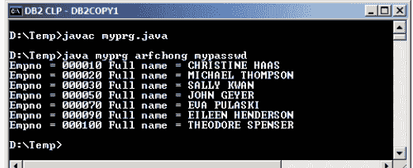

图 4.6 - 执行 myprg.java 程序

下面 *列表 4.5* 中显示的下一个代码片段提供了使用 **Statement** 对象和 **executeUpdate** 方法的示例。

```java
Statement updStmt = con.createStatement();
(1) int numRows = updStmt.executeUpdate
    ("UPDATE EMPLOYEE " +
     "  SET FIRSTNAME = 'Raul', " +
     "      LASTNAME = 'Chong' " +
     "  WHERE EMPNO  = '000010' " );
System.out.println("Number of rows updated: " + numRows);
```

### **列表 4.5** - Statement 对象：使用 executeUpdate 执行 UPDATE

在上述列表中，在第 (1) 行：

**executeUpdate** 方法用于执行 SQL UPDATE 操作，它返回一个表示受影响行数整数。上面的代码片段是 *myprg.java* 程序的一部分。在注释掉程序中的相应部分后，你可以按以下方式运行它：

```bash
javac myprg.java
java myprg <userid> <password>
```

输出结果将如下：

```
Number of rows updated: 1
```

*列表 4.6* 和 *列表 4.7* 中的示例与之前的 *列表 4.5* 类似，但在这种情况下，查询首先被保存在一个名为 *query* 的字符串中，并且我们使用 **executeUpdate** 方法来分别执行 **INSERT** 和 **DELETE** 操作。

```java
String query = null;
query = "INSERT INTO employee (EMPNO, " +
        "FIRSTNAME, LASTNAME, EDLEVEL, SALARY)" +
        "VALUES ('099999', 'Jin', 'Xie', 25, 90000)";
Statement stmt = con.createStatement();
int numRows    = stmt.executeUpdate( query );
System.out.println("Number of rows inserted: " + numRows);
stmt.close();
```

### **列表 4.6** - Statement 对象：使用 executeUpdate 执行 INSERT

```java
String query = null;
query = "DELETE FROM employee where empno = '000999'";
Statement stmt = con.createStatement();
int numRows = stmt.executeUpdate( query );
System.out.println("Number of rows deleted: " + numRows);
stmt.close();
```

### 列表 4.7 - Statement 对象：使用 executeUpdate 执行 DELETE

下面 *列表 4.8* 中显示的下一个代码片段是使用 **execute** 方法的示例。如前所述，当在运行时之前不知道执行的是 **SELECT** 还是更新操作时，会使用此方法，其中更新指的是 SQL **UPDATE**、**INSERT** 或 **DELETE**。

```java
String passedStmt = "SELECT firstname, lastname " +
                   "FROM employee  " +
                   "WHERE salary > 80000";
Statement  stmt       = con.createStatement();
ResultSet  rs         = null;
int        numRows    = 0;
(1) if (stmt.execute(passedStmt)) {
    rs = stmt.getResultSet();
    while (rs.next() ) {
        System.out.println("Full name = " + rs.getString(1) +
               " " + rs.getString(2));
    }
    rs.close();
}
else {
    numRows = stmt.getUpdateCount();
    System.out.println("Number of rows updated: " + numRows);
}
```

### 列表 4.8 - Statement 对象：使用 execute 执行 SELECT 或 UPDATE

在上述列表中，在第 (1) 行：

如果传入的语句（在本例中为 *passedStmt*）是 **SELECT**，execute 方法将返回 *true*。如果是 **UPDATE/INSERT/DELETE**，它将返回 *false*。在这个特定的示例中，我们硬编码了传入的语句；然而，它也可以实现为一个参数。

要使用 *myprg.java* 程序测试此功能，请注释掉程序中的相应部分，并运行这些命令：

```bash
javac myprg.java
java myprg <userid> <password>
```

输出结果将如下：

```
Full name = Raul Chong
Full name = MICHAEL THOMPSON
Full name = SALLY KWAN
Full name = JOHN GEYER
Full name = EVA PULASKI
Full name = EILEEN HENDERSON
Full name = THEODORE SPENSER
```

如果你修改程序，使传入的语句是一个 **UPDATE** 操作，你可以再次测试编译和运行该程序，并会得到以下结果：

```
Number of rows updated: 1
```

#### 4.3.2.3 PreparedStatement 接口

实现 **PreparedStatement** 接口的类可用于运行可以包含 **参数标记** 的查询。参数标记是一个出现在动态语句字符串中的问号 (?)，它可以出现在变量可能出现的地方。**PreparedStatement** 扩展了 **Statement** 接口。

如前所述，**Connection** 对象的 **prepareStatement** 方法用于创建 **PreparedStatement** 对象。

如果 SQL 语句包含参数标记，在执行语句之前需要使用 setter 方法设置这些参数标记的值。**PreparedStatement** 对象的 setter 方法看起来像 "**setXXX**"，其中 **XXX** 表示参数标记的数据类型。例如，**setInt**、**setString**、**setDouble**、**setBytes**、**setClob**、**setBlob**。

在设置参数值后，根据 SQL 类型使用 **executeQuery**、**executeUpdate** 或 **execute** 方法。

*列表 4.9* 提供了一个使用 **PreparedStatement** 和 SELECT 的示例代码片段。

```java
(1) PreparedStatement pStmt = con.prepareStatement
("SELECT firstname, " +
"lastname " +
"FROM employee WHERE salary > ? ");
(2) pStmt.setInt(1,80000);
(3) ResultSet rs = pStmt.executeQuery();
(4) while ( rs.next() ) {
(5) System.out.println("Full name = " + rs.getString(1) +
(6) " " + rs.getString(2));
(7) }
(8) rs.close();
(9) pStmt.close();
```

### 列表 4.9 - PreparedStatement 对象：使用 executeQuery 执行 SELECT

在上述列表中：


#### 4.3.2.4 CallableStatement 接口

实现 CallableStatement 接口的类可用于调用存储过程。CallableStatement 继承自 PreparedStatement 接口。使用 `Connection` 对象的 `prepareCall` 方法来创建 `CallableStatement` 对象。

`CallableStatement` 可以拥有三种类型的参数：IN、OUT、INOUT。在执行 `CallableStatement` 之前，必须使用 setter 方法（`setXXX`）为 IN 和 INOUT 参数设置值。同样地，在执行语句之前，OUT 和 INOUT 参数应注册（使用 `registerOutParameter` 方法）到数据库。

`CallableStatement` 可以使用 `executeUpdate`、`executeQuery` 和 `execute` 方法执行。这三种方法的使用说明如下：

-   **executeUpdate**：当期望调用的输出不包含结果集时使用。
-   **executeQuery**：当期望调用的输出包含单个结果集时使用。
-   **execute**：当期望调用的输出包含多个结果集时使用。

让我们查看一下 *Listing 4.12* 中的示例代码片段，该代码使用了 **CallableStatement** 对象和 **executeUpdate** 方法。假设 **view_salary_increase** 存储过程定义如下：

```java
view_salary_increase (IN p_empno varchar(6),
                       INOUT p_increase int,
                       OUT p_firstname)
```

其中，该存储过程根据给定的员工编号，通过 **OUT** 参数返回员工的名字。

```java
(1) CallableStatement cstmt;
(2) cstmt = con.prepareCall("Call view_salary_increase(?,?,?)");
(3) cstmt.setString(1, "000010");
(4) cstmt.setInt(2, 10000000);
(5) cstmt.registerOutParameter(3, Types.VARCHAR);
(6) cstmt.executeUpdate();
(7) System.out.println(cstmt.getString(3) +
                       " would receive an increase of " +
                       cstmt.getInt(2));
(8) cstmt.close();
```

### Listing 4.12 - 使用 executeUpdate 的 CallableStatement：不返回结果集

在上述代码片段中：

-   (1) 声明了 **CallableStatement** 对象 *cstmt*。
-   (2) 通过连接的方法 *prepareCall* 创建 **CallableStatement** 对象，并将其赋值给 *cstmt*。
-   (3) 存储过程的输入参数（**IN** 或 **INOUT**）必须在执行调用之前设置。
-   (4) 同上，此参数为 **INOUT** 参数。
-   (5) 存储过程的输出参数必须注册以指示其类型。对于 **INOUT** 参数，如果先使用 *setXXX* 设置值，则注册它是可选的。
-   (6) 在此情况下，由于存储过程未返回结果集，因此使用 **executeUpdate** 方法。
-   (7) 使用 **getXXX** 方法从存储过程参数（**OUT** 和 **INOUT**）中检索信息。
-   (8) 关闭 **CallableStatement** 对象 *cstmt*。

在下一个由 *Listing 4.13* 中代码片段展示的例子中，使用了一个 `CallableStatement` 对象来调用定义如下 **high_paid_employees** 存储过程：

```java
high_paid_employees(IN p_salary INT)
```

其中，该存储过程返回一个包含两列的结果集：工资大于 **p_salary** 的员工的姓和名。

```java
CallableStatement cstmt;
(1) cstmt = con.prepareCall("call high_paid_employees(?)");
(2) cstmt.setInt(1,80000);
(3) ResultSet rs = cstmt.executeQuery();
    System.out.println("High-paid employees list\n" +
        "--------------------------------");
(4) while (rs.next()) {
        System.out.println( rs.getString(1) + " " +
            rs.getString(2) );
    }
rs.close();
cstmt.close();
```

### Listing 4.13 - 返回单个结果集的 CallableStatement 对象

在上述代码片段中：

-   1. 通过连接的方法 **prepareCall** 创建 *CallableStatement* 对象 **cstmt**，以调用 **high_paid_employees** 存储过程。
-   2. 在执行调用之前设置存储过程的输入参数。没有输出参数需要注册。
-   3. 由于存储过程返回单个结果集，因此发出 **executeQuery** 方法。
-   4. 我们遍历结果集，并使用 getter 方法（**getXxx**）获取结果集中返回的列。

### 4.3.3 接收结果

本节描述了使用 JDBC 程序时的第三个步骤。它描述了如何接收结果，主要是 **ResultSet** 对象。

#### 4.3.3.1 ResultSet

**ResultSet** 对象由 **Statement**、**PreparedStatement** 和 **CallableStatement** 对象的 **executeQuery** 方法返回。**ResultSet** 对象维护一个指向结果集当前行的游标。可以使用该对象的 **next()** 方法将此游标移动到下一行。游标默认只能向前移动且为只读；但是，您可以将游标定义为可滚动或可更新的。


### 4.3.4 处理 SQL 错误和警告

可以通过调用结果集（Result Set）对象的 getter 方法获取当前行的列值。当所有行都获取完毕后，`next` 方法将返回一个异常。

表 4.5 列出了在创建 Statement 对象时可以设置的三个 Result Set 属性。

### 表 4.5 - resultSet 的属性

| 属性 | 描述 |
|---|---|
| resultSetType | 定义游标的可滚动性 |
| resultSetConcurrency | 定义游标的可更新性 |
| resultSetHoldability | 指示即使 statement 关闭后结果集仍保持打开状态 |

支持所有这些属性的 `createStatement` 和 `prepareStatement` 具有如下语法：

```java
createStatement (int resultSetType,
                resultSetConcurrency,
                resultSetHoldability)

prepareStatement (int resultSetType,
                  resultSetConcurrency,
                  resultSetHoldability)
```

这三个属性均为可选的。下方的清单 4.14 提供了一个处理结果集的示例，该示例取自 4.3 节开头提到的 IBM rebook。

### 清单 4.14 - 使用 ResultSet 对象的示例

```java
(1) Statement stmt = con.createStatement (ResultSet.TYPE_SCROLL_SENSITIVE,
                                           ResultSet.CONCUR_UPDATABLE);
(2) ResultSet rs=stmt.executeQuery("Select POID,Status from
                                     purchaseorder");
(3) while(rs.next()) {
        int id = rs.getInt(1);
        String status = rs.getString(2);
        if(id==5003 && status.toUpperCase().compareTo("UNSHIPPED")==0) {
            System.out.println("updating status to shipped for id value "+
                               id+"....");
(4)     rs.updateString(2, "Shipped");
(5)     rs.updateRow();
    }
(6) rs.beforeFirst();
    System.out.println("Printing all the purchase order record status");
    while(rs.next()) {
        int id         = rs.getInt(1);
        String info = rs.getString(2);
        System.out.println("id="+id+" info="+ info );
    }
```

在上述清单中：

- (1) 此行用于创建带有游标属性的 Statement 对象，使其可滚动（且对他人所做的更改敏感）并可更新。
- (2) 创建 ResultSet 对象。
- (3) 遍历结果集。
- (4) 在 `id = 5003` 且状态为 UNSHIPPED 的条件下，将游标该行的 String（第 2 列）更新为状态“Shipped”。如果有更多列，可以使用 updater 方法 `updateXXX` 更新其他列。
- (5) 更新该行（如果使用了 `rs.insertRow()`，则在该位置插入新行）。
- (6) 将游标移回此 ResultSet 对象的开头，即第一行之前。

#### 4.3.4.1 SQLException

每当在访问数据库时发生错误，都会创建并抛出一个 **SQLException** 对象。**SQLException** 对象提供表 4.6 中列出的信息。

#### 表 4.6 - SQLException 信息

| SQLException 信息 | 描述 | 获取此信息的方法 |
| :--- | :--- | :--- |
| Message | 错误代码的文本表示 | **getMessage** 方法 |
| SQLState | SQLState 字符串 | **getSQLState** 方法 |
| ErrorCode | 一个整数值，指示导致抛出异常的错误 | **getErrorCode** 方法 |

除了上述信息外，DB2 JCC 驱动程序还提供了额外的接口 `com.ibm.db2.jcc.DB2Diagnosable`。此接口提供了有关访问 DB2 数据库时发生的错误的更多信息。

如果抛出多个 SQLException，它们会被链接在一起。可以通过调用当前 `SQLException` 对象的 `getNextException` 方法来获取下一个异常的信息。如果当前 `SQLException` 对象是链中的最后一个，此方法将返回 null。可以在程序的 catch 块中使用 while 循环逐个获取所有 `SQLException` 对象。*清单 4.15* 展示了如何在 try-catch 块中处理 `SQLException`。

### 清单 4.15 - 处理 SQLException

```java
try {
    // 可能抛出 SQLException 的代码放在这里
} catch (SQLException sqle)
{
    System.out.println("Rollback the transaction and quit the program");
    System.out.println();
    try { con.rollback(); }
    catch (Exception e) {}
    System.exit(1);
}
```

#### 4.3.4.2 SQLWarning

当调用以下类的方法时发生数据库警告，就会创建 `SQLWarning` 对象：

- `Connection`
- `Statement`
- `PreparedStatement`
- `CallableStatement`
- `ResultSet`

所有这些接口都包含 `getWarning` 方法以获取警告信息。请注意，创建 `SQLWarning` 对象不会抛出任何 `SQLException`。您需要调用上述接口的 `getWarning` 方法以检查是否存在任何警告。*清单 4.16* 提供了处理 `SQLWarning` 的示例。

### 清单 4.16 - 处理 SQLWarning

```java
Statement stmt=con.createStatement();
stmt.executeUpdate("delete from product where pid='101'");
SQLWarning sqlwarn=stmt.getWarnings();
while(sqlwarn!=null)
{
    System.out.println("Warning description: " + sqlwarn.getMessage());
    System.out.println("SQLSTATE: " + sqlwarn.getSQLState());
    System.out.println("Error code: " + sqlwarn.getErrorCode());
    sqlwarn=sqlwarn.getNextWarning();
}
```

## 4.3.5 关闭连接

为了 JDBC 程序开发步骤的完整性，我们包含了这一节。然而，我们在前面的示例中已经展示了如何使用连接的 **close** 方法来关闭连接。在之前的清单 4.4 中，我们还展示了如何使用相应的 **close** 方法来关闭 **Statement** 和 **ResultSet** 对象。

## 4.3.6 处理 XML

在 Java 应用程序中处理 pureXML 相当简单。只需像通常处理 SQL 语句那样处理 SQL/XML 和 XQuery 语句即可。在 Java 程序中将 XML 视为字符串即可。这也有性能优势。JDBC 程序无需作为字符串或 CLOB（如果那是存储方式）检索整个 XML 文档，并在运行时构建 DOM 树（如果使用 DOM 解析器）。该树在 XML 文档插入数据库时就已经构建好了。让 DB2 软件（"DB2"）根据你传递给它的 SQL/XML 或 XQuery 检索所需的内容。

### 4.3.6.1 插入 XML 数据

如果你想使用 Java 程序将 XML 文档插入数据库，你有两种选择：

- 在 Java 程序中硬编码 XML 并将其作为字符串插入。
- 将 XML 文档存储在文件中，并使用 **setBinaryStream** 方法插入该文件。

例如，假设你创建了名为 CLIENTS 的表，其 DDL 如下：

```sql
create table clients(
    id        int primary key not null,
    name      varchar(50),
    status    varchar(10),
    contactinfo xml
)
```

请注意，最后一列 *contactinfo* 定义为 XML。图 4.7 展示了 Java 程序将此列视为字符串。

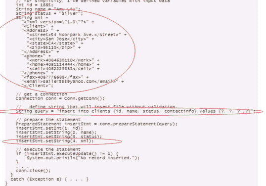

在上述图中，变量 `xml` 被定义为 String。然后在 `insertStmt.setString(4, xml)` 这一行中，对应于 XML 列 *contactInfo* 的第四个参数标记被设置为变量 `xml` 的值。

在*图 4.8*中，XML 文档并未在 Java 程序中硬编码，而是存储在名为 `client1885.xml` 的文件中。然后使用 setBinaryStream 方法将此文件插入数据库。DB2 会处理其余部分。

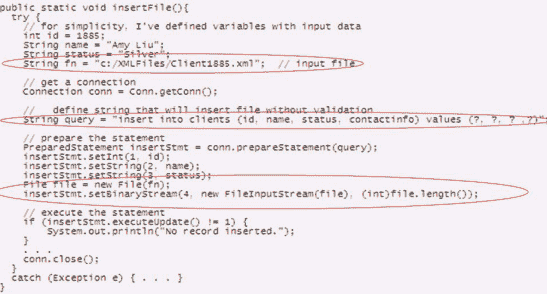

图 4.8 - 插入存储在文件中的 XML 文档

### 4.3.6.2 使用 SQL/XML 和 XQuery 检索 XML 文档

在*第 15 章 DB2 pureXML*中学习到的所有内容都可以应用于本章。图 4.9 展示了一个在 Java 程序中调用 SQL/XML 查询的示例。使用了参数标记，返回的结果集中第二列（电子邮件）作为字符串检索。从查询中可以看出，电子邮件是存储在 `contactinfo` 列中的 XML 文档的一个元素。

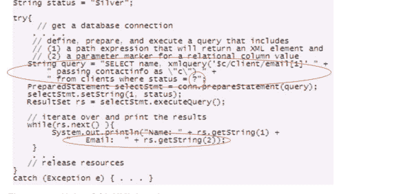

图 4.9 - 在 Java 程序中使用 SQL/XML


图 4.10 展示了在 Java 程序中使用 XQuery 的示例。同样，在 Java 程序中使用 SQL/XML 或 XQuery 并没有什么特别之处。

```java
try {
    // get a database connection
    Connection conn = Conn.getconn();
    // define, prepare, and execute an XQuery (without SQL).
    // note that we must hard-code query predicate values.
    String query = "xquery for $y in dd2-fn:xmlicolumn"
            + "(\"CLIENTS.CONTACTINFO\")/$client = "
            + "where $y/Address/city='San Jose' and $y/Address/state=\"CA\" "
            + "return <emailList> { $y/email } </emailList>";
    PreparedStatement selectStmt = conn.prepareStatement(query);
    ResultSet rs = selectStmt.executeQuery();
    // iterate over all items in the sequence and print results.
    while (rs.next()) {
        System.out.println(rs.getString(1));
    }
    // release all resources
} catch (Exception e) {
    // catch and handle any exceptions
}
```

**图 4.10 - 在 Java 程序中使用 XQuery**

> **注意：**
> 有关 JDBC 的更完整说明，包括关于数据库元数据、批量更新、事务、保存点、处理大型对象等主题，可以在 IBM 红皮书 *DB2 Express-C: The Developer Handbook for XML, PHP, C/C++, Java, and .NET (SG24-7301-00)* 中找到。有关更多信息，请参见本书的资源部分。

## 4.4 SQLJ 编程

SQLJ 编程是将 SQL 语句嵌入到 Java 程序中的标准。所有 SQL 语句都是使用*上下文*静态执行的。上下文提供有助于解释 SQL 语句执行位置的信息。有不同类型的上下文：

- **连接上下文。** 这相当于 JDBC 中的**Connection** 对象。当未指定连接上下文时，会使用默认连接上下文。
- **执行上下文。** 这是获取执行 SQL 语句前后相关信息的必要条件。

### 4.4.1 SQLJ 语法

在使用 SQLJ 时，可以使用不同的语法来帮助预编译器识别需要从嵌入 SQL 的 Java 程序中的其他语句中转换的语句。虽然语法的类型不同，但它们都以**“#sql”开头，并使用花括号作为定界符，如下所示：**

- `#sql [connection-context] { sql statement }`
- `#sql [connection-context, execution context] { sql statement }`
- `#sql { sql statement }`
- `#sql [execution context] { sql statement }`

主机变量可以通过冒号来识别，如下例所示：

```java
#sql {SELECT EMPNO FROM EMP WHERE WORKDEPT = :dept};
```

### 4.4.2 连接上下文

要在 SQLJ 程序中处理 SQL，首先需要建立数据库连接。连接上下文即用于此目的。在下面的*清单 4.17*和*清单 4.18*中，展示了处理连接上下文的不同方法。

```java
(1) #sql context ctx; // This should be outside the class
(2) Class.forName("com.ibm.db2.jcc.DB2Driver").newInstance();
(3) ctx ctx1 = new ctx("jdbc:db2:sample", false);
(4) #sql [ctx1] { DELETE FROM dept };
```

**清单 4.17 - 处理连接上下文**

在上述清单中：

1. 使用以下语法声明连接上下文类：
   ```
   #sql context <context-class-name>
   ```
2. 加载 JDBC 驱动程序；类似于 JDBC 程序。
3. 调用*context*类的构造函数。
4. 在连接上下文**"ctx1"**下执行 SQL 语句（**DELETE**）。

*清单 4.18*中的这个其他示例与此类似，但它将 JDBC 连接对象与 SQLJ 结合使用。

```java
#sql context ctx; // This should be outside the class
Class.forName("com.ibm.db2.jcc.DB2Driver").newInstance();
(1) Connection con = DriverManager.getConnection();
(2) ctx ctx1 = new ctx(con);
#sql [ctx1] { DELETE FROM dept };
```

**清单 4.18 - 从 Connection 对象创建连接上下文的示例：**

在上述清单中：

1. 使用一个 **Connection** 对象。
2. 调用 *context* 类的构造函数。

此外，您还可以为连接创建一个默认上下文。这意味着以后在执行 SQL 操作时无需指定上下文，因为将使用指定为默认的上下文。语法形式如下：

```java
#sql ( sql statement )
```

*清单 4.19* 提供了一个示例。

```java
Class.forName("com.ibm.db2.jcc.DB2Driver").newInstance();
Connection con = DriverManager.getConnection();
(1) DefaultContext ctx1 = new DefaultContext(con);
(2) DefaultContext.setDefaultContext(ctx1);
(3) #sql ( DELETE FROM dept );
```

**清单 4.19 - 具有默认上下文的连接示例**

在上述清单中：

1. 创建一个 DefaultContext。
2. 将默认上下文设置为 *ctx1*。
3. 指定要执行的 SQL，在此情况下是一条 **DELETE** 语句。请注意，语法中不需要指定上下文名称。将使用默认上下文 *ctx1*。

*清单 4.20* 下面提供了一个使用默认上下文的完整 SQLJ 程序示例。

```java
import java.sql.*;
(1) import sqlj.runtime.*;       // SQLJ runtime support
(2) import sqlj.runtime.ref.*;   // SQLJ runtime support

class myprg3 {
    public static void main(String argv[]) {
        try {
            Connection con = null;
            Class.forName("com.ibm.db2.jcc.DB2Driver");
            String url = "jdbc:db2://127.0.0.1:50000/SAMPLE";
            if (argv.length == 2) {
                String userID = argv[0];
                String passwd = argv[1];
                con = DriverManager.getConnection(url, userID, passwd);
            } else {
                throw new Exception("\n Usage: java myprg3 userID password\n");
            }
            (3) DefaultContext ctx = new DefaultContext(con);
            (4) DefaultContext.setDefaultContext(ctx);
            (5) if (ctx != null) {
                (6) ctx.close();
            }
        } catch (Exception e) {
        }
    }
}
```

**清单 4.20 - 一个完整的 SQLJ 程序**

在上述清单中：

1. 第 1 项和第 2 项：需要导入这些包以提供 SQLJ 运行时支持。
2. 第 3 项：创建默认上下文。
3. 第 4 项：设置要使用的默认上下文。
4. 第 5 项：如果上下文未关闭。
5. 第 6 项：关闭上下文/断开连接。

### 4.4.3 执行上下文

执行上下文在 SQL 语句执行期间对其进行监控和控制；它相当于 JDBC 中的 Statement 接口，并在连接上下文对象中创建。

要创建 ExecutionContext 对象，请使用连接上下文的 getExecutionContext 方法。一些 ExecutionContext 方法在 SQL 语句执行前有效，而其他方法仅在执行后有效。

清单 4.21 提供了一个示例。

```java
#sql context ctx; // this should be outside the class
String url = "jdbc:db2:sample";
Class.forName("com.ibm.db2.jcc.DB2Driver").newInstance();
Connection con = DriverManager.getConnection(url);
ctx ctx1 = new ctx(con);
(1) ExecutionContext execTx1 = ctx1.getExecutionContext();
(2) #sql [ctx1, execTx1] { DELETE FROM purchaseorder WHERE status='UnShipped' };
(3) int i = execTx1.getUpdateCount();
```

**清单 4.21 - 使用执行上下文的示例**

在上述清单中：

1. (1) 使用连接上下文对象的 getExecutionContext 方法创建执行上下文。
2. (2) 指定与连接上下文 *ctx1* 和执行上下文 *execTx1* 关联的 SQL。
3. (3) 调用执行上下文对象的 getUpdateCount 方法以获取被删除或更新的记录数。

### 4.4.4 迭代器

*迭代器*相当于 JDBC 结果集。迭代器有两种类型：

- **命名迭代器**：通过结果集中列的名称来识别行。在定义命名迭代器时，指定列名及其数据类型。
- **位置迭代器**：通过其在结果集中的位置来识别行。在定义位置迭代器时，仅指定列的数据类型。

*清单 4.22* 提供了一个命名迭代器的示例。

```java
(1) #sql iterator namediterator (int *poid*, String *status*);
(2) namediterator *iterator1*;
(3) #sql [*ctx1*] *iterator1* = { select *poid*, *status* from *purchaseorder* };
(4) while (*iterator1*.next()) {
(5)     System.out.println("poid: " + *iterator1*.poid() + "Status: " + *iterator1*.status());
}
(6) *iterator1*.close();
```

**清单 4.22 - 一个命名迭代器的示例**

在上述清单中：

1. (1) 声明了一个具有两列的命名迭代器。请注意，列名 *poid* 和 *status* 被明确提及。这就是为什么这是一个命名迭代器。
2. (2) 声明了一个名为 *iterator1* 的命名迭代器。
3. (3) 在连接上下文 *ctx1* 中，使用 "select *poid*, *status* from *purchaseorder*" 定义 *iterator1*。
4. (4) 循环遍历迭代器。
5. (5) 打印检索到的每一行的 *poid* 和 *status*。注意语法："*iterator1*.poid()"，以及 "*iterator1*.status()"。
6. (6) 关闭 *iterator1*。

*清单 4.23* 提供了一个位置迭代器的示例。

```java
(1) #sql iterator *positionedIterator* (int, String);
(2) String *status* = null;
(3) int *poid* = 0;
(4) *positionedIterator* *iterator1*;
(5) #sql [*ctx1*] *iterator1* = ( select *poid*, *status* from *purchaseorder* );
(6) #sql { fetch : *iterator1* into : *poid*, : *status* };
(7) while (*iterator1*.endFetch()) {
(8)     System.out.println("poid: " + *poid* + "Status: " + *status*);
}
```


### 4.2.4 迭代器

(9)
    #sql { fetch :iterator1 into :poid, :status }
    );

#### 列表 4.23 - 一个位置迭代器的示例

在上述列表中：

1.  声明了一个具有两列的位置迭代器。注意，该列没有名称，只有数据类型。这就是为什么它是一个位置迭代器的原因。
2.  声明了一个变量 `status`。这类似于一个主机变量，用于接收来自迭代器的值。
3.  类似于变量 `poid` 的操作 (2)。
4.  创建了位置迭代器 `iterator1`。
5.  在连接上下文 `ctx1` 中，使用 `select poid, status from purchaseorder` 定义了 `iterator1`。
6.  在开始循环之前，我们将第一条记录获取到主机变量 `poid` 和 `status` 中。这是因为在 (7) 中，我们没有使用 `next()`，而是使用了 `endFetch()`，因此如果你使用 `next()` 与 `endFetch()`，while 循环的条件结束方式会有所不同。
7.  遍历迭代器。
8.  打印每一行检索到的 `poid` 和 `status`。
9.  获取迭代器中的下一条记录。

命名迭代器或位置迭代器可以是可更新的和可滚动的。默认情况下，SQLJ 中的迭代器是只读的，并且只能向前移动。要定义一个可滚动的迭代器，你需要在定义迭代器时实现 `sqlj.runtime.Scrollable`。

要定义一个可更新的光标，你需要在定义迭代器时实现 `sqlj.runtime.ForUpdate`。在定义可更新的迭代器时，你还必须指定想要更新的列。

这与 JDBC 类似。列表 4.24 提供了一个可更新迭代器的示例。

(1)
    #sql public iterator namediterator implements sqlj.runtime.ForUpdate
    with (updateColumns="STATUS") (int poid, String status);
(2)
    namediterator iterator1;
(3)
    #sql {ctx1 { iterator1 = { select poid, status from purchaseorder };
(4)
    while (iterator1.next()) {
(5)
    System.out.println("before update poid: " + iterator1.poid() +
    " Status: " + iterator1.status());
(6)
    if (iterator1.status().toUpperCase().compareTo("UNSHIPPED") == 0) {
    #sql {ctx1 { update purchaseorder set status =
    'shipped' where current of : iterator1 };
    }
(7)
    #sql {ctx1 { commit; }

#### 列表 4.24 - 一个可更新迭代器的示例

在上述列表中：

1.  声明了一个命名迭代器，由于它实现了 `sqlj.runtime.ForUpdate`，因此被定义为可更新迭代器，并注意它还通过 `with (updateColumns="STATUS")` 指示它将更新哪个列。
2.  声明了命名迭代器 *iterator1*。
3.  *iterator1* 被定义为 `select poid, status from purchaseorder` 的结果。
4.  遍历迭代器。
5.  打印迭代器的每一行。
6.  测试 *status* 列的值是否为 "UNSHIPPED"。如果是，则将该值更改为 'shipped'。
7.  提交更改。

### 4.4.5 结合使用 JDBC 和 SQLJ

JDBC 和 SQLJ 可以在单个应用程序中结合使用。例如，可以使用 `ConnectionContext` 对象的 `getConnection` 方法从该对象中检索 JDBC 连接对象，反之亦然。

SQLJ 中的迭代器和 JDBC `ResultSet` 可以相互检索，如下所示：

- 从结果集到迭代器：`#sql iterator = {CAST :result-set }`
- 从迭代器到结果集：使用迭代器的 `getResultSet` 方法。

*列表 4.25* 提供了在一个程序中结合使用 JDBC 和 SQLJ 的示例。

```java
#sql public iterator positionIterator (int, String);
Class.forName("com.ibm.db2.jcc.DB2Driver").newInstance();
Connection con=DriverManager.getConnection(url);
con.setAutoCommit(false);
(1) ctx ctx1=new ctx(con);
positionIterator iterator;
Statement stmt = con.createStatement();
ResultSet rs=stmt.executeQuery("select poid, status from purchaseorder");
(2) #sql [ctx1] iterator={cast :rs};
#sql {fetch :iterator into :poid, :status};
while(!iterator.endFetch()) {
System.out.println("id: "+poid+" status: "+status);
#sql {fetch :iterator into :poid, :status};
}
    iterator.close();
```

**列表 4.25 - 在一个程序中结合使用 JDBC 和 SQLJ**

在上述列表中：

1.  使用连接对象创建 SQLJ 连接上下文。
2.  这展示了如何从 JDBC 结果集中获取结果来创建 SQLJ 迭代器。

### 4.4.6 准备 SQLJ 程序

准备 SQLJ 程序类似于嵌入式 SQL 程序的过程，在那里你必须预编译和绑定程序。在这种情况下，SQLJ 程序需要被转换和定制。*图 4.11* 展示了准备程序 `myprg3.sqlj` 的过程。

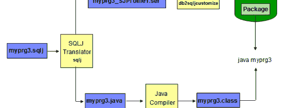

**图 4.11 - 准备 SQLJ 程序的步骤**

在该图中，SQLJ 程序 `myprg3.sqlj` 使用 `sqlj` 命令通过 *SQLJ 转换器* 进行处理。SQLJ 转换器检查文件，查找以 "#sql" 开头的行，并将这些行替换为包含 SQLJ 运行时类的生成代码，创建一个带有 `.java` 扩展名的文件。然后它使用 Java 编译器 (**javac**) 编译此文件，创建一个 `.class` 文件。这在该图的底部显示，其中创建了 `myprg3.java` 和 `myprg3.class` 文件。

SQLJ 转换器还会创建，如该图顶部所示，为在 SQLJ 可执行子句中使用的每个连接上下文类创建序列化配置文件。在此示例中，它显示了两个序列化配置文件 `myprg3_SJProfile0.ser` 和 `myprg3_SJProfile1.ser`。这些文件保存关于嵌入式 SQL 的信息。在这些文件之后，调用 `javac` 时会创建一个 myprg3_SJProfileKeys.class 文件（图中未显示）。使用带有 `db2sqljcustomize` 命令的 DB2 定制器，在数据库中创建一个包（已编译的 SQL）。

当你想要执行程序时，只需使用命令 `java myprg3` 运行它，这将使用 myprg3.class 文件和数据库中的相应包。

> **注意：**
> 程序 `myprg3.sqlj` 包含在随本书提供的 zip 文件 `Exercise_Files_DB2_Application_Development.zip` 中。你可以查看、测试和准备此文件。

以下是实际执行所有这些命令及其相应输出的示例。这些是要遵循的步骤：

(1) 运行 SQLJ 转换器（`sqlj` 命令）

```
D:\>sqlj myprg3.sqlj
```

创建了以下文件：

```
myprg3.java, myprg3.class,
myprg3_SJProfile0.ser,
myprg3_SJProfileKeys.class
```

(2) 为每个 .ser 文件运行 DB2 定制器（`db2sqljcustomize` 命令）。DB2 定制器可以接受几个参数。它基本上是一个需要连接到数据库的 Java 程序，因为它是存储包的地方。例如：

```
D:\>db2sqljcustomize -url jdbc:db2://localhost:50000/sample -user rfchong -password mypasswd myprg3_SJProfile0.ser
```

其中：

- `-url jdbc:db2://localhost:50000/sample` 是连接数据库所需的 URL
- `-user rfchong` 是连接数据库的用户 ID
- `-password mypasswd` 是连接数据库的密码
- `myprg3_SJProfile0.ser` 是要定制以在数据库中创建包的文件名

输出看起来如下 *列表 4.26* 所示。

```
[jcc][sqlj]
[jcc][sqlj]  Begin Customization
[jcc][sqlj]  Loading profile: myprg3_SJProfile0
[jcc][sqlj]  Customization complete for profile myprg3_SJProfile0.ser
[jcc][sqlj]  Begin Bind
[jcc][sqlj]  Loading profile: myprg3_SJProfile0
[jcc][sqlj]  Driver defaults(user may override):  BLOCKING ALL
VALIDATE BIND STATIC READ_ONLY YES
[jcc][sqlj]  Fixed driver options: DATETIME ISO DYNAMICRULES BIND
[jcc][sqlj]  Binding package MYPRG301 at isolation level UR
[jcc][sqlj]  Binding package MYPRG302 at isolation level CS
[jcc][sqlj]  Binding package MYPRG303 at isolation level RS
[jcc][sqlj]  Binding package MYPRG304 at isolation level RR
[jcc][sqlj]  Bind complete for myprg3_SJProfile0
```

**列表 4.26 - 运行 DB2 定制器的输出**

不会创建任何输出文件，但带有嵌入式 SQL 语句和访问计划的包将存储在数据库中。

(3) 运行程序。之前创建的包将在运行时使用。

```
D:\>java myprg3 <userid> <password>
Successful connection to the database!
Successful retrieval of record. Column 'IBMREQD' has a value of 'Y'
Successful Disconnection from database
End of Program
```

下方的图 4.12 显示了准备程序 myprg3.sqlj 的所有输出。


图 4.12 - 准备 SQLJ 程序 myprg3.sqlj

## 4.5 pureQuery

至此，你应该对 JDBC 和 SQLJ 有了基本的了解。传统上，正如你可能注意到的那样，JDBC 和 SQLJ 编程需要一些繁琐的编程工作。这就是诸如 *Hibernate* 等**对象关系映射（ORM）框架**流行的原因之一。它们提供了一种数据访问抽象层，便于在你的面向对象的代码和关系数据库模型之间进行映射。然而，ORM 框架往往会在幕后为你生成所需的 SQL，而这些生成的 SQL 可能并非最优。此外，由于开发人员不再控制发送到数据库的 SQL，诊断性能问题和调优变得更加复杂。

为应对这些挑战，IBM 开发了 *pureQuery*。你可以将 pureQuery 视为位于 JDBC 之上的一个 API 薄层。它像 ORM 框架一样方便面向对象的代码与关系模型之间的映射；但它也赋予了你在 SQL 方面工作的灵活性。因此，pureQuery 的编程模型和工具有助于 Java 数据访问，通过生成使用最佳实践方法（如使用类似 JDBC 的批量更新）的代码来提高性能，并有助于问题定位。

除了 API 之外，pureQuery 还提供以下内容：

- 一个运行时，提供优化且安全的数据库访问
- 一个基于 Eclipse 的集成数据库开发环境，用于提高开发生产力
- 监控服务，为开发人员和 DBA 提供关于 Java 数据库应用程序性能的全新见解。

pureQuery 还允许你在不更改任何代码的情况下生成静态 SQL。这在不费吹灰之力的情况下解锁了静态 SQL 的优势。

pureQuery 的工具包含在产品 *Optim Development Studio* 中。API 和运行时随产品 Optim™ pureQuery Runtime 提供，并且作为开发用途免费打包在开发人员的机器上与 Optim Development Studio 一起使用。监控服务通过 Optim Development Studio 提供，并在更高级别上通过 IBM DB2 Performance Expert 和 Extended Insight 功能提供。

IBM Optim™ 产品组合提供了一个集成的、模块化的环境，用于在其生命周期内设计、开发、部署、操作、优化和治理企业数据。这被称为 *Optim 集成数据管理*。

> **注意：**
> 有关 pureQuery 和 Optim 集成数据管理的更多信息，可以在免费电子书 *Getting Started with pureQuery* 和 *Getting Started with IBM Data Studio for DB2* 中找到。这两本电子书都是该系列书籍的一部分。

## 4.6 练习

在这个练习中，你将练习编写小型的 JDBC 和 SQLJ 程序。

*步骤*

- 在 *Listing 4.12* 中，我们展示了一个示例，其中使用 **CallableStatement** 对象返回一个结果集。创建一个符合以下规格的 JDBC 程序：
    - 程序名称：`mylab4.java`
    - 该程序应使用以下语法执行：
        - `java mylab4 <userid> <password> <bonus>`
    - 使用 4 型驱动连接到 **SAMPLE** 数据库
    - 调用返回 2 个结果集的存储过程 "*high_bonus*"
    - 确保首先创建如下所示的 **high_bonus** 存储过程：

```sql
CREATE PROCEDURE HIGH_BONUS (IN p_bonus INT)
DYNAMIC RESULT SETS 2

-- This procedure lists the first name, last name, bonus, and
-- education level (edlevel) of the employees with a bonus amount
-- larger than the amount specified by the parameter p_bonus.
-- This information is in the EMPLOYEE table.
-- The procedure also returns another result set with the names
-- of all departments from the DEPARTMENT table.

P1: BEGIN
-- Declare cursor1
DECLARE cursor1 CURSOR WITH RETURN FOR
SELECT firstname, lastname, bonus, edlevel
FROM employee
WHERE bonus > p_bonus;

-- Declare cursor2
DECLARE cursor2 CURSOR WITH RETURN FOR
SELECT deptname
FROM department;

-- Cursor left open for client application
OPEN cursor1;
OPEN cursor2;
END P1
```

程序 *mylab4.java*（解决方案）包含在随附本书的 Exercise_Files_DB2_Application_Development.zip 文件中。

- 2. 在随附本书的 Exercise_Files_DB2_Application_Development.zip 文件中查找 *connectionContext.sqlj* 文件。准备此 SQLJ 程序并执行它。

## 4.7 总结

在本章中，你学习了使用 DB2 开发 Java 应用的基础知识。首先讨论了 JDBC，这是一种使用动态 SQL 访问数据库的标准 API。本章展示了如何连接到 DB2 数据库并发出不同类型的 JDBC 语句。然后，我们介绍了 SQLJ。虽然 SQLJ 并不那么流行，但 SQLJ 编程更紧凑，并且由于在 Java 程序中使用嵌入的静态 SQL，因此更适合性能。最后，我们简要介绍了 IBM 的 pureQuery。pureQuery 是 IBM 针对繁琐的 JDBC 编程和 ORM 框架缺乏灵活性的解决方案。

## 4.8 复习题

- 1. JDBC 和 SQLJ 之间的区别是什么？
- 2. DB2 9.7 支持哪些 JDBC 类型？
- 3. `db2jcc.jar` 和 `db2jcc4.jar` 之间的区别是什么？
- 4. 什么是迭代器？
- 5. 什么是默认上下文？
- 6. 以下哪项陈述是错误的？
    - A. `db2jcc.jar` 包含一个 JDBC 2 型驱动
    - B. `db2jcc4.jar` 包含一个 JDBC 2 型驱动
    - C. `db2jcc.jar` 包含一个 JDBC 4 型驱动
    - D. `db2jcc4.jar` 包含一个 JDBC 4 型驱动
    - E. 以上都不是
- 7. 以下哪项陈述是正确的？
    - A. pureQuery 允许开发人员轻松地在动态或静态 SQL 之间切换而无需更改代码
    - B. pureQuery 可以与 ORM 一起使用
    - C. pureQuery 包含在某些 Optim 产品中
    - D. 以上都是
    - E. 以上都不是
- 8. 以下哪项陈述是正确的？
    - A. JDBC 和 SQLJ 不能结合使用
    - B. JDBC 和 pureQuery 不能结合使用
    - C. SQLJ 和 pureQuery 不能结合使用
    - D. JDBC、SQLJ 和 pureQuery 可以结合使用
    - E. 以上都不是
- 9. 以下哪个不是有效的连接对象方法？
    - A. Statement
    - B. PreparedStatement
    - C. CallableStatement
    - D. ResultSetStatement
    - E. 以上都不是
- 10. 以下哪个不是有效的 SQLJ 概念？
    - A. 执行上下文
    - B. 连接上下文
    - C. 默认上下文
    - D. 命名迭代器
    - E. 位置迭代器

# 第 5 章 – 使用 C/C++ 进行应用开发

本章讨论了使用 C/C++ 结合 DB2 进行应用开发的各个方面，从设置开发环境到构建和运行应用程序。虽然在 *第 14 章，DB2 应用开发简介* 中已经讨论了嵌入 SQL，但我们将更详细地查看嵌入 SQL 编程如何在 C/C++ 程序中工作。本章还讨论了如何开发 ODBC 或 CLI 应用程序。在本章中，你将学习：

- 使用嵌入 SQL 编程 C/C++ 应用程序
- 构建具有嵌入 SQL 的 C/C++ 应用程序
- 使用 CLI/ODBC 编程 C/C++ 应用程序
- 构建具有 CLI/ODBC 的 C/C++ 应用程序

## 5.1 C/C++ DB2 应用程序：全局视图

当我们谈论数据库应用程序时，首先浮现在脑海中的是 SQL。SQL 是用于在关系数据库上执行数据定义语言（DDL）、数据控制语言（DCL）和数据操纵语言（DML）操作的语言。SQL 不是一种通用编程语言；由于 SQL 是一种非过程化语言，SQL 语句由数据库管理器执行，因此你不能执行用户定义的操作。这就是为什么数据库应用程序大多是通过结合 SQL 的能力与 C 或 C++ 等高级编程语言来开发的。在高级编程语言（也称为宿主语言）中开发应用程序，并将 SQL 语句嵌入该应用程序中，这被称为嵌入 SQL 编程。*图 5.1* 阐明了这一概念。嵌入 SQL 应用程序通常使用 C 或 C++ 开发。


## 5.2 配置环境

C/C++ 应用程序采用客户端-服务器架构，其中 C/C++ 应用程序作为客户端，DB2 作为服务器。客户端向服务器发送请求，服务器执行操作。C/C++ 应用程序可以是嵌入式 SQL 应用程序或 CLI/ODBC 应用程序。图 5.2 展示了 C/C++ 应用程序与 DB2 服务器交互的客户端-服务器架构。


**图 5.2 – C/C++ 应用程序访问 DB2 服务器**

图 5.2 展示了如何构建 C/C++ 应用程序以及如何访问 DB2 数据库。包含 SQL 语句的嵌入式 SQL 应用程序必须由 DB2 预编译器进行预编译。为了便于此预处理过程，应用程序中嵌入的每个 SQL 语句必须以关键字 `EXEC SQL` 开头，并以分号（;）结尾。

另一方面，CLI 或 ODBC 是嵌入式动态 SQL 的替代方案，但与嵌入式 SQL 不同，它不需要宿主变量或预编译器。应用程序可以针对来自不同供应商的多种数据库运行，这些供应商会提供自己的 ODBC 驱动程序。应用程序无需针对每个数据库进行编译。ODBC/CLI 应用程序的处理由 ODBC/CLI 驱动程序完成。应用程序在运行时使用过程调用连接数据库、发出 SQL 语句，并检索数据和状态信息。

我们将在后续章节中更详细地讨论上述每种方法。

在开始构建嵌入式 SQL C/C++ 应用程序或 ODBC/CLI 应用程序之前，您需要安装受支持的 C/C++ 编译器。对于嵌入式 SQL C/C++ 程序，您还需要预编译器；幸运的是，DB2 已包含该预编译器。

### 5.2.1 受支持的编译器

表 5.1 列出了在 32 位和 64 位平台上开发 DB2 数据库应用程序时受支持的 C/C++ 编译器。

| 操作系统 | 受支持的编译器 |
| --- | --- |
| AIX® | AIX 的 IBM XL C/C++ Enterprise Edition Version 7.0<br>AIX 的 IBM XL C/C++ Enterprise Edition Version 8.0<br>AIX 的 IBM XL C/C++ Enterprise Edition Version 9.0 |
| Linux | GNU/Linux gcc 版本 3.3 和 3.4<br>Intel C 编译器版本 9.1<br>Intel C 编译器版本 10.1 |
| Windows® | 用于 Windows 32 位应用程序的 Intel Proton 编译器，版本 9.0.021 或更高版本<br>Microsoft® Visual C++ .NET 或更高版本 |

**表 5.1 – 受支持的 C/C++ 编译器**

> **注意：** 此列表并非完整列表。有关受支持的 C/C++ 编译器版本的更多详细信息和最新信息，请参阅 http://publib.boulder.ibm.com/infocenter/db2luw/v9r7/topic/com.ibm.db2.luw.apdv.gs.doc/doc/r0023434.html 处的 DB2 9.7 信息中心以及 http://www.ibm.com/software/data/db2/udb/ad/ 处的 DB2 应用程序开发网站。

在本书中，我们使用 Microsoft Visual C++ 编译器（Windows）和 GNU/Linux gcc 编译器（Linux）。Microsoft Visual C++ 编译器是许可软件，随 Microsoft Visual Studio 提供。Visual Studio 的 Express 版本可以从 http://www.microsoft.com/express/Downloads/ 下载。GNU Linux gcc 编译器随 GNU 操作系统免费提供，但也可以从 http://gcc.gnu.org/ 下载。

### 5.2.2 配置 C/C++ 环境

要配置 C/C++ 环境，请遵循以下步骤：

- **1. 验证是否已安装受支持的 C/C++ 编译器**
  确保在受 DB2 Express-C 支持的平台上已安装受支持的 C/C++ 编译器。查看表 5.1 中的受支持编译器版本列表。
  在 Linux 上，要检查 C/C++ 编译器是否成功安装，请在 Linux shell 中执行以下命令：
  `which gcc`
  如果已安装编译器，屏幕上应显示 `/usr/bin/gcc`。

  在 Windows 上，如果使用 Microsoft Visual C++ 编译器，请执行 `c1` 命令。图 5.3 显示了执行此命令后的输出。

  

  **图 5.3 – c1 命令的输出**

  如果使用 Intel 编译器，请执行 `icl` 或 `ec1` 命令。图 5.4 显示了执行此命令后的输出。

  

  **图 5.4 – icl 命令的输出**

- **2. 验证您的 DB2 安装是否包含所需的库文件和头文件**
  安装 DB2 后，验证开发 C/C++ 程序所需的静态库、共享库和头文件是否存在。

  在 Linux 上，可以通过进入 DB2 安装目录并检查 `lib32` 和 `lib64` 目录来完成此操作。例如，如果 DB2 安装目录位于 $HOME，则 32 位库位置将在 $HOME/sqllib/lib32，而 64 位库位置将在 $HOME/sqllib/lib64。

  在 Windows 上，静态库位于 `<DB2 安装目录>\lib`。图 5.5 显示了静态库的位置。此处 DB2 安装目录为 `C:\Program Files\SQLLIB`。

  

- **3. 验证 Windows 环境**
  在 Windows 开发机器上，确保 **INCLUDE** 环境变量包含 `%DB2PATH%\include`，且该目录位于任何 Microsoft Platform SDK include 目录之前。如果情况并非如此，请遵循以下选项之一：
  - 通过执行以下命令在命令提示符处修改 **INCLUDE** 变量：`set INCLUDE=%DB2PATH%\include;%INCLUDE%`（这仅对当前窗口有效）
  - 如果要使此更改永久生效，请通过右键单击 *我的电脑* -> *属性* -> *环境变量* 来定位 Windows 环境变量，并在 **INCLUDE** 变量中添加 `%DB2PATH%\include`。

  如果使用 Visual Studio 进行开发，必须确保 **INCLUDE** 环境变量将 `%DB2PATH%\include` 作为第一个目录包含在内。为此，您需要使用以下步骤更新编译器的环境变量：
  1. 通过依次前往 *Program Files* -> *Microsoft Visual Studio .NET* -> *Visual Studio .NET Tools* -> *Visual Studio .NET Command Prompt* 打开 Visual Studio 命令提示符的快捷方式。
  2. 在 Visual Studio 命令提示符窗口中，运行 **db2cmd.exe** 以打开 DB2 命令窗口。
  3. 在 DB2 命令窗口中，按如下方式设置您的 `INCLUDE` 路径：
     `set INCLUDE=%DB2PATH%\INCLUDE;%INCLUDE%`

  图 5.7 显示了上述步骤：

  
  

  **图 5.7 – 配置 Windows 环境**

  现在，您可以在已正确设置 DB2 环境和 C/C++ 环境的 DB2 CLP 窗口中构建您的应用程序。

## 5.3 开发带嵌入式 SQL 的 C/C++ 应用程序

本节讨论开发带嵌入式 SQL 的 C/C++ 应用程序所需的步骤。

### 5.3.1 源文件扩展名

嵌入式 C/C++ SQL 程序的 C/C++ 源文件需要 DB2 预编译器能够识别的适当文件扩展名。表 5.2 列出了预编译器所需的 C/C++ 源文件扩展名。

| 平台 | C 源文件 | C++ 源文件 |
| --- | --- | --- |
| Linux | .sqc | .sqC |
| Windows | .sqc | .sqx |

**表 5.2 – 受支持的源文件扩展名**

### 5.3.2 C/C++ 中的 SQL 数据类型

为了在应用程序和数据库之间通信，使用正确的数据类型映射（宿主变量的 C/C++ 数据类型与 SQL 数据类型之间）非常重要。当预编译器找到宿主变量的声明时，它会确定适当的 SQL 数据类型。表 5.3 列出了 C/C++ 中支持的一些 SQL 数据类型。

| SQL 列类型 | C 和 C/C++ 数据类型 | SQL 列类型描述 |
| --- | --- | --- |
| SMALLINT | Short | 16 位有符号整数 |
| INTEGER | sqlint32 | 32 位有符号整数 |
| DOUBLE | Double | 双精度浮点数 |
| CHAR(n) | char[n+1] 其中 n 足够容纳数据 1<=n<=254 | 固定长度，以 null 结尾的字符串 |
| VARCHAR(n) | char[n+1] 其中 n 足够容纳数据 1<=n<=254 | 以 null 结尾的变长字符串 |
| DATE | char[11] | 以 null 结尾的字符形式 |
| TIME | char[9] | 以 null 结尾的字符形式 |

**表 5.3 – C/C++ 中支持的 SQL 数据类型**

> **注意：** 此列表并非完整列表。完整的映射列表可在以下位置找到：  
> http://publib.boulder.ibm.com/infocenter/db2luw/v9r7/index.jsp?topic=com.ibm.db2.luw.adv.embed.doc/doc/0006090.html


### 5.3.3 开发嵌入式 SQL C/C++ 应用程序的步骤

开发带有嵌入式 SQL 的 C/C++ 应用程序涉及以下步骤：

- 1. 包含所需的头文件
- 2. 声明宿主变量
- 3. 连接到数据库
- 4. 执行 SQL 语句
- 5. 处理 SQL 错误
- 6. 提交事务
- 7. 断开与数据库的连接

我们将逐一探讨每个步骤。*清单 5.1* 展示了一个基本模板，可用于编写具有嵌入式 SQL 应用程序所需结构的 C 语言程序。

```c
/* (1) Include required header files */
#include <stdio.h>
#include <sqlca.h>

/* (2) Declaration of host variables */
EXEC SQL BEGIN DECLARE SECTION;
...
EXEC SQL END DECLARE SECTION;

/* Declaration of SQLCA structure */
EXEC SQL DECLARE SQLCA;

/* Declaration of main function */
void main()
{
    /* (3) Connect to the database */
    EXEC SQL CONNECT TO <database name>;

    /* Error handling to check connection is successful */
    if (SQLCODE < 0)
    {
        printf("\n Error while connecting to database\n");
        printf("\n Returned SQLCODE = %d\n", SQLCODE);
        exit(1);
    }
    else
    {
        printf("\n Connect to database successfully\n");
    }

    /* (4) Execute SQL statements */
    EXEC SQL SELECT <col1>, <col2> INTO :var1, :var2
    FROM <table name> WHERE <condition>;

    /* Error handling to check SQL statement executed successfully */
    if (SQLCODE < 0)
    {
        printf("\n Error while executing SQL statement\n");
        printf("\n Returned SQLCODE = %d\n", SQLCODE);
        exit(1);
    }

    /* (6) Commit the transaction */
    EXEC SQL COMMIT;

    /* Error handling to check SQL statement executed successfully */
    if (SQLCODE < 0)
    {
        printf("\n Error while Committing data\n");
        printf("\n Returned SQLCODE = %d\n", SQLCODE);
        exit(1);
    }

    /* (7) Disconnect from the database */
    EXEC SQL DISCONNECT FROM <database name>;

    /* Error handling to check whether disconnection is successful */
    if (SQLCODE < 0)
    {
        printf("\n Error while disconnecting from database\n");
        printf("\n Returned SQLCODE = %d\n", SQLCODE);
        exit(1);
    }
    else
    {
        printf("\n Disconnect from database successfully\n");
    }
}
```

**清单 5.1 – 嵌入式 SQL C 程序模板**

*清单 5.1* 中编号的每个项目将在以下各小节中详细讨论。

> **注意：**
> 上述模板位于文件 `template.sqc` 中，该文件包含在随书附带的 `Exercise_Files_DB2_Application_Development.zip` 文件中。

### 5.3.4 嵌入式 SQL C/C++ 应用程序示例

为了说明前几节中提到的不同步骤，我们将使用一个示例应用程序。该应用程序用于员工管理系统，您可以从表中添加、更新、检索和删除员工信息。*图 5.8* 提供了该应用程序功能概述。


**图 5.8 – 嵌入式 SQL C/C++ 示例应用程序功能**

*表 5.4* 描述了 *图 5.8* 中显示的功能。

| 功能 | 操作 |
| :--- | :--- |
| AddEmployeeInfo() | 向表中插入新的员工信息 |
| UpdateEmployeeInfo() | 更新表中的员工薪资 |
| FetchEmployeeInfo() | 从表中检索员工信息 |
| DeleteEmployeeInfo() | 从表中删除员工信息 |

**表 5.4 – 不同操作对应的功能**

> **注意：**
> 本节中显示的所有代码片段均摘自程序 `embeddedC.sqc`，该程序包含在随书附带的文件 `Exercise_Files_DB2_Application_Development.zip` 中。

#### 5.3.4.1 包含所需的头文件

创建嵌入式应用程序的第一步是包含所需的头文件。`sqlca.h` 可能是与 SQL 相关的最重要的头文件，其余头文件则取决于您的 C 应用程序的具体功能。*清单 5.2* 列出了嵌入式 SQL C 应用程序所需的典型头文件。

```c
#include <stdio.h>
#include <stdlib.h>
#include <string.h>
#include <sqlca.h>
```

**清单 5.2 – 包含所需的头文件**

#### 5.3.4.2 声明宿主变量

正如在 *第 1 章 - DB2 应用程序开发简介* 中讨论的，嵌入式 SQL 应用程序借助宿主变量与 C/C++ 宿主语言进行通信。在此第二步中，您必须在程序的顶部 DECLARE 部分中声明宿主变量。宿主变量 DECLARE 部分以 EXEC SQL BEGIN 关键字开始，并以 EXEC SQL END 关键字结束，如 *清单 5.3* 所示。

```c
EXEC SQL BEGIN DECLARE SECTION;
sqlint32 hempno;              /* to store employee id */
char hfirstrname[20];        /* to store employee first name */
char hlastname[20];          /* to store employee last name */
char hedlevel[4];            /* to store employee education level */
double hsalary ;             /* to store employee salary */
double hnewsalary;           /* to store employee new salary */
char hdynstmt[16384];        /* to store SQL statements*/
EXEC SQL END DECLARE SECTION;
```

**清单 5.3 – 声明宿主变量**

#### 5.3.4.3 连接到数据库

在能够对数据库执行操作之前，您需要建立连接。数据库连接可以是隐式的，也可以是显式的。隐式连接是指用户 ID 被假定当前用户 ID 的连接。显式连接则需要在连接语句中指定用户 ID 和密码。在 C/C++ 应用程序中，可以通过执行以下语句建立隐式数据库连接：

```c
EXEC SQL CONNECT TO sample;
```

如果您想建立显式连接，请使用以下语句：

```c
EXEC SQL CONNECT TO sample USER administrator USING admin123;
```

*清单 5.4* 显示了带有错误处理的连接语句

```c
(1) EXEC SQL CONNECT TO sample; /* Database name is SAMPLE*/
(2) if (SQLCODE < 0)
{
    printf("\n ERROR WHILE DATABASE CONNECTION\n");
    printf("\n SQLCODE = %d", SQLCODE);
    rc = 1;
    exit(1);
}
else
{
    printf("\n CONNECT TO DATABASE SUCCESSFULLY\n");
}
```

**清单 5.4 – 连接到数据库**

让我们回顾 *清单 5.4* 中显示的每一项：

- 1. 此语句建立了与 **sample** 数据库的连接。
- 2. 此语句检查连接是否成功。SQLCODE 是 DB2 中的一个特殊变量，在语句执行后设置。当 SQLCODE 小于零时，语句因错误而完成。如果 SQLCODE 等于零，语句成功完成；如果大于零，语句带有警告完成。

*图 5.9* 提供了上述代码片段的输出。


**图 5.9 – 连接语句的输出**

如果您包含 **utilemb.h** 头文件，还可以使用随 DB2 示例程序提供的 **Dbconn** 实用函数连接到数据库。*清单 5.5* 展示了如何使用 Dbconn 实用函数。

```c
(1) rc = DbConn(dbAlias, user, pwd);
(2) if (rc != 0)
{
    printf("\n Error while connecting to database");
    return rc;
}
```

**清单 5.5 – 使用 Dbconn 实用函数连接到数据库**

让我们回顾 *清单 5.5* 中显示的每一项：

- 1. 此语句使用 Dbconn 实用函数建立与 sample 数据库的连接。该函数接受用户 ID、密码和数据库名称作为参数。
- 2. 此语句检查连接是否成功。

> **注意：**
> 随 DB2 C 语言示例程序提供的实用函数位于目录 `<DB2_install_path>\sqllib\samples\c`（在 Windows 上）和 `<DB2_install_path>/sqllib/samples/c`（在 Linux 上）。对于 C++，请查找 “cpp” 子目录，例如 `<DB2_install_path>\sqllib\samples\cpp`（在 Windows 上）

#### 5.3.4.4 执行 SQL 语句

要执行 SQL 语句，需要 EXEC SQL 关键字来指示 SQL 语句的开始，并且必须以分号 (;) 结尾。在本节中，我们将了解如何执行静态和动态 SQL 语句，并执行诸如 INSERT、SELECT、UPDATE 和 DELETE 之类的不同操作。

##### 5.3.4.4.1 向表中插入数据

让我们看看下面 *清单 5.6* 中展示的函数 **AddEmployeeInfo()**。该函数用于将员工信息插入到 EMPLOYEE 表中。

```c
int AddEmployeeInfo()
{
    int rc = 0;
    printf("\n==============================");
    printf("\n ADD EMPLOYEE INFORMATION");
    printf("\n==============================");
    /*
    EXEC SQL INSERT INTO employee(empno, firstname, lastname, edlevel, salary)
           VALUES (50001, 'RAUL', 'CHONG', 21, 6000),
                  (50002, 'JAMES', 'Ji', 20, 5786),
                  (50003, 'MIN', 'YAO', 20, 5876),
                  (50004, 'IAN', 'HAKES', 19, 5489),
                  (50005, 'VINEET', 'MISHRA', 19, 5600);
    */
    if(SQLCODE < 0)
    {
        printf("\n ERROR WHILE ADDING EMPLOYEE INFORMATION");
        printf("\n RETURNED SQLCODE = %d", SQLCODE);
        rc = -1;
    }
    else
    {
        printf("\n EMPLOYEE ADDED SUCCESSFULLY ");
    }
}
```

**清单 5.6 – 向表中插入数据**


```c
EXEC SQL COMMIT;
}
return rc;
```

## 清单 5.6 – INSERT 员工信息

让我们逐一回顾*清单 5.6*中展示的各项内容：

- 1. 此语句将员工信息插入到 employee 表中。
- 2. 此语句检查插入操作是否成功。

*图 5.10* 提供了上述代码片段的输出结果。


**图 5.10 – INSERT 操作的输出**

##### 5.3.4.4.2 从表中检索数据

数据检索是通过使用 SELECT 语句完成的。如果 SELECT 语句将返回单行结果，请使用 INTO 子句（SELECT INTO），以便将结果直接存储到指定的宿主变量中。

如果 SELECT 返回多行数据，则必须使用*游标*逐条获取数据。游标是一种命名的控制结构，应用程序使用它来指向有序行集中的特定行。使用游标涉及的步骤如下：

- 1. 使用 DECLARE CURSOR 语句声明游标。
- 2. 使用 OPEN 语句打开游标。
- 3. 使用 FETCH 语句逐行获取数据。
- 4. 使用 CLOSE 语句终止游标。

让我们以*清单 5.7*中的函数*FetchEmployeeInfo()*为例，看看检索数据的情况。该函数从 EMPLOYEE 表中检索 ID 在 50001 到 50005 之间的员工信息。

```c
int FetchEmployeeInfo()
{
	int rc = 0;
	(1) EXEC SQL DECLARE cur1 CURSOR FOR SELECT empno, firstname, lastname,
			edlevel, salary FROM employee WHERE empno BETWEEN 50001 AND 50005;
	if (SQLCODE < 0)
	{
		printf("\n ERROR WHILE CURSOR DECLARATION");
		printf("\n RETURNED SQLCODE = %d", SQLCODE);
		rc = -1;
		exit(1);
	}

	/* open cursor */
	(2) EXEC SQL OPEN cur1;

	/* fetch cursor */
	(3) EXEC SQL FETCH cur1
			INTO :hempno, :hfirstname, :hlastname, :hedlevel, :hsalary;
	printf("\n\nEMPNO\tFIRSTNAME\tLASTNAME\tEMP SALARY");
	printf("\n-------------------\t----------\t----------\t--------\n");
	while (SQLCODE != 100)
	{
		printf("%d %10s %11s %15f \n", hempno, hfirstname, hlastname,
			hsalary);
		EXEC SQL FETCH cur1
			INTO :hempno, :hfirstname, :hlastname, :hedlevel, :hsalary;
		if (SQLCODE < 0)
		{
			printf("\n ERROR WHILE FETCHING DATA");
			printf("\n RETURNED SQLCODE = %d", SQLCODE);
			rc = -1;
			exit(1);
		}
	}
	(4) EXEC SQL CLOSE cur1;
	EXEC SQL COMMIT;
	return rc;
}
```

## 清单 5.7 – SELECT 员工信息

在上述清单中：

- 1. 声明游标 cur1
- 2. 打开游标 cur1
- 3. 逐行获取数据并打印值。
- 4. 关闭游标。

*图 5.11 提供了上述代码片段的输出结果。*


**图 5.11 – SELECT 操作的输出**

##### 5.3.4.4.3 更新表中的数据

通过回顾*清单 5.8*中展示的函数*UpdateEmployeeInfo()*，让我们看看如何更新表中的数据。该函数更新 EMPLOYEE 表中那些员工 ID 和新薪资未知的员工信息。

在这个例子中，我们使用动态 SQL 语句。正如在*第 1 章，DB2 应用程序开发入门*中讨论的那样，在动态 SQL 语句中，直到运行时才完全了解 SQL 结构。该语句使用参数标记（由问号 (?) 表示）来指示未知部分。PREPARE 语句会“编译”动态 SQL。

```c
int UpdateEmployeeInfo()
{
	int rc = 0, noofemp, loop;
	printf("\n================================");
	printf("\n\n UPDATE EMPLOYEE INFORMATION");
	printf("\n=================================");
	(1) strcpy(hdynstmt, "UPDATE employee SET SALARY = ? WHERE empno = ?");
	(2) EXEC SQL PREPARE stmt FROM :hdynstmt;
	if (SQLCODE < 0)
	{
		printf("\n ERROR WHILE PREPARING STATEMENT");
		printf("\n RETURNED SQLCODE = %d", SQLCODE);
		rc = -1;
		exit(1);
	}

	printf("\n NUMBER OF EMPLOYEE TO UPDATE: ");
	scanf("\n%d", &noofemp);
	for (loop = 0; loop != noofemp; loop++)
	{
		printf("\n ENTER EMPLOYEE ID AND NEW SALARY: ");
		scanf("\n %d  %lf", &hemno, &hnwsalary);
		(3)
		EXEC SQL EXECUTE stmt USING :hnwsalary, :hemno;
		if (SQLCODE < 0)
		{
			printf("\n ERROR WHILE EXECUTING STATEMENT");
			printf("\n RETURNED SQLCODE = %d", SQLCODE);
			rc = -1;
			exit(1);
		}
	}

	printf("\n EMPLOYEE INFORMATION UPDATED SUCCESSFULLY ");
	(4)
	EXEC SQL COMMIT;
	if (SQLCODE < 0)
	{
		printf("\n ERROR WHILE COMMITTING DATA");
		printf("\n RETURNED SQLCODE = %d", SQLCODE);
		rc = -1;
		exit(1);
	}
	return rc;
}
```

## 清单 5.8 - UPDATE 员工信息

在上述清单中：

- 1. 将 SQL 语句赋值给变量
- 2. 使用参数标记准备该语句。
- 3. 执行该语句，宿主变量 **hnwsalary** 和 **hemno** 由用户输入。
- 4. 提交事务。

*图 5.12* 提供了上述代码片段的输出结果。


**图 5.12 - UPDATE 操作的输出**

##### 5.3.4.4.4 从表中删除数据

让我们看看`DeleteEmployeeInfo()`函数，它从 EMPLOYEE 表中删除员工信息。*清单 5.9* 展示了删除示例。

```c
int DeleteEmployeeInfo()
{
	int rc = 0;
	int option;
	char dialogption;
	printf("\n================================================");
	printf("\n DELETE EMPLOYEE INFORMATION");
	printf("\n================================================");
	printf("\n ENTER 1: (TO DELETE EMPLOYEE INFORMATION)  ");
	printf("\n ENTER 2: (TO DELETE ALL EMPLOYEES INFORMATION)  ");
	scanf("%s%d", &option);
	if (option == 1)
	{
		printf("\n ENTER EMPLOYEE ID:");
		scanf("\n%s%d", &hempno);
		(1) EXEC SQL DELETE employee WHERE empno = :hempno;
		if (SQLCODE < 0)
		{
			printf("\n ERROR WHILE DELETING INFORMATION");
			printf("\n RETURNED SQLCODE = %d", SQLCODE);
			rc = -1;
			exit(1);
		}
		printf("\n EMPLOYEE WITH ID %d DELETED SUCCESSFULLY ", hempno);
	}
	else
	{
		(2) EXEC SQL DELETE employee WHERE empno BETWEEN 50001 AND 50005;
		if (SQLCODE < 0)
		{
			printf("\n ERROR WHILE DELETING INFORMATION");
			printf("\n RETURNED SQLCODE = %d", SQLCODE);
			rc = -1;
			exit(1);
		}
		printf("\n ALL EMPLOYEES DELETED SUCCESSFULLY ");
		(3) EXEC SQL COMMIT;
	}
	return rc;
}
```

## **清单 5.9 – DELETE 员工信息**

在上述清单中：

- 1. 删除特定员工信息的 SQL 语句
- 2. 删除所有员工信息的 SQL 语句
- 3. 提交事务。

*图 5.13* 提供了上述代码片段的输出结果。


**图 5.13 – DELETE 操作的输出**

#### 5.3.4.5 提交语句

在执行 SQL 语句后，根据代码逻辑，您应该编写提交或回滚语句。*清单 5.10* 展示了提交语句。

```c
EXEC SQL COMMIT;
if (SQLCODE < 0)
{
	printf("\n COMMIT ERROR");
	printf("\n SQLCODE = %d", SQLCODE);
	exit(1);
}
```

**清单 5.10 – COMMIT 语句**

#### 5.3.4.6 断开与数据库的连接

断开与数据库的连接是处理数据库的最后一步。*清单 5.11* 展示了关闭数据库连接的语句。

```c
/* Disconnect from the sample database */
EXEC SQL CONNECT RESET;

/* Error handling to check whether disconnection is successful */
if (SQLCODE < 0)
{
	printf("\n Error while disconnecting from database");
	printf("\n Returned SQLCODE = ", SQLCODE);
	exit(1);
}
else
{
	printf("\n DISCONNECT FROM SAMPLE DATABASE SUCCESSFULLY \n\n");
}
```

**清单 5.11 – 断开与数据库的连接**

您还可以使用 **DbDisconn** 实用程序来断开与数据库的连接。为此，您需要在头文件部分包含 utilmemb.h 头文件。*清单 5.12* 展示了**DbDisconn** 实用程序函数的使用。

```c
/* disconnect from database */
rc = DbDisconn(dbAlias);
if (rc != 0)
{
	return rc;
}
```

**清单 5.12 – 使用 DbDisconn 实用程序断开与数据库的连接**


### 5.3.5 构建嵌入式 SQL C/C++ 应用程序

你可以手动通过命令行使用 DB2 提供的脚本，也可以构建嵌入式 SQL C/C++ 应用程序。本节将讨论这两种方式。

#### 5.3.5.1 从命令行构建嵌入式 SQL C/C++ 应用程序

从命令行构建嵌入式 SQL C/C++ 应用程序包含以下步骤：

- 1. 通过发出 PRECOMPILE 命令对应用程序进行预编译
- 2. 如果你创建了绑定文件（通过在第 1 步的 PRECOMPILE 命令中使用 BINDFILE 选项），则通过发出 BIND 命令将此文件绑定到数据库，以创建应用程序包。
- 3. 编译修改后的应用程序源文件和不含嵌入式 SQL 的源文件，以创建应用程序对象文件（.obj 文件）。
- 4. 使用链接命令将应用程序对象文件与 DB2 和宿主语言库链接，以创建可执行程序。

图 5.14 以下示意图展示了这些步骤，引自 *developerWorks* 文章 *DB2 包：概念、示例和常见问题*。 [4]


图 5.14 – 构建嵌入式 C/C++ SQL 程序

让我们更详细地查看图 5.14 中展示的每个步骤：

##### 5.3.5.1.1 步骤 1：预编译源文件

一旦你创建了嵌入式 SQL 应用程序的源文件，你就必须使用 PREP 命令预编译包含 SQL 语句的每个宿主语言文件。预编译器会注释掉源文件中包含的所有 SQL 语句，为这些语句生成 DB2 运行时 API 调用，并在使用 BINDFILE 选项时创建 BIND 文件，如下所示：

```
db2 prep embeddedC.sqc bindfile
```

图 5.15 显示了上述命令的输出


图 5.15 - 使用 PREP 命令预编译 C 源文件

##### 5.3.5.1.2 步骤 2：绑定绑定文件

绑定是从 PREP 命令创建的绑定（.bnd）文件在数据库服务器上创建包的过程。绑定文件包含 DB2 创建包所需的信息，例如集合 id、包名称、时间戳、宿主变量、SQL 语句等。例如：

```
db2 bind embeddedC.bnd
```

图 5.16 提供了上述命令的输出。


图 5.16 - 使用 BIND 命令绑定包

DB2 还提供了一种名为 db2bfd 的工具，它可以转储绑定文件的内容。如果你想获取有关它将要创建的包的信息，而不先实际创建包，这个工具会很有帮助。

db2bfd -b 将转储头部信息，包含包名称、一致性令牌等。这在图 5.17 中显示。

```
C> DB2 CLP > DB2
embeddedC.bnd: Header Contents
Header Fields:
Field Value

releaseNum 0x800
Endian 0x4c
numHosts 7
maxSent 5
numStmt 19
optInternalCnt 4
optCount 9

Name Value
Isolation Level Cursor Stability
Creator "\DBMINSTRATOR"
App Name "EMBEDDED"
Timestamp "ohrizkz-2009/18/25 19:37:43:48"
Cnulreqq Yes
Sql Error No package
Validate Bind
Date Default/local
Time Default/local
```

图 5.17 – db2bfd -b 的输出

db2bfd -s 将转储 SQL 语句，如图 5.18 所示。

```
C> DB2 CLP > DB2
C:\books\cc+>db2bfd -s embeddedC.bnd
embeddedC.bnd : SQL Statements = 19

Line Sec Typ Var Len SQL statement text
7 0 5 0 21 BEGIN DECLARE SECTION
15 0 2 0 17 END DECLARE SECTION
19 0 19 0 13 INCLUDE SQLCA
40 0 19 0 17 CONNECT TO SAMPLE
84 0 19 0 13 CONNECT RESET
109 1 0 253 INSERT INTO employee(empno, first name, lastname, edlevel, salary, VALUES <50001, 'RAUL', 'CHONG', 21, 60000>, <50
002, 'JAMES', 'JI', 29, 57862, <50003, 'HIN', 'HO', 29,
5876>, <50004, 'IAN', 'HAKES', 19, 5489>, <50005, 'UI
NET', 'MISHRA', 19, 5600>
129 0 8 0 6 COMMIT
138 2 11 1 27 PREPARE STMT FROM :H00001
156 2 9 2 39 EXECUTE STMT USING :H00006 : :H00001
170 0 8 0 6 COMMIT
188 3 15 0 123 DECLARE CURH CURSOR FOR SELECT empno, first name, lastname,
edlevel, salary FROM employee WHERE empno BETWEEN 50001
AND 50005
201 3 4 0 9 OPEN CURH
203 3 7 5 78 FETCH CURH INTO :H00001 :H00002 : :H00003 : :H00004
210 3 7 5 69 FETCH CURH INTO :H00001 :H00002 : :H00003 : :H00004
220 3 6 0 10 CLOSE CURH
221 0 8 0 6 COMMIT
251 4 0 1 37 DELETE employee WHERE empno = :H00001
264 5 0 0 51 DELETE employee WHERE empno BETWEEN 50001 AND 50005
265 0 8 0 6 COMMIT
C:\books\cc+>
```

图 5.18 – db2bfd -s 的输出

db2bfd -v 将转储宿主变量，如图 5.19 所示。


图 5.19 – db2bfd -v 的输出

##### 5.3.5.1.3 步骤 3：编译步骤 2 生成的修改后的源文件 (.c)

使用你的 C/C++ 编译器，编译 _c 文件。例如：

```
cl -Zi -Od -c -W2 -DWIN32 embeddedC.c
```

图 5.20 提供了上述命令的输出


图 5.20 – 编译应用程序

##### 5.3.5.1.4 步骤 4：将文件与 DB2 和 C 库链接

如下所示，将 .obj 文件与 DB2 和 C 库进行链接：

```
link -debug -out:embeddedC.exe embeddedC.obj db2api.lib
```

图 5.21 提供了上述命令的输出。


图 5.21 – 将应用程序与 DB2 库链接

##### 5.3.5.1.5 步骤 5：执行应用程序

步骤 4 的结果是一个可执行文件，`embeddedC`。你可以通过输入可执行文件名称（在 Windows 上）或在 Linux 中更改权限使其成为可执行文件（chmod +x）来运行该可执行文件：

```
embeddedC
```

图 5.22 提供了上述命令的输出。


图 5.22 – 可执行文件 embeddedC 的输出

#### 5.3.5.2 使用示例构建脚本构建嵌入式 SQL C/C++ 应用程序

要构建嵌入式 C 应用程序，最简单的方法是使用 DB2 提供的 `bl2app` 脚本。`bl2app` 脚本编译并链接嵌入式应用程序。如果应用程序是用 C 编写的，脚本位于 `sql1lib/samples/c` 目录中。如果应用程序是用 C++ 编写的，脚本的位置是 `sql1lib/samples/cpp`，并且包含可以用这些文件构建的示例实用程序。

`bl2app` 脚本最多接受四个参数，在脚本文件中由变量 `$1`、`$2`、`$3` 和 `$4` 表示。参数 `$1` 指定你的源文件名称。构建嵌入式 SQL 程序需要连接到数据库，因此还提供了三个可选参数：第二个参数 `$2` 指定你要连接的数据库名称；第三个参数 `$3` 指定数据库的用户 ID，`$4` 指定密码。

如果程序包含嵌入式 SQL，由 `.sqc` 扩展名指示，则调用 `embprep` 脚本对程序进行预编译，生成具有 `.c` 扩展名的程序文件。

以下示例展示了如何构建和运行嵌入式 C 应用程序。要构建上述示例程序 `embeddedC.sqc`，请输入：

```
bl2app embeddedC
```

图 5.23 提供了输出，并高亮了四个步骤，这些步骤也在第 5.4.1 节中讨论过。


图 5.23 – 使用 bldapp 脚本构建应用程序的输出

结果是一个可执行文件，embeddedC。你可以通过输入可执行文件名称来运行该可执行文件：

embeddedC

## 5.5 使用 ODBC/CLI 开发 C/C++ 应用程序

在第 1.3.3 节中，你了解了 ODBC/CLI 开发。在本章中，我们再次讨论这个主题，但更加详细。DB2 调用级接口 (DB2 CLI) 是 IBM 面向 DB2 系列数据库服务器的可调用 SQL 接口。它是一个用于关系数据库访问的 C 和 C++ 应用程序编程接口，使用函数调用将动态 SQL 语句作为函数参数传递。DB2 CLI 基于 Microsoft 开放数据库连接 (ODBC) 规范和 SQL/CLI 国际标准。DB2 CLI 驱动程序包含在所有 DB2 服务器和若干客户端中，如第 1.3.3 节所述。它作为连接 DB2 的 ODBC 应用程序的 ODBC 驱动程序工作。

ODBC 是嵌入式动态 SQL 的替代方案，但与嵌入式 SQL 不同，它不需要宿主变量或预编译器。与嵌入式 SQL 相比，ODBC 应用程序的主要优势在于


嵌入式 SQL C/C++ 应用的一个优势在于，ODBC 应用可以针对来自不同供应商的多种数据库运行，而无需针对每个数据库编译代码。要运行已编译的 ODBC/CLI 应用，您只需在运行该应用的机器上安装供应商提供的 ODBC/CLI 驱动程序及其客户端即可。应用程序在运行时使用过程调用连接数据库、发出 SQL 语句以及检索数据和状态信息。

### 5.5.1 CLI/ODBC 应用的额外环境设置

除了 5.2 节中讨论的内容外，若要让 ODBC/CLI 应用访问 DB2 数据库，您还需要执行以下步骤：

#### 5.5.1.1 Linux

- 安装 ODBC 驱动程序管理器。
- 在 `.odbc.ini` 文件中将 DB2 数据库注册为 ODBC 数据源。例如，若要注册 SAMPLE 数据库，`.odbc.ini` 文件必须包含以下行：
  `SAMPLE=IBM DB2 ODBC DRIVER`
- 将 `LD_LIBRARY_PATH` 环境变量设置为 `libodbc.so`。
- 按如下方式设置 `ODBCINI` 环境变量：
  `ODBCINI=/opt/odbc/system_odbc.ini; export ODBCINI`

#### 5.5.1.2 Windows

- 确保已安装 Microsoft ODBC 驱动程序管理器和 DB2 CLI/ODBC 驱动程序。若要验证机器上存在这两个组件，请遵循以下步骤：
  - 双击控制面板中的 Microsoft ODBC 数据源图标，或从命令行运行 `odbcad32.exe` 命令。
  - 单击“驱动程序”选项卡，并检查列表中是否显示了 IBM DB2 ODBC DRIVER - `<DB2_Copy_Name>`。*图 5.24* 展示了输出结果。如果 ODBC 驱动程序管理器或 IBM DB2 CLI/ODBC 驱动程序不在列表中，您需要从 [http://www-01.ibm.com/support/docview.wss?rs=4020&uid=swg2i385217](http://www-01.ibm.com/support/docview.wss?rs=4020&uid=swg2i385217) 下载用于 ODBC 和 CLI 的 IBM 数据服务器驱动程序，并通过将 `clidriver` 文件夹复制到 `<DB2 安装目录>\sqllib` 进行安装。


**图 5.24 – 添加 ODBC 数据源**

- 下一步是配置 ODBC 数据源。请遵循以下步骤设置数据源。
  - 在 ODBC 数据源管理面板（如上图 5.24 所示）中，单击“系统 DSN”选项卡。
  - 单击“添加”，选择 IBM DB2 ODBC 驱动程序，然后单击“完成”以创建新数据源。
  - 在弹出的窗口中，为数据源名称输入任意名称，在此示例中我们将使用 sample，然后选择数据库 SAMPLE 并单击“添加”按钮以注册此数据库。
- 您也可以使用以下命令从 DB2 命令窗口或 Linux shell 中列出当前数据源，以检查 DB2 数据库是否已注册：

```bash
db2 list system odbc data sources
```

图 5.25 展示了上述命令的输出结果。您可以看到数据源 SAMPLE 已添加在列表中。


**图 5.25 – 添加 ODBC 数据源**

- 使用 ODBC 数据源管理器的替代方法是通过以下命令注册数据库：

```bash
db2 catalog system odbc data source sample
```

### 5.5.2 句柄

ODBC/CLI 句柄是指向由 ODBC/CLI 分配和管理的对象的变量。简单来说，句柄是一个指向变量的指针，用于在程序的不同部分之间传递该变量的引用。在 ODBC/CLI 中有四种类型的句柄：

- **环境句柄 (SQL_HANDLE_ENV)**
  环境句柄指的是一个对象，它包含有关应用程序全局状态、属性或连接的信息。在可以分配连接句柄之前，必须先分配环境句柄。

- **连接句柄 (SQL_HANDLE_DBC)**
  连接句柄指的是一个对象，它包含有关与特定数据库的连接的信息。对于每个数据库，都必须分配一个独立的连接句柄。在可以分配语句句柄之前，必须先分配连接句柄。

- **语句句柄 (SQL_HANDLE_STMT)**
  语句句柄指的是一个对象，它包含有关单个 SQL 语句执行的信息。在执行 SQL 语句之前，必须分配语句句柄并将其与连接句柄关联。

- **描述符句柄 (SQL_HANDLE_DESC)**
  描述符句柄指的是一个对象，它包含有关结果集中的列以及 SQL 语句中动态参数的信息。

*图 5.26 取自 IBM 红皮书 DB2 Express-C：XML、PHP、C/C++、Java 和 .NET 开发者手册 [5]，展示了不同句柄之间的关系。*


**图 5.26 – CLI 句柄**

### 5.5.3 开发 ODBC/CLI 应用的步骤

图 5.27 展示了开发 ODBC/CLI 应用所需的步骤。


**图 5.27 – ODBC/CLI 应用所需的步骤**

*图 5.27* 中所示的步骤将在以下各节中更详细地描述。

#### 5.5.3.1 包含头文件

若要开始使用 CLI 开发应用程序，您需要包含 `sqlecli.h` 头文件，该文件包含开发 CLI 应用所需的 CLI 常量、函数原型和数据结构。清单 5.13 列出了 CLI/ODBC 应用所需的头文件。

```c
/* Include header files */
#include <stdio.h>
#include <string.h>
#include <stdlib.h>
#include <sqlecli.h>
```
*清单 5.13 - CLI 应用所需的头文件*

#### 5.5.3.2 分配环境句柄

可以使用 `SQLAllocHandle` API 分配不同的句柄。`SQLAllocHandle()` 是一个通用函数，用于分配环境、连接、语句或描述符句柄。

> **注意：**
> 此函数取代了已弃用的函数 `SQLAllocConnect()`、`SQLAllocEnv()` 和 `SQLAllocStmt()`。有关 CLI 和 ODBC 函数的完整列表，请查阅此链接 http://public.boulder.ibm.com/infocenter/db2luw/v9r7/topic/com.ibm.db2.luw.apdv.cli.doc/doc/r0000553.html

清单 5.14 展示了 `SQLAllocHandle` API 的语法

```c
SQLRETURN SQLAllocHandle(
             SQLSMALLINT    HandleType,
             SQLHANDLE      InputHandle,
             SQLHANDLE      *OutputHandlePtr);
```
*清单 5.14 - `SQLAllocHandle` 函数的语法*

函数 `SQLAllocHandle` 接受句柄类型（环境、连接、语句或描述符）、输入句柄和输出句柄作为参数。要分配环境句柄，`HandleType` 的值必须为 `SQL_HANDLE_ENV`。如果句柄类型是 `SQL_HANDLE_ENV`，则 `InputHandle` 的值将为 `SQL_NULL_HANDLE`。`OutputHandlePtr` 将是一个指向缓冲区的指针，其中将返回新分配的数据结构的句柄。句柄分配后，`SQLAllocHandle` 返回以下任一具有自解释意义的返回代码：

- `SQL_SUCCESS`
- `SQL_SUCCESS_WITH_INFO`
- `SQL_INVALID_HANDLE`
- `SQL_ERROR`

让我们看一个示例。*清单 5.15* 展示了环境句柄的分配。

```c
/* allocate an environment handle */
(1) rc = SQLAllocHandle(SQL_HANDLE_ENV, SQL_NULL_HANDLE, pHenv);
(2) if (rc != SQL_SUCCESS)
    {
        printf("\n\nERROR while allocating environment handle.\n");
        funcRc = 1;
        exit (1);
    }
    printf("\n\nAllocate environment handle successfully.");
```
*清单 5.15 – 使用 SQLAllocHandle 函数分配环境句柄*

在上述清单中：

- 1. 此语句使用 `SQLAllocHandle` API 分配环境句柄，并返回指向 `pHenv` 的指针。
- 2. 此语句检查分配是否成功。

#### 5.5.3.3 连接到数据库

成功分配环境句柄后，下一步是使用 `SQLConnect()` 连接到数据库。在连接到数据库之前，您需要分配一个连接句柄。可以通过使用 `SQLAllocHandle` API 并指定句柄类型为 `SQL_HANDLE_DBC` 来分配连接句柄。`InputHandle` 的值将是环境句柄变量的指针。*清单 5.16* 展示了 `SQLConnect` 的语法，*清单 5.17* 提供了使用 `SQLAllocHandle` 分配连接句柄并使用 `SQLConnect` 连接到数据库的示例。

```c
SQLRETURN SQLConnect ( ConnectionHandle, /* hdbc */
                    SQLCHAR *ServerName, /* szDSN */
                    SQLSMALLINT ServerNameLength,
                    SQLCHAR *UserName, /* szUID */
                    SQLSMALLINT UserNameLength,
                    SQLCHAR *Authentication, /* szAuthStr */
                    SQLSMALLINT AuthLength,
                    SQLCHAR *Output = NULL,
                    SQLSMALLINT *OutputLength = NULL);
```
*清单 5.16 – `SQLConnect` 函数的语法*

```c
(1) rc = SQLAllocHandle(SQL_HANDLE_DBC, pHenv, &pHdbc);
(2) rc = SQLConnect(pHdbc, "SAMPLE", SQL_NTS, "user", SQL_NTS, "password", SQL_NTS);
(3) if (rc != SQL_SUCCESS && rc != SQL_SUCCESS_WITH_INFO)
    {
        printf("\n\nERROR while connecting to database.\n");
        funcRc = 1;
        exit (1);
    }
    printf("\n\nConnect to database successfully.");
```
*清单 5.17 – 分配连接句柄并连接数据库*

在上述清单中：

- 1. 此语句使用 `SQLAllocHandle` API 分配连接句柄，并返回指向 `pHdbc` 的指针。
- 2. 此语句使用 `SQLConnect` API 连接到数据库。
- 3. 此语句检查连接是否成功。


#### 5.5.3.4 处理 SQL 语句

要在 CLI 中发出 SQL 语句，首先需要分配一个语句句柄。语句句柄与连接句柄相关联，并跟踪 SQL 语句的执行。处理 SQL 语句需要四个步骤：

-   分配语句句柄
-   准备和执行 SQL 语句
-   处理结果
-   释放已分配的语句句柄。

*图 5.29* 展示了处理 SQL 语句所需的步骤。


### 图 5.29 – SQL 语句的处理

SQL 语句作为 SQLCHAR 字符串变量传递给 DB2 CLI 函数。该变量包含带或不带参数标记的 SQL 语句。*清单 5.19* 提供了一个示例。

```c
/* SQL INSERT statement to be executed */
SQLCHAR *stmt = (SQLCHAR *)"INSERT INTO employee (empno, firstname,
lastname, edlevel, salary) VALUES (50006, 'SANJAY', 'KUMAR', 21, 50000),
(50007, 'RAJIT', 'PILLAI', 19, 47860), (50008, 'PRIYANKA', 'JOSHI', 20,
45600)";
```

### 清单 5.19 – 将 SQL 语句存储在字符串变量中

在上述示例中，stmt 变量被赋值为 INSERT 语句。你也可以将一个强制转换为 SQLCHAR * 的 SQL 字符串参数传递给直接使用该 SQL 的函数，而不需要使用变量。这在清单 5.20 中展示，其中 SQLExecDirect 函数直接使用了 SQL 语句。

```c
/* SQL INSERT statement to be executed */
SQLExecDirect (hstmt, (SQLCHAR *) " INSERT INTO employee(empno, firstname,
lastname, edlevel, salary) "
"VALUES (50006, 'SANJAY', 'KUMAR', 21, 50000), "
"(50007, 'RAJIT', 'PILLAI', 19, 47860), "
"(50008, 'PRIYANKA', 'JOSHI', 20, 45600)", SQL_NTS);
```

### 清单 5.20 – 在函数中直接使用 SQL 语句

表 5.5 提供了用于处理 SQL 语句的支持的 CLI API 列表。

| CLI API | API 用途 |
| :---------------- | :--------------------------------------- |
| SQLPrepare | 准备一个语句 |
| SQLBindParameter | 将参数标记绑定到一个缓冲区 |
| SQLSetParam | 将参数标记绑定到一个缓冲区 |
| SQLDescribeParam | 返回参数标记的描述 |
| SQLExecute | 执行一个语句 |
| SQLExecDirect | 直接执行一个语句 |
| SQLNumParams | 获取 SQL 语句中的参数数量 |
| SQLNumResultCols | 获取结果列的数量 |
| SQLBindCol | 将列绑定到一个应用程序变量 |
| SQLFetch | 获取下一行 |
| SQLGetDiagField | 获取诊断数据的字段 |
| SQLEndTran | 结束连接或环境的事务 |

**表 5.5 – 用于处理 SQL 语句的支持的 CLI API 列表**

注意：此列表并不完整。有关支持的 CLI API 的更多详情和最新信息，请参阅位于 [DB2 9.7 信息中心](http://publib.boulder.ibm.com/infocenter/db2luw/v9r7/topic/com.ibm.db2.luw.apdv.cli.doc/doc/r0000563.html)。

以下示例展示了如何使用*表 5.5*中列出的 CLI API 进行 INSERT、SELECT 和 DELETE 操作。

##### 5.5.3.4.1 插入数据

函数 **AddEmployeeInfo**() 在 EMPLOYEE 表中添加新的员工信息。为了直接执行 INSERT SQL 语句，该函数使用如*清单 5.21*所示的 **SQLExecDirect** CLI 函数。

```c
/* Perform INSERT operation */
int AddEmployeeInfo(SQLHANDLE hdbc)
{
    int funcRc = 0;
    SQLRETURN rc = SQL_SUCCESS;
    SQLHANDLE hstmt; /* statement handle */

    /* SQL INSERT statement to be executed */
    SQLCHAR *stmt = (SQLCHAR *)"INSERT INTO employee(empno, firstname,
                lastname, edlevel, salary) "
                "VALUES (50006, 'SANJAY', 'KUMAR', 21, 50000), "
                "(50007, 'RAJIT', 'PILLAI', 19, 47860),"
                "(50008, 'PRIYANKA', 'JOSHI', 20, 45600)";

    /* allocate a statement handle */
    rc = SQLAllocHandle(SQL_HANDLE_STMT, hdbc, &hstmt);
    if(rc != SQL_SUCCESS)
    {
        printf("\n Error while allocating statement handle");
        funcRc = 1;
        exit (1);
    }

    /* execute the statement */
    rc = SQLExecDirect(hstmt, stmt, SQL_NTS);
    if(rc != SQL_SUCCESS)
    {
        printf("\n Error while statement execution");
        funcRc = 1;
        exit (1);
    }

    /* Commit the transaction */
    rc = SQLEndTran(SQL_HANDLE_DBC, hdbc, SQL_COMMIT);
    if(rc != SQL_SUCCESS)
    {
        printf("\n Error while committing the transaction");
        funcRc = 1;
        exit (1);
    }

    /* free the statement handle */
    rc = SQLFreeHandle(SQL_HANDLE_STMT, hstmt);
    if(rc != SQL_SUCCESS)
    {
        printf("\n Error while freeing handle");
        funcRc = 1;
        exit (1);
    }
    printf("\n Employee added successfully ");
    return funcRc;
}
```

### 清单 5.21 – 向表中插入数据

在上述清单中：

- 1.  *stmt* 变量包含 SQL INSERT 语句。
- 2.  使用 SQLAllocHandle() API 分配语句句柄。连接句柄和语句句柄信息作为参数传递。
- 3.  使用 SQLExecDirect() API 直接执行语句。语句句柄变量和 stmt 变量作为参数传递。
- 4.  使用 SQLEndTran() API 提交事务。连接句柄变量和 SQL_COMMIT 作为参数传递。
- 5.  使用 SQLFreeHandle() API 释放已分配的语句句柄。语句句柄变量作为参数传递。

*图 5.30* 提供了上述代码片段的输出。

---

*(注：以下内容对应输入中提供的较早页面，重构以符合 5.5.3.4 节之前的逻辑流程)*

```c
SQLSMALLINT AuthenticationLength); /* cbAuthStr */
```

### 清单 5.16 – SQLConnect 函数的语法

```c
/* allocate a database connection handle */
rc = SQLAllocHandle(SQL_HANDLE_DBC, *pHenv, pHdbc);
if (rc != SQL_SUCCESS)
{
    printf("\n\nERROR while allocating connection handle.\n");
    funcRc = 1;
    exit (1);
}
printf("\n\nAllocate Connection handle successfully.");

/* connect to the database */
rc = SQLConnect (*pRdbc, (SQLCHAR *)dbAlias, SQL_NTS,(SQLCHAR *)user,SQL_NTS,(SQLCHAR *)pswd, SQL_NTS);
if (rc != SQL_SUCCESS)
{
    printf("\n\nERROR while connecting to database.\n");
    funcRc = 1;
    exit (1);
}
printf("\n\nConnected to %s database successfully\n", dbAlias);
```

### 清单 5.17 – 分配连接句柄并连接到数据库

在上述清单中：

- 1.  此语句使用 SQLAllocHandle 函数分配连接句柄。
- 2.  此语句使用 SQLConnect 连接到数据库。数据库名称将作为参数传递。

如果你想测试上述代码片段，请从 `cli_odbc.c` 程序（随本书附带）中复制 **AppInit** 函数，并更改程序中的用户 ID 和密码。该程序包含了*清单 5.15*和*清单 5.17*中所示的句柄分配和连接语句。*图 5.28* 提供了*清单 5.15*和*5.17*中上述代码片段的输出。


### 图 5.28 – 连接句柄分配和连接数据库

还有其他可用的 API 可用于连接数据库。SQLDriverConnect() API 扩展了 SQLConnect() 的功能，增加了额外的连接参数，并能够获取来自用户的连接信息。表 5.4 列出了可用的与连接相关的 API。

| CLI 连接 API | API 用途 |
| :--- | :--- |
| SQLConnect | 建立到目标数据库的连接 |
| SQLBrowseConnect | 获取连接到数据源所需的属性 |
| SQLSetConnectAttr | 设置连接属性 |
| SQLGetConnectAttr | 获取当前属性设置 |
| SQLDisconnect | 从数据源断开连接 |

**表 5.4 – 与连接相关的 CLI API**

在大型应用程序中每次执行上述步骤都会非常耗时。为了简化操作，你可以使用 DB2 在 samples 目录中提供的实用程序函数。你需要在应用程序的头文件部分包含 utilcli.h 头文件。让我们看一个示例，你可以使用实用程序函数 CLIAppInit() 来分配环境句柄、连接句柄、设置 AUTOCOMMIT 并连接到数据库。清单 5.18 展示了这一点。

```c
/* initialize the CLI application by calling a helper utility function defined in utilcli.c */
rc = CLIAppInit(dbAlias, user, pswd, &henv, &hdbc, (SQLPOINTER)SQL_AUTOCOMMIT_ON);
if (rc != 0)
{
    return rc;
}
```

### 清单 5.18 – 使用实用程序函数初始化 CLI 应用程序

上述代码将执行 CLI 应用程序的初始化，将数据库名称（别名）、用户 ID、密码、环境句柄变量和连接句柄变量作为参数。


图 5.30 – INSERT 操作输出

##### 5.5.3.4.2 检索数据

使用 SELECT 语句检索查询结果包括将应用程序变量绑定到结果集的列，然后将数据行获取到应用程序变量中。为了检索结果集中的行，你需要：

- 将应用程序变量绑定到结果集的每一列。可以通过使用 `SQLBindCol()` 函数完成绑定。
- 通过反复调用 `SQLFetch()` 从结果集中获取数据行，直到返回 `SQL_NO_DATA_FOUND`。

列表 5.22 展示了函数 `FetchEmployeeInfo()`，演示了如何获取员工信息。我们将使用由问号 (?) 表示的参数标记。应用程序必须在执行语句之前将每个应用程序变量绑定到 SQL 语句中的参数标记。绑定是通过调用 `SQLBindParameter()` 函数完成的。

```c
/* perform Select operation */
int FetchEmployeeInfo(SQLHANDLE hdbc)
{
    int funcRc = 0;
    SQLRETURN rc = SQL_SUCCESS;
    SQLHANDLE hstmt; /* statement handle */

(1) /* SQL SELECT statement to be executed */
    SQLCHAR *stmt = (SQLCHAR *) "SELECT firstname, lastname, edlevel FROM employee WHERE empno >= ? ";

    sqlint32 empno = 0;

(2) struct
    {
        SQLINTEGER ind;
        SQLCHAR value[20];
    } firstname;   /* variable to be bound to the firstname column */

    struct
    {
        SQLINTEGER ind;
        SQLCHAR value[15];
    } lastname;   /* variable to be bound to the lastname column */

    struct
    {
        SQLINTEGER ind;
        SQLSMALLINT value;
    } edlevel;   /* variable to be bound to the edlevel column */

    /* set AUTOCOMMIT OFF */
(3) rc = SQLSetConnectAttr(hdbc, SQL_ATTR_AUTOCOMMIT,
      (SQLPOINTER)SQL_AUTOCOMMIT_OFF, SQL_NTS);
if(rc != SQL_SUCCESS)
{
    printf("\n Error while handle allocation");
    funcRc = 1;
    exit(1);
}

/* allocate a statement handle */
(4) rc = SQLAllocHandle(SQL_HANDLE_STMT, hdbc, &hstmt);
if(rc != SQL_SUCCESS)
{
    printf("\n Error while allocating statement handle ");
    funcRc = 1;
    exit(1);
}

/* prepare the statement */
(5) rc = SQLPrepare(hstmt, stmt, SQL_NTS);
if(rc != SQL_SUCCESS)
{
    printf("\n Error while preparing statement");
    funcRc = 1;
    exit(1);
}

/* bind empno to the statement */
(6) rc = SQLBindParameter(hstmt, 1, SQL_PARAM_INPUT, SQL_C_LONG,
        SQL_INTEGER, 0, 0, &empno, 0, NULL);
if(rc != SQL_SUCCESS)
{
    printf("\n Error while binding parameters");
    funcRc = 1;
    exit(1);
}

/* execute the statement for empno = 50006 */
empno = 50006;

/* execute the statement */
(7) rc = SQLExecute(hstmt);
if(rc != SQL_SUCCESS)
{
    printf("\n Error while statement execution");
    funcRc = 1;
    exit(1);
}

/* bind column 1 to variable */
(8) rc = SQLBindCol(hstmt, 1, SQL_C_CHAR, firstname.value, 20,
        &firstname.ind);
if(rc != SQL_SUCCESS)
{
    printf("\n Error while binding column");
    funcRc = 1;
    exit(1);
}

/* bind column 2 to variable */
(9) rc = SQLBindCol(hstmt, 2, SQL_C_CHAR, lastname.value, 15,
        &lastname.ind);
if(rc != SQL_SUCCESS)
{
    printf("\n Error while binding column");
    funcRc = 1;
    exit(1);
}

/* bind column 3 to variable */
(10) rc = SQLBindCol(hstmt, 3, SQL_C_SHORT, &edlevel.value, 0,
        &edlevel.ind);
if(rc != SQL_SUCCESS)
{
    printf("\n Error while binding column");
    funcRc = 1;
    exit(1);
}

printf("\n\n  FIRSTNAME      LASTNAME     EDLEVEL  \n");
printf("  ---------    ---------   ------\n");

/* fetch each row and display  */
(11) rc = SQLFetch(hstmt);
if (rc == SQL_NO_DATA_FOUND)
{
    printf("\n  Data not found.\n");
}
while (rc != SQL_NO_DATA_FOUND)
{
    printf("  %8s %14s %8d \n", firstname.value, lastname.value, edlevel.value);
    /* fetch next row  */
    rc = SQLFetch(hstmt);
}

/* Commit the transaction  */
(12) rc = SQLEndTran(SQL_HANDLE_DBC, hdbc, SQL_COMMIT);
if (rc != SQL_SUCCESS)
{
    printf("\n Error while committing the transaction");
    funcRc = 1;
    exit(1);
}

/* free the statement handle  */
(13) rc = SQLFreeHandle(SQL_HANDLE_STMT, hstmt);
if (rc != SQL_SUCCESS)
{
    printf("\n Error while freeing handle");
    funcRc = 1;
    exit(1);
}
return funcRc;
}
```

**列表 5.22 – 从表中获取数据**

在上述列表中：

- *(1)* `stmt` 变量包含 SELECT 语句。
- *(2)* 将要绑定到 firstname、lastname 和 edlevel 列的变量。
- *(3)* 使用 `SQLSetConnectAttr` 函数设置自动提交关闭。
- *(4)* 使用 `SQLAllocHandle` 函数分配语句句柄。
- *(5)* 使用 `SQLPrepare` 准备 SELECT 语句，因为语句中有参数标记。
- *(6)* 使用 `SQLBindParameter` 函数将 `empno` 变量绑定到语句。
- *(7)* 使用 `SQLExecute` 函数执行语句，对应 empno 为 50006。
- *(8)* 使用 `SQLBindCol` 函数将第 1 列绑定到变量 firstname。
- *(9)* 使用 `SQLBindCol` 函数将第 2 列绑定到变量 lastname。
- *(10)* 使用 `SQLBindCol` 函数将第 3 列绑定到变量 edlevel。
- *(11)* 使用 `SQLFetch` 函数获取每一行并显示结果。
- *(12)* 使用 `SQLEndTran` 函数提交事务。
- *(13)* 使用 `SQLFreeHandle` 函数释放已分配的语句句柄。

*图 5.31* 展示了上述代码片段的输出。


*图 5.31* – 从表中获取员工信息

##### 5.5.3.4.3 删除数据

*列表 5.23* 展示了函数 `DeleteEmployeeInfo()`。它调用 `SQLExecDirect` 来删除员工信息。

```c
/* Perform Delete operation */
int DeleteEmployeeInfo(SQLHANDLE hdbc)
{
    int funcRc = 0;
    SQLRETURN rc = SQL_SUCCESS;
    SQLHANDLE hstmt; /* statement handle */

    /* SQL DELETE statement to be executed */
(1) SQLCHAR *stmt = (SQLCHAR *) "DELETE FROM employee WHERE empno >= 50006";

    /* set AUTOCOMMIT OFF */
(2) rc = SQLSetConnectAttr(hdbc, SQL_ATTR_AUTOCOMMIT, (SQLPOINTER)SQL_AUTOCOMMIT_OFF, SQL_NTS);
if(rc != SQL_SUCCESS)
{
    printf("\n Error while setting Auto Commit OFF");
    funcRc = 1;
    exit(1);
}

/* allocate a statement handle */
(3) rc = SQLAllocHandle(SQL_HANDLE_STMT, hdbc, &hstmt);
if(rc != SQL_SUCCESS)
{
    printf("\n Error while allocating statement handle");
    funcRc = 1;
    exit(1);
}

/* directly execute the statement */
(4) rc = SQLExecDirect(hstmt, stmt, SQL_NTS);
if(rc != SQL_SUCCESS)
{
    printf("\n Error while statement execution");
    funcRc = 1;
    exit(1);
}

/* Commit the transaction */
(5) rc = SQLEndTran(SQL_HANDLE_DBC, hdbc, SQL_COMMIT);
if(rc != SQL_SUCCESS)
{
    printf("\n Error while committing transaction");
    funcRc = 1;
    exit(1);
}

/* free the statement handle */
(6) rc = SQLFreeHandle(SQL_HANDLE_STMT, hstmt);
if(rc != SQL_SUCCESS)
{
    printf("\n Error while freeing handle");
    funcRc = 1;
    exit(1);
}
printf("\n Employee Deleted successfully");
return funcRc;
}
```

**列表 5.23 – 删除员工信息**

在上述列表中：

- *(1)* `stmt` 变量包含 SQL DELETE 语句。
- *(2)* 使用 `SQLSetConnectAttr` 函数设置自动提交关闭。
- *(3)* 使用 `SQLAllocHandle()` 函数分配语句句柄。连接句柄和语句句柄作为参数传递。
- *(4)* 使用 `SQLExecDirect()` API 直接执行删除 SQL 语句。语句句柄变量和 stmt 变量作为参数传递。
- *(5)* 使用 `SQLEndTran()` API 提交事务。连接句柄和 SQL_COMMIT 作为参数传递。
- *(6)* 使用 `SQLFreeHandle()` API 释放已分配的语句句柄。语句句柄作为参数传递。

*图 5.32* 展示了上述代码片段的输出。


图 5.32 – 从表中删除员工信息。

#### 5.5.3.5 断开与数据库的连接

处理完 SQL 语句后，下一步是调用 `SQLDisconnect()` 来断开与数据库的连接。*列表 5.24* 展示了如何执行此操作。


## 清单 5.24 — 从数据库断开连接

在上面的清单中：

- 1. 使用 **SQLDisconnect** API 从数据库断开连接。将连接句柄变量作为参数传入。
```c
/* disconnect from the database */
(1) rc = SQLDisconnect(*pHdbc);
(2) if (rc != SQL_SUCCESS)
{
    printf("\n\nERROR while disconnecting from database.\n");
    funcRc = 1;
    exit(1);
}
printf("\n\nDisconnect from %s database successfully.", dbAlias);
```
- 2. 检查断开连接是否成功。

#### 5.5.3.6 释放句柄

CLI 应用程序的最后一步是释放所有已分配的句柄。要释放已分配的句柄，DB2 CLI 提供了 **SQLFreeHandle** API，它接受句柄类型和句柄变量作为参数。在调用 **SQLFreeHandle**() 之前，应用程序必须调用 **SQLDisconnect**()。如果在 **SQLDisconnect**() 返回之前调用 **SQLFreeHandle**()，将返回 SQL_ERROR，且连接仍然有效。*清单 5.25* 展示了如何释放句柄。

## 清单 5.25 – 释放已分配的环境和连接句柄

在上面的清单中：

- 1. 使用 `SQLFreeHandle` 释放已分配的连接句柄。
```c
/* free connection handle */
(1) rc = SQLFreeHandle(SQL_HANDLE_DBC, *pHdbc);
    if (rc != SQL_SUCCESS)
    {
        printf("\n\nERROR while freeing connection handle.\n");
        funcRc = 1;
        exit(1);
    }
    printf("\n\nFree connection handle successfully.");

/* free environment handle */
(2) rc = SQLFreeHandle(SQL_HANDLE_ENV, *pHenv);
    if (rc != SQL_SUCCESS)
    {
        printf("\n\nERROR while freeing environment handle.\n");
        funcRc = 1;
        exit(1);
    }
    printf("\n\nFree environment handle successfully.\n");
```
- 2. 使用 `SQLFreeHandle` 释放已分配的环境句柄。

*图 5.33* 展示了 *清单 5.24* 和 *5.25* 中上述代码片段的输出结果。


**图 5.33** - 释放已分配的句柄

> **注意：**
> 本节中展示的所有代码片段均提取自程序 `cli_odbc.c`，该程序包含在随本书提供的 `Exercise_Files_DB2_Application_Development.zip` 文件中。在构建应用程序之前，请确保更改程序中第 52 行和第 53 行的用户 ID 和密码。

### 5.5.4 构建 ODBC/CLI 应用程序

你可以手动通过命令行构建 ODBC/CLI 应用程序，也可以使用 DB2 提供的脚本进行构建。

#### 5.5.4.1 通过命令行构建 ODBC 或 CLI 应用程序

通过命令行构建 ODBC 应用程序涉及以下步骤：

1) 在 Windows 上使用以下命令编译应用程序

```c
cl -Zi -Od -cC -W2 -DWIN32 cli_odbc.c
```

*图 5.34* 展示了上述命令的输出结果


**图 5.34 – 编译应用程序**

2) 将应用程序与 CLI 库 (db2cli.lib) 进行链接以生成 CLI 应用程序，或与 odbc 库 (odbc32.lib) 进行链接以生成 ODBC 应用程序。例如，以下命令将创建 CLI 应用程序 cli_odbc：

```
link -debug -out:cli_odbc.exe cli_odbc.obj db2cli.lib db2api.lib
```

图 5.35 展示了上述命令的输出结果


**图 5.35 – 将应用程序与 CLI 库链接**

另一方面，此命令将创建一个 ODBC 应用程序：

```
link -debug -out:cli_odbc.exe cli_odbc.obj odbc32.lib
```

图 5.36 展示了上述命令的输出结果：


**图 5.36 – 将应用程序与 ODBC 库链接**

你可以通过输入可执行文件名 cli_odbc 来运行可执行文件。

#### 5.5.4.2 使用示例构建脚本构建 ODBC 或 CLI 应用程序

若要使用随 DB2 附带的示例脚本 bldapp 构建应用程序，请遵循第 5.4.2 节中先前提供的建议。默认情况下，bldapp 脚本使用 db2cli.lib 库来构建 CLI 应用程序。如果你想使用 bldapp 构建 ODBC 应用程序，请在脚本中将 db2cli.lib 替换为 odbc32.lib。

要构建前文描述的示例程序 cli_odbc，请输入：

```
bldapp cli_odbc
```

结果是一个可执行文件 `cli_odbc`。你可以通过输入可执行文件名来运行该可执行文件：

```
cli_odbc
```

## 5.6 在 C/C++ 应用程序中与 DB2 一起处理 XML

如 *第 2 章，DB2 pureXML* 中所述，DB2 提供 XML 数据类型以原生方式存储 XML 数据。要在数据库服务器和嵌入式 SQL C/C++ 应用程序之间交换 XML 数据，你需要在应用程序源代码中声明宿主变量。具有 XML 数据类型的列被描述为 SQL_TYP_XML 列 SQLTYPE。XML 列可以直接使用 SQL、XQuery 或 SQL/XML 进行访问。

示例程序 `xmlinsert.sqc` 和 `xmlread.sqc` 演示了从 XML 列插入和读取数据的不同方法。你可以在 `<DB2 安装路径>/samples/xml/c` 目录下找到这些示例程序。

## 5.7 练习

- 1. 编写一个程序，使用数据库连接异步读取数据库日志文件
    - 解决方案：要查看解决方案，请检查 `<DB2 安装路径>/samples/c` 目录下的 `dblogconn.sqc` 示例
- 2. 编写一个程序以读取和写入 LOB 数据
    - 解决方案：要查看解决方案，请检查 `<DB2 安装路径>/samples/c` 目录下的 `dtlob.sqc` 示例
- 3. 编写一个程序以在表上使用触发器。
    - 解决方案：要查看解决方案，请检查 `<DB2 安装路径>/samples/c` 目录下的 `btrig.sqc` 示例
- 4. 编写一个程序，使用 CLI LOAD 实用程序插入数据
    - 解决方案：要查看解决方案，请检查 `<DB2 安装路径>/samples/cli` 目录下的 `tload.c` 示例

## 5.8 总结

在本章中，你学习了使用 DB2 开发 C/C++ 应用程序的基础知识。本章向你展示了如何设置构建 C/C++ 应用程序的环境，以及如何通过嵌入式 SQL 应用程序以及 CLI/ODBC 应用程序连接到 DB2 数据库并发出不同类型的 SQL 语句。CLI/ODBC 应用程序在运行时使用过程调用来连接数据库、发出 SQL 语句以及检索数据和状态信息。

## 5.9 复习问题

1. 嵌入式 SQL C/C++ 应用程序和 CLI/ODBC 应用程序有什么区别？

2. 什么是游标？

3. 什么是参数标记？

4. 什么是句柄？

5. CLI API 返回的不同返回代码是什么？

6. 在 Windows 上，嵌入式 SQL C++ 程序的文件扩展名是什么？
    A. .sqc
    B. .c
    C. .sqs
    D. .sqC
    E. 以上都不是

7. 哪个命令可以从绑定文件中转储 SQL 语句？
    A. db2bffd -b
    B. db2bffd -s
    C. db2bffd -h
    D. db2bffd -v
    E. 以上都不是

8. 列出当前数据源所使用的命令是什么？
    A. db2 list odbc data sources
    B. db2 system odbc data sources
    C. db2 list system odbc data sources
    D. db2 system odbc data source
    E. 以上都不是

9. 以下哪个 API 用于分配所有句柄？
    A. SQLAllocHandle ( )
    B. SQLAllocConnect()
    C. SQLAllocEnv()
    D. SQLAllocStmt()
    E. 以上都不是

10. 以下哪个显示了 CLI 应用程序中正确的句柄分配流程？
    
    A. 分配环境句柄 -> 分配连接句柄 -> 分配语句句柄 -> 释放语句句柄 -> 释放连接句柄 -> 释放环境句柄
    
    B. 分配连接句柄 -> 分配环境句柄 -> 分配语句句柄 -> 释放语句句柄 -> 释放环境句柄 -> 释放连接句柄
    
    C. 分配连接句柄 -> 分配环境句柄 -> 释放环境句柄 -> 释放连接句柄
    
    D. 分配环境句柄 -> 分配语句句柄 -> 释放语句句柄 -> 释放环境句柄
    
    E. 以上都不是


# 第 6 章 — 使用 .NET 进行应用程序开发


微软引入了 .NET Framework 作为在 Windows 平台上构建和运行应用程序的平台。它包含一个庞大的库，提供了许多用于 Web 开发、数据库连接、用户界面等方面的功能。使用 .NET，你可以用四十多种不同的编程语言编写代码，其中 C# 和 Visual Basic 最为流行。无论使用哪种编程语言，.NET 应用程序都会编译成一种微软称为中间语言（IL）的字节码，并在公共语言运行时（CLR）中执行。CLR 是 .NET Framework 的核心，为 .NET 应用程序提供运行时环境。

在本章中，你将了解以下内容：

-   配置 .NET 环境以配合 DB2 使用
-   理解 ADO.NET 的 DataSet 和提供程序
-   使用 IBM Database Add-ins for Visual Studio
-   开发基于 .NET 和 DB2 的应用程序

## 6.1 .NET 与 DB2 应用程序：概览

在 .NET 中，通过适用于 .NET 的 ActiveX 数据对象（ADO）提供访问数据库的支持。ADO.NET 支持连接和断开连接的数据库访问。访问数据库的 .NET 应用程序需要一个 .NET 数据提供程序，通常由数据库供应商提供。

对于断开连接的数据访问，DataSet 类的实例充当驻留在应用程序内存中的数据库缓存。

图 6.1 提供了 .NET 和 DB2 应用程序的概览。


**图 6.1 - .NET 与 DB2 应用程序**

该图描绘了一个 .NET 应用程序通过随 DB2 提供的 .NET 数据提供程序访问 DB2 数据库。对于断开连接的访问，它需要经过 DataSet 对象。

## 6.2 ADO.NET 数据架构

ADO.NET 中的数据访问依赖于两个组件：DataSet 和数据提供程序。

-   **DataSet**

DataSet 是数据的断开连接的、内存中的表示形式。可以将其视为数据库相关部分的本地副本。DataSet 驻留在内存中，其中的数据可以独立于数据库进行操纵和更新。当 DataSet 的使用结束时，可以将更改回写至中央数据库进行更新。DataSet 中的数据可以从任何有效的数据源（如 DB2）加载。

-   **数据提供程序**

数据提供程序负责提供和维护到数据库的连接。数据提供程序是一组协同工作的相关组件，以高效且注重性能的方式提供数据。每个数据提供程序由以下组件类组成：

    -   提供到数据库连接的 `Connection` 对象
    -   用于执行命令的 `Command` 对象
    -   提供仅向前、只读、连接记录集的 `DataReader` 对象
    -   填充断开连接的 DataSet 数据并执行更新的 `DataAdapter` 对象

图 6.2 展示了不同的 ADO.NET 对象之间的关系。这些对象将在后续章节中详细解释。


**图 6.2 - ADO.NET 核心对象及其关系**

使用 ADO.NET 进行数据访问可以总结如下：

**Connection** 对象建立到数据库的连接。**Command** 对象执行对数据库的查询。如果查询返回多于单个值，命令对象会返回一个**DataReader**，它就像一个游标。或者，可以使用 **DataAdapter** 来填充 DataSet 对象。可以使用 **Command** 对象或 **DataAdapter** 来更新数据库。

### 6.2.1 ADO.NET 的数据提供程序

在 ADO.NET 架构中，应用程序（也称为数据消费者）使用数据提供程序连接到数据库（也称为资源）。数据提供程序封装数据，并提供与数据库交互的手段，包括连接、执行 SQL 语句以及获取结果。

对于 DB2 应用程序访问 DB2 数据库，有 3 种类型的 .NET 数据提供程序：

-   适用于 .NET 的 IBM Data Server Provider
-   OLE DB .NET 数据提供程序
-   ODBC .NET 数据提供程序

适用于 .NET 的 IBM Data Server Provider 是一个高性能的、受管理的 ADO.NET 数据提供程序，由 IBM 提供，其性能远优于 OLE DB 和 ODBC .NET 数据提供程序。

OLE DB .NET 数据提供程序是来自微软的桥接提供程序，它将 ADO.NET 请求传递给原生的 IBM OLE DB 提供程序（IBMDADB2）。

ODBC .NET 数据提供程序是来自微软的桥接提供程序，它将 ADO.NET 请求传递给 IBM ODBC 驱动程序。

建议在任何新的 ADO.NET 应用程序开发中使用适用于 .NET 的 IBM Data Server Provider。由于其不需要*图 6.3*所示的额外层或桥接，因此提供了最佳性能。


**图 6.3 - 适用于 DB2 应用程序的 .NET 数据提供程序**

如上*图 6.3*所示，每个提供程序都提供前面描述过的相同的核心功能或类：Connection、Command、DataAdapter、DataReader。

在 Microsoft .NET Framework 中，类被组织成相关的组，称为*命名空间*（namespaces）的层次结构。System.Data 命名空间包含与使用 ADO.NET 相关的类。

IBM.Data.DB2 命名空间是用于 IBM 数据服务器的 .NET Framework 数据提供程序。适用于 .NET 的 IBM Data Server Provider 扩展了对 ADO.NET 接口的支持，并提供了高性能、安全的数据访问。

**注意：**
有关命名空间的更多详细信息，请参阅
http://publib.boulder.ibm.com/infocenter/db2luw/v9r7/index.jsp?topic=com.ibm.swg.im.dbcllient.adonet.ref.doc/IBMDataDB2Namespace.html

#### 6.2.1.1 Connection

**Connection** 对象用于在 ADO.NET 中连接到数据库并控制事务。前面提到的三种数据提供程序各自拥有其自己的 **Connection 对象**（**DB2Connection**、**OleDbConnection** 和 **OdbcConnection**）。**Connection** 对象有一个公共属性 **ConnectionString**，这是建立到数据库连接所必需的。**ConnectionString** 需要数据库名称以及其他参数，如用户 ID 和密码。例如：

```
connection.ConnectionString = "Database=Sample";
```

可以通过 **Connection** 对象构造函数设置 **ConnectionString** 属性，如下*表 6.2* 所示。

| 提供程序 | 示例 |
| :--- | :--- |
| 适用于 .NET 的 IBM Data Server Provider | `DB2Connection connection = new DB2Connection("Database=SAMPLE");` |
| OLE DB .NET 数据提供程序 | `OleDbConnection connection = new OleDbConnection("Provider=IBMADDB2;" + "Data Source=sample;UID=userid;PWD=password;");` |
| ODBC .NET 数据提供程序 | `OdbcConnection connection = new OdbcConnection("DSN=sample;UID=userid;PWD=password;");` |

**表 6.2 - 根据使用的数据提供程序的不同而不同的连接字符串**

*表 6.3* 描述了 Connection 对象的公共方法。

| 方法名 | 描述 | 示例 |
| :--- | :--- | :--- |
| **Open** | 这会根据 connection_string 中指定的内容打开数据库连接。连接可以通过显式调用 connection 上的 Open 方法来打开，也可以通过隐式使用 DataAdapter 来打开。 | `connection.Open();` |
| **Close** | 这用于关闭数据库连接 | `connection.Close();` |
| **CreateCommand** | 这返回与连接关联的命令对象 | `connection.CreateCommand();` |
| **BeginTransaction** | 这用于开始数据库事务 | `connection.BeginTransaction();` |

**表 6.3 - Connection 对象的公共方法**

#### 6.2.1.2 Command

**Command** 对象允许对给定的数据 **Connection** 对象执行任何支持的 SQL 语句或存储过程。必须先创建 **Connection** 对象，但在创建 SQL 语句之前不需要打开它。
**Command** 对象可以如 **表 6.4** 所示进行实例化。

| 提供程序 | 示例 |
| :--- | :--- |
| 适用于 .NET 的 IBM Data Server Provider | `DB2Command cmd = new DB2Command();` |
| OLE DB .NET 数据提供程序 | `OleDbCommand cmd = new OleDbCommand();` |
| ODBC .NET 数据提供程序 | `OdbcCommand cmd = new OdbcCommand();` |

**表 6.4 – 根据数据提供程序实例化 Command 对象**

**Command** 对象具有公共属性 **CommandType** 和 **CommandText**。**CommandType** 描述将执行的是 SQL 语句还是存储过程。**CommandText** 用于设置或获取要执行的 SQL 语句或存储过程，例如：

```
cmd.CommandType = CommandType.Text;
cmd.CommandText = "SELECT manager FROM org WHERE DEPTNUMB=10";
```

或者：

```
cmd.CommandType = CommandType.StoredProcedure;
cmd.CommandText = procName;
```


命令对象具有以下公共方法：

- **CreateParameter**：用于参数处理，例如：
    ```csharp
    set_param1 = cmd.CreateParameter("DEPTNAME", adVarChar, adParamInput, 14, "Test");
    set_param2 = cmd.CreateParameter("DEPTNUMB", adTinyInt, adParamInput, , 510);
    ```

- **ExecuteNonQuery**：使用此方法执行不返回数据的 SQL 命令，例如 UPDATE、INSERT 或 DELETE SQL 操作。该方法返回给定执行所影响的行数，如下所示：
    ```csharp
    int rowsAffected = cmd.ExecuteNonQuery();
    ```

- **ExecuteReader**：使用此方法执行返回 DataReader 的 SQL 查询。DataReader 是快速的前进型、仅数据流，例如：
    ```csharp
    DB2DataReader reader = cmd.ExecuteReader();
    ```

- **ExecuteScalar**：使用此方法执行从数据库中检索单个值的 SQL 语句，例如：
    ```csharp
    int count=(int)cmd.ExecuteScalar();
    ```

> **注意：**
> cmd.ExecuteScalar() 返回的对象应转换为底层数据库对象的数据类型。上述示例适用于从 int 列中检索单个值的情况。

#### 6.2.1.3 DataAdapter

数据适配器对象向非连接的 **dataSet** 填充数据并执行更新。它包含用于 SELECT、INSERT、UPDATE 和 DELETE 的四个可选命令。当您需要加载或卸载 **dataSet** 与数据库之间的数据时，请使用此对象。

DataAdapter 对象可以如*表 6.5* 中所示进行实例化。

| 提供程序 | 示例 |
|:---|:---|
| IBM Data Server .NET 提供程序 | `DB2DataAdapter adapter = new DB2DataAdapter();` |
| OLE DB .NET 数据提供程序 | `OleDbDataAdapter adapter = new OleDbDataAdapter();` |
| ODBC.NET 数据提供程序 | `OdbcDataAdapter adapter = new OdbcDataAdapter();` |

**表 6.5 – 根据数据提供程序实例化 DataAdapter**

数据适配器对象具有以下公共属性：

- **DeleteCommand** 使用 SQL 语句或存储过程从数据集中删除记录，例如：
    ```csharp
    adapter.DeleteCommand = new DB2Command("DELETE From org WHERE DEPTNUMB = 10", connection);
    ```

- **InsertCommand** 使用 SQL 或存储过程向数据库中插入新记录，例如：
    ```csharp
    adapter.InsertCommand = new DB2Command("INSERT INTO org VALUES (30, 'Test', 60, 'Eastern', 'Toronto')", connection);
    ```

- **SelectCommand** 使用 SQL 或存储过程在数据库中选取记录，例如：
    ```csharp
    adapter.SelectCommand = new DB2Command("SELECT manager FROM org WHERE DEPTNUMB = 30", connection);
    ```

- **UpdateCommand** 使用 SQL 或存储过程更新数据库中的记录，例如：
    ```csharp
    adapter.UpdateCommand = new DB2Command("UPDATE org SET manager=70 WHERE DEPTNUMB=20", connection);
    ```

数据适配器具有以下公共方法：

- **Fill**：此方法填充 **DataSet** 中的记录，如下所示。
    ```csharp
    DataSet results= new DataSet();
    adapter.SelectCommand = new DB2Command("Select * from dept", connection);
    adapter.Fill(results);
    ```

- **Update**：此方法通过 **INSERT**、**UPDATE** 和 **DELETE** 操作更新 **DataSet** 和数据库中的记录，例如：
    ```csharp
    DataSet results= new DataSet();
    adapter.UpdateCommand = new DB2Command("UPDATE org SET Manager=70 WHERE DEPTNUMB=20", connection);
    adapter.Update(results);
    ```

#### 6.2.1.4 DataReader

**DataReader** 用于快速的前进型、只读访问由执行 SQL 语句或存储过程调用返回的连接记录集。**DataReader** 对象不能直接实例化，需要作为命令对象的 **ExecuteReader** 方法的结果返回。

**DataReader** 对象可以如*表 6.6* 中所示使用。

| 提供程序 | 示例 |
|:---|:---|
| IBM Data Server .NET 提供程序 | `Db2DataReader reader = cmd.ExecuteReader();` |
| OLE DB .NET 数据提供程序 | `OleDbDataReader reader = cmd.ExecuteReader();` |
| ODBC.NET 数据提供程序 | `OdbcDataReader reader = cmd.ExecuteReader();` |

**表 6.6 – 根据使用的数据提供程序使用 DataReader**

**DataReader** 对象具有 **FieldCount** 和 **HasRows** 公共属性。**FieldCount** 属性返回当前行中列的总数，而 **HasRows** 属性通过返回 true 或 false 指示 **DataReader** 是否具有一行或多行数据。例如：

```csharp
int cols=reader.FieldCount;
bool rows=reader.HasRows;
```

**DataReader** 对象具有以下公共方法：

- **Read**：一次读取一行记录，并将光标前进到下一行。它返回 true 或 false 以指示是否还有行可读，例如：
    ```csharp
    bool done=reader.Read();
    ```

- **Close**：关闭 **DataReader**，例如：
    ```csharp
    reader.Close();
    ```

- **Getxxxx**：用于获取类型为 xxxx 的数据，例如：
    ```csharp
    Console.WriteLine(reader.GetString(1));
    ```

### 6.2.2 ADO.NET 中的 DataSet

**DataSet** 对象表示从数据库中检索的数据的内存缓存。**DataSet** 对象是一个非连接数据集，它提供独立于数据源的一致关系模型。由于它与数据库非连接，因此减少了对数据库服务器的通信开销。**DataSet** 对象具有公共属性 **DataSetName**，用于获取或设置 **DataSet** 的名称，例如：

```csharp
DataSet ds = new DataSet();
ds.DataSetName = "DB2";
```

DataSet 对象具有以下公共方法：

- **AcceptChanges**：此方法提交对 **DataSet** 的更改，例如：
    ```csharp
    ds.AcceptChanges();
    ```

- **Clear**：此方法清除 **DataSet** 的内容，例如：
    ```csharp
    ds.Clear();
    ```

- **GetXML**：此方法获取 **DataSet** 中数据的 XML 表示形式，例如：
    ```csharp
    Console.WriteLine(ds.GetXml())
    ```

- **ReadXML**：此方法将 XML 架构和 XML 读取到 **DataSet** 中，例如：
    ```csharp
    ds.ReadXML(reader);
    ```

- **WriteXML**：此方法将 XML 架构和 XML 写入 **DataSet**，例如：
    ```csharp
    ds.WriteXML("\\\\test.xml");
    ```

*清单 6.1*、*清单 6.2* 和 *清单 6.3* 提供了 ADO.NET 示例 C# 代码片段，演示了如何使用各种 DB2 数据提供程序。每个清单都包含连接数据库的 C# 代码。这些示例代码片段要求创建 DB2 **_SAMPLE_** 数据库。

*清单 6.1* 显示了使用 IBM Data Server .NET 数据提供程序连接数据库的 C# 代码片段。

```csharp
String connectionString = "Database=SAMPLE";
DB2Connection conn = new DB2Connection(connectionString);
conn.Open();
return conn;
```

**清单 6.1 - 使用 IBM Data Server .NET 提供程序连接数据库的 C# 代码片段**

*清单 6.2* 显示了使用 OLE DB .NET 数据提供程序连接数据库的 C# 代码片段。

```csharp
OleDbConnection con = new OleDbConnection("Provider=IBMADDB2;" +
"Data Source=sample;UID=userID;PWD=password;");
con.Open();
```

**清单 6.2 - 使用 OLE DB .NET 数据提供程序连接数据库的 C# 代码片段**

*清单 6.3* 显示了使用 ODBC.NET 数据提供程序连接数据库的 C# 代码片段。

```csharp
OdbcConnection con = new
OdbcConnection("DSN=sample;UID=userID;PWD=password;");
con.Open();
```

**清单 6.3 - 使用 ODBC.NET 数据提供程序连接数据库的 C# 代码片段**

可以使用以下命令编译代码示例：

```bash
csc NETSamp.cs /r:<DB2 Install Path>\bin\netf20\IBM.Data.DB2.dll
```

其中 *<DB2 Install Path>* 是 DB2 的安装路径。

在 C# 中，所有错误都被视为异常的实例。ADO.NET 中的错误处理使用 *try/catch/finally* 块或 **On Error** 构造来完成。

## 6.3 配置环境

开始开发访问 DB2 的 .NET 应用程序所需的设置相当简单。您只需安装 DB2 客户端或包含 .NET 数据提供程序的 DB2 服务器之一即可。*表 6.1* 显示了随 DB2 9.7 版本客户端和服务器一起提供的 .NET 数据提供程序，以及它们的 32 位和 64 位支持级别。

| .Net 数据提供程序框架 | 32 位支持 | 64 位支持 |
|:---|:---|:---|
| IBM Data Server .NET Framework 1.1 版提供程序 | 是 | 否 |
| IBM Data Server .NET Framework 2.0、3.0 和 3.5 版提供程序 | 是 | 是 |

**表 6.1 - IBM Data Server .NET 提供程序中的 32 位和 64 位支持**

在安装 DB2 客户端或服务器软件时，将安装这两个版本的 IBM Data Server .NET 提供程序之一：

- 适用于 32 位 AMD 和 Intel 系统 (x86) 上的 Windows


DB2 9.7 安装时会包含适用于 .NET Framework 版本 2.0、3.0 和 3.5 的 32 位版 IBM 数据服务器提供程序。同时也安装了适用于 .NET Framework 版本 1.1 的 IBM 数据服务器提供程序。

-   对于 AMD64 和 Intel EM64T 系统上的 Windows（x64）

    DB2 9.7 版本安装时仅包含适用于 .NET 的 64 位版 IBM 数据服务器提供程序。未安装适用于 .NET Framework 1.1 的 IBM 数据服务器提供程序。适用于 .NET 的 64 位版 IBM 数据服务器提供程序不支持 IA-64 架构。

    你可以使用适用于 .NET 的 32 位版 IBM 数据服务器提供程序在 64 位 Windows 实例上运行 32 位 .NET 应用程序。要在您的 64 位计算机上获取适用于 .NET 的 32 位 IBM 数据服务器提供程序，您可以安装 IBM 数据服务器驱动程序包的 32 位版本。

    > 注意：有关适用于快速应用程序开发的 IBM 数据服务器 .NET 提供程序的更多详细信息，请访问位于 http://www.ibm.com/developerworks/data/zones/vstudio/index.html 的 IBM 信息管理和 Visual Studio .NET 区域。

    你可以使用 Visual Studio 开发 .NET 应用程序。你可以在 6.3.1 节中了解有关使用 IBM 数据库 Visual Studio 加载项的更多信息。

### 6.3.1 适用于 Visual Studio 的 IBM 数据库加载项

适用于 Visual Studio 的 IBM 数据库加载项是一系列功能，它们无缝集成到你的 Visual Studio 开发环境中，使你能够处理 DB2 服务器并开发 DB2 存储过程、函数和对象。

适用于 Visual Studio 的 IBM 数据库加载项旨在为 DB2 数据库提供一个简单的界面。例如，不必使用 SQL，而是可以使用设计器和向导来创建数据库对象。对于确实需要编写 SQL 代码的情况，集成的 DB2 SQL 编辑器具有以下功能：

-   使用彩色 SQL 文本以提高可读性
-   与 Microsoft® Visual Studio IntelliSense 功能集成，该功能在输入 DB2 脚本时提供智能自动补全

使用适用于 Visual Studio 的 IBM 数据库加载项，你可以：

-   打开各种 DB2 开发和管理工具
-   在“解决方案资源管理器”中创建和管理 DB2 项目
-   访问和管理 DB2 数据连接（在 Visual Studio 2005 或更高版本中，你可以从“服务器资源管理器”中执行此操作）
-   创建和修改 DB2 脚本，包括创建存储过程、函数、表、视图、索引和触发器的脚本

**注意：**

在撰写本文时，适用于 Visual Studio 的 IBM 数据库加载项尚不支持 Visual Studio 2010。

#### 6.3.1.1 安装适用于 Visual Studio 的 IBM 数据库加载项

适用于 Visual Studio 的 IBM 数据库加载项是一个可单独安装的组件，可从 http://www.ibm.com/db2/express/download.html 下载。安装 DB2 产品后，通过双击可执行文件 db2exc_vsaI_xxx_WIN_x86.exe 来安装适用于 Visual Studio 的 IBM 数据库加载项，其中 xxx 代表与 DB2 服务器版本号匹配的版本号。安装这些加载项很简单；只需接受所有默认设置即可。图 6.4、6.5 和 6.6 展示了安装适用于 Visual Studio 的 IBM 数据库加载项时将出现的一些面板。


图 6.4 - 安装适用于 Visual Studio 的 IBM 数据库加载项 - 欢迎面板


图 6.5 - 安装适用于 Visual Studio 的 IBM 数据库加载项 - 选择安装文件夹


图 6.6 - 安装适用于 Visual Studio 的 IBM 数据库加载项 - 安装完成

如果你的计算机上没有安装 Visual Studio，则无法安装这些加载项。

**注意：**

有关使用适用于 Visual Studio 的 IBM 数据库加载项的更多详细信息，请访问位于 http://www.ibm.com/developerworks/data/zones/vstudio/index.html 的 IBM 信息管理和 Visual Studio 区域。

### 6.3.2 使用 Visual Studio 配合 DB2

本节描述了创建 Visual C# ADO.NET 应用程序的步骤。你可以使用几乎相同的步骤来创建 Visual Basic、Visual J#、Visual C/C++ 等应用程序。

#### 6.3.2.1 创建 Visual C# ADO.NET 应用程序

以下步骤使用 Visual Studio 创建 Visual C# ADO.NET 应用程序：

1.  创建一个 Visual C# 项目：*文件 -> 新建 -> 项目 -> VC# -> Windows 应用程序*
    -   在*文件*菜单中，选择*新建 -> 项目*
    -   在*新建项目*对话框中，对于*项目类型*，选择*Visual C# 项目*文件夹。选择*Windows 窗体应用程序*项目模板。分别在*名称*和*位置*下指定项目名称和目录。解决方案资源管理器窗口应类似于*图 6.7*所示。


**图 6.7 - 创建新的 Visual C# .NET 项目**

2.  一旦完成适用于 Visual Studio 的 IBM 数据库加载项的安装，数据源选项卡将出现在工具箱选项卡旁边。这在*图 6.8*中有说明。


3.  将数据适配器拖放到 Windows 窗体上。还将数据网格控件拖放到窗体上。根据要求更改名称属性。

4.  点击*db2DataAdapter*，然后选择*生成数据集*选项。选择*新建：***DB2DataSet1*** 并点击确定。这将创建一个数据集对象以及该对象的一个实例，命名为***db2DataSet11***。

5.  点击窗体上的 *dataGrid_employee*，并在属性窗口中进行以下属性选择，以将 EMPLOYEE 表绑定到数据网格：
    -   对于 *DataSource* - 选择 *Db2DataSet11*
    -   对于 *DataMember* - 选择 *EMPLOYEE*

这在*图 6.9*中有说明。


图 6.9 – 选择数据源

6.  使用 GUI 工具生成连接字符串，如*图 6.10*所示


图 6.10 – 构造连接字符串

可以在运行时通过以下方式构造连接字符串：

```csharp
DB2Connection con = new DB2Connection("Database=sample;User ID=db2admin;Server=localhost:50000;Persist Security Info=True;Password=db2admin");
DB2DataAdapter da = new DB2DataAdapter("select * from administer.Employees", con);
```

7.  成功编辑数据源后，可以在数据源选项卡中列出数据成员，如图 6.11 所示


图 6.11 – 在数据源选项卡中列出数据成员

8.  双击 *form.cs*；它将显示一个代码窗口。在其中编写一个小程序，如下面的图 6.12 所示。


9.  若要测试此示例程序，请从 Visual Studio .NET 菜单中点击**调试 -> 开始执行（不调试）**。这将构建并运行应用程序。如果一切顺利，你应该能够在网格中看到从 DB2 SAMPLE 数据库检索的数据表，如下面的*图 6.13*所示。


### 6.4 开发 .NET - DB2 应用程序

在本节中，你将学习如何建立到 DB2 数据库的连接并检索一些信息。我们将使用前面讨论的每种数据提供程序提供示例，并使用**SAMPLE**数据库，用户名为 **db2admin**，密码为 **mypsw**。示例代码作为随本书提供的文件 Exercise_Files_DB2_Application_Development.zip 的一部分提供。请遵循四个步骤，使用任何 .NET 数据提供程序连接 DB2 并运行程序：

#### 步骤 1：配置数据库连接

按照电子书《DB2 Express-C 入门 - 第 3 版》中 DB2 客户端连接一章中讨论的方法，设置到 DB2 数据库的连接。

#### 步骤 2：设置引用

要设置引用，请转到菜单栏并选择 视图 -> 解决方案资源管理器。右键单击你的项目并选择 引用。在引用中选择你要使用的数据提供程序。这在图 6.14 中有说明。


#### 步骤 3：编译程序


要编译该程序，请在菜单栏中选择 **Build** -> **Build Solution** 选项。此操作如图 6.15 所示。


### 图 6.15 – 编译程序

#### 步骤 4：执行程序

要执行该程序，请在菜单栏中选择 **Debug** -> **Start Debugging** 选项，如图 6.16 所示。


### 图 6.16 – 执行程序

### 6.4.1 使用 IBM Data Server Provider for .NET 连接 DB2 数据库

列表 6.4 展示了如何使用 IBM Data Server Provider for .NET 在 Visual Basic 中连接 DB2 数据库并发出简单的 SELECT 语句。

```vbnet
(1) Imports IBM.Data.DB2

Module Module1
    Sub Main()
        Dim cmd As DB2Command
        Dim con As DB2Connection
        Dim rdr As DB2DataReader
        Dim v_IBMREQD As String
        Try
            con = New DB2Connection("Database=sample;" +
                                     "UID=db2admin;PWD=mypsw;")
            cmd = New DB2Command()
            cmd.Connection = con
            cmd.CommandText = "SELECT * FROM SYSIBM.SYSDUMMY1"
            cmd.CommandTimeout = 20
            con.Open()
            rdr = cmd.ExecuteReader(CommandBehavior.SingleResult)
            v_IBMREQD = ""
            While (rdr.Read() = True)
                v_IBMREQD = rdr.GetString(0)
            End While
            Dim strMsg As String
            strMsg = "Successful retrieval of record. Column " +
                     " 'IBMREQD' has a value of '" + v_IBMREQD + "'"
            Console.WriteLine(strMsg)
            Console.ReadLine()
            rdr.Close()
            con.Close()
        Catch myException As DB2Exception
        End Try
    End Sub
End Module
```

**列表 6.4 - Visual Basic ADO.NET 代码片段（IBM Data Server Provider for .NET）**

让我们逐一回顾 *列表 6.4* 中显示的各项内容：

- 1. 此语句导入 IBM.Data.DB2，表明使用了 IBM Data Server Provider for .NET。
- 2. 连接字符串被赋值给 `cmd.Connection`，以便稍后执行查询。
- 3. `cmd.CommandText` 设置要在数据源上执行的查询，借助之前建立的连接。
- 4. `rdr` 是 `DataReader` 对象的一个实例，使用 `cmd.ExecuteReader` 方法执行命令。
- 5. 关闭 `DataReader` 对象。
- 6. 关闭 `Connection` 对象。

列表 6.5 展示了如何使用 IBM Data Server Provider for .NET 在 C# 中连接 DB2 数据库并发出简单的 SELECT 语句。

```csharp
using System;
using System.Collections.Generic;
using System.Text;
using IBM.Data.DB2;

namespace c1
{
    class Program
    {
        static void Main(string[] args)
        {
            DB2Command cmd = null;
            DB2Connection con = null;
            DB2DataReader rdr = null;
            string v_IBMREQD;
            int rowCount;
            try {
                con = new DB2Connection("Database=sample;UID=db2admin;PWD=mypsw;");
                cmd = new DB2Command();
                cmd.Connection = con;
                cmd.CommandText = "SELECT * FROM SYSIBM.SYSDUMMY1";
                cmd.CommandTimeout = 20;
                con.Open();

                rdr = cmd.ExecuteReader(System.Data.CommandBehavior.SingleResult);
                v_IBMREQD = "";
                while (rdr.Read() == true) {
                    v_IBMREQD = rdr.GetString(0);
                }
                string strMsg;
                strMsg = " Successful retrieval of record. Column " +
                    " 'IBMREQD' has a value of '" + v_IBMREQD + "'";
                Console.WriteLine(strMsg);

                Console.Read();
                rdr.Close();
                con.Close();
            } catch (DB2Exception myException) {
            }

            private static void getch()
            {
                throw new Exception("The method or operation is not implemented.");
            }
        }
    }
}
```

**列表 6.5 - C# ADO.NET 代码片段（IBM Data Server .NET Data Provider）**

### 6.4.2 使用 OLE DB .NET 数据提供程序连接 DB2 数据库

列表 6.6 展示了如何使用 OLE DB .NET 数据提供程序在 Visual Basic 中连接 DB2 数据库并发出简单的 SELECT 语句。

```vbnet
Imports System.Data.OleDb

Module Module1
    Sub Main()
        Dim cmd As OleDbCommand
        Dim con As OleDbConnection
        Dim rdr As OleDbDataReader
        Dim v_IBMREQD As String
        Try
            con = New OleDbConnection("DSN=sample;UID=db2admin;PWD=mypsw;" +
                "Provider=IBMADAB2;")
            cmd = New OleDbCommand()
            cmd.Connection = con
            cmd.CommandText = "SELECT * FROM SYSCAT.SYSDUMMY1"
            cmd.CommandTimeout = 20
            con.Open()

            rdr = cmd.ExecuteReader(CommandBehavior.SingleResult)
            While rdr.Read()
                v_IBMREQD = rdr.GetString(0)
            End While

            Dim str1 As String
            str1 = "IBMREQD' has a value of '" + v_IBMREQD + "'"
            'Console.WriteLine('IBMREQD' has a value of '" + v_IBMREQD + "')
            Console.WriteLine(str1)
            Console.ReadLine()
            rdr.Close()
            con.Close()

        Catch myException As OleDbException
        End Try
    End Sub
End Module
```

**列表 6.6 - Visual Basic ADO.NET 代码片段（OLE DB .NET 数据提供程序）**

*列表 6.7* 展示了如何使用 OLE DB .NET 数据提供程序在 C# 中连接 DB2 数据库并发出简单的 SELECT 语句。

```csharp
using System;
using System.Collections.Generic;
using System.Text;
using System.Data.OleDb;

namespace c2
{
    class Program
    {
        static void Main(string[] args)
        {
            OleDbCommand cmd = null;
            OleDbConnection con = null;
            OleDbDataReader rdr = null;
            int rowCount;
            string v_IBMREQD, strMsg;
            try
            {
                con = new OleDbConnection("DSN=sample;UID=db2admin;PWD=mypsw;" +
                    "Provider=IBMADAB2;");
                cmd = new OleDbCommand();
                cmd.Connection = con;
                cmd.CommandText = "SELECT * FROM SYSIBM.SYSDUMMY1";
                cmd.CommandTimeout = 20;
                con.Open();
                rdr =
                    cmd.ExecuteReader(System.Data.CommandBehavior.SingleResult);
                v_IBMREQD = "";
                while (rdr.Read() == true) {
                    v_IBMREQD = rdr.GetString(0);
                }
                strMsg = " Successful retrieval of record. Column " +
                    " 'IBMREQD' has a value of '" + v_IBMREQD + "'";
                Console.WriteLine(strMsg);
                Console.ReadLine();
                rdr.Close();
                con.Close();
            } catch (OleDbException myException) {
            }
        }
    }
}
```

**列表 6.7 - C# ADO.NET 代码片段（OLE DB .NET 数据提供程序）**

### 6.4.3 使用 ODBC .NET 数据提供程序连接 DB2 数据库

*列表 6.8* 展示了如何使用 ODBC .NET 数据提供程序在 Visual Basic 中连接 DB2 数据库并发出简单的 SELECT 语句。

```vbnet
Imports System.Data.Odbc

Module Module1
    Sub Main()
        Dim cmd As OdbcCommand
        Dim con As OdbcConnection
        Dim rdr As OdbcDataReader
        Dim v_IBMREQD As String
        Try
            con = New OdbcConnection("DSN=sample;UID=db2admin;PWD=mypsw;" +
                "Driver={IBM DB2 ODBC DRIVER};")
            cmd = New OdbcCommand()
            cmd.Connection = con
            cmd.CommandText = "SELECT * FROM SYSIBM.SYSDUMMY1"
            cmd.CommandTimeout = 20
            con.Open()

            rdr = cmd.ExecuteReader(CommandBehavior.SingleResult)
            While rdr.Read()
                v_IBMREQD = rdr.GetString(0)
            End While
            Dim str1 As String
            str1 = "'IBMREQD' has a value of " + v_IBMREQD + ""
            Console.WriteLine(str1)
            Console.ReadLine()
            rdr.Close()
            con.Close()
        Catch myException As OdbcException
        End Try
    End Sub
End Module
```

**列表 6.8 - Visual Basic ADO.NET 代码片段（ODBC .NET 数据提供程序）**

列表 6.9 展示了如何使用 ODBC .NET 数据提供程序在 C# 中连接 DB2 数据库并发出简单的 SELECT 语句。

```csharp
using System;
using System.Collections.Generic;
using System.Text;
using System.Data.Odbc;

namespace c3
{
    class Program
    {
        static void Main(string[] args)
        {
            OdbcCommand cmd = null;
            OdbcConnection con = null;
            OdbcDataReader rdr = null;
            string v_IBMREQD, strMsg;
            try
            {
                con = new OdbcConnection("DSN=sample;UID=db2admin;PWD=mypsw;" +
                    "Driver={IBM DB2 ODBC DRIVER};");
                cmd = new OdbcCommand();
                cmd.Connection = con;
                cmd.CommandText = "SELECT * FROM SYSIBM.SYSDUMMY1";
                cmd.CommandTimeout = 20;
                con.Open();
                rdr =
                    cmd.ExecuteReader(System.Data.CommandBehavior.SingleResult);
                v_IBMREQD = "";
                while (rdr.Read() == true) {
                    v_IBMREQD = rdr.GetString(0);
                }
                strMsg = " Successful retrieval of record. Column " +
                        " 'IBMREQD' has a value of " + v_IBMREQD + "";
                Console.WriteLine(strMsg);
                Console.ReadLine();
                rdr.Close();
                con.Close();
            } catch (OdbcException myException) {
            }
        }
    }
}
```

**列表 6.9 - C# ADO.NET 代码片段（ODBC .NET 数据提供程序）**


清单 6.9 - C# ADO.NET 代码片段（ODBC .NET 数据提供程序）

使用 ODBC .NET 数据提供程序时，在上述第 1 步中需要一个额外的步骤：

**步骤 1：配置连接**

- 必须将 DB2 数据库编目为 ODBC 数据源。要编目 ODBC 数据源，请遵循以下步骤：
    - `db2 catalog system ODBC data source <database name>`
      或者
    - `db2 catalog user ODBC data source <database name>`

- 要列出 ODBC 数据源：
    - `db2 list system ODBC data sources`
      或者
    - `db2 list user ODBC data sources`

编译和执行步骤与之前列出的相同。

## 6.5 使用 .NET 进行数据操作

以下 C# 示例代码片段说明了如何使用 IBM Data Server Provider for .NET 类（即 DB2Connection、DB2Command 和 DB2Transaction）进行 SELECT、INSERT、UPDATE 和 DELETE 操作。

清单 6.10 说明了如何执行 SELECT 操作。

```csharp
(1) cmd.CommandText = "SELECT deptnum, location " + " FROM org " + " WHERE deptnum < 25";
(2) DB2DataReader reader = cmd.ExecuteReader();
```

清单 6.10 - 演示 SELECT 操作的 C# 代码

让我们回顾一下清单 6.10 中显示的每一项：

- (1) `cmd.CommandText` 指定要使用之前建立的连接执行的查询。
- (2) reader 是 DataReader 对象的一个实例，并使用 `cmd.ExecuteReader` 方法执行命令。ExecuteReader 方法将 CommandText 发送到 Connection 并构建一个 DB2DataReader。

清单 6.11 说明了如何执行 INSERT 操作。

```csharp
// Use the INSERT statement to insert data into the 'staff' table.
cmd.CommandText = "INSERT INTO staff(id, name, dept, job, salary) " +
" VALUES(380, 'Pearce', 38, 'Clerk', 13217.50)," +
" (390, 'Hachey', 38, 'Mgr', 21270.00), " +
" (400, 'Wagland', 38, 'Clerk', 14575.00)";
cmd.ExecuteNonQuery();
```

清单 6.11 - 演示 INSERT 操作的 C# 代码

让我们回顾一下清单 6.11 中显示的项目：

- (1) `cmd.ExecuteNonQuery` 对连接执行 SQL 语句并返回受影响的行数。

清单 6.12 说明了如何执行 UPDATE 操作。

```csharp
// This method demonstrates how to update rows in a table
cmd.CommandText = "UPDATE staff " +
" SET salary = (SELECT MIN(salary) " +
" FROM staff " +
" WHERE id >= 310) " +
" WHERE id = 310";
cmd.ExecuteNonQuery();
```

清单 6.12 - 演示 UPDATE 操作的 C# 代码

清单 6.13 说明了如何执行 DELETE 操作。

```csharp
// This method demonstrates how to delete rows from a table
{
try
cmd.CommandText = "DELETE FROM staff " +
" WHERE id >= 310 " +
" AND salary > 20000";
cmd.ExecuteNonQuery();
```

清单 6.13 - 演示 DELETE 操作的 C# 代码

### 6.5.1 构建和运行示例程序

上述代码片段取自程序 `TbUse.cs`，该程序是随 DB2 提供的示例程序的一部分，可以在目录 `C:\Program Files\IBM\SQLlib\samples\.NET\cs` 中找到。

要运行该程序，请遵循以下步骤：

1. 从 DB2 命令窗口使用 `bldapp.bat` 编译 `TbUse.cs` 文件，如下所示：
    - `bldapp TbUse`
    - 或者在命令提示符下输入以下内容，使用 makefile 编译 `TbUse.cs`：
    - `rmake TbUse`

2. 在命令提示符下输入程序名称来运行 `TbUse` 程序：
    - `TbUse`

> **注意：** 有关示例程序的更多信息，请参考：
> [http://public.boulder.ibm.com/infocenter/db2luw/v9r7/topic/com.ibm.db2.luw.apdv.samp.top.doc/doc/c0007609.html](http://public.boulder.ibm.com/infocenter/db2luw/v9r7/topic/com.ibm.db2.luw.apdv.samp.top.doc/doc/c0007609.html)

## 6.6 练习

编写一个小型 C# 程序来访问 `SAMPLE` 数据库中的 BLOB 数据。请遵循以下步骤：

1. 从 DB2 命令窗口运行以下命令，如果 `SAMPLE` 数据库尚未创建，则创建它：`db2samp1`
2. 编写一个 C# 程序，用于更新和检索 `EMP_PHOTO` 和 `EMP_RESUME` 表中的 BLOB 和 CLOB 数据。如果您觉得这个练习很难完成，该练习的示例程序包含在项目 `db2lobs.zip` 中，位于以下链接中的“Retrieving and updating BLOBs and CLOBs”部分：[http://www.ibm.com/developerworks/data/library/techarticle/0304surange/0304surange.html#resources](http://www.ibm.com/developerworks/data/library/techarticle/0304surange/0304surange.html#resources)
3. 适当修改程序中的架构名称并进行测试。
4. 要运行 C# 程序，请遵循第 6.5.1 节中列出的步骤。

## 6.7 总结

在本章中，您学习了如何设置使用 DB2 开发 .NET 应用程序的环境。您学习了各种类型的数据提供程序以及根据所选提供程序进行编码的方式。推荐 IBM Data Server for .NET 数据提供程序，因为它在性能方面表现最佳。您还学习了 IBM Database Add-Ins for Visual Studio。本章还讨论了如何连接到 DB2 数据库，以及如何使用示例程序操作 DB2 数据。

## 6.8 复习题

1. DataReader 对象的 FieldCount 和 HasRows 公共属性之间有什么区别？

2. 使用 ODBC .NET 数据提供程序时，需要做什么不同的配置？

3. 请命名并解释 ADO.NET 中数据访问所依赖的两个组件。

4. 您能在 64 位计算机上使用 32 位 IBM Data Server Provider for .NET 吗？

5. 如何将 Visual Studio Add-Ins 与 DB2 一起使用？

6. ADO.NET 中断开连接数据访问的关键组件是：
    - A. DataSet
    - B. DataReader
    - C. Connection
    - D. DataAdapter
    - E. 以上都不是

7. 以下哪个组件类使用数据填充断开连接的 DataSet？
    - A. Command 对象
    - B. DataReader 对象
    - C. DataAdapter 对象
    - D. Dataset
    - E. 以上都不是

8. Command 对象的哪个公共属性用于描述将执行 SQL 语句还是存储过程？
    - A. CommandText
    - B. CreateParameter
    - C. ExecuteNonQuery
    - D. CommandType
    - E. 以上都不是

9. 以下列出的所有数据提供程序都是 DB2 应用程序用于访问数据库的 .NET 数据提供程序，除了？
    - A. IBM Data Server Provider for .NET
    - B. Microsoft .NET Data Server Provider
    - C. OLE DB .NET Data Provider
    - D. ODBC .NET Data Provider
    - E. 以上都不是

10. 在 IBM Database Add-Ins for Visual Studio 中，使用什么来创建和管理 DB2 项目？
    - A. Object Browser
    - B. Server Explorer
    - C. Solution Explorer
    - D. Device Emulator Manager
    - E. 以上都不是

# 7

# 第 7 章 - 使用 Ruby on Rails 进行应用程序开发

Ruby 是一种开源、免费、动态编程语言。Ruby on Rails（简称 RoR 或 Rails）是使用 Ruby 构建的框架。RoR 基于模型、视图和控制器（MVC）架构。通过支持敏捷开发技术，它使许多开发人员能够极大地减少创建 Web 应用程序所需的时间和痛苦。

在本章中，您将学习：

- Ruby on Rails 和 MVC 架构
- 如何设置 Ruby on Rails 以配合 DB2 工作
- 使用 DB2 编写 RoR 应用程序的基本理解
- 如何构建一个简单的 Ruby on Rails 与 DB2 应用程序

## 7.1 Ruby on Rails 应用程序与 DB2：宏观视角

Ruby on Rails 围绕模型、视图和控制器架构（通常简称为 MVC）进行组织。MVC 的好处包括：

- 将业务逻辑与用户界面隔离
- 明确不同类型的代码所属位置，以便于维护

模型表示应用程序的信息（数据）以及操作该数据的规则。在 Rails 中，模型主要用于管理与相应数据库表交互的规则。在大多数情况下，数据库中的一个表对应应用程序中的一个模型。应用程序的大部分业务逻辑都集中在模型中。在这种架构下，DB2 提供数据持久性。

控制器提供模型和视图之间的“胶水”。在 Rails 中，控制器负责处理来自 Web 浏览器的传入请求，查询模型以获取数据，并将该数据传递给视图以进行呈现。


*视图* 代表您的应用程序的用户界面。在 Rails 中，视图通常是嵌入 Ruby 代码的 HTML 文件，这些代码专门执行与数据呈现相关的任务。视图负责将数据提供给 Web 浏览器或用于从您的应用程序发出请求的其他工具。

*图 7.1* 展示了这种架构。


## 图 7.1 RoR - DB2 应用程序：MVC 架构

在上图中，用户通过启动 Web 浏览器并输入应用程序的 URL 来调用该应用程序，如 (1) 所示。在这个特定示例中，我们使用的是 RoR 的 Web 服务器 WEBrick，它安装在同一台服务器（localhost）上，默认监听 3000 端口。调用该应用程序的 URL 看起来像 [http://localhost:3000/myapp1](http://localhost:3000/myapp1)，其中 *myapp1* 代表控制器的名称。

传入请求由路由模块处理，该模块将其重定向到控制器和动作，如 (2) 所示。然后，*控制器* 与 *模型* 交互，*模型* 处理该请求，如 (3) 所示。如果需要访问持久数据，*模型* 可能会与 DB2 数据库交互，如 (4) 所示。*模型* 向 *控制器* 报告结果，*控制器* 与 *视图* 交互 (5)。最后，*视图* 将用于显示的信息传递给浏览器 (6)。

由于 RoR 应用程序是面向对象的应用程序，而大多数商业数据库（包括 DB2）使用关系数据库模型，因此通常使用*对象关系映射* (ORM) 库来使这两种模型进行交互。*Active Record* 是 Rails 提供的 ORM 层。它紧密遵循标准的 ORM 模型：表映射到类，行映射到对象，列映射到对象属性。

ORM 使管理数据库架构变更变得更加容易。例如，假设您构建了一个应用程序，该应用程序除了其他功能外还显示某张表的信息。您的客户要求您添加几列并显示它们。尽管这看似一个简单请求，但对于大型应用程序而言，这可能非常耗时，并且是错误的一个来源。您需要查找访问此表的所有适用 SQL 语句并修改它们，以包含新列。使用 **ORM** 可以轻松处理此变更请求，因为数据库中实体与程序中实体之间的映射包含在 XML 配置文件中。程序员现在可以方便地修改 XML 文档以添加列，而 ORM 会为您生成正确的 SQL。这对于避免在应用程序的不同位置重复使用相同的 SQL 代码也可能很有用。然而，在 Active Record（Rails 的 ORM）中，没有需要修改的 XML 配置文件。

Rails 的理念建立在两个主要原则上：

- a) “不要重复自己” (DRY)
- b) “约定优于配置” (CoC)

DRY 原则基于这样一个想法：系统中的每段知识都只应表达在一个地方。这有助于程序员避免在应用程序的许多不同部分进行修改。

CoC 原则允许程序员通过遵循一些约定来保持一致性并减少代码量。**表 7.1** 列出了其中一些约定并提供了示例。

| 约定 | 示例 |
| :--- | :--- |
| 表名全为小写字母，且需要是复数形式 | books |
| 模型名称使用未断开的混合大小写（MixedCase）类命名约定，并且始终是表名的单数形式。在 Ruby 语言中，类名的首字母大写 | Book |
| | Rails 在 /app/models 目录下一个名为 book.rb 的文件中查找类定义。 |
| 控制器类名称是复数形式 | BooksController |
| | Rails 在 /app/controllers 目录下一个名为 books_controller.rb 的文件中查找类定义 |

### 表 7.1 - CoC 原则的示例

## 7.2 设置 RoR 环境

在您能够开发 RoR 应用程序之前，首先必须安装 Ruby、Rails、与 DB2 配合使用的驱动和适配器，并配置一些文件。根据您的平台不同，您可能需要遵循不同的步骤。

> **注意：** 在本书中，我们向您展示如何在 Windows 上设置 RoR 环境。有关其他平台所需的设置，请参阅免费的电子书 *Ruby on Rails 入门*，它是 DB2 on Campus 免费书籍系列的一部分。

### 7.2.1 安装 Ruby

要在 Windows 上安装 Ruby，请使用 http://rubyforge.org/frs/?group_id=167 上的 One-click Installer - Windows 安装代码。

编写本文时，最新的 Ruby 版本是 Ruby 1.8.6-27 发布候选版本 2；因此，我们将选择 *ruby186-27_rc2.exe* 可执行文件。单击此文件时，您可以选择运行或保存。在这种情况下，我们选择 *Run*（运行），这将下载文件到我们计算机的一个临时位置，然后调用它。

安装非常简单，您只需接受许可证，选择安装位置，并通过多次单击 *Next*（下一步）按钮接受所有默认设置。当您单击 *Install*（安装）按钮时，安装将开始。*图 7.2* 至 *图 7.4* 展示了安装面板中的一些内容。


### 图 7.2 - Ruby 安装 - 选择组件

对于“选择组件”面板，我们确实选择了启用 RubyGems。RubyGems 将在后面的章节中讨论。


### 图 7.3 - Ruby 安装 - 选择安装位置。


**图 7.4 - Ruby 安装 - 安装进度条**

安装 Ruby 后，单击 Next，然后单击 Finish 按钮。如果您想查看 readme 文件，可以勾选 Show Readme 复选框。

接下来，通过验证已安装的版本来测试我们是否成功安装了 Ruby 是个好主意。从 Windows 命令提示符中，您可以运行带有 -v 标志的命令 **ruby** 来验证 Ruby 版本。这如 图 7.5 所示。


**图 7.5 - 验证已安装的 Ruby 版本**

您还可以通过单击 开始 -> 所有程序 -> Ruby-186-27 来验证您是否拥有 Ruby 菜单。

> **注意：** 在本章中，`<ruby_home>` 指 Ruby 安装的位置，`<app_home>` 指使用 Rails 创建的应用程序的目录。

#### 7.2.1.1 RubyGems：定位、安装和升级 Ruby 包

RubyGems 是 Ruby 库和应用程序的标准打包和安装框架。RubyGems 使定位、安装、升级和卸载 Ruby 包变得容易。

在 RubyGems 世界中，gem 是打包的 Ruby 应用程序或库。这些文件遵循标准格式，并存储在 Internet 上的中央存储库中。Gems 有名称和版本；例如 *rake 0.4.16*。

也可以使用一个同样称为 gem 的命令行工具来操作这些 gem 文件。如果您想要某个 gem，您只需要求 RubyGems 在线安装它（及其所有依赖项）。一切都替您完成了。*图 7.6* 向您展示如何通过 Internet 安装 “rake” gem。


**图 7.6 – 安装 *rake* gem**

如图中所示，从安装 Ruby 的机器上，您可以发出命令 *gem install rake*。这将连接到 *http://rubygems.org/*，并定位 *rake* 库和 *rake* 命令行程序。我们稍后将讨论 *rake* 命令；现在，了解 *rake* 是一个可用于构建其他 gem 的工具就足够了。一旦下载了库和命令行程序，它们将被自动安装。

### 7.2.2 安装 Rails

使用 RubyGems，您可以像其他 gem 一样轻松安装 *Rails* 及其依赖项。按照以下步骤安装 Rails：

1. 打开命令提示符窗口。
   开始 -> 所有程序 -> 附件 -> 命令提示符
2. 更改目录为 `<ruby_home>` 并输入 gem 命令：
   *gem install rails*

   根据网络速度不同，安装所有包可能需要几分钟。gem 命令访问 *http://rubygems.org/* 站点以查找所需的 Rails


软件包。一旦成功下载并安装，你将看到如图 7.7 所示的结果。


要测试是否已成功安装 Ruby on Rails，请执行带有 `-v` 标志的 `rails` 命令。该命令将报告 Rails 版本，如图 7.8 所示。


### 7.2.3 创建你的第一个 RoR 应用程序并启动 Web 服务器

让我们来创建你的第一个 RoR 应用程序。它非常简单，你甚至不需要编写任何代码！步骤如下：

- 1. 将目录更改为 `<ruby_home>`：`cd <ruby_home>`
- 2. 通过发出以下命令创建名为 `myapp1` 的 RoR 应用程序：
  ```
  rails myapp1
  ```
  这将创建如图 7.9 所示的应用程序结构。然而，在此阶段我们不会编写任何代码。


**图 7.9 - 创建 RoR 应用程序 myapp1**

- 3. 将工作目录更改为 `<app_home>`，即你的应用程序目录：
  ```
  cd myapp1
  ```
- 4. 启动 WEBrick Web 服务器：
  ```
  ruby script/server
  ```

当 Web 服务器启动时，它会报告进程 ID (PID) 和 TCP/IP 监听端口号，默认应为 3000。图 7.10 对此进行了说明。


**图 7.10 - 启动 WEBrick Web 服务器**

现在 Web 服务器已启动并运行，打开浏览器并重定向到 `http://localhost:3000/`，这将带你进入如图 7.11 所示的欢迎页面。


**图 7.11 - 欢迎页面**

迄今为止，我们已创建了一个用于开发测试应用程序 `myapp1` 的结构，并启动了 Web 服务器。在后续章节中，我们将向你展示如何操作 DB2 数据库以及创建模型、视图和控制器。

### 7.2.4 使用 DB2 数据库：ibm_db 宝石

Rails 对 DB2 的支持直接由 IBM 通过一个名为 `ibm_db` 的开源宝石提供。该宝石包含一个驱动程序（用 C 语言编写），允许 Ruby 与 DB2 通信，以及一个用 Ruby 编写的适配器，使 Active Record 能够与 DB2 配合工作。

`ibm_db` 适配器直接依赖于 `ibm_db` 驱动程序，该驱动程序利用 IBM ODBC 和 CLI 驱动程序连接 IBM 数据服务器。如前所述，Active Record 是 Rails 提供的对象关系映射 (ORM) 层。它严格遵循标准 ORM 模型，但其在配置方式上与其他大多数 ORM 库有所不同。通过使用一组合理的默认值，Active Record 最小化了开发人员需要执行的配置量。图 7.12 说明了 Active Record 如何与 IBM_DB 和 DB2 服务器通信。


**图 7.12 – Active Record 与 IBM_DB 之间的交互**

安装 `ibm_db` 宝石后，Rails 可以配合 DB2 数据服务器使用，包括 Linux、UNIX 和 Windows 上的 DB2 Express-C 和其他 DB2 版本；DB2 for i5/OS®，以及 DB2 for z/OS。

#### 7.2.4.1 安装 ibm_db 宝石

要在 Windows 上安装 `ibm_db` 宝石，只需运行此命令：

```
gem install ibm_db
```

上述命令获取预先构建好的二进制版本驱动程序，因此你不需要任何编译器或构建工具。如果提示从列表中选择版本，请选择可用的最新 `mswin32` 选项。*图 7.13* 说明了如何从 Windows 命令提示符运行此命令以及部分输出。


**图 7.13 – 安装 ibm_db 宝石**

在 Linux 和 UNIX 上，该宝石是从源代码构建的；因此，安装过程需要更多步骤，如下所示：

- 1. 通过运行以下命令以 root 身份打开 shell：
  ```
  $ sudo -s
  ```
- 2. 设置环境。假设 `db2inst1` 是 DB2 实例所有者：
  ```
  $ export IBM_DB_INCLUDE=/home/db2inst1/sqllib/include
  $ export IBM_DB_LIB=/home/db2inst1/sqllib/lib
  ```
- 3. 加载 DB2 配置文件。从技术上讲，构建驱动程序不需要此步骤，但它允许除 DB2 实例所有者之外的用户执行诸如 `db2` 或 `db2level` 等命令。
  ```
  $ . /home/db2inst1/sqllib/db2profile
  ```
- 4. 最后，在同一 shell 中执行以下命令安装 `ibm_db`：
  ```
  $ gem install ibm_db
  ```
- 5. 宝石安全安装后，你可以通过 `exit` 退出 root shell。

在 Mac OS X Snow Leopard 上（不存在 Tiger 版本的 DB2），你可以遵循这些步骤：

1. `$ sudo -s`
2. `$ export IBM_DB_INCLUDE=/Users/myuser/sqllib/include`
3. `$ export IBM_DB_LIB=/Users/myuser/sqllib/lib64`
4. `$ export ARCHFLAGS="-arch x86_64"`
5. `$ gem update --system`
6. `$ gem install ibm_db`
7. `$ exit`

#### 7.2.4.2 database.yml 配置文件

成功安装 Ruby on Rails 并创建新的 Rails 应用程序后，配置文件 *database.yml* 将自动创建在目录 `C:\<ruby_home>\<app_home>\config` 中。使用之前创建的 *myapp1* 应用程序，该文件将位于 `C:\Ruby\myapp1\config` 下。database.yml 文件为你的应用程序提供有关如何与 DB2 协作的信息。*图 7.14* 展示了一个使用随 Ruby 安装的 SciTE 编辑器打开的示例 database.yml 文件（开始 -> 所有程序 -> Ruby-186-27 -> SciTE）。


**图 7.14 – 示例 database.yml 配置文件的内容**

从图 7.14 可以看出，database.yml 文件包含三个不同的部分（开发、测试和生产），Rails 默认可以在这些环境中运行。开发环境用于手动与应用程序交互；测试环境用于运行自动化测试；生产环境用于你部署应用程序供全世界使用的时候。

表 7.2 提供了 database.yml 文件中包含的一些属性的描述。

| 连接属性 | 描述 | 必需 |
| :--- | :--- | :--- |
| Adapter | Ruby 适配器名称，对于 DB2 而言是 ibm_db | 是 |
| Database | Rails 项目所连接的数据库的别名/名称 | 是 |
| Username | 用于连接 DB2 数据库的用户 ID | 是 |
| Password | 指定用户 ID 的密码 | 是 |
| Schema | 命名对象的集合。架构提供了一种在数据库内逻辑地分组对象的方式。 | 可选。如果 database.yml 中缺少架构，则此属性设置为当前会话用户的授权 ID。 |
| Application | 应用程序名称。仅在使用 DB2 Connect™ 软件处理 DB2 for i5/OS 和 DB2 for z/OS 时适用。 | 可选 |
| Account | 用于标识客户机会计字符串的字符串。仅在使用 DB2 Connect 软件处理 DB2 for i5/OS 和 DB2 for z/OS 时适用。 | 可选 |
| Workstation | 用于标识客户机工作站名称的字符串。仅在使用 DB2 Connect 软件处理 DB2 for i5/OS 和 DB2 for z/OS 时适用。 | 可选 |
| Host | 数据库所在的远程服务器的名称 | 与远程 TCP/IP 连接相关的可选连接属性 `host` 和 `port` 仅在 DB2 目录信息不可用且 db2cli.ini 配置文件中未为 DB2 CLI 注册数据源时才需要。这种设置是可能的，因为可以使用 IBM ODBC 和 CLI 驱动程序代替本地安装的完整 DB2 客户端。 |
| Port | 此参数包含 DB2 实例的 TCP/IP 端口名称 | 同上，参见上述 Host 属性的描述。 |

**表 7.2 - database.yml 文件中一些 DB2 连接属性的描述**

## 7.3 开发 RoR 应用程序

本节描述如何使用 Rails **脚手架 (scaffolding)** 构建简单的 Web 应用程序。使用 **scaffold** 工具，你可以快速生成应用程序的一些主要部分。脚手架工具可以轻松地通过单一操作为新资源创建模型、视图和控制器。

后续章节描述了使用脚手架创建简单 Web 应用程序的步骤。该应用程序将访问 DB2 数据库；因此，你首先需要创建 DB2 数据库，并配置 database.yml 文件。

### 7.3.1 开发示例应用程序：图书目录

图书目录应用程序，为了简单起见命名为 **bookapp**，允许用户获取有关书籍的信息。将有两类用户：普通用户和作者。**bookapp** 应用程序的需求很简单：

- 1. 普通用户可以浏览书籍信息。
- 2. 作者是普通用户，可以向目录中添加新书并更新书籍信息。
- 3. 将有一页显示书籍，一页管理书籍。
- 4. 将使用 XML 来存储书籍信息。

此应用程序只需要一个表，即 *books* 表。其列如下所述，见表 7.3。

| 列名称 | 数据类型 | 描述 |
| :--- | :--- | :--- |
| TITLE | Varchar | 书名 |
| DESCRIPTION | XML | 书籍信息，包括作者和简短描述。 |
| STATUS | Varchar | 指示书籍是否可用、已完成、未准备好等。 |

**表 7.3 – books 表的列及描述**

该表将通过 RoR 使用 **scaffold** 和 **rake** 命令在 DB2 中自动创建，我们稍后将会描述。RoR 还会添加额外的列，其中之一是 ID 列，它将用作主键。


上述需求 #3 中提到的两个页面将对应两个资源：*book* 和 *catalog*，我们稍后将通过 `scaffold` 命令来构建它们。

在这个特定示例中，RoR 应用程序、WebBrick 服务器和 DB2 服务器都运行在同一台 Windows 机器上。因此，在配置 `database.yml` 文件时，我们将指定 localhost。

#### 7.3.1.1 创建 DB2 数据库

让我们使用以下命令从 DB2 命令窗口或 Linux/UNIX 终端创建 *booksdb* 数据库：

```
db2 create db booksdb using codeset utf-8 territory us
```

由于 DB2 正在创建一些内部对象并执行一些自动配置，这可能需要几分钟。如前所述，您不需要使用 DB2 工具创建 *books* 表。这将通过 RoR 创建。

#### 7.3.1.2 创建应用程序结构

让我们通过打开终端，导航到一个您有权创建文件的文件夹（从现在开始我们将其称为 `<app_home>`），并输入以下内容来创建 *bookapp* 应用程序：

```
rails -d ibm_db bookapp
```

通过这个命令，*bookapp* 应用程序被创建。`-d ibm_db` 表示应使用 ibm_db 适配器为 DB2 数据库进行预配置。*图 7.16* 显示了该命令的输出。


创建 *bookapp* 应用程序后，会在您的工作目录中创建一个以该应用程序命名的文件夹。切换到该文件夹。在我们的示例中，使用此命令：

```
cd <app_home>\bookapp
```

您会注意到该目录下自动创建了几个目录和文件。*表 7.4* 解释了所创建的主要子目录。

| 目录 | 描述 |
| :--- | :--- |
| app\ | 此目录包含应用程序的控制器、模型、视图和辅助函数。 |
| config\ | 此目录包含用于配置应用程序的运行时规则、路由、数据库等的文件和子目录。 |
| db\ | 在此目录下，您会找到用于显示当前数据库模式以及数据库迁移的文件和子目录。 |

**表 7.4 - RoR 应用程序的默认目录结构**

正如前面所述，您必须配置 `database.yml` 文件以输入告诉 RoR 应用程序如何连接到 DB2 数据库的值。在 development 部分下，按以下方式编辑 `<app_home>\bookapp\config\database.yml` 文件：

```yaml
development:
  adapter:    ibm_db
  username:   arfchong
  password:   passwd
  database:   booksdb
  host:       localhost
  port:       50000
```

我们使用 `ibm_db` 适配器，并希望连接到 *booksdb* 数据库。在此示例中，数据库服务器与 RoR 应用程序位于同一台机器上，因此可以移除主机和端口信息，RoR 将建立到 DB2 数据库的本地连接。为了说明目的，我们将 `host` 字段设置为 *localhost*，将 `port` 字段设置为 *50000*。这意味着 RoR 将使用 TCPIP 建立连接，就好像 DB2 服务器位于另一台远程机器上一样。

应使用的 userID 和密码应在远程服务器上定义。在我们的示例中，用户名是 *arfchong*，密码是 *passwd*。如果您正在跟随操作，则必须适当更改这些值。

由于我们正在开发此应用程序，您可以删除或注释 `database.yml` 中的另外两个部分：test 和 production。

为了测试能否使用此配置连接到数据库，请发出以下命令：

```
<app_home>\bookapp> rake db:migrate
```

如果您遇到错误，则 `database.yml` 中的配置值有问题，或者 DB2 实例可能没有运行。错误意味着 Rails 无法与您的数据库配合使用。

接下来，我们使用脚手架（scaffolding）快速生成应用程序的模板。您可以根据需要稍后修改此模板。运行以下 `scaffold` 命令以创建具有 title、description 和 status 列的 *book* 资源表。

```
ruby <app_home>\bookapp\script\generate scaffold Book title:string description:xml status:string
```

下方的 *图 7.17* 说明了运行上述命令的输出。

```
C:\Ruby\bookapp>ruby script\generate scaffold Book title:string description:xml
status:string
exists	 app/models/
exists	 app/controllers/
exists	 app/helpers/
create	 app/views/books/
exists	 app/views/layouts/
exists	 test/functional/
exists	 test/unit/
create	 public/stylesheets/
create	 app/views/books/index.html.erb
create	 app/views/books/show.html.erb
create	 app/views/books/new.html.erb
create	 app/views/books/edit.html.erb
create	 app/views/layouts/books.html.erb
create	 public/stylesheets/scaffold.css
create	 app/controllers/books_controller.rb
create	 test/functional/books_controller_test.rb
create	 app/helpers/books_helper.rb
create	 test/unit/helpers/books_helper_test.rb
route	 map.resources :books
model	 app/models/
exists	 test/unit/
create	 app/models/book.rb
create	 test/unit/book_test.rb
create	 test/fixtures/books.yml
create	 db/migrate/
create	 db/migrate/20100611202808_create_books.rb
C:\Ruby\bookapp>
```

**图 7.17 – 使用 scaffold 快速创建 book app 示例应用程序**

scaffold 已经完成了许多组件，为我们节省了大量时间。我们感兴趣的主要两个组件是模型本身 book.rb 和迁移文件 20100611202808_create_books.rb，它们在上面的 图 7.17 中已突出显示。

让我们查看迁移文件 20100611202808_create_books.rb。此生成的文件在文件名中包含时间戳。rb 扩展名将该文件标识为 Ruby 文件。下方的 图 7.18 显示了此文件的内容。


**图 7.18 – 迁移文件 20100611202808_create_books.rb 的内容**

up 方法用于将迁移应用于 DB2。它定义了表的创建方式。down 方法撤销 up 所做的操作。当您希望将数据库还原到以前的版本时，会执行此方法。

之前我们运行了 rake db:migrate 命令以测试 database.yml 文件是否正确配置以连接数据库。该命令实际所做的不仅是连接数据库，还会检查迁移文件的内容（如果存在），并应用所需的更改。现在，既然我们已经使用 scaffold 实用工具创建了迁移文件 20100611202808_create_books.rb，rake 命令将应用该文件中之前尚未应用于数据库的所有迁移指令。在这种情况下，由于 books 表之前尚未创建，它将在 DB2 中创建该表。

命令中指定的 db:migrate 参数表示应生成所需的命令和 SQL 语句并将其传递给 DB2。图 7.19 显示了此命令的输出。


**图 7.19 – 运行 rake db:migrate 命令**

让我们在 DB2 中使用 DB2 命令 **list tables** 验证表是否已创建，可以从 DB2 命令窗口或 Linux/UNIX 终端执行。*图 7.20* 显示了使用的命令和输出。

```
©: DB2 CLP - DB2COPY1
C:\Ruby\bookapp\db\migrate>db2 connect to booksdb
   Database Connection Information
   Database server = DB2/NT 9.7.2
   SQL authorization ID = ARFCCHONG
   Local database alias = BOOKSDB

C:\Ruby\bookapp\db\migrate>db2 list tables
Table/View      Schema        Type  Creation time
----------------  -----------  ---  -----------------
BOOKS             ARFCCHONG    T    2010-06-11-16.34.13.437000
SCHEMA_MIGRATIONS ARFCCHONG    T    2010-06-11-16.27.23.031000

2 record(s) selected.

C:\Ruby\bookapp\db\migrate>_
```

**图 7.20** – 列出由 *rake db:migrate* 在 DB2 中创建的表

*图 7.20* 显示 *rake db:migrate* 命令创建了 BOOKS 表，但还创建了一个名为 SCHEMA_MIGRATIONS 的表。这个第二个表由 RoR 用于跟踪数据库的迁移指令。

让我们使用 *图 7.21* 中所示的 DB2 命令 *describe table* 来验证 BOOKS 表的结构。

```
©: DB2 CLP - DB2COPY1
C:\Ruby\bookapp>db2 describe table books
Column name  Data type  Data type name  Column  Scale  Nulls
             schema                    Length
-------------------- -------------------- -------------- ------ ------ ------
ID            SYSIBM   INTEGER             4             No
TITLE         SYSIBM   VARCHAR           255             Yes
DESCRIPTION   SYSIBM   XML               0               Yes
STATUS        SYSIBM   VARCHAR           255             Yes
CREATED_AT    SYSIBM   TIMESTAMP         18  6     Yes
UPDATED_AT    SYSIBM   TIMESTAMP         18  6     Yes

6 record(s) selected.

C:\Ruby\bookapp>_
```

**图 7.21** – 由 *rake db:migrate* 创建的 BOOKS 表的结构

请注意，在 *图 7.21* 中有三个新列：*ID*、*CREATED_AT*、*UPDATED_AT*。Rails 会自动创建默认主键列 *ID*；因此，在使用 Rails 时，您不必显式定义主键。关于列 *CREATED_AT* 和 *UPDATED_AT*，Rails 添加这些列是因为它们在许多场景中很有用，但迁移不一定需要它们。Rails 所需的所有迁移信息都存储在迁移表中。


现在让我们来看看另一个已创建的表，即 SCHEMA_MIGRATION 表。*图 7.22* 显示了该表的内容。


**图 7.22 – 表 SCHEMA_MIGRATION 的内容**

如图所示，SCHEMA_MIGRATION 表仅包含一列，即 VERSION 列，用于跟踪迁移版本号。版本号是迁移文件名上的数字前缀。例如，对于文件 20100611202808_create_books.rb，版本号为 20100611202808。

最简形式的 `rake db:migrate` 将运行所有尚未运行的迁移的 `up` 方法。如果你想要特定的版本，Active Record 将运行所需的迁移（up 或 down），直到达到指定版本为止。例如，要迁移到版本 20100705000000，请运行：

```
rake db:migrate VERSION=20100705000000
```

如果该版本大于当前版本，即正在向上迁移；则在所有迁移上调用 `up` 方法，包括 20100705000000 在内；如果正在向下迁移，则在所有迁移上调用 `down` 方法，直至但不包括 20100705000000。要回滚到上一个迁移，请使用：

```
rake db:rollback
```

现在让我们看看为此应用程序构建的内容。如果 WEBrick Web 服务器未启动，请使用此命令启动它：

```
<app_home>\bookapp> ruby script/server
```

然后在浏览器中输入 http://localhost:3000/books。*图 7.23* 显示了输出结果。


**图 7.23 – 书籍列表页面**

点击*新书*链接，并如*图 7.24*所示创建新书条目。


**图 7.24 – 创建新的书籍项目**

请注意，通过 RoR 应用程序，XML 文档已正确存储在 BOOKS 表中，如使用 IBM Data Studio 的*图 7.25*所示。


**图 7.25 – 从 IBM Data Studio 查看 XML 文档**

如果你将浏览器指回 http://localhost:3000/books，你将能够看到刚才创建的书籍。这在图 7.26 中有说明。你还能看到 RoR 自动创建的其他操作，例如 Show、Edit 和 Destroy。


**图 7.26 – 书籍列表**

既然我们可以使用 **book** 资源添加、删除和更新书籍，我们需要处理另一个允许列出所有书籍的资源。让我们使用此命令为此目的创建 **catalog** 资源：

```
<app_home>\bookapp>ruby script/generate controller catalog index
```

在上述命令中，控制器的名称是 *catalog*，并且还创建了一个名为 *index* 的默认视图页面。*图 7.27* 显示了此命令的输出。


> **注意：**
> 一旦 *catalog* 资源被创建，你必须重启 Web 服务器，否则你可能会遇到与路由器相关的错误。

以下操作将为 *catalog* 控制器构建列出所有书籍的基本逻辑。复制并粘贴*清单 7.1*中显示的代码到文件 `<app_home>\bookapp\app\models\book.rb`

```
class Book < ActiveRecord::Base
  def self.find_books
    xquery=
    "select i.TITLE, i.ID, t.AUTHOR, t.INFO, i.STATUS from books i,
    xmtable('$DESCRIPTION/Info'
    , columns AUTHOR varchar(100) path 'Authors'
    , INFO varchar(400) path 'Description'
    ) as t"
    find_by_sql(xquery)
  end
end
```

**清单 7.1 - 用于列出所有书籍的 book.rb 文件内容**

在清单 7.1 中：
- 定义 Book 类
- 我们将在目录中使用的 **find_books** 方法。
- **find_books** 方法中使用的 **xquery** 语句。此 **xquery** 语句从两个表中检索列：BOOKS 表（使用别名 *i*）；以及使用 XMLTABLE 函数创建的表（使用别名 *t*）。有关 XMLTABLE 函数的更多信息，请参阅*第 2 章，DB2 pureXML*
- 可用于执行原始 SQL 的内置方法 **find_by_sql**。

> **注意：**
> 有关 Ruby on Rails API 的更多信息，请查看 http://api.rubyonrails.org/。

复制并粘贴清单 7.2 中显示的代码到文件 `<app_home>\bookapp\app\controllers\catalog_controller.rb`

这告知 **catalog** 控制器从哪里获取书籍。

```
class CatalogController < ApplicationController
  def index
    @books=Book.find_books
  end
end
```

**清单 7.2 - catalog_controller.rb 文件的内容**

在清单 7.2 中：
- 定义 CatalogController 类
- 定义了一个 index 方法。它获取由 **find_books** 返回的实例变量 **@books**，该方法在 Book 模型中定义。

复制并粘贴清单 7.3 中显示的代码到文件 `<app_home>\bookapp\app\views\catalog\index.html.erb`

```
<h1>DB2 on Campus Book Series</h1>
<% for book in @books -%>
<div class="entry" >
<h3><%= link_to h(book.title) ,book ,:id => book%></h3>
<h3>Authors</h3>
<%= book.author %>
<h3>Description</h3>
<%= book.info %>
<h3>Status</h3>
<span class="status" ><%= book.status %></span>
</div>
<% end %>
```

**清单 7.3 - index.html.erb 文件的内容**

上述 html 代码告诉视图如何显示书籍信息。

现在让我们看看代码的运行效果！将浏览器指向 [http://localhost:3000/catalog](http://localhost:3000/catalog)。它应该显示一个带有目录列表的页面，如下面的*图 7.28*所示。


**图 7.28 - 目录列表**

### 7.3.2 自定义布局

让我们使用层叠样式表（CSS）改进页面的外观。浏览到目录 `<app_home>\bookapp\public\stylesheets` 并创建一个名为 `style.css` 的文本文件。复制并粘贴*清单 7.4*中显示的代码到文件 `style`。

```css
/* Styles for RoR - DB2 example */
#main {
 margin-left: 10em;
 padding-top: 1ex;
 padding-left: 2em;
 background: white;
 font-size: 14px;
 font-family: Arial, sans-serif;
 }

#side {
 float: left;
 padding-top: 1em;
 padding-left: 1em;
 padding-bottom: 1em;
 width: 12em;
 background: #152 ;
 font-size: 12px;
 font-family: Verdana, Arial, sans-serif;
 }

#side a {
 color: #bfb ;
 font-size: small;
 }

#banner {
 background: #99cc66 ;
 padding-top: 10px;
 padding-bottom: 10px;
 border-bottom: 1px solid;
 font-size: 35px;
 font-family: Verdana, Arial, sans-serif;
 color: #282 ;
 text-align: center;
 }

#columns {
 background: #152;
}

h1 {
font: 150% arial;
color: #230;
border-bottom: 3px solid #230;
}
```

**清单 7.4 - 文件 style 的内容 - 一个 CSS 文件**

当我们更改 *layout* 时，将使用此 *style* CSS 文件。在 Rails 中，布局是一个模板，我们可以向其中流入额外内容。在我们的情况下，我们可以为所有书籍页面定义一个单一布局，并将目录页面插入该布局中。在 Rails 中指定和使用布局有许多方法。我们只向你展示如何使用最简单的方法：

在 `app\home\bookapp\app\views\layouts` 目录中创建一个模板文件，其名称与控制器 *catalog* 相同。因为布局是 *views* 的一部分，所以必须向 *catalog* 添加后缀 *html.erb*，如 *catalog.html.erb* 所示。由 *catalog* 控制器渲染的所有视图将默认使用此布局。打开文本编辑器，复制*清单 7.5*中显示的代码并将其粘贴到 *catalog.html.erb* 文件中。这将为 *catalog* 视图下的所有页面创建一个新的布局。

```
<!DOCTYPE html PUBLIC "-//W3C//DTD XHTML 1.0 Transitional//EN"
"http://www.w3.org/TR/xhtml1/DTD/xhtml1-transitional.dtd">

<html xmlns="http://www.w3.org/1999/xhtml" xml:lang="en" lang="en">
<head>
<meta http-equiv="content-type" content="text/html;charset=UTF-8" />
<title>DB Books Series</title>
(1) <%= stylesheet_link_tag "style" %>
</head>

<body id="catalog">
<div id="banner">
<%= @page_title | "DB2 on Campus Books Series" %>
</div>

<div id="side">
(2) <a href="http://localhost:3000/catalog" >Home</a><br />
<a href="http://localhost:3000/books" >Books</a><br />
<br /><br /><br /><br /><br /><br /><br /><br /><br />
<br /><br /><br /><br />
</div>
<div id="main">
<%= yield :layout %>
</div>
</body>
</html>
```


## 清单 7.5 - catalog.html.erb 文件的内容

在 (**1**) 中，请注意我们如何调用 *style* CSS 文件。

在 (**2**) 中，我们添加了一个指向图书的链接，所有图书信息在此处进行操作，包括创建、更新和删除。

接下来，我们将对以下文件执行相同操作：

```
<app_home>\bookapp\app\views\layouts\book.html.erb
```

复制并粘贴下方 *清单 7.6* 的内容，它与 *清单 7.5* 非常相似。请注意，在 *清单 7.5* 中我们有：

```
<a href="http://localhost:3000/books" >Books</a>
```

而在 *清单 7.6* 中我们有：

```
<a href="http://localhost:3000/catalog" >Catalog</a>
```

这样做是为了让每个页面在左侧菜单栏中互相指向对方。

```
<!DOCTYPE html PUBLIC "-//W3C//DTD XHTML 1.0 Transitional//EN"
	"http://www.w3.org/TR/xhtml1/DTD/xhtml1-transitional.dtd">
<html xmlns="http://www.w3.org/1999/xhtml" xml:lang="en" lang="en">
<head>
	<meta http-equiv="content-type" content="text/html;charset=UTF-8" />
	<title>DB Books Series</title>
	<%= stylesheet_link_tag "style"%>
</head>
<body id="catalog">
	<div id="banner">
		<%= @page_title || "Books' Administration"%>
	</div>
	<div id="side">
		<a href="http://localhost:3000/catalog" >Home</a><br />
		<a href="http://localhost:3000/catalog" >Catalog</a>
		<br />
		<br /><br /><br /><br /><br /><br />
		<br /><br /><br />
	</div>
	<div id="main">
		<%= yield :layout %>
	</div>
</body>
</html>
```

## 清单 7.6 - books.html.erb 文件的内容

我们现在已经为所有页面构建了一个布局。如果你想更改此布局，只需在一个地方进行修改即可。这是 DRY（不要重复自己！）RoR 哲学的明确示例！

如果你刷新浏览器，你将看到页面改进后的外观，如图 7.28 至图 7.30 所示。


**图 7.28 - 应用布局后的目录列表**


**图 7.29 - 应用布局后的图书管理页面**


**图 7.30 - 应用布局后的图书更新页面**

## 7.4 练习

在这个练习中，你将练习创建一个博客应用程序。在运行练习之前，请确保 Ruby on Rails 和 DB2 Express-C 已成功安装。在此过程中将创建一个名为 POS 的表，该表包含 NAME、TITLE 和 CONTENT 三列。

- **步骤：**
  1. 创建 RoR 博客应用程序：
     `rails -d ibm_db blog`
  2. 根据你的环境配置 `ibm_db`，例如本地或远程
  3. 创建资源
     `script/generate scaffold Post name:string title:string content:text`
  4. 运行迁移
     `rake db:migrate`
  5. 启动 Web 服务器并点击此链接 http://localhost/posts。将结果与随书提供的 Exercise_Files_DB2_Application_Development.zip 文件中的文件进行比较。

## 7.5 摘要

在本章中，你学习了使用 ibm_db 适配器/驱动器和 DB2 数据服务器开发 Ruby on Rails 应用程序的基础知识。本章解释了在 Windows 上使 Ruby on Rails 正常工作所需的设置，随后介绍了配置 database.yml 文件以连接 DB2 数据库。最后，本章展示了如何开发一个简单的 Web 应用程序。示例应用程序使用 XML 列来存储每本书的描述。

## 7.6 复习题

1. 什么是 Ruby on Rails？什么是 gem？
2. 如何安装 DB2 的 RoR 驱动器和适配器？
3. RoR 如何与 DB2 通信？
4. 如何使用 DB2 配置 database.yml 文件？
5. 我可以在 RoR 中使用 XML 作为数据类型吗？
6. 以下关于 RubyGems 的说法中哪一个是错误的？
   - A. 一个用于以标准化包格式托管包的中心仓库
   - B. 安装和管理多个同时安装的同名库版本。
   - C. 在安装新版本之前必须删除同名库的旧版本
   - D. RubyGems 是用于查询、安装、卸载和操作包的最终用户工具。
   - E. 以上都不是
7. 以下所有项目都是 gems，但 _____ 不是。
   - A. Ruby
   - B. Rails
   - C. Rake
   - D. IBM_DB
   - E. 以上都不是
8. 以下关于 IBM_DB 和 Active Record 的句子中哪个是正确的？
   - A. IBM_DB 包含一个驱动器和一个适配器。驱动器直接与 Active Record 交互
   - B. Active Record 是 IBM_DB 的一部分
   - C. IBM_DB 适配器利用 IBM 的 ODBC 和 CLI 驱动器连接 IBM 数据服务器。
   - D. 要启用 IBM_DB，我们应在 PC 上同时安装 DB2 客户端和服务器。
   - E. 以上都不是
9. 当我们想要连接到安装在 Linux 上的远程 DB2 服务器时，database.yml 中的哪一项是可选的？
   - A. 账户
   - B. 数据库
   - C. 密码
   - D. 用户名
   - E. 以上都不是
10. 以下哪个是在 Linux 上安装 ibm_db 的最佳顺序？
    - a. 以 root 身份打开 shell
    - b. 设置环境变量
    - c. 安装 ibm_db
    - d. 加载 DB2 profile
    - e. 退出 root shell
    - A. a->b->c->d->e
    - B. a->b->d->c->e
    - C. a->d->b->c->e
    - D. a->c->d->b->e
    - E. 以上都不是


# 第 8 章 – 使用 PHP 进行应用程序开发

**PHP** (*PHP 超文本预处理器*) 是一种解释型的、通用的、开源的脚本编程语言，主要用于开发 Web 应用程序。PHP 的第一个版本由 Rasmus Lerdorf 创建，并于 1995 年在开源许可证下发布。

PHP 通常在 Web 服务器上运行；其代码由 PHP 运行时执行，以创建动态 Web 页面内容。它还可以用于命令行脚本和客户端 GUI 应用程序。PHP 可以部署在大多数 Web 服务器、许多操作系统和平台上，并可与许多关系型数据库管理系统一起使用。它是免费的，PHP 小组为用户提供完整的源代码，供用户构建、定制和扩展使用。

在本章中，你将了解：

- 配置 PHP 环境以与 DB2 协同工作
- 使用 DB2 开发 PHP 应用程序

## 8.1 PHP - DB2 应用程序：概览

*图 8.1* 提供了 PHP-DB2 应用程序的概览。在该图中，用户打开 Web 浏览器并指向调用 PHP 脚本的页面。请求由 Web 服务器接收，PHP 代码也驻留在该服务器上，并且 PHP 代码被执行。如果请求需要访问 DB2 中的数据，PHP 将连接到 DB2 数据库并检索、更新或删除必要的数据。之后，如果需要返回输出，它会以 HTML 形式发送到 Web 浏览器。


**图 8.1 - *PHP、Web 服务器和 DB2 之间的交互***

PHP 主要充当过滤器，从包含文本和/或 PHP 指令的文件或流中读取输入，并输出另一个数据流；最常见的输出将是 HTML。PHP 脚本通常由 PHP 引擎在运行时编译，这提高了它们的执行速度。PHP 脚本也可以使用 PHP 编译器在运行时之前进行编译。

## 8.2 设置环境

要开始使用 PHP，你需要安装 Web 服务器、PHP 和 DB2 数据库服务器。如果你的 Web 服务器和数据库服务器位于不同的机器上，你还需要在 Web 服务器上安装 DB2 客户端。

在本节中，我们解释了如何通过下载并单独安装每个组件来手动配置你的环境。

### 8.2.1 手动设置 PHP 环境

如果你想通过单独安装每个组件来手动设置你的环境，你需要遵循这些步骤：

- 安装 Apache HTTP Server
  - 从 [http://httpd.apache.org/download.cgi](http://httpd.apache.org/download.cgi) 下载特定于你的操作系统的源代码。安装说明可在同一 URL 上找到。
- 安装 DB2 Express-C。从 [http://www.ibm.com/db2/express](http://www.ibm.com/db2/express) 下载


3. 在 Linux 上，请确保你拥有 gcc 编译器以及以下开发包：apache-devel、autoconf、automake、bison、flex、gcc 和 libxml2-devel 包。

4. 如果运行 PHP 代码的 Web 服务器和数据库服务器位于不同的机器上，请下载并安装以下任一 DB2 客户端：IBM Data Server Driver Package、IBM Data Server Client 或 IBM Data Server Driver for ODBC and CLI。你可以在以下位置找到这些组件：[http://www-01.ibm.com/support/docview.wss?rs=4020&uid=swg21385217](http://www-01.ibm.com/support/docview.wss?rs=4020&uid=swg21385217)

5. 从 [http://www.php.net](http://www.php.net) 下载 Linux/UNIX 或 Windows 版本的最新 PHP。撰写本文时的最新 PHP 版本是 PHP 5.3。安装并配置它。以下章节将解释如何在 Linux/UNIX 和 Windows 上执行此操作。

#### 8.2.1.1 在 Linux 或 UNIX 上手动设置 PHP 环境

1. 通过发出以下命令解压之前下载的 PHP 软件包：`tar -xjnf php-5.x.x.tar.bz2`

2. 切换到新创建的 php-5.x.x 目录。

3. 通过发出 configure 命令来配置 makefile。指定你希望在自定义 PHP 版本中包含的功能和扩展。典型的 configure 命令包含以下选项：

```
./configure --enable-cli --disable-cgi --with-apxs2=/usr/sbin/apxs2 --with-zlib --with-pdo-ibm=<sqllib>
```

其中 `--with-pdo-ibm=<sqllib>` 使用 DB2 CLI 库启用 pdo_ibm 驱动程序以访问 DB2 数据库。`<sqllib>` 设置指的是安装 DB2 的目录。pdo_ibm 驱动程序将在本章后续部分详细讨论。

4. 通过发出 make 命令编译文件。

5. 通过发出 make install 命令安装文件。根据你使用 configure 命令配置 PHP 安装目录的方式，你可能需要 root 权限才能成功发出此命令。这将安装可执行文件并更新 Apache HTTP Server 配置以支持 PHP。

6. 通过以下 root 权限用户发出以下命令安装 ibm_db2 扩展：`pecl install ibm_db2`

此命令将下载、配置、编译并安装 **ibm\_db2** PHP 扩展。

7. 将 php.ini-recommended 文件复制到新 PHP 安装实例的配置文件路径中。要确定配置文件路径，请发出 **php -i** 命令并查找 **php.ini** 关键字。将该文件重命名为 php.ini。

8. 使用文本编辑器打开新的 php.ini 文件，并添加以下行，其中 "instance" 指的是 Linux 或 UNIX 上 DB2 实例的名称。

   - 为 pdo_ibm 设置 DB2 环境：

     `PDO_IBM.db2_instance_name=instance`

   - 启用 ibm_db2 扩展并设置 DB2 环境：

     ```
     extension=ibm_db2.so
     ibm_db2.instance_name=instance
     ```

9. 重启 Apache HTTP Server 以启用更改后的配置。

#### 8.2.1.2 在 Windows 上手动设置 PHP 环境

1. 将之前下载的 PHP zip 软件包解压到安装目录中。

2. 将 *PECL* 模块 zip 软件包集合解压到 PHP 安装目录的 \ext\ 子目录中。

3. 通过复制 php.ini-recommended 文件，在你的安装目录中创建一个名为 php.ini 的新文件。

4. 在文本编辑器中打开 php.ini 文件，并添加以下行。

   - 启用 PDO 扩展和 **pdo_ibm** 驱动程序：

     ```
     extension=php_pdo.dll
     extension=php_pdo_ibm.dll
     ```

   - 启用 **ibm_db2** 扩展：

     `extension=php_ibm_db2.dll`

5. 通过将以下行添加到你的 httpd.conf 文件中来启用 Apache HTTP Server 2.x 中的 PHP 支持，其中 *phplib* 指的是 PHP 安装目录：

   ```
   LoadModule php5_module '\${phplib}/php5apache2.dll'
   AddType application/x-httpd-php .php
   PHPIniDir '\${phplib}'
   ```

6. 重启 Apache HTTP Server 以启用更改后的配置。

> **注意：**
>
> 对于 Windows，建议始终下载 `*.msi` 安装程序而不是 zip 存档，以安装 Web 服务器（在我们的情况下是 Apache）和 PHP。

## 8.3 PHP - DB2 应用程序开发

在本节中，我们描述如何从 PHP 应用程序访问 DB2 数据库。我们首先描述可用于此目的的不同扩展。

### 8.3.1 与 DB2 一起使用的 PHP 扩展

你可以使用三种 PHP 扩展与 DB2 软件（"DB2"）一起工作，但只有前两种是推荐的：

- **ibm_db2**
  由 IBM 编写、维护和支持的 PHP 扩展，用于访问 DB2 数据库。

- **pdo_ibm** / **pdo_odbc**
  PHP 数据对象（PDO）扩展的驱动程序，通过 PHP 5.1 引入的标准面向对象数据库接口提供对 DB2 数据库的访问。它使用 CLI 作为访问 DB2 的底层接口。或者，你可以使用使用 ODBC 驱动程序或 DB2 CLI 的 pdo_odbc。

- **Unified ODBC**
  一个历史上提供对 DB2 数据库系统访问的扩展。我们不建议使用此扩展编写新应用程序，因为 ibm_db2 和 pdo_ibm 在性能和稳定性方面均显著优于 Unified ODBC。我们不会在本书中介绍此扩展。

> **注意：**
>
> **ibm_db2** 扩展 API 使得移植之前为 Unified ODBC 编写的应用程序变得非常简单，几乎只需在源代码中全局将 "odbc_" 更改为 "db2_" 即可，因为 Unified ODBC 中所有函数名都以 "odbc_" 开头，而 **ibm_db2** 中以 "db2_" 开头，其余名称在两者中是相同的。

### 8.3.2 使用 ibm_db2 扩展进行 PHP 开发

如果你在 Linux/UNIX 上工作，在使用 ibm_db2 之前，请确保 php.ini 配置已设置为希望 PHP 连接的 DB2 实例，以便 PHP 引用相应实例的库来连接和查询数据库。在 Linux/UNIX 中，这会覆盖环境变量 DB2INSTANCE，而在 Windows 中此选项将被简单忽略。

如果尚未存在，假设你使用默认的实例名称 **db2inst1**，你可以如下在 `php.ini` 文件中添加条目：

```
[ibm_db2]
ibm_db2.instance_name=db2inst1
```

我们在 `php.ini` 文件中可以更改的另一个全局变量是 **ibm_db2.binmode**，它可以用于修改 PHP 驱动程序的二进制数据处理。其语法是：

```
ibm_db2.binmode = "n"
```

其中 n = {1,2,3}。

当设置为 "1" 时，**DB2_BINARY** 常量被设置，并且所有二进制数据都按原样处理。

当设置为 "2" 时，**DB2_CONVERT** 常量被设置，并且所有二进制数据都由 ibm_db2 驱动程序转换为 ASCII。

当设置为 "3" 时，**DB2_PASSTHRU** 常量被设置，并且所有二进制数据都转换为空值。

#### 8.3.2.1 程序流程

PHP 程序遵循的典型步骤是：

1. 连接到数据库。
2. 准备并执行语句。
3. 处理结果。
4. 释放资源。

PHP 使用句柄来管理连接和语句。句柄是在连接或语句执行后设置的变量，用于建立连接与正在执行的语句之间的关系。

#### 8.3.2.2 连接到数据库

有两种方法可以连接到 DB2 数据库：

- 非持久连接 (**db2_connect**)
- 持久数据库连接 (**db2_pconnect**)

顾名思义，非持久连接在每次 **db2_close** 之后，或者当连接资源被设置为 NULL，或者脚本结束时断开连接并释放连接资源。如果数据库会话被创建和释放过于频繁，性能可能会受到影响。然而，当你执行 INSERT、UPDATE 或 DELETE 等操作时，建议使用非持久连接。

对于持久连接，连接资源在 `db2_close` 之后或脚本退出时不会释放。每当请求新连接时，PHP 都会尝试重用具有相同凭据的连接。

连接的语法取决于数据库是否已在 DB2 中编目。

##### 8.3.2.2.1 连接到已编目的数据库

要连接到已编目的数据库，数据库别名名称、数据库服务器的用户 ID 和密码是 `db2_connect` 中的必需参数。清单 8.1 显示了连接到 SAMPLE 数据库的示例。

```
<?php
$db2_name = 'Sample';
$usr_name = 'db2inst1';
$password = '123456';
// 对于持久连接，请将 db2_connect 更改为 db2_pconnect
(1) $conn_resource = db2_connect($db2_name, $usr_name, $password);
if ($conn_resource) {
    echo 'Connection to database succeeded.';
    db2_close($conn_resource);
} else {
    echo 'Connection to database failed.';
    echo 'SQLSTATE value: ' . db2_conn_error();
    echo 'with Message: ' . db2_conn_errormsg();
}
?>
```

**清单 8.1 – 连接到已编目的数据库**

在上述清单中：

1. conn_resource 是在 `db2_connect()` 方法获得连接后的连接句柄
2. `db2_close()` 方法用于关闭/放弃我们之前获得的连接资源。

##### 8.3.2.2.2 连接到未编目的数据库

要创建到未编目的远程数据库的连接，我们需要将数据库服务器的详细信息传入连接字符串，并将其作为参数传入连接函数。连接字符串应采用以下格式：

```
DRIVER={IBM DB2 ODBC DRIVER};DATABASE=database name;HOSTNAME=host
```


name;PORT=port;PROTOCOL=TCPIP;UID=user name;PWD=password;

#### 8.3.2.3 准备和执行语句

在准备和执行 SQL 语句之前，你需要决定该事务的以下特性：

- 使用的游标类型
- 如何捕获错误
- 使用的一致性级别

##### 8.3.2.3.1 要使用的游标类型

PHP 配合 **ibm_db2** 支持两种类型的游标：

- **仅前向游标**
  这是使用 **ibm_db2** 的 PHP 应用程序的默认游标。该游标以单向方式逐行获取结果集。当我们希望针对数据库执行只读操作时，它是理想的选择。

- **可滚动游标**
  **ibm_db2** 扩展使用基于键集的可滚动游标来实现可滚动游标。此游标可以检测并对底层数据进行修改。当打开游标时，DB2 会创建一个键集，其中存储的键用于确定游标中行的顺序和集合。随着获取操作的进行，游标会在键集的键之间滚动，以检索数据库中的最新值。

##### 8.3.2.3.2 如何捕获错误

你编写的应用程序应该能够很好地捕获并向用户解释所有异常，包括 SQL 和数据库错误。为此，程序应检查数据库函数的返回值，并在发生错误时打印 **SQLSTATE** 和错误消息。使用 `db2_stmt_error` 和 `db2_stmt_errormsg` 在发生错误时显示错误详情。*列表 8.2* 提供了一个示例。

```php
$stmt = db2_exec($conn_resource, $sql);
if (!$stmt) {
    echo 'SQLSTATE value: ' . db2_stmt_error();
    echo 'with Message: ' . db2_stmt_errormsg();
}
```

**列表 8.2** – 显示错误详情

##### 8.3.2.3.3 要使用的一致性级别

你可以在 PHP 程序中使用两种方法来更改一致性级别：

1. 在 SQL 语句中追加 **WITH** 子句，使特定的 SQL 在指定的一致性级别下运行。*列表 8.3* 提供了一个示例。

   ```text
   // 假设连接已建立，且连接资源
   // 位于 $conn_resource 中
   $sql = 'SELECT c_id FROM customer WITH UR';
   $stmt = db2_exec($conn_resource, $sql);
   ```

   **列表 8.3** – 在使用 ibm_db2 的 PHP 中设置一致性级别

   在上述示例中，查询使用 **UR** 一致性级别运行。

2. 更改 **CURRENT ISOLATION** 特殊寄存器

   若要为整个会话使用特定的一致性级别，请将 **CURRENT ISOLATION** 特殊寄存器设置为 **UR**、**CS**、**RS** 或 **RR**。DB2 特殊寄存器值会覆盖默认的一致性级别。在脚本末尾将一致性级别重置为默认值（**CS**）是一种良好的实践。请参见 *列表 8.4* 以获取示例。

   ```text
   // 假设连接已建立，且连接资源
   // 位于 $conn_resource 中
   (1) $currentiso = 'SET CURRENT ISOLATION LEVEL TO RR';
   (2) $sql = 'SELECT c_id FROM customer';
   (3) $stmt = db2_exec($conn_resource, $currentiso);
   (4) $stmt = db2_exec($conn_resource, $sql);
   // 执行其他 SQL 语句
   $currentiso = 'SET CURRENT ISOLATION LEVEL TO CS';
   $stmt = db2_exec($conn_resource, $currentiso);
   ```

   **列表 8.4** – 在 **CURRENT ISOLATION** 特殊寄存器中设置一致性级别

   在上述列表中：

   - (1) **currentiso** 被赋值为将当前一致性级别设置为 RR。
   - (2) **sql** 被赋值为要执行的 SQL 查询。
   - (3) **stmt** 被赋值为 **db2_exec()** 方法的返回值。在执行命令时，需要传递连接资源变量和一致性级别。
   - (4) **stmt** 被赋值为 **db2_exec()** 方法的返回值。在执行命令时，需要传递连接资源变量和要执行的查询。

##### 8.3.2.3.4 准备和执行 SQL 语句

在第 1 章中已经讨论了在一步或两步中准备和执行 SQL 语句的概念。在使用 **ibm_db2** 扩展的 PHP 中，其操作如下：

### 一起准备和执行

一步完成准备和执行仅涉及一个函数，但如果同一查询被执行多次，它不会提供优化的性能。将 SQL 语句连同连接资源一起传递给函数 **db2_exec**，将一次性完成语句的准备和执行。单步过程可以与不同的游标类型一起使用：

- 使用默认游标执行和准备：

  ```php
  $sql1 = 'SELECT c_id FROM customer';
  $stmt = db2_exec($conn_resource, $sql1);
  ```

- 使用不同类型的游标参数执行和准备，你可以使用可选参数将默认的仅前向游标更改为可滚动游标。你需要如下所示将 **DB2_SCROLLABLE** 作为关联数组作为第三个参数传递：

  ```php
  $stmt = db2_exec($conn_resource, $sql1, array('cursor' => DB2_SCROLLABLE));
  ```

### 先准备然后执行

就安全性和性能而言，这是执行 SQL 语句的最佳方式。该过程涉及的步骤如下：

1. **准备 SQL 语句**

   你可以使用 **db2_prepare** 函数来准备带有或不带参数标记的 SQL 语句。在获取行时，你还可以指定使用哪种类型的游标。例如，此 SQL 语句使用了参数标记：

   ```sql
   SELECT c_name FROM CUSTOMERS WHERE c_id = ? and c_phone = ?
   ```

   可以使用 **db2_prepare** 函数将参数标记（"?"）的值提供给数据库引擎以检索结果。

2. **绑定参数**

   使用 **db2_bind_param** 函数将 PHP 变量动态绑定到已准备的 SQL 语句中。它比在 **db2_execute** 语句中绑定变量数组更强大，因为我们可以指定与已准备的 SQL 语句绑定的变量的参数类型、数据类型、精度和比例。参数 **DB2_PARAM_IN** 用于除插入大型对象和使用 **CALL** 语句之外的所有语句。一旦参数被绑定，它就被分配到内存中，并且已准备的语句现在被填充了这些在 **db2_prepare** 期间未提供的值。你还可以在绑定后在 PHP 中分配参数的值。*列表 8.6* 展示了一个准备、绑定（包含两个参数标记，一个是整数，另一个是字符）并执行语句的示例。

   ```php
   <?php
   $database = 'sample';
   $user = '';
   $password = '';
   $conn = db2_connect($database, $user, $password);
   if ($conn) {
     $statement = 'SELECT c_id, c_name, c_email FROM db2inst1.customer
                   WHERE c_id > ? OR c_name NOT LIKE ?';
     // 准备 SQL 语句
     $stmt = db2_prepare($conn, $statement);
     $id = 100;
     (1) db2_bind_param($stmt, 1, "id", DB2_PARAM_IN);
         db2_bind_param($stmt, 2, "name", DB2_PARAM_IN, DB2_CHAR);
     $name = 'MyName';
     $result = db2_execute($stmt);
     (2) while ($object = db2_fetch_object($stmt)) {
          // 遍历结果
          echo 'ID: ' . $object->C_ID;
          echo 'Name: ' . $object->C_NAME;
          echo 'Email: ' . $object->C_EMAIL;
     }
     if (!$result) {
        (3) db2_rollback($conn);
           echo 'Execution failed. ';
           echo 'SQLSTATE value: ' . db2_stmt_error();
           echo 'with Message: ' . db2_stmt_errormsg();
     }
     db2_free_stmt($stmt);
     db2_close($conn);
   } else {
     echo 'Connection to database failed.';
     echo 'SQLSTATE value: ' . db2_conn_error();
     echo 'with Message: ' . db2_conn_errormsg();
   }
   ?>
   ```

   **列表 8.6** – 准备、绑定和执行 SQL 语句

   在上述列表中：

   1. `db2_bind_param` 将 PHP 变量绑定到 SQL 语句参数。
   2. `db2_fetch_object` 返回一个对象，其属性代表获取行中的列，因此我们需要一个对象变量来持有它。
   3. `db2_rollback()` 回滚指定连接资源上正在进行的交易，并开始新交易。PHP 应用程序通常默认为 `AUTOCOMMIT` 模式，因此除非针对连接资源关闭了 `AUTOCOMMIT`，否则 `db2_rollback()` 通常没有效果。

   > **注意：**
   > 如果指定的连接资源是一个持久连接，则使用该持久连接的所有应用程序中正在进行的交易都将被回滚。因此，不建议在需要事务的应用程序中使用持久连接。

   此外，在绑定变量之前，请注意以下几点：

   - PHP 变量名需要用双引号（"variable"）括起来，并且不带美元符号（$）。
   - 检查绑定参数的位置变量。索引应从 1 开始。
   - 对于除 `INTEGER` 和 `VARCHAR` 以外的变量，建议使用指定的数据类型：`DB2_BINARY`、`DB2_CHAR`、`DB2_DOUBLE` 或 `DB2_LONG`。

   另一个使用 `DECIMAL` 数据类型的示例，要求你在 `db2_bind_param` 中使用参数 `DB2_LONG`。在下面的语句中，*amount* 是一个 `DECIMAL` 类型变量。

   ```sql
   // 这里我们绑定一个 decimal (10,2) 类型的变量 amount
   db2_bind_param($stmt, 1, "amount", DB2_PARAM_IN, DB2_LONG);
   ```

3. **执行查询**

   一旦你准备了查询，并通过 `db2_bind_param` 绑定了参数。在查询准备好并绑定之后，语句资源作为输入传递给 `db2_execute` 以执行该语句。你可以在 *列表 8.6* 中找到该方法的示例程序。

   或者，将参数作为数组直接传递给 `db2_execute`。在这种情况下，除了来自 `db2_bind_param` 的参数外，还需要提供数组变量作为第二个参数。

   一旦查询被执行，你可以使用语句资源通过以下函数之一获取结果集：


1.  `db2_fetch_array`
2.  `db2_fetch_assoc`
3.  `db2_fetch_both`
4.  `db2_fetch_object`
5.  `db2_fetch_row`

其中一些函数将在下一节中详细讨论。

#### 8.3.2.4 处理结果

当 SQL 语句返回结果集时，检索行的方式有多种。您可以逐行将结果集获取到数据结构中，或者使用可滚动游标在结果集中滚动，然后获取所需的行。

##### 8.3.2.4.1 使用 db2_fetch_array

此函数用于将结果集数据中的行获取到一个以列号为索引的数组中。它接受语句资源作为输入，当没有返回任何行时返回 false。*列表 8.7* 提供了一个示例。

```php
while ($row = db2_fetch_array($stmt)) {
    printf("%d %s %s", $row[0], $row[1], $row[2]);
}
```

**列表 8.7 – 使用 db2_fetch_array 函数**

##### 8.3.2.4.2 使用 db2_fetch_assoc

此函数用于将结果集数据获取到一个以列名为索引的数组中。如果返回的行数为零，则返回 false。*列表 8.8* 提供了一个示例。

```php
$sql = 'SELECT * FROM customer WHERE c_id >= ?';
$stmt = db2_prepare($conn_resource, $sql);
if (!$stmt) {
    echo 'The prepare failed. ';
    echo 'SQLSTATE value: ' . db2_stmt_error();
    echo 'with Message: ' . db2_stmt_errormsg();
} else {
    db2_bind_param($stmt, 1, "c_id", DB2_PARAM_IN);
    $c_id = 100;
    $result = db2_execute($stmt);
    if (!$result) {
        echo 'The execute failed. ';
        echo 'SQLSTATE value: ' . db2_stmt_error();
        echo 'with Message: ' . db2_stmt_errormsg();
    }
}
while ($row = db2_fetch_assoc($stmt)) {
    printf("%d %s %s ", $row['C_ID'], $row['C_NAME'], $row['C_EMAIL']);
}
```

**列表 8.8 – 使用 db2_fetch_assoc 函数**

由于列是以列名作为索引的，因此列名的大小写是重要的。列的默认大小写可以使用 DB2_ATTR_CASE 语句选项进行覆盖，该选项可以取以下值之一：

- **DB2_CASE_NATURAL**：由 DB2 返回的原始列名。
- **DB2_CASE_LOWER**：列名强制转换为小写。
- **DB2_CASE_UPPER**：列名强制转换为大写。

例如，如果您希望强制将列名转换为小写，请使用：

```php
$stmt = db2_prepare($conn_resource, $sql, array('DB2_ATTR_CASE' =>
DB2_CASE_LOWER));
```

##### 8.3.2.4.3 使用 db2_fetch_both

此函数返回一个数组，该数组同时以列号和列名作为索引。*列表 8.9* 提供了一个示例。

```php
while ($row = db2_fetch_both($stmt)) {
  printf("%d %s %s", $row[0], $row['C_NAME'], $row['C_EMAIL']);
}
```

**列表 8.9 – 使用 db2_fetch_both 函数**

##### 8.3.2.4.4 使用 db2_fetch_object

此函数可用于返回每个获取行的对象。该对象的每个属性都将是返回的列。*列表 8.10* 提供了一个示例。

```php
while ($row = db2_fetch_object($stmt)) {
  printf("%d %s %s", $row->C_ID, $row->C_NAME], $row->C_EMAIL);
}
```

**列表 8.10 – 使用 db2_fetch_object 函数**

##### 8.3.2.4.5 使用 db2_fetch_row

此函数可用于遍历结果集，或者在使用可滚动游标时跳转到指定的行号。*列表 8.11* 展示了如何使用 **db2_fetch_row** 函数获取结果集中的所有行。

```php
while ($row = db2_fetch_row($stmt)) {
printf("%d %d %s",
db2_result($stmt, 0),
db2_result($stmt, 1),
db2_result($stmt, 2)
);
}
```

**列表 8.11 - 使用 db2_fetch_row 函数**

##### 8.3.2.4.6 检索元数据

有一些函数可用于检索结果集返回的列的元数据。一些有用的函数包括：

- **db2_num_rows** 返回由 SQL 语句删除、插入或更新的行数，或由 SQL 语句返回的行数。但是，如果您使用可滚动游标来执行 SQL 操作，应避免使用 **db2_num_rows**，而应尝试使用 `SELECT COUNT(*) FROM table WHERE condition`。
- **db2_fetch** 函数返回布尔值，可用于测试结果集是否结束。
- 带有 **db2_field\_** 前缀的元数据函数可用于获取 SQL 语句返回字段的所有类型信息。这些信息可能涉及列名、数据类型、十进制类型的精度和标度以及宽度。这些函数如果运行成功，将返回包含信息的字符串。这些函数所需的参数是语句资源以及从 0 开始的列号或列名。
- **db2_num_fields** 有助于获取由 **SELECT** 语句返回的列数。它用于查找动态生成的查询和存储过程返回的列数。*列表 8.12* 提供了一个示例。

```php
$sql = 'SELECT * FROM customer WHERE c_id > ?'
$stmt = db2_prepare($conn_resource, $sql);
// The number of columns in the statement
echo 'Num fields: ' . db2_num_fields($stmt) . ' in the statement';
if (!$stmt) {
echo 'The prepare failed. ';
echo 'SQLSTATE value: ' . db2_stmt_error();
echo 'with Message: ' . db2_stmt_errormsg();
} else {
db2_bind_param($stmt, 1, "c_id", DB2_PARAM_IN);
$c_id = 100;
$result = db2_execute($stmt);
if (!$result) {
    echo 'The execute failed. ';
    echo 'SQLSTATE value: ' . db2_stmt_error();
    echo 'with Message: ' . db2_stmt_errormsg();
}
}
```

**列表 8.12 – 使用元数据函数**

#### 8.3.2.5 释放资源

您可以使用 **db2\_free\_stmt** 释放语句资源，并使用 **db2\_free\_result** 释放结果集资源。如果您不使用这些函数来释放资源，这两个资源将在脚本结束后自动释放。

DB2 函数 **db2\_close** 可用于释放由 **db2\_pconnect** 分配的连接资源。如果使用 **db2\_pconnect** 建立持久连接，则 **db2\_close** 请求将被忽略，连接资源将由下一个类似的连接使用。*列表 8.13* 提供了使用 **db2\_close** 的示例。

```php
$result = db2_close($conn_resource);
if ($result) {
    echo 'Connection was successfully closed.';
}
```

**列表 8.13 – 使用 db2\_close() 方法**

### 8.3.3 使用 PDO_IBM/PDO_ODBC 进行 PHP 开发

本节描述了使用 pdo\_ibm 驱动程序的 PHP 开发。除了几个配置参数名称的差异外，使用 pdo\_ibm 和 pdo\_odbc 进行的 PHP 开发是完全相同的。在安装和配置 DB2 以及这些驱动程序和 PHP、Apache 之后，可能需要编辑 php.ini 文件中的某些变量以使 PDO 能够与 DB2 协同工作。这些变量中的一些之前已经讨论过，下面提供更详细的说明：

- `pdo_odbc.db2_instance_name`
  在 Linux 和 UNIX 安装中必须包含此项，以便引导 PHP 找到 DB2 库所在的实例。以下是假设您的实例名称为 **db2inst1** 的一些示例。
  对于 pdo\_ibm，请使用：
  ```
  [PDO_IBM instance name]
  pdo_ibm.db2_instance_name= db2inst1
  ```
  对于 PDO_ODBC，请使用：
  ```text
  [PDO_ODBC instance name]
  pdo_odbc.db2_instance_name= db2inst1
  ```

- `pdo_odbc.connection_pooling`
  *连接池* 通过重用之前建立的旧连接来提高数据库应用程序的性能。当建立的连接持续时间较短时，这特别有益。可以配置 `pdo_odbc.connection_pooling` 的值以决定连接池的级别。不同的级别列在 *表 8.1* 中。

  | 连接池级别 | 描述 |
  |---|---|
  | Strict | 当连接凭据与现有关闭连接的连接选项完全匹配时，连接会被重用。我们建议在启用连接池时使用此选项。 |
  | Relaxed | 具有匹配连接字符串的连接将被重用，并非所有连接属性都会被检查。 |
  | Off | 不使用连接池 |

  以下示例显示了在 `php.ini` 中当连接池设置为 relaxed 时的条目：
  ```text
  [PDO connection pooling]
  pdo_ibm.connection_pooling = relaxed
  or
  [PDO connection pooling]
  pdo_odbc.connection_pooling = relaxed
  ```

- `pdo.dsn.*`
  数据源名称 (DSN) 包含通过 ODBC 或 CLI 驱动程序连接到数据库的相关信息。它包含数据库名称、数据库驱动程序、用户名、密码和其他信息。您可以在 `php.ini` 中为 DSN 字符串创建别名。要创建别名，请为每个以 `pdo.dsn` 开头的别名创建条目，后跟别名名称，该名称等于 DSN。在此场景中，DSN 可以用于编目和非编目的 DB2 数据库。以下示例显示了 DSN 别名的条目，假设您想要连接到 SAMPLE 数据库：


对于 pdo_ibm：
[DSN 别名，用于 pdo_db2]
pdo.dsn.dealerbase="ibm:sample"

对于 pdo_odbc：
[DSN 别名，用于 pdo_db2]
pdo.dsn.dealerbase="odbc:sample"

在 php.ini 文件中添加该条目后，我们即可如下所示，通过引用别名来连接数据库：

```php
$dbh = new PDO("dealerbase");
```

#### 8.3.3.1 程序流程

PDO 编程使用面向对象的概念。当与 DB2 数据库建立连接时，会创建一个 PDO 基类的实例。该实例充当数据库句柄，后续在对数据库执行进一步操作时使用。在操作数据库时会创建不同的对象，它们可以分为：

- 连接对象（PDO 的实例）
- 语句对象（PDOStatement 的实例）
- 异常（PDOException 的实例）

PDO 程序在事务处理过程中的典型程序流程如下：

1.  连接数据库。
2.  准备并执行语句。
3.  处理结果。
4.  释放资源。

#### 8.3.3.2 连接数据库

当使用 new PDO() 调用 PDO 类的构造函数时，即获得到数据库的连接。该构造函数有四组参数：

- 数据源名称（DSN）
- 用户名
- 密码
- 驱动程序选项

DSN 包含连接数据库所需的信息，其中包括使用的驱动程序类型（对于 DB2 来说是 CLI/ODBC）、数据源名称以及连接凭证（用户名和密码）。所需的 DSN 参数取决于你是连接到已编目数据库还是未编目数据库。如果连接的是 DB2 数据库，最好使用已编目连接。以下是假设数据库名为 SAMPLE，用户 ID 为 db2inst1，密码为 123 时，指定 DSN 的示例：

- 已编目连接的 DSN
    - 对于 pdo_ibm：
        `ibm:DSN=sample;UID=db2inst1;PWD=123`
    - 对于 pdo_odbc：
        `odbc:DSN=sample;UID=db2inst1;PWD=123`
- 未编目连接的 DSN
    - 对于 pdo_ibm：
        `ibm:DSN={IBM DB2 ODBC DRIVER};HOSTNAME=localhost;PORT=50000;DATABASE=sample;PROTOCOL=TCPIP;UID=db2inst1;PWD=123;`
    - 对于 pdo_odbc：
        `odbc:DSN={IBM DB2 ODBC DRIVER};HOSTNAME=localhost;PORT=50000;DATABASE=sample;PROTOCOL=TCPIP;UID=db2inst1;PWD=123;`

*示例 8.14* 下方提供了使用已编目方法进行连接的示例。

```php
<?php
try {
    /* Use one of the following connection string */
    /* for PDO_IBM */
    $constring = 'ibm:DSN=sample;UID=db2inst1;PWD=123';
    /* for PDO_ODBC */
    // $constring = 'odbc:DSN=sample;UID=db2inst1;PWD=123';
    $dbh = new PDO($constring);
    echo 'Connected';
} catch (PDOException $exp) {
    echo 'Exception: ' . $exp->getMessage();
}
?>
```

**示例 8.14 – 连接到数据库的已编目连接**

在*示例 8.14*中，new PDO() 方法建立了新的连接。

若要编写一个程序使用未编目连接来连接数据库，请遵循上文第 8.3.2.2.2 节中讨论的技术。

DSN 名称可以通过三种方式提供给 PDO 程序：

- 作为构造函数参数。

使用此方法时，DSN 作为字符串在程序中提供。然而，这使得程序依赖于数据库。每次数据库位置或密码更改时，都需要更改所有引用此数据库的程序中的相应条目。*示例 8.15* 提供了使用此方法的示例。

```php
<?php
/* Use one of the following connection string */
/* The connection below is for pdo_ibm */
$string = 'ibm:sample';
/* The connection below is for pdo_odbc */
// $string = 'odbc:sample';
try {
    $dbh = new PDO($string, '', '');
    echo 'Connected';
} catch (PDOException $exp) {
    echo 'Exception: ' . $exp->getMessage();
}
?>
```

**示例 8.15 – 作为构造函数参数的 DSN**

- 在文件中

使用此方法时，DSN 在文件中提供，并在程序内部引用该文件。如果 DSN 参数值变更，只需更改文件即可。每当 DSN 变更时，无需更改程序。例如，在下方*示例 8.16*中，假设你已创建一个名为*dsnfile*的文件并将其存储在*/usr/local*目录中。

```php
<?php
$string = 'uri:file:///usr/local/dsnfile';
try {
    $dbh = new PDO($string, '', '');
    echo 'Connected';
} catch (PDOException $exp) {
    echo 'Exception: ' . $exp->getMessage();
}
?>
```

**示例 8.16 – 创建和存储文件**

- 在*php.ini*中使用别名

与*ibm_db2*扩展类似，你可以在 PDO_IBM/PDO_ODBC 中使用持久和非持久连接。如果通过设置*pdo_odbc.connection_pooling*为*strict*或*relaxed*来启用连接池，则不应使用持久连接，因为 PDO 不会将连接释放给 ODBC 层以进行连接池操作。使用连接池比使用持久连接更好。要创建非持久连接，我们使用 DSN、用户名和密码创建 PDO 实例，如下*示例 8.17*所示。

```php
<?php
/* Use one of the following connection strings */
/* The connection below is for pdo_ibm */
$constring = 'ibm:sample';
/* The connection below is for pdo_odbc */
// $constring = 'odbc:sample';
try {
    $dbh = new PDO($constring, 'db2inst1', '123');
    echo 'Connected';
} catch (PDOException $exp) {
    echo 'Exception: ' . $exp->getMessage();
}
?>
```

**示例 8.17 — 创建非持久连接**

要创建持久连接，请使用以下 `new PDO` 格式：
`$dbh = new PDO($constring, 'db2inst1', '123', array(PDO::ATTR_PERSISTENT=> true));`

#### 8.3.3.3 准备和执行语句

在准备和执行 SQL 语句之前，你需要决定关于该事务的以下特征：

- 使用的游标类型
- 如何捕获错误
- 使用何种隔离级别

##### 8.3.3.3.1 使用的游标类型

与 ibm_db2 扩展一样，PDO 也支持两种类型的游标：

#### 仅向前游标

此游标是 PDO 驱动程序中的默认游标。它是可用的速度最快的游标。确保在获取完所有行后且在启动另一个查询之前，使用 `PDOStatement::closeCursor` 方法关闭游标。可以在 `PDOStatement::prepare` 中使用 `PDO::ATTR_CURSOR` 并设置值为 `PDO::CURSOR_FWDONLY` 来设置仅向前游标。*示例 8.20* 提供了一个示例。

```php
$sql = "SELECT c_id, c_name, c_email FROM customer WHERE c_name = :name";
try {
    $sth = $dbh->prepare($sql, array(PDO::ATTR_CURSOR, PDO::CURSOR_FWDONLY));
    $sth->execute(array(':name' => 'Myname'));
    print_r($sth->fetchAll());
} catch (PDOException $exp) {
    echo 'Exception: ' . $exp->getMessage();
}
```

**示例 8.20 – 使用仅向前游标**

#### 可滚动游标

通过设置 **PDO::ATTR_CURSOR** 为 **PDO::CURSOR_SCROLL**，我们可以指定可滚动游标。*示例 8.21* 提供了一个示例。

```php
$sql = "SELECT c_id, c_email FROM customer WHERE c_name = :name";
try {
    $sth = $dbh->prepare($sql, array(PDO::ATTR_CURSOR, PDO::CURSOR_SCROLL));
    $sth->execute(array(':name' => 'Daniel'));
    while ($row = $sth->fetch(PDO::FETCH_NUM, PDO::FETCH_ORI_NEXT)) {
        $data = $row[0] . "\t" . $row[1] . "\t" . $row[2] . "\n";
        echo $data;
    }
    $sth->closeCursor();
} catch (PDOException $exp) {
    echo 'Exception: ' . $exp->getMessage();
}
```

**示例 8.21 – 使用可滚动游标**

##### 8.3.3.3.2 在 PDO 中捕获错误

PDO 具有**异常处理程序**来捕获异常并显示其详细信息。这些处理程序具有与其他编程语言类似的"try 和 catch"结构。

当 PDO 程序引发异常时，会创建一个 **PDOException** 实例。**PDOException** 类是 Exception 类的扩展，具有三种操作模式。通过设置 PDO 属性 **PDO::ATTR_ERRMODE** 来强制应用错误处理模式。*表 8.2* 描述了其可取的值。

| 值 | 描述 |
| :--- | :--- |
| PDO::ERRMODE_SILENT | 这是 PDO 中默认的错误处理模式。相应的错误代码和 |


## PDO 中的错误处理模式

当发生错误时，错误代码和消息会在语句对象（PDOStatement）和数据库对象（PDO）中同时被设置。对于使用此模式的语句，错误不会被捕获，而在函数失败后，下一条语句将被执行。

| 模式 | 描述 |
| :--- | :--- |
| **PDO::ERRMODE_SILENT** | 这是默认模式。当您希望自行处理错误时，该模式非常有用。当错误发生时，不会报告任何错误。 |
| **PDO::ERRMODE_WARNING** | 当您在开发或测试 PDO 应用程序时，此模式非常有用。除了设置错误代码和消息外，它还会引发一个 `E_WARNING`。<br><br>您可以在函数名前面加上“@”来抑制此行为。 |
| **PDO::ERRMODE_EXCEPTION** | 这是在 PDO 程序中处理错误的最佳方式。一旦发生错误，就会抛出一个异常，从而阻止 `try` 块中后续函数的执行。控制将转移到 `catch` 块，在那里处理异常。会提供错误信息和堆栈跟踪。 |

### 表 8.2 - 通过参数 PDO::ATTR_ERRMODE 设置的错误处理模式

*Listing 8.18* 给出了一个示例，展示如何将错误处理模式设置为 `PDO::ERRMODE_EXCEPTION`，以及如何使用 `try` 和 `catch` 块来处理异常。该程序故意发出一个错误的 SQL 语句，该语句使用了表中不存在的列。当错误发生时，会抛出 `PDOException`，并使用 `getMessage()` 方法打印异常对象的详细信息。

```php
<?php
/* Use one of the following connection string */
/* The connection below is for pdo_ibm */
$constring = 'ibm:sample';
/* The connection below is for pdo_odbc */
$constring = 'odbc:sample';
$dbh = new PDO($constring, 'db2inst1', '123');
$dbh->setAttribute(PDO::ATTR_ERRMODE, PDO::ERRMODE_EXCEPTION);
$sql = "SELECT c_id FROM customer WHERE notexistingcol = :name ";
$sth = $dbh->prepare($sql);
try {
    $sth->execute(array(':name' => 'ABC'));
    $row = $sth->fetchAll();
    print_r($row);
    $sth->closeCursor();
} catch (PDOException $exp) {
    echo 'Exception: ' . $exp->getMessage();
}
?>
```

**Listing 8.18—使用 PDO::ERRMODE_EXCEPTION 处理异常**

当生成异常时，`getMessage()` 方法产生的输出看起来像这样：

```
Exception : SQLSTATE[42S22]: Column not found: -206 [IBM][CLI Driver][DB2/LINUX] SQL0206N "NONEXISTINGCOL" is not valid in the context where it is used. SQLSTATE=42703 (SQLExecute[-206] at /root/Desktop/php-5.1.2/ext/pdo_odbc/odbc_stmt.c:133)
```

可以调用 `errorCode()` 和 `errorInfo()` 方法来获取有关错误的更多信息：
- `PDO::errorCode()` 提供关于错误 SQLSTATE 的信息。
- `PDO::errorInfo()` 提供关于错误的所有信息，例如来自数据库服务器的 SQLSTATE、SQLCODE 和错误消息。

#### 8.3.3.3 使用哪种隔离级别

在 PHP 中使用 `PDO_IBM`/`PDO_ODBC` 时考虑使用哪种隔离级别，与之前描述的 `ibm_db2` 扩展的考虑因素相同。

#### 8.3.3.4 准备和执行 SQL 语句

PDO 提供了机制，允许您在一步中准备和执行 SQL 语句，也可以分步进行。

### 一步准备和执行 SQL 语句

通常，我们使用这种方法执行那些在同一程序中不会重复执行的 SQL 语句。我们有两种类型的 SQL 语句：

- **返回结果集的 SQL 语句**

函数 `PDO::query` 用于准备和执行返回结果集的 SQL 语句，该结果集既可以通过列位置索引，也可以通过列名索引。Listing 8.19 是 `query` 函数的一个示例。您会看到，查询返回的结果集中的每一行都被获取到一个名为 `$row` 的数组中，并且值被打印出来。

```php
<?php
/* Use one of the following connection string */
/* The connection below is for pdo_ibm */
$connectString = 'ibm:sample';
/* The connection below is for pdo_odbc */
$connectString = 'odbc:sample';
$dbh = new PDO($connectString, 'db2inst1', '123');
$sql = 'SELECT c_id, c_name FROM customer';
try {
    foreach ($dbh->query($sql) as $row) {
        echo $row[0] . ' ' . $row['C_NAME'];
    }
} catch (PDOException $exp) {
    print_r($sth->errorInfo());
    echo 'Exception: ' . $exp->getMessage();
}
?>
```

**Listing 8.19 – 准备并执行返回结果集的 SQL**

- **不返回结果集的 SQL 语句**

PDO 采用不同的方式来准备和执行不返回结果集的 SQL 查询。`PDO::exec` 用于这种类型的 SQL 语句。`PDO::exec` 返回受该函数影响的行数。诸如 `DELETE`、`INSERT` 和 `UPDATE` 等 SQL 语句使用 `PDO::exec` 执行，并且它返回受此函数影响的行数。

```php
<?php
/* Use one of the following connection string */
/* The connection below is for pdo_ibm */
$connectString = 'ibm:sample';
/* The connection below is for pdo_odbc */
$connectString = 'odbc:sample';
$dbh = new PDO($connectString, 'db2inst1', '123');
$sum = $dbh->exec("INSERT INTO customer (c_name, c_email) VALUES ('Piotr', 'aa123@123.com')");
echo 'Number of rows affected is: ' . $sum;
?>
```

**Listing 8.20 – 准备并执行不返回结果集的 SQL**

### 分步准备和执行 SQL 语句

如果您计划使用不同的参数多次执行相同的 SQL，最好只准备一次，然后执行多次。与合并准备和执行的方法相比，这对性能更好，并且更加安全，因为它在每次新的参数相对于数据库绑定时都会检查数据类型，从而避免诸如 SQL 注入等情况。

PDO 中有两种类型的参数标记符：

- **命名参数标记符**
    - 您可以在参数名称前加 `":"` 来给参数标记符命名。该参数标记符的值将绑定到 SQL 以完成并执行它。
- **无名参数标记符**
    - SQL 中使用 `?` 符号，以便 DB2 理解该参数标记符的值将在稍后绑定。

您不能在同一个语句中同时使用命名和无名参数标记符。

准备和执行 SQL 语句涉及三个步骤：

#### 1. 准备 SQL 语句

PDO 函数 `PDO::prepare` 用于准备带有或不带参数标记符的 SQL 语句。在此函数中，选择使用哪个游标的选项是通过驱动选项完成的。您也可以稍后使用 `setAttribute` 方法设置此选项。例如，要在准备语句时将游标设置为可滚动，您可以使用：

```php
$sth = $dbh->prepare($sql, array(PDO::ATTR_CURSOR, PDO::CURSOR_SCROLL));
```

`PDO_IBM`/`PDO_ODBC` 中的默认游标是仅向前。如果您已将游标设置为可滚动，可以通过将属性 `PDO::ATTR_CURSOR` 设置为 `PDO::CURSOR_FWDONLY` 将游标改回仅向前。

#### 2. 绑定参数

绑定 SQL 语句参数有两种方式：

##### 使用绑定函数

您可以使用 `PDOStatement::bindParam` 或 `PDOStatement::bindValue` 来完成此任务。这两个方法可以在 `PDOStatement` 实例上调用，我们在准备 SQL 语句后即可通过 `PDO::prepare` 获得该实例。我们需要使用函数指定要绑定的数据类型。类型如下：

- `PDO::PARAM_INT` 用于整型数据类型
- `PDO::PARAM_STR` 用于字符串数据类型
- `PDO::PARAM_LOB` 用于大型对象
- `PDO::PARAM_NULL` 用于绑定 null 值

Listing 8.21 展示了如何使用 `bindParam` 和 `bindValue` 以及命名参数标记符。

```php
<?php
/* Use one of the following connection string */
/* The connection below is for pdo_ibm */
$constring = 'ibm:sample';
/* The connection below is for pdo_odbc */
$constring = 'odbc:sample';

$dbh = new PDO($constring, '', '');
$cid = 100;
$name = 'ABC';
$sql = "SELECT c_id, c_name FROM customer WHERE c_id > :id AND c_name NOT LIKE :name";
$dbh->setAttribute(PDO::ATTR_ERRMODE, PDO::ERRMODE_EXCEPTION);
try {
    $sth = $dbh->prepare($sql);
    $sth->bindValue(':id', $cid, PDO::PARAM_INT);
    $sth->bindParam(':name', $name, PDO::PARAM_STR, 10);
    $sth->execute();
    $result = $sth->fetchAll();
    print_r($result);
} catch (PDOException $exp) {
    print_r($sth->errorInfo());
    echo 'Exception: ' . $exp->getMessage();
}
?>
```

**Listing 8.21 — 使用绑定函数**

我们可以有一个额外的长度参数，该参数可以强制使用 `PDOStatement::bindParam` 绑定的参数的长度。

##### 通过传递数组中的参数值进行绑定

*Listing 8.22* 是 PDO 程序中使用无名参数标记符的一个示例。

```php
<?php
/* Use one of the following connection string */
/* The connection below is for pdo_ibm */
$constring = 'ibm:sample';
/* The connection below is for pdo_odbc */
$constring = 'odbc:sample';
$dbh = new PDO($constring, '', '');
$cid = 100;
$name = 'ABC';
```


## 3. 执行语句

**PDOStatement::execute** 用于执行预编译语句。可以使用绑定函数将变量绑定到语句中，或者在调用此函数时传入一个数组作为参数，从而在绑定参数的同时执行语句。列表 8.23 展示了如何在 execute 函数中使用命名参数标记。

```php
<?php
/* Use one of the following connection string */
/* The connection below is for pdo_ibm */
$constring = 'ibm:sample';
/* The connection below is for pdo_odbc */
$constring = 'odbc:sample';
$dbh = new PDO($constring, '', '');
$id = 10;
$sql = "select c_name from customer where c_id > :id";
$dbh->setAttribute(PDO::ATTR_ERRMODE, PDO::ERRMODE_EXCEPTION);
try {
  $sth = $dbh->prepare($sql);
  $rc = $sth->execute(array(':id' => $id));
  $result = $sth->fetchAll();
  print_r($result);
} catch (PDOException $exp) {
  print_r($sth->errorInfo());
  echo 'Exception: ' . $exp->getMessage();
}
?>
```

**列表 8.23 – 使用命名参数标记调用 PDOStatement::execute**

##### 8.3.3.3.5 创建和调用存储过程

你可以像执行其他任何 SQL 语句一样，使用 PHP 的 PDO 来创建 SQL 存储过程。但如果需要从客户端调用存储过程，你需要根据参数的类型仔细处理参数绑定。存储过程中有三种类型的参数，分别是 **IN**、**OUT** 和 **INOUT**。在绑定参数时，数据类型常量和参数通过按位或运算符（|）关联。参数类型 `PDO::PARAM_INPUT_OUTPUT` 用于 **OUT** 和 **INOUT** 参数。IN 参数不需要参数类型。*列表 8.24* 展示了一个包含所有三种类型参数并返回结果集的存储过程。一旦存储过程执行完毕，与存储过程参数标记绑定的变量将被填充存储过程执行后的值。

```php
<?php
/* Use one of the following connection string */
/* The connection below is for pdo_ibm */
$constring = 'ibm;sample';
/* The connection below is for pdo_odbc */
$constring = 'odbc;sample';
$dbh = new PDO($constring, 'db2inst1', '123');
$id = 10;
$sql = 'CALL getdetails(?, ?, ?)';
$dbh->setAttribute(PDO::ATTR_ERRMODE, PDO::ERRMODE_EXCEPTION);
$amount = 0;
$c_id = 140;
$quantity = 100;
try {
    $sth = $dbh->prepare($sql);
    // Input parameter
    $sth->bindParam(1, $c_id, PDO::PARAM_INT);
    // Output parameter
    $sth->bindParam(2, $amount, PDO::PARAM_INT|PDO::PARAM_INPUT_OUTPUT);
    // Input output parameter
    $sth->bindParam(3, $quant, PDO::PARAM_INT|PDO::PARAM_INPUT_OUTPUT);
    $sth->execute();
    echo 'The INOUT parameter is: ' . $quant . ' and the OUT parameter is: ' . $amount;
    $rowset = $sth->fetchAll(PDO::FETCH_NUM);
    print_r($rowset);
} catch (PDOException $exp) {
    print_r($sth->errorInfo());
    echo 'Exception: ' . $exp->getMessage();
}
?>
```

**列表 8.24 – 使用 PHP 的 PDO\_IBM/PDO\_ODBC 调用存储过程**

##### 8.3.3.3.6 处理事务

PDO 默认运行在 **自动提交** 模式下。这意味着所有查询要么被提交（如果成功），要么被回滚（如果不成功）。你可以使用 **PDO::beginTransaction** 等方法使多个 SQL 查询成为单个事务的一部分。此功能会关闭 PDO 应用的自动提交模式。一旦事务完成，可以使用 **PDO::commit** 函数提交，或使用 **PDO::rollback** 函数回滚。

*列表 8.25* 展示了 PHP 使用 DB2 的 PDO\_IBM 或 PDO\_ODBC 处理事务的过程。可以看到，当发生错误时，由于错误处理模式被设置为 **PDO::ERRMODE\_EXCEPTION**，异常会被抛出。在 catch 块中，事务被回滚并打印错误。如果没有发生错误，事务将被提交并完成。

```php
<?php
/* Use one of the following connection string */
/* The connection below is for pdo_ibm */
$constring = 'ibm:sample';
/* The connection below is for pdo_odbc */
$constring = 'odbc:sample';
$dbh = new PDO($constring, 'db2inst1', '123');
$dbh->setAttribute(PDO::ATTR_ERRMODE, PDO::ERRMODE_EXCEPTION);
try {
    $dbh->beginTransaction();

    $dbh->exec("
        INSERT INTO customer (c_name, c_email) VALUES ('ABC', 'a123@123.com')
    ");
    
    $dbh->exec("
        INSERT INTO customer (c_name, c_email) VALUES ('DEF', '1a23@123.com')
    ");
    
    $dbh->exec("
        INSERT INTO customer (c_name, c_email) VALUES ('GHI', '1n23@123.com')
    ");

    $dbh->commit();
} catch (PDOException $exp) {
    print 'Rolling back transaction';
    $dbh->rollback();
}
print_r($dbh->errorInfo());
echo 'Exception: ' . $exp->getMessage();
?>
```

**列表 8.25 – PHP 与 IBM_PDO/PDO_ODBC 的事务处理**

#### 8.3.3.4 处理结果

PDO 提供两种获取数据的方式：

1.  **缓冲获取**
    缓冲获取允许将 SQL 查询返回的结果集中的所有行获取到一个数组中。如果查询返回巨大的结果集，我们不建议使用此方法，因为它会消耗大量系统资源。

2.  **非缓冲获取**
    使用 PDOStatement::fetch，你可以每次获取一行并对结果集进行操作。PDOStatement::fetch 有不同的选项用于获取不同数据的列。以下各节将描述这些选项。

### 使用 FETCH_BOUND 和 bindColumn

此方法允许将结果集返回的每一列分配给一个变量。在执行 PDOStatement::fetch 之后，绑定的变量对应的值将被更新为结果集中的值。常量 PDO::FETCH_BOUND 是 fetch 的一个参数，使得绑定的列变量由 fetch 函数填充。列表 8.26 展示了绑定列获取的示例。

```php
<?php
/* Use one of the following connection string */
/* The connection below is for pdo_ibm */
$constring = 'ibm:sample';
/* The connection below is for pdo_odbc */
$constring = 'odbc:sample';
$dbh = new PDO($constring, '', '');
$id = 10;
$sql = "select c_id, c_name from customer where c_id > :id";
$dbh->setAttribute(PDO::ATTR_ERRMODE, PDO::ERRMODE_EXCEPTION);
try {
    $sth = $dbh->prepare($sql);
    $sth->execute(array(':id' => $id));
    $sth->bindColumn(1, $id);
    $sth->bindColumn(2, $name);

    while ($row = $sth->fetch(PDO::FETCH_BOUND)) {
        echo "id is: " . $id . " and name is: " . $name;
    }

} catch (PDOException $exp) {
    print_r($sth->errorInfo());
    echo "Exception: " . $exp->getMessage();
}
?>
```

**列表 8.26 – 使用 FETCH_BOUND 获取数据**

### 使用无参数传递的 Fetch 函数

这是默认选项。fetch 函数返回结果集中的每一行，列通过其位置索引。列表 8.27 提供了一个示例。

```php
while ($row = $sth->fetch()) {
    echo "id is: " . $row[0] . " and name is: " . $row[1];
}
```

**列表 8.27 – 使用 Fetch 函数的示例**

### 使用 FETCH_ASSOC

我们可以将结果集中的行获取到一个数组中，该数组通过查询返回的结果集列名进行索引。列表 8.28 提供了一个示例。

```php
while ($row = $sth->fetch(PDO::FETCH_ASSOC)) {
    echo "id is: " . $row['C_ID'] . " and name is: " . $row['C_NAME'];
}
```

**列表 8.28 – 使用 Fetch_Assoc 函数的示例**

### 使用 FETCH_BOTH

将参数 PDO::FETCH_BOTH 传递给 PDOStatement::fetch 进行获取时，将返回一个数组，该数组对每一行同时使用列名和位置作为索引。列表 8.29 提供了一个示例。

```php
while ( $row = $sth->fetch(PDO::FETCH_BOTH)) {
    echo "id is: " . $row[0] . " and name is: " . $row['C_NAME'];
}
```

**列表 8.29 – 使用 Fetch_Both 的示例**

### 使用可滚动游标


如果使用的是可滚动游标，我们可以通过向获取结果集下一行的方法传递 `PDO::FETCH_ORI_NEXT` 常量来滚动游标。清单 8.30 提供了一个示例。

```php
$sql = "SELECT * FROM customer";
try {
    $offset = 0;
    $sth = $dbh->prepare($sql, array(PDO::ATTR_CURSOR, PDO::CURSOR_SCROLL));
    $sth->execute();
    while ($row = $sth->fetch(PDO::FETCH_NUM, PDO::FETCH_ORI_NEXT)) {
        $data = $row[0] . "\t" . $row[1] . "\t" . $row[2] . "\n";
        echo $data;
    }
    $sth->closeCursor();
} catch (PDOException $exp) {
    print_r($sth->errorInfo());
    echo 'Exception: ' . $exp->getMessage();
}
```

### 清单 8.30 – 使用可滚动游标

### 将数据获取到对象中

通过提供常量 `PDO::FETCH_LAZY` 和 `PDO::FETCH_OBJ`，您可以直接将数据获取到对象中。在 `PDO::FETCH_LAZY` 中，用于访问列的对象变量名会在访问时创建。我们可以通过列名或相应位置来引用列。清单 8.31 提供了一个示例。

```php
while ($row = $sth->fetch(PDO::FETCH_LAZY)) {
    print_r($row->C_NAME);
}
while ($row = $sth->fetch(PDO::FETCH_OBJ)) {
    print_r($row->C_NAME);
}
```

### 清单 8.31 – 使用 Fetch 引用列

##### 8.3.3.5 释放资源

每次执行完 fetch 操作后，都需要关闭游标，以便重用语句资源。用于关闭游标的方法是 `PDOStatement::closeCursor`。将连接资源分配给 null 值即可释放该资源。清单 8.32 提供了一个示例。

```php
// 连接到数据库，使用以下方法之一
// 对于 PDO_IBM
$dbh = new PDO('ibm:sample', '', '', '');
// 对于 PDO_ODBC
$dbh = new PDO('odbc:sample', '', '');
// 在此处执行数据库操作
...
// 释放连接
$dbh = null;
```

### 清单 8.32 – 释放连接资源

## 8.4 使用 PHP 优化 DB2 的使用

一旦您的 PHP 应用程序运行起来，您可以对应用程序和 DB2 都进行调优，以获得最佳性能。DB2 拥有一个高效的基于成本的优化器，确保您编写的每个查询都能根据您的环境以最佳方式执行。

### 8.4.1 提高 PHP-DB2 性能的设计注意事项

在设计和编码应用程序时，需要考虑以下几点：

- 使用 `prepare` 和 `execute` 方法来执行反复执行的 SQL 语句。
- 在 PDO 驱动程序中使用连接池，在 `ibm_db2` 驱动程序中使用持久连接，或在 DB2 中启用连接集中器。
- 只要逻辑允许，就频繁提交。这可以释放锁，从而提高并发度。
- 将更多逻辑推送到数据库层，并使用用户定义函数、存储过程和 SQL/XML，以减少网络流量并节省计算资源。
- 最优地利用可用的存储空间；将大表存储在分布在不同磁盘上的表空间中，并将 DB2 日志存储在不同的磁盘上。
- 使用 DB2 设计顾问有效地为表列创建索引。
- 使用配置顾问向导更改您的数据库和数据库管理器配置，以针对您的环境优化 DB2。
- 定期对所有表和系统目录表运行 `RUNSTATS`。
- 如果可能，让缓冲区池使用 75% 的可用内存。
- 使用监控工具来监控 DB2 活动。
- 使用能满足应用程序数据完整性要求的最小限制隔离级别。

## 8.5 练习

在本练习中，我们将练习编写一个小 PHP 脚本以访问 SAMPLE 数据库中的数据。

在运行练习之前，请以实例所有者身份登录到服务器（例如 Linux 上的 db2inst1 或 Windows 上的 db2admin），然后：

1. 如果之前尚未创建 SAMPLE 数据库，请运行以下命令创建该数据库：`db2samp1`
2. 编写一个 PHP 脚本，向 EMPLOYEE 表插入数据并从中检索数据。
3. 要在 Apache Web 服务器上运行 PHP 脚本，在 Windows 上，请将 PHP 文件 `db2employee.php` 复制到 `C:/Program Files/Apache Group/Apache2/htdocs` 目录中。
4. 练习的示例脚本包含在随书提供的脚本 `db2employee.php` 中。您可以适当修改脚本中的用户 ID、密码和主机，并使用以下 URL 通过 Web 浏览器测试以运行此 PHP 脚本：`http://localhost/db2employee.php`

## 8.6 摘要

在本章中，我们研究了如何为在 DB2 上运行的 PHP 应用程序设置环境。您学习了一些关于 PHP 和 DB2 应用程序开发的基本概念，包括使用 `ibm_db2` 扩展和 `pdo_ibm`/`pdo_odbc` 驱动程序通过 PHP 在 DB2 上准备和执行 SQL。

## 8.7 复习题

1. 使用 `db2_connect` 和 `db2_pconnect` 释放资源有什么区别？
2. 什么是连接池？在什么情况下它是有益的？
3. 如何在 Apache HTTP Server 2.x 中启用 PHP 支持？
4. 如何确定您的 PHP 安装环境的配置文件路径？
5. 要将之前为 Unified ODBC 编写的应用程序移植到 `ibm_db2`，需要遵循哪些步骤？
6. 以下与 `ibm_db2` 扩展一起使用的不同 FETCH 方法中，哪一项除外：
    - A. `db2_fetch_array`
    - B. `db2_fetch_assoc`
    - C. `db2_fetch_both`
    - D. `db2_fetch_column`
    - E. 以上都不是
7. `ibm_db2` 是什么？
    - A. 驱动程序
    - B. 扩展
    - C. 适配器
    - D. 数据对象
    - E. 以上都不是
8. 使用 PDO 的 SQL 存储过程使用以下哪种类型的参数？
    - A. INPUT
    - B. OUTPUT
    - C. EXECUTE
    - D. INOUT
    - E. 以上都不是
9. 以下哪个文件保存 PHP 的配置详细信息？
    - A. `httpd.conf`
    - B. `php_conf`
    - C. `php.ini`
    - D. `httpd.ini`
    - E. 以上都不是
10. 就安全性和性能而言，执行 SQL 语句的最佳方式是什么？
    - A. 先准备然后执行
    - B. 执行
    - C. 准备
    - D. 同时准备和执行
    - E. 以上都不是

# 第 9 章 – 使用 Perl 进行应用程序开发

*Perl*（*Practical Extraction and Reporting Language*，实用提取和报告语言）是一种平台无关的、解释型脚本语言，它是免费的，并随许多操作系统提供，例如 Windows、Linux、UNIX 和 Mac OS X。作为一种开源语言，Perl 解释器可以免费下载源码或二进制形式。

由于其强大的文本处理功能，例如对正则表达式的强大支持，Perl 不仅被广泛用于报表生成应用程序，还被用于独立或基于 Web 的数据库应用程序。您可以轻松生成动态 SQL 查询，并使用 Perl 脚本获取和处理返回的数据。

在本章中，您将了解：

- 设置 Perl 环境以配合 DB2 工作
- 从 Perl 应用程序连接到 DB2 数据库
- 开发访问 DB2 数据的 Perl 应用程序

> **注意：**
> 如果您是 Perl 编程语言的新手，请回顾本系列图书中免费电子书 *Getting Started with Perl*（Perl 入门）的内容。

## 9.1 Perl - DB2 应用程序：宏观视角

Perl 应用程序使用 *Perl Database Interface*（*Perl 数据库接口*，*DBI*）来访问大多数关系数据库，包括 DB2。Perl DBI 是一个开放标准应用程序编程接口（API），它使 Perl 应用程序能够在不了解每个特定数据库细节的情况下，使用相同的语法访问不同的数据库。这些细节由底层由支持 Perl DBI 的数据库供应商提供的 *DataBase Drivers*（*数据库驱动*，*DBD*）处理。

*图 9.1* 展示了 Perl 脚本如何通过 DBI 模块和 DBD 驱动访问不同的数据库。


**图 9.1 - Perl 脚本使用 DBI 和 DBD 驱动访问数据库**

如 *图 9.1* 所示，DBI 模块提供了一个数据库独立接口，位于 Perl 应用程序和一个或多个数据库驱动模块之间。应用程序只需要知道该接口，而底层由数据库提供的 DBD 驱动将执行实际工作。对于 Perl - DB2 应用程序，驱动是 *DBD::DB2* 驱动，它提供了访问 DB2 数据库所需的详细信息。

由于 Perl DBI 模块定义了标准的数据库访问接口，您可以轻松地将用 DBI 编写的访问某个 DBMS（如 Oracle）的应用程序移植到访问另一个 DBMS（如 IBM DB2）。此外，Perl DBI 模块使用的接口与 ODBC 和 JDBC 接口非常相似，这使得将用 DBI 编写的 Perl 应用程序移植到 ODBC 和 JDBC 接口（或反之）变得容易。

> 注意：
> 有关 Perl DBI 的更多信息，请参阅 http://dbi.perl.org/
> 要获取最新的 DBD::DB2 驱动及相关信息，请访问 http://www.ibm.com/software/data/db2/perl/ 和 http://search.cpan.org/~ibmtordb2/

## 9.2 设置环境

为了从 Perl 应用程序访问 DB2 数据库，您需要设置一个能与 DB2 协同工作的 Perl 环境。需要以下 3 个步骤：

1. 安装 Perl 语言环境


## 9.2 安装先决条件

您需要安装 Perl 5.8 或更高版本。

在 Linux/UNIX/Mac OS X 系统上，Perl 通常作为操作系统安装的标准组件提供。

在 Windows 上，您可以从 <http://www.activestate.com/activeperl/> 下载 ActiveState 免费的 Perl 二进制发行版 ActivePerl。ActivePerl 也可以免费用于 Linux/UNIX。您可以从网站 <http://www.activestate.com/activeperl/downloads/> 下载二进制文件，在 Windows 上通过运行 Windows 安装程序或在 Linux/UNIX 上通过运行 `install.sh` 来安装 Perl。

或者，您可以从 <http://dev.perl.org/> 下载 Perl 解释器的源代码，然后使用合适的 C 编译器为您的平台生成 Perl 二进制文件。有关从源代码构建和安装 Perl 的详细信息，请参考上述网站。

安装完成后，您可以通过运行 `perl -v` 来检查 Perl 的版本。如果版本低于 5.8，则需要升级到 5.8 或更高版本。

### 1. 安装 Perl DBI 模块

这是任何 RDBMS（包括带有 DBD::DB2 驱动模块的 DB2）的先决条件。

如果您使用的是 ActivePerl 发行版并且可以访问互联网，您可以通过发出以下命令，利用 ActivePerl 的 *Perl 包管理器* 安装 DBI 模块的二进制版本：

```bash
ppm install DBI
```

Perl 包管理器将自动下载并安装 DBI 模块。

或者，如果您可以访问互联网，可以运行以下命令从源代码构建并安装 DBI 模块：

```bash
perl -MCPAN -e "install DBI"
```

上述命令将下载 DBI 源代码，然后通过 CPAN 模块自动进行构建和安装。请注意，构建源代码需要 C 编译器。有关 CPAN 模块的详细信息，请参考 <http://www.perl.com/doc/manual/html/lib/CPAN.html>。

如果您无法访问互联网，可以在稍后从 <http://search.cpan.org/~timb/DBI> 下载最新版本的 Perl DBI 模块源代码，然后根据 *Listing 9.1* 中的说明（针对 Linux/UNIX）和 *Listing 9.2* 中的说明（针对 Windows）构建源代码并安装 DBI 模块。构建源代码需要 C 编译器。

**Listing 9.1 – 在 Linux/UNIX 上从源代码安装 Perl DBI 模块**

```bash
# the source is DBI-<x.xxx>.tar.gz, where x.xxx means version.
zcat DBI-<x.xxx>.tar.gz | tar xvf -
cd DBI-<x.xxx>
perl Makefile.PL
make
make test
make install
```

**Listing 9.2 – 在 Windows 上从源代码安装 Perl DBI 模块**

```bash
# unpack/unzip the source file DBI-<x.xxx>.tar.gz using winzip
cd DBI-<x.xxx>
perl Makefile.PL
nmake
nmake test
nmake install
```

**注意：**

有关 Perl DBI API 的更多信息，请访问 http://search.cpan.org/~timb/DBI/DBI.pm

### 2. 安装 IBM DB2 数据服务器客户端

安装上述所有软件后，您将能够安装 Perl DB2 驱动 DBD::DB2。这将在后续章节中讨论。

## 9.2.1 Perl 适配器与驱动

截至本文撰写时，DBD::DB2 驱动模块的最新版本为 1.78。有关 DBD::DB2 驱动的更多信息，请访问 http://www.ibm.com/db2/perl/ 和 http://search.cpan.org/~ibmtordb2/。

如果您在 Windows 上使用的是 ActivePerl 发行版并且拥有互联网连接，您可以通过发出以下命令，利用 ActivePerl 的 Perl 包管理器安装 DBD::DB2 模块：

针对 Perl 5.8 版本：

```bash
ppm install http://theoryx5.uwinnipeg.ca/ppms/DBD-DB2.ppd
```

针对 Perl 5.10 版本：

```bash
ppm install http://cpan.uwinnipeg.ca/PPMpackages/10xx/DBD-DB2.ppd
```

或者，您可以从源代码构建并安装该驱动。这将需要 C 编译器。请从 http://www.cpan.org/authors/id/I/IB/IBMTORDb2 下载最新版本的 DBD::DB2 模块源代码，并按照 Listing 9.3（针对 Linux/UNIX）和 Listing 9.4（针对 Windows）中的说明进行操作。

**Listing 9.3 – 在 Linux/UNIX 中从源代码安装 DBD::DB2 驱动**

```bash
# the source is DBD-DB2-<x.xx>.tar.gz, where x.xx means version...
zcat DBD-DB2-<x.xx>.tar.gz | tar xvf -
cd DBD-DB2-<x.xx>
export DB2_HOME=/home/db2inst1/sqllib # for example
perl Makefile.PL
make
make test
make install
```

**Listing 9.4 – 在 Windows 中从源代码安装 DBD::DB2 驱动**

```bash
# unpack/unzip the source file DBD-DB2-<x.xx>.tar.gz using winzip
cd DBD-DB2-<x.xx>
perl Makefile.PL
nmake
nmake test
nmake install
```

## 9.3 开发 Perl DB2 应用程序

在本节中，您将学习如何开发一个 Perl 应用程序，该应用程序通过调用 Perl DBI API 来访问 DB2 数据。

### 9.3.1 连接到 DB2 数据库

首先，启用 Perl 加载提供标准 DBI API 的 Perl DBI 模块，这些 API 用于访问数据库。可以在应用程序中使用以下行来实现：

```perl
use DBI;
```

然后，通过调用 DBI 包中的 **DBI->connect** 方法并使用以下语法连接到 DB2 数据库：

```perl
$dbhndle = DBI->connect($data_source, $userID, $password, \%attr);
```

*Table 9.1* 解释了 **DBI->connect** 方法的一些参数。

| 名称 | 描述 |
| :--- | :--- |
| `$data_source` | 一种数据库连接字符串，格式为 `'dbi:DB2:dbalias'`，其中 *dbalias* 代表以下之一：<br>1) 已在您的 DB2 客户端中编目的 DB2 数据库别名，或<br>2) 包含数据库名称、主机名、端口号、协议、用户 ID 和密码的连接字符串，格式为 `'DATABASE=database; HOSTNAME=hostname; PORT=port; PROTOCOL=TCPIP; UID=username; PWD=password'`。此格式可用于直接通过 TCP/IP 连接到远程数据库，而无需先在客户端进行编目 |
| `$userID` | 用于连接数据库的用户 ID，如果在 **$data_source** 连接字符串中指定了 **username**，则此项为可选 |
| `$password` | 用于连接数据库的用户 ID 的密码，如果在 **$data_source** 连接字符串中指定了 **password**，则此项为可选 |
| `\%attr` | 可选，数据库连接属性列表的引用 |

**Table 9.1 - DBI->connect 方法的参数**

如果此前未加载 **DBI->connect** 方法，它将自动加载 DBD::DB2 模块，并在连接成功时返回一个数据库句柄。该数据库句柄将用于后续针对该 DB 连接的所有函数调用。

例如，要连接到 **SAMPLE** 数据库，请按照 *Listing 9.5* 所示建立连接：

**Listing 9.5 - 连接到在客户端上编目的 SAMPLE 数据库**

```perl
use DBI;
my $dbhandle = DBI->connect("dbi:DB2:sample", "db2admin", "password", {AutoCommit=>0});
```

在上述列表中，数据库用户 ID 为 **db2admin**，**password** 为 **password**，并且 **AutoCommit** 连接属性被设置为关闭，这意味着它处于关闭状态。这意味着您可以为该连接显式发出事务的提交或回滚指令。默认情况下，**AutoCommit** 是开启的。成功执行后，**DBI->connect** 在变量 **$dbhandle** 中返回一个数据库句柄。

如果 **SAMPLE** 数据库是位于机器 **host2** 上的远程数据库，实例正在监听端口 50000，且尚未在您的客户端中编目，您可以按照 *Listing 9.6* 所示直接通过 TCP/IP 连接到它：

**Listing 9.6 - 直接通过 TCP/IP 连接到远程 SAMPLE 数据库**

```perl
use DBI;
my $dbhandle = DBI->connect("dbi:DB2:DATABASE=sample; HOSTNAME=host2; PORT=50000; PROTOCOL=TCP/IP;UID=db2admin;PWD=password", {AutoCommit=>0});
```

### 9.3.2 检索数据

连接到数据库后，您可以发出 **SELECT** SQL 语句从数据库中检索数据。

如果在编写应用程序时不知道 **SELECT** 语句，请参考 *section 9.3.4* 了解如何执行包含变量输入或参数标记的 SQL。

如果已知 **SELECT** 语句，请遵循以下步骤：

1. 通过调用 **DBI->connect** 方法连接到数据库。


2. 通过调用数据库句柄的 **prepare** 方法来准备一条 **SELECT** SQL 语句，如果 SQL 准备成功，该方法将返回一个语句句柄。

例如，您可以传入一个 **SELECT** 语句作为字符串参数来调用 **prepare** 方法，如下所示：

```perl
$sthandle = $dbh->prepare(
   "SELECT firstname, lastname
       FROM employee WHERE workdept='A00'");
```

其中，**$dbh** 是第 1 步返回的数据库句柄，如果语句准备成功，**$dbh->prepare** 会将语句句柄返回到变量 **$sthandle** 中。

3. 通过使用语句句柄调用 **execute** 方法来执行已准备的 **SELECT** 语句。在 SQL 成功执行后，语句句柄将与结果集相关联。

例如，您可以使用以下 Perl 语句来执行上一步中准备好的语句：

```perl
$rc = $sth->execute();
```

4. 通过对语句句柄调用 **fetchrow_array()** 方法，从与语句句柄关联的结果集中获取行。该方法将每一行返回为一个数组，其中每一列对应一个值。

例如，您可以从上述语句句柄 **$sth** 中获取行，如列表 9.7 所示。

```perl
while (($fname, $lname) = $sth->fetchrow_array()) {
   print "$fname $lname\n";
}
```

**列表 9.7 – 从结果集中获取行**

> **注意：** 除了 `fetchrow_array` 之外，语句句柄还提供许多其他数据获取方法，例如 `fetchrow_arrayref`、`fetchrow_hashref`、`fetchall_arrayref`、`fetchall_hashref`，以支持从结果集中灵活获取行的方式。关于这些函数的更多信息，请参阅 [http://search.cpan.org/~timb/DBI/DBI.pm](http://search.cpan.org/~timb/DBI/DBI.pm)。

上述代码片段是随书附带的 **Exercise_Files_DB2_Application_Development.zip** 文件中包含的脚本 **select.pl** 的一部分。

您可以通过适当修改脚本中的用户 ID 和密码来测试代码，并按如下方式运行：

```bash
perl select.pl
```

运行此脚本的结果如图 9.2 所示：


图 9.2 - 执行 select.pl

### 9.3.3 插入、更新和删除数据

对于在编写应用程序时已知的 INSERT/UPDATE/DELETE SQL 语句，您可以调用数据库句柄的 `do()` 方法。否则，如果要运行包含变量输入或参数标记的 SQL 语句，请参阅第 9.3.4 节。

`do()` 方法的语法如下：

```perl
$cnt = $dbh->do($statement);
```

表 9.2 更详细地描述了 `do()` 方法的参数。

| 名称 | 描述 |
| :--- | :--- |
| $statement | 一个语句字符串 |
| $cnt | 受 SQL 语句影响的行数，或在出错时为 undef。返回值为 -1 表示行数未知、不适用或不可用。 |

表 9.2 - 数据库句柄 `do()` 方法的参数

列表 9.8 提供了几个示例，说明如何使用 `do` 方法发出 INSERT/UPDATE/DELETE 语句，以及运行 CREATE/DROP TABLE DDL。

```perl
(1) $cnt = $dbhandle->do ("CREATE TABLE product (product_id CHAR(6),
      name CHAR(30))");
(2) $cnt = $dbhandle->do ("INSERT INTO product VALUES
    ('000001','computer'),('000002','TV')")
(3) print "Returns for insert: $cnt \n";
(4) $cnt = $dbhandle->do ("UPDATE product SET name = 'notebook'
          WHERE product_id='000001'");
(5) print "Returns for update: $cnt \n";
(6) $cnt = $dbhandle->do ("DELETE FROM product WHERE
          product_id='000003'");
(7) print "Returns for delete: $cnt \n";
(8) $cnt = $dbhandle->do ("DROP TABLE product");
```

**列表 9.8 – 执行 INSERT/UPDATE/DELETE 语句**

*列表 9.8* 中的各项解释如下：

- (1) 调用方法 `$dbhandle->do` 创建表 **product**
- (2) 调用方法 `$dbhandle->do` 向 **product** 表中插入行
- (3) 打印插入的行数
- (4) 调用方法 `$dbhandle->do` 更新表中的某些行
- (5) 打印更新的行数
- (6) 从表中删除某些行
- (7) 打印删除的行数
- (8) 删除表。

上述代码片段是随书练习文件中包含的脚本 `ins_upd_del.pl` 的一部分。您可以通过适当修改脚本中的用户 ID 和密码来测试代码，并按如下方式运行：

```bash
perl ins_upd_del.pl
```

执行脚本 `ins_upd_del.pl` 的结果如 *图 9.3* 所示：


图 9.3 执行 `ins_upd_del.pl`

### 9.3.4 执行带有参数标记的 SQL 语句

在本节中，您将学习如何发出包含参数标记或变量输入的 SQL 语句。SQL 语句中的参数标记由问号 (?) 字符或冒号后跟名称 (:*name*) 表示。

要运行带有参数标记的 SQL 语句，您可以遵循以下步骤：

- 1. 通过调用 **DBI->connect** 方法连接到数据库
- 2. 通过调用数据库句柄的 **prepare** 方法来准备语句，如果准备成功，该方法将返回一个语句句柄。例如，您可以按照以下方式准备一条包含参数标记的 **SELECT** 语句：

```perl
$sth = $dbh->prepare( 'SELECT empno, lastname, job, salary
FROM employee WHERE workdept = ?' );
```

上述 **SELECT** 语句在谓词 "*workdept = ?*" 中包含一个参数标记 "?"，其中参数标记 "?" 代表一个在 SQL 运行前未知的部门编号的变量输入。如果 SQL 语句准备成功，**prepare** 方法将返回一个语句句柄并将其赋值给变量 **$sth**。

- 3. 对语句句柄调用 **bind_param** 方法，将参数绑定到本地 Perl 变量。

**bind_param** 方法的语法为：

```perl
$sth->bind_param( $p_num, $bind_value, \$attr )
```

*表 9.3* 提供了 `bind_param` 参数描述。

| 名称 | 描述 |
| :--- | :--- |
| `$p_num` | 指定包含参数标记的 SQL 中参数的 1 起始位置。 |
| `$bind_value` | 要绑定到由参数编号指定的参数的 Perl 变量或值 |
| `\$attr` | 可选：可用于指示参数的类型、精度、比例。 |

*表 9.3 - 语句句柄 bind_param 方法的参数*

例如，您可以调用 **bind_param** 将值 "A00" 绑定到前面所示的准备好的 **SELECT** 语句中的参数，如下所示：

```perl
$sth->bind_param(1, "A00");
```

执行成功后，值 "A00" 将被绑定到 SQL 谓词 "*workdept = ?*" 中的参数标记 (?)。

- 4. 对语句句柄调用 **execute** 方法来执行此语句。如果是 SELECT 语句或返回结果集的存储过程 CALL（调用存储过程将在后续章节中进一步讨论），则在成功调用 execute 方法后，语句句柄将与结果集相关联。然后，您可以使用获取函数（如 `fetchrow_array()`）从前一章节 9.3.2 中讨论的从结果集中检索行。

例如，您可以按以下方式执行上述 SELECT 语句：

```perl
$sthandle->execute();
```

成功执行 SQL 语句后，结果集将与语句关联，然后您可以开始从结果集中获取行。

上述代码片段是随书练习文件中包含的脚本 `param.pl` 的一部分。除了 SELECT 语句外，该脚本还包含一个执行带有参数标记的 UPDATE 语句的示例。如果您想测试代码片段，可以适当地修改脚本中的用户 ID 和密码，并按如下方式运行：

```bash
perl param.pl
```

执行脚本 `param.pl` 的结果如图 9.4 所示：


图 9.4 - 执行 `param.pl`

### 9.3.5 调用存储过程

为了从 Perl 应用程序调用 DB2 存储过程，您需要执行以下步骤：

- 1. 通过调用 `DBI->connect` 方法连接到数据库。
- 2. 通过调用数据库句柄的 `prepare` 方法来准备 CALL 存储过程语句，如果准备成功，该方法将返回一个语句句柄。


例如，假设你要调用 *Listing 9.9* 中所示的 SQL 存储过程 **sp_get_employees**。

```sql
CREATE PROCEDURE sp_get_employees (IN dept_no CHAR(3), OUT dept_name 
VARCHAR(36)) 
DYNAMIC RESULT SETS 1 
BEGIN
    DECLARE emp_cursor CURSOR WITH RETURN TO CLIENT FOR 
    SELECT firstname, lastname FROM employee WHERE workdept=dept_no; 
    OPEN emp_cursor; 
    SELECT deptname INTO dept_name FROM department WHERE deptno=dept_no; 
END @
```

# Listing 9.9 – sp_get_employees.db2

**sp_get_employees** 有两个参数，输入参数 **dept_no** 和输出参数 **dept_name**。它还向客户端返回一个结果集，该结果集在游标 *emp_cursor* 中定义。

你可以如下准备 CALL 语句：

```perl
$shandle = $dbhandle->prepare( "CALL sp_get_employees(?,?)" );
```

两个参数在 CALL 语句中由参数标记 "?" 表示。成功准备后，语句句柄返回到变量 *$shandle* 中。

3. 在语句句柄上调用 **bind_param** 或 **bind_param_inout** 方法，将参数绑定到本地 Perl 变量或值。**bind_param** 仅用于绑定 **IN** 参数，而 **bind_param_inout** 用于绑定 **IN/INOUT/OUT** 参数。

请参考前一节了解 **bind_param** 的语法。**bind_param_inout** 方法的语法如下：

```perl
$rv = $sth->bind_param_inout($p_num, \$bind_value, $max_len, \$attr)
```

*Table 9.4* 提供了 **bind_param_inout** 参数的详细信息

| 名称 | 描述 |
| :--- | :--- |
| **$p_num** | 指定参数在 CALL 语句中的位置（从 1 开始索引）。 |
| **$bind_value** | 要绑定到由 **$p_num** 指定的参数的 Perl 变量或值。如果是 OUT/INOUT 参数，则使用变量；否则可以是变量或值。 |
| **$max_len** | 指定分配给 **$bind_value** 的最小内存量。 |
| **$attr** | 可选：可用于指示参数的类型、精度和比例因子。 |

# Table 9.4 - bind_param_inout 方法（针对语句句柄）的参数

例如，给定第 2 步中准备的 CALL 语句，你可以调用 bind_param 将值 "A00" 绑定到存储过程的第一个输入参数，并调用 bind_param_inout 将变量 $deptname 绑定到第二个输出参数，如下面的 Listing 9.10 所示：

```perl
$sth->bind_param(1, "A00");
$sth->bind_param_inout (2, \$deptname, 36,
{ 'TYPE'=>SQL_VARCHAR });
```

# Listing 9.10 — 绑定参数

4. 在语句句柄上调用 execute 方法以执行该 CALL 语句。如果 SQL 存储过程要返回一个或多个结果集，成功调用 execute 会将结果集与语句句柄关联。然后你可以使用取数函数（如 fetchrow_array()）从结果集中获取行，如前一节 9.3.2 所述。如果有多个结果集，你可以使用语句句柄的 db2_more_results 方法，例如 $sth->(db2_more_results)，以移动到下一个结果集。

要执行前几步中准备的 CALL 语句，请执行：

```perl
$sth->execute();
```

成功执行 CALL 语句后，结果集将与语句关联。然后你可以开始从结果集中获取行。

上述代码片段是随本书练习文件包含的脚本 sp.pl 的一部分。如果你想测试这些代码片段，你需要首先运行以下命令，以在随书提供的 db2 脚本 sp_get_employees.db2 中创建 SQL 存储过程 sp_get_employees：

```bash
db2 connect to sample
db2 -td@ -f sp_get_employees.db2
db2 terminate
```

你还应该适当修改 sp.pl 脚本中的用户 ID 和密码，然后如下运行它：

```bash
perl sp.pl
```

执行脚本 sp.pl 的结果如图 9.5 所示。


Figure 9.5 - 执行 sp.pl

## 9.4 练习

#### 练习 #1

在这个练习中，你将在 SUSE Linux Enterprise Server 10 SP1 上设置一个 Perl DB2 环境，假设已经先安装了有效的 DB2 V9.7 产品。请注意，你必须以 `root` 用户身份执行设置操作。如果你使用的是其他操作系统，设置过程也类似。

1. 安装 Perl 5.8 或更高版本。
    - Perl 5.8.8 随 SUSE Linux Enterprise Server 10 SP1 的标准安装提供，因此在这个练习中不需要单独安装 Perl 语言环境。
    
    你可以在 shell 中运行以下命令来检查你的 Perl 语言版本：
    
    ```bash
    perl -v
    ```
    
    如果你的 Perl 版本低于 5.8，请参考 *section 9.2* 了解如何在你的平台上安装 Perl 语言。
2. 安装 Perl DBI 模块
    - 从 http://search.cpan.org/~timb/DBI/ 下载最新的 Perl DBI 源文件
    
    在撰写本文时，最新的 DBI 源版本是 `DBI-1.611.tar.gz`
    - 以 `root` 用户身份登录到 Linux 服务器，并在源文件 `DBI-1.611.tar.gz` 所在的目录中执行以下命令：
    
    ```bash
    tar xvzf DBI-1.611.tar.gz
    cd DBI-1.611
    perl Makefile.PL
    ```
3. 安装 DBD::DB2 模块
    - 从 http://www.ibm.com/software/data/db2/perl/ 下载最新的 DBD::DB2 源文件
    - 在撰写本文时，最新的 DBD::DB2 源版本是 DBD-DB2-1.78.tar.gz
    - 作为 root，执行以下命令：
    
    ```bash
    export DB2_HOME=/home/db2inst1/sqlilib
    perl Makefile.PL
    make
    make test
    make install
    ```

> 注意：
> /home/db2inst1 是 DB2 实例所有者用户的 home 目录，
> /home/db2inst1/sqlib 是实例二进制文件所在的位置。这假设
> 实例所有者已设置为 db2inst1。

#### 练习 #2

在这个练习中，你将练习编写一个小脚本以访问 SAMPLE 数据库中的数据。

1. 以实例所有者身份（例如 Windows 上的 db2inst1 或 db2admin）登录到服务器。
2. 如果之前未创建 SAMPLE 数据库，请从 DB2 命令窗口或 Linux shell 运行以下命令来创建它。
   db2samp1
3. 编写一个 Perl 脚本，打印出在“SOFTWARE SUPPORT”部门工作的所有员工。同时，将该部门中在 '1996-01-01' 之前入职的每位员工的工资增加 5%。
4. 如果你在创建此脚本时遇到问题，解决方案提供在随书提供的脚本 perl_ex1.pl 中。你可以适当修改脚本中的用户 ID 和密码，并按如下方式进行测试：
   ```bash
   perl perl_ex1.pl
   ```

## 9.5 总结

在本章中，你学习了如何设置 Perl 环境与 DB2 配合使用，以及如何通过调用标准 Perl DBI 接口从 Perl 应用程序执行 SQL 语句和调用存储过程。

## 9.6 复习题

1. Perl 应用程序可以使用哪种 API 来访问 DB2 数据库？
2. Perl DBI 和数据库 DBD 驱动程序之间的关系是什么？
3. 以下哪项是 Perl 脚本访问 DB2 数据库的标准数据库接口？
   - A. CLI
   - B. 嵌入式 Perl
   - C. Perl DBI
   - D. JDBC
   - E. 以上都不是
4. 以下哪些是你可以使用带参数标记执行 SQL 的步骤？
   - A. prepare, bind_param, execute
   - B. prepare, bind_variable, do
   - C. prepare, bind_param, do
   - D. prepare, do, fetchrow_array
   - E. 以上都不是
5. 以下哪些函数可以直接执行 SQL 而无需先准备它？
   - A. exec_immediate
   - B. execute
   - C. do
   - D. execute_imm
   - E. 以上都不是

# Chapter 10 – 使用 Python 进行应用程序开发

*Python* 是一种独立于平台的解释型编程语言，它是免费的，并可在许多操作系统上获得，包括 Windows、Linux、UNIX 和 Mac OS X。

Python 是一个由 **Python 软件基金会** ([http://www.python.org](http://www.python.org/)) 管理的开源语言环境。Python 的面向对象特性、灵活的数据类型以及广泛的标准库，使其成为快速应用程序开发（包括数据库应用程序）的流行语言。

在本章中，你将学习以下内容：

- 设置与 DB2 配合使用的 Python 环境
- 从 Python 应用程序连接到 DB2 数据库
- 开发用于访问 DB2 数据的 Python 应用程序

> **注意：**
> 
> 如果你是 Python 编程语言的新手，请复习免费的电子书 *Getting Started with Python*，它是本书系列的一部分。
> 
> 本章假设你已创建随 DB2 提供的 SAMPLE 数据库。如果尚未创建，请使用命令 `db2samp1` 创建它。

## 10.1 Python - DB2 应用程序：宏观视图

Python 应用程序通过 Python DB2 API 及其驱动程序/适配器访问 DB2 数据服务器。根据你要使用的数据库 API，你可以选择不同类型的驱动程序/适配器。这些 API 及其驱动程序/适配器的宏观视图如 *Figure 10.1* 所示。


图 10.1 - Python DB2 API 和用于访问 DB2 的驱动程序/适配器的高层视图

如图 10.1 所示，在 Python 应用程序中，你可以选择四种不同类型的数据库 API 及其驱动程序/适配器来访问 DB2 数据服务器。这些 API 及其驱动程序/适配器将在下一节中详细解释。

### 10.1.1 IBM 定义的 API 和 ibm_db 驱动程序

这是一组由 IBM 定义的专有 Python 数据库 API。ibm_db 驱动程序是该 API 的实现。通过此 API，你不仅可以在 Python 应用程序中发出 SQL 语句、调用存储过程和使用 pureXML，还可以访问 DB2 元数据信息。

ibm_db 驱动程序是作为 Python 模块的 C 扩展实现的，基于 DB2 的原生 CLI/ODBC 接口；因此，它可以提供最佳性能和最先进的功能。在后续章节中，我们将更详细地讨论此驱动程序。

**注意：**

ibm_db API 规范可以在 [http://code.google.com/p/ibm-db/wiki/APIs](http://code.google.com/p/ibm-db/wiki/APIs) 找到。

### 10.1.2 Python 数据库 API 和 ibm_db_dbi 驱动程序

Python 数据库 API 是一组为 Python 应用程序定义的开放标准数据库 API。ibm_db_dbi 驱动程序是一个简单的 Python 代码封装器，构建于 ibm_db 驱动程序之上，提供符合标准 Python 数据库 API 规范的数据库 API。与 ibm_db 驱动程序类似，它也允许你通过这些标准 API 发出 SQL 语句并调用存储过程。由于该 API 符合标准规范，它不提供 ibm_db API 支持的某些高级功能。但是，如果你有一个使用支持 Python 数据库 API 规范的驱动程序编写的应用程序，你可以轻松地切换到 ibm_db_dbi。

在撰写本文时，ibm_db_dbi 驱动程序支持 Python 数据库 API 规范 v2.0。

**注意：**

Python 数据库 API 是 Python 接口实现数据库管理系统的标准规范。你可以在 http://www.python.org/dev/peps/pep-0249/ 找到关于 Python 数据库 API 规范的详细信息。

### 10.1.3 SQLAlchemy 和 ibm_db_sa 适配器

SQLAlchemy 是一个开源 Python SQL 工具包和 **对象关系映射器**，为应用程序开发人员提供了 SQL 的全部功能和灵活性。SQLAlchemy 的核心称为 *"SQL 表达式语言"*，它允许用户使用基于函数的查询构建通过 Python 函数和表达式访问数据库，而不是使用普通的 SQL 语句。**ibm_db_sa** 适配器是一个基于 ibm_db_dbi 驱动程序构建的 Python 代码 DB2 适配器，并提供对 **SQLAlchemy** API 的支持。

在撰写本文时，ibm_db_sa 适配器支持 SQLAlchemy 0.4 规范 API。

> **注意：**
>
> 你可以在 http://www.sqlalchemy.org/ 找到更多关于 SQLAlchemy 的信息，包括 API 参考。

### 10.1.4 Django 框架和 ibm_db_django 适配器

Django 是一个流行的开源 Python Web 框架，用于快速应用程序开发。与 SQLAlchemy 类似，Django 框架 API 允许你通过 Python 函数和表达式访问数据库，而不是使用普通的 SQL 语句。**ibm_db_django** 适配器是一个基于 ibm_db_dbi 驱动程序构建的 Python 代码 DB2 适配器，并提供对 **Django** 框架 API 的支持。

在撰写本文时，支持 Django 1.2 规范 API。

> **注意：**
>
> 你可以在 http://www.djangoproject.com/ 找到更多关于 Django 框架的信息，包括 API 参考。

## 10.2 设置环境

要设置 Python 环境以与 DB2 配合工作，请遵循以下步骤：

- 1. 安装 Python 2.5 或更高版本。

你可以使用以下任一选项安装 Python：

- 使用 ActivePython 二进制分发包进行安装。

ActivePython 是由 ActiveState Software 提供的免费 Python 二进制分发包，适用于大多数操作系统。你可以从网站 http://www.activestate.com/activepython/downloads/ 下载它，并在 Windows 上运行 Windows 安装程序或在 Linux/UNIX 上运行 install.sh 来安装 Python。

- 在 Windows 上，你也可以从 http://www.python.org/download/ 下载免费的 Python Windows 安装程序，并通过运行 Windows 安装程序进行安装。

- 当然，对于所有操作系统，你也可以从 http://www.python.org/download/ 免费下载源代码并进行构建。

例如，要在 Linux 上从源代码构建和安装 Python 2.5.4，你可以下载源代码 `Python-2.5.4.tgz` 并使用 "`tar -zxvf Python-2.5.4.tgz`" 解压，然后切换到 `Python-2.5.4` 目录并运行 "`./configure`"、"`make`"、"`make install`" 命令来编译和安装 Python。

你可以通过运行以下命令验证 Python 版本：

```
python -V
```

- 2. 安装 **setuptools**

**setuptools** 是一个免费的程序，用于下载、构建、安装、升级和卸载 Python 包。你可以从 http://pypi.python.org/pypi/setuptools/ 下载它，并按照该网站的说明进行安装。你稍后可能需要它来安装某些 Python DB2 驱动程序。

- 3. 安装 IBM DB2 数据服务器客户端

安装上述软件后，你将能够安装 Python DB2 适配器和驱动程序。

### 10.2.1 Python 适配器 & 驱动程序

所有 Python-DB2 适配器和驱动程序都可以从 http://code.google.com/p/ibm-db/downloads/list 免费下载。或者，ibm_db/ibm_db_dbi 驱动程序和源代码也可以在 http://pypi.python.org/pypi/ibm_db 上获取。

如前一节所述，你可以根据想要使用的数据库 API 决定安装哪些驱动程序或适配器。例如，如果你想通过 IBM 定义的 API 或 Python 数据库 API 发出原始 SQL 语句，你只需安装 `ibm_db` 和 `ibm_db_dbi` 驱动程序。如果你想使用 SQLAlchemy 或 Django 框架，你不仅需要安装 `ibm_db_sa` 或 `ibm_db_django` 适配器，还需要安装这些适配器所基于的 `ibm_db`/`ibm_db_dbi` 驱动程序。

每个驱动程序或适配器的安装步骤在下节中说明。

#### 10.2.1.1 安装 `ibm_db` 和 `ibm_db_dbi` 驱动程序

`ibm_db` 和 `ibm_db_dbi` 驱动程序捆绑在一个名为 `ibm_db` 包的安装包中。它们应该一起安装。在撰写本文时，这些驱动程序的最新版本是 1.0.2，并支持 Linux 和 Windows。

请遵循此步骤安装和设置这两个驱动程序：

- 1. 安装 ibm_db 包

如果你有互联网访问，在 Windows 上发出以下命令，如 *图 10.2* 所示： **easy_install ibm_db**


**图 10.2**- 使用 **easy_install** 从互联网安装 **ibm_db/ibm_db_dbi**

如 *图 10.2* 所示，**easy_install** 命令从互联网下载包，并将两个驱动程序安装在安装了 **setuptools** 的 site-packages 目录下。**easy_install** 是之前安装的 setuptools 包提供的程序。

如果你没有互联网访问，请从 [http://code.google.com/p/ibm-db/downloads/list](http://code.google.com/p/ibm-db/downloads/list) 下载适合你平台的 Python egg 文件，并发出以下命令：

```
easy_install <egg_file_name>
```

其中 <egg_file_name> 包含 egg 文件的路径。

例如，你可以使用下载的 egg 文件 **ibm_db-1.0.2-py2.5-win32.egg** 安装驱动程序，如 *图 10.3* 所示。


你也可以从源代码构建和安装驱动程序。从 http://pypi.python.org/pypi/ibm\_db/ 下载代码。说明文件包含在随驱动程序源代码提供的 README 文件中。你需要在你的平台上有一个 C 编译器来编译源代码中包含的 C 程序。

- 2. 创建一个名为 **PYTHONPATH** 的环境变量，并指定 ibm\_db egg 安装的路径。例如：

  - 在 Windows 上：

```
PYTHONPATH=<setuptools_install_path>\site-packages/<ibm_db-xx.egg>
```

  - 在 Linux (BASH shell) 上：

```
export PYTHONPATH=<setuptools_install_path>/site-packages/<ibm_db-xx.egg>
```

- 3. 从命令提示符开始，通过输入 **python** 进入 Python 交互式解释器，并输入类似于列表 10.1 的代码来测试连接，以测试你的设置。

```
(1) import ibm_db
(2) ibm_db_conn = ibm_db.connect('SAMPLE', 'db2admin', 'password')
(3) import ibm_db_dbi
(4) conn = ibm_db_dbi.Connection(ibm_db_conn)
(5) conn.tables('SYSCAT', '*')
```

列表 10.1 - 通过连接到一个 DB2 数据库来测试安装

在列表 10.1 中：

- (1) 导入 ibm_db 模块
- (2) 使用 ibm_db.connect 函数连接到 SAMPLE 数据库，其中 "db2admin" 是用户 ID，"password" 是


密码。您应该适当地替换这些值。我们将在后续章节中进一步讨论 **ibm_db.connect**。

(3) 导入 **ibm_db_dbi** 模块

(4) 调用函数 **ibm_db_dbi.Connection**

(5) 列出架构 **SYSCAT** 下的所有表

#### 10.2.1.2 安装 ibm_db_sa 适配器

在撰写本文时，支持 SQLAlchemy 0.4 的 ibm_db_sa 适配器最新版本 0.1.6 可在 Linux 和 Windows 上获取。

请按照以下步骤安装和设置 ibm_db_sa 适配器：

1.  安装 **ibm_db_sa** 包

    如果您有互联网访问权限，请执行以下命令：

    ```
    easy_install ibm_db_sa
    ```

    此命令将从互联网下载该包，并将驱动安装在 *site-packages* 目录下。请注意，由于该适配器依赖于 ibm_db/ibm_db_dbi 驱动以及 **SQLAlchemy** 包，如果之前未安装这些依赖项，**easy_install** 将自动下载并安装它们。

    例如，在 Windows 系统中，您可以从互联网安装适配器，如 *图 10.4* 所示。


如 *图 10.4* 所示，**easy_install** 命令将从互联网下载 **ibm_db_sa** 包以及所有先决条件包（如 **ibm_db**、**ibm_db_dbi** 和 **SQLAlchemy**），如果它们之前未安装，则会将它们安装在 setuptools 所在的 site-packages 目录下。

如果您没有互联网访问权限，请从 [http://code.google.com/p/ibm-db/downloads/list](http://code.google.com/p/ibm-db/downloads/list) 下载 Python egg 文件，并执行以下命令：

```
easy_install <egg_file_name>
```

其中 **<egg_file_name>** 包含 egg 文件的路径。

例如：

```
easy_install ibm_db_sa-0.1.6-py2.5.egg
```

请注意，如果您没有互联网访问权限，在安装 **ibm_db_sa** 包之前，应先安装依赖的 ibm-db 和 SQLAlchemy 包。

2.  在命令提示符中，输入 **python** 启动 Python 解释器，并输入类似于 *列表 10.2* 中的代码来测试 DB2 连接，从而测试您的设置。

    ```
    (1) import sqlalchemy
        from sqlalchemy import *
    (2) db2 = sqlalchemy.create_engine('ibm_db_sa://db2admin:password
        @localhost:50000/SAMPLE')
    (3) metadata = MetaData()
    (4) users = Table('users', metadata,
        Column('user_id', Integer, primary_key = True),
        Column('user_name', String(16), nullable = False),
        Column('email_address', String(60), key='email'),
        Column('password', String(20), nullable = False)
        )
    (5) metadata.bind = db2
    (6) metadata.create_all()
    ```

    **列表 10.2 - 通过连接到 DB2 数据库来测试安装**

    在 *列表 10.2* 中：

    -   (1) 导入 *sqlalchemy* 包
    -   (2) 创建一个 **db2** 数据库 Engine 对象，其中 "**SAMPLE**" 是你要连接的 **SAMPLE** 数据库，"**db2admin**" 是用户 ID，"**password**" 是密码，"**localhost:50000**" 是监听 50000 端口的本地实例。你应该适当替换为你自己的值。
    -   (3) 创建一个 *MetaData* 对象 *metadata*
    -   (4) 定义一个名为 *USERS* 的表
    -   (5) 将 metadata 对象绑定到 *db2* 引擎
    -   (6) 为所有表发出 **CREATE** 语句

#### 10.2.1.3 安装 ibm_db_django 适配器

在撰写本文时，支持 Django 1.2 的 ibm_db_django 适配器最新版本 0.2.1 可在 Linux 和 Windows 上获取。

安装和设置 ibm_db_django 适配器的步骤如下：

1.  安装 Django 框架

    由于适配器 ibm_db_django 依赖于 Django 框架包，因此在安装 ibm_db_django 适配器之前必须先安装 Django 框架。

    请遵循 Django 网站 http://docs.djangoproject.com/en/dev/topics/install/#installing-an-official-release 上的说明安装 Django。

2.  如果你使用的是 Django 1.0.2，还需要在 Django 中应用一个补丁，以解决非标准 SQL 生成问题。对于 1.0.2 以上版本，无需补丁。有关补丁的详细信息位于 [http://code.djangoproject.com/ticket/9862](http://code.djangoproject.com/ticket/9862)
    -   从 [http://code.djangoproject.com/changeset/9703?format=zip&new=9703](http://code.djangoproject.com/changeset/9703?format=zip&new=9703) 的补丁 zip 文件中提取 `creation.py` 文件
    -   将此 `creation.py` 复制到 Django 安装目录下的 `site-packages/django/db/backends/`

3.  如果尚未安装，请安装 `ibm_db`/`ibm_db_dbi` 驱动 0.7.2.5 或更高版本。有关详细信息，请参阅前一节“*安装 ibm_db 和 ibm_db_dbi 驱动*”。

4.  安装 `ibm_db_django` 包
    -   从 [http://code.google.com/p/ibm_db/downloads/list](http://code.google.com/p/ibm_db/downloads/list) 下载 `ibm_db_django` 源代码 `ibm_db_django-x.x.x.tar.gz`，其中 `x.x.x` 指的是驱动程序版本。
    -   解压 gz 文件 `ibm_db_django-x.x.x.tar.gz`
    -   执行以下命令进行安装：
        ```
        cd ibm_db_django
        python setup.py install
        ```

5.  通过测试到 DB2 的连接来验证 `ibm_db_django` 适配器的安装
    -   执行以下命令创建一个新的 Django 项目：
        ```
        django-admin.py startproject myproj
        ```
    -   进入新创建的目录，并按照 *列表 10.3* 中所示编辑 `settings.py` 文件。
    -   (1) `DATABASE_ENGINE = 'ibm_db_django'`
    -   (2) `DATABASE_NAME = 'SAMPLE'`
    -   (3) `DATABASE_USER = 'db2admin'`
    -   (4) `DATABASE_PASSWORD = 'password'`
    -   **列表 10.3 - settings.py**

    其中：

    -   1. "`ibm_db_django`" 表示你想要访问 DB2 数据库服务器。这是从 django 适配器版本 0.1.2 开始的一种新格式。对于较早版本的 django 适配器，请使用 `DATABASE_ENGINE` = '`db2`'。
    -   2. "`SAMPLE`" 指的是 **SAMPLE** 数据库。
    -   3. "db2admin" 是用户 ID，你可以替换为你自己的 ID。
    -   4. "password" 是密码，你可以替换为你自己的密码。

    执行测试套件：

    `python manage.py test`

    > **注意：**
    > 上述所有四个 Python DB2 驱动程序的开源项目主页可在 <http://code.google.com/p/ibm-db/> 找到。

## 10.3 开发 Python DB2 应用程序

为简洁起见，本节仅关注 **ibm_db** 驱动，它为访问 DB2 数据服务器提供了最佳性能和最先进的功能支持。关于其他所有驱动程序或适配器，请参阅其 API 规范。

### 10.3.1 连接到 DB2 数据库

你首先必须在 Python 脚本中包含以下行以导入 **ibm_db** 驱动模块：

`import ibm_db`

然后，通过调用函数 **ibm_db.connect** 连接到 DB2 数据库，语法如下：

`IBM_DBConnection ibm_db.connect (string dsn, string user, string password[, array options])`

*表 10.1* 解释了 **ibm_db.connect** 的参数。

| 名称 | 描述 |
| :--- | :--- |
| **dsn** | 格式为 "**DATABASE=database; HOSTNAME=hostname; PORT=port; PROTOCOL=TCPIP; UID=username; PWD=password;**" 的数据库连接字符串 |
| **user** | 用于连接数据库的用户名；如果 **dsn** 字符串中已指定用户名，则指定空字符串 "" |
| **password** | 用于连接数据库的密码；如果 **dsn** 字符串中已指定密码，则指定空字符串 "" |
| **options** | 可选：一个连接选项字典，影响连接的行为。 |

*表 10.1* - 函数 **ibm_db.connect** 的参数

例如，如果 **SAMPLE** 是在客户端本地注册的数据库别名，你可以按照 *列表 10.4* 所示与其建立连接：

```
import ibm_db
conn = ibm_db.connect ("SAMPLE", "db2admin", "password")
```

**列表 10.4 – 连接到本地注册的 SAMPLE 数据库**

如果 **SAMPLE** 数据库是位于机器 *host:2* 上的远程数据库，实例监听端口 50000，且尚未在你的客户端中注册，你可以直接通过 TCP/IP 与其建立连接，如 *列表 10.5* 所示：

```
import ibm_db
conn = ibm_db.connect ("DATABASE=SAMPLE; HOSTNAME=host:2; PORT=50000;\nPROTOCOL=TCPIP; UID=db2admin; PWD=password;", "", "")
```

**列表 10.5 – 直接通过 TCP/IP 连接到远程 SAMPLE 数据库**

如果连接尝试成功，函数 **ibm_db.connect** 将返回一个 **ibm_db.IBM_DBConnection** 对象，该对象将在后续用于执行特定于此连接的进一步数据库操作，例如执行 SQL 语句以检索、插入、更新或删除数据。

> **注意：**
> ibm_db 驱动还支持创建持久连接，这些连接在关闭后仍保持活动状态在连接池中，并允许后续的连接请求重用具有相同凭据集的现有连接。有关详细信息，请检查函数 ibm_db.pconnect 的 API 规范
> [http://code.google.com/p/ibm-dbl/wiki/APIs](http://code.google.com/p/ibm-dbl/wiki/APIs)

### 10.3.2 检索数据

如果在编写应用程序时 SQL 语句未知，请参阅 *章节 10.3.4*，了解如何运行包含变量输入或参数标记的 SQL。

如果 SQL 语句已知，请遵循以下步骤选择和获取数据：

1.  使用 **ibm_db.connect** 函数连接到数据库，如果连接成功，该函数将返回数据库连接对象。
2.  通过调用函数 **ibm_db.exec_immediate** 直接执行 SQL **SELECT** 语句，如果 SQL 语句执行成功，该函数将返回与结果集关联的语句对象。

函数 **ibm_db.exec_immediate** 的语法如下：

```
IBM_DBStatement ibm_db.exec_immediate( IBM_DBConnection connection,
string statement [, array options])
```

*表 10.2* 解释了 **ibm_db.exec_immediate** 的不同参数。


| 名称 | 描述 |
|---|---|
| **connection** | 由 `ibm_db.connect()` 返回的有效数据库连接对象 |
| **Statement** | 字符串格式的 SQL 语句。该语句不能包含任何参数标记，即编写语句时应已知其完整内容。 |
| **options** | 可选：包含语句选项的字典。您可以使用此参数请求支持此类游标的数据库服务器提供可滚动游标。默认情况下，返回的是仅向前游标。 |

## 表 10.2 - 函数 ibm_db.exec_immediate 的参数

例如，您可以调用 `ibm_db.exec_immediate` 函数，将传入的字符串参数作为 SELECT 语句执行，如下所示：

```
stmt = ibm_db.exec_immediate(conn, 'SELECT firstname, lastname FROM
employee fetch first 2 rows only')
```

其中，该函数以第 1 步中返回的连接对象 `conn` 作为第一个函数参数，如果执行成功，则返回一个语句对象 `stmt`，该对象与查询的结果集相关联。

3. 通过调用 `ibm_db.fetch_tuple()` 从结果集中获取行，该函数返回一个元组，代表结果集中的下一个或指定行。元组中的每个列值通过 0 起始的列位置进行索引。

函数 `ibm_db.fetch_tuple` 的语法如下所示：

```
array ibm_db.fetch_tuple(IBM_DBStatement stmt, [, int row_number])
```

表 10.3 解释了 `ibm_db.fetch_tuple` 的不同参数。

| 名称 | 描述 |
|---|---|
| **Stmt** | 包含结果集的有效语句对象。 |
| **row_number** | 可选：1 起始的行号，指定您想要从结果集中获取的特定行。如果结果集使用仅向前游标，传递此参数会导致警告 |

## 表 10.3 - 函数 ibm_db.fetch_tuple 的参数

如果结果集中没有更多行，或者 `row_number` 请求的行不存在于结果集中，该函数返回 `False`。

例如，您可以获取并打印结果集中的所有行，如下文清单 10.6 所示。

```
(1) mytuple = ibm_db.fetch_tuple(stmt)
(2) while mytuple != False:
    (3) print "First Name: %s, Last Name: %s" % (mytuple[0], mytuple[1])
    (4) mytuple = ibm_db.fetch_tuple (stmt)
```

### 清单 10.6 – 从结果集中获取行

*清单 10.6* 中的各项解释如下：

- (1) 函数 **ibm_db.fetch_tuple** 将结果集中的每一行作为元组返回，并将其赋值给变量 *mytuple*；
- (2) 循环直到函数返回 **False**，这表示结果集中没有剩余的行；
- (3) 使用 0 起始的列位置（例如 *mytuple[0], mytuple[1]*）打印返回行中每一列的值；
- (4) 将下一行获取到变量 *mytuple* 中。

> **注意：**
> 
> 除了 **ibm_db.fetch_tuple** 之外，ibm_db 驱动程序还提供其他 3 个数据获取函数，支持灵活地获取结果集：**ibm_db.fetch_assoc**、**ibm_db.fetch_both** 和 **ibm_db.fetch_row**。更多信息请参阅 [http://code.google.com/p/ibm-db/wiki/APIs](http://code.google.com/p/ibm-db/wiki/APIs)。

如果您想测试上述所有代码片段，请编辑随本书附带的练习文件中的 Python 脚本 `select.py`，并将用户 ID 和密码替换为您自己的。然后按如下方式运行脚本：

```
python select.py
```

执行上述脚本的结果如 *图 10.5* 所示。


图 10.5 执行脚本 select.py

> **注意：**
> 
> 本章使用的所有脚本都包含在随本书附带的 zip 文件 *Exercise_Files_DB2_Application_Development.zip* 中的目录 *samples/chapter10* 中。
> 运行这些脚本之前，您可能需要先使用 *db2samp1* 实用程序创建 *SAMPLE* 数据库。此外，请将脚本中的用户名和密码替换为您自己的。

### 10.3.3 插入、更新和删除数据

与 **SELECT** 语句类似，在编写应用程序时已知的 **INSERT**、**UPDATE** 或 **DELETE** SQL 语句可以通过调用函数 `ibm_db.exec_immediate` 直接执行。对于包含可变输入或参数标记的 SQL 语句，请参阅第 **10.3.4** 节。

成功执行 SQL 语句后，您可以使用 `ibm_db.num_rows` 函数返回该 SQL 语句影响的行数。

让我们查看 **清单 10.7** 中的示例。

```
(1) stmt = ibm_db.exec_immediate (conn, "CREATE TABLE PRODUCT(product_id char(6), name char(30))")
(2) stmt = ibm_db.exec_immediate (conn, "Insert into PRODUCT values ('000001','Computer'), ('000002','TV')")
(3) print "Returns for insert: ", ibm_db.num_rows(stmt)
(4) stmt = ibm_db.exec_immediate (conn, "update PRODUCT set name = 'notebook' where product_id='000001'")
(5) print "Returns for update: ", ibm_db.num_rows(stmt)
(6) stmt = ibm_db.exec_immediate (conn, "delete from PRODUCT where product_id='000003'")
(7) print "Returns for delete: ", ibm_db.num_rows(stmt)
(8) stmt = ibm_db.exec_immediate (conn, "drop table PRODUCT")
```

### 清单 10.7 - 脚本 ins_upd_del.py

**清单 10.7** 中的各项解释如下：

- 1. 调用函数 `ibm_db.exec_immediate` 创建表 **PRODUCT**
- 2. 调用函数 `ibm_db.exec_immediate` 向 **PRODUCT** 表插入行
- 3. 打印插入的行数
- 4. 更新表中的一些行
- 5. 打印更新的行数
- 6. 删除表中的一些行
- 7. 打印删除的行数
- 8. 删除该表。

上述代码片段是随书附带的练习文件中脚本 `ins_upd_del.py` 的一部分。您可以通过适当修改脚本中的用户 ID 和密码来测试代码，并按如下方式运行：

```
python ins_upd_del.py
```

执行脚本的结果如 **图 10.6** 所示。


图 10.6 - 执行脚本 ins_upd_del.py

### 10.3.4 执行带参数标记的 SQL 语句

在前两节中，您学习了如何使用函数 `ibm_db.exec_immediate` 执行在编写应用程序时已知的 SQL 语句。现在让我们看看如何执行可能包含可变输入且其值直到运行时才确定的 SQL 语句。

问号 (?) 字符将用作 SQL 语句字符串中每个可变输入的参数标记。准备和执行此类 SQL 语句的过程如下所述：

- 1. 使用 `ibm_db.connect` 函数连接到数据库，如果连接成功，该函数返回数据库连接对象。
- 2. 使用 `ibm_db.prepare` 函数准备包含参数标记的 SQL 字符串，如果准备尝试成功，该函数返回一个 IBM_DBStatement 语句对象。

函数 `ibm_db.prepare` 的语法为：

```
IBM_DBStatement ibm_db.prepare( IBM_DBConnection connection, string statement [, array options])
```

表 10.4 描述了函数 `ibm_db.prepare` 的参数。

| 名称 | 描述 |
| :--- | :--- |
| connection | 由 `ibm_db.connect()` 返回的有效数据库连接对象 |
| Statement | 字符串格式的 SQL 语句，可选择性地包含输入/输出参数标记，其值在 SQL 执行前未知。 |
| options | 可选：包含语句选项的字典。您可以使用此参数请求支持此类游标的数据库服务器提供可滚动游标。默认情况下，返回的是仅向前游标。 |

### 表 10.4 - 函数 ibm_db.prepare 的参数

如果 SQL 成功准备，该函数返回语句对象，否则引发异常。

例如，您可以准备一个包含参数标记的 **SELECT** 语句，如下所示：

```
stmt = ibm_db.prepare(conn, "SELECT empno, lastname, job, salary FROM employee WHERE workdept = ?")
```

如上所示，连接对象 **conn** 作为第一个函数参数传入，而第二个参数是一个包含谓词 "workdept = ?" 中参数标记的 **SELECT** 字符串，其中参数标记 "?" 代表一个直到 SQL 执行时才确定的部门编号可变输入。如果函数 **ibm_db.prepare** 成功准备了 SQL 语句，它会返回一个语句对象并将其赋值给变量 *stmt*。

- 3. 通过为每个参数标记调用 **ibm_db.bind_param** 函数，将输入值绑定到 SQL 中的参数标记。

函数 **ibm_db.bind_param** 的语法为：

```
Py_True/Py_None ibm_db.bind_param(IBM_DBStatement stmt, int
parameter-number, string variable [, int parameter-type [, int data-
type [, int precision [, int scale [, int size()]]]]]])
```

*表 10.5* 描述了函数 **ibm_db.bind_param** 的参数。

| 名称 | 描述 |
| --- | --- |
| stmt | 由 **ibm_db.prepare()** 返回的已准备语句 |
| Parameter-number | 指定已准备语句中参数的 1 起始位置。 |
| variable | 要绑定到由 parameter-number 指定的参数的 Python 变量 |
| Parameter-type | 可选：参数标记的类型。它可以是输入参数 (SQL_PARAM_INPUT)、输出参数 (SQL_PARAM_OUTPUT)，或接受输入并返回输出的参数 (SQL_PARAM_INPUT_OUTPUT)。为避免内存开销，您也可以指定 PARAM_FILE，将 Python 变量绑定到包含大型对象 (BLOB, CLOB, 或 DB2_DBCLOB) 数据的文件名称。默认情况下，它是 SQL_PARAM_INPUT。 |
| data-type | 可选：指定 Python 变量应绑定为哪种 SQL 数据类型的常量：SQL_BINARY、DB2_CHAR、DB2_DOUBLE 或 DB2_LONG 之一 |
| precision | 可选：指定变量应绑定到数据库的精度。 |


| scale | 可选：指定变量应绑定到数据库的比例 |
|---|---|
| size | 可选：指定应从 INOUT/OUT 参数中检索的大小 |

### 表 10.5 - 函数 ibm_db.bind_param 的参数

如果绑定成功，该函数返回 **True**，否则在失败时抛出异常。

例如，您可以调用 **ibm_db.bind_param** 将值 "A00" 绑定到步骤 2 中准备的 **SELECT** 语句中的参数标记，如下所示：

```python
ibm_db.bind_param(stmt, 1, "A00")
```

成功执行后，值 "A00" 将绑定到 SQL 谓词 "workdept = ?" 中的参数标记 (?)。

4. 通过调用 **ibm_db.execute()** 函数执行 SQL 语句。
函数 **ibm_db.execute** 的语法如下：

```python
Py_True/Py_False ibm_db.execute(IBM_DBStatement stmt [, tuple parameters])
```

### 表 10.6 描述了 ibm_db.execute() 的参数

| 名称 | 描述 |
|---|---|
| stmt | 由 **ibm_db.prepare()** 返回的准备语句 |
| parameters | 可选：与准备语句中包含的任何参数标记匹配的输入参数元组。如果您已调用函数 **bind_param** 来绑定参数，则此项为可选。 |

### 表 10.6 - 函数 ibm_db.execute 的参数

如果 SQL 执行成功，该函数返回 **True**，否则抛出异常。如果要执行的 SQL 是 **SELECT** 语句或是对存储过程的 **CALL**（稍后章节将更详细地讨论调用存储过程），并且该语句返回一个或多个结果集，则这些结果集将与语句对象关联。然后，您可以使用各种获取函数（例如 **ibm_db.fetch_tuple**）从结果集中检索行，如前面 **第 10.3.4 节** 所述。

例如，您可以按如下方式执行前几步中准备的 **SELECT** 语句：

```python
ibm_db.execute(stmt)
```

成功执行 SQL 语句后，一个结果集将与该语句关联。然后，您可以开始从结果集中获取行。

上述代码片段是随书附带的练习文件中的脚本 `param.py` 的一部分。除了 SELECT 语句外，该脚本还包含一个使用参数标记执行 UPDATE 语句的示例。如果您想测试这些代码片段，可以适当地修改脚本中的用户 ID 和密码，并按如下方式运行：

```bash
python param.py
```

执行脚本 `param.py` 的结果如 *图 10.7* 所示。


图 10.7 - 执行脚本 `param.py`

### 10.3.5 调用存储过程

要从 Python 应用程序调用存储过程，您可以遵循以下步骤：

1. 使用 `ibm_db.connect` 函数连接到数据库，以创建数据库连接对象。
2. 通过调用函数 `ibm_db.callproc` 来调用存储过程，该函数返回一个元组，其中第一项为语句对象，其余项为参数的修改副本。如果存储过程返回任何结果集，语句对象将包含这些结果集；OUT 和 INOUT 参数会被替换为可能的新值，而输入参数保持不变。如果有多个结果集，您可以通过将原始语句资源作为第一个参数调用 `ibm_db.next_result` 方法（例如 `stmt1 = ibm_db.next_result(stmt)`）来移动到下一个结果集。

`ibm_db.callproc` 的语法为：

```python
tuple ibm_db.callproc(IBM_DBConnection connection, string procname, [tuple parameters])
```

*表 10.7* 描述了 `ibm_db.callproc` 的参数

| 名称 | 描述 |
|---|---|
| connection | 由 ibm_db.connect() 返回的有效数据库连接对象 |
| procname | 要调用的存储过程的名称 |
| parameters | 可选：参数元组必须为存储过程预期的每个参数包含一个条目。如果存储过程没有参数，则此项为可选。 |

表 10.7 - 函数 ibm_db.callproc 的参数

> 注意：  
> 在撰写本文时，函数 ibm_db.callproc 是一个新函数，用于支持调用存储过程。您应该使用此函数来调用任何存储过程。函数 prepare/bind_param/execute 也可以通过 CALL 语句调用带有 IN 参数的存储过程。

例如，假设您有一个 SQL 过程 sp_get_employees，其定义如清单 10.8 所示。

```sql
CREATE PROCEDURE sp_get_employees (IN dept_no CHAR(3), OUT dept_name VARCHAR(36)) DYNAMIC RESULT SETS 1 BEGIN DECLARE emp_cursor CURSOR WITH RETURN TO CLIENT FOR SELECT firstme, lastme FROM employee WHERE workdept=dept_no; OPEN emp_cursor; SELECT deptname INTO dept_name FROM department WHERE deptno=dept_no; END @
```

清单 10.8 – sp_get_employees.db2

上述 SQL 过程有两个参数，dept_no 是输入参数，dept_name 是输出参数，并且它还将返回游标 emp_cursor 中定义的一个结果集给客户端。

然后，您可以如清单 10.9 所示调用该存储过程。

```python
deptno='A00'  deptname=' '
(1) stmt, deptno,deptname=ibm_db.callproc( conn, "sp_get_employees", 
    (deptno, deptname))
(2) mytuple = ibm_db.fetch_tuple(stmt)
    while mytuple != False:
        print "First Name is : %s, Last Name is : %s" % (mytuple[0], mytuple[1])
        mytuple = ibm_db.fetch_tuple(stmt)
```

清单 10.9 – 调用函数 ibm_db.callproc

其中：

- (1) `deptno` 是包含存储过程参数 `dept_no` 的输入值的 Python 变量，`deptname` 是包含参数 `dept_name` 的输出的变量。成功执行后，函数将语句对象返回给变量 `stmt`，变量 `deptname` 被修改为具有输出参数的值，而输入变量 `deptno` 保持不变。由于该 SQL 过程还返回一个结果集，语句对象将包含从该 SQL 过程返回的结果集。
- (2) 从与语句对象关联的结果集中获取行，如您在前面几节中所做的那样。

上述代码片段是随书附带的脚本 `sp.py` 的一部分。如果您想测试这些代码片段，您需要先运行以下命令以创建 SQL 过程 `sp_get_employees`（该过程在随书附带的 `db2` 脚本 `sp_get_employees.db2` 中定义）：

```bash
db2 connect to sample
db2 -td$ -f sp_get_employees.db2
db2 terminate
```

您还应适当修改 `sp.py` 脚本中的用户 ID 和密码，并按如下方式运行：

```bash
python sp.py
```

执行脚本 `sp.py` 的结果如图 10.8 所示：


图 10.8 - 执行脚本 sp.py

## 10.4 练习

在本练习中，您将练习编写一个小型 Python 脚本来访问 SAMPLE 数据库中的数据。

1. 作为实例所有者登录到服务器（例如 Linux 上的 db2inst1 或 Windows 上的 db2admin）。
2. 如果您尚未创建 SAMPLE 数据库，请运行以下命令创建它：db2samp1
3. 编写一个 Python 脚本，打印出所有在 “SOFTWARE SUPPORT” 部门工作的员工。同时，为该部门中在 '1996-01-01' 之前雇用的每位员工增加 5% 的薪水。
4. 如果您在创建此脚本时遇到问题，解决方案在随书附带的脚本 python_ex1.py 中提供。您可以适当修改脚本中的用户 ID 和密码，并按如下方式进行测试：

```bash
python python_ex1.py
```

## 10.5 总结

在本章中，我们讨论了您可以用于从 Python 应用程序访问 DB2 数据服务器的不同类型的 Python DB2 驱动程序/适配器以及 API。还详细介绍了如何通过调用 ibm_db 驱动程序/API 从 Python 应用程序执行 SQL 语句和调用存储过程。

## 10.6 复习问题

1. Python 应用程序可以使用哪些驱动程序或适配器来访问 DB2 数据库？


# 附录 A – 复习题解答

## 第 1 章

1. 存储过程能提高性能，因为它们减少了网络流量。
2. 用户可以通过开发用户自定义函数（UDF）来扩展 SQL 语言。
3. CLI 是 ODBC 的超集。
4. 静态 SQL 在预编译时知道完整的 SQL 语句。动态 SQL 则会在运行时获取这些信息。
5. Type 2 需要安装 DB2 客户端。
6. D. 以上所有
7. E. 以上所有
8. C. ODBC 和 JDBC 始终使用动态 SQL
9. C. DB2 .NET 数据提供程序
10. D. ibm_db_python

## 第 2 章

1. 关系数据库技术已问世近 30 年。该技术非常健壮、可靠、安全，且在检索信息方面性能良好。XML 与其他数据一样也是数据，因此将其存储在数据库中是有意义的，但需要对数据库引擎进行一些更改/修改，使其能够处理 XQuery。
2. 这两种类型是：支持 XML 的数据库（“旧”技术）和本机 XML 数据库（如 DB2）。
3. pureXML 的特性：(1) XML 以层次格式存储在数据库中（这是 XML 文档的格式）；(2) DB2 引擎的第二部分能够使用 XQuery/XPath 原生处理 XML。
4. 通常你的代码会更小，这意味着要执行的指令更少，需要维护的指令也更少。你的代码更小，是因为无需在代码中进行任何解析来构建树以遍历 XML 文档。解析已在 XML 文档首次插入数据库时完成。
5. 有两种方式：(1) 简单地使用 SQL INSERT 语句，将 XML 文档放在单引号中传入。(2) 当希望从文件插入时使用 DB2 IMPORT 实用程序。
6. E. 以上所有。仅使用 SQL 本身也可以检索 XML 数据，但它只能检索整个 XML 文档。如果你只想要其中的一部分，则必须使用 SQL/XML 或 XQuery。
7. E. XMLNAVIGATE
8. C. XMLQUERY 不是 XQuery 函数，而是 SQL/XML 函数
9. C. 使用 TRANSFORM 表达式
10. E. 以上都不是。也可以为值创建 XML 索引。XML 模式库存储在 DB2 数据库内部，并且可以使用 BEFORE 触发器验证 XML 文档。

## 第 3 章

1. 存储过程的好处包括：
   - 减少网络流量；从而允许获得更好的性能
   - 将逻辑集中在数据库中，因此可以编写通用的存储过程，供许多客户端应用程序使用
   - 允许用户对没有显式访问权限的对象执行操作。通过存储过程，可以实行受控访问。
2. 不能。标量 UDF 不能执行 UPDATE 操作。对于此类操作，请使用 TABLE 函数。
3. 你可以通过两种方式调用标量 UDF：
   - 使用 VALUES 语句
   - 使用 SELECT 语句
4. 不能。BEFORE 触发器不能执行 UPDATE。Before 触发器可用于在 INSERT 之前检查数据的有效性。对于触发器操作中的 UPDATE 操作，请使用 AFTER 触发器。
5. SPECIFIC 关键字为存储过程提供唯一名称。存储过程可以重载，使用此唯一名称有助于管理这些过程。
6. B. 存在。这是一个无效的触发器
7. D. 无法使用 IBM Data Studio 创建触发器。
8. E. C 和 D 都有效。'AS' 关键字是可选的。
9. B. 无论 Web 服务是基于 SOAP 还是 REST，XML 都用作其底层技术。
10. B. 从 DB2 9.7 开始，UDF 和触发器具有完整的 SQL PL 支持。在 DB2 9.7 之前，它们仅支持内联 SQL PL，即 SQL PL 语言的一个子集。

## 第 4 章

1. JDBC 是使用 Java 进行动态 SQL 访问数据库的标准。SQLJ 是嵌入式静态 SQL 语句的标准。
2. JDBC Type 2 和 Type 4
3. db2jcc.jar 是符合 JDBC 3.0 规范的驱动程序文件，而 db2jcc4.jar 支持部分 JDBC 4.0 规范及之前的版本。
4. SQLJ 中的迭代器等同于 JDBC 中的结果集。它返回若干行，可以由程序在循环中处理。
5. 默认上下文是在 SQLJ 程序中未指定时默认使用的上下文。例如，如果你指定 'ctx1' 是默认连接上下文，后来在语句中未提供它，则会使用此默认上下文。
6. E. 以上都不是。db2jcc.jar 和 db2jcc4.jar 都包含 JDBC Type 2 和 JDBC Type 4 驱动程序
7. D. 以上所有。即使存在 ORM，也可以使用 pureQuery。它是对 ORM 的补充。
8. D. JDBC、SQLJ 和 pureQuery 可以组合使用
9. D. ResultSetStatement 不是有效的方法。
10. A. Execitive 上下文不存在。应该是 execution context（执行上下文）。

## 第 5 章

1. CLI/ODBC 是嵌入式动态 SQL 的替代方案，但与嵌入式 SQL 不同，它不需要主机变量或预编译器。应用程序可以在多种数据库上运行，而无需针对每个数据库进行编译。
2. 游标是一个命名的控制结构，由应用程序程序用于指向有序行集合中的特定行。
3. 参数标记，由问号 (?) 表示，是 SQL 语句中的占位符，其值在语句执行期间获取。
4. ODBC/CLI 句柄是指向变量的指针，用于在程序的不同部分之间传递对该变量的引用。
5. SQL_SUCCESS
   SQL_SUCCESS_WITH_INFO
   SQL_INVALID_HANDLE
   SQL_ERROR
6. C. Windows 上嵌入式 C++ 应用程序的文件扩展名为 .spx
   B. db2bfd – 这是可以从绑定文件转储 SQL 语句的命令
8. C. db2 list system odbc data sources
9. A. SQLAllocHandle () API 用于分配所有句柄。
10. A. 分配环境句柄 -> 分配连接句柄 -> 分配语句句柄 -> 释放语句句柄 -> 释放连接句柄 -> 释放环境句柄 是句柄分配的正确流程。

## 第 6 章

1. FieldCount 属性返回当前行中的列总数，而 HasRows 属性通过返回 true 或 false 来指示 DataReader 是否有一行或多行数据。
2. 在连通性设置的步骤 1 中，你需要额外将 DB2 数据库编录为 ODBC 数据源。
3. ADO.NET 中的数据访问依赖于两个组件：DataSet 和 Data Provider。

**DataSet**

数据集是数据的非连接式、内存表示。它可以被视为数据库中相关部分的本地副本。DataSet 持久保存在内存中，其中的数据可以独立于数据库进行操纵和更新。当使用完此 DataSet 时，可以将更改写回中央数据库以进行更新。DataSet 中的数据可以从任何有效的数据源（如 DB2）加载。

**Data Provider**


数据提供程序负责建立和维护与数据库的连接。数据提供程序是一组协同工作的相关组件，旨在以高效且注重性能的方式提供数据。每个数据提供程序由组件类组成。

-   你可以使用 IBM .NET 数据服务器提供程序的 32 位版本，在 64 位 Windows 实例上运行 32 位 .NET 应用程序。要在 64 位计算机上获取 32 位 IBM .NET 数据服务器提供程序，你可以安装 IBM 数据服务器驱动程序包的 32 位版本。
-   若要使用 IBM 数据库 Visual Studio 加载项，请从 [http://www.ibm.com/db2/express/download.html](http://www.ibm.com/db2/express/download.html) 下载。安装 DB2 产品后，请双击可执行文件 `db2exc_vsai_xxx_WIN_x86.exe` 安装 IBM 数据库 Visual Studio 加载项，其中 xxx 代表与 DB2 服务器版本号匹配的版本号。
-   A
-   C
-   D
-   B
-   C

## 第 7 章

-   Ruby on Rails 是开发 Web 应用程序的流行框架。它基于 MVC 架构，并遵循诸如“约定优于配置”和“不要重复自己”等哲学，使开发者能够快速交付优秀的applications。
-   ibm_db 是一个包含 DB2 的 Ruby 驱动程序和 Rails 适配器的 gem（Ruby 软件包）。可以使用以下命令安装它：
    `gem install ibm_db`
-   Rails 对 DB2 的支持是通过 ibm_db gem 提供的。此 gem 包含一个用 C 编写的驱动程序，允许 Ruby 与 DB2 通信，以及一个用 Ruby 编写的适配器，使 ActiveRecord 能够与 DB2 协同工作。ActiveRecord 是将面向对象类映射到关系表的结构映射层（ORM）。
-   此文件允许通过指定主机名、端口、用户 ID、密码、适配器名称等来配置你与 DB2 数据库的连接。
-   是的，我们可以。DB2 支持使用 XQuery，因此你的 XML 文档中的任何数据都很容易访问。
-   C. 在安装新版本之前，必须删除同一库的旧版本
-   A. Ruby。gem 是一种标准化的包格式。Ruby 是编程语言。

8. C. IBM_DB 适配器利用 **ODBC** 和 **CLI** 的 IBM 驱动程序来连接 IBM 数据服务器。
9. A. **Account** 是可选的。
10. B.

## 第 8 章

1.  顾名思义，非持久连接在每次 db2_close 之后断开连接并释放连接资源，或者连接资源被设置为 NULL，或者脚本结束。
    在持久连接的情况下，db2_close 之后或脚本退出时，连接资源不会被释放。每当请求新连接时，PHP 会尝试重用具有相同凭据的连接。
2.  通过重用之前建立的旧连接来减少新连接，连接池有助于提高数据库应用程序的性能。当建立的连接持续时间较短时，这可能是有益的。
3.  通过向 `httpd.conf` 文件添加以下行来启用 Apache HTTP Server 2.x 中的 PHP 支持，其中 `phplibdir` 指的是 PHP 安装目录：

    ```
    LoadModule php5_module 'phplibdir/php5apache2.dll'
    AddType application/x-httpd-php .php
    PHPIniDir 'phplibdir'
    ```
4.  要确定配置文件路径，请发出 `php -i` 命令并查找 `php.ini` 关键字
5.  *ibm_db2* 扩展 API 使得移植以前为统一 ODBC 编写的应用程序变得几乎就像在整个应用程序源代码中将 "odbc_" 函数名称全局更改为 "db2_" 一样简单。

-   D
-   B
-   D
-   C
-   A

## 第 9 章

1.  Perl 数据库接口 (DBI)

2.  标准 Perl DBI 为 Perl 应用程序提供数据库接口，而在后台，它将加载 DBD 驱动程序，而 DBD 驱动程序是代表数据库实际执行工作的一方。
3.  C
4.  A
5.  C

## 第 10 章

1.  ibm_db, ibm_db_db, ibm_db_sa, ibm_db_django
2.  ibm_db 实现了一组由 IBM 自己定义的专有数据库 API，而 ibm_db_db 是建立在 ibm_db 驱动程序之上的封装器，以支持标准 Python 数据库 API 规范
3.  ibm_db_sa 和 ibm_db_django
4.  A
5.  A
6.  B
7.  C

# 附录 B – 故障排除

本附录讨论在 DB2 工作中可能遇到的问题的故障排除方法。*图 B.1* 简要概述了出现问题时应采取的措施。


> 注意：

有关故障排除的更多信息，请观看此视频：
http://www.channeldb2.com/video/video/show?id=807741

## B.1 查找更多错误代码信息

要获取有关收到的错误代码的更多信息，请在命令编辑器输入区域输入带有问号前缀的代码，然后单击 *执行* 按钮。*图 B.2* 展示了此操作。


**图 B.2 – 查找更多 DB2 错误代码信息**

问号 (?) 会调用 DB2 帮助命令。以下是几个调用它以获得帮助的示例，例如，如果你收到 SQL 错误代码 “-104”。以下所有示例都是等效的。

```
db2 ? SQL0104N
db2 ? SQL104N
db2 ? SQL-0104
db2 ? SQL-104
db2 ? SQL-104N
```

## B.2 SQLCODE 和 SQLSTATE

SQLCODE 是在每个 SQL 语句执行后收到的代码。这些值的含义总结如下：

-   SQLCODE = 0; 命令成功
-   SQLCODE > 0; 命令成功，但返回了警告
-   SQLCODE < 0; 命令未成功并返回了错误

SQLSTATE 是一个符合 ISO/ANSI SQL92 标准的五字符字符串。前两个字符被称为 SQLSTATE 类代码：

-   类代码 00 表示命令成功。
-   类代码 01 暗示警告。
-   类代码 02 暗示未找到条件。
-   所有其他类代码都被视为错误。

## B.3 DB2 管理通知日志

DB2 管理通知日志提供有关故障点错误的诊断信息。在 Linux 和 UNIX 平台上，管理通知日志是一个名为 <实例名>.nfy（例如 "db2inst.nfy"）的文本文件。在 Windows 上，所有管理通知消息都写入 Windows 事件日志。

DBM 配置参数 **notifylevel** 允许管理员指定要记录的信息级别：

-   0 -- 不捕获管理通知消息（不推荐）
-   1 -- 致命或不可恢复的错误
-   2 -- 需要立即操作
-   3 -- 重要信息，无需立即操作（默认值）
-   4 -- 信息性消息

## B.4 db2diag.log

db2diag.log 提供比 DB2 管理通知日志更详细的信息。通常仅由 IBM DB2 技术支持或经验丰富的 DBA 使用。db2diag.log 中的信息包括：

-   报告错误的 DB2 代码位置。
-   允许你在服务器和客户端的 db2diag.logs 中匹配与应用程序相关的条目的应用程序标识符。
-   解释错误原因的诊断消息（以 "DIA" 开头）。
-   任何可用的支持数据，例如 SQLCA 数据结构以及指向额外转储或陷阱文件位置的指针。

在 Windows 上（Vista 除外），db2diag.log 默认位于以下目录中：

```
C:\Documents and Settings\All Users\Application
Data\IBM\DB2\DB2COPY1\<实例名>
```

在 Windows Vista 上，db2diag.log 默认位于以下目录中：

```
C:\ProgramData\IBM\DB2\DB2COPY1\<实例名>
```

在 Linux/UNIX 上，db2diag.log 默认位于以下目录中：

```
/home/<实例所有者>/sqllib/db2dump
```

诊断文本的详尽程度由 dbm cfg 配置参数 DIAGLEVEL 决定。范围是 0 到 4，其中 0 是最不详尽的，4 是最详尽的。默认级别是 3。

## B.5 CLI 跟踪

对于 CLI、Java、PHP 和 Ruby on Rails 应用程序，你可以开启 CLI 跟踪功能来排除应用程序故障。这可以通过修改运行应用程序的服务器的 db2cli.ini 文件来实现。db2cli.ini 文件中的典型条目在 *清单 B.1* 中展示如下。

```
[common]
trace=0
tracerefreshinterval=300
tracepathname=/path/to/writable/directory
traceflush=1
```

**清单 B.1 - 启用 CLI 跟踪的 db2cli.ini 文件条目**

底层跟踪（db2trc）也可用，但这通常只对 DB2 技术支持有用。

## B.6 DB2 缺陷和修复

有时，你遇到的问题可能是由 DB2 中的缺陷引起的。IBM 定期发布包含缺陷（APARs）代码修复的修复包。修复包文档包含修复包中所含修复的列表。在开发新应用程序时，我们总是建议使用最新的修复包以受益于最新的修复。要查看当前版本和修复包级别：从控制中心，从 **帮助** 菜单中选择 **关于** 选项；或者从命令窗口，输入 `db2level`。请注意，修复包和官方 IBM DB2 技术支持不提供给 DB2 Express-C。对于 DB2 Express-C，修复是合并到映像本身中，而不是作为修复包应用。


## 参考

- [1] ZIKOPOULOS, P. IBM® DB2® Universal Database™ and the Microsoft® Excel Application Developer… for Beginners, dbazine.com article, April 2005 http://www.dbazine.com/db2/db2-disarticles/zikopoulos15
- [2] ZIKOPOULOS, P. DB2 9 and Microsoft Access 2007 Part 1: Getting the Data…, Database Journal article, May 2008 http://www.databasejournal.com/features/db2/article.php/3741221
- [3] BHOGAL, K. Use Microsoft Access to interact with your DB2 data, developerWorks article, May 2006. http://www.ibm.com/developerworks/db2/library/techarticle/dm-0605bhogal/
- [4] CHUN, J., CIRONE P. DB2 packages: Concepts, examples, and common problems, developerWorks article, June 2006 http://www.ibm.com/developerworks/data/library/techarticle/dm-0606chun/index.html
- [5] CHEN Wei-Jen et al. DB2 Express-C: The Developer Handbook for XML, PHP, C/C++, Java, and .NET August 2006 - SG24-7301-00 http://www.redbooks.ibm.com/abstracts/sg247301.html?Open

## 资源

### 网站

1. DB2 Express-C 网站：www.ibm.com/db2/express
   使用此网站下载 DB2 Express-C 服务器、DB2 客户端、DB2 驱动程序和手册的映像，访问团队博客、注册邮件列表等。

2. DB2 Express-C 论坛：www.ibm.com/developerworks/forums/dw_forums.jsp?forum=805&cat=19
   如果您无法在手册中自行找到答案，请使用该论坛发布技术问题。

3. DB2 Information Center
   http://publib.boulder.ibm.com/infocenter/db2luw/v9/index.jsp
   Information Center 提供在线手册的访问权限。它是最新的信息来源。

4. developerWorks
   http://www-128.ibm.com/developerworks/db2
   此网站是开发人员和 DBA 的绝佳资源，免费提供当前文章、教程等的访问权限。

5. alphaWorks®
   http://www.alphaworks.ibm.com/
   此网站提供直接访问 IBM 新兴技术的通道。它是查找 IBM 研究院最新技术的地方。

6. planetDB2
   [www.planetDB2.com](http://www.planetDB2.com)
   这是众多发布 DB2 相关博客的贡献者组成的博客聚合器。

7. DB2 Technical Support
   如果您购买了 DB2 Express-C 的 12 个月订阅许可证，您可以从此网站下载修复包。
   [http://www.ibm.com/software/data/db2/support/db2_9/](http://www.ibm.com/software/data/db2/support/db2_9/)

8. ChannelDB2
   ChannelDB2 是 DB2 社区的社交网络。它提供了与 Linux、UNIX、Windows、z/OS 和 i5/OS 相关的 DB2 视频、演示、播客、博客、讨论、资源等内容。
   [http://www.ChannelDB2.com/](http://www.ChannelDB2.com/)

### 书籍

1. 免费红皮书：DB2 Express-C: The Developer Handbook for XML, PHP, C/C++, Java, and .NET
   Whei-Jen Chen, John Chun, Naomi Ngan, Rakesh Ranjan, Manoj K. Sardana, August 2006 - SG24-7301-00
   [http://www.redbooks.ibm.com/abstracts/sg247301.html?Open](http://www.redbooks.ibm.com/abstracts/sg247301.html?Open)

2. Understanding DB2 – Learning Visually with Examples V9.5
   Raul F. Chong, et al. January 2008
   ISBN-10: 0131580183

3. DB2 9: pureXML overview and fast start by Cynthia M. Saracco, Don Chamberlin, Rav Ahuja
   June 2006 SG24-7298
   [http://www.redbooks.ibm.com/abstracts/sg247298.html?Open](http://www.redbooks.ibm.com/abstracts/sg247298.html?Open)

4. DB2® SQL PL: Essential Guide for DB2® UDB on Linux™, UNIX®, Windows™, i5/OS™, and z/OS®, 2nd Edition
   Zamil Janmohamed, Clara Liu, Drew Bradstock, Raul Chong, Michael Gao, Fraser McArthur, Paul Yip
   ISBN: 0-13-100772-6

5. 免费红皮书：DB2 pureXML Guide
   Whei-Jen Chen, Art Sammartino, Dobromir Goutev, Felicity Hendricks, Ippei Komi, Ming-Pang Wei, Rav Ahuja, Matthias Nicola. August 2007
   [http://www.redbooks.ibm.com/abstracts/sg247315.html?Open](http://www.redbooks.ibm.com/abstracts/sg247315.html?Open)

6. Information on Demand - Introduction to DB2 9 New Features
   Paul Zikopoulos, George Baklarz, Chris Eaton, Leon Katsnelson
   ISBN-10: 0071487832
   ISBN-13: 978-0071487832

### 联系邮箱

DB2 Express-C 通用邮箱：[db2x@ca.ibm.com](db2x@ca.ibm.com)

DB2 on Campus 计划通用邮箱：[db2univ@ca.ibm.com](db2univ@ca.ibm.com)

## 使用 DB2 进行应用程序开发变得轻而易举。

阅读本书以：

- 使用 DB2 Express-C 发现 DB2® 应用程序开发
- 编写 SQL、XQuery，并理解 pureXML® 技术
- 学习如何开发 DB2 存储过程、函数和数据 Web 服务
- 学习如何与 DB2 以及 Java™、C/C++、.NET、Ruby on Rails、Perl 和 Python 协作
- 排查 DB2 数据库相关问题
- 通过动手练习进行实践

IBM 的 DB2 Express-C 是 DB2 数据服务器的免费版本，便于轻松管理关系型和 XML 数据。免费意味着 DB2 Express-C 免费下载、免费开发应用程序、免费部署到生产环境，甚至免费嵌入和随您的解决方案分发。并且，DB2 对数据库大小、数据库数量或用户数量不设置任何人为限制。

DB2 Express-C 运行在 Windows®、Linux®、Solaris 和 Mac OS X 系统上，并为各种编程语言和框架（包括 C/C++、Java、.NET、Ruby on Rails、PHP、Perl 和 Python）提供应用程序驱动程序。如果您需要更高的可扩展性或更高级的功能，您可以将使用 DB2 Express-C 构建的应用程序无缝部署到其他 DB2 版本，例如 DB2 Workgroup 和 DB2 Enterprise。

此免费版本的 DB2 非常适合开发人员、顾问、ISV、DBA、学生或任何打算开发、测试、部署或分发数据库应用程序的人。今天加入不断壮大的 DB2 Express-C 用户社区，试水 DB2 Express-C。开始探索如何创建下一代应用程序并提供创新解决方案。

要了解更多信息或下载 DB2 Express-C，请访问 ibm.com/db2/express

要参与社交互动并观看相关视频，请访问 channelDB2.com

本书是 DB2 on Campus 书籍系列的一部分，为社区提供免费电子书。在 db2university.com 了解更多信息。


9 780986 628344

价格：24.99USD

