# 22 Express-C 入门指南

序言由 Arvind Krishna 博士提供

一本由社区为社区编写的书

## 目录

### 第 14 章 – DB2 应用程序：概述

- 14.1 DB2 应用程序：概述
- 14.2 服务器端开发
  - 14.2.1 存储过程
  - 14.2.2 用户定义函数
  - 14.2.3 触发器
- 14.3 客户端开发
  - 14.3.1 嵌入式 SQL
  - 14.3.2 静态 SQL 与动态 SQL
  - 14.3.3 CLI 和 ODBC
  - 14.3.4 JDBC、SQLJ 和 pureQuery
  - 14.3.5 ODB
  - 14.3.6 ADO.NET
  - 14.3.7 PHP
  - 14.3.8 Ruby on Rails
  - 14.3.9 Perl
  - 14.3.10 Python
- 14.4 XML 与 DB2 pureXML
- 14.5 Web 服务
- 14.6 管理级 API
- 14.7 其他开发
  - 14.7.1 使用 Microsoft Access 和 Microsoft Excel
- 14.8 开发工具
- 14.9 示例程序
- 14.10 总结

### 第 15 章 – DB2 pureXML

- 15.1 在数据库中使用 XML
- 15.2 XML 数据库
  - 15.2.1 启用 XML 的数据库
  - 15.2.2 原生 XML 数据库
- 15.3 DB2 中的 XML
  - 15.3.1 pureXML 技术优势
  - 15.3.2 XPath 基础
  - 15.3.3 XQuery 基础
  - 15.3.4 插入 XML 文档
  - 15.3.5 查询 XML 数据
  - 15.3.6 与 SQL/XML 的连接
  - 15.3.7 与 XQuery 的连接
  - 15.3.8 更新和删除操作
  - 15.3.9 XML 索引
- 15.4 使用 XML 架构
  - 15.4.1 注册您的 XML 架构
  - 15.4.2 XML 架构验证
  - 15.4.3 其他 XML 支持
- 15.6 总结
- 15.7 练习题

### 附录 A – 故障排除

- A.1 获取错误代码的更多信息
- A.2 SQLCODE 和 SQLSTATE
- A.3 DB2 管理通知日志
- A.4 db2diag.log
- A.5 CLI 追踪
- A.6 DB2 缺陷与修复

### 附录 B – 参考文献与资源

- B.1 参考文献
- B.2 网站
- B.3 书籍
- B.4 联系邮箱

## 关于本书

本文有关非 IBM 产品的信息来自产品供应商。IBM 未对这些产品进行测试，无法确认性能、兼容性或任何与非 IBM 产品相关的声明的准确性。有关非 IBM 产品能力的问题应咨询相关供应商。

`Java` 以及所有基于 `Java` 的商标和标志是 `Sun Microsystems, Inc.` 在美国、其他国家或地区的商标。

`Microsoft` 和 `Windows` 是 `Microsoft Corporation` 在美国、其他国家或地区的商标。

`Linux` 是 `Linux` 在美国、其他国家或地区的注册商标。

`UNIX` 是 `The Open Group` 在美国、其他国家或地区的注册商标。

`IBM`、标志以及 `ibm.com` 是国际商业机器公司在全球许多司法辖区的商标或注册商标。其他产品名称和服务名称可能是 `IBM` 或其他公司的商标。当前的 `IBM` 商标列表可以在 Web 的“版权和商标信息”页面（`www.ibm.com/legal/copytrademark.html`）获取。

出版物中对 `IBM` 产品或服务的引用并不意味着 `IBM` 打算在其所有运营的国家提供这些产品或服务。

## 12 快速上手 DB2 Express-C

## 谁应该读这本书？

本书适用于任何正在使用或计划使用数据库工作的人员，例如数据库管理员 (`DBA`)、应用程序开发人员、顾问、软件架构师、产品经理、讲师和学生。

## 本书的结构是怎样的？

第一部分“概述与安装”解释了 `DB2 Express-C` 的核心内容，介绍了 `DB2` 系列产品和功能，协助完成数据库的安装和创建，并探索了 `DB2` 提供的工具。

第二部分“学习 DB2：数据库管理”旨在让您熟悉 `DB2` 环境、架构、远程连接、数据库对象、数据移动（导入/导出/加载）、安全性、备份与恢复、并发与锁定，以及其他维护任务。

第三部分 - “学习 DB2：应用程序开发” 引入了 `DB2` 应用程序开发，包括服务器端和客户端开发。此外，该部分还讨论了 `SQL/XML`、`XQuery` 和 `pureXML`。

附录包含了有关故障排除的信息。

大多数章节都提供了练习题；这些实验所需的任何输入文件均提供在随书的压缩文件 `express_book_exercises_9.zip` 中。

书中的材料也用于“DB2 on Campus 计划”提供的课程，并与 `www.channelDB2.com/oncampus` 上的在线学习视频演示密切匹配。您可以在 `DB2 Express-C` 网站上阅读更多关于 `DB2 on Campus` 计划的介绍：`www.ibm.com/db2/express/students.html`。

> **注意**：
>
> 有关 `DB2 on Campus` 计划的更多信息，请观看此视频：`http://www.channelDB2.com/video/show?id=807741:Video:3902`

在这一版中，我们进行了一些更改和新增。对于那些读过涵盖 `DB2 9.5` 的本书第二版的读者，我们正努力让您更方便地找到书中与 `DB2 9.7` 版本新功能或更新相对应的更改。这些更改可以通过此图标轻松识别：

## 一为社区编写的书

本书的成功激发了我们开发超过 25 本本关于 `IBM` 产品以及非 `IBM` 技术的新免费电子书。这些书籍是 `DB2 on Campus` 书丛系列的一部分，该系列于 2010 年 1 月启动。

欲了解更多关于本书或 `DB2 on Campus` 书丛系列的信息，请访问 `IBM® DB2 Express-C` 网站：`ibm.com/db2/express`。

## 作者与贡献者

以下人员为本书提供了内容及其他重大贡献。

**Raul F. Chong** – 主编

`Raul` 是 `IBM` 多 多伦多实验室的 `DB2 on Campus` 计划经理。

**Ian Hakes** – 合著者与编辑

`Ian` 曾任 `DB2 Express-C` 社区协调员，现在担任 `IBM` 多伦多实验室的可用性专家。

**Rav S. Ahuja** – 合著者与出版负责人

`Rav` 是 `IBM` 多伦多实验室的高级 `DB2` 产品经理。

## 致谢

我们非常感谢以下个人提供的帮助以及对书中参考材料的开发：

- `IBM` 实验室的 `Ted Wasserman`、`Clara Liu` 和 `Paul Yip`，他们开发了作为本书框架的材料。

- `Don Chamberlin` 和 `Cindy Saracco` 提供了关于 `XQuery` 的 `IBM developerWorks` 文章，`Matthias Nicola` 提供了关于 `pureXML` 的演讲稿。

- `Kevin Czap` 和 `Grant Hutchison` 开发了 `DB2` 技术简报材料。

- `Katherine Boyachok` 和 `Natasha Tolub` 负责本书的封面设计。

- `Susan Visser` 负责本书的评审并提供了出版协助。

## 前言

创新是技术进步的基石。在 `IBM`，创新一直是数据服务器演进中不可或缺的一部分。作为 20 世纪 70 年代数据管理技术的先驱，`DB2` 持续提供由 `IBM` 技术人员编写的创新管理技术，全球许多大型组织都依赖 `IBM` 产品来支持其关键业务。

然而，`DB2` 不再仅仅适用于大型企业。随着 `DB2 Express-C` 的发布，这种创新的 `DB2` 技术现在对中小型企业可用！与其他“免费”的数据服务器相比，`DB2 Express-C` 具有独特的优势。

`DB2` 混合技术能够管理原生格式的关系型和 `XML` 数据。`DB2 Express-C` 是构建丰富的 `Web 2.0` 应用程序的理想选择，它能够减轻管理负担并提升性能。当然，如果您需要 `IBM` 的支持或帮助，这些都随手可得。

本书作为开始使用 `DB2 Express-C` 的指南。它将帮助您理解 `DB2` 概念，并让您掌握 `DB2` 管理和应用程序开发的技能。您获得的技能适用于 `Linux`、`Unix` 和 `Windows` 的高级 `DB2` 版本。

虽然 `DB2 Express-C` 不是开源产品，但在 `IBM`，我们非常相信支持和培养社区倡议。我很高兴这本书由 `DB2 Express-C` 社区成员编写，并对任何人免费。我鼓励您用自己的知识和经验丰富并更新本书，并翻译成其他语言以便他人受益。

Arvind Krishna

`Arvind Krishna`

`IBM` 信息管理总经理

## 第一部分 - 概述与安装

## 第 1 章 什么是 DB2 Express-C？

`DB2 Express-C` 数据服务器软件（`DB2 Express-C`）是 `IBM DB2` 系列数据服务器软件的一员，用于管理关系型和 `XML` 数据。`DB2 Express-C` 是 `DB2` 的一个免费、无限制且易用的版本。`DB2 Express-C` 中的“C”代表社区（`Community`）。这是一个由 `DB2 Express-C` 用户组成的社区，他们在在线和线下互相帮助。`DB2 Express-C` 社区由各种设计、开发、部署或使用数据库解决方案的人和公司组成。社区成员包括：

- 需要构建独立、客户端/服务器、基于 `Web` 和企业级应用的开放标准数据库软件的应用程序开发人员

- 希望在其解决方案中捆或嵌入全功能数据服务器的 `ISV`、硬件供应商、基础设施栈供应商以及其他类型的解决方案提供商

- 需要强大的数据服务器进行培训、技能开发、评估和原型设计的顾问、数据库管理员和 `IT` 架构师

- 需要为应用程序和运营提供可靠数据服务器的创业公司和小型企业

- 数据库爱好者和前沿技术爱好者，他们需要易用的数据服务器来构建 `Web 2.0` 和下一代应用程序


# DB2 Express-C 与 Linux、Unix 和 Windows 上其他定价 DB2 版本共享核心功能和代码库

DB2 Express-C 可以运行在带有 Linux 或 Windows 操作系统的 32 位或 64 位系统上。它还适用于 Solaris (x64)，并作为 Mac OS X (x64) 的测试版可用。它可以在具有任何数量处理器和内存的系统上运行，并且没有任何特殊的存储或系统设置要求。DB2 Express-C 还免费包含 pureXML。pureXML 是 DB2 特有的技术，可以原生方式存储和处理 XML 文档。

## 1.1 免费开发、部署和分发……无限制！

这句话总结了 DB2 Express-C 背后的核心理念：

- **免费开发**：如果您是应用程序开发者，并且为您的应用程序需要一个数据库，可以使用 DB2 Express-C。
- **免费部署**：如果您正在生产环境中工作，并且需要一个数据管理系统来存储您的重要记录，可以使用 DB2 Express-C。
- **免费分发**：如果您正在开发一个需要嵌入数据服务器的应用程序或工具，可以包含 DB2 Express-C。尽管 DB2 Express-C 在您的应用程序中仍然是免费的，并且在每次销售应用程序时都会分发，但分发 DB2 Express-C 时需要向 IBM 注册；不过这种注册是免费的。
- **无限制**：其他竞争对手数据库对大小、数据库数量和用户数量设有限制，而 DB2 Express-C 没有数据大小限制。您的数据库可以持续增长而不会违反许可协议。对于每个服务器的连接数或用户数也没有许可限制。

> 注意：要了解更多关于 DB2 Express-C 及其在按需信息世界和 Web 2.0 中的作用，请观看此视频演示：http://www.channeldb2.com/video/video/show?id=807741:Video:3922

## 1.2 下载 DB2 Express-C

所有 DB2 Express-C 镜像都可以在 ibm.com/db2/express 免费下载和使用。以下镜像包括：

- 适用于 Windows 的 DB2 Express-C 9.7.2
- 适用于 Windows 64 位的 DB2 Express-C 9.7.2
- 适用于 Linux 的 DB2 Express-C 9.7.2
- 适用于 Linux 64 位的 DB2 Express-C 9.7.2
- 适用于 Linux on Power 的 DB2 Express-C 9.7.2
- 适用于 Solaris x86-64 的 DB2 Express-C 9.7.2
- 适用于 Mac OS X 的 DB2 Express-C 9.5.2 beta

> 注意：Windows 版 DB2 Express-C 还提供一个轻量版本，比标准版本小 44%。该版本仅提供英文版，且不包含 GUI 工具和文本搜索功能。

## 1.3 用户帮助与技术支持

如果您对 DB2 Express-C 有技术问题，可以在 DB2 Express-C 论坛上发布您的问题。这个免费论坛由 IBM 的 DB2 专家监控，尽管大多数答案是由社区成员自愿提供的。

IBM 还允许用户选择购买低成本的 DB2 Express 服务器软件订阅（“DB2 Express”），也称为固定期限许可（Fixed Term License 或 FTL）。该订阅由 IBM 支持，提供 24 x 7 小时技术支持和软件更新。除了支持和软件维护，通过低廉的订阅费（美国每个服务器每年约 1,900 美元——视可用性和灾难恢复能力而异），您还可以使用额外功能：HADR（用于高可用性和灾难恢复的集群）、SQL 复制（与其他 DB2 服务器同步数据）和备份压缩（用于创建数据库的备份副本）。有关订阅选项的更多信息可以在此处找到：ibm.com/db2/express/support.html。

所有 DB2 服务器都包含相同的核心组件；它们的打包方式使使用户可以以合适的价格选择所需的功能。图 1.1 展示了不同的 DB2 产品版本。

**图 1.1 – DB2 服务器**

如图 1.1 所示，DB2 Express-C 与 DB2 Express 相同，只是缺少少数组件。DB2 Express-C 对社区免费。可以通过免费的在线论坛获得技术协助，或者在购买年度订阅（DB2 Express 固定期限许可）后获得官方的 24 x 7 小时 IBM DB2 技术支持。

图 1.1 解释了为什么从 DB2 Express-C 升级如此容易。如果您将来想升级到任何其他 DB2 服务器，所有 DB2 服务器都具有相同的核心组件。这意味着为某一个版本开发的任何应用都可以在无需修改的情况下运行在其他版本中。而且您在一个版本中学会的任何技能都适用于其他版本。

## 1.5 DB2 客户端和驱动程序

DB2 客户端包含了连接到 DB2 服务器所需的全部功能；然而，DB2 客户端并不总是需要安装。例如，JDBC 驱动程序只需要安装 JDBC 驱动程序即可连接到 DB2 服务器。DB2 客户端和驱动程序有几种不同的类型：

- IBM Data Server Client：最完整，包含 GUI 工具和驱动程序
- IBM Data Server Runtime Client：轻量级客户端，具有基本功能，并包含驱动程序
- DB2 Runtime Client Merge Modules：主要用于将 DB2 运行时客户端作为 Windows 应用程序安装的一部分嵌入
- IBM Data Server Driver for JDBC and SQLJ：允许 Java 应用程序无需安装完整客户端即可连接到 DB2 服务器
- IBM Data Server Driver for ODBC and CLI：允许 ODBC 和 CLI 应用程序连接到 DB2 服务器，而无需安装客户端的大型占用空间
- IBM Data Server Driver Package：除了 ODBC、CLI 和开源驱动外，还包含支持 .NET 环境的 Windows 专用驱动程序。该驱动程序以前被称为 IBM Data Server Driver for ODBC, CLI and .NET。

图 1.2 显示了各种不同的 DB2 客户端和驱动程序。

**图 1.2 – DB2 客户端和驱动程序**

在图 1.2 的左侧显示了所有的 DB2 客户端和驱动程序。虽然所有 DB2 客户端都包含所需的驱动程序，但从 DB2 数据软件（“DB2”）v5 开始，我们也提供单个驱动程序。DB2 客户端和驱动程序均为免费，并可从 DB2 Express-C 网站下载。客户端和驱动程序可用于连接到 Linux、UNIX 或 Windows 上的 DB2 服务器。要连接到 DB2 for z/OS® 或 DB2 for i/OS® 服务器，您需要通过 DB2 Connect™ 服务器（如图 1.2 中所示）。

> 注意：Windows 版 DB2 Express-C 还提供一个轻量版本，比标准版本小 44%。该版本仅提供英文版，且不包含 GUI 工具和文本搜索功能。

## 1.6 应用程序开发自由

DB2 提供了一个基于标准且跨 DB2 产品线透明的应用程序开发环境，提供了一套公共应用程序编程接口。此外，每个 DB2 产品都提供了 SQL 预编译器和应用程序编程接口（API），允许开发者在可移植的应用程序中嵌入静态和动态 SQL。DB2 具有原生的 .NET 管理提供程序，并与 Microsoft® Visual Studio 工具集成。

# 开始使用 DB2 Express-C

您可以在 DB2 中使用的语言和标准包括：

- SQL, XQuery, XPath
- C/C++ (CLI, ODBC 和嵌入 SQL)
- Java (JDBC 和 SQLJ)
- COBOL
- PHP
- Perl
- Python
- Ruby on Rails
- .NET 语言
- OLE-DB
- ADO
- MS Office: Excel, Access, Word
- Web 服务

## 1.7 DB2 版本对比 DB2 版本

如果您是 DB2 的新用户，可能会对 DB2 版本与 DB2 版本之间的区别感到有些困惑。

IBM 每年都会发布一个新的 DB2 版本。一个版本包含新功能和对该产品的重大改进。目前，DB2 版本 9 受 IBM 官方支持。一个版本还可能有多个发布版本（releases），通常是包含某些新功能但不足以发布新版本的更新。例如，9.5 和 9.7 是 DB2 版本 9 的发布版本。在过去的几年里，IBM 每隔 1-2 年发布一个新发布版本；但新版本之间通常间隔 3 年或以上。目前最新的发布版本是 V9.7，它于 2009 年 6 月正式可用（GA）。每个发布版本可能还有若干修改，这些修改通常包含修复或对应补丁包级别，很少提供新功能。在编写本文时，DB2 Express-C 的最新版本、发布版本和修改（V.R.M）级别为 9.7.0，这对应于代码级别的 9.7 且带有补丁包 0，这意味着它处于 GA 级别。

另一方面，版本（editions）是每个版本中的可选产品或软件包分组。正如之前讨论的，版本是针对特定价格和许可对不同功能的打包。DB2 版本 9.7（也称为 DB2 9.7）有多个版本；例如（见图 1）。Express-C 9.7、DB2 Express 9.7、DB2 Workgroup 9.7 和 DB2 Enterprise 9.7。

## 1.8 迁移到其他 DB2 版本

随着您的数据库需求的增长，您可能需要升级到支持更大硬件配置的 DB2 版本。如果出现这种情况，可以轻松地升级到另一个 DB2 版本：

- 如果您在同一台计算机上从 DB2 Express-C 升级到 DB2 Express（固定期限许可），您只需要使用 `db2lic` 命令应用许可文件即可。
- 如果您在同一台计算机系统上升级到另一个 DB2 版本，请卸载 DB2 Express-C，然后安装新的 DB2 版本。当您卸载 DB2 Express-C 时，您的数据库不会被删除（但始终建议进行**备份**）。
- 如果您正在进行升级，且新版本将安装在运行相同操作系统的较大的计算机上，那么请在较大的计算机上安装新的 DB2 版本，将您的数据库移动到较小的计算机上，将备份镜像移动到较大的计算机，并将备份镜像还原到较大计算机上的数据库中。您还需要从较小的计算机上保存实例配置 (`dbm cfg`)，并将此配置应用于较大的计算机。备份和恢复命令将在第 11 章“备份与恢复”中详细讨论。`dbm cfg` 将在第 5 章“DB2 环境”中详细讨论。
- 在何种情况下，您的客户端应用程序都不需要修改。

## 1.9 DB2 Express-C 的维护与更新

DB2 Express-C 的安装会定期进行刷新。这些刷新通常与新发布版本或版本的可用同步，或者当产品累积了大量的错误修复程序时进行。在此期间，DB2 Express-C 的刷新通常每年提供一次。但是，请注意，DB2 Express-C 是一项免费的无担保提供，不带有任何官方的维护发布版本或定期计划的修复包（修复包每年发布多次）。当发布新的 DB2 Express-C 或新发布版本时，之前的 DB2 Express-C 版本将不再获得维护。

如前所述，如果您需要访问安全补丁以及定期计划的软件更新或包含错误修复的修复包，IBM 提供了 DB2 Express 订阅许可 (FTL)。一旦购买了订阅，即可使用 FTL 许可密钥对 DB2 Express-C 安装进行更新，这使您在订阅许可有效期内获得 DB2 技术支持并访问更新和修复包。订阅许可还让您享有免费的版本升级，或者如果您倾向于灵活地留在特定版本或发布版本，只要该版本受支持且您维护了年度订阅，就可以应用修复包和安全补丁。

## 1.10 相关的免费软件和 DB2 组件

在 DB2 Express-C 下载页面（www.ibm.com/db2/express/download.html）上提供的所有软件都是免费的。除了 DB2 Express-C 软件外，还有其他可以免费下载和使用的软件包：

- Visual Studio 插件 (Add-ins)
- DB2 空间扩展器 (DB2 Spatial Extender)

此外，还有基于 DB2 Express-C 的额外工具包可以从 IBM Alphabetic 网站（www.alphaworks.ibm.com/datagram）下载，您可能会发现它们有用：

- DB2 入门工具包 (Starter Toolkit for DB2)
- DB2 Web 2.0 入门工具包
- WebSphere® 应用服务器 - 社区版 (WAS CE)

如果您正在寻找免费的轻量级应用服务器，IBM 提供了：

> 注意：尽管 DB2 的空间能力已可用近 10 年，但并没有多少用户了解它。您可以在所有 DB2 版本（包括 DB2 Express-C）中免费使用 DB2 空间扩展器。空间扩展器允许您使用 SQL 处理空间和地理数据。例如，此功能可以帮助您回答诸如“离我们最近的零售店在哪里？”的问题。您甚至可以使用 DB2 空间扩展器为每个住在多伦多且去年在我们处消费 3000 美元的客户进行查询？例如，它可以帮助回答“MRI 扫描中恶性的模式是什么？”。欲需更多信息，请参阅 Linux、UNIX 和 Windows 版 DB2 数据库信息中心中的“关于 DB2 空间扩展器”主题。

### 1.10.1 IBM Data Studio

IBM Data Studio 构建在工具包之上，该工具包允许您管理数据库，并帮助您开发 XQuery、SQL 脚本、用户定义函数和存储过程。此外，IBM Data Studio 允许您处理物理数据建模 (PDM) 图以理解表之间的实体关系。它还可以帮助您使用拖放方法（无需编程）开发并发布 Web 服务。IBM Data Studio 替换了诸现已弃用的 DB2 工具，如 Control Center 和 Command Editor（它们包含在 DB2 中，但不再进行开发）。IBM Data Studio 将在第 5 章“DB2 工具”中详细讨论。

### 1.10.4 DB2 文本搜索

DB2 Text Search 是 DB2 的一个可选集成组件。它由 IBM OmniFind™ 技术驱动，允许您在 DB2 中执行强大、快速且详细的全文搜索，包括任何原生存储在 DB2 中的 XML 文档。该组件使用语言逻辑在文本中查找搜索术语的不同形式。例如，如果您正在寻找单词 "study"，DB2 Text Search 还能找到该词的其他形式，如 "studies" 或 "studied"。

要安装 DB2 Text Search 组件，请选择 DB2 Express-C 的自定义安装，并在文本中选择 DB2 Text Search 功能。

> 注意：类似的功能也可用名为 Net Search (NSE) 的 DB2 扩展器中。NSE 已被弃用，由 DB2 Text Search 代替。

### 1.10.5 WebSphere 应用服务器 - 社区版

WebSphere Application Server - Community Edition (WASCE) 是一款免费的轻量级 Java EE 5 服务器。它基于 Apache Geronimo 构建，利用开源社区的最新创新，为开发和部署提供集成、易用且灵活的基础。WASCE 的技术支持可以通过订阅提供。

## 1.11 总结

DB2 Express-C 版本提供了一个免费的顶级产品。它允许在不受数据库大小限制的情况下进行开发、部署和分发，同时包含与其他版本相同的功能和 pureXML 技术。DB2 Express-C 支持各种客户端、驱动程序和开发语言，并提供了通其他版本的简单升级路径。

***

# 第 2 章：DB2 Express 订阅功能对比

本章描述了购买 DB2 Express 年度订阅许可（固定期限许可 FTL）时包含的 DB2 功能。它还描述了在某些情况下通过额外费用包含的其他 DB2 版本的功能。

免费（无担保）DB2 Express-C 与订阅选项之间的差异见下表 2.1。

| 功能 | 免费（无担保） | 付费订阅* (FTL) |
| :--- | :--- | :--- |
| 核心 DB2 功能 | 是 | 是 |
| 免费管理工具 | 是 | 是 |
| 免费开发工具 | 是 | 是 |
| 自动化能力 | 是 | 是 |
| pureXML 功能 | 是 | 是 |
| 免费社区协助*** | 是 | 是 |
| 官方 IBM 24x7 支持 | 否 | 是 |
| 修复包 | 否 | 是 |
| 高可用性 (HADR) | 否 | 是 |
| SQL 数据复制 | 否 | 是 |
| 备份压缩 | 否 | 是 |
| 最大处理器利用率 | 2 核心 | 4 核心（最多 2 插槽） |
| 最大内存利用率 | 2GB | 4GB |
| 更新可用性 | 新发布时刷新，通常每年一次 | 每年发布多次安全补丁和修复包 |
| 获取以前版本/发布的安装镜像 | 否，仅提供当前版本和 Beta 镜像 | 是，通过 IBM Passport Advantage 获取 |
| 每个服务器每年价格** | 0 | 美元 $2,995 |

**表 2.1：免费 DB2 Express-C 与付费订阅 (FTL) 的对比**

* 订阅中包含的功能仅在订阅有效期内可用。
** 订阅价格适用于美国，并可能在不另通知的情况下发生更改。其他国家的定价可能有所不同。
*** 可通过在线论坛提供免费的社区化支持。

表 2.2 列出了 DB2 9.7 不同版本中的产品功能，以及它们是否包含在内。可以单独购买的功能按名称列在相应的 DB2 版本中，并用浅灰色背景突出显示。

| 功能 | DB2 Express 订阅 (FTL) | DB2 Express Edition | DB2 Workgroup Server Edition (WSE) | DB2 Enterprise Server Edition (ESE) |
| :--- | :--- | :--- | :--- | :--- |


| 同构 SQL 复制 (Homogenous SQL Replication) | 是 | 是 | 是 | 是 |
| 同构联邦 (Homogenous Federation) | 是 | 是 | 是 | 是 |
| 这里的搜索扩展 (Net Search Extender), DB2 文本搜索 | 是 | 是 | 是 | 是 |
| 空间扩展 (Spatial Extender) | 是 | 是 | 是 | 是 |
| 备份压缩 (Backup Compression) | 是 | 是 | 是 | 是 |
| pureXML 技术 | 是 | 是 | 是 | 是 |
| 高可用®灾难恢复 (High availability® disaster recovery) | 是 | 高可用性功能 | 是 | 是 |
| Tivoli® 系统自动化 (Tivoli® System Automation) | 是 | | 是 | 是 |
| 高级复制服务 (Advanced Copy Services) | 否 | | 是 | 是 |
| 在线重组 (Online reorganization) | 否 | | 是 | 是 |
| MQT | 否 | 否 | 否 | 是 |
| MDC | 否 | 否 | 否 | 是 |
| 查询并行性 (Query parallelism) | 否 | 否 | 否 | 是 |
| 连接集中器 (Connection concentrator) | 否 | 否 | 否 | 是 |
| 表分区 (Table partitioning) | 否 | 否 | 否 | 是 |
| 数据库调度器 (Governor) | 否 | 否 | 否 | 是 |
| 压缩：行级、索引、XML、临时表 | 否 | 否 | 否 | 存储优化功能 |
| 基于标签的访问控制 (LBAC) | 否 | 否 | 否 | 高级访问控制功能 |
| 地学扩展器 (Geodetic Extender) | 否 | 否 | 否 | 地学数据管理功能 |
| 查询巡逻员 (Query Patroller) | 否 | 否 | 否 | 性能优化功能 |
| DB2 工作负载管理 (DB2 workload management) | 否 | 否 | 否 | |
| 性能专家 (Performance Expert) | 否 | 否 | 否 | |
| 同构 Q 复制 (Homogenous Q Replication) | 否 | 否 | 否 | ESE 的同构复制 |
| 数据库分区 (Database partitioning) | 否 | 否 | 否 | 否 |

表 2.2：DB2 版本 9.7 版本：功能与函数支持

## 在其他 DB2 版本中可用的功能

### 付费的 DB2 Express Edition 功能

- 高可用性功能

### DB2 Workgroup Edition 中免费包含的功能

- 高可用性与灾难恢复 (HDR)、Tivoli 系统自动化、在线重组、高级复制服务
- 在其他 UNIX 平台上的 DB2 可用性：AIX®、Solaris 和 HP-UX

### DB2 Enterprise Edition 中免费包含的功能

- 表（范围）分区
- 物化查询表 (MQT)
- 多维聚类 (MDC)
- 查询并行性
- 连接集中器
- 数据库调度器

### 付费的 DB2 Enterprise Edition 功能

- 存储优化功能（包括压缩）
- 高级访问控制（细粒度与高级安全保密）
- 性能优化（工作负载管理、性能专家、查询巡逻员）
- 地学数据管理（地理位置分析）

### 与 DB2 相关的付费产品

- DB2 Connect
- InfoSphere Warehouse 各版本
- InfoSphere Balanced Warehouse
- WebSphere Federation Server
- WebSphere Replication Server

## 2.1 DB2 Express 订阅 (FTL) 包含的功能

本节概述了 DB2 修复包 (`fix packs`)、HADR 和 SQL 复制。

### 2.1.1 修复包 (Fix packs)

DB2 修复包是应用于已安装的 DB2 产品的一组代码修复程序，用于修复产品发布后报告的各种问题。在已安装订阅许可的情况下，可以免费下载和安装修复包。它们通常每四个月提供一次，或根据需要提供。

要下载最新的修复包，请查阅 DB2 技术支持网站：`http://www.ibm.com/software/data/db2/support/db2 9/`

### 2.1.2 高可用性灾难恢复 (HADR)

高可用性灾难恢复 (HADR) 是一种数据库可靠性功能，为完整故障和部分故障提供高可用性和灾难恢复解决方案。HADR 环境通常由两个服务器组成：主服务器和备用服务器（它们可以位于地理位置）。主服务器是源数据库，供客户端应用程序访问。当主数据库上处理事务时，数据库日志记录会自动通过网络发送到备用服务器。备用服务器拥有主数据库的副本，该副本是通过备份主数据库并在备用系统上恢复而生成的。当接收到主数据库日志时，会被重放并应用到备用数据库。通过持续重放日志记录，备用数据库保持主数据库的同步副本，当主数据库发生故障时可以接管。

由 DB2 支持的完整 HADR 解决方案可为您提供：

- 极快的故障转移，对客户和客户端应用程序完全透明
- 完全的事务原子性以防止数据丢失
- 在不产生可见服务中断的情况下升级系统或应用程序的能力
- 远程系统故障转移，提供从数据中心遭受本地灾难的完全恢复
- 使用 DB2 图形工具易于管理
- 以上所有功能对系统整体性能没有负面影响

> 注意：
> 要查看 HADR 如何运作的演示，请访问：`http://www.ibm.com/software/data/db2/availability/demo`

DB2 9.7 新增了允许在备用服务器上读取的功能，修复包 1 可用。

### 2.1.3 数据复制 (Data Replication)

此功能允许在捕捉更改的源服务器和应用更改的备用服务器之间复制数据。图 2.1 显示了复制如何工作。

## 图 2.1 - SQL 复制

在图 2.1 中有两个服务器，源服务器和备用服务器。在源服务器上，`Capture` 程序捕捉数据库的更改。在备用服务器上，`Apply` 程序应用更改。复制对于需要复制数据的各种用途有用，包括数据仓库和审计。

## 2.2 DB2 Express-C 不可用的功能

本节描述了 DB2 其他版本可用但 Express 版本不可用的某些功能。

### 2.2.1 数据库分区 (Database Partitioning)

数据库分区功能 (DPF) 提供跨服务器集群的分布式查询处理。它仅在 InfoSphere Warehouse 版本中可用，并允许数据跨多个分区。DPF 基于无共享架构，每个数据库分区在独立磁盘上拥有自己的数据。

每向数据库集群添加计算机，都会通过自己的 CPU、内存和磁盘带来额外的数据处理能力，允许将大型任务和复杂查询分解并分发到各个节点。与数据库位于单个服务器上相比，这可以获得更高的并发性和更快的响应时间。DPF 特别对于大型数据仓库环境和涉及几 GB 到几百 TB 数据的业务智能负载非常有用。

### 2.2.2 连接集中器 (Connection Concentrator)

连接集中器是一项允许大量并发连接用户的功能。以前，每个数据库连接都需要一个数据库代理。连接集中器引入了“逻辑代理”的概念，允许一个代理处理多个连接。代理将在第 6 章 DB2 架构中进行详细讨论。

### 2.2.3 地学扩展器 (Geodetic Extender)

DB2 地学扩展器作为 DB2 Enterprise Server Edition 的付费选项。该扩展器使得需要地理位置分析的业务智能和电子政府应用程序变得容易。DB2 地学扩展器可以在任何规模上构建虚拟地球。大多数位置信息使用全球系统（如全球定位卫星 GPS）收集，并以经纬度坐标表示（地理编码）。业务数据（如地址）可以通过 DB2 地学扩展器转换为地理编码，企业应用程序在保持数据以这种未投影的形式运行时工作效果更好，将地图投影（地球到平面地图）留在它们应该所在的地方：表示层，用于显示和打印地图。

### 2.2.4 基于标签的访问控制 (LBAC)

基于标签的访问控制在行和列级提供细粒度的安全保护。它使用与用户会话和数据行或列关联的标签来授予表中数据的访问权限。图 2.2 展示了 LBAC 如何工作。

| 无 LBAC | SEC=254 | SEC=100 | SEC=50 | ID | SAL资 |
|---|---|---|---|---|---|
| SELECT * FROM EMP WHERE SALARY >= 50000 | | | | 255 | 60000 |
| | | | | 100 | 50000 |
| | | | | 50 | 70000 |
| | | | | 50 | 45000 |
| | | | | 60 | 30000 |
| | | | | 250 | 56000 |
| | | | | 102 | 82000 |
| | | | | 75 | 33000 |
| | | | | 253 | 46000 |
| | | | | 90 | 83000 |
| | | | | 200 | 78000 |

**图 2.2 - LBAC 工作原理示例**

在图中，`EMP` 表有一列 `SALARY`（薪资）以及一个包含特定行标签的内部列 `ID`。图中的其他列仅用于说明。如果执行图中的查询，根据用户拥有的标签，他将能够看到不同的行。标题为“No LBAC”（无 LBAC）的列代表在没有实现 LBAC 时会被选中的行。如你所见，所有薪资大于等于 50,000 的行都被选中。

现在假设执行查询的用户安全标签为 100。你可以在从左数起第三列看到被选中的行。在这种情况下，DB2 将找到薪资大于或等于 50,000 的行，然后返回该行的安全标签。例如，第一行的薪资为 60,000，标签 `ID` 为 255。由于该用户的标签 `ID` 为 100，小于 255，因此他无法看到这一行，查询的输出将不会返回该行。

LBAC 安全需要由具有 `SECADM` 权限的安全管理员来实现。

### 2.2.5 工作负载管理器 (WLM)

工作负载管理器根据用户和应用程序的优先级，结合资源可用性和工作负载阈值来管理跨数据库的工作负载。它允许你调节数据库工作负载和查询，使重要且高优先级的查询能够及时运行，并防止“流氓”查询独占系统资源，确保你的系统高效运行。WLM 在 DB2 9.7 中得到了进一步增强，提供了比之前 DB2 版本中 `Query Patroller` 和 `DB2 Governor` 工具更强大的功能。

### 2.2.6 深度压缩

DB2 支持多种类型的压缩：

- **NULL 和默认值压缩**
  这种类型的压缩适用于值通常为 `NULL` 或系统默认值（如 0）的列，这些值不消耗磁盘存储。

- **多维聚类**
  多维聚类 (MDC) 表的物理数据页在多个维度上进行聚类。它们使用块索引，其中块是一种压缩索引的方法，因为它们指向一组记录而不是单条记录。

- **数据库压缩**
  此功能适用于备份映像。索引和 LOB 表空间会被压缩。

- **数据行压缩**
  行压缩通过在数据行内使用较小的符号来重复字符串来工作。该较小符号与字符串的映射保留在字典中。行压缩可以大幅提高 I/O 密集型工作负载的性能，因为行更小，可以从磁盘和内存之间交换更多行（反之亦然）。你可以受益于存储节省，这通常是公司 IT 预算中最大的支出之一。对于 CPU 密集型工作负载，可能会有一些额外的开销，因为压缩的行在处理之前需要解压缩。注意，压缩记录的日志数据也是压缩格式。

在访问 XML 和 LOB 列时，DB2 通常不会使用缓冲池（内存），而是对磁盘执行直接 I/O。这是因为 XML 和 LOB 通常很大；因此将它们引入内存会导致需要移动的页面。在 DB2 9.5 中，允许对小型 XML 文档（小于 32KB）进行内联。这意味着小型 XML 文档可以存储在基础表中，而不是名为 `XDA` 的独立存储对象中。这种方法的优点有两点：首先，现在可以通过缓冲池访问 XML 文档；其次，XML 文档也可以从数据压缩中受益。

DB2 9.7 新引入了压缩的进一步增强：

- `XDA` 内部对象（存储 XML 的地方）现在也可以被压缩。
- 索引和时间表（系统和用户）可以被压缩。
- LOB 可以类似于 XML 内联的方式进行内联。

### 2.2.7 SQL 兼容性

虽然许多厂商遵循 SQL92 标准，但并不是标准的所有功能都得到了支持。通过 DB2 9.7，DB2 现在可以支持 `BINARY_INTEGER`、`RAW` 等 Oracle 数据类型。`VARCHAR2` 等其他类型在没有兼容功能的情况下支持，但你需要使用 `DB2_COMPAT` 注册变量启用。稍后将介绍该注册变量。

这些包括已提交 (CC) 语义和游标稳定 (CS) 隔离级别。这些功能将在书中讨论。

## 图 2.3 - PL/SQL 支持

虽然 PL/SQL 支持和 CLP 功能在 DB2 中不可用，但提供了其他简化 Oracle 应用到 DB2 的功能。CLP 是一个允许你运行 SQL 的命令行工具。图 2.4 展示了：

```
Command Prompt - clpplus
>Plus Release 1.0
Copyright (c) 2008 IBM. All rights reserved.
SQL> connect oracle@localhost:5000
Connected to DB2
SQL> select sysdate from dual;
  2008-08-02 19:38:34
SQL>
```

## 图 2.4 - CLP

## 2.3 与 DB2 付费产品

本节提供了与 DB2 使用付费产品的简要描述。

### 2.3.1 DB2 Connect

DB2 Connect 是一种付费软件，允许 Linux、Unix 或 Windows 上的 DB2 客户端连接到图 2.5 所示的 z/OS 或 i5/OS 上的 DB2 服务器。当方向相反时，不需要 DB2 Connect；即从 z/OS 或 i5/OS 连接到 Linux、Unix 或 Windows 上的 DB2 服务器。DB2 Connect 根据连接需求提供两个版本：DB2 Connect 个人版和 DB2 Connect 企业版。

### 2.3.2 InfoSphere Federation Server

以前名为 WebSphere Information Integrator（支持联邦化），WebSphere Federation Server 允许数据库联邦化，这意味着你可以运行涉及不同关系型数据库系统对象的数据库查询。例如，如果你购买了 WebSphere Federation Server，你可以运行下方列表 2.1 所示的查询。

```
SELECT *
FROM Oracle.Table1 A
DB2.Table2 B
SQLServer.Table3 C
WHERE A.col1 = 1000
and C.col2 = 'Test'
```

## 列表 2.1 - 联邦查询

## 图 2.6 – InfoSphere Federation Server

对于 IBM 家族的关系型数据库管理系统，DB2 Express-C 内置了联邦（federation）支持。这意味着当你想在两个不同的 DB2 数据库之间，或者在一个 DB2 数据库与一个 Informix 数据库（IBM 家族）之间运行查询时，不需要 WebSphere Federation Server 产品。

### 2.3.3 InfoSphere Replication Server

InfoSphere Replication Server 前称为 WebSphere Information Integrator（支持复制），允许在涉及非 IBM 数据服务器时对数据库记录进行 SQL 复制。它还包含一种名为 Q-Replication 的功能，用于使用消息队列复制数据。

### 2.3.4 Optim Development Studio (ODS)

以前被称为 Data Studio Developer，ODS 是一个基于 Eclipse 的工具，可以轻松与 Data Studio 集成并共享同一个 Eclipse 环境。ODS 可以帮助你通过复制和粘贴现有的 Oracle 或 DB2 数据库来创建开发数据库。

### 2.3.5 Optim Database Administrator (ODA)

以前被称为 Data Studio Administrator，ODA 是一个基于 Eclipse 的工具，可以轻松与 Data Studio 集成并共享同一个 Eclipse 环境。ODA 提供了变更管理能力以及更方便地自动化架构更改的能力。

## 2.4 Amazon 弹性云上的 DB2 产品

值得注意的是，IBM 已与 Amazon Web Services (AWS) 建立合作伙伴关系，在 Amazon 弹性云 (EC2) 上运行 DB2。AWS 提供了一套集成服务来格式化“云端”计算平台，并采用按需付费模式提供。也就是说，AWS 允许你“租用”计算能力（虚拟服务器和存储）。例如，假设你配置了一个 EC2 虚拟服务器用于常规数据库操作，在高峰期或季节性需求期间，你提供了一个额外的数据库服务器运行几小时。在这个例子中，你只需要为运行额外数据库服务器的几小时支付 AWS 费用。

IBM 为 Amazon 云平台上的 DB2 提供了三种部署方案：

- 用于评估和开发的 DB2 Express-C AMIs
- 带有 DB2 Express 和 DB2 Workgroup 的按需付费生产级 AMIs
- 使用你拥有的 DB2 许可证创建自己的 AMIs 的能力


欲了解更多信息以及如何在 Amazon EC2 上开始使用 DB2，请访问 `m.com/db2/cloud`。

## 2.5 总结

DB2 Express-C 为开发数据库应用程序提供了免费、易用且稳健的基础，并将其部署到生产环境中，甚至可以与第三方嵌入和分发应用程序。如果你习惯于社区支持，且不需要最新的补丁或高级功能，那么它是理想的选择。然而，如果你需要来自 IBM 的正式支持、定期软件更新（补丁）、额外的资源利用以及高可用性集群支持，IBM 提供了低廉年费的 DB2 Express 订阅许可 (FTL)。如果你为任务关键型负载和大规模数据库应用需要更高级的功能，IBM 提供了更具扩展性的 DB2 版本及相关产品。这允许你从小型 DB2 Express-C 开始，并随着业务需求扩展到新高度。

## 第 3 章 – DB2 安装

安装 DB2 非常简单，在典型的安装过程中，只需选择默认选项即可在短时间内启动并运行 DB2 服务器。

首先，从 DB2 Express-C 网站 (`www.ibm.com/db2/express`) 下载适用于你平台的相应 DB2 Express-C 镜像。

### 3.1 安装前提

DB2 Express-C 可用于 Linux®、Sun Solaris (x64) 以及 Microsoft Windows® 2003、XP、Vista 和 Windows 7。它还以 Beta 版的形式在 Mac OS X 上提供。处理器架构包括 32 位、64 位和 PowerPC (Linux)。如果你需要在其他平台（如 UNIX）上运行 DB2，则应该购买书中前面描述的各种服务器版本之一。所有 DB2 版本的操作系统要求也列在本文档中：`www.ibm.com/software/data/db2/udb/sysreqs.html`。

在硬件资源方面，DB2 Express-C 可以安装在具有任意 CPU 核心和内存的系统上，但免费无许可版仅将利用最多 2 个核心和 2 GB 内存，而 DB2 Express 订阅版本最多可利用 4 个核心和 4 GB 内存。系统可以是物理系统，也可以通过分区或运行虚拟机软件创建的虚拟系统。如果你愿意，也可以在较小的系统上运行，例如单处理器系统 1GB 内存。

欲获取 DB2 Express-C 硬件要求的最新信息，请查看 DB2 Express-C 网页：`www.ibm.com/software/data/db2/express/about.html`。

### 3.2 操作系统安装权限

若要在 Linux 或 Windows 上安装 DB2 Express-C，你必须拥有具有足够权限的操作系统用户。

对于 Linux，你需要 `root`（超级用户）权限来安装 DB2 Express-C。你也可以作为非 `root` 用户安装 DB2 Express-C；但你对产品的操作将受到限制。例如，在非 `root` 安装下，你无法创建实例。

对于 Windows，用户必须属于 `Administrators` 管理员组。或者，在 Windows 2008、Vista 或更高版本上，非管理员可以执行安装，但会提示输入管理员凭据。如果安装需要，安装用户必须属于该域。

你也可以使用内置的 `Local System` 账户运行安装，但不建议这样做。`Local System` 账户无法访问网络资源。

> **注意**：请点击此链接查看关于 DB2 Express-C 的视频演示：`http://www.channeldb2.com/video/show?id=80774`。

### 3.3 安装向导

虽然有多种方法安装 DB2 Express-C，但简单的方法是使用基于 GUI 的安装向导。下载并解压 DB2 Express-C 镜像后，可以通过以下方式启动向导：

- **Windows**：执行镜像目录下的 `setup.exe` 文件。
- **Linux**：执行位于 `disk1/` 目录下的 `db2setup` 命令。

按照安装向导中的说明，安装 DB2 Express-C 非常简单。在大多数情况下，默认设置已经足够，因此你只需要接受许可，一直点击“Next”（下一步）按钮直到“Finish”（完成）按钮变为可用，然后点击“Finish”按钮。几分钟后，安装即告完成，DB2 将启动并运行！

图 3.1 显示了 DB2 安装中心。点击“Install a Product”（安装产品）然后点击“Install New”（安装）来安装新的 DB2 Express-C。如果你之前安装过 DB2 Express-C 或其他 DB2 版本，可能会看到“Work with Existing”（使用现有）按钮。在 DB2 中，允许你多次安装产品，且这些安装可以是不同的版本或发行级别。

接受许可后，通常选择图 3.2 所示的“Typical”（典型）安装（默认）即可。如果你想包含 DB2 搜索组件，请选择“Custom”（自定义）。

**图 3.2 – 安装类型**

在下一步中，如图 3.3 所示，你可以选择安装产品、创建响应文件或两者兼顾。响应文件将在第 3.4 节“静默安装”中讨论。选择默认（“在此计算机上安装 IBM DB2 Express 版并将我的设置保存到响应文件中”）为默认设置。

**图 3.3 – 选择安装**

为接下来的几个场景选择默认值。当你到达图 3.4 所示的面板时，你需要输入一个用户 ID，将其用于设置和运行实例以及服务。

- 如果你使用现有的用户 ID，该用户必须是 Windows 中本地管理员组的一员。
- 如果用户 ID 不属于任何现有用户，它将作为本地管理员创建。如果用户 ID 不属于某个域，可以留空域字段。

Windows 上的默认用户 ID 称为 `db2admin`。在 Linux 中，默认用户 ID 称为 `db2inst`。

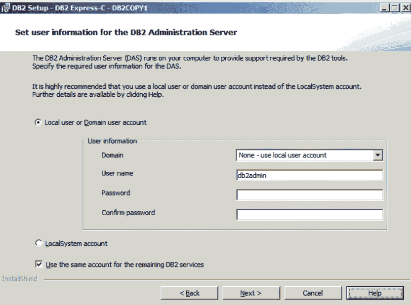

**图 3.4 – 为 DB2 管理服务器指定用户信息**

最后，在图 3.5 中，安装向导显示了将安装内容的摘要，以及之前的步骤中提供的不同配置值。当你点击“完成”按钮时，安装将开始，程序文件将部署到你的系统中。

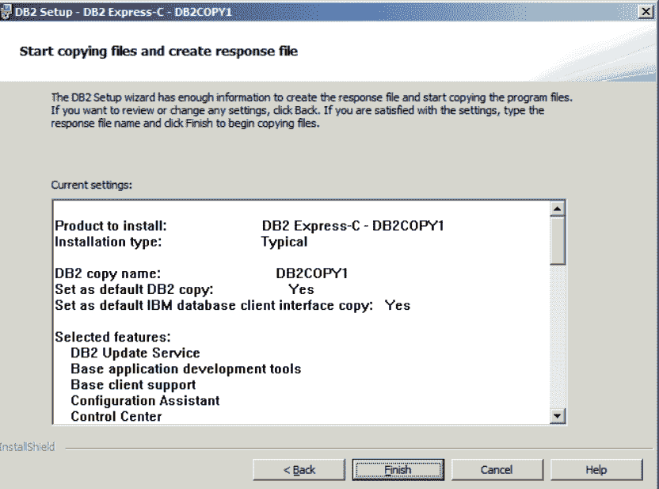

**图 3.5 – 将安装内容的摘要**

安装完成后，将出现一个与图 3.6 相似的窗口，告知你安装向导过程的结果，以及完成安装所需的任何后续步骤。

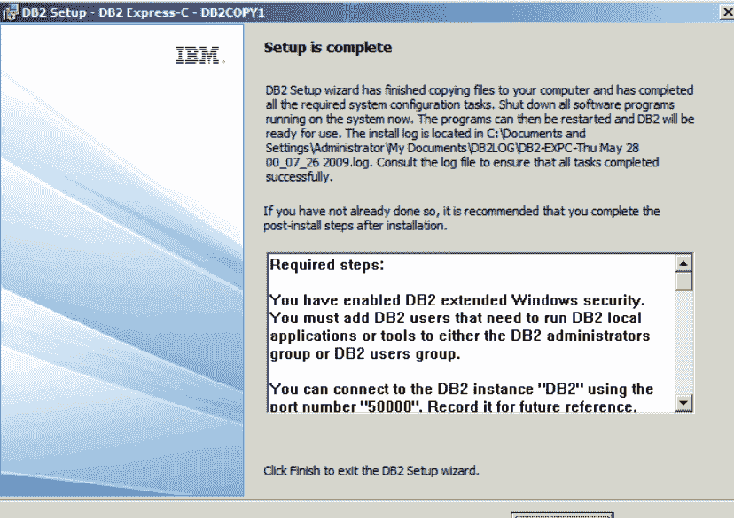

**图 3.6 – 安装完成**

在你点击图 3.6 所示的安装结果窗口中的“完成”后，将启动 DB2 First Steps，如图 3.7 所示。

此小型应用程序概述了开始使用 DB2 的几种不同选项，例如创建默认示例数据库（命名为 `SAMPLE`）或创建一个你自己的数据库。如果你现在不想通过 First Steps 运行 DB2，可以关闭窗口，并在需要时调用它。

- 在 Windows 上手动启动 DB2 First Steps，请选择“开始 -> 程序 -> IBM DB2 -> DB2COPY1 (默认) -> 设置工具”，或从命令提示符运行 `db2fs` 命令。
- 在 Linux 上，从终端执行 `db2fs` 命令。

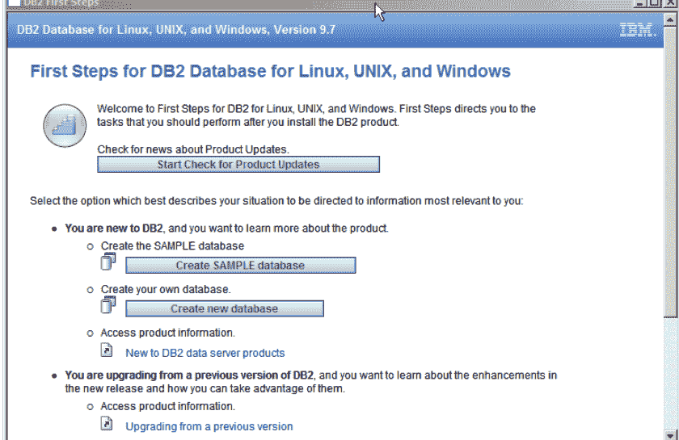

**图 3.7 – First Steps**

选择最能描述你情况的选项，以进入与你更相关的信息：

- **你是 DB2 初手，想了解更多关于该产品的信息。**
  - 创建 SAMPLE 数据库
  - 创建你自己的数据库
  - 创建新数据库
  - 访问产品信息
  - 新接触 DB2 数据服务器产品
- **你正在从之前的 DB2 版本升级，并想了解增强功能以及如何利用这些功能。**
  - 访问产品信息
  - 从之前的版本升级

### 3.4 验证你的安装

安装 DB2 后，你可以从 DB2 命令窗口（在 Windows 或 Linux 上）运行三个命令来验证你的安装状态是否良好：

- `db2level`：此命令显示已安装的 DB2 产品信息、修补包级别和其他细节。
- `db2licm -l`：此命令列出所有针对你安装的 DB2 产品的许可信息。
- `db2val`：这是 DB2 9.7 中的一个新命令。它通过验证你的 DB2 副本的核心功能来验证安装。它确保你的实例是一致的，并确保数据库创建和数据库连接正常。

下面的图 3.8 提供了这三个命令的输出示例。

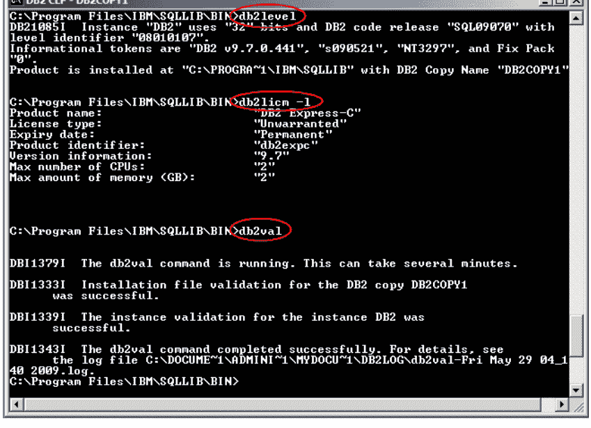

**图 3.8 – 使用 `db2level`、`db2licm` 和 `db2val` 命令验证你的安装**

图中，`db2level` 命令的输出表示你正在运行 DB2 9.7 (DB2 v9.7.0.441)，修补级别为 0，这意味着你的 DB2 代码处于基础 (GA) 水平，未应用任何修补。`db2licm` 命令显示许可信息，`db2val` 命令验证安装。

### 3.5 静默安装

在某些情况下，你需要静默安装 DB2。响应文件是实现此目的的理想方法。响应文件是一个包含安装配置的文本文件。

在 Windows 上生成响应文件使用以下命令：

```
db2rsp -d <directory>
```

在 Windows 上使用响应文件静默安装 DB2，执行：

```
setup -u <filename>
```

在 Linux 上，执行命令：

```
db2setup -r <filename>
```

### 3.6 安装详细步骤补充

- **8. 选择安装（Select installation）**：允许你自定义 DB2 代码安装在系统中的驱动器和目录。确保为安装留足够的空间。本示例使用默认的驱动器和目录设置（如下所示）：
  - 驱动器：`C:`
  - 目录：`C:\Program Files\IBM\SQLLIB`
  点击“下一步”（Next）按钮继续。安装 DB2 Express-C 后，某些 DB2 进程将作为系统服务运行。这些服务需要操作系统账户运行。在 Windows 环境中，建议使用默认的 `db2admin` 用户账户。如果该账户不存在，DB2 会在操作系统为你创建。你也可以指定使用现有账户，该账户必须具有本地管理员权限。我们建议使用建议的默认值。确保为该账户指定密码。在 Linux 上，使用默认的 `db2inst` 用户 ID 作为实例所有者，`db2fenc` 作为围栏用户，以及 `dausr` 作为服务器用户。点击“下一步”继续。

- **9. 配置 DB2 实例（Configure the DB2 instance）**：DB2 实例可以被视为数据库的容器。在创建数据库之前，必须先存在实例。在 Windows 安装期间，会自动创建一个名为 `DB2` 的实例。在 Linux 环境中，默认实例名称为 `db2inst1`。我们将在本书后续部分介绍实例。
  默认情况下，DB2 实例配置为在端口 `50000` 上监听 TCP/IP 连接。可以通过点击“配置”（Configure）按钮来更改默认协议和端口。我们建议在本文示例中使用默认设置。点击“下一步”继续。

- **11. 开始安装（Start the installation）**：检查之前选择的安装摘要选项。点击“完成”（Finish）按钮开始将文件复制到安装位置。DB2 还会执行初始配置过程。

- **12. 第一步（First Steps）**：安装完成后，将显示另一个启动实用程序“第一步”。第一步也可以通过命令 `db2fs` 启动。

- **13. SAMPLE 数据库**：是一个你可以用于测试用途的数据库。你可以从“第一步”通过点击“创建 SAMPLE 数据库”（Create SAMPLE database）来创建它。点击此按钮后，会出现下面的窗口。选择第二个选项（XML 和 SQL 对象与数据）。SAMPLE 数据库也可以使用命令 `db2sample -xml -sql` 创建。

### 3.7 使用 DB2 Express-C：创建 SAMPLE 数据库

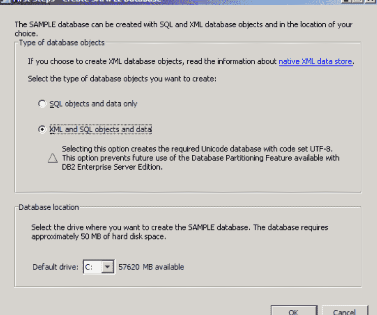

14. 几分钟后，你可以验证数据库是否已创建。启动 DB2 控制工具：开始 -> 程序 -> IBM DB2 -> DB2COPY1 (默认) -> 通用管理工具 -> 控制中心（Control Center）。你也可以通过命令 `db2ca` 启动控制中心。第一次启动控制中心视图，弹出的窗口会要求你选择一个。保留默认的（高级 Advanced），并点击确定。在左侧面板上，展开“所有数据库”（All Databases）文件夹。如果你在该文件夹中看不到 SAMPLE 数据库，请通过选择“视图 -> 刷新”（View -> Refresh）刷新视图。

15. 重启电脑。此步骤是可选的。虽然官方 DB2 安装文档中没有提到，但在 Windows 上，我们建议重启系统（如果可能，至少在 Windows 上），以确保所有进程成功启动并清理任何未被清理的内存资源。

16. 通过运行命令 `db2level` 和 `db2val` 验证你的 DB2 安装。从 Windows 开始菜单，按如下方式打开 DB2 命令窗口：开始 -> 程序 -> IBM DB2 -> DB2COPY1 (默认) -> 命令行工具 -> 命令窗口。在命令行窗口（或 Linux 中的 shell）中输入 `db2level` 并检查输出。命令 `db2licm -l` 也是如此。

- 接下来，发布 `db2val` 命令。如果 `db2val` 成功完成，说明你的安装状态良好！如果有错误，请查看错误消息中指定的日志文件以获取更多详细信息。三个命令的输出应与之前图 3.8 显示所示类似。

## 第 4 章 – DB2 环境

DB2 环境包括不同的数据库对象和配置文件。图 4.1 提供了用于 DB2 的不同命令和工具的概述，并在右侧突出了 DB2 环境。这是本章的重点。图左侧显示了不同的 DB2 命令，SQL、SQL/XML、XQuery 显示了用于与 DB2 服务器交互的不同工具的名称。图中中间显示了用于与 DB2 服务器交互的工具名称。

| DB2 Commands & SQL/XML | DB2 Tools |
|---|---|
| SQL/XML, XQuery Statements | Command Line Tools |
| create bufferpool | Command Editor |
| create tables | Command Line Processor |
| create table | Command Configuration |
| alter bufferpool | General Administration Tools |
| alter tables | Control Center |
| alter table | License Center |
| select | Backup Center |
| insert | Task Center |
| update | Information |
| delete | Check DB2 Updates |
| DB2 Systems Commands | Monitoring Tools |
| db2set | Event Analyzer |
| db2inst | Health Center |
| db2drop | Transaction Manager |
| db2list | Memory Visualizer |
| db2drop | Active Monitor |
| DB2 CLP Commands | Setup Tools |
| db2 update | Configuration Assistant |
| catalog db | First Steps |
| list db | Default Wizard |
| create db | Configuration Provider |
| list tables | DB2 Selection |


要创建一个新实例，使用命令 `db2icrt <instance name>`，其中 `<instance name>` 替换为任何字符名称。例如，要创建实例 `myinst`，我们使用此命令：`db2icrt myinst`。

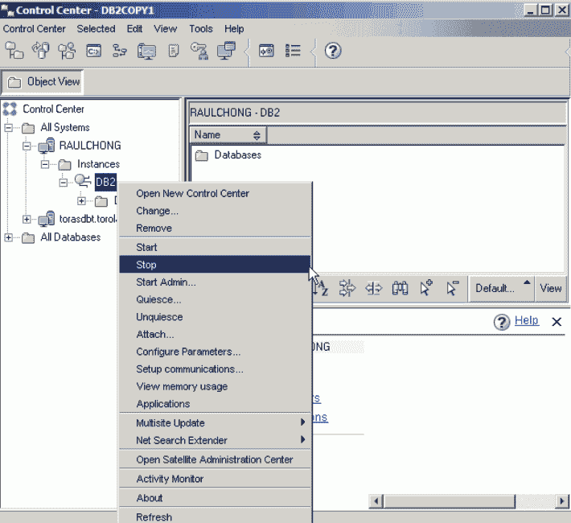

**图 4.5 – 来自控制中心的实例命令**

要在活动实例中创建数据库，请在 DB2 命令行窗口使用此命令：

```
db2 create database mydbbl
```

要列出所有数据库，请运行命令：

```
db2 list db directory
```

在任何一个实例中，你都可以创建多个数据库。数据库是表、视图、索引等对象的集合。数据库是独立的单元，因此不会与其他数据库共享对象。图 4.6 显示了在实例 `DB2` 内部创建的数据库 `MYDB1` 的表示。

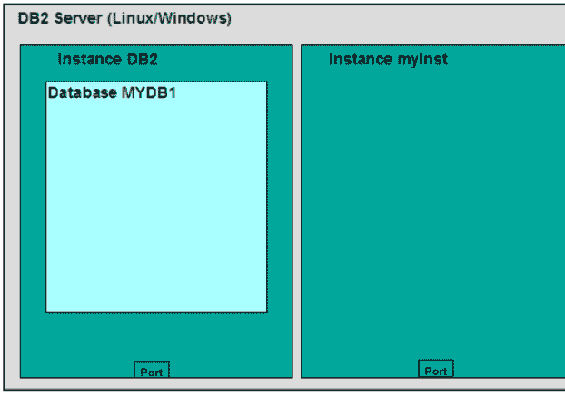

**图 4.6 – 在实例 DB2 中创建的数据库 MYDB1**

表 4.2 显示了你可以在数据库级别使用的一些命令。

| 命令/SQL 语句 | 说明 |
|---|---|
| `db2 create database` | 创建新数据库 |
| `db2 drop database` | 移除数据库 |
| `db2 connect to <database_name>` | 连接到数据库 |
| `db2 create table/view/create index` | 分别创建表、视图和索引的 SQL 语句 |


# 表 4.2 - 数据库级别的命令/SQL 语句

如果我们想在实例 `myinst` 中创建一个具有相同名称（MYDB1）的另一个数据库，则将在 DB2 命令行窗口中发出以下命令：

```
db2 list db directory
set db2instance=myinst
db2 create database mydb1
set db2instance=db2
```

图 4.7 显示了在实例 `myinst` 中创建的新数据库 MYDB1。

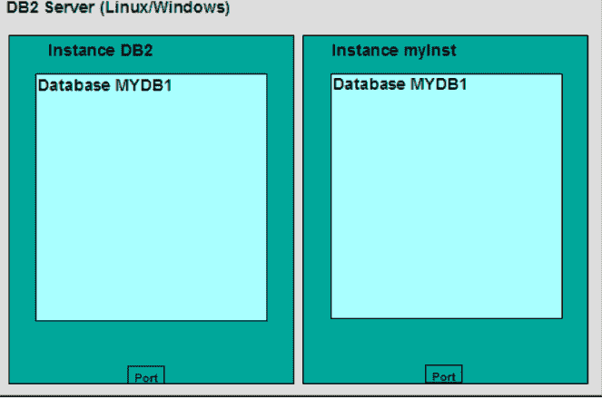

**图 4.7 – 在实例 myInst 中创建的数据库 MYDB1**

当创建数据库时，默认会创建几个对象：表空间、表、缓冲池和日志文件。创建这些对象需要一些时间，这就是为什么 `create database` 命令需要几分钟来处理。图 4.8 显示了图中左侧默认创建的三个表空间。表空间将在*第 6 章《DB2 架构》中进行详细讨论，但目前，请将表空间视为逻辑表与物理资源（如磁盘和内存）之间的逻辑层。

## DB2 服务器 (Linux/Windows)

| 实例 DB2 | 实例 myInst |
|---|---|
| 数据库 MYDB1 | 数据库 MYDB1 |
| SYSCATSPACE | |
| TEMPSP1 | |
| USERSPACE1 | |

**图 4.8** 创建数据库时默认创建的表空间

表空间 `SYSCATSPACE` 包含系统目录表。系统目录基本上是其他关系管理系统中的数据字典。它包含了不应修改或删除的系统信息；否则数据库将无法正常工作。当 DB2 需要额外的空间来执行排序等操作时，会使用表空间 `TEMP`。如果在创建表时没有指定空间，则使用表空间 `USERSPACE1` 来存储数据库表。

你还可以使用 `CREATE TABLESPACE` 语句创建自己的表。**图 4.9** 显示了在实例 DB2 数据库 MYDB1 内部创建的表 `MYTBS1`。当你创建表时，指定要使用的磁盘和内存（缓冲池）。因此，如果你有一个“热点”表（即被频繁使用的表），你可以通过分配具有这些特性的表空间来分配最快的磁盘和最多的内存。

在图 4.9 中，我们展示了默认创建的两个对象：缓冲池 `IBMDEFAULTP` 和日志文件。

缓冲池基本上是数据库使用的内存缓存。你可以创建一个或多个缓冲池，但应始终有一个页面大小与现有表页面大小匹配的缓冲池。页面和页面大小将在第 6 章《DB2 架构》中详细讨论。

日志文件用于恢复。当你操作数据库时，不仅是存储在磁盘上的数据库信息，而且在你操作数据库期间，日志文件会存储执行在数据上的所有操作。将日志视为执行“自动保存”操作的临时文件。日志将在第 11 章《备份与恢复》中详细讨论。

## DB2 服务器 (Linux/Windows)

| 实例 DB2 | 实例 myinst |
|---|---|
| 数据库 MYDB1 | 数据库 MYDB1 |
| SYSCATSPACE | |
| TEMPSPACE | |
| USERSPACE1 | |
| mytbis1 | |
| IBMDEFAULTSPBP | |
| LOG5 | |
| Part | Part |

图 4.9 – 默认创建的缓冲池和日志

早些我们讨论过实例是独立的环境，因此可以在多个实例中创建同名的数据库。就像实例一样，数据库也是独立的单元；因此，一个数据库中的对象与另一个数据库中的对象没有关系。图 4.10 显示了在实例 DB2 内部的 MYDB1 数据库和 SAMPLE 数据库中相同的表空间 `mytbis1`。这是有效的，因为数据库是独立的单元。注意，由于图中空间限制，图 4.10 没有显示 SAMPLE 数据库的其他默认对象。

## DB2 服务器 (Linux/Windows)

| 实例 DB2 | 实例 myinst |
|---|---|
| 数据库 MYDB1 | 数据库 MYDB1 |
| SYSCATSPACE | |
| TEMPSPACE | |
| USERSPACE1 | |
| mytbis1 | |
| IBMDEFAULTSPBP | |
| LOG5 | |
| 数据库 SAMPLE | |
| mytbis1 | |
| Part | Part |

图 4.10 – 不同数据库中同名的表空间。

一旦创建了表空间，就可以在表空间内创建对象，如表、视图和索引。如图 4.11 所示。

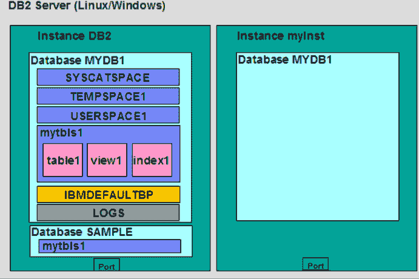

图 4.11 – 在表空间内创建的表、视图、索引

# 4.1 DB2 配置

可以使用配置顾问（Configuration Advisor Tool）配置 DB2 参数。要通过控制中心访问配置顾问，右键点击数据库并选择 `Configuration Advisor`。根据你对有关系统资源和工作负载的一些问题的回答，配置顾问将提供一个应更改的 DB2 参数列表，并为每个参数提供建议值。如果你想了解更多关于 DB2 配置的细节，请继续阅读；否则，使用配置顾问即可开始与 DB2 一工作！

DB2 服务器可以在四个不同的级别进行配置：

- 环境变量
- 数据库管理器配置文件 (`dbm cfg`)
- 数据库配置文件 (`db cfg`)
- DB2 注册表

这在*图 4.12*所示。在图中，注意每个框的位置。例如，环境变量设置在服务器的操作系统级别，而数据库管理器配置文件参数设置在实例级别。数据库配置设置在数据库级别，而 DB2 注册表设置在操作系统或实例级别。

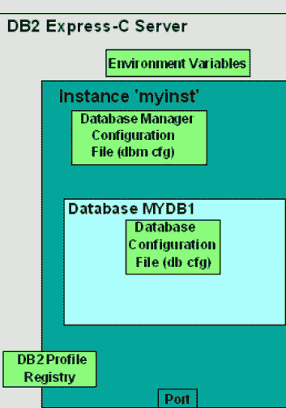

图 4.12 – DB2 配置

### 4.1.1 环境变量

设置在操作系统级别。一个关键环境变量是 `DB2INSTANCE`。该变量指示你正在操作的活动实例，你的 DB2 命令适用于它。例如，要在 Windows 中将活动实例设置为 `myinst`，你可以运行此操作系统命令：

```
set db2instance=myinst
```

### 4.1.2 数据库管理器配置文件 (dbm cfg)

数据库管理器配置文件 (`dbm cfg`) 包含了影响实例及其包含的所有数据库的参数。可以使用命令行或通过 DB2 控制中心查看或修改数据库管理器配置文件。

要从控制中心处理 `dbm cfg`，请选择控制中心实例文件夹中的实例对象，右键点击显示弹出菜单并选择“配置参数”（Configure Parameters）。如图 4.13 所示。

选择配置参数后，将显示图 4.14 所示的屏幕，其中包含 `dbm cfg` 参数列表。

# 第 4 章 – DB2 环境 71

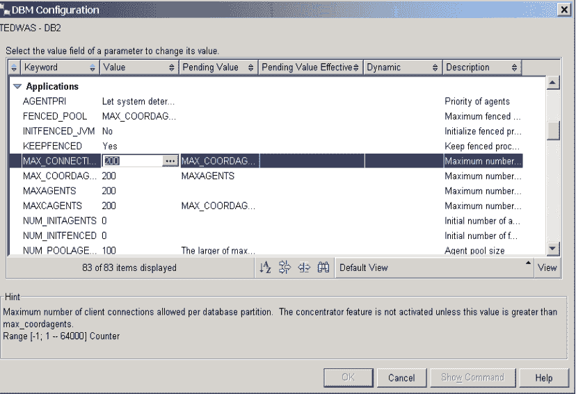

TES - DB2

选择参数的值字段以更改其值。

| 关键字 | 待定值 | 待定值生效 | 动态 | 描述 |
| :--- | :--- | :--- | :--- | :--- |
| Applications (应用程序) | | | | |
| AGENTPRI | 让系统阻止... | | | 代理优先级 |
| FENCED_POOL | MAX_COORD... | | | 最大隔离池... |
| INTENCED_VM | | | | 初始化隔离的... |
| KEEPFENCED | | | | 保留隔离的进程... |
| MAX_COORD | Yes | MAX_COORD... | | | 最大数量 |
| MAX_COORD... 200 | | | | 最大数量... |
| MAXAGENTS 200 | | | | 最大数量... |
| MAXAGENTS 200 | | | | 最大数量... |
| NUM_INTENCED 0 | | | | 隔离的初始数量 |
| NUM_INTENCED 0 | | | | 初始数量... |
| NUM_POOLAGE 100 | 显示的 max：83 个 83 项中的较大者 | | | |

提示每个数据库分区允许的最大客户端连接数。除非此值大于 `max_coordagents`，否则不会激活汇集器。范围 [-1, -64000] 计数器

确定 取消 显示 帮助

图 4.14–dbm 动态意味着更改立即生效；然而，许多参数的动态意味着更改立即生效；然而但是，对某些参数的更改可能需要停止并启动实例。从命令行，可以使用 `db2stop` 和 `db2start` 命令完成。

在停止实例之前，所有实例都必须断开连接。如果您希望强制停止实例，可以使用 `db2stop force` 命令。

还可以通过控制中心（Control Center）点击实例对象并选择“停止”或“启动”来停止实例。从命令行。

| 命令 | 描述 |
| :--- | :--- |
| `db2 get dbm cfg` | 获取关于 `dbm cfg` 的信息 |
| `db2 update dbm cfg using <parameter_name> <value>` | 更新 `dbm cfg` 参数的值 |

表 4.3 - 操纵 `dbm cfg` 的命令

### 4.1.3 数据库配置文件 (db cfg)

数据库配置文件 (`db cfg`) 包含了影响特定数据库的参数。可以使用命令行，或通过 DB2 控制中心查看或修改数据库配置文件。

要从控制中心处理 `db cfg`，请从控制中心的数据库文件夹中选择数据库对象，右键单击显示弹出菜单，并选择“配置参数”（Configuration Parameters）。如图 4.15 所示。

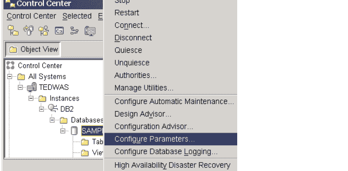

图 4.15 – 从控制中心高亮显示 `db cfg`。

选择“配置参数”后，将显示图 4.16 所示的屏幕，其中列出了 `db cfg` 参数列表。

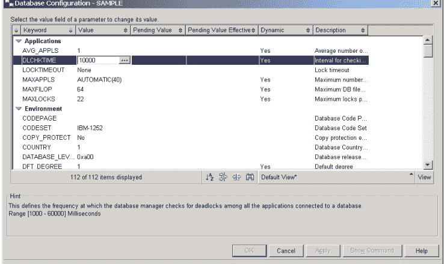

图 4.16 – `db cfg`

表 4.4 显示了某些从命令行管理 `db cfg` 的实用命令。

| 命令 | 描述 |
|---|---|
| `get db cfg for <database_name>` | 获取有关给定数据库的 `db cfg` 信息 |
| `update db cfg for <database_name> using <parameter_name> <value>` | 更新 `db cfg` 参数的值 |

表 4.4 - 操纵 `db cfg` 的命令

### 4.1.4 DB2 配置文件注册表

DB2 配置文件注册表变量包含了可能特定于平台并在全局设置（影响所有实例）或实例级别设置（影响一个特定实例）的参数。

表 4.5 显示了某些操纵 DB2 配置文件注册表的实用命令。

| 命令 | 描述 |
|---|---|
| `db2set -all` | 列出当前设置的所有 DB2 配置文件注册表变量 |
| `db2set -lr` | 列出所有 DB2 配置文件注册表变量 |
| `db2set <parameter>=<value>` | 为给定值分配参数 |

表 4.5 - 操纵 DB2 配置文件注册表的命令

表 4.6 显示了一些最常用的 DB2 注册表变量

| 注册表变量 | 描述 |
|---|---|
| `DB2COMM` | 指定在数据库管理器启动时启动的通信管理器。 |
| `DB2_EXTSECURITY` | 在 Windows 上，通过锁定 DB2 系统文件防止未经授权访问 DB2 |
| `DB2_COPY_NAME` | 存储当前使用的 DB2 副本名称。要切换到安装的另一个 DB2 副本，请运行 `installpath\bin\db2envar.bat` 命令。此变量无法用于此。 |

表 4.6 - 常用的 DB2 配置文件注册表变量

例如，要允许使用 TCPIP 进行通信，将 `DB2COMM` 注册表变量设置为 `TCPIP`，所示：

```
db2set db2comm=tcpip
```

## 4.2 DB2 管理服务器 (DAS)

DB2 管理服务器 (DAS) 是一个运行的守护进程，允许客户端管理服务器。在本地或远程都需要 DAS，如图 4.16 所示。

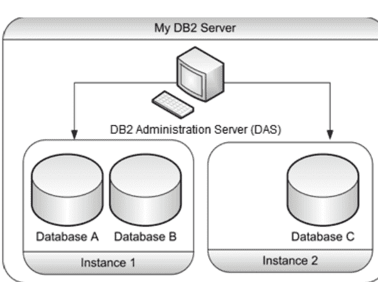

图 4.16–DAS

## 4.3 总结

在本章中，我们探索了 DB2 环境，包括实例、数据库和配置参数。我们查看了数据库配置文件 (`db cfg`) 和配置文件注册表。最后，我们讨论了 DAS 以及管理它们的命令。

## 4.4 练习题

本节的练习题将允许您探索本章中介绍的概念。

### 部分 1：使用控制中心创建数据库

在此部分中，您将使用控制中心创建数据库。

步骤

1. 通过选择开始 -> 程序 -> IBM DB2 -> 命令行工具 -> 命令窗口打开 DB2 命令窗口。另一种快捷方法是选择开始 -> ，输入 `db2cmd`。

2. 从控制中心，右键单击数据库文件夹并选择“创建数据库”。

3. 在向导的名称页，指定以下值：

   - 数据库名称：`testdb`
   - 默认驱动器 (Windows)：`C:`
   - 默认路径 (Linux)：`/home/db2`
   - 别名：`EXPRESS`
   - 注释：可选

4. 在存储页，不进行任何更改，并点击“下一步”。

5. 在维护页，指定离机维护窗口。配置窗口从周一至周四凌晨 1 点开始，持续 6 小时。点击“下一步”。

6. 在邮件服务器页，配置通知。如果检测到问题或健康状况，DB2 可以自动通知某人或发送电子邮件。如果您想选择此项，请指定 DB2 使用的 SMTP 服务器。对于本次练习我们没有 SMTP 服务器，请留空并点击“下一步”。

7. 在向导的摘要页上检查选择的选项。点击完成开始创建过程。数据库创建通常几分钟。

### 部分 2：处理实例、数据库和配置

在此部分中，您将在 Windows 上创建一个新实例、数据库并更改配置参数。

步骤

1. 从 DB2 命令窗口创建一个名为 `newwininst` 的新实例

```
db2icrt newwininst
```

2. 切换到 `newwininst` 实例并验证它确实是您的当前实例。然后启动它。

```
set db2instance=newwininst
db2 get instance
db2start
```

3. 在实例 `newwininst` 中默认值创建数据库 `newwindb`。这需要几分钟，因为 DB2 在数据库中创建内部对象并提供初始配置。

```
db2 create database newwindb
```

4. 连接并断开新数据库 `newwindb`。删除它。

```
db2 connect to newwindb
db2 terminate
db2 drop db newwindb
```

5. 停止当前实例 `newinst`

```
db2stop
```

6. 列出服务器中的所有实例

```
db2ilist
```

7. 切换到 DB2 实例并验证你是否已成功切换

```
set db2instance=db2
db2 get instance
```

8. 删除实例 `newinst`

```
db2idrop newinst
```

9. 查找 `dbm cfg` 参数 `FEDATED` 的当前值。它的默认值应该是 `NO`。

```
db2 get dbm cfg
```

> 提示：在 Linux 中，你可以执行：`db2 get dbm cfg | grep FEDATED`

10. 将 `dbm cfg` 参数 `FEDERATED` 的值改为 `YES` 并验证更改已生效。

```
db2 update dbm cfg using FEDERATED YES
```

由于 `FEDERATED` 不是一个动态参数，在停止并重启实例之前，更改将不会生效。然而，要停止实例，你必须确保没有活动连接。确保此点的的一种方法是执行以下命令：

```
db2 force applications all
db2 terminate
```

重启实例，并验证 `FEDERATED` 的新值：

```
db2stop
db2start
db2 get dbm cfg
```

11. 使用你在操作系统上使用的 `userID` 和密码连接到 `SAMPLE` 数据库

```
db2 connect to sample user <userID> using <password>
```

12. 查看当前实例中运行了多少应用程序。

```
db2 list applications
```

13. 打开另一个 DB2 命令窗口，并在不指定 `userID` 和密码的情况下再次连接到 `SAMPLE` 数据库。然后查看你现在有多少个连接。

```
db2 connect to sample
db2 list applications
```

14. 从其中一个 DB2 命令窗口强制断开连接。这提供了一个 DBA 如何强制终止特定用户（可能正在占用系统资源）作业的示例。

```
db2 force application <db2bp.exe 的应用程序句柄>
```

应用程序是你想要强制终止的应用程序的数字或“句柄”（`handle`）。你可以通过 `db2 list applications` 命令的输出获取该信息。应用程序 `db2bp.exe` 代表 DB2 命令窗口。

15. 验证其中一个 DB2 命令窗口的连接已被强制断开。如果你不知道哪一个 DB2 命令窗口被强制断开了，请在两个窗口上都执行此语句。

```
db2 select * from staff
```

被强制断开的 DB2 命令窗口应返回代码为 `SQL1224N` 的错误消息。另一个 DB2 命令窗口应为你返回查询的输出。

16. 删除并重建 DAS，然后启动它。

```
db2admin stop
db2admin drop
db2admin create
db2admin start
```


- 18. 查看注册表值 `DB2COMM` 的当前值。

```
db2set -all
```

- 19. 取消 `DB2COMM` 变量并验证操作已完成。

```
db2set db2comm=
db2stop
```

（提示：如果你有连接，执行 `db2stop` 时会报错。该怎么办？请参考之前的步骤来解决此问题）

```
db2start
db2set -all
```

- 20. 在你的实例中将 DB2 注册变量 `DB2COMM` 设置为 `tcpip` 和 `npipe`，并验证新值。

```
db2set db2comm=tcpip,npipe
db2stop
db2start
db2set -all
```

- 21. 检查 `LOGSECOND` db cfg 参数的当前值，将其改为 5 并验证新值。

```
db2 connect to sample
db2 get db cfg
db2 update db cfg using LOGSECOND 5
db2 get db cfg
```

# 第 5 章 – DB2 工具

在本章中，我们将描述一些你可以配合 DB2 使用的工具。从 DB2 9.7 开始，本章描述的大多数工具现在已弃用，因此它们仍然受到支持但不再进行增强，并且在未来的发布中可能不再包含在产品中。

图 5.1 中的红圈显示了本章的重点。

## DB2 命令与 SQL/XML 查询语句

- `create bufferpool`
- `create tablespace`
- `create table`
- `alter bufferpool`
- `alter tablespace`
- `alter table`
- `select`
- `insert`
- `update`
- `delete`

## DB2 系统命令

- `db2set`
- `db2start`
- `db2stop`
- `db2list`
- `db2icrt`
- `db2ndrop`

## DB2 CLP 命令

- `update db2cm`
- `catalog db2`
- `list node directory`
- `create database`
- `list applications`
- `list tablespaces`

```
<sql statement>
xquery <
```

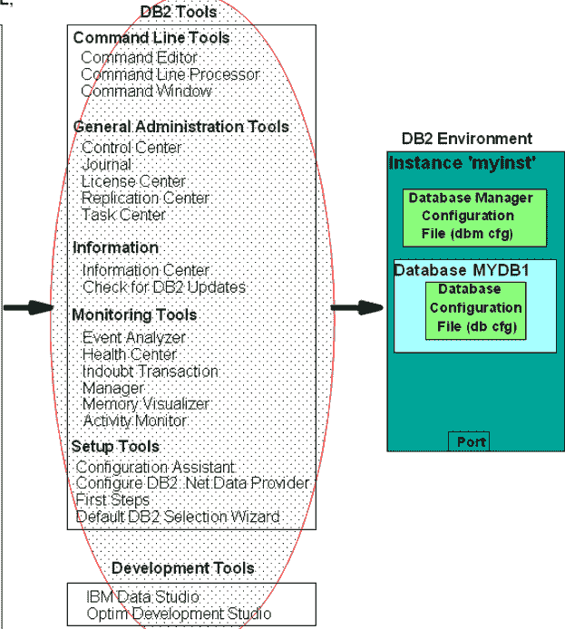

## 82 DB2 Express-C 入门指南

# 图 5.1 – DB2 全景图：DB2 工具

> 注意：关于 DB2 工具和脚本的视频演示请见这些链接：http://www.channeldb2.com/video/video/show?id=807741:Video:4202 http://www.channeldb2.com/video/video/show?id=807741

## 5.2 控制中心（已弃用）

Prior to DB2 9.7, the primary DB2 tool for database administration was the Control Center, as illustrated in Figure 5.4.

The Control Center is a centralized administration tool that allows you to:

- View your systems, instances, databases and database objects;
- Create, modify and manage databases and database objects;
- Launch other DB2 tools

The panel on the left side provides a visual hierarchy for the database objects on your system(s), providing a "folder" for Tables, Views, etc. When you double-click a folder (for the related objects, as shown in 5.4), the panel on the top right will list all the related objects, in this case, all the tables associated with the SAMPLE database. If you select a given table in the top right, the bottom right provides more specific information about that table.

Right clicking on the different folders or objects in the Object tree menus applicable to the given folder or object. For example, right-clicking on an instance and choosing Configure parameters would allow you to view and update the database manager configuration file. Similarly, if you right-click on a database and choose Configure parameters, the DB2 environment and configuration parameters are discussed in more detail in Chapter 5, *The DB2 Environment*.

当你第一次启动控制中心（Control Center）时，系统会要求你选择想要使用的视图。视图的选择决定了显示哪些类型的选项和数据库对象。图 5.5 显示了控制中心视图对话框。

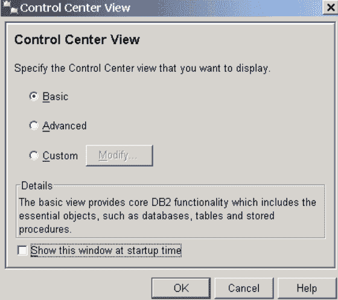

图 5.5 - DB2 控制中心视图对话框

基础视图（basic view）提供核心 DB2 功能，高级视图（advanced view）显示更多的选项和功能。自定义视图（custom view）允许你自定义所看到的特定功能、选项和对象。

要再次调用控制中心视图对话框，请如图 5.6 所示，选择 Tools（工具）-> Customize Control Center（自定义控制中心）。

## 第 5 章 – DB2 工具

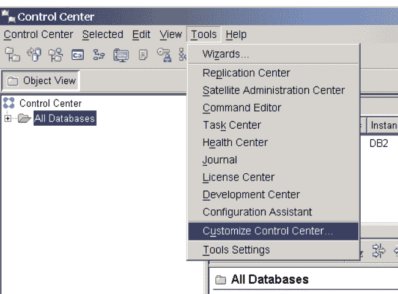

图 5.6 – 自定义控制中心

### 5.2.1 启动控制中心

有多种方法启动控制中心：

- 通过 Windows 开始菜单导航
- 在命令提示符中执行 `db2ce`
- 点击任何其他 DB2 GUI 工具工具栏上的控制中心图标
- 从 Windows 系统托中的 DB2 图标启动，如图 5.7 所示（右键点击 DB2 绿色图标并选择 DB2 Control Center 菜单选项）

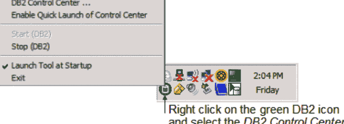

右键点击绿色 DB2 图标并选择 DB2 Control Center 菜单选项

图 5.7 – 从 Windows 系统托启动 DB2 控制中心

## 5.3 命令编辑器（已弃用）

使用 DB2 命令编辑器（Command Editor），你可以执行 DB2 命令、SQL 和 XQuery 语句，分析语句的执行计划，并查看或更新查询结果集。图 5.8 显示了命令编辑器及其元素说明。

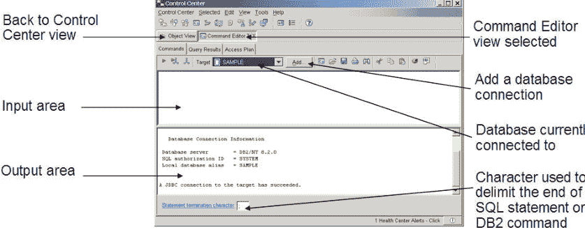

图 5.8 – DB2 命令编辑器

在该区域你可以输入多个语句，因此每个语句仅需以终止符结尾。如果你按下执行按钮（图 5.9 左侧第一个按钮），或显式地高亮特定语句，则只会执行被高亮的语句。然而，为了执行任何 SQL 语句，必须存在数据库连接，但其中一个语句可以是连接语句（connect statement）。

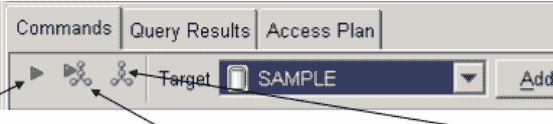

图 5.9 – 命令编辑器 – 命令选项卡

### 5.3.1 启动命令编辑器

你可以通过几种方式启动命令编辑器：

- 从 Windows 开始菜单：开始 -> 程序 -> IBM DB2 -> DB2COPY1 (默认) -> 命令行工具 -> 命令编辑器
- 从命令提示符中，输入 `db2ce`
- 从控制中心中的 Tools（工具）菜单
- 嵌入在控制中心内
    - 在控制中心的对象树（Object Tree）面板中右键点击 SAMPLE 数据库图标并选择 Query（查询）菜单项
    - 当选中任何可对象（数据库、表等）时，可以通过点击控制中心详情面板（Detail pane）中的 Query 链接启动命令编辑器
- 从控制中心，点击工具栏上的命令编辑器图标，如图 5.10 所示


图 5.10 – 控制中心中的命令编辑器

### 5.3.2 添加数据库连接

要连接数据库，点击 Add（添加）按钮（见图 5.8）。将出现如图 5.11 所示的对话框。

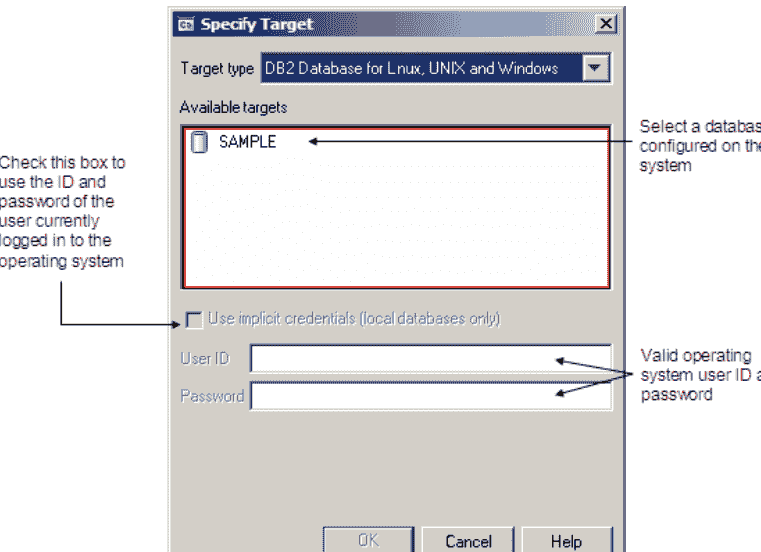

图 5.11 – 添加数据库连接

## 5.4 SQL 辅助向导（已弃用）

如果你不熟悉 SQL 语言并希望使用助手或向导来生成 SQL 代码，可以使用命令编辑器中的 SQL 辅助向导（SQL Assist Wizard）来帮助。如图 5.12 所示，你通过点击带有 SQL 符号的最后一个图标来调用它。该图标只有在你连接到数据库后才会出现。

SQL 辅助向导也可以从 Selected（已选）菜单项启动。

SQL 辅助图标

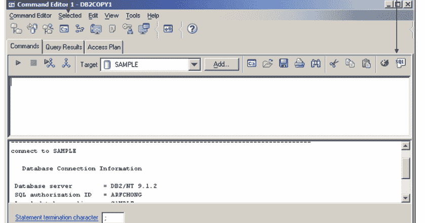

图 5.12 – 调用 SQL 辅助向导

图 5.13 显示了 SQL 辅助向导。它的使用非常直观。首先指明你需要帮助的 SQL 语句类型（SELECT、INSERT、DELETE）。根据你选择的语句，将出现不同的选项。

窗口底部是构造的。

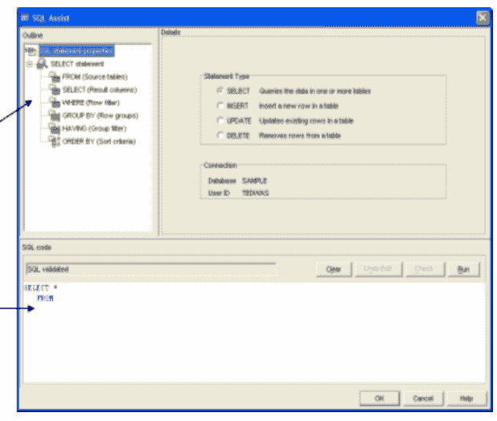

图 5.13 – SQL 向导

## 5.5 SQL 按钮（已弃用）

DB2 GUI 工具为 DBA 提供在线形式的活动日志。图 5.18 显示了日志，表 5.2 显示了你可以从日志中获得的信息。

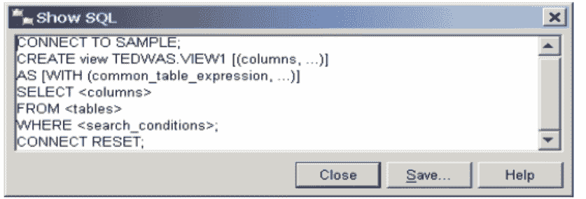

图 5.14 – 日志

## 5.6 任务中心（已弃用）

任务中心（Task Center）允许你调度任务。例如，如果任务在早上 3:00 失败或成功，可以发送邮件给 DBA。图 5.16 显示了任务中心。

表 5.2 - 日志中提供的信息

### 5.7.1 启动日志

你可以通过点击控制中心（Control Center）中的“工具 (Tools) -> 日志 (Journal)”来启动日志，如图 5.19 所示。或者，你也可以从 Windows 开始菜单启动此工具：开始 -> 程序 -> IBM DB2 -> DB2COPY1(默认) -> 通用管理工具 -> 日志 (Journal)。

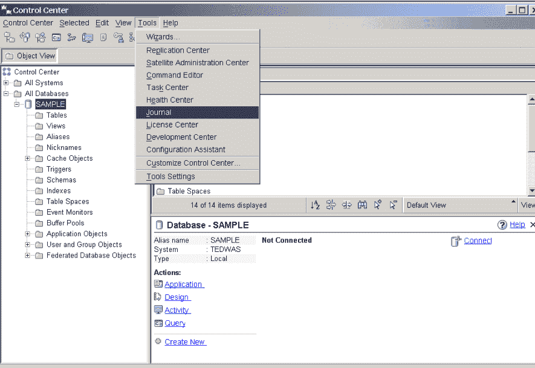

图 5.19 – 启动日志

## 5.8 健康监控器（已弃用）

健康监控器（Health Monitor）是一个运行在 DB2 引擎内部的默认代理，负责监控数据库健康的所有方面（内存、空间管理、之前定义的自动化活动等）。当 DB2 的某些部分在设定的参数之外运行时，将抛出异常并通知 DBA。警报状态有三种：

- 注意（Attention）：非正常状态
- 警告（Warning）：非关键状态，不需要立即处理，但可能表明系统未达到优化
- 警报（Alarm）：需要立即采取行动的严重状况

可以使用数据库管理器配置参数 `HEALTH_MON` 开启或关闭健康监控器。

### 5.8.1 健康中心（已弃用）

健康中心（Health Center）是一个与健康监控器交互的图形化工具。健康中心将系统实例、数据库和表空间层面的健康警报细分。图 5.20 显示了健康中心。

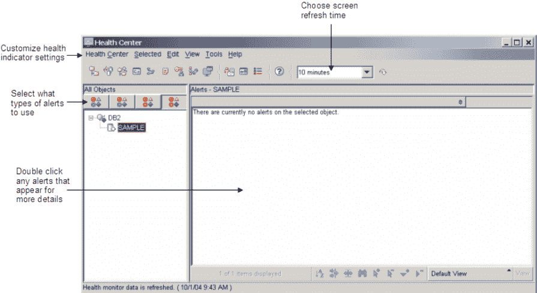

图 5.20 – 健康中心

### 5.8.1 启动健康中心


你可以通过选择控制中心中的“工具 (Tools) -> 健康中心 (Health Center)”来启动健康中心。如图 5.21所示。你也可以从“开始 -> 程序 -> IBM DB2 -> DB2COPY1(默认) -> 监控工具 -> 健康中心”启动此工具。

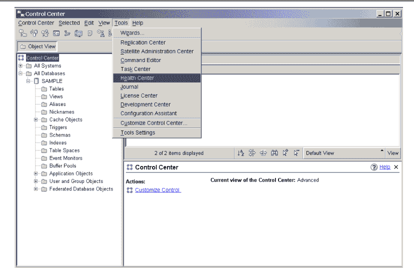

图 5.21 – 启动健康中心通知

### 5.8.1.2 配置健康警报通知

一旦启动健康中心，你就可以点击健康中心菜单 -> 配置 (Configure) -> 警报通知 (Alert Notification) 来配置警报通知，如图 5.22 所示。警报通知允许你输入在触发警报时将联系的人员姓名、电子邮件地址或呼机器号码。

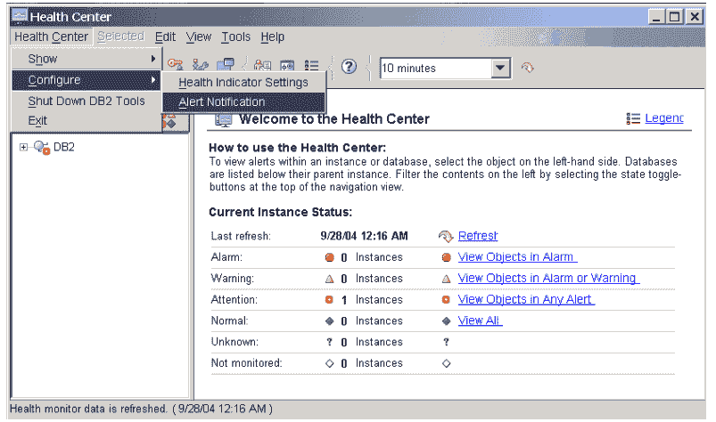

图 5.22 – 警报通知

## 5.9 自调优内存管理器

DB2 9 引入的自调优内存管理器（STMM）是多个自主功能之一，它通过自动为多个内存配置参数设置值，简化了内存配置的任务。启用后，自主调优器会在数据库的多个内存消耗者之间动态分配可用内存资源。内存调优器会响应工作负载特征的变化，调整内存配置参数的值和缓冲池的大小以优化性能。要开启 STMM，请将 db cfg 中的 `SELF_TUNING_MEM` 更新为 `ON`。

其他自主计算功能（如自动维护和存储）将在本书的其他部分进行讨论。

## 5.10 脚本

创建反复执行多个 DB2 命令或 SQL 语句的脚本总是很有用的。例如，DBA 可能希望每天运行一个脚本来检查重要表的行数。脚本通常有两种通用形式：

-   SQL 脚本
-   操作系统（shell）脚本。

### 5.10.1 SQL 脚本

SQL 脚本包含查询语句和数据库命令。这些脚本相对容易理解且与平台无关。然而，它们不支持变量或参数。例如，下文*列表 5.1* 所示的命令被保存在一个名为 `script1.db2` 的文件中。

```
CONNECT TO EXPRESS;
CREATE TABLE user1.myfile
  col1 INTEGER NOT NULL,
  col2 VARCHAR(40),
  col3 DECIMAL(9,2));
SELECT * FROM user1.myfile FETCH FIRST 10 ROWS ONLY;
COMMIT;
```

**列表 5.1 - 存储在文件 script1.db2 中的示例 SQL 脚本**

在上述脚本中，所有语句都是 SQL 语句，每个语句都由语句分隔符分隔（在本例中为分号）。文件名不需要使用“db2”扩展名，可以使用任何扩展。

### 5.10.2 执行 SQL 脚本

SQL 脚本可以在 Windows 上的命令编辑器或 DB2 命令窗口中执行，也可以通过 Linux shell 执行。若要在 DB2 命令窗口或 Linux shell 中运行*列表 5.1* 中的脚本，可以使用以下命令：

```
db2 -t -v -f script1.db2 -z script1.log
```

或者等效的命令：

```
db2 -tvf script1.db2 -z script1.log
```

在该命令中：

-   `t` 表示语句使用默认终止符（分号）
-   `v` 表示详细模式；导致 db2 回显正在执行的命令
-   `f` 表示该标志之后指定的文件是脚本文件
-   `z` 表示该标志之后指定的文件用于追加输出以供后续分析

## 步骤

1.  在 EXPRESS 数据库中填充一些表和数据。为了方便起见，我们创建了两个脚本：`Lab_Chpt5.db` 和 `Lab_Chpt5.dat` 来为你完成此操作。`Lab_Chpt5.db` 脚本包含创建表的命令，因此必须首先运行。`Lab_Chpt5.dat` 脚本包含向表中插入数据的语句。这两个脚本都可以在随书 `express_book_exercises_9.zip` 文件中找到。请使用命令行编辑器（Command Editor）运行这些脚本。确保你创建的新数据库位于工具栏的下拉列表中。如果列表中没有出现新数据库，请使用 `Add` 按钮为其添加连接。

2.  点击命令行编辑器上的 `Selected -> Open` 菜单，并找到存储脚本的文件夹。选择 `Lab_Chpt5.db` 文件并点击 OK 按钮。文件内容应显示在命令行编辑器的输入区域。点击 Run 按钮运行脚本。如果运行脚本时没有遇到任何错误。

3.  对 `Lab_Chpt5.dat` 文件重复步骤 (2)。

你创建的数据库用于一个非常简单的网上书店。`BOOKS` 表包含所有所售书籍的所有信息。`CUSTOMERS` 表包含商店所有客户的信息。最后，`SALES` 表包含销售数据。每当客户购买一本书时，`SALES` 表中就会创建一个记录。下面的图显示了表之间的设计和关系。

| BOOKS 表 |
| :--- |
| book_id | title | cost | image |
| :--- | :--- | :--- | :--- |
| (INTEGER) | (INTEGER) | DECIMAL(7,2) | BLOB (1MB) |

| CUSTOMERS 表 |
| :--- |
| cust_id | firstname | lastname | address | email |
| :--- | :--- | :--- | :--- | :--- |
| (INTEGER) | VARCHAR | VARCHAR(100) | VARCHAR(300) | VARCHAR(100) |

| SALES 表 |
| :--- |
| sales_id | prod_id | cust_id | qty | price | purch_date |
| :--- | :--- | :--- | :--- | :--- | :--- |
| (INTEGER) | (INTEGER) | (INTEGER) | (INTEGER) | DECIMAL(7,2) | TIMESTAMP |

## 第二部分：为 EXPRESS 数据库创建安装脚本

脚本是执行重复性任务（如数据库统计收集、备份和数据库部署）的强大机制。操作系统脚本的优势是支持脚本参数，使其更加灵活。在这一部分中，你将创建一个操作系统脚本，将 EXPRESS 数据库重新部署为 EXPRESS2 数据库。该脚本将调用之前生成的数据库对象 SQL 脚本。为了节省空间，本练习显示了指定 Windows 平台的脚本和命令。如果你倾向于在 Linux 上工作，请确保对下面的说明进行相应的修改。

## 步骤

1.  打开文本编辑器并输入所示信息。大多数人在输入以下行内容时会发生拼写错误。我们**故意**不将其作为单独的文件，这样你就会产生这些错误并学会自己修复它们！

同时注意，你可能需要为 `schema.ddl`、`triggers.dll` 和 `app_objects.dll` 文件指定正确的路径，这些文件也随书的 `express_db_exercises_9.zip` 文件提供。

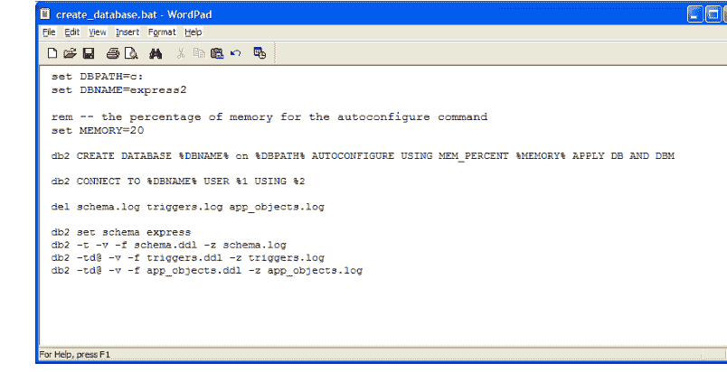

2.  将脚本文件保存在 `C:\express` 等目录下，并命名为 `create_database.bat`。

注意：如果你使用 Wordpad，则在“另存为”对话框中，确保选择 `MS-DOS Format` 选项。如果你以不同的格式保存文件，Wordpad 可能会引入不可见字符，导致脚本执行时出现问题。此外，如图所示，为文件名加上引号，以确保 Windows 不向其追加 `.TXT` 扩展名。

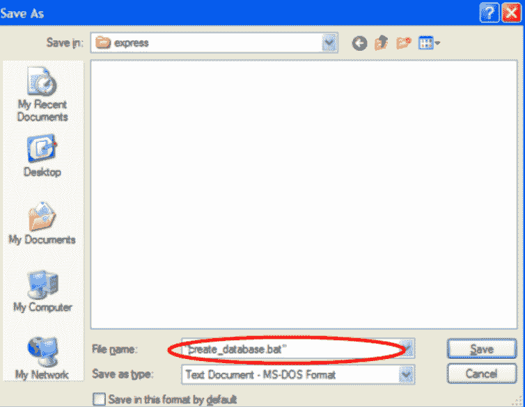

3.  要运行与 DB2 交互的脚本，你需要一个 DB2 命令行环境。打开 DB2 命令行窗口，进入“开始 -> 程序 -> IBM DB2 -> DB2COPY1 (默认) -> 命令行工具 -> 命令行窗口”。或者，你可以使用“开始 -> 运行”，输入 `db2cmd` 并按回车键，如下所示。

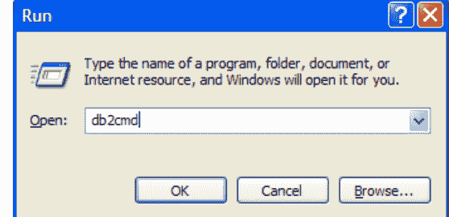

4.  然后要运行脚本，在命令行窗口中输入这些命令：

```
cd C:\express
create_database.bat db2admin ibmdbb
```

5.  花一点时间熟悉一下你刚刚创建的脚本。你理解每一行在做什么吗？

6.  尝试回答以下问题：

- A. 数据库连接在哪里建立？
- B. `%1` 和 `%2` 代表什么？
- C. 下面行代码的作用是什么？它在哪里使用？用于什么？
  `SET DBPATH=C:`
- D. 下面行代码的作用是什么？
  `del schema.log, triggers.log, app_objects.log`
- E. 当不带任何参数调用脚本时会发生什么？
- F. 为什么 SQL 脚本不包含 `CONNECT TO` 语句？它们是如何连接到数据库的？

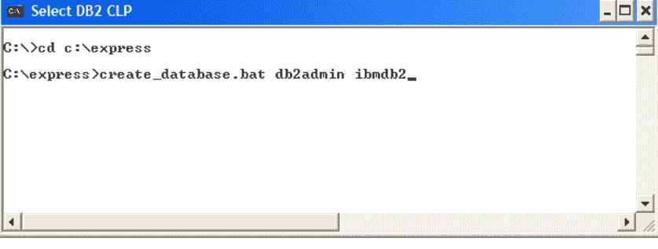

## 第二部分 – 学习 DB2：数据库管理

## 第6章 – DB2 架构

在本章中，我们将简要讨论 DB2 架构。你将学习：

- DB2 进程模型
- DB2 内存模型
- DB2 存储模型

> 注意：
> 有关 DB2 架构的更多信息，请观看此视频：
> http://www.channeldb2.com/video/video/show?id=807741:Video:4482

## 6.1 DB2 进程模型

图 6.1 描述了 DB2 进程模型。图中，矩形表示进程，椭圆表示线程。主 DB2 进程称为 `db2sysc`。在此进程下有几个线程，主线程称为 `db2sysnc`。这是产生其他线程的主线程。当应用程序连接到数据库时，`dbpcm` 代理将接收请求。`db2agent` 将产生其他线程。当启用并行时，会出现 `dbagnt` 线程。`db2agent` 将协调不同的 `dbagnt` 子代理。

## 开始使用 DB2

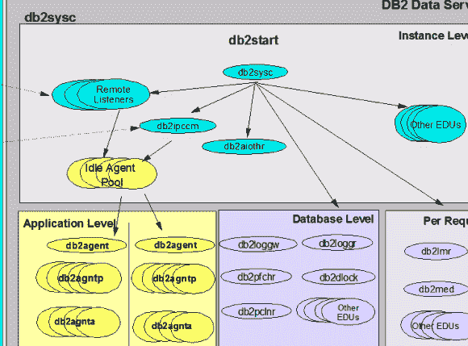

图 6.1 – DB2 进程模型

| 进程名称 | 说明 |
| :--- | :--- |
| db2sysc (Linux) | 系统控制线程。该线程负责启动、关闭和运行实例的管理。所有可调度单元 (EDU) 都是此进程内的线程。没有此进程，数据库服务器无法运行。 |
| db2acd | 自动守护进程。用于执行客户端任务，如健康状况、自动工具和管理调度器。此进程以前称为 `db2hmon`。 |
| db2wdog | 守护进程是引擎进程 `db2sysc` 的父进程。当 `db2sys` 异常终止时，它会清理资源。 |
| db2vend | DB2 9.5 引入的隔离厂商进程。第三方应用程序可以与 DB2 交互；例如，可以通过指向指向进程的用户退出程序来管理日志归档。 |
| db2fmp | 在防火墙外运行存储过程和定义函数的用户代码的隔离进程。此进程取代了以前用于 `db2udf` 和 `dbdari` 的进程。 |

表 6.1 – 普通 DB2 进程

| 线程名称 | 说明 |
| :--- | :--- |
| db2sysc | 系统控制线程。该线程负责启动、关闭和运行实例的管理 |
| db2pcm | TCP/IP 通信监听器 |
| db2agent | 代表应用程序执行数据库操作的代理（取决于连接连接器，每个连接至少一个）。 |
| dbagnt | 如果设置 INTRA_PARALLEL 为 YES 则产生的活动子代理。此线程为应用程序执行数据库操作。db2agent 将协调不同子代理的工作。 |
| db2pfchr | DB2 异步数据预取 (NUM_IOSERVERS) |
| db2pclnr | DB2 异步数据写入 (NUM_IOCLEANERS) |

表 6.2 – DB2 线程

## 6.2 DB2 内存模型

DB2 内存模型由实例级、数据库级以及应用程序和代理级的不同内存区域组成，如图 6.2 所示。我们不会在书中详细解释内存中的每个区域，而提供一个简要的概述。

# 快速上手 DB2 Express-C

| 监控堆 (mon_heap_sz) | 数据库管理器共享内存 (包括 FCM) | 审计缓冲区大小 (audit_buf_sz) |
| :--- | :--- | :--- |
| 工具堆 (util_heap_sz) | 数据库全局内存 | 数据库堆 (dheap) |
| 缓冲区堆 (back_buf_sz) | 缓冲池 (bufferpage) | 日志缓冲区 (log_buf_sz) |
| 恢复缓冲区 (res_buf) | 扩展内存缓存 | 目录缓存 (catalogaache_sz) |
| 程序包缓存 (pkgdcache_sz) | 锁列表 (locklist) | |
| | 应用程序全局内存 (app_ctl_heap_sz) | |
| | 代理程序私有内存 | |
| 应用程序堆 (appheap) | 代理任务 (agent_task_sz) | 统计堆 (stat_heap_sz) | 排序堆 (sortheap) |
| 查询堆 (query_heap_sz) | DRD 堆 (dra_heap_sz) | UDF 内存 (udf_mem_sz) | 堆 (stmtheap) |
| | Java 堆 (java_heap_sz) | 客户端 IO 块 (nioblock) | (远程) |
| 代理/应用程序共享内存 | | |
| 应用程序支持层堆 (asheap) | | |
| 客户端 IO 块 (nioblock) | (本地) | |

图 6.2 – DB2 内存模型。实例启动时，会分配数据库管理器共享内存。这通常不会占用多少空间。当你首次连接到数据库时，会分配数据库全局内存。在这个块中，缓冲池是最重要的部分之一，特别是对于提高查询性能。缓冲池的大小将决定整个数据库全局内存的大小。

代理私有内存是每个 DB2 代理使用的内存。在不使用连接聚集器的情况下，每个连接都需要一个代理。通常一个代理使用大约 3 到 5 MB。使用连接聚集器，多个连接可以使用一个代理，从而减少对更多物理内存的需求。

## 6.3 DB2 存储模型

在本节中，我们将描述以下概念：

- 页面 (Pages) 和区 (Extents)
- 缓冲池 (Buffer pool)
- 表空间 (Table space)

### 6.3.1 页面和区

页面是 DB2 中存储的最小单位。允许的页面大小为：4K、8K、16K 和 32K。区是页面的分组。在 DB2 中一次处理一个页面在性能上成本高昂；因此，DB2 实际上是以区为单位进行工作的。页面大小和区的大小是在处理缓冲池和表空间时定义的，我们将在接下来的章节中看到。

### 6.3.2 缓冲池

缓冲池是用于表和索引数据的真实内存缓存。它通过减少顺序 I/O 并促进异步读取（预取）和写入来提高性能。也就是说，DB2 会预判将需要哪些页面，并将它们从磁盘预取到缓冲池中，以便准备好使用。

缓冲池以 4K、8K、16K 和 32 页为内存单位分配在内存中。每个数据库至少应有一个缓冲池，对于具有特定页面大小的表空间，至少有一个匹配的缓冲池。

#### 6.3.2.1 创建缓冲池

要创建一个缓冲池，可以使用 `BUFFERPOOL` 语句。或者，使用控制中心，可以右键点击数据库内的“缓冲池”文件夹并选择“创建”，如图 6.3 所示。

图 6.3 – 创建缓冲池

点击“创建”后，将出现如图 6.4 所示的创建缓冲池对话框。

图 6.4 – 创建缓冲池对话框（注意：图 6.4 和 6.5 的图像引用在源文中用占位符表示）。

图 6.4 中的大多数条目都是自明的。非阻塞（Non-blocked）和阻塞（Blocked）字段指的是应以非阻塞和阻塞状态存在的页面数。基于阻塞的缓冲池确保磁盘上的连续页面也连续地移动到缓冲池中的阻塞区域；这可能会提高性能。页面数不能超过缓冲池页面总数的 98%。将该值指定为 0 则禁用 I/O。

一旦创建了缓冲池，它将显示在控制中心，如图 6.5 所示。

图 6.5 – 创建缓冲池 SAMP16K 后的控制中心

### 6.3.3 表空间

表空间是逻辑表与系统物理内存（缓冲池）以及容器（磁盘）之间的逻辑接口。使用 `CREATE TABLESPACE` 语句创建表空间，并在其中指定：

- 表空间的页面大小（4KB、8KB、16KB 或 32KB）。页面大小必须与具有相同页面大小的缓冲池对应。
- 与此表空间关联的缓冲池名称
- 区的大小
- 预取大小

#### 6.3.3.1 表空间类型

表空间有类型：

- 普通（Regular）：用于用户表。例如，默认创建的 USERSPACE1 表空间就是普通表空间。
- 大容量（Large）：用于[大表]。这些用于[存储数据]。从 DB2 9 开始，这是默认类型。
- 临时（Temporary）：有两种类型的临时表空间：
    - 系统临时表空间：用于系统操作。
    - 用户临时表空间：用于用户定义任务。

#### 6.3.3.2 表空间管理

表空间可以根据其管理方式进行分类。

##### 系统管理

此类表空间被称为系统管理（SMS）。这意味着由操作系统管理存储。它们易于管理，但容器是动态增长的。当 `CREATE DATABASE` 命令中未指定存储路径时，将使用数据库路径作为存储路径。容器可以添加到系统中。

##### 数据库管理

此类表空间被称为数据库管理存储（DMS）。这意味着由 DB2 管理存储。管理需要 DBA 更多的人工干预。可以使用 `TABLESPACE` 语句预分配或调整容器的大小。

##### 自动存储管理


此类表空间由自动存储管理，可以从类似于 SMS 的易用性受益，同时具有 DMS 的灵活性。从 DB2 9 开始，这是默认的表空间类型。对于这些表空间，用户首先指定一个存储路径和一个 DB2 用于管理存储的逻辑存储组。不提供显式的容器定义。容器跨越存储路径自动创建。现有容器的增长和新容器的添加完全由 DB2 管理。当 `CREATE DATABASE` 命令中未指定存储路径时，将使用数据库路径作为存储路径。数据库路径是主数据库所在的位置。

# 开始使用 DB2 Express-C

```sql
CREATE DATABASE DB1 ON /data/path1, /data/path2
```

显式禁用了自动存储：

```sql
CREATE DATABASE DB1 AUTOMATIC STORAGE NO
```

接下来，按照这些示例创建启用自动存储的表空间：

表空间的自动存储默认也是开启：

```sql
CREATE TEMPORARY TABLESPACE TMTS
```

表空间隐式指定了自动存储：

```sql
CREATE TABLESPACE TS1
INITIALSIZE 500 K
INCREASESIZE 100 K
MAXSIZE 100 M
```

自动存储被隐式指定，并分配了初始大小、它将增长量以及可以增长的最大尺寸。

### 6.3.3.3 数据在表空间中的存储方式

默认情况下，DB2 会一次跨多个容器（containers）写入磁盘区区（extents）。例如，如果你在 DMS 表空间上使用 3 个原始容器创建一个区区大小为 8 的 4K 表空间，这意味着在写入下一个磁盘之前，将先写入 32K 的数据（4K x 8 页/区 = 32K）。这如图 6.6 所示。注意，表不共享区区。

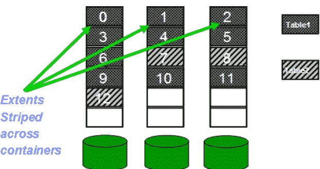

图 6.6 – 在表空间中写入数据

### 6.3.3.4 使用控制中心创建表空间

要从控制中心创建表空间，右键点击给定数据库中的“表空间（Table Spaces）”文件夹并选择“创建（Create）”，如图 6.7 所示。将出现“创建表空间向导”，如图 6.8 所示。

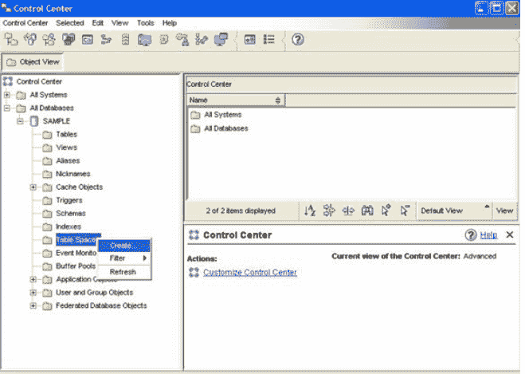

图 6.7 — 从控制中心创建表空间

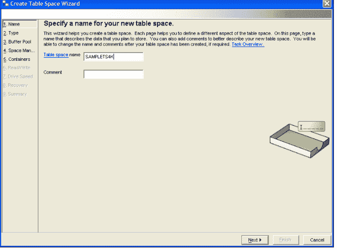

图 6.8 – 创建表空间向导

图 6.8 显示的向导将引导你完成创建表空间的步骤。

## 6.4 总结

在本章中，我们探讨了 DB2 架构的三个关键方面：进程模型、内存模型和存储模型。对于进程模型，我们查看了常见的进程和线程，包括 `db2sysc`，没有它 DB2 将无法运行。

深入讨论了存储模型，涵盖了三个最重要的方面：页和条目、缓冲池（包括创建细节）以及表空间。最后，我们查看了各种类型的表空间，以及关于它们如何管理的细节（SMS、DMS、自动）以及如何使用控制中心创建新的表空间。

## 6.5 练习

此练习将帮助你理解 Windows 上的 DB2 进程模型、内存模型和存储模型。你将回顾不同的进程和线程，监控内存使用情况，并在 Windows 上练习创建一个使用自动存储和存储路径的数据库。理想情况下存储路径应跨磁盘（驱动器）创建，但由于你的计算机可能没有配置多个磁盘，此练习仅使用你的 C:\ 盘。

步骤：

- 让我们看看 Windows 上的一些进程。首先，打开 DB2 命令窗口（开始 -> 运行 -> `db2cmd`），并执行此命令确保你的实例已停止：`db2stop force`

- 打开 Windows 任务管理器，选择“进程”选项卡，点击“映像名称”按此列排序，并寻找 `db2sysc.exe` 进程，如下所示。

- 3. 你不应该找到 `db2sysc.exe` 进程，因为我们在第一步中要求你停止 DB2 实例。

- 4. 使用此命令启动 DB2 实例：`db2start`，并重复上一步操作。现在你可以在 CPU 找到它和 `db2sysc.exe` 进程了吗？

- 5. 让我们查看 CPU 和内存消耗。遵循以下步骤操作：

   - G. 通过关闭所有其他应用程序，确保系统中没有正在运行的程序

   - H. 打开一个新的 DB2 命令窗口并执行：`db2stop force`

   - I. 从任务管理器中切换到“性能”选项卡

   - J. 保持任务管理器和 DB2 命令窗口并排打开，如下所示。记下可用物理内存量和 CPU 使用率。

执行 `db2start` 并在执行此命令的同时查看 CPU 和内存使用情况。你会看到 CPU 使用率出现峰值，内存使用量减少了约 50MB 到 70MB。这是 DB2 实例消耗的内存。如果你执行 `db2stop`，内存使用量就会减少。

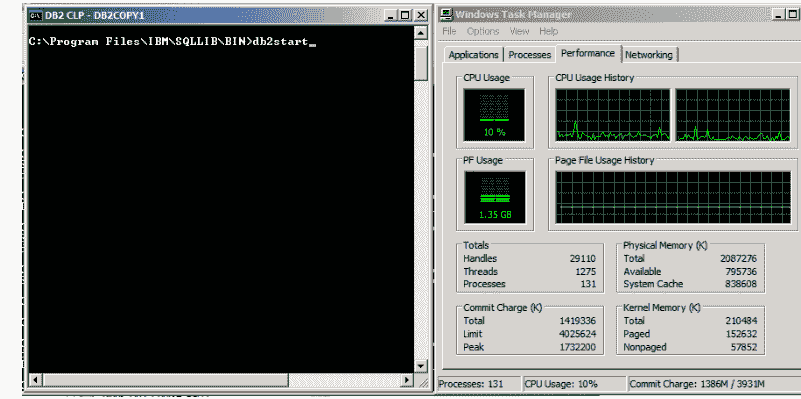

重复上一步，但这次监控之后发生。执行这些命令：

```bash
db2start
db2stop
```

# 7. DB2 连接性

本章涵盖了将 DB2 客户端连接到 DB2 服务器所需的设置。有几种方法可以设置 DB2 客户端；注意：有关关于 DB2 连接性的更多信息，请观看此视频：http://www.db2.com/show?id=80741

从 DB2 9.7 开始，配置中心（Configuration Center）已弃用；但它仍然可以使用并包含在产品中。

## 7.1 DB2 目录

DB2 目录是存储关于你可以连接的数据库信息的文件。有四个：

- 系统数据库目录
- 本地数据库目录
- 节点目录
- DCS 目录

可以通过配置中心查看和更新这些目录的内容。

### 7.1.1 系统数据库目录

该目录就像书的目录。显示所有你可以连接的数据库，无论是本地还是远程。对于本地数据库，它指向“本地数据库目录”。对于远程数据库，它指向“节点目录”中的条目。要查看此目录的内容，执行命令：

```bash
list db directory
```

### 7.1.2 本地数据库目录

该目录包含你可以连接的位于你机器上的数据库。要查看此目录的内容，执行命令：

```bash
list db directory on <drive/path>
```

### 7.1.3 节点目录

该目录包含如何连接到给定远程数据库的信息。例如，如果使用 TCP/IP 协议，TCP/IP 节点项将包含尝试连接的 DB2 数据库所在服务器的 IP 地址，以及该数据库所在实例端口。要查看此目录的内容，执行命令：

```bash
list node directory
```

### 7.1.4 DCS 目录

只有当你安装了用于连接 DB2 for z/OS（大型机）或 DB2 for i5/OS 的 DB2 Connect 软件时，此目录才会出现。要查看此目录的内容，执行命令：

```bash
list dcs directory
```

## 7.2 配置中心（已弃用）

使用配置中心 GUI 工具，你可以轻松配置 DB2 客户端与 DB2 服务器之间的连接。在 Windows 上启动配置中心，可以选择：开始 -> 程序 -> IBM DB2 -> DB2COPY1 -> 设置工具 -> 配置中心。

从命令行，你可以使用命令 `db2ca` 启动该工具。图 7.1 显示了配置中心。

### 7.2.1 服务器端的必要设置

服务器上需要设置两项内容：

- 1) `DB2COMM`

此 DB2 注册表变量决定了哪些通信协议监听器应该监控来自客户端的请求。通常，TCP/IP 是最常用的通信协议。更改此参数需要重启实例。要在配置助手（Configuration Assistant）中查看和更改 `DB2COMM` 的值，请选择 Configure -> DB2 Registry，如图 7.2 和图 7.3 所示。

图 7.2 – 访问 DB2 注册表

图 7.3 – 验证 DB2COMM 注册表变量的值

- 2) `SVCNAME`

此数据库管理器配置参数应设置为服务名称（如在 TCP/IP 服务文件中定义）或在您想要访问此实例的数据库时使用的端口号。在配置助手中，选择 Configure -> DBM configuration，如图 7.4 所示。

图 7.4 – 从配置助手中查看 dbm cfg

进入 DBM 配置窗口后，找到 Communications（通信）部分，并查找 `SVCNAME`。根据需要，您可以将值更改为字符串甚至端口号。如图 7.5 所示。

图 7.5 – 查看 SVCENAME dbm cfg 参数

### 7.2.2 客户端的必要设置

在客户端上，您需要预知以下信息：

- 您想要连接的数据库名称
- 数据库所在服务器上 DB2 实例的端口号。您也可以使用服务名称，只要 TCP/IP 服务中有匹配的条目即可
- 连接到数据库所需的操作系统用户 ID 和密码。该用户 ID 必须已在服务器上定义。

上述信息可以使用 DB2 客户端通过配置助手输入。首先，点击“Selected -> Add Database Using Wizard”启动“添加数据库向导”，如图 7.6 所示。

图 7.6 – 调用添加数据库向导

您也可以通过在配置助手的空白处点击右键并选择“Add Database Using Wizard”进入此向导。图 7.7 显示了添加数据库向导。

图 7.7 – 添加数据库向导

在添加数据库向导中有，三个选项：

#### 1. 使用配置 (Profile)

在某些情况下，您可能需要配置许多客户端连接到同一个 DB2 服务器。在这种情况下，从一个客户端执行所有配置并将这些配置存储到“配置”文件中非常方便。有了此文件，您可以直接将所有信息加载到其他客户端。在图 7.7 中，如果您选择“Use a Profile”，则将从现有的“配置”加载信息。本章稍后将提供更多详细信息，说明如何创建和存储配置。

#### 2. 搜索网络

这种方法也称为发现（Discovery），告诉 DB2 在网络中搜索指定的服务器、实例和数据库。DAS 运行在每个需要发现数据库的 DB2 服务器上。通过此方法，有两种方式执行搜索：

- Search（搜索）：搜索整个网络。如果您的网络很大且有很多集线器，则不建议这样做，因为从每个系统检索数据将耗费很长时间。
- Known（已知）：根据您提供的地址在网络中搜索已知服务器。

两种方法如图 7.8 所示。

图 7.8 – 搜索（Search）和已知（Known）方法

在某些情况下，管理员可能不希望客户端搜索网络中带有机密信息的数据库。这可以在 DAS、实例或数据库级别进行防止。图 7.9 提供了有关此的细节。

图 7.9 – 配置允许发现的参数

图 7.9 显示了您可以启用或禁用发现的不同级别。在 DAS 级别，您可以为 `DISCOVER` 参数赋值 `SEARCH` 或 `KNOWN`。在实例级别，您可以为 `DISCOVER_INST` 参数赋值 `DISABLE` 或 `ENABLE`。最后，在数据库级别，`DISCOVER_DB` 参数也可以设置为 `DISABLE` 或 `ENABLE`。设置这些参数为数据库发现提供了细粒度控制。

#### 3. 手动配置到数据库的连接

使用此方法，您可以向配置助手添加主机名、端口号和数据库信息，这将生成用于执行连接的目录文件（catalogs）。配置助手不会检查信息是否正确；如果无法连接到服务器，它将会知道。此外，确保您提供的连接远程数据库的用户 ID 和密码是正确的。默认情况下，身份验证在您尝试连接的 DB2 服务器上进行，因此，您必须提供在该服务器上定义的用户 ID 和密码。

### 7.2.3 创建客户端和服务器配置

如果您正在配置大量的服务器或客户端，而不是逐个设置，可以设置一个，从中导出配置，然后将该配置应用于其他客户端/服务器。这在设置环境时节省了大量的管理时间。

要从配置助手创建自定义配置，请点击 Configure 菜单，然后选择 Export Profile -> Customize，如图 7.10 所示。

图 7.10 – 导出配置

图 7.11 显示了导出配置需要完成的字段：

- 文件名
- 选择要包含在配置中的可用数据库
- 选择要包含在配置中的可选信息
- 点击 Export 生成配置

图 7.11 – 自定义导出对话框

图 7.12 显示了在 Customize Export 对话框中点击“Export”后的结果：

- Results 标签页
- Results 消息
- 点击 Clear 清空

图 7.12 – 导出配置结果

要从配置助手导入自定义配置，点击 Configure 菜单，然后选择 Import Profile -> Customize，如图 7.13 所示。

图 7.13 – 导入配置

图 7.14 显示了导入配置需要完成的字段：

- 配置名称
- 选择要从配置导入的可用数据库
- 选择要从配置导入的可选信息
- 点击 Import 导入指定的配置

图 7.14 – 自定义导入配置

## 7.3 总结

从数据客户端连接服务器是关系型数据库管理的核心方面。在本章中，我们查看了客户端连接，从与 DB2 相关的数据库目录开始。

接下来，我们讨论了使用配置助手 GUI 设置客户端服务器连接，包括双方需要配置的内容。

我们还查看了如何通过三种方法建立服务器连接：使用存储的配置、搜索网络（也称为发现）或手动输入服务器信息。客户端和服务器配置的创建已有更详细介绍。

## 7.4 练习

配置助手可以快速方便地配置远程数据库连接。在练习中，您将为位于远程 DB2 服务器（由邻居的工作站表示）的数据库建立目录。一旦建立目录，您就可以像访问本地一样访问它。DB2 在后台执行所有通信。

此练习假设您在网络内工作。如果情况如此，请使用自己的计算机作为客户端和服务器机器，并按照下面的配置说明连接到自己的系统。

步骤

- 1. 询问您的邻居（教师）获取以下信息：

2. 远程数据库信息：

   - (PR) 协议 TCP/IP
   - (IP) IP 地址或主机名
   - (PN) 实例端口号
   - (DB) 数据库名称 SAMPLE

提示：

在 Windows 上从命令行窗口中输入 `hostname` 获取主机名

在 Windows 上从命令行窗口中输入 `ipconfig` 获取 IP 地址

3. 打开配置助手（提示：可以通过开始菜单访问）。

4. 打开 `Selected` 菜单并选择 `Add Database Using Wizard`。

7. 在向导的“TCP/IP”页面，输入您在步骤 (1) 中记录的完整主机名或 IP 地址。输入您在步骤 (1) 中记录的端口号。点击“Next”（下一页）按钮进入向导的下一页。

8. 注意：如果您在“local”（本地）服务有一个条目，其端口与远程服务器实例监听的端口对应，则可以使用“Service Name”（服务名称）选项。当使用此项时，DB2 将查看“本地”机器上的服务文件，而不是服务器上的。如果您想使用此项，必须向该文件中添加条目。

9. 在向导的“Database”（数据库）页面，在“Database Name”（数据库名称）字段中输入在步骤 (1) 中记录的远程服务器定义的数据库名称。注意“Database Alias”（数据库别名）会自动填充相同的值。数据库别名是本地应用程序连接到此数据库使用的名称。由于您已经有一个名为“SAMPLE”的本地数据库，系统将不允许您编入另一个同名的数据库。因此，您必须使用不同的别名。例如，将数据库别名更改为“SAMPLE1”。如果您愿意，可以输入关于此数据库的可选注释。点击“Next”按钮进入向导的下一页。

10. 在向导的“Data Source”（数据源）页面，可以选择将此新数据库（数据源）注册为 ODBC 数据源。这将其自动注册到 Windows ODBC Manager。例如，取消勾选“Check database for ODBC”（检查数据库用于 ODBC因为因为您将使用 ODBC。点击“Next”按钮进入向导的下一页。

11. 在向导的“Node Options”（节点选项）页面，指定远程数据库所在服务器的操作系统。由于实验室中的所有工作站都使用 Microsoft Windows，请确保在下拉列表中选择了“Windows”。“Instance name”（实例名称）字段应设置为“DB2”。如果不是，请将其设置为“DB2”。点击“Next”按钮进入向导的下一页。

12. 向导的此“System Options”（系统选项）页面让您有机会确保系统和主机名正确，并验证操作系统设置。点击“Next”按钮进入向导的下一页。

13. 向导的“Security Options”（安全选项）页面允许您指定用户身份验证发生的位置以及您想要使用的方法。选择选项“Use authentication in server's DB2 Configuration”（在服务器的 DB2 配置中使用身份验证）。这将使用远程配置文件中 `AUTHENTICATION` 参数指定的方法。点击“Finish”按钮编入远程数据库并关闭。应该出现一个确认框。点击“Test Connection”（测试连接）按钮确保您可以成功连接到数据库。此外，确保您提供的用户名和密码是“在远程服务器上定义的”的有效信息（因为“Server's AUTHENTICATION”参数可能被设置为值“SERVER”）。如果测试连接成功，则说明您已成功编入远程数据库。并确保指定了所有正确的值。（点击 Change 按钮返回通过向导设置）。

- 14. 打开控制中心（Control Center）并尝试查看新编入的远程数据库中的不同表。

- 15. 回到配置助手（Configuration Assistant）并尝试编入另一个数据库，这次使用“Search for the Network”（搜索网络）选项。按照您之前手动配置连接的方式逐步执行向导。注意，在大型网络上，搜索发现可能需要很长时间才能返回结果。

# 8. 使用数据库对象


本章讨论了数据库对象，如模式、表、视图、索引、序列等。一些高级数据库应用对象，如触发器、用户定义函数 (`UDFs`) 和存储过程将在第 14 章《DB2 开发简介》中进行讨论。

> **注意：**
>
> 有关使用数据库对象的更多信息，请观看此视频：http://www.channeldb2.com/video/show?id=807741:Video.4242

## 8.1 模式 (Schemas)

模式（`Schemas`）是数据库对象集的命名空间。它们主要用于：

- 提供对应用程序所有权或关系的指示
- 在逻辑上将相关对象分组

除了公共别名外，所有 DB2 数据库对象都有一个两部分的完全限定名；模式（`schema`）是该名称的前半部分，如下：

```
<schema_name>.<object_name>
```

完全限定的对象名称必须是唯一的。当您连接到数据库并在未指定模式的情况下创建引用或对象时，DB2 将使用您连接数据库时的用户 ID 作为模式名称。例如，如果使用用户 `arfzhong` 连接到 `SAMPLE` 数据库，并使用 `CREATE TABLE` 语句创建表 `artists`：

```
CREATE TABLE artists ...
```

创建的表的完全限定名为 `arfzhong.artists`。

您可以使用 `set schema` 语句为会话设置模式。列表 8.1 提供了一个示例。

```
connect to sample user arfzhong using mypsw
select * from staff ## 这会查找 arfzhong.staff

set schema db2admin ## 这会查找 db2admin.staff
select * from staff
```

**列表 8.1 - 使用 set schema 语句的示例**

可以使用“竞赛系统”来说明模式的使用。假设一家公司正在举办一项比赛，参赛者需要创建自己的表并执行某些 SQL 操作。所有参与者都使用相同的用户 ID 连接到数据库，并使用相同的脚本创建表，其中这些对象是未限定的，没有模式名称。参赛者登录竞赛系统后，系统将根据时间戳生成模式。这样，参赛者 A 将与参赛者 B 使用相同的表工作，但具有不同的模式，因此不会产生冲突。


## 8.2 公共别名 (Public synonyms)

新概念是公共别名，也称为别名。公共别名允许您在不指定模式的情况下引用其他对象。列表 8.2 提供了一个示例。

```
connect to user archjong using myspw
create public synonym raul for table archjong.staff
select * from raul
select * from staff ## Error
connect to db2admin using psw
```

**列表 8.2 - 公共别名的示例**

在列表 8.2 中，您首先使用 `archjong` 连接并创建表 `archjong.staff` 的公共别名 `raul`。如果您尝试使用别名，将收到错误。示例 8.2 中的其他用户如 `db2admin` 也可以使用公共 `raul`。

在示例中，如果没有公共，别名将是私有别名。在列表 8.3 中，让我们查看使用私有别名的示例。

**列表 8.3 - 私有别名的示例**

在列表 8.3 中，您会看到由于别名是私有的，因此无法作为另一个用户在不指定模式的情况下引用。

## 8.3 表 (Tables)

表是逻辑上按列和行排列的相关集合。列表 8.4 提供了一个使用 `CREATE TABLE` 语句创建表的示例。

```
CREATE TABLE artists
(artno           SMALLINT not null,
name            VARCHAR(50) with default 'abc',
classification  CHAR(1) not null,
bio             CLOB(100K) logged,
pictureure         BLOB(2M) not logged compact
)
```

**列表 8.4 - CREATE TABLE 语句的示例**

在后续章节中，我们将描述此 `CREATE TABLE` 语句的主要部分

### 8.3.1 数据类型

图 8.1 来自 DB2 信息中心，列出了 DB2 支持的数据类型


图 8.1 显示的数据类型在 DB2 文档中有描述；大多数在关系型数据库管理系统中常见或非常相似，因此我们在此不对它们进行描述。另一方面，某些数据类型（如大对象 `LOBs`）对于新用户可能并不直观。

大对象数据类型用于存储大型字符字符串、大型二进制字符串或文件，如图 8.2 所示

**图 8.1 – DB2 内置数据类型**

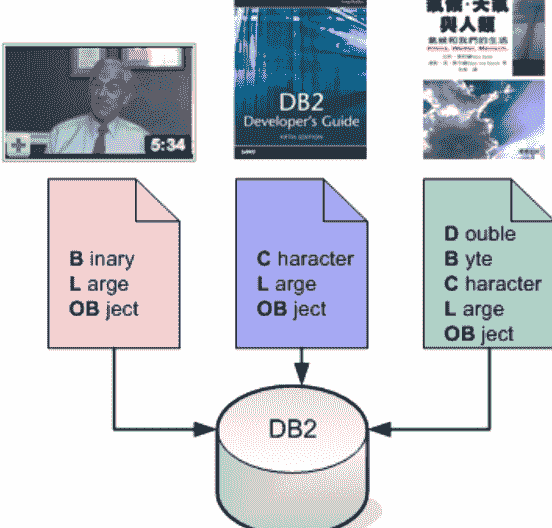

**图 8.2 – LOB 数据类型**

这些大型二进制对象通常为了清晰起采用缩写：大型二进制对象为 `BLOB`，大型字符对象为 `CLOB`，双字节字符大型对象被称为 `DBCLOB`。

图 8.1 还列出了随 DB2 9.7 添加的新数据类型：

- `BOOLEAN`
- `ARRAY`
- `ROW`
- `CURSOR`

这些数据类型是 Oracle 数据库服务器数据类型的一部分，现在 DB2 已支持它们。Oracle 数据库服务器数据类型将在本章后面的部分进行更详细的讨论。

### 8.3.2 用户定义类型

DB2 允许你使用用户定义类型 (`UDTs`) 定义自己的所有者数据类型。`UDT` 可以分类为：

- 区分类型 (`Distinct type`)
- 结构化类型 (`Structured type`)
- 引用类型 (`Reference type`)
- 数组类型
- 行类型
- 游标类型

引用、数组、行和游标类型是 DB2 9.7 新引入的，并用于 SQL PL 过程。用户定义的区分数据类型基于内置数据类型。这些 `UDT` 在以下情况下非常有用：

- 需要为值建立上下文（`context`）
- 需要让 DB2 使用强类型强制执行数据类型

列表 8.5 中的 SQL 语句说明了如何以及何时使用区分 `UDT` 的示例：

```sql
CREATE DISTINCT TYPE POUND AS INTEGER WITH COMPARISONS
CREATE DISTINCT TYPE KILOGRAM AS INTEGER WITH COMPARISONS
CREATE TABLE person
  (f_name VARCHAR(30),
  weight_p POUND NOT NULL,
  weight_k KILOGRAM NOT NULL )
```

**列表 8.5 - 区分数据类型的示例**

在示例中，两个区分 `UDT` 是 `POUND` 和 `KILOGRAM`。它们都是基于内置数据类型 `INTEGER` 构建的。作为语法转换函数一部分定义的 `WITH COMPARISON` 子句（具有与数据类型相同的名称）也将被创建。

该表分别在 `weight_p` 和 `weight_k` 列中使用这两个新的 `UDT`。如果我们执行以下语句：

```sql
SELECT F_NAME FROM PERSON
WHERE weight_p > weight_k
```

你将收到一个错误消息，因为正在比较两个不同数据类型的列。尽管 `weight_p` 和 `weight_k` 分别使用 `POUND` 和 `KILOGRAM` 数据类型，且两者都是基于 `INTEGER` 数据类型创建的，但通过创建 `UDT`，你使得这种比较变得不可行。这正是你所想要的，在现实生活中，磅和公斤之间的比较是没有意义的。

在下一个示例中，你想要将 `weight_p` 列与整数进行比较；然而，这两个数据类型是不同的，因此除非你使用转换函数，否则你将收到错误。

从下述语句可以看出使用转换函数 `POUND()` 使得这种比较成为可能。正如前面提到的，`POUND()` 转换函数是在 `CREATE DISTINCT TYPE` 语句中使用 `WITH COMPARISONS` 子句配合 `UDT` 创建的。

```sql
SELECT F_NAME FROM PERSON
WHERE weight_p > POUND(30)
```

### 8.3.3 Oracle 数据库服务器数据类型

Oracle 数据库服务器中使用的以下数据类型现在受 DB2 数据服务器支持：`NUMBER`、`VARCHAR`、`TIMESTAMP(n)`、`DATE`、`BOOLEAN`、`VARCHAR`、`Row Type`、`Ref Cursor`。为了让它们工作，你首先需要按照所示启用 `DB2_COMPATIBILITY_VECTOR` 注册变量：

```bash
db2set DB2_COMPATIBILITY_VECTOR=FF
db2stop
db2start
```

一旦启用了此注册变量，新数据库将能够支持这些数据类型。某些类型只能在使用了 SQL PL 的环境中运行。

> **注意：**
>
> 如果你使用的是支持 SQL 兼容性功能（在第 2 章中描述）的 DB2，你也可以在 PL/SQL 中使用这些数据类型。如果是那样，注册变量 `DB2_COMPATIBILITY_VECTOR` 的值应设置为 `FFF` 而不是上例所示的 `FF`。

### 8.3.4 隐式转换或弱类型

像 Ruby on Rails 或 PHP 这样的动态语言允许隐式转换。这在 DB2 中是一个问题，因为有强类型要求。在 DB2 9.7 中，规则已经放宽，允许隐式转换或弱类型。这意味着，例如，你现在可以如下所示将字符串分配或比较给数值类型：

```sql
create table t1 (col int)
select * from t1 where col = '42'
```

在示例中，`'42'` 现在可以与整数 `col` 进行比较。

此外，通过 DB2 9.7，你现在被允许更多情况下指定无类型参数标记和无类型 `NULL` 值。以前，你必须显式地将它们转换为给定的数据类型。例如，以下语句可以工作：

```sql
select ?, NULL, myDF(?, NULL) from t1
```

### 8.3.5 空值

空值表示未知状态。`CREATE TABLE` 语句可以使用 `NOT NULL` 子句定义列，以确保该列包含已知的数据值。如果声明了 `NOT NULL`，你还可以为列指定默认值。

下一个语句提供了这种行为的示例：

```sql
CREATE TABLE staff (
  ID      SMALLINT NOT NULL,
  NAME    VARCHAR(9),
  DEPT    SMALLINT DEFAULT 10,
  SALARY DECIMAL(7,2),
  COMM    DECIMAL(7,2),
  JOB     CHAR(5)
)
```

在此示例中，`ID` 和 `DEPT` 列被定义为 `NOT NULL`。`DEPT` 还包含一个默认值。

### 8.3.6 标识列 (Identity Columns)

标识列是一种为插入的行自动生成唯一数值列。每个表只能有一个标识列。

生成标识列值有两种方法，取决于如何定义：

- 始终生成 (`Generated always`)：始终由 DB2 生成。应用程序不允许提供显式值。
- 默认生成 (`Generated by default`)：应用程序可以显式提供，如果没有提供值，则由 DB2 生成。

让我们看看以下示例：

```sql
CREATE TABLE subscriber (
  subscriberID INTEGER GENERATED ALWAYS AS
  IDENTITY (START WITH 100 INCREMENT BY 100),
  firstname VARCHAR(50),
  lastname VARCHAR(50)
)
```

### 8.3.7 序列对象 (Sequence objects)

虽然序列对象独立于表，但在本节中提到它们，是因为它们的工作方式与标识列相似。区别在于序列对象跨数据库生成唯一数字，而标识列在表中生成唯一数字。以下语句提供了示例：

```sql
CREATE TABLE t1 (salary int)

CREATE SEQUENCE myseq
START WITH 10
INCREMENT BY 1
NO CYCLE

INSERT INTO t1 VALUES (nextval for myseq)

INSERT INTO t1 VALUES (nextval for myseq)

SELECT * FROM t1

SALARY
------
10
11
12
3 record(s) selected.
```

```sql
SELECT prevval for myseq FROM sysbm.sysdummy1
```

```
1
------
12
1 record(s) selected
```

**列表 8.6 - 序列示例**

`PREVVAL` 提供序列的当前值，而 `NEXTVAL` 提供下一个值。上面的示例还使用了 `SYSIBM.SYSDUMMY1`。这是一个包含一列一行的系统目录表。它可以用于查询输出单个值的情况。系统目录表将在下一节中描述。

- `SYSTAT`: 数据库统计信息

以下是一些目录视图的示例：

- `SYSCAT.TABLES`
- `SYSCAT.INDEXES`
- `SYSCAT.COLUMNS`
- `SYSCAT.FUNCTIONS`
- `SYSCAT.PROCEDURES`

### 8.3.8 声明的全局临时表 (DGTTs)

声明的临时表在内存中创建，供应用程序使用，并在应用程序终止时自动删除。这些表仅能由创建它们的应用程序访问，且它们不存在于任何 DB2 目录表中。访问这些表可以提供非常高效的性能，因为没有目录内容、没有行锁、没有默认日志（日志是可选的），也没有权限检查。这些临时表还支持索引，也就是说，可以在临时表上创建任何标准索引。你还可以在这些表上运行 `RUNSTATS`。

声明的临时表存储在用户临时表内部，在创建任何声明的临时表之前，必须先定义用户临时表。列表 8.7 中的语句提供了一个关于如何创建三个声明的临时表的示例：

```
CREATE USER TEMPORARY TABLESPACE app-temps
MANAGED BY SYSTEM USING ('apptemps');

DECLARE GLOBAL TEMPORARY TABLE employees
LIKE employee NOT LOGGED;

DECLARE GLOBAL TEMPORARY TABLE tempdept
(deptid CHAR(6), deptname CHAR(20))
ON COMMIT DELETE ROWS NOT LOGGED;

DECLARE GLOBAL TABLE ( fullselect ) DEFINITION ONLY
ON COMMIT PRESERVE ROWS NOT LOGGED
WITH REPLACE IN TABLESPACE app-temps;
```

**列表 8.7 - 使用 DGTTs**

当创建声明的临时表时，其模式（`schema`）为 `SESSION`；在引用 `DGTT` 时必须指定此模式。用于创建临时表的用户 ID 将拥有该表的所有权限。每个创建临时表的应用程序都将拥有自己独立的副本，如图 8.3 所示。

**图 8.3 – 声明的全局临时表的范围**

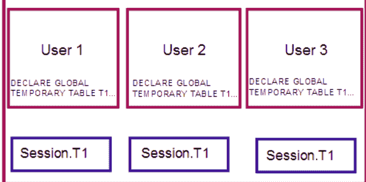

列表 8.8 阐述了声明的全局临时表的范围限制。它假设用户临时表空间已经创建。

```
来自 DB2 命令窗口 #1:
db2 connect to sample
db2 declare global temporary table mydgtt (coll int, col2 varchar(10)) on
commit preserve rows
db2 insert into session.mydgtt values      (1,'hello1'), (2,'hello2'),
(3,'hello3')
db2 select * from session.mydgtt

COL1 COL2
------ ------
1 hello1
2 hello2
3 hello3
3 record(s) selected.
```

```
来自 DB2 命令窗口 #2:
db2 connect to sample
db2 select * from session.mydgtt
SQL0204N "SESSION.MYDGTT" is an undefined name. SQLSTATE=42704
```

**列表 8.8 - 使用 DGTTs – 范围**

正如从列表 8.8 中所示，当你尝试在第二个会话（DB2 命令窗口 #2）中使用 `SESSION.MYDGTT` 时，你会收到一个错误，因为 `DGTT` 在该会话中没有定义。注意 `DGTT` 的定义使用了 `ON COMMIT PRESERVE ROWS` 子句，因为在 DB2 命令窗口中操作默认会对输入的每条语句提交。

## 8.3.9 创建全局临时表 (CGTTs)


虽然 DGTT 允许你创建临时表，但表定义无法在不同的连接或会话之间共享。每次建立会话，都需要执行 `DECLARE GLOBAL TEMPORARY TABLE` 语句。另一方面，使用全局临时表 (CGTTs)，临时表只需要创建一次，因为它永久存储在 DB2 目录中。这意味着其他连接可以直接使用该表，无需再次创建。虽然表结构可以立即使用，但每个连接的数据是相互独立的，并在连接关闭后消失。为了作为例子，让我们来看列表 8.9。它假设一个临时表空间已经创建。

```
来自 DB2 命令窗口 #:
db2 connect to sample
db2 create global table mycgtt (coll int, col2 varchar(10)) on commit preserve rows
db2 insert into mycgtt values (1,'hello1'), (2,'hello2'), (3,'hello3')
db2 select * from mycgtt
```

```
COL1            COL2
-----------------
1 hello1
2 hello2
3 hello3
3 record(s) selected.
```

```
来自 DB2 命令窗口 #2:
db2 connect to sample
db2 select * from mycgtt
```

```
COL1            COL2
-----------------
0 record(s) selected.
```

## 列表 8.9 - 使用 CGTTs - 范围

在列表 8.9 中，我们看到在 DB2 命令窗口 #2（另一个会话或连接）中，无需再次创建 CGTT，你只需引用它；然而，没有返回任何行，因为数据特定于第一个会话。

## 8.4 视图

视图是表中数据的表示。视图的数据并不是单独存储的，而是在调用视图时获取。支持嵌套视图，即基于其他视图创建的视图。所有视图信息都保留在以下目录视图中：`SYSCAT.VIEWS`、`SYSCAT.DEP` 和 `SYSCAT.TABLES`。列表 8.10 提供了一个如何创建视图的示例。

```
CONNECT TO MY;

CREATE VIEW VIEW1
AS SELECT ARTNO, NAME, CLASSIFICATION
FROM ARTISTS;

SELECT * FROM VIEW1;
```

输出：

| ARTNO | NAME | CLASSIFICATION |
| --- | --- | --- |
| 10 | HUMAN | A |
| 20 | PLANT | C |
| 30 | STORE | E |

列表 8.10 - 使用视图

## 8.5 索引

索引是键的有序集合，指向表中的行。索引允许唯一性并提高性能。关于索引的特性包括：

- 索引可以是升序或降序的
- 索引可以是唯一的或非唯一的
- 索引可以是多个列，这被称为复合索引

例如：

```
CREATE UNIQUE INDEX artno_ix ON artists (artno)
```

### 8.5.1 设计顾问

设计顾问是一个极好的工具，可以对索引设计提供建议、物化查询表 (MQTs)、多维聚集 (MDC) 以及数据库分区功能。设计顾问从控制中心调用；右键点击数据库并选择设计顾问，如图 8.4 所示。

154 DB2 Express-C 入门

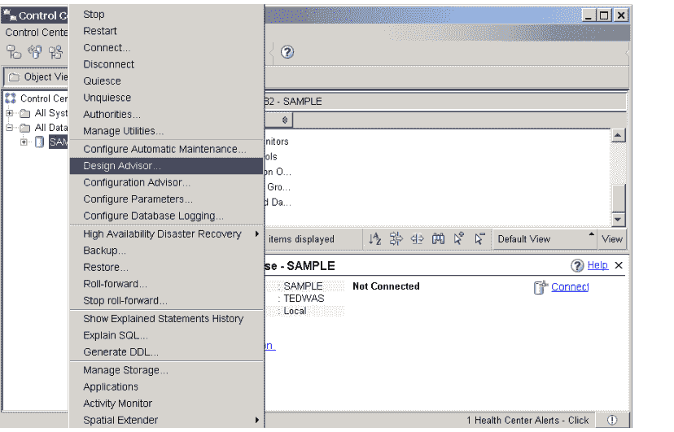

图 8.4 – 从控制中心调用设计顾问

图 8.5 显示了设计顾问。按照此向导从 DB2 获取建议。

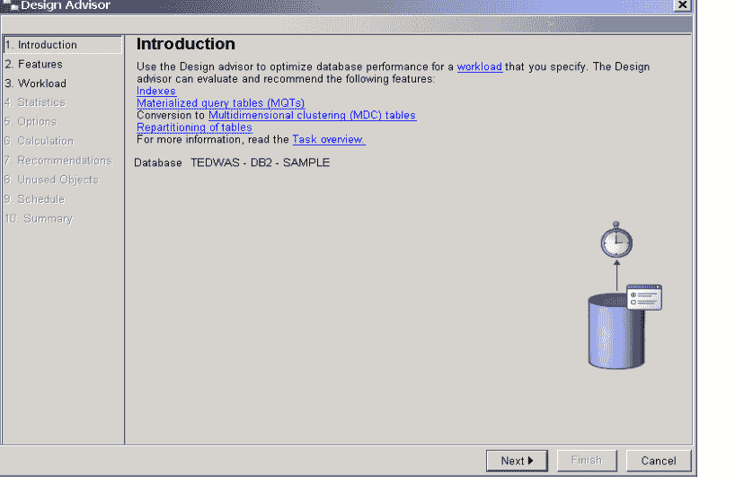

图 8.5 – 设计顾问

# 第 8 章 – 使用数据库对象

## 8.6 引用完整性

引用完整性允许你的数据库管理表之间的关系。你可以如图 8.6 所示建立父子类型的关系。在图中，有两个表 `DEPARTMENT` 和 `EMPLOYEE`，它们通过部门编号关联。`EMPLOYEE` 表中的 `WORKDEPT` 列只能包含已于部门中的编号。这是因为在示例中，`DEPARTMENT` 表是父表，而 `EMPLOYEE` 表是子表或依赖表。图中还显示了建立关系所需的 `CREATE TABLE` 语句。

部门 表（父表）

| DEPTNO | DEPARTMENTNAME | MGRNO |
| --- | --- | --- |
| (主键)或唯一约束 | | |

员工 表（依赖表）

| EMPNO | FIRSTNAME | LASTNAME | WORKDEPT | PHONENO |
| --- | --- | --- | --- | --- |
| (主键) | | | (外键) | |

```
create table employee (empno)
primary key (empno)
foreign key (workdept)
references department on delete no action
in DMS01
```

图 8.6 – 表之间引用完整性的示例

在引用完整性中，表 8.1 列出的概念经常被使用。

| 概念 | 描述 |
| --- | --- |
| 父表 | 存在父键的控制表 |
| 依赖表 | 依赖父表数据的表。它包含外键。 |
| 主键 | 定义表的主键。它不能包含 NULL 值且值是唯一的。主键由表中的一个或多个列组成。 |
| 外键 | 引用主键 |

表 8.1 - 引用完整性关键概念

156 DB2 Express-C 入门

表中的数据可以通过引用完整（referential integrity）与一个或多个表中的数据相关联。可以对数据值施加约束，使其符合某些属性或业务规则。例如，如果一个表存储一个人的性别（char），约束可以强制只允许的值为“M”（代表男性）和“F”（代表女性）。

## 8.7 模式演进 (Schema Evolution)

当业务需求发生变化时，支持的技术（IT）基础设施和系统也必须发生变化。在数据库领域，这意味着必须创建新表、删除或修改现有表、更改触发器逻辑等。这些更改看起来执行起来简单，但实际上，它们可能会非常困难且复杂。这需要很长的维护窗口，并且必须执行复杂且具有风险的操作。之前出现这种情况的原因之一是 DB2 要求所有对象在任何时候保持一致，因此不允许影响依赖于被更改对象的的操作，或者这些操作会导致依赖对象被删除。图 8.7 提供了一个示例场景。

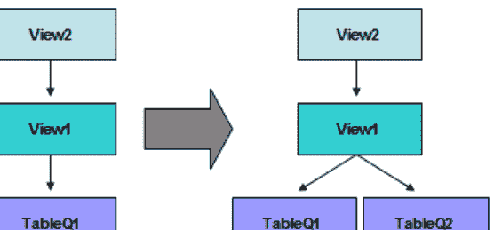

图 8.7 – 模式演进示例场景

例如，在图 8.7 中，`View1` 的定义需要更改，使其不仅基于包含公司第一季度财务信息的 `Table1`，而且基于包含第二季度信息的 `Table1` 和 `Table2`。通常情况下，你必须删除 `View1` 并使用新定义重新创建它；然而，`View2` 依赖于 `View1`。在 DB2 9.7 中，DB2 不允许你因为依赖的 `View2` 而删除 `View1`。你必须先删除 `View2`，然后删除 `View1` 并重构视图。在 DB2 9.7 中，规则已经放宽。现在允许影响依赖对象的操作。这种依赖对象（示例中的 `View2`）被称为自动重验证（automatic revalidation）。db2 配置参数 `AUTO_REVAL` 用于开启或关闭自动重验证，并确定重验证发生的时间。例如，如果你将此参数设置为 `DEFERRED_FORCE`，重验证将延迟到访问无效对象或依赖对象时，但允许在尚未存在的依赖对象上执行 `CREATE` 语句（会带有警告）。

# 第 8 章 – 使用数据库对象

其他影响依赖模型的更改还包括对视图、函数、存储过程、触发器、别名等的 `CREATE OR REPLACE` 语法的特性实现。例如：

```
create or replace procedure p1 begin ...
```

使用这种语法，如果对象（例如存储过程 P1）不存在，则将创建它。如果它之前已存在，则会被替换。这种第二种行为对于对象依赖至关重要。当 P1 被替换时，依赖于 P1 的对象将自动进行重验证。类似的情况发生在新功能如 `RENAME COLUMN`，以及通过 `ALTER COLUMN` 进行数据类型更改时，`ALTER COLUMN` 也得到了增强，以支持更多的数据类型更改。

一个名为“软失效”（soft invalidation）的相关概念允许用户在其他运行事务正在使用该对象时删除该对象。任何新事务将被拒绝访问该已删除的对象。

## 8.8 总结

在本章中，我们查看了 DB2 中的数据库对象：它们是什么、如何创建以及如何使用。我们引入了数据库模式（schemas），并将其与新的公共别名（public synonyms）进行了比较，还比较了公共别名与私有别名。

接下来，我们深入讨论了表及其元素：数据类型（内置和用户定义）、标识列（identity columns）、序列对象（sequence objects）和全局临时表。随后我们查看了视图、索引，并使用 Design Advisor GUI 来提高表内数据的访问性和检索性。

最后，我们检查了引用完整性以定义表与表之间的关系，以及模式演进的新概念，该概念允许在不产生不复杂性的情况下更改数据对象。

## 8.9 练习

到目前，你已经学习了创建表的各种概念。最终，你将使用 DB2 来创建自己的表。

| 350 Gafney | 84 Clerk | 5 | 43030.50 | 188.00 |

在第一个使用 '350' 作为字符串的 SELECT 语句中，DB2 正在执行到数字的类型转换（SMALLINT）。

# 第 9 章 – 数据移动工具

本节描述的工具或命令用于在同一数据库内移动数据，或在相同或不同平台的数据库之间移动数据。图 9.1 提供了数据移动工具的概述。

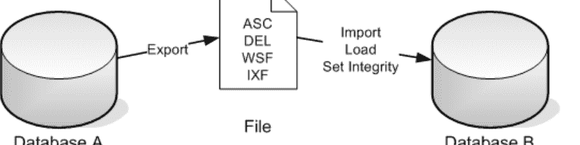

**图 9.1 – 数据移动工具**

在 9.1 中有两个数据库，数据库 A 和 B。使用 `EXPORT` 实用程序可以将数据从表中导出到文件中。该文件可以是以下格式之一：

- ASC = ASCII
- DEL = 分隔符分隔的 ASCII (Delimited ASCII)
- WSF = 工作表格式 (Worksheet format)
- IXF = 集成交换格式 (Integrated Exchange Format)

ASC 和 DEL 文件是文本，可以在任何文本编辑器中打开并查看。WSF 是一种可以将数据移动到 Excel 或 Lotus® 1-2-3 等电子表格的格式；IXF 格式不仅包含相关表的定义定义语言 (DDL)。IXF 格式非常方便，因为当需要重建表时，可以直接从具有 IXF 格式的导出文件中进行重建；如果使用其他格式，这是无法做到的。

一旦数据被导出到文件，就可以使用 `IMPORT` 实用程序将数据从文件导入到另一个表中。对于 ASC、DEL 和 WSF 格式，表必须预先存在，但对于 IXF 格式则不需要存在。将数据加载到表的另一种方法是使用 `LOAD` 实用程序。`LOAD` 实用程序更快，因为它直接访问数据库页，而无需与 DB2 引擎交互；然而，这种方法不会检查约束条件，也不会触发触发器。为了保证使用 `LOAD` 加载的数据的一致性，通常在之后使用 `SET INTEGRITY` 命令。

接下来的章节将详细详细描述 `EXPORT`、`IMPORT` 和 `LOAD` 实用程序。

注意：

欲了解更多关于使用数据库移动工具的详细信息，请观看此视频：http://www.channeldb2.com/video/show?id=807741:Video:4262

## 9.1 EXPORT 实用程序

如前所述，`EXPORT` 实用程序用于将数据从表中提取到文件中。在后台，实际执行的是 SQL `SELECT` 操作。以下示例从 `employee` 表中导出 10 行 IXF 格式的数据到文件 `employee.ixf`。

```
EXPORT TO employee.ixf IXF
SELECT * FROM employee
FETCH FIRST 10 ROWS ONLY
```

我们鼓励你尝试上面的示例。`employee` 表是 SAMPLE 数据库的一部分，因此你首先需要连接到在前一章节中创建的数据库。

如果你倾向于使用 GUI 工具，也可以从控制中心（Control Center）调用 `EXPORT` 实用程序，如图 9.2 所示。

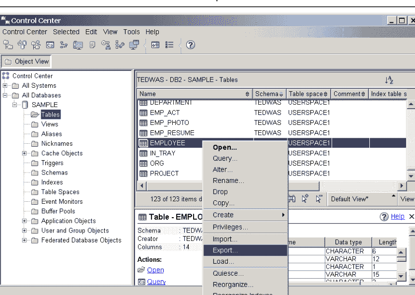

图 9.2 – 启动导出对话框

所示，你首先通过点击 `employee` 表来选择它，然后右键点击该表获取弹出菜单，你可以在其中选择 Export 选项。选择此选项后，会出现一个向导。只需按照提供的向导操作即可完成任务。

## 9.2 IMPORT 实用程序

如前所述，`IMPORT` 实用程序用于将数据从文件加载到表中。在后台，实际执行的是 SQL `INSERT` 操作。由于执行的是 `INSERT` 操作，任何触发器都会被触发，所有约束都会立即生效，并且会使用数据库缓冲池。以下示例显示了将 IXF 格式文件 `employee.ixf` 中的所有数据加载到 `employee_copy` 表。我们鼓励你尝试该示例，但你需要先运行上一节中的 `IMPORT` 实用程序。

```
IMPORT FROM employee.ixf OF IXF
REPLACE_CREATE
INTO employee_copy
```

`REPLACE_CREATE` 选项是 `IMPORT` 实用程序提供的许多选项之一。如果在执行 `IMPORT` 实用程序之前 `employee_copy` 表已经存在，则此选项将替换该表的内容；如果表尚不存在，则它将创建该表并加载数据。

如果你倾向于从控制中心进行操作，可以通过选择任何表、右键点击它并选择 Import 选项来启动 `IMPORT` 实用程序，如图 9.3 所示。

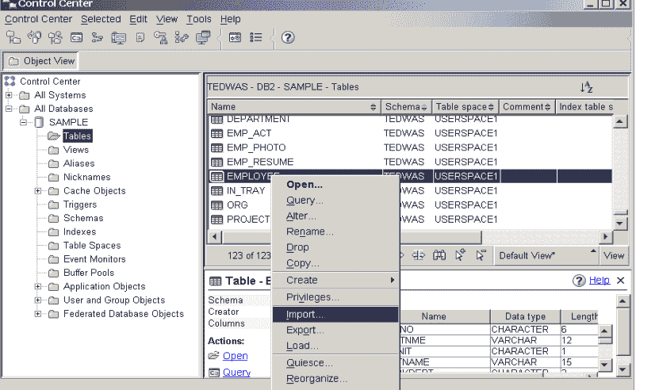

图 9.3 - 启动 IMPORT 对话框

## 9.3 LOAD 实用程序

`LOAD` 实用程序是从文件加载数据到表更快速的方法。如前所述，`LOAD` 实用程序不通过 DB2 引擎，因此触发器不会被激活，不使用缓冲池，且只能作为一个单独步骤执行约束。另一方面，`LOAD` 操作比 `IMPORT` 快，因为它直接访问数据库页。它分三个阶段工作：LOAD、BUILD 和 DELETE。

以下示例显示了如何将 IXF 格式文件 `employee.ixf` 加载到 `table_copy`。`REPLACE_CREATE` 选项是 `LOAD` 实用程序提供的许多选项之一。如果在执行 `LOAD` 实用程序之前 `table_copy` 表已经存在，则此选项将替换该表的内容；如果表尚不存在，则它将创建该表并加载数据。

```
LOAD FROM employee.ixf OF IXF
REPLACE_CREATE
INTO table_copy
```

为了保证使用 `LOAD` 加载的数据的一致性，通常在之后使用 `SET INTEGRITY` 命令：

```
SET INTEGRITY FOR table_copy
```

# 168 DB2 Express-C 入门

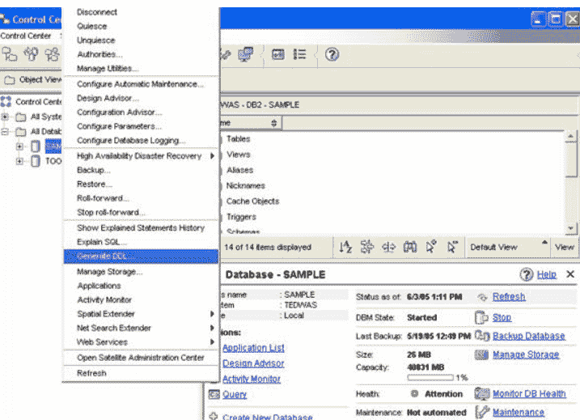

图 9.6 - 从控制中心提取 DDL

在图 9.6 中，选择你想要获取 DDL 的数据库，右键点击它并选择“生成 DDL”（Generate DDL）。会出现生成 DDL 窗口，显示提取选项，如图 9.7 所示。

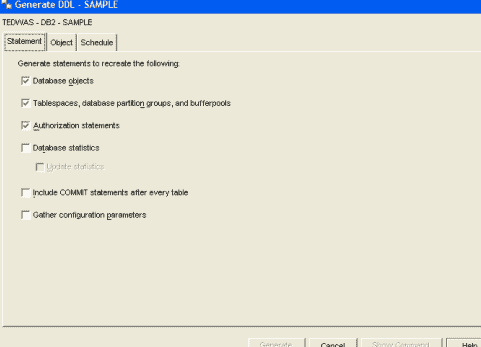

图 9.7 - 从控制中心提取 DDL

# 第 9 章 – 数据移动工具

## 9.6 总结

在本章，我们讨论了 DB2 的各种导出和导入功能。从查看各种导出格式（ASC、DEL、WSF 和 IXF）开始，我们深入检查了 `EXPORT` 实用程序。讨论了导入工具 `IMPORT` 和 `LOAD`，以及在使用 `LOAD` 时需要 `SET INTEGRITY` 语句的性质。

`db2move` 命令为你提供了一种简化导出和导入传输过程的方法。更复杂的命令 `db2look` 允许你提取并存储所有所需的数据库元素，以便在需要时独立地重新创建整个数据库。

## 9.7 练习

当你克隆数据库时，你的目标应该是以尽可能简单和可重复的方式重建数据库。这通常通过 SQL 脚本完成，这些脚本可以在安装 DB2 后立即执行。在本次练习中，你将使用控制中心从 EXPRESS 数据库（在之前的练习中创建）中提取对象定义。

步骤

1. 打开控制中心。
2. 在对象树中右键点击 EXPRESS 数据库，并选择“生成 DDL”（Generate DDL）菜单项。这会启动生成 DDL 对话窗口。
3. 在生成 DDL 窗口中，为生成的 DDL 指定选项，如下所示。如果你在环境中创建了额外的对象（如表空间、缓冲池等），你可以在此处选择它们。由于你没有创建这些类型的对象，请取消勾选该框。没有包含数据库统计信息，因为生产环境包含的统计信息可能与开发环境不同。同样，配置参数也可能不同。在在你自己的环境中，如果所有配置都与部署时完全一致，你可以选择包含这些额外选项。

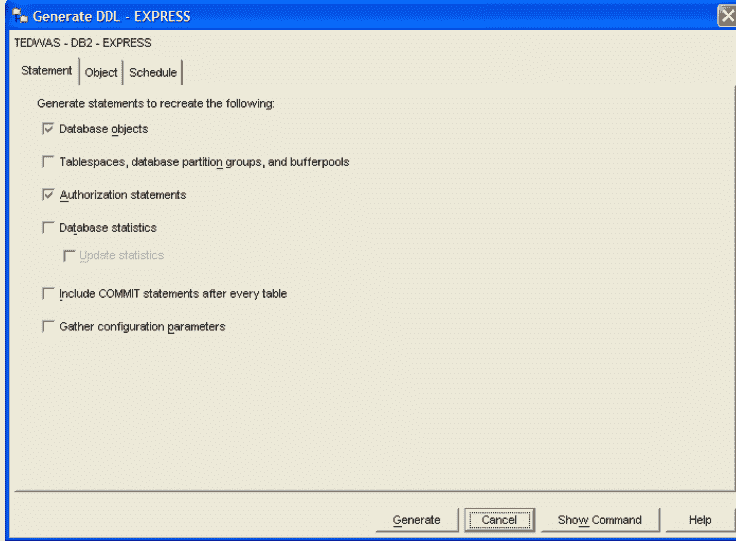

4. 到“对象”（Object）选项卡。你可以专门选择你想要生成 DDL 的对象。在这种情况下，选择你一直用于创建所有对象的用户和架构（schema），并为该架构下的所有对象生成 DDL。点击**生成**（**Generate**）按钮开始生成 DDL。

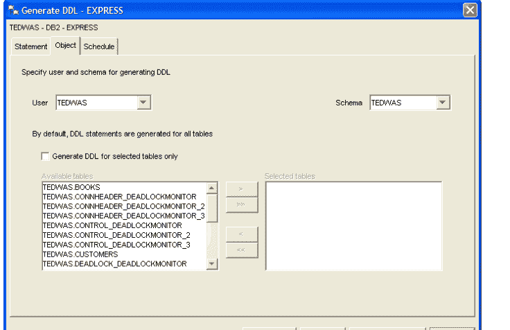

# 第 9 章 – 数据移动工具

- 检查生成的 DDL。上一步的结果是一个包含所选对象所有 SQL 语句的单个脚本。现在你将把此脚本组织成逻辑分组。


- 在文件系统中创建目录 `C:\express`，并将生成的 DDL 文件保存到此新目录中，命名为 `schema.ddl`（点击保存按钮）。


- 在命令行编辑器（Command Editor）中打开新保存的文件（提示：文件 -> 打开）

- 尽管我们只需要表的 DDL，但你会发现还包含了其他数据库对象的 DDL。将所有的 `CREATE TRIGGER` 语句移动到一个名为 `triggers.ddl` 的新文件中。尽管管我们只创建了一个触发器，但按类型分离对象也是最佳实践。

- 目前，我们还建议移除：

  - `CONNECT TO database` 语句

  - `DISCONNECT` 语句

此时，你有两个脚本：

`C:\express\schema.ddl` 包含表、视图、索引和约束的 DDL。

`C:\express\triggers.ddl` 包含触发器的 DDL。

- 为部署清理脚本（例如：`-- CONNECT TO...`）

  - 移除不必要的注释

  - 将函数和过程分离到它们自己的文件中（当有大量函数和过程时）。你可能还想按函数或应用程序对其进行分组（例如 `billing.ddl`、`math.ddl`、`stringfunc.ddl` 等）。

- 你可能已经注意到使用特殊字符来分隔触发器、函数和过程的结束（`@`）。这是必要的，用于区分 `CREATE <object>` 语句的结束，而不是对象内部过程化语句的结束。

# 第 10 章 – 数据库安全

本章讨论了 DB2 中如何处理安全性。图 10.1 提供了基本概述。


图 10.1 – DB2 安全

## 10.1 身份验证

虽然实际的身份验证是由操作系统通过默认插件（或其他安全设施）执行的，但 DB2 决定在哪个级别进行身份验证。

虽然实际的身份验证是由操作系统通过默认插件执行的，但DB2 决定身份验证发生的级别。

数据库配置 `AUTHENTICATION` 有一组可能的值。例如，当参数设置为 `SERVER`（默认）时，身份验证由操作系统或外部安全设施执行。然而，如果 `AUTHENTICATION` 设置为 `CLIENT`，身份验证由操作系统或外部安全设施执行。这如图 10.2 所示。


图 10.2 – 身份验证发生的位置

`AUTHENTICATION` 参数可以是表 10.1 列出的任何值

### 表 10.1 – 有效的 AUTHENTICATION 值

| 命令 | 描述 |
| --- | --- |
| SERVER (默认) | 身份验证在服务器进行 |
| CLIENT | 身份验证在客户端进行 |
| SERVER_ENCRYPT | 与 SERVER 类似，但用户 ID 和密码经过加密 |
| KERBEROS | 使用 Kerberos 安全机制进行身份验证 |
| SQL_AUTHENTICATION_DATAENC | 服务器身份验证，连接必须使用数据加密 |
| SQL_AUTHENTICATION_DATAENC_CMP | 与上述类似，仅在可用时数据加密 |
| GSSPLUGIN | 使用外部 GSS API 插件安全机制进行身份验证 |

## 10.2 授权

授权由存储在 DB2 系统表中并由 DB2 管理的权限、权限集、角色和标签访问控制凭据组成。

权限允许用户对数据库执行单类型操作，例如 `CREATE`、`UPDATE`、`DELETE`、`INSERT` 等。

角色允许你将不同的权限组合在一起，授予用户、组或其他角色。

权限是一个包含多个权限的预定义角色。

标签访问控制（LBAC）凭据包括策略和标签，支持根据用户对特定行和列的细粒度访问。DB2 Express-C 不包含 LBAC，但你可以在第 2 章中了解更多信息。

### 10.2.1 权限

图 10.3 显示了 DB2 中的一些不同的权限。


图 10.3 – 部分 DB2 权限列表

用户或组接收 `CONTROL` 权限意味着他们也可以将该权限授予其他用户或组。有关其他不同权限的详细信息，请参考 DB2 信息中心。

## 10.2.2 权限 (Authorities)

权限分为两类：

- 实例级权限：这些权限可以在实例级别运行。例如，`SYSADM`。
- 数据库级权限：这些权限只能在数据库级别运行。例如，`DBADM`。

### 10.2.2.1 实例级权限

表 10.2 列出了实例级权限。

| 权限 | 描述 |
|---|---|
| SYSADM | 管理整个实例 |
| SYSCTL | 管理数据库管理器实例 |
| SYSMAINT | 维护实例内的数据库 |
| SYSMON | 监控实例及其数据库 |

表 10.2 - 实例级权限

要向组授予 `SYSADM`、`SYSCTL`、`SYSMAINT` 或 `SYSMON` 权限，可以将 DBM CFG 参数 `SYSADM_GROUP`、`SYSCTL_GROUP`、`SYSMAINT_GROUP` 和 `SYSMON_GROUP` 分别分配给操作系统组。

例如，要向操作系统组 `myadmins` 授予 `SYSADM` 权限，可以执行此命令：

```
update dbm cfg SYSADM_GROUP= myadmins
```

每个 DB2 实例都有其自己的权限定义。在 Windows 上，这些参数默认为空，这意味着本地管理员（Local Administrators）组将拥有 `SYSADM` 权限。在 DB2 9.7 中，`DB2ADMNS` 组（如果启用了扩展安全）和 `LocalSystem` 账户也将拥有 `SYSADM` 权限。`LocalSystem` 账户的授权 ID 为 `SYSTEM`。在 Linux 上，实例所有者组是默认的 `SYSADM` 组。

**图 10.4** 摘自 DB2 信息中心，展示了不同的实例级权限以及它们可以执行的不同功能。如图所示，`SYSADM` 权限包含了所有的 `SYSCTRL` 函数等更多。`SYSCTL` 权限包含了所有的 `SYSMAINT` 函数等更多，以此类推。


图 10.4 - 实例级权限及其功能

## 10.2.2.2 数据库级权限

表 10.3 列出了数据库级权限。

| 权限 | 描述 |
| --- | --- |
| SECADM | 管理数据库安全 |
| DBADM | 管理数据库 |
| ACCESSCTRL | 授予和撤销权限（SECADM、DBADM、ACCESSCTRL 和 DATAACCESS 权限除外。注意，授予和撤销这些权限需要 SECADM 权限） |
| DATAACCESS | 提供访问数据库数据的能力 |
| SQLADM | 监控和优化 SQL 查询 |
| WLMADM | 管理工作负载 |
| EXPLAIN | 需要解释查询计划的用户（EXPLAIN 权限不提供对数据本身的访问） |

表 10.3 - 数据库级权限

要授予数据库级权限，请使用 `GRANT` 语句。例如，向用户 `bob` 授予 `SAMPLE` 数据库的 `DBADM`，请使用：

```
connect to sample
grant DBADM on database to user bob
```

在上面的示例中，你首先需要连接数据库（在此例中为 `SAMPLE` 数据库），然后你可以向用户授予 `DBADM`。要授予 `DBADM` 权限以及任何其他数据库级权限，你需要一个 `SECADM`。

注意，`DBADM` 不能创建表空间，尽管它们是数据库内部的对象，因为表涉及容器（磁盘）和缓冲区池（内存），这些都是系统的物理资源。这可以由 `SYSADM` 完成。

图 10.5 摘自 DB2 信息中心，展示了不同的数据库级权限以及它们可以执行的功能。

| 权限 | 描述 |
|---|---|
| SECADM | 管理数据库内部安全 |
| DBADM | 管理数据库 |
| ACCESSCTRL | 授予和撤销权限和权利（SECADM、DBADM、ACCESSCTRL 和 DATAACCESS 权限除外。注意授予和撤销这些权限需要 SECADM 权限） |
| DATAACCESS | 提供访问数据库数据的能力 |
| SQLADM | 监控和优化 SQL 查询 |
| WLMADM | 管理工作负载 |
| EXPLAIN | 需要解释查询计划的用户（EXPLAIN 权限不提供对数据本身的访问） |

注意：

在 DB2 9.7 中，为了更好的隐私和治理合规性，授权模型已更新，以明确区分系统管理员、数据库管理员和安全管理员的职责。

通常情况下，与 DB2 版本相比，某些权限的功能范围有所缩小。例如，`SYSADM` 不再拥有访问任何数据库数据的权限。相反，`SECADM` 获得了更多功能，如向用户、角色和组授予和撤销权限和权利。

还创建了新的权限，以便对系统安全进行更细粒度的控制。通过仅授予用户工作所需的权限，减少了数据暴露的风险。

DB2 9.7.2 刷新包含了允许重放过去活动的改进。例如，如果你需要分析几年前发生的某个请求如何影响了某些表，你现在可以使用数据库审计信息获取分析所需的信息。

## 10.2.2.3 启用 SYSADM 和 DBADM 与 9.7 之前的版本相同

如果您希望 `SYSADM` 的行为与 DB2 9.7 之前的版本一致，则需要考虑两种情况：

- 如果 `SYSADM` 是数据库的创建者，则它将自动获得该数据库的 `DATAACCESS`、`ACCESSCTRL`、`SECADM` 和 `DBADM` 权限。这使得 `SYSADM` 拥有了与 DB2 9.7 之前版本相同的能力。

- 如果 `SYSADM` 不是数据库的创建者，则需要获得与之前的 DB2 版本相同的能力（`SECADM` 除外）；必须由 `SECADM` 在指定的数据库上向 `SYSADM` 授予 `DBADM`、`DATAACCESS` 和 `ACCESSCTRL`（这是默认值）。

关于 `SECADM` 有需要考虑的几种情况：

- 默认的 `SECADM` 是数据库的创建者。

- 如果具有 `SECADM` 权限的用户将 `SECADM` 授予一个具有 `SYSADM` 权限的用户，则该 `SYSADM` 就可以将 `SECADM` 授予其他用户。

- 如果具有 `SECADM` 权限的用户将 `DBADM` 授予某个用户，则该 `DBADM` 默认也会获得 `DATAACCESS` 和 `ACCESSCTRL`。

如果您正在从 DB2 9.5 迁移，`SYSADM` 和 `DBADM` 的权限不会发生，因为 DB2 会自动向 `SYSADM` 组授予 `DBADM`、`DATAACCESS` 和 `ACCESSCTRL`。DB2 在迁移时，还会自动向每个持有 `DBADM` 的授权 ID 授予 `DATAACCESS` 和 `ACCESSCTRL`。此外，如果数据库中没有类型为 `USER` 的授权 ID 拥有 `SECADM`，DB2 将自动向执行迁移的用户 ID 授予 `SECADM`。`SYSADM` 失去了隐式授予或撤销 `DBADM` 和 `SECADM` 的能力，这些操作现在只能由 `SECADM` 执行。

## 10.2.3 角色 (Roles)

角色允许安全管理员向多个用户或组分配权限或授权。角色与组非常相似，但它们是在 DB2 内部定义的，因此提供了一些优势。例如，在创建视图或触发器等对象时，授予角色的权限和授权始终会被使用，而组则不然。另一方面，您不能为角色分配实例级授权（如 `SYSADM`），只能分配权限和数据库级授权；而对于组，则可以分配所有的权限和授权。

使用角色需要遵循以下步骤：

1. 安全管理员（`SECADM`）必须首先使用类似命令创建角色：

```
CREATE ROLE TESTER
```

2. 接下来，`DBADM` 必须向角色授予权限或授权。例如，要向角色 `TESTER` 授予 `SAMPLE` 数据库中 `STAFF` 和 `DEPT` 表的 `SELECT` 权限，执行：

```
GRANT SELECT ON TABLE STAFF TO ROLE TESTER
GRANT SELECT ON TABLE DEPT TO ROLE TESTER
```

3. 然后，安全管理员将角色 `TESTER` 授予用户 `RAUL` 和 `JIN`：

```
GRANT ROLE TESTER TO USER RAUL, USER JIN
```

4. 接下来，如果 `JIN` 离开了 `TEST` 部门，安全管理员将从用户 `JIN` 处撤销角色 `TESTER`：

```
REVOKE ROLE TESTER FROM USER JIN
```

## 10.3 组权限考虑

- 当向组授予权限时，组的成员将通过组成员关系获得隐式的继承权限。
- 当用户从组中被移除时，他们将失去隐式的组权限，但仍保留之前显式授予的任何权限。显式授予用户的权限必须从用户处显式撤销。

## 10.4 PUBLIC 组

DB2 定义了一个名为 `PUBLIC` 的内部组。任何由操作系统或网络身份验证服务识别的用户都是 `PUBLIC` 组的隐式成员。在创建数据库时，会自动授予 `PUBLIC` 某些权限：

- `CREATAB`
- `IMPLICIT SCHEMA`
- `BINDADD`

为了增加安全性，我们建议按如下所示撤销 `PUBLIC` 组的所有权限：

```
REVOKE CONNECT ON DATABASE FROM PUBLIC
REVOKE CREATAB ON DATABASE FROM PUBLIC
REVOKE IMPLICIT_SCHEMA ON DATABASE FROM PUBLIC
REVOKE BINDADD ON DATABASE FROM PUBLIC
```

## 10.5 GRANT 和 REVOKE 语句

`GRANT` 和 `REVOKE` 语句是 SQL 标准的一部分，用于向用户、组或角色赋予或移除权限。执行此命令的用户必须至少拥有 `ACCESSCTRL` 权限。以下这些语句的示例：

向用户 `USER1` 授予表 `T1` 的 `SELECT` 权限：

```
GRANT SELECT ON TABLE T1 TO USER user1
```

向组 `GROUP1` 授予 `T1` 的所有权限：

```
GRANT ALL ON TABLE T1 TO GROUP group1
```

从组 `GROUP1` 撤销表 `T1` 的所有权限：

```
REVOKE ALL ON TABLE T1 FROM GROUP group1
```

向用户 `USER1` 授予过程 `p1` 的 `EXECUTE` 权限：

```
GRANT EXECUTE ON PROCEDURE p1 TO USER user1
```

从用户 `USER1` 撤销过程 `p1` 的 `EXECUTE` 权限：

```
REVOKE EXECUTE ON PROCEDURE p1 FROM USER user1
```

## 10.6 授权与权限检查

检查授权和权限简单的方法是通过控制中心（Control Center）。图 10.6 展示了如何从控制中心启动 `EMPLOYEE` 表的表权限。


图 10.6 - 启动表权限对话框

如图 10.6 所示，您选择所需的表，右键点击它，并选择“权限”（Privileges）。一旦选择，就会出现如图 10.7 所示的表权限对话框。该图还解释了对话框的不同字段和元素。


图 10.7 - 表权限对话框

或者，您可以查询包含授权信息的 DB2 `SYSCAT` 目录视图。例如，如果您想知道 `DB2ADMIN` 是否已授予了表 `T2` 的 `SELECT` 权限，并想知道是谁授予了此权限，可以像如下所示操作：

```
SELECT grantor, grantee, selectauth
FROM syscat.tabauth
WHERE tablename = 'T2'
```

| GRANTOR | GRANTEE | SELECTAUTH |
| :--- | :--- | :--- |
| ARCHONG | DB2ADMIN | Y |

在上面的示例中，用户 `ARCHONG` 向用户 `DB2ADMIN` 授予了 `SELECT` 权限。

## 10.7 Windows 扩展安全


为了防止通过 Windows 操作系统访问 DB2 文件和目录（例如 DB2 存储目录），DB2 在安装时启用了扩展安全。扩展安全会创建组：

- `DB2ADMNS`: 此组和本地管理员将对所有对象具有完全访问权限。
- `DB2USERS`: 此组对所有对象具有读取和执行权限。


在 DB2 9.7 中，如果启用了扩展安全且未设置数据库配置 `SYSADM_GROUP`，则 `DB2ADMNS` 组的成员将自动拥有 `SYSADM` 权限。

## 10.8 总结

本章介绍了 DB2 的安全方面，从全面讨论身份验证和授权开始。随后提供了安全的授权级别。

接下来，我们涵盖了角色的新概念以及通过组设置安全的局限性。特别讨论了 `PUBLIC` 组，并提供了如何对其加密以阻止普通用户的建议。

此外，检查了 `GRANT` 和 `REVOKE` 语句，最后查看了如何使用控制中心和系统目录表检查权限。

## 10.9 练习

到为止，您一直使用实例管理员帐户（`SYSADM`）执行所有数据库命令。该账户可以访问所有的工具、数据和数据库对象。因此，保护此账户非常重要，以避免意外或故意丢失。在大多数情况下，您将创建具有有限权限的用户账户或组。在练习中，您将创建一个新用户账户，然后分配特定的权限。

### 第 1 部分 - 使用权限

在练习的此部分，您将练习如何在控制中心授予和撤销权限。

#### 步骤

5. 通过右键点击桌面上的“我的”图标并选择“管理”菜单项打开 Windows 管理控制台。

6. 在窗口左侧树中展开“系统工具”，然后展开“本地用户和组”文件夹。右键点击“用户”文件夹并选择“新建用户”项。

7. 在“新建用户”对话框中输入以下信息：在“用户名”字段中输入 `customer`，在“全名”字段中输入 `Customer1`。在“Description”字段，输入一个典型的书店客户。在密码和确认密码字段中，输入 `ibmdb2ibm`。取消勾选“用户在下次登录时更改密码”选项，点击 `Create`（创建）按钮创建新用户，然后点击 `Close`（关闭）按钮关闭对话框。


8. 打开控制中心（Control Center），选择高级视图。要切换到高级视图，选择 `Tools`（工具）-> `Customize Control Center`（自定义控制中心）菜单。然后选择 `Advanced`（高级）选项并点击 `OK` 按钮。

9. 展开左侧树面板中的控制中心对象树到 `All Databases`（所有数据库）-> `EXPRESS` -> `Tables`（表）。

10. 为新用户授予所需的权限。从 `EXPRESS` 数据库表列表中，右键点击 `CUSTOMERS` 表，选择 `Privileges`（权限）项以显示表权限对话框。

11. 点击 `Add User`（添加用户）按钮并选择刚刚创建的客户用户。点击 `OK` 按钮关闭 `Add User` 对话框。

12. 你会注意到客户用户已添加到列表中，但没有任何权限。要向用户授予 `SELECT`、`INSERT`、`UPDATE` 和 `DELETE` 权限，请将每个下拉框更改为 `Yes`。互联网客户应该能够查看/添加/更新/删除他们的账户数据。我们不给用户其他权限，因为他们不需要。点击 `OK` 按钮关闭表权限对话框并接受你所做的更改。

### 第 2 部分 - 与 SYSADM、DBADM 和 SECADM 权限操作

在练习的这一部分，你将练习如何分配 `SYSADM` 和 `DBADM` 权限，并理解这些权限是如何工作的。

#### 步骤

1. 按照第 1 部分相同的步骤创建一个新用户：`mysysadm`。

2. 创建 `mysysadmgrp` Windows 组。遵循创建用户时使用的步骤，但不是右键点击 `Users`（用户）文件夹，而是右键点击 `Groups`（组）文件夹并选择 `New Group`（新建组）。在 `Group name`（组名称）字段中，输入 `mysysadmgrp`。在 `Members`（成员）部分，点击 `Add` 添加一个新成员并输入 `mysysadm`。点击 `Check Names`（检查名称）按钮确认你输入的成员是否正确。如果是，点击 `Create`（创建），然后点击 `Close`（关闭）。

3. 这样你就创建了一个用户 `mysysadm` 和一个用户 `mysysadm` 属于的组 `mysysadmgrp`。这一切都在 Windows 操作系统上完成。我们需要向 DB2 导入我们要让 `mysysadmgrp` 组作为 `SYSADM` 组，通过 DB2 窗口来实现：

```
db2 update dbm cfg using SYSADM_GROUP mysysadmgrp
```

由于 `SYSADM` 参数不是动态的，你需要停止并启动实例。`db2stop` 中的 `force` 选项将确保在 `db2stop` 之前移除所有连接：

```
db2stop force
db2start
```

4. 在 DB2 窗口中使用 `mysysadm` 用户连接到 `SAMPLE` 数据库，并在 `STAFF` 表执行 `SELECT` 语句。注意，你需要使用创建此表时使用的正确 schema。在示例中，我们使用 `arfchong` 作为 schema。

```
db2 connect to sample user mysysadm using ibmdb2ibm
db2 select * from arfchong.staff
```

你应该会收到类似这样的错误信息：为什么？你不是 `SYSADM` 吗？

> `SYSADM` 没有足够的授权或权限对对象 `ARFCHONG.STAFF` 执行操作 "SELECT"。SQLSTATE=42501

从 DB2 9.7 开始，`SYSADM` 默认不会获得 `DBADM`，这就是你收到错误的原因。

5. 使用用于创建 `SAMPLE` 数据库的 Windows 用户连接到数据库。在这里，`ARFCHONG` 是用户。接下来向 `mysysadm` 用户授予不带 `DATAACCESS` 的 `DBADM`，然后再次作为 `mysysadm` 尝试对 `STAFF` 执行 `SELECT`。成功了吗？

```
db2 connect to sample user arfchong using ibmdb2ibm
db2 grant dbadm without dataaccess on database to user mysysadm
db2 connect to sample user mysysadm using ibmdb2ibm
db2 select * from arfchong.staff
```

正如你所看到的，即使授予了 `mysysadm` 后，你仍然会收到相同的错误信息。

6. 实际上，查看流程：

正如你所看到的，即使授予了 `mysysadm` 后，你仍然会收到相同的错误信息。

如果将 `LOGSECOND` 设置为 -1，则可以无限记录日志；但不建议这样做，因为你可能会耗尽文件系统空间。

## 11.3 日志类型

日志有两种类型：循环日志（默认值）和归档日志。

### 11.3.1 循环日志

循环日志是默认设置，当 `LOGARCHMETH1` 和 `LOGARCHMETH2` 两个数据库配置参数都设置为 `OFF` 时启用。这些参数指明了用于归档日志的方法，但如果你将它们关闭，就意味着你不想归档日志，这就是循环日志的工作原理。图 11.2 给出了循环日志的示例。

| 主日志 | 主日志 | 主日志 | 备用日志 | 备用日志 |
|---|---|---|---|---|
| P1 | P2 | P3 | S1 | S2 |

图 11.2 – 主日志与备用日志

由于有 3 个主日志，因此我们可以假设 `LOGPRIMARY` 参数的值为 3。为了简单起见，此示例仅执行了一个事务。随着事务的执行，日志文件 P1 被填满，然后是 P2。如果发生了提交且信息随后外部化到表空间磁盘，那么 P1 和 P2 就可以被覆盖，因为这些信息不再需要用于恢复（本章将更详细讨论这一点）。另一方面，如果事务很长，已经使用了 P1、P2、P3，并且由于事务尚未提交或外部化而仍需要更多日志空间，则会动态分配一个备用日志（图中的 S1）。如果事务继续，将继续分配更多的备用日志，直到分配到 `LOGSECOND` 允许的最大数量的日志。如果仍需要更多日志，系统将向用户发出指示日志满状态的错误消息，并且事务将会被回滚。或者，你可以使用 `BLK_LOG_DSK_FULL` 参数配置 DB2，每隔 5 分钟继续写入日志，同时让某些事务挂起。这为 DBA 留出了寻找空间的时间，以便事务能够继续。

循环日志允许你从崩溃恢复中恢复回来，但如果你想将数据恢复到指定的某个点，最近的可用时间将是你最后一次离线备份的时间。

### 11.3.2 归档日志

归档日志也称为保留日志，日志文件不会被覆盖，而是被保留（在线或离线形式）。在线归档日志与仍需要崩溃恢复的活动日志一起。离线归档日志被移动到其他介质（如磁带），这可以通过 `USEREXIT` 例程、`Tivoli Storage Manager` 或第三方产品完成。

要启用日志，将数据库配置参数 `LOGARCHMETH1` 或 `LOGARCHMETH2`（或两者）设置为 `OFF` 以外的值。另一种方法是将 `LOGRETAIN` 配置参数设置为 `RECOVERY`。这将自动导致 `LOGARCHMETH1` 被设置为 `LOGRETAIN`。然而，`LOGRETAIN` 参数已弃用，通常仅用于与旧版本的 DB2 兼容。

归档日志通常用于生产系统；因为日志被保留了，这允许数据库恢复到早于最旧日志文件的时间点。通过归档日志，DBA 可以从人为引起的错误中恢复。例如，如果系统用户不小心启动了一个持续数天的错误事务，那么当检测到该问题时，DBA 可以将系统恢复到问题发生之前。但是，为了让事务正确恢复，可能需要进行手动操作。

前向恢复和在线备份需要归档日志。图 11.3 描述了归档过程。

- **ONLINE ARCHIVE**：包含已提交和外部化事务的信息。存储在 `ACTIVE` 日志子目录下。
- **ACTIVE LOGS**：包含未提交或未外部化事务的信息。
- **OFFLINE ARCHIVE**：从 `ACTIVE` 日志子目录移动的归档文件

图 11.3 – 归档日志

## 11.4 从控制中心配置数据库日志

你可以通过右键点击相关数据库并选择“配置数据库日志”（Configure Database Logging）从控制中心配置数据库日志。这如图 11.4 所示。

图 11.4 – 从控制中心配置数据库日志。

图 11.5 显示了日志向导，你可以在其中选择循环日志或归档日志。

图 11.5 – 日志向导

## 11.5 日志参数

有很多与日志相关的 DB CFG 参数。表 11.1 列出了主要参数。

| 参数 | 描述 |
| --- | --- |
| `logbufsz` | 作为日志记录缓冲区的内存量，用于将这些记录写入磁盘 |
| `logfilsz` | 每个配置日志的大小，以 4KB 页的数量计算 |
| `logprimary` | 将创建的大小为 `logfilsz` 的主日志数量 |
| `logsecond` | 如果需要，创建并用于恢复的备用日志文件数量 |
| `newlogpath` | 数据库活动日志和在线归档日志最初在你的数据库目录下的最旧 `SQLDIR` 子目录下创建。你可以通过更改此配置参数的值来更改此位置 |
| `mirrorpath` | 指向不同的目录或设备。为了保护主日志路径上的日志免受磁盘故障或意外删除的影响，你可以指定在备用（镜像）日志路径上维护一组相同的日志 |
| `logarchmeth1` `logarchmeth2` | 指定一个活动日志路径之外的位置来存储日志文件。如果同时指定了这两个参数，每个日志文件将归档两次。这意味着你将在两个不同位置拥有两份归档日志副本。可能的值有 `OFF`（意味着启用了循环日志）、`LOGRETAIN`、`USEREXIT`、`DISK`、`TSM` |
| `loghead` | 活动日志的名称 |
| `softmax` | 活动日志的 |
| `overflowpath` | 指定一个用于 DB2 的位置 |
| `blk_log_dsk_full` | 限制活动日志 |
| `max_log` | 活动日志的百分比 |
| `num_log` | 活动日志的数量 |
| `mincommit` | 在写入磁盘之前的提交次数 |

表 11.1 – 日志参数

## 11.6 数据库备份

DB2 备份命令允许你对数据库拍摄快照副本。最简单的语法是：

```
BACKUP DATABASE <dbname> TO <path>
```

大多数命令可以在线或离线执行。`Online` 意味着执行时其他用户可以连接。`Offline` 意味着没有用户连接。为了允许在线操作，添加 `ONLINE` 关键字。

例如，如果你想将数据库 `SAMPLE` 备份到路径 `C:\BACKUPS`，可以执行此命令：

```
db2 BACKUP SAMPLE TO C:\BACKUPS
```

注意，在执行命令之前 `C:\BACKUPS` 目录必须存在。同时确保在执行命令时没有连接，否则你将收到错误。

要查看实例是否有连接，从 DB2 命令行执行此命令：

```
db2 list applications
```

要强制终止实例中所有数据库的连接，从 DB2 命令行执行此命令：

```
db2 force applications all
```

你可能不想在有许多用户的生产环境中运行此命令；否则你会收到许多愤怒同事的电话！另外注意，最后一个命令是异步运行的。这意味着当你紧接着尝试运行备份命令时，它可能仍然无效。等待几秒钟，如果第一次收到错误，请重复备份命令。成功执行备份命令后，将创建一个包含数据库镜像的文件。该文件的命名遵循图 11.6 所示的规范。

| 别名 | 实例 | 分 | 日 | 序列 |
|---|---|---|---|---|
| DBALIAS.0.DB2INST.NODE0000.CATN0000.20060314131259.001 | | | | |
| 类型 | 节点 | 目录节点 | 月 | 日 | 秒 |

图 11.6 – 备份命名规范

类型“0”表示是完整备份。类型“3”表示是表空间备份。对于非分区数据库，节点固定为 `NODE0000`，这适用于除 DPF 功能的 DB2 企业版以外的版本。目录节点也固定为 `CATN0000`。更多详情请参阅 DB2 手册。

# 第 11 章 – 备份与恢复

当多个备份被创建并存储在相同路径时，文件名末尾的时间戳被用于区分不同的备份映像。正如我们将在下一节中看到的，`RESTORE` 命令可以使用此时间戳从特定的备份进行恢复。

## 11.7 数据库恢复

数据库恢复涉及从备份和/或日志恢复您的数据库。如果仅从备份进行恢复，您将重新创建备份执行时数据库所处状态。

如果在备份之前启用了归档日志（archive logging），则您不能仅恢复备份映像，但正如我们在下一节中看到的，向前滚动恢复（roll-forward recovery）允许您从备份进行恢复，然后将日志应用（向前滚动）到日志末尾，或特定的时间点。

请注意，“恢复”（recovery）一词在本节中经常使用，但用于恢复的命令被称为 `RESTORE`。

### 11.7.1 恢复类型

有三种恢复类型：

- **崩溃并重启恢复（Crash and restart recovery）**

  假设您正在一台台式计算机上运行针对 DB2 数据库的重要事务。突然停电了，或有人不小心拔掉了电源：数据库会发生什么呢？

  当您下次启动计算机并启动 DB2 时，崩溃恢复将自动执行。在崩溃恢复中，DB2 将自动运行 `RESTART DATABASE` 命令，并根据活动日志读取/撤销事务。当此命令完成时，可以确保您的数据库处于一致状态，也就是说，任何已提交（committed）的内容都将被保存，任何未提交的内容都将回滚。

- **版本或映像恢复（Version or image recovery）**

  这种类型的恢复意味着您正在从备份映像进行恢复；因此，您的数据库将恢复到备份执行时的状态。备份执行后在数据库上执行的任何事务将丢失。

- **向前滚动恢复（Roll-forward recovery）**

  通过这种类型的恢复，您不仅从备份映像进行 `RESTORE`，还运行 `ROLLFORWARD` 命令将日志应用到备份之上，这样您就可以恢复到指定的某个点。这种恢复类型能够最大限度地减少数据丢失。

### 11.7.2 数据库恢复

使用 `RESTORE` 命令从备份映像恢复数据库。以下是用于此命令的最简单语法：

```
RESTORE DATABASE <dbname> [from <path>] [taken at <timestamp>]
```

例如，如果您有一个名为该内容的示例数据库备份映像文件：

| 别名 | 实例 | 年 | 日 | 分 | 序列 |
| :--- | :--- | :--- | :--- | :--- | :--- |


| SAMPLE.0.DB2INST.NODE.CATN000.2006031413259.001 | | | | | | |

| 类型 | 节点 | 目录节点 | 月 时 秒 | | |

您可以执行以下操作：

```
RESTORE DB sample FROM <path> TAKEN AT 2006031413259
```

## 11.8 使用 BACKUP 和 RESTORE 的操作

以下列出了您可以使用 `BACKUP` 和 `RESTORE` 命令执行的一些其他操作。我们鼓励您查看 DB2 手册以获取更多细节。

- 在 32 位实例中备份数据库，并在 64 位实例上恢复它
- 当恢复到的系统磁盘数量与备份映像中指定的数量不同时，在恢复到重定向实例（redirected instance）上进行恢复
- 按表样本进行备份或恢复，而不是整个数据库
- 执行差异和增量备份；差异备份仅记录从上次备份到下次之间的更改，而增量备份记录所有更改并将其积累在每个备份映像上
- 从快照（flash copy）备份（需要相应的硬件）
- 恢复已删除的表（如果在该时间段启用了选项）
- 不支持从一个平台（例如 Windows）备份并恢复到另一个平台（例如 Linux）。这种情况使用 `db2look` 和 `db2move`。

对于支持 UNIX 操作系统的 DB2 实例，请注意在 UNIX 操作系统内部，某些平台允许从一个 UNIX 平台备份并恢复到另一个。

## 11.9 总结

在本章中我们检查了 DB2 日志的功能，包括两种日志（主和备）和两种日志类型（循环和归档），以及与日志相关的各种数据库参数。对于每种日志类型，我们讨论了何时以及为何使用它们，以及如何从控制中心设置。

我们还查看了如何使用 DB2 命令行运行备份和恢复活动，包括对崩溃、版本和向前滚动三种数据库恢复类型的深入观察。

## 11.10 练习

虽然 DB2 能够自动化某些数据库维护活动，但有时您希望自定义某些活动发生的时间。在此练习中，您将为 EXPRESS 数据库创建一个自定义的每日备份计划。

### 步骤

1. 从控制中心（Control Center）对象导航到控制中心 -> 所有数据库（All Databases）。右键点击 EXPRESS 数据库并选择备份（Backup）项。这将启动备份向导。
2. 向导的介绍页概述了数据库的当前状态，包括上次备份时间和日志方法。点击下一步（Next）按钮进入向导的下一页。
3. 在向导的映像（Image）页面，选择备份映像的目标位置。您通常会选择与存储现有数据库不同的物理驱动器。现在，创建一个新文件夹 `C:\dbbackup`，并指定为备份路径。在向导中，从类型（Type）下拉列表中选择文件系统（File System）。点击添加（Add）按钮，选择您创建的文件夹，然后点击确定。点击下一步移动到下一页。
4. 您可以浏览选项（Options）和性能（Performance）页面，但默认选项通常足够了。导航到计划（Schedule）页面。
5. 在计划页面，如果调度程序尚未启用，请选择启用它。选择系统在 EXPRESS 数据库中创建工具目录（tools catalog）。工具目录持有所有计划任务的元数据。点击确定继续。点击下一步。
6. 在计划页面，将备份设置为每天运行一次，从凌晨 1 点开始。点击下一步移动到下一页。
7. 在摘要（Summary）页面，您可以检查将创建的计划任务。在检查更改后，点击完成（Finish）按钮创建任务。
8. 启动任务中心（Task Center）以查看或修改新创建的备份任务。

206 DB2 Express-C 入门

图 12.1 显示维护任务是按循环方式执行的。如果执行了 REORG，建议也运行 RUNSTATS，然后执行 REBIND。随着时间的推移，数据库中的表将通过 UPDATE、DELETE 和 INSERT 操作被修改。此时，循环将再次从 REORG 开始。

## 12.1.1 REORG 命令

随着时间的推移，当由于你对数据库执行 INSERT、UPDATE 和 DELETE 操作时，你的数据开始变得越来越多，并在数据库页上产生碎片化。REORG 命令回收浪费的空间并重新组织数据，以提高检索效率。频繁修改的表将从 REORG 中获益最多。你可以对索引和表进行 REORG，且 REORG 可以在在线或离线执行。

离线 REORG 更快、更高效，但不允许访问表；而在线 REORG 允许访问表，可能会消耗大量的系统资源；这对于小表效果最好。

语法：

```
REORG TABLE <tablename>
```

示例：

```
REORG TABLE employee
```

在执行 REORG 之前可以使用 REORGCHK 命令来确定表或索引是否需要修复。

## 12.1.2 RUNSTATS 命令

DB2 优化器是 DB2 的“大脑”。它寻找最高效访问路径来检索数据。优化器系统具有成本感知能力，利用存储在目录表中的数据库对象统计信息来最大化数据库性能。例如，目录表包含有关一个表中有多少列、有多少行以及该表可用多少种类型的索引等统计信息。

统计信息不会动态更新。这是设计如此的，因为你不希望 DB2 为对数据库执行的每项操作不断更新统计信息；这将对整个数据库性能产生不利影响。相反，DB2 提供了 RUNSTATS 命令来更新这些统计信息。保持数据库统计最新至关重要。如果 DB2 优化器认为一个表有 1 行而不是 100 万行，它可能会对访问路径做出剧烈改变。当统计信息是最新的，DB2 可以选择更好的访问计划。统计收集的频率应取决于表中数据变化的频繁程度。

语法：

```
RUNSTATS ON TABLE <schema.tablename>
```

示例：

```
RUNSTATS ON TABLE myschema.employee
```

## 12.1.3 BIND / REBIND

在成功运行 RUNSTATS 命令后，并非所有查询都会使用最新的统计信息。静态 SQL 访问计划是在第一次发出 BIND 命令时确定的，因此当时使用的统计信息可能与当前的不同。图 12.2 阐了这一观点。


# 图 12.2 – 静态 SQL 绑定过程

在图 12.2 中，嵌入式 C 程序（存储为带有“sqc”扩展名的文件）被预编译。在预编译之前会生成两个文件：一个包含注释掉 SQL 的 C 代码的“.c”文件；一个包含所有 SQL 语句的“.bind”文件。带有“.c” 后缀的 C 文件使用 C 编译器照常编译，创建一个作为包存储在数据库中的“库”。绑定过程显示在图的右上角。“bind” 文件同样被处理，通过编译 SQL 语句生成一个包，其中根据当时的可用统计信息确定最佳访问计划，并将其存储在包中。

如果使用此嵌入式 C 程序的 SQL 向表中插入 100 万行会发生什么？插入后，如果执行了 RUNSTATS，统计信息将更新；但包不会自动更新以根据最新的统计信息重新计算访问路径。可以使用 db2rbind 命令重新绑定所有现有包，以考虑最新的统计信息。

语法：

```
db2rbind database_alias -l <logfile>
```

# DB2 Express-C 入门

示例：

要重新绑定 SAMPLE 数据库的所有包并将输出日志存储在文件 mylog.txt 中，请使用此命令：

```
db2bind sample -i mylog.txt
```

## 12.1.4 来自控制中心的维护任务

从控制中心（Control Center）执行 REORG 和 RUNSTATS。*图 12.3* 显示了如何操作。


*图 12.3* 从 Control Center 执行 REORG 和 RUNSTATS

选择你想要操作的任务，右键点击它并选择 Reorganize（对应 REORG）或 Run Statistics（对应 RUNSTATS）。

### 12.1.4.1 数据库操作视图

当你选择一个数据库时，控制中心右下角的数据库操作视图将提供有关数据库的信息，例如其大小、上次备份时间、设置了哪些自动维护等。此视图允许你快速识别数据库的需求。*图 12.4* 显示了这些信息。

# 第 12 章 – 维护任务


图 12.4 – 数据库操作视图

## 12.2.4 维护选择

从控制 Center 你可以执行 REORG 和 RUNSTATS。有三种执行维护的方式：

- 手动维护：在需要时执行维护
- 创建脚本维护：你可以创建脚本并定期运行
- 自动维护：让 DB2 自动处理

# DB2 Express-C 入门

在本节中，我们关注自动维护。自动维护包括：

- 定义低活动期作为该数据库的维护窗口
- 选择由 DB2 自动处理的维护活动
- 选择在自动维护失败时通知人员

从控制中心，你可以像图 12.5 所示启动配置维护向导。


图 12.5 – 启动维护向导

图 12.6 显示配置维护向导。

| | 配置自动维护 |
|---|---|
| 1. 简介 | 向导帮助你为命定的数据库配置自动维护。任务概述 |
| 2. 类型 | 数据库：DB2 - SAMPLE |
| 3. 开启 | 维护：未自动 |
| 4. 通知 | |
| 5. 活动 | |
| 6. 总结 | |

DB2 自动维护的工作原理是：

- DB2 评估维护活动的需求
- 使用评估标准，DB2 将确定是否需要维护
- 如果需要维护，将在下一个可用的维护窗口进行。

> 记住！维护活动不会在预定的时间发生。只有当 DB2 确定需要维护且存在维护窗口时，维护才会进行。

## 12.3 总结

本章研究了数据库维护的重要性，包括 REORG、RUNSTATS 和 REBIND 循环的作用。REORG 命令顾其名，组织你的数据库以消除碎片并加速数据检索。RUNSTATS 使用 DB2 优化工具更新统计信息以提高数据性能。BIND 或 REBIND 过程使用最新的访问路径更新数据库包。

我们还查看了 DB2 控制中心提供的图形工具，以便手动、脚本和自动模式运行维护活动。

## 12.4 练习

在此练习中，你将为 DB2 SAMPLE 数据库配置自动维护。

步骤

1. 从控制中心对象树，右键点击 SAMPLE 数据库并选择“配置自动维护”菜单项。这将启动配置自动维护向导。

# 开始使用 DB2 Express-C

2. 向导的“介绍”（Introduction）页面显示当前的自动化维护设置。如果您在创建数据库时使用了自动化维护选项，则自动化维护已经配置。你可以使用此向导重新配置自动化维护选项。点击“下一步”（Next）按钮进入向导的下一页。

3. 向导的“类型”（Type）页面要求您在禁用所有维护和更改自动化维护设置之间进行选择。选择更改当前自动化维护设置的选项。点击“下一步”。

4. 向导的“时间”（Timing）页面要求您指定维护窗口。如下所示，配置数据库在周六和周日凌晨到凌晨 6 点离线状态。点击离线维护窗口窗之间的“更改”（Change）按钮并选择所需的时间。点击“确定”（OK）按钮返回向导。保持在线窗口不变（在线维护可以在任何时间发生）。点击“下一步”（Next）按钮。


5. 在向导的“通知”（Notification）页面上，您可以设置一个自动化维护活动失败时的联系人。目前跳过此步骤。点击“下一步”。

6. 在向导的“活动”（Activities）页面上，您可以选择单独自动或不自动某些特定活动，并接收特定活动的通知。在此示例中，确保所有“自动”（Automate）复选框已勾选，所有“通知”（Notify）复选框未勾选。点击“下一步”。

7. 在继续向导的下一页之前，您应该配置数据库的备份位置。理想情况下，您希望将备份存储在不同的物理驱动器上，以防磁盘故障。从“活动”页面选择“备份数据库”（Backup database）选项，然后点击“配置设置”（Configure Settings）按钮。

8. 在配置设置对话框的“备份标准”（Backup Criteria）选项卡上，选择“平衡数据库可恢复性与性能”（Balance Database Recoverability with Performance）。在“备份位置”（Backup Location）选项卡上，选择现有的备份位置并点击“更改”（Change）按钮。指定不同的位置来执行备份（确保驱动器上有足够的空间）。在“备份模式”（Backup Mode）选项卡上，确保已选择“离线备份”（Offline Backup）。点击“确定”按钮关闭“备份标准”选项卡。点击“下一步”。

9. “配置自动化维护”向导的“摘要”（Summary）页面包含了您所选内容的摘要。点击“完成”（Finish）按钮接受并实施更改。

## 第 13 章 – 并发与锁定

本章讨论了如何允许多个用户同时访问同一个数据库而互不干扰，并保持其操作的一致性。我们将讨论事务、并发和锁的概念。

> 注意：有关并发和锁的更多信息，请观看此视频：http://www.channeldb2.com/video/show?id=807741;Video:4322

## 13.1 事务

事务或工作单元由一个或多个 SQL 语句组成，在执行时应被视为单个单元；也就是说，如果事务中的某个语句失败，则整个事务将失败，并且执行到故障为止的任何语句都将回滚。事务以 `COMMIT` 语句结束，这也标志着新事务的开始。图 13.1 提供了一个事务示例。


图 13.1—事务示例

# 开始使用 DB2 Express-C

在图 13.1 中，例如，您想从储蓄账户转账 100 美元到支票账户。如图所示，完成此任务可能需要事件序列：

- 从储蓄账户扣除 $100$
- 向支票账户存入 $100$

如果上述事件序列不被视为单个工作单元（即事务），想象一下如果在从储蓄账户扣款后、支票账户存款之前发生停电会发生什么？您将丢失 100 美元！

## 13.2 并发

并发意味着多个用户可以同时在同一个数据库对象上工作，DB2 被设计为多用户数据库。对数据的访问必须使用某种机制进行适当且透明的协调，以确保数据的完整性和一致性。请以图 13.2 为例。

| ID | Name | Age |
|---|---|---|
| 3 | Peter | 33 |
| 5 | John | 23 |
| 22 | Mary | 22 |
| 35 | Ann | 55 |

图 13.2–并发示例，App A、App B、App C 和 App D 尝试访问表中的同一行（第 2 行）。

在图 13.2 中，有四个应用程序 App A、App B、App C 和 App D 尝试访问表中的同一行（第 2 行）。在没有任何并发控制的情况下，所有应用程序都可以对同一行执行操作。假设所有应用程序都在用不同的值更新第 2 行的 `Age` 列，那么执行更新的应用程序很可能是这种情况下的“赢家”。在这个示例中，显而易见的是需要并发控制来保证结果的一致。这种并发控制是基于锁实现的。

锁定和并发概念是密不可分的。锁定会临时停止应用程序执行其操作，直到另一个程序完成。锁有两种类型：

- 共享锁 (S)：当应用程序想要读取时获取。
- 排他锁 (X)：当应用程序更新、插入或删除某行时获取。

## 第 13 章 – 并发与锁定

现在考虑图 13.3，例如，在图 13.2 中，如果 App B 首先访问该行，它将持有排他锁。当 App A 和 C 尝试访问它时，将无法更新。

| ID | Name | Age |
|---|---|---|
| 3 | Peter | 33 |
| 5 | John | 23 |
| 22 | Mary | 22 |
| 35 | Ann | 55 |

图 13.3–并发示例，App A、App B、App C 和 App D 尝试访问表中的同一行（第 2 行）。

如果没有并发控制，可能会遇到以下问题：

- 丢失更新
- 未提交读取
- 不可重复读
- 幻读

### 13.3.1 丢失更新

丢失更新类似于之前解释的问题，即最后执行更新的应用程序将是“赢家”。

| Flight | Seat | P_Name |
|---|---|---|
| 512 | 7C | |
| 512 | 7B | |

```
Update Reservations
Set P-name = 'Instruct'
Where Flight = 512 and Seat = '7C'
and P_Name is NULL
```

```
Update Reservations
Set P-name = 'Manager'
Where Flight = 512 and Seat = '7C'
```

| 512 | 7C | Instruct |
| 512 | 7C | Manager |

图 13.4 – 丢失更新

在图 13.4 中有两个应用程序尝试更新同一行。左侧是应用程序 App1，右侧是 App2。事件序列如下：

1. App1 更新某行
2. App2 更新同一行
3. App1 提交
4. App2 提交

当 App2 执行更新时，App1 的更新丢失了，因此该术语被称为“丢失更新”。

### 13.3.2 未提交读取

未提交读取（或“脏读”）允许应用程序读取尚未提交的信息，因此信息不一定准确。

| Flight | Seat | P_Name |
|---|---|---|
| 512 | 7C | |
| 512 | 7B | |

① Update Reservations
Set P-name = 'Instruct'
Where Flight = 512 and Seat = '7C'
and P_Name is NULL

② Select seat


# 13.3 并发问题

## 13.3.1 未提交读取

From Reservations

Where P-name is NULL

③ Roll back – 未提交读取

④ 错误的结果集

图 13.5 – 未提交读取

图 13.5 遵循以下事件序列：

1. App1 更新某行
2. App2 读取该行的新值
3. App1 回滚其对该行的更改

App2 读取的是未提交的数据，因此是无效数据，这就是为什么这个问题被称为“未提交读取”。

## 13.3.3 不可重复读

不可重复读意味着在同一操作中执行相同的读取后，无法获得相同的结果。

| 航班号 | 座位 | 姓名 | 目的地 | 起点 |
|---|---|---|---|---|
| 512 | 7B | | DENVER | DALLAS |
| .... | | | | |
| .... | | | | |
| 814 | 8A | | SAN JOSE | DENVER |
| .... | | | | |
| 134 | 1C | | HONOLULU | SAN JOSE |
| .... | | | | |

图 13.6 – 不可重复读

在图 13.6 中，假设你正尝试从达拉斯（Dallas）到檀香山（Honolulu）的航班。事件序列如下：

1. App1 打开游标（也称为结果集），获取图 13.6 所示的内容
2. App2 删除了符合游标条件的一行（例如目的地为“San Jose”的行）
3. App1 提交更改
4. App1 关闭并重新打开游标

在这种情况下，由于 App1 在重复读取时无法获得相同的数据，因此它无法重现集合中的数据；这就是为什么这个问题被称为“不可重复读”。

## 13.3.4 幻读

幻读问题与不可重复读问题相似，但区别在于在随后的获取中，你可能获得的行数多于而非少。图 13.7 提供了该问题的示例。

## 预订

| 航班 | 座位 | P_Name |
| --- | --- | --- |
| 512 | 7B | |
| 512 | 7A | P Read |
| ... | ... | ... |

- 从 Reservations 表中选择座位 Where P-name 为 NULL
- 更新 Reservations 表 Set P-name = 'NULL' Where Flight = 512 and Seat = '7A' and P_Name = 'P Read'
- 重复操作后，7C 现在可用

图 13.7 – 幻读

图 13.7 显示了以下事件序列：

1. App1 打开一个游标
2. App2 向数据库中添加一条符合游标条件的行
3. App2 提交更改
4. App1 关闭并重新打开游标

在这种情况下，App1 在重复读取时不会获得相同的数据，而是会获得更多行，这就是为什么这个问题被称为“幻读”。

# 13.4 隔离级别

你可以将隔离级别视为锁定策略，根据所选的隔离级别，应用程序与数据库锁定交互时可能会有不同的行为。

DB2 提供了不同级别的保护来隔离数据：

- 未提交读取 (UR)
- 游标稳定性 (CS)
- 读取稳定性 (RS)
- 可重复读 (RR)

## 13.4.1 未提交读取

未提交读取也称为脏读。它是最低的隔离级别，提供了最高程度的并发性。在读取操作时不会获取行锁，除非另一个应用程序尝试删除或修改表；而更新操作的行为类似于使用了游标隔离级别。

在此隔离级别下仍可能出现的问题：

- 未提交读取
- 不可重复读
- 幻读

在此隔离级别下可以防止的问题：

- 更新丢失

## 13.4.2 游标稳定性

游标稳定性是默认隔离级别。它提供了最小程度的锁定。基本上，在此隔离级别下，游标的“当前”行被锁定。如果行只被读取，锁将一直保持到获取新行或工作单元结束。如果行被更新，锁将一直保持到工作单元结束。

在此隔离级别下仍可能出现的问题：

- 不可重复读
- 幻读

在此隔离级别下可以防止的问题：

- 更新丢失
- 未提交读取

### 13.4.2.1 当前已提交

在 DB2 9.7 之前，当使用游标稳定性隔离级别时，写入者（UPDATE 操作）会阻止读取者（SELECT 操作）访问同一行。逻辑是，由于写入者正在对该行进行更改，读取者将等待更新完成并获得最终提交值。在 DB2 9.7 中，对于新数据库，游标稳定性隔离级别有一种新行为。这种行为是通过`当前已提交`（CC）语义来实现的。通过 CC，写入者不会阻止读取者访问同一行。这种行为在过去使用未提交读取（UR）隔离级别时是可能的；但现在的区别是，使用 UR 读取者检索的是**未提交**值，而使用 CC 读取者检索的是**当前已提交**值。当前已提交值是在写入操作开始之前的提交值。

例如，你有一个包含以下内容的表 T1：

| FIRSTNAME | LASTNAME |
|---|---|
| Raul | Chong |
| Jin | Xie |

现在你的应用程序 AppA 发了这条语句，但没有提交：

```sql
update T1 set lastname = 'Smith' where firstname = 'Raul'
```

接下来，应用程序 AppB 发了这条语句：

```sql
select lastname from T1 where firstname = 'Raul' with CS
```

在 DB2 9.7 之前，该语句将挂起，因为它正在等待 AppA 的 update 语句持有的排他锁。

## 13.4.6 设置隔离级别

隔离级别可以在多个级别进行指定：

- 会话（应用程序）
- 连接（Connection）
- 语句（Statement）

隔离级别通常在会话或应用程序级别定义。如果你的应用程序中没有指定隔离级别，它默认为游标稳定（cursor stability）。例如，表 13.1 显示了 .NET 或 JDBC 程序中可能的隔离级别，以及这些属性在设置时如何与 DB2 隔离级别匹配。

| DB2 | .NET | JDBC |
| --- | --- | --- |
| 未提交读 (UR) | ReadUncommitted | TRANSACTION_READ_UNCOMMITTED |
| 游标稳定 (CS) | ReadCommitted | TRANSACTION_READ_COMMITTED |
| 读取稳定性 (RS) | RepeatableRead | TRANSACTION_REPEATABLE_READ |
| 可重复读 (RR) | Serializable | TRANSACTION_SERIALIZABLE |

表 13.1 - 隔离级别术语对比

语句隔离级别可以通过 `WITH (isolation level)` 子句进行设置。例如：

```sql
SELECT ... WITH {UR | CS | RS | RR}
```

示例场景：

应用程序需要获取一个表中行数的“粗略”计数。性能至关重要。除一个 SQL 语句外，均要求使用游标稳定隔离级别：

```sql
SELECT COUNT(*) FROM tabl WITH UR
```

对于嵌入式 SQL，该级别在绑定时确定；对于动态 SQL，该级别在运行时确定。

选择哪种隔离级别取决于你的应用程序。如果你的应用程序不需要像示例那样精确计数，请选择 UR 隔离。如果你的应用程序需要对其处理的数据进行严格控制，请选择 RR 隔离。

要在绑定时间或准备时间使用当前提交的语义，请使用此语法：

```sql
BIND;
-->--CONCURRENTACCESSRESOLUTION--+--USE CURRENTLY COMMITTED--+-
  '--CONCURRENTACCESSRESOLUTION--+'
```

PREPARE:

```sql
concurrent-access-resolution:
|--USE CURRENTLY COMMITTED--+-
  '--WAIT FOR OUTCOME----------------'
```

在使用 IBM Data Server Driver for JDBC and SQLJ 的 JDBC 应用程序上，你可以使用 `concurrentAccessResolution` 属性来启用当前提交（currently committed）。

# 13.5 锁升级

DB2 创建的每一个锁都会消耗某些内存。当优化器认为对整个表使用一个锁比使用多个行锁更好时，就会发生锁升级。图 13.9 阐释了这一点。


| | | | |
|---|---|---|---|
| 多个行锁 | | | |
| | | | |
| | | 锁升级 | | |
| 表 | | | | |

图 13.9 – 锁升级

有两个与锁升级相关的主要的数据库配置参数：

- `LOCKLIST` – 预留用于管理所有连接应用程序锁的内存（以 4k 页为单位）。
- `MAXLOCKS` – 单个应用程序可以使用的整个锁列表的最大百分比。

这两个参数的默认值均为 AUTOMATIC，这意味着自调内存管理器 (STMM) 将修改大小。如果你没有启用 STMM 并手动设置值，这些值将影响锁升级发生的时机。例如，如果你将 `LOCKLIST` 设置为 20K，`MAXLOCKS` 设置为 22%，那么当单个应用程序需要的内存超过 44k 时（200 K * 22% = 44K），就会发生锁升级。如果在使用这些设置时频繁发生锁升级，请增加 `LOCKLIST` 和 `MAXLOCKS` 的值。锁升级对性能是有不利的，因为它降低了并发性。可以使用 DB2 诊断文件 (`db2diag.log`) 来确定是否发生了锁升级。请查看附录 A 了解更多关于此节的信息。

# 13.6 监控锁

你可以使用 DB2 应用程序锁快照来监控锁的使用。要开启锁快照，请执行此命令：

```bash
UPDATE MONITOR SWITCH USING LOCK ON
```

开启开关后，将收集监控信息。要获取给定时间的锁报告，请执行此命令：

```sql
GET SNAPSHOT FOR LOCKS FOR APPLICATION AGENTID <agent_id>
```

图 13.8 显示了示例应用程序锁快照的输出。

| 快照时间戳 = 11-05-2002 |
| --- |
| 00:09:08.672586 |
| 应用程序句柄 = 9 |
| 应用程序 ID = *LOCAL.DB2.00B9C5 |
| 序列号 = 0 |
| 应用程序名称 = ADMINISTRATOR |
| 应用程序状态 = Waiting |
| 授权代码 = Not |
| 持有的锁 = 4 |
| 总时间 (ms) = 0 |

图 13.8 – 应用程序快照

# 13.7 锁等待

当多个应用程序需要访问同一个对象时，其中一个可能等待。在 DB2 9.7 中，当前提交的使用由 `LOCKTIMEOUT` 参数控制。默认情况下，值为 -1，应用程序将永久等待。

隔离级别通常在会话或应用程序级别定义。如果你的应用程序中没有指定隔离级别，它默认为游标稳定。

- 请参考 DB2 文档获取更多信息。

# 13.8 死锁的原因与检测

当两个或多个应用程序需要相同的资源，且其中一个等待锁的释放时，就会发生死锁。图 13.10 阐释了这一点。


图 13.10 - 死锁场景

在上述死锁场景中，DB2 会检查数据库参数 `DLCHTIME`。该参数设置检查间隔。例如，如果设置为 10 秒，则 DB2 每隔 10 秒检查一次是否发生了死锁。如果确实发生了死锁，DB2 将使用内部算法确定哪一个事务应该回滚，哪一个应该继续。

为了在 DB2 中模拟死锁，请遵循以下步骤：

1. 关闭当前提交：
   ```bash
   db2 update cfg for sample using lock
   db2stop
   ```
2. 打开两个命令行窗口（我们分别称为 "CLP1" 和 "CLP2"），分别代表两个应用程序
3. 在 CLP1 中执行：
   ```sql
   db2 connect to sample
   db2 +c update employee set firstname = 'Mary' where empno = '0050'
   ```
4. 在 CLP2 中执行：
   ```sql
   db2 connect to sample
   db2 +c update employee set firstname = 'Tom' where empno = '0030'
   ```
5. 在 CLP1 中执行：
   ```sql
   db2 +c select firstname from employee where empno = '0030'
   ```
6. 在 CLP2 中执行：
   ```sql
   db2 +c select firstname from employee where empno = '0050'
   ```

通过执行 SELECT 语句，我们现在正在创建一个死锁。SELECT 语句看起来被挂起了，因为它正在等待 CLP2 在步骤 3 中对该行所占的排他锁的释放。

# 13.9 并发与锁的最佳实践

为了实现最佳并发性，请遵循以下建议：

1. 如果你的应用程序逻辑允许，请确保启用了当前提交（CC）。
2. 尽可能缩短事务。在应用程序逻辑允许的情况下，可以通过频繁发布 `COMMIT` 语句（即使对于只读事务也是如此）来实现。
3. 仅在需要时记录事务信息。你可以执行此命令：
   ```sql
   ALTER TABLE ACTIVATE NOT LOGGED INITIALLY WITH EMPTY TABLE
   ```
   或者在 DB2 9.7 中，使用 `TRUNCATE` 命令：
   ```sql
   TRUNCATE <table name>
   ```
4. 分批/分组执行数据修改。例如：
   ```sql
   DELETE FROM (
     SELECT * FROM tedwas.t1 WHERE cl = FETCH FIRST 3000 ROWS ONLY)
   ```
5. 在 DB2 数据移动工具中使用并发特性。
6. 设置数据库层级的 `LOCKTIMEOUT` 参数（建议时间在 30 到 120 秒之间）。不要让它保持默认值 -1。你也可以使用基于会话的锁超时。
7. 不要检索超过需要的数据。例如，在 `SELECT` 语句中使用 `FETCH FIRST n ROWS ONLY` 子句。

> **注意**：
> 有关并发和锁定最佳实践的更多信息，请参阅 http://www.ibm.com/developerworks/data/bestpractices/ 上的最佳实践文档。

# 13.10 总结

在本章中，我们了解了如何通过事务控制、并发用户访问和锁定级别来维护数据完整性。不同的并发级别都会影响你访问和管理数据的方式。

我们详细查看了设置隔离级别处理这些问题的作用，以及如何通过操作隔离级别来为你的应用程序和数据需求提供所需的灵活性。

我们还查看了锁升级、锁等待和锁监控，以及数据库死锁的产生、检测和处理。

最后，我们查看了一些为了你的并发需求获得最佳可能结果的最佳实践建议。

# 13.11 练习

在本次练习中，你将使用 DB2 命令行练习在本章讨论的并发和锁定概念。该工具默认使用 `CS` 隔离级别的锁级别。在执行 SQL 语句后，命令行窗口将自动发布提交（这也称为自动提交）。为了本练习的演示目的，我们将使用 `-c` 标志来关闭自动提交，并在某些 SQL 语句后使用 `WITH <isolation level>` 子句来覆盖默认的 `CS`。

## 第 1 部分：测试幻读问题和 RR 隔离级别

步骤：

1. 如图所示，打开两个 DB2 命令行窗口。我们将顶部的窗口称为“DB2 Command Window #1”，底部的窗口称为“DB2 Command Window #2”。

   
   

2. 在 DB2 Command Window #1 中执行：
   - `db2 connect to sample`
   - `db2 +c select * from staff`
   - 这将返回 35 条记录

3. 在 DB2 Command Window #2 中执行：
   - `db2 connect to sample`
   - `db2 +c insert into staff (id,name) values (400, 'test')`

4. 在 DB2 Command Window #1 中执行：
   - `db2 +c select * from staff`
   - 这应该仍然返回 35 条记录

5. 在 DB2 Command Window #2 中执行：
   - `db2 commit`

6. 在 DB2 Command Window #1 中执行：
   - `db2 +c select * from staff`
   - 现在返回了 36 条记录！


# DB2 Command Window #1 示例

DB2 Command Window #1 代表一个打开游标或结果集（`select * from staff`）并获取 35 条记录的应用程序。在同一个事务中（因为在这个窗口中我们没有发布任何 commit 语句），应用程序打开了相同的游标，并看到了 35 条记录，即使 DB2 Command Window #2 中的应用程序插入（但未提交）了一条新记录。

## 第 13 章 – 并发与锁定

接下来，DB2 Command Window #2 应用程序执行了插入的提交，因此当 DB2 Command Window #1 应用程序第三次打开游标时，结果集多返回了一行（幻读），获取了 36 条记录。这个例子说明了幻读问题：在同一个事务中，同一个游标返回了更多行。我们正在使用 `CS` 隔离级别，正如本章前面提到的，`CS` 不防止幻读。

- 在尝试后续步骤之前，清理之前插入的记录：

从 DB2 Command Window #1 执行：

```
db rollback
```

从 DB2 Command Window #2 执行：

```
db delete from staff where id = 400
db select * from staff
```

这再次返回了 35 条记录。

- 从 DB2 Command Window #2 执行：

```
db connect to sample
db +c insert into staff (id,name) values (400, 'test')
```

该语句将如预期地挂起。

由于在 DB2 Command Window #1 的 `SELECT` 语句中了 `With RR` 子句，此隔离级别防止了会更改结果集的插入操作。这个例子说明了 `RR` 隔离级别可以防止幻读问题。

- 在继续练习的第 2 部分之前进行清理：

从 DB2 Command Window #2 执行：

```
Ctrl-C（中断）
```

从 DB2 Command Window #1 执行：

```
db rollback
```

## 第 2 部分：测试幻读问题和 RR 隔离级别

步骤：

1. 将当前已提交设置为开启：

打开一个 DB2 命令行窗口并执行：

```
db2 update db cfg for sample using CUR_COMMIT on
db2 force applications
```

关闭窗口。

2. 像第 1 部分一样打开两个 DB2 命令行窗口，让一个在另一个上面。然后执行以下：

从 DB2 Command Window #1：

```sql
db2 connect to sample
db2 +c select from staff
```

从 DB2 Command Window #2：

```sql
db2 connect to sample
db2 +c select * from staff
```

3. 打开两个 DB2 命令行窗口，执行以下操作：

从 DB2 Command Window #1（写入者）：

```sql
db2 connect to sample
db2 +c update staff set name = 'Chong' where id = 10
```

从 DB2 Command Window #2（读者）：

```sql
db2 connect to sample
db2 +c select * from staff
```

此 `SELECT` 语句将等待 DB2 Command Window #1 应用程序释放排斥锁（X）。如你所示，`CS` 的默认行为允许的并发性较低。

- 窗口 1：

```
db rollback
```

- DB2 Command Window #2：

```
db rollback
```

# 第三部分 – 学习 DB2：应用程序开发

## 第 14 章 – DB2 应用开发简介

IBM DB2 是一款强大的数据服务器软件，用于管理关系型和 XML 数据。它不仅为数据库管理员提供了灵活性，也为数据库开发者提供了便利。无论你使用哪种语言开发程序，DB2 都能提供所需的驱动程序、适配器和扩展，让你作为应用程序的一部分与数据库进行交互。此外，通过 DB2 Express-C，你可以免费开发应用程序，且没有数据库大小限制，并具有与 DB2 其他版本相同级别的编程语言支持。使用 DB2 Express-C 开发的程序可以在不对应用程序进行任何修改的情况下运行在任何 DB2 版本上。

> **注意：**
>
> 本节仅是对 DB2 应用开发的介绍。作为“DB2 校园系列”的一部分，正在开发一系列 25 多种免费在线书籍，其中包含一本专门针对 DB2 应用开发的书籍。该系列的其他书籍还包括非 DB2 技术，如 Java、PHP、Ruby on Rails、Python、Perl、Web 2.0、SOA、Eclipse、开源开发、云计算等！其他书籍将更详细地介绍 IBM 的 pureQuery、Data Studio 和 InfoSphere Data Architect。这些书籍将从 2009 年 10 月开始介绍。

### 14.1 DB2 应用开发：概览

DB2 为数据库开发者提供了灵活性，可以利用存储过程和用户定义函数等服务器端开发功能；而应用程序开发者可以使用他们选择的编程语言开发客户端应用程序。这种灵活性在图 14.1 所示。

**图 14.1** DB2 适用于所有人：数据库和应用程序开发者

| 客户端 | DB2 服务器 |
| :--- | :--- |
| 开发工具 | 数据库 |
| IBM Data Studio, IDA, RSA, RAD, Visual Studio, ZenCore | 存储过程 用户定义函数 |
| 编程应用程序接口 (API) | 触发器 |
| C++, Cobol, FORTRAN 中的嵌入静态与动态 SQL, ODBC, JDBC/SQL, ADO, ADO.NET, OLE DB, PHP 等 | 操作系统 |
| IBM 数据服务器客户端 / 驱动程序 | 操作系统 |
| 操作系统 | |

在图 14.1 中，左侧代表客户端机器，应用程序程序员在上面开发并运行其程序。在该客户端机器上，除了操作系统之外，根据开发的应用程序类型，可能会安装 IBM 数据服务器。IBM 数据服务器包含了所需的连接驱动程序，例如 JDBC 驱动程序和 ODBC/CLI 驱动程序。这些驱动可以通过访问 IBM DB2 Express-C 网站 `http://ibm.com/db2/express` 下载。

使用 IBM Data Studio、InfoSphere Data Architect (IDA)、Rational Software Architect (RSA)、Rational Application Developer (RAD) 等编程工具，你可以用所需的编程语言开发应用程序。支持这些语言的 API 库也包含在 IBM 数据服务器客户端中，因此当你连接到 DB2 服务器时，所有指令都会通过这些 API 适当翻译为 DB2 可理解的 SQL 或 XQuery 语句。表 14.1 提供了上述工具的简要描述。

| 工具名称 | 说明 |
| :--- | :--- |
| IBM Data Studio | IBM Data Studio 是一个基于 Eclipse 的工具，允许用户管理数据并开发存储过程、函数和数据 Web 服务。书中之前介绍过 IBM Data Studio。 |
| InfoSphere Data Architect (IDA) | IDA 是一个用于数据建模的工具。它可以帮助你构建数据库的逻辑设计和物理设计。 |
| Rational Software Architect (RSA) | RSA 是一个基于 Eclipse 的软件工程工具，帮助你开发 UML 图。 |
| Rational Application Developer (RAD) | RAD 是一个用于软件开发者的基于 Eclipse 的快速应用程序开发工具。 |
| Visual Studio | Microsoft Visual Studio 是一个 IDE，允许你在 Windows 平台上使用 Microsoft 技术开发应用程序。 |
| ZendCore | 以前称为 ZendCore for IBM，这是一个用于开发 PHP 应用程序的免费 IDE。 |

**表 14.1 - 帮助你用 DB2 开发应用程序的工具**

图 14.1 的右侧展示了包含一个数据库的 DB2 服务器。该数据库内部有存储过程、用户定义函数和触发器。我们将在接下来的章节中更详细地描述所有这些对象。

## 14.2 服务器端开发

DB2 中的服务器端开发意味着应用程序对象是在 DB2 数据库上开发和存储的。本节将简要讨论以下应用程序对象：

- 存储过程
- 用户定义函数 (UDFs)
- 触发器

### 14.2.1 存储过程

存储过程是一种数据库应用程序对象，可以封装 SQL 语句和业务逻辑。将部分应用程序逻辑保留在数据库中可以提高性能，因为减少了应用程序与数据库之间的网络流量。此外，存储过程为存储代码提供了一个集中位置，因此其他应用程序可以重用相同的存储过程。要调用存储过程，使用 `CALL` 语句。在 DB2 中，你可以使用多种语言开发存储过程，包括 SQL、Java、C++、CLR、OLE 和 COBOL。下面是一个如何从 DB2 命令行窗口或 Linux 终端创建并调用 SQL PL 存储过程的简单示例：

```
db2 create procedure P1 begin end
db2 call P1
```

在示例中，过程 `P1` 是一个空存储过程，没有执行任何操作。该示例展示了创建存储过程是多么简单。要开发具有复杂逻辑的存储过程，我们建议你使用包含调试器的 IBM Data Studio。

### 14.2.2 用户定义函数

用户定义函数 (UDF) 是一种允许用户通过其逻辑扩展 SQL 的数据库应用程序对象。

> **注意：** 原文此处内容与 14.2.1 重复，疑为排版错误，此处保留原文结构但去除重复示例代码块。

### 14.2.3 触发器

触发器是一种在表或视图上自动执行操作的对象。触发器在定义对象时会触发。触发器通常不被视为应用程序对象；但数据库管理员会编写。由于需要代码，我们在本节中包含了触发器。

```sql
create trigger validate no cascade before insert on T1
referencing NEW as N
for each row
begin atomic
set (N.xmlcol) = XMLVALIDATE(N.xmlcol according to xmlschema idchema);
end
```

在此示例中，触发器在表 `T1` 上执行 `INSERT` 操作之前触发。触发器将插入值（这是一个 XML 文档），但将调用 `XMLVALIDATE` 函数来验证该 XML 文档。第 15 章 pureXML 将更多讨论 XML 和 Schema。

## 14.3 客户端开发

顾名思义，在客户端开发中，应用程序开发者在客户端编写程序，然后使用 DB2 提供的应用程序接口 (API) 连接并访问 DB2 数据库。在本节中我们将介绍：

- 嵌入 SQL
- 静态 SQL 与动态 SQL
- CLI 和 ODBC
- JDBC、SQLJ 和 pureQuery
- OLE DB
- ADO.NET
- PHP
- Ruby on Rails
- Perl
- Python

### 14.3.1 嵌入 SQL

嵌入 SQL 应用程序是将 SQL 嵌入到主机语言（如 C、C++、COBOL）中的应用程序。嵌入 SQL 应用程序可以包含后续章节描述静态或动态 SQL。图 14.2 显示了如何构建嵌入 SQL 应用程序。

**图 14.2** 构建嵌入 SQL 应用程序

| 文件 | 说明 | 过程 |
| :--- | :--- | :--- |
| hello.sqc | 含有 SQL 和 C 代码 | 预编译 |
| hello.c | 只有代码无嵌入 SQL | 编译 |
| hello.bnd | 只有 SQL | 绑定 |
| hello.exe | 需要正确的包才能成功运行 | 可执行文件 |

```c
// hello.sqc
#include <stdio.h>
#include <stdlib.h>
int main(int argc, char *argv[]) {
 EXEC SQL BEGIN DECLARE SECTION;
 char dbname[15];
 char userid[8];
 EXEC SQL END DECLARE SECTION;
 // 连接到数据库
 EXEC SQL CONNECT TO :dbname USER :userid
 USING :psw;
 if (sqlcode != 0) {
 printf("%n *** Error ***\n", sqlcode);
 }
}
```

在图中，C 语言程序 `hello.sqc` 包含了嵌入 SQL。C 语言的嵌入 SQL API 使用 `EXEC SQL`（如图 14.2 所示）来允许预编译过程区分嵌入 SQL 语句与实际的 C 代码。你可能还会在 `hello.sqc` 的列举中注意到某些变量以冒号为前缀，例如 `:dbname`、`:userid` 和 `:psw`。这些被称为主机变量。主机变量来自宿主语言，在嵌入 SQL 语句中被引用。

带有 `bind` 选项的预编译命令（也称为 `prep` 命令）会生成两个文件：仅包含 SQL 语句的 `hello.bnd` 文件和仅包含 C 代码的 `hello.c` 文件。将使用 `bind` 命令编译 bind 文件，以获取存储在数据库中的包。包包含了编译后的/可执行的 SQL 以及 DB2 检索数据时遵循的访问路径。要使用 bind 连接，数据库必须存在。在图底部，`hello.c` 像任何普通 C 程序一样被编译和链接。生成的可执行文件 `hello.exe` 必须与存储在数据库中的包匹配才能成功执行。

### 14.3.2 静态 SQL 与动态 SQL

静态 SQL 语句是指在预编译时就能完全确定 SQL 结构的语句。例如：

```sql
SELECT lastname, salary FROM employee
```

在这个示例中，语句中引用的列名（`lastname`、`salary`）和表名（`employee`）在预编译时是完全已知的。以下示例也是静态 SQL 语句：

```sql
SELECT lastname, salary FROM employee WHERE firstname = :fname
```

在这个示例中，主机变量 `:fname` 作为嵌入 SQL 语句的一部分。虽然主机变量的值在运行时未知，但它的数据类型来自程序，且所有其他对象（列名、表名）在提前都是完全已知的。DB2 对这些主机变量进行估计以提前计算访问计划；这仍然被视为静态 SQL。

在运行应用程序之前，你会对静态执行的 SQL 语句进行预编译、绑定和编译。静态 SQL 用于统计信息变化不大的数据库。现在让我们来看一个动态 SQL 的例子：

```sql
SELECT ?, ? FROM ?
```

在这个示例中，语句引用的列名和表名直到运行时才未知。因此，访问计划仅在运行时根据当时的可用统计信息进行计算。这类语句被视为动态 SQL 语句。

某些编程 API（使用 JDBC 和 ODBC）无论 SQL 语句是否包含已知对象，始终使用动态 SQL。例如，`SELECT lastname, salary FROM employee` 语句的所有列名和表名都是提前已知的，通过 JDBC 或 ODBC，你不需要预编译这些语句。语句的所有访问计划都在运行时计算。

通常，使用两条语句将 SQL 语句视为动态的：

- `PREPARE`：该语句准备或编译 SQL 语句，以计算检索数据的访问计划
- `EXECUTE`：该语句执行 SQL

或者，你也可以在一个语句中执行 `PREPARE` 和 `EXECUTE`：`EXECUTE IMMEDIATE`。

列表 14.1 显示了一个被准备并执行的嵌入 C 动态语句的示例。

```c
strcpy(hvStmtDyn, "SELECT name FROM EMP WHERE dept = ?");
PREPARE StmtDyn FROM :hvStmtDyn;
EXECUTE StmtDyn USING 1;
EXECUTE StmtDyn USING 2;
```

**列表 14.1 - 使用 PREPARE 和 EXECUTE 的嵌入 C 动态语句**

列表 14.2 显示与列表 14.1 相同的示例，但使用了 `EXECUTE IMMEDIATE` 语句。

```sql
EXECUTE IMMEDIATE 'SELECT name FROM EMP where dept = 1';
EXECUTE IMMEDIATE 'SELECT name FROM EMP where dept = 2';
```

**列表 14.2 - 使用 EXECUTE IMMEDIATE 的嵌入 C 动态语句**


## 列表 14.2 - 使用 EXECUTE IMMEDIATELY 的嵌入 C 动态 SQL 语句

在 PHP 或 Ruby on Rails 等许多动态运行 SQL 的编程语言中，程序员需要如下所示使用带有不同值的相同 SQL 语句：

```
SELECT lastname, salary FROM employee where firstname = 'Raul'
SELECT lastname, salary FROM employee where firstname = 'Jin'
```

在这个示例中，语句除了列 `firstname` 的值外是完全相同的。DB2 将这两个动态 SQL 语句视为不同的，并在运行时独立地准备并执行每个语句。两次准备同一条语句的开销会导致性能下降，因此在 DB2 9.7 之前，建议使用如下代码语句：

```
SELECT lastname, salary FROM employee where firstname = ?
```

### 开始使用 DB2 Express-C

语句中的问号 (`?`) 被称为**参数标记**（parameter marker）。使用参数标记，程序可以只准备一次语句，并发布为参数标记提供不同值的 `EXECUTE` 语句。

在 DB2 9.7 中，DB2 引入了一种名为**语句合并器**（statement concentrator）的技术，所有除字段值外都相同的语句都会自动合并为一个带有参数标记的语句，然后使用不同的值执行 `EXECUTE` 语句。语句合并器具有智能，可以判断何时将某些语句合并在一起，例如，当你刻意添加子句来影响 DB2 优化器时。

就性能而言，静态 SQL 通常比动态 SQL 更好。但在统计信息频繁变化的情况下，动态 SQL 可能更好。注意：原文在此部分包含了一些重复/乱码片段，但核心信息描述了静态执行和动态执行计划之间的比较。

## 第 14 章 - DB2 应用开发简介

本节的最后一点是 CLI/ODBC 应用与嵌入式 SQL C 动态程序的比较。图 14.6 展示了这种比较。

### CLI/ODBC 与嵌入式动态

```
SQLPrepare(...):
SQLExecute(...):
SQLFetch(...):
```

在应用程序执行期间准备的 SQL 语句

```
EXEC SQL PREPARE...
EXEC SQL EXECUTE...
EXEC SQL FETCH
```

准备

准备

执行

执行

图 14.6 - CLI/ODBC 应用与嵌入式 SQL C 动态程序

如图 14.6 所示，CLI/ODBC 与嵌入式动态 SQL 的唯一区别在于：对于 CLI/ODBC，你的代码是可移植的，只需更改连接字符串即可访问其他关系型数据库（RDBMS）；而在嵌入式 SQL C 动态版本中，你可能为 DB2 编写特定的元素。另一个区别是调用 `PREPARE` 和 `EXECUTE` 的函数不同。

## 14.3.4 JDBC、SQLJ 和 pureQuery

Java 连接性 (JDBC) 是一种 Java 编程 API，它标准化了工作和访问数据库的方法。在 JDBC 中，代码可以很容易地在多个 RDBMS 供应商之间迁移。代码通常只需要更改用于加载的 JDBC 驱动程序和连接字符串。JDBC 仅使用动态 SQL 且非常流行。

SQLJ 是在 Java 程序中嵌入 SQL 的标准。它主要用于静态 SQL，尽管它可以像图 14.7 所示与 JDBC 协同工作。虽然它通常比 JDBC 程序更紧凑并能提供更好的性能，但它尚未被广泛接受。SQLJ 程序在编译之前必须通过预处理器（SQLJ 翻译器）运行。

| SQLJ 应用程序 |
| --- |
| SQLJ 运行时类 |

图 14.7 - SQLJ 与 JDBC 应用程序之间的关系

在 14.7 中，取决于本节后面讨论的使用的 JDBC 驱动程序类型，可能需要或不需要 JDBC 客户端。

pureQuery 是一个基于 IBM Eclipse 的插件，用于作为对象管理关系型数据。pureQuery 自 2007 年起可用，它可以自动生成代码，以在你的面向对象代码与关系型数据库对象之间建立对象关系映射 (ORM)。你首先使用 Optim Development Studio (ODS) 创建一个 Java 项目，连接到 DB2 数据库，然后让 ODS 发现所有数据库对象。通过 ODS GUI，你可以选择一个表，然后选择生成 pureQuery 代码，该代码会将任何底层的关系表实体转换为 Java 对象。生成对象以创建相关的 SQL 语句和封装这些进一步自定义的父级 Java 对象。通过 pureQuery，你可以在运行时决定是否想以静态或动态模式运行你的 SQL。pureQuery 支持 Java 和 .NET。

## 14.3.1 JDBC 和 SQLJ 驱动程序

尽管有几种类型的 JDBC 驱动程序，例如类型 1、2、3 和 4；但类型 1 和类型 3 并不常用，DB2 对这些类型的支持已被废弃。对于类型 2，正如我们稍后将描述的那样，它两种驱动程序，但其中一个也已废弃。

DB2 支持类型 2 和类型 4，如表 14.2 所示。类型 2 需要安装 DB2 客户端，因为驱动程序使用它建立与数据库的通信。类型 4 是纯 Java 客户端，因此不需要 DB2 客户端，但驱动程序必须安装在运行 JDBC 应用程序的机器上。

| 驱动类型 | 驱动名称 | 打包形式 | 支持 | Java 要求的最小 SDK 级别 |
| --- | --- | --- | --- | --- |
| 类型 2 | 适用于 Linux, UNIX 和 Windows 的 DB2 JDBC 类型 2 驱动 (废弃*) | db2java.zip | JDBC 和 JDBC 2.0 | 1.4.2 |
| 类型 2 和类型 4 | IBM DB2 SQLJ 数据服务器驱动 | db2ccj.jar 和 sqlj.zip | 符合 JDBC 3.0 | 1.4.2 |
| | | db2cc4.jar 和 sqlj4.zip | JDBC 4.0 及早期版本 | 6 |

表 14.2 - DB2 JDBC 和 SQLJ 驱动程序

* 废弃意味着仍受支持，但不再增强

如所述且表 14.2 所示，类型 2 提供两种不同的驱动程序；然而，文件名为 `db2java.zip` 的适用于 Linux, UNIX 和 Windows 的 DB2 类型 2 驱动已废弃。

当你安装 DB2 服务器、DB2 客户端或适用于 DB2 和 SQLJ 的 IBM 数据服务器驱动程序时，符合 DB2 3.0 的 `db2ccj.jar` 和 `sqlj.zip` 文件会自动添加到你的类路径（`classpath`）中。

## 14.5 OLE DB

**对象链接与嵌入数据库 (OLE DB)** 是一组提供访问存储在各种源中的数据的接口。它被设计为 ODBC 的替代品，但扩展到了支持更广泛的源，包括非关系型数据库（例如面向对象的数据库和电子表格）。OLE DB 使用组件对象模型 (COM) 技术实现。

OLE DB 消费者使用 IBM DB2 OLE 提供程序访问 DB2 数据库。该提供程序具有以下特征：

* 提供程序名称：`IBMADB2`
* 支持 OLE 提供程序规范的级别 0，包括一些额外的级别 1 接口
* 符合 Microsoft OLE DB 规范 2.7 或更高版本
* 必须安装带有 Microsoft 数据访问组件 (MDAC) 的 IBM 数据服务器客户端
* 如果未显式指定 `IBMADB2`，默认将使用 Microsoft OLE DB 驱动程序 (`MSDASQL`)

## 14.3.6 ADO.NET

ADO.NET 是组件对象模型 (COM) 技术的 Microsoft 替代品。使用 .NET Framework，你可以用四十多种编程语言编写 .NET 程序；最流行的是 C# 和 Visual Basic。

.NET 类库提供了构建 .NET 程序的构建块。该库与语言无关，并提供操作系统和应用程序接口。你的 .NET 程序（无论使用什么语言）编译为中间语言 (IL)，然后进行解释。

通用语言运行时 (CLR) 是 Net Framework 的核心，负责编译并运行 IL。在运行编译后的 IL 时，CLR 激活对象、验证其安全性、分配内存、执行它们并在执行后清理内存。

类比 Java 的工作方式，在 Java 中，程序可以在多个平台上运行而无需修改：多种语言。在 .NET 中，使用任何支持的语言编写的程序都可以在单个平台（Windows）上运行，而无需修改：多种语言。

ADO.NET 是 .NET Framework 提供数据访问的方式。ADO.NET 支持连接和离线访问。ADO.NET 离线访问的关键组件是 `DataSet` 类，其实例充当位于应用程序内存中的数据库缓存。

对于连接和离线访问，你的应用程序通过称为数据提供程序使用数据库。各种数据库产品都包含自己的 .NET 数据提供程序，包括适用于 Windows 的 DB2。

.NET 数据提供程序具有以下基本类的实现：

- `Connection`：建立并管理数据库连接。
- `Command`：在数据库上执行 SQL 语句。
- `DataReader`：从数据库读取并返回结果集。
- `DataAdapter`：链接 `DataSet` 实例到数据库。通过 `DataAdapter` 实例，`DataSet` 可以读取和写入数据库表数据。

表 14.3 显示了可以与 DB2 协作的三种数据提供程序

| 数据提供程序 | 特征 |
|---|---|
| ODBC .NET 数据提供程序 (不推荐) | - 使用 DB2 CLI 驱动通过 ODBC 连接到 DB2 数据源。它具有相同的关键字支持和限制 |

### 第14 章 - DB2 应用开发简介

| 提供程序 | 描述 |
| :--- | :--- |
| DB2 CLI 驱动程序 | 可与 .NET Framework 版本 1.1、2.0 或 3.0 使用。 |
| OLE DB .NET 数据提供程序（不推荐） | - 使用 IBM DB2 OLE DB 驱动程序 (`IBMDADB2`)。它具有与 DB2 OLE DB 驱动相同的相同的支持和限制。仅可与 .NET Framework 版本 1.1、2.0 或 3.0 使用。 |
| DB2 .NET 数据提供程序（推荐） | - 为 ADO.NET 接口扩展了 DB2 支持。DB2 托管程序（managed provider）实现了同一套标准 ADO.NET 类和方法。它定义在 `IBM.DATA.DB2` 命名下。可以通过下载以下任何一种获取：- 用于 ODBC、CLI 和 .NET 的数据服务器驱动；- IBM Data Server Runtime Client；- DB2 Data Server。 |

表 14.3 - ADO.NET 数据提供程序

### 14.3.7 PHP

PHP 超文本处理器 (PHP) 是一种开源、平台无关脚本语言，专为 Web 应用开发而设计。它可以嵌入 HTML 中，并且通常运行在 Web 服务器上，该服务器接收 PHP 代码并创建 Web 页面作为输出。

PHP 是一种模块化语言。你可以使用扩展来自定义可用功能。最流行的 PHP 扩展是用于访问数据库的。IBM 通过两个扩展支持访问 DB2 数据库：

- **ibm_db2**: `ibm_db2` 扩展提供了一个过程化应用程序编程接口，用于创建、读取、更新和写入数据库操作，此外还有对数据库元数据的广泛访问。它可以与 PHP 4 或 PHP 5 一起编译。
- **pdo_ibm**: `pdo_ibm` 是 PHP 数据对象 (PDO) 扩展的驱动程序，它通过 PHP 5.1 引入的标准面向对象接口访问 DB2 数据库。它可以直接针对 DB2 库编译。

PHP 扩展和驱动程序可以从 PECL 仓库 (http://pecl.php.net/) 免费获取，或者通过 IBM Data Server Client 获取。`ibm_db2` 和 `pdo_ibm` 都基于 IBM DB2 CLI 层。

IBM 还与 Zend Technologies Inc. 合作支持 ZendCore，这是一个适用于 PHP 和 DB2 Express-C 的免费环境就绪工具包。ZendCore 包包含了 PHP 库、Apache Web 服务器和 DB2 Express-C。要下载 ZendCore，请访问 http://www.ibm.com/software/data/info/zendcore

### 14.3.8 on Rails

Ruby 是一种开源对象语言。Rails 是一个使用 Ruby 创建的 Web 框架。Ruby on Rails (RoR) 是开发基于数据库应用程序的理想手段。这项新技术基于模型-视图-控制器 (MVC) 架构，并遵循敏捷软件开发原则。

Rails 不需要特殊的文件格式或集成开发环境 (IDE)；你可以从文本编辑器开始。然而，各种 IDE 都支持，例如 RadRails，它是一个针对 Eclipse 的 Rails 环境。有关关于 RadRails 的更多信息，请访问 http://www.radrails.org/

DB2 支持 Ruby 1.8.5 以及 Rails 1.2 及更高版本。`IBM_DB` 包含 IBM_DB Ruby 驱动程序和 Rails 适配器，允许你与 DB2 协作，并基于 CLI 层。要安装 `IBM_DB` 驱动程序和适配器，可以使用 Ruby gem 或将其作为 Rails 插件。

### 14.3.9 Perl

Perl 是一种流行的解释型编程语言，可在许多操作系统上免费使用。它使用动态 SQL，非常适合应用程序原型设计。

Perl 提供了一个名为数据库接口 (DBI) 的标准模块用于访问不同的数据库。它可以从 http://www.perl.com 获取。该模块与不同数据库厂商的驱动程序进行“对话”。在 DB2 的情况下，这是 `DBD::DB2` 驱动程序，该驱动程序从 http://www.ibm.com/software/data/db2/perl 获取。

### 14.3.10 Python

Python 是一种用于脚本的动态语言。它强调代码的可读性，并支持多种编程范式，包括过程化、面向对象、面向方面和函数式编程。Python 是快速应用程序开发的理想选择。

表 14.4 显示了从 Python 应用访问 DB2 数据库的可用扩展。

| 扩展 | 描述 |
| :--- | :--- |
| ibm_db | 由 IBM 定义 |
| ibm_db_dbi | 为高级功能提供最佳支持。允许你发布 SQL 查询、调用存储过程、使用 pureXML 并访问元数据信息。实现了 Python Database API 规范 v2.0。它没有提供 `ibm_db` API 支持的一些高级功能。如果你有支持 Python Database API 规范 v2.0 的应用程序驱动程序，可以轻松切换到 `ibm_db`。`ibm_db` 和 `ibm_db_dbi` API 封装在一起。 |
| ibm_db_sa | SQLAlchemy，一种流行的开源 Python SQL 工具和对象-关系映射器 (ORM)。 |

表 14.4 IBM Data Server - DB2 纯扩展

## 14.4 XML 和 DB2 pureXML

**可扩展标记语言 (XML)** 是 Web 2.0 工具和技术的底层技术，也是**面向服务的架构 (SOA)** 的基础技术。IBM 早早意识到了 XML 的重要性，并投入了大量资金交付 pureXML 技术——这种技术为 DB2 提供了更好的 XML 文档存储支持。

## 14.5 Web 服务

从简单的定义来说，将 Web 服务想象为一种可以通过网络调用的函数，你不需要知道它的编程语言，也不需要知道它的位置。Web 服务允许应用程序基于 XML 交换数据。这在 **图 14.8** 中所示。

### 服务提供者

### 服务消费者


图 14.8 - Web 服务的工作原理

在未来，假设左侧代表某家航空公司 Air Atlantic，它在 Linux 上使用 DB2 并以 XML 格式存储其航班信息。右侧我们有另一家航空公司 Air Discovery，它在 Windows 上运行 SQL Server。现在假设 Air Atlantic 和 Air Discovery 想要共享信息以协调航班，考虑到这两家公司使用不同的操作系统（Linux, Windows）和不同的数据服务器（DB2, SQL Server）。当 Air Atlantic 修改其从北京的航班时，Air Discovery 如何自动调整其上海的航班？答案在于 Web 服务。Air Atlantic 可以创建一个 Web 服务来暴露其某些航班信息，该 Web 服务返回来自 DB2 数据库的存储过程输出（`getFlightID`）。Web 服务是基于数据库的。当此 Web 服务部署到应用程序服务器（如 WebSphere Application Server）时，像 Air Discovery 这样的客户端就可以轻松访问 Air Atlantic 的航班信息。在这个例子中，Air Atlantic 是服务提供者（因为它开发并提供了该 Web 服务），而 Air Discovery 是服务消费者（因为它消费或使用该 Web 服务）。

Air Discovery 还可以从自己的 JDBC 应用程序调用 Web 服务，以便可以使用 SQL 数据库的数据进行计算。例如，如果一个航班

## 14.6 管理 API

DB2 提供了大量的管理 API，开发者可以使用它们构建自己的工具或程序。例如，要创建数据库可以调用 `clearea` API；要启动实例，使用 `db2InstanceStart` API；或者向表导入数据，使用 `db2Import` API。完整列表从 DB2 信息中心获取。请查看资源部分以获取 DB2 信息中心的 URL。

## 14.7 其他开发

DB2 Express-C 的某些用户还与第三方产品如 MS Excel 和 MS Access 交互，创建连接到 DB2 的表单。在本节中，我们将描述如何与这些产品以及 DB2 Express-C 协作。


DB2 Express-C 也适用于 Mac OS X，因此你可以在 Mac 上原生使用 DB2 开发数据库应用程序。这对于拥抱 Mac 平台的 RoR 社区可能特别有吸引力。

### 14.7.1 与 Microsoft Access 和 Microsoft Excel 协作

Microsoft Excel 和 Microsoft Access 是生成报告、创建表单以及开发为数据提供某些商业智能的简单应用程序的流行工具。DB2 与这些工具交互非常方便。DBA 可以将公司数据存储在安全的 DB2 服务器中，而 Access 或 Excel 的普通用户可以访问这些数据并生成报告。这在**图 14.9** 中所示。

258 入门 DB2 Express-C

| MS Excel | MS Access |
| --- | --- |
| 前端 | |


图 14.9 - 在 Excel、Access 和 DB2 中工作

在图中，可以使用 Excel 和 Access 开发前端应用程序，而 DB2 作为应用程序的后端，负责数据安全、可靠性和性能。将所有数据集中在 DB2 中可以创建一个简化的数据存储模型。

在 Excel 的情况下，访问 DB2 数据的最简单方法是使用 OLE DB 驱动程序，例如 `IBM DB2 的 OLE 提供程序`。该程序在安装免费的 `IBM Data Server Client` 时包含在内，该客户端可以从 DB2 Express-C 网站 `www.ibm.db2/express` 下载。安装后，你必须从 MS Excel 菜单中选择合适的 OLE 提供程序来选择数据源并使用。选择“数据” -> “导入外部数据”。后续步骤在文章《IBM DB2 Universal Database》和《Microsoft Excel Application Developer... for Beginners》[1] 中有记录。更多详情请参见“参考文献”部分。

在 Microsoft Access 的情况下，你应该也安装了以下之一：

- `IBM Data Server client`
- `IBM Data Server Driver for ODBC and CLI, .Net`，或
- `IBM Data Server Driver for ODBC and CLI`

`IBM Data Server Driver for ODBC, CLI, .Net` 以及 `IBM Data Server Driver for ODBC and CLI` 也称为 `IBM DB2 ODBC Driver`，它与 `DB2 CLI 驱动程序` 相同。该驱动程序是连接 DB2 时使用的。安装驱动程序后，创建一个 Access 2007 项目，并在“表格”丝带中的“外部数据”标签中选择可用的 DB2 选项。后续步骤在文章《DB2 9 and Microsoft Access 2007 Part 1: Getting the Data...[2]》中有记录。在 Microsoft Access 中链接表时，数据对 Access 2007 用户可用，但数据存储在 DB2 数据服务器上。

对于 2007 之前的 Access 版本，设置略有不同，但你可以查看文章《使用 Microsoft Access 与你的 DB2 数据进行交互》[3]。详情请参“参考文献”部分。

## 第 14 章 - DB2 开发简介

### 14.8 开发工具

Microsoft Visual Studio 和 Eclipse 是今天开发者使用的两种最流行的集成开发环境 (IDE)。这两个 IDE 都与 DB2 配合得良好。

对于 Microsoft Visual Studio，DB2 提供了一个 Visual Studio 插件，安装后，IBM 工具会被添加到 Visual Studio 菜单中。这样，开发者就不需要切换到其他工具即可与 DB2 数据库进行工作了。你可以从 DB2 Express-C 网站 `//www.ibm.com/db2/express` 下载 Visual Studio 插件。

关于 Eclipse，IBM 发布了 `IBM Data Studio`，这是一种基于 Eclipse 的免费工具，允许你开发 SQL 和查询脚本、存储过程、UDF 和 Web 服务。由于它是基于 Eclipse 平台，许多开发者可以利用他们现有的知识来处理此项工作。

### 14.9 示例程序

为了帮助你学习使用 DB2 作为数据服务器使用不同语言进行编程，你可以查看 DB2 服务器安装包中 `SQLlib samples` 文件夹下的示例应用程序。图 14.10 显示了在 Windows 平台上随 DB2 提供的的一些示例。


图 14.10 - 随 DB2 提供的示例程序

### 14.10 总结

在本章中，我们查看了 DB2 如何提供灵活性，可以在服务器数据库内部编程数据库应用程序，也可以通过连接到 DB2 数据服务器的客户端应用程序编程。

服务器端应用程序涵盖了存储过程、用户定义函数和触发器。

在客户端，我们讨论了 DB2 开发允许的各种编程接口和方法，再次展示了 DB2 作为数据库服务器的卓越灵活性能力。

# 第 15 章 – DB2 pureXML

在本章中，我们讨论了 pureXML，这是 DB2 9 中引入的用于 XML 原生存储的新技术。本章讨论的许多示例和概念均取自 IBM Redbook **DB2 9: pureXML overview and fast start**。关于此标题的更多信息，请参见“资源”部分。图 15.1 概述了本章中讨论的 DB2 “全景”的哪些章节。

### DB2 命令与 SQL

- SQL 查询
- 查询语句
- `create bufferpool`
- `create table`
- `alter tablespace`
- `alter table`
- `alter select`
- `insert`
- `update`
- `delete`

### DB2 系统命令

- `db2cmd`
- `db2start`
- `db2stop`
- `db2clean`
- `db2term`

### DB2 CLP 命令

- `db2 "update dbm cfg"`
- `list node directory`
- `create database`
- `list applications`
- `list tablespaces`

### DB2 工具

#### 命令行工具

- 命令编辑器 (Command Editor)
- 命令行处理器 (Command Line Processor)
- 命令窗口 (Command Window)

#### 普通管理工具

- 控制中心 (Control Center)
- 日志 (Journal)
- 许可中心 (License Center)
- 复制中心 (Replication Center)
- 任务中心 (Task Center)

#### 信息

- 控制中心 (Control Center)
- 日志 (Journal)
- 许可中心 (License Center)
- 复制中心 (Replication Center)
- 任务中心 (Task Center)

#### 监控

- 控制中心 (Control Center)
- 日志 (Journal)
- 许可中心 (License Center)
- 复制中心 (Replication Center)
- 任务中心 (Task Center)

#### 设置

- 控制中心 (Control Center)
- 日志 (Journal)
- 许可中心 (License Center)
- 复制中心 (Replication Center)
- 任务中心 (Task Center)

*(注：原文中存在大量重复的表格列表，此处保持结构并去除重复内容)*

| DB2 工具 |
| --- |
| 命令行工具 |
| 命令编辑器 |
| 命令行处理器 |
| 命令窗口 |
| 普通管理工具 |
| 控制中心 |
| 日志 |
| 许可中心 |
| 复制中心 |
| 任务中心 |
| 信息 |
| 控制中心 |
| 日志 |
| 许可中心 |
| 复制中心 |
| 任务中心 |
| 监控 |
| 控制中心 |
| 日志 |
| 许可中心 |
| 复制中心 |
| 任务中心 |
| 设置 |
| 控制中心 |
| 日志 |
| 许可中心 |
| 复制中心 |
| 任务中心 |

*(省略后续重复的章节与表格内容，保持逻辑一致即可)*


# Microsoft Visual Studio 和 Eclipse 与 DB2 的集成

Microsoft Visual Studio 和 Eclipse 是今天开发者使用的两种最流行的集成开发环境 (IDE)。这两个 IDE 都与 DB2 配合得良好。

## Microsoft Visual Studio

对于 `Microsoft Visual Studio`，DB2 提供了一个 Visual Studio 插件，安装后，IBM 工具会被添加到 Visual Studio 菜单中。这样，开发者就不需要切换到其他工具即可与 DB2 数据库进行工作了。你可以从 DB2 Express-C 网站 `//www.ibm.com/db2/express` 下载 Visual Studio 插件。

## Eclipse 与 IBM Data Studio

关于 `Eclipse`，IBM 发布了 `IBM Data Studio`，这是一种基于 Eclipse 的免费工具，允许你开发 SQL 和查询脚本、存储过程、UDF 和 Web 服务。由于它是基于 Eclipse 平台，许多开发者可以利用他们现有的知识来处理此项工作。

# 14.9 示例程序

为了帮助你学习使用 DB2 作为数据服务器使用不同语言进行编程，你可以查看 DB2 服务器安装包中 `SQLlib samples` 文件夹下的示例应用程序。图 14.10 显示了在 Windows 平台上随 DB2 提供的的一些示例。


图 14.10 - 随 DB2 提供的示例程序

# 14.10 总结

在本章中，我们查看了 DB2 如何提供灵活性，可以在服务器数据库内部编程数据库应用程序，也可以通过连接到 DB2 数据服务器的客户端应用程序编程。

服务器端应用程序涵盖了存储过程、用户定义函数和触发器。

在客户端，我们讨论了 DB2 开发允许的各种编程接口和方法，再次展示了 DB2 作为数据库服务器的卓越灵活性能力。

# 第 15 章 – DB2 pureXML

在本章中，我们讨论了 `pureXML`，这是 DB2 9 中引入的用于 XML 原生存储的新技术。本章讨论的许多示例和概念均取自 IBM Redbook **DB2 9: pureXML overview and fast start**。关于此标题的更多信息，请参见“资源”部分。图 15.1 概述了本章中讨论的 DB2 “全景”的哪些章节。

## DB2 命令与 SQL

- SQL 查询
- 查询语句
- `create bufferpool`
- `create table`
- `alter tablespace`
- `alter table`
- `alter select`
- `insert`
- `update`
- `delete`

## DB2 系统命令

- `db2cmd`
- `db2start`
- `db2stop`
- `db2clean`
- `db2term`

## DB2 CLP 命令

- `db2 "update dbm cfg"`
- `list node directory`
- `create database`
- `list applications`
- `list tablespaces`

## DB2 工具

### 命令行工具

- 命令编辑器
- 命令行处理器
- 命令窗口

### 普通管理工具

- 控制中心
- 日志
- 许可中心
- 复制中心
- 任务中心

### 信息

- 控制中心
- 日志
- 许可中心
- 复制中心
- 任务中心

### 监控

- 控制中心
- 日志
- 许可中心
- 复制中心
- 任务中心

### 设置

- 控制中心
- 日志
- 许可中心
- 复制中心
- 任务中心

## 15.3 XML 在混合数据库中的存储概述

图 15.3 概述了关系数据和层次级数据（XML 文档）是如何存储在 DB2 混合数据库中的。图还显示了用于创建 `dept` 表的 `CREATE TABLE` 语句。

```sql
CREATE TABLE dept (deptID CHAR(8), ..., deptdoc XML);
```


注意，表定义为 `dept` 列使用了新的数据类型 `XML`。图中的左箭头表示以关系型格式（表）存储的关系列 `deptID`，而 XML 列 `deptdoc` 则存储在解析后的层次级格式中。

图 15.4 说明在 DB2 9 中，现在有四种访问数据的方法：

- 使用 SQL 访问关系数据
- 使用带有 XML 扩展的 SQL (SQL/XML) 访问 XML 数据
- 使用 XQuery 访问 XML 数据
- 使用 XQuery 访问关系数据


图 15.4 - DB2 中访问数据的四种方法

因此，取决于你的背景，如果你是 SQL 专家，你可能将 DB2 视为支持 XML 的世界级关系型数据库管理系统 (RDBMS)。如果你是 XML 专家，你会将 DB2 视为支持 SQL 的世界级 XML 仓库。

注意，IBM 使用 `pureXML` 而不是 `native XML` 来描述这项技术。虽然其他供应商仍使用 CLOB/varchar 或碎片（shredding）等旧技术来存储 XML 文档，但他们将这些旧技术称为“native XML”。为了避免混淆，IBM 决定使用新术语 `pureXML` 并对该名称注册商标，以确保其他数据库或 XML 供应商无法使用相同的术语来表示不同的技术。`pureXML` 为使用 Unicode 或非 Unicode 的数据库提供了支持。

## 15.3 pureXML 技术优势

`pureXML` 技术提供了许多优势。

1. 鉴于 XML 文档存储在使用了新 `XML` 数据类型的表列中，你可以轻松利用你在关系数据上的投资。
2. 你可以降低复杂性。例如，图 15.5 展示了使用和不使用 `pureXML` 编写的 PHP 脚本。使用 `pureXML`（左侧较小的框）减少了代码。这不仅意味着代码的复杂性降低，而且由于代码中需要维护的行数更少，整体性能得到了提升。


```php
<?php
$conn = db2_connect($dbname, $username, $dbpass);

// 插入客户文档
$stmt = db2_prepare($conn, "INSERT INTO customer (ID, Name) VALUES (?, ?)");
db2_execute($stmt);
$list = db2_fetch_array($stmt);

$fileContents = file_get_contents($filename);
$simpleXML = simplexml_load_string($fileContents);

$stmt = db2_prepare($conn, "INSERT INTO xmlproduct (ID, Description) VALUES (?, ?)");
if (db2_execute($stmt)) {
    // 插入产品文档
    $fileContents = file_get_contents($filename);
    $simpleXML = simplexml_load_string($fileContents);
    foreach ($simpleXML as $prodID) {
        $stmt = db2_prepare($conn, "INSERT INTO xmlproduct (ID, Description) VALUES (?, ?)");
        db2_execute($stmt, array((string)$prodID['ID'], (string)$prodID['Description']));
    }
}
?>
```

图 15.5 - 使用和不使用 pureXML 的复杂性对比

3. 使用 XML 和 `pureXML` 技术对架构（schema）的更改变得更容易。图 15.5 展示了灵活性增加示例。在图中，假设你有一个由 `Employee` 和 `Department` 表组成的数据库。通常在非 XML 数据库中，如果你的经理要求不仅为每个员工存储一个电话号码（家庭电话），还要存储第二个电话号码（手机），你可以向 `Employee` 表添加额外的列并在该列中存储手机号。然而，这将有利于关系型数据库的规范化。如果你想保留这些规则，你应该创建一个新的 `Phone` 表，并将所有电话信息移动到该表中。然后你也可以添加手机号。创建一个新的 `Phone` 表是代价昂贵的，不仅因为需要移动大量现有数据，还因为应用程序中的所有 SQL 都必须更改指向新表。

相反，在图左侧，我们展示了如何使用 XML 实现这一点。如果 Christine 有手机号，可以在该信息中添加一个新标签。如果 Michael 没有手机号，我们保持原样即可。

```xml
<DEPARTMENT dept="15" dept="Sales">
  <EMPLOYEE>
    <EMPNO>15</EMPNO>
    <FIRSTNAME>CHRISTINE</FIRSTNAME>
    <LASTNAME>MICHAEL</LASTNAME>
    <PHONE>406-463-2063</PHONE>
    <PHONE>415-010-2063</PHONE>
  </EMPLOYEE>
</DEPARTMENT>
```

## 15.3 XPath 示例

### 表 15.3 – XPath 通配符示例

| XPath | 结果 |
|---|---|
| `/dept/*` | 408 555 9918 216 |
| `/dept/*[]@id` | 901, 902 |
| `//name/text()` | Peter Pan, John Doe |
| `/dept/phone` | `<phone>408 555 1212</phone><phone>408 555 9918</phone>` |

### 15.3.2 XPath谓词

谓词编码在方括号 `[ ]` 中。类比，你可以将其等同于 SQL 中的 `WHERE` 子句。例如，`[@id="902"]` 可以读为：“属性 id 等于 902”。一个 XPath 表达式可以包含多个谓词。要指定位置谓词，使用 `[n]`，这意味着选择第 n 个子元素。例如，`employee[2]` 意味着选择第二个员工。

表 15.4 提供了更多示例。

#### 表 15.4 – XPath 谓词示例

| XPath | 结果 |
|---|---|
| `/dept/employee[@id="902"]/name` | `<name>Peter Pan</name>` |
| `/dept/@id="101"]/employee[>300"]/name` | `<name>John Doe</name>` |
| `//employee[office="344" office="216"]/@id` | 901, 902 |
| `/dept/employee[2]/@id` | 902 |

### 15.3.4 父节点轴

类似于 MS-DOS 或 Linux/UNIX，你可以使用 `.`（点）在表达式中表示你正在引用当前上下文，并使用 `..`（双点）来引用父上下文。

表 15.5 提供了更多示例。

#### 表 15.5 – XPath 路径轴

| XPath | 结果 |
|---|---|
| `/dept/employee/name[..@id="902"]` | `<name>Peter Pan</name>` |
| `/dept/employee/office[...."300"]` | `<office>344</office>` |
| `/dept/employee[office > "300"]/office` | `<office>344</office>` |
| `/dept/employee[name="John Doe"]/../@bld` | 101 |
| `/dept/employee/name[.="John Doe"]/../@bld` | 101 |

### 15.3.3 XQuery 基础

`XQuery` 是一种为 XML 创建的语言。`XQuery` 支持使用路径表达式来导航 XML 层级结构。事实上，`XPath` 是 `XQuery` 的子集；因此，我们之前学习的关于 `XPath` 的内容也适用于 `XQuery`。`XQuery` 支持强类型和无类型数据。`XQuery` 缺少空值，因为 XML 文档会省略缺失或未知的数据。`XQuery` 和 `XPath` 表达式是敏感的，且 `XQuery` 返回 XML 数据序列。

`XQuery` 支持 FLWOR 表达式。如果用 SQL 进行类比，它等同于 `SELECT-FROM-WHERE` 表达式。下一节将详细描述 FLWOR。

#### 15.3.3.1 XQuery: FLWOR 表达式

FLWOR 代表：

- **FOR**：遍历序列，并将变量绑定到序列上
- **LET**：将变量绑定到序列
- **WHERE**：消除迭代中的项
- **ORDER**：重新排列迭代中的项
- **RETURN**：构建查询结果

这是一个允许操作 XML 文档的表达式，允许你拥有另一个表达式。例如，假设你有一个表：

```sql
CREATE TABLE dept (id CHAR(8), dept-doc XML)
```

并将列表 15.2 中的 XML 文档插入到 `dept-doc` 列中：

```xml
<dept bld="101">
  <employee id="901">
    <name>John Doe</name>
    <phone>408 555 1212</phone>
    <office>344</office>
  </employee>
  <employee id="902">
    <name>Peter Pan</name>
    <phone>408 555 9918</phone>
    <office>216</office>
  </employee>
</dept>
```

#### 列表 15.2 - 示例 XML 文档

那么列表 15.3 中使用 FLWOR 表达式的 XQuery 语句可以是：

```xquery
for $d in db2-fn:xmlcolumn('dept.deptdoc')/dept
let $emp := $d/employee/name
where $d/@bldg > 95
order by $d/@bldg
return
<EmpList>
{$d@bldg, $emp}
</EmpList>
```

#### 列表 15.3 - 使用 FLWOR 表达式的示例 XQuery 语句

这将返回列表 15.4 所示的输出：

```xml
<EmpList bldg="101">
  <name>John Doe</name>
  <name>Peter Pan</name>
</EmpList>
```

#### 列表 15.4 - 运行列表 15.3 中 XQuery 语句后的输出

### 15.3.4 插入 XML 文档

向 DB2 数据库插入 XML 文档可以使用 SQL `INSERT` 语句完成，`XQuery` 不能用于此目的，因为这在标准中尚未定义。

让我们检查列表 15.5 所示的 `table_creation.txt` 脚本，它可以在 DB2 窗口或 Linux Shell 中通过以下运行：


```bash
db2 -tvf table_creation.txt

-- 1)
drop database mydb;

-- 2)
create database mydb using codeset UTF-8 territory US;

-- 3)
connect to mydb;

-- 4)
create table items (
  id        int primary key not null,
  brandname varchar(30),
  itemname varchar(30),
  sku       int,
  srp       decimal(7,2),
  comments  xml
);

-- 5)
create table clients (
  id      int primary key not null,
  name    varchar(50),
  status  varchar(10),
  contact xml
);

-- 6)
insert into clients values (1, 'John Doe', 'active', '<phone>408 555 1212</phone><office>344</office>');

-- 7)
insert into clients values (2, 'Peter Pan', 'active', '<phone>408 555 9918</phone><office>216</office>');
```

### 列表 15.5 - table_creation.txt 的内容

在这两种情况下，DB2 都遵循国际 XML 标准。

## 15.3.5.1 使用 SQL/XML 查询 XML 数据

使用常规 SQL 语句允许你处理行和列。SQL 语句可以用于处理完整的 XML 文档；但在尝试仅检索文档的部分时，它将不再帮助。在这种情况下，你需要使用带有 XML 扩展的 SQL (SQL/XML)。

表 15.6 描述了 SQL 2006 标准中可用的一些 SQL/XML 函数。

| 函数名称 | 说明 |
|---|---|
| `XMLPARSE` | 解析字符或大二进制数据，生成 XML 值 |
| `XMLSERIALIZE` | 将 XML 值转换为字符或大对象二进制数据 |
| `XMLVALIDATE` | 根据 XML 架构验证 XML 值，并对 XML 值进行类型注解 |
| `XMLEXISTS` | 确定 XQuery 是否返回结果（即一个或多个项的序列） |
| `XMLQUERY` | 执行 XQuery 并返回 XQuery 的结果序列 |
| `XMLTABLE` | 执行 XQuery，并将结果序列作为关系表返回（如果可能） |
| `XMLCAST` | 在 XML 类型之间进行强制转换 |

### 表 15.6 – SQL/XML 函数

以下示例可以使用之前创建的 `mydb` 数据库进行测试。

## 示例 1

假设你需要找到住在特定邮政编码的所有客户的名称。`clients` 表在 XML 列中存储了客户地址（包括邮政编码）。使用 `XMLEXISTS`，你可以搜索 XML 列以查找目标邮政编码，并相应地限制返回的结果集。下面的列表 15.7 演示了所需的查询。

```sql
SELECT name FROM clients
WHERE xmlexists(
  '$Client/Address[zip="95116"]'
  passing clients.contact as "c"
)
```

### 列表 15.7 - 使用 XMLEXISTS 的示例

在列表 15.7 中，第一行是 SQL 子句，指定你想从 `clients` 表的 `name` 列中检索信息。

`WHERE` 子句调用了 `XMLEXISTS` 函数，指定了 XPath 表达式，提示 DB2 导航到 `zip` 元素并检查值是否为 95116。

`$Client/Address` 子句指示了 XML 层级结构内部的路径，DB2 可在该路径下定位 `zip` 元素。使用美元符号 (`$`) 来指定变量；因此 `"c"` 是一个变量。该变量由此行定义：`passing clients.contact as "c"`。`clients` 是表名，`contact` 是具有 XML 数据类型的列名。我们正在将 XML 文档传递给变量 `"c"`。

DB2 检查包含在 `contact` 列中的 XML 数据，从 `Client` 节点导航到 `Address` 节点，然后到 `zip` 节点，最后确定客户是否住在目标邮政编码所在。`XMLEXISTS` 函数求值为 "true"，DB2 返回与该行关联的客户。

从 DB2 9.5 开始，上述查询可以在列表 15.8 中进行简化。

```sql
SELECT name FROM clients
WHERE XMLEXISTS(
  '$CONTACT/Client/Address[zip="95116"]'
)
```

### 列表 15.8 - 列表 15.7 所示查询的简化版本

DB2 会自动创建一个与 XML 列同名的变量。在上面的示例中，变量 `CONTACT` 是由 DB2 自动创建的。它的名称与列 `CONTACT` 的名称匹配。

## 示例 2

让我们考虑如何创建一个列出“金色”（Gold）状态客户电子邮件地址的报告列表。列表 15.9 中的查询可以为此目的运行。

```sql
SELECT xmlquery('$Client/email') passing contact as "c"
FROM clients
WHERE status = 'Gold'
```

### 列表 15.9 - 使用 XMLQUERY 的示例

第一行表示我们要返回电子邮件地址，它是 XML 文档中的一个元素（而不是关系列）。与上一个示例一样，`$c` 是包含 XML 文档的变量。在这个示例中，我们使用了 `XMLQUERY` 函数，它可以用在 `SELECT` 之后；而 `XMLEXISTS` 函数可以用在 `WHERE` 子句之后。

## 示例 3

在某些情况下，你可能希望以表格的形式呈现 XML 数据。通过下方列表 15.10 所示的 `XMLTABLE` 函数就可以。

```sql
SELECT t.comment#, i.itemname, t.customerID, Message
FROM items i,
XMLTABLE('$c/Comments/Comment' passing i.comments as "c"
Columns
  comment# integer path 'CommentID',
  CustomerID integer path 'CustomerID',
  Message varchar path 'Message') AS t
```

### 列表 15.10 - 使用 XMLTABLE 的示例

第一行指定了要包含在结果中的列。以变量 `i` 为前缀的列基于 XML 元素值。

第三行调用了 `XMLTABLE` 函数，指定包含目标数据的 DB2 XML 列 (`i.comments`) 以及列内 XML 文档中感兴趣元素所在的路径。

`columns` 子句跨越第 4 到 6 行，识别了将映射到第 1 行 SQL 结果集中输出列的特定 XML 元素。该映射的一部分涉及指定 XML 元素转换的数据类型。在此示例中，所有 XML 数据都转换为传统的 SQL 数据类型。

## 示例 4

现在让我们探索一个简单的示例，其中在 `XMLQUERY` SQL/XML 包含了一个 XQuery FLWOR 表达式。

```sql
SELECT name FROM clients
WHERE xmlquery(
  for $e in $contact
  return $e/Client/Address[zip="95116"]
)
```

### 列表 15.11 - 使用 XMLQUERY 的示例

280 入门 DB2 Express-C

```xquery
xquery {
<ul
  for $sy in db2-fn:xmlcolumn('CLIENTS.CONTACT')/Client/Address
  order by $sy/zip
  return <li>{$sy}</li>
</ul>
}
```

### 列表 15.17 - 使用 FLWOR 表达式返回 HTML 的 Xquery 语句

返回的示例 HTML 如列表 15.18 所示。

```html
<ul>
  <li>
    <address>
      <street>9407 Los Gatos Blvd.</street>
      <city>Los Gatos</city>
      <state>ca</state>
      <zip>95302</zip>
    </address>
  </li>
  <li>
    <address>
      <street>4209 El Camino Real</street>
      <city>Mountain View</city>
      <state>CA</state>
      <zip>95302</zip>
    </address>
  </li>
  ..
</ul>
```

### 列表 15.18 - 在列表 15.17 中运行的查询输出

## 示例 5

下面的示例展示了如何使用 `db2-fn:sqlquery` 函数在 XQuery 中嵌入 SQL。`db2-fn:sqlquery` 函数执行 SQL 查询并仅返回选定的 XML 数据。传递给 `db2-fn:sqlquery` 的 SQL 查询只能返回 XML 数据。这些 XML 数据可以由 XQuery 进一步处理。这在列表 15.19 中所示。

```xquery
for $sy in
  db2-fn:sqlquery(
  'select comments from items where srp > 100'
)/Comments/Comment
where $sy/ResponseRequested='Yes'
return {
  <action>
    {$sy/ProductID}
    {$sy/CustomerID}
    {$sy/Message}
  </action>
}
```

### 列表 15.19 - 使用 db2-fn:sqlquery 函数在 XQuery 中嵌入 SQL 的示例

在示例中，SQL 查询根据 `srp` 列的值大于 100 的条件过滤行。从这些过滤出的行中，它将选取 `comments` 列，即 XML 列。接下来应用 XQuery 或 XPath 进入子元素。

> **注意**：
>
> SQL 不区分大小写，而 DB2 默认以大写形式存储所有表名和列名。相反，XQuery 是区分大小写的。上述函数是 XQuery 接口函数，因此所有表名和列名应大写传递给这些函数。传递小写对象名可能会导致未定义对象错误。

## 15.3.6 使用 SQL/XML 进行连接

本节描述了如何在不同表的两个 XML 列之间，或一个 XML 列和一个关系型列之间执行 `JOIN` 操作。假设你已经使用列表 15.20 所示的语句创建了两个表：

```sql
CREATE TABLE dept (unitID CHAR(8), dept XML)
CREATE TABLE unit (unitID CHAR(8) primary key not null,
  name CHAR(20),
  manager VARCHAR(20)
)
```

### 列表 15.20 - 用于 JOIN 示例的表 DDL

你可以通过两种方法执行 `JOIN` 操作。第一种方法如列表 15.21 所示。

```sql
SELECT u.unitID
FROM dept d, unit u
WHERE XMLEXISTS (
  '$e//employee[name = $m]'
  passing d.dept as "e", u.manager as "m")
```

### 列表 15.21 - 使用 SQL/XML 执行 JOIN 的第一方法

上述列表中语句的第 4 行显示的 `JOIN` 操作发生在元素名称（它是 `dept` 表中 `dept` XML 列的子元素）与 `unit` 表中的 `manager` 关系型列之间。

列表 15.22 显示了执行 `JOIN` 的第二种方法。

```sql
SELECT u.unitID
FROM dept d, unit u
WHERE u.manager = XMLCAST(
  XMLQUERY('$e//employee'
    passing d.deptdoc as "e") AS char(20));
```

### 列表 15.22 - 使用 SQL/XML 执行 JOIN 的第二种方法

在第二种方法中，关系型列位于 `JOIN` 的左侧。如果关系型列在左侧，则可以使用关系索引代替 XML 索引。

## 15.3.7 使用 XQuery 进行连接

假设已创建以下表：

```sql
CREATE TABLE dept (unitID CHAR(8), deptdoc XML)
CREATE TABLE project (projectDoc XML)
```

如果使用 SQL/XML，`JOIN` 将如列表 15.23 所示。

```sql
SELECT XMLQUERY(
  '$d/dept/employee' passing d.deptdoc as "d"
FROM dept d, project p
WHERE XMLEXISTS(
  '$d/dept[deptID=$p/project/deptID]'
    passing d.deptdoc as "d", p.projectDoc as "p")
```

### 列表 15.23 - 使用 SQL/XML 的连接

使用 XQuery 的等效 `JOIN` 如列表 15.24 所示。

```xquery
for $dept in db2-fn:xmlcolumn("DEPT.DEPTDOC")
for $proj in db2-fn:xmlcolumn("PROJECT.PROJECTDOC")
where $dept/deptID = $proj/deptID
return $dept/employee
```

### 列表 15.24 - 使用 XQuery 的连接

这种方法更容易理解——变量 `$dept` 持有 `dept` 中 XML 列的文档。变量 `$proj` 持有 `project` 中 XML 列的文档。然后第 4 行执行了第一个 XML 文档属性与第二个 XML 文档元素之间的 `JOIN` 操作。

## 15.3.8 更新和删除操作

对 XML 数据进行更新和删除操作可以通过以下方式：

- 使用 SQL `UPDATE` 和 `DELETE`
- 使用 `TRANSFORM` 表达式

第一种方法 SQL `UPDATE` 和 `DELETE` 发生在文档级别；例如，在列表 15.25 的 `UPDATE` 语句中，如果你只想更改 `<state>` 元素，整个 XML 文档将被替换。

```sql
UPDATE clients SET contact=xmlparse(document(
  <Client>
    <address>
      <street>5401 ave.</street>
      <city>San Jose</city>
      <state>CA</state>
      <zip>95116</zip>
    </address>
    <phone>
      <work>4086300</work>
      <home>408111</home>
      <cell>408222</cell>
    </phone>
    <fax>408766</fax>
    <email>newmail@someplace.com</email>
  </Client>)) WHERE ID = 3227
```

### 列表 15.25 - SQL UPDATE 示例

第二种方法可以使用 `TRANSFORM` 表达式执行子文档更新，这高效得多。它允许你在 XML 文档中替换、插入或重命名节点。你也可以在不替换节点本身的情况下更改节点的值——这是一种常见的更新类型。这种支持是在 DB2 中添加的。

`TRANSFORM` 表达式是 XQuery 语言的一部分，你可以在任何地方使用它，例如在 FLWOR 表达式或 SQL/XML 语句的 `XMLQUERY` 函数中。典型的用法是在 `UPDATE` 语句中修改 XML 列中的 XML 文档。

列表 15.26 显示了 `TRANSFORM` 表达式的语法结构。

```text
transform
copy 子句
modify 子句
return 子句
```

`copy` 子句用于将要处理的 XML 文档赋值给变量。在 `modify` 子句中，你可以调用插入、删除或替换表达式。这些表达式允许你对 XML 文档进行更新。例如：

- 如果你想向文档添加新节点，将使用 `insert` 表达式
- 从 XML 文档中删除节点，使用 `delete` 表达式
- 重命名 XML 文档中的元素或属性，使用 `rename` 表达式
- 用新节点或节点序列替换现有节点，使用 `replace` 表达式。`replace` 表达式的值只能更改元素或属性的值。

`return` 子句返回 `transform` 表达式的结果。

```sql
(1) UPDATE customers
(2) SET contactinfo = xmlquery('declare default element namespace 
      "http://sample.org";
(3)
(4) transform
(5) copy $newinfo := <email>my@gmail.com</email>
(6) modify do insert
(7) as last into $newinfo/customerinfo
(8) return $newinfo' passing contactinfo as "c"
(9) WHERE id = 100
```

### 列表 15.27 - 使用 TRANSFORM 表达式的 UPDATE


在上述示例中，(1)、2)、(9) 是 SQL 语法的一部分。(2) 调用了 `XMLQUERY` 函数，它调用了(4) 中的 `transform` 表达式。`transform` 表达式块从第 4 行到第 8 行，用于向包含 `email` 元素的 XML 文档中插入新节点。注意，不支持更新 XML 文档视图。

当使用 SQL/XML 中的 `SELECT` 语句时，从文档删除 XML 元素是简单的。使用 SQL `DELETE` 语句并指定任何 `WHERE` 谓词。

## 15.3.9 XML 索引

在 XML 文档中，可以为元素、属性或值（文本节点）创建索引。假设创建如下表：

```sql
CREATE TABLE customer(info XML)
```

```xml
<customerinfo Cid="10044">
  <name>Matt Foreman</name>
  <addr country="Canada">
    <street>1596 Baseline</street>
    <city>Toronto</city>
    <state>Ontario</state>
    <pcode>M3E-5H9</pcode>
  </addr>
  <phone type="work">905-555-4789</phone>
  <phone type="home">416-555-3376</phone>
  <assistant>
    <name>Peter Smith</name>
    <phone type="home">416-555-3426</phone>
  </assistant>
</customerinfo>
```

列表 15.28 中的 XML 文档是存储在表中的文档之一。

**列表 15.28** - 用于创建 XML 索引的示例 XML 文档

```sql
CREATE UNIQUE INDEX idx1 ON customer(info)
GENERATE KEY USING
xmlpattern '/customerinfo/@Cid'
AS sql DOUBLE
```

**列表 15.29** - 属性 Cid 的索引

```sql
CREATE INDEX idx2 ON customer(info)
GENERATE KEY USING
xmlpattern '/customerinfo/name'
```

**列表 15.30** - 元素名称索引

### 列表 15.30 - 元素 name 上的索引

列表 15.31 中的语句在所有 `name` 元素上创建一个索引。

```sql
CREATE INDEX idx3 ON customer(info)
GENERATE KEY USING
xmlpattern '//name'
AS sql VARCHAR(40);
```

### 列表 15.31 - 所有文本节点上的索引

列表 15.32 中的语句在所有文本节点（值）上创建一个索引。这样做是不可行的，因为维护更新、删除和插入操作的索引成本太高，而且索引体积会过大。

```sql
CREATE INDEX idx4 ON customer(info)
GENERATE KEY USING
xmlpattern '//text()'
AS sql VARCHAR(40);
```

### 列表 15.32 - 所有文本节点上的索引（不推荐）

## 15.4 使用 XML Schema

如果 XML 文档是格式良好的（well-formed），DB2 允许将其插入数据库。如果格式不正确，插入时将收到错误。另一方面，DB2 并不强制你验证 XML 文档。如果你希望对 XML 文档进行验证，我们在本节中将介绍几种替代方案。

### 15.4.1 注册你的 XML Schemas

XML Schema 存储在 DB2 数据库中所谓的 XML Schema 存储库里。要向存储库添加 XML Schema，需使用 `REGISTER XMLSCHEMA` 命令。

例如，假设有一个存储在文件 `order.xml` 中的 XML 文档，如图 15.10 所示。

```xml
<?xml version="1.0" encoding="UTF-8"?>
<po:PurchaseOrder xmlns="http://www.test.com/po">
  <Header>
    <Id>1</Id>
    <date>2004-01-29</date>
    <description>purchase order</description>
    <value>20</value>
    <status>shipped</status>
  </Header>
  <Items>
    <Item>
      <ItemDescription color="red" weight="5">
      <Name>Widget CC</Name>
      <SKU>SKU</SKU>
      <Price>no comment</Price>
      <Comment>no comment</Comment>
      </ItemDescription>
      <NumberOrdered>1</NumberOrdered>
    </Item>
  </Items>
  <Customer type="regular">
    <Name>Manoj K Sardana</Name>
    <Address>ring road, bangalore</Address>
    <Phone>9180155109</Phone>
    <email>msardana@in.ibm.com</email>
  </Customer>
</po:PurchaseOrder>
```

图 15.10 - 包含 XML 文档的 order.xml 文件。

现在，假设有一个存储在文件 `order.xsd` 中的 XML Schema 文档，如图 15.11 所示。

```xml
<xsd:schema xmlns="http://www.w3.org/2001/XMLSchema"
  targetNamespace="http://www.test.com/po"
  xmlns:po="http://www.test.com/po"
  xmlns:head="http://www.test.com/header"
  xmlns:prod="http://www.test.com/product"
  xmlns:cust="http://www.test.com/customer">
  <xsd:import namespace="http://www.test.com/product" schemaLocation="product.xsd" />
  <xsd:import namespace="http://www.test.com/customer" schemaLocation="customer.xsd" />
  <xsd:import namespace="http://www.test.com/header" schemaLocation="header.xsd" />
  <xsd:complexType name="itemType">
    <xsd:sequence>
      <xsd:element name="Item" minOccurs="1" maxOccurs="unbounded">
        <xsd:complexType>
          <xsd:sequence>
            <xsd:element name="ItemDescription" type="prod:description" />
            <xsd:element name="OrderQty" type="xsd:integer" />
          </xsd:sequence>
        </xsd:complexType>
      </xsd:element>
    </xsd:sequence>
  </xsd:complexType>
  <xsd:complexType name="poType">
    <xsd:sequence>
      <xsd:element name="Header" type="head:headerType" />
      <xsd:element name="Items" type="po:itemType" />
      <xsd:element name="Customer" type="cust:customerType" />
    </xsd:sequence>
  </xsd:complexType>
  <xsd:element name="PurchaseOrder" type="po:poType" />
</xsd:schema>
```

图 15.11 - 包含 XML schema 的 order.xsd 文件。

在这个 XML Schema 文档中，我们用椭圆强调了以下内容：

- `<xsd:schema ...>`: 表明这是一个 XML Schema 文档。

- `<xsd:import ...>`: 我们导入了其他 xsd 文件（其他 XML Schema），它们将是这个更大的 XML Schema 的一部分。

- `minOccurs="1"`: 一个“XML 规则”的示例，对于元素 `Item`，我们规定它应该至少出现一次，换句话说，至少会有一个 `Item` 元素。

接下来，为了将 XML Schema 注册到数据库，可以使用类似于列表 15.33 所示的脚本。该脚本包含了自而易懂的注释。

```sql
-- 连接到数据库
CONNECT TO SAMPLE;
-- 注册 XML Schema
REGISTER XMLSCHEMA http://www.test.com/order D:\example3.xsd AS order;

-- 将 XML Schema 添加到主 schema
ADD XMLSCHEMA DOCUMENT TO order http://www.test.com/header FROM D:\example3\header

-- 将 XML Schema 添加到主 schema
ADD XMLSCHEMA DOCUMENT TO order http://www.test.com/product FROM D:\example3\product

-- 将 XML Schema 添加到主 schema
ADD XMLSCHEMA DOCUMENT TO order http://www.test.com/customer FROM D:\example3\customer

-- 完成注册
COMPLETE XMLSCHEMA order;
```

### 列表 15.33 - 注册 schema 的示例脚本

稍后要查看这些信息，可以像下方列表 15.34 所示从表中查询。

### 列表 15.34 - 从 DB2 表中检索 XML schema 信息

### 15.4.2 XML Schema 验证

一旦你的 XML Schema 在 DB2 中注册，你可以通过两种方式验证 XML 文档：

- 在 `INSERT` 时使用 `XMLVALIDATE` 函数

- 使用 `BEFORE` 触发器

图 15.12 显示了一个示例，其中图 15.10 所示的 XML 文档根据图 15.11 所示的 XML Schema 进行验证。

```sql
DROP TABLE t1;
CREATE TABLE t1 (xmldata);

INSERT INTO t1 VALUES(XMLVALIDATE(xmlparse(document'<xml version="1.0" encoding="UTF-8"?>
<po PurchaseOrder xmlns="http://www.test.com/po">
  <Header>
    <Id>1</Id>
    <date>2004-01-29</date>
    <description>purchase order</description>
    <value>20</value>
    <status>shipped</status>
  </Header>
  <Items>
    <Item>
      <ItemDescription color="red" weight="5">
      <Name>Widget CC</Name>
      <SKU>SKU</SKU>
      <Price>no comment</Price>
      <Comment>no comment</Comment>
      </ItemDescription>
      <NumberOrdered>1</NumberOrdered>
    </Item>
  </Items>
  <Customer type="regular">
    <Name>Manoj K Sardana</Name>
    <Address>ring road, bangalore</Address>
    <Phone>9180155109</Phone>
    <email>msardana@in.ibm.com</email>
  </Customer>
</po>);
```

2. 如果脚本在任何步骤中失败，请尝试通过查看错误消息来排查问题。运行脚本时的一个典型问题是你可能需要更改文件路径，因为它们可能位于不同的目录。你可以随时在 DB2 命令窗口或 Linux shell 中删除数据库并执行此命令：

```
db2 drop database mydb
```

3. 如果由于活动连接在尝试删除数据库时收到错误，请先执行此命令：

```
db2 force applications all
```

4. 成功运行脚本后，使用 DB2 控制中心或 IBM Data Studio 验证 items 表和 clients 表已创建，并且它们分别包含 4 行和 7 行数据。

5. 数据库 mydb 已创建且两个表已加载，你现在可以连接到它，并执行列表 15.7 至 15.19 显示的查询。

#### 附录 A – 故障排除

本附录讨论了在处理 DB2 时可能遇到的故障排除方法。图 A.1 提供了发生问题时应采取行动的简要概述。


图 A.1 – 故障排除概述

294 DB2 Express-C 入门

> 注意：
>
> 有关故障排除的更多信息，请观看此视频：
>
> http://www.channeldb2.com/video/video/show?id=807741:Video:4462

## A.1 查找更多关于错误代码的信息

要获取收到的错误代码的更多信息，在命令编辑器输入区域输入带有问号的代码并点击执行按钮。如图 A.2 所示。


图 A.2 – 查找更多关于 DB2 错误代码

问号 (`?`) 调用 DB2 帮助命令。如果你收到 SQL 错误代码 "-104"，以下是几种调用它的示例。以下所有示例都是等效的。

```
db2 ? SQL0104N
db2 ? SQL104N
db2 ? SQL-0104
db2 ? SQL-104
db2 ? SQL-104N
```

## A.2 SQLCODE 和 SQLSTATE

`SQLCODE` 是执行每个 SQL 语句后收到的代码。其取值的含义总结如下：

- `SQLCODE = 0`；命令执行成功

- `SQLCODE > 0`；命令执行成功，但返回了警告

- `SQLCODE < 0`；命令执行失败并返回了错误

`SQLSTATE` 是一个符合 ISO/ANSI SQL92 标准的字符字符串。前两个字符被称为 `SQLSTATE` 类代码：

- 类代码 `00` 意味着命令执行成功。

- 类代码 `01` 意味着警告。

- 类代码 `02` 意味着未找到。

- 所有其他类代码均视为错误。

## A.3 DB2 管理通知日志

DB2 管理通知日志提供了故障点处错误的诊断信息。在 Linux 和 UNIX 平台上，管理通知日志是一个名为 `<instance>.nfy` 的文本文件（例如 `db2inst.nfy`）。在 Windows 上，所有管理通知消息都写入 Windows 事件日志中。

DBM 配置参数 `notifylevel` 允许管理员指定记录信息的级别：

- `0` -- 不捕获管理通知消息（不推荐）

- `1` -- 需要立即采取行动

- `3` -- 重要信息，不需要立即采取行动（默认）

- `4` -- 信息性消息

## A.4 db2diag.log

`db2diag.log` 提供了比 DB2 管理通知日志更详细的信息。它通常仅供 IBM DB2 技术支持或丰富的 DBA 使用。`db2diag.log` 中的信息包括：

- 报告错误的 DB2 代码位置。

- 应用程序标识符，允许你匹配服务器和客户端 `db2diag.logs` 中与应用程序相关的条目。

- 诊断消息（以 "DIA" 开头），解释错误原因。

- 任何可支持的数据，例如 `SQLCA` 数据结构以及指向额外转储或陷阱文件位置的指针。

在 Windows（Vista 外）上，`db2diag.log` 默认位于目录：

```
C:\Documents and Settings\All Users\Application Data\IBM\DB2COPY1\<instance name>
```

在 Windows Vista 上，`db2diag.log` 默认位于目录：

```
C:\ProgramData\IBM\DB2COPY1\<instance name>
```

在 Linux/UNIX 上，`db2diag.log` 默认位于目录：

```
/home/<instance_owner>/sqlib/db2dump
```


诊断文本的详细程度由 `dbm cfg` 配置参数 `DIAGLEVEL` 决定。范围从 0 到 4，其中 0 最少，4 最详细。

默认级别为 3。

## A.5 CLI 追踪

对于 CLI、Java、PHP 和 Ruby on Rails 应用程序，[原文继续]

## A.6 DB2 缺陷与修复

有时问题可能是由 DB2 缺陷引起的。[原文继续]

## 附录 B – 参考文献与资源

### B.1 参考文献

- ChannelDB2
- DB2
- DB2 信息中心
- developerWorks
- alphaWorks
- planetDB2
- DB2 技术支持

### B.2 网站

- DB2
- DB2 论坛

### B.3 书籍

- **免费红书: DB2 Express-C: XML, PHP, C/C++ 开发者手册**  
  http://www.redbooks.ibm.com/abstracts/sg247301.html?Open

- **免费 Redbook：DB2 pureXML 指南**  
  Wei-Jen Chen, Art Sammartino, Dobromir Goutev, Felicity Hendricks, Ippei Kochi, Ming-P Wei, Rav Ahuja, Matthias Nicola. 2007年8月  
  http://www.redbooks.ibm.com/abstracts/sg247315.html?Open

- **免费 Redbook：为 IBM 数据服务器开发 PHP 应用程序**  
  Wei-Jen Chen, Holger Kirsten, Daniel Kroik, Kiran H Nair, Piotr Pietrzak  
  2006年5月 - SG247218-01  
  http://www.redbooks.ibm.com/abstracts/sg247218.html?Open

- **理解 DB2 - 通过示例视觉化学习 V9.5**  
  Raul F. Chen, 等. 2008年1月

- **DB2® SQL PL：Linux™, UNIX®, Windows™, /OS™ 和 z/OS 上 DB2® UDB 核心指南，第二版**  
  Zamil Janmoamed, Clara Liu, Drew Bradstock, Raul Chong, Michael Gao, Fraser McArthur, Paul Yip  
  ISBN: 0-13-100772-6

- **DB2 9：pureXML 概述与快速入门**  
  Cynthia M. Saracco, Don Chamberlin, Rav Ahuja 2006年6月 SG247298  
  http://www.redbooks.ibm.com/abstracts/sg247298.html?Open

- **按需信息 - DB2 9 新功能介绍**  
  Paul Zikopopoulos, George Baklarz, Chris Eaton, Leon Katsnelson  
  ISBN-10: 007148732  
  ISBN-13: 978-007148732

### B.4 联系电子邮箱

- 通用 DB2 Express-C 邮箱箱（用于管理类问题）：`db2x@ca.ibm.com`
- 通用 DB2 校园计划邮箱箱：`db2univ@ca.ibm.com`

---

# 开始使用 DB2 9.7 没有比此更简单了。阅读此书可以：

- 使用其免费版本 Express-C 发现 DB2
- 了解 DB2 架构、工具和安全性
- 学习如何管理 DB2 数据库
- 编写 SQL、XQuery 和存储过程
- 为 DB2 开发数据库应用程序
- 通过实操练习进行实践

IBM Express-C 是 DB2 数据服务器的免费版本，用于轻松管理关系型数据和 XML 数据。免费意味着 `DB2 Express-C` 可以免费下载、免费构建您的应用程序、免费部署到生产环境，并免费与您的解决方案一起嵌入和分发。此外，DB2 不对数据库大小、数据库数量或用户数量设置任何人为限制。

`DB2 Express-C` 运行在 Windows 和 Linux 系统上，并为多种编程语言提供应用程序驱动，包括 C/C++、Java、.NET、PHP、Perl 和 Ruby。还提供具有额外功能的可选低成本订阅和支持。如果您需要更强的扩展性或更高级的功能，可以将使用 `DB2 Express-C` 构建的应用程序无缝部署到其他 DB2 版本（如 Workgroup 和 Enterprise）。

这个免费版本的 DB2 非常适用于开发者、顾问、ISV、DBA、学生或任何打算开发、测试、部署或分发数据库应用程序的人。今天就加入不断发展的 `DB2 Express-C` 社区并试用 `DB2 Express-C`。开始发现如何创建下一代应用程序并交付创新解决方案。

欲了解更多信息或下载 `DB2 Express-C`，请访问：

`ibm.com/db2/express`

与 DB2 社区互动并观看 DB2 相关视频和博客，请访问：

`Channeldb2.com`
