# InfoSphere Data Architect 入门指南

## 第10章 – InfoSphere Data Architect 入门

### 3.3.2 创建术语模型

### 3.4 使用命名标准

#### 3.4.1 分析以检查是否符合命名标准

### 3.5 约束

### 3.6 练习

### 3.7 总结

### 3.8 复习题

## 第4章 – 域模型

### 4.1 域模型

#### 4.1.1 创建空白域模型

#### 4.1.2 原子域

#### 4.1.3 列表域与联合域

### 4.2 将域模型元素与逻辑数据模型元素关联

### 4.3 练习

### 4.4 总结

### 4.5 复习题

## 第5章 – 物理数据建模

### 5.1 物理数据建模：整体概览

### 5.2 从零开始创建物理数据模型

### 5.3 将逻辑数据模型转换为物理数据模型

### 5.4 操作物理数据模型

#### 5.4.1 模型结构

#### 5.4.2 DB2 中的存储建模

### 5.5 完善物理数据模型

#### 5.5.1 重新排列物理数据模型中的列

#### 5.5.2 在物理数据模型中创建角色

#### 5.5.3 向物理数据模型添加用户ID

#### 5.5.4 验证物理数据模型

### 5.6 DDL 生成

#### 5.6.1 从数据库对象生成DDL脚本

### 5.7 练习

### 5.8 总结

### 5.9 复习题

### 5.10 后续内容

## 第三部分 – 迭代设计：报表生成、修订与分析

## 第6章 – 报表生成、导入与导出

#### 6.3.5 向报表添加动态文本

#### 6.3.6 从模板生成报表配置

### 6.4 生成XSLT报表

### 6.5 使用IBM InfoSphere Data Architect进行导入与导出

#### 6.5.1 使用工作台导出

#### 6.5.2 使用工作台导入数据模型

### 6.6 练习

### 6.7 总结

### 6.8 复习题

## 第7章 – 反向工程

### 7.1 反向工程：整体概览

### 7.2 使用工作台进行反向工程

#### 7.2.1 从DDL进行反向工程

#### 7.2.2 从数据库进行反向工程

### 7.3 修改新的物理数据模型

### 7.4 比较与合并更改

#### 7.4.1 与数据库比较和合并更改

#### 7.4.2 比较与合并功能的优势

### 7.5 练习

### 7.6 总结

### 7.7 复习题

## 第8章 – 模型映射与发现

### 8.1 映射模型：整体概览

#### 8.1.1 使用映射模型管理元数据

#### 8.1.2 使用映射模型进一步管理命名标准

### 8.2 在工作台中构建映射

#### 8.2.1 创建空白映射模型

#### 8.2.2 向映射模型添加映射

### 8.3 映射类型

### 8.4 向映射模型添加表达式和过滤器

### 8.5 生成可部署的脚本


## 8.6 以CSV格式导出映射模型

## 8.7 练习

## 8.8 总结

## 8.9 复习题

# 第9章 – 分析数据模型

## 9.1 分析数据模型：整体概览

## 9.2 使用工作台分析数据模型

### 9.2.1 使用工作台分析逻辑数据模型

### 9.2.2 使用工作台分析物理数据模型

### 9.2.3 在问题视图中修复错误和警告

## 9.3 修改模型分析的首选项

## 9.4 总结

# 第12章 开始使用 InfoSphere Data Architect

## 9.5 练习

## 9.6 复习题

# 第10章 – 数据管理生命周期

## 10.1 管理你的数据

### 10.1.1 数据管理生命周期

### 10.1.2 将 IBM InfoSphere Data Architect 与其他产品集成

### 10.1.3 与基于 Eclipse 的其他产品共享 Shell

## 参考文献

## 资源

## 网站

## 书籍

## 联系邮箱

# 前言

在当今世界保持技能与时俱进正变得越来越具有挑战性。新技术层出不穷，却没有足够的时间学习所有技术。DB2® 校园系列丛书旨在缩短学习诸多新技术所需的时间和精力。

## 谁应该阅读本书？

本书面向所有需要使用 IBM InfoSphere® Data Architect 学习数据建模基础知识的读者，这是一款基于 Eclipse 的工具，可帮助你为各类数据服务器创建数据模型。通过使用 IBM InfoSphere Data Architect 界面，你可以将数据模型设计和部署到多种环境中，甚至可以将其与其它基于 Eclipse 的产品集成。

## 本书结构如何？

本书结构如下：

- 第1章向你介绍 IBM InfoSphere Data Architect，帮助你快速上手 InfoSphere Data Architect 工作台（用户界面）。
- 第2章为你介绍数据建模的基本概念，以及你在完成书中练习时将完成的项目。
- 第3、4、5章带你走一遍数据建模流程：
  - 第3章讲授逻辑数据建模的相关知识，展示如何开始创建数据模型。你将学习实体、属性、关系、术语模型和命名规范。
  - 第4章帮助你熟悉域模型。尤其是你将学习如何创建独特的数据类型，这类数据类型可帮助你指定哪些数据需要被掩码以保护个人信息隐私。
  - 第5章为你介绍物理数据建模。在本章中，你将把现有的逻辑数据模型转换为新的物理数据模型，之后可使用该模型生成 DDL 脚本，用于实际部署数据模型。
- 第6、7、8、9章带你了解迭代设计流程：
  - 第6章带你走一遍在 IBM InfoSphere Data Architect 中创建报告的流程。你将学习如何起草 BIRT 和 XSLT 报告，与你的大型数据建模团队共享。
  - 第7章描述工作台中的逆向工程如何运作。你将学习如何从 DDL 脚本创建物理数据模型，并使用现有数据库连接，以便你可以修改模型并将其部署到服务器上。
  - 第8章介绍映射模型，以及映射模型如何帮助你集成不同的数据模型和数据源。
  - 第9章介绍如何分析你的数据模型以确保其有效性，从而保证模型符合通用的最佳实践和设计标准，或在模型部署到服务器后不会引发错误。
  - 第10章介绍 IBM InfoSphere Data Architect 如何与 IBM 更广泛的数据管理功能适配，以及你如何将该产品与其他 IBM 产品集成，以便在整个数据生命周期中进一步设计、开发和管理你的数据模型。

大多数章节都配有练习。每章还设有复习题，帮助你学习内容。

# 社区之书

本书由社区创作；该社区由大学教授、学生和专业人士（包括 IBM 员工）组成。本书的在线版本免费向社区发布。来自全球各地的众多社区成员参与了本书的开发，本书也将由社区翻译为多种语言。如果你想提供反馈、贡献新内容、改进现有内容，或帮助将本书翻译为其他语言，请将你计划贡献的内容发送电子邮件至 `db2univ@ca.ibm.com`，邮件主题为“IBM InfoSphere Data Architect book feedback.”

## 约定

本书包含大量命令、SQL 语句和代码示例。特定关键字使用大写粗体书写。例如：

`NULL` 值表示未知状态。

命令使用小写粗体展示。例如：

`dir` 命令可列出 Windows 上的所有文件和子目录。

SQL 语句使用大写粗体展示。例如：

使用 `SELECT` 语句从表中检索信息。

我们示例中使用的对象名称使用粗斜体展示。例如：

`flights` 表有五个列。

命令或语句语法中的变量名也使用斜体展示。如果变量名包含多个单词，会用下划线连接。例如：

```
CREATE TABLE table_name
```

## 下一步？

我们建议你阅读本系列丛书的以下书籍，以了解相关主题的更多细节：

- 《Eclipse 入门》
- 《DB2 Express-C 入门》
- 《IBM Data Studio for DB2 入门》

下图展示了 DB2 校园系列丛书中可在 `ibm.com/db2/books` 免费获取的所有不同电子书。

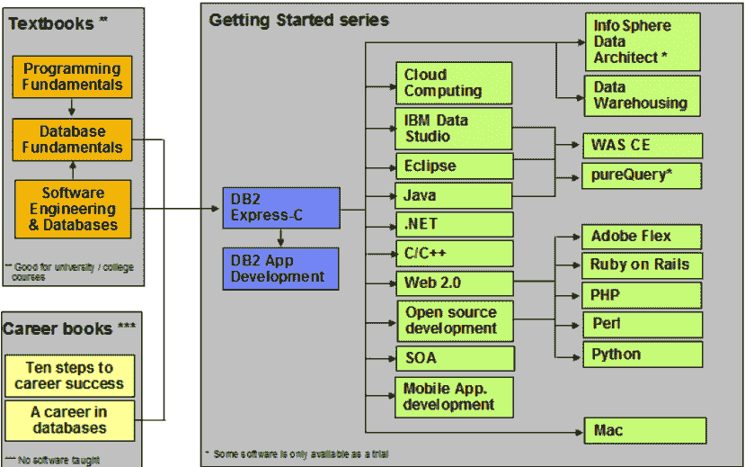

## DB2 校园系列丛书

## 关于作者

**艾琳·威尔逊** 是 IBM 硅谷实验室的信息开发人员。作为 InfoSphere Data Architect 的信息开发负责人，她负责整理数据架构师最需要的信息。她曾参与 InfoSphere Optim™ 数据生命周期产品组合中的多款基于 Eclipse 的产品开发，专攻数据建模和数据仓库，对基于 DB2 的环境尤为熟悉。除产品文档外，她还参与编写并解说了数据生命周期产品组合的产品演示。加入 IBM 之前，艾琳毕业于普渡大学，获专业写作学位。作为一名终身计算机与技术爱好者，她会在业余时间学习更多编程和 Web 开发相关知识。

**萨加尔·维布特** 2008 年加入 IBM 开启职业生涯。目前他是班加罗尔印度软件实验室（ISL）JCC 开发团队的一员，此前曾担任 InfoSphere Data Architect 持续工程团队的一员。他持有班加罗尔国际信息技术学院（IIIT-Bangalore）的信息技术硕士学位。业余时间他喜欢弹吉他或在乡间骑行。

**切坦·巴蒂亚** 2008 年加入 IBM。目前他担任 InfoSphere Data Architect 的开发人员，拥有计算机应用硕士学位，在软件开发领域有 11 年以上的工作经验。他曾参与 Web 开发平台的相关工作，目前从事基于 Eclipse 框架的产品开发。他喜欢学习新技术和新设备，也喜爱游泳和阅读。

**拉胡尔·简** 2008 年 6 月加入 IBM 开启职业生涯。他是一名软件开发人员，目前是班加罗尔印度软件实验室（ISL）InfoSphere Data Architect 开发团队的一员。此前他曾在同一实验室的 InfoSphere Data Architect 持续工程团队工作。他拥有班加罗尔国际信息技术学院（IIIT-Bangalore）的信息技术硕士学位以及化学工程学士学位。他最喜欢的消遣是听音乐和在高速公路上驾车。

**利维乌·佩尔尼乌** 是罗马尼亚布拉索夫特兰西瓦尼亚大学自动化系的副教授，教授数据需求、分析与建模相关课程。他是 2006 年 IBM 教师奖的获得者（属于 Eclipse 创新奖项计划的一部分），同时也是《数据库基础》一书的作者之一，该书也属于 DB2 校园系列丛书。

**希尔帕·什里·R.** 拥有电子与通信专业的工学学士学位，在 Java 和 J2EE 领域有 6 年的 IT 工作经验。目前她担任 iGate 全球解决方案有限公司的系统分析师。

**保罗贾亚姆·斯普·罗伯茨塞缪尔** 在 IBM 工作已超过两年。他拥有物理治疗学（康复医学）学位，不过后来转了专业，目前担任 InfoSphere Data Architect 的三级产品支持工程师。

## 18 开始使用 InfoSphere 数据架构师

他的专业领域经验还包括地理信息系统。他的爱好包括阅读和游泳。

## 贡献者

| 贡献者 | 公司/所属机构 | 职位 | 贡献 |
| --- | --- | --- | --- |
| 柏云峰 | IBM中国软件开发实验室 | InfoSphere 数据架构师 员级软件工程师 | 技术评审 |
| 劳尔·F·庄 | IBM加拿大实验室 – 加拿大多伦多 | 高级DB2项目经理 | DB2校园系列丛书整体项目协调、书籍编辑、排版与评审 |
| 唐·克莱尔 | IBM硅谷实验室 | InfoSphere 数据架构师 软件开发工程师 | 技术评审 |
| 史蒂夫·科科伦 | 英国安维尔Aviva健康部门 – 伊斯特利 | 数据建模师 | 技术与内容评审 |
| 乔·福利斯特尔 | IBM – 爱尔兰 | 商业智能分析师 | 技术评审 |
| 莱昂·卡茨内尔森 | IBM多伦多实验室 | IBM数据服务器 项目经理 | 技术评审 |
| 赫曼特·科瓦尔卡尔 | IBM硅谷实验室 | InfoSphere 数据架构师 软件开发工程师 | 技术评审 |
| 李涛 | IBM中国软件开发实验室 | InfoSphere 数据架构师 员级软件工程师 | 技术评审 |
| 刘威 | IBM硅谷实验室 | 数据工具 软件开发工程师 | 技术评审 |
| 梅·迪姆 | IBM硅谷实验室 | （安装方向）软件开发工程师，Data Studio工具 | 技术评审 |
| 邱璐 | IBM中国软件开发实验室 | InfoSphere 数据架构师 员级软件工程师 | 技术评审 |
| 罗宾·拉达茨 | IBM奥斯汀 | SQL与XQuery工具 软件开发工程师 | 技术评审 |
| 王尼尔 | IBM | InfoSphere 数据架构师 软件开发工程师 | 技术评审 |
| 徐明华 | IBM硅谷实验室 | InfoSphere 数据架构师 软件开发工程师 | 技术评审 |
| 约瑟夫·叶 | IBM硅谷实验室 | InfoSphere 数据架构师 软件开发工程师 | 技术评审 |

## 致谢

我们非常感谢以下各位为本书参考资料的开发提供的帮助：

**林今**，IBM硅谷实验室，负责设计第3章中解释逻辑数据建模的图表。

**娜塔莎·托卢布**，负责设计本书封面。

**苏珊·维瑟**，负责协助本书出版。

**凯瑟琳·蔡登斯坦**以及《DB2 IBM Data Studio 入门》一书的其余编写团队，他们的工作为本书第1章提供了框架。

# 第一部分 – 概述与安装


## 第1章 – IBM InfoSphere 数据架构师简介

IBM InfoSphere® Data Architect 是一款企业级数据建模工具。它是一个综合开发环境，可用于对多样化的分布式数据资产进行建模，也可用于发现并建立这些资产之间的关联。在本章中，您将了解以下概念：

- 什么是 IBM InfoSphere 数据架构师？
- 如何使用该产品
- 系统要求
- 如何安装 IBM InfoSphere 数据架构师

### 1.1 什么是 IBM InfoSphere 数据架构师？

当今企业拥有海量数据，所有决策都基于数据做出。IT 领域面临的挑战十分明确：理解数据、提升数据质量与一致性，并使数据设计与业务意图及需求保持一致。IBM InfoSphere Data Architect 是一款协作式数据设计解决方案，可帮助您发现、建模、关联并标准化多样化的分布式数据资产。IBM InfoSphere Data Architect 的部分主要功能与优势如下所示：

- InfoSphere 数据架构师通过检查分析底层元数据，发现异构数据源的结构。通过使用已建立的 Java 数据库连接（JDBC）连接至数据源，InfoSphere 数据架构师利用原生查询探索其结构。通过用户界面，用户可以轻松浏览数据元素层级，便于了解每个元素的详细属性。
- InfoSphere 数据架构师可为 DB2®、Informix®、Oracle、Sybase、Microsoft SQL Server、MySQL 和 Teradata 创建逻辑、物理和域模型。逻辑与物理数据模型的元素可使用信息工程（IE）标记法以图表形式可视化呈现。此外，物理数据模型图也可使用统一建模语言（UML）标记法。InfoSphere 数据架构师支持数据专业人员从零开始创建物理数据模型、通过转换从逻辑模型创建物理数据模型，或通过逆向工程从数据库创建物理数据模型。IBM InfoSphere 数据架构师还可创建并使用逻辑与物理多维数据模型。与逻辑及物理数据模型类似，您可以从零开始创建这些模型，也可从现有数据源对其进行逆向工程。

> **注意：** 本书未涉及多维建模相关内容。若想了解多维建模的更多概念性信息，请访问 IBM InfoSphere 数据架构师信息中心：`http://publib.boulder.ibm.com/infocenter/ndahelp/v7r5/topic/com.ibm.datatools.dimensional.ui.doc/topics/c_ida_dm_container.html`

- 多数开发项目本质上是迭代式的，因此能够增量式设计并无缝管理变更及其影响十分重要。InfoSphere 数据架构师正好支持这一需求。影响分析会列出所选数据元素的所有依赖项。高级同步技术可比较两个模型、模型与数据库或两个数据库。之后可在数据模型内、跨数据模型以及跨数据源推广变更。可与 Optim™ Database Administrator 搭配使用，在不中断业务的情况下管理复杂的 DB2 变更与数据迁移。


# InfoSphere 数据架构师

InfoSphere 数据架构师支持架构师定义并实施标准，提升命名、含义、值、关联、权限、隐私与可追溯性方面的数据质量与企业一致性。只需定义一次标准，即可将其关联到多种模型和数据库。内置的、可扩展的、基于规则的分析功能可验证模型和数据库是否符合命名、语法、规范化及最佳实践标准。

无论您是在小团队中工作（成员需承担多个角色），还是在职责划分明确的大型分布式团队中工作，都可以将 InfoSphere 数据架构师作为插件用于共享的 `Eclipse` 实例，或通过标准配置管理代码库（如 `Rational® Clear Case` 或并发版本系统（`CVS`））共享开发制品。

## 1.2 系统要求

安装 IBM InfoSphere 数据架构师 `V7.5.3` 之前，请确保您的计算机满足系统要求。您可通过以下网址查找 IBM InfoSphere 数据架构师的系统要求：

`http://www-01.ibm.com/support/docview.wss?uid=swg27019867`

该文档包含硬件、软件和数据源要求。

> **注意：** 如果您要扩展现有 `Eclipse` 环境，则必须使用 `Eclipse 3.4.2` 版本和 `IBM JDK 1.6 SR 7`。

## 1.3 获取 `DB2 Express-C`

本书大部分练习均使用 `DB2` 免费版本 `DB2 Express-C`。要获取并安装 `DB2 Express-C`：

- 从 `ibm.com/db2/express` 下载 `DB2 Express-C`
- 安装 `DB2 Express-C`。您可在 `db2university.com` 查看相关操作视频
- 配置 `DB2` 自带的 `SAMPLE` 示例数据库，以便部署您在学习本书过程中创建的数据模型

> **注意：** 更多相关信息，请参阅本丛书中的*《`DB2 Express-C` 入门》*电子书。

## 1.4 获取 `InfoSphere` 数据架构师

如果您是学生、教师或研究人员，可通过 `IBM` 学术计划免费获取 `IBM InfoSphere` 数据架构师。您需隶属于某所院校，且需满足以下任一条件：

- 您是学习数据架构的学生
- 您是教授数据建模与架构的教师
- 您希望使用该产品开展研究

想了解 `IBM` 学术计划的更多信息，请访问以下网址：

`https://www.ibm.com/developerworks/university/academicinitiative/`

## 开始使用 `InfoSphere Data Architect`

要购买 `IBM InfoSphere Data Architect`，请访问产品页面，点击**准备购买**按钮，通过 `Passport Advantage` 下载产品：

`http://www-01.ibm.com/software/data/optim/data-architect/`

您可以在以下下载文档中找到所需的 `Passport Advantage®` 产品编号。在此页面上，选择您将用于运行产品的操作系统：

`http://www-01.ibm.com/support/docview.wss?uid=swg24028103`

如果您想免费试用该产品 `30` 天，可前往 `ibm.com` 下载 `IBM InfoSphere Data Architect` 的试用版。请访问以下网址下载试用副本：

`http://www.ibm.com/developerworks/downloads/r/rda/index.html`

## 1.5 安装 `InfoSphere Data Architect`

`IBM InfoSphere Data Architect` 可通过启动台界面安装，也可采用静默安装，即您先创建包含所选安装选项的响应文件，再运行该响应文件。

静默安装适用于大规模部署场景，即需要将安装包推送至多台设备的情况。

本章主要介绍通过启动台界面进行的安装。本章假设您的设备尚未安装 `IBM Installation Manager`。因此，安装 `IBM InfoSphere Data Architect` 时会先从安装管理器开始。如果您选择安装其他使用该版本安装管理器的产品，则无需重复安装安装管理器。

> **注意：** 正如《数据安全、隐私和生命周期管理》信息中心（`http://publib.boulder.ibm.com/infocenter/idm/docv3/index.jsp?topic=/com.ibm.datatools.rda.install.doc/topics/c_plan_imover.html`）中所说明的，`IBM Installation Manager` 是一款用于安装、更新和修改软件包的程序。它可帮助您管理其在您的计算机上安装的 `IBM` 应用程序或软件包。`IBM Installation Manager` 的功能不止安装软件包：它还能帮助您跟踪已安装的内容、查看可安装的内容，以及整理安装目录。

本章假设您在产品安装目标计算机上拥有管理员权限。

请按照以下步骤安装 `IBM InfoSphere Data Architect` 产品：

1. 解压压缩包内容后，启动启动台：
   - `Windows` 系统：运行 `setup.exe` 文件，该文件位于您解压镜像的目录中。
   - `Linux` 或 `UNIX` 系统：在您解压镜像的根路径下运行 `setup` 命令。
   启动台随即打开。

2. 在左侧窗格中，选择*安装产品*，如图 1.1 所示。产品安装页面随即打开，您现在可以选择要运行的安装类型。

   ``

   **图 1.1** – 点击“安装产品”以启动安装管理器

3. 选择*管理安装*选项，`IBM Installation Manager` 随即打开。

4. 选择要安装的软件包。本次操作请选择*`IBM InfoSphere Data Architect`*软件包，点击*下一步*。

5. 查看并接受许可协议，点击*下一步*。

6. 创建新的软件包组，并指定通用组件的安装位置：
   a. 选择*创建新软件包组*单选按钮，如图 1.2 所示。由于您所在的目标计算机上不存在现有软件包组，因此需选择此选项。

   | 选项 | 选中状态 |
   |--------|----------|
   | 使用现有软件包组 | ○ |
   | 创建新软件包组 | ● |

   ``

   软件包组名称：`IBM InfoSphere`

   安装目录：`C:\Program Files\IBM\IDA7.5.3`

   **图 1.2** – 为 `IBM InfoSphere Data Architect` 创建新软件包组

   b. 指定共享资源与安装管理器的安装目录。本次操作可使用默认设置，但请注意：应选择存储空间大于您预估的 `IBM InfoSphere Data Architect` 所需的磁盘，以防后续需要与其他基于 `Eclipse` 的产品共享存储空间。

   > **注意**：如果您安装的其他产品使用了安装管理器，则无法自行选择共享资源的安装目录。

   c. 点击*下一步*进入下一页。

7. 如果您的设备上已安装 `Eclipse 3.4.2`，可选择*扩展*该集成开发环境，而无需额外安装副本。该操作会添加新安装产品的功能，同时保留您原有的集成开发环境偏好与设置。本次操作无需修改任何设置，点击*下一步*进入下一页。

8. 选择您需要安装的额外语言翻译包，然后点击*下一步*。

9. 选择您需要安装的功能。本次操作请确保所有复选框均已勾选，然后点击*下一步*。

10. 指定产品文档和帮助主题的访问方式。默认情况下，所有帮助文档均存放于 `IBM InfoSphere Data Architect` 信息中心。您可选择在安装时下载所有帮助文档，或从中央服务器访问所有帮助。本次操作请选择*从 `Web` 访问帮助*选项，然后点击*下一步*。

11. 在摘要页面中查看您的选择，然后点击*安装*。`IBM Installation Manager` 将开始安装产品。进度条可能会偶尔暂停；请勿中断安装进度，也请在产品完全安装完成前不要退出安装程序。产品安装完成后，您将看到图 1.3 所示的界面。

    ``

    **图 1.3 – 恭喜！产品已成功安装**

12. 在安装软件包向导的最后一页，选择*无*选项，表示您不想在安装完成后启动 `InfoSphere Data Architect`。如果您使用的是许可版本，将在产品应用许可后启动 `IBM InfoSphere Data Architect`。点击*完成*退出安装向导。

13. 点击左侧窗格中的*退出*链接，关闭启动台窗口。至此，`IBM InfoSphere Data Architect` 安装完成。如果您持有许可，现在需要激活许可，才能在 `30` 天试用期结束后继续使用该产品。

## 1.6 为 `IBM InfoSphere Data Architect` 应用许可

InfoSphere `Data Architect` 支持三种不同类型的许可：

- **试用许可**：您可以免费下载该产品，并在 `30` 天内使用全部功能。选择此选项可评估产品是否满足您的数据建模需求。若选择此许可类型，无需额外激活许可，产品已内置试用许可。
- **浮动许可**：您可以搭建 `Rational License` 服务器，在整个组织内存储和管理浮动许可。要了解有关浮动许可及如何在 `InfoSphere Data Architect` 中使用浮动许可的更多信息，请参阅以下技术说明：`http://www.ibm.com/support/docview.wss?uid=swg21468395`
- **单用户许可**：您需要为每个产品安装实例应用一个激活工具包，具体步骤见下文。

如果您有需要应用到产品上的浮动许可或单用户许可，请按照以下步骤操作：

1. 打开 `IBM Installation Manager`：
   - `Windows` 系统：点击*开始* -> *所有程序* -> *`IBM Installation Manager`* -> *`IBM Installation Manager`*。
   - `Linux` 或 `UNIX` 系统：打开拥有 `root` 权限的终端窗口，切换到 `IBM Installation Manager` 所在目录。默认情况下，该路径为`/opt/IBM/InstallationManager/eclipse`，运行`IBMIM`程序。

   ```bash
   /opt/IBM/InstallationManager/eclipse IBMIM
   ```

2. 点击*管理许可*按钮，如图 1.4 所示：

   ``

   **图 1.4** – 在 `IBM Installation Manager` 中选择“管理许可”

   随即打开管理许可页面。

   a. 在已安装软件包列表中，选择*`IBM InfoSphere Data Architect 7.5.3.0`*。

   b. 选择*导入产品激活工具包*单选按钮，然后点击*下一步*。

# 第 1 章 – `IBM InfoSphere Data Architect` 简介

   c. 浏览并选择产品激活工具包 `.JAR` 文件，该文件保存在本地机器的对应位置，如图 1.5 所示：

   ``

   **图 1.5 – 选择产品激活工具包**

   d. 点击“下一步”进入下一页。

   e. 接受许可协议，然后点击“下一步”。

   f. 在“概要”页面，点击“完成”。许可将应用到产品。激活界面如图 1.6 所示：

   ``

   > **图 1.6 – 许可已激活**

你可以关闭 `IBM Installation Manager`，首次启动 `IBM InfoSphere Data Architect`。

## 1.7 启动 `IBM InfoSphere Data Architect`

可通过以下任意一种方式启动 `IBM InfoSphere Data Architect`：

- `Windows`：点击`开始` -> `所有程序` -> `IBM InfoSphere` -> `IBM InfoSphere Data Architect 7.5.3.0`。
- `Linux` 或 `UNIX`：在终端窗口中输入以下命令：`.product_install_directory/eclipse`，其中*产品安装目录*是安装产品的目录。

打开产品时，你可以指定要使用的工作区，将工作区名称设置为**`IDA_GettingStarted`**，如图 1.7 所示：

``

**图 1.7 – 选择工作区**

> **注意：**
> 工作区是保存你的工作、自定义项和首选项的位置。如果你打开其他工作区，当前工作区中的工作和其他更改将不可见。工作区概念源自 `Eclipse`。

> **注意：**
> 透视图是 `Eclipse` 的概念。透视图包含与特定任务关联的视图和操作。视图会显示与编辑器关联的资源。`IBM InfoSphere Data Architect` 的默认透视图是数据透视图，如图 1.8 所示。你可以在其中看到各个视图的名称，包括“数据项目浏览器”和“大纲”。

``

**图 1.8 – `IBM InfoSphere Data Architect` 中的默认数据透视图**

`IBM InfoSphere Data Architect` 首次启动时会进入包含任务启动器的数据透视图。

### 1.7.1 浏览工作台

*工作台*一词指桌面开发环境，是 `Eclipse` 的概念。工作台旨在通过为工作区资源的创建、管理和导航提供通用范例，实现无缝工具集成与受控开放性。

#### 1.7.1.1 任务启动器

首次打开 `InfoSphere Data Architect` 工作区时，你会在主编辑器视图中看到一个名为“任务启动器”的面板。任务启动器是专为帮助你在工作台中完成基础任务而设计的视图。例如，`IBM InfoSphere Data Architect` 中的任务启动器可以帮助你首次创建物理数据模型。使用任务启动器顶部的选项卡即可开始执行这些任务。`IBM InfoSphere Data Architect` 的任务启动器视图中共有三个选项卡：

- **概述：** 此选项卡包含指向产品通用信息的链接，以及“入门”类基础任务，例如连接到数据库。
- **设计：** 此选项卡包含可帮助你创建数据模型、设计数据的常用任务。你还可以在此了解其他常用任务，或点击链接查看 `developerWorks` 上的教程。
- **开发：** 此选项卡包含可帮助你开发 `SQL` 或 `XQuery` 语句及存储过程的常用任务，你还可以学习如何调试这些语句。

任务启动器如图 1.9 所示：

``

> **图 1.9 – 认识任务启动器**

在任务启动器中打开任务时，与该任务关联的透视图会自动打开，同时还会弹出一个帮助面板。按照帮助面板中的说明即可完成任务。我们通过连接安装 `DB2` 时自带的 `SAMPLE` 数据库连接来探索任务启动器的用法。打开任务启动器的*概述*选项卡完成此任务。

1. 在*任务*框中，点击*连接并浏览数据库*链接。如果数据透视图未打开，该透视图会自动打开，同时打开“帮助”视图引导你完成操作。工作台的更改如图 1.10 所示：

   ``

   > **图 1.10 – 使用任务启动器完成任务**

2. 按照任务启动器中“帮助”面板的说明完成任务，连接到安装 `DB2 Express-C` 时配置的 `SAMPLE` 数据库。完成任务后，该连接会显示在“数据源浏览器”视图中。任务启动器包含在数据安全、隐私和生命周期管理产品套件的所有基于 `Eclipse` 的产品中。如果你与其他基于 `Eclipse` 的产品共享外壳，关联这些选项卡的任务会发生变化，因为你的产品环境支持更多功能。第 `10` 章以及更广泛的数据安全、隐私和生命周期管理产品组合中详细讨论了外壳共享。

**注意：** 如果你不想在打开工作区时看到任务启动器，只需关闭该视图即可。如果将来需要打开任务启动器，只需通过主菜单打开：帮助 -> 打开任务启动器。

#### 1.7.1.2 透视图

每个工作台窗口包含一个或多个透视图。*透视图*包含视图和编辑器，会根据特定任务或角色控制某些菜单和工具栏中显示的内容。因此，调试透视图（用于 `Java` 调试）中显示的视图和任务与数据透视图中的不同。

我们来看看 `Java` 透视图。打开不同透视图的一种方法是点击图 1.11 中所示的图标并选择*`Java`*。另一种打开透视图的方法是点击*窗口* -> *打开透视图*。

``

*图 1.11* – 打开不同透视图

对比图 1.8 和下方的图 1.12 可以发现，`Java` 透视图的任务侧重（`Java` 开发）与数据透视图不同。例如，此情况下的大纲视图会与编辑器中的 `Java` 源代码配合使用，浏览器显示的是 `Java` 包，而非数据库对象。

``

**图 1.12 – `Java` 透视图**

点击数据透视图切换回来，以便进一步了解数据透视图的功能。

> **注意：**
> 有关透视图和视图的更多信息，请参阅电子书*《`Eclipse` 入门》*。

### 1.7.2 浏览数据透视图及其视图


由于本书中大部分操作都在数据透视图中完成，请确保数据透视图处于打开状态。如前所述，*视图*是工作台中你看到的窗口，例如数据源浏览器和属性视图。视图通常用于浏览信息层次结构、打开编辑器，或显示活动编辑器的属性。你对视图（大小和位置）所做的更改，以及在视图中创建的资源，会像之前提到的那样保存在你的工作区中。下表描述了数据透视图中显示的视图，即*表1.4*：

| 视图 | 说明 |
| --- | --- |
| 数据项目浏览器 | 该视图供数据架构师或数据/信息建模师在创建模型时使用，可显示数据设计项目（用于存储逻辑和物理数据模型）与数据开发项目。 |
| 数据源浏览器 | 该视图支持连接数据库、查看数据库及其内部对象，会自动显示检测到的数据库，也支持添加新的数据库连接。你可以通过将数据源浏览器中的数据对象拖放到数据项目浏览器中，在此视图执行反向工程。 |
| 属性 | 该视图显示工作区中当前所选对象的属性。部分对象支持通过该视图编辑属性，例如修改数据源浏览器中所选的数据库对象。当图表或数据项目浏览器中的某个对象被高亮选中时，属性视图会更新为该对象的对应属性。 |
| SQL结果 | 该视图显示运行SQL或XQuery语句后的结果，还支持获取数据库中某个选定表的示例数据。 |
| 大纲 | 该视图显示当前在编辑区域中打开的结构化文件的大纲，并列出其结构元素。例如，编辑数据图时，大纲视图会显示完整图表，放大或缩小图表时，会显示阴影框标识当前在整体图表中的位置。 |

##### 1.7.3 操作视图

基本视图控件如图*1.13*所示：

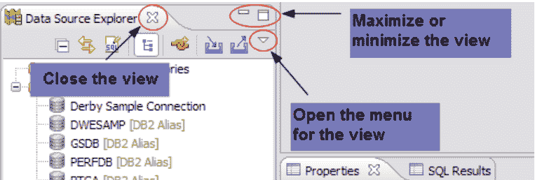

要关闭视图，请点击视图名称右侧的*X*，如*图1.13*所示。如果不小心关闭了视图也无需慌张。只要前往*窗口 -> 显示视图*，选择想要打开的视图即可。如果没有看到想打开的视图，点击*其他*，然后选择对应视图。

##### 1.7.4 重置透视图的默认视图

你应该尝试操作工作台中的各个视图和透视图。如果你不熟悉Eclipse，频繁打开关闭视图可能会让你觉得奇怪。如果想将透视图重置为默认设置，点击*窗口 -> 重置透视图*即可完成重置。

> **注意：** “重置透视图”选项仅会重置当前透视图。如果要修改其他透视图，请打开*窗口 -> 首选项*，然后选择*常规 -> 透视图*。选中目标透视图后点击*重置*按钮，下次打开该透视图时就会恢复为默认布局。

#### 1.8 练习

在本组练习中，你将安装IBM InfoSphere Data Architect，熟悉工作台和Eclipse工具。

- 如果你尚未安装DB2 Express-C，请先安装它。
- 如果你尚未安装InfoSphere Data Architect，请按照本章的说明进行安装。
- 熟悉工作台：完成以下任务：
  - 切换到插件开发透视图。
  - 切换回数据透视图。
  - 关闭大纲视图。
  - 最小化和最大化部分视图窗口。
  - 浏览产品文档：IBM InfoSphere Data Architect的相关文档位于以下网址的信息中心：`http://publib.boulder.ibm.com/infocenter/ldahelp/v7r5/index.jsp`
  - 阅读*产品概述*。
  - 观看并完成[了解工作台环境](http://www.ibm.com)教程中的课程。
  - 在developerWorks上观看[IBM InfoSphere Data Architect简介](http://www.ibm.com)演示。

#### 1.9 总结

IBM InfoSphere Data Architect提供了工具支持，可帮助你创建用于数据发现、可视化、关联和标准化的数据模型。你可以为DB2、*Informix*、*Oracle*、*Sybase*、*Microsoft SQL Server*、*MySQL*和*Teradata*等源系统创建逻辑、物理、维度及域模型。它支持迭代式设计流程，你可以在业务需求变更时更新和优化数据模型，且对生产环境的影响极小。

IBM InfoSphere Data Architect还有一个活跃的讨论论坛，网址如下：`http://www.ibm.com/developerworks/forums/forum.jspa?forumID=1796` 该论坛可提供非正式支持。本章还介绍了产品安装方法以及Eclipse工作台的导航操作，你已学会了如何打开不同的透视图，以及如何操作透视图中的视图。

#### 1.10 复习问题

- IBM InfoSphere Data Architect是基于哪个开源平台构建的？
- 基于Eclipse的产品中的*透视图*是什么？
- IBM InfoSphere Data Architect的默认透视图是什么？
- SQL操作的结果会出现在哪个Eclipse视图中？
- 如何在透视图内打开视图？
- 判断正误：数据库连接在数据项目浏览器视图中查看。
- 判断正误：默认透视图、项目和数据对象是每个工作区独有的。
- 判断正误：无法指定随产品安装的功能。
- 判断正误：要将现有Eclipse环境扩展为支持IBM InfoSphere Data Architect，必须使用相同版本的Eclipse和IBM JDK。


### 第2章 – 数据建模概述

创建数据模型时，需要遵循一定的流程。本书会介绍一些最佳实践和概念，确保你在工作台中创建的模型符合良好的数据设计原则。在本章中，你将学习以下概念：

- 数据设计生命周期
- 数据模型的常规组织方式
- 阅读本书后你将构建的信息管理系统

> **注意：** 如需了解关于数据建模的更多信息，请查阅本系列丛书中的电子书《数据库基础》。[Database Fundamentals](Database Fundamentals)

#### 2.1 数据模型设计生命周期

通过本书，你将学习如何创建可用于构建数据库的数据模型。数据模型设计生命周期可帮助你采用迭代式设计流程，完成数据模型的概念化与开发工作。数据建模有两种工程方法：

- **正向工程：** 没有预先存在的模型可供参考，从零开始构建数据模型和数据库。这类建模最适合新系统，或针对当前系统尚未覆盖的新业务流程进行建模的场景。
- **逆向工程：** 利用现有的数据模型和数据库，在工作台中创建模型。工作台可以根据现有数据库和模式创建物理数据模型，你还可以使用转换工具创建逻辑数据模型，进一步优化你的项目。

> 注意：本书主要关注正向工程，同时也介绍了逆向工程，以便你全面了解数据建模以及产品的相关功能。关于逆向工程的更多信息请参阅本书第7章。

要在工作台中开发并部署数据库，请遵循以下流程：

- **收集项目需求。** 与业务流程负责人沟通，确定对业务至关重要的信息。你可以用这些信息起草实体/表以及属性/列。
- **使用IBM InfoSphere Data Architect创建逻辑数据模型。** 逻辑数据模型是数据建模流程的第一步，在此阶段你需要收集需求、创建实体和属性。最终你会用逻辑数据模型创建物理数据模型。设计逻辑数据模型时，你可以借助数据图可视化模型，向业务流程负责人展示信息是如何关联的。随着你和业务流程负责人进一步明确需要建模的信息，你可以不断优化该数据模型的设计。
- **使用IBM InfoSphere Data Architect将逻辑数据模型转换为物理数据模型。** 在物理数据模型中，你可以起草物理存储、表空间、索引或视图。你还可以通过配置角色和用户，使用物理数据模型来保护要部署的新数据库的特定部分。优化物理数据模型时，你可以继续使用从逻辑数据模型转换而来的现有数据图，也可以创建新的数据图来可视化你的存储需求。
- **创建映射模型，定义数据模型与目标数据库之间的关系。** 映射模型包含定义你所创建的源架构与目标架构之间关系的信息，包括转换、连接条件、过滤器、排序条件和注释。映射模型可以查找或记录这些关系，你可以使用映射模型生成利用这些关系查询或操作数据源的语句。

> 注意：作为最佳实践，创建映射模型前请确保数据模型已经稳定。如果修改关系或数据对象的名称，之前创建的映射会被破坏，你将会遇到错误。

- **生成用于部署数据库的DDL语句。** 数据库部署完成后，你可以创建应用程序连接并读取数据库，也可以使用其他软件进一步优化或读取数据库。
- **随需求变化及时优化模型。** 业务需求有时会变更或成熟，你需要根据实际情况调整数据模型，确保仍然能获取或录入相关信息。

此外，你还可以使用IBM InfoSphere Data Architect完成以下操作：

- 创建报告，供业务流程负责人了解数据库中存储的数据。
- 导入或导出工作台的数据模型。
- 比较并同步数据模型之间的变更，在部署变更前分析变更对已更新数据模型的影响。
- 对现有数据源进行逆向工程。
- 分析数据模型，确保通用数据建模规则得到遵循和执行。

#### 2.2 数据模型的组织

数据建模包括对数据进行结构化和组织。数据建模可以定义和组织数据，还可以对放置在结构中的数据施加（隐式或显式）约束或限制。

#### 2.3 创建学生信息管理系统

你将通过本书和工作台，为某高校创建一个示例学生信息管理系统。该系统将存储学生的学号、成绩、地址等信息。你将遵循数据设计生命周期来设计并实现该学生管理信息系统：先创建逻辑数据模型，再用其创建物理数据模型；物理数据模型创建完成后，你可以进一步更新系统，或直接部署系统。

本书下一部分将聚焦数据设计生命周期中的数据建模环节。你将基于虚构大学的流程负责人提出的需求创建逻辑数据模型。逻辑数据模型创建完成后，你可以将其转换为物理数据模型。物理数据模型创建完成，且你已完成表、列及其他物理数据对象的设计后，你将生成DDL脚本来部署物理数据模型，进而创建数据库。随后，你将创建映射模型，借此将你的数据模型与其他数据模型整合，搭建能够跟踪学生信息全维度的统一数据库系统。在本书第三部分，你将学习如何使用工作台生成报表。这些报表可供业务流程负责人使用，用于分析通过你的数据模型设计可获取的数据。最后，你将学习如何对现有数据库或架构进行反向工程，从而对现有数据对象进行进一步的迭代修改并部署变更。在最后一章中，你将学习如何分析数据模型，确保在将模型部署到生产环境前其符合有效性要求。

##### 2.4 小结

你已了解数据建模的基本概述，以及如何使用IBM InfoSphere数据架构师草拟和部署数据模型。创建这些模型时，你会先从逻辑设计入手，之后再草拟物理设计。数据设计流程是迭代式的，IBM InfoSphere数据架构师能够帮助你轻松继续使用现有的数据模型和数据源开展工作。反向工程功能可让你便捷地操作现有数据源，你可以持续优化现有资源以扩展功能、提升性能或响应变更的需求。

##### 2.5 接下来要学什么

现在你已经掌握了数据建模的基础知识，应该开始着手草拟设计方案。通过本书，你将熟悉工作台的操作，以及如何从头到尾创建可部署、可优化的完整数据模型。

## 第二部分 – 数据建模

### 第3章 – 逻辑数据建模


逻辑数据模型是数据设计生命周期的第一步。逻辑数据模型能够帮助你捕获业务需求，在设计物理存储和部署模型之前，你就可以开始设计架构和数据库的未来方案。本章涵盖以下概念：

- 如何设计逻辑数据模型
- 创建图表以直观展示模型的设计方案
- 为你的组织开发术语表模型和命名规范
- 将这些术语表模型和命名规范应用到你的数据模型中

> **注意：**
> 有关逻辑数据建模的更多信息，请查阅本系列丛书中的电子书[《数据库基础》]。

#### 3.1 逻辑数据建模：整体概览

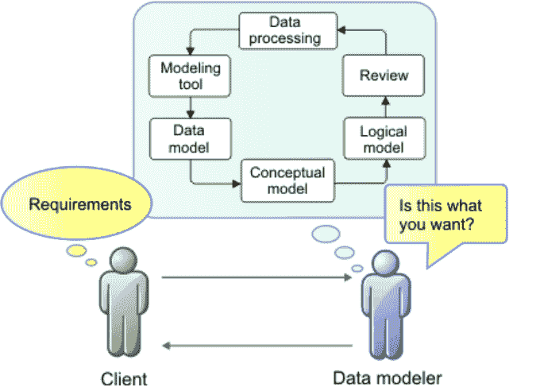

**图3.1** – 将IBM InfoSphere数据架构师作为你的数据建模工具

创建逻辑数据模型是开发满足业务需求的数据库或架构的第一步。*逻辑数据模型*是不针对特定数据库厂商的模型。逻辑数据模型描述了组织想要收集数据的对象，并记录这些对象之间的关系。逻辑数据模型采用分层结构，包含包、实体、属性及其他关系对象。在创建逻辑数据模型之前，你必须收集模型的需求。业务用户对自身需求的描述可能不完整，通常业务用户或客户只会提供整体需求的部分片段。你可能会收到非常模糊的业务流程描述，例如“企业必须跟踪我们产品的销售情况”。作为数据建模师，你必须了解项目的所有需求，才能补全缺失的部分，构建完整的模型。收集完初始需求后，你要将结果呈现给客户，最好通过展示图表的方式，然后与客户协商相关及非核心方面，如*图3.1*所示。协商完成后，你（数据建模师）修改逻辑数据模型，并将修改后的模型呈现给客户。通过这一迭代流程，你草拟并开发出完整的逻辑数据模型。本章将介绍逻辑数据模型的开发流程。

#### 3.2 创建逻辑数据模型

为项目创建逻辑数据模型时，你遇到的最棘手的问题之一就是商定需要建模的业务流程。你应该与客户协作，明确项目需要满足的业务需求。要创建业务流程的逻辑数据模型，你需要遵循以下流程：

- 分析企业的各类需求。从最重要的业务流程入手。记录分析结果，以便你和其他数据建模师能够了解项目的目标与未来规划。
- 与项目负责人协作，明确他们需要识别的数据以及这些数据的重要性。你可以借此识别出在多个流程、数据源或各数据对象不同粒度下通用的初始数据对象。
- 与项目负责人会面，解决模糊的需求。
- 制定满足需求的初步方案。创建概念模型，起草逻辑数据模型的初始设计。你将使用该方案来设计数据模型。

##### 3.2.1 使用工作台创建逻辑数据模型

你与大学的业务流程负责人会面，他们请你帮忙创建一个用于收集学生信息的学生信息管理系统。经过进一步沟通，你们决定从小处着手，先创建一个用于跟踪学生基本信息（如学生学号、成绩、课程）的逻辑数据模型。为了学习如何使用工作台创建逻辑数据模型，你将创建一个名为**学生信息管理系统（STUDENT_INFO_SYSTEM）**的小型逻辑数据模型。

###### 3.2.1.1 创建新的数据设计项目以存储模型

在创建逻辑数据模型之前，你需要创建一个*新建数据设计项目*来存储文件。使用该数据设计项目存储本项目中的所有数据模型。你可以在一个工作区中创建多个数据设计项目，每个数据设计项目都可以包含多个数据模型。创建新数据设计项目的步骤如下：

- 点击*文件 -> 新建 -> 数据设计项目*。“新建数据设计项目”窗口随即打开。

> **注意：**
> 由于你的工作区大概率是空的，你也可以点击*点击此处创建新建数据设计项目*链接。不过，在你创建第一个数据设计项目后，该链接将不再可用。

- 在*项目*字段中，为你的项目指定一个描述性名称。输入**大学信息系统**。
- 点击*完成*。“大学信息系统”数据设计项目将在数据项目浏览器中创建。在该数据设计项目中，设有用于存储项目文件的文件夹。

###### 3.2.1.2 创建你的首个逻辑数据模型

当前项目为空，因此你需要创建一个新的逻辑数据模型。你将使用该逻辑数据模型开始搭建学生信息管理系统。创建新的逻辑数据模型步骤如下：

- 打开“新建逻辑数据模型”窗口：
  - 在数据项目浏览器视图中，展开*大学信息系统*数据设计项目。
  - 右键单击*数据模型*文件夹，然后选择*新建* -> *逻辑数据模型*。“新建逻辑数据模型”窗口随即打开。
  - 填写“新建逻辑数据模型”窗口中的字段：
    - 在*文件名*字段中输入以下内容：**学生信息管理系统（STUDENT_INFO_SYSTEM）**。
    - 点击*完成*。逻辑数据模型创建完成，该数据模型将被打开，其中包含一个空白图表。你可以使用图表编辑器来创建逻辑数据模型的可视化呈现。*图3.2*展示了你的新数据设计项目以及新建的空白逻辑数据模型。

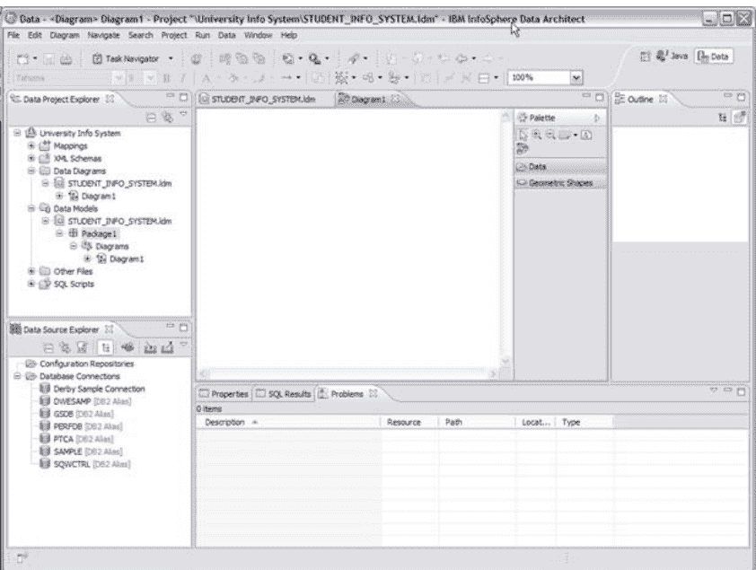

**图 3.2 – 创建空白逻辑数据模型**

## 3.2.2 使用图表创建实体

##### 3.2.2.1 创建图表

你可以使用图表来可视化和编辑数据设计项目中包含的对象。当你在逻辑数据模型的图表中创建对象时，这些更改会自动应用到逻辑数据模型中，这不仅使你更容易可视化数据对象及其之间的关系，还能节省手动创建这些关系所需的时间。数据图表是底层数据模型的一种表示形式。你可以创建仅包含你感兴趣的模型对象子集的图表。

##### 3.2.2.2 调色板的 Data 部分

调色板的 Data 区域包含数据模型对象。当你使用调色板或图表界面添加或修改数据模型对象时，你修改的是底层数据模型。

##### 3.2.2.3 从属性视图重命名数据对象

默认情况下，此图表的名称为 Diagram1，但你应该将其更改为容易记住或能与项目中其他数据模型区分开的名称。要重命名图表和顶层包，请执行以下步骤：

1. 在图表编辑器中打开 Diagram1 图表。当你打开或选择任何对象时，该对象的属性会显示在属性视图中。在本例中，你将编辑 Diagram1 图表的图表属性。
2. 打开属性视图的 General 选项卡，将 Diagram name 字段中的文本更改为 **STUDENT_INFO**。
3. 在数据项目浏览器中选择 Package1 包。该包位于 **STUDENT_INFO_SYSTEM.ldm** 数据模型文件下。
4. 打开 General 选项卡，将 Name 字段中的文本更改为 **STUDENT INFO SYSTEM**。数据对象会自动重命名。当你点击图表中的空白区域时，图表编辑器的名称会更改为 STUDENT_INFO，并且逻辑数据模型会在数据项目浏览器视图中更新。任何已修改的数据对象在数据项目浏览器或数据对象编辑器中都会显示星号（*）。当你保存文件或项目时，星号会消失。

> **注意：** 你可以使用属性视图修改图表的显示特征。例如，你可以更改以下选项：
- 使用 Format 选项卡更改实体或外键的前景色或背景色，或更改隐式外键关系的线条颜色。
- 使用 Documentation 选项卡记录图表的用途。
- 使用 Appearance 选项卡设置字体和文本颜色的格式。


所有这些选项都会更改图表属性，但不会修改底层数据模型。你还可以将图表保存为图像文件，用于归档或演示目的。

## 3.2.2.4 向图表中添加注释和文本框

向图表中添加注释或文本框，帮助你记录有关数据模型的信息。注释和文本框也有助于标注信息或完整解释复杂图表所要解决的问题。

首先，让我们向图表中添加一个标注图表的注释。

1. 点击图表调色板中的`Note`图标，如*图 3.3*所示。


**图 3.3 – 点击 Note 图标**

2. 点击图表编辑器中的空白区域。注释会出现在图表上。

3. 在注释中输入以下内容：

```
STUDENT_INFO: All information relating to student life.
```

注释会出现在图表上，如*图 3.4*所示。

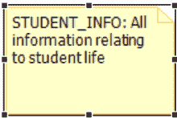

**图 3.4 – 在图表中创建注释**

要向数据图表提供额外信息，你可以添加文本框。让我们添加一个文本框，注明逻辑数据模型仍在起草中。

1. 右键点击图表中的空白区域，然后选择`Add -> Text`。文本框会出现在图表上。

2. 在文本框中输入：

> NOTE: This logical data model is still being drafted.

3. 将文本设置为红色和粗体：

   a. 打开属性视图的`Advanced`选项卡。

   b. 展开`Styles`属性。

   c. 将`bold`属性更改为`true`。

   d. 将字体颜色更改为红色。

4. 保存你的工作。点击`File -> Save All`。

## 3.2.2.5 设计数据图表和逻辑数据模型

`实体`是存储重要关注领域信息的逻辑数据模型对象。每个实体包含`属性`，用于存储实体的详细信息。例如，你可以创建一个`Sales`实体，包含`ProductKey`、`Quantity`、`UnitPrice`和`OrderKey`属性来描述各种产品的销售情况。当逻辑数据模型转换为物理数据模型时，实体可以变成表，属性变成列。在创建实体和属性时，应尽可能具体。插入你需要的所有属性、所有域约束以及你认为有助于获得更接近现实世界模型的所有其他方面。请记住，逻辑数据模型将被转换为物理数据模型。

让我们使用数据图表向逻辑数据模型添加一个新实体：

1. 在调色板视图中，展开`Data`部分，然后将一个实体拖放到图表编辑器的空白区域。新实体会在模型和图表中创建，你可以立即为实体指定一个新名称。

2. 将实体命名为`STUDENT`。实体在图表中创建，相应的数据对象在逻辑数据模型中创建。当你使用调色板或图表界面添加或修改逻辑数据模型对象时，底层逻辑数据模型会被修改。

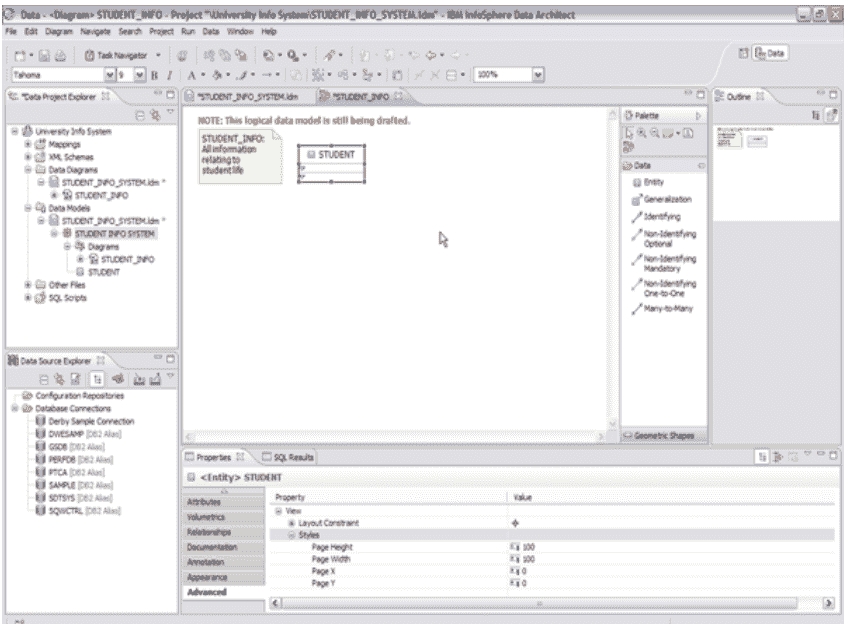

**图 3.5 – 创建 STUDENT 实体**

你还可以通过另外两种方法将实体添加到图表中：

- 使用上下文菜单：你可以在图表编辑器中右键点击以将数据对象添加到图表。要添加新实体，你可以右键点击编辑器的空白区域，然后选择`Add Data Object` > `Entity`。

- 使用弹出栏创建实体：你可以使用图表编辑器中的空白区域向图表添加数据对象。当你将鼠标悬停在数据对象或图表的空白区域上时，会出现一个弹出栏，如*图 3.6*所示。


**图 3.6 – 使用弹出栏在图表中创建数据对象**

你还可以使用此方法将其他数据对象添加到现有数据对象中；例如，你可以使用此方法为实体添加主键。

## 3.2.2.6 向 STUDENT 实体添加属性

该实体目前为空。向实体添加属性。实体的属性可以包括主键和非键属性。所有这些属性将存储大学中每位学生的信息。让我们从`STUDENT`实体开始。在大学中，每位学生都会获得一个10个字符长的唯一ID号。你将创建一个属性来存储大学中学生的学号。要向`STUDENT`实体添加属性，请执行以下步骤：

1. 在`STUDENT_INFO`图表中选择`STUDENT`实体。属性视图会显示`STUDENT`实体的属性。

2. 打开属性视图的`Attributes`选项卡。

3. 向实体添加学号（`STUDENT ID`）属性：

   a. 点击`New`按钮（💎）。在属性视图和图表中会创建一个新属性。

   b. 为新属性设置以下属性：

      - `Name`：`STUDENT ID`

      - `Primary key`：选中此复选框。

      - `Type`：`CHAR`

      - `Length/Precision`：`10`

你已经创建了`STUDENT ID`属性。`STUDENT ID`属性的数据类型为`CHAR(10)`，足以存储大学中学生的学号。当你选中`Primary key`列中的复选框将`STUDENT ID`列标记为主键时，`Required`属性也会自动被选中，因为主键不能为`null`值。

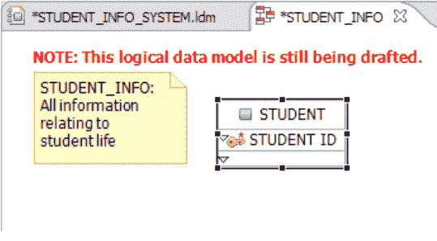

**图 3.7 – 创建 STUDENT ID 属性**

**注意：** 如果你不知道选择什么数据类型，请记住以下几点考量：

- 如果某个属性或列用于算术计算，请使用数值数据类型。

- 其他所有属性使用文本数据类型，原因如下：

  - 文本数据类型更灵活；例如，你可以使用约束来降低数据存储开销。

  - 你可以更好地控制文本数据类型的输入，因为`DB2`为字符串数据类型提供了更多函数。不过，如果你希望主键也为数值类型（例如代理键也属于数值型），有时也应使用数值数据类型。

注意，当你向实体添加属性时，图表也会同步更新。现在学生ID（`STUDENT ID`）实体将显示在图表中学生（`STUDENT`）实体的主键区域，旁边带有图标，用于标识学生ID是该实体的主键。按照上述相同流程，你可以为学生实体添加更多其他属性。请向学生实体添加以下属性：

1. 添加名字（`FIRST NAME`）属性。该属性数据类型为`VARCHAR(20)`，且为必填项。

2. 添加姓氏（`LAST NAME`）属性。该属性数据类型为`VARCHAR(50)`，且为必填项。

3. 添加入学日期（`START DATE`）属性。该属性数据类型为`DATE`。

4. 添加毕业日期（`GRADUATION DATE`）属性。该属性数据类型为`DATE`。

5. 保存你的工作。你已经使用图表编辑器创建了一个完整的实体，如*图3.8*所示。现在我们来学习如何使用数据项目浏览器创建另一个实体。

> **图3.8 – 完整的学生实体**

## 3.2.2.7 在数据项目浏览器中创建实体

我们来使用数据项目浏览器视图创建新的`GRADE`（成绩）实体，用于存储学生成绩相关信息。使用数据项目浏览器视图创建实体的步骤如下：

1. 在数据项目浏览器中定位`STUDENT_INFO_SYSTEM.ldm`数据模型，展开项目中的文件夹即可找到：`大学信息管理系统（University Info System）` -> `数据模型（Data Models）` -> `STUDENT_INFO_SYSTEM.ldm`。

2. 创建`GRADE`实体：

   a. 在逻辑数据模型下的`学生信息管理系统（STUDENT INFO SYSTEM）`包上点击右键，然后选择`添加数据对象` -> `实体`。

   b. 选中数据项目浏览器中的新实体，打开属性视图的**常规**选项卡，将名称和标签都改为`GRADE`，即可完成命名。该实体会创建在`学生信息管理系统`包下。注意，该实体不会显示在图表编辑器中，因为你没有在图表内创建该实体。只有你在图表中创建或拖入的对象才会显示在图表编辑器中。为了更好地可视化数据关联，请将该实体添加到图表中。

3. 将新实体添加到图表：

   a. 在数据项目浏览器中选中`GRADE`实体。

   b. 将该实体从数据项目浏览器拖到图表编辑器的空白区域，松开鼠标按键后，实体就会被添加到图表中。

4. 选中`GRADE`实体。

5. 向`GRADE`实体添加以下属性：

   - 学生ID（`STUDENT ID`）：使用和学生实体创建学生ID属性时相同的配置。

   - 课程ID（`COURSE ID`）：使用`CHAR(8)`数据类型。这也是一个主键。

   - 是否通过成绩（`SCORE PASSFAIL`）：使用`BOOLEAN`数据类型。该属性为必填项。

   - 总成绩（`SCORE TOTAL`）：使用`DECIMAL`数据类型，长度/精度为3，小数位数为0。该属性为必填项。

你已经创建了`GRADE`实体。某些情况下需要用到复合键。`复合键`是由多个属性组合而成的主键。复合键可以确保主键始终唯一，无需重复现有属性。例如，要让`GRADE`实体具备唯一性，你需要一个复合主键：学生ID和课程ID。相关示例如*图3.9*所示。

> **图3.9 – 在属性视图中创建复合键**

> **注意：** 从图表中删除对象时，不会从数据模型中删除该对象。请使用数据项目浏览器从数据模型中移除数据对象。

## 3.2.3 添加关联

现在你已经在这张图表中创建了两个实体，接下来需要明确两个实体的关联关系。由于本模型中的信息和学生相关，因此学生实体是父实体。就像你可以在图表内创建实体一样，你也可以通过图表编辑器指定数据对象之间的关联关系。关联类型分为标识型和非标识型。在`标识型`关联中，子实体之一是依赖实体。依赖实体是指其存在基于另一组实体存在的实体。`非标识型`关联是指两个实体相互独立（也称为强关联集）的情况。请在学生实体和成绩实体之间创建非标识型可选关联：

1. 显示每个实体中的所有主键和非主键属性：

   a. 点击图表的空白区域，属性视图中会显示图表的属性。

   b. 在属性视图的`筛选器`选项卡中，勾选`显示主键`和`显示非主键`复选框。

2. 使用图表从学生实体到成绩实体创建`非标识型可选`关联：

   a. 在面板的`数据`分类下，选择`非标识型可选`数据对象。

   b. 在图表编辑器中选中学生实体，将鼠标光标拖到成绩实体上，然后松开鼠标按键。

   c. 由于学生ID属性同时存在于两个实体中，系统会提示你指定如何处理该属性。本例中选择`替换为迁移的外键属性/列`选项，确保两个属性的配置完全一致。该关联会被创建到模型中，并显示在图表中。

现在你需要描述该关联。请记住，图表只是模型中元数据的可视化呈现，因此关联也会被创建到逻辑数据模型中。当你“描述”该关联时，你需要用动词短语解释这些实体在现实世界中的交互方式。在本例中，你可以解释为：每个学生有多门成绩，因为他们修多门课程；同时，每门课程会给每个学生对应一个成绩。因此，该关联的基数是一对多`关联。

3. 使用属性视图描述该关联：

   a. 在数据图表上选中关联对象，如*图3.10*所示：

   > **图3.10 – 选中关联对象**

   属性视图中会显示关联对象的属性。

   b. 打开属性视图的`详情`选项卡。

   c. 输入动词短语描述父实体和子实体之间的关联：

   - 成绩（`GRADE`）：**被授予**

   - 学生（`STUDENT`）：**获得**

   该关联已在属性视图中完成定义，如*图3.11*所示。

> **注意** 所有外键属性都会自动构建。如果子实体中没有对应名称的属性，系统不会提示你迁移主键属性。

> **图3.11 – 在属性视图中定义关联**

在属性视图中，你可以选择关联类型、参与约束和基数。

4. 浏览属性视图的其他选项卡，查看你还可以定义哪些其他信息：

   a. 打开`类型`选项卡。确保以下选项已配置：

   - `关联类型`：非标识型

   - `存在性`：可选

   - `基数`：一个或多个

   b. 使用`引用完整性`选项卡，指定更新关联的父实体主键时，子实体应执行的操作。确保在`父操作`分组中将`删除`选项设置为`CASCADE`。`引用完整性`选项卡的样式如*图3.12*所示：

   > **图3.12 – 在成绩子实体上指定CASCADE操作**

   *表3.1*列出了指定每种操作时会发生的情况。你在逻辑数据模型中起草这些需求，当部署物理数据模型时，这些操作会在引用的数据对象被更新时触发。

| 操作 | 定义 |

|--------|------------|

| `NONE` | 无操作发生。删除或更新操作会回滚。 |

| `RESTRICT` | 父实体不会被删除，其主键也不会被更新，因为存在依赖于此实体的子实体。 |

| `CASCADE` | 如果被修改的父实体与该关联中的另一实体存在外键关联，则会更新对子实体的外键引用。如果实体被删除，且删除操作设置为`CASCADE`，则该子实体会从所有关联中移除（即被删除）。 |

| `SET_NULL` | 如果被修改的父实体与该关联中的另一实体存在外键关联，则每个子实体的每个允许为`NULL`的外键属性会被设置为`NULL`。该选项仅在所有外键属性都允许为`NULL`时才能指定 |

| `SET_DEFAULT` | 当父实体被修改时，每个可空的外键属性会被设置为其默认值。仅当所有外键属性都具有默认值时，才能指定此选项。 |

| `DO_NOT_ENFORCE` | 此选项会为`DB2`系统生成信息性约束。生成的代码不会被强制执行。信息性参照约束是`DB2`在正常操作期间不会强制执行的约束。仅当可通过其他方式强制执行参照完整性时，才应使用这些约束，例如从其他源检索数据时。这些约束可能通过允许系统自动重写查询来提升性能。 |

##### 表3.1 – 父实体与子实体操作的定义

5. 保存你的工作。

## 3.3 使用术语表模型

有时，同一项目的不同参与者在数据对象命名上存在差异。比如，一位数据架构师可能将销售实体称为`SALES_X`，而另一位数据建模师可能更倾向于使用`SLS_X`。久而久之，系统会变得难以理解，这种不一致还会蔓延至其他系统，造成困惑、延长应用开发周期，甚至无法关联两个不同系统中含义相同的字段。

为避免该问题，你应在数据设计流程早期制定一套命名标准。`命名标准`能帮助你及组织内的其他人员以一致的方式看待数据，确保所有人对数据的理解一致。借助`IBM InfoSphere Data Architect`，你可以创建一套所有数据建模师都应遵循的规则，工作台还能自动为你生成部分数据对象（如关系）的名称。

`术语表模型`是描述组织允许用于数据对象的名称和缩写的模型。数据对象命名标准能促进对数据的共识，因为你在整个组织中会使用相同的命名约定。你可以使用术语表模型实现跨组织边界的数据共享，并通过合并同义和重叠的数据元素减少数据冗余。

命名数据对象时，你需要考虑两项内容：语义规则和格式。从语义上看，术语表模型对象包括核心词、类词和修饰词：

- `核心词`：表示正在收集数据所对应的业务概念的词。核心词是描述数据主题领域的名词。例如：`LOAN`、`EMPLOYEE`

- `类词`：用于标识数据的不同类别或分类的词。例如：`RATE`、`NAME`

- `修饰词`：进一步限定或区分核心词和类词的词。它能确保对象名称清晰唯一，还有助于限制类词和核心词的含义。例如：`NEXT`、`FIRST`

你可以使用`IBM InfoSphere Data Architect`来帮你定义这些语义规则或`命名标准`。你将在*3.4节 使用命名标准*中进一步了解如何在未来的数据建模项目中指定其中部分选项。

要强制执行术语表中指定的命名约定，包含待分析模型的项目必须引用该术语表模型。若要在项目中引用现有术语表模型，请执行以下步骤：

> **注意：** 你无需执行这些步骤，因为你将在后续部分创建项目将引用的术语表模型。仅当你创建术语表模型时未将其添加到项目，或从其他产品导入了术语表模型时，才需要执行此步骤。

1. 在数据项目浏览器中选择数据设计项目。数据设计项目的属性将显示在属性视图中。

2. 打开`命名标准`选项卡，然后点击`添加`按钮。将打开文件选择窗口。

3. 展开数据设计项目，然后从文件列表中选择术语表模型，如*图3.13*所示。

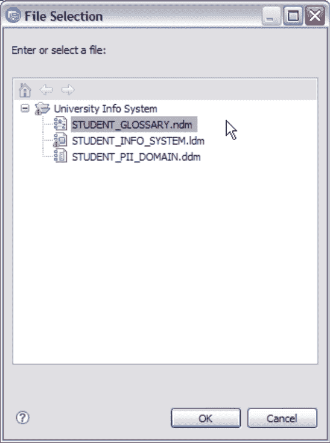

**图3.13 – 选择术语表模型**

术语表模型已被数据设计项目引用。

### 3.3.1 命名标准与术语表模型的最佳实践

以下是设计命名标准时可以参考的一些最佳实践：

- 实体名称使用单词的单数形式。

- 实体名称的首字符不要使用数字。

- 选择简短、无歧义的名称，尽量不超过一两个单词。

创建术语表模型时，请考虑以下最佳实践：

- 创建一个独立的企业标准项目，其中包含应在全组织共享的任何术语表或域模型。你将在第4章中进一步了解域模型。

- 为可能包含企业术语表创建之前遗留的术语、且可能使用不同定义的遗留模型，在特定项目中创建术语表模型。

- 为术语表模型指定有意义的名称。

- 创建多个术语表，从业务角度将术语合理归类。

- 创建嵌套术语表，在特定业务主题领域内对术语进行逻辑分组。

- 创建仅包含类词的子术语表，减少浏览整个术语表理解这些术语所花费的时间。

- 如果可能，使用电子表格更高效地录入业务术语。将术语复制到电子表格应用程序（如`Lotus® Symphony`或`Microsoft Excel`）中，可快速更新和编辑术语，再将其复制回`InfoSphere Data Architect`中。

### 3.3.2 创建术语表模型

现在我们来创建术语表模型，以构建学生术语表。该术语表模型将确定项目中所有数据模型里学生相关信息的规范。要创建术语表模型，请执行以下步骤：

1. 选择`文件` -> `新建` -> `术语表模型`。

2. 确保目标文件夹设置为大学信息系统数据设计项目。

3. 将文件名指定为`STUDENT_GLOSSARY`。

4. 确保通过勾选`添加到项目属性作为项目命名标准`复选框，将术语表添加到该项目的命名标准定义中。点击`完成`以创建术语表模型。

5. 为术语表模型的根包指定名称。


a. 如*图3.14*所示，选择`STUDENT_GLOSSARY`术语表模型下的`NamingStandard`数据对象。`STUDENT_GLOSSARY.ndm`术语表模型将被打开，你可以在数据设计项目的*数据模型*文件夹中找到它。

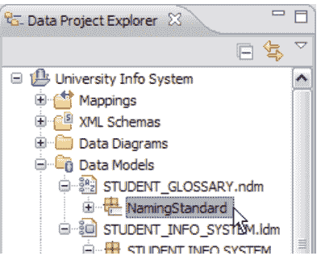

**图3.14 – 选择NamingStandard包**

b. 在属性视图的*常规*选项卡中，将包名称更改为`STUDENT_GLOSSARY_ROOT`。

6. 为空术语表指定名称。选择`Glossary1`术语表，将术语表名称更改为`STUDENT_GLOSSARY`。

7. 创建“学号”术语条目：

a. 在*包含词条*部分，点击*新建*按钮（✨）。将向术语表中添加一个新词条`Word1`。

b. 选择新词条，将其名称更改为“学号”。

c. 在*缩写*字段中，指定`ID`。

d. 在*类型*字段中，指定`PRIME`。

8. 通过创建以下词条完成术语表模型：

a. 创建以下核心词：

- 地址（缩写`ADDR`）

- 日期（`DATE`）

- 部门（`DEPT`）

- 姓名（`NAME`或`NM`）

- 通过/不通过（`PASSFAIL`或`PF`）

- 社会安全号码（`SSN`）

- 总数（`TOTAL`或`TTL`）

b. 创建以下类词：

- 课程（`COURSE`或`CRS`）

- 电子邮箱（`EMAIL`或`EML`）

- 名（`FIRST`或`FT`）——也属于修饰词

- 毕业日期（`GRADUATION`或`GRDN`）

- 讲师（`INSTRUCTOR`或`INSTR`）

- 入职日期（`JOIN`）

- 姓（`LAST`或`LT`）——也属于修饰词

- 分数（`SCORE`或`SCR`）

- 开始日期（`START`）

- 学生（`STUDENT`或`SDT`）

- 学生活动（`ACTIVITY`或`ACT`）

9. 保存你的工作。在下一节*3.4 使用命名标准*中，你将学习如何修改命名标准，以便在验证逻辑数据模型时，你的实体和属性基本符合术语表模型中的条目。

> **注意：** 你无需修复“问题”视图中的警告即可创建有效、可用的数据模型。在本例中，这些警告告知你当前数据对象的名称与术语表模型不一致。你可以选择更新命名标准选项，或编辑数据对象的名称以符合术语表模型要求。

### 3.4 使用命名标准

现在我们已经创建了术语表模型，接下来设置工作区中数据设计项目应遵守的命名标准。与大学工作人员沟通后，你确定在命名属性和列时，先显示描述性类词再显示核心词是最合理的方案。你决定进入工作台偏好设置来配置命名标准。要为物理和逻辑数据模型、术语表模型指定命名标准，请打开偏好设置窗口：

1. 点击*窗口* -> *偏好设置*。将打开偏好设置窗口。

2. 展开*数据管理*节点，然后选择*命名标准*。

3. 确保*逻辑*选项卡处于打开状态。

4. 在实体部分，指定以下顺序：

a. 修饰词（可选）

b. 类词（可选）

c. 主要词（可选）

d. 修饰语（可选）

e. 修饰语（可选）

f. 修饰语（可选）

5. 在*属性*部分，按以下顺序指定：

a. 修饰语（可选）

b. 类词（必填）

c. 主要词（必填）

d. 修饰语（可选）

e. 修饰语（可选）

f. 修饰语（可选）

6. 在*物理表/列*选项卡中，指定与步骤4和5相同的选项。

7. 点击*确定*保存偏好设置。

#### 3.4.1 分析以检查是否符合命名标准

设置好命名标准后，你需要检查已指定的数据对象是否符合你设定的命名标准和术语表模型项。使用“分析模型”向导指定要核查的规则，再通过“问题”视图查找并修正所有不符合命名标准的数据对象。

分析逻辑数据模型的操作步骤：

1. 在逻辑数据模型中定位`STUDENT_INFO_SYSTEM`包：*大学信息管理系统 -> 数据模型 -> STUDENT_INFO_SYSTEM.ldm ->* *STUDENT_INFO_SYSTEM.*

2. 右键单击该包，选择*分析模型*。此时将打开“分析模型”向导。由于当前分析的是逻辑数据模型，*逻辑数据模型*规则类别下的所有规则都会被默认选中。

3. 取消选中*逻辑数据模型*规则类别旁的复选框，然后选中*命名标准*规则。选择该规则可将模型分析范围缩小到仅检查数据对象是否符合命名标准规则，从而减少你在“问题”视图中看到的错误或警告数量。

4. 单击*完成*分析模型。

> **注意：** 如果“问题”视图中出现警告，你无需修复警告即可创建有效、可用的逻辑数据模型。警告仅用于提示某些被分析项可能不符合要求或不遵守标准数据建模规则，但不会影响模型的功能。

### 3.5 约束

现在你已经创建了若干个实体，接下来需要创建一些约束。*约束*用于强制执行业务数据规则。首先，我们来创建一个检查约束，确保学生的毕业日期晚于入学日期。该检查约束可保证数据存入数据库时的有效性。

向`STUDENT`实体添加约束的操作步骤：

1. 在“数据项目浏览器”中定位并选择`STUDENT`实体：*大学信息管理系统 -> 数据模型 -> STUDENT_INFO_SYSTEM.idm -> STUDENT_INFO_SYSTEM -> STUDENT.*

2. 右键单击`STUDENT`实体，然后选择*添加数据对象 -> 约束*。

3. 将约束命名为`DATE_CK`。

4. 完成“属性”视图“常规”选项卡中的信息以创建约束：

a. 指定`SQL`为语言类型。

b. 在*表达式*字段中输入`GRADUATION_DATE>START_DATE`。

c. 在*转换类型*字段中指定*检查约束*。检查约束仅用于验证表达式是否为真。

5. 保存你的工作。

### 3.6 练习

使用上述流程扩展现有逻辑数据模型。确定每个属性的最佳数据类型，用描述性动词记录每个关系，并考虑模型中每个实体与其他实体的关联方式。

1. 新增一个名为`ACTIVITY`的实体，用于描述每名学生加入的社团和学生组织。完成本书后续章节时你会用到该实体。该实体需包含以下必填属性：

- 学生ID：存储学生学号，属于复合主键的一部分。

- 活动ID：存储社团或组织的5位ID号，属于复合主键的一部分。

- 加入日期：存储学生加入该组织的日期。

2. 使用*非标识可选*关系关联`STUDENT`和`ACTIVITY`实体，基数为*零个或多个*。通过*详细信息*选项卡定义父子实体的关系，并为关系添加描述性动词。

3. 现在为逻辑数据模型再创建一个名为`COURSE`的实体，创建以下必填属性：

- 课程ID：存储课程的5位ID号，是该实体的主键。

- 院系ID：存储开设该课程的院系的4位ID。例如，英语系的课程前缀为`ENGL`。

- 讲师ID：存储授课讲师的5位ID。

- 讲师姓名：存储授课讲师的姓氏。

- 学生总数：存储选课的学生人数。

4. 使用*非标识强制*关系关联`STUDENT`和`COURSE`实体，基数为*一个或多个*。同样，使用“详细信息”选项卡用动词描述表之间的关系。接着，使用*标识*关系关联`COURSE`和`GRADE`实体，基数为*恰好一个*。为关系的每个端点记录描述性动词。

5. 记得保存你的工作。

6. 确保图表与逻辑数据模型一致。完成后，你的逻辑数据模型应类似于*图3.15*中的图示。

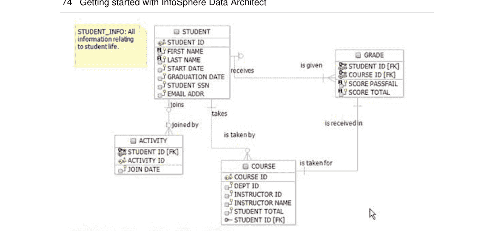

> **注意：** 该逻辑数据模型仍处于起草阶段。

**图3.15 – 完成的STUDENT_INFO图表与逻辑数据模型**

现在你已经创建了一个小型逻辑数据模型，接下来需要为该模型以及项目中的其他数据模型定义领域模型。领域模型可让你为组织定义自定义数据类型。在下一章中，你将学习领域模型的相关知识，以及如何将其应用到逻辑数据模型中。

### 3.7 本章小结

本章介绍了逻辑数据建模的概念，以及如何使用`IBM InfoSphere Data Architect`完成数据建模任务。你学习了如何通过数据图和数据项目浏览器创建数据模型，还了解了命名标准、术语表模型等主题。命名标准可确保组织中的所有人员对相同的词汇和数据对象有一致的认知，并从中获取相同的含义。这些词汇在IT系统中将有一致的表示形式，命名标准也能促进大家对数据的共同理解。术语表模型用于实现跨组织边界的数据共享、减少数据冗余。创建术语表模型可以更好地落实你的命名标准。

### 3.8 复习题

1. 要确保属性仅能包含值'B'或'G'，应选择以下哪个数据对象？

A. 约束

B. 主键

C. 术语表模型

D. 关系

2. 以下哪项不是实体的定义？

A. 实体是拥有一系列共同属性的真实世界对象或概念的集合。

B. 实体是真实世界对象的实例。

C. 实体是共享相同属性、类型相同的实体的集合。

D. 实体是真实存在、可与其他项区分开的项。

3. 以下哪种数据类型是人电话号码属性的更优选择？

A. 数值型（`NUMERIC`）

B. 整数型（`INTEGER`）

C. 字符型（`CHAR`）

D. 长整型（`LONG`）

4. 为以下每种场景绘制实体和关系集：

A. 每个车库可容纳一辆或多辆汽车。每辆汽车仅能停在一个车库中。

B. 每位学生可向一位或多位教师学习。每位教师可教授一位或多位学生。

C. 员工可管理一位或多位员工。员工必须由一位员工管理。

D. 员工可属于一家公司的分支机构。一家公司的分支机构必须拥有一名或多名员工。

5. 解决学生和教师之间的多对多关系集。思考新实体的额外属性。

6. 给定逻辑数据模型中的以下实体，需提供实体集和关系的图形化表示：

- 公司的分支机构；

- 公司分支机构的员工及其家属；

绘制数据模型图。

7. 在大学逻辑数据模型中，从`STUDENT`到`GRADE`选择最佳的关系名称：

A. 每个`STUDENT`必须是1个或多个`GRADES`的接收方。

B. 每个`STUDENT`必须是1个或多个`GRADES`的发送方。

C. 每个`STUDENT`可能是1个或多个`GRADES`的接收方。

D. 每个`STUDENT`可能是1个或多个`GRADES`的生产方。

## 第4章 – 领域模型


在本章中，你将学习如何创建领域模型。*领域模型*描述特定组织独有的领域数据类型及其约束。你可以将领域模型作为逻辑数据模型的一部分，也可以创建独立的领域模型，在项目的所有逻辑和物理数据模型中复用。接下来你需要创建一个领域模型，用于对测试环境中需要保护的信息进行建模——具体来说，你要保护每位学生的社会安全号、姓氏和电子邮件地址。测试系统会填充真实数据，而你指定的隐私规则将确保敏感信息仍然受到保护。之后，你会将这个领域模型与逻辑数据模型中的数据对象进行关联。

> **注意：** 你在`InfoSphere Data Architect`中创建的领域模型可以与`Optim Data Privacy Solution`系列产品共享。要了解有关`Optim Data Privacy Solutions`的更多信息，请访问此网址：http://www-01.ibm.com/software/data/optim/protect-data-privacy/

### 4.1 领域模型

领域模型描述组织允许的领域数据类型及其约束。你可以在领域模型内创建特定于组织的数据类型（即描述特定领域各个方面的数据类型）。使用领域数据类型而非基础数据类型可以确保组织内部的一致性，还能复用通用的数据类型定义，提升团队效率。领域数据类型可以存储在领域模型中，也可以作为逻辑数据模型的一部分。你可以将领域数据模型与数据设计项目关联，这样所有逻辑和物理数据模型都可以使用这些领域数据类型。使用原子领域而非基础数据类型可以确保团队成员之间的一致性。

`InfoSphere Data Architect` 入门 领域模型由一组领域数据类型组成。领域数据类型代表基础数据类型，可通过添加约束进行限制。你可以使用领域模型为逻辑或物理数据模型中的属性或列定义领域数据类型。领域数据类型基于基础数据类型。例如，你可以为性别、成绩等常见描述符定义领域数据类型。

`IBM InfoSphere Data Architect`可用于创建领域模型和原子领域。这些模型可以在所有参与建模任务的团队成员之间共享。`IBM InfoSphere Data Architect`提供了可帮助你创建和管理领域模型的工具。你可以通过向导创建领域模型，既可以使用现有模板，也可以从零开始创建。使用“数据项目浏览器”添加领域对象，然后使用“属性”视图修改它们。以下列表详述了领域的一些最佳实践：

- 将所有领域归入一个或多个领域模型，以便这些领域可在未来项目中复用。

- 创建独立的企业标准项目，包含整个组织普遍共享的术语表或领域模型。

- 在特定项目中为遗留模型创建领域模型，如果遗留模型中的领域不符合新的企业标准，且是在任何企业领域创建之前就存在的，就可以这么做。

- 为领域模型指定有意义的名称。你可以在模型名称中加入“领域”字样，以便在“数据项目浏览器”视图中轻松识别领域模型。

- 创建子包（根领域包下的独立领域包），对特定业务主题领域内的领域进行逻辑分组。

现在你已经创建了基础逻辑数据模型，还被要求在逻辑数据模型中存储敏感信息，包括社会安全号和电子邮件地址。在扩展逻辑数据模型以纳入这些信息之前，你决定先创建一个领域模型来保护这些敏感信息。之后，你将在`STUDENT`实体中创建新属性，并使用领域模型数据类型定义这些属性。

首先，我们先定义一个用于保护个人身份信息的领域模型。该领域模型将帮助你确保学生的个人信息受到保护。

#### 4.1.1 创建空白领域模型

我们来创建`STUDENT_PII_DOMAIN`领域模型：

1. 在“数据项目浏览器”中右键单击“数据模型”文件夹，然后选择“新建”->“领域模型”。“新建领域模型”窗口随即打开。

2. 为领域模型指定*文件名*：`STUDENT_PII_DOMAIN`。

3. 确保已选中*添加到项目属性*选项，然后单击*完成*。`STUDENT_PII_DOMAIN.ddm`领域模型将在数据设计项目的*数据模型*文件夹中创建。

4. 指定领域模型根包的名称：

a. 如*图4.1*所示，选择`STUDENT_PII_DOMAIN`领域模型下方的包。

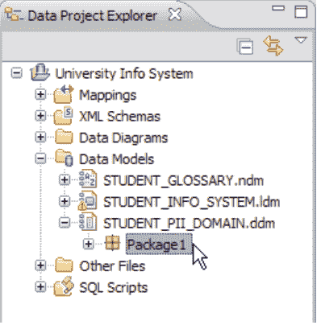

**图4.1** – 选择`STUDENT_PII_DOMAIN`领域模型

该包的属性将显示在“属性”视图中。

b. 在*名称*字段中输入以下名称：`STUDENT_PII_ROOT`

5. 保存工作。领域模型和包已创建，并显示在“数据项目浏览器”中。

现在你已经创建了空白领域模型，接下来可以添加原子领域、列表领域或联合领域。本次练习中，你将添加原子领域来保护每位学生的社会安全号。

#### 4.1.2 原子领域

*原子领域*是你创建的用于确保组织内部一致性的自定义数据类型。你先创建领域特定的规则，再使用这些规则定义数据模型中的其他对象。例如，你可以为成绩定义领域模型，确保不会输入超出合适范围的数值，比如10分制下只接受1到10的分数。你还可以创建领域模型来指定数据何时属于私有且需要掩码处理，例如学生或教师标识符。默认情况下不强制实施数据掩码，但为确保敏感数据元素的隐私，你应该强制实施数据隐私保护。

使用原子领域时，你通常需要为四个区域指定隐私规则：

- 分类：在测试环境中，该数据应如何分类？是个人身份信息还是机密信息？

- 强制实施：在测试环境中，该原子领域的隐私保护是必需、非必需，还是仅作为最佳实践？

- 隐私策略类型：在测试环境中，你想对哪些类型的信息进行掩码处理？

- 隐私策略：测试系统应使用哪种类型的掩码？

##### 4.1.2.1 创建原子领域

你决定应先保护学生的社会安全号。为此，你将创建新的原子领域`SSN`，该领域将显示随机社会安全号以掩码处理这段敏感信息。该原子领域会在数据设计项目中创建唯一的数据类型，你可以在项目中的各种模型里使用该特殊数据类型。可在整个设计过程中使用该领域模型定义应用于该模型中存储的学生信息的策略，这将帮助你确保所有数据模型的一致性。

我们来创建`SSN`和`STUDENT_ID`原子领域：

1. 右键单击`STUDENT_PII_ROOT`包，然后选择*添加数据对象*->*原子领域*。新的原子领域对象将在根领域包下的“数据项目浏览器”中创建。

2. 将原子领域对象命名为`SSN`。

3. 在“属性”视图的*常规*选项卡中定义`SSN`原子领域对象的基础数据类型。由于社会安全号包含数字和连字符，因此应将基础数据类型指定为`CHAR(11)`。

4. 指定该原子领域数据类型的隐私属性：

a. 打开“属性”视图的*数据隐私*选项卡。

b. 指定以下设置以掩码处理学生的社会安全号：

- 分类：个人身份信息

- 强制实施：必需

- 隐私策略类型：社会安全号（`SSN`）

5. 创建`STUDENT_ID`原子域，配置以下选项：

- 基础数据类型：`CHAR(10)`

- 分类：个人身份信息

- 强制要求：必填

- 隐私策略类型：随机打乱

- 隐私策略：随机混洗。

配置这些选项后，你可以告知团队：所有使用该域模型的属性或列，在测试环境中都需要进行掩码处理。这有助于降低大学中可以标识学生身份的数据被意外泄露的概率。

#### 4.1.3 列表域与联合域

列表域是指值以空白字符分隔的域，例如**可用尺寸**（`10 12 14`）。这类域属于原子域的一种。

联合域的值是原子值、列表值或联合值的集合。例如，你可以创建名为**成衣尺码**的联合域，允许取值为`2`到`18`之间的整数，或是字符串值**小号**、**中号**、**大号**中的一个。

> **注意：** 本书中不会讲解如何创建列表域或原子域，此处仅提供相关定义供读者参考。


#### 4.2 将域模型元素与逻辑数据模型元素关联

完成域模型内元素的创建后，你需要将其与逻辑数据模型中的元素进行关联。

将域模型与逻辑数据模型（以及后续的物理数据模型）关联，是识别信息私有化所需业务需求的第一步，这样你的策略就可以共享给其他团队和系统。之后，你可以将该域模型导出至`Optim Designer`（`Optim`数据隐私解决方案的组成部分），在该工具中，你可以将与域模型关联的实体和列中的数据替换为模拟（或加密）数据。这类操作的常见应用场景是创建测试数据库，并填充真实数据，以此测试与域模型关联的数据对象的防护效果。

> **注意：** 数据掩码操作仅应在测试系统中执行。出于本书写作目的，你需要将`SSN`原子域与`STUDENT`实体中的对应属性进行关联。为保障学生的社会安全号码安全，你需要指定在`SSN`原子域中创建的专用数据类型。你还需要创建一个原子域，用于保障每位学生的学号安全。

为这些属性指定专用的原子域数据类型，步骤如下：

1. 首先，为`STUDENT`实体创建一个新属性，命名为**学生社会安全号码**。

2. 在“数据项目浏览器”中选择该属性，“学生社会安全号码”属性的属性值将显示在“属性”视图中。

3. 修改“学生社会安全号码”属性的数据类型：

   a. 打开“属性”视图的*类型*选项卡。

   b. 点击*数据类型*字段旁的省略号（…），“选择数据类型”窗口将打开。

   c. 从`STUDENT_PII_ROOT`包中选择*SSN*数据类型，如*图4.2*所示。

   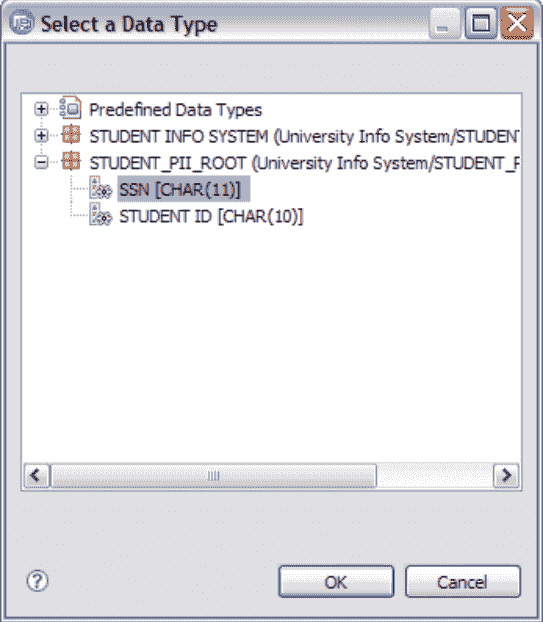

   **图4.2 – 选择原子域数据类型**

   `SSN`属性的*数据类型*字段中已指定该域数据类型。

4. 修改`STUDENT ID`属性的数据类型：

   a. 打开“属性”视图的*数据类型*选项卡。

   b. 点击*数据类型*字段旁的省略号（…），“选择数据类型”窗口将打开。

   c. 从`STUDENT_PII_ROOT`包中选择`STUDENT_ID`数据类型。

5. 保存你的工作。

#### 4.3 练习

完成`STUDENT_PII_DOMAIN`域模型的搭建：

1. 创建以下原子域元素：

   - `EMAIL`：基础类型为`VARCHAR(128)`，属于个人身份信息，该元素的隐私防护为必填项。进行数据掩码时，需使用随机生成的电子邮件地址。

   - `LAST_NAME`：基础类型为`VARCHAR(128)`，属于个人身份信息，该元素的隐私防护仅为最佳实践。进行数据掩码时，采用随机打乱作为隐私策略。

2. 在`STUDENT`实体中创建`EMAIL_ADDR`属性，并将`EMAIL`原子域元素与该属性关联。

3. 将`LAST_NAME`属性与`LAST_NAME`原子域关联。

4. 保存你的工作。

#### 4.4 小结

本章总结了如何在`IBM InfoSphere Data Architect`中创建域模型。你学习了如何将域模型与已有的逻辑数据模型关联，以及如何识别在你或其他团队测试模型和系统时需要私有化的信息。

#### 4.5 复习题

1. 域模型的定义是什么？

2. 域模型中存储了哪些信息？

3. 判断正误：域模型可以帮助你识别企业的数据隐私策略。

4. 判断正误：你可以通过域模型自定义数据类型。

5. 什么是嵌套域？


## 第5章 – 物理数据建模

在本章中，你将学习*物理数据模型*及其与逻辑数据模型的区别。你还将学习如何将逻辑数据模型转换为物理数据模型。学完本章后，你将掌握如何创建和使用物理数据模型，生成特定数据库的`DDL`语句，从而将数据建模工作转化为可用的数据库架构。

#### 5.1 物理数据建模：整体概述

物理数据模型是针对特定数据库的数据模型，基于数据库规范构建。通过物理数据模型，你除了可以建模分区、表空间、索引等其他存储对象外，还可以对存储进行建模。你可以利用特定数据库及数据库平台独有的属性来建模数据。例如，针对`DB2`系统、`Oracle`系统或`SQL Server`系统建模的物理数据模型会有所差异。`IBM InfoSphere Data Architect`支持多种数据库系统类型和版本，你可以使用物理数据模型为这些系统生成特定数据库的数据对象。

> **注意：** `InfoSphere Data Architect`仅支持针对`DB2 for Linux`、`UNIX`和`Windows`、`DB2 for z/OS`以及`DB2 for i5/OS`数据库的存储建模。你仍可在工作台中创建表、列和其他相关对象，但不支持其他数据库厂商（例如表空间、缓冲池）的数据对象。本书中，你将使用针对`DB2`系统设计的模型进行操作。

通常，使用物理数据模型时会遵循以下任务流程：

1. 创建物理数据模型，可通过空白创建、模板创建、从逻辑数据模型转换或从其他系统导入的方式实现。

2. 通过添加存储对象、索引和视图来完善物理数据模型。

3. 生成`DDL`以部署数据库和/或架构。

4. 在服务器上运行创建数据对象的`DDL`脚本。

你可能会好奇：“逻辑数据模型和物理数据模型有什么区别？”表`5.1`总结了二者的差异。

**表5.1 – 逻辑数据模型与物理数据模型的差异**

| 逻辑数据模型 | 物理数据模型 |
| --- | --- |
| 不与任何数据库厂商对应 | 始终对应特定数据库厂商及版本 |
| 基于更高层级的抽象，更具通用性 | 更具体，更贴近实际数据库的设计 |
| 不考虑物理存储 | 用于为受支持的数据库厂商建模物理存储 |
| 不需要数据库厂商的构建相关知识，需要了解模型的使用场景 | 需要了解数据库厂商及每个平台的模型构建方式，需要了解数据的存储相关信息 |

#### 5.2 从空白创建物理数据模型

理想情况下，你应该在创建物理数据模型前先创建逻辑数据模型。这有助于区分逻辑设计与物理设计，让你可以在设计数据库或架构的物理存储细节前，先在逻辑层级修改数据模型。不过，你也可以在工作台中创建空白的物理数据模型。

> **注意：** 以下步骤仅作参考，你不需要执行这些步骤来完成学生信息系统的设计。下一节将讲解如何转换为物理数据模型。

创建空白物理数据模型的步骤如下：

1. 点击*文件 -> 新建 -> 物理数据模型*，“新建物理数据模型”向导将打开。

2. 完成向导操作。你可以创建空白物理数据模型，也可以对已有的数据库、架构或`DDL`脚本进行逆向工程，逆向工程的内容将在后续章节讲解。

3. 使用工作台添加数据对象，例如表、架构或列。右键点击数据模型中的各类对象，即可通过上下文菜单查看可添加的数据对象；你也可以创建图表，可视化这些数据对象及其关系。

#### 5.3 将逻辑数据模型转换为物理数据模型

你无需从空白创建物理数据模型，而是使用之前章节创建的现有逻辑数据模型（`STUDENT_INFO_SYSTEM.ldm`）转换为物理数据模型。转换过程会自动生成数据库或架构的物理设计，无需你手动创建表、列和其他数据对象，节省了工作量。从逻辑数据模型转换完成后，你可以为物理数据模型添加更多专属属性，使其更接近可部署、可用的数据模型。

> **注意：** 不同数据模型之间的数据类型映射结果取决于你在“首选项”窗口中的设置。为确保逻辑数据模型与新物理数据模型之间的数据类型正确映射：

1. 通过点击主菜单中的*窗口 > 首选项*，打开“首选项”窗口。

2. 展开“数据管理”节点，找到*转换 > 数据类型映射*页面。

3. 在“首选项”窗口中展开“数据类型映射”节点，配置逻辑数据模型、物理数据模型与不同数据库供应商之间的数据类型映射选项。

要将逻辑数据模型转换为物理数据模型，请按以下步骤操作：

1. 在数据设计项目中选择`STUDENT_INFO_SYSTEM.ldm`文件。

2. 点击主菜单中的*数据 -> 转换 -> 物理数据模型*。“转换为物理数据模型”向导随即打开。

3. 在“目标物理数据模型”页面中，选中*创建新模型*单选按钮，然后点击*下一步*。

4. 完成“物理数据模型文件”页面的配置：

   a. 将`University Info System`数据设计项目指定为目标文件夹。

   b. 将`DB2 for Linux, UNIX, and Windows`指定为数据库类型。

   c. 选择`V9.7`作为数据库版本。

   d. 点击*下一步*。

5. 在“选项”页面的*架构名称*字段中，输入`STUDENT_LIFE`，然后点击*下一步*。

“选项”页面如*图5.1*所示。

#### 图5.1 – 完成“选项”页面配置

**注释：** 按照最佳实践，您应当选中*生成追溯性*选项。该选项支持您识别逻辑数据模型与物理数据模型之间的依赖关系，有助于您在优化数据模型时执行影响分析。

6. 在“输出”页面中点击*完成*。物理数据模型将在数据设计项目的*数据模型*文件夹中创建，文件将在编辑器视图中打开。

7. 为新数据库设置更具描述性的名称。

   a. 选中物理数据模型下的“数据库”对象。

   b. 在“属性”视图的*常规*选项卡中，将`SAMPLE`指定为新名称。

8. 保存您的工作。图`5.2`展示了完成转换流程后创建的数据对象和文件夹。

#### 图5.2 – 新建的物理数据模型及数据对象

#### 5.4 物理数据模型操作

##### 5.4.1 模型结构

图`5.3`展示了物理数据模型的形态。

#### 图5.3 – 工作区中展示的物理数据模型

所有物理数据模型均具备以下特征：

- 文件扩展名：每个物理数据模型文件名的末尾扩展名为`.dbm`。

- 架构与数据库设计：

  - 结构与逻辑数据模型大致相同。

  - 如您之前所了解，逻辑数据模型包含单个包，您可以在包中存储子包、实体和图表。而物理数据模型会在数据库中存储信息，每个数据库可包含多个架构，每个架构又可包含多张数据表。

- 图表：

  - 从逻辑数据模型转换图表时，您的设计会完整保留，包括备注、格式和关系，唯一差异是用于呈现新数据表、列及其他设计的数据对象的图标不同。

  - 与逻辑数据模型一致，您可以创建物理数据模型图表，辅助您可视化并理解复杂数据模型的设计。

- 存储图表：您可以创建图表来建模`DB2`数据库的存储结构，包含分区、表空间、缓冲池及其他存储对象。

- `SQL`语句：“`SQL`脚本”文件夹用于存储您在物理数据模型中创建的`SQL`脚本。如果您浏览物理数据模型，会发现您指定的所有原子域元素都会被迁移至新的物理数据模型中。

##### 5.4.2 DB2存储建模

**注释：** 使用`IBM InfoSphere Data Architect`时，您仅能对`DB2 for Linux, UNIX, and Windows`数据库或`DB2 for z/OS`数据库进行存储建模。如需了解`DB2`存储模型的更多信息，请参阅本丛书中的*《DB2 Express-C入门》*。本章不会详细讲解存储建模的具体操作，因为本次创建的架构规模较小，但本节会介绍存储建模背后的基础概念，以及设计复杂数据模型存储结构时需要注意的信息。

###### 5.4.2.1 表空间

数据库的数据存储在*表空间*中。表空间具有数据库供应商专属特性。

**注释：** 如需了解`DB2 for Linux, UNIX, and Windows`中表空间的更多信息，请访问以下网址：`http://publib.boulder.ibm.com/infocenter/db2luw/v9r7/topic/com.ibm.db2.luw.admin.dbobj.doc/doc/c0004935.html`

如需了解`DB2 for z/OS`中表空间的更多信息，请访问：`http://publib.boulder.ibm.com/infocenter/dzichelp/v2r2/index.jsp?topic=/com.ibm.db2z.doc.gloss/src/gloss/db2z_gloss.htm`

表空间通常有两种管理方式：

- *系统管理的空间*：由操作系统管理表空间。容器被定义为操作系统文件，通过操作系统调用访问。这意味着操作系统负责以下操作：

  - 输入输出缓冲

  - 空间分配

  - 表空间的自动扩展

- *数据库管理的空间*：由数据库管理表空间。容器可被定义为文件（在空间创建时会按照指定大小完成全量分配），或定义为设备。当您使用`DB2`管理表空间时，`DB2`会负责以下操作：

  - 输入输出缓冲（程度受分配方式和操作系统限制）

  - 使用`ALTER TABLESPACE`语句时扩展容器

  - 释放数据库管理容器的未使用部分

每个表空间至少包含一个容器。容器仅属于单个表空间（但一个表空间可包含多个容器）。仅当数据库已分区、且该分区尚未为对应表空间分配容器时，您才能向系统管理的表空间添加容器。向表空间添加容器时，数据会在所有容器间分布式存储。

配置表空间时，您需要考虑以下设置（可在表空间“属性”视图的“常规”选项卡中找到）：

- *页面大小*：定义表空间所使用的页面大小。`DB2`支持的页面大小包括`4K`、`8K`、`16K`和`32K`。页面大小限制了可存储在表空间中的数据表的行长度和列数量。表空间的页面总数上限为`16,777,216`。选择更大的页面大小可提升表空间的容量。

- *扩展单元大小*：指定在切换到下一个容器之前，会写入单个容器的页面数量。数据存储时，数据库管理器会循环遍历所有容器。该设置仅在表空间包含多个容器时生效。

- *预取大小*：指定执行数据预取时，会从表空间读取的页面数量。预取会在查询实际引用数据前，就加载查询所需的数据，使得查询在执行输入输出操作时数据已准备就绪。当数据库管理器判断需要执行顺序输入输出、且预取数据可提升性能时，会触发预取操作。

**最佳实践：** 预取大小应设置为扩展单元大小与表空间容器数量的倍数。例如，若扩展单元大小为`32`，容器数量为`4`，则预取大小应为`128`、`256`或其他`128`的倍数。如果某张数据表使用频率较高，请为该表创建独立的表空间以提升性能。

- **开销与传输速率：** 决定查询优化过程中输入输出的成本。值以毫秒为单位计量，应为所有容器的平均值。*开销*是与输入输出控制器活动、磁盘寻道时间和旋转延迟相关的时间。*传输速率*是将页面读取到内存所需的时间。这些值可基于硬件规格计算得出。

###### 5.4.2.2 缓冲池

*缓冲池*与单个数据库关联，可被多个表空间共用。为表空间创建缓冲池时，您需要确保该缓冲池服务的所有表空间的表空间大小与缓冲池页面大小保持一致。单个表空间仅能使用一个缓冲池。

充足的缓冲池大小是保障数据库性能的关键，因为其可减少磁盘的输入输出量，而磁盘输入输出是耗时最长的数据库操作。较大的缓冲池也会对查询优化产生影响，因为更多操作可在内存中完成。

###### 5.4.2.3 存储建模的性能影响

设计架构或数据库的存储结构时，您应重点关注缓冲区的利用和输入输出并行度的最大化。请遵循以下任务流程，保障存储模型的高效性：

1. 确定数据表设计带来的限制条件。您可能需要使用多个常规表空间。

2. 考虑将数据表放置在配置不同的大容量表空间中，是否可能提升性能。

3. 设计试验性表空间。

4. 考虑使用缓冲池，其可能有助于优化您的表空间设计。

5. 为表空间分配容器。

6. 优化模型，并通过全面测试和基准测试验证设计的合理性。

通常来说，应从最简单的设计方案起步。只有当性能受到影响时，才允许引入复杂性。

#### 5.5 优化物理数据模型

现在我们已经将逻辑数据模型转换为物理数据模型，在生成用于部署数据库的`DDL`之前，我们需要做一些最终的优化调整。首先，我们将重新排列`STUDENT`表的列，使其顺序更符合逻辑。之后，我们将创建一个角色，并向数据库中添加用户。

##### 5.5.1 重新排列物理数据模型中的列

在设计逻辑数据模型时，你更关注的是对每个实体需要包含*哪些*属性和数据特征进行建模。现在我们来重新排列`STUDENT`表的列，让终端用户更容易理解这个对象。

要重新排列列，请执行以下步骤：

1. 选中`STUDENT_LIFE`架构下的`STUDENT`表。表的属性将显示在属性视图中。

2. 打开属性视图中的“列”选项卡。

3. 重新排列列，将重要的学生信息放在最前面：

   a. 将`FIRST_NAME`列设置为表的第`1`列。选中`FIRST_NAME`列，然后点击“上移列”箭头（↑），将其移动到表的最前面。此时列的排列应如*图5.4*所示。

   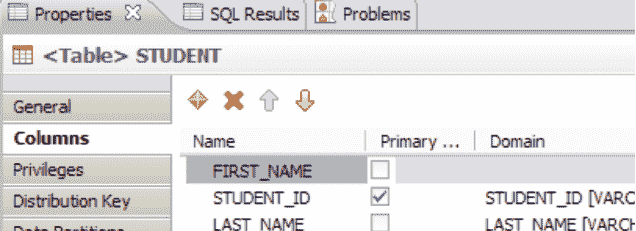

   **图5.4 – 重新排列表中的列**

   b. 将`LAST_NAME`列移动到`FIRST_NAME`列下方，使其成为表的第`2`列。

   c. 将`STUDENT_SSN`列设置为表的第`4`列。

   d. 将`EMAIL_ADDR`列设置为表的第`5`列。此时列的排列应如*图5.5*所示。

   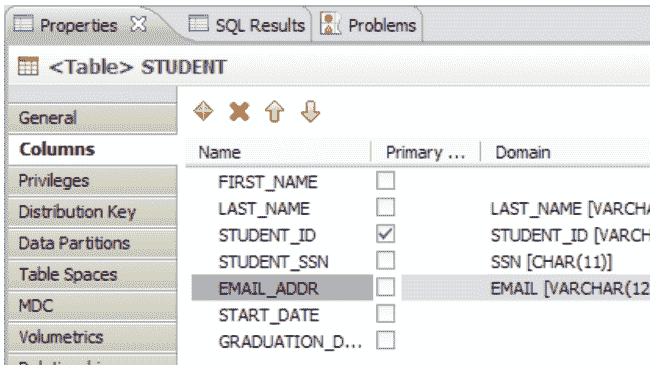

   **图5.5 – 表中列的正确顺序**

4. 保存你的工作。

##### 5.5.2 在物理数据模型中创建角色

角色可以简化权限的管理。*角色*是一种数据库对象，可将一个或多个权限组合在一起，并可分配给用户、用户组、`PUBLIC`或其他角色。

角色具备多项优势，可简化数据库系统中的权限管理工作：

- **安全管理员**（`SECADM`）可以按照自身组织的架构管理数据库访问权限。他们可以在数据库中创建直接对应组织内岗位职能的角色。

- **用户**会被授予与其工作职责相匹配的角色成员资格。当其工作职责发生变化时，其角色成员资格可以轻松地被*授予*和*撤销*。

- 权限分配被简化。管理员无需将同一组权限授予同一岗位的每个独立用户，而是可以将这组权限授予代表该岗位的角色，之后再将该角色授予该岗位的每个用户即可。

- 角色的权限可以被更新，所有被授予该角色的用户都会同步获得更新。管理员无需逐个更新每个用户的权限。

- 创建视图、触发器、物化查询表（`MQT`）、静态`SQL`和`SQL`例程时，始终会使用授予角色的权限和授权；而直接或间接授予用户组的权限和授权则不会被使用。由于角色在数据库内部管理，`DB2`数据库系统可以识别授权变更的时间并做出相应处理。

- 用户建立连接时，分配给该用户的所有角色都会自动启用，因此用户连接时，所有授予角色的权限和授权都会被纳入考量。角色无法被手动显式启用或禁用。


安全管理员可以将角色的管理权限委托给其他人员。数据库中所有可授予的`DB2`权限和授权都可以授予角色。例如，角色可以被授予以下任意权限和授权：

- `DBADM`、`SECADM`、`LOAD`和`IMPLICIT_SCHEMA`数据库授权
- `CONNECT`、`CREATETAB`、`CREATE_NOT_FENCED`、`BINDADD`、`CREATE_EXTERNAL_ROUTINE`或`QUIESCE_CONNECT`数据库授权
- 任意数据库对象权限（含`CONTROL`权限）

用户连接到数据库时，其拥有的所有角色会自动启用并纳入授权考量；你无需通过`SET ROLE`语句手动激活角色。例如，当你创建视图、物化查询表（`MQT`）、触发器、包或`SQL`例程时，通过角色获得的权限都会生效。角色没有所有者。

和你的信息系统团队沟通后，确定你需要为应用程序开发人员创建一个角色，以便他们可以连接到你的系统。你创建的该角色可用于授予应用程序开发人员特定的提升权限，以便他们能够部署存储过程、例程以及其他可轻松访问你的架构和数据库的数据对象。

要创建`APP_DEV`角色，请执行以下步骤：

1. 右键点击`SAMPLE`数据库对象，选择*添加数据对象 -> 角色*。数据项目资源管理器中会创建一个新角色。
2. 将该角色命名为`APP_DEV`。
3. 为角色添加权限：
   a. 打开属性视图中的*权限*选项卡，确保已选中*数据库*选项卡。
   b. 点击“新建”按钮（💎），将打开“授予新权限”窗口。
   c. 选中`BINDADD`、`CONNECT`、`CREATE_EXTERNAL_ROUTINE`和`CREATE_NOT_FENCED_ROUTINE`选项，然后点击*确定*。数据库权限将被添加到该角色中。
4. 保存你的工作。此时角色已在物理数据模型中创建。一旦你部署了*第5.6节 DDL生成*中生成的`DDL`，就可以将用户分配到这个角色中。

#### 5.5.3 向物理数据模型添加用户ID

为确保特定用户能够在数据库部署后访问数据库，你需要将这些用户ID添加到物理数据模型中。你也可以添加其他用户，但我们先从大多数`DB2`数据库默认创建的`user1` ID开始：

1. 右键点击`SAMPLE`数据库，选择*添加数据对象 -> 用户*。物理数据模型中会创建一个新的用户对象。
2. 将用户名指定为`user1`。示例如*图5.6*所示。
   
   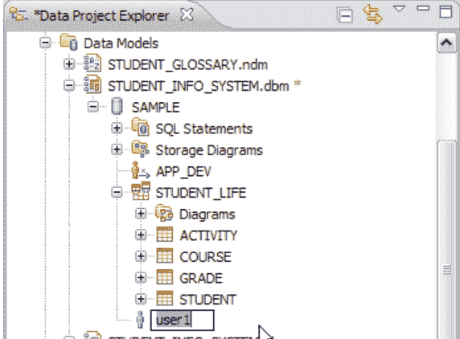
   
   > **图5.6 – 指定用户**
3. 在属性视图的*权限*选项卡中，确保你处于*数据库*分区。
4. 点击“新建”按钮（⊕），将打开“授予新权限”窗口。
5. 选中所有权限，然后点击*确定*。
6. 保存你的工作。权限将被添加到`user1`用户ID中，该用户将拥有数据库的完全访问权限。

#### 5.5.4 验证物理数据模型

在部署物理数据模型之前，你需要对其进行验证。验证模型时，工作台会检查模型，确保可以从数据模型生成有效的`DDL`。验证过程还会确保你的模型不仅符合你自己制定的设计标准，还符合通用的数据建模标准。这些“最佳实践”规则已内置到产品中，让你在部署模型之前更容易确保模型设计合理。

要验证物理数据模型，请执行以下步骤：

1. 在数据项目资源管理器中右键点击`SAMPLE`数据库，选择*分析模型*。将打开“分析模型”向导，默认情况下会选中所有*物理数据模型*规则。
2. 取消选中*维度建模*和*命名标准*选项，然后点击*完成*。

> **注意：** 本书不涉及维度建模的相关内容。如需了解维度建模及其优势的更多信息，请访问IBM InfoSphere Data Architect信息中心：http://publib.boulder.ibm.com/infocenter/rdahhelp/v7r5/index.jsp。

模型分析完成后，你会在“问题”视图中看到警告和信息消息列表，如*图5.7*所示。

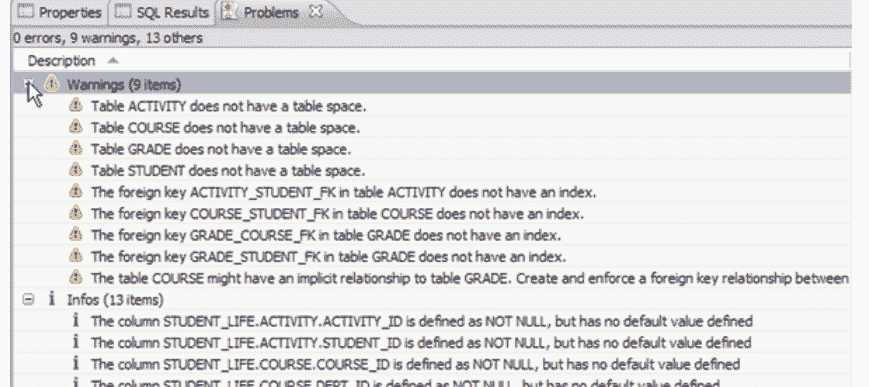

**图5.7 – 问题视图中的警告列表**

本练习中，你无需采取任何措施纠正警告和信息消息；这些消息仅用于告知你可能影响性能的潜在问题，或提醒你`SQL`语句可能执行失败的位置。例如，为*图5.7*中的数据对象执行`INSERT`操作插入信息时，更新操作可能会失败，因为未为设置为`NOT NULL`的列显式指定默认值。

由于你的数据模型规模较小，不会投入实际生产环境，因此你无需通过创建表空间和索引来纠正这些警告。但评估每条警告以确保架构和数据库的最佳性能，是被公认的最佳实践。

#### 5.6 生成DDL

现在你已经生成了完整的物理数据模型，你已经了解了创建、编辑和更新数据模型的流程。既然你已经完成了这一流程，如何将数据库部署到测试或生产环境？IBM InfoSphere Data Architect 可以根据你创建的模型生成针对特定数据库的*数据定义语言（`DDL`）*脚本。生成`DDL`脚本后，你可以在服务器上运行该脚本，用户即可将模型作为数据库的一部分进行访问。

##### 5.6.1 从数据库对象生成DDL脚本

你可以从物理数据模型的数据库对象生成`DDL`脚本。“生成`DDL`”向导会创建用于在服务器上部署数据库的`SQL`语句。接下来我们创建一个`DDL`脚本来部署你的新数据库：

- 1. 在数据源浏览器中右键点击连接，选择*连接*，连接到`SAMPLE`数据库。
- 2. 在数据项目浏览器中右键点击`SAMPLE`数据库，然后选择*生成DDL*，“生成DDL”向导随即打开。
- 3. 在向导的“选项”页面中，确保所有选项均被选中，然后点击*下一步*。

> **注意：** 如果你不需要在生成`DDL`的同时执行部署，则无需执行第一步的数据库连接操作。

##### 表5.1 – 可添加到DDL脚本中的可用模型元素

| 选项 | 说明 |
|------|------|
| 检查模型 | 脚本创建前会先验证模型。 |
| 完全限定名称 | 任何对象都以其全名引用。例如，`STUDENT_LIFE`模式下的`STUDENT`表会被引用为`STUDENT_LIFE.STUDENT`。 |
| 带引号的标识符 | 指定是否需要用引号引用对象。当你希望将"Table A"和"TABLE A"视为两个不同对象时，需要开启此项。 |
| DROP语句 | 在DDL脚本开头包含`DROP`语句，用于删除已存在的对象。 |
| CREATE语句 | 在DDL中包含`CREATE`语句，用于创建或重建数据对象。 |
| COMMENT ON语句 | 包含数据对象“属性”视图*文档*选项卡中的语句。 |
| IN TABLESPACE子句 | 从存储模型或默认表空间获取信息，并将其添加到DDL脚本中。 |

- 4. 在“对象”页面保留默认设置，然后点击*下一步*。
- 5. 在“保存并运行DDL”页面中，指定以下文件名：`DEPLOY_SYS.sql`。

> **注意：** `DDL`脚本会显示在页面的*预览DDL*区域中。你可以使用该区域验证脚本是否包含将信息系统部署到服务器所需的所有`SQL`语句。`SQL`的第一部分会确保服务器上不存在任何数据对象，随后`SQL`会重建这些数据对象，并确保你指定的角色确实已在服务器上创建。

- 6. 选中*在服务器上运行DDL*选项，然后点击*下一步*。
- 7. 在“选择连接”页面中选择`SAMPLE`数据库，完成该页面设置。
- 8. 在“摘要”页面检查你的选择。此页面的选项无法修改。准备好生成脚本后，点击*下一步*。
- 9. 在“选择连接”页面中选择`SAMPLE`数据库连接，然后点击*下一步*。
- 10. 在“摘要”页面点击*完成*。`DDL`脚本会生成并保存在数据设计项目的*SQL脚本*文件夹中，如*图5.8*所示。

##### 图5.8 – 保存在SQL脚本文件夹中的DDL脚本

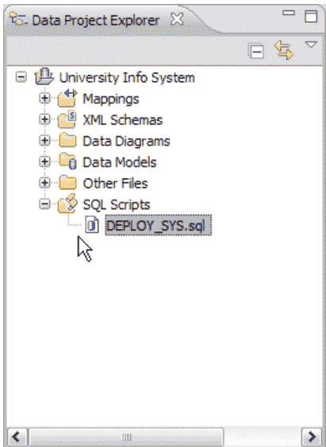

`DDL`脚本还会在服务器上运行，会将新数据库和模式部署到`DB2`系统中，后续可向其中填充数据，应用开发人员还可创建应用程序来查询数据并生成数据报表。要验证模式是否已成功部署，可打开“数据源浏览器”视图，展开`SAMPLE`节点和数据库，找到并展开*模式*文件夹，查找刚刚在数据库中创建的`STUDENT_LIFE`模式，结果如*图5.9*所示。

##### 图5.9 – 新部署的模式

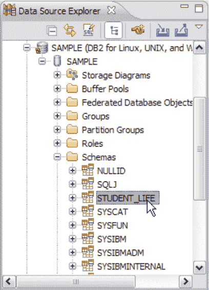

#### 5.7 练习

为物理数据模型生成新的`DDL`脚本：

- 1. 在“生成DDL”向导的“选项”页面中，确保未选中以下项目：
  - `DROP`语句
  - `COMMENT ON`语句
  - 如果存在则使用域
- 2. 在“生成DDL”向导的“对象”页面中，仅生成以下对象的语句：
  - 表
  - 权限
  - 主键约束
  - 角色
- 3. 完成向导的“保存并运行DDL”页面：
  a. 指定`EXERCISE_5_7.sql`为文件名。
  **b.** 选中*打开DDL文件进行编辑*选项。
- 4. 完成向导其余步骤。
- 5. 选中你创建的两个`SQL`文件（`DEPLOY_SYS.sql`和`EXERCISE_5_7.sql`），然后右键点击，选择*比较 -> 相互比较*，比较编辑器随即打开。这两个文件有哪些差异？

#### 5.8 总结

在本章中，你学习了*物理数据模型*。物理数据模型是数据设计流程的下一步，它在逻辑设计的基础上，帮助你起草数据库和服务器的物理存储结构（表、列、索引以及其他数据对象）。你还学习了数据定义语言（`DDL`）文件，以及如何使用`DDL`文件部署你用IBM InfoSphere Data Architect创建的数据模型。`DDL`脚本包含删除、创建或修改数据对象所需的查询语句。

#### 5.9 复习问题

- 1. 什么是物理数据模型？
- 2. 物理数据模型可以对以下部分或全部对象进行建模：
  - A. 表
  - B. 角色
  - C. 模式
  - D. 以上全部
- 3. 你可以从物理数据模型的哪些对象生成`DDL`脚本？
- 4. 判断正误：你无法在工作区中创建`DDL`脚本之前预览它。
- 5. 存储建模的目的是什么？
- 6. 你可以在物理数据模型中创建哪些存储模型对象？
- 7. 判断正误：你必须先有逻辑数据模型才能创建物理数据模型，无法从零开始创建物理数据模型。

#### 5.10 接下来学什么？

恭喜！你已经完成了一个完整数据模型的设计与部署。在下一章中，你将学习如何生成关于你数据模型的信息丰富的报告。

# 第三部分 – 迭代设计：报表、修订与分析

# 致谢


## 第6章 – 生成报表、导入与导出

报表是IBM InfoSphere Data Architect的重要功能。报表提供的信息可以复制、打印，并以纸质文档的形式分发。许多组织会使用报表来提供合规信息。IBM InfoSphere Data Architect的导入/导出功能可确保你的数据模型与其他数据建模、设计和报表工具兼容。该功能支持你从兼容的数据建模工具导入现有数据模型，也可导出到兼容的数据建模工具和格式中。

### 6.1 报表、导入与导出：整体概览

在工作台中创建报表时，你可以提供模型全部或部分的信息，即对象列表及其关系。IBM InfoSphere Data Architect为逻辑、物理、域和术语表模型提供了大量内置报表或模板。*图6.1*展示了报表与导入/导出的整体概览。

#### 图6.1 – 工作台中的报表、导入与导出

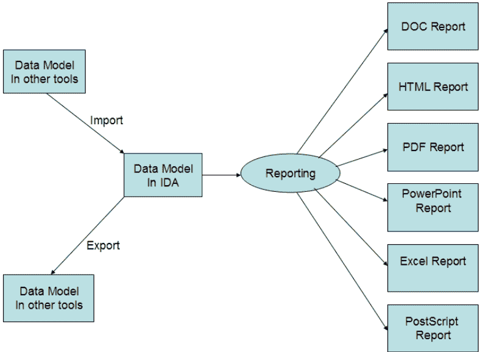

*图6.1*左侧展示了IBM InfoSphere Data Architect的导入导出功能。IBM InfoSphere Data Architect的*导入*功能支持你将其他工具中的数据模型转换为IBM InfoSphere Data Architect中的物理数据模型或逻辑数据模型。*导出*功能支持你将IBM InfoSphere Data Architect中的物理数据模型或逻辑数据模型转换为你要导出到的其他工具所支持的格式。*图6.1*右侧展示了IBM InfoSphere Data Architect的报表功能。你可以为逻辑、物理、域和术语表模型生成6种不同格式的报表：`HTML`、`PDF`、`PowerPoint`、`Excel`、`Word`（`.doc`）和`PostScript`。

> **注意：** 你仅可以导入或导出物理或逻辑数据模型，或是域模型。

### 6.2 报表功能概览

IBM InfoSphere Data Architect的报表功能可帮助你生成报表，用于分析数据模型或数据包。IBM InfoSphere Data Architect内置了多种可用于生成报表的模板，你可以在下一节中了解与这些内置模板相关的信息。

IBM InfoSphere Data Architect中的报表生成可通过两种方式实现：

- 商业智能报表工具（BIRT）报表
- XSLT报表

*BIRT报表*是IBM InfoSphere Data Architect中广泛使用的报表格式，具备更高的灵活性，支持更多报表输出格式选项，可输出多种格式的文件。*XSLT报表*仅支持`PDF`输出。

IBM InfoSphere Data Architect支持多种内置模板，可用于为逻辑模型、物理模型、术语表和映射模型生成报表。BIRT报表模板的文件扩展名为`.rptdesign`，XSLT报表的文件扩展名为`.xsl`。

> **注意：** 你也可以创建自定义报表模板，相关内容将在本章练习部分后续介绍。

### 6.3 生成BIRT报表

接下来我们将学习如何使用现有数据模型创建BIRT报表，这里将使用现有的`STUDENT_INFO_SYSTEM.dbm`物理数据模型，以*物理数据模型*报表类型创建`HTML`格式的报表。

首先，你会了解到生成物理数据模型报表十分简单，之后你将学习如何通过报表设计透视图自定义报表，指定需要生成报表的数据对象。

#### 6.3.1 生成基础物理数据模型报表

创建报表模型模板后，你可以重复使用该模板生成包含相同信息与基础格式的报表，这有助于你在向业务流程负责人展示模型报表时提供一致的体验。

使用「报表配置」窗口为现有物理数据模型创建报表：

1. 点击*运行* -> *报表* -> *报表配置*，「报表配置」窗口随即打开。
2. 在左侧面板中双击*BIRT报表*选项，此时会创建新的报表配置，并在「报表配置」窗口中打开。
3. 指定报表相关选项：
   - a. 在*名称*字段中指定`SDT_Info_Sys`。
   - b. 若未默认选中该选项，选择*内置*单选按钮，然后点击*浏览*，「选择**内置报表**」窗口随即打开。
   - c. 展开*物理数据模型报表*节点，然后选择*物理数据模型报表*，点击*确定*将报表添加到配置中。
   - d. 在*报表数据*分区下的*数据源*字段中，选择*数据源*选项，然后点击*添加*按钮，「加载资源」窗口随即打开。
   - e. 点击*浏览工作区*按钮，展开*University Info System*节点，选择`STUDENT_INFO_SYSTEM.dbm`物理数据模型，然后点击*确定*。
   - f. 点击*确定*将物理数据模型添加到报表配置中。
   - g. 点击*工作区*按钮指定报表的保存位置，「选择报表输出位置」窗口随即打开。
   - h. 在*文件名*字段中输入`SDT_Info_Sys_Rpt`，然后点击*确定*。
4. 点击*报表*生成报表，报表生成后将在默认浏览器中打开。

如你所见，这是一份较为通用的报表，包含了物理数据模型的所有相关信息。IBM InfoSphere Data Architect还支持自定义报表设计，让你和你的团队更轻松地理解数据模型。接下来我们将创建新的报表配置，展示物理数据模型中列的重要信息。在创建报表配置前，你需要先配置工作台环境以设计报表，你将在报表设计透视图中创建报表，将物理数据模型的信息整合到报表中，供团队其他成员共享。该报表可用于分析数据模型的结构，并将其以更直观、易理解的格式呈现。

#### 6.3.2 配置报表环境

首先，我们先配置报表环境以设计报表：

1. 打开「报表资源管理器」视图：
   - a. 点击*窗口* -> *显示视图* -> *其他*，「显示视图」窗口随即打开。
   - b. 展开*报表*节点，然后选择「报表资源管理器」选项，「报表资源管理器」视图随即打开，你将看到报表模板列表。
2. 将*空白**物理**数据模型报表（`BlankPhysicalModel.rptdesign`）*模板复制到*其他文件*文件夹：
   - a. 在「报表资源管理器」视图中，展开*物理数据模型*节点，右键点击*空白物理数据模型报表（`BlankPhysicalModel.rptdesign`）*，选择*复制*。
   - b. 在数据项目浏览器中，展开*University Info System*文件夹，右键点击*其他文件*文件夹，选择*粘贴*。
   - c. 在数据项目浏览器中，右键点击*University Info System* -> *其他文件* -> *`BlankPhysicalModel.rptdesign`*，点击*重命名*，「重命名资源」窗口随即打开。
   - d. 在「重命名资源」窗口中，为新资源指定名称`SDT_Info_Sys_custom`，然后点击*确定*。
3. 打开报表设计透视图：
   - a. 从主菜单中，点击*窗口* -> *打开透视图* -> *其他*，「打开透视图」窗口随即打开。


进入`/path/to/xxx`目录，找到`xxx.json`。

在表达式`cvar = avar + bvar`中，加法运算符（`+`）将`avar`与`bvar`相加，得到它们的和`cvar`。

在`List.of(arg0, arg1, arg2)`中，`List`接口的工厂方法`of()`接受一系列的元素，返回包含它们的只读列表。

之后我们这样调用`cmd`命令：`cmd arg0 arg1 arg2`。

```
if (condVar > someVal) {console.log("xxx")}
```
[/content]

[content]
b. 在「打开透视图」窗口中选择`报表设计`，透视图随即打开。在报表编辑器视图中打开报表设计前，「面板」「数据浏览器」「大纲」和「属性编辑器」视图均为空。并非所有视图都可见，例如「导航器」和「大纲」视图默认仅显示其中一个，点击对应标签可切换到另一视图。

4. 在报表编辑器视图中打开`SDT_Info_Sys_custom.rptdesign`文件：

a. 打开「导航器」视图，该视图默认位于左侧面板的下半区域。

b. 展开`University Info System`文件夹，双击`SDT_Info_Sys_custom.rptdesign`文件，报表将在报表编辑器中打开，如图 6.2 所示。


5. 将`STUDENT_INFO_SYSTEM.dbm`物理数据模型添加为 BIRT 数据源：

a. 找到「数据浏览器」视图，该视图默认位于左侧面板的上半区域。

b. 在「数据浏览器」中，展开`数据源`文件夹，右键点击`数据源`对象，点击`编辑`，「编辑数据源 - 数据源」窗口随即打开。

c. 在`模型`页面的`实例模型`分区中，点击`添加`，「加载资源」窗口随即打开。

d. 在「加载资源」窗口中，点击`浏览工作区`，「文件选择」窗口随即打开。

e. 在`University Info System`节点下选择`STUDENT_INFO_SYSTEM.dbm`，点击`确定`，结果如图 6.3 所示。

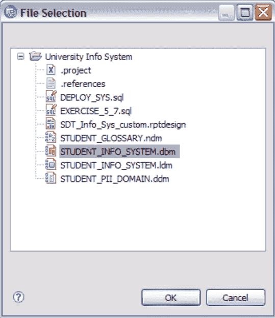

f. 点击`确定`加载数据模型资源。

g. 点击`确定`保存数据源。

5. 保存你的工作。`STUDENT_INFO_SYSTEM`物理数据模型文件已被添加为 BIRT 数据源，现在报表环境已配置完成，你可以开始起草 BIRT 报表了。

### 6.3.3 向报表添加数据对象

你现在有一份空白报表，若要报表展示数据模型中的信息，需要向报表中添加数据对象。接下来我们先创建一张表格，列出你架构中所有数据表的列信息：

1. 首先向报表添加标题：

a. 点击`面板`标签打开「面板」视图，该标签默认位于左侧面板的上半区域。

b. 在「面板」视图中，选择`标签`元素，将其拖拽到报表编辑器的`布局`页面中。

c. 在报表编辑器中双击该标签，输入以下标签文本：`Table and column report`。

d. 在「属性编辑器」中，选择`常规`标签。

e. 将字体粗细设置为**粗体**。

f. 将标签内的文本居中对齐，点击`居中`按钮，「常规」标签的界面应如下图所示：

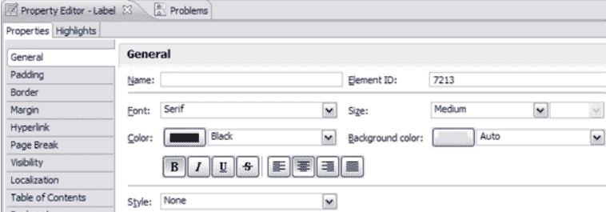

2. 向报表添加 BIRT 报表表格：

a. 在「面板」视图中，将`表格`元素拖拽到报表标题后的`布局`窗口中，「插入表格」窗口随即打开。

b. 将列数设置为 2。

c. 从数据集选项列表中选择`列`，此时报表中会插入一个两列表格。该表格包含表头行、明细行和表脚行，并且列数据集会关联到该报表表格。

> **注意：** 列数据集是报表设计中的预定义数据集，你可以在「数据浏览器」视图中查看为该报表设计定义的所有数据集。

3. 为报表表格指定名称，并更新表格格式：

a. 打开「大纲」视图，该视图默认位于左侧面板的下半区域。

b. 点击`SDT_Info_Sys_custom.rptdesign` -> `主体` -> `表格`。

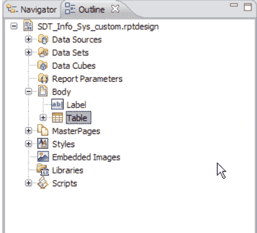

c. 在属性编辑器视图中，选择`常规`选项卡。

d. 在`名称`字段中输入`Column Report`。

> 注：BIRT 报表表格的格式可以在表格层级设置。你可以通过选中对应元素并更新属性，覆盖表格内部的属性设置。

4. 将`列`数据集中的`名称`和`完整数据类型信息`元素添加到表格中：

a. 打开数据资源管理器视图。

b. 展开`数据集` -> `列`节点，将`名称`元素拖到表格明细行的左列。

c. 展开`数据集` -> `列`节点，将`完整数据类型信息`元素拖到表格明细行的右列。

此时报表应如图 6.6 所示。

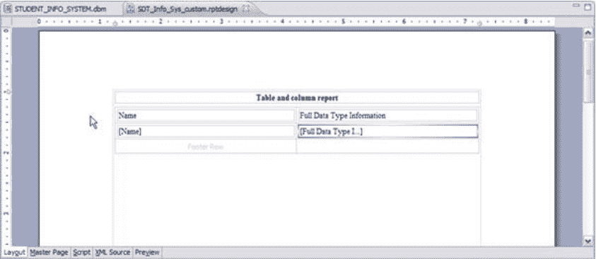

5. 设置表格属性，按数据类型优先、列名其次的顺序为表格内数据排序：

a. 打开大纲视图。

b. 展开`SDT_Info_Sys_custom.rptdesign` -> `Body`节点，然后选中`表格 – 列报表`，`表格 – 列报表`元素将在属性编辑器视图中打开。

c. 在属性编辑器中，选择视图顶部的`排序`选项卡。点击`添加`，此时会打开“新建排序键”窗口。

d. 在`键`字段中选择`完整数据类型信息`，然后点击`确定`。

e. 点击`添加`按钮添加另一个排序键。

f. 在`键`字段中选择`名称`，然后点击`确定`。你已为表格创建了两个排序键。在本章后续生成报表时，表格中的信息会先按每列的数据类型排序，再按每列的列名排序。

6. 预览报表。在报表编辑器视图底部，点击`预览`选项卡。你的报表应如图 6.7 所示。

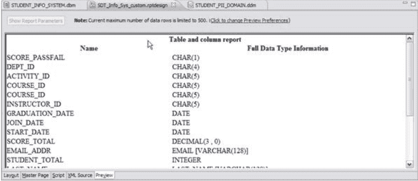

你已创建了一个基础 BIRT 报表。可以通过`预览`选项卡在运行报表前检查报表设计。接下来你需要进一步修改该报表，指定这些列所属的表。你将在现有表格内嵌套一个表格，以便对列进行分组和排序，按照你指定的报表设计来组织列。

### 6.3.4 报表数据分组

现在我们将按表对列进行分组，同时保留先按数据类型、再按列名排序的现有设计。要对报表中的数据进行分组：

1. 点击报表编辑器底部的`布局`选项卡。

2. 选中表格。将鼠标悬停在表格上时，会出现`表格`控制柄，如图 6.8 所示。选中该控制柄。


表格的辅助单元格将显示在报表表格的左侧和顶部。

3. 添加一个分组，按源表对表格的明细行进行排序：

a. 右键单击明细行辅助单元格，然后点击`插入分组`。明细行辅助单元格是中间的辅助单元格，如图 6.9 所示。

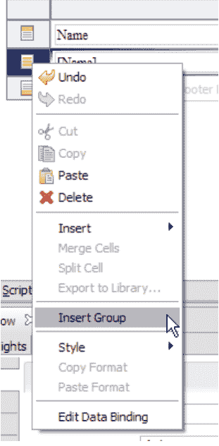

此时会打开“新建分组”窗口。

b. 将`GroupByTable`指定为名称。

c. 将`源表`指定为`分组依据`选项。

d. 点击`确定`插入分组。此时表格已包含一个按表对列进行排序的分组。报表布局应如图 6.10 所示。

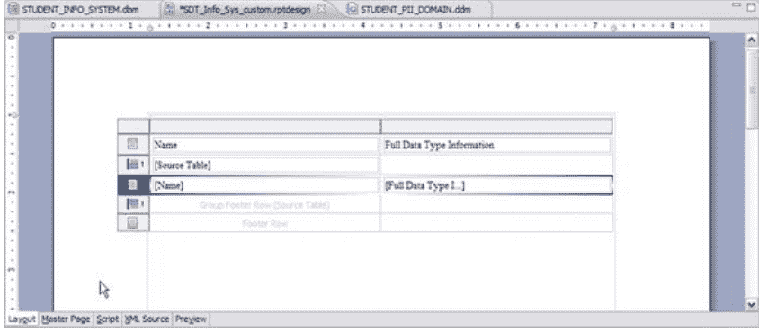

4. 格式化`[源表]`元素：

a. 在报表编辑器中选中`[源表]`元素，该元素的属性将显示在属性编辑器视图中。

b. 在属性编辑器的`属性`选项卡中，确保`常规`选项卡处于打开状态。

c. 将字体颜色改为`褐红色`，并将字体粗细设置为**粗体**。

5. 格式化`[完整数据类型信息]`元素：

a. 在报表编辑器中选中`[完整数据类型信息]`元素。

b. 在属性编辑器的`属性`选项卡中，打开`内边距`选项卡。

c. 在`左`字段中输入**20**。

6. 格式化`[名称]`元素：

a. 在报表编辑器中选中`[名称]`元素。

b. 在属性编辑器的`属性`选项卡中，打开`内边距`选项卡。

c. 在`左`字段中输入**40**。

7. 创建表头行：

a. 在报表编辑器中，右键单击包含`[完整数据类型信息]`元素的表头行辅助单元格。

b. 选择`插入 -> 行 -> 下方`，此时会在报表表格中插入一个组表头行。

c. 在报表编辑器中，将`名称`和`完整数据类型信息`标签从第一个表头行移动到新创建的行中。将`名称`标签拖到左列，将`完整数据类型信息`标签拖到右列。

d. 删除新产生的空表头行。右键单击第一个表头行的辅助单元格，然后点击`删除`。

e. 格式化`名称`标签。选中`名称`元素，在`常规`选项卡中将字体粗细设置为`粗体`，在`内边距`选项卡中将左内边距设置为**40**。

f. 格式化`完整数据类型信息`标签。选中`完整数据类型信息`标签，在`常规`选项卡中将字体粗细设置为`粗体`。在报表编辑器的`布局`选项卡中，表格应如图 6.11 所示。

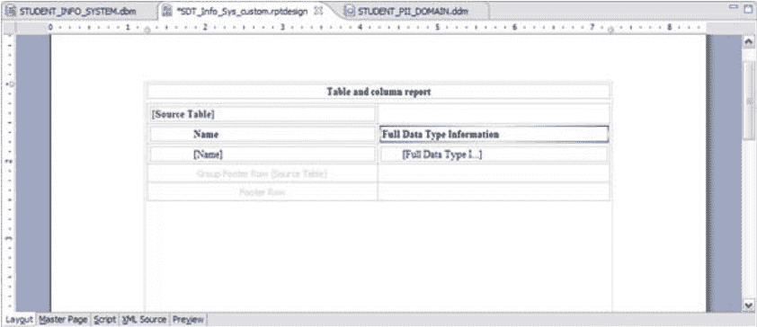

8. 预览报表。打开报表编辑器的`预览`选项卡。报表应如图 6.12 所示。

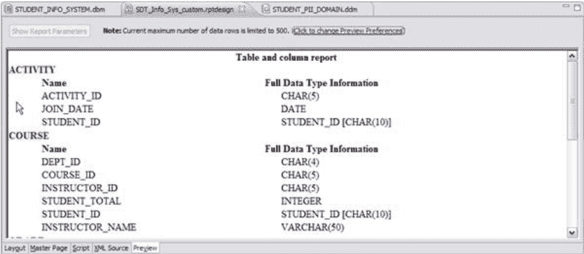

### 6.3.5 向报表添加动态文本

现在你已经创建了基础报表，接下来可以通过动态文本和格式化来优化报表外观。动态文本标签可以清晰标注数据模型中的元素，每个数据对象的名称会根据你指定的文本动态显示。在你创建的报表中，需要清晰标注表和列，这样当你将报表分享给团队其他成员（或业务流程负责人）时，他们可以清晰理解你的物理数据模型的设计。要对报表进行格式化：

1. 打开报表编辑器的`布局`选项卡。

2. 为表头创建动态文本：

a. 从组表头行中删除`[源表]`元素。

b. 从面板中，将`动态文本`元素拖到你删除`[源表]`元素的表头单元格中，此时会打开“表达式生成器”窗口。

c. 在“表达式生成器”窗口的`表达式`字段中添加以下字符串，然后点击`确定`：


此时动态文本元素会添加表达式`"Table: " + row["Source Table"]`，如*图 6.13*所示。

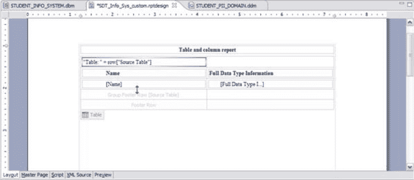

**图 6.13 – 向BIRT报表中添加动态文本元素**

3. 格式化新的动态文本标签：

   a. 确保报表编辑器中已选中该标签。

   b. 在属性编辑器视图中打开`常规`选项卡，将字体粗细设置为`粗体`，将字体颜色设置为`褐红色`。

4. 预览报表。报表应如*图 6.14*所示。

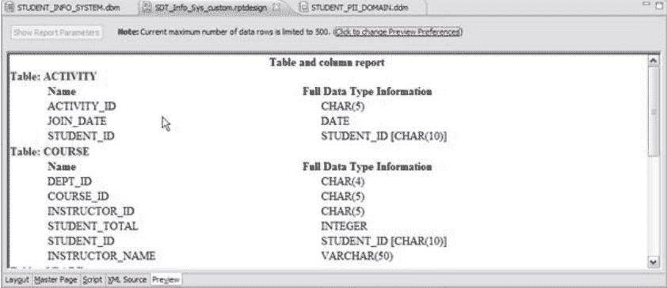

**图 6.14 – 预览格式化后的报表**

此设计可以帮助你的团队更轻松地识别数据模型中的各类对象，信息也会被便捷地排序。

### 6.3.6 从模板生成报表配置

现在我们来创建报表配置，这样你就可以将报表分享给团队。你也可以重复使用该报表配置，当你修改模型后，只需少量操作即可生成新报表。要从BIRT模板生成报表：

1. 打开导航器视图。

2. 选中报表并创建配置：

   a. 右键单击`SDT_Info_Sys_custom.rptdesign`文件，选择`报表为 -> 报表配置`，此时会打开“报表配置”窗口。

   b. 双击`BIRT Report`节点以创建新报表配置。

   c. 在`名称`字段中指定`SDT_Info_Sys_custom`。

   d. 选择`位置`单选按钮，然后点击`工作区`按钮在工作区中定位你的报表设计，此时会打开“选择报表”窗口。

   e. 展开`大学信息管理系统`节点，然后选中你刚创建的`SDT_Info_Sys_custom.rptdesign`模板，点击`确定`将其添加到报表配置中。

   f. 指定报表输出位置，例如指定`C:\Temp\IDA_Reports\Student_Info_Sys.html`。

   g. 点击`应用`保存配置。

3. 点击`报表`运行报表配置并生成报表。

物理数据模型报表配置开始运行。由于你创建的是HTML报表，系统会用默认浏览器打开该物理数据模型报表，报表文件也会保存到你指定的位置。该报表包含你部分表和列的相关信息。图6.15展示了该HTML报表。

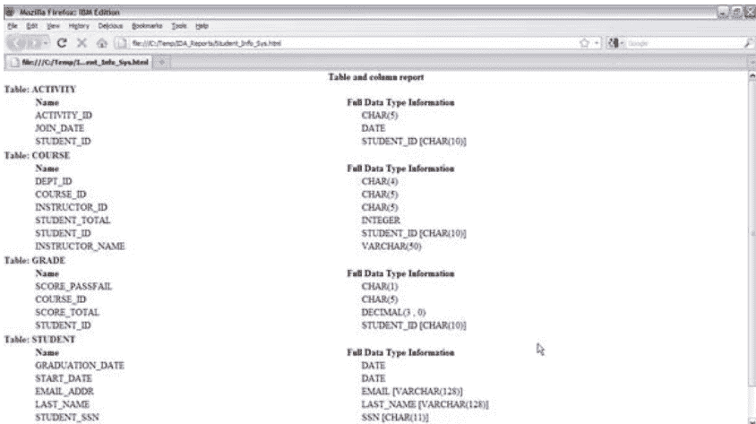

**图6.15** – 报表在默认Web浏览器中显示

请注意，物理数据模型报表不会实际展示数据库内的数据，该类报表可用于和团队成员一起分析你的模型结构。

> **注意：** 报表配置也会保存到你的工作区中。如果你的模型设计发生变更，只需点击`运行 -> 报表 -> 报表配置`，运行报表配置并选择你想要运行的配置即可。

### 6.4 生成XSLT报表

现在我们来生成另一份报表，该报表会包含你已创建的所有逻辑数据模型的相关信息，它会汇总所有逻辑数据模型的资料，方便你向团队展示详细信息。

创建XSLT报表的步骤如下：

1. 点击`窗口 -> 打开透视图 -> 其他`切换到数据透视图，“打开透视图”窗口会弹出，选择数据透视图即可。

2. 点击主菜单中的`运行 -> 报表 -> 报表配置`，“报表配置”窗口会弹出。

3. 双击`经典XSLT数据模型报表`选项，即可创建新的XSLT报表配置。

4. 为新配置指定以下选项：

   a. 在`名称`字段中，输入`SDT_Info_Sys_XSLT`。

   b. 在报表输入的`位置`字段中，点击`浏览`，选择`STUDENT_INFO_SYSTEM.ldm`逻辑数据模型。

   c. 在报表输入的`元素`字段中，点击`浏览`，选择`学生信息管理系统`数据包。

   d. 在`报表`区域选中`内置`单选按钮，然后点击`浏览`，“选择内置报表”窗口会弹出。

   e. 展开`逻辑数据模型（经典XSLT报表）`节点，选择`经典示例逻辑模型报表`，点击`确定`将报表类型添加到配置中。

   f. 在报表输出的`位置`字段中指定文件路径和名称，例如指定`C:\Temp\IDA_Reports\SDT_Info_Sys_XSLT.pdf`。

5. 点击`应用`保存配置。

6. 点击`报表`运行配置，报表开始生成，生成完成后会自动打开。

该报表包含所有逻辑数据模型的相关信息，并会描述你所有数据对象的属性，用IBM InfoSphere Data Architect创建的图表也会包含在报表中，方便团队中的非技术人员理解数据对象间的关联。

### 6.5 使用IBM InfoSphere Data Architect导入和导出

IBM InfoSphere Data Architect的导入导出功能支持你将该工具中的数据模型与其他建模工具（如IBM Cognos Framework Manager、IBM Rational Rose或IBM Rational Software Architect）进行互导。在向IBM InfoSphere Data Architect导入或导出数据模型时，数据模型的元数据会被转换为其他建模工具可识别的格式。

#### 6.5.1 使用工作台导出

现在我们来使用IBM InfoSphere Data Architect将逻辑数据模型导出为XML文件，这样当数据模型填充完信息后，业务负责人可以将该XML模型文件导入到可用来生成报表的工具中。

导出数据模型的步骤如下：

1. 点击主菜单中的`文件 -> 导出`，“导出向导”窗口会弹出。

2. 展开`数据`节点，选择`数据模型导出向导`，然后点击`下一步`。

3. 完成向导中的“选择模型”页面：

   a. 在`模型格式`字段中选择`W3C XML Schema 1.0 (XSD)`。

   b. 点击`模型`字段旁的`浏览`，选择`STUDENT_INFO_SYSTEM.ldm`逻辑数据模型文件。

   c. 点击`导出到`字段旁的`浏览`，将导出的数据模型指定保存到你的数据设计项目中，命名为`SDT_Info_Sys_Exp.xml`，该操作的示例如*图6.16*所示。

   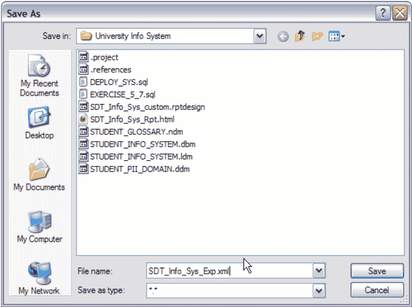

   *图6.16 – 导出数据模型并保存到你的项目中*

   d. 点击`下一步`。

4. 在“选择选项”页面中点击`下一步`，数据模型就会被导出。

5. 点击`完成`保存导出的数据模型并退出数据模型导出向导，你可以在数据设计项目的`XML架构`文件夹下找到导出的模型。

> **注意**：由于你导出的是XML文件，因此模型中包含的图表不会被导出。

#### 6.5.2 使用工作台导入数据模型

虽然导出的模型已经存在于你的工作台中，但让我们练习一下导入模型的操作。IBM InfoSphere Data Architect可以读取多个其他数据建模工具的信息，方便你使用工作台进一步细化和完善数据模型。

现在我们将数据模型导入工作台，步骤如下：

1. 点击主菜单中的`文件 -> 导入`，“导入向导”窗口会弹出。

2. 展开`数据`节点，选择`数据模型导入向导`，然后点击`下一步`。

3. 完成“选择模型”页面：

   a. 在`模型格式`字段中选择`W3C XML Schema 1.0 (XSD)`。

   b. 点击`模型`字段旁的`浏览`按钮，选择`SDT_Info_Sys_Exp.xml`文件。

   c. 点击`目标项目`字段旁的`浏览`按钮，选择`高校信息系统`数据设计项目。

   d. 在`模型类型`字段中选择`仅逻辑模型`，该操作会生成一个逻辑数据模型文件，你可以修改该文件，之后再将其转换为物理数据模型。

   e. 在`文件名`字段中指定`SDT_Info_Sys_Imp`。

   f. 点击`下一步`。

4. 在“选择选项”页面中点击`下一步`，数据模型会被转换并导入到数据设计项目中。

5. 点击`完成`退出数据模型导入向导，模型会存放在你的`数据模型`文件夹中，展开逻辑数据模型后即可看到你的数据模型已完整导入。

### 6.6 练习

请创建一个自定义模板`SDT_Info_Sys_Diag.rptdesign`，该模板可以提取`STUDENT_INFO_SYSTEM.ldm`逻辑数据模型中的图表，包括图表中实体的相关信息。你可以复制并修改`空白图表报表`来草拟该报表。

1. 插入1列、2个详细行的表格，并将图表指定为数据集。

2. 在第一个详细行中插入图表图片，并指定插入`动态图片`，点击`选择图片数据`按钮为该行指定数据集绑定。

3. 点击`添加`按钮添加新的数据绑定，以便将图片添加到报表中，为该行指定最合适的数据类型，此处选择`Blob（二进制大对象）`，然后点击`表达式`字段旁的按钮打开表达式构建器窗口。

4. 在表达式构建器窗口中为数据集行指定以下表达式：

```java
dataSetRow["Image"]
```

5. 添加完表达式后，选中列绑定数据集旁的复选框，点击`确定`，然后在表格中`插入`图片。

6. 在第二个详细行中嵌套（插入）1列、2个详细行且无数据集的表格。

7. 在新表格的第一个详细行中插入2行1列的网格。

8. 在网格的左列插入标签`实体`。

9. 使用数据资源管理器在网格的右列插入`实体 -> 名称`对象。

10. 切换回数据透视图，为报表模板创建报表配置，确保模板的数据源指向`STUDENT_INFO_SYSTEM.ldm`逻辑数据模型文件，以便将逻辑数据模型中的图表提取到报表中，指定PDF输出格式后运行报表，报表效果应如*图6.17*所示。

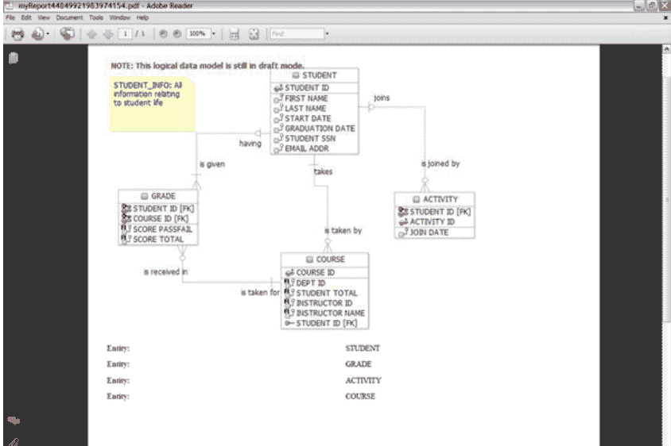

**图6.17** – 完成的图表报表

### 6.7 小结

本章你学习了在IBM InfoSphere Data Architect中创建数据模型报表的基本概念，掌握了如何使用工作台中的各类内置模板生成不同类型的报表，还学习了如何在IBM InfoSphere Data Architect中导入导出数据模型，该功能可将不同数据模型进行格式转换，以便被其他工具导入或兼容使用。

### 6.8 复习题

1. 工作台不支持以下哪种BIRT报表输出格式？

   A. HTML

   1. （题干及A选项缺失）

   **B.** PDF

   **C.** 纯文本

   **D.** Microsoft Excel

2. 以下哪些数据模型可以在工作台中导入或导出？

   **A.** 物理数据模型

   **B.** 术语模型

   **C.** 映射模型

   **D.** 以上所有

3. 以下哪种有效性检查在导出数据模型时不受支持？

   **A.** 基本有效性检查

   **B.** 常规有效性检查

   **C.** 无有效性检查

   **D.** A和C均正确

4. BIRT报告模板的文件扩展名是什么？

   **A.** `.xsl`

   **B.** `.xsldesign`

   **C.** `.rptdesign`

   **D.** 以上都不是

5. XSLT报告支持哪种报表输出格式？

   **A.** PDF

   **B.** Microsoft Excel

   **C.** 纯文本

   **D.** HTML

## 第7章 – 反向工程

通常，在你开始担任数据架构师的工作之前，企业已经有包含多张表的大型架构部署到数据库中。如果你需要对这些架构进行修改，在不影响现有约束或不丢失数据的情况下管理这些变更会耗费大量时间和精力。不过，你可以基于现有的数据库对象集创建物理数据模型。对现有数据库进行反向工程后，修改模型并将变更集部署回数据库就会成为一个简单的流程。这正是我们本章将要探讨的内容。

本章你将学习以下内容：

- 在工作台中从现有数据库进行反向工程
- 比较和合并数据模型的变更
- 生成DDL以部署你的变更

### 7.1 反向工程：整体概览

我们已经了解到，当你生成用于部署的DDL脚本时，物理数据模型中的对象可以转换为数据库中的对象。*反向工程*是这一过程的逆过程：我们将数据库中的对象转换为物理数据模型中的对象。*图7.1*说明了反向工程的整体概览。

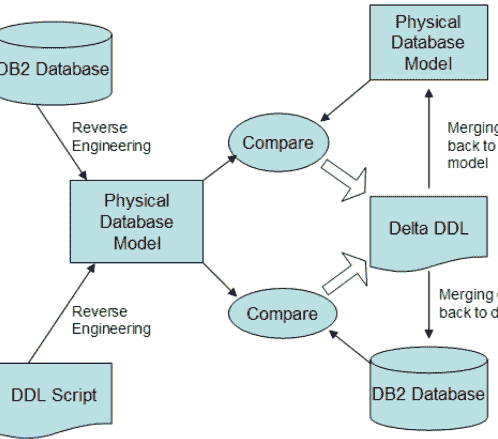

*图7.1*的左侧说明，反向工程过程可以基于数据库或DDL脚本开展。反向工程过程会在工作台的“数据项目浏览器”中创建物理数据模型（`.dbm`）文件。该物理数据模型会捕获数据库中数据对象的相关信息。一旦你通过反向工程得到物理数据模型，就可以修改该数据模型、将其转换为逻辑数据模型，或者像操作其他任意数据模型一样使用它。对物理数据模型完成修改后，你需要将变更部署到数据库中。使用工作台中的比较功能，匹配物理数据模型与数据库，展示开发中模型与生产环境模型之间的差异。随后，你可以分析自己的变更对现有数据模型产生的影响。最后，使用工作台合并变更，生成可部署到数据库的增量DDL文件。当你在数据库上运行该脚本时，可以在不丢失任何现有数据的前提下，对数据库对象进行必要的修改。

> **注意：** 尽管你可以从DDL脚本或现有数据库进行反向工程，但从数据库进行反向工程时可供选择的选项更多。由于数据库在系统目录表中存储了大量元数据，IBM InfoSphere Data Architect可以充分利用这些元数据，更好地填充物理数据模型。

### 7.2 使用工作台进行反向工程

当你对数据库进行反向工程时，工作台会读取数据库中对象的详细信息，并将其转换为物理数据模型中对应的等效表示形式。这可以简单理解为：如果你对包含1张表和1个索引的架构进行反向工程，那么最终得到的物理数据模型将包含1个带1张表和1个索引的架构。为了解从DDL脚本进行反向工程时会发生什么，请参考以下示例：一段DDL脚本会在数据库中创建包含1张表和1个索引的架构。当你从该DDL脚本进行反向工程时，工作台会在物理数据模型中创建架构、表和索引的等效表示形式。我们将在下一节详细讲解这一流程。

#### 7.2.1 从DDL进行反向工程

##### 7.2.1.1 创建示例DDL脚本

首先，我们先创建一个用于反向工程的示例DDL脚本。该DDL脚本会在`SAMPLE`数据库连接中创建以下数据库对象：

- 1个名为`SAMPLEUNIV`的数据库
- 1个属于`SAMPLEUNIV`数据库、名为`UNIVERSITY`的架构
- 该架构中的2张表，分别名为`DEPARTMENT`和`STUDENT`

创建示例DDL脚本的步骤如下：

1. 右键点击数据设计项目中的`SQL脚本`文件夹，然后选择`新建 -> SQL或XQuery脚本`。“新建SQL或XQuery脚本”窗口将打开。

2. 填写“新建SQL或XQuery脚本”窗口：

   a. 指定`University Info System`项目。

   b. 在`名称`字段中输入`SAMPLE_DDL.sql`。

   c. 确保选中以下单选按钮：`SQL和XQuery编辑器`（适用于包含1个或多个SQL和XQuery语句的脚本）

   d. 点击`完成`。

3. 选择`SAMPLE`数据库连接配置文件。由于你当前不需要部署该脚本，因此无需关注连接问题。“选择连接配置文件”窗口将打开。系统将创建一个空SQL文件，并在SQL编辑器视图中打开。

4. 输入以下SQL语句，创建包含`UNIVERSITY`架构以及`DEPARTMENT`和`STUDENT`表的`SAMPLEUNIV`数据库：

```sql
CREATE DATABASE SAMPLEUNIV;
CREATE SCHEMA "SAMPLEUNIV"."UNIVERSITY";
CREATE TABLE "UNIVERSITY"."STUDENT" (
  STUDENT_ID CHAR(10) NOT NULL,
  STUDENT_FIRSTNAME CHAR(20) NOT NULL,
  STUDENT_LASTNAME CHAR(20) NOT NULL,
  STUDENT_ADDRESS CHAR(100) NOT NULL,
  STUDENT_PHONE CHAR(10) NOT NULL,
  DEPARTMENT_ID INTEGER NOT NULL
);
CREATE TABLE "UNIVERSITY"."DEPARTMENT" (
  DEPARTMENT_ID INTEGER NOT NULL,
  DEPARTMENT_NAME CHAR(20) NOT NULL,
  DEPARTMENT_ESTDATE DATE
);
ALTER TABLE "UNIVERSITY"."STUDENT" ADD CONSTRAINT "STUDENT_PK" PRIMARY KEY(STUDENT_ID);
ALTER TABLE "UNIVERSITY"."DEPARTMENT" ADD CONSTRAINT "DEPARTMENT_PK" PRIMARY KEY(DEPARTMENT_ID);
ALTER TABLE "UNIVERSITY"."STUDENT" ADD CONSTRAINT "STUDENT_DEPARTMENT_fk" FOREIGN KEY(DEPARTMENT_ID) REFERENCES "UNIVERSITY"."DEPARTMENT" (DEPARTMENT_ID);
```

5. 保存你的工作。SQL脚本已创建并保存在你的`SQL脚本`文件夹中。

> **注意：** 你无需运行此文件即可基于它进行反向工程。你将在下一节基于该脚本进行反向工程。

##### 7.2.1.2 从DDL脚本进行反向工程

让我们使用这个新的DDL文件反向工程得到物理数据模型。要从DDL脚本进行反向工程，请按以下步骤操作：

1. 点击`文件 -> 新建 -> 物理数据模型`，创建新的物理数据模型。“新建物理数据模型”向导将打开。

2. 填写向导的“模型文件”页面：

   a. 将`University Info System`数据设计项目指定为目标文件夹。

   b. 在`文件名`字段中指定`NEW_SDT_DDL`。


c. 将`DB2 for Linux, UNIX, and Windows`指定为数据库类型。

d. 将`9.7`指定为数据库版本。

e. 选中`从反向工程创建`单选按钮。

f. 点击`下一步`。

在“源”页面，选择`DDL脚本`选项，然后点击`下一步`。

在“脚本文件”页面，点击`浏览`，然后选择`SAMPLE_DDL.sql`文件。点击`下一步`。

在“选项”页面，点击`下一步`。

在“反向工程状态”页面，验证脚本文件已成功完成反向工程，然后点击`完成`以创建物理数据模型。

`NEW_SDT_DDL.dbm`物理数据模型将在数据项目浏览器中创建，如`图7.2`所示。

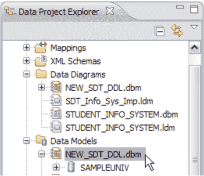

**图7.2** – 从DDL文件创建的新的物理数据模型

如果你浏览该物理数据模型，就会看到DDL脚本中指定的架构和表。

### 7.2.2 从数据库进行反向工程

从数据库进行反向工程的流程与从DDL脚本进行反向工程的流程非常相似，区别在于你可以选择要从数据库中反向工程的对象。例如，数据库可能包含多个架构，你希望各个架构模型相互独立。只需选择你要反向工程的一个或多个架构，在部署变更前对其进行修改。尽管你已经拥有`STUDENT_LIFE`架构的现有副本，该副本包含在`STUDENT_INFO_SYSTEM.dbm`物理数据模型文件中，但我们还是使用部署在数据库上的架构进行反向工程并做出修改，以便后续可以将这些变更与`SAMPLE`数据库进行比较和部署。

要从数据库进行反向工程，请按以下步骤操作：

1. 从主菜单点击`文件 -> 新建 -> 物理数据模型`。“新建物理数据模型”向导将打开。

2. 填写“模型文件”页面：

   a. 将`University Info System`数据设计项目指定为目标文件夹。

   b. 在`文件名`字段中指定`NEW_SDT_INFO_SYS`。

   c. 将`DB2 for Linux, UNIX, and Windows`指定为数据库类型。

   d. 将`V9.7`指定为数据库版本。

   e. 选择`通过逆向工程创建`单选按钮，然后单击`下一步`。

3. 在“源”页面，确保选中`数据库`单选按钮，然后单击`下一步`。

4. 在“选择连接”页面，选择`SAMPLE`数据库连接配置文件，然后单击`下一步`。

5. 在“选择对象”页面，选择`STUDENT_LIFE`架构，然后单击`下一步`。

6. 在“数据库元素”页面，保留默认选项，然后单击`下一步`。

7. 在“选项”页面，单击`完成`。新的物理数据模型会在数据项目资源管理器中创建（如图7.3所示），并在编辑器视图中打开。

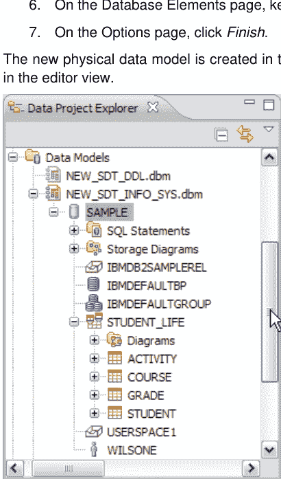

图7.3 – 从现有数据库逆向工程得到的新物理数据模型

### 7.3 修改新的物理数据模型

我们来修改`NEW_SDT_INFO_SYS.dbm`物理数据模型文件，在其中添加一些新列和一个索引。在本场景中，业务流程负责人要求你添加列，用于存储每门课程每位讲师的主电话号码以及学生的电话号码。他们还要求创建一个索引，帮助按学生姓名排序，以便更便捷地访问数据。完成这些修改后，你可以使用工作台的比较与合并功能生成DDL，将修改部署到`SAMPLE`数据库中。

要修改物理数据模型：

1. 在数据设计项目中定位`COURSE`表：`大学信息系统 -> 数据模型 -> NEW_SDT_INFO_SYS.dbm -> SAMPLE -> STUDENT_LIFE -> COURSE`。

2. 在`COURSE`表中创建`INSTRUCTOR_PHONE`列：

   a. 右键单击`COURSE`表，选择`添加数据对象 -> 列`。将在`COURSE`表下创建一个新的列对象。

   b. 将新列命名为`INSTRUCTOR_PHONE`。

   c. 在`INSTRUCTOR_PHONE`列的`数据类型`字段中，指定`CHAR`。

   d. 在`长度`字段中，指定`10`。

3. 按照步骤2的说明，在`STUDENT`表中创建`STUDENT_PHONE`列。使用相同的数据类型。

4. 创建一个新索引，按姓氏对学生信息排序：

   a. 右键单击`STUDENT`表，选择`添加数据对象 -> 索引`。将在`STUDENT`表下创建一个新索引。

   b. 将索引命名为`STUDENT_LAST_NAME_IDX`。

   c. 打开属性视图的`列`选项卡，单击`键列`字段旁的省略号按钮（`...`）修改键列。将打开“选择列”窗口。

   d. 取消选中`FIRST_NAME`列，选中`LAST_NAME`列。单击`确定`修改键列。

5. 保存你的工作。列和索引已创建并保存在你的物理数据模型文件中。现在你可以使用此修改后的物理数据模型与目标数据库进行比较，然后生成增量DDL，将你的修改合并到`SAMPLE`数据库中。

### 7.4 比较并合并你的修改

`比较`功能可帮助你查找同一模型两个版本之间的差异。`合并`功能可帮助你将修改部署到现有模型中。通过此视图，你还可以`分析修改对现有模型的影响`。此操作可帮助你查找数据对象之间的依赖关系，从而了解你对某一数据对象做出的修改将如何影响关联对象。

> **注意：** 由于我们对这个小模型所做的修改较少，该模型中没有会受到影响的依赖对象。作为最佳实践，你在生成DDL以部署修改之前，应始终分析修改的影响。如果将来你想要分析修改的影响，必须先将修改从一个数据模型复制到另一个数据模型。之后，你可以使用`分析左侧影响`或`分析右侧影响`按钮来分析修改的影响。受影响的对象将显示在“受影响对象”视图中，你可以深入查看修改，了解哪些数据对象会受到你的修改的影响。

> **注意：** 你也可以比较工作区中的两个模型。本书未涵盖此任务，但其与对比源数据库的流程类似。

#### 7.4.1 使用数据库比较和合并修改

你可以将数据模型与源数据库进行比较。以下对象可使用比较功能：

- 源数据库

- 逻辑数据模型

- 物理数据模型

- 术语表模型

- 域模型

现在我们来对比新的物理数据模型与其源数据库：

1. 在数据项目资源管理器中定位`STUDENT_LIFE`架构：`大学信息系统 -> 数据模型 -> NEW_SDT_INFO_SYS.dbm -> SAMPLE -> STUDENT_LIFE`。

2. 在数据项目资源管理器中右键单击`STUDENT_LIFE`架构，选择`对比 -> 另一个数据对象`。将打开“与另一个数据对象对比”向导。

3. 展开`SAMPLE (SAMPLE)`数据库，然后选择源数据库的`STUDENT_LIFE`架构，如图7.4所示。单击“下一步”进入下一个屏幕。将打开“过滤条件”页面。

4. 选择要对比的特定数据对象：

   a. 单击`全部取消`按钮，取消选中所有数据对象。

   b. 在`纳入对比的对象`字段中，选择`列`对象。所有与列相关的对象也会被选中。

   c. 选择`索引`对象。

5. 单击`完成`运行对比。物理数据模型的架构对象将与`SAMPLE`数据库中的`STUDENT_LIFE`架构进行对比。将打开“对比”编辑器。“结构对比”窗格可让你浏览数据设计项目架构与源架构之间的差异。数据设计项目架构位于窗格左侧，源架构位于窗格右侧。如图7.5所示。

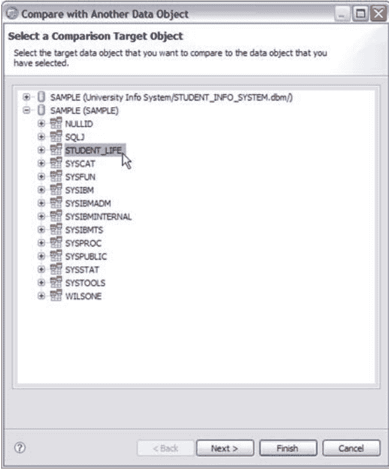

图7.4 – 选择源数据库

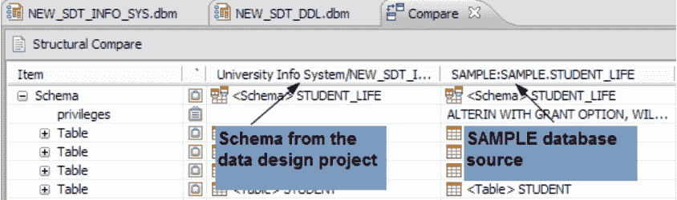

**图7.5 – 对比架构**

6. 使用“结构对比”窗格浏览两个架构之间的差异。单击`下一处差异`或`上一处差异`按钮查看架构之间的差异。

7. 使用“结构对比”视图定位`COURSE.INSTRUCTOR_PHONE`列，如图7.6所示。注意，“结构对比”视图显示该对象在源架构中不存在。

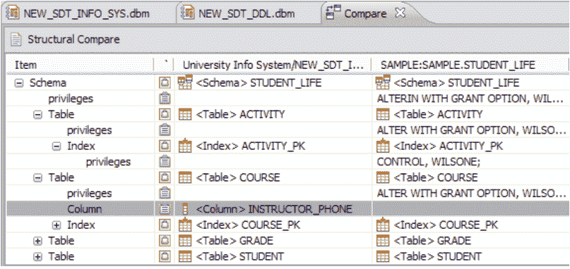

**图7.6 – 定位新列**

“属性对比”窗格可让你对比各个数据对象之间的差异。窗格左侧包含数据模型中对象的相关信息，窗格右侧包含源数据库中对象的相关信息（如果该对象存在）。

8. 右键单击`INSTRUCTOR_PHONE`列，选择`分析左侧影响`。将打开“受影响对象”视图。由于没有其他数据对象引用此列，且不存在依赖关系，因此“受影响对象”视图中不会显示任何影响。

9. 使用“属性对比”视图指定你要将新列复制到源架构。单击`从左复制到右`按钮。

10. 使用“结构对比”视图定位`STUDENT_PHONE`列。

11. 右键单击`STUDENT_PHONE`列，选择`分析左侧影响`。由于没有其他数据对象引用此列，且不存在其他依赖关系，因此“受影响对象”视图中不会显示任何影响。

12. 使用“属性对比”视图指定你要将`STUDENT_PHONE`列复制到源架构。

13. 定位新的`STUDENT_LAST_NAME_IDX`索引，然后分析影响并将修改复制到源架构。

14. 生成DDL以部署你的修改。`生成右侧DDL`按钮可生成将修改部署到数据库所需的DDL。将打开“生成DDL”向导。

15. 完成“保存并运行DDL”页面：

    a. 确保`文件夹`字段中指定的是`大学信息系统`数据设计项目。

    b. 在`文件名`字段中，指定`DELTA_SDT_CHANGES.sql`。

    c. 选中`在服务器上运行DDL`复选框，在服务器上运行DDL脚本并部署你的修改。

    d. 单击`下一步`。

16. 在“选择连接”页面，选择`SAMPLE`数据库连接，然后单击`下一步`。

17. 查看“摘要”页面上的信息，然后单击`完成`。DDL将在服务器上运行，你的新列和索引将在`SAMPLE`数据库中创建。查看“SQL结果”视图以确保SQL语句成功运行。在“数据源资源管理器”中刷新数据库，然后验证新列和索引是否存在。其中一个新列如图7.7所示。

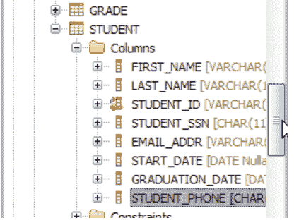

图7.7 – 在数据源资源管理器中查看修改

#### 7.4.2 比较与合并功能的优势

在没有`IBM InfoSphere Data Architect`的帮助下，比较和合并更新的数据模型是一项耗时的流程，因为你必须手动设计所有查询语句。手动引入变更可能会引发大量错误，尤其在现有架构、表和约束数量众多的数据库中。`IBM InfoSphere Data Architect`在执行比较与合并流程时，会考虑现有的约束和依赖关系，让你能够轻松管理数据库和架构的变更。

#### 7.5 练习

1. 创建以下名为`EXERCISE_7_5.sql`的DDL脚本：

```sql
CREATE SCHEMA "EXERCISE";
CREATE TABLE "EXERCISE"."TABLE1" (
  "TABLE1_ID" INTEGER,
  "TABLE1_NAME" VARCHAR(20),
  "TABLE2_ID" INTEGER
);
CREATE TABLE "EXERCISE"."TABLE2" (
  "TABLE2_ID" INTEGER,
  "TABLE2_NAME" VARCHAR(20),
  "TABLE3_ID" INTEGER
);
CREATE TABLE "EXERCISE"."TABLE3" (
  "TABLE3_ID" INTEGER,
  "TABLE3_NAME" VARCHAR(20)
);
CREATE UNIQUE INDEX "TABLE1_ID_INDEX" ON "EXERCISE"."TABLE1" ("TABLE1_ID");
CREATE UNIQUE INDEX "TABLE2_ID_INDEX" ON "EXERCISE"."TABLE2" ("TABLE2_ID");
CREATE UNIQUE INDEX "TABLE3_ID_INDEX" ON "EXERCISE"."TABLE3" ("TABLE3_ID");
```

2. 对DDL脚本进行反向工程，创建一个新的物理数据模型`EXERCISE_7_5.dbm`。在新建物理数据模型向导的“选项”页面中，请确保你创建了数据模型对象之间的`概览`图，并`推断隐式关系`。记录你的结果。

3. 使用`EXERCISE`图的“属性”视图，显示图中对象的键和非键分区。使用`布局`选项卡将布局更改为`层次结构` -> `自上而下`布局。新物理数据模型的概览图应与`图7.8`中的图像一致。

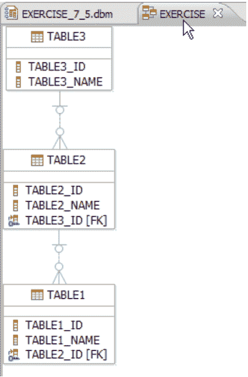

**图7.8 – 查看EXERCISE图**

#### 7.6 小结

我们已经了解到反向工程流程如何帮助我们基于数据库中现有的表和架构，或DDL脚本创建物理数据模型。我们还了解了从数据库进行反向工程时，如何选择要纳入反向工程模型的数据库元素类型。我们已经了解到比较与合并流程如何帮助我们管理现有数据库的变更，且不会丢失任何现有数据。

#### 7.7 复习题

1. 判断正误：对DDL脚本进行反向工程时，该脚本的文件扩展名只能是`.DDL`。

2. 判断正误：从DDL脚本进行反向工程时，工作台允许你指定要进行反向工程的数据库元素类型。

3. 哪些不同类型的数据库元素可以反向工程为物理数据模型？

4. 判断正误：你只能在物理数据模型及其在数据库中的祖先模型上比较和合并变更。

5. 你可以比较哪些类型的数据模型？

## 第8章 – 模型映射与发现

信息可能来自不同的数据源，整合这类数据是任何企业的常见需求。当现有数据源需要与被获取的数据源集成时，理解元数据至关重要。元数据是关于数据的数据，它存储了数据的类型、用途以及其他标识信息。理解元数据有助于可视化不同数据源之间的关联，并在它们之间创建映射和关系。映射模型可帮助你在多种数据源之间映射这类元数据。`IBM InfoSphere Data Architect`提供以下元数据集成工具：

- 定义数据源之间的关系和映射

- 设置转换规则

- 发现关系

- 生成可部署到数据库的脚本

### 8.1 映射模型：全局概览

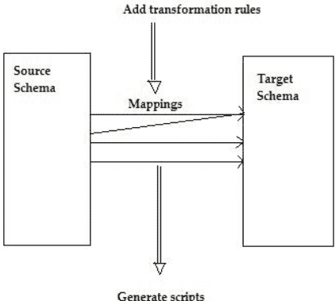

**图8.1 – 全局概览**

InfoSphere Data Architect 入门

`映射模型`用于定义两个不同架构之间的关系：源架构和目标架构。映射模型以映射规范语言（MSL）文件的形式存储。源模型可以是逻辑数据模型或物理数据模型。目标模型可以是`逻辑数据模型`、`物理数据模型`或XML架构文件（XSD）。映射模型是信息集成建模的一部分。`信息集成建模`提供了一系列可帮助你管理元数据的函数。要将新数据源与现有企业数据集成，你需要了解新数据源中的数据与现有环境中的数据如何关联。你可以构建一个流程，将新数据源中的数据复制到现有源中。通过定义映射和关系，你可以操作大量异构元数据。

#### 8.1.1 使用映射模型管理元数据

`IBM InfoSphere Data Architect`通过以下方式帮助你管理模型的元数据：

- `发现关系`：工作台可以帮助你发现展示一个或多个源架构与目标架构关联方式的方法，这些关系可以基于元数据或任何可用的数据样本。

- `映射关系`：`IBM InfoSphere Data Architect`可直观地映射你的源和目标数据模型，以及已发现或手动指定的关系。你创建的映射描述了如何将一个或多个源模型表示的数据合并、转换为适合目标模型的格式，结果会保存在映射模型中。

- `构建表达式`：你可以定义诸如函数、连接条件、过滤条件和排序条件等规则，将其添加到映射模型中，并在部署的脚本中使用这些表达式。

- `生成脚本`：你可以从映射模型生成脚本，用于将符合映射模型要求的源中的数据转换、过滤后导入符合映射模型要求的目标中。

映射模型通过定义不同来源模型之间的关系，帮助我们集成各类模型。可以为架构之间创建的关系和映射添加转换规则。`映射`是指数据源中未实现的两个数据结构之间的依赖关系，映射模型会存储这些映射的概要信息。假设本学生信息系统是为支持多个校区运行而设计的，例如部分大学设有主校区，同时还会使用通常位于同一地理区域的小型卫星校区。假设`NEW_SDT_INFO_SYS.dbm`物理数据模型对某大型大学卫星校区的部分数据进行了建模，而你希望无缝整合这些信息。由于你在第6章已完成该物理数据模型的反向工程，因此你可以创建映射模型，将其部分元数据映射到`STUDENT_INFO_SYSTEM.dbm`物理数据模型文件中的对应对象。

#### 8.1.2 使用映射模型进一步管理命名规范

你可以使用术语表或命名模型来发现源架构与目标架构之间的关系。你在本书第3章已经了解了术语表模型。你在数据设计流程早期定义的命名规则可用于识别不同架构之间的关系。

> **注意：** 你无需执行本节所列的步骤，这些步骤仅作为参考。你已经创建了术语表模型来跟踪数据模型中实体、表和其他数据对象的名称。你可以使用该术语表模型确保所有数据模型都符合你为组织定义的命名规范。如果映射模型发现功能无法正确判定哪些对象应被映射，则可能是部分对象不符合命名规范。

要使用映射模型判定模型是否符合命名规范，请按以下步骤操作：

1. 打开“企业命名标准”窗口，将命名模型附加到映射模型：

   a. 通过打开现有映射模型来打开映射编辑器。

   b. 在映射编辑器中单击鼠标右键。

   c. 选择`发现关系 -> 企业命名标准`，窗口将打开。

2. 选择要附加命名标准的架构。

3. 单击“命名模型列表”面板旁边的`添加`按钮，“选择命名模型文件”窗口将打开。

4. 选择一个文件扩展名为`.ndm`的术语表模型，然后单击“确定”。

5. 对剩余的所有架构重复上述步骤，然后单击`完成`。

6. 基于最佳匹配发现关系：

   a. 在映射编辑器中单击鼠标右键，然后选择`发现关系 -> 查找最佳匹配`，“发现关系”窗口将打开。

   b. 选择要发现关系的架构，然后单击`完成`。系统将分析模型，并由工作台判定哪些数据对象应在映射模型中关联。


7. 批准或拒绝映射。
8. 如有必要，创建新映射。
9. 保存你的工作。

## 8.2 在工作台中创建映射

你可以在数据设计项目中，从源逻辑和物理数据模型创建映射模型。映射模型的目标模型可以是逻辑或物理数据模型，也可以是XML架构。

> **限制：** 你无法从以逻辑数据模型作为源的场景生成脚本。当你在逻辑数据模型和其他源或目标之间创建映射时，仅用于发布目的；也就是说，你只能对映射进行报告。

### 8.2.1 创建空白映射模型

让我们创建一个新的映射模型，将`NEW_STUDENT_INFO_SYS.dbm`物理数据模型中的对象映射到`STUDENT_INFO_SYSTEM.dbm`物理数据模型：

1. 点击*文件* -> *新建* -> *映射模型*。此时会打开映射编辑器向导。
2. 完成“创建映射”页面：
   - a. 确保在*目标文件夹*字段中已指定*大学信息系统*数据设计项目。
   - b. 在*文件名*字段中指定`STUDENT_MAPPING.msl`。
   - c. 确保已选中*为此模型启用脚本生成*选项，这样你就能创建SQL脚本来部署映射。
   - d. 点击*下一步*。
3. 完成“指定映射源”页面：
   - a. 点击*添加*按钮。此时会打开“选择映射源”窗口。
   - b. 选择`NEW_STUDENT_INFO_SYS.dbm`物理数据模型文件，然后点击*确定*。该映射源文件会被添加到*映射源文件*列表中。
   - c. 点击*下一步*。
4. 不要更改“指定映射目标”页面上的任何选项，然后点击*下一步*。
5. 完成“指定映射目标”页面：
   - a. 点击*添加*按钮。此时会打开“选择映射目标”窗口。
   - b. 选择`STUDENT_INFO_SYSTEM.dbm`物理数据模型文件，然后点击*确定*。该映射目标文件会被添加到*映射目标文件*列表中。
   - c. 确保已选中*映射目标架构*列表中的所有对象。
   - d. 点击*下一步*。
6. 在“新建映射模型摘要”页面上验证你的选项，然后点击*完成*。映射模型文件会创建在你数据设计项目的*映射*文件夹中，并会在编辑器视图中打开。

映射编辑器包含三个窗格，如*图8.2*所示：

- **源**：此窗格包含源文件和架构。
- **映射**：此窗格会显示映射模型内的映射和映射组。
- **目标**：此窗格包含目标文件和架构。

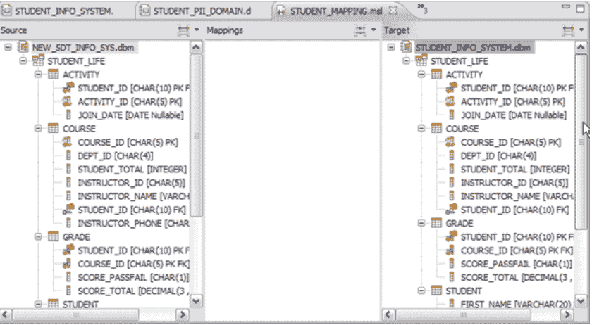

#### 图8.2 – 了解映射编辑器

### 8.2.2 向映射模型添加映射

你可以从映射编辑器中，在源架构和目标架构之间创建映射。你可以通过两种方式创建映射：

- **手动添加映射**：在*源*和*目标*窗格中选择对象，然后在它们之间创建映射。
- **让工作台自动发现映射**：运行“发现关系”向导，确定数据对象之间的最佳映射。

#### 8.2.2.1 手动创建映射

手动创建映射时，你可以确保每个源对象都映射到目标数据模型中对应的合适对象。这个过程可能比较耗时，但对于小型数据模型，这有时是最佳方法。让我们尝试手动创建映射，创建两个映射：

1. 映射`STUDENT.STUDENT_ID`列：
   - a. 在*源*窗格中左键点击选中`STUDENT.STUDENT_ID`列。
   - b. 在*目标*窗格中左键点击选中`STUDENT.STUDENT_ID`列。选中的列会显示在*图8.3*的图片中。

   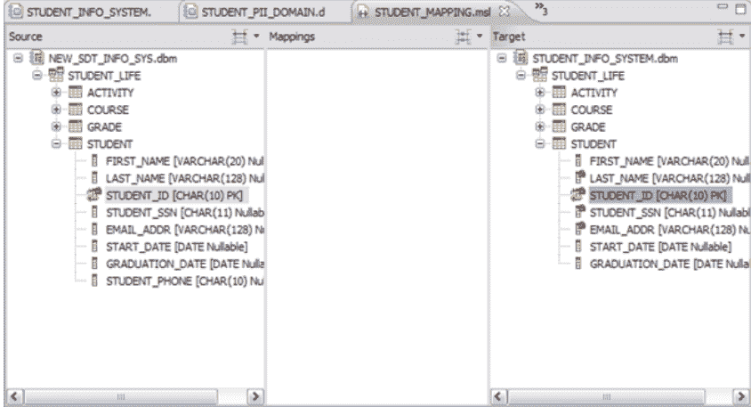

   #### 图8.3 – 选择源和目标对象

   - c. 在映射编辑器的任意位置右键点击，然后选择*创建映射*。映射会被创建并显示在映射编辑器中，如*图8.4*所示。

   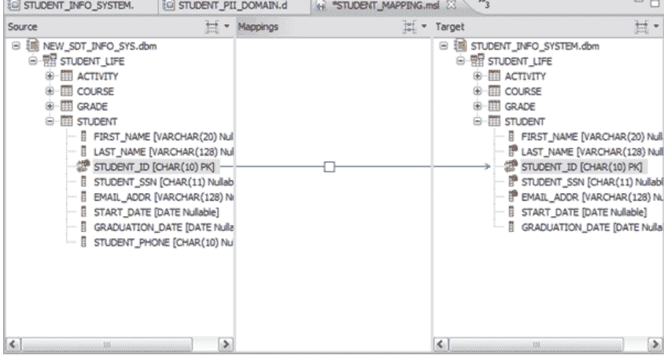

   #### 图8.4 – 映射编辑器中新建的映射

2. 使用上述流程映射`STUDENT.FIRST_NAME`列。此时映射编辑器应如*图8.5*的图片所示。

   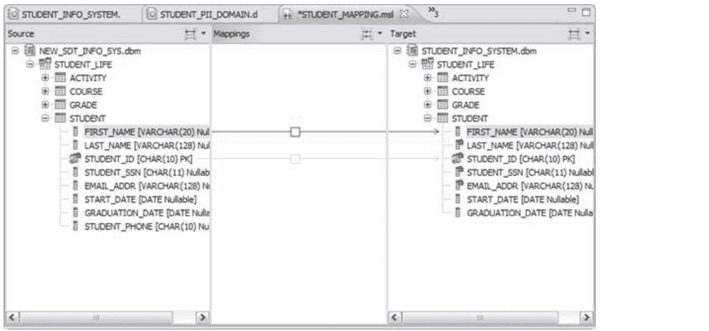

   #### 图8.5 – 创建另一条新映射

3. 保存你的工作。

#### 8.2.2.2 自动发现关系

当你处理大型数据模型时，识别异构数据源之间的关系非常繁琐且耗时。此外，细微的关系也不总是容易识别。你可以使用工作台内的“发现关系”向导，基于特定算法为你完成这项任务。

> **注意：** 你可以从“首选项”窗口修改关系的发现方式。点击*窗口 -> 首选项*。“首选项”窗口会打开。展开*数据管理*节点，然后选择*映射编辑器* -> *发现关系*来定义关系的发现规则。

使用你现有的映射模型，发现两个数据模型中对象之间的关系：

1. 在映射模型的任意位置右键点击，然后选择*发现关系 -> 查找最佳匹配*。此时会打开“发现关系”窗口。
2. 在*源*窗格中，选中`NEW_STUDENT_INFO_SYS.dbm`数据模型旁边的复选框。确保已选中该物理数据模型下的所有对象，如*图8.6*所示。

   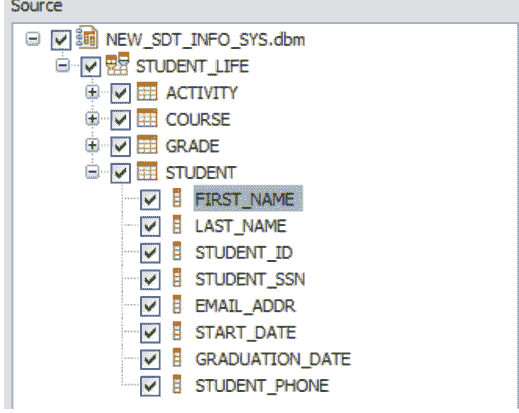

   #### 图8.6 – 选择源窗格中的所有对象

3. 在*目标*窗格中，选中`STUDENT_INFO_SYSTEM.dbm`数据模型旁边的复选框。确保已选中该物理数据模型下的所有对象。
4. 点击*完成*。发现流程会运行，你会看到一系列映射线，展示两个数据模型中对象之间的潜在关系。该结果如*图8.7*所示。

   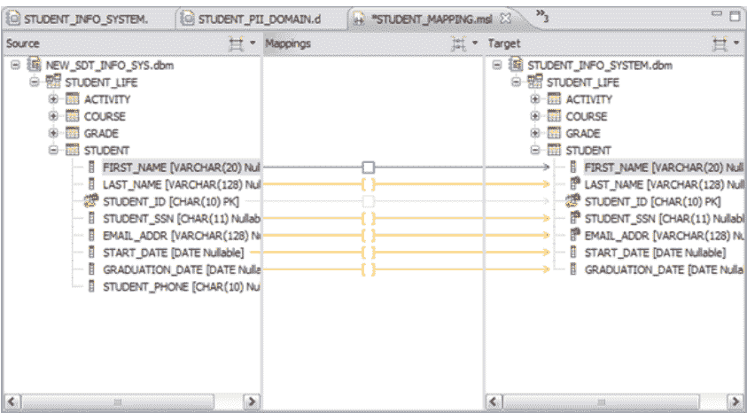

   #### 图8.7 – 连接两个模型间数据对象的映射线

#### 8.2.2.3 接受和拒绝已发现的关系

已发现的关系仅为潜在关系。在它们正式成为映射模型的一部分之前，你必须批准或拒绝这些映射。映射模型中的关系会按颜色编码。颜色代码由首选项窗口中“映射编辑器”页面的设置决定（该页面位于*数据管理*节点下）。注意，你创建的关系为蓝色或浅蓝色，具体取决于该关系是否被选中。在工作台中，这些被视为已接受的映射，是映射模型的已批准部分。未被选中的已发现映射为金色，选中后则显示为棕色。你可以选择映射来进行批准或拒绝操作。如果你拒绝某条映射，该映射线会从映射模型中消失。

首先，你会手动批准几条关系。接着，你会检查剩余的关系，并决定是否接受这些映射。

接受或拒绝已发现关系的操作步骤：

1. 选中`STUDENT.LAST_NAME`关系的映射。映射线会变为棕色，已发现的映射会显示在“属性”视图中。
2. 在映射线上右键点击，然后选择*接受映射*，如*图8.8*所示。

   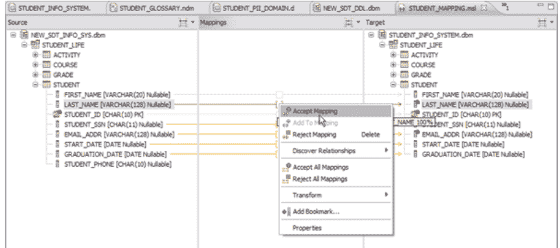

   此时映射线的颜色会变为蓝色。
3. 使用上述步骤1和2所述的方法，批准`STUDENT.STUDENT_SSN`和`STUDENT.EMAIL_ADDR`的映射。
4. 保存你的工作。

此时，你大概已经意识到，对于大型数据模型，这可能是一个繁琐的过程。现在你已经熟悉了如何手动接受或拒绝映射，你可以查看剩余的映射，并决定是否接受所有提议的映射。

5. 展开*源*和*目标*窗格中的所有表节点。此时编辑器应如*图8.9*的图片所示。
6. 查看映射关系，确认这些列应当被配对映射。在这种情况下，你需要联系卫星校区的扩展团队，明确每列的预期用途，再判断哪些列需要建立映射。由于你已对`NEW_SDT_INFO_SYS.dbm`物理数据模型进行了逆向工程，因此你知晓所发现的关系实际上已被正确映射。
7. 在映射编辑器内右键单击，选择*接受所有映射*。
8. 保存你的工作。映射连线的颜色会变为浅蓝色，说明它们已成为映射模型的有效组成部分。

### 8.3 映射类型

根据属性和创建方式的不同，可将映射分为五类。在编辑器中，映射以源节点与目标节点之间绘制的连线表示。每条映射连线的中间都有一个中心节点。连线颜色取决于映射的类型。

已发现的映射连线的中心节点为括号样式。其余所有映射连线的中心节点均为方括号样式。

- **映射：** 映射会将一个或多个源列连接到单个目标列，或XML架构文档（XSD）的简单元素/属性。
- **已发现映射：** 这类映射由“发现关系”向导提出。你可以接受或拒绝每条关系的单独映射。在批准或拒绝已发现映射前，其连线中心节点为括号样式；若你批准某条已发现映射，中心节点会变为方括号样式。
- **常量映射：** 这类映射拥有目标元素，但没有源元素。可用于选择转换函数（如日期、时间函数）并将其分配给目标元素。你可以在*映射组详细信息*视图中右键单击目标元素，然后从菜单中选择*创建常量映射*来生成常量映射。
- **映射组：** 映射组按目标表（关系型数据库中）或元素（XML架构中）对已映射元素进行分类。为这些映射组生成脚本时，每个映射组会生成一条查询。
- **无效映射：** 若你更改了源或目标模型中数据对象的属性，映射会变为无效。打开映射编辑器时，所有映射都会重新验证。如果源或目标对象不再有效，则映射会被标记为无效，映射连线上会出现红色“X”标识。

### 8.4 向映射模型添加表达式和过滤器

你可以为每个已创建的映射定义转换语句。表达式可以是过滤器、连接、排序，或是对源列的转换函数，用于获取所需的目标列值。表达式可修改源列的值或数据类型，使其与目标列兼容。这些表达式是SQL片段，会出现在你从映射模型生成的数据定义语言（DDL）中。

现在我们创建一个映射转换表达式，确保`NEW_SDT_INFO_SYS.dbm`物理数据模型中`STUDENT.FIRST_NAME`列的所有行，在与`STUDENT_INFO_SYSTEM.dbm`物理数据模型的信息整合时，以大写形式呈现。

创建转换表达式的步骤如下：

1. 选中两个`STUDENT.FIRST_NAME`列之间的映射连线。映射的属性将显示在“属性”视图中。
2. 点击*转换*字段旁的*表达式生成器*按钮，将打开表达式生成器窗口。
3. 选择一个函数。本例中，你需要添加一个函数，确保数据库中存储的所有名字都为大写字符。展开*字符串*节点，选择`UCASE(VARCHAR)` – `VARCHAR`函数，该函数将显示在*转换表达式*窗格中。
4. 将光标置于括号内，如*图8.10*所示。

#### 图8.10 – 将光标置于指定位置以格式化表达式

5. 双击`STUDENT.FIRST_NAME`列，将其添加到表达式中。表达式应如*图8.11*所示。

#### 图8.11 – 创建完整的表达式

6. 点击*确定*，将转换表达式添加到映射模型中。

### 8.5 生成可部署的脚本

你可以从映射模型生成SQL脚本，该脚本包含为映射模型中创建的所有映射生成所需的全部SQL语句，之后可将该脚本部署到数据库上。

现在我们生成一个用于部署映射模型的脚本：

1. 在“数据项目资源管理器”中定位到`STUDENT_MAPPING.msl`映射模型：*大学信息系统 -> 映射 -> STUDENT_MAPPING.msl*。
2. 右键单击映射模型文件，选择*生成脚本*，将打开“生成脚本”向导。
3. 完成“生成脚本选项”页面：
   - a. 确保已选择SQL查询语言。
   - b. 确保已选择*创建SELECT语句*查询类型。
   - c. 勾选*创建完全限定名称*复选框。
   - d. 将`STUDENT_MAPPING.sql`指定为脚本文件名。
   - e. 点击*下一步*。
4. 在“摘要”页面查看脚本，然后点击*完成*生成SQL脚本。脚本生成后将在编辑器视图中打开。当你在服务器上运行此脚本时，查询将执行并生成物理数据模型中架构之间的映射。

### 8.6 以CSV格式导出映射模型

你可以将映射模型导出为逗号分隔文件（使用`.csv`文件扩展名）。CSV格式受其他工具（包括电子表格工具）支持，因此你可以使用该文件将映射模型导入其他工具。

将映射模型导出为CSV格式文件时，映射模型的内容会按以下规则转换：

- 对于一对一映射，生成的CSV文件中每条映射对应一行。
- 对于多对一映射，会生成多行，每个源-目标对对应一行。

将映射模型导出为CSV文件的操作步骤如下：

1. 点击主菜单中的*文件 -> 导出*，将打开“导出”向导。
2. 展开*数据*节点，选择*将映射模型导出为CSV格式文件*选项，然后点击*下一步*。
3. 完成“映射模型导出”页面：
   - a. 点击*要导出的模型*字段旁的“浏览”按钮，将打开“导出映射模型”窗口。
   - b. 选择`STUDENT_MAPPING.msl`映射模型文件，然后点击*确定*将其添加到向导中。
   - c. 点击*导出到*字段旁的“浏览”按钮，将打开“另存为”窗口。
   - d. 在*文件名*字段中输入`STUDENT_MAPPING.csv`，然后点击*确定*。
4. 点击*完成*，在工作区中创建CSV文件。CSV文件会保存在工作区路径的*大学信息系统*目录下。例如，在Windows系统中可能保存在以下文件路径：

```
C:\Documents and Settings\Administrator\IBM\workspaces\IDA_GettingStarted\University Info System\STUDENT_MAPPING.csv
```

你可以将此文件导入到支持`.csv`文件格式的其他工具中。

### 8.7 练习

1. 为`NEW_SDT_DDL.dbm`物理数据模型和`STUDENT_INFO_SYSTEM.dbm`物理数据模型创建映射模型。
2. 运行“发现关系”工具，并在映射模型中批准或拒绝映射。
3. 按需创建新的映射。
4. 为其中一条映射添加转换函数。
5. 从映射模型生成SQL脚本。
6. 创建可与其他工具配合使用的CSV文件。

### 8.8 小结

在本章中，你学习了映射模型的相关知识，以及如何利用其管理各类数据源和数据模型间的关系。你学习了如何创建映射模型、发现数据模型中对象间的潜在关系，也学习了如何手动创建这些对象间的关系。之后你生成了SQL文件以在服务器上创建这些关系，还生成了CSV文件以便在其他工具中使用映射模型。

### 8.9 复习题

1. 什么是映射模型？
2. 为什么需要创建映射模型？
3. 映射有哪些不同类型？
4. 以下哪些转换函数可以添加到映射组中？
   - A. 过滤器
   - B. 排序
   - C. 连接
   - D. 以上全部
5. 判断题：你可以将多个源元素映射到单个目标元素。

```
if (condVar > someVal) {console.log("xxx")}
```


## 第9章 – 分析数据模型

`IBM InfoSphere Data Architect` 是一款自由格式建模工具，这意味着你可以创建符合业务需求的模型，工作台不会以任何方式限制模型的设计。不过，在设计模型时，你可能会无意中创建违反逻辑或物理数据建模规则/约束的模型，这可能引入错误或不符合常见数据设计最佳实践。为了帮你识别模型的问题，请使用“分析模型”向导。在本章中，你将学习以下概念：

- 如何分析数据模型
- 如何修改首选项以影响模型的分析方式
- 如何在模型分析后处理错误和警告

### 9.1 分析数据模型：整体概览

你会在创建数据模型后*分析*它。“分析模型”向导通过两种主要方式验证模型：

1. **设计建议**：这些是架构师制定的最佳实践建议或设计约束，目的是让模型符合标准。
2. **语法检查**：语法检查会对属性语法进行验证，同时还会检查实体或表之间是否建立了有效关联。

理想情况下，你应该在转换或部署数据模型之前先进行分析。这能确保你不会转换或部署无效模型，还可以在这些模型上线并引发潜在问题*之前*，确定存在的（如果有的话）问题。

### 9.2 使用工作台分析数据模型

#### 9.2.1 使用工作台分析逻辑数据模型

你只能从包节点分析逻辑数据模型。我们以`学生信息系统.ldm`逻辑数据模型为例进行分析，确保其有效。

分析逻辑数据模型的步骤如下：

1. 在逻辑数据模型中定位`学生信息系统`包：*大学信息系统 -> 数据模型 -> 学生信息系统.ldm -> 学生信息系统*。
2. 右键单击`学生信息系统`包，选择*分析模型*。此时会打开“分析模型”向导。由于我们选择的是逻辑数据模型包，默认情况下，*逻辑数据模型*节点下的所有规则集都会被选中。“逻辑数据模型”节点下的规则集包含最佳实践、命名标准和通用设计建议。每个规则集通常都包含自己的一套规则。在验证模型时，你可以根据组织的实际需求，自行选择要遵守的规则。命名标准重要吗？你使用域吗？你的数据模型必须完全规范化吗？
3. 由于你已经验证过命名标准，因此取消选中*命名标准*规则集。
4. 由于你没有创建维度模型，因此取消选中*维度建模*规则集。
5. 单击*完成*分析模型。模型分析完成后，你会在“问题”视图中看到两条警告。

*警告*指明的是最佳实践、数据库限制或组织要求。警告本身不会导致模型无效。警告不要求你在部署前修改数据模型，只是指出可能存在的冲突，这些冲突可能需要你对模型进行设计修改。不过，是否要修改与数据设计最佳实践相关的警告，由你自行决定。在本例中，“问题”视图中的两条警告指出 `COURSE` 和 `STUDENT` 实体中的 `COURSE ID` 和 `STUDENT ID` 属性不唯一。这些属性是在你创建两个实体之间的关联时添加的，因此你不需要修复这些属性。

*错误*表示数据模型存在必须修复的问题。错误会在生产环境中引发问题，你应该在将模型转换或部署到生产环境之前修复它们。

#### 9.2.2 使用工作台分析物理数据模型

我们以`学生信息系统.dbm`物理数据模型为例进行分析。你可以从数据库或架构节点分析物理数据模型。

分析物理数据模型的步骤如下：

1. 在物理数据模型中定位 `SAMPLE` 数据库对象：*大学信息系统 -> 数据模型 -> 学生信息系统.dbm -> SAMPLE*。
2. 右键单击 `SAMPLE` 数据库对象，选择*分析模型*。此时会打开“分析模型”向导。由于我们选择的是物理数据模型内的对象，默认情况下，*物理数据模型*类别下的所有规则集都会被选中。与逻辑数据模型分析类似，物理模型分析也包含多个类别，每个类别下有各自的规则，用于检查常见最佳实践、命名标准和设计建议。
3. 由于我们没有创建维度模型，因此取消选中*维度建模*规则集。
4. 由于该物理数据模型没有表空间，因此请确保工具不会验证表空间选项：
   a. 选择*设计建议*节点下的*索引与存储*规则集，“规则”窗格中会显示该规则集的规则。
   b. 取消选中*表空间设计检查*和*带表空间的表检查*规则。
   c. 取消选中*语法检查*节点下的*表空间*规则集。
5. 取消选中*命名标准*规则集。单击*完成*分析物理数据模型。分析完成后，你会在关于该物理数据模型的结果中看到7条警告和13条信息性消息。如果需要，你可以在“问题”视图中浏览所有问题并修复警告。

#### 9.2.3 在“问题”视图中修复错误和警告

如果你想修复“问题”视图中的错误或警告：

1. 查看完整消息，了解工具提供的设计建议。
2. 双击消息，导航到受警告影响的数据对象。
3. 根据“问题”视图中提供的设计建议更新对象。

> **注意**：你可以通过右键单击“问题”视图中的消息，然后选择*快速修复*，来修复部分消息。

### 9.3 修改模型分析的首选项

你可以修改分析数据模型时默认选中的类别和规则。如果你执行这些步骤，就不用在“分析模型”向导中反复选择/取消选择你常用的选项，节省时间。

> **注意**：本节不会实际操作修改这些首选项，但你会学习如何在“首选项”窗口中找到这些选项。

修改“分析模型”向导的首选项步骤如下：

1. 从主菜单中单击*窗口* -> *首选项*，此时会打开“首选项”窗口。
2. 展开*模型验证*节点，选择*约束*页面。你可以使用该页面修改验证数据模型时默认选中的类别和规则的设置。例如，如果你没有为逻辑数据模型实施命名标准，可以展开*逻辑数据模型 -> 设计建议*节点，取消选中*命名标准*类别。
3. 完成修改后，先单击*应用*，再单击*确定*。下次验证数据模型时，你偏好的类别和规则就会被默认选中。

### 9.4 本章总结

在本章中，你学习了如何分析模型以确保其符合组织标准或标准设计语法规则。你还学习了“问题”视图中的警告和错误，以及如何处理它们。

### 9.5 练习

修改“分析模型”向导的默认首选项。

1. 首先，在不修改默认设置的情况下分析你现有的物理和逻辑数据模型，记录分析结果。
2. 然后，使用“首选项”窗口确保物理和逻辑数据模型都不会检查命名标准、表空间或维度建模规则。
3. 分析你的物理和逻辑数据模型，记录结果，不要修复警告或错误。
4. 接着，打开“首选项”窗口，恢复模型验证工具的默认设置。

### 9.6 复习题

1. 你可以在数据模型的哪个层级调用“分析模型”向导？
   - A. 模型文件
   - B. 图
   - C. 包、数据库或架构
   - D. 实体或表
2. 分析模型时会进行哪种类型的验证？
   - A. 最佳实践
   - B. 模型语法
   - C. 有效设计
   - D. 以上全部
3. 警告会指出以下哪些领域的潜在问题：
   - A. 数据库限制和最佳实践
   - B. 组织要求
   - C. A和B均正确
   - D. 以上均不正确
4. 如何更改“分析模型”向导的默认首选项？
5. 分析模型的最佳时机是什么？
6. 分析数据模型或确定是否要处理警告时需要注意什么？
7. 判断正误：您必须在“问题”视图中更正所有警告。
8. 判断正误：如果“问题”视图中存在错误，则您的模型被视为无效。


## 第10章 – 数据管理生命周期

### 10.1 管理您的数据

数据安全、隐私与生命周期管理产品组合是一套统一的解决方案集，可支持在软件开发生命周期的所有阶段（从需求收集到项目退役）管理数据。`IBM InfoSphere Data Architect` 是数据安全、隐私与生命周期管理产品组合的组成部分。

该产品组合中的部分热门产品包括：

- `IBM InfoSphere Data Architect`
- `Optim Development Studio and pureQuery Runtime`
- `Optim Database Administrator`
- `Optim Performance Manager Extended Edition`
- `Optim High Performance Unload`
- `Optim Query Tuner`

以下列表包含数据安全、隐私与生命周期管理家族中这些产品的一些高层级描述：

- **`Optim Development Studio`**
  `Optim Development Studio` 支持开发和管理数据库。使用`Optim Development Studio`，您可以创建、修改和删除对象；管理数据库权限；查看数据分布情况；以及收集数据对象的统计信息。您还可以开发和测试 `SQL` 与 `XQuery` 查询、存储过程、Web 服务和 `Java` 数据访问层。`Optim pureQuery Runtime` 是可与`Optim Development Studio`搭配使用的可选功能，它是一个高性能数据访问平台，可简化数据访问的监控、开发、优化、安全管控和管理工作。您可以使用 `API` 简化最佳实践的实施，促进开发人员与数据库管理员之间的协作，也可以监控 `SQL` 热点，获取可改善响应时间的相关洞察。

- **`Optim Database Administrator`**
  `Optim Database Administrator` 支持对数据库进行复杂的结构变更管理，以及处理数据库迁移场景。您可以自动化结构变更流程，更好地管理测试数据库、加快部署速度，从而简化管理任务。您可以分析数据库变更的影响，最大程度降低对部署环境的风险。借助`Optim Database Administrator`，您还可以更高效地管理大型环境。

- **`Optim Performance Manager Extended Edition`**
  `Optim Performance Manager` 可帮助数据库管理员提升 `DB2` 的性能和可用性。`DB2 Performance Expert` 能够在性能问题影响业务之前，帮助您识别、诊断、解决并预防这类问题。`Optim Performance Manager` 会提供优化和调优建议，并帮助您分析趋势以规划数据库扩容。它会监控您的应用程序和数据库，在性能受到影响之前识别潜在问题、管理工作负载。

- **`Optim High Performance Unload`**
  `Optim High Performance Unload` 可帮助数据库管理员以更少的工作量、更快的速度处理海量数据。`Optim High Performance Unload` 可与生产应用程序并行运行，在维持系统可用性的同时，最大程度降低对生产性能的影响。`Optim High Performance Unload` 还可将数据卸载、备份、迁移、重新分区操作适配到紧张或不断缩减的批处理窗口中，降低对在线生产环境的影响。

- **`Optim Query Tuner`**
  `Optim Query Tuner` 可帮助开发人员编写高效查询、提升调优技能。它通过提供专业建议，指导您如何编写高质量查询、优化数据库设计，从而提升性能。

### 10.1.1 数据管理生命周期

上一节所列的产品可单独或协作使用，为软件开发生命周期的各个阶段提供解决方案。*图 10.1* 展示了可使用 `IBM` 数据安全、隐私与生命周期管理产品组合实现的这一生命周期。

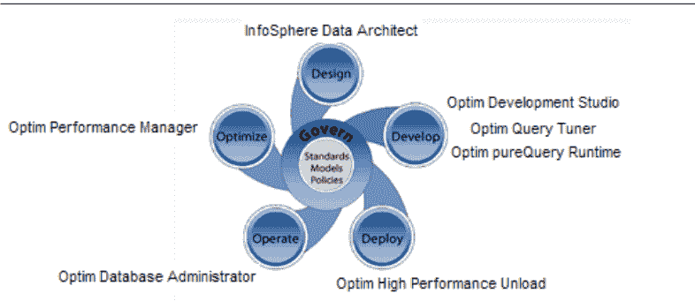

**图 10.1 – 数据安全、隐私与生命周期管理工具**

`IBM InfoSphere Data Architect` 如前所述，主要应用于集成数据管理生命周期的设计阶段，尽管任何项目的整个生命周期中对设计进行修改都是常规操作。您可以使用该工作台管理这些变更。

借助数据安全、隐私与生命周期管理产品组合，所有这些产品将作为一套单一解决方案提供给用户（有关`IBM InfoSphere Data Architect`的集成能力请参阅 10.1.2 节，有关外壳共享请参阅 10.1.3 节）。

借助数据安全、隐私与生命周期管理解决方案，可以管理完整的产品生命周期。由于该产品组合解决了互操作性和兼容性问题，您可以获得以下提升：

- 更快开发出适用于企业的应用程序
- 有效管理数据增长
- 优化数据库应用程序性能
- 在产品/应用程序生命周期的所有阶段保护数据隐私
- 简化迁移和升级流程

### 10.1.2 将 IBM InfoSphere Data Architect 与其他产品集成

在任何软件开发团队中（无论规模大小），您都应使用能够无缝共享数据或信息的工具。这样可以更轻松地在产品开发各个阶段复用所有信息。

`IBM InfoSphere Data Architect` 通过与以下产品集成，支持模型驱动设计：

- `InfoSphere Business Glossary`：在整个企业范围内共享企业术语表
- `Cognos Business Intelligence`：基于数据库中的信息创建、共享和使用报表
- `Rational Software Architect`：同步应用程序和信息的设计
- `Rational RequisitePro`：确保模型满足企业的所有需求
- `WebSphere® Business Modeler Advanced`：将数据模型转换为业务流程的 `XML` 架构定义


**图 10.2 – 将 InfoSphere Data Architect 与其他软件开发产品集成**

### 10.1.3 与其他基于 Eclipse 的产品进行外壳共享

`IBM InfoSphere Data Architect` 构建于 `Eclipse` 平台之上，`Eclipse` 是一个流行的开源平台，您可以使用该平台开发应用程序。`Eclipse` 平台支持您与其他基于 `Eclipse` 的产品集成。

基于 `Eclipse` 的产品之间的*外壳共享*本质上是指您可以共享产品的核心组件，避免在各产品中重复安装这些组件。这样无需每个产品都单独配备一套 `Eclipse` 平台。

一个理解外壳共享的简单类比是对比 `微软 Windows` 的安装：`Windows` 程序文件所需的所有公共组件都存储在 `C:\Windows` 文件夹中。

从基础层面来看，外壳共享可以节省磁盘空间，无需重复安装组件。
外壳共享通过共享通用且兼容的功能实现这一效果。
因此，您可以通过单一用户界面与每个产品的所有功能进行交互。
例如，如果您让`IBM InfoSphere Data Architect`和`Optim Development Studio`启用外壳共享，就可以在单一公共平台上完成数据库的开发和架构设计。
该公共平台的启动与要启动的具体产品无关。
您可以将任意数量的兼容产品进行外壳共享。
例如，您还可以将`Rational Software Architect`与`IBM InfoSphere Data Architect`和`Optim Development Studio`集成，以便使用`Rational Software Architect`的功能。

> **注意：** 有关如何为 `InfoSphere Data Architect`、`Optim Development Studio` 和 `Optim Database Administrator` 启用外壳共享的示例，请参阅以下 `developerWorks` 文章：`http://www.ibm.com/developerworks/data/library/techarticle/dm-0811khatri/index.html`

## 参考文献

- [1] `IBM® InfoSphere Data Architect` 信息中心，2010年10月。`http://publib.boulder.ibm.com/infocenter/ndahelp/v7r5/index.jsp`
- [2] LIVENGOOD, E. InfoSphere Data Architect 评估指南，白皮书，2010年10月。`http://download.boulder.ibm.com/ibmdl/pub/software/data/sw-library/studio/evaluation-guides/RDA75EvalGuide.pdf`
- [3] TSOUNIS, S., CHOU, D.P. Rational Data Architect 最佳实践，最佳实践论文，2008年10月。`http://www.ibm.com/developerworks/data/bestpractices/informationmodeling/`
- [4] MACHADO, J., VOELLINGER, H. 使用`IBM InfoSphere Data Architect`开发映射模型，`developerWorks`文章，2010年1月。`http://www.ibm.com/developerworks/data/tutorials/dm-1101mappingmodelsida/index.html`
- [5] PATEL, A. DB2基础：表空间和缓冲池，`developerWorks`文章，2010年4月。`http://www.ibm.com/developerworks/data/library/techarticle/0212wieser/index.html`
- [6] GOPAL, V., BHAGAVAN, S. 使用`InfoSphere Data Architect`和`Informix Dynamic Server`进行数据建模，`developerWorks`文章，2009年3月。`http://www.ibm.com/developerworks/data/tutorials/dm-0903datamodel/section8.html`
- [7] LIU, W. 使用`InfoSphere Data Architect`定义并强制执行数据对象命名规范，`developerWorks`文章，2010年10月。`http://www.ibm.com/developerworks/data/library/techarticle/dm-0701liu/index.html`

### 网站

- **DB2 Express-C 网站**：`www.ibm.com/db2/express` 使用该网站可下载 `DB2 Express-C` 服务器的镜像、`DB2` 客户端、`DB2` 驱动程序、手册，加入团队博客、订阅邮件列表等。
- **DB2 Express-C 论坛**：`www.ibm.com/developerworks/forums/dw_forum.jsp?forum=805&cat=19` 如果您在手册中无法自行找到问题的答案，可在该论坛发布技术问题。
- **DB2 信息中心**：`http://publib.boulder.ibm.com/infocenter/db2luw/v9/index.jsp` 该信息中心提供 `DB2` 在线手册的访问入口，是最新的信息来源。
- **InfoSphere Data Architect 信息中心**：`http://publib.boulder.ibm.com/infocenter/rdahelp/v7r5/index.jsp` 该信息中心提供 `InfoSphere Data Architect` 在线手册和帮助文档的访问入口，包含教程、概念信息和操作任务，帮助您快速上手`InfoSphere Data Architect`。
- **developerWorks：DB2**：`http://www-128.ibm.com/developerworks/db2` 该网站是开发人员和 `DBA` 的优质资源，可免费获取最新的文章、教程等内容。
- **developerWorks：InfoSphere Data Architect**：`http://www.ibm.com/developerworks/data/products/dataarchitect/index.html` 该网站提供文章、教程及其他资源，帮助您深入了解如何使用`InfoSphere Data Architect`进行数据建模。
- **InfoSphere Data Architect developerWorks 论坛**：`http://www.ibm.com/developerworks/forums/forum.jspa?forumID=1796` 该论坛是非正式的支持渠道，由 `IBM` 专业人员及 `InfoSphere Data Architect` 爱好者共同维护。
- **alphaWorks®**：`http://www.alphaworks.ibm.com/` 该网站提供 `IBM` 新兴技术的直接访问入口，是获取 `IBM` 研究部门最新技术成果的平台。
- **planetDB2**：`www.planetDB2.com` 这是一个博客聚合平台，众多博主在此分享 `DB2` 相关内容。
- **DB2 技术支持**：`http://www.ibm.com/software/data/db2/support/db2_9/` 如果您购买了 `DB2 Express-C` 的12个月订阅许可证，可在此网站下载修复包。
- **InfoSphere Data Architect 技术支持**：`http://www.ibm.com/support/entry/portal/Overview/Software/Information_Management/InfoSphere_Data_Architect` 这是 `InfoSphere Data Architect` 的支持门户，您可在此查看最新的支持警报、故障排除信息、产品相关文档，或联系 `IBM` 支持团队。
- **ChannelDB2**：`http://www.ChannelDB2.com/` `ChannelDB2` 是 `DB2` 社区社交网络，提供适用于 `Linux`、`UNIX`、`Windows`、`z/OS` 和 `i5/OS` 系统的 `DB2` 相关视频、演示、播客、博客、讨论、资源等内容。

### 书籍

1. 免费红皮书：《DB2 Express-C：`XML`、`PHP`、`C/C++`、`Java` 和 `.NET` 开发者手册》Whei-Jen Chen, John Chun, Naomi Ngan, Rakesh Ranjan, Manoj K. Sardana，2006年8月 - SG24-7301-00 `http://www.redbooks.ibm.com/abstracts/sg247301.html?Open`
2. 《理解DB2——通过示例可视化学习（V9.5）》Raul F. Chong 等著，2008年1月 ISBN-10：0131580183
3. 《DB2 9：`pureXML` 概述与快速入门》Cynthia M. Saracco, Don Chamberlin, Rav Ahuja 著，2006年6月 SG24-7298 `http://www.redbooks.ibm.com/abstracts/sg247298.html?Open`
4. 《DB2® SQL PL：`Linux™`、`UNIX®`、`Windows™`、`i5/OS™` 和 `z/OS®` 系统上的 `DB2® UDB` 必备指南（第2版）》Zamil Janmohamed, Clara Liu, Drew Bradstock, Raul Chong, Michael Gao, Fraser McArthur, Paul Yip 著 ISBN：0-13-100772-6
5. 免费红皮书：《DB2 pureXML 指南》Whei-Jen Chen, Art Sammartino, Dobromir Goutev, Felicity Hendricks, Ippei Komi, Ming-Pang Wei, Rav Ahuja, Matthias Nicola 著，2007年8月 `http://www.redbooks.ibm.com/abstracts/sg247315.html?Open`
6. 《按需信息服务——DB2 9 新功能入门》Paul Zikopoulos, George Baklarz, Chris Eaton, Leon Katsnelson 著 ISBN-10：0071487832 ISBN-13：978-0071487832

### 联系邮箱

- 通用 `DB2 Express-C` 邮箱：`db2x@ca.ibm.com`
- 通用 `DB2` 校园计划邮箱：`db2univ@ca.ibm.com`

上手`InfoSphere Data Architect`非常简单。阅读本书您可以：

- 了解`InfoSphere Data Architect`能为您做什么
- 学习如何创建、部署和更新数据模型
- 管理和分析数据模型变更的影响
- 了解如何对数据源进行正向和逆向工程
- 学习数据隐私、安全和生命周期管理的相关知识
- 通过实操练习巩固使用技能

`InfoSphere Data Architect`是一款协作式数据设计解决方案，可用于发现、建模、可视化、关联和标准化多样化分布式数据资产。您可以使用`InfoSphere Data Architect`在整个数据生命周期中挖掘数据模型的价值，促进跨生命周期、跨角色、跨组织的协作，对齐流程服务、应用和数据架构。

本书全面介绍了`InfoSphere Data Architect`，包含使用 `SQL` 和 `DB2 Express-C`（`DB2` 免费版本）的实操练习。

要了解更多信息或下载`InfoSphere Data Architect`免费试用版，请访问 `ibm.com/developerworks/downloads/r/rda/`

要了解更多信息或下载`DB2 Express-C`，请访问 `ibm.com/db2/express`

要参与社区互动并观看相关视频，请访问 `channelDB2.com`

本书属于 `DB2 on Campus` 系列图书，是为社区提供的免费电子书。了解更多信息请访问 `db2university.com` ！


