# 树莓派入门指南

## 概览

> “可能是我读过的范围最广、内容最完整的 Linux 设备驱动程序书籍。”

-- Alan Cox，Linux 专家及核心内核开发者

> “非常全面且详尽，涵盖了几乎每一种 Linux 设备驱动程序类型。”

-- Theodore Ts'o，北美第一位 Linux 内核开发者及 Linux 基金会首席平台战略师

## 编写 Linux 设备驱动程序的最实用指南

Linux 目前为驱动程序开发提供了一个异常强大的环境：在当今的内核中，过去需要数年开发时间的工作现在只需几天即可完成。在这本以实用和示例为导向的书中，世界上经验最丰富的 Linux 驱动开发者之一系统地展示了如何为几乎任何设备开发可靠的 Linux 驱动程序。**《Linux 核心设备驱动程序》** 适用于任何具备操作系统和 C 语言基础知识的程序员，包括那些从未编写过驱动程序的程序员。Sreekrishnan Venkateswaran 专注于核心要点，汇集了您所需的所有概念和技术，同时避免了仅在高度专业化情况下才重要的主题。Venkateswaran 首先回顾了与驱动开发者最相关的 Linux 2.6 内核功能。他介绍了简单的设备类；然后转向 I2C 和 SPI 等串行总线；PCMCIA、PCI 和 USB 等外部总线；视频、音频、块设备、网络和无线设备驱动程序；用户空间驱动程序；以及嵌入式 Linux 驱动程序——后者是当今 Linux 发展最快的领域之一。对于每一个主题，Venkateswaran 都会解释相关技术，检查相关的内核源文件，并指导您开发一个完整的示例。

- ■ 讨论了其他书籍未涉及的驱动程序，包括 I2C、视频、声音、PCMCIA 以及不同类型闪存内存的驱动程序
- ■ 揭秘了必要的内核服务和设施，包括内核线程和辅助接口
- ■ 教授轮询、异步通知和 I/O 控制
- ■ 介绍了用于嵌入式 Linux 驱动程序的集成电路间协议
- ■ 涵盖使用 Linux-Video 子系统和 Linux-Audio 框架的多媒体设备驱动程序
- ■ 展示 Linux 如何实现蓝牙、红外、WiFi 和蜂窝网络等无线技术的支持
- ■ 描述了完整的驱动程序开发生命周期，包括调试和维护
- ■ 包含涵盖 Linux 汇编语言、BIOS 调用和 Seq 文件的参考附录


### 献词

> *本书献给印度的一千万视障公民。作者所有版税将用于支持这一事业。*

### 普雷尼斯霍尔开源软件开发丛书

Arnold Robbins，丛书编辑

> "*来自真实世界应用的真实代码*"

开源技术已经彻底改变了计算世界。许多大型项目正在全球范围内投入使用，例如 Apache、MySQL 和 Postgres，程序员使用多种语言（包括 Perl、Python 和 PHP）编写应用程序。这些技术应用于许多不同的系统，从专有系统、Linux 系统、传统 UNIX 系统到大型机。

**普雷尼斯霍尔开源软件开发丛书** 旨在为您带来这些开源技术的精华。您不仅能学习如何在项目中使用它们，还能从中*学习*。通过查看真实应用中的真实代码，您将了解世界各地开源开发者的最佳实践。

**该丛书当前包含的图书有：**

- *Linux® 调试与性能调整*
  - Steve Best
  - 0131492470, 平装, ©2006
- *使用 Qt 4 进行 C++ GUI 编程*
  - Jasmin Blanche, Mark Summerfield
  - 0132354160, 精装, ©2008
- *Xen 虚拟机管理器权威指南*
  - David Chisnall
  - 013234971X, 精装, ©2008
- *理解 AJAX*
  - Joshua Eichorn
  - 0132216353, 平装, ©2007
- *Linux 程序员工具箱*
  - John Fusco
  - 0132198576, 平装, ©2007
- *嵌入式 Linux 入门*
  - Christopher Hallinan
  - 0131679848, 平装, ©2007
- *Apache 模块书*
  - Nick Kew
  - 0132409674, 平装, © 2007
- *SELinux 实例详解*
  - Frank Mayer, David Caplan, Karl MacMillan
  - 0131963694, 平装, ©2007
- *UNIX 到 Linux® 移植*
  - Alfredo Mendoza, Chakarat Skawratananond, Artis Walker
  - 0131871099, 平装, ©2006
- 使用 TurboGears 快速构建 Web 应用程序
  - Mark Ramm, Kevin Dangoor, Gigi Sayfan
  - 0132433885, 平装, © 2007
- Linux 编程实例
  - Arnold Robbins
  - 0131429647, 平装, ©2004
- *Linux® 内核入门*
  - Claudia Salzberg, Gordon Fischer, Steven Smolski
  - 0131181637, 平装, ©2006
- 使用 Python 和 Qt 快速进行 GUI 编程
  - Mark Summerfield
  - 0132354187, 精装, © 2008
- 核心 Linux 设备驱动
  - Sreekrishnan Venkateswaran
  - 0132396556, 精装, ©2008

### 丛书新增：数字短切指南

“短切指南”（Short Cuts）是简短、精炼的 PDF 文档，专为像您这样忙碌的技术专业人士设计。每篇短切指南都紧密聚焦于特定的技术或技术问题。由行业专家和畅销书作者撰写，短切指南的出版时刻想着您——为您提供现在所需的 가技术信息。

- 理解 AJAX：使用 XML 和 JSON 消费发送的数据
  - Joshua Eichorn
  - 0132337932, Adobe Acrobat PDF, © 2007
- 调试嵌入式 Linux
  - Christopher Hallinan
  - 0131580132, Adobe Acrobat PDF, © 2007
- 使用 BusyBox
  - Christopher Hallinan
  - 0132335921, Adobe Acrobat PDF, © 2007

### 前言

如果你正拿着这本书，你或许会问自己：为什么又有一本“另一个” Linux 设备驱动书？难道已经有很多本了吗？

答案是：这本书比其他书更胜一筹，实现了一次量子飞跃。

首先，它是最新的，涵盖了最近的 2.6 内核。其次，也是更重要的，这本书非常全面。大多数设备驱动书仅仅涵盖标准 Unix 内部机制书或操作系统书中描述的主题，例如串行线、磁盘驱动器和文件系统，如果你幸运的话，还会涉及网络堆栈。

这本书走得更远；它不回避你在现代 PC 和嵌入式硬件中必须处理的困难部分，例如 PCMCIA、USB、I²C、视频、音频、闪存、无线通信等等。只要你叫得出名字，如果 Linux 内核与它通信，这本书就会告诉你关于它的知识。

不留死角；不放过任何黑暗角落。

此外，作者实力非凡：光是阅读他关于在 20 世纪 90 年代末将 Linux 移植到手表上的描述，就是一次刺激的旅程！

我很高兴并兴奋地看到这本书成为普雷尼斯霍尔开源软件开发丛书的一部分。它是开源世界中令人兴奋的事例的一个闪亮范例。我希望你能在这里找到你在内核工作上所需的内容，并且也能享受这个过程！

*Arnold Robbins*

*丛书编辑*

### 前言

那是 20 世纪 90 年代末，我们在 IBM 正致力于将 Linux 内核移植到一块腕表上。目标设备极其微小，但任务却异常艰难。内核中尚不存在内存技术设备（Memory Technology Devices）子系统，这意味着在文件系统能在腕表的闪存上启动之前，我们必须从零开始开发必要的存储驱动程序。由于内核的输入事件驱动程序接口尚未构思成型，将腕表的触摸屏与用户应用程序进行对接变得非常复杂。让 X Windows 系统在腕表的液晶显示器上运行也不容易，因为它与帧缓冲驱动程序配合得并不好。如果无法从浴缸里获取股票行情，一只防水的 Linux 腕表又有何用？当时，Linux 的蓝牙集成技术还要好几年才能成熟，我们花了数月时间将一个专有蓝牙协议栈移植过来，以便让腕表具备互联网连接功能。电源管理支持勉强够用，仅能从腕表电池中挤出几小时的电量；因此，我们在那方面也有大量工作要做。Linux 红外技术当时仍不稳定，因此我们必须引导该协议栈，才能使用红外键盘进行数据输入。此外，由于消费电子领域没有公认的分发版，我们还必须编译编译器并交叉编译一个紧凑的应用程序集。


快进到今天：小企鹅已经成长为健康的青少年。当年需要成千上万行代码和一年开发时间的工作，现在使用当前内核只需几天即可完成。但要成为一名能够巧妙编织解决方案的多面手内核工程师，你需要了解 Linux 如今提供的众多特性和设施。

### 关于本书

在内核源码树的各个子系统中，`drivers/` 目录占据了最大的一块，其规模是其他部分的几倍。随着新技术以流行的外形因子不断涌现，内核中新的设备驱动程序的开发正在稳步加速。最新的内核支持 70 多个设备驱动系列。

本书的主题是编写 Linux 设备驱动程序。它涵盖了内核支持的主要设备类的设计与开发，包括我在我“Linux 腕表”时代错过的那些。每个驱动系列的讨论都从研究相应的技术开始，接着开发一个实用示例，最后查看相关的内核源文件。然而，在进入设备驱动的世界之前，本书会向你介绍内核，并讨论 2.6 Linux 的重要特性，重点强调那些对设备驱动编写者特别重要的部分。

### 读者对象

本书面向中级程序员，他们渴望调整内核以启用新设备。你应该对操作系统概念有一定的了解。例如，你应该知道什么是系统调用，以及为什么在编写内核代码时需要考虑并发问题。本书假设你已在系统上下载了 Linux，浏览过内核源代码，并至少粗略阅读过一些相关文档。而且，你最好精通 C 语言。

### 章节概要

前 4 章为消化全书其余内容做好准备。接下来的 16 章讨论不同设备系列的驱动程序。随后有一章描述了设备驱动调试技术。倒数第二章提供了关于维护和交付的视角。我们最后通过浏览一份检查清单来收尾，总结当你获得新设备时，如何开始进行 Linux 使能化工作。

第 1 章，“引言”，开始了我们与 Linux 的约会。它带你快速完成下载内核源代码、进行简单的代码修改以及构建可引导内核映像的步骤。

第 2 章，“内核内部一瞥”，简明地观察 Linux 内核的内部结构，并教你一些必须掌握的内核概念。它首先带你了解引导过程，然后描述与驱动程序开发特别相关的内核服务，例如内核定时器、并发管理和内存分配。

第 3 章，“内核设施”，考察了几种对驱动开发者工具箱有用的内核服务。本章从查看内核线程开始，这是在核心内实现后台任务的一种方式。然后它继续介绍辅助接口，如链表、工作队列、完成函数和通知链。这些辅助设施简化了你的代码，消除了内核中的冗余，并有助于长期维护。

第 4 章，“奠定基础”，为掌握编写 Linux 设备驱动的艺术打下基础。通过提供典型 PC 兼容系统和嵌入式设备架构的鸟瞰图，介绍设备和驱动程序。然后它考察基本驱动概念，如中断处理和内核设备模型。

第 5 章，“字符驱动”，考察字符设备驱动的架构。本章引入的多个概念，如轮询、异步通知和 I/O 控制，也与后续章节相关，因为本书其余部分讨论的许多设备类都是“超级”字符设备。

第 6 章，“串行驱动”，解释了处理串行设备的关键层。

第 7 章，“输入驱动”，讨论负责处理键盘、鼠标和触摸屏控制器等设备的内核输入子系统。

第 8 章，“集成电路间（I2C）协议”，剖析连接在系统 I2C 总线或 SMBus 上的 EEPROM 等设备驱动器的驱动。本章还考察了其他串行接口，如 SPI 总线和单线总线。

第 9 章，“PCMCIA 和 Compact Flash”，深入探讨 PCMCIA 子系统。它教你为具有 PCMCIA 或 Compact Flash 外形因子的设备编写驱动程序。

第 10 章，“周边部件互连（PCI）”，考察了对 PCI 及其衍生物的内核支持。

第 11 章，“通用串行总线（USB）”，探索 USB 架构，并解释如何利用 Linux-USB 子系统的服务来编写 USB 设备的驱动程序。

第 12 章，“视频驱动”，考察了 Linux-Video 子系统。它发现了帧缓冲抽象提供的优势，并教你编写帧缓冲驱动。

第 13 章，“音频驱动”，描述了 Linux-Audio 框架，并解释如何实现音频驱动。

第 14 章，“块驱动”，专注于硬盘等存储设备的驱动程序。在本章中，你还将了解 Linux-Block 子系统支持的不同 I/O 调度器。

第 15 章，“网络接口卡”，专门用于网络设备驱动程序。你将学习网络数据结构以及如何让网络驱动程序与协议层对接。

第 16 章，“无绳 Linux”，考察如何驱动不同的无线技术，如蓝牙、红外、WiFi 和蜂窝通信。

第 17 章，“内存技术设备”，讨论嵌入式设备上的闪存使能。本章最后考察了 PC 系统上发现的固件集线器（Firmware Hub）驱动程序。

第 18 章，“嵌入式 Linux”，踏入嵌入式 Linux 的世界。它带你了解嵌入式解决方案的主要固件组件，如引导加载程序、内核和设备驱动程序。鉴于 Linux 在嵌入式领域 popularity 的飙升，你更有可能利用从本书获得的设备驱动技能来使能嵌入式系统。

第 19 章，“用户空间中的驱动”，考察如何从用户空间驱动不同类型的设备。一些设备驱动程序，特别是那些策略繁重而性能要求较低的，最好保留在用户空间。本章还解释了 Linux 进程调度器如何影响用户模式驱动程序的反应时间。

第 20 章，“更多设备和驱动”，游览了一系列尚未涵盖的驱动系列杂汇，如*差错检测与纠正*（EDAC）、火线（FireWire）和 ACPI。

第 21 章，“调试设备驱动”，教授了你可以用于调试内核代码的不同类型的调试器。在本章中，你还将学习使用追踪工具、内核探针、崩溃转储和性能分析器。当你开发驱动程序时，请配备你在这章学到的驱动调试技能。

第 22 章，“维护与交付”，提供了关于软件开发生命周期的视角。

第 23 章，“关机”，带你浏览一份当你着手启用新设备时的工作项检查清单。本书以思考*接下来怎么办？*作结。

设备驱动程序有时需要在汇编中实现代码片段，因此附录 A，“Linux 汇编”，考察了在 Linux 上进行汇编编程的不同方面。基于 x86 的一些设备驱动程序直接或间接依赖于 BIOS，因此附录 B，“Linux 与 BIOS”，教你 Linux 如何与 BIOS 交互。附录 C，“Seq 文件”，描述了 seq 文件，这是 2.6 内核中引入的一个内核辅助接口，设备驱动程序可以使用它来监控和趋势化数据点。

本书总体上根据设备和总线复杂度以及章节间依赖关系的实际原因进行组织。因此，我们从字符、串行和输入等基本设备类开始。接下来，我们考察 I2C 和 SMBus 等简单串行总线。随后是 PCMCIA、PCI 和 USB 等外部 I/O 总线。视频、音频、块设备和网络设备通常通过这些 I/O 总线与处理器接口，因此我们在其后不久就考察它们。本书的后续部分面向嵌入式 Linux，涵盖了无线局域网和闪存等技术。用户空间驱动程序在书的末尾讨论。

## 内核版本

本书总体上更新至 2.6.23/2.6.24 内核版本。本书中的大多数代码列表已在 2.6.23 内核上经过测试。如果你使用的是较新的版本，请查看 `lwn.net` 等 Linux 网站，以了解自 2.6.23/24 以来内核的变化。

## 本书网站

我建立了一个网站 `elinuxdd.com`，以提供关于本书的更新、勘误及其他相关信息。

## 使用约定

源代码、函数名和 shell 命令写作样式如本句所示。使用的 shell 提示符为 `bash>`。文件名写作斜体，*像这样*。斜体也用于引入新术语。

有些章节在实现代码示例时会修改原始内核源文件。为了清晰地指出更改，新插入的代码行前缀为 `+`，任何删除的代码行前缀为 `−`。

有时，为了简化，本书使用通用引用。因此，如果文本引导你查看 `arch/your-arch/` 目录，如果你是为 x86 架构编译内核，那么它应被转译为例如 `arch/x86/`。同样，任何提及 `include/asm/your-arch/` 目录的地方，如果你例如是为 ARM 架构构建内核，都应阅读为 `include/asm-arm/`。`*` 符号和 `X` 偶尔在文件名中用作通配符。因此，如果一章要求你查看 `include/linux/time*.h`，请查看

## 前言

头文件 `time.h`、`timer.h`、`times.h` 和 `timex.h` 位于 `include/linux/` 目录下。如果某章节提到 `/dev/input/eventX` 或 `/sys/devices/platform/18042/serioX/`，其中的 X 是内核在你的系统配置上下文中分配给设备的接口编号。

`[箭头图像](#)` 符号有时被插入到命令或内核输出之间，以附加说明。

偶尔使用简单的正则表达式来简洁地列出函数原型。例如，第 10 章“外围部件互连”中的“直接内存访问”一节提到了 `pci_[map|unmap|dma_sync_]single()`，而不是明确引用 `pci_map_single()`、`pci_unmap_single()` 和 `pci_dma_sync_single()`。

有几章将您引导至用户空间配置文件。例如，描述启动过程的章节打开了 `/etc/rc.sysinit`，而讨论蓝牙的章节则引用了 `/etc/bluetooth/pin`。然而，根据您使用的 Linux 发行版不同，这些文件的准确名称和位置可能会有所不同。

## 致谢


首先，我要向我在 `Prentice Hall` 的编辑们致敬：`Debra Williams Cauley`、`Anne Goebel` 和 `Keith Cline`。没有他们的支持性工作，这本书就不会问世。感谢 `Mark Taub` 对这个项目的兴趣及其发起。

在过去十年中，多个来源有助于我的学习：与我一起参与 Linux 项目的众多队友、强大的内核源代码、邮件列表以及互联网。所有这些都在这本书的撰写过程中发挥了作用。

*Linux Magazine* 的 `Martin Streicher` 将我从一个全职程序员转变为一个业余时间作家，当时他向我提供了该杂志的“Gearheads”内核专栏。我感激地从他那里学到了很多技术写作的经验。

我对我的技术审阅者负有特别的感谢之情。`Vamsi Krishna` 耐心地通读了原稿的每一章。他的许多建议使这本书变得更好。`Jim Lieb` 对几章提供了宝贵的反馈。`Arnold Robbins` 审阅了最初几章并提供了深刻的见解。

最后，感谢我的父母和我的妻子给予我的爱与支持。还要感谢我的小女儿，她摇摇晃晃的走路方式让我不断想起要在这本书上花费精力，这种走法与企鹅有着惊人的相似。

## 作者简介

**Sreerishnan Venkateswaran** 拥有印度坎普尔印度理工学院计算机科学硕士学位。在过去 12 年为 IBM 工作期间，他将 Linux 移植到各种嵌入式设备，如手表、手持设备、音乐播放器、VoIP 电话、起搏器编程器和远程患者监测系统。Sreerishnan 曾是 *Linux Magazine* 的兼职编辑和内核专栏作家，历时两年多。目前，他负责 IBM 印度公司的嵌入式解决方案团队。

## 第 1 章. 引言

- 演进
- GNU 著作权
- Kernel.org
- 邮件列表和论坛
- Linux 发行版
- 查看源代码
- 构建内核
- 可加载模块
- 开始前须知

Linux 具有吸引力。它具有国际化项目的诱人香气，来自不同国籍、信仰和性别的人在此协作。源代码的免费可用性以及广为人知的类 UNIX 应用程序编程环境促成了其巨大的成功。通过互联网即时获得的专家级高质量支持也在将庞大的 Linux 社区凝聚在一起方面发挥了主要作用。

开发人员对能够访问所有源代码的技术工作感到极其兴奋，因为这让他们能够创建创新的解决方案。例如，你可以修改源代码并定制 Linux，使其在设备上几秒内即可启动，这是专有操作系统难以实现成就。

### 演进

Linux 起源于 1991 年芬兰大学生 Linus Torvalds 的爱好，但迅速蜕变为一个在全世界广受欢迎的先进操作系统。从最初为 Intel 386 处理器发布的版本以来，内核逐渐增加复杂性以支持众多体系结构、多处理器硬件和高性能集群。支持的 CPU 完整列表很长，但一些主要支持的体系结构包括 x86、IA64、ARM、PowerPC、Alpha、s390、MIPS 和 SPARC。Linux 已被移植到围绕这些处理器构建的数百个硬件平台。内核不断变得更好，演进以极快的速度进行。

虽然它最初是作为一个桌面操作系统起步的，但 Linux 已渗透到嵌入式和企业世界，并触及我们的日常生活。当你按下手持设备上的按钮、将遥控器翻到天气频道或去医院做体检时，越来越有可能有一些 Linux 代码正在运行以提供服务。Linux 的免费可用性与技术优越性一样，都在帮助其演进。无论是开发单价低于 100 美元的计算机以帮助世界贫困人口，还是消费电子领域的价格压力，Linux 都是当今首选的操作系统，因为专有操作系统有时成本甚至高于计算机本身的目标价格。

### GNU 著作权

GNU 项目（GNU 是 *GNU’s Not UNIX* 的递归首字母缩写）早于 Linux，旨在开发一个免费的类 UNIX 操作系统。完整的 GNU 操作系统由 Linux 内核驱动，但也包含库、编译器和实用程序等组件。因此，基于 Linux 的计算机更准确地说是 GNU/Linux 系统。GNU/Linux 系统的所有组件都是使用自由软件构建的。

自由软件有不同的形式。其中一种形式称为*公有领域*软件。在公有领域下发布的软件不受版权保护，对其使用也不施加限制。你可以免费使用它，对其进行修改，甚至限制你修改后源代码的分发。正如你所见，“无限制”条款引入了下游引入限制的权力。

GNU 项目的主要资助者自由软件基金会（Free Software Foundation）创建了*GNU 通用公共许可证*（GPL），也称为*著作权*（copyleft），以防止中间人将自由软件转化为专有软件的可能性。那些修改著作权软件的人也被要求对其衍生作品进行著作权处理。Linux 内核和 GNU 系统的大多数组件，如*GNU 编译器集合*（GCC），都是在 GPL 下发布的。因此，如果你修改了内核，你必须将更改返回给社区。本质上，你必须传递由著作权赋予你的权利。

Linux 内核采用 GPL 第 2 版授权。内核社区正在辩论内核是否应转向 GPL 的最新版本 GPLv3。目前的趋势似乎不赞成将内核重新授权以采用 GPLv3。

然而，调用系统调用来访问内核服务的 Linux 应用程序不被视为衍生作品，因此不会受到 GPL 的限制。类似地，库受一种称为*GNU 宽通用公共许可证*（LGPL）的较宽松许可证保护。允许专有软件与在 LGPL 下发布的库进行动态链接。

### Kernel.org

Linux 内核源代码的主要仓库是 `www.kernel.org`。该网站包含所有已发布的内核版本。世界各地的一些网站镜像了 `kernel.org` 的内容。

除了已发布的内核外，`kernel.org` 还托管了一组由一线开发人员维护的补丁，这些补丁作为未来稳定版本的测试平台。补丁是一个文本文件，包含开发树与开发人员开始工作的原始快照之间的源代码差异。`kernel.org` 上可用的一个流行补丁集是由 Linux 内核首席维护者 Andrew Morton 定期发布的 `~mm` 补丁。你将在 `~mm` 补丁中发现尚未进入主线源代码树的实验性功能。`kernel.org` 上定期发布的另一个补丁集是由 Ingo Molnar 维护的 `-rt`（实时）补丁。几个 `-rt` 特性已被合并到主线内核中。

## 邮件列表和论坛

*Linux 内核邮件列表* (`LKML`) 是开发人员讨论设计问题并决定未来功能的论坛。您可以在 `www.lkml.org` 找到该邮件列表的实时信息流。现在的内核包含数百万行代码，由来自世界各地的数千名开发人员贡献。`LKML` 充当连接所有这些开发人员的纽带。

`LKML` 不适用于一般的 Linux 问题。基本规则是只发布那些与内核开发相关且尚未在邮件列表或常见可用文档中得到解答的问题。如果 C 编译器在编译你的 Linux 应用程序时崩溃了，你应该在其他地方发布该问题。

`LKML` 某些主题中的讨论比 *《纽约时报》* 的畅销书更有意思。花几个小时浏览 `LKML` 存档，你可以深入了解 Linux 内核背后的哲学。

内核中的大多数子项目都有其专门的邮件列表。因此，如果你正在开发 Linux 闪存内存驱动程序，请订阅 `linux-mtd` 邮件列表；如果你认为在 USB 大容量存储驱动程序中发现了 bug，请在 `linux-usb-devel` 邮件列表中启动一个主题。我们在几章的末尾引用了相关的邮件列表。

在各个论坛中，来自全球各地的内核专家汇聚一堂。每年在加拿大渥太华举行的 *Linux 研讨会* 就是这样一个会议。其他会议包括在德国举行的 *Linux Kongress* 以及在澳大利亚组织的 *linux.conf.au*。还有许多商业 Linux 论坛，行业领袖在这里会面并分享他们的见解。例如，每年在北美举行的 *LinuxWorld 会议和博览会*。

要了解来自开发人员社区的最新新闻，请访问 `http://lwn.net/`。如果你想了解最新内核版本的重点，而无需面对大量关于内核内部机制的晦涩引用，这可能是一个很好的地方。你可以在 `http://kerneltrap.org/` 找到另一个讨论当前内核主题的 Web 社区。

随着每个主要内核版本的发布，你将看到全面的改进，无论是内核抢占、无锁读取器、用于将工作从中断处理程序卸载的新服务，还是对新体系结构的支持。请保持与邮件列表、网站和论坛的密切联系，让自己始终处于事物发展的核心。

## Linux 发行版

由于 GNU/Linux 系统除了内核外，还由大量的实用程序、程序、库和工具组成，因此获取并正确安装所有这些部件是一项艰巨的任务。Linux 发行版通过有序地分类组件并将它们打包成软件包来提供帮助。典型的发行版包含数千个现成的软件包。你无需担心下载正确的程序版本或修复依赖性问题。

由于打包是在 GNU 许可证范围内赚取大量利润的一种方式，目前市场上有许多 Linux 发行版。`Red Hat/Fedora`、`Debian`、`SuSE`、`Slackware`、`Gentoo`、`Ubuntu` 和 `Mandriva` 等发行版主要面向桌面用户。`MontaVista`、`TimeSys` 和 `Wind River` 发行版则面向嵌入式开发。嵌入式 Linux 发行版还包含可动态配置的紧凑应用程序集，以便根据资源限制调整系统的占用空间。


除了打包之外，发行版还为内核开发提供增值服务。许多项目基于发行版提供的主线内核而非 `kernel.org` 官方发布的主线内核开始开发。原因包括以下几点：

- 符合你的设备相关行业领域标准的 Linux 发行版往往是更好的开发起点。特别兴趣小组 (`SIGs`) 已经形成，以推动 Linux 在各个领域的应用。消费电子 Linux 论坛 (`CELF`)，托管在 `www.celinuxforum.org`，专注于在消费电子设备上使用 Linux。`CELF` 规范定义了在消费电子设备上所需的特性支持级别，例如可扩展的占用空间、快速启动、就地执行和电源管理。开源开发实验室 (`OSDL`)，托管在 `www.osdl.org`，其工作重心是载波级设备特有的特性。`OSDL` 的载波级 Linux (`CGL`) 规范将增值服务编纂成文，例如可靠性、高可用性、运行时修补和增强的错误恢复，这在电信领域至关重要。

- 即使控制器围绕内核支持的 CPU 核心构建，主线内核可能也不包含对你所选嵌入控制器的完整支持。然而，Linux 发行版可能提供该控制器内部所有外围模块的设备驱动程序。

- 你计划在开发期间使用的调试工具可能不是主线内核的一部分。例如，内核没有内置的调试器支持。如果你想在开发期间使用内核调试器，你必须单独下载并应用相应的补丁。如果你的内核版本没有现成的测试补丁，你将不得不忍受更多的麻烦。发行版预先打包了许多有用的调试功能，因此你可以立即开始使用它们。

- 一些发行版提供法律赔偿，以确保你的公司不会因内核 bug 引发的诉讼而承担责任。

- 发行版往往会对它们发布的主线内核进行大量测试。

> [1] 由于这需要将内核冻结在非最新版本，发行版提供的主线内核通常包含一些在后续官方内核中发布的特性的回溯移植。

## 查看源代码

在我们开始在内核中探索之前，让我们下载源代码，学习如何应用补丁，并查看代码树的布局。

首先，访问 `www.kernel.org` 获取最新的稳定版本树。源代码归档为以 `gzip (.gz)` 和 `bzip2 (.bz2)` 格式压缩的 `tar` 文件。通过解压缩并解压打包的 `tar` 球来获取源文件。在以下命令中，用最新的主线内核版本（例如 `2.6.23`）替换 `X.Y.Z`：

```bash
bash> cd /usr/src
bash> wget www.kernel.org/pub/linux/kernel/vX.Y/linux-X.Y.Z.tar.bz2
...
bash> tar xvzf linux-X.Y.Z.tar.bz2
```

现在你的系统中已经有了位于 `/usr/src/linux-X.Y.Z/` 的解压后的源代码树，让我们通过获取相应的 `-mm` (`Andrew Morton`) 补丁来启用树中的一些实验性测试功能：

代码视图：

```bash
bash> cd /usr/src
bash> wget www.kernel.org/pub/linux/kernel/people/akpm/patches/X.Y/X.Y.Z/X.Y-mm2/X.Y.Z-mm2.bz2
```

应用补丁：

```bash
bash> cd /usr/src/linux-X.Y.Z/
bash> bzip2 -dc ../X.Y.Z-mm2.bz2 | patch -p1
```

`-dc` 选项要求 `bzip2` 将指定的文件解压缩到标准输出。这被管道传输到 `patch` 工具，该工具将更改应用于代码树中的每个修改文件。

如果你需要应用多个补丁，请按正确的顺序进行。为了生成启用了 `X.Y.Z-aa-bb` 补丁的内线内核，首先下载完整的 `X.Y.Z` 内核源代码，应用 `X.Y.Z-aa` 补丁，然后应用 `X.Y.Z-aa-bb` 补丁。

### 提交补丁

要从你的更改中生成内核补丁，请使用 `diff` 命令：

代码视图：

```bash
bash> diff -Nur /path/to/original/kernel /path/to/your/kernel > changes.patch
```

请注意，在 `diff` 的顺序中，原始内核位于修改版本之前。根据 2.6 内核补丁提交约定，你还需要在补丁末尾添加一行，内容如下：

`Signed-off-by: Name <Email>`

通过这行，你证明代码是你自己编写的，并且你有权利贡献它。

现在你准备好将你的补丁发布到相关的邮件列表，例如 `LKML`。

查看 `Documentation/SubmittingPatches` 了解创建待提交补丁指南，查看 `Documentation/applying-patches.txt` 了解应用补丁的教程。

现在你的打过补丁的 `/usr/src/linux-X.Y.Z/` 树已准备好使用，让我们花点时间来观察源代码布局是如何组织的。转到源代码树的根目录并列出其内容。从代码树根部分支出的目录如下：

- **`arch.`** 此目录包含特定于体系结构的文件。你会在 `arch/` 下看到针对 ARM、Motorola 68K、s390、MIPS、Alpha、SPARC 和 IA64 等处理器的单独子目录。

- **`block.`** 这主要包含块存储设备 I/O 调度算法的实现。

- **`crypto.`** 此目录实现了密码操作和密码学 API，例如某些 WiFi 设备驱动程序使用它来实现加密算法。

- **`Documentation.`** 此目录包含各种内核子系统的简要描述。这是你挖掘内核相关查询答案的第一站。

- **`drivers.`** 众多设备类别和外围控制器的设备驱动程序位于此目录中。设备类别包括字符设备、串行设备、*集成电路总线* (`I2C`)、*个人电脑内存卡国际协会* (`PCMCIA`)、*外围组件互连* (`PCI`)、*通用串行总线* (`USB`)、视频、音频、块设备、*集成驱动电子* (`IDE`)、*小型计算机系统接口* (`SCSI`)、CD-ROM、网络适配器、*异步传输模式* (`ATM`)、蓝牙和 *存储技术设备* (`MTD`)。这些类别中的每一个都位于 `drivers/` 下的单独子目录中。例如，你会在 `drivers/pcmcia/` 目录中找到 PCMCIA 驱动程序源代码，在 `drivers/mtd/` 目录中找到 MTD 驱动程序。`drivers/` 下存在的子目录是本书的主要主题。

## 内核源码目录结构

- **`fs.`** 此目录包含 `EXT3`、`EXT4`、`reiserfs`、`FAT`、`VFAT`、`sysfs`、`procfs`、`isofs`、`JFFS2`、`XFS`、`NTFS` 和 `NFS` 等文件系统的实现。

- **`include.`** 内核头文件位于此处。以 `asm` 为前缀的子目录包含特定架构的头文件。因此，目录 `include/asm-x86/` 包含与 `x86` 架构相关的头文件，而 `include/asm-arm/` 则包含 `ARM` 架构的头文件。

- **`init.`** 此目录包含高级初始化和启动代码。

- **`ipc.`** 此处包含进程间通信（IPC）机制的支持，如消息队列、信号量和共享内存。

- **`kernel.`** 可以在这里找到基础内核中架构无关的部分。

- **`lib.`** 库例程如通用内核对象（`kobject`）处理程序和循环冗余码（`CRC`）计算函数存放于此。

- **`mm.`** 内存管理实现位于此处。

- **`net.`** 网络协议位于此目录之下。实现的协议包括 Internet Protocol version 4 (`IPv4`)、`IPv6`、Internetwork Protocol eXchange (`IPX`)、Bluetooth、`ATM`、Infrared、Link Access Procedure Balanced (`LAPB`) 和 Logical Link Control (`LLC`)。

- **`scripts.`** 在内核构建过程中使用的脚本位于此处。

- **`security.`** 此目录包含安全框架。

- **`sound.`** Linux 音频子系统基于此目录。

- **`usr.`** 此目录当前包含 `initramfs` 的实现。

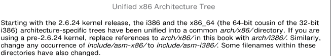

在这些大型目录中寻找符号和其他代码元素可能是一项艰巨的任务。表 1.1 中的工具是你导航内核源码树时值得辅助的工具。

### 表 1.1. 辅助源码树导航的工具

| 工具 | 描述 |
| :--- | :--- |
| **`lxr`** | Linux 交叉引用器 `lxr` 可从 `http://lxr.sourceforge.net/` 下载，它允许你通过 Web 浏览器遍历内核树，通过提供超链接将内核符号与其定义和用途连接起来。 |


## cscope
`cscope`托管在`http://cscope.sourceforge.net/`，它从源码树中的所有文件构建符号数据库，因此你可以快速定位声明、定义、正则表达式等。`Cscope`可能不如`lxr`那样通用，但它提供了使用你最喜欢的文本编辑器的搜索功能而不是浏览器的灵活性。从内核树的根目录，发出`cscope -qkRv`命令以构建交叉引用数据库。`-q`选项生成更多的索引信息，使搜索速度明显加快，但代价是额外的初始启动时间。`-k`选项要求`cscope`调整其行为以适应内核源码，`-R`请求递归子目录遍历，`-v`请求详细消息。你可以从`man`页面获取详细的调用语法。

## ctags/etags
`ctags`实用工具可从`http://ctags.sourceforge.net/`下载，它为许多语言生成交叉引用标签，以便你可以通过`vi`等编辑器在源码树中定位符号和函数定义。从内核树的根目录执行`make tags`以`ctag`所有源文件。`etags`实用工具生成类似的索引信息，由`emacs`编辑器理解。发出`make etags`以`etag`你的内核源文件。

## Utilities
如`grep`、`find`、`sdiff`、`precess`、`od`、`dd`、`make`、`tar`、`file`和`objdump`等工具。

## GCC options
你可以使用`-E`选项要求`GCC`生成预处理源代码。预处理代码包含头文件扩展，减少了在嵌套包含文件中跳转跳过以展开多个宏级别的需要。这是一个预处理`drivers/char/mydrv.c`并在`mydrv.i`中产生展开输出的使用示例：
```bash
gcc -E drivers/char/mydrv.c -D__KERNEL__ -Iinclude -Iinclude/asm-x86/mach-default > mydrv.i
```

使用`-I`选项指定的包含路径取决于你的代码中包含的头文件。

如果使用`-S`选项，`GCC`会生成汇编列表。要为`drivers/char/mydrv.c`在`mydrv.s`中生成汇编列表，请执行以下操作：
```bash
gcc -S drivers/char/mydrv.c -D__KERNEL__ -Iinclude -Ianother/include/path
```

## 构建内核

现在你对源码树布局有了概念，让我们进行一个简单的代码更改，编译并使其运行。转到顶级`init/`目录，并尝试对初始化文件`main.c`进行小的代码更改。在函数`start_kernel()`的开头添加一个打印语句，声明你对北极熊的爱：

```c
asm("__init") void __init start_kernel(void)
{
    char *command_line;
    extern struct kernel_param __start___param[],
        __stop___param[];
+     printk("Penguins are cute, but so are polar bears\n");
    /* ... */
    rest_init();
}
```

你现在准备开始构建过程。转到源码树的根目录，并以干净的状态开始：

```bash
cd /usr/src/linux-X.Y.Z/
make clean
```

配置内核。这是你挑选和选择构成操作系统部件的时刻。你可以指定每个期望的组件是静态还是动态链接到内核：

```bash
make menuconfig
```

`menuconfig`是内核配置菜单的文本界面。使用`make xconfig`获取图形界面。你选择的配置信息保存在名为`.config`的文件中，位于源码树的根目录。如果你不想从头编织配置，使用文件`arch/your-arch/defconfig`（如果有多个支持的平台，使用`arch/your-arch/configs/your-machine_defconfig`）作为起点。因此，如果你正在为32位`x86`架构编译内核，请执行以下操作：

```bash
cp arch/x86/configs/i386_defconfig .config
```

编译内核并生成压缩的启动映像：

```bash
make bzImage
```

内核映像产生在`arch/x86/boot/bzImage`。更新你的启动分区：

```bash
cp arch/x86/boot/bzImage /boot/vmlinuz
```

你可能需要通知你的引导加载程序新的启动映像已到达。如果你使用的是`GRUB`引导加载程序，它会自动找出这一点；但如果你使用的是`Lilo`，请提高一个标志：

```bash
/sbin/lilo
Added linux *
```

最后，重启机器并进入你的新内核：

```bash
reboot
```

启动序列中的第一条消息启动了你为北极熊的`campaign`。

## 可加载模块

由于`Linux`运行在多种架构上并支持数以万计的`I/O`设备，将支持所有可能设备的代码永久编译到基础内核中是不可行的。发行版通常打包一个最小的内核映像，并以内核模块的形式提供其余的功能。在运行时，必要的模块根据需要动态加载。

要生成模块，请转到你的内核源码树的根目录并构建：

```bash
cd /usr/src/linux-X.Y.Z/
make modules
```

要安装生成的模块，请执行以下操作：

```bash
make modules_install
```

这会在`/lib/modules/X.Y.Z/kernel/`下创建内核源目录结构，并用可加载模块对象填充它。这也调用`depmod`实用程序，在文件`/lib/modules/X.Y.Z/modules.dep`中生成模块依赖项。

以下实用程序可用于操作模块：`insmod`、`rmmod`、`lsmod`、`modprobe`、`modinfo`和`depmod`。前两个是插入和移除模块的实用程序，而`lsmod`列出当前加载的模块。`modprobe`是`insmod`的更聪明版本，它在检查`/lib/modules/X.Y.Z/modules.dep`的内容后，也会插入依赖模块。例如，假设你需要挂载`USB`闪存驱动器上的虚拟文件分配表（`VFAT`）分区。使用`modprobe`加载`VFAT`文件系统驱动：[2]

> [2] 此示例假设该模块未被内核自动加载。如果在配置期间启用了自动内核模块加载（`CONFIG_KMOD`），当内核检测到缺失的子系统时，会自动运行带有适当参数的`modprobe`。你将在第4章“奠定基础”中学习模块自动加载。

```bash
modprobe vfat
lsmod
```

```
Module  Size  Used by
vfat  14208  0
fat   49052  1 vfat
nls_base  9728  2 vfat, fat
```

正如你在`lsmod`输出中看到的那样，`modprobe`插入了三个模块而不是一个。`modprobe`首先确定它必须插入`/lib/modules/X.Y.Z/kernel/fs/vfat/vfat.ko`。但当它查看依赖文件`/lib/modules/X.Y.Z/modules.dep`时，它发现以下行，并意识到它必须先加载另外两个依赖模块：

```text
/lib/modules/X.Y.Z/kernel/fs/vfat/vfat.ko:
  /lib/modules/X.Y.Z/kernel/fs/fat/fat.ko
  /lib/modules/X.Y.Z/kernel/fs/nls/nls_base.ko
```

然后它继续加载`fat.ko`和`nls_base.ko`，然后尝试插入`vfat.ko`，从而自动加载你挂载`VFAT`分区所需的所有模块。

## 开始之前

`Linux`已经穿越了多种地形，如今已成为业界前沿技术，因此你可以将其作为理解操作系统概念、处理器架构甚至行业领域的载体。当你学习设备驱动子系统中使用的某种技术时，不妨再深入一层，探究该设计选择背后的根本原因。

除非文中另有明确说明，否则本文假设读者熟悉32位`x86`架构。不过，本书也考虑到你更有可能为嵌入式设备而非传统`PC`兼容系统编写设备驱动这一事实。例如，关于串行驱动的章节考察了两个设备：一个`PC`衍生平台上的触摸控制器和一个手机上的`UART`。或者，关于`I²C`设备驱动的章节则查看了`PC`系统上的`EEPROM`和嵌入式设备上的实时时钟。本书还将向你介绍内核为大多数驱动类提供的核心基础设施，这些基础设施屏蔽了设备驱动对架构的依赖。

设备驱动调试技巧在本书末尾的第21章中讨论，因此当你阅读本书并开发驱动时，不妨提前跳读该章节，这会大有裨益。


本书基于 2.6 内核，该内核相较于 2.4 在各个方面都有实质性变化，触及了所有主要子系统。希望你现在已经在这台系统上安装了基于 2.6 的 Linux 并开始实验内核源码。每个章节都会大方地频繁指引你阅读相关的内核源文件，主要基于以下两个原因：

- 内核中的每个驱动子系统都有数万行代码长，因此书中只能给出相对简化的视角。将实际源码中的驱动与本书中的示例代码结合查看，能让你看到更完整的全貌。
- 在开发驱动之前，最好在 `drivers/` 目录中锁定一个与你的需求相似的现有驱动，并以其作为起点，这是一个很好的主意。

因此，为了从本书中获得最大收益，请通过频繁浏览源代码树并仔细研读代码来熟悉内核。与此同时，结合你的代码探索，关注内核邮件列表中的动态。

## 第 2 章 窥视内核内部

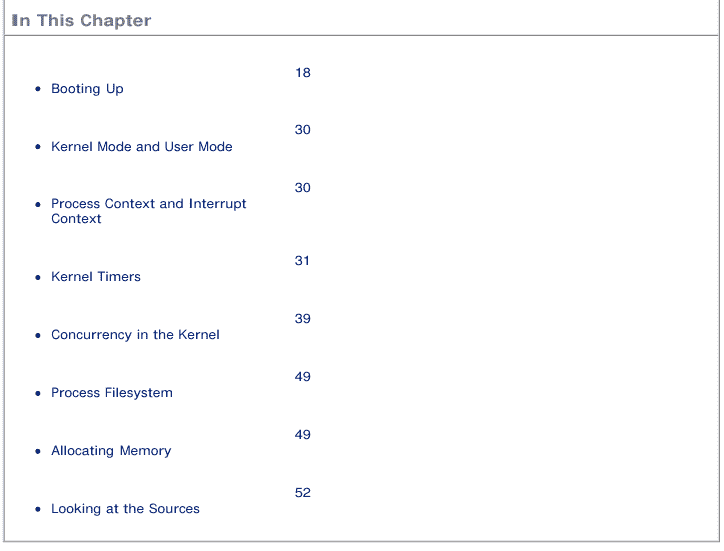

在我们开始探索 Linux 设备驱动的神秘世界之前，让我们通过驱动开发者的视角审视几个内核区域，来熟悉一些基本内核概念。我们将学习内核定时器、同步机制和内存分配。但让我们从高处俯瞰开始我们的远征：让我们快速浏览内核发出的启动信息，并在任何看似有趣的地方踩刹车。

### 系统启动

图 2.1 展示了基于 x86 计算机的 Linux 启动序列。在基于 x86 的硬件上，当 BIOS 从启动设备加载 *主引导记录* (MBR) 时，Linux 启动过程随之启动。驻留在 MBR 中的代码查看分区表，并从活动分区读取 Linux 引导加载程序，如 GRUB、LILO 或 SYSLINUX。引导加载程序的最后阶段加载压缩的内核镜像并将其控制权传递给内核。内核解压自身并点燃引擎。

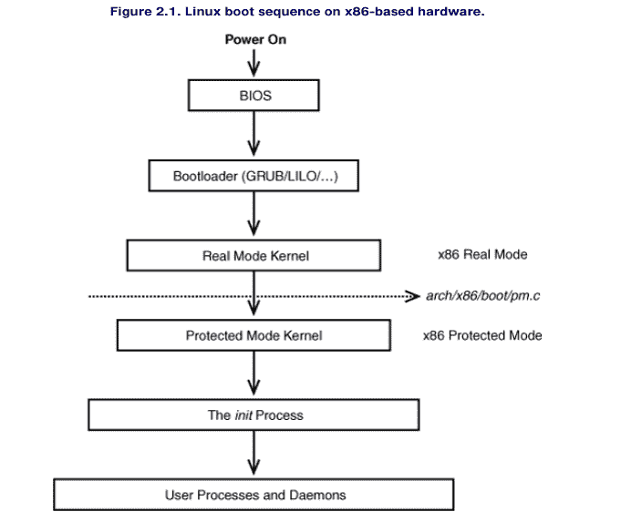

基于 x86 的处理器有两种操作模式，*实模式* 和 *保护模式*。在实模式下，你只能访问前 1MB 的内存，而且没有任何保护。保护模式更为复杂，允许你利用处理器的许多高级功能，如分页。CPU 必须经过实模式才能到达保护模式。然而，这条路是单行道。你不能从保护模式切换回实模式。

第一级内核初始化在实模式汇编中完成。后续的启动过程由定义在 `init/main.c` 源文件中的函数 `start_kernel()` 在保护模式下执行，这是你在上一章中修改过的源文件。`start_kernel()` 通过初始化 CPU 子系统开始。随后很快就会建立内存和进程管理。接下来启动外围总线 和 I/O 设备。作为启动序列的最后一步，`init` 程序，即所有 Linux 进程的父进程，被调用。Init 执行启动必要内核服务的用户空间脚本。它最终在控制台上生成终端并显示登录提示。

以下每个小节标题都是图 2.2 中在基于 x86 的笔记本上进行启动过程中生成的消息。如果你在其他架构上启动内核，语义和消息可能会发生变化。如果本节中的一些解释听起来相当晦涩，请不要担心；这里的意图只是给你提供一幅从 100 英尺高处俯瞰的全景图，让你品尝内核风味的第一口。这里顺带提到的许多概念将在后面深入介绍。

#### 图 2.2. 内核启动消息

```
Linux version 2.6.23.1y (root@localhost.localdomain) (gcc version 4.1.1 20061011 (Red Hat 4.1.1-30)) #7 SMP PREEMPT Thu Nov 1 11:39:30 IST 2007
BIOS-provided physical RAM map:
 BIOS-e820: 0000000000000000 - 000000000009f000 (usable)
 BIOS-e820: 000000000009f000 - 00000000000a0000 (reserved)
...
758MB LOWMEM available.
...
Kernel command line: ro root=/dev/hda1
...
Console: colour VGA+ 80x25
...
Calibrating delay using timer specific routine... 1197.46 BogoMIPS (lpj=2394935)
...
CPU: L1 I cache: 32K, L1 D cache: 32K
CPU: L2 cache: 1024K
...
Checking 'hlt' instruction... OK.
...
Setting up standard PCI resources
...
NET: Registered protocol family 2
IP route cache hash table entries: 32768 (order: 5, 131072 bytes)
TCP established hash table entries: 131072 (order: 9, 2097152 bytes)
...
checking if image is initramfs... it is
Freeing initrd memory: 387k freed
...
io scheduler noop registered
...
io scheduler anticipatory registered (default)
...
00:0a: ttyS0 at I/O 0x3f8 (irq = 4) is a NS16550A
...
Uniform Multi-Platform E-IDE driver Revision: 7.00alpha2
ide: Assuming 33MHz system bus speed for PIO modes; override with idebus=xx
ICH4: IDE controller at PCI slot 0000:00:1f.1
Probing IDE interface ide0...
hda: HTS541010G9AT00, ATA DISK drive
hdc: HL-DT-STCD-RW/DVD DRIVE GCC-4241N, ATAPI CD/DVD/ROM drive
...
serio: i8042 KBD port at 0x60,0x64 irq 1
mice: PS/2 mouse device common for all mice
...
Synaptics Touchpad, model: 1, fw: 5.9, id: 0x2c6ab1, caps: 0x884793/0x0
...
agpgart: Detected an Intel 855GM Chipset.
...
Intel(R) PRO/1000 Network Driver - version 7.3.20-k2
...
ehci_hcd 0000:00:1d.7: EHCI Host Controller
...
```

使用 `modinfo` 实用程序提取你刚刚加载的模块的详细 信息：

```
bash> modinfo vfat
filename:	/lib/modules/X.Y.Z/kernel/fs/vfat/vfat.ko
license:	GPL
description:	VAT filesystem support
...
depends:	fat, nls_base
```

要将内核驱动编译为模块，在配置内核时将相应的菜单选项切换为 `<M>`。本书中大多数设备驱动示例都实现为内核模块。要从源文件 `mymodule.c` 构建模块 `mymodule.ko`，请创建一个单行 Makefile 并如下执行：

```
bash> cd /path/to/module-source/
bash> echo "obj-m += mymodule.ko" > Makefile
bash> make -C /path/to/kernel-sources/ M=`pwd` modules
make: Entering directory `/path/to/kernel-sources'
  Building modules, stage 2.
  MODPOST
  CC /path/to/module-source/mymodule.mod.o
  LD [M] /path/to/module-source/mymodule.ko
make: Leaving directory `/path/to/kernel-sources'
bash> insmod ./mymodule.ko
```

内核模块使内核占用空间更小，并使开发-构建-测试周期更短。你只需重新编译特定的模块并重新插入即可生效变更。我们将在第 21 章“调试设备驱动”中介绍模块调试技术。

如果你选择将驱动设计为内核模块，也有一些缺点。与内置驱动不同，模块无法在启动时预留资源，而在启动时成功的可能性更大。

## 第 2 章 内核内部一瞥


```
Yenta: CardBus bridge found at 0000:02:00.0 [1014:0560]
...
Non-volatile memory driver v1.2
...
kjournal starting. Commit interval 5 seconds
EXT3 FS on hda2, internal journal
EXT3-fs: mounted filesystem with ordered data mode.
...
INIT: version 2.85 booting
...
```

## BIOS 提供的物理 RAM 映射

内核从 BIOS 组装系统内存映射，这是你在启动过程中看到的首批启动消息之一：

```
BIOS-provided physical RAM map:
BIOS-e820: 0000000000000000 - 0000000000009f000 (usable)
...
BIOS-e820: 00000000ff800000 - 0000000100000000 (reserved)
```

实时模式初始化代码使用 BIOS 的 `int 0x15` 服务，功能编号为 `0xe820`（因此前述消息中包含字符串 `BIOS-e820`），以获取系统内存映射。该内存映射指示保留内存和可用内存范围，随后内核利用这些范围创建其空闲内存池。我们将在附录 B “Linux 和 BIOS”的“实时模式调用”部分中更详细地讨论 BIOS 提供的内存映射。

## 758MB LOWMEM 可用

通常可寻址的内核内存区域（< 896MB）被称为*低内存*。内核内存分配器 `kmalloc()` 从此区域返回内存。896MB 以上的内存（称为*高内存*）只能使用特殊的映射进行访问。

在启动期间，内核会计算并显示这些内存区域中存在的总页数。我们将在本章稍后更深入地查看内存区域。

## 内核命令行：ro root=/dev/hda1

Linux 引导加载程序通常会将一条命令行传递给内核。命令行中的参数类似于 C 程序传递给 `main()` 函数的 `argv[]` 列表，只不过它们是被传递给内核的。你可以将命令行参数添加到引导加载程序的配置文件中，或者在运行时从引导加载程序提示符处提供它们。[1] 如果你使用的是 GRUB 引导加载程序，配置文件是 `/boot/grub/grub.conf` 或 `/boot/grub/menu.lst`，具体取决于你的发行版。如果你是 LILo 用户，配置文件是 `/etc/lilo.conf`。下面列出了一个 `grub.conf` 文件示例（添加了注释）。如果你查看 `title kernel 2.6.23:` 下面的一行，就可以弄清前述启动消息的由来。

> [1] 嵌入式设备上的引导加载程序通常“精简”，不支持配置文件或等效机制。因此，许多非 x86 架构支持一个名为 `CONFIG_CMDLINE` 的内核配置选项，你可以用它来在构建时提供内核命令行。

```
default 0    #默认启动 2.6.23 内核
timeout 5    #5 秒内可更改 boot_order 或参数

title kernel 2.6.23    #启动选项 1
#启动映像位于第一块磁盘的第一个分区下的 /boot/ 目录中，名为 vmlinuz-2.6.23。'ro'
#表示根分区应以只读方式挂载。
kernel (hd0,0)/boot/vmlinuz-2.6.23 ro root=/dev/hda1

#查看部分 “Freeing initrd memory:387k freed”
initrd (hd0,0)/boot/initrd
```

命令行参数会影响启动过程中遍历的代码路径。作为一个简单的例子，假设感兴趣的命令行参数称为 *bootmode*。如果将此参数设置为 *1*，你希望在内核启动期间打印一些调试消息，并在启动结束时切换到运行级别 *3*。（等待 init 进程打印出启动消息，以了解运行级别的语义。）如果 *bootmode* 设置为 *0*，你更希望启动过程相对简洁，并将运行级别设置为 *2*。由于你已经熟悉 *init/main.c*，让我们在其中添加以下修改：

```c
Code View:
static unsigned int bootmode = 1;
static int __init
is_bootmode_setup(char *str)
{
  get_option(&strstr, &bootmode);
  return 1;
}

/* 处理参数 "bootmode=" */
__setup("bootmode=", is_bootmode_setup);

if (bootmode) {
  /* 打印详细输出 */
  /* ... */
}

/* ... */

/* 如果 bootmode 为 1，选择 init 运行级别 3，否则
   切换到运行级别 2 */
if (bootmode) {
  argv_init[++args] = "3";
} else {
  argv_init[++args] = "2";
}

/* ... */
```

像之前那样重新构建内核并尝试该更改。我们将在第 18 章“嵌入 Linux”的“内存布局”部分中更多讨论内核命令行参数。

## 校准延迟...1197.46 BogoMIPS (lpj=2394935)

在启动期间，内核计算处理器在一个 jiffy（系统计时器两个连续 tick 之间的时间间隔）内可以执行内部延迟循环的次数。正如你所期望的，该计算必须针对你的 CPU 处理速度进行校准。此校准的结果存储在一个名为 `loops_per_jiffy` 的内核变量中。内核使用 `loops_per_jiffy` 的一个地方是当设备驱动程序希望延迟执行微秒级的小时长时。

为了理解延迟循环校准代码，让我们看一下定义在 `init/calibrate.c` 中的 `calibrate_delay()`。该函数巧妙地利用整数内核推导出了浮点精度。以下代码片段（添加了一些注释）显示了该函数中用于粗略计算 `loops_per_jiffy` 值的初始部分：

```
loops_per_jiffy = {1 << 12}; /* 初始近似值 = 4096 */
printk(KERN_DEBUG "Calibrating delay loop... ");
while ((loops_per_jiffy <<= 1) != 0) {
    ticks = jiffies; /* 如你将在“内核计时器”部分所发现的那样，jiffies 变量包含内核启动以来的计时器 tick 数，并在计时器中断处理程序中递增 */
    while (ticks == jiffies); /* 等待下一个 jiffy 开始 */
    ticks = jiffies;
    /* 延迟 */
    __delay(loops_per_jiffy);

    /* 等待是否超过了当前 jiffy？如果没有，则继续 */
    ticks = jiffies - ticks;
    if (ticks) break;
}
loops_per_jiffy >>= 1; /* 这固定了最高有效位，并且是 loops_per_jiffy 的下界 */
```

前述代码首先假设 `loops_per_jiffy` 大于 4096，这相当于处理器速度约为每秒一百万条指令（MIPS）。然后它等待一个新的 jiffy 开始并执行延迟循环，`__delay(loops_per_jiffy)`。如果延迟循环超过了 jiffy，则 `loops_per_jiffy` 之前的值（通过按位右移一位获得）固定了其最高有效位（MSB）。否则，函数通过检查按位左移 `loops_per_jiffy` 是否会获得 MSB 来继续。当内核这样确定 `loops_per_jiffy` 的 MSB 后，它开始处理低位并如下微调其精度：

```
loopbit = loops_per_jiffy;
/* 逐步处理低位 */
while (lps_precision-- && (loopbit >>= 1)) {
    loops_per_jiffy |= loopbit;
    ticks = jiffies;
    while (ticks == jiffies); /* 等待下一个 jiffy 开始 */
    ticks = jiffies;
    /* 延迟 */
    __delay(loops_per_jiffy);

    if (jiffies != ticks)        /* 超过 1 个 tick */
            loops_per_jiffy &= ~loopbit;
}
```


前述代码片段确定了当延迟循环跨越 jiffy 边界时 `loops_per_jiffy` 低位的确切组合。这个校准值用于推导处理器速度的非科学度量，即 BogoMIPS。你可以使用 BogoMIPS 评级作为 CPU 运行速度的相对度量。在一台基于 1.6GHz Pentium M 的笔记本电脑上，延迟循环校准得出了 `loops_per_jiffy` 值为 2394935，如前述启动消息所宣布的那样。BogoMIPS 值按以下方式获得：

BogoMIPS = `loops_per_jiffy` * 1 秒中的 jiffies 数 * 内部延迟循环消耗的指令数（以 100 万为单位）

= (`2394935` * `HZ` * 2) / (100万)

= (`2394935` * 250 * 2) / (1000000)

= 1197.46（如前述启动消息中显示的那样）

我们将在本章稍后的“内核计时器”部分中进一步讨论 `jiffies`、`HZ` 和 `loops_per_jiffy`。

### 检查 HLT 指令

由于 Linux 内核支持多种硬件平台，启动代码会检查架构相关的错误。验证*halt*（HLT）指令的正确性是此类检查之一。

x86 处理器支持的 HLT 指令使 CPU 进入低功耗睡眠模式，直到下一个硬件中断发生。当内核希望将 CPU 置于空闲状态时使用 HLT 指令（参见定义在 `arch/x86/kernel/process_32.c` 中的函数 `cpu_idle()`）。

对于存在问题的 CPU，可以使用 `no-hlt` 内核命令行参数来禁用 HLT 指令。如果启用了 `no-hlt`，内核在空闲时会进行忙等待，而不是通过将 CPU 置于 HLT 状态来保持 CPU 凉爽。

当 `init/main.c` 中的启动代码调用定义在 `include/asm-your-arch/bugs.h` 中的 `check_bugs()` 时，会生成前述启动消息。

### NET: 已注册协议族 2

Linux 套接字层是一个统一接口，用户应用程序通过它访问各种网络协议。每个协议使用分配给它的唯一族号（定义在 `include/linux/socket.h` 中）向套接字层注册自身。前述消息中的族 2 代表 `AF_INET`（互联网协议）。

启动消息中经常看到的另一个已注册协议族是 `AF_NETLINK`（族 16）。Netlink 套接字提供了一种用户进程与内核之间通信的方法。通过 netlink 套接字实现的功能包括访问路由表和*地址解析协议*（ARP）表（有关完整的使用列表，请参见 `include/linux/netlink.h`）。Netlink 套接字比系统调用更适合完成此类任务，因为它们是异步的，实现更简单，并且可以动态链接。

内核中通常启用的另一个协议族是 `AF_UNIX` 或 UNIX 域套接字。X Windows 等程序使用它们在同一系统上进行进程间通信。

## 释放 Initrd 内存：已释放 387k

*Initrd* 是由引导加载程序加载的驻留于内存中的虚拟磁盘镜像。内核启动后，它被挂载为初始根文件系统，用于存放挂载持有实际根文件系统的磁盘分区所需的额外可动态加载模块。由于内核运行在使用多样化存储控制器的不同硬件平台上，发行版无法在基础内核镜像中启用所有可能磁盘驱动器的设备驱动程序。特定于您系统存储设备的驱动程序打包在 initrd 中，并在内核启动后、根文件系统挂载前加载。要创建 initrd 镜像，请使用 `mkinitrd` 命令。

2.6 内核包含一项名为 *initramfs* 的特性，它比 initrd 带来了几项好处。后者模拟磁盘（因此被称为 *initramdisk* 或 *initrd*），并承受与 Linux 块 I/O 子系统相关的开销，如缓存；而前者本质上是将缓存本身像文件系统一样挂载（因此被称为 *initramfs*）。

与作为其基础的页缓存一样，*initramfs* 不像 initrd 那样具有固定的大小，而是动态增长和缩小，从而减少了内存浪费。此外，与 initrd 不同，initrd 要求您包含相关的文件系统驱动程序（例如，如果您的 initrd 上有 EXT2 文件系统，则需要 EXT2 驱动程序），而 *initramfs* 不需要文件系统支持。*initramfs* 的代码非常小，因为它只是页缓存之上的一层薄薄的封装。

您可以将初始根文件系统打包到一个压缩的 `cpio` 存档中 [2]，并使用 `initrd=` 参数将其传递给内核命令行，或者在内核配置期间通过 `INITRAMFS_SOURCE` 菜单选项将其作为内核镜像的一部分进行构建。对于后者，您可以提供 `cpio` 存档的文件名，或包含 *initramfs* 布局的目录树的路径名。在启动过程中，内核将文件提取到 *initramfs* 根文件系统（也称为 *rootfs*）中，如果找到，则执行顶层的 `/init` 程序。这种获取初始 rootfs 的方法对于嵌入式平台特别有用，在这些平台上，所有系统资源都极为宝贵。要创建 *initramfs* 镜像，请使用 `mkinitramfs`。有关更多文档，请查看 `Documentation/filesystems/ramfs-rootfs-initramfs.txt`。

[2] `cpio` 是一种 UNIX 文件存档格式。您可以从 www.gnu.org/software/cpio 下载它。

在这种情况下，我们通过向内核提供初始根文件系统的压缩 `cpio` 存档并使用 `initrd=` 命令行参数来使用 *initramfs*。在将存档内容解包到 rootfs 后，内核释放存档所在的内存（本例中为 387K），并显示上述启动消息。释放的页面随后分配给请求内存的内核其他部分。

正如第 18 章所述，initrd 和 *initramfs* 有时用于在开发期间在嵌入式设备上持有实际的根文件系统。

## I/O 调度器已注册：预期（默认）

I/O 调度器的主要目标是通过最小化磁盘寻道时间来提高系统吞吐量，寻道时间是指将磁盘头从其当前位置移动到目标磁盘扇区的延迟。2.6 内核提供了四种不同的 I/O 调度器：*Deadline*（截止时间）、*Anticipatory*（预期）、*Complete Fair Queuing*（完全公平排队）和 *Noop*（无操作）。如前一条内核消息所示，内核将 *Anticipatory* 设置为默认的 I/O 调度器。我们将在第 14 章“块驱动程序”中讨论 I/O 调度。

## 设置标准 PCI 资源

启动过程的下一个阶段探测并初始化 I/O 总线及外围控制器。内核通过遍历 PCI 总线来探测 PCI 硬件，然后初始化其他 I/O 子系统。请查看图 2.3 中的启动消息，以了解关于 SCSI 子系统、USB 控制器、视频芯片（以下消息中 855 North Bridge 芯片组的一部分）、串行端口（本例中为 8250 UART）、PS/2 键盘和鼠标、软盘驱动器、内存磁盘、回环设备、IDE 控制器（本例中为 ICH4 South Bridge 芯片组的一部分）、触摸板、以太网控制器（本例中为 e1000）以及 PCMCIA 控制器初始化的通知。相应的 I/O 设备标识由 $\rightarrow$ 标记。

### 图 2.3. 启动过程中初始化总线和外围控制器。

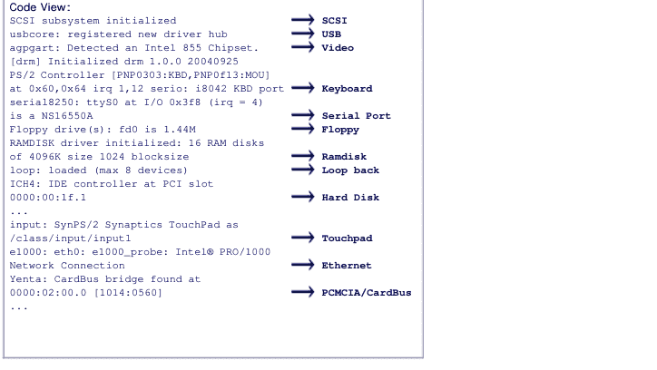

本书在许多章节中分别讨论了许多这些驱动程序子系统。请注意，如果驱动程序作为可加载模块动态链接到内核，某些消息可能直到启动过程的后期才会出现。

## EXT3-fs：已挂载文件系统

EXT3 文件系统已成为 Linux 上的 *事实标准* 文件系统。它在经验丰富的 EXT2 文件系统之上添加了一个日志记录层，以便在崩溃后快速恢复。目标是无需进行耗时的文件系统检查（`fsck`）操作即可恢复一致的文件系统状态。EXT2 仍然是工作引擎，而 EXT3 层在将实际更改提交到磁盘之前，还会将一个称为 *journal*（日志）的内存区域中的文件事务记录在案。EXT3 与 EXT2 向后兼容，因此您可以将 EXT3 涂层添加到现有的 EXT2 文件系统中，或者剥离 EXT3 以恢复原来的 EXT2 文件系统。

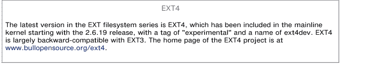

EXT3 启动一个名为 `kjournald` 的内核辅助线程（我们将在下一章深入讨论内核线程）以协助日志记录。当 EXT3 正常运行时，内核挂载根文件系统并准备开始工作：

```
EXT3-fs: mounted filesystem with ordered data mode
kjournald starting. Commit interval 5 seconds
VFS: Mounted root (ext3 filesystem).
```

## INIT：版本 2.85 正在启动

Init 是所有 Linux 进程的父进程，是内核完成启动序列后运行的第一个程序。在 `init/main.c` 的最后几行中，内核搜索不同的位置以尝试定位 init：


```
if (ramdisk_execute_command) { /* Look for /init in initramfs */
	run_init_process(ramdisk_execute_command);
}

if (execute_command) { /* You may override init and ask the kernel
				to execute a custom program using the
				"init=" kernel command-line argument. If
				you do that, execute_command points to the
				specified program */
	run_init_process(execute_command);
}

/* Else search for init or sh in the usual places ... */
run_init_process("/sbin/init");
run_init_process("/etc/init");
run_init_process("/bin/init");
run_init_process("/bin/sh");
panic("No init found. Try passing init= option to kernel.");
```

Init 从 `/etc/inittab` 接收指令。它首先执行位于 `/etc/rc.sysinit` 中的系统初始化脚本。该脚本的一项重要职责是激活交换分区，这将触发如下的启动消息：

```
Adding 1552384k swap on /dev/hda6
```

让我们更仔细地看看这意味着什么。Linux 用户进程拥有一个 3GB 的虚拟地址空间（参见“内存分配”部分）。在此范围内，构成“工作集”的页面保留在 RAM 中。但是，当有太多程序请求内存资源时，内核通过将已使用的 RAM 页面存储到称为 *swap space*（交换空间）的磁盘分区中来释放一些内存。根据经验法则，交换分区的大小应为 RAM 大小的两倍。在本例中，交换空间位于磁盘分区 `/dev/hda6`，大小为 1552384K 字节。

然后，Init 继续运行位于 `/etc/rc.d/rcX.d/` 目录中的脚本，其中 *X* 是 `inittab` 中指定的运行级别（runlevel）。运行级别是对应于期望的启动模式的执行状态。例如，多用户文本模式对应运行级别 3，而 X Windows 对应运行级别 5。因此，如果您看到消息 INIT: Entering runlevel 3，则 init 已开始执行 `/etc/rc.d/rc3.d/` 目录中的脚本。这些脚本启动动态设备命名子系统 udev（我们在 *第 4 章*“奠定基础”中讨论）并加载负责驱动网络、音频、存储等的内核模块：

```
Starting udev: [ OK ]
Initializing hardware... network audio storage [Done]
...
```

Init 最终在虚拟控制台启动终端。现在你可以登录了。

## 内核模式与用户模式

某些操作系统，如 MS-DOS，始终在单一 CPU 模式下运行，但类 UNIX 操作系统使用双模式来有效实现时间共享。在 Linux 机器上，CPU 要么处于受信任的*内核模式*，要么处于受限的*用户模式*。所有用户进程都在用户模式下执行，而内核本身在内核模式下执行。

内核模式代码可以无限制地访问完整的处理器指令集以及完整的内存和 I/O 空间。如果用户模式进程需要这些权限，它必须通过设备驱动程序或其他内核模式代码，经由系统调用来请求这些权限。然而，用户模式代码允许发生缺页异常，而内核模式代码则不允许。

在 2.4 及更早版本的内核中，只有用户模式进程可以被上下文切换出去并被其他进程替换。内核模式代码可以独占处理器，直到发生以下情况之一：

- * 它自愿放弃 CPU。
- * 发生中断或异常。

随着 2.6 版本内核抢占特性的引入，大多数内核模式代码也可以被上下文切换了。

## 进程上下文与中断上下文

内核通过结合使用进程上下文和中断上下文来完成有用的工作。为发起系统调用的用户应用程序提供服务的内核代码代表相应的应用程序进程运行，因此被称为在进程上下文中执行。另一方面，中断处理程序在异步的中断上下文中运行。进程上下文不绑定到任何中断上下文，反之亦然。

在进程上下文中运行的内核代码是*可抢占的*。然而，中断上下文始终运行到完成，且是*不可抢占的*。正因为如此，从中断上下文中可执行的操作受到限制。从中断上下文执行的代码不能执行以下操作：

- 睡眠或放弃处理器
- 获取互斥锁
- 执行耗时的任务
- 访问用户空间虚拟内存

关于中断上下文的完整讨论，请参见第 4 章中的“中断处理”一节。

## 内核定时器

内核许多部分的工作关键性地依赖于时间的流逝。Linux 内核利用硬件提供的不同定时器来提供依赖于时间的服务，例如忙等待和睡眠等待。处理器在忙等待时浪费时钟周期，但在睡眠等待时让出 CPU。自然，前者仅在后者不可行时才执行。内核还便于安排在指定时间间隔过去后运行的函数。

首先，让我们讨论一些重要的内核定时器变量（如 `jiffies`、`HZ` 和 `xtime`）的语义。接下来，让我们使用 Pentium *时间戳计数器*（TSC）在基于 Pentium 的系统上测量执行时间。我们还将看看 Linux 如何使用*实时时钟*（RTC）。

### HZ 与 Jiffies

系统定时器以可编程的频率中断处理器（或“弹出”）。这个频率，即每秒的定时器滴答次数，包含在内核变量 `HZ` 中。为 `HZ` 选择一个值是一种权衡。较大的 `HZ` 会导致更细的定时器粒度，从而获得更好的调度分辨率。然而，较大的 `HZ` 值也会增加开销并提高功耗，因为在中断上下文中燃烧了更多的周期。

`HZ` 的值取决于体系结构。在 x86 系统上，`HZ` 在 2.4 内核中默认设置为 100。在 2.6 版本中，该值更改为 1000，但在 2.6.13 版本中，它被降低到 250。在基于 ARM 的平台中，2.6 内核将 `HZ` 设置为 100。在当前内核中，你可以在构建时通过配置菜单为 `HZ` 选择一个值。该选项的默认设置取决于你的发行版。

2.6.21 内核引入了对无滴答内核（`CONFIG_NO_HZ`）的支持，它根据系统负载动态触发定时器中断。无滴答系统的实现超出了本章的范围。

`jiffies` 保存自系统启动以来系统定时器“弹出”的次数。内核每秒 `HZ` 次递增 `jiffies` 变量。因此，在 `HZ` 值为 100 的内核中，一个 jiffy 是 10 毫秒的时长，而在 `HZ` 设置为 1000 的内核中，一个 jiffy 仅为 1 毫秒。

为了更好地理解 `HZ` 和 `jiffies`，请考虑来自 IDE 驱动程序（*drivers/ide/ide.c*）的以下代码片段，它轮询磁盘驱动器的忙状态：

```c
unsigned long timeout = jiffies + (3*HZ);
while (hwproup->busy) {
    /* ... */
    if (time_after(jiffies, timeout)) {
        return -EBUSY;
    }
    /* ... */
}
return SUCCESS;
```

前面的代码如果在 3 秒内清除了忙状态，则返回 `SUCCESS`，否则返回 `-EBUSY`。`3*HZ` 是 3 秒中存在的 `jiffies` 数量。计算出的超时值 `(jiffies + 3*HZ)` 因此是 3 秒超时过后 `jiffies` 的新值。`time_after()` 宏将当前 `jiffies` 值与请求的超时进行比较，并小心地考虑由于溢出导致的回绕。用于执行类似比较的相关函数包括 `time_before()`、`time_before_eq()` 和 `time_after_eq()`。

`jiffies` 被定义为 `volatile`，这要求编译器不要优化对该变量的访问。这确保了在每次循环过程中，`jiffies`（在每次滴答时由定时器中断处理程序更新）会被重新读取。

关于从 `jiffies` 到秒的逆转换，请看看 USB 主机控制器驱动程序 `drivers/usb/host/ehci-sched.c` 中的这个片段：

```c
if (stream->rescheduled) {
    ehci_info(ehci, "ep%d=iso rescheduled %u times in %lu "
               "seconds\n", stream->bEndpointAddress, is_in? "in":
               "out", stream->rescheduled,
               ((jiffies - stream->start)/HZ));
}
```


前面的调试语句计算了此 USB 端点流（我们在第 11 章“通用串行总线”中讨论 USB）在 `stream->rescheduled` 次重新调度所经历的时间（以秒为单位）。`(jiffies-stream->start)` 是自重新调度开始以来经过的 `jiffies` 数量。除以 `HZ` 将该值转换为秒。

32 位的 `jiffies` 变量在假设 `HZ` 值为 1000 的情况下，大约会在 50 天后溢出。由于系统运行时间可以是该时长的许多倍，内核提供了一个名为 `jiffies_64` 的变量来保存 64 位的 `(u64)` `jiffies`。链接器将 `jiffies_64` 定位为其低 32 位与 `jiffies` 同位置。在 32 位机器上，编译器需要两条指令将一个 `u64` 变量赋值给另一个变量，因此读取 `jiffies_64` 不是原子的。为了解决这个问题，内核提供了一个函数 `get_jiffies_64()`。查看 `drivers/cpufreq/cpufreq_stats.c` 中定义的 `cpufreq_stats_update()` 以获得使用示例。

### 长延迟

在内核术语中，以 `jiffies` 为量级的延迟被认为是长时长。实现长延迟的一种可能但不最优的方法是忙循环。忙等待的函数具有一种“狗咬经理”的态度。它既不利用处理器做有用的工作，也不让别人使用它。以下代码独占处理器 1 秒：

```c
unsigned long timeout = jiffies + HZ;
while (time_before(jiffies, timeout)) continue;
```

更好的方法是使用睡眠等待，而不是忙等待。你的代码在等待时间延迟经过时，将处理器让给其他人。这使用 `schedule_timeout()` 实现：

```c
unsigned long timeout = jiffies + HZ;
schedule_timeout(timeout); /* 允许内核的其他部分运行 */
```

延迟保证仅针对超时的下限。无论是从内核空间还是用户空间，由于进程时间片仅在定时器滴答时由内核调度器更新，要获得比 `HZ` 粒度更精确的超时控制是困难的。此外，即使你的进程在...

如果指定了超时时间，调度器可以基于优先级决定从运行队列中选择另一个进程。

> [3] 这些调度器特性随着 2.6.23 内核中 CFS 调度器的出现而发生了变化。Linux 进程调度器将在第 19 章“用户态中的驱动程序”中进行讨论。

另外两个有助于睡眠等待的函数是 `wait_event_timeout()` 和 `msleep()`。它们都是借助 `schedule_timeout()` 实现的。当你的代码希望在一个指定条件变为真或发生超时时恢复执行时，使用 `wait_event_timeout()`。`msleep()` 则用于睡眠指定的毫秒数。

这种长延迟技术仅适用于从进程上下文使用。不能从中断上下文进行睡眠等待，因为中断处理程序不允许调用 `schedule()` 或 `sleep`。（关于在中断上下文中执行代码的“应该做”和“不应该做”事项列表，请参见第 4 章中的“中断处理”。）虽然可以从中断上下文中进行短时间的忙等待，但在那种上下文中进行长时间的忙等待被视为不可饶恕的错误。同样禁忌的是在中断禁用的情况下进行长时间的忙等待。

内核还提供了定时器 API，以便在未来某个时间点执行函数。你可以使用 `init_timer()` 动态定义一个定时器，或使用 `DEFINE_TIMER()` 静态创建一个。完成此操作后，使用处理函数的地址和参数填充 `timer_list`，并使用 `add_timer()` 将其注册：

```c
#include <linux/timer.h>

struct timer_list my_timer;

init_timer(&my_timer);        /* 也可参见 setup_timer() */
my_timer.expire = jiffies + n*HZ; /* n 是以秒为单位的超时时间 */
my_timer.function = timer_func;   /* n 秒后要执行的函数 */
my_timer.data = func_parameter;   /* 传递给 timer_func 的参数 */
add_timer(&my_timer);          /* 启动定时器 */
```

请注意，这是一个单次触发的定时器。如果你想周期性地运行 `timer_func()`，还需要在 `timer_func()` 内部添加上述代码，以便在下一次超时后调度自身：

```c
static void timer_func(unsigned long func_parameter)
{
    /* 执行需要周期性完成的工作 */
    /* ... */

    init_timer(&my_timer);
    my_timer.expire   = jiffies + n*HZ;
    my_timer.data     = func_parameter;
    my_timer.function = timer_func;
    add_timer(&my_timer);
}
```

你可以使用 `mod_timer()` 更改 `my_timer` 的过期时间，使用 `del_timer()` 取消 `my_timer`，并使用 `timer_pending()` 检查 `my_timer` 当前是否处于挂起状态。如果你查看 `kernel/timer.c`，你会发现 `schedule_timeout()` 内部使用的是这些相同的 API。

像 `clock_settime()` 和 `clock_gettime()` 这样的用户空间函数用于从用户空间访问内核定时器服务。用户应用程序可以使用 `settimer()` 和 `gettimer()` 在指定超时间隔到期时控制警报信号的传递。

## 短延迟

在内核术语中，低于最小时间间隔（`jiffy`）的延迟属于短持续时间。这种延迟通常来自进程和中断上下文。由于不可能使用基于 `jiffy` 的方法来实施低于最小时间间隔的延迟，因此上一节中讨论的睡眠等待方法不能用于小超时时间。唯一的解决方案是忙等待。

实现短延迟的内核 API 包括 `mdelay()`、`udelay()` 和 `ndelay()`，它们分别支持毫秒、微秒和纳秒延迟。这些函数的实际实现是特定于架构的，并且可能并非在所有平台上都可用。

短时间的忙等待是通过测量处理器执行一条指令所需的时间，并循环必要的迭代次数来实现的。正如本章前面所讨论的，内核在启动期间执行此测量，并将值存储在一个名为 `loops_per_jiffy` 的变量中。短延迟 API 使用 `loops_per_jiffy` 来确定需要忙循环的次数。为了在手握过程中实现 1 微秒的延迟，USB 主机控制器驱动程序 `drivers/usb/host/ehci-hcd.c` 调用 `udelay()`，该函数内部使用 `loops_per_jiffy`：

```c
do {
    result = ehci_read(ehci, ptr);
    /* ... */
    if (result == done) return 0;
    udelay(1);     /* 内部使用 loops_per_jiffy */
    usec--;
} while (usec > 0);
```

## Pentium 时间戳计数器

**时间戳计数器** (`TSC`) 是存在于 Pentium 兼容处理器中的一个 64 位寄存器，用于计算自启动以来处理器消耗的时钟周期数。由于 `TSC` 以处理器周期速度递增，因此它提供高分辨率定时器。`TSC` 通常用于代码的性能分析和插桩。使用 `rdtsc` 指令访问 `TSC`，以微秒精度测量中间代码的执行时间。`TSC` 滴答值可以通过除以 CPU 时钟速度转换为秒，该速度可以从内核变量 `cpu_khz` 中读取。

在以下代码片段中，`low_tsc_ticks` 包含 `TSC` 的低 32 位，而 `high_tsc_ticks` 包含高 32 位。低 32 位取决于处理器速度可能在几秒内溢出，但对于许多代码插桩目的来说已经足够了，如下所示：

```c
unsigned long low_tsc_ticks0, high_tsc_ticks0;
unsigned long low_tsc_ticks1, high_tsc_ticks1;
unsigned long exec_time;
rdtsc(low_tsc_ticks0, high_tsc_ticks0);  /* 之前的时间戳 */
printf("Hello World\n");              /* 要分析性能的代码 */
rdtsc(low_tsc_ticks1, high_tsc_ticks1);  /* 之后的时间戳 */
exec_time = low_tsc_ticks1 - low_tsc_ticks0;
```


在 1.8GHz Pentium 机器上，测量的 `exec_time` 为 871（或半微秒）。

对高分辨率定时器（`CONFIG_HIGH_RES_TIMERS`）的支持已合并到 2.6.21 内核中。它利用特定于硬件的高速定时器为 `nanosleep()` 等 API 提供高精度功能。在 Pentium 级机器上，内核利用 TSC 来提供此功能。

## 实时时钟

RTC 在非易失性内存中跟踪绝对时间。在 x86 PC 上，RTC 寄存器构成了由电池供电的一小块 [4] *互补金属氧化物半导体* (CMOS) 内存顶部的少数位置。在第 5 章“字符驱动程序”中的图 5.1 中，可以看到传统 PC 架构中 CMOS 的位置。在嵌入式系统中，RTC 可能是处理器内部的，或者通过第 8 章“I²C 和 SPI 协议”中讨论的 I²C 或 SPI 总线外部连接。

> [4] RTC 电池可以使用多年，通常比计算机的使用寿命更长，因此你永远不需要更换它们。

你可以使用 RTC 执行以下操作：

- 读取和设置绝对时钟，并在时钟更新期间生成中断。
- 生成频率从 2HZ 到 8192HZ 不等的周期性中断。
- 设置闹钟

许多应用程序需要绝对时间或 *wall time* 的概念。因为 `jiffies` 是相对于系统启动时间的，所以它不包含 wall time。内核在一个名为 `xtime` 的变量中维护 wall time。在启动期间，通过读取 RTC 将 `xtime` 初始化为当前的 wall time。当系统停止时，wall time 被写回 RTC。你可以使用 `do_gettimeofday()` 以硬件支持的最高分辨率读取 wall time：

```c
#include <linux/time.h>
static struct timeval curr_time;
do_gettimeofday(&curr_time);
my_timestamp = cpu_to_le32(curr_time.tv_sec); /* 记录时间戳 */
```

还有一些功能可供用户空间代码访问 wall time。它们包括以下函数：

- `time()`，返回日历时间，即自纪元（1970 年 1 月 1 日 00:00:00）以来的秒数
- `localtime()`，以分解格式返回日历时间
- `mktime()`，执行与 `localtime()` 相反的操作

从用户空间使用 RTC 的另一种方法是使用字符设备 `/dev/rtc`。一次只允许一个进程访问此设备。

我们将在第 5 章和第 8 章中更多地讨论 RTC 驱动程序。在第 19 章中，我们开发了一个示例用户应用程序，它使用 `/dev/rtc` 以微秒精度执行周期性工作。

## 内核中的并发

随着多核笔记本电脑的出现，对称多处理（SMP）不再仅限于高科技用户领域。SMP 和内核抢占是会产生多个执行线程的场景。这些线程可以同时对共享的内核数据结构进行操作。正因为如此，对这些数据结构的访问必须被串行化。

让我们来讨论一下保护共享内核资源免受并发访问的基本知识。我们从一个简单的例子开始，逐渐引入中断、内核抢占和 SMP 等复杂性。

### 自旋锁和互斥锁

访问共享资源的代码区域称为临界区。自旋锁和互斥锁（互斥的缩写）是用于保护内核临界区的两种基本机制。让我们逐一查看。

自旋锁确保每次只有一个线程进入临界区。任何希望进入临界区的其他线程都必须在门口保持自旋（等待），直到第一个线程退出。请注意，我们使用“线程”一词来指代执行线程，而不是内核线程。

自旋锁的基本用法如下：

```c
#include <linux/spinlock.h>
spinlock_t mylock = SPIN_LOCK_UNLOCKED; /* Initialize */
/* Acquire the spinlock. This is inexpensive if there
 * is no one inside the critical section. In the face of
 * contention, spinlock() has to busy-wait.
 */
spin_lock(&mylock);

/* ... Critical Section code ... */

spin_unlock(&mylock); /* Release the lock */
```

与自旋锁在尝试进入繁忙的临界区时使线程陷入自旋不同，互斥锁会使竞争线程休眠，直到轮到它们占用临界区为止。由于消耗处理器周期进行自旋是坏事，因此当预计等待时间较长时，互斥锁比自旋锁更适合保护临界区。在互斥锁的术语中，超过两次上下文切换就被认为是长时间等待，因为互斥锁必须将竞争线程切换出去以使其休眠，并在需要唤醒它时再将其切换回来。

因此，在许多情况下，决定使用自旋锁还是互斥锁很容易：

- 如果临界区需要休眠，你只能选择使用互斥锁。在获取自旋锁后，调度、抢占或在等待队列上休眠都是非法的。
- 由于在发生竞争时，互斥锁会使调用线程休眠，因此在中断处理程序内部只能使用自旋锁。（你将在第 4 章中更多地了解中断上下文的约束。）

互斥锁的基本用法如下：

```c
#include <linux/mutex.h>

/* Statically declare a mutex. To dynamically
   create a mutex, use mutex_init() */
static DEFINE_MUTEX(mymutex);

/* Acquire the mutex. This is inexpensive if there
   * is no one inside the critical section. In the face of
   * contention, mutex_lock() puts the calling thread to sleep.
   */
mutex_lock(&mymutex);

/* ... Critical Section code ... */

mutex_unlock(&mymutex);    /* Release the mutex */
```

为了说明并发保护的使用，让我们从一个仅存在于进程上下文中的临界区开始，并逐渐按照以下顺序引入复杂性：

- 仅在单处理器（UP）盒子上运行非抢占内核时，临界区存在于进程上下文中。
- 在运行非抢占内核的单处理器机器上，临界区存在于进程和中断上下文中。
- 在运行抢占内核的单处理器机器上，临界区存在于进程和中断上下文中。
- 在运行抢占内核的 SMP 机器上，临界区存在于进程和中断上下文中。

## 旧信号量接口

取代旧信号量接口的互斥锁接口起源于 -rt 树，并随着 2.6.16 内核版本的发布合并到主线。然而，信号量接口仍然存在。信号量接口的基本用法如下：

```c
#include <asm/semaphore.h> /* Architecture dependent
                               header */

/* Statically declare a semaphore. To dynamically
  create a semaphore, use init_MUTEX() */
static DECLARE_MUTEX(mysem);

down(&mysem); /* Acquire the semaphore */

/* ... Critical Section code ... */

up(&mysem); /* Release the semaphore */
```

可以配置信号量，使其允许预定数量的线程同时进入临界区。然而，允许单个持有者以上同时存在的信号量很少被使用。

### 案例 1：进程上下文，UP 机器，无抢占

这是最简单的情况，不需要加锁，因此我们不再进一步讨论。

### 案例 2：进程和中断上下文，UP 机器，无抢占

在这种情况下，你只需要禁用中断来保护临界区。为了了解原因，假设 A 和 B 是进程上下文线程，C 是中断上下文线程，它们都在争夺进入同一个临界区，如图 2.4 所示。

### 图 2.4. 位于临界区内的进程和中断上下文线程。

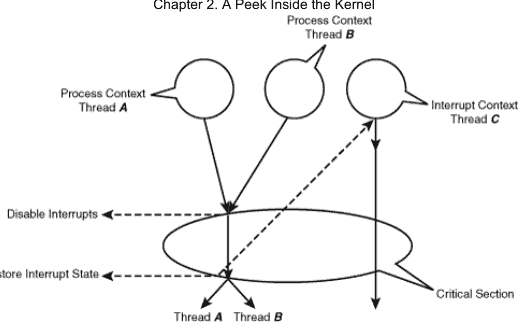

因为线程 C 在中断上下文中执行，并且总是在将控制权交还给线程 A 或线程 B 之前执行完成，所以它不需要担心保护问题。就线程 A 而言，它不需要担心线程 B（反之亦然），因为内核是不可抢占的。因此，线程 A 和线程 B 只需要防范线程 C 在它们位于同一临界区内部时闯入该区域的可能性。它们通过在进入临界区之前禁用中断来实现这一点：

```c
Point A:
    local_irq_disable();    /* Disable Interrupts in local CPU */
    /* ... Critical Section ... */
    local_irq_enable();      /* Enable Interrupts in local CPU */
```


然而，如果执行到达点 A 时中断已经禁用，`local_irq_enable()` 会产生重新启用中断的副作用，而不是恢复中断状态，这是一种不愉快的副作用。可以通过以下方式进行修复：

```c
unsigned long flags;

Point A:
    local_irq_save(flags);     /* Disable Interrupts */
    /* ... Critical Section ... */
    local_irq_restore(flags);   /* Restore state to what
                                  it was at Point A */
```

无论点 A 时的中断状态如何，这样都能正确工作。

### 案例 3：进程和中断上下文，UP 机器，抢占

如果启用了抢占，仅禁用中断无法保护你的临界区免受踩踏。在进程上下文中，多个线程同时进入临界区的可能性是存在的。在此场景下回顾图 2.4，除了防范线程 C 之外，线程 A 和线程 B 现在还需要相互保护。显然，解决方案是在临界区开始前禁用内核抢占，并在结束时重新启用，同时禁用/重新启用中断。

为此，线程 A 和线程 B 使用自旋锁的 `irq` 变体：

```c
unsigned long flags;

Point A:
/* Save interrupt state.
 * Disable interrupts – this implicitly disables preemption */
spin_lock_irqsave(&mylock, flags);

/* ... Critical Section ... */

/* Restore interrupt state to what it was at Point A */
spin_unlock_irqrestore(&mylock, flags);
```

无需显式地将抢占状态恢复为点 A 时的状态，因为内核通过一个称为 `抢占计数器` 的变量在内部为你完成此操作。每当禁用抢占时（使用 `preempt_disable()`），计数器会递增；每当启用抢占时（使用 `preempt_enable()`），计数器会递减。只有当计数器值为零时，抢占才会发生。

### 案例 4：进程和中断上下文，SMP 机器，抢占

现在假设临界区在 SMP 机器上执行。你的内核配置已开启 `CONFIG_SMP` 和 `CONFIG_PREEMPT`。

在迄今为止讨论的场景中，自旋锁原语所做的无非是启用/禁用抢占和中断。实际的加锁功能已被编译剔除。在存在 SMP 的情况下，加锁逻辑会被编译进去，自旋锁原语变得 SMP 安全。启用 SMP 后的语义如下：

```c
unsigned long flags;

Point A:
/*
 – Save interrupt state on the local CPU
 – Disable interrupts on the local CPU. This implicitly disables
   preemption.
 – Lock the section to regulate access by other CPUs
*/
spin_lock_irqsave(&mylock, flags);

/* ... Critical Section ... */

/*
 – Restore interrupt state and preemption to what it
   was at Point A for the local CPU
 – Release the lock
*/
spin_unlock_irqrestore(&mylock, flags);
```

在 SMP 系统上，获取自旋锁时仅禁用本地 CPU 的中断。因此，进程上下文线程（例如图 2.4 中的线程 A）可能在某个 CPU 上运行，而中断处理程序（例如图 2.4 中的线程 C）在另一个 CPU 上执行。因此，非本地处理器上的中断处理程序需要自旋等待，直到本地处理器上的进程上下文代码退出临界区。中断上下文代码通过调用 `spin_lock()`/`spin_unlock()` 来执行此操作：

`spin_lock(&mylock);`

`/* ... 临界区 ... */`

`spin_unlock(&mylock);`

与中断 `irq` 变体类似，自旋锁也有 `下半部` `BH` 变体。`spin_lock_bh()` 在获取锁时会禁用下半部，而 `spin_unlock_bh()` 在释放锁时会重新启用下半部。我们在 `第4章` 中讨论下半部。

### -rt 内核树

实时 `-rt` 内核树，也称为 `CONFIG_PREEMPT_RT` 补丁集，实现了对内核的低延迟修改。该补丁集可从 `www.kernel.org/pub/linux/kernel/projects/rt/` 下载，它允许内核的大部分被抢占，部分是通过用互斥锁 `mutexes` 替换许多自旋锁来实现的。它还整合了高分辨率定时器。几个 `-rt` 功能已集成到主线内核中。你可以在项目位于 `http://rt.wiki.kernel.org/` 的维基上找到详细文档。

内核拥有一组专门设计的锁定原语，有助于在特定条件下提升性能。根据你的需求使用定制的互斥方案会使你的代码更强大。让我们来看一些专门的互斥机制。

## 原子操作

`原子操作` 用于执行轻量级的一次性操作，例如增加计数器、条件增量以及设置位位置。原子操作保证被串行化，不需要锁来保护以防止并发访问。原子操作的实现依赖于架构。

要在释放内核网络缓冲区（称为 `skbuff`）之前检查是否仍有数据引用，定义在 `net/core/skbuff.c` 中的 `skb_release_data()` 例程执行以下操作：

```c
if (!skb->cloned ||
    /* 原子地递减并检查返回值是否为零 */
    !atomic_sub_return(skb->nohdr ? (1 << SKB_DATAREF_SHIFT) + 1 :
                    1,&skb_shinfo(skb)->dataref)) {
    /* ... */
    kfree(skb->head);
}
```

当 `skb_release_data()` 正在执行时，另一个使用 `skbuff_clone()`（定义在同一文件中）的线程可能同时正在增加数据引用计数器：

```c
/* ... */
/* 原子地增加数据引用计数 */
atomic_inc(&skb_shinfo(skb)->dataref);
/* ... */
```

原子操作的使用保护数据引用计数器免受这两个线程的破坏。它还消除了使用锁来保护单个整型变量免受并发访问的麻烦。

内核还支持诸如 `set_bit()`、`clear_bit()` 和 `test_and_set_bit()` 等运算符，以原子方式进行位操作。请查看 `include/asm-<your-arch>/atomic.h` 了解你的架构支持的原子操作符。

## 读者-写者锁

另一种专门设计的并发控制机制是自旋锁的读者-写者变体。如果临界区的使用方式是单独的线程要么从共享数据结构中读取，要么写入，但不两者都做，那么这些锁是一个自然的选择。多个读者线程允许同时进入临界区域。读者自旋锁定义如下：

```c
rwlock_t myrwlock = RW_LOCK_UNLOCKED;

read_lock(&myrwlock);   /* 获取读者锁 */
/* ... 临界区 ... */
read_unlock(&myrwlock);  /* 释放锁 */
```

然而，如果写者线程进入临界区，其他读者或写者线程不允许进入。要使用写者自旋锁，你需要这样写：

```c
rwlock_t myrwlock = RW_LOCK_UNLOCKED;

write_lock(&myrwlock);    /* 获取写者锁 */
/* ... 临界区 ... */
write_unlock(&myrwlock);   /* 释放锁 */
```

查看位于 `net/ipx/ipx_route.c` 中的 IPX 路由代码，了解读者-写者自旋锁的实际示例。名为 `ipx_routes_lock` 的读者-写者锁保护 IPX 路由表免受同时访问。需要查找路由表以转发数据包的线程请求读者锁。需要添加或删除路由表条目的线程获取写者锁。这提高了性能，因为路由表查找的次数通常远多于路由表更新的次数。

与普通自旋锁类似，读者-写者锁也有相应的 irq 变体——即 `read_lock_irqsave()`、`read_lock_irqrestore()`、`write_lock_irqsave()` 和 `write_lock_irqrestore()`。这些函数的语义与普通自旋锁的类似。


## 序列锁与 RCU

序列锁或 `seqlocks`，在 2.6 内核中引入，是写者优先于读者的读者-写者锁。如果变量上的写操作远多于读访问，这将非常有用。一个例子是本章前面讨论的 `jiffies_64` 变量。写者线程不会等待可能已在临界区内的读者。因此，读者线程可能会发现其进入临界区的尝试失败并可能需要重试：

```c
u64 get_jiffies_64(void) /* 定义在 kernel/time.c */
{
 unsigned long seq;
 u64 ret;
 do {
  seq = read_seqbegin(&xtime_lock);
  ret = jiffies_64;
 } while (read_seqretry(&xtime_lock, seq));
 return ret;
}
```

写者使用 `write_seqlock()` 和 `write_sequnlock()` 保护临界区域。

2.6 内核引入了另一种称为**复制更新（RCU）**的机制，当读者远多于写者时能带来改进的性能。基本思想是读者线程可以无锁执行。写者线程更复杂。它们在数据结构副本上执行更新操作，并替换读者看到的指针。原始副本保留直到所有 CPU 上的下一次上下文切换，以确保所有正在进行的读操作完成。请注意，使用 RCU 比使用迄今为止讨论的原语更复杂，只有当你确信它是正确工具时才应使用。RCU 数据结构和接口函数定义在 `include/linux/rcupdate.h` 中。在 `Documentation/RCU/` 中有大量文档。

关于 RCU 的使用示例，请看 `fs/dcache.c`。在 Linux 中，每个文件都与目录项信息（存储在称为 `dentry` 的结构中）、元数据信息（存储在 `inode` 中）和实际数据（存储在数据块中）相关联。每次你操作一个文件时，文件路径中的组件都会被解析，并获得相应的 `dentries`。`dentries` 被缓存在一个名为 `dcache` 的数据结构中，以加快未来的操作。在任何时候，`dcache` 查找的数量都远多于 `dcache` 更新，因此对 `dcache` 的引用使用 RCU 原语保护。

## 调试

并发相关问题通常很难调试，因为它们通常难以复现。在编译和测试代码时启用 SMP（`CONFIG_SMP`）和抢占（`CONFIG_PREEMPT`）是个好主意，即使你的生产内核将在禁用抢占的单处理机（UP）机器上运行。在*内核调试*下有一个名为**自旋锁和 rw-lock 调试**（`CONFIG_DEBUG_SPINLOCK`）的内核配置选项，可以帮助你捕捉一些常见的自旋锁错误。还可以使用*lockmeter*（`http://oss.sgi.com/projects/lockmeter/`）等工具来收集锁相关统计信息。

一种常见的并发问题发生在你忘记锁定对共享资源的访问时。这导致不同线程以不受控制的方式“竞争”通过该访问。这个问题被称为*竞态条件*，可能表现为偶尔奇怪的代码行为。

另一个潜在问题发生在你遗漏了某些代码路径中释放持有的锁时，从而导致死锁。为了理解这一点，考虑以下示例：

```c
spin_lock(&mylock);    /* 获取锁 */

/* ... 临界区 ... */

if (error) {           /* 这种错误条件很少发生 */
    return -EIO; /* 忘记释放锁！ */
}

spin_unlock(&mylock);  /* 释放锁 */
```

在错误条件发生之后，任何试图获取 `mylock` 的线程都会陷入死锁，内核可能会冻结。

如果问题在你编写代码数月或多年后才首次显现，回去调试它将变得更加困难。（在第 21 章“调试设备驱动程序”的“Kdump”部分中有一个相关的调试示例。）为了避免这种不愉快的遭遇，应该在软件架构设计阶段设计并发逻辑。

## 进程文件系统

进程文件系统（procfs）是一个虚拟文件系统，它为内核的内部结构提供了访问窗口。当你浏览 procfs 时看到的数据是由内核动态生成的。procfs 中的文件用于配置内核参数、查看内核结构、从设备驱动程序中获取统计数据，以及获取通用系统信息。

Procfs 是一个伪文件系统。这意味着驻留在 procfs 中的文件不与诸如硬盘等物理存储设备关联。相反，这些文件中的数据是由内核中对应的入口点按需动态创建的。因此，procfs 中的文件大小显示为零。在内核启动期间，Procfs 通常挂载在 `/proc` 目录下；你可以通过调用 `mount` 命令来查看这一点。

为了初步了解 procfs 的功能，请检查 `/proc/cpuinfo`、` /proc/meminfo`、`/proc/interrupts`、`/proc/tty/driver/serial`、`/proc/bus/usb/devices` 和 `/proc/stat` 的内容。某些内核参数可以通过写入 `/proc/sys/` 下的文件在运行时进行修改。例如，你可以将一组新值回显到 `/proc/sys/kernel/printk` 来更改内核 printk 日志级别。许多实用工具（如 `ps`）和系统性能监控工具（如 `systat`）内部都是从驻留在 `/proc` 下的文件中获取信息的。

序列文件（Seq files）是在 2.6 内核中引入的，它们简化了大型 procfs 操作。它们在第 C 章“序列文件”中有详细描述。

## 内存分配

一些设备驱动程序必须意识到*内存区域*的存在。此外，许多驱动程序还需要内存分配函数的服务。在本节中，我们将简要讨论这两者。

内核将物理内存组织成*页*。页大小取决于架构。在基于 x86 的机器上，它是 4096 字节。物理内存中的每个页都关联有一个 `struct page`（定义在 `include/linux/mm_types.h` 中）：

```
struct page {
    unsigned long flags;     /* Page status */
    atomic_t _count;        /* Reference count */
    /* ... */
    void * virtual;         /* Explained later on */
};
```

在 32 位 x86 系统上，默认的内核配置将可用的 4GB 地址空间划分为用于用户进程的 3GB 虚拟内存空间和用于内核的 1GB 空间，如 图 2.5 所示。这给内核可处理的物理内存量施加了 1GB 的限制。实际上，限制是 896MB，因为地址空间的 128MB 被内核数据结构占用。你可以通过在内核配置期间更改 3GB/1GB 的分割来增加这个限制，但如果你减少用户进程的虚拟地址空间，将会引起对内存密集型应用程序的不满。

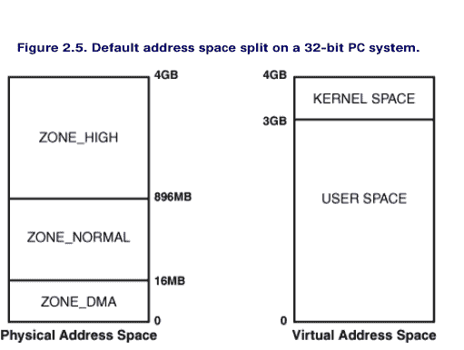

映射低 896MB 的内核地址与物理地址相差一个常量偏移量，被称为*逻辑地址*。借助“高内存”支持，内核可以通过使用特殊映射为那些区域生成*虚拟地址*来访问 896MB 以外的内存。所有逻辑地址都是内核虚拟地址，但反之并不成立。

这导致我们得到以下内核内存区域：

1. `ZONE_DMA` (<16MB)，用于*直接内存访问*（DMA）的区域。由于传统 ISA 设备具有 24 位地址线且只能访问前 16MB，内核试图将此区域专门分配给此类设备。

2. `ZONE_NORMAL`（16MB 到 896MB），通常可寻址的区域，也称为低内存。低内存页的 `struct page` 中的 "virtual" 字段包含对应的逻辑地址。

3. `ZONE_HIGH` (>896MB)，内核只有在将驻留页映射到 `ZONE_NORMAL` 中的区域（使用 `kmap()` 和 `kunmap()`）后才能访问的空间。对应的内核地址是虚拟地址而不是逻辑地址。如果页未被 kmapped，高内存页的 `struct page` 中的 "virtual" 字段指向 `NULL`。

`kmalloc()` 是一个内存分配函数，它从 `ZONE_NORMAL` 返回连续内存。原型如下：

```c
void *kmalloc(int count, int flags);
```

其中 `count` 是要分配的字节数，`flags` 是模式指定符。所有支持的标志都列在 `include/linux/gfp.h` 中（gfp 代表 *get free pages*），但以下是常用的标志：

1. `GFP_KERNEL` 由进程上下文代码使用以分配内存。如果指定了此标志，`kmalloc()` 被允许进入睡眠状态并等待页面释放。

2. `GFP_ATOMIC` 由中断上下文代码使用以获取内存。在此模式下，`kmalloc()` 不被允许睡眠等待空闲页面，因此使用 `GFP_ATOMIC` 成功分配内存的概率低于使用 `GFP_KERNEL`。

由于 `kmalloc()` 返回的内存保留其前一次使用的内存内容，如果暴露给用户空间可能存在安全风险。要获取清零的 kmalloced 内存，请使用 `kzalloc()`。

如果你需要分配大型内存缓冲区，并且不要求内存物理连续，请使用 `vmalloc()` 而不是 `kmalloc()`：


```c
void *vmalloc(unsigned long count);
```

这里 `count` 是请求的分配大小。该函数返回内核虚拟地址。

`vmalloc()` 比 `kmalloc()` 享有更大的分配大小限制，但速度较慢，且不能从中断上下文调用。此外，你不能使用 `vmalloc()` 返回的物理不连续内存来执行*直接内存访问*（DMA）。高性能网络驱动程序通常在设备打开时使用 `vmalloc()` 来分配大型描述符环。

内核提供了更复杂的内存分配技术。这些包括*旁路缓冲区*、*slabs* 和*内存池*，超出了本章的范围。

### 查看源代码

内核启动以执行位于 `arch/x86/boot/` 目录下的实模式汇编代码开始。查看 `arch/x86/kernel/setup_32.c` 以了解保护模式内核如何获取实模式内核获得的信息。

第一条启动消息由驻留在 `init/main.c` 中的代码打印。深入了解 `init/calibrate.c` 以了解 BogoMIPS 校准，并查看 `include/asm-your-arch/bugs.h` 以洞察架构相关的检查。

内核中的定时器服务包括位于 `arch/your-arch/kernel/` 中的架构相关部分和实现在 `kernel/timer.c` 中的通用部分。对于相关定义，请查看头文件 `include/linux/time*.h`。

`jiffies` 定义在 `linux/jiffies.h` 中。`HZ` 的值取决于处理器，可以在 `include/asm-your-arch/param.h` 中找到。

内存管理源位于顶层的 `mm/` 目录中。

**表 2.1** 总结了本章中使用的主要数据结构及其在源代码树中定义的位置。**表 2.2** 列出了本章中使用的主要内核编程接口及其定义的位置。

### 表 2.1. 数据结构摘要

| 数据结构 | 位置 | 描述 |
| :--- | :--- | :--- |
| HZ | `include/asm-your-arch/param.h` | 系统定时器每秒滴答的次数 |
| loops_per_jiffy | `init/main.c` | 处理器在 1 个 jiffy 内执行内部延迟循环的次数 |
| timer_list | `include/linux/timer.h` | 用于保存你希望在未来某个时间点执行的例程的地址 |
| timeval | `include/linux/time.h` | 时间戳 |
| spinlock_t | `include/linux/spinlock_types.h` | 一种自旋锁定机制，以确保只有一个线程进入临界区 |
| semaphore | `include/asm-your-arch/semaphore.h` | 一种睡眠锁定机制，允许预定数量的用户进入临界区 |
| mutex | `include/linux/mutex.h` | 替代 `semaphore` 的新接口 |
| rwlock_t | `include/linux/spinlock_types.h` | 读者-写者自旋锁 |
| page | `include/linux/mm_types.h` | 内核对物理内存页的表示 |

### 表 2.2. 内核编程接口摘要

| 内核接口 | 位置 | 描述 |
|---|---|---|
| `time_after()` | `include/linux/jiffies.h` | 将当前的 jiffies 值与指定的未来值进行比较 |
| `time_after_eq()` | `include/linux/jiffies.h` | 将当前的 jiffies 值与指定值进行比较 |
| `time_before()` | `include/linux/jiffies.h` | 将当前的 jiffies 值与指定值进行比较 |
| `time_before_eq()` | `include/linux/jiffies.h` | 将当前的 jiffies 值与指定值进行比较 |
| `schedule_timeout()` | `kernel/timer.c` | 在指定超时时间过后调度进程运行 |
| `wait_event_timeout()` | `include/linux/wait.h` | 如果指定条件变为真或发生超时，则恢复执行 |
| `DEFINE_TIMER()` | `include/linux/timer.h` | 静态定义一个定时器 |
| `init_timer()` | `kernel/timer.c` | 动态定义一个定时器 |
| `add_timer()` | `include/linux/timer.h` | 在超时时间过后调度定时器执行 |
| `mod_timer()` | `kernel/timer.c` | 更改定时器到期时间 |
| `timer_pending()` | `include/linux/timer.h` | 检查当前定时器是否处于挂起状态 |
| `udelay()` | `include/asm-generic/delay.h`, `arch/x86/lib/delay.c` | 忙等待指定的微秒数 |
| `rdtsc()` | `include/asm-x86/msr.h` | 获取 Pentium 兼容处理器上的 TSC 值 |
| `do_gettimeofday()` | `kernel/time.c` | 获取挂钟时间 |
| `local_irq_disable()` | `include/asm-generic/system.h` | 禁用本地 CPU 的中断 |
| `local_irq_enable()` | `include/asm-generic/system.h` | 启用本地 CPU 的中断 |
| `local_irq_save()` | `include/asm-generic/system.h` | 保存中断状态并禁用中断 |
| `local_irq_restore()` | `include/asm-generic/system.h` | 将中断状态恢复为调用对应的 `local_irq_save()` 时的状态 |
| `spin_lock()` | `include/linux/spinlock.h`, `kernel/spinlock.c` | 获取自旋锁。 |
| `spin_unlock()` | `include/linux/spinlock.h` | 释放自旋锁 |
| `spin_lock_irqsave()` | `include/linux/spinlock.h`, `kernel/spinlock.c` | 保存中断状态，禁用本地 CPU 的中断和抢占，并锁定临界区以规范其他 CPU 的访问 |
| `spin_unlock_irqrestore()` | `include/linux/spinlock.h`, `kernel/spinlock.c` | 恢复中断状态和抢占，并释放锁 |
| `DEFINE_MUTEX()` | `include/linux/mutex.h` | 静态声明一个互斥量 |
| `mutex_init()` | `include/linux/mutex.h` | 动态声明一个互斥量 |
| `mutex_lock()` | `kernel/mutex.c` | 获取互斥量 |
| `mutex_unlock()` | `kernel/mutex.c` | 释放互斥量 |
| `DECLARE_MUTEX()` | `include/asm-generic/semaphore.h` | 静态声明一个信号量 |
| `init_MUTEX()` | `include/asm-generic/semaphore.h` | 动态声明一个信号量 |
| `up()` | `arch/x86/kernel/semaphore.c` | 释放一个信号量 |
| `down()` | `arch/x86/kernel/semaphore.c` | 获取一个信号量 |
| `atomic_inc()`, `atomic_inc_and_test()`, `atomic_dec()`, `atomic_dec_and_test()`, `clear_bit()`, `set_bit()`, `test_bit()`, `test_and_set_bit()` | `include/asm-generic/atomic.h` | 用于执行轻量级操作的原子操作 |


| `read_lock()`, `read_unlock()`, `read_lock_irqsave()`, `read_lock_irqrestore()`, `write_lock()`, `write_unlock()`, `write_lock_irqsave()`, `write_lock_irqrestore()` | `include/linux/spinlock.h`, `kernel/spinlock.c` | 自旋锁的读写变体 |
| `down_read()`, `up_read()`, `down_write()`, `up_write()` | `kernel/rwsem.c` | 信号量的读写变体 |
| `read_seqbegin()`, `read_seqretry()`, `write_seqlock()`, `write_sequnlock()` | `include/linux/seqlock.h` | 序列锁操作 |
| `kmalloc()` | `include/linux/slab.h`, `mm/slab.c` | 从 `ZONE_NORMAL` 中分配物理连续的内存 |
| `kzalloc()` | `include/linux/slab.h`, `mm/util.c` | 获取已清零的 `kmalloc` 内存 |
| `kfree()` | `mm/slab.c` | 释放 `kmalloc` 内存 |
| `vmalloc()` | `mm/vmalloc.c` | 分配虚拟连续但不保证物理连续的内存。 |

# 第 3 章 内核设施

## 本章内容

- 内核线程 56
- 辅助接口 65
- 查看源代码 85

在本章中，我们将探讨一些对驱动程序开发人员工具箱非常有用的内核设施。我们首先从一个与用户进程类似的内核设施开始：内核线程是面向并发处理的编程抽象。

内核提供了多种辅助接口，可以简化代码、消除冗余、提高代码可读性，并有助于长期维护。我们将查看链表、哈希链表、工作队列、通知链、完成函数以及错误处理辅助工具。这些辅助工具没有错误且经过优化，因此您的驱动程序也能免费继承这些好处。

## 内核线程

*内核线程*是在内核中实现后台任务的一种方式。任务可能正忙于处理异步事件，或者处于睡眠等待状态以等待事件发生。内核线程与用户进程相似，不同之处在于它们生活在内核空间，并且可以访问内核函数和数据结构。与用户进程一样，由于抢占式调度，内核线程也拥有独占处理器的错觉。许多设备驱动程序利用内核线程的服务来实现助理或辅助任务。例如，*khubd* 内核线程是 Linux USB 驱动程序核心的一部分（在第 11 章“通用串行总线”中有介绍），它监控 USB 集线器，并在 USB 设备热插到系统中时配置它们。

### 创建内核线程

让我们通过一个示例来了解内核线程。在开发示例线程时，您还将学习诸如进程状态、等待队列和用户模式辅助程序等内核概念。当您熟悉内核线程后，可以将它们用作在内核中进行各种实验的测试载体。

假设您希望内核能够异步调用用户模式程序，向您的邮箱或寻呼机发送警报，每当它检测到某些关键内核数据结构的健康状况恶化时。（例如，网络接收缓冲区中的可用空间已低于低水位线。）

出于以下原因，这是一个实现为内核线程的候选方案：

- 它是一个后台任务，因为它必须等待异步事件。
- 它需要访问内核数据结构，因为实际的事件检测是由内核的其他部分完成的。
- 它必须调用用户模式辅助程序，这是一个耗时的操作。

### 内置内核线程

要在您的系统上查看正在运行的内核线程（也称为*内核进程*），请运行 `ps` 命令。内核线程的名称由方括号包围：

```
bash> ps -ef

UID          PID    PPID  C STIME TTY          TIME CMD
root            1       0  0 22:36 ?        00:00:00 init [3]
root            2       0  0 22:36 ?        00:00:00 [kthread/d]
root            3       2  0 22:36 ?        00:00:00 [ksoftirqd/0]
root            4       2  0 22:36 ?        00:00:00 [events/0]
root           38       2  0 22:36 ?        00:00:00 [pdflush]
root           39       2  0 22:36 ?        00:00:00 [pdflush]
root           29       2  0 22:36 ?        00:00:00 [khubd]
root          695       2  0 22:36 ?        00:00:00 [kjournald]
...
root         3914       2  0 22:37 ?        00:00:00 [nfsd]
root         3915       2  0 22:37 ?        00:00:00 [nfsd]
...
root         4015    3364  0 22:55 tty3     00:00:00 -bash
root         4066     4015 0 22:59 tty3     00:00:00 ps -ef
```

*ksoftirqd/0* 内核线程是实现 *softirqs* 的辅助工具。Softirqs 由中断处理程序触发，以请求处理处理程序中执行可以推迟的部分的“下半部”处理。我们将在第 4 章“奠定基础”中详细查看下半部和 softirqs，但这里的基本思想是尽可能少地在中断处理程序中存在代码。较小的中断处理程序减少了系统中的中断关闭时间，从而导致较低的延迟。*Ksoftirqd* 的任务是确保高负载的 softirqs 既不会使 softirqs 饥饿，也不会压垮系统。在*对称多处理* (SMP) 机器上，其中多个线程实例可以在不同的处理器上并行运行，为每个 CPU 创建一个 *ksoftirqd* 实例以提高吞吐量（*ksoftirqd/n*，其中 *n* 是 CPU 编号）。

*events/n* 线程（其中 *n* 是 CPU 编号）有助于实现 *工作队列*，这是在内核中推迟工作的另一种方式。希望推迟执行工作的内核部分可以创建自己的工作队列，或者使用默认的 *events/n* 工作线程。工作队列也在第 4 章中详细剖析。

*pdflush* 内核线程的任务是将脏页从页面缓存中刷出。页面缓存缓冲了对磁盘的访问。为了提高性能，实际写入磁盘的操作被延迟，直到 *pdflush* 守护进程将脏数据写入磁盘。如果可用内存低于某个阈值，或者页已保持脏状态足够长的时间，则执行此操作。在 2.4 内核中，这两项任务分别由单独的内核线程 *bdflush* 和

已更新。您可能已经注意到 `ps` 输出中有两个 `pdflush` 实例。如果内核检测到现有实例正忙于处理磁盘队列，就会创建新的实例。这可以提高吞吐量，尤其是当系统拥有多个磁盘且其中许多都很繁忙时。

如前一章所示，`kjournald` 是通用的内核日志线程，被 EXT3 等文件系统使用。

Linux 网络文件系统 (NFS) 服务器是通过一组名为 `nfsd` 的内核线程实现的。

我们的示例内核线程会放弃处理器，直到负责监控感兴趣的数据结构的相关内核部分唤醒它为止。唤醒后，它会调用一个用户模式辅助程序，并在其环境中传递相应的身份代码。

要创建内核线程，请使用 `kernel_thread()`：

```
ret = kernel_thread(mykthread, NULL,
     CLONE_FS | CLONE_FILES | CLONE_SIGHAND | SIGHCLD);
```

标志位指定了父线程和子线程之间共享的资源。`CLONE_FILES` 指定开放的文件应被共享，而 `CLONE_SIGHAND` 则请求共享信号处理程序。

列表 3.1 展示了示例实现。由于内核线程通常作为设备驱动程序的帮助者，它们会在驱动程序初始化时创建。然而在这种情况下，示例线程可以从任何合适的位置创建，例如 `init/main.c`。

线程首先调用 `daemonize()`，该函数执行初始清理工作，并将调用线程的父进程更改为名为 `kthreadd` 的内核线程。每个 Linux 线程只有一个父进程。如果父进程在子进程退出前死亡而未等待，子进程会变成僵尸进程并浪费资源。将子进程重新父化为 `kthreadd` 可以避免这种情况，并确保线程退出时正确清理资源。[1]

[1] 在 2.6.21 及更早的内核中，`daemonize()` 通过调用 `reparent_to_init()` 将调用线程重新父化为 init 任务。


由于 `daemonize()` 默认阻塞所有信号，如果您的线程需要处理特定信号，请使用 `allow_signal()` 来启用信号的传递。内核内部没有信号处理程序，因此请使用 `signal_pending()` 来检查信号并采取相应措施。出于调试目的，列表 3.1 中的代码请求传递 `SIGKILL`，如果收到该信号则退出。

`kernel_thread()` 已被弃用，转而使用更高级的 `kthread` API，该 API 基于前者构建。我们稍后将讨论 `kthreads`。

### 列表 3.1. 实现内核线程

```c
static DECLARE_WAIT_QUEUE_HEAD (myevent_waitqueue);
rwlock_t myevent_lock;                /* Holds the identity of the
                                       troubled data structure.
                                       Populated later on */
extern unsigned int myevent_id;

static int mykthread(void *unused)
{
    unsigned int event_id = 0;
    DECLARE_WAITQUEUE(wait, current);
    /* Become a kernel thread without attached user resources */
    daemonize("mykthread");

    /* Request delivery of SIGKILL */
    allow_signal(SIGKILL);

    /* The thread sleeps on this wait queue until it's
       woken up by parts of the kernel in charge of sensing
       the health of data structures of interest */
    add_wait_queue(&myevent_waitqueue, &wait);

    for (;;) {
        /* Relinquish the processor until the event occurs */
        set_current_state(TASK_INTERRUPTIBLE);
        schedule();  /* Allow other parts of the kernel to run */
        /* Die if I receive SIGKILL */
        if (signal_pending(current)) break;
        /* Control gets here when the thread is woken up */
        read_lock(&myevent_lock);  /* Critical section starts */
        if (myevent_id) {  /* Guard against spurious wakeups */
            event_id = myevent_id;
        }
        read_unlock(&myevent_lock); /* Critical section ends */
        /* Invoke the registered user mode helper and
           pass the identity code in its environment */
        run_umode_handler(event_id); /* Expanded later on */
    } else {
        read_unlock(&myevent_lock);
    }

    set_current_state(TASK_RUNNING);
    remove_wait_queue(&myevent_waitqueue, &wait);
    return 0;
}
```

如果您将其作为内核的一部分编译并运行，您可以在 `ps` 输出中看到新创建的线程 `mykthread`：

```
bash> ps -ef
    UID          PID   PPID C STIME TTY     TIME CMD
    root           1      0 0 21:56 ?     00:00:00 init [3]
    root           2      1 0 22:36 ?     00:00:00 [ksoftirqd/0]
    ...
    root          111      1 0 21:56 ?     00:00:00 [mykthread]
    ...
```

在我们深入讨论线程实现之前，让我们编写一段代码片段，用于监控感兴趣的数据结构的健康状况，如果在检测到问题状态时唤醒 `mykthread`：

```c
/** Executed by parts of the kernel that own the
data structures whose health you want to monitor */
/** ... */

if (my_key_datastructure looks troubled) {
    write_lock(&myevent_lock); /* Serialize */
    /* Fill in the identity of the data structure */
    myevent_id = datastructure_id;

    write_unlock(&myevent_lock);

    /* Wake up mykthread */
    wake_up_interruptible(&myevent_waitqueue);
}

/* ... */
```

列表 3.1 在进程上下文中执行，而前面的代码片段则在进程或中断上下文中运行。进程上下文和中断上下文通过内核数据结构进行通信。我们的示例使用 `myevent_id` 和 `myevent_waitqueue` 进行这种通信。`myevent_id` 包含存在问题的数据结构的身份。对 `myevent_id` 的访问使用锁进行序列化。

请注意，只有当在编译时开启了 `CONFIG_PREEMPT`，内核线程才是可抢占的。如果 `CONFIG_PREEMPT` 处于关闭状态，或者您仍在使用没有抢占补丁的 2.4 内核，如果您的线程不进入睡眠状态，它将导致系统冻结。如果在列表 3.1 中注释掉 `schedule()` 并在内核配置中禁用 `CONFIG_PREEMPT`，您的系统将锁定。

我们将在第 19 章“用户空间驱动程序”中讨论调度策略时，学习如何从内核线程获取软实时响应。

## 进程状态和等待队列

以下是列表 3.1 中使 `mykthread` 在等待事件期间进入睡眠状态的代码区域：

```c
add_wait_queue(&myevent_waitqueue, &wait);
for (;;) {

    /* ... */
    set_current_state(TASK_INTERRUPTIBLE);
    schedule(); /* Relinquish the processor */
    /* Point A */

    /* ... */
}
set_current_state(TASK_RUNNING);
remove_wait_queue(&myevent_waitqueue, &wait);
```

前面代码片段的运行基于两个概念：`等待队列` 和 `进程状态`。

等待队列持有需要等待事件或系统资源的线程。等待队列中的线程会进入睡眠状态，直到负责检测事件的另一个线程或中断处理程序将其唤醒。入队和出队分别使用 `add_wait_queue()` 和 `remove_wait_queue()` 完成，而唤醒已入队的任务则通过 `wake_up_interruptible()` 实现。

内核线程（或普通进程）可以处于以下进程状态之一：运行、可中断、不可中断、僵尸、停止、被跟踪或已死亡。这些状态定义在 `include/linux/sched.h` 中：

- 处于 `运行` 状态 (`TASK_RUNNING`) 的进程位于调度器运行队列中，并是调度器分配 CPU 时间的候选者。
- 处于 `可中断` 状态 (`TASK_INTERRUPTIBLE`) 的任务正在等待事件发生，并且不在调度器运行队列中。当任务被唤醒，或者有信号传递给它时，它重新进入运行队列。


- `TASK_UNINTERRUPTIBLE` 状态类似于可中断状态，区别在于接收到信号不会使任务重新回到运行队列。

- `TASK_STOPPED` 状态的任务由于接收到某些信号而停止执行。

- 如果诸如 `strace` 这样的应用程序使用内核中的 `ptrace` 支持来拦截任务，该任务将处于被跟踪状态 (`TASK_TRACED`)。

- 处于僵尸状态 (`EXIT_ZOMBIE`) 的任务已经终止，但其父进程没有等待该任务完成。一个正在退出的任务要么处于 `EXIT_ZOMBIE` 状态，要么处于 `dead` (`EXIT_DEAD`) 状态。

您可以使用 `set_current_state()` 来设置内核线程的运行状态。

现在让我们回到前面的代码片段。`mythread` 在一个等待队列（`myevent_wait_queue`）上睡眠，并将其状态更改为 `TASK_INTERRUPTIBLE`，表示它希望退出调度器运行队列。对 `schedule()` 的调用要求调度器从其运行队列中选择并运行一个新的任务。当负责健康监控的代码使用 `wake_up_interruptible(myevent_wait_queue)` 唤醒 `mythread` 时，线程被重新放入调度器运行队列。进程状态同时也更改为 `TASK_RUNNING`，因此即使唤醒发生在任务状态设置为 `TASK_INTERRUPTIBLE` 之后且调用 `schedule()` 之前，也不存在竞争条件。如果收到 `SIGKILL` 信号，线程也会重新进入运行队列。随后，当调度器从运行队列中选中 `mythread` 时，执行从 Point A 恢复。

## 用户模式辅助程序

`Mythread` 调用列表 3.1 中的 `run_umode_handler()` 来通知用户空间已检测到的事件：

```c
/* Called from Listing 3.1 */
static void
run_umode_handler(int event_id)
{
    int i = 0;
    char *argv[2], *envp[4], *buffer = NULL;
```

55   int value;

argv[++i] = myevent_handler; /* 定义于

kernel/sysctl.c */

/* 填入与存在问题的数据结构相对应的标识 */

if (!(buffer = kmalloc(32, GFP_KERNEL))) return;

sprintf(buffer, "TROUBLED_DS=%d", event_id);

/* 如果未找到用户模式处理程序，则返回 */

if (!argv[0]) return; argv[i] = 0;

/* 为 /path/to/helper 准备环境 */

i = 0;

envp[i++] = "HOME=/";

envp[i++] = "PATH=/sbin:/usr/sbin:/bin:/usr/bin";

envp[i++] = buffer; envp[i] = 0;

/* 执行用户模式程序 /path/to/helper */

value = call_usermodehelper(argv[0], argv, envp, 0);

/* 检查返回值 */

kfree(buffer);

}
```

内核支持一种机制，用于请求用户模式程序协助执行某些功能。`run_umode_handler()` 通过调用 `call_usermodehelper()` 来利用此功能。

你必须通过 `/proc/sys/` 目录下的一个节点来注册由 `run_umode_handler()` 调用的用户模式程序。为此，请确保在你的内核配置中启用了 `CONFIG_SYSCTL`（`/proc/sys/` 目录中的文件统称为 sysctl 接口），并在 `kernel/sysctl.c` 的 `kern_table` 数组中添加一个条目：

```
{
    .ctl_name    = KERN_MYEVENT_HANDLER,  /* 定义于
                                            include/linux/sysctl.h */
    .procname    = "myevent_handler",
    .data        = &myevent_handler,
    .maxlen      = 256,
    .mode        = 0644,
    .proc_handler = &proc_dostring,
    .strategy     = &sysctl_string,
},
```

这会在进程文件系统中创建节点 `/proc/sys/kernel/myevent_handler`。要注册你的用户模式辅助程序，请执行以下操作：

```
bash> echo /path/to/helper > /proc/sys/kernel/myevent_handler
```

这样，当 `mykthread` 调用 `run_umode_handler()` 时，`/path/to/helper` 将会被执行。

`Mykthread` 通过环境变量 `TROUBLED_DS` 将存在问题的内核数据结构标识传递给用户模式辅助程序。该辅助程序可以是一个简单的脚本，如下所示，它会根据环境中获取的信息发送电子邮件警报给你：

```
bash> cat /path/to/helper
#!/bin/bash
echo Kernel datastructure $TROUBLED_DS is in trouble | mail -s Alert root
```

`call_usermodehelper()` 必须从进程上下文执行，并以 root 权限运行。它使用工作队列实现，我们将很快讨论这一点。

## 辅助接口

内核中存在几个有用的辅助接口，以简化设备驱动程序开发人员的生活。其中一个例子是双向链表库的实现。许多驱动程序需要维护和操作数据结构链表。内核的 `list` 接口例程消除了追踪链表指针和调试与链表维护相关的杂乱问题时的需求。让我们来学习如何使用诸如链表、`hlist`、工作队列、完成函数、通知块和内核线程等辅助接口。

实现辅助设施功能的方式有多种。例如，你可以实现自己的链表操作例程而不是使用链表库，或者使用内核线程延迟工作而不是将其提交到工作队列。然而，使用标准内核辅助接口可以简化代码，消除内核中的冗余，提高代码可读性，并有助于长期维护。

由于内核庞大，你总能发现尚未利用这些辅助机制的部分，因此更新这些代码区域可能是开始参与内核开发的一个好方法。

### 链表

为了编织数据结构的双向链表，请使用 `include/linux/list.h` 中提供的函数。本质上，你在数据结构内部嵌入一个 `struct list_head`：

```c
#include <linux/list.h>

struct list_head {
   struct list_head *next, *prev;
};

struct mydatastructure {
   struct list_head mylist;  /* 嵌入 */
   /* ... */                 /* 实际字段 */
};
```

`mylist` 是连接不同 `mydatastructure` 实例的链接。如果你在 `mydatastructure` 内部嵌入了多个 `list_head`，其中每一个都构成了一个链接，使 `mydatastructure` 成为新列表的成员。你可以使用链表库将成员添加到单个列表中或从中删除成员。

为了在了解细节之前把握整体情况，让我们总结一下链表库提供的链表编程接口。这在表 3.1 中完成。

表 3.1. 链表操作函数

| 函数 | 目的 |
| :--- | :--- |
| `INIT_LIST_HEAD()` | 初始化链表头 |
| `list_add()` | 在链表头后添加一个元素 |
| `list_add_tail()` | 在链表尾部添加一个元素 |
| `list_del()` | 从链表中删除一个元素 |
| `list_replace()` | 在链表中用另一个元素替换一个元素 |
| `list_entry()` | 遍历列表中的所有节点 |
| `list_for_each_entry()` / `list_for_each_entry_safe()` | 更简单的列表迭代接口 |
| `list_empty()` | 检查列表中是否有任何元素 |
| `list_splice()` | 将一个列表连接到另一个列表 |


为了说明链表的使用，让我们实现一个示例。该示例还作为理解下一节中讨论的工作队列概念的基础。假设你的内核驱动程序需要从入口点执行一项繁重任务。一个例子是强制调用线程进入睡眠等待的任务。自然，你的驱动程序不希望阻塞直到任务完成，因为这会降低依赖它的应用的响应速度。因此，每当驱动程序需要执行这项昂贵的工作时，它通过将该例程添加到工作函数链表中来延迟执行。实际工作由内核线程执行，该线程遍历列表并在后台执行工作函数。驱动程序将工作函数提交到列表的尾部，而内核线程从列表头部开始处理，从而确保先排队的任务先完成。当然，驱动的其余部分需要设计得适合这种延迟执行方案。然而，在理解此示例之前，请注意我们将使用列表 3.5 中的工作队列接口以更简单的方式实现相同的任务。

首先让我们介绍示例中使用的关键驱动数据结构：

```c
static struct _mydrv_wq {
    struct list_head mydrv_worklist; /* 工作列表 */
    spinlock_t lock;                 /* 保护列表 */
    wait_queue_head_t todo;          /* 同步提交者
                                       和工作线程 */
} mydrv_wq;

struct _mydrv_work {
    struct list_head mydrv_workitem; /* 工作链 */
    void (*worker_func)(void *);      /* 要执行的工作 */
    void *worker_data;                /* worker_func 的参数 */
    /* ... */                          /* 其他字段 */
} mydrv_work;
```

`mydrv_wq` 对于所有工作提交都是全局的。其成员包括指向工作列表头的指针，以及一个用于提交工作的驱动函数和执行工作的内核线程之间通信的等待队列。列表辅助函数不保护对列表成员的访问，因此你需要使用并发机制来串行化同时的指针引用。这是通过自旋锁完成的，自旋锁也是 `mydrv_wq` 的一部分。驱动程序初始化例程 `mydrv_init()`（见列表 3.2）初始化自旋锁、链表头和等待队列，并启动工作线程。

### 列表 3.2. 初始化数据结构

```c
static int __init
mydrv_init(void)
{
    /* 初始化锁以保护免受
       并发列表访问 */
    spin_lock_init(&mydrv_wq.lock);

    /* 初始化等待队列以便提交者
       和工作线程之间通信 */
    init_waitqueue_head(&mydrv_wq.todo);

    /* 初始化链表头 */
    INIT_LIST_HEAD(&mydrv_wq.mydrv_worklist);

    /* 启动工作线程。参见列表 3.4 */
    kernel_thread(mydrv_worker, NULL,
                CLONE_FS | CLONE_FILES | CLONE_SIGHAND | SIGCHLD);
    return 0;
}
```

在检查执行已提交工作的工作线程之前，让我们看看工作提交流程本身。列表 3.3 实现了一个函数，内核的其他部分可以使用它来提交工作。它使用 `list_add_tail()` 将工作函数添加到列表的尾部。查看图 3.1 以了解工作列表的物理结构。

图 3.1. 工作函数链表。

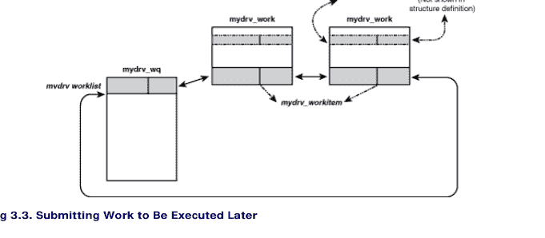

### 列表 3.3. 提交稍后执行的工作

```c
int
submit_work(void (*func)(void *data), void *data)
{
    struct _mydrv_work *mydrv_work;

    /* Allocate the work structure */
    mydrv_work = kmalloc(sizeof(struct _mydrv_work), GFP_ATOMIC);
    if (!mydrv_work) return -1;

    /* Populate the work structure */
    mydrv_work->worker_func = func; /* Work function */
    mydrv_work->worker_data = data; /* Argument to pass */
    spin_lock(&mydrv_wq.lock);     /* Protect the list */

    /* Add your work to the tail of the list */
    list_add_tail(&mydrv_work->mydrv_workitem,
                  &mydrv_wq.mydrv_worklist);

    /* Wake up the worker thread */
    wake_up(&mydrv_wq.todo);

    spin_unlock(&mydrv_wq.lock);
    return 0;
}
```

要从驱动程序入口点提交工作函数 `void job(void *)`，请执行以下操作：

```c
submit_work(job, NULL);
```

提交工作函数后，代码列表 3.3 会唤醒工作线程。代码列表 3.4 中展示的工作线程通用结构与上一节讨论的标准内核线程类似。该线程使用 `list_entry()` 遍历列表中的所有节点。`list_entry()` 返回嵌入列表节点内部的容器数据结构。请仔细查看代码列表 3.4 中的相关代码行：

```c
mydrv_work = list_entry(mydrv_wq.mydrv_worklist.next,
                        struct _mydrv_work, mydrv_workitem);
```

`mydrv_workitem` 嵌入在 `mydrv_work` 内部，因此 `list_entry()` 返回指向相应 `mydrv_work` 结构的指针。传递给 `list_entry()` 的参数分别是嵌入的列表节点地址、容器结构的类型以及嵌入列表节点的字段名。

执行已提交的工作函数后，工作线程使用 `list_del()` 将相应节点从列表中移除。请注意，在已提交的工作函数执行期间，`mydrv_wq.lock` 会被释放并重新获取。这是因为工作函数可能会进入睡眠状态，如果新调度的代码试图获取同一个自旋锁，可能会导致潜在的死锁。

### 代码列表 3.4：工作线程


```c
static int
mydrv_worker(void *unused)
{
    DECLARE_WAIT_QUEUE(wait, current);
    void (*worker_func) (void *);
    void *worker_data;
    struct _mydrv_work *mydrv_work;

    set_current_state(TASK_INTERRUPTIBLE);

    /* Spin until asked to die */
    while (!asked_to_die()) {
        add_wait_queue(&mydrv_wq.todo, &wait);

        if (list_empty(&mydrv_wq.mydrv_worklist)) {
            schedule();
            /* Woken up by the submitter */
        } else {
            set_current_state(TASK_RUNNING);
        }
        remove_wait_queue(&mydrv_wq.todo, &wait);

        /* Protect concurrent access to the list */
        spin_lock(&mydrv_wq.lock);

        /* Traverse the list and plough through the work functions
           present in each node */
        while (!list_empty(&mydrv_wq.mydrv_worklist)) {
            /* Get the first entry in the list */
            mydrv_work = list_entry(mydrv_wq.mydrv_worklist.next,
                                     struct _mydrv_work, mydrv_workitem);
            worker_func = mydrv_work->worker_func;
            worker_data = mydrv_work->worker_data;

            /* This node has been processed. Throw it
               out of the list */
            list_del(mydrv_wq.mydrv_worklist.next);
            kfree(mydrv_work); /* Free the node */

            /* Execute the work function in this node */
            spin_unlock(&mydrv_wq.lock); /* Release lock */
            worker_func(worker_data);
            spin_lock(&mydrv_wq.lock); /* Re-acquire lock */
        }
        spin_unlock(&mydrv_wq.lock);
        set_current_state(TASK_INTERRUPTIBLE);
    }

    set_current_state(TASK_RUNNING);
    return 0;
}
```

为了简化，示例代码没有执行错误处理。例如，如果代码列表 3.2 中对 `kernel_thread()` 的调用失败，你需要释放为相应工作结构分配的内存。此外，代码列表 3.4 中的 `asked_to_die()` 未被编写。它本质上会在检测到收到的信号或从 `release()` 入口点接收到模块即将从内核卸载的通信时跳出循环。

在结束本节之前，让我们看看另一个有用的列表库例程，`list_for_each_entry()`。使用这个宏，迭代变得更简单且更具可读性，因为你不需要在循环内部使用 `list_entry()`。如果你将在循环内部删除列表元素，请使用 `list_for_each_entry_safe()` 变体。你可以将代码列表 3.4 中的以下代码片段替换为：

```c
while (!list_empty(&mydrv_wq.mydrv_worklist)) {
    mydrv_work = list_entry(mydrv_wq.mydrv_worklist.next,
                            struct _mydrv_work, mydrv_workitem);
    /* ... */
}
```

替换为：

```c
struct _mydrv_work *temp;
list_for_each_entry_safe(mydrv_work, temp,
                         &mydrv_wq.mydrv_worklist,
                         mydrv_workitem) {
    /* ... */
}
```

在这种情况下，你不能使用 `list_for_each_entry()`，因为在代码列表 3.4 的循环内部，你正在移除由 `mydrv_work` 指向的条目。`list_for_each_entry_safe()` 通过使用作为第二个参数传递的临时变量 `temp` 来解决这个问题，以保存列表中下一个条目的地址。

### 哈希列表

之前讨论的双向链表实现对于希望实现诸如哈希表之类的链式数据结构的情况并不是最优的。这是因为哈希表只需要一个仅包含单个指针的列表头。为了减少此类应用程序的内存开销，内核提供了哈希列表，或 `hlists`，这是列表的一种变体。与使用相同结构作为列表头和列表节点的列表不同，`hlists` 具有独立的定义：

```c
struct hlist_head {
    struct hlist_node *first;
}; 
struct hlist_node {
    struct hlist_node *next, **prev;
};
```

为了适应单指针 `hlist` 列表头的方案，节点维护前一个节点指针的地址，而不是指针本身。

哈希表是使用 `hlist_heads` 数组实现的。每个 `hlist_head` 都源自由 `hlist_nodes` 组成的双向链表。使用哈希函数来定位 `hlist_head` 数组中的索引，或桶。完成此操作后，你可以使用 `hlist` 辅助例程，也在 `include/linux/list.h` 中定义，来操作链接到所选桶的 `hlist_nodes` 列表。目录缓存 `dcache` 在 `fs/dcache.c` 中的实现就是一个例子。

## 工作队列

工作队列是延迟内核内工作的一种方式。[2] 在无数情况下，延迟工作都非常有用。示例包括以下内容：

- 响应错误中断触发网络适配器重启
- 文件系统任务，如同步磁盘缓冲区
- 向磁盘发送命令并跟随存储协议状态机

工作队列的功能与代码列表 3.2 到 3.4 中描述的示例类似。然而，工作队列可以帮助你以更简单的方式完成相同的任务。

工作队列辅助库向用户暴露了两个接口结构：一个 `workqueue_struct` 和一个 `work_struct`。使用工作队列的步骤如下：

1. 创建一个工作队列，或 `workqueue_struct`，其带有一个或多个关联的内核线程。要创建服务于 `workqueue_struct` 的内核线程，请使用 `create_singlethread_workqueue()`。要创建系统中每个 CPU 一个工作线程，请使用 `create_workqueue()` 变体。内核还具有默认的每 CPU 工作线程 `events/n`，其中 `n` 是 CPU 编号，你可以时间共享这些线程，而不是请求单独的工作线程。根据你的应用程序，如果没有专用的工作线程，你可能会遭受性能损失。

2. 创建一个工作元素，或 `work_struct`。使用 `INIT_WORK()` 初始化 `work_struct`，该函数用你的工作函数的地址和参数填充它。

3. 将工作元素提交到工作队列。`work_struct` 可以使用 `queue_work()` 提交到专用队列，或者使用 `schedule_work()` 提交到默认的内核工作线程。

让我们重写代码列表 3.2 到 3.4 以利用工作队列接口。这在代码列表 3.5 中实现。整个内核线程，以及自旋锁和等待队列，都在工作队列接口内部消失。如果你使用默认的内核工作线程，即使是对 `create_singlethread_workqueue()` 的调用也会消失。


[2] Softirqs 和 tasklets 是内核内延迟工作的另外两种机制。第 4 章的表 4.1 比较了 softirqs、tasklets 和工作队列。

### 代码列表 3.5：使用工作队列延迟工作

# 工作队列

代码视图：

```c
#include <linux/workqueue.h>

struct workqueue_struct *wq;

/* 驱动程序初始化 */
static int __init
mydrv_init(void)
{
    /* ... */
    wq = create_singlethread_workqueue("mydrv");
    return 0;
}

/* 提交工作。第一个参数是工作函数，
第二个参数是传给工作函数的参数 */
int
submit_work(void (*func)(void *data), void *data)
{
    struct work_struct *hardwork;

    hardwork = kmalloc(sizeof(struct work_struct), GFP_KERNEL);

    /* 初始化工作结构 */
    INIT_WORK(hardwork, func, data);

    /* 将工作加入队列 */
    queue_work(wq, hardwork);
    return 0;
}
```

如果您使用工作队列，除非将模块声明为在 GPL 许可下授权，否则会出现链接器错误。这是因为内核仅将这些函数导出给符合 GPL 规范的代码。如果您查看内核工作队列的实现，会看到像下面这样的语句表达了这一限制：

```c
EXPORT_SYMBOL_GPL(queue_work);
```

为了声明您的模块是以 *GPL 复制/发布* 方式进行授权的，请声明以下内容：

```c
MODULE_LICENSE("GPL");
```

# 通知链

*通知链* 用于向请求状态变更消息的代码区域发送此类消息。与硬编码机制不同，通知器提供了一种灵活的技术，用于在发生感兴趣的事件时接收警报。通知器最初是为将网络事件传递给内核中相关部分而添加的，但现在已用于许多其他用途。内核为重要事件实现了预定义的通知器。此类通知的示例包括：

- **Die 通知**，在内核函数触发陷阱或故障时发送，该故障由“oops”、页错误或断点命中引起。例如，如果您正在为医疗级卡片编写设备驱动程序，您可能希望向 die 通知器注册自己，以便在内核恐慌发生时可以尝试关闭医疗电子设备。

- **网络设备通知**，在网络接口上线或下线时生成。

- **CPU 频率通知**，在处理器频率发生转换时分发。

- **Internet 地址通知**，在检测到网络接口的 IP 地址变更时发送。

通知器的一个使用者是高级数据链路控制 `HDLC` 协议驱动程序 `drivers/net/wan/hdlc.c`，它向网络设备通知链注册自己，以感知载波变化。

要将代码附加到通知链，您需要向相关链注册事件处理程序。当事件生成时，事件标识符和通知器特定参数作为参数传递给处理程序例程。若要定义自定义通知链，您还需要额外实现基础设施，以便在检测到事件时触发该链。

列表 3.6 包含使用预定义和用户定义通知器的示例。表 3.2 简要描述了列表 3.6 中使用的通知链及其传播的事件，因此请同时查看列表和表格。

### 表 3.2. 通知链及其传播的事件

| 通知链 | 描述 |
|---|---|
| **Die 通知链** (`die_chain`) | `my_die_event_handler()` 使用 `register_die_notifier()` 附加到 die 通知链，即 `die_chain`。若要触发调用 `my_die_event_handler()`，请在代码某处引入无效解引用，例如以下代码： <br> `int *q = 0; *q = 1;` <br> 当执行此代码片段时，会调用 `my_die_event_handler()`，您会看到类似以下的消息： `my_die_event_handler: OOPS! at EIP=f00350e7`。Die 事件通知器将 `die_args` 结构传递给已注册的事件处理程序。此参数包含指向 `regs` 结构的指针，该结构在发生故障时承载处理器寄存器内容的快照。`my_die_event_handler()` 打印指令指针寄存器的内容。 |
| **网络设备通知链** (`netdev_chain`) | `my_dev_event_handler()` 使用 `register_netdevice_notifier()` 附加到网络设备通知链，即 `netdev_chain`。您可以通过更改网络接口状态来生成此事件，例如以太网 (`ethX`) 或环回接口 (`lo`)： <br> `bash> ifconfig eth0 up` <br> 这将导致执行 `my_dev_event_handler()`。处理程序接收指向 `struct net_device` 的指针作为参数，其中包含网络接口的名称。 <br> `my_dev_event_handler()` 使用此信息生成以下消息： <br> `my_dev_event_handler: Val=1, Interface=eth0` <br> `Val=1` 对应于在 `include/linux/notifier.h` 中定义的 `NETDEV_UP` 事件。 |

# 用户定义的通知链

列表 3.6 还实现了一个用户定义的通知链 `my_noti_chain`。假设您希望在用户读取进程文件系统中的特定文件时生成事件。在相关的 procs `read` 例程中添加以下内容：

```c
blocking_notifier_call_chain(&my_noti_chain, 100, NULL);
```

这会导致每当读取相应的 `/proc` 文件时调用 `my_event_handler()`，并产生以下消息：

`my_event_handler: Val=100`

`Val` 包含生成的事件的标识，在此示例中为 `100`。函数参数保持未使用状态。

当模块从内核中释放时，必须从通知链中注销事件处理程序。例如，如果在卸载列表 3.6 中的代码后，您*上线或下线*网络接口，除非在模块的 `release()` 方法中执行 `unregister_netdevice_notifier(&my_dev_notifier)`，否则您会被“oops”困扰。这是因为即使处理程序代码已从内核中移除，通知链仍认为该处理程序代码有效。

# 列表 3.6. 通知事件处理程序


```c
#include <linux/notifier.h>
#include <asm/kdebug.h>
#include <linux/netdevice.h>
#include <linux/inetdevice.h>

/* Die 通知器定义 */
static struct notifier_block my_die_notifier = {
    .notifier_call = my_die_event_handler,
};

/* Die 通知事件处理程序 */
int
my_die_event_handler(struct notifier_block *self,
                     unsigned long val, void *data)
{
    struct die_args *args = (struct die_args *)data;

    if (val == 1) { /* '1' 对应 "oops" */
        printk("my_die_event: OOPS! at EIP=%lx\n", args->regs->eip);
    } /* 否则忽略 */
    return 0;
}

/* 网络设备通知器定义 */
static struct notifier_block my_dev_notifier = {
    .notifier_call = my_dev_event_handler,
};

/* 网络设备通知事件处理程序 */
int my_dev_event_handler(struct notifier_block *self,
    unsigned long val, void *data)
{
    printk("my_dev_event: Val=%ld, Interface=%s\n", val,
        ((struct net_device *) data)->name);
    return 0;
}

/* 用户定义通知链实现 */
static BLOCKING_NOTIFIER_HEAD(my_noti_chain);

static struct notifier_block my_notifier = {
    .notifier_call = my_event_handler,
};

/* 用户定义通知事件处理程序 */
int my_event_handler(struct notifier_block *self,
    unsigned long val, void *data)
{
    printk("my_event: Val=%ld\n", val);
    return 0;
}

/* 驱动程序初始化 */
static int __init
my_init(void)
{
    /* ... */

    /* 注册 Die 通知器 */
    register_die_notifier(&my_die_notifier);

    /* 注册网络设备通知器 */
    register_netdevice_notifier(&my_dev_notifier);

    /* 注册用户定义通知器 */
    blocking_notifier_chain_register(&my_noti_chain, &my_notifier);
    /* ... */
}
```

列表 3.6 中的 `my_noti_chain` 使用 `BLOCKING_NOTIFIER_HEAD()` 声明为阻塞式通知器，并通过 `blocking_notifier_chain_register()` 注册。这意味着通知处理程序始终从进程上下文调用。因此，处理函数 `my_event_handler()` 允许进入睡眠状态。如果您的通知处理程序可能从中断上下文调用，请使用 `ATOMIC_NOTIFIER_HEAD()` 声明通知链，并通过 `atomic_notifier_chain_register()` 注册。

# 旧版通知器接口

早于 2.6.17 的内核版本仅支持通用通知链。通知器注册函数 `notifier_chain_register()` 内部使用自旋锁保护，但遍历通知链并向通知处理程序分发事件的例程 `notifier_call_chain()` 是无锁的。缺乏锁定的原因是因为处理函数可能会进入睡眠、在运行时自我注销，或从中断上下文被调用。然而，无锁实现引入了竞态条件。新的通知器 API 构建在原始接口之上，旨在克服其局限性。

# 完成接口

内核的许多部分将某些活动作为单独的线程启动，然后等待它们完成。*完成接口* 是实现此类代码模式的高效且简单的方法。

一些示例使用场景包括：

- 您的驱动程序模块由内核线程辅助。如果您 `rmmod` 模块，在从内核空间移除模块代码之前会调用 `release()` 方法。释放例程要求线程终止自身，并阻塞直到线程完成退出。列表 3.7 实现了此情况。
- 您正在编写块设备驱动程序的一部分（在第 14 章“块驱动程序”中讨论），该部分向设备队列添加读取请求。这会触发作为单独线程或工作队列实现的状态机变更。驱动器希望在继续另一项活动之前等待操作完成。请参阅 `drivers/block/floppy.c` 作为示例。
- 应用程序向模数转换器 `ADC` 驱动器请求数据样本。驱动器发起转换请求，等待中断信号指示转换完成，并返回数据。

# 列表 3.7. 使用完成功能进行同步

```c
static DECLARE_COMPLETION(my_thread_exit);    /* 完成 */
static DECLARE_WAIT_QUEUE_HEAD(my_thread_wait);    /* 等待队列 */
int pink_slip = 0;            /* 退出标志 */

/* 辅助线程 */
static int
my_thread(void *unused)
{
    DECLARE_WAITQUEUE(wait, current);

    daemonize("my_thread");
    add_wait_queue(&my_thread_wait, &wait);

    while (1) {
        /* 让出处理器直到发生事件 */
```

set_current_state(TASK_INTERRUPTIBLE);

schedule();

/* 当线程从 my_thread_wait 等待队列中被唤醒时，控制流到达此处 */

/* 如果收到释放信号则退出 */

if (pink_slip) {

    break;

}

/* 执行实际工作 */

/* ... */

}

/* 退出等待队列 */

__set_current_state(TASK_RUNNING);

remove_wait_queue(&my_thread_wait, &wait);

/* 原子地发出完成信号并退出 */

complete_and_exit(&my_thread_exit, 0);

}

/* 模块初始化 */

static int __init

my_init(void)

{

    /* ... */

    /* 启动线程 */

    kernel_thread(my_thread, NULL,

                  CLONE_FS | CLONE_FILES | CLONE_SIGHAND | SIGCHLD);

    /* ... */

}

/* 模块释放 */

static void __exit

my_release(void)

{

    /* ... */

    pink_slip = 1;                    /* my_thread 必须退出 */

    wake_up(&my_thread_wait);         /* 激活 my_thread */

    wait_for_completion(&my_thread_exit); /* 等待直到 my_thread

退出 */

    /* ... */

}
```

完成对象可以通过 `DECLARE_COMPLETION()` 静态声明，或者通过 `init_completion()` 动态创建。线程可以借助 `complete()` 或 `complete_all()` 发出完成信号。调用者可以通过 `wait_for_completion()` 等待完成。

在清单 3.7 中，`my_release()` 在唤醒 `my_thread()` 之前通过设置 `pink_slip` 来发出退出请求标志。然后它调用 `wait_for_completion()` 等待 `my_thread()` 完成其退出过程。另一方面，`my_thread()` 被唤醒后发现 `pink_slip` 已设置，并执行以下操作：

1. 向 `my_release()` 发出完成信号
2. 终止自身


`my_thread()` 使用 `complete_and_exit()` 原子地完成上述两个步骤。使用 `complete_and_exit()` 可以关闭如果分别调用 `complete()` 和 `exit()` 时，在模块退出和线程退出之间打开的时间窗口。

我们在第 11 章开发遥测驱动程序示例时将使用 `completion` API。

## 内核线程辅助工具

*内核线程辅助工具* 在原始线程创建例程之上增加了一层封装，简化了线程管理的任务。

清单 3.8 使用内核线程辅助接口重写了清单 3.7。`my_init()` 现在使用 `kthread_create()` 而不是 `kernel_thread()`。你可以将线程名称传递给 `kthread_create()`，而不是在线程内显式调用 `daemonize()`。

内核线程接口免费提供了对内置退出同步机制的访问，该机制使用 `completion` 接口实现。因此，正如清单 3.8 中的 `my_release()` 所做的那样，你可以直接调用 `kthread_stop()`，而无需费力地设置 `pink_slip`、唤醒 `my_thread()` 并使用 `wait_for_completion()` 等待其完成。类似地，`my_thread()` 可以整洁地调用 `kthread_should_stop()` 来检查是否应该“收工”。

### 清单 3.8. 使用内核线程辅助工具进行同步

```cpp
/* '+' 和 '-' 显示与清单 3.7 的区别 */

#include <linux/kthread.h>

/* 辅助线程 */
static int
my_thread(void *unused)
{
    DECLARE_WAIT_QUEUE(wait, current);
-   daemonize("my_thread");

-   while (1) {
+   /* 如果没有其他线程
+    * 调用 kthread_stop()，则继续工作 */
+   while (!kthread_should_stop()) {
+       /* ... */
-       /* 如果收到释放信号则退出 */
-       if (pink_slip) {
-           break;
-       }
+   } /* ... */
+   }
    __set_current_state(TASK_RUNNING);
    remove_wait_queue(&my_thread_wait, &wait);
    -
        complete_and_exit(&my_thread_exit, 0);
+       return 0;
    }
+
+   struct task_struct *my_task;

    /* 模块初始化 */
    static int __init
    my_init(void)
    {
        /* ... */
    -   kernel_thread(my_thread, NULL,
    -
                CLONE_FS | CLONE_FILES | CLONE_SIGHAND |
                SIGCHLD);
+   my_task = kthread_create(my_thread, NULL, "%s", "my_thread");
+   if (my_task) wake_up_process(my_task);

        /* ... */
    }

    /* 模块释放 */
    static void __exit
    my_release(void)
    {
        /* ... */
    -   printk_slip = 1;
    -   wake_up(&my_thread_wait);
    -   wait_for_completion(&my_thread_exit);
+   kthread_stop(my_task);

        /* ... */
    }
}
```

你可以使用以下单次调用来替代在清单 3.8 中使用 `kthread_create()` 创建线程并通过 `wake_up_process()` 激活线程的方式：

```
kthread_run(my_thread, NULL, "%s", "my_thread");
```

## 错误处理辅助工具

多个内核函数返回指针值。尽管调用者通常通过检查返回值是否为 `NULL` 来检测失败，但它们通常需要更多信息来识别已发生的错误的确切性质。由于内核地址具有冗余位，可以重载这些位来编码错误语义。这是借助一组辅助例程实现的。清单 3.9 实现了一个简单的使用示例。

### 清单 3.9. 使用错误处理辅助工具

```cpp
#include <linux/err.h>

char *
collect_data(char *userbuffer)
{
char *buffer;
/* ... */
buffer = kmalloc(100, GFP_KERNEL);
if (!buffer) { /* 内存不足 */
return ERR_PTR(-ENOMEM);
}
/* ... */
if (copy_from_user(buffer, userbuffer, 100)) {
return ERR_PTR(-EFAULT);
}
/* ... */
return(buffer);
}

int
my_function(char *userbuffer)
{
char *buf;
/* ... */
buf = collect_data(userbuffer);
if (IS_ERR(buf)) {
printk("返回的错误是 %d!\n", PTR_ERR(buf));
}
/* ... */
}
```

如果在清单 3.9 的 `collect_data()` 内部 `kmalloc()` 失败，你将得到以下消息：

`Error returned is -12!`

然而，如果 `collect_data()` 成功，它返回一个指向数据缓冲区的有效指针。作为另一个示例，让我们使用 `IS_ERR()` 和 `PTR_ERR()` 为清单 3.8 中的线程创建代码添加错误处理：

```
my_task = kthread_create(my_thread, NULL, "%s", "mydrv");

+ if (!IS_ERR(my_task)) {
+ /* 成功 */
+ wake_up_process(my_task);
+ } else {
+ /* 失败 */
+     printk("返回的错误值=%d\n", PTR_ERR(my_task));
+ }
```

## 查看源代码

`ksoftirqd`、`pdflush` 和 `khubd` 内核线程分别位于 `kernel/softirq.c`、`mm/pdflush.c` 和 `drivers/usb/core/hub.c` 中。

`daemonize()` 函数可以在 `kernel/exit.c` 中找到。对于用户模式辅助功能的实现，请查看 `kernel/kmod.c`。

链表和 `hlist` 库例程位于 `include/linux/list.h` 中。由于它们在内核中到处使用，你可以在大多数子目录中找到使用示例。一个示例是在 `include/linux/blkdev.h` 中定义的 `request_queue` 结构，它包含磁盘 I/O 请求的链表。我们将在第 14 章研究这个数据结构。

请访问 `www.ussg.iu.edu/hypermail/linux/kernel/0007.3/0805.html` 并跟随邮件列表中的讨论线程，查看 Linus Torvalds 和 Andi Kleen 之间关于用 `hlist` 辅助例程补充链表库的优缺点的有趣辩论。

内核工作队列实现位于 `kernel/workqueue.c` 中。要了解工作队列的实际应用，请查看 PRO/Wireless 2200 网络驱动程序，位于 `drivers/net/wireless/ipw2200.c`。

内核通知链实现位于 `kernel/sys.c` 和 `include/linux/notifier.h` 中。请查看 `kernel/sched.c` 和 `include/linux/completion.h` 了解 `completion` 接口的内部结构。`kernel/kthread.c` 包含内核线程辅助工具的源代码，而 `include/linux/err.h` 包含错误处理辅助工具的定义。

表 3.3 总结了本章使用的主要数据结构及其在源代码树中的定义位置。表 3.4 列出了本章使用的主要内核编程接口及其定义位置。

### 表 3.3. 数据结构摘要

| 数据结构 | 位置 | 描述 |

|---|---|---|

| `wait_queue_t` | `include/linux/wait.h` | 用于希望等待事件或系统资源的线程 |

| `list_head` | `include/linux/list.h` | 用于构建数据结构双向链表的内核结构 |


| `hlist_head` | `include/linux/list.h` | 用于实现哈希表的内核结构 |
| `work_struct` | `include/linux/workqueue.h` | 实现工作队列，这是一种在内核中延迟处理工作的方法 |
| `notifier_block` | `include/linux/notifier.h` | 实现通知链，用于向请求状态变更的代码区域发送状态变更 |
| `completion` | `include/linux/completion.h` | 用于将活动作为独立线程启动，然后等待其完成 |

### 表 3.4. 内核编程接口摘要

## 表 3.1（续）

| 内核接口 | 位置 | 描述 |
|---|---|---|
| `DECLARE_WAITQUEUE()` | `include/linux/wait.h` | 声明一个等待队列。 |
| `add_wait_queue()` | `kernel/wait.c` | 将任务加入等待队列。该任务将进入睡眠状态，直到被另一个线程或中断处理程序唤醒。 |
| `remove_wait_queue()` | `kernel/wait.c` | 从等待队列中移除任务。 |
| `wake_up_interruptible()` | `include/linux/wait.h` `kernel/sched.c` | 唤醒在等待队列中睡眠的任务，并将其重新放入调度器运行队列。 |
| `schedule()` | `kernel/sched.c` | 放弃处理器使用权，允许内核的其他部分运行。 |
| `set_current_state()` | `include/linux/sched.h` | 设置进程的运行状态。状态可以是 `TASK_RUNNING`、`TASK_INTERRUPTIBLE`、`TASK_UNINTERRUPTIBLE`、`TASK_STOPPED`、`TASK_TRACED`、`EXIT_ZOMBIE` 或 `EXIT_DEAD` 之一。 |
| `kernel_thread()` | `arch/your-arch/kernel/process.c` | 创建一个内核线程。 |
| `daemonize()` | `kernel/exit.c` | 激活内核线程而不附加用户资源，并将调用线程的父进程更改为 `kthreadd`。 |
| `allow_signal()` | `kernel/exit.c` | 启用指定信号的传递。 |
| `signal_pending()` | `include/linux/sched.h` | 检查是否已传递信号。由于内核内部没有信号处理程序，因此必须显式检查信号是否已传递。 |
| `call_usermodehelper()` | `include/linux/kmod.h` `kernel/kmod.c` | 执行用户模式程序。 |
| 链表库函数 | `include/linux/list.h` | 参见表 3.1。 |
| `register_die_notifier()` | `arch/your-arch/kernel/traps.c` | 注册一个 die 通知器。 |
| `register_netdevice_notifier()` | `net/core/dev.c` | 注册一个网络设备通知器。 |
| `register_inetaddr_notifier()` | `net/ipv4/devinet.c` | 注册一个 inetaddr 通知器。 |
| `BLOCKING_NOTIFIER_HEAD()` | `include/linux/notifier.h` | 创建用户定义的阻塞通知器。 |
| `blocking_notifier_chain_register()` | `kernel/sys.c` | 注册一个阻塞通知器。 |
| `blocking_notifier_call_chain()` | `kernel/sys.c` | 将事件分发到阻塞通知器链。 |
| `ATOMIC_NOTIFIER_HEAD()` | `include/linux/notifier.h` | 创建一个原子通知器。 |
| `atomic_notifier_chain_register()` | `kernel/sys.c` | 注册一个原子通知器。 |
| `DECLARE_COMPLETION()` | `include/linux/completion.h` | 静态声明一个完成对象。 |
| `init_completion()` | `include/linux/completion.h` | 动态声明一个完成对象。 |
| `complete()` | `kernel/sched.c` | 宣布完成。 |
| `wait_for_completion()` | `kernel/sched.c` | 等待直到完成对象完成。 |
| `complete_and_exit()` | `kernel/exit.c` | 原子地发出完成和退出信号。 |
| `kthread_create()` | `kernel/kthread.c` | 创建一个内核线程。 |
| `kthread_stop()` | `kernel/kthread.c` | 请求内核线程停止。 |
| `kthread_should_stop()` | `kernel/kthread.c` | 内核线程可以通过轮询此函数来检测是否已有其他线程通过 `kthread_stop()` 请求它停止。 |
| `IS_ERR()` | `include/linux/err.h` | 判断返回值是否为错误代码。 |

## 第 4 章. 奠定基石

### 本章内容

- 介绍设备和驱动程序
- 中断处理
- Linux 设备模型
- 内存屏障
- 电源管理
- 查看源代码

我们现在已经离编写设备驱动程序很近了。不过，在开始之前，让我们先武装自己一些驱动概念。本章从了解本书的问题陈述开始：我们将查看 PC 兼容系统和嵌入式计算机上典型的设备和 I/O 接口。中断处理是大多数驱动程序的重要组成部分，因此接下来我们将涵盖编写中断处理程序的技巧。然后我们将目光转向在 2.6 内核中引入的新设备模型。新模型围绕诸如 `sysfs`、`kobject`、`设备类` 和 `udev` 等抽象构建，这些抽象从设备驱动程序中提取了共性。新设备模型还将策略从内核空间剔除，并将其推向用户空间，从而彻底更新了 `/dev` 节点管理、热插拔、冷插拔、模块自动加载和固件下载等功能。

### 介绍设备和驱动程序

用户应用程序不能直接与硬件通信，因为这需要拥有诸如执行特殊指令和处理中断等特权。设备驱动程序承担了与硬件交互的负担，并导出接口，供应用程序和内核的其他部分访问设备。应用程序通过 `/dev` 目录中的节点操作设备，并使用 `/sys` 目录中的节点获取设备信息。^[1]

[ ¹] 你稍后将会学到，网络应用程序使用不同的机制将请求路由到底层驱动程序。

**图 4.1** 展示了典型 PC 兼容系统的硬件框图。可以看到，该系统支持多种设备和接口技术，如内存、视频、音频、USB、PCI、WiFi、PCMCIA、I²C、IDE、以太网、串行端口、键盘、鼠标、软盘驱动器、并行端口和红外。在 PC 架构中，内存控制器和图形控制器是 *North Bridge*（北桥）芯片组的一部分，而外围总线则由 *South Bridge*（南桥）提供。

**图 4.1. PC 兼容系统的硬件框图。**

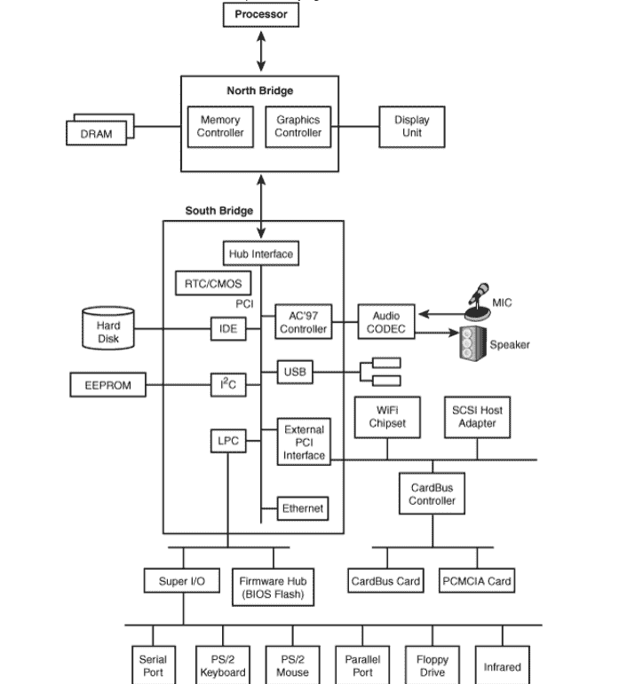

图 4.2 展示了一个假设的嵌入式设备的类似框图。该图包含了一些在 PC 世界中不典型的接口，如闪存、LCD、触摸屏和蜂窝调制解调器。

**图 4.2. 嵌入式系统的硬件框图。**

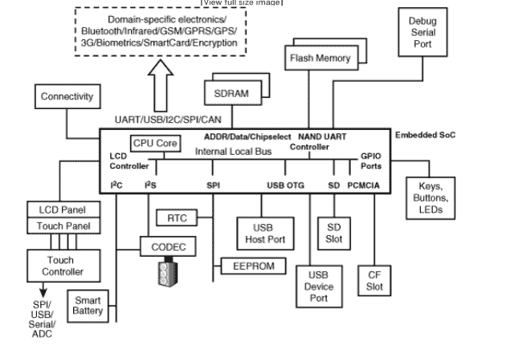

当然，访问外围设备的能力是系统运行的关键部分。设备驱动程序是实现这一目标的引擎。本书的其余章节将聚焦于设备接口，并教你如何实现对设备驱动程序。

### 中断处理

由于 I/O 的不确定性以及 I/O 设备和处理器之间的速度不匹配，设备通过异步断言某些硬件信号来请求处理器的注意。这些硬件信号称为*中断*。每个中断设备都被分配一个相关的标识符，称为*中断请求*（IRQ）号。当处理器检测到某个 IRQ 上生成了中断时，它会突然停止正在执行的操作，并调用为该相应 IRQ 注册的*中断服务例程*（ISR）。*中断处理程序*（ISR）在中断上下文中执行。

#### 中断上下文

ISR 是与硬件直接对话的关键代码片段。出于系统性能的总体利益，它们被赋予了即时执行的特权。然而，如果 ISR 不是快速且轻量级的，那就违背了其自身的哲学。贵宾享有优先待遇，但由他们负责将给公众带来的不便减到最少。为了弥补粗暴打断当前执行线程的过失，ISR 必须在一个称为中断上下文（或*原子上下文*）的受限环境中礼貌地执行。

以下是在中断上下文中执行代码的禁忌和允许事项列表：


1. 如果你的中断上下文代码进入睡眠，那是可拘留的罪行。中断处理程序不能通过调用如 `schedule_timeout()` 等嗜睡函数来放弃处理器。在从你的中断处理程序调用内核 API 之前，深入穿透嵌套调用链，确保其内部不会触发阻塞等待。例如，`input_register_device()` 表面看起来无害，但在底层却调用了 `kmalloc()` 并指定 `GFP_KERNEL` 作为参数。如你在第 2 章“内核一瞥”中看到的，如果你的系统空闲内存低于水位线，以这种方式调用 `kmalloc()` 会使其睡眠等待，直到换页程序释放内存。

2. 为了保护中断处理程序内部的临界区，你不能使用互斥锁，因为它们可能会进入睡眠。请改用自旋锁，并且仅在必要时使用。

3. 中断处理程序不能直接与其他用户空间交换数据，因为它们没有通过进程上下文连接到用户态。这也带来了中断处理程序不能睡眠的另一个原因：调度器以进程为粒度工作，因此如果中断处理程序睡眠并被调度出，它们如何能重新回到运行队列？

4. 中断处理程序应该快速让开道路，但也要期望它们完成工作。为了规避这一两难境地，中断处理程序通常将其工作分为两部分。处理程序的精简上半部分标志确认已处理该中断，但实际上将所有繁重的工作卸载给肥大的下半部分。下半部分的执行被推迟到稍后的时间点，此时所有中断都已启用。你将在后面讨论 *softirqs* 和 *tasklets* 时学习如何开发下半部分。

5. 你无需将中断处理程序设计为可重入的。当中断处理程序运行期间，相应的 IRQ 会被禁用，直到处理程序返回。因此，与进程上下文代码不同，同一个处理程序的不同实例不会在多个处理器上同时运行。

6. 中断处理程序可以被具有更高优先级的 IRQ 关联的处理程序打断。你可以通过特别请求内核将你的中断处理程序视为一个来防止这种嵌套中断

**快速**处理程序。快速处理程序在本地处理器上运行时，所有中断都是禁用的。在禁用中断或将你的中断处理程序标记为**快速**之前，请意识到中断关闭时间对系统性能不利。中断关闭时间越多，中断延迟（即中断产生后被处理前的延迟）就越大。中断延迟与系统的实时响应性成反比。

函数可以通过检查 `in_interrupt()` 的返回值来确定它是否正在中断上下文中执行。

与由外部硬件产生的异步中断不同，有一类中断是同步到达的。同步中断之所以如此称呼，是因为它们不会意外发生——处理器自身通过执行指令来产生它们。内核使用相同的机制来处理外部中断和同步中断。

同步中断的例子包括：

- 异常，用于报告严重的运行时错误
- 软件中断，例如在 x86 架构上用于实现系统调用的 `int 0x80` 指令

### 分配 IRQ

设备驱动程序必须将其 IRQ 号连接到中断处理程序。为此，它们需要知道分配给所驱动设备的 IRQ。IRQ 分配可能很简单，也可能需要复杂的探测。例如，在 PC 架构中，定时器中断分配 IRQ 0，RTC 中断响应 IRQ 8。像 PCI 这样的现代总线技术足够精密，可以响应关于其 IRQ（BIOS 在启动时遍历总线时分配）的查询。PCI 驱动程序可以深入设备配置空间中的指定区域并确定 IRQ。对于较旧的设备，如基于行业标准架构（ISA）的卡，驱动程序可能需要利用特定的硬件知识来探测和解析 IRQ。

查看 `/proc/interrupts` 以获取系统中活动 IRQ 的列表。

### 设备示例：滚轮

现在你已经学习了中断处理的基础知识，让我们为示例滚轮设备实现一个中断处理程序。滚轮可以在一些电话和 PDA 上用于轻松导航菜单，并且能够进行三种动作：顺时针旋转、逆时针旋转和按键。我们假设的滚轮布线方式使得这些动作中的任何一个都会在 IRQ 7 上中断处理器。处理器的通用输入/输出 (GPIO) D 端口的低三位连接到滚轮设备。这些引脚上生成的对应不同滚轮动作的波形如图 4.3 所示。中断处理程序的任务是通过查看 D 端口 GPIO 数据寄存器来解析滚轮动作。


**图 4.3.** 由滚轮生成的示例波形。

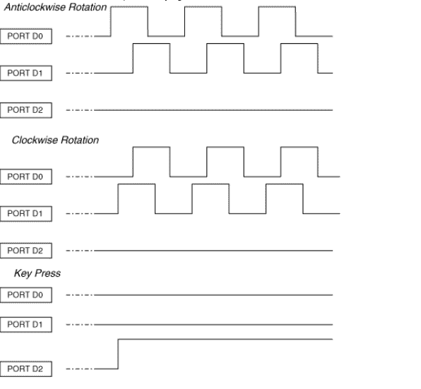

驱动程序首先必须请求 IRQ 并将一个中断处理程序与之关联：

```c
#define ROLLER_IRQ  7
static irqreturn_t roller_interrupt(int irq, void *dev_id);

if (request_irq(ROLLER_IRQ, roller_interrupt, IRQF_DISABLED |
        IRQF_TRIGGER_RISING, "roll", NULL)) {
    printk(KERN_ERR "Roll: Can't register IRQ %d\n", ROLLER_IRQ);
    return -EIO;
}
```

让我们查看传递给 `request_irq()` 的参数。IRQ 号没有被查询或探测，而是在这个简单情况下根据硬件连接硬编码为 `ROLLER_IRQ`。第二个参数，`roller_interrupt()`，是中断处理例程。其原型指定返回类型为 `irqreturn_t`，如果中断被成功处理，则为 `IRQ_HANDLED`，否则为 `IRQ_NONE`。对于允许多个设备共享同一 IRQ 的 I/O 技术（如 PCI），返回值更具重要意义。

`IRQF_DISABLED` 标志指定该中断处理程序必须被视为快速处理程序，因此内核在调用处理程序时必须禁用中断。`IRQF_TRIGGER_RISING` 表示滚轮在希望发出中断信号时会在中断线上产生一个上升沿。换句话说，滚轮是一个边沿敏感设备。一些设备则是电平敏感的，保持中断线有效，直到 CPU 处理它。为了将中断标记为电平敏感，请使用 `IRQF_TRIGGER_HIGH` 标志。此参数的其他可能值包括 `IRQF_SAMPLE_RANDOM`（用于第 5 章“字符驱动程序”中的“伪字符驱动程序”一节）和 `IRQF_SHARED`（用于指定该 IRQ 在多个设备之间共享）。

下一个参数 "roll" 用于在由 `/proc/interrupts` 等文件生成的数据中识别此设备。最后一个参数在此情况下设置为 `NULL`，仅适用于共享中断处理程序，并用于识别共享 IRQ 线的每个设备。

从 2.6.19 内核开始，中断处理程序接口发生了一些变化。中断处理程序曾经有一个第三个参数（`struct pt_regs *`），其中包含指向 CPU 寄存器的指针，但从 2.6.19 内核开始，这已被移除。此外，`IRQF_xxx` 系列中断标志取代了 `SA_xxx` 系列。例如，在早期内核中，你需要使用 `SA_INTERRUPT` 而不是 `IRQF_DISABLED` 来将中断处理程序标记为快速。

在驱动程序初始化期间请求 IRQ 不是一个好主意，因为这可能会占用宝贵的资源，即使设备未在使用。因此，设备驱动程序通常是在应用程序打开设备时请求 IRQ。同样，IRQ 是在应用程序关闭设备时释放的，而不是在退出驱动程序模块时。释放 IRQ 的方法如下：

```c
free_irq(int irq, void *dev_id);
```

列表 4.1 显示了滚轮中断处理程序的实现。`roller_interrupt()` 接受两个参数：IRQ 以及作为关联的 `request_irq()` 最终参数传递的设备标识符。请对照列表查看图 4.3。

### 列表 4.1. 滚轮中断处理程序


```c
spinlock_t roller_lock = SPIN_LOCK_UNLOCKED;
static DECLARE_WAIT_QUEUE_HEAD(roller_poll);

static irqreturn_t
roller_interrupt(int irq, void *dev_id)
{
    int i, PA_t, PA_delta_t, movement = 0;

    /* Get the waveforms from bits 0, 1 and 2
       of Port D as shown in Figure 4.3 */
    PA_t = PORTD & 0x07;

    /* Wait until the state of the pins change.
       (Add some timeout to the loop) */
    for (i=0; (PA_t==PA_delta_t); i++) {
        PA_delta_t = PORTD & 0x07;
    }

    movement = determine_movement(PA_t, PA_delta_t); /* See below */

    spin_lock(&roller_lock);

    /* Store the wheel movement in a buffer for
     * later access by the read()/poll() entry points */
    store_movements(movement);

    spin_unlock(&roller_lock);

    /* Wake up the poll entry point that might have
     * gone to sleep, waiting for a wheel movement */
    wake_up_interruptible(&roller_poll);

    return IRQ_HANDLED;
}

int
determine_movement(int PA_t, int PA_delta_t)
{
    switch (PA_t){
    case 0:
        switch (PA_delta_t){
        case 1:
            movement = ANTICLOCKWISE;
            break;
        case 2:
            movement = CLOCKWISE;
            break;
        case 4:
            movement = KEYPRESSED;
            break;
        }
        break;
    case 1:
        switch (PA_delta_t){
        case 3:
            movement = ANTICLOCKWISE;
            break;
        case 0:
            movement = CLOCKWISE;
            break;
        }
        break;
    case 2:
        switch (PA_delta_t){
        case 0:
            movement = ANTICLOCKWISE;
            break;
        case 3:
            movement = CLOCKWISE;
            break;
        }
        break;
    case 3:
        switch (PA_delta_t){
        case 2:
            movement = ANTICLOCKWISE;
            break;
        case 1:
            movement = CLOCKWISE;
            break;
        }
    }
}
```

# 软中断和任务队列

如前所述，中断处理程序面临两个相互矛盾的要求：它们负责处理大部分设备数据，但必须尽可能快地退出。为了解决这一问题，中断处理程序被设计为两部分：一个匆忙的“上半部”负责与硬件交互，以及一个轻松的“下半部”在允许所有中断的情况下执行大部分处理。与中断不同，下半部是同步的，因为内核决定何时执行它们。内核中可用的以下机制可以将工作延迟到下半部执行：软中断（softirqs）、任务队列（tasklets）和工作队列（work queues）。

软中断是基本的下半部机制，并具有严格的锁定要求。它们仅用于少数对性能敏感的子系统，如网络层、SCSI 层和内核定时器。任务队列建立在软中断之上，使用起来更加简便。除非你有至关重要的可扩展性或速度要求，否则建议使用任务队列。软中断和任务队列的一个主要区别在于，前者是可重入的，而后者不是。同一个软中断的不同实例可以在不同的处理器上同时运行，但任务队列则不允许这样。

为了说明软中断和任务队列的用法，假设上一示例中的滚轮由于存在运动部件（例如，滚轮偶尔会卡住）而固有的硬件问题，导致生成了不符合规格的波形。卡住的滚轮可能持续产生虚假中断并导致系统冻结。为了绕过这个问题，捕捉波形流并对其进行一些分析，如果滚轮看起来卡住了，则动态地从中断模式切换到轮询模式；反之，如果滚轮没有卡住，则切换回去。从中断处理程序中捕捉波形流，并从下半部执行分析。清单 4.2 使用软中断实现此功能，而清单 4.3 使用任务队列。两者都是清单 4.1 的简化变体。这将处理程序简化为两个函数：`roller_capture()` 从 GPIO 端口 D 获取波形片段，`roller_analyze()` 对波形运行算法分析，并在必要时切换到轮询模式。

## 清单 4.2. 使用软中断将工作从中断处理程序中卸载

```c
void __init roller_init()
{
    /* ... */

    /* Open the softirq. Add an entry for ROLLER_SOFT_IRQ in
       the enum list in include/linux/interrupt.h */
    open_softirq(ROLLER_SOFT_IRQ, roller_analyze, NULL);
}

/* The bottom half */
void roller_analyze()
{
    /* Analyze the waveforms and switch to polled mode if required */
}

/* The interrupt handler */
static irqreturn_t roller_interrupt(int irq, void *dev_id)
{
    /* Capture the wave stream */
    roller_capture();

    /* Mark softirq as pending */
    raise_softirq(ROLLER_SOFT_IRQ);

    return IRQ_HANDLED;
}
```

要定义一个软中断，你必须静态地向 `include/linux/interrupt.h` 中添加一项。你不能动态定义一个。`raise_softirq()` 宣布相应的软中断正在等待执行。内核将在下一个可用机会执行它。这可能是在退出中断处理程序期间，或者通过 `ksoftirqd` 内核线程。

## 清单 4.3. 使用任务队列将工作从中断处理程序中卸载


```c
struct roller_device_struct { /* Device-specific structure */
    /* ... */
    struct tasklet_struct tskit;
    /* ... */
}

void __init roller_init()
{
    struct roller_device_struct *dev_struct;
    /* ... */

    /* Initialize tasklet */
    tasklet_init(&dev_struct->tskit, roller_analyze, dev);
}

/* The bottom half */
void roller_analyze()
{
    /* Analyze the waveforms and switch to
    polled mode if required */
}

/* The interrupt handler */
static irqreturn_t roller_interrupt(int irq, void *dev_id)
{
    struct roller_device_struct *dev_struct;

    /* Capture the wave stream */
    roller_capture();

    /* Mark tasklet as pending */
    tasklet_schedule(&dev_struct->tskit);

    return IRQ_HANDLED;
}
```

`tasklet_init()` 动态初始化一个任务队列。该函数不为 `tasklet_struct` 分配内存，而是你必须传递一个已分配实例的地址。`tasklet_schedule()` 宣布相应的任务队列正在等待执行。与中断一样，内核提供了一系列函数来控制多处理器系统中任务队列的执行状态：

- `tasklet_enable()` 启用任务队列。
- `tasklet_disable()` 禁用任务队列，并等待当前正在执行的任务队列实例退出。
- `tasklet_disable_nosync()` 具有类似 `disable_irq_nosync()` 的语义。该函数不等待活动任务队列实例完成执行。

你已经看到了中断处理程序和下半部之间的区别，但它们也有一些相似之处。中断处理程序和任务队列都是不可重入的。而且，它们都不能进入睡眠状态。此外，中断处理程序、任务队列和软中断都不能被抢占。

工作队列是从中断处理程序延迟工作的第三种方式。它们运行在进程上下文中，并且允许睡眠，因此可以使用休眠函数，如互斥锁。我们在前一章中讨论了工作队列，当时我们查看了各种内核辅助设施。表 4.1 比较了软中断、任务队列和工作队列。

### 表 4.1. 软中断、任务队列和工作队列的比较

| | 软中断 | 任务队列 | 工作队列 |
|---|---|---|---|
| 执行上下文 | 延迟工作在中断上下文中运行。 | 延迟工作在中断上下文中运行。 | 延迟工作在进程上下文中运行。 |
| 重入性 | 可以在不同的 CPU 上同时运行。 | 不能在不同的 CPU 上同时运行。不过，不同的 CPU 可以运行不同的任务队列。 | 可以在不同的 CPU 上同时运行。 |
| 睡眠语义 | 不能进入睡眠状态。 | 不能进入睡眠状态。 | 可以进入睡眠状态。 |
| 抢占 | 不能被抢占/调度。 | 不能被抢占/调度。 | 可以被抢占/调度。 |
| 易用性 | 不易使用。 | 易于使用。 | 易于使用。 |
| 使用时机 | 如果延迟工作不会进入睡眠状态，并且你有至关重要的可扩展性或速度要求。 | 如果延迟工作不会进入睡眠状态。 | 如果延迟工作可能进入睡眠状态。 |

在 LKML（Linux 内核邮件列表）上，关于废除任务队列接口的可行性存在持续的辩论。任务队列比进程上下文代码享有更高的优先级，因此会带来延迟问题。此外，正如你所学到的，它们受到约束，不能睡眠，并且必须在同一 CPU 上执行。建议将所有现有的任务队列根据具体情况转换为软中断或工作队列。

第 2 章中提到的 `-rt` 补丁集将中断处理移至内核线程，以实现更广泛的抢占覆盖范围。

## Linux 设备模型

新的 Linux 设备模型引入了类似 C++ 的抽象，将设备驱动程序中的共性因素分解到总线和核心层。让我们看看构成设备模型的不同组件，例如 `udev`、`sysfs`、`kobjects` 和 `device classes`（设备类），以及它们对 `/dev` 节点管理、热插拔、固件下载和模块自动加载等关键内核子系统的影响。`Udev` 是观察设备模型优势的最佳切入点，因此我们从那里开始。

## Udev

在多年前 Linux 还年轻时，管理设备节点并不是件乐事。所有需要的节点（可能多达数千个）都必须在 `/dev` 目录下静态创建。事实上，这个问题可以追溯到最初的 UNIX 系统。随着 2.4 内核的出现，`devfs` 应运而生，它引入了动态设备节点创建功能。`Devfs` 提供生成位于内存文件系统中的设备节点的服务，但为节点命名的责任仍然落在设备驱动程序上。然而，设备命名策略属于管理范畴，与内核并不相融。策略的归属地在于头文件、内核模块参数或用户空间。`Udev` 的出现旨在将设备管理推向用户空间。

`Udev` 依赖以下内容来完成其工作：

- 1. 内核的 `sysfs` 支持，这是 Linux 设备模型的重要组成部分。`Sysfs` 是在引导时挂载在 `/sys` 下的内存文件系统（请查看 `/etc/fstab` 以获取指定符）。我们将在下一节中讨论 `sysfs`，但现在，请暂时认为相应的 `sysfs` 文件访问是理所当然的。
- 2. 一组用户空间守护进程和实用程序，例如 `udevd` 和 `udevinfo`。
- 3. 位于 `/etc/udev/rules.d/` 目录中的用户指定规则。你可以制定规则以获得对设备的一致视图。

为了了解如何使用 `udev`，让我们看一个例子。假设你有一个 USB DVD 驱动器和一个 USB CD-RW 驱动器。根据热插拔这些设备的顺序，其中一个被分配名称 `/dev/sr0`，另一个获得名称 `/dev/sr1`。在 `udev` 出现之前，你在使用这些设备之前必须弄清楚相关的名称。但有了 `udev`，无论插入或移除的顺序如何，你都可以一致地将 DVD 查看为（例如 `/dev/usbdvd`）并将 CD-RW 查看为（例如 `/dev/usbcdrw`）。

首先，从 `sysfs` 中相应的文件获取产品属性。假设（Targus）DVD 驱动器已被分配设备节点 `/dev/sr0`，而（AddOnics）CD-RW 驱动器被赋予了名称 `/dev/sr1`。使用 `udevinfo` 收集设备信息：

```bash
udevinfo -a -p /sys/block/sr0
...
  looking at the device chain at
  `/sys/devices/pci0000:00/0000:00:1d.7/usb1/1-4':
  BUS==`usb`
  ID==`1-4`
  SYSFS{bConfigurationValue}==`1`
...
SYSFS{idProduct}=>0701
SYSFS{idVendor}=>05e3
SYSFS{manufacturer}=>GenesysLogic
SYSFS{maxchild}=>0
SYSFS{product}=>USB Mass Storage Device
...
udevinfo -a -p /sys/block/sr1
...
looking at the device chain at
`/sys/devices/pci0000:00/0000:00:1d.7/usb1/1-3':
BUS==`usb`
ID==`1-3`
SYSFS{bConfigurationValue}==`2`
...
SYSFS{idProduct}=>0302
SYSFS{idVendor}=>0dbf
SYSFS{manufacturer}=>AddOnics
SYSFS{maxchild}=>0
SYSFS{product}=>USB to IDE Cable
...
```

接下来，让我们利用获取的产品信息来标识设备并添加 udev 命名规则。创建一个名为 `/etc/udev/rules.d/40-cdvd.rules` 的文件，并添加以下规则：

```
BUS="usb",  SYSFS{idProduct}="0701",  SYSFS{idVendor}="05e3",
KERNEL="sr[0-9]" , NAME="%k" , SYMLINK="usbdvd"

BUS="usb" ,  SYSFS{idProduct}="0302" ,  SYSFS{idVendor}="0dbf" ,
KERNEL="sr[0-9]" , NAME="%k" , SYMLINK="usbcdrw"
```


  第一条规则告诉 `udev`，每当它找到一个产品 ID 为 `0x0701`、供应商 ID 为 `0x05e3` 且名称以 `sr` 开头的 USB 设备时，它应该在 `/dev` 下创建一个同名节点，并创建一个名为 `usbdvd` 的符号链接指向该创建的节点。同样，第二条规则指示为 CD-RW 驱动器创建一个名为 `usbcdrw` 的符号链接。

  为了测试规则中的语法错误，在 `/sys/block/sr*` 上运行 `udevtest`。为了在 `/var/log/messages` 中开启详细消息，在 `/etc/udev/udev.conf` 中将 `udev_log` 设置为 "yes"。为了实时用新添加的规则重新填充 `/dev` 目录，使用 `udevstart` 重启 `udev`。完成后，你的 DVD 驱动器在系统中始终显示为 `/dev/usbdvd`，而你的 CD-RW 驱动器始终显示为 `/dev/usbcdrw`。你可以使用如下命令从 shell 脚本中确定性地挂载它们：

```
mount /dev/usbdvd /mnt/dvd
```

  设备节点（以及网络接口）的一致命名并不是 `udev` 的唯一能力。它也已经转变为 Linux 热插拔管理器。`Udev` 还负责按需自动加载模块以及向需要它们的设备下载微代码。但在深入探讨这些功能之前，让我们先对设备模型的内部结构有一个基本的了解。

## Sysfs、Kobjects 和设备类

  `Sysfs`、`kobjects` 和设备类是设备模型的构建模块，但它们性格内向，喜欢留在幕后。它们主要属于总线和核心实现的使用领域，隐藏在为设备驱动程序提供服务的 API 内部。

  `Sysfs` 是内核结构化设备模型在用户空间的体现。它类似于 `/procfs`，因为两者都是包含内核数据结构信息的内存文件系统。虽然 `/procfs` 是查看内核内部机制的通用窗口，但 `sysfs` 专门针对设备模型。因此，`sysfs` 并不是 `/procfs` 的替代品。诸如进程描述符和 `sysctl` 参数等信息属于 `/procfs` 而不是 `sysfs`。很快大家就会明白，`udev` 依赖于 `sysfs` 来实现其大部分扩展功能。

  对象引入了对常见对象属性（如使用引用计数）的封装。它们通常嵌入在更大的结构中。以下是 `kobject` 的主要字段，其定义在 `include/linux/kobject.h` 中：

- 1. 一个 `kref` 对象，用于执行引用计数管理。`kref_init()` 接口初始化 `kref`，`kref_get()` 增加与 `kref` 关联的引用计数，而 `kref_put()` 减少引用计数，如果没有剩余的引用则释放对象。例如，`URB` 结构（在“通用串行总线”第 11 章中解释）包含一个 `kref` 来跟踪对它的引用数量。[2]

- 2. 指向 `kset` 的指针，`kset` 是 `kobject` 所属的对象集合。

- 3. 一个 `kobj_type`，它是描述 `kobject` 的对象类型。

  `Kobjects` 与 `sysfs` 紧密交织。在内核中实例化的每个 `kobject` 都有一个 `sysfs` 表示。

  设备类的概念是设备模型的另一项特性，也是你在驱动程序中更可能使用的接口。类接口抽象了这样一种理念：每个设备都属于更广泛的设备类（或类别）。USB 鼠标、PS/2 键盘和摇杆都属于 `input` 类，并在 `/sys/class/input/` 下拥有条目。

  图 4.4 显示了一台连接了外部 USB 鼠标的笔记本电脑上的 `sysfs` 层次结构。顶层的 `bus`、`class` 和 `device` 目录被展开，以显示 `sysfs` 根据 USB 鼠标的设备类型及其物理连接提供的视图。鼠标是一个输入类设备，但在物理上是一个响应两个端点地址的 USB 设备，即控制端点 `ep00` 和中断端点 `ep81`。相关的 USB 端口属于总线 2 上的 USB 主机控制器，而 USB 主机控制器本身通过 PCI 总线桥接到 CPU。如果这些细节在这一点上意义不大，不用担心；在阅读讲解输入驱动程序（第 7 章）、PCI 驱动程序（第 10 章，“外围组件互连”）和 USB 驱动程序（第 11 章）的章节后，再回顾这一节。

### 图 4.4. USB 鼠标的 Sysfs 层次结构。

## 代码视图

```
/sys
  +block
  -[bus]-[sb]-[devices]-[usb2]-[2-2]-[2-2:1.0]-[usbendpoint:usbdev2,2-ep81]
  -[class]-[input]-[mouse2]-[devic2]-[bus]-[usbendpoint:usbdev2,2-ep81]
      -[usb_device]-[usbdev2]-[device]-[bus]
      -[usb_endpoint]-[usbdev2,2-ep00]-[device]
          -[usbdev2,2-ep81]-[device]
  -[devices]-[pci0000:00]-[0000:00:1d:11]-[usb2]-[2-2]-[2-2:1.0]
  +[firmware]
  +[fs]
  +[kernel]
  +[module]
  +[power]
```

浏览 `/sys`，寻找与其他设备（例如您的网卡）相关联的条目，以更好地理解其分层组织。第 10 章中“寻址与标识”一节展示了 `sysfs` 如何映射笔记本电脑上 CardBus 以太网调制解调器卡的物理连接。

类编程接口建立在 `kobjects` 和 `sysfs` 之上，因此它是深入理解设备模型各组件之间端到端交互的好起点。让我们以 RTC 驱动程序为例。RTC 驱动程序（`drivers/char/rtc.c`）是一个杂项（或“misc”）驱动程序。我们将在第 5 章讨论字符设备驱动程序时详细介绍杂项驱动程序。

插入 RTC 驱动程序模块，查看在 `/sys` 和 `/dev` 下创建的节点：

```
bash> modprobe rtc
bash> ls -lR /sys/class/misc
drwxr-xr-x 2 root root 0 Jan 15 01:23 rtc
/sys/class/misc/rtc:
total 0
-rw-r--r-- 1 root root 4096 Jan 15 01:23 dev
-w------- 1 root root 4096 Jan 15 01:23 uevent
bash> ls -l /dev/rtc
crw-r--r-- 1 root root 10, 135 Jan 15 01:23 /dev/rtc
```

`/sys/class/misc/rtc/dev` 包含分配给该设备的主设备号和次设备号（将在下一章讨论），`/sys/class/misc/rtc/uevent` 用于冷插拔（将在下一节讨论），而 `/dev/rtc` 供应用程序访问 RTC 驱动程序使用。

让我们理解通过设备模型的代码流程。杂项驱动程序在初始化期间利用 `misc_register()` 的服务，如果剥离一些代码，它看起来像这样：

```c
/* ... */
dev = MKDEV(MISC_MAJOR, misc->minor);

misc->class = class_device_create(misc_class, NULL, dev,
                                  misc->dev,
                                  "%s", misc->dev,
                                  "%s", misc->name);
if (IS_ERR(misc->class)) {
    err = PTR_ERR(misc->class);
    goto out;
}
/* ... */
```

图 4.5 继续剥离更多层，以揭示设备建模的底层。它展示了波及类、`kobjects`、`sysfs` 和 `udev` 的转换，从而生成前面列出的 `/sys` 和 `/dev` 文件。

### 图 4.5. 将设备模型的各部分联系起来。

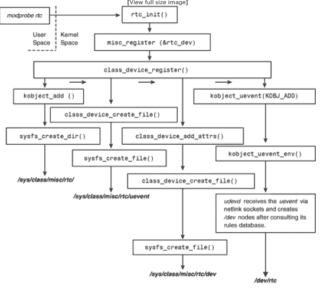

请参见并行端口 LED 驱动程序（第 5 章“与并行端口通信”一节中的清单 5.6）和虚拟鼠标输入驱动程序（第 7 章“设备示例：虚拟鼠标”一节中的清单 7.2），以了解在 `sysfs` 内创建设备控制文件的示例。

设备模型的另一部分抽象是 `bus-device-driver`（总线-设备-驱动程序）编程接口。内核设备支持被清晰地结构化为总线、设备和驱动程序。这使得单个驱动程序实现更简单且更具通用性。例如，*总线* 实现可以搜索能够处理特定设备的驱动程序。


考虑内核的 I²C 子系统（在第 8 章“I²C 协议”中探讨）。I²C 层由核心基础设施、总线适配器设备驱动程序和客户机设备驱动程序组成。I²C 核心层使用 `bus_register()` 注册每个检测到的 I²C 总线适配器。当探测并检测到 I²C 客户机设备（例如，*电可擦除可编程只读存储器* [EEPROM] 芯片）时，通过 `device_register()` 记录其存在。最后，I²C EEPROM 客户机驱动程序使用 `driver_register()` 注册自身。这些注册通过 I²C 核心提供的服务函数间接完成。

`bus_register()` 在 `/sys/bus/` 中添加相应条目，而 `device_register()` 在 `/sys/devices/` 下添加条目。`struct bus_type`、`struct device` 和 `struct device_driver` 分别是总线、设备和驱动程序使用的主要数据结构。请查看 `include/linux/device.h` 了解它们的定义。

## 热插拔与冷插拔

连接到正在运行的系统上的设备被称为热插拔，而在系统启动前连接的设备则被视为冷插拔。早期，内核通过调用通过 `/proc` 文件系统注册的辅助程序来通知用户空间热插拔事件。但是，当当前内核检测到热插拔时，它们通过 netlink 套接字将 `uevents` 分发给用户空间。Netlink 套接字是使用套接字 API 在内核空间和用户空间之间进行通信的高效机制。在用户空间端，管理设备节点创建和删除的守护进程 `udevd` 接收 `uevents` 并管理热插拔。

为了查看热插拔处理如何最近演化，让我们考虑运行不同版本 2.6 内核的 udev 的渐进级别：

- 1. 使用 *udev-039* 包和 2.6.9 内核时，当内核检测到热插拔事件时，它调用注册在 `/proc/sys/kernel/hotplug` 的用户空间辅助程序。这默认为 `/sbin/hotplug`，它在其环境中接收热插拔设备的属性。`/sbin/hotplug` 在热插拔配置目录（通常是 `/etc/hotplug.d/default/`）内部查找并运行，例如，在执行 `/etc/hotplug/` 下的其他脚本后运行 `/etc/hotplug.d/default/10-udev.hotplug`。

    ```bash
    bash$ ls -l /etc/hotplug.d/default/
    ...
    lrwxrwxrwx 1 root root 14 May 11 2005 10-udev.hotplug -> /sbin/udevsend
    ...
    ```

    当 `/sbin/udevsend` 如此执行时，它将热插拔设备信息传递给 `udevd`。

- 2. 使用 udev-058 和 2.6.11 内核时，情况略有不同。`udevsend` 实用程序取代了 `/sbin/hotplug`：

    ```bash
    bash$ cat /proc/sys/kernel/hotplug
    /sbin/udevsend
    ```

- 3. 使用最新版本的 udev 和内核，`udevd` 完全负责管理热插拔，而不依赖于 `udevsend`。它现在通过 netlink 套接字直接从内核拉取热插拔事件（见图 4.4）。`/proc/sys/kernel/hotplug` 包含空内容：

    ```bash
    bash$ cat /proc/sys/kernel/hotplug
    bash$
    ```

Udev 也处理冷插拔。因为 udev 是用户空间的一部分，并且仅在内核启动后启动，所以需要一种特殊机制来模拟冷插拔设备的热插拔事件。在启动时，内核为所有设备在 `sysfs` 下创建一个名为 `uevent` 的文件，并向这些文件发出冷插拔事件。当 `udev` 启动时，它从 `/sys` 读取所有 `uevent` 文件，并为每个冷插拔设备生成热插拔事件。

## 微码下载

在某些设备准备好工作之前，必须向它们提供微码。微码由板载微控制器执行。设备驱动程序过去将微码存储在头文件中的静态数组中。但这变得不可行，因为微码通常由设备制造商作为专有二进制映像分发，这与 GPL 许可的内核混并不相容。反对将固件与内核源代码混合的另一个原因是它们运行在不同的发布时间线上。显然的解决方案是在用户空间中单独维护微码，并在需要时将其传递给内核。Sysfs 和 udev 提供了实现这一点的架构。

让我们以在多台笔记本电脑上找到的 Intel PRO/Wireless 2100 WiFi mini PCI 卡为例。该卡围绕一个微控制器构建，该微控制器需要执行外部提供的微码才能正常运行。让我们逐步了解 Linux 驱动程序向卡下载微码的步骤。假设您已从 `http://ipw2100.sourceforge.net/firmware.php` 获取所需的微代码映像（`ipw2100-1.3.fw`）并将其保存在系统的 `/lib/firmware/` 下，并且您已经插入了驱动程序模块 `ipw2100.ko`。

- 1. 在初始化期间，驱动程序调用以下命令：

    ```
    request_firmware(..., "ipw2100-1.3.fw", ...);
    ```

- 2. 这将向用户空间分发一个热插拔 `uevent`，并附带所请求的微代码映像的身份信息。

- 3. `udevd` 接收 `uevent` 并通过调用 `/sbin/firmware_helper` 进行响应。为此，它使用 `/etc/udev/rules.d/` 下文件中的类似以下规则的规则：

    ```
    ACTION=="add", SUBSYSTEM=="firmware", RUN="/sbin/firmware_helper"
    ```

- 4. `/sbin/firmware_helper` 在 `/lib/firmware/` 内部查找并定位所请求的微代码映像 `ipw2100-1.3.fw`。它将映像转储到 `/sys/class/0000:02:02.0/data`。（在这种情况下，`0000:02:02` 是 WiFi 卡的 PCI 总线:设备:功能标识符。）

- 5. 驱动程序接收微码并将其下载到设备。完成后，它调用 `release_firmware()` 以释放相应的数据结构。

- 6. 驱动程序完成其余的初始化过程，WiFi 适配器开始信标传输。

## 模块自动加载

按需自动加载内核模块是 Linux 支持的一个方便功能。为了理解内核如何发出“模块故障”以及 udev 如何处理它，让我们将一个 Xircom CardBus 以太网适配器插入笔记本电脑的 PC 卡插槽中。

1. 在编译时，所支持设备的标识作为驱动模块对象的一部分生成。请查看支持 Xircom CardBus 以太网组合卡的驱动（`drivers/net/tulip/xircom_cb.c`），你会找到这段代码：

```
static struct pci_device_id xircom_pci_table[] = { {0x115D, 0x0003, PCI_ANY_ID, PCI_ANY_ID,}, {0,},};
/* Mark the device table */
MODULE_DEVICE_TABLE(pci, xircom_pci_table);
```

这声明了该驱动可以支持任何 PCI 供应商 ID 为 `0x115D` 且 PCI 设备 ID 为 `0x0003` 的卡（关于此点的更多细节参见第 10 章）。当安装驱动模块时，`depmod` 实用程序会查看模块映像内部，解读设备表中存在的 ID。然后，它会将以下条目添加到 `/lib/modules/kernel-version/modules.alias` 中：

```
alias pci:v0000115Dd00000003sv*sd*bc*sc*i* xircom_cb
```

其中 `v` 代表 VendorID（供应商 ID），`d` 代表 DeviceID（设备 ID），`sv` 代表 subvendorID（子供应商 ID），`*` 代表通配符匹配。

2. 当将 Xircom 卡热插拔到 CardBus 插槽时，内核生成一个 `uevent`，宣布新插入设备的标识。你可以使用 `udevmonitor` 查看生成的 `uevent`：

```
bash> udevmonitor --env
...
MODALIAS=pci:v0000115Dd00000003sv0000115Dsd00001181bc02sc00i00
...
```

3. `udevd` 通过 netlink 套接字接收该 `uevent`，并调用 `modprobe` 执行内核向上层传递的上述 MODALIAS：

```
modprobe pci:v0000115Dd00000003sv0000115Dsd00001181bc02sc00i00
```


`modprobe`在步骤 1 中创建的`/lib/modules/kernel-version/modules.alias`中找到匹配的条目，并继续插入`xircom_cb`：

```
bash> lsmod
Module Size Used by
xircom_cb 10433 0
...
```

现在该卡已准备就绪，可以开始使用网络了。

阅读完第 10 章后，你可能希望回顾本节内容。

## 嵌入式设备上的 Udev

有一种观点认为，在嵌入式设备上使用静态创建的设备节点比使用 udev 更合适，原因如下：

- 与仅在软件安装时创建一次的静态节点不同，Udev 在每次重启时都会创建`/dev`节点。如果你的嵌入式设备使用闪存存储，在前一种情况下，持有`/dev`节点的闪存页在每次启动时都会遭受擦除-写入周期的影响，这缩短了闪存的寿命。（第 17 章“内存技术设备”中详细讨论了闪存内存。不过，你确实可以选择将`/dev`挂载到基于 RAM 的文件系统上。）
- Udev 会增加启动时间。
- Udev 的功能，例如动态创建`/dev`节点和自动加载模块，会带来一定程度的不确定性，一些解决方案设计者希望在专用嵌入式设备上避免这种情况，特别是那些不通过可热插拔总线与外部世界交互的设备。根据这一观点，静态节点创建和启动时插入模块提供了对系统的更多控制，并使其更易于测试。

## 内存屏障

许多处理器和编译器会对指令进行重排序，以达到最佳执行速度。重排序的方式确保新的指令流在语义上等同于原始指令流。然而，例如，如果你正在写入 I/O 设备上的内存映射寄存器，指令重排序可能会产生意想不到的副作用。为了防止处理器重排序指令，你可以在代码中插入一个屏障。`wmb()`函数插入一个写屏障，防止写入操作通过它移动；`rmb()`提供读屏障，不允许读取操作跨越它；`mb()`则产生读写屏障。

除了前面提到的 CPU 与硬件的交互外，内存屏障对于 SMP 系统中的 CPU 间交互也很重要。如果你的 CPU 的数据缓存运行在写回模式（即数据只有在绝对必要时才从缓存复制到内存），你可能希望暂停指令流，直到缓存到内存的队列被清空。例如，当你遇到获取或释放锁的指令时，这一点尤其相关。在此场景中，使用屏障可以在各 CPU 之间获得一致的状态感知。

我们在第 10 章讨论 PCI 驱动和第 17 章讨论闪存映射驱动时会再次探讨内存屏障。在此期间，请查阅`*Documentation/memory-barriers.txt*`以了解不同类型内存屏障的说明。

## 电源管理

对于运行在电池上的设备，如笔记本电脑和手持设备，电源管理至关重要。Linux 驱动程序必须了解电源状态，并响应待机、睡眠和电池电量低等事件在不同状态之间转换。当驱动程序切换到消耗较少电源的模式时，它们会利用底层硬件支持的节能功能。例如，存储驱动程序会让磁盘停转，而视频驱动程序会使显示器黑屏。

设备驱动程序中具备电源感知功能的代码只是整体电源管理框架的一部分。电源管理还涉及用户空间守护进程、实用工具、配置文件和启动固件的参与。两种流行的电源管理机制是 APM（在附录 B“Linux 与 BIOS”的“保护模式调用”一节中讨论）和高级配置和电源接口（ACPI）。APM 正在变得过时，ACPI 已成为 Linux 系统上事实上的电源管理策略。第 20 章“更多设备和驱动”中将进一步讨论 ACPI。

## 查看源代码

核心中断处理代码是通用的，位于`kernel/irq/`目录中。架构特定的部分可以在`arch/<your-arch>/kernel/irq.c`中找到。在此文件中定义的`do_IRQ()`函数是你开始探索内核中断处理机制的好地方。

内核的 softirq 和 tasklet 实现位于`kernel/softirq.c`。此文件还包含提供对 softirqs 和 tasklets 更细粒度控制的其他函数。查看`include/linux/interrupt.h`中的 softirq 向量枚举和实现中断处理程序所需的原型。对于编写中断处理程序和下半部（bottom halves）的实际示例，可以从`drivers/net/lib8390.c`中作为一部分的处理程序开始，并沿着线索进入网络堆栈。

kobject 实现及相关编程接口位于`lib/kobject.c`和`include/linux/kobject.h`中。在`drivers/base/sys.c`中查看 sysfs 的实现。你可以在`drivers/base/class.c`中找到设备类 API。通过 netlink 套接字分发热插拔事件由`lib/kobject_uevent.c`完成。你可以从`www.kernel.org/pub/linux/utils/kernel/hotplug/udev.html`下载 udev 的源代码和文档。

为了更全面地理解 APM 在 x86 Linux 上是如何实现的，请查看内核树中的`arch/x86/kernel/apm_32.c`、`include/linux/apm_bios.h`和`include/asm-x86/mach-default/apm.h`。如果你想知道 APM 在 ARM 等无 BIOS 架构上是如何实现的，请查看`include/linux/apm-emulation.h`及其使用示例。内核的 ACPI 实现位于`drivers/acpi/`目录中。

表 4.2 总结了本章使用的主要数据结构及其在源代码树中定义的位置。表 4.3 列出了本章中使用的主要内核编程接口及其定义的位置。

### 表 4.2. 数据结构摘要

| 数据结构 | 位置 | 描述 |
| :--- | :--- | :--- |
| `tasklet_struct` | `include/linux/interrupt.h` | 管理 tasklet，这是一种实现下半部的方法 |
| `kobject` | `include/linux/kobject.h` | 封装内核对象的通用属性 |
| `kset` | `include/linux/kobject.h` | kobject 所属的对象集合 |
| `kobj_type` | `include/linux/kobject.h` | 描述 kobject 的对象类型 |
| `class` | `include/linux/device.h` | 抽象了驱动属于更广泛类别的概念 |
| `bus_device` | `include/linux/device.h` | 构成 Linux 设备模型基石的结构体 |
| `device_driver` |  |  |

### 表 4.3. 内核编程接口摘要

| 内核接口 | 位置 | 描述 |
| :--- | :--- | :--- |
| `request_irq()` | `kernel/irq/manage.c` | 请求一个 IRQ 并为其关联一个中断处理程序 |
| `free_irq()` | `kernel/irq/manage.c` | 释放一个 IRQ |
| 内核接口 | 位置 | 描述 |
|---|---|---|
| `disable_irq()` | `kernel/irq/manage.c` | 禁用与所提供 IRQ 相关联的中断 |
| `disable_irq_nosync()` | `kernel/irq/manage.c` | 禁用与所提供 IRQ 相关联的中断，但不等待当前正在执行的中断处理程序实例返回 |
| `enable_irq()` | `kernel/irq/manage.c` | 重新启用已使用`disable_irq()`或`disable_irq_nosync()`禁用的中断 |
| `open_softirq()` | `kernel/softirq.c` | 打开一个 softirq |
| `raise_softirq()` | `kernel/softirq.c` | 将该 softirq 标记为待执行 |
| `tasklet_init()` | `kernel/softirq.c` | 动态初始化一个 tasklet |
| `tasklet_schedule()` | `include/linux/interrupt.h` | 将该 tasklet 标记为待执行 |
| `tasklet_enable()` | `include/linux/interrupt.h` | 启用一个 tasklet |
| `tasklet_disable()` | `include/linux/interrupt.h` | 禁用一个 tasklet |
| `tasklet_disable_nosync()` | `include/linux/interrupt.h` | 禁用一个 tasklet，但不等待活动实例完成执行 |
| `class_device_register()` | `drivers/base/class.c` | Linux 设备模型中创建/销毁类、设备类以及关联的 kobjects 和 sysfs 文件的一族函数 |


| `kobject_add()` | `lib/kobject.c` |  |
| `sysfs_create_dir()` | `lib/kobject_uevent.c` |  |
| `class_device_create()` | `fs/sysfs/dir.c` |  |
| `class_device_destroy()` | `fs/sysfs/file.c` |  |
| `class_create()` |  |  |
| `class_destroy()` |  |  |
| `class_device_create_file()` |  |  |
| `sysfs_create_file()` |  |  |
| `class_device_add_attrs()` |  |  |
| `kobject_uevent()` |  |  |

至此，我们对设备驱动概念的探索就结束了。在开发你的驱动时，你可能需要回顾本章内容。

# 第 5 章：字符驱动

## 本章内容

- 字符驱动基础<br>120
- 设备示例：系统 CMOS<br>121
- 感知数据可用性<br>139
- 与并行端口通信<br>145
- RTC 子系统<br>156
- 伪字符驱动<br>157
- 杂项驱动<br>160
- 字符驱动的注意事项<br>166
- 查看源代码<br>167

现在，你已经准备就绪，可以着手编写简单但面向现实世界的设备驱动了。在本章中，让我们来看看字符（或 char）设备驱动的内部结构，这是一类从设备顺序访问数据的内核代码。字符驱动可以从多种类型的设备（如打印机、鼠标、看门狗、磁带、内存、RTC 等）获取原始数据。然而，它们不适合管理驻留在支持随机访问的块设备（如硬盘、软盘或光盘）上的数据。

### 字符驱动基础

让我们先从自上而下的视角开始。要访问字符设备，系统用户需要调用合适的应用程序。应用程序负责与设备通信，但为了做到这一点，它需要获取合适驱动的身份标识。驱动的联系方式通过 `/dev` 目录导出到用户空间：

```
bash> ls -l /dev
total 0
crw------- 1 root root 5, 1 Jul 16 10:02 console
...
lrwxrwxrwx 1 root root 3 Oct 6 10:02 cdrom -> hdc
...
brw-rw---- 1 root disk 3, 0 Oct 6 2007 hda
brw-rw---- 1 root disk 3, 1 Oct 6 2007 hda1
...
crw------- 1 root tty 4, 1 Oct 6 10:20 tty1
crw------- 1 root tty 4, 2 Oct 6 10:02 tty2
```

`ls` 输出中每行的第一个字符表示驱动类型：`c` 表示字符驱动，`b` 表示块驱动，`l` 表示符号链接。第五列中的数字称为*主要*（major）号，第六列中的数字称为*次要*（minor）号。主要号大致标识驱动，而次要号则精确指出该驱动所服务的具体设备。例如，IDE 块存储驱动 `/dev/hda` 拥有主要号 3，负责处理系统中的硬盘，但当你进一步指定次要号 1（`/dev/hda1`）时，这就将其缩小到第一个磁盘分区。字符驱动和块驱动占据不同的命名空间，因此同一个主要号可以同时分配给一个字符驱动和一个块驱动。

让我们更进一步，深入查看字符驱动的内部。从代码流程的角度来看，字符驱动包含以下内容：

- 一个初始化（或 `init()`）例程，负责初始化设备，并通过注册函数将驱动与内核的其他部分无缝连接。
- 一组入口点（或方法），如 `open()`、`read()`、`ioctl()`、`lseek()` 和 `write()`，它们直接对应于用户应用程序通过关联的 `/dev` 节点调用的 I/O 系统调用。
- 中断例程、下半部（bottom halves）、定时器处理程序、辅助内核线程以及其他支持基础设施。这些对用户应用程序通常是透明的。

从数据流的角度来看，字符驱动拥有以下关键数据结构：

1. 每设备结构体。这是驱动围绕其运行的信息存储库。
2. `struct cdev`，字符驱动的内核抽象。该结构通常嵌入在前面提到的每设备结构体中。
3. `struct file_operations`，包含所有驱动入口点的地址。
4. `struct file`，包含关联 `/dev` 节点的信息。

### 设备示例：系统 CMOS

让我们实现一个字符驱动来访问系统 CMOS。在 PC 兼容硬件上的 BIOS（参见图 5.1）使用 CMOS 来存储诸如启动选项、引导顺序和系统日期等信息，你可以通过 BIOS 设置菜单进行配置。我们的示例 CMOS 驱动允许你将两个 PC CMOS 存储库当作常规文件来访问。应用程序可以操作 `/dev/cmos/0` 和 `/dev/cmos/1`，并使用 I/O 系统调用来访问两个存储库中的数据。由于 BIOS 以位级粒度为 CMOS 区域分配语义，该驱动能够进行位级访问。因此，`read()` 会获取指定数量的位，并将内部文件指针向前推进所读取的位数。

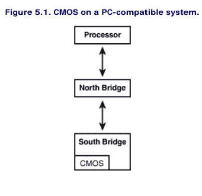

CMOS 通过两个 I/O 地址（一个索引寄存器和一个数据寄存器）进行访问，如表 5.1 所示。你必须在索引寄存器中指定所需的 CMOS 内存偏移量，并通过数据寄存器交换信息。

**表 5.1. CMOS 上的寄存器布局**

| 寄存器名称 | 描述 |
| :--- | :--- |
| `CMOS_BANK0_INDEX_PORT` | 在此寄存器中指定所需的 CMOS 存储库 0 偏移量。 |
| `CMOS_BANK0_DATA_PORT` | 从/向 `CMOS_BANK0_INDEX_PORT` 中指定的地址读取/写入数据。 |
| `CMOS_BANK1_INDEX_PORT` | 在此寄存器中指定所需的 CMOS 存储库 1 偏移量。 |
| `CMOS_BANK1_DATA_PORT` | 从/向 `CMOS_BANK1_INDEX_PORT` 中指定的地址读取/写入数据。 |

由于每个驱动方法都有应用程序使用的相应系统调用，我们将并行查看系统调用和匹配的驱动方法。

## 驱动初始化

驱动的 `init()` 方法是注册机制的基石。它负责以下事项：

- 请求分配设备主要号。
- 为每设备结构体分配内存。
- 将入口点（`open()`、`read()` 等）与字符驱动的 `cdev` 抽象连接起来。
- 将设备主要号与驱动的 `cdev` 关联。
- 在 `/dev` 和 `/sys` 下创建节点。正如在第 4 章“奠定基础”中所讨论的，`/dev` 管理经历了从 2.2 内核中的静态设备节点，到 2.4 中的动态名称，再到 2.6 中的用户空间策略守护进程（udev）的演变。
- 初始化硬件。这对于我们简单的 CMOS 驱动来说并不相关。

列表 5.1 实现了 CMOS 驱动的 `init()` 方法。

**列表 5.1. CMOS 驱动初始化**

```c
#include <linux/fs.h>
/* 每设备（每存储库）结构体 */
struct cmos_dev {
  unsigned short current_pointer; /* 存储库内的当前指针 */
  unsigned int size; /* 存储库的大小 */
  int bank_number; /* CMOS 存储库编号 */
  struct cdev cdev; /* cdev 结构体 */
  char name[10]; /* I/O 区域名称 */
  /* ... */ /* 互斥锁、自旋锁、等待队列，... */
} *cmos_devp;
/* 文件操作结构体。定义在 linux/fs.h 中 */
static struct file_operations cmos_fops = {
  .owner = THIS_MODULE, /* 所有者 */
  .open = cmos_open, /* 打开方法 */
  .release = cmos_release, /* 释放方法 */
  .read = cmos_read, /* 读取方法 */
  .write = cmos_write, /* 写入方法 */
  .llseek = cmos_llseek, /* 定位方法 */
  .ioctl = cmos_ioctl, /* ioctl 方法 */
};
static dev_t cmos_dev_number; /* 分配的设备号 */
struct class *cmos_class; /* 与设备模型的关联 */
```

```c
#define NUM_CMOS_BANKS       2

#define CMOS_BANK_SIZE       (0xFF*8)

#define DEVICE_NAME          "cmos"

#define CMOS_BANK0_INDEX_PORT 0x70

#define CMOS_BANK0_DATA_PORT  0x71
```


### 定义

```c
#define CMOS_BANK1_INDEX_PORT 0x72

#define CMOS_BANK1_DATA_PORT  0x73

unsigned char addrports[NUM_CMOS_BANKS] = {CMOS_BANK0_INDEX_PORT,

                       CMOS_BANK1_INDEX_PORT};

unsigned char dataports[NUM_CMOS_BANKS] = {CMOS_BANK0_DATA_PORT,

                       CMOS_BANK1_DATA_PORT};
```

### 驱动程序初始化

```c
/*
 * 驱动程序初始化
 */

int __init
cmos_init(void)
{

int i;

/* 请求动态分配一个设备主设备号 */
if (alloc_chrdev_region(&cmos_dev_number, 0,
                  NUM_CMOS_BANKS, DEVICE_NAME) < 0) {
    printk(KERN_DEBUG "无法注册设备\n"); return -1;
}

/* 填充 sysfs 条目 */
cmos_class = class_create(THIS_MODULE, DEVICE_NAME);
for (i=0; i<NUM_CMOS_BANKS; i++) {

/* 为每个设备的数据结构分配内存 */
cmos_devp = kmalloc(sizeof(struct cmos_dev), GFP_KERNEL);
if (!cmos_devp) {
   printk("kmalloc 失败\n"); return 1;
}

/* 请求 I/O 区域 */
sprintf(cmos_devp->name, "cmos%d", i);
if (!(request_region(addrports[i], 2, cmos_devp->name))) {
    printk("cmos: I/O 端口 0x%x 未被释放。\n", addrports[i]);
    return -EIO;
}

/* 填充银行编号以将该设备
   与对应的 CMOS 银行关联起来 */
cmos_devp->bank_number = i;

/* 将文件操作与 cdev 关联 */
cdev_init(&cmos_devp->cdev, &cmos_fops);
cmos_devp->cdev.owner = THIS_MODULE;

/* 将主/次设备号关联到 cdev */
if (cdev_add(&cmos_devp->cdev, (dev_number + i), 1)) {
    printk("cdev 添加失败\n");
    return 1;
}

/* 向 udev 发送 uevents，以便其创建 /dev 节点 */
class_device_create(cmos_class, NULL, (dev_number + i),
NULL, "cmos%d", i);

}

printk("CMOS 驱动程序已初始化。\n");
return 0;

}
```

### 驱动程序退出

```c
/* 驱动程序退出 */
void __exit
cmos_cleanup(void)
{

 int i;

/* 移除 cdev */
cdev_del(&cmos_devp->cdev);

/* 释放主设备号 */
unregister_chrdev_region(MAJOR(dev_number), NUM_CMOS_BANKS);

/* 释放 I/O 区域 */
for (i=0; i<NUM_CMOS_BANKS; i++) {
class_device_destroy(cmos_class, MKDEV(MAJOR(dev_number), i));
release_region(addrports[i], 2);
}

/* 销毁 cmos_class */
class_destroy(cmos_class);
return;

}

module_init(cmos_init);
module_exit(cmos_cleanup);
```

`cmos_init()` 执行的大多数步骤都是通用的，因此如果你移除对 CMOS 数据结构的引用，也可以将代码列表 5.1 作为模板来开发其他字符设备驱动程序。

首先，`cmos_init()` 调用 `alloc_chrdev_region()` 以动态请求一个未使用的主设备号。如果调用成功，`dev_number` 将包含分配的主设备号。`alloc_chrdev_region()` 的第二个和第三个参数分别指定起始次设备号和支持的次设备数量。最后一个参数是用于在 `/proc/devices` 中标识 CMOS 的设备名称：

```
bash> cat /proc/devices | grep cmos
253 cmos
```

`253` 是动态分配给 CMOS 设备的主设备号。在 2.6 内核之前，不支持动态设备节点分配，因此字符设备驱动程序通过调用 `register_chrdev()` 来静态请求特定的主设备号。

在继续沿着代码路径深入之前，让我们先查看一下代码列表 5.1 中使用的数据结构。`cmos_dev` 是前面提到的每设备数据结构。`cmos_fops` 是一个 `file_operations` 结构，其中包含驱动程序入口点的地址。`cmos_fops` 还有一个名为 `owner` 的字段，该字段被设置为 `THIS_MODULE`，即相关驱动程序模块的地址。知道结构所有者的身份使内核能够将某些管理功能（例如跟踪进程打开或释放设备时的使用计数）从驱动程序中卸载。

正如你所见，内核使用一种称为 `cdev` 的抽象来内部表示字符设备。字符设备驱动程序通常将其 `cdev` 嵌入在每设备结构内部。在我们的例子中，`cdev` 位于 `cmos_dev` 内部。`cmos_init()` 循环遍历每个支持的次设备（在本例中为 CMOS 银行），为相关的每设备结构分配内存，从而也为位于其中的 `cdev` 结构分配内存。`cdev_init()` 将文件操作（`cmos_fops`）与 `cdev` 关联，而 `cdev_add()` 将 `alloc_chrdev_region()` 分配的主/次设备号连接到 `cdev`。

`class_create()` 为该设备填充一个 sysfs 条目，而 `class_device_create()` 导致生成两个 uevents：`cmos0` 和 `cmos1`。正如你在第 4 章中学到的，`udevd` 监听 uevents，并在查询其规则数据库后生成设备节点。在 udev 规则目录（`/etc/udev/rules.d`）中添加以下内容，以便在接收到相应的 uevents（`cmos0` 和 `cmos1`）时生成对应于两个 CMOS 银行的设备节点（`/dev/cmos/0` 和 `/dev/cmos/1`）：

```
KERNEL=="cmos[0-1]*", NAME="cmos/%n"
```

需要在一定范围的 I/O 地址上操作的设备驱动程序通过调用 `request_region()` 来声明对这些地址的所有权。这种监管机制确保其他人对同一区域的请求在占用者通过调用 `release_region()` 释放之前都会失败。`request_region()` 通常由 I/O 总线驱动程序（如 PCI 和 ISA）调用，以标记处理器地址空间中板载内存的所有权（有关此主题的更多信息请参阅第 10 章“外围部件互连”）。`cmos_init()` 通过调用 `request_region()` 来请求访问每个 CMOS 银行的 I/O 区域。`request_region()` 的最后一个参数是 `/proc/iops` 使用的标识符，因此如果你查看该文件，你会看到如下内容：

```
bash> grep cmos /proc/iops
0070-0071 : cmos0
0072-0073 : cmos1
```

这就完成了注册过程，`cmos_init()` 打印一条消息表示其初始化成功。

### 打开和释放

当应用程序打开相应的设备节点时，内核会调用驱动程序的 `open()` 方法。你可以通过执行以下操作来触发 `cmos_open()` 的执行：

```
bash> cat /dev/cmos/0
```

当应用程序关闭一个打开的设备时，内核会调用 `release()` 方法。因此，当 `cat` 在读取 CMOS 银行 0 的内容后关闭附加到 `/dev/cmos/0` 的文件描述符时，内核会调用 `cmos_release()`。

代码列表 5.2 展示了 `cmos_open()` 和 `cmos_release()` 的实现。让我们仔细看看 `cmos_open()`。这里有一两件事值得注意。第一件事是提取 `cmos_dev`。作为参数传递给 `cmos_open()` 的 `inode` 包含在初始化期间分配的 `cdev` 结构的地址。如代码列表 5.1 所示，`cdev` 嵌入在 `cmos_dev` 内部。为了获取容器结构 `cmos_dev` 的地址，`cmos_open()` 使用内核辅助函数 `container_of()`。


`cmos_open()` 中另一个值得注意的操作是使用 `private_data` 字段，它是第二个参数 `struct file` 的一部分。你可以使用此字段（`file->private_data`）作为一个占位符，以便方便地关联来自其他驱动程序方法内部的信息。CMOS 驱动程序使用此字段来存储 `cmos_dev` 的地址。

查看 `cmos_release()`（以及其他方法），看看如何使用 `private_data` 直接获取属于相应 CMOS 银行的 `cmos_dev` 结构句柄。

## 代码列表 5.2. 打开和释放

```c
/*
 * 打开 CMOS 银行
 */
int
cmos_open(struct inode *inode, struct file *file)
{
 struct cmos_dev *cmos_devp;

/* 获取包含此 cdev 的每设备结构 */
cmos_devp = container_of(inode->i_cdev, struct cmos_dev, cdev);

/* 方便地从其他入口点访问 cmos_devp */
file->private_data = cmos_devp;

/* 初始化某些字段 */
cmos_devp->size = CMOS_BANK_SIZE;
cmos_devp->current_pointer = 0;

return 0;
}

/*
 * 释放 CMOS 银行
 */
int
cmos_release(struct inode *inode, struct file *file)
{
 struct cmos_dev *cmos_devp = file->private_data;

/* 重置文件指针 */
cmos_devp->current_pointer = 0;

return 0;
}
```

## 数据交换

`read()` 和 `write()` 是负责在用户空间和设备之间交换数据的基本字符设备驱动程序方法。扩展的 `read()`/`write()` 族还包含其他几个方法：`fsync()`、`aio_read()`、`aio_write()` 和 `mmap()`。

CMOS 驱动程序操作的是一个简单的内存设备，无需处理常规字符设备驱动程序所面临的一些复杂性：

- CMOS 数据访问例程不需要睡眠等待设备 I/O 完成，而许多字符设备驱动程序的 `read()` 和 `write()` 方法必须支持阻塞和非阻塞两种操作模式。除非设备文件以非阻塞（`O_NONBLOCK`）模式打开，否则 `read()` 和 `write()` 允许调用进程进入睡眠状态，直到相应操作完成。

CMOS 驱动器的操作是同步完成的，且不依赖于中断。然而，许多驱动器的数据访问方法依赖于中断来收集数据，并且必须通过等待队列等数据结构与中断上下文代码进行通信。

列表 5.3 包含了属于 CMOS 驱动器的 `read()` 和 `write()` 方法。你无法直接从内核空间访问用户缓冲区，反之亦然，因此为了将 CMOS 内存内容复制到用户空间，`cmos_read()` 使用了 `copy_to_user()` 的服务。`cmos_write()` 使用 `copy_from_user()` 执行相反的操作。由于 `copy_to_user()` 和 `copy_from_user()` 在执行过程中可能会休眠，因此你在调用它们时不能持有自旋锁。

如前所述，通过操作一对 I/O 地址来访问 CMOS 内存。要从 I/O 地址读取不同大小的数据，内核提供了一系列与架构无关的函数：`in[b|w|l|sb|sl]()`。类似地，有一组例程 `out[b|w|l|sb|sl]()` 可用于写入 I/O 区域。列表 5.3 中的 `port_data_in()` 和 `port_data_out()` 使用 `inb()` 和 `outb()` 进行数据传输。

### 列表 5.3. 读取和写入


```c
/*
 * Read from a CMOS Bank at bit-level granularity
 */
ssize_t
cmos_read(struct file *file, char *buf,
          size_t count, loff_t *ppos)
{
    struct cmos_dev *cmos_devp = file->private_data;
    char data[CMOS_BANK_SIZE];
    unsigned char mask;
    int xferred = 0, i = 0, l, zero_out;
    int start_byte = cmos_devp->current_pointer/8;
    int start_bit  = cmos_devp->current_pointer%8;

    if (cmos_devp->current_pointer >= cmos_devp->size) {
        return 0; /*EOF*/
    }

    /* Adjust count if it edges past the end of the CMOS bank */
    if (cmos_devp->current_pointer + count > cmos_devp->size) {
        count = cmos_devp->size - cmos_devp->current_pointer;
    }

    /* Get the specified number of bits from the CMOS */
    while (xferred < count) {
        data[i] = port_data_in(start_byte, cmos_devp->bank_number)
                  >> start_bit;
        xferred += (8 - start_bit);
        if ((start_bit) && (count + start_bit > 8)) {
            data[i] |= (port_data_in (start_byte + 1,
                                      cmos_devp->bank_number) << (8 - start_bit));
            xferred += start_bit;
        }
        start_byte++;
        i++;
    }
    if (xferred > count) {
/* Zero out (xferred-count) bits from the MSB
    of the last data byte */
zero_out = xferred - count;
mask = 1 << (8 - zero_out);
for (i=0; 1 < zero_out; i++) {
    data[i-1] &= ~mask; mask <<= 1;
}
xferred = count;
}
if (!xferred) return -EIO;
/* Copy the read bits to the user buffer */
if (copy_to_user(buf, (void *)data, ((xferred/8)+1)) != 0) {
    return -EIO;
}

/* Increment the file pointer by the number of xferred bits */
cmos_devp->current_pointer += xferred;
return xferred; /* Number of bits read */
}

/*
 * Write to a CMOS bank at bit-level granularity. 'count' holds the
 * number of bits to be written.
 */
ssize_t
cmos_write(struct file *file, const char *buf,
    size_t count, off_t *ppos)
{
    struct cmos_dev *cmos_dev = file->private_data;
    int xferred = 0, i = 0, l, end_l, start_l;
    char *kbuf, tmp_kbuf;
    unsigned char tmp_data = 0, mask;
    int start_byte = cmos_dev->current_pointer/8;
    int start_bit = cmos_dev->current_pointer%8;

if (cmos_dev->current_pointer >= cmos_dev->size) {
    return 0; /* EOF */
}
/* Adjust count if it edges past the end of the CMOS bank */
if (cmos_dev->current_pointer + count > cmos_dev->size) {
    count = cmos_dev->size - cmos_dev->current_pointer;
}

kbuf = kmalloc((count/8)+1,GFP_KERNEL);
if (kbuf==NULL)
    return -ENOMEM;
/* Get the bits from the user buffer */
if (copy_from_user(kbuf,buf,(count/8)+1)) {
    kfree(kbuf);
    return -EFAULT;
}
/* Write the specified number of bits to the CMOS bank */
while (xferred < count) {
    tmp_data = port_data_in(start_byte, cmos_dev->bank_number);
mask = 1 << start_bit;
end_l = 8;
if ((count-xferred) < (8 - start_bit)) {
    end_l = (count - xferred) + start_bit;
}

for (l = start_bit; l < end_l; l++) {
    tmp_data &= ~mask; mask <<= 1;
}
tmp_kbuf = kbuf[i];
mask = 1 << end_l;
for (l = end_l; l < 8; l++) {
    tmp_kbuf &= ~mask;
    mask <<= 1;
}

port_data_out(start_byte,
               tmp_data | (tmp_kbuf << start_bit),
               cmos_devp->bank_number);
xferred += (end_l - start_bit);

if ((xferred < count) && (start_bit) &&
    (count + start_bit > 8)) {
    tmp_data = port_data_in(start_byte+1,
                            cmos_devp->bank_number);
    start_l = ((start_bit + count) % 8);
    mask = 1 << start_l;
    for (l=0; l < start_l; l++) {
        mask >>= 1;
        tmp_data &= ~mask;
    }
    port_data_out((start_byte+1),
                  tmp_data | (kbuf[i] >> (8 - start_bit)),
                  cmos_devp->bank_number);
    xferred += start_l;
}

start_byte++;
i++;

if (!xferred) return -EIO;
/* Push the offset pointer forward */
cmos_devp->current_pointer += xferred;
return xferred; /* Return the number of written bits */
}

/*
 * Read data from specified CMOS bank
 */
unsigned char
port_data_in(unsigned char offset, int bank)
{
    unsigned char data;

    if (unlikely(bank >= NUM_CMOS_BANKS)) {
        printk("Unknown CMOS Bank\n");
        return 0;
    } else {
        outb(offset, addrports[bank]); /* Read a byte */
        data = inb(dataports[bank]);
    }
    return data;
}

/*
 * Write data to specified CMOS bank
 */
void
port_data_out(unsigned char offset, unsigned char data,
               int bank)
{
    if (unlikely(bank >= NUM_CMOS_BANKS)) {
        printk("Unknown CMOS Bank\n");
        return;
    } else {
        outb(offset, addrports[bank]); /* Output a byte */
        outb(data, dataports[bank]);
    }
    return;
}
```


如果字符驱动器的 `write()` 方法成功返回，这意味着该驱动器已承担了对应用程序传递给它的数据的处理责任。然而，这并不保证数据已成功写入设备。如果应用程序需要这种保证，它可以调用 `fsync()` 系统调用。对应的 `fsync()` 驱动器方法确保应用程序数据从驱动器缓冲区刷新并写入设备。CMOS 驱动器不需要 `fsync()` 方法，因为在这种情况下，驱动器写入等同于设备写入。

如果用户应用程序的数据驻留在多个缓冲区中，并且需要将其发送到设备，它可以请求多次驱动器写入，但出于以下原因，这样做效率低下：

1. 多次系统调用及相关上下文切换的开销。
2. 驱动器最了解设备，因此它可能更聪明地高效地从不同缓冲区收集数据并将其分发给设备。

因此，Linux 和其他 UNIX 变体支持 `read()` 和 `write()` 的矢量版本。Linux 字符驱动器基础设施过去提供两个专门的方法来执行矢量操作：`readv()` 和 `writev()`。然而，从 2.6.19 内核版本开始，这两种方法已被整合到通用的 *Linux 异步 I/O*（AIO）层中。Linux AIO 是一个广泛的话题，超出了本文讨论的范围，因此我们只关注 AIO 提供的同步矢量功能。

矢量驱动器方法的原型如下：

```c
ssize_t aio_read(struct kiocb *iocb, const struct iovec *vector,
unsigned long count, loff_t offset);
ssize_t aio_write(struct kiocb *iocb, const struct iovec *vector,
unsigned long count, loff_t offset);
```

`aio_read()`/`aio_write()` 的第一个参数描述 AIO 操作，第二个参数是一个 `iovecs` 数组。后者是矢量函数使用的主要数据结构，包含保存数据的缓冲区的地址和长度。实际上，这种机制是第 10 章中讨论的分散/聚集 DMA 在用户空间的等价物。请参阅 `include/linux/l_io.h` 中 `iovecs` 的定义，以及 `drivers/net/tun.c` 中字符驱动器矢量方法示例实现。

- 1 在第 15 章“网络接口卡”的侧边栏“TUN/TAP 驱动器”中有讨论。

另一种数据访问方法是 `mmap()`，它将设备内存与用户虚拟内存关联起来。应用程序可以调用相应的系统调用（也称为 `mmap()`），并直接对返回的内存区域进行操作以访问驻留在设备中的内存。没有很多驱动器实现 `mmap()`，因此我们不会在这里深入探讨。相反，请参阅 `drivers/char/mem.c` 了解 `mmap()` 实现的示例。第 19 章“用户空间中的驱动器”中“访问内存区域”一节说明了应用程序如何使用 `mmap()`。我们的示例 CMOS 驱动器没有实现 `mmap()`。

你可能已经注意到，`port_data_in()` 和 `port_data_out()` 在一个名为 `unlikely()` 的宏内部封装了银行号健全性检查。两个宏 `likely()` 和 `unlikely()` 通知 GCC 相关条件评估成功的概率。GCC 在预测分支时使用此信息。因为我们标记银行健全性检查失败的可能性较小（`unlikely`），GCC 生成的智能代码使 `else(){}` 子句与代码流顺序地粘合在一起。对于 `if(){}` 子句则进行分支处理。如果你使用 `likely()` 而不是 `unlikely()`，情况则相反。

## Seek

内核使用内部指针来跟踪当前文件访问位置。应用程序使用 `lseek()` 系统调用请求重新定位此内部文件指针。利用 `lseek()` 的服务，你可以将文件指针重置到文件内的任何偏移量。`lseek()` 的字符驱动器对应方法是 `llseek()` 方法。`cmos_llseek()` 在 CMOS 驱动器中实现了此方法。

如前所述，CMOS 的内部文件指针是按位移动而不是按字节移动的。如果从 CMOS 驱动器读取一个字节的数据，文件指针必须移动 8，因此应用程序必须相应地执行 seek 操作。`cmos_llseek()` 还根据 CMOS 银行的大小实现了文件结束语义。

为了理解 `llseek()` 的语义，让我们从查看 `lseek()` 系统调用支持的命令开始：

- `SEEK_SET`，它将文件指针设置到提供的固定偏移量。
- `SEEK_CUR`，它根据当前位置计算偏移量。
- `SEEK_END`，它根据文件末尾计算偏移量。此命令可以使文件指针越过文件末尾，但不会改变文件大小。如果在文件末尾标记之外读取且没有明确写入数据，则返回 `nought`（零）。这种技术通常用于创建大文件。CMOS 驱动器不支持 `SEEK_END`。

查看列表 5.4 中的 `cmos_llseek()`，并将其与前面的定义进行关联。

### 列表 5.4. 定位

```
Code View:
/*
 * 在 CMOS 存储体中定位到特定比特偏移量
 */
static loff_t
cmos_llseek(struct file *file, loff_t offset,
 int orig)
{
 struct cmos_dev *cmos_devp = file->private_data;

switch (orig) {
case 0: /* SEEK_SET */
 if (offset >= cmos_devp->size) {
 return -EINVAL;
 }
 cmos_devp->current_pointer = offset; /* 比特偏移量 */
 break;

case 1: /* SEEK_CURR */
 if ((cmos_devp->current_pointer + offset) >=
 cmos_devp->size) {
 return -EINVAL;
 }
 cmos_devp->current_pointer = offset; /* 比特偏移量 */
 break;

case 2: /* SEEK_END - 不支持 */
 return -EINVAL;

default:
 return -EINVAL;
}

return(cmos_devp->current_pointer);
}
```

## 控制

另一种常见的字符驱动程序方法是 I/O 控制（或 *ioctl*）。该例程用于接收并实现请求设备特定操作的应用程序命令。由于 CMOS 内存被 BIOS 用来存储诸如启动设备顺序等关键信息，它通常通过*循环冗余检查*（CRC）算法进行保护。为了检测数据损坏，CMOS 驱动程序支持两个 ioctl 命令：

- *调整校验和*，用于在修改 CMOS 内容后重新计算 CRC。计算出的校验和存储在 CMOS 1 号存储体的预定偏移量处。
- **验证校验和**，用于检查 CMOS 内容是否正常。这是通过将当前内容的 CRC 与之前存储的值进行比较来实现的。

当应用程序希望请求执行校验和运算时，会通过 `ioctl()` 系统调用将这些命令发送给驱动程序。请查看列表 5.5 中 `cmos_ioctl()`，了解 CMOS 驱动程序 `ioctl` 方法的实现。`adjust_cmos_crc(int bank, unsigned short seed)` 实现了标准的 CRC 算法，未在列表中展示。

### 列表 5.5. I/O 控制


```c
Code View:
#define CMOS_ADJUST_CHECKSUM 1
#define CMOS_VERIFY_CHECKSUM 2

#define CMOS_BANK1_CRC_OFFSET 0x1E

/*
 * 用于调整和验证 CRC16 的 Ioctls。
 */
static int
cmos_ioctl(struct inode *inode, struct file *file,
           unsigned int cmd, unsigned long arg)
{
  unsigned short crc = 0;
  unsigned char buf;

  switch (cmd) {
  case CMOS_ADJUST_CHECKSUM:
    /* 使用种子 0 计算 bank0 的 CRC */
    crc = adjust_cmos_crc(0, 0);

    /* 使用 bank0 的 CRC 作为 bank1 的种子 */
    crc = adjust_cmos_crc(1, crc);

    /* 存储计算出的 CRC */
    port_data_out(CMOS_BANK1_CRC_OFFSET,
                   (unsigned char)(crc & 0xFF), 1);
    port_data_out((CMOS_BANK1_CRC_OFFSET + 1),
                   (unsigned char) (crc >> 8), 1);
    break;

  case CMOS_VERIFY_CHECKSUM:
    /* 使用种子 0 计算 bank0 的 CRC */
    crc = adjust_cmos_crc(0, 0);

    /* 使用 bank0 的 CRC 作为 bank1 的种子 */
    crc = adjust_cmos_crc(1, crc);

    /* 将计算出的 CRC 与存储的 CRC 进行比较 */
    buf = port_data_in(CMOS_BANK1_CRC_OFFSET, 1);
    if (buf != (unsigned char) (crc & 0xFF)) return -EINVAL;

    buf = port_data_in((CMOS_BANK1_CRC_OFFSET+1), 1);
    if (buf != (unsigned char)(crc >> 8)) return -EINVAL;
    break;

  default:
    return -EIO;
  }

  return 0;
}
```

### 感知数据可用性

许多用户应用程序非常复杂，不满足于老旧的 `open()`/`read()`/`write()`/`close()` 调用。它们希望得到同步或异步的通知，以便在设备有新数据可用或驱动程序准备好接受新数据时得到提醒。在本节中，我们将探讨两种感知数据可用性的字符驱动程序方法：`poll()` 和 `fasync()`。前者是同步的，而后者是异步的。由于这些机制相对高级，让我们先了解应用程序如何使用这些功能，然后再了解底层驱动程序如何实现它们。感知数据可用性与前面讨论的简单 CMOS 内存设备无关，因此让我们从一个人气很高的用户空间应用程序中选取几个使用场景：X Windows 服务器。

### 轮询

考虑以下来自 X Windows 源代码树的代码片段（可从 www.xfree86.org 下载），该片段处理鼠标事件：

```
xc/programs/Xserver/hw/xfree86/input/mouse/mouse.c:
case PROT_THINKING:             /* ThinkingMouse */
/* 此鼠标可能发送 PnP ID 字符串，忽略它。 */
usleep(200000); xf86FlushInput(pInfo->fd);
/* 发送命令以初始化该设备。 */
for (s = "E5E5"; *s; ++s) {
        xf86WriteSerial(pInfo->fd, s, 1);
        if ((xf86WaitForInput(pInfo->fd, 1000000) <= 0))
                break;
        xf86ReadSerial(pInfo->fd, &c, 1);
        if (c != *s) break;
}
break;
```

本质上，该代码向鼠标发送初始化命令，轮询直到检测到输入数据，然后从设备读取响应。如果你解开之前使用的 `XF86WaitForInput()` 的外壳，你会发现对 `select()` 系统调用的调用：

**代码视图：**

```
xc/programs/Xserver/hw/xfree86/os-support/shared/posix_tty.c:
int
xf86WaitForInput(int fd, int timeout)
{
        fd_set readfds;
        struct timeval to;
        int r;

        FD_ZERO(&readfds);
        if (fd >= 0) {
                FD_SET(fd, &readfds);
        }

        to.tv_sec = timeout / 1000000;
        to.tv_usec = timeout % 1000000;

        if (fd >= 0) {
SYSCALL(r = select(fd_setsize, &readfds, NULL, NULL, &to));
} else {
SYSCALL(r = select(fd_setsize, NULL, NULL, NULL, &to));
}

if (xf86Verbose >= 9)
ErrorF("select returned %d\n", r);

return (r);
}
```

你可以向 `select()` 提供一组文件描述符，并要求它密切关注这些描述符，直到相关的数据状态发生变化。你还可以请求超时以覆盖数据可用性。如果你请求的超时为 `NULL`，`select()` 将永久阻塞。有关 `select()` 的详细说明，请参阅其 man 或 info 页面。前面片段中对 `select()` 的调用促使 X 服务器在超时时间内轮询已连接鼠标的数据。

Linux 支持另一个系统调用 `poll()`，其语义与 `select()` 类似。2.6 内核支持一个名为 `epoll()` 的新非 POSIX 系统调用，它是 `poll()` 的可扩展超集。所有这些系统调用都依赖于同一个底层字符驱动程序方法 `poll()`。

大多数 I/O 系统调用符合 POSIX 标准，并非 Linux 特有（毕竟像 X Windows 这样的程序运行在许多 UNIX 变体上，而不仅仅是 Linux），但内部驱动程序方法是操作系统特定的。在 Linux 上，`poll()` 驱动程序方法是 `select()` 系统调用的支柱。在之前的 X 服务器场景中，鼠标驱动程序的 `poll()` 方法如下所示：

```
static DECLARE_WAIT_QUEUE_HEAD(mouse_wait); /* 等待队列 */
static unsigned int
mouse_poll(struct file *file, poll_table *wait)
{
 poll_wait(file, &mouse_wait, wait);
spin_lock_irq(&mouse_lock);

/* 查看数据是否已从设备到达，
或者设备是否准备好接受更多数据 */
/* ... */
spin_unlock_irq(&mouse_lock);

/* 数据可用性从中断上下文中检测 */
if (data_is_available()) return(POLLIN | POLLRDNORM);

/* 可以写入数据。对于鼠标而言不适用 */
if (data_can_be_written()) return(POLLOUT | POLLWRNORM);

return 0;
}
```

当 `Xf86WaitForInput()` 调用 `select()` 时，通用的内核轮询实现（定义在 `fs/select.c` 中）会调用 `mouse_poll()`。`mouse_poll()` 接受两个参数，常规的文件指针（`struct file *`）和一个指向内核数据结构 `poll_table` 的指针。`poll_table` 是一个由正在被轮询以获取数据的设备驱动程序拥有的等待队列表。


`mouse_poll()` 使用库函数 `poll_wait()` 将一个等待队列（`mouse_wait`）添加到内核 `poll_table` 中并进入睡眠状态。正如你在第 3 章“内核设施”中看到的那样，设备驱动程序通常拥有多个等待队列，它们会阻塞直到检测到数据状态的变化。这种状态可以是来自设备的新数据到达、驱动程序愿意向应用程序传递新数据，或者设备（或驱动程序）准备好接受新数据。这些状态通常（但不总是）由驱动程序的中断处理程序检测到。当鼠标驱动程序的中断处理程序检测到鼠标移动时，它调用 `wake_up_interruptible(&mouse_wait)` 唤醒睡眠中的 `mouse_poll()`。

如果数据状态没有变化，`poll()` 方法返回 0。如果驱动程序准备好向应用程序发送至少一个字节的数据，它返回 `POLLIN|POLLRDNORM`。如果驱动程序准备好从应用程序接收至少一个字节的数据，它返回 `POLLOUT|POLLWRNORM`。[2] 因此，如果没有鼠标移动，`mouse_poll()` 返回 0，调用线程进入睡眠状态。当鼠标中断处理程序检测到设备数据并唤醒 `mouse_wait` 队列时，内核再次调用 `mouse_poll()`。这一次，`mouse_poll()` 返回 `POLLIN|POLLRDNORM`，因此 `select()` 调用以及随后的 `Xf86WaitForInput()` 返回正值。X 服务器的鼠标处理程序（`xc/programs/Xserver/hw/xfree86/input/mouse/mouse.c`）继续从鼠标读取数据。

[2] 完整的返回代码列表定义在 `include/asm-generic/poll.h` 中。其中一些仅由网络堆栈使用。

轮询驱动程序的用户应用程序通常更关注驱动程序的特性，而非设备的特性。例如，根据其缓冲区的健康状况，驱动程序可能在设备本身准备好之前就已经准备好接受来自应用程序的新数据。

### 异步通知

某些应用程序出于性能原因的考虑，希望从设备驱动程序处获得异步通知。假设在一个 Linux 起搏器编程设备上运行的应用程序正忙于执行复杂计算，但希望尽快在通过遥测接口从植入式起搏器接收到数据时得到通知。在这种情况下，`select()`/`poll()` 机制没有用处，因为它会阻塞计算。该应用程序需要的是异步事件报告。如果遥测驱动程序能够在检测到来自起搏器的数据时异步分发一个信号（通常是 SIGIO），应用程序就可以使用信号处理程序捕获该信号，并相应地引导代码流程。

作为异步通知的现实世界示例，让我们回到 X 服务器中请求在检测到输入设备数据时发出警报的区域。查看以下来自 X 服务器源代码的片段：

```
Code View:
xc/programs/Xserver/hw/xfree86/os-support/shared/sigio.c:
int xf86InstallSISIGHandler(int fd, void (*f) (int, void *),
 void *closure)
{
 struct sigaction sa;
 struct sigaction osa;
```

## 代码视图

```
if (fcntl(fd, F_SETOWN, getpid()) == -1) {

    blocked = xf86BlockSIGIO();

/* O_ASYNC is defined as SIGIO elsewhere by the X server */

if (fcntl(fd, F_SETFL, fcntl(fd, F_GETFL) | O_ASYNC) == -1) {

    xf86UnblockSIGIO(blocked); return 0;

}

sigemptyset(&sa.sa_mask);

sigaddset(&sa.sa_mask, SIGIO);

sa.sa_flags = 0;

sa.sa_handler = xf86SIGIO;

sigaction(SIGIO, &sa, &osa);

/* ... */

return 0;

}

static void

xf86SIGIO(int sig)

{

    /* Identify the device that triggered generation of this

       SIGIO and handle the data arriving from it */

    /* ... */

}
```

从上述代码片段中，你可以看出 X 服务器执行了以下操作：

- 调用 `fcntl(F_SETOWN)`。`fcntl()` 系统调用用于操纵文件描述符的行为。`F_SETOWN` 将描述符的所有权设置为调用进程。由于内核需要知道向何处发送异步信号，因此需要这一步骤。此步骤对设备驱动程序是透明的。

- 调用 `fcntl(F_SETFL)`。`F_SETFL` 要求驱动程序每当有数据可读或驱动程序准备好接收更多应用程序数据时，向应用程序发送 `SIGIO`。调用 `fcntl(F_SETFL)` 会导致调用 `fasync()` 驱动方法。该方法负责在需要接收 `SIGIO` 的进程列表中添加或移除条目。为此，`fasync()` 利用了一个名为 `fasync_helper()` 的内核库函数服务。

- 根据其代码架构实现 `SIGIO` 信号处理程序 `xf86SIGIO()`，并使用 `sigaction()` 系统调用安装它。当底层输入设备驱动程序检测到数据状态变化时，它会向已注册的请求者发送 `SIGIO`，从而触发 `xf86SIGIO()` 的执行。$^{[3]}$ 字符驱动程序调用 `kill_fasync()` 向已注册的进程发送 `SIGIO`。为了通知读事件，`POLLIN` 作为参数传递给 `kill_fasync()`。为了通知写事件，参数为 `POLLOUT`。

> $^{[3]}$ 如果你的信号处理程序处理来自多个设备的异步事件，你将需要额外的机制，例如在处理器内部调用 `select()`，来确定负责该事件的设备身份。

要查看异步通知链的驱动程序端是如何实现的，让我们看看属于输入设备驱动程序的虚构的 `fasync()` 方法：

### 代码视图

```c
/* This is invoked by the kernel when the X server opens this
 * input device and issues fcntl(F_SETFL) on the associated file
 * descriptor. fasync_helper() ensures that if the driver issues a
 * kill_fasync(), a SIGIO is dispatched to the owning application.
 */
static int
inputdevice_fasync(int fd, struct file *filp, int on)
{
	return fasync_helper(fd, filp, on, &inputdevice_async_queue);
}
/* Interrupt Handler */
irqreturn_t
inputdevice_interrupt(int irq, void *dev_id)
{
	/* ... */
	/* Dispatch a SIGIO using kill_fasync() when input data is
	 * detected. Output data is not relevant since this is a read-only
	 * device */
	wake_up_interruptible(&inputdevice_wait);
	kill_fasync(&inputdevice_async_queue, SIGIO, POLL_IN);
	/* ... */
	return IRQ_HANDLED;
}
```

要看看 SIGIO 的传递可能多么复杂，考虑一下 tty 驱动程序的情况（在第 6 章“串行驱动程序”中讨论）。在以下不同场景中，感兴趣的应用程序会收到通知：

- 如果底层驱动程序未准备好接受应用程序数据，它将调用进程置于睡眠状态。当驱动程序的中断处理程序随后决定设备可以接受更多数据时，它会唤醒该应用程序并调用 `kill_fasync(POLLOUT)`。

- 如果接收到换行符，tty 层会调用 `kill_fasync(POLLIN)`。

- 当驱动程序在检测到来自设备的数据字节超过阈值后唤醒睡眠的读者线程时，它通过调用 `kill_fasync(POLLIN)` 将该信息发送给相关进程。

## 与并行端口通信

并行端口是一种通用的 25 针接口，常见于 PC 兼容系统中。并行端口的功能（无论是单向、双向、支持 DMA 等）取决于底层芯片组。查看第 4 章的图 4.1，了解 PC 架构如何支持并行端口。


`drivers/parport/`目录包含实现 IEEE 1284 并行端口通信的代码（称为 parport）。连接到并行端口的多个设备，如打印机和扫描仪，都使用 parport 的服务。Parport 有一个架构无关的模块 `parport.ko` 和一个架构相关的模块（对于 PC 架构为 `parport_pc.ko`），它们为通过并行端口接口的设备驱动程序提供编程接口。

让我们以并行打印机驱动程序 `drivers/char/lp.c` 为例。打印文件所需的高层步骤如下：

1. 打印机驱动程序创建字符设备节点 `/dev/lp0` 到 `/dev/lpN`，每个连接的打印机对应一个。

2. 通用 UNIX 打印系统（CUPS）是 Linux 上提供打印功能的框架。CUPS 配置文件（在某些发行版中为 `/etc/printers.conf`）将打印机与其字符设备节点（`/dev/lpX`）进行映射。

3. CUPS 实用程序参考此文件并将数据流式传输到相应的设备节点。因此，如果你将打印机连接到系统上的第一个并行端口，并执行命令 `lpr myfile`，数据将通过 `/dev/lp0` 流式传输到打印机的 `write()` 方法 `lp_write()`，该方法定义在 `drivers/char/lp.c` 中。

4. `lp_write()` 使用 parport 的服务将数据发送到打印机。

Apple Inc. 已收购 CUPS 软件的所有权。该代码继续在 GPLv2 许可下授权。

名为 `ppdev` 的字符驱动程序（`drivers/char/ppdev.c`）导出了 `/dev/parportX` 设备节点，允许用户应用程序直接与并行端口通信。（我们将在第 19 章中更详细地讨论 ppdev。）

## 设备示例：并行端口 LED 板

为了了解如何使用 parport 提供的服务，让我们编写一个简单的驱动程序。考虑一块板子，上面有八个发光二极管（LED），连接到标准的 25 针并行端口连接器。由于 PC 上的 8 位并行端口数据寄存器直接映射到并行端口连接器的 2–9 号引脚，因此这些引脚连接到板子上的 LED。写入并行端口数据寄存器可以控制这些引脚的电压电平，从而打开或关闭 LED。清单 5.6 实现了一个字符驱动程序，通过系统并行端口与此板通信。嵌入的注释解释了清单 5.6 使用的 parport 服务例程。

### 清单 5.6. 并行 LED 板的驱动程序 (`led.c`)

```c
#include <linux/fs.h>
#include <linux/cdev.h>
#include <linux/parport.h>
#include <asm/uaccess.h>
#include <linux/platform_device.h>

#define DEVICE_NAME    "led"

static dev_t dev_number;          /* Alotted device number */
static struct class *led_class;   /* Class to which this device belongs */

struct cdev led_cdev;            /* Associated cdev */
struct pardevice *pdev;          /* Parallel port device */

/* LED open */
int
led_open(struct inode *inode, struct file *file)
{
    return 0;
}

/* Write to the LED */
ssize_t
led_write(struct file *file, const char *buf,
          size_t count, loff_t *ppos)
{
    char kbuf;

    if (copy_from_user(&kbuf, buf, 1)) return -EFAULT;

    /* Claim the port */
    parport_claim_or_block(pdev);

    /* Write to the device */
    parport_write_data(pdev->port, kbuf);

    /* Release the port */
    parport_release(pdev);

    return count;
}

/* Release the device */
int
led_release(struct inode *inode, struct file *file)
{
    return 0;
}

/* File Operations */
static struct file_operations led_fops = {
    .owner = THIS_MODULE,
    .open = led_open,
    .write = led_write,
    .release = led_release,
};

static int
led_preempt(void *handle)
{
    return 1;
}
```

# 127

## 第5章 字符设备驱动程序


```c
/* Parport attach method */
static void
led_attach(struct parport *port)
{
    /* Register the parallel LED device with parport */
    pdev = parport_register_device(port, DEVICE_NAME,
                     led_preempt, NULL,
                     NULL, 0, NULL);
    if (pdev == NULL) printk("Bad register\n");
}

/* Parport detach method */
static void
led_detach(struct parport *port)
{
    /* Do nothing */
}

/* Parport driver operations */
static struct parport_driver led_driver = {
    .name   = "led",
    .attach = led_attach,
    .detach = led_detach,
};

/* Driver Initialization */
int __init
led_init(void)
{
    /* Request dynamic allocation of a device major number */
    if (alloc_chrdev_region(&dev_number, 0, 1, DEVICE_NAME)
               < 0) {
         printk(KERN_DEBUG "Can't register device\n");
         return -1;
    }

    /* Create the led class */
    led_class = class_create(THIS_MODULE, DEVICE_NAME);
    if (IS_ERR(led_class)) printk("Bad class create\n");

    /* Connect the file operations with the cdev */
    cdev_init(&led_cdev, &led_fops);

    led_cdev.owner = THIS_MODULE;

    /* Connect the major/minor number to the cdev */
    if (cdev_add(&led_cdev, dev_number, 1)) {
         printk("Bad cdev add\n");
         return 1;
    }

    class_device_create(led_class, NULL, dev_number,
                       NULL, DEVICE_NAME);

    /* Register this driver with parport */
    if (parport_register_driver(&led_driver)) {
         printk(KERN_ERR "Bad Parport Register\n");
         return -EIO;
    }

    printk("LED Driver Initialized.\n");
    return 0;
}

/* Driver Exit */
void __exit
led_cleanup(void)
{
    unregister_chrdev_region(MAJOR(dev_number), 1);
    class_device_destroy(led_class, MKDEV(MAJOR(dev_number), 0));
    class_destroy(led_class);
    return;
}

module_init(led_init);
module_exit(led_cleanup);

MODULE_LICENSE("GPL");
```

`led_init()` 与列表 5.1 中开发的 `cmos_init()` 类似，但有两点不同：

- 如你在第 4 章所见，新的设备模型区分驱动和设备。`led_init()` 通过调用 `parport_register_driver()` 将 LED 驱动注册到并行端口接口中。当内核在 `led_attach()` 过程中找到 LED 板时，它会通过调用 `parport_register_device()` 来注册该设备。
- `led_init()` 创建设备节点 `/dev/led`，你可以使用它来控制单个 LED 的状态。

编译驱动模块并将其插入内核：

```bash
make -C /path/to/kernel/tree M=$PWD modules
insmod ./led.ko
LED Driver Initialized
```

若要选择性地驱动并行端口的某些引脚并点亮相应的 LED，请将合适的值写入 `/dev/led`：

```bash
echo 1 > /dev/led
```

因为 ASCII 中 1 对应的值是 31，即 `00110001`，所以第 1、第 5 和第 6 个 LED 应该会被点亮。

上述命令会触发 `led_write()` 的调用。该驱动方法首先通过 `copy_from_user()` 将用户内存（本例中为值 31）复制到内核缓冲区。然后它占用并行端口，写入数据并释放端口，所有操作均使用并行端口接口完成。

Sysfs 比 `/dev` 更适合作为控制设备状态的地方，因此将 LED 控制委托给 sysfs 文件是个好主意。列表 5.7 包含了实现这一功能的驱动程序代码。该列表中的 sysfs 操作代码也可作为模板，供其他驱动程序实现设备控制。

### 列表 5.7 使用 Sysfs 控制并行 LED 板


```c
#include <linux/fs.h>
#include <linux/cdev.h>
#include <linux/parport.h>
#include <asm/uaccess.h>
#include <linux/pci.h>

static dev_t dev_number;         /* Alotted Device Number */
static struct class *led_class;  /* Class Device Model */
struct cdev led_cdev;            /* Character dev struct */
struct pardevice *pdev;         /* Parallel Port device */

struct kobject kobj;            /* Sysfs directory object */

/* Sysfs attribute of the leds */
struct led_attr {
    struct attribute attr;
    ssize_t (*show)(char *);
    ssize_t (*store)(const char *, size_t count);
};

#define glow_show_led(number)                     \
static ssize_t                                     \
glow_led_##number(const char *buffer, size_t count) \
{                                                 
    unsigned char buf;                            
    int value;                                    

    sscanf(buffer, "%d", &value);                  

    parport_claim_or_block(pdev);                  
    buf = parport_read_data(pdev->port);            
    if (value) {                                  
        parport_write_data(pdev->port, buf | (1<<number));  
    } else {                                      
        parport_write_data(pdev->port, buf & ~(1<<number)); 
    }                                             
    parport_release(pdev);                        
    return count;                                 
}

static ssize_t                                    
show_led_##number(char *buffer)                   
{                                                 
    unsigned char buf;                            

    parport_claim_or_block(pdev);                  

    buf = parport_read_data(pdev->port);            
    parport_release(pdev);                          

    if (buf & (1 << number)) {                    
        return sprintf(buffer, "ON\n");            
    } else {                                      
        return sprintf(buffer, "OFF\n");           
    }
}

static struct led_attr led##number =
_ATTR(led##number, 0644, show_led_##number, glow_led_##number);

glow_show_led(0); glow_show_led(1); glow_show_led(2);
glow_show_led(3); glow_show_led(4); glow_show_led(5);
glow_show_led(6); glow_show_led(7);

#define DEVICE_NAME "led"

static int
led_preempt(void *handle)
{
   return 1;
}

/* Parport attach method */
static void
led_attach(struct parport *port)
{
   pdev = parport_register_device(port, DEVICE_NAME,
                       led_preempt, NULL, NULL, 0,
                       NULL);
   if (pdev == NULL) printk("Bad register\n");
}

/* Parent sysfs show() method. Calls the show() method
   corresponding to the individual sysfs file */
static ssize_t
l_show(struct kobject *kobj, struct attribute *a, char *buf)
{
   int ret;
   struct led_attr *lattr = container_of(a, struct led_attr,attr);
   ret = lattr->show ? lattr->show(buf) : -EIO;
   return ret;
}

/* Sysfs store() method. Calls the store() method
   corresponding to the individual sysfs file */
static ssize_t
l_store(struct kobject *kobj, struct attribute *a,
        const char *buf, size_t count)
{
   int ret;
   struct led_attr *lattr = container_of(a, struct led_attr, attr);
   ret = lattr->store ? lattr->store(buf, count) : -EIO;
   return ret;
}

/* Sysfs operations structure */
static struct sysfs_ops sysfs_ops = {
   .show = l_show,
   .store = l_store,
};

/* Attributes of the /sys/class/pardevice/led/control object. Each file in this directory corresponds to one LED. Control each LED by writing or reading the associated sysfs file */
static struct attribute *led_attrs[] = {
	&led0.attr,
	&led1.attr,
	&led2.attr,
	&led3.attr,
	&led4.attr,
	&led5.attr,
	&led6.attr,
	&led7.attr,
	NULL
};

/* This describes the kobject. The kobject has 8 files, one corresponding to each LED. This representation is called the ktype of the kobject */
static struct kobj_type ktype_led = {
	.sysfs_ops = &sysfs_ops,
	.default_attrs = led_attrs,
};

/* Parport methods. We don't have a detach method */
static struct parport_driver led_driver = {
	.name = "led",
	.attach = led_attach,
};

/* Driver Initialization */
int __init
led_init(void)
{
	struct class_device *c_d;
	/* Create the pardevice class - /sys/class/pardevice */
	led_class = class_create(THIS_MODULE, "pardevice");
	if (IS_ERR(led_class)) printk("Bad class create\n");
	/* Create the led class device - /sys/class/pardevice/led/ */
	c_d = class_device_create(led_class, NULL, dev_number,
					 NULL, DEVICE_NAME);
	/* Register this driver with parport */
	if (parport_register_driver(&led_driver)) {
		printk(KERN_ERR "Bad parport Register\n");
		return -EIO;
	}
	/* Instantiate a kobject to control each LED on the board */
	/* Parent is /sys/class/pardevice/led/ */
	kobj.parent = &c_d->kobj;
	/* The sysfs file corresponding to kobj is /sys/class/pardevice/led/control/ */
	strlcpy(kobj.name, "control", KOBJ_NAME_LEN);
	/* Description of the kobject. Specifies the list of attribute */
```


`/sys/class/pardevice/led/control/` 中的文件

`kobj.ktype = &ktype_led;`

/* 注册 kobject */

`kobject_register(&kobj);`

`printk("LED Driver Initialized.\n");`

`return 0;`

}

/* 驱动程序退出 */

`void`

`led_cleanup(void)`

`{`

    /* 注销对应于
        /sys/class/pardevice/led/control 的 kobject */
    `kobject_unregister(&kobj);`
    /* 销毁对应于
        /sys/class/pardevice/led/ 的 class 设备 */
    `class_device_destroy(led_class, MKDEV(MAJOR(dev_number), 0));`
    /* 销毁 /sys/class/pardevice */
    `class_destroy(led_class);`
    `return;`

}

`module_init(led_init);`

`module_exit(led_cleanup);`

`MODULE_LICENSE("GPL");`

`*glow_show_led()*` 宏定义在代码列表 5.7 中，它使用了内核源文件中流行的一种技巧来紧凑地定义几个类似的函数。该定义生成了 `read()` 和 `write()` 方法（在 sysfs 术语中称为 `show()` 和 `store()`），并附加到八 /sys 文件上，板上每个 LED 对应一个。因此，`*glow_show_led(0)*` 将 `*glow_led_0()*` 和 `*show_led_0()*` 附加到对应于第一个 LED 的 /sys 文件。这些函数分别负责点亮/熄灭第一个 LED 以及读取其状态。## 将值连接到字符串，因此当编译器处理该语句时，`glow_led_##number` 转换为 `glow_led_0()`，即 `glow_show_led(0)`。

这种支持 sysfs 的驱动程序版本使用 kobject 来表示“control”抽象，它模拟了一个用于控制 LED 的软件旋钮。每个 kobject 由 sysfs 中的一个目录名表示，因此代码列表 5.7 中的 `*kobject_register()*` 导致了 `/sys/class/pardevice/led/control/` 目录的创建。

A ktype 描述了一个 kobject。“control” kobject 通过 `*ktype_led*` 结构体来描述，该结构体包含一个指向属性数组 `*led_attrs[]*` 的指针。该数组包含每个 LED 设备属性的地址。每个 LED 的属性通过以下语句绑定在一起：

```
static struct led_attr led##number =
__ATTR(led##number, 0644, show_led_##number, glow_led_##number);
```

这使得每个 LED 的控制文件 `/sys/class/pardevice/led/control/ledX` 得以实例化，其中 X 是 LED 编号。若要改变 ledX 的状态，请将 1（或 0）echo 到相应的控制文件中。若要点亮板上的第一个 LED，请执行以下操作：

```
bash> echo 1 > /sys/class/pardevice/led/control/led0
```

在模块退出期间，驱动程序使用 `kobject_unregister()`、`class_device_destroy()` 和 `class_destroy()` 注销 kobjects 和类。

第 7 章中的代码列表 7.2，“输入驱动程序”，使用另一种路线在 sysfs 中创建文件。

编写字符驱动程序不再像 2.4 内核时代那样简单了。为了开发上述简单的 LED 驱动程序，我们使用了六种抽象：`cdev`、`sysfs`、`kobjects`、`类`、`类设备` 和 `parport`。然而，这些抽象带来了一些好处，如无缺陷的构建模块、代码重用和优雅的设计。

## RTC 子系统

内核中的 RTC 支持架构分为两层：一个硬件无关的顶层字符驱动程序，它实现了内核 RTC API；以及一个硬件相关的底层驱动程序，它与底层总线通信。在 `*Documentation/rtc.txt*` 中指定的 RTC API 是一组标准的 ioctls，合规的应用程序（如 hwclock）通过操作 `/dev/rtc` 来利用这些 API。该 API 还指定了 sysfs (`/sys/class/rtc/`) 和 procfs (`/proc/driver/rtc`) 中的属性。RTC API 保证用户空间工具独立于底层平台和 RTC 芯片。底层 RTC 驱动程序是总线特定的。第 8 章“Inter-Integrated Circuit 协议”中“设备示例：实时时钟”部分讨论的嵌入式设备有一个连接到 I²C 总线的 RTC 芯片，该芯片由一个 I²C 客户端驱动程序驱动。

内核有一个专门的 RTC 子系统，它提供顶层字符驱动程序以及底层 RTC 驱动程序可以与顶层结合使用的核心基础设施。该基础设施的主要组成部分是 `rtc_class_ops` 结构体和注册函数 `rtc_device_[register|unregister]()`。散布在不同总线特定目录下的底层 RTC 驱动程序正通过与该子系统一起整合到 `drivers/rtc/` 下。

RTC 子系统允许系统拥有多个 RTC 的可能性。它通过导出多个接口 `/dev/rtcN` 和 `/sys/class/rtc/rtcN` 来实现这一点，其中 *N* 是系统中 RTC 的数量。例如，某些嵌入式系统有两个 RTC：一个是内置在微控制器中，用于支持复杂操作（如周期性中断生成）；另一个是简单的、低功率、电池供电的外部 RTC，用于计时。由于支持 RTC 的应用程序操作基于 `/dev/rtc`，请设置一个符号链接，使得创建的一个 `/dev/rtcX` 节点可以访问为 `/dev/rtc`。

要启用 RTC 子系统，请在内核配置期间打开 `CONFIG_RTC_CLASS`。

> **传统 PC RTC 驱动程序**
>
> 在 PC 系统上，您可以通过使用传统 RTC 驱动程序 `drivers/char/rtc.c` 来绕过 RTC 子系统。此驱动程序为 PC 兼容系统上的 RTC 提供顶层和底层，并向用户应用程序导出 `/dev/rtc` 和 `/proc/driver/rtc`。要启用此驱动程序，请在内核配置期间打开 `CONFIG_RTC`。

## 伪字符驱动程序

几种常用的内核设施不与任何物理硬件相连，它们被优雅地实现为字符设备。$null$ 汇（sink）、永久的 $zero$ 源（source）以及内核随机数生成器被视为虚拟设备，并通过 $pseudo$ 字符设备驱动程序进行访问。

$ null $ 字符设备吸收您不想在屏幕上显示的数据。因此，如果您需要从并发版本系统（CVS）存储库中签出源文件，而不希望文件名遍布屏幕，请执行以下操作：

```
bash> cvs co kernel > /dev/null
```

这将命令输出重定向到属于 $/dev/null$ 驱动程序的写入口。该驱动程序的 $read()$ 和 $write()$ 方法分别忽略输入和输出缓冲区的内容，仅仅返回成功。

如果您想用一个零填充的图像文件，可以调用 $/dev/zero$ 来为您服务：

```
bash> dd if=/dev/zero of=file.img bs=1024 count=1024
```

这从属于 $/dev/zero$ 驱动程序的 $read()$ 方法中获取一系列零。该驱动程序没有 $write()$ 方法。

内核内置了一个随机数生成器。为了方便希望使用随机序列的内核用户，随机数生成器导出了诸如 $get_random_bytes()$ 之类的 API。对于用户模式程序，它导出了两个字符接口：$/dev/random$ 和 $/dev/urandom$。从 $/dev/random$ 读取的随机性质量比从 $/dev/urandom$ 读取的要高。当用户程序从 $/dev/random$ 读取时，它会获得强（或真）随机数，但从 $/dev/urandom$ 读取会产生伪随机数。$/dev/random$ 驱动程序不使用公式来生成强随机数。相反，它收集“环境噪声”（中断间隔、按键点击等）来维持一个无序储备池（称为 $entropy\ pool$），该池为随机流提供种子。若要查看内核的 $input$ 子系统（在第 7 章中讨论）在检测到键盘按键或鼠标移动时对熵池的贡献，请查看 $drivers/input/input.c$ 中定义的 $input\_event()$：


```
void
input_event(struct input_dev *dev, unsigned int type,
unsigned int code, int value)
{
/* ... */
add_input_randomness(type, code, value); /* Contribute to entropy
pool */
/* ... */
}
```

若要查看核心中断处理层如何将中断间期贡献给熵池，请查看 `/kernel/irq/handle.c` 中定义的 `handle_IRQ_event()`：

```
irqreturn_t handle_IRQ_event(unsigned int irq,
struct irqaction *action)
{
/* ... */
if (status & IRQF_SAMPLE_RANDOM)
```

`add_interrupt_randomness(irq);` `/* 贡献给熵池 */`

`/* ... */`

`}`

强随机数的生成取决于熵池的大小：

```
bash> od -x /dev/random
0000000 7331 9028 7c89 4791 7f64 3deb 86b3 7564
0000020 ebb9 e806 221a b8f9 af12 cb30 9a0e cc28
0000040 68d8 0bbf 68a4 0898 528e 1557 d8b3 57ec
0000060 b01d 8714 b1e1 19b9 0a86 9f60 646c c269
```

输出在几行之后就停止，这表明熵池已经耗尽。为了补充熵池并重新启动随机流，切换到未使用的终端后敲击几次键盘，或在屏幕上移动鼠标。

然而，`/dev/urandom` 的转储（dump）会产生一个永不停止的连续伪随机流。

`/dev/mem` 和 `/dev/kmem` 是经典的伪字符设备，它们是让你查看系统内存内部工具。这些字符节点分别导出连接到物理内存和内核虚拟内存的原始接口。若要操纵系统内存，你可以 `mmap()` 这些节点，并在返回的区域上操作。作为一个练习，试着通过访问 `/dev/mem` 来更改你系统的主机名。

本小节讨论的所有字符设备（`null`、`zero`、`random`、`urandom`、`mem` 和 `kmem`）都有不同的次要设备号，但具有相同静态分配的主要设备号 1。查看 `drivers/char/mem.c` 和 `drivers/char/random.c` 以了解它们的实现。另外两个伪驱动程序属于同一主要设备号家族：`/dev/full`，它模拟一个始终写满的设备；以及 `/dev/port`，它用于查看系统 I/O 端口。我们将在第 19 章中使用后者。

## 杂项驱动程序

杂项（Misc，或 miscellaneous）驱动程序是具有某些共同特征的简单字符驱动程序。内核将这些共性抽象为一个 API（实现在 `drivers/char/misc.c` 中），这简化了这些驱动程序的初始化方式。所有杂项设备都被分配主要设备号 10，但每个设备可以单独选择一个次要设备号。因此，如果一个字符驱动程序需要驱动多个设备（如前面提到的 CMOS 示例），它可能不适合作为杂项驱动程序。

考虑一个字符驱动程序执行的初始化步骤序列：

- 通过 `alloc_cdev_region()` 及相关函数分配主要/次要设备号
- 使用 `class_device_create()` 创建 `/dev` 和 `/sys` 节点
- 使用 `cdev_init()` 和 `cdev_add()` 将自己注册为字符驱动程序

杂项驱动程序通过单次调用 `misc_register()` 即可完成所有这些：

```c
static struct miscdevice mydrv_dev = {
    MYDRV_MINOR,
    "mydrv",
    &mydrv_fops
};

misc_register(&mydrv_dev);
```

在前面的示例中，`MYDRV_MINOR` 是你想要静态分配给你的杂项驱动程序的次要设备号。你也可以通过在 `mydrv_dev` 结构中指定 `MISC_DYNAMIC_MINOR` 而不是 `MYDRV_MINOR` 来请求动态分配一个次要设备号。

每个杂项驱动程序都会自动出现在 `/sys/class/misc/` 下，而不需要驱动程序编写者显式地进行处理。因为杂项驱动程序是字符驱动程序，所以关于字符驱动程序入口点的早期讨论也适用于杂项驱动程序。现在让我们看一下一个杂项驱动程序的示例。

## 设备示例：看门狗定时器

看门狗的功能是将无响应的系统恢复到操作状态。它通过定期检查系统的心跳并在未检测到任何心跳时发出复位来实现这一功能。应用软件负责通过定期“刺激”（或“爱抚”）看门狗来注册这个心跳（或“heartbeat”），使用看门狗设备驱动程序的服务来完成。大多数嵌入式控制器支持内部看门狗模块。也有外部看门狗芯片可用。例如 Netwinder W83977AF 芯片。

看门狗可以发出可听见的蜂鸣声，而不是系统复位。一个示例场景是当由于电源问题导致超时发生时，假设看门狗电路由电池或超级电容器供电进行备份。

Linux 看门狗驱动程序作为杂项驱动程序实现，位于 `drivers/char/watchdog/` 中。看门狗驱动程序，就像实时时钟（RTC）驱动程序一样，向用户空间导出标准设备接口，因此符合标准的应用程序与看门狗硬件的内部细节解耦。该 API 在内核源码树的 `Documentation/watchdog/watchdog-api.txt` 中定义。需要看门狗服务程序的操作对象是 `/dev/watchdog`，这是一个具有杂项次要设备号 130 的设备节点。

*列表 5.9* 实现了一个针对嵌入式控制器中内置的虚拟看门狗模块的设备驱动程序。示例看门狗包含如 *表 5.2* 所示的两个主要寄存器：服务寄存器（`WD_SERVICE_REGISTER`）和控制寄存器（`WD_CONTROL_REGISTER`）。为了“爱抚”看门狗，驱动程序将特定的序列（在这种情况下为 `0xABCD`）写入服务寄存器。为了编程看门狗超时，驱动程序向控制寄存器中的指定位位置写入。

**表 5.2. 看门狗模块上的寄存器布局**

| 寄存器名称 | 描述 |
| :--- | :--- |
| WD_SERVICE_REGISTER | 向此寄存器写入特定序列以“爱抚”看门狗。 |
| WD_CONTROL_REGISTER | 向此寄存器写入看门狗超时值。 |

通常从用户空间“刺激”看门狗，因为拥有看门狗的目标是检测并响应应用程序和内核的挂起。像 *列表 5.10* 中的图形引擎这样的关键应用程序 打开 *列表 5.9* 中的看门狗驱动程序，并定期向其写入。如果在应用程序挂起或内核崩溃导致没有写入的情况下超过了看门狗超时时间，看门狗将触发系统复位。在 *列表 5.10* 的情况下，如果出现以下情况，看门狗将重启系统：

- 应用程序在 `process_graphics()` 中挂起
- 内核（从而应用程序）死亡

当应用程序打开 `/dev/watchdog` 时，看门狗开始计时。除非在配置内核时设置了 `CONFIG_WATCHDOG_NOWAYOUT`，否则关闭此设备节点会停止看门狗。设置此选项有助于应对看门狗监控进程（如 *列表 5.10*）在系统继续运行时被信号杀死的可能性。

### *列表 5.9*. 一个看门狗驱动程序示例


```c
#include <linux/miscdevice.h>
#include <linux/watchdog.h>

#define DEFAULT_WATCHDOG_TIMEOUT    10  /* 10秒超时 */
#define TIMEOUT_SHIFT               5   /* 用于获取
                                             WD_CONTROL_REGISTER 中的
                                             超时字段 */
#define WENABLE_SHIFT               3   /* 用于获取
                                             WD_CONTROL_REGISTER 中的
                                             看门狗启用字段 */

/* Misc structure */
static struct miscdevice my_wdt_dev = {
  .minor = WATCHDOG_MINOR, /* 在
                             include/linux/miscdevice.h 中定义为 130 */
.name = "watchdog", /* /dev/watchdog */
.fops = &my_wdt_dog /* 看门狗驱动程序入口点 */
}

/* Driver methods */
struct file_operations my_wdt_dog = {
.owner = THIS_MODULE,
.open = my_wdt_open,
.release = my_wdt_close,
.write = my_wdt_write,
.ioctl = my_wdt_ioctl
}

/* Module Initialization */
static int __init
my_wdt_init(void)
{
/* ... */
misc_register(&my_wdt_dev);
/* ... */
}

/* Open watchdog */
static void
my_wdt_open(struct inode *inode, struct file *file)
{
/* 设置超时并启用看门狗 */
WD_CONTROL_REGISTER |= DEFAULT_WATCHDOG_TIMEOUT << TIMEOUT_SHIFT;
WD_CONTROL_REGISTER |= 1 << WENABLE_SHIFT;
}

/* Close watchdog */
static int
my_wdt_close(struct inode *inode, struct file *file)
{
/* 如果在内核配置期间选择了 CONFIG_WATCHDOG_NOWAYOUT，
即使应用程序希望关闭，也不要禁用看门狗 */
#ifndef CONFIG_WATCHDOG_NOWAYOUT
/* 禁用看门狗 */
WD_CONTROL_REGISTER &= ~(1 << WENABLE_SHIFT);
#endif
return 0;
}

/* Pet the dog */
static ssize_t
my_wdt_write(struct file *file, const char *data,
size_t len, loff_t *ppose)
{
/* 通过向看门狗服务寄存器写入指定的字节序列
来“爱抚”看门狗 */
WD_SERVICE_REGISTER = 0xABCD;
}

/* ioctl 方法。查看 Documentation/watchdog/watchdog-api.txt
以获取完整的 ioctl 命令列表。这是看门狗驱动程序的标准，
因此符合标准的应用程序被渲染为硬件无关 */
static int
```

^[1] 如果你需要监控多个应用程序的健康状况，你可以在看门狗设备驱动程序中实现一个多路复用器。如果打开驱动程序的任何进程无响应，看门狗将尝试自纠系统。

# 139 第5章 字符设备驱动

`my_wdt_ioctl`(struct inode *inode, struct file *file,

        unsigned int cmd, unsigned long arg)

{

    /* ... */

    switch (cmd) {

    case WDIOC_KEEPALIVE:

        /* 向看门狗写入。应用程序可以调用此 ioctl 代替写入设备 */

        WD_SERVICE_REGISTER = 0xABCD;

        break;

    case WDIOC_SETTIMEOUT:

        copy_from_user(&timeout, (int *)arg, sizeof(int));

        /* 通过向看门狗控制寄存器写入来设置定义无响应的超时时间 */

        WD_CONTROL_REGISTER = timeout << TIMEOUT_BITS;

        break;

    case WDIOC_GETTIMEOUT:

        /* 从看门狗获取当前设置的超时时间 */

        /* ... */

        break;

    default:

        return -ENOTTY;

    }

}

/* 模块退出 */

static void __exit

my_wdt_exit(void)

{

    /* ... */

    misc_deregister(&my_wdt_dev);

    /* ... */

}

module_init(my_wdt_init);

module_exit(my_wdt_exit);

# 列表 5.10. 看门狗用户示例

```c
#include <fcntl.h>
#include <asm/types.h>
#include <linux/watchdog.h>

int
main()
{
    int new_timeout;

    int wfd = open("/dev/watchdog", O_WRONLY);

    /* 将看门狗超时时间设置为 20 秒 */
    new_timeout = 20;
    ioctl(fd, WDIOC_SETTIMEOUT, &new_timeout);

    while (1) {
        /* 图形处理 */
        process_graphics();
        /* 安抚看门狗 */
        ioctl(fd, WDIOC_KEEPALIVE, 0);
        /* 或者执行以下操作: write(wfd, "0", 1); */
        fsync(wfd);
    }
}
```

## 外部看门狗

为了确保即使处理器发生故障，系统也能尝试恢复，某些监管机构规定必须使用外部看门狗芯片，即使主处理器拥有像我们示例中那样复杂的内置看门狗模块。由于这一要求，嵌入式设备有时会使用一种低成本、无附加功能的看门狗芯片（例如 Maxim 公司的 MAX6730），它基于简单的硬接线逻辑而非寄存器接口。如果*输入*引脚在固定的复位超时时间内未检测到电压脉冲，看门狗便会置位*复位*引脚。*复位*引脚连接到处理器的*复位*逻辑，而*输入*引脚则连接到处理器的 GPIO 端口。为了防止复位，软件所要做的唯一事情就是在芯片的复位超时时间内定期向看门狗的*输入*引脚发出脉冲。如果你正在为这类设备编写驱动程序，那么 `ioctl()` 方法并不相关。每当应用程序软件写入关联的设备节点时，该驱动程序的 `write()` 方法就会向看门狗的*输入*引脚发出脉冲。为了便于生产和现场诊断，看门狗被设计为可以通过拨动处理器 GPIO 引脚来禁用。

此类芯片通常允许设置较大的初始超时时间以考虑启动时间，随后是较短的复位超时时间。

对于不支持硬件看门狗模块的平台，内核实现了一种软件看门狗，也称为*softdog*。*softdog* 驱动程序位于 `drivers/char/watchdog/softdog.c`，是一个伪 misc 驱动程序，因为它并不操作真实硬件。*softdog* 驱动程序必须执行两项任务，这是看门狗驱动程序不需要做的，而后者在硬件中实现了这些功能：

-   实现一种超时机制

-   如果系统不健康，则启动软重启

这是通过每当应用程序向 softdog 写入时延迟执行定时器处理程序来实现的。如果在超时时间内未发生向 softdog 的写入，定时器处理程序将触发并重启系统。


## 2.6 内核中相关的支撑功能是对`软锁死`（soft lockups）的感知，即调度停止发生超过 10 秒的情况。内核线程 `watchdog/N`（其中 `N` 为 CPU 编号）每秒都会更新一个每 CPU 时间戳。如果线程超过 10 秒未更新该时间戳，则被认为系统已锁死。在第21章“调试设备驱动程序”中的“`Kdumpt`”部分调试内核崩溃时，软锁死检测（在 `kernel/softlockup.c` 中实现）将为我们提供帮助。

内核中还有其他几个 misc 驱动程序。Qtronix 红外键盘驱动程序 `drivers/char/qtronix.c` 是另一个具有 misc 形式的字符驱动程序示例。在 `drivers/char/` 目录中对 `misc_register()` 执行 grep 操作，可以找出内核中存在的其他 misc 设备驱动程序。

## 字符设备注意事项

驱动方法以及由此用户应用程序发出的相关系统调用可能会失败或部分成功。你的应用程序必须对此进行考虑，以避免令人不快的意外。让我们看看一些常见的陷阱：

- `open()` 调用可能因多种原因失败。某些字符驱动程序仅支持单个用户同时使用，因此如果应用程序尝试打开已在使用中的设备，它们将以 `-EBUSY` 失败。如果打印机缺纸，当你发出设备 `open()` 时，驱动程序将以 `-ENOSPC` 失败。
- 成功的 `read()` 或 `write()` 可以返回介于 1 字节和请求的字节数之间的任意值，因此你的应用程序需要足够的逻辑来处理这种情况。
- `select()` 调用即使只有一个字节的数据准备好被读取或写入也会返回成功。
- 某些字符设备，如鼠标和触摸屏，仅支持输入，因此它们的驱动程序不支持写方法族（`write()`/`aio_write()`/`fsync()`）。其他设备，如打印机，仅支持输出，它们的驱动程序不支持读方法族（`read()`/`aio_read()`）。此外，许多字符驱动程序的方法是可选的，因此并非所有驱动程序都具有所有方法。当方法缺失时，相应的系统调用会失败。

## 查看源代码

字符驱动程序并不专属存在于 `drivers/char/` 目录中。以下是一些“超级”字符驱动程序的示例，它们值得特殊处理和目录：

- 串行驱动程序是管理计算机串行端口的字符驱动程序。然而，它们远比简单的字符驱动程序复杂，并单独位于 `drivers/serial/` 目录中。下一章将讨论串行驱动程序。
- 输入驱动程序负责键盘、鼠标和摇杆等设备。它们位于独立的源目录 `drivers/input/` 中，因此拥有单独的一章：第7章。
- 帧缓冲区（`/dev/fb/`）提供对视频内存的访问，就像 `/dev/mem` 导出对系统内存的访问一样。第12章“视频驱动程序”探讨了帧缓冲区驱动程序。
- 某些设备类支持少数拥有字符接口的硬件。例如，SCSI 设备通常是块设备，但 SCSI 磁带是字符设备。
- 某些子系统导出额外的字符接口，向用户空间呈现原始设备模型。MTD 子系统通常用于模拟各种类型闪存上的磁盘，但某些应用程序如果获得底层闪存内存的原始视图可能会更有利。这是通过 MTD 字符驱动程序 `drivers/mtd/mtdchar.c` 实现的，在第17章“存储技术设备”中进行了讨论。
- 某些内核层通过导出合适的字符接口提供钩子，用于实现用户空间设备驱动程序。应用程序可以通过这些接口直接访问设备的内部结构。一个例子是用于实现 SCSI 扫描仪和 CD 驱动器用户空间设备驱动程序的通用 SCSI 驱动程序 `drivers/scsi/sg.c`。另一个例子是 I²C 设备接口，`i2c-dev`。第19章解释了此类字符接口。

同时，在 `drivers/` 目录中运行 `grep -r on register_chrdev`，可以了解字符驱动程序在内核中的普及程度。

表 5.3 总结了本章使用的主要数据结构及其在源树中的定义位置。表 5.4 列出了本章使用的主要内核编程接口及其定义位置。

| | 数据结构 | 位置 | 描述 |
|---|---|---|---|
| | `cdev` | `include/linux/cdev.h` | 内核中字符设备的抽象 |
| | `file_operations` | `include/linux/fs.h` | 字符驱动程序方法 |
| | `dev_t` | `include/linux/types.h` | 设备主次编号 |

## 表 5.4. 内核编程接口总结

| 数据结构 | 位置 | 描述 |
| :--- | :--- | :--- |
| `poll_table` | `include/linux/poll.h` | 由被轮询数据驱动程序拥有的等待队列表 |
| `pardevice` | `include/linux/parport.h` | 并行端口设备的内核抽象 |
| `rtc_class_ops` | `include/linux/rtc.h` | 顶层与底层 RTC 驱动程序之间的通信接口 |
| `miscdevice` | `include/linux/miscdevice.h` | 杂项设备表示 |
| 内核接口 | 位置 | 描述 |
| :--- | :--- | :--- |
| `alloc_chrdev_region()` | `fs/char_dev.c` | 请求动态分配设备主号 |
| `unregister_chrdev_region()` | `fs/char_dev.c` | `alloc_chrdev_region()` 的反向操作 |
| `cdev_init()` | `fs/char_dev.c` | 将字符驱动程序方法与关联的 cdev 连接起来 |
| `cdev_add()` | `fs/char_dev.c` | 将设备号与 cdev 关联 |
| `cdev_del()` | `fs/char_dev.c` | 移除 cdev |
| `container_of()` | `include/linux/kernel.h` | 从结构体成员获取其包含结构体的地址 |
| `copy_from_user()` | `arch/x86/lib/usercopy_32.c` (适用于 i386) | 将数据从用户空间复制到内核空间 |
| `copy_to_user()` | `arch/x86/lib/usercopy_32.c` (适用于 i386) | 将数据从内核空间复制到用户空间 |
| `likely()` | `include/linux/compiler.h` | 告知 GCC 关联条件成功的可能性 |
| `unlikely()` | `include/linux/compiler.h` | 告知 GCC 关联条件求值失败的可能性 |
| `request_region()` | `include/linux/ioport.h`, `kernel/resource.c` | 声明对 I/O 区域的主权 |
| `release_region()` | `include/linux/ioport.h`, `kernel/resource.c` | 放弃对 I/O 区域的主权 |
| `in[b\|w\|l\|sn\|sl]()` | `include/asm-your-arch/io.h` | 用于与 I/O 区域交换数据的函数族 |
| `out[b\|w\|l\|sn\|sl]()` | `include/asm-your-arch/io.h` | 用于与 I/O 区域交换数据的函数族 |
| `poll_wait()` | `include/linux/poll.h` | 将等待队列添加到内核 poll_table |
| `fasync_helper()` | `fs/fcntl.c` | 确保如果驱动程序发出 kill_fasync()，则向拥有者应用程序分发 SIGIO |
| `kill_fasync()` | `fs/fcntl.c` | 向拥有者应用程序分发 SIGIO |
| `parport_register_device()` | `drivers/parport/share.c` | 向 parport 注册并行端口设备 |
| `parport_unregister_device()` | `drivers/parport/share.c` | 注销并行端口设备 |
| `parport_register_driver()` | `drivers/parport/share.c` | 向 parport 注册并行端口驱动程序 |
| `parport_unregister_driver()` | `drivers/parport/share.c` | 注销并行端口驱动程序 |
| `parport_claim_or_block()` | `drivers/parport/share.c` | 声明并行端口 |
| `parport_write_data()` | `include/linux/parport.h` | 向并行端口写入数据 |
| `parport_read_data()` | `include/linux/parport.h` | 从并行端口读取数据 |
| `parport_release()` | `drivers/parport/share.c` | 释放并行端口 |


| `kobject_register()` | `lib/kobject.c` | 注册 `kobject` 并在 `sysfs` 中创建关联文件 |
| `kobject_unregister()` | `lib/kobject.c` | `kobject_register()` 的反向操作 |
| `rtc_device_register()` / `rtc_device_unregister()` | `drivers/rtc/class.c` | 将底层驱动程序注册/注销到 RTC 子系统 |
| `misc_register()` | `drivers/char/misc.c` | 注册杂项驱动程序 |
| `misc_deregister()` | `drivers/char/misc.c` | 注销杂项驱动程序 |

# 第 6 章. 串行驱动程序

## 本章内容

- 分层架构 173
- UART 驱动程序 176
- TTY 驱动程序 192
- 行规程 194
- 查看源代码 205

串行端口是许多技术和应用程序使用的基本通信通道。通常使用一种称为 *通用异步收发器* (UART) 的芯片来实现串行通信。在 PC 兼容硬件中，UART 是 Super I/O 芯片组的一部分，如图 6.1 所示。


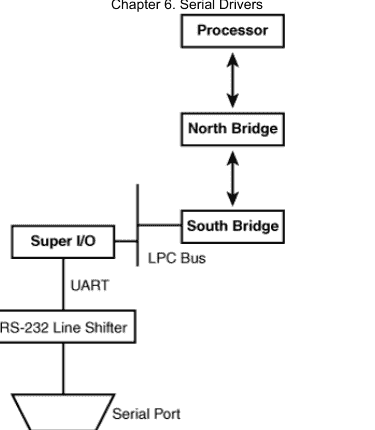

尽管 RS-232 通信通道是常见的串行硬件类型，但内核的串行子系统以通用架构设计，以服务于不同的用户。以下情况会涉及串行子系统：

- 通过 RS-232 串行链路运行终端会话
- 通过拨号、蜂窝网络或软件调制解调器连接到互联网
- 与使用串行传输的设备（如触摸控制器、智能卡、蓝牙芯片或红外 USB 适配器）进行交互
- 使用 USB 转串行转换器模拟串行端口
- 通过 RS-485 链路进行通信，RS-485 是 RS-232 的多点变种，具有更大的范围和更好的抗噪性

在本章中，让我们了解内核如何构建串行子系统。我们将使用 Linux 手机作为示例来了解底层 UART 驱动程序，并使用串行触摸控制器作为示例来探索更高层行规程的实现细节。

PC 上通常找到的 UART 是 National Semiconductor 的 16550，或者是其他厂商的兼容芯片，因此你将在代码和文档中看到“16550 型 UART”的引用。8250 芯片是 16550 的前身，因此 Linux 对 PC UART 的驱动程序被命名为 **8250.c**。

## 分层架构

正如你刚才所见，串行子系统的用户众多且各不相同。这促使内核开发人员使用以下组件构建分层串行架构：

1. 关注 UART 或其他底层串行硬件内部结构的低级驱动程序。
2. 与低级驱动程序接口的 tty 驱动层。tty 驱动程序使更高层从硬件的复杂性中隔离出来。
3. “处理”与 tty 驱动程序交换数据的行规程。行规程塑造串行层的行为，并帮助重用底层以支持不同的技术。

为了帮助自定义驱动程序实现，串行子系统还提供核心 API，将这些层的共性提取出来。

**图 6.2** 显示了各层之间的连接。N_TTY、N_IRDA 和 N_PPP 是可即插即用的行规程，分别使串行子系统支持终端、红外和拨号网络。**图 6.3** 将串行子系统映射到内核源文件。

### 图 6.2. 串行子系统中各层之间的连接。

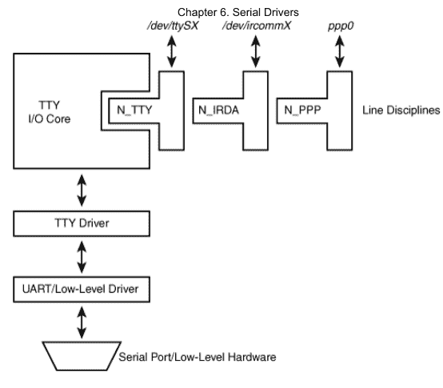

### 图 6.3. 串行层映射到内核源代码。

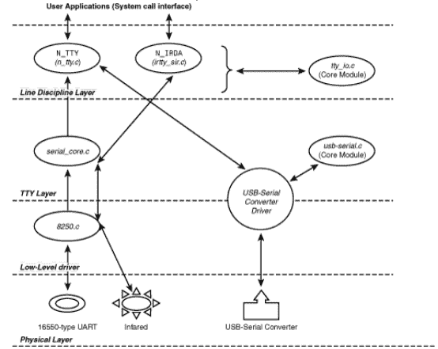

为了说明分层串行架构的优势，让我们使用一个示例。假设你正在使用 USB 转串行适配器为没有串行端口的笔记本电脑提供串行功能。一种可能的场景是你使用 `kgdb` 从主机笔记本电脑调试目标嵌入式设备上的内核（`kgdb` 在第 21 章“调试设备驱动程序”中讨论），如图 6.4 所示。

### 图 6.4. 使用 USB 转串行转换器。

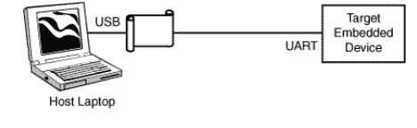

如图 6.3 所示，你首先在主机笔记本电脑上需要合适的 USB 物理层驱动程序（UART 驱动程序的 USB 对应物）。这存在于内核 USB 子系统，`drivers/usb/` 中。接下来，你需要一个位于 USB 物理层之上的 tty 驱动程序。`usbserial` 驱动程序（`drivers/usb/serial/usb-serial.c`）是实现通用 USB 串行转换器上的通用 tty 的核心层。该驱动程序与转换器驱动程序（例如，如果你使用的是 Keyspan 适配器，则为 `drivers/usb/serial/keyspan.c`）注册的设备特定 tty 方法相结合，构成了 tty 层。最后但同样重要的是，你需要 `N_TTY` 行规程进行终端 I/O 处理。

tty 驱动程序将行规程和更高层与 USB 内部结构隔离开来。实际上，行规程仍然认为它是在常规 UART 上运行的。这是因为 tty 驱动程序从 USB 请求块 (`URB`)（在第 11 章“通用串行总线”中讨论）中提取数据，并将其封装成 `N_TTY` 行规程期望的格式。分层架构因此使实现更简单——从行规程向上的所有模块都可以保持不变地重用。

前面的示例使用了技术特定的 tty 驱动程序和通用的行规程。反向使用也很常见。在第 16 章“无线路由 Linux”中讨论的红外堆栈使用通用的 tty 驱动程序和名为 `N_IRDA` 的技术特定行规程。

正如你可能在图 6.2 和图 6.3 中注意到的，尽管 UART 驱动程序是字符驱动程序，但它们并不像我们在前一章中看到的常规字符驱动程序那样直接向内核系统调用暴露接口。相反，UART 驱动程序（如下一章讨论的键盘驱动程序）服务另一个内核层，即 tty 层。I/O 系统调用从顶层行规程上方开始其旅程，最终通过 tty 层传递到 UART 驱动程序。

在本章的其余部分，让我们更仔细地查看串行层的不同驱动程序组件。我们从串行堆栈底部的低级 UART 驱动程序开始，然后继续到中级 tty 驱动程序，最后到高级行规程驱动程序。

## UART 驱动程序

UART 驱动程序围绕三个关键数据结构展开。这三个结构均在 `include/linux/serial_core.h` 中定义：

- 1. 每个 UART 驱动的结构体 `struct uart_driver`：

```c
struct uart_driver {
    struct module   *owner;        /* 拥有此结构的模块 */
    const char      *driver_name;  /* 名称 */
    const char      *dev_name;     /* 设备节点名称
                                        例如 ttyS */
    /* ... */
    int             major;         /* 主设备号 */
    int             minor;         /* 次设备号 */
    /* ... */
    struct tty_driver *tty_driver; /* tty 驱动 */
};
```

每个字段旁边的注释解释了对应的语义。`owner` 字段提供了与前一章中讨论的 `file_operations` 结构体相似的好处。

- 2. `struct uart_port`。对于 UART 驱动拥有的每个端口，都存在该结构的一个实例：

```c
struct uart_port {
    spinlock_t      lock;          /* 端口自旋锁 */
    unsigned int    iobase;        /* 输入/输出基址 [bw] */
    unsigned char   __iomem *membase; /* 内存映射读写 [bwl] */
    unsigned int    irq;           /* IRQ 号 */
    unsigned int    uartclk;       /* 基础 UART 时钟 */
    unsigned char   fifosize;      /* 发送 FIFO 大小 */
    unsigned char   x_char;        /* Xon/Xoff 流量
                                        控制 */
    /* ... */
};
```

- 3. `struct uart_ops`。这是每个 UART 驱动必须支持的入口点的超集，描述了在物理硬件上可以执行的操作。该结构中的方法由 tty 层调用：


```c
struct uart_ops {
    uint (*tx_empty)(struct uart_port *);    /* 发送 FIFO 是否为空？ */
    void (*set_mctrl)(struct uart_port *,
                       unsigned int mctrl);  /* 设置调制解调器控制参数 */
    uint (*get_mctrl)(struct uart_port *);    /* 获取调制解调器控制参数 */
    void (*stop_tx)(struct uart_port *);      /* 停止发送 */
    void (*start_tx)(struct uart_port *);     /* 启动发送 */
    /* ... */
    void (*shutdown)(struct uart_port *);     /* 禁用端口 */
    void (*set_termios)(struct uart_port *,
 struct termios *new,
 struct termios *old); /* 设置终端接口参数 */
    /* ... */
    void (*config_port)(struct uart_port *,
 int); /* 配置 UART 端口 */
    /* ... */
};
```

UART 驱动需要执行两个重要步骤才能与内核建立关联：

- 1. 通过调用 `uart_register_driver(struct uart_driver *)` 向串行核心注册。
- 2. 调用 `uart_add_one_port(struct uart_driver *, struct uart_port *)` 以注册其支持的每个单独端口。如果串行硬件是热插拔的，则端口是从探测设备存在性的入口点向核心注册的。请参考第 10 章“外围组件互连”中列表 10.4 的 CardBus 调制解调器驱动，这是一个串行设备热插接的示例。注意，一些驱动使用封装注册函数 `serial8250_register_port(struct uart_port *)`，该函数内部调用了 `uart_add_one_port()`。

这些数据结构和注册函数构成了所有 UART 驱动中的最小公分母。有了这些结构和例程，让我们开发一个示例 UART 驱动。

## 设备示例：手机

考虑一款围绕嵌入式 *片上系统*（SoC）构建的 Linux 手机。SoC 有两个内置 UART，但如图 6.5 所示，它们已被用完：一个用于与蜂窝调制解调器通信，另一个用于与蓝牙芯片组交互。由于没有空闲的 UART 可供调试使用，该手机使用两个 USB 转串行转换器芯片：一个为 PC 主机提供调试终端，另一个用于获得备用端口。正如本章前面所见，USB 转串行转换器允许你通过 USB 将串行设备连接到 PC。我们将在第 11 章中进一步讨论 USB 转串行转换器。

图 6.5. Linux 手机上的 USB_UART 端口。


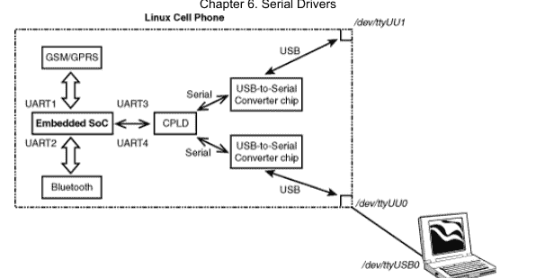

两个 USB 转串行转换器芯片的串行侧通过 *复杂可编程逻辑器件* 或 CPLD 连接到 SoC（参见第 18 章“嵌入 Linux”中的“CPLD/FPGA”章节）。CPLD 通过为每个 USB 转串行转换器提供三寄存器接口来创建两个虚拟 UART（或 _USB_UART_），如表 6.1 所示：状态寄存器、读取数据寄存器和写入数据寄存器。要向 _USB_UART_ 写入字符，需循环检查状态寄存器中的某一位，该位在芯片内部发送 _先进先出_（FIFO）内存有空间时清除，然后将字节写入写入数据寄存器。要读取字符，需等待状态寄存器中指定的某一位显示接收 FIFO 中存在数据，然后从读取数据寄存器读取。

_UU_STATUS_REGISTER_

位：检查发送 FIFO 是否已满或接收 FIFO 是否为空

0x0

_UU_READ_DATA_REGISTER_

从 _USB_UART_ 读取字符

0x1

_UU_WRITE_DATA_REGISTER_

向 _USB_UART_ 写入字符

0x2

**表 6.1. _USB_UART_ 的寄存器布局**

| 寄存器名称 | 描述 | 距 _USB_UART_ 内存基址的偏移量 |
| :--- | :--- | :--- |
| _UU_STATUS_REGISTER_ | 位：检查发送 FIFO 是否已满或接收 FIFO 是否为空 | 0x0 |
| _UU_READ_DATA_REGISTER_ | 从 _USB_UART_ 读取字符 | 0x1 |
| _UU_WRITE_DATA_REGISTER_ | 向 _USB_UART_ 写入字符 | 0x2 |

在 PC 端，使用适当的 Linux `_usbserial_` 驱动（例如，如果你在手机上使用 FT232AM 芯片，则使用 `_drivers/usb/serial/ftdi_sio.c_`）来创建和管理对应于 USB-串行端口的 ` /dev/ttyUSBX ` 设备节点。你可以通过这些设备节点之一运行终端模拟器（如 `_minicom_`）来获得来自手机的控制台或调试终端。在手机端，我们必须为 `_USB_UART_` 实现一个 UART 驱动。该驱动创建并管理 ` /dev/ttyUUX ` 节点，这些节点负责链接设备端的通信。

图 6.5 中所示的手机可以充当蓝牙设备的智能网关——连接至 GSM 网络，进而连接至互联网。例如，手机可以将你的蓝牙血压监测仪的数据传输至你医疗保健提供者的互联网服务器。或者，如果检测到与你的蓝牙心率监测仪通信时出现问题，它还可以向医生发出警报。第 13 章“音频驱动”中使用的蓝牙 MP3 播放器以及第 16 章中使用的蓝牙药丸分发器也是可以使用 Linux 手机实现互联网接入的设备示例。

列表 6.1 实现了 `USB_UART` 驱动。它被实现为一个 *平台驱动*。平台是一种伪总线，通常用于将集成到 SoC 中的轻量级设备与 Linux 设备模型关联起来。平台由以下部分组成：

- 1. 平台设备。架构特定的设置代码使用 `platform_device_register()` 或其简化版本 `platform_device_register_simple()` 添加平台设备。你还可以通过 `platforms_add_devices()` 一次性注册多个平台设备。在 `include/linux/platform_device.h` 中定义的 `platform_device` 结构代表一个平台设备：

```c
struct platform_device {
  const char *name;  /* 设备名称 */
  u32 id;            /* 使用此字段注册平台设备的多个
                     * 实例。在此示例中，两个 USB_UART
                     * 具有不同的 ID。 */
  struct device dev; /* 包含一个 release() 方法和
                     * 平台数据 */
  /* ... */
};
```

- 2. 平台驱动。平台驱动使用 `platform_driver_register()` 注册到平台中。`platform_driver` 结构也在 `include/linux/platform_device.h` 中定义，代表一个平台驱动：

```c
struct platform_driver {
  int (*probe)(struct platform_device *); /* 探测方法 */
  int (*remove)(struct platform_device *); /* 移除方法 */
  /* ... */
  /* 以下结构中的 name 字段应与相关
     platform_device 结构中的 name 字段匹配 */
  struct device_driver driver;
};
```

关于平台设备和驱动的更多信息，请参阅 `Documentation/driver-model/platform.txt`。为简单起见，我们的示例驱动注册了平台设备和平台驱动。


在初始化期间，`USB_UART` 驱动首先使用 `uart_register_driver()` 向串行核心注册自身。完成后，你会发现 `/proc/tty/drivers` 中有一条以 `usb_uart` 开头的新行。接下来，驱动使用 `platform_device_register_simple()` 注册两个平台设备（每个 `USB_UART` 一个）。如前所述，平台设备注册通常在启动时的主板设置阶段完成。随后，驱动使用 `platform_driver_register()` 注册平台驱动入口点（`probe()`、`remove()`、`suspend()` 和 `resume()`）。`USB_UART` 平台驱动与上述两个平台设备关联，并具有匹配的名称（`usb_uart`）。此步骤完成后，你会看到 sysfs 中出现两个新目录，每个目录对应一个 `USB_UART` 端口：`/sys/devices/platform/usb_uart.0` 和 `/sys/devices/platform/usb_uart.1/`。

由于 Linux 设备层现在检测到已注册的 `USB_UART` 平台设备名称相匹配的平台驱动，它会为每个 `USB_UART` 调用属于该平台的驱动入口点¹¹（`usb_uart_probe()`）。探测入口点使用 `uart_add_one_port()` 添加相应的 `USB_UART` 端口。

这会触发 `config_port()` 入口点（之前讨论的 `uart_ops` 结构的一部分）的调用，该点用于声明并映射 `USB_UART` 寄存器空间。如果两个 `USB_UART` 端口都成功添加，串口核心将输出以下内核消息：

> [1] 此类平台设备通常无法热插拔。`probe()` 方法的这种调用语义与你在后续章节中将了解的针对 PCMCIA、PCI 和 USB 等可热插拔设备的语义不同，但驱动入口点的相似结构有助于 Linux 设备模型对所有设备保持统一且一致的看法。

```
ttyU00 at MMIO 0xe8000000 (irq = 3) is a USB_UART
ttyU01 at MMIO 0xe9000000 (irq = 4) is a USB_UART
```

然而，中断（IRQ）的声明会延迟到应用程序打开 `USB_UART` 端口时才执行。当应用程序关闭 `USB_UART` 时，中断将被释放。表 6.2 追溯了驱动中用于声明和释放内存区域及中断的代码路径。

### 资源声明与释放路径

- 模块插入

```
usb_uart_init()
  uart_register_driver()
    usb_uart_probe()
      uart_add_one_port()
        usb_uart_config_port()
        request_mem_region()
```

- 模块卸载

```
usb_uart_exit()
  uart_unregister_driver()
    usb_uart_remove()
      uart_remove_one_port()
        usb_uart_release_port()
        release_mem_region()
          Open /dev/ttyUXX
            usb_uart_startup()
              request_irq()
          Close /dev/ttyUXX
            usb_uart_shutdown()
              free_irq()
```

表 6.2. 声明和释放内存及中断资源

在发送路径中，驱动从与 UART 端口关联的环形缓冲区收集出站数据。如 UART 驱动的 `start_tx()` 入口点 `usb_uart_start_tx()` 所示，数据存在于 `port->info->xmit.buf[port->info->xmit.tail]` 中。

在接收路径中，驱动使用 `tty_insert_flip_char()` 和 `tty_flip_buffer_push()` 将从 `USB_UART` 收集的数据推送到关联的 tty 驱动。这是在接收中断处理程序 `usb_uart_rxint()` 中完成的。在阅读完下一节“TTY 驱动”后，请重新审视例程。

### 清单 6.1. Linux 手机的 USB_UART 驱动

清单 6.1 使用注释来解释驱动入口点的目的及其操作。为了减少不必要的细节，它保留 `uart_ops` 结构中的某些入口点未实现。


```c
#include <linux/console.h>
#include <linux/platform_device.h>
#include <linux/tty.h>
#include <linux/tty_flip.h>
#include <linux/serial_core.h>
#include <linux/serial.h>
#include <asm/irq.h>
#include <asm/io.h>

#define USB_UART_MAJOR    200   /* You've to get this assigned */
#define USB_UART_MINOR_START 70   /* Start minor numbering here */
#define USB_UART_PORTS    2     /* The phone has 2 USB_UARTs */
#define PORT_USB_UART     30    /* UART type. Add this to
                                  include/linux/serial_core.h */

/* Each USB_UART has a 3-byte register set consisting of
   UU_STATUS_REGISTER at offset 0, UU_READ_DATA_REGISTER at
   offset 1, and UU_WRITE_DATA_REGISTER at offset 2 as shown
   in Table 6.1 */
#define USB_UART1_BASE    0xe8000000 /* Memory base for USB_UART1 */
#define USB_UART2_BASE    0xe9000000 /* Memory base for USB_UART2 */
#define USB_UART_REGISTER_SPACE 0x3

/* Semantics of bits in the status register */
#define USB_UART_TX_FULL  0x20   /* TX FIFO is full */
#define USB_UART_RX_EMPTY 0x10   /* TX FIFO is empty */
#define USB_UART_STATUS   0x0F   /* Parity/frame/overruns? */

#define USB_UART1_IRQ     3      /* USB_UART1 IRQ */
#define USB_UART2_IRQ     4      /* USB_UART2 IRQ */
#define USB_UART_FIFO_SIZE 32   /* FIFO size */
#define USB_UART_CLK_FREQ 16000000

static struct uart_port usb_uart_port[]; /* Defined later on */

/* Write a character to the USB_UART port */
static void
usb_uart_putc(struct uart_port *port, unsigned char c)
{
    /* Wait until there is space in the TX FIFO of the USB_UART.
       Sense this by looking at the USB_UART_TX_FULL bit in the
       status register */
    while (__raw_readb(port->membase) & USB_UART_TX_FULL);

    /* Write the character to the data port*/
    __raw_writeb(c, (port->membase+1));
}

/* Read a character from the USB_UART */
static unsigned char
usb_uart_getc(struct uart_port *port)
{
    /* Wait until data is available in the RX FIFO */
    while (__raw_readb(port->membase) & USB_UART_RX_EMPTY);

    /* Obtain the data */
    return(__raw_readb(port->membase+2));
}

/* Obtain USB_UART status */
static unsigned char
usb_uart_status(struct uart_port *port)
{
	return(__raw_readb(port->membase) & USB_UART_STATUS);
}

/*
 * Claim the memory region attached to USB_UART port. Called
 * when the driver adds a USB_UART port via uart_add_one_port().
 */
static int
usb_uart_request_port(struct uart_port *port)
{
	if (!request_mem_region(port->mapbase, USB_UART_REGISTER_SPACE,
					"usb_uart")) {
		return -EBUSY;
	}
	return 0;
}

/* Release the memory region attached to a USB_UART port.
 * Called when the driver removes a USB_UART port via
 * uart_remove_one_port().
 */
static void
usb_uart_release_port(struct uart_port *port)
{
	release_mem_region(port->mapbase, USB_UART_REGISTER_SPACE);
}

/*
 * Configure USB_UART. Called when the driver adds a USB_UART port.
 */
static void
usb_uart_config_port(struct uart_port *port, int flags)
{
	if (flags & UART_CONFIG_TYPE && usb_uart_request_port(port) == 0)
	{
		port->type = PORT_USB_UART;
	}
}

/* Receive interrupt handler */
static irqreturn_t
usb_uart_rxint(int irq, void *dev_id)
{
	struct uart_port *port = (struct uart_port *) dev_id;
	struct tty_struct *tty = port->info->tty;

	unsigned int status, data;
	/* ... */
	do {
		/* ... */
		/* Read data */
		data = usb_uart_getc(port);
		/* Normal, overrun, parity, frame error? */
		status = usb_uart_status(port);
		/* Dispatch to the tty layer */
		tty_insert_flip_char(tty, data, status);
		/* ... */
	} while (more_chars_to_be_read()); /* More chars */
	/* ... */
	tty_flip_buffer_push(tty);

	return IRQ_HANDLED;
}

/* Called when an application opens a USB_UART */
static int
usb_uart_startup(struct uart_port *port)
{
	int retval = 0;
	/* ... */
	/* Request IRQ */
	if ((retval = request_irq(port->irq, usb_uart_rxint, 0,
			"usb_uart", (void *)port))) {
		return retval;
	}
	/* ... */
	return retval;
}

/* Called when an application closes a USB_UART */
static void
usb_uart_shutdown(struct uart_port *port)
{
	/* ... */
	/* Free IRQ */
	free_irq(port->irq, port);

	/* Disable interrupts by writing to appropriate
	   registers */
	/* ... */
}

/* Set UART type to USB_UART */
static const char *
usb_uart_type(struct uart_port *port)
{
	return port->type == PORT_USB_UART ? "USB_UART" : NULL;
}

/* Start transmitting bytes */
static void
usb_uart_start_tx(struct uart_port *port)
{
	while (1) {
		/* Get the data from the UART circular buffer and
	   write it to the USB_UART's WRITE_DATA register */
		usb_uart_put(port,
			port->info->xmit.buf[port->info->xmit.tail]);
		/* Adjust the tail of the UART buffer */
		port->info->xmit.tail = (port->info->xmit.tail + 1) &
				(UART_XMIT_SIZE - 1);

		/* Statistics */
		port->icount.tx++;
		/* Finish if no more data available in the UART buffer */
		if (uart_circ_empty(&port->info->xmit)) break;
	}
	/* ... */
}

/* The UART operations structure */
static struct uart_ops usb_uart_ops = {
	.start_tx = usb_uart_start_tx, /* Start transmitting */
	.startup = usb_uart_startup, /* App opens USB_UART */
	.shutdown = usb_uart_shutdown, /* App closes USB_UART */
	.type = usb_uart_type, /* Set UART type */
	.config_port = usb_uart_config_port, /* Configure when driver
		adds a USB_UART port */
	.request_port = usb_uart_request_port, /* Claim resources
		associated with a USB_UART port */
	.release_port = usb_uart_release_port, /* Release resources
		associated with a USB_UART port */
#if 0 /* Left unimplemented for the USB_UART */
	.tx_empty = usb_uart_tx_empty, /* Transmitter busy? */
	.set_mctrl = usb_uart_set_mctrl, /* Set modem control */
	.get_mctrl = usb_uart_get_mctrl, /* Get modem control */
	.stop_tx = usb_uart_stop_tx, /* Stop transmission */
	.stop_rx = usb_uart_stop_rx, /* Stop reception */
	.enable_ms = usb_uart_enable_ms, /* Enable modem status
		signals */
	.set_termios = usb_uart_set_termios, /* Set termios */
#endif
};

static struct uart_driver usb_uart_reg = {
	.owner = THIS_MODULE, /* Owner */
	.driver_name = "usb_uart", /* Driver name */
	.dev_name = "ttyU0", /* Node name */
	.major = USB_UART_MAJOR, /* Major number */
	.minor = USB_UART_MINOR_START, /* Minor number start */
	.nr_ports = USB_UART_PORTS, /* Number of UART ports */
	.cons = &usb_uart_console, /* Pointer to the console
		structure. Discussed in Chapter
		12, “Video Drivers" */
};

/* Called when the platform driver is unregistered */
static int
usb_uart_remove(struct platform_device *dev)
{
	platform_set_drvdata(dev, NULL);

	/* Remove the USB_UART port from the serial core */
	uart_remove_one_port(&usb_uart_reg, &usb_uart_port[dev->id]);
	return 0;
}

/* Suspend power management event */
static int
usb_uart_suspend(struct platform_device *dev, pm_message_t state)
```


```c
{
    uart_suspend_port(&usb_uart_reg, &usb_uart_port[dev->id]);
    return 0;
}

/* Resume after a previous suspend */
static int
usb_uart_resume(struct platform_device *dev)
{
    uart_resume_port(&usb_uart_reg, &usb_uart_port[dev->id]);
    return 0;
}

/* Parameters of each supported USB_UART port */
static struct uart_port usb_uart_port[] = {
 {
    .mapbase    = (unsigned int) USB_UART1_BASE,
    .iotype     = UPIO_MEM,           /* Memory mapped */
    .irq        = USB_UART1_IRQ,      /* IRQ */
    .uartclk    = USB_UART_CLK_FREQ,  /* Clock HZ */
    .fifosize   = USB_UART_FIFO_SIZE, /* Size of the FIFO */
    .ops        = &usb_uart_ops,      /* UART operations */
    .flags      = UPF_BOOT_AUTOCONF,  /* UART port flag */
    .line       = 0,                  /* UART port number */
},
 {
    .mapbase    = (unsigned int)USB_UART2_BASE,
    .iotype     = UPIO_MEM,           /* Memory mapped */
    .irq        = USB_UART2_IRQ,      /* IRQ */
    .uartclk    = USB_UART_CLK_FREQ,  /* Clock HZ */
    .fifosize   = USB_UART_FIFO_SIZE, /* Size of the FIFO */
    .ops        = &usb_uart_ops,      /* UART operations */
    .flags      = UPF_BOOT_AUTOCONF,  /* UART port flag */
    .line       = 1,                  /* UART port number */
};

/* Platform driver probe */
static int __init
usb_uart_probe(struct platform_device *dev)
{
/* ... */

/* Add a USB_UART port. This function also registers this device
 * with the tty layer and triggers invocation of the config_port()
 * entry point */
    uart_add_one_port(&usb_uart_reg, &usb_uart_port[dev->id]);
    platform_set_drvdata(dev, &usb_uart_port[dev->id]);
    return 0;
}

struct platform_device *usb_uart_plat_device1; /* Platform device */
                                          /* for USB_UART 1 */
struct platform_device *usb_uart_plat_device2; /* Platform device */
                                          /* for USB_UART 2 */

static struct platform_driver usb_uart_driver = {
    .probe    = usb_uart_probe,             /* Probe method */
    .remove   = __exit_p(usb_uart_remove),  /* Detach method */
    .suspend  = usb_uart_suspend,          /* Power suspend */
    .resume   = usb_uart_resume,            /* Resume after a suspend */
    .driver = {
  .name = "usb_uart",
                               /* Driver name */
},
};

/* Driver Initialization */
static int __init
usb_uart_init(void)
{
  int retval;

  /* Register the USB_UART driver with the serial core */
  if ((retval = uart_register_driver(&usb_uart_reg))) {
    return retval;
  }

  /* Register platform device for USB_UART 1. Usually called
     during architecture-specific setup */
  usb_uart_plat_device1 =
    platform_device_register_simple("usb_uart", 0, NULL, 0);
  if (IS_ERR(usb_uart_plat_device1)) {
    uart_unregister_driver(&usb_uart_reg);
    return PTR_ERR(usb_uart_plat_device1);
  }

  /* Register platform device for USB_UART 2. Usually called
     during architecture-specific setup */
  usb_uart_plat_device2 =
    platform_device_register_simple("usb_uart", 1, NULL, 0);
  if (IS_ERR(usb_uart_plat_device2)) {
    uart_unregister_driver(&usb_uart_reg);
    platform_device_unregister(usb_uart_plat_device1);
    return PTR_ERR(usb_uart_plat_device2);
  }

  /* Announce a matching driver for the platform
     devices registered above */
  if ((retval = platform_driver_register(&usb_uart_driver))) {
    uart_unregister_driver(&usb_uart_reg);
    platform_device_unregister(usb_uart_plat_device1);
    platform_device_unregister(usb_uart_plat_device2);
  }
  return 0;
}

/* Driver Exit */
static void __exit
usb_uart_exit(void)
{
  /* The order of unregistration is important. Unregistering the
     UART driver before the platform driver will crash the system */

  /* Unregister the platform driver */
  platform_driver_unregister(&usb_uart_driver);

  /* Unregister the platform devices */
  platform_device_unregister(usb_uart_plat_device1);
  platform_device_unregister(usb_uart_plat_device2);

  /* Unregister the USB_UART driver */
  uart_unregister_driver(&usb_uart_reg);
}

module_init(usb_uart_init);
module_exit(usb_uart_exit);
```


## RS-485

RS-485 不像 RS-232 那样是标准的 PC 接口，但在嵌入式领域中，你可能会遇到使用 RS-485 连接与控制系统可靠通信的计算机。与只有几十英尺传输范围的 RS-232 不同，RS-485 使用差分信号，使其能够在长达数千英尺的距离内交换数据。在处理器端，RS-485 接口是一个工作在半双工模式的 UART。因此，在将数据从发送 FIFO 发送到线路之前，UART 设备驱动程序需要额外启用 RS-485 发送器并禁用接收器，这可能需要操作相关的 GPIO 引脚。为了将数据从线路获取到接收 FIFO，UART 驱动程序必须执行相反的操作。

必须在串行层的正确位置启用/禁用 RS-485 发送器/接收器。如果过早禁用发送器，它可能没有足够的时间排空发送 FIFO 中的最后几个字节，这会导致数据截断。另一方面，如果过晚禁用发送器，则会阻止该时间段内的数据接收，这可能导致接收数据丢失。

RS-485 支持多点连接（multidrop），因此，如果总线上连接了多个设备，较高层协议必须实现适当的寻址机制。RS-485 不支持使用`请求发送`（RTS）和`清除发送`（CTS）的硬件流控线。

## TTY 驱动程序

现在，让我们来看看位于 tty 驱动程序核心的结构和注册函数。有三个结构对其操作至关重要：

1. 定义在 `include/linux/tty.h` 中的 `struct tty_struct`。该结构包含与打开的 tty 相关的所有状态信息。这是一个庞大的结构，但这里列出了一些重要字段：

```c
struct tty_struct {
    int magic;                    /* Magic marker */
    struct tty_driver *driver;    /* Pointer to the tty
                                     driver */
    struct tty_ldisc ldisc;       /* Attached Line
                                     discipline */
    /* ... */
    struct tty_flip_buffer flip;  /* Flip Buffer. See
                                     below. */
    /* ... */
    wait_queue_head_t write_wait; /* See the section
                                     "Line Disciplines" */
    wait_queue_head_t read_wait;  /* See the section
                                     "Line Disciplines" */
    /* ... */
};
```

2. 嵌入在 `tty_struct` 内部的结构体 `struct tty_flip_buffer` 或翻转缓冲区。这是数据收集和处理机制的核心：

```c
struct tty_flip_buffer {
    /* ... */
    struct semaphore pty_sem;     /* Serialize */
    char *char_buf_ptr;           /* Pointer to the flip
                                     buffer */
    /* ... */
    unsigned char char_buf[2*TTY_FLIPBUFF_SIZE]; /* The flip
                                     buffer */
    /* ... */
};
```

低级串行驱动程序使用翻转缓冲区的一半来收集数据，而线路纪律使用另一半来处理数据。然后串行驱动程序和线路纪律使用的缓冲区指针会被翻转，过程继续。查看 `drivers/char/tty_io.c` 中的函数 `flush_to_ldisc()` 可以看到翻转的过程。

在最近的内核中，`tty_flip_buffer` 结构体已经被重新设计。它现在由一个缓冲区头（`tty_bufhead`）和一个缓冲区列表（`tty_buffer`）组成：

```c
struct tty_bufhead {
    /* ... */
    struct semaphore pty_sem;      /* Serialize */
    struct tty_buffer *head, tail, free; /* See below */
    /* ... */
};

struct tty_buffer {
    struct tty_buffer *next;
    char *char_buf_ptr; /* Pointer to the flip buffer */
    /* ... */
    unsigned long data[0]; /* The flip buffer, memory for
                            which is dynamically
                            allocated */
};
```

3. 定义在 `include/linux/tty_driver.h` 中的 `struct tty_driver`。它指定了 tty 驱动程序与高层之间的编程接口：

```c
struct tty_driver {
    int magic; /* Magic number */
    /* ... */
    int major; /* Major number */
    int minor_start; /* Start of minor number */
    /* ... */
    /* Interface routines between a tty driver and higher
       layers */
    int (*open)(struct tty_struct *tty, struct file *filp);
    void (*close)(struct tty_struct *tty, struct file *filp);
    int (*write)(struct tty_struct *tty,
                 const unsigned char *buf, int count);
    void (*put_char)(struct tty_struct *tty,
                     unsigned char ch);
    /* ... */
};
```

与 UART 驱动程序类似，tty 驱动程序需要执行两个步骤才能向内核注册自身：

1. 调用 `tty_register_driver(struct tty_driver *tty_d)` 向 tty 核心注册自身。

2. 调用 `tty_register_device(struct tty_driver *tty_d, unsigned device_index, struct device *device)` 注册其支持的每个单独 tty。

我们不会开发示例 tty 驱动程序，但这里列出了 Linux 上常用的一些：

- 第 16 章讨论的通过蓝牙进行串行模拟是以 tty 驱动程序的形式实现的。该 `driver`(`drivers/net/bluetooth/rfcomm/tty.c`) 在初始化期间调用 `tty_register_driver()`，并在处理每个传入的蓝牙连接时调用 `tty_register_device()`。

- 要在 Linux 桌面环境中使用系统控制台，你需要 `虚拟终端`(VT) 的服务，如果

如果处于文本模式，则它们处于 `伪终端` (PTY)；如果处于图形模式，则处于虚拟终端 (VT)。VT 和 PTY 通过 tty 驱动程序实现，分别位于 `drivers/char/vt.c` 和 `drivers/char/pty.c` 中。

- 用于传统 UART 的 tty 驱动程序位于 `drivers/serial/serial_core.c`。

- USB 串行 tty 驱动程序位于 `drivers/usb/serial/usb-serial.c`。

## 行规程（Line Disciplines）

行规程提供了一种优雅的机制，允许你使用相同的串行驱动程序运行不同的技术。低级物理驱动程序和 tty 驱动程序负责处理数据的传输（即与硬件之间的数据交换），而行规程则负责处理数据并将其在内核空间和用户空间之间传递。


# 串行子系统支持 17 种标准行规程

打开串行端口时默认附加的行规程是 `N_TTY`，它实现了终端 I/O 处理。`N_TTY` 负责“烹饪”（即处理）从键盘接收到的字符。根据用户请求，它将控制字符映射为换行符，将小写字母转换为大写字母，展开制表符，并将字符回显到关联的虚拟终端 `VT`。`N_TTY` 还支持一种原始模式，供编辑器使用，该模式将上述所有处理任务留给用户应用程序。请参见下一章“输入驱动程序”中的图 7.3，以了解键盘子系统如何连接到 `N_TTY`。上一节“TTY 驱动程序”末尾列出的示例 `tty` 驱动程序默认使用 `N_TTY`。

行规程还实现了基于串行传输协议的网络接口。例如，作为点对点协议 `N_PPP` 和串行线路互联网协议 `N_SLIP` 子系统的一部分的行规程，会对数据包进行封装，分配并填充相关的网络数据结构，然后将数据传递给对应的网络协议栈。其他行规程处理红外数据 `N_IRDA` 和蓝牙主机控制接口 `N_HCI`。

## 设备示例：触摸控制器

让我们通过实现一个简单的串行触摸屏控制器行规程来深入了解行规程的内部工作原理。图 6.6 展示了嵌入式笔记本电脑衍生产品中触摸控制器的连接方式。触摸控制器的有限状态机 `FSM` 是实现行规程的候选对象，因为它可以利用串行层提供的设施和接口。

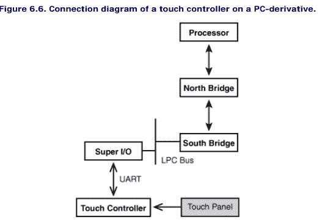

### 打开与关闭

要创建行规程，需定义一个 `struct tty_ldisc` 并向内核注册一组规定的入口点。清单 6.2 包含一段代码片段，该代码针对示例触摸控制器执行了这两项操作。

#### 清单 6.2. 行规程操作

```
struct tty_ldisc n_touch_ldisc = {
    TTY_LDISC_MAGIC,       /* Magic */
    "n_tch",
    N_TCH,                 /* Name of the line discipline */
    /* Line discipline ID number */
    n_touch_open,          /* Open the line discipline */
    n_touch_close,         /* Close the line discipline */
    n_touch_flush_buffer,  /* Flush the line discipline's read buffer */
    n_touch_chars_in_buffer,/* Get the number of processed characters in the line discipline's read buffer */
    n_touch_read,          /* Called when data is requested from user space */
    n_touch_write,         /* Write method */
    n_touch_ioctl,         /* I/O Control commands */
    NULL,                  /* We don't have a set_termios routine */
    n_touch_poll,          /* Poll */
    n_touch_receive_buf,   /* Called by the low-level driver to pass data to user space*/
    n_touch_receive_room,  /* Returns the room left in the line discipline's read buffer */
    n_touch_write_wakeup   /* Called when the low-level device driver is ready to transmit more data */
};
/* ... */
if ((err = tty_register_ldisc(N_TCH, &n_touch_ldisc))) {
    return err;
}
```

在清单 6.2 中，`n_tch` 是行规程的名称，而 `N_TCH` 是行规程标识符编号。你必须在 `include/linux/tty.h`（包含所有行规程定义的头文件）中指定 `N_TCH` 的值。可以在 `/proc/tty/ldiscs` 中找到系统中正在使用的行规程。

行规程从 `tty` 翻转缓冲区属于它们的那一半收集数据，处理这些数据，并将结果数据复制到本地读取缓冲区。对于 `N_TCH`，`n_touch_receive_room()` 返回读取缓冲区中剩余的内存，而 `n_touch_chars_in_buffer()` 返回读取缓冲区中已准备好交付给用户空间的已处理字符数量。`n_touch_write()` 和 `n_touch_write_wakeup()` 不做任何事，因为 `N_TCH` 是只读设备。`n_touch_open()` 负责为主要的行规程数据结构分配内存，如清单 6.3 所示。

#### 清单 6.3. 打开行规程

```
/* Private structure used to implement the Finite State Machine
(FSM) for the touch controller. The controller and the processor
communicate using a specific protocol that the FSM implements */
struct n_touch {
  int current_state;    /* Finite State Machine */
  spinlock_t touch_lock; /* Spinlock */
  struct tty_struct *tty; /* Associated tty */
  /* Statistics and other housekeeping */
  /* ... */
} *n_tch;

/* Device open() */
static int
n_touch_open(struct tty_struct *tty)
{
  /* Allocate memory for n_tch */
  if (!(n_tch = kmalloc(sizeof(struct n_touch), GFP_KERNEL))) {
    return -ENOMEM;
  }
  memset(n_tch, 0, sizeof(struct n_touch));

  tty->disc_data = n_tch; /* Other entry points now
                            have direct access to n_tch */
  /* Allocate the line discipline's local read buffer
     used for copying data out of the tty flip buffer */
  tty->read_buf = kmalloc(BUFFER_SIZE, GFP_KERNEL);
  if (!tty->read_buf) return -ENOMEM;

  /* Clear the read buffer */
  memset(tty->read_buf, 0, BUFFER_SIZE);

  /* Initialize lock */
  spin_lock_init(&n_tch->touch_lock);

  /* Initialize other necessary tty fields.
     See drivers/char/n_tty.c for an example */
  /* ... */

  return 0;
}
```

每当打开连接到触摸控制器的串行端口时，你可能希望将 `N_TCH` 设置为默认行规程（而不是 `N_TTY`）。参见“更改行规程”一节，了解如何从用户空间更改行规程。

## 读取路径

对于中断驱动的设备，读取数据路径通常由两个协同工作的线程组成：

1. 一个来自请求读取的用户进程的顶层线程
2. 一个源于从中断服务程序（该程序从设备收集数据）的底层线程

图 6.7 展示了与读取数据流相关的这些线程。中断处理程序将 `receive_buf()` 方法（在我们的示例中为 `n_touch_receive_buf()`）作为任务入队。你可以通过设置 `tty->low_latency` 标志来覆盖此行为。

### 图 6.7. 行规程读取路径

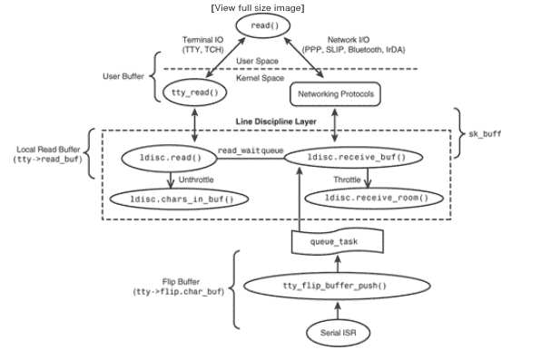


触摸控制器和处理器使用控制器数据手册中描述的特定协议进行通信。如前所述，驱动程序使用有限状态机（`FSM`）来实现此通信协议。清单 6.4 将此 `FSM` 编码为 `*receive_buf()*` 入口点 `n_touch_receive_buf()` 的一部分。

### 清单 6.4. `n_touch_receive_buf()` 方法

```
static void
n_touch_receive_buf(struct tty_struct *tty,
                    const unsigned char *cp, char *fp, int count)
{
    /* Work on the data in the line discipline's half of
     * the flip buffer pointed to by cp */

    /* Implement the Finite State Machine to interpret commands/data
     * arriving from the touch controller and put the processed data
     * into the local read buffer */

    /* Datasheet-dependent Code Region */
    switch (tty->disc_data->current_state) {
    case RESET:
        /* Issue a reset command to the controller */
        tty->driver->write(tty, 0, mode_stream_command,
                           sizeof(mode_stream_command));
        tty->disc_data->current_state = STREAM_DATA;
        break;
    case STREAM_DATA:
        break;
    case PARSING:
        tty->disc_data->current_state = PARSED;
        break;
    case PARSED:
        break;
    }

    if (tty->disc_data->current_state == PARSED) {
        /* If you have a parsed packet, copy the collected coordinate
         * and direction information into the local read buffer */
        spin_lock_irqsave(&tty->disc_data->touch_lock, flags);
        for (i=0; i < PACKET_SIZE; i++) {
            tty->disc_data->read_buf[tty->disc_data->read_head] =
                tty->disc_data->current_pkt[i];
            tty->disc_data->read_head =
                (tty->disc_data->read_head + 1) & (BUFFER_SIZE - 1);
            tty->disc_data->read_cnt++;
        }
        spin_lock_irqrestore(&tty->disc_data->touch_lock, flags);
    }
}
```

`n_touch_receive_buf()` 处理来自串行驱动程序的数据。它与触摸控制器交换一系列命令和响应，并将接收到的坐标和方向（按下/释放）

将信息写入行规程的读缓冲区。对读缓冲区的访问必须使用自旋锁进行序列化，因为它同时被图 6.7 中显示的 `idisc_receive_buf()` 和 `idisc.read()` 线程使用（在我们的示例中分别为 `n_touch_receive_buf()` 和 `n_touch_read()`）。正如你在列表 6.4 中所见，`n_touch_receive_buf()` 通过直接调用串口驱动程序的 `write()` 入口点，将命令分发给触摸控制器。

`n_touch_receive_buf()` 还需要做几件事：

1. 图 6.7 中顶部的 `read()` 线程在没有可用数据时会令调用进程休眠。因此，`n_touch_receive_buf()` 必须唤醒该线程，让它读取刚刚处理过的数据。
2. 如果行规程的读缓冲区空间即将耗尽，`n_touch_receive_buf()` 必须请求串口驱动程序对来自设备的数据进行节流。当 `idisc.read()` 将数据搬运到用户空间并释放读缓冲区中的内存时，负责请求相应的解节流操作。串口驱动程序使用软件或硬件流控机制来实现节流和解节流。

列表 6.5 执行了这两个操作。

### 列表 6.5. 唤醒读取线程并对串口驱动进行节流

```c
/* n_touch_receive_buf() 继续... */

/* 唤醒等待数据的任何线程 */
if (waitqueue_active(&tty->read_wait) &&
    (tty->read_cnt >= tty->minimum_to_wake))
    wake_up_interruptible(&tty->read_wait);

/* 如果缓冲区空间即将耗尽，请求串口驱动
   对传入数据进行节流 */
if (n_touch_receive_room(tty) < TOUCH_THROTTLE_THRESHOLD) {
    tty->driver.throttle(tty);
}

/* ... */
```

使用等待队列（`tty->read_wait`）在 `idisc.read()` 和 `idisc.receive_buf()` 线程之间进行同步。当 `idisc.read()` 未找到可读取的数据时，会将调用进程加入等待队列；而当有数据可供读取时，`idisc.receive_buf()` 会唤醒 `idisc.read()` 线程。因此，`n_touch_read()` 执行以下操作：

- 如果还没有可读数据，则令调用进程在 `read_wait` 队列上休眠。当数据到达时，进程会被 `n_touch_receive_buf()` 唤醒。
- 如果有可用数据，则从本地读缓冲区（`tty->read_buf[tty->read_tail]`）收集数据，并将其分发到用户空间。
- 如果串口驱动程序已处于节流状态，且此次读取后读缓冲区中有足够的空间，则请求串口驱动程序解除节流。

网络行规程通常分配一个 `sk_buff`（在第 15 章“网络接口卡”中讨论的 Linux 网络基本数据结构），并以此作为读缓冲区。它们没有 `read()` 方法，因为相应的 `receive_buf()` 会将接收到的数据复制到分配的 `sk_buff` 中，并直接传递给关联的协议栈。

## 写路径

行规程的 `write()` 入口点执行在将数据向下传递给底层驱动程序之前所需的任何后处理。

如果底层驱动程序无法接受行规程提供的所有数据，行规程将令请求线程休眠。当驱动程序准备接收更多数据时，其中断处理程序会唤醒行规程。为此，驱动程序调用行规程注册的 `write_wakeup()` 方法。相关的同步使用等待队列（`tty->write_wait`）完成，其操作与上一节中描述的 `read_wait` 队列类似。

许多网络行规程没有 `write()` 方法。协议实现直接将这些帧向下传输到串口设备驱动程序。然而，这些行规程通常仍有一个 `write_wakeup()` 入口点，以响应串口驱动程序对更多传输数据的请求。

`N_TCH` 也不需要 `write()` 方法，因为触摸控制器是一个只读设备。如你在列表 6.4 中所见，当需要向控制器发送命令帧时，接收路径中的例程直接与底层 UART 驱动程序通信。

## I/O 控制

用户程序可以通过 `ioctl()` 调用向设备发送命令，如第 5 章“字符驱动程序”中所述。当应用程序打开串口设备时，通常可以向其发出三类 `ioctl`：

- 串口设备驱动程序支持的命令，例如设置调制解调器信息的 `TIOCMISET`
- `tty` 驱动程序支持的命令，例如更改所附加行规程的 `TIOCSETD`
- 所附加行规程支持的命令，例如在 `N_TCH` 情况下重置触摸控制器的命令

`N_TCH` 的 `ioctl()` 实现基本上是标准的。支持的命令取决于触摸控制器数据表中描述的协议。

## 更多操作


另一个行规程操作是 `flush_buffer()`，用于刷新读缓冲区中挂起的任何数据。当行规程关闭时也会调用 `flush_buffer()`。它会唤醒等待更多数据的任何读取线程，方式如下：

```c
if (tty->link->packet) {
    wake_up_interruptible(&tty->disc_data->read_wait);
}
```

另一个入口点（`N_TCH` 不支持）是 `set_termios()`。`N_TTY` 行规程支持 `set_termios()` 接口，该接口用于设置特定于行规程数据处理选项。例如，你可以使用 `set_termios()` 将行规程设置为原始模式或“熟食”模式。某些特定于触摸控制器的选项（如更改波特率、校验位和停止位数）由底层设备驱动程序的 `set_termios()` 方法实现。

其余入口点（如 `poll()`）相当标准，如果你需要帮助，可以回到第 5 章查阅。

你可以将行规程作为内核的一部分进行编译，或者动态加载为模块。如果选择将其编译为模块，当然还必须提供在模块初始化和退出期间调用的函数。前者通常与 `init()` 方法相同。后者需要清理私有数据结构并注销行规程。注销规程只需一行代码：

```c
tty_unregister_ldisc(N_TCH);
```

驱动串行触摸控制器的更简单方法是利用内核输入子系统提供的服务以及内置的 `serport` 行规程。我们将在下一章介绍该技术。

## 更改行规程

当用户空间程序打开连接到触摸控制器的串口时，`N_TCH` 会绑定到底层串口驱动程序。但有时，用户空间应用程序可能希望将不同的行规程附加到设备。例如，你可能想编写一个程序来转储从触摸控制器接收到的原始数据而不进行处理。列表 6.6 打开触摸控制器并将行规程更改为 `N_TTY` 以转储传入的数据。

### 列表 6.6. 从用户空间更改行规程

```c
fd = open("/dev/ttySX", O_RDONLY | O_NOCTTY);

/* 此时，N_TCH 已附加到 /dev/ttySX，即触摸控制器使用的串口。
   切换到 N_TTY */
ldisc = N_TTY;
ioctl(fd, TIOCSETD, &ldisc);

/* 将 termios 设置为原始模式并转储传入的数据 */
/* ... */
```

`TIOCSETD` `ioctl()` 会关闭当前的行规程并打开新请求的行规程。

## 查看源代码

串口核心位于 `drivers/serial/` 中，但 tty 实现和底层驱动程序分散在源代码树的各个部分。例如，图 6.3 中提到的驱动文件位于四个不同的目录中：`drivers/serial/`、`drivers/char/`、`drivers/usb/serial/` 和 `drivers/net/irda/`。`drivers/serial/` 目录（现在也包含 UART 驱动程序）在 2.4 内核中并不存在；UART 特定代码过去分散在 `drivers/char/` 和 `arch/<your-arch>/` 目录中。目前的代码分区更合乎逻辑，因为访问串口层的不仅限于 UART 驱动程序——像 USB 转串口转换器和 IrDA 设备等也需要与串口核心通信。

查看 `drivers/serial/imx.c` 了解实际的底层 UART 驱动程序。它处理是 Freescale i.MX 系列嵌入式控制器一部分的 UART。

要了解 Linux 支持的行规程列表，请参见 `include/linux/tty.h`。要熟悉网络行规程，请查看 PPP（`drivers/net/ppp_async.c`）、蓝牙（`drivers/bluetooth/hci_ldisc.c`）、红外（`drivers/net/irda/irtty-sir.c`）和 SLIP（`drivers/net/slip.c`）的相应源文件。

表 6.3 总结了本章使用的主要数据结构及其在源代码树中的定义位置。表 6.4 列出了本章使用的主要内核编程接口及其定义位置。

### 表 6.3. 数据结构摘要

| 数据结构 | 位置 | 描述 |
| :--- | :--- | :--- |
| `uart_driver` | `include/linux/serial_core.h` | 底层 UART 驱动程序的表示。 |
| `uart_port` | `include/linux/serial_core.h` | UART 端口的表示。 |
| `uart_ops` | `include/linux/serial_core.h` | UART 驱动程序支持的入口点。 |
| `platform_device` | `include/linux/platform_device.h` | 平台设备的表示。 |
| `platform_driver` | `include/linux/platform_device.h` | 平台驱动的表示。 |
| `tty_struct` | `include/linux/tty.h` | 关于 tty 的状态信息。 |
| `tty_bufhead`, `tty_buffer` | `include/linux/tty.h` | 这两个结构实现了与 tty 关联的翻转缓冲区。 |
| `tty_driver` | `include/linux/tty_driver.h` | tty 驱动程序与更高层之间的编程接口。 |
| `tty_ldisc` | `include/linux/tty_ldisc.h` | 行规程支持的入口点。 |

### 表 6.4. 内核编程接口摘要

## 内核接口

| 内核接口 | 位置 | 描述 |
| :--- | :--- | :--- |
| `uart_register_driver()` | `drivers/serial/sdserial_core.c` | 向串口核心注册一个 UART 驱动程序 |
| `uart_add_one_port()` | `drivers/serial/sdserial_core.c` | 注册由 UART 驱动程序支持的 UART 端口 |
| `uart_unregister_driver()` | `drivers/serial/sdserial_core.c` | 从串口核心移除一个 UART 驱动程序 |
| `platform_device_register()` / `platform_device_register_simple()` / `platform_add_devices()` | `drivers/base/platform.c` | 注册一个平台设备 |
| `platform_device_unregister()` | `drivers/base/platform.c` | 注销一个平台设备 |
| `platform_driver_register()` / `platform_driver_unregister()` | `drivers/base/platform.c` | 注册/注销一个平台驱动程序 |
| `tty_insert_flip_char()` | `include/linux/tty_flip.h` | 向 tty 翻转缓冲区添加一个字符 |
| `tty_flip_buffer_push()` | `drivers/char/tty_io.c` | 将请求入队，以将翻转缓冲区推送到行规程 |
| `tty_register_driver()` | `drivers/char/tty_io.c` | 向串口核心注册一个 tty 驱动程序 |
| `tty_unregister_driver()` | `drivers/char/tty_io.c` | 从串口核心移除一个 tty 驱动程序 |
| `tty_register_ldisc()` | `drivers/char/tty_io.c` | 通过注册指定的入口点创建一个行规程 |
| `tty_unregister_ldisc()` | `drivers/char/tty_io.c` | 从串口核心移除一个行规程 |

某些串行数据传输场景非常复杂。你可能需要混合搭配不同的串行层模块，正如你在图 6.3 中看到的。有些情况可能需要数据路径穿过多个行规程。例如，通过蓝牙建立拨号连接涉及数据通过 HCI 行规程以及 PPP 行规程的移动。如果可以，请建立这样的连接并使用内核调试器逐步跟踪代码流程。

# 第 7 章。输入驱动程序

### 本章内容

- 输入事件驱动程序 ... 210
- 输入设备驱动程序 ... 216
- 调试 ... 230
- 查看源代码 ... 231

内核的输入子系统旨在统一分散的驱动程序，这些驱动程序处理各种类型的数据输入设备，例如键盘、鼠标、轨迹球、操纵杆、滚轮、触摸屏、加速度计和数位板。输入子系统带来了以下优势：

- 对功能相似的输入设备进行统一处理，即使它们在物理上有所不同。例如，所有鼠标，无论是 PS/2、USB 还是蓝牙鼠标，都得到同等对待。


- 提供简单的事件接口，将输入报告分发给用户应用程序。你的驱动程序不需要创建和管理 `/dev` 节点及相关访问方法。相反，它只需调用输入 API 即可将鼠标移动、按键按下或触摸事件向上传递到用户空间。诸如 X 窗口等应用程序可以无缝地通过输入子系统导出的事件接口工作。

- 从输入驱动程序中提取公共部分，并产生一种抽象，从而简化驱动程序并引入一致性。例如，输入子系统提供了一组称为 `serio` 的低级驱动程序，用于访问串口和键盘控制器等输入硬件。

图 7.1 展示了输入子系统的操作。该子系统包含两类协同工作的驱动程序：事件驱动程序和设备驱动程序。事件驱动程序负责与应用程序交互，而设备驱动程序负责与输入设备进行低级通信。鼠标事件生成器 `mousedev` 是前者的一个例子，PS/2 鼠标驱动程序是后者的一个例子。事件驱动程序和设备驱动程序都可以利用高效、无错误且可重用的核心服务，该核心位于输入子系统的心脏位置。

### 图 7.1。输入子系统。

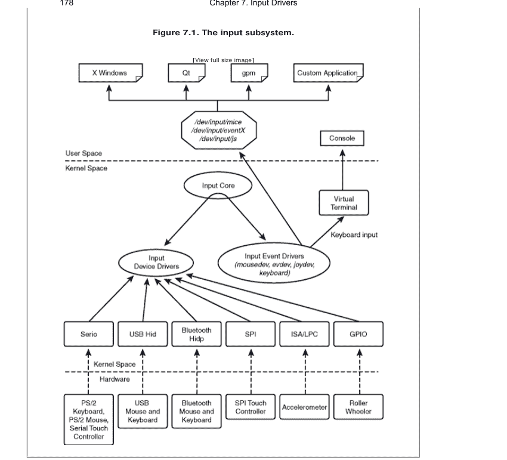

由于事件驱动程序是标准化的，并且适用于所有输入类别，你更有可能实现设备驱动程序而不是事件驱动程序。你的设备驱动程序可以通过输入核心使用合适的现有事件驱动程序与用户应用程序交互。请注意，本章使用术语 `设备驱动程序` 来指代输入设备驱动程序，以区别于输入事件驱动程序。

# 输入事件驱动程序

输入子系统导出的事件接口已演变为许多图形窗口系统都能理解的标准。事件驱动程序提供了一种与硬件无关的抽象来与输入设备通信，就像帧缓冲区接口（在第 12 章“视频驱动程序”中讨论）提供了一种与显示设备通信的通用机制一样。事件驱动程序与帧缓冲区驱动程序协同工作，使 `图形用户界面`（`GUI`）免受底层硬件变数的影响。

## Evdev 接口

`Evdev` 是一个通用的输入事件驱动程序。`Evdev` 生成的每个事件包都具有以下格式，定义在 `include/linux/input.h` 中：

```c
struct input_event {
    struct timeval time;    /* 时间戳 */
    __u16 type;            /* 事件类型 */
    __u16 code;            /* 事件代码 */
    __s32 value;           /* 事件值 */
};
```

要了解如何使用 `evdev`，让我们为一个虚拟鼠标实现一个输入设备驱动程序。

## 设备示例：虚拟鼠标

我们的虚拟鼠标是这样工作的：一个应用程序（`coord.c`）模拟鼠标移动，并通过 sysfs 节点 `sys/devices/platform/vms/coordinates` 将坐标信息分发给虚拟鼠标驱动程序（`vms.c`）。虚拟鼠标驱动程序（简称 `vms` 驱动程序）通过 `evdev` 将这些移动向上传递。图 7.2 显示了详细信息。


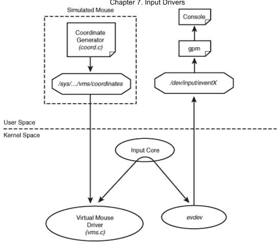

通用鼠标（`gpm`）是一个服务器，让你无需 X 服务器协助即可在文本模式下使用鼠标。`Gpm` 理解 `evdev` 消息，因此 `vms` 驱动程序可以直接与其通信。在一切就绪后，你可以看到光标随着 `coord.c` 流出的虚拟鼠标移动而在屏幕上舞动。

列表 7.1 包含 `coord.c`，它持续生成随机的 X 和 Y 坐标。与操纵杆或触摸屏不同，鼠标产生的是相对坐标，因此 `coord.c` 也是这么做的。`vms` 驱动程序显示在列表 7.2 中。

### 列表 7.1。模拟鼠标移动的应用程序 (`coord.c`)

```c
#include <fcntl.h>

int
main(int argc, char *argv[])
{
    int sim_fd;
    int x, y;
    char buffer[10];

    /* 打开 sysfs 坐标节点 */
    sim_fd = open("/sys/devices/platform/vms/coordinates", O_RDWR);
    if (sim_fd < 0) {
        perror("Couldn't open vms coordinate file\n");
        exit(-1);
    }

    while (1) {
        /* 生成随机的相对坐标 */
        x = random() % 20;
        y = random() % 20;
        if (x%2) x = -x;  if (y%2) y = -y;

        /* 将模拟坐标传递给虚拟鼠标驱动程序 */
        sprintf(buffer, "%d %d", x, y, 0);
        write(sim_fd, buffer, strlen(buffer));
        fsync(sim_fd);
        sleep(1);
    }

    close(sim_fd);
}
```

### 列表 7.2。虚拟鼠标的输入驱动程序 (`vms.c`)

```c
#include <linux/fs.h>
#include <asm/uaccess.h>
#include <linux/pci.h>
#include <linux/input.h>
#include <linux/platform_device.h>

struct input_dev *vms_input_dev;     /* 输入设备的表示 */
static struct platform_device *vms_dev; /* 设备结构体 */

                       /* 向虚拟鼠标驱动程序输入模拟坐标
                         的 Sysfs 方法 */

static ssize_t
write_vms(struct device *dev,
          struct device_attribute *attr,
          const char *buffer, size_t count)
{
    int x,y;
    sscanf(buffer, "%d%d", &x, &y);

    /* 通过事件接口报告相对坐标 */
    input_report_rel(vms_input_dev, REL_X, x);
    input_report_rel(vms_input_dev, REL_Y, y);
    input_sync(vms_input_dev);
    return count;
}
/* 附加 sysfs 写入方法 */
DEVICE_ATTR(coordinates, 0644, NULL, write_vms);
/* 属性描述符 */
static struct attribute *vms_attrs[] = {
&dev_attr_coordinates.attr,
NULL
};
/* 属性组 */
static struct attribute_group vms_attr_group = {
.attrs = vms_attrs,
};
/* 驱动程序初始化 */
int __init
vms_init(void)
{
/* 注册一个平台设备 */
vms_dev = platform_device_register_simple("vms", -1, NULL, 0);
if (IS_ERR(vms_dev)) {
PTR_ERR(vms_dev);
printk("vms_init: error\n");
}
/* 创建一个 sysfs 节点以读取模拟坐标 */
sysfs_create_group(&vms_dev->dev.kobj, &vms_attr_group);
/* 分配一个输入设备数据结构 */
vms_input_dev = input_allocate_device();
if (!vms_input_dev) {
printk("Bad input_alloc_device()\n");
}
/* 声明虚拟鼠标将生成相对坐标 */
set_bit(EV_REL, vms_input_dev->evbit);
set_bit(REL_X, vms_input_dev->relbit);
set_bit(REL_Y, vms_input_dev->relbit);
/* 向输入子系统注册 */
input_register_device(vms_input_dev);
printk("\n\nVirtual Mouse Driver Initialized.\n");
return 0;
}
/* 驱动程序退出 */
void
```

## 7.2 输入子系统（续）

```c

vms_cleanup(void)

{

/* Unregister from the input subsystem */
```


```c
input_unregister_device(vms_input_dev);

/* Cleanup sysfs node */

sysfs_remove_group(&vms_dev->dev.kobj, &vms_attr_group);

/* Unregister driver */

platform_device_unregister(vms_dev);

return;

}

module_init(vms_init);

module_exit(vms_cleanup);
```

让我们更仔细地查看代码清单 7.2。在初始化期间，`vms` 驱动程序将自己注册为输入设备驱动程序。为此，它首先使用核心 API `input_allocate_device()` 分配一个 `input_dev` 结构：

```c
vms_input_dev = input_allocate_device();
```

然后，它声明虚拟鼠标产生相对事件：

```c
set_bit(EV_REL, vms_input_dev->evbit);  /* Event Type is EV_REL */
```

接下来，它声明虚拟鼠标产生的事件代码：

```c
set_bit(REL_X, vms_input_dev->relbit); /* Relative 'X' movement */
set_bit(REL_Y, vms_input_dev->relbit); /* Relative 'Y' movement */
```

如果你的虚拟鼠标还能够产生按钮点击，你需要将此添加到 `vms_init()` 中：

```c
set_bit(EV_KEY, vms_input_dev->evbit);  /* Event Type is EV_KEY */
set_bit(BTN_0, vms_input_dev->keybit);  /* Event Code is BTN_0 */
```

最后是注册：

```c
input_register_device(vms_input_dev);
```

`write_vms()` 是连接到 `/sys/devices/platform/vms/coordinates` 的 `sysfs store()` 方法。当 `coord.c` 向此文件写入 X/Y 对时，`write_vms()` 执行以下操作：

```c
input_report_rel(vms_input_dev, REL_X, x);
input_report_rel(vms_input_dev, REL_Y, y);
input_sync(vms_input_dev);
```

第一条语句生成一个 `REL_X` 事件，即在 X 方向上的相对设备移动。第二条语句生成一个 `REL_Y` 事件，即在 Y 方向上的相对移动。`input_sync()` 表示该事件已完成。因此，输入子系统将这两个事件收集到一个 evdev 数据包中，并通过 `/dev/input/eventX` 发送出去，其中 X 是分配给 `vms` 驱动程序的接口号。读取此文件的应用程序将接收到以前描述过的 `input_event` 格式的事件数据包。要让 `gpm` 附加到此事件接口，并相应地在你的屏幕上追踪光标，请执行以下操作：

```bash
bash> gpm -m /dev/input/eventX -t evdev
```

稍后在“触摸控制器”和“加速度计”章节中讨论的 ADS7846 触摸控制器驱动程序和加速度计驱动程序，也是 evdev 的用户。

### 更多事件接口

`vms` 驱动程序利用通用的 evdev 事件接口，但键盘、鼠标和触摸控制器等输入设备具有自定义事件驱动程序。当我们讨论相应的设备驱动程序时，我们将介绍它们。

要编写自己的事件驱动程序并通过 `/dev/input/mydev` 将其导出到用户空间，你需要填充一个名为 `input_handler` 的结构，并按照以下方式将其注册到输入核心：

```c
static struct input_handler my_event_handler = {  
    .event      = mydev_event,             /* Handle event reports sent by
                                               input device drivers that use
                                               this event driver's services */
    .fops       = &mydev_fops,            /* Methods to manage
                                               /dev/input/mydev */
    .minor      = MYDEV_MINOR_BASE,       /* Minor number of
                                               /dev/input/mydev */
    .name       = "mydev",                /* Event driver name */
    .id_table   = mydev_ids,              /* This event driver can handle
                                               requests from these IDs */
    .connect    = mydev_connect,          /* Invoked if there is an
                                               ID match */
    .disconnect = mydev_disconnect,       /* Called when the driver unregisters */
};

/* Driver Initialization */
static int __init
mydev_init(void)
{
    /* ... */
    input_register_handler(&my_event_handler);
    /* ... */
    return 0;
}
```


查看 `mousedev`（`drivers/input/mousedev.c`）的实现，以获取完整的示例。

## 输入设备驱动程序

让我们把注意力转向键盘、鼠标和触摸屏等常见输入设备的驱动程序。但首先，让我们快速查看一下可供输入驱动程序使用的现成硬件访问设施。

### 串口（Serio）

*serio* 层提供了访问传统输入硬件（如 i8042 兼容的键盘控制器和串口）的库例程。PS/2 键盘和鼠标与前者进行接口，而串口触摸控制器则连接到后者。为了与 *serio* 服务的硬件进行通信，例如向 PS/2 鼠标发送命令，请使用 `serio_register_driver()` 将预定的回调例程注册到 *serio*。

要将新驱动程序作为 *serio* 的一部分添加，请使用 `serio_register_port()` 注册 `open()` / `close()` / `start()` / `stop()` / `write()` 入口点。请查看 `drivers/input/serio/serport.c` 以获取示例。

如图 7.1 所示，*serio* 只是访问底层硬件的一条路径。许多输入设备驱动程序依赖于 USB 或 SPI 等总线层提供的底层支持。

### 键盘

键盘有不同的类型——传统 PS/2、USB、蓝牙、红外等。每种类型都有其特定的输入设备驱动程序，但它们都使用相同的键盘事件驱动程序，从而确保对其用户的一致性接口。然而，与其他事件驱动程序相比，键盘事件驱动程序有一个独特特征：它将数据传递给另一个内核子系统（*tty* 层），而不是通过 `/dev` 节点传递到用户空间。

#### PC 键盘

PC 键盘（也称为 PS/2 键盘或 AT 键盘）通过 i8042 兼容的键盘控制器与处理器进行接口。台式机通常有专用的键盘控制器，但在笔记本电脑上，键盘接口是通用嵌入式控制器（参见第 20 章“更多设备和驱动程序”中的“嵌入式控制器”部分）的职责之一。当你按下 PC 键盘上的一个键时，它遵循的路径如下：

1. 键盘控制器（或嵌入式控制器）扫描并解码键盘矩阵，并处理按键去抖动等细微差别。

2. 键盘设备驱动程序在 *serio* 的帮助下，为每次按键和释放从键盘控制器读取原始*扫描码*。按键和释放之间的区别在于最高有效位，后者会将此位设置为 1。例如，按下“a”键会产生一对扫描码，`0x1e` 和 `0x9e`。特殊键使用 `0xE0` 进行转义，因此按下右箭头键会产生序列 (`0xE0 0x4D 0xE0 0xCD`)。你可以使用 `showkey` 实用程序来观察来自控制器的扫描码（`-->` 符号附加了解释）：

```bash
bash> showkey -s

kb mode was UNICODE

[ if you are trying this under X, it might not work since

  the X server is also reading /dev/console ]

press any key (program terminates 10s after last

keypress)...

```

```c
0x1e 0x9e --> A push of the "a" key
```

3. 键盘设备驱动程序根据输入模式将接收到的扫描码转换为键码。要查看与 "a" 键对应的键码：

```bash
bash> showkey
```

```c
keycode 30 press --> A push of the "a" key
keycode 30 release --> Release of the "a" key
```

为了将键码向上游报告，驱动程序生成一个输入事件，该事件将控制权传递给键盘事件驱动程序。

4. 键盘事件驱动程序根据加载的键映射执行键码转换。（参见 `loadkeys` 的手册页和 `/lib/kbd/keymaps/` 中存在的映射文件）。它检查转换后的键码是否绑定到切换虚拟控制台或重新启动系统等操作。为了响应 Ctrl+Alt+Del 按键组合时点亮 `CAPSLOCK` 和 `NUMLOCK` LED 指示灯而不是重新启动系统，请将以下内容添加到键盘事件驱动程序 `drivers/char/keyboard.c` 的 Ctrl+Alt+Del 处理器中：

```c
static void fn_boot_it(struct vc_data *vc,
                       struct pt_regs *regs)
{
+   set_vc_kbd_led(kbd, VC_CAPSLOCK);
+   set_vc_kbd_led(kbd, VC_NUMLOCK);
-   ctrl_alt_del();
}
```

5. 对于常规键，转换后的键码会被发送到关联的虚拟终端和 `N_TTY` 行规程。（我们在第 6 章“串行驱动程序”中讨论了虚拟终端和行规程。）`drivers/char/keyboard.c` 按以下方式完成此操作：

```c
/* Add the keycode to flip buffer */
tty_insert_flip_char(tty, keycode, 0);
/* Schedule */
con_schedule_flip(tty);
```

`N_TTY` 行规程处理从键盘接收到的输入，将其回显到虚拟控制台，并允许用户空间应用程序从连接到虚拟终端的 `/dev/ttyX` 节点读取字符。

图 7.3 展示了从你按下键盘上的一个键到该键在你的虚拟控制台上回显的数据流。图的左半部分是特定于硬件的，右半部分是通用的。按照输入子系统的设计目标，底层硬件接口对键盘事件驱动程序和 tty 层是透明的。输入核心和明确定义的事件接口因此将输入用户与硬件的复杂性隔离开来。

**图 7.3。来自 PS/2 兼容键盘的数据流。**


## USB 和蓝牙键盘

与*人机接口设备*（HID）相关的 USB 规范规定了 USB 键盘、鼠标、键盘以及其他输入外设用于通信的协议。在 Linux 上，这是通过 *usbhid* USB 客户端驱动程序实现的，该驱动程序负责 USB HID 类（\(0x03\)）。`usbhid` 将其自身注册为输入设备驱动程序。它符合 input API，并报告与已连接 HID 相关的输入事件。

为了理解 USB 键盘的代码路径，请回到图 7.3 并修改硬件相关的左半部分。将 Input Hardware 框中的键盘控制器替换为 USB 控制器，将 serio 替换为 USB 核心层，并将 Input Device Driver 框替换为 `usbhid` 驱动程序。

对于蓝牙键盘，将**图 7.3**中的键盘控制器替换为蓝牙芯片组，将 serio 替换为蓝牙核心层，并将 Input Device Driver 框替换为蓝牙 `hidp` 驱动程序。

USB 和蓝牙分别在第 11 章“通用串行总线”和第 16 章“无线路 Linux”中进行了详细讨论。

## 鼠标

与键盘一样，鼠标也具有不同的功能，并拥有不同的接口选项。让我们来看看常见的几种。

### PS/2 鼠标

鼠标在 X 轴和 Y 轴上产生相对移动。它们还配有一个或多个按钮。有些还带有滚轮。用于 PS/2 兼容旧式鼠标的输入设备驱动程序依赖于 serio 层与底层控制器进行通信。鼠标的输入事件驱动程序称为 *mousedev*，它通过 */dev/input/mice* 向用户应用程序报告鼠标事件。

#### 设备示例：滚轮鼠标

为了对现实世界中的鼠标设备驱动程序有个感性认识，让我们将第 4 章“奠定基础”中讨论的滚轮转换为通用 PS/2 鼠标的一种变体。“滚轮鼠标”在 Y 轴上产生一维移动。滚轮的顺时针和逆时针旋转分别产生正和负的相对 Y 坐标（类似于鼠标中的滚轮），而按下滚轮则会产生左键鼠标事件。因此，滚轮鼠标非常适合用于在智能手机、手持设备和音乐播放器等设备中导航菜单。

**列表 7.3**中实现的滚轮鼠标设备驱动程序可与 X Windows 等窗口系统配合使用。查看 `roller_mouse_init()` 以了解驱动程序如何声明其鼠标类似的功能。与第 4 章**列表 4.1**中的滚轮驱动程序不同，滚轮鼠标驱动程序不需要 `read()` 或 `poll()` 方法，因为事件是使用 input API 报告的。滚轮中断处理程序 `roller_isr()` 也相应地进行修改。中断处理程序中通过等待队列、自旋锁以及支持 `read()` 和 `poll()` 的 `store_movement()` 例程进行的维护工作已不再需要。

在列表 7.3 中，开头的 + 和 – 表示与第 4 章列表 4.1 中实现的滚轮驱动程序之间的差异。

**列表 7.3. 滚轮鼠标驱动程序**

```c
```


```c
#include <linux/input.h>

#include <linux/interrupt.h>

/* Device structure */

struct {

    /*...*/

    struct input_dev dev;

} roller_mouse;

static int __init

roller_mouse_init(void)

{

    /* Allocate input device structure */

    roller_mouse->dev = input_allocate_device();

    /* Can generate a click and a relative movement  */

    roller_mouse->dev->evbit[0] = BIT(EV_KEY) | BIT(EV_REL);

    /* Can move only in the Y-axis  */

    roller_mouse->dev->relbit[0] = BIT(REL_Y);

    /* My click should be construed as the left button

       press of a mouse  */

    roller_mouse->dev->keybit[LONG(BTN_MOUSE)] = BIT(BTN_LEFT);

    roller_mouse->dev->name = "roll";

    /* For entries in /sys/class/input/inputX/id/ */

    roller_mouse->dev->id.bustype = ROLLER_BUS;

    roller_mouse->dev->id.vendor = ROLLER_VENDOR;

    roller_mouse->dev->id.product = ROLLER_PROD;

    roller_mouse->dev->id.version = ROLLER_VER;

    /* Register with the input subsystem */

    input_register_device(roller_mouse->dev);

}

/* Global variables  */

/* -spinlock_t roller_lock = SPIN_LOCK_UNLOCKED; */

/* -static DECLARE_WAIT_QUEUE_HEAD(roller_poll); */

/* The Roller Interrupt Handler  */

static irqreturn_t

roller_interrupit(int irq, void *dev_id)

{

    int i, PA_t, PA_delta_t, movement = 0;

    /* Get the waveforms from bits 0, 1 and 2

       of Port D as shown in Figure 7.1 */

    PA_t = PORTD & 0x07;

    /* Wait until the state of the pins change.

       (Add some timeout to the loop)  */

    for (i=0; (PA_t==PA_delta_t); i++){

        PA_delta_t = PORTD & 0x07;

    }

    movement = determine_movement (PA_t, PA_delta_t);

    /* -spin_lock(&roller_lock); */

    /* -/* Store the wheel movement in a buffer for */ */

    /* -   later access by the read()/poll() entry points  *-/ */

    /* -store_movements(movement); */

    /* -spin_unlock(&roller_lock); */

    /* -/* Wake up the poll entry point that might have */ */

    /* -   gone to sleep, waiting for a wheel movement  *-/ */

    /* -wake_up_interruptible(&roller_poll); */

    if (movement == CLOCKWISE) {

        input_report_rel(roller_mouse->dev, REL_Y, 1);

    } else if (movement == ANTICLOCKWISE) {

        input_report_rel(roller_mouse->dev, REL_Y, -1);

    } else if (movement == KEYRESSED) {

        input_report_key(roller_mouse->dev, BTN_LEFT, 1);

    }

    input_sync(roller_mouse->dev);

    return IRQ_HANDLED;

}
```

### 指点杆

指点杆（Trackpoint）是一种与某些笔记本电脑上的 PS/2 类型键盘集成的指向设备。该设备包括位于按键之间的摇杆和位于空格键下方的鼠标按钮。指点杆本质上相当于鼠标，因此你可以使用 PS/2 鼠标驱动程序来操作它。

与普通鼠标不同，指点杆提供了更多的移动控制。你可以命令指点杆控制器改变灵敏度、惯性等属性。内核有一个特殊的驱动程序 `drivers/input/mouse/trackpoint.c`，用于创建和管理相关的 sysfs 节点。有关完整的指点杆配置选项，请查看 `/sys/devices/platform/1042/serioX/serioY/` 目录下的内容。

### 触摸板

触摸板是一种常见于笔记本电脑的类似鼠标的指向设备。与传统鼠标不同，触摸板没有运动部件。它可以生成与鼠标兼容的相对坐标，但操作系统通常使用其更强大的模式来生成绝对坐标。在绝对模式下使用的通信协议与 PS/2 鼠标协议相似，但不兼容。

基本的 PS/2 鼠标驱动程序能够支持符合不同变体的裸 PS/2 鼠标协议的设备。你可以通过通过 `psmouse` 结构提供协议驱动程序来为基本驱动程序添加对新鼠标协议的支持。例如，如果你的笔记本电脑使用绝对模式下的 Synaptics 触摸板，那么基本的 PS/2 鼠标驱动程序将使用 Synaptics 协议驱动程序的服务来解释流数据。为了端到端地了解 Synaptics 协议如何与基本 PS/2 驱动程序协同工作，请查看收集在列表 7.4 中的以下四个代码区域：

- PS/2 鼠标驱动程序 `drivers/input/mouse/psmouse-base.c` 实例化了一个 `psmouse_protocol` 结构，其中包含关于支持的鼠标协议（包括 Synaptics 触摸板协议）的信息。
- 定义在 `drivers/input/mouse/psmouse.h` 中的 `psmouse` 结构将各种 PS/2 协议连接在一起。
- `synaptics_init()` 用相关协议函数的地址填充 `psmouse` 结构。
- 由 `synaptics_init()` 填充的协议处理函数 `synaptics_process_byte()`，在 serio 检测到鼠标移动时从中断上下文中被调用。如果你展开 `synaptics_process_byte()`，你会看到触摸板移动通过 `mousedev` 报告给用户应用程序。

**列表 7.4. Synaptics 触摸板的 PS/2 鼠标协议驱动程序**

```c
/*drivers/input/mouse/psmouse-base.c*/

/* List of supported PS/2 mouse protocols */

static struct psmouse_protocol psmouse_protocols[] = {

{

    .type    = PSMOUSE_PS2,   /* The bare PS/2 handler */

    .name    = "PS/2",

    .alias   = "bare",

    .maxproto = 1,

    .detect  = ps2bare_detect,

},

/* ... */

{

    .type    = PSMOUSE_SYNAPTICS,  /* Synaptics TouchPad Protocol */

    .name    = "SynPS/2",

    .alias   = "synaptics",
```


`.detect` = `synaptics_detect`,   /* Is the protocol detected? */

`.init`    = `synaptics_init`,     /* Initialize Protocol Handler */

},

/* ... */

};

/* `drivers/input/mouse/psmouse.h` */

/* The structure that ties various mouse protocols together */

```c
struct psmouse {

    struct input_dev *dev;  /* The input device */

    /* ... */

    /* Protocol Methods */

    psmouse_ret_t (*protocol_handler)

                (struct psmouse *psmouse, struct pt_regs *regs);

    void (*set_rate)(struct psmouse *psmouse, unsigned int rate);

    void (*set_resolution)

                (struct psmouse *psmouse, unsigned int resolution);

    int (*reconnect)(struct psmouse *psmouse);

    void (*disconnect)(struct psmouse *psmouse);

    /* ... */

};
```

/* `drivers/input/mouse/synaptics.c` */

/* init() method of the Synaptics protocol */

```c
int synaptics_init(struct psmouse *psmouse)

{

    struct synaptics_data *priv;

    psmouse->private = priv = kmalloc(sizeof(struct synaptics_data),

            GFP_KERNEL);

    /* ... */

    /* This is called in interrupt context when mouse */

    /* movement is sensed */

    psmouse->protocol_handler = synaptics_process_byte;

    /* More protocol methods */

    psmouse->set_rate = synaptics_set_rate;

    psmouse->disconnect = synaptics_disconnect;

    psmouse->reconnect = synaptics_reconnect;

    /* ... */

}
```

`drivers/input/mouse/synaptics.c`:
```c
/* 展开 synaptics_process_byte() 并查看 synaptics_process_packet()，你可以看到通过 moussdev 向用户应用程序报告输入事件 */
static void synaptics_process_packet(struct psmouse *psmouse)
{
/* ... */
if (hw.z > 0) {
/* 绝对 X 坐标 */
input_report_abs(dev, ABS_X, hw.x);
/* 绝对 Y 坐标 */
input_report_abs(dev, ABS_Y,
YMAX_NOMINAL + YMIN_NOMINAL - hw.y);
}
/* 绝对 Z 坐标 */
input_report_abs(dev, ABS_PRESSURE, hw.z);
/* ... */
/* 左侧触摸板按钮 */
input_report_key(dev, BTN_LEFT, hw.left);
/* 右侧触摸板按钮 */
input_report_key(dev, BTN_RIGHT, hw.right);
/* ... */
}
```

## USB 和蓝牙鼠标

USB 鼠标由与驱动 USB 键盘相同的输入驱动（`usbid`）处理。类似地，实现蓝牙键盘支持的 `hidp` 驱动也负责处理蓝牙鼠标。

正如你所期望的，USB 和蓝牙鼠标驱动程序通过 `moussdev` 通道传输设备数据。

## 触摸控制器

在第 6 章中，我们实现了一个串行触摸控制器的设备驱动程序，其形式为名为 `N_TCH` 的行规程。输入子系统提供了一种更好、更简单的方式来实现该驱动程序。将 `N_TCH` 中的有限状态机改造成一个输入设备驱动程序，并进行以下更改：

- 1. Serio 提供了一种名为 `serport` 的行规程，用于访问连接到串口的设备。使用 `serport` 的服务与触摸控制器通信。
- 2. 不要将坐标信息传递给 `tty` 层，而是通过 `evdev` 生成输入报告，就像你在清单 7.2 中为虚拟鼠标所做的那样。

通过这种方式，用户可以通过 `/dev/input/eventX` 访问触摸屏。实际的驱动程序实现留给读者练习。

一个不通过串口接口的触摸控制器示例是 Analog Devices 的 `ADS7846` 芯片，它通过 *串行外设接口*（SPI）进行通信。该设备的驱动程序使用 SPI 核心服务而不是 `serio`。第 8 章“集成电路协议”中的“串行外设接口总线”一节讨论了 SPI。与大多数触摸驱动程序一样，`ADS7846` 驱动程序使用 `evdev` 接口将触摸信息分发给用户应用程序。

一些触摸控制器通过 USB 接口连接。一个例子是 3M USB 触摸控制器，由 `drivers/input/touchscreen/usbtouchscreen.c` 驱动。

许多 PDA 在 LCD 上叠加了四线电阻式触摸板。面板的 X 和 Y 板（每个轴两根线）连接到模数转换器（ADC），ADC 提供由触摸屏幕产生的模拟电压差的数字读数。输入驱动程序从 ADC 收集坐标并将其分发到用户空间。

同一触摸板的不同实例可能由于制造工艺的细微差别而产生略有不同的坐标范围（X 和 Y 方向的最大值）。为了使应用程序免受这种变化的影响，触摸屏在使用前需要进行*校准*。校准通常由 GUI 发起，通过显示屏幕边界和其他视点的十字标记，并请求用户触摸这些点。如果触摸控制器支持自校准，则使用适当的命令将生成的坐标写回触摸控制器；否则，在软件中用于缩放坐标流。

输入子系统还包含一个名为 `tsdev` 的事件驱动程序，它根据 Compaq 触摸屏协议生成坐标信息。如果你的系统通过 `tsdev` 报告触摸事件，则理解此协议的应用程序可以从 `/dev/input/tsX` 引发触摸输入。然而，该驱动程序计划从主线内核中移除，以支持用户空间中的 `tslib` 库。`Documentation/feature-removal-schedule.txt` 列出了即将从内核源代码树中移除的特性。

## 加速度计

加速度计测量加速度。几台 IBM/Lenovo 笔记本电脑配备了检测突然移动的加速度计。生成的信息用于通过一种称为*硬盘主动保护系统*（HDAPS）的机制保护硬盘免受损坏，其原理类似于汽车安全气囊保护乘客免受伤害。HDAPS 驱动程序实现为平台驱动程序，并注册到输入子系统。它使用 `evdev` 流式传输检测到的加速度的 X 和 Y 分量。应用程序可以通过 `/dev/input/eventX` 读取加速度事件来检测诸如冲击和振动等状况，并执行防御性操作，例如停放硬盘磁头。以下命令在移动笔记本电脑时会输出信息（假设 `event3` 分配给 HDAPS）：

```bash
bash> od -x /dev/input/event3

000000 a94d 4599 1f19 0007 0003 0000 ffed ffff

...
```

加速度计还提供诸如温度、键盘活动和鼠标活动等信息，所有这些都可以从 `/sys/devices/platform/hdaps/` 中的文件中获取。因此，HDAPS 驱动程序是内核源代码中硬件监控（*hwmon*）子系统的一部分。我们将在下一章“使用 LM-Sensors 进行硬件监控”一节中讨论硬件监控。

## 输出事件

一些输入设备驱动程序也处理输出事件。例如，键盘驱动程序可以点亮大写锁定 LED，PC 扬声器驱动程序可以发出哔声。让我们深入了解后者。在初始化期间，扬声器驱动程序通过设置适当的 `evbits` 并注册一个处理输出事件的回调例程来声明其输出能力：

代码视图：

```c
drivers/input/misc/pcspkr.c: 

static int __devinit pcspkr_probe(struct platform_device *dev) 

{ 

/* ... */ 

/* 能力位 */ 

pcspkr_dev->evbit[0] = BIT(EV_SND); 
```


```c
pcspkr_dev->sndbit[0] = BIT(SND_BELL) | BIT(SND_TONE);

/* 回调例程 */

pcspkr_dev->event = pcspkr_event;

err = input_register_device(pcspkr_dev);

/* ... */

}

/* 回调例程 */

static int pcspkr_event(struct input_dev *dev, unsigned int type,
unsigned int code, int value)
{

/* ... */

/* I/O 编程以发出哔声 */

outb_p(inb_p(0x61) | 3, 0x61);

/* 设置计数器 2 的命令，2 字节写入 */

outb_p(0xB6, 0x43);

/* 选择所需的 HZ */

outb_p(count & 0xff, 0x42);

outb((count >> 8) & 0xff, 0x42);

/* ... */

}
```

要发出哔声，键盘事件驱动程序生成一个声音事件（`EV_SND`），如下所示：

```
input_event(handle->dev, EV_SND, /* 类型 */
SND_TONE, /* 代码 */
hz /* 值 */);
```

这会触发回调例程 `pcspkr_event()` 的执行，你将听到哔声。

## 调试

如果你在开发输入驱动程序，可以使用 `evbug` 模块作为调试辅助工具。它会转储由输入子系统生成的事件对应的 (`type`, `code`, `value`) 元组（参见前面定义的 `struct input_event`）。`图 7.4` 包含在操作某些输入设备时由 evbug 捕获的数据：


```
/* 触摸板移动 */
evbug.c Event. Dev: isa0060/serio1/input0: Type: 3, Code: 28, Value: 0
evbug.c Event. Dev: isa0060/serio1/input0: Type: 1, Code: 325, Value: 0
evbug.c Event. Dev: isa0060/serio1/input0: Type: 0, Code: 0, Value: 0
/* Trackpoint 移动 */
evbug.c Event. Dev: synaptics-pt/serio0/input0: Type: 2, Code: 0, Value: -1
evbug.c Event. Dev: synaptics-pt/serio0/input0: Type: 2, Code: 1, Value: -2
evbug.c Event. Dev: synaptics-pt/serio0/input0: Type: 0, Code: 0, Value: 0
/* USB 鼠标移动 */
evbug.c Event. Dev: usb-0000:00:1d.1-2/input0: Type: 2, Code: 1, Value: -1
evbug.c Event. Dev: usb-0000:00:1d.1-2/input0: Type: 0, Code: 0, Value: 0
evbug.c Event. Dev: usb-0000:00:1d.1-2/input0: Type: 2, Code: 0, Value: 1
evbug.c Event. Dev: usb-0000:00:1d.1-2/input0: Type: 0, Code: 0, Value: 0
/* PS/2 键盘按键 'a' */
evbug.c Event. Dev: isa0060/serio0/input0: Type: 4, Code: 4, Value: 30
evbug.c Event. Dev: isa0060/serio0/input0: Type: 1, Code: 30, Value: 0
evbug.c Event. Dev: isa0060/serio0/input0: Type: 0, Code: 0, Value: 0
/* USB 键盘按键 'a' */
evbug.c Event. Dev: usb-0000:00:1d.1-1/input0: Type: 1, Code: 30, Value: 1
evbug.c Event. Dev: usb-0000:00:1d.1-1/input0: Type: 0, Code: 0, Value: 0
evbug.c Event. Dev: usb-0000:00:1d.1-2/input0: Type: 1, Code: 30, Value: 0
evbug.c Event. Dev: usb-0000:00:1d.1-2/input0: Type: 0, Code: 0, Value: 0
```

为了理解 `图 7.4` 中的转储内容，请记住触摸板生成绝对坐标（`*EV_ABS*`）或事件类型 `0x03`，trackpoints 生成相对坐标（`*EV_REL*`）或事件类型 `0x02`，键盘发出按键事件（`*EV_KEY*`）或事件类型 `0x01`。事件类型 `0x0` 对应于调用 `input_sync()`，其执行以下操作：

```
input_event(dev, EV_SYN, SYN_REPORT, 0);
```


这转换为 (*type*, *code*, *value*) 元组为 (*0x0*, *0x0*, *0x0*)，并完成每个输入事件。

## 查看源代码

大多数输入事件驱动程序位于`/drivers/input/`目录中。然而，键盘事件驱动程序位于`/drivers/char/keyboard.c`，因为它连接到虚拟终端，而不是`/dev/input/`下的设备节点。

你可以在多个地方找到输入设备驱动程序。旧式键盘、鼠标和摇杆的驱动程序位于`/drivers/input/`下的不同子目录中。蓝牙输入驱动程序位于`/net/bluetooth/hidp/`。你还可以在`/drivers/hwmon/`和`/drivers/media/video/`等区域找到输入驱动程序。事件类型、代码和值在`/include/linux/input.h`中定义。

`serio`子系统保留在`/drivers/input/serio/`中。`serport`行规程的源代码位于`/drivers/input/serio/serport.c`。`/Documentation/input/`包含有关不同输入接口的更多详细信息。

表 7.1 总结了本章中使用的主要数据结构及其在源代码树中的位置。表 7.2 列出了本章中使用的内核编程接口及其定义位置。

**表 7.1. 数据结构总结**

| 数据结构 | 位置 | 描述 |
| :--- | :--- | :--- |
| `input_event` | `include/linux/input.h` | evdev 产生的每个事件包都采用此格式。 |
| `input_dev` | `include/linux/input.h` | 输入设备的表示形式。 |
| `input_handler` | `include/linux/serial_core.h` | 包含事件驱动程序支持的入口点。 |
| `psmouse_protocol` | `drivers/input/mouse/psmouse-base.c` | 关于支持的 PS/2 鼠标协议驱动程序的信息。 |
| `psmouse` | `drivers/input/mouse/psmouse.h` | PS/2 鼠标驱动程序支持的方法。 |

**表 7.2. 内核编程接口总结**

| 内核接口 | 位置 | 描述 |
| :--- | :--- | :--- |
| `input_register_device()` | `drivers/input/input.c` | 向输入核心注册设备 |
| `input_unregister_device()` | `drivers/input/input.c` | 从输入核心移除设备 |
| `input_report_rel()` | `include/linux/input.h` | 在指定方向上生成相对移动 |
| `input_report_abs()` | `include/linux/input.h` | 在指定方向上生成绝对移动 |
| `input_report_key()` | `include/linux/input.h` | 生成按键或按钮按下事件 |
| `input_sync()` | `include/linux/input.h` | 指示输入子系统可以将先前生成的事件收集到一个 evdev 包中，并通过`/dev/input/input*X*`将其发送到用户空间 |
| `input_register_handler()` | `drivers/input/input.c` | 注册自定义事件驱动程序 |
| `sysfs_create_group()` | `fs/sysfs/group.c` | 创建具有指定属性的 sysfs 节点组 |
| `sysfs_remove_group()` | `fs/sysfs/group.c` | 移除使用`sysfs_create_group()`创建的 sysfs 组 |
| `tty_insert_flip_char()` | `include/linux/tty_flip.h` | 将字符发送到行规程层 |
| `platform_device_register_simple()` | `drivers/base/platform.c` | 创建一个简单的平台设备 |
| `platform_device_unregister()` | `drivers/base/platform.c` | 注销平台设备 |

## 第 8 章. 集成电路间协议

### 本章内容

- 什么是 I²C/SMBus？ 234
- I²C 核心 235
- 总线事务 237
- 设备示例：EEPROM 238
- 设备示例：实时时钟 247
- i2c-dev 251
- 使用 LM-Sensors 进行硬件监控 251
- 串行外设接口总线 251
- 单线总线 254
- 调试 254
- 查看源代码 255

集成电路间总线，或 I²C（发音为 *I 平方 C*）及其子集 *系统管理总线*（SMBus），是广泛用于桌面和嵌入式设备中的同步串行接口。让我们通过实现示例驱动程序来访问 I²C EEPROM 和 I²C RTC，以了解内核如何支持 I²C/SMBus 主机适配器及客户端设备。在本章结束之前，我们还要看看内核支持的其他两种串行接口：*串行外设接口* 或 SPI（常发音为 *spy*）总线以及单线总线。

所有这些串行接口（I²C、SMBus、SPI 和单线总线）都具有两个共同特征：

- 交换的数据量很小。
- 所需的数据传输率较低。

### 什么是 I²C/SMBus？

I²C 是一种在桌面计算机和笔记本电脑中广泛使用的串行总线，用于将处理器与 EEPROM、音频编解码器以及监测温度或电源电压等参数的专用芯片等设备进行接口连接。此外，I²C 在嵌入式设备中广泛用于与 RTC（实时时钟）、智能电池电路、多路复用器、端口扩展器、光收发器及其他类似设备通信。由于 I²C 得到了大量微控制器的支持，目前市场上有大量的廉价 I²C 设备。

I²C 和 SMBus 是主从协议，通信发生在 *主机适配器*（或 *主机控制器*）与 *客户端设备*（或 *从设备*）之间。主机适配器通常是桌面计算机南桥芯片组的一部分，而在嵌入式设备中则是微控制器的一部分。图 8.1 展示了 PC 兼容硬件上的 I²C 总线示例。


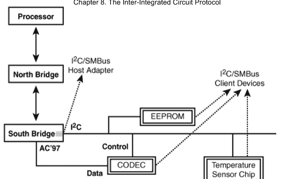

I²C 及其子集 SMBus 是分别由 Philips 和 Intel 开发的 2 线接口。这两根线是 *时钟线* 和 *双向数据线*，对应的线路称为 *串行时钟*（SCL）和 *串行数据*（SDA）。由于 I²C 总线只需要一对线，它在电路板上占用空间较少。然而，支持的带宽也很低。I²C 在标准模式下允许最高 100Kbps，在快速模式下允许 400Kbps。（然而，SMBus 仅支持最高 100Kbps。）因此，该总线仅适用于慢速外设。尽管 I²C 支持双向交换，但由于只有一根数据线，通信是半双工的。

I²C 和 SMBus 设备拥有 *7 位地址*。该协议也支持 10 位地址，但许多设备仅响应 7 位寻址，这意味着总线上最多可以有 127 个设备。由于协议的主从特性，设备地址也被称为 *从设备地址*。

### I²C 核心

I²C 核心是一个代码库，包含主机适配器驱动程序和客户端驱动程序可用的例程和数据结构。核心中的通用代码使驱动程序开发者的工作更加轻松。核心还提供了一层间接性，使客户端驱动程序独立于主机适配器，即使客户端设备用于具有不同 I²C 主机适配器的板卡，它们也能保持不变而正常工作。这种核心层及其附带好处的理念在内核中的许多其他设备驱动程序类别中也适用，例如 PCMCIA、PCI 和 USB。

除了核心之外，内核 I²C 基础设施还包括以下部分：

- I²C 主机适配器的设备驱动程序。它们属于总线驱动程序范畴，通常由适配器驱动程序和算法驱动程序组成。前者使用后者与 I²C 总线通信。
- I²C 客户端设备的设备驱动程序。
- `i2c-dev`，允许实现用户模式 I²C 客户端驱动程序。

你更有可能实现客户端驱动程序而不是适配器或算法驱动程序，因为 I²C 设备比 I²C 主机适配器多得多。因此，本章我们将局限于客户端驱动程序。

图 8.2 说明了 Linux I²C 子系统。它展示了 I²C 内核模块与 I²C 总线上的主机适配器和客户端设备对话。


由于 SMBus 是 I²C 的子集，仅使用 SMBus 命令与你的设备通信可以生成一个同时支持 SMBus 和 I²C 适配器的驱动程序。表 8.1 列出了由 I²C 核心提供的 SMBus 兼容数据传输例程。

**表 8.1. I²C 核心提供的 SMBus 兼容数据访问函数**

| 函数 | 用途 |
| :--- | :--- |
| `i2c_smbus_read_byte()` | 从设备读取单个字节，不指定位置偏移。使用之前发出的命令相同的偏移量。 |
| `i2c_smbus_write_byte()` | 将单个字节发送到设备，使用之前发出的命令相同的内存偏移量。 |
| `i2c_smbus_write_quick()` | 向设备发送单个位（代替列表 8.1 中显示的 Rd/Wr 位）。 |
| `i2c_smbus_read_byte_data()` | 从指定偏移量处的设备读取单个字节。 |
| `i2c_smbus_write_byte_data()` | 将单个字节发送到指定偏移量处的设备。 |
| `i2c_smbus_read_word_data()` | 从指定偏移量读取 2 个字节。 |
| `i2c_smbus_write_word_data()` | 将 2 个字节发送到指定偏移量。 |

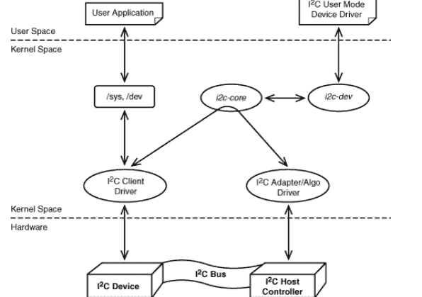

| 功能 | 目的 |
| --- | --- |
| `i2c_smbus_read_block_data()` | 从指定偏移读取一块数据。 |
| `i2c_smbus_write_block_data()` | 向指定偏移发送一块数据（<= 32 字节）。 |

## 总线事务

在实现示例驱动程序之前，让我们通过“放大镜”观察一下线缆，以便更好地理解 I²C 协议。**列表 8.1** 展示了一段与 I²C EEPROM 通信的代码片段，以及总线上发生的相应事务。这些事务是通过在运行代码片段时连接 I²C 总线分析仪捕获的。代码使用了用户模式 I²C 函数。（我们在第 19 章“用户空间驱动程序”中更详细地讨论用户模式 I²C 编程。）

### 列表 8.1. I²C 总线上的事务

```c
```


```
/* ... */

/*

 * Connect to the EEPROM. 0x50 is the device address.

 * smbus_fp is a file pointer into the SMBus device.

 */

ioctl(smbus_fp, 0x50, slave);

/* Write a byte (0xAB) at memory offset 0 on the EEPROM */

i2c_smbus_write_byte_data(smbus_fp, 0, 0xAB);

/*

 * This is the corresponding transaction observed

 * on the bus after the write:

 * S 0x50 Wr [A] 0 [A] 0xAB [A] P

 *

 * S is the start bit, 0x50 is the 7-bit slave address (0101000b),

 * Wr is the write command (0b), A is the Accept bit (or

 * acknowledgment) received by the host from the slave, 0 is the

 * address offset on the slave device where the byte is to be

 * written, 0xAB is the data to be written, and P is the stop bit.

 * The data enclosed within [] is sent from the slave to the

 * host, while the rest of the bits are sent by the host to the

 * slave.

 */

/* Read a byte from offset 0 on the EEPROM */

res = i2c_smbus_read_byte_data(smbus_fp, 0);

/*

 * This is the corresponding transaction observed

 * on the bus after the read:

 * S 0x50 Rd [A] 0 [A] S 0x50 Rd [A] [0xAB] NA P

 *

 * The explanation of the bits is the same as before, except that

 * Rd stands for the Read command (1b), 0xAB is the data received

 * from the slave, and NA is the Reverse Accept bit (or the

 * acknowledgment sent by the host to the slave).

 */
```

## 设备示例：EEPROM

我们的第一个示例客户端设备是一个位于 I²C 总线上的 EEPROM，如图 8.1 所示。几乎所有笔记本电脑和台式机都拥有这样的 EEPROM，用于存储 BIOS 配置信息。示例 EEPROM 有两个存储库。驱动程序为每个存储库导出 `/dev/interfaces` 节点：`/dev/eep/0` 和 `/dev/eep/1`。应用程序通过操作这些节点与 EEPROM 交换数据。

每个 I²C/SMBus 客户端设备都被分配一个从机地址，用作设备标识符。示例中的 EEPROM 响应两个从机地址：`SLAVE_ADDR1` 和 `SLAVE_ADDR2`，每个存储库对应一个。

示例驱动程序使用与 SMBus 兼容的 I²C 命令，因此适用于 I²C 和 SMBus EEPROM。

### 初始化

与所有驱动类一样，I²C 客户端驱动程序也拥有 `init()` 入口点。初始化包括分配数据结构、向 I²C 核心注册驱动程序，以及与 sysfs 和 Linux 设备模型进行关联。这在列表 8.2 中完成。

#### 列表 8.2：初始化 EEPROM 驱动程序

```cpp
/* Driver entry points */

static struct file_operations eep_fops = {
    .owner    = THIS_MODULE,
    .llseek   = eep_llseek,
    .read     = eep_read,
    .ioctl    = eep_ioctl,
    .open     = eep_open,
    .release  = eep_release,
    .write    = eep_write,
};

static dev_t dev_number;            /* Alotted Device Number */
static struct class *eep_class;     /* Device class */

/* Per-device client data structure for each
 * memory bank supported by the driver
 */

struct eep_bank {
    struct i2c_client *client;      /* I²C client for this bank */
    unsigned int addr;             /* Slave address of this bank */
    signed short current_pointer;  /* File pointer */
    int bank_number;               /* Actual memory bank number */
    /* ... */                      /* Spinlocks, data cache for
                                     slow devices,... */
};

#define NUM_BANKS 2               /* Two supported banks */
#define BANK_SIZE 2048            /* Size of each bank */
struct ee_bank *ee_bank_list;      /* List of private data
                                    structures, one per bank */
```

```c
/*
 * Device Initialization
 */

int __init
eep_init(void)
{
  int err, i;
  /* Allocate the per-device data structure, ee_bank */
  ee_bank_list = kmalloc(sizeof(struct ee_bank)*NUM_BANKS,
                         GFP_KERNEL);
  memset(ee_bank_list, 0, sizeof(struct ee_bank)*NUM_BANKS);
  /* Register and create the /dev interfaces to access the EEPROM
     banks.  Refer back to Chapter 5, "Character Drivers" for
     more details */
  if (alloc_chrdev_region(&dev_number, 0,
                          NUM_BANKS, "eep") < 0) {
    printk(KERN_DEBUG "Can't register device\n");
    return -1;
  }
  eep_class = class_create(THIS_MODULE, DEVICE_NAME);
  for (i=0; i < NUM_BANKS; i++) {
    /* Connect the file operations with cdev */
    cdev_init(&ee_bank[i].cdev, &eep_fops);
    /* Connect the major/minor number to the cdev */
    if (cdev_add(&ee_bank[i].cdev, (dev_number + i), 1)) {
      printk("Bad kmalloc\n");
      return 1;
    }
```


`class_device_create(eep_class, NULL, (dev_number + i), NULL, "eeeprom%d", i);`

}

/* Inform the I2C core about our existence. See the section "Probing the Device" for the definition of `eep_driver` */

`err = i2c_add_driver(&eep_driver);`

if (`err`) {
    `printk("Registering I2C driver failed, errno is %d\n", err);`
    return `err`;
}

`printk("EEPROM Driver Initialized.\n");`
return 0;
}

列表 8.2 启动了设备节点的创建，但为了完成它们的生成，需要在 `/etc/udev/rules.d/` 下的适当规则文件中添加以下内容：

当接收到来自内核的相应事件时，这将创建 `/dev/eep/0` 和 `/dev/eep/1`。需要读取第 $n^{\mathrm{th}}$ 个存储库的用户模式程序随后可以操作 `/dev/eep/n`。

列表 8.3 实现了 EEPROM 驱动程序的 `open()` 方法。当应用程序打开 `/dev/eep/X` 时，内核会调用 `eep_open()`。`eep_open()` 将在私有区域存储每个设备的数据结构，以便驱动程序的其余方法可以直接访问它。

#### 列表 8.3. 打开 EEPROM 驱动程序

```c
int
eep_open(struct inode *inode, struct file *file)
{
  /* The EEPROM bank to be opened */
  n = MINOR(file->f_dentry->d_inode->i_rdev);
  file->private_data = (struct ee_bank *)ee_bank_list[n];
  /* Initialize the fields in ee_bank_list[n] such as
  size, slave address, and the current file pointer */
  /* ... */
}
```

### 探测设备

I²C 客户端驱动程序与主机控制器驱动程序和 I²C 核心合作，按照以下方式将自己附加到从机设备：

1. 在初始化期间，它注册了一个 `probe()` 方法，当检测到相关的主机控制器时，I²C 核心会调用该方法。在列表 8.2 中，`eep_init()` 通过调用 `i2c_add_driver()` 注册了 `eep_probe()`：

```c
static struct i2c_driver eep_driver =
{
    .driver = {
        .name = "EEP", /* Name */
    },
    .id = I2C_DRIVERID_EEP, /* ID */
    .attach_adapter = eep_probe, /* Probe Method */
    .detach_client = eep_detach, /* Detach Method */
};
i2c_add_driver(&eep_driver);
```

驱动程序标识符 `I2C_DRIVERID_EEP` 对于该设备应该是唯一的，并且应定义在 `include/linux/i2c-id.h` 中。

2. 当核心调用驱动程序的 `probe()` 方法表示存在主机适配器时，它反过来调用 `i2c_probe()`，其参数指定了驱动程序负责的从机设备的地址以及相关的 `attach()` 例程。

列表 8.4 实现了 `eep_probe()`，即 EEPROM 驱动程序的 `probe()` 方法。`normal_i2c` 指定 EEPROM 存储库地址，并作为 `i2c_client_address_data` 结构的一部分填充。该结构中的其他字段可用于请求更精细的地址控制。你可以使用 `ignore` 字段要求 I²C 核心忽略一定范围的地址。或者，你可以使用 `probe` 字段指定 `(adapter, slave address)` 对，如果你希望将某个从机地址绑定到特定的主机适配器。例如，如果你的处理器支持两个 I²C 主机适配器，而你在总线 1 上有一个 EEPROM，在总线 2 上有一个温度传感器，两者响应相同的从机地址，这将很有用。

3. 主机控制器遍历总线，寻找第 2 步中指定的从机设备。为此，它生成一个总线事务，例如 `S SLAVE_ADDR Wr`，其中 `S` 是起始位，`SLAVE_ADDR` 是设备数据手册中指定的相关 7 位从机地址，`Wr` 是写命令，如“总线事务”部分所述。如果总线上存在可用的从机设备，它将通过发送确认位（`[A]`）进行响应。

4. 如果主机适配器在第 3 步中检测到从机，I²C 核心将调用通过 `i2c_probe()` 在第二步中提供的第三个参数传递的 `attach()` 例程。对于 EEPROM 驱动程序，这个例程是 `eep_attach()`，它注册每个设备的客户端数据结构，如列表 8.5 所示。如果你的设备期望有一个初始编程序列（例如，I²C 数字视频接口传输芯片上的寄存器在芯片开始工作前必须初始化），请在这个例程中执行这些操作。

#### 列表 8.4. 探测 EEPROM 存储库的存在

```c
#include <linux/i2c.h>
/* The EEPROM has two memory banks having addresses SLAVE_ADDR1
 * and SLAVE_ADDR2, respectively
 */
static unsigned short normal_i2c[] = {
    SLAVE_ADDR1, SLAVE_ADDR2, I2C_CLIENT_END
};
static struct i2c_client_address_data addr_data = {
    .normal_i2c = normal_i2c,
    .probe      = ignore,
    .ignore     = ignore,
    .forces     = ignore,
};
static int
eep_probe(struct i2c_adapter *adapter)
{
  /* The callback function eep_attach(), is shown
   * in Listing 8.5
   */
  return i2c_probe(adapter, &addr_data, eep_attach);
}
```

#### 列表 8.5. 附加客户端

### 检查适配器功能

每个主机适配器可能受到一组约束的限制。适配器可能不支持表 8.1 中列出的所有命令。例如，它可能允许 SMBus `read_word` 命令，但不允许 `read_block` 命令。客户端驱动程序在使用命令之前，必须检查该命令是否被适配器支持。

I²C 内核提供了两个函数来实现这一功能：

1. `i2c_check_functionality()` 检查特定功能是否受支持。
2. `i2c_get_functionality()` 返回一个包含所有受支持功能的掩码。

有关可能功能的列表，请参见 `include/linux/i2c.h`。

### 访问设备

要从 EEPROM 读取数据，首先从与该设备节点关联的私有数据字段中获取有关其调用线程的信息。接下来，使用 I²C 核心提供的符合 SMBus 的数据访问例程（表 8.1 显示了可用的函数）来读取数据。最后，将数据发送到用户空间，并递增内部文件指针，以便下一次 `read()`/`write()` 操作从上一次结束的地方开始。这些步骤由列表 8.6 执行。为了简洁起见，该列表省略了健全性检查和错误检查。

**列表 8.6. 从 EEPROM 读取**

```c
size_t
eep_read(struct file *file, char *buf,
        size_t count, loff_t *ppos)
{
    int i, transferred, ret, my_buf[BANK_SIZE];
    /* Get the private client data structure for this bank */
    struct ee_bank *my_bank =
            (struct ee_bank *)file->private_data;
```


```c
/* Check whether the smbus_read_word() functionality is
 * supported */
if (i2c_check_functionality(my_bank->client,
    I2C_FUNC_SMBUS_READ_WORD_DATA)) {
    /* Read the data */
    while (transferred < count) {
        ret = i2c_smbus_read_word_data(my_bank->client,
                                        my_bank->current_pointer++);
        my_buf[i++] = (u8)(ret & 0xFF);
        my_buf[i++] = (u8)(ret >> 8);
        transferred += 2;
    }
    /* Copy data to user space and increment the internal
     * file pointer. Sanity checks are omitted for simplicity */
    copy_to_user(buffer, (void *)my_buf, transferred);
    my_bank->current_pointer += transferred;
}
return transferred;
}
```

写入设备的过程类似，只是使用了 `i2c_smbus_write_XXX()` 函数而不是其他函数。

一些 EEPROM 芯片具有射频识别 `RFID` 发射器，用于无线传输存储的信息。这用于自动化供应链流程，例如库存监控和资产追踪。此类 EEPROM 通常通过访问保护银行实现安全措施，该银行控制对数据银行的访问权限。在这种情况下，驱动程序在操作数据银行之前必须调整访问保护银行中相应的位。

要从用户空间访问 EEPROM 银行，开发在 `/dev/eep/0` 上运行的应用程序。要转储 EEPROM 银行的内容，请使用 `od`：

```bash
bash> od -A /dev/eep/0
0000000 S E R # dc4 ff sch R P nul nul nul nul nul nul nul
0000020 @ 1 3 R 1 1 5 3 Z J 1 V 1 L 4 6
0000040 5 1 0 H sp 1 S 2 8 8 8 7 J U 9 9
0000060 H 0 0 6 6 nul nul nul bs 3 8 L 5 0 0 3
0000100 Z J 1 N U B 4 6 8 6 V 7 nul nul nul nul
0000120 nul nul nul nul nul nul nul nul nul nul nul nul nul nul nul nul
*
0000400
```

作为一项练习，尝试修改 EEPROM 驱动程序，以创建针对 EEPROM 银行的 `/sys` 接口，而不是 `/dev` 接口。你可以重用第 5 章列表 5.7“使用 Sysfs 控制并行 LED 板”中的代码来辅助完成这一任务。

## 更多方法

要获得一个功能完备的驱动程序，你需要添加一些剩余的入口点。这些与第 5 章讨论的常规字符设备驱动程序的入口点几乎没有区别，因此不展示代码列表：

- 为了支持将新值分配给内部文件指针的 `lseek()` 系统调用，实现 `lseek()` 驱动程序方法。内部文件指针存储有关 EEPROM 访问的状态信息。
- 为了验证数据完整性，EEPROM 驱动程序可以支持一个 `ioctl()` 方法来调整并验证存储数据的校验和。
- `poll()` 和 `fsync()` 方法与 EEPROM 无关。
- 如果你选择将驱动程序编译为模块，你必须提供一个 `exit()` 方法来注销设备并清理客户端特定的数据结构。从 I²C 核心注销驱动程序只需一行代码：

```c
i2c_del_driver(&eeprom_driver);
```

## 设备示例：实时时钟

现在，让我们以通过 I²C 总线连接到嵌入式控制器的 RTC 芯片为例。连接图如图 8.3 所示。


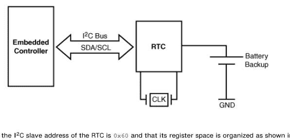

假设 RTC 的 I²C 从地址为 `0x60`，并且其寄存器空间如表 8.2 所示组织。

| **寄存器名称** | **描述** | **偏移量** |
|---|---|---|
| `RTC_HOUR_REG` | 小时计数器 | `0x0` |
| `RTC_MINUTE_REG` | 分钟计数器 | `0x1` |
| `RTC_SECOND_REG` | 秒计数器 | `0x2` |
| `RTC_STATUS_REG` | 标志和中断状态 | `0x3` |
| `RTC_CONTROL_REG` | 启用/禁用 RTC | `0x4` |

让我们基于之前讨论的 EEPROM 驱动程序来构建此芯片的驱动程序。我们将假定 I²C 客户端驱动程序架构、从设备注册以及 I²C 核心函数已经就绪，只实现与 RTC 通信的代码。

当 I²C 核心检测到 I²C 总线上具有 RTC 从地址 `0x60` 的设备时，它调用 `myrtc_attach()`。调用过程与列表 8.5 中的 `eep_attach()` 类似。假设你需要在 `myrtc_attach()` 中执行以下芯片初始化操作：

1. 清除 RTC 状态寄存器 `RTC_STATUS_REG`。
2. 通过打开 RTC 控制寄存器 `RTC_CONTROL_REG` 中的相应位来启动 RTC（如果它尚未运行）。

为此，让我们构建一个 `i2c_msg` 并使用 `i2c_transfer()` 在总线上生成 I2C 事务。这种传输机制是 I2C 特有的，且与 SMBus 不兼容。要写入之前提到的两个 RTC 寄存器，你需要构建两个 `i2c_msg` 消息。第一条消息设置寄存器偏移量。在我们的情况下，它是 `3`，即 `RTC_STATUS_REG` 的偏移量。第二条消息将所需数量的字节传输到指定偏移量。在此上下文中，它传输 `2` 个字节，分别发送给 `RTC_STATUS_REG` 和 `RTC_CONTROL_REG`。

### 代码视图

```c
#include <linux/i2c.h> /* For struct i2c_msg */

int myrtc_attach(struct i2c_adapter *adapter, int addr, int kind)
{
    u8 buf[2];
    int offset = RTC_STATUS_REG;  /* Status register lives here */
    struct i2c_msg rtc_msg[2];

    /* Write 1 byte of offset information to the RTC */
    rtc_msg[0].addr = addr;      /* Slave address. In our case,
                                     this is 0x60 */
    rtc_msg[0].flags = I2C_M_WR; /* Write Command */
    rtc_msg[0].buf = &offset;    /* Register offset for the
                                     next transaction */
    rtc_msg[0].len = 1;          /* Offset is 1 byte long */

    /* Write 2 bytes of data (the contents of the status and
       control registers) at the offset programmed by the previous
       i2c_msg */
    rtc_msg[1].addr = addr;      /* Slave address */
    rtc_msg[1].flags = I2C_M_WR; /* Write command */
    rtc_msg[1].buf = &buf[0];    /* Data to be written to control
                                     and status registers */
```


```c
rtc_msg[1].len = 2;          /* Two register values */

buf[0] = 0;                  /* Zero out the status register */

buf[1] |= ENABLE_RTC;        /* Turn on control register bits

                                 that start the RTC */

/* Generate bus transactions corresponding to the two messages */

i2c_transfer(adapter, rtc_msg, 2);

/* ... */

printk("My RTC Initialized\n");

}
```

现在 RTC 已初始化并开始计时，你可以通过读取 `RTC_HOUR_REG`、`RTC_MINUTE_REG` 和 `RTC_SECOND_REG` 的内容来获取当前时间。操作方法如下：

代码视图：

```c
#include <linux/rtc.h> /* For struct rtc_time */

int
```

```c
myrtc_gettime(struct i2c_client *client, struct rtc_time *r_t)
{
    u8 buf[3];   /* Space to carry hour/minute/second */
    int offset = 0; /* Time-keeping registers start at offset 0 */
    struct i2c_msg rtc_msg[2];

    /* Write 1 byte of offset information to the RTC */
    rtc_msg[0].addr = addr;         /* Slave address */
    rtc_msg[0].flags = 0;          /* Write Command */
    rtc_msg[0].buf = &offset;      /* Register offset for
                                   the next transaction */
    rtc_msg[0].len = 1;            /* Offset is 1 byte long */

    /* Read current time by getting 3 bytes of data from offset 0
     * (i.e., from RTC_HOUR_REG, RTC_MINUTE_REG, and RTC_SECOND_REG) */
    rtc_msg[1].addr = addr;         /* Slave address */
    rtc_msg[1].flags = I2C_M_RD;   /* Read command */
    rtc_msg[1].buf = &buf[0];      /* Data to be read from hour, minute
                                   and second registers */
    rtc_msg[1].len = 3;            /* Three registers to read */

    /* Generate bus transactions corresponding to the above
     * two messages */
    i2c_transfer(adapter, rtc_msg, 2);

    /* Read the time */
    r_t->tm_hour = BCD2BIN(buf[0]); /* Hour */
    r_t->tm_min = BCD2BIN(buf[1]);  /* Minute */
    r_t->tm_sec = BCD2BIN(buf[2]);  /* Second */
    return(0);
}
```


`myrtc_gettime()` 实现了 RTC 驱动器的总线特定底层部分。RTC 驱动器的上层应符合内核 RTC API，如第 5 章中“RTC 子系统”部分所述。这种方案的优势在于，无论你的 RTC 是位于 PC 的南桥内部，还是像本例中那样外部连接到嵌入式控制器，应用程序都可以原样运行。

RTC 通常以二进制编码十进制（BCD）存储时间，其中每个半字节表示 0 到 9 之间的一个数字（而不是 0 到 15 之间）。内核提供了一个名为 `BCD2BIN()` 的宏用于将 BCD 编码转换为十进制，以及 `BIN2BCD()` 用于执行反向操作。`myrtc_gettime()` 在从 RTC 寄存器读取时间时使用了前者。

请查看 `drivers/rtc/rtc-ds1307.c`，这是一个处理 Dallas/Maxim DS13XX 系列 $I^2C$ RTC 芯片的 RTC 驱动器示例。

作为双总线，$I^2C$ 总线没有供从设备拉起的请求中断线，但某些 $I^2C$ 主机适配器具有中断处理器的功能，用于指示数据传输请求完成。然而，这种由中断驱动的操作对 $I^2C$ 客户端驱动器是透明的，并隐藏在 $I^2C$ 核心提供的服务例程内部。假设图 8.3 中嵌入式 SoC 的一部分 $I^2C$ 主机控制器具有中断处理器的能力，那么 `myrtc_attach()` 中调用 `i2c_transfer()` 在底层可能执行以下操作：

- 构建对应于 `rtc_msg[0]` 的事务，并使用主机控制器设备驱动器的服务将其写入总线。
- 等待直到主机控制器拉起传输完成中断，指示 `rtc_msg[0]` 现在已经在线上。
- 在中断处理程序中，查看 $I^2C$ 主机控制器状态寄存器，以确认是否已从 RTC 从设备接收到确认。
- 如果主机控制器状态和控制寄存器表明一切正常，则返回错误。
- 对 `rtc_msg[1]` 重复相同的操作。

## I2c-dev

有时，当你需要为大量慢速 $I^2C$ 设备提供支持时，完全从用户空间驱动它们是有意义的。$I^2C$ 层支持一个名为 `i2c-dev` 的驱动器来实现这一点。快进到第 19 章中“用户模式 I$^2$C”部分，那里有一个使用 `i2c-dev` 实现用户模式 $I^2C$ 驱动器的示例。

## 使用 LM-Sensors 进行硬件监控

*LM-Sensors* 项目，托管在 `www.lm-sensors.org`，为 Linux 带来了硬件监控功能。许多计算机系统使用传感器芯片来监控诸如温度、电源电压和风扇速度等参数。定期跟踪这些参数可能至关重要。CPU 风扇故障可能表现为奇怪且随机的软件问题。想象一下，如果系统是医疗级设备会怎样！

LM-Sensors 通过为许多传感器芯片提供设备驱动器、一个名为 `sensors` 用于生成健康报告的实用程序，以及一个名为 `sensors-detect` 用于扫描系统并帮助生成适当配置文件的脚本来提供帮助。

大多数提供硬件监控的芯片通过 $I^2C$ / SMBus 与 CPU 接口。此类设备的设备驱动器是普通的 $I^2C$ 客户端驱动器，但位于 `drivers/hwmon/` 目录中，而不是 `drivers/i2c/chips/`。一个例子是 National Semiconductor 的 LM87 芯片，它可以监控多个电压、温度和风扇。请查看 `drivers/hwmon/lm87.c` 了解其驱动器实现。$I^2C$ 驱动器 ID 从 1000 到 1999 是保留给传感器芯片的（查看 `include/linux/i2c-id.h`）。

一些传感器芯片通过 ISA/LPC 总线而不是 $I^2C$ / SMBus 与 CPU 接口。其他芯片输出模拟信号，通过 *模数转换器*（ADC）到达 CPU。此类芯片的驱动器与 $I^2C$ 传感器驱动器共享 `drivers/hwmon/` 目录。一个非-$I^2C$ 传感器驱动器的例子是 `drivers/hwmon/hdaps.c`，这是我们在第 7 章“输入驱动器”中讨论过的若干 IBM/Lenovo 笔记本电脑中存在的加速计驱动器。另一个非-$I^2C$ 传感器的例子是 Winbond 83627HF Super I/O 芯片，由 `drivers/hwmon/w83627hf.c` 驱动。

## 串行外设接口总线

*串行外设接口*（SPI）总线是一种类似于 $I^2C$ 的串行主从接口，并内置于许多微控制器中。它使用四根线（相比之下 $I^2C$ 使用两根线）：*串行时钟*（SCLK）、*片选*（CS）、*主出从入*（MOSI）和*主入从出*（MISO）。MOSI 用于将数据移入从设备，MISO 用于将从设备数据移出。由于 SPI 总线具有用于传输和接收数据的专用线，它可以在全双工模式下运行，这与 $I^2C$ 总线不同。SPI 的典型工作速度在低兆赫兹范围内，而 $I^2C$ 在中等千赫兹范围内，因此前者的吞吐量更高。

目前市场上可用的 SPI 外围设备包括 *射频*（RF）芯片、智能卡接口、EEPROM、RTC、触摸传感器和 ADC。

内核提供核心 API 用于通过 SPI 总线交换消息。典型的 SPI 客户端驱动器执行以下操作：

- **注册** `probe()` 和 `remove()` 方法到 SPI 核心。可选地注册 `suspend()` 和 `resume()` 方法：

```c
#include <linux/spi/spi.h>

static struct spi_driver myspi_driver = {
    .driver = {
        .name  = "myspi",
        .bus   = &spi_bus_type,
        .owner = THIS_MODULE,
    },
    .probe   = myspidevice_probe,
    .remove  = __devexit_p(myspidevice_remove),
};

spi_register_driver(&myspi_driver);
```

SPI 核心创建与此设备对应的 *spi_device* 结构，并在调用注册的设备方法时将其作为参数传递。

- 使用诸如 `spi_sync()` 和 `spi_async()` 的访问函数与 SPI 设备交换消息。前者等待操作完成，而后者在消息传输完成时异步触发已注册回调例程的调用。这些数据访问例程从合适的位置调用，例如 SPI 中断处理程序、sysfs 方法或定时器处理程序。以下代码片段说明了 SPI 消息提交：

```c
#include <linux/spi/spi.h>

struct spi_device *spi;  /* Representation of a SPI device */
struct spi_transfer xfer;  /* Contains transfer buffer details */
struct spi_message sm;     /* Sequence of spi_transfer segments */
u8 *command_buffer;       /* Data to be transferred */
```

```c
int len;            /* Length of data to be transferred */
spi_message_init(&sm);          /* Initialize spi_message */
xfer.tx_buf = command_buffer;    /* Device-specific data */
xfer.len = len;                 /* Data length */
spi_message_add_tail(&xfer, &sm); /* Add the message */
spi_sync(spi, &sm);             /* Blocking transfer request */
```


以一个 SPI 设备为例，考虑我们在第 7 章中简要讨论过的 ADS7846 触摸屏控制器。该驱动执行以下操作：

1. 使用 `spi_register_driver()` 向 SPI 核心注册 `probe()`、`remove()`、`suspend()` 和 `resume()` 方法。
2. `probe()` 方法使用 `input_register_device()` 将驱动注册到输入子系统，并使用 `request_irq()` 请求一个 IRQ。
3. 该驱动使用 `spi_async()` 从其中断处理程序中获取触摸坐标。当 SPI 消息传输完成时，此函数会触发调用已注册的回调例程。
4. 回调函数进而通过输入事件接口 `/dev/input/eventX`，使用 `input_report_abs()` 和 `input_report_key()` 报告触摸坐标和点击，如第 7 章所述。像 X Windows 和 gpm 这样的应用程序能够无缝地与事件接口协同工作，并响应触摸输入。

一种通过抖动 I/O 引脚以使其能够通信协议的驱动被称为*位操作（bit-banging）*驱动。要查看一个 SPI 位操作驱动的示例，请看 `drivers/spi/spi_butterfly.c`，这是一个用于与 Atmel 基于其 AVR 处理器家族构建的 *Butterfly* 板上存在的 DataFlash 芯片通信的驱动。为此，使用专门制作的转接头将宿主系统的并行端口连接到 AVR Butterfly，并使用 *spi_butterfly* 驱动执行位操作。有关此驱动的详细说明，请查看 `Documentation/spi/butterfly`。

目前，没有类似 i2c-dev 的用户空间 SPI 驱动支持。你唯一的选项是编写一个内核驱动来与你的 SPI 设备通信。

在嵌入式世界中，你可能会遇到处理器使用伴随芯片来整合各种功能的解决方案。一个例子是 Freescale MC13783 电源管理和音频组件（PMAC），它通常与基于 ARM9 的 i.MX27 控制器配合使用。PMAC 整合了 RTC、电池充电器、触摸屏接口、ADC 模块和音频编解码器。处理器和 PMAC 通过 SPI 进行通信。SPI 总线不包含中断线，因此 PMAC 具有使用配置为此目的的 GPIO 引脚外部中断处理器的能力。

## 单线总线（1-Wire Bus）

Dallas/Maxim 开发的 1-wire 协议使用 1-wire（或 w1）总线，该总线同时携带电源和信号；返回地路径通过其他方式提供。它通过减少空间、成本和复杂性，提供了一种与慢速设备接口连接的简单方法。一个使用此协议工作的设备示例是 iButton (www.ibutton.com)，用于传感温度、携带数据或保存唯一 ID。

另一个通过嵌入式控制器的单个端口引脚接口的 w1 芯片是来自 Dallas/Maxim 的 DS2433 4kb 1-wire EEPROM。该芯片的驱动程序 `drivers/w1/slaves/w1_ds2433.c` 通过 sysfs 节点导出对 EEPROM 的访问。

与 w1 设备驱动相关的主要数据结构是 `w1_family` 和 `w1_family_ops`，两者都在 `w1_family.h` 中定义。

### 调试

要收集 I²C 特定的调试消息，请在内核配置菜单的设备驱动程序 → *I2C 支持* 下打开 *I2C 核心调试消息*、*I2C 算法调试消息*、*I2C 总线调试消息* 和 *I2C 芯片调试消息* 的相关组合。类似地，对于 SPI 调试，请在设备驱动程序 → *SPI 支持* 下打开 *SPI 驱动程序调试支持*。

要了解 I²C 数据包在总线上的流动，请像我们在运行列表 8.1 时那样，将 I²C 总线分析仪连接到你的板子。`lm-sensors` 包包含一个名为 `i2cdump` 的工具，该工具转储 I²C 总线上设备的寄存器内容。

有一个专门用于 Linux I²C 的邮件列表，位于 http://lists.lm-sensors.org/mailman/listinfo/i2c。

## 查看源代码

在 2.4 内核源代码树中，单个目录（*drivers/i2c/*）包含了所有与 I²C/SMBus 相关的源代码。2.6 内核中的 I²C 代码是按层次结构组织的：*drivers/i2c/busses/* 目录包含适配器驱动程序，*drivers/i2c/algos/* 目录有算法驱动程序，而 *drivers/i2c/chips/* 目录包含客户端驱动程序。你也可以在源代码树的其他区域找到客户端驱动程序。例如，*drivers/sound/* 目录包含使用 I²C 控制接口的音频芯片组驱动程序。查看 *Documentation/i2c/* 目录内部以获取技巧和其他示例。

内核 SPI 服务函数位于 *drivers/spi/spi.c*。ADS7846 触摸控制器的 SPI 驱动程序在 *drivers/input/touchscreen/ads7846.c* 中实现。第 17 章“存储器技术设备”中讨论的 MTD 子系统实现了 SPI 闪存芯片的驱动程序。一个示例是 *drivers/mtd/devices/mtd_dataflash.c*，即用于访问 Atmel DataFlash SPI 芯片的驱动程序。

*drivers/w1/* 目录包含 w1 协议的内核支持。w1 接口的宿主控制器端驱动程序位于 *drivers/w1/masters/*，而 w1 从设备驱动程序位于 *drivers/w1/slaves/*。

*表 8.3* 总结了本章使用的主要数据结构及其在内核树中的位置。*表 8.4* 列出了你在本章中使用的主要内核编程接口及其定义的位置。

**表 8.3. 数据结构摘要**

| 数据结构 | 位置 | 描述 |
|---|---|---|
| i2c_driver | include/linux/i2c.h | I²C 驱动程序的表示 |
| i2c_client_address_data | include/linux/i2c.h | I²C 客户端驱动程序负责的主从地址 |
| i2c_client | include/linux/i2c.h | 标识连接到 I²C 总线的芯片 |
| i2c_msg | include/linux/i2c.h | 关于你想在 I²C 总线上生成的事务的信息 |
| spi_driver | include/linux/spi/spi.h | SPI 驱动程序的表示 |
| spi_device | include/linux/spi/spi.h | SPI 设备的表示 |
| spi_transfer | include/linux/spi/spi.h | SPI 传输缓冲区的详细信息 |
| spi_message | include/linux/spi/spi.h | spi_transfer 段序列 |
| w1_family | drivers/w1/w1_family.h | w1 从设备驱动程序的表示 |
| w1_family_ops | drivers/w1/w1_family.h | w1 从设备驱动程序的入口点 |

**表 8.4. 内核编程接口摘要**

| 内核接口 | 位置 | 描述 |
|---|---|---|
| `i2c_add_driver()` | `include/linux/i2c.h`<br>`drivers/i2c/i2c-core.c` | 向 `I2C` 核心注册驱动程序入口点。 |
| `i2c_del_driver()` | `drivers/i2c/i2c-core.c` | 从 `I2C` 核心移除驱动程序。 |
| `i2c_probe()` | `drivers/i2c/i2c-core.c` | 指定驱动程序负责的主从设备地址以及相关的 `attach()` 例程，该例程在 `I2C` 核心检测到指定的地址之一时被调用。 |
| `i2c_attach_client()` | `drivers/i2c/i2c-core.c` | 向由相关 `I2C` 宿主适配器服务的客户端列表中添加新客户端。 |
| `i2c_detach_client()` | `drivers/i2c/i2c-core.c` | 分离活动的客户端。通常当客户端驱动程序或相关宿主适配器注销时执行此操作。 |
| `i2c_check_functionality()` | `include/linux/i2c.h` | 验证宿主适配器是否支持特定功能。 |
| `i2c_get_functionality()` | `include/linux/i2c.h` | 获取包含宿主适配器支持的所有功能的掩码。 |
| `i2c_add_adapter()` | `drivers/i2c/i2c-core.c` | 注册宿主适配器。 |
| `i2c_del_adapter()` | `drivers/i2c/i2c-core.c` | 注销宿主适配器。 |
| 兼容 SMBus 的 `I2C` 数据访问例程 | `drivers/i2c/i2c-core.c` | 见表 8.1。 |
| `i2c_transfer()` | `drivers/i2c/i2c-core.c` | 通过 `I2C` 总线发送 `i2c_msg`。此函数不兼容 SMBus。 |
| `spi_register_driver()` | `drivers/spi/spi.c` | 向 `SPI` 核心注册驱动程序入口点。 |
| `spi_unregister_driver()` | `include/linux/spi/spi.h` | 注销 `SPI` 驱动程序。 |
| `spi_message_init()` | `include/linux/spi/spi.h` | 初始化 `SPI` 消息。 |
| `spi_message_add_tail()` | `include/linux/spi/spi.h` | 将 `SPI` 消息添加到传输列表。 |
| `spi_sync()` | `drivers/spi/spi.c` | 通过 `SPI` 总线同步传输数据。此函数阻塞直到完成。 |
| `spi_async()` | `include/linux/spi/spi.h` | 使用完成回调机制通过 `SPI` 总线异步传输数据。 |

## 第 9 章. PCMCIA 和 Compact Flash

### 本章内容

- 什么是 PCMCIA/CF？ 258
- Linux-PCMCIA 子系统 260
- 主机控制器驱动程序 262
- PCMCIA 核心 263
- 驱动程序服务 263
- 客户端驱动程序 264
- 整合各个部件 271
- PCMCIA 存储 272
- 串行 PCMCIA 272
- 调试 273
- 查看源代码 275

如今流行的技术，例如无线和有线以太网、*通用分组无线业务*（GPRS）、*全球定位系统*（GPS）、微型存储和调制解调器，普遍采用 PCMCIA（*个人电脑存储卡国际协会*的缩写）或 *CF*（*紧凑闪存*）卡的形式。大多数笔记本电脑和许多嵌入式设备都支持 PCMCIA 或 CF 接口。因此，它们可以立即利用这些技术。在嵌入式系统中，PCMCIA/CF 插槽提供了一种技术升级路径，而无需重新设计电路板。例如，一种低成本版本的互联网设备可以使用 PCMCIA 拨号调制解调器，而一种高端版本则可以支持 WiFi。

Linux 内核支持多种架构上的 PCMCIA 设备。在本章中，让我们探讨内核中针对 PCMCIA/CF 主机适配器和客户端设备的支持情况。

### 什么是 PCMCIA/CF？

PCMCIA 是一种 16 位数据传输接口规范，最初用于内存卡。CF 卡更小，但兼容 PCMCIA，常用于 PDA 和数码相机等手持设备。CF 卡只有 50 个引脚，但可以使用无源 CF 转 PCMCIA 适配器插入笔记本电脑的 68 针 PCMCIA 插槽中。PCMCIA 和 CF 一直局限于笔记本电脑和手持设备领域，尚未进入台式机和更高端的机器市场。

PCMCIA 规范现在已经发展以支持更高速率的形式，即 32 位 *CardBus* 卡。当指代 PCMCIA 或 *CardBus* 设备时，使用 *PC 卡* 这一术语。*CardBus* 更接近 PCI 总线，因此内核已将 *CardBus* 设备的支持从 PCMCIA 层移至 PCI 层。PCMCIA 行业标准组织的最新技术规格是 *ExpressCard*，它与 *PCI Express* 兼容，这是一种基于 PCI 概念的新总线技术。我们将在下一章讨论 PCI 时，详细讲解 *CardBus* 和 *ExpressCard*。

PC 卡有增加厚度的三种规格：*Type I*（3.3 毫米）、*Type II*（5 毫米）和 *Type III*（10.5 毫米）。

图 9.1 显示了笔记本电脑上的 PCMCIA 总线连接，图 9.2 则展示了嵌入式设备上的 PCMCIA。您可能已经注意到，PCMCIA 主机控制器在 PCMCIA 卡与系统总线之间起桥接作用。笔记本电脑及其衍生产品通常有一个连接到 PCI 总线的 PCMCIA 主机控制器芯片，而一些嵌入式控制器则在其芯片内部集成了 PCMCIA 主机控制器。该控制器将卡的内存映射到主机 I/O 和内存窗口，并将卡产生的中断路由到合适的处理器中断线上。


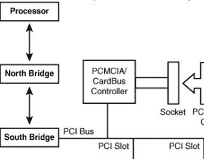

图 9.2. 嵌入式系统上的 PCMCIA。

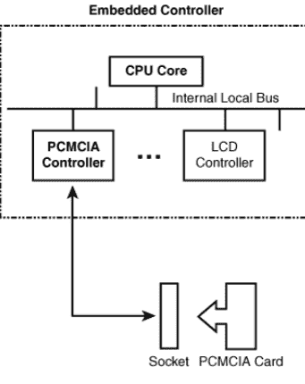

### Linux-PCMCIA 子系统

Linux-PCMCIA 支持在基于 Intel 的笔记本电脑以及 ARM、MIPS 和 PowerPC 等架构上均可用。PCMCIA 子系统包括 PCMCIA 主机控制器的设备驱动程序、不同卡片的客户端驱动程序、一个辅助热插拔的守护进程、用户态工具，以及一个与所有这些组件交互的*Card Services*（卡片服务）模块。

图 9.3 展示了构成 Linux-PCMCIA 子系统的各个模块之间的交互。

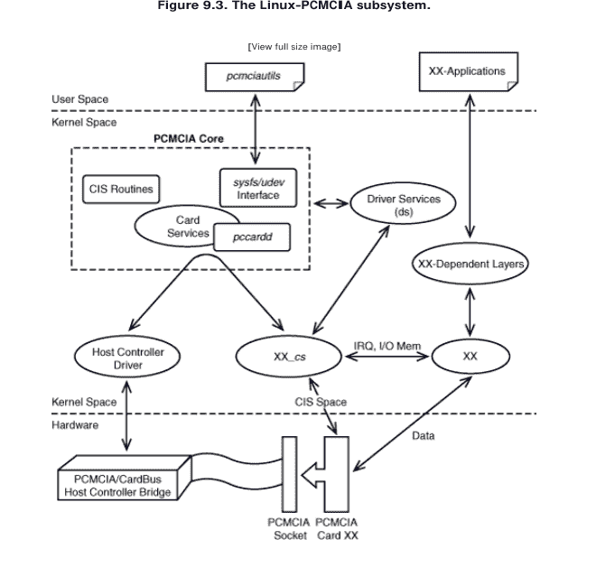

### 旧的 Linux-PCMCIA 子系统

Linux-PCMCIA 子系统最近经历了一次大规模重构。若要使 PCMCIA 在 2.6.13 及更新的内核上工作，您需要 *pcmciautils* 包（[http://kernel.org/pub/linux/utils/kernel/pcmcia/howto.html](http://kernel.org/pub/linux/utils/kernel/pcmcia/howto.html)），它取代了早期内核使用的 *pcmcia-cs* 包（[http://pcmcia-cs.sourceforge.net](http://pcmcia-cs.sourceforge.net)）。内核内部编程接口和数据结构也发生了变化。早期内核依赖名为 *cardmgr* 的用户空间守护进程来支持热插拔，但新的 PCMCIA 实现使用 *udev* 来处理热插拔，就像其他总线子系统一样。因此，在新的配置中，您不需要 *cardmgr*，并且应确保其未被启动。迁移指南位于 [http://kernel.org/pub/linux/utils/kernel/pcmcia/cardmgr-to-pcmciautils.html](http://kernel.org/pub/linux/utils/kernel/pcmcia/cardmgr-to-pcmciautils.html)。

图 9.3 包含以下组件：

- 实现与 PCMCIA 主机控制器通信的低层例程的主机控制器设备驱动程序。您的手持设备和笔记本电脑具有不同的主机控制器，因此使用不同的主机控制器驱动程序。主机控制器支持的每个 PCMCIA 插槽都称为一个*插座*（socket）。
- PCMCIA 客户端驱动程序（**图 9.3** 中的 *XX_cs*），它们响应如卡片插入和弹出等插座事件。这是您在尝试为 PCMCIA 卡片启用 Linux 支持时最可能需要实现的驱动程序。*XX_cs* 驱动程序通常与非 PCMCIA 特定的通用驱动程序（**图 9.3** 中的 *XX*）协同工作。就 **图 9.3** 而言，如果您的设备是 PCMCIA IDE 磁盘，那么 *XX* 是 IDE 磁盘驱动程序，*XX_cs* 是 *ide_cs* 驱动程序，*XX* 的依赖层是文件系统层，*XX* 的应用程序是访问数据文件的程序。*XX_cs* 配置通用驱动程序（*XX*），使用诸如 IRQ、I/O 基地址和内存窗口等资源。
- 为主机控制器驱动程序和客户端驱动程序提供服务的 PCMCIA 核心。核心提供了一个基础设施，简化驱动程序实现，并增加了一层间接性，使客户端驱动程序独立于主机控制器。无论您是在基于 XScale 的手持设备上使用蓝牙 CF 卡，还是在基于 x86 的笔记本电脑上使用，都可以使用相同的客户端驱动程序。
- 一个*驱动程序服务*模块（*ds*），为客户端驱动程序提供注册接口和总线服务。
- *pcmciautils* 包，包含 *pccardctl* 等工具，用于控制 PCMCIA 插座的状态并在不同的卡片配置方案之间进行选择。

图 9.4 将内核模块叠加在图 9.1 之上，说明了 Linux-PCMCIA 子系统如何在 PC 兼容系统与硬件交互。

**图 9.4. PCMCIA 驱动程序组件与 PC 硬件的关系。**


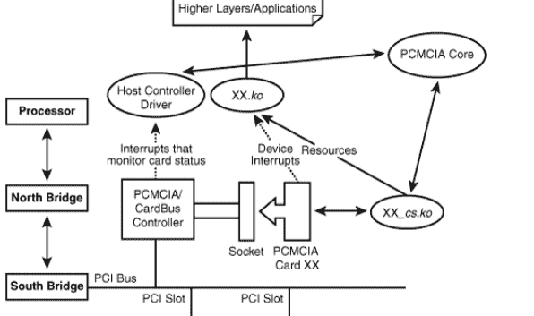

在接下来的部分中，让我们更仔细地查看构成 Linux-PCMCIA 子系统的组件。为了更好地理解这些组件的作用及其交互，我们将把一张 PCMCIA WiFi 卡插入笔记本电脑，并在“整合各个部件”一节中跟踪代码流程。

### 主机控制器驱动程序

虽然通用卡片驱动程序（XX）负责处理由卡片功能（例如，当 PCMCIA 网卡接收数据分组时产生的接收中断）生成的中断，但主机控制器驱动程序负责处理由卡片插入和弹出等事件触发的总线特定中断。

图 9.2 显示了一个围绕具有内置 PCMCIA 支持的嵌入式控制器设计的嵌入式设备的框图。即使您使用的是内核 PCMCIA 层支持的控制器，您也可能需要根据电路板的设计来微调主机控制器驱动程序（例如，配置用于检测卡片插入事件或切换插座电源的 GPIO 线）。例如，如果您正在将内核移植到基于 StrongARM 的手持设备，请修改 `drivers/pcmcia/sa1100_assab6.c` 以适合您的硬件。

本章不涵盖主机控制器设备驱动程序的实现。

## PCMCIA 核心

Card Services（卡服务）是 PCMCIA 核心的主要组成部分。它向客户端驱动程序和主机控制器驱动程序提供一组服务。它包含一个名为 `pccardd` 的内核线程，用于轮询套接字相关的事件。当主机控制器报告诸如卡片插入和卡片移除等事件时，Pccardd 会通知 Driver Services（驱动服务）事件处理程序（将在下一节中讨论）。

PCMCIA 核心的另一个组件是一个库，用于操纵 *卡片信息结构*（CIS），这是 PCMCIA 卡的一部分。PCMCIA/CF 卡有两个内存空间：*属性内存*（Attribute memory）和 *公共内存*（Common memory）。属性内存包含 CIS 和卡片配置寄存器。例如，PCMCIA IDE 磁盘的属性内存包含其 CIS 和指定扇区数与柱面号的寄存器。在此情况下，公共内存包含存储磁盘数据的内存阵列。PCMCIA 核心向客户端驱动程序提供 CIS 操纵例程，如 `pccard_get_first_tuple()`、`pccard_get_next_tuple()` 和 `pccard_parse_tuple()`。清单 9.2 使用了其中一些函数的辅助。

PCMCIA 核心通过 sysfs 和 udev 将 CIS 信息传递给用户空间。诸如 `pccardctl` 之类的实用程序（属于 pcmciautils 包的一部分）依赖 sysfs 和 udev 来运行。当内核中缺少这些设施时，这简化了早期依赖自定义基础设施的设计方法。

### 驱动服务

Driver Services（驱动服务）提供了一种基础设施，提供以下内容：

- 一个捕获由 pccard 内核线程分发的事件警报的处理程序。该处理程序扫描并验证卡片的 CIS 空间，并触发加载适当的客户端驱动程序。
- 一个负责与内核总线核心通信的层。为此，Driver Services 实现了 `pcmcia_bus_type` 和相关总线操作。
- 客户端驱动程序使用来与 PCMCIA 核心注册自己的服务例程，如 `pcmcia_register_driver()`。清单 9.1 中的示例驱动程序使用了其中一些例程。

### 客户端驱动程序

客户端设备驱动程序（**图 9.3** 中的 XX_cs）查看卡片的 CIS 空间，并根据其收集的信息配置卡片。

### 数据结构

在继续开发一个示例 PCMCIA 客户端驱动程序之前，让我们先了解一些相关的数据结构：

1. PCMCIA 设备由在 `include/linux/mod_device.table.h` 中定义的 `pcmcia_device_id` 结构标识：

```c
```


`struct pcmcia_device_id` {

    /* ... */

    __u16     manf_id;    /* Manufacturer ID */

    __u16     card_id;    /* Card ID */

    __u8      func_id;    /* Function ID */

    /* ... */

};

`manf_id`、`card_id` 和 `func_id` 分别保存卡片的制造商 ID、卡片 ID 和功能 ID。PCMCIA 核心提供了一个名为 `PCMCIA_DEVICE_MANF_CARD()` 的宏，它使用提供的制造商和卡片 ID 创建一个 `pcmcia_device_id` 结构。另一个内核宏 `MODULE_DEVICE_TABLE()` 标记模块镜像中支持的 `pcmcia_device_ids`，以便在插入卡片时，PCMCIA 子系统从卡片的 CIS 空间提取匹配的制造商/卡片/功能 ID，从而可以按需加载模块。我们在第 4 章“奠定地基”中的“模块自动加载”部分探讨了这种机制。此过程类似于用于支持热插拔的两个其他流行 I/O 总线的设备驱动程序所使用的方法：PCI 和 USB。**表 9.1** 简要介绍了这三种总线技术驱动程序之间的相似之处。如果难以消化这一点请不要担心；我们将在后续章节中详细讨论 PCI 和 USB。

| | **PCMCIA** | **PCI** | **USB** |
|---|---|---|---|
| **表 9.1 PCMCIA、PCI 和 USB 的设备 ID 和热插拔方法** | | | |
| 设备 ID 表结构 | `pcmcia_device_id` | `pci_device_id` | `usb_device_id` |
| 创建设备 ID 的宏 | `PCMCIA_DEVICE_MANF_CARD()` | `PCI_DEVICE()` | `USB_DEVICE()` |
| 设备表示 | `struct pcmcia_device` | `struct pci_dev` | `struct usb_device` |
| 驱动程序表示 | `struct pcmcia_driver` | `struct pci_driver` | `struct usb_driver` |
| 热插拔方法 | `probe()` 和 `remove()` | `probe()` 和 `remove()` | `probe()` 和 `disconnect()` |
| 热插拔事件检测 | `pcicard kthread` | `PCI-family-dependent` | `khubd kthread` |

## 2. PCMCIA 客户端驱动程序

PCMCIA 客户端驱动程序需要将其 `pcmcia_device_id` 表与其 `probe()` 和 `remove()` 方法关联起来。这种关联通过 `pcmcia_driver` 结构实现：

```c
struct pcmcia_driver {
int (*probe)(struct pcmcia_device *dev); /* Probe method */
void (*remove)(struct pcmcia_device *dev); /* Remove method */
/* ... */
struct pcmcia_device_id *id_table; /* Device ID table */
/* ... */
};
```

## 3. `struct pcmcia_device`

`struct pcmcia_device` 内部表示一个 PCMCIA 设备，并在 `drivers/pcmcia/ds.h` 中定义如下：

```c
struct pcmcia_device {
/* ... */
io_req_t io; /* I/O attributes */
irq_req_t irq; /* IRQ settings */
config_req_t conf; /* Configuration */
/* ... */
struct device dev; /* Connection to device model */
/* ... */
};
```

## 4. CIS 操纵例程

CIS 操纵例程使用在 `include/pcmcia/cis.h` 中定义的 `tuple_t` 结构来保存 CIS 信息单元。例如，`CISPL_LINK_MFC` tuple 类型包含与多功能卡相关的信息。有关 tuple 的完整列表及其描述，请查看 `include/pcmcia/cis.h` 和 http://pcmcia-cs.sourceforge.net/ftp/doc/PCMCIA-PROG.html。

```c
typedef struct tuple_t {
/* ... */
cisdata_t TupleCode; /* See include/pcmcia/cis.h */
/* ... */
cisdata_t DesiredTuple; /* Identity of the desired tuple */
/* ... */
cisdata_t *TupleData; /* Buffer space */
};
```

## 5. CIS 配置文件项

CIS 包含卡片支持的每种配置的配置文件项。`cispl_cftable_entry_t` 定义在 `include/pcmcia/cis.h` 中，保存这样一个条目：

```c
typedef struct cispl_cftable_entry_t {
/* ... */
cispl_power_t vcc, vppi, vpp2; /* Voltage level */
cispl_io_t io; /* I/O attributes */
cispl_irq_t irq; /* IRQ settings */
cispl_mem_t mem; /* Memory window */
/* ... */
};
```

## 6. `cisparsed_t`

`cisparsed_t`，同样定义在 `include/pcmcia/cistpl.h` 中，保存由 PCMCIA 核心解析的 tuple：

```c
typedef union cisparsed_t {
    /* ... */
    cistpl_mandid_t manfid;        /* Manf ID */
    /* ... */
    cistpl_cftable_entry_t cftable_entry;  /* Configuration table entry */
    /* ... */
} cisparsed_t;
```

# 设备示例：PCMCIA 卡

让我们开发一个骨架客户端设备驱动程序（因为过多的细节会使讨论变得冗长），以了解 PCMCIA 子系统的工作原理。实现是通用的，因此无论你的卡片实现的是网络、存储还是其他技术，你都可以将其用作模板。只实现了 `XX_cs` 驱动程序；假设通用的 `XX` 驱动程序是现成的。

如前所述，PCMCIA 驱动程序包含 `probe()` 和 `remove()` 方法以支持热插拔。清单 9.1 将驱动程序的 `probe()` 方法、`remove()` 方法和 `pcmcia_device` 表注册到 PCMCIA 核心。当关联的 PCMCIA 卡插入时，调用 `XX_probe()`；当卡片弹出时，调用 `XX_remove()`。

### 清单 9.1 注册客户端驱动程序

```c
#include <pcmcia/ds.h> /* Definition of struct pcmcia_device */
static struct pcmcia_driver XX_cs_driver = {
    .owner          = THIS_MODULE,
    .drv            = {
        .name       = "XX_cs",    /* Name */
    },
    .probe          = XX_probe,   /* Probe */
    .remove         = XX_remove,  /* Release */
    .id_table       = XX_ids,     /* ID table */
    .suspend        = XX_suspend, /* Power management */
    .resume         = XX_resume,  /* Power management */
};
#define XX_MANUFACTURER_ID  0xABCD   /* Device's manf_id */
#define XX_CARD_ID          0xCDEF   /* Device's card_id */
/* Identity of supported cards */
```


static struct pcmcia_device_id `XX_ids`[] = {

    `PCMCIA_DEVICE_MANF_CARD`(`XX_MANUFACTURER_ID`, `XX_CARD_ID`),

    `PCMCIA_DEVICE_NULL`,

};

`MODULE_DEVICE_TABLE`(pcmcia, `XX_ids`); /* For module autoload */

/* Initialization */

static int __init

init_XX_cs(void)

{

    return `pcmcia_register_driver`(&`XX_cs_driver`);

}

## **列表 9.1. 探测 PCMCIA 卡**

```c
/* 探测方法 */
static int
XX_probe(struct pcmcia_device *link)
{
    /* 填充核心为此卡分配的 pcmcia_device 结构体。首先填写通用信息 */
    /* ... */
    /* 填写与 I/O 窗口和中断级别相关的属性 */
    XX_config(link); /* 参见列表 9.2 */
}
```

列表 9.2 展示了配置通用设备驱动程序（XX）的例程，其中包含 I/O 和内存窗口基地址等资源信息。在此步骤之后，流向 PCMCIA 卡以及从卡流出的数据将经过 XX，并对其余各层保持透明。由 PCMCIA 卡生成的任何中断（例如与网卡数据接收或传输完成相关的中断），都由作为 XX 一部分的中断处理程序来处理。列表 9.2 loosely 基于 `drivers/net/wireless/airo_cs.c`，这是思科 Aironet 4500 和 4800 系列 PCMCIA WiFi 卡的客户端驱动程序。该列表使用 PCMCIA 核心的服务执行以下操作：

- 从卡的 CIS 中获取合适的配置表项元组
- 解析元组
- 从解析后的元组中获取卡的配置信息，例如 I/O 基地址和电源设置
- 请求分配中断线

然后，使用之前获得的信息配置芯片组特定的驱动程序（XX）。

## **列表 9.2. 配置通用设备驱动程序**

```c
#include <pcmcia/cistpl.h>
#include <pcmcia/ds.h>
#include <pcmcia/cs.h>
#include <pcmcia/cisreg.h>

/* 这使得 XX 设备对系统可用。XX_config() 基于定义在
   drivers/net/wireless/airo_cs.c 中的 airo_config() */
static int
XX_config(struct pcmcia_device *link)
{
   tuple_t tuple;
   cisparsed_t parse;
   u_char buf[64];
   /* 使用所需元组的标识填充 tuple_t 结构体。
      在这种情况下，我们正在寻找一个配置表项 */
   tuple.DesiredTuple = CISTPL_CFTABLE_ENTRY;
   tuple.Attributes = 0;
   tuple.TupledData = buf;
   tuple.TupleDataMax = sizeof(buf);
   /* 在 CIS 中遍历以匹配元组，并获取卡的配置信息，
      例如 I/O 窗口基地址 */
   /* 获取第一个元组 */
   CS_CHECK(GetFirstTuple, pcmcia_get_first_tuple(link, &tuple));
   while (1) {
       cistpl_cftable_entry_t dflt = {0};
       cistpl_cftable_entry_t *cfg = &(parse.cftable_entry);
       /* 从卡的 CIS 空间读取一个配置元组 */
       if (pcmcia_get_tuple_data(link, &tuple) != 0 ||
           pcmcia_parse_tuple(link, &tuple, &parse) != 0) {
           goto next_entry;
       }
       /* 我们找到了一个匹配的元组！ */
       /* 基于解析后的元组项中发现的内容，在 pcmcia_device 中配置电源设置 */
       if ((cfg->vpp1.present & (1<<CISTPL_POWER_VNOM)))
           link->conf.Vpp = cfg->vpp1.param[CISTPL_POWER_VNOM]/10000;
       /* ... */
       /* 基于解析后的元组项中发现的内容，在 pcmcia_device 中配置 I/O 窗口设置 */
       if ((cfg->io.nwin > 0) || (dflt.io.nwin > 0)) {
           cistpl_io_t *io = (cfg->io.nwin) ? &cfg->io : &dflt.io;
           /* ... */
           if (!(io->flags & CISTPL_IO_8BIT)) {
               link->io.Attributes1 = IO_DATA_PATH_WIDTH_16;
           }
           link->io.BasePort1 = io->win[0].base;
           /* ... */
       }
       /* ... */
       break;
   next_entry:
       CS_CHECK(GetNextTuple, pcmcia_get_next_tuple(link, &tuple));
   }
   /* 分配 IRQ */
   if (link->conf.Attributes & CONF_ENABLE_IRQ) {
       CS_CHECK(RequestIRQ, pcmcia_request_irq(link, &link->irq));
   }
   /* ... */
   /* 调用 init_XX_card()，它是通用 XX 驱动程序的一部分
      （因此在此列表中未显示），并传递上述获得的
      I/O 基址和 IRQ 信息 */
   init_XX_card(link->irq.AssignedIRQ, link->io.BasePort1,
                1, &handle_to_dev(link));
   /* 从现在开始，芯片特定的（与外形无关的）驱动程序可以接管
      对此卡的责任！ */
}
```


### 将各部分串联起来

正如你在图 9.3 中看到的，PCMCIA 层由各种组件组成。组件之间的数据流路径有时可能会变得复杂。让我们追踪代码路径，从你插入 PCMCIA 卡开始，直到应用程序开始向卡传输数据。假设在一个具有 82365 兼容 PCMCIA 宿主控制器的笔记本电脑上插入了一张思科 Aironet PCMCIA 卡：

1. PCMCIA 宿主控制器驱动程序（`drivers/pcmcia/yenta_socket.c`）通过其中断服务例程检测到插入事件，并使用适当的数据结构对此进行记录。
2. 作为 Card Services 一部分的 `pcicard` 内核线程（`drivers/pcmcia/cs.c`）在一个等待队列上休眠，直到宿主控制器驱动程序在第 1 步检测到卡插入时将其唤醒。
3. Card Services 将插入事件分发给 Driver Services（`drivers/pcmcia/ds.c`）。这会触发 Driver Services 在初始化期间注册的事件处理程序执行。
4. Driver Services 验证卡的 CIS 空间，确定有关插入设备的信息，例如制造商 ID 和卡 ID，并将该设备注册到内核中。随后加载相应的客户端设备驱动程序（`drivers/net/wireless/airo_cs.c`）。回顾我们之前关于 `MODULE_DEVICE_TABLE()` 的讨论，以了解这是如何实现的。
5. 在第 4 步中加载的客户端驱动程序（`airo_cs.c`）使用 `pcmcia_register_driver()` 进行初始化和注册，如列表 9.1 所示。此注册接口内部将设备的总线类型设置为 `pcmcia_bus_type`。由 Driver Services（`ds.c`）定义的 PCMCIA 总线操作，如 `probe()` 和 `remove()`，也在内部进行了注册。
6. 内核调用 Driver Services 在第 5 步中注册的总线 `probe()` 操作。这进而调用属于匹配客户端驱动程序（`airo_probe()`）的 `probe()` 方法，该也是在第 5 步中注册的。客户端 `probe()` 例程填充设置（例如 I/O 窗口和中断线），并配置通用的芯片组特定驱动程序（`drivers/net/wireless/airo.c`），如列表 9.2 所示。
7. 芯片组驱动程序（`airo.c`）创建一个网络接口（`ethX`），并负责从此刻起的常规操作。该驱动程序负责处理由卡响应数据报接收和传输完成而生成中断。设备的外形（例如，它是 PCMCIA 卡还是 PCI 卡）对于芯片组驱动程序以及通过 `ethX` 运行的应用程序都是透明的。

### PCMCIA 存储

当今的 PCMCIA/CF 存储支持千兆字节级别的数据密度。存储卡有不同的形式：

- 微型 IDE 磁盘驱动器或微驱动器。这些是机械硬盘的微型版本，使用磁性介质。其数据传输速率通常高于固态内存设备，但在数据传输之前，IDE 驱动器具有启动和寻道延迟。IDE Card Services 驱动程序 `ide_cs` 与传统 IDE 驱动程序配合使用，用于与这类存储卡通信。
- 模拟 IDE 的固态存储卡。这类卡没有运动部件，通常基于闪存，由于 IDE 模拟，对操作系统是透明的。由于这些驱动器实际上是基于 IDE 的，可以使用相同的 IDE Card Services 驱动程序（`ide_cs`）与其通信。
- 使用闪存但没有 IDE 模拟的存储卡。`memory_cs` Card Services 驱动程序为这类卡提供块和字符接口。块接口用于在卡内存上放置文件系统，而字符接口用于访问原始数据。你还可以使用 `memory_cs` 读取任何 PCMCIA 卡的属性内存空间。

### 串行 PCMCIA

许多网络技术，如通用分组无线业务（GPRS）、全球移动通信系统（GSM）、全球定位系统（GPS）和蓝牙，使用串行传输机制与主机系统通信。在本节中，让我们找出 PCMCIA 层如何处理具有此类技术的卡。请注意，本节仅旨在帮助你理解具有 PCMCIA/CF 外形尺寸的 GPRS、GSM 和蓝牙卡的总线接口部分。这些技术本身在第 16 章“无线 Linux”中详细讨论。

通用的串行 Card Services 驱动程序 `serial_cs` 允许操作系统的其余部分将 PCMCIA/CF 卡视为串行设备。第一个未使用的串行设备 `/dev/ttySX` 分配给该卡。因此，`serial_cs` 在 GPRS、GSM 和 GPS 卡上模拟串行端口。它还允许使用串行传输的蓝牙 PCMCIA/CF 卡将主机控制接口（HCI）数据包传输到蓝牙协议层。

图 9.5 说明了实现不同网络技术的内核模块如何与 `serial_cs` 交互以与其各自的卡通信。


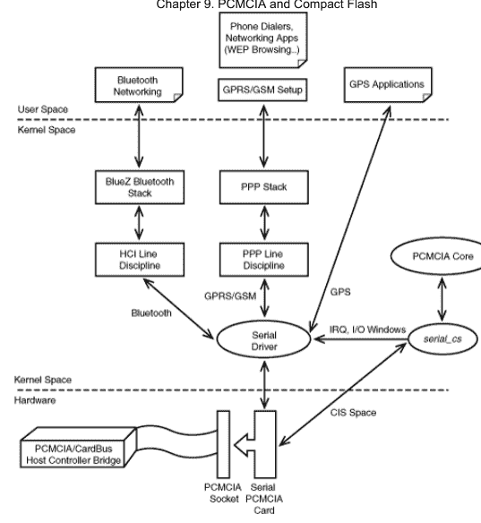

*点对点协议*（PPP）允许 TCP/IP 等网络协议在串行链路上运行。在图 9.5 的上下文中，PPP 使 TCP/IP 应用程序能够运行在 GPRS 和 GSM 拨号上。PPP 守护进程 `pppd` 附着在由 `serial_cs` 模拟的虚拟串行端口上。为了 `pppd` 正常工作，必须加载 PPP 内核模块——`ppp_generic`、`ppp_async` 和 `slhc`。按如下方式调用 `pppd`：

```bash
pppd ttySx call connection-script
```


其中 `connection-script` 是一个包含 `pppd` 与服务提供商交互以建立链路的命令序列的文件。连接脚本取决于所使用的特定卡。GPRS 卡需要在连接脚本中发送上下文字符串，而 GSM 卡可能需要交换密码。第 16 章中“GPRS”部分描述了一个连接脚本的示例。

## 调试

为了有效地调试 PCMCIA/CF 客户端驱动，你需要查看由 PCMCIA 核心发出的调试信息。为此，在内核配置期间启用 `CONFIG_PCICIA_DEBUG`（总线选项 -> PCCARD 支持 -> 启用 PCCARD 调试）。调试输出的详细程度可以通过 `pcmcia_core` `.pc_debug` 内核命令行参数或使用 `pc_debug` 模块插入参数来控制。

关于 PC 卡客户端驱动的信息可以在进程文件系统条目 `/proc/bus/pccard/drivers` 中找到。查看 `/sys/bus/pcmcia/devices/*` 以获取关于制造商和卡 ID 等卡特定信息。如果你的系统使用 PCI 到 PCMCIA 桥接器，请查看 `/proc/bus/pci/` 内部以了解有关你的 PCMCIA 主机控制器的更多信息。`/proc/interrupts` 列出了你的系统上活动的 IRQ，包括那些被 PCMCIA 层使用的。

有一个专门用于 Linux-PCMCIA 的邮件列表，位于 http://lists.infradead.org/mailman/listinfo/linux-pcmcia。

## 查看源代码

在 Linux 源代码树中，`drivers/pmcia/` 目录包含 Card Services、Driver Services 和主机控制器驱动的源代码。查看 `drivers/pmcia/yenta_socket.c` 中的主机控制器驱动，它运行在许多基于 x86 的笔记本电脑上。`include/pmcia/` 中的头文件包含 PCMCIA 相关的结构定义。

客户端驱动位于属于关联设备类的其他驱动旁边。因此，你可以在 `drivers/net/pmcia/` 中找到 PCMCIA 网络卡的驱动。模拟 IDE 的 PCMCIA 内存设备的客户端驱动是 `drivers/ide/legacy/ide-cs.c`。查看 `drivers/serial/serial_cs.c` 了解用于 PCMCIA 调制解调器的客户端驱动。

表 9.2 总结了本章使用的主要数据结构及其在内核树中的位置。表 9.3 列出了本章使用的主要内核编程接口及其定义的位置。

**表 9.2. 数据结构摘要**

| 数据结构 | 位置 | 描述 |
| :--- | :--- | :--- |
| `pmcia_device_id` | `include/linux/mod_devicetable.h` | PCMCIA 卡的标识。 |
| `pmcia_device` | `include/pmcia/ds.h` | PCMCIA 设备的表示。 |
| `pmcia_driver` | `include/pmcia/ds.h` | PCMCIA 客户端驱动的表示。 |
| `tuple_t` | `include/pmcia/cistpl.h` | CIS 操作例程使用 `tuple_t` 结构来存储信息。 |
| `cistpl_cftable_entry_t` | `include/pmcia/cistpl.h` | CIS 空间中的配置表项。 |
| `cisparse_t` | `include/pmcia/cistpl.h` | 解析后的 CIS 元组。 |

**表 9.3. 内核编程接口摘要**

| 内核接口 | 位置 | 描述 |
| :--- | :--- | :--- |
| `pmcia_register_driver()` | `drivers/pmcia/ds.c` | 将驱动注册到 PCMCIA 核心 |
| `pmcia_unregister_driver()` | `drivers/pmcia/ds.c` | 将驱动从 PCMCIA 核心注销 |
| `pmcia_get_first_tuple()`<br>`pmcia_get_tuple_data()`<br>`pmcia_parse_tuple()` | `include/pmcia/cistpl.h`<br>`drivers/pmcia/cistpl.c` | 用于操作 CIS 空间的库例程 |
| `pmcia_request_irq()` | `drivers/pmcia/pmcia_resource.c` | 为 PCMCIA 卡获取分配的 IRQ |

# 第 10 章. 外围组件互连

## 本章内容

- PCI 家族
- 寻址与标识
- 访问 PCI 区域
- 直接内存访问
- 设备示例：以太网-调制解调器卡
- 调试
- 查看源代码

外围组件互连（PCI）是一种无处不在的 I/O 骨干。无论你是在存储服务器上备份数据，从桌面捕获视频，还是从笔记本电脑上网，PCI 可能正在某种形式下为你服务。PCI 以及从 PCI 适配或衍生的外形规格，如 Mini PCI、CardBus、PCI Extended、PCI Express、PCI Express Mini Card 和 Express Card，已成为当今计算机的事实标准外设连接技术。

## PCI 家族

PCI 是一种用于 CPU 与 I/O 设备之间通信的高速总线。PCI 规范允许在 33MHz 或 66MHz 下并行传输 32 位数据，峰值吞吐量可达 266MBps。

CardBus 是 PCI 的衍生物，具有 PC 卡的外形规格。CardBus 卡也是 32 位宽，运行在 33MHz。尽管 CardBus 和 PCMCIA 卡使用相同的 68 针连接器，但 CardBus 设备支持 32 条数据线，而 PCMCIA 仅支持 16 条，它通过复用地址线数据线来实现，就像 PCI 总线那样。

Mini PCI，也是一种 33MHz 32 位总线，是另一种在小型 footprint 计算机（如笔记本电脑）中发现的 PCI 适配。使用兼容连接器，PCI 卡可以通过 Mini PCI 插槽进行通信。

称为 PCI Extended（或 PCI-X）的 PCI 扩展将总线宽度扩展到 64 位，频率扩展到 133MHz，吞吐量扩展到约 1GBps。PCI-X 2.0 是当前标准版本。

PCI Express（PCIe 或 PCI-E）是 PCI 家族的当前世代。与并行 PCI 总线不同，PCIe 使用串行协议来传输数据。PCIe 支持最多 32 个串行链路。每个 PCIe 链路（在常用的规范版本 1.1 中）在每个传输方向上产生 250MBps 的吞吐量，从而在每个方向上产生 8GBps 的最大 PCIe 数据率。PCIe 2.0 是当前标准版本，支持更高的数据率。

由于不存在信号干扰等因素，串行通信比并行数据传输更快且成本更低，因此行业趋势是从并行总线转向串行技术。PCIe 及其适配旨在取代 PCI 及其衍生物，这种转变也是从并行到串行通信的方法论变化的一部分。本书讨论的几个 I/O 接口，如 RS-232、USB、FireWire、SATA、以太网、光纤通道和 InfiniBand，都是串行通信架构。

PCIe 家族中与 CardBus 等效的是 Express Card。Express Card 通过 PCIe 链路或 USB 2.0（在下一章中讨论）直接连接到系统总线，并绕过 CardBus 控制器等中间人。Mini PCI 在 PCIe 家族中的表亲是 PCI Express Mini Card。

最近的笔记本电脑支持 Express Card 插槽而不是（或除了）CardBus，以及支持 PCI Express Mini Card 插槽而不是 Mini PCI。前两者相比后两者 footprint 更小且速度更快。

表 10.1 总结了 PCI 的重要亲属。从内核的角度来看，所有这些技术彼此兼容。内核 PCI 驱动将与之前提到的所有相关技术一起工作；因此，即使我们本章的示例代码基于 CardBus 卡，这些概念也适用于其他 PCI 衍生物。

| 总线名称 | 特征 | 外形规格 |
| :------- | :-------------- | :---------- |
| PCI | 33MHz 或 66MHz 的 32 位总线；最高可达 266MBps。 | 桌面和服务器中的内部插槽。 |
| Mini PCI | 33MHz 的 32 位总线。 | 笔记本电脑中的内部插槽。 |
| CardBus | 33MHz 的 32 位总线。 | 笔记本电脑中的外部 PC 卡插槽。与 PCP 兼容。 |
| PCI Extended (PCI-X) | 133 MHz 的 64 位总线，最高可达 1GBps。 | 桌面和服务器中的内部插槽。比 PCI 宽，但 PCI 卡可以插入 PCI-X 插槽。 |
| PCI Express (PCIe) | 每个 PCIe 链路在每个传输方向上 250MBps，最高吞吐量在每个方向上为 8GBps。 | 在较新系统中取代内部 PCI 插槽。PCIe 是一种串行协议，不同于并行的原生 PCI。 |
| PCI Express Mini Card | 如果接口基于 PCIe 链路，则每个方向 250MBps；如果基于 USB 2.0，则 60MBps。 | 在较新笔记本电脑中取代 Mini PCI 作为内部插槽。比 Mini PCI 外形规格更小。 |

## 总线架构概述

| 总线名称 | 特性 | 形态 |
| :--- | :--- | :--- |
| Express Card | 如果接口基于 PCIe 链路，则每个方向速率为 250MBps；如果基于 USB 2.0，则速率为 60MBps。 | 用于较新笔记本电脑中的薄型外部插槽，用于替代 CardBus。通过 PCIe 或 USB 2.0 与系统总线接口。 |

基于 PCI 家族的技术方案可用于广阔的硬件领域：

- 网络技术，如千兆以太网、WiFi、ATM、令牌环和 ISDN。
- 存储技术的主机适配器，如 SCSI。
- I/O 总线的主机控制器，如 USB、FireWire、IDE、$I^2C$ 和 PCMCIA。在 PC 兼容系统中，这些主机控制器作为南桥上的 PCI 控制器与其源总线技术之间的桥梁发挥作用。可以通过运行 `lspci`（稍后讨论）来验证这一点。
- 图形、视频流和数据捕获。
- 串行端口和并行端口卡。
- 声卡。
- 诸如看门狗、支持 EDAC 的内存控制器和游戏端口等设备。

对于驱动程序开发人员而言，PCI 家族提供了一个诱人的优势：自动设备配置系统。与旧式 ISA 一代的驱动程序不同，PCI 驱动程序无需实现复杂的探测逻辑。在启动期间，BIOS 类型的启动固件（或如果配置如此，则内核本身）会遍历 PCI 总线并分配资源，如中断级别和 I/O 基地址。设备驱动程序通过窥视称为 PCI 配置空间的内存区域来获取此分配信息。PCI 设备拥有 256 字节的配置内存。配置空间的前 64 字节是标准化的，并包含诸如状态、中断线和 I/O 基地址等详细信息的寄存器。PCIe 和 PCI-X 2.0 提供 4kB 的扩展配置空间。我们将在后面学习如何操作 PCI 配置空间。

图 10.1 展示了 PC 兼容系统中的 PCI。集成在南桥中的组件，如用于 USB、IDE、$I^2C$、LPC 和以太网的控制器芯片组，位于 PCI 总线之外。这些控制器中的一些内部包含 PCI-to-PCI 桥接，用于为相应的 I/O 技术引出专用的 PCI 总线。南桥还包含一个外部 PCI 总线，用于连接 CardBus 控制器和 WiFi 芯片组等 I/O 外设。图 10.1 还显示了与每个连接的子系统相对应的 PCI 地址元组。当我们接下来学习 PCI 编址时，这会变得更清晰。

**图 10.1. PC 南桥中的 PCI。**

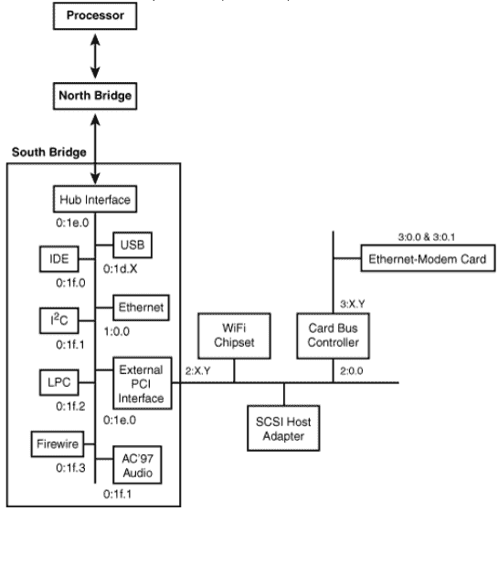

# 寻址与标识

PCI 设备使用*总线、设备和功能*号进行寻址，并通过*供应商ID*、*设备ID*和*类代码*进行标识。让我们借助 *PCI Utilities* 包中的一部分 *lspci* 工具来学习这些概念，该工具可从 http://mj.ucw.cz/pciutils.shtml 下载。

假设你在一台由 Texas Instruments PCI4510 CardBus 控制器提供服务的 Pentium 级别笔记本电脑上使用 Xircom 以太网调制解调器多功能 CardBus 卡，如*图 10.1*所示。运行 *lspci*：

```bash


```
$ lspci

00:00.0 Host bridge: Intel Corporation 82852/82855 GM/GME/PM/GMV Processor to I/O

          Controller (rev 02)

...

02:00.0 CardBus bridge: Texas Instruments PCI4510 PC card CardBus Controller (rev 03)

...

03:00.0 Ethernet controller: Xircom CardBus Ethernet 10/100 (rev 03)

03:00.1 Serial controller: Xircom CardBus Ethernet + 56k Modem (rev 03)
```

考虑上述输出中每个条目开头的元组 (`XX:YY.Z`)。`XX` 代表 PCI 总线号。一个 PCI 域最多可以承载 256 条总线。在之前使用的笔记本电脑中，CardBus 桥连接在 PCI 总线 2 上。这个桥引出了另一条编号为 3 的 PCI 总线，该总线承载 Xircom 卡。

`YY` 是 PCI 设备号。每条总线最多可以连接 32 个 PCI 设备。每个设备进而可以实现最多八个功能，由 `Z` 表示。Xircom 卡可以同时进行两项功能。因此，`03:00.0` 指向该卡的以太网功能，而 `03:00.1` 对应其调制解调器通信功能。执行 `lspci -t` 以获取系统上 PCI 总线和设备的树状布局：

```bash
$ lspci -t

-+-[0000:00]-+-00.0
          +-00.1
          +-00.3
          +-02.0
          +-02.1
          +-1d.0
          +-1d.1
          +-1d.2
          +-1d.7
          +-1e.0-[0000:02-05]----[0000:03]--+--00.0
          |                \
          |             [0000:02] +--00.0
          |                       +--00.1
          |                       +-01.0
          |                       \
          |                    +--02.0
          +--1f.0
```

如上述输出（以及*图 10.1*）所示，要遍历 PCI 总线并到达 Xircom 调制解调器 (`03:00.1`) 或以太网控制器 (`03:00.0`)，你必须从你的 PCI 域（上述输出中标记为 `0000`）开始，穿越一个 PCI-to-PCI 桥 (`00:1e.0`)，然后穿越一个 PCI-to-CardBus 主机控制器 (`02:00.0`)。PCI 子系统的 sysfs 表示镜像了这种布局：

```bash
$ ls /sys/devices/pci0000:00/0000:00:1e.0/0000:02:00.0/0000:03:00.0/

...

net:eth2 -> Ethernet

...

$ ls /sys/devices/pci0000:00/0000:00:1e.0/0000:02:00.0/0000:03:00.1/

...

tty:ttyS1 -> Modem

...
```

如前所述，PCI 设备拥有一个 256 字节的内存区域，用于保存配置寄存器。这个空间是识别 PCI 卡制造商和功能的关键。让我们窥探一下之前使用的 CardBus 控制器和 Xircom 双功能卡的配置空间内部。Xircom 卡有两个配置空间，每个支持的功能一个：

```bash
$ lspci -x

00:00.0 Host bridge: Intel Corporation 82852/82855 GM/GME/PM/GMV Processor to I/O Controller (rev 02)

00: 86 80 80 35 06 01 90 20 02 00 00 06 00 00 80 00
10: 08 00 00 00 00 00 00 00 00 00 00 00 14 10 5c 05
20: 00 00 00 00 00 00 00 00 00 00 00 00 14 10 5c 05
30: 00 00 00 00 40 00 00 00 fc 34 00 00 0b 01 00 05

...

02:00.0 CardBus bridge: Texas Instruments PCI4510 PC card CardBus Controller (rev 03)

00: 4c 10 44 ac 07 00 10 02 03 00 07 06 20 a8 82 00
10: 00 00 00 b0 a0 00 00 22 02 03 04 b0 00 00 00 f0
20: 00 f0 ff f1 00 00 00 d2 00 f0 ff d3 00 30 00 00
30: fc 30 00 00 00 34 00 00 fc 34 00 00 0b 01 00 05

...

03:00.0 Ethernet controller: Xircom CardBus Ethernet 10/100 (rev 03)

00: 5d 11 03 00 07 00 10 02 03 00 00 02 00 40 80 00
10: 01 30 00 00 00 00 00 d2 00 08 00 d2 00 00 00 00
20: 00 00 00 00 00 00 00 00 07 01 00 00 5d 11 81 11
30: 00 00 00 00 dc 00 00 00 00 00 00 0b 14 28

03:00.1 Serial controller: Xircom CardBus Ethernet + 56k Modem (rev 03)

00: 5d 11 03 01 03 00 10 02 03 02 00 00 07 00 80 00
10: 81 30 00 00 00 10 00 d2 00 18 00 d2 00 00 00 00
20: 00 00 00 00 00 00 00 00 07 02 00 00 5d 11 81 11
30: 00 00 00 00 dc 00 00 00 00 00 00 00 0b 01 00 00
```

PCI 寄存器是小端字节序，因此在解释上述输出时请考虑到这一点。你还可以通过 sysfs 转储 PCI 配置区域。因此，若要查看 Xircom 卡的以太网功能的配置空间，请执行以下操作：

```bash
$ od -x /sys/devices/pci0000:00/0000:00:1e.0/0000:02:00.0/0000:03:00.1/config

0000000 115d 0003 0007 0210 0003 0200 4000 0080
0000020 3001 0000 0000 d200 0800 d200 0000 0000
0000040 0000 0000 0000 0000 0107 0000 115d 1181
```


表 10.2 解释了上述转储中显示的一些值。前两个字节包含供应商 ID，它标识了制造该卡的公司。PCI 供应商 ID 在全球范围内维护和分配。（请将你的浏览器指向 www.pcidatabase.com 以获取数据库。）你可以从上述输出中破译出，Intel、Texas Instruments 和 Xircom（现已被 Intel 收购）分别拥有 `0x8086`、`0x104C` 和 `0x115D` 的供应商 ID。接下来的两个字节特定于卡的功能，并构成其设备 ID。从上述输出来看，Xircom 卡的以太网功能拥有 `0x0003` 的设备 ID，而调制解调器对应 `0x0103` 的设备 ID。PCI 卡还额外拥有子供应商和子设备 ID（参见上述转储中偏移量 44 和 46 处的单词），以便进一步精确定位其身份。

### 表 10.2. PCI 配置空间语义

| 配置空间偏移量 | 语义 | Xircom 卡转储输出中的值 |
| :--- | :--- | :--- |
| 0 | 供应商 ID | 0x115D |
| 2 | 设备 ID | 0x0003 |
| 10 | 类代码 | 0x0200 |
| 16 到 39 | 基地址寄存器 0 (BAR 0) 到 BAR5 | 0x3001...0000 |
| 44 | 子供应商 ID | 0x115D |
| 46 | 子设备 ID | 0x1181 |

配置空间内第 10 个字节处是描述设备类的代码。PCI 桥的类代码以 `0x06` 开头，网络设备拥有以 `0x02` 开头的类代码，通信设备拥有以 `0x07` 开头的类代码。因此，在上面的例子中，CardBus 桥、以太网卡和串行调制解调器分别拥有 `0x0607`、`0x0200` 和 `0x0700` 的类代码。你可以在 `include/linux/pci_ids.h` 中找到类代码定义。

PCI 驱动程序将其支持的供应商 ID、设备 ID 和类代码注册到 PCI 子系统中。利用此数据库，PCI 子系统在从其配置空间获取其身份后，将插入的卡绑定到适当的设备驱动程序。我们将在后面实现一个示例驱动程序时看到这是如何完成的。

## 访问 PCI 区域

PCI 设备包含三个可寻址区域：配置空间、I/O 端口和设备内存。让我们学习如何从设备驱动程序中访问这些内存区域。

### 配置空间

内核提供了一组六个函数，供您的驱动程序用于操作 PCI 配置空间：

```c
pci_read_config_(byte|word|dword)(struct pci_dev *pdev,
    int offset, int *value);
and
pci_write_config_(byte|word|dword)(struct pci_dev *pdev,
    int offset, int value);
```

在参数列表中，`struct pci_dev` 是 PCI 设备结构体，`offset` 是您想要访问的配置空间中的字节位置。对于读取函数，`value` 是指向提供的数据缓冲区的指针；对于写入例程，它包含要写入的数据。

让我们来看一些示例：

- 若要解析分配给卡片功能的 IRQ 号，请使用以下代码：

```c
unsigned char irq;
pci_read_config_byte(pdev, PCI_INTERRUPT_LINE, &irq);
```

根据 PCI 规范，PCI 配置空间中的偏移量 `60` 存储分配给该卡片的 IRQ 号。所有配置寄存器偏移量都在 `include/linux/pci_regs.h` 中通过描述性名称定义，因此使用 `PCI_INTERRUPT_LINE` 而不是 `60` 来指定此偏移量。类似地，要读取 PCI 状态寄存器（配置空间中偏移量 6 处的两个字节），请执行此操作：

```c
unsigned short status;
pci_read_config_word(pdev, PCI_STATUS, &status);
```

- 只有配置空间的前 64 个字节是标准化的。设备制造商为其余部分定义所需的语义。前面提到的 Xircom 卡片在偏移量 `64` 处分配了四个字节用于电源管理目的。为了禁用电源管理，Xircom CardBus 驱动程序 `drivers/net/tulip/xircmod_cb.c` 执行此操作：

```c
#define PCI_POWERMGT 0x40
pci_write_config_dword(pdev, PCI_POWERMGT, 0x0000);
```

## I/O 和内存

PCI 卡最多有六个 I/O 或内存区域。I/O 区域包含寄存器，而内存区域保存数据。例如，视频卡具有容纳控制寄存器的 I/O 空间和映射到帧缓冲区的内存区域。然而，并非所有卡都有可寻址的内存区域。I/O 和内存空间的语义取决于硬件，可以从设备数据手册中获取。

与配置内存一样，内核提供了一组辅助函数来操作 PCI 设备的 I/O 和内存区域：

```c
unsigned long pci_resource_{start|len|end|flags} (struct pci_dev *pdev, int bar);
```

要操作 I/O 区域，例如 PCI 视频卡上的设备控制寄存器，驱动程序需要执行以下操作：

1. 从配置空间中适当的基地址寄存器（bar）获取 I/O 基地址：
   ```c
   unsigned long io_base = pci_resource_start(pdev, bar);
   ```
   这假设该卡片的设备控制寄存器映射到与 `bar` 相关的内存区域，其值范围为 0 到 5，如表 10.2 所示。

2. 使用第 5 章“字符驱动程序”中讨论的内核 `request_region()` 监管机制标记此区域已被占用：
   ```c
   request_region(io_base, length, "my_driver");
   ```
   这里，`length` 是控制寄存器空间的大小，`my_driver` 标识该区域的所有者。在 `/proc/ioports` 中查找包含 `my_driver` 的条目即可定位此内存区域。

   您也可以使用在 `drivers/pci/pci.c` 中定义的包装函数 `pci_request_region()`。

3. 将数据手册中获取的寄存器偏移量加到第 1 步中获取的基地址上。使用第 5 章中讨论的 `inb()` 和 `outb()` 函数族操作此地址：
   ```c
   /* 读取 */
   register_data = inl(io_base + REGISTER_OFFSET);
   /* 使用 */
   /* ... */
   /* 写入 */
   outl(register_data, io_base + REGISTER_OFFSET);
   ```

要操作内存区域，例如上述 PCI 视频卡上的帧缓冲区，请遵循以下步骤：

1. 获取与内存区域相关的基地址、长度和标志：

   ```c
   unsigned long mmiobase = pci_resource_start(pdev, bar);
   unsigned long mmio_length = pci_resource_length(pdev, bar);
   unsigned long mmio_flags = pci_resource_flags(pdev, bar);
   ```

   这假设此内存映射到基地址寄存器 bar。

2. 使用内核的 `request_mem_region()` 监管机制标记此区域的所有权：

   ```c
   request_mem_region(mmiobase, mmio_length, "my_driver");
   ```

   您也可以使用之前提到的包装函数 `pci_request_region()`。

3. 获取对第 1 步中获得的设备内存的 CPU 访问权限。某些内存区域，例如保存寄存器的区域，需要防范副作用，因此被标记为 CPU 不可预取（或不可缓存）。其他区域，例如此示例中使用的区域，可以被缓存。根据访问标志，使用适当的函数获取映射区域对应的内核虚拟地址：

   ```c
   void __iomem *buffer;
   if (flags & IORESOURCE_CACHEABLE) {
       buffer = ioremap(mmiobase, mmio_length);
   } else {
       buffer = ioremap_nocache(mmiobase, mmio_length);
   }
   ```

   为了安全起见，并避免执行上述检查，请改用 `lib/iomap.c` 中定义的 `pci_iomap()` 服务：

   ```c
   buffer = pci_iomap(pdev, bar, mmio_length);
   ```


## 直接内存访问

*直接内存访问*（DMA）是指在不经过 CPU 干预的情况下，将数据从外围设备传输到主内存的能力。DMA 极大地提高了外围设备的性能，因为它不消耗 CPU 周期来移动数据。PCI 网络卡和 IDE 硬盘驱动器是依赖 DMA 进行数据传输的外围设备的常见示例。

DMA 由 *DMA 主设备* 启动。PC 主板上的南桥有一个 DMA 控制器，可以主控制 I/O 总线并启动到外围设备或从外围设备发起的 DMA。传统 ISA 卡通常属于这种情况。然而，如 PCI 这样的总线可以主控总线并启动 DMA 传输。CardBus 卡与 PCI 类似，也支持 DMA 主控。另一方面，*PCMCI*A 设备不支持 DMA 主控；但通常连接到 PCI 总线的 *PCMCI*A 控制器可能具有 DMA 主控能力。

*缓存一致性* 问题与 DMA 密切相关。为了获得最佳性能，处理器会缓存最近访问的字节，因此在 CPU 和主内存之间传递的数据流经处理器缓存。然而，在 DMA 期间，数据直接在 DMA 控制器和主内存之间传输，从而绕过处理器缓存。这种绕过可能会引入不一致性，因为处理器可能会处理其缓存中过时的数据。一些架构使用一种称为 *总线嗅探* 的技术自动同步缓存与主内存。然而，许多其他架构依赖软件来实现一致性。在介绍更多主题后，我们将学习如何执行一致性 DMA 操作。

DMA 可以 *同步* 或 *异步* 发生。前者的一个示例是从系统帧缓冲区到 LCD 控制器的 DMA。用户应用程序通过 `/dev/fbX` 将像素数据写入 DMA 映射的帧缓冲区，而 LCD 控制器使用 DMA 以定时间隔同步收集这些数据。我们在第 12 章“*视频驱动程序*”中对此进行更详细的讨论。异步 DMA 的一个示例是在第 15 章“*网络接口卡*”中讨论的 CPU 和网络卡之间数据帧的发送和接收。

作为 DMA 传输源或目的地的系统内存区域被称为 *DMA 缓冲区*。如果总线接口有限定寻址能力，这将影响可以容纳 DMA 缓冲区的内存范围。因此，适用于 ISA 等 24 位总线的 DMA 缓冲区只能位于系统内存的下部 16MB，称为 *ZONE_DMA*（参见第 2 章“*内核内部窥探*”中的“*内存分配*”部分）。PCI 总线默认是 32 位宽的，因此在 32 位平台上通常不会遇到这样的限制。为了告知内核任何对可 DMA 缓冲区的特殊需求，请使用以下函数：

```c
dma_set_mask(struct device *dev, u64 mask);
```

如果此函数返回成功，您可以向任何长度为 *mask* 位的地址进行 DMA。例如，e1000 PCI-X 千兆以太网驱动程序（`drivers/net/e1000/e1000_main.c`）执行以下操作：

```c
if (!(err = pci_set_dma_mask(pdev, DMA_64BIT_MASK))) {
    /* 系统支持 64 位 DMA */
    pci_using_dac = 1;
} else {
    /* 查看是否支持 32 位 DMA */
    if ((err = pci_set_dma_mask(pdev, DMA_32BIT_MASK))) {
        /* 不支持，让我们中止 */
        E1000_ERR("No usable DMA configuration, aborting\n");
        return err;
    }
    /* 32 位 DMA */
    pci_using_dac = 0;
}
```

I/O 设备通过总线控制器和任何中间的 I/O 内存管理单元（IOMMU）来查看 DMA 缓冲区。由于这种机制，I/O 设备使用的是总线地址，而不是物理地址或内核虚拟地址。因此，当你通知 PCI 卡 DMA 缓冲区的位置时，你必须告知其总线的地址。DMA 服务例程将 DMA 缓冲区的内核虚拟地址映射为总线地址，从而使得设备和 CPU 都能访问这些缓冲区。总线地址的类型为 `dma_addr_t`，定义在 `include/asm-your-arch/types.h` 中。

关于 DMA，还有几个值得了解的概念。其中之一是反弹缓冲区（bounce buffers）的概念。反弹缓冲区位于可 DMA 的区域中，当需要对非可 DMA 内存区域进行 DMA 操作时，它们被用作临时内存。例如，在没有中间 IOMMU 的情况下，32 位 PCI 外设向 4GB 以上的地址进行 DMA 操作。数据首先传输到反弹缓冲区，然后再复制到最终目标。第二个概念是 DMA 的一种形式，称为分散/聚集（scatter-gather）。当需要 DMA 的数据分散在不连续的区域时，分散/聚集功能使硬件能够一次性收集这些分散缓冲区的内容。反向情况发生在数据从卡 DMA 到分散在内存中的缓冲区时。分散/聚集功能通过消除处理多个 DMA 请求的需要来提高性能。

内核提供了一个健壮的 API，隐藏了许多配置 DMA 的内部细节。如果你正在编写支持总线主模式的 PCI 卡驱动程序，那么这个 API 会更加简单。（大多数 PCI 卡都支持总线主模式。）PCI DMA 例程基本上是对通用 DMA 服务例程的封装，定义在 `include/asm-generic/pci-dma-compat.h` 中。在本章中，我们只使用 PCI DMA API。

内核为 PCI 驱动程序提供两类 DMA 服务例程：

1. **一致（或相干）DMA 访问方法。** 这些例程保证了在 DMA 活动下的数据一致性。如果 PCI 设备和 CPU 都可能频繁操作某个 DMA 缓冲区，那么一致性至关重要，因此应使用一致 API。代价是会有所性能损失。要获取一致的 DMA 缓冲区，调用此服务例程：

```c
void *pci_alloc_consistent(struct pci_dev *pdev,
                    size_t size,
                    dma_addr_t *dma_handle);
```

该函数分配一个 DMA 缓冲区，生成其总线地址，并返回相关的内核虚拟地址。前两个参数分别持有 PCI 设备结构体（后面会讨论）和请求的 DMA 缓冲区的大小。第三个参数 `dma_handle` 是一个指向函数调用生成的总线地址的指针。下面的片段分配并释放了一个一致的 DMA 缓冲区：

```c
/* 分配 */
void *vaddr = pci_alloc_consistent(pdev, size, &dma_handle);
/* 使用 */
/* ... */
/* 释放 */
pci_free_consistent(pdev, size, vaddr, dma_handle);
```

2. **流式 DMA 访问方法。** 这些例程不保证一致性，因此速度更快。当 CPU 和 I/O 设备之间对共享访问的需求不大时，它们非常有用。当流式缓冲区已被映射用于设备访问时，驱动程序必须在 CPU 可靠地操作它之前显式取消映射（或同步）它。有两类流式访问例程：
   - `pci_[map|unmap]_dma_sync()_single()`
   - `pci_[map|unmap]_dma_sync()_sg()`

第一类函数族映射、取消映射并同步单个预分配的 DMA 缓冲区。`pci_map_single()` 的原型如下：

```c
dma_addr_t pci_map_single(struct pci_dev *pdev, void *ptr,
                 size_t size, int direction);
```

前三个参数分别持有 PCI 设备结构体、预分配的 DMA 缓冲区的内核虚拟地址，以及所提供缓冲区的大小。第四个参数 `direction` 可以是以下之一：`PCI_DMA_BIDIRECTIONAL`、`PCI_DMA_TODEVICE`、`PCI_DMA_FROMDEVICE` 或 `PCI_DMA_NONE`。这些名称不言自明，但第一个选项代价高昂，而最后一个用于调试。我们在稍后开发示例驱动程序时会进一步讨论流式 DMA 映射。

第二类函数族映射、取消映射并同步 DMA 缓冲区的分散/聚集列表。`pci_map_sg()` 的原型如下：

```c
int pci_map_sg(struct pci_dev *pdev,
               struct scatterlist *sgl,
               int num_entries, int direction);
```


分散列表由第二个参数 `struct scatterlist` 指定，该结构体定义在 `include/asm-your-arch/scatterlist.h` 中。`num_entries` 是 scatterlist 中的条目数。第一个和最后一个参数与 `pci_map_single()` 中描述的相同。该函数返回映射的条目数：

```c
num_mapped = pci_map_sg(pdev, sgl, num_entries,
                PCI_DMA_TODEVICE);

for (i=0; i<num_mapped; i++) {
    /* sg_dma_address(&sgl[i]) 返回此条目的总线地址
     */
    /* sg_dma_len(&sgl[i]) 返回此区域的长度
     */
}
```

让我们总结一下相干（coherent）和流式（streaming）DMA 的特征，以帮助你决定在你的使用场景中哪种更合适：

- 相干映射编码简单但使用成本高。流式映射具有相反的特征。
- 当 CPU 和 I/O 设备都需要频繁操作 DMA 缓冲区时，首选相干映射。同步 DMA 通常是这样。例如，前面提到的帧缓冲驱动程序，其中每次 DMA 操作都在同一个缓冲区上进行。由于 CPU 和视频控制器不断访问帧缓冲，在这种情况下使用相干映射是合理的。
- 当 I/O 设备长时间拥有缓冲区时，使用流式映射。流式 DMA 在异步操作中很常见，其中每次 DMA 操作都在不同的缓冲区上进行。例如，网络驱动程序，其中承载发送数据包的缓冲区会被即时映射和取消映射。
- DMA 描述符是相干映射的良好候选者。DMA 描述符包含关于 DMA 缓冲区的元数据，例如它们的地址和长度，并且经常被 CPU 和设备访问。即时映射描述符代价高昂，因为这涉及频繁的取消映射和重新映射（或同步操作）。

## 第 10 章 外围组件互连

### 设备示例：以太网调制解调器卡

凭借目前已获得的知识，让我们尝试为一个虚构的以太网/调制解调器双功能 CardBus 卡编写一个骨架设备驱动程序，并看看它如何用于局域网上的网络通信以及如何建立与互联网服务提供商的拨号连接。基本上，你每支持一个功能就需要一个设备驱动程序。假设你已经有支持该卡所使用的芯片组的串口驱动程序（我们在第 6 章“串口驱动程序”中学过编写串口驱动程序）和以太网驱动程序（我们将在第 15 章中学习如何实现网络驱动程序），让我们 tinkering（调整/摆弄）这些驱动程序，使它们与 CardBus 接口配合工作。这里的示例是通用的，但大致基于我们之前使用的 Xircom 卡的内核驱动程序。Xircom 驱动程序的以太网和调制解调器部分分别位于 `drivers/net/tulip/xircom_cb.c` 和 `drivers/serial/8250_pci.c` 中。

### 初始化和探测

PCI 驱动程序使用在 `include/linux/mod_devicetable.h` 中定义的 `pci_device_id` 结构体数组来描述它们支持的卡片的身份：

```c
struct pci_device_id {
    __u32 vendor, device;           /* 供应商和设备 ID */
    __u32 subvendor, subdevice;     /* 子供应商和子设备 ID */
    __u32 class, classmask;         /* 类别和类别掩码 */
    kernel_ulong_t driver_data;     /* 私有数据 */
};
```

`pci_device_id` 中前六个字段的语义符合前面讨论的 PCI 术语。最后一个字段 `driver_data` 是驱动程序私有的，通常用于在驱动程序支持多张卡时关联配置信息。

以太网调制解调器卡对其两个功能中的每一个都有一个设备 ID 和配置空间。由于这两个卡功能是不连接的，你需要单独的 PCI 驱动程序来处理它们。`drivers/net/` 目录是存放以太网驱动程序的好地方，而 `drivers/serial/` 是放置其串口对应驱动程序的正确位置。列表 10.1 中的以太网驱动程序支持网络功能，并在其 `pci_device_id` 表中宣布一组相关的 ID。列表 10.2 中的串口驱动程序类似，除了它负责调制解调器功能。两个驱动程序均未明确说明相关的类别代码和类别掩码，因为供应商 ID/设备 ID 组合本身即可唯一识别其功能。

PCI 子系统提供了诸如 `PCI_DEVICE()` 和 `PCI_DEVICE_CLASS()` 等宏，以简化 `pci_device_id` 表的创建。例如，`PCI_DEVICE()` 从指定的供应商 ID 和设备 ID 创建一个 `pci_device_id` 元素。因此，你可以将列表 10.1 中的 `network_device_pci_table` 重写为如下形式：

```c
struct pci_device_id network_driver_pci_table[] __devinitdata = {
 {PCI_DEVICE(MY_VENDOR_ID, MY_DEVICE_ID_NET)
 .driver_data = (unsigned long)network_driver_private_data},
 {0},
};
```

列表 10.1 和列表 10.2 中的 `MODULE_DEVICE_TABLE()` 宏在模块镜像中标记 `pci_device_id` 表。此信息会在插入 CardBus 卡时按需加载模块。我们在第 4 章“奠定基础”中的“模块自动加载”部分探讨过这种机制，并在第 9 章“PCMCIA 和 Compact Flash”中在 `pcmcia_device_id` 的上下文中使用过它。

当 PCI 热插拔层检测到具有与宣布的属性相匹配的卡时，存在的

当 PCI 子系统在驱动程序 `pci_device_id` 表中找到匹配项时，它会调用该驱动程序的 `probe()` 方法。这为驱动程序提供了声明该卡的机会。显然，PCI 驱动程序必须将其 `pci_device_id` 表与其 `probe()` 方法关联起来。这种关联通过 `pci_driver` 结构体实现，驱动程序在初始化期间向 PCI 子系统注册该结构体。要执行此注册，驱动程序调用 `pci_register_driver()`。

## 列表 10.1. 注册网络功能

```c
#include <linux/pci.h>
#define MY_VENDOR_ID		0xABCD
#define MY_DEVICE_ID_NET	0xEF01
/* The set of PCI cards that this driver supports. Only a single
   entry in our case. Look at include/linux/mod_devicetable.h for
   the definition of pci_device_id */
struct pci_device_id network_driver_pci_table[] __devinitdata = {
	{
	  MY_VENDOR_ID,				/* Interface chip manufacturer ID */
	  MY_DEVICE_ID_NET,			/* Device ID for the network
						function */
	  PCI_ANY_ID,				/* Subvendor ID wild card */
	  PCI_ANY_ID,				/* Subdevice ID wild card */
	  0,					/* class and classmask are
				unspecified */
	  network_driver_private_data	/* Use this to co-relate
				configuration information if the
				driver supports multiple
				cards. Can be an enumerated type. */
	}, {0},
};
/* struct pci_driver is defined in include/linux/pci.h */
struct pci_driver network_pci_driver = {
  .name		= "ntrwk",		/* Unique name */
  .probe	= net_driver_probe,	/* See Listing 10.3 */
  .remove = __devexit_p(net_driver_remove),/* See Listing 10.3 */
```


## 代码片段

```c
.id_table = network_driver_pci_table,	/* See above */

/* suspend() and resume() methods that implement power

   management are not used by this driver */

};

/* Ethernet driver initialization */

static int __init

network_driver_init(void)

{

  pci_register_driver(&network_pci_driver);

  return 0;

}

/* Ethernet driver exit */

static void __exit

network_driver_exit(void)

{

  pci_unregister_driver(&network_pci_driver);

}

module_init(network_driver_init);

module_exit(network_driver_exit);

MODULE_DEVICE_TABLE(pci, network_driver_pci_table);
```

## 列表 10.2. 注册调制解调器功能

```c
#include <linux/pci.h>

#define MY_VENDOR_ID		0xABCD
#define MY_DEVICE_ID_MDM	0xEF02

/* The set of PCI cards that this driver supports */
struct pci_device_id modem_driver_pci_table[] __devinitdata = {
{	MY_VENDOR_ID,			/* Interface chip manufacturer ID */
	MY_DEVICE_ID_MDM,			/* Device ID for the modem
				function */
	PCI_ANY_ID,			/* Subvendor ID wild card */
	PCI_ANY_ID,			/* Subdevice ID wild card */
	0, 0,				/* Class and classmask are
				unspecified */
	modem_driver_private_data	/* Use this to co-relate
			configuration information if the driver
			supports multiple cards. Can be an
			enumerated type. */
}, {0},
};

struct pci_driver modem_pci_driver = {
.name		= "mdm",				/* Unique name */
.probe		= modem_driver_probe,	/* See Listing 10.4 */
.remove	= __devexit_p(modem_driver_remove);/* See Listing 10.4 */
.id_table	= modem_driver_pci_table,	/* See above */
/* suspend() and resume() methods that implement power
management are not used by this driver */
};

/* Modem driver initialization */
static int __init

modem_driver_init(void)

{
	pci_register_driver(&modem_pci_driver);
	return 0;
}

/* Modem driver exit */
static void __exit

modem_driver_exit(void)

{
	pci_unregister_driver(&modem_pci_driver);
}

module_init(modem_driver_init);
module_exit(modem_driver_exit);

MODULE_DEVICE_TABLE(pci, modem_driver_pci_table);
```

列表 10.3 实现了网络功能的 `probe()` 方法。该方法：

- 启用 PCI 设备
- 发现资源信息，例如 I/O 基地址和 IRQ
- 分配并填充与该设备关联的网络数据结构
- 向内核网络层注册自己

列表 10.4 为调制解调器功能执行类似的工作。在这种情况下，驱动程序向内核串行层而不是网络层注册。

列表 10.3 和 10.4 还实现了 `remove()` 方法，这些方法在 CardBus 卡被弹出或驱动程序模块被卸载时调用。`remove()` 是 `probe()` 的反向操作；它释放资源，并从相关子系统中注销驱动程序。列表 10.1 中用于声明 `remove()` 方法的 `__devexit_p()` 宏会在编译时丢弃提供的函数，前提是你没有启用热插拔支持，且该驱动程序不是可动态加载的模块。

PCI 子系统调用 `probe()` 时带有两个参数：

1. 指向 `pci_dev` 的指针，该数据结构描述此 PCI 设备。该结构体定义在 `include/linux/pci.h` 中，由 PCI 子系统为系统中的每个 PCI 设备维护。
2. 指向 `pci_device_id` 的指针，这是驱动程序 `pci_device_id` 表中的条目，与插入卡配置空间中发现的信息相匹配。

## 列表 10.3. 探测网络功能

```c
#include <linux/pci.h>

unsigned long ioaddr;

/* Probe method */
static int __devinit

net_driver_probe(struct pci_dev *pdev,
const struct pci_device_id *id)
{

/* The net_device structure is defined in include/linux/netdevice.h.
See Chapter 15, "Network Interface Cards", for the description */
struct net_device *net_dev;

/* Ask low-level PCI code to enable I/O and memory regions for
this device. Look up the IRQ for the device that the PCI
subsystem allotted when it walked the bus */
pci_enable_device(pdev);

/* Use this device in bus mastering mode, since the network
function of this card is capable of DMA */
pci_set_master(pdev);

/* Allocate an Ethernet interface and fill in generic values in
the net_dev structure. prv_data is the private driver data
structure that contains buffers, locks, and so on. This is
left undefined. Wait until Chapter 15 for more on
alloc_etherdev() */
net_dev = alloc_etherdev(sizeof(struct prv_data));

/* Populate net_dev with your network device driver methods */
net_dev->hard_start_xmit = &mydevice_xmit; /* See Listing 10.6 */

/* More net_dev initializations */
/* ... */

/* Get the I/O address for this PCI region. All card registers
specified in Table 10.3 are assumed to be in bar 0 */
ioaddr = pci_resource_start(pdev, 0);

/* Claim a 128-byte I/O region */
request_region(ioaddr, 128, "ntwrk");

/* Fill in resource information obtained from the PCI layer */
```


```
net_dev->base_addr = ioaddr;

net_dev->irq = pdev->irq;

/* ... */

/* Setup DMA. Defined in Listing 10.5 */

dma_descriptor_setup(pdev);

/* Register the driver with the network layer. This will allot

an unused ethX interface */

register_netdev(net_dev);

/* ... */

}

/* Remove method */

static void __devexit

net_driver_remove(struct pci_dev *pdev)

{

/* Free transmit and receive DMA buffers.

Defined in Listing 10.5 */

dma_descriptor_release(pdev);

/* Release memory regions */

/* ... */

/* Unregister from the networking layer */

unregister_netdev(dev);

free_netdev(dev);

/* ... */

}
```

## 列表 10.4. 探测调制解调器功能

```c
/* Probe method */
static int __devinit

modem_driver_probe(struct pci_dev *pdev,
        const struct pci_device_id *id)
{
    struct uart_port port; /* See Chapter 6, "Serial Drivers" */
    /* Ask low-level PCI code to enable I/O and memory regions
       for this PCI device */
    pci_enable_device(pdev);
    /* Get the PCI IRQ and I/O address to be used and populate the
       uart_port structure (see Chapter 6) with these resources. Look at
       include/linux/pci.h for helper functions */
    /* ... */
    /* Register this information with the serial layer and get an
       unused ttySX port allotted to the card. Look at Chapter 6 for
       more on serial drivers */
    serial8250_register_port(&port);
    /* ... */
}

/* Remove method */
static void __devexit

modem_driver_remove(struct pci_dev *dev)
{
    /* Unregister the port from the serial layer */
    serial8250_unregister_port(&port);
    /* Disable device */
    pci_disable_device(dev);
}
```


回顾一下，让我们追踪从插入以太网-调制解调器 CardBus 卡到分配网络接口（`ethX`）和串行端口（`/dev/ttySX`）的代码路径：

- 对于每个支持的 CardBus 功能，相应的驱动程序初始化例程会注册一个支持的 `pci_device_id` 卡表和 `probe()` 例程。这显示在列表 10.1 和列表 10.2 中。


# Section 6: Paragraph after Code 1

*Listing 10.5* enforces a write barrier by calling `wmb()` to prevent the CPU from reordering the `outl()` before populating the DMA descriptor. On an x86 processor, `wmb()` reduces to a NOP because Intel CPUs enforce writes in program order. When writing the DMA descriptor address to the card and when populating the buffer’s bus address inside the DMA descriptor, the driver converts the native byte order to PCI little-endian format using `cpu_to_le32()`. On Intel CPUs, this again has no effect because both PCI and Intel processors communicate in little-endian. On several other architectures, for example, an ARM9 CPU running in the big-endian mode, both `wmb()` and `cpu_to_le32()` assume significance.

*Translation*: 列表 10.5 通过调用 `wmb()` 强制实施写屏障，以防止 CPU 在填充 DMA 描述符之前重新排序 `outl()`。在 x86 处理器上，`wmb()` 简化为 NOP，因为 Intel CPU 强制执行程序顺序的写入。当将 DMA 描述符地址写入卡片以及在 DMA 描述符内填充缓冲区的总线地址时，驱动程序使用 `cpu_to_le32()` 将本地字节序转换为 PCI 小端格式。在 Intel CPU 上，这再次没有影响，因为 PCI 和 Intel 处理器都使用小端通信。在几种其他体系结构上，例如以字节序模式运行的 ARM9 CPU，`wmb()` 和 `cpu_to_le32()` 都具有重要意义。

*Correction*: "big-endian mode" -> 大端模式.

# Section 7: Paragraph before Code 2

*Now that you have the descriptors and buffers mapped and ready to go, it’s time to look at how data is exchanged between the system and the CardBus device, as shown in Listing 10.6. We won’t dwell on the network interfaces and networking data structures because Chapter 15 is devoted to doing that.*

*Translation*: 现在你已经映射并准备好描述符和缓冲区，是时候看看系统和 CardBus 设备之间如何交换数据了，如列表 10.6 所示。我们不会深入研究网络接口和网络数据结构，因为第 15 章专门用于介绍这些内容。

# Section 8: Code Block 2 (Listing 10.6)

### Listing 10.6. Receiving and Transmitting Data

*Translation*: ### 列表 10.6. 接收和发送数据


## Section 9: Final Paragraph

*   ```c ... ``` -> Do not translate code.

### Section 9: Final Paragraph

*   **When the CardBus device receives an Ethernet packet, it DMAs it to a free RX descriptor and interrupts the CPU. The interrupt handler `mydevice_interrupt()` collects the packet from the receive DMA buffer, copies it to a networking data structure (`sk_buff`), and passes it on to higher protocol layers.**
    *   *Translation*: 当 `CardBus` 设备接收到一个以太网数据包时，它将其 `DMA` 到一个空闲的 `RX` 描述符并中断 `CPU`。中断处理程序 `mydevice_interrupt()` 从接收 `DMA` 缓冲区收集数据包，将其复制到网络数据结构 (`sk_buff`)，并将其传递给更高的协议层。

Refining terms:
*   "Listing" -> "列表" or "清单"? In technical docs, "List" is often used. "Listing 10.3" is usually "List 10.3" or "Listing 10.3". I will use "列表" as it is common in Chinese translations of technical manuals (e.g., O'Reilly books).
*   "`probe()`" -> keep as is (function name).
*   "`CardBus`" -> keep as is.
*   "`DMA`" -> keep as is.
*   "`sk_buff`" -> keep as is.

Let's double check the code block contents. The instruction says "Inline code (`code`) and code blocks do not need translation." This applies to the content inside the triple backticks. I will leave the C code completely untouched.

One detail: `Listing 10.5` in the text refers to the code block. In Chinese context, "列表" is fine.

Let's assemble the final output.

### 2. PCI 热插拔层检测到卡片插入，并从卡片的 PCI 配置空间中获取每个设备功能的供应商 ID 和设备 ID。

### 3. 由于这些 ID 与卡片的以太网和串行驱动器注册的 ID 匹配，因此调用了相应的 `probe()` 方法。这导致了分别在列表 10.3 和列表 10.4 中描述的 `net_driver_probe()` 和 `modem_driver_probe()` 的调用。

### 4. `probe()` 方法使用资源信息配置 PCI 驱动器的以太网和调制解调器部分。这导致为卡片分配了一个网络接口 (`ethX`) 和一个串行端口 (`ttySX`)。从这一点开始，应用程序数据通过这些接口流动。

## 数据传输

属于示例 `CardBus` 设备的网络功能使用以下策略进行数据传输：卡片期望设备驱动程序为其提供两个接收 `DMA` 描述符数组和两个发送 `DMA` 描述符数组。每个 `DMA` 描述符包含关联数据缓冲区的地址、其长度和一个控制字。你可以使用控制字来告诉设备描述符是否包含有效数据。对于发送描述符，你还可以将其编程为在数据传输后请求中断。卡片寻找有效的描述符，并将数据 `DMA` 到/从关联的数据缓冲区。为了适应这种基本方案，示例驱动程序仅使用一致性 `DMA` 接口。驱动程序一致性分配一个大缓冲区，用于容纳描述符及其关联的数据缓冲区。接收和发送缓冲区的长度为 1536 字节，以匹配以太网帧的最大传输单元 (`MTU`)。描述符和缓冲区在图 10.2 中以图形方式显示。图中每个数组的前 24 字节容纳两个 12 字节的 `DMA` 描述符，其余内存由两个 1536 字节的 `DMA` 缓冲区占用。假设图中所示的 12 字节描述符布局与卡片数据表中指定的格式相匹配。


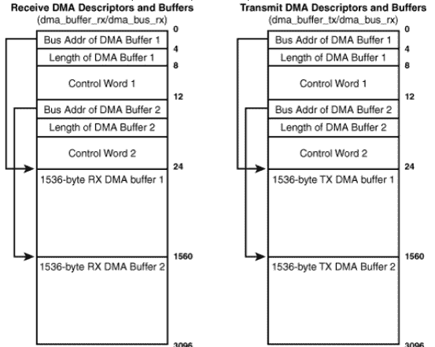

表 10.3 显示了卡片网络功能的寄存器布局。

| 寄存器名称 | 描述 | I/O 空间中的偏移量 |
|---|---|---|
| `DMA_RX_REGISTER` | 保存接收 `DMA` 描述符数组的总线地址 (`dma_bus_rx`) | `0x0` |
| `DMA_TX_REGISTER` | 保存发送 `DMA` 描述符数组的总线地址 (`dma_bus_tx`) | `0x4` |
| `CONTROL_REGISTER` | 命令卡片启动 `DMA`、停止 `DMA` 等的控制字 | `0x8` |

### 列表 10.5. 设置 DMA 描述符和缓冲区

```c

/* Device-specific data structure for the Ethernet Function */

struct device_data {

    struct pci_dev *pdev;    /* The PCI Device structure */

    struct net_device *ndev;  /* The Net Device structure */

    void *dma_buffer_rx;      /* Kernel virtual address of the

                              * receive descriptor */

    dma_addr_t dma_bus_rx;		/* Bus address of the receive

descriptor */

    void *dma_buffer_tx;		/* Kernel virtual address of the

transmit descriptor */

    dma_addr_t dma_bus_tx;		/* Bus address of the transmit

descriptor */

    /* ... */

    spinlock_t device_lock;	/* Serialize */

} *mydev_data;

/* On-card registers related to DMA */

#define DMA_RX_REGISTER_OFFSET		0x0	/* Offset of the register

holding the bus address

of the RX descriptor */

#define DMA_TX_REGISTER_OFFSET		0x4	/* Offset of the register

holding the bus address

of the TX descriptor */

#define CONTROL_REGISTER			0x8	/* Offset of the control

register */

/* Control Register Defines */

#define INITIATE_XMIT			0x1

/* Descriptor control word definitions */

#define FREE_FLAG			0x1	/* Free Descriptor */

#define INTERRUPT_FLAG		0x2	/* Assert interrupt after DMA */

/* Invoked from Listing 10.3 */

static void

dma_descriptor_setup(struct pci_dev *pdev)

{

    /* Allocate receive DMA descriptors and buffers */

    mydev_data->dma_buffer_rx =

        pci_alloc_consistent(pdev, 3096, &mydev_data->dma_bus_rx);

    /* Fill the two receive descriptors as shown in Figure 10.2 */

    /* RX descriptor 1 */
```


### 列表 10.5 DMA 描述符初始化

```c
mydev_data->dma_buffer_rx[0] = cpu_to_le32((unsigned long)
    (mydev_data->dma_bus_rx + 24));	/* Buffer address */

mydev_data->dma_buffer_rx[1] = 1536;	/* Buffer length */

mydev_data->dma_buffer_rx[2] = FREE_FLAG;	/* Descriptor is free */

/* RX descriptor 2 */

mydev_data->dma_buffer_rx[3] = cpu_to_le32((unsigned long)
    (mydev_data->dma_bus_rx + 1560));	/* Buffer address */

mydev_data->dma_buffer_rx[4] = 1536;	/* Buffer length */

mydev_data->dma_buffer_rx[5] = FREE_FLAG;	/* Descriptor is free */

wmb();	/* Write Memory Barrier */

/* Write the address of the receive descriptor to the appropriate
register in the card. The I/O base address, ioaddr, was populated
in Listing 10.3 */
outl(cpu_to_le32((unsigned long)mydev_data->dma_bus_rx),
    ioaddr + DMA_RX_REGISTER_OFFSET);

/* Allocate transmit DMA descriptors and buffers */
mydev_data->dma_buffer_tx =
    pci_alloc_consistent(pdev, 3096, &mydev_data->dma_bus_tx);

/* Fill the two transmit descriptors as shown in Figure 10.2 */
/* TX descriptor 1 */
mydev_data->dma_buffer_tx[0] = cpu_to_le32((unsigned long)
    (mydev_data->dma_bus_tx + 24));  /* Buffer address */

mydev_data->dma_buffer_tx[1] = 1536;        /* Buffer length */

/* Valid descriptor. Generate an interrupt
   after completing the DMA */
mydev_data->dma_buffer_tx[2] = (FREE_FLAG | INTERRUPT_FLAG);

/* TX descriptor 2 */
mydev_data->dma_buffer_tx[3] = cpu_to_le32((unsigned long)
    (mydev_data->dma_bus_tx + 1560)); /* Buffer address */

mydev_data->dma_buffer_tx[4] = 1536;        /* Buffer length */

mydev_data->dma_buffer_tx[5] = (FREE_FLAG | INTERRUPT_FLAG);

wmb(); /* Write Memory Barrier */

/* Write the address of the transmit descriptor to the appropriate
   register in the card. The I/O base, ioaddr, was populated in
   Listing 10.3 */
outl(cpu_to_le32((unsigned long)mydev_data->dma_bus_tx),
     ioaddr + DMA_TX_REGISTER_OFFSET);
}

/* Invoked from Listing 10.3 */
static void
dma_descriptor_release(struct pci_dev *pdev)
{
    pci_free_consistent(pdev, 3096, mydev_data->dma_bus_tx);
    pci_free_consistent(pdev, 3096, mydev_data->dma_bus_rx);
}
```

列表 10.5 通过调用 `wmb()` 强制实施写屏障，以防止 CPU 在填充 DMA 描述符之前重新排序 `outl()`。在 x86 处理器上，`wmb()` 简化为 NOP，因为 Intel CPU 强制执行程序顺序的写入。当将 DMA 描述符地址写入卡片以及在 DMA 描述符内填充缓冲区的总线地址时，驱动程序使用 `cpu_to_le32()` 将本地字节序转换为 PCI 小端格式。在 Intel CPU 上，这再次没有影响，因为 PCI 和 Intel 处理器都使用小端通信。在几种其他体系结构上，例如以大端模式运行的 ARM9 CPU，`wmb()` 和 `cpu_to_le32()` 都具有重要意义。

现在你已经映射并准备好描述符和缓冲区，是时候看看系统和 CardBus 设备之间如何交换数据了，如列表 10.6 所示。我们不会深入研究网络接口和网络数据结构，因为第 15 章专门用于介绍这些内容。

### 列表 10.6. 接收和发送数据

```c
/* The interrupt handler */
static irqreturn_t
mydevice_interrupt(int irq, void *dev_id)
{
    struct sk_buff *skb;
    /* ... */
    /* If this is a receive interrupt, collect the packet and pass it
       on to higher layers. Look at the control word in each RX DMA
       descriptor to figure out whether it contains data. Assume for
       convenience that the first RX descriptor was used by the card
       to DMA this received packet */
    packet_size = mydev_data->dma_buffer_rx[1];

    /* In real world drivers, the sk_buff is pre-allocated, stream-
mapped, and supplied to the card after setting the FREE_FLAG
during device open(). The received data is directly
DMA'ed to this sk_buff instead of the memcpy() performed here,
as you will learn in Chapter 15. The card clears the FREE_FLAG
before the DMA */
    skb = dev_alloc_skb(packet_size); /* See Figure 15.2 of Chapter 15 */
    skb->dev = mydev_data->ndev; /* Owner network device */
    memcpy(skb, mydev_data->dma_buffer_rx[24], packet_size);

    /* Pass the received data to higher-layer protocols */
    skb_put(skb, packet_size);
    netif_rx(skb);

    /* ... */
    /* Make the descriptor available to the card again */
    mydev_data->dma_buffer_rx[2] |= FREE_FLAG;
}
```


```c
/* This function is registered in Listing 10.3 and is called from

the networking layer. More on network device interfaces in

Chapter 15 */

static int

mydevce_xmit(struct sk_buff *skb, struct net_device *dev)

{

    /* Use a valid TX descriptor. Look at Figure 10.2 */

    /* Locking has been omitted for simplicity */

    if (mydev_data->dma_buffer_tx[2] & FREE_FLAG) {

        /* Use first TX descriptor */

        /* In the real world, DMA occurs directly from the sk_buff as

you will learn later on! */

        memcpy(mydev_data->dma_buffer_tx[24], skb->data, skb->len);

        mydev_data->dma_buffer_tx[1] = skb->len;

        mydev_data->dma_buffer_tx[2] &= ~FREE_FLAG;

        mydev_data->dma_buffer_tx[2] |= INTERRUPT_FLAG;

    } else if (mydev_data->dma_buffer_tx[5] & FREE_FLAG) {

        /* Use second TX descriptor */

        memcpy(mydev_data->dma_buffer_tx[1560], skb->data, skb->len);

        mydev_data->dma_buffer_tx[4] = skb->len;

        mydev_data->dma_buffer_tx[5] &= ~FREE_FLAG;

        mydev_data->dma_buffer_tx[5] |= INTERRUPT_FLAG;

    } else {

        return -EIO; /* Signal error to the caller */

    }

    wmb(); /* Don't reorder writes across this barrier */

    /* Ask the card to initiate DMA. ioaddr is defined

in Listing 10.3 */

    outl(INITIATE_XMIT, ioaddr + CONTROL_REGISTER);

}
```

当 CardBus 设备接收到一个以太网数据包时，它将其 DMA 到一个空闲的 RX 描述符并中断 CPU。中断处理程序 `mydevice_interrupt()` 从接收 DMA 缓冲区收集数据包，将其复制到网络数据结构 (`sk_buff`)，并将其传递给更高的协议层。

发送例程 `my_device_xmit()` 负责启动反向的 DMA。它将发送包 DMA 到卡内存中。为此，`my_device_xmit()` 选择一个未被卡使用（或设置了 `FREE_FLAG`）的 TX DMA 描述符，并使用关联的发送缓冲区进行数据传输。`FREE_FLAG` 随后被清除，表明该描述符现在属于卡。当卡在完成发送后发出中断时，中断处理程序会释放该描述符（再次设置 `FREE_FLAG`）（这在列表 10.6 中未展示）。

此示例驱动使用了一种简化的缓冲区管理方案，该方案对性能不敏感。高速网络驱动实现了一个更复杂的方案，采用一致性和流式 DMA 映射的组合。它们维护发送和接收描述符的链表，并实现用于缓冲区管理的空闲池和使用中池。它们的接收和发送数据结构如下所示：

```c

/* 接收缓冲区环 */

struct rx_list {

    void *dma_buffer_rx;      /* 发送描述符的内核虚拟地址 */

    dma_addr_t dma_bus_rx;    /* 发送描述符的总线地址 */

    unsigned int size;        /* 缓冲区大小 */

    struct list_head next_desc; /* 指向下一个元素的指针 */

    struct sk_buff *skb;      /* 网络数据包 */

    dma_addr_t sk_bus;        /* 网络数据包的总线地址 */

} *rxlist;

/* 发送缓冲区环 */

struct tx_list {

    void *dma_buffer_tx;      /* 接收描述符的内核虚拟地址 */

    dma_addr_t dma_bus_tx;    /* 发送描述符的总线地址 */

    unsigned int size;        /* 缓冲区大小 */

    struct list_head next_desc; /* 指向下一个元素的指针 */

    struct sk_buff *skb;      /* 网络数据包 */

    dma_addr_t sk_bus;        /* 网络数据包的总线地址 */

} *txlist;

```

接收和发送 DMA 描述符（`rxlist->dma_buffer_rx` 和 `txlist->dma_buffer_tx`）按照列表 10.5 中所示以一致性方式映射。然而，有效载荷缓冲区（`rxlist->skb->data` 和 `txlist->skb->data`）是使用流式 DMA 映射的。接收缓冲区在设备打开时预分配并流式映射到空闲池中，而发送缓冲区则是即时映射的。这避免了由 `mydevice_interrupt()` 执行的一致映射接收 DMA 缓冲区到网络缓冲区的额外数据拷贝（以及由 `mydevice_xmit()` 执行的反方向额外拷贝）。

```c

/* 预分配/补充接收缓冲区。另请参阅第 15 章中的“缓冲区管理和并发控制”部分 */

/* ... */

struct sk_buff *skb = dev_alloc_skb();

skb_reserve(skb, NET_IP_ALIGN);

/* 使用流式 DMA 映射 */

rxlist->sk_bus = pci_map_single(pdev, rxlist->skb->data,

                                 rxlist->skb->len, PCI_DMA_TODEVICE);

/* 分配一个 DMA 描述符并用上述映射的地址填充它。

   将该描述符添加到接收描述符环 */

/* ... */
```


## 调试

在内核配置菜单中启用 *Bus Options* → *PCI Support* → *PCI Debugging*，以要求 PCI 核心发出调试消息。查看 `/proc/bus/pci/devices` 和 `/sys/devices/pcix:Y/` 以获取有关系统上 PCI 设备的信息，例如本章讨论的 CardBus 以太网调制解调器卡。`/proc/interrupts` 列出了系统上活跃的中断请求（IRQ），包括由 PCI 层使用的那些。

如前所述，`lspci` 获取了有关系统上所有 PCI 总线和设备的信息。您也可以使用它来转储 PCI 卡的配置空间。

PCI 总线分析仪有助于调试底层问题并调整性能。

## 查看源代码

PCI 核心和总线访问例程位于 `drivers/pci/` 中。要获取 PCI 子系统提供的辅助例程列表，请在此目录内搜索 `EXPORT_SYMBOL`。有关 PCI 层相关的定义和原型，请查看 `include/linux/pci*.h`。

您可以在 `drivers/net/`、`drivers/scsi/` 和 `drivers/video/` 下的子目录中发现多个 PCI 设备驱动。要定位所有 PCI 驱动，请在 `drivers/` 目录树中递归地 grep `pci_register_driver()`。

如果您没有找到开发自定义 PCI 网络驱动的良好起点，请从骨架 PCI 网络驱动 `drivers/net/pci-skeleton.c` 开始。有关 PCI 编程的简要教程，请查看 `Documentation/pci.txt`。有关 PCI DMA API 的描述，请阅读 `Documentation/DMA-mapping.txt`。

表 10.4 总结了本章使用的主要数据结构。

| 数据结构 | 位置 | 描述 |
| :--- | :--- | :--- |
| `pci_dev` | `include/linux/pci.h` | PCI 设备的表示 |
| `pci_driver` | `include/linux/pci.h` | PCI 驱动的表示 |
| `pci_device_id` | `include/linux/mod_devicetable.h` | PCI 卡的身份标识 |
| `dma_addr_t` | `include/asm-your-arch/types.h` | DMA 缓冲区的总线地址 |
| `scatterlist` | `include/asm-your-arch/scatterlist.h` | DMA 缓冲区的分散-聚集列表 |
| `sk_buff` | `include/linux/skbuff.h` | 主要网络数据结构（更多说明见第 15 章） |

表 10.5 列出了本章使用的主要内核编程接口及其定义位置。

| 内核接口 | 位置 | 描述 |
| :--- | :--- | :--- |
| `pci_read_config_byte()` | `include/linux/pci.h` | 操作 PCI 配置空间的例程。 |
| `pci_read_config_word()` | `drivers/pci/access.c` | |
| `pci_read_config_dword()` | | |
| `pci_write_config_byte()` | | |
| `pci_write_config_word()` | | |
| `pci_write_config_dword()` | | |
| `pci_resource_start()` | `include/linux/pci.h` | 这些例程操作 PCI I/O 和内存区域以获取基地址、长度、结束地址和控制标志。 |
| `pci_resource_len()` | | |
| `pci_resource_end()` | | |
| `pci_resource_flags()` | | |
| `pci_request_region()` | `drivers/pci/pci.c` | 保留 PCI I/O 或内存区域。 |
| `pci_disable_device()` | `drivers/pci/pci.c` | `pci_enable_device()` 的反向操作。 |
| `pci_set_master()` | `drivers/pci/pci.c` | 将设备设置为 DMA 总线主控模式。 |

# 第 11 章. 通用串行总线

## 本章内容

- **USB 架构** 312
- **Linux-USB 子系统** 317
- **驱动数据结构** 317
- **枚举** 324
- **设备示例：遥测卡** 324
- **类驱动** 338
- **设备驱动（Gadget Drivers）** 348
- **调试** 349
- **查看源代码** 351

> *通用串行总线*（USB）是当今计算机中事实上的外部总线。凭借其支持热插拔、通用类驱动和灵活的数据传输模式，USB 是消费电子领域将多种技术引入计算机系统的常见途径。其广泛的流行度及其带来的规模化经济效应，在推动全球计算机外围技术的采用和接受方面发挥了作用。

### USB 架构

USB 是一种主从协议，其中主控制器与客户设备进行通信。图 11.1 显示了 PC 环境中的 USB。USB 主控制器是南桥芯片组的一部分，并通过 PCI 总线与处理器通信。

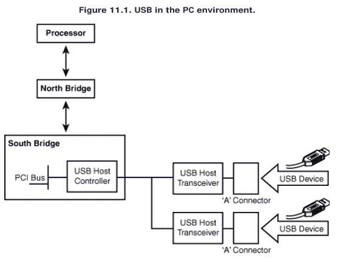

图 11.2 说明了嵌入式设备上的 USB。图中的 SoC 内置支持四个总线和三种操作模式的 USB 控制器硅片：

- 总线 1 运行在主模式，并通过 USB 收发器连接到 A 型接口（参见侧边栏“USB 接口和收发器”）。您可以将此端口连接 USB 闪存驱动器或键盘。
- 总线 2 也运行在主模式，但相关的收发器连接到内部 USB 设备，而不是接口。内部 USB 设备的例子包括生物特征扫描仪、加密引擎、打印机、*芯片盘*（DOCs）、触摸控制器和遥测卡。
- 总线 3 运行在设备模式，并通过收发器连接到 B 型接口。B 型接口通过 B 到 A 的电缆连接到主计算机。在此模式下，嵌入式设备作为例如 USB 闪存驱动器，将存储分区导出到外部世界。与 PC 系统相比，MP3 播放器和手机等嵌入式设备更有可能处于 USB 的设备端，因此许多嵌入式 SoC 除了主控制器外还支持 USB 设备控制器。
- 总线 4 由 *On-The-Go*（OTG）控制器驱动。例如，您可以使用此端口将闪存驱动器连接到您的系统，或将您的系统变成闪存驱动器并连接到主机。与总线 1

## 总线速度

USB 支持三种运行速度。最初的 USB 1.0 规范支持 1.5Mbps，被称为低速 USB。下一版本规范 USB 1.1 处理 12Mbps，称为全速 USB。当前规范级别是 USB 2.0，支持 480Mbps，即高速 USB。USB 2.0 与之前版本的规范向后兼容。例如，USB 键盘和鼠标是低速设备的例子，而 USB 存储驱动器是全速和高速设备的例子。当今的 PC 系统符合 USB 2.0 标准，并允许所有三种目标速度，但某些嵌入式控制器遵循 USB 1.1 标准，仅支持全速和低速运行模式。

## 主控制器

USB 主控制器符合少数标准之一：

- **通用主控制器接口 (UHCI)：** UHCI 规范由 Intel 发起，因此如果你的 PC 基于 Intel 平台，它很可能拥有此控制器。
- **开放主控制器接口 (OHCI)：** OHCI 规范源自 Compaq 和 Microsoft 等公司。与 UHCI 相比，OHCI 兼容控制器在硬件中内置了更多的智能，因此 OHCI HCD 比 UHCI HCD 相对简单。
- **增强型主控制器接口 (EHCI)：** 这是支持高速 USB 2.0 设备的主控制器。EHCI 控制器通常配备一个 UHCI 或 OHCI 伴随控制器来处理较慢的设备。
- **USB OTG 控制器：** 它们在嵌入式微控制器中越来越流行。借助 OTG 支持，每个通信端都可以充当*双角色设备* (DRD)。通过发起*主机协商协议* (HNP) 对话框，DRD 可以根据所需功能将自己切换到主机模式或设备模式。

除了这些主流的 USB 主控制器外，Linux 还支持一些其他控制器。例如针对 ISP116x 芯片的 HCD。

主控制器内置了一个称为*根集线器*的硬件组件。根集线器是一个虚拟集线器，它提供 USB 端口。这些端口进而可以连接到外部或内部物理集线器，并提供更多端口，从而形成树状拓扑结构。

## 传输类型

与 USB 设备的数据交换可以是以下四种类型之一：

- 控制传输，用于携带配置和控制信息
- 批量传输，用于传输大量对时间不敏感的数据
- 中断传输，用于交换小量对时间敏感的数据
- 同步传输，用于以可预测的比特率传输实时数据

例如，USB 存储驱动器使用控制传输发出磁盘访问命令，并使用批量传输交换数据。键盘使用中断传输，在可预测的延迟内传输按键。需要实时流式传输音频数据的设备使用同步传输。USB 蓝牙设备的四种传输类型的职责在第 16 章“无连接的 Linux”中的“设备示例：USB 适配器”一节中进行了讨论。

## 寻址

USB 设备中的每个可寻址单元称为*端点*。分配给端点的地址称为*端点地址*。每个端点地址都有关联的数据传输类型。例如，如果一个端点负责批量数据传输，则称为*批量端点*。端点地址 0 专用于设备配置。为此端点附加了一个控制管道，用于设备枚举（参见“枚举”一节）。

端点可以与上游或下游数据传输相关联。从设备到达的上游数据称为 **IN**（输入）传输，而流向设备的下游数据称为 **OUT**（输出）传输。**IN** 和 **OUT** 传输拥有独立的地址空间。因此，你可以有一个批量 **IN** 端点和一个批量 **OUT** 端点响应于同一个地址。

在某些方面，USB 类似于 I²C，在另一些方面类似于 PCI，如表 11.1 所示。USB 的设备寻址类似于 I²C，而它像 PCI 一样支持热插拔。与标准 I²C 一样，USB 设备地址不占用 CPU 地址空间的一部分。相反，它们位于一个从 1 到 127 的私有空间中。

### 表 11.1. USB 与 I²C 和 PCI 的相似性

| 与 I²C 的相似性 | 与 PCI 的相似性 |
| :--- | :--- |
| USB 和 I²C 都是主从协议。 | 设备可以热插拔。 |
| 设备地址位于私有的 7 位空间中。 | 设备驱动程序架构类似于 PCI 驱动程序。两类驱动程序都拥有 `probe()` / `disconnect()` 方法以及识别其支持设备的 ID 表。[^1] |
| 驻留在设备上的内存不会映射到 CPU 的内存或 I/O 空间，因此不占用 CPU 资源。 | 支持高速。然而比 PCI 慢。有关 PCI 家族不同成员支持的速度，请参见第 10 章“外围组件互连”中的表 10.1。 |
| | 与 PCI 控制器一样，USB 主控制器通常内置 DMA 引擎，可以控制总线。 |
| | 支持多功能设备。USB 支持每个功能一个接口描述符。每个 PCI 设备功能都有自己的设备 ID 和配置空间。 |

[^1]: 在 PCI 术语中，`disconnect()` 被称为 `remove()`。

## Linux-USB 子系统

查看图 11.3 以了解 Linux-USB 子系统的架构。该子系统的组成部分如下：

- USB 核心。如同你在前面章节中看到的驱动子系统核心层一样，USB 核心是一个代码库，包含可供 HCD 和客户端驱动程序使用的例程和结构。核心还提供了一个间接层，使客户端驱动程序独立于主控制器。
- 驱动不同主控制器的 HCD。
- 根集线器（以及物理集线器）的集线器驱动程序，以及一个监控所有连接到集线器的端口的辅助内核线程 `khubd`。检测端口状态变化和配置热插拔设备是耗时的工作，根据第 3 章“内核设施”中了解到的原因，最好使用辅助线程来完成。`khubd` 线程默认处于休眠状态。每当检测到连接到它的 USB 端口状态发生变化时，集线器驱动程序都会唤醒 `khubd`。
- USB 客户端设备的设备驱动程序。
- 允许用户从用户空间驱动 USB 设备的 USB 文件系统 `usbfs`。我们在第 19 章“用户空间驱动程序”中讨论了用户模式 USB 驱动程序。


为了端到端的操作，USB 子系统会调用各种其他内核层以获得帮助。例如，为了支持 USB 大容量存储设备，USB 子系统与 SCSI 驱动程序协同工作，如图 11.3 所示。对于驱动 USB-Bluetooth 键盘，利益相关方有四个：USB 子系统、Bluetooth 层、输入子系统和 tty 层。

## 驱动程序数据结构

当你编写 USB 客户端驱动程序时，你需要处理几种数据结构。让我们看看其中重要的部分。

### usb_device 结构体

每个设备驱动子系统都依赖一种专用数据结构来内部表示设备。`usb_device` 结构对于 USB 子系统而言，就像 `pci_dev` 对于 PCI 层，以及 `net_device` 对于网络驱动层一样。`usb_device` 在 `include/linux/usb.h` 中定义如下：

```c


```c
struct usb_device {

    /* ... */

    enum usb_device_state state;    /* Configured, Not Attached, etc */

    enum usb_device_speed speed;    /* High/full/low (or error) */

    /* ... */

    struct usb_device *parent;      /* Our hub, unless we're the root */

    /* ... */

    struct usb_device_descriptor descriptor; /* Descriptor */

    struct usb_host_config *config;         /* All of the configs */

    struct usb_host_config *actconfig;      /* The active config */

    /* ... */

    int maxchild;                       /* No: of ports if hub */

    struct usb_device *children[USB_MAXCHILDREN]; /* Child devices */

    /* ... */

};
```

我们在稍后为 USB 遥测卡开发示例驱动程序时使用此结构体。

### USB 请求块

USB 请求块 (`URB`) 是 USB 数据传输机制的核心。`URB` 之于 USB 协议栈，就像 `sk_buff`（在第 15 章“网卡”中讨论）之于网络协议栈一样。

让我们窥视一下 `URB` 的内部。以下定义来自 `include/linux/usb.h`，省略了对设备驱动程序不特别感兴趣的字段：

```c
struct urb
{
    struct kref kref;           /* Reference count of the URB */
    /* ... */
    struct usb_device *dev;     /* (in) pointer to associated
                             device */
    unsigned int pipe;         /* (in) pipe information */
    int status;                 /* (return) non-ISO status */
    unsigned int transfer_flags; /* (in) URB_SHORT_NOT_OK | ... */
    void *transfer_buffer;      /* (in) associated data buffer */
    dma_addr_t transfer_dma;     /* (in) dma addr for
                             transfer_buffer */
    int transfer_buffer_length;  /* (in) data buffer length */
};
```

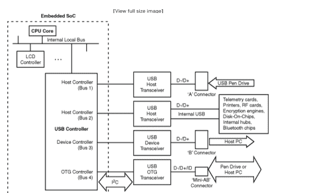
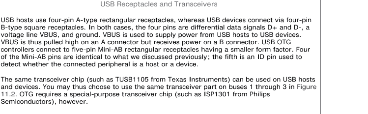
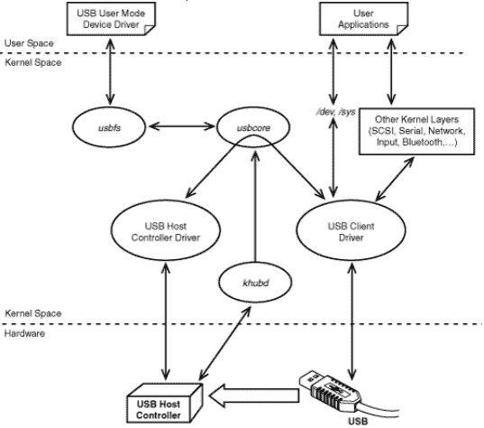

# 284

第 11 章 通用串行总线

```c
 /* ... */
 unsigned char *setup_packet; /* (in) setup packet */
 /* ... */
 int interval; /* (modify) transfer interval
                (INT/ISO) */
 /* ... */
 void *context; /* (in) context for completion */
 usb_complete_t complete; /* (in) completion routine */
 /* ... */
};
```

使用 `URB` 包含三个步骤：创建、填充和提交。要创建 `URB`，请使用 `usb_alloc_urb()`。此函数分配并清零 `URB` 内存，初始化与 `URB` 关联的 kobject，并初始化自旋锁以保护 `URB`。

要填充 `URB`，请使用 USB 核心提供的以下辅助例程：

```c
 void usb_fill_[control|int|bulk]_urb(
     struct usb *urb,           /* URB pointer */
     struct usb_device *usb_dev, /* USB device structure */
     unsigned int pipe,         /* Pipe encoding */
     unsigned char *setup_packet, /* For Control URBs only! */
     void *transfer_buffer,     /* Buffer for I/O */
     int buffer_length,         /* I/O buffer length */
     usb_complete_t completion_fn, /* Callback routine */
     void *context,             /* For use by completion_fn */
     int interval);            /* For Interrupt URBs only! */
```

当我们稍后开发示例驱动程序时，上述例程的语义将会变得更加清晰。这些辅助例程可用于控制、中断和批量 `URB`，但不能用于同步 `URB`。

要提交 `URB` 进行数据传输，请使用 `usb_submit_urb()`。`URB` 提交是异步的。前面列出的 `usb_fill_[control|int|bulk]_urb()` 函数以回调函数的地址作为参数。回调例程在 `URB` 提交完成后执行，完成诸如检查提交状态和释放数据传输缓冲区等操作。

USB 核心还提供包装接口，提供同步 `URB` 提交的门面：

```c
 int usb_[control|interrupt|bulk]_msg(struct usb_device *usb_dev,
     unsigned int pipe, ...);
```

例如，`usb_bulk_msg()` 构建批量 `URB`，提交它，并阻塞直到操作完成。你不需要提供回调函数，因为通用的完成例程承担了该作用。你也不需显式创建和填充 `URB`，因为 `usb_bulk_msg()` 会为你做这些，且不增加额外成本。我们将在示例驱动程序中使用此接口。

`usb_free_urb()` 用于释放已完成 `URB` 的引用，而 `usb_unlink_urb()` 取消待处理的 `URB` 操作。

如第 4 章“奠定基础”中的“Sysfs、Kobjects 和设备类”一节所述，`URB` 包含一个 `kref` 对象来跟踪其引用。`usb_submit_urb()` 使用 `kref_get()` 增加引用计数。`usb_free_urb()` 使用 `kref_put()` 减少引用计数，并且只有在没有剩余引用时才执行释放操作。

`URB` 与称为*管道*的抽象相关联，我们将在下一节中讨论。

## 管道

*管道*是以下组合的整数编码：

-   **端点地址**
-   **数据传输方向**（IN 或 OUT）
-   **数据传输类型**（控制、中断、批量或同步）

管道是每次 USB 数据传输的地址元素，是 `URB` 结构中的重要字段。为了帮助填充此字段，USB 核心提供以下辅助宏：

```c
usb_[rcv|snd][ctrl|int|bulk|isoc]pipe(struct usb_device *usb_dev,
                    __u8 endpointAddress);
```


*其中 `usb_dev` 是关联的 `usb_device` 结构体的指针，`endpointAddress` 是分配的端点地址，介于 1 和 127 之间。例如，要创建 OUT 方向的批量管道，请调用 `usb_sndbulkpipe()`。对于 IN 方向的控制管道，请调用 `usb_rcvctrlpipe()`。*

提到 URB 时，它通常由关联管道的传输类型来限定。例如，如果 URB 附加到批量管道，则称为*批量 URB*。

## 描述符结构

USB 规范定义了一系列*描述符*以保存设备信息。Linux-USB 核心定义了与每个描述符对应的数据结构。描述符有四种类型：

- **设备描述符**包含设备的通用信息，例如产品 ID 和供应商 ID。`usb_device_descriptor` 是对应设备描述符的结构。
- **配置描述符**用于描述不同的配置模式，例如总线供电和自供电操作。`usb_config_descriptor` 是与配置描述符关联的数据结构。
- **接口描述符**允许 USB 设备支持多个功能。`usb_interface_descriptor` 定义接口描述符。
- **端点描述符**携带与设备最终端点关联的信息。`usb_endpoint_descriptor` 就是相关的结构。

这些描述符格式在 USB 规范的第 9 章中定义，而相应的结构定义在 `include/linux/usb/ch9.h` 中。**清单 11.1** 展示了描述符的层次拓扑，并打印出与 USB 设备关联的所有端点地址。为此，它遍历了由前述四种类型描述符组成的树。**清单 11.1** 为 USB 光驱生成的输出如下：

```
Endpoint Address = 1

Endpoint Address = 82

Endpoint Address = 83
```

第一个地址属于批量 `IN` 端点，第二个地址由批量 `OUT` 端点拥有，第三个地址指向中断 `IN` 端点。

还有更多与 USB 客户端驱动程序关联的数据结构，例如 `usb_device_id`、`usb_driver` 和 `usb_class_driver`。当我们进行“**设备示例：遥测卡**.”一节的实践开发时，将会遇到它们。

### 清单 11.1. 打印设备上的所有 USB 端点地址


```c
/* ... */
/* USB device */
struct usb_device *udevce;
/* ... */
struct usb_device_descriptor u_d_desc = udevice->descriptor;
/* Device's active configuration */
struct usb_host_config *uconfig;
struct usb_config_descriptor u_c_desc;
/* Interfaces in the active configuration */
struct usb_interface *uinterface;
/* Alternate Setting for this interface */
struct usb_host_interface *ualtsetting;
struct usb_interface_descriptor u_i_desc;
/* Endpoints for this altsetting */
struct usb_host_endpoint *uendpoint;
struct usb_endpoint_descriptor u_e_desc;
uconfig = udevice->actconfig;
u_c_desc = uconfig->desc;
for (i = 0; i < u_c_desc->bNumInterfaces; i++) {
    uinterface = udevice->actconfig->interface[i];
    for (j = 0; j < uinterface->num_altsetting; j++) {
        ualtsetting = &uinterface->altsetting[j];
        u_i_desc = ualtsetting->desc;
        for (k = 0; k < u_i_desc->bNumEndpoints; k++) {
            uendpoint = &ualtsetting->endpoint[k];
            u_e_desc = uendpoint->desc;
            printk("Endpoint Address = %d\n",
                   u_e_desc->EndpointAddress);
        }
    }
}
/* ... */
```

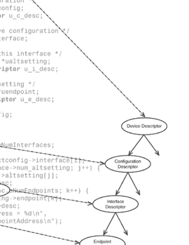

## 枚举

热插拔 USB 设备的生命周期始于一个称为枚举的过程，在此过程中，主机了解设备的能力并对其进行配置。集线器驱动程序是 Linux-USB 子系统中负责枚举的组件。让我们看一下当您将 USB 闪存驱动器插入主机计算机时，实现设备枚举的步骤序列：

1. 根集线器报告端口电流因设备连接而变化。集线器驱动程序检测到此状态变化，在 Linux-USB 术语中称为 `USB_PORT_STAT_C_CONNECTION`，并唤醒 `khubd`。
2. `khubd` 破译发生状态变化的 USB 端口的身份。在这种情况下，它是您插入闪存驱动器的端口。
3. 接下来，`khubd` 在 1 和 127 之间选择一个设备地址，并使用附加到端点 0 的控制 URB 将其分配给闪存驱动器的批量端点。
4. `khubd` 使用上述附加到端点 0 的控制 URB 从闪存驱动器获取设备描述符。然后，它请求设备的配置描述符并选择一个合适的配置。对于闪存驱动器，只提供了一个配置描述符。
5. `khubd` 请求 USB 核心将匹配的客户端驱动程序绑定到插入的设备。

当枚举完成且设备已绑定到驱动程序时，`khubd` 调用关联客户端驱动程序的 `probe()` 方法。在这种情况下，`khubd` 调用在 `drivers/usb/storage/usb.c` 中定义的 `storage_probe()`。从这一点开始，大容量存储驱动程序负责正常的设备操作。

## 设备示例：遥测卡

既然你已经了解了 Linux-USB 的基础知识，是时候来看看一个示例设备了。考虑一个配备遥测卡的系统，该卡通过内部 USB 连接到处理器，如图 11.2 中的总线 2 所示。该卡从远程设备获取数据，并通过 USB 将其传输到处理器。一个遥测卡的例子是医疗级主板，它用于监控或编程植入式设备。

假设我们的示例遥测卡具有以下端点，其语义如表 11.2 中所述：

- 连接到板载配置寄存器的控制端点
- 将卡片收集的远程遥测信息传递给处理器的批量 IN 端点
- 以相反方向传输数据的批量 OUT 端点

### 表 11.2. 遥测卡中的寄存器空间

| 寄存器 | 关联端点 |
| :--- | :--- |
| 遥测配置寄存器 | 控制端点 0（寄存器偏移 0x8）。 |
| 遥测数据输入寄存器 | 批量 IN 端点。端点地址在设备枚举过程中分配。 |
| 遥测数据输出寄存器 | 批量 OUT 端点。端点地址在设备枚举过程中分配。 |

让我们构建一个针对此卡片的最小驱动程序，该驱动程序部分基于 USB 骨架驱动程序，`drivers/usb/usb-skeleton.c`。

由于 PCMCIA、PCI 和 USB 设备具有相似的特性，例如对热插拔的支持，这些子系统中的一些驱动程序方法和数据结构彼此相似。这对于负责初始化和探测的部分尤其如此。随着我们深入研究遥测驱动程序，并注意到我们在第 10 章中学到的 PCI 驱动程序中的相似之处，我们将暂停并加以记录。

### 初始化与探测

与 PCI 和 PCMCIA 驱动程序类似，USB 驱动程序具有支持热插拔的 `probe()`/`disconnect()` [2] 方法，以及一个包含其所支持设备标识的表。USB 设备由定义在 `include/linux/mod_devicetable.h` 中的 `usb_device_id` 结构体识别。你可能记得，前一章中定义在同一头文件中的 `pci_device_id` 结构体用于识别 PCI 设备。

> [2] `disconnect()` 在 PCI 和 PCMCIA 术语中称为 `remove()`。

```c
struct usb_device_id {
    /* ... */
    __u16 idVendor;       /* Vendor ID */
    __u16 idProduct;      /* Device ID */
    /* ... */
```


`__u8` `bDeviceClass`;   /* Device class */

`__u8` `bDeviceSubClass`;/* Device subclass */

`__u8` `bDeviceProtocol`;/* Device protocol */

/* ... */

};

`idVendor` 和 `idProduct` 分别保存制造商标识符和产品标识符，而 `bDeviceClass`、`bDeviceSubClass` 和 `bDeviceProtocol` 根据设备的功能对其进行分类。这种由 USB 规范确定的分类允许实现稍后“类驱动程序”部分中讨论的通用客户端驱动程序。

清单 11.2 实现了遥测驱动程序的初始化例程，`usb_tele_init()`，它调用 `usb_register()` 将 `usb_driver` 结构体注册到 USB 核心。如清单所示，`usb_driver` 将驱动程序的 `probe()` 方法、`disconnect()` 方法和 `usb_device_id` 表联系在一起。`usb_driver` 与 `pci_driver` 类似，除了前者的 `disconnect()` 方法在后者中名为 `remove()`。

### 清单 11.2. 初始化驱动程序

```c
#define USB_TELE_VENDOR_ID  0xABCD  /* Manufacturer's Vendor ID */

#define USB_TELE_PRODUCT_ID 0xCDEF   /* Device's Product ID */

/* USB ID Table specifying the devices that this driver supports */

static struct usb_device_id tele_ids[] = {

  { USB_DEVICE(USB_TELE_VENDOR_ID, USB_TELE_PRODUCT_ID) },

  { } /* Terminate */

};

MODULE_DEVICE_TABLE(usb, tele_ids);

/* The usb_driver structure for this driver */

static struct usb_driver tele_driver = {

  .name       = "tele",              /* Unique name */

  .probe      = tele_probe,          /* See Listing 11.3 */

  .disconnect = tele_disconnect,     /* See Listing 11.3 */

  .id_table   = tele_ids,           /* See above */

};

/* Module Initialization */

static int __init

usb_tele_init(void)

{

  /* Register with the USB core */

  result = usb_register(&tele_driver);

  /* ... */

  return 0;

}

/* Module Exit */

static void __exit

usb_tele_exit(void)

{

  /* Unregister from the USB core */

  usb_deregister(&tele_driver);

  return;

}

module_init(usb_tele_init);

module_exit(usb_tele_exit);
```

`USB_DEVICE()` 宏根据提供给它的供应商和产品 ID 创建一个 `usb_device_id`。这与前一章中讨论的 `PCI_DEVICE()` 宏类似。`MODULE_DEVICE_TABLE()` 宏在模块映像中标记 `tele_ids`，以便如果卡片被热插拔，模块可以按需加载。这再次类似于我们在前几章中讨论的 PCMCIA 和 PCI 设备。

当 USB 核心检测到具有与某个客户端驱动程序所属的 `usb_device_id` 表中声明的属性匹配的设备时，它会调用该驱动程序注册的 `probe()` 方法。当设备被拔出或模块被卸载时，USB 核心调用驱动程序的 `disconnect()` 方法。

清单 11.3 实现了遥测驱动程序的 `probe()` 和 `disconnect()` 方法。它首先定义一个设备特定的结构体，`tele_device_t`，其中包含以下字段：

- 指向关联的 `usb_device` 的指针。
- 指向 `usb_interface` 的指针。回顾清单 11.1 以查看此结构体的使用。
- 用于与遥测配置寄存器通信的控制 URB（`ctrl_urb`），以及用于构造对该寄存器的编程请求的 `ctrl_req`。这些字段在下一节“访问寄存器”中进行了描述。
- 该卡有一个批量 IN 端点，通过它可以获取收集的遥测信息。与此端点关联的是三个字段：持有端点地址的 `bulk_in_addr`；存储接收数据的 `bulk_in_buf`；以及包含接收数据缓冲区大小的 `bulk_in_len`。
- 该卡有一个批量 OUT 端点，以促进下游数据传输。`tele_device_t` 有一个名为 `bulk_out_addr` 的字段来存储此端点的地址。OUT 方向的数据结构较少，因为在这种简单情况下，我们使用同步 URB 提交接口，该接口隐藏了一些实现细节。

内核在枚举后不久调用卡片的 `probe()` 方法，`tele_probe()`。`tele_probe()` 执行三项任务：

1. 为设备特定结构体 `tele_device_t` 分配内存。
2. 初始化 `tele_device_t` 中与设备的批量端点相关的以下字段：`bulk_in_buf`、`bulk_in_len`、`bulk_in_addr` 和 `bulk_out_addr`。为此，它使用集线器驱动程序在枚举期间收集的数据。这些数据在“描述符结构”部分讨论的描述符结构中可用。
3. 将字符设备 `/dev/tele` 导出到用户空间。应用程序通过 `/dev/tele` 与遥测卡交换数据。`tele_probe()` 调用 `usb_register_dev()` 并提供 `file_operations`，这些操作构成了 `/dev/tele` 接口的底层支柱，通过 `usb_class_driver` 结构体传递。

步骤 1 中分配的设备特定结构体的地址必须保存，以便其他方法可以访问它。为了实现这一点，遥测驱动程序使用一种三重策略，具体取决于可用于各种驱动程序例程的函数参数。为了在 `probe()` 和 `open()` 调用线程之间保存此结构体指针，驱动程序使用设备的 `driver_data` 字段，通过函数对 `usb_set_intfdata()` 和 `usb_get_intfdata()`。为了在 `open()` 线程和其他入口点之间保存结构体指针的地址，`open()` 将其存储在 `/dev/tele` 的 `file->private_data` 字段中。这是因为内核为这些字符入口点提供 `/dev/tele` 的 inode 指针作为参数，而不是 `usb_interface` 指针。为了从 URB 回调函数中保存设备特定结构体的地址，关联的提交线程使用 URB 的 `context` 字段作为存储区域。查看清单 11.3、11.4 和 11.5 以了解这些机制的运行情况。

所有 USB 字符设备都对应主设备号 180。如果你在内核配置中启用 `CONFIG_USB_DYNAMIC_MINORS`，USB 核心将从可用池中选择次要设备号。这种行为类似于在 `miscdevice` 结构体中指定 `MISC_DYNAMIC_MINOR` 后注册杂项驱动程序（如第 5 章“字符驱动程序”中的“杂项驱动程序”部分所讨论的那样）。如果你选择不启用 `CONFIG_USB_DYNAMIC_MINORS`，USB 子系统将从 `usb_class_driver` 结构体中设置的次要基址开始选择一个可用的次要设备号。

### 清单 11.3. 探测与断开

```c
/* Device-specific structure */
typedef struct {
  struct usb_device      *usbdev;      /* Device representation */
  struct usb_interface   *interface;   /* Interface representation*/
  struct urb             *ctrl_urb;    /* Control URB for
                                         register access */
```


```c
struct usb_ctrlrequest ctrl_req;     /* Control request
                                         as per the spec */

unsigned char          *bulk_in_buf; /* Receive data buffer */

size_t                 bulk_in_len;  /* Receive buffer size */

__u8                   bulk_in_addr; /* IN endpoint address */

__u8                   bulk_out_addr; /* OUT endpoint address */

/* ... */                   /* Locks, waitqueues,
                               statistics.. */
} tele_device_t;

#define TELE_MINOR_BASE 0xA8    /* Assigned by the Linux-USB
                                   subsystem maintainer */

/* Conventional char driver entry points.
   See Chapter 5, "Character Drivers." */

static struct file_operations tele_fops =
{
  .owner    = THIS_MODULE,  /* Owner */
  /* ... */
};
```

# 第 11 章。通用串行总线

## 访问寄存器

```c
.read	= tele_read,	/* 读取方法 */
.write	= tele_write,	/* 写入方法 */
.ioctl	= tele_ioctl,	/* Ioctl 方法 */
.open	= tele_open,	/* 打开方法 */
.release= tele_release, /* 关闭方法 */
};

static struct usb_class_driver tele_class = {
.name		= "tele",
.fops		= &tele_fops,		/* 与 /dev/tele 连接 */
.minor_base = TELE_MINOR_BASE, /* 次设备号起始值 */
};

/* probe() 方法在设备枚举后由 khubd 调用。第一个参数 interface 包含在枚举过程中获取的信息。id 是驱动程序 usb_device_id 表中与从遥测卡读取的值匹配的条目。tele_probe() 基于 drivers/usb/usb-skeleton.c 中定义的 skel_probe() */

static int
tele_probe(struct usb_interface *interface,
	const struct usb_device_id *id)
{
 struct usb_host_interface *iface_desc;
 struct usb_endpoint_descriptor *endpoint;
 tele_device_t *tele_device;
 int retval = -ENOMEM;
 /* 分配设备特定的结构体 */
 tele_device = kzalloc(sizeof(tele_device_t), GFP_KERNEL);
 /* 填充 usb_device 和 usb_interface */
 tele_device->usbdev = usb_get_dev(interface_to_usbdev(interface));
 tele_device->interface = interface;
 /* 从设备枚举过程中获取的数据设置端点信息 */
 iface_desc = interface->cur_altsetting;
 for (int i = 0; i < iface_desc->desc.bNumEndpoints; ++i) {
 endpoint = &iface_desc->endpoint[i].desc;
 if (!tele_device->bulk_in_addr &&
 usb_endpoint_is_bulk_in(endpoint)) {
 /* Bulk IN 端点 */
 tele_device->bulk_in_len = le16_to_cpu(endpoint->wMaxPacketSize);
 tele_device->bulk_in_addr = endpoint->bEndpointAddress;
 tele_device->bulk_in_buf = kmalloc(tele_device->bulk_in_len, GFP_KERNEL);
 }
 if (!tele_device->bulk_out_addr &&
 usb_endpoint_is_bulk_out(endpoint)) {
 /* Bulk OUT 端点 */
 tele_device->bulk_out_addr = endpoint->bEndpointAddress;
 }
 }
 if (!tele_device->bulk_in_addr || !tele_device->bulk_out_addr) {
        return retval;
 }
    /* 将设备特定结构体附加到此接口。
    我们将在 tele_open() 中获取它 */
    usb_set_intfdata(interface, tele_device);
    /* 注册设备 */
    retval = usb_register_dev(interface, &tele_class);
    if (retval) {
        usb_set_intfdata(interface, NULL);
        return retval;
    }
    printk("Telemetry device now attached to /dev/tele\n");
    return 0;
}

/* 断开连接方法。当设备被拔出或模块被卸载时调用 */

static void
tele_disconnect(struct usb_interface *interface)
{
    tele_device_t *tele_device;
    /* ... */
    /* 从 tele_probe() 调用的 usb_set_intfdata() 的逆操作 */
    tele_device = usb_get_intfdata(interface);
    /* 清零接口数据 */
    usb_set_intfdata(interface, NULL);
    /* 释放 /dev/tele */
    usb_deregister_dev(interface, &tele_class);
    /* 将接口置为 NULL。在现实世界中，使用锁保护此
    操作 */
    tele_device->interface = NULL;
    /* ... */
}
```

当应用程序打开 `/dev/tele` 时，`open()` 方法会初始化卡上的遥测配置寄存器。为了设置该寄存器的内容，`tele_open()` 提交一个附加到默认端点 0 的控制 URB。当你提交一个控制 URB 时，必须提供一个相关的控制请求。向 USB 设备发送控制请求的结构必须符合 USB 规范的第 9 章，并在 `include/linux/usb/ch9.h` 中定义如下：

```c
struct usb_ctrlrequest {
    __u8 bRequestType;
    __u8 bRequest;
    __le16 wValue;
    __le16 wIndex;
    __le16 wLength;
} __attribute__ ((packed));
```


让我们看看构成 `usb_ctrlrequest` 的组件。`bRequest` 字段标识控制请求。`bRequestType` 通过编码数据传输方向、请求类别以及接收者是设备、接口、端点还是其他对象来限定请求。`bRequest` 可以属于一组标准值，也可以是厂商定义的。在我们的示例中，写入遥测配置寄存器的 `bRequest` 是厂商定义的。`wValue` 保存要写入寄存器的数据，`wIndex` 是寄存器空间中的期望偏移量，`wLength` 是要传输的字节数。

列表 11.4 实现了 `tele_open()`。它的主要任务是用适当的值编程遥测配置寄存器。在浏览列表之前，请回顾在列表 11.3 中定义的 `tele_device_t` 结构体，重点关注两个字段：`ctrl_urb` 和 `ctrl_req`。前者是与配置寄存器通信的控制 URB，而后者是相关的 `usb_ctrlrequest`。

为了编程遥测配置寄存器，`tele_open()` 执行以下操作：

- 1. 分配一个控制 URB 以准备寄存器写入。
- 2. 创建一个 `usb_ctrlrequest` 并用请求标识符、请求类型、寄存器偏移量和要编程的值填充它。
- 3. 创建一个附加到遥测卡端点 0 的控制管道，以承载控制 URB。
- 4. 由于 `tele_open()` 异步提交 URB，它需要等待相关的回调函数完成后再返回给调用者。为此，`tele_open()` 使用 `init_completion()` 调用内核的完成 API 寻求帮助。步骤 7 调用对应的 `wait_for_completion()`，等待直到回调函数调用 `complete()`。我们在第 3 章“完成接口”部分讨论了完成 API。
- 5. 使用 `usb_fill_control_urb()` 初始化控制 URB 中的字段。这包括在步骤 2 中填充的 `usb_ctrlrequest`。
- 6. 使用 `usb_submit_urb()` 将 URB 提交给 USB 核心。
- 7. 等待直到回调函数发出信号表明寄存器编程完成。
- 8. 返回状态。

### 列表 11.4. 初始化遥测配置寄存器

```c
/* 遥测配置寄存器

   在卡上寄存器空间中的偏移量 */
#define TELEMETRY_CONFIG_REG_OFFSET     0x0A
/* 要编程到配置寄存器中的值 */
#define TELEMETRY_CONFIG_REG_VALUE      0xBC
/* 用于编程配置寄存器的厂商定义 bRequest */
#define TELEMETRY_REQUEST_WRITE         0x0D
/* 厂商定义的 bRequestType */
#define TELEMETRY_REQUEST_WRITE_REGISTER 0x0E
/* 打开方法 */
static int
tele_open(struct inode *inode, struct file *file)
{
        struct completion tele_config_done;
        tele_device_t *tele_device;
        void *tele_ctrl_context;
        char *tmp;
        le16 tele_config_index = TELEMETRY_CONFIG_REG_OFFSET;
        unsigned int tele_ctrl_pipe;
        struct usb_interface *interface;
        /* 获取指向设备特定结构体的指针。
         * 我们在 tele_probe() 中使用 usb_set_intfdata() 保存了它 */
        interface = usb_find_interface(&tele_driver, iminor(inode));
        tele_device = usb_get_intfdata(interface);
        /* 为控制传输分配一个 URB */
        tele_device->ctrl_urb = usb_alloc_urb(0, GFP_KERNEL);
        if (!tele_device->ctrl_urb) {
                return -EIO;
        }
        /* 填充控制请求 */
        tele_device->ctrl_req.bRequestType = TELEMETRY_REQUEST_WRITE;
        tele_device->ctrl_req.bRequest =
                        TELEMETRY_REQUEST_WRITE_REGISTER;
        tele_device->ctrl_req.wValue =
                        cpu_to_le16(TELEMETRY_CONFIG_REG_VALUE);
        tele_device->ctrl_req.wIndex =
                        cpu_to_le16p(&tele_config_index);
        tele_device->ctrl_req.wLength = cpu_to_le16(1);
        tele_device->ctrl_urb->transfer_buffer_length = 1;
        tmp = kmalloc(1, GFP_KERNEL);
        *tmp = TELEMETRY_CONFIG_REG_VALUE;
        /* 创建一个附加到端点 0 的控制管道 */
        tele_ctrl_pipe = usb_sndctrlpipe(tele_device->usbdev, 0);
        /* 初始化完成机制 */
        init_completion(&tele_config_done);
        /* 设置 URB 上下文。上下文是 URB 的一部分，作为参数
         * 传递给回调函数。在这种情况下，上下文是完成结构体，tele_config_done */
        tele_ctrl_context = (void *)&tele_config_done;
        /* 初始化控制 URB 中的字段 */
        usb_fill_control_urb(tele_device->ctrl_urb, tele_device->usbdev,
                        tele_ctrl_pipe,
                        (char *) &tele_device->ctrl_req,
                        tmp, 1, tele_ctrl_callback,
                        tele_ctrl_context);
        /* 提交 URB */
```


`usb_submit_urb(tele_device->ctrl_urb, GFP_ATOMIC);`

/* 等待回调返回，指示遥测
   配置寄存器已成功初始化 */
`wait_for_completion(&tele_config_done);`

/* 释放对 URB 的引用 */
`usb_free_urb(urb);`

`kfree(tmp);`

/* 将设备特定对象保存到文件的 private_data
   中，以便你可以从其他入口点
   （如 `tele_read()` 和 `tele_write()`）直接获取它 */
`file->private_data = tele_device;`

/* 返回 URB 传输状态 */
`return(tele_device->ctrl_urb->status);`
}

/* 回调函数 */
static void
`tele_ctrl_callback(struct urb *urb)`
{
`complete((struct completion *) urb->context);`
}

你可以使用 `usb_control_msg()` 简化 `tele_open()`，它是 `usb_submit_urb()` 的阻塞版本，内部隐藏了控制 URB 的同步和回调细节。我们出于学习目的更倾向于使用异步方法。

## 数据传输

列表 11.5 实现了遥测驱动的 `read()` 和 `write()` 入口点。这些方法在应用程序向 `/dev/tele` 进行读写时执行实际工作。`tele_read()` 执行同步 URB 提交，因为调用进程希望阻塞直到遥测数据可用。然而，`tele_write()` 使用异步提交，并返回给调用线程，而无需等待确认驱动程序接受的数据已成功传输到设备。

由于异步传输伴随着回调例程，列表 11.5 实现了 `tele_write_callback()`。该例程检查 `urb->status` 以解读提交状态。它还释放了由 `tele_write()` 分配的传输缓冲区。

## 列表 11.5. 与遥测卡的数据交换

```c
/* 读入口点 */

static ssize_t

tele_read(struct file *file, char *buffer,

size_t count, loff_t *ppos)

{

int retval, bytes_read;

tele_device_t *tele_device;

/* 获取 tele_device 的地址 */

tele_device = (tele_device_t *)file->private_data;

/* ... */

/* 同步读取 */

retval = usb_bulk_msg(tele_device->usbdev, /* usb_device */

usb_rcvbulkpipe(tele_device->usbdev, /* 管道 */

tele_device->bulk_in_addr), /* 读取缓冲区 */

min(tele_device->bulk_in_len, count), /* 要读取的字节数 */

&bytes_read, /* 已读取的字节数 */

5000); /* 超时 5 秒 */

/* 将遥测数据复制到用户空间 */

if (!retval) {

    if (copy_to_user(buffer, tele_device->bulk_in_buf, bytes_read)) {

        return -EFAULT;

    } else {

        return bytes_read;

    }

}

return retval;

}
```

```c
/* 写入口点 */

static ssize_t tele_write(struct file *file, const char *buffer,

size_t write_count, loff_t *ppos)

{

char *tele_buf = NULL;

struct urb *urb = NULL;

tele_device_t *tele_device;

/* 获取 tele_device 的地址 */

tele_device = (tele_device_t *)file->private_data;

/* ... */

/* 分配一个批量 URB */

urb = usb_alloc_urb(0, GFP_KERNEL);

if (!urb) {

    return -ENOMEM;

}

/* 分配 DMA 一致的传输缓冲区，并从用户空间复制数据。返回时，tele_buf 包含缓冲区的 CPU 地址，而 urb->transfer_dma 包含 DMA 地址 */

tele_buf = usb_buffer_alloc(tele_device->usbdev, write_count, GFP_KERNEL, &urb->transfer_dma);

if (copy_from_user(tele_buf, buffer, write_count)) {

    usb_buffer_free(tele_device->usbdev, write_count, tele_buf, urb->transfer_dma);

    usb_free_urb(urb);

    return -EFAULT;

}

/* 填充批量 URB 字段 */

usb_fill_bulk_urb(urb, tele_device->usbdev,

    usb_sndbulkpipe(tele_device->usbdev,

    tele_device->bulk_out_addr),

    tele_buf, write_count, tele_write_callback,

    tele_device);

/* urb->transfer_dma 有效，因此最好利用

 * 它来进行数据传输 */

urb->transfer_flags |= URB_NO_TRANSFER_DMA_MAP;

/* 异步提交 URB */

usb_submit_urb(urb, GFP_KERNEL);

/* 释放 URB 引用 */

usb_free_urb(urb);

return(write_count);

}
```

```c
/* 写回调 */

static void

tele_write_callback(struct urb *urb)

{

    tele_device_t *tele_device;

    /* 获取 tele_device 的地址 */

    tele_device = (tele_device_t *)urb->context;

    /* urb->status 包含提交状态。如果

     * 成功则为 0。除 -ENOENT、-ECONNRESET 和 -ESHUTDOWN 以外的

     * 错误情况下重新提交 URB */

    /* ... */

    /* 释放传输缓冲区。usb_buffer_free() 是

     * 从 tele_write() 调用的 usb_buffer_alloc() 的

     * 释放对应部分 */

    usb_buffer_free(urb->dev, urb->transfer_buffer_length,

    urb->transfer_buffer, urb->transfer_dma);

}
```


## 类驱动程序

USB 规范引入了设备类的概念，并描述了每个类驱动程序的功能。标准设备类的例子包括大容量存储、网络、集线器、串行转换器、音频、视频、成像、调制解调器、打印机和人机接口设备（HID）。类驱动程序是通用的，允许你即插即用各种卡，而无需为每个单独开发并安装驱动程序。Linux-USB 子系统包含对主要类驱动程序的支持。

每个 USB 设备都有类别和子类别代码。例如，大容量存储类（`0x08`）支持诸如紧凑光盘（`0x02`）、磁带（`0x03`）和固态存储（`0x06`）等子类别。正如你之前所看到的，设备驱动程序用它们支持的类别和子类别填充 `usb_device_id` 结构。你可以通过查看 `/proc/bus/usb/devices` 输出中的 `:*` 行来获取设备的类别和子类别信息。

让我们看看一些重要的类驱动程序。

### 大容量存储

在 USB 术语中，大容量存储是指 USB 硬盘、U 盘、CD-ROM、软盘驱动器以及类似的存储设备。USB 大容量存储设备遵循小型计算机系统接口（SCSI）协议与主机系统通信。因此，对 USB 存储设备的块访问通过内核的 SCSI 子系统路由。图 11.4 提供了 USB 存储和 SCSI 子系统之间交互的概述。如图所示，SCSI 子系统架构分为三层：

- 1. 针对诸如磁盘（`sd.c`）和 CD-ROM（`sr.c`）等设备的顶层驱动程序
- 2. 中间层，扫描总线、配置设备并将顶层驱动程序与底层驱动程序粘合在一起
- 3. 底层 SCSI 适配器驱动程序

**图 11.4. USB 大容量存储和 SCSI。**


大容量存储驱动程序将自己注册为虚拟 SCSI 适配器。虚拟适配器向上通过 SCSI 命令通信，向下使用 URB。USB 磁盘对更高层级而言表现为连接到此虚拟适配器的 SCSI 设备。

为了更好地理解 USB 层和 SCSI 层之间的交互，让我们对 USB 大容量存储驱动程序实施修改。*usbfs* 节点 `/proc/bus/usb/devices` 包含连接到系统的所有 USB 设备的属性和连接详情。例如，`/proc/bus/usb/devices` 输出中的“T:”行包含总线号、设备从根集线器的深度、操作速度等。“P:”行包含设备的供应商 ID、产品 ID 和修订号。`/proc/bus/usb/devices` 中可用的所有信息均由 USB 子系统管理，但有一项缺失的信息在 SCSI 子系统的管辖范围内。与 USB 存储设备关联的 `/dev` 节点名称（磁盘为 `sd[a-z][1-9]`，CD-ROM 为 `sr[0-9]`）在 `/proc/bus/usb/devices` 中不可用。为了克服这一限制，让我们添加一行“N:”以显示与设备关联的 `/dev` 节点名称。列表 11.6 以源代码补丁的形式展示了 2.6.23.1 内核树中必要的代码更改。

### 列表 11.6. 将磁盘的 /dev 名称添加到 usbfs

```diff

Code View:

include/scsi/scsi_host.h:

struct Scsi_Host {

/* ... */

void *host_data;

+ char sname[8]; /* 此磁盘的 /dev 节点名称 */

/* ... */

};

drivers/usb/storage/usb.h:

struct us_data {

/* ... */

+ char magic[4];

};

include/linux/usb.h:

struct usb_interface {

/* ... */

+ void *private_data;

};

drivers/usb/storage/usb.c:

static int storage_probe(struct usb_interface *intf,

const struct usb_device_id *id)

{

/* ... */

memset(us, 0, sizeof(struct us_data));

+ intf->private_data = (void *) us;

+ strcpy(us->magic, "disk", 4);

mutex_init(& (us->dev_mutex));

/* ... */

}

drivers/scsi/sd.c:

static int sd_probe(struct device *dev)

{

/* ... */

add_disk(gd);

+ memset (sdp->host->sname,0, sizeof (sdp->host->sname)) ;

+ strcpy (sdp->host->sname, gd->disk_name, 3);

sdev_printk(KERN_NOTICE, sdp, "Attached scsi %sdisk %s\n", sdp->removable ? "Removable " : "", gd->disk_name);

/* ... */

}

drivers/scsi/sr.c:

static int sr_probe(struct device *dev)

(

```

为了理解列表 11.6，让我们首先跟踪代码流程，继续我们在“枚举”章节中中断的地方。在那个章节中，我们插入了一个 USB 闪存盘，并跟随执行链路直到调用 `storage_probe()`，即大容量存储驱动的 `probe()` 方法。进一步深入：

1.  `storage_probe()` 通过调用 `scsi_add_host()` 注册一个虚拟 SCSI 适配器，并提供一个名为 `us_data` 的私有数据结构作为参数。`scsi_add_host()` 为该虚拟适配器返回一个 `Scsi_Host` 结构体，其末尾包含用于存放 `us_data` 的空间。
2.  它启动一个名为 `usb-storage` 的内核线程，用于处理队列中所有针对该虚拟适配器的 SCSI 命令。
3.  它调度一个名为 `usb-stor-scan` 的内核线程，请求 SCSI 中间层扫描总线上连接的设备。
4.  第 3 步启动的设备扫描发现了插入的闪存盘，并将上层 SCSI 磁盘驱动（`sd.c`）绑定到该设备。这导致 SCSI 磁盘驱动的探测方法 `sd_probe()` 被调用。
5.  `sd` 驱动为磁盘分配了一个 `/dev/sd*` 节点。从此刻起，应用程序使用此接口来访问 USB 磁盘。SCSI 子系统将磁盘命令加入虚拟适配器的队列，usb-storage 内核线程随后使用适当的 URB 来处理这些命令。

既然你已经了解了基础内容，让我们深入剖析列表 11.6，首先看看数据结构上的增加。该列表在 `Scsi_Host` 结构中增加了一个 `sname` 字段，用于保存我们感兴趣的关联 SCSI `/dev` 名称。它还在 `usb_interface` 结构中增加了一个私有字段，将每个 USB 接口与其 `us_data` 关联起来。由于 `us_data` 仅与存储设备相关，我们需要在将其作为 `us_data` 访问之前确保 USB 接口私有字段的有效性。为此，列表 11.6 向 `us_data` 中增加了一个魔术字符串“disk”。

列表 11.6 中对 `devices.c` 的修改（针对 `drivers/usb/core/devices.c`）通过 `usb_interface` 的私有数据字段提取与每个接口关联的 `us_data`。然后，它利用 `container_of()` 函数定位关联的 `Scsi_Host`，因为正如你前面在第 1 步中所见，`us_data` 粘合在对应的 `Scsi_Host` 末尾。正如你在第 5 步中进一步看到的，`Scsi_Host` 包含由 `sd` 和 `sr` 驱动填充的 `/dev` 节点名称。`devices.c` 利用这些信息拼接成“N:”行。

以下是整合列表 11.6 中的更改并连接一个 PNY USB 闪存盘、一个 Addonics CD-ROM 驱动器和一个 Seagate 硬盘到笔记本电脑（通过 USB 集线器）后的 `/proc/bus/usb/devices` 输出。这些“N:”行宣告了每个设备对应的 `/dev` 节点的身份：

```bash
$ cat /proc/bus/usb/devices

...
T:  Bus=04 Lev=02 Prnt=02 Port=00 Cnt=01 Dev#=  3 Spd=480 MxCh=  0
N:  Device=sda(Disk)
D:  Ver= 2.00 Cls=00(>ifc ) Sub=00 Prot=00 MxPS=64 #Cfgs=  1
P:  Vendor=154b ProdID=0002 Rev= 1.00
S:  Manufacturer=PNY
S:  Product=USB 2.0 FD
S:  SerialNumber=6E5C07005B4F
```


C:* #Ifs= 1 Cfg#= 1 Atr=80 MxPwr=  0mA

I*:  If#= 0 Alt= 0 #EPs= 2 Cls=08(stor.) Sub=06 Prot=50 Driver=usb-storage

T:  Bus=04 Lev=02 Prnt=02 Port=01 Cnt=02 Dev#=  5 Spd=480 MxCh=  0

N:  Device=sr0(CDROM)

D:  Ver= 2.00 Cls=00(>ifc ) Sub=00 Prot=00 MxPS=64 #Cfgs=  1

P:  Vendor=0bf6 ProdID=a002 Rev= 3.00

S:  Manufacturer=Addonics

S:  Product=USB to IDE Cable

S:  SerialNumber=1301011002A9AF9

C:* #Ifs= 1 Cfg#= 2 Atr=c0 MxPwr= 98mA

I*:  If#= 0 Alt= 0 #EPs= 3 Cls=08(stor.) Sub=06 Prot=50 Driver=usb-storage

E:  Ad=01(O) Atr=02(Bulk) MxPS= 512 Ivl=125us

E:  Ad=82(I) Atr=02(Bulk) MxPS= 512 Ivl=0ms

E:  Ad=83(I) Atr=03(Int.) MxPS=   2 Ivl=32ms

T:  Bus=04 Lev=02 Prnt=02 Port=02 Cnt=03 Dev#=  4 Spd=480 MxCh= 0

N:  Device=sdb(Disk)

D:  Ver= 2.00 Cls=00(>ifc ) Sub=00 Prot=00 MxPS= 64 #Cfg= 1

P:  Vendor=0bc2 ProdID=0501 Rev= 0.01

S:  Manufacturer=Seagate

S:  Product=USB Mass Storage

S:  SerialNumber=000000062459

C:* #Ifs= 1 Cfg#= 1 Atr=c0 MxPwr= 0mA

I*:  If#= 0 Alt= 0 #EPs= 2 Cls=08(stor.) Sub=06 Prot=50 Driver=usb-storage

E:  Ad=02(O) Atr=02(Bulk) MxPS= 512 Ivl=0ms

E:  Ad=88(I) Atr=02(Bulk) MxPS= 512 Ivl=0ms

...
```

如你所见，SCSI 子系统将 `sda` 分配给闪存盘，`sr0` 分配给 CD-ROM，`sdb` 分配给硬盘。用户空间应用程序通过操作这些节点与相应设备通信。如你在第 4 章中所学到的，随着 `udev` 的出现，然而，你有一个选择，可以创建更高级别的抽象来标识每个设备，而无需依赖 SCSI 子系统分配的 `/dev` 名称的身份。

## USB-串口

USB 转串口转换器通过 USB 为你的计算机提供串行端口功能。例如，你可以使用 USB 转串口转换器，从没有串行端口的开发笔记本电脑上的嵌入式设备获取串行调试控制台。

在第 6 章“串行驱动”中，你学习了内核分层串行架构的好处。图 11.5 说明了 USB-串口层如何融入内核的串行框架。


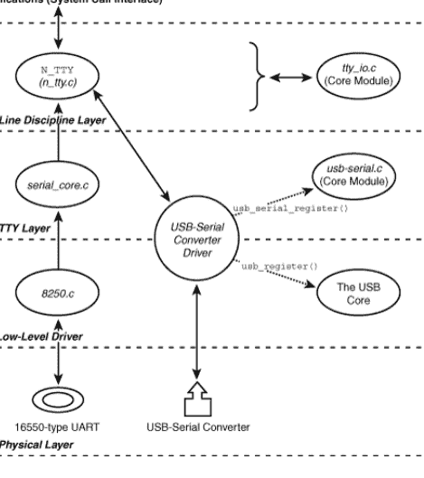

USB-串口驱动与其他 USB 客户端驱动类似，除了它还利用了 USB-串口核心服务，而不仅仅是 USB 核心。USB-串口核心提供以下内容：

- 一个 tty 驱动，将低层级的 USB 转串口驱动与更高层级的串行层（如行规程）隔离开来。
- 通用的 `probe()` 和 `disconnect()` 例程，供各个 USB-串口驱动使用。
- 用于从用户空间访问 USB-串口端口的设备节点。应用程序通过 `/dev/ttyUSBX` 操作 USB-串口端口，其中 X 是串口号。如 `minicom` 这样的终端仿真器和如 `PPP` 这样的协议可以在这些接口上无改动地运行。

低层级的 USB 转串口转换器驱动本质上执行以下操作：

1. 使用 `usb_serial_register()` 向 USB-串口核心注册一个 `usb_serial_driver` 结构体。作为 `usb_serial_driver` 一部分提供的入口点构成了驱动的核心。
2. 填充一个 `usb_driver` 结构体，并使用 `usb_register()` 将其注册到 USB 核心。这与示例遥测驱动所做的类似，只不过串口转换器驱动可以依赖 USB-串口核心提供的通用 `probe()` 和 `disconnect()` 例程。

### 列表 11.7. FTDI 驱动片段

```c
/* The usb_driver structure */

static struct usb_driver ftdi_driver = {
    .name           = "ftdi_sio",     /* Name */
    .probe          = usb_serial_probe, /* Provided by the USB-Serial core */
    .disconnect     = usb_serial_disconnect, /* Provided by the USB-Serial core */
    .id_table       = id_table_combined, /* List of supported devices built around the FTDI chip */
    .no_dynamic_id = 1,              /* Supported ids cannot be added dynamically */
};

/* The usb_serial_driver structure */

static struct usb_serial_driver ftdi_sio_device = {
    /* ... */
    .num_ports        = 1,
    .probe            = ftdi_sio_probe,
    .port_probe       = ftdi_sio_port_probe,
    .port_remove      = ftdi_sio_port_remove,
    .open             = ftdi_open,
    .close            = ftdi_close,
    .throttle         = ftdi_throttle,
    .unthrottle       = ftdi_unthrottle,
    .write            = ftdi_write,
    .write_room       = ftdi_write_room,
    .chars_in_buffer  = ftdi_chars_in_buffer,
    .read_bulk_callback = ftdi_read_bulk_callback,
    .write_bulk_callback = ftdi_write_bulk_callback,
    /* ... */
};

/* Driver Initialization */

static int __init ftdi_init(void)
{
    /* ... */
    /* Register with the USB-Serial core */
    retval = usb_serial_register(&ftdi_sio_device);
    /* ... */
    /* Register with the USB core */
    retval = usb_register(&ftdi_driver);
    /* ... */
}
```


## 人机接口设备

键盘和鼠标等设备被称为*人机接口设备*（HID）。请查看第 7 章“输入驱动程序”中“USB 和蓝牙键盘”一节，其中讨论了 USB HID 类。

## 蓝牙

USB 蓝牙适配器是一种快速为你的电脑启用蓝牙功能的方式，使其能够与配备蓝牙的设备（如手机、鼠标或手持设备）进行通信。第 16 章讨论了 USB 蓝牙类。

## 设备（Gadget）驱动程序

在典型的使用场景中，嵌入式设备通过 USB 连接到 PC 主机。与作为 USB 主机的 PC 系统不同，嵌入式计算机通常属于 USB 设备端。由于 Linux 同时运行在嵌入式系统和 PC 系统上，因此它需要支持在 USB 的两端运行。USB 设备（Gadget）项目为嵌入式 Linux 系统带来了 USB 设备模式功能。例如，图 11.2 中嵌入式 Linux 设备的 Bus 3 可以使用**设备驱动程序（gadget driver）**，使该设备在连接到主机计算机时作为大容量存储驱动器工作。

在继续之前，让我们简要查看一些相关术语。设备端的 USB 控制器被称为*设备控制器、外围控制器、客户端控制器*或*功能控制器*。术语**设备（gadget）**和**设备驱动程序（gadget driver）**通常被使用，而不是含义过载的词汇*设备（device）*和*设备驱动程序（device driver）*。

USB 设备（Gadget）支持现在是主线内核的一部分，并包含以下内容：

- 集成在 SoC 家族（如 Intel PXA、Texas Instruments OMAP 和 Atmel AT91）中的 USB 设备控制器的驱动程序。这些驱动程序额外提供了一个*设备 API（gadget API）*，供设备驱动程序使用。
- 针对存储、网络和串行转换器等设备类的设备驱动程序。当这些驱动程序从主机端软件收到枚举请求时，它们会响应其所属的类。例如，存储设备驱动程序将自己标识为类 `0x08`（大容量存储类）设备，并向主机导出一个存储分区。你可以通过模块插入参数指定相关的块设备节点或文件名。由于导出区域必须向主机表现为大容量存储设备，设备驱动程序实现了 USB 大容量存储协议所需的 SCSI 交互。以太网和串行设备也有可用的设备驱动程序。
- 一个骨架设备驱动程序 `drivers/usb/gadget/zero.c`，你可以用它来测试设备控制器驱动程序。

设备驱动程序使用由设备控制器驱动程序提供的设备 API 服务。它们填充一个 `usb_gadget_driver` 结构体，并使用 `usb_gadget_register_driver()` 将其注册到内核。硬件特定细节隐藏在由各个设备控制器驱动程序提供的设备 API 实现中，因此设备驱动程序本身是硬件无关的。

`Documentation/DocBook/gadget.tmpl` 提供了设备 API 的概述。请访问 http://linux-usb.org/gadget/ 了解更多关于设备项目的信息。

## 调试

USB 总线分析器可以放大总线上的活动，对于调试低级问题非常有用。如果你无法获得分析器，你可能会依靠内核的软件 USB 追踪器 `usbmon`。该工具捕获 USB 主机控制器和设备之间的流量。要收集跟踪数据，请读取 `debugfs`[^1] 文件 `/sys/kernel/debug/usbmon/Xt`，其中 X 是你设备连接的总线号。

[^1]: 一种内存文件系统，用于将内核调试数据导出到用户空间。

例如，考虑一个连接到 PC 的 USB 磁盘。从 `/proc/bus/usb/devices` 中相关的 "T:" 行，你可以看到该驱动器连接在总线 1 上：

```
T :  Bus=01  Lev=01  Prnt=01  Port=03  Cnt=01  Dev#= 2  S pd=480  MxCh= 0
```

确保你已在内核中启用了 `debugfs`（`CONFIG_DEBUG_FS`）和 `usbmon`（`CONFIG_USB_MON`）支持。以下是从磁盘复制文件时 usbmon 输出的快照：

```
Code View:

bash> mount -t debugfs none_debugs /sys/kernel/debug/

bash> cat /sys/kernel/debug/usbmon/1u

...

ee6a5c40 3718782540 S B1:1:002:1 --115 20480 <

ee6a5cc0 3718782567 S B1:1:002:1 --115 65536 <

ee6a5d40 3718782595 S B1:1:002:1 --115 36864 <

ee6a5d40 3718788189 C B1:1:002:1 0 20480 = 0f4a6801 118498f\ 15c60500 01680106

5e846801 608498fe 6f280087 68000000

ee6a5cc0 3718800994 C B1:1:002:1 0 65536 = 118498fe 15c60500\ 01680106 5e846801

608498fe 6f280087 68000000 00884800

ee6a5d40 3718801001 C B1:1:002:1 0 36864 = 13608498 fe4f4a01\ 00514a01 006f2800

87680000 00008848 00000100 b7f00100

...
```


每行输出以 URB 地址开头，后跟事件时间戳。下一列中的 S 表示 URB 提交，C 表示回调。后续字段格式为 `URB类型:总线号:设备地址:端点号`。在上面的输出中，`URB类型` 为 `B1` 表示 IN 方向的批量 URB。在此之后，usbmon 转储 URB 状态、数据长度、数据标签（在上述输出中为 = 或 <）以及数据字（如果标签为 =）。上述输出的最后三行是与此前几行提交的批量 URB 相关的回调。你可以使用 URB 地址将回调与相关的提交匹配起来。`Documentation/usb/usbmon.txt` 详细说明了 usbmon 语法，并包含将输出解析为人类可读形式的示例代码。

如果在内核配置期间打开 Device Drivers → USB Support → USB Verbose Debug Messages，内核将发出 USB 子系统中所有现有的 `dev_dbg()` 语句的内容。

你可以从 USB 文件系统（usbfs）节点 `/proc/bus/usb/devices` 中获取设备和总线的相关信息。正如我们在第 19 章“用户空间中的驱动程序”中讨论的那样，usbfs 还允许你在用户空间中实现 USB 设备驱动程序。即使你的 USB 驱动程序的最终位置在内核中，从用户空间驱动程序开始也可以简化调试和测试。

`linux-usb-devel` 邮件列表是讨论与 USB 设备驱动程序相关问题的论坛。请访问 https://lists.sourceforge.net/lists/listinfo/linux-usb-devel 获取订阅和存档检索信息。阅读 www.linux-usb.org/ushtest 以获取有关 USB 测试的见解。

Linux-USB 项目的主页是 www.linux-usb.org。你可以从 www.usb.org/developers/docs 下载 USB 2.0 规范、OTG 补充件和其他相关标准。

## 查看源代码

USB 核心层位于 `drivers/usb/core/`。该目录还包含 URB 操作例程和 usbfsc 实现。HUB 驱动程序和 khubd 是 `drivers/usb/core/hub.c` 的一部分。`drivers/usb/host/` 目录包含主机控制器设备驱动程序。与 USB 相关的头文件定义位于 `include/linux/usb/*.h`。usbmon 追踪器位于 `drivers/usb/mon/`。在 `Documentation/usb/` 内部查找 Linux-USB 文档。

USB 类驱动程序位于 `drivers/usb/` 下的各个子目录中。大容量存储驱动程序 `drivers/usb/storage/` 与 SCSI 子系统 `drivers/scsi/` 协同工作，实现了 USB 大容量存储协议。`drivers/input/` [^2] 目录树包含用于键盘和鼠标等 USB 输入设备的驱动程序；`drivers/usb/serial/` 包含用于 USB 到串行转换器的驱动程序；`drivers/usb/media/` 支持 USB 多媒体设备；`drivers/net/usb/` [^3] 包含用于 USB 以太网适配器的驱动程序；`drivers/usb/misc/` 包含用于各种 USB 设备（如 LED、LCD 和指纹传感器）的驱动程序。如果你无法找到更匹配的驱动程序，可以查看 `drivers/usb/usb-skeleton.c` 作为起始驱动程序模板。

[^2]: 在 2.6.22 内核发布之前，USB 输入设备驱动程序曾位于 `drivers/usb/input/`。
[^3]: 在 2.6.22 内核发布之前，USB 网络设备驱动程序曾位于 `drivers/usb/net/`。

USB 设备（Gadget）子系统位于 `drivers/usb/gadget/`。该目录包含 USB 设备控制器驱动程序，以及用于大容量存储（`file_storage.c`）、串行转换器（`serial.c`）和以太网网络（`ether.c`）的设备驱动程序。

表 11.3 列出了本章使用的主要数据结构及其在源代码树中的位置。表 11.4 列出了本章使用的主要内核编程接口及其定义的位置。

**表 11.3. 数据结构摘要**

| 数据结构 | 位置 | 描述 |
| :--- | :--- | :--- |
| `urb` | `include/linux/usb.h` | USB 数据传输机制的核心 |
| `pipe` | `include/linux/usb.h` | URB 的地址元素 |
| `usb_device_descriptor` `usb_config_descriptor` `usb_interface_descriptor` `usb_endpoint_descriptor` | `include/linux/usb/ch9.h` | 保存 USB 设备信息的描述符 |
| `usb_device` | `include/linux/usb.h` | USB 设备的表示 |
| `usb_device_id` | `include/linux/mod_devicetable.h` | USB 设备的标识 |
| `usb_driver` | `include/linux/usb.h` | USB 客户端驱动程序的表示 |
| `usb_gadget_driver` | `include/linux/usb_gadget.h` | USB 设备驱动程序的表示 |

## 表 11.4. 内核编程接口摘要

| 内核接口 | 位置 | 描述 |
| :--- | :--- | :--- |
| usb_register() | include/linux/usb.h | 在 USB 核心中注册一个 usb_driver |
| usb_deregister() | drivers/usb/core/driver.c | 从 USB 核心注销一个 usb_driver |
| usb_set_intdata() | include/linux/usb.h | 将特定于设备的数据附加到 usb_interface |
| usb_get_intdata() | include/linux/usb.h | 从 usb_interface 分离特定于设备的数据 |
| usb_register_dev() | drivers/usb/core/file.c | 将字符接口与 USB 客户端驱动相关联 |
| usb_deregister_dev() | drivers/usb/core/file.c | 解除字符接口与 USB 客户端驱动的关联 |
| usb_alloc_urb() | drivers/usb/core/urb.c | 分配一个 URB |
| usb_fill_[control\|int\|bulk]_urb() | include/linux/usb.h | 填充一个 URB |
| usb_[control\|interrupt\|bulk]_msg() | drivers/usb/core/message.c | 同步 URB 提交的封装函数 |
| usb_submit_urb() | drivers/usb/core/urb.c | 向 USB 核心提交一个 URB |
| usb_free_urb() | drivers/usb/core/urb.c | 释放已完成 URB 的引用 |
| usb_unlink_urb() | drivers/usb/core/urb.c | 释放待处理 URB 的引用 |
| usb_[rcv\|snd]_[ctrl\|int\|bulk\|isoc]pipe() | include/linux/usb.h | 创建 USB 管道 |
| usb_find_interface() | drivers/usb/core/usb.c | 获取与 USB 客户端驱动相关联的 usb_interface |
| usb_buffer_alloc() | drivers/usb/core/usb.c | 分配一致的 DMA 传输缓冲区 |
| usb_buffer_free() | drivers/usb/core/usb.c | 释放使用 usb_buffer_alloc() 分配的缓冲区 |
| usb_serial_register() | drivers/usb/serial/usb-serial.c | 在 USB-Serial 核心中注册一个驱动 |
| usb_serial_deregister() | drivers/usb/serial/usb-serial.c | 从 USB-Serial 核心注销一个驱动 |
| usb_gadget_register_driver() | Device controller drivers in drivers/usb/gadget/ | 将 gadget 与设备控制器驱动注册 |

## 第 12 章. 视频驱动程序

### 本章内容

- 356 显示架构
- 359 Linux 视频子系统
- 361 显示参数
- 362 帧缓冲 API
- 365 帧缓冲驱动程序
- 380 控制台驱动程序
- 387 调试
- 388 查看源代码

视频硬件生成视觉输出，供计算机系统显示。在本章中，我们将了解内核如何支持视频控制器，并发现帧缓冲抽象提供的优势。我们还将学习编写控制台驱动程序，以显示内核发出的消息。

## 显示架构

图 12.1 展示了 PC 兼容系统上的显示组件。作为北桥一部分的图形控制器（参见旁注“北桥”）通过几种接口标准（参见旁注“视频布线标准”）连接到不同类型的显示设备。

### 图 12.1. PC 系统上的显示连接。

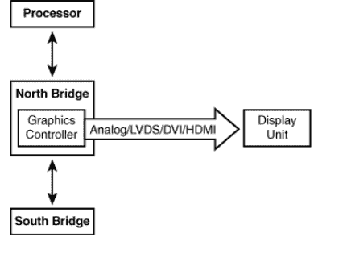

视频图形阵列（VGA）是 IBM 引入的原始显示标准，但如今它更像是一个分辨率规范。VGA 指的是 640x480 的分辨率，而较新的标准如扩展图形阵列（XGA）和超级视频图形阵列（SVGA）支持更高的分辨率，分别为 800x600 和 1024x768。分辨率为 320x240 的四分之一 VGA（QVGA）面板在嵌入式设备（如手持设备和智能手机）中很常见。

x86 世界中与 VGA 及其衍生产品兼容的图形控制器提供了基于字符的文本模式和基于像素的图形模式。然而，非 x86 的嵌入式领域是非 VGA 的，并且没有专用文本模式的概念。

## 北桥

在前几章中，你了解了 LPC、I²C、PCMCIA、PCI 和 USB 等外设总线，这些总线在基于 PC 的系统中均源自南桥。然而，显示架构带我们进入北桥内部。在基于 Intel 的 PC 架构中，北桥要么是图形和内存控制器集线器（GMCH），要么是内存控制器集线器（MCH）。前者包含内存控制器、前端总线（FSB）控制器和图形控制器。后者缺乏集成图形控制器，但提供加速图形端口（AGP）通道以连接外部图形硬件。

以 Intel 855 GMCH 北桥芯片组为例。855 GMCH 中的 FSB 控制器与 Pentium M 处理器接口。内存控制器支持双数据率（DDR）SDRAM 内存芯片。集成图形控制器允许你使用模拟 VGA、LVDS 或 DVI 连接显示设备（参见旁注“视频布线标准”）。855 GMCH 支持同时向两个显示器发送输出，例如，你可以同时将相似或不同的信息分发到你笔记本电脑的 LCD 面板和外部 CRT 监视器。

较新的北桥芯片组，如 AMD 690G，除了 VGA 和 DVI 外，还支持 HDMI（参见以下旁注）。

几种接口标准规定了视频控制器和显示设备之间的连接。显示设备及其使用的布线技术如下：

- 具有标准 VGA 连接器的模拟显示，如*阴极射线管*（CRT）监视器。
- 具有*低电压差分信号*（LVDS）连接器的数字平板显示器，如笔记本*薄膜晶体管*（TFT）LCD。
- 符合*数字视觉接口*（DVI）规范的显示监视器。DVI 是由*数字显示工作组*（DDWG）开发的用于传输高质量视频的通用标准。有三种 DVI 子类：*仅数字*（DVI-D）、*仅模拟*（DVI-A）和*数字及模拟*（DVI-I）。
- 使用*高清多媒体接口*（HDMI）符合*高清电视*（HDTV）规范的显示监视器。HDMI 是一种支持高数据率的现代数字音频视频线缆标准。与 DVI 等仅视频标准不同，HDMI 可以传输图像和声音。

嵌入式 SoC 通常具有片上 LCD 控制器，如图 12.2 所示。从 LCD 控制器发出的输出是 TTL（*晶体管-晶体管逻辑*）信号，这些信号打包了 18 位平板视频数据，每种基色（红、绿、蓝）各 6 位。一些手持设备和手机使用 QVGA 类型的内部 LCD 面板，这些面板直接接收由 LCD 控制器提供的 TTL 平板视频数据。

### 图 12.2. 嵌入式系统上的显示连接。

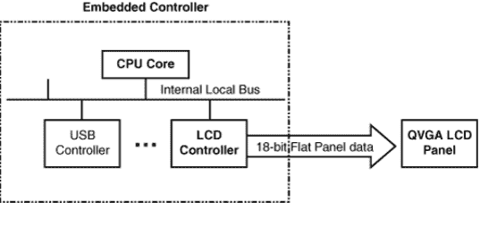

嵌入式设备，如图 12.3 所示，支持双显示面板：内部 LVDS 平板 LCD 和外部 DVI 监视器。内部 TFT LCD 接受 LVDS 连接器作为输入，因此使用 LVDS 发射器芯片将平板信号转换为 LVDS。LVDS 发射器芯片的一个例子是 National Semiconductor 的 DS90C363B。外部 DVI 监视器仅接受 DVI 连接器，因此使用 DVI 发射器将 18 位视频信号转换为 DVI-D。提供一个 I²C 接口，以便设备驱动程序可以配置 DVI 发射器寄存器。DVI 发射器芯片的一个例子是 Silicon Image 的 SiI164。


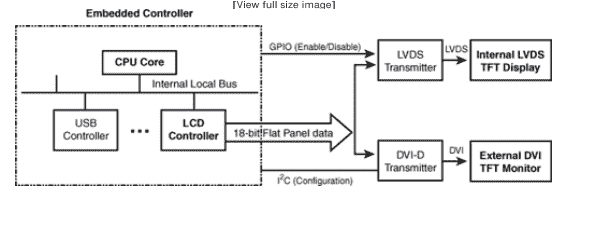

## Linux 视频子系统

帧缓冲的概念是 Linux 视频的核心，因此我们先来看看它提供了什么。

由于视频适配器可以基于不同的硬件架构，上层内核和应用程序的实现可能需要在不同的显卡之间存在差异。这导致处理不同显卡的方案不均匀。随之而来的可移植性差和额外代码需要更多的投资和维护。帧缓冲概念通过描述一般抽象并指定编程接口来解决这个问题，该接口允许应用程序和上层内核以独立于平台的方式编写。图 12.4 展示了帧缓冲的优势。


因此，内核的帧缓冲接口允许应用程序独立于底层图形硬件的复杂性。如果应用程序和显示驱动器符合帧缓冲接口，则可以在各种类型的视频硬件上无更改地运行。你很快就会了解，通用的帧缓冲编程接口还为内核层带来了硬件独立性，例如帧缓冲控制台驱动程序。

如今，许多应用程序，如 Web 浏览器和电影播放器，直接通过帧缓冲接口工作。这些应用程序可以在没有窗口系统帮助的情况下执行图形操作。

X Windows 服务器（Xfbdev）能够基于帧缓冲接口工作，如图 12.5 所示。

## 12.5 Linux 视频子系统

图 12.5 所示的 Linux 视频子系统是低层显示驱动程序、中层帧缓冲和控制台层、高层虚拟终端驱动程序、X Windows 的用户模式驱动组件以及用于配置显示参数的工具集合。让我们从上到下追踪该图的结构：

- X Windows GUI 在操作显卡时有两种选择。它可以使用该卡合适的内置用户空间驱动程序，或者通过帧缓冲子系统进行操作。
- 文本模式控制台通过虚拟终端字符驱动程序运行。虚拟终端在第 6 章“串行驱动程序”的“TTY 驱动程序”一节中介绍，是你登录文本模式时获得的全屏基于文本的终端。与 X Windows 一样，文本控制台也有两种操作选择。它们要么通过特定于卡的控制台驱动程序运行，要么（如果内核支持该特定卡的低层帧缓冲驱动程序）使用通用的帧缓冲控制台驱动程序 (fbcon)。

### 显示参数

有时，配置与显示面板相关的属性可能是为了启用设备视频所需的唯一驱动程序更改，因此让我们通过查看常见的显示参数开始学习视频驱动程序。我们将假设相关驱动程序符合帧缓冲接口，并使用 `fbset` 工具获取显示特性：

```bash
```


`fbset`

```
mode   "1024x768-60"

      # D: 65.003 MHz, H: 48.365 kHz, V: 60.006 Hz

    geometry 1024 768 1024 768 8

    timings 15384 168 16 30 2 136 6

    hsync high

    vsync high

    rgba 8/0, 8/0, 8/0, 0/0

endmode
```

输出中的 `D:` 值代表点时钟（dotclock），它是视频硬件在显示器上绘制像素的速度。前一个输出中 `65.003MHz` 的值意味着视频控制器绘制单个像素需要 `(1/65.003*1000000)` 或大约 `15,384` 皮秒的时间。这个持续时间称为像素时钟（pixelclock），显示为以 `timings` 开头的行中的第一个数字参数。`"geometry"` 旁边的数字宣布可见分辨率和虚拟分辨率均为 `1024x768` (SVGA)，并且存储像素相关信息所需的位数是 `8` 位。

`H:` 值指定水平扫描速率，即视频硬件在一秒内扫描的水平显示行数。这是像素时钟乘以 X 轴分辨率的倒数。`V:` 值是整个显示器刷新率。这是像素时钟乘以可见 X 轴分辨率再乘以可见 Y 轴分辨率的倒数，在本例中约为 `60Hz`。换句话说，LCD 每秒刷新 `60` 次。

视频控制器在每行结束时发出水平同步（HSYNC）脉冲，在每个显示帧结束后发出垂直同步（VSYNC）脉冲。HSYNC（以像素为单位）和 VSYNC（以像素行数为单位）的持续时间显示为以 `"timings"` 开头的行中的最后两个参数。你的显示器越大，HSYNC 和 VSYNC 的可能值就越大。`timings` 行中 HSYNC 持续时间前的四个数字分别宣布了右侧显示边距（或水平前 porch）、左边距（或水平后 porch）、下边距（或垂直前 porch）和上边距（或垂直后 porch）的长度。`Documentation/fb/framebuffer.txt` 和 `fb.modes` 的手册页通过图示展示了这些参数。

为了将这些参数联系在一起，让我们计算给定刷新率（本例中为 `60.006Hz`）的像素时钟值：

```
dotclock = (X-resolution + left margin + right margin

       + HSYNC length) * (Y-resolution + upper margin

       + lower margin + VSYNC length) * refresh rate

      = (1024 + 168 + 16 + 136) * (768 + 30 + 2 + 6) * 60.006

      = 65.003 MHz

pixelclock = 1/dotclock

      = 15384 picoseconds (which matches with the fbset output

      above)
```

## 帧缓冲 API

接下来，让我们深入了解帧缓冲 API。帧缓冲核心层将设备节点导出到用户空间，以便应用程序可以访问每个受支持的视频设备。`/dev/fbX` 是与帧缓冲设备 *X* 关联的节点。以下是帧缓冲 API 用户感兴趣的主要数据结构。在内核中，它们定义在 `include/linux/fb.h` 中，而在用户空间中，它们的定义位于 `/usr/include/linux/fb.h`。

- 上一节中你在 `fbset` 输出中看到的与视频卡相关的可变信息存储在 `struct fb_var_screeninfo` 中。该结构包含 X 轴分辨率、Y 轴分辨率、存储像素所需的位数、pixclock、HSYNC 持续时间、VSYNC 持续时间和边距长度等字段。这些值可以由用户编程设置：

```c
struct fb_var_screeninfo {
__u32 xres;                /* Visible resolution in the X axis */
__u32 yres;                /* Visible resolution in the Y axis */
/* ... */
__u32 bits_per_pixel;      /* Number of bits required to hold a
                            pixel */
/* ... */
__u32 pixclock;            /* Pixel clock in picoseconds */
__u32 left_margin;         /* Time from sync to picture */
__u32 right_margin;        /* Time from picture to sync */
/* ... */
__u32 hsync_len;           /* Length of horizontal sync */
__u32 vsync_len;           /* Length of vertical sync */
/* ... */
};
```

- 关于视频硬件的固定信息，如帧缓冲内存的起始地址和大小，存储在 `struct fb_fix_screeninfo` 中。这些值无法由用户更改：

```c
struct fb_fix_screeninfo {
char id[16];               /* Identification string */
unsigned long smem_start;  /* Start of frame buffer memory */
__u32 smem_len;            /* Length of frame buffer memory */
/* ... */
};
```

- `fb_cmap` 结构指定颜色映射，用于将用户的颜色定义传达给底层视频硬件。你可以使用此结构定义你为不同颜色所需的 RGB（红、绿、蓝）比例：

```c
struct fb_cmap {
__u32 start;               /* First entry */
__u32 len;                 /* Number of entries */
__u16 *red;                /* Red values */
__u16 *green;              /* Green values */
__u16 *blue;               /* Blue values */
__u16 *transp;             /* Transparency. Discussed later on */
};
```

清单 12.1 是一个通过帧缓冲 API 工作的简单应用程序。该程序通过操作对应于显示器的帧缓冲设备节点 `/dev/fb0` 来清除屏幕。它首先使用帧缓冲 API `FBIOGET_VSCREENINFO` 以与硬件无关的方式解码可见分辨率和*每像素位数*。此接口命令通过操作 `fb_var_screeninfo` 结构来获取显示器的可变参数。然后，程序继续 `mmap()` 帧缓冲内存并清除每个组成像素位。

### 清单 12.1. 以与硬件无关的方式清除显示

```c
#include <stdio.h>
#include <fcntl.h>
#include <linux/fb.h>
#include <sys/mman.h>
#include <stdlib.h>
struct fb_var_screeninfo vinfo;
int
main(int argc, char *argv[])
{
    int fbfd, fbsize, i;
    unsigned char *fbbuf;
    /* Open video memory */
    if ((fbfd = open("/dev/fb0", O_RDWR)) < 0) {
        exit(1);
    }
    /* Get variable display parameters */
    if (ioctl(fbfd, FBIOGET_VSCREENINFO, &vinfo)) {
        printf("Bad vscreeninfo ioctl\n");
        exit(2);
    }
    /* Size of frame buffer =
       (X-resolution * Y-resolution * bytes per pixel) */
    fbsize = vinfo.xres*vinfo.yres*(vinfo.bits_per_pixel/8);
    /* Map video memory */
    if ((fbbuf = mmap(0, fbsize, PROT_READ|PROT_WRITE,


```
                      MAP_SHARED, fbfd, 0)) == (void *)-1){

        exit(3);

    }

    /* Clear the screen */

    for (i=0; i<fbsize; i++) {

        *(fbbuf+i) = 0x00;

    }

    munmap(fbbuf, fbsize);

    close(fbfd);

}
```

在第 19 章“用户空间中的驱动程序”中，当我们学习如何从用户空间访问内存区域时，我们会探讨另一个帧缓冲区的应用。

## 帧缓冲区驱动程序

既然你已经了解了帧缓冲区 API 以及它如何提供硬件独立性，让我们通过一个导航系统的示例来了解低层帧缓冲区设备驱动程序的架构。

## 设备示例：导航系统

图 12.6 展示了一个基于嵌入式 SoC 构建的车辆导航系统示例中的视频操作。GPS 接收器通过 UART 接口向 SoC 传输坐标流。应用程序根据接收到的位置信息生成图形，并更新系统内存中的帧缓冲区。帧缓冲区驱动程序将此图像数据通过 DMA 传输到 SoC LCD 控制器的一部分显示缓冲区。然后，控制器将像素数据转发到 QVGA LCD 面板进行显示。

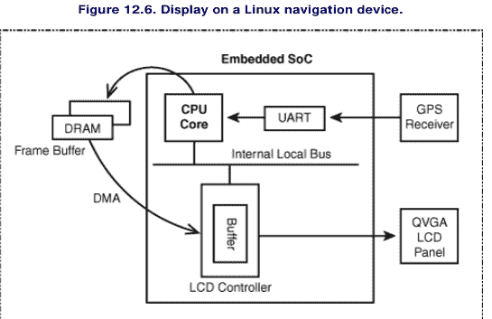

我们的目标是为该系统开发视频软件。假设 Linux 支持该导航设备使用的 SoC，并且内核支持所有依赖于架构的接口（如 DMA）。

图 12.6 中所示设备的一种可能的硬件实现方式是使用 Freescale i.MX21 SoC。在这种情况下，CPU 内核是 ARM9 内核，片上视频控制器是液晶显示器控制器（LCDC）。SoC 通常具有高性能的内部本地总线，连接 DRAM 和视频等控制器。在 iMX21 的情况下，该总线被称为高级高性能总线（AHB）。LCDC 连接到 AHB。

导航系统的视频软件在架构上大致是一个在 LCD 控制器低层帧缓冲区驱动程序上运行的 GPS 应用程序。应用程序通过读取 `/dev/ttySX` 从 GPS 接收器获取位置坐标，其中 *X* 是连接到接收器的 UART 编号。然后，它将地理定位信息转换为图像，并将像素数据写入与 LCD 控制器关联的帧缓冲区。这与列表 12.1 中的操作类似，区别在于这里分发的是图像数据，而不是用于清屏的零值。

本节其余部分仅关注低层帧缓冲区设备驱动程序。与许多其他驱动程序子系统一样，帧缓冲区核心层提供的完整设施、模式和选项非常复杂，只能通过编码经验来学习。示例导航系统的帧缓冲区驱动程序相对简单，仅是深入探索的起点。

表 12.1 描述了图 12.6 中所示 LCD 控制器的寄存器模型。列表 12.2 中的帧缓冲区驱动程序在这些寄存器上运行。

**表 12.1. 图 12.6 中所示 LCD 控制器的寄存器布局**

| 寄存器名称 | 用于配置 |
|---|---|
| SIZE_REG | LCD 面板的最大 X 和 Y 尺寸 |
| HSYNC_REG | HSYNC 持续时间 |
| VSYNC_REG | VSYNC 持续时间 |
| CONF_REG | 每像素位数、像素极性、生成像素时钟的分频器、彩色/单色模式等 |
| CTRL_REG | 启用/禁用 LCD 控制器、时钟和 DMA |
| DMA_REG | 帧缓冲区的 DMA 起始地址、突发长度和水印大小 |
| STATUS_REG | 状态值 |
| CONTRAST_REG | 对比度级别 |

我们的帧缓冲区驱动程序（称为 *myfb*）在列表 12.2 中作为平台驱动程序实现。如你在第 6 章所学，平台通常是一个伪总线，用于将集成在 SoC 中的轻量级设备与内核的设备模型连接起来。架构特定的设置代码（位于 `arch/your-arch/platform/`）使用 `platform_device_add()` 添加平台；但为了简化，*myfb* 驱动程序的 `probe()` 方法在将其自身注册为平台驱动程序之前执行此操作。请参考第 6 章中“设备示例：手机”部分，了解平台驱动程序及其关联入口点的一般架构。

### 数据结构

让我们来看看与帧缓冲区驱动程序相关的主要数据结构和方法，然后深入探讨 *myfb*。以下是两个主要结构：

1. `struct fb_info` 是帧缓冲区驱动程序的核心数据结构。该结构定义在 `include/linux/fb.h` 中，如下所示：

```c
struct fb_info {
   /* ... */
   struct fb_var_screeninfo var; /* 可变屏幕信息。 */
   struct fb_fix_screeninfo fix; /* 固定屏幕信息。 */
   /* ... */
   struct fb_cmap cmap; /* 颜色映射。 */
   /* ... */
   struct fb_ops *fops; /* 驱动程序操作。 */
   /* ... */
   char __iomem *screen_base; /* 帧缓冲区的虚拟地址 */
   unsigned long screen_size; /* 帧缓冲区的大小 */
   /* ... */
   /* 从此处开始所有内容都是设备相关的 */
   void *par; /* 私有区域 */
};
```

`fb_info` 的内存由帧缓冲区核心提供的库例程 `framebuffer_alloc()` 分配。该函数还将私有区域的大小作为参数，并将其附加到已分配的 `fb_info` 末尾。可以使用 `fb_info` 结构中的 `par` 指针引用该私有区域。`fb_var_screeninfo` 和 `fb_fix_screeninfo` 等 `fb_info` 字段的语义在“帧缓冲区 API”一节中进行了讨论。

2. `fb_ops` 结构包含低层帧缓冲区驱动程序提供的所有入口点的地址。`fb_ops` 中的前几个方法对于驱动程序的运行是必需的，而其余的是可选的，提供图形加速功能。每个函数的职责在注释中简要说明：

**代码视图：**

```c
struct fb_ops {
   struct module *owner;
   /* 驱动程序打开 */
   int (*fb_open)(struct fb_info *info, int user);
   /* 驱动程序关闭 */
   int (*fb_release)(struct fb_info *info, int user);
   /* ... */
   /* 视频参数的一致性检查 */
   int (*fb_check_var)(struct fb_var_screeninfo *var, struct fb_info *info);
   /* 配置视频控制器寄存器 */
   int (*fb_set_par)(struct fb_info *info);
   /* 创建伪颜色调色板映射 */
   int (*fb_setcolreg)(unsigned regno, unsigned red, unsigned green, unsigned blue, unsigned transp, struct fb_info *info);
   /* 屏幕空白/取消空白 */
   int (*fb_blank)(int blank, struct fb_info *info);
   /* ... */
   /* 使用像素行填充矩形的加速方法 */
   void (*fb_fillrect)(struct fb_info *info, const struct fb_fillrect *rect);
   /* 从一个屏幕区域复制矩形区域到另一个区域的加速方法 */
   void (*fb_copyarea)(struct fb_info *info, const struct fb_copyarea *region);
   /* 在显示器上绘制图像的加速方法 */
   void (*fb_imageblit)(struct fb_info *info, const struct fb_image *image);
   /* 旋转显示的加速方法 */
   void (*fb_rotate)(struct fb_info *info, int angle);
   /* 支持特定于设备命令的 Ioctl 接口 */
   int (*fb_ioctl)(struct fb_info *info, unsigned int cmd, unsigned long arg);
   /* ... */
};
```


现在我们来看看列表 12.2 为 `myfb` 驱动程序实现的驱动程序方法。

### 检查和设置参数

`fb_check_var()` 方法对 X 分辨率、Y 分辨率和每像素位数等变量执行一致性检查。因此，如果你使用 `fbset` 设置小于 LCD 控制器支持的最小值（在我们的示例中为 64）的 X 分辨率，该函数将其限制为硬件允许的最小值。

`fb_check_var()` 还设置适当的 RGB 格式。我们的示例使用每像素 16 位，控制器将帧缓冲区中的每个数据字映射为常用的 RGB565 代码：红色 5 位，绿色 6 位，蓝色 5 位。数据字中每种颜色的偏移量也相应设置。

`fb_set_par()` 方法根据 `fb_info.var` 中的值配置 LCD 控制器的寄存器。这包括设置：

- `HSYNC_REG` 中的水平同步持续时间、左边距和右边距
- `VSYNC_REG` 中的垂直同步持续时间、上边距和下边距
- `SIZE_REG` 中的可见 X 和 Y 分辨率
- `DMA_REG` 中的 DMA 参数

假设 GPS 应用程序试图将 QVGA 显示器的分辨率更改为 50×50。以下是事件的发生顺序：

1. 显示器初始处于 QVGA 分辨率：

```bash
bash> fbset

mode  "320x240-76"

      # D: 5.830 MHz, H: 18.219 kHz, V: 75.914 Hz

      geometry 320 240 320 240 16

      timings 171521 0 0 0 0 0 0

      rgba 5/11,6/5,5/0,0/0
```

2. 应用程序执行以下操作：

```c
struct fb_var_screeninfo vinfo;

fbfd = open("/dev/fb0", O_RDWR); 

vinfo.xres = 50; 

vinfo.yres = 50; 

vinfo.bits_per_pixel = 8;

ioctl(fbfd, FBIOGET_VSCREENINFO, &vinfo);
```

请注意，这等同于执行命令 `fbset -xres 50 -yres 50 -depth 8`。

3. 上一步中的 `FBIOGET_VSCREENINFO` `ioctl` 触发了 `myfb_check_var()` 的调用。该驱动方法会对请求的分辨率表示不满，并将其向上取整为硬件支持的最小分辨率，在此情况下为 64x64。

4. `myfb_set_par()` 由帧缓冲核心调用，将新的显示参数写入 LCD 控制器寄存器。

5. `fbset` 现在输出新的参数：

```bash
bash> fbset

mode "64x64-1423" 

# D: 5.830 MHz; H: 91.097 kHz; V: 1423.386 Hz

geometry 64 64 320 240 16

timings 171521 0 0 0 0 0 0

rgba 5/11,6/5,5/0,0/0

endmode
```

### 颜色模式

视频硬件支持的常见颜色模式包括 *伪彩色* 和 *真彩色*。在前者中，索引号被映射到 RGB 像素编码。通过选择可用颜色的子集，并使用对应于这些颜色的索引代替像素值本身，你可以减少对帧缓冲内存的需求。但是，你的硬件需要支持这种可修改颜色集（或 *调色板*）的方案。

在真彩色模式下（我们的示例 LCD 控制器支持的就是这种模式），可修改的调色板是不相关的。然而，你仍然必须满足帧缓冲控制台驱动器的需求，该驱动器仅使用 16 种颜色。为此，你需要通过直接将 16 个原始 RGB 值编码为可以馈送到硬件的位来创建一个伪调色板。这个伪调色板存储在 `fb_info` 结构的 *pseudo_palette* 字段中。在代码列表 12.2 中，`myfb_setcolreg()` 如下填充它：

```c
((u32*) (info->pseudo_palette))[color_index] =
    (red << info->var.red.offset) |
    (green << info->var.green.offset) |
    (blue << info->var.blue.offset) |
    (transp << info->var.transp.offset);
```

我们的 LCD 控制器每像素使用 16 位并采用 RGB565 格式，因此如前所述，`fb_check_var()` 方法确保红、绿、蓝值分别位于位偏移 11、5 和 0 处。除了颜色索引和红、蓝、绿色值外，`fb_setcolreg()` 还接受一个参数 `transp` 来指定所需的透明度效果。这种被称为 *alpha 混合* 的机制将指定的像素值与背景颜色结合。本示例中的 LCD 控制器不支持 alpha 混合，因此 `myfb_check_var()` 将 `transp` 的偏移量和长度设置为零。

帧缓冲抽象功能足够强大，可以将应用程序与显示面板的特性隔离开来——无论是 RGB 还是 BGR 或其他。由 `fb_check_var()` 设置的红色、蓝色和绿色偏移量通过由 `FBIOGET_VSCREENINFO` `ioctl()` 填充的 `fb_var_screeninfo` 结构传递到用户空间。因为像 X Windows 这样的应用程序符合帧缓冲规范，它们根据此 `ioctl()` 返回的颜色偏移量将像素绘制到帧缓冲中。

RGB 编码使用的位长度（本例中为 5+6+5=16）称为 *颜色深度*，它被帧缓冲控制台驱动器用于选择启动时要显示的 logo 文件（参见“启动 Logo”部分）。

### 屏幕关闭

`fb_blank()` 方法提供对显示关闭和开启的支持。这主要用于电源管理。要在导航系统的显示屏在 10 分钟无操作后将其关闭，请执行以下操作：

```bash
bash> setterm -blank 10
```

此命令向下传播到帧缓冲层，并导致 `myfb_blank()` 的调用，从而在 `CTRL_REG` 中编程相应的位。

### 加速方法

如果你的用户界面需要执行重型视频操作，如混合、拉伸、位图移动或动态渐变生成，你可能需要图形加速以获得可接受的性能。让我们简要访问一下如果视频硬件支持图形加速，你可以利用的 `fb_ops` 方法。

`fb_imageblit()` 方法将图像绘制到显示设备上。此入口点为你的驱动器提供了一个机会，利用视频控制器可能拥有的任何特殊功能来加速此操作。`cfb_imageblit()` 是帧缓冲核心提供的一个通用库函数，如果你没有加速硬件，则使用它来实现此功能。例如，它用于在启动期间将 logo 输出到屏幕上。`fb_copyarea()` 从屏幕的一个区域复制一个矩形区域到另一个区域。如果你的图形控制器没有加速此操作的功能，`cfb_copyarea()` 提供了一种优化的方式来实现此操作。`fb_fillrect()` 方法快速用像素行填充矩形。`cfb_fillrect()` 提供了一种通用的非加速方式来达到此目的。我们导航系统中的 LCD 控制器不提供加速，因此示例驱动器使用帧缓冲核心提供的通用软件优化例程来填充这些方法。

### DirectFB

DirectFB（www.directfb.org）是一个构建在帧缓冲接口之上的库，它提供了一个简单的窗口管理器框架，以及用于硬件图形加速和允许多个帧缓冲应用程序共存的虚拟接口的钩子。DirectFB 与下游的加速帧缓冲设备驱动器以及上游的感知 DirectFB 的渲染引擎（如 Cairo，www.cairographics.org）一起，有时用于图形密集型嵌入式设备，而不是像 X Windows 这样的传统解决方案。

### 帧缓冲 DMA

导航系统中的 LCD 控制器包含一个从系统内存获取图像帧的 DMA 引擎。控制器将获取的图形数据分发到显示面板。DMA 的速率支持显示屏的刷新率。使用 `myfb_probe()` 中的 `dma_alloc_coherent()` 分配一个适合一致性访问的非缓存帧缓冲。（我们在第 10 章“外围组件互连”中讨论了一致性 DMA 映射。）`myfb_set_par()` 将此分配的 DMA 地址写入 LCD 控制器中的 `DMA_REG` 寄存器。

当驱动器通过调用 `myfb_enable_controller()` 启用 DMA 时，控制器开始使用同步 DMA 将像素数据从帧缓冲传输到显示屏。因此，当 GPS 应用程序映射帧缓冲（使用 `mmap()`）并向其中写入位置信息时，像素会被绘制到 LCD 上。

### 对比度和背光

导航系统中的 LCD 控制器支持使用 `CONTRAST_REG` 寄存器进行对比度控制。驱动器通过 `myfb_ioctl()` 将此导出到用户空间。GPS 应用程序按以下方式控制对比度：

```c
unsigned int my_fd, desired_contrast_level = 100;
/* Open the frame buffer */
my_fd = open("/dev/fb0", O_RDWR);
```


`ioctl(my_fd, MYFB_SET_BRIGHTNESS, &desired_contrast_level);`

导航系统中的 LCD 面板使用背光照明。处理器通过 GPIO 线路控制背光逆变器，因此你可以通过摆动相应的引脚来开启或关闭灯光。内核通过 sysfs 节点抽象了一个通用的背光接口。为了与此接口结合，你的驱动器必须填充一个 `backlight_ops` 结构，其中包含获取和更新背光亮度的方法，并使用 `backlight_device_register()` 将其注册到内核。查看 `drivers/video/backlight/` 中的背光接口源代码，并在 `drivers/` 树中递归使用 `grep` 搜索 `backlight_device_register()` 以定位使用此接口的视频驱动器。代码列表 12.2 未实现背光操作。

## 代码列表 12.2. 导航系统的帧缓冲驱动器

```c
Code View:
#include <linux/fb.h>
#include <linux/dma-mapping.h>
#include <linux/platform_device.h>
/* Address map of LCD controller registers */
#define LCD_CONTROLLER_BASE 0x01000000
#define SIZE_REG (* (volatile u32 *) (LCD_CONTROLLER_BASE))
#define HSYNC_REG (* (volatile u32 *) (LCD_CONTROLLER_BASE + 4))
#define VSYNC_REG (* (volatile u32 *) (LCD_CONTROLLER_BASE + 8))
#define CONF_REG (* (volatile u32 *) (LCD_CONTROLLER_BASE + 12))
```

```c
#define CTRL_REG      (*(volatile u32 *)(LCD_CONTROLLER_BASE + 16))
#define DMA_REG       (*(volatile u32 *)(LCD_CONTROLLER_BASE + 20))
#define STATUS_REG    (*(volatile u32 *)(LCD_CONTROLLER_BASE + 24))
#define CONTRAST_REG  (*(volatile u32 *)(LCD_CONTROLLER_BASE + 28))
#define LCD_CONTROLLER_SIZE     32
/* LCD 控制器平台设备的资源 */
static struct resource myfb_resources[] = {
  [0] = {
    .start     = LCD_CONTROLLER_BASE,
    .end       = LCD_CONTROLLER_SIZE,
    .flags     = IORESOURCE_MEM,
  },
};
/* 平台设备定义 */
static struct platform_device myfb_device = {
  .name      = "myfb",
  .id        = 0,
  .dev       = {
    .coherent_dma_mask = 0xffffffff,
  },
  .num_resources = ARRAY_SIZE(myfb_resources),
  .resource    = myfb_resources,
};
/* 设置 LCD 控制器参数 */
static int
myfb_set_par(struct fb_info *info)
{
  unsigned long adjusted_fb_start;
  struct fb_var_screeninfo *var = &info->var;
  struct fb_fix_screeninfo *fix = &info->fix;
  /* HSYNC_REG 的高 16 位保存 HSYNC 持续时间，接下来的 8 位包含
     左边距，而低 8 位保存右边距 */
  HSYNC_REG = (var->hsync_len << 16) |
              (var->left_margin << 8) |
              (var->right_margin);
  /* VSYNC_REG 的高 16 位保存 VSYNC 持续时间，接下来的 8 位包含
     上边距，而低 8 位保存下边距 */
  VSYNC_REG = (var->vsync_len << 16) |
              (var->upper_margin << 8) |
              (var->lower_margin);
  /* SIZE_REG 的高 16 位保存 xres，低 16 位保存 yres */
  SIZE_REG = (var->xres << 16) | (var->yres);
  /* 在 CONF_REG 中设置每像素位数、像素极性、
     像素时钟的分频器，以及彩色/单色模式 */
  /* ... */
  /* 在 DMA_REG 中填入从 myfb_probe() 中一致性分配的
     帧缓冲区的起始地址。调整此地址以计入
     屏幕区域起始的偏移量 */
  adjusted_fb_start = fix->smem_start +
                     (var->yoffset * var->xres_virtual + var->xoffset) *
                     (var->bits_per_pixel / 8);
  __raw_writel(adjusted_fb_start, (unsigned long *)DMA_REG);
  /* 在 DMA_REG 中设置 DMA 突发长度和水位线大小 */
  /* ... */
  /* 设置固定信息 */
  fix->accel   = FB_ACCEL_NONE;      /* 无硬件加速 */
  fix->visual  = FB_VISUAL_TRUECOLOR;/* 真彩色模式 */
  fix->line_length = var->xres_virtual * var->bits_per_pixel / 8;
  return 0;
}
/* 启用 LCD 控制器 */
static void
myfb_enable_controller(struct fb_info *info)
{
  /* 通过写入 CTRL_REG 来启用 LCD 控制器，
     启动 DMA，并启用时钟和电源 */
  /* ... */
}
/* 禁用 LCD 控制器 */
static void
myfb_disable_controller(struct fb_info *info)
{
  /* 通过写入 CTRL_REG 来禁用 LCD 控制器，
     停止 DMA，并禁用时钟和电源 */
  /* ... */
}
/* 变量的健全性检查和调整 */
static int
myfb_check_var(struct fb_var_screeninfo *var, struct fb_info *info)
{
  /* 向上取整到 LCD 控制器支持的最小分辨率 */
  if (var->xres < 64) var->xres = 64;
  if (var->yres < 64) var->yres = 64;
  /* ... */
  /* 此硬件支持 RGB565 颜色格式。
     更多详情请参见“颜色模式”章节 */
  if (var->bits_per_pixel == 16) {
    /* 编码红色 */
    var->red.length = 5;
    var->red.offset = 11;
    /* 编码绿色 */
    var->green.length = 6;
    var->green.offset = 5;
    /* 编码蓝色 */
    var->blue.length = 5;
    var->blue.offset = 0;
    /* 不支持硬件 alpha 混合 */
    var->transp.length = 0;
    var->transp.offset = 0;
  }
  return 0;
}
/* 黑屏/解除黑屏 */
static int
myfb_blank(int blank_mode, struct fb_info *info)
{
  switch (blank_mode) {
```


## FB_BLANK 处理

```c
case FB_BLANK_POWERDOWN:

case FB_BLANK_VSYNC_SUSPEND:

case FB_BLANK_HSYNC_SUSPEND:

case FB_BLANK_NORMAL:

  myfb_disable_controller(info);

  break;

case FB_BLANK_UNBLANK:

  myfb_enable_controller(info);

  break;

}

return 0;
```

## 配置伪彩色调色板映射

```c
static int
myfb_setcolreg(u_int color_index, u_int red, u_int green,
               u_int blue, u_int transp, struct fb_info *info)
{
  if (info->fix.visual == FB_VISUAL_TRUECOLOR) {
    /* 执行必要的转换，将红色、蓝色、绿色和
       透明值转换为可以直接供硬件使用的值 */
    /* ... */
    ((u32 *) (info->pseudo_palette))[color_index] =
      (red << info->var.red.offset)
      | (green << info->var.green.offset)
      | (blue << info->var.blue.offset)
      | (transp << info->var.transp.offset);
  }
  return 0;
}
```

## 设备特定的 ioctl 定义

```c
#define MYFB_SET_BRIGHTNESS _IOW('M', 3, int8_t)
```

## 设备特定的 ioctl

```c
static int
myfb_ioctl(struct fb_info *info, unsigned int cmd, unsigned long arg)
{
  u32 blevel;
  switch (cmd) {
  case MYFB_SET_BRIGHTNESS:
    copy_from_user((void *)&blevel, (void *)arg,
                   sizeof(blevel));
    /* 将 blevel 写入 CONTRAST_REG */
    /* ... */
    break;
  default:
    return -EINVAL;
  }
  return 0;
}
```

## `fb_ops` 结构体

```c
static struct fb_ops myfb_ops = {
  .owner           = THIS_MODULE,
  .fb_check_var   = myfb_check_var, /* 健全性检查 */
  .fb_set_par     = myfb_set_par,   /* 编程控制器寄存器 */
  .fb_setcolreg   = myfb_setcolreg, /* 设置颜色映射 */
  .fb_blank       = myfb_blank,     /* 黑屏/解除黑屏显示 */
  .fb_fillrect    = cfb_fillrect,   /* 填充矩形的通用函数 */
  .fb_copyarea    = cfb_copyarea,   /* 复制区域的通用函数 */
  .fb_imageblit   = cfb_imageblit,  /* 绘制的通用函数 */
  .fb_ioctl       = myfb_ioctl,     /* 设备特定的 ioctl */
};
```

## 平台驱动的 `probe()` 例程

```c
static int
myfb_probe(struct platform_device *pdev)
{
  struct fb_info *info;
  struct resource *res;
  info = framebuffer_alloc(0, &pdev->dev);
  /* ... */
  /* 获取在注册相应的 platform_device 时
     定义的关联资源 */
  res = platform_get_resource(pdev, IORESOURCE_MEM, 0);
  /* 获得内核许可，使用从 LCD_CONTROLLER_BASE 开始，
     大小为 LCD_CONTROLLER_SIZE 字节的 I/O 内存块 */
  res = request_mem_region(res->start, res->end - res->start + 1,
                           pdev->name);
  /* 用固定值 (info->fix) 和变量值 (info->var) 填充 fb_info 结构体，
     例如帧缓冲区长度、xres、yres、
     bits_per_pixel、fbops、cmap 等 */
  initialize_fb_info(info, pdev);  /* 未展开 */
  info->fbops = &myfb_ops;
  fb_alloc_cmap(&info->cmap, 16, 0);
  /* 一致性映射帧缓冲区内存进行 DMA。
     info->screen_base 保存映射缓冲区的 CPU 地址，
     info->fix.smem_start 保存关联的硬件地址 */
  info->screen_base = dma_alloc_coherent(0, info->fix.smem_len,
                         (dma_addr_t *)&info->fix.smem_start,
                         GFP_DMA | GFP_KERNEL);
  /* 将 info->var 中的信息设置到合适的
     LCD 控制器寄存器 */
  myfb_set_par(info);
  /* 向帧缓冲区核心注册 */
  register_framebuffer(info);
  return 0;
}
```

## 平台驱动的 `remove()` 例程

```c
static int
myfb_remove(struct platform_device *pdev)
{
  struct fb_info *info = platform_get_drvdata(pdev);
  struct resource *res;
  /* 禁用屏幕刷新，关闭 DMA... */
  myfb_disable_controller(info);
  /* 注销帧缓冲区驱动 */
  unregister_framebuffer(info);
  /* 释放颜色映射 */
  fb_dealloc_cmap(&info->cmap);
  kfree(info->pseudo_palette);
  /* framebuffer_alloc() 的逆操作 */
  framebuffer_release(info);
  /* 释放内存区域 */
  res = platform_get_resource(pdev, IORESOURCE_MEM, 0);
  release_mem_region(res->start, res->end - res->start + 1);
  platform_set_drvdata(pdev, NULL);
  return 0;
}
```

## 平台驱动结构体

```c
static struct platform_driver myfb_driver = {
  .probe = myfb_probe,
  .remove = myfb_remove,
  .driver = {
    .name = "myfb",
  },
};
```

## 模块初始化

```c
int __init
myfb_init(void)
{
  platform_device_add(&myfb_device);
  return platform_driver_register(&myfb_driver);
}
```

## 模块退出

```c
void __exit
myfb_exit(void)
{
  platform_driver_unregister(&myfb_driver);
  platform_device_unregister(&myfb_device);
}

module_init(myfb_init);
module_exit(myfb_exit);
```


## 控制台驱动程序

*控制台*（`console`）是一种用于显示内核生成的 `printk()` 消息的设备。如果你查看图 12.5，你会发现控制台驱动程序分为两个层级：顶层由诸如*虚拟终端*驱动程序、*打印机控制台*驱动程序以及稍后讨论的示例 *USB-UART* 控制台驱动程序等组成；底层驱动程序则负责高级操作。因此，控制台驱动程序使用了两种主要的接口定义结构。顶层控制台驱动程序围绕 `struct console` 展开，该结构定义了诸如 `setup()` 和 `write()` 等基本操作。底层驱动程序以 `struct consw` 为核心，该结构指定了诸如设置光标属性、控制台切换、屏幕清屏、调整大小以及设置调色板信息等高级操作。这些结构定义在 `include/linux/console.h` 中，定义如下：

```c
struct console {
    char    name[8];
    void    (*write)(struct console *, const char *, unsigned);
    int     (*read)(struct console *, char *, unsigned);
    /* ... */
    void    (*unblank)(void);
    int     (*setup)(struct console *, char *);
    /* ... */
};
```

```c
struct consw {
    struct module *owner;
    const char *(*con_startup)(void);
    void        (*con_init)(struct vc_data *, int);
    void        (*con_deinit)(struct vc_data *);
    void        (*con_clear)(struct vc_data *, int, int, int, int);
    void        (*con_putc)(struct vc_data *, int, int, int);
    void        (*con_putcs)(struct vc_data *,
                    const unsigned short *, int, int, int);
    void        (*con_cursor)(struct vc_data *, int);
    int         (*con_scroll)(struct vc_data *, int, int, int, int);
    /* ... */
};
```

正如你可能通过查看图 12.5 所猜测的那样，大多数控制台设备需要这两个层级的驱动程序协同工作。在许多情况下，*vt* 驱动程序是顶层控制台驱动程序。在 PC 兼容系统上，VGA 控制台驱动程序（*vgacon*）通常是底层控制台驱动程序；而在嵌入式设备上，帧缓冲控制台驱动程序（*fbcon*）往往是底层驱动程序。由于帧缓冲抽象提供了间接层，*fbcon* 与其他底层控制台驱动程序不同，它是硬件无关的。

让我们简要了解一下这两个层级控制台驱动程序的架构：

- 顶层驱动程序用规定的入口点填充 `struct console`，并使用 `register_console()` 将其注册到内核中。注销操作通过 `unregister_console()` 完成。该驱动程序与 `printk()` 进行交互。该驱动程序所属的入口点会调用关联的底层控制台驱动程序的服务。
- 底层控制台驱动程序用指定的入口点填充 `struct consw`，并使用 `register_con_driver()` 将其注册到内核中。注销操作通过 `unregister_con_driver()` 完成。当系统支持多个控制台驱动程序时，驱动程序可能会改为调用 `take_over_console()` 来注册自身并接管现有控制台；`give_up_console()` 则完成相反的操作。对于传统显示设备，底层驱动程序与顶层 vt 控制台驱动程序以及 `vc_screen` 字符驱动程序（允许访问虚拟控制台内存）进行交互。

一些简单的控制台，如线式打印机和下文讨论的 `USB_UART`，只需要一个顶层控制台驱动程序。

### 内核中的 `fbcon` 驱动程序还支持控制台旋转

PDA 和手机上的显示屏通常以纵向方式安装，而汽车仪表板和 IP 电话则是显示屏可能处于横向模式的系统示例。有时，由于经济或其他因素，嵌入式设备可能需要将横向 LCD 以纵向模式安装，或者反过来。控制台旋转支持在这些情况下非常有用。由于 `fbcon` 是硬件无关的，因此控制台旋转的实现也是通用的。要启用控制台旋转，请在内核配置期间启用 `CONFIG_FRAMEBUFFER_CONSOLE_ROTATION`，并在内核命令行中添加 `fbcon=rotate:x`，其中 `x` 为 `0` 表示正常方向，`1` 表示 90 度旋转，`2` 表示 180 度旋转，`3` 表示 270 度旋转。

### 设备示例：重访手机

为了学习如何编写控制台驱动程序，让我们重访第 6 章中使用的 Linux 手机。本节中的任务是开发一个通过手机中的 `USB_UART` 运行的控制台驱动程序。为了便于理解，图 12.7 重现了第 6 章中图 6.5 的手机。让我们编写一个控制台驱动程序，通过 `USB_UART` 将 `printk()` 消息发送出去。这些消息由 PC 主机捕获，并通过终端仿真会话显示给用户。

#### 图 12.7。通过 `USB_UART` 连接的控制台。

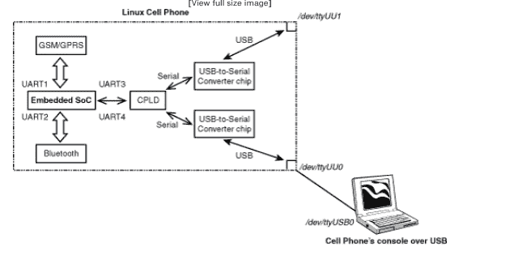

代码清单 12.3 开发了一个通过 `USB_UART` 工作的控制台驱动程序。该代码清单中还包含第 6 章中 `USB_UART` 驱动程序使用的 `usb_uart_port[]` 结构体和几个定义，以创建一个完整的驱动程序。与该代码清单相关的注释解释了驱动程序的工作原理。

图 12.7 展示了我们的示例 `USB_UART` 控制台驱动程序在 Linux-Video 子系统中的位置。如你所见，`USB_UART` 是一个简单的设备，只需要一个顶层控制台驱动程序。

### 代码清单 12.3。通过 `USB_UART` 连接的控制台

```c
#include <linux/console.h>
#include <linux/serial_core.h>
#include <asm/io.h>
#define USB_UART_PORTS 2 /* 该手机有 2 个 USB_UART 端口 */
/* 每个 USB_UART 有一个 3 字节的寄存器集，包括
偏移量为 0 的 UU_STATUS_REGISTER，偏移量为 1 的
UU_READ_DATA_REGISTER，以及偏移量为 2 的 UU_WRITE_DATA_REGISTER，
如第 6 章“串行驱动程序”中的表 1 所示 */
#define USB_UART1_BASE 0xe8000000 /* USB_UART1 的内存基址 */
#define USB_UART2_BASE 0xe9000000 /* USB_UART2 的内存基址 */
#define USB_UART_REGISTER_SPACE 0x3
/* 状态寄存器中各比特位的含义 */
#define USB_UART_TX_FULL 0x20
#define USB_UART_RX_EMPTY 0x10
#define USB_UART_STATUS 0x0F
#define USB_UART1_IRQ 3
#define USB_UART2_IRQ 4
#define USB_UART_CLK_FREQ 16000000
#define USB_UART_FIFO_SIZE 32
/* 每个支持的 USB_UART 端口的参数 */
static struct uart_port usb_uart_port[] = {
{
.mapbase = (unsigned int)USB_UART1_BASE,
.iotype = UPIO_MEM, /* 内存映射 */
.irq = USB_UART1_IRQ, /* 中断号 */
.uartclk = USB_UART_CLK_FREQ, /* 时钟频率 Hz */
.fifosize = USB_UART_FIFO_SIZE, /* FIFO 大小 */
.flags = UPF_BOOT_AUTOCONF, /* UART 端口标志 */
.line = 0, /* UART 线路号 */
},
{
.mapbase = (unsigned int)USB_UART2_BASE,
```


## 配置参数

```c
.iotype = UPIO_MEM, /* 内存映射 */

.irq = USB_UART2_IRQ, /* 中断号 */

.uartclk = USB_UART_CLK_FREQ, /* 时钟频率 Hz */

.fifosize = USB_UART_FIFO_SIZE, /* FIFO 大小 */

.flags = UPF_BOOT_AUTOCONF, /* UART 端口标志 */

.line = 1, /* UART 线路号 */

}
};
```

## 函数实现

### `usb_uart_putc`

/* 向 `USB_UART` 端口写入一个字符 */

```c
static void
usb_uart_putc(struct uart_port *port, unsigned char c)
{
/* 等待直到 `USB_UART` 的 TX FIFO 中有空间。
通过查看状态寄存器中的
`USB_UART_TX_FULL` 比特位来检测此状态 */
while (__raw_readb(port->membase) & USB_UART_TX_FULL);

/* 将字符写入数据端口 */
__raw_writeb(c, (port->membase+l));
}
```

### `usb_uart_console_write`

/* 控制台写入 */

```c
static void
usb_uart_console_write(struct console *co, const char *s, u_int count)
{
int i;
/* 写入每个字符 */
for (i = 0; i < count; i++, s++) {
usb_uart_putc(&usb_uart_port[co->index], *s);
}
}
```

### `usb_uart_console_get_options`

/* 获取通信参数 */

```c
static void __init
usb_uart_console_get_options(struct uart_port *port, int *baud, int *parity, int *bits)
{
/* 读取当前设置（可能由引导加载程序设置）
或返回奇偶校验、数据位数
和波特率的默认值 */
*parity = 'n';
*bits = 8;
*baud = 115200;
}
```

### `usb_uart_console_setup`

/* 设置控制台通信参数 */

```c
static int __init
usb_uart_console_setup(struct console *co, char *options)
{
struct uart_port *port;
int baud, bits, parity, flow;
/* 验证端口号并获取
相应结构体的句柄 */
if (co->index == -1 || co->index >= USB_UART_PORTS) {
co->index = 0;
}
port = &usb_uart_port[co->index];
/* 使用串行层提供的函数来解析选项 */
if (options) {
uart_parse_options(options, &baud, &parity, &bits, &flow);
} else {
usb_uart_console_get_options(port, &baud, &parity, &bits);
}
return uart_set_options(port, co, baud, parity, bits, flow);
}
```

/* 填充控制台结构体 */


```c
static struct console usb_uart_console = {
	.name	= "ttyUU",	/* 控制台名称 */
	.write	= usb_uart_console_write,	/* 如何向控制台
				输出 printk */
	.device	= uart_console_device,	/* 由串行核心提供 */
	.setup	= usb_uart_console_setup,	/* 如何设置控制台 */
	.flags	= CON_PRINTBUFFER,	/* 默认标志 */
	.index	= -1,		/* 初始化为无效值 */
};

/* 控制台初始化 */
static int __init
usb_uart_console_init(void)
{
	/* ... */

	/* 注册此控制台 */
	register_console(&usb_uart_console);

	return 0;
}

console_initcall(usb_uart_console_init); /* 标记控制台初始化 */
```

在此驱动程序作为内核的一部分构建完成后，您可以通过在 kernel command line（内核命令行）中附加 `console=ttyUU`（其中 x 为 0 或 1）来激活它。

## 启动 Logo

`frame buffer`（帧缓冲）子系统提供的流行功能之一是启动 Logo。要显示 Logo，请在内核配置期间启用 `CONFIG_LOGO`，并选择一个可用的 Logo。您还可以在 `drivers/video/logo/` 目录中添加自定义 Logo 图像。

`CLUT224` 是一种常用的启动 Logo 图像格式，支持 224 种颜色。该格式的工作方式类似于“颜色模式”章节中描述的伪调色板。`CLUT224` 图像是一个 C 文件，包含两个结构：

- 一个 `CLUT`（*颜色查找表*），它是 224 个 RGB 元组的字符数组（因此大小为 224 * 3 字节）。每个 3 字节的 CLUT 元素是红色、绿色和蓝色颜色的组合。
- 一个数据数组，其每个字节都是 CLUT 的索引。索引从 32 开始，延伸到 255（因此支持 224 种颜色）。索引 32 指 CLUT 中的第一个元素。Logo 操作代码（位于 `drivers/video/fbmem.c`）根据数据数组中每个索引对应的 CLUT 元组创建帧缓冲像素数据。图像显示通过使用低级帧缓冲驱动程序的 `fb_imageblit()` 方法实现，如“加速方法”章节所示。

其他支持的 Logo 格式包括 16 色 `vga16` 和黑白 `mono`。顶级 `scripts/` 目录中提供了脚本，用于将标准便携式像素映射（PPM）文件转换为支持的 Logo 格式。

如果帧缓冲设备也是控制台，启动消息将在 Logo 下方滚动。您可能会倾向于在生产级系统上禁用控制台消息（通过在 kernel command line 中添加 `console=/dev/null`），并显示客户提供的 `CLUT224` “闪屏”图像作为启动 Logo。

## 调试

虚拟帧缓冲驱动程序通过设置配置菜单中的 `CONFIG_FB_VIRTUAL` 来启用，它在伪图形适配器上运行。您可以使用此驱动程序辅助调试 frame buffer 子系统。

某些 frame buffer 驱动程序，例如 *intel/fb*，提供额外的配置选项，您可以启用该选项以生成特定于驱动程序的调试信息。

要讨论与 frame buffer 驱动程序相关的问题，请订阅 linux-fbdev-devel 邮件列表，https://lists.sourceforge.net/lists/listinfo/linux-fbdev-devel/。

调试控制台驱动程序不是一项轻松的工作，因为您无法在驱动程序内部调用 `printk()`。如果您有备用控制台设备（例如串行端口），您可以先实现控制台驱动程序的 UART/tty 形式因素（就像我们在第 6 章中为本章使用的 USB_UART 设备所做的那样），并通过操作 `/dev/tty` 并向备用控制台打印消息来调试该驱动程序。然后，您可以将已调试的代码区域重新封装为控制台驱动程序的形式。

## 查看源代码

frame buffer 核心层和低级 frame buffer 驱动程序位于 `drivers/video/` 目录中。通用的 frame buffer 结构定义在 `include/linux/fb.h` 中，而芯片组特定的头文件保留在 `include/video/` 中。`fbmem` 驱动程序 `drivers/video/fbmem.c` 创建 `/dev/fbX` 字符设备，并作为处理用户应用程序发出的 frame buffer ioctl 命令的前端。

`intelfb` 驱动程序 `drivers/video/intelfb/*` 是多种 Intel 图形控制器的低级 frame buffer 驱动程序，例如与 855 GME North Bridge 集成的控制器。`radeontfb` 驱动程序 `drivers/video/aty/*` 是 ATI 技术公司 Radeon Mobility AGP 图形硬件的 frame buffer 驱动程序。源文件 `drivers/video/**.fb.c` 都是图形控制器的 frame buffer 驱动程序，包括集成到多个 SoC 中的控制器。如果您正在编写自定义的低级 frame buffer 驱动程序，可以使用 `drivers/video/skeletonfb.c` 作为起点。查看 `Documentation/fb/*` 以获取更多关于 frame buffer 层的文档。

Linux frame buffer 项目的主页是 www.linux-fbdev.org。该网站包含 HOWTO、frame buffer 驱动程序和实用程序的链接，以及指向相关网页的指针。

控制台驱动程序，无论是基于 frame buffer 的还是其他的，都位于 `drivers/video/console/` 内。要了解 `printk()` 如何将内核消息记录到内部缓冲区并调用控制台驱动程序，请查看 `kernel/printk.c`。

表 12.2 包含本章使用的主要数据结构及其在源代码树中的位置。表 12.3 列出了本章中使用的核心内核编程接口及其定义的位置。

| 数据结构 | 位置 | 描述 |
| :--- | :--- | :--- |
| fb_info | include/linux/fb.h | 低级 frame buffer 驱动程序使用的中央数据结构 |
| fb_ops | include/linux/fb.h | 包含低级 frame buffer 驱动程序提供的所有入口点地址 |
| fb_var_screeninfo | include/linux/fb.h | 包含与视频硬件相关的可变信息，如 X 分辨率、Y 分辨率和 HSYNC/VSYNC 持续时间 |
| fb_fix_screeninfo | include/linux/fb.h | 视频硬件的固定信息，如 frame buffer 的起始地址 |
| fb_cmap | include/linux/fb.h | frame buffer 设备的 RGB 颜色映射 |
| console | include/linux/console.h | 顶层控制台驱动程序的表示 |
| consw | include/linux/console.h | 底层控制台驱动程序的表示 |

### 表 12.3. 内核编程接口摘要

| 内核接口 | 位置 | 描述 |
| :--- | :--- | :--- |
| `register_framebuffer()` | `drivers/video/fbmem.c` | 注册低级 frame buffer 设备。 |
| `unregister_framebuffer()` | `drivers/video/fbmem.c` | 释放低级 frame buffer 设备。 |
| `framebuffer_alloc()` | `drivers/video/fbsysfs.c` | 为 `fb_info` 结构分配内存。 |
| `framebuffer_release()` | `drivers/video/fbsysfs.c` | `framebuffer_alloc()` 的反向操作。 |
| `fb_alloc_cmap()` | `drivers/video/fbconmap.c` | 分配颜色映射。 |
| `fb_dealloc_cmap()` | `drivers/video/fbconmap.c` | 释放颜色映射。 |
| `dma_alloc_coherent()` | `include/asm-generic/dma-mapping.h` | 分配并映射一致性 DMA 缓冲区。参见第 10 章中的 `pci_alloc_consistent()`。 |
| `dma_free_coherent()` | `include/asm-generic/dma-mapping.h` | 释放一致性 DMA 缓冲区。参见第 10 章中的 `pci_free_consistent()`。 |
| `register_console()` | `kernel/printk.c` | 注册顶层控制台驱动程序。 |
| `unregister_console()` | `kernel/printk.c` | 注销顶层控制台驱动程序。 |
| `register_con_driver()` `take_over_console()` | `drivers/char/vt.c` | 注册/绑定底层控制台驱动程序。 |
| `unregister_con_driver()` `give_up_console()` | `drivers/char/vt.c` | 注销/解除绑定底层控制台驱动程序。 |

# 第 13 章。音频驱动程序

## 本章内容

- 音频架构 ... 392
- Linux-Sound 子系统 ... 394
- 设备示例：MP3 播放器 ... 396
- 调试 ... 412
- 查看源代码 ... 412

音频硬件为计算机系统提供生成和捕获声音的能力。无论是 PC 还是嵌入式领域，音频都是不可或缺的组成部分，例如在笔记本电脑上聊天、从手机拨打电话、收听 MP3 播放器、从机顶盒流媒体传输多媒体或在医疗级系统上宣布指令。如果您在这些任何设备上运行 Linux，都需要 Linux-Sound 子系统提供的服务。

在本章中，让我们了解内核如何支持音频控制器和编解码器。让我们学习 Linux-Sound 子系统的架构及其导出的编程模型。

## 音频架构

**图 13.1** 显示了 PC 兼容系统上的音频连接。South Bridge 上的音频控制器与外部编解码器一起，与模拟音频电路接口。

**图 13.1. PC 环境中的音频。**


*音频编解码器*（audio codec）将数字音频数据转换为模拟声音信号，以便通过扬声器播放，并为通过麦克风录音执行反向操作。其他与编解码器接口的常见音频输入和输出包括耳机、耳塞、手柄、免提、线路输入（line-in）和线路输出（line-out）。编解码器还提供*混音器*（mixer）功能，将其连接到这组音频输入和输出的组合，并控制相关音频信号的音量增益。[1]

[1] 此处对混音器的定义是从软件角度来看的。*声音混音*或*数据混音*指的是某些编解码器混合多个音频流并生成单个流的能力。例如，如果希望在 IP 电话通话进行期间叠加播放通知消息，就需要此功能。本章后半部分讨论的 *alsa-lib* 库支持一种名为 *dmix* 的插件功能，如果您的编解码器不具备在硬件上执行此操作的能力，该功能将在软件中执行数据混音。

数字音频数据是通过一种称为*脉冲编码调制*（PCM）的技术，以特定比特率对模拟音频信号进行采样获得的。例如，CD 质量的声音是以 44.1kHz 采样的，使用 16 位来存储每个样本。编解码器负责以支持的 PCM 比特率进行采样来录制音频，并播放原本以不同 PCM 比特率采样的音频。

声卡可能支持一个或多个编解码器。每个编解码器进而可能支持一个或多个单声道或立体声音频子流。

音频编解码器 '97（AC'97）和集成电路间声音（I²S）总线是连接音频控制器到编解码器的行业标准接口的示例：

- Intel AC'97 规范可从 http://download.intel.com/ 下载，它规定了音频寄存器的语义和位置。配置寄存器是音频控制器的一部分，而 I/O 寄存器空间位于编解码器内部。对 I/O 寄存器的操作请求由音频控制器通过 AC'97 链路转发给编解码器。例如，控制线路输入音量的寄存器位于 AC'97 I/O 空间中的偏移量 `0x10` 处。图 13.1 中的 PC 系统使用 AC'97 与外部编解码器进行通信。
- I²S 规范可从 www.nxp.com/acrobat_download/Various/I2SBus.pdf 下载，这是由飞利浦开发的一种编解码器接口标准。图 13.2 中显示的嵌入式设备使用 I²S 向编解码器发送音频数据。对编解码器的 I/O 寄存器的编程是通过 I²C 总线完成的。

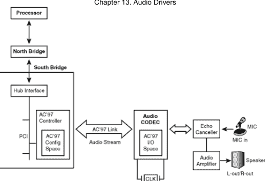

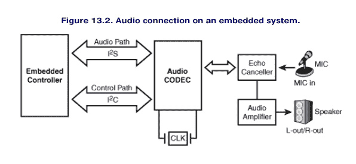

AC'97 在支持的通道数和比特率方面存在局限性。英特尔最新的南桥芯片组具有一种名为高保真（HD）音频的新技术，该技术提供更高品质的环绕声和多流能力。

## Linux 声音子系统

*高级 Linux 声音架构*（ALSA）是 2.6 内核中首选的声音子系统。*开放声音系统*（OSS）是 2.4 内核中的声音层，如今已废弃且被弃用。为了帮助从 OSS 过渡到 ALSA，后者提供了 OSS 仿真功能，允许符合 OSS API 的应用程序在未修改的情况下在 ALSA 上运行。诸如 ALSA 和 OSS 等 Linux 声音框架使音频应用程序与底层硬件解耦，正如 AC'97 和 I²S 等编解码器标准消除了为每种声卡编写单独音频驱动器的需求一样。

查看图 13.3 以了解 Linux 声音子系统的架构。该子系统的组成部分如下：

- 声音核心，它是一套代码库，包含可供 Linux 声音层其他组件使用的例程和结构。与其他驱动程序子系统的核心层类似，声音核心提供了一种间接层，使声音子系统中的每个组件都独立于其他组件。核心在将 ALSA API 导出到更高级别的应用程序中也发挥着重要作用。图 13.3 中显示的以下 `/dev/snd/control*` 设备节点由 ALSA 核心创建和管理：`/dev/snd/control0` 是控制节点（应用程序用它来控制音量增益等），`/dev/snd/pcmC0D0p` 是播放设备（设备名称末尾的 *p* 代表播放），`/dev/snd/pcmC0D0c` 是录制设备（设备名称末尾的 *c* 代表采集）。在这些设备名称中，$C$ 后面的整数是卡号，$D$ 后面的是设备号。对于拥有一致语音编解码器用于电话和立体声编解码器用于音乐的卡片的 ALSA 驱动器，可能会导出 `/dev/snd/pcmC0D0p` 来读取旨在用于前者的音频流，并导出 `/dev/snd/pcmC0D0c` 来传输旨在用于后者的音乐。
- 特定于控制器硬件的音频控制器驱动程序。例如，为了驱动 Intel ICH 南桥芯片组中存在的音频控制器，可以使用 `snd_intel8x0` 驱动程序。
- 协助控制器和编解码器之间通信的音频编解码器接口。对于 AC'97 编解码器，使用 `snd_ac97_codec` 和 `ac97_bus` 模块。
- 作为 OSS 感知应用程序和启用 ALSA 的内核之间通道的 OSS 仿真层。该层导出的 `/dev` 节点镜像了 2.4 内核中 OSS 层提供的节点。这些节点，如 `/dev/dsp`、`/dev/adsp` 和 `/dev/mixer`，允许 OSS 应用程序在未修改的情况下在 ALSA 上运行。OSS 的 `/dev/dsp` 节点映射到 ALSA 节点 `/dev/snd/pcmC0D0*`，`/dev/adsp` 对应于 `/dev/snd/pcmC0D1*`，而 `/dev/mixer` 则与 `/dev/snd/control0` 关联。
- 用于通过 `/proc/asound/` 和 `/sys/class/sound/` 访问信息的 Procs 和 sysfs 接口实现。
- 用户空间的 ALSA 库 *alsa-lib*，它提供 `libasound.so` 对象。该库通过提供若干访问 ALSA 驱动程序的预制例程，简化了 ALSA 应用程序开发人员的工作。
- 包含 *alsamixer*、*amixer*、*alsactl* 和 *aplay* 等实用程序的 *alsa-utils* 包。使用 alsamixer 或 amixer 更改线路输入、线路输出或麦克风等音频信号的音量级别，使用 alsactl 控制 ALSA 驱动程序的设置。要在 ALSA 上播放音频，请使用 aplay。

### 图 13.3. Linux 声音（ALSA）子系统。

[查看全尺寸图像]

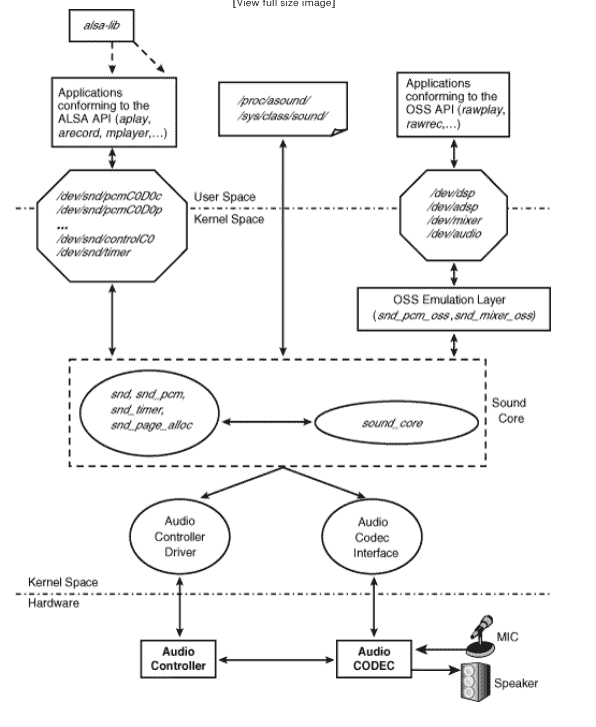

为了更好地理解 Linux 声音层的架构，让我们结合图 13.3 查看在笔记本电脑上运行的 ALSA 驱动程序模块（使用 `⇒` 附加注释）：


`bash> lsmod|grep snd`

`snd_intel8x0`    33148  0                  ⇒ 音频控制器驱动程序

`snd_ac97_codec`   92000  1 `snd_intel8x0`     ⇒ 音频编解码器接口

`ac97_bus`         3104   1 `snd_ac97_codec`   ⇒ 音频编解码器总线

`snd_pcm_oss`      40512  0                  ⇒ OSS 仿真

`snd_mixer_oss`    16640  1 `snd_pcm_oss`      ⇒ OSS 音量控制

`snd_pcm`          73316  3 `snd_intel8x0`, `snd_ac97_codec`, `snd_pcm_oss`,

                           `snd_mixer_oss`, `snd_pcm`, `snd_timer`      ⇒ 核心层

`snd_timer`        22148  1 `snd_pcm`          ⇒ 核心层

`snd`              50820  6 `snd_intel8x0`, `snd_ac97_codec`, `snd_pcm_oss`,

                           `snd_mixer_oss`, `snd_pcm`, `snd_timer`      ⇒ 核心层

`soundcore`        8960   1 `snd`              ⇒ 核心层

`snd_page_alloc`   10344  2 `snd_intel8x0`, `snd_pcm` ⇒ 核心层

## 设备示例：MP3 播放器

图 13.4 展示了一个基于嵌入式 SoC 构建的 Linux 蓝牙 MP3 播放器的音频操作示例。您可以编写 Linux 手机的程序（我们在第 6 章“串行驱动程序”和第 12 章“视频驱动程序”中使用过），在夜间费率通常较低时从互联网下载歌曲，并通过蓝牙将其上传到 MP3 播放器的*紧凑闪存*（CF）磁盘，以便您第二天上班通勤时可以听这些歌曲。

### 图 13.4. Linux MP3 播放器上的音频。

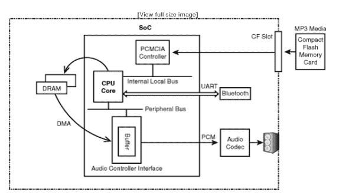

我们的任务是为该设备开发音频软件。播放器上的应用程序从 CF 磁盘读取歌曲，并将其解码到系统内存中。内核 ALSA 驱动程序从系统内存收集音乐数据，并将其调度到属于 SoC 音频控制器的一部分的发送缓冲区中。此 PCM 数据被转发到编解码器，后者通过设备的扬声器播放音乐。正如在前一章讨论的导航系统的情况下，我们将假设 Linux 支持此 SoC，并且所有依赖体系结构的服务（如 DMA）均由内核支持。

因此，MP3 播放器的音频软件由两部分组成：

1. 解码从 CF 磁盘读取的 MP3 文件并将其转换为原始 PCM 的用户程序。要编写原生 ALSA 解码器应用程序，您可以利用 *alsa-lib* 库提供的辅助例程。“ALSA 编程”部分探讨了 ALSA 应用程序如何与 ALSA 驱动程序交互。
   - 您还可以选择定制公共领域的 MP3 播放器，例如 *madplay*（http://sourceforge.net/projects/mad/），以适应此设备。
2. 低级内核 ALSA 音频驱动程序。下一节将专门讨论编写此驱动程序。

图 13.4 所示设备的一种可能的硬件实现方式是使用 PowerPC 405LP SoC 和德州仪器 TLV320 音频编解码器。在这种情况下，CPU 核心是 405 处理器，片上音频控制器是编解码器串行接口（CSI）。SoC 通常具有高性能的内部本地总线，用于连接控制器（如 DRAM 和视频），以及独立的片上外设总线，用于接口低速外设，如串行端口、I²C 和 GPIO。在 405LP 的情况下，前者称为处理器本地总线（PLB），后者被称为片上外设总线（OPB）。PCMCIA/CF 控制器挂在 PLB 上，而音频控制器接口则连接到 OPB。

音频驱动器由三个主要部分构成：

- 处理播放的例程
- 处理捕获的例程
- 混音控制函数

我们的驱动器实现了播放，但不支持录音，因为示例中的 MP3 播放器没有麦克风。该驱动器还简化了混音功能。它没有提供全套音量控制（如扬声器、耳塞和线路输出），而是仅允许单一的通用音量控制。

表 13.1 中所示的 MP3 播放器音频硬件的寄存器布局反映了这些假设和简化，并不符合 AC'97 等此前提到的标准。因此，编解码器有一个 `SAMPLING_RATE_REGISTER` 用于配置播放（数模转换）采样率，但没有寄存器用于设置捕获（模数转换）速率。`VOLUME_REGISTER` 配置单一的全局音量。

### 表 13.1. 图 13.4 中音频硬件的寄存器布局

| 寄存器名称 | 描述 |
|---|---|
| `VOLUME_REGISTER` | 控制编解码器的全局音量。 |
| `SAMPLING_RATE_REGISTER` | 设置编解码器用于数模转换的采样率。 |
| `CLOCK_INPUT_REGISTER` | 配置编解码器的时钟源、分频器等。 |
| `CONTROL_REGISTER` | 使能中断，配置中断源（例如缓冲区传输完成），复位硬件，使能/禁用总线操作等。 |
| `STATUS_REGISTER` | 编解码器音频事件的状态。 |
| `DMA_ADDRESS_REGISTER` | 示例硬件支持单个 DMA 缓冲区描述符。现实中的声卡可能支持多个描述符，并可能有额外的寄存器来保存参数，例如当前正在处理的描述符、当前样本在缓冲区中的位置等。DMA 操作针对音频控制器中的缓冲区执行，因此该寄存器位于控制器的内存空间中。 |
| `DMA_SIZE_REGISTER` | 保存与 SoC 之间 DMA 传输的大小。该寄存器也位于音频控制器内部。 |

列表 13.1 是针对 MP3 播放器的骨架 ALSA 音频驱动器，并大量使用伪代码（在注释中）以省去冗余细节。ALSA 是一个复杂的框架，符合规范的音频驱动器通常有几千行代码。列表 13.1 只能让你开始探索音频驱动器。继续学习请回退到顶层 `sound/` 目录内强大的 Linux-Sound 源代码。

### 驱动器方法和结构

我们的示例驱动器实现为平台驱动器。让我们来看一下平台驱动器的 `probe()` 方法 `mycard_audio_probe()` 执行的步骤。我们将在每一步下稍微展开，解释我们遇到的相关概念和重要数据结构，这将把我们带到驱动器的其他部分，并有助于将事物联系起来。

`mycard_audio_probe()` 执行以下操作：

- 通过调用 `snd_card_new()` 创建声卡实例：

```c
struct snd_card *card = snd_card_new(-1, id[dev->id], THIS_MODULE, 0);
```

`snd_card_new()` 的第一个参数是卡索引（用于识别系统中多个声卡中的该卡），第二个参数是将被存储在当前返回的 `snd_card` 结构 `id` 字段中的 ID，第三个参数是属主模块，最后一个参数是私有数据字段的大小，该字段将通过当前返回的 `snd_card` 结构的 `private_data` 字段提供（通常用于存储芯片特定数据，如中断级别和 I/O 地址）。

`snd_card` 表示创建的声卡，在 `include/sound/core.h` 中定义如下：

```c
struct snd_card {
  int number;         /* 卡索引 */
  char id[16];       /* 卡 ID */
  /* ... */
  struct module *module;   /* 属主模块 */
  void *private_data;      /* 私有数据 */
  /* ... */
  struct list_head controls;
                    /* 此卡的所有控制 */
  struct device *dev;      /* 分配给此卡的设备 */
  /* ... */
};
```

`probe` 方法的对应移除方法 `mycard_audio_remove()` 使用 `snd_card_free()` 从 ALSA 框架释放 `snd_card`。

- 使用 `snd_pcm_new()` 创建 PCM 播放实例并将其与步骤 1 中创建的卡关联：

```c
int snd_pcm_new(struct snd_card *card, char *id,
                int device,
                int playback_count, int capture_count,
                struct snd_pcm **pcm);
```


参数分别为：步骤 1 中创建的声卡实例、标识符字符串、设备索引、支持的播放流数量、支持的捕获流数量（在示例中为 0）、用于存储分配的 PCM 实例的指针。分配的 PCM 实例在 `include/sound/pcm.h` 中定义如下：

```c
struct snd_pcm {
  struct snd_card *card; /* 关联的 snd_card */
  /* ... */
  struct snd_pcm_str streams[2]; /* 此 PCM 组件的播放和捕获流。如果硬件支持，每个流可以支持子流 */
  /* ... */
  struct device *dev; /* 关联的硬件设备 */
};
```

`snd_device_new()` 例程位于 `snd_pcm_new()` 和其他类似组件实例化函数的核心。`snd_device_new()` 将组件和一组操作与关联的 `snd_card` 绑定（参见步骤 3）。

### 设置播放操作

通过调用 `snd_pcm_set_ops()` 将播放操作与步骤 2 中创建的 PCM 实例连接起来。`snd_pcm_ops` 结构指定了向编解码器传输 PCM 音频的 These 操作。列表 13.1 通过以下方式实现：

```c
/* PCM 播放流的操作符 */
static struct snd_pcm_ops mycard_playback_ops = {
  .open = mycard_pb_open, /* 打开 */
  .close = mycard_pb_close, /* 关闭 */
  .ioctl = snd_pcm_lib_ioctl, /* 用于处理特殊命令，否则指定通用 ioctl 处理器 snd_pcm_lib_ioctl() */
  .hw_params = mycard_hw_params, /* 当高层设置硬件参数（如音频格式）时调用。DMA 缓冲区分配也从此处进行 */
  .hw_free = mycard_hw_free, /* 释放 mycard_hw_params() 中分配的资源 */
  .prepare = mycard_pb_prepare, /* 准备传输音频流。设置音频格式如 S16_LE（稍后解释），使能中断，... */
  .trigger = mycard_pb_trigger, /* 当 PCM 引擎启动、停止或暂停时调用。第二个参数指定调用原因。此函数不能进入睡眠状态 */
};

/* 将操作与 PCM 实例连接 */
snd_pcm_set_ops(pcm, SNDRV_PCM_STREAM_PLAYBACK, &mycard_playback_ops);
```

在列表 13.1 中，`mycard_pb_prepare()` 将采样率配置到 `SAMPLING_RATE_REGISTER`，时钟源配置到 `CLOCK_INPUT_REGISTER`，并将传输完成中断使能配置到 `CONTROL_REGISTER`。`trigger()` 方法 `mycard_pb_trigger()` 使用 `dma_map_single()` 实时映射由 ALSA 框架填充的音频缓冲区。（我们在第 10 章“外围组件互连”中讨论过流式 DMA。）映射的 DMA 缓冲区地址被编程到 `DMA_ADDRESS_REGISTER`。与之前位于编解码器内部的寄存器不同，该寄存器是 SoC 中音频控制器的一部分。音频控制器将 DMA 数据转发给编解码器以进行播放。

### 硬件能力

另一个相关对象是 `snd_pcm_hardware` 结构，它宣布 PCM 组件的硬件能力。对于我们的示例设备，这在列表 13.1 中定义如下：

```c
/* PCM 播放流的硬件能力 */
static struct snd_pcm_hardware mycard_playback_stereo = {
    .info = (SNDRV_PCM_INFO_MMAP | SNDRV_PCM_INFO_PAUSE |
             SNDRV_PCM_INFO_RESUME); /* 支持 mmap()。流具有暂停/恢复功能 */
    .formats = SNDRV_PCM_FMTBIT_S16_LE, /* 每通道 16 位有符号，小端 */
    .rates = SNDRV_PCM_RATE_8000_48000, /* DAC 采样率范围 */
    .rate_min = 8000, /* 最小采样率 */
    .rate_max = 48000, /* 最大采样率 */
    .channels_min = 2, /* 支持左声道和右声道 */
    .channels_max = 2, /* 支持左声道和右声道 */
    .buffer_bytes_max = 32768, /* 最大缓冲区大小 */
};
```

此对象通过 `open()` 操作符 `mycard_playback_open()` 与关联的 `snd_pcm` 绑定，使用 PCM *运行时* 实例。每个打开的 PCM 流都有一个称为 `snd_pcm_runtime` 的运行时对象，包含管理该流所需的所有信息。这是一个包含软件 and 硬件配置的巨大结构，定义在 `include/sound/pcm.h` 中，并包含 `snd_pcm_hardware` 作为其组件字段之一。

### 缓冲区预分配

使用 `snd_pcm_lib_preallocate_pages_for_all()` 预分配缓冲区。随后，`mycard_hw_params()` 使用 `snd_pcm_lib_malloc_pages()` 从此预分配区域获取 DMA 缓冲区，并将其存储在步骤 3 中提到的 PCM 运行时实例中。`mycard_pb_trigger()` 在启动 PCM 操作时映射此缓冲区，在停止 PCM 操作时取消映射。

### 混音控制

使用 `snd_ctl_add()` 将混音控制元素与声卡关联，用于全局音量控制：

```c
snd_ctl_add(card, snd_ctl_new1(&mycard_playback_vol, &myctl_private));
```

`snd_ctl_new1()` 接受 `snd_kcontrol_new` 结构作为其第一个参数，并返回指向 `snd_kcontrol` 结构的指针。列表 13.1 将其定义如下：

## 6. 将声卡注册到 ALSA 框架

```c
snd_card_register(card);
```

`snd_kcontrol` 结构体描述了一个控制元素。我们的驱动程序将其用作通用音量控制的旋钮。`snd_ctl_add()` 将一个 `snd_kcontrol` 元素注册到 ALSA 框架中。当用户应用程序（如 `alsamixer`）运行时，会调用相应的控制方法。在列表 13.1 中，`snd_kcontrol_put()` 方法（`mycard_playback_volume_put()`）将请求的音量设置写入解码器的 `VOLUME_REGISTER`。

`codec_write_reg()`（在列表 13.1 中使用了但未实现）通过连接 SoC 中音频控制器和外部解码器的总线通信来向解码器寄存器写入值。例如，如果底层总线协议是 I2C 或 SPI，`codec_write_reg()` 使用第 8 章“The Inter-Integrated Circuit Protocol”中讨论的接口函数。

如果您希望在驱动程序中创建一个 `/proc` 接口用于在调试期间转储寄存器或在正常操作期间导出参数，请使用 `snd_card_proc_new()` 及其相关服务。列表 13.1 没有使用 `/proc` 接口文件。

如果您构建并加载列表 13.1 中的驱动模块，您将在 MP3 播放器上看到两个新的设备节点：`/dev/snd/pcmC0D0p` 和 `/dev/snd/controlC0`。前者是音频播放的接口，后者是混音器控制的接口。MP3 解码应用程序在 `alsa-lib` 的帮助下，通过在这些设备节点上进行操作来流式传输音乐。

# 列表 13.1. Linux MP3 播放器的 ALSA 驱动程序

```c
#include <linux/platform_device.h>
#include <linux/soundcard.h>
#include <sound/driver.h>
#include <sound/core.h>
#include <sound/pcm.h>
#include <sound/initval.h>
#include <sound/ctls.h>
/* 解码器支持的播放速率 */
static unsigned int mycard_rates[] = {
    8000,
    48000,
};
/* 播放通道的硬件约束 */
static struct snd_pcm_hw_constraint_list mycard_playback_rates = {
    .count = ARRAY_SIZE(mycard_rates),
```


`.list = mycard_rates,`

`.mask = 0,`

`};`

`static struct platform_device *mycard_device;`

`static char *id[SNDRV_CARDS] = SNDRV_DEFAULT_STR;`

### PCM 流的硬件特性

```c
static struct snd_pcm_hardware mycard_playback_stereo = {
    .info = (SNDRV_PCM_INFO_MMAP | SNDRV_PCM_INFO_BLOCK_TRANSFER),
    .formats = SNDRV_PCM_FMTBIT_S16_LE, /* 每通道 16 位，小端序 */
    .rates = SNDRV_PCM_RATE_8000_48000, /* DAC 采样率范围 */
    .rate_min = 8000,                   /* 最小采样率 */
    .rate_max = 48000,                  /* 最大采样率 */
    .channels_min = 2,                 /* 支持左、右通道 */
    .channels_max = 2,                 /* 支持左、右通道 */
    .buffer_bytes_max = 32768,          /* 最大缓冲区大小 */
};
```

### 以播放模式打开设备

```c
static int
mycard_pb_open(struct snd_pcm_substream *substream)
{
    struct snd_pcm_runtime *runtime = substream->runtime;
    /* 初始化驱动结构 */
    /* ... */
    /* 初始化解码器寄存器 */
    /* ... */
    /* 关联此 PCM 组件的硬件特性 */
    runtime->hw = mycard_playback_stereo;
    /* 向 ALSA 框架告知解码器的约束。
       例如，在这种情况下，它仅支持 8000Hz 和 48000Hz 的 PCM 采样率 */
    snd_pcm_hw_constraint_list(runtime, 0,
                               SNDRV_PCM_HW_PARAM_RATE,
                               &mycard_playback_rates);
    return 0;
}
```

### 关闭

```c
static int
mycard_pb_close(struct snd_pcm_substream *substream)
{
    /* 禁用解码器，停止 DMA，释放数据结构 */
    /* ... */
    return 0;
}
```

### 通过连接 SoC 和解码器的总线通信 向解码器寄存器写入值

```c
void
codec_write_reg(uint codec_register, uint value)
{
    /* ... */
}
```

### 准备将音频流传输到解码器

```c
static int
mycard_pb_prepare(struct snd_pcm_substream *substream)
{
    /* 通过使用 codec_write_reg() 写入 CONTROL_REGISTER
       来启用传输 DMA 完成中断 */
    /* 通过写入 SAMPILING_RATE_REGISTER 来设置采样率 */
    /* 通过写入 CLOCK_INPUT_REGISTER 来配置时钟源并启用时钟 */
    /* 分配用于音频传输的 DMA 描述符 */
    return 0;
}
```

### 音频触发/停止/...

```c
static int
mycard_pb_trigger(struct snd_pcm_substream *substream, int cmd)
{
    switch (cmd) {
    case SNDRV_PCM_TRIGGER_START:
        /* 使用 dma_map_single() 映射音频子流的运行时音频缓冲区
           （它是 runtime->dma_area 中的一个偏移量），
           将生成的地址填充到音频控制器的 DMA_ADDRESS_REGISTER，
           并执行 DMA */
        /* ... */
        break;
    case SNDRV_PCM_TRIGGER_STOP:
        /* 关闭流。使用 dma_unmap_single() 解除 DMA 缓冲区映射 */
        /* ... */
        break;
    default:
        return -EINVAL;
    }
    return 0;
}
```

### 使用在 probe() 方法中预分配给 DMA 的内存来分配 DMA 缓冲区。 dma_[map|unmap]_single() 稍后对此区域进行操作

```c
static int
mycard_hw_params(struct snd_pcm_substream *substream,
                 struct snd_pcm_hw_params *hw_params)
{
    /* 使用来自 mycard_audio_probe() 的预分配内存
       来满足此内存请求 */
    return snd_pcm_lib_malloc_pages(substream,
                                    params_buffer_bytes(hw_params));
}
```

### `mycard_hw_params()` 的逆操作

```c
static int
mycard_hw_free(struct snd_pcm_substream *substream)
{
    return snd_pcm_lib_free_pages(substream);
}
```

### 音量信息

```c
static int
mycard_pb_vol_info(struct snd_kcontrol *kcontrol,
                   struct snd_ctl_elem_info *uinfo)
{
    uinfo->type = SNDRV_CTL_ELEM_TYPE_INTEGER;
    /* 整数类型 */
    uinfo->count = 1; /* 值的数量 */
    uinfo->value.integer.min = 0; /* 最小音量增益 */
    uinfo->value.integer.max = 10; /* 最大音量增益 */
    uinfo->value.integer.step = 1; /* 步进为 1 */
    return 0;
}
```

### 播放音量旋钮

```c
static int
mycard_pb_vol_put(struct snd_kcontrol *kcontrol,
                  struct snd_ctl_elem_value *uvalue)
{
    int global_volume = uvalue->value.integer.value[0];
    /** 使用 codec_write_reg() 将 global_volume 写入 VOLUME_REGISTER
        ** ... **/
    /** 如果音量与当前值不同，则返回 1。
        如果出错，返回负代码。否则返回 0 **/
}
```

### 获取播放音量

```c
static int
mycard_pb_vol_get(struct snd_kcontrol *kcontrol,
                  struct snd_ctl_elem_value *uvalue)
{
    /** 从 VOLUME_REGISTER 读取 global_volume
        并通过 uvalue->integer.value[0] 返回 **/
    /** ... **/
    return 0;
}
```

### 播放混音器的入口点

```c
static struct snd_kcontrol_new mycard_playback_vol = {
    .iface = SNDRV_CTL_ELEM_IFACE_MIXER,
```


/** 控制类型是 MIXER */

.name = "MP3 Volume",

/** 名称 */

.index = 0, /* Codec No: 0 */

.info = `mycard_pb_vol_info`, /* 音量信息 */

.get = `mycard_pb_vol_get`, /* 获取音量 */

.put = `mycard_pb_vol_put`, /* 设置音量 */

};

/** PCM 播放流的操作符 */

static struct snd_pcm_ops `mycard_playback_ops` = {

.open = `mycard_playback_open`, /* 打开 */

.close = `mycard_playback_close`, /* 关闭 */

.ioctl = `snd_pcm_lib_ioctl`,

    /** 通用 ioctl 处理程序 */

.hw_params = `mycard_hw_params`, /* 硬件参数 */

.hw_free = `mycard_hw_free`, /* 释放 h/w 参数 */

.prepare = `mycard_playback_prepare`,

    /** 准备传输音频流 */

.trigger = `mycard_playback_trigger`, /* 在 PCM 引擎... */

};

/* 开始/停止/暂停 */

/* 平台驱动 probe() 方法 */
static int __init
`mycard_audio_probe`(struct platform_device *dev)
{
    struct snd_card *card;
    struct snd_pcm *pcm;
    int myctl_private;

    /* 实例化一个 snd_card 结构体 */
    card = `snd_card_new`(-1, id[dev->id], THIS_MODULE, 0);

    /* 创建一个新的 PCM 实例，具有 1 个播放子流
     * 和 0 个捕获流 */
    `snd_pcm_new`(card, "mycard_pcm", 0, 1, 0, &pcm);

    /* 设置初始 DMA 缓冲区 */
    `snd_pcm_lib_preallocate_pages_for_all`(pcm,
            SNDRV_DMA_TYPE_CONTINUOUS,
            `snd_dma_continuous_data`
            (GFP_KERNEL), 256*1024,
            256*1024);

    /* 将播放操作与 PCM 实例连接 */
    `snd_pcm_set_ops`(pcm, SNDRV_PCM_STREAM_PLAYBACK,
            &`mycard_playback_ops`);

    /* 将混合器控制元素与此声卡关联 */
    `snd_ctl_add`(card, `snd_ctl_new1`(&`mycard_playback_vol`,
            &myctl_private));

    strcpy(card->driver, "mycard");

    /* 注册声卡 */
    `snd_card_register`(card);

    /* 存储声卡以便其他方法访问 */
    `platform_set_drvdata`(dev, card);

    return 0;
}

/* 平台驱动 remove() 方法 */
static int
`mycard_audio_remove`(struct platform_device *dev)
{
    `snd_card_free`(`platform_get_drvdata`(dev));
    `platform_set_drvdata`(dev, NULL);
    return 0;
}

/* 平台驱动定义 */
static struct platform_driver `mycard_audio_driver` = {
    .probe = `mycard_audio_probe`,  /* Probe 方法 */
    .remove = `mycard_audio_remove`,  /* Remove 方法 */
    .driver = {
        .name = "mycard_ALSA",
},
};

/* 驱动初始化 */
static int __init
`mycard_audio_init`(void)
{
        /* 注册平台驱动和设备 */
        `platform_driver_register`(&`mycard_audio_driver`);

        `mycard_device` = `platform_device_register_simple`("mycard_ALSA",
				-1, NULL, 0);
        return 0;
}

/* 驱动退出 */
static void __exit
`mycard_audio_exit`(void)
{
        `platform_device_unregister`(`mycard_device`);
        `platform_driver_unregister`(&`mycard_audio_driver`);
}

`module_init`(`mycard_audio_init`);
`module_exit`(`mycard_audio_exit`);
MODULE_LICENSE("GPL");

## ALSA 编程

为了理解用户空间 alsa-lib 库如何与内核空间 ALSA 驱动交互，让我们编写一个简单的应用程序来设置 MP3 播放器的音量增益。我们将映射该应用程序使用的 alsa-lib 服务到 **列表 13.1** 中定义的混合器控制方法。让我们先加载驱动并检查混合器的功能：

```bash
bash> amixer contents

...

numid=3,iface=MIXER,name="MP3 Volume"

        ; type=INTEGER,..

...
```

在音量控制应用程序中，首先为执行音量控制操作所需的 alsa-lib 对象分配空间：

```c
#include <alsa/asoundlib.h>

snd_ctl_elem_value_t  *nav_control;

snd_ctl_elem_id_t      *nav_id;

snd_ctl_elem_info_t     *nav_info;

snd_ctl_elem_value_alloc(&nav_control);

snd_ctl_elem_id_alloc(&nav_id);

snd_ctl_elem_info_alloc(&nav_info);
```

接下来，将接口类型设置为 `SND_CTL_ELEM_IFACE_MIXER`，如 **列表 13.1** 中 `mycard_playback_vol` 结构体中指定：

```c
snd_ctl_elem_id_set_interface(nav_id, SND_CTL_ELEM_IFACE_MIXER);
```

现在设置从上述 amixer 输出中获得的 MP3 音量的 `numid`：

```c
snd_ctl_elem_id_set_numid(nav_id, 3); /* num_id=3 */
```

打开混合器节点，`/dev/snd/control0`。`snd_ctl_open()` 的第三个参数指定节点名称中的声卡编号：

```c
snd_ctl_open(&nav_handle, card, 0);  
/* 连接数据结构 */  
snd_ctl_elem_info_set_id(nav_info, nav_id);  
snd_ctl_elem_info(nav_handle, nav_info);
```

按照 **列表 13.1** 中 `mycard_pb_vol_info()` 定义的 `snd_ctl_elem_info` 结构体中的 `type` 字段，如下所示：

```c
if (snd_ctl_elem_info_get_type(nav_info) !=
    SND_CTL_ELEM_TYPE_INTEGER) {
    printk("Mismatch in control type\n");
}
```

通过调用 `mycard_pb_vol_info()` 驱动方法通信，获取支持的编解码器音量范围：

```c
long desired_volume = 5;
long min_volume = snd_ctl_elem_info_get_min(nav_info);
```


```
long max_volume = snd_ctl_elem_info_get_max(nav_info);

/* 确保 desired_volume 在 min_volume 和
   max_volume 之间 */

/* ... */
```

根据列表 13.1中 `mycard_pb_vol_info()` 的定义，上述 alsa-lib 辅助例程返回的最小值和最大值分别为 **0** 和 **10**。

最后，设置期望的音量并将其写入编解码器：

```c
snd_ctl_elem_value_set_integer(nav_control, 0, desired_volume);

snd_ctl_elem_write(nav_handle, nav_control);
```


对 `snd_ctl_elem_write()` 的调用导致 `mycard_pb_vol_put()` 被调用，该方法将期望的音量增益写入编解码器的 `VOLUME_REGISTER`。

如图 13.4 所示，运行在播放器上的 MP3 解码器应用程序需要以 CF 磁盘上的 MP3 帧供应率，以维持常见的 MP3 采样率 128KBps。对于大多数低 MIPs 设备来说，这通常不是问题，但如果有问题，请考虑在解码之前将每首歌曲缓冲到内存中。（128KBps 的 MP3 帧每分钟音乐大约消耗 1MB。）

MP3 解码是轻量级的，通常可以即时完成，但 MP3 编码是重量级的，如果没有硬件辅助就无法实时完成。然而，用于 VoIP 环境中的语音编解码器（如 G.711 和 G.729）可以实时编码和解码音频数据。

## 调试

您可以在内核配置菜单中启用 *Device Drivers* → *Sound* → *Advanced Linux Sound Architecture* 下的选项，以包含 ALSA 调试代码（`CONFIG_SND_DEBUG`）、详细的 `printk()` 消息（`CONFIG_SND_VERBOSE_PRINTK`）和详细的 procs 内容（`CONFIG_SND_VERBOSE_PROCFs`）。

与 ALSA 驱动相关的 Procs 信息位于 `/proc/asound/`。在 `/sys/class/sound/` 中查找与每个声类设备相关的设备模型信息。

如果您认为在 ALSA 驱动中发现了错误，请将其发布到 alsa-devel 邮件列表（<http://mailman.alsa-project.org/mailman/listinfo/alsa-devel>）。linux-audio-dev 邮件列表（<http://music.columbia.edu/mailman/listinfo/linux-audio-dev/>），也称为 *Linux Audio Developers*（LAD）列表，讨论与 Linux 声音架构和音频应用相关的问题。

## 查看源代码

声音核心、音频总线、架构以及过时的 OSS 套件在 `sound/` 目录下都有自己独立的子目录。对于 AC'97 接口实现，请查看 `sound/pci/ac97/`。对于基于 I²S 的音频驱动示例，请查看 `sound/soc/ata91/at91-ssc.c`，这是 Atmel AT91 系列基于 ARM 的嵌入式 SoC 的音频驱动。如果您找不到更接近的匹配项，请使用 `sound/drivers/dummy.c` 作为开发自定义 ALSA 驱动的起点。

`Documentation/sound/*` 包含关于 ALSA 和 OSS 驱动的信息。`Documentation/sound/alsa/DocBook/` 包含关于编写 ALSA 驱动的 DocBook。ALSA 配置指南可以在 `Documentation/sound/alsa/ALSA-Configuration.txt` 中找到。Sound-HOWTO 可以从 http://tldp.org/HOWTO/Sound-HOWTO/ 下载，它回答了有关 Linux 对音频设备支持的多个常见问题。

Madplay 是一个软件 MP3 解码器和播放器，既支持 ALSA 也支持 OSS。您可以查看其源代码以获取用户空间音频编程的技巧。

rawplay 和 rawrec 是两个简单的 OSS 工具，用于基本的播放和录音，其源代码可以从 http://rawrec.sourceforge.net/ 下载。

您可以在 www.alsa-project.org 找到 Linux-ALSA 项目的首页。在这里，您可以找到 ALSA 驱动的最新新闻、ALSA 编程 API 的详细信息以及订阅相关邮件列表的信息。可以从此页面下载的 alsa-utils 和 alsa-lib 源代码可以帮助您开发支持 ALSA 的应用程序。

表 13.2 列出了本章使用的主要数据结构及其在源代码树中的位置。表 13.3 列出了本章使用的主要内核编程接口及其定义的位置。

### 表 13.2. 数据结构摘要

| 数据结构 | 位置 | 描述 |
| :------------- | :------- | :---------- |
| `snd_card` | `include/sound/core.h` | 声卡的表示 |
| `snd_pcm` | `include/sound/pcm.h` | PCM 对象的实例 |
| `snd_pcm_ops` | `include/sound/pcm.h` | 用于将操作与 PCM 对象连接 |
| `snd_pcm_substream` | `include/sound/pcm.h` | 当前音频流的信息 |
| `snd_pcm_runtime` | `include/sound/pcm.h` | 音频流的运行时详细信息 |
| `snd_kcontrol_new` | `include/sound/control.h` | ALSA 控制元素的表示 |

### 表 13.3. 内核编程接口摘要

| 内核接口 | 位置 | 描述 |
| :--------------- | :------- | :---------- |
| `snd_card_new()` | `sound/core/init.c` | 实例化一个 `snd_card` 结构体 |
| `snd_card_free()` | `sound/core/init.c` | 释放已实例化的 `snd_card` |

## 第 14 章 块设备驱动程序

### 本章内容

- **存储技术** 416
- **Linux 块 I/O 层** 421
- **I/O 调度器** 422
- **块驱动程序数据结构和方法** 423
- **设备示例：简单存储控制器** 426
- **高级主题** 434
- **调试** 436
- **查看源代码** 437

块设备是支持随机访问的存储介质。与字符设备不同，块设备可以存储文件系统数据。在本章中，我们将了解 Linux 如何支持存储总线和设备。

### 存储技术

让我们先浏览一下当今计算机系统中流行的存储技术。我们还将将这些技术与内核源代码树中对应的设备驱动子系统联系起来。

*集成驱动电子电路* (IDE) 是 PC 环境中常用的存储接口技术。ATA（*高级技术附加*的缩写）是相关规范的正式名称。IDE/ATA 标准始于 ATA-1；最新版本是 ATA-7，支持高达 133MBps 的带宽。该规范的中间版本包括 ATA-2，引入了*逻辑块寻址* (LBA)；ATA-3，启用了支持 SMART 的磁盘（稍后讨论）；ATA-4，带来了 Ultra DMA 的支持以及相关的 33MBps 吞吐量；ATA-5，将最大传输速度提高至 66MBps；以及 ATA-6，提供了 100MBps 的数据速率。

CD-ROM 和磁带等存储设备通过一种称为 *ATA 包接口* (ATAPI) 的特殊协议连接到标准 IDE 电缆。[^1] ATAPI 是随 ATA-4 引入的。

[^1] ATAPI 协议更接近 SCSI，而不是 IDE。

PC 系统中的软盘控制器传统上是 Super I/O 芯片组的一部分，我们在第 6 章“串行驱动程序”中已经学习过。然而，这些内部驱动器在当今的 PC 环境中已被更快的外部 USB 软盘驱动器所取代。

图 14.1 显示了一个连接到 IDE 主机适配器的 ATA-7 磁盘驱动器，该适配器是 PC 系统中 South Bridge 芯片组的一部分。图中还显示了连接的 ATAPI CD-ROM 驱动器和软盘驱动器。


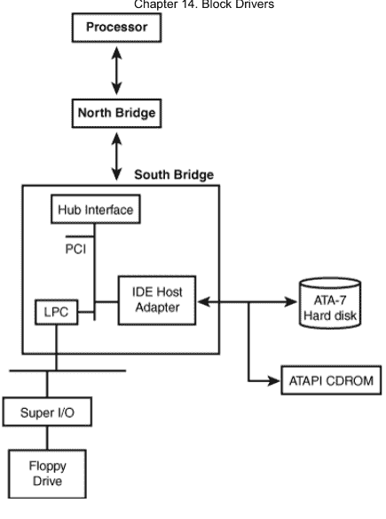

IDE/ATA 是一种并行总线技术（有时称为并行 ATA 或 PATA），无法扩展到高速率，正如您在第 10 章“外围组件互连”中讨论 PCIe 时所学到的那样。串行 ATA (SATA) 是 PATA 的现代串行总线演进，支持 300MBps 及以上的传输速度。除了提供比 PATA 更高的吞吐量外，SATA 还带来了热交换等功能。SATA 技术正在稳步取代 PATA。请参阅侧边栏“libATA”，了解内核中支持 SATA 和 PATA 的新 ATA 子系统。

#### libATA

libATA 是 Linux 内核中的新 ATA 子系统。它由一组 ATA 库例程和使用它们的低级驱动程序组成。libATA 支持 SATA 和 PATA。libATA 中的 SATA 驱动程序在 *drivers/scsi/* 下已存在了一段时间，但 PATA 驱动程序和现在存放所有 libATA 源代码的新 *drivers/ata/* 目录是在 2.6.19 内核版本中引入的。

如果启用了 SATA 存储的系统，则需要 libATA 服务与 SCSI 子系统配合使用。libATA 对 PATA 的支持仍然是实验性的，并且默认情况下，PATA 驱动程序继续使用位于 *drivers/ide/* 中的传统 IDE 驱动程序。

假设您的系统通过 Intel ICH7 South Bridge 芯片组启用了 SATA。您需要以下 libATA 组件来访问您的磁盘：

1. **libATA 核心** — 要启用此功能，请在内核配置过程中设置 `CONFIG_ATA`。要在库中提供的函数列表中查找 `EXPORT_SYMBOL_GPL`，请在 *drivers/ata/* 目录内执行 `grep`。
2. **先进主机控制器接口 (AHCI) 支持** — AHCI 指定了 SATA 主机适配器支持的寄存器接口，并通过在配置时选择 `CONFIG_AHCI` 来启用。
3. **主机控制器适配器驱动程序** — 对于 ICH7，请启用 `CONFIG_ATA_PIIX`。

此外，您还需要中级和高级 SCSI 驱动程序（*`CONFIG_SCSI`* 及其相关项）。在加载所有这些内核组件后，您的 SATA 磁盘分区将像 SCSI 或 USB 大容量存储分区一样，在系统中显示为 `/dev/sd*`。

libATA 项目的主页是 http://linux-ata.org/。DocBook 可作为内核源代码树中 *Documentation/DocBook/libata.tmp* 的一部分获得。libATA 开发人员指南位于 www.kernel.org/pub/linux/kernel/people/jgarzik/libata.pdf。

小型计算机系统接口 (SCSI) 是服务器和高端工作站中首选的存储技术。SCSI 比 SATA 稍快，支持大约 320MBps 的速度。SCSI 传统上是一个并行接口标准，但与 ATA 类似，随着一种称为 *串行附加 SCSI* (SAS) 的总线技术的出现，最近也转向了串行操作。

内核的 SCSI 子系统架构分为三层：用于磁盘、CD-ROM 和磁带等介质的顶层驱动程序；扫描 SCSI 总线并配置设备的中间层；以及低级主机适配器驱动程序。我们在第 11 章“通用串行总线”的“大容量存储”部分学习了这些层。请参阅该章中的图 11.4，查看 SCSI 子系统的不同组件如何相互交互。[^2] USB 大容量存储驱动器内部使用闪存，但使用 SCSI 协议与主机系统通信。

[^2] SCSI 支持也在本书的其他部分进行了讨论。第 19 章“用户空间驱动程序”中的“用户模式 SCSI”部分讨论了 SCSI/通用 (sg) 接口，它允许您直接从用户空间向 SCSI 设备发送命令。第 20 章“更多设备和驱动程序”中的“iSCSI”部分简要介绍了 iSCSI 协议，该协议允许在 TCP/IP 网络上将 SCSI 数据包传输到远程块设备。

廉价磁盘冗余阵列 (RAID) 是一种内置于某些 SCSI 和 SATA 控制器中的技术，旨在实现冗余性和可靠性。已定义了各种 RAID 级别。例如，RAID-1 指定了磁盘镜像，其中数据在单独的磁盘上进行复制。对于几种支持 RAID 的磁盘驱动器，都有可用的 Linux 驱动程序。内核还提供了一个多磁盘 (md) 驱动程序，它在软件中实现了大多数 RAID 级别。

微型存储是嵌入式消费电子产品领域的热门名称。该领域的传输速度远低于前文讨论的技术所提供的速度。安全数字 (SD) 卡及其较小的外形因子衍生产品 (miniSD 和 microSD) 是相机、手机和音乐播放器等设备中流行的存储介质。符合 SD 卡规范 1.01 版本的卡支持高达 10Mbps 的传输速度。SD 存储已从一种较旧、较慢但兼容的技术 - 多介质卡 (MMC) 演变而来，后者支持 2.5Mbps 的数据速率。内核在 `drivers/mmc/` 中包含一个 SD/MMC 子系统。

第 9 章“PCMCIA 和紧凑闪存”中的“PCMCIA 存储”部分查看了不同 PCMCIA/CF 规格的存储卡及其对应的内核驱动程序。诸如微驱动器之类的 PCMCIA 存储卡支持真正的 IDE 操作，而内部使用固态存储的卡则模拟 IDE，并向内核导出 IDE 编程模型。在这两种情况下，都可以使用内核的 IDE 子系统来启用该卡。

表 14.1 总结了重要的存储技术以及关联设备驱动程序在内核源代码树中的位置。

**表 14.1 存储技术及相关设备驱动程序**

| 存储技术 | 描述 | 源文件 |
| :--- | :--- | :--- |
| IDE/ATA | PC 环境中的存储接口技术。ATA-7 支持 133MBps 的数据速率。 | `drivers/ide/ide-disk.c`, `driver/ide/ide-io.c`, `drivers/ide/ide-probe.c` 或 `drivers/ata/` (实验性) |
| ATAPI | CD-ROM 和磁带等存储设备使用 ATAPI 协议连接到标准 IDE 电缆。 | `drivers/ide/ide-cd.c` 或 `drivers/ata/` (实验性) |
| 软盘 (内部) | 软盘控制器位于 PC 兼容系统中 LPC 总线上的 Super I/O 芯片中。支持约 150KBps 的传输速率。 | `drivers/block/floppy.c` |
| SATA | IDE/ATA 的串行演进。支持 300MBps 及以上的速度。 | `drivers/ata/`, `drivers/scsi/` |
| SCSI | 服务器环境中流行的存储技术。Ultra320 SCSI 支持 320MBps 的传输速率。 | `drivers/scsi/` |

### 存储技术描述源文件

| **技术** | **描述** | **源文件** |
| :--- | :--- | :--- |
| USB 大容量存储 | 指的是 USB 硬盘、U 盘、CD-ROM 和软盘驱动器。请查看第 11 章中的“大容量存储”部分。USB 2.0 设备的通信速度可达 60MBps。 | `drivers/usb/storage/`, `drivers/scsi/` |
| **硬件 RAID** | 这是内置于高端 SCSI/SATA 磁盘控制器中，用于实现冗余和可靠性的功能。 | `drivers/scsi/`, `drivers/ata/` |
| **软件 RAID** | 在 Linux 中，多磁盘（md）驱动程序在软件中实现了几种 RAID 级别。 | `drivers/md/` |
| **SD/miniSD/microSD** | 一种小型封装存储介质，常用于相机和手机等消费电子设备。支持高达 10MBps 的传输速率。 | `drivers/mmc/` |
| **MMC** | 一种较旧的、与 SD 卡兼容的可移动存储标准。支持 2.5MBps 的数据速率。 | `drivers/mmc/` |
| **PCMCIA/CF 存储卡** | 微型 IDE 驱动器的 PCMCIA/CF 封装形式，或模拟 IDE 的固态存储卡。请查看第 9 章中的“PCMCIA 存储”部分。 | `drivers/ide/legacy/ide-cs.c` 或 `drivers/ata/pata_pcmcia.c`（实验性） |
| **闪存上的块设备模拟** | 在闪存上模拟硬盘。请查看第 17 章“内存技术设备”中的“块设备模拟”部分。 | `drivers/mt/mtblock.c`, `drivers/mt/mt_blkdevs.c` |

### Linux 上的虚拟块设备：

| **设备** | **描述** | **源文件** |
| :--- | :--- | :--- |
| RAM 磁盘 | 实现将 RAM 区域作为块设备使用的支持。 | `drivers/block/rd.c` |
| 回环设备 | 实现将普通文件作为块设备使用的支持。 | `drivers/block/loop.c` |

# Linux 块 I/O 层

在 2.4 和 2.6 内核版本之间，块 I/O 层经过了大规模的重新设计。重新设计的动机在于，与其他内核子系统相比，块层对整体系统性能的影响潜力更大。

让我们看一下图 14.2，以了解 Linux 块 I/O 层的工作机制。存储介质包含驻留在文件系统（如 EXT3 或 Reiserfs）中的文件。用户应用程序调用 I/O 系统调用来访问这些文件。由此产生的文件系统操作在进入具体的文件系统驱动程序之前，会先通过通用的虚拟文件系统（VFS）层。缓冲区缓存通过缓存磁盘块来加快对块设备的文件系统访问。如果在缓冲区缓存中找到某个块，则节省了访问磁盘读取该块所需的时间。旨在送往每个块设备的数据会被排列在请求队列中。文件系统驱动程序会将所需的块设备的请求队列填充数据，而块驱动程序则从对应的队列中接收并消费请求。在两者之间，I/O 调度器操纵请求队列，以最大限度地减少磁盘访问延迟并最大化吞吐量。

图 14.2. Linux 上的块 I/O。

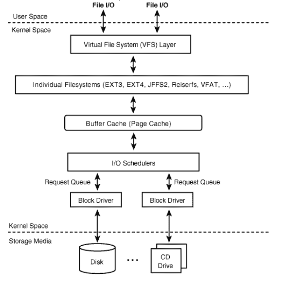

接下来，让我们检查 Linux 上可用的不同 I/O 调度器。

## I/O 调度器

块设备存在*寻道时间*，即磁盘头从现有位置移动到目标磁盘扇区所需的延迟。I/O 调度器的主要目标是通过最大限度地减少这些寻道时间来增加系统吞吐量。为了实现这一点，I/O 调度器根据构成请求相关的磁盘扇区，将请求队列保持排序状态。新请求插入队列时，需保持此顺序。如果队列中现有的请求与相邻的磁盘扇区相关联，新请求将与它合并。由于这些特性，I/O 调度器在操作上与电梯相似——它们按单一方向调度请求，直到队列中的最后一个请求者得到服务为止。

2.4 内核中的 Linux 调度器实现了该算法的一个直白版本，被称为 *Linux 电梯*。然而，在现实条件下这证明是不够的，因此在 2.6 内核中，它被一套由四个调度器组成的系统所取代：*Deadline（截止时间）、Anticipatory（预判型）、Complete Fair Queuing（完全公平排队）和 Noop（空操作）*。默认使用的调度器是 Anticipatory，但可以在内核配置期间更改，或者通过更改 `/sys/block/[disk]/queue/scheduler` 的值来更改。（如果使用 IDE 磁盘，例如将 `[disk]` 替换为 `hda`。）表 14.2 简要描述了 Linux I/O 调度器。

### 表 14.2. Linux I/O 调度器

| I/O 调度器 | 描述 | 源文件 |
| :--- | :--- | :--- |
| **Linus 电梯** | 标准合并和排序 I/O 调度算法的直白实现。 | `drivers/block/elevator.c`（在 2.4 内核树中） |
| **Deadline** | 除了 Linus 电梯所做的之外，Deadline 调度器为每个请求分配过期时间，以确保对同一磁盘区域的一系列突发请求不会使更远的区域的请求挨饿。此外，由于用户进程通常阻塞直到其读请求完成，读操作比写操作被授予更高的优先级。因此，Deadline 调度器确保每个 I/O 请求在时间限制内得到处理，这对于某些数据库负载很重要。 | `block/deadline-iosched.c`（在 2.6 内核树中） |
| **Anticipatory** | 与 Deadline 调度器类似，只是在处理完读请求后，Anticipatory 调度器会等待预定的时间，以预判更多的请求。这种调度技术适用于工作站/交互式负载。 | `block/as-iosched.c`（在 2.6 内核树中） |
| **Complete Fair Queuing (CFQ)** | 与 Linus 电梯类似，只是 CFQ 调度器为每个源进程维护一个请求队列，而不是一个通用队列。这确保每个进程（或进程组）获得公平的 I/O 份额，并防止一个进程使其他进程挨饿。 | `block/cfq-iosched.c`（在 2.6 内核树中） |
| **Noop** | Noop 调度器不花费时间遍历请求队列寻找最佳插入点。相反，它只是将新请求添加到请求队列的末尾。因此，该调度器非常适合没有移动部件因此也没有寻道延迟的半导体存储介质。一个例子是 *Disk-On-Module*（DOM），它内部使用闪存。 | `block/noop-iosched.c`（在 2.6 内核树中） |

在概念层面上，I/O 调度类似于进程调度。I/O 调度给进程提供了一种拥有磁盘的错觉，而进程调度则给进程提供了一种拥有 CPU 的错觉。Linux 上的 I/O 和进程调度器最近都经历了广泛的变化。进程调度在第 19 章中讨论。

## 块驱动程序数据结构和方法

现在让我们将焦点转移到本章的主题：块设备驱动程序。在本节中，我们将查看在实现块设备驱动程序时可能会遇到的一些重要数据结构和驱动程序方法。我们在下一节实现一个虚构存储控制器的块驱动程序时会使用这些结构和方法。

主要的块驱动程序数据结构如下：

1. 内核使用在 `include/linux/genhd.h` 中定义的 `gendisk`（generic disk 的缩写，通用磁盘）结构来表示磁盘：


```c
struct gendisk {

    int major;    /* 设备主设备号 */

    int first_minor;    /* 起始次设备号 */

    int minors;    /* 次设备号的最大数量。

                   每个磁盘分区有一个次设备号 */

    char disk_name[32];    /* 磁盘名称 */

    /* ... */

    struct block_device_operations *ops;

    /* 块设备操作。

       很快会描述。 */

    struct request_queue *queue; /* 与此磁盘相关联的请求队列。

                                  稍后讨论。 */

    /* ... */

};
```

2. 与每个块驱动程序相关的 I/O 请求队列使用在 `include/linux/bkdev.h` 中定义的 `request_queue` 结构来描述。这是一个很大的结构，但你可能会用到的唯一组成字段是 `request` 结构，将在下文描述。

3. `request_queue` 中的每个请求使用在 `include/linux/bkdev.h` 中定义的 `request` 结构来表示：

```c
struct request {

    /* ... */

    struct request_queue *q; /* 包含的请求队列 */

    /* ... */

    sector_t sector;    /* 请求数据访问的扇区 */

    /* ... */

    unsigned long nr_sectors; /* 剩余需要提交的扇区数量 */

    /* ... */

    struct bio *bio;    /* 关联的 bio。

                        很快会讨论。 */

    /* ... */

    char *buffer;    /* 用于数据传输的缓冲区 */
```

#### 4. `block_device_operations`
`block_device_operations` 是字符驱动中使用的 `file_operations` 结构体的块驱动对应项。它包含以下与块驱动相关的入口点：

- 标准方法，如 `open()`、`release()` 和 `ioctl()`
- 支持可移除块设备的专业方法，如 `media_changed()` 和 `revalidate_disk()`

`block_device_operations` 在 `include/linux/fs.h` 中的定义如下：

```c
struct block_device_operations {

int (*open) (struct inode *, struct file *); /* Open */

int (*release) (struct inode *, struct file *);/* Close */

int (*ioctl) (struct inode *, struct file *, unsigned, unsigned long); /* I/O Control */

/* ... */

int (*media_changed) (struct gendisk *); /* Check if media is available or ejected */

int (*revalidate_disk) (struct gendisk *); /* Gear up for newly inserted media */

/* ... */

};
```

#### 5. `bio`
当我们查看 `request` 结构体时，看到它与一个 `bio` 相关联。`bio` 结构体是页级粒度的块 I/O 操作的低层描述。它定义在 `include/linux/bio.h` 中，如下所示：

```c
struct bio {

sector_t bi_sector; /* Sector from which data access is requested */

struct bio *bi_next; /* List of bio nodes */

/* .. */

unsigned long bi_rw; /* Bottom bits of bi_rw contain the data-transfer direction */

/* ... */

struct bio_vec *bi_io_vec; /* Pointer to an array of bio_vec structures */

unsigned short bi_vcnt; /* Size of the bio_vec array */

unsigned short bi_idx; /* Index of the current bio_vec in the array */

/* ... */

};
```


块数据在内部通过 `bio_vec` 结构体数组表示为 I/O 向量。`bio_vec` 数组的每个元素由（页，页偏移，长度）元组组成，描述 I/O 块的一段。将 I/O 请求维护为页向量带来了几种优势，包括更精简的实现和高效的分散/聚合（scatter/gather）。

在结束本节之前，让我们简要看看块驱动入口点。块驱动大致使用三种类型的方法构建：

- 常规初始化和退出方法。
- 作为前述 `block_device_operations` 一部分的方法。
- 请求方法。与字符设备不同，块驱动不支持用于数据传输的 `read()`/`write()` 方法。相反，它们使用一种称为*请求方法*的特殊例程来执行磁盘访问。

块核心层提供了一组库例程，驱动方法可以利用这些例程。下一节中的示例驱动调用了其中多个库例程的服务。

## 设备示例：简单存储控制器

考虑图 14.3 中所示的嵌入式设备。该 SoC 包含一个内置存储控制器，与块设备通信。其架构类似于 SD/MMC 媒体，但我们的示例存储控制器由表 14.3 中列出的基本寄存器集描述。`SECTOR_NUMBER_REGISTER` 指定请求数据访问的起始扇区。[4] `SECTOR_COUNT_REGISTER` 包含要传输的扇区数量。数据通过 `DATA_REGISTER` 移动。`COMMAND_REGISTER` 编程存储控制器需要执行的操作（例如，是从媒体读取还是写入）。`STATUS_REGISTER` 包含指示控制器是否正忙执行操作的位。

[4] 我们示例设备中的存储媒体具有平坦的扇区空间几何结构。另一方面，IDE 控制器支持由设备头寄存器、低柱面寄存器和高柱面寄存器以及扇区号寄存器指定的柱面-磁头-扇区（CHS）几何结构。

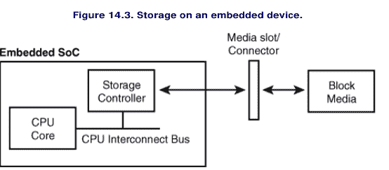

| 表 14.3. 存储控制器的寄存器布局 |
| :--- | :--- |
| **寄存器名称** | **内容描述** |
| SECTOR_NUMBER_REGISTER | 将执行下一个磁盘操作的扇区。 |
| SECTOR_COUNT_REGISTER | 要读取或写入的扇区数量。 |
| COMMAND_REGISTER | 要执行的操作（例如，读取或写入）。 |
| STATUS_REGISTER | 操作结果、中断状态和错误标志。 |
| DATA_REGISTER | 在读取路径中，存储控制器从磁盘获取数据到内部缓冲区。驱动程序通过此寄存器访问内部缓冲区。在写入路径中，驱动程序写入此寄存器的数据被传输到内部缓冲区，然后控制器将其复制到磁盘。 |

我们将该存储控制器称为 `myblkdev`。这个简单设备既不是中断驱动，也不支持 DMA。我们还假设媒体不可移除。我们的任务是为 `myblkdev` 编写一个块驱动。我们的驱动虽然极简，但是完整的。它不处理电源管理，对性能也不特别敏感。

### 初始化

清单 14.1 包含驱动初始化方法 `myblkdev_init()`，它执行以下步骤：

- 使用 `register_blkdev()` 注册块设备。该块库例程为 `myblkdev` 分配一个未使用的主设备号，并在 `/proc/devices` 中为该设备添加一个条目。
- 将请求方法与块设备关联。它通过向 `blk_init_queue()` 提供 `myblkdev_request()` 的地址来实现这一点。对 `blk_init_queue()` 的调用返回 `myblkdev` 的 `request_queue`。请回看 figure 14.2 以查看 `request_queue` 相对于驱动的位置。`blk_init_queue()` 的第二个参数 `myblkdev_lock` 是一个自旋锁，用于保护 `request_queue` 免受并发访问。
- 硬件以*扇区*为单位执行磁盘事务，而软件子系统（如文件系统）则以*块*为单位处理数据。常见的扇区大小为 512 字节；常规块大小为 4096 字节。你需要告知块层你的存储硬件支持的扇区大小以及驱动程序每次请求可以接收的最大扇区数。`myblkdev_init()` 通过分别调用 `blk_queue_hardsect_size()` 和 `blk_queue_max_sectors()` 来完成这些任务。
- 使用 `alloc_disk()` 分配并填充与 `myblkdev` 对应的 `gendisk`。`myblkdev_init()` 提供的一个重要 `gendisk` 字段是驱动程序 `block_device_operations` 的地址。`myblkdev_init()` 填充的另一个参数是 `myblkdev` 以扇区为单位的存储容量。这是通过调用 `set_capacity()` 实现的。每个 `gendisk` 还包含一个标志，指示底层存储硬件的属性。例如，如果驱动器是可移除的，`gendisk` 的 `flag` 字段应标记为 `GENHD_FL_REMOVABLE`。
- 将步骤 4 中准备好的 `gendisk` 与步骤 2 中获得的 `request_queue` 关联。此外，将 `gendisk` 与设备的主/次设备号和一个名称连接起来。
- 通过调用 `add_disk()` 将磁盘添加到块 I/O 层。当完成此操作后，驱动必须准备好接收请求。因此，这通常是初始化序列的最后一步。

现在，块设备在系统中作为 `/dev/myblkdev` 可用。如果设备支持多个磁盘分区，它们将显示为 `/dev/myblkdevX`，其中 `X` 是分区号。

### 清单 14.1. 初始化驱动程序

```c
#include <linux/blkdev.h>

#include <linux/gendisk.h>

static struct gendisk *myblkdisk;      /* Representation of a disk */

static struct request_queue *myblkdev_queue;
                                /* Associated request queue */

int myblkdev_major = 0;            /* Ask the block subsystem to choose a major number */

static DEFINE_SPINLOCK(myblkdev_lock); /* Spinlock that protects myblkdev_queue from concurrent access */
```

```c
int myblkdisk_size     = 256*1024;    /* Disk size in kilobytes. For
                                       a PC hard disk, one way to
                                       glean this is via the BIOS */

int myblkdev_sect_size = 512;         /* Hardware sector size */

/* Initialization */

static int __init
myblkdev_init(void)
{
    /* Register this block driver with the kernel */
    if ((myblkdev_major = register_blkdev(myblkdev_major,
                                          "myblkdev")) <= 0) {
        return -EIO;
    }
    /* Allocate a request_queue associated with this device */
    myblkdev_queue = blk_init_queue(myblkdev_request, &myblkdev_lock);
    if (!myblkdev_queue) return -EIO;
    /* Set the hardware sector size and the max number of sectors */
    blk_queue_hardsect_size(myblkdev_queue, myblkdev_sect_size);
    blk_queue_max_sectors(myblkdev_queue, 512);
    /* Allocate an associated gendisk */
    myblkdisk = alloc_disk(1);
    if (!myblkdisk) return -EIO;
    /* Fill in parameters associated with the gendisk */
```


```c
    myblkdisk->fops      = &myblkdev_fops;

    /* Set the capacity of the storage media in terms of number of

       sectors */

    set_capacity(myblkdisk, myblkdisk_size*2);

    myblkdisk->queue     = myblkdev_queue;

    myblkdisk->major     = myblkdev_major;

    myblkdisk->first_minor = 0;

    sprintf(myblkdisk->disk_name, "myblkdev");

    /* Add the gendisk to the block I/O subsystem */

    add_disk(myblkdisk);

    return 0;

}

/* Exit */

static void __exit

myblkdev_exit(void)

{

    /* Invalidate partitioning information and perform cleanup */

    del_gendisk(myblkdisk);

    /* Drop references to the gendisk so that it can be freed */

    put_disk(myblkdisk);

    /* Dissociate the driver from the request_queue. Internally calls

       elevator_exit() */

    blk_cleanup_queue(myblkdev_queue);

    /* Unregister the block device */

    unregister_blkdev(myblkdev_major, "myblkdev");

}

module_init (myblkdev_init);

module_exit (myblkdev_exit);

MODULE_LICENSE ("GPL");
```

## 块设备操作

接下来，让我们看一下块驱动程序 `block_device_operations` 中包含的主要方法。

块驱动程序的 `open()` 方法在挂载驻留在介质上的文件系统或执行文件系统检查（`fsck`）等操作时会被调用。许多在 `open()` 期间完成的任务都是硬件依赖的。例如，CD-ROM 驱动会锁定驱动器舱门。SCSI 驱动会检查设备是否设置了写保护标签，如果是，则当请求以写模式打开时会导致失败。如果设备是可移动设备，`open()` 会调用服务例程 `check_disk_change()` 来检查介质是否已更改。

如果你的驱动程序需要支持特定命令，请使用 `ioctl()` 方法来实现支持。例如，软盘驱动程序支持一个弹出介质的命令。

`media_changed()` 方法检查存储介质是否已更改，因此对于 `myblkdev` 这样的固定设备而言并不相关。例如，SCSI 磁盘驱动的 `media_changed()` 方法可以检测插入的 USB 闪存盘是否已更改。

`myblkdev` 支持的唯一块设备操作是 `ioctl()` 方法，即 `myblkdev_ioctl()`。块层本身处理通用的 `ioctl`，并仅调用驱动程序的 `ioctl()` 方法来处理设备特定的命令。在 **列表 14.2** 中，`myblkdev_ioctl()` 实现了 `GET_DEVICE_ID` 命令，该命令用于从控制器获取设备 ID。该命令通过 `COMMAND_REGISTER` 发出，而 ID 数据则从 `DATA_REGISTER` 获取。

### 列表 14.2. 块设备操作

```c
#define GET_DEVICE_ID 0xAA00 /* ioctl command definition */

/* The ioctl operation */
static int
myblkdev_ioctl(struct inode *inode, struct file *file,
unsigned int cmd, unsigned long arg)
{
unsigned char status;
switch (cmd) {
case GET_DEVICE_ID:
outb(GET_IDENTITIY_CMD, COMMAND_REGISTER);

/* Wait as long as the controller is busy */
while ((status = inb(STATUS_REGISTER)) & BUSY_STATUS);

/* Obtain ID and return it to user space */
return put_user(inb(DATA_REGISTER), (long __user *)arg);
default:
return -EINVAL;
}
}

/* Block device operations */
static struct block_device_operations myblkdev_fops = {
.owner = THIS_MODULE, /* Owner of this structure */
.ioctl = myblkdev_ioctl,

/* The following operations are not implemented for our example
storage controller: open(), release(), unlocked_ioctl(),
compat_ioctl(), direct_access(), getgeo(), revalidate_disk(), and
media_changed() */
};
```

## 磁盘访问

如前所述，块驱动程序使用 `request()` 方法执行磁盘访问操作。每当块 I/O 子系统希望处理等待在驱动程序 `request_queue` 中的请求时，就会调用驱动程序的 `request()` 方法。然而，`request()` 方法并不在请求数据转移的用户进程的上下文中运行。关联的 `request_queue` 的地址会作为参数传递给 `request()` 方法。

正如你之前所见，内核在调用 `request()` 方法之前会持有请求锁。这是为了保护关联的请求队列免受并发访问。因此，如果你的 `request()` 方法必须调用可能会进入睡眠状态的函数，它必须在此之前释放锁，并在返回之前重新获取锁。

列表 14.3 包含了我们驱动程序的 request 方法，即 `myblkdev_request()`。该函数使用 `elv_next_request()` 的服务从 `request_queue` 中获取下一个请求。如果队列中没有更多待处理的请求，`elv_next_request()` 将返回 `NULL`。之所以命名 `elv_next_request()`，是因为如前所述，I/O 调度算法是电梯系统处理请求所采用的基本操作模式的变体。在处理完一个请求后，驱动程序通过调用 `end_request()` 要求块层结束该请求的 I/O。你可以使用 `end_request()` 的第二个参数来指定成功或错误代码。

从 `request_queue` 中收集的请求包含请求数据访问的起始扇区（列表 14.3 中的 `req->sector`）、需要执行 I/O 的扇区数（`req->nr_sectors`）、包含待传输数据的缓冲区（`req->buffer`）以及数据移动方向（`rg_data_dir(req)`）。如列表 14.3 所示，`myblkdev_request()` 借助这些参数执行所需的寄存器编程。

### 列表 14.3. 请求函数

```c
#define READ_SECTOR_CMD 1
#define WRITE_SECTOR_CMD 2
#define GET_IDENTITTITY_CMD 3
#define BUSY_STATUS 0x10
#define SECTOR_NUMBER_REGISTER 0x20000000
#define SECTOR_COUNT_REGISTER 0x20000001
#define COMMAND_REGISTER 0x20000002
#define STATUS_REGISTER 0x20000003
#define DATA_REGISTER 0x20000004

/* Request method */
static void
myblkdev_request(struct request_queue *rq)
{
 struct request *req;
 unsigned char status;
 int i, good = 0;

/* Loop through the requests waiting in line */
```


```c
while ((req = elv_next_request(rq)) != NULL) {

    /* Program the start sector and the number of sectors */

    outb(req->sector, SECTOR_NUMBER_REGISTER);

    outb(req->nr_sectors, SECTOR_COUNT_REGISTER);

    /* We are interested only in filesystem requests. A SCSI command
       is another possible type of request. For the full list, look
       at the enumeration of rq_cmd_type_bits in
       include/linux/blkdev.h */

    if (blk_fs_request(req)) {

        switch(rg_data_dir(req)) {

        case READ:

            /* Issue Read Sector Command */
            outb(READ_SECTOR_CMD, COMMAND_REGISTER);

            /* Traverse all requested sectors, byte by byte */
            for (i = 0; i < 512*req->nr_sectors; i++) {
                /* Wait until the disk is ready. Busy duration should be
                   in the order of microseconds. Sitting in a tight loop
                   for simplicity; more intelligence required in the real
                   world */
                while ((status = inb(STATUS_REGISTER)) & BUSY_STATUS);

                /* Read data from disk to the buffer associated with the
                   request */
                req->buffer[i] = inb(DATA_REGISTER);
            }
            good = 1;
            break;

        case WRITE:
            /* Issue Write Sector Command */
            outb(WRITE_SECTOR_CMD, COMMAND_REGISTER);
```
/* 遍历所有请求扇区，逐字节进行 */
for (i = 0; i < 512*req->nr_sectors; i++) {
    /* 等待磁盘就绪。忙碌时长应在
       微秒量级。为了简单起见，这里
       使用紧密循环；在真实世界中需要
       更智能的策略 */
    while ((status = inb(STATUS_REGISTER)) & BUSY_STATUS);

    /* 将数据从与请求关联的缓冲区
       写入磁盘 */
    outb(req->buffer[i], DATA_REGISTER);
}
good = 1;
break;
}
}
end_request(req, good);
}
```

## 高级主题

与我们逐字节传输数据的示例存储驱动程序不同，对性能敏感的块驱动程序依赖于 DMA 进行数据传输。例如，考虑针对 Compaq SMART2 控制器的磁盘阵列驱动程序 `drivers/block/cpqarray.c` 中的 `request()` 方法，此处摘自 2.6.23.1 内核源代码并在此重现：

```c
static void do_ida_request(struct request_queue *q)
{
    struct request *creq;
    struct scatterlist tmp_sg[SG_MAX];
    cmdlist_t *c;
    ctrl_info_t *h = q->queuedata;
    int seg;

    /* ... */
    creq = elv_next_request(q);

    /* ... */
    c->rq = creq;

    seg = blk_rq_map_sg(q, creq, tmp_sg);

    /* ... */
    for (i=0; i<seg; i++)
    {
        c->req.sg[i].size = tmp_sg[i].length;
        c->req.sg[i].addr = (_u32) pci_map_page(h->pci_dev,
            tmp_sg[i].page,
            tmp_sg[i].offset,
            tmp_sg[i].length, dir);
    }
    /* ... */
}
```

DMA 操作在 bio 级别进行。正如你之前所见，I/O 请求由 bio 组成，每个 bio 包含一个 `bio_vec` 数组，后者又保存关于组成内存页的信息。假设 bio 指向与某个 I/O 请求关联的 bio 结构，则 `bio->bi_sector` 包含请求数据访问的起始扇区，`bio_cur_sectors(bio)` 返回要执行 I/O 的扇区数量，而 `bio_data_dir(bio)` 提供数据传输方向。与数据缓冲区关联的物理页地址由 `bio->bi_io_vec` 指向的 `bio_vec` 数组描述。要遍历请求中的每个 bio，可以使用 `rq_for_each_bio()` 宏。若要进一步循环遍历 bio 中的每个页段，请使用 `bio_for_each_segment()`。

在前面的代码片段中，`blk_rq_map_sg()` 内部调用 `rq_for_each_bio()` 和 `bio_for_each_segment()` 来遍历构成请求的所有页，并构建一个分散/聚集列表，即 `tmp_sg`。对创建的分散/聚集列表中每个页的流式 DMA 映射由 `pci_map_page()` 执行。

与我们示例驱动程序对请求操作进行忙等待不同，`cpqarray` 驱动程序实现了一个中断处理程序 `do_ida_intr()`，以在命令完成时接收来自硬件的警报。

某些驱动程序，例如 ramdisk 驱动程序（`drivers/block/rd.c`）和循环回驱动程序（`drivers/block/loop.c`），在不能从请求队列上的优化排序和合并操作中受益的虚拟块设备上工作。此类驱动程序完全绕过请求队列，并使用 `make_request()` 函数直接从块层获取 bio。因此，不使用 `blk_init_queue()` 来注册请求队列处理程序，`drivers/block/rd.c` 使用 `blk_queue_make_request()` 提供 `make_request()` 例程，如下所示：

```c
static int __init rd_init(void)
{
    /* ... */
    blk_queue_make_request(rd_queue[i], &rd_make_request);
    /* ... */
}

static int rd_make_request(struct request_queue *q, struct bio *bio)
{
    /* ... */
}
```

## 调试

`hdparm` 实用程序从底层内核驱动程序获取各种 PATA/SATA 磁盘参数。例如，要对 SATA 驱动器上的磁盘读取速度进行基准测试，请执行以下操作：

```bash
bash> hdparm -T -t /dev/sda
/dev/sda:
  Timing cached reads:   2564 MB in  2.00 seconds = 1283.57 MB/sec
  Timing buffered disk reads:  132 MB in  3.03 seconds =  43.61 MB/sec
```


要了解 `hdparm` 的完整功能，请阅读 `man` 手册页。

*自我监控、分析和报告技术*（SMART）是内置于许多现代 ATA 和 SCSI 磁盘中的系统，用于监控故障并执行自检。一个名为 `smartd` 的用户空间守护进程在底层设备驱动程序的帮助下收集支持 SMART 的磁盘所收集的信息。查看 `smartd`、`smartctl` 和 `smartd.conf` 的 `man` 手册页，以了解如何从启用 SMART 的磁盘获取健康状态。

如果你的发行版没有预先打包 `hdparm` 和 SMART 工具，你可以分别从 `http://sourceforge.net/projects/hdparm/` 和 `http://sourceforge.net/projects/smartmontools/` 下载它们。

`/proc/ide/` 下的文件包含有关系统中 IDE 磁盘驱动器的信息。例如，要获取第一个 IDE 磁盘的几何参数，请查看 `/proc/ide/ide0/hda/geometry` 的内容。有关 SCSI 设备的信息位于 `/proc/scsi/` 下。你可以从 `/proc/partitions` 获取磁盘分区信息。

对于 IDE 设备，感兴趣的 `sysfs` 目录是 `/sys/bus/ide/`，对于 SCSI 则是 `/sys/bus/scsi/`。此外，系统上每个活动的块设备在 `/sys/block/` 下都有一个子目录，其中包含相关的请求队列参数、组成分区详细信息以及状态信息。

有一些内核配置选项可用于触发块子系统发出调试输出。`CONFIG_BLK_DEV_IO_TRACE` 提供了跟踪块层的能力。`CONFIG_SCSI_CONSTANTS` 和 `CONFIG_SCSI_LOGGING` 分别开启 SCSI 错误报告和日志记录。

`linux-ide` 邮件列表是讨论与 Linux-IDE 子系统相关问题的大论坛。订阅 `linux-scsi` 邮件列表并浏览其存档，以查看与 Linux-SCSI 子系统相关的讨论。

## 查看源代码

表 14.1 列出了各种存储技术内核驱动程序源代码的位置。查看 `Documentation/ide.txt`、`Documentation/scsi/*` 和 `Documentation/cdrom/` 以获取有关相关存储驱动程序的信息。

顶层 `block/` 目录包含 I/O 调度算法和块核心层。表 14.2 列出了该目录中实现各种 I/O 调度器的源文件。查看 `Documentation/block/` 以获取相关文档。

表 14.4 包含本章使用的主要数据结构及其在源代码树中的位置。表 14.5 列出了本章使用的主要内核编程接口及其定义的位置。

| 数据结构 | 位置 | 描述 |
|---|---|---|
| `gendisk` | `include/linux/genhd.h` | 磁盘的表示。 |
| `request_queue` | `include/linux/blkdev.h` | 与 `gendisk` 关联的 I/O 请求队列。 |
| `request` | `include/linux/blkdev.h` | `request_queue` 中的每个请求使用此结构描述。 |
| `block_device_operations` | `include/linux/fs.h` | 块设备驱动程序方法。 |
| `bio` | `include/linux/bio.h` | 块 I/O 操作的底层描述。 |

| 内核接口 | 位置 | 描述 |
|---|---|---|
| `register_blkdev()` | `block/genhd.c` | 向内核注册块驱动程序 |
| `unregister_blkdev()` | `block/genhd.c` | 从内核注销块驱动程序 |
| `alloc_disk()` | `block/genhd.c` | 分配一个 `gendisk` |
| `add_disk()` | `block/genhd.c` | 将已填充的 `gendisk` 添加到内核块层 |
| `del_gendisk()` | `fs/partitions/check.c` | 释放一个 `gendisk` |
| `blk_init_queue()` | `block/ll_rw_blk.c` | 分配一个 `request_queue` 并注册 `request()` 函数以处理队列中的请求 |
| `blk_cleanup_queue()` | `block/ll_rw_blk.c` | `blk_init_queue()` 的逆操作 |
| `blk_queue_make_request()` | `block/ll_rw_blk.c` | 注册 `make_request()` 函数，该函数绕过请求队列并从块层直接获取请求 |
| `rq_for_each_bio()` | `include/linux/blkdev.h` | 遍历请求中的每个 `bio` |
| `bio_for_each_segment()` | `include/linux/bio.h` | 循环遍历 `bio` 中的每个页段 |
| `blk_rq_map_sg()` | `block/ll_rw_blk.c` | 遍历构成请求的 `bio` 段并构建分散/聚集列表 |
| `blk_queue_max_sectors()` | `block/ll_rw_blk.c` | 设置相关请求队列中请求的最大扇区数 |
| `blk_queue_hardsect_size()` | `block/ll_rw_blk.c` | 存储硬件支持的扇区大小。 |
| `set_capacity()` | `include/linux/genhd.h` | 以扇区数量设置存储介质的容量 |
| `blk_fs_request()` | `include/linux/blkdev.h` | 检查从请求队列获取的请求是否为文件系统请求 |
| `elv_next_request()` | `block/elevator.c` | 从请求队列获取下一个条目 |
| `end_request()` | `block/ll_rw_blk.c` | 结束请求上的 I/O |

## 第 15 章. 网络接口卡

### 本章内容

- 驱动程序数据结构 440
- 与协议层通信 448
- 缓冲区管理和并发控制 450
- 设备示例：以太网 NIC 451
- ISA 网络驱动程序 457
- 异步传输模式 458
- 网络吞吐量 459
- 查看源代码 461

连接性赋予了智能。如今，你很少会遇到不支持某种形式网络支持的计算机系统。在本章中，让我们重点关注承载*局域网*（LAN）上*互联网协议*（IP）流量的*网络接口卡*（NICs）的驱动程序。本章的大部分内容与总线无关，但在需要特定总线细节的地方，我们假设使用 PCI。为了让你了解其他网络技术，我们也简要介绍了*异步传输模式*（ATM）。我们在本章末尾探讨了性能和吞吐量。

NIC 驱动程序与其他类型的驱动程序不同，它们不依赖 `/dev` 或 `/sys` 来与用户空间通信。相反，应用程序通过抽象了底层协议栈的网络接口（例如，第一个以太网接口为 `eth0`）与 NIC 驱动程序交互。

### 驱动程序数据结构

当你为 NIC 编写设备驱动程序时，你需要操作三类数据结构：

- 构成网络协议栈基础模块的结构体。在 `include/linux/sk_buff.h` 中定义的套接字缓冲区或 `sk_buff` 结构体是内核 TCP/IP 栈使用的关键结构体。
- 定义 NIC 驱动程序和协议栈之间接口的结构体。在 `include/linux/netdevice.h` 中定义的 `net_device` 结构体是构成此接口的核心结构体。
- 与 I/O 总线相关的结构体。PCI 及其衍生产品是当今 NIC 常用的总线。

我们将在接下来的两节中详细查看套接字缓冲区和 `net_device` 接口。我们在第 10 章“外围组件互连”中已经涵盖了 PCI 数据结构，因此这里不再重复。

### 套接字缓冲区

`sk_buffs` 为 Linux 网络层提供高效的缓冲区处理和流控制机制。类似于包含 DMA 缓冲区元数据的 DMA 描述符，`sk_buffs` 保存描述携带网络数据包（见图 15.1）的附加内存缓冲区的控制信息。`sk_buffs` 是庞大的结构体，拥有数十个元素，但在本章中，我们将自己限制在对网络设备驱动程序编写者感兴趣的元素上。`sk_buff` 使用五个主要字段将其自身链接到其关联的数据包缓冲区：

- `head`，指向数据包的起始位置
- `data`，指向数据包负载的起始位置
- `tail`，指向数据包负载的末尾
- `end`，指向数据包的末尾
- `len`，数据包包含的数据量


假设 `skb` 指向一个 `sk_buff`，`skb->head`、`skb->data`、`skb->tail` 和 `skb->end` 会随着数据包在协议栈中任意方向遍历而在关联的数据包缓冲区上滑动。例如，`skb->data` 指向当前正在处理数据包的协议头。当数据包通过接收路径到达 IP 层时，`skb->data` 指向 IP 头；然而，当数据包传递到 TCP 时，`skb->data` 移动到 TCP 头的起始位置。并且，随着数据包通过各种协议添加或丢弃头数据，`skb->len` 也会更新。`sk_buffs` 还包含除之前提到的四个主要指针之外的其他指针。例如，`skb->nh` 无论 `skb->data` 的当前位置如何，都记住网络协议头的位置。

为了说明 NIC 驱动程序如何与 `sk_buffs` 一起工作，图 15.1 显示了接收数据路径上的数据转换。为了便于说明，该图简化地假设所示操作是按顺序执行的。然而，为了在实际世界中的操作效率，前两步（`dev_alloc_skb()` 和 `sk_b_reserve()`）是在最初预分配接收缓冲区环时执行的；第三步是由 NIC 硬件完成的，因为它直接将接收的数据包 DMA 到预分配的 `sk_buff` 中；最后两步（`skb_put()` 和 `netif_rx()`）是在接收中断处理程序中执行的。

为了创建用于保存接收数据包的 `sk_buff`，图 15.1 使用 `dev_alloc_skb()`。这是一个中断安全例程，它为 `sk_buff` 分配内存并将其与数据包负载缓冲区关联。`dev_kfree_skb()` 实现了 `dev_alloc_skb()` 的相反操作。图 15.1 接下来调用 `sk_b_reserve()` 在数据包缓冲区的起始位置和负载的开头之间添加 2 字节的填充。这使 IP 头位于性能友好的 16 字节边界上，因为前面的以太网头长度为 14 字节。图 15.1 中其余的代码语句填充这些函数，将接收的数据包放入负载缓冲区中，并移动 `skb->data`、`skb->tail` 和 `skb->len` 以反映此操作。

有一些与某些 NIC 驱动程序相关的其他 `sk_buff` 访问例程。例如，`skb_clone()` 创建所提供 `sk_buff` 的副本，而不复制关联数据包缓冲区的内容。查看 `net/core/skbuff.c` 以获取完整的 `sk_buff` 库函数列表。

### 网络设备接口

NIC 驱动程序使用标准接口与 TCP/IP 栈交互。`net_device` 结构体比 `sk_buff` 结构体还要庞大，它定义了这个通信接口。为了准备探索 `net_device` 结构体的内部，让我们首先跟踪 NIC 驱动程序在初始化期间执行的步骤。随着我们的进行，请参考列表 15.1 中的 `init_myocard()`：

- 驱动程序使用 `alloc_netdev()` 分配一个 `net_device` 结构体。更常见的是，它使用 `alloc_netdev()` 的一个合适包装器。例如，以太网 NIC 驱动程序调用 `alloc_etherdev()`，WiFi 驱动程序（在下一章中讨论）调用 `alloc_ieee80211()`，IrDA 驱动程序调用 `alloc_irdadev()`。所有这些函数都接受私有数据区域的大小作为参数，并除了 `net_device` 本身之外还创建该区域：

```c


`struct net_device *netdev;`

`struct priv_struct *mycard_priv;`

`netdev    = alloc_etherdev(sizeof(struct priv_struct));`

`mycard_priv = netdev->priv;`  /* Private area created by alloc_etherdev() */

- 接下来，驱动程序填充它所分配的 `net_device` 中的各个字段，并使用 `register_netdev(netdev)` 将填充好的 `net_device` 注册到网络层。

- 驱动程序从伴随的 EEPROM 中读取 NIC 的媒体访问控制（MAC）地址，如果需要，配置局域网唤醒（WOL）。以太网控制器通常有一个伴随的非易失性 EEPROM，用于保存诸如它们的 MAC 地址和 WOL 模式等信息，如图 15.2 所示。前者是全局分配的唯一 48 位地址。后者是一个魔数序列；如果在接收数据中发现它，如果 NIC 处于挂起模式，它会唤醒 NIC。

- 如果 NIC 需要卡上固件才能运行，驱动程序使用 `request_firmware()` 下载它，如第 4 章“奠定基础”中的“微码下载”部分所述。

现在让我们看看定义 `net_device` 接口的方法。为了简单起见，我们将它们分为六类。在相关的地方，本节将引导你查看列表 15.1 中“设备示例：以太网 NIC”部分开发的示例 NIC 驱动程序。

### 激活

`net_device` 接口需要诸如 `open()`、`close()` 和 `ioctl()` 等常规方法。当你使用诸如 `ifconfig` 之类的工具激活接口时，内核打开该接口：

```bash
ifconfig eth0 up
```

`open()` 设置 eth0 和发送 DMA 描述符以及其他驱动程序数据结构。它还通过调用 `request_irq()` 注册 NIC 的中断处理程序。`net_device` 结构体作为 `devid` 参数传递给 `request_irq()`，以便中断处理程序可以直接访问关联的 `net_device`。（参见列表 15.1 中的 `mycard_open()` 和 `mycard_interrupt()` 以了解这是如何做到的。）

当你拉下一个活动的网络接口时，内核调用 `close()`。这实现了 `open()` 的相反操作。

### 数据传输

数据传输方法构成了 `net_device` 接口的核心。在发送路径中，驱动程序提供一个名为 `hard_start_xmit` 的方法，协议层调用该方法以将数据包向下传递以进行转发传输：

```c
netdev->hard_start_xmit = &mycard_xmit_frame;  /* Transmit Method. See Listing 15.1 */
```

直到最近，网络驱动程序没有提供用于收集接收数据的 `net_device` 方法。相反，它们异步地中断协议层，并附带数据包负载。然而，这个旧接口已经让位于新 API（NAPI），它是中断驱动的驱动程序推送和轮询驱动的协议拉取的一种混合。因此，支持 NAPI 的驱动程序需要提供 `poll()` 方法和相关的 `weight` 来控制轮询公平性：

```c
netdev->poll      = &mycard_poll;  /* Poll Method. See Listing 15.1 */
netdev->weight     = 64;
```

我们将在“与协议层通信”部分中详细阐述数据传输方法。

### 看门狗

`net_device` 接口提供了一个钩子，将无响应的 NIC 恢复到操作状态。如果协议层检测到在预定的时间内没有传输，它就假设 NIC 已经挂起，并调用驱动程序提供的恢复方法来重置卡。驱动程序通过 `netdev->watchdog_timeo` 设置看门狗超时，并通过 `netdev->tx_timeo` 注册恢复函数的地址：

```c
netdev->tx_timeo = &mycard_timeout;  /* Method to reset the NIC */
netdev->watchdog_timeo = 8*HZ;       /* Reset if no response detected for 8 seconds */
```

由于恢复方法在计时器中断上下文中执行，它通常在该上下文之外调度一个任务来重置 NIC。

### 统计

为了使用户空间能够收集网络统计信息，NIC 驱动程序填充一个 `net_device_stats` 结构体，并提供 `get_stats()` 方法来获取它。本质上，驱动程序执行以下操作：

- 从相关的入口点更新不同类型的统计信息：

```c
#include <linux/netdevice.h>
struct net_device_stats mycard_stats;
static irqreturn_t
mycard_interrupt(int irq, void *dev_id)
{
	/* ... */
	if (packet_received_without_errors) {
		mycard_stats.rx_packets++;  /* One more received
						packet */
	}
	/* ... */
}
```

- 实现 `get_stats()` 方法来检索统计信息：

```c
static struct net_device_stats
*mycard_get_stats(struct net_device *netdev)
{
	/* House keeping */
	/* ... */
	return(&mycard_stats);
}
```

- 向更高层提供检索方法：

```c
netdev->get_stats = &mycard_get_stats;
/* ... */
register_netdev(netdev);
```

要从网卡收集统计信息，请通过执行适当的用户模式命令来触发 `mycard_get_stats()` 的调用。例如，要查找通过 eth0 接口接收的数据包数量，请执行以下操作：

```bash
cat /sys/class/net/eth0/statistics/rx_packets
# Output:
124664
```

WiFi 驱动程序需要跟踪与常规网卡无关的若干参数，因此除了 `get_stats()` 外，它们还实现了一种称为 `get_wireless_stats()` 的统计收集方法。关于为支持 WiFi 感知的用户空间工具而注册 `get_wireless_stats()` 的机制，将在下一章“WiFi”一节中讨论。

## 配置

网卡驱动程序需要支持负责设置和获取设备参数的用户空间工具。*Ethtool* 配置以太网网卡的参数。为了支持 ethtool，底层网卡驱动程序执行以下操作：

1. 填充 `ethtool_ops` 结构，该结构在 `include/linux/ethtool.h` 中定义，并包含规定的入口点：

```c
#include <linux/ethtool.h>
/* Ethtool_ops methods */
struct ethtool_ops mycard_ethtool_ops = {
 /* ... */
 .get_eeprom = mycard_get_eeprom, /* Dump EEPROM
		contents */
 /* ... */
};
```

2. 实现 `ethtool_ops` 部分的方法：

```c
static int
mycard_get_eeprom(struct net_device *netdev,
			 struct ethtool_eeprom *eeprom,
			 uint8_t *bytes)
{
 /* Access the accompanying EEPROM and pull out data */
 /* ... */
}
```

3. 导出其 `ethtool_ops` 的地址：

```c
netdev->ethtool_ops = &mycard_ethtool_ops;
/* ... */
register_netdev(netdev);
```

完成这些操作后，ethtool 即可对你的以太网网卡进行操作。要使用 ethtool 转储 EEPROM 内容，请执行以下操作：

```bash
ethtool -e eth0
# Output:
Offset		Values
-------	------
0x0000		00 0d 60 79 32 0a 00 0b ff ff 10 20 ff ff ff ff
...
```


Ethtool 通常随某些发行版一起提供；如果你没有安装它，可以从 [Sourceforge.net/projects/gkernel](http://sourceforge.net/projects/gkernel/) 下载。有关其完整功能，请参阅其 man 手册页。

网卡驱动程序向更高层提供了更多与配置相关的方法。一个例子是改变网络接口 MTU 大小的方法。为了支持此功能，需向 `net_device` 提供相关方法：

```c

netdev->change_mtu = &mycard_change_mtu;

/* ... */

register_netdev(netdev);

```

当你执行合适的用户命令来更改网卡的 MTU 时，内核会调用 `mycard_change_mtu()`：

```bash

echo 1500 > /sys/class/net/eth0/mtu

```

## 总线特定项

接下来是总线特定的细节，例如网卡片上内存的起始地址和大小。对于 PCI 网卡驱动程序，此配置看起来像这样：

```c

netdev->mem_start = pci_resource_start(pdev, 0);

netdev->mem_end   = netdev->mem_start + pci_resource_len(pdev, 0);

```

我们在第 10 章中讨论了 PCI 资源函数。

## 与协议层通信

在前一节中，你发现了 `net_device` 接口所要求的驱动程序方法。现在让我们更仔细地看一下网络数据如何在该接口上传输。

## 接收路径

你在第 4 章中了解到，softirq 是性能敏感子系统使用的下半部机制。网卡驱动程序使用 `NET_RX_SOFTIRQ` 来将向协议层提交接收数据包的负载转移出去。驱动程序通过在其接收中断处理程序中调用 `netif_rx()` 来实现这一点：

```c

netif_rx(skb);   /* struct sk_buff *skb */

```

前文提到的 NAPI 改进了这种传统的基于中断的接收算法，以降低对 CPU 使用率的需求。当网络负载繁重时，系统可能会因大量的中断而陷入困境。NAPI 的策略是在网络活动繁忙时使用轮询模式，而在流量较轻时回退到中断模式。支持 NAPI 的驱动程序根据网络负载在中断模式和轮询模式之间切换。这是按如下方式完成的：

- 1. 在中断模式下，中断处理程序通过调度 `NET_RX_SOFTIRQ` 将接收到的数据包提交给协议层。然后，它禁用网卡中断，并通过将设备添加到轮询列表中切换到轮询模式：

```c

if (netif_rx_schedule_prep(netdev)) /* Housekeeping */ {

    /* Disable NIC interrupt */

    disable_nic_interrupt();

    /* Post the packet to the protocol layer and

        add the device to the poll list */

    __netif_rx_schedule(netdev);

}

```

- 2. 驱动程序通过其 `net_device` 结构提供 `poll()` 方法。
- 3. 在轮询模式下，驱动程序的 `poll()` 方法处理入站队列中的数据。当队列变空时，驱动程序通过调用 `netif_rx_complete()` 重新启用中断并切换回中断模式。

查看 Listing 15.1 中的 `mycard_interrupt()`、`init_mycard()` 和 `mycard_poll()`，以了解 NAPI 的工作方式。

## 传输路径

对于数据传输，协议层与网卡驱动程序之间的交互很直接。协议栈调用驱动程序的 `hard_start_xmit()` 方法，并将待发送的 `sk_buff` 作为参数。驱动程序通过 DMA 将数据包数据发送到网卡，从而将数据包发送出去。DMA 以及 PCI 网卡驱动程序相关数据结构的管理在第 10 章中进行了讨论。

驱动程序配置网卡在完成传输预定数量的数据包后中断处理器。只有当发生传输完成中断以指示传输操作完成时，驱动程序才能回收或释放与已传输数据包相关的资源，如 DMA 描述符、DMA 缓冲区和 sk_buff。

## 流控制

驱动程序分别通过调用 `netif_start_queue()` 和 `netif_stop_queue()` 来传达其准备好或不准备接受协议数据的状态。

在设备 `open()` 期间，网卡驱动程序调用 `netif_start_queue()` 要求协议层开始将传输数据包添加到出口队列。然而，在正常运行期间，驱动程序偶尔可能要求停止出口排队。例子包括驱动程序重新填充数据结构的时间窗口，或正在关闭设备的时候。通过调用 `netif_stop_queue()` 来限制下游流量。为了要求网络堆栈重启出口排队，例如当有足够的空闲缓冲区时，网卡驱动程序调用 `netif_wake_queue()`。要检查当前的流控制状态，请调用 `netif_queue_stopped()`。

## 缓冲区管理和并发控制

高性能网卡驱动程序是复杂的软件，需要复杂的数据结构管理。正如第 10 章“数据传输”一节中讨论的，网卡驱动程序维护传输和接收 DMA 描述符的链接列表（或“环”），并实现用于缓冲区管理的空闲和已使用池。驱动程序通常采用多管齐下的策略来维护缓冲区级别：在设备打开期间预分配 DMA 描述符环和相关 sk_buff，如果可用缓冲区低于预定水位，则通过分配新内存来补充空闲池，并在网卡生成传输完成和接收中断时将已使用的缓冲区回收至空闲池。

例如，网卡驱动程序接收环中的每个元素填充如下：

```c

/* Allocate an sk_buff and the associated data buffer.

 *  See Figure 15.1 */

skb = dev_alloc_skb(MAX_NIC_PACKET_SIZE);

/* Align the data pointer */

skb_reserve(skb, NET_IP_ALIGN);

/* DMA map for NIC access. The following invocation assumes a PCI

 * NIC.pdev is a pointer to the associated pci_dev structure */

pci_map_single(pdev, skb->data, MAX_NIC_PACKET_SIZE,

                PCI_DMA_FROMDEVICE);

/* Create a descriptor containing this sk_buff and add it

 * to the RX ring */

/* ...

 */

```

在接收过程中，网卡直接通过 DMA 将数据传输到预分配环中的 sk_buff，并中断处理器。接收中断处理程序随后将数据包传递给更高级别的协议层。开发环形数据结构将使本节的讨论以及下一节中的示例驱动程序更加充实，因此请参考 `drivers/net/e1000/` 目录中 Intel PRO/1000 驱动程序的源代码以获得完整的说明。

并发访问保护与在多个执行线程（如传输、接收、传输完成中断、接收中断和 NAPI 轮询）面前管理如此复杂的数据结构是密不可分的。我们在第 2 章“内核内幕”中讨论了几种并发控制技术。

## 设备示例：以太网 NIC

既然你已经掌握了相关知识背景，现在是时候通过整合之前讨论的各个部分来编写 NIC 驱动程序了。**清单 15.1** 实现了一个骨架以太网 NIC 驱动程序。它仅实现了主要的 `net_device` 方法。在开发其余方法时，请参见前文提到的 `e1000` 驱动程序。**清单 15.1** 通常不依赖于底层 I/O 总线，但略微偏向 PCI。如果你正在编写 PCI NIC 驱动程序，则需要将**清单 15.1** 与第 10 章中实现的示例 PCI 驱动程序结合起来。

## 清单 15.1. 以太网 NIC 驱动程序

```cpp

#include <linux/netdevice.h>

#include <linux/etherdevice.h>

#include <linux/skbuff.h>

#include <linux/ethtool.h>

struct net_device_stats mycard_stats;   /* 统计信息 */

/* 在驱动程序的合适位置填充 ethtool_ops 方法 */

struct ethtool_ops mycard_ethtool_ops = {

   /* ... */

   .get_eeprom = mycard_get_eeprom,      /* 转储 EEPROM 内容 */

   /* ... */

};

/* 初始化/探测网卡。对于 PCI 卡，这由（或本身就是）probe() 方法调用。在这种情况下，该函数声明为：


```c
static struct net_device *init_mycard(struct pci_dev *pdev, const
                                        struct pci_device_id *id)
*/
```

```c
static struct net_device *
init_mycard()
{
   struct net_device *netdev;
   struct priv_struct mycard_priv;
   /* ... */
   netdev = alloc_etherdev(sizeof(struct priv_struct));
   /* 通用方法 */
   netdev->open = &mycard_open;
   netdev->stop = &mycard_close;
   netdev->do_ioctl = &mycard_ioctl;
   /* 数据传输 */
   netdev->hard_start_xmit = &mycard_xmit_frame; /* 发送 */
   netdev->poll = &mycard_poll;                   /* 接收 - NAPI */
   netdev->weight = 64;                           /* 公平性 */
   /* 看门狗 */
   netdev->tx_timeout = &mycard_timeout;          /* 恢复函数 */
   netdev->watchdog_timeo = 8*HZ;                 /* 8 秒超时 */
   /* 统计信息和配置 */
   netdev->get_stats = &mycard_get_stats;          /* 统计支持 */
   netdev->ethtool_ops = &mycard_ethtool_ops;     /* Ethtool 支持 */
   netdev->set_mac_address = &mycard_set_mac;  /* 更改 MAC */
   netdev->change_mtu = &mycard_change_mtu;  /* 修改 MTU */
   strncpy(netdev->name, pci_name(pdev),
           sizeof(netdev->name) - 1);         /* 名称（用于 PCI） */
   /* 总线特定参数。对于 PCI NIC，如下所示 */
   netdev->mem_start = pci_resource_start(pdev, 0);
   netdev->mem_end   = netdev->mem_start + pci_resource_len(pdev, 0);
   /* 注册接口 */
   register_netdev(netdev);
   /* ... */
   /* 从连接的 EEPROM 获取 MAC 地址 */
   /* ... */
   /* 如需要则下载微代码 */
   /* ... */
}
```

### 中断处理程序

```c
static irqreturn_t
mycard_interrupt(int irq, void *dev_id)
{
  struct net_device *netdev = dev_id;
  struct sk_buff *skb;
  unsigned int length;
  /* ... */
  if (receive_interrupt) {
    /* 因数据包接收而触发中断。此时，NIC 已将接收的数据 DMA 到在设备打开时预先分配并映射的 sk_buff 中。根据你的数据结构设计获取 sk_buff 的地址并将其赋给 'skb'。类似地，'length' 是通过读取用于从卡中 DMA 数据的描述符从 NIC 获取的。现在，skb->data 包含接收的数据。 */
    /* ... */
    /* 对于 PCI 卡，对接收缓冲区执行 pci_unmap_single()，以便允许 CPU 访问该缓冲区 */
    /* ... */
    /* 通过将 skb->tail 向下移动 length 字节并相应地增加 skb->len，允许数据到达数据包尾部 */
    skb_put(skb, length);
    /* 将数据包传递给 TCP/IP 协议栈 */
    #if !defined (USE_NAPI)  /* 采用旧方式 */
        netif_rx(skb);
    #else                     /* 采用 NAPI 方式 */
        if (netif_rx_schedule_prep(netdev)) {
            /* 禁用 NIC 中断。实现未显示。 */
            disable_nic_interrupt();
            /* 将数据包提交到协议层，并将设备添加到轮询列表 */
            __netif_rx_schedule(netdev);
        }
    #endif
  } else if (tx_complete_interrupt) {
    /* 发送完成中断 */
    /* ... */
    /* 取消映射并释放发送资源，例如 DMA 描述符和缓冲区。释放 sk_buff 或将其回收至空闲池 */
    /* ... */
  }
  return IRQ_HANDLED; /* 假设的返回值，基于标准 IRQ 处理，尽管未在 OCR 片段中明确显示，逻辑暗示如此 */
}
```

### 驱动程序打开

```c
static int
mycard_open(struct net_device *netdev)
{
    /* ... */
    /* 请求 irq */
    request_irq(irq, mycard_interrupt, IRQF_SHARED,
                netdev->name, dev);
    /* 填充发送和接收环 */
    /* 参见章节“缓冲区管理和并发控制” */
    /* ... */
    /* 向卡提供空闲描述符地址 */
    /* ... */
    /* 传达你已准备好接受来自网络协议栈数据的信号 */
    netif_start_queue(netdev);
    /* ... */
    return 0;
}
```

### 驱动程序关闭

```c
static int
mycard_close(struct net_device *netdev)
{
    /* ... */
    /* 要求网络协议栈停止向下发送数据 */
    netif_stop_queue(netdev);
    /* ... */
    return 0;
}
```

### 设备移除

```c
/* 当设备被拔出或模块被释放时调用。对于 PCI 卡，这由（或本身就是）remove() 方法调用。在这种情况下，该函数声明为：
   static void __devexit mycard_remove(struct pci_dev *pdev)
*/
static void __devexit
mycard_remove()
{
    struct net_device *netdev;
    /* ... */
    /* 对于 PCI 卡，如下获取关联的 netdev，* 假设 probe() 方法在分配 netdev 后执行了相应的 * pci_set_drvdata(pdev, netdev) */
    netdev = pci_get_drvdata(pdev);
    /* ... */
    unregister_netdev(netdev); /* register_netdev() 的反向操作 */
    /* ... */
    free_netdev(netdev); /* alloc_netdev() 的反向操作 */
    /* ... */
}
```

### 挂起方法

```c
static int
mycard_suspend(struct pci_dev *pdev, pm_message_t state)
{
    /* ... */
    netif_device_detach(netdev);
    /* ... */
    return 0;
}
```

### 恢复方法

```c
static int
```


```c
mycard_resume(struct pci_dev *pdev)
{
    /* ... */
    netif_device_attach(netdev);
    /* ... */
    return 0;
}
```

/* 获取统计信息 */

```c
static struct net_device_stats *
mycard_get_stats(struct net_device *netdev)
{
    /* 日常维护 */
    /* ... */
    return(&mycard_stats);
}
```

/* 转储 EEPROM 内容。这是一个 ethtool_ops 操作 */

```c
static int
mycard_get_eeprom(struct net_device *netdev,
                  struct ethtool_eeprom *eeprom, uint8_t *bytes)
{
    /* 从随附的 EEPROM 读取数据 */
    /* ... */
    return 0;
}
```

/* 轮询方法 */

```c
static int
mycard_poll(struct net_device *netdev, int *budget)
{
    /* 使用 netif_receive_skb() 将数据包提交到协议层 */
    /* ...	*/
    if (no_more_ingress_packets()){
        /* 将设备从轮询列表中移除 */
        netif_rx_complete(netdev);
        /* 回退到中断模式。实现未显示 */
        enable_nic_interrupt();
        return 0;
    }
    return 1; /* 如果仍有数据包，假设非零以继续轮询 */
}
```

/* 发送方法 */

```c
static int
mycard_xmit_frame(struct sk_buff *skb, struct net_device *netdev)
{
    /* 将发送的数据包从关联的 sk_buff DMA * 到卡内存 */
    /* ...	*/
    /* 管理缓冲区 */
    /* ...	*/
    netif_warn(); /* 实际发送逻辑完成的占位符 */
    return NETDEV_TX_OK;
}
```


## 以太网 PHY

以太网控制器实现了 MAC 层，并且必须与物理层（PHY）收发器配合使用。前者对应于开放系统互连（OSI）模型的数据链路层，而后者实现物理层。许多 SoC 具有内置 MAC，这些 MAC 连接到外部 PHY。介质无关接口（MII）是一种标准接口，它将快速以太网 MAC 连接到 PHY。以太网设备驱动程序通过 MII 与 PHY 通信，以配置诸如 PHY ID、线路速度、双工模式和自动协商等参数。请参见 `include/linux/mii.h` 以查看 MII 寄存器定义。

## ISA 网络驱动程序

让我们现在来看一下 ISA 网卡（NIC）。CS8900 是晶格半导体公司（现更名为环通科技）生产的一款 10Mbps 以太网控制器芯片。这种芯片通常用于为嵌入式设备提供以太网支持，尤其是在调试方面。图 15.2 展示了围绕 CS8900 的连接图。根据您主板上的处理器和用于驱动该芯片的片选信号，CS8900 的寄存器会映射到 CPU I/O 地址空间的不同区域。该控制器的设备驱动程序是一个 ISA 类型的驱动程序（请参阅第 20 章“更多设备和驱动程序”中“ISA 和 MCA”部分），它通过探测候选地址区域来检测控制器的存在。ISA 探测方法通过查找诸如芯片 ID 之类的签名来确定控制器的 I/O 基地址。

### 图 15.2. CS8900 以太网控制器的连接图。


查看 `drivers/net/cs89x0.c` 以获取 CS8900 驱动程序源代码。`cs89x0_probe()` 函数探测 I/O 地址范围以检测 CS8900。然后它读取芯片当前的配置。在此步骤中，它访问与 CS8900 配套的 EEPROM，并从中获取控制器的 MAC 地址。与列表 15.1 中的驱动程序类似，`cs89x0.c` 也是使用 `netif_*()` 和 `skb_*()` 接口例程构建的。

某些使用 CS8900 的平台允许 DMA。与 PCI 卡不同，ISA 设备不具备 DMA 主控能力，因此需要外部 DMA 控制器来传输数据。

## 异步传输模式

ATM 是一种高速、面向连接、骨干网络技术。ATM 保证*高质量服务*（QoS）和低延迟，因此除了数据外，还常用于承载音频和视频流量。

以下是 ATM 协议的快速摘要：ATM 通信以 53 字节的数据单元（信元）进行。每个数据单元以一个 5 字节的头部开始，该头部携带*虚路径标识符*（VPI）和*虚信道标识符*（VC1）。ATM 连接要么是*交换虚电路*（SVCs），要么是*永久虚电路*（PVCs）。在建立 SVC 时，VPI/VC1 对会在中间的 ATM 交换机中进行配置，以将传入的数据单元路由到适当的出口端口。对于 PVC，VPI/VC1 对是在 ATM 交换机中永久配置的，而不是为每个连接进行设置和拆除。

有三种方法可以在 ATM 上运行 TCP/IP，Linux-ATM 都支持这些方法：

- 1. **经典 IP over ATM (CLIP)**，如 RFC 1577.[1] 中所述。
- 2. **在 ATM 网络中模拟局域网**。这被称为局域网*仿真*（LANE）。
- 3. **多协议 over ATM (MPoA)**。这是一种提高性能的 routed 技术。

> [1] 请求评论（RFC）是规定网络标准的文档。

Linux-ATM 是一组实验性的内核驱动程序、用户空间实用程序和守护进程。在源代码树中，ATM 驱动程序和协议分别位于 `drivers/atm/` 和 `net/atm/` 目录下，`http://linux-atm.sourceforge.net/` 托管了使用 Linux-ATM 所需的用户空间程序。Linux 还包含一个 ATM 套接字 API，由 SVC 套接字（`AF_ATMSVC`）和 PVC 套接字（`AF_ATMPVC`）组成。

一种名为*多协议标签交换*（MPLS）的协议正在取代 ATM。由 `http://mpls-linux.sourceforge.net/` 托管的 Linux-MPLS 项目尚未成为主线内核的一部分。

我们在下一节中讨论一些与 ATM 相关的吞吐量问题。

## 网络吞吐量

有几种工具可用于对网络性能进行基准测试。*Netperf*（可从 www.netperf.org 免费获取）可以设置复杂的 TCP/UDP 连接场景。您可以使用脚本来控制诸如协议参数、并发会话数量和数据块大小等特性。基准测试是通过将产生的吞吐量与网络技术所能产生的最大实际带宽进行比较来实现的。例如，考虑 ATM 数据单元头部大小、*ATM 适配层*（AAL）带来的开销以及物理*同步光网络*（SONET）层偶尔发送的维护信元，一个 155Mbps 的 ATM 适配器产生的最大 IP 吞吐量为 135Mbps。

为了获得最佳吞吐量，您必须为高性能设计 NIC 驱动程序。此外，您还需要深入理解驱动程序所传输的网络协议。

## 驱动程序性能

让我们看看一些可能影响 NIC 性能的驱动程序设计问题：

- 在快速 NIC 驱动程序设计时，最小化主数据路径中的指令数量是一个关键标准。考虑一个具有 1MB 板载内存的 1Gbps 以太网适配器。在线速下，卡内存可以容纳多达 8 毫秒的接收数据。这直接转化为最大允许的路径长度。在此路径长度内，传入数据包必须被重新组装、通过 DMA 传输到内存、由驱动程序处理、受到并发访问保护，并交付给高层协议。
- 在*程序化 I/O*（PIO）期间，数据从设备一路传输到 CPU，然后才写入内存。此外，每当设备需要传输数据时，CPU 都会被打断，这会导致延迟和上下文切换延迟。DMA 不受这些瓶颈的影响，但如果要传输的数据低于某个阈值，DMA 可能会比 PIO 更昂贵。这是因为小块的 DMA 在构建描述符和刷新相应的处理器缓存行以维持数据一致性方面具有较高的相对开销。对性能敏感的设备驱动程序可能会在实验确定阈值后，对小数据包使用 PIO，对较大数据包使用 DMA。
- 对于具有 DMA 主控能力的 PCI 网卡，您必须确定最佳的 DMA 突发大小，即卡一次性控制总线的时间。如果卡长时间突发，它可能会占用总线并阻止处理器跟上之前 DMA 的数据。PCI 驱动程序通过 PCI 配置空间中的寄存器来编程突发大小。通常，NIC 的突发大小被编程为与处理器的缓存行大小相同，即处理器每次发生缓存未命中时从系统内存读取的字节数。然而在实践中，您可能需要连接总线分析仪来确定有益的突发持续时间，因为系统中总线分割（如 ISA 和 PCI 等多种总线类型）等因素可能会影响最佳值。
- 许多高速 NIC 提供了从协议堆栈中卸载 CPU 密集型 TCP 校验和计算的能力。有些支持我们在第 10 章中提到的 DMA 分散-聚集。驱动程序需要利用这些能力以实现底层网络所能产生的最大实际带宽。
- 有时，如果不考虑上层协议的实现细节，驱动程序优化可能会造成意外的速度障碍。考虑在一台配备高速 NIC 的计算机上通过 NFS 挂载文件系统。假设 NIC 驱动程序仅偶尔触发传输完成中断以最小化延迟，但 NFS 服务器实现使用释放其发送缓冲区作为流量控制机制。由于驱动程序仅在稀疏产生的传输完成中断期间释放 NFS 发送缓冲区，因此通过 NFS 的文件复制速度极慢，而互联网下载却能以最大吞吐量迅速完成。

### 协议性能

让我们现在深入探讨一些可能提升或损害网络吞吐量的协议特定特性：

- TCP 窗口大小会影响吞吐量。窗口大小提供了在接收到确认之前可以传输的数据量的度量。对于快速 NIC，较小的窗口大小可能会导致 TCP 空闲等待已传输数据包的确认。即使窗口大小较大，少量丢失的 TCP 数据包也会影响性能，因为丢失的数据帧可能会在线速下耗尽窗口。对于 UDP，窗口大小并不相关，因为它不支持确认。然而，由于缺乏流量控制机制，少量的数据包丢失可能会导致速率大幅下降。
- 随着写入 TCP 套接字的应用数据块大小的增加，从用户空间复制到内核空间的缓冲区数量会减少。这降低了处理器的利用率需求，对性能有益。然而，如果块大小超过对应于网络协议的 MTU，处理器周期会浪费在分片上。理想的块大小是出口接口的 MTU，或者在路径 MTU 发现机制工作时，无需分片即可通过 IP 路径发送的最大数据包。例如，在运行 IP over ATM 时，由于 ATM 适配层具有 64K 的 MTU，块大小实际上没有上限。（RFC 1626 默认将此设置为 9180。）然而，如果您正在运行 IP over ATM LANE，则块大小应反映所模拟的相应 LAN 技术的 MTU 大小。因此，标准以太网应为 1500，巨型千兆以太网为 8000，16Mbps 令牌环为 18K。

## 查看源代码

`drivers/net/*/` 目录包含各种网卡（NIC）驱动的源代码。可以查看 `drivers/net/e1000/` 目录下的内容作为网卡驱动示例。可以在 `net/*/` 目录中找到网络协议的实现。`sk_buff` 访问例程位于 `net/core/skbuff.c`。辅助实现驱动 `net_device` 接口的库例程位于 `net/core/dev.c` 和 `include/linux/netdevice.h` 中。

> **TUN/TAP 驱动**
> 
> 用于协议隧道的 TUN/TAP 设备驱动 `drivers/net/tun.c`，是虚拟网络驱动与伪字符驱动结合的一个示例。伪字符设备（`/dev/net/tun`）充当虚拟网络接口（`tunX`）的底层硬件。因此，TUN 网络驱动不将帧传输到物理网络，而是将其发送给从 `/dev/net/tun` 读取数据的应用程序。类似地，TUN 驱动不直接从物理网络接收数据，而是接受从写入 `/dev/net/tun` 的应用程序传来的数据。有关更多解释和使用场景，请参见 `Documentation/networking/tuntap.txt`。由于该驱动的网络部分和字符部分都不需要处理硬件交互的复杂性，因此它作为一个非常易读（尽管简单）的驱动示例。

`/sys/class/net/` 下的文件允许你操作 NIC 驱动参数。使用 `/proc/sys/net/` 下的节点来配置协议特定的变量。例如，要设置最大 TCP 发送窗口大小，可以将所需值回显到 `/proc/sys/net/core/wmem_max`。`/proc/net/` 目录包含一系列系统特定的网络信息。查看 `/proc/net/dev` 可获取系统中所有 NIC 的统计信息，查看 `/proc/net/arp` 可获取 ARP 表。

表 15.1 列出了本章使用的主要数据结构及其在源代码树中的位置。表 15.2 列出了你在本章中使用的主要内核编程接口及其定义的位置。

### 表 15.1. 数据结构摘要

| 数据结构 | 位置 | 描述 |
| :--- | :--- | :--- |
| sk_buff | include/linux/skbuff.h | sk_buff 为 Linux 网络层提供高效的缓冲区处理和流量控制机制。 |
| net_device | include/linux/netdevice.h | NIC 驱动与 TCP/IP 堆栈之间的接口。 |
| net_device_stats | include/linux/netdevice.h | 与网络设备相关的统计信息。 |
| ethtool_ops | include/linux/ethtool.h | 将 NIC 驱动与 ethtool 实用工具绑定的入口点。 |

### 表 15.2. 内核编程接口摘要

| 内核接口 | 位置 | 描述 |
| :--- | :--- | :--- |
| alloc_netdev() | net/core/dev.c | 分配一个 net_device |
| alloc_etherdev() | net/ethernet/eth.c | alloc_netdev() 的包装函数 |
| alloc_eeee80211() | net/ieee80211/ieee80211_module.c | |
| alloc_irxdadev() | net/irda/irda_device.c | |
| free_netdev() | net/core/dev.c | alloc_netdev() 的反向操作 |
| register_netdev() | net/core/dev.c | 注册一个 net_device |
| unregister_netdev() | net/core/dev.c | 注销一个 net_device |
| dev_alloc_skb() | include/linux/skbuff.h | 为 sk_buff 分配内存并将其与数据包有效载荷缓冲区关联 |
| dev_kfree_skb() | include/linux/skbuff.h | dev_alloc_skb() 的反向操作 |
| | net/core/skbuff.c | |
| skb_reserve() | include/linux/skbuff.h | 在数据包缓冲区开头和有效载荷开头之间添加填充 |
| skb_clone() | net/core/skbuff.c | 创建所提供 sk_buff 的副本，而不复制关联数据包缓冲区的内容 |
| skb_put() | include/linux/skbuff.h | 允许数据包数据移动到数据包尾部 |
| netif_rx() | net/core/dev.c | 将网络数据包传递给 TCP/IP 堆栈 |
| netif_rx_schedule_prep() | include/linux/netdevice.h | 将网络数据包传递给 TCP/IP 堆栈 (NAPI) |
| __netif_rx_schedule() | net/core/dev.c | |
| netif_receive_skb() | net/core/dev.c | 从 poll() 方法 (NAPI) 将数据包发布到协议层 |
| netif_rx_complete() | include/linux/netdevice.h | 将设备从轮询列表中移除 (NAPI) |
| netif_device_detach() | net/core/dev.c | 分离设备（通常在电源挂起期间调用） |
| netif_device_attach() | net/core/dev.c | 连接设备（通常在电源恢复期间调用） |
| netif_start_queue() | include/linux/netdevice.h | 指示准备接受来自网络堆栈的数据 |
| netif_stop_queue() | include/linux/netdevice.h | 要求网络堆栈停止向下发送数据 |
| netif_wake_queue() | include/linux/netdevice.h | 重启出口队列 |
| netif_queue_stopped() | include/linux/netdevice.h | 检查流量控制状态 |

## 第 16 章. 无线 Linux

### 本章内容

- 蓝牙
- 红外
- WiFi
- 蜂窝网络
- 当前趋势

一些小型设备由无线技术和 Linux 的双重组合提供支持。蓝牙、红外、WiFi 和蜂窝网络是成熟的无线技术，在 Linux 中拥有良好的支持。蓝牙消除了线缆，为笨重的设备注入了智能，并打开了新颖应用的洪流。红外是一种低成本、短距离、中等速率的无线技术，可用于连接笔记本电脑、手持设备或将文档发送到打印机。WiFi 是以太网局域网的无线对应物。使用通用分组无线业务（GPRS）或码分多址（CDMA）的蜂窝网络让你可以在移动中保持互联网连接，只要你的活动范围限制在服务商覆盖区域内。

由于这些无线技术以流行的外形因素广泛可用，你很快就会（稍早或稍晚）遇到一张在 Linux 上无法直接工作的卡。在开始启用不受支持的卡之前，你需要详细了解内核如何实现对该相应技术的支持。在本章中，让我们学习 Linux 如何启用蓝牙、红外、WiFi 和蜂窝网络。

蓝牙、红外、WiFi 和 GPRS 服务于不同的领域。权衡可以通过速度、范围、成本、功耗、硬件/软件协同设计的难易度以及 PCB 空间的使用来衡量。

表 16.1 让你对这些参数有一个大致概念，但在实际测量数字时，你需要应对多个变量。列出的速度是理论最大值。指示的功耗是相对的，但在现实世界中，它们还取决于厂商的实现技术、技术子类和工作模式。成本经济取决于芯片的外形因素，以及芯片是否包含实现部分协议层的内置微代码。消耗的板空间不仅取决于芯片组，还取决于收发器、天线，以及是否使用现成（OTS）模块构建。

### 表 16.1. 无线权衡

| 技术 | 速度 | 范围 | 功耗 | 成本 | 协同设计工作量 | 板空间 |
| :--- | :--- | :--- | :--- | :--- | :--- | :--- |
| 蓝牙 | 720Kbps | 10米到 100米 | ** | ** | ** | ** |
| 红外数据 | 4Mbps (Fast IR) | 在 30 度锥形内最远 1 米 | * | * | * | * |
| WiFi | 54Mbps | 150 米（室内） | **** | **** | ** | ** |
| GPRS | 170Kbps | 服务商覆盖范围 | ** | **** | * | *** |

> 注意：最后四列给出的是相对测量值（取决于 * 符号的数量），而不是绝对值。

本章的一些部分更侧重于“系统编程”而非设备驱动程序。这是因为协议堆栈的相应区域（例如，蓝牙 RFCOMM 和红外网络）已经存在于内核中，而你更有可能执行相关的用户模式自定义，而不是开发协议内容或设备驱动程序。

## 蓝牙

## 蓝牙概述

蓝牙是一种短距离线缆替代技术，可同时传输数据和语音。它支持最高 723Kbps（非对称）和 432kbps（对称）的速率。3 类蓝牙设备的覆盖范围为 10 米，而 1 类发射器的通信距离可达 100 米。

蓝牙旨在消除那些束缚和杂乱你环境的线缆。例如，它可以将你的腕表变身为一个庞大全球定位系统（GPS）的前端，而该 GPS 隐藏在背包中。或者，它可以让你通过手持设备导航演示文稿。同样，如果你希望笔记本电脑成为集线器，能够通过互联网连接支持蓝牙的 MP3 播放器，蓝牙也能提供解决方案。如果你的腕表、手持设备、笔记本电脑或 MP3 播放器运行的是 Linux 系统，了解 Linux 蓝牙协议栈的内部机制将帮助你最大化地利用设备性能。

## 协议栈

根据蓝牙规范，协议栈由图 16.1 中所示的层次组成。无线电、链路控制器和链路管理器大致对应开放系统互联（OSI）标准参考模型中的物理层、数据链路层和网络层。主机控制接口（HCI）是用于在硬件之间传输数据的协议，因此映射到传输层。蓝牙逻辑链路控制与适配协议（L2CAP）属于会话层。使用射频通信（RFCOMM）进行串行端口仿真、使用蓝牙网络封装协议（BNEP）进行以太网仿真，以及服务发现协议（SDP）属于功能丰富的表示层的一部分。位于栈顶部的是各种称为配置文件的应用环境。无线电、链路控制器和链路管理器通常是蓝牙硬件的一部分，因此操作系统支持从 HCI 层开始。

### 图 16.1. 蓝牙协议栈。

| OSI 模型 | | 蓝牙协议栈 |
|---|---|---|
| 应用层 | | 配置文件 |
| 表示层 | | RFCOMM/BNEP/SDP |
| 会话层 | | L2CAP |
| 传输层 | | 主机控制接口 | **Linux BlueZ** |
| | | | **蓝牙芯片组** |
| 网络层 | | 链路管理器 |
| 数据链路层 | | 链路层 |
| 物理层 | | 无线电 |

蓝牙硬件与微控制器接口的常见方法是将芯片组的数据线连接到控制器的 UART 引脚。第 13 章“音频驱动”中的图 13.4 展示了一个 MP3 播放器上的蓝牙芯片通过 UART 与处理器通信。USB 是另一种常用于与蓝牙芯片通信的方式。第 11 章“通用串行总线”中的图 11.2 展示了一个嵌入式设备上的蓝牙芯片通过 USB 与处理器接口。无论使用 UART 还是 USB（我们稍后会介绍这两种类型的设备），用于传输蓝牙数据包的数据包格式都是 HCI。

## BlueZ

BlueZ 蓝牙实现是主线内核的一部分，也是官方的 Linux 蓝牙协议栈。

图 16.2 展示了 BlueZ 如何将蓝牙协议层映射到内核模块、内核线程、用户空间守护进程、配置工具、实用程序和库中。主要 BlueZ 组件解释如下：

- 1. **`blueooth.ko`** 包含核心的 BlueZ 基础设施。其他所有 BlueZ 模块都利用其服务。它还负责将蓝牙套接字族（`AF_BLUETOOTH`）导出到用户空间，并填充相关的 sysfs 条目。
- 2. 为了通过 UART 传输蓝牙 HCI 数据包，相应的 BlueZ HCI 实现是 **`hci_uart.ko`**。对于 USB 传输，则是 **`hci_usb.ko`**。
- 3. **`l2cap.ko`** 实现了负责分段和重组的 L2CAP 适配层。它还在不同的高层协议之间进行复用。
- 4. 为了在蓝牙上运行 TCP/IP 应用程序，你需要使用 BNEP 在 L2CAP 上仿真以太网端口。这由 **`bnep.ko`** 实现。为了处理 BNEP 连接，BlueZ 会生成一个名为 **`kbnepd`** 的内核线程。
- 5. 为了在蓝牙上运行串行端口应用程序（如终端模拟器），你需要在 L2CAP 上仿真串行端口。这由 **`rfcomm.ko`** 实现。RFCOMM 还充当支持通过 PPP 进行网络通信的支柱。为了处理传入的 RFCOMM 连接，**`rfcomm.ko`** 会生成一个名为 **`krfcommd`** 的内核线程。为了建立和维护到目标设备上各个 RFCOMM 通道的连接，请使用 **`rfcomm`** 实用程序。
- 6. *人机接口设备*（HID）层通过 **`hidp.ko`** 实现。用户模式守护程序 **`hidd`** 让 BlueZ 能够处理蓝牙鼠标等输入设备。
- 7. 音频通过由 **`sco.ko`** 实现的*同步面向连接*（SCO）层进行处理。


现在让我们追踪两种示例蓝牙设备的内核代码流程：**Compact Flash**（CF）卡和 USB 适配器。

### 设备示例：CF 卡

夏普蓝牙 Compact Flash 卡使用 Silicon Wave 芯片组构建，并使用串行传输来承载 HCI 数据包。串行传输 HCI 数据包有三种不同的方式：

- 1. H4（UART），夏普 CF 卡使用这种方式。H4 是蓝牙规范定义的标准方法，用于通过 UART 传输蓝牙数据。查看 `drivers/bluetooth/hci_h4.c` 以了解 BlueZ 的实现。
- 2. H3（RS232）。使用 H3 的设备很难找到。BlueZ 不支持 H3。
- 3. *BlueCore 串行协议*（BCSP），这是一种来自*剑桥硅无线电*（CSR）的专有协议，支持错误检查和重传。BCSP 用于基于 CSR BlueCore 芯片的非 USB 设备，包括 PCMCIA 和 CF 卡。BlueZ 的 BCSP 实现位于 `drivers/bluetooth/hci_bcsp.c` 中。

夏普蓝牙卡的数据读取路径如图 16.3 所示。卡片与内核之间的第一个接触点在 UART 驱动程序。如你在第 9 章“PCMCIA 和 Compact Flash”中的图 9.5 所见，串行 Card Services 驱动程序 `drivers/serial/serial_cs.c` 使操作系统的其余部分能够将夏普卡视为串行设备。串行驱动程序将接收到的 HCI 数据包传递给 BlueZ。BlueZ 以内核行规程（line discipline）的形式实现 HCI 处理。如你在第 6 章“串行驱动程序”中学到的，行规程位于串行驱动程序之上，并塑造其行为。HCI 行规程调用相关的协议例程（本例中为 H4）以辅助数据处理。从此之后，L2CAP 及更高阶的 BlueZ 层接管控制权。

### 图 16.3. 来自夏普蓝牙 CF 卡的数据读取路径。


### 设备示例：USB 适配器

现在让我们看一下使用 USB 传输 HCI 数据包的设备。Belkin 蓝牙 USB 适配器就是这样一个设备。在这种情况下，Linux USB 层（`drivers/usb/**`）、HCI USB 传输驱动程序（`drivers/bluetooth/hci_usb.c`）和 BlueZ 协议栈（`net/bluetooth/**`）是让数据流动起来的主要参与者。让我们看看这三个内核层是如何交互的。

如你在第 11 章所学，USB 设备使用四个管道中的一个或多个进行数据交换。对于蓝牙 USB 设备，每个管道负责携带特定类型的数据：

- 1. 控制管道用于传输 `HCI` 命令。
- 2. 中断管道负责携带 `HCI` 事件。
- 3. 批量管道传输*异步无连接（ACL）*蓝牙数据。
- 4. 等时管道携带 SCO 音频数据。

你还在第 11 章中看到，当 USB 设备插入系统时，主机控制器驱动程序使用控制管道对其进行枚举，并分配 1 到 127 之间的端点地址。USB 子系统在枚举期间读取的配置描述符包含关于设备的信息，例如其 `class`（类）、`subclass`（子类）和 `protocol`（协议）。蓝牙规范将蓝牙 USB 设备的 (`class`, `subclass`, `protocol`) 代码定义为 (`0xE`, `0x01`, `0x01`)。HCI USB 传输驱动程序 (`hci_usb`) 在初始化期间将这些值注册到 USB 核心。当 Belkin USB 适配器插入时，USB 核心从设备配置描述符中读取 (`class`, `subclass`, `protocol`) 信息。由于这些信息与 `hci_usb` 注册的值匹配，因此该驱动程序会附加到 Belkin USB 适配器。`hci_usb` 从前面描述的四个 USB 管道读取蓝牙数据，并将其传递给 BlueZ 协议栈。Linux 应用程序现在可以在此设备上无缝运行，如图 16.2 所示。

## RFCOMM

RFCOMM 在蓝牙上仿真串行端口。终端模拟器等应用程序和 PPP 等协议可以在 RFCOMM 创建的虚拟串行接口上不变地运行。

### 设备示例：药盒

举个例子，假设你有一个支持蓝牙的药盒。当你从药盒中取出一粒药时，它会通过蓝牙 RFCOMM 通道发送一条消息。一部 Linux 手机（如第 6 章图 6.5 所示的那部）使用一个简单的应用程序读取此警报，该应用程序建立与药盒的 RFCOMM 连接。然后，手机通过其 GPRS 接口将此信息转发到互联网上的医疗保健提供商服务器。

Listings 16.1 展示了 Linux 手机上读取从药盒到达的数据的骨架应用程序，使用 BlueZ 套接字 API。该列表假设你熟悉套接字编程的基础知识。

```


```c
#include <sys/socket.h>

#include <bluetooth/rfcomm.h>  /* For struct sockaddr_rc */

void

sense_dispenser()

{

 int pillfd;

 struct sockaddr_rc pill_rfcomm;

 char buffer[1024];

 /* ... */

 /* Create a Bluetooth RFCOMM socket */

 if ((pillfd = socket(PF_BLUETOOTH, SOCK_STREAM, BTPROTO_RFCOMM)) < 0) {
```

## 网络

请追踪图 16.2 中 `telnet/ftp/ssh` 框中的代码路径，以查看网络是如何基于 BlueZ 蓝牙进行架构设计的。正如你所见，通过蓝牙进行网络通信有两种不同的方式：

- 1. 直接在 BNEP 上运行 TCP/IP。由此产生的网络被称为*个人局域网* (PAN)。
- 2. 在基于 RFCOMM 的 PPP 上运行 TCP/IP。这被称为*拨号网络* (DUN)。

蓝牙网络的内核实现可能不会引起设备驱动程序编写者的兴趣，因此不予探讨。然而，表 16.2 展示了使用 PAN 将两台笔记本电脑联网所需的步骤。使用 DUN 进行网络通信与此类似，此处不作详细检查。这两台笔记本电脑分别使用之前讨论过的 Sharp CF 卡和 Belkin USB 适配器实现了蓝牙功能。你可以使用无源 CF 转 PCMCIA 适配器将 CF 卡插入第一台笔记本电脑的 PCMCIA 插槽。结合图 16.2 和表 16.2 来理解与相应 BlueZ 组件的映射关系。表 16.2 使用 `bash-sharp>` 和 `bash-belkin>` 分别作为两台笔记本电脑的 shell 提示符。

### 1. 启动 HCI 和服务发现守护进程

```
bash-sharp> hcid

bash-sharp> sdpd
```

由于该设备拥有 UART 接口，你必须将 BlueZ 协议栈附加到适当的串行端口。在此情况下，假设 `serial_cs` 已为卡分配了 `/dev/ttyS3`：

```
bash-sharp> hcitattach ttyS3 any
```

### 2. 验证 HCI 接口是否已启用

```
bash-sharp> hci1:  Type: UART

BD Address: 08:00:1F:10:3B:13 ACL MTU: 60:20  SCO MTU: 31:1

UP RUNNING PSCAN ISCAN

...

Manufacturer: Silicon Wave (11)
```

### 3. 验证基本的 BlueZ 模块是否已加载

```
bash-sharp> lsmod

Module        Size    Used by

hci_uart      16728   3

l2cap         26144   2

bluetooth     47684   6 hci_uart, l2cap

...
```

### 4. 插入实现网络封装的 BlueZ 模块

```
bash-sharp> modprobe bnep
```

### 5. 监听传入的 PAN 连接：[1]

```
bash-sharp> pand -s
```

在装有 Belkin USB 蓝牙适配器的笔记本电脑上

- 1. 启动守护进程，如 `hcid` 和 `sdpd`，并插入必要的内核模块，如 `bluetooth.ko` 和 `l2cap.ko`。

- 2. 由于这是一个 USB 设备，你不需要调用 `hcitattach`，但请确保已插入 `hci_usb.ko` 模块。

- 3. 验证 HCI 接口是否已启用

```
Code View:

bash-belkin> hci1:  Type: USB BD Address: 00:02:72:B0:33:AB ACL MTU: 192:8  SCO MTU: 64:8

UP RUNNING PSCAN ISCAN
```

- 4. 搜索并发现附近的设备

```bash
bash-belkin> hcitool -i hci0 scan --flush

Scanning....

08:00:1F:10:3B:13 bash-sharp
```

- 5. 与第一台笔记本电脑建立 PAN。你可以从其 `hciconfig` 输出中获取其蓝牙地址 (`08:00:1F:10:3B:13`)：

```bash
bash-belkin> pand -o 08:00:1F:10:3B:13
```

此时如果你查看两台笔记本电脑上的 `ifconfig` 输出，你会发现一个名为 `bnep0` 的新接口已在两端出现。为这两个接口分配 IP 地址，准备好进行 telnet 和 FTP！

[1] `pand` 的一个有用命令行选项是 `--persist`，当连接断开时会自动尝试重新连接。请查阅 man 页面以获取更多调用选项。

## 人体学接口设备

请查阅第 7 章“输入驱动程序”中“USB 和蓝牙键盘”和“USB 和蓝牙鼠标”章节，以了解有关蓝牙人体学接口设备的讨论。

## 音频

让我们以 Sony Ericsson HBH-30 蓝牙耳机为例，来理解蓝牙 SCO 音频。在耳机开始与 Linux 设备通信之前，后者的蓝牙链路层必须先发现前者。为此，请按下耳机上标有设备发现功能的按钮，使耳机进入发现模式。此外，你必须通过将耳机的人格识别码（PIN）添加到 `/etc/bluetooth/pin` 来配置 BlueZ。使用 BlueZ SCO API 的 Linux 设备上的应用程序现在可以向耳机发送音频数据。音频数据的格式必须是耳机能够理解的格式。HBH-30 使用 A 律 PCM (*脉冲编码调制*) 格式。有公共领域的实用程序可将音频转换为各种 PCM 格式。

蓝牙芯片组通常除了 HCI 传输接口外，还具有 PCM 接口引脚。如果某个设备支持例如 *全球移动通信系统* (GSM) 和蓝牙，GSM 芯片组的 PCM 线路可能会直接连接到蓝牙芯片的 PCM 音频线路。在这种情况下，你可能需要配置蓝牙芯片，使其通过 HCI 接口而不是 PCM 接口来接收和发送 SCO 音频数据包。

## 调试

有两个用于调试的 BlueZ 工具非常有用：

- 1. `hcidump` 截获往返的 HCI 数据包，并将它们解析为人类可读的形式。以下是一个设备查询过程中的示例转储：

```
bash> hcidump -i hci0

HCIDump -- HCI packet analyzer ver 1.11

device: hci0 snap_len: 1028 filter: 0xffffff

	HCI Command: Inquiry (0x01|0x0001) plen 5

	HCI Event: Command Status (0x0f) plen 4

	HCI Event: Inquiry Result (0x02) plen 15

	...

	HCI Event: Inquiry Complete (0x01) plen 1 < HCI Command:

Remote Name Request (0x01|0x0019) plen 10

...
```


- 2. 虚拟 HCI 驱动程序 (`hci_vhci.ko`)，如图 16.2 所示，如果你没有实际硬件，它可以模拟蓝牙接口。

## 查看源代码

在 `drivers/bluetooth/` 内部查找 BlueZ 低级驱动程序。探索 `net/bluetooth/` 以深入了解 BlueZ 协议实现。

蓝牙应用程序根据其行为方式分为不同的*配置文件*。例如，无线电话配置文件规定了蓝牙设备如何实现无绳电话。我们讨论了 PAN 和串行访问的配置文件，但还有更多配置文件，如传真配置文件、*通用对象交换配置文件* (GOEP) 和 *SIM 访问配置文件* (SAP)。可从 `www.bluez.org` 下载的 `bluez-utils` 包为几种蓝牙配置文件提供了支持。

官方蓝牙网站是 `www.bluetooth.org`。它包含蓝牙规范文档和关于*蓝牙特殊兴趣小组* (SIG) 的信息。

`Aflix` 是 Linux 上的另一种蓝牙协议栈。你可以从 `http://affix.sourceforge.net/` 下载 Aflix。

## 红外

红外 (IR) 射线是位于可见光和微波区域之间的电磁波谱中的光学波。红外的一种用途是点对点数据通信。使用红外，你可以在 PDA 之间交换名片，为两台笔记本电脑联网，或将文档发送到打印机。红外在 30 度锥体内（从 -15 度到 +15 度传播）的作用距离最大可达 1 米。

红外通信有两种流行类型：标准红外 (SIR)，支持最高 115.20 Kbaud 的速度；以及快速红外 (FIR)，带宽为 4Mbps。

图 16.4 显示了笔记本电脑上的红外连接。Super I/O 芯片组中的 `UART1` 支持红外，因此红外收发器直接连接到它。如果笔记本电脑的 Super I/O 芯片不支持红外，则可能依赖于外部红外接口卡（参见“设备示例：红外接口卡”部分），类似于连接到 `UART0` 的那个。图 16.5 显示了一个内置红外接口卡连接到系统 UART 的嵌入式 SoC 上的红外连接。

### 图 16.4. 笔记本电脑上的 IrDA。


### 图 16.5. 嵌入式设备上的 IrDA（例如 EP7211）。


Linux 在两个层面上支持红外（IR）通信：

1. 通过*红外数据协会*（IrDA）指定的协议进行智能数据传输。这由 Linux-IrDA 项目实现。
2. 通过遥控器控制应用程序。这由*Linux 红外遥控器*（LIRC）项目实现。

本节主要探讨 Linux-IrDA，但在结束之前会简要介绍 LIRC。

## Linux-IrDA

Linux-IrDA 项目 (`http://irda.sourceforge.net/`) 为内核引入了 IrDA 功能。为了了解 Linux-IrDA 组件相对于 IrDA 协议栈和可能的硬件配置之间的关系，让我们结合图 16.6 进行遍历：

1. 设备驱动程序构成最底层。与 16550 兼容的 SIR 芯片组可以在使用 IrDA 线路规程 IrTTY 调整其行为后，复用原生 Linux 串行驱动程序。这种组合的替代方案是 IrPort 驱动程序。FIR 芯片组拥有其专用驱动程序。
2. 接下来是核心协议栈。它由*IR 链路访问协议*（IrLAP）、*IR 链路管理协议*（IrLMP）、*微型传输协议*（TinyTP）和 *IrDA 套接字*（IrSock）接口组成。IrLAP 提供可靠的传输以及用于发现邻近设备的状态机。IrLMP 是建立在 IrLAP 之上的多路复用器。TinyTP 提供分段、重组和流量控制。IrSock 提供建立在 IrLMP 和 TinyTP 之上的套接字接口。
3. 协议栈的更高区域将 IrDA 与数据传输应用程序结合。IrLAN 和 IrNET 实现网络功能，而 IrComm 允许串行通信。
4. 你还需要最终决定该技术成败的应用程序。一个例子是 openobex (`http://openobex.sourceforge.net/`)，它实现了用于交换文档和名片等对象的 OBject EXchange (OBEX) 协议。要配置 Linux-IrDA，你需要*irda-utils*包，该包通常随许多发行版捆绑提供。它提供了*irattach*、*irdadump*和*irdaping*等工具。

### 图 16.6. 通过 Linux-IrDA 进行通信。


## 设备示例：Super I/O 芯片

为了初步体验 Linux-IrDA，让我们让两台笔记本电脑通过红外相互通信。每台笔记本电脑都通过国家半导体（National Semiconductor）的 NSC PC87382 Super I/O 芯片启用了红外功能。[²] 图 16.4 中的 `UART1` 显示了连接场景。PC87382 芯片可以工作在 SIR 和 FIR 两种模式下。我们将依次查看这两种模式。

> [2] Super I/O 芯片组通常支持除 IrDA 外的多种外围设备，例如串行端口、并行端口、乐器数字接口 (MIDI) 和软盘控制器。

SIR 芯片为主机计算机提供 UART 接口。要在 SIR 模式下通信，请将每台笔记本电脑的相关 UART 端口（本例中为 `/dev/ttyS1`）附加到 IrDA 协议栈：

```
bash> irattach /dev/ttyS1 -s
```

验证 IrDA 内核模块（`irda.ko`, `sir_dev.ko` 和 `irtty_sir.ko`）是否已加载，且 `irda_sir_wq` 内核线程正在运行。`irda0` 接口也应该出现在 `ifconfig` 的输出中。`irattach` 的 `-s` 选项会触发搜索附近的红外活动。如果你移动笔记本电脑，使它们的红外收发器位于距离锥体范围内，它们就能互相发现：

```
bash> cat /proc/net/irda/discovery
nickname: localhost, hctl: 0x4400, saddr: 0x55529048, daddr: 0x8fefb350
```

另一台笔记本电脑也会发出类似的通告，但源地址和目的地址（`saddr` 和 `daddr`）会互换。你可以使用 `stty` 在 `ttyS1` 上设置所需的通信速度。要将波特率设置为 19200，请执行以下操作：

```
bash> stty speed 19200 < /dev/ttyS1
```

从空气中“剔除”（监控）红外活动最简单的方法是使用调试工具 `irdadump`。下面是在前述连接建立期间获取的一个示例转储，显示了协商后的参数：

代码视图：

```
bash> irdadump -i irda0
...
22:05:07.831424 snrm:cmd ca=fe pf=1 6fb7ff33 > 2c0ce8b6 new-ca=40
LAP QoS: Baud Rate=19200bps Max Turn Time=500ms Data Size=2048B Window Size=7 Add BOFS=0 Min Turn Time=5000us Link Disc=12s (32)
22:05:07.987043 uarjsp ca=40 pf=1 6fb7ff33 < 2c0ce8b6
LAP QoS: Baud Rate=19200bps Max Turn Time=500ms Data Size=2048B Window Size=7 Add BOFS=0 Min Turn Time=5000us Link Disc=12s (31)
...
```

你还可以通过控制 `/proc/sys/net/irda/debug` 中的详细程度级别来获取 IrDA 协议栈的调试信息。

要让笔记本电脑处于 FIR 模式，请将 `ttyS1` 从原生串行驱动程序分离，并将其附加到 NSC FIR 驱动程序 `nsc-irc.ko`：

```
bash> setserial /dev/ttyS1 uart none
bash> modprobe nsc-irc dongle_id=0x09
bash> irattach irda0 -s
```


`dongle_id`取决于你的红外硬件，可以在你的硬件文档中找到。就像在 SIR 模式下那样，查看`/proc/net/irda/discovery`以确认目前一切正常。有时，FIR 通信在较高速率下会挂起。如果`irdadump`显示通信冻结，要么戴上你的内核黑客帽去修复代码，要么通过调整`/proc/sys/net/irda/max_baud_rate`来降低协商速度。

请注意，与可以建立一对多连接的蓝牙物理层不同，红外一次只能支持每个物理设备的单个连接。

## 设备示例：红外适配器（Dongle）

适配器（Dongles）是插入串行或 USB 端口的红外设备。一些具有连接到 UART 的片上红外控制器的微控制器（如图 16.5 所示的 Cirrus Logic 的 EP7211）也被视为适配器。

适配器驱动程序是一组负责更改通信速度等操作的 control 方法。它们有四个入口点：`open()`、`reset()`、`change_speed()` 和 `close()`。这些入口点作为 `dongle_driver` 结构的一部分进行定义，并从 IRDA 内核线程 `irda_sir_wq` 的上下文中调用。适配器驱动程序方法允许阻塞，因为它们是在未持有锁的进程上下文中调用的。IRDA 核心为适配器驱动程序提供了三个辅助函数：`sirdev_raw_write()` 和 `sirdev_raw_read()` 用于与关联的 UART 交换控制数据，以及 `sirdev_set_dtr_rts()` 用于抖动（切换）连接到 UART 的调制解调器控制线。

由于你添加适配器内核支持的可能性比修改 Linux-IrDA 其他部分的可能性更大，让我们实现一个适配器驱动程序示例。假设你正在启用一种尚未支持的简单串行红外适配器，它仅在 19200 或 57600 波特率下通信。还假设当用户希望在这两个值之间切换波特率时，你需要将 UART 的请求发送 (RTS) 引脚拉低 50 微秒，然后拉高 25 微秒。列表 16.2 实现了该设备的适配器驱动程序。

### 列表 16.2. 适配器驱动程序示例

```c
Code View:

#include <linux/delay.h>

#include <net/irda/irda.h>

#include "sir-dev.h"   /* Assume that this sample driver lives in

                        drivers/net/irda/ */

/* Open Method. This is invoked when an irattach is issued on the

   associated UART */

static int

mydongle_open(struct sir_dev *dev)

{

    struct qos_info *qos = &dev->qos;

    /* Power the dongle by setting modem control lines, DTR/RTS. */

    sirdev_set_dtr_rts(dev, TRUE, TRUE);

    /* Speeds that mydongle can accept */

    qos->baud_rate.bits &= IR_19200|IR_57600;

    irda_qos_bits_to_value(qos); /* Set QoS */

    return 0;

}

/* Change baud rate */

static int

mydongle_change_speed(struct sir_dev *dev, unsigned speed)

{

    if ((speed == 19200) || (speed == 57600)) {

        /* Toggle the speed by pulsing RTS low

           for 50 us and back high for 25 us */

        sirdev_set_dtr_rts(dev, TRUE, FALSE);

        udelay(50);

        sirdev_set_dtr_rts(dev, TRUE, TRUE);

        udelay(25);

        return 0;

    } else {

        return -EINVAL;

    }

}
```

```c
}

/* Reset */

static int

mydongle_reset(struct sir_dev *dev)

{

	/* Reset the dongle as per the spec, for example,

	   by pulling DTR low for 50 us */

	sirdev_set_dtr_rts(dev, FALSE, TRUE);

	udelay(50);

	sirdev_set_dtr_rts(dev, TRUE, TRUE);

	dev->speed = 19200; /* Reset speed is 19200 baud */

	return 0;

}

/* Close */

static int

mydongle_close(struct sir_dev *dev)

{

	/* Power off the dongle as per the spec,

	   for example, by pulling DTR and RTS low.. */

	sirdev_set_dtr_rts(dev, FALSE, FALSE);

	return 0;

}

/* Dongle Driver Methods */

static struct dongle_driver mydongle = {

.owner	= THIS_MODULE,

.type	= MY_DONGLE,			/* Add this to the enumeration

					   in include/linux/irda.h */

.open	= mydongle_open,	/* Open */

.reset	= mydongle_reset,	/* Reset */

.set_speed = mydongle_change_speed, /* Change Speed */

.close	= mydongle_close,	/* Close */

};

/* Initialize */

static int __init

mydongle_init(void)

{

	/* Register the entry points */

	return irda_register_dongle(&mydongle);

}

/* Release */

static void __exit

mydongle_cleanup(void)

{

	/* Unregister entry points */

	irda_unregister_dongle(&mydongle);

}

module_init(mydongle_init);

module_exit(mydongle_cleanup);
```


如需查看实际案例，请参阅 `drivers/net/irda/tekcram.c` 和 `drivers/net/irda/ep7211_ir.c`。

既然物理层已经运行起来，让我们进一步探索 IrDA 协议。

## IrComm

IrComm 模拟串行端口。诸如终端模拟器等应用程序以及诸如 PPP 等协议可以不加修改地运行在由 IrComm 创建的虚拟串行界面上。IrComm 由两个相关模块实现，即 `ircomm.ko` 和 `ircmm_tty.ko`。前者提供核心协议支持，后者负责创建和管理模拟串行端口节点 `/dev/ircmmX`。

## 网络

通过 IrDA 运行 TCP/IP 应用程序有三种方式：

- 通过 IrComm 的异步 PPP
- 通过 IrNET 的同步 PPP
- 通过 IrLAN 的以太网模拟

通过 IrComm 进行网络通信等效于通过串行端口运行异步 PPP，因此在此场景中没有什么特别之处。

异步 PPP 需要使用诸如字节填充等技术来标记帧的起始和结束，但如果 PPP 运行在以太网等数据链路上，则无需承担帧协议带来的额外开销。这被称为同步 PPP，并用于配置 IrNET 上的网络。^[3] 穿过 PPP 层可以提供按需 IP 地址配置、压缩和身份验证等功能。

[^3]: 如需查阅关于通过 IrNET 进行网络通信的学术讨论，请阅读 `www.hpl.hp.com/personal/Jean_Tourrilhes/Papers/IrNET.Demand.html`。

要启动 IrNET，请插入 `irnet.ko`。这同时也会创建字符设备节点 `/dev/irnet`，这是一个控制通道，你可以在其上附加 PPP 守护进程：

```bash
bash> pppd /dev/irnet 9600 noauth a.b.c.d:a.b.c.e
```

这会在两端生成 `pppX` 网络接口，并将相应的 IP 地址分别设置为 `a.b.c.d` 和 `a.b.c.e`。此时，这些接口即可传输 TCP/IP 数据包。

IrLAN 在 IrDA 上提供原始以太网模拟。若要通过 IrLAN 将笔记本电脑组网，请在两端执行以下操作：

- 插入 `irlan.ko`。这将创建网络接口 `irlanX`，其中 `X` 为分配的接口编号。
- 配置 `irlanX` 接口。若要设置 IP 地址，请执行以下操作：

```bash
bash> ifconfig irlanX a.b.c.d
```

或者，通过向 `/etc/sysconfig/network-scripts/ifcfg-irlan0` 添加以下行来实现自动化：^[4]

[^4]: 该文件的位置因发行版而异。

```
DEVICE=irlanX IPADDR=a.b.c.d
```

此时，你可以通过 `irlanX` 接口在笔记本电脑之间使用 telnet 进行通信。

## IrDA 套接字

若要开发基于 IrDA 的自定义应用程序，请使用 IrSock 接口。若要创建基于 TinyTP 的套接字，请执行以下操作：

```c
int fd = socket(AF_IRDA, SOCK_STREAM, 0);
```

若要创建基于 IrLMP 的数据报套接字，请执行以下操作：

```c
int fd = socket(AF_IRDA, SOCK_DGRAM, 0);
```

请参阅 `irda-utils` 包中的 `irsocks/` 目录以查找代码示例。

## Linux 红外遥控

LIRC 项目的目标是让你通过遥控器控制你的 Linux 计算机。例如，你可以使用 LIRC 通过遥控器上的按钮来控制播放 MP3 音乐或 DVD 电影的应用程序。LIRC 的架构如下：

1. 一个名为 `lirc_dev` 的基础 LIRC 模块。
2. 硬件特定的物理层驱动程序。通过串行端口接口的红外硬件使用 `lirc_serial`。为了让 `lirc_serial` 在没有内核串行驱动程序干扰的情况下正常工作，请如前文 FIR 部分所述，将后者分离：

```bash
bash> setserial /dev/ttySX uart none
```


根据你的红外设备，你可能需要用更合适的低级 LIRC 驱动程序替换 `lirc_serial`。

3. 一个名为 `lirctd` 的用户模式守护进程，它运行在低级 LIRC 驱动程序之上。`Lircd` 解码来自遥控器的信号，是 LIRC 的核心。对许多遥控器的支持以用户空间驱动程序的形式实现，它们是 `lircd` 的一部分。`Lircd` 向更高层的应用程序导出了一个 UNIX 域套接字接口 `/dev/lircd`。通过 `/dev/lircd` 连接到 `lircd` 是编写支持 LIRC 的应用程序的关键。
4. 一个名为 `lircmd` 的 LIRC 鼠标守护进程，它运行在 `lircd` 之上。`Lircmd` 将来自 `lircd` 的消息转换为鼠标事件。这些事件可以从命名管道 `/dev/lircm` 读取，并输入到诸如 `gpm` 或 `X Windows` 等程序中。
5. 诸如 `irecord` 和 `irsnd` 等工具。前者记录从遥控器接收的信号，并帮助你为新的遥控器生成 IR 配置文件。后者从你的 Linux 机器流式传输 IR 命令。

请访问托管在 `www.lirc.org` 的 LIRC 主页下载所有这些内容，并了解其设计和使用的详细信息。

## IR 字符驱动程序

如果你的嵌入式设备仅需要简单的红外接收功能，它可能使用的是微型化红外接收器（例如 Vishay Semiconductors 的 TSOP1730 芯片）。一个应用设备示例是安装在病房内的红外定位器，用于读取护士佩戴的红外徽章发出的数据。在此场景中，由于不存在 IrDA 协议交互，IrDA 协议栈并不相关。如果定位器使用精简的专有协议来解析接收到的数据，那么将 LIRC 移植到定位器上可能也是杀鸡用牛刀。一个简单的解决方案可能是实现一个微小的只读字符或杂项驱动程序，通过 `/dev` 或 `/sys` 接口将原始红外数据导出到合适的应用程序。

## 查看源代码

在 `drivers/net/irda/` 中查看 IrDA 低级驱动程序，在 `net/irda/` 中查看协议实现，并在 `include/net/irda/` 中查看头文件。实验 `proc/sys/net/irda/*` 以调整 IrDA 协议栈，并探索 `/proc/net/irda/` 以获取与不同 IrDA 层相关的状态信息。

表 16.3 列出了本部分使用的主要数据结构及其在源代码树中的位置。表 16.4 列出了本部分使用的主要内核编程接口及其定义的位置。

### 表 16.3. 数据结构摘要

| 数据结构 | 位置 | 描述 |
| --- | --- | --- |
| `dongle_driver` | `drivers/net/irda/sir-dev.h` | Dongle 驱动程序入口点 |
| `sir_dev` | `drivers/net/irda/sir-dev.h` | SIR 设备的表示 |
| `qos_info` | `include/net/irda/qos.h` | 服务质量信息 |

### 表 16.4. 内核编程接口摘要

| 内核接口 | 位置 | 描述 |
| --- | --- | --- |
| `irda_register_dongle()` | `drivers/net/irda/sir_dongle.c` | 注册一个 dongle 驱动程序 |
| `irda_unregister_dongle()` | `drivers/net/irda/sir_dongle.c` | 取消注册一个 dongle 驱动程序 |
| `sirdev_set_dtr_rts()` | `drivers/net/irda/sir_dev.c` | 操作连接到 IR 设备的串行端口上的调制解调器控制线 |
| `sirdev_raw_write()` | `drivers/net/irda/sir_dev.c` | 写入连接到 IR 设备的串行端口 |
| `sirdev_raw_read()` | `drivers/net/irda/sir_dev.c` | 从连接到 IR 设备的串行端口读取 |

## WiFi

WiFi，即无线局域网（WLAN），是有线局域网（LAN）的替代方案，通常用于校园内。IEEE 802.11a WLAN 标准使用 5GHz ISM（工业、科学、医疗）频段，支持高达 54Mbps 的速度。802.11b 和 802.11g 标准使用 2.4GHz 频段，分别支持 11Mbps 和 54Mbps 的速度。

WLAN 与有线以太网相似，因为它们都从同一个地址池分配 MAC 地址，并且在操作系统中表现为常规网络接口。例如，地址解析协议（`ARP`）表包含 WLAN MAC 地址以及以太网 MAC 地址。

然而，WLAN 和有线以太网在链路层存在显著差异：

- 802.11 WLAN 标准使用避免碰撞机制（CSMA/CA），而有线以太网使用检测碰撞机制（CSMA/CD）。
- 与以太网帧不同，WLAN 帧会被确认（acknowledged）。
- 由于无线网络固有的安全问题，WLAN 使用一种称为有线同等保密（`WEP`）的加密机制，以提供与有线以太网相当的安全级别。`WEP` 将 40 位或 104 位密钥与随机的 24 位初始化向量相结合，以加密和解密数据。

WLAN 支持两种通信模式：

1. `Ad-hoc` 模式，其中附近的一组小工作站直接通信，而不使用接入点。
2. `Infrastructure` 模式，其中数据交换通过接入点进行。接入点定期广播服务集标识符（`SSID` 或 `ESSID`），以区分不同的 WLAN 网络。

让我们看看 Linux 如何支持 WLAN。

## 配置

`Wireless Extensions` 项目定义了一个通用的 Linux API，以设备无关的方式配置 WLAN 设备驱动程序。它还提供了一组常用工具，用于设置和访问 WLAN 驱动程序的信息。各个驱动程序实现 `Wireless Extensions` 支持以连接通用接口，从而与这些工具集成。

在使用 `Wireless Extensions` 时，主要有三种方式与 WLAN 驱动程序交互：

1. 使用 `iwconfig` 工具进行标准操作。为了将驱动程序与 `iwconfig` 结合，你需要实现预定的函数，这些函数对应于设置 ESSID 和 WEP 密钥等参数的命令。
2. 使用 `iwpriv` 进行专用操作。要在驱动程序上使用 `iwpriv`，请定义与你硬件相关的私有 `ioctls`，并实现相应的处理函数。
3. 通过 `/proc/net/wireless` 获取 WiFi 特定统计信息。为此，请在驱动程序中实现 `get_wireless_stats()` 方法。这除了 NIC 驱动程序实现的用于通用统计收集（如第 15 章“网络接口卡”中“统计”一节所述）的 `get_stats()` 方法外，是额外的功能。

WLAN 驱动程序在一个名为 `iw_handler_def` 的结构体中绑定这三部分信息，该结构体定义在 `include/net/iw_handler.h` 中。此结构体的地址在初始化期间通过设备的 `net_device` 结构体（在第 14 章中讨论过）提供给内核。清单 16.3 展示了一个支持 Wireless Extensions 的 WLAN 驱动程序框架。清单中的注释解释了相关代码。

### 清单 16.3. 支持 Wireless Extensions

```c
#include <net/iw_handler.h>
#include <linux/wireless.h>

/* Populate the *iw_handler_def* structure with the location and number
 of standard and private handlers, argument details of private
 handlers, and location of `get_wireless_stats()` */
static struct iw_handler_def mywifi_handler_def = {
.standard          = mywifi_std_handlers,
.num_standard      = sizeof(mywifi_std_handlers) /
                     sizeof(iw_handler),
.private           = (iw_handler *) mywifi_pvt_handlers,
.num_private       = sizeof(mywifi_pvt_handlers) /
                     sizeof(iw_handler),
.private_args      = (struct iw_priv_args *)mywifi_pvt_args,
.num_private_args  = sizeof(mywifi_priv_args) /
                     sizeof(struct iw_priv_args),
.get_wireless_stats = mywifi_stats,
};
```


```c
/* Handlers corresponding to `iwconfig` */

static iw_handler mywifi_std_handlers[] = {

  NULL,              /* SIOCGETWEXT */

  mywifi_get_name,   /* SIOCGIWNAME */

  NULL,              /* SIOCGIWESSID */

  NULL,              /* SIOCGIWESSID */

  mywifi_set_freq,   /* SIOCGETFREQ */

  mywifi_get_freq,   /* SIOCSGFREQ */

  mywifi_set_mode,   /* SIOCGIMODE */

  mywifi_get_mode,   /* SIOCSIMODE */

  /* ... */

};

#define MYWIFI_MY_PARAMETER     SIOCWIRFIRSTPRIV

/* Handlers corresponding to `iwpriv` */

static iw_handler mywifi_pvt_handlers[] = {

  mywifi_set_myparameter,

  /* ... */

};

/* Argument description of private handlers */

static const struct iw_priv_args mywifi_pvt_args[] = {

  { MYWIFI_MY_PARAMETER,

     IW_PRIV_TYPE_INT | IW_PRIV_SIZE_FIXED | 1, 0, "myparam"},

};

struct iw_statistics mywifi_stats; /* WLAN Statistics */

/* Method to set operational frequency supplied via mywifi_std_handlers. Similarly

   implement the rest of the methods */

mywifi_set_freq()

{

  /* Set frequency as specified in the data sheet */

  /* ... */

}

/* Called when you read /proc/net/wireless */

static struct iw_statistics *

mywifi_stats(struct net_device *dev)

{

  /* Fill the fields in mywifi_stats */

  /* ... */

  return(&mywifi_stats);

}

/* Device initialization. For PCI-based cards, this is called from the

   probe() method. Revisit init_myrcd() in Listing 15.1 in Chapter 15

   for a full discussion */

static int

init_mywifi_card()

{

   struct net_device *netdev;

   /* Allocate WiFi network device. Internally calls

      alloc_etherdev() */

   netdev = alloc_ieee80211(sizeof(struct mywifi_priv));

   /* ... */

   /* Register Wireless Extensions support */

   netdev->wireless_handlers = &mywifi_handler_def;

   /* ... */

   register_netdev(netdev);

}
```

在编译支持 `Wireless Extensions` 后，你可以使用 `iwconfig` 配置 ESSID 和 WEP 密钥，查看支持的私有命令，并转储网络统计信息：

```bash
$ iwconfig eth1 essid blue key 1234-5678-9012-3456-7890-1234-56

$ iwconfig eth1
   eth1      IEEE 802.11b  ESSID:"blue"  Nickname:"ipw2100"
              Mode:Managed  Frequency:2.437 GHz  Access Point: 00:40:96:5E:07:2E
              ...
              Encryption key:1234-5678-9012-3456-7890-1234-56
              Security mode:open
              ...

$ dhcpcd eth1
$ ifconfig
eth1    Link encap:Ethernet  Hwaddr 00:13:E8:02:EE:18
          inet addr:192.168.0.41  Bcast:192.168.0.255
          Mask:255.255.255.0
          ...

$ iwpriv eth1
eth1
          Available private ioctls:
          myparam     (B8E2): set 2 int & get 0
$ cat /proc/net/wireless
Inter-| sta-|  Quality |   Discarded packets |  Missed  | WE
face  | tus  | link level noise|widw crypt  frag  retry  misc| beacon  | 19
eth1: 0004 100. 207. 0.  0      0      0      2     1       0
```


本地 `iwconfig` 参数，如 ESSID 和 WEP 密钥，应与接入点的配置相匹配。

还有一个名为 `cfg80211` 的项目，其目标与 Wireless Extensions 类似。该项目已从 2.6.22 内核版本开始合并到主线内核中。

## 设备驱动程序

市场上有数百个 WLAN `OEM`，并且卡片有多种形式因素，如 PCI、Mini PCI、CardBus、PCMCIA、Compact Flash、USB 和 SDIO（参见边栏“通过 SDIO 的 WiFi”）。然而，位于这些设备核心处的控制芯片数量，以及因此 Linux 设备驱动程序的数量相对较少。Intersil Prism 芯片组、Lucent Hermes 芯片组、Atheros 芯片组和 Intel Pro/Wireless 是流行的 WLAN 控制器之一。以下是使用这些控制器构建的示例设备：

- `Intersil Prism2 WLAN Compact Flash 卡`——内核源码树中的 `orinoco` WLAN 驱动程序支持基于 Prism 和基于 Hermes 的卡片。请查看 `drivers/net/wireless/` 中的 `orinoco.c` 和 `hermes.c` 以获取源代码。`orinoco.c` 提供 PCMCIA/CF Card Services 支持。

- `Cisco Aironet CardBus 适配器`——此卡使用 Atheros 芯片组。`Madwifi` 项目（[http://madwifi.org/](http://madwifi.org/)）提供了一个 Linux 驱动程序，适用于使用 Atheros 控制器构建的硬件。Madwifi 源代码基础主要由于许可证问题而未成为内核源码树的一部分。Madwifi 驱动程序的一个模块称为 `硬件访问层`（`HAL`）是闭源的。这是因为 Atheros 芯片能够以超出允许 ISM 频段的频率运行，并可在各种功率级别下工作。美国 `联邦通信委员会`（`FCC`）规定这些设置不应允许用户轻松更改。HAL 的一部分作为纯二进制分发，以符合 FCC 法规。此纯二进制部分独立于内核版本。

- `嵌入在许多笔记本电脑上的 Intel Pro/Wireless Mini PCI（和 PCIe Mini）卡`——内核源码树包含这些卡的驱动程序。2100 和 2200 BG 系列卡的驱动程序分别是 `drivers/net/wireless/ipw2100.c` 和 `drivers/net/wireless/ipw2200.c`。这些设备需要卡上固件才能工作。根据你的设备是 2100 还是 2200，你可以从 [http://ipw2100.sourceforge.net/](http://ipw2100.sourceforge.net/) 或 [http://ipw2200.sourceforge.net/](http://ipw2200.sourceforge.net/) 下载固件。`第 4 章`“奠定基础”中的“微代码下载”一节描述了下载所需的步骤

固件到这些卡上。英特尔的固件分发条款限制较多。

- `WLAN USB 设备`——Atmel USB WLAN 驱动程序（`http://atmelwlndriver.sourceforge.net/`）支持使用 Atmel 芯片组构建的 USB WLAN 设备。

WLAN 驱动程序的任务是让您的卡显示为正常的网络接口。驱动程序的实现通常分为以下几个部分：

1. `与 Linux 网络栈通信的接口`——我们在第 15 章“网络设备接口”部分中详细讨论过这一点。您可以使用该章中的列表 15.1 作为模板来实现 WLAN 驱动程序的这一部分。

2. `特定形态因子的代码`——如果您的卡是 PCI 卡，它必须按照第 10 章“外设部件互连”中描述的 Linux 内核 PCI 子系统要求进行架构设计。类似地，PCMCIA 和 USB 卡必须与其各自的核心层集成。

3. `特定芯片组部分`——这是 WLAN 驱动程序的核心，基于芯片数据手册中的寄存器规范。然而，许多公司没有发布足够的文档来编写开源设备驱动程序，因此某些 Linux WLAN 驱动程序的这一部分至少部分是基于逆向工程的。

4. `对无线扩展的支持`——前面展示的列表 16.3 实现了一个示例。

802.11 协议栈中不依赖于硬件的部分可以在驱动程序之间复用，因此它们作为一系列通用库函数实现在 `net/ieee80211/` 目录中。`ieee80211` 是核心协议模块，但如果您想通过 `iwconfig` 命令配置 WEP 密钥，您还必须加载 `ieee80211_crypt` 和 `ieee80211_crypt_wep`。要生成 802.11 协议栈的调试输出，请在配置内核时启用 `CONFIG_IEEE80211_DEBUG`。您可以使用 `/proc/net/ieee80211/debug_level` 作为旋钮来微调您想要查看的调试消息类型。从 2.6.22 版本开始，内核拥有了一个由名为 DeviceScape 的公司捐献的替代 802.11 协议栈（`net/mac80211/`）。WiFi 设备驱动程序未来可能会迁移到这个新协议栈。

### 通过 SDIO 的 WiFi

就像功能从存储扩展到各种其他技术的 PCMCIA 卡一样，SD 卡也不再局限于消费电子内存领域。`安全数字输入/输出`（`SDIO`）标准将 WiFi、蓝牙和 GPS 等技术引入 SD 领域。托管在 `http://sourceforge.net/projects/sdio-linux/` 的 Linux-SDIO 项目为几种 SDIO 卡提供了驱动程序。

访问 www.sdcard.org 浏览 SD 卡协会的官方网站。该协会最新采用的标准是 microSD 和 miniSD，它们是 SD 卡的微型形态版本。

### 查看源代码

WiFi 设备驱动程序位于 `drivers/net/wireless/` 中。在 `net/wireless/` 内部查看无线扩展和新 `cfg80211` 配置接口的实现。这两个 Linux 802.11 协议栈分别位于 `net/ieee80211/` 和 `net/mac80211/` 之下。

# 蜂窝网络

全球移动通信系统（GSM）是一种突出的数字蜂窝标准。GSM 网络被称为 2G 或第二代网络。GPRS 代表了从 2G 到 2.5G 的演进。与 2G 网络不同，2.5G 网络是“始终在线”的。与 GSM 的 9.6Kbps 吞吐量相比，GPRS 支持高达 170Kbps 的理论速度。2.5G GPRS 已被基于 CDMA 等提供更高速度技术的 3G 网络所取代。

在本节中，让我们看看 GPRS 和 CDMA。

### GPRS

由于 GPRS 芯片是蜂窝调制解调器，它们向系统呈现 UART 接口，通常不需要专用的 Linux 驱动程序。以下是 Linux 如何支持常见的 GPRS 硬件：

1. 对于具有内置 GPRS 支持的系统，例如带有连接到微控制器 UART 通道的西门子 MC-45 模块的板子，传统的 Linux 串行驱动程序可以驱动该链接。

2. 对于 PCMCIA/CF GPRS 设备，如 Options GPRS 卡，通用的串行 Card Services 驱动程序 `serial_cs` 允许操作系统的其余部分将该卡视为串行设备。第一个未使用的串行设备（`/dev/ttySX`）分配给该卡。参见第 9 章中的图 9.5 以获取说明。

3. 对于 USB GPRS 调制解调器，USB 转串行转换器通常将 USB 端口转换为虚拟串行端口。`usbserial` 驱动程序让系统的其余部分将 USB 调制解调器视为串行设备（`/dev/ttyUSBX`）。第 11 章中的“USB 串行”部分讨论了 USB 转串行转换器。

上述驱动程序描述也适用于驱动 `全球定位系统`（`GPS`）接收器以及通过 GSM 进行网络通信。

在串行链路建立之后，您可以通过 AT 命令建立网络连接，AT 命令是与调制解调器通信的标准语言。蜂窝设备支持扩展的 AT 命令集。确切的命令序列取决于正在使用的特定蜂窝技术。以通过 GPRS 连接的 AT 字符串为例。在进入数据模式并通过 `网关 GPRS 支持节点`（`GGSN`）连接到外部网络之前，GPRS 设备必须使用 AT 命令定义一个上下文。以下是上下文字符串的示例：

```
'AT+CGB CONT=1,"IP","internet1.voicestream.com","0.0.0.0",0,0'
```

其中 1 代表上下文编号，IP 是数据包类型，`internet1.voicestream.com` 是服务提供者特定的 `接入点名称`（`APN`），而 0.0.0.0 要求服务提供商选择 IP 地址。最后两个参数涉及数据和头部压缩。通常不需要用户名和密码。

正如您在第 9 章中所见，PPP 被用作在 GPRS 上承载 TCP/IP 有效载荷的工具。调用 PPP 守护进程 `pppd` 的常见语法如下：

```
bash> pppd ttySX call connection-script
```


其中 `ttysX` 是运行 PPP 的串行端口，`connection-script` 是 `/etc/ppp/peers/[5]` 中包含用于建立链路的 `AT` 命令序列的文件。建立连接并完成身份验证后，PPP 启动 `网络控制协议`（NCP），例如 `互联网协议控制协议`（IPCP）。当 IPCP 成功协商 IP 地址时，PPP 开始与 TCP/IP 栈通信。

[5] 路径名可能因您使用的发行版而异。

以下是一个用于以 57600 波特率连接到 GPRS 服务提供商的示例 PPP 连接脚本（`/etc/ppp/peer/gprs-seq`）。有关脚本中所有组成行的语义，请参阅 `pppd` 的手册页：

```
57600

connect "/usr/sbin/chat -s -v "" AT+CGDCONT=1,"IP",

"internet2.voicestream.com" ,"0.0.0.0" ,0,0 OK AT+CGDATA="PPP",1"

crtscts

noipdefault

modem

usepeerdns

deferfaultroute

connect-delay 3000
```

### CDMA

出于性能原因，许多 CDMA PC 卡都有一个内部 USB 控制器，CDMA 调制解调器通过它连接。当插入此类卡时，系统会在 PCI 总线上看到一个或多个新的 PCI 到 USB 桥接器。让我们以一个华为 CDMA CardBus 卡为例。查看将此卡插入笔记本电脑的 CardBus 插槽后 `lspci` 输出中的附加条目：

```
bash> lspci -v

...
07:00.0 USB Controller: NEC Corporation USB (rev 43) (prog-iff 10 [OHCI])
07:00.1 USB Controller: NEC Corporation USB (rev 43) (prog-iff 10 [EHCI])
07:00.2 USB Controller: NEC Corporation USB 2.0 (rev 04) (prog-iff 20 [EHCI])
```

这些是标准的 OHCI 和 EHCI 控制器，因此 Linux 上的主机控制器驱动程序可以与它们无缝通信。但是，如果 CDMA 卡使用的内核不支持的主机控制器，您将面临编写新的 USB 主机控制器驱动程序的艰巨任务。让我们更仔细地查看上述 `lspci` 输出中的新 USB 总线，看看我们是否能找到连接到它们的任何设备：

```
bash> cat /proc/bus/usb/devices
T: Bus=07 Lev=00 Prnt=00 Port=00 Cnt=00 Dev#= 1 Spd=480 MxCh= 2
B: Alloc= 0/800 us ( 0%), #Int= 0, #Iso= 0
D: Ver= 2.00 Cls=09(hub ) Sub=00 Prot=01 MxPS= 64 #Cfgs= 1
...
T: Bus=06 Lev=00 Prnt=00 Port=00 Cnt=00 Dev#= 1 Spd=12 MxCh= 1
B: Alloc= 0/900 us ( 0%), #Int= 0, #Iso= 0
D: Ver= 1.10 Cls=09(hub ) Sub=00 Prot=00 MxPS=64 #Cfgs= 1
...
T: Bus=05 Lev=00 Prnt=00 Port=00 Cnt=00 Dev#= 1 Spd=12 MxCh= 1
B: Alloc= 0/900 us ( 0%), #Int= 1, #Iso= 0
```

```
D:  Ver=1.01 Cls=00(>IFC) Sub=00 Prot=00 MxPS=16 #Cfgs=1
...
T:  Bus=05 Lev=01 Prnt=01 Port=00 Cnt=01 Dev#=3 Spd=12 MxCh=0
D:  Ver=1.01 Cls=00(>IFC) Sub=00 Prot=00 MxPS=16 #Cfgs=1
P:  Vendor=12d1 ProdID=1001 Rev=0.00
S:  Manufacturer=Huawei Technologies
S:  Product=Huawei Mobile
C:* #Ifs=2 Cfg#=1 Atr=e0 MxPwr=100mA
I:  If#=0 Alt=0 #EPs=3 Cls=ff(vend.) Sub=ff Prot=ff Driver=p12303
E:  Ad=81(I)  Atr=03(Int.) MxPS=16 Ivl=128ms
E:  Ad=8a(I)  Atr=02(Bulk) MxPS=64 Ivl=0ms
E:  Ad=0b(O)  Atr=02(Bulk) MxPS=64 Ivl=0ms
I:  If#=1 Alt=0 #EPs=2 Cls=ff(vend.) Sub=ff Prot=ff Driver=p12303
E:  Ad=83(I)  Atr=02(Bulk) MxPS=64 Ivl=0ms
E:  Ad=06(O)  Atr=02(Bulk) MxPS=64 Ivl=0ms
...
```

前三个条目（*bus7*、*bus6* 和 *bus5*）对应 CDMA 卡片中存在的三个主机控制器。最后一个条目显示全速（12Mbps）USB 设备已连接到总线 5。该设备的供应商 ID 为 0x12d1，产品 ID 为 0x1001。正如前面输出所示，USB 核心已将此设备绑定到 `p12303` 驱动程序。如果你查看 PL2303 prolific USB 转串口适配器的源文件（`drivers/usb/serial/pl2303.c`），你会在 `usb_device_id` 表中找到以下成员：

```
static struct usb_device_id id_table [] = {

/* ... */

 {USB_DEVICE(HUAWEI_VENDOR_ID, HUAWEI_PRODUCT_ID)},

/* ... */

};
```


快速查看位于同一目录下的 `p12303.h` 文件，可以确认 `HUAWEI_VENDOR_ID` 和 `HUAWEI_PRODUCT_ID` 与你刚才从 `/proc/bus/usb/devices` 中获取的值相匹配。`p12303` 驱动程序通过检测到的 USB 转串口转换器提供一个串行接口 `/dev/ttyUSB0`。你可以通过此接口向 CDMA 调制解调器发送 `AT` 命令。在此设备上附加 `pppd` 并连接到网络。现在你就是一名 3G 冲浪者了！

## 当前趋势

在当今移动连接频谱的一端，有一些标准允许蜂窝网络与 WiFi 进行耦合，以提供更具成本效益的网络解决方案。在另一端，诸如蓝牙和红外等技术正被集成到 GPRS 蜂窝电话中，以桥接消费类电子设备与互联网。图 16.7 展示了一个示例场景。


[查看完整尺寸图像]


随着现有标准和技术耦合的进行，新的通信标准正源源不断地进入无线领域。

Zigbee ([www.zigbee.org](https://www.zigbee.org)) 采用了新的 802.15.4 标准，用于嵌入式领域的无线组网，其特点是低覆盖范围、低速、低能耗和小的代码占用。它主要针对家庭和工业自动化。在本章讨论的无线协议中，Zigbee 最接近蓝牙，但通常被视为蓝牙的补充而非竞争者。

WiMax（微波接入全球互操作性，Worldwide interoperability for Microwave access）基于 IEEE 802.16 标准，是一种覆盖范围达数公里的 Wi-Fi 城域网（MAN）变体。它支持家庭和办公室的固定连接，以及用于移动网络的移动版本。WiMax 是解决“最后英里”连接问题（类似于从最近的地铁站到达你家所面临的任务）并创建覆盖大面积的宽带云的一种经济有效的方式。WiMax 论坛托管于 [www.wimaxforum.org](https://www.wimaxforum.org)。

MIMO（`Multiple In Multiple Out`，多进多出）是一种新的多天线技术，被 Wi-Fi 和 WiMax 产品用来增强其速度、范围和连接性。

工作组正在开发属于第四代或 4G 网络范畴的新标准。4G 将标志着多种通信技术的融合。

一些新的通信技术对操作系统是透明的，可以无改动地配合现有的驱动程序和协议栈工作。另一些技术（如 Zigbee）则需要新的驱动程序和协议栈，但尚未有被广泛接受的开源实现。Linux 反映了最新的技术状态，因此请关注未来内核版本中对这些新标准的支持。

# 第 17 章。内存技术设备

## 本章内容

- 504 什么是闪存？
- 505 Linux MTD 子系统
- 506 Map 驱动程序
- 511 NOR 芯片驱动程序
- 513 NAND 芯片驱动程序
- 516 用户模块
- 518 MTD-Utils
- 519 配置 MTD
- 520 就地执行（XIP）
- 520 固件集
- 524 调试
- 524 查看源代码

当你按下手持设备的电源开关时，它很可能从闪存中启动。当你在手机上点击按钮保存数据时，你的数据很可能最初存储在闪存中。如今，Linux 已渗透进嵌入式领域，不再局限于桌面和服务器。Linux 的化身体现在 PDA、音乐播放器、机顶盒甚至医疗级设备中。内核的 `Memory Technology Devices`（MTD，内存技术设备）子系统负责使你的系统与这些设备中发现的各种类型的闪存进行接口交互。在本章中，让我们以 Linux 手持设备为例来了解 MTD。

## 什么是闪存？

`闪存`（Flash memory）是一种可重写存储器，无需电源即可保持信息。闪存存储库通常组织为 `扇区`（sectors）。与传统存储不同，写入闪存地址之前必须先擦除相应位置。此外，部分闪存的擦除操作只能以单个扇区的粒度进行。由于这些限制，闪存最适合用于为其量身定制的设备驱动程序和文件系统。在 Linux 上，这些专门设计的驱动程序和文件系统由 MTD 子系统提供。

闪存芯片通常有两种类型：NOR 和 NAND。`NOR` 是用于在嵌入式设备上存储固件镜像的类型，而 `NAND` 则用于固态大容量存储介质（如 USB 闪存盘和 `Disk-On-Modules`，即模块盘）所需的、密集、廉价但不完美[^1] 的大容量存储。NOR 闪存芯片通过地址线和数据线连接到处理器，类似于常规 RAM，而 NAND 闪存芯片则使用 I/O 线和控制线进行接口连接。因此，驻留在 NOR 闪存上的代码可以就地执行，而存储在 NAND 闪存上的代码必须复制到 RAM 后才能执行。

[^1]: 如你将在“NAND 芯片驱动程序”部分所学到的那样，在 NAND 闪存区域中散布一些坏块是正常的。

## Linux MTD 子系统

内核的 MTD 子系统如图 17.1 所示，为闪存及类似的非易失性固态存储提供支持。它由以下部分组成：

- MTD 核心，这是一套基础设施，包括库例程和数据结构，供 MTD 子系统的其余部分使用
- Map 驱动程序，决定处理器在收到访问闪存的请求时应该做什么
- NOR 芯片驱动程序，了解与 NOR 闪存芯片通信所需的命令
- NAND 芯片驱动程序，实现 NAND 闪存控制器的低级支持
- 用户模块，与用户空间程序交互的层
- 针对某些特殊闪存芯片的独立设备驱动程序


## Map 驱动程序

为了启用设备的 MTD 功能，你的首要任务是告诉 MTD 如何访问闪存设备。为此，你需要为 CPU 访问映射你的闪存内存范围，并提供操作闪存的方法。下一个任务是告知 MTD 闪存上驻留的不同存储分区。与 PC 兼容系统中的硬盘不同，基于闪存的存储介质中不包含标准分区表。因此，`fdisk` 和 `cfdisk` 等磁盘分区工具 [2] 不能用于对闪存设备进行分区。相反，分区信息必须作为内核代码的一部分来实现。[3] 这些任务是在 MTD map 驱动程序的帮助下完成的。

[2] `fdisk` 和 `cfdisk` 用于操作位于 PC 系统第一个硬盘扇区中的分区表。

[3] 如果在内核配置期间启用了 `CONFIG_MTD_CMDLINE_PARTS`，你也可以通过内核命令行参数 `mtdpart` 将分区信息传递给 MTD。请查看 `drivers/mtd/cmdlinepart.c` 以获取使用语法。

为了更好地理解 map 驱动程序的功能，让我们看一个例子。

## 设备示例：手持设备

考虑图 17.2 中所示的 Linux 手持设备。闪存大小为 32MB，映射到处理器地址空间中的 `0xC0000000`。它包含三个分区，分别用于引导加载器、内核和根文件系统。引导加载器分区从闪存顶部开始，内核分区从偏移量 `MY_KERNEL_START` 开始，根文件系统从偏移量 `MY_FS_START` 开始。[4] 引导加载器和内核位于`只读`分区中，以避免意外损坏，而文件系统分区被标记为`读写`。

[4] 一些设备拥有额外的分区，用于引导加载器参数、额外文件系统和恢复内核。


让我们先创建闪存映射，然后继续驱动程序初始化。map 驱动程序必须翻译

图 17.2 中所示的闪存布局对应于一个 `mtd_partition` 结构。**列表 17.1** 包含了与**图 17.2** 对应的 `mtd_partition` 定义。请注意，`mask_flags` 字段保存了需要屏蔽的权限，因此 `MTD_WRITEABLE` 意味着这是一个只读分区。

### 列表 17.1. 创建 MTD 分区映射

```c
#define FLASH_START         0x00000000

#define MY_KERNEL_START     0x00080000 /* 512K for bootloader */

#define MY_FS_START         0x00280000 /* 2MB for kernel */

#define FLASH_END           0x02000000 /* 32MB */

static struct mtd_partition pda_partitions[] = {

{
.name      = "pda_btl dr",      /* This string is used by
                                 /proc/mtd to identify
                                 the bootloader partition */
```


```c
.size      = (MY_KERNEL_START-FLASH_START),

.offset    = FLASH_START,       /* Start from top of flash */

.mask_flags = MTD_WRITEABLE     /* Read-only partition */

},

{

.name      = "pda_kernel",      /* Kernel partition */

.size      = (MY_FS_START-MY_KERNEL_START),

.offset    = MTD_PART_OFS_APPEND, /* Start immediately after
                                 the bootloader partition */

.mask_flags = MTD_WRITEABLE     /* Read-only partition */

},

{

.name      = "pda_fs",          /* Filesystem partition */

.size      = MTD_PART_SIZ_FULL, /* Use up the rest of the
                                 flash */
.offset    = MTD_PART_OFS_NEXTBLK, /* Align this partition with
                                 the erase size */

}

};
```

**列表 17.1** 使用 `MTD_PART_OFS_APPEND` 使分区紧邻前一个分区开始。然而，可写分区的起始地址必须与闪存芯片的擦除/扇区大小对齐。为实现这一点，文件系统分区使用了 `MTD_OFS_NEXTBLK` 而不是 `MTD_OFS_APPEND`。

既然已经填充了 `mtd_partition` 结构，让我们继续为示例手持设备完成一个基本的映射驱动程序。**列表 17.2** 将映射驱动程序注册到 MTD 核心。它被实现为一个平台驱动，假设你的架构特定代码注册了一个具有相同名称的关联平台设备。请回顾第 6 章“串行驱动”中“设备示例：手机”部分关于平台设备和平台驱动的讨论。`platform_device` 由关联的架构特定代码定义如下：

```c
struct resource pda_flash_resource = { /* Used by Listing 17.3 */
.start = 0xC0000000,             /* Physical start of the
                                  flash in Figure 17.2 */
.end   = 0xC0000000+0x02000000-1, /* Physical end of flash */
.flags = IORESOURCE_MEM,         /* Memory resource */
};

struct platform_device pda_platform_device = {
.name = "pda",           /* Platform device name */
.id    = 0,               /* Instance number  */
/* ... */
.resource = &pda_flash_resource, /* See above */
};

platform_device_register(&pda_platform_device);
```

## **列表 17.2. 注册映射驱动**

```c
static struct platform_driver pda_map_driver = {
    .driver = {
        .name    = "pda",          /* ID */
    },
    .probe  = pda_mtd_probe, /* Probe */
    .remove = NULL,          /* Release */
    .suspend = NULL,         /* Power management */
    .resume  = NULL,         /* Power management */
};

/* Driver/module initialization */
static int __init pda_mtd_init(void)
{
    return platform_driver_register(&pda_map_driver);
}

/* Module Exit */
static int __init pda_mtd_exit(void)
{
    return platform_driver_unregister(&pda_map_driver);
}
```

由于内核发现列表 17.2 中注册的平台驱动名称与已注册的平台设备名称匹配，它将调用探测方法 `pda_mtd_probe()`，如列表 17.3 所示。该例程执行以下操作：

- 使用 `request_mem_region()` 预留闪存内存地址范围，并使用 `ioremap_nocache()` 获取对该内存的 CPU 访问权限。你在第 10 章“外围设备互连”中学过如何做到这一点。
- 用信息填充一个 `map_info` 结构（稍后讨论），这些信息包括闪存的起始地址和大小。该结构中的信息在下一步执行探测时使用。
- 通过合适的 MTD 芯片驱动（在下一节讨论）对闪存进行探测。只有芯片驱动知道如何查询芯片并获取访问它所需的命令集。芯片层在查询时尝试不同的总线宽度排列和交错。在图 17.2 中，两个 16 位闪存库并行连接以填充 32 位处理器总线宽度，因此你有两路交错。
- 将之前填充的 `mtd_partition` 结构注册到 MTD 核心。

在查看列表 17.3 之前，让我们先认识一下 `map_info` 结构。它包含闪存的地址、大小和宽度，以及访问它的例程：

```c
struct map_info {
char * name; /* Name */
unsigned long size; /* Flash size */
int bankwidth; /* In bytes */
/* ... */
/* You need to implement custom routines for the following methods
only if you have special needs. Else populate them with built-in methods using simple_map_init() as done in Listing 17.3 */
map_word (*read)(struct map_info *, unsigned long);
void (*write)(struct map_info *, const map_word,
unsigned long);
/* ... */
};
```

既然我们在讨论访问闪存芯片的话题，让我们简要回顾一下在第 4 章“奠定基础”中讨论过的内存屏障。一种在语义上对编译器（或处理器）看似未更改的指令重排序，在现实中可能并非如此，因此最好不要改变闪存内存上数据操作的顺序。你不想例如在写入闪存扇区后对其进行擦除，而不是反过来。此外，相同的闪存芯片，因此它们的设备驱动程序，也被用于具有不同指令重排序算法的各种嵌入式处理器。出于这些原因，MTD 驱动程序是硬件内存屏障的显著使用者。`simple_map_write()` 是一个通用的例程，可供映射驱动程序作为之前列出的 `map_info` 结构中的 `write()` 方法使用，它在返回之前插入对 `mb()` 的调用。这确保了处理器不会在屏障上重新排序闪存的读取或写入。

## 列表 17.3. 映射驱动探测方法

```c
#include <linux/mtd/mtd.h>
#include <linux/mtd/map.h>
#include <linux/ioport.h>

static int
pda_mtd_probe(struct platform_device *pdev)
{
struct map_info *pda_map;
struct mtd_info *pda_mtd;
struct resource *res = pdev->resource;
/* Populate pda_map with information obtained
from the associated platform device */
```


```c
pda_map->virt = ioremap_nocache(res->start, (res->end - res->start + 1));

pda_map->name = pdev->dev.bus_id;

pda_map->phys = res->start;

pda_map->size = res->end - res->start + 1;

pda_map->bankwidth = 2; /* Two 16-bit banks sitting

on a 32-bit bus */

simple_map_init(&pda_map); /* Fill in default access methods */

/* Probe via the CFI chip driver */

pda_mtd = do_map_probe("cfi_probe", &pda_map);

/* Register the mtd_partition structure */

add_mtd_partitions(pda_mtd, pda_partitions, 3); /* Three Partitions */

/* ... */

}
```

不要担心列表 17.3 中执行的 CFI 探测看起来晦涩难懂。它将在下一节我们查看 NOR 芯片驱动时讨论。

MTD 现在知道你的闪存设备是如何组织的以及如何访问它。当你使用编译有映射驱动的内核启动时，用户空间应用程序可以分别将你的引导加载程序、内核和文件系统分区视为 `/dev/mtd/0`、`/dev/mtd/1` 和 `/dev/mtd/2`。因此，要在手持设备上试用新的内核映像，你可以这样做：

```bash
bash> dd if=zImage.new of=/dev/mtd/1
```

# 从引导加载程序进行闪存分区

Redboot 引导加载程序维护一个包含闪存布局的分区表，因此如果你在你的嵌入式设备上使用 Redboot，你可以在引导加载程序中配置闪存分区，而不是编写 MTD 映射驱动程序。要要求 MTD 从 Redboot 的分区表中解析闪存映射信息，请在内核配置期间开启 `CONFIG_MTD_REDBOOT_PARTS`。

## NOR 芯片驱动程序

正如你可能注意到的，图 17.2 中手持设备使用的 NOR 闪存芯片上标有 *CFI 兼容*。CFI 代表 *通用闪存接口*（Common Flash Interface），这是一项旨在消除为支持不同厂商的芯片而开发单独驱动程序之必要性的规范。软件可以查询 CFI 兼容的闪存芯片，并自动检测块大小、时序参数以及用于通信的命令集。实现了 CFI 和 JEDEC 等规范的驱动程序被称为 *芯片驱动程序*。

根据 CFI 规范，软件必须向闪存存储器中的 `0x55` 位置写入 `0x98` 以启动查询。查看清单 17.4 以了解 MTD 如何实现 CFI 查询。

### 清单 17.4. 查询 CFI 兼容的闪存

```c
/* 摘自 cfi_probe_chip() (2.6.23.1 内核)，定义于
   drivers/mtd/chips/cfi_probe.c，并添加了注释 */

/* cfi 是指向定义在
   include/linux/mtd/cfi.h 中的 struct cfi_private 的指针 */

/* ... */

/* 通过向偏移量 0x55 发送
   0x98 使设备进入查询模式 */
cfi_send_gen_cmd(0x98, 0x55, base, map, cfi,
                 cfi->device_type, NULL);

/* 如果设备未返回 ASCII 字符
   'Q'、'R' 和 'Y'，则该芯片不符合 CFI 规范 */
if (!qry_present(map, base, cfi)) {
    xip_enable(base, map, cfi);
    return 0;
}

/* 提取芯片参数和命令集，并填充
   cfi 结构体 */
if (!(cfi->numchips)) {
    return cfi_chip_setup(map, cfi);
}

/* ... */
```

CFI 规范定义了兼容芯片可以实现的各种命令集。其中一些常见的如下：

- 命令集 `0001`，由 Intel 和 Sharp 闪存芯片支持
- 命令集 `0002`，在 AMD 和 Fujitsu 闪存芯片上实现
- 命令集 `0020`，用于 ST 闪存芯片

MTD 以内核模块的形式支持这些命令集。你可以通过内核配置菜单启用你的闪存芯片所支持的那个。

## NAND 芯片驱动程序

USB 闪存盘、DOM、Compact Flash 存储器和 SD/MMC 卡等 NAND 技术用户通过 NAND 闪存模拟标准存储接口（如 SCSI 或 IDE），因此你不需要开发 NAND 驱动程序来与它们通信。[5] 然而，板载 NAND 闪存芯片需要特殊的驱动程序，这是本节讨论的主题。

> [5] 除非你正在为存储介质本身编写驱动程序。如果你在嵌入式设备上嵌入 Linux，并且该设备将把其 NAND 分区的一部分作为 USB 大容量存储设备导出到外部世界，那么你就必须处理 NAND 驱动程序。

正如本章前面所学，与 NOR 闪存芯片不同，NAND 闪存芯片并非通过数据线和地址线连接到 CPU。它们通过一种名为 NAND 闪存控制器的特殊电子元件与 CPU 接口，该控制器是许多嵌入式处理器的一部分。要从 NAND 闪存读取数据，CPU 向 NAND 控制器发出适当的读取命令。控制器将数据从请求的闪存位置传输到内部 RAM 内存，该内存也是控制器的一部分。数据传输以闪存芯片的页大小为单位进行（例如，2KB）。一般来说，闪存芯片密度越高，其页大小越大。请注意，页大小不同于闪存芯片的块大小，后者是最小的可擦除闪存存储单元（例如，16KB）。在传输操作完成后，CPU 从内部 RAM 中读取请求的 NAND 内容。对 NAND 闪存的写入类似进行，不同之处在于控制器将数据从内部 RAM 传输到闪存。嵌入式设备上 NAND 闪存存储的连接示意图如图 17.3 所示。

### 图 17.3. NAND 闪存连接。


由于这种非传统的寻址模式，你需要特殊的驱动程序来处理 NAND 存储。MTD 提供了此类驱动程序来管理 NAND 驻留数据。如果你使用的是受支持的芯片，你只需启用相应的低级 MTD NAND 驱动程序即可。然而，如果你在编写 NAND 闪存驱动程序，你需要查阅两份数据手册：NAND 闪存控制器和 NAND 闪存芯片的数据手册。

NAND 闪存芯片不支持使用 CFI 等协议进行自动配置。你必须通过向定义在 `drivers/mtd/nand/nand_ids.c` 中的 `nand_flash_ids[]` 表添加条目，手动告知 MTD 你的 NAND 芯片的特性。表中的每个条目由标识符名称、设备 ID、页大小、擦除块大小、芯片大小以及总线宽度等选项组成。

还有一个特性与 NAND 存储密切相关。与 NOR 芯片不同，NAND 闪存芯片并非完美无缺。在 NAND 闪存区域中散布一些坏比特和坏块是正常的。为了处理这一问题，NAND 设备为每个闪存页关联一个 *备用区域*（例如，每个 2KB 数据页配有 64 字节的备用区域）。备用区域包含 *带外*（OOB）信息，以帮助执行坏块管理和纠错。OOB 区域包括 *纠错码*（ECCs），用于实现纠错和检错。ECC 算法可以纠正单比特错误并检测多比特错误。定义在 `include/mtd/mtd-abi.h` 中的 `nand_ecclayout` 结构体指定了 OOB 备用区域的布局：

```c
struct nand_ecclayout {
  uint8_t     eccbytes;
  uint8_t     eccpos[64];
  uint32_t    oobavail;
  struct      nand_oobfree oobfree[MTD_MAX_OOBFREE_ENTRIES];
};
```


在这个结构体中，`eccbytes` 存储存放 ECC 数据的 OOB 字节数，而 `eccpos` 是一个包含 ECC 数据的 OOB 区域中偏移量的数组。`oobfree` 记录 OOB 区域中未使用的字节，这些字节可供闪存文件系统存储诸如 `clean markers` 等标志，这些标志表示擦除操作成功完成。

单独的 NAND 驱动程序根据芯片的特性初始化它们的 `nand_ecclayout`。图 17.4 说明了页大小为 2KB 的 NAND 闪存芯片的布局。图中使用的 OOB 语义是通用 NAND 驱动程序 `drivers/mtd/nand/nand_base.c` 中为 2KB 页大小芯片定义的默认值。

### 图 17.4. NAND 闪存芯片的布局。


通常，NAND 控制器通过对 OOB 区域中的 ECC 字段进行操作，在硬件上执行纠错和检错。然而，如果你的 NAND 控制器不支持错误管理，你将需要让 MTD 在软件中为你执行此功能。MTD `nand_ecc` 驱动程序（`drivers/mtd/nand/nand_ecc.c`）实现了软件 ECC。

图 17.4 还显示了包含坏块标记的 OOB 内存字节。这些标记用于标记故障闪存块，通常位于每个块第一页所属的 OOB 区域中。标记在 OOB 区域中的位置取决于芯片的特性。坏块标记是在制造过程中由工厂设置的，或者当软件检测到块磨损时由软件设置的。MTD 在 `drivers/mtd/nand/nand_bbt.c` 中实现了坏块管理。

在清单 17.1 中用于图 17.2 中 NOR 闪存的 `mtd_partition` 结构体同样适用于 NAND 存储器。在你启用 MTD 的 NAND 闪存后，你可以使用标准设备节点（如 `/dev/mtd/X` 和 `/dev/mtdblock/X`）访问组成部分分区。如果你的硬件中混合了 NOR 和 NAND 存储器，X 可以是 NOR 或 NAND 分区。如果你总共有超过 32 个闪存分区，请相应地更改 `include/linux/mtd/mtd.h` 中 `MAX_MTD_DEVICES` 的值。

为了有效利用 NAND 存储，你需要使用针对 NAND 访问调优的文件系统，例如 JFFS2 或 YAFFS2，并使其与低级 NAND 驱动程序协同工作。我们将在下一节讨论这些文件系统。

## 用户模块

在添加映射驱动程序并选择正确的芯片驱动程序后，你就准备好让更高层使用闪存了。执行文件 I/O 的用户空间应用程序需要像查看磁盘一样查看闪存设备，而希望完成原始 I/O 的程序则像访问字符设备一样访问闪存。实现这些及更多功能的 MTD 层被称为 *用户模块*，如图 17.1 所示。让我们来看看构成该层的组件。

### 块设备仿真

MTD 子系统提供了一个名为 *mtdblock* 的块驱动程序，它在闪存上仿真硬盘。你可以在仿真闪存磁盘上放置任何文件系统，例如 EXT2。Mtdblock 向文件系统隐藏了复杂的闪存访问过程（如在执行写入前先擦除相应扇区）。mtdblock 创建的设备节点命名为 `/dev/mtdblock/X`，其中 *X* 是分区号。要在图 17.2 所示的手持设备的 *pda_fs* 分区上创建 EXT2 文件系统，请执行以下操作：

```bash
# 创建 EXT2 文件系统
mkfs.ext2 /dev/mtdblock/2
# 挂载分区
mount /dev/mtdblock/2 /mnt
```

你很快就会看到，在闪存文件系统分区上存储文件时，使用 JFFS2 而不是 EXT2 是更好的主意。

*文件转换层*（FTL）和 *NAND 文件转换层*（NFTL）执行一种称为 *磨损均衡* 的转换。闪存存储扇区只能承受有限次数的擦除操作（约 100,000 次）。磨损均衡通过在整个芯片上分布存储器使用率来延长闪存寿命。FTL 和 NFTL 都提供类似于 *mtdblock* 的设备接口，你可以在其上放置常规文件系统。相应的设备节点命名为 `/dev/nftl/X`，其中 *X* 是分区号。这些模块中使用的某些算法已获专利，因此可能存在使用限制。

### 字符设备仿真

*mtdchar* 驱动程序提供了底层闪存设备的线性视图，而不是文件系统所需的面向块的视图。mtdchar 创建的设备节点命名为 `/dev/mtd/X`，其中 *X* 是分区号。你可以使用 *dd* 通过相应的 mtdchar 接口更新图 17.2 所示手持设备的引导加载程序分区：

```bash
dd if=bootloader.bin of=/dev/mtd/0
```

原始 mtdchar 分区的一个使用示例是存储嵌入式设备上由引导加载程序生成的 POST 错误日志。嵌入式系统中字符闪存分区的另一个用途是存储类似于 PC 兼容系统中 CMOS 或 EEPROM 中的信息。这包括启动顺序、开机密码以及 *关键产品数据*（VPD），例如设备序列号和型号。

### JFFS2

*日志型闪存文件系统*（JFFS）被认为是最适合闪存存储器的文件系统。目前，版本 2（JFFS2）正在使用，JFFS3 正在开发中。JFFS 最初是为 NOR 闪存芯片编写的，但对 NAND 设备的支持已合并到 2.6 内核中。

常规 Linux 文件系统是为优雅关闭的台式计算机设计的。JFFS2 是为

对于断电可能突然发生、且存储器件只能承受有限次数擦写的嵌入式系统而言，这种限制尤为关键。在闪存的擦除操作期间，当前扇区的内容会被保存至 RAM（随机存取存储器）。如果在缓慢的擦除过程中发生断电，该扇区的全部内容可能会丢失。JFFS2 采用日志结构设计来规避这一问题。新数据会被追加到位于已擦除区域的日志中。每个 JFFS2 节点都包含元数据，用于追踪离散的文件位置。系统会定期通过垃圾回收机制回收内存。得益于这种设计，闪存写入无需经过“保存-擦除-写入”的循环，从而提高了断电时的可靠性。此外，日志结构还通过分散写入操作延长了闪存的寿命。

若要为位于 `/path/to/filesystem/` 下的目录树创建一个针对擦除大小为 256KB 闪存芯片的 JFFS2 镜像，请使用 `mkfs.jffs2` 执行以下操作：

```bash
bash> mkfs.jffs2 -e 256KiB -r /path/to/filesystem/ -o jffs2.img
```

JFFS2 包含一个*垃圾回收器*（GC），用于回收不再使用的闪存区域。垃圾回收算法依赖于擦除大小，因此提供准确的值可以使其效率更高。要获取闪存分区的擦除大小，可以查看 `/proc/mtd`。图 17.2 中所示的 Linux 手持设备的输出如下：

```bash
bash> cat /proc/mtd
dev:    size     erasesize  name
mtd0: 00100000  00040000   "pda_btldr"
mtd1: 00200000  00040000   "pda_krn1"
mtd2: 01400000  00040000   "pda_fs"
```

JFFS2 支持压缩功能。启用 `CONFIG_JFFS2_COMPRESSION_OPTIONS` 下的相应选项以选择可用的压缩算法，并查看 `fs/jffs2/compr*.c` 以了解其实现。

请注意，JFFS2 文件系统镜像通常是在进行交叉开发的主机上创建的，然后通过合适的下载机制（如串行端口、USB 或 NFS）传输到目标设备的指定闪存分区。关于此内容的更多细节，请参阅第 18 章“嵌入式 Linux”。

## YAFFS2

2.6 内核中的 JFFS2 实现包含针对 NAND 闪存限制的功能，但*又一个闪存文件系统*（YAFFS）是专为在 NAND 内存特定约束下运行而设计的文件系统。YAFFS 并非主线内核的一部分，但一些嵌入式发行版预先为其内核打上了支持 YAFFS2（YAFFS 的当前版本）的补丁。

你可以从 www.yaffs.net 下载 YAFFS2 的源代码和文档。

## MTD 工具

可以从 ftp://ftp.infradead.org/pub/mtd-utils/ 下载的 MTD-utils 软件包包含若干实用工具，它们运行在支持 MTD 的闪存之上。包含的工具示例有 *flash-eraseall*、*nanddump*、*nandwrite* 和 *sumtool*。

要擦除第二个闪存分区（在 NOR 或 NAND 设备上），请如下使用 `flash-eraseall`：

```bash
bash> flash-eraseall -j /dev/mtd/2
```

由于 NAND 芯片可能包含坏块，建议使用支持 ECC 的程序（如 `nandwrite` 和 `nanddump`）来复制原始数据，而不是使用 `dd` 等通用工具。要将之前创建的 JFFS2 镜像存储到第二个 NAND 分区，请执行以下操作：

```bash
bash> nandwrite /dev/mtd/2 jffs2.img
```


你可以使用 `sumtool` 将摘要信息插入到 JFFS2 镜像中，并在配置内核时启用 `CONFIG_JFFS2_SUMMARY`，从而减少 JFFS2 的挂载时间。要将带有摘要的 JFFS2 镜像写入之前的 NAND 闪存，请执行以下操作：

```bash
bash> sumtool -e 256KiB -i jffs2.img -o jffs2.summary.img
bash> nandwrite /dev/mtd/2 jffs2.summary.img
bash> mount -t jffs2 /dev/mtdblock/2 /mnt
```

## 配置 MTD

要启用内核的 MTD 支持，你必须选择合适的配置选项。对于图 17.2 中所示的闪存芯片，所需的选项如下：

```text
CONFIG_MTD=y             # 启用 MTD 子系统
CONFIG_MTD_PARTITIONS=y  # 支持多个分区
CONFIG_MTD_GEN_PROBE=y   # 芯片探测的通用例程
CONFIG_MTD_CFI=y         # 启用 CFI 芯片驱动程序
CONFIG_MTD_PDA_MAP=y     # 启用映射驱动程序的选项
CONFIG_JFFS2_FS=y        # 启用 JFFS2
```

假设 `CONFIG_MTD_PDA_MAP` 是新增的选项，用于启用我们之前编写的映射驱动程序。除非你有基于 MTD 的根文件系统，否则这些功能也可以作为内核模块构建。要在启动期间将图 17.2 中的文件系统分区作为根设备挂载，请要求引导加载程序在其传递给内核的命令字符串中添加 `root=/dev/mtdblock/2`。

你可以通过消除冗余探测来减少内核的占用空间。由于我们的示例手持设备具有两个位于 32 位物理总线上的并行 16 位存储体（从而导致双向交叉和 2 字节的存储体宽度），你可以使用以下额外选项进行优化：

```text
CONFIG_MTD_CFI_ADV_OPTIONS=y
CONFIG_MTD_CFI_GEOMETRY=y
CONFIG_MTD_MAP_BANK_WIDTH_2=y
CONFIG_MTD_CFI_I2=y
```

`CONFIG_MTD_MAP_BANK_WIDTH_2` 启用 CFI 总线宽度为 2，`CONFIG_MTD_CFI_I2` 设置交叉值为 2。

## 执行内存直接运行

通过执行内存直接运行（XIP，eXecute In Place），你可以直接从闪存中运行内核。由于去除了将内核复制到 RAM 的额外步骤，内核启动速度会更快。缺点是闪存内存的需求量会增加，因为内核必须以未压缩的形式存储。在决定采用 XIP 方案之前，也请意识到，从闪存中获取指令的较慢速度可能会影响运行时性能。

## 固件集线器

PC 兼容系统使用一个名为固件集线器（FWH，Firmware Hub）的 NOR 闪存芯片来保存 BIOS。FWH 并未直接连接到处理器的地址和数据总线。相反，它通过低引脚计数（LPC）总线进行接口连接，该总线是南桥芯片组的一部分。连接示意图如图 17.5 所示。


MTD 子系统包含用于将处理器与 FWH 进行接口连接的驱动程序。FWH 通常不符合 CFI 规范。相反，它们符合 JEDEC（联合电子设备委员会）标准。为了让 MTD 识别尚未支持的 JEDEC 芯片，请在 `drivers/mtd/chips/jedec_probe.c` 中的 `jedec_table` 数组中添加一个条目，其中包含芯片制造商 ID 和命令集 ID 等信息。以下是一个示例：

```c
static const struct amd_flash_info jedec_table[] = {
	/* ... */
	{
		.mfr_id = MANUFACTURER_ID,	/* 例如：MANUFACTURER_ST */
		.dev_id = DEVICE_ID,		/* 例如：M50FW080 */
		.name = "MYNAME",		/* 例如："M50FW080" */
		.uaddr = {
			[0] = MTD_UADDR_UNNECESSARY,
		},
		.dev_size = SIZE_1MiB,		/* 例如：1MB */
		.cmd_set = CMDSET,		/* 用于与闪存芯片通信的命令集，
					 * 例如 P_ID_INTEL_EXT */
		.num_erase_regions = 1,	/* 一个区域 */
		.regions = {
			ERASEINFO (0x10000, 16),/* 十六个 64K 扇区 */
		}
	},
	/* ... */
};
```

当你按照此处所示将芯片详细信息录入 `jedec_table` 后，只要你启用了正确的内核配置选项，MTD 就应该能识别你的闪存。以下配置使内核能够识别通过 Intel ICH2 或 ICH4 南桥芯片组与处理器接口连接的 FWH：

```text
CONFIG_MTD=y             # 启用 MTD 子系统
CONFIG_MTD_GEN_PROBE=y   # 芯片探测的通用例程
CONFIG_MTD_JEDECPROBE=y  # JEDEC 芯片驱动程序
CONFIG_MTD_CFI_INTELEXT=y # 与芯片通信的命令集
CONFIG_MTD_ICHXROM=y     # 映射驱动程序
```

`CONFIG_MTD_JEDECPROBE` 启用 JEDEC MTD 芯片驱动程序，`CONFIG_MTD_ICHXROM` 添加将 FWH 映射到处理器地址空间的 MTD 映射驱动程序。此外，你还必须包含适当的命令集实现（例如，对于 Intel 扩展命令使用 `CONFIG_MTD_CFI_INTELEXT`）。

加载这些模块后，你可以通过 MTD 导出的设备节点从用户空间应用程序与 FWH 通信。例如，你可以使用一个简单的应用程序从用户空间重新编程 BIOS，如清单 17.5 所示。警告：错误地操作该程序可能会损坏 BIOS 并导致系统无法启动！

清单 17.5 操作的是与 FWH 关联的 MTD 字符设备，假设该设备为 `/dev/mtd/0`。该程序发出三个 MTD 专用的 `ioctl` 命令：

- `MEMUNLOCK` 在编程之前解锁闪存扇区
- `MEMERASE` 在重写之前擦除闪存扇区
- `MEMLOCK` 在编程后重新锁定扇区

### 清单 17.5. 更新 BIOS

```c
#include <linux/mtd/mtd.h>
#include <stdio.h>
#include <fcntl.h>
#include <asm/ioctl.h>
#include <signal.h>
#include <sys/stat.h>
#define BLOCK_SIZE      4096
#define NUM_SECTORS     16
#define SECTOR_SIZE     64*1024
int
main(int argc, char *argv[])
{
    int fwh_fd, image_fd;
    int usect=0, lsect=0, ret;
    struct erase_info_user fwh_erase_info;
    char buffer[BLOCK_SIZE];
}
```

## 469

### 第 17 章。内存技术设备

```c
struct stat statb;
/* Ignore SIGINT(^C) and SIGSTOP (^Z), lest
 you end up with a corrupted flash and an
 unbootable system */
sigignore(SIGINT);
sigignore(SIGSTP);
/* Open MTD char device */
fwh_fd = open("/dev/mtd/0", O_RDWR);
if (fwh_fd < 0) exit(1);
/* Open BIOS image */
image_fd = open("bios.img", O_RDONLY);
if (image_fd < 0) exit(2);
/* Sanity check */
fstat(image_fd, &statb);
if (statb.st_size != SECTOR_SIZE*NUM_SECTORS) {
    printf("BIOS image looks bad, exiting.\n");
    exit(3);
}
/* Unlock and erase all sectors */
```


```
while (usect < NUM_SECTORS) {
    printf("Unlocking & Erasing Sector[%d]\r", usect++);
    fwh_erase_info.start = usect*SECTOR_SIZE;
    fwh_erase_info.length = SECTOR_SIZE;
    ret = ioctl(fwh_fd, MEMUNLOCK, &fwh_erase_info);
    if (ret != 0) goto bios_done;
    ret = ioctl(fwh_fd, MEMERASE, &fwh_erase_info);
    if (ret != 0) goto bios_done;
    usect++;
}

/* Read blocks from the BIOS image and dump it to the firmware Hub */
while ((ret = read(image_fd, buffer, BLOCK_SIZE)) != 0) {
    if (ret < 0) goto bios_done;
    ret = write(fwh_fd, buffer, ret);
    if (ret <= 0) goto bios_done;
}

/* Verify by reading blocks from the BIOS flash and comparing with the image file */
/* ... */

bios_done:
/* Lock back the unlocked sectors */
while (lsect < usect) {
    printf("Relocking Sector[%d]\r", lsect++);
    fwh_erase_info.start = lsect*SECTOR_SIZE;
    fwh_erase_info.length = SECTOR_SIZE;
    ret = ioctl(fwh_fd, MEMLOCK, &fwh_erase_info);
    if (ret != 0) printf("Relock failed on sector %d:\n", lsect);
    lsect++;
}

close(image_fd);
close(fwh_fd);
}
```


### 调试

为了调试与闪存相关的问题，请在内核配置期间启用 `CONFIG_MTD_DEBUG`（*设备驱动程序* → *内存技术设备* → *调试*）。你可以将调试详细程度级别进一步调整到 0 到 3 之间。

Linux-MTD 项目页面 www.linux-mtd.infradead.org 拥有常见问题解答、各种文档以及一篇 *Linux-MTD JFFS HOWTO*，其中提供了对 JFFS2 设计的见解。linux-mtd 邮件列表是讨论与 MTD 设备驱动程序相关问题的地方。查看 http://lists.infradead.org/pipermail/linux-mtd/ 以获取邮件列表归档。

### 查看源代码

在内核树中，`drivers/mtd/` 目录包含 MTD 层的源代码。映射（Map）、芯片（Chip）和 NAND 驱动程序分别位于 `drivers/mtd/maps/`、`drivers/mtd/chips/` 和 `drivers/mtd/nand/` 子目录中。大多数 MTD 数据结构定义在 `include/linux/mtd/` 中存在的头文件中。

要在 Linux 中访问不受支持的 BIOS 固件中心，请以 `drivers/mtd/maps/lchxrom.c` 为起点实现一个驱动程序。

有关在用户空间操作 NAND OOB 数据的示例，请查看 MTD-utils 包中的 `nanddump.c` 和 `nandwrite.c`。

表 17.1 包含了本章中使用的主要数据结构及其在源代码树中的位置。表 17.2 列出了本章中使用的内核主要编程接口及其定义的位置。

**表 17.1. 数据结构摘要**

| 数据结构 | 位置 | 描述 |
| :--- | :--- | :--- |
| `mtd_partition` | `include/linux/mtd/partitions.h` | 闪存芯片分区布局的表示。 |
| `map_info` | `include/linux/mtd/map.h` | 映射驱动程序实现的低级访问例程通过此结构传递给芯片驱动程序。 |
| `mtd_info` | `include/linux/mtd/mtd.h` | 通用设备特定信息。 |
| `erase_info`, `erase_info_user` | `include/linux/mtd/mtd.h`, `include/mtd/mtd-abi.h` | 用于闪存擦除管理的结构。 |
| `cfi_private` | `include/linux/mtd/cfi.h` | 由 NOR 芯片驱动程序维护的设备特定信息。 |
| `amd_flash_info` | `drivers/mtd/chips/jedec_probe.c` | 提供给 JEDEC 芯片驱动程序的特定设备信息。 |
| `nand_ecc_layout` | `include/mtd/mtd-abi.h` | NAND 芯片的 OOB 备用区布局。 |

**表 17.2. 内核编程接口摘要**

| 内核接口 | 位置 | 描述 |
| :--- | :--- | :--- |
| `simple_map_init()` | `drivers/mtd/maps/map_funcs.c` | 使用通用的闪存访问方法初始化 `map_info` 结构 |
| `do_map_probe()` | `drivers/mtd/chips/chipreg.c` | 通过芯片驱动程序探测 NOR 闪存 |
| `add_mtd_partitions()` | `drivers/mtd/mtdpart.c` | 向 MTD 核心注册 `mtd_partition` 结构 |

## 第 18 章。嵌入式 Linux

### 本章内容

- 挑战 528
- 组件选择 530
- 工具链 531
- 嵌入式引导加载程序 531
- 内存布局 535
- 内核移植 537
- 嵌入式驱动程序 538
- 根文件系统 544
- 测试基础设施 548
- 调试 548

Linux 正在向消费电子、电信、网络、国防和医疗等行业领域进军。随着其在嵌入式领域的普及，你更可能使用你的 Linux 设备驱动程序技能来启用嵌入式设备，而不是遗留系统。在本章中，让我们戴上设备驱动程序开发人员的透镜，进入嵌入式 Linux 的世界。让我们看看典型的嵌入式 Linux 解决方案的软件组件，并查看前面章节中你看到的设备类如何与常见的嵌入式硬件相结合。

### 挑战

嵌入式系统带来了几个重大的软件挑战：

- 嵌入式软件必须交叉编译，然后下载到目标设备以进行测试和验证。
- 与 PC 兼容计算机不同，嵌入式系统没有快速处理器、大容量缓存和充裕的存储。
- 通常很难免费获得针对嵌入式硬件的成熟开发和调试工具。
- Linux 社区在 x86 平台上有更多经验，因此如果你正在嵌入式计算机上工作，你不太可能立即从专家那里获得在线帮助。
- 硬件是分阶段演进的。你可能需要在概念验证原型或参考板上开始软件开发，并逐步过渡到工程级调试硬件和几轮生产级单元。

所有这些都导致更长的开发周期。

从设备驱动程序的角度来看，嵌入式软件开发人员通常面临传统计算机上很少找到的接口。图 18.1（这是第 4 章“奠定基础”中图 4.2 的扩展版本）显示了一个假设的嵌入式设备，它可以是手持设备、智能手机、销售点 (POS) 终端、自助服务机、导航系统、游戏设备、汽车仪表盘上的遥测装置、IP 电话、音乐播放器、数字机顶盒，甚至是心脏起搏器编程器。该设备围绕 SoC 构建，并具有一些闪存内存、SDRAM、LCD、触摸屏、USB OTG、串行端口、音频编解码器、连接性、SD/MMC 控制器、Compact Flash、I²C 设备、SPI 设备、JTAG、生物特征识别、智能卡接口、键盘、LED、开关以及行业领域特定的电子元件。修改和调试其中一些设备的驱动程序可能比平时更困难：与标准的 IDE 存储驱动程序不同，NAND 闪存驱动程序必须处理坏块和失效位等问题。基于闪存的文件系统（如 JFFS2）比 EXT2 或 EXT3 文件系统更复杂，更难调试。USB OTG 驱动程序比 USB OHCI 驱动程序更复杂。内核中的 SPI 子系统不像串行层那样成熟。此外，使用嵌入式设备的行业领域可能会施加特定要求，例如快速响应时间或快速启动。


### 组件选择

评估和选择组件是在项目概念阶段执行的重要任务之一。查看侧边栏“选择处理器和外围设备”，了解硬件设计人员和产品经理在选择构建嵌入式设备的组件时考虑的一些重要因素。在当今世界，上市时间通常是推动设备设计的关键因素，软件工程师在塑造组件选择方面也拥有相当大的话语权。Linux 发行版的可用性可以影响处理器选择，而设备驱动程序或接近的起始点的存在可以影响外围芯片组的选择。

虽然内核工程师需要尽调并评估多个 Linux 发行版（甚至操作系统），但如果他认为这样可以降低项目风险，他可能会混合使用技术更优的发行版以利于熟悉的发行版。或者，首选的发行版可能是那个提供因内核错误引起的诉讼赔偿的发行版，如果这在相关行业领域中是一个关键考虑因素。电气工程师可以将评估限制在所选发行版支持的处理器，并优先选择该发行版启用的外围芯片组。

> **选择处理器和外围设备**
>
> 让我们看看电气工程师和产品经理在选择嵌入式设备组件时提出的一些常见问题。假设一个假设的处理器 *P* 在短名单上，因为它满足了如功耗和封装等基本产品要求。*P* 和配套的外围芯片组正在评估中：
>
> **性能：** 处理器频率是否足以驱动目标应用程序？如果嵌入式设备打算实现 CPU 密集型任务，所有软件子系统的 MIPS 预算是否与处理器的 MIPS 评级相平衡？如果目标设备需要高分辨率成像，例如，图形操作的 MHz 影响是否会拖慢其他子系统的性能，例如网络？
>
> **成本：** 我是否在组件上节省了一美元，但最后在周围的电子元件上多花了两美元？例如，*P* 是否需要额外的稳压器？我需要额外附加一个配件，例如 RTC 芯片，因为 *P* 没有内置吗？*P* 是否比其他正在评估的处理器有更多的引脚，导致更密集的板子具有更多的层和过孔，从而增加原始板成本？*P* 是否消耗更多电力并产生更多热量，需要更大的电源和额外的无源元件？数据表中是否有勘误表，有可能增加软件开发成本？
>
> **功能：** *P* 可以寻址的 DRAM、SRAM、NOR 和 NAND 内存的最大尺寸是多少？
>
> **业务规划：** *P* 的供应商是否提供升级到更高性能处理器的路径，该处理器是即插即用（引脚兼容）的替代品？供应商公司是否稳定？
>
> **供应商：** 这是单一来源组件吗？如果是，供应商是否不稳定？采购零件的提前期是多少？
>
> **生命周期结束：** *P* 有可能在嵌入式设备的预期寿命之前到达生命周期结束吗？
>
> **可信度：** *P* 是一个被接受的组件吗？正在评估的外围芯片组是否有行业细分领域的支持？也许正在考虑的风景化 LCD 正用于汽车仪表盘上？
>
> **坚固性：** 组件需要是 MIL（军用）还是工业级的吗？

必须评估不同的候选方案，并找出所有这些方面的最佳平衡点。

## 工具链

由于目标设备不太可能与您的宿主开发平台保持二进制兼容，因此您必须使用*工具链*来交叉编译嵌入式软件。搭建完整的工具链需要构建以下内容：

- 1. GNU C（交叉）编译器。GCC 支持所有 Linux 运行的平台，但您需要配置并构建它以生成针对目标架构的代码。本质上，您需要编译编译器并生成合适的交叉编译器。
- 2. *Glibc*，这是您在为目标设备构建应用程序时所需的 C 语言库集合。
- 3. *Binutils*，包括交叉汇编器以及*objdump*等工具。

几年前，搭建开发工具链是一项令人望而生畏的任务，但现在通常很简单，因为 Linux 发行版为多种架构提供了预编译的二进制文件和易于安装的工具。

## 嵌入式引导加载程序

引导加载程序的开发通常是任何嵌入式软件工作的起点。您必须决定是从零开始编写引导加载程序，还是定制现有的开源引导加载程序以满足您的需求。每个候选引导加载程序可能基于不同的理念：小占用、易移植、快速启动或支持某些特定功能的能力。一旦确定了起点，您即可设计和实现设备特定的修改。

在本节中，让我们使用术语*引导加载程序*来指代引导套件。这包括以下内容：

- 如果存在的话，BIOS
- 任何将引导加载程序放到引导设备上的引导代码
- 实际引导加载程序的一个或多个阶段[1]
- 任何在外部宿主机器上运行并与引导加载程序通信以向目标设备下载固件的程序

> [1] 在嵌入式引导加载程序的术语中，两阶段引导加载程序的第一阶段有时被称为*初始程序加载器*（IPL），第二阶段被称为*二级程序加载器*（SPL）。

至少，引导加载程序负责处理器和板级特定的初始化、将内核和可选的初始 ramdisk 加载到内存并将控制权传递给内核。此外，引导加载程序可能负责提供 BIOS 服务、执行 POST、支持向目标设备下载固件，以及向内核传递内存布局和配置信息。在出于安全原因使用加密固件镜像的嵌入式设备上，引导加载程序可能有解密固件的任务。某些引导加载程序支持调试监视器，以便将独立代码加载到目标设备上进行调试。您还可以决定在引导加载程序中构建失败恢复机制，以从现场的​​内核损坏中恢复。

通常，引导加载程序架构取决于处理器家族、硬件平台上存在的芯片组、引导设备以及设备上运行的操作系统。为了说明处理器家族对引导套件的影响，考虑以下情况：

- 围绕 StrongARM 处理器设计的设备的引导加载程序必须知道它是在启动系统还是将其从睡眠中唤醒，因为在这两种情况下，处理器都从地址空间顶部（引导加载程序）开始执行。如果从睡眠中唤醒，引导加载程序必须将控制权传递给恢复系统状态的内核代码；如果系统从复位开始，则必须从引导设备加载内核。
- x86 引导加载程序可能需要切换到保护模式，以加载大于 1MB 实模式限制的内核。
- 非基于 x86 平台的嵌入式系统无法利用传统 BIOS 的服务。因此，如果您希望嵌入式设备从例如外部 USB 设备启动，则必须将 USB 功能构建到引导加载程序中。
- 即使两个平台基于类似的处理器核心，引导加载程序架构也可能因 SoC 而异。例如，考虑两个基于 ARM 的设备：Compaq iPAQ H3900 PDA 和 Darwin Jukebox。前者围绕 Intel PXA250 控制器芯片构建，该芯片具有基于 ARMv5 核心的 XScale CPU；后者使用 Cirrus Logic EP7312 控制器设计，该控制器使用 ARMv3 核心。虽然 XScale 支持 JTAG（以开发此硬件辅助调试标准的联合测试行为小组 Joint Test Action Group 命名），用于将引导加载程序加载到闪存，但 EP7312 具有引导模式以完成相同任务。

引导套件需要一个机制，将引导加载程序镜像从宿主开发系统传输到目标的引导设备。这被称为*自举*（bootstrapping）。在 PC 兼容系统上，自举很简单：如果 BIOS 闪存损坏，则使用外部烧录器对其进行编程；如果状态良好，则在启动到操作系统后进行更新。然而，嵌入式设备没有通用的自举方法。

为了说明嵌入式系统上的自举，以 Cirrus Logic EP7211 控制器（它是前文讨论的 EP7312 的前身）为例。当 EP7211 在自举模式下通电时，它从内部的小型 128 字节内存执行代码。这段 128 字节代码通过串行端口从宿主下载自举映像到板载 2KB SRAM，并转移控制权到那里。因此，引导套件必须设计为三个阶段，每个阶段加载到不同的地址：

- 第一阶段（128 字节镜像）是处理器固件的一部分。
- 第二阶段驻留在片上 SRAM 中，因此最大可达 2KB。这是自举加载器。
- 自举加载器从外部宿主将实际的引导加载程序镜像下载到闪存顶部。当处理器在正常操作模式下通电时，引导加载程序获得控制权。

请注意，处理器驻留的微码（第一阶段）本身不能作为自举加载器，因为自举加载器需要具备编程闪存内存的能力。由于许多类型的闪存芯片可以与处理器配合使用，自举加载器代码需要是板级特定的。

许多控制器芯片不支持自举执行模式。相反，引导加载程序通过 JTAG 接口写入闪存。您可以使用 JTAG 调试器的命令界面来访问处理器的调试逻辑，并将引导加载程序烧录到目标设备的闪存中。我们将在第 21 章“调试设备驱动程序”中的“JTAG 调试器”部分对 JTAG 调试进行更详细的讨论。

有些控制器同时支持自举执行模式和 JTAG。基于 ARM9 核心的 Freescale i.MX21（及其升级版 i.MX27）就是这样的控制器之一。

当引导加载程序驻留在闪存上后，它可以更新自身以及其他固件组件，如内核和根文件系统。引导加载程序可以直接与宿主机器通信，并通过 UART、USB 或以太网等接口下载固件组件。

表 18.1 列出了适用于 ARM、PowerPC 和 x86 的一些 Linux 引导加载程序示例。

### 表 18.1 Linux 引导加载程序

| 处理器平台 | Linux 引导加载程序 |
|---|---|
| ARM | RedBoot (www.cygwin.com/redboot) 是在基于 ARM 的硬件上流行的引导加载程序。Redboot 基于 eCos 操作系统提供的硬件抽象 (http://ecos.sourceware.org/)。BootLoader Object 或 BLOB (http://sourceforge.net/projects/blob/)，最初是为基于 StrongARM 的板开发的引导加载程序，也通常被自定义移植到其他基于 ARM 的平台。BLOB 构建为两个镜像，一个执行最小初始化，另一个构成引导加载程序的大部分。第一个镜像将第二个重定位到 RAM，以便引导加载程序可以轻松地升级自身。 |
| PowerPC | 用于嵌入式设备的 PowerPC 芯片包括 SoC，如 IBM 的 405LP 和 440GP，以及 Motorola 的 MPC7xx 和 MPC8xx。U-Boot (http://sourceforge.net/projects/u-boot/)、SLOF 和 PIBS 等引导加载程序在基于 PowerPC 的硬件上启动 Linux。 |
| x86 | 大多数基于 x86 的系统从磁盘驱动器启动。嵌入式 x86 板可能从固态磁盘而非机械驱动器启动。磁盘驻留引导加载程序的第一阶段是一个由 BIOS 加载的扇区大小的块。这被称为主引导记录（MBR），包含多达 446 字节的代码，四个分区表条目每个占用 16 字节，以及一个 2 字节签名（从而构成一个 512 字节的扇区）。MBR 负责加载引导加载程序的第二阶段。每个中间阶段都有自己的任务，但最终阶段允许您选择内核镜像和命令行参数，将内核和任何初始 ramdisk 加载到内存，并将控制权转移到内核。作为说明，让我们看看三个常用于在基于 x86 的硬件上启动 Linux 的引导加载程序：<br>- Linux Loader 或 LILO (http://freshmeat.net/projects/lilo/) 与某些 Linux 发行版一起打包。当引导加载程序的第一阶段写入引导扇区时，LILO 预计算第二阶段和内核的磁盘位置。如果您构建新的内核镜像，必须重写引导扇区。第二阶段允许用户交互式选择内核镜像并配置命令行参数。然后它将内核加载到内存。<br>- GRUB (www.gnu.org/software/grub) 与 LILO 的不同之处在于，内核镜像可以驻留在任何支持的文件系统中，并且如果内核镜像发生变化，无需重写引导扇区。GRUB 有一个额外的 1.5 阶段，该阶段理解存储引导映像的文件系统。当前支持的文件系统有 EXT2、DOS FAT、BSD FFS、IBM JFS、SG1 XFS、Minix 和 Reiserfs。GRUB 遵循多启动（Multiboot）规范，该规范允许任何符合规范的操作系统通过任何符合规范的引导加载程序启动。您在第 2 章“内核内部一瞥”中查看了一个示例 GRUB 配置文件。<br>- SYSLINUX (http://syslinux.zytor.com/) 是一个功能简化的 Linux 引导加载程序。它理解 FAT 文件系统，因此您可以将内核镜像和第二阶段引导加载程序存储在 FAT 分区上。 |

充分考虑引导加载器套件的设计和架构，将为嵌入式软件开发奠定坚实的基础。关键在于选择正确的引导加载器作为你的起点。其好处范围广泛，从缩短软件开发周期到打造功能丰富且健壮的设备。

## 内存布局

图 18.2 展示了嵌入式设备上的一种内存布局示例。引导加载器位于 NOR 闪存之上。紧跟在引导加载器之后的是 *param* 块，它是内核命令行参数的静态编译二进制映像。压缩的内核映像紧随其后。文件系统占用了剩余的可用闪存空间。在初始阶段，当你开始使用首次编写（first-shot）的内核进行开发时，文件系统通常是一个压缩的 RAM 磁盘（*initrd* 或 *initramfs*），因为基于闪存的文件系统需要配置并运行内核的 MTD 子系统。

**图 18.2. 嵌入式设备上的内存布局示例。**


在开机过程中，图 18.2 中的引导加载器会解压缩内核并将其加载到位于 `0xc0200000` 的 DRAM 中。然后，它会在 `0xc0280000` 处加载 RAM 磁盘（除非你如第 2 章所学将 *initramfs* 构建到基础内核中）。最后，它从 *param* 块获取命令行参数，并将控制权移交给内核。

由于你可能需要处理嵌入式设备上非标准的控制台和内存分区，因此必须向内核传递正确的命令行参数。对于图 18.2 中的设备，以下是一个可能的命令行：


```
console=/dev/ttyS0,115200n8 root=/dev/ram initrd=0xC0280000
```

当内核的 `MTD` 驱动程序能够识别你的闪存分区时，原本存放 RAM 磁盘的那块闪存区域可以改为包含基于 `JFFS2` 的文件系统。这样，你就不必将 `initrd` 加载到 `DRAM` 中。假设你将引导加载器、param 块、内核和文件系统映射到不同的 `MTD` 分区，那么现在的命令行看起来像这样：

```
console=/dev/ttyS0,115200n8 root=/dev/mtdblock3
```


参见侧栏“ATAGs”，了解从引导加载器向内核传递参数的另一种方法。

### ATAGs

在 ARM 内核中，命令行参数已弃用，取而代之的是带标签的参数列表。这种机制称为 ATAG，在 *Documentation/arm/Booting* 中有描述。要向内核传递参数，你需要从引导加载器在系统内存中创建相应的标签，提供一个解析它的内核函数，并使用 `__tagtable()` 宏将后者添加到标签解析函数列表中。`tag` 结构及其相关定义位于 *include/asm-arm/setup.h* 中，而 *arch/arm/kernel/setup.c* 则包含解析若干预定义 ATAG 的函数。

## 内核移植

与工具链设置类似，几年前将内核移植到目标设备是一项非常严肃的工作。人们必须评估当前内核树在目标架构上的稳定性，应用尚未纳入主线但可用的补丁，进行修改，然后寄希望于好运。但如今，你很可能会找到一个接近的起点，不仅适用于你的 SoC，还适用于与你类似的硬件板。例如，如果你正在围绕 Freescale i.MX21 处理器设计嵌入式设备，你可以选择基于处理器厂商为 i.MX21 参考板构建的内核移植版本（*arch/arm/mach-imx4*）作为起点。如果你从适合你的类似板卡的发行版提供的或标准内核开始开发，你很可能无需处理复杂的内核启动问题。

但即使找到了匹配度很高的内核，你仍可能面临因修改后的内存映射、改变的芯片选择、特定于板的 GPIO 分配、不同的时钟源、分散的闪存组、新的 LCD 面板的时序要求或不同的调试 UART 端口而引发的问题。例如，时钟的改变可能会波及几十个寄存器，并影响多个 I/O 外设的操作。你可能需要深入阅读 CPU 参考手册才能解决它。为了弄清楚由不同 GPIO 分配引起的修改后的中断引脚路由，你可能不得不仔细研究你的电路板原理图。为了使用适合你的 LCD 面板的 *HSYNC* 和 *VSYNC* 持续时间来编程 LCD 控制器，你可能需要将示波器连接到电路板，并消化它所收集的信息。

根据你设备的需求，你可能还需要进行与启动无关的内核修改。这可能简单得只是通过 procfs 导出一些信息，也可能复杂得像是为了快速启动而修改内核。

在基础内核运行起来之后，你可以将注意力转移到为你的硬件上不同的 I/O 接口启用设备驱动程序上。


## 嵌入式驱动程序

Linux 在嵌入式领域如此受欢迎的原因之一，是其强大的应用套件无论硬件平台如何都能正常工作，这得益于位于其下方的内核抽象层。因此，如图 18.3 所示，要获得一个功能丰富的嵌入式系统，你只需实现隐藏在抽象层和硬件之间的底层设备驱动程序即可。对于你设备上的每个外设接口，你需要执行以下操作之一：

- 验证现有驱动程序。测试并核实其是否按预期工作。
- 寻找一个匹配度较高的驱动程序，并将其修改以适配你的硬件。
- 从头编写一个驱动程序。

**图 18.3. 硬件无关的应用程序和硬件相关的驱动程序。**


假设内核工程师参与了组件选型，你很可能拥有所需的大部分外设设备的现有驱动程序或匹配度较高的驱动程序。为了利用现有驱动程序，请浏览你硬件的框图和原理图，识别不同的芯片组，并组装一个有效的内核配置文件，以启用正确的驱动程序。根据你的足迹或启动时间要求，将可能的设备驱动程序模块化或构建到基础内核中。

要了解嵌入式硬件上常见的 I/O 接口的设备驱动程序，让我们围绕图 18.1 中所示的嵌入式控制器按顺时针方向进行一次巡览，从 NOR 闪存开始。

### 闪存

如图 18.2 中的这类嵌入式设备，从闪存启动，并且文件系统数据常驻基于闪存的存储中。许多设备使用前一种功能时采用小型 NOR 闪存组件，使用后一种功能时采用 NAND 闪存部件。[2] 因此，NOR 内存存放引导加载器和基础内核，而 NAND 存储包含文件系统分区和设备驱动程序模块。

> [2] 在当今的嵌入式市场中，物料清单（BOM）成本往往至关重要，设备仅包含 NAND 存储并不罕见。此类设备从 NAND 闪存启动，并且其文件系统也驻留在 NAND 内存中。NAND 启动需要处理器和引导加载器的支持。

闪存驱动程序由第 17 章“内存技术设备（Memory Technology Devices）”中讨论的内核 MTD 子系统支持。如果你使用的是 MTD 支持的芯片，你只需要编写一个 MTD 映射驱动程序，以适当划分闪存，用于存放引导加载器、内核和文件系统。第 17 章中的代码列表 17.1、17.2 和 17.3 实现了一个映射驱动程序，用于 Linux 手持设备，如图 17.2 所示（位于同一章节中）。

### UART

UART 负责串行通信，是你很可能会在所有微控制器上发现的接口。UART 被视为基本硬件，因此内核包含所有其运行的微控制器的 UART 驱动程序。在嵌入式设备上，UART 用于将处理器与调试串行端口、调制解调器、触摸控制器、GPRS 芯片组、蓝牙芯片组、GPS 设备、遥测电子设备等连接起来。

有关 Linux 串行子系统的详细讨论，请参阅第 6 章“串行驱动程序”。

### 按钮和滚轮

你的设备可能有多种杂项外设，例如键盘（按常见 QWERTY 布局组织的微型键盘、具有重载键的数据输入设备（如手机中常见）、具有 ABC 类型布局的键盘等）、LED、滚轮和按钮。这些 I/O 设备通过 GPIO 线路或 CPLD（参见下文“CPLD/FPGA”部分）与 CPU 接口。此类外设的驱动程序通常是很简单的字符设备或杂项设备驱动程序。其中一些驱动程序通过 proc 或 sysfs 而不是 `/dev` 节点来导出设备访问。

### PCMCIA/CF

PCMCIA 或 CF 插槽是嵌入式设备的常见附加组件。使用 CF 卡为嵌入式设备启用 WiFi 的优点在于，如果 WiFi 控制器停产，你不需要重新制作电路板。此外，由于 PCMCIA/CF 外形规格中可用多种技术，你以后可以自由选择将连接模式从 WiFi 更改为另一种技术（如蓝牙）。这种方案的缺点是，即使有机械保留装置，插槽本质上是不可靠的。卡片可能因冲击和振动而松动，导致间歇性连接问题。

PCMCIA 和 CF 设备驱动程序在第 9 章“PCMCIA 和 Compact Flash”中进行了讨论。

### SD/MMC

许多嵌入式处理器包含与 SD/MMC 介质通信的控制器。SD/MMC 存储使用 NAND 闪存内存构建。与 CF 卡类似，SD/MMC 卡可为你的设备增加几 GB 的内存。

还提供了一条便捷的内存升级路径，因为 SD/MMC 卡可用的密度正在不断增加。

第 14 章“块设备驱动程序”引导你了解内核中的 SD/MMC 子系统。

## USB

传统计算机支持 USB 主机模式，通过该模式，你可以与大多数 USB 设备类别进行通信。嵌入式系统通常也需要支持 USB 设备模式，在这种模式下，系统本身作为 USB 设备插入其他主机计算机。

正如你在第 11 章“通用串行总线”中所见，许多嵌入式控制器支持 USB OTG，它允许你的设备既作为 USB 主机，也作为 USB 设备工作。例如，这允许你将 USB 闪存盘连接到你的嵌入式设备。它还允许你的嵌入式设备通过导出其本地存储的一部分以供外部访问，从而作为 USB 闪存盘运行。Linux USB 子系统提供了 USB OTG 的驱动程序。对于与 OTG 不兼容的硬件，USB Gadget 项目（现在已成为主线内核的一部分）带来了 USB 设备功能。

## RTC

许多嵌入式 SoC 包含 RTC（实时时钟）支持以记录墙上时间，但有些则依赖外部 RTC 芯片。与基于 x86 的计算机不同（在 x86 计算机中，RTC 是南桥芯片组的一部分），嵌入式控制器通常通过 I²C 或 SPI 等慢速串行总线与外部 RTC 接口。你可以通过编写客户端驱动程序来驱动这些 RTC，这些驱动程序使用第 8 章“Inter-Integrated Circuit 协议”中讨论的 I²C 或 SPI 核心服务。第 2 章和第 5 章“字符设备驱动程序”讨论了基于 x86 的系统上的 RTC 支持。

## Audio

正如你在第 13 章“音频驱动程序”中所见，音频编解码器将数字音频数据转换为模拟声音信号以便通过扬声器播放，并为通过麦克风录音执行相反的操作。编解码器与 CPU 的连接取决于嵌入式控制器所支持的数字音频接口。与编解码器通信的常规方式是通过总线，例如 AC'97 或 I²S。

## Touch Screen

触摸屏是许多嵌入式设备的主要输入机制。许多 PDA 提供软键盘用于数据输入。在第 6 章中，我们为一个串行触摸控制器开发了驱动程序，而在第 7 章“输入驱动程序”中，我们研究了一个通过 SPI 总线与 CPU 接口的触摸控制器。

如果你的驱动程序符合 input API，那么将其与图形用户界面绑定应该相当简单。然而，你可能需要添加自定义支持来校准和线性化触摸面板。

## Video

一些嵌入式系统是“无头”的，但许多则配有相关显示器。适当方向（横向或纵向）的 LCD 面板连接到嵌入式 SoC 的一部分——视频控制器。许多 LCD 面板都集成了触摸屏。

正如你在第 12 章“视频驱动程序”中学到的，帧缓冲器将应用程序与显示硬件隔离，因此，只要你的显示驱动程序符合帧缓冲器接口，将符合规范的 GUI 移植到你的设备上就会很容易。

## CPLD/FPGA

复杂可编程逻辑器件（CPLD）或其高负载的对应物，*现场可编程门阵列*（FPGA），可以增加一层快速的、与操作系统无关的逻辑层。你可以使用诸如 *Very high speed integrated circuit Hardware Description Language*（VHDL）之类的语言对 CPLD（和 FPGA）进行编程。处理器和外设之间的电信号通过 CPLD 传播，因此通过适当编程 CPLD，操作系统可以获得优雅的寄存器接口以执行复杂的 I/O。CPLD 中的 VHDL 代码在内部将这些寄存器内容锁存到数据总线，在完成必要的控制逻辑之后。

例如，考虑一个外部串行 LCD 控制器，它必须通过移位输入每个像素位来驱动。该设备的 Linux 驱动程序将很难在发送每个像素或命令字节到串行 LCD 控制器时多次切换时钟并抖动 I/O 引脚。然而，如果该 LCD 控制器通过 CPLD 路由到处理器，VHDL 代码可以通过对每个位进行时钟操作来执行必要的串行移位，并向操作系统呈现一个用于命令和数据的并行寄存器接口。凭借这些关键的 LCD 命令和数据寄存器，LCD 驱动程序的实现变得很简单。本质上，CPLD 将笨重的串行 LCD 控制器转换为方便的并行控制器。

如果 CPLD 工程师和 Linux 开发人员合作，他们可以实现 VHDL 代码和 Linux 驱动程序之间的最佳分区，从而节省时间和成本。

## Connectivity

连接性注入了智能，因此很少有嵌入式设备不具备通信能力。在嵌入式设备上发现的流行网络技术包括 WIFI、蓝牙、蜂窝调制解调器、以太网和无线电通信。

第 15 章“网络接口卡”探讨了有线网络设备的驱动程序，而第 16 章“无线的 Linux”则研究了无线通信技术驱动。

## Domain-Specific Electronics

你的设备很可能包含特定于使用行业领域的电子元件。它可能是医院级设备的遥测接口、汽车硬件的传感器、安全小部件的生物特征识别、蜂窝电话的 GPRS，或导航系统的 GPS。这些外设通常通过 UART、USB、I²C、SPI 或 *控制器局域网*（CAN）等标准 I/O 接口与嵌入式控制器通信。对于通过 UART 接口的设备，你在设备驱动层往往只需做很少的工作，因为 UART 驱动程序负责处理通信。对于通过 USB 接口的设备（如指纹传感器），你可能需要编写一个 USB 客户端驱动程序。你也可能面临专有接口，例如网络处理器的交换结构，在这种情况下，你可能需要编写一个完整的设备驱动程序。

考虑数字媒体领域。有线或 *Direct-to-home*（DTH）接口系统通常围绕 *机顶盒*（STB）芯片构建。这些芯片具有诸如个人视频录制（将多个频道录制到硬盘，在看一个频道时录制另一个频道等）和条件访问（允许服务提供商根据订阅控制最终用户看到的内容）等功能。为了实现这一点，STB 芯片将处理器核心与强大的图形引擎耦合。后者在硬件中实现 MPEG 编解码器。此类音视频编解码器可以解码压缩数字媒体标准，如 MPEG2 和 MPEG4。（MPEG 是 *Moving Picture Experts Group* 的缩写，该组织负责开发动态图像标准。）如果你要在 STB 上嵌入 Linux，你需要驱动这些音视频编解码器。

## More Drivers

如果你的设备服务于对生命至关重要的行业领域，如医疗保健，系统内存可能具有 ECC（纠错码）功能。第 20 章“更多设备和驱动程序”讨论了 ECC 报告。

如果你的嵌入式设备由电池供电，你可能希望使用合适的 CPU 频率调节器来动态调整处理器频率以节省电力。第 20 章还讨论了 CPU 频率驱动程序和电源管理。

大多数嵌入式处理器都有内置的硬件看门狗，用于从系统冻结中恢复。你在第 5 章中查看了看门狗驱动程序。使用 `drivers/char/watchdog/` 中的合适驱动程序作为起点，为你系统的看门狗实现驱动程序。

如果你的嵌入式设备包含检测欠压（brownout）的电路，[3] 你可能需要为内核添加检测该条件并采取适当措施的功能。

[3] 欠压是指输入电压降至可容忍水平以下的场景。（另一方面，停电是指电源完全丧失。）如果设备由诸如以太网供电（PoE）等技术而非传统墙壁插座供电，则欠压检测尤为相关。

许多嵌入式 SoC 包含内置的脉冲宽度调制器（PWM）单元。PWM 允许你数字控制模拟设备，如蜂鸣器。通过编程 PWM 的占空比（PWM 输出波形的开启时间相对于其周期的比例）来改变提供给目标设备的电压电平。LCD 亮度是另一个可以使用 PWM 控制的功能。根据目标设备和使用场景，你可以为 PWM 实现字符设备或杂项驱动程序接口。

## 根文件系统

在 Linux 发行版出现之前，为了适应可用存储器的容量限制而组装一套紧凑的应用程序集本身就是一个项目。人们需要拼凑出一组最小工具、*库*、工具和*守护进程*的源代码；确保它们的版本相互兼容；并对它们进行交叉编译。如今的发行版提供了为支持的处理器预构建的即开即用应用程序集，并提供工具让你以软件包为粒度挑选和选择组件。当然，你可能仍然希望实现自定义的工具和实用程序来补充发行版提供的应用程序。

在嵌入式设备上，闪存（在第 17 章中讨论过）是承载应用程序集的常用介质，并在启动过程结束时作为根设备挂载。硬盘并不常见，因为它们功耗高、体积大，且包含对冲击和振动敏感的移动部件。嵌入式设备上承载根文件系统的常见位置包括以下这些：

- 初始内存盘（*initramfs* 或 *initrd*）通常是在其他潜在根设备驱动程序正常工作之前的起点，主要用于开发目的。
- 通过 NFS 挂载根文件系统是一种比使用内存盘强大得多的开发策略。我们将在下一节中详细讨论这一点。
- 诸如闪存芯片、SD/MMC 卡、CF 卡、DOCS 和 DOM 等存储介质。

请注意，让所有数据都保留在根分区中可能不是一个好主意。通常做法是将文件分散在不同的存储分区中，并为期望的*读写*或*只读*保护设置标志，尤其是当设备可能被突然关闭时。

## 通过 NFS 挂载的根文件系统

通过 NFS 挂载根文件系统可以作为催化剂，加速嵌入式开发周期。在这种情况下，根文件系统物理上位于你的开发主机上，而不是目标板上，因此其大小几乎不受限制，也不受目标板本地可用存储量的限制。将设备驱动程序模块和应用程序下载到目标板，以及上传日志，就像将它们复制到开发主机上的 `/path/to/target/rootfilesystem/` 一样简单（且快速）。这种易于测试和调试的特性是你坚持在工程级硬件上配备以太网的一个好理由，即使生产单元不支持以太网。板卡上配备以太网也允许引导加载程序使用简单文件传输协议（TFTP）通过网络将内核映像下载到目标板上。

表 18.2[^4] 展示了让 TFTP 和 NFS 在你的嵌入式设备上工作所需的典型步骤。它假设你的开发主机同时作为 TFTP、NFS 和 DHCP 服务器，并且引导加载程序（本例中为 BLOB）支持嵌入式设备上使用的以太网芯片组。

> [^4] 表 18.2 中使用的文件名和目录路径名因发行版而异。

**表 18.2. 使用 TFTP 和 NFS 节省开发时间**

| | 目标嵌入式设备 | 主机开发平台 |
|---|---|---|
| 通过 TFTP 启动内核 | 从引导加载程序提示符配置目标和服务器的（主机）IP 地址：<br>`/* Target IP */`<br>`blob> ip 4.1.1.2`<br>`/* Host IP */`<br>`blob> server 4.1.1.1`<br>`/* Kernel image */`<br>`blob> TftpFile /tftpdir/zImage`<br>`/* Pull the Kernel over the net */`<br>`blob> tftp`<br>`TFTPing /tftpboot/zImage ... Ok`<br>`blob>` | 配置主机 IP 地址：<br>`bash> ifconfig eth0 4.1.1.1`<br>安装并配置 TFTP 服务器（具体步骤取决于你的发行版）：<br>`bash> cat /etc/xinetd.conf/tftp`<br>`service tftp`<br>`{`<br>`    socket_type = dgram`<br>`    protocol = udp`<br>`    wait = yes`<br>`    user = root`<br>`    server = /usr/sbin/in.tftpd`<br>`    server_args = /tftpdir`<br>`    disable = no`<br>`    per_source = 11`<br>`    cps = 100 2`<br>`    flags = IPv4`<br>`}`<br>确保 TFTP 服务器存在于 `/usr/sbin/in.tftpd`，并且 `xinetd` 正在运行。 |
| 通过 NFS 挂载根文件系统 | `blob> boot console=/dev/ttyS0,115200n8 root=/dev/nfs ip=dhcp`<br>`/* Kernel boot messages */`<br>`/* . . . . */`<br>`VFS: Mounted root (nfs filesystem)`<br>`/* . . . . */`<br>`login:` | 编译启用 NFS 的目标内核并将其复制到 `/tftpdir/zImage`。<br>导出 `/path/to/target/root/` 以供 NFS 访问：<br>`bash> cat /etc/exports`<br>`/path/to/target/root/ * (rw,sync,no_root_squash,no_all_squash)`<br>启动 NFS：<br>`bash> service nfs start`<br>配置 DHCP 服务器。嵌入式设备上的内核依赖此服务器在启动期间为其分配 4.1.1.2 IP 地址并提供 `/path/to/target/root/:`：<br>代码视图：<br>`bash> cat /etc/dhcpd.conf`<br>`...`<br>`subnet 4.1.1.0 netmask 255.255.255.0 {`<br>`    range 4.1.1.2 4.1.1.10`<br>`    max-lease-time 43200`<br>`    option routers 4.1.1.1`<br>`    option ip-forwarding off`<br>`    option broadcast-address 4.1.1.255`<br>`    option subnet-mask 255.255.255.0`<br>`    group {`<br>`        next-server 4.1.1.1`<br>`        host target-device {`<br>`            /* MAC of the embedded device */`<br>`            hardware Ethernet AA:BB:CC:DD:EE:FF;`<br>`            fixed-address 4.1.1.2;`<br>`            option root-path "/path/to/target/root/";`<br>`        }`<br>`    }`<br>`...`<br>`}`<br>`bash> service dhcpd start`<br>`bash>` |

## 紧凑中间件

内存受限的嵌入式设备倾向于选择足迹小、运行时内存需求低的中间件实现。取舍通常在于功能、标准兼容性和速度。让我们来看看一些流行的紧凑中间件解决方案，它们可能是填充你根文件系统的潜在候选者。

*BusyBox* 是一个常用的工具，用于在内存有限的嵌入式系统上提供多用途实用程序环境。它牺牲了一些功能，但为多个 shell 实用程序提供了优化后的替代方案。

*uClibc* 是 GNU C 库的一个紧凑版本，最初是为配合 uClinux 工作而开发的。uClibc 也可以在普通 Linux 系统上工作，并采用 LGPL 许可。如果你的嵌入式设备空间紧张，请尝试使用 uClibc 而不是 glibc。

需要运行 X Windows 服务器的嵌入式系统通常依赖于 *TinyX*，这是一个低足迹的 X 服务器，随 XFree86 4.0 代码一起分发。TinyX 运行在帧缓冲驱动程序之上，可用于第 12 章图 12.6 中显示的设备等。

*Thhttpd* 是一个轻量级 HTTP 服务器，对 CPU 和内存资源的要求很低。

即使你正在使用微小的 8 位无 MMU 微控制器创建非 Linux 解决方案，你也可能希望它与 Linux 互操作。假设例如，你正在为红外存储钥匙扣编写深度嵌入式固件。该钥匙扣可以容纳一吉字节的个人数据，可以通过红外方式从你的 Linux 笔记本电脑上的网页浏览器访问。如果你在红外钥匙扣上运行紧凑的 TCP/IP 协议栈，例如在极简的 IrDA 协议栈（如 *Pico-IrDA*）之上运行 *uIP*，你就需要确保它们与相应的 Linux 协议栈互操作。

表 18.3 列出了本节中引用的紧凑中间件项目的首页。

### 表 18.3. 紧凑中间件示例

| 名称 | 描述 | 下载位置 |
|---|---|---|
| BusyBox | 小足迹的 shell 环境 | www.busybox.net |
| uClibc | 小尺寸的 glibc 版本 | www.uclibc.org |
| TinyX | 面向内存紧张设备的 X 服务器 | 可从 ftp://ftp.xfree86.org/pub/XFree86/4.0/ 下载的 X Windows 源代码树的一部分 |
| Thhttpd | 微型 HTTP 服务器 | www.acme.com/software/thttpd |
| uIP | 面向微控制器的紧凑 TCP/IP 协议栈 | www.sics.se/adam/uip |
| Pico-IrDA | 面向微控制器的极简 IrDA 协议栈 | http://blaulogic.com/pico_irda.shtml |

# 测试基础设施

大多数使用嵌入式设备的工业领域都受到监管机构的管辖。拥有一个可扩展且健壮的测试基础设施，其重要性很可能与实施内核和设备驱动程序的修改同等关键。从广义上讲，测试框架负责以下工作：

1.  证明符合性以获取监管批准。例如，如果你的系统是针对美国市场的医疗级设备，你应该将测试套件调整为获取*美国食品药品监督管理局*（FDA）的批准。
2.  大多数面向美国市场的电子设备必须符合由*联邦通信委员会*（FCC）规定的*电磁干扰*（EMI）和*电磁兼容性*（EMC）等发射标准。为了证明符合性，你可能需要在模拟不同操作环境的室内运行一系列测试。你甚至可能需要验证当静电枪对准电路板的各个部分时，系统是否能正常运行。
3.  构建验证测试。每当你构建一个软件交付物时，都要使用这些测试对其进行*质量保证*（QA）。
4.  制造测试。每次组装设备时，你都必须使用一组测试来验证其功能。当制造进入批量生产阶段时，这些测试具有重要意义。

为了拥有一个适用于所有这些的通用测试基础，一个好的想法是在 Linux 上实现你的测试框架，而不是将其开发为独立的套件。独立的代码不易扩展或扩展。在基于 Linux 的测试系统中，添加一个简单的用于 ping 下一跳路由器的测试只需一个五行脚本，但如果你使用的是独立的测试监视器，则可能意味着需要编写网络驱动程序和协议栈。

测试工程师不必是内核专家，但需要从开发团队吸收实现信息并进行批判性思考。

# 调试

在结束本章之前，让我们访问几个与嵌入式软件调试相关的主题。

# 电路板返工

在启动嵌入式硬件上的引导加载程序或内核时，浏览电路板原理图和规格书是你需要的一个重要调试技能。理解你电路板的*贴片图*（Placement Plot），这是一个显示芯片在电路板位置上位置的文件，当你使用示波器调试潜在的硬件问题，或者当你需要进行小规模的电路板返工时，会有很大帮助。参考标识符（如图 18.4 中的 U10 和 U11）将原理图中的每个芯片与贴片图关联起来。印刷电路板（PCB）通常覆盖有*丝印*，它在每个芯片附近印刷参考标识符。


考虑这样一个虚构场景：你的被测板上没有发生 USB 枚举。USB 集线器驱动程序检测到设备插入，但无法分配端点地址。仔细查看原理图发现，从 USB 收发器的 SPEED 和 MODE 引脚引出的连接被错误地互换了。检查贴片图可以确定收发器在 PCB 上的位置。将贴片图上的收发器参考标识符与 PCB 上的丝印进行匹配，可以精确定位你需要焊接“黄色导线”以修复故障连接的位置。

万用表和示波器是你嵌入式调试工具包的得力助手。作为说明，让我们考虑一个涉及 I²C RTC 的场景，如图 8 章中的图 8.3 所示。该图在那里被重现，并附带了连接到感兴趣探测点的万用表/示波器。考虑这个场景：你如第 8 章“设备示例：实时时钟”部分所述，为这个 RTC 芯片编写了一个 I²C 客户端驱动程序。然而，当你在板子上运行你的驱动程序时，它使系统无法启动。当你重置板子时，引导加载程序也没有启动，你的 JTAG 调试器也无法连接到目标。为了理解这个看似致命错误的可能原因，让我们更仔细地查看连接图。因为 RTC 和 CPU 都需要外部时钟，板子使用单个 32KHz 晶振来提供它。然而，这个 32KHz 时钟需要被缓冲。RTC 为其使用缓冲时钟，并在输出引脚上免费提供它。该引脚 `CLK_OUT` 将时钟馈送到处理器。在 `CLK_OUT` 和地之间连接一个示波器（或可以测量频率的万用表），以验证处理器时钟频率。正如你在图 18.4 中看到的那样，示波器读数显示为 1KHz，而不是预期的 32KHz！这里可能出了什么问题？

RTC 控制寄存器包含用于选择 `CLK_OUT` 频率的位。在探测芯片时（沿着第 8 章中 `myrtc_attach()` 的思路），驱动程序错误地初始化了这些位，以在 `CLK_OUT` 上产生 1KHz。由于电池备份，RTC 寄存器是非易失性的，因此控制寄存器在重启之间保持这个错误值。结果导致的时钟偏差足以使系统无法启动。断开 RTC 的备份电池，放电寄存器，重新连接电池，使用示波器验证 `CLK_OUT` 上的 32KHz 时钟已恢复，修复你的驱动程序代码，然后重新开始！

# 调试器

你可以使用在第 21 章中学习的嵌入 Linux 的大多数调试技术。有多个处理器平台拥有内核调试器。JTAG 调试器，也在第 21 章中探讨，比内核调试器更强大，在嵌入式领域中广泛用于调试引导加载程序、基础内核和设备驱动程序模块。

# 第 19 章。用户空间驱动程序

## 本章内容

- 进程调度与响应时间 553
- 访问 I/O 区域 558
- 访问内存区域 562
- 用户模式 SCSI 565
- 用户模式 USB 567
- 用户模式 I²C 571
- UIO 573
- 查看源代码 574

大多数设备驱动程序更喜欢在内核中过着特权生活，但有些在外部不确定性的世界中也很自在。几个内核子系统，如 SCSI、USB 和 I²C，为驱动程序提供了一定程度的支持，因此你可能无需编写一行内核代码即可控制这些设备。

尽管用户空间环境恶劣，用户模式驱动程序仍享有某些优势。它们易于开发和调试。每次解引用悬空指针时，你都不必重启系统。如果设备子系统享受标准用户空间编程库的服务，一些用户模式驱动程序甚至可以在操作系统之间工作。以下是一些经验法则，帮助你决定驱动程序是否应该驻留在用户空间：

- 应用可能性测试。能在用户空间完成的事情最好留在用户空间。
- 如果你必须与大量慢速设备通信，且性能要求不高，请探索在用户空间实现驱动程序的可能性。如果你有实时关键的性能要求，请留在内核中。
- 如果你的代码需要内核 API 的服务、访问内核变量，或与中断处理纠缠在一起，它就有强有力的理由位于内核空间。
- 如果你的代码所做的许多事情可以被视为策略，用户空间可能是其逻辑居住地。
- 如果内核的其他部分需要调用你代码的服务，它是留在内核内的候选人。
- 你无法在内核中轻松执行浮点算术。然而，浮点单元（FPU）指令可以从用户空间使用。

话虽如此，从用户空间无法完成太多事情。许多重要的设备类，如存储介质和网络适配器，无法从用户空间驱动。但即使内核驱动程序是合适的解决方案，在将其移到内核空间之前，最好在用户空间对尽可能多的代码进行建模和测试。测试周期更快，更容易遍历所有可能的代码路径并确保它们是干净的。

在本章中，*用户空间驱动程序*（或*用户模式驱动程序*）一词是泛指，并不严格符合书中此前暗示的驱动程序的语义。如果一个应用程序也有可能在内核中实现，它就被视为用户模式驱动程序。

2.6 内核彻底改造了一个对用户空间驱动程序特别感兴趣的子系统。新的进程调度程序为用户模式代码提供了巨大的响应时间优势，因此让我们从那里开始。

# 进程调度与响应时间

许多用户模式驱动程序需要以有界时间的方式执行一些工作。在用户空间中，由于

然而，调度和分页往往会阻碍快速响应时间。为了了解如何最大限度地减少前一个障碍的影响，让我们深入探讨最近的 Linux 调度器，并理解其底层哲学。

## 原始调度器

在 2.4 及更早版本中，调度器在做出选择之前，习惯于重新计算每个任务的调度参数。因此，算法消耗的时间随系统中竞争任务数量的增加而线性增长。换句话说，它使用了 O(n) 时间，其中 n 是活动任务的数量。在高负载运行的系统上，这意味着显著的开销。2.4 版本的算法在 SMP 系统上表现也不佳。

## O(1) 调度器

O(n) 算法消耗的时间与其输入规模呈线性关系，O(n²) 解决方案与其输入长度呈二次方关系，但 O(1) 技术独立于输入，因此具有良好的可扩展性。2.6 调度器用 O(1) 方法取代了 O(n) 算法。除了超级可扩展性之外，调度器还内置了启发式算法，通过为涉及 I/O 活动的任务提供优先待遇来改进用户响应能力。进程分为两种类型：I/O 密集型和 CPU 密集型。I/O 密集型任务通常处于睡眠等待设备 I/O 的状态，而 CPU 密集型任务则是沉迷于处理器的“工作狂”。颇具讽刺意味的是，为了获得快速响应时间，O(1) 调度器奖励懒惰的任务，而惩罚勤奋的任务。请参见侧边栏“O(1) 调度器的亮点”以了解其主要特性。

## O(1) 调度器的亮点

以下是 O(1) 调度器的一些重要特性：

- 该算法使用两个由 140 个优先级列表组成的 *运行队列*：一个 *活跃* 队列，包含尚有时间片剩余的任务；以及一个 *过期* 队列，包含时间片已过期的进程。当一个任务完成其时间片时，它会被按优先级排序插入到过期队列中。当活跃队列变空时，活跃队列和过期队列会进行交换。为了决定接下来运行哪个进程，调度器不会遍历整个队列。相反，它选择活跃队列中具有最高优先级的那个任务。因此，选择任务的开销不取决于活动任务的数量，而取决于优先级的数量。这使其成为一个常数时间或 O(1) 算法。
- 调度器支持两个优先级范围：UNIX 系统支持的标准 *nice*（优先级）值，以及内部优先级。前者范围为 −20 到 +19，而后者扩展至 0 到 139。在这两种情况下，较小的值对应较高的优先级。最高的 100 个内部优先级（0 到 99）保留给实时（RT）任务，最低的 40 个（100 到 139）分配给普通任务。40 个 *nice* 值映射到最低的 40 个内部优先级。普通任务的内部优先级可以由调度器动态调整，而 *nice* 值由用户静态设置。每个内部优先级都有一个相关的运行列表。
- 调度器使用启发式算法来判断进程是 I/O 密集型还是 CPU 密集型。简单来说，如果一个任务经常睡眠，它很可能是 I/O 密集型的；但如果它快速使用其时间片，则是 CPU 密集型的。每当调度器发现某个任务表现出 I/O 密集型特征时，它通过动态提高其内部优先级来奖励该任务。另一方面，CPU 密集型特征会受到负面标记的惩罚。
- 分配的时间片与优先级成正比。优先级越高的任务获得的时间片越大。
- 只要任务还有时间片信用，调度器就不会抢占该任务。如果任务在用完其时间片配额之前就让出处理器，那么当它下一次运行时，可以将其剩余的时间片部分结转过来。由于 I/O 密集型进程通常是那些经常让出 CPU 的进程，这提高了交互式性能。
- 调度器支持 RT 调度策略。RT 任务会抢占普通（`SCHED_OTHER`）任务。RT 策略的用户可以覆盖调度器的动态优先级分配。与 `SCHED_OTHER` 任务不同，它们的优先级不会由内核实时重新计算。RT 调度有两种形式：`SCHED_FIFO` 和 `SCHED_RR`。它们用于产生“软”实时行为，而非严格的“硬”RT 保证。`SCHED_FIFO` 没有时间片的概念；`SCHED_FIFO` 任务会运行直到它们睡眠等待 I/O 或让出处理器。`SCHED_RR` 是 `SCHED_FIFO` 的轮询变体，它也向 RT 任务分配时间片。`SCHED_RR` 中时间片过期的任务会被追加到相应优先级列表的末尾。
- 调度器通过使用每 CPU 运行队列和每 CPU 同步来改进 SMP 性能。

## CFS 调度器

Linux 调度器在 2.6.23 内核中再次被重写。针对 `SCHED_OTHER` 类的完全公平调度器（CFS）通过放弃优先级数组、时间片、交互性启发式算法以及对 HZ 的依赖，消除了 O(1) 调度器的许多复杂性。CFS 的目标是通过为每个任务提供总 CPU 功率除以运行任务数量来实现所有调度实体的公平性。分析 CFS 超出了本章的范围。请查看 `Documentation/sched-design-CFS.txt` 以获取简要教程。

## 响应时间

作为用户模式驱动程序开发人员，你拥有多种选项来改进应用程序的响应时间：

- 使用 RT 调度策略，这比通常提供你更细粒度的控制。查看 `sched_setscheduler()` 及其相关函数的 man 页，以了解如何实现软 RT 响应时间。
- 如果你使用的是非 RT 调度，请调整不同进程的 nice 值，以实现所需的性能平衡。
- 如果你使用的是启用了 CFS 调度器的 2.6.23 或更高版本的内核，你可以微调 `/proc/sys/kernel/sched_granularity_ns`。如果你使用的是 2.6.23 之前的内核，请修改 `kernel/sched.c` 和 `include/linux/sched.h` 中的 `#defines` 以适应你的应用程序。谨慎更改这些值以满足你的应用程序套件的需求。调度器的使用场景很复杂。使某些负载条件感到满意的设置可能会使其他情况恶化，因此你可能需要通过试验和错误进行实验。
- 响应时间不仅仅属于调度器的领域；它们还取决于解决方案架构。例如，如果你将一个繁忙的中断处理程序标记为快速，它会频繁禁用其他本地中断，这可能会减慢其他 IRQ 上的数据获取和传输。

让我们实现一个示例，看看用户模式驱动程序如何通过防御由调度和分页引入的不确定性来实现快速响应时间。如你在第 2 章“内核内部一瞥”中学到的，RTC 是一个可以生成高精度周期性中断的定时器源。Listing 19.1 实现了一个示例，该示例使用 `/dev/rtc` 的中断报告来执行微秒精度的周期性工作。Pentium 时间戳计数器（TSC）用于测量响应时间。

Listing 19.1 中的程序首先使用 `sched_setscheduler()` 将其调度策略更改为 `SCHED_FIFO`。接下来，它调用 `mlockall()` 将内存中所有映射的页面锁定，以确保交换不会阻碍确定性计时。只有超级用户才被允许调用 `sched_setscheduler()` 和 `mlockall()`，并以高于 64Hz 的频率请求 RTC 中断。

## Listing 19.1. 微秒精度的周期性工作

```c
```


```c
#include <linux/rtc.h>

#include <sys/ioctl.h>

#include <sys/time.h>

#include <fcntl.h>

#include <pthread.h>

#include <linux/mman.h>

/* Read the lower half of the Pentium Time Stamp Counter

   using the rdtscl instruction */

#define rdtsc1(val) __asm__ __volatile__ ("rdtsc" : "=a" (val))

main()

{

    unsigned long ts0, ts1, now, worst; /* Store TSC ticks */

    struct sched_param sched_p;          /* Information related to

                                           scheduling priority */

    int fd, i=0;

    unsigned long data;

    /* Change the scheduling policy to SCHED_FIFO */

    sched_getparam(getpid(), &sched_p);

    sched_p.sched_priority = 50; /* RT Priority */

    sched_setscheduler(getpid(), SCHED_FIFO, &sched_p);

    /* Avoid paging and related indeterminism */

    mlockall(MCL_CURRENT);

    /* Open the RTC */

    fd = open("/dev/rtc", O_RDONLY);

    /* Set the periodic interrupt frequency to 8192Hz

       This should give an interrupt rate of 122us */

    ioctl(fd, RTC_IRQP_SET, 8192);

    /* Enable periodic interrupts */

    ioctl(fd, RTC_PIE_ON, 0);

    rdtsc1(ts0);

    worst = 0;

    while (i++ < 10000) {

        /* Block until the next periodic interrupt */

        read(fd, &data, sizeof(unsigned long));
```
```
/* 使用 TSC 精确测量所消耗的时间。
* 读取 TSC 的下半部分就足够了 */
rdtsc1(ts1);
now = (ts1-ts0);

/* 更新最坏情况延迟 */
if (now > worst) worst = now;
ts0 = ts1;

/* 执行需要周期性完成的工作 */
do_work(); /* 为了测量目的而做的空操作 */
}
```

`printf("Worst latency was %ld\n", worst);`

/* 禁用周期性中断 */
`ioctl(fd, RTC_PIE_OFF, 0);`
}

### 列表 19.1

代码循环执行 10,000 次，并打印出执行过程中发生的最坏情况延迟。在一台奔腾 1.8Ghz 机器上，输出结果为 240899，这大致对应于 133 微秒。根据 RTC 芯片组的数据手册，8192Hz 的定时器频率应产生 122 微秒的周期性中断率。这很接近。使用 `SCHED_OTHER` 代替 `SCHED_FIFO`，在变化的负载下重新运行代码，并观察由此产生的漂移。

你还可以以实时模式（RT 模式）运行内核线程。为此，在启动线程时执行以下操作：

```c
static int
my_kernel_thread(void *i)
{
    daemonize();
    current->policy = SCHED_FIFO;
    current->rt_priority = 1;
    /* ... */
}
```

## 访问 I/O 区域

PC 兼容系统有 64K 个 I/O 端口，所有端口都可以从用户空间驱动。Linux 中对 I/O 端口的用户访问由两个函数控制：`ioperm()` 和 `iopl()`。`ioperm()` 控制对前 `0x3ff` 个端口的访问权限。`iopl()` 更改调用进程的 I/O 特权级别，从而允许（除其他事项外）不受限制地访问所有端口。只有超级用户才能调用这两个函数。

要向 I/O 端口写入数据，请使用 `outb()`、`outw()`、`outl()` 或它们的类似函数。要从端口读取数据，请使用 `inb()`、`inw()`、`inl()` 或它们的类似函数。让我们实现一个简单的程序，用于读取 RTC 芯片内部跳动的秒数。PC CMOS（RTC 是其一部分）中的 I/O 区域通过索引端口 `0x70` 和数据端口 `0x71` 进行访问，如第 5 章“字符设备”中的表 5.1 所示。要从 I/O 地址范围内的偏移量 `off` 处读取一个字节的数据，请将 `off` 写入索引端口，并从数据端口读取相关数据。列表 19.2 读取 RTC 的秒字段；但要使用它从其他 I/O 区域获取数据，需相应地更改传递给 `dump_port()` 的参数。

### 列表 19.2. 从 I/O 区域转储字节的实用程序

```c
#include <linux/ioport.h>

void
dump_port(unsigned char addr_port, unsigned char data_port,
          unsigned short offset, unsigned short length)
{
    unsigned char i, *data;
    if (!(data = (unsigned char *)malloc(length))) {
        perror("Bad Malloc\n");
        exit(1);
    }
    /* 将偏移量写入索引端口
       并从数据端口读取数据 */
    for(i=offset; i<offset+length; i++) {
        outb(i, addr_port  );
        data[i-offset] = inb(data_port);
    }
    /* 转储 */
    for(i=0; i<length; i++)
        printf("%02X ", data[i]);
    free(data);
}

int
main(int argc, char *argv[])
{
    /* 获取访问权限 */
    if( iopl(3) < 0) {
        perror("iopl access error\n");
        exit(1);
    }
    dump_port(0x70, 0x71, 0x0, 1);
}
```

你还可以通过操作 `/dev/port` 来完成同样的任务。这会产生性能开销，因为代码流必须经过内核驱动程序，但你无需使用 `iopl()` 或 `ioperm()` 即可灵活地控制设备节点上的访问权限。以下是列表 19.2 的 `/dev/port` 等效代码：

```c
#include <unistd.h>
#include <fcntl.h>
int
main(int argc, char *argv[])
{
   char seconds=0;
   char data = 0;
   int fd = open("/dev/port", O_RDWR);
   lseek(fd, 0x70, SEEK_SET);
   write(fd, &data, 1);
   lseek(fd, 0x71, SEEK_SET);
   read(fd, &seconds, 1);
   printf("%02X ", seconds);
}
```


在第 5 章中，你学习了如何通过内核驱动程序与计算机的并行端口通信。现在让我们实现一个示例程序，从用户空间与并行端口设备交互。内核的并行端口子系统提供了一个名为 `ppdev` 的字符驱动程序，它将并行端口访问导出到用户空间。`Ppdev` 创建设备节点 `/dev/ppportX`，其中 `X` 是并行端口编号。应用程序可以打开 `/dev/ppportX`，通过 `read()`/`write()` 系统调用交换数据，并发出各种 `ioctl()` 命令。使用内核接口（如 `ppdev`）比直接使用 `ioperm()`、`iopl()` 或 `/dev/port` 操作 I/O 端口更可取。前一种技术更安全，适用于跨架构，并且支持不同的设备外形规格（如 USB 转并行转换器）。

考虑你在第 5 章中使用的简单 LED 板。它有 8 个 LED，连接到标准 25 针并行连接器的 2 到 9 号引脚上。列表 19.3 使用 `ppdev` 接口实现了一个简单的用户应用程序，在该并行端口 LED 板上点亮交替的发光二极管。它是第 5 章中列表 5.6 开发的内核驱动程序的等效用户空间版本。

### 列表 19.3. 从用户空间控制并行端口 LED 板

```c
#include <stdio.h>
#include <linux/ioctl.h>
#include <linux/parport.h>
#include <linux/ppdev.h>
#include <fcntl.h>
int main(int argc, char *argv[])
{
    int led_fd;
    char data = 0xAA; /* 用于点亮交替 LED 的位模式 */
    /* 打开 /dev/parport0。假设 LED 连接板
       连接到计算机上的第一个并行端口 */
    if ((led_fd = open("/dev/parport0", O_RDWR)) < 0) {
        perror("Bad Open\n");
        exit(1);
    }
    /* 请求该端口 */
    if (ioctl(led_fd, PPCLAIM)) {
        perror("Bad Claim\n");
        exit(2);
    }
    /* 将引脚设置为正向方向并写入一个
       字节以点亮交替 LED */
    if (ioctl(led_fd, PPWDATA, &data)) {
        perror("Bad Write\n");
        exit(3);
    }
    /* 释放该端口 */
    if (ioctl(led_fd, PPRELEASE)) {
        perror("Bad Release\n");
        exit(4);
    }
    /* 关闭 /dev/parport0 */
    close(led_fd);
}
```

## 访问内存区域

将文件映射（或 *mmaping*）到内存会将其与用户虚拟内存的一个区域关联。由于 Linux 将设备视为文件，你还可以将设备内存映射到 RAM，并直接从用户空间对其进行操作。以下是一些 Linux 上的 `mmap()` 用户：

- 1. 图形用户界面，如 X Windows（[www.xfere86.org](http://www.xfere86.org)）和 SVGAlib（[www.svgalib.org](http://www.svgalib.org)），它们映射视频内存并直接访问图形硬件。
- 2. *Madplay* 是一个仅使用整数的 MP3 播放器，可运行在多种架构上。内存映射提高了吞吐量，因此 madplay 映射 MP3 文件以实现更快的访问。这有助于维持高质量音乐播放所需的正确比特率。
- 3. MPEG（*活动图像专家组*）解码器通过直接操作映射的帧缓冲区内存来播放电影。

`mmap()` 系统调用的原型如下：

```c
void *mmap(void *start, size_t length, int prot, int flag,
int fd, off_t offset);
```

这请求内核将文件描述符 `fd` 指定的设备文件与从 `start` 开始的用户内存块关联。（`start` 只是一个首选值，通常设置为 0；实际关联的内存由 `mmap()` 返回。）内核映射从指定文件中 `offset` 处开始的 `length` 字节内存，`prot` 指定期望的访问保护，`flag` 描述映射的类型。`MAP_SHARED` 标志会将你对同一内存区域的修改镜像给其他使用者，而 `MAP_PRIVATE` 则将你的更改仅保留给你自己。

所有映射的页面都不一定存在于物理内存中。未被访问的区域可以位于交换空间中，它们会按需调入。底层设备驱动程序可以通过实现 `mmap()` 方法来控制 `mmap()` 系统调用的语义。

**列表 19.4** 是一个图像显示程序，演示了 `mmap()` 的用法如下：

- 映射帧缓冲区。（我们在**第 12 章**“视频驱动程序”中讨论了帧缓冲区驱动程序。）
- 映射图像文件。
- 根据图像文件的属性执行必要的转换后，将后者传输到前者（未在列表代码中显示）。

### 列表 19.4. 使用 Mmap 显示图像

# 用户态 SCSI

SCSI 通用（`sg`）接口允许你直接从用户空间发送 SCSI 命令。`sg` 驱动程序本质上导出一个字符接口，因此应用程序可以使用 `open()`、`close()`、`read()`、`write()`、`ioctl()`、`poll()`、`fcntl()` 和 `mmap()` 系统调用来与底层设备通信。CD 刻录机扫描仪等 SCSI 设备的驱动程序是在用户空间中基于 `sg` 实现的。请查看 cdtools（此前称为 cdrrecord）的源代码，它可从 [http://freshmeat.net/projects/cdrecord/](http://freshmeat.net/projects/cdrecord/) 获取，这是一个实际的 `sg` 使用者示例。

让我们通过一个示例来学习如何使用 `sg` 接口。列表 19.5 实现了一个用户程序，该程序向存储设备（如 SCSI 硬盘或 USB 大容量存储驱动器）发送 READ_CAPACITY SCSI 命令，以获取其数据容量。READ_CAPACITY 命令由 10 个字节组成，以命令代码 `0x25` 开头。对于这个示例，我们将其余字节设置为零。当 SCSI 设备收到 READ_CAPACITY 命令时，它会以 8 字节的回复作为响应：前 4 个字节包含最后一个逻辑块的地址，后 4 个字节包含块长度。

`sg` 设备节点命名为 `/dev/sgX`，其中 `X` 是设备号，因此列表 19.5 打开 `/dev/sg0`，假设它是对应于你的 SCSI 存储设备的 `sg` 字符节点。然后，它开始填充 `sg_io_hdr_t` 结构体，这是 `sg` 用户必须管理的主要数据结构。`read()`、`write()` 和 `ioctl()` 调用期望该结构体（定义在 `/usr/include/scsi/sg.h` 中）的指针作为参数。`sg_io_hdr_t` 的 `cmdp` 字段设置为包含 10 字节 READ_CAPACITY 命令的命令块的地址。`dxf` 字段提供携带从设备到达的响应数据的缓冲区的地址。`dxp` 字段包含返回请求操作状态的状态缓冲区地址。`interface_id` 必须设置为 'S'，而 `timeout` 持有 `sg` 放弃命令前的等待时间（以毫秒为单位）。

`SG_IO` 是 `sg` 支持的一个常用 `ioctl` 命令。在内部，它将命令写入设备，等待响应，并将接收到的回复读取到用户提供的缓冲区中。在列表 19.5 中，`SG_IO` 发出 READ_CAPACITY 命令，并将 8 字节响应读取到 `rcap_buff[]` 中。该程序通过解释 `rcap_buff[]` 中的数据来计算并打印磁盘容量。

## 列表 19.5. 通过 SCSI 通用接口获取磁盘容量

```c
#include <stdio.h>
#include <fcntl.h>
#include <sys/ioctl.h>
#include <scsi/sg.h>
#define RCAP_COMMAND    0x25
#define RCAP_COMMAND_LEN 10
#define RCAP_REPLY_LEN  8
int
main(int argc, char *argv[])
{
    int fd, i;
    /* READ_CAPACITY command block */
    unsigned char RCAP_CmdBlk[RCAP_COMMAND_LEN] =
                        {RCAP_COMMAND, 0,0,0,0,0,0,0,0,0};
    sg_io_hdr_t sg_io;
```


```c
unsigned char rcap_buff[RCAP_REPLY_LEN];

unsigned int lastblock, blocksize;

unsigned long long disk_cap;

unsigned char sense_buf[32];

/* Open the sg device */

if ((fd = open("/dev/sg0", O_RDONLY)) < 0) {
    printf("Bad Open\n");
    exit(1);
}

/* Initialize */

memset(&sg_io, 0, sizeof(sg_io_hdr_t));

/* Command block address and length */

sg_io.cmdp = RCAP_CmdBlk;
sg_io.cmd_len = RCAP_COMMAND_LEN;

/* Response buffer address and length */

sg_io.dxp = rcap_buff;
sg_io.dxfer_len = RCAP_REPLY_LEN;

/* Sense buffer address and length */

sg_io.sbp = sense_buf;
sg_io.mx_sb_len = sizeof(sense_buf);

/* Control information */

sg_io.interface_id = 'S';
sg_io.dxfer_direction = SG_DXFER_FROM_DEV;
sg_io.timeout = 10000; /* 10 seconds */

/* Issue the SG_IO ioctl */

if (ioctl(fd, SG_IO, &sg_io) < 0) {
    printf("Bad SG_IO\n");
    exit(1);
}

/* Obtain results */

if ((sg_io.info & SG_INFO_OK_MASK) == SG_INFO_OK) {
    /* Address of last disk block */
    lastblock = ((rcap_buff[0]<<24) | (rcap_buff[1]<<16) |
                 (rcap_buff[2]<<8) | (rcap_buff[3]));
    /* Block size */
    blocksize = ((rcap_buff[4]<<24) | (rcap_buff[5]<<16) |
                 (rcap_buff[6]<<8) | (rcap_buff[7]));
    /* Calculate disk capacity */
    disk_cap = (lastblock+1);
    disk_cap *= blocksize;
    printf("Disk Capacity = %llu Bytes\n", disk_cap);
}

close(fd);
}
```

要查看 `SG_IO` 命令的完整列表，请查看 `include/scsi/scsi.h` 和 `drivers/scsi/sg.c`。阅读 Linux SCSI 通用 HOWTO 以获取 `sg` 接口的深入解释。从 [http://sg.torque.net/sg/sg3_utils.html](http://sg.torque.net/sg/sg3_utils.html) 下载 `sg3_utils` 包，并浏览源代码以找到几个基于 `sg` 操作有用程序。

# 用户态 USB

`usbfs` 虚拟文件系统允许从用户空间对 USB 设备进行原始访问。`Usbfs` 通常挂载在 `/proc/bus/usb/` 上。`usbfs` 树包含对应于系统中每个 USB 控制器（或总线）的目录。这些目录中的每一个又包含对应于该总线上存在的 USB 设备的节点。

为了更好地理解 `usbfs`，让我们看看一个拥有 Intel ICH4 南桥芯片组的系统。正如你在第 11 章“通用串行总线”中学到的那样，在 PC 系统中，USB 控制器是南桥芯片组的一部分。ICH4 支持一个 USB EHCI（高速 USB 2.0）控制器和三个 USB UHCI 控制器，并且可以连接六个物理 USB 端口。EHCI 控制器可以与所有六个端口通信，而三个 UHCI 控制器每个可以与两个端口通信。让我们分别将 EHCI 控制器称为 `bus`1，将三个 UHCI 控制器称为 `bus`2、`bus`3 和 `bus`4。现在假设系统只有两个物理 USB 端口，并且它们连接到对应于 `bus`3 的 UHCI 控制器。（`→` 符号用于将注释附加到命令输出上。）

```bash
bash> ls -1R /proc/bus/usb
```

/proc/bus/usb:
total 0
dr-xr-xr-x   2 root     root      0 Dec  2 12:44 001   `→` EHCI。可与任何物理端口通信
dr-xr-xr-x   2 root     root      0 Dec  2 12:44 002   `→` 没有对应的物理端口
dr-xr-xr-x   2 root     root      0 Dec  2 12:44 003   `→` 对应于此系统中 2 个物理 USB 端口的 UHCI 总线
dr-xr-xr-x   2 root     root      0 Dec  2 12:44 004   `→` 没有对应的物理端口
-r--r--r--   1 root     root      0 Dec  2 20:02 devices

/proc/bus/usb/001:
total 0
-rw-r--r--   1 root     root     43 Dec  2 12:44 001   `→` 根集线器 (bus1)

/proc/bus/usb/002:
total 0
-rw-r--r--   1 root     root     43 Dec  2 12:44 001   `→` 根集线器 (bus2)

/proc/bus/usb/003:
total 0
-rw-r--r--   1 root     root     43 Dec  2 12:44 001   `→` 根集线器 (bus3)

/proc/bus/usb/004:
total 0
-rw-r--r--   1 root     root     43 Dec  2 12:44 001   `→` 根集线器 (bus4)

让我们将一个全速尼康数码相机和一个高速希捷 USB 2.0 硬盘连接到系统的两个 USB 端口上。首先，查看 `/proc/bus/usb/devices` 并找到相关条目：

```bash
bash> ls -1R /proc/bus/usb/devices
```


Bus=03 Lev=01 Prnt=01 Port=01 Cnt=01 Dev#= 5 Spd=12 MxCh= 0
Ver=1.10 Cls=00(>ifc) Sub=00 Prot=00 MxPS=64 #Cfgs= 1
Vendor=04b0 ProdID=0205 Rev=1.00
Manufacturer=Nikon
Product=Nikon Dsc E5200
SerialNumber=2507597
#Ifs= 1 Cfg#= 1 Atr=c0 MxPwr= 2mA
I: If#= 0 Alt= 0 #EPS= 2 Cls=08(stor.) Sub=06 Prot=50
 Driver=usb-storage
Ad=01(O) Attr=02(Bulk) MxPS= 64 Ivl=0ms
Ad=82(I) Attr=02(Bulk) MxPS= 64 Ivl=0ms

Bus=01 Lev=01 Prnt=01 Port=02 Cnt=01 Dev#= 12 Spd=480 MxCh= 0
Ver=2.00 Cls=00(>ifc) Sub=00 Prot=00 MxPS=64 #Cfgs= 1
Vendor=0bc2 ProdID=0501 Rev=0.01
Manufacturer=Seagate
Product=USB Mass Storage
SerialNumber=00000062459
#Ifs= 1 Cfg#= 1 Atr=e00 MxPwr=0mA
I: If#= 0 Alt= 0 #EPS= 2 Cls=08(stor.) Sub=06 Prot=50
 Driver=usb-storage
Ad=02(0) Attr=02(Bulk) MxPS= 512 Ivl=0ms
Ad=88(I) Attr=02(Bulk) MxPS= 512 Ivl=0ms

查看上述输出中的 `T:` 行，它们显示了拓扑结构。如预期那样，硬盘已连接到 `EHCI` 总线（`bus1`），而相机则出现在 `UHCI` 总线（`bus3`）上。这是当前 `usbfs` 树的外观：

# 代码视图：

```bash
ls -lR /proc/bus/usb
/proc/bus/usb:
total 0
dr-xr-xr-x 2 root root 0 Dec 2 12:44 001
dr-xr-xr-x 2 root root 0 Dec 2 12:44 002
dr-xr-xr-x 2 root root 0 Dec 2 12:44 003
dr-xr-xr-x 2 root root 0 Dec 2 12:44 004
-r--r----- 1 root root 0 Dec 2 19:51 devices
/proc/bus/usb/001:
total 0
-rw-r----- 1 root root 43 Dec 2 12:44 001
-rw-r----- 1 root root 50 Dec 2 19:51 007
/proc/bus/usb/002:
total 0
-rw-r----- 1 root root 43 Dec 2 12:44 001
/proc/bus/usb/003:
total 0
-rw-r----- 1 root root 43 Dec 2 12:44 001
-rw-r----- 1 root root 50 Dec 2 19:16 003
/proc/bus/usb/004:
total 0
-rw-r--r-- 1 root root 43 Dec 2 12:44 001
```


`EHCI`: `bus1`


高速硬盘


`UHCI`: `bus2`


`UHCI`: `bus3`


全速相机

与插入设备相对应的 `usbfs` 文件包含相关的 `USB` 设备描述符和配置描述符。在上面的示例中，读取 `/proc/bus/usb/003/003` 可以获取相机的描述符信息，读取 `/proc/bus/usb/001/007` 可以获取与硬盘相关的描述符。然而，管理 `usbfs` 文件并不简单，因为设备拔出后，设备文件名会被重用。解决方案是使用 `libusb` 库，该库在底层使用 `usbfs`。与直接操作 `usbfs` 相比，使用 `libusb` 还有另一个好处：你的驱动程序很可能在其他支持该库的操作系统上无需修改即可运行。如果你的发行版没有附带 `libusb`，可以从 [http://libusb.sourceforge.net/](http://libusb.sourceforge.net/) 下载其源代码。该库提供的 `USB` 访问功能完整列表可以在 `libusb` 源代码的 `doc/` 目录下找到。

## Listing 19.6. 使用 libusb 的用户空间 USB 骨架驱动程序

相机的供应商 ID (`0x04b0`) 和设备 ID (`0x0205`) 是从之前显示的 `/proc/bus/usb/devices` 输出中获取的。

```c
#include <usb.h>

/* From the libusb package */

#define DIGICAM_VENDOR_ID 0x04b0 /* From /proc/bus/usb/devices */

#define DIGICAM_PRODUCT_ID 0x0205 /* From /proc/bus/usb/devices */

int main(int argc, char *argv[]) {
    struct usb_dev_handle *mydevice_handle;
    struct usb_bus *usb_bus;
    struct usb_device *mydevice;

    /* Initialize libusb */
    usb_init();
    usb_find_buses();
    usb_find_devices();

    /* Walk the bus */
    for (usb_bus = usb_buses; usb_bus; usb_bus = usb_bus->next) {
        for (mydevice = usb_bus->devices; mydevice;
             mydevice = mydevice->next) {
            if ((mydevice->descriptor.idVendor == DIGICAM_VENDOR_ID) &&
                (mydevice->descriptor.idProduct == DIGICAM_PRODUCT_ID)) {
                /* Open the device */
                mydevice_handle = usb_open(mydevice);
                /* Send commands to the camera. This is the heart of the
                   driver. Getting information about the USB control
                   messages to which your device responds is often a
                   challenge since many vendors do not readily divulge
                   hardware details */
                usb_control_msg(mydevice_handle, ...);
                /* ... */
                /* Close the device */
                usb_close(mydevice_handle);
            }
        }
    }
}
```


# 用户模式 I²C

在第 8 章“**I²C（集成电路间互连）协议**”中，你学习了如何为 **I²C** 设备开发内核模式驱动程序；但有时，当需要支持大量慢速 **I²C** 设备时，从用户空间驱动这些设备是合理的。`i2c-dev` 模块允许开发用户模式 **I²C/SMBus** 设备驱动程序。用户空间代码可以通过设备节点访问 **I²C** 主机适配器。为了操作第 $n$ 个适配器，打开 `/dev/i2c-n`。一旦你获得了与主机适配器设备节点关联的文件描述符，你就可以通过 `ioctl` 命令它连接到附加到它的特定从设备。然后，你可以使用一系列数据访问例程的服务与从设备交换数据。

**Listing 19.7** 是一个简单的用户模式驱动程序，用于在用户空间对 **I²C EEPROM** 执行常见操作。该 **EEPROM** 与第 8 章中讨论的是同一个，它有两个存储库，每个存储库对应一个从地址。该列表使用来自 `i2c-dev.h` 的内联函数来操作与存储库关联的设备节点。从可下载的 [www.im-sensors.org](https://www.im-sensors.org) 的 **Im-sensors** 软件包（也在第 8 章中讨论过）中获取此头文件。该文件包含了第 8 章表 8.1 中列出的所有内核空间 **I²C** 访问函数的用户空间等效项。

## Listing 19.7. 用户空间 I²C/SMBus 驱动程序

```c
#include <linux/i2c.h>
#include <linux/i2c-dev.h>
/* Bus addresses of the memory banks */
#define SLAVE_ADDR1 0x60
#define SLAVE_ADDR2 0x61
int main(int argc, char *argv[])
{
    /* Open the host adapter */
    if ((smbus_fp = open("/dev/i2c-0", O_RDWR)) < 0) {
        exit(1);
    }
    /* Connect to the first bank */
    if (ioctl(smbus_fp, I2C_SLAVE, EEPROM_SLAVE_ADDR1) < 0) {
        exit(1);
    }
    /* ... */
    /* Dump data from the device */
    for (reg=0; reg < length; reg++) {
        /* See i2c-dev.h from the Im-sensors package for the
           implementation of the following inline function */
        res = i2c_smbus_read_byte_data(smbus_fp, (unsigned char) reg);
        if (res < 0) {
            exit(1);
        }
        /* Dump data */
        /* ... */
    }
    /* Switch to bank 2 */
    if (ioctl(smbus_fp, I2C_SLAVE, SLAVE_ADDR2) < 0) {
        exit(1);
    }
    /* Clear bank 2 */
    for (reg=0; reg < length; reg+=2){
        i2c_smbus_write_word_data(smbus_fp, (unsigned char) reg, 0x0);
    }
    /* ... */
    close(smbus_fp);
}
```


# UIO

从 `2.6.23` 版本开始，内核包含一个名为 `UIO`（`用户空间 I/O`）的子系统，它简化了一些用户空间驱动程序的实现。`UIO` 的目的是允许开发用于中断处理等任务的最小化内核驱动程序，并将大多数设备 `I/O` 逻辑推送到用户空间。`UIO` 对于某些类别的工业 `I/O` 卡特别相关。

在 `drivers/uio/` 内部查找 `UIO` 源代码。用户指南位于 `Documentation/DocBook/uio-howto.tmpl` 下。探索 `UIO` 超出了本章的范围。

# 查看源代码

Linux 调度程序位于 `kernel/sched.c`。SCSI 通用实现位于 `drivers/scsi/sg.c`，而 `drivers/usb/core/devio.c` 负责支持用户空间 `USB` 驱动程序。启用用户模式 `I²C` 编程支持的 `i2c-dev` 驱动程序位于 `drivers/i2c/i2c-dev.c`。

表 19.1 包含本章使用的主要数据结构，表 19.2 列出了用于辅助用户模式驱动程序开发的函数。

**表 19.1. 数据结构摘要**

| 数据结构 | 位置 (用户空间) | 描述 |
|---|---|---|
| `sched_param` | `/usr/include/bits/sched.h` | 与调度优先级相关的信息。 |
| `fb_var_screeninfo` | `/usr/include/linux/fb.h` | 用于操作帧缓冲区。包含可变屏幕信息，如分辨率和像素时钟。更多细节请参见第 11 章。 |
| `sg_io_hdr_t` | `/usr/include/scsi/sg.h` | 用于管理 SCSI 通用设备的信息。 |
| `usb_dev_handle` | libusb 软件包中的头文件。 | 用于从用户空间操作 USB 设备的结构。 |
| `usb_bus` | libusb 软件包中的头文件。 | 用于从用户空间操作 USB 设备的结构。 |

**表 19.2. 用户空间函数摘要**

| 用户空间函数 | 描述 |
|---|---|
| `sched_getparam()` | 获取与给定进程相关的调度参数 |
| `sched_setscheduler()` | 设置与给定进程相关的调度参数 |
| `mlockall()` | 将调用进程的页面锁定在内存中，从而避免缺页中断 |
| `ioperm()` | 控制对前 0x3FF 个 I/O 端口的访问权限 |
| `iopl()` | 控制对所有 I/O 端口的访问权限 |
| `outb() / outw() / outl()` | 向指定端口输出字节/字/长整型 |
| `inb() / inw() / inl()` | 从指定端口输入字节/字/长整型 |
| `mmap()` | 将文件或设备地址区域与用户虚拟内存块关联 |
| `msync()` | 刷新对 mmap 内存区域所做的更改 |
| `munmap()` | mmap() 的逆操作 |
| `usb_init()` | libusb 库提供的用于帮助操作 usbfs 的函数 |
| `usb_find_buses()` | libusb 库提供的用于帮助操作 usbfs 的函数 |

| 用户空间函数 | 描述 |
| :--- | :--- |
| `usb_find_devices()` |  |
| `usb_open()` |  |
| `usb_control_msg()` |  |
| `usb_close()` |  |
| `i2c_smbus_read_byte_data()` | 作为 lm-sensors 包的一部分提供的用户空间 I²C/SMBus 数据访问例程 |
| `i2c_smbus_write_word_data()` | 作为 lm-sensors 包的一部分提供的用户空间 I²C/SMBus 数据访问例程 |

# 第 20 章。更多设备与驱动程序

- `ECC` 报告 578
- `频率调节` 583
- `嵌入式控制器` 584
- `ACPI` 585
- `ISA` 和 `MCA` 587
- `火线 (FireWire)` 588
- `智能输入/输出 (IIO)` 589
- `业余无线电` 590
- `IP` 语音 (`VoIP`) 590
- `高速互连` 591

迄今为止，我们为每个主要的设备驱动程序类别都专门编写了完整的一章，但在 `drivers/` 目录下还有几个子目录我们尚未深入探讨。在本章中，让我们以较快的节奏进入其中的一些目录内部。

## ECC 报告

多个内存控制器包含专门用于使用`纠错码` (`ECC`) 测量存储数据完整性的硅芯片。`错误检测与纠正` (`EDAC`) 驱动程序子系统会通告由支持 ECC 的内存控制器生成的内存错误事件的发生。典型的 ECC DRAM 芯片具有纠正`单比特错误` (`SBE`) 和检测`多比特错误` (`MBE`) 的能力。在 EDAC 术语中，前一类错误被称为`可纠正错误` (`CE`)，而后一类则被称为`不可纠正错误` (`UE`)。

ECC 操作对操作系统是透明的。这意味着，如果你的 DRAM 控制器支持 ECC，则错误纠正和检测会悄无声息地进行，无需操作系统参与。EDAC 的任务是报告此类事件，并允许用户制定错误处理策略（例如，更换可疑的 DRAM 芯片）。

EDAC 驱动程序子系统由以下部分组成：

- 一个名为 `edac_mc` 的核心模块，它提供了一组库例程。
- 用于与支持的内存在制控制器交互的独立驱动程序。例如，与 Intel 82860 北桥中内存控制器部分配合工作的驱动程序模块被称为 `i82860_edac`。

EDAC 通过 `sysfs` 目录 `/sys/devices/system/edac/` 中的文件报告错误。它还会生成消息，这些信息可以从内核错误日志中获取。

DRAM 芯片的布局是根据从内存控制器发出的片选数量以及内存控制器与 CPU 之间的数据传输宽度（通道）来指定的。DRAM 芯片阵列中的行数取决于前者，而列数则取决于后者。EDAC 的主要目标之一是指向有问题的 DRAM 芯片，因此 EDAC 的 sysfs 节点结构是根据物理芯片布局设计的：`/sys/devices/system/edac/mcX/csrowY/` 对应于内存控制器 X 中的片选行 Y。每个这样的目录都包含详细信息，例如检测到的 CE 数量 (`ce_count`)、UE 数量 (`ue_count`)、通道位置以及其他属性。

### 设备示例：支持 ECC 的内存控制器

让我们为尚未支持的内存控制器添加 EDAC 支持。假设你正在将 Linux 安装到一个中等档次的嵌入式 x86 衍生设备上。你主板上的北桥芯片组（包括第 12 章“视频驱动程序”中侧边栏“北桥”部分讨论的内存控制器）是支持 ECC 报告的 Intel `855GME`。连接到此系统中 855GME 的所有 DRAM 存储体都是支持 ECC 的芯片，因为这是一个对生命至关重要的设备。EDAC 尚不支持 855GME，所以让我们尝试实现它。

ECC DRAM 控制器有两个主要的与 ECC 相关的寄存器：一个错误状态寄存器和一个错误地址指针寄存器，如表 20.1 所示。当发生 ECC 错误时，前者包含状态（指示错误是 SBE 还是 MBE），而后者包含发生错误的物理地址。EDAC 核心定期检查这些寄存器，并通过 `sysfs` 将结果报告到用户空间。从配置角度来看，855GME 内部的所有设备似乎都位于 PCI 总线 0 上。DRAM 控制器位于该总线的设备 0 上。DRAM 接口控制寄存器（包括特定的 ECC 寄存器）映射到相应的 PCI 配置空间。要为 855GME 添加 EDAC 支持，请添加读取这些寄存器的钩子，如列表 20.1 所示。请参阅第 10 章“外围组件互连”，以了解 PCI 设备驱动程序方法的数据结构说明。

**表 20.1. DRAM 控制器上的 ECC 相关寄存器**

| 寄存器 | 描述 |
| :--- | :--- |
| `I855_ERRSTS_REGISTER` | 错误状态寄存器，指示 ECC 错误的发生。显示错误是 SBE 还是 MBE。 |
| `I855_EAP_REGISTER` | 错误地址指针寄存器，包含最近一次 ECC 错误发生的物理地址。 |

### 列表 20.1. 855GME 的 EDAC 驱动程序

```c

/* Based on drivers/edac/i82860_edac.c */

#define I855_PCI_DEVICE_ID    0x3584  /* PCI Device ID of the memory

                                      controller in the 855 GME */

#define I855_ERRSTS_REGISTER  0x62    /* Error Status Register's offset
```


# i855 EDAC 驱动代码

## PCI 配置空间寄存器定义

```c
/* in the PCI configuration space */
#define I855_EAP_REGISTER     0x98    /* Error Address Pointer Register's offset in the PCI configuration space */
```

## 错误信息结构体

```c
struct i855_error_info {
    u16 errsts;  /* Error Type */
    u32 eap;     /* Error Location */
};
```

## 获取错误信息

```c
/* Get error information */
static void
i855_get_error_info(struct mem_ctl_info *mci,
                    struct i855_error_info *info)
{
    struct pci_dev *pdev;
    pdev = to_pci_dev(mci->dev);
    /* Read error type */
    pci_read_config_word(pdev, I855_ERRSTS_REGISTER, &info->errsts);
    /* Read error location */
    pci_read_config_dword(pdev, I855_EAP_REGISTER, &info->eap);
}
```

## 处理错误

```c
/* Process errors */
static int
i855_process_error_info(struct mem_ctl_info *mci,
                        struct i855_error_info *info,
                        int handle_errors)
{
    int row;
    info->eap >>= PAGE_SHIFT;
    row = edac_mc_find_csrow_by_page(mci, info->eap); /* Find culprit row */
    /* Handle using services provided by the EDAC core.
       Populate sysfs, generate error messages, and so on */
    if (is_MBE()) {
        /* is_MBE() looks at I855_ERRSTS_REGISTER and checks
           for an MBE. Implementation not shown */
        edac_mc_handle_ue(mci, info->eap, 0, row, "i855 UE");
    } else if (is_SBE()) { /* is_SBE() looks at i855_ERRSTS_REGISTER and checks
    for an SBE. Implementation not shown */
        edac_mc_handle_ce(mci, info->eap, 0, info->derrsyn, row, 0,
        "i855 CE");
    }
    return 1;
}
```

## 检查方法

```c
/* This method is registered with the EDAC core from i855_probe() */
static void
i855_check(struct mem_ctl_info *mci)
{
    struct i855_error_info info;
    i855_get_error_info(mci, &info);
    i855_process_error_info(mci, &info, 1);
}
```

## PCI 驱动探测

```c
/* The PCI driver probe method, part of the pci_driver structure */
static int
i855_probe(struct pci_dev *pdev, int dev_idx)
{
    struct mem_ctl_info *mci;
    /* ... */
    pci_enable_device(pdev);
    /* Allocate control memory for this memory controller.
    The 3 arguments to edac_mc_alloc() correspond to the
    amount of requested private storage, number of chip-select
    rows, and number of channels in your memory layout */
    mci = edac_mc_alloc(0, CSROWS, CHANNELS);
    /* ... */
    mci->edac_check = i855_check; /* Supply the check method to the
    EDAC core */
    /* Do other memory controller initializations */
    /* ... */
    /* Register this memory controller with the EDAC core */
    edac_mc_add_mc(mci, 0);
    /* ... */
}
```

## 移除方法

```c
/* Remove method */
static void __devexit
i855_remove(struct pci_dev *pdev)
{
    struct mem_ctl_info *mci = edac_mc_find_mci_by_pdev(pdev);
    if (mci && !edac_mc_del_mc(mci)) {
        edac_mc_free(mci); /* Free memory for this controller. Reverse
        of edac_mc_alloc() */
    }
}
```

## PCI 设备 ID 表

```c
/* PCI Device ID Table */
static const struct pci_device_id i855_pci_tbl[] __devinitdata = {
{PCI_VEND_DEV(INTEL, I855_PCI_DEVICE_ID),
PCI_ANY_ID, PCI_ANY_ID, 0, 0},
```


```
{0x1},
};
```

`MODULE_DEVICE_TABLE(pci, i855_pci_tbl)`;

/* 该设备的 pci_driver 结构体。
   请回顾第 10 章以获取详细说明 */
static struct pci_driver i855_driver = {
    .name         = "855",
    .probe        = i855_probe,
    .remove       = __devexit_p(i855_remove),
    .id_table     = i855_pci_tbl,
};

/* 驱动程序初始化 */
static int __init
i855_init(void)
{
    /* ... */
    pci_rc = pci_register_driver(&i855_driver);
    /* ... */
}

查看 `drivers/edac/` 以获取 EDAC 源文件，查看 `Documentation/drivers/edac/edac.txt` 以获取 EDAC sysfs 节点的详细语义。

## 频率扩展

CPU 频率（`cpufreq`）驱动子系统通过实时扩展 CPU 频率来辅助电源管理。如果使用合适的扩展算法（称为`governor`），设备的电池寿命可能会更长。Cpu-freq 支持多种架构，如 x86、ARM 和 PowerPC。为了获得 cpufreq 功能，还需要启用合适的处理器驱动程序（例如，如果你使用的是支持 SpeedStep 的 CPU，如 Pentium M，则需要启用 Intel Enhanced SpeedStep 驱动）。

可以通过 `/sys/devices/system/cpu/cpuX/cpufreq/` 目录中的文件来控制 cpufreq 的行为，其中 X 是 CPU 编号。要设置最大和最小频率扩展限制，分别将所需值写入 `scaling_max_freq` 和 `scaling_min_freq`。要查看支持的 cpufreq 调节器列表，请查看 `scaling_available_governors` 的内容。内核支持以下几种调节器：

- `Performance` 调节器将 CPU 频率静态设置为 `scaling_max_freq`。
- `Powersave` 将 CPU 频率设置为 `scaling_min_freq`。
- `Ondemand` 根据 CPU 负载调整频率。
- `Conservative` 是 ondemand 的一种变体，速度变化平滑地逐步进行。
- `Userspace` 允许应用程序决定扩展技术。某些发行版将调节器设置为 userspace，并通过名为 `cpuspeed` 的守护进程实现扩展算法，该守护进程在启动时生成。
- 你还可以使用 `cpufreq_register_governor()` 接口实现自己的内核调节器。

每个受支持的调节器都作为内核模块实现。要查看 cpufreq 的运行效果，请分配一个调节器并改变系统负载：

```bash
bash> cd /sys/devices/system/cpu/cpu0/cpufreq

bash> cat scaling_max_freq  # 最大频率

1700000

bash> cat scaling_min_freq  # 最小频率

600000

bash> cat cpuinfo_cur_freq  # 当前频率

600000

bash> cat scaling_governor  # 正在使用的扩展算法

powersave

bash> cat scaling_available_frequencies

1700000 1400000 1200000 1000000 800000 600000

bash> cat scaling_available_governors

conservative ondemand powersave userspace performance

bash> echo conservative > scaling_governor

# 分配 'conservative' 调节器

bash> ls -1R /

# 切换到另一个终端并

# 通过递归列出所有目录来给系统加载负载
```

如果此时通过查看 `/sys/devices/system/cpu/cpu0/cpufreq/cpuinfo_cur_freq` 来监控运行频率，你会看到它随着 CPU 负载的变化而变化。

CPU 扩展代码位于 `drivers/cpufreq/` 目录中。查看 `Documentation/cpu-freq/` 以获取 cpufreq sysfs 节点的详细语义。

## 嵌入式控制器

笔记本电脑及其衍生产品通常包含内置的`嵌入式控制器`（EC）来处理各种次要职责，包括以下内容：

- 与键盘控制器接口
- 管理热事件
- 处理特殊按钮和 LED
- 控制系统和 CPU 风扇速度
- 监控电池电压

这些功能中的大多数都是特定的 OEM 硬件实现。不同的 OEM 使用不同的 EC；例如，IBM/Lenovo 笔记本电脑嵌入了一个 Renesas H8 微控制器来辅助主处理器。然而，访问 EC 的接口是标准的，与控制器的制造商无关。BIOS 和操作系统操作 I/O 端口 `0x80` 从 EC 读取信息，并操作 I/O 端口 `0x81` 向 EC 写入数据。在台式机上，这些端口提供对键盘控制器而不是通用 EC 的访问。

下一节参考了一个示例驱动程序，该驱动程序通过访问 EC 内存空间来检测遥测强度。

## ACPI

*高级配置和电源接口*（ACPI）是一种电源管理规范，取代了诸如*高级电源管理*（APM）等早期标准。ACPI 负责在电源状态之间转换系统。它还承担着与连接到 EC 的设备和传感器进行接口的任务。这些设备被称为*ACPI 设备*，用于处理它们的内存被称为*ACPI 空间*。

正如你在本书其他地方所见，底层代码不是实施策略的地方。这是 APM 的主要问题，其中大多数电源管理策略都是 BIOS 固件的一部分。ACPI 将策略提升了一个层级，到操作系统。使用名为*acpid*的守护进程，ACPI 甚至允许策略再提升一个层级，到用户空间配置文件。通过在*acpid*配置文件中添加规则，你可以决定在按下热键或发生热_trip_时做什么。

即使有 ACPI，底层 BIOS 固件仍保留与硬件接口和检测 ACPI 事件（如电源按钮按下或热传感器报告）的责任。为此，BIOS 利用通过*系统管理中断*（SMI）触发的特殊 x86 执行模式。SMI 执行模式对操作系统是透明的。为了通知操作系统在 SMI 模式下检测到的 ACPI 事件，BIOS 断言一个*系统控制中断*（SCI）。查看 `drivers/acpi/osl.c` 以了解请求 SCI IRQ 的 Linux ACPI 代码。

Linux ACPI 组件包括以下内容：

1. 一个核心层，提供 ACPI 基础功能，如*ACPI 机器语言*（AML）解释器。特定的 ACPI BIOS 代码是用 AML 编写的，AML 是一种在由操作系统 AML 解释器实现的虚拟机上运行的语言。

2. 用于与标准组件（如 EC（`drivers/acpi/ec.c`）、按钮（`drivers/acpi/button.c`）和风扇（`drivers/acpi/fan.c`））接口的 ACPI 驱动程序。特定于 OEM 的驱动程序提供支持标准 ACPI 驱动程序不支持的功能。例如，`drivers/mics/thinkpad_acpi.c` [1] 是特定于 OEM 的驱动程序，它实现了 IBM/Lenovo Thinkpad 的额外功能。在 IBM/Lenovo Thinkpad 上，`/proc/acpi/` 下的文件是由标准 ACPI 驱动程序生成的，而 `/proc/acpi/ibm/` 中的文件是由特定于 OEM 的驱动程序生成的。因此，要获取当前温度，请执行以下操作：

```bash
bash> cat /proc/acpi/thermal_zone/THM0/temperature

temperature:         39 C
```

但是要打开 LCD 显示器顶部的夜灯，请借助特定于 OEM 的驱动程序：

```bash
bash> echo on > /proc/acpi/ibm/light
```


3. 一个内核线程 `kapcid`，ACPI 使用它来排队等待执行的工作。

4. 使用 ACPI 服务以响应系统电源状态转换的个别设备驱动程序。为了实现这一点，驱动程序向内核设备模型注册 `suspend()` 和 `resume()` 方法。我们在第 6 章“串行驱动程序”讨论 `platform_driver` 结构体，第 8 章“Inter-Integrated Circuit 协议”讨论 `spi_driver` 结构体，第 9 章“PCMCIA 和 Compact Flash”讨论 `pci_driver` 结构体以及第 10 章中的 `pci_driver` 结构体时，曾暗示过这些方法。

[1] 在 2.6.22 之前，此驱动程序曾为 `drivers/acpi/ibm_acpi.c`。

5. 用户空间工具，如 `acpitool`，它们报告各种 ACPI 设备的状态，显示热区域信息并将系统挂起到不同的睡眠状态：

```bash
bash> acpitool

Battery #1	: charging, 69.08%, 01:14:02

AC adapter	: on-line

Thermal zone 1: ok, 38 C
```

6. `acpid` 守护进程，它是 ACPI 事件的策略执行者。它监听 `/proc/acpi/events` 中内核报告的电源管理事件。当你按下电源按钮或发生热_trip_时，内核 ACPI 驱动程序通过 `/proc/acpi/events` 将事件分发到用户空间。Acpid 读取此内容，通过存在于 `/etc/acpi/events/` 中的配置脚本传递并执行指定操作。假设当你按下笔记本电脑的盖子按钮时，你想执行一个特定程序（`/bin/lidhandler`）。为此，请将以下内容添加到 `/etc/acpi/events/acpi_handler.sh`：

```
event=button/lid,*
action=/bin/lidhandler
```

你可以将 `cpufreq` 与 ACPI 配合使用。例如，你可以在 `/bin/lidhandler` 内部添加这一行，以便在合上笔记本电脑盖子时降低处理器频率：

```
echo powersave > /sys/devices/system/cpu/cpu0/cpufreq/scaling_governor
```


你可以从 www.acpi.info 下载 ACPI 规范。

作为练习，假设你的嵌入式笔记本电脑衍生产品中内置了一张遥测卡[2]，并且 EC 连接到一个测量遥测强度的传感器。要通过 `/proc/acpi/`（或 `/sys/bus/acpi/`）访问遥测强度，请更新位于 `drivers/misc/` 中对应笔记本电脑型号的“extras”驱动程序。例如，如果你的板子是 IBM/Lenovo Thinkpad 的衍生产品，请相应地修改 `drivers/misc/thinkpad_acpi.c`。你可以使用 `ec_read()` 和 `ec_write()` 内核函数来访问 EC ACPI 空间中存储遥测强度的位置。

[2] 我们在第 11 章“通用串行总线”中开发了一个示例遥测卡的驱动程序。

## ISA 和 MCA

*标准工业架构*（ISA）起初是用于将 I/O 设备与 PC 进行接口的总线，但后来演变成了一种事实上的标准。早在几年前，ISA 驱动程序就值得单独成章讨论；但如今，随着 PCI 总线的出现，ISA 几乎已经消失了。

ISA 设备驱动程序必须面对的两个主要总线特定因素是：

- ISA 不提供驱动程序可用于检测由电气连接或由启动固件分配的资源信息的标准接口。实现复杂的探测逻辑，通常利用特定设备的怪癖，是 ISA 驱动程序初始化的重要部分。这与 PCI 总线不同，在 PCI 总线上，设备驱动程序可以清晰地解析出由启动固件分配的资源（如中断请求线和 I/O 基地址）的身份。我们在第 10 章讨论 PCI 配置空间时学习了如何做这件事。我们还在第 15 章“网络接口卡”的“ISA 网络驱动程序”一节中简要介绍了 ISA 探测。
- ISA 总线的宽度为 24 位，因此设备只能访问系统内存的低 16MB。例如，要从 ISA 以太网卡 DMA 网络数据，DMA 缓冲区必须驻留在称为 `ZONE_DMA` 的低 16MB 范围内。然而，*扩展标准工业架构*（EISA）将 ISA 总线的宽度扩展至 32 位。你可以将 ISA 设备插入 EISA 插槽。

然而，ISA 的*即插即用*（PnP）规范试图为 ISA 带来一定程度的自动配置能力。

如今，在 PC 兼容系统上，使用的是 LPC 总线而不是 ISA 总线来将遗留外围设备连接到 CPU。我们在前面的章节中讨论了 LPC 设备，如 Super I/O 芯片、固件集线器和温度传感器。

*微通道架构*（MCA）总线克服了 ISA 系列的许多局限性。MCA 支持总线主控、自动配置和 32 位总线宽度。尽管 MCA 在技术上优于 ISA，但由于其专有的性质，MCA 并没有变得像 ISA 那样流行。

查看 `drivers/net/tokenring/skisa.c` 以获得令牌环卡 ISA 驱动程序的示例。IBM 令牌环驱动程序 `drivers/net/tokenring/ibmtr.c` 支持 IBM 令牌环硬件的 ISA、PnP 和 MCA 形式。3COM 以太网驱动程序 `drivers/net/3c509.c` 驱动 3COM 以太网卡的 MCA、PnP 和 EISA 形式。内核为使用 PnP、EISA 和 MCA 驱动程序提供了核心例程。这些实现分别位于 `drivers/pnp/`、`drivers/eisa/` 和 `drivers/mca/` 中。

## 火线（FireWire）

*火线*（FireWire），或称 IEEE 1394，是苹果公司发明的一种用于将外围设备连接到系统的高速串行总线协议。它提供高达 800Mbps（IEEE 1394b）的数据速率。第 10 章中的图 10.1 展示了基于 x86 的笔记本电脑上火线控制器的连接。

火线与 USB 2.0 类似，两者都是支持高速和设备热插拔的外部 I/O 总线。然而，火线是一种点对点协议，不同于主从式的 USB 2.0，因此两个支持火线的设备可以在没有 PC 干预的情况下交换信息。由于这种特性，火线在多媒体设备（如摄像机）中很受欢迎。正如你在第 11 章所学到的，USB 2.0 的 On-The-Go 补充规范也为 USB 2.0 带来了点对点能力。

Linux 中的火线架构如下：

- 与火线控制器进行接口的设备驱动程序，如 *ohci1394*。
- 用于存储、视频和 networking 等应用程序的协议驱动程序。*火线串行总线协议 2*（SBP2）驱动程序是一种低级别火线协议驱动程序，它允许你将火线存储介质像使用 SCSI 磁盘或 USB 大容量存储设备一样使用。SBP2 必须与高级 SCSI 驱动程序（如磁盘使用的 *sd_mod* 或 CD-ROM 使用的 *sr_mod*）配合使用。诸如 *cdrrecord* 等应用程序通过火线 CD 驱动器的工作方式与通过 USB CD 驱动器的工作方式相同。*dv1394* 和 *video1394* 协议驱动程序使你能够通过火线捕获视频，*eth1394* 协议驱动程序允许你在火线上运行 TCP/IP。
- 一个为上述两者提供服务的火线核心。
- 用户空间库，如 *libraw1394*，协助开发支持火线的应用程序。

查看 `drivers/ieee1394/*` 获取火线内核源代码，并访问 www.linux1394.org 获取详细文档。

从 2.6.22 版本开始，内核在 `drivers/firewire/` 目录中拥有一个替代的、更精简的火线栈。

## 智能输入/输出

*智能输入/输出*（或称 I2O）是一项标准，要求将 I/O 活动从主处理器卸载到驻留在 I2O 适配器上的 I/O 协处理器。I2O 如今 largely 已失效，*I2O 特别兴趣小组*（I2O SIG）已不复存在。然而，包括 Linux 在内的许多操作系统仍继续支持 I2O。

I2O 硬件可用于 SCSI、RAID 和网络等技术。I2O 将软件架构划分为在主处理器上运行的*操作系统特定模块*（OSM）和在 I2O 适配器上执行的*硬件特定模块*（HDM）。HDM 与操作系统无关，并且可以在不同的操作系统之间重复使用，因此 OSM 变得更加简单。

Linux 以 I2O 核心、I2O 适配器驱动程序和各种 OSM 的形式支持 I2O。查看 Linux I2O 主页 http://i2o.shadowconnect.com 以及 `drivers/message/i2o/` 中的源代码以获取更多详细信息。

## 业余无线电

业余（ham）无线电是一种用于爱好者进行全球通信的分组无线电技术。它也常被用于应对洪水、气旋等灾害。要在 Linux 上使用业余无线电，你需要以下组件：

- 一个访问无线电的低级别调制解调器驱动程序。`drivers/net/hamradio/` 中存在几种业余无线电设备的调制解调器驱动程序。
- 一个或多个分组协议，如 AX.25、Rose 和 Netrom。AX.25 协议是 X.25 协议在业余无线电中的适配。查看 Linux Amateur Radio AX.25 HOWTO 了解协议的解释，查看 `net/ax25/` 目录获取源代码，并查看 http://hams.sourceforge.net 获取在 AX.25 上运行的用户空间实用程序和库。Rose（`net/rose/`）和 Netrom（`net/netrom/`）是使用 AX.25 作为数据链路层的网络协议。你可以使用 `AF_AX25`、`AF_ROSE` 和 `AF_NETROM` 协议族分别编写在 AX.25、Rose 和 Netrom 上运行的 Linux socket 应用程序。

## IP 语音

*网络协议语音*（VoIP）是一种使用互联网传输语音流量的技术。VoIP 允许你以低廉的价格进行语音质量的电话呼叫。在 PC 环境中，有几种基于 PCI、PC 卡和 USB 的 VoIP 解决方案。Linux 上提供了其中一些卡片的设备驱动程序。然而，其中很少被集成到主线内核中。`drivers/telephony/` 目录包含几个 VoIP 设备的驱动程序，以及未来驱动程序可以使用的注册 API。

随着 Linux 在嵌入式电信领域越来越受欢迎，目前市场上有几种 Linux IP 电话。图 20.1 显示了一个启用 VoIP 的设备，该设备具有硬件语音编解码器，实现如 G.711 和 G.729 等标准来编码和解码语音流。该设备使用一种称为*以太网供电*（PoE）的技术供电，该技术通过以太网线传输电力。一个设备驱动程序与 VoIP 硬件进行通信。

**图 20.1. 一个 VoIP 电话。**


VoIP 驱动程序与诸如*实时传输协议*（RTP）等传输协议以及诸如*会话启动协议*（SIP）和 H.323 等呼叫控制信令栈协同工作。在这些协议之上运行着各种 IP 电话应用程序。

在嵌入式领域，在软件中实现 VoIP 编解码器的解决方案也很受欢迎。它们通常驻留在用户空间，并与以下组件交互：

- 使用 OSS 或 ALSA API 的内核音频驱动程序
- 使用 socket API 的内核网络驱动程序

面向 *Video-and-Voice over IP* (V2IP) 市场的片上系统 (SoC) 通常包含对 H.264 等视频编解码器的硬件支持。如果你要在 V2IP 电话上运行 Linux，你也需要实现驱动程序来与这些编解码器进行接口通信。

## 高速互连

InfiniBand、RapidIO、Hyper-Transport 和 10 Gigabit Ethernet 等高速互连技术在 PC 或低端嵌入式环境中并不常见。你更有可能在集群、刀片服务器、游戏系统、交换机或高速路由器上发现它们。像 Fibre Channel 和 *Internet SCSI* (iSCSI) 这样的网络技术可以在由 *storage-area networks* (SANs) 提供支持的企业环境中找到。

让我们来看看这些技术中部分技术的驱动程序子系统。

### InfiniBand

InfiniBand 是一种高速串行总线标准，最初旨在取代 PCI。然而，PCI Express 已成为系统总线的既定未来。如今，InfiniBand 技术通常用于刀片服务器设计中，以提供高性能的存储和网络 fabric。InfiniBand 支持 *Remote DMA* (RDMA)，它允许数据从一个计算机系统的内存直接 DMA 到另一个系统。

Linux 的 InfiniBand 子系统包括 InfiniBand 的核心支持、主机通道适配器的设备驱动程序以及 IP over InfiniBand 的实现。请在 `drivers/infiniband/` 中查找 Linux InfiniBand 子系统，并在 `Documentation/infiniband/` 中查找相关文档。

### RapidIO

RapidIO 是另一种高速串行总线技术，用于通过背板连接板卡。它支持大约 10Gbps 的速度。一个支持 RapidIO 的处理器示例是 Freescale 基于 PowerPC 的 MPC8540，其目标应用是网络路由器和交换机等嵌入式设备。

Linux RapidIO 子系统提供了一组核心例程，可用于驱动 RapidIO 总线上的设备。通过 RapidIO 互连进行通信有两种方式：

- **使用 *doorbells* 发送短带外消息。** RapidIO 核心提供的 Doorbell 服务包括 `rio_request_inb_dbell()`、`rio_release_inb_dbell()`、`rio_request_outb_dbell()` 和 `rio_release_outb_dbell()`。
- **使用 *mailboxes* 进行高带宽数据传输。** RapidIO 核心提供的 Mailbox 服务包括 `rio_request_inb_mbox()`、`rio_release_inb_mbox()`、`rio_request_outb_mbox()` 和 `rio_release_outb_mbox()`。

请在 `drivers/rapidio/` 中查看源代码。

### Fibre Channel

*Fibre Channel* 是一种用于与存储系统通信的现代高速串行总线协议。Fibre Channel 接口卡拥有光纤端口，用于与 SAN 上的存储设备通信。Fibre Channel 与 SCSI 兼容，因此 Fibre Channel 设备驱动程序本质上是一个带有额外功能以处理光纤通道的 SCSI 驱动程序。

Linux 支持处理 Fibre Channel 硬件的 Fibre Channel 核心和设备驱动程序。请在 `drivers/fc4/` 中查找源代码。

### iSCSI

*iSCSI* 是另一种 SAN 技术。它允许在 TCP/IP 网络上传输 SCSI 数据包。使用 iSCSI，远程块设备在系统中表现为本地存储。拥有存储的远程系统称为 *iSCSI target*，而使用该存储的本地系统称为 *iSCSI initiators*。

Linux 通过内核驱动程序 `drivers/scsi/iscsi_tcp.c` 和一个名为 `iscsid` 的用户空间守护进程支持 iSCSI。Linux-iSCSI 项目的主页位于 http://linux-iscsi.sourceforge.net。

## 第 21 章. 调试设备驱动程序

### 本章内容

- [596](#596) **内核调试器**
- [609](#609) **内核探针**
- [620](#620) **Kexec 和 Kdump**
- [629](#629) **性能剖析**
- [634](#634) **跟踪**
- [638](#638) **Linux 测试项目**
- [638](#638) **用户模式 Linux**
- [638](#638) **诊断工具**
- [639](#639) **内核 Hacking 配置选项**
- [640](#640) **测试设备**

既然我们已经学会了如何实现各种类型的设备驱动程序，让我们退后一步，探索一些调试技术。在代码开发之前投入时间进行逻辑设计和软件工程，以及在开发之后仔细审视代码，可以减少甚至消除 bug。但鉴于说起来容易做起来难，且我们都是人类，开发人员需要调试工具。在本章中，让我们看看多种调试内核代码的方法。

## 可靠性、可用性、可维护性

许多系统，尤其是关键任务系统，需要可靠性、可用性和可维护性（RAS）。Linux RAS 的努力导致了几个强大工具的开发。像 Linux 测试项目 (LTP) 这样的锻炼器可以衡量你的内核移植的可靠性和健壮性。CPU 热插拔和 Linux 高可用性 (HA) 项目可以从可用性的角度来理解。内核调试器、Kprobes、Kdump、EDAC 和 Linux Trace Toolkit (LTT) 属于可维护性的范畴。划分这些类别的界限有时很模糊；你可以使用其中任何一种或这些方法的组合来适应你的调试需求。例如，来自 `oprofile` 等内核性能分析器的输出既可以用于查找潜在的代码瓶颈（可靠性），也可以用于调试现场问题（可维护性）。

## 内核调试器

Linux 内核没有内置的调试器支持。是否将调试器作为标准内核的一部分是一个在内核邮件列表中经常辩论的话题。指令级 *Kernel Debugger* (kdb) 和源代码级 *Kernel GNU Debugger* (kgdb) 是两个主要的 Linux 内核调试器。截至目前，无论你使用 kdb 还是 kgdb，都需要下载相关补丁并将其应用到你的内核源代码中。即使你想避免通过打补丁来支持内核源代码调试器的麻烦，你仍然可以通过普通的 *GNU Debugger* (gdb) 获取关于内核恐慌的信息并查看内核变量。JTAG 调试器使用硬件辅助调试，功能强大，但成本高昂。

内核调试器使内核内部更加透明。你可以单步执行指令、反汇编指令、显示和修改变量，以及查看堆栈跟踪。在本章中，让我们通过一些例子学习内核调试器的基础知识。

## 进入调试器

你可以通过多种方式进入内核调试器。一种方法是传递命令行参数，要求内核在启动时进入调试器。另一种方式是通过软件或硬件 *breakpoints*。断点是希望执行停止并控制转移到调试器的地址。软件断点将该地址处的指令替换为导致异常的其他内容。你可以使用调试器命令或通过将其插入代码中来设置软件断点。对于基于 x86 的系统，你可以按如下方式在内核源代码中设置软件断点：

```


`asm(" int $3");`

或者，你可以调用 `BREAKPOINT` 宏，它会翻译成适当的架构相关指令。

如果你需要停止的指令位于闪存（flash memory）中（调试器无法替换该处的指令），你可以使用硬件断点代替软件断点。硬件断点需要处理器支持。相应的地址必须添加到调试寄存器中。你所能拥有的硬件断点数量不能超过处理器支持的调试寄存器数量。

你还可以要求调试器在某个变量上设置一个 *watchpoint*。每当指令修改 `watchpoint` 地址处的数据时，调试器都会停止执行。

进入调试器的另一种常见方法是按下注意力键（attention key），但有些情况下这可能不起作用。如果你的代码在禁用中断后处于紧密循环中，内核将没有机会处理注意力键并进入调试器。例如，如果你的代码执行类似以下操作，你就无法通过注意力键进入调试器：

```c
unsigned long flags;

local_irq_save(flags);

while (1) continue;

local_irq_restore(flags);
```

当控制转移到调试器时，你可以使用各种调试器命令开始你的分析。

## 内核调试器 (kdb)

`Kdb` 是一个用于调试内核代码和设备驱动程序的指令级调试器。在使用之前，你需要用 `kdb` 支持修补你的内核源代码并重新编译内核。（有关下载 `kdb` 补丁的信息，请参阅“Downloads”部分。）`kdb` 的主要优点在于它设置简单，因为你不需要额外的机器来进行调试（不像 `kgdb` 那样）。主要缺点是你需要将源代码与反汇编的代码进行对应（同样，不同于 `kgdb`）。

让我们通过一个例子来初步体验 `kdb`。以下是犯罪现场：你修改了一个内核串行驱动程序，使其适用于基于 x86 的硬件。但该驱动程序不起作用，你希望 `kdb` 能帮助抓获罪魁祸首。

让我们通过在串行驱动程序 `open` 入口点设置断点来开始寻找指纹。请记住，由于 `kdb` 不是源代码级调试器，你必须打开源代码并尝试将指令与你的 C 代码匹配起来。让我们列出相关的源代码片段：

```c
drivers/serial/myserial.c:

static int rs_open(struct tty_struct *tty, struct file *filp)
{
 struct async_struct *info;
 /* ... */
 retval = get_async_struct(line, &info);
 if (retval) return(retval);
 tty->driver_data = info;
 /* Point A */
 /* ... */
}
```

按下暂停键并进入 `kdb`。让我们看看反汇编的 `rs_open` 是什么样子的。照例，本章中显示的所有调试会话都使用 **⇒** 符号来附加解释。

```bash
Entering kdb (current=0xc03f6000, pid 0) on processor 0 due to
Keyboard Entry
```

```bash
kdb> ld rs_open
0xc01cce00 rs_open:  sub     $0x1c, %esp
0xc01cce03 rs_open+0x03:    mov     $ffffffed, %ecx
...
0xc01cce4b rs_open+0x4b:    call    0xc01ccca0, get_async_struct
...
0xc01cce56 rs_open+0x56:    mov     0xc(%esp,1), %eax
0xc01cce5a rs_open+0x5a:    mov     %eax, 0x9a4(%ebx)
...
```

源代码中的 A 点是一个设置断点的理想位置，因为你可以观察 `tty` 结构和 `info` 结构，以了解正在发生什么。

并排查看源代码和反汇编代码，可以看到 `rs_open+0x5a` 对应于 A 点。注意，如果内核是在未启用优化标志的情况下编译的，这种对应关系的查找会更简单。

在 `rs_open+0x5a`（即地址 `0xc01cce5a`）处设置断点，并通过退出调试器继续执行：

```
kdb> bp rs_open+0x5a → 设置断点
kdb> go → 继续执行
```

现在你需要让内核调用 `rs_open()` 以触发断点。为此，执行一个适当的用户空间程序。在这种情况下，向对应的串行端口（`/dev/ttySX`）回显一些字符：

```
bash> echo "kerala monsoons" > /dev/ttySX
```

这将导致调用 `rs_open()`。断点被触发，`kdb` 获取控制权：

```
Entering kdb on processor 0 due to Breakpoint @ 0xc01cce5a
kdb>
```

现在我们来看看 `info` 结构的内容。如果你查看反汇编代码，在断点之前的一条指令（`rs_open+0x56`）处，你会发现 `EAX` 寄存器包含 `info` 结构的地址。让我们查看寄存器的内容：

```
kdb> r → 转储寄存器内容
eax = 0xc1fae680 ebx = 0xce03b000 ecx = 0xc1fae680
...
```

因此，`0xc1fae680` 是 `info` 结构的地址。使用 `md` 命令转储其内容：

```
kdb> md 0xc1fae680 → 内存转储
0xc1fae680 00005301 0000ABC 00000000 10000400
...
```

为了理解这个转储结果，让我们看看对应的结构定义。`info` 在 `include/linux/serialP.h` 中定义为 `struct async_struct`，如下所示：

```
struct async_struct {
    int           magic;    /* 魔数 */
    unsigned long port;     /* I/O 端口 */
    int           hub6;
    /* ... */
};
```

如果你将转储内容与定义进行匹配，`0x5301` 是魔数，而 `0xABC` 是 I/O 端口。哎呀，这很有趣！`0xABC` 看起来不像是一个有效的端口。如果你做过足够的串行端口调试，就会知道对于基于 x86 的硬件，I/O 端口基址和 IRQ 是在 `include/asm-x86/serial.h` 中配置的。将端口定义更改为正确的值，重新编译内核，并继续你的测试！

# 内核 GNU 调试器 (kgdb)

`Kgdb` 是一个源代码级调试器。它比 `kdb` 更容易使用，因为你不必花时间将汇编代码与源代码进行对应。然而，设置起来更困难，因为需要一台额外的机器来作为调试的前端。

你必须同时使用 `gdb` 和 `kgdb` 来单步执行内核代码。`gdb` 运行在主机上，而打了 `kgdb` 补丁的内核（请参阅“下载”部分以获取下载 `kgdb` 补丁的信息）运行在目标硬件上。主机和目标通过串行直通电缆（null-modem cable）连接，如图 21.1 所示。[1]

[1] 你还可以通过以太网启动 `kgdb` 调试会话。


你必须在内核命令行参数中告知内核串行端口的身份和波特率。根据使用的引导加载程序，将以下内核参数添加到 `syslinux.cfg`、`lilo.conf` 或 `grub.conf` 中：

```
kgdbwait kgdb8250=x,115200
```

`kgdbwait` 要求内核等待直到与主机侧的 `gdb` 建立连接，`x` 是连接到主机的串行端口，而 `115200` 是用于通信的波特率。

现在在主机侧配置相同的波特率：

```
bash> stty speed 115200 < /dev/ttySX
```

如果主机计算机是一台没有串行端口的笔记本电脑，你可以使用 USB 转串行转换器来进行调试会话。在这种情况下，请使用 `usbserial` 驱动程序创建的 `/dev/ttyUSBX` 节点，而不是 `/dev/ttySX`。第 6 章“串行驱动程序”中的图 6.4 说明了这种场景。

让我们通过一个有缺陷的内核模块示例来学习 `kgdb` 的基础知识。模块更容易调试，因为代码更改后无需重新编译整个内核，但请记住在编译模块时使用 `-g` 选项以生成符号信息。由于模块是动态加载的，调试器需要获知模块包含的符号信息。清单 21.1 包含一个有缺陷的 `trojan_function()`。假设它定义在 `drivers/char/my_module.c` 中。

## 清单 21.1. 有缺陷的函数

```c
char buffer;
int
trojan_function()
{
    int *my_variable = 0xAB, i;
/* ... */
Point A:
```


```
i = *my_variable;  /* 内核恐慌；my_variable 指向
                    无效的内存 */
return(i);
}
```

将 `my_module.ko` 插入目标系统，并查看 `/sys/module/my_module/sections/` 以解读 ELF（可执行文件和链接格式）段地址。[2] ELF 文件中的 `.text` 段包含代码，`.data` 包含已初始化的变量，`.rodata` 包含已初始化的只读变量（如字符串），而 `.bss` 包含启动期间未初始化的变量。如果在内核配置中启用 `CONFIG_KALLSYMS`，这些段的地址会以 `.text`、`.data`、`.rodata` 和 `.bss` 文件的形式位于 `/sys/module/my_module/sections/` 目录下。例如，要获取代码段的地址，请执行以下操作：

> [2] 如果你仍然在使用 2.4 内核，请使用 `insmod` 的 `-m` 选项代替来获取段地址：

```
bash> insmod my_module.o -m
Using /lib/modules/2.x.y/kernel/drivers/char/my_module.o
Sections:    Size     Address     Align
.this        00000060  e091a000   2**2
.text        00001ec0  e091a060   2**4
...
.rodata      0000004c  e091d1fc   2**2
.data        00000048  e091d260   2**5
.bss         000000e4  e091d2c0   2**5
...
```

```
bash> cat /sys/module/my_module/sections/.text
0xe091a060
```

更多的模块加载信息可以从 `/proc/modules` 和 `/proc/kallsyms` 中获取。

获取段地址后，在主机侧机器上启动 `gdb`：

```
bash> gdb vmlinux                 ➔ vmlinux 是非压缩的内核
(gdb) target remote /dev/ttySX  ➔ 连接到目标
```

由于你将 `kgdbwait` 作为内核命令行参数传入，当目标上的内核启动时，`gdb` 将获取控制权。现在使用 `add-symbol-file` 命令告知 `gdb` 上述的段地址：

```
(gdb) add-symbol-file drivers/char/mymodule.ko 0xe091a060
      -s .rodata 0xe091d1fc -s .data 0xe091d260 -s .bss 0xe091d2c0
add symbol table from file "drivers/char/my_module.ko" at
    .text_addr = 0xe091a060
    .rodata_addr = 0xe091d1fc
    .data_addr = 0xe091d260
    .bss_addr = 0xe091d2c0
(y or n) y
Reading symbols from drivers/char/my_module.ko ...done.
```

为了调试内核恐慌，让我们为 `trojan_function()` 设置一个断点：

```
(gdb) b trojan_function           ➔ 设置断点
(gdb) c                           ➔ 继续执行
```

当 `kgdb` 触发断点时，让我们查看堆栈跟踪，单步执行直到 A 点，并显示 `my_variable` 的值：

```
(gdb) bt                          ➔ 回溯（堆栈）跟踪
#0 trojan_function () at my_module.c :124
#1 0xe091a108 in my_parent_function (my_var1=438, my_var2=0xe091d288)
...
(gdb) step                        
➔ 继续单步执行直到
A 点
(gdb) p my_variable
$0 = 0
```

这里有一个明显的 bug。`my_variable` 指向 NULL，因为 `trojan_function()` 忘记为它分配内存了。让我们使用 `kgdb` 直接分配内存，绕过内核崩溃，并继续测试：

```
(gdb) p &buffer                  ➔ 打印 buffer 的地址
$1 = 0xe091a100 ""
(gdb) set my_variable=0xe091a100 ➔ my_variable = &buffer
```

## GNU 调试器 (gdb)

针对 x86、ARM 和 PowerPC 等多种架构提供了 Kgdb 移植版本。当你使用 `kgdb` 调试目标嵌入式设备（而非图 21.1 中所示的 PC）时，你在主机系统上运行的 `gdb` 前端需要针对你的目标平台进行编译。例如，要从基于 x86 的主机开发系统调试为基于 ARM 的嵌入式设备开发的设备驱动程序，你必须使用相应生成的 `gdb`，通常名为 `arm-linux-gdb`。具体名称取决于你使用的发行版。

如前所述，你可以使用普通的 `gdb` 获取一些内核调试信息。然而，你无法单步执行内核代码、设置断点或修改内核变量。让我们使用 `gdb` 来调试由列表 21.1 中有缺陷的函数引起的内核恐慌，但假设这次 `trojan_function()` 是作为内核的一部分编译的，而不是作为模块，因为使用 `gdb` 不容易窥视模块内部。

这是当 `trojan_function()` 执行时生成的“oops”信息的一部分：

```
Unable to handle kernel NULL pointer dereference at virtual address 000000ab
...
eax: f7571de0  ebx: ffffе000  ecx: f6c78000  edx: f98df870
...
Stack: c019d731 00000000
 bfffbe8 c0108fab
Call Trace:
 [<c019d731>] [<c013b8ac>] [<c0108fab>]
...
```

将此晦涩的“oops”信息复制到 `oops.txt`，并使用 `ksymoops` 工具获取更详细的输出。如果系统挂起，你可能需要手动复制该信息：

```
bash> ksymoops oops.txt
Code; c019d710 <trojan_function+0/10>
00000000 <EIP>:
Code; c019d710 <trojan_function+0/10> <=====
 0: a1 ab 00 00 00  mov 0xab, %eax <=====
Code; c019d715 <trojan_function+5/10>
 5: c3  ret
```

如果在内核配置期间启用了 `CONFIG_KALLSYMS`，2.6 内核会输出可以直接使用的“oops”信息，无需使用 `ksymoops` 进行解码。

查看前面的转储，可以得知“oops”发生在 `trojan_function()` 内部。让我们使用 `gdb` 获取更多信息。在以下调用中，`vmlinux` 是未压缩的内核映像，`/proc/kcore` 是内核地址空间：

```
bash> gdb vmlinux /proc/kcore
```


进入`/path/to/xxx`目录，找到`xxx.json`。

在表达式`cvar = avar + bvar`中，加法运算符（`+`）将`avar`与`bvar`相加，得到它们的和`cvar`

在`List.of(arg0, arg1, arg2)`中，`List`接口的工厂方法`of()`接受一系列的元素，返回包含它们的只读列表。

之后我们这样调用`cmd`命令：`cmd arg0 arg1 arg2`。

```
if (condVar > someVal) {console.log("xxx")}
```


> 10.1.1.2 是 JTAG 硬件的 IP 地址。50 是隧道传输通过其串行端口到达数据的 JTAG TCP 端口

这相当于在直接连接目标的调试串行端口到主机（而不是像图 21.2 所示那样连接到 JTAG 盒）之后运行诸如 *minicom* 等仿真器，但这样会将主机限制在物理上必须紧邻目标设备。

终端 3 通过 `telnet` 连接到 JTAG 盒并提供调试器特定的语义。例如，你可以使用它执行以下操作：

- 通过 `TFTP` 从主机拉取 JTAG 定义脚本并在 JTAG 启动期间执行它。JTAG 定义脚本通常用于初始化处理器、时钟寄存器、芯片选择寄存器和内存块。完成后，JTAG 硬件准备好下载代码到目标设备并执行它。JTAG 制造商通常为所有支持的平台提供定义文件，因此你可能有一个非常接近的起始点用于你的板。
- 通过 `TFTP` 从主机下载你的引导加载程序、内核或独立代码到目标设备的闪存或 RAM。`ELF` 和二进制等文件格式通常由 JTAG 调试器支持。
- 单步执行代码、设置断点、检查寄存器和转储内存区域。
- 重置目标设备。

JTAG 调试有时可能会不稳定，因此如果你是在远程调试，通过远程电源控制开关给目标设备上电可能是一个好主意，如图 21.2 所示。这样，你可以使用 web 浏览器从主机硬重置目标设备，如终端 4 所示。你也可以选择通过远程电源开关给 JTAG 硬件供电。这将允许你直接从闪存运行引导加载程序进行测试，而无需 JTAG 及其定义文件的干预。

如果目标板具备网络接口，它可以由开发主机通过 `NFS` 挂载其根文件系统。（有关如何执行此操作的详细信息，请参阅第 18 章中“NFS 挂载的根文件系统”部分。）主机上的终端 5 在导出的根文件系统上本地操作。[4]

> [4] 根据你的调试场景，你可能拥有更多这样的终端。例如，如果你使用具有远程显示功能的光示波器，你可以在另一个终端上通过 web 浏览器操作它。

如果你的团队在地理上分散，可以在如虚拟网络计算 (`VNC`) 等环境中运行终端 1 到 5。如果 `VNC` 还不是你发行版的一部分，请从 `www.realvnc.com` 下载。使用这样的设置，你可以舒适地在家调试你远程板上的电子电路！一些 JTAG 供应商提供集成了之前详细说明的所有功能的高级集成开发环境 [5]，因此如果你使用其中一种，你不需要管理 `VNC` 终端会话。

> [5] 虽然 JTAG 硬件独立于目标操作系统，但前端接口可能有操作系统依赖性。

在硬件启动期间，当你将引导加载程序或其他独立代码移植到目标设备时，一个好主意是首先生成 `ELF` 映像并从 RAM 中调试它，然后再从闪存运行它。但是，请记住消除与 JTAG 定义脚本执行的重复的引导加载程序初始化。

JTAG 调试器的一个关键优势是你可以使用单一工具来调试构成你的固件解决方案的不同部分。因此，你可以使用同一个调试器在源代码级别调试 `BIOS`、引导加载程序、基础内核、设备驱动程序模块以及用户空间应用程序。

### 下载

你可以从 `http://oss.ggi.com/projects/kdb` 下载 `x86` 和 `IA64` 架构的 `kdb` 补丁。每个支持的内核版本需要两个补丁：一个通用的和一个依赖于架构的。

`kgdb` 项目的主页是 `http://kgdb.sourceforge.net`。该网站还包含有关配置和使用 `kgdb` 的文档。

如果你的 Linux 发行版尚未包含 `gdb`，你可以从 `www.gnu.org/software/gdb/gdb.html` 获取它。

## 内核探针（Kernel Probes）

内核探针可以侵入内核函数，提取调试信息或应用修复性补丁。它是调查客户现场不可解释行为时调试工具箱中非常有用的补充，尤其是在你无法奢侈地重启系统时。Linux 支持一种通用形式的全局探针，称为 `Kprobes`，以及两个专门变体：`Jprobes` 和返回探针（`return probes`）。

### Kprobes

`Kprobes` 可以让你免去构建并启动调试内核的麻烦，因为它提供了动态转储内核数据结构或向运行中的内核插入代码的能力。例如，你可以在调度器内部即时添加几个 `printk`，而无需重新编译内核。你甚至可以在不重启火星探测车的情况下修复其中的一个 bug。

要在内核函数内部插入一个 `kprobe`，请遵循以下步骤：

- 1. 在内核配置菜单中打开 `CONFIG_KPROBES`（Instrumentation Support Kprobes，即测试支持 Kprobes）。
- 2. 实现一个在内核中感兴趣的指令处注册 `kprobe` 的内核模块。你需要注册一个 `pre-handler`（前置处理器），`Kprobes` 将在执行被探测指令之前运行它；以及一个 `post-handler`（后置处理器），`Kprobes` 将在执行被探测指令之后运行它。你还可以提供一个 `fault-handler`（故障处理器），如果检测到在执行前置或后置处理器时发生故障，该处理器将会运行（因为你不希望因为调试 bug 而导致系统 "oops" 崩溃！）。

当一个 `kprobe` 被注册时，它会保存被探测的指令，并用一条生成断点的指令替换它（在 `x86` 系统上是 `int 0x03`）。当触发断点时，内核生成一个 `die` 通知。（我们在第 3 章“内核设施”中讨论过通知链。）`Kprobes` 将自己插入到 `die` 通知链中，因此它会收到断点触发的通知。

收到通知后，`Kprobes` 执行已注册的前置处理器。接下来，它单步执行被探测指令的一份副本。出于 `SMP` 一致性原因，它执行副本而不是用断点指令交换被探测指令。最后，它运行后置处理器。前置和后置处理器窗口是 `Kprobes` 提供给用户注入调试代码的钩子。这些处理器可以即时注册和注销，因此可维护性不仅是静态的编译时行为，而且在运行时也是可编程的。

让我们通过一个示例来学习如何使用 `Kprobes`。考虑清单 21.2 中的代码片段，这是一个内核线程，每当向其发送 `SIGUSR1` 信号时，它会向空闲内存池添加 `n` 个页面。由于大部分逻辑与主题无关，因此在清单中已省略。假设你正在客户现场调试由该代码报告的问题。你注意到每当 `n` 个页面超过 10 时就会出现坏事，因此你希望应用一个运行时补丁，将其限制在 10。

**清单 21.2. 问题代码 (`mydrv.c`)**

```c
int npages=0;

EXPORT_SYMBOL(npages);

static int memwalkd(void *unused)
{
  long curr_pfn = (64*1024*1024 >> PAGE_SHIFT);
  struct page *curr_page;
  /* ... */
  daemonize("memwalkd"); /* kernel thread */
  sigfillset(&current->blocked);
  allow_signal(SIGUSR1);
  for (;;) {
    /* Dequeue a signal if it's pending */
    if (signal_pending(current)) {
      sig = dequeue_signal(current, &current->blocked, &info);
      /* Point A */
      /* Free npages pages when SIGUSR1 is received */
      if (sig == SIGUSR1) {
        /* Point B */
        /* Problem manifests when npages crosses 10 in the following
           loop. Let's apply run time medication here via Kprobes */
        for (i=0; i < npages; i++, curr_pfn++) {
          /* ... */
        }
      }
      /* ... */
    }
    /* ... */
  }
}
```

**清单 21.3. 注册 Kprobe 处理器**

```c
#include <linux/kernel.h>
#include <linux/module.h>
#include <linux/kprobes.h>
#include <linux/kallsyms.h>
#include <linux/sched.h>
extern int npages; /* Defined in Listing 21.2 */
/* Per-probe structure */
static struct kprobe bandaid;
/* Pre Handler: Invoked before running probed instruction */
int bandaid_pre(struct kprobe *p, struct pt_regs *regs)
{
  if (npages > 10) npages = 10;
  return 0;
```


```c
}

/* Post Handler: Invoked after running probed instruction */

void bandaid_post(struct kprobe *p, struct pt_regs *regs,
                    unsigned long flags)
{
    /* Nothing to do */
}

/* Fault Handler: Invoked if the pre/post-handlers encounter a fault */

int bandaid_fault(struct kprobe *p, struct pt_regs *regs,
                   int trapnr)
{
    return 0;
}

int init_module(void)
{
    int retval;
    /* Fill the kprobe structure */
    bandaid.pre_handler = bandaid_pre;
    bandaid.post_handler = bandaid_post;
    bandaid.fault_handler = bandaid_fault;
    /* Arrive at the target address as explained */
    bandaid.addr = (kprobe_opcode_t*)
                   kallsyms_lookup_name("memwalkd") + 0xaa;
    if (!bandaid.addr) {
        printk("Bad Probe Point\n");
        return -1;
    }
    /* Register the kprobe */
    if ((retval = register_kprobe(&bandaid)) < 0) {
        printk("register_kprobe error, return value=%d\n", retval);
        return -1;
    }
    return 0;
}

void module_cleanup(void)
{
    unregister_kprobe(&bandaid);
}

MODULE_LICENSE("GPL"); /* You can't link the Kprobes API unless your user module is GPL'ed */
```

### 清单 21.3 使用 Kprobes 在 `kallsyms_lookup_name("memwalkd") + 0xaa` 处插入一个补丁，将页面数限制为 10

要弄清楚如何到达这个探针地址，请再次查看清单 21.2。你希望补丁插入在 B 点。为了计算 B 点处的内核地址，请使用 `objdump` 反汇编 `mydrv.ko` 的内容：

**`bash> objdump -D mydrv.ko`**

```
mydrv.ko: 	 file format elf32-i386
Disassembly of section .text:
00000000 <memwalkkd>:
    0:	55 			 	push	%ebp
    1:	bd 00 40 00 00 	mov	$0x4000,%ebp
    6:	57 			 	push	%edi
    7:	56 			 	push	%esi
    8:	53 			 	push	%ebx
    9:	bb 00 f0 ff ff 	mov	$0xffff000,%ebx
    e:	81 ec 90 00 00 00 	sub	$0x90,%esp
   ... 
   ... 
   7a:	83 f8 0a 		 	cmp	$0xa,%eax 	--> Point A
   7d:	74 2b 		 	je	<memwalkkd+0xaa>
   7f:	83 f8 09 		 	cmp	$0x9,%eax
   82:	75 cc 		 	jne	50 <memwalkkd+0x50>
   ...
  a9:	c3 ret
  aa:	a1 00 00 00 00 		mov	0x0,%eax 	--> Point B
  af:	85 c0 		 	test	%eax,%eax
  b1:	0f 8e b5 00 00 00 	jle	16c <memwalkkd+0x16c>
  b7:	81 fd 7b f6 00 00 	cmp	$0xf67b,%ebp
   ...
  fa:	a1 00 00 00 00 		mov	0x0,%eax
```

如果你正在为不同的处理器平台进行交叉编译，必须使用特定于架构的 `objdump`。如果你正在反汇编一个为基于 ARM 的目标设备交叉编译的二进制文件，你将需要诸如 `arm-linux-objdump` 之类的工具。向 `objdump` 传递 `-S` 选项，可以将源代码与反汇编输出混合显示：

**`bash> arm-linux-objdump -d -S mydrv.ko`**

如果你尝试将清单 21.2 中的 C 代码与上述反汇编转储进行匹配，你可以将 A 点和 B 点与所示的内核地址关联起来。`kallsyms_lookup_name()`[6] 定位 `memwalkkd()` 的地址，而 `0xaa` 是 B 点所在的偏移量，因此在 `kallsyms_lookup_name("memwalkkd") + 0xaa` 处应用 `kprobe`。

> [6] 为了获取此函数的服务，你必须在内核配置期间启用 `CONFIG_KALLSYMS`。

注册 `kprobe` 后，`memwalkkd()` 等效于看起来像这样：

```c
static int memwalkd(void *unused)
{
/* ... */
for (...) {
/* ... */
/* Point A */
/* Free npages pages when SIGUSR1 is received */
if (sig == SIGUSR1) {
/* Point B */
if (npages > 10) npages = 10; /* The medicated patch! */
for (i=0; i < npages; i++, curr_pfn++) {
/* ... */
}
}
/* ... */
}
/* ... */
}
```

每当 `npages` 被分配一个大于 10 的值时，被探测的补丁会将其拉回 10，从而绕过该问题。

在接下来的两节中，让我们看看一些辅助设施，它们使在函数入口和出口期间使用 Kprobes 变得更加容易。

### Jprobes

*Jprobe* 是一种专门化的 `kprobe`。当调查点位于内核函数的入口处时，它简化了添加探针的工作。`Jprobe` 处理器与被探测函数具有相同原型。它使用与被探测函数相同的参数列表调用，因此你可以轻松地 `Jprobe` 处理器中访问函数参数。如果你使用 Kprobes 而不是 Jprobes，想象一下你的探针处理器需要经历的麻烦，要在函数堆栈的黑暗小巷中摸索以提取函数参数！而且这种深入堆栈以诱导参数值的代码必须高度特定于函数，更不用说它是架构依赖且不可移植的。

要了解如何使用 Jprobes，让我们回到一个示例。假设你正在通过查看其生成的 `printk()` 消息来调试一个网络设备驱动程序（该驱动程序作为内核的一部分构建）。驱动程序以八进制（基数 8）输出关键值，但令你惊恐的是，驱动程序编写者在打印格式字符串中引入了一个拼写错误，编码为 `%o` 而不是 `%o`（注：原文此处两个都是 `%o`，语境意指八进制八位格式与十六进制格式混淆或类似错误，此处直译原文描述）。因此，你所能看到的消息如下：

Number of Free Receive buffers = `$0.`

Jprobes 来救命了。你可以在几秒钟内修复这个问题，无需重新编译或重启内核。首先，查看在 `kernel/printk.c` 中定义的 `printk()`：

```c
asmlinkage int printk(const char *fmt, ...)
{
va_list args;
int r;
va_start(args, fmt);
r = vprintk(fmt, args);
va_end(args);
```

```c
    return r;
}
```


让我们在 `printk()` 入口处添加一个简单的 jprobe，并将所有的 `%O` 转换为 `%o`。清单 21.4 实现了这一功能。请注意，jprobe 处理函数必须与 `printk()` 具有相同原型。这两个函数都标记有 `asmlinkage` 标签，要求它们从堆栈中而非从 CPU 寄存器中获取参数。

### 清单 21.4. 注册 Jprobe 处理函数

```c
#include <linux/kernel.h>
#include <linux/module.h>
#include <linux/kprobes.h>
#include <linux/kallsyms.h>
/* Jprobe the entrance to printk */
asmlinkage int
jprintk(const char *fmt, ...)
{
    for (; *fmt; ++fmt) {
        if ((*fmt=='%')&&*(fmt+1) == 'O') *(char *)(fmt+1) = 'o';
    }
    jprobe_return();
    return 0;
}
/* Per-probe structure */
static struct jprobe jprobe_eg = {
    .entry = (kprobe_opcode_t *) jprintk
};
int
init_module(void)
{
    int retval;
    jprobe_eg.kp.addr = (kprobe_opcode_t*)
            kallsyms_lookup_name("printk");
    if (!jprobe_eg.kp.addr) {
        printk("Bad probe point\n");
        return -1;
    }
    /* Register the Jprobe */
    if ((retval = register_jprobe(&jprobe_eg)) < 0) {
        printk("register_jprobe error, return value=%d\n",
               retval);
        return -1;
    }
    printk("Jprobe registered.\n");
    return 0;
}
void
module_cleanup(void)
{
    unregister_kprobe(&jprobe_eg);
}
MODULE_LICENSE("GPL");
```

当清单 21.4 调用 `register_jprobe()` 注册该 jprobe 时，会在 `printk()` 的开头插入一个 kprobe。当该探针被命中时，Kprobes 会将保存的返回地址替换为已注册的 jprobe 处理函数 `jprintk()` 的地址。随后，它会复制堆栈的一部分并返回，从而将控制权传递给带有 `printk()` 参数列表的 `jprintk()`。当 `jprintk()` 调用 `jprobe_return()` 时，原始调用状态将被恢复，`printk()` 将继续正常执行。

当您插入此 jprobe 用户模块时，网络驱动程序将不再发出宣告 0 个缓冲区的无用消息，而是打印出更合理的信息，例如：

> 自由接收缓冲区数量 = 12。

### 返回探针

返回探针（在 Kprobes 术语中称为 kretprobe）是另一个专门化的 Kprobes 辅助功能。它简化了在需要探测函数返回点时插入 kprobe 的工作。如果您使用普通 Kprobes 来调查返回点，可能需要注册多个探针，因为函数可能通过多条代码路径返回。然而，如果使用返回探针，您只需插入一个 kretprobe，而不是注册例如 20 个 Kprobe 来覆盖函数的 20 条返回路径。

在 `drivers/char/tty_io.c` 中定义的 `tty_open()` 函数有七个返回路径。成功路径返回 0，而其他路径则返回诸如 `-ENXIO` 和 `-ENODEV` 之类的错误值。无论相关的代码路径如何，单个 kretprobe 就足以提醒您失败。清单 21.5 实现了此 kretprobe。

#### 清单 21.5. 注册返回探针处理函数

```c
#include <linux/kernel.h>
#include <linux/module.h>
#include <linux/kprobes.h>
#include <linux/kallsyms.h>
/* kretprobe at exit from tty_open() */
static int
kret_tty_open(struct kretprobe_instance *kreti,
               struct pt_regs *regs)
{
    /* The EAX register contains the function return value
       on x86 systems */
    if ((int) regs->eax) {
        /* tty_open() failed. Announce the return code */
        printk("tty_open returned %d\n", (int)regs->eax);
    }
    return 0;
}
/* Per-probe structure */
static struct kretprobe kretprobe_eg = {
    .handler = (kretprobe_handler_t)kret_tty_open
};
int
init_module(void)
{
    int retval;
    kretprobe_eg.kp.addr = (kprobe_opcode_t*)
            kallsyms_lookup_name("tty_open");
    if (!kretprobe_eg.kp.addr) {
        printk("Bad probe point\n");
        return -1;
    }
    /* Register the kretprobe */
    if ((retval = register_kretprobe(&kretprobe_eg)) < 0) {
        printk("register_kretprobe error, return value=%d\n",
                retval);
        return -1;
    }
    printk("kretprobe registered.\n");
    return 0;
}
void module_cleanup(void)
{
    unregister_kretprobe(&kretprobe_eg);
}
MODULE_LICENSE("GPL");
```

当清单 21.5 调用 `register_kretprobe()` 时，会在 `tty_open()` 的开头内部插入一个 kprobe。当该探针被命中时，该内部 kprobe 处理函数会将函数返回地址替换为某个特殊例程（在 Kprobes 术语中称为 `trampoline`）的地址。有关 `trampoline` 的实现，请查看 `arch/your-arch/kernel/kprobes.c`。

当 `tty_open()` 通过其七个返回路径中的任意一个返回时，控制权将返回到 `trampoline` 而不是调用者函数。`trampoline` 会调用由清单 21.5 注册的 kretprobe 处理函数 `kret_tty_open()`，如果 `tty_open()` 未成功返回，它将打印返回值。

## 局限性

Kprobes 有其局限性。其中一些是显而易见的。例如，如果在内联函数内部插入 kprobe，您将不会看到预期的结果。当然，您也不能对 Kprobes 代码本身设置探针。

Kprobes 在基础内核内部应用探针时更为有用。如果目标代码是动态加载模块的一部分，您最好重写并重新编译您的模块，而不是编写并编译一个新模块来“kprobe”它。然而，如果中断该模块是不可接受的，您可能仍然希望使用 Kprobes。

还有一些不太明显的局限性。优化是在编译时完成的，而 Kprobes 是在运行时插入的。因此，通过 Kprobes 插入指令的效果并不等同于在原始源文件中添加代码。例如，以下存在缺陷的代码片段

```c
volatile int *integerp = 0xFF;
int integerd = *integerp;
```

会被编译器简化为

```assembly
mov $fff, $eax
```


因此，如果您想在上述两行 C 代码之间插入操作，分配一个字节的内存，将 `integerp` 指向该已分配的字，并规避内核崩溃，您将无法轻松使用 Kprobes。

SystemTap (`http://sourceware.org/systemtap/`) 是一个简化工具，使 Kprobes 的使用更加便捷。

## 查看源代码

Kprobes 的实现由定义在 `kernel/kprobes.c`（和 `include/linux/kprobes.h`）中的通用部分，以及位于 `arch/your-arch/kernel/kprobes.c`（和 `include/asm-your-arch/kprobes.h`）中的架构依赖部分组成。

请查看 `Documentation/kprobes.txt` 以获取有关 Kprobes、Jprobes 和 Kretprobes 的更多信息。

# Kexec 和 Kdump

既然您已经学会了如何使用 Kprobes，让我们继续深入了解 Linux RAS 的其他方面。Kexec 和 Kdump 是在 2.6 内核中引入的可服务性功能。

Kexec 采用 UNIX `exec()` 系统调用的映像叠加理念，在不经过启动固件开销的情况下，在运行中的内核上启动一个新内核。这可以节省几秒的重启时间，因为启动固件会花费周期来遍历总线并识别设备。重启延迟越低，系统停机时间越短；因此，这是开发 kexec 的主要动机之一。然而，kexec 最广泛的用户是 kdump。在内核崩溃后捕获转储本质上不可靠，因为访问转储设备的内核代码可能处于不稳定状态。Kdump 通过利用 kexec 启动到一个健康的内核后收集转储来规避此问题。

## Kexec

在您能够 kexec 一个内核之前，您需要做一些准备工作：

- 1. 编译并启动一个支持 kexec 的内核。为此，请在内核配置菜单中启用 `CONFIG_KEXEC`（Processor Type and Features → Kexec System Call）。此内核被称为第一个内核或运行中的内核。
- 2. 准备要被 kexec 的内核。这个第二个内核可以与第一个内核相同。
- 3. 从 `www.kernel.org/pub/linux/kernel/people/horms/kexec-tools/kexec-tools-testing.tar.gz` 下载 kexec-tools 包源代码压缩包。构建并生成名为 `kexec` 的用户空间工具。

第 3 步中构建的 `kexec` 工具分两个阶段调用。第一阶段将第二个内核映像加载到运行中的内核的缓冲区中，而第二阶段则实际叠加运行中的内核：

- 1. 使用 `kexec` 命令加载第二个（叠加）内核：
```bash
bash> kexec -1 /path/to/kernelsources/arch/x86/boot/bzImage --append="root=/dev/hdaX" --initrd=/boot/myinitrd.img
```
`bzImage` 是第二个内核，`hdaX` 是根设备，`myinitrd.img` 是初始根文件系统。此阶段的内核实现在很大程度上与架构无关。该阶段的核心是 `sys_kexec()` 系统调用。`kexec` 命令使用此系统调用的服务将新内核映像加载到运行中的内核的缓冲区中。
- 2. 启动第二个内核：
```bash
bash> kexec -e
... → 内核启动消息
```
Kexec 会突然启动新内核，而不会优雅地停止操作系统。要在重启前关闭系统，请从 halt 脚本的底部（通常是 `/etc/rc.d/rc0.d/S01halt`）调用 `kexec`，并改为调用 halt。

第二阶段的实现与架构相关。该阶段的核心是包含汇编代码的 `reboot_code_buffer`，用于放置新内核以进行启动。

Kexec 会绕过调用启动固件服务的初始内核代码，并直接跳转到保护模式入口点（针对 x86 处理器）。实现 kexec 的一个主要挑战在于内核与启动固件（在基于 x86 的系统上是 BIOS，在基于 POWER 的机器上是 Openfirmware，等等）之间的交互。在 x86 系统上，由 BIOS 传递给内核的信息，例如 e820 内存映射（参见附录 B，“Linux 与 BIOS”），也需要提供给通过 kexec 加载的内核。

## Kexec 与 Kdump

当 kexec 与 kdump 配合使用时，其调用语义有些特殊。在这种情况下，要求 kexec 在遇到内核恐慌（kernel panic）时自动启动新内核。如果正在运行的内核崩溃，新内核（称为捕获内核）将被启动，以便可靠地收集转储。典型的调用语法如下：
```bash
kexec -p /path/to/capture-kernel-sources/vmlinux \
--args-linux --append="root=/dev/hdaX irqpoll" \
--initrd=/boot/myinitrd.img
```
`-p` 选项要求 `kexec` 在内核恐慌发生时触发重启。使用 `vmlinux` ELF 内核映像作为捕获内核。由于 `vmlinux` 是一种通用的 ELF 启动映像，且 kexec 在理论上是操作系统无关的，因此你需要通过 `--args-linux` 选项指定后续参数必须以特定于 Linux 的方式进行解释。捕获内核在内核崩溃期间异步启动，因此使用共享中断的设备驱动程序可能会在启动过程中表现出致命的不满。为了友善地对待此类驱动程序，请使用 `--append` 在传递给捕获内核的内核命令行中指定 `irqpoll`。

要将 kexec 与 kdump 一起使用，你需要一些额外的内核配置设置。捕获内核需要访问崩溃内核的内核内存以生成完整转储，因此后者不能像非 kdump 情况下 kexec 所做的那样覆盖前者。正在运行的内核需要保留一个内存区域来运行捕获内核。要标记此区域：

- 使用命令行参数 `crashkernel=64M$16M`（或其他合适的 size@start 值）引导第一个内核。此外，通过启用配置菜单中的 `CONFIG_DEBUG_INFO`（内核定制 → 使用调试信息编译内核）在内核映像中包含调试符号。
- 在配置捕获内核时，将 `CONFIG_PHYSICAL_START` 设置为上述分配给它的相同起始值（在本例中为 16M）。如果你 kexec 进入捕获内核并查看 `/proc/meminfo`，你会发现该大小（在本例中为 64M）是此内核能够看到的物理内存总量。

既然你已经熟悉 kexec 并已从 kdump 用户角度掌握它，让我们深入探讨 kdump，并使用它来分析一些真实世界中的内核崩溃。

## Kdump

内核崩溃或挂起后捕获的系统内存映像称为崩溃转储。分析崩溃转储可以为内核问题的事后分析提供有价值的线索。然而，在内核崩溃后获取转储本质上是不可靠的，因为负责将数据记录到转储设备的存储驱动程序可能处于未定义状态。

在 kdump 出现之前，Linux 内核崩溃转储（LKCD）是获取和分析转储的流行机制。LKCD 使用临时转储设备（如交换分区）来捕获转储。然后它重启回正常状态，并将转储从临时设备复制到永久位置。使用名为 `lcrash` 的工具来分析转储。LKCD 的缺点包括以下几点：

- 即使在崩溃的内核上将转储复制到临时设备也可能不可靠。
- 转储设备的配置并不简单。
- 重启可能很慢，因为只有在转储安全保存到永久位置后，交换空间才能被激活。
- LKCD 不是主线内核的一部分，因此为你的内核版本安装正确的补丁是一个障碍。

Kdump 不受这些缺陷的困扰。它通过通过 kexec 引导到正常内核后收集转储来消除不确定性。此外，由于 kexec 重启后内存状态得以保留，因此可以从捕获内核准确访问内存映像。

让我们先完成 kdump 的初步设置：

1. 要求正在运行的内核在遇到恐慌时 kexec 到捕获内核。捕获内核还应开启 `CONFIG_HIBERN` 和 `CONFIG_CRASH_DUMP`。（这两个选项都位于内核配置菜单中的**处理器类型和功能**内。）
2. 捕获内核启动后，将收集的转储信息从 `/proc/vmcore`（通过在kernel配置菜单中启用 `CONFIG_PROC_VMCORE` 获得）复制到硬盘上的文件：
```bash
cp /proc/vmcore /dump/vmcore.dump
```
你还可以通过 `/dev/oldmem` 保存其他信息，例如崩溃内核的原始内存快照。
3. 重新引导回第一个内核。现在你准备好开始转储分析了。

让我们使用收集的转储文件和 *crash* 工具来分析一些示例内核崩溃。在 RTC 驱动程序的中断处理程序中引入此 bug（*drivers/char/rtc.c*）：
```c
irqreturn_t rtc_interrupt(int irq, void *dev_id)
{
  volatile int *integerp = 0xFF;
  int integerd = *integerp;  /* Bad memory reference! */
  spin_lock(&rtc_lock);
```


通过 `hwclock` 命令启用中断来触发处理程序的执行：

```bash
bash> hwclock
...    --> Kernel panic occurs when execution hits rtc_interrupt()
         causing kexec to boot into the capture kernel.
```

将 `/proc/vmcore` 保存到 `/dump/vmcore.dump`，重新引导回第一个（崩溃的）内核，并使用 `crash` 工具开始分析。在真实情况下，当然，转储可能是在客户现场捕获的，而分析是在支持中心进行的：

```bash
bash> crash /usr/src/linux/vmlinux /dump/vmcore.dump
crash 4.0-2.24
...
KERNEL: /usr/src/linux/vmlinux
DUMPFILE: /root/vmcore.dumpfile
CPUS: 1
DATE: Mon Nov 26 04:15:49 2007
UPTIME: 00:17:22
LOAD AVERAGE: 0.82, 1.02, 0.87
TASKS: 63
...
PANIC: "Oops: 0000 [#1]" (check log for details)
crash>
```

### 检查堆栈跟踪

检查堆栈跟踪以了解崩溃的原因：

```bash
crash> bt
PID: 0     TASK: c03a32e0  CPU: 0   COMMAND: "swapper"
#0 [c0431eb8] crash_kexec at c013a8e7
#1 [c0431f04] die at c0103a73
#2 [c0431f44] do_page_fault at c0343381
#3 [c0431f84] error_code (via page_fault) at c010312d
    EAX: 00000008 EBX: c59a5360 ECX: c03fbf90 EDX: 00000000
    EBP: 00000000
    DS: 007b    ESI: 00000000  ES: 007b    EDI: c03fbf90
    CS: 0060    EIP: f8a8c004  ERR: fffffff EF LAGS: 00010092
#4 [c0431fb8] rtc_interrupt at f8a8c004
#5 [c0431fc4] handle_IRQ_event at c013de51
#6 [c0431fdc] __do_IRQ at c013df0d
```

堆栈跟踪将嫌疑指向 `rtc_interrupt()`。让我们反汇编 `rtc_interrupt()` 附近的指令：

```bash
crash> dis 0xf8a8c000 5
0xf8a8c000 <rtc_interrupt>:    push    %ebx
0xf8a8c001 <rtc_interrupt+1>: sub     $0x4,%esp
0xf8a8c004 <rtc_interrupt+4>: mov     0xff,%eax
0xf8a8c009 <rtc_interrupt+9>: mov     $0xc03a6640,%eax
0xf8a8c00e <rtc_interrupt+14>: call   0xc0342300 <_spin_lock>
```

地址 `0xf8a8c004` 处的指令试图将 `EAX` 寄存器的内容移动到地址 `0xff`，这显然是导致崩溃的无效引用错误。修复此问题并构建新的内核。

如果使用 `irq` 命令，你可以确定在崩溃时刻正在进行的中断身份。在这种情况下，输出确认 RTC 中断确实处于活动状态：

```bash
crash> irq
IRQ: 8
STATUS: 1 (IRQ_INPROGRESS)
...
handler:  f8a8c000  <rtc_interrupt>
           flags: 20000000  (SA_INTERRUPT)
           mask: 0
           name: f8a8c29d  "rtc"
crash> quit
bash>
```

### 内核挂起而非 Oops 的情况

让我们换个角度，看看内核挂起而不是产生“oops”的情况。考虑以下有 bug 的驱动程序 `init()` 例程：

```c
static int __init
mydrv_init(void)
{
    spin_lock(&mydrv_wq.lock);   /* Usage before initialization! */
    spin_lock_init(&mydrv_wq.lock);
    /* ... */
}
```

该代码错误地在初始化之前使用了自旋锁。实际上，CPU 会一直旋转以尝试获取锁，内核似乎挂起了。让我们使用 kdump 来调试这个问题。在这种情况下，由于没有恐慌，不会自动触发，因此通过按下魔术 Sysrq 组合键 Alt-Sysrq-c 来强制产生崩溃转储。你可能需要向 `/proc/sys/kernel/sysrq` 写入 1 来启用 Sysrq：

```bash
bash> echo 1 > /proc/sys/kernel/sysrq
bash> insmod mydrv.ko
```

这会导致内核在 `mydrv_init()` 内部挂起。按下 Alt-Sysrq-c 组合键以触发崩溃转储：

```text
Alt-Sysrq-c
...
→ Messages announcing that a crash dump
has been triggered
```

在 kexec 启动捕获内核后将转储保存到磁盘，引导回原始内核，并在保存的转储上运行 `crash`：

```bash
bash> crash vmlinux vmcore.dump
...
PANIC: "SysRq : Trigger a crashdump"
PID: 2115
COMMAND: "insmod"
  TASK: f7e57000  [THREAD_INFO: f6170000]
CPU: 0
STATE: TASK_RUNNING (SYSRQ)
crash>
```

通过检查在崩溃时刻正在运行的进程身份来试探一下。在这种情况下，它是显然是在 `insmod` `mydrv.ko` 时：

```
crash> ps
**
  2171    2137     0 f6bb7000  IN  0.5  11728  5352  emacs-x
  2214       1     0 f6b5b000  IN  0.1  2732   1192  login
  2230    2214     0 f6bb0550  IN  0.1  4580   1528  bash
> 2261    2230     0 c596f550  RU  0.0  1572    376  insmod
```

堆栈跟踪除了告诉你 Sysrq 按键操作导致了转储外，没有提供更多有用信息：

```
crash> bt
PID: 2115  TASK: f7c57000  CPU: 0   COMMAND: "insmod"
 #0 [c0431e88] crash_kexec at c013a8e7
 #1 [c0431eb4] __handle_sysrq at c0254664
 #2 [c0431edc] handle_sysrq at c0254713
```

接下来，让我们尝试查看崩溃内核生成的日志消息。`log` 命令从转储文件中的内核 `printk` 环形缓冲区读取消息：

```
crash> log
**
BUG: soft lockup detected on CPU#0!
Pid: 2261, comm:    		insmod
EIP: 0060: [<c010eclb>]  CPU: 0
EIP is at delay_pmtmr+0xb/0x20
EFLAGS: 00000246	Tainted: P		(2.6.16.16 #11)
EAX: 5caaa48c EBX: 00000001 ECX: 5caaa459 EDX: 00000012
ESI: 02e169c9 EDI: 00000000 EBP: 00000001 DS: 007b ES: 007b
CR0: 8005003b CR2: 08062017 CR3: 35e89000 CR4: 000006d0
[<c01fede9>] __delay+0x9/0x10
[<c0200089>] __raw_spin_lock+0xa9/0x150
[<f893d00d>] mydrv_init+0xd/0xb2 [wgdrv]
```


```
[<c0136565>] sys_init_module+0x175/0x17a2

[<c015d834>] do_sync_read+0xc4/0x100

[<c013ce4d>] audit_syscall_entry+0x13d/0x170

[<c0105578>] do_syscall_trace+0x208/0x21a

[<c0102f05>] syscall_call+0x7/0xb

SysRq : trigger a crashdump

crash>
```

日志提供了两条有用的调试信息。首先，它告诉你崩溃的内核检测到了软死锁。正如第5章“字符设备驱动”中“设备示例：看门狗定时器”一节所讨论的，内核检测软死锁的方式如下：一个内核看门狗线程每秒运行一次，并更新每个CPU的时间戳变量。如果CPU陷入紧密循环，看门狗线程无法更新此时间戳。在定时器中断期间，使用 *softlockup_tick*()（定义在 *kernel/softlockup.c* 中）进行检查。如果看门狗时间戳超过10秒未更新，则得出结论发生了软死锁，并输出相应的内核消息。

其次，日志指出了 *mydrv_init*()+0xd（或 0xf893d00），因此让我们查看周围代码区域的反汇编结果：

```
crash> dis f893d000 5

dis: WARNING: f893d000: no associated kernel symbol found

0xf893d000:  mov  $0xf89f1208,%eax

0xf893d005:  sub  $0x8,%esp

0xf893d008:  call 0xc0432300 <_spin_lock>

0xf893d00d:  movl $0xfffffffe,0xf89f1214

0xf893d017:  movl $0xffffffff,0xf89f1210
```

栈中的返回地址是 `0xf893d00d`，所以内核卡在上一条指令中，即对 `spin_lock()` 的调用。如果你将此与前面的源代码片段联系起来并仔细查看，你会发现错误的序列 `spin_lock()`/`spin_lock_init()` 正带着悲伤的眼神盯着你。通过交换顺序来修复这个问题。

你也可以使用 crash 查看感兴趣的数据结构，但要注意，在崩溃期间被交换到磁盘的内存区域不是转储的一部分。在上面的示例中，你可以如下检查 `mydrv_wq`：

```
crash> rd mydrv_wq 100

f892c200:  00000000 00000000 00000000 00000000  ................

f892c230:  2e636373 00000068 00000000 00000011  scc.h........
```

Gdb 与 crash 集成，因此你可以将命令从 crash 传递给 gdb 进行评估。例如，你可以使用 gdb 的 p 命令打印数据结构。

## 查看源代码

kexec 的架构相关部分位于 `arch/your-arch/kernel/machine_kexec.c` 和 `arch/your-arch/kernel/relocate_kernel.S` 中。通用部分位于 `kernel/kexec.c`（以及 `include/linux/kexec.h`）。查看 `arch/your-arch/kernel/crash.c` 和 `arch/your-arch/kernel/crash_dump.c` 以了解 kdump 的实现。`Documentation/kdump/kdump.txt` 包含安装信息。

## 性能剖析

性能剖析指出那些消耗更多 CPU 周期的代码区域。剖析工具帮助感知代码瓶颈的存在，并带有不同变种。包含在 2.6 内核中的 `OProfile` 内核剖析器使用硬件辅助来收集性能剖析数据。另一方面，`gprof` 应用程序剖析器依赖编译器辅助来收集性能剖析信息。

### 使用 OProfile 进行内核性能剖析

OProfile 使用许多处理器支持的硬件性能计数器定期采样数据。这些性能计数器可以编程来计数事件，例如缓存未命中的次数。在处理器不支持性能计数器的系统上，OProfile 通过收集定时器事件期间的数据来获得有限的信息。

OProfile 由以下部分组成：

- 收集性能剖析信息的内核层。[7] 要在内核中启用 OProfile，请启用 `CONFIG_PROFILING`、`CONFIG_OPROFILE` 和 `CONFIG_APIC` 并重新编译。

  [7] 如果你仍然在使用 2.4 内核，你必须使用 OProfile 支持修补你的内核源代码。

- `oprofiled` 守护进程。

- 一套后处理工具，如 `opcontrol`、`opreport` 和 `op_help`，有助于对收集到的数据进行详细分析。这些工具随多个发行版提供；如果你的发行版没有它们，你可以下载预编译的二进制文件。

为了说明内核性能剖析的基本原理，让我们在文件系统层中模拟一个瓶颈，并使用 OProfile 来检测它。我们感兴趣的代码区域是文件系统层中读取目录的部分（`fs/readdir.c` 中的函数 `vfs_readdir()`）。

首先，使用 opcontrol 配置 OProfile：

```bash
bash> opcontrol --setup --vmlinux=/path/to/kernelsources/vmlinux \
    --event=GLOBAL_POWER_EVENTS:100000:1:1:1
```

事件说明符要求 OProfile 在 `GLOBAL_POWER_EVENTS`（处理器不停止的时间段）期间收集样本。事件说明符旁边的数字分别表示采样计数（以时钟周期为单位）、单元掩码过滤器、内核空间计数和用户空间计数。如果你希望每秒采样 *x* 次，且你的处理器以 `cpu_speed` Hz 的频率运行，则你的采样计数应大致为 (`cpu_speed/x`)。较大的计数会生成更精细的剖析，但也会导致更多的 CPU 开销。

OProfile 支持的事件取决于你的处理器：

```bash
bash> opcontrol -l    # 列出 Pentium 4 CPU 上可用的事件

GLOBAL_POWER_EVENTS: (counter: 0, 4)

time during which processor is not stopped (min count: 3000)

BRANCH_RETIRED: (counter: 3, 7)

   retired branches (min count: 3000)

MISPRED_BRANCH_RETIRED: (counter: 3, 7)

   retired mispredicted branches (min count: 3000)

BSQ_CACHE_REFERENCE: (counter: 0, 4)

...
```

接下来，启动 OProfile 并运行一个基准测试工具，该工具会加重你希望剖析的内核部分的压力。查看 http://lbs.sourceforge.net/ 以获取 Linux 上的基准测试项目列表。对于这个示例，让我们通过递归列出系统中的所有文件来测试虚拟文件系统（VFS）层：

```bash
bash> opcontrol --start 	# 开始数据收集
bash> ls -1R / 				# 压力测试
bash> opcontrol --dump 	# 保存剖析数据
```

使用 opreport 查看性能剖析结果。% 列提供了函数对系统负载的度量：

代码视图：

```
bash> opreport -l /path/to/kernelsources/vmlinux

CPU: P4 / Xeon, speed 2992.9 MHz (estimated)

Counted GLOBAL_POWER_EVENTS events (time during which processor
is not stopped) with a unit mask of 0x01 (count cycles when processor is active)
count 100000
samples % symbol name
914506 24.2423 vgacn_scroll # ls 输出打印到控制台
406619 10.7789 do_con_write
273023 7.2375 vgacn_cursor
206611 5.4770 __d_lookup
...
1380 0.0366 vfs_readdir # 我们感兴趣的例程
...
1 2.7e-05 vma_prio_tree_next
```


现在让我们通过引入 1 毫秒的延迟来模拟 VFS 代码中的瓶颈，该延迟在 `vfs_readdir()` 中引入。这是在清单 21.6 中完成的。

## 清单 21.6. 定义在 `fs/readdir.c` 中的 `vfs_readdir()`

```c
int vfs_readdir(struct file *file, filldir_t ffiller, void *buf)
{
    struct inode *inode = file->f_dentry->d_inode;
    int res = -ENOTDIR;

+ /* 引入毫秒级瓶颈
+    （此系统中 HZ 设置为 1000） */
+ unsigned long timeout = jiffies+1;
+ while (time_before(jiffies, timeout));
+ /* 瓶颈结束 */

    /* ... */
}
```

使用此更改编译内核并重新收集性能剖析数据。新的数据看起来像这样：

代码视图：
`bash> opreport -l /path/to/kernelsources/vmlinux`

CPU: P4 / Xeon, 速度 2993.08 MHz (估计值)
计数 GLOBAL_POWER_EVENTS 事件（处理器未停止期间的时间）
使用单元掩码 0x01（在处理器活动周期时进行计数）
count 100000
样本 %     符号名称
6178015 57.1640 vfs_readdir         -> 我们要关注的例程
1065197  9.8561 vgaccon_scroll      -> 打印到控制台的 ls 输出
479801   4.4395 do_con_write
...

如你所见，瓶颈在剖析数据中清晰可见。`vfs_readdir()` 现在已经跃升至列表顶部！

你可以使用 OProfile 获取更多信息。例如，你可以收集数据缓存行缺失的百分比。缓存是靠近处理器的快速内存。访问缓存以处理器缓存行（对于 Pentium 4 为 32 字节）为单位进行。如果你需要访问的数据尚未存在于缓存中（缓存缺失），处理器必须从主内存获取它，这会消耗更多的 CPU 周期。对该内存（以及被引入缓存的周围字节）的后续访问将更快，直到对应的缓存行被失效。你可以通过为 BSO_CACHE_REFERENCE 事件（针对 Pentium 4）剖析内核代码来配置 OProfile 以统计缓存缺失次数。然后你可以调整代码，例如通过重新对齐数据结构中的字段，以实现更好的缓存利用率：

代码视图：
`bash> opcontrol --setup`
`           --event=BSO_CACHE_REFERENCE:50000:0x100:1:1`
`           --vmlinux=/path/to/kernelsources/vmlinux`

单元掩码 0x100 表示 L2 缓存缺失
开始数据收集
压力测试
保存性能剖析
CPU: P4 / Xeon, 速度 2993.68 MHz (估计值)

计数 BSO_CACHE_REFERENCE 事件（总线单元看到的缓存引用）使用单元掩码 0x100（读取二级缓存缺失） count 50000

样本 %    符号名称
   73    29.6748   find_inode_fast
   59    23.9837   __d_lookup
   27    10.9756   inode_init_once
   ...

如果你在不同内核版本上运行 OProfile 并查看相应的更改日志，你可能能够找出内核不同部分中代码变更的原因。

你只触及了使用 OProfile 所能完成工作的一小部分。欲了解更多信息，请访问 http://oprofile.sourceforge.net/。

# 使用 Gprof 进行应用程序性能剖析

如果你只需要孤立地剖析某个应用程序进程，而不希望剖析可能代表其执行的内核代码，请使用 gprof 而不是 OProfile。Gprof 依赖于编译器生成的额外代码来剖析 C、Pascal 或 Fortran 程序。让我们使用 gprof 来剖析以下代码片段：

```c
main(int argc, char *argv[])
{
  int i;

  for (i=0; i<10; i++) {
    if (!do_task()) {   /* 执行任务 */
      do_error_handling();  /* 处理错误 */
    }
  }
}
```

使用 `-pg` 选项要求编译器包含额外的代码，以便在程序运行时生成调用图性能剖析。`-g` 选项生成符号信息：

`bash> gcc -pg -g -o myprog myprog.c`
`bash> ./myprog`

这会生成 `gmon.out`，它是 `myprog` 的调用图。运行 `gprof` 以查看性能剖析：

`bash> gprof -P -b myprog`

扁平性能剖析：

每个样本计为 0.01 秒。
 % 累计     自身              自身      总计
 时间   秒     秒       调用次数  秒/次   秒/次   名称
 65.17    2.75     2.75      2      1.38    1.38    do_error_handling
 34.83    4.22     1.47     10      0.15    0.15    do_task

这表明在运行期间错误路径被触发了两次。你可以调整代码以减少错误路径的遍历，并重新运行 gprof 以生成更新后的性能剖析。

## 跟踪

跟踪提供了对在不同代码模块之间交互过程中表现出的行为问题的洞察。获取执行跟踪的一种常见方法是使用 `printk`。虽然 `printk` 可能是内核调试中使用最频繁的方法（在 2.6.23 源代码树中有超过 62,000 个 `printk()` 语句），但它对于高吞吐量跟踪来说不够复杂。*Linux 跟踪工具包* (LTT) 是一个强大的工具，可以以最小的开销获取复杂的系统级跟踪。

### Linux 跟踪工具包

LTT 提取可用于事后分析的有用执行跟踪，并在无法使用调试器的情况下非常有价值。与通过按固定间隔采样事件来收集数据的 OProfile 不同，LTT 提供事件发生时精确的跟踪。

LTT 由四个组件组成：

- 一个核心模块，为内核其余部分提供跟踪服务。收集的跟踪被复制到内核缓冲区。
- 利用跟踪服务的代码。这些代码插入到你想要捕获跟踪转储的位置。
- 一个跟踪守护程序，将跟踪信息从内核缓冲区拉取到文件系统中的永久位置。
- 解释原始跟踪数据并将其转换为人类可读形式的工具，例如 `tracereader` 和 `tracevisualizer`。如果你正在开发一个没有 GUI 支持的嵌入式设备代码，你可以透明地在另一台机器上运行这些工具。

LTT 不是主线内核的一部分。[8] 你可以从 www.opensys.com/LTT 下载 LTT 内核补丁、跟踪守护程序和用户空间跟踪工具。

> [8] LTT 作为发布候选版本包含在 2.6.11-rc1-mm1 补丁中，可从 www.kernel.org 下载。

让我们通过一个简单示例来了解 LTT 提供什么功能。假设你发现当应用程序从设备读取时出现数据损坏。你首先需要弄清楚是设备发送了错误数据，还是内核层引入了损坏。为此，在设备驱动程序级别转储数据包和数据结构。列表 21.7 初始化你计划生成的 LTT 事件。

**列表 21.7. 创建 LTT 事件**

```c
#include <linux/trace.h>

int data_packet, driver_data; /* 跟踪事件 */

/* 驱动程序初始化 */
static int __init mydriver_init(void)
{
/* ... */

/* 用于转储从设备接收到的数据包的事件 */
data_packet = trace_create_event("data_pkt",
NULL,
CUSTOM_EVENT_FORMAT_TYPE_HEX,
NULL);

/* 用于转储驱动程序结构的事件 */
driver_data = trace_create_event("drv_data",
NULL,
CUSTOM_EVENT_FORMAT_TYPE_HEX,
NULL);

/* ... */
}
```

接下来，让我们添加跟踪钩子，在驱动程序从设备读取数据时转储接收到的数据包和数据结构。这在列表 21.8 中通过驱动程序的 `read()` 方法完成。

# 列表 21.8. 获取跟踪转储

```c
struct mydriver_data driver_data; /* 私有设备结构 */

/* 驱动程序 read() 方法 */
ssize_t
mydriver_read(struct file *file, char *buf,
size_t count, loff_t *ppos)
{
char *buffer;

/* 从设备读取 numbytes 字节的数据到
buffer */
/* ... */

/* 转储数据 Packet。如果你只在特定条件下看到问题，
比如当包长度大于某个值时，使用它作为过滤器 */
if (condition) {
/* 参见列表 21.7 中 data_packet 的定义*/
trace_raw_event(data_packet, numbytes, buffer);
}

/* 转储驱动程序数据结构 */
if (some_other_condition) {
/* 参见列表 21.7 中 driver_data 的定义 */
trace_raw_event(driver_data, sizeof(driver_data), &driver_data);
}

/* ... */
}
```

将此代码作为内核的一部分或模块进行编译和运行。请记住在配置内核时通过设置 `CONFIG_TRACE` 来启用跟踪支持。下一步是启动跟踪守护程序：

`bash> tracedaemon -ts60 /dev/tracer mylog.txt mylog.proc`

`/dev/tracer` 是跟踪守护程序用于访问跟踪缓冲区的接口。`-ts60` 要求守护程序运行 60 秒，`mylog.txt` 是你想要存储生成的原始跟踪的文件，而 `mylog.proc` 是你想要保存从 `procs` 获取的系统状态的位置。LTT 的后续版本使用一种称为 *中继* (relays) 的机制，而不是 `/dev/tracer` 设备，以有效地将数据从内核跟踪缓冲区传输到用户空间。

运行从设备读取数据的应用程序：

`bash> ./application` --> 触发调用 `mydriver_read()`

`mylog.txt` 现在应该包含请求的跟踪数据。生成的原始跟踪可以使用 *tracevisualizer* 工具进行分析。选择 *自定义事件* (Custom Events) 选项，并搜索 `data_pkt` 和 `drv_data` 事件。输出如下：

| 事件    | 时间 SECS   | 微秒    | PID     | 长度  | 描述 |
|----------|-------------|-------------|---------|---------|-------------|
| data_pkt | 1,110,563   | 008,742,457 | 0       | 27      | 12 43 AB AC 00 01 0D 56 |
| data_pkt | 1,110,563   | 008,743,151 | 0       | 27      | 01 D4 73 F1 0A CB DD 06 |
| dvr_data | 1,110,563   | 008,743,684 | 0       | 25      | 0D EF 97 1A 3D 4C |
| ...      |             |             |         |         |             |

最后一列包含跟踪数据。时间戳显示了收集跟踪的时刻。如果数据看起来已损坏，设备可能正在发送错误数据。否则，问题必定存在于更高的内核层中，可以通过从数据流路径中的不同点获取跟踪来进一步隔离。

LTT 的下一代版本 LTTng 可供从 http://ltt.polymtl.ca/ 下载。该项目还包括一个名为 *Linux 跟踪工具包查看器* (LTTV) 的事后跟踪分析器。

如果你的需求仅仅是执行有限的用户应用程序跟踪，你可以使用 *strace* 实用程序而不是 LTT。*Strace* 使用内核中的 *ptrace* 支持来拦截系统调用。它打印出你的应用程序发出的系统调用列表，以及相应的参数和返回值。

## Linux 测试项目

Linux 测试项目（LTP）托管于 http://ltp.sourceforge.net/，它由大约 3,000 个测试组成，旨在测试内核的不同部分。大多数测试无需用户干预即可运行。其他测试，如网络和存储介质测试，需要一些手动配置。

从 LTP 主页下载源代码压缩包，运行 `make`，然后从源代码树根目录调用包装脚本 `runltp` 以启动测试。要在 `results/` 目录中的日志文件中捕获结果，请执行以下操作：

```bash


`runltp -p -l logfile`

LTP 生成的一些错误是“预期的”。LTP 网站记录了各种内核版本的预期错误列表。网站上还有对几个内核版本的 LTP 代码覆盖率（总体覆盖率、路径中的行、以及不同的命中行数）的有趣分析，这些分析按内核树中的目录进行拆分。

## 用户模式 Linux

*用户模式 Linux*（UML）托管于 `http://user-mode-linux.sourceforge.net/`，它允许你在不使机器“出错”（oops）的情况下调试内核。为此，一个内核实例（称为*客*内核）作为用户模式进程在正在运行的内核（称为*主*内核）之上运行。

UML 拥有多样的用户群体。它可以用作测试内核和应用代码的环境，作为实验不稳定内核的载体，作为托管 web 服务器等服务的伪安全计算机，或作为学习 Linux 内部结构的工具。UML 对于调试与硬件无关的内核部分比用于调试设备驱动程序更有用。

## 诊断工具

`sysfsutils` 包有助于你导航 sysfs 中存在的大量数据。此包以及其他 Linux 诊断工具，如 `sysdiag` 和 `lsyxd`，可以从 [`http://linux-diag.sourceforge.net/`](http://linux-diag.sourceforge.net/) 下载。

## 内核黑匣子配置选项

内核配置菜单中，*内核黑匣子*（Kernel hacking）下有几个选项可以发出有价值的调试信息。如果你启用了某个选项，在构建内核时，相应的调试代码就会被编译进去。[9] 以下是几个示例：

- 在打印中显示计时信息（`CONFIG_PRINTK_TIME`）为 `printk()` 输出添加了计时插桩，因此你可以使用打印作为检查点来衡量执行时间并识别慢速代码区域。
- 使用已释放的内存会导致内存中毒。调试 slab 内存分配（`CONFIG_DEBUG_SLAB`）有助于你检测此类问题。
- 自旋锁和读写锁调试：基本检查（`CONFIG_DEBUG_SPINLOCK`）可以发现与锁相关的问题，如未初始化的自旋锁使用，并帮助捕获非 SMP 安全的代码。
- 当你学习使用 kdump 时，已经与 Magic SysRq 键（`CONFIG_MAGIC_SYSRQ`）打过交道了。如果你打开此选项，即使内核在调试过程中崩溃，你仍然有一些可用的途径。例如，按下 Alt-Sysrq-t 会转储当前任务，而 Alt-Sysrq-p 会打印处理器寄存器的内容。
- 检测软锁死（`CONFIG_DETECT_SOFTLOCKUP`）利用看门狗服务来检测内核代码中持续超过 10 秒的紧密循环。当我们使用 kdump 分析内核挂起时曾研究过此问题。请注意，硬件锁死无法通过这种方式发现。对此，如果你的平台支持，请使用不可屏蔽中断（NMI）看门狗的服务。
- 如果在配置内核时启用了 `CONFIG_DEBUG_SLAB`、`CONFIG_DEBUG_HMEM` 或 `CONFIG_DEBUG_PAGE_ALLOC`，额外的错误检查代码将被编译，这些代码有助于调试与内存管理相关的问题。
- 检查栈溢出（`CONFIG_DEBUG_STACKOVERFLOW`）添加代码，如果可用栈空间低于阈值，则发出警告。栈使用插桩（`CONFIG_DEBUG_STACK_USAGE`）为 Magic Sysrq 键的输出添加栈空间插桩。另一个相关选项 `CONFIG_4KSTACKS` 允许你将内核栈大小设置为 4KB，而不是 8KB。
- 详细的 BUG() 报告（`CONFIG_DEBUG_BUGVERBOSE`）在调用 `BUG()` 时生成额外的调试信息，前提是你在内核配置期间已启用 `CONFIG_BUG`。

一些调试选项也位于*内核黑匣子*子菜单之外。例如，我们在本章中启用了 `CONFIG_KALLSYMS`，以便使用 gdb 调试“出错”（oops）消息以及对内核模块进行 kprobe。此选项位于配置菜单中的*常规设置*—> *配置标准内核特性*（适用于小型系统）下。

内核黑匣子选项会导致开销增加和占用空间增大，因此不要在生产级内核中保持这些选项开启。

## 测试设备

无需多言，你需要全套相关的测试设备来进行设备驱动程序调试。例如，如果你在一个纯数字实验室环境中测试调制解调器接口，电话模拟器将为你提供很好的帮助。如果高速串行驱动程序表现出校验错误，示波器将有助于你的问题分析。如果你正在编写 I/O 设备驱动程序，拥有相应的总线分析仪会有所帮助。如果你正在编写网络驱动程序，相应的协议线路嗅探器将简化你的调试工作。

## 第 22 章。维护和交付

| 本章内容 | 页码 |
|---|---|
| 编码风格 | 642 |
| 变更标记 | 642 |
| 版本控制 | 643 |
| 一致的校验和 | 643 |
| 构建脚本 | 645 |
| 可移植代码 | 647 |

你已经到达了设备驱动程序之旅的终点，但实现驱动程序只是软件开发生命周期的一部分。在结束之前，让我们讨论几个有助于在软件维护和交付期间提高运营效率的想法。

### 编码风格

许多 Linux 设备的使用寿命为 5 到 10 年，因此遵循标准的编码风格有助于在你离开项目后很长一段时间内支持该产品。

强大的编辑器加上有条理的写作风格，使将代码与思维相关联变得更加容易。由于编码风格是个人偏好的问题，因此不存在万无一失的良好风格准则，但如果有多位开发人员在一个项目上工作，统一的编码方式是无价的。

在开始项目之前，与团队成员和客户就通用的编码标准达成一致。内核开发人员偏好的编码风格在源代码树的 `Documentation/CodingStyle` 中有描述。

### 变更标记

使用如 `CONFIG_MYPROJECT` 这样的标记来标注对现有内核源文件的添加和删除，有助于突出源代码树中特定于项目的变更。可以从代码树的根目录递归地 grep 标记字符串，以了解为该项目实现的所有内核更改的位置。以下示例标记了对 `drivers/i2c/busses/i2c-i801.c` 的代码更改。该修改在设置期间引入了对新 PCI 设备 ID 的检查，并消除了一次配置字节访问：

```c
/* ... */

switch(dev->device) {

  case PCI_DEVICE_ID_INTEL_82801DB_3:

  #if defined (CONFIG_MYPROJECT)

      case PCI_DEVICE_ID_MYID :

  #endif

  /* ... */

}

/* ... */

#if !defined (CONFIG_MYPROJECT)

  pci_write_config_byte(i801_dev, SMBHSTCFG, temp);

#endif

return 0;

/* ... */
```

`CONFIG_MYPROJECT` 还充当配置时开关，用于启用或禁用特定于项目的更改。

为你的项目中的各种子任务设置子标记是个好主意。因此，如果你正在修改内核以实现快速启动作为项目的一部分，请将这些更改包裹在如 `CONFIG_MYPROJECT_FASTBOOT` 这样的子标记中。

### 版本控制

没有强大的版本控制仓库服务，你就无法执行严肃的项目。版本控制系统有助于管理源代码的多个版本，并规范团队成员对文件的访问。

并发版本系统或 CVS（`www.nongnu.org/cvs`）是一款开源修订控制软件，已经存在了很长时间，并附带在许多 Linux 发行版中。另一种版本控制系统 Subversion（`http://subversion.tigris.org`）是作为 CVS 的替代方案开发的。Git（`http://git.or.cz`）是内核开发人员首选的版本控制系统，用于维护多个开源项目，包括 Linux 内核。互联网上有大量关于这些系统的文档。

## 一致的校验和

由于分发内核中存在的潜在法律问题，公司通常以针对商定基线的源补丁形式向客户交付内核修改。客户随后会将该补丁集成到内部代码仓库中，并在本地构建软件。

将你的二进制镜像的 MD5 校验和与客户的进行比较，是防止补丁错误的一种保障措施，但由于内核和模块镜像通常包含特定于构建环境的信息，因此这些值可能不会直接匹配。为了强制生成相同的 MD5 校验和，在任一端生成内核和模块镜像时，应排除此类数据。以下是向目标图像中注入环境数据的一些典型场景：

- 某些驱动程序方法会通过调用 `BUG()` 来宣告那些本不应发生的情况。除了其他信息外，`BUG()` 还会输出出问题的文件名和行号。文件的路径取决于你的构建沙箱的位置。它会被印在生成的镜像中，从而导致 MD5 的变化。例如，查看 `fs/nfs/pagelist.c` 中的 `nfs_unlock_request()`：

```c
void
nfs_unlock_request(struct nfs_page *req)
{
    if (!NFS_WBACK_BUSY(req)) {
```


`printk(KERN_ERR "NFS: Invalid unlock attempted\n");`

`BUG();`

}

/* ... */

}

```
`BUG()` 定义在 `include/asm-your-arch/bug.h` 中：

```c
#define BUG() do {
    __asm__ __volatile__ ("ud2\n"
    :: "i" (__LINE__), "i" (__FILE__))
    ...
}
```

你可以通过在内核配置期间禁用 `CONFIG_BUG` 来编译掉 `BUG()`。或者，你可以通过关闭 `CONFIG_DEBUG_BUGVERBOSE` 来消除由 `BUG()` 输出的行号和文件名信息。

- `wd33c93` 驱动程序（`drivers/scsi/wd33c93.c`）在初始化时宣布编译时间。如果你去查看初始化例程 `wd33c93_init()` 的末尾，会发现这段代码片段：

```c
void
wd33c93_init(struct Scsi_Host *instance,
    const wd33c93_regs regs, dma_setup_t setup,
    dma_stop_t stop, int clock_freq)
{
/* ... */
printk("\tVersion %s - %s, Compiled %s at %s\n",
    WD33C93_VERSION, WD33C93_DATE, __DATE__, __TIME__);
}
```

因此，构建时间戳被嵌入到镜像中，导致 MD5 校验和依赖于它。

- 如果启用 `CONFIG_I_KCONFIG_PROC` 配置选项，将在内核镜像中引入配置时间戳。运行时，这些信息可作为 `/proc/config.gz` 的一部分访问。

- 位于内核树中 `scripts/` 目录内的实用程序也会通过将 `hostname`、`date`、`whoami` 和 `domainname` 等程序的输出注入到内核头文件（如 `include/linux/compile.h`）中，从而导致 MD5 变化。

找出并屏蔽这些直接和间接的环境信息引用，以在两端生成相同的校验和。当然，你不必担心不相关的内核模块。将你的代码修改包裹在一个变更标记（如 `CONFIG_MYPROJECT_SAME_MD5`）中，并创建一个内核配置开关以启用或禁用一致的 MD5 生成。完成后，在对剥离后的 `vmlinuz` 镜像上运行 `md5sum`。

## 构建脚本

客户通常在开发生命周期中要求定期软件构建。每次构建都包含新功能或错误修复。例如，嵌入式 PC 衍生产品的交付物可能包括固件组件，如基础内核、可加载设备驱动程序模块、文件系统实用程序、引导加载程序、BIOS 以及板载微代码。为了自动化构建生成，实施一套多功能的构建脚本是个好主意，这些脚本从版本控制库中获取源代码快照并生成打包的交付物。

列表 22.1 展示了一个骨架构建脚本，假设使用 CVS 进行版本控制。这是一个简单的脚本，仅展示了内核构建。在现实世界中，你可能需要一个复杂的脚本套件，用于打包多个软件组件并管理不同的安装场景。

### 列表 22.1. 一个简单的构建脚本

```bash
# 检查是否安装了编译工具
#...

# 假设 $user 包含用户名，$cvsserver 包含
# CVS 服务器名称，/path/to/repository 是
# 你的项目库在 CVS 服务器上的位置
CVS="cvs -d :pserver:$user@$cvsserver:/path/to/repository"

$CVS login

# 检出内核
$CVS checkout kernel

# 构建内核
cd kernel
make mrproper

# 获取你平台的 .config 文件
cp arch/your-arch/configs/your_platform_defconfig .config
make oldconfig
make -j5 bzImage # 通过生成 5 个 'make' 实例来加速
if [ $? != 0 ]
then
    echo "Error building Kernel. Bailing out.."
    exit 1
fi

# 将内核镜像复制到目标目录
cp arch/x86/boot/bzImage /path/to/target_directory/productname.kernel

# 构建模块并将其安装到适当的目录
make modules
if [ $? != 0 ]
then
    echo "Error building modules. Bailing.."
    exit 2
fi

export INSTALL_MOD_PATH="$TARGET_DIRECTORY/modules"
make modules_install

# 在强制生成相同的 MD5 校验和后进行重新构建，
# 并打包生成的校验和信息。
#...

# 从起始基准点生成源补丁，假设
# KERNELBASE 是原生内核的 CVS 标签
cvs rdiff -u -r KERNELBASE kernel > patch.kernel

# 使用 "cvs log" 生成变更日志
#...

# 将所有内容妥善打包成 tar 球
#...
```


在成功完成对生成交付物的构建验证测试后，启动构建后处理流程，为版本控制系统的当前状态标记一个构建标识符。这基本上是为对应于该构建的源代码快照附加名称，并有助于将问题追溯到代码版本。当你稍后试图在实验室中重现报告的现场问题时，可以根据相关的构建标识符检出源代码版本。

## 可移植代码

可移植性直接转化为代码的可重用性和更轻松的维护。在当今市场，由于存在各种处理器和无数的外围芯片组，这一点尤为重要。如果你必须为每个处理器编写单独的总线驱动程序，为每个主机控制器编写不同的客户端设备驱动程序，事情很快就会失控。以下是一些编写可移植驱动程序的提示：

- 在设计驱动架构时，将可移植性作为设计目标。
- 使用适当的内核 API 会自动注入一定程度的可移植性。使用 USB 核心服务的 USB 驱动程序将独立于 USB 主机控制器。它将在不同的系统上保持不变地工作，无论它们使用 UHCI、OHCI 还是其他标准。
- 编写 SMP 安全的代码。
- 编写 64 位整洁的代码。不要将指针分配给整数，即使使用有效的类型转换。
- 编写可以轻松适配其他类似设备的驱动程序。
- 在可用的情况下使用架构无关的 API。例如，无论处理器使用 I/O 映射还是内存映射寻址，对 `outb()` 或 `inb()` 的调用都将正常工作。如果你确实需要使用架构特定的代码，如内联汇编，请将其存储在适当的 `arch/your-arch/` 目录中。
- 将策略推送到头文件和用户空间。在适当的地方使用宏和定义。

# 第 23 章. 关机

| 本章内容 | 页码 |
| :--- | :--- |
| • 检查清单 | 650 |
| • 接下来做什么？ | 651 |

在过渡到 init 运行级别 0 之前，让我们总结一下当你获得新设备时，如何开启你的 Linux 使能之旅。以下是快速检查清单。

### 检查清单

1. 确定设备的功能和接口技术。根据你的发现，回顾描述相关设备驱动程序子系统的章节。如你所学，Linux 上的几乎每个驱动程序子系统都包含一个核心层，提供驱动程序服务，以及一个抽象层，使应用程序独立于底层硬件（回顾第 18 章“嵌入 Linux”中的图 18.3）。你的驱动程序需要适应此框架并与子系统内的其他组件交互。如果你的设备是调制解调器，学习 UART、tty 和线路纪律层如何工作。如果你的芯片是 RTC 或看门狗，学习如何符合相应的内核 API。如果你有鼠标，找出如何将其与输入事件层关联。如果你的硬件是视频控制器，掌握帧缓冲区子系统的专业知识。在驱动音频编解码器之前，研究 ALSA 框架。

2. 获取设备的数据表，并理解其寄存器编程模型。例如，对于 I²C DVI 发射器，获取设备的从地址和初始化的编程序列。对于 SPI 触摸控制器，理解如何实现其有限状态机。对于 PCI 以太网卡，找出配置空间的语义。对于 USB 设备，确定支持的端点，并学习如何与它们通信。

3. 在强大的内核源代码树中寻找起始点驱动程序。研究候选驱动程序并锁定一个合适的。如果你找不到完全匹配的驱动程序，某些子系统提供你可以模仿的骨架驱动程序。例子包括 `sound/drivers/dummy.c`、`drivers/usb/usb-skeleton.c`、`drivers/net/pci-skeleton.c` 和 `drivers/video/skeletonfb.c`。

4. 如果你获得了起始点驱动程序，通过比较各自的数据表和原理图，调查相关设备与你的硬件之间的确切差异。例如，假设你正在基于受发行版支持的参考硬件，在一个定制板上安装 Linux。你的发行版包含在参考硬件上测试过的 USB 控制器驱动程序，但你的

定制主板是否使用了不同的 USB 收发器？你拥有针对 LCD 控制器的帧缓冲驱动程序，但你的主板是否使用了不同的显示面板接口，例如 LVDS？参考板上位于 I²C 总线上的 EEPROM，现在可能位于单总线（1-wire bus）上。以太网控制器现在是否连接到了不同的 PHY 芯片，甚至是连接到层 2 交换芯片？或者，用于 UART 的 RS-232 接口是否已变为 RS-485，以获得更好的传输范围和保真度。

5. 如果你没有一个接近的起点，或者你决定从头开始编写自己的驱动程序，请在设计和架构规划驱动程序及其数据结构上投入时间。

6. 既然你已经拥有了所有所需信息，请武装好软件工具（例如 `ctags`、`cscope` 和调试器）和实验室设备（例如示波器、万用表和分析仪），然后开始编写代码。

## 接下来该做什么？

Linux 将会留存下去，但内核内部接口往往会在某人想出更巧妙的方法后立即变得陈旧。没有内核代码是刻在石头上的。正如你所学到的，即使是被视为神圣的调度器，自 2.4 版本时代以来也经历了两次重写。每年出现在内核树中的新代码行数数以百万计。随着内核的演进，新的特性和抽象层不断被添加，编程接口被重新设计，子系统被重构以提取更好的性能，可重用部分被筛选到公共核心中。

你现在已经打下了坚实的基础，因此可以适应这些变化。为了保持你的前沿技术，定期刷新你的内核树，经常浏览内核邮件列表，并尽可能多写代码。Linux 是未来，成为内核专家是有回报的。留在前线！

# 附录 A. Linux 汇编

设备驱动程序有时需要在汇编中实现一些代码片段，因此让我们看看在 Linux 上进行汇编编程的不同方面。

图 A.1 展示了 PC 兼容系统上的 Linux 启动序列，是第 2 章“内核内部一瞥”中图 2.1 的简化版本。图中的固件组件使用不同的汇编语法实现：

- BIOS 通常完全用汇编编写。一些流行的 PC BIOS 使用如 Microsoft Macro Assembler (MASM) 等汇编器进行编码。
- Linux 引导加载程序，如 LILO 和 GRUB，使用 C 和汇编混合实现。SYSLINUX 引导加载程序完全使用 Netwide Assembler (NASM) 用汇编编写。
- 实模式 Linux 启动代码使用 GNU 汇编器 (GAS)。
- 保护模式 BIOS 调用在内联汇编中完成，这是 GCC 支持的一种结构，用于在 C 语句之间插入汇编。

### 图 A.1. 固件组件和汇编语法。


在图 A.1 中，顶部两个组件通常遵循 Intel 风格的汇编语法，而底部两个则使用 AT&T（或 GAS）语法进行编码。存在例外情况；GRUB 的汇编部分使用 GAS。

为了说明这两种语法之间的差异，考虑将字节输出到并行口的代码。在 BIOS 或引导加载程序使用的 Intel 格式中，你会这样写：

```assembly
mov dx, 03Bch      ;0x3BC 是并行口的 I/O 地址

mov al, 0ABh       ;0xAB 是要输出的数据

out dx, al         ;将数据发送到并行口
```

然而，如果你想从 Linux 实模式启动代码执行相同的任务，你需要这样做：

```assembly
movw $0x3BC, %dx

movb $0xAB, %al

outb %al,     %dx
```

你可以看到，与 Intel 格式不同，在 AT&T 语法中，源操作数在前，目的操作数在后。AT&T 格式中的寄存器名前带有 %，立即数操作数前带有 $。AT&T 操作码带有后缀，如 b（表示字节）和 w（表示字），以指定内存操作数的大小，而 Intel 语法是通过查看操作码而不是操作码来实现这一点的。要在 Intel 语法中移动指针引用，你必须指定如 byte ptr 等操作数前缀。

学习 AT&T 语法的好处是，它被 GAS 和 GCC 内联汇编所理解，不仅适用于基于 Intel 的系统，还适用于各种处理器架构。

接下来，让我们使用 GCC 内联汇编重写前面的片段，这是你在保护模式内核中将要使用的方式：

```c
unsigned short port = 0x3BC;
unsigned char data = 0xAB;
asm("outb %al,    %dx\n\t"  
      : 
      : "a" (data), "d" (port)
      );
```

GCC 支持的 `asm` 结构的一般格式如下：

```text
asm(assembly
      : output operand constraints
      : input operand constraints
      : clobbered operand specifier
    );
```


在操作数部分中，`a`、`b`、`c`、`d`、`S` 和 `D` 分别代表 `EAX`、`EBX`、`ECX`、`EDX`、`ESI` 和 `EDI` 寄存器。输入操作数约束在执行汇编指令之前将数据从提供的变量复制到指定的寄存器，而输出操作数约束（写成 `=a`, `=b` 等）在执行汇编指令之后将数据从指定的寄存器复制到提供的变量。被破坏的操作数约束要求 `GCC` 假设列出的寄存器不可用。有关 `GCC` 内联汇编语法的更多详细信息，请参阅 `GCC` 内联汇编 `HOWTO` (`www.ibiblio.org/gferg/ldp/GCC-Inline-Assembly-HOWTO.html`)。

我们在示例中使用的 `a` 约束是特定于输入操作数的。这有效地将 `data` 的值复制到 `AL` 寄存器，将 `port` 的值复制到 `DX` 寄存器。在内联汇编中，寄存器名前带有 `%`，因为 `%` 用于引用提供的操作数。`%i` 代表第 `i` 个操作数；因此，如果你想在示例内联汇编片段中引用 `data` 和 `port`，你可以分别使用 `%0` 和 `%1`。

为了更清楚地了解内联汇编转换，让我们查看由编译器生成的对应于前面内联汇编片段的汇编代码，通过向 `GCC` 提供 `-s` 命令行参数。查看每行生成代码中的注释以了解解释：

```assembly
movw  $956,    -2(%ebp)  # 堆栈中 data 的值设置为 0x3BC
movb  $-85,    -3(%ebp)  # 堆栈中 port 的值设置为 0xAB
movb  -3(%ebp), %al     # movb 0xAB, %al
movw  -2(%ebp), %dx     # movw 0x3BC, %dx
#APP
outb  %al,  %dx         # 写入并行口
#NO_APP
```

你也可以从用户模式程序中使用内联汇编。这是一个使用内联汇编编写的应用程序，它调用 `syslog()` 系统调用从内核 `printk()` 环形缓冲区读取最后 128 字节：

```c
#define READ_COMMAND      3     /* syslog() 系统调用的第一个参数 */
#define MSG_LENGTH        128   /* syslog() 的第三个参数 */
```

```c
int
main(int argc, char *argv[]) {
  int syslog_command = READ_COMMAND;
  int bytes_to_read = MSG_LENGTH;
  int retval;
  char buffer[MSG_LENGTH]; /* syslog() 的第二个参数 */
  asm volatile(
    "movl $1, %%ebx\n"  /* READ_COMMAND */
    "movl %2, %%ecx\n"  /* buffer */
    "movl $3, %%edx\n"  /* bytes_to_read */
    "movl $103, %%eax\n"  /* __NR_syslog */
    "int $128\n"  /* 生成系统调用 */
    "movl %%eax, %0"  /* retval */
    :"=m" (retval)
    :"m" (syslog_command), "r" (buffer), "m" (bytes_to_read)
    :"eax", "ebx", "ecx", "edx");
  if (retval > 0) printf("%s\n", buffer);
}
```

正如你在**第 4 章**“奠定基础”中所学到的，`int $128`（或 `int 0x80`）指令会产生一个软件中断，从而陷入系统调用。由于系统调用会导致从用户模式到内核模式的转换，函数参数不是通过用户栈或内核栈传递的，而是通过 CPU 寄存器传递的。系统调用编号（`include/asm-your-arch/unistd.h` 包含完整列表）存储在 `EAX` 寄存器中。对于 `syslog()` 系统调用，此编号为 103。如果你查看 `syslog()` 的手册页，你会发现它接受三个参数：命令、用于保存返回数据的缓冲区地址以及缓冲区的长度。这些参数分别通过寄存器 `EBX`、`ECX` 和 `EDX` 传递。返回值从 `EAX` 转移到 `retval`。内联汇编调用有效地转换为此代码：

```c
retval = syslog(syslog_command, buffer, bytes_to_read);
```

如果你编译并运行该代码，你将看到如下输出，从内核环形缓冲区获取：

```text
0:0:0:0: Attached scsi removable disk sda
<Snd 0:0:0:0: Attached scsi generic sg0 type 0
<7>usb-storage: device scan complete
...
```

`arch/x86/kernel/entry_32.S` 中的内核系统调用陷阱将所有寄存器内容保存到堆栈中，因此即使用户空间代码通过 CPU 寄存器传递参数，真正的系统调用也在堆栈中看到其参数。为了确保系统调用例程期望在堆栈上接收参数，它们都被标记为 `GCC` 属性 `asmlinkage`。请注意，`asmlinkage` 与用于声明内联汇编的 `asm`（或 `__asm__`）没有任何关系。

让我们通过展示修改基于 PowerPC 主板的 Linux 引导加载程序的示例来结束本节。假设主板上的闪存不支持**后台操作**（BGO）。这意味着引导加载程序代码不能在执行时写入闪存，而这对于例如引导加载程序需要更新驻留在闪存另一部分的内核映像的情况是必需的。一种解决方案是修改引导加载程序，使用于写入和擦除闪存的启动代码完全从*指令缓存*（I-cache）中执行，而数据段驻留在*数据缓存*（D-cache）中。示例

## 调试

要调试实模式内核，你无法使用我们在第 21 章“调试设备驱动程序”中讨论的调试器，例如内核调试器（`kdb`）或内核 `GNU` 调试器（`kgdb`）。一种快速调试内核汇编代码片段的方法是将代码转换为 Intel 风格语法后，使用 `DOS` 调试工具。但是，由于 `debug` 工具是在 16 位时代创建的，因此你无法执行某些操作，例如单步执行初始化 `RAX` 寄存器的代码。你可以在互联网上找到可下载的 32 位调试类免费工具。第 21 章中讨论的 `JTAG` 调试器是一种万能工具，因为单一工具即可用于调试 `BIOS`、引导加载程序、Linux 实模式代码以及内核与 `BIOS` 之间的交互。

## 附录 B. Linux 与 BIOS

`x86` 内核的部分组件，如视频帧缓冲驱动程序（`vesafb`）和高级电源管理（`APM`），显式地使用 `BIOS` 服务来实现特定功能。内核的其他部分，如串行驱动程序，则隐式地依赖 `BIOS` 来初始化 I/O 基址和中断级别。实模式内核代码在启动期间大量使用 `BIOS` 调用来执行诸如组装系统内存映射等任务。[1] 由于某些设备驱动程序直接或间依赖于 `BIOS`，因此让我们学习如何与其交互。

[1] 在无 `BIOS` 的嵌入式架构中，类似的责任（例如在 `ARM` Linux 上从挂起状态唤醒内核）由引导加载程序承担。

### 实模式调用

内核的许多部分在实模式下从 `BIOS` 获取信息，并在保护模式的正常运行期间使用收集到的信息。

实现此目标所需的步骤如下：

- 1. 实模式内核代码调用 `BIOS` 服务，并将返回的信息填充到第一个物理内存页中，该页称为零页（zero page）。这是通过 `arch/x86/boot/` 目录中的源文件完成的。零页的完整布局可在 `Documentation/i386/zero-page.txt` 中找到。
- 2. 在内核切换到保护模式之后、清除零页之前，获取的数据会被保存到内核数据结构中。这是在 `arch/x86/kernel/setup_32.c` 中完成的。
- 3. 保护模式内核在正常运行期间适当地利用已保存的信息。

作为一个示例，让我们了解一下内核如何从 `BIOS` 组装系统内存映射。清单 B.1 是从 2.6.23.1 源码树中的 `arch/x86/boot/memory.c` 中截取的一段代码，它调用了 `BIOS` 的 `int 0x15` 服务以获取系统内存映射。

### 清单 B.1. 获取系统内存映射（`arch/x86/boot/memory.c`）

```c
static int detect_memory_e820(void)
{
    int count = 0;
    u32 next = 0;
    u32 size, id;
    u8 errr;
    /* The boot_params structure contains the zero page */
    struct e820entry *desc = boot_params.e820_map;
    do {
```


```c
        size = sizeof(struct e820entry);

        asm("int $0x15; setc $0%"

            : "=d" (errr), "=b" (next), "=a" (id), "=c" (size),

            "=m" (desc)

            : "D" (desc), "d" (SMAP), "a" (0xe820));

        /* ... */

        count++;

        desc++;

    } while (next && count < E820MAX);

    return boot_params.e820_entries = count;

}
```

在该清单中，`0xe820` 是在调用 `int 0x15` 获取内存映射之前在 `AX` 寄存器中指定的功能号。如果你查看 `int 0x15` 的 BIOS 调用定义，功能 `0xe820`（完整列表可在 http://lrs.fmi.uni-passage.de/support/doc/interrupt-57/INT.HTM 中找到），你会发现 BIOS 将内存映射的当前元素写入由 `DI` 寄存器指向的缓冲区。在清单 B.1 中，`DI` 指向零页中应存储内存映射的偏移量（`boot_params.e820_map`）。然后代码循环直到收集完内存映射中的所有元素。元素的计数被计算并存储在零页的偏移量 `boot_params.e820_entries` 处。当执行成功退出循环时，内存映射以 `struct e820map` 的形式存在于零页中，该结构定义在 `include/asm-x86/e820.h` 中：

```c
struct e820entry {
    u64 addr;  /* start of memory segment */
    u64 size;  /* size of memory segment */
    u32 type;  /* type of memory segment */
} __attribute__((packed));

struct e820map {
    u32 nr_map;
    struct e820entry map[E820MAX];
};
```

内核稍后在 `arch/x86/boot/pm.c` 中切换到保护模式。在保护模式下，内核通过 `copy_e820_map()` 保存收集到的内存映射，该函数定义在 `arch/x86/kernel/e820_32.c` 中。这显示在清单 B.2 中。为了简化，该清单省略了错误检查，并折叠了 `add_memory_region()` 例程。

### 清单 B.2. 复制内存映射（`arch/x86/kernel/e820_32.c`）

```c
struct e820map e820;

static int __init
copy_e820_map(struct e820entry *biosmap, int nr_map)
{
    int x;
    /* ... */
    do {
        /* Copy memory map information collected from
           the BIOS into local variables */
        unsigned long long start = biosmap->addr;
        unsigned long long size = biosmap->size;
        unsigned long long end = start + size;
        unsigned long long type = biosmap->type;
        /* Sanitize start and size */
        /* ... */
        /* Populate the kernel data structure, e820 */
        x = e820.nr_map;
        e820.map[x].addr = start;
        e820.map[x].size = size;
        e820.map[x].type = type;
        e820.nr_map++;
    } while (biosmap++, --nr_map); /* Do for all elements in map */
    /* ... */
}
```

查看 `arch/x86/mm/init_32.c` 以了解清单 B.2 中填充的 `e820` 结构如何在启动过程的后续阶段被使用。


从 2.6.23 内核开始，i386 引导汇编代码已大部分重写为 C 语言。在 2.6.23 之前，清单 B.1 中的代码位于 `arch/i386/boot/setup.S` 中，而不是 `arch/x86/boot/memory.c`。此外，切换到保护模式现在发生在 `arch/x86/boot/pm.c` 中，而不是 `setup.S` 中。

再举一个例子，当内核处于实模式时，它利用 BIOS 的 `int 0x10` 服务获取视频模式参数（`arch/x86/boot/video*.c`）。VESA 帧缓冲驱动程序（`drivers/video/vesafb.c`）依赖于这些参数在启动时开启图形模式。

作为一个练习，使用类似的方法从实模式内核获取 BIOS *加电自检*（POST）错误代码（通过 `int 0x15`，功能 `0x2100`），并在正常操作期间通过 `/proc` 文件系统显示它们。

引导加载程序也在实模式下使用 BIOS 服务。如果你浏览 LILO、GRUB 或 SYSLINUX 的源代码，你会看到大量使用 `int 0x13` 调用来从引导设备读取内核映像。

## 保护模式调用

要了解内核如何进行保护模式下的 BIOS 调用，让我们看看 APM 的实现。

APM 是一种 BIOS 接口规范，现在已经几乎过时（参见第 4 章“奠定基础”中的“电源管理”部分）。电源管理策略在 BIOS 中定义，一个名为 `kapmd` 的内核线程每秒轮询一次以确定行动方针。轮询是使用保护模式下的 BIOS 调用完成的。为此，`kapmd` 需要知道保护模式入口段的段地址和偏移量。这些是在启动期间使用 `int 0x15` 的 `0x5303` BIOS 服务从实模式内核获得的。

实际的保护模式 BIOS 调用是通过内联汇编从 `apm_bios_call_simple_asm()` 中发起的，该函数定义在 `include/asm-x86/mach-default/apm.h` 中：

```c
asm volatile (APM_DO_ZERO_SEGS
    "pushl $edi\n\t"
    "pushl $ebp\n\t"
    "1: call *%cs:apm_bios_entry\n\t"
    "setc $bl\n\t"
    "popl $ebp\n\t"
    "popl $edi\n\t"
    APM_DO_POP_SEGS
    : "=a" (*eax), "=b" (error), "=c" (cx), "=d" (dx),
    "=S" (si)
    : "a" (func), "b" (ebx_in), "c" (ecx_in)
    : "memory", "cc");
```


`APM_DO_ZERO_SEGS`将段寄存器清零。`apm_bios_entry`包含保护模式入口地址。
输入约束“a”(func)在调用前将所需的 BIOS 功能号复制到`EAX`寄存器中。
例如，功能号`APM_FUNC_GET_EVENT` (`0x530b`)从 BIOS 获取 APM 事件，而功能号`APM_FUNC_IDLE` (`0x5305`)通知 BIOS 处理器处于空闲状态。结果由 BIOS 通过寄存器`EAX`、`EBX`、`ECX`和`EDX`返回。根据前述的输出操作数约束，这些结果分别通过变量`eax`、`error`、`cx`和`dx`传递给调用者。在汇编主体中，寄存器在 BIOS 调用前被压入内核堆栈，并在调用后恢复，以防止 BIOS 破坏这些寄存器的值。

# BIOS 和传统驱动程序

BIOS 为某些 Linux 驱动程序提供了一定程度的硬件抽象。让我们以 PC 串行端口驱动程序（在第 6 章“串行驱动程序”中讨论过）为例。BIOS 会探测 Super I/O 芯片组，并为相应的串行（和红外）端口分配 I/O 基地址和 IRQ。串行驱动程序需要知道 BIOS 分配的资源，这些信息可以通过头文件`include/asm-x86/serial.h`中的硬编码值或通过用户空间命令提供。作为一个练习，请深入研究你的 Super I/O 芯片组的数据手册，并在串行驱动程序中添加对 BIOS 设置的资源值进行探测的支持。

再举一个例子，即使你在内核中禁用了 USB 支持，借助 BIOS 的帮助，你仍然可以在带有 USB 键盘和鼠标的 PC 系统上使用它们。BIOS 会在南桥中开启一种仿真模式，该模式将 USB 键盘和鼠标输入从 USB 控制器路由到键盘控制器。这使操作系统误以为你正在使用传统的键盘或鼠标。

内核过去依赖 BIOS 来遍历 PCI 总线并配置检测到的设备。这一方法现在已过时，但你可以查看`arch/x86/pci/pcbios.c`以了解如何从内核访问 PCI BIOS。第 10 章“外围设备互连”讨论了 PCI 驱动程序。

# 附录 C. Seq 文件

由`procfs`提供的监控和趋势数据点可能有助于诊断设备驱动程序问题，尤其是当症状的原因看起来模糊不清时。但有时，特别是当数据量较大时，相应的`procfs` `read()`实现会变得复杂。Seq 文件接口是一种旨在简化此类实现的内核辅助机制。Seq 文件使`procfs`操作更加简洁和容易。

让我们逐步为`procfs` `read()`例程引入复杂性，看看 seq 文件接口如何将繁琐的例程转化为优雅的代码。我们还将更新少数尚未利用 seq 文件的 2.6 驱动程序之一。

## Seq 文件的优势

让我们通过一个例子来发现 seq 文件提供的优势。与许多设备驱动程序一样，假设你有一个数据结构链表，并且链表中的每个节点都包含一个字符串字段（称为`info`）。清单 C.1 中的示例代码使用名为`/proc/readme`的`procfs`文件将这些字符串导出到用户空间。当用户读取此文件时，会调用`procfs` `read()`方法`readme_proc()`。该例程遍历链表并将每个节点的`info`字段附加到传递给它的文件系统缓冲区中。

### 清单 C.1. 通过 Procfs 读取

```c
/* Private Data structure */

struct _mydrv_struct {

    /* ... */

    struct list_head list; /* Link to the next node */

    char info[10]; /* Info to pass via the procfs file */

    /* ... */

};

static LIST_HEAD(mydrv_list); /* List Head */

/* Initialization */

static int __init

mydrv_init(void)

{

    int i;

    static struct proc_dir_entry *entry = NULL;

    struct _mydrv_struct *mydrv_new;

    /* ... */

    /* Create /proc/readme */

    entry = create_proc_entry("readme", S_IWUSR, NULL);

    /* Attach it to readme_proc() */

    if (entry) {

        entry->read_proc = readme_proc;

    }

    /* Handcraft mydrv_list for testing purpose.

       In the real world, device driver logic

       maintains the list and populates the 'info' field */

    for (i = 0; i < 100; i++) {

        mydrv_new = kmalloc(sizeof(mydrv_struct), GFP_ATOMIC);

        sprintf(mydrv_new->info, "Node No: %d\n", i);

        list_add_tail(&mydrv_new->list, &mydrv_list);

    }

    return 0;

}

/* The procfs read entry point */

static int

readme_proc(char *page, char **start, off_t offset,

            int count, int *eof, void *data)

{

    int i = 0;

    off_t thischunk_len = 0;

    struct _mydrv_struct *p;

    /* Traverse the list and copy info into the supplied buffer */

    list_for_each_entry(p, &mydrv_list, list) {

        thischunk_len += sprintf(page + thischunk_len, p->info);

    }

    *eof = 1; /* Indicate completion */

    return thischunk_len;

}
```

使用这些更改启动内核并查看`/proc/readme`的内容：

```bash
bash> cat /proc/readme
Node No: 0
Node No: 1
...
Node No: 99
```

当调用`procfs` `read()`方法时，会为其提供一个内存页，用于将信息传递给用户空间。如你在清单 C.1 中看到的，传递给`readme_proc()`的第一个参数是指向这个页大小缓冲区的指针。第二个参数`start`用于辅助实现大于一个页面的`procfs`文件。当我们查看清单 C.2 中的示例时，这个参数的用途将变得清晰。接下来的两个参数分别指定了请求读取操作的偏移量和要读取的字节数。`eof`参数用于告诉调用者是否还有更多数据需要读取。如果在返回前没有设置`*eof`，`procfs`读取入口点将被再次调用以获取更多数据。在清单 C.1 中，如果你注释掉设置`*eof`的那一行，`readme_proc()`将以偏移量参数设置为 1190（即字符串 Node No: 0 到 Node No: 99 中包含的 ASCII 字节数）被再次调用。`readme_proc()`返回复制到所提供缓冲区中的字节数。

清单 C.1 中`procfs`读取例程生成的数据大小在一页限制之内。但是，如果在`mydrv_init()`中将链表中的节点数从 100 增加到 500，读取`/proc/readme`时生成的数据量将超过一页并触发以下输出：

```bash
bash> cat /proc/readme
Node No: 0
Node No: 1
…
Node No: 322
proc_file_read: Apparent buffer overflow!
```


如你所见，在产生了一页（在本例中为 4,096）ASCII 字符后，发生了溢出。

为了处理如此大的 procfs 文件，你需要使用之前提到的 `start` 参数来重构清单 C.1 中的代码。这使得函数变得有些复杂，并在清单 C.2 中展示。这种修改后实现的语义如下：

- `readme_proc()` 被多次调用，每次调用从 `offset` 开始最多产生 `count` 字节。每次调用请求的 `count` 小于一个页面的大小。
- 在每次调用期间，内核将 `offset` 递增上一次调用返回的字节数。
- 只有当产生的数据量小于或等于请求的 `count` 加上当前 `offset` 时，`readme_proc()` 才发出 `eof` 信号。如果未设置 `eof`，函数将以之前返回的字节数推进 `offset` 被再次调用。
- 在每次调用后，仅收集从 `*start` 开始的字节并返回给调用者。

打印 `*start`、`offset`、`count` 和 `page` 的值，并查看每次调用时生成的输出，以更好地理解操作序列。

通过这种技巧，你的 procfs 文件可以向用户空间提供大量数据，而不会受到大小限制：

```bash
bash> cat /proc/readme

Node No: 0

Node No: 1

…

Node No: 499
```

### 清单 C.2. 大型 Procfs 读取

```c
static int
readme_proc(char *page, char **start, off_t offset,
            int count, int *eof, void *data)
{
    int i = 0;
    off_t thischunk_start = 0;
    off_t thischunk_len = 0;
    struct _mydrv_struct *p;
    /* Loop thru the list collecting device info */
    list_for_each_entry(p, &mydrv_list, list) {
        thischunk_len += sprintf(page + thischunk_len, p->info);
        /* Advance thischunk_start only to the extent that the next
           read will not result in total bytes more than (offset+count) */
        if (thischunk_start + thischunk_len < offset) {
            thischunk_start += thischunk_len;
            thischunk_len = 0;
        } else if (thischunk_start + thischunk_len > offset + count) {
            break;
        } else {
            continue;
        }
    }
    /* Actual start */
    *start = page + (offset - thischunk_start);
    /* Calculate number of written bytes */
    thischunk_len -= (offset - thischunk_start);
    if (thischunk_len > count) {
        thischunk_len = count;
    } else {
        *eof = 1;
    }
    return thischunk_len;
}
```

当你面临像清单 C.2 中那样尴尬地实现大型 procfs 文件的困境时，seq 文件接口派上了用场。顾名思义，seq 文件接口将 procfs 文件的内容视为一个对象序列。提供了编程接口来遍历这个对象序列。你的代码必须提供 seq 接口期望的以下*迭代器*方法：

1. **`start()`**，首先由 seq 接口调用。这初始化了迭代器序列中的位置并返回第一个感兴趣的迭代器对象。
2. **`next()`**，递增迭代器位置并返回指向下一个迭代器的指针。此函数不知道迭代器的内部结构，将其视为不透明对象。

3. `show()`，该方法解释传入的迭代器，并生成在用户读取相应的 proc 文件时要显示的输出字符串。此方法使用了诸如 `seq_printf()`、`seq_putc()` 和 `seq_puts()` 等辅助函数来格式化输出。

4. `stop()`，在结束时调用以进行清理。

seq 文件接口会自动调用这些迭代器方法，以响应用户对相关 proc 文件的操作而产生输出。你不再需要担心页大小的缓冲区以及信号数据的结束。

让我们重写列表 C.2，使用 seq 文件。这在列表 C.3 中通过查看链表作为节点序列来实现。基本的迭代器对象是节点，并且每次调用 `next()` 方法都会返回列表中的下一个节点。

## 列表 C.3. 使用 Seq 文件简化列表 C.2

```c
#include <linux/seq_file.h>
/* start() 方法 */
static void *
mydrv_seq_start(struct seq_file *seq, loff_t *pos)
{
    struct _mydrv_struct *p;
    loff_t off = 0;
    /* 请求偏移量处的迭代器 */
    list_for_each_entry(p, &mydrv_list, list) {
        if (*pos == off++)
            return p;
    }
    return NULL;
}
/* next() 方法 */
static void *
mydrv_seq_next(struct seq_file *seq, void *v, loff_t *pos)
{
    /* 'v' 是指向由 start() 返回或由上一次
       next() 调用返回的迭代器的指针 */
    struct list_head *n = ((struct _mydrv_struct *)v)->list.next;
    ++*pos; /* 推进位置 */
    /* 返回下一个迭代器，即列表中的下一个节点 */
    return (n != &mydrv_list) ?
           list_entry(n, struct _mydrv_struct, list) : NULL;
}
/* show() 方法 */
static int
mydrv_seq_show(struct seq_file *seq, void *v)
{
    const struct _mydrv_struct *p = v;
    /* 解释迭代器，'v' */
    seq_printf(seq, p->info);
    return 0;
}
/* stop() 方法 */
static void mydrv_seq_stop(struct seq_file *seq, void *v)
{
    /* 此示例中无需清理 */
}
/* 定义迭代器操作 */
static struct seq_operations mydrv_seq_ops = {
    .start = mydrv_seq_start,
    .next = mydrv_seq_next,
    .stop = mydrv_seq_stop,
    .show = mydrv_seq_show,
};
static int mydrv_seq_open(struct inode *inode, struct file *file)
{
    /* 注册操作器 */
    return seq_open(file, &mydrv_seq_ops);
}
static struct file_operations mydrv_proc_fops = {
    .owner = THIS_MODULE,
    .open = mydrv_seq_open, /* 用户提供的 */
    .read = seq_read, /* 内置辅助函数 */
    .llseek = seq_lseek, /* 内置辅助函数 */
    .release = seq_release, /* 内置辅助函数 */
};
static int __init mydrv_init(void)
{
    /* ... */
```


```c
/* 将列表 C.1 中 entry->read_proc 的赋值替换为对 entry->proc_fops

   更基本的赋值。因此，而不是执行

   "entry->read_proc = readme_proc;"，执行以下操作： */

entry->proc_fops = &mydrv_proc_fops;

/* ... */

}
```

## 更新 NVRAM 驱动程序

seq 文件接口自 2.4 内核的后期版本以来就已存在，但其广泛使用仅始于 2.6。让我们更新 NVRAM 驱动程序（`drivers/char/nvram.c`），它是少数尚未切换到使用 seq 文件的驱动之一。（一如既往，`+` 和 `-` 显示与原始源文件的差异。）为此，你可以使用一种极简的 seq 文件风格，它仅使用 `show()` 迭代器方法。使用 `single_open()` 来注册此方法。

列表 C.4 包含更新后的 NVRAM 驱动程序。由于 seq 接口不会在迭代器方法的调用之间睡眠，你可以在方法内部持有锁。

### 列表 C.4. 使用 Seq 文件更新 NVRAM 驱动程序

```c
+static struct file_operations nvram_proc_fops = {
+ .owner  = THIS_MODULE,
+ .open   = nvram_seq_open,
+ .read   = seq_read,
+ .llseek = seq_lseek,
+ .release = single_release,
+};
-static struct file_operations nvram_fops = {
- .owner  = THIS_MODULE,
- .llseek = nvram_llseek,
- .read   = nvram_read,
- .write  = nvram_write,
- .ioctl  = nvram_ioctl,
- .open   = nvram_open,
- .release = nvram_release,
-};
+static int nvram_seq_open(struct inode *inode, struct file *file)
+{
+ return single_open(file, nvram_show, NULL);
+}
+static int nvram_show(struct seq_file *seq, void *v)
+{
+ unsigned char contents[NVRAM_BYTES];
+ int i;
+
+ spin_lock_irq(&rtc_lock);
+ for (i = 0; i < NVRAM_BYTES; ++i)
+ contents[i] = __nvram_read_byte(i);
+ spin_unlock_irq(&rtc_lock);
+
+ mach_proc_infos(seq, contents);
+ return 0;
+}
static int __init
nvram_init(void)
{
+ ent = create_proc_entry("driver/nvram", 0, NULL);
+ if (!ent) {
+   printk(KERN_ERR "nvram: can't create /proc/driver/nvram\n");
+   ret = -ENOMEM;
+   goto outmisc;
+ }
+ ent->proc_fops = &nvram_proc_fops;
- if (!create_proc_read_entry("driver/nvram", 0, NULL,
        nvram_read_proc, NULL)) {
-   printk(KERN_ERR "nvram: can't create /proc/driver/nvram\n");
-   ret = -ENOMEM;
-   goto outmisc;
- }
  /* ... */
}
-#define PRINT_PROC(fmt, args ...) \
-/* ... */
-static int
-nvram_read_proc(char *buffer, char **start, off_t offset,
            int size, int *eof, void *data)
-{
  /* ... */
-}
```


除了对**列表 C.4**中的修改外，还将原始驱动程序中对 `PRINT_PROC()` 的所有引用更改为 `seq_printf()`。如果你从 `/proc/driver/nvram` 读取，原始驱动程序和**列表 C.4**中的驱动程序将产生相同的输出。

## 查看源代码

有关 procfs 的更多信息，请查看 `Documentation/filesystems/proc.txt`。`fs/proc/` 目录包含实现 procfs 核心的代码。seq 文件接口位于 `fs/seq_file.c` 中。procfs 和 seq 文件的使用分散在内核源代码的各处。

## 索引

- 符号
- A
- B
- C
- D
- E
- F
- G
- H
- I
- J
- K
- L
- M
- N
- O
- P
- Q
- R
- S
- T
- U
- V
- W
- X
- Y
- Z

- $(**美元符号**)
- % (**百分号**)
- 1-wire 协议
- 4G 网络
- 7位寻址
- 802.11 协议栈
- 855GME EDAC 驱动
- 8250.c 驱动
- 16550型 UART
- **AAL (ATM 适配层)**
- AC
- **a97_bus 模块**
- **加速方法**
- **加速度计**
- **访问**
  - 字符驱动
  - EEPROM 设备
  - I/O 区域
  - 从用户空间访问内存区域
  - PCI 区域
    - *配置空间*
      - *I/O 和内存区域*
    - 寄存器
- **接入点名称 (APNs)**
- **加速图形端口 (AGP)**
- **ACPI (高级配置和电源接口)** 第2次
  - acpid 守护进程
  - AML (ACPI 机器语言解释器)
  - 设备
  - 驱动程序
  - kacpid
  - 空间
  - 用户空间工具
- **acpid 守护进程**
- **acpitoold 命令**
- **激活**
  - net_device 结构
  - NIC (网卡)
- **活动队列**
- **ad-hoc 模式 (WLAN)**
- **ADC (模数转换器)** 第2次
- **add_disk() 函数** 第2次
- **add_memory_region() 函数**
- **add_mtd_partitions() 函数**
- **add-symbol-file 命令**
- **add_timer() 函数** 第2次
- **add_wait_queue() 函数** 第2次
- **地址**
  - ARP (地址解析协议)
  - 总线地址
  - 端点地址
  - LBA (逻辑块寻址)
  - 逻辑地址
  - MAC (媒体访问控制) 地址
  - PCI
  - 从设备地址
  - USB (通用串行总线)
  - 虚拟地址
- **地址解析协议 (ARP)**
- **adjust_checksum 命令 (ioctl)**
- **adjust_cmos_crc() 函数**
- **高级配置和电源接口** [参见 **ACPI (高级配置和电源接口)。**]
- **高级主控制器接口 (AHCI)**
- **高级 Linux 声音架构** [参见 **ALSA (高级 Linux 声音架构)。**]

## 索引

- **A**
  - 高级电源管理 (APM)
    - [另请参阅 BIOS (基本输入/输出系统)。]
  - 高级技术附件 (ATA)
  - AF_INET 协议族
  - AF_NETLINK 协议族
  - AF_UNIX 协议族
  - 词缀 (Affix)
  - AGP (加速图形端口)
  - AHCi (高级主机控制器接口)
  - AIO (异步 I/O)
  - aio_read() 函数
  - aio_write() 函数
  - allocc_chrdev_region() 函数
  - alloc_disk() 函数
  - alloc_etherdev() 函数
  - alloc_ieee80211() 函数
  - alloc_irdataev() 函数
  - alloc_netdev() 函数
  - 内存分配
  - allow_signal() 函数
  - ALSA (高级 Linux 声音架构)
  - MP3 播放器的 ALSA 驱动
  - ALSA 编程
  - alsa-devel 邮件列表
  - alsa-lib 库
  - alsa-utils 软件包
  - alsactl 命令
  - alsamixer 命令
  - 业余无线电
  - amd_flash_info 结构体
  - amixer 命令
  - AML (ACPI 机器语言解释器)
  - 模数转换器 (ADC)
  - 预期性 I/O 调度器
  - aplay 命令
  - APM (高级电源管理)
    - [另请参阅 BIOS (基本输入/输出系统)。]
  - apm_bios_call_simple_asm() 函数
  - APM_DO_ZERO_SEGS
  - APM_FUNC_GET_EVENT
  - APM_FUNC_IDLE
  - APNs (接入点名称)
  - 应用补丁
  - arch 目录
  - arch/x86/boot/ 目录
  - arch/x86/boot/memory.c 文件
  - arch/x86/kernel/e820_32.c 文件
  - ARM 引导加载程序
  - ARP (地址解析协议)
  - asked_to_die() 函数
  - asm 结构
  - asm 链接属性
  - 汇编
  - 引导序列
  - 调试
  - GNU 汇编器 (GAS)
  - i386 引导汇编代码
  - 内联汇编
  - 微软宏汇编器 (MASM)
  - Netwide 汇编器 (NASM)
  - 分配 IRQ (中断请求)
  - 异步 DMA
  - 异步 I/O (AIO)
  - 异步中断
  - 异步传输模式 (ATM)
  - ATA (高级技术附件)

- **B**
  - ATAGs
  - ATAPI (ATA 包接口)
  - ATM (异步传输模式)
  - ATM 适配层 (AAL)
  - atomic_dec( ) 函数
  - atomic_dec_and_test( ) 函数
  - atomic_inc( ) 函数
  - atomic_inc_and_test( ) 函数
  - atomic_notifier_chain_register( ) 函数
  - ATOMIC_NOTIFIER_HEAD( ) 宏
  - 原子操作符
  - 属性内存 (PCMCIA)
  - 音频编解码器
  - 音频驱动
  - 音频架构
  - 音频编解码器
  - 蓝牙
  - 数据结构
  - 调试
  - 嵌入式驱动
  - 内核编程接口表
  - MP3 播放器示例
    - ALSA 驱动代码列表
    - ALSA 编程
    - codec_write_reg( ) 函数
    - MP3 解码复杂度
    - mycard_audio_probe( ) 函数
    - mycard_audio_remove( ) 函数
    - mycard_hw_params( ) 函数
    - mycard_pb_trigger( ) 函数
    - mycard_playback_open( ) 函数
    - 概述
    - 音频硬件寄存器布局
    - snd_card_free( ) 函数
    - snd_card_new( ) 函数
    - snd_card_proc_new( ) 函数
    - snd_card_register( ) 函数
    - snd_ctl_add( ) 函数
    - snd_ctl_new1( ) 函数
    - snd_device_new( ) 函数
    - snd_kcontrol 结构体
    - snd_pcm 硬件结构体
    - snd_pcm_lib_malloc_pages( ) 函数
    - snd_pcm_lib_preallocate_pages_for_all( ) 函数
    - snd_pcm_new( ) 函数
    - snd_pcm_ops 结构体
    - snd_pcm_set_ops( ) 函数
    - 用户程序
  - OSS (开放声音系统)
    - 概述
    - sound 目录
    - 声音混音 (fm)
    - 源码
  - 音频播放器 [另请参阅 MP3 播放器示例。]
  - 自动加载模块
  - AX.25 协议
  - BGO (后台操作)
  - 背光设备注册 (backlight_device_register())
  - 屏障 (内存)
  - BCD (二进制编码十进制)
  - BCD2BIN() 宏
  - BCSP (BlueCore 串行协议)
  - bdflush 内核线程
  - 基准测试
  - BGO (后台操作)
  - BH (下半部) 类型
  - 二进制编码十进制 (BCD)
  - Binutils
  - bio_for_each_segment() 函数
  - bio 结构体
  - bio_vec 结构体
  - BIOS (基本输入/输出系统)
    - BIOS 提供的物理 RAM 映射
    - 传统驱动
    - 保护模式调用
    - 实模式调用
    - 更新
  - 逐位驱动 (bit-banging drivers)
  - blk_cleanup_queue() 函数
  - blk_fs_request() 函数
  - blk_init_queue() 函数
  - blk_queue_hardsect_size() 函数
  - blk_queue_make_request() 函数
  - blk_queue_max_sectors() 函数
  - blk_rq_map_sg() 函数
  - BLOBs (引导加载程序对象)
  - 块设备模拟
  - block 目录
  - 块驱动
    - block_device_operations 结构体
    - 块 I/O 层
    - 数据结构
    - 调试
    - DMA 数据传输
    - 入口点
    - 中断处理程序
    - I/O 调度器
    - 内核编程接口表
  - mybklkdev 存储控制器
    - 块设备操作
    - 磁盘访问
    - 初始化
    - 概述
    - 寄存器布局
    - 源码
  - 存储技术
    - ATAPI (ATA 包接口)
    - IDE (集成驱动器电子电路)
    - libATA
    - MMC (多媒体卡)
    - RAID (廉价磁盘冗余阵列)
    - SATA (串行 ATA)
    - SCSI (小型计算机系统接口)
    - SD (安全数字) 卡
    - 摘要
  - 块 I/O 层
  - blocking_notifier_call_chain() 函数
  - blocking_notifier_chain_register() 函数
  - BLOCKING_NOTIFIER_HEAD() 宏
  - 块
  - BlueCore 串行协议 (BCSP)
  - 蓝牙
    - 音频
    - 蓝牙主机控制接口
    - 蓝牙网络封装协议 (BNEP)
    - 蓝牙特殊兴趣小组 (SIG)
    - BlueZ
    - CF 卡
    - RFCOMM
    - USB 适配器
    - 调试
    - 键盘
    - 鼠标
    - 网络
    - 配置文件
    - USB
  - bluetooth.ko
    - 蓝牙主机控制接口
    - 蓝牙网络封装协议 (BNEP)
    - 蓝牙特殊兴趣小组 (SIG)
    - BlueZ
    - CF 卡
    - RFCOMM
    - USB 适配器
    - bluez-utils 软件包
  - BNEP (蓝牙网络封装协议)
  - bnep.ko
  - 主板重新设计
  - BogoMIPS
  - 引导加载程序对象 (BLOBs)
  - 引导加载程序
    - 定义
    - 嵌入式引导加载程序
  - BLOB (引导加载程序对象)
  - 自举
    - GRUB
    - LILO (Linux 引导加载程序)
    - 概述
    - RedBoot
    - SYSLINUX
    - 表格
  - Redboot 引导加载程序
  - 引导标志 (控制台驱动)
  - 引导过程
    - [另请参阅引导加载程序。]
    - BIOS 提供的物理 RAM 映射
    - 延迟循环校准
    - EXT3 文件系统
    - HLT 指令
    - I/O 调度器
    - init 进程
    - initrd 内存
    - 内核命令行
    - Linux 引导序列
    - 低内存/高内存
    - PCI 资源配置
    - 注册的协议族
    - start_kernel() 函数

- **C**
  - 自举
  - 下半部 (BH) 类型
  - BREAKPOINT 宏
  - 断点
  - 欠压
  - 缓冲区
    - DMA
    - NIC 缓冲区管理
    - socket 缓冲区
  - BUG() 函数
  - 构建脚本
  - 构建内核
  - 内置内核线程
  - 批量端点
  - 批量 URB
  - 总线地址
  - 总线-设备-驱动编程接口
  - bus_register() 函数
  - 总线
    - 总线地址
    - I2C 总线事务
    - LPC (低引脚计数) 总线
    - SMBus
    - SPI (串行外围接口) 总线
    - USB [另请参阅 USB (通用串行总线)。]
    - 用户空间 I2C/SMBus 驱动
    - wl 总线
  - BusyBox
  - 缓存
    - 缓存未命中计数
    - 一致性 [另请参阅 DMA (直接内存访问)。]
  - calibrate_delay() 函数
  - 触摸控制器校准
  - call_usermodehelper() 函数
  - Cambridge Silicon Radio (CSR)
  - CAN (控制器局域网)
  - 通过 SCSI Generic 获取磁盘容量
  - CardBus
  - 卡片信息结构体 (CIS)
  - cardmgr 守护进程
  - 卡片服务
  - 运营商级 Linux (CGL)
  - 阴极射线管 (CRT)
  - cdev_add() 函数
  - cdev_del() 函数
  - cdev_init() 函数
  - cdev 结构体
  - CDMA (码分多址)
  - cdrecord
  - cdrtolls
  - CELF (消费电子 Linux 论坛)
  - 蜂窝电话设备
    - 内存申请/释放
    - 控制台驱动
    - CPLD (复杂可编程逻辑器件)
    - 概述
    - 平台驱动
    - SoC (片上系统)
    - USB_UART 驱动
    - USB_UART 端口
    - USB_UART 寄存器布局
  - 蜂窝网络
    - CDMA
    - GPRS
  - CEs (可纠正错误)
  - CF (紧凑闪存)
    - [另请参阅 PCMCIA (个人计算机存储卡国际协会)。]
    - BlueZ
    - 调试
    - 定义
    - 嵌入式驱动
    - 存储
  - cfb_fillrect()
  - CFI (通用闪存接口)
  - cfl_private.chip() 函数
  - CFO (完全公平队列)
  - CFS (完全公平调度器)
  - CGL (运营商级 Linux)
  - 变更标记
  - 更改
    - 行规程
    - MTU 大小
  - 字符驱动 [另请参阅字符驱动。]

# 索引

## char
- 设备仿真
- 驱动程序
- 访问字符设备仿真
- CMOS 驱动程序
  - I/O 控制
  - 初始化
  - 内部文件指针，使用 cmos_llseek() 设置
  - 打开
  - 概述
  - 读写数据
  - 寄存器布局
  - 释放
- 代码流程
- 常见问题
- 数据结构
- 杂项驱动程序
  - 概述
  - 并口通信
  - 并口 LED 板
    - 使用 sysfs 控制
    - led_c 驱动程序
- 伪字符驱动程序
- RTC 子系统
  - 感知数据可用性
    - fasync() 函数
    - 概述
    - select()/poll() 机制
- 源码
- UART 驱动程序
- 看门狗定时器
  - check_bugs() 函数
  - 新设备检查清单
  - 校验和
  - 芯片驱动程序 [参见 NOR 芯片驱动程序。]
  - 芯片选择 (CS)
  - 选择
    - 外设
    - 处理器
  - Circus Logic EP7211 控制器
  - CIS (Card Information Structure，卡信息结构)
    - cisparse_1 结构 2nd
    - cistpl.h 文件
    - cistpl_cftable_entry_t 结构 2nd
  - class_create() 函数 2nd
  - class_destroy() 函数 2nd
  - class_device_add_attrs() 函数
  - class_device_create() 函数 2nd
  - class_device_create_file() 函数
  - class_device_destroy() 函数 2nd
  - class_device_register() 函数
  - 类驱动程序
    - 蓝牙 (Bluetooth)
    - HIDs (人类交互设备)
    - 大容量存储
    - 概述
    - USB-Serial
  - 类
    - 设备类
    - 输入类
    - 结构
  - 清理标记
  - clear_bit() 函数
  - Clear To Send (CTS，清除发送)

## clients
- 客户端控制器
- EEPROM 设备示例
- PCMCIA 客户端驱动程序，注册

## clock
- clock_gettime() 函数
- CLOCK_INPUT_REGISTER
- clock_settime() 函数
- close() 函数

## CLUT (Color Look Up Table，颜色查找表)
- CLut224

## CMOS
- CMOS_BANK0_DATA_PORT 寄存器
- CMOS_BANK0_INDEX_PORT 寄存器
- CMOS_BANK1_DATA_PORT 寄存器
- CMOS_BANK1_INDEX_PORT 寄存器
- cmos_dev 结构
- CMOS 驱动程序
  - I/O 控制
  - 初始化
  - 内部文件指针，使用 cmos_lseek() 设置
  - 打开
  - 读写数据
  - 寄存器布局
  - 释放
- cmos_fops 结构
- cmos_init() 函数
- cmos_ioctl() 函数
- cmos_lseek() 函数
- cmos_open() 函数
- cmos_read() 函数
- cmos_release() 函数
- cmos_write() 函数

## code
- 码分多址 (CDMA) 2nd
- 可移植性
- codec_write_reg() 函数
- 编码风格
- 冷插拔 (coldplug)
- collect_data() 函数
- 颜色模式

## command
- 行工具 [参见特定工具。]
- set 0001
- set 0002
- set 0020
- COMMAND_REGISTER
- [参见特定命令。]

## Common
- Flash Interface (CFI，闪存接口)
- 内存 (PCMCIA)
- UNIX Printing System (CUPS，UNIX 打印系统)
- Compact Flash [参见 CF (Compact Flash，紧凑闪存)。]
- 紧凑中间件

## compilation
- GCC 编译器
- 行规程

## complete
- complete() 函数 2nd
- complete_all() 函数
- complete_and_exit() 函数 2nd

## Complete
- Fair Queueing (CFQ，公平排队) 2nd
- Completely Fair Scheduler (CFS，完全公平调度器)
- 完成接口
- 完成结构

## Complex
- Programmable Logic Devices (CPLDs，复杂可编程逻辑器件) 2nd

## concurrency
- 原子操作符

## CVS
- Concurrent Versioning System (CVS，并发版本控制系统) 2nd

## debugging
- NICs (network interface cards，网络接口卡)
  - 概述
  - 读写锁
  - 自旋锁和互斥锁
- Concurrent Versioning System (CVS，并发版本控制系统) 2nd
- CONFIG_4KSTACKS 配置选项
- CONFIG_DEBUG_BUGVERBOSE 配置选项
- CONFIG_DEBUG_HI_MEM 配置选项
- CONFIG_DEBUG_PAGE_ALLOC 配置选项
- CONFIG_DEBUG_SLAB 配置选项
- CONFIG_DEBUG_SPINLOCK 配置选项
- CONFIG_DEBUG_STACK_USAGE 配置选项
- CONFIG_DEBUG_STACKOVERFLOW 配置选项
- CONFIG_DETECT_SOFTLOCKUP 配置选项
- CONFIG_IKCONFIG_PROC 配置选项
- CONFIG_MAGIC_SYSRQ 配置选项
- CONFIG_MyPROJECT_FASTBOOT 标记
- CONFIG_MyPROJECT 标记
- CONFIG_PCMCIA_DEBUG 宏
- config_port() 函数
- CONFIG_PREEMPT_RT 补丁集
- CONFIG_PREEMPT 配置选项
- CONFIG_PRINTK_TIME 配置选项
- CONFIG_RTC_CLASS 配置选项
- CONFIG_SYSCTL 配置选项
- 配置
  - 内核开发配置选项
  - MTD
  - NAND
  - 芯片驱动程序
  - net_device 结构
  - NICs (网络接口卡)
  - PCI 资源
  - Wireless Extensions (无线扩展)
- 配置空间 (PCI)，访问
- 嵌入式驱动程序的连通性
- 保守型调速器 (governor)
- 校验和的一致性
- 一致的 DMA 访问方法
- 控制台驱动程序
  - 启动标志 (boot logo)
  - 蜂窝电话
  - 控制台
- Consumer Electronics Linux Forum (CELF，消费电子 Linux 论坛)
- container_of() 函数 2nd 3rd
- 中断上下文
- 对比度和背光
- CONTROL_REGISTER 2nd
- controller area network (CAN，控制器局域网)
- 控制器
  - CAN (controller area network，控制器局域网)
  - CS8900 控制器
  - CDRAM 控制器
  - ECC-aware memory controller (ECC 感知型内存控制器)
  - EHCl 控制器
  - 主机控制器
  - NAND 闪存控制器
  - OTG (On-The-Go) 控制器
  - USB 设备控制器
  - USB 主机控制器
- coord.c 应用程序
- copy_eb20_map() 函数
- copy_from_user() 函数 2nd
- copy_to_user() 函数

## copying
- 系统内存映射

## copyleft
- (GNU)

## correctable
- 错误 (CEs，可纠正错误)

## counters
- 抢占计数器
- TSC (Time Stamp Counter，时间戳计数器)

## CPLDs
- Complex Programmable Logic Devices (CPLDs，复杂可编程逻辑器件) 2nd

## cpgarray
- 驱动程序

## cpufreq
- cpufreq_register_governor() 函数
- CPU 频率 (cpufreq) 驱动程序子系统
- CPU 频率通知
- cpuspeed 守护进程

## crash
- 命令
- 转储 (dumps)

## create
- create_singlethread_workqueue() 函数
- create_workqueue() 函数

## CRT
- 阴极射线管 (cathode ray tube)

## crypto
- 目录

## CS
- Chip Select (CS，芯片选择)

## CS8900
- 控制器
- cs89x0_probe1() 函数

## cscope
- 命令

## CSR
- Cambridge Silicon Radio (剑桥硅无线)

## ctags
- 命令

## CTS
- Clear To Send (CTS，清除发送)

## CUPS
- Common UNIX Printing System (CUPS，通用 UNIX 打印系统)

## CVS
- Concurrent Versioning System (CVS，并发版本控制系统) 2nd

## D-cache
- Data Cache (D-cache，数据缓存)

## daemonize
- daemonize() 函数 2nd

## daemons
- acpid
- cardmgr
- cpuspeed
- iscsid
- oprofiled
- pppd
- trace

## DATA_REGISTER

## data
- 可用性，感知
  - fasync() 函数
  - 概述
  - select()/poll() 机制
- Data Cache (D-cache，数据缓存)
- 数据字段 (sk_buff 结构)
- 数据流，Linux-PCMCIA 子系统
- 数据混合 (fn)
- 数据结构 [参见特定结构。]
- 数据传输
  - DMA 数据传输
  - net_device 结构
  - NICs (network interface cards，网络接口卡)
  - PCI
  - DMA 描述符和缓冲区
  - 接收和发送数据
  - 网络功能寄存器布局
  - 遥测卡示例
  - USB

## DDWG
- Digital Display Working Group (DDWG，数字显示工作组)

## deadline
- I/O 调度器 2nd

## dead
- 状态 (线程)

## debugfs

## debuggers
- [参见内核调试器。]

## debugging
- [另见 ECC (error correcting code，纠错码) 报告。]
- 音频驱动程序
- 块驱动程序
- 蓝牙
- 断点
- 并发
- 崩溃转储
- 诊断工具
- 嵌入式 Linux
- 电路板返工 (board rework)
- 调试器
- I2C
- 输入驱动程序
- JTAG 调试器
- kdump
  - 示例
  - 使用 kexec 和 kdump
  - 设置
  - 源码
- 内核调试器

## downloads

## entering
- gdb (GNU 调试器)
- JTAG 调试器
- kdb (内核调试器)
- Kdbg (内核 GNU 调试器)
- 概述

## kernel
- 开发配置选项
- kexec
  - 调用
  - 准备
  - 源码
  - 与 kdump 一起使用
- kprobes
  - 示例
  - 故障处理器
  - 在内核函数内部插入
  - jprobes
  - kretprobes
  - 限制
  - 后处理器
  - 前处理器
  - 源码
- Linux 汇编
- LTP (Linux Test Project，Linux 测试项目)
- MTD (Memory Technology Devices，内存技术设备)
- 概述 2nd 3rd
- PCI
- PCMCIA
- 性能分析
  - gprof
  - OProfile
  - 概述
- RAS (reliability, availability, serviceability，可靠性、可用性、可维护性)
- 测试设备
- 跟踪
- USB (universal serial bus，通用串行总线)
- UML (User Mode Linux，用户模式 Linux)
- 观察点 (watchpoints)

## debug
- 工具

## macros and functions
- DECLARE_COMPLETION() 宏
- DECLARE_MUTEX() 函数
- DECLARE_WAITQUEUE() 宏
- DEFINE_MUTEX() 函数
- DEFINE_TIMER() 函数
- DEFINE_TIMER() 宏
- del_gendisk() 函数
- del_timer() 函数

## delay
- 循环校准
- 延迟
  - 长延迟
  - 短延迟

## delivery
- 构建脚本
- 变更标记
- 校验和一致性
- 代码可移植性
- 编码风格
- 版本控制

## depmod
- 实用程序

## descriptors
- USB (描述符)

## detect_memory_e820
- detect_memory_e820() 函数

## dev_alloc_skb
- dev_alloc_skb() 函数 2nd

## /dev
- 目录

## /dev 设备
- /dev name，添加到 usbfs
- /dev/full 驱动程序
- /dev/kmem 驱动程序
- /dev/mem 驱动程序
- /dev/null 字符设备
- /dev/port 驱动程序
- /dev/random 驱动程序
- /dev/urandom 驱动程序 (2nd)
- /dev/zero 驱动程序

## dev_kfree_skb() 函数
## dev_t 结构体

## devfs
- 设备检查清单
- 设备类 (device classes)
- 设备控制器
- device_driver 结构体
- device_register() 函数
- deices [参见 **特定设备**]
  - ACPI（高级配置和电源接口）设备
  - 中断处理 [参见 **中断处理**]
  - Linux 设备模型
  - _设备类_
  - _热插拔/冷插拔_
  - _kobjects_
  - _微代码下载_
  - _模块自动加载_
  - _概述_
  - sysfs
  - udev (2nd)
  - 内存屏障
  - 电源管理

## 诊断工具
## 拨号上网 (Dialup Networking, DUN)

## die_chain 结构体
## die 通知 (2nd)
## diff 命令

## 数字显示工作组 (Digital Display Working Group, DDWG)
## 数字视频接口 (Digital Visual Interface, DVI)
## 直接到户 (direct-to-home, DTH) 接口
## 直接内存访问 [参见 _DMA (Direct Memory Access)._]

## 目录 [参见 **特定目录**]

- disable_irq() 函数 (2nd)
- disable_irq_nosync() 函数 (2nd)

## 禁用 IRQs（中断请求）
## 断开遥测驱动程序
## 磁盘存储模块 (Disk-On-Modules, DOMs)

- 通过 SCSI Generic 获取磁盘容量
- 磁盘镜像
- 显示架构
- 使用 mmap() 显示图像
- 显示参数
- 发行版

## dma_addr_t 结构体
## DMA_ADDRESS_REGISTER

## DMA（直接内存访问）[参见 _以太网调制解调器卡示例._]
- 缓冲区
- 一致的 DMA 访问方法
- 定义
- 描述符和缓冲区
- IOMMU（I/O 内存管理单元）
- 主机
- 导航系统
- 分散-聚集 (scatter-gather)
- 流式 DMA 访问方法
- 同步与异步

## dma_map_single() 函数
## DMA_RX_REGISTER
## dma_set_mask() 函数
## DMA_SIZE_REGISTER
## DMA_TX_REGISTER
## DMA 数据传输
## dmix(fn)
## do_gettimeofday() 函数 (2nd)
## do_ida_intr() 函数
## do_IRQ() 函数
## do_map_probe() 函数

## 文档
- 文档目录
- procfs
- seq 文件

## 美元符号 ($
## 领域特定电子设备
## 磁盘存储模块 (DOMs)
## 红外线 dongles
## 门铃 (doorbells)
## DOS 调试工具
## down() 函数
## down_read() 函数
## down_write() 函数
## DRAM 控制器
## 双角色设备 (DRDs)
## driver_register() 函数
## drivers 目录
## 驱动服务 (Driver Services)
## ds（驱动服务）模块
## DTH（直接到户）接口
## 双角色设备 (DRDs)
## dump_port() 函数
## DUN（拨号上网）
## dv1394 驱动程序
## DVI（数字视频接口）

## 索引

## e820.c 文件
## e1000 PCI-X 千兆以太网驱动程序
## ECC（错误纠正码）报告 (2nd)
- 可纠正错误 (CEs)
- 感知 ECC 的内存控制器
- DRAM 控制器上的 ECC 相关寄存器
## edac_mc 模块
- 嵌入式驱动程序
- 多位错误 (MBEs)
- 单位错误 (SBEs)
- */sys/devices/system/edac/ 目录*
- 不可纠正错误 (UEs)
## ECs（嵌入式控制器）
## EDAC（错误检测和纠正）(2nd)
- 可纠正错误 (CEs)
- 感知 ECC 的内存控制器
- DRAM 控制器上的 ECC 相关寄存器
- edac_mc 模块
- 嵌入式驱动程序
- 错误处理辅助
- 多位错误 (MBEs)
- 单位错误 (SBEs)
- */sys/devices/system/edac/ 目录*
- 不可纠正错误 (UEs)
## edac_mc 模块
## 边沿敏感设备
## eep_attach() 函数
## eep_probe() 函数
## eep_read() 函数
## EEPROM 设备示例
- 访问
- 检查适配器能力
- 挂载客户端
- i2c_del_driver() 函数
- 初始化
- ioctl() 函数
- llseek() 方法
- 内存块
- 打开
- 概述
- 探测
- RFID（射频识别）发射器
## EHCI（增强型主机控制器接口）(2nd)
## EISA（扩展工业标准结构）
## elv_next_request() 函数 (2nd)
## 嵌入式引导加载器
- BLOB (BootLoader Object)
- 引导
- GRUB
- LILO (Linux Loader)
- 概述
- RedBoot
- SYSLINUX
- 表格

## 嵌入式控制器 (ECs)
## 嵌入式驱动程序
- 音频
- 断电 (brownouts)
- 按钮和滚轮
- 连接性
- CPLDs (复杂可编程逻辑器件)
- 领域特定电子设备
- ECC 能力
- 闪存
- FPGAs (现场可编程门阵列)
- 概述
- PCMIA/CF (2nd)
- PWM (脉宽调制器) 单元
- RTC
- SD/MMC
- 触摸屏
- UARTs
- udev
- USB
- 视频

## 嵌入式 Linux
- 挑战
- 组件选择

## 调试
- 板重做
- 调试器
- 嵌入式引导加载器
  - BLOB (BootLoader Object)
  - 引导
  - GRUB
  - LILO (Linux Loader)
  - 概述
  - RedBoot
  - SYSLINUX
  - 表格

## 嵌入式驱动程序
- 音频
- 断电 (browns)
- 按钮和滚轮
- 连接性
- CPLDs (复杂可编程逻辑器件)
- 领域特定电子设备
- ECC 能力
- 闪存
- FPGAs (现场可编程门阵列)
- 概述
- PCMIA/CF
- PWM (脉宽调制器) 单元
- RTC
- SD/MMC
- 触摸屏
- UARTs
- USB
- 视频
- 硬件框图
- 内核移植
- 内存布局
- 概述

## 根文件系统
- 紧凑中间件
- NFS 挂载的根
- 概述
- 测试基础设施

## 工具链
## USB（通用串行总线）

## 仿真
- 块设备仿真
- 字符设备仿真
## enable_irq() 函数 (2nd)
## 启用 IRQs（中断请求）
## end 字段 (sk_buff 结构体)
## end_request() 函数
## 端点地址
## 端点 (USB)

## 增强型主机控制器接口 (EHCI) (2nd)
## 枚举
## EP7211 控制器
## epoll() 函数
## erase_info_user 结构体
## erase_info 结构体
## 错误纠正码 (ECCs) [参见 ECC (error correcting code) reporting.]
## 错误检测和纠正 [参见 EDAC (Error Detection and Correction).]
## /etc/inittab 文件
## /etc/rc.sysinit
## etags 命令

## eth1394 驱动程序

## 以太网调制解调器卡示例
- 数据传输
  - *DMA 描述符和缓冲区*
  - *接收和发送数据*
  - *网络功能的寄存器布局*
- 调制解调器功能
  - *探测*
- 注册
  - **MODULE_DEVICE_TABLE() 宏**
- 网络功能
  - *探测*
  - 注册
  - **PCI_DEVICE() 宏**
  - *pci_device_id 结构体*

## 以太网 NIC 驱动程序
## ethtool
## ethtool_ops 结构体 (2nd)
## evbug 模块

## Evdev 接口
## 事件
- 输入事件驱动程序
  - *Evdev 接口*
  - *概述*
  - *虚拟鼠标设备示例*
  - *编写*
- LTT 事件
- 通知事件处理程序

## events/n 线程
## Linux 的演变
## 就地执行 (eXecute In Place, XIP)
## EXIT_DEAD 状态
## EXIT_ZOMBIE 状态
## 过期队列
## ExpressCards (2nd)
## EXT3 文件系统
## EXT4 文件系统
## eXtended Graphics Array (XGA)
## 扩展工业标准结构 (EISA)
## 外部看门狗

## 索引

**A** [B] [C] [D] [E] [F] [G] [H] [I] [J] [K] [L] [M] [N] [O] [Q] [R] [S] [T] [U] [V] [W] [X] [Y] [Z]

- **fasync() 函数**
- `taskync_helper()` 函数²nd
- `fault_handlers`（kprobes）
- `fb_blank()` 方法
- `fb_check_var()` 方法
- `fb_fillrect()`
- `fb_var_screeninfo` 结构体
- **FCC**（联邦通信委员会）
- `fcntl()` 函数
- 联邦通信委员会（FCC）
- 光纤通道
- **现场可编程门阵列（FPGAs）**
- **FIFO**（先进先出）存储器
- `file_operations` 结构体²nd 3rd
- file 结构体
- **文件系统**
  - `debugfs`
  - EXT3
  - EXT4
  - JFS（日志闪存文件系统）
  - NFS（网络文件系统）
  - procfs [参见 **procs.**]
  - rootfs
  - *紧凑中间件*
  - NFS 挂载的根文件系统
    - *获取*
    - *概述*
  - sysfs
  - usbfs 虚拟文件系统
  - VFS（虚拟文件系统）²nd
  - YAFFS（另一种闪存文件系统）
- 文件转换层（FTL）
- **有限状态机（FSM）**
- FireWire
- **固件中心（FWH）**
- **先进先出（FIFO）存储器**
- `flash_eraseall` 命令
- **闪存** [另见 **MTD**（存储器技术设备）。]
  - 符合 OFL 标准的闪存，查询
    - 定义
    - 嵌入式驱动程序
    - NAND
    - NOR
    - 扇区
- **软盘存储**
- **流控**（NIOCs）
- `flush_buffer()` 函数
- 刷写数据
- 论坛
- **FPGAs**（现场可编程门阵列）
- **帧缓冲区 API**
- **帧缓冲区驱动程序**
  - 加速方法
  - 颜色模式
  - 对比度与背光
  - 数据结构
  - DMA
  - 参数
  - 屏幕消隐
- `free_irq()` 函数 2nd
- `free_netdev()` 函数
- 释放
  - IRQs（中断请求）
  - 内存
- Freescale MC13783 电源管理和音频组件（PMAC）
- Freescale MPC8540
- 自由软件基金会
- 频率缩放
- 前端总线（FSB）
- fs 目录
- FSM（有限状态机）
- `fync()` 函数
- FTDI 驱动程序
- FTL（文件转换层）
- 完整字符设备
- 全速 USB
- 功能控制器
- 函数 [参见具体函数。]
- FWH（固件中心）

**g**
- gidget 驱动程序
- 垃圾回收器（GC）
- GAS（GNU 汇编器）
- GC（垃圾回收器）
- GCC 编译器
- GCC 内联汇编 HOWTO
- gdb（GNU 调试器）
- gendisk 结构体 2nd
- 通用鼠标（gpm）
- 通用对象交换配置文件（GOEP）
- 通用分组无线业务（GPRS） 2nd
- 通用输入/输出（GPIO）
- 生成
  - 补丁
  - 预处理源代码
- GET_DEVICE_ID 命令
- `get_random_bytes()` 函数
- `get_stats()` 方法
- `get_wireless_stats()` 函数
- `gettimer()` 函数
- `gettimeofday()` 函数
- Glibc 库
- 全球移动通信系统（GSM） 2nd
- `glow_show_led()` 函数 2nd
- GMCH（图形和内存控制器中心）
- GNU
  - 拷贝左
    - GAS（GNU 汇编器）
    - gdb（GNU 调试器）
    - LGPL（ Lesser GNU 通用公共许可证）
    - GPL（GNU 通用公共许可证）
  - GOEP（通用对象交换配置文件）
- 调速器
- GPIO（通用输入/输出）
- GPL（GNU 通用公共许可证）
- gpm（通用鼠标）
- gprof
- GPRS（通用分组无线业务） 2nd
- 图形和内存控制器中心（GMCH）
- GRUB
- GSM（全球移动通信系统） 2nd

**h**
- HAL（高可用性）项目
- 硬件访问层
- 停机（HLT）指令
- 业余无线电
- `handle_IRQ_event()` 函数
- 处理中断 [参见中断处理。]
- 硬件特定模块（HDMs）
- `hard_start_xmit()` 函数
- hard_start_xmit 方法
- 硬盘主动保护系统（HDAPS）
- 硬件访问层（HAL）
- 硬件框图
  - 嵌入式系统
  - PC 兼容系统
- 硬件 RAID
- 哈希列表
- HCI（宿主控制器接口） 2nd
- `hci_uart.ko`
- HD（高清）音频
- HDAPS（硬盘主动保护系统）
- HDLC（高级数据链路控制）
- HDMI（高清晰度多媒体接口）
- HDMs（硬件特定模块）
- `hdparm` 实用工具
- HDTV（高清电视）
- head 字段（sk_buff 结构体）
- 辅助接口
  - 完成接口
  - 错误处理辅助工具
  - 哈希列表
  - kthread 辅助函数
  - 链表
    - 创建
    - 数据结构，初始化
    - 函数
    - 工作提交
  - 工作线程
  - 通知链
  - 概述
  - 工作队列
- `hidp` 驱动程序
- HIDs（人机接口设备） 2nd 3rd 4th
- 高清晰度多媒体接口（HDMI）
- 高清电视（HDTV）
- 高级数据链路控制（HDLC）
- 高速互连
  - InfiniBand
  - RapIDIO
  - 光纤通道
  - iSCSI（互联网 SCSI）
  - USB
- 高可用性（HA）项目
- 高清（HD）音频
- 高内存
- Linux 的历史

**i**
- hlist_head 结构体 2nd
- hlist_nodes 结构体
- hlists（哈希列表）
- HLT 指令
- HNP（宿主协商协议）
- 宿主适配器
- 宿主控制器接口（HCI） 2nd
- 宿主协商协议（HNP）
- 热插拔
- 根集线器
- 人机接口设备（HIDs） 2nd 3rd 4th
- `hwclock` 命令
- HZ 2nd


**I**
- **I 缓存（指令缓存）**
- **I/O 控制**
  - CMOS 驱动程序
  - 触控控制器
- **I/O 内存管理单元（IOMMU）**
- **I/O 区域**
  - 访问
  - 转储字节
- **I/O 调度器** 2nd
- **I²C [另见 SMBus。]**
  - 1-wire 协议
  - 总线事务
  - 与 USB 的对比
  - 核心
  - 调试
  - 定义
  - EEPROM 设备示例
    - 访问
    - *适配器能力，检查*
    - *客户端，附加*
    - *i2c_del_driver()* 函数
    - *初始化*
    - *ioctl()* 函数
    - *llseek()* 方法
    - *内存银行*
    - *打开*
    - *概述*
    - *探测*
    - *RFID（射频识别）发射器*
  - i2c-dev
  - LM-Sensors
  - 概述
  - RTC（实时时钟）
  - 来源
  - SPI（串行外设接口）总线
  - 数据结构摘要
  - 内核编程接口摘要
  - 用户模式 I²C
- **i2c-dev** 模块 2nd
- **i2c_add_adapter() 函数**
- **i2c_add_driver() 函数** 2nd
- **i2c_attach_client() 函数**
- **i2c_check_functionality() 函数** 2nd
- **i2c_client_address_data 结构体** 2nd
- **i2c_client 结构体**
- **i2c_del_adapter() 函数**
- **i2c_del_driver() 函数** 2nd
- **i2c_detach_client() 函数**
- **i2c_driver 结构体**
- **i2c_get_functionality() 函数** 2nd
- **i2c_msg 结构体**
- **i2c_probe() 函数**
- **i2c_smbus_read_block_data() 函数**
- **i2c_smbus_read_byte() 函数**
- **i2c_smbus_read_byte_data() 函数** 2nd
- `i2c_smbus_read_word_data()` 函数
- `i2c_smbus_write_block_data()` 函数
- `i2c_smbus_write_byte()` 函数
- `i2c_smbus_write_byte_data()` 函数
- `i2c_smbus_write_quick()` 函数
- `i2c_smbus_write_word_data()` 函数 2nd
- `i2c_transfer()` 函数 2nd
- I2O（智能输入/输出）
- I2O SIG（I2O 特别兴趣小组）
- I2S（集成电路声音）总线
- i386 启动汇编代码
- I855_EAP_REGISTER 寄存器
- I855_ERRSTS_REGISTER 寄存器
- IDE（集成驱动电子）
- IEEE 1394
- 镜像
  - 使用 mmap() 显示
- initramfs
- Imx.c 驱动程序
- `inb()` 函数 2nd 3rd
- `in_interrupt()` 函数
- `inb()` 函数 2nd 3rd

**in**
- `include/asm-x86/e820.h` 文件
- `include/pcmcia/cistpl.h` 文件
- include 目录
- 工业标准体系结构（ISA）
- InfiniBand
- 红外 2nd 3rd
  - IrCOMM
  - IxDA 套接字
  - 内核编程接口
  - Linux-IrDA
  - LIRC
  - 网络
  - 来源
  - Super I/O 芯片

**i**
- 基础设施模式（WLAN）
- init() 函数
  - 字符驱动程序
  - CMOS 驱动程序
  - EEPROM 设备示例
- `init_completion()` 函数 2nd
- init 目录
- `INIT_LIST_HEAD()` 函数
- `init_MUTEX()` 函数
- `init_timer()` 函数 2nd

**初始化**
- CMOS 驱动程序
- EEPROM 设备示例
- mblkdev 存储控制器
- 遥测配置寄存器
- 遥测驱动程序

**i**
- 启动器（iSCSI）
- init 进程
- initramfs 根文件系统
- initrd 内存
- inittab 文件

**i**
- `inl()` 函数 2nd
- 内联汇编
- `input_allocate_device()` 函数
- `input_dev` 结构体
- `input_event()` 函数

## 索引

### input_event 结构体

### input_handler 结构体
第二次出现

### input_register_device( ) 函数
第二次、第三次、第四次出现

### input_register_handler( ) 函数

### input_report_abs( ) 函数
第二次出现

### input_report_key( ) 函数

### input_report_rel( ) 函数

### input_sync( ) 函数
第二次出现

### input_unregister_device( ) 函数

### input 类

### 输入驱动
- 调试
  - 输入设备驱动
    - 加速度计
    - 蓝牙键盘
    - 蓝牙鼠标
    - output_events
    - PC 键盘
    - PS/2 鼠标
    - 滚轮鼠标设备示例
    - 串口
    - 触摸控制器
    - 触摸板
    - 指点杆 (trackpoints)
    - USB 键盘
    - USB 鼠标
  - 输入事件驱动
    - Evdev 接口
      - 概述
      - 虚拟鼠标设备示例
      - 编写
  - 输入子系统
    - 源
    - 数据结构摘要

### 输入子系统

### insmod 命令

### 指令缓存 (I-cache)

### int 0x15 服务
第二次出现

### 集成驱动器电子学 (IDE)

### 智能输入/输出 (I2O)

### IC 间音效 (I2S) 总线

### 集成电路间 (Inter-Integrated Circuit)
[参见 I2C。]

### 内部文件指针，通过 cmos_ilseek( ) 设置

### 互联网地址通知

### 互联网协议 (IP)

### 互联网 SCSI (iSCSI)

### 中断上下文
第二次出现

### 中断处理
- 异步中断
- 块设备驱动
- 中断上下文
- IRQs (中断请求)
  - 分配
  - 定义
  - 启用/禁用
  - 释放
  - 请求
  - 概述
  - 滚轮设备示例
- 边沿灵敏度
- free_irq( ) 函数
- request_irq( ) 函数
- 滚轮中断处理程序

### softirqs
- tasklets (小任务)
- 生成的波形
  - softirqs
  - 同步中断
  - tasklets
- 可中断状态（线程）
- 中断请求 [参见 IRQs (中断请求)。]
- 中断
- 中断服务例程 (ISR)
- 调用 kexec
- inw() 函数
第二次出现
- ioctl() 函数
第二次、第三次、第四次、第五次出现
- IOMMU (I/O 内存管理单元)
- ioperm() 函数
第二次出现
- iopl() 函数
第二次出现
- ioremap() 函数
- ioremap_nocache() 函数
第二次出现
- iovec 结构体
- IP (互联网协议)
- ipc 目录
- ipx_routes_lock
- IrCOMM
- irda-utils 包
- IrDA 套接字 (IrSock)
第二次出现
- IrLAP (IR 链路访问协议)
- IrLMP (IR 链路管理协议)
- irq 命令
- IRQ_HANDLED 标志
- IRQF_DISABLED 标志
- IRQF_SAMPLE_RANDOM 标志
- IRQF_SHARED 标志
- IRQF_TRIGGER_HIGH 标志
- IRQF_TRIGGER_RISING 标志
- IRCs (中断请求)
  - 分配
  - 蜂窝电话设备示例
  - 定义
  - 启用/禁用
  - 释放
  - 请求
  - 滚轮设备示例
- IrSock (IrDA 套接字)
- IS_ERR() 函数
第二次出现
- ISA (行业标准架构)
- ISA NICs (ISA 网卡)
- iSCSI (互联网 SCSI)
- iscsi_tcp.c 驱动
- iscsid 守护进程
- ISR (中断服务例程)
- Iterater 方法
  - next()
  - show()
  - start()
  - stop()

## 索引

JFFS (日志型闪存文件系统)

- jiffies
第二次出现
- 日志型闪存文件系统 (JFFS)
- jprintk( ) 函数
- jprobe_return( ) 函数
- jprobes
- JTAG (联合测试行动组)
  - 调试器
第二次出现

## 索引

- kacpid 线程
- kallsyms_lookup_name() 函数
- kapmd 线程
- kbmepd
- kdb (内核调试器)
- kdump
  - 示例
  - 结合 kdump 使用 kexec
  - 设置
  - 源
- kernel.org
- kernel_thread() 函数
第二次出现
- 内核调试器
  - 下载
  - 进入
  - gdb (GNU 调试器)
  - JTAG 调试器
  - kdb (内核调试器)
  - kgdb (内核 GNU 调试器)
  - 概述
- kernel 目录
- 内核开发配置选项
- 内核模式
- 内核模块 [参见 模块。]
- 内核探针 [参见 kprobes。]
- 内核进程 [参见 内核线程。]
- 内核编程接口 [参见特定函数。]
- 内核
  - 引导过程
  - BIOS 提供的物理内存映射
  - 延迟循环校准
  - EXT3 文件系统
  - HLT 指令
  - I/O 调度器
  - init 进程
  - initrd 内存
  - 内核命令行
  - Linux 引导序列
  - 低内存/高内存
  - PCI 资源配置
  - 注册的协议族
  - start_kernel() 函数
  - 构建
  - 并发
    - 原子操作符
  - 调试
    - 概述
    - 读写锁
    - 自旋锁和互斥锁
- 数据结构，表格
- 调试器
  - 下载
  - 进入
  - gdb (GNU 调试器)
  - JTAG 调试器
- kdb (内核调试器)
- kgdb (内核 GNU 调试器)
  - 概述
- 辅助接口
  - 完成接口
  - 错误处理辅助
  - 哈希列表
  - kthread 辅助
  - 链表
  - 通知链
  - 概述
  - 工作队列
- 中断上下文
- kernel.org 仓库
- 内核开发配置选项
- 内核模式
- 内核编程接口，表格
- 内存分配
- 模块
  - edac_mc
  - 加载
- 移植
- 进程上下文
- 源
第二次出现
- 源码树布局
  - 目录
第二次出现
    - 导航

## 线程

- bdflush
  - 创建
  - 定义
  - events/n 线程
  - kacpid
  - kapmd
  - kjournald
  - ksoftirqd/0
  - kthreadd
  - kthread 辅助
  - kupdated
  - 列出活动线程
  - nfsd
  - ppcardd
  - pdflush
  - 进程状态
  - 用户模式辅助
  - 等待队列

## 定时器

- HZ
  - jiffies
  - 长延迟
  - 概述
  - RTC (实时时钟)
  - 短延迟
  - TSC (时间戳计数器)

- uClinux
- 用户模式

## 内核线程

- bdflush
  - 创建
  - 定义
  - events/n 线程
  - kacpid
  - kapmd
  - kjournald
  - ksoftirqd/0
  - kthreadd
  - kthread 辅助
  - kupdated
  - 列出活动线程
  - nfsd
  - pccardd
  - pdfdflush
  - 进程状态
    - 用户模式辅助
    - 等待队列

- 内核定时器
  - HZ
  - jiffies
  - 长延迟
  - 概述
  - RTC (实时时钟)
  - 短延迟
  - TSC (时间戳计数器)

- kernnetrap.org

- kexec
  - 调用
  - 准备
  - 源
    - 结合 kdump

- kexec-tools 包

- 键盘
  - 蓝牙键盘
  - 概述
  - PC 键盘
  - USB 键盘

- 键码

- 键盘区

- kfree() 函数

- kgdb (内核 GNU 调试器)

- kgdbwait 命令

- khubd

- kill_fasync() 函数
第二次出现

- kjournald 线程

- kmalloc() 函数
第二次、第三次、第四次出现

- kmem 字符设备

- kobj_type 结构体
第二次出现

- kobject_add() 函数

- kobject_register() 函数
第二次出现

- kobject_uevent() 函数

- kobject_unregister() 函数
第二次出现

- kobjects
第二次出现

- kprobes
  - 示例
  - 注册 kprobe 处理程序
  - mydrv.c 文件
  - 插入补丁
  - 故障处理程序
  - 插入内核函数内部
  - jprobes
  - kretpobs
  - 局限性
  - 后处理程序
  - 前处理程序
  - 源

- kref_get() 函数

- kref_init() 函数

- kref_put() 函数

- kref 对象

- kret_tty_open() 函数

- kretprobes

- kset 结构体

- ksoftirqd/0 内核线程

- kthread_create() 函数
第二次出现

- kthread_run() 函数

- kthread_should_stop() 函数
第二次出现

- kthread_stop() 函数

- kthreadd 内核线程

- kthread 辅助

- ktype_led 结构体

- kupdated 内核线程

- kzalloc() 函数
第二次出现

# 索引

[SYMBOL] [A] [B] [C] [D] [E] [F] [G] [H] [I] [J] [K] [L] [M] [N] [O] [P] [Q] [R] [S] [T] [U] [V] [W] [X] [Y] [Z]

- L2CAP（逻辑链路控制和适配协议）
- i2cap.ko
- LAD（Linux 音频开发者）列表
- LAN 仿真（LANE）
- LANs（局域网）第 2 次出现
- 笔记本电脑
- 大型证明读取
- 分层架构（串行驱动程序）
- LBA（逻辑块寻址）
- LCDC（液晶显示控制器）
- LCD 控制器
- ldisc.read() 函数
- ldisc.receive_buf() 函数
- led.c 驱动程序
- led_init() 函数
- led_write() 函数
- LED 板 [参见并口 LED 板。]
- 传统驱动程序
    - BIOS
    - RTC 驱动程序
- len 字段（sk_buff 结构体）
- 电平敏感设备
- LGPL（GNU 宽通用公共许可证）
- libATA
- lib 目录
- 库
    - alsa-lib
    - Glibc
    - libraw1394
- libraw1394 库
- libusb 编程模板
- likely() 函数 第 2 次出现
- LILO（Linux 加载器）
- 线路规程（触摸控制器设备示例）
    - 更改
    - 编译
    - 连接图
    - 刷新数据
    - I/O 控制
    - 打开/关闭操作
    - 打开
    - 概述
    - 读取路径
    - 注销
    - 写入路径
- 链表
    - 创建
    - 数据结构，初始化
    - 函数
    - 工作线程
    - 工作提交
- 链路（PCIe）
- linux.conf.au
- Linux 业余无线电 AX.25 使用指南
- Linux 汇编
    - 启动序列
    - 调试
    - GNU 汇编器（GAS）
    - i386 启动汇编代码
    - 内联汇编
    - 微软宏汇编器（MASM）
    - Netwide 汇编器（NASM）
- Linux 异步 I/O（AIO）
- linux-audio-dev 邮件列表
- Linux 音频开发者（LAD）列表
- Linux 设备模型
    - 设备类
    - 热插拔/冷插拔
    - kobjects
    - 微代码下载
    - 模块自动加载
    - 概述
    - sysfs
    - udev 第 2 次出现
- Linux 发行版
- Linux 历史与发展
- linux-ide 邮件列表
- Linux-IrDA
- Linux 内核崩溃转储（LKCD）
- Linux 内核邮件列表（LKML）
- Linux 大会
- Linux 加载器（LILO）
- Linux-MTD JFFS 使用指南
- linux-mtd 邮件列表
- Linux-MTD 子系统 [参见 MTD（存储技术设备）。]
- Linux-PCMCIA 子系统 [参见 PCMCIA（个人计算机记忆卡国际协会）。]
- linux-scsi 邮件列表
- Linux 研讨会
- Linux 测试项目（LTP） 第 2 次出现
- Linux 跟踪工具包 [参见 LTT（Linux 跟踪工具包）。]
- Linux 跟踪工具包查看器（LTTV）
- linux-usb-devel 邮件列表 第 2 次出现
- Linux-USB 子系统 [参见 USB（通用串行总线）。]
- Linux 视频子系统
- LinuxWorld 大会和展览
- 液晶显示控制器（LCDC）
- LIRC（Linux 红外遥控）
- list_add() 函数
- list_add_tail() 函数
- list_del() 函数 第 2 次出现
- list_empty() 函数
- list_entry() 函数 第 2 次出现
- list_for_each_entry() 函数 第 2 次出现
- list_for_each_entry_safe() 函数 第 2 次出现
- list_head 结构体 第 2 次出现
- list_replace() 函数
- list_splice() 函数
- 列表
    - 哈希列表
    - 链表
        - 创建
        - 数据结构，初始化
        - 函数
        - 工作线程
        - 工作提交
- LKCD（Linux 内核崩溃转储）
- LKML（Linux 内核邮件列表）
- lseek() 函数 第 2 次出现
- LM-Sensors
- 加载模块
- loadkeys
- local_irq_disable() 函数 第 2 次出现
- local_irq_enable() 函数 第 2 次出现
- local_irq_restore() 函数
- local_irq_save() 函数
- 局域网（LANs） 第 2 次出现
- localtime() 函数
- 锁
- 死锁，软死锁
- log 命令
- 逻辑地址
- 逻辑块寻址（LBA）
- 逻辑链路控制和适配协议（L2CAP）
- 长延迟
- 回环设备
- loops_per_jiffy 变量 第 2 次出现 第 3 次出现
- 低速 USB
- 低电压差分信号（LVDS）
- 低内存
- Low Pin Count（LPC）总线
- lpc 驱动程序
- lp_write() 函数
- LPC（Low Pin Count）总线
- lseek() 函数
- lsmod 命令
- lspci 命令
- lsvpd 实用工具
- LTP（Linux 测试项目） 第 2 次出现
- LTT（Linux 跟踪工具包）
    - 组件
    - 事件
    - LTTng
    - LTTV（Linux 跟踪工具包查看器）
    - 跟踪转储
- LTTng
- LTTV（Linux 跟踪工具包查看器）
- LVDS（低电压差分信号）
- lwn.net
- lxr 命令
- MAC（介质访问控制）地址
- Madplay 第 2 次出现 [参见特定宏。]
- 邮箱（RapidIO）
- 邮件列表 第 2 次出现
- 维护
    - 构建脚本
    - 变更标记
    - 校验和一致性
    - 代码可移植性
    - 编码风格
    - 版本控制
- 主设备号（字符驱动程序）
- make 命令
- MAN（城域网）
- map_info 结构体 第 2 次出现
- map 驱动程序
    - 定义
    - MTD 分区映射，创建
    - 探测方法
    - 注册
- 内存映射
- 地图，系统内存映射
    - 复制
    - 获取
- 标记，清洁
- MASM（微软宏汇编器）
- 大容量存储设备（USB）
- 主引导记录（MBR）
- Master In Slave Out（MISO）
- Master Out Slave In（MOSI）
- 主控端（DMA）
- 最大传输单元（MTU） 第 2 次出现
- mb() 函数
- MBEs（多比特错误）
- MBR（主引导记录）
- MCA（微型通道架构）
- MCH（内存控制器中心）
- md 命令
- mdelay() 函数
- media_changed() 方法
- 介质访问控制（MAC）地址
- 介质无关接口（MII）
- mem 字符设备
- MEMERASE 命令
- MEMLOCK 命令
- 内存
    - 从用户空间访问
    - 分配
    - 缓存未命中，计数
    - 申请/释放
    - CMOS（互补金属氧化物半导体）
    - DMA（直接内存访问） [另参见以太网调制解调器卡示例。]
        - 缓冲区
        - 一致性 DMA 访问方法
        - 定义
        - IOMMU（I/O 内存管理单元）
        - 主控端
        - 分散-聚集
        - 流式 DMA 访问方法
        - 同步与异步
    - 嵌入式 Linux 内存布局
    - FIFO（先进先出）内存
    - 闪存内存
        - CFI 兼容闪存，查询
        - 定义
        - 嵌入式驱动程序
        - NAND
        - 扇区
    - 高内存
    - initrd 内存
    - 低内存
    - 映射
- 内存屏障
- 内存区域
- MTD（存储技术设备）
    - 闪存内存
    - Linux-MTD 子系统图示
    - map 驱动程序
    - MTD 核心
    - NAND 驱动程序
    - NOR 芯片驱动程序
    - 概述
    - 分区映射，创建
    - 用户模块
    - 页
    - 系统内存映射
        - 复制
        - 获取
    - 零页
    - ZONE_DMA
    - ZONE_HIGH
    - ZONE_NORMAL
- memory.c 文件
- 内存块（EEPROM）
- 内存控制器中心（MCH）
- memory_cs 卡服务驱动程序
- 存储技术设备 [参见 MTD（存储技术设备）。]
- 内存区域
- MEMUNLOCK 命令
- memwalk() 函数
- 方法 [参见特定方法。]
- 城域网（MAN）
- 鼠标
    - 蓝牙鼠标
    - PS/2 鼠标
    - 滚轮鼠标设备示例
    - 触摸板
    - 指点杆
    - USB 鼠标
    - 虚拟鼠标设备示例
    - gpm（通用鼠标）
    - vms.c 输入驱动程序
- 微型通道架构（MCA）
- 微代码下载
- 微硬盘
- 微软宏汇编器（MASM）
- 中间件
- MII（介质无关接口）
- MIPS（百万条指令每秒）
- MIMO（多入多出）
- minicom
- Mini PCI
- 次设备号（字符驱动程序）
- MIPS（百万条指令每秒）
- 磁盘镜像
- misc_deregister() 函数
- misc_register() 函数 第 2 次出现 第 3 次出现
- Miscdevice 结构体
- misc（杂项）驱动程序 [另参见看门狗定时器。]
- MISO（Master In Slave Out）
- 混音器
- mkninitramfs 命令
- mkninitrd 命令
- mtime() 函数
- mlockall() 函数 第 2 次出现
- -mm 补丁
- mmap() 函数 第 2 次出现 第 3 次出现
- 内存映射
- MMC（多媒体卡）
- mm 目录
- mod_timer() 函数 第 2 次出现
- 调制解调器功能
    - 探测
    - 注册
- 模式
    - 内核模式
    - 保护模式
    - 实模式
    - 用户模式
- modinfo 命令
- modprobe 命令
- MODULE_DEVICE_TABLE() 宏 第 2 次出现 第 3 次出现
- 模块
    - 自动加载
    - edac_mc
    - 加载
- Molnar，Ingo
- Morton，Andrew
- MOSI（Master In Slave Out）
- 最高有效位（MSB）
- mouse_poll() 函数
- mousedev
- 动态影像专家组（MPEG） 第 2 次出现
- MP3 播放器示例
    - ALSA 驱动程序代码列表
    - ALSA 编程
    - codec_write_reg() 函数
    - MP3 解码复杂度
    - mycard_audio_probe() 函数
    - mycard_audio_remove() 函数
    - mycard_hw_params() 函数
    - mycard_pb_prepare() 函数
    - mycard_pb_trigger() 函数
    - mycard_playback_open() 函数
    - 概述
    - 音频硬件寄存器布局
    - snd_card_free() 函数
    - snd_card_new() 函数
    - snd_card_proc_new() 函数
    - snd_card_register() 函数
    - snd_ctl_add() 函数

## 索引

### snd_ctl_new1() 函数
### snd_device_new() 函数
### snd_kcontrol 结构
### snd_pcm_hardware 结构
### snd_pcm_lib_malloc_pages() 函数
### snd_pcm_lib_preallocate_pages_for_all() 函数
### snd_pcm_new() 函数
### snd_pcm_ops 结构
### snd_pcm_set_ops() 函数
### 用户程序

## MPC8540 (Freescale)

## MPEG (动态影像专家小组) 第2部分

## MPLS (多协议标签交换)

## MPoA (多协议 ATM)

## MSB (最高有效位)

## msleep() 函数

## msync() 函数

## MTD (内存技术设备)
- 配置
- 数据结构
- 调试
- 闪存
- FWH (固件集线器)
- Linux-MTD 子系统图解
- 内核编程接口
- 映射驱动程序
- *定义*
- *MTD 分区映射，创建*
- *概述*
- *探测方法*
- *注册*
- MTD 核心

## NAND 芯片驱动程序
- *块大小*
- *配置*
- *定义*
- *布局*
- *NAND 闪存控制器*
- *OOB (带外) 信息*
- *页大小*
- *备用区*

## NOR 芯片驱动程序
- *定义*
- *查询 CFI 兼容闪存*
- *分区映射，创建*
- 源代码

## 用户模块
- *块设备模拟*
- *字符设备模拟*
- *定义*
- *JFFS (日志闪存文件系统)*
- *MTD-utils*
- *概述*
- *YAFFS (又一个闪存文件系统)*
- *XIP (原地执行)*

## mtd_info 结构

## mtd_partition 结构 第2部分

## MTD-utils

## mtblock 驱动程序

## mtbchar 驱动程序

## MTU (最大传输单元) 第2部分

## 多比特错误 (MBE)

## 多媒体卡 (MMC)

## 万用表

## 多输入多输出 (MIMO)

## 多协议标签交换 (MPLS)

## 多协议 ATM (MPoA)

## munmap() 函数

## mutex_init() 函数

## mutex_lock() 函数

## mutex_unlock() 函数

## 互斥锁 第2部分

## 互斥 (互斥锁)

## my_dev_event_handler() 函数

## my_device_xmit() 函数

## my_die_event_handler() 函数

## my_noti_chain 结构

## my_release() 函数

## myblksdev_init() 函数

## myblkdev_ioctl() 函数

## myblkdev_request() 函数

## myblkdev 存储控制器
- 块设备操作
- 磁盘访问
- 初始化
- 概述
- 寄存器布局

## mycard_audio_probe() 函数

## mycard_audio_remove() 函数

## mycard_change_mtu() 函数

## mycard_get_eeprom() 函数

## mycard_get_states() 函数

## mycard_hw_params() 函数

## mycard_pb_prepare() 函数

## mycard_pb_trigger() 函数

## mycard_pb_vol_info() 函数

## mycard_playback_open() 函数

## mydrv.c 文件

## mydrv_dev 结构

## mydrv_init() 函数

## mydrv_worker() 函数

## mydrv_workitem 结构

## mydrv_wq 结构

## myevent_id 结构

## myevent_waitqueue 结构

## myrtc_attach() 函数

## myrtc_gettime() 函数

# 索引

## N
### N_TCH 行规程 第2部分
### n_toch_chars_in_buffer() 函数
### n_touch_open() 函数
### n_touch_receive_buff() 函数
### n_touch_receive_room() 函数
### n_touch_write() 函数
### n_touch_write_wakeup() 函数
### nand_ecclayout 结构 第2部分
### nand_flash_ids[] 表
### NAND 芯片驱动程序
- 块大小
- 配置
- 定义
- 布局
- NAND 闪存控制器
- OOB (带外) 信息
- 页大小
- 备用区
### NAND 文件转换层 (NFTL)
### NAND 闪存控制器
### NAND 闪存
### NAND 存储
### nanosleep() 函数
### NAPI (新 API) 第2部分
### NASM (跨平台汇编器)
### 导航
- 帧缓冲驱动程序
- 加速方法
- 色彩模式
- 对比度和背光
- 数据结构
- DMA
- 参数
- 屏幕休眠
- 源代码树布局
### NCP (网络控制协议)
### n_delay() 函数
### net_device_stats 结构 第2部分
### net_device 方法
### 网络设备通知
### net_device 结构
- 激活
- 总线特定方法
- 配置
- 数据传输
- 概述
- 统计信息
- 看门狗超时
### net_directory
### netdev_chain 结构
### netif_device_attach() 函数
### netif_device_detach() 函数
### netif_queue_stopped() 函数 第2部分
### netif_receive_skb() 函数
### netif_rx() 函数 第2部分 第3部分

## netif_rx_complete() 函数 第2部分
## netif_rx_schedule() 函数
## netif_rx_schedule_prep() 函数
## netif_start_queue() 函数 第2部分
## netif_stop_queue() 函数 第2部分
## netif_wake_queue() 函数 第2部分
## Netlink 套接字
## netperf
## Netrom
## 跨平台汇编器 (NASM)
## 网络控制协议 (NCP)
## 网络文件系统 (NFS)
## 网卡 [参见 网卡 (NICs)。]
## 网络
- 蓝牙 第2部分 第3部分
- 红外线
- 局域网 (LAN)
## 网络功能
- 探测
- 注册
## 网卡 (NICs) [参见 **网卡 (NICs)。]**
## 吞吐量
- 驱动程序性能
- 概述
- 协议性能
## 新 API (NAPI)
## 新设备检查清单
## next() 函数
## NFS (网络文件系统) 第2部分
## nfs_unlock_request() 函数
## nf sd 内核线程
## NFTL (NAND 文件转换层)
## 调度优先级值
## 网卡 (NICs)
- 激活
- ATM (异步传输模式)
- 缓冲区管理
- 并发控制
- 配置
- 数据结构
- 数据传输
- 以太网 NIC 驱动程序
- ISA 网卡
- MTU 大小，更改
- 网络设备接口 [参见 net_device 结构。]
- 网络吞吐量
    - 驱动程序性能
    - 概述
    - 协议性能
    - 概述
- 协议层
    - 流量控制
    - 接收路径
    - 发送路径
- 套接字缓冲区
- 源代码
- 统计信息
- 内核编程接口摘要
- 看门狗超时
## Noop 第2部分
## NOR 芯片驱动程序
- 定义
- 查询 CFI 兼容闪存
## NOR 闪存

## 北桥

## 笔记本
- 通知
    - CPU 频率通知
    - 热区通知
    - 网络地址通知
    - 网络设备通知
    - 通知链

## notifier_block 结构

## 通知链

## 空目标

## NVRAM 驱动程序，使用 seq 文件更新

# 索引

### O
#### O(1) 调度器
#### OBEX (对象交换)
#### objdump 命令
#### 对象交换 (OBEX)
#### 对象，kobjects
#### 获取系统内存映射
#### OEM (原始设备制造商)
#### 现成 (OTS) 模块
#### OHCI (开放主机控制器接口)
#### ohci1394 驱动程序
#### 即插即用 (OTG) 控制器
#### ondemand 调节器
#### OOB (带外) 信息
#### opcontrol
#### open() 方法
- 块驱动程序
- CMOS 驱动程序
- EEPROM 驱动程序
- net_device 结构
#### open_irq() 函数
#### 开放主机控制器接口 (OHCI)
#### 打开
- CMOS 驱动程序
- EEPROM 驱动程序
- 触摸控制器
#### 开放声音系统 (OSS)
#### 开源开发实验室 (OSDL)
#### 开放系统互连 (OSI)
#### 运算符，原子操作
#### opreport
#### OProfile 第2部分
- 缓存未命中，计数
- opcontrol
- opreport
#### oprofiled 守护进程
#### 原始设备制造商 (OEM)
#### 操作系统特定模块 (OSM)
#### 示波器
#### OSDL (开源开发实验室)
#### OSI (开放系统互连)
#### OSM (操作系统特定模块)
#### OSS (开放声音系统)
#### OTG (即插即用) 控制器
#### 带外 (OOB) 信息
#### outb() 函数 第2部分 第3部分
#### outl() 函数 第2部分
#### outsl() 函数
#### outsn() 函数
#### 输出事件 (输入设备驱动程序)
#### outw() 函数 第2部分

# 索引

A B C D E F G H I J K L M N O P Q R S T U V W X Y Z

## 软件包 (packages)
- alsa-utils
- ke soc-tools
- MTD-utils
- pcmcia-cs
- pcmciautils
- sysfsutils

## 页面 (memory)
- PAN (个人局域网)

## 并行 ATA (PATA)
- 并行端口通信
- 并行端口 LED 板
  - 从用户空间控制
  - 使用 sysfs 控制
  - led.c 驱动程序

## 并行打印机驱动程序
- Pardevice 结构体

## 并行端口 (parport)
- parport_claim_or_block() 函数
- parport_read_data() 函数
- parport_register_device() 函数 2nd
- parport_register_driver() 函数 2nd
- parport_release() 函数
- parport_unregister_device() 函数
- parport_unregister_driver() 函数
- parport_write_data() 函数

## 分区 (partitions)
- MTD 分区映射，创建
- 交换空间

## PATA (并行 ATA)

## 补丁 (patches)
- 应用
- CONFIG_PREEMPT_RT 补丁集
- 创建
- 定义
- kernel.org 仓库

## 补丁工具 (patch utility)
- PC 兼容系统硬件框图

## 印刷电路板 (PCBs)
- pccardctl 命令
- pccardd 线程

## PC 卡 (PC Cards)

## PC 键盘

## PCI (外围组件互连)
- 访问 PCI 区域
  - *配置空间*
  - I/O 和内存区域
- 寻址和标识
- CardBus 2nd
- 与 USB 的比较
- 数据结构
- 调试
- 定义
- DMA (直接内存访问)
  - *缓冲区*
  - 一致性 DMA 访问方法
  - 定义
  - 描述符和缓冲区
  - IOMMU (I/O 内存管理单元)
  - 主设备
  - 离散 - 聚集 (scatter-gather)
  - 流式 DMA 访问方法
  - 同步与异步
- 以太网 - 调制解调器卡示例
- 数据传输
- 调制解调器功能，探测
- 调制解调器功能，注册
- MODULE_DEVICE_TABLE() 宏
- 网络功能，探测
- 网络功能，注册
- PCI_DEVICE() 宏
- pci_device_id 结构体

### Express 卡
### 内核编程接口
### 迷你 PCI
### 基于 PCI 的解决方案
### PCI Express
### PCI Express 迷你卡
### PCI 扩展 (PCI-X)
### 南桥系统内部的 PCI
### 资源，配置
### 串行通信
### 资源 (sources)

## pci_alloc_consistent() 函数 2nd
## PCI_DEVICE() 宏 2nd
## pci_device_id 结构体 2nd 3rd
## pci_dev 结构体 2nd
## pci_disable_device() 函数
## pci_dma_sync_sg() 函数
## pci_dma_sync_sgingle() 函数
## pci_driver 结构体
## pci_enable_device() 函数
## PCI Express 2nd
## PCI Express 迷你卡
## PCI 扩展 (PCI-X)
## pci_free_consistent() 函数
## pci_iomap() 函数 2nd
## pci_map_page() 函数
## pci_map_sg() 函数 2nd
## pci_map_single() 函数 2nd
## pci_read_config_byte() 函数 2nd
## pci_read_config_dword() 函数 2nd
## pci_read_config_word() 函数 2nd
## pci_register_driver() 函数 2nd
## pci_request_region() 函数 2nd
## pci_resource_end() 函数 2nd
## pci_resource_flags() 函数 2nd
## pci_resource_len() 函数 2nd
## pci_resource_start() 函数 2nd
## pci_set_dma_mask() 函数
## pci_set_master() 函数
## pci_unmap_sg() 函数
## pci_unmap_single() 函数
## pci_unregister_driver() 函数
## pci_write_config_byte() 函数 2nd
## pci_write_config_dword() 函数 2nd
## pci_write_config_word() 函数 2nd
## PCI-X (PCI 扩展)
## PCIe (PCI Express)

## PCM (脉冲编码调制)

## PCMCIA (个人电脑存储卡国际协会)
- 属性内存
- CardBus 设备
- 卡片服务
- CIS (卡片信息结构)
- 客户端驱动程序，注册
- 公共内存
- 组件之间的数据流路径

### 数据结构
- _cisparse_t_
- _cistpl_ctable_entry_t_
- _pcmcia_device_
- _pcmcia_device_id_
- _pcmcia_driver 结构体_
- _tuple_t 摘要_
- _tuple_t_

### 调试
### 定义
### 设备 ID 和热插拔方法

### 驱动程序服务
- 驱动程序服务模块 (ds)
- 嵌入式驱动程序
- ExpressCards
- 内核编程接口
- Linux-PCMCIA 子系统交互
- 邮件列表
- 在嵌入式系统上
- 在笔记本电脑上
- pcmciautils 软件包
- 串行 PCMCIA
- 资源 (sources)
- 存储
- udev

### pcmcia-cs 软件包
### pcmcia_device_id 结构体 2nd
### PCMCIA_DEVICE_MANF_CARD() 宏
### pcmcia_device 结构体 2nd
### pcmcia_driver 结构体 2nd
### pcmcia_get_first_tuple() 函数
### pcmcia_get_tuple_data() 函数
### pcmcia_parse_tuple() 函数
### pcmcia_register_driver() 函数 2nd
### pcmcia_request_irq() 函数
### pcmcia_unregister_driver() 函数
### pcmciautils 软件包

## pcspkr_event() 函数
## pda_mtd_probe() 函数
## pdlflush 内核线程
## Pentium TSC (时间戳计数器)
## 百分号 (%)

## 性能
- 网络吞吐量
  - _驱动程序性能_
  - _概述_
  - _协议性能_
  - _性能调节器_

## 外围组件互连 [参见 PCI (Peripheral Component Interconnect).]

## 外设
- 选择
- 外设控制器

## 永久虚电路 (PVCs)
## 个人局域网 (PAN)
## 个人识别号码 (PINs)

## PHY (物理层) 收发器
## PIBS 引导加载程序
## Pico-IrDA
## PINs (个人识别号码)
## PIO (编程输入/输出)
## 管道 2nd
## 布局图

## platform_add_devices() 函数 2nd
## platform_device_register() 函数
## platform_device_register_simple() 函数 2nd 3rd
## platform_device_unregister() 函数 2nd
## platform_device 注册() 函数
## platform_device 结构体 2nd
## platform_driver_register() 函数 2nd
## platform_driver_unregister() 函数
## platform_driver 结构体 2nd
## 平台驱动程序
## 即插即用 (PnP)
## PMAC (电源管理和音频组件)
## PnP (即插即用)
## PoE (以太网供电)
## 销售点 (POS)
## 点对点协议 (PPP) 2nd
## 指针
## poll() 方法 2nd 3rd
## poll_table 结构体 2nd
## poll_wait() 函数 2nd
## 字符驱动程序中的轮询
## 填充 URB

## port_data_in() 函数
## port_data_out() 函数
## 代码的可移植性
## 端口字符设备
## 内核移植

## 端口
- kgdb 端口
- 并行端口通信
- 并行端口 LED 板
  - 使用 sysfs 控制
  - led.c 驱动程序
- 串行端口
- USB_UART 端口

## POS (销售点)
## 后处理器 (kprobes)
## 电源管理
## 电源管理和音频组件 (PMAC)
## 以太网供电 (PoE)
## PowerPC 引导加载程序
## 节能调节器
## ppdev 驱动程序 2nd
## PPP (点对点协议) 2nd
## pppd 守护进程
## 前处理器 (kprobes)
## preempt_disable() 函数
## preempt_enable() 函数
## 抢占计数器
## 生成预处理源代码
## 印刷电路板 (PCBs)
## printk() 函数 2nd 3rd
## probe() 函数 2nd 3rd 4th
## 探针 [参见 kprobes.]

## 探测
- EEPROM 驱动程序
- kprobes [参见 kprobes.]

### 网络功能
### 遥测卡示例

## 进程
- 上下文
- init
- 内核进程 [参见 内核线程.]
- 状态
- 僵尸进程

## 进程文件系统 [参见 profcfs.]

## 处理器，选择

## 进程调度 (用户模式驱动程序)
- CFS (完全公平调度器)
- O(1) 调度器
- 原始调度器
- 概述

## procfcs
- 文档
- 读取
  - 示例
  - *大型 procfcs 读取*
  - seq 文件

## 性能剖析
- 蓝牙
- gprof
- OProfile
  - *统计缓存未命中*
  - *opcontrol*
  - *opreport*
  - 概述

## 编程输入/输出 (PIO)
## 保护模式 2nd

## PS/2 鼠标
## ps 命令
## 伪字符驱动程序
## 伪终端 (PTYs)
## psmouse_protocol 结构体 2nd
## psmouse 结构体
## PTR_ERR() 函数
## ptrace 工具
## pty.c 驱动程序
## PTYs (伪终端)
## 公有领域软件
## 脉冲编码调制器 (PCM)
## 脉宽调制器 (PWM) 单元
## PVCs (永久虚电路)
## PWM (脉宽调制器) 单元

## 索引

**Q**

- QoS（服务质量）
- Qtronix 红外键盘驱动程序
- 服务质量（QoS）
- Quarter VGA（QVGA）
- 查询，CFI 兼容闪存
- 队列
  - 活动队列
  - 过期队列
  - 概览 [sic]
  - 运行队列
  - 工作队列 2nd 3rd
- QVGA（Quarter VGA）

**R**

- 竞态条件
- 无线电
  - 业余无线电
  - RF（射频）芯片
  - RFCOMM（射频通信）
  - RFID（射频识别）发射器
- **RAID（廉价磁盘冗余阵列）**
- raise_softirq() 函数 2nd
- 随机字符设备
- 随机数生成器
- **RapidIO**
  - 光纤通道
  - iSCSI（互联网小型计算机系统接口）
- **RAS（可靠性、可用性、可服务性）**
- rc.sysinit 文件
- **RCU（读写复制更新）**
- **RDMA（远程直接内存访问）**
- rdtscl() 函数
- read() 方法
- **READ_CAPACITY 命令**
- **读写复制更新（RCU）**
- read_lock() 函数
- read_lock_irqrestore() 函数 2nd
- read_lock_irqsave() 函数 2nd
- read_seqbegin() 函数
- read_seqlock() 函数
- read_seqretry() 函数
- read_sequnlock() 函数
- read_unlock() 函数
- 读写锁
- 读取数据
  - CMOS 驱动程序
  - 通过 procs
    - 示例
    - *大型 procs 读取*
    - seq 文件
- **readme_proc() 函数**
  - 参数
  - 示例
  - 大型 procs 读取
  - 大型 proc 读取
  - seq 文件
- 读路径
- readv() 函数
- 实模式 2nd
- 实时 (-) 补丁 2nd
- 实时时钟（RTC） 2nd
- **实时传输协议（RTP）**
- receive_buf() 函数
- 接收路径（网卡）
- 接口（USB）
- RedBoot 2nd
- 廉价磁盘冗余阵列（RAID）
- 参考设计符
- register_blkdev() 函数 2nd
- register_chrdev() 函数
- register_die_notifier() 函数
- register_inetaddr_notifier() 函数
- register_irqbes() 函数
- register_kretpolbes() 函数
- register_netdev() 函数 2nd
- register_netdevice_notifier() 函数
- 已注册的协议族
- 注册
  - jprobe 处理器
  - kprobe 处理器
  - map 驱动程序
  - 调制解调器函数
  - 网络函数
  - PCMCIA 客户端驱动程序
  - 平台驱动程序
  - 返回探针处理器
  - UART 驱动程序
  - 用户空间助手
- 寄存器布局
  - 音频硬件
  - 字符设备驱动程序
  - myblcdev 存储控制器 [sic]
  - USB_UART
- release() 方法 2nd
- release_firmware() 函数
- release_region() 函数 2nd
- 可靠性、可用 [sic] 性、可服务性（RAS）
- 远程直接内存访问（RDMA）
- remove() 函数
- remove_wait_queue() 函数 2nd
- 报告（ECC） [参见 ECC（纠错码）报告。]
- request() 方法
- request_firmware() 函数 2nd
- request_irq() 函数 2nd 3rd 4th
- request_mem_region() 函数 2nd
- request_queue_structure 2nd
- request_region() 函数 2nd 3rd
- 请求，中断 [参见 IRQ（中断请求）。]
- 请求结构 2nd
- 发送请求（RTS）
- 响应时间（用户空间驱动程序）
- resume() 函数
- 返回探针（kretpolbes） [sic]
- RF（射频）芯片
- RFCOMM（射频通信） 2nd
- RFID（射频识别）发射器
- rjcomm,ko [sic]
- rmb() 函数
- rmmod 命令
- roller_analyse() 函数 [sic]
- roller_capture() 函数
- roller_interrupt() 函数
- 滚轮鼠标设备示例
- roller_mouse_init() 函数
- 滚轮设备示例
  - 边缘灵敏度
  - free_irq() 函数
  - 概览
  - request_irq() 函数
  - 滚轮中断处理程序
  - softirqs
  - tasklets
  - 生成的波形
- rootfs
  - 紧凑中间件
  - NFS 挂载的根文件系统
  - 获取概览
- 根集线器
- Rose
- rq_for_each_bio() 函数 2nd
- RS-485
- rs_open() 函数
- -rt（实时）补丁 2nd
- RTC（实时时钟） 2nd 3rd 4th
- rtc.c 驱动程序
- rtc_class_ops 结构体 2nd
- rtc_device_register() 函数 2nd
- rtc_device_unregister() 函数 2nd
- rtc_interrupt() 函数
- RTP（实时传输协议）
- RTS（发送请求）
- run_mode_handler() 函数
- runltp 脚本
- 运行状态（线程）
- 运行队列
- rwlock_t 结构体

**S**

- **SAMPLING_RATE_REGISTER**
- **SANs（存储区域网络）**
- **SAP（SIM 访问配置）**
- **SAS（串行附加 SCSI）**
- **SATA（串行 ATA）**
- **SBEs（单比特错误）**
- **SBP2（串行总线协议 2）**
- 散列-聚集
- 散列列表结构体
- sched_getparam() 函数
- sched_param 结构体
- sched_setscheduler() 函数 2nd
- schedule() 函数
- schedule_timeout() 函数 2nd 3rd
- 调度器，I/O
- 进程调度 [参见 进程调度。]
- **SCIs（系统控制中断）**
- **SCLK（串行时钟） 2nd**
- **SCO（同步面向连接）**
- Sco.Ko [sic]
- **屏幕保护**
- **脚本**
  - 构建脚本
  - runltp [sic]
  - scripts 目录
  - sensors-detect
- **SCSI（小型计算机系统接口） 2nd**
- scsi_add_host() 函数
- **SCSI 通用（sg）**
- **SD（安全数字）卡**
- SD/MMC
- **SDA（串行数据）**
- **SDP（服务发现协议）**
- **SECTOR_COUNT_REGISTER**
- **SECTOR_NUMBER_REGISTER**
- 扇区 2nd
- 安全数字（SD）卡
- security 目录
- SEEK_CUR 命令
- SEEK_END 命令
- SEEK_SET 命令
- 寻道操作（CMOS 驱动程序）
- 寻道时间
- select() 方法
- 自我监测、分析和报告技术（SMART）
- 信号量结构体 2nd
- 感知数据可用性（字符设备驱动程序）
  - fasync() 函数
  - 概览
  - select()/poll() 机制
- **sensors-detect 脚本**
- **seq 文件**
  - 优点
  - 文档
  - 大型 procs 读取
- NVRAM 驱动程序，更新
  - 概览
- sequocks [sic]
- 序列锁
- **serial_cs 卡服务驱动程序**
- serialB250_register_port() 函数 [sic]
- **串行 ATA（SATA）**
- **串行附加 SCSI（SAS）**
- **串行总线协议 2（SBP2）**
- **串行时钟（SCLK） 2nd**
- **串行通信**
- **串行数据（SDA）**
- **串行驱动程序**
  - 蜂窝电话设备示例
  - 内存分配/释放
  - *CPLD（复杂可编程逻辑器件）*
  - 概览
  - 平台驱动程序
  - SoC（片上系统）
  - USB_UART 驱动程序
  - USB_UART 端口
  - USB_UART 寄存器布局
    - 数据结构
    - 分层架构
  - **线路规程（触摸控制器设备示例）**
    - 更改
    - 编译
    - 连接图
    - 刷除数据
    - I/O 控制
    - 打开/关闭操作
    - 打开
    - 概览
    - 读路径
    - 注销
    - 写路径
    - 概览
    - 来源
    - 内核编程接口摘要
  - TTY 驱动程序
  - UART 驱动程序
    - 注册
    - uart_driver 结构体
    - uart_ops 结构体
    - uart_port 结构体
- **串行线路互联网协议（SLIP）**
- 串行 PCMCIA
- **串行外设接口（SPI） 2nd**
- 串行端口
- serio
- **serio_register_port() 函数**
- serport [sic]
- **服务发现协议（SDP）**
- 服务集标识符（SSIDs）
- **会话初始协议（SIP）**
- set_blt() 函数
- set_capacity() 函数 2nd
- set_current_state() 函数 2nd
- set_termios() 函数
- 机顶盒（STB）
- setitimer() 函数
- sg（SCSI 通用）
- SG_IO 命令
- sq_io_hdr_t 结构体 2nd [sic]

sq3_utils 软件包

短延迟

showkey 实用工具

**SIG（蓝牙特殊兴趣组）**

sigaction() 函数

signal_pending() 函数 2nd

**SIGs（特殊兴趣组）**

丝网印刷

**SIM 访问配置（SAP）**

simple_map_init() 函数

simple_map_write() 函数

模拟鼠标移动

**单比特错误（SBEs）**

single_open() 函数

**SIP（会话初始协议）**

sk_buff 结构体 2nd 3rd

skb_clone() 函数 2nd

skb_put() 函数 2nd

skb_release_data() 函数

skb_reserve() 函数 2nd

skbfff_clone() 函数 [sic]

从地址

从设备

**SLIP（串行线路互联网协议）**

SLOF 引导加载程序

**小型计算机系统接口（SCSI） 2nd**

**SMART（自我监测、分析和报告技术）**

SMBus [另见 I2C ]

- 数据访问函数
- 概览

**SMIs（系统管理中断）**

**SMP（对称多处理） 2nd**

snd_ac97_codec 模块

snd_card_free() 函数 2nd

snd_card_new() 函数 2nd

snd_card_proc_new() 函数 2nd

snd_card_register() 函数 2nd

snd_card 结构体

snd_ctl_add() 函数

snd_ctl_elem_id_set_interface() 函数

snd_ctl_elem_id_set_numid() 函数

snd_ctl_elem_info 结构体

snd_ctl_elem_write() 函数

snd_ctl_new1() 函数 2nd

snd_ctl_open() 函数

snd_device_new() 函数

snd_intel8x0 驱动程序

snd_kcontrol_new 结构体

snd_kcontrol 结构体

snd_pcm_hardware 结构体

snd_pcm_lib_malloc_pages() 函数 2nd

snd_pcm_lib_preallocate_pages_for_all() 函数 2nd

snd_pcm_new() 函数 2nd

snd_pcm_ops 结构体 2nd

snd_pcm_runtime 结构体

snd_pcm_set_ops() 函数 2nd

snd_pcm_substream 结构体

snd_pcm 结构体

**SoC（片上系统）**

套接字

- 缓冲区
- Netlink 套接字
- UNIX 域套接字

## 软中断（softirqs）
与任务链表（tasklet）的对比
定义
kssoftirqd/0 内核线程
软锁（softlockup）
_tick() 函数
软死锁（soft lockups）
软件 RAID
声音 [参见“音频”部分。]

## 来源（sources）
音频驱动
块设备驱动
字符设备驱动
输入驱动
I²C（内部集成电路协议）
Kdump
内核（Kernels）
Kexec
Kprobes
MTD
网卡（NICs）
PCI
PCMCIA
串行口驱动
源代码树布局
USB（通用串行总线）
用户态驱动

## 源代码树布局（source tree layout）
目录
导航

## 南桥系统（South Bridge system）

## 空间（spaces）（ACPI）

## 预留区（spare area）（NAND 芯片驱动）

## 特别兴趣小组（Special Interest Groups, SIGs）

## 速率（speeds）（USB）

## SPI（串行外设接口）
_spi_async() 函数
_spi_async() 函数
_spi_butterfly 驱动
_spi_device 结构体
_spi_driver 结构体
_spi_message_add_tail() 函数
_spi_message_init() 函数
_spi_message 结构体
_spi_register_driver() 函数
_spi_sync() 函数
_spi_transfer 结构体
_spi_unregister_driver() 函数
_spin_lock() 函数
_spin_lock_bh() 函数
_spin_lock_init() 函数
_spin_lock_irqsave() 函数
_spin_unlock() 函数
_spin_unlock_bh() 函数
_spin_unlock_irqsave() 函数
_spinlock_t 结构体
自旋锁（spinlocks）
SSID（服务集标识符）
ssize_t
aio_read() 函数
aio_write() 函数
start() 函数
start_kernel() 函数
start_tx() 函数
内核线程的状态

## STATUS_REGISTER

## STB（机顶盒）

## stop() 函数
停止状态（SCM）

## 存储区域网络（storage area network, SAN）
存储控制器 [参见“块设备存储控制器”部分。]
storage_probe() 函数
存储技术
- ATAPI（ATA 包接口）
- IDE（集成硬盘驱动器电子器件）
- libATA
- MMC（多媒体卡）
- PCMCIA/CF
- RAID（廉价磁盘冗余阵列）
- SATA（串行 ATA）
- SCSI（小型计算机系统接口）
- SD（安全数字）卡
- 摘要

## strace 实用工具

## 流式 DMA 访问方法

## struct ext_map

## 结构体 [参见具体结构体。]

## submit_work() 函数

## 提交（submitting）
用于数据传输的 URB
稍后执行的工作

## 版本控制系统（subversion）

## 超级 I/O 芯片（Super I/O chips）

## 超级视频图形阵列（Super Video Graphics Array, SVGA）

## suspend() 函数

## SVCS（交换虚电路）

## SVGA（超级视频图形阵列）

## SVGAlib

## 交换空间（swap space）

## 交换虚电路（switched virtual circuits, SVCS）

## 对称多处理（Symmetric Multi Processing, SMP）

## synaptics_init() 函数

## synaptics_process_byte() 函数

## 同步（synchronization）
- 完成函数
- 内核线程辅助函数
- SCO（同步面向连接）
- 同步 DMA
- 同步中断

## /sys/devices/system/edac/ 目录

## sysdiag 实用工具

## sysfs

## sysfs_create_dir() 函数

## sysfs_create_file() 函数

## sysfs_create_group() 函数

## sysfs_remove_group() 函数

## sysfsutils 软件包

## SYSUNIX

## syslog() 函数

## 片上系统（System-on-Chip, SoC）

## 系统控制中断（system control interrupts, SCIs）

## 系统管理总线 [参见“SMBus”部分。]

## 系统管理中断（system management interrupts, SMIs）

## 系统内存映射
- 复制
- 获取

## SystemTap

## 索引

### 符号
[A] [B] [C] [D] [E] [F] [G] [H] [I] [J] [K] [L] [M] [N] [O] [P] [Q] [R] [S] [T] [U] [V] [W] [X] [Y] [Z]

- 表，nand_flash_ids
- tail 字段（sk_buff 结构体）
- TASK_INTERRUPTIBLE 状态
- TASK_RUNNING 状态
- TASK_STOPPED 状态
- TASK_TRACED 状态
- TASK_UNINTERRUPTIBLE 状态
- tasklet_disable() 函数
- tasklet_disable_nosync() 函数
- tasklet_enable() 函数
- tasklet_init() 函数
- tasklet_schedule() 函数
- tasklet_struct 结构体
- 任务链表（tasklets）
- tele_device_t 结构体
- tele_disconnect() 函数
- tele_open() 函数
- tele_probe() 函数
- tele_read() 函数
- tele_write() 函数
- tele_write_callback() 函数
- 遥测卡示例
    - 数据传输
    - 驱动初始化
    - pci_device_id 结构体
    - 探测和断开连接
    - 寄存器访问
    - 寄存器空间
- 模板，libusb 编程模板
- test_and_set_bit() 函数
- test_bit() 函数
- 测试
    - LTP（Linux 测试项目）
    - 测试设备
    - 测试基础设施
- TFT（薄膜晶体管）
- TFTP 嵌入式设备
- 薄膜晶体管（Thin Film Transistor, TFT）
- 线程 [参见“内核线程”部分。]
- 吞吐量
    - 驱动性能
    - 概述
    - 协议性能
- Thttpd
- time() 函数
- time_after() 函数
- time_after_eq() 函数
- time_before() 函数
- timer_func() 函数
- timer_list 结构体
- timer_pending() 函数
- 定时器
    - HZ
    - jiffies
    - 长延迟
    - 概述
    - RTC（实时时钟）
    - 短延迟
    - TSC（时间戳计数器）
    - 看门狗定时器
- 时间戳计数器（Time Stamp Counter, TSC）
- timeval 结构体
- TinyTP（小型传输协议）
- TinyX
- 工具链
- Torvalds, Linus
- 触摸控制器
    - 编译
    - 连接图
    - 刷新数据
    - I/O 控制
    - 打开/关闭操作
    - 打开
    - 读取路径
    - 写入路径
- 触摸板
- 触摸屏
- 跟踪守护进程
- 被跟踪状态（线程）
- tracereader
- tracevisualizer
- 跟踪
    - LTT（Linux 跟踪工具包）
    - 组件
    - 事件
    - LTTng
    - LTTV（Linux 跟踪工具包查看器）
    - 跟踪转储
    - 概述
- 轨迹点
- 事务（I2C）
- 收发器（USB）
- 传输 [参见“数据传输”部分。]
- 晶体管-晶体管逻辑（Transistor-Transistor Logic, TTL）
- 发送路径（网卡）
- trojan_function() 函数
- TROUBLED_DS 环境变量
- TSC（时间戳计数器）
- tsdev 驱动
- TTL（晶体管-晶体管逻辑）
- tty.c 驱动
- tty_buffer 结构体
- tty_bqueued 结构体
- tty_driver 结构体
- TTY 驱动
- tty_flip_buffer_push() 函数
- tty_flip_buffer 结构体
- tty_insert_flip_char() 函数
- tty_idisc 结构体
- tty_open() 函数
- tty_register_device() 函数
- tty_register_driver() 函数
- tty_register_idisc() 函数
- tty_struct 结构体
- tty_unregister_driver() 函数
- tty_unregister_idisc() 函数
- TUN/TAP 设备驱动
- TUN 网络驱动
- tuple_t 结构体


## 索引

### 符号
[A] [B] [C] [D] [E] [F] [G] [H] [I] [J] [K] [L] [M] [N] [O] [P] [Q] [R] [S] [T] [U] [V] [W] [X] [Y] [Z]

- U-Boot
- uart_add_one_port() 函数
- uart_driver 结构体
- UART（通用异步收发器）驱动
    - 蜂窝手机设备示例
    - 内存声明/释放
    - CPLD（复杂可编程逻辑器件）
    - 概述
    - 平台驱动
        - SoC（片上系统）
    - USB_UART 驱动
    - USB_UART 端口
    - USB_UART 寄存器布局
    - 注册
        - RS-485
        - uart_driver 结构体
        - uart_ops 结构体
        - uart_port 结构体
- uart_ops 结构体
- uart_port 结构体
- uart_register_driver() 函数
- uart_unregister_driver() 函数
- UCEs（不可纠正错误）
- uclibc
- uClinux
- UDB
    - 类驱动
    - 调试
- udelay() 函数
- udev
    - 在嵌入式设备上
    - PCMCIA
- udevmonitor
- udevsend
- UHCI（通用主机控制器接口）
- UIO（用户空间 I/O）
- uIP
- UML（用户模式 Linux）
- 不可纠正错误（UCEs）
- 不可中断状态（线程）
- 通用异步收发器 [参见“UART（通用异步收发器）驱动”部分。]
- 通用主机控制器接口（UHCI）
- 通用串行总线 [参见“USB（通用串行总线）”部分。]
- UNIX 域套接字
- unlikely() 函数
- unregister_blkdev() 函数
- unregister_chrdev_region() 函数
- unregister_netdev() 函数
- unregister_netdevice_notifier() 函数
- up() 函数
- up_read() 函数
- up_write() 函数
- 更新
    - BIOS

# 索引

- NVRAM 驱动程序
- urandom 字符设备
- **URB（USB 请求块）**
- **urb 结构体 第2次**
- **USB（通用串行总线）**
  - 寻址
  - 蓝牙 第2次
  - 总线速度
  - 类驱动程序
    - HID（人机接口设备）
    - 大容量存储
    - 概述
    - USB-Serial
    - 与 I²C 和 PCI 的对比
  - 数据结构
    - *描述符*
    - *管道*
    - *表格索引*
      - *URB（USB 请求块）*
    - *usb_device 结构体*
    - *嵌入式驱动程序*
  - 在嵌入式系统上
  - 端点
  - 枚举
  - 设备驱动程序
  - 主控制器
  - Linux-USB 子系统图示
  - 内核编程接口，表格索引
  - Linux-USB 子系统架构
  - 鼠标
  - OTG 控制器
  - 概述
  - 插座
  - 参考资料
  - 遥测卡示例
    - *数据传输*
    - *驱动程序初始化*
    - *pci_device_id 结构体*
    - *探测和断开连接*
    - *寄存器访问*
    - *寄存器空间*
  - 收发器
  - 传输类型
  - URB（USB 请求块）
  - usbfs 虚拟文件系统
  - USB 设备项目
  - USB-Serial
- **usb-serial.c 驱动程序**
- **usb_[control|interrupt|bulk]_msg() 函数**
- **usb_[rcv][snd][ctrl][int|bulk][soc]pipe() 函数 第2次**
- **usb_alloc_urb() 函数 第2次**
- **usb_buffer_alloc() 函数**
- **usb_buffer_free() 函数**
- **usb_bulk_msg() 函数**
- **usb_bus 结构体**
- **usb_close() 函数**
- **usb_config_descriptor 结构体 第2次**
- **usb_control_msg() 函数 第2次 第3次**
- **usb_ctrrequest 结构体**
- **usb_deregister() 函数**
- **usb_deregister_dev() 函数**
- **usb_dev_handle 结构体**
- **USB_DEVICE() 宏**
- **usb_device_descriptor 结构体 第2次**
- **usb_device_id 结构体**
- **usb_device 结构体** 第2次 第3次
- **usb_driver 结构体**
- **usb_endpoint_descriptor 结构体** 第2次
- **usb_fill_bulk_urb() 函数** 第2次
- **usb_fill_control_urb() 函数** 第2次 第3次
- **usb_fill_int_urb() 函数** 第2次
- **usb_find_buses() 函数**
- **usb_find_devices() 函数**
- **usb_find_interface() 函数**
- **usb_free_urb() 函数** 第2次
- **usb_gadget_driver 结构体** 第2次
- **usb_gadget_register_driver() 函数** 第2次
- **usb_get_tifdata() 函数** 第2次
- **usb_init() 函数**
- **usb_interface_descriptor 结构体** 第2次
- **usb_open() 函数**
- **usb_register() 函数** 第2次
- **usb_register_dev() 函数**
- **usb_serial_deregister() 函数**
- **usb_serial_driver 结构体**
- **usb_serial_register() 函数** 第2次
- **usb_set_intfdata()** 第2次
- **usb_submit_urb() 函数** 第2次
- **usb_tele_init() 函数**
- **USB_UART**
- **USB_UART 驱动程序**
- 代码列表
- 寄存器布局
- **USB_UART 端口**
- **usb_uart_probe() 函数**
- **usb_uart_rxint() 函数**
- **usb_uart_start_tx() 函数**
- **usb_unlink_urb() 函数** 第2次
- **usbfs 虚拟文件系统** 第2次
- **USB 设备项目**
- **usbhid 驱动程序**
- **usbhid USB 客户端驱动程序**
- **USB 键盘**
- **usbmon 命令**
- **USB 请求块（URB）**
- **usbserial 驱动程序**
- **用户空间驱动程序**
- 数据结构
- I/O 区域
  - 访问
  - 转储字节
- 内存区域，访问
- 并行端口 LED 板，控制
- 进程调度
  - CFS（完全公平调度器）
  - $O(1)$ 调度器
  - 原始调度器
  - 概述
  - 响应时间
- sg（SCSI 通用）
- 参考资料
- UIO（用户空间 I/O）
- usbfs 虚拟文件系统
- 用户空间 I²C
- 用户空间库函数
  - 何时使用
- **用户空间辅助工具**
- **用户模式 Linux（UML）**
  - 块设备模拟
  - 字符设备模拟
  - 定义
  - JFFS（日志闪存文件系统）
  - MTD-utils
  - 概述
- YAFFS（另一个闪存文件系统）
- 用户空间驱动程序 [参见 用户模式驱动程序]
- 用户空间调节器
- 用户空间 IO（UIO）
- 用户空间库函数
- usr 目录
- UU_READ_DATA_REGISTER
- UU_STATUS_REGISTER
- UU_WRITE_DATA_REGISTER
- **V2IP（IP 音视频）**
- **变量**
  - `loops_per_jiffy` 第2次 第3次
  - `xtime`
- **VCI（虚电路标识符）**
- 校验和验证命令 (iocr)
- 版本控制
- 甚高速集成电路硬件描述语言 (VHDL)
- **vesafb（视频帧缓冲区驱动程序）**
- VFS（虚拟文件系统） 第2次
- `vfs_readir()` 函数
- **VGA（视频图形阵列）**
- VHDL（甚高速集成电路硬件描述语言）
- **视频**
  - 布线标准
  - 控制器
  - 嵌入式驱动程序
    - VGA（视频图形阵列）
    - 视频帧缓冲区驱动程序 [参见 **vesafb（视频帧缓冲区驱动程序）**]
- **IP 音视频（V2IP）**
- video1394 驱动程序
- **虚拟地址**
- **虚电路标识符（VCI）**
- **虚拟文件系统（VFS）** 第2次
- 虚拟鼠标设备示例
  - gpm（通用鼠标）
    - 模拟鼠标移动
    - vms.c 输入驱动程序
- **虚拟网络计算（VNC）**
- **虚拟路径标识符（VPI）**
- **虚拟终端（VT）**
- 重要产品数据（VPD）
- `vmalloc()` 函数 第2次
- vmlinux 内核镜像
- vms.c 应用程序
- `vms_init()` 函数
- VNC（虚拟网络计算）
- VoIP（网络语音传输）
- VOLUME_REGISTER
- VPD（重要产品数据）
- VPI（虚拟路径标识符）
- vt.c 驱动程序
- **VT（虚拟终端）**
- **w1** 总线
  - **w1_family_ops** 结构体
  - **w1_family** 结构体
  - **wait_event_timeout()** 函数 第2次
  - **wait_for_completion()** 函数 第2次
  - **wait_queue_t** 结构体
  - **等待队列** [参见 队列]
  - **wake_up_interruptible()** 函数 第2次 第3次
  - 实际时间
  - 看门狗超时
  - 看门狗定时器
  - 观察点
  - **wd33c93_init()** 函数
  - 磨损均衡
  - WiFi 第2次 第3次
  - WiMax
  - **无线**
    - 权衡
    - WiFi 第2次 第3次
    - 无线扩展
  - **wmb()** 函数 第2次
  - **工作，提交以供稍后执行**
  - **work_struct** 结构体 第2次
  - 工作线程
  - **workqueue_struct** 结构体
  - 工作队列 第2次 第3次
  - **write()** 方法
  - **write_lock()** 函数
  - **write_lock_irqrestore()** 函数 第2次
  - **write_lock_irqsave()** 函数 第2次
  - **write_seqlock()** 函数
  - **write_sequnlock()** 函数
  - **write_unlock()** 函数
  - **write_vms()** 函数
  - **write_wakeup()** 函数
  - **writev()** 函数
  - **编写**
    - CMOS 驱动程序
    - 输入事件驱动程序
- **x86 引导加载程序**
- **Xf86SIGIO() 函数**
- **Xf86WaitForInput() 函数**
- **XGA（扩展图形阵列）**
- **XIP（原地执行）**
- **xtime 变量**
- **X Windows**

# 索引

A B C D E F G H I J K L M N O P Q R S T U V W X Y Z

**YAFFS（Yet Another Flash File System）**

- 零页文件（zero-page.txt 文件）
- 零字符设备
- 零页
- Zigbee
- 僵死进程
- 僵死状态（线程）
- ZONE_DMA
- ZONE_HIGH
- ZONE_NORMAL
