# Linux GIMP 圣经


是国际数据集团（International Data Group, Inc.）在美国和/或其他国家独家授权给IDG Books Worldwide, Inc.的注册商标或商标。

## 关于 IDG BOOKS WORLDWIDE

欢迎来到IDG Books Worldwide的世界。
IDG Books Worldwide, Inc. 是国际数据集团（International Data Group）的子公司，国际数据集团是全球最大的计算机相关信息出版商和信息技术领域领先的全球信息服务提供商。IDG由Patrick J. McGovern于30多年前创立，目前在全球拥有超过9,000名员工。IDG在75个国家出版290多种计算机出版物。每月有超过9,000万人阅读一种或多种IDG出版物。
IDG Books Worldwide成立于1990年，如今已成为美国最畅销的计算机书籍出版商。我们很自豪获得了计算机新闻协会颁发的八项编辑卓越奖，以及Computer Currents首届读者选择奖的三个奖项。我们最畅销的《...For Dummies®》系列丛书印刷量已超过5000万册，有31种语言的翻译版本。IDG Books Worldwide通过与IDG的Hi-Tech Beijing合资，成为第一家在中华人民共和国出版计算机书籍的美国出版商。在创纪录的时间内，IDG Books Worldwide已成为全球数百万希望学习如何更好地管理业务的读者的首选。
我们的使命很简单：我们出版的每一本书都旨在为读者带来额外的价值和技能构建指导。我们的书由理解并关心读者的专家撰写。我们编辑团队的知识库来自于多年的出版、教育和新闻工作经验——我们利用这些经验创作能够引领我们进入新千年的书籍。简而言之，我们关心书籍，因此我们吸引最优秀的人才。我们特别关注受众、内页设计、图标使用和插图等细节。并且因为我们使用高效的作者撰写、编辑和桌面排版流程来电子化制作书籍，我们可以花更多时间确保卓越的内容，而花更少时间在制作书籍的技术细节上。
您可以信赖我们对提供高质量书籍、具有竞争力的价格以及您想阅读的主题的承诺。在IDG Books Worldwide，我们延续了IDG 30多年提供质量的传统。在某个主题上，您找不到比IDG Books Worldwide出品的书更好的书了。


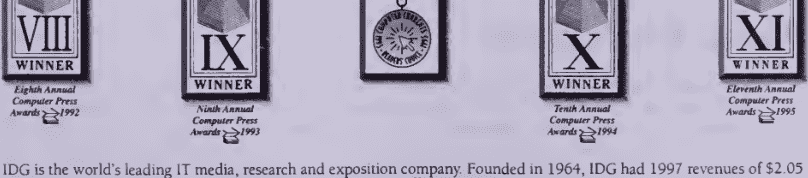

IDG是全球领先的IT媒体、研究和展览公司。成立于1964年，IDG在1997年的收入为20.5亿美元，在全球拥有超过9,000名员工。IDG提供最广泛的媒体选择，在75个国家触达IT买家，占全球IT支出的95%。IDG多样化的产品和服务组合涵盖六个关键领域，包括印刷出版、在线出版、展览和会议、市场研究、教育和培训，以及全球营销服务。每月有超过9,000万人阅读IDG的290种杂志和报纸中的一种或多种，包括IDG领先的全球品牌——Computerworld、PC World、Network World、Macworld和Channel! World系列出版物。IDG Books Worldwide是世界上增长最快的计算机书籍出版商之一，拥有36种语言的700多种图书。仅《... For Dummies®》系列丛书的印刷量就超过5000万册。IDG通过IDG.net (http://www.idg.net) 为在线用户提供全球最大的技术专业网站网络，该网络在55个国家拥有超过225个针对性网站。国际数据公司（International Data Corporation, IDC）是全球最大的信息技术数据、分析和咨询提供商，在41个国家设有研究中心，拥有400多名研究分析师。IDG Expo是全球领先的品牌会议和展览的主办方之一，在35个国家举办超过168个全球品牌会议和展览，包括E3（电子娱乐博览会）、Macworld Expo、ComNet、Windows World Expo、ICE（互联网商业博览会）、Agenda、DEMO和Spotlight。IDG的培训子公司ExecuTrain是全球最大的计算机培训公司，在全球拥有230多个地点和785门培训课程。IDG Marketing Services通过利用IDG的印刷、在线和展览产品，在全球范围内开发全球整合营销计划，帮助行业领先的IT公司建立国际品牌认知度。有关该公司的更多信息，请访问 www.idg.com。


## 致谢

**收购编辑**
David Mayhew

**开发编辑**
Laura E. Brown

**技术编辑**
Jonathan Baker
Soren Harward

**文字编辑**
Laura J. Hester
Ami Knox

**CD-ROM**
媒体开发部

**项目协调员**
Linda Marousek

**美术与制作专员**
Jude Levinson
Michael Lewis
Ramses Ramirez
Victor Perez-Varela
Dina F. Quan

**质量控制专员**
Chris Weisbart
Laura Taflinger

**书籍设计师**
Drew R. Moore

**插图绘制**
Mary Jo Richards
Clint Lahnen

**校对与索引**
York Production Services

**封面插图**
Evan Deerfield/Cobalt BLUE

## 关于作者

**Stephanie Cottrell Bryant** 自 1995 年起从事专业网页设计，并使用 GIMP 制作网页美术作品。她是美国全国作家联盟圣克鲁斯/蒙特雷地方分会的活跃成员，曾于 1998 年担任代表。她撰写了大量文章，合著了多本关于网页设计的书籍，最近为 IDG Books Worldwide 出版了 *Teach Yourself HTML 4*。

**Tillman Hodgson** 白天是一家加拿大互联网服务提供商的网络管理员，晚上则是一位狂热的 Linux 倡导者、撰稿人，偶尔还主持一档名为"Net.Talk"的电视直播节目。他难得的空闲时间都花在调试他的三台电脑家庭网络上——当然，运行的是 Linux。

**Bryan Livingston** 是 Cooltext.com 的创建者和经营者，这是网上最便捷的 GIMP 网站之一。作为一名资深程序员和无所畏惧的 Linux 猎手，Bryan 利用他熟练的 GIMP 脚本技术，让网站访客只需点击几个按钮，就能用 GIMP 创造出令人惊艳的文字效果。

> 致所有致力于开源软件开发的辛勤工作者们。继续编码吧！——SCB

致我的母亲，感谢她耐心地听我无数次兴奋地谈论开源；也致我的妻子，感谢她一直是我出色的搭档。——TH

## 前言

GIMP 是开源领域皇冠上最闪亮的明珠之一。它的全称是 GNU 图像处理工具（GNU Image Manipulation Tool），但人们更亲切地称其为 GIMP。它享有"杀手级应用"的美誉，能够创建你能想象到的几乎所有类型的图像，而且确实名副其实。这个应用程序是 Linux 和其他类 UNIX 操作系统上真正令人惊叹的图像工具。它让普通用户也能享受到功能齐全、易于使用的图形应用程序带来的好处，而且不需要大量 UNIX 经验。你可以创建原创设计、处理扫描图像、为网页制作设计、实现图像任务自动化，并且凭借充分的想象力，制作出真正卓越的图像作品。

*GIMP for Linux Bible* 旨在带领新手和高级用户全面了解 GIMP 的所有功能和工具。本书提供实用技巧、分步指导、示例图片以及六个附录的补充信息，是目前最完整的参考指南。

### 全书概览

本书分为五个主要部分，具体如下。

## 第一部分：入门

在介绍 GIMP 及其丰富多彩的历史之后，你将学习如何获取和安装该程序。然后，我们会带你进行一次快速导览，帮助你尽快上手。如果你是 GIMP 的老用户且已经安装完毕，可以快速浏览本部分或直接跳到第二部分。

## 第二部分：GIMP 工具

GIMP 最强大的特性之一就是它的工具箱，因此在本书的这一部分，我们将逐一介绍每个工具并讲解其使用方法。这部分内容非常重要，因为扎实理解 GIMP 中可用的工具，能让后续的一切操作变得更加直观。

### 第三部分：GIMP 概念

除了知道如何使用工具之外，了解*为什么*要使用它们也是一项重要技能。在本部分中，我们涵盖了相关背景概念，让你能够权威地谈论诸如"CMYK 与 RGB 之对比"和"锚定浮动选区"等话题。

### 第四部分：滤镜与 Script-Fu

滤镜的可编程性以及通过 Script-Fu 在 GIMP 中轻松实现自动化的能力，是 GIMP 成为如此强大工具的重要原因，因此有必要为这些主题单独设立一个部分。我们介绍了 Perl 和 Scheme，并将完整的程序数据库（Procedural Database）作为附录收录其中。

## 第五部分：实际应用

在学习了前面各部分的讲解和理论之后，我们深入探讨 GIMP 在实际工作中的常见任务，并向你展示如何完成这些操作。我们涵盖了文本处理、图像处理和网页制作，以及一些可以与 GIMP 配合使用的有趣硬件。

## 本书的排版约定

书中首次出现的专业术语会以*斜体*标出并给出定义。如果你不知道某个术语的含义，可以在索引中查找。很可能在涉及该主题的章节中已有所定义。

你还会在书中各处看到以下图标：

- **警告**：此图标用于提醒可能具有危险性的命令或操作。
- **交叉引用**：此图标指示在哪里可以找到本书中的相关信息。
- **注意**：注意信息与当前主题相关，提供额外信息或背景知识。
- **CD-ROM 内容**：此图标表示该项目在 CD-ROM 中。

技巧提示可以帮你节省时间和精力。

## 告诉我们你的想法

作者和 IDG Books Worldwide 感谢你提出的任何反馈意见。我们为编写这本巨著投入了大量精力，也花了很多时间检查其准确性，但难免会有所疏漏。你的反馈有助于确保我们能够纠正这些错误并采纳你的建议。

你可以在 IDG Books Worldwide 网站（网址为 http://www.idgbooks.com）在线注册本书并提供反馈。如果你想联系作者，可以通过电子邮件联系 Stephanie、Tillman 和 Bryan，邮箱分别是 steph@scottrell.com、tillman@hodgsonhouse.com 和 bryan@cooltext.com。

我们会尽力及时回复电子邮件，但由于订阅了过多邮件列表（又来了）以及每天收到的邮件数量实在庞大，可能需要一些时间。请放心，每封邮件都会被阅读，我们非常感谢你的留言。

## 致谢

衷心感谢 IDG Books 的各位同仁使本书得以面世，特别是 David Mayhew、Laura Brown、Ami Knox、Laura Hester 以及 IDG Books 制作部。我还要感谢我的经纪人 Margot Maley，感谢她让我始终保持在正轨上。同时感谢 Brenda Kelley 和她的女儿 Hailey Kahrs——她的照片收录在本书中，也感谢 David Mayhew 和他的儿子提供了如此可爱的宝宝照片。感谢 GIMP 项目组的所有成员，感谢他们创造了如此出色的软件。最后，我要感谢我的丈夫 John，在整个项目过程中给予我情感上和技术上的支持。——SCB

首先，我要感谢为 GIMP 开发做出贡献的众多人士。没有他们付出的时间和专业知识，这本巨著就没有存在的必要，我的 X 桌面也会显得灰暗而荒芜。感谢你们让强大的图形编辑在 Linux 世界中无处不在，感谢你们作为顶尖的开源项目之一，向你们致敬。

其次，我要感谢我们的编辑 Laura Brown 让我们始终走在正轨上，感谢我们的收购编辑 David Mayhew 给我参与编写本书的机会。我还要向 IDG 其他表示感谢，感谢他们协助完成本书的编辑工作。多亏了他们的努力，我相信书籍制作中还有许多我不曾了解的环节。

我还要感谢我的妻子 Lee-Anne，她曾优雅地陪伴我度过了许多漫漫长夜，并在此过程中成为了 GIMP 的粉丝。——TH


# 第一部分

**本部分内容**

- **第1章**
  什么是GIMP？
- **第2章**
  获取与安装GIMP
- **第3章**
  开始使用

## 西红柿蛋花汤

- 2个大鸡蛋
- 1汤匙玉米淀粉
- 1茶匙芝麻油
- 2汤匙植物油
- 1瓣大蒜，切末
- 1茶匙姜，磨碎
- 4杯鸡汤
- 1杯番茄丁
- 1汤匙酱油
- 1茶匙糖
- 1/4茶匙白胡椒粉
- 2汤匙葱花
- 1汤匙香菜碎

1.  在一个小碗中，将鸡蛋、玉米淀粉和芝麻油搅拌均匀。
2.  在炒锅或大汤锅中用中高火加热植物油。加入大蒜和姜末，翻炒约30秒，直至散发出香味。
3.  向锅中加入鸡汤、番茄丁、酱油、糖和白胡椒粉。将混合物煮沸。
4.  转小火慢炖。同时，一边轻轻以画圈方式搅拌汤，一边将蛋液以细线状缓缓倒入。
5.  离火，加入葱花和香菜碎拌匀。趁热享用。

## 什么是 GIMP？

GNU 图像处理程序，通常称为 GIMP，是一款为运行 X Window 系统的类 UNIX 系统（包括流行的 Linux 操作系统）自由分发的软件。

GIMP 最初由 Peter Mattis 和 Spencer Kimball 编写，现在包含了众多新贡献者的工作，它为 Linux 世界带来了强大的图像处理工具，其丰富的功能集可直接与 Adobe Photoshop 等昂贵的商业产品相媲美。它通过使用广泛可用的插件和脚本功能，具有显著的可扩展性。

GIMP 以开源模式开发，并在 GNU 通用公共许可证（GPL）下发布，自 1996 年初首次发布 0.54 版本以来，已经迅速成熟。其许可证鼓励快速开发和增强，其受欢迎程度也确保了开发者的持续涌入。

通过其作者的努力，GIMP 已发展成为 Linux 系统上使用最广泛的图像工具，并经常被称为这些系统的“杀手级应用”。它将 Linux 带入了桌面，让没有多少 UNIX 经验的普通用户也能享受到功能全面且易于使用的图形工具的好处。

它也是 Linux 上可用的最酷的开源程序之一。

## GIMP 能做什么？

从本质上讲，GIMP 是一个图像处理程序。执行同类功能的其他程序包括 Adobe Photoshop 和大多数绘图程序。自然，GIMP 提供的功能远超普通绘图程序（本章稍后会列出）。

第 1 章

本章内容

-   GIMP 能做什么？
-   GIMP 功能列表
-   谁在使用 GIMP？
-   GIMP 的未来

*位图* 这个词是将 GIMP 与 CorelDraw 等基于矢量的程序区分开来的特征之一。为了解释其区别，我们需要稍深入地探讨一下图像理论。

## 位图

像 GIMP 这样的图像编辑程序属于一个更大的类别，称为 *绘图* 程序。因为绘图程序使用位图来显示和存储图像，所以术语 *位图* 和 *图像* 在某种程度上可以互换。这与计算机显示器用来显示图像的同一种方法，即 *光栅* 图形，是一样的。

光栅图形是通过对真实图像进行采样而创建的图像，生成的坐标网格以数字形式表示原始的真实图像。生成的光栅文件被称为位图。

位图是一个由称为像素的点组成的网格，每个点可以单独开启或关闭。彩色位图允许像素显示不同的颜色，而不仅仅是“开启”。构成图像网格的像素数量就是其 *分辨率*。典型计算机显示器的分辨率可能是 800 像素乘以 600 像素。分辨率也可以指每英寸的像素数，例如 72 点每英寸（dpi）。

绘图程序非常擅长以最少的工作量显示逼真的图像，例如照片。然而，由于其底层的网格结构，它们 *缩放* 效果不佳。缩放是调整图像大小的过程。一个以 200 像素乘以 150 像素分辨率创建的图像，如果将其调整大小或缩放为 800 乘以 600，看起来会非常块状化。有关此位图缩放效果的示例，请参见图 1-1 和图 1-2；这种效果在丝带的弧线处最为明显。

## 矢量

矢量是用于处理图形媒体的另一种方法，属于更大的 *绘图* 程序类别的一部分。矢量使用线条、圆弧和其他二维结构的数学表示来创建图形。这些数学结构的工作方式与地图非常相似。虽然地图上显示的一个城镇离你家只有两英寸远，但实际上那个城镇可能相距数英里。然而，道路所经过的弧线将是相同的，并且可以用数学方法表示。

矢量也被称为 *对象*，就像地图一样，它们具有极高的可伸缩性。然而，在易用性方面，矢量不像像素那样易于操作。

创建位图图像很像用画笔绘画，而创建基于矢量的图像更像是用层层叠放的彩色纸片来构建图像。构建一个具有微妙阴影的复杂图像可能需要成千上万个对象和图层，这使得矢量不适合此类工作。

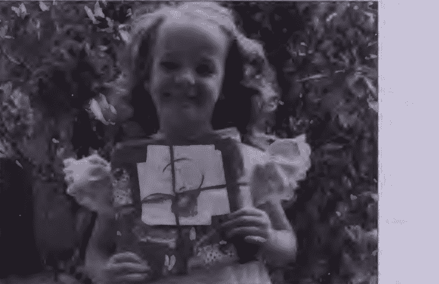

图 1-1：位图缩放：原始 800x600 图像

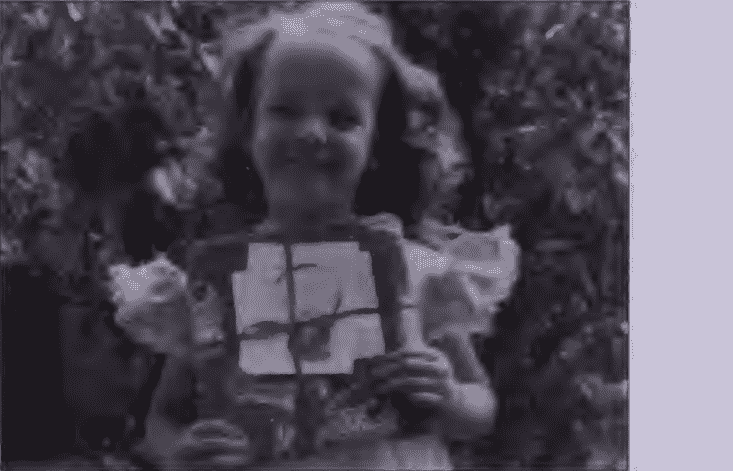

图 1-2：位图缩放：图像从 200x150 缩放为 800x600

矢量图像在图形媒体中占有一席之地，但它们并非处理详细或照片级真实图像的最合适的工具。矢量工具并非 GIMP 的真正竞争对手，而是一种执行类似但不同任务集的共生工具。

图 1-3 展示了 KIllustrator，一个开源的矢量图像处理工具。请注意绘制简单几何形状（由矢量组成）是多么容易。要创建一幅细节复杂如人脸的图像则要复杂得多。由于所有的色彩塑造和微妙曲线，这幅图像很容易包含数万个矢量，并且需要耗费数小时来创建！

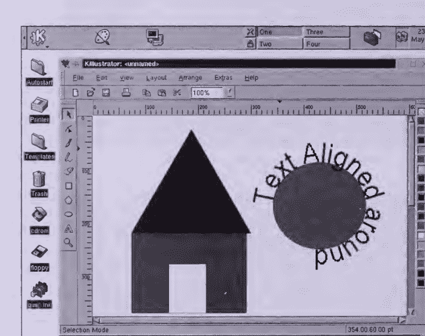

## GIMP 的应用领域

作为一款图形位图编辑工具，GIMP 的优势在于其处理图像的能力。虽然它也可以被强行用于创建蓝图或流程图，但这更属于矢量绘图程序的领域。

GIMP 在图像处理相关功能方面展现了惊人的深度和能力。你可能会发现自己使用 GIMP 的一些场景包括：

-   从多种来源获取图像，包括扫描仪、数码相机和屏幕截图；导入从其他地方（例如剪贴画包）获得的文件；以及仅凭你的想象力和 GIMP 工具箱，从头创建一个新图像，直到它完全符合你的要求。
-   利用 GIMP 对各种文件格式的支持，将文件从一种格式转换为另一种格式。
-   逐像素地修饰图像，也许是为了在打印前修饰扫描的照片。
-   应用特殊效果，例如将图像变为裂纹状和棕褐色调以模仿旧照片，或者将图像简化为只有电蓝色的色调，以制作摩城海报风格的图片。
-   处理非常大的图像，例如适合打印的高分辨率图像。一种称为平铺的复杂内存处理技术，甚至使你能够编辑比可用内存更大的图像。
-   处理非常小的图像，例如用于网页的导航按钮。多级缩放使编辑小图像变得更容易。
-   使用 GIMP 的图层功能合并图像，例如在肖像中添加另一个人，或者将你自己的照片与热带海滩的图像合并。
-   创建脚本以自动化创建常见图像，例如用于网页按钮的模板。你也可以下载其他人创建的插件，并修改它们以满足你的需求。
-   使用 GIMP 的图层和动画 GIF 功能，创建适用于网页或演示软件的动画。
-   使图像无缝化，以便用作桌面或网页的平铺背景图像。

这些只是 GIMP 可以轻松处理的部分项目。实际上，任何涉及图像处理的工作都可以使用 GIMP 完成，而强大的脚本功能意味着即使复杂或耗时的任务，随着时间的推移也可以被简化或完全自动化。

## GIMP 功能列表

功能列表本身是计算机书籍的一个特色，如果不包含它，我们将有所疏忽。它们旨在帮助潜在的新用户决定特定应用程序是否拥有他们所需的工具和能力，也可以作为偏好实践式学习的用户的试用清单。


GIMP 是那种功能如此丰富且易于扩展的程序，即便是经验丰富的用户也会随着时间的推移不断发现新的功能。再加上开源软件固有的快速发展特性，任何功能列表都难以完全描述这款应用程序的全部潜力。以下是我们的一般性功能列表：

- ◆ 基于 GNU 通用公共许可证的开源许可
- ◆ 一个活跃且不断壮大的用户社区
- ◆ 一套完整的面向位图的绘画工具，如铅笔、画笔、喷枪、克隆和橡皮擦
- ◆ 全面的选区工具，包括矩形选区、椭圆选区、自由选择、模糊选择、贝塞尔曲线和智能剪刀
- ◆ 一套完整的选区后处理工具，如移动、裁剪、翻转和变换
- ◆ 一个强大且可扩展的渐变编辑器和混合工具
- ◆ 支持自定义画笔和图案
- ◆ 绘画工具通过采样小于像素深度的尺寸提供高质量的抗锯齿效果，实现平滑的过渡和曲线
- ◆ 用户可配置的多级撤销和重做功能，仅受磁盘空间限制
- ◆ 一个基于矢量的形状绘制工具——GFig 插件，有助于模糊两种图像处理类型之间的界限
- ◆ 完整的 Alpha 通道和透明度支持
- ◆ 完整的对图层和通道的支持
- ◆ 先进的内存管理，通过高效利用磁盘空间和基于图块的图像编辑，能够编辑通常无法放入可用内存的超大图像
- ◆ 支持多种语言的高级脚本能力，以及用于调用或浏览 GIMP 内部功能的过程数据库
- ◆ 通过插件接口实现完全可扩展性，包括目前可用的近 200 个插件，以及一个用于新插件的插件注册表
- ◆ 支持多种文件格式，包括格式转换，新的文件格式可通过插件获得
- ◆ 支持将动画保存为帧作为图层的格式
- ◆ 同时打开的图像数量仅受系统可用磁盘空间限制

## GNU 自由软件/开源/BSD

Linux 和 GIMP 的新手常常被统称为*自由软件*的许可条款搞糊涂。部分困惑源于自由软件与大多数计算机用户习惯的专有软件之间的差异，另一部分则来自对自由软件及其适当许可类型的众多不同观点。

Linux 和 GIMP 都在 GNU 通用公共许可证下授权，通常称为 GPL。GPL 的副本位于本书附录中。

创建了 GPL 的自由软件基金会更倾向于使用*自由软件*一词。他们拥有大量关于许可问题的信息，可在 [http://www.gnu.org/philosophy/philosophy.html#LicensingFreeSoftware](http://www.gnu.org/philosophy/philosophy.html#LicensingFreeSoftware) 获取。GPL 旨在既允许相对不受限制地使用软件，又保护软件作者的权利。

自由软件基金会主席兼创始人理查德·斯托曼这样总结自由软件："你应该想到的是言论自由，而不是免费啤酒" ([http://www.fsf.org/philosophy/free-sw.html](http://www.fsf.org/philosophy/free-sw.html))。

开源促进会倡导*开源*一词，其模式借鉴了 Debian 自由软件指南，并更加强调与商业界的合作。开源软件通常以 GPL、艺术许可或 BSD 风格许可发布。

BSD 风格的许可模仿了最初用于发布 Berkeley UNIX 变体的 Berkeley 标准发行版许可。它们通常是许可性很强的许可，不试图控制软件的商业使用。

Linux 和 GIMP 社区如此积极关注许可问题的原因是，软件成功的很大一部分可以归功于所使用的许可。软件开发者、企业分销商和最终用户都受到特定软件发布许可的影响，在许可性和受欢迎的许可与保护开发者权利的许可之间走钢丝。

作为产品的最终用户，你可以自行决定软件发布时的许可是否适合你的需求。一般来说，任何上述许可都授予你作为最终用户出色的软件使用权。当然，如果你计划重新分发或销售相关软件，你的需求将会有所不同。

如需更多信息，请访问以下网站：

- [http://www.gnu.org](http://www.gnu.org) — 自由软件基金会
- [http://www.opensource.org](http://www.opensource.org) — 开源促进会
- [http://language.perl.com/misc/Artistic.html](http://language.perl.com/misc/Artistic.html) — 艺术许可
- [http://www.debian.org/social_contract.html](http://www.debian.org/social_contract.html) — Debian 自由软件指南
- [http://www.freebsd.org/copyright/license.html](http://www.freebsd.org/copyright/license.html) — FreeBSD，BSD 风格许可的一个示例。

## 谁在使用 GIMP？

每个当前的 Linux 发行版都包含 GIMP，它也在其他 UNIX 变体中被广泛使用。可以半开玩笑地说，几乎每个 Linux 用户都是 GIMP 用户。考虑到 GIMP 的流行程度及其作为开源开发应用程序先锋之一的地位，说这话时舌头不必*太*夸张。

然而，最依赖 GIMP 的将是那些每天都能找到其用途的人。这包括图形艺术家、网页设计师、摄影师、游戏开发者、文档撰写人、邮票收藏者……几乎任何可能想要处理图像的人。

GIMP 特别适合处理扫描图像、使用绘画工具创建原始图像、创建用于网页的图像以及自动化图像处理任务。

并非只有图形专业人士使用 GIMP；许多家庭用户也在其计算机上使用它来处理图像以及娱乐。GIMP 为图像处理带来的可及性和易用性使得非专业用户成为一个庞大而重要的用户群体。

最终，在像 GIMP 这样的开源开发应用程序中，是用户决定应用程序，而不是应用程序决定用户。对于同时是软件开发者的 GIMP 用户来说，这提供了一个美妙的协同机会，可以自行扩展该软件包。所有用户和 GIMP 本身都受益于这种开源安排。

## GIMP 的未来

GIMP 的未来看起来一片光明。最初只是两个学生项目，如今已发展成为类 UNIX 操作系统上的顶级应用程序之一。它的成功确保了它的持续发展；GIMP 将在可预见的未来持续发展和演变。

随着 GIMP 新版本的发布，它们根据一种将开发分为两个并行分支的方案来命名：稳定版和开发版。GIMP 使用与 Linux 内核相同的版本编号方案，因此奇数版本号是开发版，偶数版本号是面向公众的稳定版。我们在本书附录的 CD-ROM 中同时包含了稳定版和开发版。

开发版更新频繁，但不建议一般使用。实际上，GIMP 网站警告说 "GIMP 的开发版可能极不稳定，可能随机崩溃，可能让你的宠物紧张，甚至可能无法编译"。

稳定版每隔几个月更新一次，尽管在整个开发过程中可能会进行小幅更新。稳定版是推荐用于一般使用的版本，因为它包含经过验证和稳定的代码。

GIMP 快速发展的一个标志是其 ChangeLog 文件，它详细记录了所做的更改和开发。该文件通常位于 /usr/doc/gimp-1.0.x 目录中，其中 x 是你的版本号。1.0.1 版的 ChangeLog 包含约 56 页打印材料，通常每周包含多个条目，而且这个 ChangeLog 仅回溯到 0.99.11 版！

这种并行版本方案使大多数用户能够使用稳定产品，同时使开发者能够在不影响稳定版的情况下开发下一个版本的功能。这有助于确保当前稳定版保持稳定——这对于你可能依赖的软件来说是一件宝贵的事情。

开发版可能包含尚未进入稳定版的新功能。你总是可以下载开发版来试用或使用这些新功能，但请注意它可能不适合日常工作。

## GIMP 1.2

GIMP 1.2 尚未发布，很可能还需要一段时间。在某个时刻，1.1 开发系列将被认为足够稳定，可以重命名为 1.2，而新的 1.3 开发系列将开始。查看当前的 GIMP 1.1 开发版本，我们可以了解开发者为 1.2 版本正在开发什么。

一些新功能包括：

- 支持替代输入设备
- 墨水工具，专为压力敏感输入设备（如绘图板）设计
- 更好地支持除像素以外的测量单位
- 重新设计的图像窗口，在窗口边缘内置了更多状态显示
- 改进的动画工具
- 用户界面调整


### 总结

GIMP 已成为 UNIX 和 Linux 系统上最广泛使用的图像工具，享有“杀手级应用”的美誉。使普通用户无需太多 UNIX 经验，就能享受功能全面且易于使用的图形应用程序带来的好处，这是 GIMP 开发团队的一个重大设计成就。

GIMP 是处理扫描图像、创作原创作品、进行网络设计或自动化图像任务的强大工具，随着这个令人惊叹的开源应用程序的持续开发，它将继续为用户带来喜悦。

## 获取与安装 GIMP

GIMP 成功的一个重要原因在于其源代码可自由获取。这使得任何人都可以查看 GIMP 的工作原理，修改代码以供个人使用，或为未来的开发做出贡献。阅读源代码并非必要——它只是为你提供的一个可选方案。

安装 GIMP 的通常方式是下载并编译源代码，我们将在本章详细介绍。

由于 GIMP 的普及，许多系统都预装了它。尽管这非常方便，但为了升级到最新版本，您通常需要重新安装 GIMP。

对于非 C 程序员或更喜欢简便安装方法的用户，像 RedHat 这样的 Linux 发行版可以使用无需编译的 GIMP 预编译二进制文件。如果您运行的是支持 RPM 包的系统，您可能需要跳到本章的“使用 RPM 包安装”部分。RPM 包通常比源代码更容易安装，但在当前可用版本方面往往落后于源代码。

## GIMP 的官方来源

当您想要下载软件时，从官方来源获取软件包始终是一个好主意。在这种情况下，GIMP 的官方网站是 `http://www.gimp.org`，官方 FTP 镜像列表可从 `http://www.gimp.org/download.html` 获取。

使用官方来源的原因是确保您获得最新、最稳定的版本，并防止下载到被篡改的软件。

尽管其他网站可能有可供下载的 GIMP 副本，但它们可能已经一段时间没有更新。GIMP 的新版本总是首先发布在官方来源。

另一个需要考虑的问题是，从非官方网站下载的文件内容可能已被篡改。从其他来源获取的文件可能包含病毒或其他恶意内容。虽然这种情况并不常见，但您应该有所了解。

### 本章内容

- GIMP 的官方来源
- 系统要求
- 安装 GIMP 工具包
- 安装 GIMP
- 使用 RPM 包安装
- 验证您新安装的 GIMP
- 跟踪 GIMP 开发进展

## 系统要求

在尝试将 GIMP 安装到您的计算机上之前，请确保您的计算机满足所有最低系统要求。

在软件方面，GIMP 需要一个类 UNIX 操作系统，其中安装了 X 窗口系统、C 编译器和 GIMP 工具包（GTK）库。目前正努力将 GIMP 移植到 Microsoft Windows 操作系统，但开发重点仍将放在类 UNIX 系统上。

### X 窗口系统

X 窗口系统，或简称 X，是类 UNIX 操作系统使用的图形用户界面。它是一个基于客户端-服务器模式、运行在用户模式的应用程序，提供窗口系统所需的基本服务。更高级的功能由窗口管理器（如 GNOME 或 KDE）提供，它们运行在 X 之上，而 X 则运行在字符模式操作系统之上。

由于 X 是一个基于客户端-服务器模式的窗口系统，您可以在一台强大的服务器上运行应用程序，并将窗口显示在您的工作站上。X 运行在用户模式，这意味着用户可以像启动 emacs 或任何其他应用程序一样启动 X 服务器。这防止了 X 服务器中的问题导致系统其余部分崩溃。

X 对 GIMP 用户非常重要，因为 GIMP 是一个 X 应用程序。许多影响 GIMP 工作方式的因素，例如它能够显示的颜色数量和鼠标的工作方式，实际上都是由 X 处理的。

Xfree86 是 Linux 和其他免费类 UNIX 系统上最常用的 X 窗口系统。有关 Xfree86 的更多信息，请访问 http://www.xfree86.org。

在硬件方面，GIMP 既有一套最低系统要求（这是真正的最低要求），也有一套更实用的推荐要求。两者均列于表 2-1 中。

| 项目 | 最低要求 | 推荐要求 |
| :--- | :--- | :--- |
| 显示 | 8 位色深 | 16 位色深，推荐 24 位或更高 |
| 磁盘空间 | 20MB | 尽可能大的磁盘空间 |
| 内存 | 16MB | 32MB 或更高 |
| CPU | Pentium 级或同等处理器 | 当代 CPU |

这些要求源于实用性和必要性。一个只能处理 16 种颜色的图像编辑工具用途有限，而磁盘空间对于安装 GIMP 本身以及保存您的工作文件和完成的图像都至关重要。

GIMP 是一个极其消耗 CPU 和内存的程序。尽管它可以在低端硬件上运行，但硬件的速度与程序的响应能力之间存在直接关系。

如果 GIMP 在您的系统上运行缓慢或在进行大型图像编辑时卡顿，两个常见的瓶颈将是您的 CPU 和可用内存。对于涉及多个图像的严肃图像处理工作，您的计算机内存几乎肯定会先于 CPU 耗尽。如果可用且打开的图像需要，GIMP 可以使用数百兆字节的内存。

要找出系统上的瓶颈，请使用 `top` 实用程序显示您当前的进程统计信息，如图 2-1 所示。在进行大型编辑或应用滤镜时，CPU 达到 100% 使用率是正常的。如果同时内存也耗尽（表现为虚拟内存或 `swap` 使用显著），那么内存就是您的瓶颈。否则，您的 CPU 就是限制因素。

> **注意：** 如果您没有安装 `top`，可以通过运行 `free` 或 `vmstat` 实用程序获取类似的统计信息。详细信息请查阅 `man` 手册页。

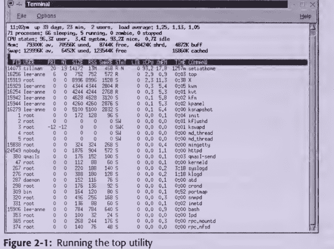

图 2-1：运行 top 实用程序

您可以通过减少同时运行的程序数量来释放 CPU 周期和内存。

如果拥有更快的 GIMP 是您的优先事项，您也可以考虑升级内存和 CPU。当您初始内存很少或需要处理非常大的图像时，内存升级将对您帮助最大。当您执行大量计算密集型活动（例如运行滤镜）时，更快的 CPU 带来的收益最大。

## 安装 GIMP 工具包

要成功编译 GIMP，您需要下载并安装两个软件包。一个是 GIMP 工具包（GTK），另一个是 GIMP 本身。

GTK 是一个工具包库，负责处理 GIMP 的大部分实际工作。库负责绘制和处理“小部件”，例如按钮、滚动条和其他界面设备。由于它是一个编写良好且流行的库，其他应用程序如 GNOME 也开始使用它。为了支持对 GTK 的这种使用，开发人员决定将其从 GIMP 中分离出来，作为一个独立的软件包发布。

### 下载 GTK 文件

由于许多应用程序使用 GTK，您可能已经安装了它。要检查是否已安装，请运行以下命令：

```
locate libgtk.so.
```

> 您的系统可能没有安装 `locate` 命令。在 Linux 系统上，请尝试 `/sbin/ldconfig -p | grep libgtk.so`，该命令列出系统上已安装的库，然后通过管道传递给 `grep`，搜索特定的库 `libgtk.so`。如果没有报告任何文件，则表示未安装。在非 Linux 系统上，请尝试手动在 `/usr/lib` 和 `/usr/local/lib` 目录中查找 `libgtk.so` 文件。

此命令会搜索系统上名称中包含字符“libgtk.so.”的文件。如果找到，输出会告诉您安装的 GTK 版本。例如，`/usr/lib/libgtk.so.1.0.6` 是 GTK 的 1.0.6 版本。如果 `locate` 没有报告任何文件，那么很可能 GTK 未安装。

> GIMP 稳定的 1.0.x 版本仅适用于 GTK 的 1.0.x 或 1.2.x 版本。如果您安装的是 GTK 的 1.1.x 版本，GIMP 将无法与其配合工作。

如果您未安装 GTK，则需要下载并安装它。要下载您需要的版本，请使用 Web 浏览器访问 http://www.gimp.org/download.html。从列表中选择一个地理位置靠近您的下载站点；这通常能提供更快的下载速度，并有助于分散服务器负载。

> 一些官方的 GIMP 镜像可能不包含 GTK 软件包。如果您使用的镜像没有，您始终可以在 ftp://ftp.gimp.org/pub/gtk 找到它。您也可以访问 http://www.gtk.org 网站。本书附带的 CD-ROM 中也包含一份副本。更多信息，请参见附录 E。

您需要从 GTK 版本 1.2 目录下载，在大多数镜像上该目录名为 v1.2。在 FTP 服务器上找到 GTK 目录后，您需要定位要下载的文件。在 1.2.x 系列中，版本号最高的那个就是您需要的。例如，在撰写本文时，gtk+-1.2.3.tar.gz 是 1.2.x 系列中最新的 GTK 版本。

您还需要获取匹配的 glib 文件，在本例中是 glib-1.2.3.tar.gz。在 GTK 的 1.2 版本中，glib 已被分离，必须单独下载和安装。


**提示** 传统上习惯将下载的文件保存在您的 `/usr/local/src` 目录中，但这并非强制要求。在接下来的示例中我们将使用该目录；如果您已将文件保存到其他位置，请替换为您自己的目录。如果您没有对正在安装 GTK 的机器的 root 访问权限，则必须将所有内容安装到您有写权限的目录，而不是 `/usr/local/src`。

获取文件并将其保存到本地磁盘后，您需要解压该文件。要解压 `gtk+-1.2.3.tar.gz`，请使用以下命令：

```
tar xvzf glib-1.2.3.tar.gz
tar xvzf gtk+-1.2.3.tar.gz
```

或者，如果您的 tar 版本不支持直接解压文件，请尝试如下解压：

```
gzip -dc glib-1.2.3.tar.gz | tar xv
gzip -dc gtk+-1.2.3.tar.gz | tar xv
```

这将创建两个包含 glib 和 GTK 源代码的子目录。

## 配置和编译 GTK

下载并解压 GTK 的两个组件后，需要将源代码编译成库。这个过程在几乎所有类 UNIX 系统上都应几乎相同。

对于大多数以源代码格式分发的应用程序，都会有两个重要的文本文件 `INSTALL` 和 `README`，其中包含关于安装包的信息。虽然阅读这些文件不是必须的，但如果您遇到问题或有疑问，它们将是您的首要资源。

## 查看一个简单的安装过程

一旦源代码被提取到它自己的目录中，您需要使用 `cd` 命令切换到该目录，如本例所示：

```
cd /usr/local/src/glib-1.2.3
```

在编译之前，必须生成一个 `Makefile`。这会配置源代码以匹配您系统的具体细节，以便编译器知道如何开展工作。要使用自动配置工具，只需运行此命令：

```
./configure
```

接下来，需要编译已配置的源代码。为此，请输入以下命令：

```
make
```

`make` 工具将使用由 `configure` 生成的 `Makefile` 来编译源文件。然后，要将编译好的可执行文件复制到适当的目录，请使用（以 root 身份）以下命令：

```
make install
```

如果您遇到任何问题，应首先检查 `README` 和 `INSTALL` 文件。如果在那里找不到答案，请尝试在 GTK 网站上查找信息：http://www.gtk.org。

接下来，您必须在目录 `/usr/local/src/gtk+-1.2.3` 中对 GTK 的主要组件执行完全相同的步骤。除了目录名不同外，所有命令都将相同。您必须先构建 glib，然后再构建 GTK，因为 GTK 在其构建过程中依赖于 glib 的存在。

一旦您完成了库的构建，请确保您以 root 身份登录并运行 `ldconfig` 工具。这会将新库添加到运行时链接器使用的缓存中。在许多系统上，重启会自动运行此命令。

> **提示** 在 Linux 系统上，您应确保 `/usr/local/lib` 列在 `/etc/ld.so.conf` 文件中，否则 `ldconfig` 可能找不到您的新库。

如果在这些步骤中都没有收到错误，那么您刚刚完成了 GTK 的安装。

> **提示** 如果您的系统上尚未存在其他库，您也应按照相同方式下载并安装它们，包括 `libgif`、`libjpeg`、`libpng` 和 `libtiff`。这些库添加了处理特定文件格式的能力，强烈建议安装。您可以在 GIMP 镜像站点上找到这些库。

## 安装 GIMP

安装 GIMP 与安装 GTK 或任何其他以源代码形式分发的应用程序非常相似。其中许多步骤将类似于您刚刚完成的 GTK 安装。

GIMP 是一个非常大的程序，拥有超过 30 万行代码。考虑到其规模和功能集，开发者们在确保源代码到不同类 UNIX 系统的可移植性方面做得非常好。

## 下载 GIMP 文件

正如我们在第 1 章提到的，GIMP 有两个版本：稳定版和开发者版。

在下载 GIMP 之前，您应决定想要运行哪个版本的 GIMP。大多数用户使用稳定版会最满意。如果您想使用的某个功能仅在开发者版中可用，并且您习惯运行非稳定版本，那么该版本就是您要下载的。

> **提示** UNIX 世界中使用的“非稳定”通常不必过于担心，因为稳定性标准非常高。要下载您想要的版本，请使用网络浏览器访问 http://www.gimp.org/download.html。从列表中选择一个地理位置接近您的下载站点；这通常能提供更快的下载速度，并有助于分散服务器的负载。

> **关于 CD-ROM** 为了节省您的时间，书后附带的 CD-ROM 中包含了多个 GIMP 的副本，包括稳定版和开发者版。更多信息，请参见附录 F。

一旦您在 FTP 服务器上定位到 GIMP 目录，您需要定位您想要下载的文件。通常，对于您要下载的版本号，会有多个具有不同扩展名的文件。例如，可能同时列出了 `gimp-1.0.4.tar.gz` 和 `gimp-1.0.4.tar.bz2`。这些扩展名告诉您文件使用了何种压缩方式。您需要选择一个您的系统拥有解压工具的压缩格式的文件。

在此期间，您可能还想下载 `gimp-data-extras` 包。这个包包含了许多 GIMP 的额外内容，是推荐下载的。它的名称通常类似于 `gimp-data-extras-1_0_0.tar.bz2`。在接下来的示例中，我们假设您已下载了 `gimp-data-extras` 包。如果您不想安装它，只需跳过后续说明中对它的任何引用。

> **提示** `gimp-data-extras` 包很方便，因为它提供了额外的画笔、渐变、调色板、图案和其他可选的附加内容。

获取文件并将其保存到本地磁盘后，您需要解压文件。您用于解压的工具取决于压缩格式；例如，要解压 `gimp-1.0.4.tar.gz`，您会使用：

```
tar xvzf gimp-1.0.4.tar.gz
tar xvzf gimp-data-extras-1_0_0.tar.gz
```

或者，如果您的 tar 不支持直接解压文件，请尝试以下方法：

```
gzip -dc gimp-1.0.4.tar.gz | tar xv
gzip -dc gimp-data-extras-1_0_0.tar.gz | tar xv
```

> **提示** 如果您不确定某种压缩格式应使用哪个工具，可以尝试使用 `apropos` 命令搜索文件扩展名。例如，在作者的某个系统上，`apropos gz` 输出了 `gzip, gunzip, zcat (1) - compress or expand files.`

这将创建一个包含 GIMP 源代码的子目录。

假设在下载和解压步骤中没有报告错误，那么您现在可以开始编译了。

## 配置和编译 GIMP

下载并解压 GIMP 后，需要将源代码编译成可执行文件。这个过程在几乎所有 UNIX 系统上都应几乎相同。

对于大多数以源代码格式分发的应用程序，都会有两个重要的文本文件 `INSTALL` 和 `README`，其中包含关于安装包的信息。除了这两个文件外，GIMP 还附带了文本文件 `NEWS`、`AUTHORS` 和 `COPYING`（即许可证）。虽然阅读这些文件不是必须的，但如果您遇到问题或有疑问，它们将是您的首要资源。

## 编译 GIMP

一旦源代码被提取到它自己的目录中，您需要使用 `cd` 命令切换到该目录，如以下示例所示：

```
cd /usr/local/src/gimp-1.0.4
```

在编译之前，必须生成一个 `Makefile`。这会配置 GIMP 的源代码以匹配您系统的具体细节，以便编译器知道如何开展工作。要使用自动配置工具，只需运行以下命令：

```
./configure
```

接下来，需要编译已配置的源代码。为此，请输入以下命令：

```
make
```

## 配置失败时怎么办

自动配置可能因多种原因而失败。这通常会在编译过程中表现为错误；如果配置有误，编译就会失败。如果你熟悉`Makefile`的格式，可以尝试手动编辑该文件。对于标准系统上的典型安装，你通常无需更改任何内容。

一个常见且首先应检查的问题是你所使用的 shell。如果你正在使用`csh`，请尝试使用`sh`运行配置实用程序，如下例所示：

```
sh ./configure
```

## 处理其他错误

你可能遇到的许多其他问题都有已知的解决方案，这些方案在`README`和`INSTALL`文件中有详细说明。你也可以访问`http://www.gimp.org/install_help.html`，其中包含有关编译过程中常见错误的信息。

如果所有方法都失败了，请将你遇到的问题发布到 GIMP 新闻组（参见附录 A）。包含`configure`和`make`的输出通常有助于新闻组读者进行诊断。

## 安装 gimp-data-extras 软件包

安装`gimp-data-extras`软件包相当简单，因为它不需要编译。

首先，你需要使用`cd`切换到解压后的目录，如下例所示：

```
cd /usr/local/src/gimp-data-extras-1.0.0
```

接下来，必须生成一个`Makefile`。它告诉`make`如何构建和安装文件。要使用自动配置实用程序，只需运行以下命令：

```
./configure
```

最后，需要将配置好的文件安装到适当的目录；以（root）身份使用以下命令：

```
make install
```

如果这些步骤中没有收到任何错误，那么你刚刚完成了`gimp-data-extras`软件包的安装。

## 使用 RPM 软件包安装 GIMP

使用 Red Hat 软件包管理器（RPM）安装 GIMP 通常比从源代码安装简单得多。RPM 软件包通常是特定软件的预编译和预配置版本，使用安装脚本自动化安装、升级和移除软件。使用 RPM 文件的主要缺点是必须等到有人在新的 GIMP 版本发布后创建 RPM 软件包；RPM 软件包往往滞后于源代码版本，因为开发者是基于源代码工作的。

此外，在没有源代码供你编译前审阅的情况下，从不知名网站下载时可能出现的类似潜在风险也可能出现。编译 GIMP 并创建 RPM 软件包的人可能编译错误，或者可能在二进制文件中插入了病毒。

虽然这不常见，但值得留意。使用 RPM 软件包时，最好始终从可信来源下载。

> 包含 GIMP 源代码的 RPM 软件包可从 GIMP 镜像站点和 RedHat 镜像站点获取（对于 RPM 软件包，后者通常比 GIMP 镜像站点更新更快）。

要从 RPM 安装，首先下载所有必要的 RPM 软件包。在你下载的 FTP 站点上，查找名为 "binary" 的目录，这是存放 RPM 的传统位置。你需要下载 GIMP 本身、gimp-data-extras 软件包以及你没有的任何库（包括 GTK）。

> **提示** 如果你不确定是否拥有 GIMP 依赖的软件包，可以使用 `rpm -qpR gimp-1.0.1-2-1.i386.rpm` 命令列出 GIMP 所需的所有软件包、库和其他文件（当然，如果你使用的是不同版本，请更改文件名）。将此列表与 `rpm -qa` 进行比较，后者列出了你当前已安装的所有软件包。另一种方法是尝试安装 GIMP；`rpm` 会将任何你缺少的所需软件包作为错误消息报告出来。

> **提示** 你所需的任何缺失软件包都可以从 GIMP 镜像站点或你的发行版镜像站点找到。例如，官方 RedHat 可在 ftp://ftp.redhat.com 找到，镜像列表可在 http://www.redhat.com/mirrors.html 找到。

要安装 RPM 软件包，首先使用 `su` 切换到 root 账户。然后运行以下命令：

```
rpm -Uvh "软件包名称"
```

这里的 "软件包名称" 是你下载的软件包的完整文件名。例如，要安装 GTK、GIMP 和 gimp-data-extras：

```
rpm -Uvh gtk+1.0.6-1.i386.rpm
rpm -Uvh gimp-1.0.2-1.i386.rpm
rpm -Uvh gimp-data-extras-1.0.0-2.noarch.rpm
```

*U* 告诉 RPM 根据需要升级现有文件或安装新文件，*v* 验证软件包，*h* 打印一系列哈希标记以指示安装进度。

> **提示** 如果你使用的是 RedHat Linux（一个采用 RPM 系统的主要 Linux 发行版），请注意，如果你安装了 X 窗口系统，它会默认安装 GIMP。你可能只想升级比你现有版本更新的 RPM 软件包。使用 `rpm -qa` 命令查看你已安装的内容。

RPM 软件包可能与默认安装不同，因此你可能会发现它将文件安装到与“从源代码”安装不同的位置。如果你发现此类差异，请咨询你使用的 RPM 创建者以获取详细信息。

## 验证你的新 GIMP 安装

验证安装是否成功的最简单方法是运行 GIMP。为此，首先确保你正在运行 X 窗口系统。然后，从任何你手边的终端仿真器，输入 **gimp**。如果你的系统无法找到 GIMP，请尝试使用完整路径：`/usr/local/bin/gimp`。这将在新窗口中启动 GIMP。

> **提示：** 根据你使用的 X 窗口管理器，你可能想添加一个 GIMP 快捷方式，形式可以是菜单项、从你的 wharf 添加快速启动图标、桌面上的图标，或任何你认为方便的方式。这样你就不用每次想使用程序时都输入 `gimp`。更多信息请参见第 3 章。

第一次运行 GIMP 时，它会在窗口中显示一些信息，包括它希望在你的主目录中创建的目录列表。点击“安装”继续。

接下来你将看到一个安装状态窗口。最后一行应为“安装成功！”。点击“继续”启动 GIMP，如图 2-2 所示。

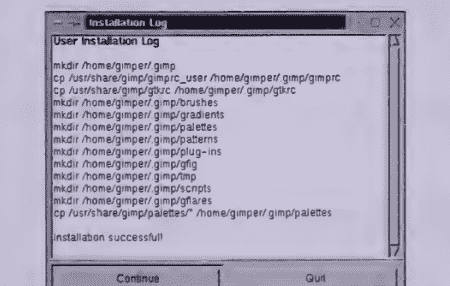

**图 2-2：** GIMP 安装成功

> **提示：** 如果此步骤出错，请验证你的主目录权限设置是否允许你创建目录。

现在应该出现两个窗口。一个是工具箱，另一个是“每日提示”。阅读提示后，点击“关闭”移除该窗口（见图 2-3）。

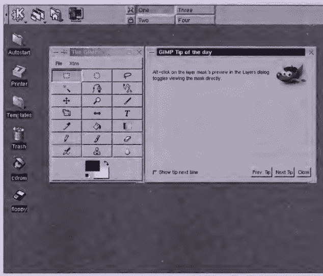

图 2-3：首次运行 GIMP

如果你已经走到这一步，你的 GIMP 安装看起来是成功的。点击文件菜单，然后点击退出以关闭工具箱并退出 GIMP。

## 跟进 GIMP 的发展

软件，尤其是开源软件，变化非常快。有时看起来几乎每次你转身都有一项更新或安全补丁！持续的开发是好事，但除非你恰好是开发者之一，否则很难跟上。

幸运的是，有几个公共（且免费的）邮件列表可以订阅。你可以在 http://www.gimp.org/mailing_list.html 找到有关邮件列表的信息，包括列表存档的链接。

> **提示** 如果你希望减少收到的电子邮件数量，并且主要对公告感兴趣，那么 "gimp-announce" 列表适合你。


如果你不是邮件列表的爱好者，也可以关注GIMP新闻网页 http://www.xach.com/gimp/news/index.html。这个新闻页面涵盖更新、新特性和GIMP活动，并提供便捷的往期新闻存档。与邮件列表不同，如果你想跟上GIMP的发展动态，就必须记得不时查看它。

> **交叉引用** 关于GIMP互联网资源列表，请参见附录A。

### 总结

本章中，我们讨论了如何为你的系统下载和编译GIMP。编译应用程序可能看起来工作量不小，但从长远来看通常值得，因为它使你能够运行最新版本，而不必等待RPM包的发布。如果你有兴趣了解GIMP的工作原理，它还为你提供了查看源代码的选择。

有些用户更关心安装的便利性。如果你的情况属于此类，并且你运行的是支持RPM的系统，使用RPM包安装或升级GIMP副本可能是更好的选择。

关于升级的顾虑很重要，因为安装通常不是一劳永逸的。随着新版本的发布，你可能想要安装最新版本以利用其提供的任何新特性。虽然不必安装每一个小版本，但建议升级到主要的新版本，因为来自GIMP社区的支持通常围绕当前稳定版展开。

一旦安装完成，GIMP就以一个专业且精致的应用程序面貌呈现。随着你对GIMP越来越熟悉，你会发现它的外观和感觉已经以GIMP工具包（GTK）的形式获得了独立的生命力。其他使用GTK的应用程序也将借鉴这种外观和感觉。

## 开始使用

本章中，我们将首次真正接触GIMP。许多人通过直接上手使用程序学得最好，这正是我们要做的。我们将创建一个基本图像，并在此过程中向你介绍一些工具。

然而，我们不会花太多时间深入解释这些工具和功能。本书的第二部分将详细涵盖这些内容。在这里，我们希望让你熟悉界面，并能够熟练地进行导航。

## 启动和退出GIMP

在深入使用GIMP之前，学习如何启动以及之后如何退出是至关重要的。

### 启动GIMP

虽然许多不同的窗口管理器都可以在X下运行，但有一种适用于所有系统的基本方法来打开GIMP。只需打开一个终端窗口（例如 `xterm`）并输入以下命令：

```
gimp &
```

这会在一个子shell中启动GIMP，意味着你可以在终端窗口中取回提示符。在GIMP启动过程中，它需要加载几个文件。此时会显示一个状态栏，如图3-1所示。

> **注意** 如果 `gimp` 文件不在你的路径中，你必须指定可执行文件的完整路径。例如，如果GIMP安装在 `/usr/local` 目录中，请使用 `/usr/local/bin/gimp` & 来启动它。

## 第3章

### 本章内容

- 启动和退出GIMP
- gimprc文件
- 创建新图像
- 更改颜色
- 使用铅笔和画笔
- 撤销功能
- 保存图像
- GIMP导览

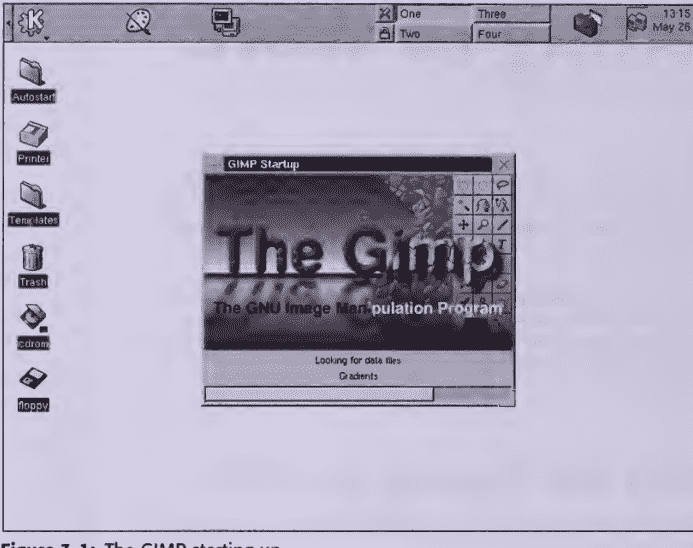

图3-1：GIMP启动中

GIMP加载完成后，你会看到工具箱，以及可能的每日提示窗口（见图3-2）。点击关闭按钮以关闭该窗口。每日提示窗口会显示有用的提示和注释，每次启动GIMP时都会出现，除非你停用它。

### X窗口管理器

运行窗口管理器本应使启动常用应用程序等操作更容易。许多窗口管理器使用菜单系统或图标系统（或两者兼有）来促进这一过程。

### KDE

KDE是一个流行的桌面环境。它不仅仅是一个窗口管理器，还增加了诸如拖放桌面、任务栏、数十种实用程序和标准用户界面等功能。它被许多Linux发行版捆绑作为默认用户桌面。

在KDE中启动GIMP的一个快速方法是使用Alt-F2组合键。这会调出一个简单的对话框，你可以在其中输入要运行的命令。在对话框中键入gimp即可启动GIMP，前提是它在你的路径中。否则，你必须键入GIMP的完整路径，例如/usr/local/bin/gimp。

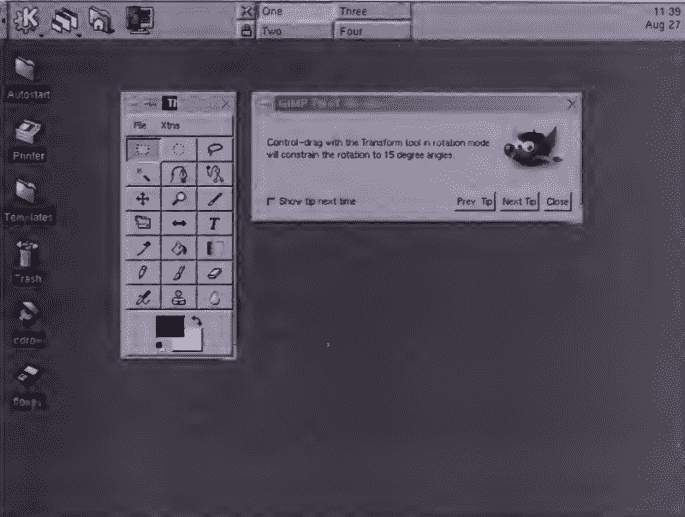

**图3-2：** GIMP每日提示窗口

对于更持久的解决方案，可以尝试在桌面上创建一个图标来启动GIMP。为此，请在背景处右键单击，从菜单中选择新建，然后从出现的子菜单中选择应用程序。

在出现的对话框（如图3-3所示）中，将你要创建的应用程序图标名称更改为gimp.lnk。点击确定按钮。

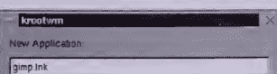

**图3-3：** 在KDE下创建图标

这将在你的桌面上创建一个新的KDE风格的“齿轮”图标，与图3-4中所示的非常相似。接下来，右键单击新创建的图标，从出现的菜单中选择属性。在出现的对话框中的执行选项卡下，在执行文本字段中输入 **gimp**。

32 第一部分 ✦ 入门

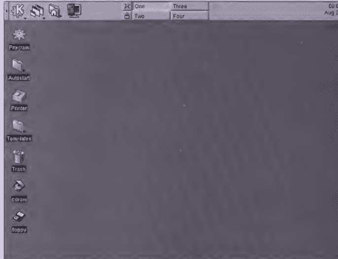

图3-4：带有新图标的KDE桌面

> 提示
如果你想更改图标，点击图标符号会调出一个对话框，让你可以这样做（见图3-5）。

通过点击你的新GIMP应用程序图标来测试它。

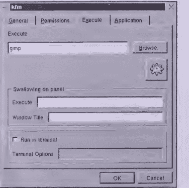

图3-5：编辑KDE图标属性

### GNOME

向GNOME面板添加图标（称为 *应用程序启动器*）的过程类似。右键单击GNOME面板，从出现的子菜单中选择添加新启动器选项。

在出现的对话框中，将命令行的内容更改为显示 `gimp`。然后点击确定按钮，如图3-6所示。

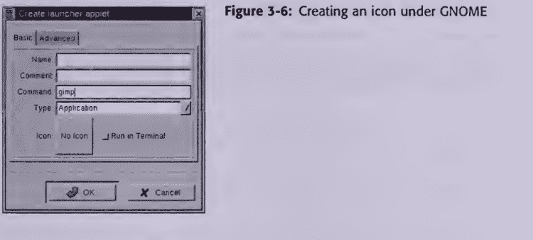

如果你想更改图标，点击“无图标”符号以启动图标选择器，通过它你可以选择一个图标。如果没有选择图标，则使用默认图标。

### 其他窗口管理器

在其他窗口管理器中，你需要使用不同的方法来添加图标或菜单条目。请查阅它们的文档以获取帮助。

### 关闭GIMP

要退出GIMP，请点击文件菜单并选择退出。或者，你可以使用Ctrl+Q组合键退出。

### gimprc文件

`gimprc` 文件是GIMP的配置文件。它包含有关其他文件位置、用户首选项和其他可配置设置的信息。

实际上有两个 `gimprc` 文件。一个是全局文件，通常位于 `/usr/local/share/gimp` 或 `/usr/share/gimp` 目录中。它包含所有用户的默认设置。另一个是每个用户自己目录中的配置文件。

gimprc文件是简单的纯文本格式，你可以使用任何文本编辑器查看或编辑它们。

gimprc文件很重要，因为它使你能够自定义GIMP的操作方式。许多设置对性能有很大影响，可以帮助你调整GIMP以在你的系统上良好运行。该文件还让你一窥可用的配置选项类型。

#### 全局默认gimprc

默认gimprc在本节中显示，中间穿插着注释。在文件本身中有很多注释，由#字符表示。我们编辑了其中一些注释行以避免文本换行到下一行；这完全不影响文件的操作。

```
# This is the system-wide gimprc file. Any change made in this
# file will affect all users of this system, provided that they
# are not overriding the default values in their personal
# gimprc file.

# Lines that start with a '#' are comments.
# Blank lines are ignored.
```

因为此文件影响所有用户，并且由于文件上的权限设置，你通常必须以root身份登录才能编辑它。

#### 数据和插件文件目录

以下设置GIMP数据和插件文件的目录。由于这是一个RedHat Linux系统，前缀设置为/usr。在许多其他系统上，它设置为/usr/local。只要此前缀指向实际存在并包含正确文件的目录，目录位于何处并不重要。

```
# The variable gimp_dir is set to either the interned value
# .gimp or the environment variable GIMP_DIRECTORY. If
# the path in GIMP_DIRECTORY is relative, it is considered
# relative to your home directory.
(prefix "/usr")
(exec_prefix "${prefix}")
(gimp_data_dir "${prefix}/share/gimp")
(gimp_plugin_dir "${exec_prefix}/lib/gimp/1.0")
```

#### 临时存储目录

默认情况下，临时存储设置为目录 ~/.gimp/tmp，其中~是你的主目录。请注意，因为目录以句点开头，在执行目录列表时可能从视图中隐藏。某些系统被设置为

定期自动清理 /tmp 中的所有内容，因此将该目录用作临时文件存储可能不是一个好主意。

```
# Set the temporary storage directory...files will appear here
# during the course of running the gimp. Most files will
# disappear when the gimp exits, but some files are likely to
# remain, such as working palette files, so it is best if this
# directory not be one that is shared by other users or is
# cleared on machine reboot such as /tmp.
(temp-path "${gimp_dir}/tmp")
```

###### 交换文件

以下代码在 ~/.gimp 中创建你的交换文件。交换文件用于存放你正在处理的图像的部分内容，这就是为什么将交换文件路径指向网络上的位置会在编辑较大文件时*显著*降低 GIMP 的速度。

```
# Set the swap file location. The gimp uses a tile based memory
# allocation scheme. The swap file is used to quickly and
# easily swap files out to disk and back in. Be aware that the
# swap file can easily get very large if the gimp is used with
# large images. Also, things can get horribly slow if the swap
# file is created on a directory that is mounted over NFS. For
# these reasons, it may be desirable to put your swap file in
# "/tmp".
(swap-path "${gimp_dir}")
```

###### 画笔路径

以下代码设置 GIMP 查找画笔的路径。请注意，全局目录和个人目录都已列出，以冒号分隔。这允许你将自定义画笔放置在任一位置，具体取决于你是否希望该自定义画笔可供全局访问。

```
# Set the brush search path...this path will be searched for
# valid brushes at startup.
(brush-path "${gimp_dir}/brushes:${gimp_data_dir}/brushes")
```

###### 默认画笔

此代码选择默认画笔，在本例中是一个 19 像素宽的柔边圆形。

```
# Specify a default brush. If none is specified it defaults to
# the "1circle.gbr" brush which is just a single pixel sized
# brush. The brush is searched for in the brush path.
(default-brush "19fcircle.gbr")
```

###### 图案、调色板、渐变和插件路径

与刚才提到的画笔路径和默认画笔类似，此代码设置图案、调色板、渐变和插件的路径和默认值。

```
# Set the pattern search path...this path will be searched for
# valid patterns at startup.
(pattern-path "${gimp_dir}/patterns:${gimp_data_dir}/patterns")

# Specify a default pattern.
# The pattern is searched for in the specified pattern paths.
(default-pattern "wood2.pat")

# Set the palette search path...this path will be searched for
# valid palettes at startup.
(palette-path "${gimp_dir}/palettes")

# Specify a default palette.
# The pattern is searched for in the specified pattern paths.
(default-palette "Default")

# Set the gradient search path...this path will be searched for
# valid gradients at startup.
(gradient-path
"${gimp_dir}/gradients:${gimp_data_dir}/gradients")

# Specify a default gradient.
# The gradient is searched for in the specified gradient paths.
(default-gradient "German_flag_smooth")

# Set the plug-in search path...this path will be searched for
# plug-ins when the plug-in is run.
(plug-in-path "${gimp_dir}/plug-ins:${gimp_dir}/plug-ins/script-fu:${gimp_plugin_dir}/plug-ins")

# Set the path for the script-fu plug-in. This value is
# ignored by the GIMP if the script-fu plug-in is never run.
(script-fu-path "${gimp_dir}/scripts:${gimp_data_dir}/scripts")
```

###### 默认图块缓存

图块缓存使 GIMP 能够编辑超出可用内存容量的文件。在内存有限的计算机上，降低此值可能会有所帮助。反之，如果你拥有大量内存且不介意 GIMP 使用它，将其设置为更高的值可以在编辑较大图像时显著提升性能。以下代码将默认图块缓存设置为 10MB 内存。

```
# The tile cache is used to make sure the gimp doesn't thrash
# tiles between memory and disk. Setting this value higher will
# cause the gimp to use less swap space, but will also cause
# the gimp to use more memory. Conversely, a smaller cache size
# causes the gimp to use more swap space and less memory.
# Note: the gimp will still run even if `tile-cache-size` is
# set to 0. The actual size can contain a suffix of 'm', 'M',
# 'k', 'K', 'b' or 'B', which makes the gimp interpret the
# size as being specified in megabytes, kilobytes and bytes
# respectively. If no suffix is specified the size defaults to
# being specified in kilobytes.
(tile-cache-size 10m)
```

###### 行进蚂蚁的速度

以下代码简单地设置了进行选区时行进蚂蚁轮廓的速度。虽然它改变了 GIMP 的外观，但对 GIMP 的实际工作方式没有实质性影响。

```
# Speed of marching ants in the selection outline
# this value is in milliseconds
# (less time indicates faster marching)
(marching-ants-speed 300)
```

###### 撤销级别

增加撤销级别的数量是一个重要选项，因为它使你能够在内存使用增加的代价下从更多更改中恢复。如果你的计算机拥有大量内存，将其设置为更高的值（如 9）将在尝试编辑图像时给你更多的安心。

```
# Set the number of operations kept on the undo stack
(undo-levels 5)
```

###### 颜色映射表

这些选项允许你自定义颜色映射表。颜色映射表仅在你使用 8 位（256 色）显示时使用，用于创建模拟更多颜色的抖动像素。大多数用户不需要更改此设置，因为无论如何更高的色深才是图像工作的首选。

```
# Set the color-cube resource for dithering on 8-bit displays
# The 4 values stand for Shades of red, green, blue and grays
# Multiplying the # of shades of each primary color yields
# the total number of colors that will be allocated from the
# gimp colormap. This number should not exceed 256. Most of
# the colors remaining after the allocation of the colorcube
# will be left to the system palette in an effort to reduce
# colormap "flashing".
(color-cube 6 6 4 24)

# Install a GIMP colormap by default -- only for 8-bit displays
# (install-colormap)
```

###### 行进蚂蚁

以下代码指定了一种不同的 GIMP 绘制行进蚂蚁的方式，仅适用于 8 位（256 色）显示器。默认情况下，该命令被注释掉且未使用。

```
# Specify that marching ants for selected regions will be drawn
# with colormap cycling as opposed to redrawing with different
# stipple masks this color cycling option works only with 8-bit
# displays
# (colormap-cycling)
```

###### 默认工具值

这是那些基于像素与所选像素的相似程度来匹配像素的工具的默认值。由于你可以在工具内部更改此值，因此在此处更改通常是不必要的。

```
# Tools such as fuzzy-select and bucket fill find regions based
# on a seed-fill algorithm. The seed fill starts at the
# initially selected pixel and progresses in all directions
# until the difference of pixel intensity from the original is
# greater than a specified threshold
#  ==> This value represents the default threshold
(default-threshold 15)
```

###### 释放内存

以下代码展示了另一个与性能相关的设置。取消注释 "stingy-memory-use" 设置将在 GIMP 中开启节约内存模式。如果你不希望 GIMP 在运行时使用过多内存，例如为了释放内存给其他正在运行的应用程序，这将很有用。请记住，你将因此体验到性能下降。

```
# There is always a tradeoff between memory usage and speed.
# In most cases, the GIMP opts for speed over memory. However,
# if memory is a big issue, set stingy-memory-use
# (stingy-memory-use)
```

###### 缩放

在处理图像时，你经常会发现自己需要放大或缩小。此处显示的选项，如果取消注释，将自动调整 GIMP 图像窗口的大小以匹配当前图像尺寸。在其默认值下，窗口保持相同大小，你必须在放大图像后使用滚动条。

```
# When zooming into and out of images, this option enables the
# automatic resizing of windows
# (allow-resize-windows)
```


###### 禁用上下文相关光标

在非常低端的系统上，你可能需要通过取消注释以下代码中的设置来禁用上下文相关光标。这样做会带来轻微的性能提升。

```
# 上下文相关光标很酷。默认情况下它们是启用的。
# 然而，它们需要一些开销，你可能希望省去这些开销。
# 取消注释此行以禁用它们。
# (no-cursor-updating)
```

###### 图层预览大小

在“图层与通道”对话框中，以下代码用于设置图层预览的大小。增大预览尺寸可以让你看到更多细节，这很方便。

```
# 图层预览大小：
#  none:      在图层对话框/图层选择器中不显示预览
#  small:     32x32
#  medium:    64x64
#  large:     128x128
#  #:         #x#
(preview-size small)
```

###### 工具提示

工具提示对新用户来说是最有用的功能之一。它们是在你将鼠标悬停在工具箱中的按钮上时出现的描述性标签。我们想不出有什么理由要关闭它们，但如果你愿意，这个选项是可用的。

```
###### 工具提示
# 注释掉此项以禁用工具箱中的工具提示
# (dont-show-tool-tips)
```

###### 标尺

这些选项控制是否显示标尺以及以何种度量单位显示。

```
# 控制标尺的可见性
# 默认行为是标尺为开启状态
# 这也可以通过 视图->显示标尺 命令或 Shift+Ctrl+R 来切换
# (dont-show-rulers)

# 标尺单位
# 标尺的单位可以是以下之一：(像素 英寸 厘米)
# 默认是像素
(ruler-units pixels)
```

###### 自动保存——尚未实现

以下代码只是对未来的一个展望，因为自动保存选项尚未实现。

```
# 禁用自动保存
# 自动保存尚未实现！无论你在此处如何设置，
# 都不会有任何内容被自动保存。
# 只需取消注释下面这一行...
# (dont-auto-save)
```

###### 禁用确认

如果启用了禁用确认选项，鼠标的轻微滑动就可能意外导致你丢失图像。不建议使用此选项。

```
# 在不保存的情况下关闭图像前禁用确认
# 只需取消注释下一行
# (dont-confirm-on-close)
```

###### 插值

以下代码展示了另一个与性能相关的选项。拥有更快计算机的用户可能希望启用三次插值；它能提供略微更精确的颜色，但使用更多的CPU资源。

```
# 设置插值级别
# 取消注释此行将启用三次插值。
# 默认情况下，GIMP 使用线性插值，这更快，
# 但质量较差。
# (cubic-interpolation)
```

###### 伽马校正

伽马指图像的亮度校正。这是一个全局设置；因为图像可能先前已被修改，这可能导致双重伽马校正和图像冲淡。默认值1.0表示不进行伽马校正。较高的值会增加亮度，而较低的值会使图像变暗。

```
# 设置显示器的伽马校正值
# 1.0 对应无伽马校正。对于大多数显示器，
# 伽马校正应设置在 2.0 到 2.6 之间。
# 运行工具 "gamma_correct" 来确定适合你显示器的值。
#
# 需要记住的重要一点：许多你可能从外部来源获得的图像，
# 很可能已经经过了伽马校正。在这些情况下，如果 GIMP 开启了
# 伽马校正，图像看起来会显得冲淡。如果你打算处理这类图像，
# 请通过删除此行或将其值设置为 1.0 来关闭伽马校正。
# gamma-correction 1.0
# gamma-correction 2.0
(gamma-correction 1.0)
```

###### 透明度

透明度在图像处理程序中很难处理，因为你看不见它。为了指示图像中透明的部分，GIMP 使用了几种方法中的一种，你可以在此处设置。默认是大的棋盘格图案。

```
# 设置图像中透明度的显示方式
# 透明度类型可以是以下之一：
#   0: 浅色方格
#   1: 中间色调方格
#   2: 深色方格
#   3: 仅白色
#   4: 仅灰色
#   5: 仅黑色
# 方格大小可以是以下之一：
#   0: 小
#   1: 中
#   2: 大
(transparency-type 1)
(transparency-size 2)
```

###### gfig 插件图案路径

这部分放在其他路径配置部分会更合理，但默认文件把它放在了接近末尾的位置。以下代码设置了 gfig 插件图案的路径。

```
# gfig 图案目录
(gfig-path "${gimp_dir}/gfig:${gimp_data_dir}/gfig")
```

## 文件结束

此代码表示文件的结束。它只是一个注释，不需要必须存在。

```
# [文件结束]
```

正如我们之前提到的，用户也可以在自己的目录中存储一个 gimprc 文件。全局 gimprc 文件指定了此文件的位置；默认是在用户主目录下名为 .gimp 的目录。该文件具有与全局 gimprc 相同的格式和选项，但它会覆盖全局设置。

**注意** 在单用户系统上，你修改哪个文件（全局或用户）实际上并不重要。在多用户系统上，默认设置应存储在全局 gimprc 文件中，而个别用户的偏好设置可以在个人 gimprc 文件中设置。

## 个人 gimprc 文件

个人 gimprc 文件的示例如下所示：

```
# 这是你的个人 gimprc 文件。在此文件中定义的任何变量
# 都优先于系统范围 gimprc 中定义的值：
# ${prefix}/share/gimp/gimprc
# （其中 ${prefix} 是 /usr）
# 如果你想查看一些可以在此处设置的选项，请查看该文件。

# 大多数值都可以在 GIMP 内自动设置，如果你在
# “首选项”对话框中更改一些选项后按“保存”按钮。
# 你也可以手动编辑此文件，GIMP 在保存新选项时
# 始终会尝试做正确的事情。
(show-tips yes)

#- 下一行由 GIMP 于 1999-05-26 20:00:20 修改
(last-tip-shown 10)

#- 下一行由 GIMP 于 1999-04-05 03:06:12 添加
(undo-levels 7)
```

这就是 GIMP 如何跟踪你上次看到的每日提示。

该用户已将系统上的撤销级别数量更改为 7。

**注意** 无需在你的个人 gimprc 文件中添加注释——它们只是提醒你这些选项作用的便利工具。

你从 GIMP 内部进行的许多更改都会保存到此文件中，这比手动编辑文件更容易。

#### 创建新图像

要创建新图像，请从工具箱的“文件”菜单中选择“新建”（或使用键盘快捷键 Ctrl+N）。将打开“新建图像”对话框，如图 3-7 所示。

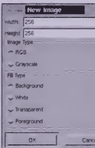

选择所需图像大小后，将图像类型设置为 RGB（彩色）或灰度。请注意，创建新的 RGB 图像时，你会使用 24 位色深，直到保存图像时才能选择该图像所需的色深。

选择新图像的填充类型。“背景”和“前景”选项使你能够分别使用当前选定的背景或前景颜色填充图像。“透明”选项用透明度填充图像，这对于创建稍后要显示在其他图像之上的图像很方便。“白色”选项提供默认的白色背景。

单击“确定”按钮，新图像窗口将会出现。

#### 更改颜色

“前景/背景”工具位于工具箱底部，使你能够选择要使用的颜色。单击“前景”框（左上角的那个）可以设置前景颜色；反之，单击“背景”框（右下角）可以设置背景颜色。

使用绘画工具时会使用前景颜色。背景工具通常与渐变等功能一起使用，提供第二个颜色点。

**提示** 单击双向箭头可以交换两种颜色，使前景变为背景，反之亦然。如果你想保存一种颜色以备后用，同时临时使用新颜色，这很有用。

当你单击任一方框时，“颜色选择”对话框将出现（见图 3-8）。它易于使用但难以理解。只需尝试所提供的控件，你就能选择想要使用的颜色。如果你有

然而，只要你具备一定的色彩理论知识，就能够精确地选择你想要的颜色。

> 第 4 章简要介绍了色彩理论，第 11 章则进行了深入讲解。

**图 3-8：** 颜色选择对话框

#### 使用铅笔和画笔

铅笔和画笔工具使你能够将 GIMP 作为简单的绘图程序来使用。

这两种工具非常相似，都是用于手绘绘画。不过，铅笔的边缘是硬朗的，而画笔则在边缘使用渐变效果，以创建更柔和、更朦胧的表面。

在 8 倍缩放级别下，两者的差异一目了然，如图 3-9 所示。

**图 3-9：** 铅笔与画笔的对比

#### 撤销命令

撤销命令是任何应用程序中最重要的功能之一，我们有时甚至希望它能被移植到现实生活中。

要使用撤销命令，右键单击图像，然后从"编辑"菜单中选择"撤销"。如果你和我们一样，可能会经常使用撤销功能，那么通过键盘快捷键而不是菜单来执行该命令，会节省大量时间。要通过键盘撤销操作，请使用 Ctrl+Z 组合键。

有时在编辑图像时，你可能会撤销了一步操作，但随后又觉得之前的效果更好。对于这种情况，撤销命令的配套功能"重做"可以让你撤销撤销操作，也就是说"再次撤销"。重做命令的键盘快捷键是 Ctrl+R。

你可以使用的撤销（和重做）级别数在 `gimprc` 文件中设置。如果你的机器内存充足，增加这个数值会有所帮助。

#### 保存图像

要首次保存你正在处理的图像，只需右键单击图像，然后从"文件"菜单中选择"另存为"。在弹出的"保存图像"对话框（如图 3-10 所示）中输入你想使用的文件名，并包含文件扩展名以指明你想保存的文件格式。

> 附录 C 提供了更多关于不同文件格式的信息。

文件保存一次后，你可以使用"保存"菜单项将文件保存为相同的文件名。此操作的键盘快捷键是 Ctrl+S。

> 有关"保存图像"对话框中其他可用选项的更多信息，请参阅第 7 章。

**图 3-10：** 保存图像对话框

## GIMP 导览

到目前为止，本章已经介绍了一些 GIMP 的基本任务和功能。接下来，我们将对 GIMP 进行一次导览，向你展示如何创建一个简单的图像。我们将在本书后面才深入讲解此处涉及的某些内容；这里的目的更多是让你在深入第二部分之前先对 GIMP 有个初步的了解。

在某些操作中，部分指令在具体数值方面有些模糊。这是有意为之的，因为在 GIMP 中创建图像时，你经常会尝试各种选项（合理使用撤销功能可以让你这样做）。实际上，在编写本节内容时，我们多次创建了该图像，最终得到了一些非常不同的结果。

首先，启动 GIMP 并创建一个新图像。在本例中，我们使用 500 像素的宽度和 200 像素的高度。图像类型为 RGB，填充类型为背景色（如图 3-11 所示）。

使用填充工具将背景填充为好看的米色（如图 3-12 所示）。确切的颜色并不重要，但选择一种能与亮黄色融合的颜色效果最好。

**图 3-11：** 创建新图像

**图 3-12：** 使用填充工具

接下来，我们使用"超级新星"效果创建一个亮黄色的太阳。右键单击图像，选择"滤镜"菜单。在出现的子菜单中，选择"光影效果"，然后选择"超级新星"。

将超级新星的起源位置设置在图像的左上角附近。将红色和绿色（R 和 G）滑块全部移到最右边，将蓝色（B）滑块全部移到最左边，以生成亮黄色的超级新星。最后，为半径和射线设置一些较小的值（如图 3-13 和图 3-14 所示）。

**图 3-13：** 使用"超级新星"效果

**图 3-14：** 完成的超级新星效果

现在我们需要选择一些适合用作云朵的颜色，例如浅灰色，略带蓝色调（如图 3-15 所示）。

我们需要为这些云朵创建一个新图层。为此，右键单击图像并选择"图层"菜单。从中选择"图层与通道"项，打开"图层与通道"对话框。

**图 3-15：** 选择云朵颜色

单击对话框左下角的"新建图层"按钮。如果你不确定是哪个按钮，可以将鼠标悬停在每个按钮上；一秒钟左右后会弹出一个工具提示，描述该按钮的功能。

确保新图层的大小相同（500 x 200 像素），并将填充类型设置为背景色。这将创建一个新的白色图层（如图 3-16 所示）。

**图 3-16：** 创建新图层

使用图像上的填充工具，将整个图像填充为你选择的云朵颜色（如图 3-17 所示）。

**图 3-17：** 用云朵颜色填充新图层

> 提示：你也可以使用前景色来创建图层，因为前景色已经设置为了云朵颜色。

现在，我们使用橡皮擦工具来露出原始图层的部分内容。擦除新图像的大约一半，并尽量使擦除的区域呈现云朵的形状（如图 3-18 所示）。

**图 3-18：** 擦除云朵图层的部分内容

使用文字工具，在图像底部附近大致居中的位置单击。这将弹出文字工具对话框。选择一种好看的衬线字体，如 Times，并将大小设置为约 50 像素。将字重设置为粗体是个不错的选择；当字体用于非高对比度的背景上时，往往会显得过于纤细。

输入一些用于图像的文字。我们使用了"Home Sweet Home"，但任何长度大致相同的短语都可以（如图 3-19 所示）。

> **提示** 如果你想使用更短或更长的短语，只需相应地调整字体大小即可。

**图 3-19：** 在图像中添加文字

你的文字应该仍然被行进的蚂蚁线（即表示选区位置的移动轮廓）所包围。我们想稍微旋转文字，因此选择变换工具并单击文字。在按住鼠标按钮的同时，你可以通过拖动鼠标以各种方式操作该文字。将文字设置为一个轻微的角度，然后使用移动工具将文字移动到图像的右下角（如图 3-20 所示）。

**图 3-20：** 在超级新星图像中轻微旋转文字

> **提示** 如果你在操作时查看"图层与通道"对话框，你会注意到出现了一个浮动选区。这是正常的——它只是你选中的文字。

当你完成文字选区的操作后，通过右键单击并选择"图层"菜单中的"锚定图层"，将其固定到图像上。

现在我们为云朵再创建一个图层，以增加更多的层次感。为此，右键单击图像并选择"图层"菜单。从中选择"图层与通道"项，打开"图层与通道"对话框。单击对话框左下角的"新建图层"按钮。

我们再次使用与其他图层大小相同（500 x 200 像素）的图层，将填充类型设置为背景色，以创建一个新的白色图层（图 3-21）。

将前景色更改为第二种类似云朵的颜色。在这里，我们使用了一种饱和度稍高的蓝色。使用填充工具将图层填充为你选择的第二种云朵颜色（如图 3-22 所示）。


图 3-21：添加另一层云层

图 3-22：选择第二种云彩颜色

再次使用橡皮擦工具来显露下层的一部分。这次你想擦除图层的大部分，使用这第二种云彩颜色为你的原始云彩添加高光（见图 3-23）。

最后，我们想将所有图层合并为一个图层（见图 3-24）。为此，右键单击图像，然后从“图层”菜单中选择“合并图层”。这样，我们就得到了完成后的图像！

**提示**

如果你查看“图层与通道”对话框，所有图层应该都已合并为一个图层。

完成后的图像让我们想起了一些我们见过的乡村风格装饰。诚然，这是一个相当原始的图像，设计目的更多是作为一个快速教程，而不是用来装饰作品集。有更简单、更漂亮的方法来创建云彩，你将会学到，但这种方法让我们得以在导览中悄悄引入图层概念。在第五部分，你将有机会看到更复杂的图像处理。

#### 本章总结

本章介绍了*gimprc*文件，它使你能够根据自己的喜好自定义GIMP。我们还花了一些时间浏览了GIMP，快速介绍了主要的工具和功能，包括填充、擦除、超新星、图层、选区和文本。

在本书的下一节，我们将开始全面介绍GIMP中的工具。

◆ ◆ ◆

## 第二部分

## GIMP 工具

### 本部分内容

-   **第 4 章** 学习基本工具
-   **第 5 章** 选择工具
-   **第 6 章** GIMP 菜单系统
-   **第 7 章** 图像窗口上下文菜单

## 学习基本工具

GIMP程序相当直观。你可以从各种工具中进行选择，并使用它们在图形的当前图层上绘制，或选择和修改当前图层中的区域。大多数图形只有一个图层，但使用图层（在第10章详细讨论）可以让你轻松创建复杂的图像。

在上一章中，你学习了如何启动和停止GIMP、创建和打开图像、更改颜色以及使用GIMP中可用的基本绘图工具。本章将带你更进一步。在这里，你将了解工具箱以及如何使用其中的工具。

### 什么是工具箱？

工具箱是标题为“The Gimp”的浮动面板，如图4-1所示。它是GIMP中的主窗口，关闭它将关闭GIMP中所有打开的图像。主GIMP窗口有两个菜单，File和Xtns，它们不属于工具箱的一部分。菜单名称下方是一系列21个小按钮，每个按钮代表GIMP中的一个工具。颜色选择器位于底部。

### 本章内容

-   什么是工具箱？
-   基本工具
-   绘图工具
-   填充工具
-   工具箱快速参考

本章讨论构成工具箱的21个小按钮和颜色选择器。每个按钮都有特定的用途。例如，默认工具（由工具箱左上角带虚线矩形的按钮表示，见图4-2）用于进行矩形选区。

> 交叉引用：选择工具全部在第8章深入讨论。

要使用GIMP中的任何工具，请单击工具箱上其关联的按钮。你的指针将变为铅笔、橡皮擦、一组十字准线或一系列箭头，你就可以将该工具应用于你的图形，如图4-3所示。

## 基本工具

有两个基本工具的行为类似于元工具。它们可以影响所有其他工具，或改变整个图形的显示。第一个工具是颜色选择器，它帮助你在GIMP中更改背景和前景色。第二个工具称为缩放控制，它可以让你放大和缩小你的图形。

### 颜色选择器

如图4-4所示的颜色选择器，让你选择用于前景和背景工具的颜色。例如，画笔是一个前景工具；它在绘制彩色时使用前景色。橡皮擦移除颜色（清除选区也是如此），留下颜色选择器中的背景色。

要选择前景色，请单击颜色选择器中的顶部框。如图4-5所示的颜色选择窗口将会出现。窗口右上角的框显示旧颜色（右）和新颜色（左）。要选择背景色，首先单击底部框（看起来像是隐藏在前景色框后面的框）以打开颜色选择器窗口。其余步骤相同。

默认情况下，GIMP在颜色选择器中使用黑色和白色，颜色选择窗口显示红色的色调。要更改用作基础的颜色，请将指针悬停在色调选择器旁边的光谱上并左键单击。基本颜色会改变，新颜色框也会随之改变。

**提示** 这里有一个返回黑白色的快捷方法：单击颜色选择器左下角的小黑白图标。你也可以使用键盘快捷键 D。

要更改颜色的色调，请将指针悬停在色调选择器框中的色调上并单击。新颜色框将改变以反映你的选择（见图4-6）。

**图 4-6：** 单击色调选择器中所需的颜色以更改为新颜色，本例中是从黑色变为粉红色。

你也可以直接更改色相、饱和度和明度以及红、绿和蓝的值。上下移动滑块以更改值，或选择数字并键入新值，如图4-7所示。如果你试图匹配网页中RGB十六进制值的颜色与网页图形中的突出颜色，这尤其有用。

**图 4-7：** 你可以直接键入颜色值，以更精细地控制你的颜色。

> **注意** 色相、饱和度和明度调整器与红、绿和蓝调整器是分开的。如果你手动输入红-绿-蓝值，然后调整色相、饱和度和明度，最终得到的颜色将与你最初的目标不同。

> **交叉引用** 更多关于颜色的信息请参见第11章。

当你选择好颜色后，单击关闭按钮。要重新开始，请单击“恢复为旧颜色”。

> 提示：通过单击颜色选择器框旁边的箭头（键盘快捷键：X）可以快速切换前景和背景色。

在GIMP中选择颜色的另一种方法是使用一种名为颜色拾取器的滴管形状工具（见图4-8），它允许你从当前图形中提取一种颜色并将其设为前景色。

要使用它，请在工具箱中单击颜色拾取器以选择该工具。然后，将指针悬停在图形中的颜色上并单击。前景色将更改为单击鼠标按钮时指针下方的任何颜色，并且颜色选择器窗口将打开，显示你选择的颜色的基本信息，如图4-9所示。

通过选择 Dialogs > Tool Options（或双击颜色拾取器图标），你可以看到颜色拾取器工具选项窗口。此工具有一个选项，称为“Sample Merged”。在使用分层图像时，颜色拾取器默认从当前图层选择颜色。勾选“Sample Merged”可让颜色拾取器从屏幕上显示的所有图层（包括透明层和叠加层）选择颜色。

### 缩放工具

缩放工具看起来像一个小放大镜，如图4-10所示。你可以使用此工具放大图像的显示，尽管它不会实际影响图形或文件的大小。


[第 91 页]

要放大，请点击放大镜，然后将指针悬停在您希望放大的区域上。左键单击图像即可在您的显示中放大图像（参见图 4-11）。

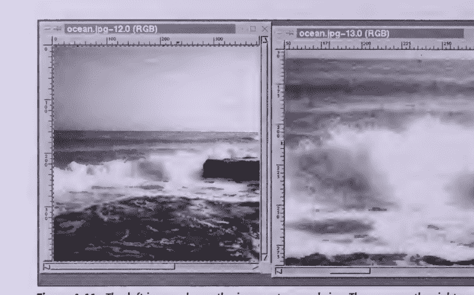

**提示** 要缩小，请在单击图像时按住 Shift 键。

您也可以使用快捷键来缩放：按 =（等号键）放大，按 -（连字符键）缩小。如果您使用快捷键，GIMP 会自动从图像中心进行缩放。

缩放工具有一个工具选项（`对话框 ⇆ 工具选项`），如图 4-12 的工具选项对话框所示。您可以设置缩放工具，以便在放大或缩小时调整窗口大小。

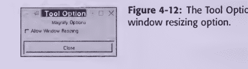

如果允许调整窗口大小，当您放大时，图像窗口会扩大，直到填满大约三分之二的屏幕，而在缩小时会缩小。参见图 4-13 的示例。

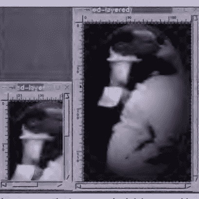

**图 4-13：** 左图放大时未调整窗口大小。右图使用了窗口调整。

## 绘图工具

GIMP 提供了多种使用滤镜、脚本和图层来制作酷炫效果的方法。但基本的绘图能力仍然存在于这个图形程序中。在本节中，您将了解铅笔、画笔、喷枪、文本、克隆、卷积和橡皮擦工具。这些工具中的每一个在 GIMP 的绘图功能中都有特定的用途。此外，您还将了解不同的画笔如何影响这些不同的工具。

### 铅笔

铅笔是 GIMP 中最简单、最优雅的工具之一。它没有需要担心的工具选项。您只需点击它就可以开始使用。物理压力不会影响此工具的结果——也就是说，在同一位置点击并按住铅笔工具不会增加线条宽度或颜色强度（不像其他工具，如画笔和喷枪）。要选择铅笔工具，请点击显示小铅笔图标的按钮（参见图 4-14）。

#### 画笔

画笔与铅笔工具类似，但更灵活。它允许使用可用画笔绘制模糊边缘和阴影。要使用画笔工具，请点击工具栏中带有画笔图标的按钮（参见图 4-17）。

**图 4-17：** 点击画笔图标以使用画笔工具。

您也可以使用画笔对话框来更改铅笔的画笔。在图像窗口中右键单击并选择 `对话框 > 画笔`（`Shift+Ctrl+B`）以打开画笔对话框，如图 4-16 所示。

**图 4-16：** 画笔对话框允许您为铅笔工具选择新的画笔。

选择铅笔工具后，在图像上单击并拖动指针。无论鼠标指针移到哪里，都会出现一条线（参见图 4-15）。

**图 4-15：** 单击并拖动以使用铅笔工具创建手绘线条、形状和图形。

**图 4-14：** 点击铅笔图标以选择铅笔工具。

数位板是使用绘图工具绘图更直观的方式之一。有关安装数位板的信息，请参见第 19 章。

将指针定位在图像上。在移动画笔时按住鼠标按钮，如图 4-18 所示。

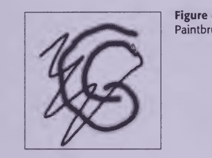

利用画笔和众多可用画笔（以及您自己创建的自定义画笔），您可以创建出色的图形，如图 4-19 所示。

此图像中的星星完全使用画笔工具绘制。最小的模糊圆形画笔和 1000 的间距有助于创建微小的星星。较大的星星是使用较大的模糊圆形画笔仔细渲染而成的。月亮是用铅笔工具绘制的，然后使用油漆桶工具用图案填充。接着使用卷积工具混合图案，并使用曲线选区和图案填充添加地平线。最后，使用喷枪工具添加几笔半透明笔触，为月景增添一些高光，完成了这幅图像。

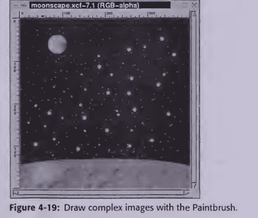

### 画笔对话框

画笔对话框中有多种画笔，包括一些具有模糊边缘的画笔。渐变画笔不适用于铅笔，因为铅笔是一种基本的二值画笔，要么开启要么关闭。此对话框中还包括一些形状奇特的画笔（例如手形），当您使用画笔工具时效果最好，并且只需单击一次（不要拖动）即可将画笔印记盖印到图像上。许多较大的画笔在对话框中难以看清。单击并将指针悬停在画笔上，即可看到整个画笔。

对于简单的线条，使用简单的圆形画笔。边缘锐利的画笔适用于铅笔工具，而边缘渐变的画笔则用于画笔和喷枪工具。使用对角线画笔可以创建书法笔效果——当您尝试在 GIMP 中手写文本时，这种效果尤其出色。

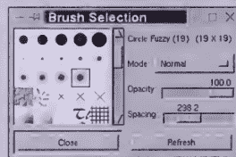

画笔对话框为绘图工具提供了多种画笔和选项。

从画笔对话框中，您可以更改画笔使用的模式。模式将在本章后面关于油漆桶工具的部分讨论。此外，您可以更改画笔的不透明度，以便底层图像能够显示出来。最后，您可以更改当前画笔的间距。间距决定了单个画笔印记出现的紧密程度。如果您不希望较大的画笔重叠，可以增加间距。

您也可以制作自定义画笔。创建一个带有白色背景的大尺寸灰度图像。绘制您的画笔并将其大小调整为每边大约 15 到 20 像素。通过 `图像 -> 颜色 -> 反转` 反转图像颜色。将图像保存为 GBR 文件类型（使用扩展名 .gbr），保存到 `.gimp/brushes` 目录。使用 15 的间距，并为其命名（例如 "My Brush"）。

### 喷枪

喷枪工具（参见图 4-20）为基础绘图工具增加了另一个特性——压力。不，不是指您按鼠标键的力度。在 GIMP 中，“压力”指的是指针在特定区域停留的时间。如果您只停留一秒，喷枪会开始绘制，但非常轻且模糊。如果您继续将指针停留在该位置，颜色会加深，直到完全不透明。

**图 4-20：** 喷枪工具为 GIMP 中的绘图增加了压力特性。

您可以使用喷枪为图像添加特殊效果，例如霓虹灯高光（参见图 4-21）。在此示例中，除文本外的所有内容都被选中以便在当前图层中高亮显示。选择了喷枪工具和一种浅色，并在指针跟踪文本时按住鼠标按钮。

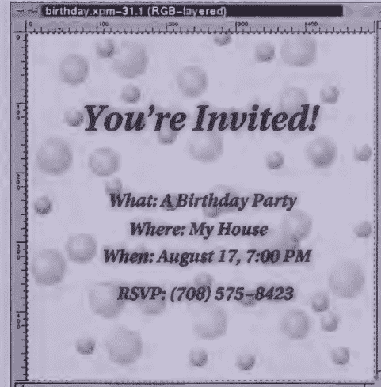

**图 4-21：** 使用喷枪工具为您的图形添加高光。

### 文本工具

有时您可能想向图形添加文本——例如照片的说明文字、署名或网页按钮上的文本。与其尝试手写文本，不如使用 GIMP 的文本工具（如图 4-22 所示）向您的图形添加文本。

**图 4-22：** 使用文本工具为您的图形添加酷炫的文本。

交叉参考：有关使用文本工具的更多信息，请参见第 17 章。

### 克隆工具

克隆工具允许您获取图形的一部分并将其“橡皮图章”到另一部分。这对于在照片或类似写实图像中用图案填充区域特别有用。克隆工具在照片修饰中被广泛使用。

要使用克隆工具，请点击工具箱中的橡皮图章图标（参见图 4-23），或使用快捷键 `C`。克隆工具在“盖章”到区域时使用来自画笔对话框的画笔。使用画笔选项对话框可以更改克隆工具的画笔和透明度选项。

交叉参考：如第 10 章所述，克隆在照片修饰中应用广泛。

**图 4-23：** 选择橡皮图章图标以使用克隆工具。

接下来，将指针定位在您想要克隆的图片区域上。按住 `Ctrl` 键的同时左键单击一次。这将设置克隆工具的源点。然后，将指针移动到您希望插入克隆区域的任何位置（可以是不同的图像）。单击并按住左键同时移动指针。克隆区域就会出现，如图 4-24 所示。

默认情况下，克隆工具选项包括“对齐”选项。当此选项被选中时，插入的图案将继续从原始图案中获取内容，相对于起始插入点。无论您释放鼠标按钮并在另一个区域重新单击多少次，克隆工具都不会使用源点进行图案粘贴。在工具选项对话框中取消选中“对齐”，可让克隆工具在每次单击新区域时都从源点开始。

工具选项还允许您从图案对话框中选择图案，而不是通过 `Ctrl`+单击图像来获取克隆源。图案克隆的结果如图 4-25 所示。


## 卷积工具
不，它不是那种奇怪的医疗器械。它是用来微调照片中克隆区域的粗糙斑点、模糊边缘的模糊-锐化工具。
要使用卷积工具，点击工具箱中的泪滴状图标（如图4-26所示），或按下快捷键V。将指针移动到需要模糊的区域，按住鼠标按键的同时来回移动指针即可。
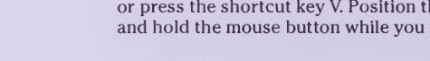
你可以通过「对话框>工具>工具选项」菜单路径，或双击卷积工具图标，来显示该工具的选项设置。随即会打开「卷积工具选项」窗口，如图4-27所示。该工具的可用选项包括模糊、锐化和压力。
你可以通过「模糊」和「锐化」单选按钮，选择让卷积工具对边缘执行模糊还是锐化处理。「压力」选项会根据你按住鼠标按键的时长，决定图像的模糊或锐化程度。默认数值为50，适合精细控制，不过我们更习惯使用稍高一点的数值，通常在75到100之间。
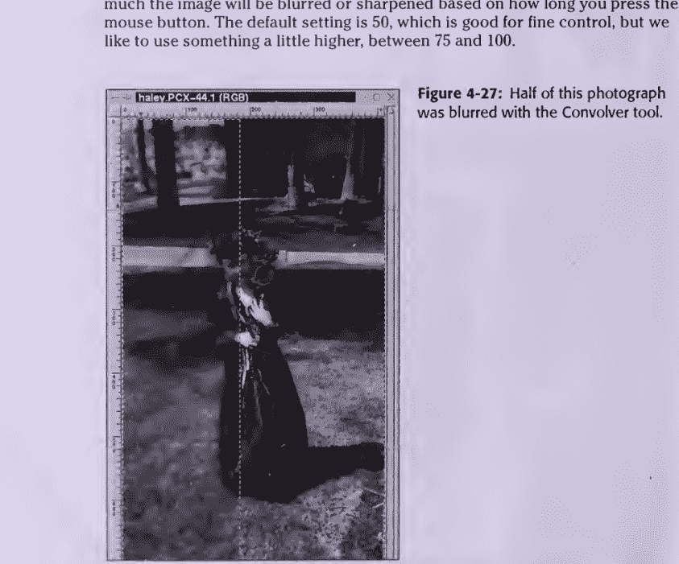
如图4-27所示，卷积工具被用来模糊展示照片的一半区域。该工具在照片处理上效果尤其出色，既可以柔化背景，也可以提升显影不足的照片的清晰度。
要锐化模糊的图像，先选中卷积工具，再在「卷积工具选项」对话框中点击「锐化」即可。图4-28展示了一张经过卷积工具修饰前景（家族墓地）的模糊照片。
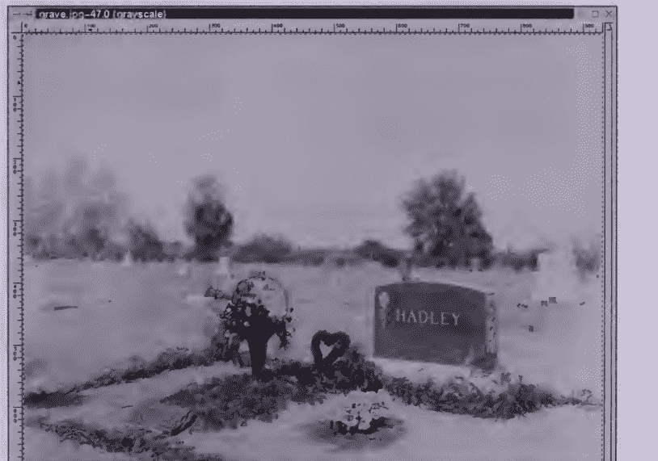
**图4-28：用卷积工具修整新老照片**

## 橡皮擦
橡皮擦工具通过移除像素颜色来擦除图像的部分区域。如果当前图层包含Alpha通道（即支持透明度），或者当前图层下方存在其他图层，擦除后的像素会变为透明；如果不存在Alpha通道，则会显示出底层的背景色。
要使用橡皮擦工具，点击工具箱中的橡皮擦图标（如图4-29所示）。
**图4-29：橡皮擦可以将图像的部分区域替换为背景色**
将指针移动到想要擦除的区域，按住鼠标按键的同时移动指针即可。示例效果如图4-30所示。
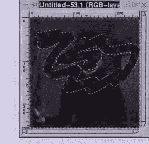
**图4-30：按住鼠标按键即可擦除图像**
> 橡皮擦擦除时会使用当前选中的画笔（可在「画笔」对话框中查看）。橡皮擦有两个工具选项：硬边缘和增量。
「硬边缘」选项会消除当前画笔边缘的所有柔和效果，和铅笔工具类似。适合用于擦除大块图像区域，或者修正轮廓清晰的错误。硬边缘与软边缘的对比效果如图4-31所示。
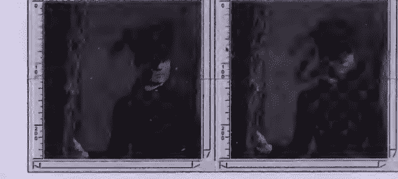
**图4-31：左侧区域通过硬边缘橡皮擦擦除，右侧区域通过软边缘橡皮擦擦除**
「增量」选项为画笔提供压感支持。如果选中的画笔不是100%不透明，在同一区域多次移动橡皮擦会擦除更多颜色。图4-32展示了使用增量压感的橡皮擦的操作效果。
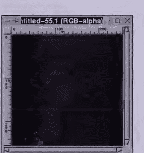
**图4-32：使用增量压感可以逐步提升橡皮擦工具的擦除量**

## 填充工具
填充工具包含两款用于填充图像色彩区域的工具。你可以使用它们为区域填充单一颜色、图案或渐变色，适合在合成图像时为特定的单色区域添加色彩。
> 第9章介绍了如何使用颜色和色彩效果来优化你的图像。

## 油漆桶填充
油漆桶填充工具是GIMP的基础填充工具，它可以将颜色倒入预先存在的同色连续区域或透明区域。该区域必须被包含一种或多种不同颜色的像素完全包围或勾勒，否则颜色会溢出到图形的其他区域，如图4-33所示。你也可以使用油漆桶填充工具完全填充选区。
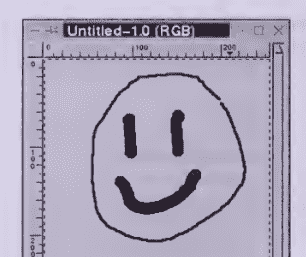
**图4-33：确保待填充区域被其他颜色完全包围，否则颜色会溢出到图形的其他部分**
要使用油漆桶填充工具，点击工具箱中的油漆桶图标（如图4-34所示），将指针移动到想要填充的区域，单击鼠标右键，该区域就会被填充为前景色（如图4-35所示）。
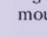
**图4-34：选择油漆桶图标，即可用前景色填充区域**
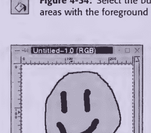
**图4-35：点击待填充区域即可使用油漆桶工具完成填充**
在「工具选项」对话框中，油漆桶填充工具包含多个选项（如图4-36所示）。第一个是「填充不透明度」，数值越高，填充颜色对底层颜色的遮盖度越高。
「填充不透明度」选项与下一个选项「填充阈值」配合使用时尤为重要。「填充阈值」决定了多大的颜色差异会停止填充该区域：阈值较低时，GIMP仅填充完全一致的颜色，细微的颜色差异会被判定为不同颜色；阈值较高时，GIMP会将更大范围的颜色判定为当前要填充的颜色。默认阈值为15，适合大多数图像。如果需要制作半透明填充（让底层颜色透出），你应该调高阈值、调低不透明度。
这类半透明填充的效果如图4-37所示。
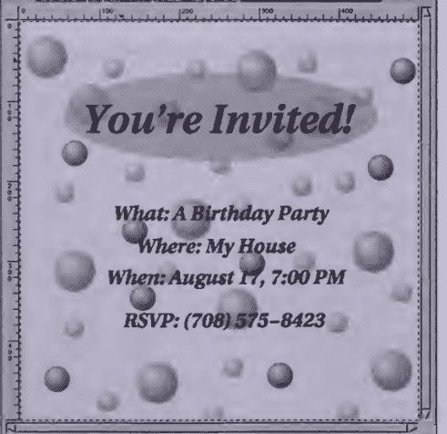
你也可以在「工具选项」对话框中更改填充模式，可选模式如下：
- ◆ **正常**：应用常规的不透明填充类型（如果不透明度为100%）。
- ◆ **消散**：使用散落像素代替真正的透明或半透明像素，营造类透明效果（适合用于制作透明GIF的模糊效果）。
- ◆ **背后**：填充所有透明或半透明区域，效果仿佛填充在下方图层上。
- ◆ **正片叠底**：加深阴影。
- ◆ **滤色**：提亮高光。
- ◆ **叠加**：通过提亮高光、加深阴影来修改背景。
- ◆ **差值**：反转前景色与背景图像之间的颜色。
- ◆ **添加**：将当前前景色叠加到背景图像上，效果类似滤色模式。
- ◆ **减去**：从背景图像中减去当前前景色，效果类似差值模式。
- ◆ **仅变暗**：逐像素对比当前前景色与背景图像，保留更暗的颜色。
- ◆ **仅变亮**：逐像素对比当前前景色与背景图像，保留更亮的颜色。
- ◆ **色相**：修改背景图像的色相，不影响饱和度或明度，使用前景色作为图像的色相。
- ◆ **饱和度**：使用前景色作为图像的饱和度，不影响色相或明度。
- ◆ **颜色**：将前景色的色相和饱和度应用到背景图像上。
- ◆ **明度**：修改背景图像的明度和阴影。请选择最适合你图像需求的模式。
使用「仅变亮」填充的示例如图4-38所示。下一个选项是「填充类型」：默认的「颜色填充」会使用「颜色选择器」中的前景色作为油漆桶工具的实心填充色；「图案填充」会使用「图案」对话框中当前选中的图案填充区域。通过混合图案填充和填充模式，你可以制作一些特殊效果，如图4-39所示的效果。这张图先用画笔工具绘制了一系列气泡，接着使用「迪斯科狂潮」图案进行图案填充，再在「填充工具选项」中降低不透明度使其接近透明，随后选中整个图形，用半透明图案填充选区，最后用文本工具添加了邀请信息。


## 渐变填充
渐变填充工具和油漆桶填充工具类似，不同之处在于它使用从前景色和背景色中选取，或从渐变编辑器对话框（Ctrl+G）中选取的渐变，如图4-40所示。
**图4-40：** 渐变编辑器可用于设置渐变填充所使用的渐变。
要使用渐变填充工具，请从工具箱中选择渐变图标（见图4-41）。
**图4-41：** 使用渐变填充工具可快速创建渐变效果。
在图像中你想要填充渐变的区域上单击并拖出一条线，松开鼠标。整个选中的区域或图层就会被填充为渐变效果。
如果你只想对图形的局部应用渐变，请先使用任意一种选区工具选中该区域，然后点击并拖出渐变线（见图4-42）。渐变的变换部分会出现在构成拖线的两个点之间。如果有剩余空间，则会用渐变两端的颜色填充，通常就是前景色和背景色，如图4-43所示。
**图4-42：** 单击并拖拽即可用渐变填充区域。
**图4-43：** 渐变沿拖线过渡，剩余部分则用前景色和背景色填充。
要将渐变编辑器对话框用于渐变填充，请在渐变填充工具选项框的“混合”字段中选择“自定义（来自编辑器）”，如图4-44所示。在“渐变”字段中，你可以选择多种渐变类型，包括径向渐变、方形渐变和锥形渐变。
渐变工具选项对话框中有多个可设置的选项。首先，你可以设置渐变的不透明度。如果透明度低于100%，下方的部分图像会透出来。图4-45展示的是在文字上覆盖50%不透明渐变的图像效果。如果当前图层下方还有其他图层，较低的不透明度也会让这些图层透出来。
下一个选项是偏移量，它决定了渐变边缘是锐利还是柔和。
偏移量之后可以选择混合模式。这些混合模式和填充工具的混合模式一致，使用方式也基本相同。
“混合”选项可让你决定渐变使用的混合颜色。你可以选择使用RGB色轮的前景色到背景色（FG to BG [RGB]）；使用HSV色轮的前景色到背景色（FG to BG [HSV]）；反向混合（BG to FG）；前景色到透明（FG to transparent）；或来自渐变编辑器的当前渐变（自定义[来自编辑器]）。
接下来可以选择渐变类型。最常用的是线性渐变，图4-43中的图像就使用了线性渐变。不过你也可以使用双线性渐变，如图4-45的示例那样，还可以选择径向渐变、方形渐变、锥形渐变或形状爆发渐变。不同类型的渐变效果如图4-46所示。
**图4-45：** 降低不透明度可保留渐变下方的图像。
**图4-46：** 每种渐变对图形的作用效果都不同，下图是各效果的示例。
“重复”选项可让渐变按指定图案重复，共有三种可选模式：无、锯齿形和三角形。三角形模式可实现平滑的重复渐变。而锯齿形模式下，渐变在重复前不会过渡回原始颜色，会形成更突兀的重复效果。这两种模式的效果如图4-47所示。
**图4-47：** 不同的重复模式在GIMP渐变中会产生不同的效果。
最后，“自适应超级采样”选项可增加渐变填充所用颜色的数量，能让图形外观更平滑，但对大面积的渐变效果改善不明显。

## 工具箱速查
本章已经介绍了很多工具，表4-1是方便速查的参考概览。
### 表4-1 工具箱速查
| 图标 | 工具名称 | 功能描述 | 快捷键 |
|------|----------|----------|--------|
| ☐ | 矩形选区 | 选中矩形区域。更多信息请参阅第5章。 | R |
| ⬭ | 椭圆选区 | 选中椭圆形或圆形区域。更多信息请参阅第5章。 | E |
| 🔆 | 自由选区 | 以手绘方式绘制选区线条。更多信息请参阅第5章。 | F |
| [img] | 模糊选区 | 选中颜色相近的区域。更多信息请参阅第5章。 | Z |
| [img] | 贝塞尔选区 | 通过指定贝塞尔点微调选区范围。更多信息请参阅第5章。 | B |
| [img] | 智能剪刀 | 根据粗略轮廓自动选中区域。更多信息请参阅第5章。 | I |
| [img] | 移动工具 | 将选区从图像的一个区域拖到另一个区域。更多信息请参阅第5章。 | M |
| [img] | 放大镜 | 放大图像以便查看细节。 | Shift+M |
| [img] | 裁剪工具 | 使用矩形框裁剪出图像的核心内容。 | Shift+C |
| [img] | 变换工具 | 可旋转、缩放、倾斜或扭曲图像或选区的透视效果。更多信息请参阅第5章。 | Shift+T |
| [img] | 翻转工具 | 可水平或垂直翻转图像。更多信息请参阅第5章。 | Shift+F |
| [img] | 文本工具 | 可在图像中添加文字。更多信息请参阅第17章。 | T |
| [img] | 取色器 | 可从图像中单个像素上吸取任意颜色。更多信息请参阅第11章。 | O |
| [img] | 油漆桶填充 | 以前景色填充区域。更多信息请参阅第11章。 | Shift+B |
| [img] | 混合（渐变填充） | 以渐变混合效果填充区域。更多信息请参阅本章和第11章。 | L |
| [img] | 铅笔工具 | 使用双色（无虚化、无渐变）画笔绘图。 | Shift+P |
| [img] | 画笔 | 使用虚化画笔绘图，支持多浓度色彩。 | P |
| [img] | 橡皮擦 | 擦除像素的颜色。 | Shift+E |
| [喷枪图标] | 喷枪 | 使用虚化画笔绘制，支持压感——按住鼠标键或让指针在区域停留越久，画笔填充越浓密。 | A |
| [仿制图标] | 仿制工具 | 复制图像的一部分并将其“盖印”到另一部分。大量用于照片修复，相关内容请参阅第20章。 | C |
| [卷积图标] | 卷积工具 | 使用压感（和喷枪工具的压感功能类似）对图像局部进行模糊或锐化处理。 | V |

### 总结
在本章中，你学习了GIMP的基础工具箱，包括绘图工具、填充工具和渐变工具。基础元工具可用于选取颜色、调整放大倍率。绘图工具提供了完整的画笔和选项，可用于创作手绘风格的艺术作品。使用这些基础工具，你可以制作出相当复杂的图像，如果你具备计算机手绘技能就更不在话下。最后，填充和渐变工具可以让你在图像内部添加和更改颜色。即使没有手绘技能，你也可以通过GIMP的选区工具制作出复杂的绘图。下一章将介绍同样位于GIMP主工具箱中的选区工具。


## 选择工具
## 第5章
### 本章内容
- 了解选择工具
- 了解选区后处理工具

本章介绍了GIMP中选择工具的使用方法。这些选择工具能让你在GIMP中创建*选区*，从而更精细地控制图像的调整和编辑操作。
在图形软件中，*选区*可以让你勾勒出图像的一部分，仅对该部分应用滤镜或工具。
借助选区，你可以调整颜色、移动或移除特定区域，也可以仅对图形的部分区域应用滤镜。比如，你可以给背景添加纹理，或者完全移除图形的背景。
在本章中，你将学习如何使用各类选择工具勾勒并选中图形的特定部分。我们会介绍形状类工具（矩形选择、椭圆选择、自由选择）和高级选择工具（模糊选择、贝塞尔选择、智能剪刀）。每种工具都能用来选中图像的一部分，但部分工具的使用难度更低。
本章还会介绍可用于编辑图形的选区后处理工具：移动、裁剪、翻转、变换。虽然这些工具也可以应用于整个图形，但配合选区使用时，它们会组成一套强大的图形编辑工具集。

## 使用选择工具
使用选择工具的第一步，就是用选择工具选中你想要处理的目标区域。本次练习请使用光盘示例文件中的`redamy.tif`图形文件。
点击矩形选择工具。将鼠标移至图形的左上角，按住鼠标左键，然后沿对角线向下拖动鼠标划过图像。松开鼠标左键，注意不要双击。此时你的图形应该会呈现出和图5-1类似的效果。恭喜！你已经完成了选区创建。选区周围的点线通常被称为*走蚁*，它标明了选区的边界范围。

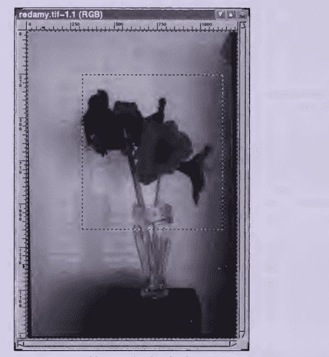
**图5-1：在GIMP中创建选区**

部分选择工具无需使用拖拽操作。例如*模糊选择*工具仅需单击即可使用，它的作用是选中你点击位置的颜色。下一节会详细介绍各类不同的选择工具。

![图标：请使用光盘示例文件] 本次练习请使用光盘附带的示例图形。

GIMP提供了十余种不同的选择选项。其中四种基础选择工具以按钮形式显示在工具箱中，用于完成绝大多数基础选择操作，分别是：矩形选择、椭圆选择、自由选择、贝塞尔选择。

![图标：交叉参考] 选择菜单中还有十余种其他选择工具可供使用。这些选择工具主要用于更灵活地指定要选中的图形区域，相关内容会在第8章详细介绍。

## 矩形选择
矩形选择（在工具菜单中简称为Rect Select）是GIMP中的矩形选择工具。你可以通过点击指定矩形的一个角，再沿对角线拖动来框选目标区域，从而选中屏幕上的矩形区域。矩形选择的使用示例如图5-1所示。

> **提示** 要创建完美的正方形，请在点击并拖动鼠标勾勒正方形轮廓时按住Shift键，此时四条边会自动等长。（使用椭圆选择工具时，按住Shift键也可绘制出完美的圆形。）

矩形选择工具有专属的工具选项。要访问这些选项，请点击「对话框 -> 工具选项」，如图5-2所示。

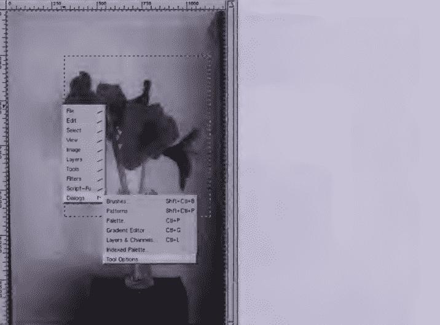
**图5-2：** 所有工具都提供选项对话框，选中工具后点击「对话框 -> 工具选项」即可查看详细设置。

选择「对话框 → 工具选项」后，会弹出工具选项对话框，如图5-3所示。GIMP中的每个工具都有对应的工具选项对话框，不过部分工具没有可配置的选项。

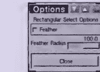
**图5-3：** 矩形选择选项框包含两个选项：羽化和羽化半径。

矩形选择工具只有两个可选设置：羽化和羽化半径。当你对选区进行移动、剪切、复制或其他操作时，羽化功能会生成逐渐透明的边缘，让选区以及被剪切的原区域呈现出模糊效果，如图5-4所示。你可以开启或关闭羽化功能，还可以自行设置羽化半径的大小。

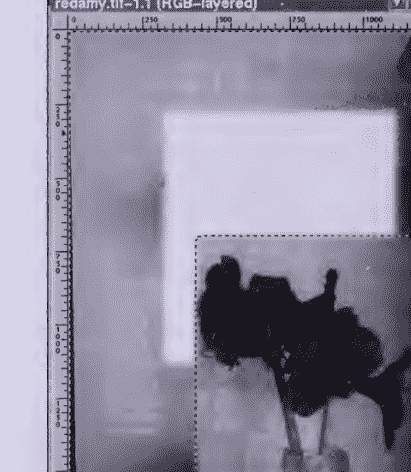
**图5-4：** 羽化功能可以为选区生成模糊边缘。

## 椭圆选择
椭圆选择工具可以创建椭圆形或圆形的选区，特别适合用于制作圆形、圆盘或类似的曲线图形。使用椭圆选择工具时，点击鼠标位置后沿对角线拖动到对角位置即可，工具会将起点和终点作为椭圆的“对角”来生成椭圆形选区。

> **提示** 要创建以起点为椭圆中心（而非边缘点）的径向椭圆，请在拖动鼠标时按住Ctrl键。

使用椭圆选择工具时，按住鼠标左键指定椭圆的起始位置，然后拖动到对角位置后松开鼠标左键即可，操作示例如图5-5所示。

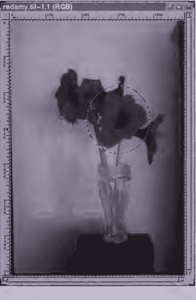

椭圆选择工具也有对应的选项对话框，如图5-6所示。椭圆选择的选项包含羽化和抗锯齿功能。你已经了解了羽化功能在矩形选择工具中的作用，它在椭圆选择工具中的工作原理一致。

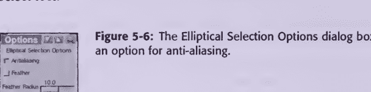

*抗锯齿*是计算机图形学中用于生成更平滑线条的技术。计算机图形由屏幕上的微小彩色像素块（正方形色块）组成。当你用一堆正方形色块拼接曲线时，曲线会出现明显的锯齿感。抗锯齿功能通过柔化像素边缘来消除这种锯齿感，让曲线更平滑，如图5-7所示。

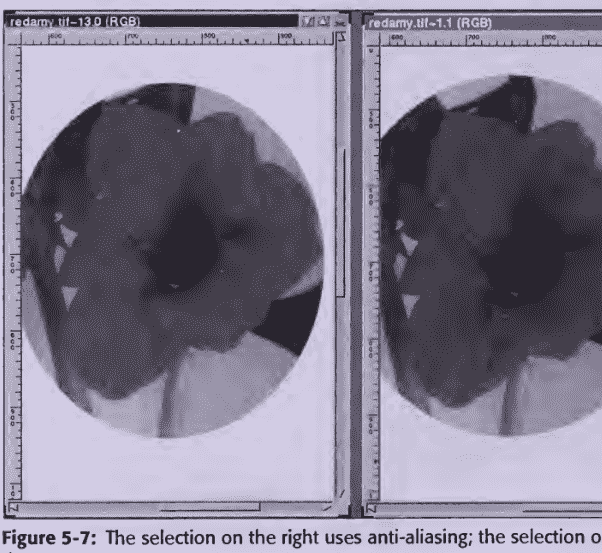
**交叉参考** 完成后，你可以为椭圆应用其他GIMP工具和效果，相关内容会在第8章介绍。

## 自由选择
自由选择本质上是手绘选择工具（见图5-8）。使用时你可以手动拖动鼠标指针，沿着你想要选中的区域轮廓绘制。操作时先选中该工具，按住鼠标左键，然后围绕目标区域移动鼠标，直到回到起始点后再松开鼠标左键。

**提示** 如果你提前松开了鼠标左键，自由选择工具会自动在你当前鼠标指针位置和起始点之间生成一条直线。

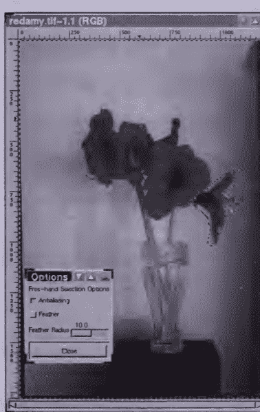

自由选择工具也有对应的选项对话框，支持配置抗锯齿和羽化相关选项。

## 模糊选择
模糊选择工具和其他图形软件中的魔棒工具功能相似，它可以按颜色一次选中一个区域。例如，如果想选中美国国旗图形中的所有红色区域，你只需点击任意一条红色条纹，模糊选择工具就会选中这条红色条纹，以及与它直接相连的所有其他红色区域，如图5-9所示。

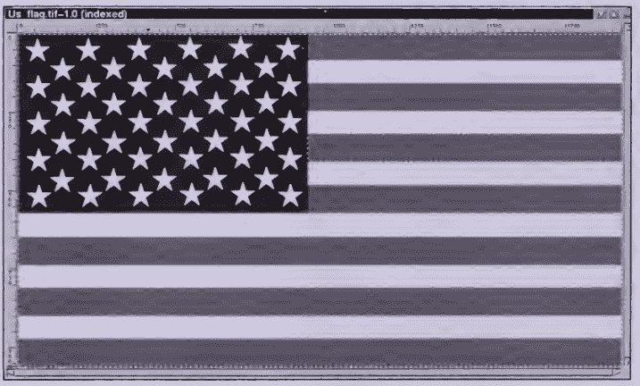
**图5-9：** 对美国国旗的条纹使用模糊选择工具的效果（示例中为从顶部数第三条红色条纹）。

你还可以用该工具选中所有蓝色背景区域，同时排除白色星星部分，如图5-10所示。此外，你也可以通过点击并拖动模糊选择工具，同时选中多种颜色。点击并拖动时，工具会选中你经过的颜色，以及这些颜色之间符合*颜色阈值*范围内的所有颜色。例如，如果你同时选中白色和深灰色区域，GIMP会自动选中文档中所有介于两者之间的灰色色阶。

> **提示** 默认情况下，模糊选择工具的容差阈值为15个单位，即会选中点击颜色±15范围内的所有颜色。你可以在用户主目录下的`.gimprc`文件中修改默认阈值。在美国国旗的示例中，我们将阈值设置为5，因为阈值为15时，红色和蓝色会同时被选中，二者的亮度、强度十分接近。


## 图 5-10
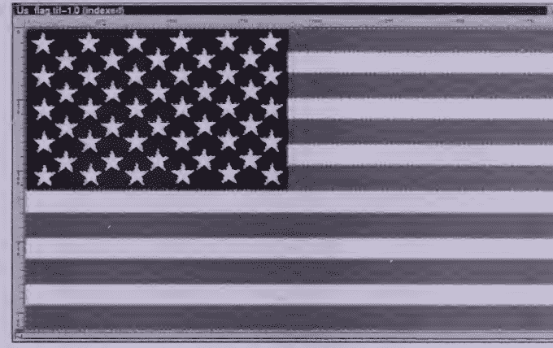
图 5-10：模糊选择工具一次仅选取连通的同色区域。你可以使用该工具更改颜色、为图像中的同色区域应用特殊效果、移除图像背景（见图 5-11），或为图形增添趣味。
模糊选择工具的选项栏中多出一个附加选项：**合并取样**。启用“合并取样”选项后，该工具会同时选取当前图层与图形中所有其他图层内的相同颜色。该选项在单图层图形中无实际用途。
**交叉参考** 图层相关内容将在第 9 章详细讨论。

## 贝塞尔选择
贝塞尔选择工具可让你实现*贝塞尔*模式选取，功能类似 CorelDraw 等多数矢量绘图软件提供的贝塞尔绘图工具。使用贝塞尔工具时，只需点击曲线的控制点并操控控制柄，即可制作出任意外形与样式的曲线。多数专业平面设计师都会选用贝塞尔工具，因其可对曲线实现更精细的控制。

**光盘资源** 随书光盘中附带红色孤挺花示例图形，你可以使用 GIMP 的贝塞尔选择工具选取图形局部区域，并根据需求微调选取曲线。本示例将使用该图形进行演示。
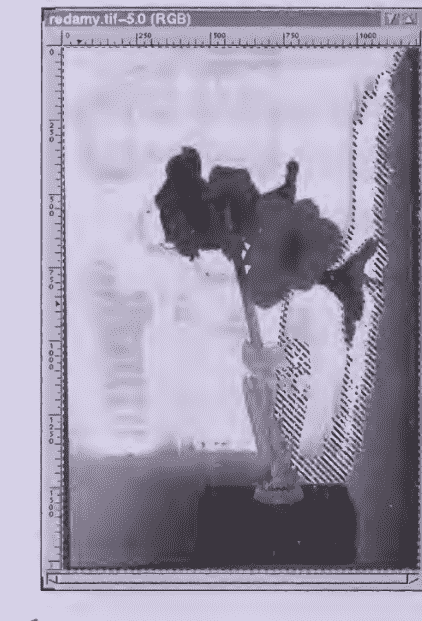
图 5-11：使用模糊选择工具移除图形背景。

> **注意** GIMP 的贝塞尔选择工具容错率较低，完成选取最终确认后，你将无法新增或删除贝塞尔节点。

1. 打开随书光盘中的红色孤挺花图形，点击选中贝塞尔选择工具。
2. 将指针定位到图形曲线的起点处，本示例中选取两个花瓣之间的拐点，点击鼠标左键确认。
3. 在曲线中部点击一次，再在花瓣另一侧点击一次。
4. 在曲线方向发生改变的位置（如拐角、曲线中部）放置锚点，如图 5-12 所示。
5. 点击初始起始节点，即可闭合选取区域。
6. 此时可点击各个节点编辑实际的贝塞尔曲线，注意不要点击图形内部，否则会误触发“设定选取区域”操作。
7. 选中某个节点后移动光标，即可拉出控制柄（见图 5-13），控制柄越长通常代表曲线的弧度越大。
8. 你可以通过旋转节点处的控制柄来调整曲线的方向，如图 5-14 所示。
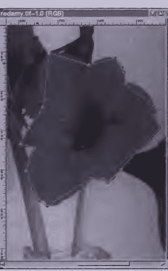
图 5-12：使用贝塞尔选择工具绘制选取的大致轮廓。
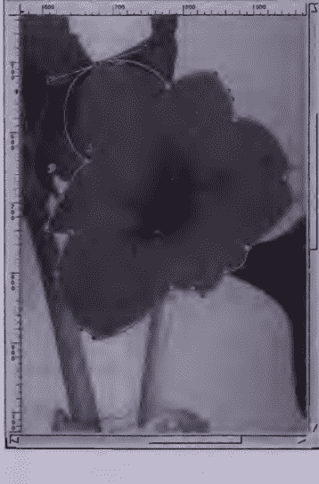
图 5-13：每个节点控制与其连接的曲线段，通过操控控制柄可调整单段曲线的形态。
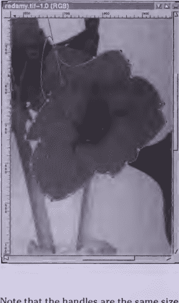
图 5-14：通过旋转节点处的控制柄可调整曲线的方向。
9. 注意节点两侧的控制柄长度相同，这意味着调整一侧控制柄会同步影响曲线的两侧。曲线中部的节点主要用于控制曲线的整体形态，拐角处的节点则作为锚点使用。
10. 若要绘制非常尖锐的曲线，或取消控制柄的镜像联动，可在点击节点时按住 Shift 键（见图 5-15）。
11. 编辑完成后，在选取区域内点击确认选区，此时会出现蚂蚁线标识选区范围（见图 5-16）。

贝塞尔选择工具支持羽化和抗锯齿选项。

## 智能剪刀
智能剪刀选取工具是自由选择、模糊选择与贝塞尔选择三种工具的功能结合体。使用该工具时，你可以先在目标图像区域外围绘制选取线，智能剪刀会自动推测你想要选取的实际轮廓。

1. 使用智能剪刀前，先点击工具箱中的智能剪刀工具。
2. 将鼠标移动到图形上，确定选取的起点。
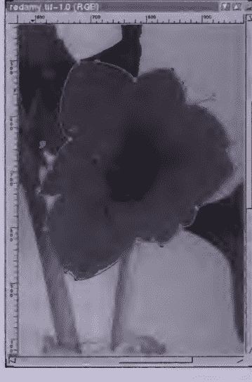
图 5-15：按住 Shift 键可单独调整两侧控制柄，解除联动。
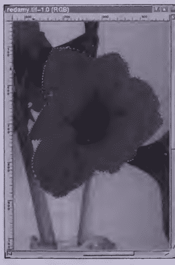
图 5-16：在选取区域内点击确认选区，同时清除所有节点。
3. 按住鼠标左键，沿你想要选取的区域外围绘制一条选取线（见图 5-17）。
4. 回到起点位置后松开鼠标按钮。

> **提示：** 若在回到起点前就松开鼠标按钮，GIMP 会在你当前鼠标位置与起点之间自动绘制一条直线。

5. 此时你会看到一条预览线，标识选取的大致范围（见图 5-18）。请注意，智能剪刀工具不会完全贴合你绘制的线条，而是会自动平滑线条，并推测你想要选取的实际范围。
6. 在预览线内部任意位置点击，即可确认选取，此时会出现蚂蚁线，如图 5-19 所示。
7. 你还可以通过“工具选项”对话框，将智能剪刀生成的选取轮廓转换为贝塞尔选择。

智能剪刀支持多项设置选项，包括曲线平滑度、边缘检测阈值、弹性容差、“转换为贝塞尔曲线”按钮，以及常规的羽化与抗锯齿选项（见图 5-20）。
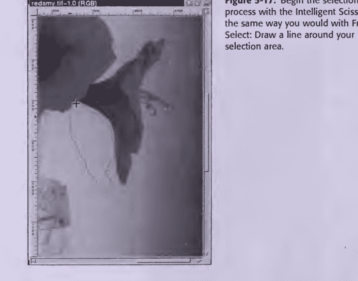
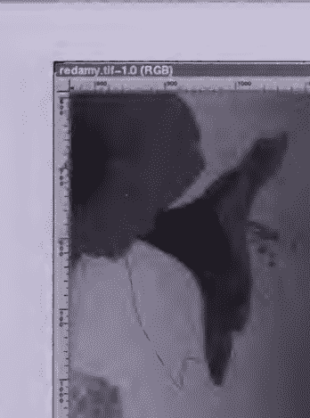
图 5-18：智能剪刀沿选取区域外围绘制预览线。
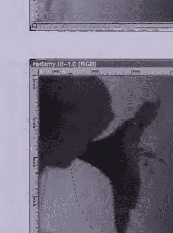
图 5-19：在智能剪刀预览线内部点击确认选区。


“曲线平滑度”选项用于控制选取轮廓的平滑程度，数值越高，曲线越平滑。“边缘检测阈值”用于设置 GIMP 对图像本身线条与边缘的敏感度，数值越高，GIMP 对图像内边缘的识别越敏感。“弹性容差”用于控制智能剪刀偏离你手动绘制的选取范围的程度，数值越高，智能剪刀的高亮显示灵活性越强。

## 使用选择后工具
完成区域选取后，你可以使用 GIMP 提供的多种简易工具，根据需求对选区进行操作。默认情况下，出现蚂蚁线时，移动工具会被自动选中。你也可以使用裁剪、翻转、变换等其他工具，还可以对当前选区应用任意滤镜，为图形处理提供了极大的灵活性。

> **交叉参考** 滤镜相关内容将在第 13 章详细讨论。

## 进行多重选择
选区功能的一个重要特性是支持多种组合方式。例如，你可以通过**选择并集**操作，将新选取的区域添加到已存在的选区中；也可以从已有选区中减去某个选取区域，或基于两个及以上选区的重叠部分创建新选区。

要合并两个选区，在进行第二次选取时按住 Shift 键，两个选取区域都会高亮显示。若两个选区存在重叠，蚂蚁线会围绕两个选区的整体轮廓显示，重叠区域不会出现分割线（见图 5-21）。

若要从已有选区中减去某个选取区域，在进行第二次选取时按住 Ctrl 键，如图 5-22 所示。使用选取减功能时，你需要确保第二次选取的区域与已有选区存在重叠。

图 5-21：使用选择并集功能可合并两个或多个选区为一个整体。

图 5-22：使用选择减法功能可从第一个选区中移除第二个选取的区域。

最后，你可以通过在创建第二个选区时同时按住 Shift 和 Ctrl 键，基于两个选区的重叠部分创建新选区，示例如图 5-23 所示。

**图 5-23：** 选择交集功能仅高亮显示两个选区的重叠区域。

> **警告** 使用矩形选择或椭圆选择工具时，按住 Shift 键可创建“完美”的正方形和圆形，按住 Ctrl 键可创建径向形状。若要同时使用 GIMP 的选区加、减、交功能与矩形/椭圆选择工具，请在按下鼠标按钮确定选取起点后，按住 Shift 或 Ctrl 键；松开 Shift 或 Ctrl 键但仍按住鼠标按钮时，GIMP 会自动识别你是要将新选区添加到当前选区还是从中减去。此时若还需要创建“完美”的正方形、圆形或径向形状，可再次按住 Shift 或 Ctrl 键。


## 移动工具
移动工具是创建选区时的默认工具。只要选区蚂蚁线出现，你就可以移动所有已选中的内容。但需要注意，选区默认情况下会自动*浮动*。移动图像后，选区工具会成为激活工具，此时你可以在*当前选区内*选择并操作其他选区。
> **交叉引用** 当选区*浮动*时，意味着选区实际被转换为了浮层。在GIMP中，浮层拥有所有编辑焦点；在用户完成浮层编辑前，无法编辑其他任何内容。浮层的相关内容会在第9章讨论。
如果你希望浮动选区在移动一次后仍能继续移动，只需点击移动按钮或按M键即可。移动工具激活时，你可以轻松移动选区：将鼠标置于选区内，按住鼠标左键，将选区拖拽到任意位置后松开鼠标即可完成放置。这一操作被称为*拖放*，是多数图形程序中常见的编辑操作（见图5-24）。

图5-24：拖放选区以移动它。

## 裁剪工具
你是否遇到过带有难看好边缘或边框的图形？照片并不总能符合我们的预期：可能画面中出现了他人的拇指，或是扫描图像时不小心多扫进了部分背景。专业摄影师和平面设计师会使用名为*裁剪*的技术去除不需要的边缘与边框，聚焦画面中真正重要的内容。当你熟悉这项技术后就会发现，试图在不丢失关键内容的前提下将画面精简到核心要素，裁剪本身也可以成为一种艺术。
裁剪图像时，本质上是通过参考线去除不需要的内容。你可以将现有选区作为参考线的基础。使用GIMP的裁剪工具前，先用标准选区工具创建选区，如图5-25所示。你可以创建任意类型的选区；只要选区蚂蚁线处于激活状态，就可以基于该选区进行裁剪。

**图5-25：** 创建你希望裁剪到的选区。
接下来，按下Shift+C，或从图像菜单中选择「工具 > 裁剪」。点击你的图形，就会出现十字参考线。通常使用裁剪工具时，你会用十字线选中要裁剪的区域。但如果你想基于现有选区裁剪，只需点击裁剪信息对话框中的「选区」按钮即可。此时你的选区会被裁剪参考线包围，如图5-26所示。

接下来，点击裁剪信息对话框中的「裁剪」按钮，图像就会被裁剪到选中的区域（见图5-27）。如果你的选区是不规则的（非矩形），图像会被裁剪为选区外围的矩形。注意选区本身不会是裁剪区域；如果你想删除多余背景，需要使用剪切和粘贴功能。

图5-27：点击「裁剪」按钮，将图像裁剪到选中区域。
除裁剪信息对话框外，裁剪工具没有其他额外的工具选项。

## 翻转工具
*翻转*操作会对当前选区进行水平或垂直镜像。翻转会直接在原位置完成，选区不会发生位移，也不会生成第二个选区。使用翻转工具时，先用选区工具选中你需要操作的内容，然后选择「**工具 > 翻转**」，或按下「**Shift+F**」快捷键。将鼠标移到选区内，指针会变为水平或垂直方向的一对箭头，点击选区即可完成翻转。
翻转工具选项框有两个选项：水平和垂直。你可以根据需求在这里选择水平或垂直翻转选区。
> 注意：翻转不是旋转！翻转选区会得到原图像的镜像，而旋转是将选区按指定角度转动。

## 变换工具
变换工具可以对选区执行旋转、缩放、斜切和添加透视效果的操作。你可以用它调整选区，改变选区在图像中的呈现效果。变换工具有四个基础选项：旋转、缩放、斜切和透视。每个选项都可以让你按需对选区进行扭曲、转动或其他变形操作。变换工具选项对话框中的「平滑」选项可以让变形或旋转后的线条更平滑，和选区工具的抗锯齿选项效果类似。以下示例将使用图5-28中选中的红色朱顶红图形作为演示。

### 旋转
旋转工具选项可以让你按指定角度转动选区。使用时，先选中目标选区，再选择变换工具。你可以通过双击工具箱中的变换工具按钮，或从图像菜单中选择「对话框 > 工具选项」打开工具选项对话框（见图5-28）。

图5-28：变换工具选项对话框提供四个工具选项：旋转、缩放、斜切和透视。
选择「旋转」选项，将鼠标移到选区内，指针会变为互相环绕的一对箭头。点击选区即可弹出旋转信息框，如图5-29所示。

图5-29：旋转信息框会显示选中区域的旋转角度。
现在按住鼠标按钮，水平或垂直移动鼠标即可旋转选区（见图5-30）。如果你在图形的右上角，向右或向下移动鼠标会让选区顺时针旋转，向左或向上移动则是逆时针旋转。如果你在图形的左下角，移动方向的效果会相反。


###### 缩放
*缩放*是调整选区或图像尺寸的方法之一。使用缩放工具选项，你可以通过鼠标点击随意拉伸或缩小选区。缩放选区时，先用合适的选区工具选中目标区域，再选择变换工具并打开变换工具选项对话框，在对话框中选择「缩放」选项，将鼠标移到选区内，此时指针会变为带有两个控制角的方框，点击选区即可。
选区周围会出现方框形的参考线，如图5-31所示。

图5-31：缩放工具选项会提供参考线辅助你使用该工具。
来回移动指针的同时按住鼠标按钮，参考线会跟随指针移动，松开鼠标按钮后，选区就会按照参考线的位置放大或缩小。
> 注意：参考线没有任何约束，你可以不考虑原始选区的高宽比缩放选区。松开按钮即可确认缩放后的选区。如果你想要固定图像高度，在水平缩放选区时按住Shift键，高度会保持不变，你无法修改选区的高度。同理，按住Ctrl键可以垂直缩放选区。最后，按住Shift和Ctrl组合键，可以在调整大小时保持选区的高宽比（即*宽高比*），见图5-32。

图5-32：缩放时保持选区宽高比。

### 斜切
无论选区实际形状如何，它都有高度和宽度，所有变换工具都会以这个矩形为基准参考线。当你移动这个矩形的角，让它从矩形变成梯形时，你使用的变形方法就叫做*斜切*。斜切选项可以让你基于梯形倾斜调整选区的形状。使用斜切选项时，先像平常一样在图像中创建选区，再选择变换工具，打开变换工具选项对话框后点击「斜切」，点击选区内，就会出现参考线辅助你设置斜切工具。按住鼠标左键拖动参考线，将其调整为梯形，水平移动指针可以沿水平方向倾斜，垂直移动指针可以沿垂直方向倾斜。松开按钮后，选区就会按照设置完成变形（见图5-33）。


# 透视
透视选项可让你拖拽（并扭曲）由选区高度和宽度形成的*矩形参考线*的*一个角*（如前所述），从而为图像添加单个透视点。为整幅图形添加透视效果比为单个选区添加更为常见。不过，在做拼贴画或尝试扭曲网页图标的一部分时，你可能需要为选区添加透视。要使用透视选项，首先先用提供的选择工具创建选区。选择“变换”工具并打开“工具选项”对话框。选择“透视”选项并点击选区，此时变换工具的参考线会显示在选区周围。点击参考线的一个角并拖拽它即可更改透视效果。松开鼠标按钮后，选区的透视就会改变，如图5-34所示。如前所述，该选项更常用于处理整幅图像，图5-35即为透视效果应用于整幅图形的示例。
## 小结
本章讨论的选择工具想必你已经能看到诸多用途。你可以创建多种类型的选区，例如矩形、椭圆、不规则形状，甚至是贝塞尔曲线选区。你还可以将多个选区合并为一个更大的选区，或从一个选区中减去另一个选区。借助选区编辑工具，你可以移动图像的部分区域，还能对选区进行翻转、旋转、倾斜等操作，随意调整选区直至它和原图像大不相同。你甚至可以仅裁剪出选中的图像区域，让观看者聚焦于图形的关键部分。下一章你将了解GIMP程序菜单栏中的File和Xtns菜单，这两个菜单是GIMP程序的主要控制入口。
# 第6章
## GIMP菜单系统
GIMP的菜单系统可能略显复杂，因为它采用了类Macintosh的用户界面。从本质上讲，GIMP只有一个程序窗口，与各个图像窗口相互独立。该程序窗口由菜单栏和工具箱组成；本章仅讨论菜单栏部分。工具箱包含所有工具按钮，相关内容将在第4章讨论。在菜单栏中，你可以看到File和Xtns菜单，二者提供的是程序级全局命令。程序菜单通常不提供图像专属命令和工具，这些内容出现在图像窗口菜单中（相关内容将在第7章讨论）。程序菜单提供了打开和关闭图像窗口、完全退出GIMP以及运行Script-Fu程序（这类程序通常会自动生成新图像）的命令。如果你习惯了更常见的图形用户界面，觉得这种设计有些奇怪，只需记住GIMP窗口中不包含操作图像的主菜单即可：带工具箱的主GIMP窗口上只有程序菜单。
## 理解菜单中“…”和→的含义
GIMP的菜单中有两种特殊标识，用于提示菜单选项还有更多内容，例如对话框或次级菜单。这两种标识分别是省略号（…）和右向箭头（→），如图6-1所示。
- 本章内容
- 理解菜单中“…”和→的含义
- 了解文件菜单
- 探索Xtns菜单
第一种标识是省略号标识。菜单项旁的省略号表示选择该菜单项后会打开一个对话框。例如，在图6-1中，“关于”和“首选项”菜单项会打开对应的进一步对话框。要知道，GIMP是GNU项目，因此存在诸多系统特性 quirks。其中一项就是省略号的使用并不统一。例如，File>About并不会打开进一步的对话框，只会显示“关于”窗口。类似地，File>Open会打开进一步的对话框（加载图像），File>New也是如此。不过，如果菜单项旁有省略号，你就可以确定它一定会打开一个需要你阅读并做出响应的对话框。
另一种标识是右箭头。这个箭头符号表示点击该菜单项后会弹出一个从原菜单中下拉的次级菜单。例如，图6-1中Dialogs菜单项旁有一个右箭头。当你选择Dialogs时，会弹出一个次级菜单，如图6-2所示，你可以选择要打开的对话框。
> ## X Window系统与界面标准的多样性
> > X Window系统没有标准化的用户界面，这一点让很多GNU项目的参与者颇为自豪。事实上，X Window系统只是为Linux操作系统提供图形化窗口界面的方式之一，它本身并不是一个操作系统。
> > 你可以在X Window系统中使用多种窗口管理器，例如KDE、Gnome/Enlightenment，或流行且简洁的XFree86。这些窗口管理器的用户界面各不相同：菜单的行为可能很反常，或窗口的装饰和选项存在差异。GIMP是使用Gnome作为窗口管理器开发的，但它也几乎可以在所有X Window服务器上运行。
> > 有些人可能会说：“有这么多选择，太让人困惑了！”坦率地说，这些人最好远离Linux。Linux的核心就是提供选择权，如果你不喜欢某个功能的运作方式，你可以更改它，所有的一切都可以更改。当然，如果你真的感到困惑，也可以选择XFree86这个简洁的替代方案。
## 了解文件菜单
File菜单提供了若干控制程序本身的命令，以及个性化GIMP安装的提示和设置。本节将介绍程序命令、每日提示文件和设置、用户首选项以及对话框菜单。要访问File菜单，只需点击GIMP窗口菜单栏中的File选项，如图6-3所示。
### 程序命令
程序命令是用于创建和打开图像、打开GIMP的“关于”对话框以及退出GIMP的基础命令。
###### 新建
要在GIMP中创建新图像，请选择File>New，或按下快捷键Ctrl+N。此时会弹出“新建图像”对话框，如图6-4所示。你可以在该对话框中设置图像的初始高度和宽度（单位为像素），还可以设置颜色选项和背景填充类型。“图像类型”选项有两个选择：RGB和灰度。RGB表示使用三色调色板，而灰度仅使用不同深浅的灰色。GIMP中的新图像无法以索引色或自定义色面板开头。
> **交叉引用** 有关颜色和调色板的更多内容，请参阅第11章。
GIMP中的最后一个选项是填充类型。该选项用于设置图像初始创建时的背景，当然你也可以之后使用油漆桶填充工具更改该背景。
> **提示** 将填充类型设为“透明”，即可创建带透明背景的图像，例如用于透明GIF。在GIMP中，透明背景会显示为灰色棋盘格背景。
###### 打开
选择File>Open（或按下Ctrl+O）即可打开已有的图像文件。此时会弹出“加载图像”对话框，如图6-5所示。你可以通过目录列表浏览到目标图像，然后在文件列表中双击打开它；也可以在“选择”栏中输入路径和文件名来快速打开图形。
> **注意** GIMP中打开文件的默认目录是你启动X Window系统的目录，通常是你的用户主目录。
图6-5：点击File ⇨ Open可加载已有图像。你还可以使用下拉目录框快速跳转到系统中的多级上级目录，如图6-6所示。
> **提示** 和大多数Linux Shell一样，在GIMP的目录导航中，../代表上一级目录。
图6-6：通过下拉目录菜单返回上一级目录结构。


在“打开选项”部分，“确定文件类型”下拉菜单可用来指定文件所属的格式。举个例子，如果你要打开JPEG文件，可以在GIMP中选择对应的文件格式。如果你在“确定文件类型”下拉框中选择了“JPEG”选项，GIMP会尝试将该文件作为JPEG图形打开，无论该图形的文件名或扩展名是什么。因为Linux不使用也不强制要求文件扩展名，所以你会发现“确定文件类型”选项非常实用。不过GIMP可以非常智能地自动识别文件类型，因此我们通常将其设置为“自动”，之后就不用再调整了。我们也通常会在文件名末尾添加文件扩展名（比如`filename.gif`或`filename.xwd`），方便我们记住文件的格式。
“加载图像”对话框还支持你创建目录、删除或重命名文件。点击“创建目录”按钮打开“创建目录”对话框，如图6-7所示。

输入要创建的目录名称，然后点击“创建”按钮。
最后，你也可以在“加载图像”对话框中重命名或删除文件。首先，选中你想要修改的文件，然后点击“重命名文件”或“删除文件”按钮。如果你选择删除文件，该文件会从你的系统中被永久移除。
> **注意**：Linux没有“恢复删除”的功能，因此在按下删除按钮前，请务必确认你真的要删除该文件。

## “关于”选项
“关于”选项会显示“关于GIMP”对话框，效果如图6-8所示。该对话框会展示版本信息、网站网址，以及所有参与GIMP项目的工作人员的名单。


## “退出”选项
“退出”选项会完全关闭GIMP程序，包括所有已打开的图像。关闭单个图像窗口与之不同，“退出”会关闭整个GIMP程序。你也可以通过关闭GIMP程序窗口（而非图像窗口）达到同样的效果。

## “首选项”
通过“文件”→“首选项”可以打开“首选项”对话框，如图6-9所示。该对话框中有多个偏好设置选项，你可以通过对话框顶部的标签页访问这些设置，标签页分别为显示、界面、环境和目录。


**图6-8：**“关于GIMP”对话框会列出所有参与项目建设的工作人员的署名。

**图6-9：**“首选项”对话框设有多个标签页，用于设置GIMP的相关参数。

### 显示
第一个标签页“显示”可用于设置GIMP调用系统硬件显示图像的各类参数。你可以在这里设置新建图形的默认尺寸和类型；该设置还用于“图层与通道”对话框中的预览尺寸，可设置为小、中、大或无。放大图像时，使用三次插值可以保留更多细节。
在“显示”标签页中，你还可以设置用于替代图形中透明区域的棋盘格图案，可选配置如下：
- **浅色方格**：棋盘格使用浅灰色调。
- **中间调方格**：棋盘格使用中等灰色调。
- **深色方格**：棋盘格使用深灰色调。
- **仅白色**：使用纯白色替代棋盘格图案。
- **仅灰色**：使用纯灰色替代棋盘格。
- **仅黑色**：透明区域显示为纯黑色。
在“方格尺寸”部分，你可以将棋盘格的尺寸设置为小、中或大。显然，如果你用纯色（白色、灰色或黑色）替代棋盘格，那么“方格尺寸”选项就不会生效。
图6-10展示了三张使用不同透明选项的透明图形的对比效果。

**图6-10：**GIMP的透明选项可用来指定透明区域在GIMP中的显示效果。

### 界面
“界面”标签页如图6-11所示，可用于调整用户界面的行为。第一个设置项是“撤销次数”，该选项可设置你可以使用“编辑”→“撤销”（或Ctrl+Z）回退上一步操作的次数。设置的撤销次数越多，GIMP占用的系统资源就越多。
勾选“缩放时调整窗口大小”选项后，当你放大或缩小图像时，窗口会随之调整大小，最大不超过屏幕的显示上限。如果取消勾选该选项，放大缩小图像时图像窗口的大小将不会发生任何变化。
“禁用光标更新”选项会在GIMP执行命令时阻止光标发生变化。
勾选“显示工具提示”选项后，当你将光标悬停在工具箱的工具上时，会显示上下文相关的提示框，如图6-12所示。

## 第6章 ✦ GIMP菜单系统 125

**图6-11：**“界面”标签页可用于设置GIMP的用户界面选项。

**图6-12：**工具提示可以帮助你了解工具箱中各个工具图标的含义。

最后，“蚂蚁线速度”选项可设置选区蚂蚁线的移动速度，单位为毫秒。默认值为300，在大多数系统和显示器上都是合适的速度。

### 环境
“首选项”窗口中的“环境”标签页可用于设置GIMP的系统资源使用规则（见图6-13）。勾选“保守内存使用”选项可限制GIMP对你系统内存的占用。虽然该选项会降低GIMP的运行速度，但这是防止GIMP拖慢其他进程的简单方法。

**图6-13：**“环境”标签页可用于设置特定的系统资源使用规则，是低配置Linux系统的理想选择。

“图块缓存大小”是另一种限制GIMP占用系统资源的选项，你可以精确指定GIMP可用于缓存的内存大小（单位为字节）。如果同时勾选了“保守内存使用”选项，过小的缓存大小甚至会拖慢性能最强的处理器，让GIMP的运行变得异常缓慢。

“安装颜色表”选项与你的显示器可显示的颜色数量有关。如果你的显示器只能显示256种颜色（很多老旧显示器和笔记本屏幕都符合这种情况），请勾选该选项，以优化GIMP的颜色显示能力。如果你使用的是这种低配置显示器，却选择不安装颜色表，那么GIMP将无法显示其他程序（例如网页浏览器）正在使用的颜色。安装颜色表后，使用GIMP时其他应用程序仍然会出现轻微的颜色偏移，但GIMP的图像显示会更准确。

最后，“颜色表循环”会将蚂蚁线从虚线变为实线的颜色表线条。颜色表循环功能仅在与“安装颜色表”选项相同的低配置系统上生效。

### 目录
“目录”标签页（见图6-14）可用于指定GIMP查找特定文件的路径，例如GIMP的画笔和渐变文件所使用的路径。除非你要自定义色板、画笔和渐变，否则无需修改这些目录的设置。对Linux用户来说，最重要的两个目录是临时目录和交换目录。


交换目录很容易变得非常大，应当设置在本地临时目录（例如/tmp）下，尤其是在使用磁盘配额或NFS挂载 home 目录的系统上。将交换目录改为本地目录后，你可以获得更多空间来保存最终图像。而临时目录应当设置为不与其他用户共享的目录，例如/usr/tmp目录下的子目录。GIMP的临时目录可以跨会话保存文件，因此请确保你使用的目录在重启系统时不会被清空。

## 每日提示
“每日提示”对话框如图6-15所示，会展示GIMP的使用技巧和快捷键。默认情况下，启动GIMP时会自动弹出“每日提示”对话框。取消勾选“下次显示提示”选项即可关闭该功能。点击“上一条提示”和“下一条提示”可以浏览所有可用的提示，点击“关闭”按钮即可关闭“每日提示”对话框。
> **提示：**你也可以在`.gimprc`文件中设置启动时自动显示“每日提示”对话框。


## 每日提示文件 每日提示文件名为`gimp_tips.txt`。
它存放在GIMP数据目录中，通常路径类似`/usr/share/gimp`。
你可以编辑`gimp_tips.txt`文件（以root身份），为其他GIMP用户添加专属提示，或是提醒自己GIMP的使用技巧和小贴士。
文件编辑说明已写在文件顶部的注释中。
小建议：提示内容要简洁，不同提示之间留一行空行，用行首的`#`符号来标记非提示类注释。

## 对话框 选择「对话框 ◇」，即可打开标准对话框的下拉列表（见图6-16）。
通过这种方式可以打开画笔、图案、色板、渐变编辑器、工具选项对话框。
> 交叉参考：画笔和图案的相关内容会在第4章详细讲解；色板和渐变的内容会在第11章讲解。

## 浏览「扩展」菜单 「扩展」菜单包含了GIMP的脚本和插件扩展功能。
在该菜单下你可以打开插件浏览器、截取屏幕、使用Script-Fu脚本，还能把GIMP当作网络浏览器使用。
该菜单在GIMP过往版本中还有其他功能，预计后续也会以插件的形式推出。

## DB Browser 选择「扩展 > DB Browser」即可打开DB Browser窗口，如图6-17所示。
DB Browser对话框会展示GIMP过程数据库（PDB）中的所有过程。
这些过程会被脚本和滤镜调用；你可以浏览这些过程，了解它们的用途、开发者，以及对应的输入输出参数。

## 屏幕截图 在GIMP中截取屏幕的操作非常简单。（可以问问这本书的作者呀！）
先将屏幕调整到你想要截图的状态，打开所有需要纳入截图范围的窗口或图像。
接下来选择「扩展 > 屏幕截图」。
屏幕截图对话框会随之打开，如图6-18所示。
选择你要截取整个屏幕还是单个窗口。
如果要截取整个屏幕，选择「截取整个屏幕」选项。
你还可以设置以秒为单位的延迟时间，方便你完成截图前的准备，或是隐藏GIMP窗口。
> **注意** GIMP无法截取指针或光标。这是X Window系统的功能，而非GIMP的功能，因此GIMP要等到X Window系统支持该功能后，才会在后续版本中加入这项特性。
如果要截取单个窗口，选择「截取单个窗口」选项。
勾选「包含窗口装饰」复选框，截图时就会一同截取菜单栏、最小化和最大化按钮。
点击你想要截取的窗口即可。
GIMP会自动打开一个新的图像窗口，里面存放着截取的图像。
> **注意** GIMP会在屏幕上其他操作发生前完成截图。因此如果你点击截取的窗口前方还有其他窗口，那两个窗口都会出现在截图中。另外，点击未选中的窗口截图时，会以该窗口未选中状态下菜单栏的颜色为准。

## Script-Fu 选择「扩展 > Script-Fu」即可访问Script-Fu脚本、控制台和服务器。
通过子目录可以访问已安装的Script-Fu脚本。
例如，你可以使用「Logo」子目录下的脚本轻松制作网站标识，如图6-19所示。
交叉参考：Script-Fu的使用方法会在第14章详细讲解。

## 网络浏览器 「扩展 ⥱ 网络浏览器」菜单中预设了多个网站，还支持从菜单中打开任意URL地址。
从列表中选择URL（或是点击「打开URL」），就会启动你默认的网络浏览器（比如Netscape Navigator），并跳转到对应的网址。
由于GIMP的所有文档和资料都是基于网页的，因此该功能相当于程序的帮助文件。

## 本章小结 本章中你了解了GIMP主窗口的基础组成部分：文件菜单和扩展菜单。
你学会了如何设置偏好选项、如何获取GIMP的开发信息和相关网站，以及如何查看GIMP中已安装的过程。
你还了解了作为GIMP核心组件的Script-Fu菜单。
Script-Fu被誉为众多用户选择GIMP的核心原因。
它既可以提供用户开发的脚本，也支持你自己使用Scheme或Perl语言开发脚本。
这些相关内容会在第14、15、16章详细讲解。
你可能已经注意到，本章讲解的GIMP菜单并没有涵盖所有功能。
GIMP的大部分工具和命令都可以在图像菜单和工具箱中找到。
下一章你会学习GIMP中打开图像时右键点击弹出的图像窗口菜单。

## 图像窗口右键菜单 图像窗口右键菜单是GIMP中操作图像的核心菜单。
本书中经常会提到让你点击菜单中的命令，比如「选择 > 按颜色选取」。
这些命令大多指的是图像窗口菜单，你可以右键点击图像，在弹出的菜单中选择对应选项。
如果你用过Mac电脑，应该对这种呼出菜单的方式很熟悉。
Windows系统中菜单通常位于窗口顶部，很少使用这种方式。
Mac电脑长期被公认为主流图形设计平台，因此这套菜单系统可以帮助熟悉Mac环境的平面设计从业者更顺利地过渡到Linux系统。

## 文件菜单 文件菜单支持创建新图像、打开图像、保存图像、编辑偏好设置、关闭窗口、退出GIMP，以及预处理图像用于邮寄或打印。
该菜单和第6章讲解的文件菜单略有不同，后者是主GIMP窗口的文件菜单（位于工具箱窗口的文件菜单中）。
虽然图像窗口文件菜单的很多命令和前者一致，但没有「对话框」子菜单，且可以通过该菜单保存、关闭、打印和邮寄图像。

## 新建 要创建新图像，选择「文件 > 新建」或使用快捷键Ctrl+N。
「新建图像」对话框会随之打开（见图7-1），你可以在其中设置新图像的参数。
- 本章内容
- 文件菜单
- 编辑菜单
- 选择菜单
- 视图菜单
- 图像菜单
- 图层菜单
- 工具菜单
- 滤镜菜单
- Script-Fu菜单
- 对话框菜单
> 交叉参考：第6章有更多关于新建图像参数的说明。

## 打开 要在GIMP中打开图像，选择「文件 > 打开」或使用快捷键Ctrl+O。
「加载图像」对话框会打开，如图7-2所示。
浏览到你要打开的图像文件，点击「确定」即可打开。

## 关闭 要关闭当前图像，选择「文件 > 关闭」或使用快捷键Ctrl+W。
如果文件自打开或创建后没有修改过，图像会直接关闭；如果文件有过修改，GIMP会提示你在关闭前保存文件（见图7-3）。
图7-3：如果你还没有保存修改内容，GIMP会在关闭文件前提醒你保存。

## 保存和另存为 在GIMP中创建或修改图像后，你肯定想要保存文件。毕竟做了好看的图，总得留着以后用呀。
要在GIMP中保存文件，选择「文件 > 保存」或按下Ctrl+S。
如果你打开的是已有文件，GIMP会直接快速保存，提示你是否覆盖已保存的文件。
如果是新建的图像，会弹出「保存图像」对话框（见图7-4），你可以选择保存目录并输入新文件名。
图7-4：「保存图像」对话框支持你选择保存目录、设置文件名和文件格式。
你也可以通过选择「文件 > 另存为」打开「保存图像」对话框。
> **注意** 如果你打开的是已保存的文件，或是修改了已保存的文件，选择「文件 > 保存」（或使用Ctrl+S）即可用原文件名快速保存图像。

## 偏好设置 「偏好设置」对话框如图7-5所示，提供了多项GIMP运行相关的设置选项。
你可以在其中设置图像与透明度显示、界面设置、内存占用等环境参数。


色图，以及用于指定GIMP应使用哪些目录的选项（临时目录、交换目录、画笔、渐变、图案、色板和插件）。要打开“首选项”对话框，请右键单击图像，然后选择“文件”>“首选项”。你也可以使用GIMP主窗口的菜单打开同一个“首选项”对话框。
**图7-5：** “首选项”对话框可让你在GIMP中设置各项选项。
> 交叉参考：第6章详细介绍了“首选项”对话框以及如何设置你的首选项。
##### 关闭
要关闭当前图像而不退出GIMP，请右键单击图像，然后选择“文件”>“关闭”。你也可以使用Ctrl+W作为快捷键。如果你尚未保存图像，系统会提示你进行保存。
##### 退出
要关闭所有图像并退出GIMP，请右键单击图像，然后选择“文件”>“退出”，或按下Ctrl+Q。如果你有未保存的图像处于打开状态，系统会询问你是否确实要退出GIMP（见图7-6）。
**图7-6：** 在该对话框中单击“是”会关闭GIMP，不会再提示你保存各个单独图像。
##### 邮件发送图像
GIMP内置了电子邮件功能，可通过互联网发送图像。该邮件功能会使用你当前的登录信息和本地主机，以UUEncoded或MIME附件的形式发送包含当前图像的电子邮件。UUEncoded格式在UNIX用户中最为流行，但MIME格式对于仍在使用老旧Windows和Mac系统的人来说更易处理。要发送图像邮件，请右键单击图像，然后选择“文件”>“邮件发送图像”。邮件工具会打开一个对话框，如图7-9所示。 
**图7-9：** GIMP的邮件窗口是“文件”菜单的一部分。在**收件人**字段中输入收件人的电子邮件地址——即你希望发送图像的对象。在**主题**字段中填写简短描述，让对方知道邮件内容——“GIMP图像”这类描述在大多数情况下都足够合适。在**正文**字段中输入你的消息——收件人可以看到这部分内容。接下来是**文件名**字段——如果你愿意，之后可以修改，但最好使用“my_new_image.png”这类相关的名称保存你的作品，这是良好的操作习惯。填写完所有内容后，单击“确定”，然后回到我们最初的操作——从这一步开始完成图片的上传。此后你可能会不时收到一些通知，因为根据你计算机的地理位置，在继续后续常规操作前，可能需要先在此处完成一些必要步骤。
图7-8：选择“文件”>“打印”可将当前图像发送到打印机。你还可以更改纸张的尺寸、来源，以及方向、分辨率和颜色选项。在“打印”对话框中，你可以对亮度和尺寸进行细微调整。
#### “编辑”菜单
“编辑”菜单仅能通过右键单击图像调出，可提供使用GIMP剪贴板操作图像的基本工具。在最基础的用法中，你可以通过该菜单剪切、复制和粘贴选区。此外你还可以将多个命名的选区复制到剪贴板、清除选区或图像、撤销或重做操作、使用填充或描边工具，以及重复、复制所有可见内容（在分层图像中尤其有用）。
> “编辑”菜单中的大多数命令都以选区为基础。第8章将深入介绍选区工具。
##### 剪切
“剪切”命令会从你的图像中清除选区并将其复制到剪贴板。要使用“剪切”命令，请用各种选区工具选中要剪切的区域。右键单击图像，然后选择“编辑”>“剪切”，或按下Ctrl+X。选区会被清除并存入剪贴板，你可以将其粘贴到图像的其他区域或完全不同的图像中（见图7-9）。
**图7-9：** 要从图像中剪切选区，可使用*编辑* -> *剪切*或Ctrl+X。
##### 复制
你无需将选区从图像中移除就能将其存入剪贴板。你也可以使用“复制”命令将其复制到剪贴板。右键单击图像，选择*编辑* -> *复制*（Ctrl+C），即可将选区保存到剪贴板，而不会从当前图像中移除它。之后你可以将其粘贴到当前图像的其他区域、其他图层，或完全不同的图像中。
##### 粘贴
显而易见，如果没有“粘贴”命令，“剪切”和“复制”自身的作用十分有限。毕竟，如果你将数据保存到剪贴板，就需要有办法取回它，不是吗？“粘贴”命令可让你取回GIMP剪贴板中的任何内容，并将其放入你的图形中。图7-10展示了将图7-9中剪切的选区粘贴到另一张图像中的效果。
## 140 第II部分 GIMP工具

要使用“粘贴”功能，首先将选区剪切或复制到剪贴板。然后切换到你要将选区粘贴到的图像。右键单击图像，然后选择“编辑”>“粘贴”，或按下Ctrl+V。你的选区会以浮动选区的形式粘贴到图像中，“移动”工具会被默认选中。你可以移动选区，最终通过右键单击并选择“图层”>“固定图层”（Ctrl+H）将其锚定。
> 注意：你的选区会一直保留在剪贴板中，直到你将其替换为其他选区，因此你可以反复粘贴同一个选区。
#### 粘贴入内
“粘贴入内”命令可让你将剪贴板中的内容直接粘贴到当前图像的某个选区内。要使用“粘贴入内”命令，请先将选区复制到剪贴板。接着创建另一个选区（可在当前图像或其他图像中）。右键单击图像，然后选择“编辑”>“粘贴入内”。剪贴板内容会以浮动选区的形式粘贴到当前选区内，如图7-11所示。
## 第7章 图像窗口上下文菜单 141

**图7-11：** “粘贴入内”会将剪贴板内容作为浮动选区插入。如果图像中的选中区域小于剪贴板内容，则只有部分剪贴板内容会显示在选中区域内。无法放入的剪贴板内容会以轮廓的形式显示在选中区域外部，你可以在选中区域内移动剪贴板内容。类似地，如果选中区域大于剪贴板中的选区，则剪贴板内容会居中显示在选中区域的中间。这两种效果如图7-12所示。
**图7-12：** 粘贴到尺寸不同或形状不规则的选区中会产生不同的效果。
### 清除
你也可以清除选区。清除选区会将其从图像中移除，仅保留背景（可能是下方的图层、创建图像时选定的背景色，或透明背景）。清除选区与使用第6章介绍的橡皮擦工具类似。要使用“清除”命令，请右键单击图像，然后选择“编辑”>“清除”，或按下Ctrl+K。选中区域会被移除，如图7-13所示，该图底部还展示了清除选区后呈现透明效果的图像。
**图7-13：** 清除选区会删除像素中的信息，仅保留背景或透明效果。
### 填充
“填充”命令与“油漆桶填充”工具完全相同，仅有一个例外。它不会提供可供你用指针移动的工具，而是将颜色数据直接填入当前选区。如果没有选区，GIMP会填充整个图像，不受其他颜色信息的影响。要使用“填充”命令，请右键单击图像，然后选择“编辑”>“填充”，或使用Ctrl+.（句点）快捷键。前景色会填入选中区域，如图7-14所示。
**警告：** 部分安装的GIMP中存在一个轻微缺陷：执行“填充”命令时会误用背景色而非前景色。


图 7-14：选择「编辑 > 填充」可以快速为选区填充颜色。

## 描边
描边是一个非常实用的工具，使用它可以将任意选区轮廓转换为画笔的路径。描边命令会使用当前画笔，模拟将画笔沿当前选区轮廓拖拽的效果进行绘制，效果如图 7-15 所示。
要使用描边命令，首先在当前图像中创建选区，然后在图像窗口上右键单击，选择「编辑 > 描边」。GIMP 会使用当前前景色和选中的画笔，沿选区轮廓绘制路径。


**图 7-15：** 描边功能会将当前选区作为画笔绘制的路径。不过和实际拖拽画笔绘制不同，只要在「画笔」对话框中将画笔间距设置为 100 或更高，描边命令就能让画笔重复绘制且不会重叠。因此，使用较为冷门的特殊画笔（如图 7-16 示例中用到的吉他画笔），通过描边命令绘制的效果会比使用铅笔或画笔工具拖拽绘制更规整。


**图 7-16：** 使用描边命令绘制特殊画笔的效果更规整。

## 撤销与重做
撤销功能正如其名：它会回退上一步操作。默认情况下，最多可以回退 5 步操作。你可以在「偏好设置」对话框的「界面」选项中修改可撤销的步数。注意，设置的撤销步数越多，GIMP 占用的内存就越多。
要在 GIMP 中使用撤销功能，右键单击图像，选择「编辑 ➤ 撤销」，或者按下 Ctrl+Z 快捷键即可。
重做功能可以撤销之前的回退操作，最多可重做的步数和设置的撤销步数一致。要重做操作，右键单击图像，选择「编辑 ➤ 重做」，或者按下 Ctrl+R 快捷键即可。

## 剪切并复制命名内容
本命令以及接下来的两条命令，都和之前提到的多区域命名剪贴板功能相关。当你将选区剪切或复制到剪贴板时，可以将其保存到命名缓冲区中，这样就可以同时在剪贴板中保存多个选区，在使用「粘贴命名内容」命令时可以选择需要粘贴的选区。
要使用「剪切命名内容」命令，先用 GIMP 的选区工具创建选区，然后右键单击图像，选择「编辑 > 剪切命名内容（Shift+Ctrl+X）」；如果不想清除现有选区，可以选择「编辑 > 复制命名内容（Shift+Ctrl+C）」。此时会弹出「复制命名内容」对话框，如图 7-17 所示，在文本框中输入该选区的名称，然后点击「确定」即可。


**图 7-17：** 为剪贴板选区命名，即可使用多区域剪贴板功能。

## 粘贴命名内容
你可以从剪贴板的命名内容中选择一项，粘贴到当前图像中。要调用已命名的剪贴板内容，右键单击图像，选择「编辑 > 粘贴命名内容」，此时会打开「粘贴命名缓冲区」对话框（见图 7-18），选择需要粘贴到图形中的剪贴板内容，点击「粘贴」即可。


**图 7-18：** 「粘贴命名缓冲区」对话框可用于选择剪贴板内容并粘贴到图形中，你还可以在该对话框中执行其他操作。例如，勾选「替换当前选区」复选框，即可用选中的命名剪贴板内容替换现有选区；也可以选中某个剪贴板内容后点击「删除」按钮，删除该内容。

## 复制可见内容
该功能可以复制图形中所有可见内容，在处理分层图像时非常实用。在对分层图像执行复制操作时，剪贴板只会获取当前图层的内容。因此，如果「图层与通道」对话框中选中的是顶层图层，那么复制分层图像的选区时，只有该选中图层的信息会被复制到剪贴板，效果如图 7-19 所示。


**图 7-19：** 分层图像中，只有当前图层会被复制到剪贴板。
如果需要将所有图层合并后的效果复制到剪贴板，可以使用「复制可见内容」命令。选中要复制的区域，右键单击图像，选择「编辑 > 复制可见内容」，窗口中所有可见的内容（即所有可见图层）都会被复制到剪贴板，效果等同于所有图层已合并（见图 7-20）。


图 7-20：使用「复制可见内容」命令，可复制所有图层合并后的图像效果。

> 图层相关内容将在第 9 章详细讲解。

#### 选择菜单
选择菜单的相关内容将在下一章详细讲解，建议你阅读该章节了解更多选区相关操作。以下是选择菜单中主要命令的简介：
- **切换（Ctrl+T）**：开关「蚂蚁线」（即选区动态边框）显示，不会取消选区。
- **反选（Ctrl+I）**：将选区「反转」：原本选中的区域变为未选中，未选中的区域变为选中。
- **全选（Ctrl+A）**：选中整个图形。
- **取消选择（Shift+Ctrl+A）**：取消所有选区。
- **浮动（Shift+Ctrl+L）**：将选区转换为独立的浮动图层。
- **锐化（Shift+Ctrl+H）**：消除选区的羽化效果。
- **边界**：选中当前选区外围的区域（不包含当前选区本身）。
- **羽化（Shift+Ctrl+F）**：为选区添加模糊边缘。
- **扩展**：在不缩放选区比例的前提下扩大选区范围。
- **收缩**：在不缩放选区比例的前提下缩小选区范围。
- **保存到通道**：将当前选区保存到「图层与通道」对话框中的命名通道里。
- **按颜色选择**：弹出预览窗口，显示图像中的所有独立颜色，点击某颜色即可选中整个图像中所有该颜色的区域。
- **圆角矩形**：将矩形选区转换为相同尺寸的椭圆选区。
- **三角形**：使用三角形选区工具。

可想而知，选区是使用 GIMP 的核心功能，没有选区就无法完成本书后续介绍的大部分进阶技巧。不过幸运的是，选区的使用非常简单易学。

#### 视图菜单
视图菜单提供了所有用于调整图像及窗口显示效果的命令和工具，你可以放大/缩小视图、查看窗口信息、打开同一图像的新窗口、调整窗口大小使其匹配图像尺寸，以及开关标尺和参考线。

##### 放大
要放大图形的中心区域，右键单击图像，选择「视图 > 放大」，或者按下 = 键。该功能和缩放工具类似，但只会以图像绝对中心为基准放大，你需要使用滚动条来查看其他局部区域。

##### 缩小
和放大功能对应，你也可以缩小局部或整个图形的显示比例。要缩小视图（不会压缩图像本身），右键单击图像窗口，选择「视图 > 缩小（-）」。

###### 缩放比例
「放大」和「缩小」功能每次只会将图像显示比例调整 1 倍。例如，缩小 1 次后，图像显示比例为 1:2，即正常尺寸的 50%；放大 1 次后，显示比例为 2:1，即正常尺寸的 200%。缩放比例是显示尺寸与图像实际尺寸的比值，通常以比例形式呈现，也可以轻松转换为分数或整数。例如 16:1 的比例表示显示尺寸是图像尺寸（即 1）的 16 倍；同理，缩小视图时，图像尺寸可能是显示尺寸的 16 倍，由于比例中前者为显示尺寸，因此该比例会显示为 1:16，即图像尺寸为显示尺寸的 1/16。

###### 缩放
「缩放」命令可以让你设置精确的放大/缩小比例，具体可设置的比例如下：
- 16:1：显示尺寸是图像尺寸的 16 倍。
- 8:1：显示尺寸是图像尺寸的 8 倍。
- 4:1：图像以正常尺寸的 4 倍显示。
- 2:1：图像以 2 倍正常尺寸显示。
- 1:1：图像以原始尺寸显示。
- 1:2：图像以正常尺寸的 1/2 显示。
- 1:4：图像以正常尺寸的 1/4 显示。
- 1:8：显示尺寸为图像正常尺寸的 1/8。
- 1:16：图像以正常尺寸的 1/16 显示。

注意，所有缩放功能都只会改变图像在屏幕上的显示效果，不会实际修改图像的尺寸。

#### 窗口信息对话框
「窗口信息」对话框（见图 7-21）会显示图像显示的相关重要信息。要打开该对话框，右键单击图像窗口内部，选择「视图 > 窗口信息」（或按下 Shift+Ctrl+I 快捷键）。


**图 7-21：** 窗口信息对话框会显示有关你的图像和显示的重要信息。注意，你无法在窗口信息对话框中直接修改任何内容，但可以通过其他工具和命令进行更改。窗口信息对话框会提供以下信息：
- **图像尺寸：** 图像的宽度像素数乘以高度像素数。
- **缩放比例（或缩放倍率）：** 本例中为 1:1。
- **显示类型：** 颜色类型（RGB、索引色或灰度），以及是否存在Alpha（透明）通道。
- **视觉类型：** 可用的调色板类型（例如真彩色）。
- **视觉深度：** 调色板的位数。
- **色彩色阶：** 调色板中可用的色阶数量。在RGB色彩模式下，该数值由三个用斜杠分隔的数字表示，分别对应可用红色、绿色和蓝色色阶的数量。

#### 切换标尺
你可以开启或关闭显示在窗口顶部和左侧边缘的标尺。如图7-22所示，这些标尺可以让你直观了解图像相对于标准单位（像素）的大小。
**图 7-22：** 标尺可为调整图像尺寸提供基础参考。
你可以通过「视图」菜单关闭这些标尺：右键点击图像窗口，选择「视图」→「切换标尺」，或使用快捷键Shift+Ctrl+R。标尺将会消失，如图7-23所示。
**图 7-23：** 关闭标尺后的同一图像。
使用相同命令即可重新开启标尺。
> **注意** 如果你想添加参考线，请不要关闭标尺。你需要在显示中添加参考线时开启标尺。

#### 切换参考线与参考线吸附
参考线就是你可以放置在显示区域中的辅助线，帮助你定位元素。有时，如果有一条贯穿整个图像的参考线标示出停止位置，对齐元素会更加方便。
GIMP中的参考线可以实现这一功能，且不会对你的图像进行实际修改。
添加参考线需要先开启标尺。要添加水平参考线，点击顶部标尺，按住鼠标按钮同时向下拖动，在你松开鼠标按钮的位置会出现一条水平线。要添加垂直线，点击左侧标尺并向右拖动（示例见图7-24）。
你可以使用移动工具移动这些参考线。要删除参考线，使用移动工具将其拖出窗口即可。
你可以开启或关闭参考线。要开启参考线，右键点击图像窗口内部，选择「视图」→「切换参考线」（快捷键Shift+Ctrl+T）。参考线会显示在你的显示区域中，使用相同命令即可将其切换为隐藏。
你可以让选区强制“吸附”到参考线上，默认情况下「参考线吸附」选项是开启的。要开启或关闭该功能，右键点击图像窗口，选择「视图」→「参考线吸附」。
当你移动选区时，只要它距离参考线几个像素以内，就会自动对齐参考线（见图7-25）。
**图 7-24：** 参考线可帮助你对齐图像中的元素，且不会在图像上留下实际线条。
**图 7-25：** 参考线吸附功能可让选区对齐参考线。

#### 新建视图
你可以在GIMP中打开一个显示同一图像的新窗口，只需右键点击当前图像，选择「视图」→「新建视图」即可。新窗口会以所有默认设置打开（见图7-26）。在任意一个窗口中做出的更改都会同步到另一个窗口中。
**图 7-26：** 使用「新建视图」功能打开同一图像的新视图。

#### 收缩适配
最后，当你频繁放大缩小图像时，有时会忽略整体画布。使用「收缩适配」功能可以自动调整窗口大小以适配当前显示内容（见图7-27）。如果图像被放大到显示内容超过屏幕大小，「收缩适配」会将图像调整到能显示的最大尺寸，而不会最大化到全屏。如果窗口已经最大化且图像过大，该功能不会生效。
**图 7-27：** 「收缩适配」会调整窗口大小以适配当前图像显示内容。

#### 图像菜单
图像菜单提供了图像窗口菜单系统中的一系列子菜单和图像选项。你可以在这里修改颜色与通道选项、Alpha通道、色彩模式，还可以调整图像大小、缩放图像、获取图像的直方图、应用变换以及保存索引调色板。

##### 颜色
「颜色」子菜单提供了一系列可用于处理图像的颜色工具和特效，你可以从这个菜单中使用以下命令：
- **色调均化：** 将最暗的颜色设为黑色，最亮的颜色设为白色，从而扩展图像中的色彩范围。
- **反相：** 生成图像的负片效果。
- **色调分离：** 使用指定数量的颜色生成索引图像（类似设置四色图像）。
- **阈值：** 打开当前图像的阈值直方图。
- **色彩平衡：** 调整图像中的色阶。
- **亮度-对比度：** 调整图像的亮度与对比度。
- **色相-饱和度：** 调整HSV模式下的色相、饱和度和明度。
- **曲线：** 调整每个颜色通道中颜色到亮度的映射关系。
- **色阶：** 打开可编辑的颜色通道直方图。
- **去色：** 移除选区或图层中的颜色。
- **自动拉伸对比度：** 将RGB颜色扩展至完整对比度范围。
- **自动拉伸HSV：** 将HSV颜色扩展至完整对比度范围。
- **归一化：** 将RGB值扩展至完整对比度范围，但不会作为独立通道处理。
> 「颜色」菜单及其他颜色特效的详细内容将在第11章讲解。

##### 通道操作
「通道操作」是一个子菜单，可让你对GIMP中的通道应用多种特效：
- **复制：** 打开当前图像的副本（对副本的修改不会影响原图）。
- **偏移：** 水平（X轴偏移）或垂直（Y轴偏移）移动图像，可选择让图像在窗口中循环显示。
- **合成：** 将提取的多个通道合并为一张图像。
- **分解：** 提取RGB、HSV或CMYK等通道。
> 通道的详细内容将在第9章讲解。

### Alpha通道
Alpha通道是GIMP中的透明通道，它基本可以让你在图像、图层和GIF（用于网络显示）中使用透明图层。你可以通过「Alpha」子菜单添加Alpha通道（如果你的图像尚未包含该通道）。当你清除选区时，选区会变为透明，而非白色或背景色。
> 在大多数文件格式中，Alpha通道不会替换调色板中的颜色，但在GIF格式中会。制作透明GIF时，请确保不要使用任何渐变为透明通道的效果。「Alpha阈值」命令可以让你根据像素的透明度移除Alpha像素。
如果你制作了带有半透明像素的图像，想将其转换为透明GIF（或不含半透明效果的图像），可以使用Alpha阈值将像素转换为完全透明或不透明。要使用「Alpha阈值」命令，右键点击图像窗口，选择「图像」→「Alpha」→「Alpha阈值」，会出现阈值插件窗口，如图7-28所示。
**图 7-28：** 阈值插件可让你将半透明区域转换为不透明或透明。
上下拖动阈值滑块，设置像素完全透明所需的透明度阈值。阈值越低，像素需要越透明才会被保留。图7-29显示了应用Alpha阈值前后的图像效果。
**图 7-29：** 应用Alpha阈值前后的对比。


###### RGB、灰度和索引色
RGB、灰度和索引色命令可更改颜色模式（在“窗口信息”对话框中也称为显示类型）。您应根据计划保存的图像文件格式选择对应的颜色模式。本节我们将使用图7-30（以RGB颜色模式显示）中的图形，来演示不同的颜色类型。

**图7-30：**RGB颜色模式适合大多数类型的图像。之前已提及，第11章会深入探讨颜色模式。RGB颜色模式通过红、绿、蓝三色的组合生成图像中的各种颜色。该模式适用于大多数文件格式，包括JPEG和TIF。
索引颜色模式会创建调色板，通常最多包含256种会出现在图像中的颜色。由于单个像素只能是这256种颜色中的一种（而非红、绿、蓝各256种色阶的组合），因此该模式最适合用于简单图形、颜色不多的图形。保存GIF图像前，必须先将图像转换为索引颜色调色板。转换为索引颜色时，您可以选择以当前图形生成的调色板、自定义调色板（您之前保存的）、Web优化调色板或黑白调色板进行保存。

**图7-31：**如果图形原本包含超过256种色阶或颜色，索引调色板可能会产生异常效果。
灰度模式与索引调色板类似，只是所有“颜色”均为灰色阶。这与索引颜色模式中的黑白（1位）调色板选项不同。

**图7-32：**仅当您的图像为纯粹的黑白图像时，才使用1位调色板。

**图7-33：**同一张图像的灰度效果。看起来好多了，不是吗？
##### 调整大小
使用“调整大小”命令，您可以更改图像的实际尺寸，而不仅仅是显示尺寸（缩放仅能更改显示尺寸）。您可以按像素调整图像大小，也可以输入相对于当前尺寸的比例。要调整图像大小，请右键单击图像窗口，选择“图像”→“调整大小”。此时会打开“调整图像大小”对话框，如图7-34所示。

**图7-34：**“调整图像大小”对话框可让您快速、轻松地更改图像尺寸。
注意：调整图像大小不会缩放图像内容——它仅会裁剪或扩展画面。要调整图像大小，请输入新的高度或宽度（单位为像素），或输入比例（以十进制数输入比例：X为宽度，Y为高度）。如果输入了高度，您会发现宽度会自动调整以保持与高度的原始比例。默认情况下，“限制比例”复选框处于选中状态。如需防止宽度和高度自动调整，请取消勾选该复选框。您还可以设置X轴和Y轴偏移量。默认情况下，这些值设置为以画面中心为基准进行居中缩放。不过，您也可以设置偏移量，从任意边缘开始调整图像大小。

###### 缩放
您可能会疑惑：如果“调整大小”仅更改画面尺寸并裁剪图像，那如何在GIMP中缩小或放大图像本身呢？答案当然是通过“缩放”命令。使用“缩放”命令调整图像大小时，图像内容也会同步缩放。要缩放图像，请右键单击图像，选择“图像”→“缩放”。此时会打开“缩放图像”对话框，如图7-36所示。

**图7-36：**“缩放图像”对话框的外观与“调整图像大小”窗口非常相似，区别在于无法设置图像偏移。与“调整图像大小”命令类似，您可以通过输入像素单位的宽度或高度，或输入对应比例来缩放图像。如果您希望高度和宽度之间的比例发生形变，请取消勾选“限制比例”复选框。

**图7-37：**请保留“限制比例”复选框的选中状态，以防止图像形变。
###### 直方图
“直方图”命令会打开一个包含图像颜色信息的窗口（见图7-38）。该信息仅适用于当前图层，包含各个通道中不同值的像素数量等信息。要生成直方图，请右键单击图像，选择“图像”→“直方图”。

直方图可提供重要的通道信息，第9章会深入介绍通道。
###### 保存调色板
之前已提及，将图像转换为索引颜色时，您可以加载调色板供该颜色模式使用。同理，您也可以在GIMP中保存当前的调色板。要保存调色板，首先需通过将图像转换为索引颜色模式来生成调色板。转换图像时，请选择“生成最佳调色板”选项。接下来，右键单击图像，选择“图像”→“保存调色板”。此时会打开“保存调色板”对话框（见图7-39）。

之后，您在处理或转换其他索引图像时，可以加载此调色板，以保持一系列图形的颜色一致性。
##### 变换
“变换”子菜单可让您通过裁剪和旋转操作处理图像。要打开“变换”子菜单，请右键单击图像，选择“图像”→“变换”。以下是可用基础变换的说明：
- **自动裁剪：**确定GIMP认定的背景色，并裁剪至该边缘
- **图像 → 旋转270°：**将图像顺时针旋转270度
- **图像 → 旋转90°：**将图像顺时针旋转90度
- **图层 → 旋转270°：**将当前图层顺时针旋转270度
- **图层 → 旋转90°：**将当前图层顺时针旋转90度
- **严格裁剪：**裁剪横跨整个画面的纯色行和列（见图7-40）

**图7-40：**“严格裁剪”选项会裁剪至内容区域，即会移除所有横跨整个画面的纯色行或列。
#### 图层菜单
“图层”菜单提供了一系列用于处理分层图像的工具。在这里，您可以移动图层之间的相对位置、锚定浮动图层、合并图层、添加和处理Alpha通道、对齐图层。
> “图层”菜单将在第9章深入介绍。
- **图层和通道：**打开“图层和通道”对话框
- **上移图层（Ctrl+F）：**将当前图层上移一层
- **下移图层（Ctrl+B）：**将当前图层下移一层
- **锚定图层（Ctrl+H）：**将浮动图层或选区固定到当前图层上
- **合并可见图层（Ctrl+M）：**将所有可见图层合并为一个图层
- **扁平化图像：**将所有图层（无论可见与否）合并为一个图层（大多数图像格式都需要此操作）
- **Alpha转选区：**选择当前图层中非100%透明的内容
- **蒙版转选区：**与上述选项类似，但适用于蒙版
- **添加Alpha通道：**为图像添加透明的Alpha通道
- **对齐可见图层：**按水平或垂直轴对齐可见图层
- **居中到图层：**将当前选区对齐到当前图层的中心
- **图层匹配图像大小：**将图层大小调整为图像大小
#### 工具菜单
第4章详细介绍了GIMP基础工具箱。该工具箱在图像窗口菜单的“工具”选项下重新呈现。以下是可用工具的基本说明：
- **矩形选择（R）：**创建矩形选区（见第8章）
- **椭圆选择（E）：**创建椭圆选区（见第8章）
- **自由选择（F）：**创建手绘选区（见第8章）
- **模糊选择（Z）：**基于颜色创建选区（见第8章）
- **贝塞尔选择（B）：**提供用于创建选区的贝塞尔工具（见第8章）
- **智能剪刀（I）：**基于大致轮廓创建选区（见第8章）
- **移动（M）：**移动选区或参考线
- **放大（Shift+M）：**放大图像
- **裁剪（Shift+C）：**裁剪图像
- **变换（Shift+T）：**对图像应用各种变换
- **翻转（Shift+F）：**翻转图像
- **文本（T）：**打开文本工具，用于向图像添加文本
- **取色器（O）：**打开“吸管”工具，从图像中选取单个颜色并将其用作前景色


- **桶填充（Shift+B）：** 用前景色填充区域或选区
- **混合（L）：** 对选区或图像应用渐变填充
- **画笔（P）：** 调出GIMP的基础绘图工具——画笔
- **铅笔（Shift+P）：** 调出1位绘图工具——铅笔
- **橡皮擦（Shift+E）：** 擦除像素的颜色
- **喷枪（A）：** 调出压力感应画笔
- **仿制（C）：** 调出仿制工具，可用于复制图像中的图案和部分区域
- **卷积（V）：** 调出用于模糊或锐化图像的绘图工具
- **默认颜色（D）：** 将前景色和背景色恢复为默认值（黑色和白色）
- **交换颜色（X）：** 切换前景色和背景色
- **工具箱：** 将工具箱前置显示
> 交叉引用：除非另有说明，否则所有这些工具箱工具都会在第4章详细讨论。

#### 滤镜菜单
滤镜菜单可让你对图像或选区应用GIMP的滤镜。目前提供多种滤镜，并且一直在开发新的滤镜。要使用滤镜，请在图像上点击右键，在弹出的菜单中选择“滤镜”，再选择滤镜子菜单及对应滤镜（例如“滤镜 → 艺术效果 → 立体主义”）。
> 交叉引用：滤镜将在第13章详细讨论。

滤镜可应用于图像、图层或选区。以下是滤镜菜单中的内容：
- **重复上次：** 对当前图像重新应用上次使用的滤镜
- **重新显示上次：** 重新打开上次使用的滤镜，可修改滤镜选项
- **动画：** 调出包含动态图像滤镜的子菜单
- **艺术效果：** 调出包含多种艺术风格选项的子菜单，可让你的图形呈现传统媒介创作的效果（添加画布、立体主义、马赛克、油画）
- **模糊：** 调出包含多种模糊效果选项的子菜单
- **颜色：** 调出可调整和过滤颜色的子菜单
- **合成：** 调出可合并图像中图层和蒙版的子菜单
- **扭曲：** 调出提供多种趣味扭曲效果选项的子菜单
- **边缘检测：** 调出包含边缘检测和锐化效果选项的子菜单
- **增强：** 调出包含可清理杂色、隔行扫描和模糊图像滤镜的子菜单
- **常规：** 调出包含通用滤镜（卷积矩阵）的子菜单
- **玻璃效果：** 调出包含透镜和瓷砖效果选项的子菜单
- **光照效果：** 调出可应用光照效果的子菜单
- **映射：** 调出包含纹理和瓷砖滤镜选项的子菜单
- **其他：** 调出包含未分类滤镜（如视频滤镜）的子菜单
- **杂色：** 调出可向图像添加多种类型杂色和斑点的子菜单
- **渲染：** 用渲染数据覆盖当前图像数据（与脚本-Fu脚本类似）

#### 脚本-Fu菜单
脚本-Fu菜单可让你通过图像窗口访问你所用版本GIMP中已安装的脚本-Fu脚本。子菜单内容会因你安装的脚本不同而有所差异。
> 注意：通过图像窗口菜单提供的脚本-Fu脚本，与通过GIMP主窗口菜单提供的脚本并不相同。通过右键点击图像直接调用的脚本会直接作用于当前图像，而GIMP主窗口“扩展 → 脚本-Fu”菜单中的脚本会从零开始创建新图像。
- **装饰：** 为当前图像添加斜角边缘、咖啡渍等类似装饰
- **修改：** 通过边框和类似脚本修改图像
- **工具：** 提供用于创建图表、结构和图层的实用脚本
- **动画制作：** 创建动态图形
- **模板操作：** 提供模板类脚本
- **炼金术：** 提供多种用于修改图像的脚本（布料化、编织、USM锐化、擦除每隔一行）
- **选区：** 提供可与选区配合使用的脚本
- **阴影：** 创建投影和透视阴影
- **渲染：** 用渲染图形覆盖当前数据
> 脚本-Fu脚本将在第14章详细讨论。

#### 对话框菜单
图像窗口菜单系统中的最后一个菜单是对话框菜单。该菜单中的命令会打开重要的对话框，供你在GIMP中使用。大部分对话框都允许你通过选择不同的画笔、工具选项或颜色，来调整工具的工作方式。

#### 画笔
如图7-41所示的画笔对话框，可让你更换绘图工具（铅笔、钢笔、喷枪、橡皮擦、仿制、卷积）使用的画笔。要打开画笔窗口，请在图像上点击右键，选择“对话框 → 画笔”，或使用快捷键Shift+Ctrl+B。


#### 图案
图案对话框可让你选择用于桶填充工具的图案。要使用图案而非纯色填充区域，请在桶填充工具选项中勾选“图案填充”复选框（见图7-42）。

**图7-42：** 填充区域时，勾选“图案填充”复选框即可使用图案而非纯色。
要选择图案，请在图像上点击右键，选择“对话框 → 图案（Shift+Ctrl+P）”，即可打开如图7-43所示的图案对话框，选择你要使用的图案即可。

**图7-43：** 图案对话框可让你选择用于桶填充工具的图案。
**注意** 在使用GIMP处理图像时，可以同时打开所有这些对话框。

#### 色板
色板命令会打开当前色板，如图7-44所示。通过该对话框你可以切换颜色。在RGB模式下切换色板不会影响你的图像；但在索引颜色模式下，你需要使用“索引色板”对话框来切换图像对应的色板。要打开当前色板，请在图像上点击右键，选择“对话框 → 色板（Ctrl+P）”。
> **交叉引用** 第11章有关于颜色色板的更多信息。

图7-44：色板命令可让你选择已保存的颜色色板用于绘图。

#### 渐变编辑器
如图7-45所示的渐变编辑器，可让你为混合（或渐变填充）工具设置渐变。GIMP中已预置多种渐变，你也可以自行创建并保存渐变。要打开渐变编辑器，请在图像上点击右键，选择“对话框 → 渐变编辑器（Ctrl+G）”。

图7-45：渐变编辑器可让你创建、保存和加载渐变，用于图像编辑。
> 交叉引用：渐变填充工具将在第4章详细讨论。

#### 图层与通道
你可能还记得，图层与通道对话框（见图7-46）也可通过图层菜单打开。要打开图层与通道对话框，你可以右键点击图像，选择“图层 → 图层与通道”，或选择“对话框 → 图层与通道”，也可以使用快捷键Ctrl+L。

图7-46：图层与通道对话框是编辑图像图层的统一操作中心。

#### 索引色板
索引色板对话框（见图7-47）会显示索引图像中使用的所有颜色。你可以通过该对话框替换整个颜色，也可以从色板中选择颜色用于绘图工具（确保你的颜色与色板匹配）。要打开索引色板对话框，请在图像上点击右键，选择“对话框 → 索引色板”。

图7-47：索引色板为你提供索引图像可用的有限色板。


#### 工具选项
工具选项对话框为你提供了多个与当前工具栏工具搭配使用的选项。当你决定开始使用各类工具的高级功能时，这些选项会非常实用。例如，图7-48展示的是油漆桶工具的选项对话框。
要打开工具选项对话框，请右键点击图像，然后选择「对话框」→「工具选项」。尽管菜单中未显示，工具选项命令有快捷键：Shift+Ctrl+T。

图7-48：油漆桶工具的工具选项对话框为你提供了多个该工具的使用方式选项。

#### 摘要
在本章中，你学习了图像窗口的菜单系统，这是一系列通过右键点击GIMP中打开的图像即可访问的菜单。本书第一部分还为你介绍了GIMP中会用到的基础工具，以及整体的界面概览。本书第二部分将介绍三个GIMP核心概念：选区、图层和通道。在下一章中，你将学习选区，它是GIMP中编辑图像最重要的工具之一。

## GIMP核心概念
### 第三部分
#### 本部分内容
- **第8章** 选区操作
- **第9章** 图层与通道
- **第10章** 图层与GIF动画
- **第11章** 色彩
- **第12章** 网页

##### 选区操作
部分最炫酷的GIMP效果，要求你以非常特定的方式处理选区。在本章中，你将学习如何开关蚂蚁线，如何使用「选择」菜单选取图像的不同部分，以及如何在不移动选区的情况下浮起选区。你还将学习如何在用选区工具创建选区后，为选区添加或移除羽化效果，如何仅选取选区的边框，以及如何保存选区以便后续在通道和缓冲区中使用。
如第5章所述，GIMP提供了多种用于创建选区的工具，分别是：矩形选框、椭圆选框、自由选框、模糊选择、贝塞尔选框和智能剪刀。
> **交叉参考：** 第5章详细介绍了选区工具的使用方法。

### 选区的重要性
选区本质上是计算机当前聚焦的一组数据，通常用于为其应用某种格式。在文本程序中，你会选中单词和短语来应用文本格式，比如下划线、斜体或其他字体修改。你也可以选中文本后进行剪切、复制、删除或替换操作。
在GIMP中，选区的工作逻辑基本一致。你可以选中图像的某个区域，然后对其进行各类操作。你可以选中一个圆形区域并填充颜色，从而绘制出一个圆形。你也可以仅选中某一颜色的区域，将其替换为其他颜色，或者直接删除（这是删除背景的快捷方式）。你可以为选区应用滤镜或脚本，也可以旋转选区，或者将其在屏幕上从一处移动到另一处。

### 本章内容
- 选区的重要性
- 创建选区
- 使用「选择」菜单
- 操作选区
- 将选区保存为通道

总的来说，选区工具能让你对GIMP中的图像操作拥有更精细的控制权。它可以让你精准调整要处理的图像部分，仅对特定区域进行操作。图8-1展示了用选区辅助裁剪图片的示例，这只是GIMP中成千上万种选区用法中的一种。事实上，本书中介绍的几乎所有效果，都以某种方式用到了选区。


### 选择合适的工具
在GIMP中创建选区的难度可简可繁，取决于你希望对选区拥有多少控制权。如果你只是想裁剪图片，可以使用名为「矩形选框」的矩形选区工具，在目标区域周围画一个方框即可。如果需要更精细的选区，可以使用自由选框、贝塞尔选框或智能剪刀，仅选中图形中你希望使用的部分。
选区可以用来实现各类效果，因此在选取区域前请先仔细审视你的图像：哪些部分最具视觉吸引力？你需要给主体周围留出额外空间吗，还是这会削弱画面的整体表现力？摄影领域有一个通用原则：尽可能聚焦主体，同时保留主体在画面中（见图8-2）。这种方式可以让你更贴近拍摄主体，但可能会给画面中其他元素留出不足的空间。举个例子，如果你要在图形中添加文字，请确保画面中留出一些不包含主体的“闲置”空间。

> **注意：** 使用更高级的选区工具（比如贝塞尔选框和智能剪刀）时，你可能需要先绘制轮廓，再点击轮廓内部来“确定”选区。你可以在最终确定选区轮廓前，为整个图形应用效果，之后通过「编辑」→「撤销」移除图形中的效果，同时保留选区。这可以让你突出图像的某些特征（比如颜色），让智能剪刀更高效地工作。
面对6种选区工具，你可能会对选哪个感到有些困惑。毕竟，该用矩形选区、圆形选区，还是手绘选区呢？
> **交叉参考：** 第5章深入介绍了各类选区工具。
坦率地说，最适合的工具就是能完成任务的那个。不过，如果你只使用矩形选框，你会觉得非常无聊；如果只用自由选框，又会倍感挫败。你可以逐一尝试各类选区工具，并将以下列表作为参考：
- **矩形选框** 是简单的形状选区工具。选择「工具」→「矩形选框」，在你想要选中的内容周围画一个方框即可。你可以用矩形选框工具裁剪图片，或者制作特殊的画框效果。
- **椭圆选框** 是另一种形状选区工具，以圆形或椭圆形为选区形状。选择「工具」→「椭圆选框」即可使用。你可以用椭圆选框制作暗角效果和椭圆形画框。
- **自由选框** 需要你凭借鼠标操作技巧，在想要选中的内容周围手绘选区轮廓。自由选框适合绘制粗略的轮廓，之后你可以在此基础上细化处理。配合数位板使用自由选框，也能得到很好的效果。
- **模糊选择** 图标类似魔术棒，可以选中连续的色块区域。模糊选择在删除背景、调整单个元素的颜色以匹配整体画面时格外实用。
- **贝塞尔选框** 是逐点设置的选区工具，能够让你精准控制选区轮廓的最终曲线走向。制作拼贴画、或者需要选中图形中的单个元素时，适合使用贝塞尔选框。
- **智能剪刀** 是自由选框和模糊选择的结合体：你先手绘一个粗略的轮廓，智能剪刀会自动将你绘制的轮廓与图形中的实际内容相匹配。智能剪刀可以在转换为贝塞尔选区之前使用，常用来选中单个图形元素，或者移除不需要的背景元素。

### 使用「选择」菜单
「选择」菜单中还有12个用于在GIMP中选中图像部分的其他选项。例如，你可以在这里选中整个图形，或者关闭蚂蚁线但保留选中区域。

### 切换选区显示
该菜单选项可以开关蚂蚁线。如果关闭了选区轮廓线，线条会不可见，但选中区域依然处于选中状态，你仍然可以对其进行操作。你可能需要切换选区轮廓线的显示状态，从而查看没有蚂蚁线时图像的实际效果，或者查看被蚂蚁线遮挡的图像细节。图8-3展示了两张都应用了选区的图像，右侧的图像关闭了选区轮廓线的显示。

图 8-3：右侧图像中的“蚂蚁线”已被关闭，但选区仍然存在。

# 反选

如前所述，你可以使用选区来移除背景。你可能想知道如何做到这一点。嗯，你可以选择前景元素，然后剪切并粘贴到新图像中，但这比必要的操作更繁琐。相反，选择前景，然后使用 **选择 → 反选** 或 **Ctrl+I** 来取消选择前景，并选择其他所有内容，如图 8-4 所示。


图 8-4：使用反选来选择图像的背景而不是前景。要移除选定的背景，输入 **Ctrl+X** 或 **编辑 → 剪切**，如图 8-5 所示。

# 全选和取消选择

“全选”，类似于同名的常见文本工具，会选择整个当前图层；在单层图形中，整个图形将被选中。这使你能够（如果你愿意）对整个图形应用效果，或者移动整个图像。你也可以用它来对整个图层应用效果，例如创建透明效果，以显示当前图层下方的图层。要使用全选，请按 **Ctrl+A** 或 **选择 → 全选**，如图 8-6 所示。


“取消选择”的作用相反，它移除图层上的所有选区。当你创建了一个难以取消选择的复杂选区时，这很有用。从菜单中，选择 **选择 → 取消选择**，或按快捷键 **Shift+Ctrl+A**。

# 浮动选区

*浮动选区* 基本上是 GIMP 中一个未附着的图层。你可以对浮动图层进行任何操作，包括在浮动选区内进行子选择（参见图 8-7）。


**图 8-7：** 浮动选区允许你进行子选择并进一步操作图像。

> **交叉引用** 了解图层，请参见第 9 章。

当你在 GIMP 中做出一个选区然后点击它时，GIMP 会自动使用移动工具来移动它。一旦你完成移动，GIMP 会将该选区转换为浮动选区。从那时起，你对选区所做的任何操作都不会影响“蚂蚁线”以外的任何内容。例如，你不能将子选择拖动到“蚂蚁线”之外并让它显示在屏幕上。图 8-7 展示了尝试这样做会发生什么。

然而，当你想创建一个浮动选区而不移动它（哪怕一个像素）时，使用“移动后浮动”的默认设置非常不便。要创建浮动选区，首先选择你希望浮动的图像部分（参见图 8-8）。


**图 8-8：** 创建你希望浮动的选区。

接下来，选择 **选择 → 浮动** 或 **Shift+Ctrl+L** 将选区转换为浮动选区，如图 8-9 所示。至此，你可以对浮动选区进行多种更改。你可以在浮动选区内进行额外的选择并对其进行操作。当然，你可以将任意数量的滤镜和颜色效果应用于浮动选区。你还可以将浮动选区保存到其自己的通道或图层中，正如本章后面所述。


图 8-9：选择 → 浮动将你的选区转换为浮动选区。

# 羽化

在第 5 章中，我们演示了如何在选区工具中使用羽化选项来为选区创建渐变透明边缘。GIMP 中的 **选择 → 羽化 (Shift+Ctrl+F)** 命令与此选项类似，不同之处在于你可以在实际创建选区之后再应用它。

> **注意：** 如果你希望移除羽化效果，请在将选区移动或剪切出其原始背景之前进行。一旦羽化选区被移动，它就永远无法完全匹配透明像素，并且在“蚂蚁线”所在的位置总是会出现一条模糊的线条（参见图 8-10）。


**图 8-10：** 小心移动羽化选区并尝试替换它们；在透明羽化的位置会出现一条模糊的线条。

# 锐化

锐化与羽化有关，因为它可以移除选区羽化的效果。选择 **选择 → 锐化** 或 **Ctrl+Shift+H** 来锐化选区并移除已应用的任何羽化。

# 边界选区

使用 GIMP 中的 **选择 → 边界** 命令为选区添加边框相当容易。边界选区会获取当前选区，并根据你在“边界选区”对话框中指定的像素值，选择其周围的区域（参见图 8-11）。


**图 8-11：** 在“边界选区”对话框中选择边框的像素宽度。

> **注意** “边界选区”不会对边框应用任何效果，也不会增加选区面积。相反，它反转当前选区线，并以此为基础创建另一个选区。当你点击确定时，GIMP 会选择原始选区周围的区域，如图 8-12 所示。你可以对该选区应用任何效果或滤镜。在图 8-13 中，只选择了婴儿，并在选区周围创建了一个 10 像素的边界。然后应用了溢色填充，以为婴儿创建高亮效果。

第 8 章 ✦ 操作选区 185


图 8-12：边界选区只是原始选区周围的一圈区域。


图 8-13：在边界上使用颜色滤镜，为选区创建高亮效果。

你还可以使用几个内置滤镜和图案来为你的边框创建特殊效果（参见图 8-14）。


图 8-14：使用图案填充为部分或全部图像创建边框。

> **交叉引用** 颜色和渐变在第 11 章介绍。

# 扩大选区和缩小选区

“扩大选区”和“缩小选区”是两个选择菜单项，使你能够更改选区的大小，而不会缩放或影响图像或选区本身。这些命令仅适用于标准选区；空心选区（如边框）无法使用这些命令调整大小。要增加选区面积，选择 **选择 → 扩大**。会弹出一个对话框，询问要扩大选区的像素数，如图 8-15 所示。


图 8-16 展示了在原始选区上应用另一个效果后，通过调整选区大小可以实现的一些酷炫效果。在这种情况下，选区包含了除花朵以外的所有内容。首先应用了白色填充，然后将选区缩小了大约 10 像素。接下来，应用了图案填充，并再次缩小了选区。进行了两次颜色填充和大小调整，之后使用“油漆桶填充工具”填充了背景图案。最后，使用“裁剪工具”裁剪了图像。你也可以使用这些调整大小的命令来纠正你在创建选区时可能犯下的错误。


**图 8-16：** 你可以使用“扩大选区”和“缩小选区”创造一些令人惊叹的效果。

# 按颜色选择

**按颜色选择** 命令类似于使用 GIMP 中的“模糊选择”工具。然而，与“模糊选择”不同，“按颜色选择”允许你选择给定颜色的所有实例，而不仅仅是一个。使用“按颜色选择”菜单命令，你可以轻松地替换颜色或对其应用特殊的滤镜和填充。

要使用 **按颜色选择** 命令，从图像菜单中选择 **选择 → 按颜色**。**按颜色选择** 对话框会打开，如图 8-17 所示。点击图形中的颜色将其添加到选区。选区在“按颜色选择”对话框中显示为白色。你可以选择替换当前选区、向选区添加颜色、从当前选区减去，或使用两种颜色的交集。在大多数情况下，“替换”最适合一次选择一种颜色，而“添加”适合一次选择多种颜色。


**图 8-17：** 使用“按颜色选择”命令，根据图像中的一种或多种颜色创建选区蒙版。

一旦你完成了颜色选择，点击“关闭”以关闭“按颜色选择”对话框。然后，你可以对图像应用任何滤镜或颜色映射，如图 8-18 所示。图 8-18 是一个应用于颜色选区的简单图案填充。它展示了选择和影响图像中你可能不希望更改的部分是多么容易。


**图 8-18：** 注意婴儿的头发也受到了图案填充的影响；“按颜色选择”功能识别的是颜色，而非主体内容。
## 操作你的选区
选区是GIMP中每条命令和每个工具的核心。它们很容易创建也易于调整。你在GIMP中对图像执行的几乎所有操作，都可以仅针对图像的某个选区完成。
### 剪切、复制、粘贴
创建选区后，你可以像在其他任何应用程序中一样对它进行剪切、复制和粘贴操作。Linux使用*缓冲区*作为临时项目的剪贴板。虽然部分应用程序被设计为可以共享缓冲区，但Linux的缓冲区项目在不同应用程序间的共享性较差。要将选区复制到缓冲区，按下Ctrl+C或选择「编辑→复制」；Ctrl+X或「编辑→剪切」会剪切选区，Ctrl+V或「编辑→粘贴」会将其粘贴到新图像或当前图像中。你可以使用浮动选区、仿制图章等附加工具，让拼贴图像自然融合，如图8-19所示。

**图 8-19：** 你可以使用复制和粘贴命令创建拼贴图像。你也可以通过「编辑→粘贴入」创建新的浮动选区。「粘贴入」和粘贴命令类似，但它支持你将缓冲区的内容粘贴到新的选区蒙版中。如果你想将复制的选区用作新选区（比如文本选区）的背景或图案，这个功能会非常实用。
> **提示** —— 对于刚接触该操作系统的用户来说，Linux没有统一的剪贴板。如果你从一个应用程序中复制了内容，不一定能粘贴到另一个应用程序中。
## 应用滤镜和填充
你创建的任何选区都可以通过「油漆桶填充」或「渐变填充」工具，或是「滤镜」菜单来应用滤镜和填充。要使用简单填充，首先创建选区，然后从工具箱或「工具」菜单中选择「油漆桶填充」工具（快捷键Shift+B）。接下来，点击图形中的任意位置即可填充选中的区域。你也可以在「油漆桶填充选项」对话框中使用图案填充选项来应用图案填充，如图8-20所示。使用「渐变填充」工具点击图像即可应用渐变效果。
### 命名缓冲区项目
想在「剪贴板」缓冲区中保存多个项目吗？你可以通过「编辑→剪切并命名」（快捷键Ctrl+Shift+X）和「编辑→复制并命名」（快捷键Ctrl+Shift+C）创建命名的缓冲区项目。当你用这种方式为剪贴板项目命名时，系统会提示你为该选区指定名称。但要注意：缓冲区中允许重复名称，因此请务必为每个缓冲区项目设置唯一的名称。要粘贴缓冲区项目，选择「编辑→粘贴命名项」（快捷键Ctrl+Shift+V），然后从列表中选择对应的缓冲区项目。你也可以在「粘贴命名项」对话框中删除缓冲区项目。
# 第8章 ◆ 操作选区 191

**图 8-20：** 只需点击图像即可对选区应用任意类型的填充。你也可以对选区应用滤镜，充分利用滤镜工具的功能为图像添加特效。图8-21使用了和图8-20相同的图像，但给选中的背景应用了模糊滤镜，看起来就像婴儿身处波光粼粼的水中。

**图 8-21：** 使用反选选区为背景添加滤镜。
图8-20和图8-21中使用的图像边缘不平整。这是因为前景（婴儿）是使用「按颜色选择」命令选中的，而婴儿的头发颜色和未选中的背景颜色相同。要解决这个问题，在选中婴儿头部剩余部分时按住Shift键，使用「自由选择」或「贝塞尔选择」工具即可。
## 将选区保存为通道
你可以保存选区，方便之后重新选择该区域。要保存到通道，首先选择「选择→保存到通道」。此时不会弹出任何对话框，如果看起来什么都没发生也不用慌张。选择「选择→对话框→图层与通道」（快捷键Ctrl+L）打开「图层与通道」对话框。点击「通道」选项卡，如图8-22所示，即可查看选区蒙版。之后如果你要在操作该选区前对其他选区应用其他效果，可以取消当前选区，之后随时恢复它。当你处理复杂图像，或是花了很长时间才调出满意的选区时，将选区保存到通道是个非常好的选择。

**图 8-22：** 「图层与通道」对话框会显示你所有保存过的选区蒙版。

通道相关内容也会在第9章讨论。
#### 本章小结
本章中，你学习了如何使用「选择」菜单的高级选项来操作图形、为图像添加特效。你也学习了如何创建浮动选区、调整选区大小，以及如何应用或移除羽化选项。本章还涵盖了对选区进行操作以制作拼贴图像、为选中区域应用填充和滤镜的方法。最后，你学习了如何将选区保存到通道，这是处理复杂图像和选区区域时最重要的操作之一。
本章的部分图像使用了图层来实现所需效果。在第9章中，你将深入学习图层和通道的相关知识，以及如何使用它们组合出包含易编辑设计元素的复杂图像。
## 图层和通道
GIMP拥有一些独特且扩展的功能，用于创建和操作图像。图层是保持图像规整有序的方式之一。在GIMP中处理图层时，你会将图像拆分到多个逻辑分区，每个分区可单独配置，共同构成整体图像。只要注意初始设置和规划，就很容易组织图层，也能为给定图像中的每个图层设置单独的属性。这既能让制作单图层图像更轻松，也能实现复杂图像的创作。
所有图层共有的一个独特特性是它们都与通道交互。我们将在本章后续内容中更深入地探讨通道。需要记住的是，尽管图层和通道关联紧密、相互影响，但二者并非同一事物。
**提示**
现在你可以把图层想象成蛋糕的层级，通道则是构成单个图层的原料，会影响图层对应的「蛋糕层」的颜色和风味。
### 什么是图层？
简而言之，图层是堆叠在一起构成完整图像的独立图像片段。图层让任何人都能创建复杂的图形，同时赋予用户组织能力。当你创建新图层时，实际上是在为图像打基础、建框架。
### 本章内容
- 什么是图层和通道？
- 图层操作
- 图层顺序
- 图层可见性
- 图层不透明度
- 图层锚定与对齐
- 图层模式
- Alpha通道
- 蒙版
- 保存图层
### 图层顺序
图层会逐步添加到堆叠中，但这并不意味着它们必须固定在原位。除初始图层外，你可以随时调整图层顺序。新建图像时创建的默认图层*无法*在堆叠中移动，它固定在堆叠底部，但可以删除。删除该图层后，下一图层会自动成为堆叠中的最底层，且不再具备背景图层的属性——也就是说它可以被移动。初始图层设置完成后，添加更多图层并为它们赋予独立的图像贡献属性非常简单，更不用说这类功能为图像编辑流程带来的诸多好处了。
图像中的任意图层都可以单独编辑，其他图层上的重要修改不会被影响。只有当前正在编辑的图层的修改会被应用，且仅针对该特定图层生效。但这并不意味着在所有图层作为一个整体保存之前，图层之间不会相互影响。
### 图层透明度
图层透明度也会影响图层的设置和显示效果，同时图层可以放置在构成图像的堆叠中的任意位置。一个简单的理解方式是：把图层想象成不同颜色的玻璃板。假设你有三块玻璃板，为简化起见，它们尺寸相同但颜色各不相同。三块玻璃都是透明的——也就是说，即使带有颜色，你依然可以透过玻璃看到后面的内容。当这些玻璃板直接堆叠在一起时，你实际看到的是三块透明玻璃板颜色的混合效果。从这个角度看，图层透明度会直接影响图像的最终整体呈现效果。
现在假设你在最上层的玻璃板上用黄色马克笔画了一个笑脸。这个笑脸不是透明的，但如果你把承载它的图层移到直接位于其下方的图层之下，笑脸的颜色就会受到它所放置的图层的影响。在这种情况下，单个图层的放置位置会影响图像的最终整体呈现效果。
### 什么是通道？
通道通过调整对应图层的属性，影响图层在图像中的呈现效果。任意给定图层的三个主要通道是三种原色。关于颜色和可用通道还有更多内容，但目前我们先讨论到这里。


对任意图层默认关联的通道的说明：红、绿、蓝通道。
> **交叉参考：** 更多关于GIMP中颜色的细节可参阅第11章。
你正在处理的图像中使用的每一个图层都包含通道。通道是规定某一图层如何依据颜色规则显示的基础。如果所有通道都处于开启且正常工作状态，那么该图层上显示的任何颜色都会和它被选中的调色板中的表现一致，除非它与其他图层的设置和颜色冲突。
要直观了解通道如何影响图层，我们不妨重温一下玻璃窗格的类比。在我们的类比中，通道就相当于控制玻璃颜色不透明度的要素。请注意，这并不意味着通道决定玻璃的颜色，而是指那些无法透过该图层、或是由该图层过滤掉的颜色。哪怕你面对的是纯色背景，也能看出通道对图层的影响。比如看看纯黄色背景对应的通道（见图9-1）。

如果移除红色通道，黄色背景会变成绿色，因为此时绿色和蓝色通道仍然处于启用状态（见图9-2）。

图9-2：移除红色通道后的相同背景
如果启用红色通道、移除绿色通道，最终会只剩下红色，这是因为此时图层上红色和蓝色通道处于激活状态（见图9-3）。

图9-3：示例背景中绿色通道被移除
在本例中，移除蓝色通道不会对黄色背景产生影响；但如果过滤所有通道，就会得到黑色背景。要确认你确实只是过滤了特定通道，以此实现RGB图像按对应颜色缩减的效果，可以打开「图层与通道」选项窗口的「图层」面板查看，依然能看到为该图像选定的原始颜色。如图9-4所示，背景图层仍在显示其原始颜色，而图像窗口呈现的仍是移除绿色通道后的效果。

图9-4：即使缺失某一通道，背景色的数值也不会改变。
通道只会直接影响图层上显示的颜色，不会改变图层的原始创建状态。我们目前讨论的都是RGB通道的基础功能，新建图层时这些通道应当已经处于选中状态。此外，处理图像时，尤其是为图层新建通道时，还会用到另一种类型的通道。

### Alpha通道
每次你选择为图层新建通道时，实际上创建的是一种可转换为Alpha通道的蒙版，该蒙版还可应用到图层上。Alpha通道是用来控制像素透明度的通道。Alpha通道的数值表达方式与RGB通道为每个像素的三个颜色分配数值的逻辑一致，8位数值范围为0到255（含端点）。这些数值的组合构成了可用于图像或图层的广阔色彩谱。就Alpha通道而言，0代表完全透明，255代表完全不透明。用户自行创建的通道均以灰度通道的形式实现。为了明确数值的对应含义：黑色代表完全透明，对应数值0；白色代表完全不透明，对应数值255；0到255之间的所有灰度等级则对应不同程度的透明度。

### 创建图层
初始新建图像时，你已经创建了第一个图层，同时还可以选择为该图层指定填充类型。除了与新图像绑定的类型外，你还需要指定即将创建的图像的整体尺寸。
> **提示** 选择初始尺寸时，需考虑较大尺寸对象占用的资源。如果你有足够的内存（用于存储和创建图像），这就不会成为问题。另外请注意，图像创建完成后，你随时可以进入偏好设置菜单修改图像尺寸。
默认情况下，任意新图像的首个填充类型为背景，但你也可以选择设置为其他类型。大多数情况下，新建图像时无需更改此设置。你接下来要创建的图层的默认填充类型为透明；但如果你修改过此项，之后创建的图层都会沿用这一更改。新图像选项中的另一项默认设置是图像类型。图像类型支持你选择RGB或灰度，默认选中RGB。GIMP会在你本次使用会话期间保留你在选择界面输入的设置，这在创建多个重复但相互独立的图像时非常方便。
> **注意** 选择界面的选项会保留你上次选择的内容，背景图层除外。创建图像时，GIMP会将其显示为一个图层。此后的所有图层都会默认沿用你开始创建图像时GIMP为你生成的初始图层的填充类型、图层名称和尺寸。
> **注意** 指定小于原图的尺寸可以让你看到整个图层；指定大于原图的尺寸则只会让你看到和初始图层相同尺寸范围内的新图层部分。
如果你正在使用GIMP，且想创建一个和你当前编辑的图像相似的新图像文件，可选择「文件」菜单中的「新建」选项。「图像选项」对话框会重新弹出，你之前设置的所有参数仍处于选中状态。但如果你关闭GIMP，之后再次打开它，这些设置就会恢复为之前提到的默认选项。
放置好一个图层后，创建并添加更多图层非常简单。和GIMP中的大多数功能与工具一样，右键点击图像即可调出图像的上下文菜单。在该菜单中，我们需要关注的是「图层」选项。在「图层」菜单的下拉列表中，包含所有与图层操作相关的功能。任何你无法使用的功能都会显示为灰色；由于GIMP支持处理多个图层，该列表中的选项既适用于单个图层，也适用于图像中的所有图层。
目前我们需要关注列表中的最顶部的标题「图层与通道」。选择「图层与通道」选项后，会弹出一个新的窗口，包含操控图层和通道的各种功能与选项。在这个窗口的顶部有两个标签页，分别标注为「图层」和「通道」。你还会注意到，窗口中仅列出了背景图层。在窗口底部、「关闭」按钮上方有六个按钮，以下列表按从左到右的顺序说明每个按钮的功能：
- **新建图层：** 可用于创建新图层
- **上移图层：** 每点击一次该按钮，选中的图层在图层堆栈中的位置就上升一层
- **下移图层：** 每点击一次该按钮，选中的图层在图层堆栈中的位置就下降一层
- **复制图层：** 在图像内创建图层的副本
- **删除图层：** 从图像中移除选中的图层
- **固定图层：** 将当前浮动选区固定到某个图层上
这一排六个按钮中最左侧的是新建图层按钮。点击该按钮后，你会看到一个对话框，和你初次新建图像时弹出的对话框类似。这个对话框唯一缺少的选项是图像类型。由于你这里只是创建另一个图层，且仍在之前创建的同一图像中工作，因此这里的设置只会影响新创建的图层（见图9-5）。
> **提示** 当你越来越熟悉GIMP的操作后，请特别留意甚至记下一些常用功能的快捷键。快捷键会分配给那些使用频率较高的任务。哪怕只记住部分快捷键命令，都能大幅减少点击操作花费的时间，还能提升你创建新图像和图层的工作效率。


 新建图层“选项”对话框中的第一个选项是“图层名称”。初始图层创建时被指定为背景图层，考虑到它的初始位置，这是非常合理的选择。但这并不意味着你无法重命名背景图层。不过修改它的名称需要使用不同的方法：双击“图层与通道”标题栏下方列表框中的图层名称，即可打开另一个对话框，你可以在其中重命名初始图层，或是列表框中的其他任意图层。
新建图层时还有一个默认特性：图层为透明状态。保留图层为透明的好处是（具体效果取决于你希望达成的结果）：如果有两个及以上的图层互不遮挡，透过透明区域即可看到其他图层上的内容。这既有助于整理图像，也能实现简单的图层效果。
注意，创建多个图层后，它们在图像图层列表框中的排列顺序：图层遵循倒序分层排列规则，新图层会堆叠在之前创建的图层上方。你最后添加到堆栈中的图层会成为最顶层图层。
**注意** “堆叠在上一个图层上”这一表述并不一定指堆叠在你最后创建的图层上。任何当前被选中的图层（以蓝色高亮显示）都是新图层的插入位置。
**提示** 创建图层时还需要注意：图层一旦创建完成，就会成为列表框中的当前选中图层。
你创建的图层虽然会自动按一定顺序排列，但这并不意味着它们必须保持这个顺序。如前所述，GIMP中图层的部分灵活性正是来自于可以更改图层在堆栈中的位置。在包含两个及以上图层的列表框中，你可以选中并移动列表中的任意图层。选中某个图层后，该图层就会被激活，主图像窗口中的所有操作都会作用在这个图层上。现在如果你在窗口中右键单击，查看“图层”旁的下拉菜单，你会发现部分之前呈灰色不可选的选项现在已经可以使用了。你可以对当前选中的单个图层应用各类属性：可以降低图层（将其向背景图方向移动），也可以提升图层（将其向堆栈顶部移动）。以上只是图层创建后可进行操作的一个非常简短的介绍。
# 使用图层
使用图层最简单的方式，就是让图像中的每个图层承担特定的功能或对应特定的属性，彼此区分开来。例如，你可以用一个图层作为鲜艳的背景，另一个图层放置浅色文字，再新建一个图层制作文字的副本（使用黑色或灰度模式），放在原文字后方，为浅色文字制作阴影效果。

图9-6：不同图层承担不同用途的示例
# # 图层排序
到目前为止，我们还没有特别关注过图层的通用排列方式。处理任何图像的多个图层时，它们在堆栈中的排列方式会对图像的整体效果产生非常重要的影响。处理任意数量的图层时都需要特别注意，尤其是单独操作每个图层的时候。这是因为图层可分配的多样属性和众多选项可以改变图层的特性。


尽管GIMP中有很多功能可以让你撤销修改，也可以仅选择性更改需要改动的区域，但有一个基本原则：尽量仔细地整理你的工作，避免在编辑过程中产生更多额外工作。这便是合理排序图层的核心理念。
新建图层时，你可以选择更改图层的填充类型。如前所述，新建图像时，默认图层名为“背景”，且为该图像新建的任何图层都设置为透明状态。此外，在这个阶段还有另外两种填充类型可选，分别是白色填充和前景色填充。你可以控制图层的这么多属性，这使得图层排列方式变得更为关键。为了更好说明这一点，我们可以设想几个场景，但首先我们先简单了解一下涉及的各种图层填充类型。
# 背景
背景图层的主要功能是为新图像提供基底。它是在“文件”下拉菜单中选择“新建图像”时创建的第一个也是唯一一个图层。任何被设置为背景的图层都无法从这个位置移动，其他图层也无法取代它成为静态图层。一旦删除初始的背景图层，你就可以自由移动所有其他图层。
# 白色
将图层设置为白色填充后，图层会变为白色（和预期一致）。这类图层不是透明的，创建后会放置在最后创建的图层上方。
> **提示** 理解白色图层的最好方式，是把它想象成一张不透明的空白白纸。
# 透明
你可以选择的最灵活的图层填充类型之一就是透明填充。实际的透明属性属于图层本身，而非添加在图层上的内容。每个透明图层都允许透过其透明区域看到下方图层上的内容。这就好比把一张图片放在一块玻璃下方，玻璃就是添加在图片上方的透明图层，依然可以看到下方的图片。如果在图片上方添加多层透明图层，底部的图片依然可见。如果每个图层上都有图片，只有未被上方图层上的其他图片遮挡的部分会仍然可见。
**注意：** 还有一个会影响图层排序的变量你需要了解。每个图层的Alpha通道会对所有图层整体造成影响，进而影响你的图像。有关Alpha通道和理论的更多内容会在本章后续部分介绍。
现在我们已经对每种图层的特性有了更深入的了解，接下来就可以决定各个图层的排列位置了。
# # 前景
这种填充类型和白色填充类型的特性几乎完全一致。它同样是不透明图层，最适合用于创建主要的前景图像。当你选择将新图层设置为前景色填充类型时，它会自动使用工具箱底部顶部颜色框（前景色选择框）中的当前颜色。
# ## 高效使用背景图层
高效使用背景图层可能是图像制作中最容易被忽略的环节之一。从物理位置上看，它位于所有其他图层后方，也会因此被区别对待。我们看待事物往往具有线性、循序渐进的倾向，因此不在我们直接视野内的内容不会受到和眼前事物同等的关注。这种倾向在处理图层时会造成问题。你需要记住：一个图层的特性可能会和图像中的其他任意图层（包括背景图层）产生冲突。
添加第一个图层时，对背景图层所做的处理会极大影响后续添加的图层，以及你刚刚添加的这个图层。如果你在黑色背景上方添加一个白色填充图层，得到的是一个只显示白色方块的双图层图像，这是在浪费图层，尤其是背景图层。但如果你为背景添加了醒目的图案，再添加同样的白色填充图层并挖出特定形状，从而可以看到后方的背景图案，这样就有效融入了背景图层，让它成为图像的组成部分。背景图层的另一个作用是可以承载各类效果，例如为其上方的图层元素添加投影。图9-9至9-12展示了以背景图层为基础创建图像所需的图层组合。


**图 9-9：** 背景层


**图 9-10：** 除背景层外的所有图层


**图 9-11：** 包含背景层但顺序错误的所有图层

**图 9-12：** 顺序正确的所有图层

无论你想向图像中添加何种类型的图层，情况都是一致的，并不只取决于图层类型。图层创建时不具备的属性，可在图层创建完成后修改。透明度就是其中一个例子：在图层创建完成之前，你无法调整其透明度。

### 考察透明度
透明度是指光线能够穿过图层的程度。当透明度最高时，你可以看到整个图层；当透明度最低时，图层完全不可见。在图像中叠加不同透明度的图层时，透明度起着至关重要的作用。透明度的反义是透明。如果说一个图层的透明度为25%，等同于说该图层75%处于透明状态。这个设置只会影响你当前正在处理的图层，但根据你为其他图层设置的透明度值，其他图层也可能受到该设置的影响。

> **注意：** 当没有任何内容的透明图层调整透明度时，图像不会发生可见变化。一旦添加了内容，如果你调整该图层的透明度值，内容会呈现出图层相应的更改。请记住，内容本身并未被改变，发生变化的是图层本身的透明度。

> **注意：** 这些更改不会物理上改变图层的内容，只会影响图层的外观表现。动态调整图层位置时容易在这里出现差错。如果你把一个透明图层放在白色填充图层上方，你会看到从白色填充图层到透明图层表面的所有内容。如果你调整图层顺序，把白色填充图层放到透明图层上方，就只会看到白色填充图层了。

我们回到透明图层在白色填充图层上方的例子。如果你在调整图层顺序之前先修改白色填充图层的透明度，你会看到部分背景融入图像中，而顶层图层不会受到影响。图9-13展示了这个效果的示例。


**图 9-13：** 为白色填充图层添加透明度

**图 9-14：** 半透明白色填充图层被移到图层堆栈顶部

> **提示：** 处理多图层时，最好将「图层和通道」对话框保持打开状态。这样你不仅能立刻选中需要处理的任意图层，还能按照图层在堆栈中的顺序查看图层列表。你的眼睛在图像窗口中只能看到一张合成后的图像，但列表框能帮助你在脑海中将各个图层逻辑区分开。

> **提示：** 处理图层时，有时需要隔离单个图层，仅让要处理的图层在图像窗口中可见。你只需点击列表框中目标图层旁的眼睛图标，就能实现这一操作。任何旁边带有眼睛图标的图层都会在图像窗口中显示。

### 如何移动图层？
现在我们已经掌握了相关原理，实际移动图层非常简单。当「图层和通道」列表框打开时，你可以看到所有可见图层。列表框的第一列会显示眼睛图标或空白区域。点击眼睛图标时，图标会从该列消失，与该图标关联的图层也会在图像窗口中隐藏。再次点击原来显示眼睛图标的空白区域，图标会恢复，图层也会重新可见。

> **注意：** 眼睛图标紧邻的右侧是空白区域。点击该区域会调出另一个图标，形状为四个箭头，和主菜单中的「移动」按钮样式一致。该箭头图标用于移动指定图层，且不会改变图层在堆栈中的位置。我们后续会在对齐相关内容中讨论这个选项。

眼睛图标右侧是图层的缩略图和图层名称。点击缩略图后，该图层的整行会高亮显示，表明你已经选中了这个图层。选中后，你就可以修改或移动该图层。选中要移动的图层后，右键点击缩略图，就会看到针对选中图层的可用选项。我们当前关注的是「上移图层」和「下移图层」两个选项。点击「上移图层」可以将图层位置向堆栈顶部移动；点击「下移图层」可以将图层位置向堆栈底部移动。图层移动是按单个图层进行的：如果你上移一个图层，它只会向堆栈上方移动一个位置，下移图层同理。

### 图层可见性
考虑图层在图像中的排列顺序时，决定最佳方案的另一关键要素是图层可见性。简单来说，图层可见性指的是你能看到多少图层内容。图像中的每个图层在整体呈现时都受其他图层的影响。如果一个图层比另一个图层更易见，那么根据它的位置和图层类型，它实际上会限制下方其他图层的可见性。就算被限制的图层处于完全不透明状态，这种情况依然成立。

想象一下，两个透明图层分别是不同深浅的黄色，还有一个纯色图层是蓝色。当我们把这些图层叠放在一起时，重叠区域的内容会呈现绿色。图9-15和图9-16展示了这个效果的前后对比示例。


**图 9-15：** 重叠前的图层

**图 9-16：** 相同的图层在重叠区域呈现出不同颜色

尽管图像看起来是绿色的，但最底层的图层依然是纯蓝色。这个图层出现在黄色透明图层下方，并不会改变图层本身的颜色。现在我们可以开始限制图层的可见性了。假设我们在第二个透明图层上添加一个遮挡物。只要给这个图层添加任意形式的静态图像，下方图层的可见性就会降低。基本上任何实色标记都会减少你能看到的下方图层的区域。如果在这个图层上放置一个黑色方块，你就无法透过透明图层看到黑色方块位置的蓝色内容（见图9-17）。


**图 9-17：** 带有静态图像、遮挡下方图层视图的透明图层

当你试图让不同图层中的特定内容在整体图像中显示时，图层可见性会变得更复杂。某些效果需要图层的不同部分可见才能生效。比如创建一个带有文本的图层，再创建另一个内容相同的文本图层，将其设为黑色以制作阴影效果。制作阴影效果的图层需要以特定方式、特定程度可见，才能让效果正常运作。如果黑色的可见部分太多，看起来就像有两组文本；如果黑色的可见部分太少，文本看起来就会像有一圈细细的黑色描边。

你能看到多少图层内容，和图层本身的内容量也有关。如前所述，透明度是指允许光线穿过图层的程度。可见性指的是你实际能看到多少图层内容，而透明度指的是图层实际有多少内容存在。


## 图层不透明度
处理图层时需要掌握不少理论知识，如果你一路跟读前文到现在，对此应该已经有所了解。为了说明图层不透明度是如何介入相关操作的，需要先补充一点背景知识。
提到不透明度，首先要明确前一节所说的“图层内容实际存在的占比”具体指什么。为了不把话题扯到色彩讨论上，我们接下来简要说明显示器是如何呈现彩色图像的。
显示器包含大量名为三元色组的小型元件。*三元色组*就是三个光点的三角形排列，这三个光点组成一个图像单元，也就是像素，像素是显示器上可控制的最小单元。
> 注意 我们提到显示器分辨率时，指的是像素数量。像素中的每个光点对应三原色中的一种，RGB色彩模式下这三原色为红、绿、蓝（色彩模式的相关讨论见第11章）。这三种颜色的组合构成了你在显示器上能看到的所有颜色。

这和透明度有什么关系？我们之前已经说过，不透明度大致可以理解为图层内容的实际存在占比，我们也知道不透明度的限制因素是光。因此，允许穿过图层的光量决定了不透明度的等级，受影响的正是像素和三元色组。
当你调低不透明度的数值时，实际上相当于允许更多光线穿过你修改的图层，这会让图层变得更亮。因此处理图层时，也要注意调整不透明度数值带来的影响。调低某个图层的不透明度后，其下方的其他图层会呈现出和它渐隐融合的效果，换言之，你相当于在让这个图层淡出。
这并不会直接控制渐变程度，而是混合图像内容。在处理多个不同不透明度的图层时，情况又会变得复杂。如果未充分考虑所有相关图层，调低图层不透明度可能会破坏图像原本想要呈现的效果。这并不是说它在图像创作中没有用，恰恰相反，它是一个功能强大的工具，会极大地影响图像的呈现效果。
其中一位作者曾花了很长时间制作了一个带远阴影效果的logo，还希望给图像添加波纹效果。他在图像上方叠加了一个类似波纹水面的图层，调低不透明度直到只剩淡淡的波纹，logo依然清晰可辨。你可以将图层恢复到修改前的状态，这个操作被称为*撤销*。唯一的问题出现在后续编辑图层、为了新效果调整多个图层的不透明度时，不过在本例中，这位作者还是花了很长时间才恢复到想要的效果，也就是最初制作的那个带波纹水面效果的初始logo。示例如图9-18所示。

**图9-18：** 使用不透明度为图像添加效果

如果你记住图层不透明度一旦改变，就可能影响其他图层的外观，你就离制作组织良好的图像更近了一步。事实上，对图层的大部分改动都会影响其他图层乃至整张图像。不透明度的特殊之处在于它可以让图层产生融合效果，而且每个图层的不透明度都可以被调整来实现这种效果。根据图层内容的实际存在占比不同，你可能会制作出很棒的效果和条理清晰的图像，也可能会遮挡住本应显示的内容，或者让本不该过多显示的图层内容过于突出。
> 要试验图层不透明度，可以新建两个图层，分别设置为不同颜色，然后调整每个图层的不透明度，观察带来的效果。当你操作的对象不是需要特别小心避免损坏的特定内容、也没有太多内容可能被破坏时，试验总是更容易进行的。

前面关于影响图层的各类因素优先级的讨论，已经带你了解了如何排列图层顺序、图层的可见度，以及图层内容的实际存在占比。现在你已经知道如何设置和组织图层了，下一节我们将介绍如何使用这些图层。
### 图层锚定与对齐
你在创建图层时已经知道，可以对图层栈中的图层进行选择性移动和排序。现在我们介绍如何通过锚定与对齐功能提升你的图层组织能力。
锚定的第一个要点是清楚哪些对象可以被锚定，这里指的是浮动选区。*浮动选区*是指任何包含有效像素的已选区域。
> 注意 只要使用文本工具输入文本内容，就会创建一个浮动选区，文本周围的激活边框就是浮动选区的标识。文本是浮动选区的典型例子，但不是唯一可被视为选区的对象。如果随意选中图层的某个区域，也可以将其转换为浮动选区。注意只有图层上有可选取的内容时，才能创建浮动选区。
创建浮动选区后，你会在“图层与通道”列表框中看到名为“浮动选区”的新项目，通过它可以获取选区的所有权，也可以将选区锚定到你当前操作的图层上（见图9-19）。

图9-19：浮动选区
如果你希望将新图层作为独立的图层加入图层栈，只需为其命名即可：双击“图层”列表框中的图层，在文本框中输入名称即可完成操作（见图9-20）。

**图9-20：** 获取浮动选区所有权以创建新图层
除了将选区转为图层，另一个选择是将其锚定到创建选区前正在操作的图层上。你可以点击列表框底部的锚定图标按钮，也可以将鼠标光标移到已选区域上单击来完成锚定。选区锚定到图层后，就会成为该图层的组成部分，对这个图层做的任何修改也会同时应用到锚定到它上面的所有选区上（见图9-21）。

**图9-21：** 锚定浮动选区
> 注意 之前的示例中，浮动选区要锚定的图层不透明度并非100%，因此选区锚定到该图层后，其不透明度会受到影响。
#### 创建浮动选区
创建普通浮动选区时，不需要使用文本这类工具，只需选中图层上已有的一个区域即可。完成选中后，依然可以选择之前提到的两种操作：将选区保存为新图层，或者将选中项锚定到之前操作的图层上。创建浮动选区只需选中你希望浮动的区域即可，你可以使用任意选区工具来完成操作。
选中区域后，在图像窗口内单击鼠标右键，就可以调出选项菜单（见图9-22）。

图9-22：包含待浮动选中区域的菜单
> 提示 在图像窗口内单击鼠标右键时，应将光标放置在将要受菜单选项操作影响的选中区域上，这样就不太可能误选其他区域，避免对图像窗口中的错误对象应用修改。


从「选择」菜单中选择「浮动」选项，可将选中区域变为浮动选区。你会再次注意到「图层与通道」列表框中新增了一个活动项，即浮动选区（见图9-23）。和之前一样，你可以选择将其保存为新图层，或将其锚定到上一个活动图层。

现在你已经了解了什么是浮动选区，以及「锚定」按钮如何将浮动选区绑定到图层上。
鉴于这些图层需要实现不同功能，现在正好可以讨论图层对齐功能。图层对齐功能承接图层排序功能，用于调整图层在图像中的显示呈现方式。图层排序从单个图层出发，关注图层在图像中的堆叠顺序，同时兼顾每个独立图层的效果；而设置图层对齐选项时需要关注的，是各图层之间的相对对齐方式。
> 可以更直观地将对齐理解为图层基于你设定的参考线进行的横向移动，而非调整图层的堆叠顺序。

## 对齐可见图层
要对图像中的图层进行对齐，请在图像窗口中右键单击，然后选择「图层」->「对齐可见图层」。此时会弹出「对齐图层」对话框（见图9-24）。打开「对齐图层」对话框后，你会注意到顶部有四个下拉菜单，分别对应对齐参数设置：「水平样式」、「水平基准」、「垂直样式」和「垂直基准」。

图9-24：对齐可见图层窗口
表9-1 参数设置
| 参数 | 选项 | 结果 |
|---|---|---|
| 水平样式 | 无 | 水平位置不会改变。 |
| | 收集 | 使所有较低图层将其选定边缘与最顶层图层的选定边缘在其水平坐标处对齐。 |
| | 填充（从左到右） | 从最顶层图层开始，按从左到右的顺序对齐图层，相邻图层选定边缘之间的距离相等。 |
| | 填充（从右到左） | 从最顶层图层开始，按从右到左的顺序对齐图层，相邻图层选定边缘之间的距离相等。 |
| | 对齐网格 | 选定边缘将吸附到最近的水平网格线。 |
| 垂直样式 | 无 | 垂直位置不会改变。 |
| | 收集 | 使所有较低图层将其选定边缘与最顶层图层的选定边缘在其垂直坐标处对齐。 |
| | 填充（从上到下） | 从最顶层图层开始，按从上到下的顺序对齐图层，相邻图层选定边缘之间的距离相等。 |
| | 填充（从下到上） | 从最顶层图层开始，按从下到上的顺序对齐图层，相邻图层选定边缘之间的距离相等。 |
| | 对齐网格 | 选定边缘将吸附到最近的垂直网格线。 |
「对齐图层」选项框中的另外两个下拉菜单「水平基准」和「垂直基准」，用于指定样式设置应用于图层的哪条边缘。换句话说，你在基准下拉菜单中选择的内容，就是图层填充或吸附的边缘。
表9-1主要列举了样式选项的相对作用，虽然能直观体现各项功能，但了解每个选项的单独作用对使用图层对齐功能更有帮助。

## 填充
「填充」对齐功能非常适合用于处理各类动画帧。每次选择「填充」作为样式时，图层都会以你指定的基准为起点等距对齐（见图9-25和图9-26）。该功能的原理是，不管图层方向如何，都会系统性地向基准对齐直至触及基准。需要注意的一点是，如果图层分布不够分散，填充效果会受到限制，移动幅度也会很小。实用的经验法则是：「填充」功能要么用于已经分散排列的图层，要么先将图层分散开再使用该功能以增强效果。


## 对齐网格
「对齐网格」功能会依据你在设置参数时选择的网格大小，根据你设定的方向将图层对齐到最近的网格线或节点。唯一的问题是，尽管你在「对齐选项」列表中设置了网格大小，但在图像中无法直接看到网格。
图9-27展示了将「对齐网格」选项应用于图9-25示例后的效果。

**图9-27：** 应用「对齐网格」后的图层
> **注意** 第一次使用「对齐网格」功能时，你可能会注意到图层有细微移动，但无法准确判断选区最终的位置。解决这个问题最简单的方法是创建一个可对照的网格。
要创建用作参考的网格（如图9-28所示），只需新建一个与画布等大的图层。选中这个新图层后，打开图像窗口的选项菜单，展开「滤镜」选项，然后选择「渲染/网格」，输入你用于对齐图层的网格大小数据即可。该操作会新建一个图层，其内容就是你用来吸附图层的目标网格。
> **注意** 前文示例中的图层移动到了网格上最近的对应左线，这是因为我们将左边缘设置为了水平基准。
> **注意** 新图层的最佳位置是堆叠顺序的倒数第二层，这样所有其他图层都会显示在网格上方，可据此进行位置调整。

图9-28：添加的网格图层
网格设置完成后，剩下的就是选择图层吸附的实际基准选项。使用该选项的最有效方法是先将图层大致移动到目标位置，再使用「对齐网格」功能微调对齐效果（见图9-29）。

图9-29：网格图层仍可见时，对图层应用「对齐网格」的效果

### 即使可见也忽略最底层
创建图像时大多会使用统一的固定背景，因此该选项的默认设置（启用）通常都适用。启用该选项可保持背景图层的位置，在你还对其他图层进行对齐操作时，背景图层不会随之移动。

### 将（不可见的）最底层作为基准
选中该选项时，最底层会与其他图层一样被对待，即背景层或最底层会和其他图层一起参与对齐。使用该选项的最佳场景是，你需要为动画保留透明背景时。

### 网格大小
在任意样式下拉菜单中，「对齐网格」功能都会以你在此处指定的参数为参照。实际网格方格的数值可在0到200像素的范围内设置，为对齐调整提供了非常灵活的选项。当你将网格渲染为模板以实现「对齐网格」样式时，使用的也是这个数值。
关于对齐功能还有一点需要注意：你只能对可见图层应用对齐选项。「图层」列表框中未显示眼睛图标的任何图层，都不会受到你选择的对齐参数的影响。实际上这是一个非常实用的功能：你可以对图像中任意选中的图层进行对齐，同时排除不需要受影响的图层，在必要时后续也可以选择将它们加入对齐范围。

### 图层模式
改变图层之间相互影响方式的主要方法之一就是使用图层模式。图层模式本质上决定了图像中前景图层与背景图层之间像素的交互方式。在「图层与通道」对话框中，你可以更改当前选中图层的模式，默认模式为「正常」。
解释图层模式功能的最简单方式，就是逐一说明每种模式的作用。GIMP共包含14种独立模式，具体如下所示：
- 正常
- 溶解
- 相乘
- 滤色
- 叠加
- 差值
- 相加
- 减去
- 仅变暗
- 仅变亮
- 色相
- 饱和度
- 颜色
- 明度

接下来将介绍每种模式及其功能。
## 正常模式
顾名思义，该模式非常基础。正常模式会原样呈现图层。只要图层内不存在透明或半透明区域，处于正常模式的任何图层都会覆盖所有其他图层。
**图9-30：正常模式**
## 溶解模式
溶解模式非常有趣。被设置为溶解模式的图层在调整不透明度之前，本质上就是普通图层。当不透明度为100%时，溶解模式下的图层表现与正常模式几乎一致。随着不透明度数值降低，图层会呈现破碎效果。正常模式下的图层降低不透明度时，图层内的每个像素都会透入更多光线，导致图层均匀、逐步变淡。溶解模式在降低图层不透明度时采用不同的算法：随着不透明度数值降低，溶解模式图层会根据不透明度对应比例，消除指定百分比的像素。例如，在正常模式下将不透明度设为20时，所有像素都可见，但图像仅保留20%的强度，看起来会逐渐淡出。而在溶解模式下将不透明度设为20，则只有20%的图层像素保持完全不透明，剩余80%的像素为透明状态。溶解模式下的像素要么完全透明，要么完全不透明。
**图9-31：溶解模式**
## 正片叠底模式
正片叠底模式最适合用来制作逼真的阴影效果。该模式会增强图层或图像中颜色较暗的区域。将图层设置为正片叠底模式后，下方图层较暗的区域会透出。因此，该图层中任何白色的区域都会完全透明。不同图层上的暗色区域会叠加累加效果，带有暗色区域的图层重叠时，会进一步限制可透过的内容。
**图9-32：正片叠底模式**
## 滤色模式
在处理大量变量时，仅能分离并增强图层中的暗部区域会有所局限。GIMP的强大功能不仅支持增强暗色区域，还能增强亮色区域，这就是滤色模式的作用。滤色模式本质上是正片叠底模式的反向操作：正片叠底模式会让图层中所有白色区域透明，而滤色模式会让所有黑色区域透明。该模式可以实现提亮或增亮图层效果，除了其他用途外，也非常适合突出显示文本。当一段文本被锚定到启用滤色模式的图层上时，在其上方叠加另一个包含相同文本的图层，两个图层重叠的区域会变亮，让文本重叠部分看起来像在发光或更明亮。
## 叠加模式
正片叠底和滤色两种模式都可以增强图层亮部和暗部的效果，组合起来能产生丰富的视觉效果。叠加模式是正片叠底与滤色模式的结合。此前介绍的两种模式仅会增强一种属性，基本忽略未被增强的颜色的表现。而叠加模式可以像滤色和正片叠底那样，同时增强亮部和暗部区域。叠加模式的主要区别在于，选择性增强的效果仅取决于背景填充色——该模式不会影响纯黑或纯白的背景。本质上，叠加模式会改变图层在亮度方面的呈现效果，同时会根据背景色和前景色同时增强亮部和暗部区域。
**图9-34：叠加模式**
> 为图层设置模式时，最难追踪的莫过于颜色状态的变化。由于大量变量都依赖于彼此的交互作用，很容易丢失对变化记录以及颜色影响效果的追踪，这是需要重点关注的问题。关键是从一开始为图层应用模式时，就要尽量记住通用原则。
## 差值模式
如果将差值模式理解为一种根据背景调整颜色状态的方式，你就离理解它如何影响图层更近了一步。一般来说，模式会影响前景色与背景色的交互效果。使用差值模式时，前景像素的颜色如果比背景图层的填充色更亮，则会反转。同样，背景在决定前景色的变化时起着重要作用，但判断依据主要是亮度值而非色相。将多个差值模式图层叠加，会让图像产生非常有趣且丰富的色彩变化——这种方法能呈现出马赛克效果。
## 相加模式
该模式会将前景色的数值与背景色的数值相加，最终呈现两种颜色相加后的混合色。在透明图层上，该模式还会计入其下方任何透明图层的数值，让图层交叉处的亮色更突出。由于新数值大于原始数值，最终得到的颜色总会更亮。
> > **注意**
> 随着RGB数值升高，颜色会变浅。如果将RGB数值设为255、255、255，最终得到的颜色为白色。因此，相加模式本质上会让最终数值更接近前景色和背景色的最大值，使最终颜色更明亮。
## 相减模式
相加模式会将前景色和背景色的数值合并得到新结果，而相减模式则恰恰相反。当图层启用相减模式时，会用背景色数值减去前景色数值。相加模式得到的颜色更亮，更接近白色，而相减模式产生的颜色往往更暗。不过，最终效果仍取决于原始选区或颜色的数值。
**图9-37：相减模式**
## 仅变暗模式
与正片叠底模式类似，仅变暗模式得到的数值和效果都会更暗。它不是通过集体过滤较暗的透明像素数值并展示结果来增强图层或图层中的暗色像素，而是取前景和背景像素的RGB数值，对每个独立的通道都显示两者中较低的数值。举个例子，如果将背景色设为RGB值0、255、0（绿色），前景色设为RGB值255、0、255（粉色），并对粉色图层应用仅变暗模式，最终结果会是0、0、0（黑色）。由于两个图层中的最低数值都是0，因此粉色图层会变为黑色。
**图9-38：仅变暗模式**
## 仅变亮模式
和大多数模式一样，仅变暗模式也有对应的反向模式——仅变亮模式。其计算逻辑完全相反，如果使用上一节仅变暗示例中的相同RGB数值，对图层应用仅变亮模式后，得到的数值为255、255、255，也就是白色。
**图9-39：仅变亮模式**


## 色相
为图层指定色相模式时，你实际是在更改该图层上所有可见图像的颜色值（见图 9-40）。理论上听起来很简单，但仅看将该模式应用于图层后的结果很可能会产生误导。再次强调，背景是决定效果呈现方式的关键，但其涉及的内容并不像明暗原理那么简单。

**图 9-40：** 色相模式
使用该模式时，得到的颜色是前景图层与背景图层RGB值的综合结果；数值确定后，所呈现的是前景图层的颜色变化，同时会尽量保持图像的总体效果。由于这一切都基于颜色值，我们来看一个使用特定RGB值的示例，了解结果是如何生成的。
图层上色相模式的结果由背景获取的两个主要数值决定，即该图层的最值和最小值。如果将RGB值115、165、255设置为背景色（浅蓝色），且前景图层的RGB值为158、37、120（紫色），那么最终得到的颜色为255、114、213（浅粉色）。
实际发生的情况是，背景色的最高通道值替代了前景色的最高通道值。在本例中，背景蓝色通道的255值被分配为前景的最高通道值（即红色通道的158值）。另一处变化是最低值的通道值交换，其规则与最高值一致：前景色通道中的最低值会被背景通道中的最低值替代。在本例中，背景图层红色通道的115值替代了前景蓝色通道的37值。
但请注意，前景蓝色通道的数值实际上并不是115。由于色相模式会尽量保持图像应用模式前的整体外观，因此会对数值进行相应调整。为保持色彩比例，单个数值可能会增加或减少。在前面的示例中，115本应替代37，使前景图像的蓝色通道数值升高，但为了保持整体观感，该数值被降低了1。这一规则适用于最高值和最低值，剩余的中间通道也遵循相同原理，会结合背景色进行相应平衡，以保持色彩组合的协调。（见图9-41、9-42和9-43。）

**图 9-41：** 向前景图层应用色相模式后的背景颜色值

**图 9-42：** 将应用色相模式的前景图层颜色值

**图 9-43：** 应用色相模式后的前景最终颜色

## 饱和度
部分模式简单得多，因此也更容易理解。饱和度模式是一种能轻松去除或淡化前景颜色、使其与后方的图层更匹配的简单方式（见图 9-44）。使用这类模式的基本目的是简化图层内色彩感的统一。举个简单的例子：创建一个透明图层，将文字选区锚定到该图层上。重复在同一图层添加相同的文字，但为文字设置不同的颜色。所有文字选区都锚定到该图层后，应用饱和度模式，图层内的所有选区都会采用原文字所在的前景色。

**图 9-44：** 饱和度模式

##### 颜色
颜色模式的作用是更改其应用于的图层的饱和度和色相（见图 9-45）。由于白色和黑色在RGB通道中的位置，以及这里主要处理的是颜色，因此黑色或白色的背景像素不会受到影响，但应用该模式时所有颜色都会受到影响。与饱和度模式遵循的通用原理一致，影响模式应用结果的主要变量是前景色，颜色模式会采用前景色的色相和饱和度。需注意，这并不意味着整个前景会变成统一的、更明亮的颜色；如果图层内存在不同颜色，这些颜色会依据自身数值趋于柔和。


## 明度
我们所说的图层增强功能模式列表中的最后一个是明度模式（见图 9-46）。虽然乍一看可能并非如此，但明度模式不会更改背景的颜色；不过我们所说的明度，实际上指的是颜色的亮度。明度模式会改变颜色的亮度，即使它不会改变颜色本身。黑色不会受到影响，而白色会受影响，具体取决于背景色的亮度。当你需要调整图像中的极端区域时，就会用到明度模式，例如过暗或过亮的区域，或是过于刺眼的颜色。从这一角度来看，明度模式更像是一种矫正型的图层增强功能。

**图 9-46：** 明度模式

### 综合应用
处理图像瑕疵时，你能用到的最强工具就是种类繁多的可选模式。几乎每种模式都有对应的互补模式，有时还是两种模式的组合。幸运的是，前面关于每种模式具体特性的讨论，为下一步高效使用模式打下了良好基础：那就是实验。熟悉模式功能的最佳方式，就是尝试将不同的模式应用于不同类型的图层。掌握了这些不同特性的基础用法后，你很快就会发现它们在图像中是如何相互影响的。你还会明白，由于涉及大量变量，你想要的几乎所有可能的图形解决方案都可以实现。
应用模式的另一个好处是，你可以非常轻松地尝试。更改图像颜色值的运算逻辑非常简单，只需点击想要使用的模式，评估是否符合需求，再据此决定下一步操作即可。你可以尝试将模式列表中的全部14个选项应用于任意图层，也可以在它们之间切换。

### Alpha通道
到现在为止你已经知道，创建RGB图像时，需要为涉及的红、绿、蓝三种颜色分别设置数值。这三种颜色以不同数值混合，就能呈现出我们在显示器上看到的各种色彩。你也已经知道有一种叫做三合色的结构，即呈三角形排列的三个色点，这三个色点共同组成一个像素（图像元素）。这三个色点分别对应CRT（阴极射线管）中荧光粉产生的三种颜色。处理图形时，这三种颜色各自对应一个通道，用于控制三合色中三种颜色的实际分配方式，从而生成不同的颜色。在32位图形环境中，每个通道分配8个比特，共组成四个通道，到目前为止我们只讨论了RGB通道。32位图形环境中的第四个通道就是我们所称的Alpha通道。可以这么说，Alpha通道是存储图像中每个像素透明度信息或数据的预留区域。由于任意图像都包含大量像素，我们不会逐像素定义Alpha通道，而是按整个图像或单个图层来设置。从Alpha通道的功能来看，将其称为蒙版是更准确的表述，不过目前我们先将其定义为通道，在本章后续内容中再将其与蒙版的概念关联起来。

### 工作原理
整体来看，Alpha通道的作用是为当前编辑的图像决定透明度。这是非常模糊的描述，我们现在结合GIMP的适用场景来具体说明。当你实际打开“图层与通道”对话框的“通道”选项卡时，最初只能看到RGB三个通道。列表框底部有五个按钮，分别对应可应用于通道的五个选项。这些是通道的固定选项，不会实际更改通道，仅涉及通道的创建或移动。RGB通道是静态的，如果你正在编辑RGB图像，就无法删除它们，但可以创建新通道并将其添加到列表中。显示通道的列表框最左侧的按钮，用于创建新通道。
> **注意：** 你可能已经注意到，操作通道时可用的选项与操作图层时基本一致。操作通道时唯一无法使用的选项是“锚定”，其余五个选项相同：新建、提升、降低、复制、删除。


# 创建新通道
创建新通道时，你实际是在创建一个可转换为Alpha选区的蒙版，仅需要你指定的数值设置是它的填充不透明度。处理通道时的不透明度值对当前激活的通道是累加的，选区可以被添加到图像中，也会受到图像通道属性的影响。

创建通道时，你会注意到列表框底部的选项变为可用状态。如前所述，RGB图像中的RGB通道是固定的，你只能对自行创建的通道执行上调、下调、复制或删除操作。创建灰度图像时情况相同：系统会专门为灰度创建一个通道，这个通道同样是固定的，只有用户创建的通道才能被移动或编辑。

# 编辑图像
使用得当的Alpha通道是编辑图像的实用工具。你还可以为新建的通道指定颜色，整体上可以用来增强或削弱特定颜色。

针对已创建通道中的颜色情况，你也可以直接针对通道创建选区，通道的总体效果会影响图像。我们新建一个简易通道并应用到图像上，举个例子说明：我们的示例包含白色背景，以及一个带有嵌入紫色文字的透明图层。如果我们新建一个通道，选择红色作为通道颜色，设置填充不透明度为40%，图像整体会呈现浅粉色背景，但所有实际图层都不会有任何变化。如果你隐藏该通道，就能看到这一效果。图9-47和图9-48展示了添加上述通道的效果。


**图9-48：** 添加通道后的同一图像

# 向通道中添加内容
不仅可以为你创建的通道指定颜色和填充属性，还可以像编辑图层一样向通道中添加内容来将其转换为选区，这让通道成为非常强大的工具。

如果对通道应用油漆桶填充或其他饱和度调整方法，最终只会生成灰度值。尽管实际图像可能根据你选择的填充内容看起来变暗或变亮，但本质上仍然是基于灰度值。这是因为如前所述，新建通道本质上是可转换为Alpha选区的蒙版，而蒙版都是基于灰度处理的。本章稍后会详细介绍蒙版。

要直观验证这一点，只需保持通道列表框处于打开状态，就能查看新通道旁对应的缩略图。如果你选中颜色选择框中的任意颜色，在选中新通道的状态下对通道执行填充操作，图像可能会变暗，但缩略图会显示实际使用的灰度颜色（见图9-49）。你可以尝试对通道执行任意填充操作，都会得到类似结果：所有颜色在通道中都会以灰度形式呈现。

你可以通过右键单击选中的图层，在下拉菜单中选择“创建Alpha通道”，为初始图层或背景图层创建Alpha通道。添加到图像中的所有其他图层都没有这个选项。本质上，为背景图层添加Alpha通道相当于对整个图像应用更改。不过所有其他图层在创建完成后，都有“Alpha转选区”选项可用。


**图9-49：** 对新通道应用油漆桶填充时使用红色会生成灰度值，注意通道列表框中的缩略图。

# 使用Alpha转选区功能
使用“Alpha转选区”选项和单纯创建Alpha通道略有不同，但它依然会对透明度产生重要影响（也就是我们之前提到的Alpha通道的核心功能）。如果你需要保持内容选区的长宽比和尺寸，“Alpha转选区”是非常实用的工具。它的核心功能是将透明图层的内容转换为选区，在一定程度上还能降低使用多个图层制作单个对象时的冗余度。

> **提示** 把应用“Alpha转选区”功能想象成用饼干模具切饼干：如果你把三层饼干坯叠在一起，然后用模具压下去，三层饼干都会被切出模具的形状。两者的区别在于，应用“Alpha转选区”时，你选择哪个图层操作都一样，所有图层都会在相同位置呈现相同的形状。这就是Alpha通道和“Alpha转选区”的相似之处：作用对象是整张图像，而非单个图层。这么做的好处是：由于形状存在于所有通道中，你只需要选中任意一个图层，就可以直接基于对应的Alpha选区开始编辑，你操作的就是当前图层应用的形状或图像的精确副本。


**图9-50：** 使用“Alpha转选区”从原图创建新的文字选区

使用Alpha通道的一般准则是要记住，操作结果会影响整张图像，而不仅仅是某些图层。当你通过Alpha通道实现了想要的效果后，最佳做法是从带有Alpha通道结果的图层中复制内容，再粘贴回通道中。这会在图层列表框中创建一个浮动选区，你可以将其锚定到现有图层上，或保留为独立图层。在大多数情况下，这并不是使用Alpha通道的唯一受益场景。

# 处理多个独立图层
通道还有一个很实用的用途，就是处理多个独立图层时。在GIMP中，你可以将不同的通道应用到单个图层上，让通道效果仅作用于该图层。

当你把所有独立图层调整到满意的状态后，可以将它们叠加到同一个图像文件中，就能获得跨多层的通道带来的便利。

> **注意** 称通道为*跨层*的，是一种简洁的说法，意思是这些通道被应用到了你当前正在编辑的图像之外的图层上，之后再合并到当前选区中。

准备对图像或图层进行任何修改前，遵循相关准则是很有必要的。本章前文提到了处理图层时需要关注的一些相关问题，其中大部分也适用于本节。我们想重申并补充的问题如下所列：
- 我想要实现的整体效果是什么？
- 实现这个效果有不止一种方法吗？
- 这项更改还会影响其他哪些内容？
- 它会对我要添加的其他内容产生什么影响？

通过思考这些问题、尝试不同的通道和Alpha选区实现方式，你就能为未来的项目打下自己的基础。使用通道最需要记住的是它们对图像的影响。现在你已经知道，32位图像包含4个8位通道，其中3个分别对应红、绿、蓝三色。你还知道最后一个通道占据了剩余的32位地址空间，就是Alpha通道，它的作用是设置图像中对应像素的透明度值。了解通道的功能是理解它们具体作用的基础，但这只占了“通道如何运作”和“通道的作用”之间关系的一半，后者更为重要。

### 蒙版
蒙版是GIMP中用途最广泛的功能之一，它可以让你主动调整图层在图像中的显示效果。

蒙版的核心功能是允许你编辑单个图层的Alpha值。创建图层时，你会看到一个缩略图，代表该图层在图层堆栈中的独立状态。该图层的所有Alpha值都取决于你正在编辑的图层内容。为图层创建蒙版后，你可以单独修改该图层的Alpha值，具体效果主要取决于你为新蒙版选择的填充类型（见图9-51）。举个通俗的例子：你戴上口罩后，别人只能看到口罩允许展示的面部部分。


## 填充类型选项
创建图层蒙版时，填充类型共有三种选项：黑色、白色，以及图层的Alpha通道。选择黑色作为填充会得到完全透明的蒙版，选择白色则刚好相反，蒙版完全不透明。选择「图层的Alpha通道」则会如其名称所示，将蒙版的Alpha值设置为图层当前的Alpha值。
图9-52展示了一个图层的三个副本，每个副本的蒙版都应用了上述三种可能的蒙版填充类型之一，对应信息标注在图层面板缩略图旁。

## 蒙版对图层的影响
如前所述，蒙版本质上都是灰度颜色，这并非说你无法用颜色修改蒙版，只是你在查看蒙版时，它会自动转换为灰度形式。只知道蒙版的作用还不够，现在我们来实际展示蒙版对图层产生的效果。
创建并选中图层后，你应该知道右键点击选中的图层会弹出下拉菜单，你可以从这个菜单中选择「添加图层蒙版」，为当前选中的图层添加蒙版。添加后，你可以选择为蒙版指定填充，或是改用通道的Alpha值。
我们会在下一节展示使用黑色填充的示例，并讲解其中的区别。
## 透明蒙版
假设你有一张仅包含两个图层的图像：一个图层设置为背景，另一个是带有红色矩形的透明图层。为了展示透明蒙版的作用，我们为带有矩形的那一层创建蒙版，并为蒙版应用黑色填充选项。现在我们得到了一张双层图像，顶层图层带有一个透明蒙版。
完成上述设置后，你首先会注意到红色矩形消失了，尽管我们完全没有调整过该图层的透明度。这是蒙版透明的结果，相当于用蒙版把图层变透明了。只要蒙版还存在于图层面板中，它就处于激活状态，直到你将其移除或禁用。
图9-53和图9-54分别展示了应用蒙版前后的图像效果。


**提示** 禁用图层上的蒙版需要按住Ctrl键，然后单击鼠标左键点击蒙版缩略图，此时蒙版缩略图周围会出现红色边框。重复该操作即可移除边框。
如果你厌倦了看小小的缩略图，还可以按住Alt+Shift键的同时左键点击蒙版缩略图，这样就能在图像窗口中显示完整的蒙版。此时蒙版缩略图周围会出现绿色边框，重复该操作即可让图像窗口恢复正常。
如果你想再次看到矩形，只需禁用蒙版即可。蒙版创建时，整个图层的Alpha值被设置为0透明度，因此图层内的所有内容现在都是透明的。
如果想更好地查看图层，可以调高Alpha值，减少光线透过图层。打开颜色选择对话框，将RGB值改为200、100、100（三文鱼色），然后对蒙版应用填充。
**注意** 如果要选择要操作的对象（图层或蒙版），只需点击图层面板中选中图层行的缩略图即可。当缩略图周围出现白色边框时，你在图像窗口中对该图层做出的所有修改都会应用于这个激活的对象。
对蒙版应用填充后，你会注意到矩形重新出现在图层中。另外你会发现，用来填充蒙版的颜色已经被转换为灰度，你可以在蒙版的缩略图上看到这一效果。
调整蒙版填充的数值会改变图层的透明度，颜色越深透明度越高（见图9-55）。

**图9-55：** 对图层蒙版应用指定填充后的结果
## 渐变填充
你可以应用到蒙版上的另一种填充是渐变填充。在蒙版上使用渐变填充是突出图层深度和边缘的好方法，也是凸显图层中已有的渐变选区的高效方式。我们依然可以用之前的基础示例来演示这一点。
如果对这个纯红色矩形应用从右上角到左下角的渐变填充，效果并不会太惊艳。坦白说，虽然这样的效果还不错，但我们甚至还没触及对这个矩形能做的所有操作的可能性。
现在如果我们为这个图层创建蒙版，并使用和矩形渐变相同方向的深色渐变填充，矩形原本较暗的区域会变得更不透明，对角的区域则会变得更透明。
这本身是个很有趣的效果，但不如叠加同色系背景来突出蒙版图层来得有趣。
图9-56展示了未应用蒙版、带渐变填充的矩形，图9-57则展示了带渐变填充的蒙版对矩形产生的效果。

> 你为蒙版设置的填充类型仅作用于初始创建阶段，你可以随时手动应用填充来修改它，以达到想要的效果。
> 较浅的颜色可以用来突出深度，尤其是搭配一些颜色更深的线条添加到仍可见的边缘时效果更好。

**图9-57：** 应用了渐变填充图层蒙版的同款渐变填充矩形
### 应用蒙版
我们已经了解了蒙版的效果和可能的用途，现在本节就来教你如何实际应用蒙版。如前所述，蒙版在创建后就会处于激活状态。蒙版处于激活状态时，你可以修改、删除甚至禁用它，但如果要让蒙版的效果永久应用到图层上，就需要执行「应用蒙版」操作。
要将蒙版应用到图层上，只需右键点击蒙版，然后选择「应用图层蒙版」即可。除了让蒙版效果永久作用于图层外，应用蒙版还能解锁另一个强大功能——你可以为同一个图层创建更多蒙版。
这意味着单个图层可叠加的蒙版数量几乎没有上限。你可以添加蒙版并调整它来实现想要的效果，通过应用蒙版将修改永久保留到图层上，然后继续为这个图层创建并保存任意数量的蒙版。
而且，你也可以对图像中的任意其他图层重复这一操作。
在决定将蒙版融入特定图像图层的最佳方式时，还有一件事你需要注意：你也可以在蒙版上进行绘画或绘制。
因为你在蒙版上绘制的内容的数值本质上是颜色的灰度表示，而灰度本身就对应着不透明度或透明度的程度，所以在蒙版上绘画相当于是在「绘制透明度」。
这是实时调整带蒙版图层呈现效果的另一绝佳方式。
### 保存图层
在完成大量图像创建和图层编辑工作后，你肯定想要保存自己的作品。GIMP支持众多文件扩展名，包括BMP、CEL、FITS、FLI、GBR、GIF、Gicon、HRZ、HTML、Header、JPEG、PAT、PCX、PIX、PNG、PNM、PostScript、SGI、SUNRAS、TGA、TIFF、XCF、XWD、Xpm、bzip2和gzip。
虽然GIMP支持非常多的文件扩展名，但本章不会深入讲解每一种格式。你需要了解的核心点是：GIMP对大量扩展名的支持，扩大了你可以处理的图像类型范围。
列表中与GIMP最相关的、最重要的文件格式是它的原生格式：XCF。
### 保存为原生XCF格式
当你花费大量精力创作图像后，最不愿意在保存时遇到的情况，就是要么只能保存完整的合成图像、要么只能单独保存某个部分。如果要保存完整的图像，就需要合并或拼合图层，生成仅包含一个图层的图像。
如果保存为XCF以外的格式，你只会保存当前选中的图层。这意味着你无法保留图像的原始合成状态，因为除选中图层外的其他图层所包含的信息都不会作为图像的一部分被保存。
使用XCF格式可以很好地解决这个问题。保存为XCF格式的文件时，图像的所有图层信息都会被保留。如果你要处理大型、细节丰富的图层组合，或是想先开启一个之后要继续编辑的图像，这个格式完全可以满足你的需求。
你随时都可以打开图像进行编辑，但对于未完成的作品，你需要一种无需合并图层即可保留所有图层信息的文件格式，这样才能在图像保存后重新打开时继续编辑图层。


> 提示：解释XCF与其他格式最主要区别的最简单方法，是将XCF想象成一个实实在在的工作区。当你拥有一个工作区时，这个区域内会有各种物品，你可以把它们摆放在任意你想要的位置。这样你下次使用这些物品时会更方便。比如天色渐晚，你离开工作区或下班回家，把所有东西保持原样留在原地。无论你什么时候回来，所有物品都会在原位，可调整性也和之前一样。其他支持的文件类型甚至可能无法保存你当前正在编辑的图层，具体取决于图层属性。大多数情况下，在将这些文件保存为对应格式前，你必须先将图层与其他图层合并或拼合。其中一种典型格式是BMP（位图）格式。如果图层中存在透明区域，你就无法将该图层保存为位图。如果将包含透明度的图层与某种纯色填充背景合并，你就可以将该图层保存为BMP格式。GIMP的原生文件格式不受透明度这类属性的限制，因为它会完整保存图层信息（见图9-58）。一旦你打开XCF文件，图像会呈现你编辑时的完整状态。不过如果你打开“图层与通道”对话框，你会发现所有在保存文件前未合并或拼合的图层仍然在逻辑上是相互分离的。

**图9-58：** 所有图层均可见的已打开XCF文件


**图9-59：** 与图9-58内容相同的图像，但已保存为BMP格式

如果你已经完成图像的编辑，不打算进行逐图层的修改，那么将图像拼合后保存为任意你需要的格式都是完全可以的。但如果你正在处理一张制作耗时较长的多图层图像，并且希望后续仍能对这些图层进行编辑，那么XCF就是你需要的格式选择。要将图像实际保存为XCF格式，请右键点击图像窗口，然后在“文件”菜单中选择**另存为**（见图9-60）。完成操作后，会弹出一个对话框，你可以在其中指定文件的保存名称和位置。你可以通过在文件名中加入扩展名来指定格式，也可以从包含扩展名列表的下拉菜单中选择对应格式。


**图9-60：** “另存为”对话框

**注意：** 要根据你输入的文件名中的扩展名将图像保存为对应格式，必须将“确定文件类型”选项设置为“按扩展名”。

**提示：** 如果你不确定是否要将图像保存为XCF格式，一个好习惯是同时保存为两种格式。这类情况特别适合需要他人审批的图形或图像。你需要将图像以对方可以查看的格式发送给对方，同时保留一份XCF格式的版本，以便后续需要时进行修改。最佳做法是先将图像保存为XCF文件，并为其指定一个唯一的名称。接下来，拼合或合并图层，之后你就可以将图像以其他格式保存给对方查看了。如果需要做任何修改，你可以打开原始的XCF文件进行编辑。

### 拼合图层

如果你在处理图像时得出结论，不再需要对单个图层进行任何进一步修改，那么下一步就是拼合图像。拼合图像时，你会将图像选区中的所有可见图层合并为一个图层。最终结果和你当前在图像窗口中看到的内容完全一致，因此如果窗口中某个选区内存在一个遮挡性的图层，那么拼合所有图层后得到的最终图层也会保留这个遮挡效果。图9-61和图9-62展示了拼合前后的图像。


**图9-61：** 拼合前的图层


**图9-62：** 图层拼合后的最终图像

**注意：** 图层面板中的“拼合图像”是“所见即所得”功能。如果图像窗口中显示的是除某一图层外的所有图层，那么拼合后该图层将不会出现在最终图像中。“拼合图像”的作用是选取所有可见图层（即旁边带有眼睛图标的图层）并将它们合并。任何不可见图层不会被合并，也不会出现在最终图像中。那么不可见图层会怎么样呢？当你选择拼合图像时处于不可见状态的图层会被直接丢弃。这并不是说这些图层保持原样只是不在合并后的图像里，而是这些图层会直接消失。“拼合图像”命令只会拼合可见图层以将其纳入最终图像；如果你在执行“拼合图像”命令前没有将某些图层设为可见，GIMP会默认你不想让这些图层出现在最终图像中。因此，如果你对图像窗口中呈现的效果满意，那么完成图像编辑的最后一步就是执行“拼合图像”命令。

**注意：** 图9-61中所有不可见图层在图9-62的图像中都没有被拼合，而是被直接丢弃了。

### 合并可见图层

有时候你可能只想合并特定图层，来简化你要添加到不同图层上的效果。通过合并两个特定图层，你可以在一个图层上应用效果，同时让原本相互独立的另一个图层也受到该效果的影响。GIMP也提供了对应的功能：“合并可见图层”。你可以使用“拼合图像”命令在创建图像的最后一步合并所有可见图层，而“合并可见图层”功能则允许你为了实现效果的多样化，合并指定图层。图9-63和图9-64展示了图像合并前后的图层状态。


**图9-63：** 合并前的图层


**图9-64：** 文本图层已被合并为单个图层。

合并特定图层的目的是让你可以选取图像中的任意图层，仅合并你选中的部分。目前这听起来和拼合图像似乎没有太大区别。主要区别在于，当你合并特定的可见图层时，只有这些图层会受到影响，其他图层保持原样，只有你选择合并的图层会被实际合并。这是一个非常实用的工具，你可以通过包含特定效果的选区创建新图层，让图像的其他部分也应用这些效果。比如你有一张非常出色的图像背景，不想对其进行修改，但希望对其余图层进行统一调整，那么你可以合并你要处理的图层，保留原有背景不变。一个很典型的例子是：你在背景上有两个文本图层，每个文本图层都有独立的效果。但你现在想给图像中的所有文本添加渐变填充蒙版，同时删除所有其他文本行，让文字看起来更统一。通过合并这两个文本图层，你只需要给一个通道添加蒙版，同时仅需对该图层进行颜色修改（见图9-65）。


**图9-65：** 给包含两个文本选区的新图层添加效果的示例。

从表面上看，拼合和合并似乎非常相似。事实上，如果你把所有图层设为可见并执行拼合操作，然后撤销该操作，再合并所有可见图层，得到的结果是一样的。当你有特定图层想要合并，并且希望保留你创建的其他所有图层不变时，就需要使用“合并可见图层”命令。


### 颜色通道编辑
讨论通道编辑时首先要说明的一点是通道实际可被修改或编辑的方式。不同的选区可以被添加到通道中，以改变其在图像中的整体效果（见图 9-66）。尽管RGB色彩模式下默认只有两种通道（RGB色彩通道和Alpha通道），但你可以通过「图层与通道」窗口的「通道」选项卡添加更多通道。

**图 9-66：** 添加到红色通道的椭圆选区
添加到通道中的选区不会仅采用其所添加到的通道的数值。任何添加到色彩通道的选区都会包含所有色彩通道的数值。例如，如果你将选区添加到绿色通道，该选区会包含红色、蓝色和绿色通道的数值，而不仅仅是绿色通道的数值。要更好地理解这个概念，你可以随意创建一个选区并将其添加到通道中，然后尝试移除任意色彩通道，你会发现选区受到影响（见图 9-67）。只要包含选区的通道处于可见状态，图层中选区的显示效果就不会受影响。选区在另外两个通道中的剩余色彩数值依然存在。使用绘画或绘图工具时，色彩选区框中的所有色彩数值都会转换为灰度值；不过使用橡皮擦工具时，只会移除对应通道的数值。由于数值会转换为灰度值，因此色阶的两端更能体现从图层中移除色彩通道特定区域的效果，这两个数值分别是白色和黑色。

如果在通道中进行绘画或绘图时将白色设为填充色，结果就是你正在编辑的通道对应的色彩会变为不透明状态，这样该通道的更多色彩就会在图层上显现出来（见图 9-68）。

使用黑色作为填充色则会产生完全相反的效果（见图 9-69）。

**图 9-69：** 在通道中用黑色绘图，可提升该通道数值在图像中的透明度

**图 9-70：** 移除整个通道，与在通道中用黑色填充的效果一致，得到的图像数值相同
如果你想分离或增强图层的特定色彩数值，颜色通道编辑会非常有用。如果图层中某部分选区的色彩显得过于突兀，你想对其进行调弱甚至移除，编辑颜色通道是一种非常高级但效果显著的方法。
> **提示** 这种消除不需要的色彩的技术是去除照片中红眼的便捷方法。照片红眼非常常见，但通过颜色通道编辑，你可以仅通过涂抹的方式去除照片中的红眼。打开图像后，你只需要在通道列表框中选中红色通道，直接涂抹去除红色，让眼睛区域的红色数值完全透明即可。这样做只会影响红色，同时让眼睛原本的颜色显现出来。
修改图层中的色彩数值以及编辑通道时需要格外注意。要不了多久你就会丢失原始色彩，而此时想要修复经过大量原始通道编辑的图像会是非常繁琐的工作。编辑图像颜色通道的另一种方法是将它们分离出来单独处理。要做到这一点，你需要先对正在处理的图像进行分解来分离通道，选择「图像」⇨「通道操作」⇨「分解」即可完成该操作。图 9-71 展示了图像分解后出现的三个颜色通道窗口。

图像分解后，会弹出三个新窗口，每个窗口对应一个颜色通道，可对其进行相应编辑。由于对通道的任何编辑都会以灰度值的形式呈现，因此在这三个窗口中也会以灰度值显示编辑效果。
> 这是一种非常高级的通道操作方式，需要谨慎使用。
当你对通道的编辑效果满意后，回到「通道操作」菜单，选择「合并」即可创建单个分层图像。该操作按图层执行，因此如果你想对整个图像生效，需要根据实际情况合并或拼合图层。使用「分解」功能时需要注意，该功能仅适用于RGB图像，带Alpha通道的RGB图像也适用该功能，尽管Alpha通道没有对应的专属窗口。图像重新合并后，会沿用原始图像名称，并添加后缀以标明窗口对应的通道，例如`RGB-compose-37.0 (RGB)`。尽管编辑通道属于高级功能，但正是这一点让它具备强大的实用性，也让人们更愿意开始利用它。如果你掌握了通道影响图层和图像的基本规则，你就会越来越清楚该如何修改它们的相关属性。
### 总结
从根本上说，图层是构成图像整体的部分，可以按图层单独进行操控和修改，这为图像处理提供了灵活且安全的操作环境。而通道则为图像中的图层提供了大量功能，允许你指定特定图层的哪些属性可以保留，这可以通过两种方式实现：一是应用可以指定透明度的Alpha通道，二是修改现有RGB通道以更改图像内的色彩数值。图层创建或通道编辑中最重要的一点就是做好整理。使用多个图层创建图像时，你就已经为整理工作迈出了第一步，通过逻辑清晰地分离图层，你既可以关注整体图像，也能对单个图层投入必要的关注。编辑通道属于高级操作，唯一的原因是这类编辑带来的影响非常显著，修改通道时你基本上是在最高层级影响图层，因此效果往往都非常明显，牢记这一点会帮助你更高效地进行编辑。
# 第10章
## 图层与GIF动画
使用GIMP，你可以创建GIF89等动画图形，用于任意场景。目前大多数网页浏览器都支持动态GIF，而且人类注意到动态图形的概率是静态图形的100倍。在本章中，你还将学习如何使用GIMP内置的透明背景功能创建动态透明GIF。
**注意：** 大多数动画不使用图像文件格式，而是使用视频格式，例如.AVI和.MOV文件格式。因此，你用GIMP创建的动态图形仅支持流行的GIF文件格式。遗憾的是，GIMP不支持GIF压缩，因此文件大小可能会非常大。
## 使用图层制作动画
如第9章所述，图层是你在GIMP中可用的最强大的工具之一。使用图层可以大大简化图形编辑工作：你可以修改单个图层的内容，并将其置于其他图层的前方或后方，随意隐藏或显示该内容。
**交叉参考：** 如何创建、编辑和管理图层，请参阅第9章。
使用图层制作动画时，你本质上是在依次推进每个图层，就像翻动翻页书的页面一样，随着图层依次推进，你的动画就会呈现出运动的效果。在GIF动画中，你可以将图层背景设为透明，指定动画的播放速度，以及设置动画的重复次数。入门动态图像制作的好方法是使用动画滤镜和脚本，自动化的Script-Fu动画脚本可以帮助你创建简单的动画效果，例如涟漪效果、波浪效果或旋转的地球。
### 本章内容
- 使用图层制作动画
- 创建GIF动画
 第14章将讲解Script-Fu的使用。图10-1展示的是使用波纹脚本生成的动态旗帜图形。注意图层与通道对话框，它会显示动态图形中的每一个图层。脚本动画不支持索引图像，需要先将图形转换为RGB模式（图像 > RGB）才能使用。处理完成后，若要将图形保存为GIF格式，你可能需要再将其转回索引图像。
**图10-1：** 使用内置的Script-Fu脚本可以快速创建动画。
### 创建GIF动画
要手动创建GIF动画，首先需要用GIMP制作动画的所有帧。本示例中我们以“相册”动画为例，制作一种幻灯片动画效果来展示婚纱照片。
1. 首先，在GIMP中点击文件 > 新建，创建一个新图形。
2. 现在，点击图层 > 图层与通道，打开图层与通道对话框，如图10-2所示。
3. 在图层与通道窗口中右键单击菜单，选择“新建图层”（快捷键Ctrl+N），即可创建一个新图层。
4. 勾选背景色为“背景”或“白色”；如果背景是透明的，就能看到下方的其他帧，这不符合需求。给图层命名后点击确定。
5. 在图层与通道对话框中选中该图层。
6. 打开你要插入到动态图形中的图片，点击选择 > 全选。
7. 将选中的内容复制到剪贴板，切换回你的动态图形，点击编辑 > 粘贴，将剪贴板中的图片粘贴到新图层中（见图10-3）。
8. 现在，点击图层 > 锚定图层（快捷键Ctrl+H），锚定当前选区。
9. 按照上述步骤，将所有要加入幻灯片动画的图片都重复操作一遍（见图10-4）。
**图10-4：** 动态幻灯片可以包含多张图片，每张图片位于单独的图层上。
10. 使用图层与通道窗口中的箭头按钮设置幻灯片的播放顺序，最上方的图层会最先显示，之后依次显示后续图层，直到最后一个图层。
11. 将图形以GIF文件格式保存。下一节会讲解如何设置循环和速度参数。随附光盘中的示例文件里包含了多个动态GIF，其中就有本示例的幻灯片。
## 设置GIF循环
将动态图形保存为GIF格式时，会弹出如图10-5所示的对话框，要求你设置动态GIF的相关参数。保存非分层图像时，无法使用GIF动画相关选项。
### GIF常规选项
“另存为GIF”对话框中的第一个选项是GIF常规选项。其中第一个选项“交错”可以生成交错式GIF图像，这种GIF会分段加载，而非一次性加载全部内容。从网页浏览器的角度看，这意味着在GIF完全从互联网下载完成前，你就可以看到部分图形轮廓。但不建议在动画中使用交错式GIF，因为动画的每一帧都相当于一个独立的图形，每一帧加载速度较慢，如果逐帧加载并显示交错效果，最终会出现奇怪的静态效果，动画会变得卡顿、难以看清。
### 缩短下载时间
你可能已经发现，GIMP保存动态GIF时会将每个图层几乎作为独立图像保存，实际上GIF89规范就是这样处理单帧的：每一帧都相当于一个独立的图形，之后由你所用的动态GIF查看程序（通常是网页浏览器）以“翻页书”的形式逐帧显示。但图形数量过多时，文件体积就会不断累加：四帧GIF的体积约为静态非动态GIF的四倍。流畅的动画（例如滚动横幅、转场效果）需要的帧数更多，文件体积也会大得多；简单的闪烁动画通常只有几帧。如果要缩短下载时间、减少用户的烦躁感，就要尽量简化：减少使用的颜色数量（如果能用黑白或灰度实现，效果更好），同时减少帧数。尽量不要用照片制作动态GIF，这类图片色彩丰富，转换为索引GIF时需要大量抖动处理。接下来的两章会帮你优化图形（包括动态和非动态的），使其更适合在互联网上使用。
第二个选项是GIF注释，默认值为“由GIMP制作”，你可以根据需要修改。在这里你可以添加版权信息或电子邮箱地址，方便他人就你的作品联系你。
### 动态GIF选项
“另存为GIF”对话框中动态GIF选项区域的第一个选项是循环。如果勾选该选项（见图10-5），动态GIF会通过控制块不断循环播放所有图层，不会停止。*控制块*是动态GIF的一部分，作用是告诉显示程序如何播放动态GIF。如果取消勾选循环，动画将播放一次后停止。幻灯片风格的GIF和不需要重复播放的动画建议关闭循环，避免用户看到不必要的重复播放；横幅广告和需要持续提醒用户的提示类图片建议开启循环，无论用户浏览页面多长时间都能正常显示。
“未指定帧默认延迟”选项用于设置动态GIF查看程序（通常是网页浏览器，也可能是其他程序）在两帧之间的停留时间，该时间的单位为毫秒，因此100毫秒实际为0.1秒。本示例的幻灯片默认设置为3000毫秒，即每帧之间间隔3秒。需要流畅效果的动画（例如人物在画面中移动）建议设置为100毫秒。
最后是“未指定默认帧处理方式”选项，也被称为*帧处理方式*选项。你可以在这里设置每一帧是替换之前显示的帧，还是在之前帧的基础上叠加显示，可选选项如下：
- * **无需处理：** 如果你不知道该如何选择，可以使用该选项，默认会基于累积的图层生成帧。
- * **每图层一帧（替换）：** 适合用于图片从一个位置移动到另一个位置的动画（尤其是包含透明效果的动画），避免同一设计元素在画面中重复出现（示例见图10-6）。图层与通道对话框中最上方的图层会在动画中最后显示。
- * **基于累积图层生成帧（合并）：** 该选项支持逐帧叠加生成画面，类似于制作分层图形。适合用于不需要移动设计元素、同时需要透明效果的动画，这种情况下图层与通道对话框中最上方的图层会最先显示（与上一选项逻辑相反）。
> **注意** 你可能疑惑如何修改单帧的默认参数，但实际上这是无法实现的。不过你可以使用其他动态GIF程序添加控制块，来修改单帧的相关参数。
### 添加透明效果
动态或静态GIF都可以设置透明背景（或前景）。不过GIF不支持半透明效果，只能将图形部分设置为100%透明。使用透明GIF时，透明区域会完全透出其所放置的背景。
> **交叉参考** 更多关于透明效果的内容请参阅第11章。
如上一节所述，保存GIF动画时可选择的帧处理方式有两种：替换图层或合并图层。如果你想重复使用某个设计元素（例如一行文字或图标），并让它从GIF的一个位置移动到另一个位置，就可以选择“每图层一帧（替换）”选项。对于透明图形，下方图层会透过上方图层的透明背景显示。如果使用“每图层一帧（替换）”的帧处理方式，每一层会在下一帧显示时被移除，从而实现流畅的转场或移动效果，如图10-6和图10-7所示。
现在，假设你要制作一个重复使用设计元素但不需要移动它们的动态logo或图片？例如，你可以先制作显示背景的logo，再在动画中逐步添加文字和其他设计元素，如图10-8所示。你也可以制作带闪烁文字的按钮，吸引用户的注意力。


**图 10-6：** 使用透明图层时，如果你没有使用基于图层叠加的动画，请确保选中“每个图层1帧（替换）”选项。
**图 10-7：** 即便背景透明，之前的图层也不会透出来。
**图 10-8：** “从累积图层创建帧（组合）”选项可通过逐层叠加图层生成动画GIF。该图片可在随附CD-ROM的示例文件中找到。要创建带透明背景的动画GIF，请创建每个图层时勾选“透明”选项，如图10-9所示。
**图 10-9：** 在“新建图层”对话框中勾选“透明”选项。当你绘制设计元素时，背景会保持透明。如果从图层中删除或剪切选区，所选区域会恢复为透明背景。请确保你希望首先显示的图层（也就是“搭建型”GIF的基础）是“图层与通道”对话框中列在最底层的图层。

#### 摘要
本章将逐步介绍如何在GIMP中创建动画图形。你可以在网页中使用GIF动画，这是为你的网站增添动感与亮点的简单易行的方法。下一章你将学习GIMP中的颜色相关知识，包括色彩类型、通道、颜色调整、滤镜以及“颜色”菜单。

## 第11章 颜色
讨论数字图形或计算机图形软件时必然绕不开颜色话题。就像日常生活中的很多事情一样，在计算机上创建和编辑图像时，颜色非常重要。
乍一看，你可能会觉得颜色是个相当简单易懂的话题。相反——数字色彩涉及的内容非常丰富，是个相当复杂的主题。事实上，整个领域都有专门论述该主题的著作。不过，只要你学完本章，就能打好基础，绝对掌握足够的知识，可以在GIMP中自行创建和编辑图像。
本章我们将介绍与颜色相关、以及GIMP处理颜色的方式，涵盖以下主题：
- 颜色类型，包括灰度、索引颜色（调色板）、RGB和CMYK
- 通过通道、亮度与对比度调整颜色
- “颜色”菜单，其中包含用于颜色调整的各种工具：色相-饱和度、曲线、色阶和阈值
- 颜色滤镜

### 本章内容
- 颜色类型
- 颜色调整
- “颜色”菜单

### 颜色类型
数字图形中会用到多种颜色类型（或称色彩模型）。其中一些你可能已经了解，或在不同的场景中使用过。本节我们将介绍计算机图形中常用的四种颜色类型：灰度、索引颜色、RGB和CMYK。
灰度类似于黑白摄影。第二种类型索引颜色实际上是RGB的子集。RGB是计算机显示器和电视使用的色彩类型。RGB代表红、绿、蓝，这三种颜色组成了计算机显示器或电视屏幕的像素（即图像元素）。通过混合不同比例的红、绿、蓝光，可以显示出超过1670万种颜色。
虽然我们不会专门用一节介绍第四种类型CMYK，但我们会对其进行描述并与RGB对比。了解一些CMYK相关知识，可以帮你在使用GIMP颜色工具时校准图像色偏。
CMYK代表青（Cyan）、品红（Magenta）、黄（Yellow）和一定比例的黑色（blacK，字母B已被用于代表蓝色），是印刷过程中使用的四种印刷墨水颜色。CMYK的色彩空间比RGB小，无法还原出同样多的颜色。

### 灰度
当你想到灰度或黑白照片时，可能不会觉得灰色调属于颜色。不过——这听起来可能有点奇怪——灰度图像最多可以包含256种颜色（或色调）。在数字图形领域，你可以像处理全彩图像一样操作用256种灰色调创建的图像。
例如，在大多数图形程序中，你不能对索引颜色图像（使用256种或更少颜色的图像）应用与灰度或全彩图像相同的滤镜集。

### 在CRT上显示颜色
要了解灰度为何有256种色调，你需要先了解阴极射线管（CRT）的显示原理，计算机显示器和电视就使用这种部件。如下一节所述，计算机屏幕上的所有颜色都由红、绿、蓝三原色组成。
显卡根据自身搭载的显存容量，会为构成每个像素的红、绿、蓝值使用1个、2个或3个字节。这些数值通常被称为8位、16位和24位。（相关内容将在下一节进一步说明。）
当红、绿、蓝三个数值相同时，就会得到灰色调。这意味着每个数值可以从0（得到纯黑）开始，到128（得到适中的中性灰），一直到255（注意计算机与我们人类不同，计数从0开始）对应每个数值时就得到明亮的纯白。

### 在旧系统上显示灰色
这套系统在支持数百万种颜色的系统上运行得很完美，但显存有限的旧系统或显卡又该如何处理呢？如果系统本身最多只能显示256种颜色，那么尝试显示所有灰色调时就会出现问题。
有两种方法可以解决这个问题：系统可以优先保证图像正确显示，并调整计算机屏幕周围的区域来补偿；或者系统可以运用抖动算法，让颜色看起来像用到了所有（此处指灰色调）缺失的颜色。
如果GIMP检测到系统可用颜色不足，会自行安装并使用专属色彩表。
> **注意**
> *抖动*是指对颜色或一系列颜色应用算法的过程。该过程试图欺骗人眼，让人感知到比实际可用的更多颜色。它通过利用现有颜色构建特定图案，使人眼误以为显示了比实际存在的更多颜色。
当系统使用第一种方法时，你可能会看到屏幕上的可见对象变色，不用惊慌——这只是暂时的，对象重新获得焦点后就会恢复原来的颜色。
灰度色彩模型有几种高效的使用方式。例如，你可以用灰度渐变创建金属质感效果。你也可以将现有彩色照片转换为灰度（摄影领域称为黑白）。操作方法很简单：右键点击图像，选择「图像 > 灰度」即可。
黑白照片有助于营造特定氛围，近年来也再度流行起来。

### 创建怀旧棕褐色调照片
其他效果也可以通过先将图像转换为灰度来实现。例如，你可以轻松制作出怀旧棕褐色调照片。在摄影领域，棕褐色调照片是指经过特殊处理呈现浅棕（即棕褐色）色彩的黑白照片。这种效果在印刷过程中也经常使用。
印刷过程中无法打印出照片或计算机屏幕上能看到的那么多灰色调。通过添加棕褐色等其他颜色，实质上增加了色彩数量，印刷过程就能得到更丰富的还原效果。
按照以下步骤制作棕褐色调图像：
1. 在GIMP中加载彩色照片后，右键点击并选择「图像 > 灰度」，将彩色照片转换为灰度。
2. 再次右键点击，选择「图像 > RGB」将图像转回RGB模式（这一步很有必要，这样才能使用全部上百万种颜色）。
3. 再次右键点击，选择「图像 > 颜色 > 色相-饱和度」，打开“色相-饱和度”对话框（见图11-1）。


**图11-1：** 使用“色相-饱和度”对话框中的可用选项，可将黑白照片制作成带有棕褐色调的图像。请参阅本书的彩图部分，查看我们应用到这张热气球黑白图片上的微妙红棕色调。你也可以尝试在自己的照片中使用相同的色相-饱和度设置，看看仅需几次点击就能获得的神奇效果。请务必点击“预览”按钮，这样就能看到应用的更改。如果这导致你的系统运行过慢，可以在重置数值后再点击“预览”按钮。
> **提示** 你也可以尝试将颜色设置为蓝色调，这是最近非常流行的一种效果。
### 索引色
索引色是RGB的一个子集。RGB是一种包含计算机显示器能够显示的所有颜色的色彩模型。正如本节稍后将介绍的，计算机可显示1670万种颜色。索引色指的是包含少量可能颜色（通常为256种，也可能更低）的颜色集合。如果你使用的是配备内存有限的老旧显卡或老式显示器的旧电脑，那么它可能只能显示256种颜色。这种限制源于显卡的内存容量。为了理解其工作原理，需要一点计算机小知识。请耐心往下读……并不会太复杂。在旧系统中，显卡可能配备512KB或1MB内存。由于这种限制（部分新型显卡的视频内存高达32MB），这类系统只能为每个屏幕像素分配1字节内存，而1字节可存储256个值，因此这类显卡最多仅能支持256种颜色。
## 位与字节
每个字节包含8个比特（即二进制位），每个比特的状态只有开和关两种，这两种状态可用数字1和0表示。从右往左数，不同比特的取值分别为1、2、4、8、16、32、64和128。如果比特为0（即关闭状态），则该比特的数值不会加入字节存储的数值中；反之，如果比特为1（即开启状态），则将该比特的数值加入字节存储的数值中。如果所有比特都处于关闭状态（所有比特均为0），最终得到的数值为0；如果所有比特都处于开启状态（每个比特均为1），则字节的数值为255。由于计算机从0开始计数，因此共有256个取值（从0到255）。表11-1展示了一些可能的取值以及字节中存储的最终数值，帮助你更好地理解数字色彩相关的二进制运算。
| 128 | 64 | 32 | 16 | 8 | 4 | 2 | 1 | 取值 |
| :---: | :---: | :---: | :---: | :---: | :---: | :---: | :---: | :---: |
| 0 | 0 | 0 | 0 | 0 | 0 | 0 | 0 | 0 |
| 0 | 0 | 0 | 0 | 0 | 0 | 0 | 1 | 1 |
| 0 | 0 | 0 | 0 | 0 | 0 | 1 | 0 | 2 |
| 0 | 0 | 0 | 0 | 0 | 0 | 1 | 1 | 3 |
| 1 | 1 | 0 | 0 | 0 | 0 | 0 | 0 | 192 |
| 1 | 1 | 1 | 1 | 1 | 1 | 1 | 1 | 255 |
以上是二进制计数的数值示例。注意第五行中第七、第八个比特处于开启状态，最终得到的数值为3，这是因为1和2相加得到3。第六行中第一、第二个比特处于开启状态，得到数值192，这是由第一、第二个比特的数值128和64相加得到的结果。你并不需要学会心算二进制运算就能掌握数字彩色的使用方法，但了解其限制是有帮助的。由于每个像素仅用1字节表示，因此这也被称为8位彩色。1字节（即8个比特）可表示256种颜色，因此配备512KB内存的显卡可在800×600的分辨率下，为每个像素提供256种颜色（800×600=480000）。若要实现800×600分辨率下的24位彩色显示，需要三倍的内存（之所以需要三倍，是因为显示真RGB色彩需要3字节，我们将在下一节介绍）。尽管你仅能使用256种颜色，但这些颜色可以是RGB色彩空间中的1670万种颜色中的任意一种。换句话说，你受到限制的不是可选颜色，而是颜色数量。唯一的例外是网页安全色板，我们将在本章稍后介绍。
#### 色板
索引色模式下使用的颜色集合通常被称为色板。色板是一组颜色，通常为256种，取自构成RGB空间的颜色集合。与现实生活中的色板类似，软件中的色板也是相关颜色的集合。GIMP提供了许多预设颜色色板，你可以用来创建图像。默认安装后，你会看到以下色板：
- 熊
- 金棕
- 蓝调
- 边框
- 棕黄调
- 焦糖
- 瀑布
- 中国红
- 冷火
- 冷色调
- 鹤
- 深粉彩
- 默认
- EGA
- 火码
- 金
- 灰蓝
- 灰调
- 灰紫
- 绿色调
- 高亮
- 卡其
- 亮色
- 柔和色
- 新闻3
- Op2
- Paintjet
- 粉彩
- 等离子
- 红色调
- 红紫调
- 皇家
- 地形
- 火山
- 暖色调
- 网页色

只有索引图像有色板。全彩图像会根据需要使用所有可用颜色，不包含色板。如果你想将图像转换为索引色模式，请右键点击图像，选择「图像 ⇨ 索引」。执行此操作会弹出「索引颜色转换」对话框（见图11-2）。

**图11-2：** 索引颜色转换对话框

转换图像后，或者打开索引色图像后，你就可以查看和编辑其色板。要查看构成图像的色板，请右键点击已打开的图像，选择「图像 ⇨ 保存色板」。保存色板后，你可以通过选择「对话框 ⇨ 色板」来查看它，这会弹出「颜色色板」对话框（见图11-3）。

**图11-3：** 颜色色板对话框

点击对话框标题栏下方最右侧的按钮，即可查看和选择所有可用色板。除了选择现有色板外，你还可以自行制作色板，甚至下载其他GIMP用户创建的其他在线色板。你制作或下载的所有色板都必须存储在~/.gimp/palettes目录下，存储后即可在GIMP中访问该色板。在RGB模式下工作时，你不受任何色板的限制，不过你可以使用色板来管理你使用的颜色。除了上述列表中的各种色板、你自行创建的色板以及下载的色板外，还有一些需要了解的额外色板：Windows系统色板、Macintosh系统色板和网页安全色板。注意默认色板集中不包含Windows系统和Macintosh系统色板。网页安全色板包含所有网页浏览器通用的216种颜色。使用该色板中的颜色可以确保你为网页制作的图形在所有用户（无论他们使用何种系统和浏览器）的屏幕上显示效果一致，即便用户使用的是仅支持256种颜色的系统也是如此。如果使用网页安全色板外的颜色，部分用户可能无法看到你制作的图形的原本效果。在受限系统中，颜色可能会发生偏移或抖动，以弥补所需颜色不存在的问题。
## 抖动
抖动是一种营造出比系统实际存在的更多颜色的视觉效果的处理方式。它会结合现有颜色与数学算法，通过特定图案欺骗人眼，让人看到比实际存在的更多颜色。例如，图11-4展示了三张灰度渐变图。注意第一张渐变非常平滑，它使用了从黑到白的全部可用灰度色调。第二张渐变已索引为网页安全色板，且未应用抖动效果，你会发现除黑白外仅有4种灰度可选，可选范围很小。第三种方案在受限系统上表现良好，它同样仅使用黑、白和4种灰度，但通过以不同图案应用这些有限颜色（或色调），人眼会被欺骗，看到比实际6种更多的颜色。不过抖动也有代价。由于GIF格式压缩图像的方式，使用抖动的GIF文件必然会比使用大块纯色压缩的文件大得多。你在制作网页图形时需要注意这一点。


图 11-4：三张灰度渐变图，分别使用 256 级灰度、Web 安全色板（无抖动）和 Web 安全色板（有抖动）绘制。

## RGB 颜色
在使用 GIMP 创建或编辑数字图像时，RGB 颜色是你最常用的颜色模式。红、绿、蓝是构成计算机显示器和电视上每个像素（即图像元素）的基础颜色。

### RGB 颜色空间
RGB 颜色空间也被称为 24 位色，包含 1670 万种颜色。在 RGB 颜色模式下，每个像素占用 3 个字节：1 个存储红色信息、1 个存储绿色信息、1 个存储蓝色信息。由于每个字节可以存储 256 个值，因此 3 个字节总共可以存储 256×256×256 个值，也就是 1670 万个值。这些数值的取值范围为单个像素全 0（纯黑）到单个像素全 255（纯白）。要获得完全饱和的颜色，例如红色，只需将红色值设为 255，绿色和蓝色值设为 0 即可。同理，也可以将颜色设为完全饱和的绿色或蓝色。如果将三个值中的两个设为 255，则会得到青色（绿色 255、蓝色 255）、黄色（红色 255、绿色 255）或品红（红色 255、蓝色 255）。我们稍后会详细介绍青色、黄色和品红，因为这三种颜色组成了另一种名为 CYMK 的颜色空间。

### 十六进制计数系统
除了之前提到的二进制计数系统外，计算机领域还会用到另一种计数系统，这种系统被称为十六进制，也称为基数为 16 的进制。在十六进制（*hex* 表示六，*decimal* 表示十）系统中，基数不是 10，而是 16。由于 9 以上的个位数字没有单独的数字符号，因此会用到若干字母字符。该系统的规则如下：计数到 9 之后，下一个“数字”是 A，之后依次是 B、C、D、E、F。如果把这些数字和十进制数字对比，你会发现 A = 10，B = 11，以此类推直到 F，F 对应十进制的 15。计数到 F 之后，进 1 然后从头开始，因此 F 之后的数字是 10（这是十六进制的 10，不是十进制的 10）。看一下表 11-2 就能帮你消除可能存在的疑惑。

### 表 11-2
| 十进制 | 十六进制 |
|---------|-------------|
| 0 | 00 |
| 1 | 01 |
| 2 | 02 |
| 3 | 03 |
| 4 | 04 |
| 5 | 05 |
| 6 | 06 |
| 7 | 07 |
| 8 | 08 |
| 9 | 09 |
| 10 | 0A |
| 11 | 0B |
| 12 | 0C |
| 13 | 0D |
| 14 | 0E |
| 15 | 0F |
| 16 | 10 |
| ... | ... |
| 32 | 20 |
| ... | ... |
| 255 | FF |

注意十六进制计数时始终是两位数字，这样的数对被称为八位字节对。RGB 值通常写作三个前面带井号的八位字节对，例如 #FF0000（鲜红色），在讨论 Web 颜色时尤其常用。和二进制系统一样，你并不一定非得掌握十六进制运算。不过在阅读 HTML 时，如果你至少对十六进制的外观以及如何使用它计数有大致了解，会很有帮助。

### CYMK 颜色空间
“RGB 颜色空间”一节中提到的青、黄、品红三种颜色组成了另一种名为 CYMK（其中 K 代表黑色的占比）的颜色空间。该颜色空间用于印刷行业，指的是杂志、图书等彩色印刷品使用的油墨颜色。本书编写时 GIMP 还不支持 CYMK 颜色模型，但未来很可能会支持，因此我们认为你至少要对它有大致了解。
CYMK 颜色模式不仅用于制作专业印刷的彩色图像。如果你有彩色喷墨打印机，你会发现打印机的墨盒通常包含青、黄、品红和黑四种颜色的墨水。添加黑色的原因是，由于印刷油墨存在轻微瑕疵，混合三种颜色不会得到纯黑色，反而会得到一种浑浊的棕褐色。添加不同比例的黑色墨水可以解决这个问题，还能打印出更丰富、更深的色调。了解各种颜色的相互作用，对编辑彩色图像很有帮助，尤其是扫描的照片或用数码相机拍摄的照片。例如，你扫描一张图片后发现照片整体偏绿，要修正这个问题，你需要添加一些品红色。调整色彩平衡可以很容易地实现这一点。我们会在下一节介绍修正图像颜色的方法。

### 颜色选择
在 GIMP 中选择颜色非常简单。如果你已经选择了调色板并将其在屏幕上打开，就可以从调色板中选取颜色。打开调色板后，只需左击你需要的颜色，它就会被设为前景色。要设置背景色，只需交换前景色和背景色，再用同样的方法选择颜色即可。选好颜色后，再次交换前景色和背景色。要快速切换前景色和背景色，只需点击工具面板中前景色/背景色色块正上方的双向小箭头图标。你也可以通过左击前景色/背景色色块来设置前景色或背景色，这样操作会弹出“颜色选择”对话框（见图 11-5）。

图 11-5：“颜色选择”对话框
打开“颜色选择”对话框后，你可以从垂直的色条中选择颜色，然后在右侧的大窗口中微调颜色。你也可以通过直接输入 RGB 值来精确设置颜色。

### 色相、饱和度和明度
注意你也可以输入 H、S、V 的数值，它们分别代表色相、饱和度和明度。色相指的是颜色本身，饱和度描述颜色的纯度（数值越低，颜色越接近灰色），明度则代表颜色的明亮程度。HSV（有时也被称为 HSL，其中 L 代表亮度）是一种更自然的颜色描述方式。你可以使用 RGB 或 HSV，二者得到的结果是相同的——换句话说，两个系统都是用 RGB 颜色空间来表示颜色。有时候只有其中一种系统可用，例如某些颜色校正技术中，这种情况下你就会使用对应的系统。了解两种系统的工作原理显然会带来好处。

### 颜色修改
如果不能修改图像的颜色，图像编辑软件就没有多大用处了，幸运的是 GIMP 有多种方式帮你实现这一功能。

### 通道
通道是构成 RGB 图像的三基色的载体，三种颜色各对应一个通道。你可以通过右击图像，选择“图层”→“图层与通道”，再点击“通道”标签页来查看图像的通道。图 11-6 展示的是气球图像在选中“通道”标签页时的“图层与通道”对话框。

图 11-6：选中“通道”标签页的 RGB 图像的“图层与通道”对话框
每个通道左侧的眼睛图标表示该通道处于可见状态。你可以通过点击对应图标来单独打开或关闭任意通道。如果你只想编辑某一个通道而不影响其他通道，这个功能非常实用。它的一个用途是修正早期型号数码相机拍摄的图像问题。数码相机使用电荷耦合器件（CCD）捕捉光线并将光线转换为图像，早期型号的相机存在一些问题，正在被新机型快速解决。有时候这些图像的质量并不是最好的，例如，你仔细观察时可能会发现图像中有伪影，部分照片区域斑驳，这是由 CCD 的特性导致的。问题出在它们处理颜色的方式上。如果你检查早期型号数码相机拍摄图像的 RGB 通道，很可能会发现出问题的通道是蓝色通道。找到有问题的通道后，你通常可以只修正该通道的问题，而不影响图像的其他部分，最终得到整体质量好得多的图像。


要解决这类问题，请打开「图层与通道」面板，选择「通道」选项卡，关闭其他通道。将有问题的通道单独分离出来后，你可以对它进行模糊处理，尝试消除部分污斑和瑕疵。模糊处理的强度需要根据图像本身以及问题的严重程度来调整。有关图层与通道的更多信息，请参阅第9章。

## 亮度-对比度
扫描照片常见的问题是可能过亮、过暗，或者对比度过高、过低。有些照片整体质量尚可，但需要对局部区域进行提亮、压暗或对比度调整，比如主体对着明亮背景拍摄的照片就经常出现这类情况。遇到这种情况，你可以使用选择工具单独选中需要修复的图像部分。如果需要对图像的亮度和/或对比度进行调整，可以使用「亮度-对比度」选项完成。要调出「亮度-对比度」选项，请右键点击图像，依次选择「图像 > 颜色 > 亮度-对比度」。图11-7展示了一张正在调整亮度的扫描照片。

图11-7：调整扫描照片的亮度和对比度

有时图像只需要微调。你可以开启「预览」选项，在调整过程中实时查看效果。通过「亮度-对比度」对话框中的对比度选项，你可以修复图像的对比度问题，这类问题经常出现在年代较久的家族老照片上。同样，请尽量做小幅调整，并通过开启「预览」选项查看调整效果。

## 颜色菜单
GIMP中还有更强大的工具可以用来修正图像。下一节将介绍这些工具，并告诉你如何运用它们让图像达到最佳效果。

## 色相-饱和度
你可以调整图像的亮度和对比度，这类调整对黑白照片的效果非常好。但针对彩色照片，通常需要进行更多操作。例如，你可能需要调整某张图像的色彩浓度，或者校正偏色。从本地的一小时冲印店取回照片后，发现照片带有轻微但明显的偏色是很常见的事：你可能发现图像偏绿，或者偏洋红色过多。还有一种需要调整色彩的情况，比如你想为人像照片增加暖调，这时「色相-饱和度」选项就派上用场了。调整「色相-饱和度」对话框中的参数，可以让你的照片焕然一新，或者帮你彻底改变照片的整体氛围。

开启「主通道」选项（默认设置）可以一次性调整图像中的所有像素。当然你也可以选择逐一对单个颜色进行调整来解决问题。例如，要消除图像的绿色偏色，请点击「G」，然后拖动滑块调整参数，直到图像色彩正常。调整时请保持「预览」设置处于开启状态，这样你可以立刻看到修改产生的效果。你还可以使用「色相-饱和度」对话框中的选项制作特效。

图11-8：对气球后方天空的青色和蓝色进行选择性去饱和，营造出风暴天空的视觉效果

由于热气球照片中的蓝色和青色被去除，气球看起来仿佛正驶入风暴天空。当然，「色相-饱和度」对话框中的选项也可以仅用于色彩校正，调整图像的色彩。不过还有更强大的工具可以用来调整图像，其中两个是「色阶」和「曲线」。

## 色阶
扫描图像后，我们通常首先检查的就是色阶。「色阶」可以同时调整图像的亮度和对比度，相比「亮度-对比度」设置，它更适合用于调整图像。使用「亮度-对比度」设置实际上可能会导致图像信息丢失，而「色阶」滤镜则不会。「色阶」滤镜会反馈你照片中数值和颜色的分布情况，理想状态下你应该能看到分布较为均匀。如果扫描出的图像过暗或过亮，会在「色阶」对话框中有所体现。扫描完图像后，请查看色阶（见图11-9）。

**图11-9：检查扫描照片的色阶**

右键点击图像，依次选择「图像 > 颜色 > 色阶」，就能查看图像的色阶。正常扫描的图像在图表中会呈现较为均匀的分布。高调（high-key）图像和低调（low-key）图像属于例外情况：高调图像是亮度高、对比度低的图像，典型例子是白背景下肤色白皙、金发蓝眼的人像照片；与高调图像相比，低调图像更暗，可能对比度更高。这两类图像的「色阶」对话框中的图表都会出现偏斜：高调图像的图表会向右侧偏斜，低调图像的图表会向左侧偏斜。你可以从图11-9的照片中立刻发现问题：虽然这张图不是高调图像，但图表数据明显向右侧偏斜，实际上图表左侧完全没有图像信息。这张图过亮且对比度极低。修复这张图时，我们将「输入色阶」下方最左侧的三角形向右拖动，使其与图表中信息的起始位置对齐。效果非常显著！你可以查看图11-10中的图像自行验证，注意此时图像已经具备正常的亮度和对比度。


这项技术适用于大多数扫描图像，可以很好地修复亮度和对比度问题。

## 曲线
当你需要对特定颜色进行微调，或者设置图像的高光与阴影时，「曲线」选项就能发挥它的神奇作用。右键点击图像，依次选择「图像 > 颜色 > 曲线」即可调出「曲线」选项。从颜色菜单中选择「曲线」，就会弹出「曲线」对话框（见图11-11）。

**图11-11：「曲线」对话框**

最初显示为直线的曲线代表当前图像的RGB值。作为一种图形化表现形式，曲线能让你对图像的修改有更强的控制力。横轴上任意给定的颜色都可以重新映射到纵轴上指定的数值。在完成色阶调整后，你通常会用「曲线」对图像进行最终的色彩和亮度调整。
> 「数值」按钮会同时修改三个RGB值，且与HSV中的亮度无关。你也可以选择分别为RGB值单独设置曲线：只需点击「数值」按钮，然后选择红色、绿色或蓝色即可。「曲线」滤镜的功能非常强大，需要你多多练习才能熟练运用。除了修正图像外，你还可以通过将曲线弯折成各种形状，制作出非常酷炫的特效。

### 总结
色彩是一门非常复杂的学科，涵盖诸多层面。事实上，市面上有大量专门探讨色彩的书籍，也有不少结合摄影、扫描、数字图形等内容介绍色彩的著作。你可以把本章介绍的工具作为在GIMP中探索色彩的起点，并将它们应用到自己的数字艺术作品中。


## 12 网页
针对网页制作的图形处理是GIMP的天然优势领域。面向网页的图像处理所需的方法与面向印刷媒体或用户显示屏的图像大不相同。这主要是因为技术限制，同时也源于互联网用户的期望，这类期望已与主流媒体略有差异。
> **提示** 主要从事网页设计的平面设计师和主要从事印刷媒体设计的设计师使用的术语略有不同，二者存在较大重叠，但仍需留意差异。例如，网页设计师会将图像分辨率定义为图像的高宽像素值，而非每英寸像素数（PPI）的度量值。

### 本章内容
- 网页图形背景
- 统一品牌形象
- 文件格式策略
- 色彩策略
- 十六进制表示法

## 网页图形背景
历史上，互联网对图形图像并不友好。彼时带宽有限，应用多为文本形式，消费级计算机也没有配得上“图形显示屏”之称的设备。就在不久之前，640×350分辨率下仅支持16色的设备还被视作适用于高端机器的*增强型*图形适配器（EGA）！更早之前，彩色图形适配器（CGA）名称里的“*彩色*”一词仅代表3种颜色（或是3种橙色深浅！）加黑色。高端图形技术确实存在，但仅搭载于价格极其昂贵的图形工作站上。毋庸讳言，那个时代的普通消费者根本用不上GIMP这类软件。

随着时间推移，图形化窗口桌面的出现，以及（尤其是）玩家对画面更逼真的游戏的需求，推动了高端图形设备价格下降、硬件质量提升。与此同时，互联网也在自我革新。1991年HTTP协议诞生，1993年伴随Mosaic浏览器出现的、由该协议支持的图形化万维网彻底改变了整个局面。通过将协议设计为由客户端网页浏览器处理所有显示细节的方式，平面设计师得以摆脱专有图形系统的限制，最终造就了如今我们熟悉且喜爱的、图形内容丰富的互联网。

不过，互联网本身并未推动高端图形设备的普及。因为面向互联网设计意味着各类计算机设备和浏览器都有可能浏览你的作品，因此兼容最低配置设备成为了一项需要重点考虑的问题。
> 提示 如果你是为企业内部网设计，那么你能对用于浏览图像的浏览器和计算机设备类型有更大的控制权，这实际上提高了你的最低兼容配置，能让你的设计工作轻松不少。无法掌控浏览者的设备和软件，既是互联网与生俱来的优势，也是网页设计的一大难点。在本章中，我们将介绍相关概念，帮助你了解如何在跨平台、基于标准的互联网环境中开展设计工作。

## 统一品牌形象
统一品牌形象看似是个冗余的术语，但我见过不少网站的设计师频繁使用风格不一的“视觉糖果”，误以为这就是好的设计与品牌塑造。网页设计师的准则应该是“简约即美，内容为王”。一个出色的网站会尽可能简单、快速地向浏览者传递内容。
> 提示 好坏设计的案例可在以下网址找到：http://www.webpagesthatsuck.com/、http://www.webmonster.com/examples.html 和 http://www.webarchitecture.com/top10web.html。这些劣质网站的通病是过度堆砌“视觉糖果”，且没有易于获取的信息。设计精良的网站拥有简洁、统一、直观的界面，可在各类浏览器和显示技术上都表现良好。图12-1展示了一个设计精良的网站示例。


为网站打造品牌形象需要设计统一的Logo、配色方案、整体风格和视觉包装风格。平面设计师无需负责域名、宣传语和实际内容这类工作，品牌规划通常由其他部门（如市场部门）负责。在互联网的限制条件下落地品牌愿景与规划是平面美术师的工作。品牌塑造没有固定规则，但以下建议或许对你有所帮助：
- 为避免出现色彩抖动，重要图像（如公司Logo）应使用浏览器安全色（本章后文“色彩策略”部分会对此进行解释）
- 将企业配色融入网站，并统一使用
- 平衡好页面内容简洁易吸收和“三次点击规则”的关系，即重要内容最多通过三次鼠标点击就能让浏览者获取

## “五指交易”：网页图像盗用问题
“五指交易”更通俗的叫法是盗窃，是网页图像常见的问题。这是因为在网页上查看内容等同于下载内容。乍看之下这似乎有违直觉，但浏览器如果没有图像文件的副本，就无法显示该图像。每当浏览器向Web服务器发送请求以查看嵌入你网页的图像时，Web服务器都会将图像的完整文件（包含文件名）发送给浏览器。这一点需要特别留意。

虽然网页浏览器不会*永久*保存图像副本（仅会在屏幕上显示该图像，也可能将其缓存供后续使用），但任何互联网用户都可以将你的图像保存到本地计算机。虽然很少有人会明目张胆地盗用你网页上的图像，但这类情况确实会发生。当然，这未必全是坏事：有不少网站的作用就是作为公共领域图像的存储库，供用户下载。但如果有人将你的公司Logo用在不相关的网站上，就绝对是坏事。

有几种方法可以应对这类问题：你可以使用GIF文件格式的注释功能，为文件添加版权声明（该声明不会在网页上显示，但可用于证明图像确实来自你的网站）；也可以直接把版权声明以文本形式嵌入图像底部，做到不显山不露水。你还可以了解市面上的一些“指纹”程序，这类程序会对图像进行极其细微的调整，人眼无法察觉，但通过特定软件运行后会显示版权信息。这些方法都无法*阻止*人们盗取你的图像，仅能帮助证明图像的归属权。最有效的防范方式通常是为你网站配备措辞严谨、位置醒目的版权声明，覆盖站内所有图像的使用规则。

## 文件格式策略
为网页图像选择文件格式时，需要重点考量两个关键因素：浏览器对该格式的支持度，以及格式对应的文件大小。浏览器支持度最高的两种文件格式是GIF和JPEG：GIF的优势源于其早期CompuServe时期的悠久线上历史，JPEG的优势则是通过有损压缩特性实现的小文件体积。

### PNG格式
这两种格式其实都不完全适合网页使用。PNG（全称Portable Network Graphic，可移植网络图形）是相对较新的格式，它的名称很好地概括了其目标：为互联网提供一个功能丰富、可移植、跨平台的文件格式。它承诺提供现有格式不具备的功能集，包括：多级透明度、高压缩率（压缩过程中不丢失任何图像质量）、同时支持8位索引色和24位真彩色图像，且无潜在专利问题。该格式专门为互联网图形设计，旨在直接替代JPEG和GIF。但遗憾的是，PNG作为“新秀”已经被宣传了很久，却始终未获得行业的广泛支持。主流4.X系列浏览器还未完全支持该格式，这意味着许多用户无法查看PNG图形。5.X系列浏览器对PNG的支持也不全面，同一张图像在某一浏览器中可显示部分功能（如透明度），在另一浏览器中则无法显示。为了兼容使用旧版浏览器的用户，GIF和JPEG大概率还会继续使用很长一段时间。
**提示：** 除GIF和JPEG外的其他文件格式很难获得多数浏览器的支持。除非你是为企业内网这类可控受众和平台做设计，否则请避免使用其他格式。

### GIF格式
GIF通过无损压缩实现了相对较小的文件体积，支持单级透明度和8位索引色图像。GIF固有的色深限制没有看起来那么苛刻：要实现真正的跨平台兼容，图像最多仅能使用216种颜色（我们后文会对此详细介绍）。

### JPEG格式
而JPEG支持24位真彩色图像，且通过有损压缩实现了极小的文件体积。总体而言，GIF更适合大面积纯色的图像，JPEG则更适用于摄影类图像。
**提示：** 由于JPEG不支持透明图像，如果你需要透明图像支持，那么文件格式的可选范围就会自动收窄。

### 带宽限制
文件大小是网页图形需要考量的第二项重要因素。大多数互联网用户的带宽有限，这极大限制了你实际可使用的图像大小。


**提示** 同样，在可控的内网环境下，你在这一领域拥有更高的灵活性。在高速局域网中，图像尺寸基本不会造成影响。未来随着xDSL、电缆调制解调器等宽带技术的普及，互联网上的这一问题有望得到缓解。截至本文撰写时，经验法则是大多数用户会通过33.6K或56K的模拟调制解调器访问网页。这意味着他们的下载速度最高约为每秒5千字节。如果你的普通网页包含4到5张图片，每张图片的尺寸仍要足够小，以实现快速下载。如果网页加载不够快，缺乏耐心的用户往往会直接放弃访问你的网站。
**提示** 建议你将单页所有图片和内容的总大小控制在50K以内，甚至更低。模拟调制解调器的性能、Web服务器与用户之间的网络路径波动，都意味着实际下载速度通常只有理论最高值的一半不到。因此，50K的页面加载完成往往需要近半分钟。
### 使用有损压缩重新保存文件
使用有损压缩方案的文件可能会给你带来麻烦，尤其在进行网页相关工作时。与无损压缩不同，有损压缩是一种为了减小文件体积而牺牲图像质量的算法。通常，JPEG这类有损图像格式只应在图像处理完成后的最后一步保存为该格式。原因是保存文件的操作会不可逆地劣化图像，丢失部分图像数据。JPEG支持设置压缩强度，你可以在图像质量和文件体积之间取得平衡。压缩质量设置决定了压缩算法会多严格地要求8×8像素块中的所有像素都统一为同一种颜色，从而大幅减少存储所需的空间。显然，如果将图像设置为最低质量，它会劣化到出现明显马赛克、完全无法观看的程度。通常我们会设置75到95之间的数值，设置为100时则不会进行压缩。
但有时候你也没得选：很多时候原始格式的文件已经丢失，你需要修改一张已有的JPEG格式图片，这就会引发问题。对已经是JPEG格式的文件重新保存会进一步加剧图像质量损失：每多保存一次，都会丢失更多信息。由此产生的瑕疵被称为*伪影*。你可以尝试以下几种方法，减少数据丢失带来的视觉伪影：
可以尝试使用模糊等滤镜，且将数值调得很低：这样可以让伪影变得模糊，降低其存在感。你也可以通过「图像」菜单下的「调整大小」命令，将图片略微缩小：这会强制JPEG压缩算法以不同的像素分组方式重新处理你的图片，伪影的问题就会减轻不少。
交叉参考：所有与该格式相关的文件格式和主题（比如压缩）都在附录C中有介绍。
### 色彩技巧
网页用色受到一定限制：需要保证图片在不同的图形硬件和软件平台上都能正常显示。虽然我们不打算追求绝对的最低通用标准（也就是仅使用纯文字），但确实需要遵循216色浏览器安全色彩标准。
交叉参考：通用色彩理论在第11章中有介绍。
这216种标准颜色组成了所谓的*浏览器安全调色板*。这一由网景浏览器率先推出的创新标准，定义了一套在UNIX、苹果Macintosh、微软Windows平台上都通用的颜色，哪怕是在8位色深（仅支持256色）的低色深环境下也能正常显示。其他平台也在努力适配这套调色板。
交叉参考：浏览器安全调色板的示例可以参考书中的彩图部分。GIMP内置了216色网页调色板，你在设计网页图片时可以考虑使用它，自动限制自己仅使用“合规”的颜色。虽然对色彩选择有一定限制，但这些颜色能够很好地适配GIF格式所支持的8位色深。
提示：抗锯齿（比如插入文字时使用）通常能让图像看起来更平滑，但使用时需要注意。在低色深环境（包括8位色）下，抗锯齿的效果往往没有预期中细腻，如图12-2所示。

图12-2：低色深下的抗锯齿效果
### 十六进制表示法
网页中以红绿蓝（RGB）色彩模式指定的颜色值均为十六进制数值。每个数值由两位数字组成，取值范围为00到FF，数值越高代表该颜色的占比越高。因此白色用「FFFFFF」表示，黑色用「000000」表示，纯蓝色则对应「0000FF」，以此类推。表12-1展示了十六进制值与十进制值的转换示例。
#### 表12-1 十六进制转十进制对照表
| 十六进制 | 十进制 |
| --- | --- |
| 00 | 0 |
| 33 | 51 |
| 66 | 102 |
| 99 | 153 |
| CC | 204 |
| FF | 255 |
上述对照表展示了一个实用技巧：只要使用3的倍数的两位组合（00、33、66、99、CC、FF），就能自动限定在浏览器安全调色板的范围内。遗憾的是，GIMP不支持以十六进制格式输入颜色值（如图12-3所示），因此你可能需要常备一个十进制转十六进制的计算器或对照表。

#### 本章总结
本章介绍了网页图片设计的几个核心概念。网页是新兴媒介，适配它的设计类型也属于新生领域。一些知名大型印刷媒体企业曾尝试转型进入互联网领域，但最终失败，部分原因在于它们没有理解网页的固有局限性，也未摸透互联网用户的预期与使用习惯。其中部分局限性可以通过可控环境规避，但在决策前需要谨慎评估这一方案的可行性。标准的制定往往有充分的理由，绕过标准可能会让你陷入专有技术方案的桎梏，这类方案在未来数年的维护与升级成本可能十分高昂。如果你想立刻应用这些理念，可以阅读第21章，其中介绍了网页设计可用的具体实用技巧。本章对核心概念的介绍到此结束。第四部分将介绍滤镜和Script-Fu这两个高级主题。
## 第四部分
### 滤镜与Script-Fu
本部分内容
- **第13章** 滤镜
- **第14章** Script-Fu编程
- **第15章** GIMP-Perl编程
## 13 滤镜
### 本章内容
- 滤镜的定义
- 使用标准滤镜
- 获取额外滤镜
### 滤镜的定义
滤镜是GIMP最具吸引力的功能之一。借助滤镜，你可以快速调整图像、为图像添加特效，无需手动编辑图像的每一个局部。一些资深Photoshop用户也会把滤镜称为插件。插件是用于扩充GIMP现有功能和滤镜的程序，它们可以实现图像的打印、扫描，支持使用GIMP原生不兼容的图像类型，还提供了多种调整图像外观的方式。大多数会直接修改图像本身的插件都属于滤镜范畴，安装到GIMP后，它们会出现在「滤镜」菜单的某个子菜单中。
很多过去作为独立插件存在的滤镜，现在已经纳入了GIMP的标准发行版。如果你在使用的GIMP版本中发现了本书未介绍的滤镜，那是因为该滤镜在本书撰写时还未纳入GIMP标准发行版。你可以花些时间试用新滤镜，熟悉其功能。如果你需要更多滤镜，可以访问GIMP插件注册中心`http://registry.GIMP.org`查看。
滤镜会对你当前的图像、选区或图层进行预定义的处理修改。滤镜通常带有选项对话框，你可以自行决定要应用的特效强度。滤镜和Script-Fu脚本类似，但撤销滤镜操作比撤销Script-Fu脚本更简单。Script-Fu脚本会基于你输入的参数，对图像执行一系列命令；如果脚本步骤过多，你无法一次性撤销所有操作。滤镜是单步执行的，因此撤销滤镜只需要使用「撤销」命令（编辑 > 撤销 或 Ctrl+Z）即可。
你可以对整张图像、单个图层或图像中的某个选区应用任意滤镜，这和Script-Fu脚本不同：部分Script-Fu脚本只能作用于整张图像，或者直接创建一张全新的图像。


## 使用标准滤镜
标准滤镜是GIMP最新稳定版本（1.0.4）自带的功能。等本书上市时，当前版本里已经新增了不少滤镜，但这些老滤镜通常也会继续保留。
### 动画
动画滤镜可以让你在GIMP中创建和编辑动态图像。目前仅支持GIMP原生格式（XCF）和动画GIF格式的动态图像。动态图像本质上是多层图像，播放时会按顺序展示每一层。GIMP提供了不少创建和展示动态图像的工具，这些工具都在「滤镜」菜单下。
> 动态图像的创建方法会在第10章介绍。
#### 动画优化
「动画优化」滤镜会移除图像每一层中的冗余信息。例如图13-1所示的图形是一个公司名称在红色大圆点上方滚动的效果，这张图的多个图层里存在重复的冗余信息。

背景里的红点不需要出现在动画的每一帧里，因此可以从大部分图层中移除。这张图像的「图层与通道」对话框如图13-2所示。

**图13-2：** 从图中可以看出，这个图像的多个图层里存在重复数据。
选择「滤镜 → 动画 → 动画优化」，即可减少每一层的数据量。图13-3是应用该滤镜后的同一张图像，以及对应图像的「图层与通道」对话框。原始图像大小为10KB，经过动画优化后可以压缩到6KB，更复杂的动画压缩效果会更显著。

**图13-3：** 应用「动画优化」滤镜后，图层中的重复数据被移除。
> **注意**
> 「动画优化」滤镜会打开图像的副本并进行优化，不会直接修改当前图像。如果你不想保留优化结果，直接回到原始图像即可。
#### 动画播放
「动画播放」滤镜会打开一个查看器来播放你的动态图像，如图13-4所示。这个查看器可以播放、停止动画，回退到上一帧，还可以通过「单步」按钮逐帧前进。要运行「动画播放」查看器，选择「滤镜 → 动画 → 动画播放」即可。动画播放结束后查看器不会自动停止，会一直循环播放，不管你的动态图像本身是否设置了循环播放，同时也会忽略帧之间的暂停（动画GIF中可以插入帧暂停）。

**图13-4：** 「动画播放」查看器可以按照图像在屏幕上的显示效果预览动态图像。
#### 动画还原优化
对动态图像进行优化后，编辑起来会非常困难。因为优化后图层可能发生变化，且图层本身尺寸也可能不同，很难对图像进行有效缩放。最佳做法是仅在最后一步对图像做优化，你也可以使用「动画还原优化」滤镜将图像恢复到优化前的图层状态。就算你保存图像并退出了GIMP，依然可以对动画执行还原优化操作。
## 艺术效果
艺术效果滤镜可以为你的图像添加「传统艺术」效果，比如添加画布纹理，或者让图像看起来像油画。通过组合使用这些滤镜，你可以让数字图像看起来和真实的绘画或其他传统艺术作品别无二致。
### 应用画布
「应用画布」滤镜会给图像添加纹理，使其呈现画布的质感，如图13-5所示。如果你要组合使用多个滤镜，建议把这个滤镜放在最后一步应用，否则它的效果可能会被其他滤镜模糊或遮盖。

图13-6是「应用画布」对话框（标题栏显示为“Struc”），里面有多个该滤镜的使用选项。画布滤镜实际上是在图像上重复铺贴的瓷砖纹理，「方向」选项可以设置该滤镜第一个完整瓷砖出现在哪个角。另一个选项是「深度」，用于设置画布纹理的粗糙程度，深度值越高，画布越粗糙，也越难看清原始图像（见图13-6）。默认深度值为4，适合大多数图像。

**图13-6：** 左图的深度值远高于右图。
### 立体主义
立体主义是20世纪初的艺术流派，特点是在同一幅画面中展现多个视角。最知名的立体主义画家是巴勃罗·毕加索，他重新定义了绘画中的「画面平面」概念。在GIMP里，立体主义滤镜与其说是艺术效果，不如说是一个技术性效果：它会将当前图像切割成方形瓷砖，用这些瓷砖替代原始图像。图13-7是「立体主义」滤镜的对话框。

**图13-7：** 「立体主义」对话框可以设置该滤镜的各项参数。
这个对话框里有几个基础选项：首先，你可以选择用背景色替代黑色，作为立体主义效果后方的透出颜色。还可以调整「瓷砖大小」，瓷砖越大，生成的图像越抽象，因为每个瓷砖只包含一种颜色。立体主义滤镜的瓷砖会相互重叠。最后一个选项是「瓷砖饱和度」，用于设置最终图像的颜色变化程度。图13-8是应用了「立体主义」滤镜的郁金香图像。

**图13-8：** 这朵郁金香的图像已经变成了立体主义风格的作品。
### 马赛克
在传统艺术中，马赛克是通过拼接瓷砖或石片形成完整图案或图像的艺术形式。在GIMP中，「马赛克」滤镜可以为你的图像添加裂纹瓷砖效果，你可以用它模拟石墙、瓷砖马赛克画，或者创作独特的个人作品。图13-9是「马赛克」滤镜的对话框，里面包含多个该滤镜的使用选项。

**图13-9：** 「马赛克」对话框可以设置生成马赛克图像的相关参数。

**图13-10：** 你可以选择马赛克图像中瓷砖的形状。
图13-10展示了这三种类型的并排示例：方形基元生成的马赛克更规整，尽管单块瓷砖并不是完美的正方形；六边形基元会生成一系列不规则形状，尽量相互拼接；第三种是八边形与方形组合，用较大的八边形搭配小块方形瓷砖拼接而成。
「马赛克」对话框的下一组选项可以设置以下参数：
- **抗锯齿：** 让单个瓷砖的边缘更平滑。
- **颜色平均值：** 取消勾选时，会平滑瓷砖使用的颜色，让马赛克效果更真实，瓷砖颜色差异更大（见图13-11）。
- **凹凸表面：** 给瓷砖添加小凹坑和纹理，营造老旧或石质的质感。
- **前景色/背景色：** 勾选时，瓷砖间隙的前景光为GIMP的前景色，间隙的背景光为GIMP的背景色；不勾选时，颜色为白上黑下（前景为白色，背景为黑色）。

**图13-11：** 关闭了颜色平均功能的马赛克图像。
最后，「参数设置」区域可以修改瓷砖、光影和颜色的相关选项：
- **瓷砖大小：** 数值越高，瓷砖尺寸越大。
- **瓷砖高度：** 数值越高，瓷砖看起来越高，单块瓷砖上的光影渐变跨度越大。
- **瓷砖间距：** 每块瓷砖之间的像素数量。
- **瓷砖规整度：** 数值越低，瓷砖形状越不规则。
- **光源方向：** 光源的表观位置，取值在1到360之间，360度对应时钟表盘，数值越大，光源在「时钟表盘」上移动的角度越远。
- **颜色变化：** 由于每块瓷砖可以拥有不同的颜色，颜色变化值用于设置瓷砖颜色与原始颜色的最大偏差值，数值越低，瓷砖颜色越贴近原始颜色。


## 油画效果
油画有着辨识度极高的质感。虽然通常色调偏暗，但非常清晰可见画家的笔触。笔触控制是油画创作的关键，画笔控制不当可能会毁掉一幅佳作。油画效果滤镜可以为GIMP图像添加类似笔触的效果，如图13-12所示。

**图13-12：** 这张图像通过油画效果滤镜被处理成了“油画”风格。

油画效果滤镜的对话框包含两个选项，如图13-13所示。

**图13-13：** 油画效果滤镜对话框有两个选项：使用强度算法、蒙版大小。若需要维持或提升图像的颜色强度（油画效果处理过程中强度可能会降低），请勾选“使用强度算法”选项。另一个选项“蒙版大小”用于设置油画效果中笔触的尺寸，如图13-14所示。

**图13-14：** 左图蒙版大小设为7，右图蒙版大小设为27。

## 模糊
模糊滤镜可以应用多种模糊效果，和卷积工具的模糊功能类似。模糊处理可以柔化图像的硬边，同时减少画面瑕疵的观感。对背景进行模糊处理后，可以突出前景，或是让前景看起来更近。

### 基础模糊
最基础的模糊滤镜顾名思义就叫“模糊”。本质上，模糊滤镜会获取一个随机数（通常来自当前系统时间），通过模糊算法柔化图像，如图13-15所示。

**图13-15：** 左图为模糊前的原图，右图是应用了模糊滤镜的效果。

模糊滤镜有几个可配置选项，如图13-16所示。

**图13-16：** 使用“重复”选项可以提升模糊强度。你可以使用当前时间作为随机数种子，也可以输入自定义值（若想要重复使用该“随机”数）。你可以通过“随机化百分比”选项调整单个像素被模糊的概率。你还可以设置模糊滤镜的重复次数。由于该滤镜无法直接调整单次模糊的强度，你可以通过“重复”选项叠加模糊效果。

## 高斯模糊
高斯模糊是一种基于数学方程的模糊效果，它会以指定半径向外扩散模糊范围。模糊后图像的每个像素都是原图邻近像素的加权平均值，超出指定半径的像素权重极低。在GIMP中，你可以调整该半径的大小。你也可以仅对图像进行垂直或水平模糊（默认同时开启两种方向），该操作可以产生运动效果。高斯模糊滤镜的对话框如图13-17所示。

**图13-17：** 高斯模糊对话框可以让你调整模糊方向和半径。
> **注意** 高斯模糊分为IIR和RLE两种类型，二者差异不大，但分别针对不同类型的图像做了优化。IIR适合处理扫描图像，比如照片和扫描画稿；RLE适合处理计算机生成的图像，以及为图像添加投影。

## 动态模糊
动态模糊滤镜会让你的图像看起来像拍摄时相机或主体发生了移动。如图13-18所示，动态模糊滤镜提供以下选项：
- **长度：** 运动的速率，同时也是模糊线条的长度
- **模糊类型：** 运动的方向
- **角度：** 运动的方向和幅度

**图13-18：** 动态模糊滤镜可以为图像添加运动效果。

## 像素化
像素化滤镜会将图像像素合并为块状，实现类似马赛克的效果。你可以在像素化滤镜的对话框（图13-19）中设置每个块的边长像素数。

**图13-19：** 像素化对话框可以设置每边的像素数，图中设置为10，即每个块宽10像素、高10像素。

像素化滤镜的效果如图13-20所示。

**图13-20：** 使用像素化滤镜可以制作低分辨率图像效果。该效果会让图像看起来像放大过度的低分辨率图像，常被用于警匪类剧中遮挡嫌疑人的面部。

## 可平铺模糊
可平铺模糊滤镜实际上是一个Script-Fu脚本。它基于基础的IIR高斯模糊算法，但会尝试将图像处理为可无缝平铺的背景图。图13-21展示了可平铺模糊滤镜的对话框及效果示例。

**图13-21：** 可平铺模糊对话框及输出示例。

##### 颜色
颜色滤镜可以调整图像内的色彩值，功能与“颜色”菜单类似。与“颜色”菜单不同的是，这些滤镜可以自动化实现多种色彩效果，还提供了替换和偏移色彩值的工具。

## 外星映射
别担心，这个滤镜不会把你的画面主体变成外星人——外星映射滤镜会对图像的色彩应用正弦、余弦等三角函数运算（见图13-22）。你也可以完全移除单个色彩通道，预览窗口会实时展示处理完成后的图像效果。

**图13-22：** 外星映射滤镜效果示例。

## 颜色替换
颜色替换滤镜允许你输入待替换的RGB颜色、容差阈值，以及目标替换的RGB颜色。图13-23展示了颜色替换滤镜的效果及对话框。

**图13-23：** 颜色替换滤镜可以快速实现一种颜色到另一种颜色的替换。如前文所述，容差阈值是指GIMP停止替换颜色的色差界限。

## 色彩着色
色彩着色滤镜可以让你看到图像透过有色玻璃或相机滤镜后的效果。图13-24展示了色彩着色滤镜的实际效果。

**图13-24：** 色彩着色滤镜的效果相当于在图像前放置了一块透明有色玻璃，下图是紫色滤镜的前后对比效果（左为原图，右为效果图）。
318 第四部分 ◆ 滤镜与Script-Fu脚本

## 渐变映射
渐变映射滤镜（见图13-25）和色彩着色滤镜类似，区别在于它会使用渐变编辑器（快捷键Ctrl+G）中当前选中的渐变，而非单一选定颜色。

**图13-25：** 渐变映射滤镜效果示例。

## 热滤镜
该滤镜如图13-26所示，用于调整图像适配特定类型的显示器。如果你的图像在NTSC或PAL显示器上显示异常，可以使用该滤镜修正问题。

**图13-26：** 用于显示器适配的热滤镜。

## 最大RGB
最大RGB滤镜本质上会将所有像素转换为对应通道的最高或最低RGB值。该滤镜可以大幅强化色彩表现，因为它会将图像中的所有颜色转换为纯红、纯绿或纯蓝的未混色（见图13-27）。

**图13-27：** 这张图像应用了最大RGB滤镜，使用的是各通道的最低值。

## HSV散色
HSV散色滤镜（见图13-28）会对图像的色相、饱和度、明度三个通道分别进行离散处理。这是一种添加彩色噪点的方式，更多添加噪点的滤镜将在本章后续内容中介绍。

## 半扁平化
半扁平化滤镜是网页设计师应对半透明GIF图像的解决方案。GIF图像仅支持全透明，不支持半透明像素。图13-29展示了使用半扁平化滤镜处理半透明图像的前后对比示例。


**图 13-28：** 散射 HSV 滤镜可调整色相、饱和度和明度范围。
**图 13-29：** 这张半透明图像已通过半扁平化滤镜处理为适合 Web 使用的格式。

## 平滑调色板
平滑调色板滤镜会生成包含当前图像所有颜色的条纹图像，如图 13-30 所示。你可以将其保存，后续供火焰滤镜调用。
**图 13-30：** 平滑调色板滤镜生成的条纹调色板可供火焰滤镜使用。

## 明度反转
明度反转滤镜可反转图像的明度（亮度），且不会更改图像使用的颜色。图 13-31 展示了明度反转滤镜的效果。
**图 13-31：** 明度反转滤镜可反转图像的亮度。

## 合并
合并滤镜可将两张或多张图像合并在一起。默认仅包含两种滤镜：深度合并和胶片。深度合并滤镜可接收两张图像或图像图层，借助两张深度合并映射图（使用灰度渐变来决定各图像显示比例的附加图像或图层）将它们合并。胶片滤镜可接收一张或多张图像，将其并排放置在胶片轮廓上（见图 13-32）。
**图 13-32：** 胶片滤镜可将图像合并为胶片底片样式的图像。

# 扭曲滤镜
## 百叶窗
百叶窗滤镜（见图 13-33）可将图像切割为多条条纹，且可调整各条纹之间的距离。效果就像在图像前装了一排百叶窗，你可以控制百叶窗的开合程度。
**图 13-33：** 百叶窗滤镜可将图像切割为多个部分。
图 13-34 所示的百叶窗滤镜对话框，支持选择百叶窗的水平或垂直方向、背景透明度（默认为背景色）、位移（间距宽度）以及分段数（即要创建的条纹数量）。
**图 13-34：** 百叶窗滤镜对话框还带有小型预览窗口，可在应用滤镜前查看效果。

## 浮雕
浮雕滤镜可雕刻出三维效果，同时移除图像中的颜色信息（见图 13-35）。此外浮雕滤镜还提供凹凸贴图选项，该选项会保留全部颜色信息，但三维效果没那么明显。
**图 13-35：** 浮雕滤镜可生成“雕刻”效果的图像。

## 雕刻
雕刻滤镜可生成黑白雕刻或蚀刻效果，如图 13-36 所示。高度选项会影响雕刻的“深度”，高度越低，保留的细节越多。“限制线宽”选项可限制图像中出现的灰色调数量（灰度由特定区域内黑白线条混合的数量决定）。
**图 13-36：** 雕刻滤镜可将图像转换为“蚀刻”效果。

## 交互变形
交互变形滤镜可算是 GIMP 中最酷的滤镜之一。它不仅能通过多种方式对图像进行变形处理，还能自动生成从原图到变形图的变形动画。图 13-37 所示的交互变形对话框提供了多种设置选项。
**图 13-37：** 交互变形对话框包含多个选项和工具，可用于为图像添加交互变形效果。
变形半径和变形量可设置变形的宽度和强度。接下来的六个选项实为工具，例如选择“逆时针旋转”工具后，点击预览窗口即可对图像进行变形（见图 13-38）。图 13-39 所示的动画选项卡可用于制作变形动画，并设置动画的帧数。默认效果为从原图逐渐变形为变形图，点击“反向”可实现从变形图回到原图的效果，点击“乒乓”可生成足够帧数，展示双向变形效果。
**图 13-38：** 点击预览窗口即可对图像应用变形效果。
**图 13-39：** 通过交互变形滤镜的动画选项卡可轻松制作动画。

# 第四部分：滤镜与脚本Fu
## 页角弯曲
页角弯曲滤镜如图 13-40 所示，操作十分简单。默认情况下，页角弯曲会覆盖当前图像的整个侧边，若要缩小弯曲范围，只需选择想要弯曲的角，再应用该滤镜即可。
**图 13-40：** 页角弯曲滤镜可生成“卷角”效果。

## 极坐标
极坐标滤镜可将矩形图像转换为圆形图像，也可将圆形图像转换为矩形图像（见图 13-41）。可通过“圆形深度百分比”选项调整图像的“圆形程度”。
**图 13-41：** 对图像应用极坐标滤镜是制作圆角效果的好方法。

## 波纹
波纹滤镜（见图 13-42）可添加波纹效果，波纹方向可为水平或垂直，边缘可设置为包裹、涂抹或黑色样式。
**图 13-42：** 使用波纹滤镜可制作类似水面的效果。

## 移位
移位滤镜可沿水平或垂直方向移动每一行像素，移动量由用户在移位对话框中设置（见图 13-43）。移位方向随机决定，约有一半概率向两个方向移动。
**图 13-43：** 移位滤镜对话框。

## 明度扩散
明度扩散滤镜（见图 13-44）可扩大图像的明度范围。例如，可通过“增加白色”扩散模式提升图像中的白色占比。通过扩大明度范围，可突出图像中的一个或多个色域。
**图 13-44：** 明度扩散滤镜可在不影响图像其他明度值的前提下，扩散某一明度范围。

## 波浪
波浪滤镜与波纹效果类似，不同之处在于其波纹从图像中心向外扩散，如同池塘中的涟漪。图 13-45 展示了波浪滤镜。你可以调整每个波浪的长度、高度（振幅），以及波浪外侧背景为黑色、透明或图像本身。
**图 13-45：** 波浪滤镜可产生向外扩散的涟漪效果。

## 旋涡与挤压
旋涡与挤压滤镜（见图 13-46）可对图像中心添加旋涡效果，同时生成“挤压效果”（仿佛有人穿过弹性图像的中心进行拉扯或推压）。
**图 13-46：** 对图像应用旋涡与挤压效果可生成特殊视觉效果。

## 边缘检测
边缘检测滤镜可帮助你在模糊的图像中查找并突出边缘。
### 边缘
该滤镜会以白色轮廓、黑色背景的形式呈现所有边缘（见图 13-47）。将边缘检测强度调得较高可获得更精细的边缘。
**图 13-47：** 较高的边缘检测值可生成更精细的边缘。

## 拉普拉斯
拉普拉斯滤镜可进一步优化边缘检测效果，轮廓会以极细的彩色线条呈现，如图 13-48 所示。前景色为黑色，注意左上角的星形图案。
**图 13-48：** 拉普拉斯滤镜可将图像转换为黑底彩色边缘的样式，注意左上角的星形图案。


## 索贝尔
索贝尔滤镜（参见图13-49）可垂直或水平应用，与拉普拉斯滤镜类似，不过它会柔化轮廓，且线条比拉普拉斯滤镜的效果稍宽。

图13-49：索贝尔滤镜的效果与拉普拉斯滤镜类似，但线条和轮廓更粗、更柔和。
## 增强
增强滤镜的命名其实更贴切的是“修复”。它们主要用于解决扫描仪和数码相机使用时常见的各类问题。
### 去隔行
去隔行用于修复数字采集的图像，可修正图像中偶数字段或奇数字段的问题，这些数据有时会被视频采集卡丢失。该滤镜的具体效果不多，但整体上会减少图像数据，让画面略微更模糊。
### 去斑点
去斑点滤镜可移除图像上的灰尘和划痕，这些瑕疵可能来自扫描仪或镜头上的灰尘、照片的物理损伤，或是扫描印刷图像时产生的异常纹理。针对普通灰尘和纹理，可对整个图像执行去斑点操作；针对物理划痕，则选中对应区域后应用去斑点滤镜（参见图13-50）。

图13-50：对划伤、损坏的照片采集的图像使用去斑点滤镜。
> 第19章包含更多修复损坏照片的相关内容。
### 去条纹
有时将图像扫描到电脑中时，画面会意外出现条纹，可使用去条纹滤镜移除图形中影响美观的条纹。
### NL滤镜
NL滤镜（非线性滤波器）结合去斑点和锐化滤镜的功能，集三种不同滤镜于一体，用于修复图像。NL滤镜对话框（参见图13-51）中的三个主要滤镜选项为：
- **Alpha修剪均值**：移除图像噪点和斑点
- **最优估计**：通过确定色彩范围来柔化画面
- **边缘增强**：锐化边缘
Alpha和半径参数可调整滤镜的应用强度：Alpha调整Alpha修剪均值的层级（层级过高时可能产生极端效果），半径则更改每次计算中滤镜应用的区域大小。

图13-51：可通过NL滤镜对话框调整非线性滤镜的各项参数。
## 锐化
如图13-52所示，锐化滤镜主要通过突出轮廓、强化边缘来增强照片效果。但锐化滤镜会增强画面中的所有内容，包括原本不易察觉的划痕或斑点，因此使用该滤镜前请先对图像执行去斑点操作。

图13-52：锐化滤镜可显著增强模糊照片的效果。
## 通用
如果你喜欢结合艺术应用的数学，通用滤镜会非常适合你。GIMP默认仅安装了一种通用滤镜：卷积矩阵。
如图13-53所示的卷积矩阵，可通过向5×5矩阵输入代表图像不同值和通道的数学数值，来应用自定义滤镜。该矩阵会以每个像素为中心，通过按对应矩阵条目的权重对周边24个像素取平均值来计算新数值。默认矩阵对图像无任何效果。

图13-53：卷积矩阵是一组数值矩阵，理解起来相当复杂！
## 玻璃特效
玻璃特效滤镜可提供通常通过在图像前放置扭曲的玻璃（如透镜）来实现的视觉效果。
### 应用透镜
该滤镜的效果相当于你在图像上放置了透镜（如放大镜）。图13-54展示了该滤镜的效果示例。
### 玻璃贴片
你见过用厚玻璃砖砌的窗户吗？注意到它们如何改变场景、让对面细节难以分辨吗？现在你可以用玻璃贴片滤镜将这种效果应用到自己的GIMP图像上，效果如图13-55所示。

**图13-54：** 应用透镜滤镜会扭曲图像，效果相当于在图像上放置了放大镜。

**图13-55：** 玻璃贴片滤镜会改变图像，使其看起来前方有一块玻璃贴片面板。
## 光照特效
光照特效滤镜可为图像添加光照效果，如镜头光晕和新星效果。目前这类滤镜还无法为图像添加真实的光照和阴影，但可以创造有趣且实用的图像效果。
### 光晕特效
光晕特效可为图形添加镜头光晕效果。镜头光晕是一种摄影效果，光线从相机镜头反射后会在照片上留下圆形光斑，在户外强光摄影时尤为常见，可以为原本平淡的快照增添美感。图13-56展示了两张图像：一张是添加了镜头光晕的普通快照，另一张是将镜头光晕作为视觉亮点的logo。

### 闪光特效
闪光特效可为当前图像添加细微闪光，这些闪光是向外发散的小高光，类似闪烁的星空或流动水面上的粼光。图13-57展示了该滤镜在图像上的应用效果。
> 注意：由于闪光特效的作用是提亮画面，请谨慎使用。选中需要添加闪光的区域后，仅对该区域应用滤镜即可，过多的闪光会削弱效果。

**图13-57：** 闪光特效能为原本平淡无奇的图像增添不少亮点。

**图13-58：** 超新星滤镜可在图形中创建一个单一的高亮焦点。
### 超新星
超新星滤镜可模拟将相机镜头对准强光时的效果，最终呈现从四周向外发散射线的单一高亮焦点，效果如图13-58所示。你可以在超新星对话框（参见图13-59）中调整该效果的RGB色彩值，以及新星中心的半径和射线的数量。

**图13-59：** 你可以在超新星对话框中调整效果的位置、颜色、大小以及射线的数量。
## 映射
映射滤镜包括使用一张图像或对象作为参考来修改另一张图像的滤镜，以及生成可平铺图像的滤镜。例如本章前面提到外星人映射滤镜时，你已经接触过映射滤镜。映射图像通常为灰度图，因为这类滤镜的效果属于二选一类型。
#### 凹凸映射
凹凸映射滤镜可使用另一张图像生成浮雕效果。本示例中，我们将使用一张灰度小女孩图像作为映射图像（参见图13-60），使用月球风景图作为源图像，凹凸映射的效果如图13-61所示。

**图13-60：** 左侧是灰度映射图像，右侧是月球风景源图像。

**图13-61：** 凹凸滤镜接收一张图像，并使用另一张图像为其生成“带纹理”的图像。
操作路径为：选择滤镜 → 映射 → 凹凸映射。将弹出图13-62所示的凹凸映射对话框，你可在该对话框中设置以下参数：
- **补偿暗部**：提亮最终生成的整幅图像
- **反转凹凸贴图**：凸起区域变为凹陷，反之亦然
- **凹凸贴图**：要使用的映射图像
- **方位角**：光照方向
- **仰角**：光照的高度位置
- **深度**：浮雕的深浅程度
- **X偏移和Y偏移**：移动映射图像，使其与源图像的位置更匹配
- **水位**：压平透明像素
- **环境光**：源图像中保留的环境光强度

**图13-62：** 凹凸映射对话框可让你选择要使用的映射图像，以及调整其他多项参数。
#### 位移
位移滤镜使用映射图像确定位移量，从而偏移源图像的内容（参见图13-63）。


## 分形描边
该滤镜使用当前图像作为源，以曼德博分形方程为映射，渲染出分形图案。这种情况下没有映射图像，而是使用滤镜内置的映射（见图13-64）。

**图13-64：** 使用分形描边滤镜可为图像添加重复图案。
## 幻象滤镜
幻象滤镜属于平铺类滤镜，工作原理类似万花筒：它会复制你的图像，并将副本围绕原图呈环形叠加，你还可以自行设定副本的数量。幻象滤镜的效果示例如图13-65所示。

**图13-65：** 幻象滤镜可生成万花筒效果。
## 无缝拼接
无缝拼接滤镜可帮助你制作用于重复背景（例如网页背景）的无缝图块。与幻象滤镜类似，无缝拼接滤镜会将原图复制四份，分别放置在四个角落，效果如图13-66所示。与幻象滤镜不同的是，这四个副本都处于对焦状态，且不透明度一致。
> 注意：由于只有原图的中心部分会被复制，因此使用该滤镜时请确保图像的对焦点在中心位置。

**图13-66：** 无缝拼接滤镜可生成无缝图块。
### 映射对象
该滤镜可将当前图像映射到球形或平面上。它包含多个可选参数，例如光照、材质和方向。你可以在设置滤镜前预览效果。映射对象滤镜的效果示例如图13-67所示。

**图13-67：** 映射对象滤镜可将当前图像转换为具有3D效果的球体或平面。
## 纸张拼贴
该滤镜会将你的图像切割成小方块，再以拼贴画的形式重新粘贴组合。你可以设置图块的高度和宽度，还可以设定图块之间显示的背景样式。图13-68展示了使用黑色背景的示例效果。

## 小图块
该滤镜会将当前图像或选区处理为多个更小的图块。你可以翻转单个图块，或调整其不透明度，从而生成有趣的图案，如图13-69所示的样式。
## 平铺
平铺滤镜与小图块滤镜类似，但它不会缩放当前图像来适配尺寸。你需要在平铺对话框中对最终图像的尺寸进行重新设置（见图13-70）。

**图13-69：** 使用小图块滤镜可基于你的图像创作出有趣的图案。

**图13-70：** 平铺滤镜需要你调整图像尺寸以生成平铺效果。
## 杂项
“杂项”滤镜子菜单用于存放所有无法归入其他子菜单的滤镜。默认情况下，该子菜单仅包含一个滤镜：视频滤镜。视频滤镜可模拟你在画质较差的电视屏幕上观看图像的效果（见图13-71）。如果你需要实现特定的视频类效果，就可以使用这个滤镜。

**图13-71：** 想要实现特定的视觉风格时，视频滤镜的效果会非常实用。
### 噪点
既然有这么多工具可以用来去除图像中的噪点和斑点，你可能会疑惑为什么还会有工具用于*添加*噪点。答案是：图像确实存在*过于*锐利的问题。例如，某些类型的肖像作品更适合柔和的色调和线条。如果你有一张扫描的照片，想将其处理为肖像作品，就可以给图像添加噪点，让效果看起来更好。同理，要让新照片呈现出老旧效果，也需要添加一定量的噪点和划痕。这些滤镜就可以帮助你的图像添上这些细节修饰。
### 添加噪点
添加噪点滤镜会为你的图像覆盖一层彩色斑点。你甚至可以自定义斑点中红、绿、蓝三色的占比，最终会得到类似老式电视机传输画面的效果（见图13-72）。

**图13-72：** 该图展示了使用添加噪点滤镜前（左）和滤镜处理后（右）的图像效果。
### 随机化
随机化滤镜可以随机移动你图像中的像素位置。共有三种主要的随机化处理方式。每种随机化类型都会遍历所有像素，再根据随机化对话框中选定的随机化百分比，随机判断该像素是否会被处理（见图13-73）。
随机化类型包括：
- **随机抛掷**：将像素替换为随机颜色（效果类似添加噪点）
- **拾取**：从相邻像素中取随机颜色应用到当前像素
- **下移**：将像素向下移位

**图13-73：** 随机化滤镜支持你选择随机化类型、随机数种子和重复选项。
### 扩散
扩散滤镜会将像素移动到你在扩散对话框中设定的水平和垂直参数范围内的随机位置（见图13-74）。例如，如果你将水平扩散设为20、垂直扩散设为5，就会得到类似图13-74中所示的效果。

## 渲染
渲染滤镜可用于创建多种纹理，是GIMP滤镜集中功能最强大的自动化工具。这些滤镜不一定会修改当前图像——其中许多滤镜（例如火焰和迷宫滤镜）会完全覆盖图像或图层，用自身生成的结果替换原有内容。
### 耦合映射格点浏览器（CML Explorer）
如图13-75所示的耦合映射格点浏览器，可以通过数学参数和函数随机生成几乎任意类型的纹理。这个工具功能复杂且覆盖范围广，学习使用它的最佳方式就是自行摸索一段时间，或者去拿一个高等数学学位。

**图13-75：** 耦合映射格点浏览器支持你通过数学函数创建自定义纹理。
### 棋盘格
棋盘格滤镜会使用GIMP中的前景色和背景色生成棋盘格图案。你可以调整棋盘格的大小（单位为像素），也可以使用Psychobilly选项生成弧形棋盘格，效果如图13-76所示。

**图13-76：** 使用Psychobilly选项可生成一系列弧形棋盘格图块。
### 衍射图案
衍射图案滤镜可生成衍射纹理，效果如图13-77所示。

**图13-77：** 衍射图案纹理的效果非常迷幻！
如图13-78所示的衍射图案对话框可用于设置该滤镜的参数，你可以调整RGB颜色通道的频率、轮廓和锐边参数。你所有的调整都会实时显示在左侧的预览窗口中。修改参数后请务必点击预览按钮，因为该窗口不会像GIMP中其他预览窗口一样自动更新。

**图13-78：** 使用衍射图案对话框可调整纹理的相关设置。
### 火焰
火焰滤镜可绘制随机分形图案，效果如图13-79所示。

**图13-79：** 火焰滤镜可生成随机分形图案。这些图案大多是随机生成的，但你可以选择数种实时生成的预设图案，也可以加载或保存你自己制作的火焰图案到系统中。你还可以为火焰选择不同的配色组合。
### Gfig
Gfig是GIMP中最受欢迎的插件之一。它是一个功能完整的渲染工具，可用于在GIMP中绘制几何图形。除了使用自由绘图工具外，你还可以用Gfig载入基础几何图形并进行编辑，也可以通过贝塞尔渲染和绘图工具进行绘制（见图13-80）。

**图13-80：** 可将Gfig作为GIMP的高级绘图工具使用。
> 注意：要获取Gfig的完整使用说明，请查阅官方来源！不是源代码，是这个插件的官方页面。Gfig的创作者Andy Thomas维护了一个优秀的Gfig资源页面，地址是http://www.picnic.demon.co.uk/。


## 358 第四部分 ◆ 滤镜与Script-Fu
### 网格
你可以使用网格滤镜（参见图13-81）在图像上快速绘制黑色网格。“尺寸”选项可设置网格的像素大小，“偏移”选项可让你根据图像情况，水平或垂直移动网格。
 图13-81：网格滤镜可在图像上绘制网格。
### IfsCompose
Ifs（迭代分形系统）Compose可生成基础分形，你可以在图13-82所示的IfsCompose对话框中调整该分形。只要足够细心精准，你最终可以创造出非常特定的分形图案，比如自然界中存在的那些分形。
 图13-82：IfsCompose对话框可让你调整分形的呈现效果。
### 迷宫滤镜
迷宫滤镜会根据你设置的参数渲染迷宫图案，示例如图13-83所示。
 图13-83：迷宫滤镜可在图像上渲染迷宫图案。
### 等离子滤镜
等离子滤镜会根据随机种子以及等离子对话框中设置的湍流（即云彩的混乱程度）渲染多色云彩，示例如图13-84所示。
 图13-84：等离子滤镜可生成多色云彩，能为图像带来奇特的效果。
### Qbist
该滤镜可基于原始纹理生成随机纹理，如图13-85所示。中间的纹理是用于生成其余8种纹理的原始纹理，你也可以保存、加载纹理以供该滤镜使用。
 图13-85：Qbist可基于中心纹理生成随机纹理。
### 正弦滤镜
Sinus（正弦）指一类波形图案，如图13-86所示。你可以在正弦滤镜中设置使用的颜色、波的拉伸程度、波的复杂度，以及图案使用的渐变类型，图13-86同时也展示了正弦对话框。
 **图13-86：**正弦滤镜可让你创建特定类型的波形图案。
### 实心噪点滤镜
该滤镜可生成带噪点图案的灰色渐变效果。在实心噪点滤镜的选项中，你可以设置湍流、生成的图案是否可平铺、随机种子，以及图案的细节程度（即清晰度），实心噪点滤镜的示例如图13-87所示。
 **图13-87：**使用实心噪点滤镜可渲染出昏暗、暴风雨般的天空效果。
-  浏览器安全色表，其中蓝色设置为“00”
-  浏览器安全色表，其中蓝色设置为“33”
-  浏览器安全色表，其中蓝色设置为“66”
-  浏览器安全色表，其中蓝色设置为"99"
-  浏览器安全色表，其中蓝色设置为"CC"
-  浏览器安全色表，其中蓝色设置为"FF"
-  3D轮廓
-  外星辉光
-  基础I
-  基础II
-  混合
-  雕刻
-  剥离
-  铬金属
-  漫画
-  冷金属
-  水晶
-  冰霜
-  光泽
-  炽热发光
-  Imigre-26
-  霓虹
-  粒子轨迹
-  星爆
-  星空
-  纹理化
 使用“色相-饱和度”对话框中可用的选项，可将黑白照片转换为棕褐色调图像。
 调整扫描照片的亮度与对比度
 这张图像过亮，且对比度极低。
 要修正前一张图像，将“输入色阶”下方最左侧的滑块向右拖动，使其与图表中信息的起点对齐。
 原始照片
 染色滤镜
 渐变映射的效果与染色滤镜类似，但会使用渐变编辑器中的当前选中的渐变。
 原始图像
 值反转滤镜可切换图像的明暗度。
 应用平滑调色板滤镜
 胶片滤镜可给图像添加胶片胶卷效果。
 页面卷曲滤镜可给图像或图像选区添加页面卷曲效果。
 应用极坐标滤镜
 噪点滤镜不仅可给图像添加噪点，还能调整色彩范围。
 火焰滤镜可生成戏剧性的效果。
 应用另一种分形滤镜——分形轨迹滤镜
 原始图像
 应用波纹滤镜可生成平滑的扭曲效果。
 应用偏移滤镜可生成更随机的效果。
 该图使用JPEG文件格式，该格式适用于照片以及带有大范围渐变区域的类似图像。
 这是同一张照片保存为GIF格式后的效果。使用不合适的文件格式不仅会降低图像质量，还会使文件体积大很多。
  这组图示演示了如何消除照片中的红眼，相关流程将在第19章详细讲解。
首先，使用椭圆选框工具选中眼睛中的红色区域。
 接下来，使用“色相-饱和度”色彩平衡工具将该区域调暗。
 注意保留眼睛上的白色反光，因为大部分人拍照时眼睛都会有反光。
### 获取更多滤镜
如前所述，所有这些滤镜都是GIMP的插件。同时一直有人在为GIMP开发新的滤镜和插件。因此，当你需要新的滤镜时，只需访问GIMP插件注册中心（http://registry.GIMP.org），找到你需要的滤镜，下载到你的系统中并安装，就可以使用了！和大多数Linux安装说明一样，每个滤镜或插件都是独特的，因此一定要阅读README和INSTALL文档，按照说明将其安装到你的系统中。
### 总结
在本章中，你学习了如何使用GIMP中提供的多种插件滤镜，了解了可以替换整张图像的滤镜，以及仅能增强图像效果的滤镜。滤镜的工作原理和功能与Script-Fu脚本非常相似，但它们通常只需一步就能完成任务，而Script-Fu脚本往往需要多个步骤。事实上，很多Script-Fu脚本都以滤镜为基础。在下一章中，你将学习如何使用基础Script-Fu脚本，以及如何修改每个脚本来生成你想要的效果。


## Script-Fu 编程
### 第14章
GIMP拥有强大的脚本功能，远超Adobe Photoshop的同类操作。Photoshop动作是一系列在图像上运行的命令，而GIMP脚本则提供完整的可编程性，包括流程控制、用户自定义变量和函数。Script-Fu是GIMP的首个原生脚本扩展，它使用一种名为Scheme的成熟脚本语言，这种语言与Lisp编程语言类似。（Lisp是最早创建的编程语言之一，因此相对原始，如今仍用于人工智能编程，这也是它最初的设计用途。）脚本可以访问GIMP内几乎所有的内部函数，能够实现用户通过GIMP手动操作能完成的任何功能。
### 查找并安装新脚本
除了GIMP自带的脚本外，网上还有大量可下载使用的Script-Fu脚本。GIMP官方网站（http://www.gimp.org/scripts.html）的脚本页面有链接指向多个提供这类脚本的优质站点。下载好脚本后，只需将其复制或移动到~/.gimp/scripts目录下，再启动GIMP；如果你已经在运行GIMP，只需从工具箱菜单选择Xtns → Script-Fu → Refresh即可。如果脚本没有出现在Script-Fu菜单中，那可能是该脚本本身存在问题。
### 本章内容
- 查找并安装新脚本
- 对比Scheme和Perl
- 了解基础Scheme
- 开发GIMP脚本
- 为脚本添加核心功能
- 分析完成的脚本
### 对比Scheme和Perl
除了Script-Fu之外，还有一款名为Gimp-Perl的插件，支持用Perl脚本语言编写脚本，这种语言如今已成为Web上CGI编程的热门选择。
> 交叉参考：如果你想了解使用Perl开发GIMP程序的相关内容，请阅读第15章，该章专门介绍Gimp-Perl插件及其使用方法。
Script-Fu是GIMP原生脚本扩展，会默认随GIMP一同安装，但如果你想使用Perl，则需要下载并安装Gimp-Perl脚本插件，这可能涉及重新编译GIMP以及升级你的Perl安装环境。Gimp-Perl插件已内置在GIMP 1.1版本中，希望相关问题能得到缓解。Scheme的可用脚本数量多于Gimp-Perl。如果你想根据自己的需求修改其他脚本，大概率能找到Scheme版本的。此外，如果你需要查看某个GIMP函数的使用示例，可以在GIMP自带的脚本中搜索（这类脚本通常存放在`/usr/share/gimp/scripts`目录下），很可能会找到相关示例。Scheme并不是最容易上手的编程语言，由于其*前缀表示法*（类似使用惠普计算器的操作逻辑），学习难度甚至更高；而*代数表示法*更符合直觉，也是Perl和多数其他编程语言采用的表示方式。即使是经验丰富的程序员，也可能很难掌握Scheme。而Perl则以灵活性高、易于编程著称。由于Perl在网站CGI脚本编程领域的广泛应用，它的流行度也高于Scheme。你更有可能曾使用Perl编写过程序，而非Scheme。此外，Perl的相关信息和文档资源也比Scheme更丰富。至少就Script-Fu所使用的Scheme版本而言，Perl的功能可以说比Scheme更强大。Script-Fu使用的解释器名为Scheme In One Defun（SIOD），选择它是因为其体积小巧、易于实现。受限于较小的体积，它不具备Perl的许多高级特性，比如正则表达式，甚至一些简单的功能（比如FOR循环）也没有。
### 基础Scheme
本节将介绍如何进行Scheme编程。
### 表达式
*表达式*本质上是Scheme解释器在脚本执行到对应行时运行的单一命令。脚本由一系列表达式组成，这些表达式正确执行后，就能在GIMP中为你生成你想要的效果。Scheme使用了大量左右括号。事实上，每个表达式都被包裹在左右括号中。这与大多数编程语言不同，后者通常只需在每个表达式或*语句*末尾添加分号即可。接下来需要了解的是，Scheme使用前缀表示法，从数学角度看，这意味着所有*运算符*都会出现在其*运算对象*之前。因此在Scheme中，你不会写成`1 + 2`；而是要写成`(+ 1 2)`。这种格式是为了让解释器可以直接执行代码，无需重新排列顺序来理解操作逻辑，既简化了解释器的实现，还稍微提升了运行速度，只是你在编程时需要多花一点精力。表达式可以嵌套在其他表达式中以生成更复杂的表达式；例如，`(2 * 3) / (4 + 5)`在Scheme中可以写成`(/ (* 2 3) (+ 4 5))`，内部的表达式会先执行，再替换为其计算结果。
### Script-Fu控制台
编写Scheme代码的体验可能需要一点时间适应。好在Script-Fu提供了控制台，支持输入Scheme表达式并半交互式地查看结果，在测试不同代码片段时非常方便。要打开控制台，可以从工具箱菜单选择Xtns → Script-Fu → Console，之后会弹出Script-Fu控制台（见图14-1）。控制台底部是命令输入栏，你可以在其中输入Scheme语句，按下回车键后语句就会执行，结果会立即显示在主窗口中。现在可以输入以下内容试试：
```scheme
(/ 21 3)
```
这行代码会返回预期的结果7。控制台对于熟悉语言、理解代码运行原理非常有用，你可以多进行实验，快速掌握这门语言的特性。
### 图14-1：Script-Fu控制台

### 函数
在Scheme（至少是在Script-Fu中）中，所有代码都应写在函数里，之后可以将这些函数注册到GIMP的某个菜单中。要定义函数，需要使用define语句。例如，要声明一个名为double-value、功能为将数字翻倍的函数，输入以下内容：
```scheme
(define (double-value n) (* n 2))
```
之后可以像这样调用该函数：
```scheme
(double-value 20)
```
现在可以将这几行输入Script-Fu控制台查看运行效果，也可以随意尝试不同的变体。在刚才定义的函数中，声明并使用了1个参数n，你也可以定义多个参数，数量没有限制，只需要在参数列表中添加更多变量名即可，示例如下：
```scheme
(define (multiply-values x y) (* x y))
```
> **注意** 我们在函数中添加了一些换行，让代码更易阅读。换行符和其他所有空白字符都会被解释器直接忽略（使用Script-Fu控制台时除外），因此你可以将每条语句放在单独一行，让代码更清晰易读。除了空白字符，你还可以通过分号在代码中添加注释，只需在注释前加上分号，解释器就会忽略该行分号后的所有内容。在代码中添加注释，说明可能不够清晰的内容，是一种良好的编程习惯。
### 变量
变量是内存中用于存储值的空间。要使用`set!`语句在变量中存储值。要将名为`my_var`的变量设置为20，输入以下内容：
```scheme
(set! my_var 20)
```
之后，只需在代码中写入变量名即可使用该变量。
```scheme
(set! second_var (* my_var 10))
```
这个例子会将名为`second_var`的变量设置为200。默认情况下，你直接开始使用的变量是*全局变量*，意味着任何地方的任何函数都可以访问它们。这通常被认为是不好的做法，因为你开始使用的变量名可能和其他函数或脚本使用的变量名冲突，从而引发问题。将变量设为*局部变量*是良好的编程实践。你可以通过使用`let*`语句创建局部变量，如清单14-1所示。
### 清单14-1：let语句
```scheme
(let* ((x 40) (y 20) (z 10))
  (set! z (* x 10))
  (set! x (* y z)))
```

let 语句的语法为 `(let* ((var value) ...) statements)`。局部变量及其初始值在第一个括号中定义，而能访问这些变量的代码则放在 let 语句的初始括号内。let 语句之外的所有代码都无法访问这些局部变量。通常会将 let 语句直接写在函数内部，最终生成的代码大致如清单 14-2 所示。
清单 14-2：函数定义
```scheme
; 函数定义和参数
(define (script-fu-snazzy-effect text size font)
  ; 局部变量
  (let* ((img (car (gimp-image-new 256 256 RGB))))
    ; 函数代码
    (gimp-display-new img)
  )
)
```
清单 14-2 通过 `gimp-image-new` 函数创建了一个 256×256 像素的图像，再通过 `gimp-display-new` 函数将其显示在屏幕上。将自己编写的所有函数名都以 "script-fu-" 开头是个好主意，这样既能保持命名统一，也能避免函数与 GIMP 内置函数调用混淆。

## 列表
注意 `img` 变量的大多数初始化器都用到了 `car` 语句。之所以这么用，是因为函数总是返回一个列表作为结果。列表本质上是一组按顺序排列的值的集合。可以使用 `'( )` 语法来书写列表。例如，代码 `'(255 255 255)` 会创建一个包含三个值的列表，GIMP 用该列表来声明颜色。这三个值分别代表颜色的红、绿、蓝强度，因此 `'(255 255 255)` 是纯白色，`'(0 0 0)` 是纯黑色。
```scheme
(set! white '(255 255 255))
(gimp-palette-set-background white)
```
上述代码将 GIMP 的背景色设置为白色。当然，你也可以直接编写 `(gimp-palette-set-background '(255 255 255))`，省去使用变量的麻烦。
要访问列表中的单个值，需要使用 `car` 及其相关语句。`car` 语句用于访问列表中的第一个值。例如，`(car '(10 20 30 40))` 的返回值为 10。所有函数都返回列表，因此对函数调用的结果使用 `car` 语句是必要的，这样才能从返回的多个值中取出第一个（通常也是唯一一个）值。
`cdr` 语句用于访问除第一个元素之外剩余的列表部分。因此 `(cdr '(10 20 30 40))` 的返回值为列表 `'(20 30 40)`。要访问列表中的第二个值，需要输入以下内容：
```scheme
(car (cdr '(10 20 30 40)))
```
幸运的是，Scheme 提供了一个功能相同的语句名为 `cadr`，编写为 `(cadr '(10 20 30 40))` 时，效果与前一行代码相同。Scheme 还提供了其他几个快捷方式来访问列表中的不同值，例如用 `caddr` 访问列表中的第三个值。其中用字母 "d" 替代 `cdr` 语句，用字母 "a" 替代 `car` 语句。
列表可以嵌套嵌入，且可以像普通值一样正常访问内嵌的列表。例如，对于列表 `'((10 20) '(30 40) '(50 60))`，`caar` 的返回值为 10，`cadar` 的返回值为 20，`(car (cadr array))` 的返回值为 30，以此类推。
> **提示：** 要获取这些快捷方式以及 Scheme 解释器内置的所有函数的完整列表，请访问 SIOD 官方主页（`http://people.delphi.com/gjc/siod.html`）。
SIOD 是 "Scheme In One Defun" 的缩写，正是 Script-Fu 所使用的 Scheme 特定实现版本。

## GIMP 脚本编写
现在你已经掌握了部分 Scheme 基础，可以开始学习使用 GIMP 和 Script-Fu 了。本章剩余部分将以一个简单的凹凸映射文字特效为例，讲解如何从头到尾编写一个完整的脚本。

## PDB（过程数据库）
GIMP 的过程数据库（PDB）本质上是一个列出所有可用 GIMP 命令对应函数的列表（见图 14-2）。PDB 中的所有函数（共 400 余个）都可以在 Script-Fu 脚本中调用。其中函数 `gimp-palette-set-background` 已在本书前文展示过。
> **交叉引用：** 附录 D 列出了大部分 PDB 函数。你也可以在 GIMP 内部通过工具箱菜单中的「扩展 > 数据库浏览器」选项访问在线版本。
附录 D 和数据库浏览器中的列表不仅包含函数名称，还包含函数描述、所用参数，以及函数的返回值（如果有）。如果你还没看过，不妨花点时间浏览一下这个数据库。它涵盖了 GIMP 的全部功能，也是你后续编写脚本时 95% 会用到的内容。

**图 14-2：PDB 浏览器**

### 向 GIMP 注册脚本
要创建脚本文件，你需要了解如何将脚本函数注册到 GIMP 内的 Script-Fu 菜单中。要完成注册，首先需要定义函数及其参数。在文本文件中输入以下内容，将其保存到 `~/.gimp/scripts` 目录下并添加 `.scm` 后缀，即可开始编写脚本：
```scheme
(define (script-fu-snazzy-effect text size font)
)
```
要在 GIMP 菜单中注册该函数，需将清单 14-3 中的代码添加到脚本文件中，然后在 Script-Fu 菜单中选择「刷新」。每次修改脚本后都需要刷新 Script-Fu，修改才能生效。

### 清单 14-3：注册部分
```scheme
(script-fu-register
  "script-fu-snazzy-effect"
  "<Toolbox>/Xtns/Script-Fu/Logos/Snazzy"
  "Snazzy Text Effect"
  "Bryan Livingston"
  ""
  ""
  SF-VALUE "Text" "\"Snazzy\""
  SF-VALUE "Font Size" "70"
  SF-VALUE "Font Name" "\"Charter\""
)
```
清单 14-3 包含几个不同的组成部分。第一行调用了 `script-fu-register` 函数，第一个参数是脚本运行时会调用的函数名称。第二行用于指定脚本在 GIMP 菜单中的位置，以及菜单项的显示名称。也可以在这一行输入类似 " /Script-Fu/Snazzy" 的内容，将脚本添加到图像弹出菜单中。
现在，你可以在 GIMP 工具箱菜单的「扩展 > Script-Fu > 标志」菜单中找到清单 14-3 注册的脚本，如图 14-3 所示。你也可以在在线 PDB 浏览器中找到它。如果找不到该脚本，可能是脚本本身存在问题。通常这意味着脚本函数本身遗漏了左括号或右括号。

**图 14-3：查看已注册的脚本**

清单 14-3 的下一行是脚本所实现特效的描述。之后的三行分别用于填写脚本作者姓名、版权所有者及版权日期，这些内容偏重形式，实用性较低。如果你愿意，可以将这些字段留空。
下一行用于选择脚本可作用的图像类型。可选值包括 RGB、RGBA（带 Alpha 通道的 RGB）、GRAY、GRAYA、INDEXED、INDEXEDA，或者留空。清单 14-3 中该字段留空，因为脚本会自行创建需要处理的图像。
最后几行是最关键的部分。每一行代表脚本运行时会显示在对话框中的一个参数，如图 14-4 所示。

**图 14-4：脚本参数对话框**

这些参数行由三个部分组成。第一部分是参数类型。五类参数类型如表 14-1 所示。第二部分是对话框中显示的文本，第三部分是参数的默认值。

### 表 14-1
#### GIMP 1.0 参数类型
| 类型 | 描述 | 示例用法 |
| :--- | :--- | :--- |
| SF-IMAGE | 如果脚本作用于已打开的图像，且被放在图像菜单中，那么这应该作为第一行参数。此时 GIMP 会将当前图像作为第一个参数传递给脚本。 | SF-IMAGE "Img" 0 |

| 类型 | 描述 | 示例用法 |
|---|---|---|
| SF-DRAWABLE | 如果脚本需要处理通过第一种参数类型传入的图像的drawable对象，就把该参数类型作为第二行参数，GIMP会将当前图层作为第二个参数传给脚本。 | SF-DRAWABLE "Layer" 0 |
| SF-VALUE | 可以是数值或文本。注意文本必须用转义双引号包裹（例如\"Text in here\"），这是因为它使用C风格字符串。此外，你还可以在字符串中加入`\n`来自动生成多行文本。 | SF-VALUE "Text" "\"Snazzy\"" 或 SF-VALUE "Number" "22" |
| SF-COLOR | 使用GIMP取色器选择颜色，颜色会以0到255的三个数值组成的列表存储。 | SF-COLOR "Text Color" '(0 0 0) |
| SF-TOGGLE | 显示一个复选框，返回值TRUE（1）或FALSE（0）表示复选框是否被勾选。 | SF-TOGGLE "Drop Shadow" TRUE |

在GIMP 1.1中，一大主要改动是Script-Fu界面。现在新增了多种参数类型，GIMP 1.1的参数类型在表14-2中说明。要查看每种参数的额外文档和可运行示例，可以查看GIMP 1.1的scripts目录下的`test-sphere.scm`文件。

## 表14-2：GIMP 1.1 参数类型
| 类型 | 描述 | 示例用法 |
|---|---|---|
| SF-IMAGE | 如果脚本作用于已打开的图像，且放置在图像菜单中，那么这应该作为第一行参数。GIMP会将当前图像作为第一个参数传给脚本。 | SF-IMAGE "Img" 0 |
| SF-DRAWABLE | 如果脚本需要处理通过第一种参数类型传入的图像的drawable对象，就把该参数类型作为第二行参数，GIMP会将当前图层作为第二个参数传给脚本。 | SF-DRAWABLE "Layer" 0 |
| SF-ADJUSTMENT | 数值类型。第三个值为列表，需要额外说明：列表中的值依次为实际默认值、最小值、最大值、可选值步长、分页值步长（可通过Page Up和Page Down键跳转）、小数位数，最后是使用的控件类型（SF-SLIDER或SF-SPINNER二选一）。 | SF-ADJUSTMENT "Number" '(22 1 100 1 10 0 SF-SLIDER) |
| SF-STRING | 文本字符串。不需要像GIMP 1.0那样使用带转义的双引号。 | SF-STRING "Text" "Snazzy" |
| SF-COLOR | 使用GIMP取色器选择颜色，颜色会以0到255的三个数值组成的列表存储。 | SF-COLOR "Text Color" '(0 0 0) |
| SF-TOGGLE | 显示一个复选框，返回值TRUE（1）或FALSE（0）表示复选框是否被勾选。 | SF-TOGGLE "Drop Shadow" TRUE |
| SF-FONT | 使用字体选择器获取字体名称，以字符串形式返回。 | SF-FONT "Font" "Charter" |
| SF-BRUSH | 使用GIMP画笔对话框选择画笔。列表中依次为默认画笔名称、不透明度、间距值、绘制模式（0代表正常模式）。 | SF-BRUSH "Brush" '("Circle (03)" 1.0 44 0) |
| SF-PATTERN | 使用GIMP图案选择器选择图案，返回所选用图案名称的字符串。 | SF-PATTERN "Pattern" "Maple Leaves" |
| SF-GRADIENT | 使用GIMP渐变选择器选择渐变，返回所选用渐变名称的字符串。 | SF-GRADIENT "Gradient" "Deep_Sea" |
| SF-FILENAME | 使用文件选择器选择文件名，以字符串形式返回。右侧的示例代码中调用了string-append函数，用于使用GIMP安装的默认数据目录。 | SF-FILENAME "Environment Map" (string-append "" gimp-data-dir "/scripts/beavis.jpg") |

## 你的第一个脚本
我们先来看一个简单的脚本，它是入门的绝佳起点。这个脚本会接收输入的文本、字体名称和字体大小，创建一个尺寸合适的新图像，并将文本居中放置在图像中央，如图14-5所示。清单14-4中展示的代码是生成全新标志所需的最精简脚本内容。


## 清单14-4：一个简单脚本
```scheme
1: ; function definition and parameters
2: (define (script-fu-snazzy-effect text size font)
3: ; local variables
4: (let* ((img (car (gimp-image-new 256 256 RGB)))
5: (border (/ size 4))
6: (text-layer (car (gimp-text img -1 0 0 text border
7: TRUE size PIXELS "*" font "*" "*" "*" "*")))
8: (width (car (gimp-drawable-width text-layer)))
9: (height (car (gimp-drawable-height text-layer)))
10: (old-fg (car (gimp-palette-get-foreground)))
11: (old-bg (car (gimp-palette-get-background)))
12: )
13: ; function code
14: (gimp-image-disable-undo img)
15: (gimp-image-resize img width height 0 0)
16: 
17: ; Additional statements would probably go here.
18: 
19: (gimp-palette-set-background old-bg)
20: (gimp-palette-set-foreground old-fg)
21: (gimp-image-enable-undo img)
22: (gimp-display-new img)
23: )
24: )
```

现在我们逐行分析清单14-4的代码。第2行是函数定义，包含三个参数：要渲染的文本、字体大小，以及字体名称本身。第4行使用`let*`语句开启局部变量定义区域，随后通过调用过程数据库（PDB）中的`gimp-image-new`函数创建一个新图像。这里有几个需要注意的地方：
首先，这里创建的图像尺寸仅为256×256像素，图像尺寸会在第15行根据第6行生成的文本层大小进行调整。其次，`RGB`标识实际上是由Script-Fu预先定义好的值0。我们也可以直接在这里填0，但使用始终对应值为0的`RGB`标识可读性更强、更直观。最后需要明确，`gimp-image-new`实际返回的是一个数字，作为GIMP内存中存储的图像对象的标识符。多数需要直接操作图像对象的函数在调用时，都会传入这个图像ID，GIMP借此判断应该操作哪张图像。图层也就是PDB所称的*可绘制对象*，也遵循同样的逻辑。
第6行的`gimp-text`函数调用用于生成文本，需要指定渲染文本四周的边框大小。第5行的代码直接将字体大小除以4，得到边框大小为文本高度的四分之一。在第6、7行中，文本被渲染完成，同时会新建一个图层并自动关联到当前图像。`TRUE`和`PIXELS`这两个值已经由Script-Fu预先定义，和之前的`RGB`值逻辑一致：`TRUE`的值为1，`PIXELS`的值为0。这五个`*`是通配符，对应字体选择的所有杂项参数（例如厂商、倾斜度等），使用通过`font`参数传入的字体外观值。注意第7行只是参数的延续，回车符会被直接忽略。
第8、9行通过对应的函数提取新建文本层的高度和宽度，用于在第15行调整图像尺寸。第10、11行会复制一份前景色和背景色，以便在脚本末尾的第19、20行恢复颜色设置。这样规范的写法确保了每次运行脚本时，GIMP的当前颜色都不会被设置为奇怪的组合。第12行结束变量定义，此后所有的内容都是可执行代码。第14行关闭了撤销功能，这么做能大幅提升脚本运行速度，撤销功能会在第21行重新开启。第15行会将图像的实际尺寸调整为文本层的尺寸，和之前第4行的注释说明一致。第19到21行会将GIMP的设置恢复到脚本运行前的状态。
第22行会在新窗口中显示新建的图像。在这行代码执行前，GIMP完全在内部处理图像，不会显示出来，这样能提升脚本运行速度，因为无需在每一步操作后刷新界面。第23、24行的两个右括号用于结束函数定义：第一个用于结束`let`语句，第二个用于结束`define`语句。
以上内容涉及很多细节，但如果你理解了脚本的核心逻辑，就可以开始基于它扩展，编写属于自己的脚本了。

## 为你的脚本添加核心功能
现在来看看脚本最终生成的效果：文本会添加凹凸贴图的等离子纹理和投影效果，示例脚本最终生成的图像如图14-6所示。这个时髦的标志效果参考了GIMP官方网站教程中使用的一种效果（http://www.gimp.org/tut-basic.html）。


如果你对下文任意代码完成后的最终呈现效果感到困惑，可以查看本章末尾附近的清单14-15中的最终版本。

## 文本着色
你需要做的第一件事是确保文本颜色设置为白色。默认情况下，文本颜色会被设为当前前景色，你可以通过使用清单14-5中的代码将颜色设置为白色，这段代码需要插入在调整图像大小的代码之后。
``` ; Set the text color to white. (gimp-layer-set-preserve-trans text-layer TRUE) (gimp-palette-set-background '(255 255 255)) (gimp-edit-fill img text-layer) (gimp-layer-set-preserve-trans text-layer FALSE) ```
由于调用了`gimp-layer-set-preserve-trans`函数，这段代码稍微有点特殊。这些调用的本质是，相当于先勾选再取消文本层对应“图层”对话框中的“保留透明度”复选框。如果不添加这些调用，`gimp-edit-fill`函数调用会将整个图层填充为白色，从而清除文本。

## 文本模糊处理
接下来你需要对文本进行模糊处理，这样才能将其用作弯曲的凹凸贴图。要实现这一点，只需在清单14-5的着色代码之后输入清单14-6中的代码即可。将清单14-6添加到脚本后，脚本运行结果应如图14-7所示。
``` ; Blur the text. (plug-in-gauss-rle 1 img text-layer 5 TRUE TRUE) ```
最后一行唯一不太明确的是第一个参数，PDB将其称为`run_mode`，可设置为交互模式(0)或非交互模式(1)。`run_mode`被许多PDB函数使用，用于判断是否会弹出对话框。对于部分操作，比如保存文件，你可能需要使用交互模式，方便用户选择文件名等；其他情况则建议将该参数设为1以启用非交互模式。

**图14-7：** 高斯模糊后的脚本运行结果

## 创建等离子纹理
接下来你需要创建一个新图层，并在上面添加等离子纹理。这部分操作中相对困难的是创建新图层。最好在let语句中创建图层，这样记录图层的变量就会局限于该函数内部。清单14-7需要放在let区域中，紧接在高度和宽度变量声明之后，以及背景和前景副本之前。
``` (plasma-layer (car (gimp-layer-new img width height RGBA_IMAGE "Plasma" 100 NORMAL))) ```
使用`gimp-layer-new`时需要格外注意，它不会清空新图层，新图层会处于未初始化状态。如果你不手动用纯色或其他内容填充它，新图层有一半概率会出现乱码。该图层会通过清单14-8中的`plug-in-plasma`调用来填充。创建好图层后，需要通过清单14-8对其进行填充并添加到图像中，这段代码需要放在清单14-6的文本模糊代码之后。图14-8展示了添加清单14-8中脚本后的结果。
``` Listing 14-8: Creating the Plasma Texture ; Create the plasma texture. (plug-in-plasma 1 img plasma-layer 0 1) (gimp-image-add-layer img plasma-layer 0) ```
`gimp-layer-new`不会自动将新图层添加到图像中，需要手动通过`gimp-image-add-layer`将其添加到图像。添加图层函数调用的最后一个数字是图层在图像中的位置，数字越小，图层在图中的层级越靠上。

**图14-8：** 添加等离子纹理后的脚本运行结果

## 纹理凹凸映射
接下来你需要运行凹凸贴图功能，让文本呈现出漂亮的三维效果。只需将清单14-9插入到清单14-8的等离子代码之后即可。将清单14-9添加到脚本后，运行结果应如图14-9所示。
**清单14-9：** 运行凹凸贴图
``` ; Bump map it. (plug-in-bump-map 1 img plasma-layer text-layer 145 45 3 0 0 0 FALSE FALSE LINEAR) ```
不用被这个函数调用的参数数量吓到，大部分参数都是手动运行凹凸贴图插件时出现的默认值。

**图14-9：** 添加凹凸贴图后的脚本运行结果

## 为纹理添加蒙版
现在文本已经很好地渲染在等离子图层上了，你需要使用仍保存在独立图层中的原始文本的阿尔法蒙版，将文本从等离子层中抠出。阿尔法蒙版的作用是让图层的特定区域变为透明。使用这类蒙版时，你会得到一个可绘制的“隐藏”图层（即蒙版），阿尔法蒙版的亮度值会被用作图层对应区域的透明度值。清单14-10中的代码可以完成这个任务，这段代码需要插入在凹凸贴图函数调用之后。

### 清单14-10：创建蒙版
``` ; Mask the text off with the original blurred text. (gimp-edit-copy img text-layer) (set! plasma-mask (car (gimp-layer-create-mask plasma-layer BLACK-MASK))) (gimp-image-add-layer-mask img plasma-layer plasma-mask) (gimp-floating-sel-anchor (car (gimp-edit-paste img plasma-mask 0))) ```
清单14-10的第一行会将文本层复制到剪贴板，相当于在文本层处于激活状态时，从图像菜单中选择“编辑>复制”命令。第二行会为等离子图层添加蒙版，并将其存储为名为plasma-mask的可绘制变量。第三行会将新创建的等离子蒙版添加到图像中。和`gimp-layer-new`一样，图像蒙版也需要手动添加到图像中。第四行也是最后一行会调用`gimp-edit-paste`，将文本层的副本粘贴到新的等离子图层蒙版中并固定到位。完成这一步后，文本就会开始从等离子图层中被抠出，效果如图14-10所示。

**图14-10：** 添加阿尔法蒙版后的脚本运行结果

## 调整蒙版
接下来你需要锐化蒙版，本质上是稍微撤销对文本的模糊处理。要实现这一点，请使用清单14-11中的`gimp-levels`函数，这段代码需要紧接在清单14-10的蒙版创建代码之后。
``` Listing 14-11: Sharpening the Mask ; Adjust the mask. (gimp-levels img plasma-mask 0 0 122 0.33 0 255) ```
这本质上和通过“图像>颜色>色阶”命令修改色彩图层的效果一致，如图14-11所示。

**图14-11：** 手动运行“色阶”命令时的界面
将清单14-11添加到脚本后，运行结果应如图14-12所示。

**图14-12：** 锐化阿尔法蒙版后的脚本运行结果

## 添加投影
最后一步需要添加投影。保留原始文本层就是为了这个目的。将清单14-12添加到脚本中，位置是紧接在清单14-11的`gimp-levels`函数调用之后。图14-13展示了添加清单14-12中代码后的结果。
``` Listing 14-12: Adding a Drop Shadow ; Color and offset the shadow. (gimp-invert img text-layer) (gimp-layer-translate text-layer (/ size 12) (/ size 12)) ```
第一行会将文本层的颜色从白色反转为黑色以制作投影。第二行会按文本高度的1/12将整个文本层向左下方移动，从而形成美观的投影，该投影会随着所用字体大小的变化而移动。


## 将投影设置为可选
提供关闭投影的选项会非常方便。首先，需要在参数列表中添加一个阴影标志，该变量需要添加到函数定义中，添加后脚本的第一行应如下所示：
``` (define (script-fu-snazzy-effect text size font shadow)) ```
此外，你还需要在代码的注册块中，其他参数行的后面添加一行新参数，如清单14-13所示。


## 清单 14-13：修订后的注册部分
```scheme
(script-fu-register "script-fu-snazzy-effect" "<Toolbox>/Xtns/Script-Fu/Logos/Snazzy" "Snazzy Text Effect" "Bryan Livingston" "" "" "" SF-VALUE "Text" "\"Snazzy\"" SF-VALUE "Size" "70" SF-VALUE "Font" "\"Charter\"" SF-TOGGLE "Shadow" TRUE )
```

此时脚本运行正常，因为额外的参数已经存在，只是尚未被使用。第二部分涉及向脚本添加将使用该变量的代码。该标志通过一个 if 语句和比较操作来使用。比较在两个值之间进行，并根据变量的值返回 true 或 false。清单 14-14 使用了相等比较，但还有其他比较，包括小于 (<)、大于 (>)、小于或等于 (<=) 等。比较的结果随后被返回给 if 语句，如果条件为真，则运行其后的第一段代码；如果条件为假，则运行其后的第二段代码，如清单 14-14 所示。

## 清单 14-14：使投影效果可选
```scheme
; 检查阴影标志是否被设置。
(if (= shadow TRUE)
    (begin
        ; 设置阴影的颜色和偏移。
        (gimp-invert img text-layer)
        (gimp-layer-translate text-layer (/ size 12) (/ size 12))
    )
    (begin
        ; 或者移除文本图层。
        (gimp-image-remove-layer img text-layer)
    )
)
```

`begin` 语句在其中用于标识一段要执行的代码块的开始。它们与额外的开闭括号结合，使得这些多行代码在 if 语句看来就像一个单一的语句。在第二个语句中，这样做实际上并非必要，但它使代码看起来更清晰。第二个代码块完全是可选的。如果你愿意，可以省略它，这样当条件返回假时，if 语句将不做任何事情。

## 完成的脚本
最终的脚本，如清单 14-15 所示，创建一个新图像，文本通过参数传递给它，并为其应用带有可选投影的凸凹贴图等离子体效果，如图 14-6 所示。

## 清单 14-15：完成的“Snazzy”效果脚本
```scheme
(define (script-fu-snazzy-effect text size font shadow)
    (let* ((img (car (gimp-image-new 256 256 RGB)))
        (border (/ size 4))
        (text-layer (car (gimp-text img -1 0 0 text border TRUE size PIXELS "*" font "**" "**" "*" "*")))
        (width (car (gimp-drawable-width text-layer)))
        (height (car (gimp-drawable-height text-layer)))
        (plasma-layer (car (gimp-layer-new img width height RGBA_IMAGE "Plasma" 100 NORMAL)))
        (old-fg (car (gimp-palette-get-foreground)))
        (old-bg (car (gimp-palette-get-background)))
    )
    (gimp-image-disable-undo img)
    (gimp-image-resize img width height 0 0)
    ; 获取正确的文本颜色。
    (gimp-layer-set-preserve-trans text-layer TRUE)
    (gimp-palette-set-background '(255 255 255))
    (gimp-edit-fill img text-layer)
    (gimp-layer-set-preserve-trans text-layer FALSE)
    ; 对文本进行模糊处理。
    (plug-in-gauss-rle 1 img text-layer 5 TRUE TRUE)
    ; 创建等离子体纹理。
    (plug-in-plasma 1 img plasma-layer 0 1)
    (gimp-image-add-layer img plasma-layer 0)
    ; 应用凸凹贴图。
    (plug-in-bump-map 1 img plasma-layer text-layer 145 45 3 0 0 0 0 FALSE FALSE LINEAR)
    ; 使用原始模糊的文本来遮罩文本。
    (gimp-edit-copy img text-layer)
    (set! plasma-mask (car (gimp-layer-create-mask plasma-layer BLACK-MASK)))
    (gimp-image-add-layer-mask img plasma-layer plasma-mask)
    (gimp-floating-sel-anchor (car (gimp-edit-paste img plasma-mask 0)))
    ; 调整遮罩。
    (gimp-levels img plasma-mask 0 0 122 0.33 0 255)
    ; 检查阴影标志是否被设置。
    (if (= shadow TRUE)
        (begin
            ; 设置阴影的颜色和偏移。
            (gimp-invert img text-layer)
            (gimp-layer-translate text-layer (/ size 12) (/ size 12))
        )
        (begin
            ; 或者移除文本图层。
            (gimp-image-remove-layer img text-layer)
        )
    )
    (gimp-palette-set-background old-bg)
    (gimp-palette-set-foreground old-fg)
    (gimp-image-enable-undo img)
    (gimp-display-new img)
)
(script-fu-register "script-fu-snazzy-effect" "<Toolbox>/Xtns/Script-Fu/Logos/Snazzy" "Snazzy Text Effect" "Bryan Livingston" "" "" "" SF-VALUE "Text" "\"Snazzy\"" SF-VALUE "Size" "70" SF-VALUE "Font" "\"Charter\"" SF-TOGGLE "Shadow" TRUE )
```

### 总结
如果你在 Script-Fu 编程中遇到困难，有几个不错的去处。你应该首先查看 GIMP 自带的脚本，看看能否找到你正尝试制作的功能的可用示例。如果那不行，你可能会在以下网站上找到一些帮助：

- http://www.script-fu.org — 这是一个专注于 Script-Fu 编程的网站。
- http://people.delphi.com/gjc/siod.html — 在这里你会找到 SIOD 的官方参考页面，这是 Script-Fu 使用的 Scheme 实现。
- http://manual.gimp.org — 官方 GIMP 手册中有两到三章涵盖了 Script-Fu。

如果你仍然需要帮助，可以尝试 GIMP 邮件列表（注册信息在 http://www.gimp.org/mailing_list.html）或 irc.gimp.org 上的 #gimp IRC 频道，那里聚集了大多数 GIMP 开发者。

## 15 Gimp-Perl 编程
Gimp-Perl 是一个 GIMP 插件。它允许你用 Perl 编写脚本，其功能类似于 Script-Fu，而不必使用 Scheme 编写 Script-Fu 脚本。Perl 比 Scheme 更强大，对许多人来说，它是一种更容易编程的语言。你可以使用 Gimp-Perl 实现一些非常漂亮的效果。本章介绍一个能产生火焰文本效果的脚本，为你提供可以作为创建自己脚本起点的示例代码。

- 本章内容
  - 安装 Gimp-Perl
  - 用 Perl 编程
  - 为 Gimp-Perl 编程
  - 分析一个完整的脚本

Gimp-Perl 使用的插件方法与 Script-Fu 略有不同。在 Script-Fu 中，所有脚本在 GIMP 和 Script-Fu 插件首次运行时都会加载到内存中。而 Gimp-Perl 脚本则像独立的插件一样工作，它们在被调用时才从硬盘加载。因此，Gimp-Perl 脚本直接存储在插件目录中，在不使用时不占用任何内存，修改后也不必重新加载。另一方面，Gimp-Perl 脚本每次运行时需要多花一点时间来加载。

## 安装 Gimp-Perl
你可以通过查看工具箱菜单中是否存在 `Xtns Perl Server` 来检查 Gimp-Perl 插件是否已安装。如果未安装，请参考本节了解如何使其运行。

### 检查版本
Gimp-Perl 建议安装以下软件，版本为所列版本或更高版本：
```
Gimp Version 1.0.4
Perl Version 5.005
```

要检查你正在运行的 GIMP 版本，请在 shell 提示符下输入以下命令：
```
gimptool -version
```

某些 Red Hat 发行版默认没有安装 `gimptool` 程序，在这种情况下，你可能需要下载 GIMP 源代码并重新安装 GIMP，因为 Gimp-Perl 的配置脚本需要此程序。要检查系统上安装的 Perl 版本，只需在 shell 提示符下输入以下命令：
```
perl -v
```

### 获取 Gimp-Perl 和 Gtk-Perl
Gimp-Perl 和 Gtk-Perl 的最新版本可以在 GIMP 插件注册表（http://registry.gimp.org/）或综合 Perl 档案网络（CPAN）（http://cpan.perl.org）找到。Gtk-Perl 用于为脚本生成对话框。Gimp-Perl 脚本可以在未安装 Gtk-Perl 的情况下运行——对话框将不会显示，并将使用默认值。

要安装 Gtk-Perl，你需要解压每个存档文件，然后运行以下命令（最好以 root 身份）来为你的系统配置 makefile：
```
perl Makefile.PL
```

然后运行以下命令来构建并安装每个发行版：
```
make;make test;make install
```

更多信息，请参阅每个软件包中包含的 INSTALL 文件。

## 用 Perl 编程
本节向你展示如何用 Perl 编程。如果你以前用 Perl 编程过，你可能想直接跳到下一节，因为所有这些内容对你来说可能都是旧知识了。

> **交叉引用** 本教程旨在让你获得足够的 Perl 知识来创建一些脚本。一个更完整的 Perl 教程可能需要一整本书来讲解。请参阅 Naba Barkakati 的《Discover Perl 5》（IDG Books Worldwide，1997）或 Paul Hoffman 的《Perl For Dummies, 2nd Edition》（IDG Books Worldwide，1998）。


## 最小Perl程序
Perl脚本的调用方式与shell脚本类似，它们会被标记为可执行（`chmod +x filename`），第一行设置为类似`#!/usr/bin/perl`的内容，这表明脚本应使用Perl作为解释器运行，而非常规shell。Perl本身没有其他额外代码。只需在必需的第一行之后添加如下简单语句并保存为文件，即可创建一个完整的Perl脚本——运行时会向终端输出一条消息后退出：
```perl
# print a message
print "Hello World\n";
```
`\n`会在文本末尾添加回车符，使程序在新的一行结束。
> **注意** Perl和shell脚本中，井号（"#"）用于标记注释。解释器会忽略井号后同一行的所有内容。这意味着代码执行时，指示shell使用Perl的第一行会被当作注释忽略。

## 语句
Perl代码由一系列按顺序执行的语句组成。每条语句通常会调用函数执行操作（例如在屏幕上打印内容），或给内存中称为变量的位置赋值。在Perl中，语句采用代数形式编写，非常类似书写数学题。以下代码会打印数字3：
```perl
$num = 1 + 2;
print($num);
```
所有数学运算都符合预期，包括使用左右括号标明需要优先计算的运算，如下例所示：
```perl
print(3 * (5 + 6));
```
这段代码会在控制台打印数字33。每条语句以分号结尾，本章后续会介绍的控制语句除外。

## 变量
如第14章所述，变量是内存中存储值的位置。在Perl中，所有变量均为动态定义，因此无需在任何位置显式声明。你只需开始使用它们，它们就会自动创建。要使用变量，你只需要在代码中写入它并为其赋值，Perl解释器会在首次使用该变量时声明它，并在内存中为其分配存储空间。
Perl中的所有变量都以特定符号开头，该符号决定了变量的类型，如表15-1所示。
| 符号 | 类型 | 说明 |
| :--- | :--- | :--- |
| $ | 标量 | 数字或字符串 |
| @ | 数组 | 标量集合，每个值有索引 |
| % | 哈希 | 标量集合，每个值有名称 |
| & | 子例程 | 函数引用 |
最常用的变量类型是标量。它可以存储数字或文本字符串，并能根据上下文在两者之间转换，如清单15-1所示。它支持将数字转换为字符串用于打印，或将字符串转换为数字用于计算。
```perl
# Listing 15-1: Scalar Variable Example
$var1 = "1000"; # a variable with the string "1000"
$var2 = 200; # a variable with the value 200
$var3 = $var1 / $var2; # convert var1 to a value (1000),
# divide it by the value in var2 (200),
# and place the result (5) in the
# variable var3
print $var1; # print out 1000
print $var2; # convert $var2 to a string, print it out (200)
print $var3; # convert $var3 to a string, print it out (5)
```
在编写GIMP脚本时很少用到字符串，因此这里不会过多介绍，尽管Perl有大量处理字符串的方法（例如使用正则表达式进行字符串比较）。有一些预定义变量可以使用——例如，`$<`表示用户ID，`$$`表示进程ID。最常用的是`@_`，用于向函数传递参数。调用函数时，传递给它的所有参数会自动存入`@_`数组。

### 数组
*数组是带索引的标量变量集合，可通过数字或存储在变量中的值访问。*
数组可以逐个初始化条目，也可以一次性初始化所有条目，如清单15-2所示。
```perl
# Listing 15-2: Initializing Arrays
@your_array = ("Hey","There",2,3,4);
$your_array[5] = "Amy";
$your_array[6] = 10;
$your_array[7] = 20;
print $your_array[0]; # prints out "Hey"
```
清单15-2有几个值得注意的特点。访问整个数组时使用`@`符号。访问数组中的单个值时，使用`$`符号而非`@`符号来获取值。另一个值得注意的点是：索引号始终从0开始，因此第一个值的索引是0，第二个值的索引是1，以此类推。这是因为索引值被用作数组起始位置的偏移量，因此索引0对应数组的有效起始位置。

### 哈希
*哈希与数组的目的和功能类似，区别在于哈希使用字符串（称为*键*）而非数值作为索引。哈希的实现方式与数组非常相似，如清单15-3所示。*
```perl
# Listing 15-3: Using Hashes
%my_hash = ("Eric" => 20, "Evan" => 35, "Vera" => 45);
%my_hash = ("Amy", 22, "Bryan", 23, "Valerie", 26);
$my_hash{"Mike"} = 24;
$my_hash{"Randee"} = 20;
$my_hash{"Bena"} = 19;
print $my_hash{"Amy"}; # prints out 22
```
第二行使用的方法实际上是Perl内置的快捷方式，可让代码更易读。它等同于第一行的语法，其中每隔一个条目是键，下一个条目是对应值。访问哈希中的单个条目时，键周围使用花括号而非方括号。不过你仍然要以`$`符号开头，因为哈希的访问本质仍是标量访问。

### 函数
在Perl中也被称为子例程，函数是执行特定任务的代码块，可从其他代码中调用。以下代码调用Perl内置函数`print`，参数为数字3。它会计算得到数字3，然后将其传递给`print`函数，该函数会自动将其转换为字符串并打印输出。
```perl
print 1 + 2;
```
Perl的函数调用非常灵活，以下代码和上一行代码效果相同：
```perl
print(1 + 2);
```
所有函数调用中的左右括号都是可选的。虽然省略括号能减少输入，但加上括号通常看起来更整洁、更易读。
> **注意**：Perl要求函数名中使用下划线（`_`）而非连字符（`-`）。例如，PDB中显示的`gimp-image-new`在Perl中应写为`gimp_image_new`。这是因为在Perl中连字符会被视为减号，如果使用它，Perl会尝试减去不存在的值。
要声明你自己的函数（Gimp-Perl脚本中的代码应始终包含在函数中），需要使用以下`sub`语句：
```perl
sub your_function {
    # Declare the function
    # Your code here
}
```
默认情况下，你刚开始使用的变量是*全局*的，这意味着任何位置的任何函数都可以访问它们。这通常被认为是不好的做法，因为你开始使用的变量名可能和其他函数或脚本使用的变量名冲突，可能导致问题。将仅在函数内部需要的变量设为该函数的局部变量是良好的编程实践。与Scheme中使用`let`语句不同，你可以在函数中每个变量的首次出现前加上`my`，将其设为局部变量。
```perl
my $local_var = 1; # will only exist inside function
$global_var = 1; # will be accessible anywhere
```
参数被传递给函数后，会自动存入名为`@_`的数组中。你可以使用类似以下的语句，将它们赋值给一些易于操作的局部变量：
```perl
my ($first_param,$second_param) = @_;
```
完整的函数声明如清单15-4所示。
```perl
# Listing 15-4: Function Declaration
sub multiply_nums {
    my($first,$second) = @_;
    return $first * $second;
}
```
函数可通过在名称前加上`&`（和号）符号，作为变量访问。这支持你实现一些有趣的功能，例如动态将一个函数复制到另一个函数名。该功能在Gimp-Perl的注册语句中使用，用于将函数注册到GIMP菜单中。

## 比较与控制语句
控制语句基于某种比较结果决定执行哪些代码。本文介绍的两个控制语句是`if`语句和`while`语句。


比较通常使用比较运算符完成。比较运算符包括==（等于）、!=（不等于）、<（小于）、<=（小于等于）、>（大于）以及>=（大于等于）。它们被用于括号内，会返回真或假的值，以此告知控制语句执行什么操作。注意不要用赋值运算符（单个等号"="）进行比较，比较需要使用双等号"=="。如果用单个等号进行比较，判断结果会始终为真，很可能导致你的变量出错。
在if语句中，比较运算用于判断一段代码是否执行，如清单15-5所示。
``` Listing 15-5: 比较示例 if($check == 99) { print "The check variable is equal to 99."; # 需要运行的其他代码写在这里。 } ```
if语句的扩展是else语句，它定义了一段当比较结果为假时会执行的代码块。它紧跟在if语句的结束花括号之后，如清单15-6所示。
``` Listing 15-6: Else语句 if($check == 99) { print "The check variable is equal to 99."; # 需要运行的其他代码写在这里。 } else { print "The check variable is not equal to 99."; # 需要运行的其他代码写在这里。 } ```
while语句会反复执行一段代码，直到条件为假为止。清单15-7中的代码会从100倒数到0，并逐行打印每个数字。
``` Listing 15-7: While语句 $counter = 100; while($counter >= 0) { print $counter; print "\n"; # 打印回车符 $counter--; } ```
*for*语句和*while*语句非常相似，但它包含计数器的初始化语句，以及每次执行完代码段后运行的递增/递减语句。清单15-8的功能和清单15-7一致，同样是实现从100倒数到0并逐行打印数字，但代码行数更少。
``` Listing 15-8: For语句 for($counter = 100; $counter >= 0; $counter--) { print $counter; print "\n"; # 打印回车符 } ```

## 编程Gimp-Perl
现在你已经掌握了一些Perl编程技能，可以开始学习Gimp-Perl编程了。
### 固定头部代码
Gimp-Perl脚本需要在脚本的开头和结尾添加几行固定代码，如清单15-9所示。注意这还不是完整的脚本，还需要添加注册语句以及实际创建或处理图像的代码，因此暂时不要尝试运行此脚本。
### 清单15-9：固定头部代码
```perl #!/usr/bin/perl # 加载Gimp模块 use Gimp; use Gimp::Fu; # gimp代码 # 注册语句 exit main; # Gimp回调 ```
你应该已经理解第一行的作用，它被shell用来调用Perl解释器。`use`语句用于加载GIMP模块，这样所有GIMP函数都会被注册，可供你调用。从这一步开始，普通的Perl脚本就变成了Gimp-Perl脚本。
注册代码非常重要，它本质上会将一个Perl函数挂载到菜单上，并为该函数配备独立的对话框用于配置参数。这部分代码我们将在下一节详细讨论。
最后一行应该始终是清单15-9末尾所示的那一行，它的作用是将进程控制权交还给GIMP。如果脚本通过命令行运行且GIMP尚未启动，那么会在这一行启动并运行GIMP。
### 注册你的脚本
清单15-10中的代码应放在清单15-9中注册代码注释的位置。
### 清单15-10：注册脚本
```perl register "fire_logo", # 名称 "Flaming Text Effect", # 描述 "", # 帮助信息 "Bryan Livingston", # 作者名称 "", # 版权信息 "", # 日期 "<Toolbox>/Xtns/Perl-Fu/Logos/Fire Text", # "", [ [PF_STRING, "Text String", "", "Fire"], [PF_VALUE, "Font Size", "", 70], [PF_STRING, "Font Name", "", "bookman"] ], \&fire_logo; ```
第一行应该始终是如图所示的register函数调用。第二行是脚本的名称，它会显示在GIMP的过程数据库（PDB）中，PDB本质上是所有可用GIMP命令的函数列表。PDB中的所有函数（总共超过400个）都可以在你的脚本中调用（完整列表见附录D）。
第三行应填写会在PDB中显示的描述。第四行应填写会在PDB中显示的帮助说明。
接下来的三行用于填写版权信息和日期。我们认为这些信息用处不大，如果你愿意的话可以留空。
第八行更为重要，它告诉GIMP应该在哪个位置放置菜单项。按照清单15-10的设置，菜单项会出现在工具箱的「扩展→Perl-Fu→Logo」菜单下，名称为「Fire Text」（见图15-1）。

你也可以通过把<Toolbox>替换为对应图像菜单的标识符，将脚本附加到图像菜单中。清单15-10的第九行指定了如果脚本被放在图像菜单中，它支持哪种类型的图像。可选类型包括RGB、RGBA（带Alpha通道的RGB）、GRAY（灰度）、GRAYA（带Alpha通道的灰度）、INDEXED（索引色）、INDEXEDA（带Alpha通道的索引色），或者留空。如果需要支持多种类型，可以用逗号分隔列出。
接下来的几行非常重要，它们会创建脚本运行前弹出的对话框中的选项。每个选项会作为参数传递给脚本的主函数。每一行都是一个数组，包含了每个选项的类型、名称、帮助文本和默认值。
可用的选项类型如表格15-2所示。
表15-2：Gimp-Perl参数类型
| 类型 | 描述 |
| --- | --- |
| PF_IMAGE | 如果脚本作用于已打开的图像，且被放在图像菜单中，那么这应该是第一个参数行。此时GIMP会将当前图像作为第一个参数传递给脚本。 |
| PF_DRAWABLE | 如果脚本处理作为第一个参数传入的图像的可绘制区域，那么这应该是第二个参数行，此时GIMP会将当前图层作为第二个参数传递给脚本。 |
| PF_VALUE | 该类型表示数字输入框，可以是整数，也可以是带有小数位的浮点数。 |
| PF_STRING | 该类型表示文本字符串输入框。 |
| PF_COLOR | 该参数类型使用GIMP取色器选择颜色，选中的颜色会存储为包含三个值的数组，取值范围0到255（例如[255,255,255]代表白色）。 |
| PF_FONT | 该参数类型使用GIMP字体对话框选择字体，比仅用字符串输入字体名的交互体验更好，但你需要使用GIMP专属的函数来处理返回的字体字符串。 |
| PF_TOGGLE | 该参数类型会显示一个复选框，勾选时返回TRUE（1），未勾选时返回FALSE（0）。 |
清单15-10的最后一行是主脚本函数的引用，当脚本执行时，会将选中的选项作为参数传入该函数。
由于Gimp-Perl脚本不会保存在内存中，因此每次修改脚本后都不需要重新加载选项，每次运行脚本时它都会从硬盘中读取文件。另一方面，1.1.0版本之前的GIMP不会自动扫描硬盘中的新脚本，因此创建新脚本后你可能需要重启GIMP。
### 基础脚本
清单15-11是一个生成带有白色文字透明背景图像的脚本，它是所有Logo生成脚本的良好起点。
### 清单15-11：基础脚本示例
```perl #!/usr/bin/perl # 加载Gimp模块 use Gimp; use Gimp::Fu; sub fire_logo ( # 声明函数 my ($text, $size, $font) = @_; # 命名参数 # 保存当前颜色 my $oldbg = gimp_palette_get_background(); my $oldfg = gimp_palette_get_foreground(); # 创建新图像 my $img = gimp_image_new(256,256,RGB); # 创建新文本图层 my $border = $size / 4; gimp_palette_set_foreground([255,255,255]); my $text_layer = gimp_text($img,-1,0,0,$text,$border,1, $size,PIXELS,"*",$font,"*","*","*","*"); # 将图像大小调整为与新文本图层一致 my $width = $text_layer->width; my $height = $text_layer->height; gimp_image_resize($img,$width,$height,0,0); # 其他代码写在这里 # 恢复颜色并返回图像变量，以便 # gimp显示它 gimp_palette_set_background($oldbg); gimp_palette_set_foreground($oldfg); return $img; } ```

**清单15-11（续）**
``` 37: register
38: "fire_logo", # Name
39: "Flaming Text Effect", # Description
40: "", # A help message
41: "Bryan Livingston", # Author Name
42: "", # Copyright Message
43: "", # Date
44: "<Toolbox>/Xtns/Perl-Fu/Logos/Fire Text", #
45: "", # Image Types
46: [ # Parameter lines
47: [PF_STRING,"Text String","","Fire"],
48: [PF_VALUE,"Font Size","",70],
49: [PF_STRING,"Font Name","","bookman"]
50: ],
51: \&fire_logo; # Subroutine Name
52:
53: exit main; # Gimp callback
```
将清单15-11中的脚本保存到你的插件目录（通常为~/.gimp/plug-ins/）下的文件中并运行GIMP后，你就可以在工具箱的Xtns -> Perl-Fu -> Logos菜单中找到名为Fire Text的脚本，该脚本会生成如图15-2所示的图像。
**图15-2：清单15-11的运行结果**
第7-8行声明主函数，该函数会被注册脚本调用。注意参数是从提供的参数数组中命名的。第10到12行保存了GIMP当前选中的颜色，这样可以在第32和34行恢复这些颜色，让GIMP回到运行脚本之前的状态。函数调用中的RGB由Gimp-Perl库声明为全局常量，运行时会被转换为数字1，这样的设计是为了让代码保持可读性。第18到21行用于创建文本图层，代码首先将文本周围的边框大小计算为尺寸参数的四分之一，然后将前景色设为白色，再通过`gimp_text` PDB函数创建新图层和文本。第24到26行将图像大小调整为新文本图层的大小。由于图像刚创建时脚本不知道文本的尺寸，因此先将图像大小设为256×256像素（第15行），第26行调用`gimp_image_resize`将图像调整为正确尺寸。第24和25行的宽高变量和常规写法略有不同，它们通过面向对象接口调用`$text_layer`对象的属性，而非使用`gimp_drawable_width`和`gimp_drawable_height`函数。第32和33行恢复了第11和12行保存的颜色，最后第34行返回`$img`变量，让GIMP在新窗口中显示该图像。

## 示例演示
本节展示了一个可生成火焰特效的示例脚本，效果如图15-3所示，该脚本基于Madsen Wikholm发布的文本特效教程，教程地址为http://at8.abo.fi/~mwikholm/com/gimp/tutor/fire/。如果你感到困惑，可以查看章末的完整代码清单。


### 创建黑色背景
你需要做的第一件事是为图像添加一个黑色背景图层，将清单15-12插入到基础脚本的缩放代码之后。
``` # Listing 15-12: Creating a Black Background
# Create and fill a background layer
my $bkg_layer = gimp_layer_new($img,$width,$height,RGB, "Layer 1",100,NORMAL_MODE);
gimp_image_add_layer($img,$bkg_layer,1);
gimp_palette_set_background([0,0,0]);
gimp_edit_fill($bkg_layer);
```
前两行用于创建新的背景图层，新图层不会自动添加到图像中，因此下一行执行添加操作。`gimp_image_add_layer`函数调用中的第三个变量是图层在图像中的位置，此处设为1表示图层位于最底层。随后将背景色设为黑色，再调用`gimp_edit_fill`填充图层，运行结果如图15-4所示。


### 合并并复制新图层
接下来你需要将图像合并为单个图层，再复制该图层，使图像中包含两个完全相同的图层。将清单15-13插入到清单15-12的背景图层代码之后。
``` # Listing 15-13: Flattening Image to One Layer and Copying It
# Flatten the two layers
$bkg_layer = gimp_image_flatten($img);
# Duplicate the merged layer
$text_layer = gimp_layer_copy($bkg_layer,1);
gimp_image_add_layer($img,$text_layer,-1);
```
第一行将图像的所有图层合并，并将`$bkg_layer`变量设置为合并后的新图层。由于该图层已经属于图像的一部分，因此无需再调用`gimp_image_add_layer`将其添加到图像中。其余代码会复制该图层并将副本添加到图像中。注意`gimp_image_add_layer`的第三个参数设为-1，这会将新的图层副本放在图像的最顶层，效果如图15-5所示。


### 运行扩散滤镜
现在你可以在顶层图层上运行扩散和位移操作，开始制作火焰效果。将清单15-14添加到清单15-13之后的脚本中。
``` # Spread and Shift Twice
plug_in_spread(1,$img,$text_layer,$size * .10,$size * .10);
plug_in_shift(1,$img,$text_layer,$size * .15,0);
plug_in_spread(1,$img,$text_layer,$size * .10,$size * .10);
plug_in_shift(1,$img,$text_layer,$size * .15,0);
```
每次调用的扩散量都根据`$size`参数计算，这样火焰的覆盖面积会随标识的大小自动缩放；否则，大标识会无法被火焰完全包裹，小标识上的火焰则会不可读。注意第一个参数为1，这会让插件以非交互模式运行，如果该参数为0，每次运行插件时都会弹出对话框。将清单15-14的代码添加到脚本后，脚本会生成如图15-6所示的图像。

**图15-6：第一轮扩散和位移操作后的文本效果**

### 创建并应用渐变Alpha蒙版
接下来你需要为顶层图层创建蒙版，使图层从底部向上逐渐淡出，这样可以让火焰看起来是从标识的文本中向上燃烧的。清单15-15的代码用于创建该蒙版，需要添加在清单15-14的代码之后。
``` # Create a mask for the text layer
my $mask = gimp_layer_create_mask($text_layer,0);
gimp_image_add_layer_mask($img,$text_layer,$mask);
# Put a gradient as the mask
gimp_blend($img,$mask,0,0,0,100,0,0,0,0,0,0,10,
$height * .4,10,$height * .9);
```
和图层一样，蒙版创建后也需要添加到图像中。`gimp_blend`函数中的大部分参数都是从渐变设置中复制来的默认值。将清单15-15的代码添加到脚本后，脚本会生成如图15-7所示的图像，图层对话框也会如图15-8所示显示。

**图15-7：创建Alpha蒙版后的图像**

**图15-8：添加Alpha蒙版后图层对话框的显示效果**


### 合并图像并运行更多滤镜
现在再次合并图像，并将清单15-16的代码输入到清单15-15的代码之后，运行更多滤镜。
``` Listing 15-16: Flattening the Image and Running Filters
# Apply the mask and flatten the image
$text_layer = gimp_image_flatten($img);
# Ripple, Shift, Spread, and then Blur
plug_in_ripple(1,$img,$text_layer,$size * .20,
$size * .0085,0,1,1,1);
plug_in_shift(1,$img,$text_layer,$size * .05,0);
plug_in_spread(1,$img,$text_layer,$size * .05,$size * .05);
plug_in_gauss_iir(1,$img,$text_layer,($size * .02) + 1,1,1);
```
波纹插件的参数比例调整起来有些复杂，我们希望火焰的波纹效果足够明显，但在大多数分辨率下又不会过于夸张。将振幅最小化到尺寸的0.85%时效果最佳。


最后一行高斯模糊调用中的($size * .02) + 1指定了模糊半径。我们加入+ 1是为了防止插件在小型脚本上崩溃（否则脚本会尝试使用小于1的数值）。GIMP的错误处理有时还有很大的改进空间。将清单15-16中的代码添加到脚本后，脚本应生成一张如图15-9所示的图像。你差不多就完成了。

### 设置色阶
这一步才是真正的“魔法”生效之处。清单15-17中的两个函数调用能为文本赋予漂亮的火焰色调（见图15-10），且应添加在清单15-16的代码之后。
```perl
# Listing 15-17: Setting Color Levels
# Modify the color levels
gimp_levels($img,$text_layer,1,0,255,4.0,255);
gimp_levels($img,$text_layer,3,0,255,.1,0,255);
```
该函数会调用两次色阶函数，将红色通道的数值设为原来的4倍，绿色通道的数值设为原来的1/10。不要误以为这些函数是在设置GIMP的前景或背景绘图颜色，它们实际是在设置图像的色彩通道，让火焰的灰度绘图变为红色和黄色。

## 完成的脚本
清单15-18展示了火焰文字脚本的完整代码，这也是主示例脚本完成后的样子。
**清单15-18：完成的火焰文字脚本**
```perl
#!/usr/bin/perl
# Load the Gimp modules
use Gimp;
use Gimp::Fu;
sub fire_logo {
    # Declare the function
    my ($text, $size, $font) = @_;
    # Name the parameters
    # Save the current colors
    my $oldbg = gimp_palette_get_background();
    my $oldfg = gimp_palette_get_foreground();
    # Create a new image
    my $img = gimp_image_new(256,256,RGB);
    # Create the new text layer
    my $border = $size / 4;
    gimp_palette_set_foreground([255,255,255]);
    my $text_layer = gimp_text($img,-1,0,0,$text,$border,1,
        $size,PIXELS,"*",$font,"*","*","*");
    # Resize the image to the size of the new text layer
    my $width = $text_layer->width;
    my $height = $text_layer->height;
    gimp_image_resize($img,$width,$height,0,0);
    # Create and fill a background layer
    my $bkg_layer = gimp_layer_new($img,$width,$height,RGB,
        "Layer 1",100,NORMAL_MODE);
    gimp_image_add_layer($img,$bkg_layer,1);
    gimp_palette_set_background([0,0,0]);
    gimp_edit_fill($bkg_layer);
    # Flatten the two layers
    $bkg_layer = gimp_image_flatten($img);
    # Duplicate the merged layer
    $text_layer = gimp_layer_copy($bkg_layer,1);
    gimp_image_add_layer($img,$text_layer,-1);
    # Spread and Shift Twice
    plug_in_spread(1,$img,$text_layer,$size * .10,$size * .10);
    plug_in_shift(1,$img,$text_layer,$size * .15,0);
    plug_in_spread(1,$img,$text_layer,$size * .10,$size * .10);
    plug_in_shift(1,$img,$text_layer,$size * .15,0);
    # Create a mask for the text layer
    my $mask = gimp_layer_create_mask($text_layer,0);
    gimp_image_add_layer_mask($img,$text_layer,$mask);
    # Put a gradient as the mask
    gimp_blend($img,$mask,0,0,0,100,0,0,0,0,10,
        $height * .4,10,$height * .9);
    # Apply the mask and flatten the image
    $text_layer = gimp_image_flatten($img);
    # Ripple, Shift, Spread, and then Blur
    plug_in_ripple(1,$img,$text_layer,$size * .20,
        $size * .0085,0,1,1,1,1);
    plug_in_shift(1,$img,$text_layer,$size * .05,0);
    plug_in_spread(1,$img,$text_layer,$size * .05,$size * .05);
    plug_in_gauss_iir(1,$img,$text_layer,($size * .02) + 1,1,1);
    # Modify the color levels
    gimp_levels($img,$text_layer,1,0,255,4.0,0,255);
    gimp_levels($img,$text_layer,3,0,255,.1,0,255);
    # Restore the colors and return the image variable so that
    # gimp will display it
    gimp_palette_set_background($oldbg);
    gimp_palette_set_foreground($oldfg);
    return $img;
}
register "fire_logo", # Name
    "Flaming Text Effect", # Description
    "", # A help message
    "Bryan Livingston", # Author Name
    "", # Copyright Message
    "", # Date
    "<Toolbox>/Xtns/Perl-Fu/Logos/Fire Text", # Menu Path
    "", # Image Types
    [ # Parameter lines
        [PF_STRING,"Text String","","Fire"],
        [PF_VALUE,"Font Size","",70],
        [PF_STRING,"Font Name","","bookman"]
    ],
    \&fire_logo; # Subroutine Name
exit main; # Gimp callback
```
### 总结
GIMP的可脚本性是UNIX环境强大能力与UNIX哲学整体理念的绝佳体现。类似功能多年前本就可以在Adobe Photoshop中实现，但Photoshop最初源自苹果麦金塔电脑的简化界面，其核心设计重点是易用性，而可脚本性这类复杂功能为了追求简洁性，最终被大幅限制。
## 实际应用
PART V
### 本部分内容
- **第16章** 添加字体
- **第17章** 处理文本
- **第18章** 使用图形硬件
- **第19章** 处理照片
- **第20章** 处理Web内容
- **第21章** 截取屏幕截图
- **第22章** 可平铺图像
## Livewell Books and the Classics
## 添加字体
GIMP能够取得成功的原因之一，是它出色的文本处理能力。它在图形场景下快速、广泛处理文本方面声名远扬，尤其适合用于网页制作。GIMP使用的是X Window系统服务器提供的字体，默认X安装环境下的字体选择通常很有限，你很可能需要扩展字体库。本章将介绍如何向系统添加新字体。这是个复杂的话题，本书无法涵盖系统级字体处理的所有可能方面；不过本章会带你了解添加字体的基础知识，学完本章后，你将熟悉如何向X Window系统添加PostScript Type 1和TrueType字体。
### 字体类型
GIMP使用的是X服务器提供的字体。大多数X服务器都配有位图和PostScript Type 1字体的字体服务器，可让你从任意编写良好的X应用程序中访问这些类型的字体。此外还有适用于TrueType字体的字体服务器，这类字体常用于Windows和麦金塔系统。X Window系统使用两类字体：可缩放字体和不可缩放字体。可缩放性指的是字体能在不同尺寸下渲染且不会大幅损失图像质量的能力。总体而言，除非你需要锯齿状、块状字体带来的特殊效果，否则建议使用可缩放字体。
### 16. 本章内容
- 字体简介
- 字体类型
- 查找字体
- 添加字体
### 位图字体
位图字体正如其名，每个字符对应一幅1位图像位图。这类字体不可缩放，在非预设尺寸下显示时会出现明显锯齿，如图16-1所示。

### PostScript Type 1字体
PostScript字体最初由Adobe公司设计，长期以来一直是专业字体领域的中坚力量。PostScript本质上是一种编程语言，它用数学术语描述字符轮廓应有的形态，因此生成的字体可缩放性极佳。由于在排版行业的应用，PostScript字体通常设计为打印效果略优于屏幕显示效果（见图16-2）。

### TrueType字体
TrueType最初由苹果和微软联合设计，旨在提供一款易用的字体标准。它与PostScript非常相似，都是通过描述每个字符的轮廓来定义字体。TrueType字体通常为屏幕显示而设计，屏幕显示效果往往优于打印效果（见图16-3）。


**注意**
微软生态中的TrueType字体可以开启*抗锯齿*效果。这是一项能让字符在低分辨率电脑显示屏（相较于打印机）上显示更美观的技术，它通过使用不同深浅的灰色柔化斜线和曲线，欺骗人眼产生更平滑过渡的视觉效果。抗锯齿功能由Windows中相当于字体服务器的组件提供，并非内置于字体本身。尽管X Window系统目前尚未提供抗锯齿功能，但GIMP在文本工具中提供了该功能的可选设置，它是通过将字体字符以图像形式呈现来实现这一点的。

## 查找字体
新字体可从多种渠道获取。互联网是非常优质的资源，本地电脑商店也不例外，这些商店通常会售卖包含多达数千款字体的CD包。不同来源的字体质量参差不齐，因此仔细查看字体的样本打印件是非常有必要的。

**注意**
使用GIMP处理文本时需牢记，文本最终会变成图像中的纯像素。如果给图像叠加文本，且最终压平后的图像分辨率较低，文本会出现像素化效果。考虑使用新字体时，你还需要留意它的字体类型，目前存在两类竞争标准（PostScript和TrueType）。X系统可使用任意类型的字体，但两者的安装流程不同。

> ## 查找可下载的字体
> 你可以通过互联网搜索引擎查找可用的字体，在雅虎上快速搜索就能找到大量字体分类专区。GIMP的FTP站点地址为`ftp://ftp.gimp.org/pub/gimp/fonts`，也存储了大量字体。通常，任意PostScript Type 1和TrueType字体都可适配X Window系统使用。**注意检查字体的授权许可**，这一点非常重要，因为许多字体属于共享软件，需要付费使用。另一些字体可能是商业字体，复制这类字体属于盗窃行为；反之，你遇到的某些字体也可能是完全免费的。URW软件包是非常受欢迎的一款字体包，可从`http://www.gimp.org/urw-fonts.tar.gz`获取。该软件包包含35款高质量PostScript Type 1字体，基于GNU通用公共许可证授权使用，由URW++设计与开发公司捐赠给字体使用社区，覆盖了最常用的字体家族。

## 添加字体
为GIMP添加字体，需要先将字体添加到X Window系统中，本章节将介绍具体流程。

### 系统中字体的存储位置
系统中字体的存储位置取决于你使用的X服务器和系统发行版。如果你使用的是Xfree86，可以通过查看`XF86Config`文件中的FontPath条目，找到字体的基础存储目录。多数系统的该目录为`/usr/X11R6/lib/X11/fonts/`。

> **提示**
> 你还可以在X环境中运行`xset -q`命令，查看当前设置的FontPath。找到FontPath后，你可以将字体添加到现有目录中，或按需新建目录来存放字体，具体操作方式取决于你的字体管理需求。

> **提示**
> 如果你有大量字体，且不同项目会使用不同的字体组，你可以将它们分门别类存放在不同目录中。这样你只需修改FontPath就能切换可用的字体，同时也能让字体列表保持在易管理的规模。

将新字体存放到目标目录后，字体文件本身就已经可用了。但X系统无法直接使用新字体，你需要先创建配置文件，向X系统提供所需的字体信息，这一流程因字体类型不同而有所差异。

### 添加PostScript字体
X服务器要使用PostScript字体，需要存放字体的目录中存在`fonts.scale`文件，该文件会描述目录内的所有字体。好在PostScript字体是X Window系统的标准可缩放字体类型，已有工具可以自动完成字体配置文件的生成流程。有一款名为`type1inst`的小型Perl脚本，是“(PostScript) Type 1安装工具”的缩写，由James Macnicol编写，基于GNU通用公共许可证发布。它会提取目录内所有PostScript文件所需的必要信息，快速为你生成`fonts.scale`文件。

#### 获取type1inst
你可以从公开FTP站点`ftp://metalab.unc.edu`的`/pub/Linux/X11/xutils`目录获取这款实用工具。本文撰写时该文件的最新版本为`type1inst-0.6.1.tar.gz`，但和所有软件包一样，建议你查看是否有更新的版本。

#### 安装type1inst
首先，将下载的文件复制到`/usr/local/src`（或等效）目录中，文件为压缩格式，需要先解压才能开始安装流程，使用以下命令解压你下载的文件：
```bash
tar xvzf type1inst-0.6.1.tar.gz
```
文件会被解压到名为type1inst-0.6.1的子目录中，该目录下的COPYING文件包含GNU通用公共许可证的副本，README文件中包含重要说明信息。你还会看到两个可执行的Perl脚本t1embed和type1inst，需要将它们复制到方便调用的目录中，例如`/usr/local/bin`。如果你要安装附带的man页面，执行以下命令将type1inst.man文件复制到正确目录即可：
```bash
cp type1inst.man /usr/local/man/man1/type1inst.1
```
> 根据系统的权限设置，你可能需要以特权用户身份执行部分操作，尤其是复制man页面的步骤。

#### 使用type1inst
将新字体复制到已在（或即将加入）FontPath的目录后，切换到该目录。例如，如果你下载了URW字体包，并按照建议将字体安装到`/usr/X11R6/lib/X11/fonts/URW`目录，那么执行`cd /usr/X11R6/lib/X11/fonts/URW`命令即可。接下来只需运行type1inst程序，它会扫描当前目录下的所有PostScript Type 1字体，检查内容后生成对应的fonts.scale文件。

#### 向X系统告知新安装的PostScript字体
现在你需要将存放新字体和fonts.scale文件的目录添加到FontPath中，可以通过xset程序完成该操作。以下是将URW字体添加到FontPath的命令示例：
```bash
xset +fp /usr/X11R6/lib/X11/fonts/
xset fp rehash
```
`+fp`参数会告诉X系统将指定目录添加到FontPath的开头。如果你希望这些字体仅作为备用选项，请改用`fp+`参数。第二条命令中的`fp rehash`参数会通知X系统重新检查FontPath中所有目录的字体。完成上述操作后，字体即可正常使用。

你也可以通过编辑通常存储在`/etc/X11`目录下的`XF86Config`文件，永久修改FontPath。以下是一段展示FontPath语句的示例片段：注意URW字体被列在首位，这与`xset`命令中的`+fp`参数效果相同。
```bash
FontPath "/usr/X11R6/lib/X11/fonts/URW/"
FontPath "/usr/X11R6/lib/X11/fonts/Type1/"
FontPath "/usr/X11R6/lib/X11/fonts/Speedo/"
FontPath "/usr/X11R6/lib/X11/fonts/75dpi/"
FontPath "/usr/X11R6/lib/X11/fonts/100dpi/"
```

## 字体厂商、字体家族与字体
*字体厂商*是字体的开发方，常见的字体厂商包括Adobe、Bitstream和国际字体公司（International Typeface Corporation）。*字体家族*是同一字体的若干变体的集合，例如Times字体家族包含Times常规体、Times斜体、Times粗体和Times粗斜体等独立字体。不同厂商开发的、同名的字体，外观往往存在细微差异。尽管字体设计的复杂细节超出本书的讨论范围，但你需要了解这些差异，因为它们可能会影响你的作品呈现效果。某厂商的Times字体，效果可能不如另一厂商的同名字体。此外，本质完全相同的字体，其家族名称也可能大不相同。一个典型例子是PostScript和TrueType的命名规则差异：Helvetica等同于Arial，Times等同于Times New Roman。尽管这两组字体的设计存在差异，但属于非常相似的字体家族。你可以尝试使用不同厂商的字体家族进行测试。一旦找到某厂商开发的、最符合你预期风格的字体，建议你调整FontPath的顺序，让X系统在查找特定字体家族时优先检索该厂商的字体。例如，如果你已经安装了URW字体包，请确保FontPath的顺序与以下示例一致：
```bash
FontPath "/usr/X11R6/lib/X11/fonts/URW/"
FontPath "/usr/X11R6/lib/X11/fonts/Type1/"
```
否则，当两个目录中都存在该字体家族时，系统会默认使用Xfree86自带的较为基础的PostScript字体，而非URW字体。


## 添加TrueType字体
TrueType字体正变得越来越流行，你在市面上能购买或下载到的很多字体都属于这种格式。大多数X Window系统（包括Xfree86 3.x）都没有原生支持TrueType的字体服务器。由于TrueType字体越来越受欢迎，大多数X系统（包括Xfree86 4.x）很可能在下一版本中原生支持TrueType。要在不支持原生TrueType的X服务器上使用TrueType字体，你需要安装一个能够处理这类字体的字体服务器。其中一个这样的服务器是`xfstt`，它是“X11 TT字体字体服务器”的缩写，由Herbert Duerr编写，可在GNU通用公共许可证下使用。
### 获取xfstt
你可以在`ftp://metalab.unc.edu/pub/Linux/X11/fonts/`找到最新版本的`xfstt`。和大多数开源软件一样，它的版本更新非常频繁，因此只需下载该目录下版本号最高的版本即可。
### 安装xfstt
安装`xfstt`的流程和安装`typelinst`非常相似。将下载的文件复制到`/usr/local/src`（或等效目录）中。接下来，解压你下载的文件：
```tar xvzf Xfstt-0.9.10.tgz```
文件会被解压到名为`xfstt0910x`的子目录中。在该目录内，你会找到名为`COPYING`的文件，其中包含GNU通用公共许可证的副本，还有名为`FAQ`的文件，其中包含重要信息。这个FAQ文件就是`xfstt`的安装说明和文档。在继续安装`xfstt`之前，你需要创建并填充一个特殊目录。使用`mkdir /usr/share/fonts/truetype`命令创建该目录，然后将一些TrueType字体文件（扩展名为`.ttf`）复制到该目录中。
> 如果你使用的是双启动系统，另一个分区中安装了微软Windows系统，那么你可以共享`c:\windows\fonts`目录下的字体。假设你的Windows分区挂载在`/mnt/c`下，那么将目录链接（`ln -s /mnt/c/windows/fonts /usr/ttfonts/winfonts`）后，`xfstt`就可以使用这些字体了。
要在新的子目录中编译并安装`xfstt`，请执行以下命令：
``` make xfstt
make install ```
**注意** 根据你系统的权限设置，你可能需要以特权用户身份执行其中一些步骤，尤其是创建`/usr/ttfonts`目录和执行`make install`命令时。
### 使用xfstt
现在xfstt已经安装完成，你的TrueType字体也已经放到了`/usr/share/fonts/truetype`目录下，运行xfstt非常简单。首先，执行`xfstt --sync`命令。该命令会读取`/usr/ttfonts`目录下的所有文件，并生成一个特殊的`ttinfo.dir`文件。这个文件的格式和PostScript字体使用的`fonts.scale`文件相同。如果你添加了新字体，记得先停止xfstt，重新运行该命令，再重启xfstt。
使用`xfstt --daemon`命令在后台启动字体服务器，现在TrueType字体服务器就已经运行了。
**提示** 你可以将`xfstt --daemon`命令添加到系统启动X Window系统的脚本中，这样你在使用X时就能确保xfstt始终可用。
### 让X识别你的新TrueType字体
现在你需要将TrueType字体服务器的引用添加到FontPath中，可以使用xset程序完成该操作。下面是一个使用该命令添加URW字体的示例：
```xset +fp unix/:7101
xset fp rehash```
完成上述操作后，字体就可以正常使用了。你无需每次使用X的TrueType字体时都执行这些命令，只需编辑`XF86Config`文件，即可永久修改FontPath以加入该引用。下面展示了该文件的一段代码片段：
```FontPath "unix/:7101"
FontPath "/usr/X11R6/lib/X11/fonts/URW/"
FontPath "/usr/X11R6/lib/X11/fonts/Type1/"
FontPath "/usr/X11R6/lib/X11/fonts/Speedo/"
FontPath "/usr/X11R6/lib/X11/fonts/75dpi/"
FontPath "/usr/X11R6/lib/X11/fonts/100dpi/"
```
**注意** 本质上，xfstt就是一个字体服务器。你可能已经注意到，FontPath条目的格式与其他条目不同；这是因为X通过7101端口的TCP/IP网络连接与xfstt通信。你可以设置一台中央xfstt服务器，为整个网络提供TrueType字体服务，具体细节请参考FAQ。
### 出现问题时的处理方法
使用旨在自动化流程的程序时，有时候这些程序尝试的操作并不适配你系统的配置。如果是这种情况，自动添加字体的方法就会失效。幸运的是，只要多花一点功夫，你始终可以手动添加PostScript字体。
**注意** 如果你在使用TrueType字体时遇到问题，请参考xfstt发行版中名为`FAQ`的文件。
### 下载并保存新字体
首先，你需要找到并下载一些字体。对于PostScript字体，你可以将它们保存到任何方便的目录中。为了简化字体的管理，建议你在`/usr/X11R6/lib/X11/fonts/`目录下创建一个子目录来存放字体。系统默认字体就存储在这个目录下，延续这一惯例是非常合理的选择。
### 创建fonts.scale文件
这可能是手动安装字体中最困难的步骤。手动编写`fonts.scale`文件涉及很多细节，但好消息是这些细节本身并不复杂。在编写你自己的`fonts.scale`文件时，可以参考以下信息。一个典型的fonts.scale文件如下所示：
``` 8
font0648.spd -bitstream-charter-medium-r-normal--0-0-0-p-0-iso8859-1
font0649.spd -bitstream-charter-medium-i-normal--0-0-0-p-0-iso8859-1
font0709.spd -bitstream-charter-black-r-normal--0-0-0-p-0-iso8859-1
font0710.spd -bitstream-charter-black-i-normal--0-0-0-p-0-iso8859-1
font0419.spd -bitstream-courier-medium-r-normal--0-0-0-m-0-iso8859-1
font0582.spd -bitstream-courier-medium-i-normal--0-0-0-m-0-iso8859-1
font0583.spd -bitstream-courier-bold-r-normal--0-0-0-m-0-iso8859-1
font0611.spd -bitstream-courier-bold-i-normal--0-0-0-m-0-iso8859-1
```
该文件的第一行是一个数字，用于指定后续有多少行字体信息。每一行后续内容都对应一种特定字体。行内以连字符作为分隔符划分成多个字段。表16-1描述了`fonts.scale`文件中的各个字段。
| 字段 | 用途 | 取值 |
| :--- | :--- | :--- |
| 1 | 字体文件名 | 同一目录下的有效文件名 |
| 2 | 字体厂商 | 设计该字体的厂商，示例中为bitstream |
| 3 | 字体家族 | 字体家族，示例中为charter和courier |
| 4 | 字体字重 | 细、中、半粗、粗、黑 |
| 5 | 字体样式 | r（罗马体，即正体）、i（斜体）、o（倾斜体） |
| 6 | 字体宽度 | 常规、压缩 |
| 7–11 | 附加样式信息 | 通常未使用 |
| 12 | 间距 | p（比例间距）、m（等宽） |
| 13 | 附加样式信息 | 通常未使用 |
| 14 | 编码 | 字体包含的字符集，iso8859-1是典型取值 |
对照该表读取示例`fonts.scale`文件，我们可以发现它仅描述了charter字体的四个版本（常规、斜体、黑体、黑斜体）和courier字体的四个版本（常规、斜体、粗体、粗斜体）。charter是比例间距字体，而courier是等宽字体。
### 编辑FontPath以加入新字体目录
仅当你将字体放入了X Window系统未知的新目录时，才需要执行这一步。TrueType字体通常安装在单个目录中；如果你只是向该目录添加字体，而非首次设置该目录，则无需执行这一步。
### PostScript字体
对于PostScript字体，你需要编辑`XF86Config`文件来修改FontPath，该文件通常位于`/etc/X11`目录下。下面是一段展示FontPath语句的示例代码片段。请遵循条目的格式，确保使用你自己的新目录。注意，目录的顺序是有影响的，因为系统会按顺序搜索目录。一般来说，建议将新字体目录添加到列表的开头。
```FontPath "unix/:7101"
FontPath "/usr/X11R6/lib/X11/fonts/URW/"
FontPath "/usr/X11R6/lib/X11/fonts/Type1/"
FontPath "/usr/X11R6/lib/X11/fonts/Speedo/"
FontPath "/usr/X11R6/lib/X11/fonts/75dpi/"
FontPath "/usr/X11R6/lib/X11/fonts/100dpi/"
```
**注意** 本质上，xfstt就是一个字体服务器。你可能已经注意到，FontPath条目的格式与其他条目不同；这是因为X通过7101端口的TCP/IP网络连接与xfstt通信。你可以设置一台中央xfstt服务器，为整个网络提供TrueType字体服务，具体细节请参考FAQ。


> **提示** RedHat 6.0 使用 FontPath `FontPath "unix/:-1"`。这与前面展示的 FontPath 功能等效，但它使用字体的方式和 `xfstt` 的使用方式一致。只需根据实际情况，在该配置项之前或之后添加你的修改内容即可。

## 摘要 本章涵盖了大量内容；扩展系统上安装的字体是一个复杂的话题。X Window 系统既支持 PostScript Type 1 字体，也支持 TrueType 字体，为使用 GIMP 处理文本的用户提供了非常丰富的环境。

## 文本处理 GIMP 可以调用你在 X Window 系统中安装的所有字体，让你能够使用 GIMP 提供的所有强大工具、滤镜和脚本来处理文本。文本会被处理为选区，即和你文本轮廓形状一致的已选区域。处理文本时需要谨慎使用该选区：既可以对选区内部进行修改以编辑文本本身，也可以对选区外部进行操作。

> **交叉参考** 第 8 章会详细介绍选区。

处理文本也需要有可用的字体。在上一章中，我们介绍了如何在 X Window 系统中添加字体，本章会用到这些相关知识。文本本身以你已安装字体的形式由 X 服务器提供。字体大小通常以*点数*计量，1 英寸包含 72 点数。字体的高度从*升部*（例如字母 *b* 的竖线）的顶部到*降部*（例如字母 *q* 的竖线）的底部计算。因此，如果你的图像分辨率是 72 dpi，点数和像素是等价的。不过，在查看和测量时，许多字体的实际尺寸和标注尺寸并不完全一致。字体的实际尺寸通常比标注尺寸更小，极端情况下甚至会只有正确尺寸的一半。这是因为字体设计师往往不遵守相关规范。如果要得到特定尺寸的文本，可能需要多次尝试。

> **提示** GIMP 允许你以点数或像素为单位指定文本大小，使用像素可以获得更稳定的尺寸效果。

## 第 17 章
### 本章内容
- 插入简单文本
- 处理简单文本
- 了解文本效果
- 探索文本与 Script-Fu

将文本插入图像时，文本会被转换为位图并以选区的形式呈现。由于 PostScript 和 TrueType 这两种主要字体都是轮廓字体而非位图字体，因此转换为位图是必要步骤。一旦文本被插入并对它进行过任何编辑操作，就无法再更改文本大小并让其清晰缩放；文本会像普通位图一样缩放，最终出现锯齿。在处理文本项时，前期多加谨慎，后期就能省去很多麻烦。

> **提示** 附录 E 中会介绍如何使用 X 的网络功能远程使用 GIMP。需要注意的是，无论远程访问的场景如何，GIMP 都只会使用*本地*可用的字体。我们曾遇到过一台 X 服务器只安装了一种位图字体（而且相当丑）的情况，这给我们造成了很大的困扰。

## 插入简单文本 将简单文本插入图像是一项常见操作。要打开图 17-1 所示的对话框，请点击工具箱中的文本工具（形状为风格化的大写字母 T）。接着，在图像中你想要文本出现的位置点击，鼠标点击的位置即为文本目标的左上角。


对话框左侧是一个滚动框，里面列出了你系统上所有可用的字体。字体按字母顺序排列，而非按厂商分组。对话框底部会显示即将插入文本的预览。在输入框中输入文本，你对字体做的任何修改都会在预览中体现出来。插入到图像中的文本会使用当前的前景色。对话框右侧可以让你配置字体的外观。可选配置项如下：

+ **抗锯齿**：通过向字体服务器请求远大于所需尺寸的字体，再将图像本身缩小，来实现对文本固有角度和曲线的平滑处理。这让 GIMP 能够利用不同深浅的颜色欺骗人眼，让线条看起来没那么锯齿化。图 17-2 展示了抗锯齿文本和普通文本的对比。


图 17-2：左侧为普通文本，右侧为 4 倍放大后的抗锯齿文本。

+ **厂商**：指字体的创建者，常见的字体厂商包括 Adobe、Bitstream 和 International Typeface Corporation 等字体设计公司。

+ **字重**：指单个字符的粗细或浓淡程度，具体效果很大程度上取决于字体的设计，且并非所有字体都包含所有选项。可选值从浅到深依次为*常规*、*中等*、*半粗*、*粗体*和*黑体*。

+ **倾斜**：指单个字符的姿态，和*字重*类似，倾斜效果也随所用字体变化。可选值包括 *r*（罗马体，即“直立”）、*I*（斜体）和 *o*（倾斜体）。

+ **设置宽度**：调整字体的内部间距（仅部分字体支持该选项）。

+ **间距**：指字体的间距类型，*c*（字符单元格）和 *m*（等宽）选项会让每个字母的宽度完全相同，类似 80 列的终端窗口；*p*（比例）选项会根据需要让不同字母拥有不同的宽度，例如字母 *w* 的宽度就会比字母 *i* 宽。

+ **注册表**：指字体使用的字符集，不同的字符集可能包含不同的字符，例如带重音的字符，或是英镑这类特殊符号。

+ **编码**：默认值为 1，多数字体没有该值的其他可选选项。它主要用于每字符占用超过 8 位的字体，例如日文汉字字体。

+ **边框**：该选项并非指环绕文本的浮动选区的尺寸，而是指插入文本周围未被选中的隐形“边框”的宽度。设置的边框值（单位为像素）会在文本所在的图层中生成指定宽度的边框，而非在文本选区上。要查看两者的区别，可以先插入边框值为 0 的文本并锚定它，接着在完全相同的位置再次点击，创建边框值约为 20 的文本选区，第二个文本会出现偏移以体现边框效果。该选项的默认值为 0。

当你对文本的设置感到满意后，点击“确定”，文本就会插入到你最初点击图像时的光标位置（见图 17-3）。


## 处理简单文本 文本插入后，图像窗口中会出现一个和文本轮廓形状一致的浮动选区。此时你可以对它执行常规选区操作，例如移动它或对它使用变换工具（见图 17-4）。


> **提示** 如果你希望选区居中于图像，可以尝试剪切（Ctrl+X）再粘贴（Ctrl+V）该选区。这个方法之所以有效，是因为粘贴的内容默认会居中。

当你对浮动选区的形状和位置感到满意后，需要将它锚定。点击选区的内部即可完成锚定。

> **提示** 对于尺寸很小、笔画很细的字体，点击选区内部可能会比较困难。另一种完成锚定的方法是右键点击图像，在“图层”菜单中选择“锚定图层”（或使用快捷键 Ctrl+H）。

锚定选区后，你就可以像处理其他图像选区一样操作它了。你可以使用桶填充工具更改颜色，通过 Script-Fu 菜单添加投影，或是应用纹理或渐变（见图 17-5），

此时还可以对选区内部（或外部）应用任何其他图像处理操作。
> **提示** 记住，你可以通过双击工具箱中的工具图标，来访问变换工具的额外属性。


## 文字效果
接下来的章节将介绍常见的文字效果及其应用方法。
制作文字效果就是使用滤镜或其他工具修改文本选区，偶尔还需要用到图层。
> **提示** 文字效果的数量天马行空，这里仅展示其中一部分可能的结果。你可以灵活参考这些示例，自由组合或搭配它们以创作新的文字效果。需要注意，你做的所有修改仅会影响选区范围（也就是蚂蚁线内的文本）。这往往能帮助你以全新的方式思考现有工具的用法。
许多更高级的文字效果都需要用到图层。处理图层时，你可以点击眼睛图标隐藏所有其他图层，仅保留当前正在编辑的图层，这样会更方便。这样你就能直观看到修改产生的效果，不会被其他图层的内容干扰。完成编辑后，记得重新显示所有图层。

## 简单投影
基础投影可以很快制作完成。将文本插入图像后，右键点击图像，在Script-Fu菜单下的Shadow子菜单中选择Drop-Shadow（投影）即可。你可以尝试调整参数；在图17-6中，我们为黑色文本搭配了浅色的投影。

**图 17-6：** 简单投影

## 简单透视投影
简单透视投影也能快速制作。将文本插入图像后，在Script-Fu菜单的Shadow子菜单中选择Perspective（透视）即可（见图17-7）。注意，如果你给多字符文本添加透视投影，且投影角度设置得与其他字母交叉，投影会显示在其他字母上方，而非后方。

**图 17-7：** 简单透视投影
角度以左侧为0，底部为90，以此类推。所选角度模拟的是虚拟光源投射阴影的位置。大于180的角度值代表光源在文本后方，阴影会向观察者方向延伸。需要注意，阴影会出现在你指定的光源的相反一侧。
> **提示：** 使用不同深浅的灰色制作多个透视投影，可以营造出有趣的效果——看起来就像多个光源投射出多个阴影，如图17-8所示。

## 模糊文本
模糊文本是另一项简单操作，通常是制作复杂文字效果的步骤之一。将文本插入图像后，右键点击文本，在Filters > Blur（滤镜 > 模糊）菜单中选择任意一种模糊效果即可。
> **提示：** 字体越大，通常需要设置越高的模糊值才能看到明显效果。你可以尝试不同的模糊效果，以及各个模糊对话框内的参数。
图17-9展示了高斯模糊的示例，图17-10展示了动态模糊的示例。

**图 17-8：** 双重透视投影

**图 17-9：** 高斯模糊文本
> **提示：** 模糊滤镜需要足够的操作空间，因为它们会模糊周围的像素，因此选中的文本会阻碍滤镜在选区外发挥作用。使用这些滤镜前，可以尝试扩大选区，也可以考虑对整张图像应用模糊效果。

**图 17-10：** 动态模糊文本
像素化是一种独特的模糊效果，它和许多人处理文本的目标相反——后者是让文本更清晰。而像素化会以大的块状“像素”渲染文本，类似位图字体。像素化的优势在于字体轮廓依然平滑，只有选区内部呈现块状外观。另一种可以生成类似效果、但仅使用黑色而非像素化提供的抗锯齿效果的方式，是使用棋盘格滤镜。

## 涂鸦文本
使用铅笔和画笔工具时，请注意它们仅会影响当前选中的区域。因此你可以在整张图像上随意涂鸦，铅笔和画笔工具只会作用在你选中的文本上。图17-11展示了在黑色文本上涂黄色涂鸦线条以形成斑马纹样式的示例。

**图 17-11：** 涂鸦文本

## 图案文本
图案文本制作非常简单，却能产生十分惊艳的效果。这项技术非常灵活，因为制作可作图案使用的新图像十分容易。

**图 17-12：** 图案文本
将文本插入图像后，打开Dialogs（对话框）菜单下的Patterns（图案）对话框，选择你想要应用到文本上的图案。图17-12的示例中，我们使用了类似铁丝网样式的图案。双击油漆桶工具打开其属性对话框，将填充类型调整为Pattern fill（图案填充）。点击你的文本选区，选区就会被填充为你选中的图案。（你需要逐字母点击，因为该工具会填充到选区的边缘，而每个字母都是独立的选区。）

## 浮动图案文本
制作浮动图案文本时，首先新建一张（空白）图像，打开Layers（图层）对话框。新建一个图层并在其中添加文本。由于该文本属于浮动选区，你需要先将其固定。接下来，点击Layers（图层）对话框中的Copy（复制）按钮，复制带有文本的图层。现在你应该得到了类似图17-13的效果。

**图 17-13：** 复制带浮动图案文本的图层
> **提示** 不直接使用背景图层的话，你可以将文本叠加在其他图像上。
如果尚未选中原始文本图层（默认名称为New layer，即“新建图层”），先选中它，然后对选中的文本应用高斯模糊。效果适度的夸张化会更便于观察，因此可以尝试设置较高的模糊值，比如20。模糊效果会直接出现在文本下方。为了做出文本“悬浮在页面上方”的效果，选择Images（图像）➤ Channel Ops（通道操作）➤ Offset（偏移），将模糊效果稍微偏移。同样，初次试验时夸张的效果更容易观察，因此可以设置较高的偏移值，比如水平和垂直都设为8。最终的效果应该和图17-14的示例类似。

**图 17-14：** 浮动图案文本——对图像进行模糊处理
在文本仍处于选中状态时，为其添加图案。首先，确保在Layers & Channels（图层与通道）对话框中选中了复制出的文本图层（默认名称为New layer copy，即“新建图层副本”，除非你重命名过），然后确保未勾选Keep Trans.（保留透明）选项。（注意，旧版本的GIMP中该选项名为Preserve Trans.，即“保留透明”）
> **提示：** 尝试将图案应用到不同图层，以及切换Keep Trans.（保留透明）选项的开启状态，会得到其他有趣的效果，比如让模糊阴影也带上和文本一样的图案。
打开Dialogs（对话框）菜单，使用Patterns（图案）对话框选择你想要应用到文本上的图案。双击油漆桶工具打开其属性面板，将填充类型改为Pattern Fill（图案填充）。现在点击文本选区，文本就会切换为你选中的图案，且不会影响下方的模糊效果。完成后的文字效果应该如图17-15所示。

**图 17-15：** 完成后的浮动图案文本


## 布料效果
让文字看起来像是印在粗糙的布料上，而不是显示器光滑的玻璃表面，是另一种有趣的效果。让物体看起来处于粗糙表面的技巧，是模拟表面凸起所产生的无数微小阴影。幸运的是，有一款滤镜可以帮我们完成这项任务。图17-16展示了使用“应用画布”命令（位于滤镜菜单的艺术效果分类下）的效果。
> **提示** 使用“应用画布”滤镜时，深度设置取更大的数值通常更适合大号、单色的文字选区。如果你的文字带有纹理或颜色较复杂，那么较小的数值使用起来更合适，因为它们的可见度会更高。


## 电视雪花效果
模拟彩色风暴效果（看起来像把电视调到不存在的频道）是一项很简单的工作。“随机化”和“添加噪点”两款噪点滤镜可以实现这个效果。图17-17展示了将“随机化”滤镜应用于文字的效果。
> **提示** 总体而言，“随机化”生成的噪点更“色彩丰富”，而“添加噪点”则要柔和得多。提高“添加噪点”的数值可以让它的效果更接近“随机化”，不过总体上它还是会比原图的颜色稍浅一些。

图17-17：电视雪花文字

## 扎染效果
“渲染”子菜单（位于滤镜菜单下）中的“等离子”和“正弦”滤镜虽然通常被用作中间滤镜而非直接用于达成最终效果，但能呈现出非常棒的扎染效果。图17-18展示了正弦滤镜的效果示例。

图17-18：扎染文字

## 毛边效果
模拟老式打字机的效果很有趣，但实现起来可能有些难度。入门级的实现方法是使用噪点滤镜菜单下的“扩展”命令。较小的数值效果通常最好，因为它们对文字边缘像素的影响大于内部像素。图17-19展示了一个示例，其中设置的数值为5。
> **提示：** 你必须要么放大选区，要么将滤镜应用于整张图像，因为该滤镜是向外扩展生效的。否则，文字周围常规的紧致选区会阻止它产生任何效果。


## 水波涟漪效果
水塘中向外扩散的波纹是一种很有趣的效果。位于扭曲滤镜菜单下的“波浪”命令能让这一效果更容易实现，不过仍然需要尝试调整参数。
> **提示：** 这款滤镜的预览窗口非常好用，在调整参数时能帮你节省大量时间。振幅设置在2到10之间、波长小于5的数值通常在文字上的效果不错。不过这些参数对图像的影响非常显著，很容易最终得到类似指纹放大图而非文字的效果。
图17-20展示了一个示例，其中振幅和波长分别设置为5和3。
> **提示：** 这款滤镜如果可以足够远地扩散像素时效果最好，若文字仍处于选区内，会降低它的这项能力。理想情况下，要么将滤镜应用于整张图像，要么将选区从文字边缘向外放大，给滤镜留出发挥作用的空间。

图17-20：水波涟漪文字

## 玻璃瓷砖效果
玻璃瓷砖效果对于大多数加拿大人来说都不陌生，它是老加拿大广播公司电视台logo背后的效果，该效果本质上是将图像拆分为多个瓷砖，然后对每块瓷砖应用小透镜效果。它会在很大程度上降低文字的可读性。“玻璃瓷砖”命令位于“滤镜 > 玻璃效果”分类下。如图17-21示例所示，默认数值20的效果似乎很好。
> **提示：** 这款滤镜也不适合处理浮动选区，在应用“玻璃瓷砖”滤镜前需要先锚定文字。

图17-21：玻璃瓷砖文字

## 锯齿文字
我们想到的最贴切的命名类比是锯子的边缘，如果你能严肃看待的话，它也可以被描述为一种有棱角的荷斯坦奶牛效果。要创建图17-22展示的效果，首先在新图像中插入一些文字。然后应用“立体主义”滤镜（位于艺术滤镜菜单下），再执行“阈值”命令（位于“图像 ↔ 颜色”下）。尝试调整阈值数值，我们使用的数值范围是35到255。该效果之所以能实现，是因为“立体主义”滤镜会以非常有棱角的方式影响文字，尤其是边缘（见图17-23）。这为“阈值”命令提供了可处理的内容；在单色图像上运行“阈值”命令几乎起不到什么作用。
> **提示** 投影效果不适合用于这类效果，因为投影会跟随选区的形状，而不是文字的轮廓。锯齿状物体下方出现平滑的阴影会显得非常不真实。

图17-22：“立体主义”滤镜对文字的效果

## 图文叠加
这是在出版物中常见的技巧：将文字叠加在图像上，同时添加半透明的背景框，让文字更突出。这种效果仅适用于RGB模式的图像，在灰度图像或索引图像中无法实现。交叉参考：第11章介绍了图像中使用的不同类型的色彩系统。

图17-23：完成的锯齿文字

要实现这个技巧，首先打开一张图像，使用矩形选区工具标注出文字要放置的区域。在“选择”菜单下选择“浮动”选项，将其变为浮动选区。
> **提示：** 如果你打开“图层”对话框，就能看到新创建的浮动图层。接下来，使用“图像 > 颜色”下的“色阶”选项。打开的“色阶”对话框允许你通过拖动滑块来调整所选矩形的明暗色调。图17-24展示了该对话框的示例以及它产生的效果。

图17-24：调整色阶

在图像中你提亮的区域内输入文字。如有必要，使用移动工具将文字移动到目标位置。完成后的图像如图17-25所示。

图17-25：图文叠加效果

## 浮雕文字 #1
创建3D文字最简单的方法是使用“浮雕”滤镜。只需创建一个带有文字的图像，对选中的文字应用“浮雕”滤镜（位于扭曲滤镜菜单下）即可。稍微调整参数就能营造出光源来自不同方向的错觉，但浮雕的整体高度很难更改。图17-26展示了该效果。
> **提示** 如果你的菜单中“浮雕”滤镜是灰色不可用状态，你需要先锚定浮动的文字选区，然后要么将滤镜应用于整张图像，要么使用魔棒工具重新选中文字（按住Shift键点击魔棒可以同时选中多个字母）。“浮雕”功能是自动的且易于使用，但它并不总能创建你想要的3D效果。接下来的三个部分将介绍手动创建3D文字的方法，每种方法都能呈现不同的外观。

图17-26：浮雕文字 #1

## 3D文字 #1
首先新建一个图像，输入一些文字。锚定文字后，打开“图层与通道”对话框，复制“背景”图层（默认会命名为“背景副本”）。点击该图层，将其设为当前活动图层。你的“图层与通道”对话框应该看起来和图17-27展示的差不多。现在你需要反转图像。首先，你需要确保没有任何选区。使用“图像 ↔ 颜色”菜单下的“反相”选项。如果文字仍处于选中状态，这个命令只会反转选区内的内容。图17-28展示了反转后的图像。


## 3D文字 #1

**图17-27：** 3D文字 #1 – 复制原始文本图层

**图17-28：** 3D文字 #1 – 反转图像
使用高斯模糊，模糊半径取决于你的字体粗细。数值越大越适合粗字体，但通常5到15的范围内效果比较好。注意模糊是从深色背景向内填充到浅色内部，如图17-29所示。

在“图层与通道”对话框的“模式”下拉菜单中选择“滤色”选项。此时图像看起来是两个图层的蒙版合成效果。点击“图层与通道”对话框中的眼睛图标，关闭顶层图层的可见性，再点击底层图层将其选中。按住Shift键的同时使用魔棒工具重新选中文字。接下来，使用移动工具将文字轻微偏移几个像素，偏移的方向决定了阴影的朝向。最后恢复所有图层的可见性，完成后的效果如图17-30所示。


## 3D文字 #2
3D文字是一种常见的文字特效，实现3D效果有多种方法，本节介绍的方法在前一节的基础上做了拓展。首先打开（或新建）一张带图案的图片，用作凹凸贴图的纹理。凹凸贴图会为选中区域（也就是你的文字）表面添加凹凸，以图案图作为种子来确定凹凸的位置。
> **提示：** 创建简单图案图片的简便方法是：双击填充工具，将其属性改为“图案填充”，然后打开“图案”对话框，选择例如粉云石这类图案。用填充工具在空白图像窗口中点击，就能立刻得到一张图案图。
在新窗口中打开一张已制作好3D文字 #1的图像，这张图将用于生成当前图像的3D文字，请确保文字内容、字体和尺寸符合你的需求。
> **提示：** 由于凹凸贴图的作用原理，图像必须只包含一个图层。如果有多余图层，请先合并图像。
在“滤镜➡ 映射”菜单中打开凹凸贴图滤镜，应用到你最初创建的图案图上，然后在列表中选择你用3D文字 #1方法制作好的3D文字图像的文件名。
> **提示：** 所有已打开的图像以及未合并的图层，都会显示在凹凸贴图滤镜对话框的图像列表中。不过你无法通过这个对话框选择尚未打开的图像。
接下来，根据你想要实现的3D效果类型，调整凹凸贴图对话框中的参数。其中需要特别开启的选项是“补偿暗化”。由于凹凸贴图的工作原理，应用后整个图像会变暗，这个开关会以更精准的方式使用凹凸贴图文件，尽量维持图像原有的对比度和亮度设置。图17-31展示了其中一种可能的实现效果。
> **提示：** 这个对话框带有预览窗口，你可以更方便地尝试其中的各项参数。
**图17-31：** 3D文字 #2
**图17-32：** 3D文字 #3 – 复制背景图层

## 3D文字 #3
在这个复制出来的图层中，使用较低数值的高斯模糊，2到4之间的数值效果较好。数值过高会破坏效果，过低则会削弱效果。接下来，在“图像→通道运算”菜单下使用“偏移”命令，偏移的数值和之前模糊文字的数值保持一致。之后在“图像→颜色”菜单下使用“反相”命令反转图像。
> **提示：** 图像的偏移方向决定了光源看起来来自的方向。如果两个偏移值都是正数，阴影会向右下方延伸；如果两个都是负数，阴影会向左上方延伸。
最后，在“图层与通道”对话框中将图像模式改为“差值”。完成后的效果如图17-33所示，边缘会呈现出非常锐利的二维效果，就像带阴影的薄墙一样。

**图17-33：** 3D文字 #3 — 完成示例

## 金色文字 #1
金色文字，或泛指金属文字，通常都具有3D外观，因为在看起来呈弧度的表面上模拟金属光泽是最容易实现的。我们介绍的第一种方法使用渐变来制造金色光泽的视觉效果。首先新建一张图像，输入文字。从“对话框”菜单中打开“渐变编辑器”，选择“金色”渐变。双击渐变工具打开工具属性对话框，将混合模式设为“自定义”，如图17-34所示。

**图17-34：** 金色文字 #1 — 配置金色渐变
使用渐变工具在文字上从顶部到底部拉伸出一条直线，应用渐变，如图17-35所示。现在需要给文字添加3D效果，让字母更突出，这种情况下添加投影即可实现。完成后的效果如图17-36所示。

**图17-35：** 金色文字 #1 – 应用渐变

**图17-36：** 金色文字 #1 – 完成示例

## 金色文字 #2
第一种方法的3D效果不够精致，但结合金色渐变就能得到不错的效果。将渐变和“3D文字 #1”部分介绍的3D方法结合，可以得到更完善的最终效果。新建一张图像，输入文字并锚定文字。在“图层与通道”对话框中复制背景图层，点击该副本将其设为当前活动图层，此时你的“图层与通道”对话框应该和图17-37类似。

接下来在“图像→颜色”菜单下使用“反相”命令，对新图层中的反相文字应用高斯模糊，如图17-38所示。点击原始背景图层将其选中，使用魔棒工具重新选中文字（如果多个字母不相连，可以按住Shift键点击以同时选中）。接下来在渐变编辑器中选择“金色”渐变，修改渐变工具属性，将混合模式设为“自定义”。对仍处于选中状态的3D文字应用渐变，将其表面变成漂亮的金色光泽，如图17-39所示。

**图17-38：** 金色文字 #2 – 对文字应用高斯模糊

**图17-39：** 金色文字 #2 – 应用渐变
最后，在“图层与通道”对话框中将模式设为“叠加”。此时你原来的文字应该仍处于选中状态，确保同时选中了背景图层，使用移动工具沿对角线方向轻微偏移几个像素。偏移距离不能太大，否则效果会失效。最终效果如图17-40所示。
> **提示：** 反转渐变的一个效果是，文字会呈现金色，黑色对比部分会增加层次感，非常适合增强对比度。

**图17-40：** 金色文字 #2 – 完成示例

## 金色文字 #3
尽管第二种方法的效果有所提升，但如果3D效果对你的最终需求很重要，它的效果还是不够理想。第三种方法着重强化3D效果的视觉表现力。先新建一张黑色背景的图像，输入文字，为了和黑色背景形成对比，文字需要设置为白色。
> **提示：** 使用这种技巧时，通常粗字体的效果更好。


复制该图层，但要在「图层与通道」对话框中选择背景图层。你需要先固定文字，才能复制图层。
复制图层后，用魔棒工具重新选中文字。如果字母没有相连，记得按住Shift键点击进行多选。
用移动工具将选区向下、向右移动几个像素，让选区的左上角露出少量黑色。在复制的背景图层选区上执行高斯模糊，参数设置为比默认值稍大，模糊掉侵入选区的零星黑色像素。
再次选中顶层图层，将其混合模式改为「叠加」。接下来点击眼睛图标隐藏背景图层（见图17-41）。

现在你需要进一步模糊背景图层中已经模糊过的选中文字像素，制作高光效果，让视觉上呈现更立体的三维图像。重新显示所有图层的可见性，再次选中背景图层，执行「动感模糊」滤镜，角度设为130，长度设为10到15之间。最终效果如图17-42所示，这段文字末尾呈现出轮廓完美的三维曲线。

**图17-42：金色文字#3——对文字执行动感模糊**
现在需要开始制作金色效果了：选中顶层图层，用「金色」渐变从上到下填充复制背景图层中的选中文字，效果如图17-43所示。

**图17-43：金色文字#3——填充金色渐变**
复制第二个图层（使总图层数变为3），让金色效果更强烈。接下来，你需要在两个重复的相同图层底部的文字中间添加一些像素，制作别致的高光。在复制的背景图层上用喷枪工具完成这一步，随机填充一些中灰色到浅灰色的高光。你需要添加大量高光，因为这个效果是反向生效的：最终图像中未被压暗的区域会呈现亮色。由于图层叠加，灰色会表现为略微柔化的金色渐变版本。直接用喷枪工具在文字上涂抹，直到图像暗度符合你的喜好即可。如果想要更均匀的图像，也可以不添加高光。
> **提示：** 如果想要视觉效果更出众、不那么均匀的图像，尽量多填充内部灰色，只在需要白色高光的位置留出细小缝隙。如果想要文字顶部的金色效果更强烈，可以用金黄色代替灰色进行喷枪涂抹。再新建第四个（甚至更多）图层，直接复制第三个图层，将其混合模式设为「叠加」，能进一步强化金色效果的强度，看起来几乎像金色正在反射附近火焰的光。
完成图像编辑后，合并图层，就能得到如图17-44所示的成品金色文字。

> **提示：** 使用这种方法或者前文的两种方法，搭配不同的渐变，就能轻松制作其他类型的金属文字，「冷钢」渐变就很适合完成这类任务。

## 霓虹文字
霓虹效果制作起来相当简单，因为模糊滤镜可以模拟发光效果。首先新建一个黑色背景的窗口，在其中输入文字。用明亮的霓虹色填充文字内部，高饱和度的绿色效果就很好。在「图层与通道」对话框中，复制原始背景图层，此时你的对话框应该和图17-45一致。

复制顶层图层（即将成为中间图层），新建一个顶层图层。用魔棒工具重新选中底层图层的文字，按住Shift键点击可多选字母，之后将选区扩大约10像素（根据你的文字大小调整）。在扩大后的选区上执行高斯模糊，参数值约为你扩大的像素数的3倍。在中间图层上执行第二次高斯模糊，参数值约为你扩大的像素数的2倍。将底层图层的混合模式设为「正常」，中间图层设为「滤色」，顶层图层设为「叠加」。最终效果如图17-46所示。

> **提示：** 这种制作霓虹效果的方法发光效果不如其他一些方法强烈，可以混用光晕效果部分的一些技巧来修正这个问题。
> **提示：** 如果将中间图层的混合模式设为「叠加」，顶层图层设为「差值」，就能得到非常明显的光晕，也就是外星人发光效果，但文字内部的亮度会降低（这是差值模式的作用导致的）。

## 「大蓝」Logo
IBM的标志极具辨识度，风格十分简洁，就是蓝色的*IBM*三个字母。它的突出特点是字母中的横线被移除，形成了类似百叶窗的效果。我们可以通过创建文字、填色后，在「滤镜→扭曲」菜单中选择「百叶窗」命令来模拟这个效果。尝试设置为8个分段，位移约60，效果如图17-47中的文字所示。

**图17-47：「大蓝」Logo**
> **提示：** 百叶窗滤镜本质上是一种*透视*滤镜，它会将每个分段分别处理，功能与透视模式下的「变换」工具基本一致。本示例用相对简单的方式使用该滤镜，实现了可轻松调整的文字横向空白效果。但由于该滤镜的特性，垂直文字的效果比倾斜或弯曲文字更好，后者可能会出现边缘无法对齐的问题。也可以在单色图像上创意使用「雕刻」滤镜，也能得到横向线条的效果，你可以自行尝试。

## 碎裂塑料效果
我们在尝试制作其他效果时，偶然发现了这个效果（以及下方的提示），如图17-48所示。

这个效果的原理是先用「彩块化」滤镜制作出杂乱破碎的视觉效果，再对结果执行浮雕处理。首先准备一张带有文字的图像，固定文字后，立刻用魔棒工具重新选中文字（必要时按住Shift键点击选中所有字母），将选区转换为正常选区。选中文字后，执行「彩块化」滤镜（位于「艺术效果」滤镜菜单下）。选区会限制滤镜作用范围，确保效果只作用于文字内部。接下来执行「浮雕」滤镜（位于「扭曲」滤镜菜单下）。
> **提示：** 你可以尝试复制该图层，然后在复制图层的选中文字上执行渐变填充（比如金色渐变）。通过调整复制图层的混合模式（尤其是「颜色」模式），你可以用比常规方法更少的力气制作出绚丽的金属效果。当然，你很难控制「彩块化」滤镜对最终效果的影响，但这个技巧的视觉效果足以弥补这一缺点。
图17-49展示了金色渐变的效果。

**图17-49：碎金砖效果**

## 岩石效果
制作看起来像由光滑岩石构成的文字非常简单。新建一张带有文字的图像，为文字应用类岩石的图案。粉大理石图案效果很好，任何风格沉稳合适的图案都可以用。记得修改「油漆桶填充」工具的属性，否则你会给文字填充纯色，而不是你选的图案。接下来执行「马赛克」滤镜（位于「滤镜→艺术效果」下）。如图17-50所示的示例图像，我们使用了粉大理石图案，并设置了如下马赛克参数：
- 开启了「消除锯齿」和「颜色平均值」选项
- 选择了「八边形与正方形」拼贴样式
- 设置参数如下：瓷砖大小32，高度16，间距1.0，整洁度80，光源方向135，颜色变化0.40
马赛克对话框中有很多选项，花时间探索这些选项，找到适合你的字体类型和字号的、效果最逼真的参数组合是值得的。通常「八边形与正方形」拼贴样式效果最好，因为六边形和正方形过于规整，无法形成自然随机的岩石图案。瓷砖大小会影响单个岩石的尺寸，瓷砖间距会影响分隔岩石的黑色线条的粗细，光源方向会影响岩石的明暗效果，瓷砖整洁度则决定了岩石最终排列的杂乱程度。
> **提示：** 制作出的岩石看起来是二维的。你可以尝试在下方添加图层，为文字边缘添加高度错觉，比如使用*三维文字#1*中的相同技巧，就能让岩石看起来更圆润。


## 移动文本

运动模糊可以营造出二维文本水平移动的印象，但如何让文本进入第三维度，从页面上跃向观众呢？首先准备一张新图像和一些文本。对于这种效果，粗体字比细体字效果更好。

将选中的文本复制到剪贴板（快捷键为 Ctrl+C）。接下来，你需要对文本应用一个较大数值的运动模糊。长度值可以尝试10到100之间的某个范围，方向则在35（向左上移动）到145（向右上移动）之间。对于图17-51所示的最终效果，我们使用了长度值50和角度值45。要完成此效果，将文本粘贴（Ctrl+V）回来，并小心地将其定位在运动模糊的上端。更改前景色并用新颜色填充文本。


## 轮廓文本

文本工具对话框中的“Border”选项有时会让人误以为它会在文本周围创建边框，但实际上并非如此。不过，创建轮廓文本是很容易的。首先准备一张新图像并插入一些文本。如果你想使用投影，请在接下来指导修改选区之前添加它。我们的示例图像（如图17-52所示）就包含了投影。

将选区缩小大约字体像素宽度的四分之一。调整这个比例以适应你想要的轮廓厚度。
> **提示**：这种效果在粗体字上效果更好，因为轮廓会占据一些宽度。轮廓会淹没细体字，本质上将其填满。
接下来，使用“图案”对话框选择用于填充文本中心的内容。你也可以用不同的颜色或渐变来填充中心。对于我们的示例图像，我们选择了一个简单的双色调文本效果，轮廓使用深红色，内部使用浅色。根据情况，将“油漆桶填充”工具的属性设置为“颜色填充”或“图案填充”，然后填充文本选区的中心。

## 文本与 Script-Fu
工具箱中的 Logo 子菜单（位于 Xtns ➤ Script-Fu 下）包含许多预设的文本效果。这些包括：
- 带有颜色渐变或混合颜色以及投影的基本文本
- 基本网页标题
- 铬黄效果
- 流行的冰霜效果
- 圆形上的文本
- 各种发光效果，包括光晕和火焰效果
- 各种文本纹理效果

这些标志的样本可以在色板部分找到。更多 Script-Fu 脚本可从互联网上流行的 GIMP 资源中获取。有关 GIMP 的互联网资源，请参见附录 A。许多标志使用的常见字体通常默认并未安装。如果你没有正确的字体，脚本将失败，因此请务必更改脚本寻找的字体或将字体添加到你的字体服务器中。第16章介绍了如何向系统添加字体。Xtns ⇄ Script-Fu ⇄ Logos 菜单中的命令会在新窗口中创建文本效果，而不是在你现有的图像窗口中。学习如何手动创建文本效果可以让你拥有更大的灵活性。正如本章给出的示例所展示的，文本效果可以分解为非常离散且重复的任务，这使得它们成为未来再次使用特定文本效果时编写脚本的良好候选对象。通读创建标志的各种 Script-Fu 脚本，是学习如何实现其众多效果的好方法。第四部分提供了更多关于脚本编写的信息。

### 总结
文本处理的艺术归结为深思熟虑地修改复杂的选区，并结合对“滤镜”菜单的自由探索。使用文本工具创建选区是很容易的；而修改它以达到所需的效果，通常是根据示例和自身实验所得的想法不断精炼的结果。图层在文本效果中也扮演着重要角色，因为它们可用作蒙版或叠加层。请记住，除非你将文件保存为 .xcf 文件（GIMP 的原生格式），否则在展平或合并图层以保存文件时，所有图层信息都会丢失。如果你计划以后继续处理你的文本效果，请务必将其保存为 .xcf 文件，直到完成为止。

尽管形状复杂的选区通常是插入文本到图像中的结果，但你可以使用相同的技巧来操作任何你创建的选区。例如，一个带有细微投影的彩色椭圆形可以用作网页上的菜单按钮。本章我们只是触及了图像处理的皮毛。尝试选区和滤镜可以带给你无尽的惊喜和技术。在下一章中，我们将探讨图像的处理，届时我们在此解释的许多相同概念将在更广泛的图像世界中得到演示。

## 使用图形硬件
本章介绍了一些在 Linux 系统上运行 GIMP 所涉及的硬件问题。我们甚至不会假装这涵盖了你需要了解的关于 Linux 硬件的一切知识。因为每个 Linux 系统都是不同的，所以我们无法教你如何设置扫描仪。不过，本章将逐步分解我们如何让扫描仪和 Wacom 数位板在我们的 Red Hat Linux 机器上工作。希望这些信息能帮助你在自己摸索的过程中有所裨益。本章中几乎所有内容都需要以 `root` 用户身份执行；如果你无法获得 Linux 系统的 root 访问权限，请要求你的系统管理员为你安装扫描仪。

### 选择扫描仪
有两种类型的扫描仪可用，SCSI 和并行口（USB 扫描仪正变得可用，但 Linux 中的 USB 支持仍处于非常初步的阶段）。并行口扫描仪插入并行（打印机）端口，通常比 SCSI 扫描仪便宜得多。然而，在 Linux 的 SANE（Scanner Access Now Easy）项目下，很少有并行口扫描仪得到支持。因此，在选择扫描仪时，你有两个选择：从 SANE 项目网页上列出的少数并行口扫描仪中挑选一个，或者选择 SCSI 扫描仪。由于大多数 SCSI 扫描仪在 SANE 下都受到支持，你应该能更容易地找到驱动程序。

### 第18章
### 本章内容
- 选择扫描仪
- 连接它
- 为 Linux 安装扫描仪支持
- 扫描图像
- 数位板、数码相机和打印机
- 硬件兼容性列表

对于这一部分，我们已经有一台 Mustek MFS-8000SP 平板 SCSI 扫描仪（见图18-1）。困难的部分是获取并安装 SCSI 卡。我们最初使用 Adaptec 1505，但发现它与 Mustek 扫描仪不兼容。Adaptec 卡通常在 Linux 下支持良好，一旦我们意识到 Mustek 扫描仪有特殊要求，安装进去的 AHA2940 SCSI 卡（见图18-2）就工作正常了。我们发现 Mustek MFS-8000SP 只支持 SCSI-2，并且必须禁用同步传输以及断开和重连功能。这些信息是在 sane-mustek 的手册页中找到的，sane-mustek 是 SANE 项目为 Mustek 扫描仪提供的后端程序。正如你所知，你确实需要关注 http://www.mostang.com/sane 上的受支持扫描仪图表，并阅读你正在考虑或尝试安装的任何扫描仪的手册页。哦，还有，购买任何计算机设备（尤其是用于 Linux 的）时，请务必保留好收据。

**图18-1：** 我们开始时已经有一台 Mustek 平板 SCSI 扫描仪。如果你有一个与其他操作系统（如 Windows）双启动的 Linux 系统，请务必选择一台既能用于其他操作系统程序又能用于 Linux 程序的扫描仪。Windows 中的扫描标准称为 TWAIN，如今几乎所有市售扫描仪都符合 TWAIN 标准。符合 TWAIN 标准的扫描仪和图形软件应该能够协同工作。


图18-2：Adaptec AHA2940 SCSI卡运行良好——只要搞定了扫描仪的特殊需求。
## 连接设备
连接扫描仪应该和安装Linux下其他SCSI设备一样简单。这个过程可能相当轻松，也可能折腾到最后你会希望“scuzzy”这个词还指那种很久没刷的厨房水槽。本次操作的情况介于两者之间。
如前所述，第一步是把SCSI卡插到主板上完成安装。卡附带了两根线缆——一根接内置设备，一根接外置设备。因为扫描仪是外置设备，而我们没有需要内置连接的SCSI硬盘，所以我们把内置线缆放到一边，把外置线缆插到电脑背部，如图18-3所示。

图18-3：外置SCSI线缆连接到电脑背部新安装的SCSI端口。

图18-4：SCSI线缆连接到扫描仪背部。

图18-5：SCSI设备通常在背部有一个小旋钮用来设置SCSI ID。同一SCSI链上的每个设备都必须设置唯一的SCSI ID。SCSI卡通常是SCSI ID 7，一般无法更改该ID。大多数设备可以手动将SCSI ID设置为0到6之间的数字，SCSI Wide设备则是0到15，如图18-5所示。请确保每个设备的ID都不重复，同时留意内置设备的ID设置。SCSI启动盘通常是SCSI ID 0；从盘通常是SCSI ID 1；SCSI光驱通常是ID 3，扫描仪可以使用任意ID。因为我们的扫描仪是SCSI链上唯一的设备，所以我们把它设置为0。
最后，任何SCSI链的两端都必须安装终结器，为流经SCSI链的数据提供“末端”连接。终结器可能如图18-4中侧边那个小灰色插头一样。部分设备内置了终结功能。务必阅读设备文档，确认你的设备是否有该功能，以及是自动启用还是需要手动拨动开关。关于这款Mustek扫描仪还有一个很奇怪的点：只有当SCSI链上有其他设备时，它才需要终结器。关于在Linux下安装SCSI设备的更多信息，可参考位于http://sunsite.unc.edu/pub/Linux/docs/HOWTO/unmaintained/SCSI-HOWTO的SCSI操作指南。
下一步是使用AIC7XXX模块为Linux启用SCSI支持（我们的AHA2940 SCSI适配器需要该模块）。注意，所需的模块会根据你安装的卡有所不同。我们使用的Adaptec卡在启动时会被Red Hat的硬件探测功能自动识别。如果你的SCSI卡安装正确，就会有一个名为`/proc/scsi`的目录，其中包含你安装的每块SCSI卡对应的子目录。如果`/proc/scsi`目录下没有子目录，说明该卡未被识别，驱动也没有安装。此时你应该查阅你所用Linux发行版的文档，确认该特定卡的兼容性和安装方法。Red Hat内核已经默认开启了CONFIG_SCSI配置；如果你要自己编译内核，则需要将CONFIG_SCSI设置为yes。
## 为Linux安装扫描仪支持
Linux下的扫描仪支持分为两个基本部分：首先要确保扫描仪和SCSI卡可以正常通信，且系统和其他软件可以访问它们；第二部分是安装SANE程序，让扫描仪可以和支持扫描的软件（比如GIMP）通信，这部分操作相当简单。
一旦SCSI卡作为子目录出现在`/proc/scsi`中，你可以用文本编辑器打开`/proc/scsi/scsi`文件，或者在命令行输入`more /proc/scsi/scsi`，查看系统中所有SCSI链上的所有设备。该文件会列出每个设备的厂商、型号和类型，如代码清单18-1所示。如果此时你找不到自己的扫描仪，请回头重新阅读SCSI卡、扫描仪以及你所用Linux发行版的所有相关文档，看是否能找到问题所在。如果还是搞不定，所有网站和文档都没能帮到你，可以试试在Usenet新闻组`comp.os.linux.setup`和`comp.os.linux.hardware`里求助，那里的人或许能帮到你。
> 如果你希望得到针对配置问题的实际解决方案，提问时一定要客气，详细说明你连接了哪些硬件设备，同时解释你已经尝试过哪些解决步骤。
### 代码清单18-1：`/proc/scsi/scsi`文件
```
Attached devices:
Host: scsi0 Channel: 00 Id: 00 Lun: 00
Vendor: MUSTEK Model: MFS-08000SP Rev: 2.03
Type: Scanner ANSI SCSI revision: ffffffff
```
连接扫描仪和SCSI卡的最后一步是创建一个指向通用SCSI设备的软链接，路径为`/dev/scanner`。这一步需要你知道扫描仪的SCSI ID，因为创建软链接时会用到。要创建软链接，在命令行输入**`ln -s /dev/sg0 /dev/scanner`**，注意要把`sg0`里的0替换成你的扫描仪的SCSI ID。
## SANE项目
SANE是“Scanner Access Now Easy（现在就能轻松访问扫描仪）”的缩写，是一个为Linux开发标准化扫描仪接口的开源项目。SANE项目官网位于`http://www.mostang.com/sane/`，为Linux下的扫描仪提供相关信息、驱动和扫描接口。GIMP通过SANE接口实现交互，让你可以快速便捷地将图像扫描到GIMP程序中。请务必查看支持扫描仪页面，其中列出了所有可用的后端驱动。配套光盘包含SANE项目程序（1.0.1版本，1999年4月发布），其中包括可作为GIMP插件使用的前端程序xscanimage。
SANE项目软件分为两个组件：一个是后端包，包含驱动和后端连接功能；另一个是客户端软件（scanimage和xscanimage）。当你从SANE官网下载RPM包（或从光盘复制）时，后端包名为sane-1.0.1-2.i386.rpm，客户端包名为sane-clients-1.0.1-2.i386.rpm。你可以同时安装这两个包，也可以先安装后端包。要同时安装两者，请在命令行输入`rpm -Uvh sane-1.0.1-2.i386.rpm sane-clients-1.0.1-2.i386.rpm`。
**注意** 使用上述指令安装SANE项目软件时，你必须处于RPM包所在的目录下。
要测试你的扫描仪，请在命令行输入`scanimage --list-devices`。你的扫描仪应该会出现在列表中。如果没有，请进入`/etc/sane/d`目录。该目录下有很多配置文件，你可能需要修改其中一些；具体可参考你所用的扫描仪的手册页获取帮助。

## 扫描图像
到这里，扫描图像的操作就相当简单了。如果所有步骤都顺利完成且配置正确，扩展（Xtns）菜单下会出现一个新的选项“获取图像→设备对话框”，如图18-6所示。选择设备对话框即可打开扫描对话框（见图18-7）。
**注意** 该对话框中的选项可能因你使用的扫描仪设备不同而有所差异。

图18-7：打开设备对话框以设置扫描仪选项。
在偏好设置菜单中选择“显示高级选项”，即可查看你的扫描仪支持的所有扫描选项（见图18-8）。你还可以设置长度、工具提示和预览选项所使用的单位，如图18-9所示。请务必选择“偏好设置→保存设备设置”，将你的偏好设置保存到下次GIMP会话中。

图18-8：偏好设置菜单中包含多个用于设置扫描仪的选项。


图 18-9：通过 xscanimage 预览选项对话框设置你的预览参数。
## 选择扫描模式
从扫描仪获取图像的第一步是选择扫描模式，如图 18-10 所示。
图 18-10：选择与你想要扫描的图像最匹配的扫描模式。
扫描模式选项包括：
- 线条画模式 —— 用于草图和钢笔画
- 半色调模式 —— 用于使用半色调的灰度图像（通过混合黑白点生成灰度）
- 灰度模式 —— 用于黑白照片和绘画
- 彩色线条画模式 —— 用于使用颜色的线稿
- 彩色半色调模式 —— 用于彩色半色调图像（混合不同颜色的点生成各种颜色）
- 彩色模式 —— 用于彩色照片和全彩绘画
图 18-11 展示了不同扫描模式对一名男子和他的狗的彩色照片的处理效果。最佳选择是彩色模式，但你也可以查看它在不同扫描模式下的效果（上方为灰度半色调，下方为彩色）。
## 选择扫描分辨率
接下来，你需要选择扫描分辨率。分辨率越高，图像的品质越高、尺寸也越大。此外，高分辨率扫描比低分辨率扫描耗时更长。如果你的图像将用于网站或类似的电子显示设备，可使用 72 dpi 分辨率。如果用于印刷文档（如宣传册），则至少使用 300 dpi，也可咨询打印服务商推荐的分辨率。
## 设置扫描速度
选择完扫描分辨率后，你可以设置扫描速度。扫描速度越快，处理任务所占用的内存就越多。可选选项包括普通、最慢、最快。虽然默认是普通模式，但如果你的系统处理资源有限，建议选择最慢模式。
## 设置扫描来源
下一个选项用于选择扫描来源。默认情况下为连接到你计算机的平板扫描仪。你也可以指定扫描来源是自动文档进稿器还是透扫适配器。由于我们的系统没有安装这两种硬件设备，因此可以忽略它们。
## 选择强制选项
接下来是强制回扫和强制单色预览的选项。单色预览会以灰度显示所有预览内容，节省时间和资源。回扫是指扫描仪移动回来继续扫描图像的某个区域，避免遗漏任何数据。
## 选择增强选项
设备对话框中“增强”部分的选项可用于设置颗粒大小，决定图像的清晰度（颗粒越小，生成的图像越清晰）。如果你需要在扫描时对图像进行伽马校正，勾选“使用自定义伽马表”。“几何”是高级选项，可用于设置扫描坐标。如果你的图像没有占满整个扫描仪面板，你可以手动修改这些坐标，也可以通过预览图像并选择你想要捕捉的区域来调整。
## 预览图像
点击设备对话框中的“预览窗口”按钮打开预览窗口。将你的照片或画作放入扫描仪，然后在 xscan 预览窗口中按下“获取预览”按钮。会出现一个小尺寸的预览图，如图 18-12 所示。将指针移到图像的一个角上，按住鼠标沿对角线拖动，框住整张照片或画作。“几何”设置会自动调整为仅包含你选中的区域，图像周围会出现虚线选框。返回设备对话框，按下“扫描”按钮开始扫描图像。图 18-11 展示了两张扫描完成的图像示例。
图 18-12：点击“获取预览”按钮预览你的图像。
## 数位板、数码相机和其他硬件设备
如果你更喜欢用数字方式拍摄图像，或是热爱手绘，你可能会选择使用数码相机、Wacom 数位板或类似的硬件设备将图像导入 GIMP。Linux 的硬件问题相当复杂。在为 Linux 计算机购买硬件设备前，了解哪些设备可用、哪些不可用非常重要。幸运的是，GIMP 可以访问 X Window 接口支持的所有硬件设备，以及部分它不支持的设备（例如数码相机）。
### 数码相机
数码相机有很多种类型，都具备丰富的功能。数码相机的基本类型分为两种：网络摄像头和便携式相机。不可移动的网络摄像头型相机如图 18-13 所示，通常安装在桌面上，通过线缆连接到计算机。这类相机包括罗技 QuickCam（原 Connectix 品牌）和松下 Egg Cam。
图 18-13：网络摄像头可直接在桌面拍摄照片和视频片段。
> **警告**
> 罗技 QuickCam VC（如图 18-13 所示）最初对外公布了规格参数，方便 Linux 开发者开发驱动。但遗憾的是，低价的彩色款 QuickCam VC 并未附带这些规格，罗技似乎也没有计划公开。因此，这类以及后续更新的罗技 QuickCam 产品都没有可用的 Linux 驱动。
第二类数码相机使用内置存储卡存储图像，方便后续导出。这种数码相机可以随身带到海滩、公园，无需携带笔记本电脑。它通常是便携式的，将图像从相机传输到计算机的过程也相当简单。
> **注意**
> 本文撰写时，Linux 尚不支持 USB。如果你打算购买 USB 设备，请务必确认你可以在自己的 Linux 系统上安装驱动并正常运行该设备。
### Wacom 数位板
如图 18-14 所示的 Wacom 数位板，通过无线笔设备和类平板平台作为指针与计算机交互。Wacom 数位板支持压感功能，但我们尚未发现 Linux 系统支持该功能。有关使用 XInput 让 Wacom 数位板兼容 XFree86 的快速教程，可访问 http://www.dorsai.org/~stasic/wacomx.htm 查看。
480 第五部分 实际应用
图 18-14：Wacom 数位板让你可以在 Linux 系统中轻松绘图。
随附 CD-ROM 中包含了适用于 Linux 的 Wacom 驱动以及下方的代码示例。我们在装有 Linux 系统的笔记本电脑上配置了一台 Wacom PenPartner 数位板，使用 XInput 和 Wacom 驱动完成设置。接下来我们将带你了解配置步骤。这些说明适用于所有支持 Wacom 第 4 或第 5 协议的设备（详情可访问 http://www.wacom.com 查看）。
首先，请确保你安装了最新版本的 XFree86，或至少是 3.3.3.1 版本。确认 Wacom 驱动已安装在 /usr/X11R6/lib/modules/xf86Wacom.so 路径下。如果未安装，你可以在随附 CD-ROM 或 http://www.lepied.com/xfree86 找到 Wacom 驱动，将其复制到 /usr/X11R6/lib/modules 目录即可。
接下来你需要修改 /etc/X11/XF86Config 文件。首先备份该文件，输入 `cp XF86Config XF86Config.old` 即可。使用 vi 等文本编辑器打开 XF86Config 文件，向下翻页到名为 Files 的章节，确认模块路径在该章节中的显示方式与清单 18-2 一致。
### 清单 18-2：Files 章节中的 ModulePath
``` # ModulePath ModulePath "/usr/X11R6/lib/modules/" ```
Files 章节（以 `EndSection` 结尾）之后应该是 Module 章节，内容如下。如果没有，请立即添加（参见清单 18-3）。
### 清单 18-3：XF86Config 中的 Module 章节
``` # *************************************** # Module section # *************************************** Section "Module" Load "xf86Wacom.so" EndSection ```
现在向下翻页到 Pointer 章节，该章节之后应该是 XInput 章节。如果没有，请立即添加（参见清单 18-4）。
### 清单 18-4：XF86Config 中的 XInput 章节
``` # ******************************************************* # XInput section. # ******************************************************* Section "XInput" Subsection "WacomStylus" Port "/dev/ttyS0" DeviceName "Pen1" Mode Absolute HistorySize 200 AlwaysCore EndSubsection Subsection "WacomEraser" Port "/dev/ttyS0" DeviceName "Eraser2" AlwaysCore Mode Relative ```

``` 
**Listing 18-4: (continued)**
EndSubsection
Subsection "WacomCursor"
Port "/dev/ttyS0"
Mode Absolute
AlwaysCore
EndSubsection
EndSection
```
当你插入Wacom数位板时，是将其插入了某个COM端口中，大概率是你电脑背面的串口。如果插入的是第一个串口，那么对应的是COM1，也就是/dev/ttyS0；如果插入的是第二个串口，那么对应的是COM2，也就是/dev/ttyS1。请将XF86Config文件中XInput小节里的所有/dev/ttyS0实例修改为对应的正确COM端口。

大部分Wacom数位板支持压感功能，也就是说你按压笔尖的力度越大，数位板向系统报告的压感数值就越高。但遗憾的是，在GIMP中实现这一功能十分困难，甚至可能无法实现，因为这需要超出本书范围的定制化编程。

## 打印机
显而易见的是，既然你把大量图形文件存入了电脑，迟早你会想把其中部分内容打印出来。GIMP内置了一个打印插件，可与任意标准Linux打印机驱动配合打印图形。《Linux打印HOWTO》文档的地址是http://metalab.unc.edu/LDP/HOWTO/Printing-HOWTO.html，请务必阅读该文档以获取在你的Linux系统上设置打印机的相关信息。

如需在GIMP中获得PostScript打印机支持，可使用Ghostscript。此外，《Linux打印使用HOWTO》的地址是http://metalab.unc.edu/LDP/HOWTO/Printing-Usage-HOWTO.html。

打印插件已内置于1.0.4及更高版本中，如果你使用的版本未自带该插件，也可通过GIMP插件注册表（http://registry.gimp.org/）获取。如果你需要更多关于安装或使用该打印插件的信息，还可以访问其作者Michael Sweet为该插件建立的网页：http://www.easysw.com/~mike/gimp/print.html。

要使用打印插件打印，请选择「文件 ▸ 打印」。此时会打开打印对话框，如图18-15所示。选择你电脑上已安装的打印机，或者点击「设置」以确保GIMP中安装了正确的打印机。


**图18-15：** GIMP的打印对话框包含多项打印设置选项。

打印对话框中最重要的选项是分辨率和方向。图片通常以300 dpi的分辨率打印，但较低的分辨率也可正常输出。多数打印机也支持更高的分辨率。你可以根据自身打印机的情况和打印需求选择合适的分辨率。方向选项决定了图片的打印方向：横向（纵向模式，portrait）或纵向（横向模式，landscape）。显然，如果你要打印的图片宽度较大，请选择横向打印模式（landscape），这样图片就能完整适配页面。

> 注意：打印分层或动态图形时，只有当前活动图层会被发送到打印机。如需打印完整图形，请先合并所有图层。

你也可以将内容输出为文件，例如PostScript文件。要打印到文件，请在打印机列表中选择「文件」，然后在文件对话框中输入文件名，如图18-16所示。


**图18-16：** 你也可以在GIMP中将内容打印为文件。

## 硬件兼容性列表
表18-1是本章所讨论的部分硬件的兼容性列表。完整的Linux兼容硬件清单可查阅《Linux硬件兼容性HOWTO》文档（地址：http://metalab.unc.edu/LDP/HOWTO/Hardware-HOWTO.html），非PostScript打印机列表可访问http://www.aladdin.com查阅。不过需要提醒用户注意：许多设备（尤其是扫描仪）的支持仍处于开发阶段，可能在你的系统上无法正常运行。

### 表18-1 硬件兼容性列表
| 类型 | 兼容设备 |
| :--- | :--- |
| PostScript打印机 | 支持PostScript的并行/串行打印机及绘图仪 |
| 非PostScript打印机（需配合Ghostscript使用） | Apple Imagewriter、点阵打印机、StyleWriter 2x00（bjc600） |
|  | Brother HL-660（ljet4） |
|  | C. Itoh M8510 |
|  | Canon BubbleJet BJ10e、BJ20、BJ100、BJ200、BJC-210（仅支持黑白）、BJC-240（仅支持黑白）、BJC-250（仅支持黑白）、BJC-70（仅支持黑白）、BJC-600、BJC-610、BJC-4000、BJC-4100（仅支持黑白）、BJC-4200、BJC-4300、BJC-4400、BJC-4550、BJC-210、BJC-450、MultiPASS C2500、BJC-240、BJC-70、BJC-800、BJC-7000、BJC-610 |
|  | Canon LBP-8II、LIPS III |
|  | DEC LA50/70/75/75plus、LN03、LJ250（decl250） |
|  | Epson 9针、24针、LQ系列、AP3250 |
|  | Epson Stylus Color/Color II/400/500/600/800 |
|  | 富士通3400、2400、1200 |
|  | HP 2563B |
|  | HP DesignJet 650C |
|  | HP DeskJet、Deskjet Plus、Deskjet Portable |
|  | HP DeskJet 400、500、500C、510、520、520C、540、540C、550C、560C、600、660C、660Cse、672C、680、682C、683C、690C、693C、694C、695C、720、820、850、850C、855、855C及其他PCL3打印机、870Cse、870Cxi、890C、1000系列、1100C、5540C、1200C、1600C |
|  | HP Paintjet、Paintjet XL、XL300 |
| 非PostScript打印机（续） | HP LaserJet/Plus/II/III/4/5/5L/6L6<br>IBM 3853 Jetprinter彩色打印机<br>IBM Proprinter<br>Imagen ImPress<br>Lexmark Optra E+（ljet4）<br>三菱CP50彩色打印机<br>NEC P6/P6+/P60<br>NEC Pinwriter P2X（uniprint）<br>NEC SuperScript 860（ljetplus）<br>Oki OL410ex LED（ljet4）<br>Okidata MicroLine 182<br>Ricoh 4081/6000（r4081）<br>SPARCprinter<br>StarJet 48喷墨打印机<br>Tektronix 4693d彩色2/4/8位<br>Tektronix 4695/4696喷墨绘图仪<br>施乐XES系列打印机（2700、3700、4045等） |
| 扫描仪 | A4 Tech AC 4096 / AS 8000P<br>Adara Image Star I<br>Conrad Personal Scanner 64、P105手持扫描仪<br>Epson GT-5500、GT-6000<br>Escom Image Scanner 256（SANE umax）<br>富士通SCSI-2扫描仪<br>Genius ColorPage-SP2<br>Genius GS-B105G手持扫描仪<br>Genius GeniScan GS4500、GS4500A手持扫描仪<br>HighScreen Greyscan 256手持扫描仪<br>HP ScanJet II系列SCSI<br>HP ScanJet IIc、IIcx、IIp、3c、4p、5p、5pse、plus<br>Linotype Hell Jade、Jade2（SANE umax） |
| 扫描仪（续） | Logitech Scanman+、Scanman 32、Scanman 256手持扫描仪<br>Microtek ScanMaker E3、E6、II、IIXE、III及35t型号<br>Mustek M105手持扫描仪<br>Mustek HT800 Turbo、Matador 105、Matador 256手持扫描仪<br>Mustek Paragon 6000CX<br>尼康Coolscan SCSI 35mm胶片扫描仪<br>尼康AX-210（SANE umax）<br>Pearl 256手持扫描仪<br>宝丽来DMC（SANE dmc）<br>Vobis/Highscreen Scanbooster Premium<br>UMAX SCSI扫描仪<br>UMAX Vista S6、S6E、T630、Supervista S-12<br>UMAX S-6E、S-6EG、S-12、S-12G<br>UMAX Astra 600S、610S、1200S、1220S<br>UMAX UC 630、840、1200S、1200SE<br>UMAX UG 80、630<br>UMAX PSD、Gemini D-16 |
| 数码相机 | Agfa ePhoto系列相机<br>卡西欧QV10、QV-10A、QV-11、QV-30、QV-70、QV-100、QV-200、QV-300、QV-700、QV-770<br>Chinon ES-1000<br>Connectix QuickCam（并行接口网络摄像头）<br>Epson "Colorio Photo" CP-100（对应PhotoPC系列）、CP-200（对应PhotoPC 500）、CP-500（对应PhotoPC 600）<br>Epson PhotoPC 550<br>HP Photo Smart数码相机<br>柯达DC20和DC25<br>奥林巴斯"Camedia" C-400L（对应D-200L）、C-820L（对应D-320L） |
| 数码相机（续） | 三洋VPC-G200/G200EX、DSC-V1（VPC-G200E）、DSC-X300 |
|  | 尼康Coolpix 600/900（Coolpix 600未经测试） |
|  | Sierra Imaging SD640 |
|  | 东芝PDR-2 |

#### 本章总结
正如你在本章中所见，在Linux下安装硬件并非易事。部分设备可以即插即用，但绝大多数设备都需要专用驱动和脚本才能正常运行。本章介绍了如何设置平板扫描仪和Wacom数位板以配合GIMP使用。如果你计划为你的Linux系统购置硬件，请务必查阅在线的Linux相关资料；如果遇到问题，可以向各类邮件列表和新闻组求助。下一章将为你讲解Web和互联网图形设计的相关知识，包括翻转图形、导航图形等更多内容。


## 19 处理照片
编辑照片已成为计算机用户最喜爱的消遣方式。越来越多的人通过电子邮件分享照片、将照片发布到个人网站、或将照片放入拼贴画中。随着照片级相纸和高分辨率打印机的日益普及，普通人发现，曾经只有昂贵的专业实验室和工作室才能做的修饰和修复工作，现在也可以自己动手完成了。

### 本章内容
- JPEG文件格式
- 消除红眼
- 制作暗角图像
- 添加棕褐色染色
- 修复老化损坏的照片

本章讲解如何使用GIMP修饰和修复你的照片。这里提到的很多技巧在其他章节也有涉及，不过本章会提供使用这些技巧的实用分步指导。阅读本章前默认你已经完成了照片的扫描，且照片已经以某种电子格式保存。如果使用这些技巧处理完图像后决定打印，请使用光面相纸以获得最佳效果。为了节省纸张，你可以在同一张图像中放入多张照片，打印后再将照片剪开。

### JPEG文件格式
联合图像专家组（JPEG）文件格式提供了一种压缩方案，可减小照片和其他复杂图像的文件大小。JPEG可以是全彩或灰度格式，它采用的是一种被称为有损压缩的压缩流程。*有损压缩流程*会从数字图像中移除一定量的色彩数据。这个过程通常人眼察觉不到，但如果你用机器分析图像就会发现问题。对于包含大面积平滑渐变色彩的图形，请使用JPEG格式。避免对包含大量文本（尤其是小字号文本）或大面积单色区域的图形使用JPEG格式，因为有损压缩流程并未针对这类线条艺术图像优化，最终生成的文件体积可能反而比你使用GIF或PNG这类优化度更高的图像格式更大。图19-1左侧是典型的JPEG图像，右侧是同一张图像的GIF版本。JPEG图像比GIF图像更平滑，尤其是在显示天空的区域差异明显。

> **交叉引用** 图像格式的相关内容会在附录B中讨论。


**图19-1：** 本图中左侧为JPEG图像，右侧为GIF图像。

本章重点讲解照片处理。如果你编辑的照片用于网页或个人用途，请将其保存为JPEG格式。如果你的照片用于某种计算机分析工具，请使用PNG这类无损图像格式。保存照片前后都要查看，确认你使用的压缩率没有对图像造成明显改动。

### 柯达PhotoCD
冲洗照片时，你可以要求商家提供数字格式的电子图像。最常见的方式是使用柯达PhotoCD，不过很多冲印店也提供扫描替代方案。柯达PhotoCD被誉为将照片转换为数字格式的最佳方式之一。照片存入CD后，你就不用担心扫描时损坏照片，或是如果需要再冲印一张而损坏底片。对GIMP用户来说还有一个额外好处：CD-ROM通常比扫描仪更容易设置。因为PhotoCD是跨平台数据光盘，任何带有CD-ROM驱动器的Linux计算机都可以读取。

### 消除红眼
红眼是相机闪光灯照射到被摄者眼睛后部反射回来形成的红色现象。照片中的红眼是业余摄影师和低光摄影师的噩梦。虽然有专门设计的闪光灯可以解决这一问题，但即使这类闪光灯也无法100%生效。

> 拍摄宠物照片时红眼问题尤其突出，因为无法命令宠物“看这里”。由于动物和人类的眼睛结构不同，宠物的瞳孔在照片中通常呈现白色而非黑色。这里介绍的技巧也适用于宠物照片，但要注意猫的瞳孔不是圆形，而是裂隙状的。

1. 首先，打开一张包含人类或动物被摄者红眼的图像，比如图19-2所示的这张。

图19-2：这位可怜的女性红眼问题太严重了！我们帮她解决吧。

2. 放大眼睛区域，使用椭圆选择工具选中每个瞳孔的红色区域，如图19-3所示。

**图19-3：** 使用椭圆选择工具选中瞳孔的红色区域。按住Ctrl键可进行多选。

3. 接下来，右键点击图像，选择“图像 ▸ 色相/饱和度”打开色相/饱和度对话框（见图19-4），选中红色单选按钮。降低饱和度，本示例中需要将饱和度降到约-75。如果是深色眼睛的被摄者，还需要降低明度。其他有红眼的图像可能需要根据室内光线和被摄者天生的眼睛颜色调整饱和度或明度，同一被摄者的两只眼睛甚至可能需要不同的参数设置。

> > **提示**
> > 不要只是填充选中的红眼区域，请使用这些色彩调整来改变整体色彩平衡。人眼通常会有微小的白色反光，完全去掉会让被摄者的眼睛看起来毫无生气。

4. 最终结果应该是不再有恼人红眼问题的图像！（见图19-5。）

> > **交叉引用**
> > 彩页插页也展示了这组图片。


**图19-4：** 在色相/饱和度对话框中降低红色通道的饱和度，以消除红眼。


**图19-5：** 红色已经消失，但眼睛的反光仍然保留。

### 制作暗角图像
暗角图像最初用于肖像摄影，引导观众的目光聚焦在被摄者身上。拍摄时和正常流程一样，但冲洗照片时，摄影师会在相纸上使用不透明遮罩，在被摄者周围营造边缘模糊淡化为白色的效果。图19-6展示了一幅暗角图像的示例。


**图19-6：** 暗角图像会将注意力聚焦在被摄者身上，而非背景。

在GIMP中制作暗角非常容易。首先找一张你想以此方式突出主体的照片，肖像类照片最适合这类图像，本示例中我们使用了一张裁剪过的婚礼照片。

> **提示：** 为了让最终图像更聚焦，首先将照片裁剪到仅保留被摄者，在其周围留出少量边框区域。

首先，使用选择工具选中照片的主体，如图19-7所示。椭圆形是最常用于人像的选择形状，你也可以使用矩形，甚至自由选择工具。接下来，选择“选择 ▸ 反选”，或按Ctrl+I反选选区（见图19-8）。*除了*你的主体之外的所有内容都会被选中，包括背景。


**图19-7：** 使用椭圆选择工具在照片上创建椭圆形选区。


**图19-8：** 反选选区的快捷键是Ctrl+I。

现在，添加羽化效果：首先选择“选择 > 羽化（Shift+Ctrl+F）”，就会弹出羽化选区对话框（见图19-9）。输入你想要的暗角边框的像素宽度。我们发现15到35像素之间效果比较好，当然你也可以根据自己的照片调整边框的明显程度。


**图 19-9**：使用**羽化选区**对话框选择暗角边框的宽度。点击工具箱最下方的颜色图标，为最终图像选择背景色，此时会打开“颜色选择”对话框，如图 19-10 所示。在图 19-6 中我们使用了白色背景，这是经典的暗角背景，本示例中则选用米色背景。你可以根据图像的最终用途，考虑使用更深或更浅的背景色。
**图 19-10**：为你的暗角照片选择背景色。最后，通过“编辑”→“剪切”或按下 Ctrl+X 组合键剪切选区，选中的背景会被移除，最终呈现出背景色向照片主体逐渐淡出的效果，如图 19-11 所示。
**图 19-11**：使用 GIMP 的选区工具和羽化选项，即可轻松制作暗角效果。

## 添加棕褐色调
老旧照片的印墨通常带有一层棕褐色调，能营造出温暖的视觉效果，也就是我们所说的*棕褐色调*。近年来，棕褐色调越来越受欢迎，既可以把黑白照片转为更温暖的双色图像，也能让照片呈现出仿古效果。在本示例中，我们将教你如何为照片添加棕褐色调效果。
1. 首先，准备一张扫描好的照片（见图 19-12）。依次点击“图像”→“灰度”，将照片转换为灰度模式，之后再转回 RGB 模式以便进行色彩调整。
**图 19-12**：可以先用一张黑白照片，也可以将彩色照片转为灰度模式。
2. 接下来，依次点击“脚本-Fu”❖“装饰”❖“老照片”，选择“老照片”脚本，如图 19-13 所示。取消勾选“失焦”“边框”“斑点”选项（如果它们原本未被勾选则无需操作），仅保留“棕褐色调”选项处于勾选状态。如果你不介意直接处理原图，也可以取消勾选“在副本上工作”选项。点击“确定”运行脚本。
**图 19-13**：使用“老照片”脚本就能轻松为照片添加棕褐色调。
3. 最终你会得到一张带有棕褐色调的图像，它看起来仍是双色调图像，只是由黑白色变成了棕白色（见图 19-14）。
**图 19-14**：添加棕褐色调后的最终效果。

## 修复老化受损的照片
老旧照片经常出现破损、损坏的情况。随着纸张老化，或是照片长期暴露在光线下，可能会出现开裂、褪色、产生难看的划痕等问题。那些年代久远的家庭相册是残破历史的载体，被时间、空气和灰尘侵蚀。你可以通过数字修复的方式让老旧照片恢复如初，第一步通常是先把照片扫入电脑，获得数字副本。
> 扫描的相关内容可参阅第 18 章。
> 如果你打算后续打印照片，扫描分辨率至少要设置为 300 dpi。如果图像仅用于网站，72 到 100 dpi 的分辨率就足够了。

当你把照片扫入 GIMP 后，先找出所有的划痕、破损、裂痕和污渍。你可以一边对照扫描好的数字图像，一边查看实体照片，这样很容易就能定位到照片上的问题区域，还可以用放大镜工具聚焦查看具体细节。图 19-15 展示了一张老旧的家族墓地照片，可以注意照片边缘的破损、上半部分和右下角的污渍，甚至天空区域都有一道裂痕！整张照片有些褪色，我们可以通过调整亮度和对比度修复，也可以在扫描时调整颜色的伽马值来解决。数字修复这张照片的第一步是裁剪出重要的部分，如图 19-16 所示。使用“裁剪”工具（依次点击“工具”→“裁剪”，或按 Shift+C 快捷键）选择需要保留的区域并完成裁剪。原图边缘有一圈 ¼ 英寸宽的白色边框，大部分破损都位于这个边框内，移除边框就能快速清除这些破损。
**图 19-15**：老旧照片可能会出现破损、开裂、污损、褪色等问题。
**图 19-16**：移除问题区域的方法之一是裁剪掉不必要的边框。

下一步是去除照片上的污渍。本示例照片右下角的污渍尤为严重（见图 19-17），如果在实体照片上直接清理，可能会进一步损坏照片，让情况变得更糟。
**图 19-17**：这张照片上的污渍非常显眼。

首先，依次点击“视图”→“放大”（或按 = 键），将污渍区域放大，以便清晰查看操作细节。接下来，通过“工具”→“克隆”（或按 C 快捷键）选择“克隆”工具。克隆工具可以让你选取一个起始定位点，把它当作你的“画笔”。选择一个与污渍区域颜色、底层纹理相近的周边区域，按住 Ctrl 键的同时左键点击该区域，松开鼠标后将指针移到污渍处，按住左键涂抹，即可覆盖污渍（见图 19-18）。其他老化损伤，比如划痕、裂痕、斑点，都可以用同样的方法修复。
502 第五部分 ♦ 实际应用
**图 19-18**：选中“克隆”工具后，按住左键点击周边区域取样，再涂抹到污渍处，即可用周围匹配的图案覆盖污渍。
> > **交叉参考** 照片修复会用到第 4 章讲解的基础工具。

接下来，你可以用克隆工具修复剩余的破损，也可以先用“模糊选择”工具选中破损区域，再填充相近的颜色（见图 19-19）。因为大多数照片上即使是纯色区域，也往往由多种颜色构成（比如示例照片中的天空），所以使用克隆工具能获得更自然的修复效果。
**图 19-19**：使用克隆工具和模糊选择工具即可轻松去除破损。

你可能已经注意到，这张照片整体偏亮。原片其实要深得多，只是经过长时间岁月洗礼有些褪色，而且扫描仪的光线对老旧照片不太友好，导致扫描出的照片比原片更淡。我们调整了亮度和对比度，如图 19-20 所示，直到屏幕上的照片和原片观感接近为止。调亮照片后，又出现了一些额外的瑕疵。调整完亮度和对比度后，要检查照片是否还有新的污渍、划痕或损坏，可以用修复原损时用的克隆工具来修复这些新问题。
**图 19-20**：调整亮度和对比度，减轻褪色效果。

最后，如果你的老旧照片是黑白的（大部分老旧照片都是黑白照），并且你是用彩色模式扫描的，就依次点击“图像”菜单下的“图像”→“灰度”，将图像转为灰度模式。最终你会得到一张修复后的黑白照片，如图 19-21 所示。
**图 19-21**

#### 本章小结
在本章中，你学会了如何消除照片中的红眼、制作暗角效果、让新照片呈现老照片质感，以及修复老旧照片让其焕然一新。本章介绍了一些可用于照片处理、实现特定数字效果的工具。在下一章中，你将学习如何调整图形以适应网页使用需求，还会了解多种制作导航栏、按钮以及 JavaScript 鼠标悬停效果图形的方法。


## 使用 Web

使用图形和 Web 包含两项重要技能：
- 设计能在 Web 限制条件下良好呈现的图像
- 掌握足够的 HTML 知识来控制图像在浏览者浏览器中的显示方式

本章我们将探讨这些技能，同时深入了解一些网页常用的技巧。此外，我们还将介绍在 Web 服务器上管理图像时可以使用的技术。

## 了解互联网

互联网，尤其是万维网，是有史以来最强大的通信媒介之一。历史上，印刷机将信息共享的成本降低到了富裕阶层能够承受的水平，而万维网则进一步将其降低到了几乎所有人都能承受的水平。互联网唯一不变的就是其日新月异的变化速度。此处所提供的信息反映的是我们撰写本书时互联网的现状。几个月后，这里尚未反映到的重大技术变革很可能已经发生。


附录 A 列出了若干频繁更新的互联网资源。

### 第 20 章

### 本章内容
- 了解互联网
- 探索 HTML
- IMG 标签简介
- 网站管理
- 伽马校正
- 格式化
- 图像映射
- 鼠标悬停效果

Web 最初是一个学术性（且相当枯燥）的场所。这可能与互联网的性质有关，因为它最初主要连接的是政府和教育机构。随着时间的推移，随着家庭互联网接入的普及，其关注范围发生了显著的扩大。伴随着这种关注点的变化，人们对 Web 上更加丰富媒体体验的需求也日益增长，而不再局限于传统的纯文本形式。

> 你可以在 http://www.gvu.gatech.edu/user_surveys/ 找到 GVU 中心每半年发布一次的 WWW 用户调查报告。该站点提供了可追溯到 1994 年的历史数据，使你能够看到互联网使用趋势随时间的变化。你也可以在该网站参与调查，为已有的数据增添内容。

## 探索 HTML

超文本标记语言（HTML）是一种基于标签的页面格式化语言，与文字处理文档中嵌入的格式化命令非常相似。HTML 文件是简单的纯文本文件，包含文本内容并穿插着称为*标签*的格式化命令。这些标签可以更改当前字体、开关粗体，或者在屏幕上定位图像。

> HTML 不是一种编程语言，因为它无法执行决策处理过程。它的名称最能概括其本质：一种标记语言。HTML 的目的不是指定屏幕的精确布局，而是定义构成页面的元素。浏览者的浏览器负责决定如何在屏幕上最佳地呈现这些元素。

> HTML 缺乏严格的布局能力被认为是件好事，因为它使得几乎所有类型的计算机设备都能使用万维网。由于页面在不同的浏览者硬件和软件上可能呈现不同的外观，HTML 的这一特性使得网页设计与传统媒介的设计大相径庭。

HTML 本身就是一个庞大的主题。已经有许多面向初学者的书籍专门讲解它，还有额外的进阶书籍。幸运的是，作为图像处理人员，我们只需了解一些 IMG 标签的知识就够了，其余的可以交给网站管理员去处理。

> 如果你对 HTML 感兴趣，可以查看 Stephanie Cottrell Bryant 所著的 *Teach Yourself HTML 4* 以及 Bryan Pfaffenberger 和 Alexis D. Gutzman 合著的 *HTML 4 Bible*，两本书均由 IDG Books Worldwide 出版。

## IMG 标签简介

IMG 标签用于 HTML 文档中，告知浏览者的浏览器还需要检索并显示一张图像。以下是 IMG 标签的一个示例：
```html

```
这个示例故意写得很复杂，因为我们想展示 IMG 标签所有可用的属性。IMG 标签也可以像下面这样简单：
```html

```
提示：通常更倾向于使用第一个示例中所示的复杂形式，因为这样你就可以指定图像在页面上的位置，而不是让浏览器去猜测。由于不同的浏览器往往有不同的默认设置，尽可能详细地指定参数有助于让你的页面在大多数浏览器中以相似的方式渲染。

查看前面的两个示例，有几点值得注意：
- 标签以 < 开头，以 > 结尾。
- 虽然习惯上标签使用大写字母，但 HTML 不区分大小写，你可以使用小写（或混合大小写）而不用担心会让浏览者的浏览器产生混淆。
- HTML 也不关心你的文本如何换行；你可以随意换行。
- 标签中的选项采用 *option=something* 的格式，*something* 可以根据需要加引号或不加引号（仅当选项包含空格时才需要引号）。
- 选项的顺序无关紧要。

在接下来的几页中，我们将介绍 IMG 标签可以拥有的一些选项（称为*属性*）。

提示：你可以通过查看其他网页设计师的网页并选择"查看源代码"或"页面源代码"（通常位于大多数浏览器的"查看"菜单下）来了解他们是如何编写 HTML 标签的。

## SRC 属性

SRC 属性用于指定图像的来源。它通常指向一个文件作为图像的实际来源，但有多种指定如何检索该文件的方法。文件本身通常使用*统一资源定位符*（URL）或*统一资源标识符*（URI）来指定。你通常会听到这两个名称交替使用；它们都指的是在互联网上指定文件位置的统一系统。

> **提示** 关于 URL（本文档称之为 URI）工作方式的官方文档是 RFC 1630。你可以在 http://www.w3.org/Addressing/URL/URI_Overview.html 找到该文档的副本。

URL 有许多复杂的选项，但我们可以安全地忽略其中大多数，专注于定位文件的常用方式。Web 图形设计师可能感兴趣的两种方法是 HTTP 和 FILE。使用 HTTP 引用图像文件会告诉浏览器尝试通过 Web 服务器检索该文件，就像检索普通网页一样。

> **提示** HTTP 是浏览器使用的默认行为，也是最容易使用的方式。

在下面的示例中，我们使用了所谓的*绝对链接*，它指定了所有信息，包括检索方法、服务器、目录和我们想要的确切文件：
```html
SRC="http://www.idgbooks.com/images/logo.alt.gif"
```
请注意，你也可以指定位于不同服务器上的图像。这通常用于大型网站，其中一个服务器专门提供图像服务，而另一个服务器专门提供内容服务，作为一种负载均衡措施。我们也可以使用*相对*链接来指定完全相同的文件。通过假设我们省略的信息与当前文档相同，这可以为我们节省一些输入。因此，从网页 http://www.idgbooks.com/index.html 出发，我们可以使用：
```html
SRC="/images/logo.alt.gif"
```
当然，从网页 http://www.example.com/test.html 出发，该图像将无法检索，因为假设的信息是不正确的。

> **提示** 请查看本章下一节关于网页管理的内容，了解相对 URL 如何帮助你更轻松地完成工作。

你也可以通过以下格式的 URL 从本地计算机检索图像文件，而不是从互联网上的服务器检索：
```html
SRC="file:///C|/Download/test.gif"
```
这使用文件 `C:\Download\test.gif` 作为图像的来源。

> **提示** 如果你在自己的计算机上测试网页且没有可用的 Web 服务器，这种 URL 格式非常有用。但请记住，在将完成的 HTML 文件投入生产之前要更改其中的 URL，否则访问者将无法看到图像，因为他们的浏览器会在*他们自己的*计算机上查找这些图像！

## HEIGHT 和 WIDTH 属性

HEIGHT 和 WIDTH 属性是 Web 设计师能够使用的最有用的工具之一，可以在不降低图像大小或质量的情况下加快网页的查看速度。当浏览器请求一个网页时，它需要处理大量工作。大多数浏览器会尽快显示部分页面，并在详细信息到达后逐步填充。这使得浏览者可以在加载时间较长的元素（如大图像）继续检索的同时开始阅读页面。在纯文本页面上，这种技巧运行良好，对用户几乎是透明的。然而，当页面包含图像，特别是有文字环绕的图像时，这个过程可能会让浏览者感到非常烦人。这是因为 Web 浏览器需要不断地在屏幕上重新排列元素，以正确显示因新检索到的信息（如图像的像素尺寸）而调整的页面布局。HEIGHT 和 WIDTH 属性使你能够在浏览器开始检索图像*之前*就告知它图像的大小。这使得设计良好的 Web 浏览器可以在页面的正确位置预留一个空白区域，在图像完全检索后进行填充。其结果是一个加载平稳且优雅的页面，提升了浏览者的体验。

> **提示** 不要使用这些属性来放大或缩小实际图像的大小。如果你需要将图像调整为新的尺寸，请创建一个所需尺寸的新图像。*尤其*重要的是，不要使用这些属性将图像缩小尺寸；这样你仍然会将较大的文件大小发送给浏览者，浪费他们的时间和带宽。不过，如果你想用一个非常小的单色图像创建一个纯色区域，这可以是一种便捷的方法。

这些属性的使用相当直观。如下面的示例所示，请确保将度量单位指定为像素。
```html
HEIGHT=320 WIDTH=200
```

**提示**
属性的顺序并不重要，你甚至不需要同时使用两个属性，仅使用其中一个即可。虽然同时不使用两个属性不太合理，但这是允许的。
### ALT属性
ALT属性用于为图片提供文本注释。如果查看者的浏览器不支持图形，或已设置为不自动获取图形，则会显示该文本而非图片本身。你可以这样使用该属性：
``` ALT="The SuperDuper 2000, in red" ```
因为注释通常包含多个单词（因此会有空格），请将整个注释用双引号括起来，以确保查看者的浏览器能正确解析你的文本。
**提示**
尽管ALT属性对网页图形设计师来说似乎适得其反，但强烈建议始终使用它。你网站的一些访问者可能使用纯文本浏览器（比如Lynx），或者他们可能关闭了图形显示以加快互联网访问速度。如果没有ALT提供的信息，你的网页将几乎无法浏览或导航。图20-1展示了使用Lynx浏览时未使用ALT注释的网页，图20-2展示了带有注释的同一网页。注意，没有注释的图片仅被称为“内联图片”，意思是它是内嵌图片。

**图20-1：** 未使用ALT注释的网页

**图20-2：带有ALT注释的网页**
> 即使是完全以图片为主的网页（比如作品集页面）也可以很好地使用ALT属性。大多数浏览器在鼠标悬停在图片上时会显示ALT的内容，你可以用非常隐蔽又方便的方式添加注释或版权声明。图20-3展示了在Linux下运行的Netscape Communicator中显示此内容的效果。
**提示**

**图20-3：在Netscape Communicator中查看的ALT注释**
### ALIGN属性
你也可以在网页上相对于一条假想的基线垂直对齐图片，或者将图片水平对齐到页面的左侧或右侧。例如，如果你希望文本环绕在左侧的图片周围（也就是把图片放在右侧），你可以加入类似这样的代码：
``` ALIGN="right" ```
图20-4和图20-5中的两个示例展示了ALIGN属性的文本环绕效果。

**图20-4：** ALIGN设置为left时的文本环绕
> **提示：** 尽管本书不深入讨论HTML表格，但如果你想更精确地控制图片的位置，你应该考虑使用HTML表格进行页面布局。
### HSPACE和VSPACE属性
HSPACE和VSPACE属性简单地定义了图片周围应该留多少空白。当使用文本环绕时，它通常用于填充文本和图片之间的间距。默认情况下，大多数浏览器在图片旁边留的空间非常少，导致文本紧贴图片，很不舒适。间距以像素为单位测量，每个属性可以设置不同的值。如果你愿意，也可以只使用其中一个属性，而不用两个。图20-6展示了与图20-5相同的网页，但间距属性的设置如下：
``` HSPACE=25 VSPACE=10 ```
> 这种技术比在图片本身中嵌入空白空间更具灵活性。图片尺寸略小，你可以根据需要为同一张图片使用不同的间距属性。

**图20-6：ALIGN设置为right且指定了间距属性时的文本环绕**
### BORDER属性
BORDER属性定义是否在属于超链接的图片周围添加蓝色边框。这通常向查看者表明他们可以像点击普通链接一样点击图片，但边框可能会破坏图片的外观。要阻止浏览器显示蓝色边框，请在图片标签中加入BORDER=0属性。
## 网站管理
网页设计师经常需要应对有限的磁盘空间配额，节省的任何空间都可能非常宝贵。良好的网页管理规范可以减少你存储网站图片所占用的磁盘空间。相对链接常用于简化网页的编写，但它们容易导致设计师总是从与HTML文件相同的目录中获取图片文件。如果你需要在不同目录的多个页面中使用同一张图片，这可能会浪费磁盘空间，因为每个目录中都会有一份图片副本。当你更新图片却忘记另一个目录中的副本时，这也容易引发不一致的问题。解决方案是遵循良好的网站管理规范，将图片放在单独的目录中，并保持该目录整洁有序。控制图片散落各处的混乱Web服务器最常见的方法是使用单个专用目录存储所有图片。理想情况下，该目录可以命名为明显且容易记住的名称——例如/images。这样你仍可以通过在指定路径时同时指定目录和文件名，来为同一Web服务器上的图片使用相对链接，示例如下：
```  ```
将所有图片放在同一个目录中还有助于鼓励图片复用，从而节省磁盘空间。它还有助于防止过时副本问题，并且让备份所有图片变得更加容易。
> 保留近期且全面的备份很重要，尤其是当Web服务器不受你直接控制时。如果你的ISP倒闭了，你没有近期备份的话可能会丢失整个网站。
你还可以通过采用标准的文件命名规范来保持图片目录的整洁有序。具体规范取决于你创建的图片类型以及更新频率，但采用以下部分规则可能会有帮助：
- 命名文件时使用全小写字母。
- 文件名中仅使用下划线（_）或连字符（-）；无论你决定用哪个，都要保持一致，避免对标准单词分隔符产生混淆。
- 文件名中使用完整单词或统一的缩写。
- 如果你的图片更新频繁，考虑在文件名中加入日期（甚至小时）信息。
- 如果你有大量同类型图片，考虑在图片目录中使用子目录，让文件组织更整洁。
- 由于Linux和其他类UNIX系统支持长文件名，可以充分利用允许的长度，但要保持文件类型命名一致；例如，统一使用.jpg或.jpeg。
###### 伽马校正
如今大多数显示器质量都至少还算不错，市场上还有一些出色的显示器，能够显示真正的色彩和清晰的清晰度。这与当年品牌公司销售0.35mm点距显示器的时代相比是巨大的进步。尽管你可以对如今销售的大部分显示器抱有一定信心，但正确的伽马值因显示器而异。*伽马*是显示器所需的校正量。伽马值越高，显示越暗，因为需要更多的校正才能达到理想的亮度。个人电脑显示器的制造商倾向于将显示器校准到约2.2的伽马值，这与标准电视机的伽马值大致相同。而典型的苹果Macintosh显示器通常校准到约1.8的更高亮度。Linux可以在两种硬件上运行，因此很容易产生混淆。此外，你的访问者可能使用各种校准异常的设备。
> **提示**
> 大多数用户使用基于PC的设备，如果你是为企业内网设计，你可以更好地控制并了解会使用哪些显示器。然而，保持Web的跨平台能力通常是一个值得追求的目标。折中方案是创建比PC设备所需稍亮、比低伽马值显示器所需稍暗的图片。在保存图片前调整其亮度，如果条件允许，可以用两种硬件预览效果。
> **提示**
> 你也可以通过在GIMP中将图片的亮度值调整约20%来预览效果。
## 格式化
Web改变了图片格式的一些规则。除了文件格式（第12章和附录A已涵盖）之外，还有一些其他原则你需要了解。
> **交叉引用**
> 第12章讨论了影响你进行Web设计的高层级设计考量。


## 图像映射
图像映射是网页图像的一种有趣用法，它能够让你创建导航和菜单系统，根据鼠标点击图像的位置不同，做出不同的响应。本节我们介绍客户端图像映射，因为如今服务端图像映射已经很少被使用了。
创建图像映射的第一步是准备图像本身。你可以利用“整张图作为菜单而非多张独立小图”这一特点，在图像上叠加部分视觉元素。图20-7展示了一个作为菜单使用的图像映射示例，文字下方的部分视觉元素用于说明这是单张图片而非多张小图拼接而成。

图像准备完成后，你需要编写一些HTML代码，将图像插入到网页中。我们还会介绍一个用到的新属性——USEMAP选项。图20-7中的图像映射所使用的HTML代码如下：
```html

```
该标签中的USEMAP属性会告诉访问者的浏览器，需要去后续的HTML代码中查找名为`menu`的图像映射。
定义“menu”图像映射的HTML代码如下：
```html
<map name="menu">
<area shape="rect" coords="1,10,123,68" alt="Home" HREF=index.shtml>
<area shape="rect" coords="1,74,166,134" alt="Expertise" HREF=expertise.shtml>
<area shape="rect" coords="1,142,111,192" alt="FAQ" HREF=faq.shtml>
<area shape="rect" coords="2,202,173,267" alt="Contact Us" HREF=contact.shtml>
</map>
```
注意，在IMG标签引用“#menu”图像映射，与名称为menu的映射定义之间，#符号被省略了。这是HTML的一个怪癖，你务必留意。
这是一段较大的代码块，我们下面逐段拆解这些标签：
- `<map>` 标签用于开启定义图像映射的代码块，`</map>` 标签用于结束该代码块。
- `NAME` 属性定义图像映射的名称；由于单个页面上可以拥有多个图像映射，因此每个映射都需要有唯一的名称。
- `<area>` 标签用于定义图像映射中的一个可点击区域。
- `SHAPE` 属性定义区域的形状，通常为表示矩形的“rect”，但也支持其他形状。
- `COORDS` 属性定义可点击区域的坐标，以像素为单位（坐标原点 (1,1) 位于区域的左上角），矩形区域的坐标以左上角和右下角坐标的形式给出。
- `ALT` 属性的用法与 `IMG` 标签中的一致：为使用纯文本浏览器的用户提供访问图像映射的方式。
- `HREF` 属性与 `IMG` 标签的 `SRC` 属性非常相似，用于定义用户点击该区域时应加载显示的文件。
你可以在图像中设置尽可能多的可点击区域，但如果你有大量选项，也可以考虑使用更大的图像，或是添加子菜单。你还可以混合使用不同形状的区域，也可以让图像的某些部分不属于任何可点击区域。不过，你不能设置重叠的区域，否则浏览器无法判断应该显示哪个文件。
> 如果图像的某些区域没有被定义为可点击区域，可以考虑使用默认区域。要设置默认区域，只需将某个区域的形状指定为“default”（使用`SHAPE`属性），并将`HREF`指向一个合理的默认网页即可。
> 如果你更习惯使用表格，也可以通过表格和大量小图来创建简易版图像映射。这种方式限制了你只能使用矩形区域，但你可以将其与稍后介绍的鼠标悬停等技术结合使用。
## 鼠标悬停效果
鼠标悬停是网页程序员使用的一种技术，能够让原本静态的网页具备一定的动态效果。
> **注意** 本书不会介绍鼠标悬停效果背后JavaScript程序的实现细节。如果你对此感兴趣，可以参考IDG Books Worldwide, Inc.出版的Emily A. Vander所著的*《JavaScript入门指南（第2版）》*，或Danny Goodman所著的*《JavaScript圣经（第3版）》*。
鼠标悬停效果的核心逻辑是：当屏幕上的鼠标指针停留在图像上方时，一段小型JavaScript程序便会启动，将当前图像替换为另一张图像。
> **提示** 用于鼠标悬停的两张图像尺寸应保持一致，且外观要尽可能相近，否则会出现突兀的跳变效果，而非平滑过渡。
鼠标悬停技术常用于菜单结构中：网页中会呈现一系列包含菜单项的图片，当访问者将鼠标移动到任意图片上方时，图片会切换为同一图片的微妙高亮版本。这会给用户提供视觉提示，同时为网页增添一些趣味。虽然JavaScript部分最好交由网页程序员处理，但实现该效果需要用到图片。具体来说，程序员需要为每一张属于鼠标悬停组的图片准备两个版本。
> **提示** 一种不错的菜单效果案例是制作带阴影文字的简易菜单图：第二组图像使用相同的文字，但没有投影，且位置略有偏移。当访问者将鼠标指针移动到某个菜单项上方时，这种效果会让用户感觉像是按下了文字按钮。该效果示例如图20-8所示。
### 总结
网页图像设计是一项越来越常见的任务。从很多方面来看，它都比传统设计工作更简单，因为你不需要处理为印刷准备图像的各类问题。但网页在文件格式、文件大小、色彩调色板方面的限制，以及需要掌握足够的HTML知识才能顺利开展工作的要求，也可能让网页图像设计显得刻板且困难。

**图20-8：动态鼠标悬停菜单**
除此之外，网页绘图师使用的部分术语和行话也有所不同，这反映出互联网对其工作的深远影响。可访问http://www.tuxedo.org/~esr/jargon/查看的《互联网行话词典》是宝贵的术语资源。尽管互联网的学习门槛不低、发展速度极快，但图形技术与网页已经长期深度绑定。互联网的成功毋庸置疑，而图像正是其核心体验的重要组成部分。接下来我们将介绍屏幕截图和可平铺图像，这两个主题是网页设计师尤为关注的内容。
---
（注：开头遗漏的网页图像基础相关内容为OCR识别时丢失/误识，若需补充可对应原始文档前序内容，当前处理基于提供的OCR文本完整性优先，未额外增补缺失内容）


## 截屏
截屏是从计算机屏幕上获取的图像。截屏常用于书籍、培训资料中，也常被用来展示你新配置的窗口管理器，可谓是数字时代的拍立得。截屏的一大优点是你无需亲自制作图像，只需捕获屏幕上显示的内容即可。对于没有艺术天赋的人来说，这是非常实用的功能。而如何获取截屏，正是本章要介绍的内容。
事实证明，从屏幕捕获图像有很多种方法。不同的程序和工具都提供了各自不同的功能组合以及支持的文件格式。
> 截屏通常包含整个屏幕的内容，但你可能只想截取某个特定窗口或屏幕区域的内容。我们介绍的大多数程序都支持该功能；你也可以在截屏后裁剪图像，得到你想要的区域。如果你使用的工具不支持区域截屏，GIMP 是一款非常合适的裁剪工具。
除了功能之外，截屏工具支持的文件格式也是重要的考量因素。一般来说，你获得的图像的分辨率（以像素为单位的高度和宽度）和色深，取决于截屏类型（区域截屏还是全屏截屏）以及你的 X Window 显示正在运行的色深。让文件格式与显示匹配非常重要，否则图像质量会受损。举个例子，在截取 24 位彩色显示的屏幕时，使用仅支持 256 色的文件格式就是非常糟糕的组合。
### 本章内容
- 使用 GIMP 截屏工具
- 用 xv 抓取截屏
- KSnapshot
- 用 ImageMagick 导入
- 使用其他方法捕获截屏
- 指针在哪？

# GIMP 截屏工具
GIMP 在 Xtns 菜单下自带了截屏工具，如图 21-1 所示。这是一款非常基础的截屏工具，仅提供少量选项。

如果你选择截取单个窗口的屏幕，GIMP 会提供是否包含窗口装饰的选项——即围绕图像的边框、标题栏，以及不属于程序本身的窗口相关按钮。如果不勾选该选项，截屏仅会包含窗口的内部内容。你也可以截取整个屏幕。你还可以设置延迟时间，这能让你有时间在截屏前最小化截屏扩展窗口，并整理其他窗口。截屏工具是 GIMP 的组成部分，因此它支持的文件格式非常广泛，GIMP 支持的所有格式该工具都支持。有关 GIMP 和文件格式的更多信息可以在附录 C 中找到。

# 用 xv 抓取截屏
xv 是一款在 X 系统中广泛安装的图像查看器，内置了“抓取”截屏的功能。
> **提示**：如果你的系统中没有安装 xv，你可以从 ftp://ftp.cis.upenn.edu 获取安装包。
> **注意**：xv 是共享软件，而不是通常意义上的免费软件或开源软件。
要截取屏幕，点击「抓取」按钮，会弹出包含简要操作说明和几个选项的对话框，如图 21-2 所示。

你可以设置的两个选项分别是截屏前的延迟时间，以及是否隐藏 xv 窗口。除非你想截取 xv 本身的界面，否则隐藏窗口是个不错的选择。

# KSnapshot
如果你使用的是 K 桌面环境（通常缩写为 KDE），你的系统中很可能已经安装了名为 Snapshot 的截屏工具（该工具的实际程序名是 ksnapshot）。
> **提示**：如果你没有安装 KSnapshot（如果你正在寻找新的窗口管理器，也可以顺带安装 KDE），你可以从 http://www.kde.org 获取它。
KSnapshot 通常位于多媒体（Multimedia）菜单下的 Snapshot 选项中，它提供了几个你可能需要设置的选项，如图 21-3 所示。

**图 21-3：KSnapshot 对话框**
你可以设置截屏实际执行前的延迟秒数。如果你勾选了「仅截取包含光标的窗口」选项，就需要在延迟结束前将鼠标指针移动到你想要截取的窗口上。「隐藏 KSnapshot」选项会在你点击「抓取」按钮开始截屏时自动最小化 KSnapshot 窗口。「自动置顶」选项如果被勾选，会在截屏完成后立刻将 KSnapshot 窗口重新调出。和许多其他工具不同，KSnapshot 允许你在实际截屏前就选择保存文件名。Snapshot 支持 JPEG、GIF、ps、bmp 和 xbm 文件格式。

# 用 ImageMagick 导入
ImageMagick 是一组工具和实用程序的集合，旨在让你能够通过命令行操作图像。当你通过文本连接远程操作机器时，它常被用来将图像从一种格式转换为另一种格式。
> **提示**：我们经常需要将图像转换为 GIF 或 JPEG 格式用于网页，但有时候会遇到没有图像工具的机器。通过 FTP 将图像上传到家用主机，再用 Telnet 应用远程登录转换图像，这种方法曾多次帮我们解决燃眉之急。
> **提示**：你可以从 ImageMagick 的官网 `http://www.wizards.dupont.com/cristy/ImageMagick.html` 获取安装包。
除了图像转换之外，ImageMagick 还包含许多其他工具，其中一款非常实用的工具叫 `import`。它用于从 X 会话中通过命令行捕获图像，可以截取单个窗口、矩形区域或整个屏幕。要截取整个屏幕的截屏，你需要指定整个屏幕，也被称为 *根窗口*。你还需要给 `import` 指定一个保存截屏的文件名。你给文件名添加的扩展名用于确定图像保存的格式。举个例子，如果你将文件命名为 `my_screenshot.gif`，那么截屏就会以 GIF 格式保存。捕获整个屏幕的命令如下所示：
```import -window root my_screenshot.gif```
当然，你可以使用任何你想要的文件名。
> **提示**：如果你经常截取全屏截屏，你可以将这个命令做成一个图标，通过 X Window 管理器启动，这样就能一步完成截屏。不过要注意，这个方法会覆盖之前的文件，因为每次截屏时文件名不会自动更改。
你也可以截取特定窗口或矩形区域。如果你没有在命令中指定要截取的窗口，`import` 会等待你手动选择要捕获的内容。
- 要截取特定窗口的屏幕，用鼠标点击目标窗口即可。
- 要截取矩形区域，按住鼠标左键拖拽以创建矩形的轮廓，松开鼠标按钮后，选中的区域就会被捕获。
> **提示**：`import` 启动时会通过系统扬声器发出哔声，完成截屏后会再次发出两次哔声。如果你听不到哔声，且系统扬声器工作正常，说明命令可能执行失败了。
> **提示**：如果你想了解 `import` 工具的更多信息，可以访问 ImageMagick 的在线文档：<http://www.wizards.dupont.com/cristy/www/import.html>。

# 其他方法
还有很多其他程序可以用来截取屏幕。下面介绍几款工具，它们的功能虽然不是最全面的，但在没有前面提到的大型工具时，可能会存在于你的系统中。
## xwd
`xwd`（全称 X Window Dump）会输出窗口的转储（原始数据的副本）。它的输出格式为 `xwd`，GIMP 支持该格式，必须将输出重定向到文件才能使用。你需要给 `xwd` 指定窗口名称，要截取整个窗口，需要使用根窗口名称作为命令的参数。
```xwd -root > my_screenshot.xwd```
> **提示**：尝试使用 `man xwd` 命令查看手册页，以获取更多关于 `xwd` 的信息。


#### 摘要
X窗口系统中有很多种获取屏幕截图的方法。最终使用哪种方法取决于哪种方法能提供你需要的文件格式、易用性和功能。我们经常在不同的方法之间切换，具体取决于所用电脑上安装了哪些软件包。
屏幕截图有很多用途。抓取整个根窗口的截图通常用来展示你的工作环境，或是你特别自豪的窗口管理器配置。包含鼠标指针的应用程序截图可用于网页、培训教程和学员练习册。
下一章我们将介绍如何创建可平铺图像。

## 可平铺图像
GIMP可以轻松帮你创建可平铺图像。这类图像在平铺重复多次后，不会有容易察觉的边缘。理想情况下，平铺后的图像网格在视觉上会呈现为一张完整的图像。
## 平铺图像与可平铺图像的区别
如图22-1和图22-2所示，简单的平铺图像和可平铺图像是有区别的。可平铺图像的设计是为了尽可能无缝平铺，而平铺图像只是以网格状排列的普通图像。
可平铺图像通常用作其他内容的背景。网页和X Windows中的根窗口（即“背景”）大概是最常见的两个例子。使用小型可平铺图像网格的好处是，网格的大小可以调整，以匹配（或尽可能接近）所需尺寸。
因此，在不确定所需图像尺寸的情况下，通常使用可平铺图像，这种图像可以平铺适配任意指定尺寸。最常见的两种使用场景是网页背景和X窗口系统（或其他窗口系统）的背景图。
窗口系统背景图尺寸未知的原因是，用户可能使用多种不同的分辨率运行系统。严格来说，由于常见的分辨率只有几种，因此并非总是需要可平铺图像。为常见分辨率（800×600、1024×768和1280×1024）提供多个图像版本也是一种替代方案。
这种情况下可平铺图像的优势在于，其体积更小可以节省内存，而且无需更换背景图就能调整窗口系统的分辨率，因为可平铺图像*缩放*以适应新分辨率。

**图 22-1：** 普通平铺图像
网页背景图像是一个特殊问题。因为网页浏览器通常是一个独立窗口而非整个屏幕，所以观看者的浏览器分辨率可能真的是任意的！
其他需要考虑的因素包括：尽可能减小图像文件大小、尽量仅使用浏览器安全调色板，以及尽可能提高叠加文本与背景图像的对比度以提升可读性。可平铺图像为这类工作提供了简洁的解决方案。
> **交叉引用** 有关网页设计注意事项的更多信息，请参阅第12章和第20章。

**图 22-2：** 合适的可平铺图像

## 使用“制作无缝”命令
创建可平铺图像最简单的方法是使用“制作无缝”命令，该命令位于滤镜菜单的“映射”子菜单中。
“制作无缝”命令的工作原理是将图像中间发现的像素复制到图像的角落。因此，只有原始图像的中心区域会相对保持不变；靠近角落的像素往往会发生很大变化。
一般来说，整幅图像的清晰度会略有下降，变得有些模糊，但观感仍然不错。图22-3和图22-4展示了该命令的效果。

# xgrabsc
如果你需要抓取屏幕的任意区域，可以试试`xgrabsc`程序。这是一款免费的屏幕转储工具，比`xwd`多出一些功能，包括多种选择屏幕区域的方式、时间延迟，以及基于键盘的选择（适用于没有鼠标的系统）。
支持的文件格式包括xpm、bmp和PostScript/EPS。你可以从X窗口系统官方FTP站点`ftp://www.x.org`获取`xgrabsc`。

# xwpick
`xwpick`可以让你从X显示中选取图像并将结果保存到文件。启动`xwpick`后，你会看到一个闪烁的矩形框，框住鼠标指针所在窗口的内容。当鼠标移到其他窗口时，选区会变为新窗口的大小。如果指针放在窗口边框上，选区会框住窗口及其窗口装饰。当你对选区满意后，点击鼠标左键即可开始抓取。如果你想选择矩形区域，也可以按住鼠标左键拖动来标记选区。
支持的文件格式包括PostScript/EPS、GIF、pcx、pict和ppm。以PostScript格式保存的图像会使用LZW算法压缩。你可以从`ftp://ftp.x.org`获取`xwpick`。

# 指针去哪儿了？
如果你仔细查看到目前为止制作的所有截图，会发现这些截图中都没有显示鼠标指针。如果你需要向观看者展示鼠标指针作为视觉辅助，这可能是个问题。
例如在教程中，你可能希望将鼠标指针放在按钮上方，以展示要点击哪个按钮。
> **注意** > X窗口系统使用多种不同的指针，包括箭头、沙漏和时钟图标，以及文本光标I形标。*指针*是所有这些元素的统称。
截图中没有捕获鼠标指针的原因与X窗口系统显示指针的方式有关。执行屏幕捕获的程序本质上无法捕获到它。
有几种方法可以解决这个问题。其中最有用的方法之一是在GIMP中创建一个与你的鼠标指针形状匹配的自定义画笔。之后你可以使用画笔工具，在捕获的图像上想要的位置绘制鼠标指针。图21-4展示了一张可用于自定义鼠标指针画笔的图像的特写视图。
> **提示** > 你的指针图像不必和真实指针完全一致。由于指针非常小，且不同系统的指针外观可能不同，任何看起来像典型指针的图像通常都可以使用。

**图 21-4：** 伪造鼠标指针
> **提示** > 截图拍摄的瞬间，指针往往不在正确的位置。生成截图后手动绘制指针的一个优势是，你可以将指针精确放置在想要的任意位置。使用我们的自定义画笔，图21-5展示了添加鼠标指针后的图像效果。
> **提示** > 还有一种更简单的方法，但长期来看不太方便：只需将指针图像剪切并粘贴到主图像上方即可。如果你很少需要绘制指针，这个方法更快，但每次需要指针时，你都得再创建一个临时指针图像来复制。

**图 21-5：** 添加了绘制鼠标指针的图像
如果你需要在抓取屏幕前添加延迟以便整理窗口，可以在`xwd`命令前添加`sleep`命令。下面的示例使用了3秒暂停：
``` sleep 3; xwd -root > my_screenshot.xwd ```


**图 22-3：** 应用“创建无缝”命令前的图像
**图 22-4：** 应用“创建无缝”命令后的图像
如果你想应用“创建无缝”滤镜的图像视觉焦点不在图像的物理中心，你可能会遇到问题。图 22-5 展示了你的图像可能出现的小问题。避免这个问题的最好方法是在处理前先裁剪图像，让视觉焦点也位于图像中心。
**图 22-5：** 处理为无缝后偏离中心的图像

## 使用图层偏移
虽然“创建无缝”功能提供了生成可平铺图像的简便方法，但还有另一种方式可以实现同样的目标，即采用手动流程，该方法能够更精细地控制需要修改的图像部分。
1. 首先创建初始图像。一种做法是新建空白图像，用单一颜色在画布上随意涂抹。对结果运行万花筒滤镜，就能得到一张不错的原始图像，如图 22-6 所示，可作为后续操作的基础。
2. 接下来，使用“图像”→“通道运算”菜单下的“偏移”命令。确保勾选“环绕”选项，然后点击“按(x/2),(y/2)偏移”按钮。该操作会将图像的左上角移动到图像中心。你会发现图像中心存在明显的竖直和水平向尖锐线条，如图 22-7 所示。要生成可平铺图像，你的目标是通过混合图像来消除这些尖锐线条。
3. 有多种方法可以混合图像以消除这些分割线，包括使用仿制、橡皮擦和画笔工具，以及高斯模糊这类特殊滤镜。你需要非常小心地使用吸管和画笔工具，对偏移产生的水平、垂直分割线处的图像进行涂抹处理。本示例使用的随机万花筒图像很适合这种技巧，因为混合万花筒效果不需要进行大面积的涂抹。同时图像颜色通常较为接近，最终结果只要“足够接近”就能骗过肉眼。
4. 使用吸管工具选取分割线任意一侧较暗的一团颜色，然后用画笔工具仔细填充线条另一侧方块的缺失部分。模糊后的图像如图 22-8 所示。
**图 22-8：** 模糊偏移后的图像
> 对图像进行模糊处理时，进入缩放模式并使用较小的画笔尺寸会非常有帮助。要尽量少修改图像，同时让分割线在视觉上消失，请尽可能减少对图像的改动。
> 
> 如果你更习惯使用仿制工具，也可以用仿制工具替代吸管+画笔的组合。这种方式操作速度稍快，但生成的随机性更低，而随机性正是视觉错觉的重要组成部分。
5. 让图像可平铺的最后一步是撤销之前的偏移操作，此时你已经完全确定图像平铺后的效果会是什么样。要逆转偏移效果，选择“图像”→“通道运算”菜单下的“偏移”命令，点击“按(x/2),(y/2)偏移”按钮。撤销偏移后的完成图像如图 22-9 所示，展示了平铺效果。
**图 22-9：** 完成的偏移可平铺图像

手动方法给你的优势在于，你可以自主选择要修改的图像区域，而不是让“创建无缝”滤镜随意处置你的作品。

## 手动仿制
> 提示：如果最终图像尺寸是固定的，这种仿制技术很可能能满足你的需求。如果你确实需要完全可平铺的图像，这种方法不太适用。这种方法的价值在于，它生成的无缝效果具有独特的视觉观感，尽管制作过程非常耗时，但效果比其他方法更出色。并非所有图像都适合用这种方法制作平铺图，你可以浏览后续的示例来判断你的图像是否适用。一般来说，在重叠平铺的状态下视觉观感有趣的图像，最适合用这种方法。
1. 首先打开你想要转换为平铺图案的图像。选择你想要作为平铺图集一部分的图像区域。正方形选区或正方形图像通常更容易操作。本示例使用的是一张 128×128 像素的图像。
2. 需要新建一个窗口来存放图像。在创建这个新图像窗口之前，你需要先确定平铺图集的布局。本示例使用 3×3 的平铺图集，因此新窗口的尺寸需要为 384×384 像素。
3. 复制你选中的原始区域，粘贴到新图像中。粘贴的选区会自动居中。本图集为 3×3 的平铺，了解这一点非常有用，因为很容易确定中心平铺的精确位置。再粘贴 8 次选区，将粘贴的内容放到中心平铺周围剩余的 8 个平铺位置上。另一种或许更简便的做法是：将选区粘贴到和选区尺寸相同的新图像中，使用“地图”菜单下的“平铺”滤镜，将图像尺寸放大为原来的 3 倍。确保勾选“约束比例”选项，且未勾选“新建图像”选项。
> 提示：这种制作无缝平铺的方法最适合奇数尺寸的平铺图集（如 3×3、3×5、7×13 等）。你也可以将其用于偶数尺寸的平铺图集，但在排列平铺时需要格外小心。
4. 全部操作完成后，确保你没有选中任何区域（选区会在下一步操作中造成妨碍）。最终你应该会得到类似图 22-10 所示的效果。
5. 将原始（单个平铺）图像和新建的（3×3 平铺图集）图像移动到一起，确保两者都能在屏幕上看到。需要保留原始图像，因为后续会用它来获取新图像中未被选区覆盖的部分的信息。保留它也很方便，你可以在编辑新图像时将其作为参考。
> **提示** 将仿制工具的设置项设为“图像源”，并确保未勾选“对齐”选项。
6. 按住 Ctrl 键，在原始图像上你之前创建的选区的内侧边缘附近点击，使用仿制工具进行取样。然后，从新图像中心平铺的完全相同位置开始，用仿制工具涂抹。如果所有对齐都正确，涂抹操作不会产生任何效果，因为你涂抹的内容和已有的内容完全一致。如果效果不一致，撤销更改后重试。
7. 现在你已经完成了仿制工具的对齐，在工具设置中重新打开“对齐”选项。此操作会锁定两个图像之间的对齐关系。
8. 将中心平铺稍微向下、向右延伸一点，覆盖周围的平铺（暂时不要改动顶部和左侧的平铺）。尽量完成一条边缘，制造出中心平铺的图像与下一个平铺重叠的错觉。到这个阶段，你应该会得到类似图 22-11 所示的效果。
> **提示** 在这个操作过程中，你可能需要多次关闭“对齐”选项、重新对齐十字准线、再打开“对齐”选项，来调整仿制的取样位置。
**图 22-11：** 扩展图像

9. 当你确认中心图块的拼接缝已经完全不可见时，请选择原始128×128像素的区域（或你最初选中的图块的任意尺寸），同时向右和向下多选足够多的额外像素，以覆盖你做出的所有修改。
10. 复制这个选区，然后将其仔细粘贴回图像右下角的图块上。画面几乎不会发生变化，因为选区中起关键作用的部分（包含修改内容的额外像素）会位于图像窗口之外。
11. 再次将选区粘贴到图像中，这一次覆盖底部中间的图块，随后再覆盖底部左侧的图块。此时底行应该已经实现无缝拼接，如图22-12所示。

**图22-12：** 重复修改操作
继续复制该选区，让3×3拼接的图像的每个图块都完全一致，操作顺序为从右到左、从下到上。
> **提示** 如果你一开始是克隆顶部和左侧的内容，那么粘贴选区到图像中的方向就需要反过来。
恭喜！图22-13展示了最终完成的图像。

**图22-13：** 最终完成的可无缝拼接克隆图像

### 总结
GIMP提供了多种用于创建可无缝拼接图像的工具，包括简单易用且功能强大的「制作无缝拼接」命令，以及功能强大的克隆工具。可无缝拼接图像通常仅用作背景，适用于任何需要以尽可能无缝的方式缩放到未知尺寸的视觉效果。比如设计用来印在文字背后的水印图形，像一直很受欢迎的「绝密」标记，就是使用拼接图像作为背景的绝佳案例。在跨平台环境下，可创建无缝拼接图像是图形软件的一项重要能力——此时各类视觉呈现的设计者可能无法控制他人使用何种设备来查看自己的作品。

## GIMP互联网资源
在本附录中，我们整理了一份你可能觉得有用的网站、Usenet新闻组和邮件列表地址清单。

### 网站
#### GIMP专属网站
- GIMP官方网站：http://www.gimp.org
- GIMP插件注册中心：http://registry.gimp.org
- GIMP资讯：http://www.xach.com/gimp/news/index.html
- GIMP工具包（GTK）：http://www.gimp.org/gtk
- GIMP教程导航页：http://empyrean.lib.ndsu.nodak.edu/~nem/gimp/tuts/
- GIMP用户手册：http://manual.gimp.org
- 布莱恩·利文斯顿的CoolText.com：在线图形生成器：http://www.cooltext.com
- 森下和的Net-Fu服务——支持上传并处理你自身的图像，而非仅生成新图像：http://www.genroku.com/
- 《用GIMP绘图》——由Linux企鹅吉祥物Tux的设计者拉里·尤因运营的网站：http://www.isc.tamu.edu/~lewing/gimp/
- Soulfry上的Script-Fu教程：http://www.soulfry.com/script-fu-tutorial

#### 其他图形资源
- Graphics Linux Artist——面向Linux平台艺术家的资源站：http://LinuxArtist.org/
- CICA图像格式存档——非常适合查找你遇到的不常见文件格式是由哪个程序生成的：http://www.cica.indiana.edu/graphics/image.formats.html
- ImageMagick——一款实用的开源工具，包含convert命令行工具，可用于将图像转换为不同的文件格式：http://www.wizards.dupont.com/cristy/ImageMagick.html
- XV——X窗口系统下常用的已预装图像查看器：http://www.trilon.com/xv/

#### Linux帮助
- Linux HOW-TO文档：http://www.linux-howto.com
- Linux Start（搜索引擎）：http://www.linuxstart.com
- LINUX.COM（门户网站）：http://www.linux.com

#### 窗口管理器
你可以在以下站点查找窗口管理器相关信息：
- http://www.afterstep.org
- http://blackbox.wiw.org
- http://www.enlightenment.org
- http://www.fvwm.org
- http://www.gnome.org
- http://www.kde.org
- http://windowmaker.org

#### Usenet
以下Usenet新闻组包含与图形和GIMP相关的有用信息：
- alt.graphics
- comp.graphics
- comp.graphics.animation
- comp.graphics.apps
- comp.graphics.misc
- comp.graphics

#### 邮件列表
- GIMP-User邮件列表存档：http://www.findmail.com/listsaver/gimp-user/
- GIMP-Announce邮件列表存档：http://www.findmail.com/listsaver/gimp-announce/date.html
- GIMP-Developer邮件列表存档：http://www.findmail.com/listsaver/gimp-developer/

要订阅邮件列表，请发送邮件至majordomo@scam.xcf.berkeley.edu，*其中一封*邮件的正文为以下内容之一：
``` 
subscribe gimp-user my_email_address@example.com 
subscribe gimp-announce my_email_address@example.com 
subscribe gimp-developer my_email_address@example.com 
```
若要订阅多个列表，请向majordomo@scam.xcf.berkeley.edu发送第二封或第三封邮件。

## 附录B：查找与添加插件
本附录将全面介绍GIMP插件相关内容，包括如何定位、下载、安装和使用插件。

## 什么是GIMP插件？
插件是独立程序，可由GIMP主程序调用，以独立进程的形式运行。GIMP自带的原生插件负责实现其运行所需的基础功能，包括（虽然平凡但必要的）加载和保存你在GIMP中创建或修改的图像等功能。这些外部程序之所以被称为插件，是因为它们的设计逻辑是与GIMP完全分离的：这些外部模块仅在需要时才会被激活（即「接入」），不会在GIMP运行时占用宝贵的CPU资源和存储空间；同理，当插件被调用来执行的任务完成后，对应进程会静默退出，在需要时可随时再次被调用。GIMP的大部分特殊功能都来自这些外部模块化程序的设计。部分GIMP的效果插件可以生成非常惊艳的视觉效果，比如星爆、色彩滤镜、变形效果，以及源自混沌数学领域的分形图案。其他实用插件则可以让GIMP轻松对接其他程序，比如光线追踪器、各类扫描软件，以及图像或色彩处理工具包。事实上，近期插件的数量（以及它们能实现的功能数量）已经实现了爆发式增长，这也是目前不存在一个能容纳所有GIMP开发者开发的插件的中央仓库的原因之一。

## 在哪里查找插件
GIMP的官方网站是<http://www.gimp.org>。你也可以从<http://www.gimp.org/download.html>获取官方FTP镜像。官方网站是查找GIMP插件列表的绝佳起点。虽然没有哪个网站敢说自己收录了所有插件，但最好的插件站之一是<http://registry.gimp.org/>。该网站不仅会及时更新插件信息，组织架构也十分清晰，用独立的分区链接区分了适配GIMP 1.0和1.1的插件。由于现在很多人都在制作插件以实现自己的GIMP炫酷效果，你在冷门渠道也能找到许多实用的插件。你可以使用互联网上的任意主流搜索引擎（比如Yahoo、Excite、HotBot和Looksmart）来查找插件。使用Yahoo搜索有一个小建议：虽然你初始搜索时可以用「GIMP Plug-Ins」或类似关键词，但在搜索结果出来后，可以切换到他们的「网页」筛选选项。GIMP用户社区中技术能力较强的成员通常会搭建优秀的个人网页，来展示他们开发的插件。

## 下载GIMP插件
从网络下载GIMP插件非常简单，速度通常也很快。操作难度取决于插件存储的文件类型，下载速度则更多取决于你的调制解调器速率以及远端Web服务器的速率。插件会在网站或主页中以文本超链接的形式列出。你找到的大部分插件，只需直接点击超链接就能开始下载。但部分情况下，你会被跳转到插件代码的展示页面，这类页面虽然浏览起来很有意思，但不是你需要的。遇到这种情况时，右键点击超链接打开链接下拉菜单，选择「另存为」，或者直接按住Shift键同时左键单击链接。你会在「另存为」对话框中指定插件的存放位置。插件存放的位置没有严格要求，只要你能通过Linux终端窗口访问到该位置即可。当你选定位置并点击保存后，可能需要等待几分钟，才能完成整个插件的下载。虽然这些插件是小程序，但体积比.gif或.jpg文件大得多。


注意 您应当知晓，从互联网下载文件时，这些文件的内容可能遭到篡改。插件文件中可能包含病毒、蠕虫和特洛伊木马。虽然这不是常见问题，但您需要对此有所了解。请务必为您的作品制作备份副本以防文件损坏，同时确保运行病毒查杀软件。

## 安装插件
为GIMP安装插件相对简单。在您的电脑上打开Linux终端，在命令提示符中输入gimptool命令。您使用该命令的参数取决于插件文件的类型，您可以通过文件名的扩展名来判断插件的类型。例如，如果文件名为sparkle.c，在命令提示符中输入以下内容并按下Enter键：
```gimptool -install sparkle.c```

**图B-1：** 输入命令安装插件sparkle.c


另一方面，如果文件是没有扩展名的简单二进制文件，请在命令提示符中输入以下内容：
```gimptool -install-bin sparkle```
您的命令会如图B-2所示。


还有一种可能是，您要安装的插件可能已经预先压缩为tar文件，甚至是经过gzip进一步压缩的“tar”文件。这些文件可以通过其扩展名识别——.tar和.gz。下载完成后，您可以使用tar命令解压这些文件（见图B-3）。解压该插件后，会在名为Alien的目录中生成新文件。如果您进入该目录，会找到用于完成安装的可执行文件，以及关于安装位置的相关文档。通常这个过程很简单，但为了保险起见，一定要浏览任何readme文件。如果您需要了解tar或gzip解压命令的更多信息，请参阅您Linux设备上的man页文档。


**图B-3：** 使用tar命令解压文件的结果
> gimptool命令未包含在Linux Red Hat 6.0或6.1版本中。您可以通过升级到其他Linux软件包来解决这个问题，但除非您本来就有升级计划，否则无需采取如此极端的措施。为了让您使用更方便，我们在本书附赠的光盘中为您准备了gimptool工具。插入光盘后，将gimptool二进制文件复制到/usr/bin目录，这将确保该二进制文件位于您的$PATH环境变量中。

## 应用插件
使用您新安装的GIMP插件时无需特殊命令。这是因为插件的设计初衷就是在后台静默运行，尽可能对用户透明。事实上，您能知晓插件可用的唯一方式是它会在GIMP本身中以新菜单命令或选项的形式存在。例如，如果您的GIMP版本缺少Despeckler（去斑点）选项，该功能用于提升GIMP图像的清晰度和整体质量，那么您就没有机会对任何图像执行去斑点操作（见图B-4）。
554 附录


**图B-4：** 从弹出菜单中使用Despeckle工具
不过，一旦插件可用，您就可以选择使用它。虽然部分插件（例如打印选项）完全在后台运行，但其他插件需要在编辑图像时由您指定参数。为了避免寻找插件出现的弹出菜单，下载插件时请尽可能阅读相关说明信息。大多数网站至少会提供该插件功能的简要描述和大致的所在位置。根据功能不同，您可以在「扭曲」、「颜色」、「光照效果」或其他诸多位置中找到插件新增的选项。

### 文件格式
GIMP支持多种文件格式，并且通过插件还可以支持更多格式。文件格式会将构成图像的信息存储到磁盘文件中。虽然部分格式试图捕捉任意图像的所有可能信息，但部分格式针对特定任务进行了优化。

#### 文件格式功能
不同格式主要区别在于它们是否对文件进行压缩、支持的颜色数量，以及是否支持图像透明度。压缩是非常有用的特性，因为它可以减小保存图像时生成的文件大小。*无损*压缩可以在不丢失图像任何细节的前提下缩小文件大小，而*有损*压缩则可以进一步减小文件大小，但会在此过程中丢失部分图像细节。格式支持的颜色数量通常用*位深*表示，位深指的是用于存储每个像素颜色信息的比特数。8位位深对应256种颜色，24位位深对应1670万种颜色，也被称为*真彩色*。部分格式支持多种位深，为您设计和保存图像时提供更多灵活性。如果文件格式支持透明度，那么它允许您在图像中保留透明信息。其他格式则会在保存图像前将透明部分转换为不透明颜色。表C-1总结了部分常用文件格式的功能。

#### 表C-1
| 类型 | 是否压缩 | 位深 | 是否支持透明度 |
|------|------------|-----------|---------------|
| BMP | 否 | 最高24位 | 否 |
| GIF | 是，无损 | 最高8位 | 是 |
| JPEG | 是，有损 | 8位、24位 | 否 |
| PCX | 否 | 最高24位 | 否 |
| PNG | 是，无损 | 最高24位 | 是 |
| PostScript | 不适用 | 最高24位 | 不适用 |
| PSD | 是，无损 | 最高24位 | 是 |
| Targa | 是，无损 | 最高32位 | 是 |
| TIFF | 是，无损 | 最高24位 | 是 |
| XCF | 未来版本支持 | 最高24位 | 是 |
| XPM | 否 | 8位、16位、24位 | 是 |

#### 常用文件格式说明
本节描述的文件格式是您日常很可能遇到的格式。因为文件格式的局限性决定了图像的局限性，熟悉这些文件格式将为您的图像规划工作打下坚实基础。

#### BMP
BMP是Microsoft Windows环境中的常见文件格式，是一种位图格式，无内置压缩，支持从1位到24位的多种色深。

#### GIF
图形交换格式（GIF）由CompuServe开发并持有商标，支持8位索引颜色、注释和动画。它使用LZW算法实现无损压缩。由于这些特性符合网站设计者的需求，GIF在互联网上得到了广泛应用。此外，由于大多数计算机至少可以显示这么多颜色，8位色深的局限性在跨平台网络图形中不那么重要。过去，使用LZW算法创建GIF图像的程序还卷入过法律纠纷，因为LZW是专有标准而非开放标准。GIMP支持使用RLE（另一种无损压缩算法）编码GIF文件。

#### JPEG
JPEG以联合图像专家组（Joint Photographic Experts Group）命名，是少数支持可调有损压缩的格式之一。JPEG采用针对照片等低对比度图像最高效的压缩算法之一，为了节省磁盘空间会牺牲图像质量。JPEG以8×8像素的块为单位评估图像，使用自适应离散余弦变换（ADCT）技术。它会计算块中每个像素的平均值，并基于该值计算其他像素的数值，尽可能多地将其改为0。将像素值改为0的力度是可调整的；在最高压缩设置下，JPEG图像会出现非常明显的8×8像素纯色块。每次保存图像时JPEG都会重新压缩，这会导致图像质量累积受损。JPEG支持24位彩色和8位灰度模式。

#### PCX
PCX是早期Microsoft Windows画图程序使用的格式，目前大已被相似的BMP格式取代。

#### PNG
便携式网络图形（PNG）格式旨在替代GIF和JPEG格式，用于互联网网页图形。尽管PNG是为网络使用设计的，但由于主流浏览器尚未支持它，或仅提供部分支持，因此并未得到广泛应用。作为全能型格式，PNG支持8位索引色、灰度、24位彩色，以及成熟的透明度支持。PNG使用无损压缩算法，另一个优势是它规避了商标和专利问题。

#### PSD
Adobe Photoshop格式（PSD）支持几乎所有能想到的功能，包括图层。

#### PostScript/EPS
这是Adobe的另一种格式，PostScript和封装PostScript（EPS）文件包含对象描述以及图形预览。PostScript主要用于打印机，如果目标打印机本身支持PostScript，PostScript图像可以避免潜在的打印问题。


## SGI
SGI是SGI Inc.（原硅图公司）的缩写，该公司的图形工作站曾使用这种格式。
## SunRas
SunRas格式是Sun公司图形应用使用的格式。
## Targa
Targa文件格式由TrueVision Targa和NuVista图形板开发，支持8位到24位的位深。此外还有32位模式，与24位模式相同，但额外预留了8位alpha通道。Targa格式支持压缩，但除GIMP之外很少有程序支持该压缩方式，通常文件扩展名为TGA。
## TIFF
标签图像文件格式（TIFF）是一种功能丰富、跨平台的优秀格式。TIFF图像支持最高24位深的图像、透明度、无损压缩及其他高级功能。当需要保留图像特征、且原生XCF格式不适用时，TIFF是首选的文件格式。TIFF文件可以按最高有效位到最低有效位（MSB到LSB）的顺序保存，也可以按最低有效位到最高有效位（LSB到MSB）的顺序保存。微软Windows系统采用MSB到LSB的顺序，苹果Macintosh电脑和大多数UNIX系统采用LSB到MSB的顺序。请务必按照目标系统的正确顺序保存图像——否则如果用户使用的查看应用程序的导入过滤器没有LSB到MSB或MSB到LSB的选项，他们可能无法查看该文件。
## XCF
XCF是GIMP的原生格式，设计初衷是尽可能多地保留图像特征和状态信息，以牺牲文件大小为代价。如果你需要保存未完成的图像，且不想丢失图层、透明度、状态信息等重要图像特征，可以使用XCF格式。由于它是专门为GIMP开发的格式，其他应用程序不支持该格式。
## XWD
XWD是X Window Dump（X窗口转储）的缩写，由X Window的`xwd`程序使用。它本质上是一张原始位图。
## XPM
X PixMap（XPM，X像素图）是X Window系统默认的图标格式。
## Special Internal File Formats
内部文件格式是GIMP在正常运行时自身使用的格式。GIMP中使用的画笔、图案和图标都是保存为内部格式的图像。此外还有特殊文件格式可辅助你完成专用任务，例如从互联网抓取图像。
### GBR, PAT, GIcon
GIMP画笔（GBR）、图案（PAT）和GIMP图标（GIcon）分别是GIMP原生的画笔、图案和工具箱图标文件格式。
### Header
Header是一种仅写入格式，可生成标准的C编程语言头文件。
### URL
统一资源定位符（URL）并非真正的格式。但你可以通过将目标位置的URL作为文件名，直接从互联网位置打开图像。例如，你可以打开图像http://www.gimp.org/icons/frontpage-small.gif 同时支持FTP和HTTP位置。
## Special Compression File Formats
图像文件通常体积较大，许多人会压缩图像以节省磁盘空间。因为手动压缩和解压缩图像文件十分繁琐，GIMP允许你通过使用其特殊压缩文件格式来自动完成这项任务。
### bzip2
bzip2格式实际上是一种元格式，即在不具备内置压缩功能的格式上添加压缩的方法。要使用它，只需给文件起一个广为人知的扩展名，再追加`.bz2`后缀即可。例如，`my_image.tiff.bz2`会以TIFF格式保存文件，生成的文件将使用bzip2压缩。总体而言，bzip2的压缩效果通常优于gzip。
### gzip
gzip是bzip2的替代方案，工作方式完全相同。在具有广为人知扩展名的文件名后追加`.gz`后缀，会生成一个符合该扩展名格式的文件，同时也会被gzip压缩。gzip格式的压缩效果通常不如bzip2，但非UNIX平台上的用户可以使用标准的“解压”程序对其进行解压缩。
## Animation File Formats
从动画中提取静态画面可能比较困难，因为静态图像与动画领域直到最近才开始融合。GIMP允许你将动画文件作为一系列静态画面打开，这是从视频片段中提取所需图像的便捷方式。
### MPEG
MPEG的名称来自其创建者——运动图像专家组（Motion Picture Experts Group）。这种文件格式涵盖多种类型的媒体，包括音频和视频，近期已变得非常流行。GIMP允许你将MPEG视频文件作为单帧读取，这样你就可以提取单独的帧，或将帧重新保存为动画GIF。目前不支持写入MPEG文件。
### SNP
与MPEG类似，这是MicroEyes使用的专有动画格式。GIMP以只读模式支持SNP格式，允许你将帧重新保存为动画GIF。
✦ ✦ ✦
## Appendixes
### Procedural Database
本附录列出了过程数据库（PDB）中的大部分函数，该数据库是每个可用GIMP命令对应的函数库。PDB中的所有函数（共400余个）都可在Script-Fu和GIMP-Perl脚本中调用。该数据库包含GIMP的全部功能，是脚本构建时所使用的95%的功能来源。本附录共列出382个函数，包括所有核心函数。随GIMP附带的Script-Fu脚本的函数被省略，因为编写脚本时很少使用这些函数，且在不同版本之间变化较大。可通过GIMP工具箱菜单中的Xtns -> DB Browser选项，在GIMP内部访问PDB的在线版本。此处的列表以及DB浏览器不仅包含函数名称，还包含其描述、帮助信息、使用的参数以及返回值（如有）。本附录提取自GIMP 1.0.4版本，未来版本可能会发生变化。如果某个列表似乎无法正常工作，请检查在线DB浏览器。在线PDB还包含可能安装的所有Script-Fu或GIMP-Perl脚本的函数；由于页面限制，且这些函数在不同版本之间变化较大，此处未包含。请注意，此处列出的所有函数名都包含下划线（`_`），而非连字符（`-`）。如果您使用GIMP-Perl，应使用此处所示带下划线的函数名，但在Scheme下的Script-Fu中，需要将所有下划线替换为连字符（例如，应使用`gimp-palette-set-background`而非`gimp_palette_set_background`）。
### extension_db_browser
列出PDB中可用的过程。
| 参数 | 类型 | 描述 |
| --- | --- | --- |
| 运行模式 | INT32 | 交互式、非交互式 |
### extension_screenshot
创建单个窗口或整个屏幕的截图。该扩展是X Window工具xwd和xwd文件插件的简单前端。指定部分选项后，会调用xwd，用户选择窗口，生成的图像会加载到GIMP中。也可以抓取整个屏幕。以非交互模式调用时，可能会抓取根窗口，或使用作为参数传递的窗口ID。
| 参数 | 类型 | 描述 |
| --- | --- | --- |
| 运行模式 | INT32 | 交互式、非交互式 |
| 根窗口 | INT32 | 根窗口 { 是，否 } |
| 窗口ID | STRING | 窗口ID |
| 返回值 | 类型 | 描述 |
| --- | --- | --- |
| 图像 | IMAGE | 输出图像 |
### extension_script_fu_console
为Script-Fu开发提供控制台模式，提供支持交互式Scheme开发的界面。
| 参数 | 类型 | 描述 |
| --- | --- | --- |
| 运行模式 | INT32 | 交互式、非交互式 |
### extension_script_fu_eval
求值Scheme代码，在Scheme解释器下执行代码（主要用于批处理模式）。
| 参数 | 类型 | 描述 |
| --- | --- | --- |
| 运行模式 | INT32 | 交互式、非交互式 |
| 代码 | STRING | 待求值的代码 |
### extension_script_fu_server
为远程Script-Fu操作提供服务器。
| 参数 | 类型 | 描述 |
| --- | --- | --- |
| 运行模式 | INT32 | 交互式、非交互式 |
| 端口 | INT32 | 监听请求的端口 |
| 日志文件 | STRING | 记录服务器活动的文件 |
### extension_web_browser
在Netscape中打开URL，必须已安装Netscape。
| 参数 | 类型 | 描述 |
| --- | --- | --- |
| 运行模式 | INT32 | 交互式、非交互式 |
| 网址 | STRING | 要打开的文档的URL |
| 新窗口 | INT32 | 创建新窗口还是使用现有窗口？ |
##### file_GTM_save
GIMP表格魔术，允许你在GIMP中绘制HTML表格。有关更多信息，请参阅帮助。
| 参数 | 类型 | 描述 |
| --- | --- | --- |
| 运行模式 | INT32 | 交互式 |
| 图像 | IMAGE | 输入图像 |
| 可绘制区域 | DRAWABLE | 要保存的可绘制区域 |
| 文件名 | STRING | 保存图像的文件名 |
| 原始文件名 | STRING | 保存图像的文件名 |


##### file_bmp_load
加载Windows BMP格式的文件。
| 参数 | 类型 | 描述 |
| --- | --- | --- |
| run_mode | INT32 | 交互式、非交互式 |
| Filename | STRING | 待加载文件的名称 |
| raw_filename | STRING | 输入的名称 |
| 返回值 | 类型 | 描述 |
| --- | --- | --- |
| Image | IMAGE | 输出图像
##### file_bmp_save
保存为Windows BMP格式的文件。
| 参数 | 类型 | 描述 |
| --- | --- | --- |
| run_mode | INT32 | 交互式、非交互式 |
| Image | IMAGE | 输入图像 |
| Drawable | DRAWABLE | 待保存的可绘制对象 |
| Filename | STRING | 保存图像的目标文件名 |
| raw_filename | STRING | 输入的名称 |
##### file_bz2_load
加载由bzip2压缩的文件，需要预先安装bzip2。
| 参数 | 类型 | 描述 |
| --- | --- | --- |
| run_mode | INT32 | 交互式、非交互式 |
| Filename | STRING | 待加载文件的名称 |
| raw_filename | STRING | 输入的名称 |
| 返回值 | 类型 | 描述 |
| --- | --- | --- |
| Image | IMAGE | 输出图像
##### file_bz2_save
保存为bzip2压缩的文件，需要预先安装bzip2。
| 参数 | 类型 | 描述 |
| --- | --- | --- |
| run_mode | INT32 | 交互式、非交互式 |
| image | IMAGE | 输入图像 |
| drawable | DRAWABLE | 待保存的可绘制对象 |
| filename | STRING | 保存图像的目标文件名 |
| raw_filename | STRING | 保存图像的目标文件名
##### file_cel_load
加载KISS CEL格式的文件，该插件用于加载独立的KISS cell文件。
| 参数 | 类型 | 描述 |
| --- | --- | --- |
| run_mode | INT32 | 交互式、非交互式 |
| filename | STRING | 加载图像所用的文件名 |
| raw_filename | STRING | 输入的名称 |
| palette_filename | STRING | 加载调色板所用的文件名 |
| 返回值 | 类型 | 描述 |
| --- | --- | --- |
| image | IMAGE | 输出图像
##### file_cel_save
保存为KISS CEL格式的文件，该插件用于保存独立的KISS cell文件。
| 参数 | 类型 | 描述 |
| --- | --- | --- |
| run_mode | INT32 | 交互式、非交互式 |
| image | IMAGE | 输入图像 |
| drawable | DRAWABLE | 待保存的可绘制对象 |
| filename | STRING | 保存图像的目标文件名 |
| raw_filename | STRING | 输入的名称 |
| palette_filename | STRING | 保存调色板的目标文件名
##### file_faxg3_load
加载G3传真文件，该插件用于加载Fax G3图像文件。
| 参数 | 类型 | 描述 |
| --- | --- | --- |
| run_mode | INT32 | 交互式、非交互式 |
| filename | STRING | 待加载文件的名称 |
| raw_filename | STRING | 待加载文件的名称 |
| 返回值 | 类型 | 描述 |
| --- | --- | --- |
| image | IMAGE | 输出图像
##### file_fits_load
加载Flexible Image Transport System（FITS，灵活图像传输系统）格式的文件。
| 参数 | 类型 | 描述 |
| --- | --- | --- |
| run_mode | INT32 | 交互式、非交互式 |
| filename | STRING | 待加载文件的名称 |
| raw_filename | STRING | 待加载文件的名称 |
| 返回值 | 类型 | 描述 |
| --- | --- | --- |
| image | IMAGE | 输出图像
##### file_fits_save
保存为FITS格式的文件，FITS保存支持除带Alpha通道以外的所有图像类型。
| 参数 | 类型 | 描述 |
| --- | --- | --- |
| run_mode | INT32 | 交互式、非交互式 |
| image | IMAGE | 输入图像 |
| drawable | DRAWABLE | 待保存的可绘制对象 |
| filename | STRING | 保存图像的目标文件名 |
| raw_filename | STRING | 保存图像的目标文件名
##### file_fli_info
获取FLI影片的相关信息，该插件为处理FLI影片的实验性插件。
| 参数 | 类型 | 描述 |
| --- | --- | --- |
| height | INT32 | 单帧高度 |
| frames | INT32 | 帧数量 |
| filename | STRING | 待获取信息的文件名 |
| 返回值 | 类型 | 描述 |
| --- | --- | --- |
| width | INT32 | 单帧宽度
##### file_fli_load
加载FLI影片，该插件为处理FLI影片的实验性插件。
| 参数 | 类型 | 描述 |
| --- | --- | --- |
| run_mode | INT32 | 交互式、非交互式 |
| filename | STRING | 待加载文件的名称 |
| raw_filename | STRING | 输入的名称 |
| from_frame | INT32 | 从该帧开始加载 |
| to_frame | INT32 | 加载到该帧结束 |
| 返回值 | 类型 | 描述 |
| --- | --- | --- |
| image | IMAGE | 输出图像
##### file_fli_save
保存FLI影片，该插件为处理FLI影片的实验性插件。
| 参数 | 类型 | 描述 |
| --- | --- | --- |
| run_mode | INT32 | 交互式、非交互式 |
| image | IMAGE | 输入图像 |
| drawable | DRAWABLE | 输入的可绘制对象（未使用） |
| filename | STRING | 待保存文件的名称 |
| raw_filename | STRING | 输入的名称 |
| from_frame | INT32 | 从该帧开始保存 |
| to_frame | INT32 | 保存到该帧结束
##### file_gbr_load
加载GBR格式的文件。
| 参数 | 类型 | 描述 |
| --- | --- | --- |
| run_mode | INT32 | 交互式、非交互式 |
| filename | STRING | 待加载文件的名称 |
| raw_filename | STRING | 待加载文件的名称 |
| 返回值 | 类型 | 描述 |
| --- | --- | --- |
| image | IMAGE | 输出图像
##### file_gbr_save
保存为GBR格式的文件。
| 参数 | 类型 | 描述 |
| --- | --- | --- |
| run_mode | INT32 | 交互式、非交互式 |
| image | IMAGE | 输入图像 |
| drawable | DRAWABLE | 待保存的可绘制对象 |
| filename | STRING | 保存图像的目标文件名 |
| raw_filename | STRING | 保存图像的目标文件名 |
| spacing | INT32 | 画笔间距 |
| description | STRING | 画笔的简短描述
##### file_gicon_load
加载ICO格式的文件。
| 参数 | 类型 | 描述 |
| --- | --- | --- |
| run_mode | INT32 | 交互式、非交互式 |
| filename | STRING | 待加载文件的名称 |
| raw_filename | STRING | 待加载文件的名称 |
| 返回值 | 类型 | 描述 |
| --- | --- | --- |
| image | IMAGE | 输出图像
##### file_gicon_save
保存为ICO格式的文件。
| 参数 | 类型 | 描述 |
| --- | --- | --- |
| run_mode | INT32 | 交互式、非交互式 |
| image | IMAGE | 输入图像 |
| drawable | DRAWABLE | 待保存的可绘制对象 |
| filename | STRING | 保存图像的目标文件名 |
| raw_filename | STRING | 保存图像的目标文件名 |
| icon_name | STRING | 图标名称
##### file_gif_load
加载CompuServe GIF格式的文件。
| 参数 | 类型 | 描述 |
| --- | --- | --- |
| run_mode | INT32 | 交互式、非交互式 |
| filename | STRING | 待加载文件的名称 |
| raw_filename | STRING | 输入的名称 |
| 返回值 | 类型 | 描述 |
| --- | --- | --- |
| image | IMAGE | 输出图像
##### file_gif_save
保存为CompuServe GIF格式的文件。
| 参数 | 类型 | 描述 |
| --- | --- | --- |
| run_mode | INT32 | 交互式、非交互式 |
| image | IMAGE | 待保存图像 |
| drawable | DRAWABLE | 待保存的可绘制对象 |
| filename | STRING | 保存图像的目标文件名 |
| raw_filename | STRING | 输入的名称 |
| interlace | INT32 | 以交错格式保存 |
| loop | INT32 | （动态GIF）无限循环 |
| default_delay | INT32 | （动态GIF）帧间默认延迟时间（单位：毫秒） |
| default_dispose | INT32 | （动态GIF）默认处理方式（0=不关心，1=合并，2=替换）
##### file_gz_load
加载由gzip压缩的文件（需要预先安装gzip）。
| 参数 | 类型 | 描述 |
| --- | --- | --- |
| run_mode | INT32 | 交互式、非交互式 |
| filename | STRING | 待加载文件的名称 |
| raw_filename | STRING | 输入的名称 |
| 返回值 | 类型 | 描述 |
| --- | --- | --- |
| image | IMAGE | 输出图像
##### file_gz_save
保存为gzip压缩的文件（需要预先安装gzip）。
| 参数 | 类型 | 描述 |
| --- | --- | --- |
| run_mode | INT32 | 交互式、非交互式 |
| image | IMAGE | 输入图像 |
| drawable | DRAWABLE | 待保存的可绘制对象 |
| filename | STRING | 保存图像的目标文件名 |
| raw_filename | STRING | 保存图像的目标文件名

### **文件头保存**
将文件保存为C语言无符号字符数组。
| 参数 | 类型 | 说明 |
| --- | --- | --- |
| 运行模式 | INT32 | 交互式、非交互式 |
| 图像 | IMAGE | 输入图像 |
| 可绘制对象 | DRAWABLE | 待保存的可绘制对象 |
| 文件名 | STRING | 保存图像的文件名 |
| 原始文件名 | STRING | 保存图像的原始文件名 |
### **HRZ格式文件加载**
加载HRZ格式的文件。
| 参数 | 类型 | 说明 |
| --- | --- | --- |
| 运行模式 | INT32 | 交互式、非交互式 |
| 文件名 | STRING | 待加载的文件名 |
| 原始文件名 | STRING | 待加载的原始文件名 |
| 返回值 | 类型 | 说明 |
| --- | --- | --- |
| 图像 | IMAGE | 输出图像 |
### **HRZ格式文件保存**
将文件保存为HRZ格式。HRZ格式保存支持除带Alpha通道外的所有图像类型。
| 参数 | 类型 | 说明 |
| --- | --- | --- |
| 运行模式 | INT32 | 交互式、非交互式 |
| 图像 | IMAGE | 输入图像 |
| 可绘制对象 | DRAWABLE | 待保存的可绘制对象 |
| 文件名 | STRING | 保存图像的文件名 |
| 原始文件名 | STRING | 保存图像的原始文件名 |
### **JPEG格式文件加载**
加载JPEG格式的文件。
| 参数 | 类型 | 说明 |
| --- | --- | --- |
| 运行模式 | INT32 | 交互式、非交互式 |
| 文件名 | STRING | 待加载的文件名 |
| 原始文件名 | STRING | 待加载的原始文件名 |
| 返回值 | 类型 | 说明 |
| --- | --- | --- |
| 图像 | IMAGE | 输出图像 |
### **JPEG格式文件保存**
将文件保存为JPEG格式。
| 参数 | 类型 | 说明 |
| --- | --- | --- |
| 运行模式 | INT32 | 交互式、非交互式 |
| 图像 | IMAGE | 输入图像 |
| 可绘制对象 | DRAWABLE | 待保存的可绘制对象 |
| 文件名 | STRING | 保存图像的文件名 |
| 原始文件名 | STRING | 保存图像的原始文件名 |
| 质量 | FLOAT | 保存图像的质量（0 ≤ 质量 ≤ 1） |
| 平滑度 | FLOAT | 保存图像的平滑系数（0 ≤ 平滑度 ≤ 1） |
| 优化 | INT32 | 熵编码参数优化 |
### **PAT格式文件加载**
加载PAT格式的文件。
| 参数 | 类型 | 说明 |
| --- | --- | --- |
| 运行模式 | INT32 | 交互式、非交互式 |
| 文件名 | STRING | 待加载的文件名 |
| 原始文件名 | STRING | 待加载的原始文件名 |
| 返回值 | 类型 | 说明 |
| --- | --- | --- |
| 图像 | IMAGE | 输出图像 |
### **PAT格式文件保存**
将文件保存为PAT格式。
| 参数 | 类型 | 说明 |
| --- | --- | --- |
| 运行模式 | INT32 | 交互式、非交互式 |
| 图像 | IMAGE | 输入图像 |
| 可绘制对象 | DRAWABLE | 待保存的可绘制对象 |
| 文件名 | STRING | 保存图像的文件名 |
| 原始文件名 | STRING | 保存图像的原始文件名 |
| 描述 | STRING | 图案的简短描述 |
### **PCX格式文件加载**
加载ZSoft PCX格式的文件。
| 参数 | 类型 | 说明 |
| --- | --- | --- |
| 运行模式 | INT32 | 交互式、非交互式 |
| 文件名 | STRING | 待加载的文件名 |
| 原始文件名 | STRING | 输入的文件名 |
| 返回值 | 类型 | 说明 |
| --- | --- | --- |
| 图像 | IMAGE | 输出图像 |
### **PCX格式文件保存**
将文件保存为ZSoft PCX格式。
| 参数 | 类型 | 说明 |
| --- | --- | --- |
| 运行模式 | INT32 | 交互式、非交互式 |
| 图像 | IMAGE | 输入图像 |
| 可绘制对象 | DRAWABLE | 待保存的可绘制对象 |
| 文件名 | STRING | 保存图像的文件名 |
| 原始文件名 | STRING | 输入的文件名 |
### **PIX格式文件加载**
加载PIX格式的文件。
| 参数 | 类型 | 说明 |
| --- | --- | --- |
| 运行模式 | INT32 | 交互式、非交互式 |
| 文件名 | STRING | 待加载的文件名 |
| 原始文件名 | STRING | 输入的文件名 |
| 返回值 | 类型 | 说明 |
| --- | --- | --- |
| 图像 | IMAGE | 输出图像 |
### **PIX格式文件保存**
将文件保存为Alias/Wavefront的pix/matte格式。
| 参数 | 类型 | 说明 |
| --- | --- | --- |
| 运行模式 | INT32 | 交互式、非交互式 |
| 图像 | IMAGE | 输入图像 |
| 可绘制对象 | DRAWABLE | 待保存的可绘制对象 |
| 文件名 | STRING | 保存图像的文件名 |
| 原始文件名 | STRING | 保存图像的原始文件名 |
### **PNG格式文件加载**
加载PNG格式的文件。
### **PNG格式文件保存**
将文件保存为PNG格式。
| 参数 | 类型 | 说明 |
| --- | --- | --- |
| 运行模式 | INT32 | 交互式、非交互式 |
| 图像 | IMAGE | 输入图像 |
| 可绘制对象 | DRAWABLE | 待保存的可绘制对象 |
| 文件名 | STRING | 保存图像的文件名 |
| 原始文件名 | STRING | 保存图像的原始文件名 |
| 隔行扫描 | INT32 | 启用隔行扫描选项保存 |
| 压缩率 | INT32 | 压缩级别 |
### **PNM格式文件加载**
加载PNM格式的文件。
| 参数 | 类型 | 说明 |
| --- | --- | --- |
| 运行模式 | INT32 | 交互式、非交互式 |
| 文件名 | STRING | 待加载的文件名 |
| 原始文件名 | STRING | 待加载的原始文件名 |
| 返回值 | 类型 | 说明 |
| --- | --- | --- |
| 图像 | IMAGE | 输出图像 |
### **PNM格式文件保存**
将文件保存为PNM格式。PNM格式保存支持除带Alpha通道外的所有图像类型。
| 参数 | 类型 | 说明 |
| :--- | :--- | :--- |
| 运行模式 | INT32 | 交互式、非交互式 |
| 图像 | IMAGE | 输入图像 |
| 可绘制对象 | DRAWABLE | 待保存的可绘制对象 |
| 文件名 | STRING | 保存图像的文件名 |
| 原始文件名 | STRING | 保存图像的原始文件名 |
| 原始输出 | INT32 | 非零值表示原始输出，零表示ASCII输出 |
### **打印图像**
将GIMP中的图像打印到PostScript、PCL或ESC/P2打印机。
| 参数 | 类型 | 说明 |
| :--- | :--- | :--- |
| 运行模式 | INT32 | 交互式、非交互式 |
| 图像 | IMAGE | 输入图像 |
| 可绘制对象 | DRAWABLE | 输入可绘制对象 |
| 输出目标 | STRING | 打印命令或文件名（[]表示通过管道传递到命令） |
| 驱动 | STRING | 打印机驱动简称 |
| PPD文件 | STRING | PPD文件 |
| 输出类型 | INT32 | 输出类型（0 = 灰度，1 = 彩色） |
| 分辨率 | STRING | 分辨率（300、720等） |
| 介质尺寸 | STRING | 介质尺寸（Letter、A4等） |
| 介质类型 | STRING | 介质类型（Plain普通、Glossy光泽等） |
| 介质来源 | STRING | 介质来源（Tray1纸盒1、Manual手动等） |
| 亮度 | INT32 | 亮度（0–200%） |
| 缩放 | FLOAT | 输出缩放（0–100%，-PPI） |
| 方向 | INT32 | 输出方向（-1 = 自动，0 = 纵向，1 = 横向） |
| 左偏移 | INT32 | 左偏移量（点，-1 = 居中） |
| 上偏移 | INT32 | 上偏移量（点，-1 = 居中） |
### **PostScript/PDF格式文件加载**
加载PostScript/PDF格式的文件。
| 参数 | 类型 | 说明 |
| --- | --- | --- |
| 运行模式 | INT32 | 交互式、非交互式 |
| 文件名 | STRING | 待加载的文件名 |
| 原始文件名 | STRING | 待加载的原始文件名 |
| 返回值 | 类型 | 说明 |
| --- | --- | --- |
| 图像 | IMAGE | 输出图像 |
### **PostScript加载参数设置**
为`file_ps_load`过程设置附加参数。
| 参数 | 类型 | 说明 |
| --- | --- | --- |
| 分辨率 | INT32 | 解析图像的分辨率（dpi） |
| 宽度 | INT32 | 目标宽度 |
| 高度 | INT32 | 目标高度 |
| 边界框检查 | INT32 | 0：使用宽度/高度；1：使用边界框 |
| 页面 | STRING | 要加载的页面（例如1,3,5-7） |
| 色彩模式 | INT32 | 4：黑白；5：灰度；6：彩色图像；7：自动 |
| 文本Alpha位数 | INT32 | 1、2或4 |
| 图形Alpha位数 | INT32 | 1、2或4 |
### **PostScript格式文件保存**
将文件保存为PostScript格式。PostScript格式保存支持除带Alpha通道外的所有图像类型。
| 参数 | 类型 | 说明 |
| --- | --- | --- |
| 运行模式 | INT32 | 交互式、非交互式 |
| 图像 | IMAGE | 输入图像 |
| 可绘制对象 | DRAWABLE | 待保存的可绘制对象 |

| 参数 | 类型 | 描述 |
| :--- | :--- | :--- |
| filename | STRING | 保存图像的文件名 |
| raw_filename | STRING | 保存图像的原始文件名 |
| width | FLOAT | PostScript文件中图像的宽度 |
| height | FLOAT | PostScript文件中图像的高度 |
| x_offset | FLOAT | 图像相对于左下角的X轴偏移量 |
| y_offset | FLOAT | 图像相对于左下角的Y轴偏移量 |
| unit | INT32 | 宽度、高度、偏移量的单位：0代表英寸；1代表毫米 |
| keep_ratio | INT32 | 0：使用指定宽度/高度；1：保持宽高比 |
| rotation | INT32 | 可选值：0、90、180、270 |
| eps_flag | INT32 | 0：PostScript格式；1：封装PostScript格式 |
| preview | INT32 | 0：无预览；大于0：预览的最大尺寸 |

## file_psd_load 加载Photoshop PSD格式的文件。
| 参数 | 类型 | 描述 |
| :--- | :--- | :--- |
| run_mode | INT32 | 运行模式：交互式、非交互式 |
| filename | STRING | 要加载的文件名 |
| raw_filename | STRING | 要加载的原始文件名 |
| 返回值项 | 类型 | 描述 |
| :--- | :--- | :--- |
| image | IMAGE | 输出图像 |

## file_sgi_load 加载SGI图像格式的文件。
| 参数 | 类型 | 描述 |
| :--- | :--- | :--- |
| run_mode | INT32 | 运行模式：交互式、非交互式 |
| filename | STRING | 要加载的文件名 |
| raw_filename | STRING | 要加载的原始文件名 |
| 返回值项 | 类型 | 描述 |
| :--- | :--- | :--- |
| image | IMAGE | 输出图像 |

## file_sgi_save 保存为SGI图像格式的文件。
| 参数 | 类型 | 描述 |
| :--- | :--- | :--- |
| run_mode | INT32 | 运行模式：交互式、非交互式 |
| image | IMAGE | 输入图像 |
| drawable | DRAWABLE | 要保存的可绘制对象 |
| filename | STRING | 保存图像的文件名 |
| raw_filename | STRING | 保存图像的原始文件名 |
| compression | INT32 | 压缩等级（0=无压缩，1=RLE压缩，2=ARLE压缩） |

## file_snp_load 加载MicroEyes SNP格式的动画文件。
| 参数 | 类型 | 描述 |
| :--- | :--- | :--- |
| run_mode | INT32 | 运行模式：交互式、非交互式 |
| filename | STRING | 要加载的文件名 |
| raw_filename | STRING | 输入的名称 |
| 返回值项 | 类型 | 描述 |
| :--- | :--- | :--- |
| image | IMAGE | 输出图像 |

## file_sunras_load 加载SunRaster格式的文件。
| 参数 | 类型 | 描述 |
| :--- | :--- | :--- |
| run_mode | INT32 | 运行模式：交互式、非交互式 |
| filename | STRING | 要加载的文件名 |
| raw_filename | STRING | 要加载的原始文件名 |
| 返回值项 | 类型 | 描述 |
| :--- | :--- | :--- |
| image | IMAGE | 输出图像 |

## file_sunras_save 保存为SunRaster格式的文件。SunRaster保存支持除包含Alpha通道之外的所有图像类型。
| 参数 | 类型 | 描述 |
| :--- | :--- | :--- |
| run_mode | INT32 | 运行模式：交互式、非交互式 |
| image | IMAGE | 输入图像 |
| drawable | DRAWABLE | 要保存的可绘制对象 |
| filename | STRING | 保存图像的文件名 |
| raw_filename | STRING | 保存图像的原始文件名 |
| rle | INT32 | 非零值启用RLE输出，0为标准输出 |

## file_tga_load 加载Targa格式的文件。
| 参数 | 类型 | 描述 |
| :--- | :--- | :--- |
| run_mode | INT32 | 运行模式：交互式、非交互式 |
| filename | STRING | 要加载的文件名 |
| raw_filename | STRING | 输入的名称 |
| 返回值项 | 类型 | 描述 |
| :--- | :--- | :--- |
| image | IMAGE | 输出图像 |

## file_tga_save 保存为Targa格式的文件。
| 参数 | 类型 | 描述 |
| :--- | :--- | :--- |
| run_mode | INT32 | 运行模式：交互式、非交互式 |
| image | IMAGE | 输入图像 |
| drawable | DRAWABLE | 要保存的可绘制对象 |
| filename | STRING | 保存图像的文件名 |
| raw_filename | STRING | 保存图像的原始文件名 |
| rle | INT32 | 启用RLE压缩 |

## file_tiff_load 加载TIFF格式的文件。
| 参数 | 类型 | 描述 |
| :--- | :--- | :--- |
| run_mode | INT32 | 运行模式：交互式、非交互式 |
| filename | STRING | 要加载的文件名 |
| raw_filename | STRING | 要加载的原始文件名 |
| 返回值项 | 类型 | 描述 |
| :--- | :--- | :--- |
| image | IMAGE | 输出图像 |

## file_tiff_save 保存为TIFF格式的文件。
| 参数 | 类型 | 描述 |
| :--- | :--- | :--- |
| run_mode | INT32 | 运行模式：交互式、非交互式 |
| image | IMAGE | 输入图像 |
| drawable | DRAWABLE | 要保存的可绘制对象 |
| filename | STRING | 保存图像的文件名 |
| raw_filename | STRING | 保存图像的原始文件名 |
| compression | INT32 | 压缩类型：{ 无压缩(0)，LZW压缩(1)，PACKBITS压缩(2) } |
| fillorder | INT32 | 填充顺序：{ 最高有效位到最低有效位(0)，最低有效位到最高有效位(1) } |

## file_url_load 加载指定URL的文件。需要预先安装GNU Wget工具。
| 参数 | 类型 | 描述 |
| :--- | :--- | :--- |
| run_mode | INT32 | 运行模式：交互式、非交互式 |
| filename | STRING | 要加载的文件名 |
| raw_filename | STRING | 输入的名称 |
| 返回值项 | 类型 | 描述 |
| :--- | :--- | :--- |
| image | IMAGE | 输出图像 |

## file_xpm_load 加载XPM格式的文件。
| 参数 | 类型 | 描述 |
| :--- | :--- | :--- |
| run_mode | INT32 | 运行模式：交互式、非交互式 |
| filename | STRING | 要加载的文件名 |
| raw_filename | STRING | 输入的名称 |
| 返回值项 | 类型 | 描述 |
| :--- | :--- | :--- |
| image | IMAGE | 输出图像 |

## file_xpm_save 保存为XPM格式的文件（仅在使用16位显示设备时可用）。
| 参数 | 类型 | 描述 |
| :--- | :--- | :--- |
| run_mode | INT32 | 运行模式：交互式、非交互式 |
| image | IMAGE | 输入图像 |
| drawable | DRAWABLE | 要保存的可绘制对象 |
| filename | STRING | 保存图像的文件名 |
| raw_filename | STRING | 保存图像的原始文件名 |

附录D ◆ 过程数据库 583

## file_xwd_load 加载XWD格式的文件。
| 参数 | 类型 | 描述 |
| :--- | :--- | :--- |
| run_mode | INT32 | 运行模式：交互式、非交互式 |
| filename | STRING | 要加载的文件名 |
| raw_filename | STRING | 要加载的原始文件名 |
| 返回值项 | 类型 | 描述 |
| :--- | :--- | :--- |
| image | IMAGE | 输出图像 |

## file_xwd_save 保存为XWD格式的文件。XWD保存支持除包含Alpha通道之外的所有图像类型。
| 参数 | 类型 | 描述 |
| :--- | :--- | :--- |
| run_mode | INT32 | 运行模式：交互式、非交互式 |
| image | IMAGE | 输入图像 |
| drawable | DRAWABLE | 要保存的可绘制对象 |
| filename | STRING | 保存图像的文件名 |
| raw_filename | STRING | 保存图像的原始文件名 |

附录

## gimp_airbrush 该工具模拟喷枪的使用效果。喷涂压力代表颜料施涂的相对强度：高压会形成更厚的颜料涂层，低压则形成更薄的涂层。颜料施涂效果与时间相关。
| 参数 | 类型 | 描述 |
| :--- | :--- | :--- |
| image | IMAGE | 目标图像 |
| drawable | DRAWABLE | 目标可绘制对象 |
| pressure | FLOAT | 喷枪笔触的压力：取值范围0 ≤ 压力 ≤ 100 |
| num_strokes | INT32 | 笔触控制点的数量（每个坐标计为2个点） |
| strokes | FLOATARRAY | 笔触坐标数组：{s1.x, s1.y, s2.x, s2.y, ..., sn.x, sn.y} |

## gimp_blend 使用指定的混合模式和渐变类型，对起始坐标与结束坐标之间的区域进行混合处理。该工具需要提供颜料施涂模式、混合模式、渐变类型的相关参数，它会按照每种渐变类型定义的起始、结束坐标，生成指定类型的混合效果。
| 参数 | 类型 | 描述 |
| :--- | :--- | :--- |
| blend_mode | INT32 | 混合类型：{ 前景-背景-RGB(0)，前景-背景-HSV(1)，前景-透明(2)，自定义(3) } |
| image | IMAGE | 目标图像 |
| drawable | DRAWABLE | 受影响的的可绘制对象 |
| paint_mode | INT32 | 颜料施涂模式：{ 正常(0)，溶解(1)，背后(2)，正片叠底(3)，滤色(4)，叠加(5)，差值(6)，相加(7)，相减(8)，仅变暗(9)，仅变亮(10)，色相(11)，饱和度(12)，颜色(13)，明度(14) } |
| gradient_type | INT32 | 渐变类型：{ 线性(0)，双线性(1)，径向(2)，方形(3)，锥形对称(4)，锥形不对称(5)，形状爆发-角度(6)，形状爆发-球形(7)，形状爆发-凹陷(8) } |
| opacity | FLOAT | 最终混合效果的不透明度：取值范围0 ≤ 不透明度 ≤ 100 |
| offset | FLOAT | 偏移量与混合所指定的起始、结束坐标相关，该参数受混合模式影响（取值范围≥0） |
| repeat | INT32 | 重复模式：{ 无重复(0)，锯齿重复(1)，三角重复(2) } |
| supersample | INT32 | 是否执行自适应超级采样（是/否） |
| max_depth | INT32 | 超级采样的最大递归层级 |
| threshold | FLOAT | 超级采样阈值 |
| x1 | FLOAT | 本次混合起始点的X坐标 |
| y1 | FLOAT | 本次混合起始点的Y坐标

| 参数 | 类型 | 描述 |
| :--- | :--- | :--- |
| x2 | FLOAT | 此混合终点的x坐标 |
| y2 | FLOAT | 此混合终点的y坐标 |
# gimp_brightness_contrast 调整指定可绘制对象的亮度/对比度。亮度和对比度参数的取值范围均为-127至127。
| 参数 | 类型 | 描述 |
| :--- | :--- | :--- |
| image | IMAGE | 图像 |
| drawable | DRAWABLE | 可绘制对象 |
| brightness | INT32 | 亮度调整值：(-127 ≤ 亮度 ≤ 127) |
| contrast | INT32 | 对比度调整值：(-127 ≤ 对比度 ≤ 127) |
# gimp_brushes_get_brush 检索当前活跃的画笔蒙版的相关信息。包含画笔名称、宽度、高度以及画笔间距参数。所有绘制操作和描边操作均使用该蒙版来控制颜料在图像上的应用。
| 参数 | 类型 | 描述 |
| :--- | :--- | :--- |
| width | INT32 | 画笔宽度 |
| height | INT32 | 画笔高度 |
| spacing | INT32 | 画笔间距：（最大[宽,高]的百分比） |
| 返回值 | 类型 | 描述 |
| :--- | :--- | :--- |
| name | STRING | 画笔名称 |
### gimp_brushes_get_opacity 返回画笔的不透明度设置。该值为全局设置，即使更换画笔蒙版也不会改变。返回值为0到100之间的浮点数。
| 返回值 | 类型 | 描述 |
| :--- | :--- | :--- |
| opacity | FLOAT | 画笔不透明度：0 ≤ 不透明度 ≤ 100 |
### gimp_brushes_get_paint_mode 返回画笔的绘制模式设置。该值为全局设置，即使选择其他画笔也不会改变。返回值为0到13之间的整数，对应参数描述中列出的取值。
| 返回值 | 类型 | 描述 |
| :--- | :--- | :--- |
| paint_mode | INT32 | 绘制模式：{ 正常(0)，溶解(1)，Behind(2)，正片叠底(3)，滤色(4)，叠加(5)，差值(6)，相加(7)，相减(8)，仅变暗(9)，仅变亮(10)，色相(11)，饱和度(12)，颜色(13)，明度(14) } |
### gimp_brushes_get_spacing 返回画笔的间距设置。该值为每个画笔单独设置，选择其他画笔时会随之改变。返回值为0到1000之间的整数，代表蒙版宽度和高度最大值的百分比。
| 返回值 | 类型 | 描述 |
| :--- | :--- | :--- |
| spacing | INT32 | 画笔间距：0 ≤ 间距 ≤ 1000 |
### gimp_brushes_list 返回GIMP所有可用画笔的完整列表。返回的每个名称都可作为gimp_brushes_set_brush的输入参数。
| 参数 | 类型 | 描述 |
| :--- | :--- | :--- |
| brush_list | STRINGARRAY | 画笔名称列表 |
| 返回值 | 类型 | 描述 |
| :--- | :--- | :--- |
| num_brushes | INT32 | 画笔列表中的画笔数量 |
# gimp_brushes_refresh 检索用户画笔路径下的所有当前画笔，并据此更新画笔对话框。
# gimp_brushes_set_brush 允许通过指定画笔名称来设置当前活跃的画笔蒙版。名称仅需对应已安装画笔的名称之一即可。若未找到匹配的画笔，该程序将返回错误；否则，指定的画笔将变为活跃状态，并用于所有后续的绘制操作。
| 参数 | 类型 | 描述 |
| :--- | :--- | :--- |
| name | STRING | 画笔名称 |
# gimp_brushes_set_opacity 修改画笔的不透明度设置。该值为全局设置，即使更换画笔蒙版也不会改变。取值应为0到100之间的浮点数。
| 参数 | 类型 | 描述 |
| :--- | :--- | :--- |
| opacity | FLOAT | 画笔不透明度：0 ≤ 不透明度 ≤ 100 |
# gimp_brushes_set_spacing 修改当前画笔的间距设置。该值为每个画笔单独设置，选择其他画笔蒙版时会随之改变。取值应为0到1000之间的整数。
| 参数 | 类型 | 描述 |
| :--- | :--- | :--- |
| spacing | INT32 | 画笔间距：0 ≤ 间距 ≤ 1000 |
# gimp_bucket_fill 填充指定区域：若存在当前选区则填充选区，否则从指定坐标开始执行种子填充。该工具需要绘制应用模式和填充类型信息，填充来源可以是前景色或当前活跃的图案。若目标图像中没有选区，则从指定坐标执行种子填充，并依据阈值参数向外扩展。若目标图像存在选区，则阈值、合并采样以及x、y参数无效。若sample_merged参数非零，则将使用合并后的图像数据而非指定可绘制对象的数据，这等同于合并所有可见图层后取色。使用合并采样时，x、y坐标以图像原点为基准；否则以可绘制对象的原点为基准。
| 参数 | 类型 | 描述 |
| :--- | :--- | :--- |
| image | IMAGE | 图像 |
| drawable | DRAWABLE | 受影响的可绘制对象 |
| fill_mode | INT32 | 填充类型：{ 前景桶填充(0)，背景桶填充(1)，图案桶填充(2) } |
| paint_mode | INT32 | 绘制应用模式：{ 正常(0)，溶解(1)，Behind(2)，正片叠底(3)，滤色(4)，叠加(5)，差值(6)，相加(7)，相减(8)，仅变暗(9)，仅变亮(10)，色相(11)，饱和度(12)，颜色(13)，明度(14) } |
| opacity | FLOAT | 最终桶填充效果的不透明度（0 ≤ 不透明度 ≤ 100） |
| threshold | FLOAT | 阈值用于决定种子填充的范围，取值以强度等级表示（0 ≤ 阈值 ≤ 255）。仅当指定图像中没有选区时，该参数才有效。 |
| sample_merged | INT32 | 使用合并后的图像，而非指定可绘制对象 |
| x | FLOAT | 桶填充应用的x坐标。仅当指定图像中没有选区时，该参数才有效。 |
| y | FLOAT | 桶填充应用的y坐标。仅当指定图像中没有选区时，该参数才有效。 |
# gimp_by_color_select 通过选择指定可绘制对象中所有与指定颜色相同（或相近）的像素来创建选区。该工具会在指定图像上创建选区。按颜色选区的确定基于指定颜色，并受限于设定的阈值。本质上，可绘制对象中所有与指定颜色足够接近（由阈值决定）的像素都会被纳入选区。抗锯齿参数可使最终选区蒙版包含接近阈值但未达阈值的中间值。羽化功能可选择性启用，由feather_radius参数控制。若sample_merged参数非零，则将使用合并后的图像数据而非指定可绘制对象的数据，这等同于合并所有可见图层后取色。使用合并采样时，将忽略传入的可绘制对象。
| 参数 | 类型 | 描述 |
| :--- | :--- | :--- |
| image | IMAGE | 图像 |
| drawable | DRAWABLE | 可绘制对象 |
| color | COLOR | 要选择的颜色 |
| threshold | INT32 | 强度等级阈值：0 ≤ 阈值 ≤ 255 |
| operation | INT32 | 选区操作：{ 添加(0)，减去(1)，替换(2)，相交(3) } |
| antialias | INT32 | 抗锯齿开/关 |
| feather | INT32 | 选区羽化选项 |
| feather_radius | FLOAT | 羽化操作半径 |
| sample_merged | INT32 | 使用合并后的图像，而非指定可绘制对象 |


### gimp_channel_copy
复制指定通道并返回副本。
| 参数 | 类型 | 说明 |
| :--- | :--- | :--- |
| channel | CHANNEL | 要复制的通道 |
| 返回值 | 类型 | 说明 |
| :--- | :--- | :--- |
| channel_copy | CHANNEL | 新复制的通道 |

### gimp_channel_delete
删除指定通道。如果包含该通道的图像已被删除，则无需执行此操作。
| 参数 | 类型 | 说明 |
| :--- | :--- | :--- |
| channel | CHANNEL | 要删除的通道 |

### gimp_channel_get_color
返回指定通道的合成颜色。
| 参数 | 类型 | 说明 |
| :--- | :--- | :--- |
| channel | CHANNEL | 通道 |
| 返回值 | 类型 | 说明 |
| :--- | :--- | :--- |
| color | COLOR | 通道的合成颜色 |

### gimp_channel_get_name
返回指定通道的名称。
| 参数 | 类型 | 说明 |
| :--- | :--- | :--- |
| channel | CHANNEL | 通道 |
| 返回值 | 类型 | 说明 |
| :--- | :--- | :--- |
| name | STRING | 通道名称 |

### gimp_channel_get_opacity
返回指定通道的不透明度。
| 参数 | 类型 | 说明 |
| :--- | :--- | :--- |
| channel | CHANNEL | 通道 |
| 返回值 | 类型 | 说明 |
| :--- | :--- | :--- |
| opacity | FLOAT | 通道不透明度 |

### gimp_channel_get_show_masked
返回指定通道的合成类型。如果返回值非零，则通道与图像合成，显示蒙版区域；否则显示选中区域。
| 参数 | 类型 | 说明 |
| :--- | :--- | :--- |
| channel | CHANNEL | 通道 |
| 返回值 | 类型 | 说明 |
| :--- | :--- | :--- |
| show_masked | INT32 | 通道合成方式 |

### gimp_channel_get_visible
返回指定通道的可见性。
| 参数 | 类型 | 说明 |
| :--- | :--- | :--- |
| channel | CHANNEL | 通道 |
| 返回值 | 类型 | 说明 |
| :--- | :--- | :--- |
| visible | INT32 | 通道可见性 |

### gimp_channel_new
使用指定的宽度和高度创建新通道。名称、不透明度和颜色也是可传入的参数。新通道仍需要添加到图像中，此操作不会自动完成。请使用`gimp_image_add_channel`命令添加新通道。通道显示蒙版等其他属性需要通过明确的流程调用来设置。通道的初始内容未定义。
| 参数 | 类型 | 说明 |
| :--- | :--- | :--- |
| image | IMAGE | 要添加通道的目标图像 |
| width | INT32 | 通道宽度：(width > 0) |
| height | INT32 | 通道高度：(height > 0) |
| name | STRING | 通道名称 |
| opacity | FLOAT | 通道不透明度：(0 <= opacity <= 100) |
| color | COLOR | 通道合成颜色 |
| 返回值 | 类型 | 说明 |
| :--- | :--- | :--- |
| channel | CHANNEL | 新创建的通道 |

### gimp_channel_ops_duplicate
复制指定图像，拷贝所有图层、通道和图像信息。
| 参数 | 类型 | 说明 |
| :--- | :--- | :--- |
| image | IMAGE | 图像 |
| 返回值 | 类型 | 说明 |
| :--- | :--- | :--- |
| new_image | IMAGE | 新的复制图像 |

### gimp_channel_ops_offset
按照`offset_x`和`offset_y`指定的数值偏移指定可绘制对象。如果`wrap_around`设为TRUE，则可绘制对象偏移出边界的部分会环绕显示。另外，也可根据`fill_type`参数的设置，用透明色或背景色填充可绘制对象的未定义区域。
| 参数 | 类型 | 说明 |
| :--- | :--- | :--- |
| image | IMAGE | 图像 |
| drawable | DRAWABLE | 要偏移的可绘制对象 |
| wrap_around | INT32 | 环绕图像或填充空出的区域 |
| fill_type | INT32 | 用背景色或透明色填充可绘制对象的空出区域：{OFFSET_BACKGROUND (0), OFFSET_TRANSPARENT (1)} |
| offset_x | INT32 | X方向的偏移量 |
| offset_y | INT32 | Y方向的偏移量 |

### gimp_channel_set_color
设置指定通道的合成颜色。
| 参数 | 类型 | 说明 |
| :--- | :--- | :--- |
| channel | CHANNEL | 通道 |
| color | COLOR | 合成颜色 |

### gimp_channel_set_name
将指定通道的名称设置为传入的名称。
| 参数 | 类型 | 说明 |
| :--- | :--- | :--- |
| channel | CHANNEL | 通道 |
| name | STRING | 新通道名称 |

### gimp_channel_set_opacity
设置指定通道的不透明度。
| 参数 | 类型 | 说明 |
| :--- | :--- | :--- |
| channel | CHANNEL | 通道 |
| opacity | FLOAT | 新通道不透明度：(0 <= opacity <= 100) |

### gimp_channel_set_show_masked
设置指定通道的合成类型。如果返回值非零，则通道与图像合成，显示蒙版区域；否则显示选中区域。
| 参数 | 类型 | 说明 |
| :--- | :--- | :--- |
| channel | CHANNEL | 通道 |
| show_masked | INT32 | 新通道show_masked值 |

### gimp_channel_set_visible
设置指定通道的可见性。
| 参数 | 类型 | 说明 |
| :--- | :--- | :--- |
| channel | CHANNEL | 通道 |
| visible | INT32 | 新通道可见性 |

### gimp_clone
从源可绘制对象的指定源坐标开始，克隆（复制）到目标可绘制对象。如果clone_type参数设为PATTERN-CLONE，则使用当前图案作为源，此时会忽略src_drawable参数。图案克隆假设图案可平铺，会将源坐标与后续笔刷偏移量的总和与图案的宽度和高度取模。对于图像克隆，如果源坐标与后续笔刷偏移量的总和超出源可绘制对象的范围，则不会传输绘制内容。克隆工具可将任意图像类型转换为其他图像类型，包括RGB↔indexed之间的转换——不过从任意类型转换为索引色的速度会慢很多。
| 参数 | 类型 | 说明 |
| :--- | :--- | :--- |
| image | IMAGE | 图像 |
| drawable | DRAWABLE | 可绘制对象 |
| src_drawable | DRAWABLE | 源可绘制对象 |
| clone_type | INT32 | 克隆类型：{IMAGE-CLONE (0), PATTERN-CLONE (1)} |
| src_x | FLOAT | 源图像中的X坐标 |
| src_y | FLOAT | 源图像中的Y坐标 |
| num_strokes | INT32 | 笔刷控制点数量（每个坐标计为2个点） |
| strokes | FLOATARRAY | 笔刷坐标数组：{s1.x, s1.y, s2.x, s2.y, ..., sn.x, sn.y} |

### gimp_color_balance
调整指定可绘制对象的色彩平衡。可调整的三个通道为：青-红、品红-绿、黄-蓝。负值会增强前者色彩占比，正值会增强后者色彩占比。可通过`transfer_mode`设置控制色彩平衡，该设置可使图像中的阴影、中间调、高光受到不同程度的影响。如果`preserve_lum`参数非零，则保证每个像素的亮度保持不变。
| 参数 | 类型 | 说明 |
| :--- | :--- | :--- |
| image | IMAGE | 图像 |
| drawable | DRAWABLE | 可绘制对象 |
| transfer_mode | INT32 | 传输模式：{SHADOWS (0), MIDTONES (1), HIGHLIGHTS (2)} |
| preserve_lum | INT32 | 保持每个像素的亮度值 |
| cyan_red | FLOAT | 青-红色彩平衡：(-100 <= cyan_red <= 100) |
| magenta_green | FLOAT | 品红-绿色彩平衡：(-100 <= magenta_green <= 100) |
| yellow_blue | FLOAT | 黄-蓝色彩平衡：(-100 <= yellow_blue <= 100) |

### gimp_color_picker
获取指定可绘制对象坐标处的颜色。返回的颜色为RGB三元组，即使是灰度或索引色可绘制对象也是如此。如果坐标超出指定可绘制对象的范围，则返回错误。如果可绘制对象带有Alpha通道，算法会检查该坐标处可绘制对象的Alpha值。如果Alpha值完全透明（0），则返回错误。如果`sample_merged`参数非零，则会使用合成图像的数据而非指定可绘制对象的数据，这等同于合并所有可见图层后采样颜色。在合并采样的情况下，传入的可绘制对象会被忽略。
| 参数 | 类型 | 说明 |
| :--- | :--- | :--- |
| image | IMAGE | 图像 |
| drawable | DRAWABLE | 可绘制对象 |
| x | FLOAT | 矩形左上角的X坐标 |
| y | FLOAT | 矩形左上角的Y坐标 |


| 参数 | 类型 | 描述 |
| --- | --- | --- |
| sample_merged | INT32 | 使用合成图像，而非可绘制对象 |
| save_color | INT32 | 将颜色保存到当前活动调色板 |
| 返回值 | 类型 | 描述 |
| --- | --- | --- |
| color | COLOR | 返回的颜色 |

## gimp_convert_grayscale
将指定图像转换为每像素8位的灰度图像（256级灰度）。此操作要求图像为RGB或索引类型。
| 参数 | 类型 | 描述 |
| --- | --- | --- |
| image | IMAGE | 图像 |

## gimp_convert_indexed
将指定图像转换为索引颜色。此操作要求图像为灰度或RGB类型。num_cols参数指定生成图像的量化颜色数量（1-256）。
| 参数 | 类型 | 描述 |
| --- | --- | --- |
| image | IMAGE | 图像 |
| dither | INT32 | Floyd-Steinberg抖动 |
| num_cols | INT32 | 要量化到的颜色数量 |

## gimp_convert_indexed_palette
将指定图像转换为索引颜色。此操作要求图像为灰度或RGB类型。palette_type参数指定要使用的调色板类型：类型0表示使用从图像颜色生成、包含num_cols种颜色的最优调色板；类型1表示复用之前的调色板；类型2表示使用WWW优化的调色板；类型3表示仅使用黑白颜色；类型4表示使用GIMP调色板目录中的调色板。
| 参数 | 类型 | 描述 |
| --- | --- | --- |
| image | IMAGE | 图像 |
| dither | INT32 | Floyd-Steinberg抖动 |
| palette_type | INT32 | 要使用的调色板类型：(0 最优) (1 复用) (2 WWW) (3 单色) (4 自定义) |
| num_cols | INT32 | 要量化到的颜色数量，仅当palette_type为0时生效 |
| palette | STRING | 要使用的自定义调色板名称，仅当palette_type为4时生效 |

## gimp_convert_rgb
将指定图像转换为RGB颜色。此操作要求图像为灰度或索引类型。除索引图像的色彩表外，此过程不会丢失任何图像内容。
| 参数 | 类型 | 描述 |
| --- | --- | --- |
| image | IMAGE | 图像 |

## gimp_convolve
使用锐化或模糊核对指定可绘制对象进行卷积运算。pressure参数控制操作的强度。与画笔工具类似，该工具会在指定的笔触坐标之间进行线性插值。
| 参数 | 类型 | 描述 |
| --- | --- | --- |
| image | IMAGE | 图像 |
| drawable | DRAWABLE | 可绘制对象 |
| pressure | FLOAT | 压力值：0 <= pressure <= 100 |
| convolve_type | INT32 | 卷积类型：{ 模糊 (0), 锐化 (1) } |
| num_strokes | INT32 | 笔触控制点数量（每个坐标计为2个点） |
| strokes | FLOATARRAY | 笔触坐标数组：{ s1.x, s1.y, s2.x, s2.y, ..., sn.x, sn.y } |

## gimp_crop
裁剪图像，使其新宽度和高度等于传入的参数。同时提供的偏移量用于描述原图像内容的位置。图像内的所有通道和图层都会被裁剪到新图像范围内，包括图像选区蒙版。如果任何参数超出有效范围，将返回错误。
| 参数 | 类型 | 描述 |
| --- | --- | --- |
| image | IMAGE | 图像 |
| new_width | INT32 | 新图像宽度：(0 < new_width <= 原图像宽度) |
| new_height | INT32 | 新图像高度：(0 < new_height <= 原图像高度) |
| offx | INT32 | X轴偏移量：(0 <= offx <= (原图像宽度 - 新宽度)) |
| offy | INT32 | Y轴偏移量：(0 <= offy <= (原图像高度 - 新高度)) |

## gimp_curves_explicit
修改指定可绘制对象中单个通道的亮度映射关系。该可绘制对象必须为灰度或RGB类型，通道可以是亮度分量或色值。`curve`参数是字节数组，显式定义可绘制对象中每个像素值的修改规则。若要使用Catmull Rom样条修改亮度级别，请使用`gimp_curves_spline`函数。
| 参数 | 类型 | 描述 |
| --- | --- | --- |
| image | IMAGE | 图像 |
| drawable | DRAWABLE | 可绘制对象 |
| channel | INT32 | 要修改的通道：{ 色值 (0), 红色 (1), 绿色 (2), 蓝色 (3), 灰度 (0) } |
| num_bytes | INT32 | 新曲线的字节数（始终为256） |
| curve | INT8ARRAY | 显式曲线数据 |

## gimp_curves_spline
修改指定可绘制对象中单个通道的亮度映射关系。该可绘制对象必须为灰度或RGB类型，通道可以是亮度分量或色值。`control_pts`参数是整数数组，定义了一组控制点，用于描述生成最终亮度曲线的Catmull Rom样条。若要显式修改亮度级别，请使用`gimp_curves_explicit`函数。
| 参数 | 类型 | 描述 |
| --- | --- | --- |
| image | IMAGE | 图像 |
| drawable | DRAWABLE | 可绘制对象 |
| channel | INT32 | 要修改的通道：{ 色值 (0), 红色 (1), 绿色 (2), 蓝色 (3), 透明通道 (4), 灰度 (0) } |
| num_points | INT32 | 控制点数组中的数值数量（3 < num_points <= 32） |
| control_pts | INT8ARRAY | 样条控制点：{ cp1.x, cp1.y, cp2.x, cp2.y, ... } |

## 600 附录

## gimp_desaturate
降低指定可绘制对象内容的饱和度。此过程仅适用于RGB颜色类型的可绘制对象。
| 参数 | 类型 | 描述 |
| --- | --- | --- |
| image | IMAGE | 图像 |
| drawable | DRAWABLE | 可绘制对象 |

## gimp_display_delete
删除指定的显示窗口。如果这是底层图像仅剩的最后一个显示窗口，图像也会被一并删除。
| 参数 | 类型 | 描述 |
| --- | --- | --- |
| display | DISPLAY | 显示窗口 |

## gimp_display_new
为指定图像创建新的显示窗口。如果该图像已有显示窗口，会新增一个。GIMP会透明处理多个显示窗口的共存。新创建的显示窗口会被返回，之后可通过调用gimp_display_delete将其销毁。此过程仅适用于GIMP UI场景使用。
| 参数 | 类型 | 描述 |
| --- | --- | --- |
| image | IMAGE | 图像 |
| 返回值 | 类型 | 描述 |
| --- | --- | --- |
| display | DISPLAY | 新的显示窗口 |

## gimp_displays_flush
将所有待处理的图像操作更新刷新到用户界面。此过程无传入参数，除成功状态外无返回值。在适当时机应调用此过程。

## gimp_drawable_bytes
返回指定可绘制对象每像素的字节数（即通道数）。
| 参数 | 类型 | 描述 |
| --- | --- | --- |
| drawable | DRAWABLE | 可绘制对象 |
| 返回值 | 类型 | 描述 |
| --- | --- | --- |
| bytes | INT32 | 每像素字节数 |

## gimp_drawable_channel
如果指定可绘制对象是通道，则返回非零值。尽管图层蒙版技术上属于通道，但此调用在图层蒙版上会返回0。
| 参数 | 类型 | 描述 |
| --- | --- | --- |
| drawable | DRAWABLE | 可绘制对象 |
| 返回值 | 类型 | 描述 |
| --- | --- | --- |
| channel | INT32 | 若可绘制对象是通道则返回非零值 |

## gimp_drawable_color
如果指定可绘制对象是RGB类型，则返回非零值。
| 返回值 | 类型 | 描述 |
| --- | --- | --- |
| color | INT32 | 若可绘制对象是RGB类型则返回非零值 |

## gimp_drawable_fill
用指定的填充模式填充可绘制对象。如果填充模式为背景，则使用当前背景色；如果填充模式为白色，则使用白色填充。透明填充仅影响带有alpha通道的图层，此时该图层的alpha通道会被设为透明。如果可绘制对象没有alpha通道，则会填充为白色。“无填充”模式会使可绘制对象的内容处于未定义状态。此过程与油漆桶填充工具不同，它会忽略选区直接完成填充。
| 参数 | 类型 | 描述 |
| --- | --- | --- |
| drawable | DRAWABLE | 可绘制对象 |
| fill_type | INT32 | 填充类型：{ 背景图像填充 (0), 白色图像填充 (1), 透明图像填充 (2) } |

## gimp_drawable_get_pixel
获取指定坐标处的像素值。`num_channels`参数必须始终等于指定可绘制对象的每像素字节数。
| 参数 | 类型 | 描述 |
| --- | --- | --- |
| pixel | INT8ARRAY | 像素值 |
| drawable | DRAWABLE | 可绘制对象 |
| x coordinate | INT32 | X坐标 |
| y coordinate | INT32 | Y坐标 |
| 返回值 | 类型 | 描述 |
| --- | --- | --- |
| num_channels | INT32 | 该像素的通道数 |

## gimp_drawable_gray
如果指定可绘制对象属于{Gray, GrayA}类型，则返回非零值。
| 参数 | 类型 | 描述 |
| --- | --- | --- |
| drawable | DRAWABLE | 可绘制对象 |

## gimp_drawable_has_alpha
如果可绘制对象包含alpha通道，则返回非零值。该情况仅适用于图层，对应的类型为{RGBA、GRAYA、INDEXEDA}中的一种。
| 参数 | 类型 | 说明 |
||---|---|---|
| drawable | DRAWABLE | 可绘制对象 |
| 返回值 | 类型 | 说明 |
| ---|---|---|---|
| has_alpha | INT32 | 可绘制对象是否包含alpha通道？ |

## gimp_drawable_height
返回指定可绘制对象的像素高度。
| 参数 | 类型 | 说明 |
||---|---|---|
| drawable | DRAWABLE | 可绘制对象 |
| 返回值 | 类型 | 说明 |
| ---|---|---|---|
| height | INT32 | 可绘制对象的高度 |

## gimp_drawable_image
返回可绘制对象所属的图像。
| 参数 | 类型 | 说明 |
||---|---|---|
| drawable | DRAWABLE | 可绘制对象 |
| 返回值 | 类型 | 说明 |
| ---|---|---|---|
| image | IMAGE | 可绘制对象所属的图像 |

## gimp_drawable_indexed
如果指定可绘制对象的类型为{索引色、索引色含Alpha}，则返回非零值。
| 参数 | 类型 | 说明 |
||---|---|---|
| drawable | DRAWABLE | 可绘制对象 |
| 返回值 | 类型 | 说明 |
| ---|---|---|---|
| indexed | INT32 | 若可绘制对象为索引色类型则返回非零值 |

## gimp_drawable_layer
如果指定可绘制对象是图层，则返回非零值。
| 参数 | 类型 | 说明 |
||---|---|---|
| drawable | DRAWABLE | 可绘制对象 |
| 返回值 | 类型 | 说明 |
| ---|---|---|---|
| layer | INT32 | 若可绘制对象是图层则返回非零值 |

## gimp_drawable_layer_mask
如果指定可绘制对象是图层蒙版，则返回非零值。
| 参数 | 类型 | 说明 |
||---|---|---|
| drawable | DRAWABLE | 可绘制对象 |
| 返回值 | 类型 | 说明 |
|izzata
| layer_mask | INT32 | 若可绘制对象是图层蒙版则返回非零值 |

## gimp_drawable_mask_bounds
指示是否存在选区。如果存在选区，则返回其边界框的左上角和右下角坐标。这些坐标相对于可绘制对象的原点指定，且范围不超过可绘制对象的边界。
| 参数 | 类型 | 说明 |
||---|---|---|
| x1 | INT32 | 选区边界左上角的x坐标 |
| y1 | INT32 | 选区边界左上角的y坐标 |
| x2 | INT32 | 选区边界右下角的x坐标 |
| y2 | INT32 | 选区边界右下角的y坐标 |
| drawable | DRAWABLE | 可绘制对象 |
| 返回值 | 类型 | 说明 |
| ---|---|---|---|
| non-empty | INT32 | 存在选区时返回非零值 |

## gimp_drawable_merge_shadow
将图像的阴影缓冲区（用于临时处理）的内容与指定可绘制对象合并。undo参数用于指定是否为该操作添加撤销步骤。不请求撤销适用于自动应用等场景。
| 参数 | 类型 | 说明 |
||---|---|---|
| drawable | DRAWABLE | 可绘制对象 |
| undo | INT32 | 是否将合并操作加入撤销栈？ |

## gimp_drawable_offsets
返回指定可绘制对象的偏移量。由于通道是固定的，该参数仅对图层类型的可绘制对象有意义。通道的偏移量将返回为0。
| 参数 | 类型 | 说明 |
||---|---|---|
| offset_y | INT32 | 可绘制对象的y轴偏移量 |
| drawable | DRAWABLE | 可绘制对象 |
| 返回值 | 类型 | 说明 |
| ---|---|---|---|
| offset_x | INT32 | 可绘制对象的x轴偏移量 |

## gimp_drawable_set_pixel
设置指定坐标处的像素值。`num_channels`参数的值必须始终等于指定可绘制对象的每像素字节数。
| 参数 | 类型 | 说明 |
||---|---|---|
| drawable | DRAWABLE | 可绘制对象 |
| x coordinate | INT32 | x坐标 |
| y coordinate | INT32 | y坐标 |
| num_channels | INT32 | 像素的通道数 |
| pixel | INT8ARRAY | 像素值 |

## gimp_drawable_type
返回可绘制对象的类型。
| 参数 | 类型 | 说明 |
||---|---|---|
| drawable | DRAWABLE | 可绘制对象 |
| 返回值 | 类型 | 说明 |
|izzata
| type | INT32 | 可绘制对象的类型：{RGB（0）、RGBA（1）、GRAY（2）、GRAYA（3）、INDEXED（4）、INDEXEDA（5）} |

## gimp_drawable_type_with_alpha
返回可绘制对象添加alpha通道后的类型。例如，如果当前类型为灰度（Gray），则返回的类型为灰度含Alpha（GrayA）。如果可绘制对象已包含alpha通道，则直接返回其原有类型。
| 参数 | 类型 | 说明 |
||---|---|---|
| drawable | DRAWABLE | 可绘制对象 |
| 返回值 | 类型 | 说明 |
|izzata
| type with alpha | INT32 | 可绘制对象含alpha通道的类型：{RGBA（0）、GRAYA（1）、INDEXEDA（2）} |

## gimp_drawable_update
更新指定区域的尺寸。x 和 y 为相对于画布左上角的坐标。可绘制对象可更新指定区域。如果更新整个画布，那么 x 和 y 应该是 0 和 0。
| 参数 | 类型 | 说明 |
||---|---|---|
| x | INTEGER | x 坐标 |
| y | INTEGER | y 坐标 |
| w | INTEGER | 更新区域宽度 |
| h | INTEGER | 更新区域高度 |

## gimp_drawable_width
获取可绘制对象的宽度。
| 参数 | 类型 | 说明 |
||---|---|---|
| drawable | DRAWABLE | 可绘制对象 |

## gimp_sel_clear
清除选择区域。如果可绘制对象是画布，则清除整个画布。如果选择区域位于图层中，则清除该图层中的整个选择。如果选择区域位于某个图层中，则清除该图层中的整个选择。
| 参数 | 类型 | 说明 |
||---|---|---|
| drawable | DRAWABLE | 可绘制对象 |

## gimp_edit_copy
如果图像中存在选区，则将选区指定的区域从指定可绘制对象中复制，并存入GIMP内部编辑缓冲区。之后可通过`gimp-edit-paste`命令获取该内容。如果不存在选区，则将指定可绘制对象的全部内容存入GIMP内部编辑缓冲区。可绘制对象必须属于指定的图像，否则将返回错误。
| 参数 | 类型 | 说明 |
||---|---|---|
| image | IMAGE | 图像 |
| drawable | DRAWABLE | 要复制内容的源可绘制对象 |

## gimp_edit_cut
如果图像中存在选区，则将选区指定的区域从指定可绘制对象中剪切，并存入GIMP内部编辑缓冲区。之后可通过`gimp-edit-paste`命令获取该内容。如果不存在选区，则删除指定可绘制对象，并将其内容存入GIMP内部编辑缓冲区。可绘制对象必须属于指定的图像，否则将返回错误。
| 参数 | 类型 | 说明 |
|izzata
| image | IMAGE | 图像 |
| drawable | DRAWABLE | 要剪切内容的源可绘制对象 |

## gimp_edit_fill
用背景色填充指定可绘制对象。如果存在激活的选区，则该操作仅影响选区内的区域。
| 参数 | 类型 | 说明 |
|izzata
| image | IMAGE | 图像 |
| drawable | DRAWABLE | 要填充的可绘制对象 |

## gimp_edit_paste
将GIMP内部编辑缓冲区的副本粘贴到指定可绘制对象中。除非之前曾调用过`gimp-edit-cut`或`gimp-edit-copy`，否则GIMP编辑缓冲区将为空。`paste_into`选项用于指定是清除当前图像选区，还是将缓冲区粘贴到选区后方。这使得选区可作为粘贴缓冲区的蒙版。粘贴的缓冲区会在选区蒙版非零的区域显示。粘贴的缓冲区将成为图像中一个新的图层，被指定为图像的浮动选区。如果在粘贴时图像已存在浮动选区，则在添加新浮动选区之前，旧的浮动选区将固定到其对应的可绘制对象上。该过程将返回新的浮动图层。生成的浮动选区将自动关联到指定可绘制对象，无需再次调用`floating_sel_attach`。
| 参数 | 类型 | 说明 |
|izzata
| image | IMAGE | 图像 |
| drawable | DRAWABLE | 要粘贴内容的目标可绘制对象 |
| paste_into | INT32 | 清除选区，还是粘贴到选区后方？ |
| 返回值 | 类型 | 说明 |
|izzata
| floating_sel | LAYER | 新的浮动选区 |

## gimp_edit_stroke
沿当前选区的边界使用当前画笔和前景色描边选区。无论当前选区是否激活，描边效果都会应用到指定可绘制对象上。
| 参数 | 类型 | 说明 |
|izzata
| image | IMAGE | 图像 |
| drawable | DRAWABLE | 要描边的可绘制对象 |

## gimp_ellipse_select
在指定图像上创建椭圆形选区。该椭圆区域可被加入现有选区、从现有选区中扣除，或直接替换原有选区蒙版的内容。如果开启了抗锯齿功能，椭圆区域的边缘将包含中间色值，使边缘看起来更锐利、像素化程度更低。大多数情况下该选项应设置为TRUE。如果启用了羽化选项，生成的选区会在合并前进行模糊处理，该模糊为指定羽化半径的高斯模糊。
| 参数 | 类型 | 说明 |
|izzata
| image | IMAGE | 图像 |
| x | FLOAT | 椭圆边界框左上角的x坐标 |


| 参数 | 类型 | 描述 |
| ---|---|---|
| y | FLOAT | 椭圆边界框左上角的y坐标 |
| width | FLOAT | 椭圆的宽度：width > 0 |
| height | FLOAT | 椭圆的高度：height > 0 |
| operation | INT32 | 选区操作：{ 添加（0），减去（1），替换（2），相交（3） } |
| antialias | INT32 | 抗锯齿开关 |
| feather | INT32 | 选区的羽化选项 |
| feather_radius | FLOAT | 羽化操作的半径 |
## gimp_equalize
均衡指定可绘制区域的内容。每个强度通道独立均衡。均衡后的强度计算公式为 intensity = (255 - intensity)。索引颜色可绘制区域不适用于此操作。mask_only 选项用于指定是仅调整选区范围内的图像区域，还是基于选中区域的直方图调整整张图像。若未建立选区，则基于整张图像的直方图调整整张图像。
| 参数 | 类型 | 描述 |
| :--- | :--- | :--- |
| image | IMAGE | 图像 |
| drawable | DRAWABLE | 可绘制区域 |
| mask_only | INT32 | 均衡选项 |
## gimp_eraser
使用当前画笔蒙版进行擦除。若指定可绘制区域包含Alpha通道，被擦除的像素将变为透明。否则，橡皮擦工具会用背景色替换可绘制区域的内容。与画笔工具类似，该工具会在指定的描边坐标之间进行线性插值。
| 参数 | 类型 | 描述 |
| :--- | :--- | :--- |
| image | IMAGE | 图像 |
| drawable | DRAWABLE | 可绘制区域 |
| num_strokes | INT32 | 描边控制点数量（每个坐标计为2个点） |
| strokes | FLOATARRAY | 描边坐标数组：{s1.x, s1.y, s2.x, s2.y, ..., sn.x, sn.y} |
## gimp_eraser_extended
使用当前画笔蒙版进行擦除。若指定可绘制区域包含Alpha通道，被擦除的像素将变为透明。否则，橡皮擦工具会用背景色替换可绘制区域的内容。与画笔工具类似，该工具会在指定的描边坐标之间进行线性插值。
| 参数 | 类型 | 描述 |
| :--- | :--- | :--- |
| image | IMAGE | 图像 |
| drawable | DRAWABLE | 可绘制区域 |
| num_strokes | INT32 | 描边控制点数量（每个坐标计为2个点） |
| strokes | FLOATARRAY | 描边坐标数组：{s1.x, s1.y, s2.x, s2.y, ..., sn.x, sn.y} |
| hardness | INT32 | 硬度：SOFT（软，0）或 HARD（硬，1） |
| method | INT32 | 模式：CONTINUOUS（连续，0）或 INCREMENTAL（增量，1） |
## gimp_file_load
根据文件的扩展名和/或前缀调用正确的文件加载处理器。待加载的文件名通常是完整路径名，“输入的名称”是用户在实际添加目录路径前实际输入的内容。原因是如果用户输入http://www.xcf/~gimp，其目的是获取该URL，而完整路径名不会呈现为URL格式。
| 参数 | 类型 | 描述 |
| :--- | :--- | :--- |
| run_mode | INT32 | 交互模式、非交互模式 |
| filename | STRING | 待加载的文件名 |
| raw_filename | STRING | 用户输入的名称 |
| 返回值 | 类型 | 描述 |
| :--- | :--- | :--- |
| image | IMAGE | 输出图像 |
## gimp_file_save
根据文件的扩展名和/或前缀调用正确的文件保存处理器。待保存的文件名通常是完整路径名，“输入的名称”是用户在实际添加目录路径前实际输入的内容。原因是如果用户输入http://www.xcf/~gimp，其目的是获取该URL，而完整路径名不会呈现为URL格式。
| 参数 | 类型 | 描述 |
| ---|---|---|
| run_mode | INT32 | 交互模式、非交互模式 |
| image | IMAGE | 输入图像 |
| drawable | DRAWABLE | 待保存的可绘制区域 |
| filename | STRING | 图像保存的目标文件名 |
| raw_filename | STRING | 图像保存的目标文件名 |
## gimp_flip
若未建立选区，则翻转指定的可绘制区域。若存在选区，则将可绘制区域中位于选区下方的部分从原可绘制区域中剪切，转为浮动选区后按指定量进行翻转。返回值为翻转后的可绘制区域的ID。若未建立选区，返回值与输入的可绘制区域ID相同；否则为新建的翻转后可绘制区域的ID。翻转类型参数用于指定翻转方向为水平或垂直。
| 参数 | 类型 | 描述 |
| :--- | :--- | :--- |
| image | IMAGE | 图像 |
| drawable | DRAWABLE | 受影响的的可绘制区域 |
| flip_type | INT32 | 翻转类型：{ 水平（0），垂直（1） } |
| 返回值 | 类型 | 描述 |
| :--- | :--- | :--- |
| drawable | DRAWABLE | 翻转后的可绘制区域 |
## gimp_floating_sel_anchor
将浮动选区锚定到其关联的可绘制区域。该操作类似于以“剪切到底部图层”的合并类型进行合并。执行此操作后，浮动选区图层将失效。
| 参数 | 类型 | 描述 |
| :--- | :--- | :--- |
| floating_sel | LAYER | 浮动选区 |
## gimp_floating_sel_remove
将浮动选区从其关联的可绘制区域中完全移除，无任何副作用。随后关联的可绘制区域将被设为活动状态。
| 参数 | 类型 | 描述 |
| :--- | :--- | :--- |
| floating_sel | LAYER | 浮动选区 |
## gimp_floating_sel_to_layer
将指定的浮动选区转换为具有相同偏移量和范围的图层。合成后的图像外观完全一致，但浮动选区图层不再被裁剪至其关联的可绘制区域的范围。浮动选区将成为活动图层。若浮动选区的基础类型与底层图像不同，则此操作无效。若浮动选区位于辅助通道或图层蒙版上方，则可能出现此类情况。
| 参数 | 类型 | 描述 |
| :--- | :--- | :--- |
| floating_sel | LAYER | 浮动选区 |
## gimp_free_select
在指定图像上创建多边形选区。多边形区域可被添加至现有选区、从现有选区中减去，或替换之前选区蒙版的内容。多边形通过浮点数组及其长度指定。数组长度必须为2n，其中n为点的数量。每个点由2个对应x、y坐标的浮点值定义。若终点未与起点连接，将自动添加连接线段。若启用羽化选项，生成的选区会在合并前进行模糊处理，模糊方式为使用指定羽化半径的高斯模糊。
| 参数 | 类型 | 描述 |
| :--- | :--- | :--- |
| image | IMAGE | 图像 |
| num_pts | INT32 | 点的数量（单个坐标计为2个点） |
| segs | FLOATARRAY | 点数组：{ p1.x, p1.y, p2.x, p2.y, ..., pn.x, pn.y} |
| operation | INT32 | 选区操作：{ 添加（0），减去（1），替换（2），相交（3） } |
| antialias | INT32 | 选区抗锯齿选项 |
| feather | INT32 | 选区羽化选项 |
| feather_radius | FLOAT | 羽化操作的半径 |
## gimp_fuzzy_select
在指定图像上创建模糊选区。模糊选区通过受指定阈值约束的种子填充确定。简单来说，会测量可绘制区域中指定坐标处的颜色，选区会从该点向外扩展至所有无明显差异的相邻像素（差异由阈值确定）。该过程会持续至无法继续扩展为止。antialias 参数会使最终选区蒙版包含基于种子填充边界像素与阈值阈值的接近程度得出的中间值。可选择启用羽化，由 feather_radius 参数控制。若 sample_merged 参数非零，则使用合成图像的数据而非指定可绘制区域的数据，这等同于合并所有可见图层后对颜色进行采样。若采用合并采样，则传入的可绘制区域会被忽略；此时指定的坐标是相对于图像原点的，否则是相对于可绘制区域的原点的。
| 参数 | 类型 | 描述 |
| :--- | :--- | :--- |
| image | IMAGE | 图像 |
| drawable | DRAWABLE | 可绘制区域 |
| x | FLOAT | 初始种子填充点的x坐标：（图像坐标） |
| y | FLOAT | 初始种子填充点的y坐标：（图像坐标） |
| threshold | INT32 | 强度阈值：0 <= threshold <= 255 |
| operation | INT32 | 选区操作：{ 添加（0），减去（1），替换（2），相交（3） } |
| antialias | INT32 | 抗锯齿开关 |
| feather | INT32 | 选区羽化选项 |
| feather_radius | FLOAT | 羽化操作的半径 |
| sample_merged | INT32 | 使用合成图像，而非可绘制区域

## gimp_gimprc_query
定位存储在 gimprc 文件中、对 GIMP 运行而言非必要的额外信息。需要配置信息的插件可以认为这些信息会存储在用户的 gimprc 文件中，也可调用此过程来检索相关信息。该查询过程将返回与指定令牌关联的值，仅对应格式为 (`<令牌>` `<值>`) 的条目，且对应的值必须为字符串。不符合该格式的条目会在 gimprc 解析时触发警告，且无法被查询。
| 参数 | 类型 | 说明 |
| --- | --- | --- |
| token | 字符串 | 要查询的目标令牌 |
| 返回值 | 类型 | 说明 |
| --- | --- | --- |
| value | 字符串 | 与查询的令牌关联的值 |

## gimp_gradients_get_active
返回渐变编辑器中当前激活的渐变的名称。
| 返回值 | 类型 | 说明 |
| --- | --- | --- |
| name | 字符串 | 当前激活的渐变的名称 |

## gimp_gradients_get_list
返回当前加载到渐变编辑器中的所有渐变的列表，后续可通过 `gimp_gradients_set_active` 函数设置激活的渐变。
| 参数 | 类型 | 说明 |
| --- | --- | --- |
| gradient_names | 字符串数组 | 渐变名称列表 |
| 返回值 | 类型 | 说明 |
| --- | --- | --- |
| num_gradients | 32位整数 | 已加载的渐变数量 |

## gimp_gradients_sample_custom
按照指定的采样点数，对渐变编辑器中当前激活的渐变进行采样。该过程会按照列表中指定的位置对渐变进行采样，渐变左端点对应位置 0.0，右端点对应位置 1.0。该过程返回与每个采样点的 RGBA 值对应的浮点数列表。
| 参数 | 类型 | 说明 |
| --- | --- | --- |
| color_samples | 浮点数数组 | 颜色采样值：`{ R1, G1, B1, A1, ..., Rn, Gn, Bn, An }` |
| num_samples | 32位整数 | 要进行的采样点数 |
| positions | 浮点数数组 | 沿渐变采样的位置列表 |
| 返回值 | 类型 | 说明 |
| --- | --- | --- |
| array_length | 32位整数 | color_samples 数组的长度（4 * num_samples） |

## gimp_gradients_sample_uniform
按照指定的均匀分段数，对渐变编辑器中当前激活的渐变进行采样。该过程返回与每个采样点的 RGBA 值对应的浮点数列表，最小采样点数为 2，此时返回的颜色对应渐变中位置为 `{ 0.0, 1.0 }` 的颜色。例如当采样点数为 3 时，该过程会返回位置为 `{ 0.0, 0.5, 1.0 }` 的颜色。
| 参数 | 类型 | 说明 |
| --- | --- | --- |
| color_samples | 浮点数数组 | 颜色采样值：`{ R1, G1, B1, A1, ..., Rn, Gn, Bn, An }` |
| num_samples | 32位整数 | 要进行的采样点数 |
| 返回值 | 类型 | 说明 |
| --- | --- | --- |
| array_length | 32位整数 | color_samples 数组的长度（4 * num_samples） |

## gimp_gradients_set_active
将指定渐变设为激活（即当前）渐变。该名称是字符串，对应渐变编辑器中已加载的某一个渐变的名称。如果未找到匹配的渐变，该过程将返回错误；否则，指定的渐变会被设为激活状态，用于后续自定义渐变操作。
| 参数 | 类型 | 说明 |
| --- | --- | --- |
| name | 字符串 | 要设为激活的渐变的名称 |

## gimp_histogram
返回指定可绘制对象的强度直方图信息。首先需要指定要检查的通道，可选的通道为值、红、绿、蓝，具体取决于可绘制对象是彩色类型还是灰度类型；可绘制对象不能为索引类型。其次需要指定强度范围，该函数会返回基于可绘制对象中处于该数值范围内的像素的统计数据，包括平均值、标准差、中位数、像素数和百分位数，此外还会返回图像中的像素总数。像素计数会根据关联的 alpha 值和当前选区蒙版进行加权，即处于激活选区蒙版外的像素不会被计入，透明（alpha 值为 0）的像素也同理不会被计入。
| 参数 | 类型 | 说明 |
| --- | --- | --- |
| image | 图像 | 目标图像 |
| drawable | 可绘制对象 | 待统计的可绘制对象 |
| channel | 32位整数 | 要检查的通道：`{ 值(0)、红(1)、绿(2)、蓝(3)、灰度(0) }` |
| start_range | 32位整数 | 强度测量范围的起始值 |
| end_range | 32位整数 | 强度测量范围的结束值 |
| 返回值 | 类型 | 说明 |
| --- | --- | --- |
| mean | 浮点数 | 平均强度值 |
| std_dev | 浮点数 | 强度值的标准差 |
| median | 浮点数 | 强度值的中位数 |
| pixels | 浮点数 | 整幅图像的 alpha 加权像素数 |
| count | 浮点数 | 指定强度范围的 alpha 加权像素数 |
| percentile | 浮点数 | 指定强度范围对应的百分位 |

## gimp_hue_saturation
调整指定可绘制对象的色相、明度和饱和度，`hue_range` 参数可用于限制受影响的色相范围。
| 参数 | 类型 | 说明 |
| --- | --- | --- |
| image | 图像 | 目标图像 |
| drawable | 可绘制对象 | 待调整的可绘制对象 |
| hue_range | 32位整数 | 受影响的色相范围：`{ 所有色相(0)、红色色相(1)、黄色色相(2)、绿色色相(3)、青色色相(4)、蓝色色相(5)、品红色色相(6) }` |
| hue_offset | 浮点数 | 色相偏移量（单位：度）：取值范围 `-180 <= hue_offset <= 180` |
| lightness | 浮点数 | 明度调整值：取值范围 `-100 <= lightness <= 100` |
| saturation | 浮点数 | 饱和度调整值：取值范围 `-100 <= saturation <= 100` |

## gimp_image_active_drawable
返回图像中当前激活的可绘制对象的 ID，该对象可以是图层、通道或图层蒙版。当前激活的可绘制对象首先由当前激活的图像通道决定，若该值为 -1，则由当前激活的图像图层决定；如果当前激活的图像图层带有图层蒙版且该蒙版处于编辑模式，则图层蒙版为当前激活的可绘制对象。
| 参数 | 类型 | 说明 |
| --- | --- | --- |
| image | 图像 | 目标图像 |
| 返回值 | 类型 | 说明 |
| --- | --- | --- |
| drawable | 可绘制对象 | 当前激活的可绘制对象 |

## gimp_image_add_channel
将指定通道添加到图像中，`position` 参数当前未启用，因此通道始终会插入到通道栈的顶部。
| 参数 | 类型 | 说明 |
| --- | --- | --- |
| image | 图像 | 目标图像 |
| channel | 通道 | 要添加的通道 |
| position | 32位整数 | 通道位置（当前未生效） |

## gimp_image_add_layer
将指定图层添加到图像的指定位置，如果位置设为 -1，则图层会插入到图层栈的顶部。如果要添加的图层没有 alpha 通道，则必须将其添加到位置 0；图层类型必须与图像的基础类型兼容。
| 参数 | 类型 | 说明 |
| --- | --- | --- |
| image | 图像 | 目标图像 |
| layer | 图层 | 要添加的图层 |
| position | 32位整数 | 图层位置 |

## gimp_image_add_layer_mask
为指定图层添加图层蒙版，图层蒙版可作为图层的额外 alpha 通道。如果未满足以下前置条件，该过程会执行失败：目标图层不能已带有图层蒙版；指定的蒙版必须存在，且与图层的尺寸一致；蒙版和图层都必须已创建为与指定图像配套使用。
| 参数 | 类型 | 说明 |
| --- | --- | --- |
| image | 图像 | 图层所属的图像 |
| layer | 图层 | 要添加蒙版的目标图层 |
| mask | 通道 | 要添加到图层的蒙版 |

## gimp_image_base_type
返回图像的基础类型，可选值为：`{ RGB 通道、灰度通道、索引通道 }`。图像中的图层必须属于该基础类型的子类型，但可以带有可选的 alpha 通道。
| 参数 | 类型 | 说明 |
| --- | --- | --- |
| image | 图像 | 目标图像 |
| 返回值 | 类型 | 说明 |
| --- | --- | --- |
| base_type | 32位整数 | 图像的基础类型：`{ RGB(0)、灰度(1)、索引(2) }` |


## gimp_image_clean_all
将指定图像的脏计数设置为0，允许执行无需将图像标记为“脏”的操作。这在创建和加载不需要初始被视为脏的图像时尤为实用，即使需要在该图像中创建、填充并安装图层。
| 参数 | 类型 | 描述 |
|---|---|---|
| image | IMAGE | 图像 |
## gimp_image_delete
如果不存在其他对该图像的引用，则删除指定图像。当存在同一图像的多个视图时，可能会出现其他引用。
| 参数 | 类型 | 描述 |
|---|---|---|
| image | IMAGE | 图像ID |
## gimp_image_disable_undo
禁用图像的撤销栈，允许后续操作忽略其撤销步骤。通常与`gimp_image_enable_undo`结合调用，用于临时禁用图像撤销栈。这种方式很有优势，因为保存撤销步骤会消耗大量时间和内存。
| 参数 | 类型 | 描述 |
|---|---|---|
| image | IMAGE | 图像 |
| 返回值 | 类型 | 描述 |
|---|---|---|
| disabled | INT32 | 若图像撤销已被禁用则返回真 |
## gimp_image_enable_undo
启用图像的撤销栈，允许后续操作存储其撤销步骤。通常与`gimp_image_disable_undo`结合调用，用于临时启用图像撤销栈。
| 参数 | 类型 | 描述 |
|---|---|---|
| image | IMAGE | 图像 |
| 返回值 | 类型 | 描述 |
|---|---|---|
| enabled | INT32 | 若图像撤销已被启用则返回真 |
## gimp_image_flatten
以类似于使用ClipToImage合并类型进行合并的方式合并可见图层。不可见图层会被丢弃，生成的图像将被移除alpha通道。
| 参数 | 类型 | 描述 |
|---|---|---|
| image | IMAGE | 图像 |
| 返回值 | 类型 | 描述 |
|---|---|---|
| layer | LAYER | 生成的图层 |
## gimp_image_floating_selection
如果存在，返回图像的`floating_sel`（浮动选择）。如果不存在，则返回-1作为图层ID。
| 参数 | 类型 | 描述 |
|---|---|---|
| image | IMAGE | 图像 |
| 返回值 | 类型 | 描述 |
|---|---|---|
| floating_sel | LAYER | 图像的浮动选择 |
## gimp_image_free_shadow
释放指定图像的阴影数据（如果存在）。该过程用于节省内存。如果已分配任何阴影内存，在调用`gimp_image_delete`时会自动释放。
| 参数 | 类型 | 描述 |
|---|---|---|
| image | IMAGE | 图像ID |
## gimp_image_get_active_channel
返回指定图像的激活通道，如果存在的话；否则返回-1。
| 参数 | 类型 | 描述 |
|---|---|---|
| image | IMAGE | 图像 |
| 返回值 | 类型 | 描述 |
|---|---|---|
| channel ID | CHANNEL | 激活通道的ID |
## gimp_image_get_active_layer
返回指定图像的激活图层，如果存在的话；否则返回-1。如果当前激活的是通道，则不会有激活的图层。如果激活的是图层蒙版，则返回其关联的图层。
| 参数 | 类型 | 描述 |
|---|---|---|
| image | IMAGE | 图像 |
| 返回值 | 类型 | 描述 |
|---|---|---|
| layer_ID | LAYER | 激活图层的ID |
## gimp_image_get_channels
返回指定图像中包含的通道列表。该列表不包含选区蒙版或图层蒙版，顺序为从上到下。
| 参数 | 类型 | 描述 |
|---|---|---|
| channel_ids | INT32ARRAY | 图像包含的通道列表 |
| image | IMAGE | 图像 |
| 返回值 | 类型 | 描述 |
|---|---|---|
| num_channels | INT32 | 图像包含的通道数量 |
## 622 附录
## gimp_image_get_cmap
返回图像颜色表的实际指针，以及颜色表包含的字节数。传输的颜色表中实际颜色数量为`num_bytes / 3`。如果图像不是INDEXED（索引）基类型，则该指针为NULL。
| 参数 | 类型 | 描述 |
|---|---|---|
| cmap | INT8ARRAY | 图像的颜色表 |
| image | IMAGE | 图像 |
| 返回值 | 类型 | 描述 |
|---|---|---|
| num_bytes | INT32 | 颜色表数组中的字节数：0 ≤ num_bytes ≤ 768 |
## gimp_image_get_component_active
返回指定组件是否处于激活状态。该过程返回指定图像组件（例如RGB图像中的红、绿、蓝强度通道）是激活还是非激活——即是否可被修改。如果指定组件对于该图像类型无效，则返回错误。
| 参数 | 类型 | 描述 |
|---|---|---|
| image | IMAGE | 图像 |
| component | INT32 | 图像组件：{ RED-CHANNEL（0），GREEN-CHANNEL（1），BLUE-CHANNEL（2），GRAY-CHANNEL（3），INDEXED-CHANNEL（4） } |
| 返回值 | 类型 | 描述 |
|---|---|---|
| active | INT32 | 激活为1，非激活为0 |
## gimp_image_get_component_visible
返回指定图像组件（例如RGB图像中的红、绿、蓝强度通道）是否可见的信息——即是否可被修改。如果指定组件对于该图像类型无效，则返回错误。
| 参数 | 类型 | 描述 |
|---|---|---|
| image | IMAGE | 图像 |
| component | INT32 | 图像组件：{ RED-CHANNEL（0），GREEN-CHANNEL（1），BLUE-CHANNEL（2），GRAY-CHANNEL（3），INDEXED-CHANNEL（4） } |
| 返回值 | 类型 | 描述 |
|---|---|---|
| visible | INT32 | 可见为1，不可见为0 |
## gimp_image_get_filename
返回图像的文件名——如果该图像被加载过或之后被保存过。否则返回NULL。
| 参数 | 类型 | 描述 |
|---|---|---|
| image | IMAGE | 图像 |
| 返回值 | 类型 | 描述 |
|---|---|---|
| filename | STRING | 图像的文件名 |
## gimp_image_get_layers
返回指定图像中包含的图层列表，顺序为从上到下。
| 参数 | 类型 | 描述 |
|---|---|---|
| layer_ids | INT32ARRAY | 图像包含的图层列表 |
| image | IMAGE | 图像 |
| 返回值 | 类型 | 描述 |
|---|---|---|
| num_layers | INT32 | 图像包含的图层数量 |
## gimp_image_get_selection
始终返回选区的有效ID——其在内部表示为通道。
| 参数 | 类型 | 描述 |
|---|---|---|
| image | IMAGE | 图像 |
| 返回值 | 类型 | 描述 |
|---|---|---|
| selection mask ID | SELECTION | 选区通道的ID |
## gimp_image_height
返回图像的高度。该值独立于图像中的任何图层，即画布高度。
| 参数 | 类型 | 描述 |
|---|---|---|
| image | IMAGE | 图像 |
| 返回值 | 类型 | 描述 |
|---|---|---|
| height | INT32 | 图像的高度 |
## gimp_image_lower_channel
将指定通道在现有通道栈中下移一步。如果该通道下方没有其他通道，则不会移动该通道。
| 参数 | 类型 | 描述 |
|---|---|---|
| image | IMAGE | 图像 |
| channel | CHANNEL | 要下移的通道 |
## gimp_image_lower_layer
将指定图层在现有图层栈中下移一步。如果该图层下方没有其他图层，或该图层没有alpha通道，则不会移动该图层。
| 参数 | 类型 | 描述 |
|---|---|---|
| image | IMAGE | 图像 |
| layer | LAYER | 要下移的图层 |
## gimp_image_merge_visible_layers
使用指定的合并类型将可见图层合并为单个图层。合并类型为EXPAND-AS-NECESSARY时，会将最终图层扩展至覆盖所有可见图层的区域。合并类型为CLIP-TO-IMAGE时，会将最终图层裁剪至图像的宽度和高度。合并类型为CLIP-TO-BOTTOM-LAYER时，会将最终图层裁剪至最底层图层的尺寸。
| 参数 | 类型 | 描述 |
|---|---|---|
| image | IMAGE | 图像 |
| merge_type | INT32 | 合并类型：{ EXPAND-AS-NECESSARY（0），CLIP-TO-IMAGE（1），CLIP-TO-BOTTOM-LAYER（2） } |
| 返回值 | 类型 | 描述 |
|---|---|---|
| layer | LAYER | 生成的图层 |
## gimp_image_new
创建一个新的、未显示的图像，具有指定的宽度、高度和类型。在显示该图像之前，应先创建并添加图层，否则后续以该图像为参数调用`gimp_display_new`会失败。图层可通过`gimp_layer_new`命令创建，通过`gimp_image_add_layer`命令添加到图像中。
| 参数 | 类型 | 描述 |
|---|---|---|
| width | INT32 | 图像的宽度 |
| height | INT32 | 图像的高度 |
| type | INT32 | 图像类型：{ RGB（0），GRAY（1），INDEXED（2） } |
| 返回值 | 类型 | 描述 |
|---|---|---|
| image | IMAGE | 新创建图像的ID |
## gimp_image_pick_correlate_layer
查找在指定坐标处可见的图层。不符合条件的图层包括范围未覆盖指定坐标、或在指定坐标处透明的图层。如果未找到图层，该过程将返回-1。


## **gimp_image_pick**
| 参数 | 类型 | 说明 |
| :--- | :--- | :--- |
| image | IMAGE | 要拾取的目标图像 |
| x | INT32 | 拾取的目标x坐标 |
| y | INT32 | 拾取的目标y坐标 |
| 返回值 | 类型 | 说明 |
| :--- | :--- | :--- |
| layer | LAYER | 在指定坐标找到的图层 |

## **gimp_image_raise_channel**
将指定通道在现有通道堆栈中上移一层。如果通道上方没有其他通道，则不会移动该通道。
| 参数 | 类型 | 说明 |
| :--- | :--- | :--- |
| image | IMAGE | 目标图像 |
| channel | CHANNEL | 要上移的通道 |

## **gimp_image_raise_layer**
将指定图层在现有图层堆栈中上移一层。如果图层上方没有其他图层，或该图层没有Alpha通道，则不会移动该图层。
| 参数 | 类型 | 说明 |
| :--- | :--- | :--- |
| image | IMAGE | 目标图像 |
| layer | LAYER | 要上移的图层 |

## **gimp_image_remove_channel**
从图像中移除指定通道。如果通道不存在，将返回错误。
| 参数 | 类型 | 说明 |
| :--- | :--- | :--- |
| image | IMAGE | 目标图像 |
| channel | CHANNEL | 要移除的通道 |

## **gimp_image_remove_layer**
从图像中移除指定图层。如果图层不存在，将返回错误。如果图像中没有剩余图层，该调用将失败。如果该图层是最后一个剩余图层，图像将变为空白且没有活动图层。
| 参数 | 类型 | 说明 |
| :--- | :--- | :--- |
| image | IMAGE | 目标图像 |
| layer | LAYER | 要移除的图层 |

## **gimp_image_remove_layer_mask**
从图层中移除指定的图层蒙版。如果蒙版不存在，将返回错误。
| 参数 | 类型 | 说明 |
| :--- | :--- | :--- |
| image | IMAGE | 图层所属的图像 |
| layer | LAYER | 要移除蒙版的图层 |
| mode | INT32 | 移除模式：{ 应用（0），丢弃（1） } |

## **gimp_image_resize**
调整图像大小，使其新的宽度和高度等于传入的参数。同时提供偏移量，用于描述原图像内容的位置。当前未提供边界检查，因此请不要传入超出范围的参数。图像内的所有通道都会按照指定参数调整大小，包含图像选区蒙版。图像内的所有图层会按照指定的偏移量重新定位。
| 参数 | 类型 | 说明 |
| :--- | :--- | :--- |
| image | IMAGE | 目标图像 |
| new_width | INT32 | 新图像宽度：（new_width > 0） |
| new_height | INT32 | 新图像高度：（new_height > 0） |
| offx | INT32 | 新旧图像左上角的x方向偏移量：（新 - 旧） |
| offy | INT32 | 新旧图像左上角的y方向偏移量：（新 - 旧） |

### 628 附录

## **gimp_image_scale**
缩放图像，使其新的宽度和高度等于传入的参数。同时提供偏移量，用于描述原图像内容的位置。当前未提供边界检查，因此请不要传入超出范围的参数。图像内的所有通道都会按照指定参数缩放，包含图像选区蒙版。图像内的所有图层会按照指定的偏移量重新定位。
| 参数 | 类型 | 说明 |
| :--- | :--- | :--- |
| image | IMAGE | 目标图像 |
| new_width | INT32 | 新图像宽度：（new_width > 0） |
| new_height | INT32 | 新图像高度：（new_height > 0） |

## **gimp_image_set_active_channel**
将指定通道设为目标图像的活动通道。如果通道存在，则将其设为图像的活动通道，此前处于活动状态的通道会被设为非活动。例外情况是已存在浮动选区，此时该过程会返回执行错误。
| 参数 | 类型 | 说明 |
| :--- | :--- | :--- |
| image | IMAGE | 目标图像 |
| channel | CHANNEL | 要设为活动的通道 |
| active | INT32 | 是否激活，1代表是，0代表否 |

## **gimp_image_set_active_layer**
若图层存在，将指定图层设为目标图像的活动图层。此前处于活动状态的图层或通道会被设为非活动。例外情况是已存在浮动选区，此时该过程会返回执行错误。
| 参数 | 类型 | 说明 |
| :--- | :--- | :--- |
| image | IMAGE | 目标图像 |
| layer | LAYER | 要设为活动的图层 |

## **gimp_image_set_cmap**
设置指定图像颜色表的条目。条目数量由`num_bytes`参数指定，对应`cmap`数组中需要包含的INT8三元组的数量。传入的颜色表中实际颜色数量为`num_bytes` / 3。
| 参数 | 类型 | 说明 |
| :--- | :--- | :--- |
| image | IMAGE | 目标图像 |
| num_bytes | INT32 | 新颜色表的字节数：0 <= 颜色数 <= 768 |
| cmap | INT8ARRAY | 新的颜色表值 |

## **gimp_image_set_component_active**
设置指定通道处于激活还是非激活状态，即绘画操作时是否可以对它生效。如果指定通道对该图像类型无效，将返回错误。
| 参数 | 类型 | 说明 |
| :--- | :--- | :--- |
| image | IMAGE | 目标图像 |
| component | INT32 | 图像通道：{ 红色通道（0），绿色通道（1），蓝色通道（2），灰度通道（3），索引通道（4） } |
| active | INT32 | 是否激活，1代表是，0代表否 |

## **gimp_image_set_component_visible**
设置指定通道处于可见还是不可见状态。如果指定通道对该图像类型无效，将返回错误。
| 参数 | 类型 | 说明 |
| :--- | :--- | :--- |
| image | IMAGE | 目标图像 |
| component | INT32 | 图像通道：{ 红色通道（0），绿色通道（1），蓝色通道（2），灰度通道（3），索引通道（4） } |
| visible | INT32 | 是否可见，1代表是，0代表否 |

## **gimp_image_set_filename**
设置图像的文件名
| 参数 | 类型 | 说明 |
| :--- | :--- | :--- |
| image | IMAGE | 目标图像 |
| filename | STRING | 图像的文件名 |

## **gimp_image_unset_active_channel**
如果目标图像存在活动通道，则取消其活动状态。此后图像将没有活动通道，需要的话可以通过调用「设置活动通道」来设置。如果原本没有活动通道，不会返回错误。
| 参数 | 类型 | 说明 |
| :--- | :--- | :--- |
| image | IMAGE | 目标图像 |

## **gimp_image_width**
返回图像的宽度。该数值独立于图像内的所有图层，即为画布宽度。
| 参数 | 类型 | 说明 |
| :--- | :--- | :--- |
| image | IMAGE | 目标图像 |
| 返回值 | 类型 | 说明 |
| :--- | :--- | :--- |
| width | INT32 | 图像的宽度 |

## **gimp_invert**
反转指定可绘制对象的内容。每个强度通道独立反转，反转后的强度计算公式为 inten' = (255 - inten)。索引颜色可绘制对象不支持此操作。
| 参数 | 类型 | 说明 |
| :--- | :--- | :--- |
| image | IMAGE | 目标图像 |
| drawable | DRAWABLE | 要反转的可绘制对象 |

## **gimp_layer_add_alpha**
如果指定图层尚未拥有Alpha通道，则为该图层添加Alpha通道。Alpha通道支持将图层从图层堆栈底部移出，以及擦除为透明而不是背景色。该操作可将RGB类型图像转换为RGBA，灰度图像转换为灰度+Alpha，索引图像转换为索引+Alpha。
| 参数 | 类型 | 说明 |
| :--- | :--- | :--- |
| layer | LAYER | 目标图层 |

## **gimp_layer_copy**
复制指定图层并返回副本。新复制的图层仅可在原图层所属的图像内使用，不得后续添加到其他图像中。可选择为复制的图层添加Alpha通道，当复制图像的背景层并将其添加回同一图像时，该功能非常有用。
| 参数 | 类型 | 说明 |
| :--- | :--- | :--- |
| layer | LAYER | 要复制的图层 |
| add_alpha | INT32 | 是否为复制的图层添加Alpha通道 |
| 返回值 | 类型 | 说明 |
| :--- | :--- | :--- |
| layer_copy | LAYER | 新复制的图层 |

## **gimp_layer_create_mask**
为指定图层创建图层蒙版。图层蒙版可作为图层的额外Alpha通道。初始允许三种类型的蒙版：全白蒙版（会使图层完全可见）、全黑蒙版（会使图层完全透明），以及图层已有的Alpha通道（会使图层完全可见，实用性可能高于全白蒙版）。图层蒙版仍需添加到图层中，可通过调用`gimp_image_add_layer_mask`完成。
| 参数 | 类型 | 说明 |
| :--- | :--- | :--- |
| layer | LAYER | 要添加蒙版的图层 |
| mask_type | INT32 | 蒙版类型：{ 白色蒙版（0），黑色蒙版（1），Alpha蒙版（2） } |
| 返回值 | 类型 | 说明 |
| :--- | :--- | :--- |
| mask | CHANNEL | 新创建的蒙版 |

## **gimp_layer_delete**
删除指定图层。如果包含该图层的图像已经被删除，则无需执行此操作。
| 参数 | 类型 | 说明 |
| :--- | :--- | :--- |
| layer | LAYER | 要删除的图层 |

# gimp_layer_get_apply_mask
返回指定图层的`apply mask`设置。如果返回值非零，则表示该图层的图层蒙版当前正在与图层的 alpha 通道进行合成。
| 参数 | 类型 | 描述 |
| ---|---|---|
| layer | LAYER | 图层 |
| 返回值 | 类型 | 描述 |
| ---|---|---|
| apply_mask | INT32 | 图层的`apply mask`设置 |

# gimp_layer_get_edit_mask
返回指定图层的`edit mask`设置。如果返回值非零，则表示当前活动的是图层蒙版，而非图层本身。
| 参数 | 类型 | 描述 |
| ---|---|---|
| layer | LAYER | 图层 |
| 返回值 | 类型 | 描述 |
| ---|---|---|
| edit_mask | INT32 | 图层的`edit mask`设置 |

# gimp_layer_get_mode
返回指定图层的合成模式。
| 参数 | 类型 | 描述 |
| ---|---|---|
| layer | LAYER | 图层 |
| 返回值 | 类型 | 描述 |
| ---|---|---|
| mode | INT32 | 图层合成模式：{ NORMAL (0), DISSOLVE (1), MULTIPLY (3), SCREEN (4), OVERLAY (5), DIFFERENCE (6), ADDITION (7), SUBTRACT (8), DARKEN-ONLY (9), LIGHTEN-ONLY (10), HUE (11), SATURATION (12), COLOR (13), VALUE (14) } |

## 634 附录

## gimp_layer_get_name
返回指定图层的名称。
| 参数 | 类型 | 描述 |
| ---|---|---|
| layer | LAYER | 图层 |
| 返回值 | 类型 | 描述 |
| ---|---|---|
| name | STRING | 图层名称 |

## gimp_layer_get_opacity
返回指定图层的不透明度。
| 参数 | 类型 | 描述 |
| ---|---|---|
| layer | LAYER | 图层 |
| 返回值 | 类型 | 描述 |
| ---|---|---|
| opacity | FLOAT | 图层不透明度 |

## gimp_layer_get_preserve_trans
返回指定图层的保留透明度设置。
| 参数 | 类型 | 描述 |
| ---|---|---|
| layer | LAYER | 图层 |
| 返回值 | 类型 | 描述 |
| ---|---|---|
| preserve_trans | INT32 | 图层的保留透明度设置 |

## gimp_layer_get_show_mask
返回指定图层的显示蒙版设置。如果返回值非零，则表示当前显示的是图层蒙版而非图层本身。
| 参数 | 类型 | 描述 |
| ---|---|---|
| layer | LAYER | 图层 |
| 返回值 | 类型 | 描述 |
| ---|---|---|
| show_mask | INT32 | 图层的显示蒙版设置 |

## gimp_layer_get_visible
返回指定图层的可见性。
| 参数 | 类型 | 描述 |
| ---|---|---|
| layer | LAYER | 图层 |
| 返回值 | 类型 | 描述 |
| ---|---|---|
| visible | INT32 | 图层可见性 |

## gimp_layer_is_floating_sel
返回该图层是否为浮动选区。浮动选区是图层的特殊类型，它附着在特定的可绘制对象上。
| 参数 | 类型 | 描述 |
| ---|---|---|
| layer | LAYER | 图层 |
| 返回值 | 类型 | 描述 |
| ---|---|---|
| is_floating_sel | CHANNEL | 如果图层是浮动选区则返回非零值 |

## gimp_layer_mask
返回指定图层的蒙版，如果不存在蒙版则返回 -1。
| 参数 | 类型 | 描述 |
| ---|---|---|
| layer | LAYER | 图层 |
| 返回值 | 类型 | 描述 |
| ---|---|---|
| mask | CHANNEL | 图层蒙版 |

# gimp_layer_new
创建一个具有指定宽度、高度和类型的新图层。同时提供名称、不透明度和模式参数。新图层仍需添加到图像中，因为此操作不会自动执行。使用 `gimp_image_add_layer` 命令添加新图层。其他属性（如图层蒙版模式和偏移量）应通过显式的函数调用来设置。
| 参数 | 类型 | 描述 |
| ---|---|---|
| image | IMAGE | 要添加图层的图像 |
| width | INT32 | 图层宽度：(width > 0) |
| height | INT32 | 图层高度：(height > 0) |
| type | INT32 | 图层类型：{ RGB_IMAGE (0), RGBA_IMAGE (1), GRAY_IMAGE (2), GRAYA_IMAGE (3), INDEXED_IMAGE (4), INDEXEDA_IMAGE (5) } |
| name | STRING | 图层名称 |
| opacity | FLOAT | 图层不透明度：(0 <= opacity <= 100) |
| mode | INT32 | 图层合成模式：{ NORMAL (0), DISSOLVE (1), MULTIPLY (3), SCREEN (4), OVERLAY (5), DIFFERENCE (6), ADDITION (7), SUBTRACT (8), DARKEN-ONLY (9), LIGHTEN-ONLY (10), HUE (11), SATURATION (12), COLOR (13), VALUE (14) } |
| 返回值 | 类型 | 描述 |
| ---|---|---|
| layer | LAYER | 新创建的图层 |

# gimp_layer_resize
调整图层大小，使其新的宽度和高度等于提供的参数值。同时提供偏移量参数，用于描述原始图层内容的位置。当前不提供边界检查，因此请不要提供超出边界的参数。此操作仅在图层已被添加到图像中时有效。
| 参数 | 类型 | 描述 |
| ---|---|---|
| layer | LAYER | 图层 |
| new_width | INT32 | 新的图层宽度：(new_width > 0) |
| new_height | INT32 | 新的图层高度：(new_height > 0) |
| offx | INT32 | 新旧图层左上角之间的 x 偏移量：(new - old) |
| offy | INT32 | 新旧图层左上角之间的 y 偏移量：(new - old) |

# gimp_layer_scale
缩放图层，使其新的宽度和高度等于提供的参数值。`local_origin` 参数指定是从图层中心缩放还是从图像原点缩放。此操作仅在图层已被添加到图像中时有效。
| 参数 | 类型 | 描述 |
| ---|---|---|
| layer | LAYER | 图层 |
| new_width | INT32 | 新的图层宽度：(new_width > 0) |
| new_height | INT32 | 新的图层高度：(new_height > 0) |
| local_origin | INT32 | 使用局部原点还是图像原点？ |

# gimp_layer_set_apply_mask
设置指定图层的`apply mask`参数。此设置控制图层蒙版是否当前正在影响 alpha 通道。如果图层没有蒙版，此函数将返回错误。
| 参数 | 类型 | 描述 |
| ---|---|---|
| layer | LAYER | 图层 |
| apply_mask | INT32 | 新的图层`apply mask`设置 |

# gimp_layer_set_edit_mask
设置指定图层的`edit mask`参数。此设置控制当前编辑活动的对象是图层还是其蒙版。如果指定图层没有蒙版，则此过程将返回错误。
| 参数 | 类型 | 描述 |
| ---|---|---|
| layer | LAYER | 图层 |
| edit_mask | INT32 | 新的图层`edit mask`设置 |

# gimp_layer_set_mode
设置指定图层的合成模式。
| 参数 | 类型 | 描述 |
| ---|---|---|
| layer | LAYER | 图层 |
| mode | INT32 | 新的图层合成模式 |

# gimp_layer_set_name
将指定图层的名称设置为提供的名称。
| 参数 | 类型 | 描述 |
| ---|---|---|
| layer | LAYER | 图层 |
| name | STRING | 新的图层名称 |

# gimp_layer_set_offsets
设置指定图层的偏移量。偏移量相对于图像原点，可以是任意值。此操作仅对已添加到图像中的图层有效。
| 参数 | 类型 | 描述 |
| ---|---|---|
| layer | LAYER | 图层 |
| offx | INT32 | x 方向偏移量 |
| offy | INT32 | y 方向偏移量 |

# gimp_layer_set_opacity
设置指定图层的不透明度。
| 参数 | 类型 | 描述 |
| ---|---|---|
| layer | LAYER | 图层 |
| opacity | FLOAT | 新的图层不透明度：(0 <= opacity <= 100) |

# gimp_layer_set_preserve_trans
设置指定图层的保留透明度选项。
| 参数 | 类型 | 描述 |
| ---|---|---|
| layer | LAYER | 图层 |
| preserve_trans | INT32 | 新的图层保留透明度设置 |

# gimp_layer_set_show_mask
设置指定图层的显示蒙版参数。此设置控制显示的是图层还是其蒙版。非零值表示蒙版应可见。如果图层没有蒙版，则此函数返回错误。
| 参数 | 类型 | 描述 |
| ---|---|---|
| layer | LAYER | 图层 |
| show_mask | INT32 | 新的图层显示蒙版设置 |

# gimp_layer_set_visible
设置指定图层的可见性。
| 参数 | 类型 | 描述 |
| ---|---|---|
| layer | LAYER | 图层 |
| visible | INT32 | 新的图层可见性 |

# gimp_layer_translate
按 x 和 y 参数指定的值平移图层。这些值可以为负数，表示相对于当前位置的偏移量。此命令仅在图层已被添加到图像中时有效。图像中所有已设置链接标志为 TRUE 的其他图层也将按指定的偏移量进行平移。
| 参数 | 类型 | 描述 |
| ---|---|---|
| layer | LAYER | 图层 |
| offx | INT32 | x 方向偏移量 |
| offy | INT32 | y 方向偏移量 |


# gimp_levels
允许按照一组参数重新映射指定可绘制对象中的强度级别。低/高输入级别指定从源强度的初始映射。伽马值决定低输入强度和高输入强度之间强度的插值方式。伽马值为1.0时结果为线性插值。更高的伽马值会产生更多高强度，更低的伽马值会产生更多低强度。低/高输出级别约束最终强度映射——即最终强度不会低于低输出级别，也不会高于高输出级别。此工具仅适用于RGB颜色和灰度图像，不适用于索引可绘制对象。
| 参数 | 类型 | 描述 |
| --- | --- | --- |
| image | IMAGE | 图像 |
| drawable | DRAWABLE | 可绘制对象 |
| channel | INT32 | 要修改的通道：{ 值(0)，红色(1)，绿色(2)，蓝色(3)，灰度(0) } |
| low_input | INT32 | 最低输入强度：(0 <= low_input <= 255) |
| high_input | INT32 | 最高输入强度：(0 <= high_input <= 255) |
| gamma | FLOAT | 伽马校正系数：(0.1 <= gamma <= 10) |
| low_output | INT32 | 最低输出强度：(0 <= low_output <= 255) |
| high_output | INT32 | 最高输出强度：(0 <= high_output <= 255) |

# gimp_list_images
返回GIMP中当前打开的图像列表。
| 参数 | 类型 | 描述 |
| --- | --- | --- |
| image_ids | INT32ARRAY | 当前打开的图像列表 |
| 返回值 | 类型 | 描述 |
| --- | --- | --- |
| num_images | INT32 | 当前打开的图像数量 |

# gimp_message
显示带有消息的对话框，适用于状态或错误报告。
| 参数 | 类型 | 描述 |
| :--- | :--- | :--- |
| message | STRING | 要在对话框中显示的消息 |

# gimp_message_handler_get
返回g_message警告的显示方式，它们可以显示在对话框中，也可以打印在启动GIMP的控制台中。
| 返回值 | 类型 | 描述 |
| :--- | :--- | :--- |
| handler | INT32 | 当前处理器类型：{ 消息框(0)，控制台(1) } |

# gimp_message_handler_set
控制g_message警告的显示方式，它们可以显示在对话框中，也可以打印在启动GIMP的控制台中。
| 参数 | 类型 | 描述 |
| :--- | :--- | :--- |
| handler | INT32 | 新的处理器类型：{ 消息框(0)，控制台(1) } |

# gimp_paintbrush
使用当前画笔绘制，可选的淡出参数。这是标准画笔工具，它通过指定的笔触坐标绘制线性插值的线条，使用前景色和当前激活的画笔在指定的可绘制对象上操作。fade_out参数以像素为单位计量，允许笔触线性衰减。笔触开始时压力设置为最大值，随着笔触距离接近fade_out值，压力将趋近于零。
| 参数 | 类型 | 描述 |
| :--- | :--- | :--- |
| image | IMAGE | 图像 |
| drawable | DRAWABLE | 可绘制对象 |
| fade_out | FLOAT | 淡出参数：fade_out > 0 |
| num_strokes | INT32 | 笔触控制点数量（每个坐标计为2个点） |
| strokes | FLOATARRAY | 笔触坐标数组：{s1.x, s1.y, s2.x, s2.y, ..., sn.x, sn.y} |

# gimp_paintbrush_extended
使用当前画笔绘制，可选的淡出参数。这是标准画笔工具，它通过指定的笔触坐标绘制线性插值的线条，使用前景色和当前激活的画笔在指定的可绘制对象上操作。fade_out参数以像素为单位计量，允许笔触线性衰减。笔触开始时压力设置为最大值，随着笔触距离接近fade_out值，压力将趋近于零。
| 参数 | 类型 | 描述 |
| :--- | :--- | :--- |
| image | IMAGE | 图像 |
| drawable | DRAWABLE | 可绘制对象 |
| fade_out | FLOAT | 淡出参数：fade_out > 0 |
| num_strokes | INT32 | 笔触控制点数量（每个坐标计为2个点） |
| strokes | FLOATARRAY | 笔触坐标数组：{s1.x, s1.y, s2.x, s2.y, ..., sn.x, sn.y} |
| method | INT32 | 连续(0)或增量(1) |

# gimp_palette_get_background
检索当前的GIMP背景色，背景色用于多种工具，例如混合、擦除（针对非Alpha图像）和图像填充。
| 返回值 | 类型 | 描述 |
| :--- | :--- | :--- |
| background | COLOR | 背景色 |

# gimp_palette_get_foreground
检索当前的GIMP前景色，前景色用于多种工具，例如绘图工具。
| 返回值 | 类型 | 描述 |
| :--- | :--- | :--- |
| foreground | COLOR | 前景色 |

## 642 附录
### gimp_palette_refresh
整合用户调色板路径中当前所有调色板。
### gimp_palette_set_background
设置当前的GIMP背景色，设置后使用背景的操作（例如混合、填充图像、清除、擦除非Alpha图像）将使用新值。
| 参数 | 类型 | 描述 |
| :--- | :--- | :--- |
| background | COLOR | 背景色 |

### gimp_palette_set_default_colors
将当前的GIMP前景色和背景色设置为其初始默认值，黑色和白色。
### gimp_palette_set_foreground
设置当前的GIMP前景色，设置后使用前景色的操作（例如绘图工具）将使用新值。
| 参数 | 类型 | 描述 |
| :--- | :--- | :--- |
| foreground | COLOR | 前景色 |

### gimp_palette_swap_colors
交换当前的GIMP前景色和背景色，使新的前景色变为原来的背景色，反之亦然。
### gimp_patterns_get_pattern
检索当前激活的图案信息，包括图案名称以及图案的宽度和高度，所有使用图案的克隆和油漆桶填充操作都将使用此图案来控制颜料在图像上的应用。
| 参数 | 类型 | 描述 |
| :--- | :--- | :--- |
| width | INT32 | 图案宽度 |
| height | INT32 | 图案高度 |
| 返回值 | 类型 | 描述 |
| :--- | :--- | :--- |
| name | STRING | 图案名称 |

# gimp_patterns_list
返回GIMP中所有可用图案的完整列表，返回的每个名称都可以作为*gimp_patterns_设置图案*的输入。
| 参数 | 类型 | 描述 |
| --- | --- | --- |
| pattern_list | STRINGARRAY | 图案名称列表 |
| 返回值 | 类型 | 描述 |
| --- | --- | --- |
| num_patterns | INT32 | 图案列表中的图案数量 |

# gimp_patterns_set_pattern
允许通过指定名称设置激活的图案蒙版，名称仅需对应已安装图案的名称之一。如果未找到匹配的图案，此过程将返回错误，否则指定的图案将变为激活状态，并用于所有后续的绘图操作。
| 参数 | 类型 | 描述 |
| --- | --- | --- |
| name | STRING | 图案名称 |

# gimp_pencil
使用当前画笔绘制，无亚像素采样。这是标准铅笔工具，它通过指定的笔触坐标绘制线性插值的线条，使用前景色和当前激活的画笔在指定的可绘制对象上操作。画笔蒙版被视为仅包含黑白值，任何低于一半的值被视为黑色，任何高于一半的值被视为白色。
| 参数 | 类型 | 描述 |
| --- | --- | --- |
| image | IMAGE | 图像 |
| drawable | DRAWABLE | 可绘制对象 |
| num_strokes | INT32 | 笔触控制点数量（每个坐标计为2个点） |
| strokes | FLOATARRAY | 笔触坐标数组：{s1.x, s1.y, s2.x, s2.y, ..., sn.x, sn.y} |


## gimp_perspective
对指定的可绘制对象执行可能非仿射的变换，通过允许原始边界框的四个角被任意重新映射到任意值实现。若不存在选区，则重新映射指定的可绘制对象；若存在选区，则从可绘制对象中裁剪出选区覆盖的部分，将其转为浮动选区，再按照指定要求进行重新映射。可将插值参数设为TRUE，以指示使用线性或三次插值来平滑生成的重新映射后的可绘制对象。返回值为重新映射后的可绘制对象的ID。若不存在选区，返回值将与作为输入传入的可绘制对象ID一致；否则，返回值为新创建并完成重新映射的可绘制对象。四个坐标用于指定原始边界框每个角的新位置，通过设置这些值可生成任意仿射变换（旋转、缩放、平移）。此外，调整这些值还可以让生成的变换后可绘制对象呈现出透视变换的效果。
| 参数 | 类型 | 说明 |
| --- | --- | --- |
| image | IMAGE | 目标图像 |
| drawable | DRAWABLE | 受影响的可绘制对象 |
| interpolation | INT32 | 是否使用插值 |
| x0 | FLOAT | 原始边界框左上角的新x坐标 |
| y0 | FLOAT | 原始边界框左上角的新y坐标 |
| x1 | FLOAT | 原始边界框右上角的新x坐标 |
| y1 | FLOAT | 原始边界框右上角的新y坐标 |
| x2 | FLOAT | 原始边界框左下角的新x坐标 |
| y2 | FLOAT | 原始边界框左下角的新y坐标 |
| x3 | FLOAT | 原始边界框右下角的新x坐标 |
| y3 | FLOAT | 原始边界框右下角的新y坐标 |
| 返回值 | 类型 | 说明 |
| --- | --- | --- |
| drawable | DRAWABLE | 重新映射后的可绘制对象 |
## gimp_posterize
对指定的可绘制对象执行色调分离。该过程会将每个强度通道允许的色阶数量缩减至指定的levels参数值。
| 参数 | 类型 | 说明 |
| --- | --- | --- |
| image | IMAGE | 目标图像 |
| drawable | DRAWABLE | 目标可绘制对象 |
| levels | INT32 | 色调分离的色阶数：（2 ≤ 色阶数 ≤ 255） |
## gimp_procedural_db_dump
将过程数据库的内容转储到指定文件中，该文件将包含每个已注册过程的所有相关信息，文件格式适合与附带的pdb_self_doc.el Emacs Lisp脚本配合使用，该脚本可生成texinfo格式的文档。
| 参数 | 类型 | 说明 |
| --- | --- | --- |
| filename | STRING | 转储文件名 |
## gimp_procedural_db_get_data
返回与指定标识符关联的任意数据，数据为可变长度的字节数组。如果该标识符未关联任何数据，则返回错误。
| 参数 | 类型 | 说明 |
| --- | --- | --- |
| data | INT8ARRAY | 包含数据的字节数组 |
| identifier | STRING | 与数据关联的标识符 |
| 返回值 | 类型 | 说明 |
| --- | --- | --- |
| bytes | INT32 | 数据中的字节数 |
646 附录
## gimp_procedural_db_proc_arg
返回指定过程参数的相关信息，可获取参数的类型、名称及描述。
| 参数 | 类型 | 说明 |
| --- | --- | --- |
| arg_name | STRING | 参数名称 |
| arg_desc | STRING | 参数描述 |
| procedure | STRING | 过程名称 |
| arg_num | INT32 | 参数序号 |
| 返回值 | 类型 | 说明 |
| --- | --- | --- |
| arg_type | INT32 | 参数类型{ PDB_INT32 (0)、PDB_INT16 (1)、PDB_INT8 (2)、PDB_FLOAT (3)、PDB_STRING (4)、PDB_INT32ARRAY (5)、PDB_INT16ARRAY (6)、PDB_INT8ARRAY (7)、PDB_FLOATARRAY (8)、PDB_STRINGARRAY (9)、PDB_COLOR (10)、PDB_REGION (11)、PDB_DISPLAY (12)、PDB_IMAGE (13)、PDB_LAYER (14)、PDB_CHANNEL (15)、PDB_DRAWABLE (16)、PDB_SELECTION (17)、PDB_BOUNDARY (18)、PDB_PATH (19)、PDB_STATUS (20) } |
648 附录
## gimp_procedural_db_query
查询过程数据库的内容，传入7个参数，分别匹配过程的名称、简介、帮助信息、作者、版权、日期、过程类型，通过正则表达式匹配实现。例如，要查找所有简介中包含“jpeg”的过程，可将7个参数都设为.*，仅将第二个参数设为.*jpeg.*。该过程有2个返回值：第一个为匹配查询的过程数量，第二个为对应匹配过程的程序名称拼接的列表。如果未找到匹配项，则返回的字符串为NULL，条目数量为0。
| 参数 | 类型 | 说明 |
| --- | --- | --- |
| procedure_names | STRINGARRAY | 过程名称列表 |
| name | STRING | 匹配过程名称的正则表达式 |
| blurb | STRING | 匹配过程简介的正则表达式 |
| help | STRING | 匹配过程帮助信息的正则表达式 |
| author | STRING | 匹配过程作者的正则表达式 |
| copyright | STRING | 匹配过程版权的正则表达式 |
| date | STRING | 匹配过程日期的正则表达式 |
| proc_type | STRING | 匹配过程类型的正则表达式：{'GIMP内部过程'、'GIMP插件'、'GIMP扩展'} |
| 返回值 | 类型 | 说明 |
| --- | --- | --- |
| num_matches | INT32 | 匹配的过程数量 |
## gimp_procedural_db_set_data
将提供的数据与指定标识符关联，之后可通过调用procedural_db_get_data检索该数据。
| 参数 | 类型 | 说明 |
| --- | --- | --- |
| identifier | STRING | 与数据关联的标识符 |
| bytes | INT32 | 数据中的字节数 |
| data | INT8ARRAY | 数据 |
## gimp_progress_init
初始化当前插件的进度条，该过程仅允许在插件中调用。
| 参数 | 类型 | 说明 |
| --- | --- | --- |
| message | STRING | 进度对话框中显示的消息 |


## gimp_progress_update
更新当前插件的进度条。仅允许从插件中调用此过程。
| 参数 | 类型 | 说明 |
| --- | --- | --- |
| percentage | FLOAT | 已完成进度的百分比 |

## gimp_quit
使 GIMP 正常退出，或让 GIMP 清理资源后立即退出。正常关闭流程会询问用户是否保存未保存的图像。
| 参数 | 类型 | 说明 |
| --- | --- | --- |
| kill | INT32 | 指定是终止 GIMP 进程还是正常退出的标志 |

## gimp_rect_select
在指定图像上创建矩形选区。该矩形区域可以追加到现有选区、从现有选区中扣除，或替换之前的选区蒙版内容。如果启用了羽化选项，生成的选区会在合并前进行模糊处理，该模糊为指定羽化半径的高斯模糊。
| 参数 | 类型 | 说明 |
| --- | --- | --- |
| Image | IMAGE | 目标图像 |
| X | FLOAT | 矩形左上角的 X 坐标 |
| Y | FLOAT | 矩形左上角的 Y 坐标 |
| Width | FLOAT | 矩形的宽度：宽度需大于 0 |
| Height | FLOAT | 矩形的高度：高度需大于 0 |
| Operation | INT32 | 选区操作：{ 添加 (0)、扣除 (1)、替换 (2)、相交 (3) } |
| Feather | INT32 | 选区的羽化选项 |
| feather_radius | FLOAT | 羽化操作的半径 |

## gimp_register_load_handler
注册过程数据库中的过程，用于加载特定格式的文件。
| 参数 | 类型 | 说明 |
| --- | --- | --- |
| procedure_name | STRING | 用于加载的过程的名称 |
| Extensions | STRING | 此处理器可加载的扩展名逗号分隔列表（例如 "jpeg,jpg"） |
| Prefixes | STRING | 此处理器可加载的前缀逗号分隔列表（例如 "http:,ftp:"） |

## gimp_register_magic_load_handler
注册过程数据库中的过程，通过文件魔术信息加载特定格式的文件。
| 参数 | 类型 | 说明 |
| --- | --- | --- |
| procedure_name | STRING | 用于加载的过程的名称 |
| Extensions | STRING | 此处理器可加载的扩展名逗号分隔列表（例如 "jpeg,jpg"） |
| Prefixes | STRING | 此处理器可加载的前缀逗号分隔列表（例如 "http:,ftp:"） |
| Magics | STRING | 此处理器可加载的文件魔术信息逗号分隔列表（例如 "0,string,gif"） |

## gimp_register_save_handler
注册过程数据库中的过程，用于保存特定格式的文件。
| 参数 | 类型 | 说明 |
| --- | --- | --- |
| procedure_name | STRING | 用于保存的过程的名称 |
| Extensions | STRING | 此处理器可保存的扩展名逗号分隔列表（例如 "jpeg,jpg"） |
| Prefixes | STRING | 此处理器可保存的前缀逗号分隔列表（例如 "http:,ftp:"） |

## gimp_rotate
若未创建选区，则旋转指定的可绘制对象；若存在选区，则可将可绘制对象中位于选区内的部分从原对象中剪切，生成浮动选区，再按照指定角度旋转。可将插值参数设为 TRUE，以指示使用线性或三次插值平滑生成的旋转后可绘制对象。返回值为旋转后可绘制对象的 ID，若未创建选区，返回值与输入的可绘制对象 ID 相同；否则返回新创建并旋转后的可绘制对象。
| 参数 | 类型 | 说明 |
| --- | --- | --- |
| Image | IMAGE | 目标图像 |
| Drawable | DRAWABLE | 受影响的可绘制对象 |
| Interpolation | INT32 | 是否使用插值 |
| Angle | FLOAT | 旋转角度（弧度） |
| 返回值 | 类型 | 说明 |
| --- | --- | --- |
| Drawable | DRAWABLE | 旋转后的可绘制对象 |

## gimp_scale
若未创建选区，则缩放指定的可绘制对象；若存在选区，则可将可绘制对象中位于选区内的部分从原对象中剪切，生成浮动选区，再按照指定比例缩放。可将插值参数设为 TRUE，以指示使用线性或三次插值平滑生成的缩放后可绘制对象。返回值为缩放后可绘制对象的 ID，若未创建选区，返回值与输入的可绘制对象 ID 相同；否则返回新创建并缩放后的可绘制对象。
| 参数 | 类型 | 说明 |
| --- | --- | --- |
| Image | IMAGE | 目标图像 |
| Drawable | DRAWABLE | 受影响的可绘制对象 |
| Interpolation | INT32 | 是否使用插值 |
| x1 | FLOAT | 新缩放区域左上角的 X 坐标 |
| y1 | FLOAT | 新缩放区域左上角的 Y 坐标 |
| x2 | FLOAT | 新缩放区域右下角的 X 坐标 |
| y2 | FLOAT | 新缩放区域右下角的 Y 坐标 |
| 返回值 | 类型 | 说明 |
| --- | --- | --- |
| Drawable | DRAWABLE | 缩放后的可绘制对象 |

## gimp_selection_all
选中整个图像。该过程会将选区蒙版设置为完全覆盖图像，选区通道中的每个像素值都会被设为 255。
| 参数 | 类型 | 说明 |
| --- | --- | --- |
| Image | IMAGE | 目标图像 |

## gimp_selection_border
为选区添加边框。边框功能会创建一个新选区，其边界由原选区边界上指定半径范围内的所有点构成。
| 参数 | 类型 | 说明 |
| --- | --- | --- |
| Image | IMAGE | 目标图像 |
| radius | INT32 | 边框半径（像素） |

## gimp_selection_bounds
返回指定图像是否存在选区。若存在选区，则返回其边界框的左上角和右下角坐标，这些坐标是相对于图像的。
| 参数 | 类型 | 说明 |
| --- | --- | --- |
| x1 | INT32 | 选区边界左上角的 X 坐标 |
| y1 | INT32 | 选区边界左上角的 Y 坐标 |
| x2 | INT32 | 选区边界右下角的 X 坐标 |
| y2 | INT32 | 选区边界右下角的 Y 坐标 |
| image | IMAGE | 目标图像 |
| 返回值 | 类型 | 说明 |
| --- | --- | --- |
| non-empty | INT32 | 存在选区时返回非零值 |

## gimp_selection_clear
取消选区，清除所有原有选区内容。该过程会将选区蒙版设置为空，将选区通道中所有像素的值设为 0。
| 参数 | 类型 | 说明 |
| --- | --- | --- |
| image | IMAGE | 目标图像 |

## gimp_selection_feather
为选区添加羽化效果。羽化功能通过高斯模糊实现。
| 参数 | 类型 | 说明 |
| --- | --- | --- |
| image | IMAGE | 目标图像 |
| radius | FLOAT | 羽化半径（单位：像素） |

## gimp_selection_float
确定指定可绘制对象中位于当前选区下方的区域，将该区域从可绘制对象中剪切，生成的数据会被制作成一个新图层，实例化为浮动选区。偏移量用于设置新浮动选区的初始位置。
| 参数 | 类型 | 说明 |
| --- | --- | --- |
| image | IMAGE | 目标图像 |
| drawable | DRAWABLE | 用于生成浮动选区的可绘制对象 |
| offset_x | INT32 | 平移的 X 偏移量 |
| offset_y | INT32 | 平移的 Y 偏移量 |
| 返回值 | 类型 | 说明 |
| --- | --- | --- |
| layer | LAYER | 浮动选区对应的图层 |

## gimp_selection_grow
扩大选区。扩大选区的操作是将选区边界向各个方向扩展指定的像素数量。
| 参数 | 类型 | 说明 |
| --- | --- | --- |
| image | IMAGE | 目标图像 |
| steps | INT32 | 选区扩展步数（单位：像素） |

## gimp_selection_invert
反转选区蒙版。选区通道中每个像素的新值计算公式为 (255 - 原值)。
| 参数 | 类型 | 说明 |
| --- | --- | --- |
| image | IMAGE | 目标图像 |

## gimp_selection_is_empty
若指定图像的选区非空，则返回非零值。
| 参数 | 类型 | 说明 |
| --- | --- | --- |
| image | IMAGE | 目标图像 |
| 返回值 | 类型 | 说明 |
| --- | --- | --- |
| is_empty | INT32 | 选区是否为空 |


## gimp_selection_layer_alpha
将指定图层的 Alpha 通道传输到选择蒙版。此过程需要带有 Alpha 通道的图层。Alpha 通道信息用于创建选择蒙版，使得对于指定图层中定义的图像任意像素，该图层的像素 Alpha 值会被传输到选择蒙版。如果特定图像像素处未定义图层，则关联的选择蒙版值设为 0。
| 参数 | 类型 | 描述 |
| :--- | :--- | :--- |
| image | IMAGE | 图像 |
| layer | LAYER | 带有 Alpha 通道的图层 |

## gimp_selection_load
将指定通道加载到选择蒙版中。本质上是将通道内容的副本放入选择蒙版。因此，通道必须与图像具有相同的宽度和高度，否则会返回错误。
| 参数 | 类型 | 描述 |
| :--- | :--- | :--- |
| image | IMAGE | 图像 |
| channel | CHANNEL | 通道 |

## gimp_selection_none
取消选择整个图像。选择通道中的所有像素都设为 0。
| 参数 | 类型 | 描述 |
| :--- | :--- | :--- |
| image | IMAGE | 图像 |

## gimp_selection_save
复制选择蒙版，并将内容存储在新通道中。新通道会自动插入到图像的通道列表中。
| 参数 | 类型 | 描述 |
| :--- | :--- | :--- |
| image | IMAGE | 图像 |
| 返回值 | 类型 | 描述 |
| :--- | :--- | :--- |
| channel | CHANNEL | 新通道 |

## gimp_selection_sharpen
锐化选择蒙版。对于选择通道中的每个像素，如果其值大于 0，则新像素被赋值为 255。这会移除选择蒙版边界中可能存在的所有抗锯齿效果。
| 参数 | 类型 | 描述 |
| :--- | :--- | :--- |
| image | IMAGE | 图像 |

## gimp_selection_shrink
收缩选择。收缩是指将现有选择边界向四周各收缩指定数量的像素。
| 参数 | 类型 | 描述 |
| :--- | :--- | :--- |
| image | IMAGE | 图像 |
| radius | INT32 | 收缩半径（单位：像素） |

## gimp_selection_translate
将指定图像的选择按指定的偏移量平移。从图像边界外平移过来的区域会被设为空白。因本次调用被平移到图像边界外的有效选择区域会丢失。
| 参数 | 类型 | 描述 |
| :--- | :--- | :--- |
| image | IMAGE | 图像 |
| offset_x | INT32 | X 轴平移偏移量 |
| offset_y | INT32 | Y 轴平移偏移量 |

## gimp_selection_value
返回指定坐标处选择的值。如果坐标超出边界，则返回 0。
| 参数 | 类型 | 描述 |
| :--- | :--- | :--- |
| image | IMAGE | 图像 |
| x | INT32 | 值的 X 坐标 |
| y | INT32 | 值的 Y 坐标 |
| 返回值 | 类型 | 描述 |
| :--- | :--- | :--- |
| value | INT32 | 选择的值：(0 <= 值 <= 255) |

## gimp_shear
如果不存在选择，则对指定可绘制对象进行切变。如果存在选择，则会从可绘制对象中剪切位于选择下的部分，并将其变为浮动选择，再按指定量进行切变。可将插值参数设为 TRUE，以指示应使用线性或立方插值来平滑生成的切变可绘制对象。返回值为切变后可绘制对象的 ID。如果不存在选择，该值等于作为输入提供的可绘制对象 ID；否则为新建并进行切变的可绘制对象。切变类型参数指示切变的施加方向是水平还是垂直。幅度可正可负，表示切变的程度（单位：像素）。
| 参数 | 类型 | 描述 |
| :--- | :--- | :--- |
| image | IMAGE | 图像 |
| drawable | DRAWABLE | 受影响的 可绘制对象 |
| interpolation | INT32 | 是否使用插值 |
| shear_type | INT32 | 切变类型：{ HORIZONTAL (0), VERTICAL (1) } |
| magnitude | FLOAT | 切变幅度 |
| 返回值 | 类型 | 描述 |
| :--- | :--- | :--- |
| drawable | DRAWABLE | 切变后的可绘制对象 |

## gimp_temp_name
使用用户 gimprc 配置文件中提供的临时路径生成唯一的文件名。
| 参数 | 类型 | 描述 |
| :--- | :--- | :--- |
| extension | STRING | 文件所需的扩展名 |
| 返回值 | 类型 | 描述 |
| :--- | :--- | :--- |
| name | STRING | 临时文件名 |

## gimp_text
在指定位置添加文本，作为浮动选择或新图层。此工具需要七个参数的字体信息：{size, foundry, family, weight, slant, set_width, spacing}。字体大小可用像素或点为单位指定，使用 size_type 参数指定对应的度量单位。X 和 Y 坐标共同控制新文本的放置位置，通过指定文本边界框的左上角实现。如果 antialias 参数非零，生成的文本会与下层图层更平滑地混合。此选项比非抗锯齿文本需要更多的计算时间和内存；但生成的浮动选择或图层无论是否开启抗锯齿，所需内存量相同。如果指定的可绘制对象参数有效，文本将作为附加到该可绘制对象的浮动选择创建。如果可绘制对象参数无效（-1），文本将显示为新图层。最后，可在最终渲染的文本周围指定边框，边框单位为像素。
| 参数 | 类型 | 描述 |
| :--- | :--- | :--- |
| image | IMAGE | 图像 |
| drawable | DRAWABLE | 受影响的 可绘制对象：(-1 表示新建文本图层) |
| x | FLOAT | 文本边界框左侧的 X 坐标 |
| y | FLOAT | 文本边界框顶部的 Y 坐标 |
| text | STRING | 要生成的文本 |
| border | INT32 | 边框大小：border >= 0 |
| antialias | INT32 | 生成抗锯齿文本 |
| size | FLOAT | 文本大小，单位为像素或点 |
| size_type | INT32 | 指定大小的单位：{ PIXELS (0), POINTS (1) } |
| foundry | STRING | 字体厂商，`*` 表示任意 |
| family | STRING | 字体家族，`*` 表示任意 |
| weight | STRING | 字体字重，`*` 表示任意 |
| slant | STRING | 字体倾斜度，`*` 表示任意 |
| set_width | STRING | 字体设置宽度参数，`*` 表示任意 |
| spacing | STRING | 字体间距，`*` 表示任意 |
| 返回值 | 类型 | 描述 |
| :--- | :--- | :--- |
| text_layer | LAYER | 新建的文本图层 |

## gimp_text_ext
在指定位置添加文本，作为浮动选择或新图层。此工具需要九个参数的字体信息：{size, foundry, family, weight, slant, set_width, spacing, registry, encoding}。字体大小可用像素或点为单位指定，通过 `size_type` 参数指定对应的度量单位。X 和 Y 坐标共同控制新文本的放置位置，通过指定文本边界框的左上角实现。如果 `antialias` 参数非零，生成的文本会与下层图层更平滑地混合。此选项比非抗锯齿文本需要更多的计算时间和内存；但生成的浮动选择或图层无论是否开启抗锯齿，所需内存量相同。如果指定的可绘制对象参数有效，文本将作为附加到该可绘制对象的浮动选择创建。如果可绘制对象参数无效（-1），文本将显示为新图层。最后，可在最终渲染的文本周围指定边框，边框单位为像素。
| 参数 | 类型 | 描述 |
| :--- | :--- | :--- |
| image | IMAGE | 图像 |
| drawable | DRAWABLE | 受影响的 可绘制对象：(-1 表示新建文本图层) |
| x | FLOAT | 文本边界框左侧的 X 坐标 |
| y | FLOAT | 文本边界框顶部的 Y 坐标 |
| text | STRING | 要生成的文本 |
| border | INT32 | 边框大小：border >= 0 |
| antialias | INT32 | 生成抗锯齿文本 |
| size | FLOAT | 文本大小，单位为像素或点 |
| size_type | INT32 | 指定大小的单位：{ PIXELS (0), POINTS (1) } |
| foundry | STRING | 字体厂商，`*` 表示任意 |
| family | STRING | 字体家族，`*` 表示任意 |
| weight | STRING | 字体字重，`*` 表示任意 |
| slant | STRING | 字体倾斜度，`*` 表示任意 |
| set_width | STRING | 字体设置宽度参数，`*` 表示任意 |
| spacing | STRING | 字体间距，`*` 表示任意 |
续

续表
| 参数 | 类型 | 说明 |
| --- | --- | --- |
| slant | STRING | 字体倾斜度，* 表示任意 |
| set_width | STRING | 字体宽度设置参数，* 表示任意 |
| spacing | STRING | 字体间距，* 表示任意 |
| registry | STRING | 字体注册表，* 表示任意 |
| encoding | STRING | 字体编码，* 表示任意 |

| 返回值 | 类型 | 说明 |
| --- | --- | --- |
| text_layer | LAYER | 新的文本图层 |

### gimp_text_get_extents
返回指定字体信息下指定文本字符串的边界框的宽度与高度，同时返回指定字体的上高与下深。

| 参数 | 类型 | 说明 |
| --- | --- | --- |
| height | INT32 | 指定文本的高度 |
| ascent | INT32 | 指定字体的上高 |
| descent | INT32 | 指定字体的下深 |
| text | STRING | 要生成的文本 |
| size | FLOAT | 文本大小，单位为像素或点 |
| size_type | INT32 | 指定大小的单位：{ PIXELS (0), POINTS (1) } |
| foundry | STRING | 字体厂商，* 表示任意 |
| family | STRING | 字体家族，* 表示任意 |
| weight | STRING | 字体字重，* 表示任意 |
| slant | STRING | 字体倾斜度，* 表示任意 |
| set_width | STRING | 字体宽度设置参数，* 表示任意 |
| spacing | STRING | 字体间距，* 表示任意 |

| 返回值 | 类型 | 说明 |
| --- | --- | --- |
| width | INT32 | 指定文本的宽度 |

### gimp_text_get_extents_ext
返回指定字体信息下指定文本字符串的边界框的宽度与高度，同时返回指定字体的上高与下深。

| 参数 | 类型 | 说明 |
| --- | --- | --- |
| height | INT32 | 指定文本的高度 |
| ascent | INT32 | 指定字体的上高 |
| descent | INT32 | 指定字体的下深 |
| text | STRING | 要生成的文本 |
| size | FLOAT | 文本大小，单位为像素或点 |
| size_type | INT32 | 指定大小的单位：{ PIXELS (0), POINTS (1) } |
| foundry | STRING | 字体厂商，* 表示任意 |
| family | STRING | 字体家族，* 表示任意 |
| weight | STRING | 字体字重，* 表示任意 |
| slant | STRING | 字体倾斜度，* 表示任意 |
| set_width | STRING | 字体宽度设置参数，* 表示任意 |
| spacing | STRING | 字体间距，* 表示任意 |
| registry | STRING | 字体注册表，* 表示任意 |
| encoding | STRING | 字体编码，* 表示任意 |

| 返回值 | 类型 | 说明 |
| --- | --- | --- |
| width | INT32 | 指定文本的宽度 |

### gimp_threshold
为指定可绘制对象生成阈值映射。所有像素值介于low_threshold和high_threshold之间的像素会被替换为白色，其余像素替换为黑色。

| 参数 | 类型 | 说明 |
| --- | --- | --- |
| image | IMAGE | 图像 |
| drawable | DRAWABLE | 指定可绘制对象 |
| low_threshold | INT32 | 低阈值：(0 ≤ 低阈值 ≤ 255) |
| high_threshold | INT32 | 高阈值：(0 ≤ 高阈值 ≤ 255) |

### gimp_undo_push_group_end
完成组撤销操作。每次调用undo_push_group后都必须调用一次本函数。

| 参数 | 类型 | 说明 |
| --- | --- | --- |
| image | IMAGE | 要执行组撤销操作的图像的ID |

### gimp_undo_push_group_start
启动组撤销操作——用于将两个或多个撤销操作逻辑合并为单个操作，本调用必须与gimp_undo_push_group_end调用配合使用。

| 参数 | 类型 | 说明 |
| --- | --- | --- |
| image | IMAGE | 要执行组撤销操作的图像的ID |

### gimp_xcf_load
XCF文件格式专为GIMP中分块、分层图像的加载与保存而设计，本过程用于加载指定文件。

| 参数 | 类型 | 说明 |
| --- | --- | --- |
| dummy_param | INT32 | 虚拟参数 |
| filename | STRING | 要加载的文件名 |
| raw_filename | STRING | 要加载的文件名 |

| 返回值 | 类型 | 说明 |
| --- | --- | --- |
| image | IMAGE | 输出图像 |

### gimp_xcf_save
XCF文件格式专为GIMP中分块、分层图像的加载与保存而设计，本过程用于将指定图像以XCF格式保存。

| 参数 | 类型 | 说明 |
| --- | --- | --- |
| dummy_param | INT32 | 虚拟参数 |
| image | IMAGE | 输入图像 |
| drawable | DRAWABLE | 输入图像的当前可绘制对象 |
| filename | STRING | 保存图像的文件名 |
| raw_filename | STRING | 保存图像的文件名 |

##### plug_in_CML_explorer
生成耦合映射格子（CML）图像。CML是连续值域上的一种元胞自动机。在非交互运行模式下，参数文件的名称会作为第四个参数传入，你可以通过参数文件控制CML_explorer。

| 参数 | 类型 | 说明 |
| --- | --- | --- |
| run_mode | INT32 | 交互、非交互 |
| image | IMAGE | 输入图像（未使用） |
| drawable | DRAWABLE | 输入可绘制对象 |
| parameter_file_name | STRING | 参数文件的名称，CML_explorer会使用其中的设置生成图像 |

##### plug_in_alienmap
运行AlienMap色彩变换插件。

| 参数 | 类型 | 说明 |
| --- | --- | --- |
| run_mode | INT32 | 交互、非交互 |
| image | IMAGE | 输入图像 |
| drawable | DRAWABLE | 输入可绘制对象 |
| redstretch | INT8 | 红色分量拉伸系数（0-128） |
| greenstretch | INT8 | 绿色分量拉伸系数（0-128） |
| bluestretch | INT8 | 蓝色分量拉伸系数（0-128） |
| redmode | INT8 | 红色应用模式（0:SIN；1:COS；2:NONE） |
| greenmode | INT8 | 绿色应用模式（0:SIN；1:COS；2:NONE） |
| bluemode | INT8 | 蓝色应用模式（0:SIN；1:COS；2:NONE） |

##### plug_in_align_layers
对齐可见图层。

| 参数 | 类型 | 说明 |
| --- | --- | --- |
| run_mode | INT32 | 交互、非交互 |
| image | IMAGE | 输入图像 |
| drawable | DRAWABLE | 输入可绘制对象（未使用） |
| link-after-alignment | INT32 | 对齐后链接可见图层 |
| use-bottom | INT32 | 将最底层作为对齐基准 |

##### plug_in_alpha2color
将当前Alpha通道替换为选定的颜色。

| 参数 | 类型 | 说明 |
| --- | --- | --- |
| run_mode | INT32 | 交互、非交互 |
| image | IMAGE | 要处理的图像 |
| drawable | DRAWABLE | 要处理的可绘制对象 |
| color | COLOR | 当前Alpha通道的对应颜色 |

##### plug_in_animationoptimize
对GIMP基于图层的动画应用多种优化。

| 参数 | 类型 | 说明 |
| --- | --- | --- |
| run_mode | INT32 | 交互、非交互 |
| image | IMAGE | 输入图像 |
| drawable | DRAWABLE | 输入可绘制对象（未使用） |

##### plug_in_animationplay
可预览GIMP基于图层的动画。

| 参数 | 类型 | 说明 |
| --- | --- | --- |
| run_mode | INT32 | 交互、非交互 |
| image | IMAGE | 输入图像 |
| drawable | DRAWABLE | 输入可绘制对象（未使用） |

##### plug_in_animationunoptimize
简化已做过动画优化的GIMP基于图层的动画。如果你只有优化后的版本，该功能可以让动画更易编辑。

| 参数 | 类型 | 说明 |
| --- | --- | --- |
| run_mode | INT32 | 交互、非交互 |
| image | IMAGE | 输入图像 |
| drawable | DRAWABLE | 输入可绘制对象（未使用） |

##### plug_in_apply_canvas
为图片添加画布纹理映射。

| 参数 | 类型 | 说明 |
| --- | --- | --- |
| run_mode | INT32 | 交互、非交互 |
| image | IMAGE | 输入图像（未使用） |
| drawable | DRAWABLE | 输入可绘制对象 |
| direction | INT32 | 光照方向（0-3） |
| depth | INT32 | 纹理深度（1-50） |

##### plug_in_applylens
利用斯涅尔定律在图像上绘制椭球透镜。

| 参数 | 类型 | 说明 |
| --- | --- | --- |
| run_mode | INT32 | 交互、非交互 |
| image | IMAGE | 输入图像（未使用） |
| drawable | DRAWABLE | 输入可绘制对象 |
| refraction | FLOAT | 透镜折射率 |
| keep_surroundings | INT32 | 保留透镜周边区域 |
| set_background | INT32 | 将透镜周边区域设为背景值 |
| set_transparent | INT32 | 将透镜周边区域设为透明 |


## 附录（续）
## plug_in_autocrop 自动裁剪图片
| 参数 | 类型 | 说明 |
| --- | --- | --- |
| run_mode | INT32 | 交互式、非交互式 |
| image | IMAGE | 输入图像 |
| drawable | DRAWABLE | 输入可绘制对象 |
## plug_in_autostretch_hsv 自动拉伸对比度
自动拉伸指定可绘制对象的对比度，使其覆盖所有可能的范围。对于图像中的每个通道，它会找出最小值和最大值，并用这些值将各个直方图拉伸到完整的对比度范围。对于部分图像，该功能可能完全符合你的需求；但对于另一些图像则可能效果不佳。此版本与对比度自动拉伸功能的不同之处在于，它在HSV色彩空间中运行，且会保留色相。
| 参数 | 类型 | 说明 |
| --- | --- | --- |
| run_mode | INT32 | 交互式、非交互式 |
| image | IMAGE | 输入图像 |
| drawable | DRAWABLE | 输入可绘制对象 |
## plug_in_blinds 百叶窗特效
为图像添加百叶窗特效，效果类似于将图像置于一扇百叶窗上，然后关闭或打开百叶窗。
| 参数 | 类型 | 说明 |
| --- | --- | --- |
| run_mode | INT32 | 交互式、非交互式 |
| image | IMAGE | 输入图像（未使用） |
| drawable | DRAWABLE | 输入可绘制对象 |
| angle_dsp | INT32 | 位移角度 |
| number_of_segments | INT32 | 百叶窗分段数 |
| orientation | INT32 | 方向；0 = 水平，1 = 垂直 |
| background_trans | INT32 | 背景透明；否（FALSE）、是（TRUE） |
## plug_in_blur 随机模糊
使用3×3模糊核随机模糊指定可绘制对象。模糊类型和模糊程度可由用户自行选择。不支持对索引图像进行模糊处理。
| 参数 | 类型 | 说明 |
| --- | --- | --- |
| run_mode | INT32 | 非交互式 |
| image | IMAGE | 输入图像（未使用） |
| drawable | DRAWABLE | 输入可绘制对象 |
## plug_in_blur_randomize 随机模糊（随机化）
使用3×3模糊核随机模糊指定可绘制对象。模糊类型和模糊程度可由用户自行选择。不支持对索引图像进行模糊处理。
| 参数 | 类型 | 说明 |
| --- | --- | --- |
| run_mode | INT32 | 交互式、非交互式 |
| image | IMAGE | 输入图像（未使用） |
| drawable | DRAWABLE | 输入可绘制对象 |
| blur_pct | FLOAT | 随机化百分比（1 - 100） |
| blur_rcount | FLOAT | 重复次数（1 - 100） |
## plug_in_bump_map 凹凸贴图
采用John Schlag所著《*图形算法精粹 IV*》（ISBN 0-12-336155-9）中《栅格图像数据快速浮雕效果》一文所述的算法。该功能会将一张灰度图作为凹凸贴图应用到另一张图像上，生成精美的浮雕效果。
| 参数 | 类型 | 说明 |
| --- | --- | --- |
| run_mode | INT32 | 交互式、非交互式 |
| image | IMAGE | 输入图像 |
| drawable | DRAWABLE | 输入可绘制对象 |
| bumpmap | DRAWABLE | 凹凸贴图可绘制对象 |
| azimuth | FLOAT | 方位角 |
| elevation | FLOAT | 高度角 |
| depth | INT32 | 深度 |
| xofs | INT32 | X轴偏移量 |
| yofs | INT32 | Y轴偏移量 |
| waterlevel | INT32 | 全透明对应的层级 |
## plug_in_c_astretch 自动对比度拉伸
自动拉伸指定可绘制对象的对比度，使其覆盖所有可能的范围。对于图像中的每个通道，它会找出最小值和最大值，并用这些值将各个直方图拉伸到完整的对比度范围。
| 参数 | 类型 | 说明 |
| --- | --- | --- |
| run_mode | INT32 | 交互式、非交互式 |
| image | IMAGE | 输入图像 |
| drawable | DRAWABLE | 输入可绘制对象 |
## plug_in_checkerboard 棋盘格
为图像添加棋盘格图案。
| 参数 | 类型 | 说明 |
| --- | --- | --- |
| run_mode | INT32 | 交互式、非交互式 |
| image | IMAGE | 输入图像（未使用） |
| drawable | DRAWABLE | 输入可绘制对象 |
| check_mode | INT32 | 普通模式/复印模式 |
| check_size | INT32 | 棋盘格方块尺寸 |
## plug_in_colorify 着色
计算RGB通道的平均值，并用该值设置颜色，效果与图层的“颜色”混合模式类似。
| 参数 | 类型 | 说明 |
| --- | --- | --- |
| run_mode | INT32 | 交互式、非交互式 |
| image | IMAGE | 输入图像 |
| drawable | DRAWABLE | 输入可绘制对象 |
| color | COLOR | 要应用的颜色 |
## plug_in_compose 图像合成
通过多张灰度图像合成一张新图像。
| 参数 | 类型 | 说明 |
| --- | --- | --- |
| run_mode | INT32 | 交互式、非交互式 |
| image1 | IMAGE | 第一张输入图像 |
| drawable | DRAWABLE | 输入可绘制对象（未使用） |
| image2 | IMAGE | 第二张输入图像 |
| image3 | IMAGE | 第三张输入图像 |
| image4 | IMAGE | 第四张输入图像 |
| compose_type | STRING | 合成类型：RGB、RGBA、HSV、CMY、CMYK |
| 返回值 | 类型 | 说明 |
| --- | --- | --- |
| new_image | IMAGE | 输出图像 |
## plug_in_convmatrix 卷积矩阵
生成通用的5×5卷积矩阵。
| 参数 | 类型 | 说明 |
| --- | --- | --- |
| run_mode | INT32 | 交互式、非交互式 |
| image | IMAGE | 输入图像（未使用） |
| drawable | DRAWABLE | 输入可绘制对象 |
## plug_in_cubism 立体主义
将输入的可绘制对象转换为一组旋转的正方形。
| 参数 | 类型 | 说明 |
| --- | --- | --- |
| run_mode | INT32 | 交互式、非交互式 |
| image | IMAGE | 输入图像 |
| drawable | DRAWABLE | 输入可绘制对象 |
| tile_size | FLOAT | 每个方块的平均直径（单位：像素） |
| tile_saturation | FLOAT | 方块扩展幅度 |
| bg_color | INT32 | 背景颜色：{ 黑色（0），背景（1）} |
## plug_in_decompose 通道分解
将图像分解为不同类型的通道。
| 参数 | 类型 | 说明 |
| --- | --- | --- |
| run_mode | INT32 | 交互式、非交互式 |
| image | IMAGE | 输入图像（未使用） |
| drawable | DRAWABLE | 输入可绘制对象 |
| decompose_type | STRING | 分解类型：RGB、红色、绿色、蓝色、HSV、色相、饱和度、明度、CMY、青色、品红、黄色、CMYK、青色键、品红键、黄色键、Alpha |
| 返回值 | 类型 | 说明 |
| --- | --- | --- |
| new_image | IMAGE | 输出灰度图像 |
### plug_in_depth_merge 深度合并
将深度贴图和网格合并为一张图像。通过组合两个输入，可恢复输入网格的较低深度范围。（Mink等，1993）
| 参数 | 类型 | 说明 |
| --- | --- | --- |
| in_mesh | float | 输入网格 |
| img | float | 图像输入 |
| depth | float | 深度输入 |
### plug_in_deepdilate 深度膨胀
对图像执行中值或自适应相关运算，通常用于平滑高分辨率图像。
| 参数 | 类型 | 说明 |
| --- | --- | --- |
| type | INT32 | 滤波器类型（0 = 中值，1 = 自适应，2 = 递归中值，3 = 递归自适应） |
| black | INT32 | 黑电平（0 至 255） |
| white | INT32 | 白电平（0 至 255） |
## plug_in_destripe 去条纹
去除图像中由低质量扫描仪常导致的竖直条纹。
| 参数 | 类型 | 说明 |
| --- | --- | --- |
| run_mode | INT32 | 交互式、非交互式 |
| image | IMAGE | 输入图像 |
| drawable | DRAWABLE | 输入可绘制对象 |
| avg_width | INT32 | 均值滤波宽度（默认值 = 36） |
## plug_in_diffraction 衍射
生成衍射图案。
| 参数 | 类型 | 说明 |
| --- | --- | --- |
| run_mode | INT32 | 交互式、非交互式 |
| image | IMAGE | 输入图像 |
| drawable | DRAWABLE | 输入可绘制对象 |
| lam_r | FLOAT | 光频率（红色通道） |
| lam_g | FLOAT | 光频率（绿色通道） |
| lam_b | FLOAT | 光频率（蓝色通道） |
| contour_r | FLOAT | 轮廓数量（红色通道） |
| contour_g | FLOAT | 轮廓数量（绿色通道） |
| contour_b | FLOAT | 轮廓数量（蓝色通道） |
| edges_r | FLOAT | 锐边数量（红色通道） |
| edges_g | FLOAT | 锐边数量（绿色通道） |
| edges_b | FLOAT | 锐边数量（蓝色通道） |
| brightness | FLOAT | 轮廓亮度及偏移/加粗程度 |

| 参数 | 类型 | 说明 |
| --- | --- | --- |
| scattering | FLOAT | 散射（速度与质量） |
| polarization | FLOAT | 偏振 |

## plug_in_displace 位移指定可绘制对象的内容，位移量由 `amount_x` 和 `amount_y` 乘以 `displace_map` 可绘制对象中对应像素的强度决定。要使该操作成功，两个 `displace_map` 可绘制对象都必须是灰度图像（GRAY_IMAGE）类型。
| 参数 | 类型 | 说明 |
| --- | --- | --- |
| run_mode | INT32 | 交互式、非交互式 |
| image | IMAGE | 输入图像（未使用） |
| drawable | DRAWABLE | 输入可绘制对象 |
| amount_x | FLOAT | X方向位移乘数 |
| amount_y | FLOAT | Y方向位移乘数 |
| do_x | INT32 | 是否在X方向位移 |
| do_y | INT32 | 是否在Y方向位移 |
| displace_map_x | DRAWABLE | X方向位移贴图 |
| displace_map_y | DRAWABLE | Y方向位移贴图 |
| displace_type | INT32 | 边缘行为：{ 环绕(0)、涂抹(1)、黑色(2) } |

## plug_in_ditherize 对当前选区执行抖动处理。
| 参数 | 类型 | 说明 |
| --- | --- | --- |
| run_mode | INT32 | 交互式、非交互式 |
| image | IMAGE | 待处理的图像 |
| drawable | DRAWABLE | 待处理的可绘制对象 |
| colors | INT32 | 抖动的目标颜色数量 |

## plug_in_drawable_compose 从多个灰度图像的可绘制对象合成图像。
| 参数 | 类型 | 说明 |
| --- | --- | --- |
| run_mode | INT32 | 交互式、非交互式 |
| image1 | IMAGE | 第一输入图像（未使用） |
| drawable1 | DRAWABLE | 第一输入可绘制对象 |
| drawable2 | DRAWABLE | 第二输入可绘制对象 |
| drawable3 | DRAWABLE | 第三输入可绘制对象 |
| drawable4 | DRAWABLE | 第四输入可绘制对象 |
| compose_type | STRING | 合成类型：RGB、RGBA、HSV、CMY、CMYK |

| 返回值 | 类型 | 说明 |
| --- | --- | --- |
| new_image | IMAGE | 输出图像 |

## plug_in_edge 对指定可绘制对象的内容执行边缘检测。该操作会应用3×3内核的卷积。`AMOUNT` 是任意常数；`WRAPMODE` 与位移插件的边缘行为一致（适用于可平铺的图像）。
| 参数 | 类型 | 说明 |
| --- | --- | --- |
| run_mode | INT32 | 交互式、非交互式 |
| image | IMAGE | 输入图像（未使用） |
| drawable | DRAWABLE | 输入可绘制对象 |
| amount | FLOAT | 边缘检测强度 |
| wrapmode | INT32 | 边缘检测行为：{ 环绕(0)、涂抹(1)、黑色(2) } |

## plug_in_emboss 对给定可绘制对象执行浮雕效果，或生成凹凸贴图，可指定光源的角度和仰角。
| 参数 | 类型 | 说明 |
| --- | --- | --- |
| run_mode | INT32 | 交互式、非交互式 |
| img | IMAGE | 图像 |
| drw | DRAWABLE | 可绘制对象 |
| azimuth | FLOAT | 光源角度（单位：度） |
| elevation | FLOAT | 仰角（单位：度） |
| depth | INT32 | 滤镜宽度 |
| embossp | INT32 | 浮雕或凹凸贴图 |

## plug_in_engrave 创建图像的黑白“雕刻”版本，效果类似旧版插画。
| 参数 | 类型 | 说明 |
| --- | --- | --- |
| run_mode | INT32 | 交互式、非交互式 |
| image | IMAGE | 输入图像（未使用） |
| drawable | DRAWABLE | 输入可绘制对象 |
| height | INT32 | 分辨率（像素） |
| limit | INT32 | 若为真，则限制线宽 |

## plug_in_exchange 交换两种颜色，可选择设置阈值以实现从一种色阶转换到另一种色阶。
| 参数 | 类型 | 说明 |
| --- | --- | --- |
| run_mode | INT32 | 交互式 |
| image | IMAGE | 输入图像 |
| drawable | DRAWABLE | 输入可绘制对象 |
| fromred | INT8 | 红色值（来源） |
| fromgreen | INT8 | 绿色值（来源） |
| fromblue | INT8 | 蓝色值（来源） |
| tored | INT8 | 红色值（目标） |
| togreen | INT8 | 绿色值（目标） |
| toblue | INT8 | 蓝色值（目标） |
| threshold | INT8 | 阈值 |

## plug_in_export_palette 从索引图像生成GIMP调色板。将此操作应用于索引图像，可创建包含相同颜色的GIMP调色板。之后你可以在RGB转索引的转换对话框中指定该调色板，从而将任意图像转换为使用该调色板的版本。
| 参数 | 类型 | 说明 |
| --- | --- | --- |
| run_mode | INT32 | 交互式、非交互式 |
| image | IMAGE | 输入图像 |
| drawable | DRAWABLE | 输入可绘制对象 |
| filename | STRING | 调色板名称 |

## plug_in_film 合成多张图像以制作胶卷效果。
| 参数 | 类型 | 说明 |
| --- | --- | --- |
| run_mode | INT32 | 交互式、非交互式 |
| image | IMAGE | 输入图像（仅在交互模式下作为默认图像使用） |
| drawable | DRAWABLE | 输入可绘制对象（未使用） |
| film_height | INT32 | 胶卷高度（0：适配图像） |
| film_color | COLOR | 胶卷颜色 |
| number_start | INT32 | 编号起始索引 |
| number_fontf | STRING | 绘制编号的字体族 |
| number_color | COLOR | 编号颜色 |
| at_top | INT32 | 标志：在胶卷顶部绘制编号 |
| at_bottom | INT32 | 标志：在胶卷底部绘制编号 |
| num_images | INT32 | 用于胶卷的图像数量 |
| image_ids | INT32ARRAY | 用于胶卷的图像ID，数量为`num_images` |

| 返回值 | 类型 | 说明 |
| --- | --- | --- |
| new_image | IMAGE | 输出图像 |

## plug_in_flame 使用平滑调色板生成色图。
| 参数 | 类型 | 说明 |
| --- | --- | --- |
| run_mode | INT32 | 交互式、非交互式 |
| image | IMAGE | 输入图像（未使用） |
| drawable | DRAWABLE | 输入可绘制对象 |

## plug_in_flarefx 添加镜头光晕效果。
| 参数 | 类型 | 说明 |
| --- | --- | --- |
| run_mode | INT32 | 交互式、非交互式 |
| image | IMAGE | 输入图像（未使用） |
| drawable | DRAWABLE | 输入可绘制对象 |
| posx | INT32 | X坐标位置 |
| posy | INT32 | Y坐标位置 |

## plug_in_fractal_trace 使用曼德博分形变换图像。
| 参数 | 类型 | 说明 |
| --- | --- | --- |
| run_mode | INT32 | 交互式/非交互式 |
| image | IMAGE | 输入图像（未使用） |
| drawable | DRAWABLE | 输入可绘制对象 |
| xmin | FLOAT | 分形图像X轴最小值分隔符 |
| xmax | FLOAT | 分形图像X轴最大值分隔符 |
| ymin | FLOAT | 分形图像Y轴最小值分隔符 |
| ymax | FLOAT | 分形图像Y轴最大值分隔符 |
| depth | INT32 | 追踪深度 |
| outside_type | INT32 | 外部类型（0=环绕/1=透明/2=黑色/3=白色） |

## plug_in_gauss_iir 对可绘制对象应用指定半径的高斯模糊。用于修改像素值的正态分布标准差根据传入的半径计算。通过仅指定其中一个方向，可独立调用水平和垂直模糊。IIR高斯模糊在大半径值和非计算机生成的图像上效果最佳。半径小于1.0的值无效，会产生虚假结果。
| 参数 | 类型 | 说明 |
| --- | --- | --- |
| run_mode | INT32 | 交互式、非交互式 |
| image | IMAGE | 输入图像（未使用） |
| drawable | DRAWABLE | 输入可绘制对象 |
| radius | FLOAT | 高斯模糊半径（单位：像素，需>1.0） |
| horizontal | INT32 | 水平方向模糊 |
| vertical | INT32 | 垂直方向模糊 |

## plug_in_gauss_rle 对指定可绘制对象应用指定半径的高斯模糊。用于修改像素值的正态分布标准差根据传入的半径计算。通过仅指定其中一个方向，可独立调用水平和垂直模糊。RLE高斯模糊在计算机生成的图像或大范围恒定强度的图像上性能最高。半径小于1.0的值无效，会产生虚假结果。
| 参数 | 类型 | 说明 |
| --- | --- | --- |
| run_mode | INT32 | 交互式、非交互式 |
| image | IMAGE | 输入图像（未使用） |
| drawable | DRAWABLE | 输入可绘制对象 |
| radius | FLOAT | 高斯模糊半径（单位：像素，需>1.0） |


##### plug_in_gblur
对图像应用高斯模糊。
| 参数 | 类型 | 描述 |
| --- | --- | --- |
| horizontal | INT32 | 水平方向模糊 |
| vertical | INT32 | 垂直方向模糊 |

##### plug_in_gfig
使用GIMP创建几何图形。
| 参数 | 类型 | 描述 |
| --- | --- | --- |
| run_mode | INT32 | 交互式/非交互式 |
| image | IMAGE | 输入图像（未使用） |
| drawable | DRAWABLE | 输入可绘制对象 |
| dummy | INT32 | 虚拟占位参数 |

##### plug_in_glasstile
将图像分割为方形玻璃块。
| 参数 | 类型 | 描述 |
| --- | --- | --- |
| run_mode | INT32 | 交互式/非交互式 |
| image | IMAGE | 输入图像（未使用） |
| drawable | DRAWABLE | 输入可绘制对象 |
| tilex | INT32 | 图块宽度（10-50） |
| tiley | INT32 | 图块高度（10-50） |

##### plug_in_gradmap
使用当前激活的渐变映射指定可绘制对象的内容。它会计算每个像素的亮度，并用与亮度成比例的激活渐变采样替换该像素。完全黑色的像素会变为渐变最左侧的颜色，完全白色的像素变为最右侧的颜色。适用于带/不带Alpha通道的灰度和RGB图像。
| 参数 | 类型 | 描述 |
| --- | --- | --- |
| run_mode | INT32 | 交互式/非交互式 |
| image | IMAGE | 输入图像（未使用） |
| drawable | DRAWABLE | 输入可绘制对象 |

##### plug_in_grid
绘制网格。
| 参数 | 类型 | 描述 |
| --- | --- | --- |
| run_mode | INT32 | 交互式/非交互式 |
| image | IMAGE | 输入图像（未使用） |
| drawable | DRAWABLE | 输入可绘制对象 |
| width | INT32 | 宽度 |
| height | INT32 | 高度 |
| x_offset | INT32 | X轴偏移量 |
| y_offset | INT32 | Y轴偏移量 |

##### plug_in_hot
扫描图像中会导致亮度或复合信号幅度在编码为NTSC或PAL信号时产生不安全值的像素。可对这些“热点”像素执行三种操作：(0) 降低亮度，(1) 降低饱和度，(2) 或改为黑色。
| 参数 | 类型 | 描述 |
| --- | --- | --- |
| run_mode | INT32 | 交互式/非交互式 |
| image | IMAGE | 图像 |
| drawable | DRAWABLE | 可绘制对象 |
| mode | INT32 | 模式 — NTSC/PAL |
| action | INT32 | 要执行的操作 |
| new_layerp | INT32 | 若为True则创建新图层 |

##### plug_in_ifs_compose
交互式创建迭代函数系统分形。使用左上角的窗口调整分形的分量变换。执行的操作由窗口下方的按钮或鼠标右键弹出的菜单选择。如果当前图像具有透明背景，则分形将以透明背景渲染。
| 参数 | 类型 | 描述 |
| --- | --- | --- |
| run_mode | INT32 | 交互式/非交互式 |
| image | IMAGE | 输入图像 |
| drawable | DRAWABLE | 输入可绘制对象 |

##### plug_in_illusion
生成幻觉效果。
| 参数 | 类型 | 描述 |
| --- | --- | --- |
| run_mode | INT32 | 交互式/非交互式 |
| image | IMAGE | 输入图像 |
| drawable | DRAWABLE | 输入可绘制对象 |
| division | INT32 | 分区数量 |

##### plug_in_image_rot270
将当前图像逆时针旋转90度。
| 参数 | 类型 | 描述 |
| --- | --- | --- |
| run_mode | INT32 | 交互式/非交互式 |
| image | IMAGE | 输入图像 |
| drawable | DRAWABLE | 输入可绘制对象 |

##### plug_in_image_rot90
将给定图像顺时针旋转90度。
| 参数 | 类型 | 描述 |
| --- | --- | --- |
| run_mode | INT32 | 交互式/非交互式 |
| image | IMAGE | 输入图像 |
| drawable | DRAWABLE | 输入可绘制对象 |

##### plug_in_iwarp
交互式扭曲指定的可绘制对象。
| 参数 | 类型 | 描述 |
| --- | --- | --- |
| run_mode | INT32 | 交互式/非交互式 |
| image | IMAGE | 输入图像（未使用） |
| drawable | DRAWABLE | 输入可绘制对象 |

##### plug_in_laplace
从图像中生成单像素宽的边缘，其数值与梯度成正比。使用拉普拉斯算子（3×3卷积核，中心值为-8）。需要先对图像进行拉普拉斯滤波才能得到有效结果；根据图像噪声情况，使用范围在1.5-5.0的高斯IIR滤波效果最佳。
| 参数 | 类型 | 描述 |
| --- | --- | --- |
| run_mode | INT32 | 交互式/非交互式 |
| image | IMAGE | 输入图像（未使用） |
| drawable | DRAWABLE | 输入可绘制对象 |

##### plug_in_layer_rot270
将给定图层逆时针旋转90度。
| 参数 | 类型 | 描述 |
| --- | --- | --- |
| run_mode | INT32 | 交互式/非交互式 |
| image | IMAGE | 输入图像 |
| drawable | DRAWABLE | 输入可绘制对象 |

##### plug_in_layer_rot90
将给定图层顺时针旋转90度。
| 参数 | 类型 | 描述 |
| --- | --- | --- |
| run_mode | INT32 | 交互式/非交互式 |
| image | IMAGE | 输入图像 |
| drawable | DRAWABLE | 输入可绘制对象 |

##### plug_in_mail_image
将文件通过uuencode管道编码后发送邮件。需要提前安装uuencode和邮件程序。
| 参数 | 类型 | 描述 |
| --- | --- | --- |
| run_mode | INT32 | 交互式/非交互式 |
| image | IMAGE | 输入图像 |
| drawable | DRAWABLE | 要保存的可绘制对象 |
| filename | STRING | 保存图像的文件名 |
| receipt | STRING | 收件人电子邮件地址 |
| subject | STRING | 邮件主题 |
| comment | STRING | 注释 |
| encapsulation | INT32 | 编码方式：UUencode、MIME |

##### plug_in_make_seamless
从输入图像生成可平铺的无缝图像。
| 参数 | 类型 | 描述 |
| --- | --- | --- |
| run_mode | INT32 | 交互式/非交互式 |
| image | IMAGE | 输入图像（未使用） |
| drawable | DRAWABLE | 输入可绘制对象 |

##### plug_in_max_rgb
返回一个图像，其中每个像素仅保留红、绿、蓝三个通道中数值最大的通道，其余通道清零。
| 参数 | 类型 | 描述 |
| --- | --- | --- |
| run_mode | INT32 | 交互式/非交互式 |
| image | IMAGE | 输入图像（未使用） |
| drawable | DRAWABLE | 输入可绘制对象 |
| max_p | INT32 | 1为最大化，0为最小化 |

##### plug_in_maze
使用深度优先搜索法或普里姆算法生成迷宫，也可生成可平铺的迷宫。更多帮助请访问http://www.poboxes.com/kevint/gimp/maze-help.html
| 参数 | 类型 | 描述 |
| --- | --- | --- |
| run_mode | INT32 | 交互式/非交互式 |
| image_ID | IMAGE | （未使用） |
| drawable_ID | DRAWABLE | 可绘制对象ID |
| width | INT16 | 通道宽度 |
| height | INT16 | 通道高度 |
| tileable | INT8 | 可平铺迷宫？ |
| algorithm | INT8 | 生成算法（0=深度优先，1=普里姆算法） |
| seed | INT32 | 随机种子 |
| multiple | INT16 | 倍数（使用57） |
| offset | INT16 | 偏移量（使用1） |

##### plug_in_mblur
模拟慢快门速度拍摄移动物体时的效果，通过添加多个位移的副本来实现。
| 参数 | 类型 | 描述 |
| --- | --- | --- |
| run_mode | INT32 | 交互式/非交互式 |
| image | IMAGE | 输入图像 |
| drawable | DRAWABLE | 输入可绘制对象 |
| type | INT32 | 运动模糊类型（0-线性，1-径向，2-缩放） |
| length | INT32 | 长度 |
| angle | INT32 | 角度 |

##### plug_in_mosaic
将输入可绘制对象转换为瓷砖集合。
| 参数 | 类型 | 描述 |
| --- | --- | --- |
| run_mode | INT32 | 交互式/非交互式 |
| image | IMAGE | 输入图像 |
| drawable | DRAWABLE | 输入可绘制对象 |
| tile_size | FLOAT | 每块瓷砖的平均直径（像素） |
| tile_height | FLOAT | 每块瓷砖的表观高度（像素） |
| tile_spacing | FLOAT | 瓷砖间距（像素） |
| tile_neatness | FLOAT | 瓷砖规整度偏差（0.0-1.0） |
| light_dir | FLOAT | 光源方向（角度） |
| color_variation | FLOAT | 随机颜色变化幅度（0.0-1.0） |
| antialiasing | INT32 | 启用更平滑的瓷砖输出，但会降低处理速度 |
| color_averaging | INT32 | 瓷砖颜色基于所包含像素的平均值 |
| tile_type | INT32 | 瓷砖几何形状：{ 正方形(0)，六边形(1)，八边形(2) } |
| tile_surface | INT32 | 表面特征：{ 光滑(0)，粗糙(1) } |
| grout_color | INT32 | 勾缝颜色（黑/白或前景/背景）：{ 黑白(0)，前景背景(1) } |

## Appendix D ◆ Procedural Database 685
##### plug_in_nlfilt
非线性瑞士军刀滤镜。这是GIMP版本的pnmnlfilt，详情请参阅pnmnlfilt手册页。
| 参数 | 类型 | 描述 |
| --- | --- | --- |
| run_mode | INT32 | 交互式/非交互式 |
| img | IMAGE | 要滤波的图像 |
| drw | DRAWABLE | 可绘制对象 |
| alpha | FLOAT | 要应用的滤镜强度 |
| radius | FLOAT | 滤镜半径 |
| filter | INT32 | 要运行的滤镜：0=Alpha截断均值；1=最优估计（alpha控制噪声方差）；2=边缘增强 |

##### plug_in_nisify
随机向可绘制对象的各通道添加噪声。
| 参数 | 类型 | 描述 |
| --- | --- | --- |
| 运行模式 | INT32 | 交互式，非交互式 |
| 图像 | IMAGE | 输入图像（未使用） |
| 可绘制对象 | DRAWABLE | 输入可绘制对象 |
| 独立 | INT32 | 各通道噪声是否独立 |
| 噪声1 | FLOAT | 第一通道（红色、灰度）的噪声值 |
| 噪声2 | FLOAT | 第二通道（绿色、灰度+透明度）的噪声值 |
| 噪声3 | FLOAT | 第三通道（蓝色）的噪声值 |
| 噪声4 | FLOAT | 第四通道（透明度）的噪声值 |
##### plug_in_normalize
将指定可绘制对象的对比度归一化至全范围。该插件的操作与对比度自动拉伸插件几乎一致，仅不允许各颜色通道独立归一化。这其实就是大多数用户真正需要的效果，而非对比度自动拉伸；仅当你想要去除理应包含纯白和纯黑的源图像中不希望出现的色彩偏移时，才应使用对比度自动拉伸功能。
| 参数 | 类型 | 描述 |
| --- | --- | --- |
| 运行模式 | INT32 | 交互式，非交互式 |
| 图像 | IMAGE | 输入图像 |
| 可绘制对象 | DRAWABLE | 输入可绘制对象 |
##### plug_in_nova
可生成类似超新星爆发的效果。光效强度大致与1/*r*成正比，其中*r*是到恒星中心的距离。该插件支持RGB*、GRAY*格式的图像。
| 参数 | 类型 | 描述 |
| --- | --- | --- |
| 运行模式 | INT32 | 交互式，非交互式 |
| 图像 | IMAGE | 输入图像（未使用） |
| 可绘制对象 | DRAWABLE | 输入可绘制对象 |
| x中心坐标 | INT32 | 超新星中心的水平坐标 |
| y中心坐标 | INT32 | 超新星中心的垂直坐标 |
| 颜色 | COLOR | 超新星颜色 |
| 半径 | INT32 | 超新星半径 |
| 光芒数量 | INT32 | 光芒数量 |
##### plug_in_oilify
可按指定蒙版大小，将指定可绘制对象修改为油画风格。输入蒙版的大小由`mask_size`指定。
| 参数 | 类型 | 描述 |
| --- | --- | --- |
| 运行模式 | INT32 | 交互式，非交互式 |
| 图像 | IMAGE | 输入图像（未使用） |
| 可绘制对象 | DRAWABLE | 输入可绘制对象 |
| 蒙版尺寸 | INT32 | 油画蒙版尺寸 |
| 模式 | INT32 | 算法模式{RGB(0)，亮度(1)} |
##### plug_in_pagecurl
可生成页面卷曲效果。
| 参数 | 类型 | 描述 |
| --- | --- | --- |
| 运行模式 | INT32 | 交互式(0)，非交互式(1) |
| 图像 | IMAGE | 输入图像 |
| 可绘制对象 | DRAWABLE | 输入可绘制对象 |
| 模式 | INT32 | 页面卷曲模式：使用前景色和背景色(0)，使用当前渐变(1) |
| 边缘 | INT32 | 要卷曲的边缘（1-4，顺时针方向，从右下边缘开始计数） |
| 类型 | INT32 | 垂直(0)，水平(1) |
| 阴影 | INT32 | 是否为卷曲下方区域添加阴影（1=是，0=否） |
| 返回值 | 类型 | 描述 |
| --- | --- | --- |
| 卷曲图层 | LAYER | 包含卷曲效果的新图层 |
##### plug_in_paper_tile
切割并滑动图像。
| 参数 | 类型 | 描述 |
| --- | --- | --- |
| 运行模式 | INT32 | 交互式/非交互式 |
| 图像 | IMAGE | 输入图像 |
| 可绘制对象 | DRAWABLE | 输入可绘制对象 |
| 宽度 | INT32 | 图块宽度 |
| 高度 | INT32 | 图块高度 |
| 滑动长度 | INT32 | 滑动长度 |
| 背景类型 | INT32 | 背景颜色（0=透明，1=黑色，2=白色） |
##### plug_in_pixelize
可按指定像素化宽度，将指定可绘制对象的内容像素化。
| 参数 | 类型 | 描述 |
| --- | --- | --- |
| 运行模式 | INT32 | 交互式，非交互式 |
| 图像 | IMAGE | 输入图像（未使用） |
| 可绘制对象 | DRAWABLE | 输入可绘制对象 |
| 像素宽度 | INT32 | 像素宽度（分辨率降低程度） |
##### plug_in_plasma
可在指定可绘制对象上生成类似等离子云的图像。
| 参数 | 类型 | 描述 |
| --- | --- | --- |
| 运行模式 | INT32 | 交互式，非交互式 |
| 图像 | IMAGE | 输入图像（未使用） |
| 可绘制对象 | DRAWABLE | 输入可绘制对象 |
| 随机种子 | INT32 | 随机种子 |
| 湍流度 | FLOAT | 等离子云的湍流程度 |
##### plug_in_polar_coords
可将图像从直角坐标重映射为极坐标，或执行反向转换。
| 参数 | 类型 | 描述 |
| --- | --- | --- |
| 运行模式 | INT32 | 交互式，非交互式 |
| 图像 | IMAGE | 输入图像 |
| 可绘制对象 | DRAWABLE | 输入可绘制对象 |
| 圆形深度 | FLOAT | 圆形深度（百分比） |
| 偏移角度 | FLOAT | 偏移角度 |
| 反向映射 | INT32 | 是否反向映射？ |
| 从顶部映射 | INT32 | 是否从顶部开始映射？ |
| 极坐标转直角坐标 | INT32 | 是否为极坐标转直角坐标？ |
##### plug_in_qbist
可基于随机遗传公式生成图像。该插件基于Jörn Loviscach的文章（发表于1995年第10期《c't》杂志第326页）开发，能够通过随机遗传公式生成现代艺术风格的图像。
| 参数 | 类型 | 描述 |
| --- | --- | --- |
| 运行模式 | INT32 | 交互式，非交互式 |
| 图像 | IMAGE | 输入图像（未使用） |
| 可绘制对象 | DRAWABLE | 输入可绘制对象 |
##### plug_in_randomize
可通过选取附近像素、涂抹（类似融化）或泼溅的方式为图像添加随机效果，效果类型和比例可由用户自行选择。
| 参数 | 类型 | 描述 |
| --- | --- | --- |
| 运行模式 | INT32 | 交互式，非交互式 |
| 图像 | IMAGE | 输入图像（未使用） |
| 可绘制对象 | DRAWABLE | 输入可绘制对象 |
| 随机类型 | INT32 | 随机效果类型（1=泼溅，2=选点，3=涂抹） |
| 随机比例 | FLOAT | 随机效果比例（1-100） |
| 重复次数 | FLOAT | 重复次数（1-100） |
##### plug_in_ripple
可使指定可绘制对象的像素产生波纹效果。每一行或每一列会根据给定波形，偏移指定数量的像素。
| 参数 | 类型 | 描述 |
| --- | --- | --- |
| 运行模式 | INT32 | 交互式，非交互式 |
| 图像 | IMAGE | 输入图像（未使用） |
| 可绘制对象 | DRAWABLE | 输入可绘制对象 |
| 周期 | INT32 | 周期（一个完整波形所需的像素数量） |
| 振幅 | INT32 | 振幅（波形的最大偏移量） |
| 方向 | INT32 | 方向（0=水平，1=垂直） |
| 边缘处理 | INT32 | 边缘处理方式（0=涂抹，1=环绕，2=填充黑色） |
| 波形 | INT32 | 波形类型（0=锯齿波，1=正弦波） |
| 抗锯齿 | INT32 | 是否抗锯齿（是/否） |
| 平铺 | INT32 | 是否平铺（若为是，图像将保留可平铺属性） |
##### plug_in_rotate
可将当前活动图层或整幅图像顺时针旋转90度的整数倍。若选择旋转整幅图像，会在必要时自动调整图像尺寸。
| 参数 | 类型 | 描述 |
| --- | --- | --- |
| 运行模式 | INT32 | 交互式，非交互式 |
| 图像 | IMAGE | 输入图像 |
| 可绘制对象 | DRAWABLE | 输入可绘制对象 |
| 旋转角度 | INT32 | 旋转角度（90度对应1、180度对应2、270度对应3） |
| 整图旋转 | INT32 | 是否旋转整幅图像？（是/否） |
##### plug_in_scatter_hsv
可在HSV色彩空间中对像素值进行散射处理。
| 参数 | 类型 | 描述 |
| --- | --- | --- |
| 运行模式 | INT32 | 交互式，非交互式 |
| 图像 | IMAGE | 输入图像（未使用） |
| 可绘制对象 | DRAWABLE | 输入可绘制对象 |
| 卷积强度 | INT32 | 卷积强度 |
| 色相分布距离 | INT32 | 色相轴分布距离 [0,255] |
| 饱和度分布距离 | INT32 | 饱和度轴分布距离 [0,255] |
| 明度分布距离 | INT32 | 明度轴分布距离 [0,255] |
##### plug_in_semiflatten
可将RGBA图像中未完全透明的像素扁平化至当前GIMP背景色。
| 参数 | 类型 | 描述 |
| --- | --- | --- |
| 运行模式 | INT32 | 交互式，非交互式 |
| 图像 | IMAGE | 输入图像（未使用） |
| 可绘制对象 | DRAWABLE | 输入可绘制对象 |
##### plug_in_sharpen
可对图像选择性执行卷积滤波，通常用于对摄影图像进行“锐化”处理。
| 参数 | 类型 | 描述 |
| --- | --- | --- |
| 运行模式 | INT32 | 交互式，非交互式 |
| 图像 | IMAGE | 输入图像 |
| 可绘制对象 | DRAWABLE | 输入可绘制对象 |
| 锐化程度 | INT32 | 锐化比例（默认值为10） |
##### plug_in_shift
可偏移指定可绘制对象的像素，每一行会随机偏移指定数量的像素。
| 参数 | 类型 | 描述 |
| --- | --- | --- |
| 运行模式 | INT32 | 交互式，非交互式 |
| 图像 | IMAGE | 输入图像（未使用） |

*续* | 参数 | 类型 | 说明 |
|---|---|---|---|
| drawable | DRAWABLE | 输入可绘制对象 |
| shift_amount | INT32 | 偏移量（0 <= shift_amount_x <= 200） |
| orientation | INT32 | 垂直、水平方向 |

## 正弦波插件
生成带正弦函数的纹理。
| 参数 | 类型 | 说明 |
|---|---|---|
| run_mode | INT32 | 交互式、非交互式 |
| image | IMAGE | 输入图像（未使用） |
| drawable | DRAWABLE | 输入可绘制对象 |
| xscale | FLOAT | X轴缩放值 |
| yscale | FLOAT | Y轴缩放值 |
| complex | FLOAT | 复杂度因子 |
| seed | INT32 | 随机数生成器种子值 |
| tiling | INT32 | 若启用，生成的图案可平铺 |
| perturb | INT32 | 若启用，图案会有更多扭曲 |
| colors | INT32 | 颜色来源（0=黑白，1=前景/背景，2=颜色1/颜色2） |
| alpha1 | FLOAT | 第一种颜色的透明度（若可绘制对象带有alpha通道时使用） |
| alpha2 | FLOAT | 第二种颜色的透明度（若可绘制对象带有alpha通道时使用） |
| blend | INT32 | 混合模式：0=线性，1=双线性，2=正弦 |
| blend_power | FLOAT | 用于拉伸混合的幂值 |

## 小瓷砖插件
将图像分割为若干更小的原始图像副本。
| 参数 | 类型 | 说明 |
|---|---|---|
| run_mode | INT32 | 交互式、非交互式 |
| image | IMAGE | 输入图像（未使用） |
| drawable | DRAWABLE | 输入可绘制对象 |
| number_of_tiles | INT32 | 要生成的瓷砖数量 |

## 平滑调色板插件
从图像中提取平滑调色板。
| 参数 | 类型 | 说明 |
|---|---|---|
| run_mode | INT32 | 交互式、非交互式 |
| image | IMAGE | 输入图像（未使用） |
| drawable | DRAWABLE | 输入可绘制对象 |
| width | INT32 | 宽度 |
| height | INT32 | 高度 |
| iterations | INT32 | 搜索时长 |
| show_image | INT32 | 是否显示图像？ |

## Sobel算子插件
使用Sobel算子计算梯度。用户可指定使用的方向。若同时使用两个方向，结果为两个梯度的均方根；若仅使用一个方向，结果可以是梯度的绝对值，或是127+梯度（若开启保留符号开关）。这种方式可保留梯度的方向信息。生成的图像不会自动缩放。
| 参数 | 类型 | 说明 |
|---|---|---|
| run_mode | INT32 | 交互式、非交互式 |
| image | IMAGE | 输入图像（未使用） |
| drawable | DRAWABLE | 输入可绘制对象 |
| horizontal | INT32 | 水平方向Sobel算子 |
| vertical | INT32 | 垂直方向Sobel算子 |
| keep_sign | INT32 | 保留结果的符号（仅单方向时生效） |

## 柏林固体噪声插件
使用Perlin经典固体噪声函数生成灰度二维噪声纹理。
| 参数 | 类型 | 说明 |
|---|---|---|
| run_mode | INT32 | 交互式、非交互式 |
| image | IMAGE | 输入图像 |
| drawable | DRAWABLE | 输入可绘制对象 |
| tileable | INT32 | 生成可平铺的输出（n=否/y=是） |
| turbulent | INT32 | 生成湍流噪声（n=否/y=是） |
| seed | INT32 | 随机种子 |
| detail | INT32 | 细节等级（0-15） |
| xsize | FLOAT | 水平纹理尺寸 |
| ysize | FLOAT | 垂直纹理尺寸 |

## 闪光插件
模拟像素泛光与衍射效果。
| 参数 | 类型 | 说明 |
|---|---|---|
| run_mode | INT32 | 交互式、非交互式 |
| image | IMAGE | 输入图像（未使用） |
| drawable | DRAWABLE | 输入可绘制对象 |
| lum_threshold | FLOAT | 亮度阈值（0.0-1.0） |
| flare_intensity | FLOAT | 光斑强度（0.0-1.0） |
| spike_len | FLOAT | 尖峰长度（单位：像素） |
| spike_pts | INT32 | 尖峰点数量 |
| spike_angle | FLOAT | 尖峰角度（0.0-360.0度） |

## 扩散插件
将指定可绘制对象的像素向外扩散。像素会被随机移动到其他位置，其与原位置的水平、垂直扩散距离由对应参数决定。
| 参数 | 类型 | 说明 |
|---|---|---|
| run_mode | INT32 | 交互式、非交互式 |
| image | IMAGE | 输入图像（未使用） |
| drawable | DRAWABLE | 输入可绘制对象 |
| spread_amount_x | FLOAT | 水平扩散量（0 <= spread_amount_x <= 200） |
| spread_amount_y | FLOAT | 垂直扩散量（0 <= spread_amount_y <= 200） |

## 彩蛋插件
来自GIMP团队的大问候！
| 参数 | 类型 | 说明 |
|---|---|---|
| run_mode | INT32 | 始终交互式 |
| image | IMAGE | 输入图像 |
| drawable | DRAWABLE | 输入可绘制对象 |

## 阈值透明度插件
将alpha通道设为指定阈值。
| 参数 | 类型 | 说明 |
|---|---|---|
| run_mode | INT32 | 交互式、非交互式 |
| image | IMAGE | 输入图像（未使用） |
| drawable | DRAWABLE | 输入可绘制对象 |
| threshold | INT32 | 阈值 |

## 平铺插件
创建一张新图像，包含一个尺寸为指定`new_width`和`new_height`参数的单一图层。指定的可绘制对象将被平铺至该图层。新图层的类型与指定可绘制对象一致，新图像的基础类型也将对应匹配。
| 参数 | 类型 | 说明 |
|---|---|---|
| new_layer | IMAGE | 输出图层（若new_image为TRUE时无此返回值） |
| run_mode | INT32 | 交互式、非交互式 |
| image | IMAGE | 输入图像（未使用） |
| drawable | DRAWABLE | 输入可绘制对象 |
| new_width | INT32 | 新（平铺）图像宽度 |
| new_height | INT32 | 新（平铺）图像高度 |
| new_image | INT32 | 是否创建新图像？ |
| 返回值 | 类型 | 说明 |
|---|---|---|
| new_image | IMAGE | 输出图像（若new_image为TRUE时无此返回值） |

## 视频效果插件
模拟老旧低点距RGB视频显示器对指定可绘制对象造成的显示劣化效果。
| 参数 | 类型 | 说明 |
|---|---|---|
| run_mode | INT32 | 交互式、非交互式 |
| image | IMAGE | 输入图像（未使用） |
| drawable | DRAWABLE | 输入可绘制对象 |
| pattern_number | INT32 | 要使用的RGB图案类型 |
| additive | INT32 | 是否将结果叠加到原图像上 |
| rotated | INT32 | 是否将RGB图案旋转90度 |

## HSV反相插件
对索引/RGB图像在HSV空间内进行数值反转。效果为任意点的色相与饱和度保持不变，亮度被有效反转。对于有损来源（如JPEG）的图像，易产生不悦的色彩伪影。
| 参数 | 类型 | 说明 |
|---|---|---|
| run_mode | INT32 | 交互式、非交互式 |
| image | IMAGE | 输入图像（索引图像时使用） |
| drawable | DRAWABLE | 输入可绘制对象 |

## 值传播插件
传播图层的数值。
| 参数 | 类型 | 说明 |
|---|---|---|
| run_mode | INT32 | 交互式、非交互式 |
| image | IMAGE | 输入图像（未使用） |
| drawable | DRAWABLE | 输入可绘制对象 |
| propagate_mode | INT32 | 传播模式：0=白色，1=黑色，2=中间值<br>3=前景至峰值，4=前景，<br>5=背景，6=不透明，7=透明 |
| propagating_channel | INT32 | 要传播数值的通道 |
| propagating_rate | FLOAT | 传播速率（0.0 <= propagating_rate <= 1.0） |
| direction_mask | INT32 | 方向掩码（0 <= direction-mask <= 15） |
| lower_limit | INT32 | 下限（0 <= lower-limit <= 255） |
| upper_limit | INT32 | 上限（0 <= upper-limit <= 255） |

## 波浪扭曲插件
用波浪扭曲图像。
| 参数 | 类型 | 说明 |
|---|---|---|
| run_mode | INT32 | 交互式、非交互式 |
| image | IMAGE | 输入图像 |
| drawable | DRAWABLE | 可绘制对象 |
| amplitude | FLOAT | 波浪振幅 |
| phase | FLOAT | 波浪相位 |
| wavelength | FLOAT | 波浪波长 |
| type | INT32 | 波浪类型：黑色/涂抹 |
| reflective | INT32 | 使用反射效果 |

## 漩涡挤压插件
通过漩涡和挤压两种基于中心的圆形扭曲来变形图像。漩涡效果类似于将图像投射到马桶的水面后冲走；挤压效果类似于将图像投射到弹性表面后按压或拉扯表面中心。


| 参数 | 类型 | 描述 |
| --- | --- | --- |
| 运行模式 | INT32 | 交互模式、非交互模式 |
| 图像 | IMAGE | 输入图像 |
| 可绘制对象 | DRAWABLE | 输入可绘制对象 |
| 漩涡 | FLOAT | 漩涡角度（单位：度） |
| 形变 | FLOAT | 形变程度 |
| 半径 | FLOAT | 半径（1.0 为能放入图像的最大圆形，2.0 则可覆盖至图像四角） |
## plug_in_zealouscrop 自动裁剪图片边缘和中间未被使用的空白区域。
| 参数 | 类型 | 描述 |
| --- | --- | --- |
| 运行模式 | INT32 | 交互模式、非交互模式 |
| 图像 | IMAGE | 输入图像 |
| 可绘制对象 | DRAWABLE | 输入可绘制对象 |
## 远程使用 GIMP
类 UNIX 系统长期以来一直将 X 窗口系统作为图形用户界面。X 窗口系统由麻省理工学院（MIT）开发，命名自更早的“W”窗口系统，脱胎于雅典娜计划（Project Athena）网络项目与计算机科学实验室的合作项目。它运行在 UNIX 之上、窗口管理器之下，提供了构成 GUI 的基本服务。与其他 GUI 不同，X 窗口系统本身不提供按钮、菜单、滚动条这类界面元素，该功能由窗口管理器应用承担。不过，X 所定义的基本服务包含一套强大的客户端-服务器系统，这也是其雅典娜计划遗产的一部分，允许你通过任意 TCP/IP 网络运行应用。这一出色的特性被称为 X 网络协议（XNP），是许多其他 GUI 所不具备的。它支持你通过网络运行 X 应用。
### 实际运算发生的位置
X 窗口系统颠倒了客户端/服务器的术语定义，这可能让人困惑。对用户而言，你运行的是 X 服务器，它会显示 X 客户端（比如 GIMP）的运行结果。实际运算由客户端完成；服务器仅负责远程显示。如果你使用性能强劲的计算机运行 X 客户端，这一特性会非常方便，因为即使配置较低的计算机也可以作为 X 服务器使用。由于 X 服务器仅负责显示程序输出，对内存和 CPU 性能的要求并不高，但一块不错的显卡会很有帮助。
> **提示** 明确哪台计算机正在*显示*程序（比如 GIMP）、哪台计算机正在*运行*该程序非常重要，因为搞混这两者会令你难以理解如何设置远程 X 会话。
## 网络带宽与延迟
由于图形显示内容要通过网络传输，带宽和延迟往往是影响性能的瓶颈。
> **注意** *带宽*指网络的总传输速度，以每单位时间传输的字节数衡量（例如 10 Mbps）。*延迟*指传输耗时。举个例子：国际长途电话的带宽足以传输清晰的语音信号，但传输时会有明显的延迟。如果配置得当，XNP 不需要太大的带宽；如果通过压缩传输，甚至 56K 调制解调器连接在紧急情况下也足以满足需求。不过，响应速度在很大程度上取决于延迟。如果服务器和客户端之间有半秒的延迟，那么发出“选中菜单项”的信号需要整整一秒才能从客户端传到服务器再返回。在导航菜单时遇到整整一秒的延迟，会让人感觉像陷在蜜糖里一样动弹不得！本地局域网的延迟通常在 10 毫秒左右，响应非常灵敏流畅，和直接在运行软件的计算机上操作体验差不多。远程访问的体验是否接近本地访问，是用户判断这项功能是否值得使用的直观标准。
> **注意** 与网络相关的常见问题之一是：X 服务器和 X 客户端被未配置为允许 X 访问的防火墙分隔开。主要面向非类 UNIX 系统配置的防火墙通常会出现这种情况。如果遇到此类问题，请联系你的网络管理员获取帮助。
## 在 Linux 系统上配置 X 安全
在正确配置安全设置后，在两个 Linux 系统之间远程使用 X 非常简单。出于安全考虑，X 默认不允许远程应用连接到它。如果你在工作站前，希望在另一台计算机上运行 GIMP，首先需要允许那台计算机访问你的显示。你可以通过将其添加到 `xhost` 列表中实现：
```bash
xhost +192.168.1.2
```
请将示例中的 IP 地址替换为你自己的 IP 地址。
> **注意：** 不要单独使用 `xhost +`，因为这会允许网络上的所有计算机连接到你的设备！如果你接入了互联网，这可能会导致严重的安全问题。你在前面的示例中可能注意到了用的是私有网络地址。建议在防火墙处拦截 X 流量，仅在安全的环境下远程使用 X。
完成访问权限配置后，你就可以启动远程 X 会话了，具体步骤将在“使用远程 X 服务器”章节中说明。远程 X 会话结束后，你可能希望将这台计算机从允许访问你显示的设备列表中移除。执行以下命令即可完成操作，请将命令中的 IP 地址替换为你自己的 IP 地址：
```bash
xhost -192.168.1.2
```
> **注意：** 由于 IP 地址和主机名可能被伪造，你可以考虑使用 `xauth` 方法提升安全性。它采用“魔法Cookie”机制来确保通讯另一端是其声称的身份。
## 为 Microsoft Windows 系统寻找 X 服务器
多家厂商为 Microsoft Windows 及其他操作系统提供商业 X 服务器，其中包括 Hummingbird X，可通过以下地址获取：http://www.hummingbird.com/products/nc/exceed。此外还有大量共享软件或免费软件可供选择（注意不要与开源软件混淆）。
> **提示：** Windows 平台的 X 服务器通常允许任意设备连接，无需配置 `xhost`，使用起来很方便，但安全性较低。
MI/X 由 Microimages 开发，是一款面向 Microsoft Windows 平台的免费 X 服务器，可通过 http://www.microimages.com/freetuf/mix/download.htm 下载。它采用多文档界面，你打开的任何 X 应用都会被包含在其窗口内。不过 MI/X 还有一些不完善的地方，仅使用了非常基础的窗口管理器，运行速度也偏慢。我们在使用它与 GIMP 这类图形程序时也遇到过问题。但好在这款软件是免费提供的。
另一款产品是 StarNet 开发的 X-Win32。它的窗口管理器设计非常有意思，直接使用 Windows 本身作为窗口管理器，这意味着远程 X 应用的外观和操作方式与本地 Windows 应用完全一致。X-Win32 是共享软件，你可以在决定是否购买之前先试用。试用版可通过 http://www.StarNet.com/demo.htm 下载。
所有 X 服务器都需要注意：字体是在本地处理的。也就是说，如果你远程访问 GIMP，你将只能使用本地 X 服务器上可用的字体，无法使用你个人工作站上安装的所有字体。
## 使用远程 X 服务器
仅仅安装 X 服务器并不能让你远程访问 X 应用，应用还需要知道如何找到你的 X 服务器。这需要通过设置 DISPLAY 环境变量来实现。你还需要启动一个 X 应用，推荐首选 `xterm`，因为你可以通过它启动任意 X 应用。最简单的方法是在你的 shell 中创建一个别名：
```bash
alias remotex='export DISPLAY=192.168.1.2:0.0; xterm &'
```
如果你只想远程运行 GIMP，可以使用以下代码替代：
```bash
alias remotegimp='export DISPLAY=192.168.1.2:0.0; gimp &'
```
将以上任意一个别名添加到你的 `.bashrc` 文件中，就可以将 X 显示发送到指定的远程计算机（示例中使用了 IP 地址 192.168.1.2，请替换为你 Windows 计算机的 IP）。
> **提示：** 如果你使用的 shell 不是 BASH 或其衍生版本，你需要查阅相关文档了解如何设置别名。所有 csh 衍生版本都使用 `setenv` 替代 `export`，其余操作逻辑相同。
要使用该别名，首先需要在希望显示 GIMP 的计算机上启动 X 服务器。接着，登录到你希望运行 GIMP 的计算机，根据需求运行 `remotex` 或 `remotegimp` 别名。最终，目标计算机上会显示 `xterm` 窗口或 GIMP 本身，具体取决于你使用的别名。


## **提示** 你其实不需要物理登录到想要运行GIMP的电脑上。使用Telnet远程登录完全可以达到同样效果，还能免去你起身的麻烦。如果你已经打开了xterm窗口并想要运行GIMP，只需执行以下命令：
```gimp &```
GIMP启动后，&符号会让你在xterm窗口中重新获得命令行提示符，这样你就可以用它执行其他任务了。
> **注意** 借助这里提供的信息，你应该能够通过远程X服务器在Microsoft Windows或其他操作系统下使用GIMP。不过，X网络协议的涉及内容远不止我们这里介绍的部分。如果你对它的运行原理感兴趣，可以查阅[X窗口用户HOWTO](http://www.linux-howto.com/LDP/HOWTO/XWindow-User-HOWTO.html)，以及[远程X应用迷你HOWTO](http://www.linux-howto.com/LDP/HOWTO/mini/Remote-X-Apps-1.html)。
## 光盘里有什么内容？
配套光盘包含印刷时可供获取的最新的GIMP稳定版与开发不稳定版源码及二进制发行包、GIMP工具包（GTK）、本书的源码和图片，以及第三方插件、应用程序和脚本。
GIMP采用GNU通用公共许可证授权。许可证的副本在本书末尾以及光盘中都可以找到。
### GIMP
光盘中的GIMP相关内容包含完整的源码和二进制镜像，组织方式如下：
- **/gimp/v1.0** —— GIMP稳定版发行包。
- **/gimp/v1.0/latest** —— 当前的GIMP稳定版源码发行包。
- **/gimp/v1.0/old** —— 稳定版发行包的旧版本。
- **/gimp/binary** —— GIMP的二进制发行包，包含Debian、RPM和Solaris安装包。
- **/gimp/patches** —— 多位开发者贡献的未纳入官方发行包的GIMP代码，他们的工作成果存储在这些目录中。
- **/gimp/unstable/latest** —— GIMP开发不稳定版的源码发行包。
- gimp/net-fu —— 自动徽标生成工具。
- gimp/docs/color —— 与色彩理论相关的文档（包含常见问题解答FAQ），主要为PDF格式。
- gimp/fonts —— Freefonts和Sharefonts字体包；常见的插件和脚本通常默认你的系统中已经安装了这些字体中的大部分。
- gimp/libs —— 如果你的系统尚未安装相关系统库，这里提供了你可能会用到的各类系统库。
- /plug-ins/1.0 —— 适用于GIMP稳定版的200余个插件。
- /plug-ins/1.1 —— 适用于GIMP开发版的25个插件。
### GTK
光盘还包含GIMP工具包（GTK）的完整源码和二进制镜像。GTK的目录组织方式如下：
- /gtk —— GIMP工具包发行版。
- /gtk/binary —— 采用AIX、Debian和RPM格式的GTK二进制发行包。
- /gtk/other —— 其余目录包含GTK相关补丁、绑定文件、教程以及贡献者提交的软件包。
### gimptool
部分Red Hat发行版没有原生安装`gimptool`程序，这种情况下你可能需要下载GIMP源码并重新安装GIMP，因为Gimp-Perl的配置脚本需要用到这个程序。为了节省你的时间，我们在配套光盘中提供了适用于Red Hat版GIMP RPM包的`gimptool`脚本。使用时，请将该文件保存为`gimptool`，设置执行权限（`chmod +x gimptool`），并将其放到PATH环境变量包含的任意目录下（例如`/usr/bin/gimptool`）。
## 索引
### A
- About 命令，122
- 关于GIMP对话框，122–123
- Adaptec卡，468
- 加法图层模式，227–228
- Adobe，414、418、427
- Adobe Photoshop，3
- 选择后工具，102
  - 裁剪工具，106–108
  - 翻转工具，108
  - 移动工具，105
  - 变换工具，108–114
- 喷枪，68–69、86
- 代数记谱法，362、389
- 外星人映射滤镜，316
- ALIGN属性，512–514
- 对齐图层对话框，216–217
  - 其参数设置，217–218
- 图层对齐，216–222
  - 忽略底层，222
  - 使用底层，222
  - 填充，218–219
  - 对齐网格，220–221
- Alpha通道，73、156、197–198、204
  - 创建，237
  - 定义，235
  - 编辑用途，236
- Alpha蒙版，379
  - Perl-Gimp中为其创建的渐变，404–405
- Alpha子菜单，156–157
- Alpha转选区工具，238–239
- Alpha值，240
- ALT属性，510–511
- 锚定，52
- 动态GIF，259
- 动画滤镜，302–304
  - 动画优化滤镜，302–304
  - 动画播放滤镜，304
  - 动画反优化滤镜，304
- 带扭曲效果的动画，325–326
- 抗锯齿，92
  - 与色彩深度，295
  - 马赛克效果的抗锯齿，308
  - 文本抗锯齿，427
  - TrueType字体的抗锯齿，415
- 应用画布滤镜，305、438
- 应用透镜滤镜，336–337
- apropos命令，21
- Perl中的数组，391
- 消除伪影，294、333–335
- 艺术滤镜，305–310
- 字母上伸部，425
- 保持宽高比，111
- 自动保存设置，40
- 自动拉伸对比度命令，156
- 自动拉伸HSV命令，156
- 自动裁剪命令，164
### B
- 背景，203
  - 选择背景，279–280
  - 对齐时忽略，222
  - 初始设置，120
  - Perl-Gimp脚本中的背景，401–402
  - 移除背景，95–96、179
  - 选择背景色，61
  - 设置背景色，43
  - 切换到前景，63
  - 可平铺的背景图像，533–534
  - 使用背景，204–206
  - 对齐时使用背景，222
- 背景图层，194、198
- 脚本中的begin语句，383
- 贝塞尔选择工具，85、88、95–98、176–178
- 大蓝logo效果，460
- 二进制记谱法，273
- 位图字体，414
- 位图，4
- 位，273
- Bitstream，418、427
- 黑色填充，254
- 渐变的混合，82
- 百叶窗滤镜，323、460
- 更改蓝色，62
- 模糊滤镜，311–315、433
- 模糊文本效果，432–433
- 模糊处理，72
- 以BMP（位图）格式保存图层，247
- BORDER属性，514
- 边框命令，184–186
- 边框选择对话框，184
- 边框
  - 羽化，90
  - 文本边框，428
- 网站品牌标识，290–291
- 调整亮度，282–286
- 亮度-对比度命令，155、282–283
- 画笔对话框，66、68、168
- 画笔
  - 自定义创建，68
  - 路径设置，35
  - 铅笔工具的画笔，66
  - 画笔类型，68
- BSD风格许可证，9
- 油漆桶填充，75–80、85、190
  - 填充模式，78
  - 填充不透明度，76–77
  - 填充阈值，77
  - 填充类型，78
  - 填充图案，168–169
- 缓冲区，189
  - 重命名缓冲区项目，190
- 凹凸映射滤镜，340–342
  - 文本凹凸映射，448
- 按颜色选择对话框，188
- 字节，273
### C
- 缓存大小设置，126
- cadr语句，367
- 相机，数码。*参见* 数码相机
- 画布滤镜，305
- car语句，366–367
- 配套光盘
  - README.tif文件，87
  - SANE项目程序，473
  - 光盘上的Wacom驱动，480
- cdr语句，367
- ChangeLog文件，11
- 通道操作子菜单，156
- 通道。*另见* Alpha通道
  - 向通道添加内容，237
  - 用通道修改颜色，280–282
  - 创建通道，235–236
  - 通道定义，194–197
  - 编辑通道，253–257
  - 用通道编辑图像，236
  - 向通道应用效果，156
  - 通道相关信息，162–163
  - 多图层通道，239–240
  - 将选区保存为通道，192
  - 跨越多图层的通道，239
- 电荷耦合器件（CCD），281
- 棋盘格滤镜，351–352
- 圆形
  - 用于绘制圆形的椭圆选择工具，91
  - 选择圆形，104
- 清除命令，142
- 剪贴板，190
  - 从剪贴板获取项目，146
- 克隆工具，70–71、86、501–502、539
  - 图像源，542
  - 手动克隆，540–543
- 关闭，136
- 布料效果，438
- 云彩效果，357
- CML（耦合映射晶格）浏览器滤镜，351
- 冷钢渐变，458
- 色彩平衡命令，155
- 色彩通道。*参见* 通道
- RGB图像的色彩深度，43
- 色彩交换滤镜，316–317
- 颜色图层模式，233
- Perl-Gimp中的色彩级别设置，406
- 更改色彩模式，158–160
- 色彩面板对话框，275
- 颜色拾取工具，59、63、85
- 颜色拾取工具选项窗口，63
- 颜色选择对话框，43–44、61、280、496
- 颜色选择器，61–63
- 基于颜色阈值的选择，94
- 染色滤镜，316–317
- 色彩表
  - 自定义色彩表，37
  - 显示设置，126
  - 色彩表循环设置，126
- 颜色。*另见* 通道
  - 颜色的二进制记法，273
  - 更改颜色，61
  - 颜色的通道，235
  - 选择颜色，279–280
  - 颜色抖动，276
  - 8位颜色，274
  - 灰度颜色，270–272
  - 索引颜色，272–276
  - 增强颜色，319
  - 修改颜色，280–283
  - 颜色面板。*参见* 面板
  - RGB颜色，277–280
  - 选择颜色，63、94、187–188
  - 更改颜色色阶，62
  - 替换颜色，316–317
  - 24位颜色，277
  - 颜色类型，269–270
  - 网页用色，295
- 颜色滤镜，315–321
- 颜色菜单，155–156、283
  - 曲线，287
  - 色相-饱和度，283–284
  - 色阶，284–286
- 组合滤镜，322
- 比较运算符，394
- Perl中的比较语句，393–395
- 合成命令，156
- comp.os.linux.hardware新闻组，472
- comp.os.linux.setup新闻组，472
- 综合Perl典藏网络（CPAN），388
- 压缩算法，有损压缩，294、489–490
- 禁用确认提示，40
- 上下文菜单，133
- 调整对比度，282–286
- 控制块，264
- Perl中的控制语句，393–395
- 卷积矩阵滤镜，336
- 卷积工具，72–73、86
- 复制命令，139、189
- 命名复制命令，145–146、190
- 命名复制对话框，146
- 复制可见区域命令，147
- 图像文件的版权，292
- GIMP对CPU的占用，15–16
- 创建目录对话框，122
- 裁剪信息对话框，107
- 裁剪工具，85、106–108、499
- 阴极射线管（CRT）的色彩显示，270–271


## 索引
### C
**立体主义滤镜**，306-307，适用于文本，442，461
**光标**
与上下文相关，39，设置项位于124
**曲线**
使用贝塞尔选择工具创建，95-98，平滑处理，92
曲线命令，155
曲线滤镜，287
剪切命令，138，189
按名称剪切命令，145-146，190
### D
CMYK（青色、黄色、品红色、黑色）色彩空间，279
**仅变暗图层模式**，228
数据文件，所在目录，34
数据库浏览器对话框，129
Debian 自由软件准则，9
分解命令，156，256-257
解压缩工具，20-21
`define` 语句，364
去隔行滤镜，333
深度，强调效果，244
深度合并滤镜，322
去饱和命令，156
字下沉部，425
去斑点滤镜，333-334
去条纹滤镜，334
确定文件类型下拉菜单，122
设备对话框，473–474
预览窗口按钮，477
对话框，118
列表见128
对话框菜单，168–172
画笔，168
渐变编辑器，170
索引调色板，171
图层与通道，170–171
调色板，169
图案，168–169
工具选项，63，89，172
**差值图层模式**，226
衍射图案滤镜，352-353
数码相机，281-282，478-479
硬件兼容性列表，486-487
**目录**
创建，122，用于存储数据和插件文件，34
默认目录，120，126
父目录，121
置换滤镜，342-343
显示类型，更改，158-160
**溶解图层模式**，223
扭曲，避免，162
扭曲滤镜，323-331
抖动，276
避免，291
定义，271
下载时间，最小化，264
拖放，87-88，105
可绘制对象，374
绘图程序，4
绘图工具，65-75
喷枪，68-69
克隆工具，70-71
卷积工具，72-73
橡皮擦，73-75
画笔，66-67
铅笔工具，65-66
文本工具，69
下拉菜单，118
投影效果，431
复制命令，156
### E
电子邮件
使用电子邮件发送图像，137
边缘检测滤镜，331–333
边缘滤镜，331–332
边缘
强调效果，244
模糊与锐化，72–73
粗糙边缘，用于文本，440
柔化，311
编辑菜单，138–148
清除，142
复制，139
复制可见内容，147
剪切，138
按名称剪切与复制，145–146
填充，143
粘贴，139–140
粘贴入，140–141
按名称粘贴，146
描边，144–145
撤销与重做，145
特效，155–156
背景，204
文本，*参见* 文本特效
椭圆选择工具，84，88，91–93，178
用于红眼消除，491–492
省略号（...），在菜单中，117–118
椭圆选择选项对话框，92
else 语句，394
浮雕滤镜，324
用于文本，444–445，461
浮雕特效，340–342，444–445
编码，字体，428
文件尾注释，41
雕刻滤镜，324
用于文本，460
增强滤镜，333–335
均衡化命令，155
橡皮擦，50，61，73–75，85，253
硬边，74
增量，75
蚀刻特效，324
表达式
定义，363
Scheme 语言中的，363
视觉效果，290
眼睛图标，208
吸管工具，539
### F
♦ 文件 *(续)*
重命名，122
大小注意事项，293–294
指定格式，122
- 填充对齐，218–219
- 填充命令，143
- 填充工具，46–47
- 填充类工具，75–84
桶式填充，*参见* 桶式填充
渐变填充，*参见* 渐变填充
- 填充
应用，190–191
背景，43，203
黑色，254
在通道上，237
颜色或图案，78–79
前景，43，204
初始设置，120
用于蒙版，241
模式，78
图案，168–169
半透明，77
透明，43，203
白色，43，203，254
- 胶片滤镜，322
- 滤镜
动画，302–304
应用，191
消除伪影，294
艺术效果，305–310
模糊，311–315
颜色，315–322
合成，322
定义，301
扭曲，323–331
下载，359
边缘检测，331–333
增强，333–335
通用，336
玻璃效果，336–337
光照效果，338–340
映射，340–348
其他，348
噪点，319，348–350
Perl-Gimp 中的，403–406
渲染，350–358
标准，302
类型，166–167
- 滤镜菜单，47，166–167
- 火焰滤镜，353–354
- 耀斑特效滤镜，338
- 合并图像命令，249–250
- 翻转工具，85，108
- 翻转工具选项对话框，108
- 翻转操作，108
- 浮动图层，105
- 浮动选区，181–182
创建，215–216
定义，213
- 字体路径，416
更改，418，420
字体目录
添加，417–418，420，422
- 字体，413
添加，416–421
位图字体，414
编码，428
字体家族，418
查找，415
PostScript Type 1，*参见* PostScript Type 1 字体
注册表，428
可缩放与非可缩放，413
TrueType，*参见* TrueType 字体
类型，413–415
`fonts.scale` 文件，416
手动创建，421–422
- `for` 语句，395
- 前景，204
选择，279–280
选择颜色，61
设置颜色，43
切换至背景，63
- 前景/背景工具，43
### G
字体铸造厂，418，427
分形图案，353–356
分形追踪滤镜，343
帧处置选项，264–265
与透明度，265
自由选择工具，84，88，93，176，178
自由软件，9
自由软件基金会（FSF），9
免费工具，15
FreeBSD，9
Perl 中的函数，392–393
Scheme 与 Script-Fu 代码中的，364–365
模糊选择工具，85，88，94–95，178
伽马校正，516
调整，499
设置项，40–41
高斯模糊滤镜，312–313，447
通用滤镜，336
几何形状，354
Gfig，354
gfig 插件的图案，路径设置，41
Ghostscript，482
GIF 动画，259
创建，260–262
下载时间最小化，264
循环 GIF，262–265
透明度，265–267
GIF 格式，292–293
Alpha 通道，156
索引颜色模式，158
交错式，263
GIMP 关于 GIMP 对话框，122–123
配置文件，*参见* `gimprc` 文件
配置，21–22
配置相关错误，22
桌面图标，31–32
开发者版本，10–11
下载文件，20–21
支持的扩展，246
功能列表，7–8
功能，3–7
未来发展，10–11
安装，13，19–23
使用 RPM 包安装，23–24
官方下载源，13–14
插件注册表，301，359，388
退出，122
截图工具，524
快捷方式，25
关闭，33
稳定版，11
启动，29–33
系统要求，14–16
用户数量，10
用途，7
验证安装，25–26
版本信息，388
版本编号规则，10
官方网站，361
GIMP 1.2，11
`gimp &` 命令，29
gimp-announce 邮件列表，26
gimp-data-extras 包，20
安装，22–23
gimp-edit-paste 调用，379
GIMP FTP 站点，415
gimp-image-add-layer 调用，378
gimp-layer-new 调用，377–378
gimp-layer-set-preserve-trans 调用，376
gimp-levels 函数，380
GIMP 新闻网页，27
Gimp-Perl，362，387
安装，387–388
开销代码，395–396
参数类型，398–399
编程，395–401
脚本注册，396–399
GIMP 插件注册表，301，359，388
`gimp-text` 函数调用，374
GIMP 工具箱快速参考，84–86
GIMP 工具包（GTK）
配置与编译，18–19
下载，17–18
安装，16–19
官方网站，19
`gimp_image_add_layer` 函数调用，402–403
`gimp_image_new`，400
`gimp_image_resize`，401
`gimprc` 文件，33–34
`gimprc` 全局文件，34–42
自动保存设置，40
画笔路径设置，35
色彩表设置，37
确认设置，40
光标设置，39
数据与插件文件目录设置，34
文件尾设置，41
伽马校正设置，40–41
`gfig` 插件图案设置，41
插值设置，40
图层预览设置，39
蚂蚁线设置，37–38
内存使用设置，38
图案、调色板、渐变和插件路径设置，36
标尺设置，39
交换文件设置，35
临时存储目录设置，34–35
图块缓存设置，36–37
工具提示设置，39
工具数值设置，38
透明度设置，41
撤销步数设置，37
缩放设置，38
`gimprc` 个人文件，42
`gimp_text`，401
`gimptool` 程序，388
玻璃效果滤镜，336–337
玻璃瓷砖效果，441
玻璃瓷砖滤镜，336–337
glib 文件，17
全局变量，365
GNOME 应用启动器
添加，33
作为窗口管理器，119
GNU 通用公共许可证（GPL），9
GNU 图像处理程序，*参见* GIMP
金色特效，用于文本，451–458
渐变编辑器，170
渐变编辑器对话框，80，82
渐变填充，80–85，190
自适应超级采样，84
渐变设置，170
渐变类型，82–83
重复，83–84
工具选项，82
渐变填充蒙版，244
渐变映射滤镜，318
渐变路径设置，36
渐变工具选项对话框，82
灰度，270–272
通道，236
灰度色彩模式，159
灰度图像，120
绿色，更改，62
网格滤镜，355
网格
创建，220
尺寸，222
生长命令，186–187
Gtk-Perl，388
参考线
添加与删除，152
与标尺，152
对齐到，152–153

切换，152–153
GVU中心万维网用户调查，506
## H
- 光晕效应，460
- 曲线手柄，96–98
- 硬件
  - 数码相机，478–479
  - GIMP要求，15
  - 打印机，482–483
  - 扫描仪，467–477
  - Wacom数位板，479–482
- Perl中的哈希，391–392
- HEIGHT属性，509
- 十六进制表示法，277–279
  - 网页安全调色板的十六进制表示，296
- 高亮效应，69、184–185
- 直方图命令，162–163
- 热滤镜，318
  - 散射，319–320
- 快捷键，199
- HSPACE属性，513
- HSV（色相、饱和度、明度）值，280
- HTML表格，512
- HTTP，508
- 色相
  - 调整，62
  - 定义，280
- 色相图层模式，230–231
- 色相-饱和度命令，155
- 色相-饱和度对话框，283–284、492
- 超文本标记语言（HTML），506
- HTML表格，512
- HTTP，508
- IMG标签，507–514
  - ALIGN属性，512–514
  - ALT属性，510–511
  - BORDER属性，514
  - HEIGHT和WIDTH属性，509
  - HSPACE和VSPACE属性，513
  - SRC属性，508–509
  - USEMAP属性，518–519
## I
- 桌面图标添加，31–33
- if语句，393–394
  - 脚本中的if语句，382
- IFS（迭代分形系统）合成滤镜，355–356
- 错觉滤镜，344
- 图像映射，517–519
- 图像菜单，155–164
  - Alpha子菜单，156–157
  - 通道操作子菜单，156
  - 颜色子菜单，155–156
  - 灰度命令，158–160
  - 直方图命令，162–163
  - 索引命令，158–160
  - 调整大小命令，160–161
  - RGB命令，158–160
  - 保存调色板命令，163
  - 缩放命令，161–162
  - 变换子菜单，164
- 图像选项对话框，199
- 图像窗口菜单，133
- ImageMagick，527–528
- 图像映射帮助页面，517
- 图像，4
  - 锚定，140
  - 关闭，134–136
  - 格式转换，527
  - 新建，42–43
  - 尺寸，151
  - 目录存储，515
  - 显示设置，123–124
  - 显示类型，151
  - 电子邮件发送，137
  - 使用通道编辑，236
  - 编辑选项，138–148
  - 文件命名方案，515
  - 在Perl-Gimp中拼合，405–406
  - 高度和宽度设置，120
  - 高调和低调，285
  - 图像类型默认设置，198
  - 交错式，517
  - 新建，133–134
  - 打开，120–122、134
  - 图案填充，448
  - 打印，137–138
  - 位图图形，4
  - 使用滤镜修复，333–335
  - 调整大小，4、160–161。*参见*缩放
  - 反转，445–446
  - 旋转，164
  - 保存，45
  - 缩放比例，151
  - 扫描，473–477
  - 可用色阶，151
  - 初始尺寸，198
  - HTML中的源指定，508–509
  - 图像内文字，51
  - 叠加在图像上的文字，442–444
  - 纹理填充，305
  - 盗用，292
  - 可平铺图像。*参见*可平铺图像
  - 视觉类别，151
  - 视觉深度，151
- *导入*工具，527–528
- 索引颜色转换对话框，275
- 索引颜色模式，158、272–276
  - 与动画，260
- 索引调色板对话框，169、171
- GIMP安装，19–24
  - GTK安装，16–19
  - 安装验证，25–26
- 智能剪刀，85、98–102、176–178
- 智能剪刀选项对话框，102
- 国际字体公司，418、427
- 互联网，505–506
- 插值设置，40
- 选区交叉，104
- 内网图形设计，290
- 反相命令，155、179、494
- I形扭曲滤镜，325–326
## J
### 联合图像专家组（JPEG）
- 格式，292–293、489–490
- 压缩算法，294、489–490
- 适用的RGB颜色模式，158
## K
- 万花筒效应，344
### KDE
- 快照工具，526–527
- 作为窗口管理器，119
### 键盘快捷键
- 用于黑白图标，62
- 用于清除命令，142
- 用于关闭图像，134、136
- 用于卷积工具，72
- 用于复制命令，139
- 用于复制为命令，146
- 用于新建图像，42
- 用于剪切命令，138
- 用于剪切为命令，146
- 用于退出GIMP，33
- 用于填充命令，143
- 用于前景/背景切换，63
- 用于图层菜单项，164–165
- 用于打开图像，134
- 用于粘贴命令，140
- 用于退出，136
- 用于重做命令，145
- 用于保存，45
- 用于保存图像，135
- 用于启动GIMP，30
- 用于工具，84–86
- 用于工具菜单项，165–166
- 用于撤销/重做命令，45
- 用于撤销命令，145
- 用于视图菜单项，149–155
- 用于缩放，64
- KIllustrator，6
- 斯宾塞·金布尔，3
- 柯达PhotoCDs，490
- KSnapshot，526–527
## L
- 拉普拉斯滤镜，332
### 图层模式，222–223、234
- 相加，227–228
- 颜色，233
- 仅变暗，228
- 差值，226
- 溶解，223
- 色相，230–231
- 仅变亮，229
- 正片叠底，224
- 正常，223
- 叠加，225
- 饱和度，232
- 滤色，225
- 相减，228
- 明度，233
### 图层预览
- 大小设置，39
### 图层，193
- 图层对齐，216–222
- Alpha值，240
- 锚定，52、213–216
- 用于动画，259–260
- 与通道，193、195–197、239–240
- 复制，147
- 创建，48–49、198–201
- 减少图层数据，303
- 默认通道，195
- 定义，193
- 在Perl-Gimp中复制，402–403
- 显示下方图层，50
- 图层填充，203–204
- 拼合，54、249–250
- 浮动，105
- 插入，200
- 蒙版对图层的作用，241–245
- 合并，250–252
- 在Perl-Gimp中合并，402–403
- 移动，208
- 命名，200
- 在脚本中新建，377
- 不透明度，206–207、211–213
- 图层顺序，194、200–208
- 从图层中移除选区，181
- 旋转，164
- 采样合并后的颜色，80
- 保存，246–249
- 选择，180
- 透明度，194、200
- 窗口可见性，208
- 可见性，208–210
- 图层操作，201
- 图层与通道对话框，48、170–171、199、208、281
  - 与动画，260–261
  - 眼睛图标，208
  - 浮动选区，213
  - 模式选择，222
- 图层列表框，243
- 图层菜单，48、164–165
  - 拼合图像，250
  - 拼合所有图像，54
  - 图层与通道，52、199
- *ldconfig*工具，19
- *let*语句，365–366
- 色阶命令，156、380
- 色阶滤镜，284–286
- *levels*函数，406
- 库列表，17
- 推荐下载项，19
- 授权问题，9
### 光照效果滤镜，338–340
- 超新星，47
### 仅变亮图层模式，229
### 链接
- 硬链接，508
- 相对链接，508、514–515
### Linux
- 授权问题，9
- SANE项目，467、472–473
- 扫描仪支持，472–473
- 《Linux硬件兼容性HOWTO》，484
- 《Linux打印HOWTO文档》，482
- 《Linux打印使用文档》，482
### Linux扫描仪访问简易项目（SANE）
- 项目，467、472–473
### Linux系统
- 适用的数码相机，478–479
- 硬件兼容性列表，484–487
- 适用的打印机，482–483
- 适用的扫描仪，467–477
- USB设备支持，479
- 适用的Wacom数位板，479–482
- Lisp语言，361
- Scheme中的列表，366–367
- 载入图像对话框，120–121、134
  - 打开选项部分，122
- locate命令，17
- 罗技QuickCam，478–479
- Logo子菜单，464–465
- 有损压缩，294、489–490
- Lynx浏览器，510
## M
- 詹姆斯·麦金托什，416
- Macintosh显示器亮度，516
- Macintosh系统调色板，276
- 放大工具，85
- 邮件图像对话框，137
- 软件更新邮件列表，26
- 制作无缝命令，344–345、535–537
- make工具，19、22
### Makefile
- 用于GIMP的Makefile，21–22
- 用于GTK的Makefile，18–19
- 映射滤镜，340–347
- 映射对象滤镜，345
- 蚂蚁线，88
  - 显示设置，38
  - 速度设置，37、125
  - 开关切换，178
- 标记语言，506
- 蒙版，240
  - 应用，245–246
  - 禁用，243
  - 绘制和涂抹，245
  - 填充类型选项，241
  - 渐变填充，244
  - 对图层的效果，241–245
  - 多个蒙版，245
  - 脚本中的纹理蒙版，379–380
  - 透明蒙版，242–243
- 彼得·马蒂斯，3
- 最大RGB滤镜，319
- 迷宫滤镜，355–356
### 内存使用
- 抖动的内存占用，276
- 设置，125
- 精简模式，38
- 与撤销级别，145
### 菜单系统，117
### 菜单
- 图像窗口菜单，133
- 程序菜单，117
- 将脚本注册到菜单，369、397
- 右键菜单，133
- 菜单中的特殊标识，117–118
- 网页菜单的鼠标悬停效果，520
- 合并可见图层命令，250–252
- 金属效果，461
  - 适用灰度，271
  - 文本金属效果，451–458
- MIME格式，137
- 杂项滤镜子菜单，348
- 调制解调器与文件大小，294
### 模式
- 画笔模式，68
- 填充模式，78
- 渐变模式，82
- 图层模式，222–233
### 显示器
- 显示器上的彩色图像制作，211
- 伽马校正，516
- 显示器上的灰度显示，270
- 图像显示滤镜，318
- 马赛克滤镜，307–309
  - 文本马赛克效果，462
- 运动模糊滤镜，313、463
- 鼠标悬停，520
- 移动工具，51、85、105
- 正片叠底图层模式，224
- Mustek平板SCSI扫描仪，468
- 杂色效果，358
- 杂色滤镜，348–350
- 添加杂色滤镜，348–349、438
- 正常图层模式，223
- 归一化命令，156
## N
- 霓虹效应，459–460
- 网景通信家，511
- 新颜色框，62
- 新建命令，120
- 新图像对话框，42–43、120、133–134
- 新视图命令，154
- 非线性（NL）滤镜，334
## O
- 对象，4
- 偏移命令，156、538–539
- 渐变偏移，82
- 油画滤镜，310
- 旧照片脚本，498
### 不透明度
- 调整，206
- 通道不透明度，236
- 定义，206
- 与溶解图层模式，223
- 填充不透明度，77
- 渐变不透明度，82
- 与图层顺序，206–207
- 图层不透明度，211–213
- 与可见性的区别，210
- 打开命令，120–122
- 开源促进会（OSI），9
- 开源软件，9–10
  - 开发更新，26–27
- （新建图层的）选项对话框，199–200
- 打印朝向，483
- 文本轮廓，464
- 叠加图层模式，225
## P
- 卷页滤镜，327
- 绘画程序，4
- 画笔，44、61、66–67、85、539
- 调色板命令，169–170
- 调色板，274–276

选择颜色来源，279
当前颜色，显示，169
路径设置，36
预设，274–276
保存，163
存储，276
查看，275
### P
松下Egg Cam摄像头，478
纸砖滤镜，346
粘贴命令，139–140、189
粘贴入命令，140–141、190
粘贴命名缓冲区对话框，146
粘贴命名命令，146、190
粘贴命名对话框，190
图案
- 克隆，70–71
- 填充，190
- 路径设置，36
- 用于文本，434–437
图案对话框，70、168–169、435
数位板，479–482
铅笔工具，44、65–66、85
性能
- 与上下文相关指针，39
- 与插值设置，40
- 与内存节省使用，38
- 与分块缓存使用，36
Perl语言，362
- at（@）符号用法，391–392
- 与号（&）用法，393
- 数组，391
- 比较与控制语句，393–395
- 花括号{}用法，392
- 美元符号（$）用法，391–392
- 函数（子例程），392–393
- 哈希表，391–392
- 最小程序示例，389
- 井号（#）用法，389
- 编程，388–395
- 语句，389
- 字符串，391
- 下划线（_）用法，392
- 变量，390–391
- 变量，预定义，391
- 版本信息，388
Perl-Gimp
- 背景创建，401–402
- 色阶设置，406
- 图像扁平化，405–406
- 渐变Alpha遮罩，404–405
- 合并图层，402–403
- 示例脚本，399–401、407–409
- 扩散滤镜，403–404
透视效果，113–114
照片
- 老化受损，修复，499–504
- 亮度调整，282–283、503
- 对比度调整，282–283
- 数字修复，499–504
- 转换为灰度，503
- JPEG格式，489–490
- 色阶调整，284–286
- PhotoCD格式，490
- 红眼，消除，255、491–493
- 扫描，499
- 深褐色冲洗，271–272、497–498
- 污渍去除，501
- 暗角，494–496
摄影效果，338
毕加索，帕勃罗，306
图像元素，参见像素
凹凸表面效果，309
像素化滤镜，314
- 用于文本，434
像素，211、235
- 定义，4
- 水平或垂直移动，329
- 随机位移，349
- 扩散，350
等离子滤镜，357、439
塑料效果，461–462
插件，301
- 所在目录，34
- 路径设置，36
PNG（便携式网络图形）格式，293、490
指针，截图时捕获，529–531
点数，用于字体大小，425
极坐标滤镜，327–328
色调分离命令，155
PostScript Type 1字体，414，另见字体
- 添加，416–418
- 手动添加，421–423
- 下载，421
首选项对话框，122–123、135–136
- 目录选项卡，126–127
- 显示选项卡，123–124
- 环境选项卡，125–126
- 界面选项卡，124–125
前缀表示法，362–363
压力（数位板），68
预览大小设置，123
打印对话框，137–138、482–483
打印插件，482
打印机，482–483
- 非PostScript打印机，484–485
打印，137–138
过程数据库（PDB），129、367–368
/proc/scsi 目录，471
/proc/scsi/scsi 目录，472
程序命令，119–122
程序菜单，117
### Q
Qbist滤镜，357
退出命令，122
退出，136
### R
径向椭圆，91
内存，GIMP的内存使用，15–16
随机化滤镜，349、438
光栅图形，4
矩形选择工具，60、84、88–90、176–177
矩形选择选项对话框，90
红色，调整，62
红眼，消除，255、491–493
RedHat Linux
- CONFIG_SCSI配置，471
- GIMP安装，24
重做命令，45、145
注册表，字体，428
渲染滤镜，350–359
调整大小命令，160–161
调整图像大小对话框，160–161
分辨率
- 定义，4
- 显示器分辨率，211
- 打印图像分辨率，483
- 扫描分辨率，476
- 截图分辨率，523
- Web图像分辨率，517
RGB色彩，277–280
- 色彩空间，277
RGB色彩模式，158、211
- 色彩通道，235–236
RGB图像，43、120
- 分解，256–257
菜单中的右箭头，117–118
右键菜单，133
波纹效果，440–441
波纹滤镜，327–328
岩石效果，462–463
root用户，467
根窗口，527
旋转与翻转，108
旋转信息对话框，109
旋转工具选项，109–110
rpm命令，24
RPM（Red Hat软件包管理器）软件包，23–24
标尺
- 显示设置，39
- 切换显示，151–152
run_mode参数，376–377
扫描，473–475
- 增强选项，477
- 强制选项，477
- 照片，499
- 预览图像，477
- 扫描模式，475–476
- 扫描分辨率，476
- 扫描源，477
- 扫描速度，476
HSV散射滤镜，319–320
Scheme语言，361
- 表达式，363
- 函数，364–365
- 与Gimp-Perl对比，362
- 换行与空白，365
- 列表，366–367
- Script-Fu控制台，363–364
- 快捷键，367
- 变量，365–366
SIOD（单函数Scheme），362
划痕，从照片中去除，333–334
屏幕图层模式，225
截图对话框，129–130
截图，129–130、523
- 文件格式，523–524
- GIMP工具，524
- 抓取，使用KSnapshot，526–527
- 抓取，使用X Window Dump，528–529
- 抓取，使用xgrabs，529
- 抓取，使用xv，525–526
- 抓取，使用xwpick，529
- 导入，使用ImageMagick，527–528
- 指针，插入，529–531
涂鸦效果，434
Script-Fu控制台，363–364
Script-Fu菜单，167–168
script_fu_register函数，369
### S
饱和度，调整，62
饱和度图层模式，225
另存为对话框，248
另存为GIF对话框，263
- 动画GIF选项，264–265
- GIF选项，263–264
保存图像对话框，45–46、135
保存色板对话框，163
保存到通道命令，192
保存，45–46、135、163、192、248、263–265
锯齿效果，442
可缩放性
- 字体，413
- 绘画程序与绘图程序，4–5
缩放命令，161–162
缩放图像对话框，161–162
缩放，110–111
- 定义，4
SANE（Scanner Access Now Easy）扫描仪项目，467、472–473
扫描仪
- 选择，467–468
- 硬件兼容性列表，485–486
- 连接，469–471
SCSI
- 卡 - ID，471–472
- 安装，469
- 链 - 设备ID，471–472
- 终端器，471
- 查看列表，472
- 操作指南，471
全选命令，180
按颜色选择命令，187–188
选择菜单，88、148–149、178
- 边界选择，184–186
- 羽化，183
- 浮动，181–182
- 扩展，186–187
- 反选，179
- 全选，180
- 按颜色选择，187–188
- 取消选择，181
- 锐化选区，184
- 收缩，186–187
- 切换选区，178
取消选择命令，181
选择工具
- 贝塞尔选择工具，95–98
- 椭圆选择工具，91–93
- 自由选择工具，93
- 模糊选择工具，94–95
- 智能剪刀工具，98–102
- 快速参考，84–85
- 矩形选择工具，60、84、88–90
选区合并，102–103
选区，87，参见选择菜单
- 边界，184–186
- 组合，102–103
- 剪切、复制和粘贴，189–190
- 羽化，183
- 填充，190–191
- 应用滤镜，190–191
- 浮动，105、181–182
- 重要性，175–176
- 创建选区，87–88
- 调整大小，186–187
- 保存为通道，192
- 锐化，184
半扁平化滤镜，319–320
深褐色冲洗，271–272、497–498
`set!` 语句，365
SF-ADJUSTMENT参数，372
SF-BRUSH参数，372
SF-COLOR参数，371–372
SF-DRAWABLE参数，371–372
SF-FILENAME参数，373
SF-FONT参数，372
阴影，431–432
PF参数
- PF_COLOR参数，398
- PF_DRAWABLE参数，398
- PF_FONT参数，398
- PF_IMAGE参数，398
- PF_STRING参数，398
- PF_TOGGLE参数，398
- PF_VALUE参数，398
 SF-GRADIENT 参数，372
SF-IMAGE 参数，370–371
SF-PATTERN 参数，372
SF-STRING 参数，372
SF-TOGGLE 参数，371–372
SF-VALUE 参数，371
阴影选择器，62
阴影效果，431–432
正片叠底图层模式，224
脚本中的阴影效果，381–383
锐化命令，184
锐化滤镜，335
锐化边缘，72
切变，112
移位滤镜，329
快捷键，创建，31
收缩命令，186–187
紧贴窗口命令，154–155
正弦滤镜，358, 439
SIOD 主页，367
图像大小设置，123
$size 参数，403
文本倾斜，427
小瓷砖滤镜，346–347
平滑调色板滤镜，321
对齐到网格，220–221
对齐到参考线命令，152–153
索贝尔滤镜，333
免费软件，9
GIMP 运行要求，14
许可问题，9
固态杂色滤镜，358–359
文本间距，428
闪光滤镜，338–339
斑点效果，348–349
扩散滤镜，350
选择正方形区域，89, 104
SRC 属性，508–509
理查德·斯托曼，9
标准滤镜，302
Perl 语句，389
内存占用低，38
条纹效果，321, 323
描边命令，144–145
Perl 子例程，392–393
减去图层模式，228
超新星滤镜，47, 338–340
交换目录，126–127
交换文件，位置设置，35
迈克尔·斯威特，482
GIMP 系统要求，14–16
系统资源占用设置，125–126
## HTML 标签，506
tlembed 脚本，417
临时目录，126–127
临时存储目录，34–35
SCSI 链终结器，471
test-sphere.scm 文件，371
添加文本，51
文本锚定，52, 429
文本外观特性，427–428
Script-Fu 脚本中的文本模糊，376–377
文本居中，429
文本强调，225
字体类型，413–415
文本字体，426
插入文本，426–428
测量单位，425
旋转文本，51
文本操作，429–430
文本效果，430
“Big Blue” 标志，460
模糊文本，432–434
破碎塑料效果，461–462
布料效果，438
投影，431
浮雕文本，444–445
浮动文本，436–437
玻璃瓷砖效果，441
金色文本，450–458
Logo 子菜单中的效果，464–465
文本移动，463
霓虹文本，459–460
描边文本，464
图案文本，434–435
浮动图案文本，436–437
透视阴影，431–432
岩石效果，462–463
粗糙边缘效果，440
锯齿效果，442
涂鸦文本，434
文本置于图像上方，442–444
三维文本，445–450
扎染效果，439
电视雪花效果，438–439
波浪涟漪效果，440–441
文本工具，51, 69, 85, 426
文本工具对话框，51
添加纹理，305
凹凸映射脚本，378
纹理遮罩，379
纹理渲染滤镜，350–359
脚本中的纹理效果，377–378
安迪·托马斯，354
三维效果，324
文本三维效果，445–450
Alpha 阈值命令，156–157
阈值命令，155
阈值插件窗口，157
扎染效果，439
TIF 格式，RGB 颜色模式，158
可平铺模糊滤镜，315
图块缓存设置，36–37
瓷砖效果，306–309
文本瓷砖效果，441
瓷砖滤镜，346–347
可平铺图像
手动克隆，540–543
“制作无缝”命令，535–537
偏移图层实现，537–540
与平铺图像的区别，533–534
平铺效果，344–346
与可平铺图像的区别，533–534
每日提示，追踪，42
每日提示对话框，127–128
每日提示文件，128
每日提示窗口，30
切换参考线命令，152–153
切换标尺命令，151–152
切换选区命令，178
工具选项
访问，89
油漆桶工具选项，76–80
克隆工具选项，70
取色器选项，63
卷积工具选项，72
曲线分辨率，102
边缘检测，102
弹性，102
橡皮擦工具选项，74
渐变填充选项，82
旋转，109
合并采样，95
缩放工具选项，64
工具选项对话框，64, 90, 172
工具提示，39
工具提示设置，124
工具数值设置，38
工具箱，59–60
工具
选择工具，176–178
颜色选择器，61–63
绘图工具，65–75
填充工具，75–84
快速参考，84–86
选择工具，60
缩放工具，63–65
## 工具菜单，165–166
矩形选择工具，89
顶级实用工具，15
变换工具，51, 85, 108–114, 430
变换工具选项对话框
透视，113
旋转，109
缩放，110
切变，112
平滑，108
变换子菜单，164
透明度，203
与 Alpha 通道，197, 235
显示设置，41
GIF 动画透明度，265–267
图层透明度，194, 200
遮罩填充类型透明度，243
透明度设置，123–124
添加透明图层，156–157
透明遮罩，242–243
三原色，211
TrueType 字体，413–415。另见添加字体，418–421
电视雪花效果，438–439
TWAIN 扫描标准，468
typelinst 脚本，416–417
安装，417
使用，417
## 撤销命令，45, 145
撤销级别，124
脚本中的撤销，375
撤销设置，37
统一资源标识符（URI），508
统一资源定位符（URL），508–509
访问，131
URW++ 设计与开发公司，415
URW 字体包，415
USB 设备，479
USB 扫描仪，467
use 语句，396
USEMAP 属性，518–519
用户界面设置，124–125
UU 编码格式，137
## 更改数值，62
数值反转滤镜，321–322
数值图层模式，233
数值传播滤镜，329–330
变量
全局变量，365
Perl 中的变量，390–391
标量，390
Scheme 中的变量，365–366
矢量，4, 6
显卡，270
显卡限制，273
视频滤镜，348
视图菜单，149–155
新建视图，154
收缩至窗口大小，154–155
对齐到参考线，152–153
切换参考线，152–153
切换标尺，151–152
窗口信息，150–151
缩放，150
放大，149
缩小，149
图像盗用，292
可平铺图像用于防盗，533–534
Web 安全色板，276, 295
十六进制表示，296
网站
访问，131
管理，514–515
文本字重，427
while 语句，393–395
旋涡和挤压滤镜，331
白色填充，254
白色图层，203
WIDTH 属性，509
马德森·维克霍尔姆，401
窗口信息对话框，150–151
调整窗口大小，154–155
调整窗口大小与缩放控件，65
窗口管理器，119
Windows 系统色板，276
晕影图像，494–496
vmstat 实用工具，15
VSPACE 属性，513
## X 窗口转储，528–529
X 窗口管理器，30–33
X 窗口系统，14
X 窗口字体，413
X 窗口界面标准，119
X 窗口可平铺背景图像，533–534
XCF 格式，保存图层，246–249
XF86Config 文件，416
Xfree86，14
XFree86 窗口管理器，119
xfstt 服务器，419, 421
下载，419
安装，419
使用，420
xgrabsc，529
xset -q 实用工具，416
xset 程序，417–418, 420
## - 羽化裁剪命令，164
- 缩放命令，150
- 放大命令，149
- 缩小命令，149–150
- 缩放比例，150
- 缩放工具，63–65
- 缩放
- 设置，38
- 与窗口大小，124
（由于图片质量过低，文字模糊不清，无法提取具体内容。）

### IDG Books Worldwide, Inc. 最终用户许可协议
**请仔细阅读本协议。**
您在打开本书所附的软件包（以下简称“图书”）之前，应仔细阅读以下条款与条件。本协议（以下简称“协议”）是您与 IDG Books Worldwide, Inc.（以下简称“IDGB”）之间的许可协议。打开随附的软件包即表示您确认已阅读并接受以下条款与条件。如果您不同意这些条款与条件，不愿受其约束，请立即将图书和未拆封的软件包退回至购买处，以获得全额退款。
1. **许可授予。** IDGB 授予您（个人或实体均可）一份非独占许可，允许您在单台计算机（无论是标准计算机，还是多用户网络的工作站组件）上仅为个人或商业目的使用随附的一份软件程序（统称“软件”）。当软件被加载至临时内存（RAM）或安装至永久存储设备（硬盘、CD-ROM 或其他存储设备）时，即视为软件在该计算机上处于使用状态。IDGB 保留本协议未明确授予的所有权利。
2. **所有权。** IDGB 是记录在磁盘或 CD-ROM（以下简称“软件介质”）上的软件汇编作品的全部权利、产权和权益（含著作权）的所有者。记录在软件介质上的单个程序的著作权归各程序的作者或其他获得授权的著作权所有者所有。软件及其所有相关专有权利仍归 IDGB 及其许可方所有。
3. **使用与转让限制。** (a) 您仅可(i)制作一份软件副本用于备份或存档，或(ii)将软件转移至单块硬盘，前提是您保留原件用于备份或存档。您不得(i)出租或出借软件，(ii)通过局域网或其他网络系统、任何计算机订阅系统或公告板系统复制或复现软件，或(iii)基于软件进行修改、适配或创作衍生作品。(b) 您不得对软件进行逆向工程、反编译或反汇编。您可以永久转让软件和用户文档，前提是受让方同意接受本协议的条款与条件，且您不留存任何副本。如果软件为更新版本或已被更新，任何转让都必须包含最近的更新版本及所有先前版本。
4. **单个程序的使用限制。** 您必须遵守本书附录 F 中针对每个单独程序列出的单独要求与限制。这些限制也记录在软件介质上的单独许可协议中。这些限制可能包含要求：用户在使用程序达到指定期限后，必须支付注册费或停止使用。打开软件包即表示您同意遵守以下许可与限制：
 本软件介质及本书中列明的各类独立程序均详细记载于附录F。不得为商业目的，以原始形式或修改后的形式再分发上述软件介质上的任何材料或本书中列出的任何材料。
## 5. 有限保证
- **(a)** IDG Books保证，自本书购买之日起六十（60）天内，在正常使用情况下，本软件及软件介质在材料和工艺方面无缺陷。若IDG Books在保修期内收到关于材料或工艺缺陷的通知，将更换存在缺陷的软件介质。
- **(b)** IDG Books及本书作者特此声明，就本软件、其中包含的程序、源代码及/或本书所述技术而言，放弃所有其他明示或暗示的保证，包括但不限于对适销性和特定用途适用性的暗示保证。IDG Books不保证本软件所含功能满足您的需求，也不保证本软件运行无错误。
- **(c)** 本有限保证赋予您特定的法定权利，您可能还享有因司法管辖区不同而有所差异的其他权利。
## 6. 救济措施
- **(a)** 就材料和工艺缺陷而言，IDG Books的全部责任以及您唯一的救济方式仅为更换故障软件介质。您可凭购买凭证复印件将故障软件介质寄回以下地址：软件介质履约部，收件人：《GIMP for Linux Bible》编辑部，IDG Books Worldwide, Inc.，7260 Shadeland Station, Ste. 100, Indianapolis, IN 46256，或致电1-800-762-2974。寄送需预留三至四周的配送时间。若软件介质的故障由意外、滥用或误用导致，本有限保证自动失效。所有更换后的软件介质的保修期为原保修期剩余时长或三十（30）天，以二者中较长者为准。
- **(b)** 在任何情况下，IDG Books及本书作者均不对因使用或无法使用本书或本软件而产生的任何损害（包括但不限于商业利润损失、业务中断、商业信息损失或其他任何金钱损失）承担责任，即使IDG Books已被告知此类损害发生的可能性也不例外。
- **(c)** 由于部分司法管辖区不允许排除或限制对后果性损害或附带损害的责任，上述限制或排除条款可能不适用于您。
## 7. 美国政府限制权利
美国政府对本软件的使用、复制或披露需遵守DFARS 252.227-7013中《技术和数据及计算机软件权利》条款第(c)(1)(ii)段、FAR 52.227-19中《商用计算机—限制权利》条款第(a)至(d)项，以及适用情况下NASA FAR补充文件中的类似条款所载的限制。
## 8. 一般条款
本协议构成双方的全部合意，撤销并取代双方此前所有口头或书面的协议；除非双方签署明确提及本协议的书面文件，否则不得对本协议进行修改或修订。本协议优先于任何可能存在冲突的其他文件。若本协议中包含的任何一项或多项条款被任何法院或仲裁机构认定为无效、违法或不可执行，其余所有条款仍保持完全效力。

GNU通用公共许可证第2版，1991年6月
版权所有 (c) 1989、1991 自由软件基金会公司
地址：美国马萨诸塞州剑桥市马萨诸塞大道675号，邮编02139
所有人均可复制和分发本许可证文档的完整副本，但禁止对其进行修改。
### 序言
大多数软件的许可证旨在剥夺您分享和修改软件的自由。相比之下，GNU通用公共许可证旨在保障您分享和修改*自由软件*的自由——确保该软件对其所有用户均为自由软件。本通用公共许可证适用于自由软件基金会的大部分软件，以及任何承诺使用本许可证的其他程序。（自由基金会的其他部分软件由GNU库通用公共许可证覆盖。）您也可以将本许可证应用于您的程序。当我们提及*自由软件*时，我们指的是自由，而非价格。我们的通用公共许可证旨在确保您享有分发自由软件副本的自由（如果您愿意，也可以就此服务收费）、接收源代码或在需要时获取源代码的自由、修改软件或在新的自由程序中使用其部分内容的自由，以及知晓您可执行上述操作的自由。为保障您的权利，我们需要设置限制条款，禁止任何人剥夺您的这些权利，或要求您放弃这些权利。如果您分发软件副本或修改软件，这些限制将转化为您需要承担的部分责任。例如，如果您分发此类程序的副本，无论是免费还是收费，您必须向接收者赋予您拥有的所有权利。您必须确保接收者也能收到或可以获取源代码。同时您必须向他们出示本条款，让他们知晓自己的权利。我们通过两个步骤保障您的权利：(1) 对软件进行版权保护；(2) 为您提供本许可证，赋予您复制、分发和/或修改软件的法律许可。此外，为了保护每一位作者及我们自身的权益，我们希望确保所有人都理解本自由软件不提供任何保证。如果软件被他人修改后传播，我们希望其接收者知晓他们手中的并非原始版本，以免他人引入的问题损害原作者的名誉。最后，任何自由程序都持续面临软件专利的威胁。我们希望避免自由程序的再分发者单独获取专利许可，从实质上将该程序变为专有软件的情况发生。为防止此类情况，我们明确规定，任何专利必须授权所有人免费使用，否则不得授权。以下为复制、分发和修改的精确条款和条件：
### 复制、分发和修改的条款和条件
- 0. 本许可证适用于任何包含版权所有者声明的程序或其他作品，该声明表明该作品可依据本通用公共许可证的条款进行分发。下文中的“程序”指代任何此类程序或作品；“基于程序的作品”指程序本身或版权法意义上的任何衍生作品：即包含程序或其部分内容、无论是原样复制还是经修改和/或翻译为其他语言的作品。（以下，“翻译”在无限制的情况下被纳入“修改”的范畴。）每一位许可证持有人即“您”。除复制、分发和修改之外的其他活动不受本许可证约束，属于本许可证的范围之外。运行程序的行为不受限制，程序的输出仅在输出内容构成基于程序的作品（无论是否由运行程序产生）时受本许可证约束。是否构成该等情况取决于程序的具体功能。
- 1. 您可以以任何媒介复制和分发您收到的程序源代码的完整副本，但前提是您在每一份副本上显著、适当地标注适当的版权声明和保证免责声明；保留所有提及本许可证及无保证内容的通知完整；向程序的其他任何接收者提供随程序附带的本许可证副本。您可以就转移副本的实体行为收取费用，也可自行选择提供有偿的保修服务。
- 2. 您可以修改您持有的程序副本或其任意部分，由此形成基于程序的作品，并依据上述第1条的条款复制和分发此类修改或作品，但前提是您同时满足以下所有条件：
  - **(a)** 您必须确保修改后的文件附带显著通知，说明您修改了该文件以及任何修改的日期。
  - **(b)** 您必须确保您分发或发布的任何全部或部分包含、或衍生自本程序或其任意部分的作品，整体依据本许可证的条款免费授权给所有第三方。
  - **(c)** 若修改后的程序在运行时通常以交互方式读取命令，您必须确保其以最常规方式启动以进行此类交互使用时，打印或显示包含适当版权声明、无保证声明（或表明您提供保修）的公告，同时告知用户可在此类条件下再分发该程序，并说明用户查看本许可证副本的方式。（例外情况：若程序本身具有交互性，但通常不会打印此类公告，则您基于该程序的作品无需打印公告。）上述要求适用于修改后的作品整体。若该作品中可识别的部分并非衍生自本程序，且可被合理视为独立的单独作品，则当您分发这些部分时，本许可证及其条款不适用于这些部分
单独的作品。但当你将相同的部分作为基于本程序的完整作品的一部分进行分发时，整个作品的分发必须遵守本许可的条款，其赋予其他被许可人的权限适用于整个作品，因而也适用于每一部分，无论其作者是谁。因此，本条并不意味着要主张或争夺你完全独立创作的作品的权利；恰恰相反，其目的是行使控制基于本程序的演绎作品或集体作品的分发之权利。此外，将另一非基于本程序的作品（或基于本程序的作品）与本程序一同存储在存储或分发介质上，仅此并不导致该其他作品受本许可范围约束。

3. 你可以在遵守上述第1条和第2条条款的前提下，以目标代码或可执行形式复制和分发本程序（或依据第2条制作的基于本程序的作品），前提是你同时履行以下任一操作：
(a) 随作品附带完整对应的机器可读源代码，且该源代码需在通常用于软件互换的介质上，依据上述第1条和第2条的条款进行分发；或
(b) 随作品附带一份书面要约，该要约有效期至少三年，承诺以不超过你实际执行源代码分发成本的费用，向任何第三方提供完整、机器可读的对应源代码副本，且该源代码需在通常用于软件互换的介质上，依据上述第1条和第2条的条款进行分发；或
(c) 随作品附带你收到的、关于提供对应源代码分发要约的相关信息。（该替代方案仅允许用于非商业分发，且仅当你依据上述(b)项的规定，收到了附带此类要约的目标代码或可执行形式的程序时方可适用。）
作品的源代码指对作品进行修改时采用的优选形式。对于可执行作品而言，完整源代码指其包含的所有模块的全部源代码，加上所有相关的接口定义文件，加上用于控制可执行程序编译和安装的脚本。但作为特殊例外，分发的源代码无需包含可执行程序所运行操作系统的主要组件（编译器、内核等）通常附带（无论是源代码还是二进制形式）的内容，除非该组件本身随可执行程序一同分发。如果通过提供从指定位置复制可执行程序或目标代码的权限来进行分发，那么提供从同一位置复制源代码的等效权限，即视作源代码分发，即使第三方不被强制要求随目标代码一同复制源代码。

4. 除非本许可明确许可，你不得复制、修改、再许可或分发本程序。任何其他试图复制、修改、再许可或分发本程序的行为均为无效，且将自动终止你依据本许可享有的权利。然而，依据本许可从你处获得副本或权利的主体，只要其完全遵守许可条款，其许可便不会被终止。

5. 你无需接受本许可，因为你并未签署它。但除此之外，没有任何其他授权允许你修改或分发本程序或其演绎作品。如果你不接受本许可，上述行为将受法律禁止。因此，当你修改或分发本程序（或任何基于本程序的作品）时，即表示你同意接受本许可，以及本许可中关于复制、分发或修改本程序或基于本程序的作品的全部条款和条件。

6. 每次你重新分发本程序（或任何基于本程序的作品）时，受让人自动获得原始许可人的许可，可依据这些条款和条件复制、分发或修改本程序。你不得对受让人行使本许可赋予的权利施加任何额外限制。你无需负责强制第三方遵守本许可。

7. 如果因法院判决、专利侵权指控或其他任何原因（不限于专利问题），你被施加（无论是通过法院命令、协议还是其他方式）与本许可条款相冲突的条件，这些条件不能成为你免于遵守本许可条款的理由。如果你无法在分发时同时满足本许可项下的义务和其他相关义务，那么你将根本不得分发本程序。例如，如果某项专利许可不允许你直接或间接接收本程序副本的所有人免版税地重新分发本程序，那么同时满足该专利许可和本许可的唯一方式就是完全停止分发本程序。如果本条的任何部分在任何特定情形下被认定为无效或不可执行，本条的其余部分仍适用于该情形，且本条整体适用于其他情形。本条的宗旨不是诱导你侵犯任何专利或其他产权主张，也不是质疑此类主张的有效性；本条的唯一致力于保护自由软件分发体系的完整性，该体系通过公共许可实践得以实施。许多人基于对该体系一致适用的信赖，为通过该体系分发的广泛软件做出了慷慨贡献；是否愿意通过任何其他体系分发软件由作者/捐赠人自行决定，被许可人不得强加该选择。本条旨在彻底明确本许可其余条款被认为会产生的后果。

8. 如果本程序在某些国家的分发和/或使用因专利或受版权保护的接口而受到限制，将本程序置于本许可下的原始版权持有人可增加明确的地理分发限制，排除上述国家，使得分发仅在被排除国家之外的国家或地区内被允许。在此情况下，该限制将被纳入本许可，如同其被写入本许可正文一般。

9. 自由软件基金会可能会不时发布通用公共许可证的修订版和/或新版本。此类新版本在本意上与当前版本相似，但为处理新的问题或关切可能在细节上有所不同。每个版本都有独特的版本号。如果本程序指定了适用于它的本许可版本号以及“任何后续版本”，你可以选择遵循该版本或自由软件基金会发布的任何后续版本的条款和条件。如果本程序未指定本许可的版本号，你可以选择自由软件基金会此前发布的任何版本。

10. 如果你希望将本程序的部分内容并入分发条件不同的其他自由程序，请致函作者申请许可。对于版权归属于自由软件基金会的软件，请致函自由软件基金会；我们有时会为此做出例外许可。我们的决策将遵循两大目标：一是维护我们所有自由软件的演绎作品的自由状态，二是促进软件的普遍共享与复用。

## 无担保

11. 鉴于本程序为免费授权，在适用法律允许的范围内，本程序不提供任何担保。除非另有书面说明，版权持有人和/或其他相关主体按“原样”提供本程序，不提供任何形式的担保，无论是明示还是暗示，包括但不限于对适销性和特定用途适用性的暗示担保。本程序的质量和性能风险完全由你承担。如果本程序出现缺陷，你需承担所有必要的维护、维修或更正费用。

12. 除非适用法律要求或书面同意，任何版权持有人，或任何其他经上述许可修改和/或重新分发本程序的主体，均不對你承担任何损害赔偿责任，包括任何一般、特殊、附带或间接损害赔偿，这些损害源于使用或无法使用本程序（包括但不限于数据丢失、数据不准确、你或第三方遭受的损失、或本程序无法与任何其他程序协同运作），即使该持有人或其他主体已被告知发生此类损害的可能性。

## 条款与条件结束

## 如何将这些条款适用于您的新程序
如果你开发了一个新程序，并希望它尽可能对公众有用，实现这一目标的最佳方式是将其做成自由软件，允许所有人依据这些条款重新分发和修改。

若要如此，请将以下声明附加到您的程序中。最稳妥的做法是将声明置于每个源文件的开头，以最有效地传达免责条款；每个文件至少应包含“版权”行以及指向完整声明位置的说明：
> <一行用于说明程序名称及其基本功能。>
> 版权所有 (c) 19yy （作者姓名）
> 本程序是自由软件；您可以在自由软件基金会发布的 GNU 通用公共许可证的条款下重新分发和/或修改本程序；您可以任选许可证的第 2 版，或（根据您的意愿）任何更新的版本。
> 分发本程序是希望它能发挥作用，但**不提供任何担保**；甚至不包含对适销性或特定用途适用性的默示担保。更多详情请参阅 GNU 通用公共许可证。
> 您应该已随本程序收到一份 GNU 通用公共许可证的副本；如果没有，请写信至：美国马萨诸塞州剑桥市马斯大道 675 号，自由软件基金会公司，邮编 02139。
此外，请添加电子和纸质邮件联系方式的相关信息。
如果程序是交互式的，请在它以交互模式启动时输出如下简短声明：
```
Gnomovision version 69, Copyright (c) 19yy name of author
Gnomovision comes with ABSOLUTELY NO WARRANTY; for details type 'show w'
This is free software, and you are welcome to redistribute it under certain conditions; type 'show c' for details.
```
示例命令 `show w` 和 `show c` 应显示通用公共许可证的相应部分。当然，您使用的命令名称可能不是 `show w` 和 `show c`；甚至可以是鼠标点击或菜单项，任何适合您程序的交互方式均可。
如有必要，您还应让您的雇主（如果您是程序员）或您所在的学校（如有）为程序签署“版权放弃声明”。以下是一个示例；您可以修改其中的名称：
> Yoyodyne 公司特此放弃对 James Hacker 编写的程序“Gnomovision”（该程序可对编译器进行操作）的所有版权权益。
> （Ty Coon 的签名），1989 年 4 月 1 日
> Ty Coon，副总裁
本通用公共许可证不允许将您的程序并入专有程序。如果您的程序是子例程库，您可能会认为允许将专有应用程序与该库链接更有用。如果您希望这样做，请使用 GNU 库通用公共许可证而非本许可证。

## 注册本书——赢取好礼！
请访问 http://my2cents.idgbooks.com 注册本书，我们将自动为您参与我们精彩的月度抽奖活动。这也是您向我们反馈的机会：告诉我们您对本书的评价，以及您希望看到哪些其他主题的内容。

## 探索 IDG Books 在线资源！
IDG Books 在线网站是您解决技术问题的在线资源——无论是居家还是办公场景。该网站频繁更新，提供独家软件、内部资讯、在线图书和现场活动！

### 您可在 www.idgbooks.com 上完成的 10 项提升效率、助力职业发展的操作
- 获取您个人编程项目的源代码
- 下载软件
- 阅读网络独家内容：IDG Books Worldwide 作者撰写的专文和图书节选
- 利用相关资源，助力您作为 Novell 或微软相关领域专业人员的职业发展
- 购买 IDG Books Worldwide 的出版物，或查找销售这些图书的就近书店
- 注册您的图书，赢取奖品
- 与作者在线实时交流
- 订阅电子邮件更新，获取我们的最新图书资讯
- 推荐您希望阅读或撰写的图书
- 对我们的图书和网站提出您的宝贵意见
如果您还没接触过网络？那么您可以轻松通过 IDG Books 的*探索互联网*入门，该书在所有本地零售商处均有售。

## CD-ROM 安装说明
若要安装 CD-ROM 中的软件，请导航到包含您想要安装的包的目录。
如果您的系统支持 RPM 包，请输入
```
rpm -ivh <packagename>
```
其中 `<packagename>` 是后缀为 .rpm 的文件名称。
如果包是 tar 压缩包，请输入
```
tar xvzf <filename> -C <destination>
```
其中 `<filename>` 是 tar-gzip 压缩文件（后缀为 .tgz 或 .tar.gz），`<destination>` 是您希望提取文件的目标目录。（无法将文件提取到 CD-ROM 中。）
如果包包含源代码，请转到您提取文件所在的目录，阅读目标目录中文档里关于如何编译和安装应用的说明。

**拆封本光盘封装即表示您接受本书所包含的 IDG Books 协议和 GNU 通用公共许可证的条款。**


## 连 GIMP 都能做到的事，你也可以……
通过《GIMP for Linux® 圣经》学习并掌握 GIMP——这款适用于 Linux 的强大、灵活、可扩展的图形处理软件。这本分步指南涵盖了从掌握基础到玩转图层、定制 Web 图形的所有内容。GIMP 专家们分享他们的经验，带你领略 Linux 数字成像的所有精彩细节。无论你是初学者还是资深数字艺术家，你都能快速学会运用 GIMP 的所有强大功能！

## 本书内容包含 GIMP for Linux 的完整讲解
- 制作图标、按钮、背景、图像地图、纹理等多种素材
- 使用投影、浮雕文字、发光图像和混合效果制作有趣的视觉特效
- 学习如何复制、转换、合并、混合、链接和对齐图层
- 运用在线批量处理、批量图像渲染等高级功能
- 通过 GIMP 的分块内存图像管理系统修改图像
- 使用 GIMP 的全功能脚本工具 Script-Fu 实现流程自动化
- 用惊艳的图形最大限度提升网页效果
- 浏览 16 页全彩艺术作品，领略 GIMP 的全部能力 


### CD-ROM 包含 GIMP 公开版 1.0.4、开发者版 1.1.14，另附：
- GIMP 工具包（GTK）
- 200 余款 GIMP 插件
- 应用程序和脚本
- 本书的源代码和图像
注册即可参与抽奖！my2cents.idgbooks.com  www.idgbooks.com

### 系统要求：Linux
### 价格信息：美国 39.99 美元，加拿大 59.99 美元，英国 36.99 英镑（含增值税）
### 读者水平：入门到高级
### 上架类别：Linux/图形程序 7 85555 01212 7 

Linux 是 Linus Torvalds 在美国及其他国家的注册商标。IDG Books Worldwide 的标志是 International Data Group, Inc. 独家授权给 IDG Books Worldwide, Inc. 的注册商标。IDG Books Worldwide, Inc. 是国际数据集团（International Data Group）旗下的公司，地址：美国加利福尼亚州福斯特城，邮编 94404，美国印刷。ISBN 0-7645-3398-3 9 780764 533983
