# GNOME GTK+ 编程宝典


**巴诺书店**
八折（20% OFF）

+ 为 Linux 应用程序创建最先进的 GUI
+ 掌握 GNOME / GTK+ 的复杂架构
+ 驾驭 GNOME 和 GTK+ 小部件的强大功能

# 100% 全面
权威
你所需

**附赠光盘**
涵盖书中所有示例，并包含有用的工具和库


---


---

## 关于 IDG BOOKS WORLDWIDE

欢迎来到 IDG Books Worldwide 的世界。

IDG Books Worldwide, Inc. 是国际数据集团（International Data Group）的子公司。国际数据集团是全球最大的计算机相关信息出版商，也是信息技术信息服务的全球领先提供商。IDG 由 Patrick J. McGovern 于 30 多年前创立，现拥有全球超过 9,000 名员工。IDG 在 70 多个国家出版 290 多种计算机刊物。每月有超过 9,000 万人阅读一份或多份 IDG 刊物。

始于 1990 年的 IDG Books Worldwide，如今已成为美国最畅销计算机图书的第一出版商。我们很自豪地获得了计算机协会（Computer Press Association）颁发的八项奖项，以表彰其在编辑方面的卓越表现，并获得了 Computer Currents 首届年度读者选择奖的三项奖项。我们畅销的 *For Dummies*（入门自学系列）已印量超过 5000 万册，并被翻译成 31 种语言。IDG Books Worldwide 通过与 IDG 旗下 Hit:Tech 北京的合资，成为第一家在中华人民共和国出版计算机图书的美国出版商。在创纪录的时间内，IDG Books Worldwide 已成为全球数百万想要学习如何更好地管理业务的读者的首选。

我们的使命很简单：我们的每本书都旨在为读者提供额外的价值技能构建指导。我们的书由你理解并关心读者的专家撰写。我们编辑团队的知识库源于在出版、教育和新闻领域的多年经验——我们利用这些经验来制作引领我们进入新千年的图书。简而言之，我们关心书籍，因此吸引最优秀的人才。我们特别关注细节，如受众、内部设计、图标的使用和插图。而且，由于我们采用高效的流程以电子方式进行书籍的创作、编辑和桌面出版，我们可以花费更多时间确保卓越的内容，而更少时间花在制作书籍的技术细节上。

您可以放心，我们致力于以具有竞争力的价格，就您想阅读的主题提供高质量的图书。在 IDG Books Worldwide，我们延续 IDG 30 多年来提供质量的传统。您会发现没有比 IDG Books Worldwide 的图书更适合某个主题的。


**John Kulevian**
IDG Books Worldwide, Inc. 董事长兼首席执行官


IDG 是全球领先的 IT 媒体、研究和展览公司。成立于 1964 年，IDG 1997 年的收入为 20.5 亿美元，全球拥有超过 9,000 名员工。IDG 提供最广泛的媒体选择，覆盖 75 个国家的 IT 买家，代表全球 95% 的 IT 支出。IDG 多样化的产品和服务组合横跨六个关键领域，包括印刷出版、在线出版、展览和会议、市场研究、教育和培训以及全球营销服务。超过 9,000 万人阅读 IDG 的 290 份杂志和报纸中的一份或多份，包括 IDG 领先的全球品牌——Computerworld、PC World、Network World、Macworld 和 Channel World 系列出版物。IDG Books Worldwide 是全世界发展最快的计算机图书出版商之一，拥有 36 种语言的 700 多种图书。仅“For Dummies”系列的印量就超过 5000 万册。IDG 通过 IDG.net (http://www.idg.net) 为全球在线用户提供最大范围的技术特定网站网络，该网络包含全球 55 个国家的 225 多个目标网站。国际数据公司（International Data Corporation, IDC）是全球最大的信息技术数据、分析和咨询提供商，在 40 多个国家拥有研究中心，全球拥有超过 480 名研究分析师。IDG World Expo 是 35 个国家超过 130 场全球品牌会议和展览的领先主办方，包括 E3（电子娱乐博览会）、Macworld Expo、ComExpo、Windows World Expo、EXP（互联网商务博览会）、Agenda、DEMO 和 Spotlight。IDG 的培训子公司 ExecTrain 是全球最大的计算机培训公司，在全球拥有 230 多个地点和 783 门课程。IDG Marketing Services 通过 IDG 全球印刷、在线和展览产品，通过开发全球整合营销计划，帮助行业领先的 IT 公司建立国际品牌知名度。可以在 www.idg.com 找到有关该公司的更多信息。


## 致谢

**收购编辑**  
Laura Lewin

**开发编辑**  
Kathi Duggan  
Andy Markinkovich

**技术编辑**  
Jason Luster

**文字编辑**  
Victoria Lee  
Mildred Sanchez

**项目协调员**  
Linda Marousek  
Marcos Vergara

**质量控制专家**  
Laura Talfinger  
Chris Weisbart

**图形与制作专家**  
Robert Bihlmayer  
Jude Levinson  
Michael Lewis

**书籍设计师**  
Drew R. Moore

**插画师**  
Mary Jo Richards  
Karl Brandt

**校对与索引**  
York Production Services

**封面插图设计**  
Peter Kowaleszyn，《*Murder By Design*》，旧金山

## 关于作者

Arthur Griffith 从事计算机编程已有 25 年。他在图形编程方面拥有多年经验，包括 X11 和 Motif。他的广泛经验涉及石油和天然气监测、卫星通信、保险公司数据库、实时控制以及硬件诊断系统。他专门从事计算机语言解释器和编译器的编写，并实现了几种专用语言。他所著的书包括《*Java Master Reference*》和《*COBOL For Dummies*》。他还是《*Peter Norton's Complete Guide to Linux*》的合著者。Arthur 现居阿拉斯加州的 Homer，目前是一名专职作家。你可以通过 arthur@belugalake.com 联系他。

## 前言

*致 Mary*

## 本书内容

本书的前两章提供了本书内容及 C++ 语言整体结构的概览。第一章解释了本书的组织结构，而第二章则概述了本书的内容及其组织方式。

本书的第二部分围绕对象、类和函数的概念进行组织。这一部分涵盖了 C++ 的核心功能，包括基本编程元素、函数和类。它还探讨了更高级的主题，如继承和多态性。

本书的最后一部分侧重于 C++ 的高级主题，包括模板、异常和标准模板库（STL）。这一部分还涵盖了文件输入/输出、多线程以及与 C++ 与其他语言的集成等主题。

## 你需要什么

为了充分利用本书，你需要一个支持 C++11 或更高版本的 C++ 编译器。本书中的示例与大多数现代 C++ 编译器兼容，包括 GCC、Clang 和 MSVC。此外，你需要一个支持 C++ 语法高亮和调试功能的文本编辑器或集成开发环境（IDE）。

## 变动可能性

语言标准可能会发生变化。虽然本书的内容基于最新的 C++ 标准，但未来的修订版可能包含更新或修改。请始终参考最新的标准文档以获取最准确的信息。

## 致谢

- **创意总监**
- **设计总监**
- **艺术总监**
- **编辑主管**
- **助理编辑**
- **高级编辑助理**
- **制作经理**
- **校对主管**
- **文字编辑**
- **项目经理**
- **编辑主管**
- **市场经理**
- **高级市场经理**
- **制作主管**
- **项目管理**
- **设计助理**
- **设计总监**
- **制作经理**
- **编辑主管**
- **助理编辑**
- **编辑主管**
- **校对主管**
- **文字编辑**
- **高级编辑助理**
- **制作主管**
- **高级市场经理**
- **制作经理**
- **项目管理**
- **设计助理**

## 关于作者

本书旨在分享多年来面向公众教学和工作所获得的知识与经验。它旨在成为一本实用指南，帮助读者理解并应用书中讨论的概念。作者相信，通过提供清晰的解释和实用的示例，读者将能够做出明智的决策并改善他们的成果。

## 前言

## 本书内容

如果你想编写 GNOME 应用程序，这本书正是你需要的。

这本书由一个接一个的示例程序组成，每个示例都配有说明。每个示例也是一个完整的可运行程序，旨在仅演示一个要点。

在探索或学习软件的新知识时，我个人的偏好是拥有一个简单的示例，它只展示我想要的部分，没有其他多余的内容。软件已经足够复杂，如果不展示示例，就不可能解释所有的细微差别；除非解释其关键部分，否则示例可能会非常令人困惑。

程序的文档可以作为代码中的注释包含，也可以作为随代码提供的独立文本。本书中的示例没有嵌入注释，因为每个示例都配有解释性的文本。省略注释产生了更简洁的格式，使读者更容易看到程序的结构。书中大部分代码都印有行号，以便说明可以引用特定的行。

## 你需要什么

如果你知道如何编写 C 程序，可以访问 Linux 计算机，并且能够从互联网下载文件，那么这本书将为你提供编写 GNOME 应用程序所需的技术知识。

CD 上有开发软件的版本，这在附录 A 中有描述。或者，请参阅附录 B 获取所有软件的最新版本。附录 B 包含一份你需要的所有软件列表以及可以在互联网上找到它们的地方。

## 变动可能性

GNOME 庞大、功能强大且发展迅速。幸运的是，它也非常友好。

GNOME 是一个持续的项目。新特性不断被添加。由于其开源状态，这种增长可能会持续 GNOME 和 GTK+ 的整个生命周期。

时不时会有新的方法被添加来实现某些功能，本书中描述的一些技术可能会变得过时。但书中的一切应该仍然可以工作。被弃用（deprecated）并不等同于过时（obsolete）——旧的函数调用仍然有效，只是已经添加了一种新的（并且希望是更好的）方式。在某些情况下，编译时可能会有一些输出，指出某个函数或其他内容已被弃用——这是为了让你有机会将你的程序升级到新的做事方式。

### 如何使用本书

本书分为三个部分。第一部分是关于 GNOME/GTK+ 编程基础的连续教程。第二部分也由教程组成，但章节可以按照需要顺序阅读。第三部分并不是为了顺序阅读——它更像是一个参考章节，附录 C 到 G 也是如此。

### 附录 A 或 B：安装软件

如果你拥有最新版本的 Linux CD，你可能已经拥有大部分软件，甚至可能拥有全部。如果没有，你有两个选择。你可以从随书提供的 CD 上安装，也可以从互联网获取。附录 A 讨论 CD，附录 B 讨论互联网。

### 第 24 章：从 Win32 到 Gnome

如果你是 Win32 程序员，请从阅读第 24 章开始。本章是对两个程序的一点一点比较——一个是为 Win32 编写的，另一个是为 GNOME 编写的。有一些基本的差异，但编写 GNOME 应用程序背后的基本概念与编写 Win32 应用程序非常相似。

### 第一部分：入门

本书的这一部分从头开始，将各个部分拼凑在一起，直到你能够创建显示按钮、标签和其他小工具的应用程序，并且可以按照你希望的大小、形状和位置进行设置。第一章解释了一些背景信息——主要涉及可用的库以及 GNOME 和 GTK+ 代码的结构。


第 2 章是编程的开始。本章介绍了显示主窗口的可用选项，并允许用户对其进行配置和关闭。第 3 章在此基础上进行了扩展，增加了弹出窗口和对话框。第 4 章和第 5 章都涵盖了如何成组管理窗口，以及控制它们的操作、大小等内容。第 6 章深入探讨了内部机制，包括名称和 ID 信息、主消息循环的工作原理，以及如何使用它在后台进行处理和计时。毕竟，这是一个图形用户界面，所以第 7 章向你展示了如何在窗口中添加图形。第 8 章专门介绍了一些示例，展示如何创建菜单和工具栏，以及如何在其中包含特殊元素，如切换按钮和图标。

## 第二部分：循序渐进

本部分可以从头到尾学习，你也可以随意在各章节之间跳转。章节之间有一些相互引用，但总体而言，每章都相对独立。

第 9 章专门介绍了一种特殊的画布窗口，可用于容纳其他控件、线条图、填充多边形、文本等。如果画布窗口超出了你的实际需求，第 10 章探索了一种简单窗口，它将其绘图区域暴露给一组基本绘图函数。第 11 章解释了 GNOME 如何处理颜色，以及如何在程序中控制它。第 12 章深入探讨了监听和响应鼠标及键盘的细节。可用的字体有成千上万种，你可以利用第 13 章提供的信息在程序中使用所有这些字体。每个窗口都是由一种称为*控件*（widget）的基本软件单元构建而成的。第 14 章深入剖析了控件，向你展示了如何执行一些基本的控件技巧，如设置特殊样式、向控件发送消息，以及控制控件的生命周期。

第 15 章展示了如何编写小程序（显示在 GNOME 桌面窗口底部面板栏上的程序）。第 16 章提供了在一对应用程序之间执行拖放操作的示例。第 17 章描述了 GTK+ 的多文档界面。第 18 章包含了编写一个控件所需的示例，第 19 章则涉及国际化和配置。

## 第三部分：参考与机制

本书这一部分中的章节主要用作参考。第 20 章包含为自动编译设置环境的示例。GNOME/GTK+ 应用程序主要由将控件组合在一起构成。第 21 章是按字母顺序排列的 GTK+ 控件列表。第 22 章是按字母顺序排列的 GNOME 控件列表。第 23 章涵盖了一些基本的 Linux 操作，如启动新进程和获取系统时间。第 24 章是一种类似罗塞塔石碑的 Win32 与 GNOME 对比。

# 交叉引用附录

这里有大量的软件，普通人需要某种方式来掌握它们。附录中包含的参考信息在查找内容时非常有用。

| 附录 | 列表类型 | 内容 |
| :--- | :--- | :--- |
| C | 继承 | 在处理对象时，可以访问其所有基类数据和函数。本附录列出了每个对象的所有基类。 |
| D | 参数 | 你可以通过传递值和参数名称在控件内部设置配置值。本附录包含可用参数的列表。 |
| E | 枚举 | 在整个 GNOME 和 GTK+ 中，枚举类型被用作值。本附录包含按类型组织的一张表格，列出了所有可用的常量名称。 |
| F | 信号 | 你的程序通过连接到控件的信号来从控件接收信息。本附录列出了每个控件中可用的信号。 |
| G | 返回值 | 列出了每个 GNOME 和 GTK+ 对象和数据类型，以及返回它们的函数名称。 |

# 示例代码

本书中描述的大多数内容都包含实际的代码示例。尽可能多的示例是完整的可运行程序。在过去，我发现一个简单的示例——一个仅演示一件事的示例——在我需要弄清楚（或被提醒）如何做某事时最有用。每个示例都旨在演示一个，或者可能两个具体的事项。

这些示例并不旨在演示某种“正确”的编码实践，甚至也不旨在演示执行某项特定任务的“正确”方法。因为没有正确的方法，因为在 GNOME 和 GTK+ 中，完成任何特定任务通常都有不止一种方式。而且，程序的整体风格和设计取决于程序员。

所有示例代码及其 make 文件均可在此找到：

```
http://www.belugalake.com/book/gnomebibble
```

# 致谢

我想感谢所有的 GNOME 软件开发人员。这个团队创建了一个出色的图形用户界面。他们有理由为自己所做的事情感到自豪。我欠 GNOME 开发人员团队许多成员的感激之情，他们花时间回答了我的问题，并帮助我保持在正确的轨道上。

约翰·奥斯本（John Osborn）提出了本书的原始概念。他确定了本书的原始范围，然后在我倾向于跑题时帮助我保持专注。我还需要感谢艾琳·沃伦斯基（Elyn Wollensky），她让我与写作的现实保持联系。

我想感谢劳拉·莱文（Laura Lewin），她把事情安排得井井有条，使书成为了现实。凯西·杜根（Kathi Duggan）有能力保持一切事物的运动。凯西跟踪了每一章和每一个图形，从生产的一个阶段移动到另一个阶段，从一个人移动到另一个人。因为杰森·拉斯特（Jason Luster）检查了所有内容并指出了我的技术错误和遗漏，我对在书上署自己的名字感觉更加放心。维多利亚·李（Victoria Lee）向我展示了如何将我奇怪的措辞转换为别人真正能读懂并理解的句子。艾米·巴卡特（Amy Barkat）对图形的质量非常挑剔，让我忙于清理工作。

还有，一如既往地，让一切发生的那位特别女士：沃特斯（Waterside）的玛戈特·梅利（Margot Maley）。


# 第 4 章：在窗口中布局小部件

- 装箱方法
- 垂直装箱器
- 水平装箱器
- 水平装箱器的选项
- 垂直装箱器的选项
- 装箱器中小部件的间距
- 装箱器中的嵌套装箱器
- 装箱表格
- 装箱小表格
- 表格上的三个按钮
- 可选设置
- 重叠的小部件
- 组合装箱器与表格

# 第 5 章：用于容纳小部件的容器

- 固定容器
- 对齐容器
- 框架容器
- 纵横比框架容器
- 分页容器
- 布局容器
- 滚动窗口容器
- 笔记本容器
- 按钮盒

# 第 6 章：事件、信号与回调

- 读取事件队列
- 事件分发的顺序
- 发出自定义信号
- 信号的名称与 ID

# 第 7 章：位图、像素图和光标

- 两种类型的图形
- XPM 格式
- 从数据显示 XPM
- 从文件显示 XPM
- 使用 XPM 装饰按钮
- XBM 格式
- 位图工具
- 显示 XBM 光标
- 创建光标
- 从 XPM 创建光标

# 第 8 章：菜单和工具栏

- 菜单创建的机制
- 菜单类型和宏
- 标准的 GNOME 菜单布局
- 帮助文件
- 弹出式菜单
- 创建工具栏
- 标准图标
- 非标准图标
- 禁用和启用菜单项
- 禁用和启用工具栏项
- 隐藏和显示菜单项
- 隐藏和显示工具栏项
- 菜单中的单选按钮
- 工具栏中的单选按钮
- 菜单中的切换按钮
- 工具栏中的切换按钮

# 第二部分：循序渐进

# 第 9 章：GnomeCanvas 小部件

- GnomeCanvas 小部件
- 鼠标、事件与堆叠顺序
- 事件传递至 Canvas 项
- 移动 Canvas 项
- Canvas 图像
- Canvas 文本
- 在 Canvas 中分组合项
- 向 Canvas 添加小部件
- 在 Canvas 上绘制多边形
- Canvas 仿射变换

# 第 10 章：绘图区域和图形图元

- 绘图区域基础
- 一次一个像素
- 绘制和填充矩形
- 绘制和填充多边形
- 绘制圆、椭圆和弧
- 绘制文本
- 绘制像素图
- 调整绘图区域大小
- 向内存绘图和动画

# 第 11 章：颜色和图形上下文

- 颜色架构
- 图形上下文
- 设置小部件的颜色
- 图形上下文中的线条样式
- 点画图案
- 在 GtkGC 中设置值的函数
- 颜色选择对话框
- GtkStyle 的解释

# 第 12 章：鼠标和键盘

- 响应用鼠标事件
- 捕获和释放鼠标
- 从键盘读取字符
- GNOME 的命令行选项
- 添加命令行选项

# 第 13 章：字体

- 字体的结构
- 字体的名称
- 字体选择器小部件
- 字体度量与放置

# 第 14 章：小部件技巧

- 探索小部件
- 与小部件对话
- 监听小部件
- 创建、实现、映射和显示
- 创建与销毁
- 显示与隐藏
- 映射与取消映射
- 实现与取消实现
- 显示和隐藏按钮
- 小部件的样式
- 设置小部件样式

# 第 15 章：小部件（Applets）

- 简化版小部件
- 启动应用程序的小部件
- 显示更新的信息
- 小部件菜单
- 面板方向

# 第 16 章：拖动、放置、复制、剪切和粘贴

- 简单的文本拖动与放置
- 应用程序间移动的图形数据
- 剪切和粘贴

# 第 17 章：多文档界面 (MDI)

- 简单的 MDI 窗口
- MDI 菜单和显示模式
- 带工具栏的 MDI 窗口

# 第 18 章：创建自己的小部件

- 条形图小部件
- 使用 AgBarGraph 小部件
- AgBarGraph 头文件
- AgBarGraph 小部件
- 小部件的变更与升级

# 附录：GdkEvent

- GdkEvent
- 一些常用字段
- GdkEvent
- GdkEventAny
- GdkEventButton
- GdkEventClient
- GdkEventConfigure
- GdkEventCrossing
- GdkEventDND
- GdkEventExpose
- GdkEventFocus
- GdkEventKey
- GdkEventMotion
- GdkEventNoExpose
- GdkEventProperty
- GdkEventProximity
- GdkEventSelection
- GdkEventVisibility


## 第 19 章：配置与国际化
- 环境控制
- 配置文件格式
- 配置文件位置
- 读取和写入配置文件
- 向量的存储和检索
- 配置文件的数据类型
- 国际化

## 第三部分：参考资料与机制

# 第 20 章：配置与编译
- 安装 GNOME 源代码
- 设置开发目录
- 宏
- configure.in 文件
- 文本文件
- aconfig.h 文件
- autogen.sh 脚本
- 主 Makefile.am 文件
- 源目录
- 下级 Makefile.am 文件
- 运行 autogen.sh 脚本

# 第 21 章：GTK+ 小部件
- GtkAccelLabel
- GtkAdjustment
- GtkAlignment
- GtkArrow
- GtkAspectFrame
- GtkBin
- GtkBox
- GtkButton
- GtkButtonBox
- GtkCalendar
- GtkCheckButton
- GtkCheckMenuItem
- GtkCList
- GtkClock
- GtkColorSelection
- GtkColorSelectionDialog
- GtkCombo
- GtkContainer
- GtkCTree
- GtkCurve
- GtkData
- GtkDial
- GtkDialog
- GtkDrawingArea
- GtkEditable
- GtkEntry
- GtkEventBox
- GtkFileSelection
- GtkFixed
- GtkFontSelection
- GtkFontSelectionDialog
- GtkFrame
- GtkGammaCurve
- GtkHandleBox
- GtkHBox
- GtkHButtonBox
- GtkHPaned
- GtkHRuler
- GtkHScale
- GtkHScrollbar
- GtkHSeparator
- GtkImage
- GtkInputDialog
- GtkInvisible
- GtkItem
- GtkItemFactory
- GtkLabel
- GtkLayout
- GtkList
- GtkListItem
- GtkMenu
- GtkMenuBar
- GtkMenuItem
- GtkMenuShell
- GtkMisc
- GtkNotebook
- GtkObject
- GtkOptionMenu
- GtkPacker
- GtkPaned
- GtkPixmap
- GtkPixmapMenuItem
- GtkPlug
- GtkPreview
- GtkProgress
- GtkProgressBar
- GtkRadioButton
- GtkRadioMenuItem
- GtkRange
- GtkRuler
- GtkScale
- GtkScrollbar
- GtkScrolledWindow
- GtkSeparator
- GtkSocket
- GtkSpinButton
- GtkStatusbar
- GtkTable
- GtkTearOffMenuItem
- GtkTeb
- GtkText
- GtkTipsQuery
- GtkToggleButton
- GtkToolbar
- GtkTooltips
- GtkTree
- GtkTreeItem
- GtkVBox
- GtkVButtonBox
- GtkViewport
- GtkVPaned
- GtkVRuler
- GtkVScale
- GtkVScrollbar
- GtkVSeparator
- GtkWidget
- GtkWindow

# 第 22 章：GNOME 小部件
- GnomeAbout
- GnomeAnimator
- GnomeApp
- GnomeAppBar
- GnomeCalculator
- GnomeCanvasEllipse
- GnomeCanvasGroup
- GnomeCanvasImage
- GnomeCanvasItem
- GnomeCanvasLine
- GnomeCanvasPolygon
- GnomeCanvasRE
- GnomeCanvasRect
- GnomeCanvasText
- GnomeCanvasWidget
- GnomeClient
- GnomeColorPicker
- GnomeDEntryEdit
- GnomeDialog
- GnomeDock
- GnomeDockBand
- GnomeDockItem
- GnomeDockLayout
- GnomeEntry
- GnomeFileEntry
- GnomeFontPicker
- GnomeFontSelector
- GnomeGuru
- GnomeHref
- GnomeIconEntry
- GnomeIconSelection
- GnomeLess
- GnomeMDI
- GnomeMDIChild
- GnomeMDIGenericChild
- GnomeMessageBox
- GnomeNumberEntry
- GnomePaperSelector
- GnomePixmap
- GnomePixmapEntry
- GnomePropertyBox
- GnomeScores
- GnomeSpell
- GnomeStock
- GnomeStockPixmapWidget

# 第 23 章：部分 Linux 机制
- Linux 错误代码
- 生成进程
- 执行命令行
- 管道
- 时间
- 文件信息
- 系统信息

# 第 24 章：比较解剖学：Win32 与 GNOME
- 一个 Win32 程序
- 一个 GNOME 程序


A Point-by-Point Comparison
- 初始化
- 主窗口
- 响应事件
- 主循环
- 程序关闭
- 全局数据

**附录 A：光盘内容是什么**
- 光盘内容
- 示例
- GNOME
- 工具

**附录 B：为软件开发做准备**
- Linux
- gcc (egcs)
- XFree86
- autoconf 和 automake
- GNOME、glib、GDK 和 GTK+
  - 从源代码安装 GTK+
  - 获取 GTK+ 和 GNOME 源代码文件

**附录 C：继承**

**附录 D：参数的设置与获取**

**附录 E：枚举类型**

**附录 F：信号**

**附录 G：按返回类型划分的函数**

**术语表**

**索引**

**最终用户许可协议**

**GNU 通用公共许可证**

**光盘安装说明**


## 入门指南


## 本章内容

- 第 1 章：什么是 GNOME？
- 第 2 章：显示一个窗口
- 第 3 章：显示一个弹出对话框
- 第 4 章：在窗口中布局控件
- 第 5 章：包含其他控件的控件
- 第 6 章：事件、信号和回调
- 第 7 章：位图、像素图和光标
- 第 8 章：菜单和工具栏


## 什么是 GNOME？

本章向你介绍编写 GNOME 应用程序背后的基本概念。我相信你会发现编写 GNOME 应用程序出乎意料地简单——这一过程将从第 2 章开始——但在开始之前，你有一些事情需要知道。一旦你了解事物的结构以及命名约定，现有的代码就会更容易阅读，你也应该很快就能熟练地编写 GNOME 应用程序。如果你以前编写过 GUI 程序，你可能对本章中的大多数概念都很熟悉，但你可能还是想浏览一下。

### 外面是一团混乱

GNOME 的优势在于基于其他软件——其中一些存在时间较短，而另一些则存在多年。软件库收集自几个不同的来源。许多数百人年的软件开发工作使我们走到了今天。图 1-1 展示了使 GNOME 正常工作的各个软件元素之间的关系。但除了图表中显示的内容外，还有很多其他方面——许多应用程序包含其他库（如图像处理、数据库、安全或专用通信软件），这使得特定应用程序的图表更大。

## 本章内容

- 理解使 GNOME 正常工作的要素
- 软件层级
- 命名约定
- C 编程语言和面向对象设计
- 可显示窗口和控件
- 信号和回调
- 基本实用程序

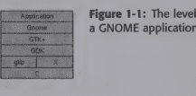

虽然该图显示了每个层级与除其正上方和正下方的层级之外的其他层级是隔离的，但这并不完全准确。下方层级的所有功能均可用。例如，GTK+ 函数可以直接调用 X 函数，GNOME 应用程序可以直接调用 C 库函数。

## 软件层级

以下是对图 1-1 中显示的每个层级内容的简要描述。

### C

实际上有两组 C 函数调用。C 标准库中有函数，如 *printf*() 和 *memcpy*()，还有 Linux 系统调用，如 *open*() 和 *mkdir*()。由于 C 语言诞生并成长于 UNIX 环境中，因此有时很难确定一个函数属于哪个类别。

### glib

这是一个包含 C 函数、宏和结构的库，被 GDK、GTK+、GNOME 以及应用程序使用。它包含用于内存分配、字符串格式化、日期和时间、I/O 以及计时器的函数。它还包含用于链表、数组、哈希表、树、quarks 和缓存的实用函数。glib 处理的一个关键功能是主循环，它使 GNOME 能够同时处理多个资源，同时执行应用程序中的函数。

### X

这是一个包含用于控制显示的低级函数的图形库。所有基本窗口函数都包含在内——这些函数用于显示窗口并响应鼠标。多年来，这个库变得非常稳定，版本号很少改变。目前，它是版本 11 发行版 6（也称为 X11R6）。

### GDK

*GIMP 绘图工具包*。GDK 主要是简化程序员访问 X 函数的函数库。X 库非常底层——它由大量函数组成，每个函数执行特定且相对简单的任务。GDK 创建数据对象来保存窗口配置信息，并提供可以使用这些数据来简单执行一致任务的函数。例如，颜色存储在 GdkColor 结构中。有一些函数可以使用此结构自动在颜色图中分配颜色。如果颜色图中没有空间，它会找到最接近的现有颜色。

### GTK+

GIMP 工具包。GTK+ 库将 GDK 中可用的函数组织为对象。这些对象大多是可显示的物品，如按钮、标签、文本输入窗口等。这种对象被称为控件。控件可以非常简单，也可以包含许多其他控件并相当复杂。这些对象通过提供颜色、大小、位置、鼠标、键盘、字体和其他必要项目，并以单一的软件包和标准接口来简化事情。

### GNOME

在某种程度上，GNOME 库是 GTK+ 库的专业扩展。GNOME 桌面环境被开发以控制整个桌面，GNOME 应用程序通常使用一些 GNOME 对象和函数与一些桌面控件进行接口。GNOME 将基本控件留给 GTK+，并添加了一些非常专业且更复杂的自有控件。例如，GnomeAbout 控件在一个控件中包含了完整的弹出关于框，包括名称列表、描述文本、图标和标准颜色。你还可以从传递给单个函数调用的相对简单的表中构建菜单。

### 应用程序

GNOME 应用程序是一个调用 gnome\_init() 来初始化窗口功能、构建一个或多个待显示的窗口，然后进入循环等待键盘或鼠标的事件的程序。

### 命名约定

有一种命名约定有助于理清事物。在几乎每种情况下，你都可以查看某物（函数、对象或任何东西）的名称并立即知道它属于哪个库。表 1-1 列出了前缀和它们通常表示的类型。你可能会发现一些例外，但这种情况很少，因为大多数开源程序员都清楚清晰度的重要性。至少，这种命名约定给了你通过避免已知前缀来自由选择自己名称的自由。一种方法是你发明自己的前缀并用于应用程序中的一切。

**表 1-1**
**前缀命名约定**

| 前缀 | 指示 |
| --- | --- |
| G | 除非它是表中其他 G 前缀之一，这是 glib 中定义的数据结构。 |
| g | glib 数据类型。 |
| g_ | glib 函数。 |
| Gdk | GDK 库中的对象或数据结构。 |
| gdk_ | GDK 函数。 |
| GDK_ | GDK 中定义的常量或宏。大多数常量定义为枚举成员。 |
| Gnome | GNOME 库中的对象或数据结构。 |
| GNOME_ | GNOME 中定义的常量或宏。大多数常量定义为枚举成员。 |
| gnome_ | GNOME 函数。 |
| Gtk | GTK+ 库中的对象或数据结构。 |
| gtk_ | GTK+ 函数。 |
| GTK_ | GTK+ 库中定义的常量或宏。大多数常量定义为枚举成员。 |

## 让我数数方式

在任何软件开发系统中，完成特定任务都不止一种写代码的方式。对于像 GNOME 这样的开放软件系统更是如此，因为有这么多程序员参与开发底层功能。所有 GNOME 黑客都有自己的想法，关于事情应该如何做，每个黑客的观念（在某种程度上）在编写 GNOME 代码时与其他所有人的观念不同。这并不一定是一件坏事——事实上它导致系统中有很多变化和灵活性。

但这确实意味着没有单一的“标准”方式来编写 GNOME 代码。例如，至少有五种不同的函数调用可用于显示带有 OK 按钮的简单消息框。除此之外，还有许多函数可以改变消息框构建后的外观。

这个故事寓意是，如果你让某物工作，但它并非完全按你想要的方式工作，稍微四处看看，你可能会找到


能够使其按照你的意愿执行的操作。如果没有，那就把它当作一个成为黑客并修改或添加功能的邀请，并将这些修改回馈给开源社区。

## C 语言对象运行机制

面向对象编程仅仅是一种组织数据和代码的方法，仅此而已。这是一种非常有效的组织方式。有一些面向对象语言（例如 C++ 和 Java）会自动化大多数将程序组成对象所需的操作。C 语言甚至算不上是面向对象的。GTK+ 和 GNOME 库全部是用 C 语言编写的，API 仅包含 C 函数调用。然而，代码是以面向对象的方式编写的。

面向对象结构的一部分是由函数调用模式强加的，另一部分则是由约定俗成的规则决定的。

这种代码组织形式既有优点也有缺点。由于语言是 C 语言，与使用例如 C++ 编写的代码相比，代码更简单、更容易阅读。此外，由于几乎所有计算机上都有成熟的 C 语言编译器，因此源代码的可移植性更强。但是，由于面向对象特性本身并非语言的一部分，因此必须进行模拟。在某些地方，对象结构确实会被打破（无论是有意还是无意）。而且，应用程序很容易破坏这种结构。

对象具有几个特征，但与 GNOME 和 GTK+ 相关的三个重要特征是封装、继承和方法。

### 封装

对象的一个特征是它封装了其数据。也就是说，数据只能通过为此目的设计的函数调用来访问。在面向对象术语中，这些函数被称为方法。

由于对象被定义为 C 语言结构体（struct），并没有任何机制禁止你直接读取和写入值。但这并不是一种安全的做法，因为你可能错过了与更改值伴随的一些必要操作。例如，假设对象的结构体内有一个名为 `width` 的字段，你想增加它以使窗口变宽。为此，应调用设置宽度的函数，而不是直接修改字段中的值，因为对象很可能需要采取其他操作才能使新的宽度值实际上改变窗口。调用设置值的函数会自动处理这些其他事项。即使你查看源代码并发现该函数除了设置值外什么都没做，你仍然需要遵循此规则，因为下一个版本可能会改变该函数以执行其他操作，从而导致你的应用程序停止工作。

有一些例外情况，但不多。这通常发生在非常简单的对象中。某些对象未为某些字段定义函数，因此必须直接读取和写入值。你遇到的大多数例外情况将出现在 GDK 中，因为它最初的设计就不是面向对象的。

### 继承

每当编写新对象的代码时，它都是基于现有对象的。描述对象的代码——对象的计划或蓝图——被称为*类*。新类所继承的类被称为*基类*。例如，名为 **GtkButton** 的按钮类使用名为 **GtkBin** 的另一个类作为其基类。反过来，**GtkBin** 继承自另一个类，该类又继承自另一个类，依此类推，直到使用 **GtkObject** 作为基类。**GtkObject** 是唯一一个不继承自其他类的类。所有类最终都继承自 **GtkObject**。以下是 **GtkButton** 的完整继承序列：

```text
GtkButton->GtkBin->GtkContainer->GtkWidget->GtkObject
```

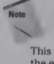

> 小部件（Widgets）及其操作对 GNOME 和 GTK+ 至关重要。任何在谱系中包含 **GtkWidget** 的类都是*小部件*。

这种继承是通过结构体内部的关系创建的。每个结构体都包含其基类的整个结构体。并且基类结构体作为结构体中的第一项被包含。例如，定义 **GtkButton** 的结构体的开头看起来像这样：

```c
struct GtkButton {
   GtkBin bin;
   . . .
}
struct GtkBin {
   GtkContainer;
   . . .
}
struct GtkContainer {
   GtkWidget widget;
   . . .
}
struct GtkWidget {
   GtkObject object;
   . . .
}
```

从这种组织方式可以看出，每个类都包含其所有基类的所有数据。并且，由于基类的数据始终位于结构体的最顶部，因此可以将类转换为其任何基类。这使得可以调用继承链中任何类的方法，如下节所述。

> 注意：我们都有点偷懒，没有始终如一地使用“类”和“对象”这两个术语。严格来说，类是用于构建对象的定义代码，而对象是类的特定实例。创建对象的过程称为实例化。也就是说，`GtkButton` 类只有一个定义，但你的程序可以有几十个 `GtkButton` 对象。你会看到并听到 `GtkButton` 这个术语用于指代类或对象。

### 方法

方法用于从类创建新对象。例如，可以通过以下函数调用创建 `GtkButton`：

```c
GtkWidget *button;
button = gtk_button_new_with_label("Label");
```

所有创建对象的函数名称中都有 `new` 这个词。函数 `gtk_button_new_with_label()` 创建一个显示文本“Label”的按钮。虽然创建的项目是 `GtkButton` 对象，但其地址存储在 `GtkWidget` 指针中。这是可能的，因为一种称为*多态*的面向对象特性。多态仅仅意味着任何对象都可以被完全当作其基类之一来处理。使用 `GtkWidget` 指针具有一些编程优势，因为有许多 GUI 界面函数操作 `GtkWidget` 对象。

在调用方法操作现有对象时，特定对象的地址作为第一个参数传递。例如，一旦按钮被正确分配到容器中的某个位置，就可以使用以下函数调用显示它：

```c
gtk_widget_show(button);
```

`button` 的指针数据类型为 `GtkWidget`，因此函数接受它的方式与接受其他任何小部件的方式相同。通过使用特殊的强制转换宏，可以调用继承中所有类的方法。例如，要将围绕按钮的装饰外观从默认的斜边外观更改为简单的无装饰按钮，请使用以下内容：

```c
gtk_button_set_relief(GTK_BUTTON(button), GTK_RELIEF_NONE);
```

此外，可以使用以下函数调用在对象中存储键控数据：

```c
gtk_object_set_data(GTK_OBJECT(button), "key", data);
```

还有强制转换宏 `GTK_BIN()` 和 `GTK_CONTAINER()`。实际上，GTK+ 和 GNOME 中的每个小部件都有定义的强制转换宏。这些宏所做的不仅仅是简单的强制转换。当你的应用程序运行时，会有一个测试确保强制转换是有效的。这种验证可以节省大量可能浪费在追踪神秘错误上的时间。

## 小部件的功能

小部件可以与其他小部件以及你程序的其他部分协同工作，但小部件本质上是一个独立的对象，需要函数调用来检索或设置其内部的数据。大多数小部件都有一个显示在屏幕上的窗口，但一些特殊用途的小部件从不显示窗口。

最常见的特殊用途小部件是*容器*。容器小部件是指承担控制一个或多个其他小部件的大小和位置责任的小部件。例如，如果你有一个包含“确定”和“取消”按钮并显示一行文本的对话框，那么会有某种容器小部件来定位和调整这两个按钮和文本窗口的大小。

有许多种容器小部件。一些将其子小部件组织成行、列或表格，而其他小部件则将它们一个接一个地上下排列，并提供选项卡，以便用户可以从一个切换到另一个。并且由于容器本身也是小部件，而且它也可以包含小部件，因此容器可以作为另一个容器小部件中的子小部件使用。例如，你可以有一个将子小部件组织成一列的容器，并且该列中的每个成员都可以是另一个容器，该容器将其成员排列成一行、一个表格等。

## 信号和回调

与外部世界（鼠标和键盘）的通信是每个小部件的责任。你的程序不必持续检查，例如，是否按下了某个按钮。相反，你指示小部件每当按下按钮时调用你程序中的一个函数。

当发生硬件操作——通常是键盘按键、鼠标移动或鼠标按键按下——时，会向你的程序发送一个*事件*。事件被翻译成一个*信号*。虽然事件与硬件具有一对一的关系，但信号并不是。例如，一次鼠标按键按下是一个单一的事件，并被翻译成信号，但连续两次鼠标按键按下接近


还会发出另一个用于双击的信号。在此示例中，两个事件生成了三个信号。

只要显示界面上发生某种变化，X 窗口管理器也会发出事件。每当窗口首次出现、变为隐藏、改变大小、变为可见、被关闭或移动时，都会发出一个事件。这些事件都会转换为信号，并供应用程序使用。

还有一些信号源自小部件内部。滚动条被移动时，会发出一个包含其新位置信息的信号。列表会发出一个信号，指示鼠标选择了其成员中的哪一个。切换按钮在开启或关闭时指示其状态。工具栏会发送一个信号，指示其方向已从水平变为垂直。

所有这些信号都可以供您的程序使用。您只需告知小部件您希望接收哪个信号，以及调用哪个函数来接收它即可。由于是小部件调用您的函数，因此该函数被称为回调函数。

## 进入 GIMP 的 glib

有一个名为 GIMP（GNU 图像操作程序）的图形实用程序，它随大多数（如果不是全部的话）Linux 系统分发。GIMP 的开发者创建了 glib，以便简化和标准化其软件开发。该库包含数据类型定义、宏、数据结构以及大量实用函数调用。glib 中的组件用于创建 GDK、GTK+ 和 GNOME 库。这使得使用它们来创建您的应用程序非常方便——事实上，有一些 GTK+ 和 GNOME 函数调用需要 glib 数据类型作为参数。

## 基本数据类型

glib 中定义了许多数据类型。这是为了实现标准化和可移植性。int 的大小在一台机器上可能是 16 位，而在另一台上可能是 32 位。同样，char 在一个系统上可能是无符号的，在另一个系统上则可能是有符号的。例如，如果您的代码使用 gint32 而不是 int，使用 gchar 而不是 char，那么您的源代码在不同平台之间移植的可能性就会大得多。


> 您会在代码中发现不一致之处。例如，有些地方的 int 和 gint 可以互换使用。由于程序员都有自己的风格，而且参与开发开源软件的程序员众多，难免会有一些差异。这是为了获得开源流程所产生的大量高质量软件而必须支付的微小代价。

所有基本类型定义都以前缀字母 g 开头。无符号整数总是以前缀 gu 开头。以下程序列出了所有基本类型及其大小：

```c
/** gshow.c **/
#include <glib/gprintf.h>
#include <stdlib.h>

int main(int argc, char *argv[])
{
    g_print("gchar: %d\n", sizeof(gchar));
    g_print("guchar: %d\n", sizeof(guchar));
    g_print("gint8: %d\n", sizeof(gint8));
    g_print("guint8: %d\n", sizeof(guint8));
    g_print("gshort: %d\n", sizeof(gshort));
    g_print("gushort: %d\n", sizeof(gushort));
    g_print("gint16: %d\n", sizeof(gint16));
    g_print("guint16: %d\n", sizeof(guint16));
    g_print("gint: %d\n", sizeof(gint));
    g_print("guint: %d\n", sizeof(guint));
    g_print("gint32: %d\n", sizeof(gint32));
    g_print("guint32: %d\n", sizeof(guint32));
    g_print("glong: %d\n", sizeof(glong));
    g_print("gulong: %d\n", sizeof(gulong));
    g_print("gint64: %d\n", sizeof(gint64));
    g_print("guint64: %d\n", sizeof(guint64));
    g_print("gfloat: %d\n", sizeof(gfloat));
    g_print("gdouble: %d\n", sizeof(gdouble));
    g_print("gpointer: %d\n", sizeof(gpointer));
    g_print("gconstpointer: %d\n", sizeof(gconstpointer));
    g_print("gboolean: %d\n", sizeof(gboolean));
    exit(0);
}
```

以下是一个可用于编译此程序的 makefile。gnome-config 实用程序用于设置编译和链接 GNOME 程序所需的环境。此过程在第 2 章中有详细描述。

```makefile
CC=gcc
LDLIBS=`gnome-config --libs gnomeui`
CFLAGS=-Wall -g `gnome-config --cflags gnomeui`

gshow: gshow.o
	$(CC) $(CFLAGS) -o gshow gshow.o $(LDLIBS)
```

以数字 8、16、32 和 64 结尾的定义名称的长度是固定的，无论使用哪个平台都相同。其他定义的长度可能不同（由 C 语言定义）。64 位整数 gint64 和 guint64 是在 C 中声明为 long long 的那些。当程序在基于 x586 的 Linux 版本上运行时，输出如下所示：

```text
gchar:           1
guchar:          1
gint8:           1
guint8:          1
gshort:          2
gushort:         2
gint16:          2
guint16:         2
gint:            4
guint:           4
gint32:          4
guint32:         4
glong:           4
gulong:          4
gint64:          8
guint64:         8
gfloat:          4
gdouble:         8
gpointer:        4
gconstpointer:   4
gboolean:        4
```

表 1-2 列出了某些数据类型中包含的最大值和最小值的定义名称。还有一些定义的宏，如表 1-3 所示。

| 数据类型 | 最小值 | 最大值 |
| :--- | :--- | :--- |
| **gshort** | G_MINSHORT | G_MAXSHORT |
| **gint** | G_MININT | G_MAXINT |
| **glong** | G_MINLONG | G_MAXLONG |
| **gfloat** | G_MINFLOAT | G_MAXFLOAT |
| **gdouble** | G_MINDOUBLE | G_MAXDOUBLE |

### 表 1-3
### 一些有用的宏

| 宏 | 描述 |
| :--- | :--- |
| ABS(a) | 返回 a 的绝对值。 |
| MAX(a,b) | 数值 a 和 b 具有相同的数据类型，该宏返回两者中较大的那个。 |
| MIN(a,b) | 数值 a 和 b 具有相同的数据类型，该宏返回两者中较小的那个。 |
| NULL | 这是分配给指针的地址值，表示该指针指向空。 |
| TRUE 和 FALSE | 许多函数需要 gboolean 类型作为参数。可以使用这些名称之一来传递表示真或假条件的常量。此外，如果您编写了一个返回 gboolean 类型的函数，它可以返回这些名称之一。 |

## glib 的实用函数

本节介绍了一些您在整个代码中会遇到——并可能在您的应用程序中使用的函数。这里列出的函数只是其中的一部分，但这些是您在 GDK、GTK+ 和 GNOME 源代码中会遇到的一些函数。此外，您还会在本书的示例代码中发现其中几个，由于它们非常方便，您可能想自己使用它们。

这里列出的函数大致分为三类：内存管理、字符串操作和文本输出。它们之间存在一些重叠——例如，字符串复制函数可能需要分配内存。

### g_free(gpointer mem)

将之前分配的位于 mem 的内存块归还给系统。

### g_print(gchar *format,...)

此函数类似于标准 C 函数 print()。它在将其他作为参数传递的值插入后，将格式字符串发送到标准输出。

### g_printerr(gchar *format,...)

此函数在将其他作为参数传递的值插入后，将格式字符串发送到标准错误。

### gchar *g_strconcat(gchar *,...)

分配足够的内存以容纳作为参数传入的所有字符串，将这些字符串连接在一起，并返回其地址。

### gchar *g_strdup(gchar *str)

此函数分配容纳字符串所需的内存，将字符串复制到新内存中，并返回其地址。

### gchar *g_strdup_printf(gchar *format,...)

分配内存以容纳新字符串。根据格式（以及可选的数据项）创建字符串，并返回指向其地址的指针。

### gchar *g_strerror(gint errnumber)

当 C 系统调用或标准 C 库调用遇到错误条件时，它会将错误代码存储在全局值 `errno` 中。此函数将错误编号转换为描述性字符串。

### gchar *g_strndup(gchar *str,gint num)

分配足以容纳 `num` 个字符的字符串的内存，将 `str` 复制其中，并返回其地址。

### gint g_str_equal(gchar *s1,gchar *s2)

如果 `s1` 与 `s2` 相同，此函数返回 `TRUE`。

### gint g_strcasecmp(gchar *str1,gchar *str2)

此函数执行不区分大小写的比较（即 *A* 等于 *a*），如果字符串被判定为相同，则返回 `TRUE`。

### gpointer g_malloc(gulong size)

此函数分配 `size` 字节的新内存块并返回其地址。

### gpointer g_malloc0(gulong size)

此函数分配 `size` 字节的新内存块，将其初始化为零，并返回其地址。

### gpointer g_mempdup(gpointer mem,guint size)

指针 `mem` 是 `size` 字节的地址。分配相同大小的新内存块，将 `mem` 的内容复制其中，并返回其地址。


# 第2章

## 显示窗口

对于初学者来说，入门的操作机制往往令人困惑，尤其是在使用新系统或新软件时。本章将演示如何构建一些非常简单的程序。

### 本章内容

- 编译一个简单的非图形程序
- 创建用于编译 GNOME 应用程序的 make 文件
- 从 GTK 程序中显示窗口
- 从 GNOME 程序中显示窗口
- 为 GNOME 窗口添加菜单栏

### 准备工作

本章包含编写显示窗口程序所需的所有基础信息。

但是，在进行任何编程之前，你需要安装并配置某些软件。为了能够编写 GNOME 程序，你必须在 GNOME 环境中运行，拥有 C 编译器的访问权限，并且已安装 GNOME 和 GTK+ 库。附录 A 包含了你所需所有内容的完整列表以及每项内容的安装方法。

如果你希望获取书中所有源代码的副本，可以在以下地址找到：

```
http://www.belugalake.com/book/gnomebile
```

### Hello World 程序

首先要做的是确保环境已配置好，以便你能编译和链接程序。在一个空目录中，创建一个名为 helloworld.c 的文件，其中包含传统的 hello world 程序：

```
//** helloworld.c **/
#include <stdio.h>
int main(int argc,char *argv[] ) {
printf("hello, world\n");
exit(0);
}
```

你可以从命令行按以下方式编译它：

```
gcc helloworld.c -o helloworld
```

**gcc** 程序将 .c 扩展名识别为 C 程序。它编译该程序并将其与标准库链接起来，并且由于使用了 -o 选项，将生成的可执行文件写入名为 *helloworld* 的文件中。如果没有 -o 选项，可执行文件将命名为 *a.out*。输入 **./helloworld**，程序运行并显示以下输出：

```
hello, world
```


**注意**
你可以使用 **cc** 或 **gcc**。/usr/bin/cc 文件是 /usr/bin/gcc 的一个符号链接。有一个名为 /usr/bin/g++ 的类似程序，其中包含针对 C++ 的一些额外功能。

程序 **gcc** 在编译和链接的世界里有点像是“多面手”。在编译程序的命令行中，**gcc** 假设后缀为 .c 的程序是 C 源代码程序。如表 2-1 所示，**gcc** 还识别其他后缀。

表 2-1
gcc 识别的后缀

| 后缀 | 文件内容 |
| :--- | :--- |
| .a | 包含一个或多个对象文件的库文件（也称为归档文件） |
| .c | C 程序的源代码 |
| .C | C++ 程序的源代码 |
| .cc | C++ 程序的源代码 |
| .cxx | C++ 程序的源代码 |
| .h | 预处理器文件 |
| .i | 已经过预处理的 C 程序源代码 |
| .ii | 已经过预处理的 C++ 程序源代码 |
| .m | Objective-C 程序的源代码 |
| .o | 通过编译或汇编源代码生成的对象文件 |
| .s | 汇编语言程序的源代码 |
| .S | 需要预处理的汇编语言程序的源代码 |

使用 gcc 从命令行进行编译和链接很简单，直到被编译的程序变得更加复杂为止。对于具有多个模块的大型程序，你需要在命令行中指定所有的源模块和库。使用 makefile 要简单得多。创建一个名为 makefile（或者如果你更喜欢的话，Makefile）的文件，其中包含以下内容：

```
helloworld: helloworld.c
```

冒号左边是可执行文件的名称。冒号右边是可执行文件所依赖的文件。输入命令：

```
make
```

会出现以下两种情况之一：要么程序被编译并存储到磁盘上，要么什么也不做。如果目录中已经有一个 helloworld 程序，并且它比 helloworld.c 旧，那么它不会被编译，因为没有必要——换句话说，源代码没有发生变化。

在没有明确使用 gcc 命令的情况下进行编译的原因是，make 内置了一些规则，定义了如何从一种文件类型创建另一种文件类型。这不仅限于 C 和 C++。Make 拥有许多语言的规则。如果你极度好奇并希望获取它们的列表（这是一个相当长的列表），你可以输入此命令：

```
make -p -f /dev/null >makelist
```

-p 选项使 make 列出其所有内部设置。使用 -f 选项将 /dev/null 指定为 make 文件的原因是，make 通常从当前目录读取 make 文件，而 makelist 中的信息会与预定义的信息混合在一起。

make 有如此多的选项和特性，要解释它们全部的内容可能需要本书的一大部分内容。本书中使用的 make 文件并不复杂，但它们确实需要编译和链接多个程序模块，并使用特定的库来解决外部引用。作为一个例子，这里有一个带有两个源文件的另一个 hello world 程序。第一个文件名为 helloworld2.c：

```
/** helloworld2.c **/
#include <stdio.h>
void hellomath(double);
int main(int argc,char *argv[]) {
printf("hello, world\n");
hellomath(2.45);
exit(0);
}
```

## 追溯源码

GNOME 正在快速更新。事实上，整个 Linux 都在快速更新。软件的开发速度超过了文档的开发速度，因此时不时地，你会发现有必要浏览一些源代码以了解正在发生什么。虽然代码的清晰度从简单明了到完全晦涩不等，但有一种方法可以立即找到你想要查看的代码部分。如果你将所有源代码加载到单个子目录下的目录中，你可以运行此脚本并创建一个完整的索引，包含源代码中的一切：

```
find . -name "*.c" -print >/tmp/clist
find . -name "*.h" -print >/tmp/hlist
cat /tmp/clist /tmp/hlist >/tmp/taglist
rm -f /tmp/clist
rm -f /tmp/hlist
ctags -L /tmp/taglist
rm -f /tmp/taglist
```

结果是在本地目录中构建了一个名为 *tags* 的文件。该文件是一个数据库，包含在所有子目录的 C 源文件中找到的每个公开可访问的函数、定义常量、结构体、枚举等的名称和位置。tags 文件的格式与 *vi* 编辑器相同；因此，例如，要定位名为 *gnome\_app\_new()* 的函数，请在命令行输入：

```
vi -t gnome\_app\_new
```

相同的脚本可以通过向 ctags 添加 -e 选项，或者像这样使用 etags 来修改，以生成 emacs 编辑器的标签文件：

```
etags -L /tmp/taglist
```

## 总结

GNOME 开发软件不是独立存在的。它建立在 GTK+、GDK、glib 和 X 之上。这些软件中的许多在过去几年里已经成熟，而其中一些是全新的。其他软件库用于 GNOME 应用程序中的通信和数据库访问等事务。当你编写 GNOME 应用程序时，你实际上利用了数百人年的软件开发成果。以下是本章涵盖的一些基础知识：

- 虽然所有内容都用 C 编写，但 GTK+ 和 GNOME 库被组织成一组对象，使得你的程序可以预测和控制它们的动作。
- 在 C 中创建和使用对象需要程序员进行组织和纪律约束——但回报是值得的。
- 基本的可显示项目称为控件（widget）。有数十种控件，由于对象结构的存在，它们都可以以标准方式处理。
- GNOME 应用程序是事件驱动的。也就是说，它的大部分时间都在显示控件并等待用户通过鼠标或键盘进行某种操作。当用户采取行动时，信号会导致回调函数执行，将信息传递给应用程序。
- 有时候，除了进入你所使用的库的源代码之外，你无事可做。当你需要详细信息时，拥有可用的源代码是一个巨大的优势。

在下一章中，你将学习如何编写一些简单的 GNOME 程序。

♦ ♦ ♦


## 2.1. 编译与链接基础

这是新 `hello world` 程序的主线。它与前一个程序非常相似，只是包含了一个对名为 `hellomath()` 的函数的调用。该函数在文件 `hellomath.c` 中定义：

```c
/*  hellomath.c  **/
#include <math.h>
#include <stdio.h>
void hellomath(double value) {
	printf("sine: %g\n", sin(value));
}
```

主线调用该函数以显示 2.45 的正弦值。用于编译和链接该程序的 make 文件如下所示：

```makefile
LDLIBS=-lm

helloworld2: helloworld2.o hellomath.o

helloworld2.o: helloworld2.c

hellomath.o: hellomath.c

clean:
	rm -f helloworld2
	rm -f *.o
```

Make 文件的第一行指定在链接过程中将包含数学库。变量 `LDLIBS` 对于 make 中已有的规则是已知的，作为传递给链接器的信息。由于我们使用了 `sin()` 函数，因此需要将与程序链接的数学库。用于指定库名称的 `-l` 选项是实际文件名的简写。链接器自动在名称前加上 `/usr/lib/lib`，并在末尾加上 `.a`。因此，选项 `-lm` 指定了数学库，即 `/usr/lib/libm.a`。

可执行文件 `helloworld2` 是通过链接目标文件 `helloworld2.o`、`hellomath.o` 以及指定的任何库生成的。然而，在链接器接管之前，下面两行中的依赖关系会被检查，以确定源代码是否需要编译为目标文件。如果缺少目标文件，或者源代码比现有的目标文件更新，它将被编译。

Make 文件底部有一个特殊的命令，没有依赖项（这意味着它总是执行），可用于删除输出文件——从而强制在下一次 make 命令时进行完全编译和链接。可以这样调用它：

```
make clean
```

Clean 的命令列表可以是任何东西——就像你从命令行输入的一样。在 make 文件中拥有特殊标签是很常见的，例如 `make install`（将文件复制到其他位置）或 `make force`（执行 clean 后重新编译）。


Make 实用程序起源于 UNIX 早期，并保留了一些来自那个早期的怪癖。最有可能让你困惑的是制表符（tab）是语法的一部分。前面示例中的两个 `rm` 语句必须用制表符缩进，而不仅仅是空格。如果你对 make 得到某种奇怪的错误消息，请检查你的制表符。缺失的制表符可能导致 make 误解语句并发出它认为找到的错误消息。

这是另一个 make 文件，做的与前一个完全相同的事情，但稍微更明确一些：

```makefile
CC=gcc
LDFLAGS=-lm
CFLAGS=-Wall -g

helloworld2: helloworld2.o hellomath.o
	$(CC) $(LDFLAGS) helloworld2.o hellomath.o -o helloworld2

helloworld2.o: helloworld2.c
	$(CC) $(CFLAGS) -c helloworld2.c

hellomath.o: hellomath.c
	$(CC) $(CFLAGS) -c hellomath.c

clean:
	rm -f helloworld2
	rm -f *.o
```

这里，`LDLIBS` 的设置与前一个例子一样，但链接器的参数是被指定的，而不是允许默认值。用于编译两个源模块的命令也被指定，并使用名为 `CFLAGS` 的变量向 `gcc` 传递参数。`-Wall` 选项告诉编译器对发现的任何问题发出警告——即使是一些有效但被认为是不良编码习惯的问题。这个选项在本书的所有示例中使用，以确保代码尽可能清洁。`-g` 选项导致调试信息与代码一起编译，你可以对程序使用符号调试器。如果你使用这个，你会想在将程序投入生产之前移除调试信息，因为它会导致目标文件非常大。你可以使用 `strip` 从目标文件中移除调试信息，或者从 `CFLAGS` 中移除 `-g` 并重新编译所有内容。

关于 make 还有更多这里没有描述的内容，但这足以开始编译和链接程序。其他的一些东西，例如与第三方库链接和建立对头文件的依赖，将会在那里出现。书中的 make 文件是尽可能简单的。

## GTK+ 的窗口

GNOME 软件实际上建立在 GTK+ 之上，所以在我们可以编译和链接 GNOME 之前，我们需要能够编译和链接 GTK+。GTK+ 程序能够管理窗口、鼠标和键盘。事实上，本书中的几个图形程序不需要调用 GNOME 做任何工作，因为 GTK+ 是一个如此完整的 GUI 包。

这个程序显示一个简单的窗口：

```c
/** gtkwin.c **/
#include <gtk/gtk.h>

int main(int argc, char *argv[]) {
    GtkWidget *topLevelWindow;

    gtk_init(&argc, &argv);
    topLevelWindow = gtk_window_new(GTK_WINDOW_TOPLEVEL);
    gtk_widget_show(topLevelWindow);
    gtk_main();
    exit(0);
}
```

所有的 GTK+ *包含文件* 都在目录 `/usr/include/gtk` 中。目录 `/usr/include` 是标准的包含文件目录，所以，为了指定 `gtk.h` 的位置，只需告诉编译器相对于 `/usr/include` 的目录名即可。虽然 GTK+ 有几十个包含文件，但只需要命名这一个，因为它包含了所有的其他文件。

所有 GTK+ 程序都始于对 `gtk_init()` 的调用。这个函数定位并打开显示器，并初始化颜色、信号处理程序等。传入程序的命令行参数被传递给 `gtk_init()`，它读取并剥离任何为其准备的参数，并将其他参数留在原处。这种技术使得命令行参数可以在 GTK+ 或你的应用程序中处理。GTK+ 不懂的任何参数，它会留在 `argv` 数组中供你的应用程序处理。它尽一切努力理解这些参数。但是，如果 GTK+ 不能使用它们，它会将它们传递给 GDK，进而传递给 X 窗口系统。如果任何级别的参数被使用，它将从 `argv` 中移除。

`gtk_window_new()` 函数被调用以创建顶级窗口。任何程序的主窗口都是顶级窗口。虽然一个程序可以有多个顶级窗口，但更常见的是创建一个顶级窗口，并将其他窗口作为对话创建并附属于顶级窗口。这个例子只有一个窗口，所以它是顶级的。

`gtk_widget_show()` 函数显示顶级窗口及其所有华丽的默认设置。默认大小是 200 x 200 像素，它有一个灰色背景，并使用程序名称作为窗口标题。窗口外部的装饰取决于显示管理器，但图 2-1 显示了它在 GNOME 上运行的样子。

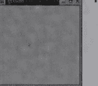

**图 2-1：默认窗口**

除了不执行任何其他操作之外，显示一个空白窗口，此应用程序完全忽略鼠标和键盘，即使其窗口关闭也不会停止运行。要停止它，你需要从用于启动它的终端窗口输入 `Ctrl+C`。如果在后台运行，你需要发出 `kill` 命令。

对 `gtk_main()` 的调用是阻塞调用，等待在窗口显示期间通过事件队列传入的指令。在这个例子中，因为没有为键盘和鼠标指定响应，输入的到来被完全忽略。在正常的程序中，`gtk_main()` 被提供在特定事件到达时要调用的函数列表。

有许多种构造 Make 文件来编译此程序的方法。我选择这种特定的格式是为了它的简单性；它易于修改和扩展用于其他任务：

```makefile
CC=gcc
LDLIBS=`gtk-config --libs`
CFLAGS=-Wall -g `gtk-config --cflags`

gtkwin: gtkwin.o
	$(CC) $(LDLIBS) gtkwin.o -o gtkwin

gtkwin.o: gtkwin.c
	$(CC) $(CFLAGS) -c gtkwin.c

clean:
	rm -f gtkwin
	rm -f *.o
```


创建 Makefile 有更佳的方法。随着软件项目的扩展和文件数量的增加，Makefile 会变得越来越繁琐。最好对 Makefile 生成的某些方面进行自动化。我在第 20 章中解释了自动生成功能。

在此 Makefile 中，定义了两个变量名（CFLAGS 和 LDFLAGS）以保存编译和链接过程所需的一些信息。CFLAGS 包含编译所需的 gcc 参数列表，LDFLAGS 包含链接所需的 gcc 参数列表。通常，这是一项非常令人困惑的任务，但 GTK+ 通过提供一个（实际上是脚本形式的）程序来自动生成这些参数，使其变得非常简单。这减少了出错的可能性，并且作为额外的好处，会自动更新我们的 Makefile 以适配 GTK+ 的任何新版本。你可以通过输入以下命令来查看生成的参数：

```
gtk-config --cflags
gtk-config --libs
```

注意 `gtk-config` 在 Makefile 中的使用方式。命令由一对反向引号 - 不是单引号 - 包围。这指示 make 执行该命令并将其输出作为字符串读取并存储在变量中。生成的设置是 LDFLAGS 变量所需的全部内容。然而，从 Makefile 中 CFLAGS 的定义方式可以看出，可以在该行的末尾添加其他参数。选项 `-Wall` 开启最高级别的警告消息，`-g` 则导致包含调试信息。

## 一个会关闭的窗口

大多数程序都在菜单栏或工具栏上内置了“关闭”选项。此外，用户可以使用鼠标选择窗口右上角的交叉符号来指示窗口关闭。从窗口左上角弹出的菜单中选择“关闭”，与选择右上角的交叉符号具有相同的效果。无论哪种方式，都会向程序发送一个事件，通知它窗口即将关闭。为了正常工作，程序应拦截该事件并就接下来要做什么做出决策。程序甚至可以拒绝允许窗口关闭。主要而言，事件机制为程序提供了一个机会，用于刷新缓冲区、关闭文件、断开通信链接，以及执行其他良好程序在自我清理时通常会做的事情。

该程序显示默认窗口，并设置了一对函数以使程序平稳停止：

```c
/* closWin.c **/
#include <gtk/gtk.h>

gint downCount = 0;

gint eventDelete(GtkWidget *widget, GdkEvent *event, gpointer data);
gint eventDestroy(GtkWidget *widget, GdkEvent *event, gpointer data);

int main(int argc, char *argv[])
{
    GtkWidget *topLevelWindow;

    gtk_init(&argc, &argv);
    topLevelWindow = gtk_window_new(GTK_WINDOW_TOPLEVEL);
    gtk_signal_connect(GTK_OBJECT(topLevelWindow),
        "delete_event",
        GTK_SIGNAL_FUNC(eventDelete),
        NULL);
    gtk_signal_connect(GTK_OBJECT(topLevelWindow),
        "destroy",
        GTK_SIGNAL_FUNC(eventDestroy),
        NULL);

    gtk_widget_show(topLevelWindow);
    gtk_main();
    g_print("Done!\n");
    exit(0);
}

gint eventDelete(GtkWidget *widget, GdkEvent *event, gpointer data) {
    g_print("Attempt number %d\n", ++downCount);
    if (downCount > 2)
        return(FALSE);
    return(TRUE);
}

gint eventDestroy(GtkWidget *widget, GdkEvent *event, gpointer data) {
    g_print("Shutting down\n");
    gtk_main_quit();
    return(0);
}
```

该程序显示与前一个示例中程序相同的默认窗口，但它包含允许受控且整洁地关闭的代码。程序以前一个示例中的 `gtk_init()` 和 `gtk_window_new()` 调用开始。接着是两个对函数 `gtk_signal_connect()` 的调用。

函数 `gtk_signal_connect()` 将事件与特定函数关联起来。传递给它四个参数。由于每个事件都与特定窗口相关联，因此第一个参数是预期发出事件的窗口。第二个参数是事件的名称。第三个参数是每当事件发生时被调用的函数名称。宏 `GTK_SIGNAL_FUNC()` 只是将函数强制转换为类型 `GtkSignalFunc()`。最后一个参数是一个可选指针，你可以使用它向事件处理函数传递数据。

当此程序运行时，函数 `gtk_widget_show()` 显示一个窗口，`gtk_main()` 进入睡眠状态，等待来自窗口的输入。唯一有意义的窗口输入是 "delete_event" 或 "destroy" 事件，因为这些是注册到系统的仅有的事件处理器。当你使用鼠标尝试关闭窗口时，`gtk_main()` 接收到 "delete_event"，该事件被用作调用 `eventDelete()` 的参数。`downCount` 的值递增，如果它小于 2，`eventDelete()` 函数返回 `FALSE` 以防止进一步操作。窗口不会关闭，程序继续运行。另一方面，如果 `downCount` 为 3 或更大，`eventDelete()` 返回 `TRUE`。这个 `TRUE` 返回值导致窗口立即关闭，并发出 "destroy" 事件，从而导致调用函数 `eventDestroy()`。对 `gtk_main_quit()` 的调用导致对 `gtk_main()` 的阻塞调用释放并返回。程序干净地退出。运行该程序产生以下输出：

```
Attempt number 1
Attempt number 2
Attempt number 3
Shutting down
Done!
```

正如你可以从发生顺序中看到的，在关机之前，程序可以在三个地方接管控制权并清理事物。依靠 "delete_event" 函数进行清理可能不是个好主意，因为有可能从其他来源收到 "destroy" 事件。最好仅在希望拥有拒绝关闭窗口选项时才依赖 "delete_event"。否则，只需放入一个简单的哑元，总是返回 `TRUE`。如果在关机时需要处理工作，请在 "destroy" 回调函数中或调用 `gtk_main()` 之后的主线代码中执行。

对 `gtk_main_quit()` 的调用是必要的。没有它，对 `gtk_main()` 的调用将继续等待一个不存在的窗口上的事件。这就是前一个示例中发生的情况，也是你关闭窗口后必须强制结束程序的原因。

## 回调和事件

所有 `GNOME` 和 `GTK` 程序都基于接收并响应事件。正如我们刚刚在前一个示例中看到的，程序的主线坐在那里等待输入队列中事件的到达，当事件到达时，一个函数被调用。由于事件到达而被调用的函数被称为*回调函数*，因为是 `GTK` 系统调用了你程序中的这些函数。

事件按顺序处理，一次处理一个。每当 `gtk_main()` 从队列中读取事件时，它会检查是否有任何分配给它的回调函数（可能不止一个），如果有，这些函数会被调用。当这些函数中的最后一个返回时，`gtk_main()` 读取队列寻找下一个事件。

事件也可能从窗口以外的位置发出。你的程序可以将事件放入队列中。例如，可以设定一段时间让事件隐藏在队列中，这种机制可以设置定时器，以触发函数调用。队列还可以用于进程间通信，因为其他程序通过知道你的窗口 ID，可以将事件放入你的队列中。

## 带按钮的窗口

图形元素都是小部件。有菜单小部件、标签小部件、滚动条小部件，以及在这个示例中的按钮小部件。此示例显示了一个带有推按钮的简单窗口，当鼠标选择该按钮时，报告该按钮已被按下：

```c
/** buttonwin.c **/
#include <gtk/gtk.h>

gint eventDelete(GtkWidget *widget, GdkEvent *event, gpointer data);
gint eventDestroy(GtkWidget *widget, GdkEvent *event, gpointer data);
void eventButton(GtkWidget *widget, GdkEvent *event, gpointer data);

int main(int argc, char *argv[])
{
    GtkWidget *topLevelWindow;
    GtkWidget *pushMeButton;

    gtk_init(&argc, &argv);
    topLevelWindow = gtk_window_new(GTK_WINDOW_TOPLEVEL);
    gtk_signal_connect(GTK_OBJECT(topLevelWindow),
        "delete_event",
        GTK_SIGNAL_FUNC(eventDelete),
        NULL);
    gtk_signal_connect(GTK_OBJECT(topLevelWindow),
        "destroy",
        GTK_SIGNAL_FUNC(eventDestroy),
        NULL);
    pushMeButton = gtk_button_new_with_label("Push me!");
    gtk_signal_connect(GTK_OBJECT(pushMeButton),
        "clicked",
```


## 来自 GNOME 的窗口

生成 GNOME 窗口所需的代码与生成 GTK 窗口的代码非常相似。GNOME 是构建在 GTK 之上的一组扩展，在大多数情况下，GTK 的功能保持完整。GNOME 充分利用了这一优势——正如你在下面这个显示 GNOME 窗口的示例程序中看到的：

```c
/* gnometwin.c */
#include <gnome.h>

int main(int argc, char *argv[])
{
    GtkWidget *topLevelWindow;

    gnome_init("gnometwin", "1.0", argc, argv);
    topLevelWindow = gnome_app_new("gnometwin", "Gnome Window");
    gtk_widget_show(topLevelWindow);
    gtk_main();
    exit(0);
}
```

这个程序与之前介绍的名为 gtkwin 的程序非常相似。它们之间只有两个区别。该程序调用 `gnome_init()` 而不是 `gtk_init()` 来初始化系统，并且函数 `gnome_app_new()` 调用 `gtk_init()` 来初始化图形界面。但它也执行了一些 GNOME 特有的其他初始化操作。第二个区别在于，该程序调用函数 `gnome_app_new()` 来创建窗口，而之前的程序调用的是 `gtk_window_new()`。

`gnome_init()` 有四个参数。第一个参数是应用程序的 ID 字符串，第二个是其版本号。最后两个参数是传入命令行中的参数。注意 `argc` 是通过值传递的（而不是像之前那样通过地址传递），这意味着不能从 `argv` 数组中移除任何参数，因为函数对 `argc` 所做的任何更改都会丢失。

函数 `gnome_app_new()` 通过调用 `gtk_window_new()` 创建一个顶层应用程序窗口。窗口作为一个 GtkWidget 返回，这与之前的程序一样。第一个参数是应用程序的名称。GNOME 内部使用此名称来标识程序。第二个参数是显示在窗口顶部的标题名称，如图 2-3 所示。

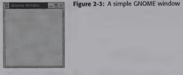

就像之前示例中的 GTK 制作文件一样，有一个脚本有助于创建制作文件。用于编译 gnomevin 的制作文件如下所示：

```makefile
CC=gcc
LDLIBS=`gnome-config --libs gnomeui`
CFLAGS=`gnome-config --cflags gnomeui`

gnomevin: gnomevin.o
  $(CC) $(LDLIBS) gnomevin.o -o gnomevin

gnomevin.o: gnomevin.c
  $(CC) $(CFLAGS) -c gnomevin.c

clean:
  rm -f gnomevin
  rm -f *.o
```

名为 gnome-config 的脚本用于声明传递给 gcc 以编译和链接程序的选项。使用反引号（重音符）包围该语句会导致脚本执行，并将执行结果赋值给变量名。这与之前对 gtk-config 所做的操作相同，只不过 gnome-config 有几个额外的选项。

> **注意**
> 使用 gnome-config 有多重好处。它极大地简化了编写制作文件的工作，因为你不需要记住包含每个库的名称，也不担心编译器选项是否设置正确。更好的是，当你升级到更新的 GNOME 版本时，你的制作文件无需更改。新版本的 gnome-config 会自动为你进行调整。

在此制作文件中，变量 CFLAGS 被设置为保存编译所需的选项，而 LDLIBS 用于链接。你可以使用命令行中的 gnome-config 来查看这些值的实际内容。实际值肯定会从一个软件发行版到下一个有所变化；但为了让你了解其中涉及的内容，请输入此命令：

```bash
gnome-config --cflags gnomeui
```

它产生的输出看起来像这样：

```text
-I/usr/include -DNEED_GNOME_SUPPORT_H -I/usr/lib/gnome-libs/include -I/usr/X11R6/include -I/usr/lib/glib/include
```

如你所见，编译选项行主要由包含 include 文件的目录列表组成。有一个变量定义。你只需要添加自己应用程序的 include 目录（如果有），以及你想要做出的任何编译器设置（例如本例中的 -Wall 和 -g 选项）。要获取所需库的列表，请输入此内容：

```bash
gnome-config --libs gnomeui
```

它生成的字符串看起来像这样：

```text
-rdynamic -L/usr/lib -L/usr/X11R6/lib -lgnomeui -lart_lpgl -lgdk_imlib -lSM -lICE -lgdk -lgdk -lgmodule -lXext -lX11 -lgnome -lgnomesupport -lesd -ludiofile -lm -lib -lglib -ldl
```

如你所见，有很多库。如果没有 gnome-config 脚本，维护这个列表可能会非常令人沮丧。

除了 gnomeui 之外，还有其他有效的名称。例如，要编译一个小工具，可以使用此命令设置 LDLIBS：

```bash
gnome-config --libs applets
```

结果看起来像这样：

```text
-rdynamic -L/usr/lib -L/usr/X11R6/lib -libpanel_applet -lgnorba -lORBitCosNaming -lORBit -liIOP -lORBitutil -lgnomeui -lart_lpgl -lgdk_imlib -lSM -lICE -lgdk -lgdk -lgmodule -lXext -lX11 -lgnome -lgnomesupport -lesd -ludiofile -lm -lib -lglib -ldl
```

还有许多其他有效的名称。名称 gtk 可用于调用前面描述的 gtk-config 脚本。此外，名称 glib 可用于调用 glib-config 脚本。要查看所有可用的名称，请输入此内容：

```bash
gnome-config --help
```

信息来自两个来源。一些名称，如 gnomeui，位于脚本主体内部。其他名称，如 applets，存储在磁盘上的 /usr/lib 目录中。文件名以命令行中使用的名称开头，并以 "Config.sh" 结尾。例如，保存 applets 设置的文件是：

```text
/usr/lib/appletsConfig.sh
```


每当脚本在命令行中不知道文件名时，它会在 `/usr/lib` 目录中查找具有正确名称的文件。在此处，您可以创建自己的环境设置。例如，如果您的项目包含库并且有自己独立的头文件，您可以将这些全部配置为配置文件。这些配置文件的内容非常直接。以下是针对名为 “fred” 的项目的一个示例。名为 `/usr/lib/fredConf.sh` 的文件包含以下内容：

```
FRED_LIBDIR="~/home/fred/lib"
FRED_LIBS="-lfredout -lwrk"
FRED_INCLUDEDIR="-I/home/fred/include"
```

一旦该文件就位，就可以像其他文件一样在您的 make 文件中使用它：

```
CFLAGS=`gnome-config --cflags fred`
LDFFLAGS=`gnome-config --libs fred`
```

## GNOME 应用的开端

这个示例综合了前几个示例中的一些内容，创建了一个带有菜单的小型主应用程序窗口。这是一个什么都不做的 GNOME 应用程序，它只显示其窗口并等待关闭指令以干净地退出。它的编写初衷是作为启动新应用程序时的种子源代码。

```c
1 /** gnomebase.c **/
2 #include <gnome.h>
3
4 static void shutdown();
5 static void showhelp();
6 gint eventDelete(GtkWidget *widget,
7		GdkEvent *event, gpointer data);
8 gint eventDestroy(GtkWidget *widget,
9		GdkEvent *event, gpointer data);
10
11 GnomeUIInfo fileMenu[] = {
12	{ GNOME_APP_UI_ITEM,
13	  N_("Exit"), N_("Close all files and exit"),
14	  shutdown, NULL, NULL,
15	  GNOME_APP_PIXMAP_STOCK, GNOME_STOCK_MENU_ABOUT,
16	  0, 0, NULL
17	},
18	GNOMEUIINFO_SEPARATOR,
19	GNOMEUIINFO_END
20 };
21
22 GnomeUIInfo helpMenu[] = {
23	{ GNOME_APP_UI_ITEM,
24	N_("Help"), N_("Display help information"),
25  showhelp, NULL, NULL,
26  GNOME_APP_PIXMAP_STOCK, GNOME_STOCK_MENU_ABOUT,
27      0.0, NULL
28  };
29      GNOMEUIINFO_SEPARATOR,
30      GNOMEUIINFO_END
31 };
32
33 GnomeUIInfo mainMenu[] = {
34      GNOMEUIINFO_SUBTREE(N_("File"), fileMenu),
35      GNOMEUIINFO_SUBTREE(N_("Help"), helpMenu),
36      GNOMEUIINFO_END
37 };
38
39 int main(int argc, char *argv[]) 
40 {
41      GtkWidget *appWindow;
42
43      gnome_init("gnomebase", "1.0", argc, argv);
44      appWindow = gnome_app_new("gnomebase", "Gnome Base");
45      gtk_widget_show(appWindow);
46      gnome_app_create_menus(GNOME_APP(appWindow), mainMenu);
47
48      gtk_signal_connect(GTK_OBJECT(appWindow),
49          "delete_event",
50          GTK_SIGNAL_FUNC(eventDelete),
51          NULL);
52      gtk_signal_connect(GTK_OBJECT(appWindow),
53          "destroy",
54          GTK_SIGNAL_FUNC(eventDestroy),
55          NULL);
56
57      gtk_main();
58      exit(0);
59 } 
60 void showhelp() { 
61      g_print("Show the help window\n"); 
62 } 
63 gint eventDelete(GtkWidget *widget, 
64      GdkEvent *event, gpointer data) { 
65      return(FALSE); 
66 } 
67 gint eventDestroy(GtkWidget *widget, 
68      GdkEvent *event, gpointer data) { 
69      shutdown(); 
70      return(0); 
71 } 
72 void shutdown() { 
73      gtk_main_quit(); 
74 }
```

菜单被定义为结构体数组。菜单上的每个项目（按钮、分隔符等）都是数组中的单个条目。有一个数组是顶部的菜单栏。每个新的菜单级别都存储在单独的数组中。在前面的示例中，菜单栏本身位于第 33 行，作为 `mainMenu` 数组。它包含两个由宏 `GNOMEUI_INFO_SUBTREE` 定义的子菜单，该宏使用子菜单的名称和子菜单定义数组的名称。数组的末尾由一个 `GNOMEUI_INFO_END` 条目标记。

第 11 行和第 22 行定义的两个子菜单各有一个条目。数组的每个成员都是一个特定类型，意味着它为菜单系统执行特定的任务。这两个子菜单的类型都是 `GNOME_APP_UI_ITEM`，这意味着当被选中时，会调用一个函数。第一个字符串是显示在菜单上的名称，第二个字符串是当菜单项在工具栏中用作选择时弹出的帮助提示。接下来是当菜单项被选中时调用的函数名称。还有很多其他选项和设置；它们都在第 6 章中进行了说明。

实际创建菜单并将其设置为管理的代码由对 `gnome_app_create_menus()` 的单个函数调用组成。作为其第一个参数，该函数需要一个指向 `GnomeApp` 结构体的指针，因此使用宏 `GNOME_APP` 从用于定义顶层窗口的 `GtkWidget` 中获取该指针。此程序显示的窗口如图 2-4 所示。顶部的菜单栏显示了程序中定义的两个选项。

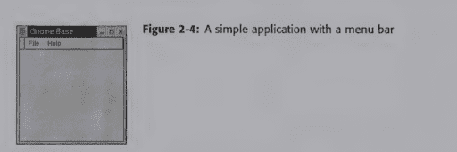

现在有一种退出程序的新方式。与前面的示例一样，可以捕获来自窗口管理器的关闭信号，从而导致程序退出。但现在也有一个菜单选项，如第 14 行所定义，它调用第 72 行定义的 `shutdown()` 函数来退出程序。本着最好只有一个退出点的理念，`eventDestroy()` 函数调用 `shutdown()`。

make 文件中并没有什么真正的新内容。它看起来像这样：

```
CC=gcc
LDLIBS="`gnome-config` -libs gnomeui"
CFLAGS=-Wall -g `gnome-config --cflags gnomeui`

gnomebase: gnomebase.o
$(CC) $(LDLIBS) gnomebase.o -o gnomebase

gnomebase.o: gnomebase.c
$(CC) $(CFLAGS) -c gnomebase.c

clean:
rm -f gnomebase
rm -f *.o
```

## 总结

在基于 GTK 的 GNOME 之上，以及基于 Xlib 的 GTK 之上，通过一次函数调用就可以完成很多工作。GNOME 应用程序不会花费任何时间进行底层配置——它直接创建窗口。如果您成功编译并运行了本章中的示例，那么您的 GNOME 和 GTK 软件开发环境就已设置好并准备就绪，并且应该对以下内容有所了解：

- make 实用工具，它运行并从源代码生成可执行文件
- 配置脚本 gnome-config，它生成 make 文件选项
- GNOME 与 GTK 之间的关系
- GNOME 应用程序的形式

在下一章中，将介绍更多窗口。应用程序通常有一个主窗口和其他用于特殊用途的弹出窗口。您还将了解到必须从窗口检索的事件，以及在 GNOME 环境中处理鼠标的不同方式。


CHAPTER

## 显示弹出对话框

### 本章内容

- 显示一个作为独立窗口的对话框，该窗口在程序的控制中心出现和消失
- GNOME 预定义对话框示例的集合
- 对话框的动态创建和销毁
- 暂时隐藏对话框，而不是不断创建和销毁它们

程序通常有一个主窗口，并且可以有其他几个在鼠标控制中心弹出和消失的窗口。本章讨论创建、显示和销毁这些临时窗口所需的机制。

一些临时窗口出现的频率很高，因此它们作为 GNOME 的标准部分提供。例如，有一个显示文本并通过“确定”按钮关闭的框。大多数应用程序还需要一些其专用的窗口。本章的前半部分演示了使用预定义的临时窗口；后半部分展示了创建和显示自己的临时窗口的机制。

### 弹出窗口、对话框和组件

*popup*（弹出窗口）和 *dialog*（对话框）是通用的计算机术语，倾向于互换使用。它们有明确的含义，但它们足够相似，以至于在许多情况下使用任一词都是合适的。*popup* 是一个突然出现的窗口，用于向用户提供信息、接受来自用户的输入，或两者兼有。当不再需要弹出窗口时，它会消失（有时称为 *pop down*（向下弹出/隐藏））。*Dialog* 是任何包含组件的窗口，这些组件显示数据和/或接受来自用户的数据输入。

GTK+ 工具包为这些术语赋予了特殊的含义。*popup* 是一个没有装饰的显示窗口——意味着窗口管理器不在其顶部放置带有系统菜单的标题栏。*Dialog* 是一个显示窗口，窗口管理器为其添加了标题栏和系统菜单。


### 对话框是独立的

弹出窗口或对话框由一个或多个控件组成。*控件* 是一种单用途软件对象，通常用于显示一个窗口。该窗口用于输入、输出或两者兼有。控件可以非常简单（例如一个按钮），也可以相当复杂（例如一个动态大小的下拉选择列表）。虽然也存在一些例外，但大多数控件旨在与其他控件一起包含在窗口中，以定义弹出窗口或对话框界面的布局。

弹出窗口种类繁多。简单的弹出窗口只有一条语句和一个“确定”按钮，而其他的则包含多个标签和其他用于数据输入的控件。通常，一个程序会有一个主窗口，其他所有操作都通过对话框完成，这些对话框在用户鼠标的控制下出现和消失。

当你的程序创建并显示一个对话框时，该对话框会立即独立运行。这种架构是 X 窗口系统基础的一部分。一旦对话框开始运行，创建它的函数就会返回，以便你的程序可以继续运行。你的程序从对话框获取信息的唯一方式，是调用你指定的**可选回调函数**。当然，它可以捕获鼠标以防止访问应用程序中的任何其他窗口，但你的程序不会知道这一点。它只是耐心地等待来自鼠标或键盘的输入。

每个程序都使用相同的函数作为其主循环：

```
gtk_main()
```

此函数调用会等待来自鼠标或键盘的事件。每当有事件到达时，信息会被分派到正确的窗口，该窗口进而可能会调用一个回调函数。如果你编写了一个耗时的回调函数（例如排序一个巨大的文件），那么在你的函数运行期间，鼠标完全不起作用，因为没有事件被读取。虽然有一些方法可以在保持鼠标活跃的同时运行耗时任务（如第 5 章中所述），但我在此想要强调的点是，对话框窗口与你的程序分离，以便 `gtk_main()` 中的事件捕获循环可以继续工作。

### GNOME 定义的对话框

有一组预定义且随时可以显示的对话框。它们是传统的用于告知用户类似“文件未找到！”等信息或询问类似“你确定吗？”等问题时使用的信息框和询问框。

### 制作简单语句

下面的程序表明，只需很少的代码就可以显示一个对话框：

```c
/** okdialog.c **/
#include <gnome.h>

int main(int argc, char *argv[])
{
    gnome_init("okdialog", "1.0", argc, argv);
    gnome_ok_dialog("A simple information window");
    gtk_main();
    exit(0);
}
```

在对话框显示之前，只需调用 gnome_init() 即可。对 gnome_ok_dialog() 的函数调用创建并显示对话框，如 图 3-1 所示。对 gtk_main() 的调用会等待你点击“确定”按钮；当这样做时，对话框就会关闭。

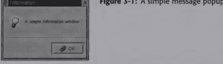

此对话框不会向程序反馈任何信息。事实上，程序会一如既往地继续运行，就好像对话框从未显示过一样——它一直保留在屏幕上，直到“确定”按钮被点击，然后悄无声息地消失。

对话框会自动调整大小以适应文本的大小。如果文本太长无法在一行内显示，可以通过插入换行符（如本例中的换行符）使其在下一行继续显示：

```c
/** okmultiple.c **/
#include <gnome.h>

gchar message[] =
    "To display a message on\nmore than one line\n"
    "it is only necessary to insert\na newline character\n"
    "\nWherever you would like the line to break.";

int main(int argc, char *argv[])
{
    gnome_init("okmultiple", "1.0", argc, argv);
    gnome_ok_dialog(message);
    gtk_main();
    exit(0);
}
```

本例生成的多行对话框如 图 3-2 所示。

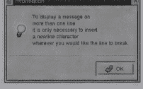

**图 3-2：** 一个包含多行的简单消息弹出窗口

对话框也可以设置为*模态*（modal），这意味着应用程序中的其他窗口不会接受鼠标或键盘输入。以下程序演示了其工作原理：

```c
/** okmddialog.c **/
#include <gnome.h>

int main(int argc, char *argv[])
{
    GtkWidget *app;
    GtkWidget *dialog;
    GtkWidget *button;

    gnome_init("okmdialog", "1.0", argc, argv);
    app = gnome_app_new("okmdialog", "Okay Dialog");
    button = gtk_button_new_with_label("Button");
    gtk_container_set_border_width(GTK_CONTAINER(app), 30);
    gnome_app_set_contents(GNOME_APP(app), button);
    gtk_widget_show(button);
    gtk_widget_show(app);

    dialog = gnome_ok_dialog(
            "A simple information window");
    gtk_window_set_modal(GTK_WINDOW(dialog), TRUE);

    gtk_main();
    exit(0);
}
```

该程序显示之前 图 3-1 中展示的对话框，同时也显示 图 3-3 中的窗口。第 10 到 20 行创建并显示主窗口及其按钮。当主窗口和对话框都显示时，由于第 20 行对 gtk_window_set_modal() 的调用，只有对话框中的按钮对鼠标做出反应。主窗口中的按钮会忽略鼠标操作，直到对话框的“确定”按钮被点击且对话框关闭。在此之后，主窗口中的按钮恢复正常工作。

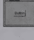

**图 3-3：** 主窗口的按钮

第 15 和 16 行显示按钮和应用程序控件。在此示例中，按钮控件在其父控件（即应用程序控件）之前显示。如果 gtk_widget_show() 调用的顺序颠倒，最终结果是一样的——但在屏幕上绘制控件的过程会有所不同。我将在本章后面详细讨论这一点。

第 18 到 20 行创建并显示对话框的代码不需要应用程序窗口作为参数。这意味着你可以轻松地在程序的任意位置创建对话框，并且该对话框可以中止应用程序内所有窗口的活动，直到对话框被确认。

第 15 和 16 行对 gtk_widget_show() 的调用可以是任意顺序。事实是，如果应用程序控件没有显示，按钮控件根本不会显示，因为第 14 行对 gnome_app_set_contents() 的调用将按钮放置在应用程序控件内部。一般来说，以这种方式从内向外显示控件更好，因为整个窗口及其所有控件会同时出现。对于一个大型窗口（包含大量控件的窗口），如果先显示外层窗口，控件可能会在包含窗口首次出现后依次逐个显示。

到目前为止，对话框窗口是一个自由体，鼠标可以将其放置在显示器上其他任何窗口的前面或后面。此示例表明，如果对话框有一个父窗口，它始终保持在父窗口的前面。当使用模态对话框时，这一点尤其有意义，因为父窗口本来就是非活动状态，隐藏对话框可能会导致混乱。你可以通过将第 18 和 19 行更改为以下内容来修改程序：

```
dialog = gnome_ok_dialog_parented( 
  "A simple information window", 
  GTK_WINDOW(app));
```

这会使应用程序窗口成为对话框的父窗口。任何窗口都可以是一个或多个子窗口的父窗口，因此你可以使用这种相同的技术为应用程序中的任何窗口弹出对话框。

还有另外两个与“确定”对话框窗口工作方式相同的对话框窗口。警告和错误对话框窗口都具有父窗口和非父窗口模式，并且都可以是模态或非模态的。要显示 图 3-4 中所示的错误窗口，请将第 18 和 19 行更改为以下内容：

```
dialog = gnome_error_dialog_parented(
    "A simple error window",
    GTK_WINDOW(app));
```

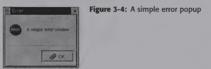

简单“确定”弹出窗口的第三种形式是警告，如 图 3-5 所示。显示代码与其他形式相同：

```
dialog = gnome_warning_dialog_parented(
    "A simple warning window",
    GTK_WINDOW(app));
```


### 提出一个简单问题

要从对话框中获取“是”或“否”的回答，有必要弄清楚用户做了哪两种选择。响应通过一个回调函数来捕获。下面是一个显示问题对话框并捕获响应的程序示例：


## 3-6 简单问题对话框

```c
/** questiondialog.c **/
#include <gnome.h>

void cbfunction(gint reply,gpointer data);

int main(int argc,char *argv[])
{
    gnome_init("questiondialog","1.0",argc,argv);

    gnome_question_dialog("A simple question window",
                    (GnomeReplyCallback)cbfunction,
                    NULL);

    gtk_main();
    exit(0);
}
void cbfunction(gint reply,gpointer data) {
    if(reply == GNOME_YES)
       g_print("The answer is YES\n");
    else
       g_print("The answer is NO\n");
}
```

该程序显示的窗口如图 3-6 所示。第 10 行的函数调用创建并显示对话框。回调函数 `cbfunction()` 的名称被传递给对话框，因此，当用户选择 **YES** 或 **NO** 按钮时，该函数会被调用以通知程序用户的选择。第 17 行的 `cbfunction()` 函数由对话框调用，它携带一个保存回复值的整数和在第 12 行传入的数据指针的副本。关于这个数据指针存在是有原因的——有时回调函数执行的操作需要访问数据，而不是将数据设为全局变量，可以将其作为参数传入。


当问题得到回答时，*reply* 参数的值是 **GNOME_YES** 或 **GNOME_NO**。一个重要的点：你*必须*使用命名常量来测试 *reply* 值，因为实际值与标准 C 语言中的数字 true 和 false 测试是相反的。这将给你一个意外的答案：

```c
if(reply) . . .      /* wrong **/
```

有四个这样的常量值。常量值 GNOME_OK 与 GNOME_YES 相同，GNOME_CANCEL 与 GNOME_NO 相同。

这里有一个示例，它询问与图 3-6 中之前显示相同的问题，但这次对话框是模态的，并与父窗口相关联：

```c
/** qmpdialog.c **/
#include <gnome.h>

void yes_or_no(gint reply,gpointer data);

int main(int argc,char *argv[]) {
    GtkWidget *app;
    GtkWidget *dialog;
    GtkWidget *button;

    gnome_init("qmpdialog","1.0",argc,argv);
    app = gnome_app_new("qmpdialog","Question Dialog");
    button = gtk_button_new_with_label("Button");
    gtk_container_set_border_width(GTK_CONTAINER(app),30);
    gnome_app_set_contents (GNOME_APP(app),button);
    gtk_widget_show(button);
    gtk_widget_show(app);

    dialog = gnome_question_dialog_modal_parented(
        "A simple question window",
        (GnomeReplyCallback)yes_or_no,
        NULL,
        GTK_WINDOW(app));

    gtk_main();
    exit(0);
}
void yes_or_no(gint reply,gpointer data) {
    if(reply == GNOME_YES)
        g_print("The answer is YES\n");
    else
        g_print("The answer is NO\n");
}
```

这个示例显示了一个带有按钮的主窗口，并弹出问题对话框。第 20 行的函数调用创建了对话框，以应用程序的主窗口作为其父窗口，并将对话框显示为模态。由于对话框是父化的，主窗口（及其父窗口，如果有的话）永远无法遮挡该对话框。这也意味着当主窗口从一个位置移动到另一个位置时，对话框也随之移动。作为模态对话框，该对话框阻止应用程序主窗口上的按钮变得敏感。换句话说，在用户能够继续其他操作之前，必须先回答该问题。模态性仅适用于该单一应用程序，并发运行的应用程序显示的窗口不受影响。

## 3-7 确认对话框

还有另外两个函数调用可用于创建问题对话框窗口。在某些情况下，你可能希望有一个模态窗口，但不附带父窗口。为了做到这一点，将第 20 行至第 24 行更改为以下内容：

```c
dialog = gnome_question_dialog_modal(
      "A simple question window",
      (GnomeReplyCallback)yes_or_no,
      NULL);
```

结果是，其余的窗口变得不活动，并且不响应鼠标。请谨慎使用此方法，因为当应用程序窗口不活动时，该对话框可能会从视野中隐藏，导致用户困惑。要创建一个保持在父窗口之上但不禁用应用程序中任何窗口的问题对话框，将第 20 行至第 24 行更改为以下内容：

```c
dialog = gnome_question_dialog_parented(
      "A simple question window",
      (GnomeReplyCallback)yes_or_no,
      NULL,
      GTK_WINDOW(app));
```

### 你确定吗？

程序向用户询问的一个非常常见的问题是，是否应该执行请求的操作。这种类型的问题有其自己的对话框，带有 OK 和 CANCEL 按钮，如图 3-7 所示。


执行此功能的函数调用与上一个示例中的问题函数非常相似：

```c
/** canmpdialog.c **/
#include <gnome.h>

void cancel_or_ok(gint reply,gpointer data);

int main(int argc,char *argv[])
{
    GtkWidget *app;
    GtkWidget *dialog;
    GtkWidget *button;

    gnome_init("canmpdialog", "1.0", argc, argv);
    app = gnome_app_new("canmpdialog", "Question Dialog");
    button = gtk_button_new_with_label("Button");
    gtk_container_set_border_width(GTK_CONTAINER(app), 30);
    gnome_app_set_contents(GNOME_APP(app), button);
    gtk_widget_show(button);
    gtk_widget_show(app);

    dialog = gnome_ok_cancel_dialog_modal_parented(
        "Do you really want to do this?",
        (GnomeReplyCallback)cancel_or_ok,
        NULL,
        GTK_WINDOW(app));

    gtk_main();
    exit(0);
}
void cancel_or_ok(gint reply, gpointer data) {
    if(reply == GNOME_CANCEL)
        g_print("Action cancelled\n");
    else
        g_print("Action okayed\n");
}
```

由于第 20 行创建对话框的函数调用指定了模态对话框，因此在显示该对话框期间主窗口上的按钮会被禁用。此外，由于创建的对话框是父化的，主窗口无法隐藏该对话框。但是，还有其他函数调用可用于创建非模态和/或非父化对话框。只需将第 20 行至第 24 行替换为以下其中一种形式即可。要创建一个父化但非模态的对话框，请使用以下形式：

```c
dialog = gnome_ok_cancel_dialog_parented(
        "Do you really want to do this?",
        (GnomeReplyCallback)cancel_or_ok,
        NULL,
        GTK_WINDOW(app));
```

要创建一个模态但非父化的对话框，请使用以下形式：

```c
dialog = gnome_ok_cancel_dialog_modal(
        "Do you really want to do this?",
        (GnomeReplyCallback)cancel_or_ok,
        NULL,
        GTK_WINDOW(app));
```

要创建一个既非父化也非模态的对话框，请使用以下形式：

```c
dialog = gnome_ok_cancel_dialog(
    "Do you really want to do this?",
    (GnomeReplyCallback)cancel_or_ok,
    NULL,
    GTK_WINDOW(app));
```

## 键盘输入

你可以使用一个对话框直接从键盘获取输入。它提示输入单个字符串，例如文件名或网站 URL。该程序演示了字符串对话框：

```c
/** stringdialog.c **/
#include <gnome.h>

void stringCallback(gchar *string,gpointer data);

int main(int argc,char *argv[])
{
    GtkWidget *app;
    GtkWidget *dialog;
    GtkWidget *button;

    gnome_init("stringdialog","1.0",argc,argv);
    app = gnome_app_new("stringdialog","String Dialog");
    button = gtk_button_new_with_label("Button");
    gtk_container_set_border_width(GTK_CONTAINER(app),30);
    gnome_app_set_contents(GNOME_APP(app),button);
    gtk_widget_show(button);
    gtk_widget_show(app);

    dialog = gnome_request_string_dialog(
                "File name",
                (GnomeStringCallback)stringCallback,
                NULL);
    gtk_window_set_modal(GTK_WINDOW(dialog),TRUE);

    gtk_main();
    exit(0);
}
void stringCallback(gchar *string,gpointer data)
{
    if(string != NULL)
       g_print("Called back with a NULL string\n");
    else if(strlen(string) == 0)
       g_print("Called back with a zero-length string\n");
    else
       g_print("GOT: %s\n",string);
}
```


第 20 行对 `gnome_request_string_dialog()` 的调用创建并显示了对话框，如图 3-8 所示。创建时，该对话框被分配了回调函数 `stringCallback()`，该函数定义在第 29 行。表 3-1 描述了用户可以采取的四种操作及其每种操作的结果。

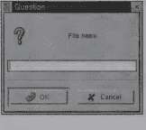

## 图 3-8：用户输入提示

### 表 3-1
**用户响应结果**

| 操作 | 回调中的结果 |
| :--- | :--- |
| 输入字符串并选择确定 | 输入的字符串传递给回调 |
| 字符串留空并选择确定 | 一个零长度字符串传递给回调 |
| 字符串留空并选择取消 | 一个 NULL 字符串指针传递给回调 |
| 输入字符串并选择取消 | 一个 NULL 字符串指针传递给回调 |

没有函数可以创建模态字符串对话框，但你可能会觉得拥有一个模态字符串请求更方便。示例程序中的对话框之所以是模态的，是因为在第 24 行调用了 `gtk_window_set_modal()`。有一个函数调用可用于创建父级对话框——只需将第 20 行至第 23 行更改为以下内容：

```
dialog = gnome_request_string_dialog_parented(
    "File name",
    (GnomeStringCallback)stringCallback,
    NULL,
    GTK_WINDOW(app));
```

还有另外两个创建接受字符串输入的对话框的函数，但有一个不同之处。输入的文本不会回显到屏幕上。窗口将为输入的每个字符显示一个星号，如图 3-9 所示。你可以通过将第 20 行至第 23 行更改为以下内容，来修改提示可见字符串输入的程序，使其提示为遮蔽字符串输入：

```
dialog = gnome_request_password_dialog(
    "Password",
    (GnomeStringCallback)stringCallback,
    NULL);
```

你可以这样创建一个父级版本：

```
dialog = gnome_request_password_dialog_parented(
    "Password",
    (GnomeStringCallback)stringCallback,
    NULL,
    GTK_WINDOW(app));
```

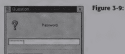

有时，你需要对输入字符串对话框有更多的控制。你可能希望指定输入字符串的最大长度，或者用默认值初始化对话框输入。使用此示例中的函数调用来实现：

```c
/** requestdialog.c **/
#include <gnome.h>

void requestCallback(gchar *string,gpointer data);

int main(int argc,char *argv[])
{
    GtkWidget *app;
    GtkWidget *dialog;
    GtkWidget *button;

    gnome_init("requestdialog","1.0",argc,argv);
    app = gnome_app_new("requestdialog","Request Dialog");
    button = gtk_button_new_with_label("Button");
    gtk_container_set_border_width(GTK_CONTAINER(app),30);
    gnome_app_set_contents(GNOME_APP(app),button);
    gtk_widget_show(button);
    gtk_widget_show(app);

    dialog  = gnome_request_dialog(FALSE,
            "File name",
            "/var/tmp/workfile.dat",
            36,
            (GnomeStringCallback)requestCallback,
            NULL,
            GTK_WINDOW(app));
    gtk_window_set_modal(GTK_WINDOW(dialog),TRUE);

    gtk_main();
    exit(0);
}

void requestCallback(gchar *string,gpointer data)
{
    if(string == NULL)
        g_print("Called back with a NULL string\n");
    else if(strlen(string) == 0)
        g_print("Called back with a zero-length string\n");
    else
        g_print("GOT: %s\n",string);
}
```

第 20 行对 `gnome_request_dialog()` 的调用创建了图 3-10 中显示的对话框。

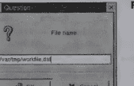

第一个参数是 TRUE 或 FALSE，用于指示输入字符串是否需要遮蔽（如密码那样）。如果值为 TRUE，则初始值和用户键入的任何字符都会显示为星号字符串。第二个参数是显示提示，第三个是插入到文本字段中的默认字符串值，作为对话框首次出现时的内容。如果不需要初始值，你可以传入 NULL 或零长度字符串。

本示例中的下一个参数位于第 23 行，它是输入字段中允许的最大字符数。如果你不希望限制字符数量，最大请使用 0。字符数量可以超过数据输入窗口能容纳的数量，因为窗口可以前后滚动以允许数据输入。

最后两个参数与前面的示例相同。第 25 行是传递给回调例程的数据指针，最后一个参数是将成为此窗口父级的窗口。如果你不想让对话框拥有父级，请传入 NULL 指针作为父窗口。

## 向回调传递数据

如前几个示例所示，有一个机制可以将数据指针传递给 GNOME 函数，该函数随后传递给回调函数。GNOME 和 GTK* 完全忽略此数据指针，这意味着你可以传入任何你喜欢的地址。在一个程序中进行多个相关决策时，传递此指针的能力可能非常有用。

例如，如果程序通过弹出对话框询问文件名来响应 **另存为** 菜单选择，回调函数可能需要访问当前文件名以及用户选择的文件名。当然，这可以通过将所有信息存储在全局变量中来完成，但从控制和设计的角度来看，通常认为将数据作为参数传递更好。但是，由于你不直接从程序中调用回调函数，因此需要间接传递参数，如下例所示：

```c
/* datacallback.c **/
#include <gnome.h>

typedef struct {
    GtkWidget *app;
    gchar defaultFilename[40];
    gchar currentFilename[40];
} pgmContext;

gint eventDelete(GtkWidget *widget,
    GdkEvent *event, gpointer data);
gint eventDestroy(GtkWidget *widget,
    GdkEvent *event, gpointer data);
void saveAsButton(GtkWidget *widget, pgmContext *pc);
void fileSaveCallback(gchar *filename, pgmContext *pc);

int main(int argc, char *argv[]) {
    GtkWidget *button;
    pgmContext pc;

    strcpy(pc.defaultFilename, "/var/dcall/sqLIM.dat");

    gnome_init("datacallback", "1.0", argc, argv);
    pc.app = gnome_app_new("datacallback", "Data Passing");
    setTermination(pc.app);

    button = gtk_button_new_with_label(
        "Save As");
    gtk_signal_connect(GTK_OBJECT(button),
        "clicked",
        GTK_SIGNAL_FUNC(saveAsButton),
        &pc);
    gnome_app_set_contents (GNOME_APP(pc.app),button);

    gtk_container_set_border_width
            (GTK_CONTAINER(pc.app),30);
    gtk_widget_show(button);
    gtk_widget_show(pc.app);
    gtk_main();
    exit(0);
}

void saveAsButton(GtkWidget *widget,pgmContext *pc) {
    GtkWidget *dialog;

    dialog = gnome_request_dialog(FALSE,
                                "File name",
                                pc->defaultFilename,
                                40,
                                (GnomeStringCallback)fileSaveCallback,
                                pc,
                                GTK_WINDOW(pc->app)));
    gtk_window_set_modal(GTK_WINDOW(dialog),TRUE);
}

void fileSaveCallback(gchar * filename,pgmContext *pc) {
    if((filename == NULL) || (strlen(filename) == 0))
        return;
    strcpy(pc->currentFilename, filename);
    g_print("Save file as %s\n",pc->currentFilename);
}

void setTermination(GtkWidget *app) {
    gtk_signal_connect(GTK_OBJECT(app),
                        "delete_event",
                        GTK_SIGNAL_FUNC(eventDelete),
                        NULL);
    gtk_signal_connect(GTK_OBJECT(app),
                        "destroy",
                        GTK_SIGNAL_FUNC(eventDestroy),
                        NULL);
}

gint eventDelete(GtkWidget *widget,
                GdkEvent *event,gpointer data) {
    return(FALSE);
}

gint eventDestroy(GtkWidget *widget,
                  GdkEvent *event,gpointer data) {
    gtk_main_quit();
    return(0);
}
```

此程序显示一个带有单个按钮的窗口，如图 3-11 所示。


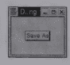

## 图 3-11：另存为按钮

向回调函数传递数据是通过传递单个指针来实现的。如果需要传递多个数据项，你可以定义一个结构体来包含这些数据，然后传递该结构体的指针。在本例中，第 4 行定义了一个用于此目的的结构体 `pgmContext`，并在第 21 行创建了一个该类型的结构体实例。第 23 行插入默认文件名，第 26 行存储了指向应用程序主窗口的 `GtkWidget` 指针。在第 31 行，调用 `gtk_signal_connect()` 函数以指定按钮的回调函数，并将结构体的地址作为最后一个参数（即数据指针）传入。这意味着，每当按下按钮时，`pct` 的地址会被传递给回调函数。

按钮的回调函数定义在第 44 行。该函数仅创建一个对话框窗口，以便用户输入文件名。在第 49 行，将 `pgmContext` 结构体中的默认文件名插入到对话框中，最终显示效果如图 3-12 所示。此外，在第 51 行和第 52 行，将回调函数的地址和 `pgmContext` 结构体的地址提供给对话框，以便调用该函数并将结构体传递给它。该对话框的回调函数是定义在第 56 行的 `fileSaveCallback()`。

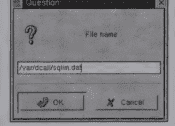

## 图 3-12：带有默认字符串的提示

`fileSaveCallback()` 的第一个参数是用户输入的文件名，第二个参数是 `pgmContext` 数据结构。第 57 行的代码测试用户是按下了取消按钮，还是按下了确认按钮但文件名为零长度。如果用户输入了文件名（或允许使用默认名称）并按下了确认按钮，文件名将存储在第 59 行的结构体中。

此程序仅打印文件名；但由于文件名存储在上下文结构体中，可以创建另一个弹出窗口来验证文件名。或者，在保存文件时，可以显示一个进度条。又或者，由于用户的选择存储在上下文结构体中，可以使用该结构体创建另一个线程，允许在后台保存文件。

## 进度条

有一个 GNOME 对话框框可以显示一个不断移动的进度条。应用程序创建进度条，然后为其提供一个不断更新完成百分比的值。下面是一个简单示例，演示了一个按固定间隔不断更新的进度条：

```c
/** progress.c **/
#include <gnome.h>

gdouble percentCallback(gdouble *pct);
void cancelCallback(gdouble *pct);
void stringCallback(gchar *string, gpointer data);

int main(int argc, char *argv[])
{
    GtkWidget *app;
    gdouble pct = 0.0;
    GnomeAppProgressKey *key;

    gnome_init("progress", "1.0", argc, argv);
    app = gnome_app_new("progress", "Progress Dialog");

    key = gnome_app_progress_timeout(GNOME_APP(app),
                                     "Label for Progress Bar",
                                     250,
                                     (GnomeAppProgressFunc)percentCallback,
                                     (GnomeAppProgressCancelFunc)cancelCallback,
                                     &pct);

    gtk_main();
    exit(0);
}

gdouble percentCallback(gdouble *pct) {
    if((*pct += 0.01) >= 1.0)
        *pct = 1.0;
    return(*pct);
}

void cancelCallback(gdouble *pct) {
    gtk_main_quit();
}
```

有两种类型的进度条：一种是由程序手动操控的，另一种是以自动模式运行的。示例中使用的是一种通过第 17 行对 `gnome_app_progress_timeout()` 的函数调用来创建的自动进度条。第三个参数是程序在调用 `percentCallback()` 之间等待的毫秒数。定义在第 27 行的回调函数 `percentCallback()` 的职责是返回完成百分比值。该数值范围在 0.0 到 1.0 之间（即 0% 到 100% 完成）。

此示例显示如图 3-13 所示的进度条。第 27 行的 `percentCallback()` 函数由进度条每 250 毫秒调用一次，每次调用时，百分比值增加 0.01（相当于 1% 的数值表示）。

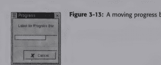

数值并不需要在每次回调时都改变，正如本例所示。数值可以在几次回调中保持不变。甚至可以让进度反向运行。例如，如果你在第 11 行将 `pct` 初始化为 1.0，并将第 28 行和第 29 行的代码改为以下内容，就可以反转进度条的移动方向：

```c
if((*pct -= 0.01) >= 0.0)
    *pct = 0.0;
```

请注意，在此示例中，顶层窗口从未出现。创建它是因为进度条需要一个父窗口。由于从未调用 `gtk_widget_show()`，顶层窗口因此从未显示。

## 创建弹出窗口和对话框

如表 3-2 所示，通过调用 `gtk_window_new()` 可以创建三种类型的窗口。在本章前面描述的程序中，主窗口是通过调用 `gnome_app_new()` 创建的，该函数使用 `GTK_WINDOW_TOPLEVEL` 作为参数调用了 `gtk_window_new()`。

### 表 3-2 GTK+ 已知的窗口类型

| 类型 | 描述 |
| :--- | :--- |
| GTK_WINDOW_TOPLEVEL | 通常用作应用程序的唯一主窗口，但对于复杂的应用程序而言，也可以拥有多个顶层窗口。 |
| GTK_WINDOW_DIALOG | 一个包含一个或多个小部件的临时窗口。它拥有与顶层窗口相同的标题栏和系统菜单按钮。 |
| GTK_WINDOW_POPUP | 一个包含一个或多个小部件的临时窗口。它没有标题栏或系统菜单按钮。 |

弹出窗口受窗口管理器的控制。然而，应用程序并不需要使用顶层窗口才能使用一个或多个弹出窗口或对话框窗口。此示例没有顶层窗口，但可以使用带有按钮的弹出窗口来关闭应用程序：

```c
/** helloworld.c */
#include <gnome.h>

void buttonShutdown (GtkWidget *widget, gpointer data);

int main (int argc, char *argv[]) {
    GtkWidget *popup;
    GtkWidget *button;

    gnome_init ("hellopopup", "1.0", argc, argv);

    popup = gtk_window_new (GTK_WINDOW_POPUP);
    button = gtk_button_new_with_label ("Close");
    gtk_container_set_border_width (GTK_CONTAINER (popup), 20);
    gtk_container_add (GTK_CONTAINER (popup), button);
    gtk_signal_connect (GTK_OBJECT (button),
                       "clicked",
                       GTK_SIGNAL_FUNC (buttonShutdown),
                       NULL);

    gtk_widget_show (button);
    gtk_widget_show (popup);

    gtk_main ();
    exit (0);
}

void buttonShutdown (GtkWidget *widget, gpointer data) {
    exit (0);
}
```

第 13 行创建一个弹出小部件，第 14 行创建放入其中的按钮。第 17 行对 `gtk_container_add()` 的调用将按钮添加到弹出小部件中，第 18 行为按钮分配一个回调方法。第 22 行和第 23 行显示弹出窗口和按钮，效果如图 3-14 所示。从第 28 行开始的回调函数仅通过第 30 行对 `exit()` 的调用终止程序。


对话框窗口只需对代码进行一处更改即可创建。弹出窗口和对话框之间的唯一区别在于窗口管理器控件的缺失或存在。若要使窗口管理器添加标题栏和其他窗口控件（如图 3-15 所示），请将第 13 行更改为：

```c
popup = gtk_window_new(GTK_WINDOW_DIALOG);
```

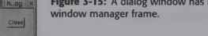

## 弹出后销毁

此示例程序引入了几件新事物。一方面，它拥有包含多个按钮的主窗口，如图 3-16 所示；另一方面，它引入了用于将窗口再次收起的回调函数。主窗口顶部的按钮会弹出如图 3-17 所示的弹出窗口，而底部的按钮则会弹出如图 3-18 所示的对话框。此示例弹出对话框，并且当对话框被收起时，它会被销毁，以便其分配的内存返回给系统：

```c
/** popup_dialog.c **/
#include <gnome.h>

void destroyPopup(GtkWidget *widget, gpointer data);
void destroyDialog(GtkWidget *widget, gpointer data);
void showPopup(GtkWidget *widget, gpointer data);
void showDialog(GtkWidget *widget, gpointer data);
gint eventDestroy(GtkWidget *widget,
                  GdkEvent *event, gpointer data);

int main(int argc, char *argv[])
{
    GtkWidget *topLevelWindow;
    GtkWidget *popupButton;
    GtkWidget *dialogButton;
    GtkWidget *box;

    gnome_init("popup_dialog", "1.0", argc, argv);
    topLevelWindow = gtk_window_new(GTK_WINDOW_TOPLEVEL);
    gtk_signal_connect(GTK_OBJECT(topLevelWindow),
                       "destroy",
                       GTK_SIGNAL_FUNC(eventDestroy),
                       NULL);
    gtk_container_set_border_width(
```


```c
25  = GTK_CONTAINER(topLevelWindow), 20);
26  box = gtk_vbox_new(FALSE, 0);
27
28  popupButton = gtk_button_new_with_label("Popup");
29  gtk_signal_connect(GTK_OBJECT(popupButton),
30      "clicked",
31      GTK_SIGNAL_FUNC(showPopup),
32      NULL);
33  gtk_box_pack_start(GTK_BOX(box), popupButton,
34      FALSE, FALSE, 0);
35  gtk_widget_show(popupButton);
36
37  dialogButton = gtk_button_new_with_label("Dialog");
38  gtk_signal_connect(GTK_OBJECT(dialogButton),
39      "clicked",
40      GTK_SIGNAL_FUNC(showDialog),
41      NULL);
42  gtk_box_pack_start(GTK_BOX(box), dialogButton,
43      FALSE, FALSE, 0);
44  gtk_widget_show(dialogButton);
45
46  gtk_container_add(GTK_CONTAINER(topLevelWindow), box);
47  gtk_widget_show(box);
48  gtk_widget_show(topLevelWindow);
49
50  gtk_main();
51  exit(0);
52 }
53 gint eventDestroy(GtkWidget *widget,
54     GdkEvent *event, gpointer data) {
55     gtk_main_quit();
56     return(0);
57 }
58 void showPopup(GtkWidget *widget, gpointer data) {
59     GtkWidget *popup;
60     GtkWidget *button;
61
62     popup = gtk_window_new(GTK_WINDOW_POPUP);
63     button = gtk_button_new_with_label("Close Popup");
64     gtk_container_set_border_width
65         (GTK_CONTAINER(popup), 20);
66     gtk_container_add(GTK_CONTAINER(popup), button);
67     gtk_signal_connect(GTK_OBJECT(button),
68         "clicked",
69         GTK_SIGNAL_FUNC(destroyPopup),
70         popup);
71     gtk_widget_show(button);
72     gtk_widget_show(popup);
73 }
74 void showDialog(GtkWidget *widget, gpointer data) {
75
76     GtkWidget *dialog;
77     GtkWidget *button;
78
79     dialog = gtk_window_new(GTK_WINDOW_DIALOG);
80     button = gtk_button_new_with_label("Close Dialog");
81     gtk_container_set_border_width(
82         GTK_CONTAINER(dialog), 20);
83     gtk_container_add(GTK_CONTAINER(dialog), button);
84     gtk_signal_connect(GTK_OBJECT(button),
85         "clicked",
86         GTK_SIGNAL_FUNC(destroyDialog),
87         dialog);
88
89     gtk_widget_show(button);
90     gtk_widget_show(dialog);
91 }
92
93 void destroyPopup(GtkWidget *widget, gpointer data)
94 {
95     gtk_widget_destroy(GTK_WIDGET(data));
96 }
97 void destroyDialog(GtkWidget *widget, gpointer data)
98 {
99     gtk_widget_destroy(GTK_WIDGET(data));
100 }
```

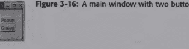

**图 3-16：带有两个按钮的主窗口**

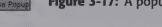

**图 3-17：带有“关闭”按钮的弹出窗口**


**图 3-18：带有“关闭”按钮的对话框窗口**

第 18 到 25 行初始化 GNOME，设置销毁回调，创建一个顶级窗口，并指定窗口周围的边距为 20 像素宽。

第 26 行创建一个框（box）组件，这是一种被称为容器的特殊组件。容器组件能够同时组织和显示多个组件。由于主窗口需要显示一个以上的组件，因此这是必要的。

并非将按钮直接插入到主窗口中，而是将它们插入到第 33 行和第 42 行中的框中。随后，该框在第 47 行被插入到主窗口中。框有两种基本类型（水平和垂直），并且将组件填充到其中的方式各不相同，我将在第 4 章中详细讨论。在这个示例中，第 26 行上的函数调用 `gtk_vbox_new()` 创建一个垂直组织按钮的框，而第 33 行和第 42 行对 `gtk_box_pack_start()` 的调用将按钮从顶部插入到垂直框中。框会自动调整大小以紧紧包裹按钮，而主窗口则在框周围添加了一个 20 像素的边框。

主窗口的回调函数从第 58 行和第 74 行开始，各自创建一个临时窗口。函数 `showDialog()` 创建并显示如图 3-18 所示的对话框窗口，而函数 `showPopup()` 创建并显示如图 3-17 所示的弹出窗口。除了第 62 行和第 78 行指定的窗口类型不同外，这两个函数几乎完全相同。

弹出窗口和对话框都有删除自身的回调。第 83 行对 `gtk_signal_connect()` 的调用指定 `destroyDialog()` 作为对话框的回调函数。传递给该函数的最后一个参数（在第 86 行）是一个指向对话框窗口的指针。这个指针在第 95 行作为数据指针传递给回调函数。在第 97 行调用 `gtk_widget_destroy()`，导致对话框消失并将任何分配的内存归还给系统。

这个程序可以运行，但它有一两个怪癖可能需要更改（取决于您的应用程序）。照原样，每次按下主窗口中的一个按钮时，您都会得到一个 新的对话框或弹出窗口——您可以获得任意数量的它们。每个窗口使用相同的回调，并且可以按任意顺序单独关闭，因此有时这可能很方便。然而，对于大多数程序来说，允许只出现一个对话框副本更有意义。

防止出现多个对话框的一种方法是设置您的对话框为模态。本示例中的对话框可以通过在第 78 行和第 87 行之间的某处添加这行代码使其变为模态：

```c
gtk_window_set_modal(GTK_WINDOW(dialog), TRUE);
```

同样，通过在插入第 62 行和第 71 行之间插入这行代码，也可以将弹出窗口设为模态：

```c
gtk_window_set_modal(GTK_WINDOW(popup), TRUE);
```

函数 `gtk_window_set_modal()` 可以通过使用 TRUE 作为第二个参数来将任何窗口从非模态更改为模态。相反，也可以使用 FALSE 作为第二个参数来将任何窗口从模态更改为非模态。

## 通过隐藏来放下

在前面的示例中，每次显示时都会构建一个新的对话框；当它被关闭时，它会被销毁。如果对话框在每次显示时稍有不同，这是一种有效且特别有用的方法。然而，如果对话框将经常被使用，您可能希望构建一次，然后在需要时随时将其显示和隐藏。本示例隐藏并重新显示一个对话框：

```c
1 /** hiding.c **/
2 #include <gnome.h>
3 
4 void closeDialog(GtkWidget *widget,gpointer data);
5 void showDialog(GtkWidget *widget,gpointer data);
6 gint eventShutdown(GtkWidget *widget,gpointer data);
7
8 typedef struct {
9   GtkWidget *dialog;
10 } hidingContext;
11
12 int main(int argc,char *argv[])
13 {
14   GtkWidget *topLevelWindow;
15   GtkWidget *dialogButton;
16   hidingContext context;
17
18   context.dialog = NULL;
19
20   gnome_init("hiding", "1.0",argc,argv);
21   topLevelWindow = gtk_window_new(GTK_WINDOW_TOPLEVEL);
22   gtk_signal_connect(GTK_OBJECT(topLevelWindow),
23                     "destroy",
24                     GTK_SIGNAL_FUNC(eventShutdown),
25                     &context);
26   gtk_container_set_border_width(
27                     GTK_CONTAINER(topLevelWindow),20);
28
29   dialogButton = gtk_button_new_with_label("Dialog");
30   gtk_signal_connect(GTK_OBJECT(dialogButton),
31                     "clicked",
32                     GTK_SIGNAL_FUNC(showDialog),
33                     &context);
34   gtk_container_add(GTK_CONTAINER(topLevelWindow),
35                     dialogButton);
36
37   gtk_widget_show(dialogButton);
38   gtk_widget_show(topLevelWindow);
39
40   gtk_main();
41   exit(0);
42 }
43 gint eventShutdown(GtkWidget *widget,gpointer data) {
44 hidingContext *context;
45 
46 context = (hidingContext *)data;
47 if((context->dialog != NULL))
48 gtk_widget_destroy(GTK_WIDGET(context->dialog));
49 gtk_main_quit();
50 return(0);
51 }
52 void showDialog(GtkWidget *widget,gpointer data) {
53 GtkWidget *button;
54 hidingContext *context;
55 
56 context = (hidingContext *)data;
57 
58 if((context->dialog == NULL)) {
59 context->dialog =
60 gtk_window_new(GTK_WINDOW_DIALOG);
61 button = gtk_button_new_with_label("Close Dialog");
62 gtk_container_set_border_width(
GTK_CONTAINER(context->dialog),20);
63 gtk_container_add(GTK_CONTAINER(context->dialog),
button);
64 
65 gtk_signal_connect(GTK_OBJECT(button),
"clicked",
66 GTK_SIGNAL_FUNC(closeDialog),
67 context->dialog);
68 
69 gtk_window_set_modal(GTK_WINDOW(context->dialog),
70 TRUE);
71 gtk_widget_show(button);
72 }
73 gtk_widget_show(context->dialog);
74 }
75 
76 
77 void closeDialog(GtkWidget *widget,gpointer data)
78 {
79 gtk_widget_hide(GTK_WIDGET(data));
80 }
```

顶级窗口包含在第 29 到 33 行中定义的按钮。该按钮的回调函数是定义在第 52 行的 `showDialog()`。传递给回调的数据是定义在第 8 行的 `hidingContext` 结构体。在更大的应用程序中，该结构体可以扩展以容纳更多信息；但在此示例中，它仅包含一个指向对话框组件的指针。对 `hidingContext()` 的第一次调用（第 58 行）确定对话框不存在，因此它创建对话框组件并将其地址存储在结构体中。一旦对话框被创建，它就一直存在，后续对 `hidingContext()` 的调用只需确保通过第 74 行对 `gtk_widget_show()` 的调用来显示它。


对话框窗口中的按钮（定义在第 61 行）使用了在第 77 行定义的回调函数 `closeDialog()`。传递给回调函数的 data 参数是对话框的指针。在回调函数中，调用了 `gtk_widget_hide()`，导致对话框——连同其包含的所有内容——从显示区域消失。

第 70 行将对话框设置为模态。在这个小型的、单对话框示例中，这其实并不重要，因为主窗口上唯一的按钮就是用于显示对话框的那个，而且只有一个对话框副本。这与之前的一些示例不同，那些示例中每次都会创建一个新的对话框，允许创建任意数量的已显示对话框。多次调用 `gtk_widget_show()` 不会产生任何影响，对话框将继续正常显示和运行。

回调函数 `eventShutdown()` 关闭应用程序，由于对话框的持久性，这里存在一种特殊情况。如果在应用程序关闭时对话框正在显示，且没有被明确销毁，对话框将继续显示。这可能会特别令人烦恼。例如，如果在应用程序停止后，用户在对话框中进行选择（按下按钮），那么没有程序来接收对回调函数的调用，并会发出错误。对话框将继续保留在显示区域，因为没有收到关闭它的指令。为了防止这种情况，`eventShutdown()` 函数在第 47 和 48 行检查对话框是否存在，如果存在则调用 `gtk_widget_destroy()`。

## 数据输出与数据输入

从程序的角度来看，对话框和弹出窗口仅用于向用户显示数据、从用户获取数据，或两者兼有。窗口中可以包含许多允许用户输入数据的控件（widgets）。程序必须能够将数据值插入到控件中，并且稍后检索用户输入的数据。

以下是一个简单的程序，它设置了一个对话框并获取用户输入：

```c
/** dataoutin.c **/
#include <gnome.h>

void closeDialog(GtkWidget *widget, gpointer data);
void showDialog(GtkWidget *widget, gpointer data);
gint eventShutdown(GtkWidget *widget, gpointer data);

typedef struct {
    GtkWidget *dialog;
    GtkEntry *nameEntry;
} dataoutinContext;

int main(int argc, char *argv[]) {
    GtkWidget *topLevelWindow;
    GtkWidget *dialogButton;
    dataoutinContext context;

    context.dialog = NULL;
    context.nameEntry = NULL;

    gnome_init("dataoutin", "1.0", argc, argv);
    topLevelWindow = gtk_window_new(GTK_WINDOW_TOPLEVEL);
    gtk_signal_connect(GTK_OBJECT(topLevelWindow),
        "destroy", GTK_SIGNAL_FUNC(eventShutdown),
        &context);

    gtk_container_set_border_width(
        GTK_CONTAINER(topLevelWindow), 20);

    dialogButton = gtk_button_new_with_label("Dialog");
    gtk_signal_connect(GTK_OBJECT(dialogButton),
        "clicked", GTK_SIGNAL_FUNC(showDialog),
        &context);

    gtk_container_add(GTK_CONTAINER(topLevelWindow),
        dialogButton);

    gtk_widget_show(dialogButton);
    gtk_widget_show(topLevelWindow);

    gtk_main();
    exit(0);
}

int eventShutdown(GtkWidget *widget, gpointer data) {
    dataoutinContext *context;

    context = (dataoutinContext *)data;
    if (context->dialog != NULL)
        gtk_widget_destroy(GTK_WIDGET(context->dialog));
    gtk_main_quit();
    return(0);
}

void showDialog(GtkWidget *widget, gpointer data) {
    GtkWidget *box;
    GtkWidget *okButton;
    dataoutinContext *context;

    context = (dataoutinContext *)data;

    if (context->dialog == NULL) {
        context->dialog =
            gtk_window_new(GTK_WINDOW_DIALOG);
        gtk_container_set_border_width(
            GTK_CONTAINER(context->dialog), 20);
        box = gtk_vbox_new(FALSE, 0);
        gtk_container_add(
            GTK_CONTAINER(context->dialog), box);
        gtk_widget_show(GTK_WIDGET(box));

        context->nameEntry = (GtkEntry *)gtk_entry_new();
        gtk_entry_set_text(context->nameEntry,
            "Initial String");
        gtk_box_pack_start(GTK_BOX(box),
            GTK_WIDGET(context->nameEntry),
            FALSE, FALSE, 0);
        gtk_widget_show(GTK_WIDGET(context->nameEntry));

        okButton = gtk_button_new_with_label("OK");
        gtk_signal_connect(GTK_OBJECT(okButton),
            "clicked",
            GTK_SIGNAL_FUNC(closeDialog),
            context);
        gtk_box_pack_start(GTK_BOX(box),
            okButton, FALSE, FALSE, 0);
        gtk_widget_show(okButton);

        gtk_window_set_modal(
            GTK_WINDOW(context->dialog), TRUE);
    }
    gtk_widget_show(context->dialog);
}

void closeDialog(GtkWidget *widget, gpointer data)
{
    dataoutinContext *context;
    gchar *gotName;

    context = (dataoutinContext *)data;

    gotName = gtk_entry_get_text(context->nameEntry);
    g_print("GOT: %s\n", gotName);

    gtk_widget_hide(GTK_WIDGET(context->dialog));
}
```

如图 3-19 所示的顶层窗口包含一个单一按钮，用于弹出如图 3-20 所示的对话框。这里的对话框包含两个控件：一个允许文本输入的窗口和一个确定按钮。当按下确定按钮时，对话框消失，程序在命令行上显示输入的字符串。这个程序的结构并不完美，但为了演示从屏幕检索用户输入数据的基本方法，特意保持了简单。

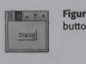

**图 3-19：** 主窗口包含一个用于弹出对话框的按钮。

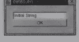

**图 3-20：** 一个能够接受键盘输入的对话框

在第 8 行定义的结构体是传递给回调函数的数据。它包含指向对话框控件的指针和指向对话框内部文本输入控件的指针。由于这两个都在结构体中，可以控制对话框的显示，并从数据输入控件中提取文本。

上下文结构体在第 19 和 20 行初始化。在第 35 行，其地址被用作传递给按钮回调函数 `showDialog()` 的数据指针。从第 54 行开始的 `showDialog()` 函数在上下文结构体中尚未安装对话框时创建一个新对话框。当在第 72 和 73 行创建数据输入控件时，窗口中的初始值被设置为字符串 "Initial String"。确定按钮在第 79 到 86 行构建，并分配了一个回调函数。在第 83 行，上下文结构体的地址被用作回调函数的数据指针。数据输入控件没有定义回调函数，因为它接受并保留用户的输入，只有在按下确定按钮时才需要检索文本。

从第 94 行开始是确定按钮的回调函数。上下文指针传递给该函数，因此它拥有数据输入控件和对话框的地址。第 101 行从数据输入控件中检索字符串。`gtk_entry_get_text()` 的返回值是一个指向该字符串的指针。如果需要保存该字符串，程序应在使用前对其进行复制。（在本示例中，字符串只是被打印出来然后被忽略。）该字符串的内存是在控件内部分配的，随后又由控件释放。

数据输入控件会跟踪当前字符串，并在对话框弹出时显示其内部字符串。当用户编辑字符串时，内部字符串会被修改。这样一来，即使窗口被收起并再次弹出，更改也依然有效。这可能是也可能不是您想要的，关于数据控制的更多内容将在第 4 章讨论。

## 总结

对话框和弹出窗口与其他窗口没有任何不同。一旦它们被显示出来，它们就拥有了自己的生命，与主程序唯一的联系是一个或多个回调函数。例如，在本章中您学到了：

-   ✦ 有一组内置对话框，设计用于向用户显示消息或询问用户是否的标准操作。
-   ✦ 对话框可以捕获鼠标，阻止访问应用程序的其余部分。
-   ✦ 有两种基本的临时窗口。对话框弹出时周围带有完整的边框，就好像它是应用程序的主窗口一样。弹出窗口弹出时没有边框，也没有窗口管理器控件。
-   ✦ 可以为控件分配回调函数，当发生某些特定动作时，该函数会被调用。调用的第一个参数始终是控件本身。最后一个参数是您的程序指定要传递给回调函数的地址。在这两者之间可能存在也可能不存在其他参数。
-   ✦ 当对话框消失时，它可以被销毁，也可以被保存以便再次显示。
-   ✦ 对话框是一个包含另一个控件的控件。它包含的另一个控件可以在显示对话框的同时被显示。对话框或弹出窗口中包含的控件可以是一个特殊的容器控件。容器控件可以组织并显示其他几个控件。

在下一章，您将学习如何使用盒子和表格在窗口上放置控件。


## 在窗口中布局小部件

本章是两章关于在窗口上放置小部件章节中的第一章。在本章中，使用盒子和表格来实现定位。在表格或盒子中对小部件进行定位的过程被称为*打包小部件*。使用盒子和表格，您可以快速实现复杂的窗口。这只需要创建盒子或表格，然后将小部件填充进去即可。盒子本身也是一个小部件，可以打包到其他盒子中。表格也是如此。实际上，您可以将表格打包到盒子中，也可以将盒子打包到表格中。

## 打包盒子

有两种类型的盒子。小部件被打包到垂直盒子中时，会一个接一个地垂直堆叠显示；或者被打包到水平盒子中时，会并排显示。将一组小部件的盒子称为小部件列表可能更准确，因为小部件必须并排或一个在另一个之上排列。然而，通过嵌套盒子，这个过程变得非常灵活且易于管理。

盒子是一种设计用来容纳小部件的小部件。这意味着盒子可以包含其他盒子。例如，如果一个水平盒子包含一对垂直盒子，而每个垂直盒子包含四个小部件，这些小部件将显示为两列四行。此外，由于盒子中容纳的任何小部件都可以是包含小部件的另一个盒子，因此可以创建具有许多不同模式的小部件填充的窗口。

尺寸调整完全由盒子自动完成，盒子通过与其中包含的小部件“通信”来了解小部件能做什么和不能做什么。每个小部件都有自己的内部最小高度和宽度，盒子在计算布局和尺寸的位置时必须考虑这些因素。有时，盒子会要求小部件在垂直或水平方向上扩展到大于小部件所需尺寸的更大尺寸。

### 本章内容

- 在盒子中水平打包和垂直打包小部件
- 更改盒子的配置设置以改变其排列小部件的方式
- 在表格中水平打包和垂直打包小部件
- 更改配置设置和打包命令以改变表格排列小部件的方式
- 组合表格和盒子

## 垂直打包盒子

垂直盒子是一种能够容纳多个小部件并垂直显示它们的小部件，如图 4-1 中的那些小部件所示。

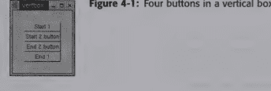

这是一个创建图 4-1 中所示盒子的示例程序，该盒子包含四个按钮：

```c
/** vertbox.c **/
#include <gnome.h>

GtkWidget *makeBox();
gint eventDelete(GtkWidget *widget, GdkEvent *event, gpointer data);
gint eventDestroy(GtkWidget *widget, GdkEvent *event, gpointer data);

int main(int argc, char *argv[])
{
  GtkWidget *window;
  GtkWidget *box;

  gnome_init("vertbox", "1.0", argc, argv);
  window = gtk_window_new(GTK_WINDOW_TOPLEVEL);
  gtk_container_set_border_width(GTK_CONTAINER(window), 25);
  gtk_signal_connect(GTK_OBJECT(window), "delete_event",
            GTK_SIGNAL_FUNC(eventDelete), NULL);
  gtk_signal_connect(GTK_OBJECT(window), "destroy",
            GTK_SIGNAL_FUNC(eventDestroy), NULL);
  box = makeBox();
  gtk_container_add(GTK_CONTAINER(window), box);
  gtk_widget_show(window);
  gtk_main();
  exit(0);
}

GtkWidget *makeBox() {
  GtkWidget *box;
  GtkWidget *button;
  
  box = gtk_vbox_new(FALSE, 0);
  gtk_widget_show(box);
  
  button = gtk_button_new_with_label("Start 1");
  gtk_box_pack_start(GTK_BOX(box), button, FALSE, FALSE, 0);
  gtk_widget_show(button);
  
  button = gtk_button_new_with_label("End 1");
  gtk_box_pack_end(GTK_BOX(box), button, FALSE, FALSE, 0);
  gtk_widget_show(button);
  
  button = gtk_button_new_with_label("Start 2 button");
  gtk_box_pack_start(GTK_BOX(box), button, FALSE, FALSE, 0);
  gtk_widget_show(button);
  
  button = gtk_button_new_with_label("End 2 button");
  gtk_box_pack_end(GTK_BOX(box), button, FALSE, FALSE, 0);
  gtk_widget_show(button);
  
  return(box);
}

gint eventDelete(GtkWidget *widget, GdkEvent *event, gpointer data) {
  return(FALSE);
}

gint eventDestroy(GtkWidget *widget, GdkEvent *event, gpointer data) {
  gtk_main_quit();
  return(0);
}
```

程序的主线在第 16 行创建一个顶级窗口，并在第 17 和 18 行在其边缘放置 25 像素的边框。在关闭回调初始化后，小部件盒子在第 28 行通过调用 makeBox() 创建。第 29 行的函数 gtk_container_add() 将盒子小部件放入主窗口，第 30 行对 gtk_widget_show() 的调用使主窗口可见。

从第 34 行开始的 makeBox() 函数构造并返回一个包含四个按钮的垂直盒子。第 38 行对 gtk_vbox_new() 的调用构造了该盒子。按钮按照显示的顺序添加，但可以从顶部或底部添加。第 41 行构造的按钮在第 42 行添加到盒子的开始位置——这意味着它被插入到盒子的顶部。第 45 行构造的按钮在第 46 行添加到盒子的结束位置——这意味着它被插入到盒子的底部。任何添加到顶部的其他小部件都会位于已有小部件的下方，而任何添加到底部的其他小部件都会位于已有小部件的上方。

图 4-1 中显示的默认尺寸表明所有内容都合适。每个按钮都向盒子报告了其尺寸。盒子希望沿其边缘排列物品，因此它分析每个按钮的高度和宽度，以确定每个按钮的整体尺寸和位置。所有按钮的高度相同，因此不需要垂直调整。盒子确定最宽按钮（即 Start 2 按钮）的宽度，并使用该值设置所有按钮的宽度。除了宽度信息外，盒子还告诉每个按钮其在屏幕上的 x 和 y 坐标。每个按钮遵循其指令，居中对齐文本，并在请求的位置和请求的尺寸下显示自身。盒子也是一个子部件，因此当主窗口查询盒子的尺寸时，盒子返回显示所有四个按钮所需的总面积。主窗口使用此尺寸信息，在边缘添加 25 像素的边距，为盒子提供其 x 和 y 坐标。

默认尺寸和配置是最佳的。可以使用鼠标调整窗口大小，但在水平或垂直方向上都不能使其小于原始尺寸。然而，窗口可以变大。例如，如图 4-2 所示垂直拉长窗口会导致盒子通过拆分按钮列表将物品分开——打包在顶部的按钮保持在顶部，打包在底部的按钮保持在底部。如图 4-3 所示水平拉伸盒子也会调整按钮大小，它们被拉伸以填满盒子。

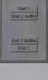

**图 4-2**：垂直调整大小使按钮分离。

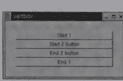

**图 4-3**：水平调整大小拉伸按钮。

很明显，垂直盒子不能垂直扩展按钮，但可以水平扩展它们以填满空间。此外，盒子中包含的小部件的偏移量是根据顶部或底部计算的，具体取决于小部件如何被添加到盒子中。在实践中，这被证明是相当有用的。如果所有小部件都打包在盒子的一端，那么无论盒子本身如何变形拉伸，它们都会保持在该端。

## 水平打包盒子

水平盒子和垂直盒子的工作方式完全相同，区别在于将小部件打包到开始位置会将其放在左侧，而将小部件打包到结束位置会将其放在右侧。名为 vertbox.c 的前述程序可以通过更改程序名称和一行代码转换为 horibox.c。对于垂直盒子，第 38 行如下所示：

```c
box = gtk_vbox_new(FALSE, 0);
```

将其替换为以下行即可使其成为水平盒子：

```c
box = gtk_hbox_new(FALSE, 0);
```

就是这样。显示效果现在看起来像图 4-4 中的样子。

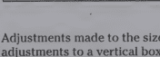

**图 4-4**：水平盒子中的四个按钮

对水平盒子尺寸所做的调整与对垂直盒子所做的调整具有相同的效果，只是沿着另一个维度进行。图 4-5 显示水平盒子变高，所有按钮也变高以适应。图 4-6 显示水平盒子变宽，按钮没有改变大小，而是定位以贴合其最初添加的末端。


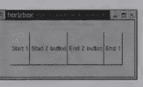

**图 4-5：** 垂直方向调整大小会拉伸按钮。

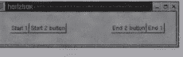

**图 4-6：** 水平方向调整大小会分离按钮。

## 水平盒的选项

有三个选项设置控制控件在盒中的布局方式。（实际上有四个设置，但间距将在本章稍后讨论。）这三个设置均为布尔值，因此共有八种组合，如图 4-7 所示。

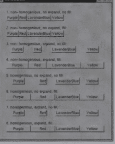

**图 4-7：** 使用水平盒布局控件

在水平盒中，如果所有控件都被分配相同宽度的显示区域，则这些控件是*同质的*。每个控件都显示在其分配区域的水平中心位置，控件可能也可能不会扩展以填满该区域。

可以指示控件*扩展*以使用整个盒子。这不会影响控件的显示大小。相反，它会在一个可能大于也可能小于控件自然宽度的区域中居中显示现有控件。每个控件的区域是按百分比分配的。如果一个控件的最小尺寸默认值是另一个控件的一半，那么在它们扩展以填满盒子后，这种尺寸比例保持不变。例如，如果一个盒子宽度为 800 像素，其中包含一个宽度为 100 像素的控件和另一个宽度为 300 像素的控件，那么为了填满盒子，这两个控件的大小都会加倍，分别变为 200 像素和 600 像素。

可以指示控件*填充*分配给它们的区域。默认情况下，分配给控件的区域也是其最小宽度；但如果控件已被命令*扩展*，并且分配了更大的区域，控件就会扩大以填满该区域。

图 4-7 展示了所有八种可能的组合，但存在一些重复。实际上只有六种不同的显示布局。编号 5 和 7 产生的显示效果相同，编号 6 和 8 产生的显示效果也相同。原因是如果盒子是*同质的*，*扩展*设置将不起作用。

图 4-7 中显示的窗口由以下程序生成。它创建一个包含主垂直盒的单窗口。进而，垂直盒中填充了所有水平盒。使用按钮控件来填充水平盒，因为它们是带有斜角边缘的简单控件，这使得很容易看出每个控件的开始和结束位置。

```c
/** horizboxes.c **/
#include <gnome.h>

GtkWidget *makeBoxes();
gint eventDelete(GtkWidget *widget, GdkEvent *event, gpointer data);
gint eventDestroy(GtkWidget *widget, GdkEvent *event, gpointer data);
void buttonFill(GtkWidget *box, gboolean expand, gboolean fill, guint spacing);

static gchar *buttonLabel[] = {
  "Purple",
  "Red",
  "LavenderBlue",
  "Yellow"
};

int main(int argc, char *argv[])
{
  GtkWidget *window;
  GtkWidget *box;

  gnome_init("horizboxes", "1.0", argc, argv);
  window = gtk_window_new(GTK_WINDOW_TOPLEVEL);
  gtk_signal_connect(GTK_OBJECT(window),
                     "delete_event",
                     GTK_SIGNAL_FUNC(eventDelete),
                     NULL);
  gtk_signal_connect(GTK_OBJECT(window),
                     "destroy",
                     GTK_SIGNAL_FUNC(eventDestroy),
                     NULL);

  box = makeBoxes();
  gtk_container_set_border_width(GTK_CONTAINER(window), 25);
  gtk_container_add(GTK_CONTAINER(window), box);
  gtk_widget_show(box);

  gtk_widget_show(window);
  gtk_main();
  exit(0);
}

GtkWidget *makeBoxes()
{
  GtkWidget *vbox;
  GtkWidget *hbox;
  GtkWidget *label;

  gboolean homogeneous;
  gboolean expand;
  gboolean fill;
  gint hCount;
  gint eCount;
  gint fCount;
  gint count = 0;
  gchar labelString[80];

  vbox = gtk_vbox_new(FALSE, 0);

  for (hCount = 0; hCount <= 1; hCount++) {
    homogeneous = hCount ? TRUE : FALSE;
    for (eCount = 0; eCount <= 1; eCount++) {
      expand = eCount ? TRUE : FALSE;
      for (fCount = 0; fCount <= 1; fCount++) {
        fill = fCount ? TRUE : FALSE;
        if (count > 0) {
          label = gtk_label_new(" ");
          gtk_box_pack_start(GTK_BOX(vbox), label, FALSE, FALSE, 0);
          gtk_widget_show(label);
        }
        sprintf(labelString, "%d", ++count);
        if (homogeneous)
          strcat(labelString, " homogeneous, ");
        else
          strcat(labelString, "non-homogeneous, ");
        if (expand)
          strcat(labelString, "expand, ");
        else
          strcat(labelString, "no expand, ");
        if (fill)
          strcat(labelString, "fill: ");
        else
          strcat(labelString, "no fill: ");
        label = gtk_label_new(labelString);
        gtk_misc_set_alignment(GTK_MISC(label), 0.0);
        gtk_box_pack_start(GTK_BOX(vbox), label, FALSE, FALSE, 0);
        gtk_widget_show(label);
        hbox = gtk_hbox_new(homogeneous, 0);
        buttonFill(hbox, expand, fill);
        gtk_box_pack_start(GTK_BOX(vbox), hbox, FALSE, FALSE, 0);
        gtk_widget_show(hbox);
      }
    }
  }
  return(vbox);
}

void buttonFill(GtkWidget *box, gboolean expand, gboolean fill, guint spacing)
{
  GtkWidget *button;
  gint i;

  for (i = 0; i < 4; i++) {
    button = gtk_button_new_with_label(buttonLabel[i]);
    gtk_box_pack_start(GTK_BOX(box), button, expand, fill, spacing);
    gtk_widget_show(button);
  }
}

gint eventDelete(GtkWidget *widget, GdkEvent *event, gpointer data)
{
  return(FALSE);
}

gint eventDestroy(GtkWidget *widget, GdkEvent *event, gpointer data)
{
  gtk_main_quit();
  return(0);
}
```

第 35 行对 `makeBoxes()` 的调用返回包含所有水平盒的垂直盒。第 36 至 39 行定义了盒子周围的边框，将其添加到主窗口中，并显示出来。

从第 45 行开始的函数 `makeBoxes()` 为八种可能的配置设置各构建一个盒子。对于这个示例，显示效果有些重复，并且无需为按钮分配回调函数，因此所有盒子和按钮都是通过从第 61 行开始的循环构建的。实际上，这是一个嵌套循环，对于每个设置都有一个 for 语句。布尔值 `homogeneous`、`expand` 和 `fill` 在每个循环的顶部进行切换，所有可能的组合都被用来构建一个装满按钮的盒子。

每个水平盒之前都有一个空白标签（用于间距）和一个描述该盒子设置的标签。第 67 至 72 行插入空白标签。第 74 至 85 行使用配置设置创建描述性字符串，该字符串用于在第 86 行构建标签控件。第 88 行对 `gtk_misc_set_alignment()` 的调用使标签中的文本左对齐（默认是居中对齐）。

第 92 行对 `gtk_hbox_new()` 的调用创建水平盒，第 93 行对 `buttonFill()` 的调用用按钮填充它。这就是设置配置参数的地方。控件布局是否同质取决于盒子——而不是单独的控件，因此对 `gtk_box_new()`（此处实际代码为 `gtk_hbox_new`）的调用将其第一个参数设为布尔值 `homogeneous`。`expand` 和 `fill` 参数是逐个应用于控件的，因此传递给 `buttonFill()` 函数，以便应用于每个新按钮。

从第 102 行开始的函数 `buttonFill()` 使用传入的参数值，将四个按钮控件打包到一个盒子中。按钮标签由不同长度的字符串数组创建，以便位置差异更明显。从第 108 行开始的循环构建每个按钮并将其添加到盒子中。

## 垂直盒的选项

图 4-8 展示了将八种组合应用于一系列垂直盒的结果。将此图中的垂直盒与之前图 4-7 中显示的水平盒进行比较，你应该对布局机制有一个相当好的了解。相同的尺寸和位置规则适用于水平和垂直方向。

此示例与前一个示例非常相似。程序之间的唯一区别是，为了将盒子从水平变为垂直并使其正确显示所需的语句。

```c
/** vertboxes.c **/
#include <gnome.h>
```


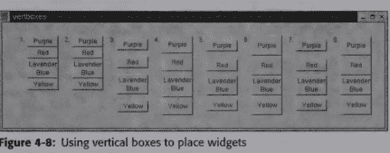

```c
4  GtkWidget *makeBoxes();
5  gint eventDelete(GtkWidget *widget,
    GdkEvent *event, gpointer data);
6  gint eventDestroy(GtkWidget *widget,
    GdkEvent *event, gpointer data);
7  void buttonFill(GtkWidget *box, gboolean expand,
    gboolean fill, guint spacing);

9  static gchar *buttonLabel[] = {
    "Purple",
    "Red",
    "Lavender\nBlue",
    "Yellow"
};

11 int main(int argc, char *argv[])
12 {
    GtkWidget *window;
    GtkWidget *box;

    gnome_init("vertboxes", "1.0", argc, argv);
    window = gtk_window_new(GTK_WINDOW_TOPLEVEL);
    gtk_signal_connect(GTK_OBJECT(window),
        "delete_event",
        GTK_SIGNAL_FUNC(eventDelete),
        NULL);
    gtk_signal_connect(GTK_OBJECT(window),
        "destroy",
        GTK_SIGNAL_FUNC(eventDestroy),
        NULL);

    box = makeBoxes();
    gtk_container_set_border_width(
        GTK_CONTAINER(window), 25);
    gtk_container_add(GTK_CONTAINER(window), box);
    gtk_widget_show(box);
```

```c
92 }
93 GtkWidget *button;
94 gint i;

96 for(i=0; i<4; i++) {
    button = gtk_button_new_with_label(buttonLabel[i]);
    gtk_box_pack_start(GTK_BOX(box), button,
        expand, fill, spacing);
    gtk_widget_show(button);
    }
}
97 gint eventDelete(GtkWidget *widget,
    GdkEvent *event, gpointer data) {
    return(FALSE);
}
98 gint eventDestroy(GtkWidget *widget,
    GdkEvent *event, gpointer data) {
    gtk_main_quit();
    return(0);
}
```

第 15 行定义的颜色名称中包含一个换行符，这使得按钮显示两行文本而不是一行。不同行数的按钮在尺寸上会有所不同，这有助于展示定位机制的工作原理。

第 35 行对 `makeBoxes()` 的调用创建了一个包含在水平框中的垂直框集合，第 38 行将该水平框添加到主窗口。从第 61 行开始的三个嵌套循环通过切换值设置来创建所有八种可能的组合。第 73 至 76 行为每个垂直框创建一个标签。标签仅包含数字以确保显示正常，但此前图 4-8 中显示的数字与图 4-7 中显示的含义相同。

## 框内控件的间距

在框内控件之间插入空间有多种方式。你可以指定要在框内每个控件周围添加的像素数量，也可以逐个控件指定添加的空间量，或者同时执行这两种操作。这在水平和垂直框中的工作方式相同。本示例展示了垂直框中间距的工作方式。

```c
1 /* spacebox.c **/
2 #include <gnome.h>
3
4 GtkWidget *makeBox();
5 gint eventDelete(GtkWidget *widget,
    GdkEvent *event, gpointer data);
6 gint eventDestroy(GtkWidget *widget,
```

```c
8 GdkEvent *event, gpointer data);
9
10 #define ALL_SPACE 5
11 #define FIRST_SPACE 0
12 #define SECOND_SPACE 0
13 #define THIRD_SPACE 0
14 #define FOURTH_SPACE 0
15
16 int main(int argc, char *argv[]) {
17     GtkWidget *window;
18     GtkWidget *box;
19
20     gnome_init("spacebox", "1.0", argc, argv);
21     window = gtk_window_new(GTK_WINDOW_TOPLEVEL);
22     gtk_signal_connect(GTK_OBJECT(window),
23         "delete_event",
24         GTK_SIGNAL_FUNC(eventDelete),
25         NULL);
26     gtk_signal_connect(GTK_OBJECT(window),
27         "destroy",
28         GTK_SIGNAL_FUNC(eventDestroy),
29         NULL);
30
31     box = makeBox();
32     gtk_container_add(GTK_CONTAINER(window), box);
33     gtk_widget_show(window);
34     gtk_main();
35     exit(0);
36 }
37
38 GtkWidget *makeBox() {
39     GtkWidget *box;
40     GtkWidget *btn;
41
42     box = gtk_vbox_new(FALSE, ALL_SPACE);
43     gtk_widget_show(box);
44
45     btn = gtk_button_new_with_label("The First Widget");
46     gtk_box_pack_start(GTK_BOX(box), btn,
47         FALSE, FALSE, FIRST_SPACE);
48     gtk_widget_show(btn);
49
50     btn = gtk_button_new_with_label("The Second Widget");
51     gtk_box_pack_start(GTK_BOX(box), btn,
52         FALSE, FALSE, SECOND_SPACE);
53     gtk_widget_show(btn);
54
55     btn = gtk_button_new_with_label("The Third Widget");
56     gtk_box_pack_start(GTK_BOX(box), btn,
57         FALSE, FALSE, THIRD_SPACE);
```

```c
59     gtk_widget_show(btn);
60     }
61     btn = gtk_button_new_with_label("The Fourth Widget");
62     gtk_box_pack_start(GTK_BOX(box), btn,
63         FALSE, FALSE, FOURTH_SPACE);
64     gtk_widget_show(btn);
65     }
66     return(box);
67 }
68 int eventDelete(GtkWidget *widget,
69     GdkEvent *event, gpointer data) {
70     return(FALSE);
71 }
72 int eventDestroy(GtkWidget *widget,
73     GdkEvent *event, gpointer data) {
74     gtk_main_quit();
75     return(0);
76 }
```

第 10 至 14 行定义的常数是用于定位垂直框内控件的间距值。值 `ALL_SPACE` 通过在第 44 行创建框时作为 `gtk_box_vbox_new()` 的参数而应用于框内的每个控件。其他四个值通过作为第 49、54、59 和 64 行各控件插入调用 `gtk_box_pack_start()` 的参数而应用于每个控件。

示例程序中的间距值——框的值为 5，每个具体控件的值为 0——导致了图 4-9 所示的窗口。当框执行间距时，它只在控件之间插入空间。顶部控件上方或底部控件下方没有插入空间，但在每对控件之间插入了 5 像素的空间。

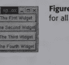

# **图 4-9**：所有控件的垂直间距相同

可以为每个单独的控件指定间距。你可以通过修改第 10 至 14 行如下所示来创建图 4-10 中的显示效果：

```c
#define ALL_SPACE  0
#define FIRST_SPACE  5
#define SECOND_SPACE 10
#define THIRD_SPACE  20
#define FOURTH_SPACE 40
```

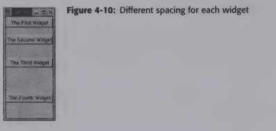

由于控件本身请求边距，因此第一个控件上方插入了 5 像素的空间。当框布局控件时，它会询问每个控件需要多少空间。因为第一个控件的间距值设为 5，所以它实际上获得了 10 个额外的像素——即控件主体上方 5 像素，下方 5 像素。第二个控件随后请求 10 的间距，因此第一个和第二个控件之间实际总共插入了 15 像素。类似地，第二个和第三个控件之间插入了 30 像素（10 + 20），第三个和第四个控件之间插入了 60 像素（20 + 40）。第四个控件下方插入了 40 像素。

你可以同时为整个框和每个单独的控件指定间距。例如，你可以通过将第 10 至 14 行修改为以下内容来创建图 4-11 中的显示效果：

```c
#define ALL_SPACE 5
#define FIRST_SPACE 2
#define SECOND_SPACE 10
#define THIRD_SPACE 10
#define FOURTH_SPACE 2
```

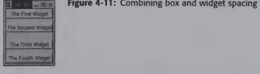

每种情况下应用的实际间距是所有通常适用间距的总和。第一个控件距离窗口顶部 2 像素，因为框只在控件之间插入 `ALL_SPACE` 值。第一个和第二个控件之间的间距总共是 17 像素——框指定了 5 像素，第一个控件增加了 2，第二个控件增加了 10。第二个和

第三个控件之间的空间是 25 像素，这是总间距 5 和两个单独控件各 10 的间距之和。第三个和第四个控件之间有 17 像素，第四个控件下方有 2 像素。

由于分配给控件的间距值会同时加在其上方和下方，因此使用此方法无法实现某些间距组合。没有直接方法可以将三个控件放置在一起并在其上下插入空间，而不插入另一个框来容纳它们（如下一节所示）。但是，通过在单个框内使用间距，可以定义许多特殊布局。例如，图 4-12 中的布局是通过将常量更改为以下内容来实现的：

```c
#define ALL_SPACE 0
#define FIRST_SPACE 0
#define SECOND_SPACE 30
#define THIRD_SPACE 0
#define FOURTH_SPACE 5
```

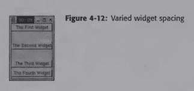

这展示了控件之间的距离可以有很大差异。第一个控件没有定义间距，因此它紧贴其包含框的顶部放置。第二个控件在其上下方都插入了 30 像素。第四个控件在它和第三个控件之间，以及它和框底部之间都插入了 5 像素。

## 框中套框

通过将框放在其他框内部，你可以实现喜欢的任何间距和定位组合。框被设计用来容纳控件，而框本身*也是*控件，因此你可以随心所欲地在框内打包框。我在本章前面的一些示例中展示了这一点，但以下示例展示了如何使用框中套框来实现一些复杂的定位。假设你希望有一个窗口，顶部有一个按钮，中间聚集了三个按钮，底部并排有两个按钮，如图 4-13 所示。


## 图 4-13：在盒子内使用盒子来定位控件

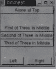

此布局是通过使用一个垂直盒子实现的，该盒子顶部包含一个按钮，中间是一个嵌套的垂直盒子，底部是一个水平盒子。该程序创建如下布局：

```cpp
/** boxnest.c **/
#include <gnome.h>

GtkWidget *makeBox();
GtkWidget *makeMiddleBox();
GtkWidget *makeBottomBox();
gint eventDelete(GtkWidget *widget, GdkEvent *event, gpointer data);
gint eventDestroy(GtkWidget *widget, GdkEvent *event, gpointer data);

int main(int argc, char * argv[])
{
    GtkWidget *window;
    GtkWidget *box;

    gnome_init("boxnest","1.0",argc,argv);
    window = gtk_window_new(GTK_WINDOW_TOPLEVEL);
    g_signal_connect(GTK_OBJECT(window),
        "delete_event",
        GTK_SIGNAL_FUNC(eventDelete),
        NULL);
    g_signal_connect(GTK_OBJECT(window),
        "destroy",
        GTK_SIGNAL_FUNC(eventDestroy),
        NULL);

    box = makeBox();
    gtk_container_add(GTK_CONTAINER(window),box);
    gtk_widget_show(box);

    gtk_widget_show(window);
    gtk_main();
    exit(0);
}

GtkWidget *makeBox() {
    GtkWidget *box;
    GtkWidget *button;
    GtkWidget *middleBox;
    GtkWidget *bottomBox;

    box = gtk_vbox_new(FALSE,30);

    button = gtk_button_new_with_label("Alone at Top");
    gtk_box_pack_start(GTK_BOX(box),button, FALSE,FALSE,0);   
    gtk_widget_show(button);

    middleBox = makeMiddleBox();
    gtk_box_pack_start(GTK_BOX(box),middleBox, FALSE,FALSE,0);
    gtk_widget_show(middleBox);

    bottomBox = makeBottomBox();
    gtk_box_pack_start(GTK_BOX(box),bottomBox, FALSE,FALSE,0);
    gtk_widget_show(bottomBox);

    return(box);
}

GtkWidget *makeMiddleBox() {
    GtkWidget *box;
    GtkWidget *button;

    box = gtk_vbox_new(FALSE,0);

    button = gtk_button_new_with_label("First of Three in Middle");
    gtk_box_pack_start(GTK_BOX(box),button,FALSE,FALSE,0);
    gtk_widget_show(button);

    button = gtk_button_new_with_label("Second of Three in Middle");
    gtk_box_pack_start(GTK_BOX(box),button,FALSE,FALSE,0);
    gtk_widget_show(button);

    button = gtk_button_new_with_label("Third of Three in Middle");
    gtk_box_pack_start(GTK_BOX(box),button,FALSE,FALSE,0);
    gtk_widget_show(button);

    return(box);
}

GtkWidget *makeBottomBox() {
    GtkWidget *box;
    GtkWidget *button;

    box = gtk_hbox_new(FALSE,0);

    button = gtk_button_new_with_label("Left");
    gtk_box_pack_start(GTK_BOX(box),button,TRUE,TRUE,5);
    gtk_widget_show(button);

    button = gtk_button_new_with_label("Right");
    gtk_box_pack_end(GTK_BOX(box),button,TRUE,TRUE,5);
    gtk_widget_show(button);

    return(box);
}

gint eventDelete(GtkWidget *widget, GdkEvent *event, gpointer data) {
    return(FALSE);
}

gint eventDestroy(GtkWidget *widget, GdkEvent *event, gpointer data) {
    gtk_main_quit();
    return(0);
}
```

在第 26 行调用 `makeBox()` 创建了盒子及其所有内部内容。在第 27 行，该盒子被交给主窗口的容器。

从第 34 行开始的 `makeBox()` 函数创建了一个垂直盒子，并插入三个控件。在第 41 行，创建盒子时将其包含控件之间的间距设置为 30 像素。第一个控件是一个按钮，它在第 44 到 47 行被设置间距并插入到盒子中。第二个控件是从第 49 行调用 `makeMiddleBox()` 返回的盒子，第三个是从第 54 行调用 `makeBottomBox()` 返回的盒子。当显示时，主窗口会调整自身以适应其包含的盒子的高度和宽度。盒子的高度，也就是窗口的高度，是这三个控件各自高度的总和——加上两个各 30 像素的间距。

从第 61 行开始的函数 `makeMiddleBox()` 创建一个包含三个按钮的垂直盒子。创建此盒子时，控件之间的间隔为零，因此其整体大小是最宽按钮的宽度，高度是所有按钮高度之和。

从第 84 行开始的函数 `makeBottomBox()` 创建一个包含两个按钮的水平盒子。按钮在盒子中被放置为同质的（即它们具有相同的宽度），并被指示为扩展（即它们填满所有可用空间）。此外，它们都被设置了 5 像素的邻接间距。结果是，当窗口在水平方向拉伸时，按钮会自动调整大小并移动，以维持距离和比例。

当你通过打包盒子来布局一个复杂的窗口时，首先需要弄清楚你的盒子结构。为了获得确切的布局，盒子嵌套三层、四层甚至五层的情况并不罕见。

## 打包表格

你可以通过使用 x 和 y 坐标值将控件放置在窗口中，并可以定义网格的大小。要在网格上放置控件，只需告诉控件去向以及覆盖多少个网格方格。这种网格被称为 *table*（表格），它是一种容器控件，非常像盒子，只是它使用不同的规则集来定位其持有的控件。

### 打包小型表格

图 4-14 中显示的控件布局基于一个宽 2 格、高 3 格的表格。控件的边缘附着在单元格的边缘上。图 4-15 的布局展示了用于创建该布局的 2x3 网格。

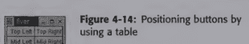

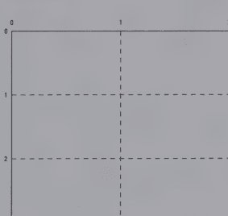

控件在网格中的位置是通过将其边缘附着到网格线上实现的。控件的所有四条边缘都必须附着在网格线上。例如，在图 4-14 中，标记为 “Mid Left” 的按钮左侧附着在垂直网格线 0 上，右侧附着在垂直网格线 1 上。其顶部附着在水平网格线 1 上，底部附着在水平网格线 2 上。

单个控件可以覆盖任意数量的网格。例如，在图 4-14 中，标记为 “Bottom” 的按钮顶部附着在水平网格 2，底部附着在水平网格 3，左侧附着在垂直网格 0，右侧附着在垂直网格 2。水平附着使得按钮拉伸以覆盖表格的两个单元格。

以下程序创建图 4-14 中显示的界面。按钮布局在一个宽 2 列、高 3 行的表格上。窗口顶部的四个按钮每个都放置在表格内的单个单元格中，而底部的按钮则覆盖两个单元格。

```c
/** fiver.c **/
#include <gnome.h>

GtkWidget *makeTable();
gint eventDelete(GtkWidget *widget, GdkEvent *event, gpointer data);
gint eventDestroy(GtkWidget *widget, GdkEvent *event, gpointer data);

int main(int argc, char *argv[])
{
    GtkWidget *window;
    GtkWidget *table;

    gnome_init("fiver","1.0",argc,argv);
    window = gtk_window_new(GTK_WINDOW_TOPLEVEL);
    gtk_signal_connect(GTK_OBJECT(window),
                "delete_event",
                GTK_SIGNAL_FUNC(eventDelete),
                NULL);
    gtk_signal_connect(GTK_OBJECT(window),
                "destroy",
                GTK_SIGNAL_FUNC(eventDestroy),
                NULL);

    table = makeTable();
    gtk_container_add(GTK_CONTAINER(window),table);
    gtk_widget_show(window);
    gtk_main();
    exit(0);
}

GtkWidget *makeTable() {
    GtkWidget *table;
    GtkWidget *button;

    table = gtk_table_new(3,2,TRUE);
    gtk_widget_show(table);

    button = gtk_button_new_with_label("Top Left");
    gtk_table_attach_defaults(GTK_TABLE(table),button, 0,1,0,1);
    gtk_widget_show(button);

    button = gtk_button_new_with_label("Top Right");
    gtk_table_attach_defaults(GTK_TABLE(table),button, 1,2,0,1);
    gtk_widget_show(button);

    button = gtk_button_new_with_label("Mid Left");
    gtk_table_attach_defaults(GTK_TABLE(table),button, 0,1,1,2);
    gtk_widget_show(button);

    button = gtk_button_new_with_label("Mid Right");
    gtk_table_attach_defaults(GTK_TABLE(table),button, 1,2,1,2);
    gtk_widget_show(button);

    button = gtk_button_new_with_label("Bottom");
    gtk_table_attach_defaults(GTK_TABLE(table),button, 0,2,2,3);
    gtk_widget_show(button);

    return(table);
}

gint eventDelete(GtkWidget *widget, GdkEvent *event, gpointer data) {
   return(FALSE);
}

gint eventDestroy(GtkWidget *widget, GdkEvent *event, gpointer data) {
   gtk_main_quit();
   return(0);
}
```

在第 27 行调用函数 `makeTable()` 返回表格控件及其包含的按钮。在第 28 行，表格被添加到主窗口中。表格本身就是一个控件，因此它可以像盒子、按钮或任何其他控件一样被包含在另一个窗口中。

表格本身在 `makeTable()` 函数的第 36 行创建。第一个参数是行数，第二个参数是列数。第三个


argument 参数指定表格单元格是否应同质——换言之，是否强制所有单元格大小相同。在本例中，单元格是同质的。表格会根据其包含的小部件（widget）自动调整自身大小。如果表格是同质性的，所有单元格大小完全一致，因为它们被设置为最高单元格的高度和最宽单元格的宽度。

如果表格非同质，则每行中的单元格高度均相同，每列中的单元格宽度均相同。一行小部件的高度取决于该行中最小部件的高度，宽度则由该列中最宽的小部件决定。如果某列中没有小部件，则该整列的宽度为零。

每个小部件负责显示自身。表格会请求各小部件的最小高度和宽度以实现尺寸设定。然后，它计算每行和每列的最小尺寸，并将调整后的宽高数值传递回各小部件。小部件的一个特性是它拥有一组标准函数调用，用于接收指令并返回数据。


有关小部件内部的更多信息，请参阅第 18 章。

可显示的小部件——在本例中是一组按钮——在第 40 行至第 63 行之间创建并添加到表格中。第 40 行创建的按钮通过第 41 行对 `gtk_table_attach_defaults ( )` 的调用进行附加。位置参数为“0,1,0,1”，含义是：左侧附加到网格线 0，右侧附加到网格线 1，顶部附加到网格线 0，底部附加到网格线 1。第 52 行的位置参数为“0,1,1,2”，含义是：左侧附加到网格线 0，右侧附加到网格线 1，顶部附加到网格线 1，底部附加到网格线 2。

若要使小部件跨越两个或更多单元格，只需指定起始和结束网格线即可。“Bottom” 按钮位于第 61 行，其位置值为“0,2,2,3”，将其左侧附加到网格线 0，右侧附加到网格线 3——网格线 2 被跳过，并被该小部件覆盖。

# 表格上的三个按钮

此程序在表格上布局三个小部件。每个小部件显示其文本，该文本即用于定义其在表格中位置的数字。

```c
1 /** thrice.c **/
2 #include <gnome.h>
3
4 GtkWidget *makeTable();
5 gint eventDelete(GtkWidget *widget,
     GdkEvent *event, gpointer data);
7 gint eventDestroy(GtkWidget *widget,
     GdkEvent *event, gpointer data);
9
10 #define HOMOGENEOUS FALSE
11
12 #define ROWS 3
13 #define COLS 3
14
15 #define LOCATE_1N 0,1,0,1
16 #define LOCATE_2N 1,2,1,2
17 #define LOCATE_3N 2,3,2,3
18
19 #define LOCATE_1S "0,1,0,1"
20 #define LOCATE_2S "1,2,1,2"
21 #define LOCATE_3S "2,3,2,3"
22
23 int main(int argc, char *argv[])
24 {
25   GtkWidget *window;
26   GtkWidget *table;
27
28   gnome_init("thrice","1.0",argc,argv);
29   window = gtk_window_new(GTK_WINDOW_TOPLEVEL);
30   gtk_signal_connect(GTK_OBJECT(window),
31                      "delete-event",
32                      GTK_SIGNAL_FUNC(eventDelete),
33                      NULL);
34   gtk_signal_connect(GTK_OBJECT(window),
35                      "destroy",
36                      GTK_SIGNAL_FUNC(eventDestroy),
37                      NULL);
38
39   table = makeTable();
40   gtk_container_add(GTK_CONTAINER(window),table);
41   gtk_widget_show(window);
42   gtk_main();
43   exit(0);
44 }
45 GtkWidget *makeTable() {
46   GtkWidget *table;
47   GtkWidget *button;
48
49   table = gtk_table_new(ROWS,COLS,HOMOGENEOUS);
50   gtk_widget_show(table);
51
52   button = gtk_button_new_with_label(LOCATE_1S);
53   gtk_table_attach_defaults(GTK_TABLE(table),button,
54                            LOCATE_1N);
55   gtk_widget_show(button);
56
57   button = gtk_button_new_with_label(LOCATE_2S);
58   gtk_table_attach_defaults(GTK_TABLE(table),button,
59                            LOCATE_2N);
60   gtk_widget_show(button);
61
63         button = gtk_button_new_with_label(LOCATE_3S);
64         gtk_table_attach_defaults(GTK_TABLE(table), button,
65                              LOCATE_3N);
66         gtk_widget_show(button);
67
68         return(table);
69     }
70     gint eventDelete(GtkWidget *widget,
71                        GdkEvent *event,gpointer data) {
72         return(FALSE);
73     }
74     gint eventDestroy(GtkWidget *widget,
75                        GdkEvent *event,gpointer data) {
76         gtk_main_quit();
77         return(0);
78     }
```

第 10 行至第 21 行的常量定义决定了表格的大小、布局以及按钮标签的文本。在本例中，每个按钮标签的文本显示该按钮在表格中的位置。第 10 行至第 13 行的常量在第 49 行调用 `gtk_table_new()` 时使用，指定一个 3x3 的网格，并指定该表格不是同质的。第 15 行至第 17 行的定义作为 `gtk_table_attach_default()` 在第 34、59 和 65 行调用中的最后四个参数。

此程序的布局如图 4-16 所示。表格是非同质的，因此列的宽度和行的高度可以变化——但所有按钮大小相同，强制行和列保持一致。

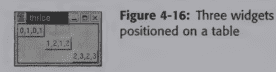

相同的程序也可用于在小部件之间添加空间，但表格必须是同质的才能插入间距。为了演示这一点，将之前程序第 10 行至第 21 行中定义的常更改为此：

```c
#define HOMOGENEOUS TRUE

#define ROWS 5
#define COLS 5

#define LOCATE_1N 0,1,0,1
#define LOCATE_2N 1,2,1,2
#define LOCATE_3N 4,5,4,5

#define LOCATE_1S  "0,1,0,1"
#define LOCATE_2S  "1,2,1,2"
#define LOCATE_3S  "4,5,4,5"
```

这将网格扩大为 5x5，并使表格变为同质。最后一个按钮定位在表格的右下角。由于表格是同质的，所有单元格大小相同，显示效果如图 4-17 所示。

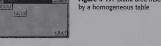

将 `HOMOGENEOUS` 的设置从 `TRUE` 更改为 `FALSE` 会改变窗口的外观，如图 4-18 所示。表格中的每个单元格都设置为其最小尺寸。在垂直网格线 2 和 4 之间没有任何内容，因此使用零的最小宽度。同样，在水平网格线 2 和 4 之间没有任何内容，因此使用零的最小高度。

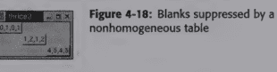

记住位置参数的正确顺序可能是一个问题。在定位大量小部件的过程中，你可能会陷入“哪个数字放在哪里”的困境。如果某些数字放错位置，最终的显示可能会非常令人困惑。事实上，只需少数几个数字错位，显示效果就可能大不相同，你可能不得不从头开始。我发现最好在便签或类似物品上画一个简单的小示意图，看起来像这样：

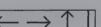

每个箭头指向附加的方向。第一个数字指定左侧网格线；第二个数字指定右侧网格线，然后是顶部，最后是底部。

# 可选设置

在之前所有示例中，使用函数 `gtk_table_attach_defaults()` 将小部件插入表格。如果你需要更多控制，请调用 `gtk_table_attach()` 并覆盖默认设置。这两个函数都使用相同的参数，顺序也相同，只是 `gtk_table_attach()` 需要多四个参数。事实是只有一个函数。函数 `gtk_table_attach_defaults()` 以这种方式调用 `gtk_table_attach()`：

```c
gtk_table_attach(table,
                widget,
                left_attach,
                right_attach,
                top_attach,
                bottom_attach,
                GTK_EXPAND | GTK_FILL,  /* xoptions */
                GTK_EXPAND | GTK_FILL,  /* yoptions */
                0,                 /* xpadding */
                0);               /* ypadding */
```

最后两个参数是水平和垂直的内边距值——指定小部件周围边距宽度或高度的像素数。指定的像素数会被添加到小部件的两侧。例如，如果指定内边距值为 5，则整体尺寸会增加 10。

`xoptions` 和 `yoptions` 是指向小部件的指令标志，说明它如何在表格单元格内进行布局和定尺寸。该选项的值列在表 4-1 中。如你所见，根据上述参数列表，选项可以导致小部件在垂直方向上以一种方式行动，而在水平方向上以另一种方式行动。当你将这些选项与 *内边距*、表格的网格定位和同质设置混合使用时，存在大量可能的组合来配置小部件的显示。

**表 4-1**
**表格附加选项的值**

| 值 | 描述 |
| :--- | :--- |
| 0 | 小部件不会重新调整大小。它以最小尺寸显示。如果包含它的单元格比小部件大，小部件将居中显示。 |
| GTK_FILL | 小部件扩展以完全填充分配给它的单元格。调整表格大小时，小部件也会随之重新调整大小。 |
| GTK_SHRINK | 如果包含小部件的单元格小于其最小尺寸，它会进一步压缩自身以适配合格。 |
| GTK_EXPAND | 这指示表格本身扩展以填充其周围窗口中任何未使用的空间。 |


以下程序展示了这些设置的工作方式：

```c
1 /** opset.c **/
2 #include <gnome.h>
3
4 GtkWidget *makeTable();
5 gint eventDelete(GtkWidget *widget,
6                 GdkEvent *event, gpointer data);
7 gint eventDestroy(GtkWidget *widget,
8                  GdkEvent *event, gpointer data);
9
10 #define HOMOGENOUS FALSE
11 #define X_MARGIN 0
12 #define Y_MARGIN 0
13
14 struct {
15    gint setting;
16    gchar *text;
17 } opl[] = {
18    { 0, "0" },
19    { GTK_EXPAND, "Ex" },
20    { GTK_FILL, "Fi" },
21    { GTK_SHRINK, "Sh" },
22    { GTK_FILL | GTK_EXPAND, "FiEx" },
23    { GTK_SHRINK | GTK_EXPAND, "ShEx" },
24    { GTK_FILL | GTK_SHRINK, "FiSh" },
25    { GTK_SHRINK | GTK_FILL | GTK_EXPAND, "ShFiEx" }
26 };
27
28 int main(int argc, char *argv[])
29 {
30    GtkWidget *window;
31    GtkWidget *table;
32
33    gnome_init("opset", "1.0", argc, argv);
34    window = gtk_window_new(GTK_WINDOW_TOPLEVEL);
35    gtk_signal_connect(GTK_OBJECT(window),
36                       "delete_event",
37                       GTK_SIGNAL_FUNC(eventDelete),
38                       NULL);
39    gtk_signal_connect(GTK_OBJECT(window),
40                       "destroy",
41                       GTK_SIGNAL_FUNC(eventDestroy),
42                       NULL);
43
44    table = makeTable();
45    gtk_container_add(GTK_CONTAINER(window), table);
46    gtk_widget_show(window);
47    gtk_main();
48    exit(0);
49 }
50
51 GtkWidget *makeTable() {
52     int r;
53     int c;
54     int index;
55     GtkWidget *table;
56     GtkWidget *button;
57
58     table = gtk_table_new(2, 4, HOMOGENOUS);
59     gtk_widget_show(table);
60
61     for (r = 0; r < 2; r++) {
62         for (c = 0; c < 4; c++) {
63             index = (r * 4) + c;
64             button = gtk_button_new_with_label(
65                     op[index].text);
66             gtk_table_attach(GTK_TABLE(table), button,
67                     c, c + 1, r, r + 1,
68                     op[index].setting,
69                     op[index].setting,
70                     X_MARGIN,
71                     Y_MARGIN);
72             gtk_widget_show(button);
73         }
74     }
75     return (table);
76 }
77
78 gint eventDelete(GtkWidget *widget,
79                 GdkEvent *event, gpointer data) {
80     return (FALSE);
81 }
82
83 gint eventDestroy(GtkWidget *widget,
84                  GdkEvent *event, gpointer data) {
85     gtk_main_quit();
86     return (0);
87 }
```

第 10 行到第 11 行定义了表格是否均匀以及围绕控件添加多少填充。第 14 行到第 25 行定义的结构体数组包含了选项的所有可能组合，并为每个组合附有一个文本标签。第 57 行创建了一个 2x4 的表格来容纳所有控件，而从第 60 行和第 61 行开始的循环创建按钮并将其插入到所有单元格中。图 4-19 展示了程序运行时窗口最初的样子。图 4-20 展示了使用鼠标扩展窗口后的样子。

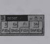

图 4-19：最小尺寸下的非均匀窗口

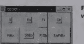

所有带有 `GTK_FILLER`（在显示屏上标记为“FI”）的控件都增加了尺寸，直到它们覆盖整个单元格。选项 `GTK_EXPAND`（在显示屏上标记为“Ex”）并未导致其控件扩展，因为 `GTK_EXPAND` 实际上是针对表格的指令，而不是针对控件的指令。

所有这些示例都对控件空间和尺寸的垂直和水平分量应用相同的规则。然而，通过两个参数，可以独立地在每个方向上设置选项。通过修改第 10 行为以下内容，可以使窗口变为均匀模式：

```c
#define HOMOGENOUS TRUE
```

在图 4-21 中展示了由此产生的显示效果，其中每个单元格的大小完全相同。当使用鼠标调整窗口大小时，所有单元格都会以相同的幅度增加尺寸，如图 4-22 所示。

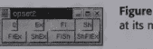

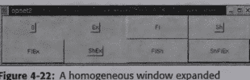

最后两个参数用于控件周围的填充。通过修改第 10 行到第 12 行为以下内容，可以创建图 4-23 中的窗口：

```c
#define HOMOGENOUS FALSE
#define X_MARGIN 5
#define Y_MARGIN 10
```

每个控件的左右两侧各增加 5 个像素，上下两侧各增加 10 个像素。这意味着控件在垂直方向上彼此分隔 20 个像素（每个控件贡献 10 个像素），并与顶部或底部分隔 10 个像素。所得窗口如图 4-23 所示，扩展后如图 4-24 所示。通过扩展和收缩，控件始终保持其距离。

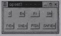

**图 4-23**：带有间距的非均匀窗口

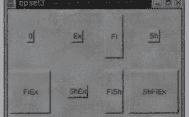

**图 4-24**：扩展后的带有间距的非均匀窗口

## 重叠的控件

如果一个控件位于另一个控件的相同位置，前面的控件会遮挡后面的控件。将控件添加到表格的顺序决定了哪个控件在顶层——第一个添加的控件保持在顶层。这一特性作为软件开发技术可能价值不大，但你应该意识到这一点，以便如果某个控件缺失，你可以找出它去了哪里。以下程序演示了重叠：

```c
1 /*** overlap.c **/
2 #include <gnome.h>
3
4 GtkWidget *makeTable();
5 gint eventDelete(GtkWidget *widget,
6                 GdkEvent *event, gpointer data);
7 gint eventDestroy(GtkWidget *widget,
8                  GdkEvent *event, gpointer data);
9
10 int main(int argc, char *argv[])
11 {
12     GtkWidget *window;
13     GtkWidget *table;
14
15     gnome_init("overlap", "1.0", argc, argv);
16     window = gtk_window_new(GTK_WINDOW_TOPLEVEL);
17     gtk_signal_connect(GTK_OBJECT(window),
18                        "delete_event",
19                        GTK_SIGNAL_FUNC(eventDelete),
20                        NULL);
21     gtk_signal_connect(GTK_OBJECT(window),
22                        "destroy",
23                        GTK_SIGNAL_FUNC(eventDestroy),
24                        NULL);
25
26     table = makeTable();
27     gtk_container_add(GTK_CONTAINER(window), table);
28     gtk_widget_show(window);
29     gtk_main();
30     exit(0);
31 }
32
33 GtkWidget *makeTable() {
34     GtkWidget *table;
35     GtkWidget *button;
36
37     table = gtk_table_new(5, 4, TRUE);
38     gtk_widget_show(table);
39
40     button = gtk_button_new_with_label("1,2,1,2");
41     gtk_table_attach_defaults(GTK_TABLE(table), button,
42             1, 2, 1, 2);
43     gtk_widget_show(button);
44
45     button = gtk_button_new_with_label("0,2,0,2");
46     gtk_table_attach_defaults(GTK_TABLE(table), button,
47             0, 2, 0, 2);
48     gtk_widget_show(button);
49
50     button = gtk_button_new_with_label("1,5,3,4");
51     gtk_table_attach_defaults(GTK_TABLE(table), button,
52             1, 5, 3, 4);
53     gtk_widget_show(button);
54
55     button = gtk_button_new_with_label("3,4,0,5");
56     gtk_table_attach_defaults(GTK_TABLE(table), button,
57             3, 4, 0, 5);
58     gtk_widget_show(button);
59
60     return (table);
61 }
62
63 gint eventDelete(GtkWidget *widget,
64                 GdkEvent *event, gpointer data) {
65     return (FALSE);
66 }
67
68 gint eventDestroy(GtkWidget *widget,
69                  GdkEvent *event, gpointer data) {
70     gtk_main_quit();
71     return (0);
72 }
```

此程序创建了一个 5x4 的表格，并在其上放置了四个按钮，如图 4-25 所示。在左上角，一个较小的按钮位于一个较大的按钮之上。较小的按钮在顶层，因为它先被添加到表格中。如果它们按相反的顺序添加，较小的按钮将完全不可见。右下角的两个按钮相互交错，但宽按钮先被添加到表格中，因此它位于顶层。

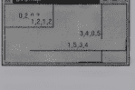

**图 4-25**：遮挡其他按钮部分的按钮

## 组合盒体和表格

盒体（Box）、表格和其他控件可以自由组合。你可以将包含控件的盒体存储在表格中，而这些表格又可以存储在其他盒体和控件中。组合盒体和表格的好处是，生成的存储层可以拥有自己的定位和重新调整大小的规则，使你能够随心所欲地布局。

此程序展示了如何嵌套盒体和表格来创建一个包含多个控件的窗口：

```c
1 /** collection.c **/
2 #include <gnome.h>
3
4 GtkWidget *makeTable();
5 GtkWidget *makeCheckButtons();
6 GtkWidget *makeTextEntry();
7 GtkWidget *makeButtonBox();
8 gint eventDelete(GtkWidget *widget,
9                GdkEvent *event, gpointer data);
10 gint eventDestroy(GtkWidget *widget,
11                GdkEvent *event, gpointer data);
12
13 int main(int argc, char *argv[])
14 {
15     GtkWidget *window;
16     GtkWidget *table;
17
18     gnome_init("collection", "1.0", argc, argv);
19     window = gtk_window_new(GTK_WINDOW_TOPLEVEL);
20     gtk_signal_connect(GTK_OBJECT(window),
21                    "delete_event",
22                    GTK_SIGNAL_FUNC(eventDelete),
23                    NULL);
```


```c
24
gtk_signal_connect(GTK_OBJECT(window),
25	"destroy",
26	GTK_SIGNAL_FUNC(eventDestroy),
27	NULL);
28
29	table = makeTable();
30	gtk_container_add(GTK_CONTAINER(window),table);
31	gtk_widget_show(window);
32	gtk_main();
33	exit(0);
34}
35	GtkWidget *makeTable() {
36	GtkWidget *table;
37	GtkWidget *checkButtons;
38	GtkWidget *textEntry;
39	GtkWidget *buttonBox;
40
41	table = gtk_table_new(2,2,FALSE);
42	gtk_widget_show(table);
43
44	textEntry = makeTextEntry();
45	gtk_table_attach(GTK_TABLE(table),textEntry,
46			0,1,0,1,
47			0,
48			0,
49			5,
50			5);
51	gtk_widget_show(textEntry);
52
53	checkButtons = makeCheckButtons();
54	gtk_table_attach(GTK_TABLE(table),checkButtons,
55			1,2,0,1,
56			GTK_EXPAND | GTK_FILL,
57			GTK_EXPAND | GTK_FILL,
58			10,
59			0);
60	gtk_widget_show(checkButtons);
61
62	buttonBox = makeButtonBox();
63	gtk_table_attach(GTK_TABLE(table),buttonBox,
64			0,2,1,2,
65			GTK_EXPAND | GTK_FILL,
66			0,
67			0,
68			8);
69	gtk_widget_show(buttonBox);
70	return(table);
71}
72
73	GtkWidget *makeCheckButtons()
74	{
75	GtkWidget *vbox;
76	GtkWidget *check;
77	
78 vbox = gtk_vbox_new(FALSE,0);
79	
80 check = gtk_check_button_new_with_label("Get Mad");
81 gtk_box_pack_start(GTK_BOX(vbox),check,FALSE,FALSE,0);
82 gtk_widget_show(check);
83	
84 check = gtk_check_button_new_with_label("Get Even");
85 gtk_box_pack_start(GTK_BOX(vbox),check,FALSE,FALSE,0);
86 gtk_widget_show(check);
87	
88 check = gtk_check_button_new_with_label("Get Down");
89 gtk_box_pack_start(GTK_BOX(vbox),check,FALSE,FALSE,0);
90 gtk_widget_show(check);
91	
92 check = gtk_check_button_new_with_label(
93 "Reverse Neutron Polarity");
94 gtk_box_pack_start(GTK_BOX(vbox),check,FALSE,FALSE,0);
95 gtk_widget_show(check);
96	
97 return(vbox);
98 }
99 GtkWidget *makeTextEntry()
100 {
101 GtkWidget *vbox;
102 GtkWidget *label;
103 GtkWidget *text;
104 
105 vbox = gtk_vbox_new(FALSE,0);
106 
107 label = gtk_label_new("Enter destination planet");
108 gtk_box_pack_start(GTK_BOX(vbox),label,FALSE,FALSE,0);
109 gtk_widget_show(label);
110 
111 text = gtk_entry_new_with_max_length(32);
112 gtk_box_pack_start(GTK_BOX(vbox),text,FALSE,FALSE,0);
113 gtk_widget_show(text);
114 
115 return(vbox);
116 }
117 GtkWidget *makeButtonBox()
118 {
119 GtkWidget *hbox;
120 GtkWidget *button;
121 
122 hbox = gtk_hbox_new(TRUE,0);
123 
124 button = gtk_button_new_with_label("OK");
125 gtk_box_pack_start(GTK_BOX(hbox),button,FALSE,FALSE,0);
126 gtk_widget_show(button);
127 
128 
129 button = gtk_button_new_with_label("Apply");
130 gtk_box_pack_start(GTK_BOX(hbox),button,FALSE,FALSE,0);
131 gtk_widget_show(button);
132 
133 button = gtk_button_new_with_label("Cancel");
134 gtk_box_pack_start(GTK_BOX(hbox),button,FALSE,FALSE,0);
135 gtk_widget_show(button);
136 
137 return(hbox);
138 }
139 gint eventDelete(GtkWidget *widget,
140 GdkEvent *event, gpointer data) {
141 return(FALSE);
142 }
143 gint eventDestroy(GtkWidget *widget,
144 GdkEvent *event, gpointer data) {
145 gtk_main_quit();
146 return(0);
147 }
```

整个窗口都布局在第 41 行创建的表格上。这是一个 2x2 的表格，其中包含三个控件。窗口展示在图 4-26 中。三个控件被附加到表格上，并且有三个函数用于构建这些控件。

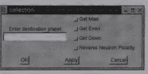

从第 73 行开始的函数 `makeCheckButtons()` 创建一个垂直框，并将三个复选框打包其中。从第 99 行开始的函数 `makeTextEntry()` 创建一个垂直框，并将一个标签和一个文本输入控件打包其中。函数 `makeButtonBox()` 创建一个水平框，并将三个按钮附加到该框中。最后一个框被设置为均质（homogeneous），因此按钮在窗口底部均匀分布。

第 44 至 51 行创建文本输入控件，并将其附加到左上角的单元格。该控件通过调用 `makeTextEntry()` 创建。附件选项设置为不扩展和不分填，因此无论包含该控件的表格发生什么变化，该控件的大小都保持不变。此外，其四周还设置了 5 像素的边距。

第 53 至 60 行创建包含复选框的控件，然后将这些控件附加到右上角。这些控件通过调用 `makeCheckButtons()` 构建。该控件使用 `GTK_EXPAND` 和 `GTK_FILL` 选项进行附加，这与使用 `gtk_table_attach_defaults()` 产生的结果相同，但左右各增加了 10 像素的边距。

第 62 至 69 行创建包含三个按钮的控件，并将其附加到表格，使其覆盖表格底部的两个单元格。该控件设置为沿 x 轴扩展和填充，但沿 y 轴不这样做。此外，其上下还插入了 8 像素的边距。

所有事物都是控件这一事实使得开发过程变得非常愉快：请注意，第 37、38 和 39 行的声明将表格中包含的每个对象都定义为 `GtkWidget`。这样，函数 `makeTable()` 就不必确切知道要包含哪种类型的控件。它只需从函数中获取一个 `GtkWidget` 指针并将其添加到表格中。该控件可以是另一个表格、框、按钮、标签或可用的其他几十个控件中的任意一个。这是一个非常重要的特性。它不仅简化了编码，还允许你在不担心对其他部分产生负面影响的情况下修改布局的某一部分。当然，如果你进行了一些尺寸更改，可能需要做一些位置调整——但由于类型不兼容问题，你无需重写程序的某些部分。

## 总结

在本章中，我们回顾了向窗口添加控件的方法。你了解到，可以使用表格和框来填充控件，从而非常快速地布局对话框窗口。此外，控件在对话框内定位和间距的自动化处理，解放了程序员的精力，使其能够处理更重要的细节。

在本章中，你还学习了：

- 有两种类型的框——垂直框和水平框。
- 控件可以从框的两端添加。
- 表格是一个网格，控件可以悬挂在其上。
- 表格的单元格可以是固定大小或可变大小。
- 任何控件都可以打包到框或表格中——包括其他框或表格。

然而，这仅仅是控件的开端。例如，还有更多打包控件的方法。你还可以向控件发出特殊请求，例如对放置位置进行逐像素的完全控制。第 5 章回顾了一些可与表格和框一起使用或替代它们的专用控件容器。

# 用于包含其他控件的控件

本章涉及控件位置、大小以及窗口调整大小时其反应方式的详细控制。为了实现所有这些目标，有几种控件用于包含其他控件并影响其行为。每种控件都有其自身的特点和特殊功能，可用于创建装饰性且详细的布局。

## 固定容器

你可以使用固定容器通过指定 x 和 y 坐标将控件放置在特定位置。下面的**示例程序**创建三个按钮，并将它们放置在一个**固定容器控件**上。按钮最初放置在 **(100,100)**，这意味着每个按钮的左上角位于容器左上角向右 100 像素、向下 100 像素的位置。按钮标签包含其位置的 x 和 y 值。每个按钮被点击时，通过改变其 x 和 y 值移动到另一个位置。

```c
1 /** fixed.c **/
2 #include <gnome.h>
3
4 typedef struct {
5   GtkWidget *fixed;
6   GtkWidget *button;
7 } ButtonMover;
8
9 GtkWidget *makeFixedContainer();
10 gint eventDelete(GtkWidget *widget,
    GdkEvent *event, gpointer data);
11 gint eventDestroy(GtkWidget *widget,
    GdkEvent *event, gpointer data);
12 void buttonClick(GtkWidget
    *widget, ButtonMover *bm);
13
```


CHAPTER

## 本章内容

- 在特定的 x 和 y 坐标处定位控件
- 向大窗口附加可滚动的滚动条
- 设置控件使其遵循自身的调整大小规则，而非容器的规则
- 配置控件使其在容器调整大小时保持相同的高宽比
- 通过位置和周围的框架对控件进行分组


```c
16 #define WIDTH 400
17 #define HEIGHT 300
18
19 int main(int argc,char *argv[])
20 {
21     GtkWidget *window;
22     GtkWidget *fixed;
23
24     gnome_init("fixed", "1.0",argc, argv);
25     window = gtk_window_new(GTK_WINDOW_TOPLEVEL);
26     gtk_window_set_default_size(GTK_WINDOW(window),
27         WIDTH,HEIGHT);
28
29     gtk_signal_connect(GTK_OBJECT(window),
30         "delete_event",
31         GTK_SIGNAL_FUNC(eventDelete),
32         NULL);
33     gtk_signal_connect(GTK_OBJECT(window),
34         "destroy",
35         GTK_SIGNAL_FUNC(eventDestroy),
36         NULL);
37
38     fixed = makeFixedContainer();
39
40     gtk_container_add(GTK_CONTAINER(window),fixed);
41     gtk_widget_show(window);
42     gtk_main();
43     exit(0);
44 }
45
46 GtkWidget *makeFixedContainer() {
47     int i;
48     static ButtonMover bm[3];
49     fixed = gtk_fixed_new();
50     gtk_widget_show(fixed);
51
52     for(i=0; i<3; i++) {
53         bm[i].fixed = fixed;
54         bm[i].button = gtk_button_new_with_label(
55             "(100,100)");
56         gtk_signal_connect(GTK_OBJECT(bm[i].button),
57             "clicked",
58             GTK_SIGNAL_FUNC(buttonClick),
59             &bm[i]);
60         gtk_widget_show(bm[i].button);
61         gtk_fixed_put(GTK_FIXED(fixed),bm[i].button,
62             100,100);
63     }
64     return(fixed);
65 }
66 void buttonClick(GtkWidget *widget,ButtonMover *bm)
67 {
68     gchar labelString[80];
69     GtkWidget *label;
70
71     gint x = (int)(random() % WIDTH);
72     gint y = (int)(random() % HEIGHT);
73     sprintf(labelString, "(%d,%d)", x, y);
74     label = GTK_WIDGET(GTK_BUTTON(bm->button)->child);
75     gtk_label_set_text(GTK_LABEL(label), labelString);
76     gtk_fixed_move(GTK_FIXED(bm->fixed), bm->button, x, y);
77 }
78 gint eventDelete(GtkWidget *widget,
79                 GdkEvent *event, gpointer data) {
80     return(FALSE);
81 }
82 gint eventDestroy(GtkWidget *widget,
83                 GdkEvent *event, gpointer data) {
84     gtk_main_quit();
85     return(0);
86 }
```

第 44 行开始的 `makeFixedContainer()` 函数创建了一个固定容器，并将三个按钮添加到其中。该容器本身是通过第 49 行调用 `gtk_fixed_new()` 创建的。

固定容器没有预定义的大小。相反，它会自动调整大小以容纳所有已添加到其中的小部件位置。在上一个示例中，持有该容器的窗口通过第 26 行调用 `gtk_window_set_default_size()` 被设置为固定大小。这会强制窗口无论发生什么情况都保持相同的大小。如果从代码中移除此函数调用，显示的窗口初始大小会很小。随着按钮从一个位置移动到另一个位置，容器会扩展，从而强制窗口扩展以容纳它。

从第 52 行开始的循环创建三个按钮并将它们添加到容器中。调用 `gtk_fixed_put()` 将每个按钮附加到容器中的位置 (100,100)。在第 4 行定义了 `ButtonMover` 结构体，并在第 47 行声明为一个数组——每个按钮一个。结构体中存储了指向按钮和固定容器的指针，以便可以将它们传递给回调函数。回调函数 `buttonClick()` 用于所有三个按钮。

从第 66 行开始的回调函数 `buttonClick()` 将选定的按钮从一个位置移动到另一个位置。第 71 行和第 72 行使用随机数生成器建立一组新的 x 和 y 坐标。第 73 行和第 74 行将值的 ASCII 表示形式设置为按钮的标签。按钮包含一个标签小部件用于显示文本，因此第 75 行调用 `gtk_label_set_text()` 更改按钮显示的字符串。在第 76 行，调用 `gtk_fixed_move()` 并传入新坐标以重新定位按钮。点击按钮几次后，显示效果类似于图 5-1。

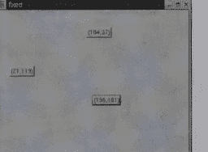

计算固定小部件的最小大小相当容易。宽度是从容器左侧到每个小部件右侧的最大距离。同样，高度是从容器顶部到每个小部件底部的最大距离。

小部件可以从一个位置移动到另一个位置。无论窗口是否正在活动显示，都可以执行此操作。用于重新定位小部件的 `gtk_fixed_move()` 调用具有与 `gtk_fixed_put()` 相同的参数，但不添加小部件。例如，如果小部件 button 已经添加到固定容器中，此调用将其移动到新的位置：

```c
gtk_fixed_move(GTK_FIXED(fixed),button,25,25);
```

## 对齐容器

该容器可用于容纳单个小部件，并对小部件的大小和位置施加一定的控制。被包含的小部件会改变大小并定位以适应当前对齐容器的大小和形状。小部件在容器中的位置是从顶部起一定百分比的距离，以及从左侧起一定百分比的距离。此外，小部件的大小也被设置为容器宽度和高度的一定百分比。

此示例程序将对齐容器中的 GtkButton 小部件居中：

```c
1 / ** alignment.c ** /
2 #include <gname.h>
3
4 GtkWidget *makeAlignment();
5 gint eventDelete(GtkWidget *widget,
6            GdkEvent *event, gpointer data);
7 gint eventDestroy(GtkWidget *widget,
8            GdkEvent *event,gpointer data);
9 
10 int main(int argc,char *argv[])
11 {
12     GtkWidget *window;
13     GtkWidget *alignment;
14 
15     gnome_init("alignment","1.0",argc,argv);
16     window = gtk_window_new(GTK_WINDOW_TOPLEVEL);
17     gtk_window_set_default_size(GTK_WINDOW(window),
18                 200,200);
19     gtk_signal_connect(GTK_OBJECT(window),
20                "delete_event",
21                GTK_SIGNAL_FUNC(eventDelete),
22                NULL);
23     gtk_signal_connect(GTK_OBJECT(window),
24                "destroy",
25                GTK_SIGNAL_FUNC(eventDestroy),
26                NULL);
27 
28     alignment = makeAlignment();
29 
30     gtk_container_add(GTK_CONTAINER(window),alignment);
31     gtk_widget_show(window);
32     gtk_main();
33     exit(0);
34 }
35 GtkWidget *makeAlignment()
36 {
37     GtkWidget *alignment;
38     GtkWidget *button;
39     gfloat xalign = 0.5;
40     gfloat yalign = 0.5;
41     gfloat xscale = 0.8;
42     gfloat yscale = 0.8;
43 
44     alignment = gtk_alignment_new(xalign,yalign,
45                 xscale,yscale);
46     button = gtk_button_new_with_label("Button");
47     gtk_widget_show(button);
48     gtk_container_add(GTK_CONTAINER(alignment),button);
49 
50     return(alignment);
51 }
52 gint eventDelete(GtkWidget *widget,
53                 GdkEvent *event,gpointer data)
54 {
55     return(FALSE);
56 }
57 gint eventDestroy(GtkWidget *widget,
58                 GdkEvent *event,gpointer data)
59 {
60     gtk_main_quit();
61     return(0);
62 }
```

从第 35 行开始的 `makeAlignment()` 函数创建了一个包含 `GtkButton` 小部件的对齐容器。对齐小部件是通过第 43 行调用 `gtk_alignment_new()` 创建的。对齐容器只能包含一个小部件，控制其大小和定位的值在容器构造时设置。值 `xalign` 和 `yalign` 指定小部件相对于容器大小和形状的位置。值 `xscale` 和 `yscale` 指定小部件相对于容器大小的比例。

第 38 行至第 41 行显示的值，连同第 17 行的初始窗口大小指定，导致了图 5-2 中窗口的出现。按钮会自动调整大小以适应其容器。图 5-3 显示了使用鼠标更改大小后的同一窗口。

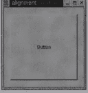

**图 5-2**：一个被 `GtkAlignment` 容器居中的按钮

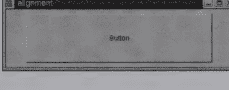

**图 5-3**：调整 `GtkAlignment` 容器的大小时，其包含的小部件也会调整大小

两个大小数字 `xscale` 和 `yscale` 是 0.0 到 1.0 之间的浮点值。它们将小部件的大小设置为容器总高度和宽度的一定百分比。在示例中，两个值都设置为 0.8，因此按钮覆盖了容器高度和宽度的 80%。使用 1.0 作为这些数字会使按钮扩展以完全填满对齐容器。

两个对齐数字 `xalign` 和 `yalign` 是 0.0 到 1.0 之间的浮点值，代表跨越容器的距离的百分比。在图 5-2 中，按钮居中，因为 `xalign` 和 `yalign` 的值都是 0.5。将 `xalign` 和 `yalign` 都设置为 0.0 会使窗口看起来像图 5-4 中的样子。将 `xalign` 和 `yalign` 都设置为 1.0 会使窗口看起来像图 5-5 中的样子。


**图 5-4：** 位于 `GtkAlignment` 容器左上角的按钮


**图 5-5：** 位于 `GtkAlignment` 容器右下角的按钮

用于根据相对值 xalign 和 yalign 计算控件实际位置的算法，永远不会将控件的任何部分放置在容器之外。为此，首先计算控件的大小，以便在定位时考虑其高度和宽度。图 5-6 展示了如何实现垂直定位。虚线表示控件中心所有可能的垂直位置。极端位置是指如果控件紧贴顶部或底部时其中心的位置。这些极端位置被用作用于定位控件的线段的端点。因此，实际的垂直位置是该线段从顶部起算的一定比例距离。水平定位使用相同的方法，百分比从左侧的 0.0 测量到右侧的 1.0。

你不必局限于创建对齐容器时使用的对齐方式。你可以调用此函数来更改它：

```c
gtk_alignment_new(GTK_ALIGNMENT(alignment),
                  xalign, yalign,
                  xscale, yscale);
```

第一个参数是接收新值的对齐容器，这四个浮点值与示例程序中 `gtk_alignment_new()` 所使用的值相同。


**图 5-6：** GtkAlignment 控件定位方法中的假想线

## 边框容器

*边框容器* 能够容纳单个控件并为其添加一个矩形边框。绘制的边框还可在顶部包含一个标签。有几种不同的线条类型可用于绘制矩形——如果你算上什么都不绘制的情况，总共有五种。以下示例通过在一组标签周围使用边框来演示线条绘制选项。输出结果如图 5-7 所示。

```c
/** frame1.c **/
#include <gnome.h>

GtkWidget *makeFrames();
gint eventDelete(GtkWidget *widget, GdkEvent *event, gpointer data);
gint eventDestroy(GtkWidget *widget, GdkEvent *event, gpointer data);

struct {
    gchar *typeName;
    GtkShadowType type;
} shadow[] = {
    { "GTK_SHADOW_NONE", GTK_SHADOW_NONE },
    { "GTK_SHADOW_IN", GTK_SHADOW_IN },
    { "GTK_SHADOW_OUT", GTK_SHADOW_OUT },
    { "GTK_SHADOW_ETCHED_IN", GTK_SHADOW_ETCHED_IN },
    { "GTK_SHADOW_ETCHED_OUT", GTK_SHADOW_ETCHED_OUT }
};

int main(int argc, char *argv[])
{
    GtkWidget *window;
    GtkWidget *frame;

    gnome_init("frame1", "1.0", argc, argv);
    window = gtk_window_new(GTK_WINDOW_TOPLEVEL);
    gtk_container_set_border_width(
        GTK_CONTAINER(window), 25);
    gtk_signal_connect(GTK_OBJECT(window),
        "delete_event",
        GTK_SIGNAL_FUNC(eventDelete),
        NULL);
    gtk_signal_connect(GTK_OBJECT(window),
        "destroy",
        GTK_SIGNAL_FUNC(eventDestroy),
        NULL);

    frame = makeFrames();
    gtk_container_add(GTK_CONTAINER(window), frame);
    gtk_widget_show(window);
    gtk_main();
    exit(0);
}

GtkWidget *makeFrames() {
    int i;
    GtkWidget *box;
    GtkWidget *frame;
    GtkWidget *label;

    box = gtk_vbox_new(FALSE, 10);
    gtk_widget_show(box);

    for(i=0; i<5; i++) {
        frame = gtk_frame_new(NULL);
        gtk_widget_show(frame);
        gtk_frame_set_shadow_type(GTK_FRAME(frame),
            shadow[i].type);
        gtk_container_add(GTK_CONTAINER(box), frame);
        label = gtk_label_new(shadow[i].typeName);
        gtk_widget_show(label);
        gtk_container_add(GTK_CONTAINER(frame), label);
    }

    return(box);
}

gint eventDelete(GtkWidget *widget,
    GdkEvent *event, gpointer data) {
    return(FALSE);
}

gint eventDestroy(GtkWidget *widget,
    GdkEvent *event, gpointer data) {
    gtk_main_quit();
    return(0);
}
```

第 10 行到第 18 行定义的 shadow 数组包含了表示绘制矩形每种方法名称和数值。该结构体在循环中使用，以创建一组带边框的标签。

创建边框集合的函数是 makeFrames()，它从第 45 行开始。由于列表中要包含的控件不止一个，因此在第 51 行创建了一个盒子容器控件，并在第 62 行的循环内将标签打包到其中。从第 54 行开始的循环，针对边框使用的每种线条类型进行一次迭代。在第 55 行和第 57 行创建并配置边框，调用 gtk_frame_set_shadow_type() 指定要绘制的边框类型——默认值为 GTK_SHADOW_ETCHED_IN。在第 59 行将边框添加到垂直盒子中。第 60 行到第 61 行创建标签并将其插入边框中。


**图 5-7：** 边框有五种不同的外观

边框可以仅用于装饰，但通常用于在对话框窗口中对相关项目进行分组。以下程序显示了图 5-8 中所示的窗口。

```c
/** frame2.c **/
#include <gnome.h>

GtkWidget *makeFrame();
gint eventDelete(GtkWidget *widget, GdkEvent *event, gpointer data);
gint eventDestroy(GtkWidget *widget, GdkEvent *event, gpointer data);

int main(int argc, char *argv[])
{
    GtkWidget *window;
    GtkWidget *frame;

    gnome_init("frame2", "1.0", argc, argv);
    window = gtk_window_new(GTK_WINDOW_TOPLEVEL);
    gtk_signal_connect(GTK_OBJECT(window),
        "delete_event",
        GTK_SIGNAL_FUNC(eventDelete),
        NULL);
    gtk_signal_connect(GTK_OBJECT(window),
        "destroy",
        GTK_SIGNAL_FUNC(eventDestroy),
        NULL);

    frame = makeFrame();
    gtk_container_add(GTK_CONTAINER(window), frame);
    gtk_widget_show(window);
    gtk_main();
    exit(0);
}

GtkWidget *makeFrame() {
    GtkWidget *box;
    GtkWidget *frame;
    GtkWidget *button;

    box = gtk_vbox_new(FALSE, 0);
    gtk_widget_show(box);

    button = gtk_check_button_new_with_label(
        "Calculate new average");
    gtk_widget_show(button);
    gtk_container_add(GTK_CONTAINER(box), button);

    button = gtk_check_button_new_with_label(
        "Calculate new median");
    gtk_widget_show(button);
    gtk_container_add(GTK_CONTAINER(box), button);

    button = gtk_check_button_new_with_label(
        "Calculate new maximum");
    gtk_widget_show(button);
    gtk_container_add(GTK_CONTAINER(box), button);

    frame = gtk_frame_new("Calculations");
    gtk_widget_show(frame);
    gtk_container_set_border_width(GTK_CONTAINER(frame), 15);
    gtk_container_add(GTK_CONTAINER(frame), box);

    return(frame);
}

gint eventDelete(GtkWidget *widget,
    GdkEvent *event, gpointer data)
{
    return(FALSE);
}

gint eventDestroy(GtkWidget *widget,
    GdkEvent *event, gpointer data)
{
    gtk_main_quit();
    return(0);
}
```


从第 32 行开始的 makeFrame() 函数创建一个盒子，向盒子中填充复选按钮，然后在该盒子周围添加一个边框。按钮在第 40 行到第 53 行创建。带有其标签文本的边框在第 55 行创建。标签的默认位置在顶部并左对齐。第 57 行指定盒子和其容器（边框）之间应有 15 像素的边距。

可以通过调用 gtk_frame_set_label_align() 来设置边框上标签的位置。出现在边框顶部的标签可以左对齐（默认值）、右对齐或居中放置。放置位置是一个浮点数，左对齐标签值为 0.0，右对齐标签值为 1.0。通过使用 0.0 和 1.0 之间的值，可以将标签放置在两个极端位置之间。例如，使用 0.5 可使标签居中。要将标签向右移动，如图 5-9 所示，请在第 55 行调用 gtk_frame_new() 创建边框之后添加以下这行代码：

```c
gtk_frame_set_label_align(GTK_FRAME(frame), 1.0, 0.0);
```


第一个参数是框架部件。`xalign` 的第二个参数为 1.0，用于将标签向右移动。第三个参数称为 `valign`，但它对显示没有影响。


图 5-9：重新定位框架标签

## 纵横比框架容器

*纵横比框架容器* 只容纳一个部件，并强制该部件无论窗口如何调整大小都保持相同的纵横比。纵横比框架容器结合了前两种容器的部分功能。与框架容器一样，它在所容纳的部件周围添加框架和标签。而与对齐容器一样，你可以控制部件在容器内的放置位置。

用于创建框架的阴影始终以 `GTK_SHADOW_ETCHED_IN` 形式呈现，而标签始终从框架的左上角开始定位。下面的示例程序显示了图 5-10 中所示的窗口。

```c
/** aspect.c **/
#include <gnome.h>

GtkWidget *makeAspectFrame();
gint eventDelete(GtkWidget *widget,
          GdkEvent *event, gpointer data);
gint eventDestroy(GtkWidget *widget,
          GdkEvent *event, gpointer data);

int main(int argc, char *argv[])
{
    GtkWidget *window;
    GtkWidget *aspect;

    gnome_init("aspect", "1.0", argc, argv);
    window = gtk_window_new(GTK_WINDOW_TOPLEVEL);
    gtk_window_set_default_size(GTK_WINDOW(window),
              200, 200);
    gtk_signal_connect(GTK_OBJECT(window),
               "delete_event",
               GTK_SIGNAL_FUNC(eventDelete),
               NULL);
    gtk_signal_connect(GTK_OBJECT(window),
               "destroy",
               GTK_SIGNAL_FUNC(eventDestroy),
               NULL);

    aspect = makeAspectFrame();

    gtk_container_add(GTK_CONTAINER(window),aspect);
    gtk_widget_show(window);
    gtk_main();
    exit(0);
}
GtkWidget *makeAspectFrame() {
    GtkWidget *aspect;
    GtkWidget *button;
    gfloat xalign = 0.5;
    gfloat yalign = 0.5;
    gfloat ratio = 2;

    aspect = gtk_aspect_frame_new("AspectFrame",
              xalign,yalign,
              ratio,
              FALSE);

    gtk_widget_show(aspect);
    gtk_container_set_border_width(GTK_CONTAINER(aspect),
              10);
    button = gtk_button_new_with_label("Button");
    gtk_widget_show(button);
    gtk_container_set_border_width(GTK_CONTAINER(button),
              10);
    gtk_container_add(GTK_CONTAINER(aspect),button);

    return(aspect);
}
gint eventDelete(GtkWidget *widget,
    GdkEvent *event,gpointer data) {
    return(FALSE);
}
gint eventDestroy(GtkWidget *widget,
    GdkEvent *event,gpointer data) {
    gtk_main_quit();
    return(0);
}
```


图 5-10：纵横比为 2:1 的纵横比框架中的按钮

纵横比框架容器在从第 35 行开始的 makeAspectFrame() 函数中创建。框架部件在第 42 行构建。第一个参数是位于框架顶部的标签。第二个和第三个参数是用于定位所容纳部件的 xalign 和 yalign 值——它们在此处的作用与前面描述的对齐部件完全相同。在此示例中，两个对齐值均为 0.5，这将所容纳的部件水平且垂直地放置在中间。

第 44 行的 ratio 是宽度除以高度得出的比率。如果你希望部件的宽度是其高度的四倍，请使用比率 4/1。如果你希望部件的高度是其宽度的四倍，请使用比率 1/4。比率为 1 会产生方形部件。大于 1 的数字表示较宽；小于 1 的数字表示较高。

第 45 行的最后一个参数，如果比率是从所容纳的部件推导出来的则为 TRUE，如果比率取自传入的值则为 FALSE。也就是说，如果你指定 TRUE，则作为参数指定的比率值会被忽略，而是采用所容纳部件的值。每个部件都有首选高度和宽度，这暗示了首选的纵横比。

有两个调用 `gtk_container_set_border_width()`：第 47 行那个在框架外部插入 10 像素，第 51 行那个在按钮和框架之间插入 10 像素。

图 5-10 显示了窗口最初出现时的样子。窗口的整体大小和形状由纵横比、按钮的最小尺寸要求以及周围边框的厚度决定。如果窗口在垂直缩小的同时被拉宽，它看起来就像图 5-11 中的窗口。如果窗口变窄但变长，它看起来就像图 5-12 中的窗口。大小发生变化，但纵横比保持不变。


你可以动态更改对齐和纵横比信息。要更改创建纵横比框架时建立的任何或所有大小参数，请使用如下函数调用：

```c
gtk_aspect_frame_set(GTK_ASPECT_FRAME(aspect),
                 xalign,yalign,
                 ratio,
                 FALSE);
```


图 5-12：垂直拉伸保持部件纵横比

这会更改除标签文本外的所有初始设置，但标签文本也可以更改。因为纵横比框架是框架容器的扩展，所以可以进行此调用来更改标签：

```c
gtk_frame_set_label(GTK_FRAME( aspect ), "New Label Text");
```

## 分割容器

*分割容器* 容纳两个部件，并排或上下放置，并在它们之间显示一个分隔符。可以使用鼠标来回移动分隔符以调整每个所容纳部件的大小。分隔条称为 *gutter*（槽）。用于来回拖动分隔符的槽上的按钮称为 *handle*（手柄）。

以下示例展示了一个水平分割容器，两侧各有一个文本部件，如图 5-13 所示。每个文本部件都包含一行会自动换行以填满部件的文本——自动换行由每行末尾的循环箭头指示。使用鼠标拖动 handle 会移动 gutter 并调整两个部件的大小，如图 5-14 所示。

```c
/** hpaned.c **/
#include <gnome.h>

GtkWidget *makeHorizontalPane();
gint eventDelete(GtkWidget *widget,
                 GdkEvent *event, gpointer data);
gint eventDestroy(GtkWidget *widget,
                 GdkEvent *event, gpointer data);

int main(int argc, char *argv[])
{
   GtkWidget *window;
   GtkWidget *pane;

   gnome_init("hpaned","1.0",argc,argv);
   window = gtk_window_new(GTK_WINDOW_TOPLEVEL);
   gtk_window_set_default_size(GTK_WINDOW(window),
   200,200);

   gtk_signal_connect(GTK_OBJECT(window),
   "delete_event" ,
   GTK_SIGNAL_FUNC(eventDelete),
   NULL);

   gtk_signal_connect(GTK_OBJECT(window),
   "destroy" ,
   GTK_SIGNAL_FUNC(eventDestroy),
   NULL);

   pane = makeHorizontalPane();

   gtk_container_add(GTK_CONTAINER(window),pane);
   gtk_widget_show(window);
   gtk_main();
   exit(0);
}
GtkWidget *makeHorizontalPane() {
    int i;
    GtkWidget *leftText;
    GtkWidget *rightText;
    GtkWidget *paned;


    leftText = gtk_text_new(NULL,NULL);
    gtk_widget_show(leftText);
    rightText = gtk_text_new(NULL,NULL);
    gtk_widget_show(rightText);
    for(i=0; i<15; i++) {
      gtk_text_insert(GTK_TEXT(leftText),NULL,NULL,NULL,
"The quick brown fox jumped on the leftovers. \n",-1);

      gtk_text_insert(GTK_TEXT(rightText),NULL,NULL,NULL,
"The lazy gray dog slept by the leftovers. \n",-1);

    }


    paned = gtk_hpaned_new();
    gtk_widget_show(paned);
    gtk_paned_add1(GTK_PANED(paned),leftText);
    gtk_paned_add2(GTK_PANED(paned),rightText);

    return(paned);
}
gint eventDelete(GtkWidget *widget,
    GdkEvent *event,gpointer data) {
    return(FALSE);
}
gint eventDestroy(GtkWidget *widget,
    GdkEvent *event,gpointer data) {
    gtk_main_quit();
    return(0);
}
```


```cpp
65    gint eventDestroy(GtkWidget *widget,
66                    GdkEvent *event, gpointer data) {
67       gtk_main_quit();
68       return(0);
69    }
```


从第 35 行开始的 `makeHorizontalPane()` 函数创建了一个分支容器，并将两个文本小部件插入其中。这些文本小部件在第 41 行至第 52 行之间创建并被填充了文本。

第 54 行对 `gtk_hpaned_new()` 的调用创建了一个水平分支小部件，其效果如图 5-13 和图 5-14 所示。

第 52 行对 `gtk_hpaned_new()` 函数的调用创建了一个新的水平分支小部件。在第 56 行和第 57 行，函数 `gtk_paned_add1()` 在左侧添加文本小部件，而 `gtk_paned_add2()` 在右侧添加文本小部件。

这就是全部内容。分支小部件及其包含的两个小部件会相互通信，以协调定位和大小调整。整个窗口可以调整大小，分隔条也可以左右移动，使所有小部件一起调整大小。小部件的最小尺寸不会限制分隔条的移动，可以将分隔条完全移到一侧，从而完全遮挡一个小部件，并将整个窗口分配给另一个小部件。

图 5-15 和图 5-16 展示了一个垂直分支容器。你可以通过更改示例代码中的一行来实现这种配置。第 54 行应变为：

```cpp
paned = gtk_vpaned_new();
```

其他内容可以保持不变。添加小部件到垂直 *分支* 容器时使用相同的函数。`gtk_paned_add1()` 函数在顶部添加一个小部件，而 `gtk_paned_add2()` 在底部添加一个小部件。


## **图 5-15：** 包含两个文本小部件的垂直分支


## **图 5-16：** 包含两个文本小部件的垂直分支

可以调整分隔条的厚度和按钮的大小。例如，要生成如图 5-17 所示的配置，请在上述示例中的第 54 行后插入以下两个函数调用：

```cpp
gtk_paned_set_handle_size(GTK_PANED(paned), 30);
gtk_paned_set_gutter_size(GTK_PANED(paned), 20);
```

这使得手柄成为一个边长为 30 像素的正方形，并将分隔条宽度设置为 20 像素。然而，手柄的宽度受限于分隔条的宽度，因此最终手柄是一个 20x30 像素的矩形。默认手柄大小为 10，默认分隔条大小为 6。


## 布局容器

布局容器可以容纳任意数量的小部件。小部件通过 x 和 y 像素偏移量进行定位。该容器的大小没有限制，可以设置为你喜欢的高度和宽度。此外，还有一对特殊的调整对象，分别对应 x 轴和 y 轴，可用于指定容器的哪些部分可用。实际上，你就像通过一个舷窗查看容器窗口的某个部分一样；可以移动窗口，使其不同部分可见。

这个示例程序创建了一个布满按钮的布局容器，并使用一对滚动条的位置值来确定哪些按钮可见。

```cpp
 1 /** layout.c **/
 2 #include <gnome.h>
 3
 4 GtkWidget *makeLayout();
 5 void addButtons (GtkWidget *layout);
 6 gint eventDelete (GtkWidget *widget,
 7      GdkEvent *event, gpointer data);
 8 gint eventDestroy (GtkWidget *widget,
 9      GdkEvent *event, gpointer data);
10
11 int main (int argc, char *argv[])
12 {
13    GtkWidget *window;
14    GtkWidget *layout;
15
16    gnome_init ("layout", "1.0", argc, argv);
17    window = gtk_window_new (GTK_WINDOW_TOPLEVEL);
```

```cpp
18  gtk_window_set_default_size(GTK_WINDOW(window),
                  200,200);
19
20  gtk_signal_connect(GTK_OBJECT(window),
                 "delete_event",
                 GTK_SIGNAL_FUNC(eventDelete),
                 NULL);
21
22  gtk_signal_connect(GTK_OBJECT(window),
                 "destroy",
                 GTK_SIGNAL_FUNC(eventDestroy),
                 NULL);
23
24
25  layout = makeLayout();
26
27  gtk_container_add(GTK_CONTAINER(window),layout);
28
29  gtk_widget_show_all(window);
30
31  gtk_main();
32
33  exit(0);
34}
35
36 GtkWidget *makeLayout()
37{
38   GtkWidget *layout;
39   GtkWidget *vscroll;
40   GtkWidget *hscroll;
41   GtkWidget *table;
42   GtkAdjustment *horizAdj;
43   GtkAdjustment *vertAdj;
44
45   vertAdj = (GtkAdjustment *)gtk_adjustment_new(
                      0.0,
                      0.0,
                      1000.0,
                      1.0,
                      10.0,
                      20.0);
46
47   horizAdj = (GtkAdjustment *)gtk_adjustment_new(
                      0.0,
                      0.0,
                      1000.0,
                      1.0,
                      10.0,
                      20.0);
48
49   layout = gtk_layout_new(horizAdj,vertAdj);
50   gtk_layout_set_size(GTK_LAYOUT(layout),1000,1000);
51   addButtons(layout);
52
53   vscroll = gtk_vscrollbar_new(vertAdj);
54   hscroll = gtk_hscrollbar_new(horizAdj);
55
56   table = gtk_table_new(2,2,FALSE);
57}
```

```cpp
69 gtk_table_attach_defaults(GTK_TABLE(table),layout,
70 0,1,0,1);
71 gtk_table_attach(GTK_TABLE(table),vscroll,
72 1,2,0,1,
73 GTK_FILL,GTK_FILL,0,0);
74 gtk_table_attach(GTK_TABLE(table),hscroll,
75 0,1,1,2,
76 GTK_FILL,GTK_FILL,0,0);
77
78 return(table);
79 }
80 void addButtons(GtkWidget *layout)
81 {
82 gint i;
83 gint j;
84 GtkWidget *button;
85 gchar label[20];
86
87 for(i=100; i<1000; i += 100) {
88 for(j=100; j<1000; j+= 50) {
89 sprintf(label,"(%d,%d)",i,j);
90 button = gtk_button_new_with_label(label);
91 gtk_layout_put(GTK_LAYOUT(layout),button,i,j);
92 }
93 }
94 }
95 gint eventDelete(GtkWidget *widget,
96 GdkEvent *event,gpointer data) {
97 return(FALSE);
98 }
99 gint eventDestroy(GtkWidget *widget,
100 GdkEvent *event,gpointer data) {
101 gtk_main_quit();
102 return(0);
103 }
```

此示例创建了一个 2x2 的表格，该表格在左上角容纳一个布局小部件，在右侧和底部容纳滚动条——如图 5-18 所示。布局上在规则的间隔处放置了按钮。每个按钮的标签都是其在布局容器内的 x 和 y 坐标值。因此，你可以移动布局并查看所有按钮，布局使用的 `GtkAdjustment` 对象与滚动条使用的是相同的对象。

从第 36 行开始的 `makeLayout()` 函数创建了一个表格，并将各种小部件插入其中。该表格是一个 2x2 网格，左上角是布局，右上角是垂直滚动条，左下角是水平滚动条。右下角的单元格中没有任何内容。


### 图 5-18：布局容器使其窗口的部分区域可见

第 45 行至第 58 行创建了一对 `GtkAdjustment` 对象，用于控制布局容器的位置。其中一个调整对象用于水平定位，另一个用于垂直定位。`gtk_adjustment_new()` 函数需要六个浮点数值。第一个参数是初始值，它必须是介于第二和第三个参数值之间的某个值。第二个和第三个参数分别是布局容器位置的起始值和结束值。在这个示例中，垂直和水平大小均被设置，使得取值范围为 0 到 1000。

`gtk_adjustment_new()` 的最后三个参数是向任何软件元素（如滚动条）发出的指令，用于更新当前的 `GtkAdjustment` 值。参数 1.0 是步长增量。它是窗口可以移动的最小幅度。（在此示例中，值 1.0 恰好对应 1 像素。）参数 10.0 是布局跳转时要移动的单位数（即，当你用鼠标选择滚动条的槽位时）。最后一个值是一页的大小，如果你希望软件能够按整页上下移动，则可使用此值。

布局容器在第 60 行创建。它接收两个调整对象作为参数。要更改布局容器在可显示舷窗中的位置，只需调整调整对象的当前值即可。第 62 行设置布局对象的大小，第 62 行调用 `add_button()` 来用按钮填充它。从第 80 行开始的 `add_buttons()` 函数是一个简单的循环，它创建按钮并将它们以一个大矩形的形式放置在布局容器上。按钮通过第 91 行的 `gtk_layout_put()` 挂接在布局的表面上。


注意第 32 行对 `gtk_widget_show_all()` 的调用。这会导致指定小部件（在本例中为主窗口）及其所有子小部件被显示。其效果与对每个单独小部件调用 `gtk_widget_show()` 相同。


# 滚动窗口容器

*滚动窗口容器*通过视口显示一个更大窗口的一部分。它还在右侧附加了一个垂直滚动条，在左侧附加了一个水平滚动条。此示例使用一个固定容器部件，创建一个包含 30x30 按钮网格（如图 5-19 所示）的大窗口。

```c
/** scrolled.c **/
#include <gnome.h>

GtkWidget *makeScrolledWindow();
gint eventDelete(GtkWidget *widget, GdkEvent *event, gpointer data);
gint eventDestroy(GtkWidget *widget, GdkEvent *event, gpointer data);

int main(int argc, char *argv[]) 
{
    GtkWidget *window;
    GtkWidget *scrolled;

    gnome_init("scrolled", "1.0", argc, argv);
    window = gtk_window_new(GTK_WINDOW_TOPLEVEL);
    gtk_window_set_default_size(GTK_WINDOW(window), 200, 200);
    
    gtk_signal_connect(GTK_OBJECT(window),
                      "delete_event",
                      GTK_SIGNAL_FUNC(eventDelete),
                      NULL);
    
    gtk_signal_connect(GTK_OBJECT(window),
                      "destroy",
                      GTK_SIGNAL_FUNC(eventDestroy),
                      NULL);

    scrolled = makeScrolledWindow();
    gtk_container_add(GTK_CONTAINER(window), scrolled);
    gtk_widget_show_all(window);
    gtk_main();
    exit(0);
}

GtkWidget *makeScrolledWindow()
{
    gint i;
    gint j;
    gchar label[40];
    GtkWidget *scrolled;
    GtkWidget *button;
    GtkWidget *fixed;

    scrolled = gtk_scrolled_window_new(NULL, NULL);
    gtk_scrolled_window_set_policy(
                GTK_SCROLLED_WINDOW(scrolled),
                GTK_POLICY_ALWAYS,
                GTK_POLICY_ALWAYS);

    fixed = gtk_fixed_new();
    for(i=30; i<300; i += 30) {
        for(j=30; j<300; j += 30) {
            sprintf(label, "(%3d,%3d)", i, j);
            button = gtk_button_new_with_label(label);
            gtk_fixed_put(GTK_FIXED(fixed), button, i, j);
        }
    }
    gtk_scrolled_window_add_with_viewport(
        GTK_SCROLLED_WINDOW(scrolled),
        fixed);
    return(scrolled);
}

gint eventDelete(GtkWidget *widget, GdkEvent *event, gpointer data) {
    return(FALSE);
}

gint eventDestroy(GtkWidget *widget, GdkEvent *event, gpointer data) {
    gtk_main_quit();
    return(0);
}
```


# **图 5-19：** 带有视口的滚动窗口

滚动窗口容器在第 44 行构建。对 `gtk_scrolled_window_new()` 的调用将两个参数都传入了 NULL 指针。第一个参数是控制水平定位的 GtkAdjustment 对象，第二个参数是控制垂直调整的 GtkAdjustment 对象。如果为其中任何一个传入 NULL 指针，调整对象会自动创建。让容器创建调整对象是很常见的做法。但是，如果你希望使用滚动条以外的方式来重新定位窗口，或者如果你想设置滚动条用于移动窗口的增量值，你需要访问它们。

第 45 行对 `gtk_scrolled_window_set_policy()` 的调用指示两个滚动条始终存在。第一个策略设置是针对底部的滚动条，第二个设置是针对右侧的。值 `GTK_POLICY_ALWAYS` 指示滚动窗口始终显示滚动条，无论是否真的需要。指定设置 `GTK_POLICY_AUTOMATIC` 会导致滚动条仅在窗口大于视口时出现。可以通过用以下内容替换第 45 行至 48 行，使两个滚动条都变为自动模式：

```c
gtk_scrolled_window_set_policy(
    GTK_SCROLLED_WINDOW(scrolled),
    GTK_POLICY_AUTOMATIC,
    GTK_POLICY_AUTOMATIC);
```

将滚动条设置为自动后，图 5-20 显示了窗口在垂直方向调整大小后（变得足够大以显示整个按钮列）的样子。由于不需要滚动，滚动条消失了。图 5-21 显示了窗口水平扩展后的样子，导致不必要的水平滚动条消失。


# 笔记本容器

*笔记本容器*将一个部件堆叠在另一个部件之上，并提供一排选项卡，用于在一个部件之间切换。选项卡可以放置在顶部、底部或任一侧。包含的部件可以是任何类型的可显示部件，包括其他笔记本部件。

笔记本包含的每个部件都称为*页面*，因为类似于书籍，所有其他*页面*都被当前可见的页面隐藏。当前可见的那个被称为*活动页面*。

有一些尺寸约束。如果选项卡在顶部或底部，笔记本的宽度至少与按钮一样宽。同样，如果选项卡在左侧或右侧，笔记本的高度至少与按钮一样高。此外，笔记本的窗口总是足够大以显示其中包含的最大部件。

以下示例显示了图 5-22 中所示的窗口。

```c
/** notebook.c **/
#include <gnome.h>

GtkWidget *makeNotebook();
GtkWidget *makeButtonPage(gchar *str);
GtkWidget *makeTextPage(gchar *str);

gint eventDelete(GtkWidget *widget, GdkEvent *event, gpointer data);
gint eventDestroy(GtkWidget *widget, GdkEvent *event, gpointer data);

int main(int argc, char *argv[])
{
    GtkWidget *window;
    GtkWidget *notebook;

    gnome_init("notebook", "1.0", argc, argv);
    window = gtk_window_new(GTK_WINDOW_TOPLEVEL);
    gtk_window_set_default_size(GTK_WINDOW(window), 200, 200);

    gtk_signal_connect(GTK_OBJECT(window),
                "delete_event",
                GTK_SIGNAL_FUNC(eventDelete),
                NULL);
    
    gtk_signal_connect(GTK_OBJECT(window),
                "destroy",
                GTK_SIGNAL_FUNC(eventDestroy),
                NULL);

    notebook = makeNotebook();

    gtk_container_add(GTK_CONTAINER(window), notebook);
    gtk_widget_show_all(window);
    gtk_main();
    exit(0);
}

GtkWidget *makeNotebook() {
    GtkWidget *notebook;
    GtkWidget *page;
```


```c
40	GtkWidget *label;
41
42	notebook = gtk_notebook_new();
43	gtk_notebook_set_tab_pos(GTK_NOTEBOOK(notebook),
44		GTK_POS_TOP);
45
46	page = makeButtonPage("First Button Page");
47	label = gtk_label_new("Front");
48	gtk_notebook_append_page(GTK_NOTEBOOK(notebook),
49		page,label);
50
51	page = makeTextPage("first");
52	label = gtk_label_new("Second");
53	gtk_notebook_append_page(GTK_NOTEBOOK(notebook),
54		page,label);
55
56	page = makeButtonPage("Second Button Page");
57	label = gtk_label_new("Third");
58	gtk_notebook_append_page(GTK_NOTEBOOK(notebook),
59		page,label);
60
61	page = makeTextPage("second");
62	label = gtk_label_new("Fourth");
63	gtk_notebook_append_page(GTK_NOTEBOOK(notebook),
64		page,label);
65
66	page = makeButtonPage("Third Button Page");
67	label = gtk_label_new("Back");
68	gtk_notebook_append_page(GTK_NOTEBOOK(notebook),
69		page,label);
70
71	return(notebook);
72 }
73 GtkWidget *makeButtonPage(gchar *str)
74 {
75	GtkWidget *alignment;
76	GtkWidget *button;
77
78	alignment = gtk_alignment_new(0.5,0.5,0.5,0.5);
79	button = gtk_button_new_with_label(str);
80	gtk_container_add(GTK_CONTAINER(alignment),button);
81
82	return(alignment);
83 }
84 GtkWidget *makeTextPage(gchar *str)
85 {
86	int i;
87	GtkWidget *text;
88	gchar string[80];
89
90	text = gtk_text_new(NULL,NULL);
91            sprintf(string,
92                "This is the text of the %s text page.. ",str);
93            for(i=0; i<80; i++) {
94                gtk_text_insert(GTK_TEXT(text),NULL,NULL,NULL,
95                    string,-1);
96            }
97        }
98        return(text);
99    }
100 gint eventDelete(GtkWidget *widget,
101                GdkEvent *event,gpointer data) {
102        return(FALSE);
103    }
104 gint eventDestroy(GtkWidget *widget,
105                GdkEvent *event,gpointer data) {
106        gtk_main_quit();
107        return(0);
108    }
```


**图 5-22：** 一个包含五页的笔记本

从第 37 行开始的函数 `makeNotebook()` 创建笔记本并将若干页面存储其中。笔记本在第 42 至 44 行创建并配置。页面在第 46 至 69 行创建并插入到笔记本容器中。（实际的页面由从第 73 行和第 84 行开始的 `makeButtonPage()` 和 `makeTextPage()` 函数创建。）

笔记本容器可以将选项卡行定位在其四条边中的任意一边。调用 `gtk_notebook_set_tab_pos()` 用于设置选项卡的位置。值 `GTK_POS_TOP` 将选项卡置于顶部（如图 5-22 所示）。使用值 `GTK_POS_BOTTOM` 将选项卡置于底部，如图 5-23 所示。使用 `GTK_POS_LEFT` 将选项卡置于左侧，生成如图 5-24 所示的窗口。值 `GTK_POS_RIGHT` 将选项卡置于右侧。默认值，也是可能最常用的位置，是 `GTK_POS_TOP`。


**图 5-23：** 选项卡位于底部的笔记本


**图 5-24：** 选项卡位于左侧的笔记本

每个页面控件都通过函数 `gtk_notebook_append_page()` 安装到笔记本中。此函数将新页面添加到笔记本中已存在的任何页面之后。换句话说，新添加的页面成为笔记本中的最后一个页面。以这种方式添加的页面，其选项卡会根据选项卡方向定位在底部或最右侧。

调用 `gtk_notebook_append_page()` 时有第三个参数。在向笔记本添加新页面时，需要指定一个控件用作选项卡上的标签。通常，在此示例中，使用标签控件在选项卡上显示文本。然而，并没有任何限制禁止使用图形控件；这种控件会使选项卡看起来并像图标一样工作。

还有一个名为 `gtk_notebook_prepend_page()` 的函数——具有与 `gtk_notebook_append_page()` 相同的参数集——它执行相同的功能，除了插入的页面成为第一页而不是最后一页。

页面在笔记本内部以有序列表的形式保持，每个页面都有一个位置编号：第一个是 0，第二个是 1，以此类推。位置编号可用于在笔记本中已有的两个页面之间插入页面。例如，如果一个笔记本已经包含四个页面（编号为 0、1、2 和 3），可以使用此函数调用将新页面存储在列表的中心：

```c
gtk_notebook_insert_page(GTK_NOTEBOOK(notebook),
page,
label,
2);
```

调用此函数后，编号为 3 的页面现在变为编号 4，编号为 2 的页面移动到编号 3。新添加的页面编号为 2。您可以使用其位置编号来移除页面。例如，使用以下内容移除编号为 2 的页面：

```c
gtk_notebook_remove_page(GTK_NOTEBOOK(notebook),2);
```

如果您希望对显示有更多的控制——即想在程序内部选择选项卡——您可以调用 `gtk_notebook_set_page()` 选择任何活动页面作为当前活动页面。例如，以下代码使页面 2 成为活动页面：

```c
gtk_notebook_set_page(GTK_NOTEBOOK(notebook),2);
```

此函数调用可用于在之前的示例中确定当前活动的是哪个页面：

```c
gint loc;
loc = gtk_notebook_get_current_page(GTK_NOTEBOOK(notebook));
```

可以省略选项卡。这意味着用户将没有使用选项卡从一个页面切换到另一个页面的选项。然而，程序内部仍然具备切换的能力，因此在某些情况下这是有意义的。例如，如果您可以让程序运行在多种模式下，选项窗口可以维护为笔记本形式，并在每次模式改变时切换活动页面。默认情况下，选项卡是可见的。此函数调用省略选项卡：

```c
gtk_notebook_set_show_tabs(GTK_NOTEBOOK(notebook),FALSE);
```

通过指定 TRUE 代替 FALSE，可以使选项卡可见。

## 按钮盒

几乎每个窗口都至少有一个按钮，而大多数窗口都有多个。由于这种需求非常普遍，因此有一种特殊的容器控件专门设计用于对按钮进行分组。使用*按钮盒*的一个优势是可以全局设置间距和布局控制。换句话说，您可以通过单个设置来控制整个应用程序中所有按钮的布局。如果您希望拥有更多的控制，可以指定个别按钮盒的布局，并让其他按钮盒遵循您的默认设置。

本示例演示了使用按钮盒创建按钮组有多简单：

```c
1 /** hbuttonbox.c **/
2 #include <gnome.h>
3 GtkWidget *makeButtonBox();
4 gint eventDelete(GtkWidget *widget,
5 GdkEvent *event,gpointer data);
7 gint eventDestroy(GtkWidget *widget,
8 GdkEvent *event,gpointer data);
9
10 int main(int argc,char *argv[])
11 {
12 GtkWidget *window;
13 GtkWidget *buttonbox;
14
15 gnome_init("hbuttonbox","1.0",argc,argv);
16 window = gtk_window_new(GTK_WINDOW_TOPLEVEL);
17 gtk_signal_connect(GTK_OBJECT(window),
18 "delete_event",
19 GTK_SIGNAL_FUNC(eventDelete),
20 NULL);
21 gtk_signal_connect(GTK_OBJECT(window),
22 "destroy",
23 GTK_SIGNAL_FUNC(eventDestroy),
24 NULL);
25
26 buttonbox = makeButtonBox();
27
28 gtk_container_add(GTK_CONTAINER(window),buttonbox);
29 gtk_widget_show_all(window);
30 gtk_main();
31 exit(0);
32 }
33 GtkWidget *makeButtonBox() {
34 GtkWidget *buttonbox;
35 GtkWidget *button;
36
37 buttonbox = gtk_hbutton_box_new();
38 gtk_container_set_border_width(
39 GTK_CONTAINER(buttonbox),10);
40
41 button = gtk_button_new_with_label("OK");
42 gtk_container_add(GTK_CONTAINER(buttonbox),button);
43
44 button = gtk_button_new_with_label("Refresh");
45 gtk_container_add(GTK_CONTAINER(buttonbox),button);
46
47 button = gtk_button_new_with_label("Clear");
48 gtk_container_add(GTK_CONTAINER(buttonbox),button);
49
50 button = gtk_button_new_with_label("Cancel");
51 gtk_container_add(GTK_CONTAINER(buttonbox),button);
52
53 return(buttonbox);
```


```c
54 }
55 gint eventDelete(GtkWidget *widget,
                    GdkEvent *event, gpointer data) {
56        return(FALSE);
57 }
58 }
59 gint eventDestroy(GtkWidget *widget,
                   GdkEvent *event, gpointer data) {
60        gtk_main_quit();
61        return(0);
62 }
63 }
```

从第 33 行开始的函数 `makeButtonBox()` 创建一个水平按钮盒，并在其中填充按钮。该按钮盒由第 37 行对 `gtk_hbutton_box_new()` 的调用创建，此函数不需要任何参数。每个按钮通过对第 41 行到第 51 行的 `gtk_container_add()` 调用被添加到按钮盒中。第 38 行对 `gtk_container_set_border_width()` 的调用在按钮组周围添加了一个 10 像素的边界——从而生成了图 5-25 中所示的窗口。


### 图 5-25：水平按钮盒

你只需改变一个字母即可创建一个垂直按钮盒。要创建图 5-26 中所示的显示效果，请将第 37 行修改为：

```c
buttonbox = gtk_vbutton_box_new();
```


### 图 5-26：垂直按钮盒

按钮盒有四种不同的布局选项，可以通过使用以下五个值来设置：

- `GTK_BUTTONBOX_DEFAULT_STYLE`
- `GTK_BUTTONBOX_SPREAD`
- `GTK_BUTTONBOX_EDGE`
- `GTK_BUTTONBOX_START`
- `GTK_BUTTONBOX_END`

以下程序演示了为按钮盒设置每种选项的结果。该程序生成的四个按钮盒——每个设置了一种布局选项——如图 5-27 所示。


所有布局选项都涉及当按钮盒大于最小尺寸时按钮的定位问题。`GTK_BUTTONBOX_SPREAD` 选项将按钮均匀分布在按钮盒中，并在按钮行的两端插入一些空间。`GTK_BUTTONBOX_EDGE` 选项也均匀分布按钮，但不增加开始或结束处的空间。`GTK_BUTTONBOX_START` 选项保持默认间距，并将所有按钮移至左侧。`GTK_BUTTONBOX_END` 选项也保持默认间距，但将按钮移至右侧。

`GTK_BUTTONBOX_DEFAULT_STYLE` 指定使用默认值配置按钮盒。除非你更改它，否则默认值是 `GTK_BUTTONBOX_EDGE`。

```c
/* hbdemo.c */
#include <gnome.h>

typedef struct {
  gchar *name;
  GtkButtonBoxStyle value;
} layoutOption;

GtkWidget *makeButtonFrame(layoutOption *option);
GtkWidget *makeButtonBox(layoutOption *option);
void gtkMakeDisplay();
gint eventDelete(GtkWidget *widget,
                 GdkEvent *event, gpointer data);
gint eventDestroy(GtkWidget *widget,
                  GdkEvent *event, gpointer data);

layoutOption option[] = {
  { "DEFAULT_STYLE", GTK_BUTTONBOX_DEFAULT_STYLE },
  { "SPREAD", GTK_BUTTONBOX_SPREAD },
  { "EDGE", GTK_BUTTONBOX_EDGE },
  { "START", GTK_BUTTONBOX_START },
  { "END", GTK_BUTTONBOX_END }
};

int main(int argc, char *argv[])
{
    GtkWidget *window;
    GtkWidget *demoDisplay;

    gnome_init("hbdemo", "1.0", argc, argv);
    window = gtk_window_new(GTK_WINDOW_TOPLEVEL);
    gtk_signal_connect(GTK_OBJECT(window),
         "delete_event",
         GTK_SIGNAL_FUNC(eventDelete),
         NULL);
    gtk_signal_connect(GTK_OBJECT(window),
         "destroy",
         GTK_SIGNAL_FUNC(eventDestroy),
         NULL);

    demoDisplay = makeDisplay();

    gtk_container_add(GTK_CONTAINER(window), demoDisplay);
    gtk_widget_show_all(window);
    gtk_main();
    exit(0);
}

GtkWidget *makeDisplay()
{
    int i;
    GtkWidget *vbox;
    GtkWidget *frame;

    vbox = gtk_vbox_new(FALSE, 10);
    gtk_container_set_border_width(GTK_CONTAINER(vbox), 10);
    for(i=0; i<5; i++) {
        frame = makeButtonFrame(&option[i]);
        gtk_box_pack_start(GTK_BOX(vbox), frame,
                   FALSE, FALSE, 0);
    }
    return(vbox);
}

GtkWidget *makeButtonFrame(layoutOption *option)
{
    GtkWidget *frame;
    GtkWidget *buttonbox;

    frame = gtk_frame_new(option->name);
    buttonbox = makeButtonBox(option);
    gtk_container_add(GTK_CONTAINER(frame), buttonbox);
    return(frame);
}

GtkWidget *makeButtonBox(layoutOption *option)
{
    GtkWidget *buttonbox;
    GtkWidget *button;

    buttonbox = gtk_hbutton_box_new();
    gtk_button_box_set_layout(GTK_BUTTON_BOX(buttonbox),
                            option->value);
    gtk_container_set_border_width(
                    GTK_CONTAINER(buttonbox), 10);

    button = gtk_button_new_with_label("OK");
    gtk_container_add(GTK_CONTAINER(buttonbox), button);

    button = gtk_button_new_with_label("Refresh");
    gtk_container_add(GTK_CONTAINER(buttonbox), button);

    button = gtk_button_new_with_label("Clear");
    gtk_container_add(GTK_CONTAINER(buttonbox), button);

    button = gtk_button_new_with_label("Cancel");
    gtk_container_add(GTK_CONTAINER(buttonbox), button);

    return(buttonbox);
}

gint eventDelete(GtkWidget *widget,
                 GdkEvent *event, gpointer data) {
    return(FALSE);
}

gint eventDestroy(GtkWidget *widget,
                  GdkEvent *event, gpointer data) {
    gtk_main_quit();
    return(0);
}
```

从第 48 行开始的函数 `makeDisplay()` 创建了一个垂直盒，用于容纳所有可显示的窗口小部件。从第 56 行开始的循环通过使用在第 17 行定义的数组中存储的文本和值，创建了五个按钮框架——每个布局选项一个。对于每种布局，在第 57 行创建一个包含按钮盒的框架，并在第 58 行将其存储到垂直盒中。

从第 63 行开始的函数 `makeButtonFrame()` 创建一个框架，该框架使用布局选项的名称作为其标签。按钮盒在第 69 行通过对 `makeButtonBox()` 的调用创建，并在第 70 行插入到框架中。

从第 73 行开始的函数 `makeButtonBox()` 创建一个按钮盒，并往其中放入四个按钮。第 79 行对 `gtk_button_box_set_layout()` 的调用使用作为参数传入的布局值来设置布局选项。

相同的布局选项也适用于垂直按钮盒（如图 5-28 所示）。创建垂直按钮的程序与前面的示例几乎相同，只是将垂直替换为水平，反之亦然。


**图 5-28：** 具有不同布局的垂直按钮盒

如前所述，默认布局样式是 `GTK_BUTTONBOX_EDGE`。你可以更改默认值；新的默认值适用于所有未分配特定布局值的按钮。有两个函数可以做到这一点，每个方向各一个。例如，要将垂直按钮盒设置为 `START`，将水平按钮盒设置为 `SPREAD`：

```c
gtk_vbutton_box_set_layout_default(GTK_BUTTONBOX_START);
gtk_hbutton_box_set_layout_default(GTK_BUTTONBOX_SPREAD);
```

你可以按以下方式检索每种按钮盒方向当前的布局选项：

```c
gint vLayout;
gint hLayout;
...
vLayout = gtk_vbutton_box_get_layout_default();
hLayout = gtk_hbutton_box_get_layout_default();
```

在垂直和水平按钮盒中，按钮之间都有一个默认插入的空间。水平默认值为 30 像素，垂直默认值为 10 像素，但你可以更改这些默认设置。例如，要将垂直间距设置为 3 像素，水平间距设置为 15 像素：

```c
gtk_vbutton_box_set_spacing_default(3);
gtk_hbutton_box_set_spacing_default(15);
```

你可以按以下方式检索当前的默认间距值：

```c
gint vSpacing; 
gint hSpacing; 
...
 
vSpacing = gtk_vbutton_box_get_spacing_default(); 
hSpacing = gtk_hbutton_box_get_spacing_default();
```

## 总结

所有容器都旨在容纳**一个或多个窗口小部件**，而且所有容器*都是窗口小部件*。这意味着一个容器可以包含在另一个容器内部。例如，你可以将一些固定容器放置在表格内部，然后将表格插入到滚动窗口中，以便用户可以在表格中移动，最后将整体放入一个笔记本中，这样你就有一行标签可供使用多个其他窗口。本章探讨了容器的类型，以及以下事实：

- 窗口小部件可以几乎以任何配置进行定位和分组。这使得你能够创建清晰且易于理解的窗口成为可能。

- 定位窗口小部件的大部分工作都在容器内部自动完成，这使得将窗口小部件放置在你想要的位置变得非常容易。对于大多数容器来说，这仅仅是插入窗口小部件、检查结果并调整选项直到其外观符合你期望的过程。

- 用于在显示中放置窗口小部件的函数从一个容器到下一个容器是一致的，并且具有描述性强、易读的名称。

本章探讨的示例和解释——以及第 4 章中的示例和解释——为你提供了创建任何你能想到的窗口布局所需的所有工具的信息。第 6 章解释了如何通过从用户向应用程序发送消息使你的窗口小部件变得有用。


# 事件、信号与回调函数

本章探讨使用事件模型时产生的一些问题。如果程序一直阻塞等待事件队列的输入，就没有机会从文件或通信链路读取数据。另一个问题在于，当你的程序正在处理数据时，它忽略了事件队列，同时也忽略了任何鼠标和键盘输入。

事件通过事件队列进入，它们被转换为信号，信号进而触发回调函数的调用。但由于代码中在许多不同位置定义了大量的信号，对于试图跟踪这些信号的程序员来说，这可能会变得非常令人困惑。而且很难跟踪哪些参数被传递给了哪些回调函数。

## 读取事件队列

*事件队列*是每个应用的核心。事件队列不仅提供来自用户鼠标和键盘的信息，还可以用作计时器以及进程间通信的方法。

你的应用初始化自身，然后调用 `gtk_main()` 函数，该函数直到进程停止时才返回。你可以通过在 `gtk_main()` 调用周围添加两个打印语句来验证这一点，如下所示：

```
g_print("The call to gtk_main()\n");
gtk_main();
g_print("The return from gtk_main()\n");
```

当程序运行时，第一行会立即显示（好吧，一旦程序完成自身初始化并准备好打开窗口）。第二行只有在你退出程序时才会显示。当然，如果你的程序崩溃或以其他方式突然停止运行，第二行永远不会显示。

外部进程或设备使用事件队列向你的程序发送信息。队列是只读的，因此如果你的程序需要与其他程序或设备通信，它必须使用其他方法。

事件有几种不同的类型。其中一些对应用没有实际影响，因为底层的 GTK+ 事件处理器完成了大部分工作。例如，如果窗口不再被遮挡，会到达一个事件，指定该窗口必须完全或部分重绘。但通常应用程序无需操心此事，因为 GTK+ 会处理它。然而，在某些情况下，你可能希望获得关于传入事件的更多信息。例如，如果你的应用程序使用鼠标输入在屏幕上绘制线条，你需要知道鼠标的位置以及是否按住了某个按钮。这些信息都包含在事件中，并传递给你的回调函数。

### 事件分发序列

发生某个事件（例如按下键盘上的按键），你的程序做出反应。可能有几个程序同时在运行，因此进程需要决定哪个进程接收关于该事件的信息，并需要一种机制将信息送达那里。以下步骤是对该过程的高级概述。

- 步骤 1：鼠标指针在显示屏上移动并按下一个按钮。这会导致硬件中断。
- 步骤 2：鼠标的软件驱动捕获中断，并将信息打包为系统标准格式。信息包括鼠标点击的 x 和 y 位置以及按下了哪个按钮。然后驱动将这些信息传递给注册了它的进程——在 X 的情况下，它是窗口管理器。
- 步骤 3：窗口管理器的职责是定位显示屏上的所有窗口并确定堆叠顺序（哪些窗口被其他窗口遮挡）。利用这些地理信息，窗口管理器确定哪个窗口刚刚收到了鼠标点击。对于键盘，过程略有不同，因为没有屏幕位置信息。有一个窗口拥有焦点，该窗口接收所有击键。
- 步骤 4：每当应用程序打开一个窗口时，它都是通过将信息发送给窗口管理器来实现的。这样，窗口管理器就拥有了每个窗口的事件队列地址。窗口管理器将数据打包为 X 的标准格式，并将其写入与所选窗口相关联的事件队列。
- 步骤 5：应用程序的主循环使用底层 X 函数从队列中读取事件。然后软件通过查找随消息而来的窗口 ID 来确定哪个控件应接收信号。GTK+ 随后将信息传递给一个函数，如 `gtk_signal_emit()`，该函数将信息重新格式化为信号并将其传递给控件。
- 步骤 6：控件定义的一部分是用于接收所有传入信号的函数。信息包含在定义每个对象的 struct 中。
- 步骤 7：控件查看与此特定信号连接的一组回调函数列表，并调用它们全部。鼠标按钮被按下意味着它已到达最终目的地。

## 发出你自己的信号

有方法通过生成信号来模拟事件，而无需经过实际的事件队列。你可以使用 `gtk_signal_emit()` 函数来创建信号，但这样做需要你了解内部信号 ID 号。使用 `gtk_signal_emit_by_name()` 可能更容易，因为它只需要信号的文本书名和接收信号的对象的指针。此示例展示了如何发送你自己的信号：

```c
/* simsinal.c **/
#include <gnome.h>

GtkWidget *makeButtonBox();
gint eventDelete(GtkWidget *widget,
    GdkEvent *event, gpointer data);
gint eventDestroy(GtkWidget *widget,
    GdkEvent *event, gpointer data);
void buttonFirstCallback(GtkWidget *widget,
    GdkEvent *event, gpointer data);
void buttonSecondCallback(GtkWidget *widget,
    GdkEvent *event, gpointer data);

GtkWidget *buttonFirst;
GtkWidget *buttonSecond;

int main(int argc, char *argv[])
{
    GtkWidget *window;
    GtkWidget *buttonbox;

    gnome_init("simsignal", "1.0", argc, argv);
    window = gtk_window_new(GTK_WINDOW_TOPLEVEL);
    gtk_signal_connect(GTK_OBJECT(window), "delete_event",
            GTK_SIGNAL_FUNC(eventDelete), NULL);
    gtk_signal_connect(GTK_OBJECT(window), "destroy",
            GTK_SIGNAL_FUNC(eventDestroy), NULL);

    buttonbox = makeButtonBox();

    gtk_container_add(GTK_CONTAINER(window), buttonbox);
    gtk_widget_show_all(window);
    gtk_main();
    exit(0);
}

GtkWidget *makeButtonBox() {
    GtkWidget *buttonbox;

    buttonbox = gtk_hbutton_box_new();
    gtk_container_set_border_width(
            GTK_CONTAINER(buttonbox), 10);

    buttonFirst = gtk_button_new_with_label("First");
    gtk_container_add(GTK_CONTAINER(buttonbox),
            buttonFirst);
    gtk_signal_connect(GTK_OBJECT(buttonFirst),
            "clicked",
            GTK_SIGNAL_FUNC(buttonFirstCallback),
            NULL);

    buttonSecond = gtk_button_new_with_label("Second");
    gtk_container_add(GTK_CONTAINER(buttonbox),
            buttonSecond);
    gtk_signal_connect(GTK_OBJECT(buttonSecond),
            "clicked",
            GTK_SIGNAL_FUNC(buttonSecondCallback),
            NULL);

    return(buttonbox);
}

void buttonFirstCallback(GtkWidget *widget,
            GdkEvent *event, gpointer data) {
    g_print("Clicked: First\n");
}

void buttonSecondCallback(GtkWidget *widget,
            GdkEvent *event, gpointer data) {
    gtk_signal_emit_by_name(GTK_OBJECT(buttonFirst),
```

### 本章内容

- 接收并使用从鼠标和键盘发送到你的程序的事件
- 理解事件的起源及其到达你程序的路径
- 学习事件如何命名和编号，以便你知道你的程序应该期望什么
- 发出你自己的自定义事件消息，使它们出现在输入队列中
- 使用输入事件队列作为实现计时器和后台处理的一种方式


68 "clicked");
69 g_print("Clicked: Second\n");
70 }
71
72 gint eventDelete(GtkWidget *widget,
73 GdkEvent *event, gpointer data) {
74 return(FALSE);
75 }
76 gint eventDestroy(GtkWidget *widget,
77 GdkEvent *event, gpointer data) {
78 gtk_main_quit();
79 return(0);
80 }

第 36 行开始的函数 `makeButtonBox()` 创建了一个包含两个按钮的窗口。这两个按钮都定义了“clicked”回调函数——标记为“First”的按钮使用 `buttonFirstCallback()`，而标记为“Second”的按钮使用 `buttonSecondCallback()`。

第 61 行开始的函数 `buttonFirstCallback()` 通过显示标识该按钮的字符串来响应信号。第 65 行的 `buttonSecondCallback()` 函数也显示标识自身的字符串，但在第 67 行有一个对 `gtk_signal_emit_by_name()` 的调用，该调用创建一个“clicked”信号并发送给 `buttonFirst`。这意味着每当按下第二个按钮时，第一个按钮的表现就像被按下了一样。

当运行此程序时，每次鼠标点击都会显示一行或两行内容。点击第二个按钮会导致第一个按钮在第二个按钮之前显示。这是因为你直接调用了回调函数（而不是通过某种队列系统异步调用）。位于 `gtk_signal_emit_by_name()` 调用之后的任何代码都必须等待整个信号处理完成后，函数才会返回。

信号和回调函数可用于将事物联系在一起，而无需在控件中添加特殊代码。如果某个控件的动作定义为回调，只需发出一个信号，其效果等同于直接调用该回调函数。并且，如果控件发生任何变化（例如删除或添加回调函数），程序仍会正确运行。

> **注意** 如果你打算在程序内部通过发出信号来连接事物，请务必小心。发出自身信号的回调函数是递归的——也就是说，它实际上会调用自身。此外，如果回调函数 A 发出信号以执行回调函数 B——而 B 又发出信号执行回调函数 A——则会出现无法打破的无限循环，导致程序崩溃。无论涉及多少个回调，只要发生无限循环，程序就必然会崩溃。简而言之，如果回调函数 A 调用回调函数 B，B 调用 C，而 C 又调用 A，程序必然崩溃。

## 信号的名称和 ID

要在应用程序中使用信号，你必须编写具有与信号定义匹配的返回类型和参数集的回调函数。不幸的是，并没有统一的回调函数标准定义，因此很难确切判断需要什么。由于对回调函数的调用是在运行时生成的，编译器无法检查你的函数是否具有正确的返回类型和参数数量。

每个控件类定义自己的一组信号，每个控件还继承其父类的信号。例如，GtkButton 控件定义了自身的 *clicked、pressed、released、enter 和 leave* 信号。GtkButton 控件继承自 GtkBin、GtkContainer、GtkWidget 和 GObject。GtkBin 类没有信号，GtkContainer 类有 5 个，GtkWidget 类有 54 个，GObject 类有 1 个。总共 65 个信号——所有这些都在 GtkButton 控件内部可用。

信号在运行时动态定义。每当创建某个类的第一个对象时，该类可能使用的所有信号都会被添加到内部表中。

## 回调函数的形式

每个回调函数都有相同的两个参数，但许多函数有自己的额外参数。最简单的回调函数原型看起来像这样：

```c
void cb(GtkWidget *, gpointer);
```

有些信号回调包含额外参数，这些参数总是插入在两个标准参数之间。这是一个包含 GdkEvent 作为参数的回调示例原型：

```c
void cb(GtkWidget *, GdkEvent *, gpointer);
```

此外，回调可以返回 void、gint 或 gboolean。这是在 GtkWidget 类中定义的“drag-drop”回调函数的原型：

```c
gboolean cb(GtkWidget *, GdkDragContext *,
      gint, gint, guint, gpointer);
```

很难跟上所有回调函数格式定义的变化。一方面，在源代码中，回调并非都在同一位置定义，因为每个控件都携带自己的一组信号和回调函数定义。

这些定义位于 GTK+ 对象内部、GNOME 对象内部（有时也在图形控件之外的地方），以及定义自身信号的其他实用函数中。此外，如果你编写了一两个控件，你将添加自己的控件，并可以预期库会附带其自身带有回调的对象集合。

你可以运行以下程序来确定你选择的任意对象集合的类继承和回调函数格式。为此，每个对象类型都被创建（导致信号信息被注册），然后该程序从内部表中读取信息，并打印出对象名称、对象继承、信号名称以及回调函数原型的排序列表。

```c
/** signames.c **/
#include <gnome.h>

typedef struct SigDescStruct {
  struct SigDescStruct *left;
  struct SigDescStruct *right;
  gchar *signal_name;
  gchar *type_name;
  gchar *parent_type_name;
  gchar *fn;
} SigDesc;

static SigDesc *sigdesc = NULL;
static gchar last_name_printed[100] = "";

static void load_signals();
static void add_siglist(const gchar *signal_name,
                        const gchar *type_name,
                        const gchar *parent_type_name, const gchar *fn);
static void add_sigdesc_to_tree(SigDesc *new,
                                 SigDesc *node);
static void print_signals(SigDesc *sd, FILE *file);
static gchar *inheritance(GtkType type);

void signames(FILE *file)
{
  load_signals();
  print_signals(sigdesc, file);
}

static void widget_list()
{
  gtk_button_new();
  gtk_calendar_new();
}

int main(int argc, char *argv[])
{
  gnome_init("signames", "1.0", argc, argv);
  widget_list();
  signames(stdout);
  exit(0);
}

static void load_signals()
{
  gint i = 0;
  gint j;
  gchar *type_name;
  gchar *parent_type_name;
  gchar *return_type_name;
  gchar *param_name;
  gchar fn[256];
  GSignalQuery *q;

  while((q = gtk_signal_query(++i) != NULL)) {
    type_name = gtk_type_name(q->object_type);
    return_type_name = gtk_type_name(q->return_val);
    parent_type_name = inheritance(q->object_type);
    sprintf(fn, "%s cb(GtkWidget *,", return_type_name);
    for(j=0; j<q->nparams; j++) {
      param_name = gtk_type_name(q->params[j]);
      strcat(fn, ", ");
      strcat(fn, param_name);
    }
    strcat(fn, ", gpointer");
    add_siglist(q->signal_name, type_name,
                parent_type_name, fn);
  }
}

static void add_siglist(const gchar *signal_name,
                  const gchar *type_name,
                  const gchar *parent_type_name, const gchar *fn)
{
  SigDesc *new_sigdesc;

  new_sigdesc = g_malloc(sizeof(SigDesc));
  new_sigdesc->signal_name =
    g_malloc(strlen(signal_name)+1);
  strcpy(new_sigdesc->signal_name, signal_name);
  new_sigdesc->type_name = g_malloc(strlen(type_name)+1);
  strcpy(new_sigdesc->type_name, type_name);
  new_sigdesc->fn = g_malloc(strlen(fn)+1);
  strcpy(new_sigdesc->fn, fn);
  if(parent_type_name == NULL) {
    new_sigdesc->parent_type_name = NULL;
  } else {
    new_sigdesc->parent_type_name =
      g_malloc(strlen(parent_type_name)+1);
    strcpy(new_sigdesc->parent_type_name,


```cpp
88                 parent_type_name);
89             }
90     new_sigdesc->left = NULL;
91     new_sigdesc->right = NULL;
92
93     if(sigdesc == NULL) {
94         sigdesc = new_sigdesc;
95     } else {
96         add_sigdesc_to_tree(new_sigdesc,sigdesc);
97     }
98 }
99 static void add_sigdesc_to_tree(SigDesc *new,SigDesc *node)
100 {
101     int cond;
102
103     if((cond = strcmp(new->type_name,
104                     node->type_name)) < 0) {
105         if(node->left == NULL)
106             node->left = new;
107         else
108             add_sigdesc_to_tree(new,node->left);
109     } else if(cond > 0) {
110         if(node->right == NULL)
111             node->right = new;
112         else
113             add_sigdesc_to_tree(new,node->right);
114     } else if((cond = strcmp(new->signal_name,
115                     node->signal_name)) < 0) {
116         if(node->left == NULL)
117             node->left = new;
118         else
119             add_sigdesc_to_tree(new,node->left);
120     } else if(cond > 0) {
121         if(node->right == NULL)
122             node->right = new;
123         else
124             add_sigdesc_to_tree(new,node->right);
125     }
126 }
127 static void print_signals(SigDesc *sd,FILE *file)
128 {
129     int i;
130     int j;
131     gchar string[256];
132
133     if(sd != NULL) {
134         print_signals(sd->left,file);
135         if(strcmp(last_name_printed,sd->type_name)) {
136             fprintf(file,"\n%5s (~%s)\n",
137                     sd->type_name,sd->parent_type_name);
138             strcpy(last_name_printed,sd->type_name);
139         }
140         sprintf(string, " %s\n%s", 
141         sd->signal_name, sd->fn);
142         if(strlen(string) > 63) {
143             for(i=63; i>0; i--) {
144                 if(string[i] == '.') {
145                     for(j = strlen(string); j > i; j--)
146                         string[j+9] = string[j];
147                     string[i+1] = '\n';
148                     for(j=2; j<i; j++)
149                         string[j+i] = ' ';
150                     break;
151                 }
152             }
153         }
154         }
155         fprintf(file, "%s\n", string);
156         print_signals(sd->right, file);
157     }
158 }
159 static gchar *inheritance(GtkType type)
160 {
161     GtkType parent_type;
162     gchar *parent_type_name;
163     static gchar string[256];
164
165     string[0] = '\0';
166     while(1) {
167         parent_type = gtk_type_parent(type);
168         parent_type_name = gtk_type_name(parent_type);
169         if(parent_type_name == NULL)
170             break;
171         if(strlen(string) > 1) {
172             strcat(string, "->");
173             strcat(string, parent_type_name);
174         } else {
175             strcpy(string, parent_type_name);
176         }
177         type = parent_type;
178     }
179     if(strlen(string) > 1)
180         return(string);
181     return("none");
182 }
```

第 35 行开始的 `main()` 函数通常像任何 GNOME 应用程序一样调用 `gnome_init()`，以初始化 GNOME 和 GTK+。接下来，它调用 `widget_list()` 通过创建对象实例来初始化信号信息。调用 `signames()` 函数以生成输出。在第 25 行的 `signames()` 函数中，调用 `load_signals()` 以检索信号信息并将其存储到一个排序列表中。最后，调用 `print_signals()` 将排序列表中的信号信息写入标准输出。

通过在 `widget_list()` 函数（第 30 行）中添加或移除控件创建调用，您可以添加或移除输出列表中包括的控件。在此示例中，有两个调用：一个用于创建按钮控件，另一个用于创建日历控件。没有必要保存返回的控件，因为只需要类自行初始化，从而使回调列表在内部表中得到定义。

> 该程序旨在作为独立程序运行，但经过简单修改，它可以编译并链接以在您的应用程序内部运行。为此，请删除 `main()` 和 `widget_list()` 函数，然后将其编译并与您的程序链接。在应用程序进入主循环之前——在创建完所有对象之后——添加代码以打开文件并调用 `signames()` 输出回调信息。例如：

```
FILE *file;
file = fopen("cbfile", "w");
signames(file);
fclose(file);
gtk_main();
```

第 42 行开始的 `load_signals()` 函数从内部表中读取信号和回调信息。每个新信号都被分配一个 ID 号，第一个为 1，第二个为 2，依此类推。这意味着从第 53 行开始的循环将通过从数字 1 开始并增加循环直到找到一个未分配的 ID 号来获取所有信号。循环顶部的 `gtk_signal_query()` 调用返回包含关于回调信息的 `GtkSignalQuery` 结构体。

`GtkSignalQuery` 结构中有很多可用信息。第 54 行对 `gtk_type_name()` 的调用使用对象类型 ID 来获取对象名称。第 55 行对 `gtk_type_name()` 的调用获取回调函数返回值的类型名称。在第 56 行，对 `inheritance()` 的调用返回一个字符串，其中包含一直到 `GObject` 的继承对象列表。

第 159 行开始的 `inheritance()` 函数遍历对象的父级链接以确定其整个谱系。对象类型作为参数传入，并用作遍历的起点。第 167 行对 `gtk_type_parent()` 的调用返回父对象的类型 ID，第 168 行对 `gtk_type_name()` 的调用获取其名称。随着每个名称被获取，它被添加到代表整个谱系的名称字符串中。

第 57 行开始构建原型函数调用，通过将返回值和第一个参数打印到字符串中。除了两个默认参数外，如果有其他参数，第 58 至 62 行的循环会将它们添加到字符串中。第 59 行对 `gtk_type_name()` 的调用用于提取每个参数的类型，但缺少一项信息。您无法从 `GtkSignalQuery` 结构体的内容中确定参数是否为指针。此信息确实存在，但保存在 GTK 源文件 `gtksignals.c` 中名为 `G_CK_signals` 的静态数组内部。在不修改 `gtksignals.c` 的情况下，没有办法提取这些信息。随源代码提供了一个此程序的版本（名为 `signames2.c`），其中的注释描述了使其正常工作所需的 GTK 代码更改。

第 68 行开始的函数 `add_siglist()` 为信号创建一个新节点并将其添加到树中。第 74 到 91 行创建节点并填充其值。第 93 到 97 行通过调用 `add_sigdesc_to_tree()` 将其添加到树中。

第 99 行开始的函数 `add_sigdesc_to_tree()` 遍历二叉树并将新成员添加到正确的位置。树首先按发出信号的对象的类型名称排序，然后按信号本身的名称排序。这样，信号就按字母顺序分组并按其对象类型排列。

输出由第 127 行开始的函数 `print_signals()` 生成。它是一个递归例程，期望一个树节点作为参数。它做三件事：向左看，打印当前节点，然后向右看。它通过在第 134 行用左指针调用自身来向左看。打印在第 135 到 153 行进行。在第 135 行，它比较最后打印的对象名称与当前对象名称，并仅在它们不同时打印（这为每组信号创建一个对象名称头）。如果一行太长（在此示例中，64 个字符被认为太长），它会在第 63 个字符左侧的第一个逗号处断开。最后，它通过在第 155 行调用自身向右看。

示例程序的输出如下所示：

```
GnomeClient      (-*GtkObject)
  "connect"     void cb(GtkWidget *,gboolean,gpointer)
  "die"         void cb(GtkWidget *,gpointer)
  "disconnect"  void cb(GtkWidget *,gpointer)
  "save-complete" void cb(GtkWidget *,gpointer)
  "save-yourself" gboolean cb(GtkWidget *,gint,GNom,
                   gboolean,GNom,gboolean,gpointer)
  "shutdown-canceled" void cb(GtkWidget *,gpointer)

GtkButton      (-*GtkBin->GtkContainer->GtkWidget->GtkObject)
  "clicked"     void cb(GtkWidget *,gpointer)
  "enter"       void cb(GtkWidget *,gpointer)
  "leave"       void cb(GtkWidget *,gpointer)
  "pressed"     void cb(GtkWidget *,gpointer)
  "released"    void cb(GtkWidget *,gpointer)

GtkCalendar      (-*GtkWidget->GtkObject)
  "day-selected"  void cb(GtkWidget *,gpointer)
```


"day-selected-double-click" void cb(GtkWidget *,gpointer)
"month-changed" void cb(GtkWidget *,gpointer)
"next-month" void cb(GtkWidget *,gpointer)
"next-year" void cb(GtkWidget *,gpointer)
"prev-month" void cb(GtkWidget *,gpointer)
"prev-year" void cb(GtkWidget *,gpointer)

GtkContainer (-GtkWidget, -GtkObject)
"add" void cb(GtkWidget *,GtkWidget,gpointer)
"check-resize" void cb(GtkWidget *, gpointer)
"focus" GtkDirectionType cb(GtkDirectionType, *gpointer, gpointer)
"remove" void cb(GtkWidget *,GtkWidget,gpointer)
"set-focus-child" void cb(GtkWidget *, GtkWidget,gpointer)

GtkObject (-none)
"destroy" void cb(GtkWidget *,gpointer)

GtkWidget (-GtkObject)
"add-accelerator" void cb(GtkWidget *,guint,GtkAccelGroup,gpointer,guint,GdkModifierType,GtkAccelFlags,gpointer)
"button-press-event" gboolean cb(GtkWidget *,GdkEvent, *gpointer)
"button-release-event" gboolean cb(GtkWidget *,GdkEvent, *gpointer)
"client-event" gboolean cb(GtkWidget *, GdkEvent,gpointer)
"configure-event" gboolean cb(GtkWidget *, GdkEvent,gpointer)
"debug-msg" void cb(GtkWidget *,GString,gpointer)
"delete-event" gboolean cb(GtkWidget *,GdkEvent,gpointer)
"destroy-event" gboolean cb(GtkWidget *, GdkEvent,gpointer)
"drag-begin" void cb(GtkWidget *,GdkDragContext, *gdrag-data-delete" void cb(GtkWidget *,GdkDragContext, *GtkSelectionData,guint,guint,gpointer)
"drag-data-received" void cb(GtkWidget *,GdkDragContext,gint, *gint,GtkSelectionData,guint,guint,gpointer)
"drag-drop" gboolean cb(GtkWidget *,GdkDragContext,gint,gint, *guint,gpointer)
"drag-end" void cb(GtkWidget *, GdkDragContext,gpointer)
"drag-leave" void cb(GtkWidget *,GdkDragContext,guint, *gpointer)
"drag-motion" gboolean cb(GtkWidget *,GdkDragContext,gint, *gint,guint,gpointer)
"draw" void cb(GtkWidget *,gpointer,gpointer)
"draw-failed" void cb(GtkWidget *,gpointer)
"draw-focus" void cb(GtkWidget *,gpointer)
"enter-notify-event" gboolean cb(GtkWidget *,GdkEvent, *gpointer)
"event" gboolean cb(GtkWidget *, GdkEvent,gpointer)
"expose-event" gboolean cb(GtkWidget *, GdkEvent,gpointer)

"focus-in-event" gboolean cb(GtkWidget *,GdkEvent,gpointer)
"focus-out-event" gboolean cb(GtkWidget *,GdkEvent,gpointer)
"grab-focus" void cb(GtkWidget *,gpointer)
"hide" void cb(GtkWidget *,gpointer)
"key-press-event" gboolean cb(GtkWidget *,GdkEvent,gpointer)
"key-release-event" gboolean cb(GtkWidget *,GdkEvent, gpointer)
"leave-notify-event" gboolean cb(GtkWidget *,GdkEvent, gpointer)
"map" void cb(GtkWidget *,gpointer)
"map-event" gboolean cb(GtkWidget *,GdkEvent,gpointer)
"motion-notify-event" gboolean cb(GtkWidget *,GdkEvent, gpointer)
"no-expose-event" gboolean cb(GtkWidget *,GdkEvent, gpointer)
"parent-set" void cb(GtkWidget *,GtkObject,gpointer)
"property-notify-event" gboolean cb(GtkWidget *,GdkEvent, gpointer)
"proximity-in-event" gboolean cb(GtkWidget *,GdkEvent, gpointer)
"proximity-out-event" gboolean cb(GtkWidget *,GdkEvent, gpointer)
"realize" void cb(GtkWidget *,gpointer)
"remove-accelerator" void cb(GtkAccelGroup,guint, GdkModifierType,gpointer)
"selection-clear-event" gboolean cb(GtkWidget *,GdkEvent, gpointer)
"selection-get" void cb(GtkWidget *,GtkSelectionData,guint, guint,gpointer)
"selection-notify-event" gboolean cb(GtkWidget *,GdkEvent, gpointer)
"selection-received" void cb(GtkWidget *,GtkSelectionData, guint,gpointer)
"selection-request-event" gboolean cb(GtkWidget *,GdkEvent, gpointer)
"show" void cb(GtkWidget *,gpointer)
"size-allocate" void cb(GtkWidget *,gpointer,gpointer)
"size-request" void cb(GtkWidget *,gpointer,gpointer)
"state-changed" void cb(GtkWidget *,GtkStateType,gpointer)
"style-set" void cb(GtkWidget *,GtkStyle,gpointer)
"unmap" void cb(GtkWidget *,gpointer)
"unmap-event" gboolean cb(GtkWidget *,GdkEvent,gpointer)
"unrealize" void cb(GtkWidget *,gpointer)
"visibility-notify-event" gboolean cb(GtkWidget *,GdkEvent, gpointer)

该列表包含 GtkButton 和 GtkCalendar 的条目——正如预期那样——因为这两个对象在生成列表之前已初始化。此外，每个对象的继承关系均已显示。例如，GtkButton 派生自 GtkBin，而 GtkBin 又派生自 GtkWidget，GtkWidget 则派生自 GtkObject。这意味着你的程序可以将 GtkButton 强制转换为这些类型中的任意一种，并使用其信号来设置回调。也就是说，GtkButton 对象的有效强制转换包括：

```
GTK_BUTTON(button)
GTK_BIN(button)
GTK_WIDGET(button)
GTK_OBJECT(button)
```

为按钮定义了五个信号。“enter”（进入）和“leave”（离开）信号会在鼠标指针进入或离开按钮矩形区域时生成回调，而其他回调则由鼠标指针位于按钮内部时按下鼠标按钮触发。GtkButton 的回调函数没有返回值，并且仅使用两个默认参数。

由于 GtkButton 和 GtkCalendar 派生自其他对象，因此它们的所有信号均已初始化，并被列在列表中。GnomeClient 对象未在已初始化对象的继承关系中找到——这些是一些特殊的 GNOME 回调，由 gnome_init() 调用初始化。还需注意，每个继承链都最终回溯到 GtkObject，这意味着所有小部件都可以由这组回调来寻址。GtkObject 是唯一没有父对象的类型。

### 空闲时间背景处理

如果你有大量处理工作要做，同时需要继续响应鼠标操作，你可以在后台进行这些处理，运行所谓的空闲函数（idle function）。之所以称为“空闲”（idle），是因为它仅在事件队列空闲且应用程序只是等待事件时执行。

运行后台进程的问题在于，你的应用程序正忙于阻塞等待事件。解决方案是一个函数，它允许你注册你的空闲函数，并使 GTK+ 在出现空闲时刻（即输入队列为空时）调用它。只要考虑到只要你的函数正在执行，就无法处理传入事件这一事实，这样做就没问题。然而，有一种方法可以让你的函数不时释放控制，以检查并处理传入事件。

该程序展示了如何注册空闲函数，并使空闲函数将控制释放回事件处理。

```
/** idle.c **/
#include <gnome.h>

gint eventDelete(GtkWidget *widget, GdkEvent *event,gpointer data);
gint eventDestroy(GtkWidget *widget, GdkEvent *event, gpointer data);
void eventButton(GtkWidget *widget, GdkEvent *event, gpointer data);
gint idleFunction(gpointer data);

int main(int argc, char *argv[])
{
    GtkWidget *window;
    GtkWidget *button;
    gnome_init("idle", "1.0", argc, argv);
    window = gtk_window_new(GTK_WINDOW_TOPLEVEL);
    gtk_signal_connect(GTK_OBJECT(window), "delete_event", GTK_SIGNAL_FUNC(eventDelete), NULL);
    gtk_signal_connect(GTK_OBJECT(window), "destroy", GTK_SIGNAL_FUNC(eventDestroy), NULL);
    button = gtk_button_new_with_label("Button");
    gtk_signal_connect(GTK_OBJECT(button), "clicked", GTK_SIGNAL_FUNC(eventButton), NULL);
    gtk_container_add(GTK_CONTAINER(window), button);
    gtk_container_set_border_width(GTK_CONTAINER(window), 25);
    gtk_widget_show_all(window);
    gtk_idle_add(idleFunction, NULL);
    gtk_main();
    exit(0);
}

gint idleFunction(gpointer data)
{
    static int counter;
    static int i;
    if(counter++ < 5)
    {
        for(i=0; i<10; i++)
        {
            printf("idle function call %d, loop %d\n", counter, i);
            sleep(1);
        }
        return(TRUE);
    }
    return(FALSE);
}

gint eventDelete(GtkWidget *widget, GdkEvent *event,gpointer data)
{
    return(FALSE);
}

gint eventDestroy(GtkWidget *widget, GdkEvent *event,gpointer data)
{
    gtk_main_quit();
    return(0);
}

void eventButton(GtkWidget *widget, GdkEvent *event, gpointer data)
{
    printf("button clicked\n");
}
```

显示的窗口包含一个按钮。在第 28 行，对 `gtk_signal_connect()` 的调用将第 42 行的函数 `eventButton()` 指定为每次按钮被点击时调用的函数。这个回调函数所做的唯一事情就是将一条消息字符串发送到标准输出。

通过第 37 行对 `gtk_idle_add()` 的调用添加了一个空闲函数。第一个参数是空闲函数的名称，第二个参数是一个数据指针，当空闲函数被调用时将被传递给它。

空闲函数名为 `idleFunction()`，从第 47 行开始。为了模拟大量处理，该空闲函数反复调用 `sleep()`，间隔为一秒。这达到了与程序处理数据库记录、执行大规模排序合并操作或执行其他许多耗时任务相同的效果。有一个静态调用的 `counter` 变量用于跟踪函数被调用的次数，还有一个循环中的 `i` 变量，在每次一秒等待之前打印出一行。

只要空闲函数返回 `TRUE`，它就会被反复调用。一旦函数返回 `FALSE`，它将不再被调用。这样，可以设计该函数以增量步骤执行任务，因为在返回系统后，它会被再次调用。

运行此程序显示，当空闲函数正在执行时，没有任何事件被处理。函数 `gtk_main()` 检查事件队列，发现其中没有任何内容，便调用空闲函数并等待其返回。如果返回值为 `FALSE`，该函数将从空闲函数列表中移除，并且不再被调用。如果函数返回 `TRUE`，一旦事件队列为空，它将再次被调用。如果你在空闲函数运行期间多次点击按钮，看起来似乎没有任何反应。事实是，鼠标事件已被排队，当空闲函数将控制释放回事件循环时，它们会被全部处理。这种阻塞不仅影响按钮，还影响鼠标对窗口顶部控制按钮和菜单的访问。


## 计时器

通过设置*计时器*，可以生成将在未来特定时间发生的回调。其工作原理是将一个事件放入输入队列中，主循环只有在经过一定时间后才会将其取出。这样，你可以同时运行多个计时器，它们不会以任何方式干扰当前的处理。

下面的程序演示了启动和停止计时器所使用的机制。有两个计时器：一个秒级计时器和一个十秒级计时器。图 6-1 中显示的结果是通过让每个回调在其计时器到期时显示当前时间而创建的。秒级计时器更新顶部的文本，十秒级计时器更新底部的文本。每当十秒级计时器被触发时，它都会切换秒级计时器的开启或关闭。当程序开始运行时，前 10 秒内不会发生任何事情，然后十秒级计时器更新显示并启动秒级计时器。秒级计时器持续更新显示，直到十秒级计时器停止其运行。

```c
/** timing.c **/
#include <gnome.h>

GtkWidget *makeDisplay();
gint eventDelete(GtkWidget *widget,
                 GdkEvent *event, gpointer data);
gint eventDestroy(GtkWidget *widget,
                  GdkEvent *event, gpointer data);

gint oneSecondCallback(gpointer data);
gint tenSecondCallback(gpointer data);

static gint oneSecondTag;
static gint tenSecondTag;
static GtkWidget *oneSecondLabel;
static GtkWidget *tenSecondLabel;

static gboolean oneSecondRunning = FALSE;

int main(int argc, char *argv[])
{
    GtkWidget *window;
    GtkWidget *display;

    gnome_init("timing", "1.0", argc, argv);
    window = gtk_window_new(GTK_WINDOW_TOPLEVEL);
    gtk_container_set_border_width(GTK_CONTAINER(window),
                                   20);
    gtk_signal_connect(GTK_OBJECT(window), "delete_event",
                       GTK_SIGNAL_FUNC(eventDelete), NULL);
    gtk_signal_connect(GTK_OBJECT(window),"destroy",
                       GTK_SIGNAL_FUNC(eventDestroy),NULL);
    display = makeDisplay();
    gtk_container_add(GTK_CONTAINER(window),display);
    gtk_widget_show_all(window);
    gtk_main();
    exit(0);
}
GtkWidget *makeDisplay() {
    GtkWidget *box;

    box = gtk_vbox_new(FALSE,0);

    oneSecondLabel = gtk_label_new("One Second Timer");
    gtk_box_pack_start(GTK_BOX(box),oneSecondLabel,
                       FALSE,FALSE,0);

    tenSecondLabel = gtk_label_new("Ten Second Timer");
    gtk_box_pack_start(GTK_BOX(box),tenSecondLabel,
                       FALSE,FALSE,0);
    tenSecondTag = gtk_timeout_add(10000,
                                   (GtkFunction)tenSecondCallback,NULL);

    return(box);
}
gchar *getTimeString()
{
    struct tm *t;
    time_t tt;
    gchar *string;

    tt = time(NULL);
    t = localtime(&tt);
    string = asctime(t);
    string[strlen(string)-1] = '\0';
    return(string);
}
gint oneSecondCallback(gpointer data)
{
    gtk_label_set_text(GTK_LABEL(oneSecondLabel),
                       getTimeString());
    return(TRUE);
}
gint tenSecondCallback(gpointer data)
{
    gtk_label_set_text(GTK_LABEL(tenSecondLabel),
                       getTimeString());
    if(oneSecondRunning) {
        gtk_timeout_remove(oneSecondTag);
        oneSecondRunning = FALSE;
    } else {
        oneSecondTag = gtk_timeout_add(1000,
                                       (GtkFunction)oneSecondCallback,NULL);
        oneSecondRunning = TRUE;
    }
    return(TRUE);
}

gint eventDelete(GtkWidget *widget,
                 GdkEvent *event,gpointer data) {
    return(FALSE);
}
gint eventDestroy(GtkWidget *widget,
                  GdkEvent *event,gpointer data) {
    gtk_main_quit();
    return(0);
}
```


由第 39 行函数 `makeDisplay()` 构建的窗口，由一个垂直框中的两个标签组成。第 51 行对 `gtk_timeout_add()` 的调用设置了一个每 10,000 毫秒（10 秒）触发一次的计时器。当它触发时，会调用名为 `tenSecondCallback()` 的回调函数。最后一个参数（`NULL` 值）是所有回调函数标准的可选数据指针。

第 56 行的函数 `getTimeString()` 仅仅是一个便捷函数，用于创建一个包含当前日期和时间的字符串，且末尾没有传统的 '\n'。

第 68 行的回调函数 `oneSecondCallback()` 通过调用 `gtk_label_set_text()` 使用日期和时间字符串来更新其标签的文本。返回 TRUE 告诉系统，调用了此函数的计时器应该重新开始计时，并在另一个时间间隔过期后再次调用该函数。此处如果返回 FALSE，计时器将停止，除非专门安排执行，否则回调不会再次被执行。

第 74 行的回调函数 `tenSecondCallback()` 执行了 `oneSecondCallback()` 函数所做的所有事情，但它还启动和停止秒级计时器。如果秒级计时器正在运行（由布尔变量 `oneSecondRunning` 指示），则将其停止；如果它没有运行，则将其启动。第 79 行通过对 `gtk_timeout_remove()` 的调用停止了计时器，使用的是第 82 行启动计时器运行时调用 `gtk_timeout_add()` 返回的标签。

## 从文件或套接字读取输入

有几种方法可以将数据从其他位置获取到 Linux 程序中。Linux 程序从一个文件读取数据，而另一个进程正在写入该文件，这种情况并不少见。还可以创建套接字并使用它建立 TCP/IP 链接，以便通过互联网链路进行通信。还有 FIFO（先进先出）文件和管道。为了让你的程序从这些来源之一读取输入，你的程序必须阻止自身并持续读取输入，或者时不时地检查输入状态以查看是否有数据到达。

使用事件队列的一个问题是，你的进程不能阻塞并等待来自其他位置的输入。如果你需要在数据可用时从套接字或文件中读取数据，你不能简单地阻塞并等待输入，因为程序无法处理事件。因此，它将表现为死机，因为它不再响应鼠标或键盘。你可以使用如前一节中所述的计时回调，但这有双重缺点。首先，它通过不断调用函数增加了进程开销。其次，直到计时器过期，你的进程才能检测到新的输入。

GDK 库中有一个功能，可用于在套接字或文件中有输入可用时生成回调。文件和套接字的机制是相同的——它们都使用 int 值作为文件描述符进行工作。

下面的程序展示了如何使用这一功能。为了简化示例代码，使用的是已经打开的标准输入。该程序显示一个带有单个按钮的窗口。它还设置为响应按钮点击，同时从标准输入读取输入。

```c
/** inputadd.c **/
#include <fcntl.h>
#include <gnome.h>

gint eventDelete(GtkWidget *widget,
                 GdkEvent *event,gpointer data);
gint eventDestroy(GtkWidget *widget,
                  GdkEvent *event,gpointer data);
void inputSetup();
void inputCallback(gpointer data,gint fd,
                   GdkInputCondition in);

GtkWidget *button;

int main(int argc,char *argv[])
{
    GtkWidget *window;

    gnome_init("inputadd", "1.0", argc, argv);
    window = gtk_window_new(GTK_WINDOW_TOPLEVEL);
    gtk_window_set_default_size(GTK_WINDOW(window),
                               200, 200);
    gtk_container_set_border_width(GTK_CONTAINER(window),
                                   40);
    gtk_signal_connect(GTK_OBJECT(window), "delete_event",
                       GTK_SIGNAL_FUNC(eventDelete), NULL);
    gtk_signal_connect(GTK_OBJECT(window), "destroy",
                       GTK_SIGNAL_FUNC(eventDestroy), NULL);
    button = gtk_button_new_with_label("Button");
    gtk_container_add(GTK_CONTAINER(window), button);
    gtk_widget_show_all(window);

    inputSetup();

    gtk_main();

    exit(0);
}
void inputSetup()
{
    int fd;
    fd = 0;
    fcntl(fd, F_SETFL, O_NONBLOCK);
    gdk_input_add(fd, GDK_INPUT_READ,
                  (GdkInputFunction)inputCallback, NULL);
}
void inputCallback(gpointer data, gint fd,
                   GdkInputCondition in)
{
    int i;
    gint count;
    gchar string[20];

    while((count = read(fd, string, 20)) > 0) {
        for(i=0; i<count; i++)
            putchar(string[i]);
    }
}
gint eventDelete(GtkWidget *widget,
                 GdkEvent *event, gpointer data)
{ return(FALSE);
}
gint eventDestroy(GtkWidget *widget,
                  GdkEvent *event, gpointer data)
{ gtk_main_quit();
  return(0);
}
```


第 39 行开始的函数 `inputSetup()` 通过调用 `gtk_input_add()` 来初始化输入。第一个参数是内部文件描述符编号（0 是 Linux 下 `stdin` 的文件描述符编号，用于从键盘读取数据）。

`gtk_input_add()` 的第二个参数是一个 `GtkInputCondition` 对象。它的值为 `GTK_INPUT_READ`，这会导致回调函数每当输入数据就绪时执行。如果程序希望在可以输出数据到文件时执行回调函数，则可以使用 `GTK_INPUT_WRITE`，这在输出套接字填满且在其刷新已有数据之前无法接受更多数据时很有用。第三个选项是将其设置为 `GTK_INPUT_EXCEPTION`，这样每当文件发生某种异常或其他情况时，回调函数就会执行。

第 44 行对 `fcntl()` 的调用将文件描述符设置为非阻塞模式，因此对其执行的 `read()` 操作如果没有可用数据，仅返回 1。如果回调函数在阻塞模式下读取文件，该函数将永远不会返回，程序实际上会停止运行。

第 48 行的函数 `inputCallback()` 每当文件描述符上有数据可用时都会被调用。第一个参数是传递给 `gtk_input_add()` 调用的数据指针。第二个参数是文件描述符。第三个参数是 `GtkInputCondition` 的值。从第 55 行开始的循环一次最多读取 20 个字符，直到所有字符被读取并回显到标准输出。在键盘上输入的所有内容都会回显到标准输出。

> **注意**
> 您可能无法对常规文件使用此技术。如果您希望另一个程序向文件写入，同时该程序从文件中读取数据到您的程序中，使用定时器可能比这种数据检测技术更合适。虽然这种技术有效，但它可能导致您的回调函数每秒被调用多次。检测输入文件描述符状态的代码显然会出现混淆，误以为始终有数据可用。总之，该机制主要是为套接字设计的，以这种方式使用时效果非常好——无论是读取还是写入。

## 总结

GNOME 应用的核心是其事件队列。程序不必阻塞在事件队列上并忽略其他一切——有一些方法可以实现后台处理。然而，无论使用什么方法，所有处理都必须考虑事件队列。本章展示了以下内容：

- 除非应用程序调用函数以指定应使用的回调，否则从事件队列进入的数据会被完全忽略。如果这样做了，则回调函数会使用适当的参数集被调用。
- 名为 `signal_names` 的工具程序显示可用信号名称列表以及将传递给回调函数的参数。其优点是仅列出已存在对象的信号信息。它可以作为独立程序使用，也可以链接到应用程序中。
- 在等待事件队列时，可以通过利用空闲时间来处理数据。也就是说，可以指定一个函数，在主循环发现事件队列为空时每次都调用该函数。
- 还可以通过设置定时器来处理数据，该定时器会以固定间隔调用函数进行处理。
- 可以等待来自传入套接字或文件的输入，同时等待事件队列。相同的机制也可用于输出，因此写入缓慢套接字的数据不会使应用程序停止。

GNOME/GTK+ 软件是图形用户界面，因此必须有一种存储和显示图形的方式。下一章介绍了两种基本的图形存储格式，并提供了以不同方式显示图形的示例。


## 位图、像素图和光标

本章是简单图形和光标的介绍。小型图形可用于图标、工具栏按钮的标签、菜单按钮以及诸如 GNOME 关于框等的装饰性徽标。大多数图形以多种颜色显示，但光标只能以两种颜色显示。在将图形包含在程序中时，有很多事情需要考虑，而且有不同的实现方法。图形可以存储在文件中，程序在需要显示图片时动态加载这些文件。此外，还可以将图形信息作为程序的一部分进行编译。这将产生一个无需其他文件即可执行的程序。甚至可以显示程序中生成的像素值。

### 两种图形

两种基本的图形是*位图*（bitmaps）和*像素图*（pixmaps）：

- *像素图*（pixmap）是像素值的矩形数组。数组中的每个值代表一个像素的颜色。像素图可以包含您在任何一次时间能加载到调色板中的颜色数量。
- *位图*（bitmap）是位的矩形数组，其中每一位对应一个像素。位图只有两种颜色——即每个像素要么是“开”（on），要么是“关”（off）。通常，这显示为黑白，但 GTK+ 允许您使用任意两种颜色显示位图。位图实际上是像素图的一个特例，但由于使用频繁，它有自己特殊的文件格式。

**本章内容**

- 了解像素图和位图之间的关系
- 使用 XPM 文件格式将图形直接编译到程序中
- 使用 XBM 数据创建黑白图形和掩码
- 使用 XPM 文件格式将图形存储在磁盘文件中，以便加载到程序中
- 从 XBM 和 XPM 文件创建光标

图形文件格式似乎无止境。幸运的是，由于一种“通用”转换工具，几乎任何图形文件格式都可以在 GNOME 应用程序中使用。**convert** 实用工具（在本章后面有详细描述）可以将外部格式的图形文件转换为可显示的格式。例如，以下命令展示了如何将 JPEG 文件转换为像素图——一种可以直接编译到程序中的形式。

```
convert rickrack.jpeg rickrack.xpm
```

如果您想在程序中包含位图（无颜色），可以这样进行转换：

```
convert rickrack.jpeg rickrack.xbm
```

**convert** 实用工具通过查看输入文件的内容来确定它是什么类型的文件（它不信任输入文件的后缀），并查看输出文件名的后缀来确定要生成什么类型的图形文件。

### XPM 格式

**XPM (X PixMap)** 图形格式是 X 系统中以 ASCII 文本存储图形的一种标准。此格式允许您使用文本编辑器创建或修改简单的彩色图形。XPM 定义不仅是 ASCII，还是可以直接编译到程序中的 C 源代码。

以下是一个具有四种颜色的 XPM 图形示例：

```c
/* XPM */
/*** essPixmap.xpm **/
static char *essPixmap[] = {
"12 14 4 1",
" c None",
"x c #FFFFFF",
"R c Red",
"B c #0000FF",
"RRBB     ",
"XXXXX XXXXXX",
"XXXXX XXXXXX",
"XX  RBBB",
"XX  RBBB",
"XX  RBBB",
"XXXXX XXXXXX",
"XXXXX XXXXXX",
"    RBBB  XX",
"    RBBB  XX",
"    RBBB  XX",
"XXXXX XXXXXX",
"XXXXX XXXXXX",
"      RBBB   "
};
```

此 XPM 文件的语法定义为字符字符串数组。第一行上的注释必须存在，因为它被实用工具用于确定文件类型。

第 4 行包含四个数字，用于描述后续的数据。第一个数字指定像素图宽 12 像素，第二个数字指定高 14 像素。下一个数字指定绘制图形时使用四种颜色。最后一个数字指定每个颜色使用一个字母作为标签（稍后详细介绍）。

第 5 行至第 9 行是颜色定义。每个字符串以一个被分配颜色的字符开始。可以使用任何 ASCII 字符。第 5 行将空格字符定义为名为 None 的颜色。这指定不绘制像素并产生透明效果，因为背景未被覆盖。第 6 行将白色值分配给字母 X。十六进制值 ffffff 是白（白绿蓝，RGB）的值（在十进制中，值为 255 255 255）。第 8 行将十六进制值 0000ff 分配给字母 G 以赋予其绿色。第 7 行使用名称为字母 R 定义颜色——该名称必须被分配文件 /usr/X11R6/lib/X11/rgb.txt 中的某个 RGB 值。

图形本身从第 9 行开始，持续到第 22 行。每个字符串长 12 个字符，因为图形宽 12 像素，且仅使用一个字符表示一个像素。有 14 个这样的字符串，因为图形高 14 像素。每个像素通过包含前面定义的四种颜色字符之一而被赋予值。

XPM 文件可用于包含大型、高分辨率且具有大量颜色的图像。例如，在 Linux 发行版中，有一个名为 logo.gif 的文件，其中包含 Linux 企鹅。您可以使用以下命令将 GIF 文件转换为 XPM 文件：

```
convert logo.gif logo.xpm
```

其中包含超过 24 位色彩信息，且颜色数量超过了单个字符可以表示的范围。整个 XPM 文件长达 560 行。以下是一个摘录：

```c
/* XPM */
static char *magic[] = {
"257 303 251 2",
" " c Gray0",
"#" c #08080800404",
"X" c #08080808000",
"@" c Gray3",
"0" c #10104040404",
"+" c #1010100404",
...
"(" c #f0f0b8b80808",
")" c #f8f8b0b00808",
"]" c #f8f8b8b80808",
```


```
" X c #f0f0b0b01010",
```

```
"_X c #f0f0b8b81010",
```

```
"XX c #f8f8b8b81010",
```

```
"BX c #d8d8d8d8b8e8",
```

```
"VX c #e0e0e0d8d8b8",
```

```
"CX c #f0f0e8e8b8d8",
```

```
"ZX c Gray88",
```

```
"AX c Gray91",
```

```
"SX c #e8e8e8f0f0",
```

```
"DX c #f0f0f0e8e8e8",
```

```
"FX c #f0f0f0f0e8e8",
```

```
"GX c Gray94",
```

```
"HX c #f8f8f8f8fbf8",
```

```
"JX c None",
```

. . .

这个 XPM 图形宽 257 像素，高 303 像素。它总共包含 251 种颜色，并使用 2 个字符来表示每种颜色。前几个字符看起来似乎是由单个字符定义的，但实际上使用了两个字符，因为空格充当第二个字符。在文件稍后部分可以看到，使用了句点和 X 字符。由于需要 2 个字符来指定颜色，因此定义像素数字行的每个字符串长度必须为 514 个字符（257 的两倍）。

此外，请注意颜色的十六进制数有 12 位数字，而不是 6 位。这仍然是 RGB 格式，但每种颜色是 16 位（四个十六进制数字）。在 XPM 文件中，这两种长度都是有效的——读取文件的软件会通过计算数字位数来确定格式。文件 /usr/X11R6/lib/X11/rgb.txt 中的颜色以及在其他许多地方找到的颜色，都定义为三个 8 位值。这个简单的程序将三个 8 位值转换为 XPM 所需的长和短十六进制字符串：

```c
/* hexcolor */
#include <stdio.h>
#include <stdlib.h>
char *usage[] = {
    "Usage: hexcolor r g b",
    "Enter the three RGB color values in the",
    "range of 0 to 256. The output is both a",
    "24-bit and 48-bit hexadecimal number of the",
    "color that can be used in an XPM file."
};

int main(int argc, char *argv[])
{
    int i;
    int r, g, b;

    if (argc < 4) {
        for (i = 0; i < 5; i++)
            printf("%s\n", usage[i]);
        exit(1);
    }

    r = atoi(argv[1]);
    g = atoi(argv[2]);
    b = atoi(argv[3]);
    printf("#%02X%02X%02X\n", r, g, b);
    printf("#%02X00%02X00%02X00\n", r, g, b);
    exit(0);
}
```

## 从数据中显示 XPM

由于 convert 工具几乎可以将任何图形文件转换为 XPM 文件，而且 XPM 格式是 C 源代码，因此几乎任何图形都可以直接编译到你的程序中。这主要用于图标、按钮标签、列表项目符号以及其他装饰性元素。下面的程序是一个直接将 XPM 文件编译到代码中并显示它的示例：

```c
/** show_xpm_data.c **/
#include <gnome.h>

gint eventDelete(GtkWidget *widget,
                  GdkEvent *event, gpointer data);
gint eventDestroy(GtkWidget *widget,
                  GdkEvent *event, gpointer data);

#include "essPixmap.xpm"

int main(int argc, char *argv[])
{
    GtkWidget *topLevel;
    GdkBitmap *mask;
    GdkPixmap *pixmap;
    GtkWidget *pixmapWidget;
    GtkStyle *style;

    gnome_init("show_xpm_data", "1.0", argc, argv);
    topLevel = gtk_window_new(GTK_WINDOW_TOPLEVEL);
    gtk_window_set_default_size(GTK_WINDOW(topLevel),
                               200, 50);

    gtk_widget_show(topLevel);

    gtk_signal_connect(GTK_OBJECT(topLevel), "delete_event",
                       GTK_SIGNAL_FUNC(eventDelete), NULL);
    gtk_signal_connect(GTK_OBJECT(topLevel), "destroy",
                       GTK_SIGNAL_FUNC(eventDestroy), NULL);

    style = gtk_widget_get_style(topLevel);
    pixmap = gdk_pixmap_create_from_xpm_d(topLevel->window,
                                           &mask, &style->bg[GTK_STATE_NORMAL],
                                           (gchar **)essPixmap);
    pixmapWidget = gtk_pixmap_new(pixmap, mask);
    gtk_container_add(GTK_CONTAINER(topLevel),
                      pixmapWidget);

    gtk_widget_show_all(topLevel);
    gtk_main();
    exit(0);
}

gint eventDelete(GtkWidget *widget,
                 GdkEvent *event, gpointer data) {
    return(FALSE);
}

gint eventDestroy(GtkWidget *widget,
                  GdkEvent *event, gpointer data) {
    gtk_main_quit();
    return(0);
}
```

第 9 行的 #include 语句导致 XPM 数据被直接编译到程序中。

第 30 行从窗口中获取 GtkStyle 对象。从 GtkStyle 中只需一个图形上下文对象（一个 GdkGC 对象），该对象可用于渲染像素。GtkStyle 对象中有一个以上的图形上下文，但在这个示例中，用于在窗口的正常状态下绘制窗口的那个对象出现在第 32 行。

> GtkStyle 对象的设计目的是包含绘制小部件窗口所需的所有信息。许多小部件具有多种模式，每种模式可以有自己的样式。例如，GtkButton 可以显示为被按下或释放，或者甚至作为禁用项呈灰色显示。GtkStyle 对象能够包含所有颜色、图形上下文，甚至一组可用于渲染小部件的位图。有关此方面的示例，请参阅第 11 章。

第 31 行是对 `gdk_pixmap_create_from_xpm_d()` 的调用，它使用编译到程序中的 XPM 数据来创建一个 `GdkPixmap`。该函数根据窗口的特征创建位图，因此引用了 topLevel 小部件内部的 `topLevel->window`。掩模（mask）是一个返回值，包含每个像素的一位，用于指定哪些像素应被绘制，哪些应保持透明。最后一个参数位于第 33 行，即 XPM 数据。

`GtkWidget` 对象可以被添加到容器并显示出来，因此在第 34 行调用 `gtk_pixmap_new()` 来创建小部件。该函数调用需要位图及其掩模来创建位图小部件。第 35 行和第 36 行将新小部件添加到顶级窗口。显示结果如图 7-1 所示。


## 从文件显示 XPM

你可以通过对前面的示例进行微小修改，从文件加载 XPM 图形，而不是将其作为程序的一部分进行编译。只需要一个不同的函数来创建位图即可。删除第 9 行的 `include` 语句。将第 31 行更改为新的函数名（那个不以 `_d` 结尾的），然后将第 33 行（最后一个参数）从对数据的引用更改为文件名。新的函数调用看起来像这样：

```c
pixmap = gdk_pixmap_create_from_xpm(topLevel->window,
                 &mask, &style->bg, GTK_STATE_NORMAL,
             "essPixel.xpm");
```

你可以使用绝对或相对地址来指定文件名。显示效果与之前图 7-1 中显示的相同。`sxpm` 工具可用于查看 XPM 文件中的图形。它还可以读取版本 1 或 2 的旧 XPM 文件，并将它们转换为当前的版本 3 格式。

如果软件报告无效的 XPM 文件，它可能是处于旧格式。文件必须是版本 3 才能使用。请使用类似以下命令进行转换：

```bash
sxpm -nod infile -o outfile
```

## 使用 XPM 装饰按钮

按钮包含一个窗口，就像其他任何窗口一样，因此它也可以显示图片以及文本。以下程序使用 XPM 文件来绘制按钮的表面：

```c
/* show_xpm_button.c */
#include <gnome.h>

gint eventDelete(GtkWidget *widget,
                  GdkEvent *event, gpointer data);
gint eventDestroy(GtkWidget *widget,
                  GdkEvent *event, gpointer data);

int main(int argc, char **argv[])
{
    GtkWidget *topLevel;
    GdkBitmap *mask;
    GdkPixmap *pixmap;
    GtkStyle *style;
    GtkWidget *button;
    GtkWidget *pixmapWidget;

    gnome_init("show_xpm_button", "1.0", argc, argv);
    topLevel = gtk_window_new(GTK_WINDOW_TOPLEVEL);
    gtk_container_set_border_width(GTK_CONTAINER(topLevel),
                   10);
    gtk_widget_show(topLevel);

    gtk_signal_connect(GTK_OBJECT(topLevel), "delete_event",
               GTK_SIGNAL_FUNC(eventDelete), NULL);
    gtk_signal_connect(GTK_OBJECT(topLevel), "destroy",
               GTK_SIGNAL_FUNC(eventDestroy), NULL);

    style = gtk_widget_get_style(topLevel);
    pixmap = gdk_pixmap_create_from_xpm(topLevel->window,
                &mask, &style->bg, GTK_STATE_NORMAL,
                     "island.xpm");

    pixmapWidget = gtk_pixmap_new(pixmap, mask);

    button = gtk_button_new();
    gtk_container_add(GTK_CONTAINER(button), pixmapWidget);
    gtk_container_add(GTK_CONTAINER(topLevel), button);

    gtk_widget_show_all(topLevel);
    gtk_main();
    exit(0);
}

int eventDelete(GtkWidget *widget,
                 GdkEvent *event, gpointer data) {
        return(FALSE);
}
int eventDestroy(GtkWidget *widget,
                 GdkEvent *event, gpointer data) {
        gtk_main_quit();
        return(0);
}
```

采用与前面示例相同的方法，第 29 行到第 33 行从 XPM 文件 `island.xpm` 构建一个位图小部件。在第 35 行创建一个空按钮。位图小部件在第 36 行插入到按钮中，按钮在第 37 行插入到顶级窗口中。为了显示窗口，在第 39 行调用 `gtk_widget_show_all()`，生成如图 7-2 所示的窗口。你可以看到图片周围有一个边框——这是按钮的边缘，当鼠标选择按钮时其外观会发生变化。


## XBM 格式

如果只有两种颜色（通常是黑色和白色），以 *XBM (XBitMap)* 格式将图像存储为每比特对应单个像素会更加高效。XBM 格式最常用于定义鼠标和键盘光标，但它也有其他用途。与 XPM 格式类似，XBM 文件是一种 ASCII 文件，可以直接编译到 C 程序中。以下是一个 XBM 文件的示例：

```
#define arrow_width 16
#define arrow_height 16
#define arrow_x_hot 15
#define arrow_y_hot 7
static unsigned char arrow_bits[] = {
  0x00, 0x00, 0x00, 0x00, 0xc0, 0x07, 0x80, 0x0f, 0x80,
  0x1f, 0xfc, 0x3f, 0xfc, 0x7f, 0xfc, 0xff, 0xfc, 0x7f,
  0xfc, 0x3f, 0x80, 0x1f, 0x80, 0x0f, 0xc0, 0x07, 0x00,
  0x00, 0x00, 0x00, 0x00, 0x80, 0x00};
```

前两行确定像素的高度和宽度。接下来的两行指定热区的坐标。*热区*是位图中被认为在位图用作鼠标光标时代表鼠标位置的确切 x 和 y 像素位置。热区的指定是可选的，因此可以省略这两行。图 7-3 显示了该位图的外观。热区位于右侧箭头的尖端。


**图 7-3：** 位图以黑白方式定义图形

在文件中，位设置以字节值书写，每个数字指定八个像素的开/关状态。像素从左到右映射，然后从上到下映射。像素位于单个数组中，因此使用它的软件必须拥有高度和宽度信息。

## 位图实用工具

有一个实用工具可用于创建位图文件，并在创建后对其进行修改。要创建默认大小为 16x16 的新位图，只需输入命令名称而不带任何参数。如果您想创建一个 24 像素宽和 32 像素高的位图，请这样输入命令：

```
bitmap -size 24x32
```

一旦创建位图并将其写入磁盘，可以通过在命令行中这样命名该文件来重新加载以进行编辑：

`bitmap arrow.xbm`

用于编辑箭头的窗口如图 7-4 所示。正如您从控制按钮数组中看到的那样，您可以通过多种方式编辑图形。图形布局在右侧的网格中显示，使您可以使用鼠标左按钮将像素值设置为 0，使用鼠标右按钮将其设置为 1。右侧的菱形像素指示热区——只能有一个热区。要设置热区，请选择“设置热区”按钮，然后选择一个像素。


**注意** 此程序是标准 X 发行版的一部分。它有按钮和菜单标签，与 GNOME 中的看起来大不相同。原因是该程序是使用完全不同的一组小工具和实用程序开发的。然而，尽管存在这些差异，底层的 X 标准和协议允许基于完全不同软件的程序在同一显示器上同时运行。

## 显示 XBM 光标

X 提供了许多标准光标。每当鼠标指针进入窗口时，光标会自动更改为该窗口指定的光标图像。如果您创建一个窗口而未指定光标，则假定使用父窗口的光标。这意味着您可以将光标设置在顶层窗口上，并且光标的更改将对其包含的所有窗口和小工具生效。

在任何窗口中做到这一点都非常简单。下面的代码片段显示了如何为顶层窗口设置光标：

```c
GdkCursor *cursor;

gtk_widget_show (topLevel);
cursor = gdk_cursor_new (GDK_FLEUR);
gdk_window_set_cursor (topLevel->window, cursor);
```

选择了名为 GDK_FLEUR 的光标并设置为顶层窗口。首先需要调用 gtk_widget_show() 函数，因为窗口必须已实现后才能接受光标定义。

除了方便性之外，使用预定义的光标还可以帮助标准化应用程序的外观和感觉。有很多预定义的光标，除非您在做一些非常规的事情，否则您应该能找到您正在寻找的内容。为了帮助您浏览各种光标，可以使用以下程序在一个和另一个之间切换：

```c
/** cursall.c **/
#include <gnome.h>

void setCursor ();
GtkWidget *makeBox ();
gint eventDelete(GtkWidget *widget, GdkEvent *event, gpointer data);
gint eventDestroy(GtkWidget *widget, GdkEvent *event, gpointer data);

GtkWidget *topLevel;
GtkWidget *nameLabel;
GdkCursor *cur = NULL;

gint cursorIndex = 0;
struct cursorStruct {
  gchar *name;
  GdkCursorType type;
} cursor[] = {
{ "GDK_X_CURSOR", GDK_X_CURSOR },
{ "GDK_ARROW", GDK_ARROW },
{ "GDK_BASED_ARROW_DOWN", GDK_BASED_ARROW_DOWN },
{ "GDK_BASED_ARROW_UP", GDK_BASED_ARROW_UP },
{ "GDK_BOAT", GDK_BOAT },
{ "GDK_BOGOSITY", GDK_BOGOSITY },
{ "GDK_BOTTOM_LEFT_CORNER", GDK_BOTTOM_LEFT_CORNER },
{ "GDK_BOTTOM_RIGHT_CORNER", GDK_BOTTOM_RIGHT_CORNER },
{ "GDK_BOTTOM_SIDE", GDK_BOTTOM_SIDE },
{ "GDK_BOTTOM_TEE", GDK_BOTTOM_TEE },
{ "GDK_BOX_SPIRAL", GDK_BOX_SPIRAL },
{ "GDK_CENTER_PTR", GDK_CENTER_PTR },
{ "GDK_CIRCLE", GDK_CIRCLE },
{ "GDK_CLOCK", GDK_CLOCK },
{ "GDK_COFFEE_MUG", GDK_COFFEE_MUG },
{ "GDK_CROSS", GDK_CROSS },
{ "GDK_CROSS_REVERSE", GDK_CROSS_REVERSE },
{ "GDK_CROSSHAIR", GDK_CROSSHAIR },
{ "GDK_DIAMOND_CROSS", GDK_DIAMOND_CROSS },
{ "GDK_DOT", GDK_DOT },
{ "GDK_DOTBOX", GDK_DOTBOX },
{ "GDK_DOUBLE_ARROW", GDK_DOUBLE_ARROW },
{ "GDK_DRAFT_LARGE", GDK_DRAFT_LARGE },
{ "GDK_DRAFT_SMALL", GDK_DRAFT_SMALL },
{ "GDK_DRAPED_BOX", GDK_DRAPED_BOX },
{ "GDK_EXCHANGE", GDK_EXCHANGE },
{ "GDK_FLEUR", GDK_FLEUR },
{ "GDK_GOBBLER", GDK_GOBBLER },
{ "GDK_GUMMY", GDK_GUMMY },
{ "GDK_HAND1", GDK_HAND1 },
{ "GDK_HAND2", GDK_HAND2 },
{ "GDK_HEART", GDK_HEART },
{ "GDK_ICON", GDK_ICON },
{ "GDK_IRON_CROSS", GDK_IRON_CROSS },
{ "GDK_LEFT_PTR", GDK_LEFT_PTR },
{ "GDK_LEFT_SIDE", GDK_LEFT_SIDE },
{ "GDK_LEFT_TEE", GDK_LEFT_TEE },
{ "GDK_LEFTBUTTON", GDK_LEFTBUTTON },
{ "GDK_LL_ANGLE", GDK_LL_ANGLE },
{ "GDK_LR_ANGLE", GDK_LR_ANGLE },
{ "GDK_MAN", GDK_MAN },
{ "GDK_MIDDLEBUTTON", GDK_MIDDLEBUTTON },
{ "GDK_MOUSE", GDK_MOUSE },
{ "GDK_PENCIL", GDK_PENCIL },
{ "GDK_PIRATE", GDK_PIRATE },
{ "GDK_PLUS", GDK_PLUS },
{ "GDK_QUESTION_ARROW", GDK_QUESTION_ARROW },
{ "GDK_RIGHT_PTR", GDK_RIGHT_PTR },
{ "GDK_RIGHT_SIDE", GDK_RIGHT_SIDE },
{ "GDK_RIGHT_TEE", GDK_RIGHT_TEE },
{ "GDK_RIGHTBUTTON", GDK_RIGHTBUTTON },
{ "GDK_RTL_LOGO", GDK_RTL_LOGO },
{ "GDK_SAIL_BOOT", GDK_SAIL_BOOT },
{ "GDK_SB_DOWN_ARROW", GDK_SB_DOWN_ARROW },
{ "GDK_SB_H_DOUBLE_ARROW", GDK_SB_H_DOUBLE_ARROW },
{ "GDK_SB_LEFT_ARROW", GDK_SB_LEFT_ARROW },
{ "GDK_SB_RIGHT_ARROW", GDK_SB_RIGHT_ARROW },
{ "GDK_SB_UP_ARROW", GDK_SB_UP_ARROW },
{ "GDK_SB_V_DOUBLE_ARROW", GDK_SB_V_DOUBLE_ARROW },
{ "GDK_SHUTTLE", GDK_SHUTTLE },
{ "GDK_SIZING", GDK_SIZING },
{ "GDK_SPIDER", GDK_SPIDER },
{ "GDK_SPRAYCAN", GDK_SPRAYCAN },
{ "GDK_STAR", GDK_STAR },
{ "GDK_TARGET", GDK_TARGET },
{ "GDK_TCROSS", GDK_TCROSS },
{ "GDK_TOP_LEFT_ARROW", GDK_TOP_LEFT_ARROW },
{ "GDK_TOP_LEFT_CORNER", GDK_TOP_LEFT_CORNER },
{ "GDK_TOP_RIGHT_CORNER", GDK_TOP_RIGHT_CORNER },
{ "GDK_TOP_SIDE", GDK_TOP_SIDE },
{ "GDK_TOP_TEE", GDK_TOP_TEE },
{ "GDK_TREK", GDK_TREK },
{ "GDK_UL_ANGLE", GDK_UL_ANGLE },
{ "GDK_UMBRELLA", GDK_UMBRELLA },
{ "GDK_UR_ANGLE", GDK_UR_ANGLE },
{ "GDK_WATCH", GDK_WATCH },
{ "GDK_XTERM", GDK_XTERM },
};

int main(int argc, char *argv[])
{
    GtkWidget *box;

    gnome_init("cursall","1.0",argc,argv);
    toplevel = gtk_window_new(GTK_WINDOW_TOPLEVEL);
    gtk_container_set_border_width(GTK_CONTAINER(toplevel), 60);
    gtk_window_set_default_size(GTK_WINDOW(toplevel), 400, 0);

    gtk_signal_connect(GTK_OBJECT(toplevel),"delete_event", GTK_SIGNAL_FUNC(eventDelete),NULL);
    gtk_signal_connect(GTK_OBJECT(toplevel),"destroy", GTK_SIGNAL_FUNC(eventDestroy),NULL);

    box = makeBox();
    gtk_container_add(GTK_CONTAINER(toplevel),box);
    gtk_widget_show_all(toplevel);

    setCursor();
}
```


```c
121        gtk_main();
122        exit(0);
123    }
124
125    void next(GtkWidget *widget, gpointer data )
126    {
127        int size = sizeof(cursor)/sizeof(struct cursorStruct);
128        if(++cursorIndex < size)
129            setCursor();
130        else
131            cursorIndex--;
132    }
133    void previous(GtkWidget *widget, gpointer data )
134    {
135        if(----cursorIndex >= 0)
136            setCursor();
137        else
138            cursorIndex++;
139    }
140    void setCursor()
141    {
142        if(cur != NULL)
143            gdk_cursor_destroy(cur);
144        cur = gdk_cursor_new(cursor[cursorIndex].type);
145        gdk_window_set_cursor(topLevel->window,cur);
146        gtk_label_set_text(GTK_LABEL(nameLabel),
147            cursor[cursorIndex].name);
148    }
149
150    GtkWidget *makeBox()
151    {
152        GtkWidget *buttonBox;
153        GtkWidget *box;
154        GtkWidget *button;
155
156        buttonBox = gtk_hbox_new(TRUE,10);
157
158        button = gtk_button_new_with_label("Previous");
159        gtk_box_pack_start(GTK_BOX(buttonBox),button,
160            FALSE,FALSE,0);
161        gtk_signal_connect(GTK_OBJECT(button),"clicked",
162            GTK_SIGNAL_FUNC(previous),NULL);
163
164        button = gtk_button_new_with_label("Next");
165        gtk_box_pack_start(GTK_BOX(buttonBox),button,
166            FALSE,FALSE,0);
167        gtk_signal_connect(GTK_OBJECT(button),"clicked",
168            GTK_SIGNAL_FUNC(next),NULL);
169
170        box = gtk_vbox_new(FALSE,0);
171
172    nameLabel = gtk_label_new("");
173
174    gtk_box_pack_start(GTK_BOX(box),nameLabel,
175        FALSE,FALSE,0);
176
177    gtk_box_pack_start(GTK_BOX(box),buttonBox,
178        FALSE,FALSE,0);
179
180    return(box);
181 }
182
183 gint eventDelete(GtkWidget *widget,
184     GdkEvent *event, gpointer data) {
185     return(FALSE);
186 }
187
188 gint eventDestroy(GtkWidget *widget,
189     GdkEvent *event, gpointer data) {
190     gtk_main_quit();
191     return(0);
192 }
```

此程序显示如图 7-5 所示的窗口。该窗口显示光标的名称和光标本身。它有两个按钮，可用于在列表中前后移动，从而同时更改显示的名称和光标。显示的名称是调用 `gdk_cursor_new()` 创建光标时所使用的名称。


**图 7-5：** 内置光标之一的名称和外观

第 16 行至 97 行定义了一个结构体数组，用于存储光标的名称和数值。在该结构体中，字符串 `name` 用于显示在调用 `gdk_cursor_new()` 时使用的名称，而 `type` 则是用于向系统标识光标的枚举值。

第 117 行至 119 行创建要显示的窗口，将其添加到顶级窗口，然后调用 `setCursor()` 将光标设置为表中的当前光标。（默认索引为 0。）请记住，在调用 `gtk_widget_show()` 之前，无法修改窗口的光标。

从第 150 行开始的函数 makeBox() 使用盒子（box）来构建布局。使用水平盒子（horizontal box）来容纳两个按钮，使用垂直盒子（vertical box）来容纳标签和水平盒子。每个按钮都分配了一个回调函数——“Previous”按钮调用 previous()，“Next”按钮调用 next()。

从第 125 行开始的回调函数 next() 将光标索引值加 1——如果尚未到达数组末尾。数组成员数量的计数是通过将数组总大小除以单个成员大小计算得出的。回调函数 previous() 在索引大于零时将索引减 1。在这两个函数中，如果索引值发生变化，则会调用 setCursor() 来更改当前光标。

从第 140 行开始的 setCursor() 函数将当前光标更改为索引所指向的数组中的那个。如果已经创建了一个光标，则在创建新光标之前先销毁旧光标。如果程序使用了多个光标，可以一次创建它们并在需要时重复使用。通过调用 gdk_cursor_new() 创建 GdkCursor 对象。在使用此新光标的 gtk_label_set_cursor() 调用中，新光标将变为顶级窗口及其子元素所使用的	cursor。（按钮和标签的光标也会随之更改。）最后，通过调用 gtk_label_set_text() 更新标签的文本，以显示光标的名称。


> **注意**
> 内置光标均由文件 gtk/gdk/gdkcursors.h 中的命名值列表定义，该文件被 gtk/gdk/gtkcursors.h 包含，并用作枚举的主体。光标列表相当稳定——其中大多数已经存在多年。不过，可能会出现新的条目，如果有这种情况，你需要更新编译到此程序中的名称和值列表。

## 创建光标

创建自定义光标是一件简单的事情。位图实用程序（bitmap utility）可用于创建光标及其对应的掩码（mask）。然后，可以将这两个位图直接转换为当前光标。

光标通常是黑白的。它要么具有黑色主体和白色边框，要么具有白色主体和黑色边框。这样，光标可以放在任何颜色（包括黑色或白色）上方，仍然可见。此外，光标通常保持较小尺寸，以减少干扰性。然而，并没有限制光标只能使用黑白两色，你可以选择喜欢的任意两种颜色。以下示例创建了一个较大的、红色的 X 形光标，带有黑色边框。

在光标中，像素有三种渲染方式。它可以用两种颜色之一绘制，或者可以保持透明（不绘制像素可以让背景像素透过来）。这种透明选项是掩码位图存在的原因。

这两个位图大小相同。如果与像素相关的掩码位为 0，则该像素不会被绘制——它是透明的。如果掩码位为 1，则该像素会用两种颜色之一进行绘制（取决于另一个位图中对应位的值）。

前文所述的位图实用程序可用于创建光标。光标设计及其掩码都是位图。对于以下示例，光标设计如图 7-6 所示，其掩码如图 7-7 所示。该光标设计与默认根窗口光标非常相似，热区（hot spot）位于其中心。


**图 7-6：** 光标的黑白像素


**图 7-7：** 定义光标轮廓的掩码

实用程序生成的两个位图如下所示：

```c
/* xbitmap.xbm */
#define xbitmap_width 24
#define xbitmap_height 24
#define xbitmap_x_hot 12
#define xbitmap_y_hot 11
static unsigned char xbitmap_bits[] = {
  0x00, 0x00, 0x00, 0x00, 0x00, 0x00, 0x3c, 0x00,
  0x3c, 0x7c, 0x00, 0x3e, 0xfc, 0x00, 0x3f, 0xfc,
  0x81, 0x3f, 0xf8, 0xc3, 0x1f, 0xf0, 0xff, 0x0f,
  0xe0, 0xff, 0x07, 0xc0, 0xff, 0x03, 0x80, 0xff,
  0x01, 0x80, 0xff, 0x01, 0x80, 0xff, 0x01, 0x80,
  0xff, 0x01, 0xc0, 0xff, 0x03, 0xe0, 0xff, 0x07,
  0xf0, 0xff, 0x0f, 0xf8, 0xc3, 0x1f, 0xfc, 0x81,
  0x3f, 0xfc, 0x00, 0x3f, 0xc7, 0x3e, 0x3c,
  0x3f, 0x3c, 0x00, 0x00, 0x00, 0x00, 0x00};
```

```c
/* xmask.xbm */
#define xmask_width 24
#define xmask_height 24
static unsigned char xmask_bits[] = {
    0x00, 0x00, 0x00, 0x3c, 0x00, 0x7c, 0x7e, 0x00,
    0x7e, 0xfe, 0xc0, 0x07, 0xfe, 0x81, 0xff, 0xfe,
    0xc3, 0xff, 0xfc, 0xe7, 0x3f, 0xf8, 0xff, 0x1f,
    0xf0, 0xff, 0x0f, 0xe0, 0xff, 0x07, 0xc0, 0xff,
    0x03, 0x80, 0xff, 0x01, 0x80, 0xff, 0x01, 0xc0,
    0xff, 0x03, 0xe0, 0xff, 0x07, 0x0f, 0x0f,
    0xf8, 0xff, 0x1f, 0xfc, 0xe7, 0x3f, 0xfe, 0xc3,
    0x7f, 0xfe, 0x81, 0x7f, 0xfe, 0x00, 0x7f, 0x7e,
    0x00, 0x7e, 0x3e, 0x00, 0x7c, 0x00, 0x00, 0x00};
```

以下示例程序使用这些位图创建光标，并将其分配为当鼠标位于应用程序顶级窗口上方时出现的光标：

```c
1 /** xbmcursor.c **/
2 #include <gnome.h>
3
4 gint eventDelete(GtkWidget *widget,
5     GdkEvent *event, gpointer data);
6 gint eventDestroy(GtkWidget *widget,
7     GdkEvent *event, gpointer data);
8
9 #include "xbitmap.xbm"
10 #include "xmask.xbm"
11
12 static GdkColor oneColor = {0,0xFFFF,0x0000,0x0000};
13 static GdkColor zeroColor = {0,0x0000,0x0000,0x0000};
14
15 int main(int argc, char *argv[])
16 {
17     GtkWidget *topLevel;
18     GdkCursor *cursor;
19     GdkBitmap *bitmap;
20     GdkBitmap *mask;
21
22     gnome_init("lib/xbmcursor","1.0",argc,argv);
23     topLevel = gtk_window_new(GTK_WINDOW_TOPLEVEL);
24     gtk_window_set_default_size(GTK_WINDOW(topLevel),
25             150,150);
26
27     gtk_signal_connect(GTK_OBJECT(topLevel),"delete_event",
```


28	GDK_SIGNAL_FUNC(eventDelete), NULL);
29	gdk_signal_connect(GTK_OBJECT(topLevel), "destroy",
30		GDK_SIGNAL_FUNC(eventDestroy), NULL);
31	
32	gdk_widget_show_all(topLevel);
33	
34	bitmap = gdk_bitmap_create_from_data(NULL, xbitmap_bits,
35		xbitmap_width, xbitmap_height);
36	mask = gdk_bitmap_create_from_data(NULL, xmask_bits,
37		xmask_width, xmask_height);
38	cursor = gdk_cursor_new_from_pixmap(
39		bitmap, mask,
40		&oneColor, &zeroColor,
41		xbitmap_x_hot, xbitmap_y_hot);
42	gdk_window_set_cursor(topLevel->window, cursor);
43	
44	gtk_main();
45	exit(0);
46	}
47	gint eventDelete(GtkWidget *widget,
48	GdkEvent *event, gpointer data) {
49	return(FALSE);
50	}
51	gint eventDestroy(GtkWidget *widget,
52	GdkEvent *event, gpointer data) {
53	gtk_main_quit();
54	return(0);
55	}

为了在程序中使用这两个位图，必须将它们转换为 `GdkBitmap` 对象。我们通过调用 `gdk_bitmap_create_from_data()` 来实现这一点（见第 34 至 37 行）。该函数的第一个参数可以是 `GdkWindow` 对象，但在本例中并非必需，因为默认值是根窗口。其余三个参数是定义位图布局的值。

`GdkCursor` 对象通过第 38 行的 `gdk_cursor_new_from_pixmap()` 调用创建。前两个参数是由驻留内存的位图创建的两个 `GdkBitmap` 对象。第二个和第三个参数是用于绘制光标的两种颜色。示例中的颜色定义在第 12 和 13 行，分别为红色和黑色。`oneColor` 定义为红色，`zeroColor` 为黑色。当掩码为 1 且位图像素为 0 时，像素为黑色。当掩码为 1 且位图为 1 时，颜色为红色。最后两个参数是热点的 x 和 y 坐标。

第 42 行的 `gdk_window_set_cursor()` 调用使得新建的光标成为每当鼠标指针位于窗口内时显示的光标。

## 从 XPM 创建光标

也可以从 XPM 数据创建光标，但必须省略颜色信息。以下示例通过选择 XPM 中的一个字母来表示“黑色”颜色，另一个字母表示“白色”颜色来实现这一点。光标通常绘制为黑白，但正如本例所示，您可以选择任意两种喜欢的颜色。所有既不是黑色也不是白色的像素都是透明的。

文件 `sancha.xpm` 的内容如下所示：

```text
/* XPM */
/* sancha.xpm **/
static char *sancha[] = {
"24 24 5 1",
" c none",
"B c Black",
"W c White",
"r c Red",
"y c Yellow",
"rWrrWWWWWW WWWWWWWWrn",
"rrWBBB BB rWWWBBBBBWrn",
"rrrWBBBBBB WWWBBBWrn",
"rrrWWWBBBBWWW WWWBBBWrn",
"rrrWBBBBBB WWWBBBWrn",
"rrrrWWWWWWWW WWWWWWWWWW",
"rrrWWWWW WWWWWWWWrn",
"rrrWBBBBBBBBBBBBBBWrn",
"rrrrWBBB BBBB BBBBWWrrr",
"rrrrrrWBBBBB BBBB WWrrrr",
"rrrrrrrrWWBBBBBBBBWWrrrrrr",
"rrrrrrrrrrWWBBBBWWrrrrrrrr",
"rrrrrrrrrrrrWWBBWWrrrrrrrrrr",
"rrrrrrrrrrrrrWWBBWWrrrrrrrrrrrr",
"rrrrrrrrrrrrrrWWBBWWrrrrrrrrrrrrrr",
"yyyyyyyyyyyyyyyyyyyyyyyyyyyyy",
"yyyyyyyyyyyyyyyyyyyyyyyyyyyyy",
"yyyyyyyyyyyyWWBBWWyyyyyyyyyyyyyyyy",
"yyyyyyyyyyyyWBBBBBWWyyyyyyyyyyyyyyyy",
"yyyyyyyyyyyyWWBBWWyyyyyyyyyyyyyyyy",
"yyyyyyyyyyyyyyyyyyyyyyyyyyyyy",
"yyyyyyyyyyyyyyyyyyyyyyyyyyyyy",
"yyyyyyyyyyyyyyyyyyyyyyyyyyyyy",
"WWWWWWWWWWWWWWWWWWWWWWWWWW",
"WB WBBBBBBBBBBBBBBBBBBBBBWWW",
"WWWWWWWWWWWWWWWWWWWWWWWWWW"
};
```

此 XPM 定义包含五种颜色。它由一个中心黑色区域组成，周围用白色描边；两侧的红色和黄色为背景。顶部有一个透明区域。它显示在图 7-8 中。

### 图 7-8：待转换为光标的 XPM 图形

在以下示例中，XPM 中的两种颜色（B 和 W）被选中以表示可见像素位置。其他颜色（r、y 和空白）都变为透明。带有其光标的窗口显示在图 7-9 中。


```c
1 /** xpmcursor.c **/
2 #include <gnome.h>
3
4 gint eventDelete(GtkWidget *widget,
5                 GdkEvent *event, gpointer data);
6 gint eventDestroy(GtkWidget *widget,
7                 GdkEvent *event, gpointer data);
8 GdkCursor *newCursorFromXPM(char *xpm[],
9                             char blackLetter, GdkColor *blackColor,
10                            char whiteLetter, GdkColor *whiteColor,
11                            gint xHot, gint yHot);
12
13 #include "sancha.xpm"
14
15 GdkColor green = {0, 0x0000, 0xFF, 0x0000};
16 GdkColor black = {0, 0x0000, 0x0000, 0x0000};
17
18 int main(int argc, char *argv[])
19 {
20     GtkWidget *topLevel;
21     GdkCursor *cursor;
22
23     gnome_init("xpmcursor", "1.0", argc, argv);
24     topLevel = gtk_window_new (GTK_WINDOW_TOPLEVEL);
25     gtk_window_set_default_size (GTK_WINDOW (topLevel), 150, 150);
26
27     gtk_signal_connect (GTK_OBJECT (topLevel), "delete_event",
28                         GTK_SIGNAL_FUNC (eventDelete), NULL);
29     gtk_signal_connect (GTK_OBJECT (topLevel), "destroy",
30                         GTK_SIGNAL_FUNC (eventDestroy), NULL);
31
32     gtk_widget_show_all (topLevel);
```

34

35

36 cursor = newCursorFromXPM(sancha,
37	"8",&black,'W',&green,
38	12,13);
39
40	gdk_window_set_cursor(topLevel->window,cursor);
41
42	gtk_main();
43	exit(0);
44	}
45 GdkCursor *newCursorFromXPM(gchar *xpm[],
46	gchar blackLetter,GdkColor *blackColor,
47	gchar whiteLetter,GdkColor *whiteColor,
48	gint xHot,gint yHot)
49 {
50	gint height;
51	gint width;
52	gint colors;
53	gint pchars;
54	gint x;
55	gint y;
56	GdkBitmap *bitmap;
57	GdkBitmap *mask;
58	GdkCursor *cursor;
59
60	guchar *bitmapData;
61	guchar *maskData;
62	gint byteIndex = 0;
63	gint bitCount = 0;
64
65	sscanf(xpm[0],"%d %d %d %d",
66	&height,&width,&colors,&pchars);
67	g_assert(pchars == 1);
68
69	bitmapData = (guchar *)g_malloc((width * height) / 8);
70	maskData = (guchar *)g_malloc((width * height) / 8);
71
72	for(y=(colors+4); y < (height+4); y++) {
73	for(x=0; x<width; x++) {
74	if (xpm[y][x] == whiteLetter) {
75	maskData[byteIndex] |= 0x80;
76	bitmapData[byteIndex] |= 0x80;
77	} else if(xpm[y][x] == blackLetter) {
78	maskData[byteIndex] |= 0x80;
79	}
80	if(++bitCount == 8) {
81	byteIndex++;
82	bitCount = 0;
83	} else {
84	maskData[byteIndex] >>= 1;
85	bitmapData[byteIndex] >>= 1;
86	}
87	}
88	}
89	bitmap = gdk_bitmap_create_from_data(NULL,bitmapData,
90	width,height);
91	mask = gdk_bitmap_create_from_data(NULL,maskData,
92	width,height);
93	cursor = gdk_cursor_new_from_pixmap(bitmap,mask,
94	whiteColor,blackColor,
95	xHot,yHot);
96	g_free(bitmapData);
97	g_free(maskData);
98	return(cursor);
99	}
100
101	gint eventDelete(GtkWidget *widget,
102	GdkEvent *event,gpointer data) {
103	return(FALSE);
104	}
105	gint eventDestroy(GtkWidget *widget,
106	GdkEvent *event,gpointer data) {
107	gtk_main_quit();
108	return(0);
109	}

XPM 数据在第 13 行包含。用于光标的两种颜色在第 15 和 16 行定义。在本例中，光标是绿色，外轮廓为黑色。光标对象通过第 35 行的函数调用创建。该函数的第一个参数是 XPM 数据。接下来的两个参数指定成为“黑色”的字母和实际颜色。再接下来的两个参数指定成为“白色”的字母和实际颜色。最后两个参数是光标热点的 x 和 y 坐标。

从 XPM 到 `GtkCursor` 的转换由第 43 行开始的函数 `newCursorFromXPM()` 完成。XPM 数组中的第一个字符串包含描述随后数据的一组数字，并在第 65 行读取。第 66 行确保每种颜色由单个字符表示，因为此函数无法处理每种颜色多于一个字符的情况。第 67 和 68 行分配了用于存放位图的空间。函数 `g_malloc()` 调用 `calloc()` 来实际分配内存，因此返回的数据初始化为零。

第 70 行开始的循环使用 `y` 的值作为输入数组中每个字符串的索引。内层循环从第 71 行开始，对字符串中的每个字符迭代一次。在第 72 行，如果像素要用“白色”绘制，则位图和掩码的高位位都被置位。在第 75 行，如果像素要用“黑色”绘制，则掩码的高位位被置位。第 78 至 84 行使用位计数器来确定当前字节是否已满。如果字节已满，索引递增到下一个字节——否则，字节内的位会被移位以为下一个位腾出空间。

位图在第 87 和 89 行创建。这些位图在第 91 行用于创建光标。第 94 至 96 行释放已分配的内存并将 `GdkCursor` 返回给调用者。


## 摘要

图形技术的内容非常丰富，但本章已提供了足够的介绍，使你能够为工具栏创建图片按钮，并更改光标外观以反映应用程序的状态。本章解释了以下内容：

- GNOME 应用程序的两种基本图形类型是位图和图像像素图。位图不包含颜色信息——它仅为每个像素指定 1 或 0。图像像素图可以包含任意数量的颜色。
- 图像像素图（即 XPM 格式）和位图（即 XBM 格式）都可以直接编译到你的程序中，也可以在运行时动态加载。
- 许多小部件具有显示图像像素图而不是纯色作为其背景的能力。
- 定义一个光标需要两个位图，因为虽然位图有两种颜色，但光标需要第三种颜色来表示透明像素。
- 有大量的内置光标可供选择，你可以使用它们来标准化应用程序的外观。

本章介绍的图像像素图将用于装饰下一章中介绍的和工具栏。图形用户界面的一项基本原则是拥有能够让用户立即识别按钮、菜单选择或工具栏选择目的的图形。


## 菜单和工具栏

### 本章内容

- 使用 GNOME 机制快速构建菜单和工具栏
- 使用推荐的的标准菜单布局有助于标准化 GNOME 应用程序
- 使用按钮、切换按钮、单选按钮、子菜单和子工具栏、图标、文本以及弹出对话框

菜单是按钮的层次化分组，可用于向程序发出命令。工具栏也是如此（几乎）。两者之间的一个区别是，菜单使用文本作为按钮标签，而工具栏使用图形作为标签。此外，菜单会隐藏其部分元素，而工具栏通常保持所有元素可见。它们都可以水平或垂直定向。由于工具栏和菜单基本上是一样的，GNOME 选择使用相同的技术来定义两者。虽然有一些细微差别，但在许多情况下，如果你编码用于创建菜单的定义，也可以用它来创建工具栏。

传统上，编程的这部分是 X 应用程序开发中不太优雅的区域。尽管菜单系统自 X 的早期以来一直工作得相当好，但毫无疑问，它对程序员来说并不直观。GNOME 通过为程序员提供一种以与显示屏上产生的菜单相同方式组织的数组来定义一切的方法，简化了这一过程。

### 菜单创建的机制

菜单由一行或一列按钮组成。我们习惯看到菜单栏作为窗口顶部的一行水平按钮出现。选择其中一个按钮会导致一列垂直按钮出现。菜单中的每个按钮要么弹出另一列菜单按钮，要么调用程序内的回调函数。还可以对菜单按钮做其他一些事情（例如创建切换按钮和一组单选按钮），但使用按钮进行选择的两个基本操作构成了所有菜单操作的基础。

菜单具有层次结构——主菜单中的子菜单中的子菜单。GNOME 提供了一个名为 `GnomeUIInfo` 的结构体，你可以用它来创建菜单项。`GnomeUIInfo` 结构体数组的一个成员定义了菜单上的一个按钮或其他项目。这些项目以与它们在数组中出现顺序相匹配的顺序连接。如果菜单有子菜单，则包含包含子菜单项目定义的数组的地址。

下面的程序生成一个带有如图 8-1 所示菜单的窗口。它是一个位于窗口顶部的普通层次化菜单，如图所示，能够显示子菜单、子子菜单等。此示例创建的菜单是 *可拆卸菜单*（默认）。菜单左端的按钮可以使用鼠标左按钮拖动到桌面任何位置，如图 8-2 所示。使用该按钮可以随意移动菜单在显示屏上的位置。要将菜单返回窗口，只需将其拖动回窗口的顶部或底部，它会在那里停靠。当你关闭应用程序时，GNOME 会跟踪每次登录时菜单的位置，因此下次应用程序启动时，菜单会位于你上次放置的位置。


显示在窗口底部的 `GnomeApp` 状态栏是可选的。状态栏中出现的文本在 `GnomeUIInfo` 结构体数组中定义，每当鼠标移动到某个按钮上方时就会显示。应用程序可以使用状态栏持续显示程序的当前状态——它使用推/弹架构，因此可以供程序的不同元素同时使用。

```c
/** gnomeappmenu.c **/
#include <gnome.h>

static void fileOpen(GtkObject *gpointer);
static void fileClose(GtkObject *gpointer);
static void fileExit(GtkObject *gpointer);
static void editCut(GtkObject *gpointer);
static void editPaste(GtkObject *gpointer);
static void editCopy(GtkObject *gpointer);
static void editDelete(GtkObject *gpointer);
static void editMoveUp(GtkObject *gpointer);
static void editMoveDown(GtkObject *gpointer);

gint eventDelete(GtkWidget *widget,
                 GdkEvent *event, gpointer data);
gint eventDestroy(GtkWidget *widget,
                  GdkEvent *event, gpointer data);

GnomeUIInfo fileMenu[] = {
    { GNOME_APP_UI_ITEM, "_Open",
      "Open an existing file",
      fileOpen, NULL, NULL,
      GNOME_APP_PIXMAP_NONE,
      NULL, 0, 0, NULL },
    { GNOME_APP_UI_ITEM, "_Close",
      "Close the current file",
      fileClose, NULL, NULL,
      GNOME_APP_PIXMAP_NONE,
      NULL, 0, 0, NULL },
    GNOME_APP_UI_SEPARATOR,
    { GNOME_APP_UI_ITEM, "_Exit",
      "Close the window and cease",
      fileExit, NULL, NULL,
      GNOME_APP_PIXMAP_NONE,
      NULL, 0, 0, NULL },

    GNOME_UIINFO_END
};

GnomeUIInfo editMoveMenu[] = {
    { GNOME_APP_UI_ITEM, "_Up",
      "Move selection up",
      editMoveUp, NULL, NULL,
      GNOME_APP_PIXMAP_NONE,
      NULL, 0, 0, NULL },
    { GNOME_APP_UI_ITEM, "_Down",
      "Move selection down",
      editMoveDown, NULL, NULL,
      GNOME_APP_PIXMAP_NONE,
      NULL, 0, 0, NULL },
    GNOME_UIINFO_END
};

GnomeUIInfo editMenu[] = {
    { GNOME_APP_UI_ITEM,"_Cut",
      "Delete and copy selection to clipboard",
      editCut,NULL,NULL,
      GNOME_APP_PIXMAP_NONE,
      NULL,0,0,NULL },
    { GNOME_APP_UI_ITEM,"Cop_y",
      "Copy selection to clipboard",
      editCopy,NULL,NULL,
      GNOME_APP_PIXMAP_NONE,
      NULL,0,0,NULL },
    { GNOME_APP_UI_ITEM,"_Paste",
      "Paste selection from clipboard",
      editPaste,NULL,NULL,
      GNOME_APP_PIXMAP_NONE,
      NULL,0,0,NULL },
    GNOME_UIINFO_SUBTREE("_Move",editMoveMenu),
    { GNOME_APP_UI_ITEM,"_Delete",
      "Delete the current selection",
      editDelete,NULL,NULL,
      GNOME_APP_PIXMAP_NONE,
      NULL,0,0,NULL },
    GNOME_UIINFO_END
};

GnomeUIInfo mainMenu[] = {
    GNOME_UIINFO_SUBTREE("_File",fileMenu),
    GNOME_UIINFO_SUBTREE("_Edit",editMenu),
    GNOME_UIINFO_END
};

int main(int argc, char *argv[])
{
    GtkWidget *app;
    GtkWidget *statusbar;

    gnome_init("gnomeappmenu","1.0",argc,argv);
    app = gnome_app_new("appmenu","Gnome App Menu");
    gtk_window_set_default_size(GTK_WINDOW(app),200,200);
    gtk_signal_connect(GTK_OBJECT(app),"delete_event",
      GTK_SIGNAL_FUNC(eventDelete),NULL);
    gtk_signal_connect(GTK_OBJECT(app),"destroy",
      GTK_SIGNAL_FUNC(eventDestroy),NULL);

    gnome_app_create_menus(GNOME_APP(app),mainMenu);

    statusbar = gtk_statusbar_new();
    gnome_app_install_statusbar_menu_hints(
       GTK_STATUSBAR(statusbar),mainMenu);
    gnome_app_set_statusbar(GNOME_APP(app),statusbar);
}
```


```
104 gtk_widget_show_all(app);
106
107     gtk_main();
108     exit(0);
109 }
110 static void fileOpen(GtkObject *object,gpointer data) {
111     gnome_ok_dialog("\"File/Open\" selected.");
112 }
113 static void fileClose(GtkObject *object,gpointer data) {
114     gnome_ok_dialog("\"File/Close\" selected.");
115 }
116 static void fileExit(GtkObject *object,gpointer data) {
117     gtk_main_quit();
118 }
119 static void editCut(GtkObject *object,gpointer data) {
120     gnome_ok_dialog("\"Edit/Cut\" selected.");
121 }
122 static void editCopy(GtkObject *object,gpointer data) {
123     gnome_ok_dialog("\"Edit/Copy\" selected.");
124 }
125 static void editPaste(GtkObject *object,gpointer data) {
126     gnome_ok_dialog("\"Edit/Paste\" selected.");
127 }
128 static void editDelete(GtkObject *object,gpointer data) {
129     gnome_ok_dialog("\"Edit/Delete\" selected.");
130 }
131 static void editMoveUp(GtkObject *object,gpointer data) {
132     gnome_ok_dialog("\"Edit/Move/Up\" selected.");
133 }
134 static void editMoveDown(GtkObject *object,gpointer data) {
135     gnome_ok_dialog("\"Edit/Move/Down\" selected.");
136 }
137 gint eventDelete(GtkWidget *widget,
138     GdkEvent *event,gpointer data) {
139     return(FALSE);
140 }
141 gint eventDestroy(GtkWidget *widget,
142     GdkEvent *event,gpointer data) {
143     gtk_main_quit();
144     return(0);
145 }
```

主菜单定义从第 79 行开始，包含一个由三个 `GnomeUIInfo` 结构体组成的数组。在结构体开头有一个类型字段，用于定义结构体的内容。数组中每个成员的数据可以逐字段指定，也可以通过宏来指定，如下例所示。下一节中的表 8-1 描述了结构体中的所有字段。数组中发现的第一个和第二个条目都指向一个子菜单。（子菜单必须在源代码中位于其父菜单之前，以便引用得以解析——C 语言没有向前看功能。）

在第 80 行和第 81 行使用的宏 `GNOMEUIINFO_SUBTREE` 提供了除菜单上显示的名称和按钮弹出子菜单的地址之外结构体的所有值。使用宏等同于以下代码：

```
{   GNOME_APP_UI_SUBTREE, "File",
   fileMenu, NULL, NULL,
   GNOME_APP_PIXMAP_NONE,
   NULL, 0, 0, NULL },
...
```

数组中的第三个条目位于第 82 行，是一个 `GNOMEUIINFO_END` 宏，它是构建菜单的软件所需的数组终止符。

文件菜单列中的项目在从第 19 行开始的数组中定义。该数组有五个成员。数组的第一个成员是 `GNOME_APP_UI_ITEM` 类型，定义了一个“打开”按钮，当选中该按钮时，会调用 `fileOpen()` 函数。数组的第二个成员是配置为调用 `fileClose()` 的“关闭”按钮。第三个成员是图 8-2 中显示的 separators（分隔符）。最后两个成员是调用 `fileExit()` 的“退出”按钮和所需的 `GNOMEUIINFO_END` 终止符。

在从第 54 行开始的数组中定义的“编辑”菜单包含执行回调函数的按钮，以及一个调用子菜单的按钮。该子菜单的定义方式与主菜单中的方式完全相同。这种子菜单绑定可以延续到任意多层。图 8-1 展示了选中子菜单时窗口的外观。

回调函数的原型定义在第 4 行到第 12 行，函数本身定义在第 103 行到第 130 行。正如前几章中讨论的信号回调函数一样，有两个默认参数传递给回调函数。第一个参数是触发该函数调用的 `GtkObject`，第二个参数是指向作为 `GnomeUIInfo` 结构体的一部分指定的数据指针。

这些菜单需要一个 GNOME 应用程序窗口。第 90 行对 `gnome_app_new()` 的函数调用创建了一个窗口，该窗口是 GTK 顶级窗口的扩展。这些扩展用于菜单系统和状态栏等项目，以及我稍后将要讨论的一些其他内容。菜单通过对第 97 行中的 `gnome_app_create_menus()` 的调用创建。这一个函数调用创建了整个菜单树并将其附加到应用程序窗口。

菜单项的名称通过在下划线字符前加上键字母来定义加速键。然后，这些字母可以与 Meta 键或 Alt 键配合使用，直接跳转到某个菜单项。例如，第 41 行将菜单按钮的名称定义为 "_Up"，这使得 Meta-U（或 Alt-U，具体取决于系统）成为其加速键。使用加速键会立即选中该菜单项，就好像你用鼠标找到并选中它一样。

加速键必须唯一。每当按下加速键时，菜单树会搜索匹配项；如果找到，则选中该菜单项。如果有两个或更多菜单项使用相同的字母进行加速，菜单树会以它找到的第一个为准结束搜索，并完全忽略其他项。

## 菜单类型和宏

如前例所示，GNOME 提供了一种填空式的方法来创建菜单。相同的技术和相同的结构体可用于创建工具栏。（我将在第 9 章中介绍工具栏。）你需要知道的是需要填空的位置，可以使用哪些值来填空，以及需要调用哪个函数来构建并激活菜单或工具栏。

菜单由一组 *GnomeUIInfo* 数组组成。每个数组中的每个成员都是一个独立项——除了位置上的巧合外，它与相邻成员之间没有其他关系。字段中存储的值决定了项的类型及其配置方式。表 8-1 列出了字段，并描述了每个字段中可存储的值。可以看到，某些字段具有多种用途——其内容可能根据所定义项的类型而变化。

### 表 8-1 GnomeUIInfo 的字段

| # | 数据类型 | 适用范围 | 描述 |
|---|---|---|---|
| 1 | GnomeUIInfoType type | 全部 | 这决定了所定义项的类型。（你可以在表 8-2 中找到类型名称列表。） |
| 2 | gchar *label | 全部 | 用于标签的字符串。 |
| 3 | gchar *hint | 菜单 | 作为状态栏消息显示的字符串。 |
| 3 | gchar *hint | 工具栏 | 当鼠标经过按钮时弹出的提示（tooltip）。 |
| 4 | gpointer moreinfo | item toggle item radio item | 指向项被激活时调用的回调函数的指针。 |
| 4 | gpointer moreinfo | radio item lead | 指向将用作单选按钮组成员的 `GnomeUIInfo` 结构体数组的指针。 |
| 4 | gpointer moreinfo | subtree | 指向子树的指针，子树是另一个 `GnomeUIInfo` 结构体数组。 |
| 4 | gpointer moreinfo | help item | 指定要加载的帮助节点名称。如果是 **NULL**，则假定使用应用程序标识符。 |
| 4 | gpointer moreinfo | builder data | `GnomeUIBuilderData` 结构体的地址。 |
| 5 | `gpointer user_data` | 全部 | 作为第二个参数传递给回调函数的用户提供的指针。 |
| 6 | `gpointer unused_data` | - | 保留字段。 |
| 7 | `GnomeUIPixmapType pixmap_type` | 全部 | 像素图的类型。它是 `GNOME_APP_PIXMAP_NONE`、`GNOME_APP_PIXMAP_STOCK`、`GNOME_APP_PIXMAP_DATA` 或 `GNOME_APP_PIXMAP_FILENAME`。 |
| 8 | `gpointer pixmap_info` | 全部 | 指向像素图信息的指针。如果字段 7 将指针定义为 **DATA**，则它是程序内部 XPM 数据的地址。如果是 **FILENAME**，则它是文件名形式的字符串指针。如果是 **STOCK**，则它是标准图标名称的指针。 |
| 9 | `guint accelerator_key` | | 加速键。零表示没有加速键。 |
| 10 | `GtkModifierType ac_mods` | | 加速键的修饰键掩码。 |
| 11 | `GtkWidget *widget` | 全部 | 创建函数将小部件存储在此处，以便你的程序可以访问它以修改其外观和行为。 |


每个 GnomeUIInfo 结构体被定义为特定类型。表 8-2 列出了 type 字段的可能值。

## 表 8-2：GnomeUIInfo 条目的类型

| 类型 | 描述 |
| :--- | :--- |
| Gnome_APP_UI_ENDOFINFO | 一种特殊条目，用作每个数组末尾的终止符。 |
| Gnome_APP_UI_ITEM | 普通菜单项——如果位于单选按钮组内，则为单选按钮。 |
| Gnome_APP_UI_TOGGLEITEM | 复选框。 |
| Gnome_APP_UI_RADIOITEMS | 一组单选按钮。 |
| Gnome_APP_UI_SUBTREE | 子树。包含指向另一个 GnomeInfo 结构体数组的指针。 |
| Gnome_APP_UI_SEPARATOR | 对于菜单，这是一条分隔线。对于工具栏，这是一个空白空间。 |
| Gnome_APP_UI_HELP | 帮助菜单中的帮助主题列表。 |
| Gnome_APP_UI_BUILDER_DATA | 在创建菜单时，创建函数从此数组成员读取信息，以配置后续的项。 |
| Gnome_APP_UI_ITEM_CONFIGURABLE | 可配置的菜单项。此类型完全忽略先前由 Gnome_APP_UI_BUILDER_DATA 条目所做的任何值设置。 |
| Gnome_APP_UI_SUBTREE_STOCK | 与 Gnome_APP_UI_SUBTREE 相同，只是标签和提示字符串需要在 gnome-libs 目录中查找。 |

表 8-3 列出了在 gnome-app-helper.h 中定义的宏，这些宏可用于创建菜单。这些宏并没有什么特别神奇之处——它们只是扩展为一组格式正确的值，用于初始化 GnomeUIInfo 结构体——但使用它们可以使程序更容易编写和阅读。鉴于结构体中字段数量众多，可能存在成千上万种宏组合；如果你的应用程序需要这里没有的宏，你完全可以自己编写一个。

## 表 8-3：用于构建菜单和工具栏的宏

| 宏名称 | 描述 |
| :--- | :--- |
| GNOMEUIINFO_END | 类型为 GNOME_APP_UI_ENDOFINFO。终止 GnomeUIInfo 结构体数组。它必须出现在每个数组中。 |
| GNOMEUIINFO_HELP (app_name) | 类型为 GNOME_APP_UI_HELP。这会根据应用程序名称插入相应的帮助主题。 |
| GNOMEUIINFO_ITEM (label, tooltip, callback, xpm_data) | 类型为 GNOME_APP_UI_ITEM。该条目使用 xpm_data 作为图标进行绘制。必须指定标签、提示和回调函数。 |
| GNOMEUIINFO_ITEM_DATA (label, tooltip, callback, user_data, xpm_data) | 类型为 GNOME_APP_UI_ITEM。该条目使用 xpm_data 作为其图标。必须指定标签、提示、回调和 user_data 函数。 |
| GNOMEUIINFO_ITEM_STOCK (label, tooltip, callback) | 类型为 GNOME_APP_UI_ITEM。该条目绘制时无图标。必须指定标签、提示和回调函数。 |
| GNOMEUIINFO_ITEM_STOCK (label, tooltip, callback, stock_id) | 类型为 GNOME_APP_UI_ITEM。该条目使用 stock_id 指定的标准图标进行绘制。必须指定标签、提示和回调函数。 |
| GNOMEUIINFO_RADIOITEM (label, tooltip, callback, xpm_data) | 类型为 GNOME_APP_UI_ITEM。插入一个使用 xpm_data 作为图标的单选按钮。必须指定标签、提示和回调函数。 |
| GNOMEUIINFO_RADIOITEM_DATA (label, tooltip, callback, user_data, xpm_data) | 类型为 GNOME_APP_UI_ITEM。插入一个使用 xpm_data 作为图标的单选按钮。必须指定标签、提示、回调和 user_data 函数。 |
| GNOMEUIINFO_SEPARATOR | 类型为 GNOME_APP_UI_SEPARATOR。对于菜单，这插入一条空白线。对于工具栏，它插入一个空白空间。 |
| GNOMEUIINFO_SUBTREE (label, tree) | 类型为 GNOME_APP_UI_SUBTREE。tree 是 GnomeUIInfo 结构体数组第一个成员的地址。必须指定标签函数。 |
| GNOMEUIINFO_SUBTREE_HINT (label, tooltip, tree) | 类型为 GNOME_APP_UI_SUBTREE。tree 是 GnomeUIInfo 结构体数组第一个成员的地址。必须指定标签和提示函数。 |
| GNOMEUIINFO_SUBTREE_STOCK (label, tree, stock_id) | 类型为 GNOME_APP_UI_SUBTREE。tree 是 GnomeUIInfo 结构体数组第一个成员的地址。label 用于该条目，而 hint 是用于状态栏的文本。stock_id 是用于绘制该条目的标准图标。 |
| GNOMEUIINFO_TOGGLEITEM (label, tooltip, callback, xpm_data) | 类型为 GNOME_APP_UI_TOGGLEITEM。这是一个使用 xpm_data 作为图标的复选框。必须指定标签、提示和回调函数。 |
| GNOMEUIINFO_TOGGLEITEM_DATA (label, tooltip, callback, user_data, xpm_data) | 类型为 GNOME_APP_UI_TOGGLEITEM。这是一个使用 xpm_data 作为图标的复选框。必须指定标签、提示、user_data 和回调函数。 |

### 标准 GNOME 菜单布局

使用标准的菜单组织有一些优势。由于布局是熟悉的，对于你的应用程序的新用户来说，他们可以快速找到所需的内容——而经验丰富的用户也不必回忆多种菜单布局。标准布局的很大一部分是随时间演变得来的。我们都习惯了在左侧找到“文件”菜单，并在其旁边找到“编辑”菜单。此外，我们还期望“保存”和“退出”位于“文件”菜单中。另外，我们期望在右侧找到“帮助”菜单，并在“帮助”菜单中看到一个关于弹出窗口。

很少有需要所有标准菜单选项的应用程序，正如很少有不需要添加自己菜单选项的应用程序一样。然而，从标准布局开始应该可以简化整体菜单组织的任务。

以下程序是一个更复杂程序的主线，它所做的只是在标准位置定义一组带有选项的菜单。

```c
/** stdmin.c **/
#include <gnome.h>

GtkWidget *createMenus(GtkWidget *app);
gint eventDelete(GtkWidget *widget, GdkEvent *event, gpointer data);
gint eventDestroy(GtkWidget *widget, GdkEvent *event, gpointer data);

int main(int argc, char *argv[]) {
    GtkWidget *app;
    GtkWidget *statusbar;

    gnome_init("stdmain","1.0",argc,argv);
    app = gnome_app_new("stdmain", "Gnome Menu Layout");
    gtk_window_set_default_size(GTK_WINDOW(app),200,300);
    gtk_signal_connect(GTK_OBJECT(app),"delete_event", GTK_SIGNAL_FUNC(eventDelete),NULL);
    gtk_signal_connect(GTK_OBJECT(app),"destroy", GTK_SIGNAL_FUNC(eventDestroy),NULL);

    statusbar = createMenus(app);

    gtk_widget_show_all(app);

    gtk_main();
    exit(0);
}

gint eventDelete(GtkWidget *widget, GdkEvent *event, gpointer data) {
    return(FALSE);
}

gint eventDestroy(GtkWidget *widget, GdkEvent *event, gpointer data) {
    gtk_main_quit();
    return(0);
}
```

第 25 行对 createMenus() 的调用创建了所有菜单，并在窗口底部安装了一个状态栏。每当鼠标位于某个菜单项内时，状态栏都会显示提示（或工具提示）文本。状态栏小部件会被返回，以便应用程序的其他部分希望使用它时可以使用。

以下代码定义了菜单布局，并提供了一个可用于创建菜单并将其附加到 GnomeApp 窗口的函数。为创建这些菜单项设计了一些特殊的宏，因此它们不仅位于与其他应用程序相同的位置，还具有相同的装饰图标。

```c
/* stdmenu.c **/
#include <gnome.h>
const gchar data[] = "Dummy callback data";

static void helpAbout(GtkWidget *widget, gpointer data) {
    GtkWidget *aboutBox;
    const gchar *writtenBy[] = {
        "Arthur Griffith",
        "Lance Peterson",
        NULL
    };
    aboutBox = gnome_about_new("Gnome Menu Layout. 0.0",
        "(C) 1999 the Free Software Foundation",
        writtenBy,
        "This source code can be used as a starting point to create a Gnome application.",
        NULL);
    gtk_widget_show(aboutBox);
}

static void dummyCallback(GtkObject *object, gpointer data) {
    gnome_ok_dialog("Not implemented...");
}

GnomeUIInfo dummyMenu[] = {
    { GNOME_APP_UI_ITEM,"Dummy",
        "A placeholder menu entry",
        dummyCallback,NULL,NULL,
        GNOME_APP_PIXMAP_NONE,
        NULL,0,0,NULL },
    GNOMEUIINFO_END
};

GnomeUIInfo fileMenu[] = {
    GNOMEUIINFO_MENU_NEW_ITEM("New Window",
        "Open a new application window",
        dummyCallback,data),
    GNOMEUIINFO_MENU_NEW_SUBTREE(dummyMenu),
    GNOMEUIINFO_SEPARATOR,
    GNOMEUIINFO_MENU_OPEN_ITEM(dummyCallback,data),
    GNOMEUIINFO_MENU_SAVE_ITEM(dummyCallback,data),
    GNOMEUIINFO_MENU_SAVE_AS_ITEM(dummyCallback,data),
    GNOMEUIINFO_MENU_REVERT_ITEM(dummyCallback,data),
    GNOMEUIINFO_MENU_PRINT_ITEM(dummyCallback,data),
    GNOMEUIINFO_MENU_PRINT_SETUP_ITEM(dummyCallback,data),
    GNOMEUIINFO_SEPARATOR,
    GNOMEUIINFO_MENU_CLOSE_ITEM(dummyCallback,data),
    GNOMEUIINFO_MENU_EXIT_ITEM(dummyCallback,data),
    GNOMEUIINFO_END
};
```


56  GnomeUIInfo editMenu[] = {
57    GNOMEUIINFO_MENU_UNDO_ITEM(dummyCallback,data),
58    GNOMEUIINFO_MENU_REDO_ITEM(dummyCallback,data),
59    GNOMEUIINFO_SEPERATOR,
60    GNOMEUIINFO_MENU_CUT_ITEM(dummyCallback,data),
61    GNOMEUIINFO_MENU_COPY_ITEM(dummyCallback,data),
62    GNOMEUIINFO_MENU_PASTE_ITEM(dummyCallback,data),
63    GNOMEUIINFO_MENU_CLEAR_ITEM(dummyCallback,data),
64    GNOMEUIINFO_MENU_SELECT_ALL_ITEM(dummyCallback,data),
65    GNOMEUIINFO_SEPERATOR,
66    GNOMEUIINFO_MENU_FIND_ITEM(dummyCallback,data),
67    GNOMEUIINFO_MENU_FIND_AGAIN_ITEM(dummyCallback,data),
68    GNOMEUIINFO_MENU_REPLACE_ITEM(dummyCallback,data),
69    GNOMEUIINFO_MENU_PROPERTIES_ITEM(dummyCallback,data),
70    GNOMEUIINFO_END
71  };
72
73  GnomeUIInfo gameMenu[] = {
74    GNOMEUIINFO_MENU_NEW_GAME_ITEM(dummyCallback,data),
75    GNOMEUIINFO_MENU_PAUSE_GAME_ITEM(dummyCallback,data),
76    GNOMEUIINFO_MENU_RESTART_GAME_ITEM(dummyCallback,data),
77    GNOMEUIINFO_MENU_UNDO_MOVE_ITEM(dummyCallback,data),
78    GNOMEUIINFO_MENU_HINTS_ITEM(dummyCallback,data),
79    GNOMEUIINFO_MENU_SCORES_ITEM(dummyCallback,data),
80    GNOMEUIINFO_MENU_END_GAME_ITEM(dummyCallback,data),
81    GNOMEUIINFO_END
82  };
83
84  GnomeUIInfo settingsMenu[] = {
85    GNOMEUIINFO_MENU_PREFERENCES_ITEM(dummyCallback,data),
86    GNOMEUIINFO_END
87  };
88
89  GnomeUIInfo windowsMenu[] = {
90    GNOMEUIINFO_MENU_NEW_WINDOW_ITEM(dummyCallback,data),
91    GNOMEUIINFO_MENU_CLOSE_WINDOW_ITEM(dummyCallback,data),
92    GNOMEUIINFO_END
93  };
94
95  GnomeUIInfo helpMenu[] = {
96    GNOMEUIINFO_HELP("stdmain"),
97    GNOMEUIINFO_MENU_ABOUT_ITEM(helpAbout,data),
98    GNOMEUIINFO_END
99  };
100
101  GnomeUIInfo mainMenu[] = {
102    GNOMEUIINFO_SUBTREE("_File",fileMenu),
103    GNOMEUIINFO_SUBTREE("_Edit",editMenu),
104    GNOMEUIINFO_SUBTREE("_View",dummyMenu),
105    GNOMEUIINFO_SUBTREE("_Game",gameMenu),
106    GNOMEUIINFO_SUBTREE("_Custom",dummyMenu),
107    GNOMEUIINFO_SUBTREE("_Settings",settingsMenu),
108    GNOMEUIINFO_SUBTREE("_Windows",windowsMenu),
109    GNOMEUIINFO_SUBTREE("_Help",helpMenu),
110    GNOMEUIINFO_END
111  };
112
113  GtkWidget *createMenus(GtkWidget *app) {
114
115  GtkWidget *statusbar;
116
117  gnome_app_create_menus(GNOME_APP(app),mainMenu);
118
119  statusbar = gtk_statusbar_new();
120  gnome_app_install_statusbar_menu_hints(
121  GTK_STATUSBAR(statusbar),mainMenu);
122  gnome_app_set_statusbar(GNOME_APP(app),statusbar);
123
124  return(statusbar);
125  }

第 4 行包含了传递给所有回调函数的虚拟数据。除了这种格式，你还可以修改程序以简单传递一个 NULL 指针。

为了避免为回调函数编写原型，它们被放置在文件顶部。从第 6 行开始的函数 `helpAbort()` 创建一个标准的 GNOME“关于”框。另一个从第 24 行开始的回调函数名为 `dummyCallback()`，用作所有需要回调的菜单项的占位符——它会弹出提示，表明所选菜单项尚未实现。

第 29 行到第 36 行定义的子菜单是一个虚拟菜单，用于需要子菜单的地方。对于它应该包含什么内容，并没有标准的定义。

整个菜单定义在第 38 行到第 111 行。第 101 行到第 111 行决定了顶级菜单项的出现顺序。文件菜单和编辑菜单应该很熟悉。查看菜单是特定于应用程序的，应该用于在不同的数据查看方式之间切换（例如缩放、更改颜色或修改排序顺序）。游戏菜单仅存在于游戏软件中。标记为 `custom` 的菜单指出了应用程序应添加其自身菜单（或多个菜单）的位置。设置菜单用于配置应用程序——它可能有一些切换按钮，但应该有一个“偏好”选项，而窗口菜单控制当前显示的窗口。

菜单中的条目由专门为此目的设计的宏定义。例如，第 61 行的宏 `GNOMEUIINFO_MENU_COPY_ITEM()` 旨在创建一个带有“复制”字样并使用标准复制图标的菜单选项。图 8-3 到图 8-5 展示了其中三个菜单的样子。


**图 8-3：** 标准文件菜单的外观


**图 8-4：** 标准编辑菜单的外观


**图 8-5：** 标准游戏菜单的外观

第 39 行到第 43 行定义了允许“新建”选项或多种选项的菜单项。这通常用于（如在 Netscape 中那样）打开一个新的应用程序窗口。如果只有一个“新建”选项，应使用从第 39 行开始的宏。如果有多个“新建”选项，应将它们放在子菜单上，如第 42 行所示。在实际应用中，这两个选项应只使用其中一个。

第 96 行定义了一个特殊的菜单项。此宏生成创建帮助菜单所需的代码，列出此应用程序可用的各种帮助主题。实际可用主题列表是从帮助文件本身派生而来的，如本章稍后所述。图 8-6 展示了一个在帮助文件中定义了两个主题的应用程序的菜单外观。


从第 113 行开始的是创建菜单集合以及应用程序状态栏的函数。菜单在第 117 行创建，并附加到窗口上。状态栏在第 119 行创建，并且第 120 行对 `gnome_app_install_statusbar_menu_hints()` 的调用使状态栏准备好显示菜单定义中找到的消息。第 122 行对 `gnome_app_set_statusbar()` 的调用将状态栏附加到应用程序窗口。

## 帮助文件

帮助文件用 HTML 编写，并由浏览器显示。为了实现这一点，你将 HTML 文件——以及索引——放入特定目录。当你的应用程序开始运行时，它会读取主题索引文件并从中创建菜单。

> 在当前的 GNOME 版本中，Netscape Web 浏览器被生成以显示帮助文本。未来的计划是让 GNOME 拥有自己的 HTML 显示机制，专门用于与帮助系统配合工作。

在前面的示例中，这是通过在第 96 行使用 `GNOME_UI_INFO_HELP()` 宏作为帮助菜单定义的一部分来实现的。你应始终在帮助菜单中包含此宏，因为只有当应用程序定义了帮助文本时，才会创建菜单选择。此外，使用的名称通常是应用程序的名称，因为这些名称通常唯一并且（希望）易于记忆。

在前面的示例中，程序和帮助文件名称都是 stdmain。这意味着程序在以下目录中寻找帮助文件：

```
/usr/share/gnome/help/stdmain/C
```

C 目录是默认的，但可以有多种语言编写的帮助文本，每种语言都有自己的目录。例如，一套德语的帮助菜单定义和文件将存储在此目录中：

```
/usr/share/gnome/help/stdmain/de
```

使用的语言由当前区域设置决定，如第 23 章所述。你的应用程序用于创建菜单的文件在此目录中，名为 topic.dat。此文件中每个菜单成员占一行。前面示例程序的 topic.dat 文件如下所示：

```
helpshow.html __Overview
helpshow.html#topicfile The_Topic_File
```

每一行以本地帮助文件的 URL 开头，并以要在菜单上显示的名称结尾。这些名称可以像任何其他菜单条目那样书写。允许使用空格，并且下划线字符用于指定快捷字符。在此示例中，两个 URL 都指向同一帮助文件中的不同位置——但你也可以有指向其他文件的条目。

你可以看到修改帮助信息有多简单，因为应用程序本身并不参与。你不仅可以在自己的应用程序中这样做，还可以添加一个特殊的“我的笔记”条目到帮助菜单，并用它来注释任何应用程序。在前面的示例中，当从菜单中进行选择时，Netscape 浏览器产生图 8-7 中显示的显示。


**图 8-7**：GNOME 帮助文本用 HTML 编写


## 弹出菜单

弹出菜单通常不可见，但当在窗口的任何位置使用鼠标右键时，菜单就会出现。下图 8-8 展示了前例中的菜单。

```c
/** gnomepopup.c **/
#include <gnome.h>

static void dummyCallback(GtkObject *gpointer);

gint eventDelete(GtkWidget *widget,
          GdkEvent *event, gpointer data);
gint eventDestroy(GtkWidget *widget,
          GdkEvent *event, gpointer data);

GnomeUIInfo showMenu[] = {
     GNOMEUIINFO_ITEM("Next", NULL, dummyCallback, NULL),
     GNOMEUIINFO_ITEM("Previous", NULL, dummyCallback, NULL),
     GNOMEUIINFO_ITEM("Zoom in", NULL, dummyCallback, NULL),
     GNOMEUIINFO_ITEM("Zoom Out", NULL, dummyCallback, NULL),
     GNOMEUIINFO_END
};

GnomeUIInfo editMenu[] = {
     GNOMEUIINFO_MENU_CUT_ITEM(dummyCallback, NULL),
     GNOMEUIINFO_MENU_COPY_ITEM(dummyCallback, NULL),
     GNOMEUIINFO_MENU_PASTE_ITEM(dummyCallback, NULL),
     GNOMEUIINFO_ITEM("Delete", NULL, dummyCallback, NULL),
     GNOMEUIINFO_END
};

GnomeUIInfo mainMenu[] = {
     GNOMEUIINFO_SUBTREE("Show", showMenu),
     GNOMEUIINFO_ITEM("Reduce", NULL,
             dummyCallback, NULL),
     GNOMEUIINFO_ITEM("Expand", NULL,
             dummyCallback, NULL),
     GNOMEUIINFO_SUBTREE("Edit", editMenu),
     GNOMEUIINFO_END
};

int main(int argc, char *argv[])
{
    GtkWidget *window;
    GtkWidget *menu;

    gnome_init("gnomepopup", "1.0", argc, argv);
    window = gnome_app_new("gnomepopup", "Popup");
    gtk_container_set_border_width(GTK_CONTAINER(window),
       80);
    gtk_signal_connect(GTK_OBJECT(window), "delete_event",
       GTK_SIGNAL_FUNC(eventDelete), NULL);
    gtk_signal_connect(GTK_OBJECT(window), "destroy",
       GTK_SIGNAL_FUNC(eventDestroy), NULL);

    menu = gnome_popup_menu_new(mainMenu);
    gnome_popup_menu_attach(menu, window, NULL);
    gtk_widget_show_all(window);

    gtk_main();
    exit(0);
}

static void dummyCallback(GtkObject *object, gpointer data)
{
    gnome_ok_dialog("Not implemented");
}

gint eventDelete(GtkWidget *widget,
    GdkEvent *event, gpointer data) {
    return(FALSE);
}

gint eventDestroy(GtkWidget *widget,
    GdkEvent *event, gpointer data) {
    gtk_main_quit();
    return(0);
}
```


第 11 行至第 35 行的菜单定义使用了与前几个示例相同的宏和初始化器。区别在于第 51 行调用 `gnome_popup_menu_new()` 来创建菜单。第 52 行调用 `gnome_popup_menu_attach()`，在菜单和窗口的鼠标右键之间建立关联。如图 8-8 所示，菜单的外观与可见菜单相同。唯一的例外是：主菜单部分垂直显示，而非水平显示。

## 创建工具栏

以下示例创建并显示一个工具栏。创建工具栏的技术基本上与创建菜单相同。一个 `GNOMEUIInfo` 结构体数组，其中填充了每个工具栏按钮所需的信息，然后调用一个函数来创建工具栏并将其附加到窗口。工具栏的作用类似于菜单，它显示为一组对鼠标敏感的矩形列表，并等待鼠标点击以执行回调函数。

```c
/** toolbar.c **/
#include <gnome.h>

gint eventDelete(GtkWidget *widget,
    GdkEvent *event, gpointer data);
gint eventDestroy(GtkWidget *widget,
    GdkEvent *event, gpointer data);

static void toolbarNew(GtkObject *gpointer);
static void toolbarOpen(GtkObject *gpointer);
static void toolbarSave(GtkObject *gpointer);
static void toolbarSaveAs(GtkObject *gpointer);

static GNOMEUIInfo toolbarFile[] = {
   { GNOME_APP_UI_ITEM, "New",
     "Create a new file", toolbarNew, NULL, NULL,
     GNOME_APP_PIXMAP_STOCK, GNOME_STOCK_PIXMAP_NEW,
     0, 0, NULL },
   { GNOME_APP_UI_ITEM, "Open",
     "Open an existing file", toolbarOpen, NULL, NULL,
     GNOME_APP_PIXMAP_STOCK, GNOME_STOCK_PIXMAP_OPEN,
     0, 0, NULL },
   { GNOME_APP_UI_ITEM, "Save",
     "Save the current file", toolbarSave, NULL, NULL,
     GNOME_APP_PIXMAP_STOCK, GNOME_STOCK_PIXMAP_SAVE,
     0, 0, NULL },
   { GNOME_APP_UI_ITEM, "Save as",
     "Save to a new file", toolbarSaveAs, NULL, NULL,
     GNOME_APP_PIXMAP_STOCK, GNOME_STOCK_PIXMAP_SAVE_AS,
     0, 0, NULL },
   GNOMEUIINFO_END
};

int main(int argc, char *argv[])
{
   GtkWidget *app;

   gnome_init("toolbar", "1.0", argc, argv);
   app = gnome_app_new("toolbar",
             "Gnome Toolbar Layout");
   gtk_window_set_default_size(GTK_WINDOW(app), 300, 200);
   gtk_signal_connect(GTK_OBJECT(app), "delete_event",
     GTK_SIGNAL_FUNC(eventDelete), NULL);
   gtk_signal_connect(GTK_OBJECT(app), "destroy",
     GTK_SIGNAL_FUNC(eventDestroy), NULL);

   gnome_app_create_toolbar(GNOME_APP(app), toolbarFile);

   gtk_widget_show_all(app);
   gtk_main();
   exit(0);
}

static void toolbarNew(GtkObject *object, gpointer data)
{
   gnome_ok_dialog("New");
}

static void toolbarOpen(GtkObject *object, gpointer data)
{
   gnome_ok_dialog("Open");
}

static void toolbarSave(GtkObject *object, gpointer data)
{
   gnome_ok_dialog("Save");
}

static void toolbarSaveAs(GtkObject *object, gpointer data)
{
   gnome_ok_dialog("Save as");
}

gint eventDelete(GtkWidget *widget,
GdkEvent *event, gpointer data)
{
    return(FALSE);
}

gint eventDestroy(GtkWidget *widget,
GdkEvent *event, gpointer data)
{
    gtk_main_quit();
    return(0);
}
```

第 14 行至第 32 行的数组定义了该工具栏。标签名称和回调函数的作用方式与菜单相同。该数组中的每个条目都使用 GNOME 库存位图图标，以及注释和工具提示文本。关于库存图标的讨论见下一节。

第 47 行调用函数 `gnome_app_create_toolbar()`，使用数组创建工具栏并将其附加到窗口。

图 8-9 展示了工具栏在窗口顶部的默认配置。每当鼠标指针位于工具栏按钮内部时，就会显示工具提示（或提示信息）。如图 8-10 所示，工具栏可以被拆卸并放置在屏幕上的任何位置。此外，工具栏可以停靠（docked）在窗口的顶部、底部、左侧或右侧（不像菜单只能停靠在上部和下部）。

图 8-11 展示了工具栏的垂直配置，停靠（docked）在窗口的左侧。


如果您不希望将文本作为显示工具栏的一部分，只需在通常指定字符串的位置使用 NULL 即可。对上面的程序进行此更改后，将创建一个具有更窄工具栏的窗口，如图 8-12 所示。


## 库存图标

使用库存图标是使您的应用程序标准化的另一种方式，使其与其他 GNOME 应用程序的工作方式非常相似。GNOME 附带了若干库存图标。图 8-13 显示了标准的图标集。这些图标以 PNG 文件的形式存储在磁盘上，文件名与图中显示的标签相同。


**图 8-13：GNOME 库存图标**

以下程序创建了图 8-13 中显示的界面。

```c
/* showstock.c */
#include <gnome.h>

int eventDelete(GtkWidget *widget, GdkEvent *event, gpointer data);
int eventDestroy(GtkWidget *widget, GdkEvent *event, gpointer data);

gchar *stock[] = {
  GNOME_STOCK_PIXMAP_NEW,
  GNOME_STOCK_PIXMAP_OPEN,
  GNOME_STOCK_PIXMAP_CLOSE,
};
```


13. GNOME_STOCK_PIXMAP_REVERT,
14. GNOME_STOCK_PIXMAP_SAVE,
15. GNOME_STOCK_PIXMAP_SAVE_AS,
16. GNOME_STOCK_PIXMAP_CUT,
17. GNOME_STOCK_PIXMAP_COPY,
18. GNOME_STOCK_PIXMAP_PASTE,
19. GNOME_STOCK_PIXMAP_CLEAR,
20. GNOME_STOCK_PIXMAP_PROPERTIES,
21. GNOME_STOCK_PIXMAP_PREFERENCES,
22. GNOME_STOCK_PIXMAP_HELP,
23. GNOME_STOCK_PIXMAP_SCORER,
24. GNOME_STOCK_PIXMAP_PRINT,
25. GNOME_STOCK_PIXMAP_SCROLL,
26. GNOME_STOCK_PIXMAP_SEARCH,
27. GNOME_STOCK_PIXMAP_BACK,
28. GNOME_STOCK_PIXMAP_FORWARD,
29. GNOME_STOCK_PIXMAP_FIRST,
30. GNOME_STOCK_PIXMAP_LAST,
31. GNOME_STOCK_PIXMAP_HOME,
32. GNOME_STOCK_PIXMAP_STOP,
33. GNOME_STOCK_PIXMAP_REFRESH,
34. GNOME_STOCK_PIXMAP_UNDO,
35. GNOME_STOCK_PIXMAP_REDO,
36. GNOME_STOCK_PIXMAP_TIMER,
37. GNOME_STOCK_PIXMAP_TIMER_STOP,
38. GNOME_STOCK_PIXMAP_MAIL,
39. GNOME_STOCK_PIXMAP_MAIL_RCV,
40. GNOME_STOCK_PIXMAP_MAIL_SND,
41. GNOME_STOCK_PIXMAP_MAIL_RPL,
42. GNOME_STOCK_PIXMAP_MAIL_FWD,
43. GNOME_STOCK_PIXMAP_MAIL_NEW,
44. GNOME_STOCK_PIXMAP_TRASH,
45. GNOME_STOCK_PIXMAP_TRASH_FULL,
46. GNOME_STOCK_PIXMAP_UNDELETE,
47. GNOME_STOCK_PIXMAP_SPELLCHECK,
48. GNOME_STOCK_PIXMAP_MIC,
49. GNOME_STOCK_PIXMAP_LINE_IN,
50. GNOME_STOCK_PIXMAP_CDROM,
51. GNOME_STOCK_PIXMAP_VOLUME,
52. GNOME_STOCK_PIXMAP_MIDI,
53. GNOME_STOCK_PIXMAP_BOOK_RED,
54. GNOME_STOCK_PIXMAP_BOOK_GREEN,
55. GNOME_STOCK_PIXMAP_BOOK_BLUE,
56. GNOME_STOCK_PIXMAP_BOOK_YELLOW,
57. GNOME_STOCK_PIXMAP_BOOK_OPEN,
58. GNOME_STOCK_PIXMAP_ABOUT,
59. GNOME_STOCK_PIXMAP_QUIT,
60. GNOME_STOCK_PIXMAP_MULTIPLE,
61. GNOME_STOCK_PIXMAP_NOT,
62. GNOME_STOCK_PIXMAP_CONVERT,
63. GNOME_STOCK_PIXMAP_JUMP_TO,
64. GNOME_STOCK_PIXMAP_UP,
65. GNOME_STOCK_PIXMAP_DOWN,
66. GNOME_STOCK_PIXMAP_TOP,
67. GNOME_STOCK_PIXMAP_BOTTOM,
68. GNOME_STOCK_PIXMAP_ATTACH,
69. GNOME_STOCK_PIXMAP_INDEX,
70. GNOME_STOCK_PIXMAP_FONT,
71. GNOME_STOCK_PIXMAP_EXEC,
72. GNOME_STOCK_PIXMAP_ALIGN_LEFT,
73. GNOME_STOCK_PIXMAP_ALIGN_RIGHT,
74. GNOME_STOCK_PIXMAP_ALIGN_CENTER,
75. GNOME_STOCK_PIXMAP_ALIGN_JUSTIFY,
76. GNOME_STOCK_PIXMAP_TEXT_BOLD,
77. GNOME_STOCK_PIXMAP_TEXT_ITALIC,
78. GNOME_STOCK_PIXMAP_TEXT_UNDERLINE,
79. GNOME_STOCK_PIXMAP_TEXT_STRIKEOUT,
80. GNOME_STOCK_PIXMAP_TEXT_INDENT,
81. GNOME_STOCK_PIXMAP_TEXT_UNINDENT,
82. GNOME_STOCK_PIXMAP_EXIT,
83. GNOME_STOCK_PIXMAP_COLORSELECTOR,
84. GNOME_STOCK_PIXMAP_ADD,
85. GNOME_STOCK_PIXMAP_REMOVE,
86. GNOME_STOCK_PIXMAP_TABLE_BORDERS,
87. GNOME_STOCK_PIXMAP_TABLE_FILL,
88. GNOME_STOCK_PIXMAP_TEXT_BULLETED_LIST,
89. GNOME_STOCK_PIXMAP_TEXT_NUMBERED_LIST
90};
91
92static GnomeUIInfo iconInfo = {
93  GNOME_APP_UI_ITEM, NULL, NULL, NULL, NULL, NULL,
94  GNOME_APP_PIXMAP_STOCK, NULL, 0, 0, NULL
95};
96static GnomeUIInfo endInfo = GNOMEUIINFO_END;
97static GnomeUIInfo toolbarInfo[10];
98
99int main(int argc, char *argv[]) 
100{
101 int s;
102 int t;
103 int count;
104 int total_size;
105 GtkWidget *app;
106
107 gnome_init ("showstock", "1.0", argc, argv);
108 app = gnome_app_new ("showstock",
109 "Gnome Stock Icons");
110 gtk_signal_connect (GTK_OBJECT (app), "delete_event", 
111 GTK_SIGNAL_FUNC (eventDelete), NULL);
112       gtk_signal_connect(GTK_OBJECT(app),"destroy", 
113                             GTK_SIGNAL_FUNC(eventDestroy),NULL);
114   
115   
116       total_size = sizeof(stock)/sizeof(gchar *);
117       s = 0;
118       while(s < total_size) {
119           for(t=0, count=0; count<9; t++, count++) {
120               memcpy(&toolBarInfo[t],
121                          &iconInfo[s],sizeof(iconInfo));
122               toolBarInfo[t].label = stock[s];
123               toolBarInfo[t].pixmap_info = stock[5];
124               memcpy(&toolBarInfo[t+1],
125                          &endInfo,sizeof(endInfo));
126           if(strlen(stock[s]) > 12)
127               count++;
128           if(++s >= total_size)
129               break;
130       }
131       gnome_app_create_toolbar(GNOME_APP(app),
132                              toolBarInfo);
133       gtk_widget_show_all(app);
134   }
135   
136       gtk_main();
137       exit(0);
138   }
139   gint eventDelete(GtkWidget *widget,
140                       GdkEvent *event,gpointer data) {
141       return(FALSE);
142   }
143   gint eventDestroy(GtkWidget *widget,
144                       GdkEvent *event,gpointer data) {
145       gtk_main_quit();
146       return(0);
147   }

数组中第 9 行开始的字符串字符串标识每个图标。GNOME 头文件 `gnome-stock.h` 包含定义每个命名图标的字符串字符。您可以直接插入引号括起来的字符串，但这会阻止编译器检测拼写错误。名称的定义如下所示：

```c
#define GNOME_STOCK_PIXMAP_NEW        "New"
#define GNOME_STOCK_PIXMAP_OPEN       "Open"
#define GNOME_STOCK_PIXMAP_CLOSE      "Close"
```

# 224 第一部分 ♦ 入门

所有图标名称都包含在第 96 行开始的单个数组中。名称数组用于将图标插入到要显示的窗体中。第 97 行的 GnomeUIInfo 数组用作窗口体定义的构造位置。第 92 行的 GnomeUIInfo 结构体是图标条目的输入，但缺少标签和条目名称。第 96 行的 GnomeUIInfo 结构体是标准的数组终止符。

第 118 行开始的 while 循环为创建的每个窗口体执行一次。第 119 行的内部循环为插入到当前窗口体的每个图标执行一次。第 120 行对 `memcpy()` 的调用将图标条目复制到数组中。然后图标标识符字符串在第 122 行和第 123 行插入（这不是必需的，但在此示例中，图标名称和标签文本相同）。第 124 行对 `memcpy()` 的调用将终止符复制到数组中的下一个位置，使其成为有效的窗口体定义。

窗口体图标的显示尺寸都相同——也就是说，窗口体上的每个图标都在水平和垂直方向上扩展以匹配最大的尺寸。如图 8-13 所示，标签的文本使某些图标非常宽。为了使显示更好地适应窗口，每当名称超过 12 个字符时，第 127 行会调整添加到窗口体的图标数量计数。

去除图标下方的文本注释会导致显示小得多。图 8-14 显示了删除程序第 123 行的结果，即没有文本的图标。该图还显示每个窗口体都可以单独定位和定向——窗口体可以水平停靠在上部或下部，垂直停靠在左侧或右侧，或者以水平或垂直方向放置在屏幕的任何位置。


# 图 8-14：窗口体可以独立重新定位

## 非标准图标

您可以从任何地方获取图标。几乎任何图形都可以用作窗口体图标。一旦将其转换为 XPM 文件，您可以直接将其编译到程序中或在运行时加载。以下程序中的窗口体混合了三种生成窗口体图标的方法。

```c
1  /** toolbarcustom.c **/
2  #include <gnome.h>
3
4  static char *module[] = {
5     "25 24 2 1",
6     " c None",
7     "B c Black",
8     "",
9     "                B",
10    "               B       *",
11    "               B B        *",
12    "  B B                 B B B        *",
13    "    B       B   B B B",
14    "  B B B   B B B B B B B B",
15    "  B B B   B B B B B B B B  *",
16    "  B B B   B B B B B B B B *",
17    "  B B B   B B B B B B B B *",
18    "  B B B B B B B B B B B B B B *",
19    "  B B B B B B B B B B B B B B *",
20    "  B B B B B B B B B B B B B B *",
21    "  B B B B B B B B B B B B B B *",
22    "  B B B   B B B B B B B B *",
23    "  B B B B B B B B B B B B *",
24    "  B B B B B B B B B B B B *",
25    "  B B B B B B B B B B B B B B",
26    "  B B B     B B B B B   B",
27    "  B B B       B B B",
28    "    B B B       B B B",
29    "      B",
30    "      B",
31    "        B",
32  };
33
34 gint eventDelete (GtkWidget *widget,
35                GdkEvent *event, gpointer data);
36 gint eventDestroy (GtkWidget *widget,
37                GdkEvent *event, gpointer data);
38
39 static GnomeUIInfo toolbarFile[] = {
40    { GNOME_APP_UI_ITEM, "Redeks",
41      "Create a new file", NULL, NULL, NULL,
42      GNOME_APP_PIXMAP_FILENAME, "redeks.xpm",
43      0,0,NULL },
44    { GNOME_APP_UI_ITEM, "Open",
45      "Open an existing file", NULL, NULL, NULL,
```


## 8-5. 创建自定义工具栏

从第 39 行开始的工具栏定义由两个自定义图标和两个 GNOME 标准图标组成。在第 44 行和第 52 行定义的“打开”和“保存”图标是两个标准图标。显示出的窗口如图 8-15 所示。

```c
46 GNOME_APP_PIXMAP_STOCK,GNOME_STOCK_PIXMAP_OPEN,
47 0,0,NULL },
48 { GNOME_APP_UI_ITEM,"Modulate",
49 "Create a new file",NULL,NULL,NULL,
50 GNOME_APP_PIXMAP_DATA,&modulate,
51 0,0,NULL },
52 { GNOME_APP_UI_ITEM,"Save",
53 "Save the current file",NULL,NULL,NULL,
54 GNOME_APP_PIXMAP_STOCK,GNOME_STOCK_PIXMAP_SAVE,
55 0,0,NULL },
56 GNOMEUIINFO_END
57 };
58
59 int main(int argc,char *argv[])
60 {
61 GtkWidget *app;
62
63 gnome_init("toolbarcustom","1.0",argc,argv);
64 app = gnome_app_new("toolbarcustom",
65 "Custom Toolbar Icons");
66 gtk_window_set_default_size(GTK_WINDOW(app),300,200);
67 gtk_signal_connect(GTK_OBJECT(app),"delete_event",
68 GTK_SIGNAL_FUNC(eventDelete),NULL);
69 gtk_signal_connect(GTK_OBJECT(app),"destroy",
70 GTK_SIGNAL_FUNC(eventDestroy),NULL);
71
72 gnome_app_create_toolbar(GNOME_APP(app),toolbarfile);
73 gtk_widget_show_all(app);
74 gtk_main();
75 exit(0);
76 }
77 gint eventDelete(GtkWidget *widget,
78 GdkEvent *event,gpointer data) {
79 return(FALSE);
80 }
81 gint eventDestroy(GtkWidget *widget,
82 GdkEvent *event,gpointer data) {
83 gtk_main_quit();
84 return(0);
85 }
```


**图 8-15：** 工具栏混合使用了自定义图标和标准图标

第 48 行是 Modulate 图标的工具栏定义。其位图类型为 GNOME_APP_PIXMAP_DATA，这意味着该图标的图形是作为程序的一部分进行编译的（如本例所示），或者被定义为一个字符字符串数组。通过这种方式将数据包含在程序中，甚至可以在程序中定义像素值。数据以 XPM 格式保存（如第 7 章所述），并在该程序中声明为从第 4 行开始的字符串数组。它的宽度为 25 个像素，高度为 24 个像素，只有两种颜色——透明背景和黑色垂直线。

第 40 行是 RedeXs 图标的工具栏定义。与 Modulate 图标一样，它也使用 XPM 数据。但其类型被指定为 GNOME_APP_PIXMAP_FILENAME，因此它从指定的磁盘文件读取图形数据。在本例中，该文件名为 redefx.xpm，内容如下。这是一个宽 25 像素、高 24 像素、拥有三种颜色（红色、黑色和透明）的图标定义：

```c
/* XPM */
static char *redefx[] = {
"25 24 3 1",
"  c None",
"B c Black",
"R c Red",
" ",
" ",
" ",
"   BBB            BBB",
"   BRRB           BRRB",
"   BRRRRBB         BRRRRBB",
"   BRRRRRRBB     BRRRRRRBB",
"   BRRRRRRRRBB   BRRRRRRRRBB",
"   BRRRRRRRRRRBBBBBBBBBBBBBB",
"     BRRRRRRRRRRRRBBBBBBBB",
"       BRRRRRRRRRRRRBB",
"         BRRRRRRRRRBB",
"           BRRRRRRB",
"             BRRRRRRRBB",
"             BRRRRRRRRRRRBBB",
"               BRRRRRRRRRRRRBB",
"               BRRRRRRRBBBBBBRRRRBBB",
"               BRRRRRRRRBB   BRRRRRRRRBB",
"               BRRRRRRRRB    BRRRRRRRB",
"               BRRRRRBB      BRRRRRB",
"               BRRRRBB       BRRRRBB",
"               BBB           BBB",
" ",
" ",
" ",
};
```

## 8-6. 禁用和启用菜单项

菜单项可以被动态地禁用和启用。当被禁用时，它显示为灰色且不响应鼠标。这种技术通常用于防止用户访问在当前情况下没有意义的功能。例如，如果当前没有数据可以写入磁盘，则可以禁用“保存”按钮。

以下程序有一个简单的三按钮菜单。顶部和底部的按钮可用于启用和禁用中间的按钮。

```c
1 /** mdisable.c **/
2 #include <gnome.h>
3
4 static void dummyCallback(GtkObject *object,gpointer data);
5 static void enableProperties(GtkObject *object,gpointer data);
6 static void disableProperties(GtkObject *object,gpointer data);
7 gint eventDelete(GtkWidget *widget,
    GdkEvent *event,gpointer data);
8 gint eventDestroy(GtkWidget *widget,
    GdkEvent *event,gpointer data);
9
10
11 #define PROP_INDEX 1
12 GnomeUIInfo enableMenu[] = {
    GNOMEUIINFO_MENU_NEW_ITEM("Enable Properties",
    "Enable the Properties menu selection",
    enableProperties,NULL),
    GNOMEUIINFO_MENU_PROPERTIES_ITEM(dummyCallback,NULL),
    GNOMEUIINFO_MENU_NEW_ITEM("Disable Properties",
    "Disable the Properties menu selection",
    disableProperties,NULL),
    GNOMEUIINFO_END
};

GnomeUIInfo mainMenu[] = {
    GNOMEUIINFO_SUBTREE("Enable/Disable",enableMenu),
    GNOMEUIINFO_END
};

int main(int argc,char *argv[])
{
    GtkWidget *app;

    gnome_init("mdisable","1.0",argc,argv);
    app = gnome_app_new("mdisable","Menu Disable");
    gtk_window_set_default_size(GTK_WINDOW(app),200,100);
    gtk_signal_connect(GTK_OBJECT(app),"delete_event",
    GTK_SIGNAL_FUNC(eventDelete),NULL);
    gtk_signal_connect(GTK_OBJECT(app),"destroy",
    GTK_SIGNAL_FUNC(eventDestroy),NULL);

    gnome_app_create_menus(GNOME_APP(app),mainMenu);

    gtk_widget_show_all(app);
    gtk_main();
    exit(0);
}
static void dummyCallback(GtkObject *object,gpointer data)
{
    gnome_ok_dialog("The dummy callback executed.");
}
static void disableProperties(GtkObject *object,
    gpointer data) {
    gtk_widget_set_sensitive(
        GTK_WIDGET(enableMenu[PROP_INDEX].widget),
        FALSE);
}
static void enableProperties(GtkObject *object,
    gpointer data) {
    gtk_widget_set_sensitive(
        GTK_WIDGET(enableMenu[PROP_INDEX].widget),
        TRUE);
}
gint eventDelete(GtkWidget *widget,
    GdkEvent *event,gpointer data) {
    return(FALSE);
}
gint eventDestroy(GtkWidget *widget,
    GdkEvent *event,gpointer data) {
    gtk_main_quit();
    return(0);
}
```

第 13 行至第 21 行声明的数组定义了如图 8-16 所示的三按钮菜单。第一个按钮的回调函数是 enableProperties()，第三个按钮的回调函数是 disableProperties()。


从第 51 行开始定义的回调函数 disableProperties() 会禁用菜单上的第二个按钮。函数 gtk_widget_set_sensitive() 被调用并传入两个参数。第一个参数是在调用 gnome_app_create_menus() 期间插入到菜单数组中的小部件。第二个参数是布尔值 **FALSE**，它关闭灵敏度，使菜单呈现出如图 8-17 所示的外观。 **第三个** 按钮的回调函数——从第 57 行开始定义的 enableProperties()——也调用 gtk_widget_set_sensitive()，但将布尔值设置为 TRUE，这使按钮恢复到其原始的激活状态。


**图 8-17： 一个有三个按钮且其中一个按钮被禁用的菜单**

- 需要操作的菜单项的索引值在第 12 行被定义为命名常量。如果稍后修改了菜单，例如插入新项或删除旧项，紧邻数组出现的定义常量应提醒你去更新其值。这是一种自我保护措施，可以防止未来因看似随机的菜单项被禁用而导致的问题。

## 8-7. 禁用和启用工具栏项

工具栏项可以被动态地禁用和启用。当某个项被禁用时，它显示为灰色且不响应鼠标。以下程序创建一个简单的三按钮工具栏，其中中间的按钮可以通过其两侧的按钮进行启用和禁用。

```c
1 /** tbdisable.c **/
2 #include <gnome.h>
3
4 static void dummyCallback(GtkObject *object,gpointer data);
5 static void enableProperties(GtkObject *object,gpointer data);
6 static void disableProperties(GtkObject *object,gpointer data);
7
8 gint eventDelete(GtkWidget *widget,
    GdkEvent *event,gpointer data);
9 gint eventDestroy(GtkWidget *widget,
    GdkEvent *event,gpointer data);
10
11 #define DISPROP_INDEX 1
12 static GtkItemFactory **enableToolbar[] = {
    { GNOME_APP_UI_ITEM,"Enable Properties",
      "Enable the Properties toolbar selection",
      enableProperties, NULL,NULL,
      GNOME_APP_PIXMAP_STOCK,GTK_STOCK_PIXMAP_NEW,
      0.0,NULL },
    { GNOME_APP_UI_ITEM,"Properties",
      "Configure application properties",
      dummyCallback,NULL,NULL,
      GNOME_APP_PIXMAP_STOCK,GTK_STOCK_PIXMAP_PROPERTIES,
```


```c
24 0,0,NULL ),
25 { GNOME_APP_UI_ITEM,"Disable Properties",
26 "Disable the Properties toolbar selection",
27 disableProperties,NULL,NULL,
28 GNOME_APP_PIXMAP_STOCK,GNOME_STOCK_PIXMAP_SAVE_AS,
29 0,0,NULL },
30 };GNOMEUIINFO_END
31
32
33 int main(int argc,char *argv[]) {
34
35 GtkWidget *app;
36
37 gnome_init("tbdisable","1.0",argc,argv);
38 app = gnome_app_new("tbdisable","Toolbar Disable");
39 g_signal_connect(G_OBJECT(app),"delete_event",
40 G_SIGNAL_FUNC(eventDelete),NULL);
41 g_signal_connect(G_OBJECT(app),"destroy",
42 G_SIGNAL_FUNC(eventDestroy),NULL);
43
44 gnome_app_create_toolbar(GNOME_APP(app),enableToolbar);
45 gtk_widget_show_all(app);
46
47 gtk_main();
48 exit(0);
49 }
50 static void dummyCallback(GtkObject *object,gpointer data)
51 {
52 gnome_ok_dialog("The dummy callback executed.");
53 }
54 static void disableProperties(GtkObject *object,
55 gpointer data) {
56 gtk_widget_set_sensitive(
57 GTK_WIDGET(enableToolbar[DISPROP_INDEX].widget),
58 FALSE);
59 }
60 static void enableProperties(GtkObject *object,
61 gpointer data) {
62 gtk_widget_set_sensitive(
63 GTK_WIDGET(enableToolbar[DISPROP_INDEX].widget),
64 TRUE);
65 }
66 gint eventDelete(GtkWidget *widget,
67 GdkEvent *event,gpointer data) {
68 return(FALSE);
69 }
70 gint eventDestroy(GtkWidget *widget,
71 GdkEvent *event,gpointer data) {
72 gtk_main_quit();
73 return(0);
74 }
```

第 14 行到第 30 行声明的数组定义了如图 8-18 中所示的工具栏。左侧按钮的回调函数为 `enableProperties()`，右侧按钮的回调函数为 `disableProperties()`。


启用和禁用工具栏项的代码与菜单项的操作相同。从第 54 行开始定义的回调函数 `disableProperties()` 禁用了工具栏中间的按钮。函数 `gtk_widget_set_sensitive()` 接受两个参数。第一个参数是在调用 `gnome_app_create_menus()` 时插入到菜单数组中的小部件。第二个参数是布尔值 `FALSE`，用于关闭敏感度，从而使工具栏呈现如图 8-19 所示的状态。左侧按钮的回调函数 `enableProperties()`（从第 60 行开始定义）也调用了 `gtk_widget_set_sensitive()`，但将布尔值设置为 `TRUE`，这将恢复工具栏项的原始激活状态。


### 隐藏和显示菜单项

菜单由静态定义的 `GnomeUIInfo` 结构体数组定义，这阻止了你的程序动态插入和删除菜单项。隐藏的菜单项不会显示，而菜单的其余部分看起来就像该隐藏项不在数组中一样。因此，要修改菜单，你只需隐藏和显示各个菜单项即可。

以下示例创建一个包含三个按钮的菜单。顶部按钮使中间按钮从菜单中消失，底部按钮使中间按钮重新出现。

```c
1  /** mhide.c **/
2  #include <gnome.h>
3
4  static void dummyCallback(GtkObject *, gpointer);
5  static void showProperties(GtkObject *, gpointer);
6  static void hideProperties(GtkObject *, gpointer);
7
8  gint eventDelete(GtkWidget *widget,
9                  GdkEvent *event, gpointer data);
10 gint eventDestroy(GtkWidget *widget,
11                   GdkEvent *event, gpointer data);
```

```c
12
13 #define PROPERTIES_INDEX 1
14 GnomeUIInfo showMenu[] = {
15		GNOMEUIINFO_MENU_NEW_ITEM("Show Properties",
16			"Show the Properties menu selection",
17			showProperties,NULL),
18		GNOMEUIINFO_MENU_PROPERTIES_ITEM(dummyCallback,NULL),
19		GNOMEUIINFO_MENU_NEW_ITEM("Hide Properties",
20			"Hide the Properties menu selection",
21			hideProperties,NULL),
22		GNOMEUIINFO_END
23 };
24
25 GnomeUIInfo mainMenu[] = {
26		GNOMEUIINFO_SUBTREE("Show/Hide",showMenu),
27		GNOMEUIINFO_END
28 };
29
30 int main(int argc, char *argv[])
31 {
32		GtkWidget *app;
33
34		gnome_init("mhide","1.0",argc,argv);
35		app = gnome_app_new("mhide", "Menu Hide");
36		gtk_window_set_default_size(GTK_WINDOW(app),200,100);
37		gtk_signal_connect(GTK_OBJECT(app),"delete_event",
38			GTK_SIGNAL_FUNC(eventDelete), NULL);
39		gtk_signal_connect(GTK_OBJECT(app),"destroy",
40			GTK_SIGNAL_FUNC(eventDestroy),NULL);
41
42		gnome_app_create_menus(GNOME_APP(app),mainMenu);
43
44		gtk_widget_show_all(app);
45		gtk_main();
46		exit(0);
47 }
48
49 static void dummyCallback(GtkObject *object,
50		gpointer data)
51 {
52		gnome_ok_dialog("The dummy callback executed.");
53 }
54 static void showProperties(GtkObject *object,
55		gpointer data)
56 {
57		gtk_widget_show(
58			GTK_WIDGET(showMenu[PROPERTIES_INDEX].widget));
59 }
60 static void hideProperties(GtkObject *object,
61		gpointer data)
62 {
63		gtk_widget_hide(
64			GTK_WIDGET(showMenu[PROPERTIES_INDEX].widget));
65 }
66 gint eventDelete(GtkWidget *widget,
67		GdkEvent *event, gpointer data) {
68		return(FALSE);
69 }
70 gint eventDestroy(GtkWidget *widget,
71		GdkEvent *event, gpointer data) {
72		gtk_main_quit();
73		return(0);
74 }
```

三按钮菜单由第 14 行到第 23 行的数组定义。菜单通过第 42 行对 `gnome_app_create_menus()` 的调用创建并附加到主窗口。当菜单首次出现时，它的所有三个按钮都可见，看起来如图 8-20 所示。


选择底部菜单按钮会执行从第 59 行开始的回调函数 `hideProperties()`。第 62 行对 `gtk_widget_hide()` 的调用使第二个按钮不可见。菜单会向上收缩以填充顶部空间，新的配置看起来如图 8-21 所示。选择顶部菜单按钮会执行从第 54 行开始的回调函数 `showProperties()`，该函数调用 `gtk_widget_show()`，从而使第二个按钮再次可见。显示一个已经显示的按钮（或隐藏一个已经隐藏的按钮）没有效果。


### 隐藏和显示工具栏项

虽然工具栏是静态定义为 GnomeUIInfo 结构体数组的，但可以选择显示哪些工具栏项以及不显示哪些。当某个工具栏项未显示时，工具栏会自动调整自身，就好像该隐藏项未包含在定义数组中一样。

以下示例创建一个包含三个按钮的工具栏。右侧按钮使中间按钮消失，左侧按钮使中间按钮重新出现。

```c
1 /** tbhide.c **/
2 #include <gnome.h>
3
4 static void dummyCallback(GtkObject *, gpointer);
5 static void showProperties(GtkObject *, gpointer);
6 static void hideProperties(GtkObject *, gpointer);
7
8 gint eventDelete(GtkWidget *widget,
9           GdkEvent *event, gpointer data);
10 gint eventDestroy(GtkWidget *widget,
11            GdkEvent *event, gpointer data);
12
13 #define PROPERTIES_INDEX 1
14 static GNOMEUIInfo showToolbar[] = {
15   { GNOME_APP_UI_ITEM, "Show Properties",
16     "Enable the Properties toolbar selection",
17     showProperties, NULL, NULL,
18     GNOME_APP_PIXMAP_STOCK, GNOME_STOCK_PIXMAP_NEW,
19     0, 0, NULL },
20   { GNOME_APP_UI_ITEM, "Properties",
21     "Configure application properties",
22     dummyCallback, NULL, NULL,
23     GNOME_APP_PIXMAP_STOCK, GNOME_STOCK_PIXMAP_PROPERTIES,
24     0, 0, NULL },
25   { GNOME_APP_UI_ITEM, "Hide Properties",
26     "Hide the Properties toolbar selection",
27     hideProperties, NULL, NULL,
28     GNOME_APP_PIXMAP_STOCK, GNOME_STOCK_PIXMAP_SAVE_AS,
29     0, 0, NULL },
30   GNOMEUIINFO_END
31 };
32
33 int main(int argc, char *argv[])
34 {
35
36   GtkWidget *app;
37
38   gnome_init("tbhide", "1.0", argc, argv);
39   app = gnome_app_new("tbhide", "Toolbar Hide");
40   gtk_signal_connect(GTK_OBJECT(app), "delete_event",
41                 GTK_SIGNAL_FUNC(eventDelete), NULL);
42   gtk_signal_connect(GTK_OBJECT(app), "destroy",
43                 GTK_SIGNAL_FUNC(eventDestroy), NULL);
44
45   gnome_app_create_toolbar (GNOME_APP(app), showToolbar);
46   gtk_widget_show_all(app);
47
48   gtk_main();
49   exit(0);
50 }
51 static void dummyCallback(GtkObject *object, gpointer data)
52 {
53   gnome_ok_dialog("The dummy callback executed.");
54 }
55 static void showProperties(GtkObject *object, gpointer data)
```


55    {
56        gtk_widget_show(
57            GTK_WIDGET(showToolbar[PROPERTIES_INDEX].widget));
58    }
59    static void hideProperties(GtkObject *object,gpointer data)
60    {
61        gtk_widget_hide(
62            GTK_WIDGET(showToolbar[PROPERTIES_INDEX].widget));
63    }
64    gint eventDelete(GtkWidget *widget,
65        GdkEvent *event,gpointer data) {
66        return(FALSE);
67    }
68    gint eventDestroy(GtkWidget *widget,
69        GdkEvent *event,gpointer data) {
70        gtk_main_quit();
71        return(0);
72    }

这三个按钮的工具栏由第 14 行至第 31 行的数组定义。工具栏通过第 42 行对 `gnome_app_create_toolbar()` 的调用创建，并附加到主窗口。当工具栏首次显示时，它的三个按钮均可见，外观类似于图 8-22 中所示的工具栏。


选择右侧的按钮会执行从第 59 行开始的回调函数 `hideProperties()`。第 61 行对 `gtk_widget_hide()` 的调用使中间的按钮从显示区域消失——工具栏立即收拢以填补空白空间，新的配置外观类似于图 8-23 所示的样子。选择左侧的按钮会执行从第 54 行开始的回调函数 `showProperties()`，该函数调用 `gtk_widget_show()`，从而使中间的按钮重新可见。显示一个已经显示的按钮（或隐藏一个已经隐藏的按钮）没有任何效果。


## 菜单中的单选按钮

您可以将一组单选按钮直接包含在菜单中。任何时刻，这些单选按钮中有一个，且仅有一个被选中。以下程序创建一个包含三个单选按钮的菜单。

```c
1 /** mradio.c **/
2 #include <gnome.h>
3 
4 static void dummyCallback(GtkObject *gpointer);
5 static void radioOne(GtkObject *gpointer);
6 static void radioTwo(GtkObject *gpointer);
7 static void radioThree(GtkObject *gpointer);
8 
9 gint eventDelete(GtkWidget *widget,
10 GdkEvent *event,gpointer data);
11 gint eventDestroy(GtkWidget *widget,
12 GdkEvent *event,gpointer data);
13 
14 GnomeUIInfo menuRadioList[] = {
15 GNOMEUIINFO_RADIOITEM("Radio One",
16 "The first radio button",
17 radioOne,NULL),
18 GNOMEUIINFO_RADIOITEM("Radio Two",
19 "The second radio button", 
20 radioTwo,NULL),
21 GNOMEUIINFO_RADIOITEM("Radio Three", 
22 "The third radio button", 
23 radioThree,NULL),
24 GNOMEUIINFO_END
25};
26 
27 GnomeUIInfo radioMenu[] = {
28 GNOMEUIINFO_MENU_RADIO_ITEM(dummyCallback,NULL),
29 GNOMEUIINFO_SEPARATOR,
30 GNOMEUIINFO_RADIOLIST(menuRadioList),
31 GNOMEUIINFO_SEPARATOR,
32 GNOMEUIINFO_MENU_CUT_ITEM(dummyCallback,NULL), 
33 GNOMEUIINFO_END
34};
35 
36 GnomeUIInfo mainMenu[] = {
37 GNOMEUIINFO_SUBTREE("RadioButtons",radioMenu),
38 GNOMEUIINFO_END
39};
40 
41 int main(int argc,char *argv[])
42 {
43 GtkWidget *app;
```

```c
44
gnome_init("mradio","1.0",argc,argv);
45
app = gnome_app_new("mradio","Menu Radio Buttons");
46
gtk_window_set_default_size(GTK_WINDOW(app),200,100);
47
gtk_signal_connect(GTK_OBJECT(app),"delete_event",
48    GTK_SIGNAL_FUNC(eventDelete),NULL);
49
gtk_signal_connect(GTK_OBJECT(app),"destroy",
50    GTK_SIGNAL_FUNC(eventDestroy),NULL);
51

52
gnome_app_create_menus(GNOME_APP(app),mainMenu);
53

54
gtk_widget_show_all(app);
55
gtk_main();
56
exit(0);
57
}
58
static void dummyCallback(GtkObject *object,gpointer data)
59
{
60
gnome_ok_dialog("The dummy callback executed.");
61
}
62
static void radioOne(GtkObject *object,gpointer data)
63
{
64
if(GTK_CHECK_MENU_ITEM(object)->active)
65
gnome_ok_dialog("The radio one button is on.");
66
else
67
gnome_ok_dialog("The radio one button is off.");
68
}
69
static void radioTwo(GtkObject *object,gpointer data)
70
{
71
if(GTK_CHECK_MENU_ITEM(object)->active)
72
gnome_ok_dialog("The radio two button is on.");
73
else
74
gnome_ok_dialog("The radio two button is off.");
75
}
76
static void radioThree(GtkObject *object,gpointer data)
77
{
78
if(GTK_CHECK_MENU_ITEM(object)->active)
79
gnome_ok_dialog("The radio three button is on.");
80
else
81
gnome_ok_dialog("The radio three button is off.");
82
}
83
gint eventDelete(GtkWidget *widget,
84
GdkEvent *event,gpointer data)
85
return(FALSE);
86
}
87
gint eventDestroy(GtkWidget *widget,
88
GdkEvent *event,gpointer data)
89
gtk_main_quit();
90
return(0);
91
}
92
```

菜单的下拉部分由第 27 行至第 34 行的 `radioMenu` 数组定义。这组单选按钮通过第 30 行的宏 `GNOMEUIINFO_RADIOLIST()` 包含进来。由于单选按钮之间的相互作用方式，它们必须作为一个单一单元来定义。每当其中一个被选中时，其他的就会取消选中。

各个单独的按钮定义在第 14 行至第 25 行的 `GnomeUIInfo` 数组中。每个按钮都由宏 `GNOMEUIINFO_RADIOITEM()` 定义。除了类型为终止符 `GNOME_APP_UI_ENDOF_INFO` 的成员外，数组中的所有其他成员都必须为 `GNOME_APP_UI_ITEM` 类型——这正是 `GNOMEUIINFO_RADIOITEM()` 宏所使用的类型。

创建单选按钮所需的一切都包含在定义数组中，因此菜单通过第 53 行对 `gnome_app_create_menus()` 的调用按常规方式构建。生成的菜单如图 8-24 所示。


每个菜单按钮都有自己的回调函数（分别定义在第 63、70 和 77 行），每个回调函数都有两种可能的情况。每当发生回调时，函数必须测试该按钮是处于选中状态还是取消选中状态。当按钮被选中时，该控件的 active 值非零，并且会有两次回调。新选中的按钮会发出一个 active 值设置为非零值的回调。被切换而取消选中的按钮会发出一个 active 值设置为零的回调。如果用户选中已经处于活动状态的按钮，则只产生一次回调，且 active 值为非零。

## 工具栏中的单选按钮

您还可以将一组单选按钮包含在工具栏中。它们的外观与普通按钮相同，区别在于任何时刻只能有一个——且仅有一个——单选按钮被选中。它保持选中状态，直到选择了另一个为止。以下程序创建一个包含三个单选按钮的工具栏。

```c
1   /** tb radio.c **/
2   #include <gnome.h>
3
4   #include "tbpxp.h"
5
6   static void dummyCallback(GtkObject *,gpointer);
7   static void radioOneToolbar(GtkObject *,gpointer);
8   static void radioTwoToolbar(GtkObject *,gpointer);
9   static void radioThreeToolbar(GtkObject *,gpointer);
10
```

```c
11 gint eventDelete(GtkWidget *widget,
12 GdkEvent *event,gpointer data);
13 gint eventDestroy(GtkWidget *widget,
14 GdkEvent *event,gpointer data);
15 
16 GnomeUIInfo radioList[] = {
17 GNOMEUIINFO_RADIOITEM("Radio One",
18 "The first radio button",
19 radioOneToolbar,downXPM),
20 GNOMEUIINFO_RADIOITEM("Radio Two",
21 "The second radio button",
22 radioTwoToolbar,attachXPM),
23 GNOMEUIINFO_RADIOITEM("Radio Three",
24 "The third radio button",
25 radioThreeToolbar,propertiesXPM),
26 GNOMEUIINFO_END
27};
28 
29 static GnomeUIInfo radioToolbar[] = {
30 { GNOME_APP_UI_ITEM,"New",
31 "Create a new file",dummyCallback,NULL,NULL,
32 GNOME_APP_PIXMAP_STOCK,GNOME_STOCK_PIXMAP_NEW,
33 0,0,NULL },
34 GNOMEUIINFO_SEPARATOR,
35 GNOMEUIINFO_RADIOLIST(radioList),
36 GNOMEUIINFO_SEPARATOR,
37 { GNOME_APP_UI_ITEM,"Save as",
38 "Save to a new file",dummyCallback,NULL,NULL,
39 GNOME_APP_PIXMAP_STOCK,GNOME_STOCK_PIXMAP_SAVE_AS,
40 0,0,NULL },
41 GNOMEUIINFO_END
42};
43 
44 int main(int argc,char *argv[])
45 {
46 GtkWidget *app;
47 
48 gnome_init("tbradio","1.0",argc,argv);
49 app = gnome_app_new("tbradio","Toolbar Radio Buttons");
50 g_signal_connect(GTK_OBJECT(app),"delete_event",
51 GKT_SIGNAL_FUNC(eventDelete),NULL);
52 gtk_signal_connect(GTK_OBJECT(app),"destroy",
53 GTK_SIGNAL_FUNC(eventDestroy),NULL);
54 
55 gnome_app_create_toolbar(GNOME_APP(app),radioToolbar);
56 gtk_widget_show_all(app);
57 
58 gtk_main();
59 exit(0);
60}
61 static void dummyCallback(GtkObject *object,gpointer data)
```


62 {
63 gnome_ok_dialog("The dummy callback executed.");
64 }
65 static void radioOneToolbar(GtkObject *object,
66 gpointer data) {
67 if(gtk_toggle_button_get_active(
68 GTK_TOGGLE_BUTTON(object)))
69 gnome_ok_dialog("The radio one button is on.");
70 else
71 gnome_ok_dialog("The radio one button is off.");
72 }
73 static void radioTwoToolbar(GtkObject *object,
74 gpointer data) {
75 if(gtk_toggle_button_get_active(
76 GTK_TOGGLE_BUTTON(object)))
77 gnome_ok_dialog("The radio one button is on.");
78 else
79 gnome_ok_dialog("The radio one button is off.");
80 }
81 static void radioThreeToolbar(GtkObject *object,
82 gpointer data) {
83 if(gtk_toggle_button_get_active(
84 GTK_TOGGLE_BUTTON(object)))
85 gnome_ok_dialog("The radio one button is on.");
86 else
87 gnome_ok_dialog("The radio one button is off.");
88 }
89 gint eventDelete(GtkWidget *widget,
90 GdkEvent *event,gpointer data) {
91 return(FALSE);
92 }
93 gint eventDestroy(GtkWidget *widget,
94 GdkEvent *event,gpointer data) {
95 gtk_main_quit();
96 return(0);
97 }

工具栏在第 29 行至第 42 行定义的数组 **radioToolbar** 中定义。单选按钮组通过第 35 行的宏 **GNOMEUIINFO_RADIOLIST()** 包含在内。由于单选按钮之间的交互方式，它们必须像菜单栏中的那样被定义为一个整体。每当其中一个被选中时，其他按钮会被取消选中。

各个按钮在第 16 行至第 27 行的 GnomeUIInfo 数组中定义。按钮的三个图形图标（**attachXPM**、**downXPM** 和 **propertiesXPM**）采用 XPM 格式，位于第 4 行包含的头文件 ttxpm.h 中。每个按钮都由宏 **GNOMEUIINFO_RADIOITEM()** 定义。除了终止类型 **GNOME_APP_UI_ENDOF_INFO** 外，数组的所有成员都必须是类型 **GNOME_APP_UI_ITEM**，这是 **GNOMEUIINFO_RADIOITEM()** 宏所使用的类型。

创建单选按钮所需的一切都包含在定义数组中，因此菜单通过第 55 行对 `gnome_app_create_toolbar()` 的调用按常规构建。生成的工具栏在图 8-25 中显示第一个按钮被选中的状态，在图 8-26 中显示第二个按钮被选中的状态。


每个菜单按钮都有自己的回调函数（分别定义在第 65、73 和 81 行），每个回调函数有两种可能的选择。每当触发回调时，必须确定当前是该按钮被选中，还是其他按钮的选中导致此按钮被取消选中。当按钮被选中时，`gtk_toggle_button_get_active()` 的返回值通过返回非零值表明其处于激活状态。每当选中一个单选按钮时，会触发两个回调。新选中的按钮触发一个回调，而之前选中的按钮（即将被取消选中）触发另一个回调。如果用户选中一个已经处于激活状态的按钮，则只有一个回调，且该按钮保持激活状态。

### 菜单中的切换按钮

切换按钮在每次使用鼠标选中它时都会改变状态。如果它是开着的，鼠标点击会将其关闭；如果它是关着的，鼠标点击会将其打开。以下示例演示了如何将切换按钮作为菜单的一部分包含进去。

```c
1 /** mtoggle.c **/
2 #include <gconf.h>
3
4 static void dummyCallback (GtkObject *gpointer);
5 static void toggleOne(GtkObject *,gpointer);
6 static void toggleTwo(GtkObject *,gpointer);
7 static void toggleThree(GtkObject *,gpointer);
8
gint eventDelete(GtkWidget *widget,
GdkEvent *event, gpointer data);
gint eventDestroy(GtkWidget *widget,
GdkEvent *event, gpointer data);

GnomeUIInfo toggleMenu[] = {
GNOMEUIINFO_MENU_NEW_GAME_ITEM(dummyCallback,NULL),
GNOMEUIINFO_SEPARATOR,
GNOMEUIINFO_TOGGLEITEM("Toggle One",
"The first toggle button",
toggleOne,NULL),
GNOMEUIINFO_TOGGLEITEM("Toggle Two",
"The second toggle button",
toggleTwo,NULL),
GNOMEUIINFO_TOGGLEITEM("Toggle Three",
"The third toggle button",
toggleThree,NULL),
GNOMEUIINFO_SEPARATOR,
GNOMEUIINFO_MENU_PAUSE_GAME_ITEM(dummyCallback,NULL),
GNOMEUIINFO_END
};

GnomeUIInfo mainMenu[] = {
GNOMEUIINFO_SUBTREE("Toggle Buttons",toggleMenu),
GNOMEUIINFO_END
};

int main(int argc,char *argv[])
{
GtkWidget *app;

gnome_init("mtoggle","1.0",argc,argv);
app = gnome_app_new("mtoggle","Menu Toggles");
gtk_window_set_default_size(GTK_WINDOW(app),200,100);
gtk_signal_connect(GTK_OBJECT(app),"delete_event",
GTK_SIGNAL_FUNC(eventDelete), NULL);
gtk_signal_connect(GTK_OBJECT(app),"destroy",
GTK_SIGNAL_FUNC(eventDestroy), NULL);

gnome_app_create_menus(GNOME_APP(app), mainMenu);

gtk_widget_show_all(app);
gtk_main();
exit(0);
}

static void dummyCallback(GtkObject *object, gpointer data)
{
gnome_ok_dialog("The dummy callback executed.");
}

static void toggleOne(GtkObject *object,
gpointer data) {
if(GTK_CHECK_MENU_ITEM(object)->active)
gnome_ok_dialog("The toggle one button is on.");
else
gnome_ok_dialog("The toggle one button is off.");
}
static void toggleTwo(GtkObject *object,
gpointer data) {
if(GTK_CHECK_MENU_ITEM(object)->active)
gnome_ok_dialog("The toggle two button is on.");
else
gnome_ok_dialog("The toggle two button is off.");
}
static void toggleThree(GtkObject *object,
gpointer data) {
if(GTK_CHECK_MENU_ITEM(object)->active)
gnome_ok_dialog("The toggle three button is on.");
else
gnome_ok_dialog("The toggle three button is off.");
}
gint eventDelete(GtkWidget *widget,
GdkEvent *event,gpointer data) {
return(FALSE);
}
gint eventDestroy(GtkWidget *widget,
GdkEvent *event,gpointer data) {
gtk_main_quit();
return(0);
}
```

菜单的下拉部分由第 14 行至第 29 行的数组定义。每个切换按钮都通过 GNOMEUI_INFO_TOGGLEITEM() 宏定义。在本示例中，切换按钮被组合在一起，但这并非必要。与单选按钮不同，这些切换按钮之间没有交互。

菜单通过第 48 行对 gnome_app_create_menus() 的调用，从一组 GnomeUIInfo 数组中创建。生成的菜单如图 8-27 所示。


图 8-27：菜单上的切换按钮

无论切换按钮是打开还是关闭，调用的都是同一个回调函数。例如，第一个切换按钮的回调函数名为 toggleOne()，定义在第 58 行。如果按钮正在被打开，第 60 行测试的 active 值非零。如果按钮正在被关闭，active 值为零。

### 工具栏中的切换按钮

切换按钮在每次使用鼠标按钮选中它时都会改变状态。如果它是开着的，鼠标点击会将其关闭；如果它是关着的，鼠标点击会将其打开。以下示例演示了如何将切换按钮作为工具栏的一部分包含进去。

```c
1 /** tbtoggle.c **/
2 #include <gnome.h>
3
4 #include "tbxpm.h"
5
6 static void dummyCallback(GtkObject *gpointer);
7 static void toggleOne(GtkObject *,gpointer);
8 static void toggleTwo(GtkObject *,gpointer);
9 static void toggleThree(GtkObject *,gpointer);
10
11 gint eventDelete(GtkWidget *widget,
12           GdkEvent *event,gpointer data);
13 gint eventDestroy(GtkWidget *widget,
14           GdkEvent *event,gpointer data);
15
16 static GnomeUIInfo toggleToolbar[] = {
17    { GNOME_APP_UI_ITEM, "New",
18      "Create a new file",dummyCallback,NULL,NULL,
19      GNOME_APP_PIXMAP_STOCK,GNOME_STOCK_PIXMAP_NEW,
20      0,0,NULL },
21    GNOMEUIINFO_SEPARATOR,
22    GNOMEUIINFO_TOGGLEITEM("Toggle One",
23      "The first toggle button",
24      toggleOne,downXPM),
25    GNOMEUIINFO_TOGGLEITEM("Toggle Two",
26      "The second toggle button",
27      toggleTwo,attachXPM),
28    GNOMEUIINFO_TOGGLEITEM("Toggle Three",
29      "The third toggle button",
30      toggleThree,propertiesXPM),
31    GNOMEUIINFO_SEPARATOR,
32    { GNOME_APP_UI_ITEM,"Save as",
33      "Save to a new file",dummyCallback, NULL,NULL,
34      GNOME_APP_PIXMAP_STOCK,GNOME_STOCK_PIXMAP_SAVE_AS,
35      0,0,NULL },
36    GNOMEUIINFO_END
37 };
38
39 int main(int argc,char *argv[])
```


```c
40 (
41 GtkWidget *app;
42 gnome_init("tbtoggle","1.0",argc,argv);
43 app = gnome_app_new("tbtoggle", "Toolbar Toggles");
44 gtk_signal_connect(GTK_OBJECT(app),"delete_event",
45 GTK_SIGNAL_FUNC(eventDelete),NULL);
46 gtk_signal_connect(GTK_OBJECT(app),"destroy",
47 GTK_SIGNAL_FUNC(eventDestroy),NULL);
48 gnome_app_create_toolbar(GNOME_APP(app),toggleToolBar);
49 gtk_widget_show_all(app);
50 gtk_main();
51 exit(0);
52 static void dummyCallback(GtkObject *object,gpointer data)
53 {
54 gnome_ok_dialog("The dummy callback executed.");
55 }
56 static void toggleOne(GtkObject *object,
57 gpointer data)
58 if { gtk_toggle_button_get_active(
59 GTK_TOGGLE_BUTTON(object))
60 gnome_ok_dialog("The toggle one button is on.");
61 else
62 gnome_ok_dialog("The toggle one button is off.");
63 static void toggleTwo(GtkObject *object,
64 gpointer data)
65 if { gtk_toggle_button_get_active(
66 GTK_TOGGLE_BUTTON(object))
67 gnome_ok_dialog("The toggle two button is on.");
68 else
69 gnome_ok_dialog("The toggle two button is off.");
70 static void toggleThree(GtkObject *object,
71 gpointer data)
72 if { gtk_toggle_button_get_active(
73 GTK_TOGGLE_BUTTON(object))
74 gnome_ok_dialog("The toggle three button is on.");
75 else
76 gnome_ok_dialog("The toggle three button is off.");
77 gint eventDelete(GtkWidget *widget,
78 GdkEvent *event,gpointer data) {
79 return(FALSE);
80 }
81 gint eventDestroy(GtkWidget *widget,
82 GdkEvent *event,gpointer data) {
83 gtk_main_quit();
84 return(0);
85 }
```

工具栏由第 16 行到第 37 行中的数组定义。每个切换按钮通过 `GNOMEUIINFO_TOGGLETEM()` 宏进行定义，并且每个切换按钮都被分配了一个以 XPM 数据形式的图形图标，这些图标包含在头文件 `tbxpm.h` 中。在本例中，切换按钮被归类在两个分隔符之间，但由于它们之间没有交互（不像单选按钮那样），因此这样做并非必要。

工具栏由第 50 行对 `gnome_app_create_toolbar()` 的调用根据 `GnomeUIInfo` 数组创建。生成的工具栏如图 8-28 所示。


**图 8-28：工具栏上的切换按钮**

无论切换按钮是被打开还是关闭，调用的都是同一个回调函数。例如，第一个切换按钮的回调函数名为 `toggleOne()`，定义在第 60 行。如果按钮被切换为开启状态，`gtk_toggle_button_get_active()` 的返回值是非零值。如果按钮被切换为关闭状态，返回值则为零。

## 摘要

在图形用户界面（GUI）中，用户通过鼠标选择项来与应用程序进行交互。菜单栏允许用户通过名称（可附带图标）查找并选择项目，而工具栏允许用户通过图标（可附带文本）查找项目。本章向您展示了如何创建菜单和工具栏。

- 菜单和工具栏由结构体数组定义。数组成员指定了菜单或工具栏项所需的一切，包括回调函数和图形。这些结构体的大多数成员可以由 GNOME 提供的宏生成。
- GNOME 包含一组预定义的菜单宏和建议的菜单布局，您可以使用它们来促进 GNOME 应用程序之间界面的一致性。
- 工具栏可以停靠（docked）在应用程序窗口的任意一侧（共四侧）。菜单可以停靠（docked）在窗口的顶部或底部。工具栏和菜单都可以从应用程序窗口中“分离”（torn off）并放置在显示器上的任何位置。您可以创建一个弹出菜单，只要鼠标选中应用程序窗口，该菜单就会出现。
- 菜单和工具栏的成员都可以动态启用和禁用。
- 菜单和工具栏都可以包含切换按钮和单选按钮组。

本章结束了本书的第一部分，该部分包含了编写完整应用程序所需的所有基本和结构性知识。本书的第二部分主要旨在详细介绍应用程序编程的各个方面，但也会介绍一些新的内容。例如，下一章讨论了 `GnomeCanvas` —— 一种特殊的容器部件，可以包含特定类型的可显示对象。


## 分步详解

# 本章内容

- **第 9 章：** GnomeCanvas 部件
- **第 10 章：** 绘图区域和图元
- **第 11 章：** 颜色和图形上下文
- **第 12 章：** 鼠标和键盘
- **第 13 章：** 字体
- **第 14 章：** 部件技巧
- **第 15 章：** 小程序
- **第 16 章：** 拖、放、复制、剪切和粘贴
- **第 17 章：** 多文档界面 (MDI)
- **第 18 章：** 创建您自己的部件
- **第 19 章：** 配置和国际化

# GnomeCanvas 部件

## 第 9 章

GnomeCanvas 可用于绘制图形、显示图像、定位部件以及更多功能。如果您希望创建动态变化的窗口，或者想要对窗口上部件的位置和大小进行详细控制，GnomeCanvas 可以为您做到这一点。

GnomeCanvas 是一个具有名为 group（组）的容器部件的窗口。通过指定坐标和大小，您可以向组中添加任意数量的项。一个项可以是其他部件（如按钮），甚至是其他容器（如包含其自身部件的水平盒）。组甚至可以包含其他组。有一些特殊的项是设计用来包含在画布中的。本章对每种不同类型的项都有一个示例。

在处理画布中的项时，您可能需要访问由项发出的 GdkEvent 内部字段。此外，GdkEvent 在整个本书其余部分中都有使用。本章的最后部分列出了所有的 GdkEvent 类型，并解释了它们的用途以及每个事件包含的数据。

### GnomeCanvas 部件

GnomeCanvas 是一个高级部件，可用于显示一组图形结构。之所以称其为高级，是因为它旨在用于创建交互式或动态图形显示。它可以显示线条、矩形、圆形和文本。

**本章内容**

- 将 GnomeCanvas 用作具有底层能力的高级部件
- 整理鼠标信息，使其定向到合适的 GnomeCanvas 项
- 组织不同类型和大小项的显示
- 绘制多边形并将其安装到其他 GnomeCanvas 项中
- 使用仿射变换重新塑造可显示对象

每个图形项都作为独立的对象构建，可以独立移动、调整大小和修改。有一组仿射变换函数可用于修改图形项的形状、大小和位置。此外，每个项都可以设置为接收来自鼠标和键盘的事件。

您可以将画布项目组织成组。当创建 *GtkCanvas* 时，它有一个单一的根组，所有添加到画布的项都添加到该组中。如果您的图形变得复杂——您有很多图形项目需要操作——您可能会发现将它们组织到不同的组中更方便。所有的组都组织成一棵层次树。组的成员（无论是单个项还是其他组）都有一个堆叠顺序。有一个成员在底部并且最先被绘制，然后是次底层的成员被绘制，依此类推，直到顶层成员最后被绘制。这会在显示中将顶层成员绘制在所有其他成员之上。

以下程序创建一个包含 GtkCanvas 的窗口，并使用它来显示一个矩形和一条带有两个线段的线。此程序生成的窗口如图 9-1 所示。

```c
/** canvas.c */
#include <gnome.h>

gint eventDelete(GtkWidget *widget,
                 GdkEvent *event,gpointer data);
gint eventDestroy(GtkWidget *widget,
                  GdkEvent *event,gpointer data);

#define WIDTH 400
#define HEIGHT 200

int main(int argc,char *argv[])
{
    GtkWidget *app;
    GtkWidget *canvas;
    GnomeCanvasPoints *points;
    GnomeCanvasGroup *rootGroup;

    gnome_init("canvas","1.0",argc,argv);
    app = gnome_app_new("canvas","Gnome Canvas");
    gtk_signal_connect(GTK_OBJECT(app),"delete_event",
                       GTK_SIGNAL_FUNC(eventDelete),NULL);
    gtk_signal_connect(GTK_OBJECT(app),"destroy",
                       GTK_SIGNAL_FUNC(eventDestroy),NULL);

    canvas = gnome_canvas_new();
    gtk_widget_set_usize(canvas,WIDTH,HEIGHT);
    gnome_canvas_set_scroll_region(GNOME_CANVAS(canvas),
                                   0.0,0.0,WIDTH,HEIGHT);
    rootGroup = gnome_canvas_root(GNOME_CANVAS(canvas));
```


```c
gnome_app_set_contents(GNOME_APP(app),canvas);

gnome_canvas_item_new(rootGroup,
        gnome_canvas_rect_get_type()),
        "x1",(double)10,
        "y1",(double)10,
        "x2",(double)(WIDTH - 10),
        "y2",(double)(HEIGHT - 10),
        "fill_color","white",
        "outline_color","black",
        NULL);

points = gnome_canvas_points_new(3);
points->coords[0] = 20;
points->coords[1] = 20;
points->coords[2] = WIDTH - 20;
points->coords[3] = HEIGHT / 2;
points->coords[4] = 20;
points->coords[5] = HEIGHT - 20;
gnome_canvas_item_new(rootGroup,
        gnome_canvas_line_get_type()),
        "points",points,
        "fill_color","black",
        "width_pixels",2,
        NULL);
gnome_canvas_points_free(points);
gnome_canvas_points_free(points);
gdk_widget_show_all(app);
gtk_main();
exit(0);
}
gint eventDelete(GtkWidget *widget,
        GdkEvent *event,gpointer data) {
return(FALSE);
}
gint eventDestroy(GtkWidget *widget,
        GdkEvent *event,gpointer data) {
        gtk_main_quit();
return(0);
}
```


**图 9-1：** 使用 GnomeCanvas 显示图形和线条

在第 26 行，通过调用 `gnome_canvas_new()` 创建了一个空的且未初始化的 GnomeCanvas 对象。第 27 行调用 `gtk_widget_set_usize()` 来指定对象的高度和宽度。一旦确定了整体尺寸，就需要指定画布内的一个矩形作为显示区域。可显示区域的大小由第 28 行对 `gnome_canvas_set_scroll_region()` 的调用指定。在简单的情况下，如本例所示，显示区域被设置为填满整个画布。但是，在需要显示较大图形区域的应用程序中，您可以使用此定位技术来指定显示区域的大小和位置。

坐标系的原点位于画布的左上角——也就是说，x 和 y 的左上角都等于零。y 的值向下增加，x 的值向右增加。无论当前滚动区域的设置如何，原点始终是以整个画布为基准进行测量的。例如，如果滚动区域的左上角从 x 值 10 开始——并且您想在显示区域的左侧显示一个项目——那么您需要将 x 设置为 10，因为将 x 设置为 0 会使其位于显示区域之外 10 个像素处。然而，正如我们将在本章稍后看到的那样，可以将每个项目的坐标转换为一组更便捷的值。

第 30 行对 `gnome_canvas_root()` 的调用获取了根 GnomeCanvasGroup。GnomeCanvas 对象的目的是显示图形项目，因此它必须包含在其窗口中绘制这些项目所需的所有定位和其他信息。为此，画布使用根 GnomeCanvasGroup 对象作为这些项目的容器。项目不会直接添加到画布中——相反，它们被添加到画布包含的根组中。由于 GnomeCanvasGroup 对象可以包含其他 GnomeCanvasGroup 对象，您可以创建层次树中的组内组。每个组可以包含多个图形项目，并以特定顺序绘制的方式保留它们。此顺序决定了哪个图形对象后绘制，从而位于已存在的对象之上。此外，通过创建子组，您可以将一组图形项目作为单个单元进行操作。

第 31 行对 `gnome_app_set_contents()` 的调用将画布作为应用中显示的唯一小部件添加。如果主窗口是 `GtkWindow` 而不是 `GnomeApp`，则会使用对 `gtk_container_add()` 的调用来插入画布。

第 33 行对 `gnome_canvas_item_new()` 的调用用于创建一个矩形并将其添加到根组中。第一个参数是组，第二个参数指定正在创建的对象的类型。其余参数用于传递配置信息。请注意，第 35 到 40 行的参数是成对出现的。每对中的第一个成员是参数名称，第二个是与该名称关联的值。在这种情况下，参数名称 "x1"、"y1"、"x2" 和 "y2" 指定矩形四个顶点的坐标。名为 "fill_color" 的参数指定矩形的填充颜色。名为 "outline_color" 的参数指定包围矩形边框的颜色。最后一个参数，在第 41 行，是 NULL，以便被调用的例程可以识别可变长度参数数组的末尾。

第 50 行对 gnome_canvas_item_new() 的调用创建并添加了一条具有两个线段的直线。前两个参数指定组和正在创建的对象的类型。有三个命名参数。名为 "width_pixel" 的参数有一个值为 2 的实参，指定直线的宽度。"fill_color" 指定 "black" 作为直线的颜色。名为 "points" 的参数传递一个 GnomeCanvasPoints 对象的地址，该对象包含 x 和 y 点的数组。数组中的每个点都是分段直线的顶点。

GnomeCanvasPoints 对象由第 43 行对 gnome_canvas_points_new() 的调用创建。点的总数（在本例中为 3）被传递给函数，以便创建适当大小的数组。只有一个数组，每个点需要两个值，因此 coord 数组中偶数编号的成员包含 x 值，奇数编号的成员包含 y 值。如果您需要遍历完整的点列表，可以这样做：

```
points = gnome_canvas_points_new(19);
for(i=0; i<19; i++) {
    /**  calculate x and y  **/
    points->coords[i*2] = x;
    points->coords[i*2+1] = y;
}
```

由于点列表位于分配的内存中，并且在图形对象构建完成后通常在那里没有其他用途，因此内存会在第 56 行对 gnome_canvas_points_free() 的调用中释放。

## 鼠标、事件和堆叠顺序

每当向组添加新项时，它会被添加到列表的顶部。这意味着，当组在窗口中绘制时，最后添加的项是最后绘制的，并且最后出现在同一组中任何其他项之上。此堆叠顺序可以随时更改。以下程序叠加了三个图形项目，如图 9-2 所示，并为其附加一个回调函数，使内部包含鼠标指针的那个弹出到堆栈的顶部。

```
1 /** canvasorder.c **/
2 #include <gnome.h>
3
4 gint eventDelete(GtkWidget *widget,
5                GdkEvent *event,gpointer data);
6 gint eventDestroy(GtkWidget *widget,
7                GdkEvent *event,gpointer data);
8 static gint itemEvent(GnomeCanvasItem *item,
9                GdkEvent *event,gpointer data);
10
11  #define HORIZ 100
12  #define VERT 60
13  #define WIDTH (HORIZ * 6)
14  #define HEIGHT (VERT * 6)
15
16  int main(int argc, char *argv[]) 
17  {
18      GtkWidget *app;
19      GtkWidget *canvas;
20      GnomeCanvasGroup *rootGroup;
21      GnomeCanvasItem *item;
22
23      gnome_init("canvasorder", "1.0", argc, argv);
24      app = gnome_app_new("canvasorder",
                          "Gnome Canvas Order");
25
26      gtk_signal_connect(GTK_OBJECT(app), "delete_event",
                         GTK_SIGNAL_FUNC(eventDelete), NULL);
27      gtk_signal_connect(GTK_OBJECT(app), "destroy",
                         GTK_SIGNAL_FUNC(eventDestroy), NULL);
28
29      canvas = gnome_canvas_new();
30      gtk_widget_set_usize(canvas, WIDTH, HEIGHT);
31      gnome_canvas_set_scroll_region(GNOME_CANVAS(canvas),
                                     0.0, 0.0, WIDTH, HEIGHT);
32      rootGroup = gnome_canvas_root(GNOME_CANVAS(canvas));
33      gnome_app_set_contents(GNOME_APP(app), canvas);
34
35      item = gnome_canvas_item_new(rootGroup,
                                   gnome_canvas_rect_get_type(),
                                   "x1", (double)(HORIZ * 1),
                                   "y1", (double)(VERT * 1),
                                   "x2", (double)(HORIZ * 3),
                                   "y2", (double)(VERT * 3),
                                   "fill_color", "white",
                                   "outline_color", "black",
                                   NULL);
36      gtk_signal_connect(GTK_OBJECT(item), "event",
                          (GtkSignalFunc)itemEvent, NULL);
37
38      item = gnome_canvas_item_new(rootGroup,
                                   gnome_canvas_rect_get_type(),
                                   "x1", (double)(HORIZ * 2),
                                   "y1", (double)(VERT * 2),
                                   "x2", (double)(HORIZ * 4),
                                   "y2", (double)(VERT * 4),
                                   "fill_color", "blue",
                                   "outline_color", "black",
                                   NULL);
39      gtk_signal_connect(GTK_OBJECT(item), "event",
                          (GtkSignalFunc)itemEvent, NULL);
```


62 item = gnome_canvas_item_new(rootGroup,
63 gnome_canvas_rect_get_type()),
64 "x1",(double)(HORIZ * 3),
65 "y1",(double)(VERT * 3),
66 "x2",(double)(HORIZ * 5),
67 "y2",(double)(VERT * 5),
68 "fill_color","black",
69 "outline_color","white",
70 NULL);
71 gtk_signal_connect(GTK_OBJECT(item),"event",
72 (GtkSignalFunc)itemEvent,NULL);
73 
74 gtk_widget_show_all(app);
75 gtk_main();
76 exit(0);
77 }
78 static gint itemEvent(GnomeCanvasItem *item,
79 GdkEvent *event,gpointer data) {
80 if(event->type == GDK_ENTER_NOTIFY)
81 gnome_canvas_item_raise_to_top(item);
82 return(0);
83 }
84 gint eventDelete(GtkWidget *widget,
85 GdkEvent *event,gpointer data) {
86 return(FALSE);
87 }
88 gint eventDestroy(GtkWidget *widget,
89 GdkEvent *event,gpointer data) {
90 gtk_main_quit();
91 return(0);
92 }


**图 9-2：** 三个重叠的画布项目及其堆叠顺序展示

第 11 行至第 14 行定义的常量值用于定义画布项目的布局。`HORIZ` 和 `VERT` 的值用于定位和调整每个图形的大小，而 `WIDTH` 和 `HEIGHT` 的值则定义了画布的整体尺寸。

画布在第 31 行至第 34 行创建并配置。通过第 35 行调用 `gnome_canvas_root()`，获取了根组（root group）。在第 36 行，通过调用 `gnome_app_set_contents()`，将画布设置为 GNOME 应用程序窗口的内容。

三个图形中的第一个是一个矩形，通过第 38 行至第 46 行调用 `gnome_canvas_item_new()` 创建。第一个参数是指项目附着的组，而第二个参数定义了对象的类型。接下来的四个参数指定了矩形四个角的坐标、轮廓颜色和填充颜色。在第 47 行，调用 `gtk_signal_connect()` 函数指定了对与该项目的任何事件相关的每次调用都执行回调函数 `itemEvent()`。

另外两个项目——一个椭圆和另一个矩形——在第 50 行至第 72 行创建。这些项目被分配了与第一个图形相同的回调函数。该窗口展示在图 9-2 中。

第 78 行的回调函数 `itemEvent()` 在报告给项目的任何类型事件的每次发生时被调用一次。从参数列表中可以看出，第一个参数是引起回调的项目，第二个是事件本身。`GdkEventStruct` 中可以包含多种类型的事件，如本章后面的表 9-2 所示。在第 80 行和第 81 行，回调函数响应 `GDK_ENTER_NOTIFY`（每当鼠标指针从项目外部移动到内部时发出）并通过调用 `gnom_canvas_item_raise_to_top()` 将该项目移动到顶部。

有一组函数可以用来重新定位堆栈中的项目。与本例中使用的函数相反的操作是将项目推送到堆栈底部的函数：

```C
gnom_canvas_item_lower_to_bottom(item);
```

你可以通过将项目移动上或下一定数量的位置来相对移动项目。例如，如果你有一个位于堆栈位置 7 的项目，你想将其移动到位置 5，你可以像这样将其向上移动两个位置：

```C
gnom_canvas_item_raise(item,2);
```

你也可以将项目向下移动堆栈中的位置。例如，以下函数将位于位置 3 的项目向下移动到位置 8：

```C
gnom_canvas_item_lower(item,5);
```

## 事件传递至画布项目

`GnomeCanvas` 是一个用于显示附加在其上的各种项目的单窗口。每当鼠标事件到达且事件位置显示其位于某个项目的暴露边界内时，该事件就会传递给该项目。并非所有事件都会被转发——只有那些与鼠标位置和移动有关的事件才会被转发。

> **注意**
> 本章末尾对不同类型的 `GdkEvent` 有更详细的描述。`GnomeCanvas` 窗口中的项目仅接收鼠标事件——其他事件由 `GnomeCanvas` 或其父窗口捕获并处理。

以下程序是前面示例的一个变体，其中列出了显示中某个项目的事件信息。

```text
1  /** canvasscall.c **/
2  #include <gnome.h>
3  
4  gint eventDelete(GtkWidget *widget,
     GdkEvent *event,gpointer data);
5  gint eventDestroy(GtkWidget *widget,
     GdkEvent *event,gpointer data);
6  static gint itemEvent(GnomeCanvasItem *item,
     GdkEvent *event,gpointer data);
7  static gint rectangleEvent(GnomeCanvasItem *item,
     GdkEvent *event,gpointer data);
8  void describeEventButton(gchar *name,GdkEvent *event);
9  void describeEventMotion(gchar *name,GdkEvent *event);
10 void describeEventCrossing(gchar *name,GdkEvent *event);
11 
12 #define HORIZ 100
13 #define VERT 60
14 #define WIDTH (HORIZ * 6)
15 #define HEIGHT (VERT * 6)
16 
17 int main(int argc,char *argv[])
18 {
19     GtkWidget *app;
20     GtkWidget *canvas;
21     GnomeCanvasGroup *rootGroup;
22     GnomeCanvasItem *item;
23 
24     gnome_init("canvasscall","1.0",argc,argv);
25     app= gnome_app_new("canvasscall",
                "Gnome Canvas Order");
26     gtk_signal_connect(GTK_OBJECT(app),"delete_event",
            GTK_SIGNAL_FUNC(eventDelete),NULL);
27 
28     gtk_signal_connect(GTK_OBJECT(app),"destroy",
            GTK_SIGNAL_FUNC(eventDestroy),NULL);
29 
30     canvas = gnome_canvas_new();
31     gtk_widget_set_usize(canvas,WIDTH,HEIGHT);
32     gnome_canvas_set_scroll_region(GNOME_CANVAS(canvas),
            0.0,0.0,WIDTH,HEIGHT);
33 
34     rootGroup = gnome_canvas_root(GNOME_CANVAS(canvas));
35 
36     gnome_app_set_contents(GNOME_APP(app),canvas);
37 
38     item = gnome_canvas_item_new(rootGroup,
            gnome_canvas_ellipse_get_type()),
            "x1",(double)(HORIZ * 1),
            "y1",(double)(VERT * 1),
            "x2",(double)(HORIZ * 3),
            "y2",(double)(VERT * 3),
            "fill_color","white",
            "outline_color","black",
            NULL);
39 
40     gtk_signal_connect(GTK_OBJECT(item),"event",
            (GtkSignalFunc)itemEvent,NULL);
41 
42     item = gnome_canvas_item_new(rootGroup,
            gnome_canvas_rect_get_type()),
            "x1",(double)(HORIZ * 2),
            "y1",(double)(VERT * 2),
            "x2",(double)(HORIZ * 4),
            "y2",(double)(VERT * 4),
            "fill_color","blue",
            "outline_color","black",
            NULL);
43 
44     gtk_signal_connect(GTK_OBJECT(item),"event",
            (GtkSignalFunc)itemEvent,NULL);
45     gtk_signal_connect(GTK_OBJECT(item),"event",
            (GtkSignalFunc)rectangleEvent,NULL);
46 
47     item = gnome_canvas_item_new(rootGroup,
            gnome_canvas_ellipse_get_type()),
            "x1",(double)(HORIZ * 3),
            "y1",(double)(VERT * 3),
            "x2",(double)(HORIZ * 5),
            "y2",(double)(VERT * 5),
            "fill_color","black",
            "outline_color","white",
            NULL);
48 
49     gtk_signal_connect(GTK_OBJECT(item),"event",
            (GtkSignalFunc)itemEvent,NULL);
50 
51     gtk_widget_show_all(app);
52     gtk_main();
53     exit(0);
54 }
55 
56 static gint itemEvent(GnomeCanvasItem *item,
57 GdkEvent *event,gpointer data) {
58 if(event->type == GDK_BUTTON_PRESS)
59 gnome_canvas_item_raise_to_top(item);
60 return(0);
61 }
62 
63 static gint rectangleEvent(GnomeCanvasItem *item,
64 GdkEvent *event,gpointer data) {
65 switch(event->any.type) {
66 case GDK_ENTER_NOTIFY:
67 describeEventCrossing("GDK_ENTER_NOTIFY",event);
68 break;
69 case GDK_LEAVE_NOTIFY:
70 describeEventCrossing("GDK_LEAVE_NOTIFY",event);
71 break;
72 case GDK_MOTION_NOTIFY:
73 describeEventMotion("GDK_MOTION_NOTIFY",event);
74 break;
75 case GDK_BUTTON_PRESS:
76 describeEventButton("GDK_BUTTON_PRESS",event);
77 break;
78 case GDK_2BUTTON_PRESS:
79 describeEventMotion("GDK_2BUTTON_PRESS",event);
80 break;
81 case GDK_3BUTTON_PRESS:
82 describeEventButton("GDK_3BUTTON_PRESS",event);
83 break;
84 case GDK_BUTTON_RELEASE:
85 describeEventButton("GDK_BUTTON_RELEASE",event);
86 break;
87 default:
88 g_print("An unexpected event......\n");
89 break;
90 }
91 g_print(" GdkEvent #%d",event->type);
92 if(event->any.send_event)
93 g_print(" from another client.");
94 else
95 g_print(" from server.");
96 if(event->any.window != NULL) {
97 if(data == NULL)
98 g_print(" with no data\n");
99 else
100 g_print(" with data %p\n",data);
101 }
102 return(0);
103 }
104 
105 void describeEventButton(gchar *name,GdkEvent *event)
106 {
107 g_print("%s -- GdkEventButton\n",name);
```


```c
135             g_print("\t\tx=%g\ty=%g\ttitle=%g\tytitle=%g\",\n\t\t\t\t\t\tevent->button.x,event->button.xdn,\n\t\t\t\t\t\tevent->button.xi.lt.event->button.y,\n\t\t\t\t\t\tevent->button.xtilt,event->button.ytilt,\n\t\t\t\t\t\tevent->button.pressure,event->button.button);\n\t\t\tg_print("\t\tx_root=%g\ty_root=%g\ttime=%u\n\n141\t\t\t\tstate=0x%08X\")\n\t\t\t\t\t\tevent->button.x_root,event->button.y_root,\n\t\t\t\t\t\tevent->button.time,event->button.state);\n144\t}\n\n145\tvoid describeEventMotion(gchar \*name,GdkEvent \*event)\n146\t{\n\t\tg_print("%s\t--\tGdkEventMotion\")\n\t\tg_print("\t\tx=%g\ty=%g\txtilt=%g\tytilt=%g\n\n148\t\t\t\t\t\tevent->motion.x,event->motion.y,\n\t\t\t\t\t\tevent->motion.xtilt,event->motion.ytilt,\n\t\t\t\t\t\tevent->motion.pressure,\n\t\t\t\t\t\tevent->motion.is_hint ? \"TRUE\" : \"FALSE\")\n\t\tg_print("\t\tx_root=%g\ty_root=%g\ttime=%u\n\n\t\t\t\tstate=0x%08X\")\n\t\t\t\t\t\tevent->motion.x_root,event->motion.y_root,\n\t\t\t\t\t\tevent->motion.time,event->motion.state);\n\t}\n\n159\tvoid describeEventCrossing(gchar \*name,GdkEvent \*event)\n160\t{\n\t\tgchar \*mode =\n\t\t\tevent->crossing.mode == GDK\_CROSSING\_NORMAL\n\n\t\t\t? \"Normal\" : event->crossing.mode == GDK\_CROSSING\_GRAB\n\n\t\t\t? \"Grab\" : \"Ungrab\";\n\n\t\tg_print("%s\t--\tGdkEventCrossing\")\n\t\tg_print("\t\tx=%g\ty=%g\tx_root=%g\ty_root=%g\tfocus=%s\n\n167\t\t\t\t\t\tevent->crossing.x,event->crossing.y,\n\t\t\t\t\t\tevent->crossing.x\_root,event->crossing.y\_root,\n\t\t\t\t\t\tevent->crossing.focus ? \"TRUE\" : \"FALSE\")\n\t\tg_print("\t\tmode=%s\ttime=%u\tdetail=%d\tstate=0x%08X\n\n\t\t\t\t\t\tmode,event->crossing.time,\n\t\t\t\t\t\tevent->crossing.detail,event->crossing.state);\n\t}\n\n175\tgint eventDelete(GtkWidget \*widget,\n176\t\t\tGdkEvent\*event,gpointer data)\n\n\t\t{\n\n\t\t\treturn(FALSE);\n\t}\n\n179\tgint eventDestroy(GtkWidget \*widget,\n\n\n\t\t\tGdkEvent \*event,gpointer data)\n\n\t\t{\n\n\t\t\tgtk\_main\_quit();\n\n\t\t\treturn(0);\n\t}\n
```

第 36 行到第 41 行创建并初始化了一个 GnomeCanvas，获取根组的地址，并将画布附加到应用程序窗口。

在第 43 行到第 79 行之间，创建并添加了三个项目到根组中。在第 52、64 和 78 行，这三个项目被连接到回调函数 itemEvent()。第二个项目，即矩形（如图 9-3 所示），也在第 66 行通过调用 gtk_signal_connect() 连接到回调函数 rectangleEvent()。一个项目可以连接到任意数量的回调函数，并且每个函数都会针对每个事件被调用。在这个程序中，让一个回调函数响应鼠标点击并移动选定的项是方便的。


# 图 9-3：矩形报告所有鼠标活动

第 85 行的回调函数 itemEvent() 会在窗口中每个项目上的每次鼠标点击时被调用。第 88 行对 gnome_canvas_item_raise_to_top() 的调用将该项目置于画布窗口中所有其他项目的前面。

回调函数 rectangleEvent() 仅在矩形中心发生某种事件时才会被调用。该函数不执行任何与显示项目相关的操作。相反，它列出事件中包含的信息。存在不同种类的事件，每种事件都有不同的数据布局，但它们都作为 GdkEvent 到达——这是所有事件类型的联合体。所有事件结构体的第一个数据字段都是一个 type 字段，可以通过检查该字段来确定数据的实际格式。从第 104 行开始，有一个 switch/case 语句，它检测事件类型并调用一个函数来列出该类型的数据。事件类型的数量比事件格式的数量要多。（例如，无论鼠标点击是单击、双击还是多次点击，它们都共享相同的数据布局。）

有一个回调函数，用于显示与七种鼠标事件类型中的每一种事件所附带的**数据**

```text
GDK_ENTER_NOTIFY --  GdkEventCrossing
    x=345 y=120 x_root=445 y_root=248 focus=FALSE
    mode=Normal time=4027445079 detail=0 state=0x00000000
    GdkEvent #10 (from server, with no data)
GDK_MOTION_NOTIFY --  GdkEventMotion
    x=345 y=120 xtilt=0 ytilt=0 pressure=0.5 is_hint=FALSE
    x_root=445 y_root=248 time=4027449171 state=0x00000000
    GdkEvent #3 (from server, with no data)
GDK_MOTION_NOTIFY --  GdkEventMotion
    x=345 y=121 xtilt=0 ytilt=0 pressure=0.5 is_hint=FALSE
    x_root=445 y_root=249 time=4027449192 state=0x00000000
    GdkEvent #3 (from server, with no data)
    ...
GDK_MOTION_NOTIFY --  GdkEventMotion
    x=345 y=135 xtilt=0 ytilt=0 pressure=0.5 is_hint=FALSE
    x_root=445 y_root=263 time=4027449457 state=0x00000000
    GdkEvent #3 (from server, with no data)
GDK_BUTTON_PRESS --  GdkEventButton
    x=345 y=135 xtilt=0 ytilt=0 pressure=0.5 button=1
    x_root=445 y_root=263 time=4027449967 state=0x00000000
    GdkEvent #4 (from server, with no data)
GDK_MOTION_NOTIFY --  GdkEventMotion
    x=346 y=135 xtilt=0 ytilt=0 pressure=0.5 is_hint=FALSE
    x_root=446 y_root=263 time=4027445007 state=0x00000100
    GdkEvent #3 (from server, with no data)
GDK_MOTION_NOTIFY --  GdkEventMotion
    x=346 y=136 xtilt=0 ytilt=0 pressure=0.5 is_hint=FALSE
    x_root=446 y_root=264 time=4027445038 state=0x00000100
    GdkEvent #3 (from server, with no data)
    ...
GDK_MOTION_NOTIFY --  GdkEventMotion
    x=363 y=149 xtilt=0 ytilt=0 pressure=0.5 is_hint=FALSE
    x_root=463 y_root=277 time=4027451089 state=0x00000100
    GdkEvent #3 (from server, with no data)
GDK_MOTION_NOTIFY --  GdkEventMotion
    x=364 y=149 xtilt=0 ytilt=0 pressure=0.5 is_hint=FALSE
    x_root=464 y_root=277 time=4027451282 state=0x00000100
    GdkEvent #3 (from server, with no data)
GDK_BUTTON_RELEASE -- GdkEventButton

    x=364 y=149 xtilt=0 ytilt=0 pressure=0.5 button=1
    x_root=464 y_root=277 time=4027451619 state=0x000000100
    GdkEvent #7 (from server, with no data)
GDK_MOTION_NOTIFY -- GdkEventMotion

    x=364 y=150 xtilt=0 ytilt=0 pressure=0.5 is_hint=FALSE
    x_root=464 y_root=278 time=4027451925 state=0x00000000
    GdkEvent #3 (from server, with no data)
GDK_MOTION_NOTIFY -- GdkEventMotion

    x=365 y=150 xtilt=0 ytilt=0 pressure=0.5 is_hint=FALSE
    x_root=465 y_root=278 time=4027452159 state=0x00000000
    GdkEvent #3 (from server, with no data)
GDK_MOTION_NOTIFY -- GdkEventMotion

    x=396 y=152 xtilt=0 ytilt=0 pressure=0.5 is_hint=FALSE
    x_root=496 y_root=280 time=4027452333 state=0x00000000
    GdkEvent #3 (from server, with no data)
GDK_MOTION_NOTIFY -- GdkEventMotion

    x=398 y=151 xtilt=0 ytilt=0 pressure=0.5 is_hint=FALSE
    x_root=498 y_root=279 time=4027452343 state=0x00000000
    GdkEvent #3 (from server, with no data)
GDK_LEAVE_NOTIFY -- GdkEventCrossing
    x=401 y=151 x_root=501 y_root=278 focus=FALSE
    mode=Normal time=0 detail=0 state=0x00000000
    GdkEvent #11 (from server, with no data)
```

## 移动画布项目

你可以通过指定项目在 $x$ 和 $y$ 方向上需要移动的距离，将 GnomeCanvas 窗口中的项目从一个位置移动到另一个位置。下面的程序基本上与前面的示例相同，只是增加了一个回调函数，用于检测鼠标移动时是否有按键被按下，如果有，则将项目移动到新位置。

```c
1    /** canvasdrag.c */
2    #include <gnome.h>
3
4    gint eventDelete(GtkWidget *widget,
5                    GdkEvent *event,gpointer data);
6    gint eventDestroy(GtkWidget *widget,
7                    GdkEvent *event,gpointer data);
8    static gint dragEvent(GnomeCanvasItem *item,
9                      GdkEvent *event,gpointer data);
10
```


11 #define HORIZ 100
12 #define VERT 60
13 #define WIDTH (HORIZ * 6)
14 #define HEIGHT (VERT * 6)
15 
16 int main(int argc,char *argv[])
17 {
18   GtkWidget *app;
19   GtkWidget *canvas;
20   GnomeCanvasGroup *rootGroup;
21   GnomeCanvasItem *item;
22 
23   gnome_init("canvasdrag","1.0",argc,argv);
24   app = gnome_app_new("canvasdrag",
25                      "Gnome Canvas Dragging");
26   gtk_signal_connect(GTK_OBJECT(app),"delete_event",
27                      GTK_SIGNAL_FUNC(eventDelete),NULL);
28   gtk_signal_connect(GTK_OBJECT(app),"destroy",
29                      GTK_SIGNAL_FUNC(eventDestroy),NULL);
30 
31   canvas = gnome_canvas_new();
32   gtk_widget_set_usize(canvas,WIDTH,HEIGHT);
33   gnome_canvas_set_scroll_region(GNOME_CANVAS(canvas),
34                          0.0,0.0,WIDTH,HEIGHT);
35   rootGroup = gnome_canvas_root(GNOME_CANVAS(canvas));
36   gnome_app_set_content(GNOME_APP(app),canvas);
37 
38   item = gnome_canvas_item_new(rootGroup,
39                          gnome_canvas_rect_get_type(),
40                          "x1",(double)(HORIZ * 1),
41                          "y1",(double)(VERT * 1),
42                          "x2",(double)(HORIZ * 3),
43                          "y2",(double)(VERT * 3),
44                          "fill_color","white",
45                          "outline_color","black",
46                          NULL);
47   gtk_signal_connect(GTK_OBJECT(item),"event",
48                          (GtkSignalFunc)dragEvent,NULL);
49 
50   item = gnome_canvas_item_new(rootGroup,
51                          gnome_canvas_ellipse_get_type(),
52                          "x1",(double)(HORIZ * 2),
53                          "y1",(double)(VERT * 2),
54                          "x2",(double)(HORIZ * 4),
55                          "y2",(double)(VERT * 4),
56                          "fill_color","blue",
57                          "outline_color","black",
58                          NULL);
59   gtk_signal_connect(GTK_OBJECT(item),"event",
60                          (GtkSignalFunc)dragEvent,NULL);

61
62        item = gnome_canvas_item_new(rootGroup,
63                gnome_canvas_rect_get_type(),
64                "x1",(double)(HORIZ * 3),
65                "y1",(double)(VERT * 3),
66                "x2",(double)(HORIZ * 5),
67                "y2",(double)(VERT * 5),
68                "fill_color","black",
69                "outline_color","white",
70                NULL);
71        gtk_signal_connect(GTK_OBJECT(item),"event",
72                (GtkSignalFunc)dragEvent,NULL);
73
74        gtk_widget_show_all(app);
75        gtk_main();
76        exit(0);
77 }
78 static gint dragEvent(GnomeCanvasItem *item,
79                GdkEvent *event,gpointer data) {
80        static gint x;
81        static gint y;
82        gint new_x;
83        gint new_y;
84
85        switch(event->type) {
86        case GDK_MOTION_NOTIFY:
87                if(event->button.state & 0x00000400) {
88                        new_x = event->button.x;
89                        new_y = event->button.y;
90                        gnome_canvas_item_move(item,
91                                (double)(new_x - x),
92                                (double)(new_y - y));
93                        x = new_x;
94                        y = new_y;
95                }
96                break;
97        case GDK_BUTTON_PRESS:
98                if(event->button.button == 1)
99                        gnome_canvas_item_raise_to_top(item);
100               x = event->button.x;
101               y = event->button.y;
102               break;
103       default:
104               break;
105       }
106       return(0);
107 }
108 gint eventDelete(GtkWidget *widget,
109               GdkEvent *event,gpointer data) {
110       return(FALSE);
111 }
112 gint eventDestroy(GtkWidget *widget,
113          GdkEvent *event, gpointer data) {
114     gtk_main_quit();
115     return(0);
116 }

如图 9-4 所示，画布上有三个项目。这些项目中的每一个都可以从一个位置自由移动到另一个位置，因为它们都使用了第 78 行的回调函数 `dragEvent()`。


**图 9-4：** 使用鼠标右键拖动这些项目

第 80 行和第 81 行将 x 和 y 值定义为 *static*，以便它们在回调之间保留其值。需要这些值是因为项目的移动是根据移动的*距离*而不是绝对位置来进行的，而确定距离的唯一方法是找到旧位置和新位置之间的差值。这在使用鼠标指针移动项目时非常有用，因为只需跟踪鼠标指针即可生成所需的距离值——正在移动的项目的实际位置无关紧要。

第 86 行的 case 语句在鼠标移动时执行。除非在鼠标移动期间按住鼠标右键，否则不会执行任何操作。在本章后面的描述中，对于 GdkEvent，表 9-2 列出了需要测试每个鼠标按钮的位。为了实际移动项目，调用 `gnome_canvas_item_move()`，参数为前一个和当前鼠标位置之间的差值。移动后，x 和 y 的存储值会更新以反映新位置，从而可以计算下一个移动距离。

第 97 行的 case 语句在每次按下鼠标按钮时执行。如果是左键（按钮编号 1），该项目会被提升到栈的顶部。设置 x 和 y 的值，以防这是拖拽操作开始的情况。

## 画布图像

可以通过将图像转换为 `GdkPImlibImage`，然后将其作为项目添加到画布上，在 `GnomeCanvas` 上显示图像。以下示例使用了使用第 7 章中描述的技术创建的 XPM 图像。

```c
     1  /** canvasImage.c **/
     2  #include <gnome.h>
     3
     4  #include "logo.xpm"
     5  #include "foot.xpm"
     6
     7  gint eventDelete(GtkWidget *widget,
     8                 GdkEvent *event, gpointer data);
     9  gint eventDestroy(GtkWidget *widget,
    10                 GdkEvent *event, gpointer data);
    11  static gint dragEvent(GnomeCanvasItem *item,
    12                  GdkEvent *event, gpointer data);
    13
    14  int main(int argc, char *argv[])
    15  {
    16      GtkWidget *app;
    17      GtkWidget *canvas;
    18      GnomeCanvasGroup *rootGroup;
    19      GnomeCanvasItem *item;
    20      GdkPImlibImage *image;
    21
    22      gnome_init("canvasImage", "1.0", argc, argv);
    23      app = gnome_app_new("canvasImage",
    24                          "GnomeCanvas Image");
    25      gtk_signal_connect(GTK_OBJECT(app), "delete_event",
    26                  GTK_SIGNAL_FUNC(eventDelete), NULL);
    27      gtk_signal_connect(GTK_OBJECT(app), "destroy",
    28                  GTK_SIGNAL_FUNC(eventDestroy), NULL);
    29
    30      canvas = gnome_canvas_new();
    31      gtk_widget_set_usize(canvas, 600, 360);
    32      gnome_canvas_set_scroll_region(GNOME_CANVAS(canvas),
    33              0.0, 0.0, 600, 360);
    34      rootGroup = gnome_canvas_root(GNOME_CANVAS(canvas));
    35      gnome_app_set_contents(GNOME_APP(app), canvas);
    36
    37      image = gdk_imlib_create_image_from_xpm_data(logo);
    38      item = gnome_canvas_item_new(rootGroup,
    39                  gnome_canvas_image_get_type(),
    40                  "image", image,
    41                  "x", (double)100,
    42                  "y", (double)100,
    43                  "width", (double)257,
    44                  "height", (double)303,
    45                  "anchor", GDK_ANCHOR_CENTER,
    46                  NULL);
    47      gtk_signal_connect(GTK_OBJECT(item),"event",
    48                  (GtkSignalFunc)dragEvent,NULL);
    49      gdk_imlib_destroy_image(image);
    50
    51      image = gdk_imlib_create_image_from_xpm_data(foot);
    52      item = gnome_canvas_item_new(rootGroup,
    53                  gnome_canvas_image_get_type(),
    54                  "image",image,
    55                  "x",(double)300,
    56                  "y",(double)100,
    57                  "width",(double)172,
    58                  "height",(double)151,
    59                  "anchor",GDK_ANCHOR_CENTER,
    60                  NULL);
    61      gtk_signal_connect(GTK_OBJECT(item),"event",
    62                  (GtkSignalFunc)dragEvent,NULL);
    63
    64      item = gnome_canvas_item_new(rootGroup,
    65                  gnome_canvas_image_get_type(),
    66                  "image",image,
    67                  "x",(double)200,
    68                  "y",(double)150,
    69                  "width",(double)200,
    70                  "height",(double)200,
    71                  "anchor",GDK_ANCHOR_CENTER,
    72                  NULL);
    73      gtk_signal_connect(GTK_OBJECT(item),"event",
    74                  (GtkSignalFunc)dragEvent,NULL);
    75      gdk_imlib_destroy_image(image);
    76
    77      gtk_widget_show_all(app);
    78      gtk_main();
    79      exit(0);
    80  }
    81  static gint dragEvent(GnomeCanvasItem *item,
    82      GdkEvent *event,gpointer data) {
    83      static gint x;
    84      static gint y;
    85      gint new_x;
    86      gint new_y;
    87
    88      switch(event->type) {
    89      case GDK_MOTION_NOTIFY:
    90          if(event->button.state & 0x00000100) {
    91              new_x = event->button.x;
    92              new_y = event->button.y;
    93              gnome_canvas_item_move(item,
    94                      (double)(new_x - x),
    95                      (double)(new_y - y));
    96              x = new_x;
```


## 代码示例与分析

```c
97          y = new_y;
98      }
99      break;
100     case GDK_BUTTON_PRESS:
101         if (event->button.button == 1)
102             gnome_canvas_item_raise_to_top (item);
103         x = event->button.x;
104         y = event->button.y;
105         break;
106     default:
107         break;
108     }
109     return (0);
110 }
111 gint eventDelete(GtkWidget *widget,
112                 GdkEvent *event,gpointer data) {
113     return(FALSE);
114 }
115 gint eventDestroy(GtkWidget *widget,
116                  GdkEvent *event,gpointer data) {
117     gtk_main_quit();
118     return (0);
119 }
```

第 4 行和第 5 行包含了保存待显示的两个图像定义的文件的引用。如第 7 章所述，你可以将其他格式的图像转换为 XPM 格式，以便直接在程序内部进行编译。

第 37 行通过调用 `gdk_imlib_create_image_from_xpm()` 创建了一个 GdkImLibImage。该图像通过第 38 行对 `gnome_canvas_item_new()` 的调用被添加到画布中。GdkImLibImage 被作为“image”参数传递。x 和 y 的值指定了图像在画布窗口内的锚点，而 anchor 的值则确定了图像的哪一部分被放置在该点上。本示例使用 `GTK_ANCHOR_CENTER` 将图像的中心放置在锚点上。你可以通过使用表 9-1 中的值之一，将图像锚定在其某条边的中心或某个角落上。表中每个名称都有一个较长的形式——例如，名称 `GTK_ANCHOR_NORTH_EAST` 等同于 `GTK_ANCHOR_NE`。

尽管图像本身具有内置尺寸，但仍需同时提供高度和宽度值。图像会被缩放以适应你指定的尺寸，因此如果不希望图像自动缩放，你需要传入与原始图像定义相同的尺寸值。本示例中的三幅图像中有两幅按“实际”大小显示，但第 69 行和第 70 行设置了高度和宽度值的图像会自动重新缩放至更大尺寸，如图 9-5 所示。

### 表 9-1
**将图像连接到画布的锚点**

| 名称 | 通过...固定图像 |
| --- | --- |
| GTK_ANCHOR_CENTER | ...其中心 |
| GTK_ANCHOR_E | ...其右边缘的中点 |
| GTK_ANCHOR_N | ...其上边缘的中点 |
| GTK_ANCHOR_NE | ...其右上角 |
| GTK_ANCHOR_NW | ...其左上角 |
| GTK_ANCHOR_S | ...其下边缘的中点 |
| GTK_ANCHOR_SE | ...其右下角 |
| GTK_ANCHOR_SW | ...其左下角 |
| GTK_ANCHOR_W | ...其左边缘的中点 |


一旦你的图像被添加到画布中，你可以选择将其删除，因为 GnomeCanvasItem 会创建自己的（可能经过缩放的）副本。第 37 行创建的图像在第 49 行被删除。另一幅图像，即第 51 行创建的那幅，直到它被用于创建两个 GnomeCanvasItem 时才被删除。它通过第 75 行对 `gdk_pixmap_destroy_image()` 的调用被删除。

回调函数 `dragEvent()` 基本上与前一个示例中的相同。在这个版本中，左键被选中用于将项目提升到显示堆栈的顶部（通过在第 101 行检查按钮编号实现）。左键也是用于在画布上移动项目的选定按键（通过在第 90 行检查状态位实现）。

## 画布文本

文本可以作为显示在画布上的项目使用。文本项具有与其他项目几乎相同的功能。以下示例创建三个文本项并将它们放置在画布上。

```c
/** canvastext.c **/
#include <gnome.h>

gint eventDelete(GtkWidget *widget,
              GdkEvent *event, gpointer data);
gint eventDestroy(GtkWidget *widget,
              GdkEvent *event, gpointer data);
static gint dragEvent(GnomeCanvasItem *item,
                 GdkEvent *event, gpointer data);

#define WIDTH 600
#define HEIGHT 75

int main(int argc, char *argv[]) {
    GtkWidget *app;
    GtkWidget *canvas;
    GnomeCanvasGroup *rootGroup;
    GnomeCanvasItem *item;

    gnome_init("canvastext", "1.0", argc, argv);
    app = gnome_app_new("canvastext",
                        "Gnome Canvas Text");
    gtk_signal_connect(GTK_OBJECT(app), "delete_event",
                      GTK_SIGNAL_FUNC(eventDelete), NULL);
    gtk_signal_connect(GTK_OBJECT(app), "destroy",
                      GTK_SIGNAL_FUNC(eventDestroy), NULL);

    canvas = gnome_canvas_new();
    gtk_widget_set_usize(canvas, WIDTH, HEIGHT);
    gnome_canvas_set_scroll_region(GNOME_CANVAS(canvas),
                         0.0, 0.0, WIDTH, HEIGHT);
    rootGroup = gnome_canvas_root(GNOME_CANVAS(canvas));
    gnome_app_set_contents(GNOME_APP(app), canvas);

    item = gnome_canvas_item_new(rootGroup,
                                 gnome_canvas_text_get_type(),
                                 "text", "This is on the left.",
                                 "x", (double)(WIDTH / 2),
                                 "y", (double)25,
                                 "anchor", GTK_ANCHOR_E,
                                 NULL);

    gtk_signal_connect(GTK_OBJECT(item), "event",
                       (GtkSignalFunc)dragEvent, NULL);

    item = gnome_canvas_item_new(rootGroup,
                                 gnome_canvas_text_get_type(),
                                 "text", "and this is on the right.",
                                 "x", (double)(WIDTH / 2),
                                 "y", (double)25,
                                 "anchor", GTK_ANCHOR_W,
                                 NULL);
    gtk_signal_connect(GTK_OBJECT(item), "event",
                       (GtkSignalFunc)dragEvent, NULL);

    item = gnome_canvas_item_new(rootGroup,
                                 gnome_canvas_text_get_type(),
                                 "text", "These larger red letters"
                                         " go all the way across.",
                                 "font", "12x24",
                                 "x", (double)(WIDTH / 2),
                                 "y", (double)50,
                                 "fill", "red",
                                 "anchor", GTK_ANCHOR_CENTER,
                                 NULL);
    gtk_signal_connect(GTK_OBJECT(item), "event",
                       (GtkSignalFunc)dragEvent, NULL);
    gtk_widget_show_all(app);
    gtk_main();
    exit(0);
}

static gint dragEvent(GnomeCanvasItem *item,
                      GdkEvent *event, gpointer data) {
    static gint x;
    static gint y;
    gint new_x;
    gint new_y;

    switch(event->type) {
    case GDK_MOTION_NOTIFY:
        if(event->button.state & 0x00000100) {
            new_x = event->button.x;
            new_y = event->button.y;
            gnome_canvas_item_move(item,
                                   (double)(new_x - x),
                                   (double)(new_y - y));
            x = new_x;
            y = new_y;
        }
        break;
    case GDK_BUTTON_PRESS:
        if(event->button.button_num == 1)
            gnome_canvas_item_raise_to_top(item);
        x = event->button.x;
        y = event->button.y;
        break;
    default:
        break;
    }
    return(0);
}

gint eventDelete(GtkWidget *widget,
    GdkEvent *event,gpointer data) {
    return(FALSE);
}

gint eventDestroy(GtkWidget *widget,
    GdkEvent *event,gpointer data) {
    gtk_main_quit();
    return(0);
}
```

三个文本项中的第一个通过第 36 行对 `gnome_canvas_item_new()` 的调用创建。文本本身被指定为一个字符串。你指定 x 和 y 坐标，并使用锚点来指定文本相对于用于定义文本项位置的点如何放置。可能的锚点位置列于表 9-1（在上一节中）。第一个文本项通过其右侧（即东端）连接到该点。

在第 46 行定义的第二个文本项使用与第一个相同的锚点，但它通过其左侧（即西端）连接到该点。因此，这两行文本连接在一起，看起来像是一行，如图 9-6 所示。


**图 9-6：** 文本作为画布上的项目呈现

第三个文本项定义在第 56 行。该文本位于距离画布顶部 50 像素且在窗口水平中心的位置。使用锚点将文本通过其中心连接到该点，结果是居中的文本。指定了文本的颜色和字体名称。


这些文本项在画布上的行为与其他任何对象完全相同。这三个对象都连接到了第 43、53 和 66 行的回调函数 `dragEvent()`。该回调函数允许你使用鼠标左按钮将文本从一个位置拖拽到另一个位置。图 9-7 所示的布局是通过在画布上拖拽文本来实现的。


图 9-7：画布上的文本对象可以像其他任何对象一样被操作

## 在画布中分组对象

当创建一个画布时，也会创建一个画布组，它负责处理放置在显示界面上的各种对象。由于画布组本身也是一个对象，因此可以将一个画布组插入到另一个画布组中。这使得你能够像操作单个对象一样操作整个组。以下程序创建了一个包含四个椭圆的子组。

```c
/** grouping.c **/
#include <gnome.h>

gint eventDelete(GtkWidget *widget,
        GdkEvent *event, gpointer data);

gint eventDestroy(GtkWidget *widget,
        GdkEvent *event, gpointer data);

static gint dragEvent(GnomeCanvasItem *item,
        GdkEvent *event, gpointer data);

#define HORIZ 50
#define VERT 50
#define WIDTH (HORIZ * 6)
#define HEIGHT (VERT * 6)

int main(int argc, char *argv[]) {
    int i;
    GtkWidget *app;
    GtkWidget *canvas;
    GnomeCanvasGroup *rootGroup;
    GnomeCanvasItem *item;
    GnomeCanvasItem *innerGroup;

    gnome_init("grouping", "1.0", argc, argv);
    app = gnome_app_new("grouping",
            "Canvas Grouping");

    g_signal_connect(GTK_OBJECT(app), "delete_event",
            GTK_SIGNAL_FUNC(eventDelete), NULL);
    g_signal_connect(GTK_OBJECT(app), "destroy",
            GTK_SIGNAL_FUNC(eventDestroy), NULL);

    canvas = gnome_canvas_new();
    gtk_widget_set_usize(canvas, WIDTH, HEIGHT);
    gnome_canvas_set_scroll_region(GNOME_CANVAS(canvas),
            0.0, 0.0, WIDTH, HEIGHT);
    rootGroup = gnome_canvas_root(GNOME_CANVAS(canvas));
    gnome_app_set_contents(GNOME_APP(app), canvas);

    innerGroup = gnome_canvas_item_new(rootGroup,
            gnome_canvas_group_get_type(),
            "x", (double)(HORIZ),
            "y", (double)(VERT),
            NULL);
    g_signal_connect(GTK_OBJECT(innerGroup), "event",
            (GtkSignalFunc)dragEvent, NULL);

    for(i = 0; i < 4; i++) {
        item = gnome_canvas_item_new(
                GNOME_CANVAS_GROUP(innerGroup),
                gnome_canvas_ellipse_get_type(),
                "x1", (double)(0),
                "y1", (double)(VERT * i),
                "x2", (double)(HORIZ),
                "y2", (double)(VERT * (i + 1)),
                "fill_color", "white",
                "outline_color", "black",
                NULL);
        if(i == 2)
            g_signal_connect(GTK_OBJECT(item), "event",
                    (GtkSignalFunc)dragEvent, NULL);
    }

    item = gnome_canvas_item_new(rootGroup,
            gnome_canvas_ellipse_get_type(),
            "x1", (double)(HORIZ * 3),
            "y1", (double)(VERT * 2),
            "x2", (double)(HORIZ * 5),
            "y2", (double)(VERT * 4),
            "fill_color", "green",
            "outline_color", "white",
            NULL);
    g_signal_connect(GTK_OBJECT(item), "event",
            (GtkSignalFunc)dragEvent, NULL);

    gtk_widget_show_all(app);
    gtk_main();
    exit(0);
}

static gint dragEvent(GnomeCanvasItem *item,
        GdkEvent *event, gpointer data) {
    static gint x;
    static gint y;
    gint new_x;
    gint new_y;

    switch(event->type) {
    case GDK_MOTION_NOTIFY:
        if(event->button.state & 0x00000100) {
            new_x = event->button.x;
            new_y = event->button.y;
            gnome_canvas_item_move(item,
                    (double)(new_x - x),
                    (double)(new_y - y));
            x = new_x;
            y = new_y;
        }
        break;
    case GDK_BUTTON_PRESS:
        if(event->button.button == 1)
            gnome_canvas_item_raise_to_top(item);
        x = event->button.x;
        y = event->button.y;
        break;
    default:
        break;
    }
    return(0);
}

gint eventDelete(GtkWidget *widget,
        GdkEvent *event, gpointer data) {
    return(FALSE);
}

gint eventDestroy(GtkWidget *widget,
        GdkEvent *event, gpointer data) {
    gtk_main_quit();
    return(0);
}
```

在第 33 到 38 行中创建画布，并获取其根组的指针。

第 40 行通过调用 `gnome_canvas_item_new()` 创建了另一个组——即将被添加到主组中的那个组。内组直接叠加在根组之上，但在视觉上没有区别，因为它们对显示和鼠标都是完全透明的。提供给它的 x 和 y 值是内组左上角的坐标。坐标的设置只是为了编程方便，因为组对象没有边界——定义坐标仅指定了所有距离测量的原点。在这个例子中，坐标（x 和 y 的值）是 (50,50)，因此将某物附加到内组的点 (0,0) 会使其位于根组的 (50,50)。

从第 48 行开始的循环中，四个圆形（由四个高度和宽度相同的椭圆创建）被添加到内组中。除了在内组中的位置不同外，这些圆形完全相同。第 64 行定义的对象是右侧的一个较大的圆形，如图 9-8 所示，它附加在根组中。


从第 80 行开始的回调函数 `dragEvent()` 允许使用鼠标将对象从一个位置拖拽到另一个位置。该回调函数在第 45 行连接到了内组。它还通过第 59 到 61 行连接到了内组中的第三个圆形。第 73 行将回调函数连接到了较大的圆形。

你可以像在前面的例子中看到的那样，将较大的圆形拖拽到任何位置。通过拖拽其中任何一个（除了第三个），你可以将该组圆形拖拽到新的位置。内组中的第三个圆形可以单独移动，因为它拥有自己的回调函数。内组也有一个回调函数，但它对鼠标是透明的，因此只有在鼠标指针位于附加到内组的某个对象内部时，回调函数才会执行。当拖拽任意圆形（除了第三个）时，所有圆形（包括第三个）都会随之移动。圆形可以被重新定位以呈现出图 9-9 的外观。

简而言之，如果某个对象没有回调函数，鼠标事件会被传递给包含该对象的组。当一个组被移动时，附加到该组的所有对象都会随之移动。如果一个对象拥有自己的回调函数，那么来自该对象的事件不会被传递给其组对象。


图 9-9：回调函数允许同时支持单独和组级访问

## 向画布添加小部件

任何小部件都可以放置在画布上。通过这种方式，你可以使用画布来配置窗口布局，但通用容器（如第 5 章所述）不具备将事物布局为你所需方式的灵活性。另一个优点是在小部件中混合图形对象。使用画布作为容器的缺点是，你的程序负责所有对象的精确位置和大小。

以下程序创建了三个按钮小部件，并使用画布来定位和调整它们的大小。

```c
/** canvaswidget.c **/
#include <gnome.h>

gint eventDelete(GtkWidget *widget,
        GdkEvent *event, gpointer data);
gint eventDestroy(GtkWidget *widget,
        GdkEvent *event, gpointer data);

#define HORIZ 50
#define VERT 30
#define WIDTH (HORIZ * 5)
#define HEIGHT (VERT * 5)

int main(int argc, char *argv[])
{
    GtkWidget *app;
    GtkWidget *canvas;
    GtkWidget *button;
    GnomeCanvasGroup *rootGroup;
    GnomeCanvasItem *item;

    gnome_init("canvaswidget", "1.0", argc, argv);
    app = gnome_app_new("canvaswidget",
            "Gnome Canvas Widget");
    g_signal_connect(GTK_OBJECT(app), "delete_event",
            GTK_SIGNAL_FUNC(eventDelete), NULL);
    g_signal_connect(GTK_OBJECT(app), "destroy",
            GTK_SIGNAL_FUNC(eventDestroy), NULL);

    canvas = gnome_canvas_new();
    gtk_widget_set_usize(canvas, WIDTH, HEIGHT);
    gnome_canvas_set_scroll_region(GNOME_CANVAS(canvas),
            0.0, 0.0, WIDTH, HEIGHT);
    rootGroup = gnome_canvas_root(GNOME_CANVAS(canvas));
    gnome_app_set_contents(GNOME_APP(app), canvas);

    button = gtk_button_new_with_label("Button 1");
    item = gnome_canvas_item_new(rootGroup,
            gnome_canvas_widget_get_type(),
            "widget", button,
            "x", (double)(HORIZ),
            "y", (double)(VERT),
            "width", (double)(HORIZ),
            "height", (double)(VERT),
            "anchor", GTK_ANCHOR_NW,
            NULL);

    button = gtk_button_new_with_label("Button 2");
    item = gnome_canvas_item_new(rootGroup,
            gnome_canvas_widget_get_type(),
            "widget", button,
            "x", (double)(HORIZ * 3),
            "y", (double)(VERT),
            "width", (double)(HORIZ),
            "height", (double)(VERT),
            "anchor", GTK_ANCHOR_NW,
            NULL);

    button = gtk_button_new_with_label("Button Three");
    item = gnome_canvas_item_new(rootGroup,
            gnome_canvas_widget_get_type(),
            "widget", button,
            "x", (double)(HORIZ),
            "y", (double)(VERT * 3),
            "width", (double)(HORIZ * 3),
            "height", (double)(VERT),
            "anchor", GTK_ANCHOR_NW,
            NULL);

    gtk_widget_show_all(app);
```


70 gtk_main();
71 exit(0);
72 }
73 gint eventDelete(GtkWidget *widget,
                  GdkEvent *event, gpointer data) {
74     return(FALSE);
75 }
76 
77 gint eventDestroy(GtkWidget *widget,
                  GdkEvent *event, gpointer data) {
78     gtk_main_quit();
79     return(0);
80 }

第 30 行到第 35 行创建并配置画布，并将其附加到应用程序的主窗口。

第 37 行对 `gtk_button_new_with_label()` 的调用创建了一个标签为“Button 1”的按钮。该按钮被配置为画布项目，并通过第 38 行的函数调用 `gnome_canvas_item_new()` 放置在根组中。该小部件（在第 40 行指定）使用作为 x 和 y 指定的锚点添加到画布中。由于指定了 `GTK_ANCHOR_NW`，该按钮通过其左上角附加到锚点。你可以在本章前面表 9-1 中找到完整的锚点选项列表。按钮的高度和宽度可以保留默认值，但在本例中，高度和宽度是明确指定的。

类似地，“Button 2”和“Button Three”在第 48 行到第 67 行被创建并添加到画布中。图 9-10 显示了结果。


> **注意**
> 
> 与之前画布项目的示例不同，这里没有为画布小部件项目添加回调函数。这是因为按钮小部件拥有自己的一组可用的回调函数，并截获了某些鼠标事件——有些事件会传递给包含按钮的项目，有些则不会。无论如何，你可以定义普通的按钮回调函数来执行任何你喜欢的操作。

## 在画布上绘制多边形

*多边形*（任何形状、任何边数的图形）可以被制作成项目并显示在画布上。以下示例程序创建一个简单的箭头项目并将其显示在画布上。

```c
/** canvaspolygon.c **/
#include <gnome.h>

gint eventDelete(GtkWidget *widget,
    GdkEvent *event, gpointer data);
gint eventDestroy(GtkWidget *widget,
    GdkEvent *event, gpointer data);
GnomeCanvasPoints *makeArrow(gint h, gint v,
    gint h_off, gint v_off);

#define HORIZ 30
#define VERT 30
#define WIDTH (HORIZ * 6)
#define HEIGHT (VERT * 6)

int main(int argc, char *argv[])
{
    GtkWidget *app;
    GtkWidget *canvas;
    GnomeCanvasGroup *rootGroup;
    GnomeCanvasItem *item;

    gnome_init("canvaspolygon", "1.0", argc, argv);
    app = gnome_app_new("canvaspolygon",
                        "Polygon Item");
    gtk_signal_connect(GTK_OBJECT(app), "delete_event",
        GTK_SIGNAL_FUNC(eventDelete), NULL);
    gtk_signal_connect(GTK_OBJECT(app), "destroy",
        GTK_SIGNAL_FUNC(eventDestroy), NULL);

    canvas = gnome_canvas_new();
    gtk_widget_set_usize(canvas, WIDTH, HEIGHT);
    gnome_canvas_set_scroll_region(GNOME_CANVAS(canvas),
                0.0, 0.0, WIDTH, HEIGHT);
    rootGroup = gnome_canvas_root(GNOME_CANVAS(canvas));
    gnome_app_set_contents(GNOME_APP(app), canvas);

    item = gnome_canvas_item_new(rootGroup,
                gnome_canvas_polygon_get_type(),
                "points", makeArrow(HORIZ, VERT, HORIZ, VERT),
                "fill_color", "white",
                "outline_color", "black",
                NULL);
```

44
45 gtk_widget_show_all(app);
46 gtk_main();
47 exit(0);
48 }
49 
50 GnomeCanvasPoints *makeArrow(gint h, gint v,
                    gint h_off, gint v_off) {
51     int i;
52     GnomeCanvasPoints *points;
53     static const gint xy[16] = (
54         2.0, 0.2, 1.2, 1.4, 3.4, 3.2, 4.2, 2.0
55     );
56 
57     points = gnome_canvas_points_new(8);
58     for(i=0; i<16; i += 2) {
59         points->coords[i] = (xy[i] * h) + h_off;
60         points->coords[i+1] = (xy[i+1] * v) + v_off;
61     }
62     return(points);
63 }
64 
65 gint eventDelete(GtkWidget *widget,
66                GdkEvent *event, gpointer data) {
67     return(FALSE);
68 }
69 gint eventDestroy(GtkWidget *widget,
70                GdkEvent *event, gpointer data) {
71     gtk_main_quit();
72     return(0);
73 }

从第 50 行开始的 `makeArrow()` 函数创建了用于创建该项目的 GnomeCanvasPoints 对象。h 和 v 参数是像素计数值，它们决定了箭头的大小。h_off 和 v_off 参数被加到每个点上，从而决定了箭头在画布中的位置。定义在第 54 行的 xy 数组以“单位”形式包含点列表——也就是说，数组中的每个值都乘以 h 和 v 参数，以调整图形每个部分的大小。

箭头总共由 8 个点组成，因此 xy 数组有 16 个条目。偶数下标的条目是 x 轴坐标，奇数下标的条目是 y 轴坐标。这种组织方式与 GnomeCanvasPoints 对象内部坐标点的组织方式一致，因此很容易在两者之间进行转换。GnomeCanvasPoints 对象在第 58 行创建，计算箭头坐标的循环从第 59 行开始。第 60 行和第 61 行通过用该点每个单位所代表的像素数乘以该点的“单位”值来计算实际的点位置；然后加上偏移量以将该点移动到请求的位置。

第 38 行通过调用 gnome_canvas_item_new() 创建多边形项目。调用 makeArrow() 函数以返回指向 GnomeCanvasPoints 对象的指针。由于所有点都已按比例缩放并正确放置，剩下的工作就是为多边形着色，这在第 41 行和第 42 行完成。结果如图 9-11 所示。


## 画布仿射变换

*仿射变换*可用于移动、缩放、旋转或以其他方式操纵显示的项目。以下示例创建三个箭头，并对其中每一个应用仿射变换。本示例仅演示了如何在画布项目上使用仿射变换的基本方法。

如果你不熟悉仿射变换，它们可能看起来神秘且近乎魔法。仿射变换用于调整大小、翻转、旋转、反转、拉伸、倾斜或缩小图形对象。并且有方法可以将一组仿射变换组合起来，以便在单步中执行一系列操作。

```c
/** canvaffine.c **/
#include <gnome.h>

gint eventDelete(GtkWidget *widget,
    GdkEvent *event, gpointer data);
gint eventDestroy(GtkWidget *widget,
    GdkEvent *event, gpointer data);
GnomeCanvasPoints *makeOriginArrow(gint h, gint v);

#define HORIZ 30
#define VERT 30
#define WIDTH (HORIZ * 6)
#define HEIGHT (VERT * 6)

int main(int argc, char *argv[])
{
    GtkWidget *app;
    GtkWidget *canvas;
    GnomeCanvasGroup *rootGroup;
    GnomeCanvasItem *item;
    double affine[6];

    gnome_init("canvasaffine", "1.0", argc, argv);
    app = gnome_app_new("canvasaffine",
        "Canvas Affine");

    gtk_signal_connect(GTK_OBJECT(app), "delete_event",
        GTK_SIGNAL_FUNC(eventDelete), NULL);
    gtk_signal_connect(GTK_OBJECT(app), "destroy",
        GTK_SIGNAL_FUNC(eventDestroy), NULL);

    canvas = gnome_canvas_new();
    gtk_widget_set_usize(canvas, WIDTH, HEIGHT);
    gnome_canvas_set_scroll_region(GNOME_CANVAS(canvas),
        -WIDTH/2, -HEIGHT/2, WIDTH/2, HEIGHT/2);
    rootGroup = gnome_canvas_root(GNOME_CANVAS(canvas));
    gnome_app_set_contents(GNOME_APP(app), canvas);

    item = gnome_canvas_item_new(rootGroup,
        gnome_canvas_polygon_get_type(),
        "points", makeOriginArrow(HORIZ, VERT),
        "fill_color", "white",
        "outline_color", "black",
        NULL);

    art_affine_scale(affine, 1.3, 1.3);
    gnome_canvas_item_affine_relative(item, affine);

    item = gnome_canvas_item_new(rootGroup,
        gnome_canvas_polygon_get_type(),
        "points", makeOriginArrow(HORIZ/2, VERT/2),
        "fill_color", "black",
        "outline_color", "white",
        NULL);

    art_affine_rotate(affine, 45.0);
    gnome_canvas_item_affine_relative(item, affine);

    item = gnome_canvas_item_new(rootGroup,
        gnome_canvas_polygon_get_type(),
        "points", makeOriginArrow(HORIZ/2, VERT/2),
        "fill_color", "green",
        "outline_color", "black",
        NULL);

    art_affine_translate(affine, 60., -50);
    gnome_canvas_item_affine_relative(item, affine);

    gtk_widget_show_all(app);
    gtk_main();
    exit(0);
}
```


71
72 GnomeCanvasPoints *makeOriginArrow(gint h,gint v)
73 {
74     int i;
75     GnomeCanvasPoints *points;
76     static const gint xy[16] = {
77         0,-2,-2.0,-1.0,-1.2, 1.2, 1.0, 2.0, 0,-2
78     };
79 
80     points = gnome_canvas_points_new(8);
81     for(i=0; i<16; i += 2) {
82         points->coords[i] = (xy[i] * h);
83         points->coords[i+1] = (xy[i+1] * v);
84     }
85     return(points);
86 }
87 gint eventDelete(GtkWidget *widget,
88          GdkEvent *event,gpointer data) {
89     return(FALSE);
90 }
91 gint eventDestroy(GtkWidget *widget,
92          GdkEvent *event,gpointer data) {
93     gtk_main_quit();
94     return(0);
95 }

本示例创建三个箭头项，并对每一项应用仿射变换。最终的显示效果如图 9.12 所示。


仿射变换是一个由 6 个数字组成的数组，如第 22 行所定义。当对图形对象应用仿射变换时，这组数字会应用于该对象的每个点——从而将其所有点转移到另一个位置。有一些 GNOME 函数可用于初始化某些标准仿射操作的数组。

所有的箭头都是通过调用第 72 行的 `makeOriginArrow()` 函数创建的。这个箭头与上一个示例中的略有不同，因为它的原点——即 (0,0) 点——位于箭头的中心。为了使箭头出现在窗口中心，画布暴露区域的原点被设置在中心。这是通过调用第 34 行的 `gnome_canvas_set_scroll_region()` 实现的。将原点设置在中心意味着点 (0,0) 位于显示区域的中心，这对于某些变换操作（如旋转）是便利的，因为它们相对于原点操作。还有其他方式可以实现相同的效果，但需要进行更多的仿射操作。

图 9-12 背景中出现的白色箭头是由第 40 行对 `gnome_canvas_item_new()` 的调用创建的。在第 46 行，通过调用 `art_affine_scale()` 初始化了一个仿射变换，将箭头沿两个轴放大 1.3 倍。该数字是一个乘数，因此大于 1.0 的数字会增加尺寸，小于 1.0 的数字会减小尺寸。扩展相对于原点（即箭头中心）进行，因此在所有方向上均匀扩展。

位于窗口中心并以一定角度放置的黑色箭头是在第 49 行创建的。通过第 55 行对 `art_affine_rotate()` 的调用，初始化了一个将箭头向右旋转 45 度的仿射变换。旋转在第 56 行应用。

右上角的箭头（创建于第 58 行）起始位置与中心旋转后的箭头完全相同。通过在第 64 行调用 `art_affine_translate()`，创建了一个将箭头向右平移 60 像素、向上平移 50 像素的仿射变换。（正数表示向下和向右移动；负数表示向上和向左移动）。

## GdkEvent

在最底层，鼠标或键盘（或其他设备）发出 X*事件*，并发送到您的应用程序。此*事件*包含一个标识其目标窗口的标签。表 9-2 列出了事件类型以及用于定义每种事件内容的结构体名称。在表格之后，我描述了每个事件结构体的内容。

**表 9-2**
**GdkEvent 的名称、格式和用途**

| 定义的事件名称 | 使用的结构体 | 描述 |
| :--- | :--- | :--- |
| `GDK_2BUTTON_PRESS` | `GdkEventButton` | 双击任意鼠标按钮。 |
| `GDK_3BUTTON_PRESS` | `GdkEventButton` | 三击（或更多）任意鼠标按钮。 |
| `GDK_BUTTON_PRESS` | `GdkEventButton` | 按下鼠标按钮。 |
| `GDK_BUTTON_RELEASE` | `GdkEventButton` | 释放鼠标按钮。 |
| `GDK_CLIENT_EVENT` | `GdkEventClient` | 本进程或另一进程发出此事件。 |
| `GDK_CONFIGURE` | `GdkEventConfigure` | 项的配置发生了变化。 |
| `GDK_DELETE` | `GdkEventAny` | 已发出删除窗口的请求。 |
| `GDK_DESTROY` | `GdkEventAny` | 窗口已被销毁。 |
| `GDK_DRAG_ENTER` | `GdkEventDNDR` | 拖动的鼠标进入窗口。 |
| `GDK_DRAG_LEAVE` | `GdkEventDNDR` | 拖动的鼠标离开窗口。 |
| `GDK_DRAG_MOTION` | `GdkEventDNDR` | 拖动的鼠标在窗口内移动。 |
| `GDK_DRAG_STATUS` | `GdkEventDNDR` | 源或目标修改了拖放的状态。 |
| `GDK_DROP_FINISHED` | `GdkEventDNDR` | 放置操作已完成。 |
| `GDK_DROP_START` | `GdkEventDNDR` | 放置操作即将开始。 |
| `GDK_ENTER_NOTIFY` | `GdkEventCrossing` | 鼠标指针进入窗口。 |
| `GDK_EXPOSE` | `GdkEventExpose` | 窗口的全部或部分已暴露。 |
| `GDK_FOCUS_CHANGE` | `GdkEventFocus` | 焦点已移动到窗口或从窗口移开。 |
| `GDK_KEY_PRESS` | `GdkEventKey` | 键盘按键已按下。 |
| `GDK_KEY_RELEASE` | `GdkEventKey` | 键盘按键已释放。 |
| `GDK_LEAVE_NOTIFY` | `GdkEventCrossing` | 鼠标指针移出窗口。 |
| `GDK_MAP` | `GdkEventAny` | 窗口已变为可见状态（已映射）。 |
| `GDK_MOTION_NOTIFY` | `GdkEventMotion` | 鼠标已移动。 |
| `GDK_NOTHING` | `GdkEventAny` | 非事件。 |
| `GDK_NO_EXPOSE` | `GdkEventNoExpose` | 在图像复制操作中，源窗口可用，因此不需要暴露。 |
| `GDK_PROPERTY_NOTIFY` | `GdkEventProperty` | 窗口属性已更改或删除。 |
| `GDK_PROXIMITY_IN` | `GdkEventProximity` | 手写笔与图形板产生物理接触。 |
| `GDK_PROXIMITY_OUT` | `GdkEventProximity` | 手写笔与图形板失去物理接触。 |
| `GDK_SELECTION_CLEAR` | `GdkEventSelection` | 在剪切和粘贴期间，所选对象不再由接收此事件的进程拥有。 |
| `GDK_SELECTION_NOTIFY` | `GdkEventSelection` | 在剪切和粘贴期间，选择的新所有者发出此事件以指示所有权转移的成功或失败。 |
| `GDK_SELECTION_REQUEST` | `GdkEventSelection` | 在剪切和粘贴期间，另一个客户端请求选择的所有权。 |
| `GDK_UNMAP` | `GdkEventAny` | 窗口不再显示（已解除映射）。 |
| `GDK_VISIBILITY_NOTIFY` | `GdkEventVisibility` | 窗口的可见性发生了变化。 |

大多数小部件将其整个窗口作为所有事件的主体，但 *GnomeCanvas* 更进一步。如果事件与位置相关联——即窗口中某点的 x 和 y 坐标——该事件会被传递给项进行处理。这使得可以在 *GnomeCanvas* 中显示的单个项上使用回调函数。

在头文件中，每个结构体定义分为两部分。一部分是结构体本身，另一部分是它的 typedef。名称仅在首字符上有所不同——结构体以下划线字符开头，而 typedef 则不然。例如，GdkEventAny 的 typedef 是这样声明的：

```c
typedef struct _GdkEventAny GdkEventAny;
```

然后结构体是这样定义的：

```c
struct _GdkEventAny {
...
};
```

结果是，事件的声明可以使用与任何其他基本类型相同的语法，例如：

```c
GdkEventAny any;
```

### 一些常见字段

有几种事件格式具有相同的字段。例如，鼠标按钮按下事件和鼠标按钮释放事件都包含事件发生时鼠标指针的坐标。

### X 和 Y

在具有位置信息的事件中，有两组坐标。值 x 和 y 是鼠标指针相对于当前窗口左上角的坐标。第二组坐标——`x_root` 和 `y_root`——是同一点的坐标，只不过位置是相对于根窗口左上角的。

> **注意**
> 在 GtkCanvas 窗口中，坐标不是相对于画布内某个项的角点。它们是相对于整个画布窗口的。

## 时间

许多 GdkEvent 结构体具有时间字段。该值是一个精细的时间戳，您可以使用它来确定事件实际发生的顺序（在某些网络情况下，事件可能会乱序到达），更重要的是，确定两个事件发生的间隔有多近。GDK 软件使用这些时间戳来确定鼠标按钮何时被双击，从而发出双击事件。

### 状态

某些 GdkEvent 结构体（特别是处理鼠标的那些）有一个名为 state 的字段，指定哪些按钮正被按下。每个按钮被分配一个位，因为在同一时间可能按下多个位。表 9-3 列出了按钮及其分配的位。当按住按钮时，状态位被设置为 1，因此，如果没有按下任何按钮，state 的值全为零。


## 状态 | 分配的位
|---|---|
| 键盘 Shift 键被按下。 | 0x00000001 |
| 键盘 Caps Lock 键处于开启状态。 | 0x00000002 |
| 键盘 Control 键被按下。 | 0x00000004 |
| 键盘 Alt 或 Meta 键被按下。 | 0x00000008 |
| 第一个（左）鼠标按钮被按下。 | 0x00000100 |
| 第二个（中）鼠标按钮被按下。 | 0x00000200 |
| 第三个（右）鼠标按钮被按下。 | 0x00000400 |

## 来源

当事件源自硬件设备时，会有一个名为 source 的字段，其类型为 GdkInputSource，用于指示设备的类型。这是一个枚举，可以是以下值之一：

- GDK_SOURCE_MOUSE
- GDK_SOURCE_PEN
- GDK_SOURCE_ERASER
- GDK_SOURCE_CURSOR

## GdkEvent

GdkEvent 是几个事件结构体的联合体。这些结构体中的每一个都包含一个或多个事件所需的数据字段。这使得系统能够将所有事件传播为同一种类型，但这也意味着你的软件必须确定其真正的类型。所有结构体的第一个字段都是 type，以便程序轻松地识别事件类型，并确定哪个结构体布局包含相关的数据。

```
union _GdkEvent {
    GdkEventAny         any;
    GdkEventExpose      expose;
    GdkEventNoExpose    no_expose;
    GdkEventVisibility  visibility;
    GdkEventMotion      motion;
    GdkEventButton      button;
    GdkEventKey         key;
    GdkEventCrossing    crossing;
    GdkEventFocus       focus_change;
    GdkEventConfigure   configure;
    GdkEventProperty    property;
    GdkEventSelection   selection;
    GdkEventProximity   proximity;
    GdkEventClient      client;
    GdkEventDND         dnd;
};
```

要访问其中某个事件中的字段，可以将其强制转换为其实际类型，或使用联合体中包含的名称。例如，如果你想从 GdkEventMotion 事件类型中复制 $x$ 值，请这样处理：

```
GdkEvent *event;
...
if(event->type == GDK_MOTION_NOTIFY) {
    xlocation = event->motion.x;
    ...
```

也可以将该联合体强制转换为结构体，以便直接访问字段，如下所示：

```
GdkEvent *event;
GdkEventMotion *motion;
...
if(event->type == GDK_MOTION_NOTIFY) {
    motion = (GdkEventMotion *)event;
    xlocation = motion->x;
    ...
```

## GdkEventAny

任何不需要额外信息的事件都可以作为“any”事件传递，因为它们仅包含所有事件中都会出现的基本字段。此类事件的一个例子是 GDK_DESTROY，它表示窗口已被销毁。

```
struct _GdkEventAny {
    GdkEventType type;
    GdkWindow *window;
    gint8 send_event;
};
```

## GdkEventButton

button 的值是一个指示使用了哪个按钮的数字。值为 1 表示左按钮，值为 2 表示中按钮，值为 3 表示右按钮。

pressure 的值始终为 0.5。xtilt 和 ytilt 的值始终为 0.0。state 的可能值列于表 9-3 中（本章前面的“State”部分）。

*source* 的值是输入设备的 ID。它通常是 GDK_CORE_POINTER，即常数 0xFECD。

```
struct _GdkEventButton {
    GdkEventType type;
    GdkWindow *window;
    gint8 send_event;
    guint32 time;
    gdouble x;
    gdouble y;
    gdouble pressure;
    gdouble xtilt;
    gdouble ytilt;
    guint state;
    guint button;
    GdkInputSource source;
    guint32 deviceid;
    gdouble x_root, y_root;
};
```

## GdkEventClient

你可以使用此事件进行*进程间*（或*窗口间*）*通信*。对于这个事件，*send_event* 的值始终为 TRUE，因为此类事件总是在某个进程中生成。为了保存通信数据，事件结构体内部包含了一个多达 20 字节的块。

*message_type* 用于指定事件的真实类型。它是以 GdAtom 形式传输的字符字符串。

*data_format* 的值是每个数据数组成员的位数。如果它是 8，则名为 *b* 的数组包含 20 字节的数据。如果它是 16，则 *s* 数组包含十个 16 位二进制值。如果它是 32，则 *l* 数组包含五个 32 位值。

```
struct _GdkEventClient {
    GdkEventType type;
    GdkWindow *window;
    gint8 send_event;
    GdAtom message_type;
    gushort data_format;
    union {
        char b[20];
        short s[10];
        long l[5];
    } data;
};
```

## GdkEventConfigure

当窗口的大小和/或位置发生某些变化时，会发出此事件。$x$ 和 $y$ 的值指示位置，而 $width$ 和 $height$ 的值指示大小。

```
struct _GdkEventConfigure {
    GdkEventType type;
    GdkWindow *window;
    gint8 send_event;
    gint16 x, y;
    gint16 width;
    gint16 height;
};
```

## GdkEventCrossing

每当鼠标指针越过窗口边缘的边界时，都会发出此事件。

```
struct _GdkEventCrossing {
    GdkEventType type;
    GdkWindow *window;
    gint8 send_event;
    GdkWindow *subwindow;
    guint32 time;
    gdouble x;
    gdouble y;
    gdouble x_root;
    gdouble y_root;
    GdkCrossingMode mode;
    GdkNotifyType detail;
    gboolean focus;
    guint state;
};
```

mode 通常是 GDK_CROSSING_NORMAL。但是，如果跨越发生在抓取操作的开始，则值为 GDK_CROSSING_GRAB；如果在抓取操作的结束，则值为 GDK_CROSSING_UNGRAB。

如果目标窗口（鼠标正在移入的窗口）具有焦点，或其某个祖先具有焦点，则 focus 的值为 TRUE。

window 字段指向此窗口，而 subwindow 是鼠标从中移入或移出的窗口。detail 字段包含表 9-4 中的一个值，以提供有关 subwindow 的更多信息。

### 表 9-4 指定跨越中另一个窗口的 Detail 代码

| 名称 | 描述 |
|---|---|
| GDK_NOTIFY_ANCESTOR | 其他窗口是此窗口的父级（或某个祖级）。 |
| GDK_NOTIFY_INFERIOR | 其他窗口是此窗口的子级（或某个孙级）。 |
| GDK_NOTIFY_NONLINEAR | 其他窗口既不是此窗口的子级也不是父级——两者位于不同的层次结构中。 |
| GDK_NOTIFY_VIRTUAL | 指针在此窗口同一层次结构中的两个窗口之间传递；其中一个是此窗口的子级（或某个孙级），另一个是此窗口的父级（或某个祖级）。 |
| GDK_NOTIFY_NONLINEAR_VIRTUAL | 指针在此窗口的子级（或某个孙级）和一个不属于此窗口同一层次结构的窗口之间移动。 |

## GdkEventDND

所有拖放操作都使用此事件类型来传达操作的状态。context 字段包含拖放信息。关于使用此事件的示例，请参见第 16 章。

```
struct _GdkEventDND {
    GdkEventType type;
    GdkWindow *window;
    gint8 send_event;
    GdkDragContext *context;
    guint32 time;
    gshort x_root, y_root;
};
```

## GdkEventExpose

内部实用程序在将窗口中的一块像素矩形复制到同一窗口上的另一个位置或另一个可绘制对象时，如果源不可用（因为它当前不可见），则发出此事件。它可能被另一个窗口遮挡，或者可能完全或部分滚动到了视图之外。如果复制源可用，则改为发送 GdkEventNoExpose。

`area` 指定窗口中受影响的区域。在某些情况下，使用多个矩形 `area` 作为源，因此可能有一系列此类事件，你可以将它们组合在一起以描述整个 `area`。如果后面还有更多 `GdkEventExpose` 事件，则 `count` 的值指定数量。

```
struct _GdkEventExpose {
    GdkEventType type;
    GdkWindow *window;
    gint8 send_event;
    GdkRectangle area;
    gint count;
};
```

## GdkEventFocus

此事件指定当前 `window` 的焦点变化。如果 `in` 的值不为零，则 `window` 正在获得焦点。如果 `in` 为零，则 `window` 原本拥有焦点但现在正在失去焦点。

```
struct _GdkEventFocus {
    GdkEventType type;
    GdkWindow *window;
    gint8 send_event;
    gint16 in;
};
```

## GdkEventKey

此事件指定键盘按键已被按下或释放。`keyval` 的值标识该按键。可以使用 `state` 来确定是否正按着 Control、Shift、Alt 或 Meta 键。

`string` 是该按键的 ASCII 描述。长度是 `string` 中字符的数量。

```
struct _GdkEventKey {
    GdkEventType type;
    GdkWindow *window;
    gint8 send_event;
    guint32 time;
    guint state;
    guint keyval;
    gint length;
    gchar *string;
};
```


## GdkEventMotion

每当鼠标指针在窗口内从一个位置移动到另一个位置时，就会接收到此类型的事件。

x、y、x_root 和 y_root 的值反映了新的位置。

```c
struct _GdkEventMotion {
GdkEventType type;
GdkWindow *window;
gint8 send_event;
guint32 time;
gdouble x;
gdouble y;
gdouble pressure;
gdouble xtilt;
gdouble ytilt;
guint state;
gint16 is_hint;
GdkInputSource source;
guint32 deviceid;
gdouble x_root, y_root;
};
```

is_hint 字段用于警告你，虽然该事件显示了指定时间戳的正确运动信息，但在此事件之后还有其他事件可以更改这些值。为了提高效率，这允许应用程序跳过处理当前位置信息，并等待下一个事件。在正常情况下，此字段没有任何影响——它通常发生在由于相对缓慢的链路导致事件在服务器中积压的情况下。

## GdkEventNoExpose

当内部实用程序将窗口中像素的矩形区域复制到同一窗口的另一个位置或另一个可绘制区域时，如果源已被映射且可供复制，则会发出此事件。如果源或复制操作被另一个窗口遮挡，或被完全或部分滚动至视野之外，则会发送一个 GdkEventNoExpose 事件取而代之。

```c
struct _GdkEventNoExpose {
GdkEventType type;
GdkWindow *window;
gint8 send_event;
};
```

## GdkEventProperty

此事件指示窗口属性已发生更改。

*atom* 是用于定位属性值的关键值。如果这是对现有属性的更改，则 *state* 为 0；如果属性正在被删除，则为 1。

```c
struct _GdkEventProperty {
GdkEventType type;
GdkWindow *window;
gint8 send_event;
GdkAtom atom;
guint32 time;
guint state;
};
```

## GdkEventProximity

当鼠标指针位于应用程序窗口应绘制自身光标区域的内部或外部时，此事件会通知程序。在应用程序中几乎从不使用此事件，因为 GNOME 提供了处理光标变化的更简单方法。

```c
struct _GdkEventProximity {
GdkEventType type;
GdkWindow *window;
gint8 send_event;
guint32 time;
GdkInputSource source;
guint32 deviceid;
};
```

## GdkEventSelection

此类型的事件从一个应用程序发送到另一个应用程序，以指示由于拖放或剪切粘贴操作导致的所有权变更。

```c
struct _GdkEventSelection {
GdkEventType type;
GdkWindow *window;
gint8 send_event;
GdkAtom selection;
GdkAtom target;
GdkAtom property;
guint32 requestor;
guint32 time;
};
```

*selection* 原子标识了从一个所有者转移到另一个所有者中的项目。

*target* 是完成转移所需将数据转换成的格式。如果 *target* 的值为零，则无法转换数据。

*requestor* 是请求所有权转移的窗口的 ID。

## GdkEventVisibility

每当窗口的可见性状态发生变化时，就会发送此事件。当窗口因图标化、取消图标化或窗口堆叠顺序变化而部分或完全被遮挡或可见时，可见性会发生改变。

```c
struct _GdkEventVisibility {
    GdkEventType type;
    GdkWindow *window;
    gint8 send_event;
    GdkVisibilityState state;
};
```

*state* 的值指示窗口的当前可见状态。它是以下之一：

```c
GDK_VISIBILITY_UNOBSCURED
GDK_VISIBILITY_PARTIAL
GDK_VISIBILITY_FULLY_OBSCLUDED
```

## 总结

如果第 4 章和第 5 章中描述的任何一个容器对于你想要的布局来说都*不够灵活*，那么 *GnomeCanvas* 小部件可能是解决方案。你不仅对每个项目的大小和位置拥有绝对控制权，还可以使用仿射变换来修改它们的外观。本章对 GnomeCanvas 的描述包括：

-   *GnomeCanvas* 维护自己的内部堆叠顺序，并将鼠标事件传递给当前包含鼠标指针的项目。以这种方式传播的唯一事件是鼠标事件。
-   画布上的项目可以从一个位置移动到另一个位置。实际上，画布对其宽度和高度没有限制，因此你可以将项目移动到任何位置。
-   项目保存在组中，而组本身也是一个项目。这意味着任何组都可以包含任意数量的子组。
-   有特殊的图形基元项目，你可以使用它们来渲染绘图。你还可以通过应用仿射变换进一步修改它们。
-   鼠标、键盘和其他事件可以定向到由 GnomeCanvas 管理的各个项目。

本章的 GnomeCanvas 小部件允许你在小部件放置方面获得极大的灵活性，而下一章的 GtkDrawingArea 小部件允许你直接向窗口绘制像素。除了仅仅是像素之外，还有许多函数使你能够绘制和/或填充矩形、多边形、圆形、椭圆、圆弧、文本和位图图像。


# 绘制区域与图形基元

## 第 10 章

有一个名为 GtkDrawingArea 的小部件，它显示一个空白窗口。此窗口可用于绘制图形。你可以一次一个像素地绘制，一次一条线地绘制，或者绘制简单的几何形状、多边形、位图图像或这些的组合。

本章包含一系列在绘制区域上绘制图形形状的示例。由于应用程序假设负责绘制图形并将其放置在窗口上，它也必须承担每次窗口暴露时刷新窗口的责任。它还可能需要监视窗口的大小和形状，以进行必要的调整。

在某种程度上，每个可显示的小部件都包含一个绘制区域，因为它只是一个窗口。GtkDrawingArea 小部件最适合此目的，因为它本身不进行任何绘制。你可以在例如按钮小部件上执行相同的操作，但你会与按钮自然的动作（更新状态颜色和编写文本）竞争——结果将不可预测。使用绘制区域，你拥有完全的控制权。

## 本章内容

-   在显示窗口上绘制单个像素
-   绘制正方形、矩形和多边形
-   绘制曲线、圆形、椭圆和圆弧
-   在同一窗口内混合文本和其他渲染
-   在窗口表面上绘制位图图像
-   通过绘制多个帧在窗口中进行动画

## 绘制区域基础

GtkDrawingArea 小部件不仅仅是一个基本的 X 窗口——它只是一个作为小部件的窗口。有一系列函数调用，你可以使用它们以多种方式绘制像素。但这个过程与其他小部件略有不同。你的程序必须对细节承担更多的责任，因为这都是在 GTK+（以及整个 GNOME！）自动化机制下某个较低层级完成的。

大多数 GNOME 和 GTK+ 小部件假设负责保持其显示更新。GtkDrawingArea 并非如此。你需要设置一个回调函数，每当窗口变得可见时就绘制该窗口。此外，由于你对绘制的每个像素都有控制权，因此需要使用 GdkGC（图形上下文）对象来进行绘制。GTK+ 小部件附带提供了一些 GdkGC 对象，但对于特殊情况，你可能需要创建自己的。

以下示例演示了设置绘制区域的基础知识。此程序用 GdkDrawingArea 填充应用程序窗口，并在其中绘制两条线。

```c
/** simpleline.c **/
#include <gnome.h>

gint eventDelete(GtkWidget *widget,
                GdkEvent *event, gpointer data);
gint eventDestroy(GtkWidget *widget,
                GdkEvent *event, gpointer data);
gboolean eventDraw(GtkWidget *widget,
                GdkEvent *event, gpointer data);

#define WIDTH 200
#define HEIGHT 100

int main(int argc, char *argv[])
{
    GtkWidget *app;
    GtkWidget *area;

    gnome_init("simpleline","1.0",argc,argv);
    app = gnome_app_new("simpleline","Drawing Area");
    gtk_signal_connect(GTK_OBJECT(app),"delete_event",
            GTK_SIGNAL_FUNC(eventDelete),NULL);
    gtk_signal_connect(GTK_OBJECT(app),"destroy",
            GTK_SIGNAL_FUNC(eventDestroy),NULL);

    area = gtk_drawing_area_new();
    gtk_widget_set_usize(area,WIDTH,HEIGHT);
    gnome_app_set_contents(GNOME_APP(app),area);

    gtk_signal_connect(GTK_OBJECT(area),"event",
            GTK_SIGNAL_FUNC(eventDraw),NULL);
```


32
33   gtk_widget_show_all(app);
34   gtk_main();
35   exit(0);
36 }
37 gboolean eventDraw(GtkWidget *widget,
38                    GdkEvent *event,gpointer data) {
39   gdk_draw_line(widget->window,
40                 widget->style->black_gc,
41                 10,
42                 WIDTH - 10,
43                 HEIGHT - 10);
44   gdk_draw_line(widget->window,
45                 widget->style->white_gc,
46                 10,
47                 HEIGHT - 10,
48                 WIDTH - 10,
49                 10);
50   return(TRUE);
51 }
52 gint eventDelete(GtkWidget *widget,
53                 GdkEvent *event,gpointer data) {
54   return(FALSE);
55 }
56 gint eventDestroy(GtkWidget *widget,
57                   GdkEvent *event,gpointer data) {
58   gtk_main_quit();
59   return(0);
60 }

绘图区域由第 26 行对 `gtk_drawing_area_new()` 的调用创建，其大小在第 27 行设定。对 `gnome_app_set_contents()` 的调用将绘图区域附加为应用程序窗口唯一的可显示内容。应用程序窗口会调整其大小以包含该绘图区域。

第 30 行对 `gtk_signal_connect()` 的调用将 *event* 信号分配给一个回调函数。此信号（所有小部件均可用）特别适合绘图区域，因为它不仅发出窗口配置和映射事件，还发出窗口暴露且需要重绘的信号。每当窗口的任何部分发生暴露时——无论是图标化后恢复、被其他窗口遮挡后显露，还是遮挡了窗口部分的工具提示消失——都会发生暴露事件。

回调函数 *eventDraw*() 从第 37 行开始。这是一个简单的回调，它忽略事件类型，并在事件发生时绘制整个窗口。函数 `gdk_draw_line()` 使用两种不同的图形上下文来绘制两种不同颜色的线条。图形上下文对象——即 `GdkGC` 对象——定义了每种颜色的属性。正如第 40 行和第 46 行所示，小部件中包含了一些标准的图形上下文。结果如图 10-1 所示。


**图 10-1:** 在绘图区域上绘制的两条线段

## 一次一个像素

如果你希望对图形拥有最终的控制权，可以一次向窗口写入一个像素。基本方法有两种：*单点函数* 绘制单个像素，而 *多点函数* 允许你将像素位置存储在一个数组中。以下示例演示了这两种方法。

```c
1  /* pixels.c **/
2  #include <gnome.h>
3
4  gint eventDelete(GtkWidget *widget,
5            GdkEvent *event,gpointer data);
6  gint eventDestroy(GtkWidget *widget,
7            GdkEvent *event,gpointer data);
8  gboolean eventDraw(GtkWidget *widget,
9            GdkEvent *event,gpointer data);
10
11 #define WIDTH 400
12 #define HEIGHT 200
13
14 int main(int argc,char *argv[])
15 {
16     GtkWidget *app;
17     GtkWidget *area;
18
19     gnome_init("pixels","1.0",argc,argv);
20     app = gnome_app_new("pixels","Drawing Pixels");
21     gtk_signal_connect(GTK_OBJECT(app),"delete_event",
22                GTK_SIGNAL_FUNC(eventDelete),NULL);
23     gtk_signal_connect(GTK_OBJECT(app),"destroy",
24                GTK_SIGNAL_FUNC(eventDestroy),NULL);
25
26     area = gtk_drawing_area_new();
27     gtk_widget_set_usize(area,WIDTH,HEIGHT);
28     gnome_app_set_contents(GNOME_APP(app),area);
29
30     gtk_signal_connect(GTK_OBJECT(area),"event",
31                GTK_SIGNAL_FUNC(eventDraw),NULL);
32
33     gtk_widget_show_all(app);
34     gtk_main();
35     exit(0);
36 }
37 gboolean eventDraw(GtkWidget *widget,
38 GdkEvent *event,gpointer data) {
39     static GdkPoint points[] = {
40         { 50,100 }, { 51,100 }, { 50,101 }, { 51,101 },
41         { 60,100 }, { 61,100 }, { 60,101 }, { 61,101 },
42         { 55,105 }, { 56,105 }, { 55,106 }, { 56,106 },
43         { 50,110 }, { 51,111 }, { 52,112 }, { 53,112 },
44         { 54,113 }, { 55,113 }, { 56,113 }, { 57,113 },
45         { 58,112 }, { 59,112 }, { 60,111 }, { 61,110 },
46     };
47     gint x = WIDTH/4;
48     gint i = 0;
49
50     gint i;
51
52     while(y < HEIGHT) {
53         for(i=0; i<10; i++) {
54             gdk_draw_point(widget->window,
55                 widget->style->black_gc,
56                 x++,
57                 y);
58         }
59         for(i=0; i<10; i++) {
60             gdk_draw_point(widget->window,
61                 widget->style->white_gc,
62                 x,
63                 y++);
64         }
65     }
66
67     srand(1);
68     for(i=0; i<2000; i++) {
69         x = (int)((double)rand()*WIDTH)/RAND_MAX);
70         y = (int)((double)rand(*HEIGHT)/RAND_MAX);
71         gdk_draw_point(widget->window,
72             widget->style->white_gc,
73             x,
74             y);
75     }
76
77     gdk_draw_points(widget->window,
78         widget->style->black_gc,
79         points,
80         sizeof(points)/sizeof(GdkPoint));
81
82     return(TRUE);
83 }
84 gint eventDelete(GtkWidget *widget,
85     GdkEvent *event,gpointer data) {
86     return(FALSE);
87 }
88
89 gint eventDestroy(GtkWidget *widget,
90     GdkEvent *event,gpointer data) {
91     gtk_main_quit();
92     return(0);
93 }
```

第 26 行至第 31 行创建绘图区域，将其附加到应用程序窗口，并为其分配回调函数 *eventDraw*()。像素是在回调函数中绘制到窗口上的。

从第 51 行开始的循环像图 10-2 中所示那样在窗口上画出一条对角线锯齿线。第 53 行对 *gdk_draw_point*() 的调用绘制一个黑色像素。因为它位于一个循环中（从第 52 行开始），且每次绘制像素时 *x* 坐标都会递增，所以结果就是锯齿线的水平部分。第二个循环从第 58 行开始，调用 *gdk_draw_point*() 在递增 *y* 坐标的同时绘制白色像素——这就是锯齿线的垂直部分。


**图 10-2:** 绘制到窗口上的单个像素

第 66 行至第 73 行在窗口周围随机散布白色像素。使用常量值为随机数生成器播种（如第 66 行对 *srand*() 的调用），会生成相同的伪随机数序列。在这种情况下，能够重放相同序列是一种优势，因为窗口每次暴露时都能以完全相同的方式绘制自身。第 68 行和第 69 行调用 *rand*() 为 *x* 和 *y* 生成新值。函数 *rand*() 返回 0 到 RAND_MAX 之间的数字，因此需要将数字缩放到可能的像素位置范围。对 *gdk_draw_point*() 的调用使用白色 GdkGC 绘制像素。你可以在图 10-2 中看到散布在窗口周围的白色斑点。

第 76 行至第 79 行使用另一种方法绘制像素。不是计算每个像素的位置并逐个绘制，而是将像素位置存储在第 39 行定义的 *GdkPoint* 结构体数组中。当作为黑色像素绘制时，它表现为图 10-2 左侧的笑脸。GdkPoint 结构体仅包含一个 *x* 值和一个 *y* 值：

```c
struct _GdkPoint {
  gint16 x;
  gint16 y;
};
```

第 76 行对 `gdk_draw_points()` 的调用需要点数组的地址和数组成员的数量。第 79 行通过数组大小除以单个成员的大小来确定数组成员的数量。

有一个标准的 X 实用工具可以帮助你更轻松地检查像素。运行它时，从命令行输入 **xmag**，然后选择显示区域某部分的左上角——它不限于单个窗口。图 10-3 显示了本示例写入的像素详情。


**图 10-3:** 示例写入的像素详情

## 绘制和填充矩形

矩形可以绘制为色块或轮廓。通过结合两者，你可以拥有一个带轮廓的矩形。

```c
/** rectangles.c **/
#include <gnome.h>

gint eventDelete(GtkWidget *widget,
                 GdkEvent *event,gpointer data);
gint eventDestroy(GtkWidget *widget,
                  GdkEvent *event,gpointer data);
gboolean eventDraw(GtkWidget *widget,
                   GdkEvent *event,gpointer data);

#define HORIZ 50
#define VERT 60
#define WIDTH (HORIZ * 10)
#define HEIGHT (VERT * 3)
```


## 绘制矩形

```c
16 int main(int argc,char *argv[])
17 {
18 GtkWidget *app;
19 GtkWidget *area;
20
21 gnome_init("rectangles","1.0",argc,argv);
22 app = gnome_app_new("rectangles","Drawing Rectangles");
23 gtk_signal_connect(GTK_OBJECT(app),"delete_event",
24 GTK_SIGNAL_FUNC(eventDelete),NULL);
25 gtk_signal_connect(GTK_OBJECT(app),"destroy",
26 GTK_SIGNAL_FUNC(eventDestroy),NULL);
27
28 area = gtk_drawing_area_new();
29 gtk_widget_set_usize(area,WIDTH,HEIGHT);
30 gnome_app_set_contents(GNOME_APP(app),area);
31
32 gtk_signal_connect(GTK_OBJECT(area),"event",
33 GTK_SIGNAL_FUNC(eventDraw),NULL);
34
35 gtk_widget_show_all(app);
36 gtk_main();
37 exit(0);
38 }
39 gbool eventDraw(GtkWidget *widget,
40 GdkEvent *event,gpointer data) {
41 gint x;
42 gint y;
43 gint width = HORIZ * 2;
44 gint height = VERT;
45
46 x = HORIZ;
47 y = VERT;
48 gdk_draw_rectangle(widget->window,
49 widget->style->black_gc,
50 FALSE,
51 x,y,
52 width,height);
53
54 x = HORIZ * 4;
55 gdk_draw_rectangle(widget->window,
56 widget->style->white_gc,
57 TRUE,
58 x,y,
59 width,height);
60
61 x = HORIZ * 7;
62 gdk_draw_rectangle(widget->window,
63 widget->style->white_gc,
64 TRUE,
65 x,y,
66 width,height);
67 gdk_draw_rectangle(widget->window,
68 widget->style->black_gc,
69 FALSE,
70 x,y,
71 width,height);
72
73 return(TRUE);
74 }
75 gint eventDelete(GtkWidget *widget,
76               GdkEvent *event,gpointer data) {
77  return(FALSE);
78 }
79 gint eventDestroy(GtkWidget *widget,
80               GdkEvent *event,gpointer data) {
81  gtk_main_quit();
82  return(0);
83 }
```

图 10-4 展示了该程序绘制的矩形。它们都是通过调用 `gdk_draw_rectangle()` 绘制的，该函数使用矩形左上角的 x 和 y 坐标以及矩形的高度和宽度作为参数。


图 10-4：矩形可以填充或仅绘制轮廓

左侧的矩形由第 48 行对 `gdk_draw_rectangle()` 的调用绘制。使用了内置的黑色 GdkGC，第三个参数设置为 `FALSE`，这表示不填充矩形，仅绘制轮廓。中间的矩形的绘制方式与左侧相同，除了使用内置的白色 GdkGC 对象，并且将填充选项设置为 `TRUE`。

窗口中显示的第三个矩形实际上是将同一个矩形绘制了两次。第 62 行对 `gdk_draw_rectangle()` 的调用绘制了填充为白色的矩形，而第 67 行的函数调用则绘制了其周围的黑色线条。

在 X 窗口系统中绘制矩形时，有一些略显微妙的地方。矩形轮廓的宽度和高度比填充的矩形宽和高出一个像素。顶部和左侧位于相同位置，但底部和右侧会向外延伸一个像素。如果您想在填充的矩形周围绘制轮廓，需要最后绘制轮廓。如果先绘制轮廓，填充的矩形会覆盖轮廓的上部和左侧部分，但会留下底部和右侧部分可见。


这是 X 系统在设计初期就内置的一个遗留特性：轮廓矩形的尺寸大于填充矩形。所使用的绘制概念是：坐标指定像素*之间*的一个点，该点的所有绘制操作都发生在该坐标下方和右侧的像素上。在大多数情况下，这种行为符合我们的预期，但这种一个像素的尺寸差异，正是源于在填充时确定哪些像素受坐标边界限制，以及在绘制轮廓时确定哪些像素被绘制时所采用的这些规则。

## 绘制和填充多边形

多边形可以通过一组点来绘制。这些点存储为 GdkPoint 结构体数组——与本章前面描述的逐像素绘制相同。函数 `gdk_draw_polygon()` 从第一个点到第二个点绘制一条线段，然后到第三个点，依此类推，直到绘制到最后一个点。接着，为了闭合多边形，会从最后一个点绘制一条线回到第一个点。下面的示例以*不同*的方式绘制同一个多边形，以展示填充和轮廓的效果。

```c
1 /** polygons.c **/
2 #include <gnome.h>
3
4 gint eventDelete(GtkWidget *widget,
5           GdkEvent *event,gpointer data);
6 gint eventDestroy(GtkWidget *widget,
7           GdkEvent *event,gpointer data);
8 gboolean eventDraw(GtkWidget *widget,
9           GdkEvent *event,gpointer data);
10
11 #define HORIZ 20
12 #define VERT 20
13 #define WIDTH (HORIZ * 29)
14 #define HEIGHT (VERT * 9)
15
16 static GdkPoint points[] = {
17     { 80, 20 },
18     { 20, 80 },
19     { 40, 80 },
20     { 60, 120 },
21     { 20, 160 },
22     { 80, 140 },
23     { 140, 160 },
24     { 100, 120 },
25     { 120, 80 },
26     { 140, 80 },
27 };
28
29 int main(int argc,char *argv[])
30 {
31     GtkWidget *app;
32     GtkWidget *area;
33 
34     gnome_init("polygons","1.0",argc,argv);
35     app = gnome_app_new("polygons","Drawing Polygons");
36     gtk_signal_connect(GTK_OBJECT(app),"delete_event",
37                         GTK_SIGNAL_FUNC(eventDelete),NULL);
38     gtk_signal_connect(GTK_OBJECT(app),"destroy",
39                         GTK_SIGNAL_FUNC(eventDestroy),NULL);
40 
41     area = gtk_drawing_area_new();
42     gtk_widget_set_usize(area,WIDTH,HEIGHT);
43     gnome_app_set_contents(GNOME_APP(app),area);
44 
45     gtk_signal_connect(GTK_OBJECT(area),"event",
46                         GTK_SIGNAL_FUNC(eventDraw),NULL);
47 
48     gtk_widget_show_all(app);
49     gtk_main();
50     exit(0);
51 }
52 gboolean eventDraw(GtkWidget *widget,
53                    GdkEvent *event,gpointer data) {
54     gint i;
55     GdkPoint *p = malloc(sizeof(points));
56     gint pointCount = sizeof(points)/sizeof(GdkPoint);
57 
58     for(i=0; i<pointCount; i++) {
59         p[i].x = points[i].x;
60         p[i].y = points[i].y;
61     }
62     gdk_draw_polygon(widget->window,
63                      widget->style->black_gc,
64                      FALSE,
65                      p,
66                      pointCount);
67 
68     for(i=0; i<pointCount; i++)
69         p[i].x += 140;
70     gdk_draw_polygon(widget->window,
71                      widget->style->white_gc,
72                      TRUE,
73                      p,
74                      pointCount);
75 
76     for(i=0; i<pointCount; i++)
77         p[i].x += 140;
78     gdk_draw_polygon(widget->window,
79                      widget->style->black_gc,
80                      FALSE,
81                      p,
82                      pointCount);
83     gdk_draw_polygon(widget->window,
84                      widget->style->white_gc,
85                      TRUE,
86                      p,
87                      pointCount);
88 
89     for(i=0; i<pointCount; i++)
90         p[i].x += 140;
91     gdk_draw_polygon(widget->window,
92                      widget->style->white_gc,
93                      TRUE,
94                      p,
95                      pointCount);
96     gdk_draw_polygon(widget->window,
97                      widget->style->black_gc,
98                      FALSE,
99                      p,
100                     pointCount);
101 
102     free(p);
103     return(TRUE);
104 }
105 gint eventDelete(GtkWidget *widget,
106 GdkEvent *event,gpointer data) {
107 return(FALSE);
108 }
109 gint eventDestroy(GtkWidget *widget,
110 GdkEvent *event,gpointer data) {
111 gtk_main_quit();
112 return(0);
113 }
```

多边形本身定义在第 16 行的 `points` 数组中。由于使用相同的形状来绘制所有多边形，因此执行实际绘制的例程——即第 52 行名为 `eventDraw()` 的函数——需要创建该数组的副本并调整坐标，以便将多边形从一个位置移动到另一个位置。数组的工作副本在第 55 行构建，数组中点的总数在第 56 行计算。原始数组在第 58 行开始的循环中被复制。由于 `eventDraw()` 函数可以被调用任意次数，因此将分配的内存归还给系统至关重要——第 102 行通过调用 `free()` 实现了这一点。

图 10-5 中左侧的多边形由第 62 行对 `gdk_draw_polygon()` 的调用绘制。使用了内置的黑色 `GdkGC`。填充参数设置为 `FALSE`，这导致仅绘制轮廓。

第 68 行的循环通过将数组中所有 `x` 值增加 140，将工作多边形向右移动 140 个像素。第 70 行对 `gdk_draw_polygon()` 的调用使用内置的白色 `GdkGC` 绘制了一个填充的多边形。


**图 10-5：** 正在填充并绘制轮廓的多边形

第 76 行至第 87 行将数组坐标向右移动，并绘制两个多边形。第一个绘制的是黑色轮廓，第二个是白色填充的形状。适用于矩形的情况同样适用于多边形——轮廓比填充形式稍大。与矩形一样，垂直的右边比填充区域向右多一个像素，水平的底边比填充区域向下多一个像素。从图中第三个多边形边缘的图案可以看出，填充的多边形覆盖了部分像素，而留出了其他部分。

右侧的多边形由第 89 行至第 100 行绘制，先绘制填充区域，然后在上面绘制轮廓。这样，多边形周围的轮廓就是完整的。

## 绘制圆形、椭圆形和弧线

以下程序演示了曲线形状的绘制和填充。圆和椭圆使用同一个函数进行绘制（圆仅仅是高度和宽度相同的椭圆）。此函数还能够将绘制限制在圆形或椭圆的一部分。此外，还可以选择将图形绘制为轮廓，或填充由该形状创建的区域。

```c
/** arcs.c **/
#include <gnome.h>

gint eventDelete(GtkWidget *widget, GdkEvent *event, gpointer data);
gint eventDestroy(GtkWidget *widget, GdkEvent *event, gpointer data);
gboolean eventDraw(GtkWidget *widget, GdkEvent *event, gpointer data);
static void drawArcs(GtkWidget *widget, gint y, gint fill);

#define WIDTH 455
#define HEIGHT 140

int main(int argc, char *argv[])
{
    GtkWidget *app;
    GtkWidget *area;

    gnome_init("arcs", "1.0", argc, argv);
    app = gnome_app_new("arcs", "Drawing Circles and Ellipses");
    gtk_container_set_border_width(GTK_CONTAINER(app), 20);
    gtk_signal_connect(GTK_OBJECT(app), "delete_event",
                       GTK_SIGNAL_FUNC(eventDelete), NULL);
    gtk_signal_connect(GTK_OBJECT(app), "destroy",
                       GTK_SIGNAL_FUNC(eventDestroy), NULL);

    area = gtk_drawing_area_new();
    gtk_widget_set_size(area, WIDTH, HEIGHT);
    gnome_app_set_contents(GNOME_APP(app), area);

    gtk_signal_connect(GTK_OBJECT(area), "event",
                       GTK_SIGNAL_FUNC(eventDraw), NULL);

    gtk_widget_show_all(app);
    gtk_main();
    exit(0);
}

gboolean eventDraw(GtkWidget *widget, GdkEvent *event, gpointer data) {
    drawArcs(widget, 0, FALSE);
    drawArcs(widget, 80, TRUE);
    return(TRUE);
}

static void drawArcs(GtkWidget *widget, gint y, gint fill) {
    gdk_draw_arc(widget->window,
                 widget->style->black_gc,
                 fill,
                 0, y,
                 60, 60,
                 0, 360 * 64);
    gdk_draw_arc(widget->window,
                 widget->style->black_gc,
                 fill,
                 80, y,
                 60, 60,
                 135 * 64, 90 * 64);
    gdk_draw_arc(widget->window,
                 widget->style->black_gc,
                 fill,
                 110, y,
                 60, 60,
                 135 * 64, -270 * 64);

    gdk_draw_arc(widget->window,
                 widget->style->black_gc,
                 fill,
                 190, y,
                 100, 60,
                 0, 360 * 64);
    gdk_draw_arc(widget->window,
                 widget->style->black_gc,
                 fill,
                 310, y,
                 100, 60,
                 135 * 64, 90 * 64);
    gdk_draw_arc(widget->window,
                 widget->style->black_gc,
                 fill,
                 350, y,
                 100, 60,
                 135 * 64, -270 * 64);
}

gint eventDelete(GtkWidget *widget, GdkEvent *event, gpointer data) {
    return(FALSE);
}

gint eventDestroy(GtkWidget *widget, GdkEvent *event, gpointer data) {
    gtk_main_quit();
    return(0);
}
```

第 40 行的函数 `eventDraw()` 在绘图区域暴露时调用。它调用 `drawArcs()` 进行实际绘制。图 10-6 中显示的第一行由第 43 行对 `drawArcs()` 的调用绘制，第二行由第 44 行的调用绘制。第一个参数是绘图区域小部件。第二个参数是沿 x 轴的偏移量。第三个参数决定绘制的图形是否被填充。


**图 10-6：** 绘制并填充完整和不完整的弧线

第 49 行对 `gdk_draw_arc()` 的调用在绘图区域的左上角绘制一个完整的圆。第一和第二参数分别是窗口和图形上下文。如果图形需要填充，下一个参数为 TRUE，否则为 FALSE。接下来的两个参数是圆形的 x 和 y 坐标。这些坐标决定了包含圆或椭圆的边框的左上角位置。接下来的两个参数是边框的宽度和高度。

`gdk_draw_arc()` 的倒数第二个参数是弧线绘制开始的角度。最后一个参数决定了绘制应绕圆圈进行的范围。角度是整数值；单位是 1/64 度。角度设置在笛卡尔坐标系中，0 度在右侧，正角度逆时针旋转。

绘制弧线的机制如图 10-7 所示。在图中，绘制从 45 度点开始，逆时针进行，总共 270 度——加上原始的 45 度后，使圆的结束点达到 315 度。可以为角度中的一个或两个指定负值。负的起始角度会从 0 度位置（左侧）顺时针定位。此外，第二个角度的负值会导致从起始角度开始顺时针绘制。例如，另一种绘制图 10-7 中相同弧线的方法是使用 `-(45 * 64)` 作为起始角度，`-(270 * 64)` 作为绘制的度数。生成的曲线看起来与图中的相同，但曲线是沿相反方向绘制的。


图 10-6 展示了同一组图形被绘制和填充。对于闭合的圆或椭圆，轮廓内切于填充的相同形状。当圆或椭圆未闭合时，轮廓仅留出一部分空白，而填充功能假设从曲线的两端到图形中心有边界线。

## 绘制文本

有两个函数可以将字符字符串绘制到绘图区域。它们都要求输入字符值数组，但其中一个绘制整个字符串，而另一个绘制选定的子集。

```c
/** text.c **/
#include <gnome.h>

gint eventDelete(GtkWidget *widget, GdkEvent *event, gpointer data);
gint eventDestroy(GtkWidget *widget, GdkEvent *event, gpointer data);
gboolean eventDraw(GtkWidget *widget, GdkEvent *event, gpointer data);
static void mark(GtkWidget *widget, gint x, gint y);

#define WIDTH 420
#define HEIGHT 140

int main(int argc, char *argv[])
{
    GtkWidget *app;
    GtkWidget *area;

    gnome_init("text", "0.0", argc, argv);
    app = gnome_app_new("text", "Drawing Text");
    gtk_signal_connect(GTK_OBJECT(app), "delete_event",
                       GTK_SIGNAL_FUNC(eventDelete), NULL);
    gtk_signal_connect(GTK_OBJECT(app), "destroy",
                       GTK_SIGNAL_FUNC(eventDestroy), NULL);

    area = gtk_drawing_area_new();
    gtk_widget_set_size(area, WIDTH, HEIGHT);
    gnome_app_set_contents(GNOME_APP(app), area);
    gtk_signal_connect(GTK_OBJECT(area), "event",
                       GTK_SIGNAL_FUNC(eventDraw), NULL);

    gtk_widget_show_all(app);
    gtk_main();
    exit(0);
}
```


第 27 至 32 行创建绘图区域窗口，并将一个回调函数与其连接。文本在从第 38 行开始的回调函数 `eventDraw()` 中显示。字符字符串 `outString` 在第 40 行被定义为一个以 null 结尾的 ASCII 字符数组。如图 10-8 所示，该字符串——以及字符串的部分——使用三种不同的字体显示。


第 44 至 50 行绘制图中的顶部字符串。名为 vga 的字体在第 44 行被选中。有数百种可用字体，你可以对字体大小、颜色、样式等做很多操作。这些字体在第 13 章中有所解释。

在使用完字体对象后对其进行解引用，以确保没有内存泄漏。第一个 `GdkFont` 对象是通过在第 44 行调用 `gdk_font_load()` 创建的。与所有新对象一样，它的内部引用计数初始为 1。然后，该字体被传递给第 45 行的 `gdk_draw_string()`。从应用程序的角度来看，字体对象在绘图例程内部究竟发生了什么完全是未知的。绘图例程可以通过克隆创建一个新对象。它可以保持指向你所传入对象的指针。它还可以用它来执行绘图，而完全不保留对该对象的任何引用。但是，多亏了引用计数器，绘图例程做什么并不重要。通过在第 50 行调用 `gdk_font_unref()`，内部引用计数器会减少，字体对象将被删除——但仅当计数变为零时才会删除。也就是说，如果绘图函数将自身的引用添加到计数中，字体对象就会持续存在。

函数 `gdk_draw_string()` 使用字体绘制字符串中的每个字符，直到遇到 null 字符串结束符。字符串的位置由第 48 行上的 x 和 y 坐标确定。

第 54 行的函数 `gdk_draw_text()` 不一定从数组的开头开始，也不使用 null 结束符来结束字符串。第 58 和 59 行的参数使显示从数组的第 19 个字符开始，并最多继续 23 个字符。第 64 行的函数 `gdk_draw_text()` 绘制字符数组中间的一个子字符串。在第 68 和 69 行，起始点位于第 6 个字符，并且只显示 9 个字符。

在绘制每一行文本后，会调用第 75 行的函数 `mark()` 来标记用于绘制文本的 x 和 y 值的位置（小交叉线标记每行文本的起始位置）。这样可以让你看到该点与实际绘制的文本之间的关系。文本绘制的原点与之前绘制的几何图形（它们都以该点作为左上角）大不相同。对于文本，该点出现在文本的左下角——几乎如此。大多数字符的底部与基线对齐，但某些字符（如 y 和 g）有下伸部分，会延伸到基线下方。此外，在某些特殊字体中，第一个字符可能会延伸到该点的左侧——也就是说，该点可能位于字符内部，而不是其左侧。这一点，加上不同的点大小以及高度和宽度比例的差异，可能使文本定位非常困难。第 13 章提供了计算大小和位置的方法，使你能够正确对齐文本。

## 绘制图形图像

如前面章节所示，可以在不使用绘图区域的情况下绘制图形图像；但如果有了绘图区域，图形图像就可以轻松地与其他图形类型混合使用。以下示例绘制一个图形图像，然后使用其他绘图区域类型对其进行注释。

第 28 至 33 行创建绘图区域窗口，并附加回调函数 `eventDraw()`。所有绘图工作都由回调完成，因此窗口在其暴露时能够正确地进行重绘。如图 10-9 所示，该显示效果是通过绘制图形图像的三个区域、三个文本字符串和一个填充多边形来实现的。


图 10-9：带有字符串和多边形的裁剪位图

位图最初以 XPM 格式数据存在于文件 logo.xpm 中，并在程序的第 4 行被引入。第 56 行对 `gdk_pixmap_create_from_xpm_d()` 的调用将 XPM 数据转换为 GdkPixmap。

第 60 行对 `gdk_draw_pixmap()` 的调用将整个位图绘制到绘图区域。前三个参数指定了绘图区域的窗口、用于绘制的 GdkGC 以及要绘制的 GdkPixmap。在该函数内部，实际的绘制是通过将像素矩形从位图复制到窗口来实现的，因此最后六个参数分别是源的 x 和 y 坐标、目标的 x 和 y 坐标，以及要复制的矩形区域的高度和宽度。在第 60 行，目的是绘制整个位图，因此源坐标为 (0,0)。为了将其放置在绘图区域的左上角，目标坐标也为 (0,0)。高度和宽度值是在 XPM 数据中定义的值。

> 注意
> 调用 `gdk_draw_pixmap()` 需要图形上下文可能看起来很奇怪，因为所有的尺寸和颜色都是由位图和其他参数定义的。事实证明，GdkGC 对象中有一些隐藏信息，低层函数 XCopyArea()（用于将像素从一个位置复制到另一个位置）需要这些信息。

第 67 行对 `gdk_draw_pixmap()` 的调用使用相同的位图作为输入，但只复制其中的一小部分。在第 70 行，要复制的矩形的左上角被设置为 (70,60)。目标矩形的左上角在第 71 行被定义为 (210,50)。第 72 行将矩形的宽度设置为 90 像素，高度设置为 50 像素。因此，只有鸟嘴周围紧邻的区域被复制到窗口中。

在绘图区域中，你可以直接覆盖已有的内容。在第 73 行，有一个对 `gdk_draw_string()` 的调用，它将"Beak"（鸟嘴）文本直接放在之前放置的位图上。

第 79 行至第 89 行将源位图的右脚部分复制到绘图区域，然后，使用另一个字符串，添加一个标记，注明这是右脚。第 91 行至第 100 行为左脚添加注释。对 `gdk_draw_string()` 的调用绘制文本。对 `gdk_draw_polygon()` 的调用使用第 45 行定义的点集来绘制一个从文本指向脚部的实心箭头。

第 102 行和第 103 行将位图和字体返回给系统。回调例程每次被调用时都会从头开始构建它们，因此没有保留它们的必要——而且，未能返回它们可能会导致内存泄漏。在实际应用中，将这两个对象存储在静态变量中更合理，这样它们就可以在不重新构建整个对象的情况下再次使用。

## 调整绘图区域大小

绘图区域的大小可能会根据其包含组件应用的各种规则进行调整。如果你忽略大小变化，你的绘图可能会在右侧和底部留下空白或被裁剪。然而，你可以让绘图自动调整自身大小以适应新的窗口配置。

> 编写调整绘图大小的代码可能不值得花费那么多精力。为了使绘图可调整大小，你需要将坐标计算为窗口宽度和高度的比例。有些内容，如 XPM 图像数据和文本字体，并不容易按比例缩放。此外，长宽比的变化会将圆形变为椭圆形，将正方形变为矩形。

以下示例根据窗口的高度和宽度绘制矩形，并允许这些值发生变化。

```c
/** configure.c **/
#include <gnome.h>

gint eventDelete(GtkWidget *widget,
   GdkEvent *event,gpointer data);
gint eventDestroy(GtkWidget *widget,
   GdkEvent *event,gpointer data);
gboolean eventDraw(GtkWidget *widget,
   GdkEvent *event,gpointer data);
gboolean eventConfigure(GtkWidget *widget,
   GdkEventConfigure *event,gpointer data);

static int width = 20;
static int height = 20;

int main(int argc,char *argv[])
{
   GtkWidget *app;
   GtkWidget *area;

   gnome_init("configure","1.0",argc,argv);
   app = gnome_app_new("configure","Resizing Rectangles");
   gtk_signal_connect(GTK_OBJECT(app),"delete-event",
     GTK_SIGNAL_FUNC(eventDraw),NULL);
   gtk_signal_connect(GTK_OBJECT(app),"destroy",
     GTK_SIGNAL_FUNC(eventDestroy),NULL);

   area = gtk_drawing_area_new();
   gtk_widget_set_usize(area,width,height);
   gnome_app_set_contents(GNOME_APP(app),area);

   gtk_signal_connect(GTK_OBJECT(area),"expose-event",
     GTK_SIGNAL_FUNC(eventDraw),NULL);
   gtk_signal_connect(GTK_OBJECT(area),"configure-event",
     GTK_SIGNAL_FUNC(eventConfigure),NULL);

   gtk_widget_show_all(app);
   gtk_main();
   exit(0);
}

gboolean eventDraw(GtkWidget *widget,
   GdkEvent *event,gpointer data) {
   gint xDelta = width / 5;
   gint yDelta = height / 5;

   gdk_draw_rectangle(widget->window,
     widget->style->white_gc,
     TRUE,
     0,0,
     width,height);

   gdk_draw_rectangle(widget->window,
     widget->style->black_gc,
     TRUE,
     xDelta,yDelta,
     width - (2 * xDelta),height - (2 * yDelta));

   xDelta *= 2;
   yDelta *= 2;
   gdk_draw_rectangle(widget->window,
     widget->style->white_gc,
     TRUE,
     xDelta,yDelta,
     width - (2 * xDelta),height - (2 * yDelta));

   return(TRUE);
}

gboolean eventConfigure(GtkWidget *widget,
   GdkEventConfigure *event,gpointer data) {
   width = event->width;
   height = event->height;

   return(TRUE);
}

gint eventDelete(GtkWidget *widget,
   GdkEvent *event,gpointer data) {
   return(FALSE);
}

gint eventDestroy(GtkWidget *widget,
   GdkEvent *event,gpointer data) {
   gtk_main_quit();
   return(0);
}
```

第 28 行至第 30 行创建了一个绘图区域并将其插入应用程序的主窗口中。每当主窗口大小调整时，绘图区域的大小也会随之调整。回调例程在第 32 行至第 35 行连接到绘图区域。"expose-event"在图形需要重绘时调用 `eventDraw()`。"configure-event"在绘图区域的高度或宽度发生变化时调用 `Configure()`。

矩形由第 41 行开始的回调函数 `eventDraw()` 绘制。用于确定矩形大小和位置的 xDelta 和 yDelta 值是根据高度和宽度的分数值计算得出的。第 46 行对 `gdk_draw_rectangle()` 的调用使用宽度和高度值将整个绘图区域清除为白色背景。使用分数值，第 52 行绘制一个黑色矩形，第 60 行在其内部绘制一个白色矩形。由于所有尺寸都是从窗口本身的大小计算得出的，图形将按比例绘制以适应窗口。图 10-10 展示了窗口在四种不同大小和形状下的外观。


**图 10-10：适应窗口重塑的矩形**

第 68 行的回调函数 `eventConfigure()` 在窗口配置发生变化时被调用。第 71 行和第 73 行获取新的高度和宽度值并存储它们，直到图形下一次被绘制。无需执行其他操作，因为"expose-event"总是跟随"configure-event"之后，并且会调用 `eventDraw()` 来渲染图形。

## 内存绘图和动画

有时，将图形写入内存中的某个位置而不是直接写入窗口会更方便。其中一个例子是在进行动画制作时，因为创建新帧的第一步是清除旧帧。如果直接在窗口上执行此操作，动画会在每一帧闪烁。幸运的是，可以绘制到位图中，然后使用该位图一次性更新整个窗口。

以下程序执行一个简单的动画：球从窗口顶部落下并在底部反弹。每个球会继续反弹，高度越来越低，直到最终从窗口的左侧或右侧消失。

```c
/** animation.c **/
#include <gnome.h>
#include <math.h>

static struct ballStruct {
	double x;
	double y;
	double xVelocity;
	double yVelocity;
} ball[5];

gint eventDelete(GtkWidget *widget,
	GdkEvent *event,gpointer data);
gint eventDestroy(GtkWidget *widget,
	GdkEvent *event,gpointer data);
gint nextFrame(gpointer data);
void newBall(struct ballStruct *b);
void nextBall(struct ballStruct *b);
gint nextFrame(gpointer data);

#define WIDTH 400
#define HEIGHT 300
#define GRAVITY 0.8
#define RADIUS 5
#define DIAMETER (RADIUS * 2)
#define INTERVAL 30

int main(int argc,char *argv[])
{
	int i;
	GtkWidget *app;
	GtkWidget *area;

	gnome_init("animation","1.0",argc,argv);
	app = gnome_app_new("animation",
		"Drawing Area Animation");
	gtk_container_set_border_width(GTK_CONTAINER(app),20);
```


## 颜色与图形上下文

本章介绍颜色及其他绘图配置设置。颜色存储在图形上下文中，该上下文用于将像素绘制到小部件的窗口上。此外，图形上下文内还包含控制线条类型和形状的设置。你可以在窗口的某个区域填充单色、透明点状颜色，甚至是全彩色位图。

为小部件着色非常简单，但你需要了解颜色模型以及如何操作颜色。这正是本章的内容。尽管现有各种硬件选项具备广泛的颜色处理能力，但 X 颜色模型可以轻松地适应所有这些硬件。当你处理颜色时，你决定想要的颜色并将其传递给系统——系统随后要么使用你的精确颜色，要么选择一个接近的颜色。

### 颜色架构

X 窗口系统使用颜色系统，其中三种基色中的每一种都由一个二进制值表示。每种颜色的强度是颜色值与可能最大值之间的比率。例如，在每色 8 位的系统上，要获得 50% 的红色，值应为 127。在每色 16 位的系统上，要获得 50%，值应为 32767。颜色也可以用浮点值表示，通常在 0.0 到 1.0 范围内，因此 50% 的颜色级别为 0.5。

### 本章内容

-   将颜色和其他信息封装到图形上下文中
-   使用图形上下文定义绘制图案和颜色
-   操作图形上下文的内容和配置设置
-   为你的程序分配一个颜色
-   选择一个已经分配的颜色


存在多种不同的显示架构。X 窗口系统（X Window System）设计了一种以标准方式处理它们的方法。GNOME/GTK+ 软件构建在这个通用系统之上，因此您可能永远不需要了解所有的底层细节（除非您需要执行某些非常特殊的操作）。然而，如果您大致了解底层正在发生的事情，那么理解程序需要执行的某些操作会更有意义。

显示器为其在屏幕上显示的每个像素都有一个存储位置。存储位置中内容决定了其关联像素的颜色和亮度——要更改一个像素，就更改其存储位置的内容。硬件使用不同的方法将存储值转换为颜色——有些硬件直接使用数值并将其转换为颜色，而另一些硬件则将存储值用作颜色表的索引。颜色表被称为 colormap。不同的硬件需要不同类型的 colormap。表 11-1 列出了各种类型。

| 名称 | 描述 |
| :--- | :--- |
| 伪彩色 (Pseudo Color) | 像素值索引包含 RGB 值的 colormap。colormap 可以动态修改。 |
| 直接彩色 (Direct Color) | 像素值被分割为三个值，并用于索引三个独立的 colormap：一个用于红色分量，一个用于蓝色分量，一个用于绿色分量。colormap 可以动态修改。 |
| 灰度 (Gray Scale) | 像素值索引包含可显示灰度值的 colormap。colormap 可以动态修改。 |
| 静态彩色 (Static Color) | 像素值索引包含 RGB 值的 colormap。colormap 在硬件中是静态的，无法更改。 |
| 真彩色 (True Color) | 像素值被分割为三个值，并用于索引三个独立的 colormap：一个用于红色分量，一个用于蓝色分量，一个用于绿色分量。每个 colormap 都是从零色度到全饱和度的均匀（或接近均匀）渐变，且无法更改。 |
| 静态灰度 (Static Gray) | 像素值索引包含可显示灰度值的 colormap。colormap 是静态的，无法修改。 |

colormap 由显示硬件用于绘制所有窗口中的所有像素，因此更改 colormap 会改变所有内容的显示效果。某些 colormap 允许这种更改，而某些则不允许。很少需要更改 colormap，但如果您的应用程序确实更改了 colormap，那么在失去焦点并切换到另一个应用程序时，礼貌的做法是恢复原来的 colormap。

以下程序会告诉您拥有什么类型的显示、每像素位数、colormap 的大小以及一些其他相关项目。

```c
1  /** visual.c **/
2  #include <gnome.h>
3
4  gint eventDelete(GtkWidget *widget,
5                    GdkEvent *event, gpointer data);
6  gint eventDestroy(GtkWidget *widget,
7                   GdkEvent *event, gpointer data);
8
9  int main(int argc, char *argv[])
10 {
11    GtkWidget *app;
12    GtkWidget *label;
13    GdkVisual *visual;
14    gchar work[80];
15    gchar text[4096];
16
17    gnome_init("visual", "1.0", argc, argv);
18    app = gnome_app_new("visual", "GdkVisual");
19    gtk_container_set_border_width(GTK_CONTAINER(app), 30);
20    gtk_signal_connect(GTK_OBJECT(app), "delete_event",
21                      GTK_SIGNAL_FUNC(eventDelete), NULL);
22    gtk_signal_connect(GTK_OBJECT(app), "destroy",
23                      GTK_SIGNAL_FUNC(eventDestroy), NULL);
24
25    visual = gdk_visual_get_system();
26
27    sprintf(text, "Type: ");
28    switch(visual->type) {
29    case GDK_VISUAL_STATIC_GRAY:
30      strcat(text, "Static Gray\n");
31      break;
32    case GDK_VISUAL_GRAYSCALE:
33      strcat(text, "Grayscale\n");
34      break;
35    case GDK_VISUAL_STATIC_COLOR:
36      strcat(text, "Static Color\n");
37      break;
38    case GDK_VISUAL_PSEUDO_COLOR:
39      strcat(text, "Pseudo Color\n");
40      break;
41    case GDK_VISUAL_TRUE_COLOR:
42      strcat(text, "True Color\n");
43      break;
44    case GDK_VISUAL_DIRECT_COLOR:
45      strcat(text, "Direct Color\n");
46      break;
47    }
48    printf(work, "Depth (number of bits per pixel): %d\n",
49           visual->depth);
50    strcat(text, work);
51    strcat(text, "Byte order: ");
52    switch(visual->byte_order) {
53    case GDK_LSB_FIRST:
54      strcat(text, "LSB first\n");
55      break;
56    case GDK_MSB_FIRST:
57      strcat(text, "MSB first\n");
58      break;
59    }
60    printf(work, "\nSize of colormap array: %d\n",
61           visual->colormap_size);
62    strcat(text, work);
63    printf(work, "Colormap bits per RGB: %d\n",
64           visual->bits_per_rgb);
65    strcat(text, work);
66
67    strcat(text,
68           "\nColor Mask Shift Bits\n");
69    printf(work, " red 0x%08X %2d %2d\n",
70           visual->red_mask, visual->red_shift,
71           visual->red_prec);
72    strcat(text, work);
73    printf(work, " green 0x%08X %2d %2d\n",
74           visual->green_mask, visual->green_shift,
75           visual->green_prec);
76    strcat(text, work);
77    printf(work, " blue 0x%08X %2d %2d\n",
78           visual->blue_mask, visual->blue_shift,
79           visual->blue_prec);
80    strcat(text, work);
81
82    label = gtk_label_new(text);
83    gtk_label_set_justify(GTK_LABEL(label),
84                         GTK_JUSTIFY_LEFT);
85    gtk_misc_set_padding(GTK_MISC(label), GNOME_PAD, 0);
86
87    gnome_app_set_contents(GNOME_APP(app), label);
88
89    gtk_widget_show_all(app);
90    gtk_main();
91    exit(0);
92 }
93
94 gint eventDelete(GtkWidget *widget,
95                 GdkEvent *event, gpointer data) {
96    return(FALSE);
97 }
98
99 gint eventDestroy(GtkWidget *widget,
100                 GdkEvent *event, gpointer data) {
101    gtk_main_quit();
102    return(0);
103 }
```

第 25 行对 `gdk_visual_get_system()` 的调用返回一个 `GdkVisual` 结构体，其中包含系统显示的信息。来自显示器的数据在第 27 行到第 80 行之间被格式化为文本。在第 82 行到第 87 行，文本被插入到一个标签（label）中，该标签再被插入到应用程序窗口中。

图 11-1 展示了某个系统产生的结果显示。该系统具有每像素 15 位的真彩色显示。在三个 colormap 数组中，分别有 32 个红色值、32 个蓝色值和 32 个绿色值。这意味着有 32,768 种可用颜色。例如，要确定颜色的红色分量，需将红色掩码（red mask）的位与像素值的位进行按位与（and）运算，然后将结果向右移动 10 位。得到的 5 位数值即为红色 colormap 的索引。


### 图形上下文

所有像素绘制都是根据存储在 `GdkGC` 对象中的值进行的——该对象即*图形上下文*。图形上下文中有两种颜色：一种用于绘制前景，另一种用于绘制背景（此外还有若干其他项目）。有一些设置决定了所绘线条的宽度、绘制线条的样式、由线段连接形成的角部类型、剪裁区域、平铺和点划掩码、填充规则等等。

存在一些特殊例外情况（如前景色和背景色），但通常情况下，图形上下文的内容不能直接寻址。然而，可以使用 GdkGCValues 结构体将其内容复制或取回：

```c
struct _GdkGCValues {
    GdkColor foreground;
    GdkColor *background;
    GdkFont *font;
    GdkFunction function;
    GdkFill fill;
    GdkPixmap *tile;
    GdkPixmap *stipple;
    GdkPixmap *clip_mask;
    GdkSubwindowMode subwindow_mode;
    gint ts_x_origin;
    gint ts_y_origin;
    gint clip_x_origin;
    gint clip_y_origin;
    gint graphics_exposures;
    gint line_width;
    GdkLineStyle line_style;
    GdkCapStyle cap_style;
    GdkJoinStyle join_style;
};
```

以下示例从窗口中获取图形上下文并显示有关其内容的信息。它不仅显示存储在 GdkGC 中的值，还展示了每个字段有哪些可用的值。

```c
1  /* showgc.c **/
2  #include <gnome.h>
3
4  gint eventDelete(GtkWidget *widget,
5                  GdkEvent *event, gpointer data);
6  gint eventDestroy(GtkWidget *widget,
7                   GdkEvent *event, gpointer data);
8  int listValues(gpointer data);
9  static char *functionString(GdkFunction function);
10 static char *fillString(GdkFill fill);
11 static char *subwindowString(GdkSubwindowMode mode);
12 static char *lineStyleString(gint style);
13 static char *capStyleString(gint style);
14 static char *joinStyleString(gint style);
15
16 #define WIDTH 40
17 #define HEIGHT 30
18
19 int main(int argc, char *argv[])
20 {
21    GtkWidget *app;
22    GtkWidget *area;
```


```c
g_n_o_m_e _ i n i t ( " s h o w g c ", " 1 . 0 ", a r g c , a r g v ) ;
 a p p = g n o m e _ a p p _ n e w ( " f l a s h e r ", " L i s t i n g G C ") ;
 g t k _ s i g n a l _ c o n n e c t ( G T K _ O B J E C T ( a p p ) , " d e l e t e _ e v e n t ",
         G T K _ S I G N A L _ F U N C ( e v e n t D e l e t e ) , N U L L ) ;
 g t k _ s i g n a l _ c o n n e c t ( G T K _ O B J E C T ( a p p ) , " d e s t r o y ",
         G T K _ S I G N A L _ F U N C ( e v e n t D e s t r o y ) , N U L L ) ;

 a r e a = g t k _ d r a w i n g _ a r e a _ n e w ( ) ;
 g t k _ w i d g e t _ s e t _ u s i z e ( a r e a , W I D T H , H E I G H T ) ;
 g n o m e _ a p p _ s e t _ c o n t e n t s ( G N O M E _ A P P ( a p p ) , a r e a ) ;
 g t k _ s i g n a l _ c o n n e c t ( G T K _ O B J E C T ( a p p ) , " r e a l i z e ",
         G T K _ S I G N A L _ F U N C ( l i s t V a l u e s ) , a r e a ) ;
 g t k _ w i d g e t _ s h o w _ a l l ( a p p ) ;
 g t k _ m a i n ( ) ;
 e x i t ( 0 ) ;
 } 

 i n t l i s t V a l u e s ( g p o i n t e r d a t a )
 { 
 G t k W i d g e t * w i d g e t = G T K _ W I D G E T ( d a t a ) ;
 G d k G C * g c ;
 G d k G C V a l u e s g c v ;

 g c = w i d g e t - > s t y l e - > w h i t e _ g c ;
 g d k _ g c _ g e t _ v a l u e s ( g c , & g c v ) ;

 p r i n t f ( " f o r e g r o u n d R G B : % u % u % u ( 0 x % 0 8 X ) \ n ",
         g c v . f o r e g r o u n d . r e d , g c v . f o r e g r o u n d . g r e e n ,
         g c v . f o r e g r o u n d . b l u e , ( g u i n t ) g c v . f o r e g r o u n d . p i x e l ) ;
 p r i n t f ( " b a c k g r o u n d R G B : % u % u % u ( 0 x % 0 8 X ) \ n ",
         g c v . b a c k g r o u n d . r e d , g c v . b a c k g r o u n d . g r e e n ,
         g c v . b a c k g r o u n d . b l u e , ( g u i n t ) g c v . b a c k g r o u n d . p i x e l ) ;
 p r i n t f ( " f o n t i d : % d a s c e n t : % d d e s c e n t : % d \ n ",
         g c d _ f o n t _ i d ( g c v . f o n t ) ,
         g c v . f o n t - > a s c e n t , g c v . f o n t - > d e s c e n t ) ;
 p r i n t f ( " p i x e l d r a w i n g f u n c t i o n : % s \ n ",
         f u n c t i o n S t r i n g ( g c v . f u n c t i o n ) ) ;
 p r i n t f ( " f i l l m e t h o d : % s \ n ", f i l l S t r i n g ( g c v . f i l l ) ) ;
 p r i n t f ( " s u b w i n d o w m o d e : % s \ n ",
         s u b w i n d o w S t r i n g ( g c v . s u b w i n d o w _ m o d e ) ) ;
 p r i n t f ( " t i l i n g / s t i p p l i n g o r i g i n : ( % d , % d ) \ n ",
         g c v . t s _ x _ o r i g i n , g c v . t s _ y _ o r i g i n ) ;
 p r i n t f ( " c l i p p i n g o r i g i n : ( % d , % d ) \ n ",
         g c v . c l i p _ x _ o r i g i n , g c v . c l i p _ y _ o r i g i n ) ;
 p r i n t f ( " g r a p h i c e x p o s u r e s : % d \ n ",
         g c v . g r a p h i c s _ e x p o s u r e s ) ;
 p r i n t f ( " l i n e w i d t h : % d \ n ", g c v . l i n e _ w i d t h ) ;
 p r i n t f ( " l i n e s t y l e : % s \n ",
         l i n e S t y l e S t r i n g ( g c v . l i n e _ s t y l e ) ) ;
 p r i n t f ( " c a p s t y l e : % s \n ",
         c a p S t y l e S t r i n g ( g c v . l i n e _ s t y l e ) ) ;
 p r i n t f ( " j o i n s t y l e : % s \n ",
         j o i n S t y l e S t r i n g ( g c v . l i n e _ s t y l e ) ) ;
 }
 return(TRUE);
 }
 static char *functionString(GdkFunction function)
 {
 switch(function) {
 case GDK_COPY: return("copy");
 case GDK_INVERT: return("invert");
 case GDK_XOR: return("and invert");
 case GDK_CLEAR: return("clear");
 case GDK_AND: return("and");
 case GDK_AND_REVERSE: return("and reverse");
 case GDK_AND_INVERT: return("and invert");
 case GDK_NOOP: return("noop");
 case GDK_OR: return("or");
 case GDK_EQUIV: return("equiv");
 case GDK_OR_REVERSE: return("or reverse");
 case GDK_COPY_INVERT: return("copy invert");
 case GDK_OR_INVERT: return("or invert");
 case GDK_NAND: return("nand");
 case GDK_SET: return("set");
 default: return("");
 }
 }
 static char *fillString(GdkFill fill)
 {
 switch(fill) {
 case GDK_SOLID: return("solid");
 case GDK_TILED: return("tiled");
 case GDK_STIPPLED: return("stippled");
 case GDK_OPAQUE_STIPPLED: return("opaque stippled");
 default: return("");
 }
 }
 static char *subwindowString(GdkSubWindowMode mode)
 {
 if(mode == GDK_CLIP_BY_CHILDREN)
 return("clip by children");
 else if(mode == GDK_INCLUDE_INFERIORS)
 return("include inferiors");
 return("");
 }
 static char *lineStyleString(gint style)
 {
 switch(style) {
 case GDK_LINE_SOLID: return("solid");
 case GDK_LINE_ON_OFF_DASH: return("on off dash");
 case GDK_LINE_DOUBLE_DASH: return("double dash");
 default: return("");
 }
 }
 static char *capStyleString(gint style)
 {
 switch(style) {
 case GDK_CAP_NOT_LAST: return("not last");
 case GDK_CAP_BUTT: return("butt");
 case GDK_CAP_ROUND: return("round");
 case GDK_CAP_PROJECTING: return("projecting");
 default: return("");
 }
 }
 static char *joinStyleString(gint style)
 {
 switch(style) {
 case GDK_JOIN_MITER: return("miter");
 case GDK_JOIN_ROUND: return("round");
 case GDK_JOIN_BEVEL: return("bevel");
 default: return("");
 }
 }

gint eventDelete(GtkWidget *widget,
 GdkEvent *event, gpointer data) {
 return(FALSE);
 }
gint eventDestroy(GtkWidget *widget,
 GdkEvent *event, gpointer data) {
 gtk_main_quit();
 return(0);
 }
```

第 31 行至第 35 行创建了一个绘图区域，将其插入主窗口，并连接回调函数 `listValues()`。该函数由 "realize" 信号触发，这意味着回调只在窗口完全构建并具备显示能力时被调用一次。必须等待窗口被实体化（realized），因为只有那时才能获取到 GdkGC 的值。

回调函数 `listValues()` 从第 41 行开始，它会打印出 widget 中找到的图形上下文（GdkGC）中的所有值。widget 中还有许多图形上下文，我将在本章后续部分加以描述，但此程序在第 47 行获取的是名为 `white_gc` 的那个。GdkGC 对象中的值无法直接访问，因此，在第 48 行，对 `gdk_gc_get_values()` 的调用会将 GdkGC 中的信息填充到一个 GdkGCValues 结构体中。该函数的其余部分用于打印这些值。

第 50 行至第 55 行显示关于颜色的信息。图形上下文中存储了两种颜色：一种是前景色，另一种是背景色。所有的绘制和作画都使用前景色，而清除和擦除操作则使用背景色。

第 56 行列出了关于字体的信息。关于字体，已知的大概只有其内部 ID 号、字符在基线上方可能占据的最大像素数（上升距离），以及字符在基线下方可能占据的最大像素数（下降距离）。将这两个数值相加即可得到最高字符的高度。还有其他可用的尺寸信息，但只有在应用于特定字符串时才有意义，如第 13 章所述。

第 59 行调用在第 80 行定义的函数 `functionString()`，以显示将用于绘制像素的方法（函数）。如表 11-2 所示，有几种可用的方法。默认且最常见的是 `GDK_COPY`，它简单地用新值覆盖旧像素值。这些函数是逐位操作，因此无论每像素多少位，它们的工作方式完全相同。

### 表 11-2
### 用于写入像素的函数

| 函数 | 位运算描述 |
| :--- | :--- |
| `GDK_AND` | 每个目标位是源位和目标位进行“与”操作的结果。 |
| `GDK_AND_INVERT` | 源位被取反。然后，每个目标位是源位和目标位进行“与”操作的结果。 |
| `GDK_AND_REVERSE` | 目标位被取反。然后，每个目标位是源位和目标位进行“与”操作的结果。 |
| `GDK_CLEAR` | 目标像素的所有位被设置为 0。忽略源像素。 |
| `GDK_COPY` | 目标像素从源像素复制而来。 |
| `GDK_COPY_INVERT` | 源数据复制到目标后，再进行取反。 |
| `GDK_EQUIV` | 源位被取反。然后，每个目标位是源位和目标位进行“异或”操作的结果。 |
| `GDK_INVERT` | 目标像素的位被取反（0 变为 1，1 变为 0）。忽略源像素。 |
| `GDK_NAND` | 源和目标都被取反。然后，目标是源位和目标位进行“与”操作的结果。 |
| `GDK_NOOP` | 目标保持不变。 |
| `GDK_OR` | 每个目标位是源位和目标位进行“或”操作的结果。 |
| `GDK_OR_REVERSE` | 目标位被取反。然后，每个目标位是源位和目标位进行“或”操作的结果。 |
| `GDK_SET` | 所有目标像素被设置为 1。 |
| `GDK_XOR` | 每个目标像素位是源像素位和目标像素位进行“异或”操作的结果。 |


第 61 行调用 `fillString()` 函数（定义在第 101 行），以列出用于填充窗口区域的方法。表 11-3 根据 `GdkGCValues` 结构体中的字段列出了填充函数，并描述了每个函数如何使用位图（pixmap）。默认值为 `GDK_SOLID`，即使用纯色填充区域。

### 表 11-3 用于填充区域的函数

| 函数 | 描述 |
| :--- | :--- |
| GDK_SOLID | 该区域内的每个像素都被绘制为前景色。位图（pixmap）不起作用。 |
| GDK_TILED | 瓦片位图（tile pixmap）被复制到目标位置，使其填满整个区域。瓦片位图的左上角位于待填充区域的左上角。如果位图太小，则会在垂直和水平方向上重复，直到整个区域被填满。 |
| GDK_STIPPLED | 点画位图（stipple pixmap）被用作掩码来绘制区域。点画位图的深度必须为一（即每个像素一个位）。当点画位为 1 时，绘制前景色。当点画位为 0 时，像素保持不变。 |
| GDK_OPAQUE_STIPPLED | 点画位图（stipple pixmap）被用作掩码来绘制区域。点画位图的深度必须为一（即每个像素一个位）。当点画位为 1 时，绘制前景色。当点画位为 0 时，绘制背景色。 |

第 62 行通过调用 `subwindowString()` 函数（定义在第 111 行）来显示子窗口模式。如果设置为 `GDK_CLIP_BY_CHILDREN`，则对该窗口的任何绘图操作在被子窗口覆盖的区域中都不会发生。（换句话说，此窗口不能覆盖子窗口。）另一个选项是 `GDK_INCLUDE_INFERIORS`，它指示绘图操作忽略子窗口，直接在其上方绘制。（换句话说，此窗口会覆盖其子窗口）。

第 64 至 67 行显示平铺（tiling）、点画（stippling）和裁剪（clipping）的 x 和 y 原点。所有这些值的默认值都是零。默认设置使平铺从将第一个瓦片放置在窗口的左上角开始——即可绘制对象的坐标点 (0,0) 处（而不是绘制在该对象上的图形的位置）。这些设置可用于定位第一个瓦片，使其与正在绘制的图形对齐，如本章后面的示例所示。执行此操作的另一个原因可能是对称性。例如，如果你有一个宽 200 像素的窗口，并使用一个宽 75 像素的瓦片，你可能希望将平铺的水平原点设置为 -25，这样窗体两侧的瓦片裁剪宽度就相同了。裁剪掩码的原点也可以以同样的方式重新定位。

第 68 行显示当像素复制失败（由于窗口被遮挡）时是否应生成中断。将像素从窗口复制到屏幕时，如果源窗口部分或完全被遮挡，复制操作可能会部分或完全失败。这是因为应用程序负责更新窗口——服务器不需要保留被遮挡像素的副本。当复制失败时，会发出一个 `GdkEventExpose` 事件；如果成功，则发出一个 `GdkEventNoExpose` 事件。

第 70 至 76 行显示控制线条绘制的设置。线宽以像素数为单位进行测量，零为默认值，表示单像素宽度。虽然宽度为 0 和 1 的线条在显示器上看起来相同，但定义为宽度 0 的线条只能显示为实线。非零宽度的线条可以绘制为实线，也可以是多种虚线形式之一，如第 119 行的 `lineStyleString()` 函数所示。宽度过一像素的线条在其末端可以具有四种不同风格中的一种，在两条线以一定角度连接处可以具有三种不同风格中的一种。我将在本章后面提供这些风格的示例。

由于图形能力的差异，该程序的输出因系统而异。此外，默认黑色、白色、字体大小和线条样式也可能不同。以下是典型输出示例：

```
foreground RGB: 62900 49151 35864 (0x00007FFF)
background RGB: 24744 2055 0 (0x00000001)
font id: 33554437 ascen: 11 descen: 3
pixel drawing function: copy
fill method: solid
subwindow mode: clip by children
tiling/stripping origin: (0,0)
clipping origin: (0,0)
graphics exposures: False
line width: 0
line style: solid
cap style: not last
join style: miter
```

## 设置小部件的颜色

以下程序使用红色、绿色和蓝色的数值创建一个 `GdkColor` 对象形式的颜色。然后将该颜色作为前景色插入图形上下文（`GdkGC` 对象）。该图形上下文用于填充矩形区域。定时器导致不同颜色的矩形持续绘制到窗口上。请注意，每个矩形的颜色、大小和位置都是随机的。

```c
1 /* flasher.c **/
2 #include <gnome.h>
3
4 gint eventDelete(GtkWidget *widget,
                   GdkEvent *event,gpointer data);
5 gint eventDestroy(GtkWidget *widget,
                   GdkEvent *event,gpointer data);
6 gint drawRandomRectangle(gpointer data);
7
8 #define WIDTH 400
9 #define HEIGHT 300
10 #define INTERVAL 30
11
12 int main(int argc, char *argv[])
13 {
14     GtkWidget *app;
15     GtkWidget *area;
16
17     gnome_init("flasher","1.0",argc,argv);
18     app = gnome_app_new("flasher","Creating Colors");
19     gtk_signal_connect(GTK_OBJECT(app),"delete_event",
                GTK_SIGNAL_FUNC(eventDelete),NULL);
20     gtk_signal_connect(GTK_OBJECT(app),"destroy",
                GTK_SIGNAL_FUNC(eventDestroy),NULL);
21
22     area = gtk_drawing_area_new();
23     gtk_widget_set_usize(area,WIDTH,HEIGHT);
24     gnome_app_set_contents(GNOME_APP(app),area);
25     gtk_timeout_add(INTERVAL,drawRandomRectangle,area);
26
27     gtk_widget_show_all(app);
28     gtk_main();
29     exit(0);
30 }
31
gint drawRandomRectangle(gpointer data)
32 {
33     static GdkColormap *colormap = NULL;
34     static GdkGC *gc = NULL;
35     GdkColor color;
36     GtkWidget *widget = GTK_WIDGET(data);
37     gint x = 20;
38     gint y = 20;
39     gint width = 40;
40     gint height = 40;
41
42     if(colormap == NULL) {
         colormap = gdk_colormap_get_system();
```

```c
48     gc = gdk_gc_new(widget->window);
49 }
50
51 color.red += ((double)rand() * 0xFFFF) / RAND_MAX;
52 color.green += ((double)rand() * 0xFFFF) / RAND_MAX;
53 color.blue += ((double)rand() * 0xFFFF) / RAND_MAX;
54 gdk_color_alloc colormap,&color;
55
56 gdk_gc_set_foreground(gc,&color);
57
58 x = ((double)rand() * WIDTH) / RAND_MAX - (WIDTH/4);
59 y = ((double)rand() * HEIGHT) / RAND_MAX - (HEIGHT/4);
60 width = ((double)rand() * (WIDTH/2)) / RAND_MAX;
61 height = ((double)rand() * (HEIGHT/2)) / RAND_MAX;
62
63 gdk_draw_rectangle(widget->window,
64 gc,
65 TRUE,
66 x,y,
67 width,height);
68 return(TRUE);
69 }
70
71 gint eventDelete(GtkWidget *widget,
72 GdkEvent *event,gpointer data) {
73 return(FALSE);
74 }
75
76 gint eventDestroy(GtkWidget *widget,
77 GdkEvent *event,gpointer data) {
78 gtk_main_quit();
79 return(0);
79 }
```

第 26 至 29 行创建用于显示矩形的绘图区域，并将函数 `drawRandomRectangle()` 附加到定时器。第 12 行定义的间隔值被设置为 30 毫秒。区域小部件作为数据传递给回调函数。从第 35 行开始的函数 `drawRandomRectangle()` 在颜色创建过程中使用随机数生成器，并绘制一个矩形。

第 47 行调用 `gdk_colormap_get_system()` 获取系统颜色映射。局部变量颜色映射被定义为静态，因此只在第一次调用函数时需要获取颜色映射。第 48 行调用 `gdk_gc_new()` 创建一个新的图形上下文，适用于向该特定窗口绘制。

在调用 `gdk_gc_new()` 创建新图形上下文时使用特定窗口是有原因的。存在一些约束，如大小、像素深度等，它们可能因窗口而异。在 X 系统中这种情况很常见，因为任何程序可能同时在两台或多台工作站上打开窗口。


该程序创建一个颜色对象并将其放置在图形上下文中，然后使用图形上下文来绘制矩形。颜色在以下结构体中定义：

```c
struct _GdkColor {
    gulong pixel;
    Gushort red;
    Gushort green;
    Gushort blue;
};
```

第 51 行至第 54 行创建了一个新颜色。GdkColor 对象的红、绿、蓝字段被赋予了 0 到 65535 之间的随机数。调用 gdk_color_alloc() 会执行必要的操作以使该颜色可用于使用——具体操作取决于系统。如果可写颜色映射中还有空间，它只会将该颜色添加进去。如果颜色映射不可写或已满，它会遍历颜色映射并找到与请求颜色最接近的颜色。如果未找到颜色的精确匹配项，它会将 GdkColor 的红、蓝、绿值调整为颜色映射中最接近的值。无论使用哪种方法定位颜色，GdkColor 的 pixel 字段都会被更新为实际的像素值。此时，颜色已准备就绪可供使用。

第 56 行调用 gdk_gc_set_foreground() 将 GdkColor 对象作为前景颜色插入到 GdkGC 对象中。

第 58 行至第 61 行定义了三角形的大小和位置。数值范围根据窗口大小进行缩放，目的是尽可能多的将绘制内容保留在窗口内部，并使矩形足够小，以便随时显示多个矩形。第 63 行对 gdk_draw_rectangle() 的调用使用持有刚刚创建颜色的图形上下文将矩形绘制到窗口中。

## 图形上下文中的线条样式

要操纵所绘线条的样式，有必要操纵图形上下文内部的值。由于每个绘图操作都需要其自己的 GdkGC 对象，因此创建一个对象并根据需要对其进行操作是非常简单的。以下示例创建一个图形上下文并使用它来以几种不同的样式绘制线条。

```c
/** linestyle.c **/
#include <gnome.h>

gint eventDelete(GtkWidget *widget, GdkEvent *event, gpointer data);
gint eventDestroy(GtkWidget *widget, GdkEvent *event, gpointer data);
gboolean eventDraw(GtkWidget *widget, GdkEvent *event, gpointer data);

#define WIDTH 300
#define HEIGHT 350

int main(int argc, char *argv[])
{
    GtkWidget *app;
    GtkWidget *area;

    gnome_init("linestyle", "1.0", argc, argv);
    app = gnome_app_new("linestyle", "Line Styles");
    gtk_signal_connect(GTK_OBJECT(app), "delete_event",
                       GTK_SIGNAL_FUNC(eventDelete), NULL);
    gtk_signal_connect(GTK_OBJECT(app), "destroy",
                       GTK_SIGNAL_FUNC(eventDestroy), NULL);

    area = gtk_drawing_area_new();
    gtk_widget_set_usize(area, WIDTH, HEIGHT);
    gnome_app_set_contents(GNOME_APP(app), area);

    gtk_signal_connect(GTK_OBJECT(area), "event",
                       GTK_SIGNAL_FUNC(eventDraw), NULL);

    gtk_widget_show_all(app);
    gtk_main();
    exit(0);
}

gboolean eventDraw(GtkWidget *widget, GdkEvent *event, gpointer data)
{
    int i;
    int x = 40;
    int y = 180;
    char dashList[4] = { 5, 15, 20, 30 };
    GdkGC *gc;
    GdkColormap *colormap;
    GdkColor foreground;
    GdkColor background;
    GdkFont *font;
    GdkPoint points[3] = (
        (80, 40),
        (40, 120),
        (80, 120)
    );

    font = gdk_font_load("vga");
    gc = gdk_gc_new(widget->window);
    colormap = gdk_colormap_get_system();
    if (gdk_color_parse("blue", &foreground)) {
        gdk_color_alloc(colormap, &foreground);
        gdk_gc_set_foreground(gc, &foreground);
    }
    if (gdk_color_parse("yellow", &background)) {
        gdk_color_alloc(colormap, &background);
        gdk_gc_set_background(gc, &background);
    }

    /* The MITER join */
    gdk_gc_set_line_attributes(gc,
                               10,
                               GDK_LINE_SOLID,
                               GDK_CAP_BUTT,
                               GDK_JOIN_MITER);
    gdk_draw_polygon(widget->window,
                     gc,
                     FALSE,
                     points,
                     (int)(sizeof(points) / sizeof(GdkPoint)));
    gdk_draw_string(widget->window,
                    font,
                    gc,
                    points[1].x, points[1].y + 20,
                    "Miter");

    /* The ROUND join */
    for (i = 0; i < 3; i++)
        points[i].x += 80;
    gdk_gc_set_line_attributes(gc,
                               10,
                               GDK_LINE_SOLID,
                               GDK_CAP_BUTT,
                               GDK_JOIN_ROUND);
    gdk_draw_polygon(widget->window,
                     gc,
                     FALSE,
                     points,
                     (int)(sizeof(points) / sizeof(GdkPoint)));
    gdk_draw_string(widget->window,
                    font,
                    gc,
                    points[1].x, points[1].y + 20,
                    "Round");

    /* The BEVEL join */
    for (i = 0; i < 3; i++)
        points[i].x += 80;
    gdk_gc_set_line_attributes(gc,
                               10,
                               GDK_LINE_SOLID,
                               GDK_CAP_BUTT,
                               GDK_JOIN_BEVEL);
    gdk_draw_polygon(widget->window,
                     gc,
                     FALSE,
                     points,
                     (int)(sizeof(points) / sizeof(GdkPoint)));
    gdk_draw_string(widget->window,
                    font,
                    gc,
                    points[1].x, points[1].y + 20,
                    "Bevel");

    /* Cap BUTT */
    gdk_gc_set_line_attributes(gc,
                               10,
                               GDK_LINE_SOLID,
                               GDK_CAP_BUTT,
                               GDK_JOIN_MITER);
    gdk_draw_line(widget->window,
                  gc,
                  x, y,
                  x + 120, y);
    gdk_draw_string(widget->window,
                    font,
                    gc,
                    x + 130, y + 5,
                    "Butt");

    /* Cap NOT LAST */
    y += 20;
    gdk_gc_set_line_attributes(gc,
                               10,
                               GDK_LINE_SOLID,
                               GDK_CAP_NOT_LAST,
                               GDK_JOIN_MITER);
    gdk_draw_line(widget->window,
                  gc,
                  x, y,
                  x + 120, y);
    gdk_draw_string(widget->window,
                    font,
                    gc,
                    x + 130, y + 5,
                    "Not last");

    /* Cap ROUND */
    y += 20;
    gdk_gc_set_line_attributes(gc,
                               10,
                               GDK_LINE_SOLID,
                               GDK_CAP_ROUND,
                               GDK_JOIN_MITER);
    gdk_draw_line(widget->window,
                  gc,
                  x, y,
                  x + 120, y);
    gdk_draw_string(widget->window,
                    font,
                    gc,
                    x + 130, y + 5,
                    "Round");

    /* Cap PROJECTING */
    y += 20;
    gdk_gc_set_line_attributes(gc,
                               10,
                               GDK_LINE_SOLID,
                               GDK_CAP_PROJECTING,
                               GDK_JOIN_MITER);
    gdk_draw_line(widget->window,
                  gc,
                  x, y,
                  x + 120, y);
    gdk_draw_string(widget->window,
                    font,
                    gc,
                    x + 130, y + 5,
                    "Projecting");

    /* Style SOLID */
    y += 40;
    gdk_gc_set_line_attributes(gc,
                               10,
                               GDK_LINE_SOLID,
                               GDK_CAP_BUTT,
                               GDK_JOIN_MITER);
    gdk_draw_line(widget->window,
                  gc,
                  x, y,
                  x + 120, y);
    gdk_draw_string(widget->window,
                    font,
                    gc,
                    x + 130, y + 5,
                    "Solid");

    /* Style ON_OFF_DASH */
    y += 20;
    gdk_gc_set_dashes(gc,
                      0,
                      dashList,
                      4);
    gdk_gc_set_line_attributes(gc,
                               10,
                               GDK_LINE_ON_OFF_DASH,
                               GDK_CAP_BUTT,
                               GDK_JOIN_MITER);
    gdk_draw_line(widget->window,
                  gc,
                  x, y,
                  x + 120, y);
    gdk_draw_string(widget->window,
                    font,
                    gc,
                    x + 130, y + 5,
                    "On off dash");

    /* Style DOUBLE DASH */
    y += 20;
    gdk_gc_set_line_attributes(gc,
                               10,
                               GDK_LINE_DOUBLE_DASH,
                               GDK_CAP_BUTT,
                               GDK_JOIN_MITER);
    gdk_draw_line(widget->window,
                  gc,
                  x, y,
                  x + 120, y);
    gdk_draw_string(widget->window,
                    font,
                    gc,
                    x + 130, y + 5,
                    "Double dash");

    gdk_font_unref(font);
    gdk_gc_unref(gc);
    return (TRUE);
}

gint eventDelete(GtkWidget *widget, GdkEvent *event, gpointer data)
{
    return (FALSE);
}

gint eventDestroy(GtkWidget *widget, GdkEvent *event, gpointer data)
{
    gtk_main_quit();
    return (0);
}
```

第 26 行至第 31 行创建了一个 GtkDrawingArea 小部件并将其附加到主窗口。回调函数 eventDraw() 被连接到该绘制区域。所有的绘制操作都在第 37 行定义的回调函数 eventDraw() 中完成。该程序生成的窗口如图 11-2 所示。


**图 11-2：** 绘制了粗线以演示线条样式

第 54 行调用 *gdk\_font\_load*() 加载稍后用于在窗口上绘制文本的字体。这需要稍后使用，因为向绘图区域绘制字符串需要字体规范。

在第 55 行通过调用 *gdk\_gc\_new*()（以绘图区域的窗口为参数）构造一个新的图形上下文。新的图形上下文被设置为颜色、线条等的默认值，并且其内部值被正确设置以绘制到作为参数使用的窗口。

第 55 行至 64 行同时设置前景色和背景色。颜色是根据颜色映射表构建和分配的，因此在第 56 行通过调用 *gdk\_colormap\_get\_system*() 获取系统颜色映射表。第 57 行对 *gdk\_color\_parse*() 的调用给定一个颜色名称，只有当该名称被识别且颜色值被获取时才返回 **TRUE**。

在调用 *gdk\_color\_parse*() 时，有两种方法可以指定颜色名称。你可以像本例中那样指定颜色名称，或者该名称出现在 /usr/lib/X11/rgb.txt 文件中。这是一个文本文件，用于将每个颜色名称映射到其三个 RGB 数值集合。如果你在此文件中添加一个颜色名称，你的程序会找到并使用它，但你的程序需要有一些备用操作，因为该颜色名称在另一个系统上可能缺失，甚至在这个系统的升级版本中也可能缺失。如果你想要自定义颜色，最好指定 RGB 值。你可以使用本章前面描述的方法，或者使用颜色的 RGB 值作为颜色名称。以下任意一种格式均可：

```
"#RGB"
"#RRGGBB"
"#RRRRGGGBBB"
"#RRRRRGGGGGBBBB"
```

每个字母都是一个十六进制数字。`gdk_color_parse()` 函数通过计算字符串中数字的总数来确定哪些数字对应哪个颜色（总数必须是 3 的倍数）。例如，要使用每个颜色两个数字，并指定没有红色、最大绿色和少量蓝色：

```
"#00FF3C"
```

在第 57 行，如果颜色名称有效，`gdk_color_parse()` 函数返回 **TRUE**。在第 58 行调用函数 `gdk_color_alloc()` 初始化颜色信息，以便在图形上下文中使用，第 59 行对 `gdk_gc_set_foreground()` 的调用将该颜色安装到图形上下文中作为前景色。以类似的方式，第 61 行至 64 行的函数调用建立了背景色。

在第 67 行，调用 `gdk_gc_set_line_attributes()` 指定一条 10 像素宽的线上的 *miter join*（斜接）。绘制宽线是为了便于观察线条构造的细节。Miter join 是指线条的外边缘延伸直至相交。这对于浅角度效果很好，但随着角度变窄，交点会向外移动，从而可能扭曲你要绘制的图像。在第 72 行，对 `gdk_polygon()` 的调用绘制了在第 48 行定义的点数组中定义的三角形。由于我们使用的是新的图形上下文，线条以蓝色绘制，宽度为 10 像素。在第 77 行，对 `gdk_draw_string()` 的调用在图 11-2 的左上角所示位置标注该图形。

第 84 行的循环将三角形点移动到窗口上的下一个位置。接下来的函数调用，在第 86 行至 100 行，绘制另一个三角形。然而这次，连接样式是圆角的（rounded）。这是通过让绘制在线条到达端点时停止，然后围绕端点绘制一个直径与线条边缘匹配的圆圈来实现的。

在第 105 行至 119 行，三角形再次向右移动，并以斜接（bevel join）绘制。你通过在两条线的外边缘之间画一条直线来制作 *bevel join*（斜接）。底部的 90 度角可能是最好的演示——两条线在同一端点结束，斜接通过填充剩下的小三角形形成。

第 121 行至 186 行绘制四条具有不同结束样式的线。*butt ending*（平头结束）绘制一个包含端点像素的方形端。*not-last ending*（非最后结束）与平头结束相同，除了最后一个像素不绘制。*not-first ending*（非首先结束）可用于绘制构建某种框架的线条，并且由于颜色差异，线条不应覆盖显示上已存在的线条像素。*round ending*（圆头结束）只是围绕端点绘制一个圆。这将使线条在每个端点外延伸半个线条宽度。*projecting ending*（投射结束）将长度延伸半个宽度——与圆头结束的量相同——并绘制一个平头结束。

通常绘制的是实线，但有两种方法可以绘制虚线。第 205 行至 224 行绘制 *on-off dashed lines*（开关式虚线）。也就是说，使用前景色绘制每隔一个线段，其他线段被跳过。第 226 行至 241 行通过交替使用前景色和背景色绘制双虚线。

你可以按任意模式创建虚线。在本程序中，虚线模式由第 42 行的 **dashList** 数组定义。数组的每个成员指定要绘制为前景或背景的像素数。线条绘制例程使用 **dashList** 绘制 5 个像素，然后跳过 15 个像素，绘制 20 个像素，然后跳过 30 个像素，然后回到开头再次跳过 5 个像素，依此类推，直到到达线条末尾。如果数组中的成员数是奇数，则每次遍历数组时，开关选择会反转。例如：

```
char dashList[3] = { 5, 10, 15 };
```

线条以 5 个绘制像素开始，然后是 10 个跳过的像素，然后是 15 个绘制的像素，然后是 5 个跳过的像素，然后是 10 个绘制的像素，依此类推。就好像数组有六个成员，最后三个值重复一样。

在第 207 行进行对 **gdk_gc_set_dashes()** 的调用，其第二个参数是指向数组的索引，指定起始成员——要绘制的第一个线段。最后一个参数是数组中值的数量。

## 点阵图案

使用点阵图案位图可以让你逐位控制哪些像素被绘制，哪些不被绘制。位图是一种深度为一的像素图——一种掩模，每个像素有一个位，确定哪些像素被绘制。可以使用第 7 章中描述的位图工具创建位图。以下示例中使用的位图名为 **stipple.xbm**，当加载到位图编辑器中时，看起来如图 11-3 所示。


图 **11-3**：用作点阵图案掩模的位图

位图作为 C 源代码存储在文件 `stipple.xbm` 中。它包含高度和宽度信息，以及每个像素一位的位数组：

```c
#define stipple_width 16
#define stipple_height 16
static unsigned char stipple_bits[] = {
    0x00, 0x20, 0xaa, 0x2a, 0x54, 0x25, 0xaa, 0x2a,
    0x54, 0x25, 0xaa, 0x2a, 0x54, 0x25, 0x00, 0x00,
    0xfc, 0x3f, 0x1c, 0x00, 0x9c, 0x7f, 0x3c, 0x00,
    0xef, 0xfc, 0x0e, 0x00, 0xce, 0x3f, 0x00, 0x20};
```

以下程序使用点阵图案绘制两个矩形。一个矩形绘制为透明——也就是说，对应 1 位的像素以前景色绘制，而对 0 位的像素不绘制。第二个矩形以 1 位为前景色，0 位为背景色绘制——所有像素都被绘制，因此是不透明的。

```c
1  /** stipple.c **/
2  #include <gnome.h>
3
4  #include "stipple.xbm"
5  #include "terminal.xpm"
6
7  gint eventDelete(GtkWidget *widget,
8                  GdkEvent *event,gpointer data);
9  gint eventDestroy(GtkWidget *widget,
10                 GdkEvent *event,gpointer data);
11  gboolean eventDraw(GtkWidget *widget,
12                   GdkEvent *event,gpointer data);
13
14 #define WIDTH 250
15 #define HEIGHT 420
16
17 int main(int argc,char *argv[])
18 {
19     GtkWidget *app;
20     GtkWidget *area;
21
22     gnome_init("stipple","1.0",argc,argv);
23     app = gnome_app_new("stipple","Stipple and Tile");
24     g_signal_connect(GTK_OBJECT(app),"delete_event",
25                     GTK_SIGNAL_FUNC(eventDelete),NULL);
26     g_signal_connect(GTK_OBJECT(app),"destroy",
27                     GTK_SIGNAL_FUNC(eventDestroy),NULL);
28
29     area = gtk_drawing_area_new();
30     gtk_widget_set_usize(area,WIDTH,HEIGHT);
31     gnome_app_set_contents(GNOME_APP(app),area);
32     g_signal_connect(GTK_OBJECT(area),"event",
33                     GTK_SIGNAL_FUNC(eventDraw),NULL);
34
35     gtk_widget_show_all(app);
```


```c
36 gtk_main();
37 exit(0);
38 }
39 gboolean eventDraw(GtkWidget *widget,
40 GdkEvent *event,gpointer data) {
41 GdkGC *gc;
42 GdbBitmap *mask;
43 GdkStyle *style;
44 GdkPixmap *stipple;
45 GdkPixmap *terminal;
46 GdkColormap *colormap;
47 GdkColor foreground;
48 GdkColor background;
49 
50 colormap = gdk_colormap_get_system();
51 gc = gdk_gc_new(widget->window);
52 if(gdk_color_parse("blue",&foreground)) {
53 gdk_color_alloc(colormap,&foreground);
54 gdk_gc_set_foreground(gc,&foreground);
55 }
56 if(gdk_color_parse("yellow",&background)) {
57 gdk_color_alloc(colormap,&background);
58 gdk_gc_set_background(gc,&background);
59 }
60 
61 stipple = gdk_bitmap_create_from_data(widget->window,
stipple_bits,
stipple_width,
stipple_height);
65 gdk_gc_set_stipple(gc,stipple);
67 style = gtk_widget_get_style(widget);
68 terminal = gdk_pixmap_create_from_xpm_d(widget->window,
69 &mask,
70 &style->bg,GTK_STATE_NORMAL,
71 (gchar **)terminal_sun.xpm);
72 gdk_gc_set_tile(gc,terminal);
74 
75 gdk_gc_set_ts_origin(gc,30,30);
76 gdk_gc_set_tfill(gc,GDK_STIPPLED);
77 gdk_draw_rectangle(widget->window,
78 gc,
79 TRUE,
80 30,30,
81 200,100);
82 
83 gdk_gc_set_ts_origin(gc,30,160);
84 gdk_gc_set_tfill(gc,GDK_OPAQUE_STIPPLED);
85 gdk_draw_rectangle(widget->window,
86 gc,
87 TRUE,
88 30,160,
200,100);
89
90              gdk_gc_set_ts_origin(gc,30,280);
91              gdk_gc_set_fill(gc,GDK_TILED);
92              gdk_draw_rectangle(widget->window,
93                          gc,
94                          TRUE,
95                          30,280,
96                          200,100);
97
98              return(TRUE);
99      }
100       gint eventDelete(GtkWidget *widget,
101                          GdkEvent *event,gpointer data) {
102              return(FALSE);
103      }
104       gint eventDestroy(GtkWidget *widget,
105                          GdkEvent *event,gpointer data) {
106              gtk_main_quit();
107              return(0);
108      }
```

点绘图的文件位于第 4 行，用于平铺的位图位于第 5 行。第 29 行至第 33 行创建了一个绘制区域，将其附加到应用程序窗口，并连接回调函数 `eventDraw()`。

第 50 行调用 `gdk_colormap_get_system()` 获取系统颜色映射的地址，第 51 行调用 `gdk_gc_new()` 创建一个新的图形上下文。第 52 行至第 59 行定义并安装了前景色和背景色。

第 61 行调用函数 `gtk_bitmap_create_from_data()`，从编译到程序中的位图数据创建位图。结果是一个每像素一比特（1 bit per pixel）的位图。`stipple_bits` 参数是用作位图中值的比特数组。`stipple_height` 和 `stipple_width` 值定义了位图的矩形大小。位图构造完成后，第 65 行调用 `gdk_gc_set_stipple()` 将其插入图形上下文，作为用于点绘的位图。

第 67 行至第 72 行创建平铺位图并将其安装到图形上下文中。第 68 行调用 `gdk_pixmap_create_from_xpm_d()` 将编译到程序中的 XPM 数据转换为位图。关于此过程的更多信息请参见第 7 章。第 72 行调用 `gdk_gc_set_tile()` 将位图安装到图形上下文中。

第 74 行至第 80 行创建图 11-4 中窗口顶部显示的矩形区域。调用 `gdk_gc_set_ts_origin()` 将点绘图案的原点设置为与绘制矩形相同的 x 和 y 值。点绘图案从矩形的左上角开始（而不是默认的 (0,0)，即绘制区域的左上角）。点绘图案根据需要重复，以填充矩形。调用函数 `gdk_gc_set_fill()` 将填充模式设置为 `GDK_STIPPLED`，因此只有点绘位图中对应比特为 1 的像素会被绘制。其他像素保持原样，从而形成透明绘制效果。

第 82 行至第 88 行创建图 11-4 中部的矩形区域。与之前的矩形类似，通过调用 `gdk_gc_set_ts_origin()` 将原点设置为与矩形相同。调用函数 `gdk_gc_set_fill()` 将填充模式设置为 `GDK_OPAQUE_STIPPLED`。顾名思义，结果是所有像素都会被绘制，从而完全覆盖窗口中已存在的像素。点绘图位图中对应比特为 1 的像素用前景色绘制，对应比特为 0 的像素用背景色绘制。


第 90 行至第 96 行通过在整个矩形区域内平铺位图来填充图 11-4 底部的矩形区域。调用 `gdk_gc_set_ts_origin()` 将平铺原点设置为与被平铺矩形的原点相同的位置，因此左上角的平铺块是完整的。通过调用 `gdk_gc_set_fill()` 将填充模式设置为 `GDK_TILED`，因此调用 `gdk_draw_rectangle()` 通过反复绘制平铺位图（定义在第 67 行至第 72 行）来填充该区域，直到矩形被填满。

**注意** 进行平铺和点绘还有许多其他方法。这些示例使用默认绘图函数 `GDK_COPY` 来绘制像素——即源像素直接覆盖目标像素。如本章前面表 11-2 所示，还有其他多种绘制像素的方法。通过组合不同的位图和不同的绘制函数，您可以生成几乎无限多样的组合。

## 在 GtkGC 中设置值的函数

在 GtkGC 中插入值有两种方法。前面的示例都使用函数调用来单独设置每个值。或者，您可以使用 GdkGCValues 结构体在创建图形上下文时同时设置多个值。以下示例演示了这两种不同的方法。

```c
1 /** setgc.c **/
2 #include <gnome.h>
3
4 gint eventDelete(GtkWidget *widget,
5     GdkEvent *event,gpointer data);
6 gint eventDestroy(GtkWidget *widget,
7     GdkEvent *event,gpointer data);
8 gboolean eventDraw(GtkWidget *widget,
9     GdkEvent *event,gpointer data);
10 static GdkGC *functionCreateGC(GtkWindow *window);
11 static GdkGC *valueCreateGC(GtkWindow *window);
12
13 #define WIDTH 300
14 #define HEIGHT 100
15
16 int main(int argc,char *argv[])
17 {
18     GtkWidget *app;
19     GtkWidget *area;
20
21     gnome_init("setgc","1.0",argc,argv);
22     app = gnome_app_new("setgc","Setting GdkGC Values");
23     gtk_signal_connect(GTK_OBJECT(app),"delete_event",
24         GTK_SIGNAL_FUNC(eventDelete),NULL);
25     gtk_signal_connect(GTK_OBJECT(app),"destroy",
26         GTK_SIGNAL_FUNC(eventDestroy),NULL);
27
28     area = gtk_drawing_area_new();
29     gtk_widget_set_usize(area,WIDTH,HEIGHT);
30     gnome_app_set_contents(GNOME_APP(app),area);
31     gtk_signal_connect(GTK_OBJECT(area),"event",
32         GTK_SIGNAL_FUNC(eventDraw),area);
33
34     gtk_widget_show_all(app);
35     gtk_main();
36     exit(0);
37 }
38 gboolean eventDraw(GtkWidget *widget,
39     GdkEvent *event,gpointer data) {
40     GdkGC *gc;
41     GtkWidget *area;
42
43     area = GTK_WIDGET(data);
44
45     gc = functionCreateGC(area->window);
46     /****
47     gc = valueCreateGC(area->window);
48     ****/
49
50     gdk_draw_line(area->window,
51         gc,
52         20,HEIGHT/2,
53         WIDTH-20,HEIGHT/2);
54     return(TRUE);
55 }
56 static GdkGC *functionCreateGC(GtkWindow *window)
57 {
58     GdkGC *gc;
59     GdkColormap *colormap;
60     GdkColor foreground;
61     gchar dash[2] = { 1, 20};
62
63     gc = gdk_gc_new(window);
64
65     colormap = gdk_colormap_get_system();
66     if(gdk_color_parse("white",&foreground)) {
67         gdk_color_alloc(colormap,&foreground);
68         gdk_gc_set_foreground(gc,&foreground);
69     }
70     gdk_gc_set_line_attributes(gc,
71         15,
72         GDK_LINE_ON_OFF_DASH,
73         GDK_CAP_ROUND,
74         GDK_JOIN_MITER);
75     gdk_gc_set_dashes(gc,0,dash,2);
76
77     return(gc);
78 }
79 static GdkGC *valueCreateGC(GtkWindow *window)
80 {
81     GdkGC *gc;
82     GdkColormap *colormap;
83     GdkColor foreground;
84     gchar dash[2] = { 1, 20};
85     GdkGCValues values;
86
87     colormap = gdk_colormap_get_system();
88     if(gdk_color_parse("white",&foreground))
89         gdk_color_alloc(colormap,&foreground);
90     values.foreground = foreground;
91     values.line_width = 15;
92     values.line_style = GDK_LINE_ON_OFF_DASH;
93     values.cap_style = GDK_CAP_ROUND;
94     values.join_style = GDK_JOIN_MITER;
```


g = gdk_gc_new_with_values(window, &values,
GDK_GC_FOREGROUND | GDK_GC_LINE_WIDTH |
GDK_GC_LINE_STYLE | GDK_GC_CAP_STYLE |
GDK_GC_JOIN_STYLE);
gdk_gc_set_dashes(gc,0,dash,2);
return(gc);

gint eventDelete(GtkWidget *widget,
GdkEvent *event,gpointer data) {
return(FALSE);
}
gint eventDestroy(GtkWidget *widget,
GdkEvent *event,gpointer data) {
gtk_main_quit();
return(0);
}

在第 28 到第 32 行中，构建了一个绘图区域，并且将其连接到了回调函数 eventDraw()。

回调函数 eventDraw() 从第 38 行开始，它调用了一个函数来创建图形上下文，然后使用该上下文在区域的中心绘制一条线。结果如图 11-5 所示。可以使用第 45 行的 functionCreateGC() 或第 47 行的 valueCreateGC() 来创建图形上下文——无论使用哪一个，结果都是相同的。唯一的区别在于创建 GdkGC 对象的方式。


从第 56 行开始的函数 functionCreateGC() 创建一个“默认”图形上下文，然后调用一系列函数来设置值。第 68 行对 gdk_gc_set_foreground() 的调用设置了前景色（用于绘制线条的颜色）。在第 70 行，对 gdk_gc_set_line_attributes() 的调用定义了线条的大小和样式。对 gdk_gc_set_dashes() 的调用指定了绘制线条时要使用的虚线模式。

从第 79 行开始，函数 valueCreateGC() 用一个 GdkGCValues 结构体填充初始数据，并使用它来创建图形上下文。在第 87 到第 94 行中，各种值被插入到 GdkGCValues 结构体中。通过第 96 行对 gdk_gc_new_with_values() 的调用创建 GdkGC 对象。第一个参数是基于该图形上下文的窗口。第二个参数是指向包含值的结构体的指针，第三个是一个标志位集合，指定结构体中包含哪些值。只有那些设置了标志的参数才会包含在 GdkGC 中。第 100 行对函数 `gdk_gc_set_dashes()` 的调用是必要的，因为 GdkGCValues 中没有虚线模式的设置。

在这个例子中，似乎使用一种方法相对于另一种方法并没有太大的优势。但是，如果你要构建几个具有相同基本值集的 GdkGC 对象，你可以创建一个 GdkGCValues 结构体并反复使用它。此外，如果你想从其中一个图形上下文中提取一些值并将它们插入到另一个图形上下文中，你可以通过依次调用 `gdk_gc_get_values()`（从源 GdkGC 检索值）和 `gdk_gc_new_with_value()`（创建包含选定值的新 GdkGC）来实现这一点。

表 11-4 设计用于快速参考你可以设置的值以及如何设置它们。第一列列出了可以直接将值（或多个值）设置到 GdkGC 的函数调用。第二列列出了 GdkGCValues 字段的名称，第三列列出了你在设置值时可以使用掩码。

| **表 11-4：通过函数或 GdkGCValues 设置的 GdkGC 值** |
|---|
| | **函数调用** | **GdkGCValues 字段** | **GdkGCValues 掩码** |
| | `gdk_gc_set_background( GdkGC *gc, GdkColor *color)` | 背景 (Background) | GDK_GC_BACKGROUND |
| | `gdk_gc_set_clip_mask( GdkGC *gc, GdkBitmap *mask)` | 剪裁掩码 (Clip_mask) | GDK_GC_CLIP_MASK |
| | `gdk_gc_set_clip_origin( GdkGC *gc, gint x, gint y)` | 剪裁 X 原点 (Clip_x_origin) | GDK_GC_CLIP_X_ORIGIN |
| | | 剪裁 Y 原点 (Clip_y_origin) | GDK_GC_CLIP_Y_ORIGIN |
| | `gdk_gc_set_clip_rectangle( GdkGC *gc, GdkRectangle *rectangle)` | | |
| | `gdk_gc_set_clip_region( GdkGC *gc, GdkRegion *region)` | | |
| | `gdk_gc_set_dashes`(`GdkGC *gc`, `gint dash_offset`, `gchar dash_list[ ]`, `gint list_length`) | | |
| | `gdk_gc_set_exposures`(`GdkGC *gc`, `gint exposures`) | `图形暴露 (Graphics_exposures)` | `GDK_GC_EXPOSURES` |
| | `gdk_gc_set_fill`(`GdkGC *gc`, `GdkFill fill`) | `填充 (Fill)` | `GDK_GC_FILL` |
| | `gdk_gc_set_font`(`GdkGC *gc`, `GdkFont *font`) | `字体 (Font)` | `GDK_GC_FONT` |
| | `gdk_gc_set_foreground`(`GdkGC *gc`, `GdkColor *color`) | `前景色 (Foreground)` | `GDK_GC_FOREGROUND` |
| | `gdk_gc_set_function`(`GdkGC *gc`, `GdkFunction function`) | `功能 (Function)` | `GDK_GC_FUNCTION` |
| | `gdk_gc_set_line_attributes`(`GdkGC *gc`, `gint line_width`, `GdkLineStyle line_style`, `GdkCapStyle cap_style`, `GdkJoinStyle join_style`) | `线宽 (Line_width)` `线型 (Line_style)` `端帽样式 (Cap_style)` `连接样式 (Join_style)` | `GDK_GC_LINE_WIDTH` `GDK_GC_LINE_STYLE` `GDK_GC_CAP_STYLE` `GDK_GC_JOIN_STYLE` |
| | `gdk_gc_set_stipple`(`GdkGC *gc`, `GdkPixmap *stipple`) | `点画 (Stipple)` | `GDK_GC_STIPPLE` |
| | `gdk_gc_set_subwindow`(`GdkGC *gc`, `GdkSubwindowMode mode`) | `子窗口模式 (Subwindow_mode)` | `GDK_GC_SUBWINDOW` |
| | `gdk_gc_set_tile`(`GdkGC *gc`, `GdkPixmap *tile`) | `平铺 (Tile)` | `GDK_GC_TILE` |
| | `gdk_gc_set_ts_origin`(`GdkGC *gc`, `gint x`, `gint y`) | `ts_x 原点 (ts_x_origin)` `ts_y 原点 (ts_y_origin)` | `GDK_GC_TS_X_ORIGIN` `GDK_GC_TS_Y_ORIGIN` |

## 用于选择颜色的对话框

有一个颜色选择对话框，它允许用户选择一种颜色。以下示例程序显示该对话框，并持续更新其窗口以匹配对话框中的当前设置。

/* selection.c **/
#include <gnome.h>

GtkWidget *makeColorBox();
void showColorSel(GtkWidget *widget,gpointer data);
void changeColor(GtkWidget *widget,
GtkColorSelection *colorSel);
void destroyColorSel(GtkWidget *widget,
gpointer data);
void helpColorSel(GtkWidget *widget,gpointer data);

gint eventDelete(GtkWidget *widget,
GdkEvent *event,gpointer data);
gint eventDestroy(GtkWidget *widget,
GdkEvent *event,gpointer data);

static GtkWidget *csDialog = NULL;
static GtkWidget *area;

int main(int argc,char *argv[])
{
GtkWidget *app;
GtkWidget *colorBox;

gnome_init("selection","1.0",argc,argv);
app = gnome_app_new("selection","Color Selection");
gtk_signal_connect(GTK_OBJECT(app),"delete_event",
GTK_SIGNAL_FUNC(eventDelete),NULL);
gtk_signal_connect(GTK_OBJECT(app),"destroy",
GTK_SIGNAL_FUNC(eventDestroy),NULL);

colorBox = makeColorBox();

gnome_app_set_contents(GNOME_APP(app),colorBox);
gtk_widget_show_all(app);
gtk_main();
exit(0);
}

GtkWidget *makeColorBox()
{
GtkWidget *colorbox;
GtkWidget *button;

colorbox = gtk_vbox_new(FALSE,0);
gtk_container_set_border_width(
GTK_CONTAINER(colorbox),10);

area = gtk_drawing_area_new();
gtk_widget_set_usize(area,300,200);
gtk_box_pack_start(GTK_BOX(colorbox),
area,FALSE,FALSE,0);

button = gtk_button_new_with_label("Select");
gtk_box_pack_start(GTK_BOX(colorbox),
button,FALSE,FALSE,0);
gtk_signal_connect(GTK_OBJECT(button),"clicked",
GTK_SIGNAL_FUNC(showColorsel),NULL);

return(colorbox);
}

void showColorsel(GtkWidget *widget,gpointer data) {
GtkWidget *colorSel;
GtkWidget *button;

if(csDialog == NULL) {
csDialog = gtk_color_selection_dialog_new(
"Selected color fills the rectangle");
gtk_signal_connect(GTK_OBJECT(csDialog),
"destroy",
GTK_SIGNAL_FUNC(destroyColorsel),NULL);

colorSel =
GTK_COLOR_SELECTION_DIALOG(csDialog)->colorsel;
gtk_signal_connect(GTK_OBJECT(colorSel),
"color_changed",
GTK_SIGNAL_FUNC(changeColor),colorSel);

button = GTK_COLOR_SELECTION_DIALOG(
csDialog)->ok_button;
gtk_signal_connect(GTK_OBJECT(button),"clicked",
GTK_SIGNAL_FUNC(destroyColorsel),NULL);
button = GTK_COLOR_SELECTION_DIALOG(
csDialog)->cancel_button;
gtk_signal_connect(GTK_OBJECT(button),"clicked",
GTK_SIGNAL_FUNC(destroyColorsel),NULL);
button = GTK_COLOR_SELECTION_DIALOG(
csDialog)->help_button;
gtk_signal_connect(GTK_OBJECT(button),"clicked",
GTK_SIGNAL_FUNC(helpColorsel),NULL);
}
gtk_widget_show(csDialog);
}

void changeColor(GtkWidget *widget,
GtkColorSelection *colorSel) {


```c
95 gdouble colorArray[4];
96 GtkColor color;
97 GtkColormap *colormap;

99 gtk_color_selection_get_color(colorSel, colorArray);
100 color.red = (gushort)(0xFFFF * colorArray[0]);
101 color.green = (gushort)(0xFFFF * colorArray[1]);
102 color.blue = (gushort)(0xFFFF * colorArray[2]);
103 colormap = gdk_colormap_get_system();
104 gdk_color_alloc(colormap, &color);
105 gdk_window_set_background(area->window, &color);
106 gdk_window_clear(area->window);
107 }
108 void destroyColorSel(GtkWidget *widget, gpointer data) {
109 if(csDialog != NULL) {
110 gtk_widget_destroy(csDialog);
111 csDialog = NULL;
112 }
113 }
114 void helpColorSel(GtkWidget *widget, gpointer data) {
115 gnome_ok_dialog("Sorry.\nNo help available");
116 }
117 gint eventDelete(GtkWidget *widget,
118 GtkEvent *event, gpointer data) {
119 return(FALSE);
120 }
121 gint eventDestroy(GtkWidget *widget,
122 GtkEvent *event, gpointer data) {
123 gtk_main_quit();
124 return(0);
125 }
```

第 25 行到第 30 行负责初始化程序。在第 32 行调用 `makeColorBox()` 创建一个控件，随后在第 34 行通过调用 `gnome_app_set_contents()` 将其插入到主窗口中。

主应用程序窗口是在第 39 行开始的函数 `makeColorBox()` 中创建的。在第 44 行到第 46 行构建了一个垂直盒容器。该盒中插入了两个控件。在第 48 行到第 51 行，创建了一个绘图区域并将其插入垂直盒中作为最顶部的控件。在第 53 行到第 55 行，创建了一个按钮并将其插入到绘图区域下方。在第 56 行，将该按钮的回调函数设置为 `showColorSel()`。

第 61 行开始的回调函数 `showColorSel()` 用于弹出颜色选择窗口。定义为 `csDialog` 的控件指针（在第 17 行定义）被声明为静态变量，因此该窗口只需创建一次。如果第 65 行的测试显示 `csDialog` 为 NULL，则这必须是第一次调用该函数，需要构建对话框。对话框本身通过在第 66 行调用 `gtk_color_selection_dialog_new()` 完全构建。剩下的工作只需设置回调函数即可。在第 68 行调用 `gtk_signal_connect()`，使得每当窗口管理器关闭窗口（例如用户点击右上角的关闭按钮）时，都会调用 `destroyColorSel()` 函数。在 `showColorSel()` 函数的末尾，即第 91 行，有一个对 `gtk_widget_show()` 的调用，用于弹出对话框窗口。如果该窗口已经正在显示，此函数调用将不起作用。这样，你可以在主窗口上多次按下选择按钮，但只会弹出一个对话框。结果如图 11-6 所示。


第 72 行到第 76 行定义的回调使 `changeColor()` 函数在用户更改对话框窗口中的颜色设置时被调用。此外，窗口中有三个按钮，为了使窗口完全可用，需要为它们分配回调。第 78 行到第 85 行将“确定”和“取消”按钮都设置为调用 `destroyColorSel()` 函数。在第 86 行到第 89 行，“帮助”按钮被赋予回调函数 `helpColorSel()`。

第 93 行开始的 `changeColor()` 回调在用户每次在对话框中更改颜色时都会被调用。该函数提取颜色并使用它来绘制主窗口的绘图区域。在第 99 行调用 `gtk_color_selection_get_color()` 可以获取当前颜色信息，存储在一个浮点值数组中。数组中的每个颜色值（数组的第四个成员是‘alpha’或透明度设置）范围从 0.0 到 1.0，因此在第 100 行到第 102 行将它们缩放为 GdkColor 对象的正确范围。第 103 行获取的颜色映射通过第 104 行调用 `gdk_color_alloc()` 用于分配颜色。第 105 行和第 106 行调用 `gdk_window_set_background()` 将新颜色插入为背景颜色，然后调用 `gdk_window_clear()` 使用背景颜色绘制整个窗口。

第 108 行的回调函数 `destroyColorSel()` 用于关闭对话框。对话框被销毁，其指针被设置为 NULL，因此如果再次调用 `showColorSel()`，将创建一个新的对话框。

第 114 行定义的帮助回调函数在用户按下对话框上的“帮助”按钮时被调用。它只是弹出一个确认对话框，声明没有可用的帮助。

## 关于 GtkStyle 的解释

在每个控件内部，都有一个 GtkStyle 结构体，其中包含用于绘制控件在各状态下所需的图形上下文和颜色。之所以有多个图形上下文，是因为控件可能具有多种外观。例如，按钮在被按下时会改变颜色。此外，按钮周围的阴影也会改变颜色，以呈现出凹陷的外观。当按钮被禁用时（这在菜单按钮中很常见），其外观也会不同。按钮可以用位图而不是文本进行装饰。比按钮更复杂的控件可能需要更多的设置。

要从任何控件中提取 GtkStyle 结构体的副本，请使用如下所示的函数 `gtk_widget_get_style()`：

```c
GtkWidget *widget;
GtkStyle *style;
style = gtk_widget_get_style(widget);
```

返回的值是指向控件内部使用的结构体的指针。数据比较底层，应谨慎处理。你可能不应该使用 `/* private */` 标签下列出的字段，因为它们用于内部操作，且可能会发生导致你的程序失败的更改。该结构体如下所示：

```c
struct _GtkStyle {
  GtkStyleClass *klass;
  GdkColor fg[5];
  GdkColor bg[5];
  GdkColor light[5];
  GdkColor dark[5];
  GdkColor mid[5];
  GdkColor text[5];
  GdkColor base[5];
  GdkColor black;
  GdkColor white;
  GdkFont *font;
  GdkGC *fg_gc[5];
  GdkGC *bg_gc[5];
  GdkGC *light_gc[5];
  GdkGC *dark_gc[5];
  GdkGC *mid_gc[5];
  GdkGC *text_gc[5];
  GdkGC *base_gc[5];
  GdkGC *black_gc;
  GdkGC *white_gc;
  GdkPixmap *bg_pixmap[5];

  /* private */
  gint ref_count;
  gint attach_count;
  gint depth;
  GdkColormap *colormap;
  GtkThemeEngine *engine;
  gpointer engine_data;
  GtkRcStyle *rc_style;
  GSList *styles;
};
```

这个结构体中定义了大量的图形上下文和颜色。访问此结构体最常见的原因通常是获取默认的黑色和白色，或者黑色和白色图形上下文。有用于颜色的图形上下文数组，控件使用它们在不同的状态下绘制自身。由枚举 `GtkStateType` 定义了这五种状态：

```c
typedef enum {
    GTK_STATE_NORMAL,
    GTK_STATE_ACTIVE,
    GTK_STATE_PRELIGHT,
    GTK_STATE_INSENSITIVE
} GtkStateType;
```

这些状态的每个具体含义取决于控件。`GTK_STATE_NORMAL` 状态是控件处于静止等待指令的状态（例如鼠标尚未触碰的按钮）。`GTK_STATE_ACTIVE` 状态在控件被激活时使用（例如按钮被按下时）。`GTK_STATE_PRELIGHT` 状态在鼠标指针位于控件内部但未按下鼠标键时使用。`GTK_STATE_INSENSITIVE` 状态在控件被禁用时使用（例如菜单按钮变灰时）。

## 总结

使用图形上下文和颜色对象可以简化向窗口绘制和绘制的基本操作。通过使用各种选项，你可以创建任何外观的窗口。本章解释了如何做到以下几点：

- 所有的像素绘制都使用 `GdkGC` 对象（称为图形上下文）完成。
- 颜色信息存储在 `GdkColor` 对象中。进而，它可以作为前景色或背景色存储在 `GdkGC` 对象中。控件包含大量的 `GdkColor` 对象和 `GdkGC` 对象，并在不同时间使用不同的对象。
- 你可以使用位图作为一组矩形标志来选择要绘制的像素，从而确定哪些像素已经绘制。
- 全彩色 `Pixmap` 可以加载到内存中，包含在图形上下文中，并直接绘制到窗口上。
- 有三个独立的可配置选项用于线条绘制。线条宽度可以设置为除默认单像素宽以外的任何值。默认情况下绘制实线，但有函数可以将其更改为任意虚线模式。线条还可以绘制成圆角、尖角或钝角的端点和连接处。

本章解释了创建彩色显示的一些要求。下一章的信息可以用于使显示栩栩如生，使其能够响应鼠标和键盘。此外，GNOME 应用程序命令行的参数可以控制许多显示设置和特征。


# 第 12 章

## 鼠标和键盘

**本章内容**

- 读取和解释鼠标移动及按键点击
- 读取和解释键盘击键
- 抓取鼠标以强制对话框做出响应
- 处理 GNOME 应用程序内的命令行选项

在最简单的形式下，鼠标信息包括屏幕上的位置和一个按键的点击——但内容还要多一点。首先，X 服务器会确定鼠标指针位于哪个窗口（如果有）内，并向该窗口的所有者报告事件。但是，如果某个窗口的所有者*抓取*了鼠标，那么无论鼠标位于何处，所有事件都将发送给抓取者。更复杂的是，抓取者可以声明某些窗口的鼠标事件，而不包括其他窗口。此外还要加上你需要知道哪些按键（或哪些键）被按下、是否有按键被按住、是否发生了双击，甚至是在执行鼠标操作时哪些键盘按键被按下的事实。

然后是键盘。有些键是可显示的，有些则不是。有些键仅用于修改其他键的含义（例如 Shift 键生成大写字母）。对于大多数应用程序，文本控件可以处理这些情况，但有时你需要让每一次击键都进入你的程序。

幸运的是，这些信息都可以从你选择的任何窗口中以鼠标和键盘事件的形式获取。

### 响应鼠标事件

以下程序使用 GNOME canvas（画布）来实现一个具有某些特殊功能的涂鸦绘图程序。

```c
/** mousefollow.c **/
#include <gnome.h>

struct stateStruct {
    gboolean havePoints;
    gboolean drawing;
    gint x;
    gint y;
    GdkGC *lineGC;
};
gint eventDelete(GtkWidget *widget,
    GdkEvent *event, gpointer data);
gint eventDestroy(GtkWidget *widget,
    GdkEvent *event, gpointer data);
gboolean canvasEvent(GtkWidget *widget,
    GdkEvent *event, struct stateStruct *state);

#define WIDTH 400
#define HEIGHT 300
#define INTERVAL 30
#define RADIUS 20
int main(int argc, char *argv[])
{
    GtkWidget *app;
    GtkWidget *canvas;
    struct stateStruct state;

    gnome_init("mousefollow", "1.0", argc, argv);
    app = gnome_app_new("mousefollow",
        "Following Mouse Events");
    g_signal_connect(GTK_OBJECT(app), "delete_event",
        G_SIGNAL_FUNC(eventDelete), NULL);
    g_signal_connect(GTK_OBJECT(app), "destroy",
        G_SIGNAL_FUNC(eventDestroy), NULL);

    canvas = gnome_canvas_new();
    gtk_widget_set_usize(canvas, WIDTH, HEIGHT);
    gnome_app_set_contents(GNOME_APP(app), canvas);
    g_signal_connect(GTK_OBJECT(canvas), "event",
        G_SIGNAL_FUNC(canvasEvent), &state);

    gtk_widget_show_all(app);
    gtk_main();
    exit(0);
}

gboolean canvasEvent(GtkWidget *widget,
    GdkEvent *event, struct stateStruct *state) {
    GdkColor color;
    GdkEventMotion *eventMotion;
    GdkEventCrossing *eventCrossing;
    GdkEventButton *eventButton;
    GdkEventExpose *eventExpose;

    static gint counter = 1;
    static GdkColormap *colormap;

    switch(event->type) {
    case GDK_MAP:
        g_print("%4d MAP\n", counter++);
        colormap = gdk_colormap_get_system();
        state->lineGC = gdk_gc_new(widget->window);
        state->havePoints = FALSE;
        state->drawing = FALSE;
        break;

    case GDK_ENTER_NOTIFY:
        g_printf("%4d ENTER_NOTIFY\n", counter++);
        eventCrossing = (GdkEventCrossing *)event;
        state->x = eventCrossing->x;
        state->y = eventCrossing->y;
        state->havePoints = TRUE;
        break;

    case GDK_LEAVE_NOTIFY:
        g_printf("%4d LEAVE_NOTIFY\n", counter++);
        break;

    case GDK_BUTTON_PRESS:
        g_printf("%4d BUTTON_PRESS\n", counter++);
        eventButton = (GdkEventButton *)event;
        if (eventButton->button == 1) {
            state->x = eventButton->x;
            state->y = eventButton->y;
            state->havePoints = TRUE;
            state->drawing = TRUE;
        } else if (eventButton->button == 3) {
            color.red = ((double)rand()/(0xFFFF/RAND_MAX));
            color.green = ((double)rand()/(0xFFFF/RAND_MAX));
            color.blue = ((double)rand()/(0xFFFF/RAND_MAX));
            gdk_color_alloc(colormap, &color);
            gdk_gc_set_foreground(state->lineGC, &color);
        };
        break;

    case GDK_BUTTON_RELEASE:
        g_printf("%4d BUTTON_RELEASE\n", counter++);
        eventButton = (GdkEventButton *)event;
        if (eventButton->button == 1) {
            state->drawing = FALSE;
            state->havePoints = FALSE;
        }
        break;

    case GDK_2BUTTON_PRESS:
        g_printf("%4d 2BUTTON_PRESS\n", counter++);
        eventButton = (GdkEventButton *)event;
        if (eventButton->button == 1) {
            gdk_draw_arc(eventButton->window, state->lineGC,
                TRUE,
                eventButton->x - RADIUS,
                eventButton->y - RADIUS,
                2 * RADIUS, 2 * RADIUS,
                0, 360*64);
        }
        break;

    case GDK_3BUTTON_PRESS:
        g_printf("%4d 3BUTTON_PRESS\n", counter++);
        eventButton = (GdkEventButton *)event;
        if (eventButton->button == 2)
            exit(0);
        break;

    case GDK_MOTION_NOTIFY:
        g_print("%4d MOTION_NOTIFY\n", counter++);
        eventMotion = (GdkEventMotion *)event;
        if (state->havePoints && state->drawing) {
            gdk_draw_line(eventMotion->window,
                state->lineGC,
                state->x, state->y,
                (gint) (eventMotion->x),
                (gint) (eventMotion->y));
        }
        state->x = (gint) (eventMotion->x);
        state->y = (gint) (eventMotion->y);
        state->havePoints = TRUE;
        break;

    case GDK_EXPOSE:
        eventExpose = (GdkEventExpose *)event;
        g_print("%4d EXPOSE\n", counter++);
        state->drawing = FALSE;
        state->havePoints = FALSE;
        gdk_window_clear(eventExpose->window);
        break;

    default:
        g_print("%4d Other: %d\n", counter++, event->type);
        break;
    }
    return (TRUE);
}

gint eventDelete(GtkWidget *widget,
    GdkEvent *event, gpointer data) {
    return(FALSE);
}

gint eventDestroy(GtkWidget *widget,
    GdkEvent *event, gpointer data) {
    gtk_main_quit();
    return(0);
}
```

在这个程序中，鼠标的某些按键组合用于绘制圆形、更改绘图颜色以及退出程序：

- 按住左键拖动会用当前颜色画一条线。
- 双击左键会画一个圆。
- 按下右键会更改用于绘制线条和圆形的颜色。
- 三击中键会退出程序。
- 窗口被显示出来，或窗口的任何部分被显示出来时，都会将其清除。

第 38 到 42 行创建了一个 `GnomeCanvas` 控件并将其连接到回调函数 `canvasEvent()`。回调函数从第 48 行开始，当窗口首次创建时会被调用，之后每当画布内发生鼠标事件时也会调用。该程序在回调函数中所做的一切都在鼠标控制之下。每个事件的详细信息列于第 9 章。

第 4 行定义的结构体是一组状态值的集合，这些值需要在回调函数的一次调用与另一次调用之间保持。例如，当鼠标移动到新位置并需要画线时，必须知道鼠标的上一个位置，以便连接这些点。该结构体的一个实例在程序主线上第 28 行声明，并且通过在第 35 行调用 `gtk_signal_connect()` 时包含它，其地址以数据指针的形式传递给回调函数。

回调函数从第 48 行开始。第 56 行定义了一个计数器，用于显示每个事件的数量。每次调用此函数时，事件的编号和类型都会输出到标准输出。当你运行程序并观察事件列表向上滚动时，请注意，几乎所有的事件都是鼠标移动事件（每移动一次鼠标就发出一个事件）。此外，如果你在移动鼠标指针时按住鼠标按键，即使鼠标指针在窗口外部，移动事件仍会继续报告给此窗口。

第 60 行响应 GDK_MAP 事件。此事件在窗口首次构建并准备显示时发出。你可以确信它会在任何鼠标事件之前到达。此程序利用这一假设进行一些一次性初始化。`GtkGC` 在第 62 和 63 行构建，布尔值被设置为 FALSE，表示结构体中不持有坐标点，且当前未进行线条绘制。

第 67 行响应 GDK_ENTER_NOTIFY 事件。每当鼠标从显示器的其他地方进入窗口时，就会发生此类事件之一。这种进入可能由窗口直接出现在鼠标下方、鼠标指针越过此窗口边缘，或从部分重叠的窗口移动到此窗口中间引起。总之，每次鼠标进入窗口时都会发生此类事件。第 70 到 72 行获取进入点的副本，并更改状态以表明状态结构体中存在有效点。

第 74 行响应 GDK_LEAVE_NOTIFY 事件。此事件在鼠标离开窗口时每次都会到达。这对程序没有影响，因此什么都不做。

第 77 行响应 GDK_BUTTON_PRESS 事件。此事件指示按下了某个鼠标按键。第 80 行测试是否为左键（键号 1）；如果是，则将在窗口中的当前位置设置为鼠标指针的当前位置。状态被更新以反映状态结构体中存在有效点，并且现在正在绘制线条。如果在第 85 行按下的是右键（键号 3），则会创建一个新的颜色，并将其存储为图形上下文中的新前景色。


第 93 行响应 GDK_BUTTON_RELEASE 事件。对于这个程序，只有当释放的是左键（编号 1）时，释放事件才有意义，这表示绘图结束。如果是左键，状态会改变，以指示不再进行绘图。

> 这些事件相互之间相当独立。例如，你可以按住左键并拖动以绘制线条，同时点击右键以改变线条颜色。

第 101 行响应 GDK_2BUTTON_PRESS 事件。这就是双击。该程序唯一响应的双击是左键，它在第 105 行执行 gdk_draw_arc() 的调用，并在鼠标位置绘制一个实心圆。

第 113 行响应 GDK_3BUTTON_PRESS 事件。这就是三击。第 116 行的测试判断是否为中键（按钮 2）；如果是，则立即退出程序。

> 每当发生双击或三击时，单次事件也会被报告。也就是说，每当有 GDK_2BUTTON_PRESS 事件时，也会有 GDK_BUTTON_PRESS 和 GDK_BUTTON_RELEASE。后两者被称为“真实事件”，因为它们代表实际的硬件事件；而双击被称为“伪事件”，因为它由软件生成——它对两个真实事件的接近程度进行计时。三击的情况也是如此——按压和释放事件各有两个。

第 119 行响应 GDK_MOTION_NOTIFY 事件。每当鼠标移动时都会发出此事件。第 122 行检查当前状态，如果状态结构体中存在有效点，并且当前程序正在绘制线条，则会从旧点向新点绘制一条线。无论是否绘制线条，状态中的 x 和 y 值都会更新以反映新的鼠标位置。

第 133 行响应 GDK_EXPOSE 事件。当窗口的任何部分被揭示时，会发出此事件。实际应用通常重绘屏幕，但由于此程序没有费心保存必要的执行该操作的数据，因此屏幕被清除，并且模式被设置为指示没有点且没有绘图正在进行。

你可以使用此程序创建的那类显示效果的一个示例如图 12-1 所示。

## 捕获和释放鼠标

总会有这样的时刻，你的程序必须在继续之前从用户那里获得一些响应。为此，可以弹出一个窗口并捕获鼠标，在用户响应之前不释放。


**图 12-1：鼠标绘制圆圈和线条**

要捕获鼠标，窗口只需捕获所有来自鼠标的事件。捕获的第二部分（可选）是限制鼠标的移动。下面的程序是一个捕获鼠标、将光标更改为反映捕获状态并在点击按钮之前等待释放的示例。

```c
/** mousegrab.c **/
#include <gnome.h>

gint eventDelete(GtkWidget *widget, GdkEvent *event, gpointer data);
gint eventDestroy(GtkWidget *widget, GdkEvent *event, gpointer data);
void grabMouse(GtkWidget *widget, GtkWidget *containWidget);
void ungrabMouse(GtkWidget *widget, gpointer data);

int main(int argc, char *argv[])
{
    GtkWidget *window;
    GtkWidget *box;
    GtkWidget *button;

    gnome_init("mousegrab", "1.0", argc, argv);
    window = gtk_window_new(GTK_WINDOW_TOPLEVEL);
    gtk_container_set_border_width(GTK_CONTAINER(window), 30);
    gtk_signal_connect(GTK_OBJECT(window), "delete_event",
                       GTK_SIGNAL_FUNC(eventDelete), NULL);
    gtk_signal_connect(GTK_OBJECT(window), "destroy",
                       GTK_SIGNAL_FUNC(eventDestroy), NULL);

    box = gtk_vbox_new(FALSE, 0);

    button = gtk_button_new_with_label("Grab Mouse");
    gtk_box_pack_start(GTK_BOX(box), button, FALSE, FALSE, 0);
    gtk_signal_connect(GTK_OBJECT(button), "clicked",
                       GTK_SIGNAL_FUNC(grabMouse), window);

    button = gtk_button_new_with_label("Ungrab Mouse");
    gtk_box_pack_end(GTK_BOX(box), button, FALSE, FALSE, 0);
    gtk_signal_connect(GTK_OBJECT(button), "clicked",
                       GTK_SIGNAL_FUNC(ungrabMouse), NULL);

    gtk_container_add(GTK_CONTAINER(window), box);
    gtk_widget_show_all(window);
    gtk_main();
    exit(0);
}

void grabMouse(GtkWidget *widget, GtkWidget *containWidget)
{
    GdkWindow *window = containWidget->window;
    GdkCursor *cursor = gdk_cursor_new(GDK_CROSSHAIR);
    gdk_pointer_grab(window,
                     TRUE,
                     (GdkEventMask)0,
                     window,
                     cursor,
                     GDK_CURRENT_TIME);
}

void ungrabMouse(GtkWidget *widget, gpointer data) {
    if(gdk_pointer_is_grabbed())
           gdk_pointer_ungrab(GDK_CURRENT_TIME);
}

gint eventDelete(GtkWidget *widget, GdkEvent *event, gpointer data) {
    return(FALSE);
}

gint eventDestroy(GtkWidget *widget, GdkEvent *event, gpointer data) {
    if(gdk_pointer_is_grabbed())
           gdk_pointer_ungrab(GDK_CURRENT_TIME);
    gtk_main_quit();
    return(0);
}
```

第 26 行构建了一个垂直盒容器。第 28 行至 36 行创建了一对按钮，将它们添加到垂直盒中，并为每个按钮分配一个回调。捕获鼠标的回调名为 `grabMouse()`，释放鼠标的回调名为 `ungrabMouse()`。第 31 行对 `grabMouse()` 的连接使用主窗口作为传递给函数的数据。

从第 43 行开始的回调函数 `grabMouse()` 调用函数 `gdk_pointer_grab()` 以将鼠标的移动限制在指定窗口的矩形区域内。

第 45 行从作为数据指针传递给回调函数的 `GtkWidget` 中提取 `GtkWindow`。该窗口在第 47 行用作第一个参数，并在第 50 行再次用作第四个参数。第一个参数指定接收所有鼠标事件的窗口——在鼠标被捕获期间，无论鼠标位于何处，这都将是唯一能接收鼠标事件的窗口。再次将该窗口用作第四个参数（如本例中所示），将鼠标的移动限制在该窗口内。在这个示例中，两者都使用同一个窗口，因此鼠标指针无法离开捕获事件的窗口。

第 48 行的第二个参数设置为 `TRUE`，以便传入的事件从捕获窗口传播到其子窗口。在这个示例中，子窗口是两个按钮。如果将其设置为 `FALSE`，按钮将不会接收到任何鼠标事件，并且将没有方式取消捕获窗口。

> 总要给自己留一条出路。如果你捕获鼠标且程序没有释放它的方法，你就被困住了。即使杀掉程序关闭窗口也无法释放它——捕获在该窗口所在的矩形区域内仍然保持活动状态。X 服务器实际上执行捕获，它会保留鼠标捕获，直到收到特定命令将其释放。

第 49 行是事件掩码，指示要向捕获窗口发送哪些事件。在这个示例中，无需添加任何事件，因为已计划的事件将到达按钮（作为捕获窗口的子窗口），允许它们被点击。然而，如果你打算处理自己的事件，可以使用表 12-1 中显示的事件掩码的任意组合。例如，如果你想在任何鼠标按钮或键盘按键按下时接收通知，请使用此掩码值：

```
GDK_BUTTON_PRESS_MASK | GDK_KEY_PRESS_MASK
```

| 掩码 | 事件 |
| --- | --- |
| GDK_EXPOSURE_MASK | GdkEventExpose。窗口已被揭示，需要绘制。 |
| GDK_POINTER_MOTION_MASK | GdkEventMotion。鼠标已移动。 |
| GDK_POINTER_MOTION_HINT_MASK | 当与 GDK_POINTER_MOTION_MASK 一起使用时，减少事件数量。 |
| GDK_BUTTON_MOTION_MASK | GdkEventMotion。鼠标在按住一个或多个按钮的情况下移动。 |

（续）


## 表 12-2. 事件掩码常量

| 掩码 | 事件 |
| --- | --- |
| GDK_BUTTON1_MOTION_MASK | GdkEventMotion. 按住按钮 1（左键）时鼠标移动。 |
| GDK_BUTTON2_MOTION_MASK | GdkEventMotion. 按住按钮 2（中键）时鼠标移动。 |
| GDK_BUTTON3_MOTION_MASK | GdkEventMotion. 按住按钮 3（右键）时鼠标移动。 |
| GDK_BUTTON_PRESS_MASK | GdkEventButton. 按下了一个鼠标按钮。 |
| GDK_BUTTON_RELEASE_MASK | GdkEventButton. 释放了一个按钮。 |
| GDK_KEY_PRESS_MASK | GdkEventKey. 按下了一个键盘按键。 |
| GDK_KEY_RELEASE_MASK | GdkEventKey. 释放了一个键盘按键。 |
| GDK_ENTER_NOTIFY_MASK | GdkEventCrossing. 鼠标指针进入了窗口。 |
| GDK_LEAVE_NOTIFY_MASK | GdkEventCrossing. 鼠标指针离开了窗口。 |
| GDK_FOCUS_CHANGE_MASK | GdkEventFocus. 窗口失去了或获得了键盘焦点。 |
| GDK_STRUCTURE_MASK | GdkEventStructure. 窗口的大小或位置已改变。 |
| GDK_PROPERTY_CHANGE_MASK | GdkEventProperty. 窗口的内部属性已改变。 |
| GDK_VISIBILITY_NOTIFY_MASK | GdkEventVisibility. 窗口已部分或完全可见，或被遮挡。 |
| GDK_PROXIMITY_IN_MASK | GdkEventProximity. 手指已放在触摸屏上，或手写笔已放在数位板上。 |
| GDK_PROXIMITY_OUT_MASK | GdkEventProximity. 手指已从触摸屏上抬起，或手写笔已从数位板上提起。 |
| GDK_SUBSTRUCTURE_MASK | GdkEventConfigure. 为选定窗口的每个子窗口发出一个事件。 |
| GDK_ALL_EVENTS_MASK | 接收所有事件。 |

第五个参数（在第 51 行）是光标。当鼠标被抓取时，鼠标指针会变为光标样式；当释放时，又会变回原样。将光标参数设为 `NULL` 指针会导致光标保持不变。图 12-2 显示了光标变为十字准线后的窗口。


**图 12-2：被抓取的鼠标与光标变更**

最后一个参数（在第 52 行）是抓取本应发生的时间。为方便起见，常量 `GDK_CURRENT_TIME` 会自动转换为当前时间，这通常是你所期望的行为。

有两种方法可以解除抓取。按下“Ungrab”按钮会执行第 54 行的回调函数 ungrabMouse()。如果 `gtk_pointer_grab()` 的调用返回 `TRUE`，表示鼠标已被抓取，因此应当将其释放。调用 `gtk_pointer_ungrab()` 可释放指针。由于该程序不允许鼠标离开窗口，所以在抓取生效期间，鼠标无法关闭窗口。然而，在程序退出时释放已被抓取的鼠标仍然是个好习惯。第 63 行的函数 `eventDestroy()` 在窗口被销毁时调用；因此，如果鼠标已被抓取，将通过第 66 行对 `gtk_pointer_ungrab()` 的调用将其释放。

# 从键盘读取字符

每当你在键盘上输入内容时，按键信息只会传递到一个窗口；因此，它们都会流向同一个应用程序。当一个窗口被设置为接收键盘输入的接收者时，我们说它拥有键盘*焦点*。有许多情况会导致窗口获得焦点，但最常见的是鼠标选中了该窗口。拥有当前焦点的窗口，其顶部的标题栏颜色会发生变化。

大多数情况下，你希望使用文本输入控件来从键盘读取信息；但如果你发现需要直接读取键盘，这是可以做到的。你只需建立正确的回调函数集合即可。键盘事件主要有两种基本类型：一种是按键按下时，另一种是按键释放时。如果你只需要按键击键信息，使用按键按下事件即可。如果你需要知道某个按键是否正被按住，则必须使用按键释放事件。

以下示例从键盘读取数据，并显示关于按键按下和释放的信息。

```c
1  /** keylisten.c **/
2  #include <gnome.h>
3
4  gint eventDelete(GtkWidget *widget,
5      GdkEvent *event,gpointer data);
6  gint eventDestroy(GtkWidget *widget,
7      GdkEvent *event,gpointer data);
8  gint eventFocus(GtkWidget *widget,
9      GdkEvent *event,gpointer data);
10 gint eventPressKey(GtkWidget *widget,
11     GdkEvent *event,gpointer data);
12 gint eventReleaseKey(GtkWidget *widget,
13     GdkEvent *event,gpointer data);
14
15 static GtkWidget *keyLabel;
16 static GtkWidget *scrollLabel;
17 static GtkWidget *focusLabel;
18
19 gboolean altKeyDown = FALSE;
20 gboolean controlKeyDown = FALSE;
21 gboolean metaKeyDown = FALSE;
22 gboolean leftShiftKeyDown = FALSE;
23 gboolean rightShiftKeyDown = FALSE;
24
25 int main(int argc,char *argv[])
26 {
27     GtkWidget *window;
28     GtkWidget *box;
29
30     gnome_init("keylisten","1.0",argc,argv);
31     window = gtk_window_new(GTK_WINDOW_TOPLEVEL);
32     gtk_widget_set_size(window,500,120);
33     gtk_container_set_border_width(
         GTK_CONTAINER(window),30);
34     gtk_signal_connect(GTK_OBJECT(window),"delete_event",
         GTK_SIGNAL_FUNC(eventDelete),NULL);
35     gtk_signal_connect(GTK_OBJECT(window),"destroy",
         GTK_SIGNAL_FUNC(eventDestroy),NULL);
36     gtk_signal_connect(GTK_OBJECT(window),
         "focus_in_event",
         GTK_SIGNAL_FUNC(eventFocus),NULL);
37     gtk_signal_connect(GTK_OBJECT(window),
         "focus_out_event",
         GTK_SIGNAL_FUNC(eventFocus),NULL);
38     gtk_signal_connect(GTK_OBJECT(window),
         "key_press_event",
         GTK_SIGNAL_FUNC(eventPressKey),NULL);
39     gtk_signal_connect(GTK_OBJECT(window),
         "key_release_event",
         GTK_SIGNAL_FUNC(eventReleaseKey),NULL);
40
51       gtk_widget_add_events(window,GDK_KEY_RELEASE_MASK);
52
53       box = gtk_vbox_new(FALSE,0);
54
55       keyLabel = gtk_label_new(" ");
56       gtk_box_pack_start(GTK_BOX(box),keyLabel,
57                          FALSE,FALSE,0);
58
59       scrollLabel = gtk_label_new(" ");
60       gtk_box_pack_start(GTK_BOX(box),scrollLabel,
61                          FALSE,FALSE,0);
62
63       focusLabel = gtk_label_new("Focus?");
64       gtk_box_pack_end(GTK_BOX(box),focusLabel,
65                        FALSE,FALSE,0);
66
67       gtk_container_add(GTK_CONTAINER(window),box);
68       gtk_widget_show_all(window);
69       gtk_main();
70       exit(0);
71  }
72  gint eventFocus(GtkWidget *widget,
73                  GdkEvent *event,gpointer data) {
74      GdkEventFocus *focus;
75      if(event->type == GDK_FOCUS_CHANGE) {
76          focus = (GdkEventFocus *)event;
77          if(focus->in)
78              gtk_label_set_text(GTK_LABEL(focusLabel),
79                                 "Focus acquired");
80          else
81              gtk_label_set_text(GTK_LABEL(focusLabel),
82                                 "Focus lost");
83      }
84      return(TRUE);
85  }
86  gint eventPressKey(GtkWidget *widget,
87                      GdkEvent *event,gpointer data) {
88      static char keyList[80] = " ";
89      char lastKey[80];
90      int i;
91      int shift;
92      char work[10];
93      GdkEventKey *key = (GdkEventKey *)event;
94
95      switch(key->keyval) {
96      case GDK_Alt_L:
97      case GDK_Alt_R:
98          altKeyDown = TRUE;
99          break;
100     case GDK_Control_L:
101     case GDK_Control_R:
102         controlKeyDown = TRUE;
103         break;
104     case GDK_Meta_L:
105     case GDK_Meta_R:
106         metaKeyDown = TRUE;
107     break;
108     case GDK_Shift_L:
109         leftShiftKeyDown = TRUE;
110     break;
111     case GDK_Shift_R:
112         rightShiftKeyDown = TRUE;
113     break;
114     }
115
116     strcpy(work,gdk_keyval_name(key->keyval));
117     strcat(keyList,")");
118     strcat(keyList,work);
119     shift = strlen(keyList) - 60;
120     if(shift > 0) {
121         for(i=shift; keyList[i-1] != '\0'; i++)
122             keyList[i-shift] = keyList[i];
123     }
124     gtk_label_set_text(GTK_LABEL(scrollLabel),keyList);
125
126     sprintf(lastKey,"Gdk_%s",work);
127     if((key->keyval >= 0x20) && (key->keyval < 0x7F)) {
128         sprintf(work," %c",(gchar)key->keyval);
129         strcat(lastKey,work);
130     }
131     if(gdk_keyval_is_lower(key->keyval))
132         strcat(lastKey," (not upper case)");
133     else if(gdk_keyval_is_upper(key->keyval))
134         strcat(lastKey," (upper case)");
135     sprintf(work," [0x%2X]",key->keyval);
136     strcat(lastKey,work);
137     if(altKeyDown)
138         strcat(lastKey," ALT");
139     if(controlKeyDown)
140         strcat(lastKey," CONTROL");
141     if(metaKeyDown)
142         strcat(lastKey," META");
143     if(leftShiftKeyDown)
144         strcat(lastKey," LeftSHIFT");
145     if(rightShiftKeyDown)
146         strcat(lastKey," RightSHIFT");
147     gtk_label_set_text(GTK_LABEL(keyLabel),lastKey);
148
149     return(TRUE);
150 }
151
152 gint eventReleaseKey(GtkWidget *widget,
153        GdkEvent *event,gpointer data) {
154        GdkEventKey *key = (GdkEventKey *)event;
155
156        switch(key->keyval) {
157        case GDK_Alt_L:
```


[PAGE 416] 的正文内容如下：

```c
157         case GDK_Alt_R:
158             altKeyDown = FALSE;
159             break;
160         case GDK_Control_L:
161         case GDK_Control_R:
162             controlKeyDown = FALSE;
163             break;
164         case GDK_Meta_L:
165         case GDK_Meta_R:
166             metaKeyDown = FALSE;
167             break;
168         case GDK_Shift_L:
169             leftShiftKeyDown = FALSE;
170             break;
171         case GDK_Shift_R:
172             rightShiftKeyDown = FALSE;
173             break;
174     }
175     return(TRUE);
176 }
177 
178 gint eventDelete(GtkWidget *widget,
179                 GdkEvent *event,gpointer data) {
180     return(FALSE);
181 }
182 
183 gint eventDestroy(GtkWidget *widget,
184                 GdkEvent *event,gpointer data) {
185     gtk_main_quit();
186     return(0);
187 }
```

我们在应用程序主窗口上连接的事件位于第 35 行到第 51 行。为了判断窗口是否拥有焦点，第 39 行到第 44 行将回调函数 `eventFocus()` 连接到窗口，使得每当焦点进入或离开窗口时该函数都会被调用。第 45 行对 `gtk_signal_connect()` 的调用将回调函数 `eventPressKey()` 赋值，使其在每次按键时被调用；而第 48 行对 `gtk_signal_connect()` 的调用将回调函数 `eventReleaseKey()` 赋值，使其在每次释放按键时被调用。但这还不够。此时，除了按键释放回调外，其他功能都正常工作。默认情况下，小部件被设置为接收焦点事件和按键按下事件，但不接收按键释放事件。第 51 行对 `gtk_widget_add_events()` 的调用使用掩码 `GDK_KEY_RELEASE_MASK`，注册窗口以接收按键释放事件并将其传递给有效的已注册回调函数。

第 53 行到第 65 行创建三个标签并将其插入到一个垂直盒中。顶部的标签名为 `keyLabel`，显示最后一次按键的描述。第二个标签名为 `scrollLabel`，从右向左滚动，显示最近的按键序列。第三个标签名为 `focusLabel`，指示主窗口焦点的当前状态。

[PAGE 417] 的正文内容如下：

第 72 行开始的函数 `eventFocus()` 在窗口获得或失去焦点时会被调用。第 77 行的条件语句检查焦点是丢失还是获得，并设置标签文本以反映当前状态。

每当键盘上的一个键被按下时，第 86 行的函数 `eventPressKey()` 会被调用，并携带关于该按键的信息。`GdkEventKey` 事件包含一个名为 `keyval` 的字段，其中包含按键本身的 ID 号。所有特殊键都有各自的代码。ASCII 键代码与 ASCII 字符的值相同。由于键盘硬件的差异以及国际化因素，键代码超过 1,300 种。如果你想查看完整列表，它们定义在头文件 `gdkkeysyms.h` 中。

第 95 行的 `switch` 语句根据其值选择某些特殊键。第 96 行到第 99 行将一个布尔值设置为 `TRUE`，表示 Alt 键已被按下。类似地，在第 100 行到第 107 行，Control 键和 Meta 键的相同指示器也被设置。请注意，这些键中每一个都有两个值（L 和 R），因为键盘上可能存在两个这样的键，而应用程序可能需要知道这两个键中哪一个被按下。第 108 行到第 113 行为左侧和右侧 Shift 键设置独立的指示器。

第 116 行到第 124 行调整在滚动窗口中显示的文本，该窗口显示最近的按键。通过调用第 116 行的 `gtk_keyval_name()`，键值的描述性名称被复制到工作字符串中。如果该字符可显示，则描述仅为该字符本身；否则，它是一个描述该键的单词。第 117 行和第 118 行将空格和键名追加到用于更新标签文本的 `keyList` 字符串中。第 120 行定义的循环在字符串达到最大长度时执行。左侧的字符会被丢弃，以减少字符串长度。在第 124 行，通过调用 `gtk_label_set_text()` 将新字符串放入标签中。实际显示的按键数量取决于描述每个键所需的字符数。

第 126 行到第 147 行创建一个描述该字符信息的字符串。第 126 行通过在从之前调用 `gtk_keyval_name()` 获取的名称前添加 `GDK_` 来开始描述。这种名称形式是用于标识字符的已定义常量（例如，第 95 行的 `switch` 语句）。第 127 行的测试检查该字符是否为可打印的 ASCII 字符，如果是，则将该字符本身添加到描述中。第 131 行到第 134 行确定该字符是否为大写字母。请注意，与标准的 `C islower()` 宏不同，对 `gtk_keyval_is_lower()` 的调用对除大写字母以外的所有字符都返回 `TRUE`。在第 135 行和第 136 行，键值本身以十六进制数形式打印并添加到字符串中。第 137 行到第 146 行检查布尔值以确定是否有特殊键被按住，如果是，则将此信息添加到描述字符串中。第 147 行对 `gtk_label_set_text()` 的调用将新文本插入标签。

[PAGE 418] 的正文内容如下：

第 151 行的回调函数 `eventReleaseKey()` 在释放按键时会被调用。这里需要关注的只有第 95 行的 `switch` 语句检测到被按下的那些键。如果是这些键之一，其相关的布尔值会被设置为 `FALSE`，以表明它不再被按住。

图 12-3 显示了关于最后一次按下的按键的信息，以及其之前几个按键的一些信息。第一行显示当前字符为小写 c。c 的十六进制值为 0x63。此外，当该键被按下时，Control 键正被按住。从中间一行的右端开始，你可以看到最后一个按键是字母 c。在此之前，左 Control 键被按下。直接在那之前，有一个感叹号。


**图 12-3**：监测按键操作

## GNOME 的命令行选项

每个 GNOME 应用程序都有一组可用的命令行选项。对 `gnome_init()` 的调用接受 `argc` 和 `argv` 作为参数，并查找某些选项是否存在。你可以通过启动任何应用程序并指定 `help` 或 `?` 来确定该应用程序可用的选项。你可以使用以下简单程序来演示这一点。

```c
/** showoptions.c **/
#include <gnome.h>

int main(int argc, char *argv[]) {
    gnome_init("showoptions", "1.0", argc, argv);
    exit(0);
}
```

这个程序本身没有选项，但 GNOME、GTK+ 和 X 的选项是可用的。要查看所有这些选项，请像这样运行程序：

```bash
showoptions --help | more
```

[PAGE 419] 的正文内容如下：

输出是可用选项的完整列表：

```text
Usage: showoptions [OPTION...]

GNOME Options
--disable-sound Disable sound server usage
--enable-sound Enable sound server usage
--espeaker=HOSTNAME:PORT Host:port on which the sound
server to use is running

Help options
-?, --help Show this help message
--usage Display brief usage message

GTK options
--gdk-debug=FLAGS Gdk debugging flags to set
--gdk-no-debug=FLAGS Gdk debugging flags to unset
--display=DISPLAY X display to use
--sync Make X calls synchronous
--no-xxxshm Don't use X shared
memory extension
--name=NAME Program name as used by
the window manager
--class=CLASS Program class as used by
the window manager
--gxxd-host=HOST
--gxxd-port=PORT
--xim-preedit=STYLE
--xim-status=STYLE
--gtk-debug=FLAGS Gtk+ debugging flags to set
--gtk-no-debug=FLAGS Gtk+ debugging flags to unset
--g-fatal-warnings Make all warnings fatal
--gtk-module=MODULE Load an additional Gtk module

GNOME GUI options
-V, --version

Help options
-?, --help Show this help message
--usage Display brief usage message

Session management options
--sm-client-id=ID Specify session management ID
--sm-config-prefix=PREFIX Specify prefix of saved
configuration
--sm-disable Disable connection to session
manager
```

这些选项在每个 GNOME 应用程序中都可用。例如，要发现本章开头处程序 `mousefollow` 的版本号，命令和响应看起来如下所示：

```bash
$ mousefollow -V
$ Gnome mousefollow 1.0
```


## 添加命令行选项

GNOME 应用程序可以使用 `-usage` 选项以如下方式显示所有参数的简要列表：

```
% showoptions -usage
Usage: showoptions [-?V?] [--disable-sound] [--enable-sound]
    [--speaker=HOSTNAME:PORT] [-usage] [--gdk-debug=FLAGS]
    [--gdk-no-debug=FLAGS] [-display=DISPLAY] [-_sync]
    [-no-xshm] [-name=NAME] [-class=CLASS]
    [--xgid-host=HOST] [--xgid-port=PORT] [--xim-preedit=STYLE]
    [--xim-status=STYLE] [-gdk-debug=FLAGS]
    [--gtk-no-debug=FLAGS] [--g-fatal-warnings]
    [--gtk-module=MODULE] [-usage] [-sm-client-id=ID]
    [--sm-config-prefix=PREFIX] [--sm-disable]
```

您可以添加自己的命令行选项，系统将以与内置选项相同的方式处理它们。也就是说，您的选项将从命令行中解析，并存储起来供您的程序稍后使用。此外，它们还会与预定义选项一起列在帮助和 `-usage` 选项中。此软件被称为 *popt*。

您将选项定义为 `poptOption` 结构体数组。数组中的每个成员代表一个选项。该结构体包含选项的所有描述信息：

```c
struct poptOption {
  const char *longName;
  char shortName;
  int argInfo;
  void *arg;
  int val;
  char *descrip;
  char *argDescrip;
};
```

`longName` 和 `shortName` 包含在命令行中预期的字符。长名称使用双连字符，短名称使用单个连字符对应的字符。例如，长名称为 *nocolor*，短名称为 *n*，允许该选项在命令行中指定为 *--nocolor* 或 *-n*。

字符串 `descrip` 是对参数的简要描述。如果指定了该字符串，当使用 `-help` 选项时，它会作为描述显示。`argDescrip` 字符串也用于描述中，以展示如何指定值。例如，如果长名称为 `border-color` 的参数其 `argDescrip` 为 *COLOR*，则 `-help` 输出中的显示为 *--border-color*=*COLOR*。

`argInfo` 字段定义了参数的类型以及在命令行中预期的值的数据类型（如果有）。表 12-2 列出了 `argInfo` 的可能值。表 12-3 列出了您可以用来设置每种参数类型选项的位掩码。

### 表 12-2: Popt 已知的参数类型

| **参数类型名称** | **描述** |
| :--- | :--- |
| `POPT_ARG_NONE` | 该选项是一个开/关开关，因此不需要在命令行上提供值。 |
| `POPT_ARG_STRING` | 命令行上的值采用带引号的字符串形式。 |
| `POPT_ARG_INT` | 命令行上的值限制在 `int` 类型的值范围内。 |
| `POPT_ARG_LONG` | 命令行上的值限制在 `long` 类型的值范围内。 |
| `POPT_ARG_INCLUDE_TABLE` | 这不是一个命令行选项。结构体中的 `arg` 指针是另一个要包含的 `poptOption` 数组的地址。 |
| `POPT_ARG_CALLBACK` | 这不是一个命令行选项。`arg` 指针是用于解析命令行选项的回调函数的地址。这应包含在选项数组的开头。 |
| `POPT_ARG_INTL_DOMAIN` | `arg` 值是指向定义与该表一起使用的翻译域的字符串的指针。 |
| `POPT_ARG_VAL` | 这不是一个命令行选项，尽管它可以用来设置默认选项。`arg` 指向的位置应取 `val` 的值。 |

### 表 12-3: 修改 Popt 参数的选项标志

| **选项名称** | **描述** |
| :--- | :--- |
| `POPT_ARGFLAG_ONEDASH` | 允许在长名称和短名称上都使用单个连字符 |
| `POPT_ARGFLAG_DOC_HIDDEN` | 通过 `--help` 或 `--usage` 抑制显示此选项 |
| `POPT_CFLAG_PRE` | 与 `POPT_ARG_CALLBACK` 一起使用，在解析之前调用回调 |
| `POPT_CFLAG_POST` | 与 `POPT_ARG_CALLBACK` 一起使用，在解析之后调用回调 |

这一切看起来可能比必要的更复杂，但只有在我们要对参数进行非常特殊处理时，这些复杂性才是必要的。在几乎每种情况下，它只是创建选项描述数组、存储输入值的地方以及单个函数调用。下面的程序定义并接受了五个命令行参数。

```c
1 /** readparm.c **/
2 #include <gnome.h>
3 
4 int toolbarParm = FALSE;
5 char *titleParm = NULL;
6 char *backgroundParm = NULL;
7 int widthParm = 100;
8 int heightParm = 50;
9 
10 struct poptOption opt[] = {
11   {
12     "title",'t',
13     POPT_ARG_STRING,
14     &titleParm,0,
15     "The text to appear on the title bar",
16     "TITLE"
17   },{
18     "width",'w',
19     POPT_ARG_INT,
20     &widthParm,0,
21     "The width of the window",
22     "WIDTH"
23   },{
24     "height",'h',
25     POPT_ARG_INT,
26     &heightParm,0,
27     "The height of the window",
28     "HEIGHT"
29   },{
30     "toolbar",'T',
31     POPT_ARG_NONE,
32     &toolbarParm,0,
33     "Display the toolbar",
34     NULL
35   },{
36     "background",'\0',
37     POPT_ARG_STRING,
38     &backgroundParm,0,
39     "The background color for the window",
40     "COLORNAME"
41   },
42   NULL,0,0,NULL,0,NULL,NULL
43 };
44
45 int main(int argc,char *argv[])
46 {
47  poptContext context;
48
49  gnome_init_with_popt_table("readparm","1.0",argc,argv,
50                              opt,0,&context);
51
52  g_print("toolbar: %s\n",
53          toolbarParm ? "TRUE" : "FALSE");
54  g_print("title: %s\n", titleParm ? titleParm : "NULL");
55  g_print("background: %s\n",
56          backgroundParm ? backgroundParm : "NULL");
57  g_print("width: %d\n",widthParm);
58  g_print("height: %d\n",heightParm);
59
60  poptFreeContext(context);
61  exit(0);
62 }
```

第 4 到 8 行的声明是接收命令行输入值的字段。如果某个选项未出现在命令行上，这里的值不会改变；如果您愿意，可以将默认值存储在它们中，正如本程序在 widthParm 和 heightParm 中展示的那样。

每个参数都定义为从第 10 行开始的 poptOption 结构体数组的一个成员。第一个选项从第 12 行开始，要求在命令行上以带引号的字符串作为其值，并且具有长名称和短名称。长形式可以在值前面使用等号。您可以以以下任意形式输入参数：

```
readparm --title "Title Text"
readparm --title="Title Text"
readparm -t "Title Text"
readparm --title TitleText
readparm --title=TitleText
readparm -t TitleText
```

只有当字符串包含空格或以连字符开头时（在这种情况下，它可能会与参数标签混淆），引号才是必需的。当从命令行读取字符串时，由于其地址在第 14 行的表中指定，指向该字符串的指针被存储在第 5 行的 *titleParm* 中。

第 18 到 28 行定义的高度和宽度参数被定义为返回 *int* 数据。数据的存储位置是 *widthParm* 和 *heightParm*，它们在第 7 行和第 8 行定义（带有默认值）。

第 30 行定义的 toolbar 参数是一个简单的开/关开关。也就是说，在命令行上没有与之关联的值。程序将其存在或不存在视为一个标志。标志值定义为第 4 行的 *toolbarParm*，它是一个 *int*，初始值为 *FALSE*。只有当命令行指定了 *-toolbar* 或 *-T* 时，该值才会变为 *TRUE*。

第 36 行定义的参数可用于接受颜色名称作为字符串。使用此参数的唯一方法是使用长形式，因为短形式字符是空字符。指向颜色名称的指针存储在第 6 行定义的 *backgroundParm* 中。

所有参数都是从命令行读取、解析、转换为适当的数据类型，并通过第 49 行对 gnome_init_with_popt_table() 的单个调用存储到指定字段中。此调用通过添加三个更多参数替换了对 gnome_init() 的调用。第五个参数是定义参数的 *poptOption* 结构体数组的地址。最后一个参数是指向 *poptContext*（它本身是一个指针）的地址，它接收描述性 *poptContext* 的地址。您可以使用此上下文来查询选项，如果需要更详细的信息。

为存储 *poptContext* 分配了内存，因此最好将其归还给系统。然而，在您不再需要其中存储的信息（例如作为指针返回给您的任何字符串参数）之前，无法归还它。

您在程序中定义的参数将被添加到显示的列表中。在本示例中，输入以下命令以查看参数：

```
readparm --help
```

输出是上述相同的列表，底部添加了以下内容：

```
readparm options
-t, --title=TITLE      The text to appear on the title bar
-w, --width=WIDTH      The width of the window
-h, --height=HEIGHT    The height of the window
-T, --toolbar          Display the toolbar
--background=COLORNAME The background color for the window
```


## 摘要

大多数小部件都会响应鼠标，其中许多还接受键盘输入，但也可以直接获取这些信息，而无需等待小部件做出反应。本章介绍了多种获取用户输入的非小部件方法：

- 任何包含窗口的小部件都可以设置为对鼠标移动、鼠标按键和键盘按键敏感。
- 单个窗口可以捕获鼠标，使其所有事件都报告给该窗口。可选地，捕获可以限制鼠标只能在捕获它的窗口内移动。
- 每次按键和释放键都可以从键盘读取到当前拥有焦点的窗口中。每个键都有独立的 ID 值——即使有些键在键盘上出现多次（例如 Shift 键）。
- GNOME 中有一个内置实用程序，它可以读取命令行参数并提取其值和设置。

下一章讨论字体。现有数千种字体可用——许多作为 X11 系统的一部分包含在内，其他则随其他软件包提供。字体的外观变化很大，但在其背后，所有字体都使用标准的尺寸和位置度量。

## 字体

X（因此 GTK+ 和 GNOME 也是）使用字体的方式起初可能会让你感到困惑。但一旦你理解了其中的机制，它就变得非常简单了。一种方法被设计出来，既保持字体处理的高度灵活性，同时又非常直观。在你的应用程序中，你可以具体指定并精确使用你喜欢的字体，也可以在选择字体时留有余地，允许每个系统根据选择标准选择合适的字体。还有一个小部件允许用户选择字体。

字体在大小和形状上以不同方式变化。有一组专门的度量应用于字体。通过使用标准值来定位显示上的字符，你可以以相同的方式处理所有字体（无论其特性多么特殊）。

### 字体的结构

可以对字体中的一个字符或一串字符进行多种不同的测量。有些字符比其他的更高，有些比其他的更低，有些比其他的更宽，这使事情稍微复杂了一些。当字符在字符串中相邻时，一个字符可能会与另一个字符重叠——这在斜体字体中相当常见，例如一个高字符的顶部可能延伸到其右侧字符的底部之上。

图 13-1 显示了对每个字符可以进行的测量。原点是用于绘制字符的 *x* 和 *y* 坐标点。换句话说，当你在特定坐标点绘制字母 *r* 时，它实际上出现在该点的上方和右侧。另一方面，字母 *p* 出现在该点的右侧，但在其上方和下方。字符的像素渲染或图形设计称为*字形*。每个*字形*都是相对于原点设计的，使得你只需要对齐字符——你只需对齐它们的原点即可。

### 本章内容

- 学习字体如何被测量和调整大小
- 理解 X11 字体命名约定以及名称如何描述字体
- 使用字体选择器小部件选择字体
- 读取关于字符串的字体度量信息，并使用这些数据来显示字体

这一串原点被称为*基线*。*上升值*和*下降值*是从基线到字符顶部和底部的测量值——*上升值*和*下降值*之和是字符的*高度*。字符的宽度是从原点到字符右侧测量的。*侧边距*（左侧边距）是从原点到字符的距离，而*右侧边距*（右 side bearing）是字符图形部分的宽度。


**图 13-1**：单个字符的字体测量

你可以从图 13-1 中的上升值、下降值和高度测量中看到，下降值的值可能为零。*侧边距*的值也可能为零。事实上，如果字符的字形绘制在原点的左侧，它甚至可以是负值。（例如，这可能发生在*斜体*字体的下部。）

图 13-2 显示了对一串字符可以进行的测量集合。*上升值*、*下降值*和*高度*可以包括延伸到最大范围之外（向上、向下或两者）的 leading 区域。*宽度*也是如此。围绕字符串的边框使你的程序可以轻松地放置文本片段，甚至不同字体的文本，并使其间距正确。字符串的原点——用于绘制字符串的 x 和 y 坐标——是字符串中最左侧字母的原点。其他字母的原点内部用于在绘制字符串时将每个字母放置在其他字母旁边。


图 13-2：字符字符串的字体测量

## 字体的名称

字体存储在磁盘文件中。字体文件是标准 X 发行版的一部分。当应用程序请求字体时，它从文件加载到 X 服务器——而不是加载到应用程序中。由于字体位于服务器中，从应用程序向服务器传递详细字体信息用于显示没有开销。这种流量减少可以为你节省大量时间，因为常见情况是由另一台计算机上的应用程序控制的本地 X 窗口（具有其本地服务器）。此外，如果多个应用程序使用相同的字体，只需加载一份副本即可。

字体文件通常存储在 `/usr/lib/X11/fonts` 的子目录中。在每个子目录中，字体文件的后缀为 `.pcf` 或 `.pcf.gz`。在与字体相同的目录中，有一个名为 `fonts.dir` 的文件，它将别名映射到实际的字体文件名。还有一个 `fonts.alias` 文件，你可以使用它为在 `fonts.dir` 中定义的字体分配备用名称。例如，你可以通过指定其名称来使用名为 `10x20.pcf.gz` 的字体文件，如下所示：

```
10x20
```

或者你可以使用分配给它的别名，即：

```
-misc-fixed-medium-r-normal--20-200-75-75-c-100-iso8859-1
```

短形式的优点在于易于记忆，但长形式的优点在于具有描述性。并且软件允许你使用通配符对名称的各个部分进行选择。图 13-3 显示了一个长字体名称的示例，并标注了每个部分，表 13-1 描述了每个部分的含义。


图 13-3：长字体名称及其部分

表 13-1 长字体名称的各个部分

| 部分 | 描述 |
| :--- | :--- |
| 字体制造厂 | 创建该字体的公司或组织的名称。一些较常见的名称包括 adobe、b&h、bitstream、dec、schumacher、sonv 和 sun。如果没有制造厂声明该字体，名称为 misc。 |
| 字体族 | 一组相关字体的名称，该字体是其中的一员。可能的名称包括 lucida、times、courier、helvetica 等。 |
| 字重 | 这是笔画粗细。通常是 medium 或 bold，但也可能是 black、book、demibold、light 或 regular。 |
| 倾斜 | 每个字母的角度可以是 italic（斜体）、oblique（斜斜体）或 r（roman 的缩写，意思是正体）。 |
| 比例宽度 | 高度与宽度的比例关系通常是 normal，但也可能是 condensed、semi-condensed、narrow 或 double。 |
| 像素 | 字体的像素大小。通常，字体大小以点（point）测量（1 点为 1/72 英寸）。为了得出像素大小值，点大小被转换为像素大小，这意味着点大小可能需要向上或向下舍入以落在像素边界上。 |
| 点数 | 字体以十分之一点为单位的点大小。在示例中，值 80 表示这是一个 8 点字体。点大小和像素大小之间的关系由水平和垂直 dpi（每英寸点数）值决定。在这个例子中，在 100 dpi 下，8 点字体的像素大小为 11。在相同的 dpi 下，12 点字体的像素大小为 17。 |
| 水平 dpi | 每英寸分辨率的水平像素数。该值用于计算像素和点大小。它还用作与垂直 dpi 的比例，以确定使字体正常显示的水平/垂直 dpi。 |


| 部分 | 描述 |
| :--- | :--- |
| vertical dpi | 每英寸分辨率的垂直像素数。 |
| spacing | 这可以是 m（等宽）、p（比例）或 c（字符单元）。等宽字体是指所有字符宽度相同的字体。比例字体的字符宽度各异（例如，字母 *w* 比字母 *i* 宽）。字符单元字体是一种基于打字机字体间距方式的固定宽度字体。 |
| pixel width | 字体中所有字符的平均宽度，以十分之一像素为单位。 |
| character set | 这是用于定义字符集的标准版本。ISO（国际标准化组织）已制定了标准，规定了各种语言字母表中包含的字符集。 |

长字体名称不仅具有描述性，而且其格式允许你在搜索字体时使用通配符。这样，你只需指定你关心的部分，其余部分则使用默认值。例如，在调用 `gtk_font_load()` 时，可以使用以下内容作为字体名称：

```
-* bookman-light-r-normal--14-*-*-*-*-iso8859-1
```

名称中指定的部分必须与实际字体完全匹配，而星号可以匹配任意值。当然，可能会有多个字体匹配，但遇到第一个匹配的字体将被返回。上述示例可能会选择此字体：

```
-adobe-bookman-light-r-normal--14-135-75-p-82-iso8859-1
```

在指定字体名称时，你只需要对你需要的部分进行具体指定。这样你有更大的机会匹配到实际的字体名称。如果你的指定条件不匹配任何字体名称，将使用名为 `fixed` 的默认字体，而这几乎不是你想要的字体。

## 字体选择器小部件

有一个 GNOME 小部件可以让你选择和显示字体。该小部件在你的应用程序中作为一个按钮放置在对话框或菜单中。以下程序展示了如何使用该小部件选择字体，以及如何将该字体应用于其他小部件的文本。

```c
/* fontpicker.c */
#include <gnome.h>

gint eventDelete(GtkWidget *widget,
                 GdkEvent *event, gpointer data);
gint eventDestroy(GtkWidget *widget,
                 GdkEvent *event, gpointer data);
void eventFontSet(GtkWidget *widget,
                 gchar *string, GtkWidget *label);

int main(int argc, char *argv[]) {
    GtkWidget *app;
    GtkWidget *fontpicker;
    GtkWidget *label;
    GtkWidget *box;

    gnome_init("fontpicker","1.0",argc, argv);
    app = gnome_app_new("fontpicker","Font Picker");
    gtk_container_set_border_width(GTK_CONTAINER(app),30);
    gtk_signal_connect(GTK_OBJECT(app),"delete_event",
            GTK_SIGNAL_FUNC(eventDelete),NULL);
    gtk_signal_connect(GTK_OBJECT(app),"destroy",
            GTK_SIGNAL_FUNC(eventDestroy), NULL);

    box = gtk_vbox_new(FALSE,0);

    label = gtk_label_new(
            "Select the button below and the font picker\n"
            "window will appear.\n"
            "The font you select will be used to\n"
            "rewrite this text.");
    gtk_box_pack_start(GTK_BOX(box), label,
            FALSE,FALSE,0);

    fontpicker = gnome_font_picker_new();
    gtk_signal_connect(GTK_OBJECT(fontpicker),"font-set",
            GTK_SIGNAL_FUNC(eventFontSet),label);
    gtk_box_pack_start(GTK_BOX(box),fontpicker,
            FALSE,FALSE,0);

    gnome_app_set_contents(GNOME_APP(app),box);
    gtk_widget_show_all(app);
    gtk_main();
    exit(0);
}

void eventFontSet(GtkWidget *widget,
                 gchar *string, GtkWidget *label) {
    GtkStyle *oldStyle;
    GtkStyle *newStyle;
    GdkFont *font;

    font = gdk_font_load(string);
    oldStyle = gtk_widget_get_style(label);
    newStyle = gtk_style_copy(oldStyle);
    newStyle->font = font;
    gtk_widget_set_style(label,newStyle);
    gtk_style_unref(oldStyle);
}

gint eventDelete(GtkWidget *widget,
                 GdkEvent *event, gpointer data) {
    return(FALSE);
}
gint eventDestroy(GtkWidget *widget,
                 GdkEvent *event, gpointer data) {
    gtk_main_quit();
    return(0);
}
```

在第 26 行，创建了一个垂直盒以包含文本标签和 GtkFontPicker 按钮。第 28 到 34 行创建带有文本的标签，并将其打包到盒子的顶部。第 36 行创建字体选择器。在第 37 行，将回调函数 eventFontSet() 附加到字体选择器上，并将字体选择器打包在标签下方的盒子中。

回调函数 eventFontSet()（在第 47 行定义）在字体选择器对话框中按下确定按钮时调用。第 53 行对 gdk_font_load() 的调用使用所选字体的名称创建一个 GdkFont 对象。这种创建过程被称为“加载”，因为该过程的一部分是通知 X 服务器加载该字体。返回的 GdkFont 对象持有字体 ID 信息，每当需要使用该字体时都会将这些信息传递给服务器。根据当前选择的字体，窗口看起来像图 13-4 中所示的那样。


小部件包含一个指向 GtkStyle 对象的指针，该对象包含颜色和字体信息（以及一些其他内容）。第 54 行对 gtk_widget_get_style() 的调用返回指向该 GtkStyle 对象的指针。同一个 GtkStyle 对象可以被许多小部件共享，因此应用程序不应直接修改它。相反，会调用 gtk_style_copy() 来创建 GtkStyle 的副本，然后，在第 56 行，将新字体赋值给该副本。第 57 行对 gtk_widget_set_style() 的调用用该副本替换原始的 GtkStyle。最后，在第 58 行，调用 gtk_style_unref() 来丢弃对旧 GtkStyle 对象的引用。如果没有其他引用，则 GtkStyle 使用的内存将返回给系统——否则，引用计数器将减少一。

图 13-5 显示了字体选择器对话框显示的三个面板之一。你可以从这个窗口中选择三个最基本的字体特性——字体名称、粗细和斜体以及字体大小。其他两个面板可用于指定字体名称的其他部分以细化搜索。底部的预览窗口会在选择更改时更新。


## 度量与字体放置

以下程序在绘图区域上定位文本。它使用特定字符串的字体度量信息来确定包含该字体的矩形区域的上、下、中、右和左边缘。然后，这些尺寸用于居中放置文本并将其对齐到边缘。

```c
/* fontposition.c */
#include <gnome.h>

#define HEIGHT 100
#define WIDTH 300

#define STRING_LEFT 1
#define STRING_CENTER 2
#define STRING_RIGHT 3
#define STRING_TOP 1
#define STRING_MIDDLE 2
#define STRING_BOTTOM 3

typedef struct {
    GdkFont *font;
    GtkWidget *drawingArea;
    gint horizontal;
    gint vertical;
} Context;

gint eventDelete(GtkWidget *widget,
                 GdkEvent *event, gpointer data);
gint eventDestroy(GtkWidget *widget,
                 GdkEvent *event, gpointer data);
void eventFontSet(GtkWidget *widget,
                 gchar *string, Context *context);
gboolean eventDraw(GtkWidget *widget,
                 GdkEvent *event, Context *context);
void topButton(GtkWidget *widget, Context *context);
void middleButton(GtkWidget *widget, Context *context);
void bottomButton(GtkWidget *widget, Context *context);
void leftButton(GtkWidget *widget, Context *context);
void centerButton(GtkWidget *widget, Context *context);
void rightButton(GtkWidget *widget, Context *context);
static GtkWidget *createPositionWidget(Context *context);

int main(int argc, char *argv[])
{
    GtkWidget *app;
    GtkWidget *position;
    Context context =
            ( NULL, NULL, STRING_RIGHT, STRING_MIDDLE );

    gnome_init("fontposition","1.0",argc,argv);
    app = gnome_app_new("fontposition","Font Position");
    gtk_container_set_border_width(GTK_CONTAINER(app),30);
    gtk_signal_connect(GTK_OBJECT(app),"delete_event",
            GTK_SIGNAL_FUNC(eventDelete),NULL);
    gtk_signal_connect(GTK_OBJECT(app),"destroy",
            GTK_SIGNAL_FUNC(eventDestroy),NULL);

    position = createPositionWidget(&context);

    gnome_app_set_contents(GNOME_APP(app),position);
    gtk_widget_show_all(app);
    gtk_main();
    exit(0);
}

static GtkWidget *createPositionWidget(Context *context)
{
    GtkWidget *position;
    GtkWidget *box;
    GtkWidget *button;
    GtkWidget *frame;
    GtkWidget *fontpicker;

    position = gtk_vbox_new(FALSE,0);

    box = gtk_hbox_new(TRUE,10);
    button = gtk_button_new_with_label("Top");
    gtk_signal_connect(GTK_OBJECT(button),"clicked",
```


```c
    72    GTK_SIGNAL_FUNC(topButton),context);
    73    gtk_box_pack_start(GTK_BOX(box),button,
    74        FALSE,TRUE,0);
    75    button = gtk_button_new_with_label("Middle");
    76    gtk_signal_connect(GTK_OBJECT(button),"clicked",
    77        GTK_SIGNAL_FUNC(middleButton),context);
    78    gtk_box_pack_start(GTK_BOX(box),button,
    79        FALSE,TRUE,0);
    80    button = gtk_button_new_with_label("Bottom");
    81    gtk_signal_connect(GTK_OBJECT(button),"clicked",
    82        GTK_SIGNAL_FUNC(bottomButton),context);
    83    gtk_box_pack_start(GTK_BOX(box),button,
    84        FALSE,TRUE,0);
    85    gtk_box_pack_start(GTK_BOX(position),box,
    86        FALSE,FALSE,0);
    87    
    88    context->drawingArea = gtk_drawing_area_new();
    89    gtk_drawing_area_size(
    90        GTK_DRAWING_AREA(context->drawingArea),
    91        WIDTH,HEIGHT);
    92    gtk_signal_connect(GTK_OBJECT(context->drawingArea),
    93        "event",GTK_SIGNAL_FUNC(eventDraw),context);
    94    
    95    frame = gtk_frame_new(NULL);
    96    gtk_container_add(GTK_CONTAINER(frame),
    97        context->drawingArea);
    98    gtk_box_pack_start(GTK_BOX(position),frame,
    99        FALSE,FALSE,0);
   100    
   101    box = gtk_hbox_new(TRUE,10);
   102    button = gtk_button_new_with_label("Left");
   103    gtk_signal_connect(GTK_OBJECT(button),"clicked",
   104        GTK_SIGNAL_FUNC(leftButton),context);
   105    gtk_box_pack_start(GTK_BOX(box),button,
   106        FALSE,TRUE,0);
   107    button = gtk_button_new_with_label("Center");
   108    gtk_signal_connect(GTK_OBJECT(button),"clicked",
   109        GTK_SIGNAL_FUNC(centerButton),context);
   110    gtk_box_pack_start(GTK_BOX(box),button,
   111        FALSE,TRUE,0);
   112    button = gtk_button_new_with_label("Right");
   113    gtk_signal_connect(GTK_OBJECT(button),"clicked",
   114        GTK_SIGNAL_FUNC(rightButton),context);
   115    gtk_box_pack_start(GTK_BOX(box),button,
   116        FALSE,TRUE,0);
   117    gtk_box_pack_start(GTK_BOX(position),box,
   118        FALSE,FALSE,0);
   119    
   120    fontpicker = gnome_font_picker_new();
   121    gtk_signal_connect(GTK_OBJECT(fontpicker),"font-set",
   122        GTK_SIGNAL_FUNC(eventFontSet),context);
   123    gtk_box_pack_start(GTK_BOX(position),fontpicker,
   124        FALSE,FALSE,0);
   125    
   126    return(position);
   127  }
   128  void eventFontSet(GtkWidget *widget,
   129        gchar *string, Context *context) {
   130  
   131      if(context->font != NULL)
   132          gdk_font_unref(context->font);
   133      context->font = gdk_font_load(string);
   134      gdk_window_clear_area_e(context->drawingArea->window,
   135                  0,0,WIDTH,HEIGHT);
   136  }
   137  gboolean eventDraw(GtkWidget *widget,
   138      GdkEvent *event,Context *context) {
   139      gchar outstring[40];
   140      gint lbearing;
   141      gint rbearing;
   142      gint width;
   143      gint ascent;
   144      gint descent;
   145      gint x;
   146      gint y;
   147  
   148      if(context->font == NULL) {
   149          context->font = gdk_font_load(
   150          "-x-bookman-light-r-normal--14-*--*--p-1-iso8859-1");
   151      }
   152  
   153      switch(context->vertical) {
   154      case STRING_TOP:
   155          strcpy(outstring,"Top");
   156          break;
   157      case STRING_MIDDLE:
   158          strcpy(outstring,"Middle");
   159          break;
   160      case STRING_BOTTOM:
   161          strcpy(outstring,"Bottom");
   162          break;
   163      }
   164      switch(context->horizontal) {
   165      case STRING_LEFT:
   166          strcat(outstring," Left");
   167  
   168      case STRING_CENTER:
   169          strcat(outstring," Center");
   170          break;
   171      case STRING_RIGHT:
   172          strcat(outstring," Right");
   173          break;
   174      }
   175  
   176      gdk_text_extents(context->font,    outstring,
   177                  strlen(outstring),
   178                  &lbearing,
   179                  &rbearing,
   180                  &width,
   181                  &ascent,
   182                  &descent);
   183    
   184    
   185      switch(context->vertical) {
   186      case STRING_TOP:
   187          y = ascent;
   188          break;
   189      case STRING_MIDDLE:
   190          y = HEIGHT / 2;
   191          y += (ascent - descent) / 2;
   192          break;
   193      case STRING_BOTTOM:
   194          y = HEIGHT - descent;
   195          break;
   196      }
   197      switch(context->horizontal) {
   198      case STRING_LEFT:
   199          x = 0;
   200          break;
   201      case STRING_CENTER:
   202          x = (WIDTH / 2) - (width / 2);
   203          break;
   204      case STRING_RIGHT:
   205          x = WIDTH - width;
   206          break;
   207      }
   208    
   209      gdk_draw_string(widget->window,
   210                  context->font,
   211                  context->drawingArea->style->black_gc,
   212                  x,y,
   213                  outstring);
   214    
   215      return(TRUE);
   216  }
   217  void topButton(GtkWidget *widget,Context *context) {
   218      context->vertical = STRING_TOP;
   219      gdk_window_clear_area_e(context->drawingArea->window,
   220          0,0,WIDTH,HEIGHT);
   221  }
   222  void middleButton(GtkWidget *widget,Context *context) {
   223      context->vertical = STRING_MIDDLE;
   224      gdk_window_clear_area_e(context->drawingArea->window,
   225          0,0,WIDTH,HEIGHT);
   226  }
   227  void bottomButton(GtkWidget *widget,Context *context) {
   228      context->vertical = STRING_BOTTOM;
   229      gdk_window_clear_area_e(context->drawingArea->window,
   230          0,0,WIDTH,HEIGHT);
   231  }
   232  void leftButton(GtkWidget *widget,Context *context) {
   233      context->horizontal = STRING_LEFT;
   234      gdk_window_clear_area_e(context->drawingArea->window,
   235          0,0,WIDTH,HEIGHT);
   236  }
   237  void centerButton(GtkWidget *widget,Context *context) {
   238      context->horizontal = STRING_CENTER;
   239      gdk_window_clear_area_e(context->drawingArea->window,
   240          0,0,WIDTH,HEIGHT);
   241  }
   242  void rightButton(GtkWidget *widget,Context *context) {
   243      context->horizontal = STRING_RIGHT;
   244      gdk_window_clear_area_e(context->drawingArea->window,
   245          0,0,WIDTH,HEIGHT);
   246  }
   247  gint eventDelete(GtkWidget *widget,
   248                   GdkEvent *event,gpointer data) {
   249      return(FALSE);
   250  }
   251  gint eventDestroy(GtkWidget *widget,
   252                   GdkEvent *event,gpointer data) {
   253      gtk_main_quit();
   254      return(0);
   255  }
```

程序的主线位于第 37 行至 58 行，它设置了一个仅包含一个窗口的 GNOME 应用程序。第 52 行调用 `createPositionWidget()` 创建一个控件，该控件随后在第 54 行通过调用 `gnome_app_set_contents()` 插入主窗口中。

应用程序窗口如图 13-6 所示。顶部一排按钮在垂直方向上重新定位字符串，而底部附近的一排按钮则在水平方向上重新定位。底部的按钮是一个字体选择器，可用于更改被定位字符串的字体。


第 59 行的函数 `createPositionWidget()` 创建了显示所需的所有控件，并为它们分配回调函数。在第 14 行定义的 `Context` 结构体用于向此函数以及所有回调函数传递信息，而不是使用全局数据。所有控件都包含在第 67 行调用 `gtk_vbox_new()` 创建的垂直框中。第 69 行至 86 行创建一个水平框并填入按钮。然后，该水平框被插入到垂直框的顶部。每个按钮都分配了自己的回调函数，并将 context 指针作为数据传递给它。

第 88 行至 93 行创建了用于显示文本的绘图区域。调用 `gtk_drawing_area_size()` 将绘图区域的大小设置为在第 4 行和第 5 行定义的 `WIDTH` 和 `HEIGHT` 值。回调函数 `eventDraw()` 连接到绘图区域，因此每当发生暴露事件时，都会调用该函数来绘制窗口。

第 95 行至 118 行创建底部附近控制显示文本水平位置的按钮。每个按钮都分配了自己的回调函数。

第 120 行至 124 行通过调用 `gnome_font_picker_new()` 创建了一个 `GnomeFontPicker` 控件。其回调函数是 `eventFontSet()`，它被作为垂直框的最后一个成员进行打包。

第 128 行的回调函数 `eventFontSet()` 在字体选择器选择新字体时由字体选择器调用。如果 context 中已经包含字体，则第 132 行调用 `gdk_font_unref()` 释放该字体的分配，无论是在本地还是在 X 服务器中（除非其他进程正在使用相同的字体）。第 133 行调用 `gdk_font_load()` 基于字体选择器返回的字符串创建新字体。第 134 行调用 `gdk_window_clear_area_e()` 是为了更新显示所必需的。该调用执行两项操作——通过用背景色填充绘图区域来擦除之前绘制的字符串，并发出一个 expose 事件。expose 事件导致回调函数 `eventDraw()` 使用新字体绘制文本。

第 137 行的回调函数 `eventDraw()` 在需要将字符串绘制到绘图区域时调用。第 148 行测试是否已加载字体，如果没有，则加载默认字体。字符串的内容由其窗口中的位置决定，因此第 153 行和第 164 行的 `switch` 语句用于由两个描述其位置的名称构建该字符串。由于字体和字符串都是已知的，第 176 行调用 `gdk_text_extents()` 返回字符串在显示上将呈现的度量值。这些值可用于定位窗口中的文本。

垂直定位由始于第 185 行的 `switch` 语句设置。如果字符串应位于窗口顶部，则 `y` 值被设置为上升高度（ascent）——即最高字符在基线上的高度。如果字符串应放置在窗口底部，则 `y` 值被设置为窗口高度减去下降高度（descent）——这将使具有最长下延部分的字符底部直接置于窗口底部。计算过程还涉及一点


精确的垂直居中。对于大多数应用程序，你只需将高度除以二，并使用该点处的基线即可。然而，如果你想要精确的居中，则需要考虑基线偏离中心的特性，正如第191行所做的。

水平定位是在从第197行开始的 switch 语句中设置的。如果字符串要显示在左侧，你只需将原点设置在左边缘，即将 `x` 设为零。第205行通过将 `x` 的值设置为窗口宽度减去字符串长度，从而将字符串放置在右侧。第202行通过将窗口宽度减半并减去字符串长度的一半，从而将字符串放置在水平中心。

每个按钮在217行到245行之间都有自己独立的回调函数。每个回调都会设置上下文中的位置指示器。此外，每个回调都会调用 `gdk_window_clear_area(e)` 来擦除绘图区域，并发出一个 “expose” 事件，该事件会促使 `eventDraw()` 在窗口上绘制新的字符串。

## 摘要

在作为图形用户界面一部分显示的所有元素中，眼睛对字母、数字和标点符号最为挑剔。我们一生都在阅读和书写，因此我们的大脑能瞬间识别字符及字符模式。有些字符字体看起来友好甚至吸引人，而有些则显得笨拙或僵硬。我们喜欢的和不喜欢的字体之间的实际差异可能非常微小。尽管字符在窗口中通常显示为非常小的项目，但我们很容易瞬间识别其形状的细节。这种对字符外观的预设概念使得字体对我们来说可能显得非常戏剧化。在本章中，介绍了字体操作的基本原理：

- 每个字体都存储在自己的文件中，因此可以轻松添加新字体或删除旧字体。
- 你的应用程序可以通过其确切名称引用特定字体；或者可以使用描述性术语（如字体族和点大小）来选择字体。
- 有一套标准的度量指标，可用于在窗口中定位文本，并确定显示文本的大小。
- 可以在程序中包含 GnomeFontPicker 控件，以便用户能够选择字体。

下一章将窥探控件的内部。每个控件都包含一个可显示的窗口，并能够响应鼠标和键盘。但控件还有很多内容。如果你了解控件的工作原理，你就能操纵它们执行你想要的操作。此外，你可能会发现应用程序的某些功能最适合编写为控件。

# 控件技巧


本章讨论控件。GNOME 中的每个可显示对象，其父对象或祖对象都是一个 GtkWidget 对象。控件可以进行一些设置和调整。控件在记录信息、向应用程序传递事件以及知道如何在显示上自我更新等方面，是一个非常精密的软件对象。

由于所有 GNOME 可显示对象具有相同的继承关系，它们都是控件。每个控件与其他每个控件都有一些共同点。这有一个巨大的优势，即适用于一个控件的控件级函数也适用于另一个控件。例如，可以在控件级别设置颜色和字体。改变控件大小和位置也有标准方法；无论控件是菜单、标签、绘图区域还是专门为应用程序制作的东西，函数调用完全相同。

## 探索控件

通过继承，你程序中的每个控件都是若干部分的组合，包括 GtkObject、GtkWidget，可能还有其他控件。例如，GtkButton 控件构建在 GtkBin 控件之上，后者构建在 GtkContainer 控件之上，后者构建在 GtkWidget 之上，后者构建在 GtkObject 之上。这种继承形式赋予了 GTK+ 面向对象特性。GNOME 控件是 GTK+ 控件的进一步扩展，因此它们也具有这种相同的面向对象形式。第18章详细描述了内部结构。

每个控件都有某些内部设置，应用程序程序可以读取或写入。而且，由于每个控件都是一个集合——有点像不同控件的堆栈——因此必须设计一个接口，使你的应用程序可以使用它来寻址继承树中特定控件内的特定值。要读取或写入这些值之一，你的程序需要知道控件的名称、值的名称和数据类型。

## 本章内容

- 探索控件的内部构造
- 与控件通信
- 命令控件出现、消失和重新调整自身大小
- 通过指定一组样式特征来自定义控件


有许多术语用于指代存储在控件中、程序可访问的值。它们被称为对象参数、控件参数、设置、值、选项等。然而，“参数”（argument）这个词可能最贴切，因为三个字母 “arg” 出现在 GTK+ 和 GNOME 控件内部。

以下程序显示控件的参数名称和类型列表。

```c
/** argnames.c **/
#include <gnome.h>

void showArgs(GtkWidget *);

int main(int argc, char *argv[])
{
    GtkWidget *clist;
    GtkWidget *window;

    gnome_init("argnames", "1.0", argc, argv);
    window = gtk_window_new(GTK_WINDOW_TOPLEVEL);

    clist = gtk_clist_new(4);
    showArgs(clist);

    exit(0);
}

void showArgs(GtkWidget *widget)
{
    GkType objectType;
    GtkArg *arg;
    gint argCount;
    guint32 *argFlags;
    GtkArgInfo *argInfo;
    gint i;

    objectType = GTK_OBJECT_TYPE(widget);

    while(objectType != GTK_TYPE_INVALID) {
        arg = gtk_object_query_args(objectType,
                 &argCount);
        g_print("%s:\n", gtk_type_name(objectType));
        for(i=0; i<argCount; i++) {
            gtk_object_arg_get_info(objectType,
                  arg[i].name, &argInfo);
            g_print("  \"%s\" %s",
                  argInfo->name,
                  gtk_type_name(argInfo->type));
            if((argInfo->arg_flags & GTK_ARG_READWRITE)
              == GTK_ARG_READWRITE)
              g_print("  Read/Write");
            else if(argInfo->arg_flags & GTK_ARG_READABLE)
              g_print("  Readonly");
            else if(argInfo->arg_flags & GTK_ARG_WRITABLE)
              g_print("  Writenly");
            if(argInfo->arg_flags & GTK_ARG_CONSTRUCT_ONLY)
                g_print(" Not wrtable after realized");
            g_print("\n");
        }
        g_free(arg);
        g_free(argflags);
        objectType = gtk_type_parent(objectType);
    }
}
```

该程序拥有一个极简的主线——我们只需要创建一个控件并将其传递给 `showArgs()` 函数以列出可用设置即可。在第11行，创建了一个 GtkCList 控件；在第12行，它在调用 `showArgs()` 中被使用。从第19行开始的 `showArgs()` 函数包含一个嵌套循环。外层循环针对层次结构中的每个控件执行一次。内层循环针对在该控件中找到的每个参数执行一次。

为了开始，你需要获取对象类型。你在第28行使用宏 `GTK_OBJECT_TYPE()` 来完成这一点。在控件循环的顶部，第31行，使用对象类型调用 `gtk_object_query_args()`——以获取一个 GtkArg 结构体数组、数组中成员的数量以及一组标志。第33行的 `g_print()` 函数调用 `gtk_type_name()` 从对象中提取类型名称并打印它。在外层循环的底部，第51行和第52行，释放 GtkArg 数组和标志，因为它们是在动态分配的。

内层循环从第34行开始，针对在控件中找到的每个参数执行一次。在第35行，使用对象的类型和参数的名称调用 `gtk_object_arg_get_info()`。作为返回值，该函数在一个定义于第25行的 GtkArgInfo 结构体指针中存储一个地址。此结构体包含我们需要了解关于该参数的所有内容。

第40行的测试确定是否同时设置了 `GTK_ARG_READABLE` 和 `GTK_ARG_WRITABLE` 标志。如果两者都未设置，代码会检查哪一个被设置了。第47行的测试捕获参数可写但仅在控件被实例化之前可写的情况。该程序的输出看起来如下：

GtkCList::
  "n_columns" guint 读/写 (实例化后不可写)
  "shadow_type" GtkShadowType 读/写
  "selection_mode" GtkSelectionMode 读/写
  "row_height" guint 读/写
  "reorderable" gbool 读/写
  "titles_active" gbool 读/写
  "use_drag_icons" gbool 读/写
GtkContainer::
  "border_width" guint 读/写
  "resize_mode" GtkResizeMode 读/写
  "child" GtkWidget 只写
GtkWidget::
  "name" GtkString 读/写


| 属性 | 类型 | 访问权限 |
| :--- | :--- | :--- |
| "parent" | GtkContainer | 读/写 |
| "x" | gint | 读/写 |
| "y" | gint | 读/写 |
| "width" | gint | 读/写 |
| "height" | gint | 读/写 |
| "visible" | Gboolean | 读/写 |
| "sensitive" | Gboolean | 读/写 |
| "app-paintable" | Gboolean | 读/写 |
| "can_focus" | Gboolean | 读/写 |
| "has_focus" | Gboolean | 读/写 |
| "can_default" | Gboolean | 读/写 |
| "has_default" | Gboolean | 读/写 |
| "receives_default" | Gboolean | 读/写 |
| "composite_child" | Gboolean | 读/写 |
| "style" | GtkStyle | 读/写 |
| "events" | GdkEventMask | 读/写 |
| "extension_events" | GdkEventMask | 读/写 |

### GtkObject::
| 属性 | 类型 | 访问权限 |
| :--- | :--- | :--- |
| "user_data" | gpointer | 读/写 |
| "signal" | GtkSignal | 只写 |
| "signal_after" | GtkSignal | 只写 |
| "object_signal" | GtkSignal | 只写 |
| "object_signal_after" | GtkSignal | 只写 |

如输出所示，该部件由四个部分组成。最底层的是 GtkObject，它是所有部件共有的；它承担了发出信号以及将用户数据传递给回调函数的职责。继承自 GtkObject 的是 GtkWidget。它承担了尺寸、形状、装饰以及任何部件运行所需的其他基本信息的职责。下一个部件是 GtkContainer 部件，它可以用于容纳其他部件。最顶层的部件——即在程序中创建的那个——是一个 GtkCList 对象。它具有关于行和列信息、选择模式以及标题显示的设置。因此，如果程序中有一个 GtkCList 对象，那么列表中的所有参数都是可用的。


> 每个 GNOME 和 GTK+ 部件都基于 GtkWidget，而 GtkWidget 又基于 GtkObject。这种共同的基类赋予了每个部件通用的接口、标准的外观以及良好的互操作性。例如，你可以向任何部件发出命令来改变其 x 和 y 位置，因为 GtkWidget 控制着这些设置。

每个参数都有与其关联的数据类型和读/写权限。大多数参数是可读/写的。然而，在 GtkObject 中定义了一些只写参数，在其他部件中也可以找到这种情况。GtkContainer 也有一个只写参数。该部件没有只读参数的例子，但有些部件确实有。列出的第一个参数是一个特殊情况，因为它是一个可读/写参数，但在部件被实例化（realized）后就不能再被写入。也就是说，一旦你创建并实例化 GtkCList 对象，你就不能改变它包含的列数。

在部件内部设置参数值有两种方法。你可以使用专门针对一个或两个特定参数的函数，或者传递一个 `GtkArg` 对象数组。使用哪一种取决于你个人的喜好以及哪些函数可用。（最常用的设置有专门的函数，但并非所有设置都有。）

许多部件都有专门的函数可用于设置参数值。例如，`GtkWidget` 对象有一个名为“name”的参数，可以通过调用函数 `gtk_widget_set_name()` 来设置，并通过调用 `gtk_widget_get_name()` 来获取。

以下程序演示了如何调用函数来设置按钮的大小和位置。该程序创建了一个 `GnomeCanvas` 并在其上放置了一个 `GtkButton`。如第 9 章所述，画布具有根据一对 $x$ 和 $y$ 坐标值定位部件的能力。结果发现，$x$ 和 $y$ 坐标的值存储在部件中，而不是画布中。高度和宽度也是如此，因此如果你更改其中任何一个值，部件会自我调整大小并移动到新位置。

```c
/** set1.c **/
#include <gnome.h>

gint eventDelete(GtkWidget *widget,
                 GdkEvent *event, gpointer data);
gint eventDestroy(GtkWidget *widget,
                  GdkEvent *event, gpointer data);
void eventChange(GtkWidget *widget, GtkWidget *button);

#define WIDTH 300
#define HEIGHT 200

int main(int argc, char *argv[])
{
    GtkWidget *app;
    GtkWidget *canvas;
    GtkWidget *button;
    GnomeCanvasGroup *rootGroup;
    GnomeCanvasItem *item;

    gnome_init("set1", "1.0", argc, argv);
    app = gnome_app_new("Set 1",
                        "Gnome Canvas Widget");
    gtk_signal_connect(GTK_OBJECT(app), "delete_event",
                      GTK_SIGNAL_FUNC(eventDelete), NULL);
    gtk_signal_connect(GTK_OBJECT(app), "destroy",
                      GTK_SIGNAL_FUNC(eventDestroy), NULL);

    canvas = gnome_canvas_new();
    gtk_widget_set_usize(canvas,WIDTH,HEIGHT);
    gnome_canvas_set_scroll_region(GNOME_CANVAS(canvas),
                                   0.0,0.0,WIDTH,HEIGHT);
    rootGroup = gnome_canvas_root(GNOME_CANVAS(canvas));
    gnome_app_set_contents(GNOME_APP(app),canvas);

    button = gtk_button_new_with_label("Change");
    gtk_signal_connect(GTK_OBJECT(button),"clicked",
                      GTK_SIGNAL_FUNC(eventChange),button);
    item = gnome_canvas_item_new(rootGroup,
                                 gnome_canvas_widget_get_type(),
                                 "widget",button,
                                 "x",(double)(5),
                                 "y",(double)(5),
                                 "anchor",GTK_ANCHOR_NW,
                                 NULL);

    gtk_widget_show_all(app);
    gtk_main();
    exit(0);
}

void eventChange(GtkWidget *widget, GtkWidget *button)
{
    gint w;
    gint h;
    gint x;
    gint y;

    w = (gint)((random() % (WIDTH/2))+10);
    h = (gint)((random() % (HEIGHT/2))+10);
    gtk_widget_set_usize(GTK_WIDGET(button),w,h);

    x = (gint)((random() % (WIDTH/2))+25);
    y = (gint)((random() % (HEIGHT/2))+25);
    gtk_widget_set_position(GTK_WIDGET(button),x,y);
}

gint eventDelete(GtkWidget *widget,
                 GdkEvent *event, gpointer data) {
    return(FALSE);
}

gint eventDestroy(GtkWidget *widget,
                  GdkEvent *event, gpointer data) {
    gtk_main_quit();
    return(0);
}
```

第 29 行至第 34 行创建画布并将其分配为主应用程序窗口要显示的部件。按钮在第 36 行创建，并在第 37 行连接到一个回调函数。然后，通过在第 39 行调用 `gnome_canvas_item_new()`，按钮作为新的画布项附加到画布上。附加时包含了四个参数值。“widget”参数告诉画布正在提交一个部件，其值就是该部件本身。“anchor”参数告诉画布按钮的哪个部分应连接到坐标位置——我在第 9 章中对此进行了更详细的讨论。x 和 y 参数值传递给按钮，因为记录其在画布表面位置的是按钮。

第 51 行的回调函数 `eventChange()` 在按钮被点击时调用。第 58 行至第 60 行通过生成几个随机数并调用函数 `gtk_widget_set_usize()` 来调整按钮的大小。通过使用随机数，第 62 行至第 64 行通过调用 `gtk_widget_set_position()` 改变按钮的位置。

> 自动更新是部件的一个很好的特性。每当你设置一个参数值时，部件会立即改变其特性，并在必要时重绘屏幕上的图像。一旦值被设置，你的程序就不需要做任何其他事情了。

以下函数是编写 `eventChange()` 函数的替代方法。它执行的功能与上面那个相同，只是它先计算所有值，然后调用 `gtk_object_set()` 一次性设置它们。

```c
void eventChange(GtkWidget *widget, GtkWidget *button)
{
    gint w;
    gint h;
    gint x;
    gint y;

    w = (gint)((random() % (WIDTH/2))+10);
    h = (gint)((random() % (HEIGHT/2))+10);
    x = (gint)((random() % (WIDTH/2))+30);
    y = (gint)((random() % (HEIGHT/2))+25);

    gtk_object_set(GTK_OBJECT(button),
                   "x", x,
                   "y", y,
                   "width", w,
                   "height", h,
                   NULL);
}
```

函数 `gtk_object_set()` 接受变长参数列表。每个参数是一对——参数名及其值。末尾的 NULL 指针终止列表。由于它是变长参数列表，NULL 是必需的，用于确定数组中的最后一个参数。

> 调用 `gtk_object_set()` 时，请确保为每个参数值传递正确的数据类型。不同的数据类型在堆栈上占用的内存量不同，发送的数据类型与期望的不匹配可能会导致堆栈混乱并使程序崩溃……而且原因不明。


在上面的示例中，对 `gtk_object_set()` 的调用使用简单名称来识别参数。参数名称通过沿小部件继承树向上查找直到找到匹配项的位置来确定。例如，在本章前面描述的 `GtkCList` 对象中，搜索从 `GtkWidget` 开始，如果未找到该参数，搜索将移动到 `GtkWidget`（注：原文如此，实际逻辑中通常指基类），然后是 `GtkContainer`，最后是 `GtkCList`。然而，没有什么能阻止两个小部件拥有相同的参数名称，因此最好同时指定小部件和值。这会导致每次搜索跳过所有小部件，除了被指定的那个小部件：

```c
gtk_object_set(GTK_OBJECT(button),
    "GtkWidget::x",*x,
    "GtkWidget::y",*y,
    "GtkWidget::width",*w,
    "GtkWidget::height",*h,
    NULL);
```

## 监听小部件

由于存在许多数据类型，从小部件中检索参数值比设置值要困难。为了检索值，你需要传入参数值的名称和一个 `GtkArg` 结构体。如果找到的名称存在且其值可读，该值将存储在 `GtkArg` 结构体中。为了实现这一点，`GtkArg` 结构体必须被设计为接受所有可能的数据类型。该结构体中只有三个组成部分：一个指定数据类型的 `GtkType` 字段、一个指向指定参数名称的字符串的指针，以及一个包含各种数据类型的联合体（union）：

```c
typedef struct _GtkArg GtkArg;

struct _GtkArg {
GtkType type;
gchar *name;
union {
gchar char_data;
guchar uchar_data;
gboolean bool_data;
gint int_data;
guint uint_data;
glong long_data;
gulong ulong_data;
gfloat float_data;
gdouble double_data;
gchar *string_data;
gpointer pointer_data;
GtkObject *object_data;
struct {
GtkSignalFunc f;
gpointer d;
} signal_data;
struct {
gint n_args;
GtkArg *args;
} args_data;
struct {
GtkCallbackMarshal marshal;
gpointer data;
GtkDestroyNotify notify;
} callback_data;
struct {
GtkFunction func;
gpointer func_data;
} c_callback_data;
struct {
gpointer data;
GtkDestroyNotify notify;
} foreign_data;
} d;
};
```

下面的程序创建一个 `GtkCList` 对象，设置一些参数值，并且——当小部件显示时——读回其中一些值并显示它们。

```c
1  /** get.c **/
2  #include <gnome.h>
3
4  gint eventDelete(GtkWidget *widget,
     GdkEvent *event,gpointer data);
5  gint eventDestroy(GtkWidget *widget,
     GdkEvent *event,gpointer data);
6  void eventShow(GtkWidget *widget,gpointer data);
7
8  #define WIDTH 300
9  #define HEIGHT 200
10
11 int main(int argc,char *argv[])
12 {
13     GtkWidget *app;
14     GtkWidget *clist;
15     static char *titles[] = {
16         "First",
17         "Second",
18         "Third",
19         "Fourth"
20     };
21
22     gnome_init("get","1.0",argc,argv);
23     app = gnome_app_new("Get","Get Arguments");
24     gtk_signal_connect(GTK_OBJECT(app),"delete_event",
     GTK_SIGNAL_FUNC(eventDelete),NULL);
25     gtk_signal_connect(GTK_OBJECT(app),"destroy",
     GTK_SIGNAL_FUNC(eventDestroy),NULL);
26
27     clist = gtk_clist_new_with_titles(4,titles);
28     gtk_object_set(GTK_OBJECT(clist),
29         "GtkContainer::border_width",(gulong)12,
30         "GtkCList::reorderable",(gboolean)TRUE,
31         "GtkWidget::name", "fred",
32         NULL);
33     gtk_signal_connect(GTK_OBJECT(clist),"show",
34         GTK_SIGNAL_FUNC(eventShow),NULL);
35     gnome_app_set_contents(GNOME_APP(app),clist);
36
37     gtk_widget_show_all(app);
38     gtk_main();
39     exit(0);
40 }
41
42 void eventShow(GtkWidget *widget,gpointer data)
43 {
44     int i;
45     GtkArg arg[5];
46
47     arg[0].name = "GtkCList::reorderable";
48     arg[1].name = "border_width";
49     arg[2].name = "GtkWidget::name";
50     arg[3].name = "GtkCList::n_columns";
51     arg[4].name = "row_height";
52     gtk_object_getv(GTK_OBJECT(widget),5,arg);
53     for(i=0; i<5; i++)
54     {
55         switch(arg[i].type) {
56         case GTK_TYPE_UINT:
57             g_print("%s=%u\n",arg[i].name,
58                 GTK_VALUE_UINT(arg[i]));
59             break;
60         case GTK_TYPE_ULONG:
61             g_print("%s=%lu\n",arg[i].name,
62                 GTK_VALUE_ULONG(arg[i]));
63             break;
64         case GTK_TYPE_FLOAT:
65             g_print("%s=%g\n",arg[i].name,
66                 GTK_VALUE_FLOAT(arg[i]));
67             break;
68         case GTK_TYPE_STRING:
69             g_print("%s="%s"\n",arg[i].name,
70                 GTK_VALUE_STRING(arg[i]));
71             break;
72         case GTK_TYPE_BOOL:
73             g_print("%s=%s\n",arg[i].name,
74                 GTK_VALUE_UINT(arg[i]) ? "TRUE" : "FALSE");
75             break;
76         default:
77             g_print("%s is type %d\n",
78                 arg[i].name,arg[i].type);
79             break;
80         }
81     }
82 }
83
84 gint eventDelete(GtkWidget *widget,
85     GdkEvent *event,gpointer data) {
86     return(FALSE);
87 }
88
89 gint eventDestroy(GtkWidget *widget,
90     GdkEvent *event,gpointer data) {
91     gtk_main_quit();
92     return(0);
93 }
```

`GtkCList` 对象在第 27 行通过调用 `gtk_clist_new_with_titles()` 创建。第一个参数指定列数，第二个参数指定列标题的文本。第 28 行对 `gtk_object_set()` 的调用设置了一些参数值。第 33 行对 `gtk_signal_connect()` 的调用使得每当小部件完成并出现在屏幕上时，回调函数 `eventShow()` 都会执行。

第 42 行的回调函数 `eventShow()` 从该小部件中检索并显示值。声明了一个 `GtkArg` 数组，并在第 47 到 51 行填充了所需参数的名称。请注意，一些名称字符串指定了小部件，而另一些则没有——除非继承链中两个小部件之间存在名称冲突，否则这并不重要。使用此数组以及强制转换为 `GtkObject` 的 `GtkCList`，该数组被填充了小部件的数据。对于这个调用——与第 32 行“set”函数中以 `NULL` 结尾不同——数组中成员的数量作为第二个参数传入。

从第 53 行开始的循环针对数组的每个成员执行一次。第 55 行的 switch 语句用于按数据类型分离每个参数值，并显示名称和值。此程序的输出如下所示：

```text
GtkCList::reorderable=TRUE
border_width=12
GtkWidget::name="fred"
GtkCList::n_columns=4
row_height=0
```

有一组便捷宏——例如在第 58 行使用的 `GTK_VALUE_UINT()`——你可以使用它们来从 `GtkArg` 的联合体中提取值。这些宏非常简单，但你无需处理内部结构，并且它们确实返回正确类型的数据。以下是所有宏的列表：

```text
GTK_VALUE_ARGS(arg)           GTK_VALUE_FOREIGN(arg)
GTK_VALUE_BOOL(arg)           GTK_VALUE_INT(arg)
GTK_VALUE_BOXED(arg)          GTK_VALUE_LONG(arg)
GTK_VALUE_CALLBACK(arg)       GTK_VALUE_OBJECT(arg)
GTK_VALUE_CHAR(arg)           GTK_VALUE_POINTER(arg)
GTK_VALUE_C_CALLBACK(arg)     GTK_VALUE_SIGNAL(arg)
GTK_VALUE_DOUBLE(arg)         GTK_VALUE_STRING(arg)
GTK_VALUE_ENUM(arg)           GTK_VALUE_UCHAR(arg)
GTK_VALUE_FLAGS(arg)          GTK_VALUE_UINT(arg)
GTK_VALUE_FLOAT(arg)          GTK_VALUE_ULONG(arg)
```

## 创建、映射、显示和销毁

以下描述旨在概述小部件的诞生、生命和死亡的概念。小部件可能会变得有些复杂，幕后有许多活动正在发生，因此确切的过程因小部件而异。第 18 章提供了更多信息。

当一个小部件诞生并使其自身从内存中的位模式转变为出现在显示上的图形对象时，它会经历创建、映射、实例化和显示的过程。然后，在小部件生命结束之前，它会隐藏、解除映射、取消实例化并被销毁。但这并不是一个线性序列。在小部件的生命周期内，你的应用程序可以在显示和隐藏之间移动小部件——使其出现和消失。此外，为了将小部件从一个父窗口移动到另一个父窗口，它可以先取消实例化，然后再重新实例化。

### 创建和销毁

每个小部件至少有一个 `*new` 函数，你可以使用它来创建新的实例。例如，`gtk_label_new()` 可用于创建 `GtkLabel` 小部件，而 `gnome_about_new()` 可用于创建新的 `GnomeAbout` 小部件。当一个小部件首次创建时，它只是一个空壳——它的窗口尚未创建，它也没有父对象。在可以使用它之前，必须发生其他一些事情。

当一个小部件被销毁时，其分配的所有内存都会返回给系统——它不能被再次使用。你可以通过调用 `gtk_widget_destroy()` 来销毁小部件。如果小部件的类型可能拥有多个引用，也可以通过调用 `gtk_widget_unref()` 来销毁它，这会将引用计数减一，如果计数达到零，则销毁小部件。此函数确保在销毁之前窗口被隐藏、解除映射和取消实例化。销毁小部件将所有已分配的内存返回给系统。

### 显示和隐藏

当一个小部件被显示时，该小部件的窗口（或窗口）出现在显示上。在这种状态下，窗口处于活动状态，可用于鼠标和键盘操作。窗口首先出现在窗口管理器为其映射的区域中。通过调用 `gtk_widget_show()` 来显示窗口，如果需要，该函数会调用 `gtk_widget_map()` 和 `gtk_widget_realize()`。

当一个小部件被隐藏时，其窗口在显示上不再可见。被隐藏的窗口也会被解除映射，允许容器小部件自动重新映射其其他子成员以更新显示。例如，如果你在菜单中隐藏一个按钮，剩余的按钮会向上移动，从而不留间隙。要隐藏窗口，请调用 `gtk_widget_hide()`，它会自动调用 `gtk_widget_unmap()`。


## 映射与取消映射

你可以在应用程序中调用函数 `gtk_widget_map()` 和 `gtk_widget_unmap()`，但这种情况极少见。显示和隐藏功能会自动为你处理这些事项。

当窗口管理器在显示设备上为窗口选择位置和大小后，窗口即被映射。映射不适用于存储在容器中的小部件或以其他方式包含在现有窗口中的小部件，但适用于每个顶层窗口、弹出对话框和菜单。由于菜单可以自由地扩展到其父窗口边缘之外，因此必须对其进行映射。可以通过调用 `gtk_widget_map()` 来映射窗口，如果需要，该函数会先调用 `gtk_widget_realize()`。

当窗口管理器被指示丢弃其持有的关于窗口大小和位置的所有信息时，小部件即被取消映射。可以通过调用 `gtk_widget_unmap()` 来取消映射窗口。

## 实现与取消实现

你可以在应用程序中调用函数 `gtk_widget_realize()` 和 `gtk_widget_unrealize()`，但这种情况极少见。显示和隐藏功能会自动为你处理这些事项。

如果小部件的窗口及其他内部资源已被分配，则小部件被视为已实现。当小部件的窗口被实现时，它必须已经分配了父窗口，且该父窗口也必须已实现。通过调用 `gtk_widget_realize()` 可以实现小部件。

未实现的小部件将回到其最初创建时的状态。其窗口会被释放，所有指向它的事件都会从事件队列中移除。如有必要，在取消实现之前，窗口会先被隐藏和取消映射。可以通过调用 `gtk_widget_unrealize()` 来取消实现小部件。

## 显示和隐藏按钮

作为应用程序程序员，你几乎永远不需要担心小部件的实现、取消实现、映射或取消映射问题。你需要创建新的小部件，并在完成后销毁它们。实际上，只有在程序在使用完这些小部件后仍将继续运行时，你才需要费心销毁它们——当程序停止运行时，分配给小部件的所有内存都会归还给系统。

隐藏和显示并不经常需要使用，但有时它们会非常有用。以下示例展示了如何使按钮出现和消失。

```c
/** hideshow.c **/
#include <gnome.h>

gint eventDelete(GtkWidget *widget,
     GdkEvent *event, gpointer data);
gint eventDestroy(GtkWidget *widget,
     GdkEvent *event, gpointer data);
void eventHideShow(GtkWidget *widget, GtkWidget *button);
GtkWidget *createLayout();

int main(int argc, char *argv[])
{
       GtkWidget *app;
       GtkWidget *hideshow;
       GtkWidget *button;
       GtkWidget *box;

gnome_init("hideshow","1.0",argc,argv);
app = gnome_app_new("hideshow","Widget Hiding");
gtk_container_set_border_width(GTK_CONTAINER(app),30);
gtk_signal_connect(GTK_OBJECT(app),"delete_event",
      GTK_SIGNAL_FUNC(eventDelete),NULL);
gtk_signal_connect(GTK_OBJECT(app),"destroy",
      GTK_SIGNAL_FUNC(eventDestroy),NULL);

       box = gtk_hbox_new(FALSE,0);
       hideshow = gtk_button_new_with_label("Hide/Show");
       gtk_box_pack_start(GTK_BOX(box),hideshow,
FALSE,TRUE,0);

button = gtk_button_new_with_label("Button");
gtk_signal_connect(GTK_OBJECT(hideshow),"clicked",
      GTK_SIGNAL_FUNC(eventHideShow),button);
gtk_box_pack_start(GTK_BOX(box),button,
FALSE, TRUE,0);
       gnome_app_set_contents(GNOME_APP(app),box);
       gtk_widget_show_all(app);

       gtk_main();
       exit(0);
}

void eventHideShow(GtkWidget *widget, GtkWidget *button) {
if(GTK_WIDGET_VISIBLE(button))
gtk_widget_hide(button);
else
gtk_widget_show(button);
}

gint eventDelete(GtkWidget *widget,
       GdkEvent *event, gpointer data) {
return(FALSE);
}

gint eventDestroy(GtkWidget *widget,
       GdkEvent *event, gpointer data) {
gtk_main_quit();
return(0);
}
```

在第 27 行创建了一个水平盒子。第 28 行至第 37 行创建了两个按钮，将回调函数附加到其中一个按钮上，将它们打包到水平盒子中，并将该盒子设置为在应用程序窗口中显示的小部件。最终显示的界面如图 14-1 所示。选中左侧的按钮会执行第 42 行的回调函数 `eventHideShow()`。第 43 行的宏 `GTK_WIDGET_VISIBLE()` 确定小部件是否正在显示。如果当前不可见，则通过调用 `gtk_widget_show()` 将其显示。如果正在显示，则通过调用 `gtk_widget_hide()` 将其隐藏，效果如图 14-2 所示。


虽然此示例使用简单的按钮来演示显示和隐藏，但你也可以使用相同的技术来显示和隐藏复合小部件。例如，如果你有一个填充了其他小部件（按钮、标签等）的容器，你只需要显示和隐藏该容器即可，因为除非父小部件可见，否则子小部件不可能可见。

> 你可能会发现某些容器存在问题。特定配置下的某些容器无法处理小部件被隐藏后又重新可见的情况。如果小部件被隐藏时，容器选择让其他小部件填补隐藏小部件留下的空间，那么当隐藏小部件重新出现时，它可能无法为它腾出空间。请自行测试看是否可行，但请保留备选方案。

## 小部件的样式

小部件的*样式*是指用于指定小部件如何显示自身的设置。你可以为显示文本的小部件设置字体。你还可以设置小部件颜色，或者使用背景位图代替背景颜色。

小部件的五种可能显示状态中的每一种都有不同的设置。这五种状态列在表 14-1 中。并非所有小部件都能进入所有状态（例如，不存在“激活”的标签），但按钮小部件是一个可以处于五种状态中任意一种的完美示例。

| 状态名称 | 描述 |
|---|---|
| `GTK_STATE_NORMAL` | 这是默认状态。所有小部件最初都以这种状态出现，并在其他状态不适用时回到此状态。 |
| `GTK_STATE_ACTIVE` | 小部件指示活动状态。例如，当按钮被按下时，它是激活的。你可以设置小部件改变其外观，以指示后台进程激活或文件打开。 |
| `GTK_STATE_PRELIGHT` | 鼠标指针在小部件内部。例如，当鼠标经过按钮时，它们默认会变为较浅的颜色。 |
| `GTK_STATE_SELECTED` | 小部件是列表（或允许选择项目的其他容器）且当前处于选中状态。 |
| `GTK_STATE_INSENSITIVE` | 小部件被禁用且不响应鼠标时的外观。通常，小部件的文本或图形会以灰色或轮廓形式显示。 |

所有这些设置都存储在一个结构体中。每个小部件都包含指向其中一个此类结构体的指针。该结构体公开可用的部分如下所示：

```c
struct GtkStyle {
    GtkStyleClass *klass;

    GdkColor fg[5];
    GdkColor bg[5];
    GdkColor light[5];
    GdkColor dark[5];
    GdkColor mid[5];
    GdkColor text[5];
    GdkColor base[5];

    GdkColor black;
    GdkColor white;
    GdkFont *font;

    GdkGC *fg_gc[5];
    GdkGC *bg_gc[5];
    GdkGC *light_gc[5];
    GdkGC *dark_gc[5];
    GdkGC *mid_gc[5];
    GdkGC *text_gc[5];
    GdkGC *base_gc[5];
    GdkGC *black_gc;
    GdkGC *white_gc;
    GdkPixmap *bg_pixmap[5];
    ...
};
```

该结构体底部还有几个其他字段，但它们仅供内部使用。以下程序初始化 GNOME 并显示 `GtkStyle` 结构体的内容。在应用程序中，每个新小部件都被分配同样的样式结构体，这使得应用程序中的所有小部件在外观和行为上保持一致。

```c
/** examine.c **/
#include <gnome.h>

void showit();

int main(int argc, char *argv[])
{

    int i;
    GtkStyle *style;
    GtkWidget *app;

    gnome_init("examine","1.0",argc,argv);
    app = gnome_app_new("examine","Examine");

    gtk_widget_show(app);
    style = app->style;

    printf("           Normal     Active   Prelight")
           "    Selected  Inensitive\n");
    printf("               fg:");
    for(i=0; i<5; i++)
        printf(" 0x%08IX",style->fg[i].pixel);
    printf("\n           bg:");
    for(i=0; i<5; i++)
        printf(" 0x%08IX",style->bg[i].pixel);
    printf("\n      light:");
    for(i=0; i<5; i++)
        printf(" 0x%08IX",style->light[i].pixel);
    printf("\n      dark:");
    for(i=0; i<5; i++)
        printf(" 0x%08IX",style->dark[i].pixel);
    printf("\n      mid:");
    for(i=0; i<5; i++)
        printf(" 0x%08IX",style->mid[i].pixel);
    printf("\n      text:");
    for(i=0; i<5; i++)
        printf(" 0x%08IX",style->text[i].pixel);
    printf("\n      base:");
    for(i=0; i<5; i++)
        printf(" 0x%08IX",style->base[i].pixel);
    printf("\n      black: 0x%08IX\n",
            style->black.pixel);
    printf("          white: 0x%08IX\n",
```


44         style->white.pixel);
45     printf("\n  fg_gc");
46     for(i=0; i<5; i++)
47       printf("  %p",style->fg_gc[i]);
48     printf("\n  bg_gc");
49     for(i=0; i<5; i++)
50       printf("  %p",style->bg_gc[i]);
51     printf("\nlight_gc");
52     for(i=0; i<5; i++)
53       printf("  %p",style->light_gc[i]);
54     printf("\n dark_gc");
55     for(i=0; i<5; i++)
56       printf("  %p",style->dark_gc[i]);
57     printf("\n  mid_gc");
58     for(i=0; i<5; i++)
59       printf("  %p",style->mid_gc[i]);
60     printf("\n text_gc");
61     for(i=0; i<5; i++)
62       printf("  %p",style->text_gc[i]);
63     printf("\n base_gc");
64     for(i=0; i<5; i++)
65       printf("  %p",style->base_gc[i]);
66     printf("\nbggpx\nmap");
67     for(i=0; i<5; i++) {
68       if(style->bg_pixmap[i] == NULL)
69         printf("  0x00000000");
70       else
71         printf("  %p",style->bg_pixmap[i]);
72     }
73     printf("\n");
74
75     exit(0);
76 }

第 12 行和第 13 行初始化 GNOME 环境并创建一个应用程序窗口。第 15 行对 `gtk_widget_show()` 的调用实现了该窗口并配置其为显示状态——为了让样式可用，必须这样做，因为小部件在实现之前没有 GtkStyle。程序的其余部分，即第 18 行至第 73 行，打印出结构体中的值。输出结果如下所示：

| 属性 | 正常 | 活动 | 预亮 | 选中 | 无效 |
|---|---|---|---|---|---|
| bg: | 0x00000000 | 0x00000000 | 0x00000770 | 0x00007FFF | 0x000039C2 |
| | 0x00008B5A | 0x00006318 | 0x000077B0 | 0x00007FFE | 0x00006B5A |
| light: | 0x00000FFF | 0x00007FFF | 0x00007FFF | 0x00000019 | 0x00007FFF |
| dark: | 0x00004A52 | 0x00004631 | 0x00005294 | 0x00000848 | 0x00004A52 |
| mid: | 0x00006739 | 0x00006318 | 0x0000685A | 0x00000432 | 0x00006739 |
| text: | 0x00000000 | 0x00000000 | 0x00000000 | 0x00007FFF | 0x00006B5A |
| base: | 0x00007FFF | 0x00007FFF | 0x00007FFF | 0x00007FFF | 0x00006B5A |

black: 0x00000000
white: 0x00007FFF

这里有七个颜色设置数组。实际的像素值因系统而异。此处显示的值是在一个使用每个主色 15 位的系统上创建的，因此白色是 7FFF，黑色是 0000。你可以看到颜色如何从一种状态变为另一种状态。例如，正常背景（bg）是灰色 658A，但在激活时变为稍亮的 6318。如果小部件响应鼠标指针的存在（例如按钮小部件），颜色会变为近乎白色（77BD）。当小部件在列表中被选中时，其前景色变为白色（7FFF），背景色变为近乎黑色（0013）。文本颜色也从黑色反转为白色。light 和 dark 的值用于为小部件窗口周围的边框上色——哪些边缘涂成浅色，哪些涂成深色，取决于小部件的阴影应该显示为凹入还是凸出。

## 设置小部件样式

由于所有的颜色和字体信息都集中在一个地方，定制小部件是相当直接的。以下程序通过设置其 *GtkStyle* 结构体中的值来设置按钮的外观。

```c
/** stylemod.c **/
#include <gnome.h>

#include "modulate.xpm"

gint eventDelete(GtkWidget *widget,
        GdkEvent *event,gpointer data);
gint eventDestroy(GtkWidget *widget,
        GdkEvent *event,gpointer data);
void eventVisibility(GtkWidget *widget,gpointer data);

GdkColor red = {0, 0xFFFF, 0x0000, 0x0000 };
GdkColor green = {0, 0x0000, 0xFFFF, 0x0000 };
GdkColor cyan = {0, 0x0000, 0xFFFF, 0xFFFF };

int main(int argc,char *argv[])
{
  GtkWidget *app;
  GtkWidget *button;
```

| | 第 1 列 | 第 2 列 | 第 3 列 | 第 4 列 | 第 5 列 |
| :--- | :--- | :--- | :--- | :--- | :--- |
| fg_gc: | 0x8075fb0 | 0x8075fb0 | 0x8075fb0 | 0x8076490 | 0x8076758 |
| bg_gc: | 0x8076520 | 0x80766d0 | 0x80767f0 | 0x8076910 | 0x8076520 |
| light_gc: | 0x8076490 | 0x8076490 | 0x8076490 | 0x8076490 | 0x8076490 |
| dark_gc: | 0x80765b0 | 0x8076760 | 0x8076880 | 0x8076b38 | 0x80765b0 |
| mid_gc: | 0x8076640 | 0x8076640 | 0x8076520 | 0x8076ec3 | 0x8076640 |
| text_gc: | 0x8075fb0 | 0x8075fb0 | 0x8075fb0 | 0x8076490 | 0x8076520 |
| base_gc: | 0x8076490 | 0x8076490 | 0x8076490 | 0x8076490 | 0x8076490 |
| | | | | | 0x8076758 |
| | | | | | 0x8076520 |
| | | | | | 0x8076490 |
| | | | | | 0x80765b0 |
| | | | | | 0x8076640 |
| | | | | | 0x8076520 |
| | | | | | 0x8076490 |
| bgPixmap: | 0x0000000 | 0x0000000 | 0x0000000 | 0x0000000 | 0x0000000 |


20    GtkStyle *current;
21    GtkStyle *new;
22    GdkBitmap *mask;
23
24    gnome_init("stylemod", "1.0", argc, argv);
25    app = gnome_app_new("stylemod", "GtkStyle");
26    gtk_container_set_border_width(GTK_CONTAINER(app), 40);
27    gtk_signal_connect(GTK_OBJECT(app), "delete_event",
28    GTK_SIGNAL_FUNC(eventDelete), NULL);
29    gtk_signal_connect(GTK_OBJECT(app), "destroy",
30    GTK_SIGNAL_FUNC(eventDestroy), NULL);
31
32    gtk_widget_show(app);
33
34    button = gtk_button_new_with_label("Button");
35    gtk_widget_set_usize(button, 100, 100);
36
37    current = gtk_widget_get_default_style();
38    new = gtk_style_copy(current);
39
40    new->bg[GTK_STATE_ACTIVE] = green;
41    new->bg[GTK_STATE_PRELIGHT] = red;
42    new->bg[GTK_STATE_NORMAL] = cyan;
43    new->bg_pixmap[GTK_STATE_NORMAL] =
44    gdk_pixmap_create_from_xpm_d(app->window,
45    &mask, &new->bg[GTK_STATE_NORMAL],
46    (gchar **)module);
47    gtk_widget_set_style(button, new);
48
49    gnome_app_set_contents(GNOME_APP(app), button);
50    gtk_widget_show_all(app);
51
52    gtk_main();
53    exit(0);
54    }
55    gint eventDelete(GtkWidget *widget,
56    GdkEvent *event, gpointer data) {
57    return(FALSE);
58    }
59    gint eventDestroy(GtkWidget *widget,
60    GdkEvent *event, gpointer data) {
61    gtk_main_quit();
62    return(0);
63    }

在第 24 到 30 行 GN0ME 环境初始化完成后，立即在第 32 行通过 `gtk_widget_show()` 调用顶层应用程序窗口。这种初始化是必要的，因为它创建了一个颜色映射（color map），并使设置小部件样式所需的信息可用。样式可以稍后设置——在所有小部件显示之后——但初始化允许我们在小部件显示之前对其进行配置。

第 34 行和第 35 行调用 `gtk_button_new_with_label()` 和 `gtk_widget_set_usize()` 来创建一个大型按钮。

第 37 行获取当前的默认 `GtkStyle`。这是应用于所有未拥有自身样式的小部件的样式。虽然可以创建一个全新的样式，但这意味着需要填充 `GtkStyle` 结构体的每个成员——更常规的做法是从默认样式开始并简单地进行修改。现在，由于 `gtk_widget_get_default_style()` 返回的是一个指针，且该指针被程序中的所有小部件共用，直接修改默认样式会改变应用程序中所有小部件的样式。我们需要修改它的副本，因此在第 38 行调用 `gtk_style_copy()` 来创建默认 `GtkStyle` 的精确副本。

在复制的 `GtkStyle` 结构体中，第 40 行到第 42 行分配用于指示激活（active）、预亮（prelight）和正常（normal）状态的颜色。这些颜色在第 12 行到第 14 行定义，无需显式分配这些颜色——每当 `GtkStyle` 添加到一个小部件时，它们会被自动分配。

第 43 行创建一个像素图（pixmap），并将其安装用于按钮处于正常状态时。`gdk_pixmap_create_from_xpm_d()` 的调用使用主应用程序小部件的窗口和颜色映射信息，以及包含在第 4 行中的像素图定义。像素图是为活动状态设置的，因此该状态的背景颜色在第 45 行提供给像素图创建函数。最终生成的按钮如图 14-3 所示。像素图远小于按钮，但它会被重复平铺并填充整个按钮区域。


### 图 14-3：显示像素图样式的按钮

新的样式信息通过在第 47 行调用 `gtk_widget_set_style()` 设置到小部件中。第 49 行和第 50 行将按钮添加到主窗口，并且对 `gtk_widget_show_all()` 的调用导致包含按钮的窗口得以显示。

前面的示例展示了如何为单个小部件分配样式。要对多个小部件应用特殊样式，你可以为每一个调用 `gtk_widget_set_style()`——或者你可以暂时设置默认样式。例如，以下代码使用一个新创建的 `GtkStyle` 对象来创建多个小部件：

```
current = gtk_widget_get_default_style();
new = gtk_style_copy(current);
/* Make modification to new style */
gtk_widget_push_style(new);
/* Create new widgets */
gtk_widget_pop_style();
```

调用 `gtk_widget_push_style()` 会用新样式替换默认样式，并保存现有样式；调用 `gtk_widget_pop_style()` 则恢复原样式。你可以使用此方法对一组小部件的外观进行特殊调整。并且，由于这是一个压入-弹出（push-pop）的情况，调整组内的小部件可以进行各自的调整。

如果你有一个已经修改过样式的小部件，并且需要创建另一个具有相同修改的小部件，请这样做：

```
style = gtk_widget_get_style(existingWidget);
gtk_widget_set_style(newWidget, style);
```

当然，如果你想进行进一步的修改，你需要处理一个副本，因为你对原始样式的任何修改也会影响现有小部件。

## 总结

在最低层面，每个可显示对象都是一个 `GtkWidget` 对象，并在程序中可如此处理。在小部件层面进行的设置会影响其后代（即该可显示对象）的显示和行为（任何父类中包含 `GtkWidget` 的对象都被称为小部件）。关于配置小部件，本章探讨了：

- 小部件有几种存在状态，范围从原始分配到屏幕显示。除非你需要做特殊的事情，否则小部件从一个状态到另一个状态的移动完全是自动的。
- 有一些信息可以检索，以便你的应用程序更了解小部件。对于容器小部件来说，了解包含小部件的几何信息特别有用。
- 小部件的样式——其颜色模式和字体——可以在任何时候为任何小部件设置。此外，这些设置可以从一个小部件复制到另一个小部件。

下一章讨论一种特殊类型的应用程序。它被称为*小工具*（applet），并将其主窗口作为按钮显示在 GNOME 面板上。它通常用于启动应用程序，但也有专用小部件。GNOME 系统菜单和时钟是两个专用小工具的示例。

## 小工具（Applets）


小工具是一种具有一个特殊特性的 GNOME 应用程序——它将主窗口显示为 GNOME 桌面面板的成员。面板承担了定位和显示窗口的责任。编写小工具并不比编写 GNOME 应用程序更困难。结构大致相同——你调用一个初始化函数，创建要显示的小部件，并调用事件循环函数。小工具小部件和面板为你完成大部分工作。一旦小工具运行起来，你可以对它做任何正常应用程序可以做的事情。

- **本章内容**
  - 创建窗口位于面板内的小工具
  - 使用小工具启动应用程序
  - 使用小工具窗口在面板中显示数据
  - 调整小工具的大小和形状以适应面板方向
  - 向小工具菜单添加选项

### 简化的 Applet

以下示例展示了让 applet 工作所需的最少代码。这个 applet 所做的只是在面板上显示一个简单的按钮。

```
/** simple_applet.c **/
#include <gnome.h>
#include <applet-widget.h>

#define APPLETNAME "simple-applet"
#define VERSION "1.0"

int main(int argc, char *argv[])
{
    GtkWidget *applet;
    GtkWidget *button;

    applet_widget_init(APPLETNAME, VERSION,
                       argc, argv,
                       NULL, 0, NULL);

    applet =
    applet_widget_new(APPLETNAME);
    button =
    gtk_button_new_with_label("Simple\nApplet");
    gtk_widget_set_usize(button, 48, 48);
    applet_widget_add(APPLET_WIDGET(applet), button);
}
```


由于小程序（applet）的特性通常不属于 GNOME 或 GTK+ 应用程序的一部分，因此 gnome.h 不会包含小程序的头文件。第 3 行包含了头文件 applet-widget.h，其中定义了 AppletWidget 及其相关函数。小程序组件的继承关系与其他任何可显示组件的继承关系非常相似：

```text
AppletWidget->GtkPlug->GtkWindow->GtkBin->GtkContainer->
GtkWidget->GtkObject
```

第 13 行对 `applet_widget_init()` 的调用初始化了会话。该函数为小程序执行的操作与 `gnome_init()` 为 GNOME 应用程序执行的操作相同。AppletWidget 本身是在第 17 行通过调用 `applet_widget_new()` 创建的。AppletWidget 继承自 GtkContainer，因此可以包含你希望插入其中的任何可显示组件。

第 19 行至第 22 行创建一个按钮并将其作为要显示的项目添加到小程序组件中。按钮的尺寸被设置为 48x48，以匹配面板上常见包含的一些其他小程序。然而，面板会自动调整自身大小以适应最大的包含小程序，因此无论您选择什么尺寸，您的小程序都是可见的。

第 23 行调用 `gtk_show_all()` 来显示小程序及其所有子项。与其他任何容器组件一样，AppletWidget 会显示自身及其包含的所有组件。主循环 `applet_widget_gtk_main()` 在第 25 行被调用。这是 `gtk_main()` 的小程序版本。它不会返回，直到程序停止执行。

每当运行此程序时，它都会作为面板上的一个小程序出现，如图 15-1 所示。该按钮响应鼠标操作，但由于没有为按钮定义回调活动，因此不会执行任何操作。


小程序模块不是标准 GNOME 和 GTK+ 库的一部分，需要单独包含。以下是一个编译和链接此程序的 make 文件。

```makefile
CC=gcc
LDFLAGS=`gnome-config --libs gnomenu` -lpanel_applet -lgnorba
CFLAGS=`gnome-config --cflags gnomenu`

all: simple_applet

simple_applet: simple_applet.o
```

CFLAGS 的定义没有应用程序的变化，但 LDFLAGS 的定义必须包括名为 libpanel_applet 和 libgnorba 的库。

## 启动应用程序的小程序

小程序可以做很多事情，但最基本的功能是让小程序启动一个程序运行。任何你可以在命令行输入的内容，你都可以点击小程序来输入。以下程序执行了一个 FTP 实用程序：

```c
1 /** ftp_applet.c **/
2 #include <gnome.h>
3 #include <applet-widget.h>
4
5 #include "ftp.xpm"
6
7 void startCallback(GtkWidget *, gpointer data);
8
9 #define APPLETNAME "ftp-applet"
10 #define VERSION "1.0"
11
12 int main(int argc, char *argv[])
13 {
14    GtkWidget *applet;
15    GtkWidget *button;
16    GdkPixmap *pixmap;
17    GtkStyle *style;
18    GdkBitmap *mask;
19    GtkWidget *pixmapWidget;
20
21    applet_widget_init(APPLETNAME, VERSION,
22                    argc, argv,
23                    NULL, 0, NULL);
24
25    applet = applet_widget_new(APPLETNAME);
26    gtk_widget_show(applet);
27
28    style = gtk_widget_get_style(applet);
29    pixmap = gdk_pixmap_create_from_xpm_d(applet->window,
30                    &mask, &style->bg[GTK_STATE_NORMAL],
31                    (gchar **)ftp_xpm);
32    pixmapWidget = gtk_pixmap_new(pixmap, mask);
33
34    button = gtk_button_new();
35    gtk_signal_connect(GTK_OBJECT(button), "clicked",
36                    GTK_SIGNAL_FUNC(startCallback), NULL);
37    gtk_container_add(GTK_CONTAINER(button), pixmapWidget);
38    applet_widget_add(APPLET_WIDGET(applet), button);
39
40    gtk_widget_show_all(applet);
41
42    applet_widget_gtk_main();
43
44    exit(0);
45 }
46 void startCallback(GtkWidget *widget, gpointer data)
47 {
48    system("wxftp &");
49 }
```

第 21 行至第 25 行初始化小程序并创建 AppletWidget。第 26 行对 `gtk_widget_show()` 的调用实现了该组件——这是必要的，因为程序需要 GtkStyle 信息来创建位图以装饰按钮。

第 28 行至第 32 行使用小程序窗口信息创建位图和位图组件。位图作为文件 ftp.xpm 在第 5 行包含。第 34 行至第 37 行创建一个按钮，将其连接到回调函数 `startCallback()`，并指派位图组件作为其装饰。

每当选择该按钮时，第 47 行的回调 `startCallback()` 被执行。只有一个命令——使用 `system()` 函数调用启动程序的命令。此示例启动了 FTP 程序 wxftp，但你也可以使用相同的技术启动任何使用 X 作为其用户界面的程序。注意命令行末尾有一个 ampersand（&），用于在后台运行程序。如果省略 ampersand，后台进程每次尝试关闭时都会重新生成自身。

## 显示更新的信息

以下小程序显示磁盘使用率的百分比。它一次显示一个磁盘驱动器的信息，并不断更新其信息。

```c
1 /** status_applet.c **/
2 #include <gnome.h>
3 #include <applet-widget.h>
4 #include <stdio.h>
5
6 gint updateCallback(GtkWidget *label);
7 void loadStats(void);
8
9 static int sIndex;
10 static int sLast;
11 static char sString[40][60];
12
13 #define APPLETNAME "status-applet"
14 #define VERSION "1.0"
15
16 int main(int argc, char *argv[])
17 {
18    GtkWidget *applet;
19    GtkWidget *label;
20
21    applet_widget_init(APPLETNAME, VERSION,
22        argc, argv,
23        NULL, 0, NULL);
24
25    applet = applet_widget_new(APPLETNAME);
26
27    label = gtk_label_new("\n 0% Used");
28    gtk_widget_set_usize(label, 75, 47);
29    applet_widget_add(APPLET_WIDGET(applet), label);
30    gtk_widget_show(label);
31
32    loadStats();
33    updateCallback(label);
34    gtk_timeout_add(5000, (GtkFunction)updateCallback,
35        label);
36
37    gtk_widget_show_all(applet);
38    applet_widget_gtk_main();
39    exit(0);
40 }
41
42 gint updateCallback(GtkWidget *label)
43 {
44    if (sIndex > sLast)
45        loadStats();
46    gtk_label_set_text(GTK_LABEL(label),
47        sString[sIndex++]);
48    return (TRUE);
49 }
50
51 void loadStats()
52 {
53    int i;
54    FILE *df;
55    char rawInput[80];
56    char fileSystem[40];
57    char percent[40];
58
59    sIndex = 0;
60    sLast = 0;
61    strcpy(sString[0], "No\nStats");
62
63    if ((df = fopen("df", "r")) == NULL)
64        return;
65
66    fgets(rawInput, sizeof(rawInput), df);
67    while (fgets(rawInput, sizeof(rawInput), df) != NULL) {
68        strtok(rawInput, " \n");
69        for (i = 1; i < 4; i++)
70            strtok(NULL, " \n");
71        strcpy(percent, strtok(NULL, " \n"));
72        strcpy(fileSystem, strtok(NULL, " \n"));
73        sLast = sIndex;
74        sprintf(sString[sIndex++], "%s:%s Used",
75            fileSystem, percent);
76    }
77    sIndex = 0;
78    pclose(df);
79 }
```

生成的小程序如图 15-2 所示。


**图 15-2：** 一个不断更新其状态的小程序

第 21 行至第 25 行像往常一样创建和初始化小程序组件。第 27 行至第 30 行创建一个标签并将其作为要显示的对象添加到小程序组件中。与许多组件不同，此标签不是正方形——它被加宽以容纳磁盘驱动器的路径名称。

标签的初始文本被创建并插入。第 32 行对 `loadStats()` 的调用创建了显示信息的标签字符串数组。第 33 行对 `updateCallback()` 的调用使用数组中的一个字符串作为标签的文本。对 `gtk_timeout_add()` 的调用启动了一个五秒钟的间隔计时器，并将 `updateCallback()` 分配为要调用的函数。

第 41 行的函数 `updateCallback()` 检查数组中的所有字符串是否已使用完毕，如果是，则调用 `loadStats()` 创建一组新的字符串。对 `gtk_label_set_text()` 的调用插入文本。返回值为 TRUE，以保持计时器运行。如果返回值为 FALSE，计时器将被删除，并且此函数将不再被调用。如果你的程序希望改变计时间隔，`updateCallback()` 函数可以启动一个新的计时器，然后返回 FALSE 以终止前一个计时器。

从第 49 行开始的函数 `loadStats()` 读取磁盘信息并创建标签文本字符串数组。字符串存储在定义于第 11 行的数组 `stString` 中。`stLast` 的值被设置为数组中最后一个有效索引，`stIndex` 的值被设置为零，以便 `updateCallback()` 显示第一个字符串。通过执行 `df` 实用程序并让信息通过管道返回来收集信息。第 64 行读取并丢弃 `df` 输出的第一行，因为它是列标题。从第 64 行开始的循环对来自 `df` 的每一行文本执行一次。你需要的值——磁盘使用百分比和挂载点名称——是行中的最后两个标记，因此程序跳过其他标记并将最后两个保存在 `percent` 和 `fileSystem` 中。第 72 行的 `sprintf()` 函数用于格式化在标签中使用的文本字符串。


### 小应用程序菜单

使用鼠标右键选择小应用程序会弹出如图 15-3 所示的菜单。


默认菜单有两个选项——可以将小应用程序从面板中移除，或者将其移动到其他位置。你可以向菜单中添加条目并为其分配回调函数。以下小应用程序向其菜单添加了两个条目，结果显示了如图 15-4 所示的菜单。

```c
/** menu_applet.c **/
#include <gnome.h>
#include <applet-widget.h>

#define APPLETNAME "menu-applet"
#define VERSION "1.0"

void changeCallback(AppletWidget *applet,GtkLabel *label);
void aboutCallback(AppletWidget *applet,GtkLabel *label);

int main(int argc,char *argv[])
{
    GtkWidget *applet;
    GtkWidget *label;

    applet_widget_init(APPLETNAME,VERSION,
                     argc,argv,
                     NULL,0,NULL);

    applet = applet_widget_new(APPLETNAME);

    label = gtk_label_new("Menu\nApplet");
    gtk_widget_set_usize(label,48,48);
    applet_widget_add(APPLET_WIDGET(applet),label);

    gtk_widget_show_all(applet);

    applet_widget_register_callback(
               APPLET_WIDGET(applet),
               "Change","Change",
               (AppletCallbackFunc)changeCallback,label);
    applet_widget_register_stock_callback(
               APPLET_WIDGET(applet),
               "about",GNOME_STOCK_MENU_ABOUT,
               "About...",
               (AppletCallbackFunc)aboutCallback,label);

    applet_widget_gtk_main();
    exit(0);
}

void changeCallback(AppletWidget *applet,GtkLabel *label)
{
    int i;
    static GtkStyle *oldStyle = NULL;
    static GtkStyle *newStyle = NULL;
    static int change = TRUE;

    if(oldStyle == NULL) {
        oldStyle = gtk_widget_get_style(GTK_WIDGET(label));
        newStyle = gtk_style_copy(oldStyle);
        for(i=0; i<5; i++) {
            newStyle->fg[i] = oldStyle->light[i];
            newStyle->fg_gc[i] = oldStyle->light_gc[i];
        }
    }

    if(change)
        gtk_widget_set_style(GTK_WIDGET(label),newStyle);
    else
        gtk_widget_set_style(GTK_WIDGET(label),oldStyle);
    change = !change;
}

void aboutCallback(AppletWidget *applet,GtkLabel *label)
{
    GtkWidget *aboutBox;
    const gchar *writtenBy[] = {
        "Arthur Griffith",
        "George Spelvin",
        NULL
    };
    aboutBox = gnome_about_new("Menu Applet",
        "0.0",
        "(c) 1999 the Free Software Foundation",
        writtenBy,
        "This applet demonstrates the code "
        "necessary to add items to the menu. "
        "The added menu items can be simple text "
        "or it can be one of the stock items",
        NULL);
    gtk_widget_show(aboutBox);
}
```


第 16 行到第 26 行执行了创建显示 `GtkLabel` 文本的小部件所需的标准任务集。

在第 28 行通过调用 `applet_widget_register_callback()` 添加了一个新的菜单项。在第 30 行的两个名称字符串中，第一个是内部小部件名称，第二个是显示在菜单上的文本。最后两个参数是回调函数以及要传递给它的参数（在这种情况下，是标签小部件的地址）。

在第 32 行通过调用 `applet_widget_register_stock_callback()` 添加了另一个菜单项——使用的是标准菜单定义之一。第 34 行中的带引号字符串是小部件的内部名称。同样在第 34 行，还有一个定义了标识标准菜单项的常量。第 35 行中的带引号字符串是显示在菜单上的文本。第 36 行中的最后两个参数指定了回调函数以及要传递给它的参数。

从第 42 行开始的回调函数 `changeCallback()` 改变了小应用程序窗口上文本的颜色。它通过保存小应用程序的 `GtkStyle` 副本，并制作并保存一个前景色已改变的 `GtkStyle` 副本来实现这一点。从第 52 行开始的循环修改了 `GtkStyle` 的副本，使前景设置与浅色设置相同。第 58 行测试布尔切换值 change；测试结果决定了使用哪一个 `GtkStyle`。第 62 行反转切换值，以便下次调用此函数时使用相反的状态。

从第 64 行开始的回调函数 `aboutCallback()` 显示小应用程序的标准“关于”对话框。

## 面板方向

每当小应用程序在面板中显示时，面板会调整其大小，以确保整个小应用程序窗口都能显示出来。这有一个缺点，即对于较大的小应用程序，面板可能会扩展并占据桌面上相当大的空间。解决此问题的一个方法是根据面板的方向，在垂直或水平方向上缩小你的小应用程序窗口。以下小应用程序检测面板的方向和位置，并据此进行调整。

```c
/** orient_applet.c **/
#include <gnome.h>
#include <applet-widget.h>
#include <stdio.h>

#define APPLETNAME "orient-applet"
#define VERSION "1.0"

void orientEvent(GtkWidget *widget, PanelOrientType orient,
                 GtkWidget *abel);

int main(int argc,char *argv[])
{
    GtkWidget *applet;
    GtkWidget *label;

    applet_widget_init(APPLETNAME,VERSION,
    argc,argv,
    NULL,0,NULL);

    applet = applet_widget_new(APPLETNAME);

    label = gtk_label_new("");
    gtk_widget_set_usize(label,48,48);

    gtk_signal_connect(GTK_OBJECT(applet),"change_orient",
    GTK_SIGNAL_FUNC(orientEvent),label);

    applet_widget_add(APPLET_WIDGET(applet),label);
    gtk_widget_show_all(applet);
    applet_widget_gtk_main();
    exit(0);
}

void orientEvent(GtkWidget *widget,PanelOrientType orient,
    GtkWidget *label)
{
    gchar *text;

    switch(orient) {
    case ORIENT_UP:
        gtk_widget_set_usize(label,100,48);
        text = "Horizontal Bottom";
        break;
    case ORIENT_DOWN:
        gtk_widget_set_usize(label,90,48);
        text = "Horizontal Top";
        break;
    case ORIENT_LEFT:
        gtk_widget_set_usize(label,48,48);
        text = "Vertical\nRight";
        break;
    case ORIENT_RIGHT:
        gtk_widget_set_usize(label,48,48);
        text = "Vertical\nLeft";
        break;
    }
    gtk_label_set_text(GTK_LABEL(label),text);
}
```

小应用程序在第 17 行到第 21 行创建，并且在第 23 行和第 24 行为其显示窗口创建并设置了标签的大小。

在第 26 行，调用了 `gtk_signal_connect()`，将名为 "`change_orient`" 的信号连接到小应用程序小部件。这是定义在 `AppletWidget` 内部的一个特殊信号。每当面板改变其方向时，它都会设置为调用函数 `orientEvent()`。第 29 行和第 30 行将标签插入到小应用程序中，并将小应用程序显示在面板上。当小应用程序首次出现在面板上时，会触发 "`change_orient`" 回调。

从第 34 行开始的回调函数 `orientEvent()` 改变文本并调整标签的大小，以反映当前的方向。第二个参数 `PanelOrientType` 在第 40 行的 switch 语句中用于选择方向。方向名称指的是从小应用程序到根窗口的方向。也就是说，`ORIENT_UP` 意味着小应用程序在窗口的底部，根窗口在其上方。`ORIENT_LEFT` 意味着小应用程序在右侧，根窗口在其左侧。

标签的大小会被修改以适应方向。如果小应用程序位于屏幕顶部或底部的面板中，标签会加宽以容纳单行文本。如果小应用程序位于侧面，标签会变窄，文本行会被拆分。

## 总结

小应用程序是一个带有小型主窗口的 GNOME 程序，该窗口出现在 GNOME 面板内部。小应用程序的特殊能力源于 `AppletWidget`，它充当小应用程序主窗口的表示层。本章讨论了构建小应用程序的各个部分和选项：

- 定义和控制小应用程序的函数与定义和控制应用程序的函数非常相似。使用函数 `applet_widget_init()` 代替 `g_app_init()`。使用函数 `applet_widget_new()` 代替 `g_app_new()`。使用函数 `applet_widget_gtk_main()` 代替 `gtk_main()`。
- 小应用程序可以是一个对鼠标敏感的按钮，作为通往更大程序的入口，但它也可以用于显示简短消息和简单信息。
- 小应用程序可以向其菜单添加任意数量的成员。
- 小应用程序可以调整大小和方向以适应其当前环境。

下一章解释了如何在图形用户界面中实现进程间通信。可以使用鼠标将对象从一个位置拖到另一个位置。将对象打包并将所有权从一个应用程序转移到另一个应用程序所需的技巧都内置于 GNOME API 中。


# 第 16 章
# 拖放、复制、剪切和粘贴

## 本章内容

- 允许文本从一个窗口拖出并放置到另一个窗口
- 允许图形从一个窗口拖出并放置到另一个窗口
- 使用 GNOME 的拖放功能来实现剪切和粘贴操作

Linux 提供了多种方式让一个进程与另一个进程通信（通过共享内存、管道、X 事件和低层信号）。还有两种方法对于 GUI 界面特别有用，因为它们基于鼠标和键盘的操作。*拖放*操作发生在鼠标选中一项，按住按钮并将该项拖动到新的位置时。*剪切和粘贴*（或*复制和粘贴*）操作发生在选定的文本被写入剪贴板，并从剪贴板插入到文本窗口中时。

## 简单的文本拖放

以下是一个最基本的拖放程序，展示了算法的基本部分。该程序显示的窗口如图 16-1 所示。该程序使用两侧的两个按钮作为拖放源，中间的按钮作为目标。可以将两侧按钮上的文本拖出，如果放置在中间的按钮上，则按钮标签会被复制。

> **注意**
> 
> 此程序只是一个骨架。它没有通常所需的数据类型检查。其目的仅在于展示最基本的需求。

```c
1 /** simplend.c ***/
2 #include <gnome.h>
3
4 gint eventDelete(GtkWidget *widget,
      GdkEvent *event, gpointer data);
5 gint eventDestroy(GtkWidget *widget,
      GdkEvent *event, gpointer data);
6 void sendCallback(GtkWidget *widget,
      GdkDragContext *context,
      GtkSelectionData *selection, guint info, guint time);
7 void receiveCallback(GtkWidget *widget,
      GdkDragContext *context,
      gint x, gint y, GtkSelectionData *selection,
      guint info, guint time);
8 void packSendingButton(GtkWidget *box, gchar *text);
9 void packReceivingButton(GtkWidget *box, gchar *text);
10
11    int main(int argc, char *argv[]) {
12
13        GtkWidget *app;
14        GtkWidget *box;
15
16        gnome_init("simplend", "1.0", argc, argv);
17        app = gnome_app_new("simplend", "Simple DND");
18        gtk_signal_connect(GTK_OBJECT(app), "delete_event",
19            GTK_SIGNAL_FUNC(eventDelete), NULL);
20        gtk_signal_connect(GTK_OBJECT(app), "destroy",
21            GTK_SIGNAL_FUNC(eventDestroy), NULL);
22
23        box = gtk_hbox_new(TRUE, 0);
24        gnome_app_set_contents(GNOME_APP(app), box);
25
26        packSendingButton(box, "Left Source Text");
27        packReceivingButton(box, "Destination Window");
28        packSendingButton(box, "Right Source Text");
29
30        gtk_container_set_border_width(GTK_CONTAINER(app), 25);
31        gtk_widget_show_all(app);
32        gtk_main();
33        exit(0);
34    }
35
36    void packSendingButton(GtkWidget *box, gchar *text) {
37
38        GtkWidget *button;
39        static GtkTargetEntry target = { "text/plain", 0, 0 };
40
41        button = gtk_button_new_with_label(text);
42        gtk_box_pack_start(GTK_BOX(box), button, TRUE, FALSE, 0);
43
44        gtk_signal_connect(GTK_OBJECT(button), "drag_data_get",
45            GTK_SIGNAL_FUNC(sendCallback), NULL);
46        gtk_drag_source_set(button, GDK_BUTTON1_MASK, &target,
47            1, GDK_ACTION_COPY);
48    }
49
50    void packReceivingButton(GtkWidget *box, gchar *text) {
51
52        GtkWidget *button;
53        static GtkTargetEntry target = { "text/plain", 0, 0 };
54
55        button = gtk_button_new_with_label(text);
56        gtk_box_pack_start(GTK_BOX(box), button, TRUE, FALSE, 0);
57
58        gtk_signal_connect(GTK_OBJECT(button), "drag_data_received",
59            GTK_SIGNAL_FUNC(receiveCallback), NULL);
60        gtk_drag_dest_set(button,
61            GTK_DEST_DEFAULT_MOTION |
62            GTK_DEST_DEFAULT_HIGHLIGHT |
63            GTK_DEST_DEFAULT_DROP,
64            &target, 1,
65            GDK_ACTION_COPY);
66    }
67
68    void sendCallback(GtkWidget *widget,
69        GdkDragContext *context,
70        GtkSelectionData *selection, guint info, guint time)
71    {
72        gchar *ascii;
73        GtkWidget *label;
74
75        label = GTK_BUTTON(widget)->child;
76        gtk_label_get(GTK_LABEL(label), &ascii);
77        gtk_selection_data_set(selection, selection->target,
78            8, ascii, strlen(ascii));
79    }
80
81    void receiveCallback(GtkWidget *widget,
82        GdkDragContext *context,
83        gint x, gint y, GtkSelectionData *selection,
84        guint info, guint time)
85    {
86        GtkWidget *label;
87
88        label = GTK_BUTTON(widget)->child;
89        gtk_label_set_text(GTK_LABEL(label), selection->data);
90    }
91
92    gint eventDelete(GtkWidget *widget,
93        GdkEvent *event, gpointer data) {
94        return(FALSE);
95    }
96
97    gint eventDestroy(GtkWidget *widget,
98        GdkEvent *event, gpointer data) {
99        gtk_main_quit();
100        return(0);
101    }
```


第 23 行至第 31 行初始化应用程序，创建一个水平框，并将该框插入应用程序窗口。第 33 行至第 35 行的函数调用创建按钮并将它们装入框中。其中两个按钮可以充当 ASCII 文本拖放的源，一个按钮可以充当目标。

第 42 行的 `packSendingButton()` 函数创建一个按钮，设置使其成为拖放源所需的回调，并将按钮装入框中。第 50 行的 `gtk_signal_connect()` 调用指定每当在按钮内部发起拖放操作时，应执行回调函数 `sendCallback()`。第 52 行的 `gtk_drag_source_set()` 调用指定关于拖放的信息（数据类型、使用的鼠标按钮以及完成拖放时应采取的操作）。

第 55 行的 `packReceivingButton()` 函数创建一个按钮，设置使其成为放置目标所需的回调，并将按钮装入框中。第 63 行的 `gtk_signal_connect()` 调用指定每当在窗口内部发生放置操作时执行回调函数。第 66 行的 `gtk_drag_dest_set()` 调用指定当此按钮检测到拖放操作时要采取的操作。

在第 73 行，调用 `sendCallback()` 函数以创建从拖放源传输的数据。第 80 行和第 81 行提取按钮标签的文本，`gtk_selection_data_set()` 调用将数据插入到 `GtkSelectionData` 结构体中。该结构体是发送给接收部件的那个。

第 85 行的 `receiveCallback()` 函数在接收按钮内发生放置操作时执行。`GtkSelectionData` 结构体包含一个指向 ASCII 字符串的指针，该字符串将成为新的标签。

只有当数据实际传输时，才会调用回调函数。例如，如果你使用鼠标开始拖放操作，但将数据放置在一个无法接收它的窗口上，则不会调用任何回调函数。也就是说，只有当选中接收窗口时，才会执行发送方的回调函数。在拖放操作之前，源调用 `gtk_drag_source_set()`，目标调用 `gtk_drag_dest_set()`，这些调用建立的设置用于确定拖放是否有效。如果拖放有效，则调用源回调，然后调用目标回调。这样，发送方的回调函数无需关心接收方是否已获取数据——这在 `GTK_ACTION_MOVE` 操作中尤为重要，因为在该操作中数据会从源中删除。

## 在应用程序之间移动图形数据

拖放操作可以支持多种数据类型。MIME（多用途互联网邮件扩展）规范决定了数据的类型。MIME 编码最初是作为识别和编码电子邮件附件的方法而设计的，但它已找到许多其他用途。每种数据类型由两个名称指定：类别以及类别内的具体数据类型。以下是一些 MIME 数据类型名称的示例：

```
text/plain
text/html
```


image/jpeg
video/mpeg

要查看 Linux 已知的 MIME 类型列表，请在 GNOME 控制中心窗口中选中 **Mime Types**。第一列包含双字 MIME 类型，第二列包含通常用于包含该数据类型的文件后缀（也称为文件扩展名）。只要发送方和接收方应用程序都理解相同的类型，你就可以在拖放操作中使用这些 MIME 类型中的任意一种。或者，如果你愿意，你也可以发明一种仅在你自己的应用程序之间使用的自定义类型。

你可以从同一位置拖放两个或更多 MIME 类型。数据的接收方将确定实际选中的类型。以下示例演示了拖放操作的来源是一个像素映射（pixmap）小部件，但接收方可以选择接收像素映射或纯文本。图 16-2 展示了当几个图片按钮被拖放到画布上后窗口的外观，并且底部的文本按钮上至少有一次放置（它显示的不是图片，而是放置的时间）。由于使用了标准的 MIME 类型名称，你可以将这些项目拖放至任何应用程序。例如，将此应用程序中的 logo 按钮拖放到 GNOME 终端，你会得到数据的纯文本形式（当前的日期和时间）。

```c
/** typend.c **/
#include <gnome.h>

#include "minilogo.xpm"

#define HEIGHT 300
#define WIDTH 200

#define TARGET_TYPE_TEXT 80
#define TARGET_TYPE_PIXMAP 81

typedef struct {
    GtkWidget *app;
    GnomeCanvasGroup *rootGroup;
} tdContext;

static GtkTargetEntry fromImage[] =
{   { "text/plain", 0, TARGET_TYPE_TEXT },
    { "image/x-xpixmap", 0, TARGET_TYPE_PIXMAP }
};
static GtkTargetEntry toButton =
{   { "text/plain", 0, TARGET_TYPE_TEXT } };
static GtkTargetEntry toCanvas =
{   { "image/x-xpixmap", 0, TARGET_TYPE_PIXMAP } };

gint eventDelete(GtkWidget *widget,
    GdkEvent *event,gpointer data);
gint eventDestroy(GtkWidget *widget,
    GdkEvent *event,gpointer data);
GtkWidget *makeLayout(tdContext *tdcontext);
void addImage(tdContext *tdcontext,char **xpm,
    gint x, gint y);
void sendCallback(GtkWidget *widget,
    GdkDragContext *context,
    GtkSelectionData *selection, guint info, guint time);
void receiveCallback(GtkWidget *widget,
    GdkDragContext *context,
    gint x, gint y, GtkSelectionData *selection,
    guint info, guint time, tdContext *tdcontext);

int main(int argc, char *argv[])
{
GtkWidget *layout;
tdContext *tdcontext = g_malloc0(sizeof(tdContext));

gnome_init("typednd", "1.0", argc, argv);
tdcontext->app = gnome_app_new("typednd", "Type DND");
gtk_signal_connect(GTK_OBJECT(tdcontext->app),
"delete_event",
GTK_SIGNAL_FUNC(eventDelete), NULL);
gtk_signal_connect(GTK_OBJECT(tdcontext->app),
"destroy",
GTK_SIGNAL_FUNC(eventDestroy), NULL);
gtk_widget_show_all(tdcontext->app);

layout = makeLayout(tdcontext);
gnome_app_set_contents(GNOME_APP(tdcontext->app),
layout);

gtk_widget_show_all(tdcontext->app);
gtk_main();
exit(0);
}
GtkWidget *makeLayout(tdContext *tdcontext)
{
GtkWidget *box;
GtkWidget *canvas;
GtkWidget *button;

box = gtk_vbox_new(FALSE, 0);
gtk_widget_show(box);

canvas = gnome_canvas_new();
gtk_widget_set_usize(canvas, WIDTH, HEIGHT);
gnome_canvas_set_scroll_region(GNOME_CANVAS(canvas),
0.0, 0.0, WIDTH, HEIGHT);
tdcontext->rootGroup =
gnome_canvas_root(GNOME_CANVAS(canvas));

gtk_signal_connect(GTK_OBJECT(canvas),
"drag_data_received",
GTK_SIGNAL_FUNC(receiveCallback), tdcontext);
gtk_drag_dest_set(canvas,
GDK_DEST_DEFAULT_MOTION |
GDK_DEST_DEFAULT_HIGHLIGHT |
GDK_DEST_DEFAULT_DROP,
&canvas, 1,
GDK_ACTION_COPY);

gtk_box_pack_start(GTK_BOX(box), canvas, TRUE, FALSE, 0);
addImage(tdcontext, miniLogo, WIDTH / 2, HEIGHT / 2);

button = gtk_button_new_with_label("Text Target");
g_signal_connect(GTK_OBJECT(button),
"drag-data-received", 
GTK_SIGNAL_FUNC(receiveCallback), tdcontext);

gtk_drag_dest_set(button,
GDK_DEST_DEFAULT_MOTION |
GDK_DEST_DEFAULT_HIGHLIGHT |
GDK_DEST_DEFAULT_DROP,
&button, 1,
GDK_ACTION_COPY);
gtk_box_pack_start(GTK_BOX(box), button, TRUE, FALSE, 0);
return(box);
}

void addImage(GtkWidget *box, char **xpm,
    gint x, gint y)
{
int width;
int height;
GtkStyle *style;
GdkBitmap *mask;
GdkPixmap *pixmap;
GtkWidget *button;
GtkWidget *pixmapWidget;
GnomeCanvasItem *item;

style = gtk_widget_get_style(
GDK_WIDGET(tdcontext->app));
pixmap = gdk_pixmap_create_from_xpm_d(
GDK_WIDGET(tdcontext->app)->window,
&mask, &style->bg[GTK_STATE_NORMAL], xpm);
pixmapWidget = gtk_pixmap_new(pixmap, mask);
button = gtk_button_new();
gtk_container_add(GTK_CONTAINER(button), pixmapWidget);

sscanf(xpm[0], "#d %d", &width, &height);
item = gnome_canvas_item_new(tdcontext->rootGroup,
gnome_canvas_widget_get_type(),
"widget", button,
"x", (double) x,
"y", (double) y,
"width", (double) width + 10,
"height", (double) height + 10,
"anchor", GTK_ANCHOR_CENTER,
NULL);
g_signal_connect(GTK_OBJECT(button), "drag-data-get",
    GTK_SIGNAL_FUNC(sendCallback), NULL);
gtk_drag_source_set(GTK_WIDGET(button),
    GDK_BUTTON1_MASK,
    fromImage, 2,
    GDK_ACTION_COPY);
gtk_widget_show_all(button);
}
void sendCallback(GtkWidget *widget,
    GdkDragContext *context,
    GtkSelectionData *selection, guint targetType,
    guint eventTime)
{ 
    char str[80];
    time_t now;

    switch(targetType) {
    case TARGET_TYPE_TEXT:
        time(&now);
        strncpy(str, ctime(&now));
        str[24] = '\0';
        gtk_selection_data_set(selection,
            selection->target, 8,
            (gchar *)str, strlen(str));
        break;
    case TARGET_TYPE_PIXMAP:
        gtk_selection_data_set(selection,
            selection->target, 8,
            (gchar *)minilogo, sizeof(minilogo));
        break;
    default:
        break;
    } 
} 
void receiveCallback(GtkWidget *widget,
    GdkDragContext *context,
    guint x, guint y, GtkSelectionData *selection,
    guint targetType, guint time, tdContext *tdcontext)
{ 
    GtkWidget *label;

    switch(targetType) {
    case TARGET_TYPE_TEXT:
        label = GTK_BUTTON(widget)->child;
        gtk_label_set_text(GTK_LABEL(label),
            selection->data);
        break;
    case TARGET_TYPE_PIXMAP:
        addImage(tdcontext, (gchar **)(selection->data), x, y);
        break;
    default:
        break;
    }
}
gint eventDelete(GtkWidget *widget,
GdkEvent *event,gpointer data) {
return(FALSE);
}
gint eventDestroy(GtkWidget *widget,
GdkEvent *event,gpointer data) {
gtk_main_quit();
return(0);
}
```


该程序的 main() 函数从第 41 行开始。第 56 行对 makeLayout() 的调用创建了显示界面并附加了回调函数。第 57 行对 gnome_app_set_contents() 的调用将新布局指定为应用程序的主窗口。

从第 64 行开始的 makeLayout() 函数创建所有小部件并设置拖放回调。第 70 行和第 71 行创建一个垂直框来容纳窗口的两部分（顶部是一个画布，底部是一个按钮）。第 73 行到第 76 行创建一个 GnomeCanvas，设置其大小，并设置其滚动区域以确保其始终显示。当向画布添加内容时，实际上是在向画布内部已有的 GnomeCanvasGroup 添加内容，因此第 77 行和第 78 行检索默认组。此 GnomeCanvasGroup 的地址存储在上下文结构体中（定义于第 12 行），该结构体作为数据传递给回调函数。

第 80 行对 gtk_signal_connect() 的调用将画布设置为可以接收放置操作的小部件。每当鼠标从任何应用程序（本程序或其他程序）拖曳并在画布内部释放时，如果发送方的 MIME 类型与接收方的 MIME 类型匹配，则回调函数 receiveCallback() 会被调用，并携带拖放操作的数据。如果 MIME 类型不匹配，则该函数不会被调用。


第 83 行对 `gtk_drag_dest_set()` 的调用指定了画布作为放置目标可接收的 MIME 类型以及其他一些特征。第一个参数（画布）是接收放置操作的控件。第二个参数 `GtkDestDefault` 是一组用于指定要执行的操作的标志。设置 `GTK_DEST_DEFAULT_MOTION` 会向应用程序发送 "drag_motion" 信号，以便您的控件可以在拖放操作期间改变外观或执行其他操作。设置 `GTK_DEST_DEFAULT_HIGHLIGHT` 会使控件被高亮显示。`GTK_DEST_DEFAULT_DROP` 标志会向应用程序发送 "drag_drop" 信号。若要同时指定这三种，只需指定 `GTK_DEST_DEFAULT_ALL` 即可。接下来的两个参数指定了该控件能够接收的 MIME 类型——其形式为一个或多个 `GtkTargetEntry` 结构体。画布仅接受一种 MIME 类型，即第 23 行 `toCanvas` 中定义的类型。通过在一个数组中列出多个类型，单个回调函数可以接收多种 MIME 类型。跟随在地址 `GtkTargetEntry` 指针后的数字表示数组中的成员数量。最后一个参数是一个 `GdkActionType`，指定要执行的操作。在此示例中，我们希望复制数据。

第 92 行对 `addImage()` 的调用使用 pixmap（像素图）信息创建一个按钮。该 pixmap 的 XPM 数据名为 `minilog`，位于第 4 行包含的文件中。此调用传递了上下文结构体（现在包含将像素图添加到画布所需的所有信息）、XPM 数据以及画布中心的坐标。

第 94 行至第 104 行的代码创建一个按钮，将其定义为放置目标，并将其打包到框中以便显示。第 95 行对 `gtk_signal_connect()` 的调用与之前对画布的调用相同——它们甚至共享同一个回调函数 `receiveCallback()`。对 `gtk_drag_dest_set()` 的调用与用于画布的几乎相同——唯一的区别是指定了不同的 MIME 类型。第 21 行定义为 `ToButton` 的纯文本类型用于允许按钮接收纯 ASCII 文本。

第 108 行的函数 `addImage()` 接受 XPM 数据，使用它创建一个带有像素图的按钮，将其放置在画布上的指定位置，并将该按钮设置为拖放操作的源。利用 XPM 数据和 GNOME 应用程序窗口的样式，按钮在第 120 行至第 127 行创建。通过第 130 行对 `gnome_canvas_item_new()` 的调用，按钮被添加到画布中。按钮的高度和宽度——从第 129 行的 XPM 数据中获取——用于调整按钮大小，使其略大于其持有的像素图。

第 139 行对 `gtk_signal_connect()` 的调用指定函数 `sendCallback()` 作为在按钮内启动拖放操作时调用的函数。第 141 行对 `gtk_drag_source_set()` 的调用指定了拖放操作的条件和操作。第一个参数是作为拖放源头的控件。第二个参数是一组标志，指定使用哪个鼠标按钮进行拖放——此示例使用 `GTK_BUTTON1_MASK`，但也可以使用 `GTK_BUTTON2_MASK` 和 `GTK_BUTTON3_MASK`，或者三者的任意组合。一种可能性是使用不同的按钮执行略微不同的操作。例如，使用左键创建副本，使用中键移动对象（将其从源位置移除）。

第 17 行定义并在第 143 行用作参数的数组 `fromImage` 包含两种可作为拖放对象源数据类型的 MIME 类型。目标端选择实际使用的类型。当拖放操作执行放置时，首先发生的是将目标端的 MIME 类型与放置端（目的地）的 MIME 类型进行比较。如果它们有共同项，则调用源回调函数来打包和发送数据。然后，使用数据调用目的地回调函数。如果没有 MIME 类型匹配，*则两个函数都不会被调用*。这样做的一个优点是，每当调用其中一个回调时，您就知道拖放操作已确认并应成功完成。

第 147 行的函数 `sendCallback()` 在鼠标完成源控件和目的地控件之间连接（包括 MIME 类型）的定义时调用。第 155 行的 `switch` 语句确定选择了哪种 MIME 类型。这些值是仅用于本地使用的任意常量——在此示例中，它们在第 9 行和第 10 行定义，并在第 17 行至第 24 行的 `GtkTargetEntry` 数组中使用。实际值可以从一个程序变化到另一个程序，因为用于进程间比较的是 MIME 类型字符串。

在此示例中，将发送两种数据格式之一。第 156 行的 case 语句表明有一个能够接收纯 ASCII 文本的接收位置。为了提供文本，第 157 行至第 159 行创建一个包含当前日期和时间的字符串（注意小心去掉末尾的换行符）。第 160 行对 `gtk_selection_data_set()` 的调用将数据存储在使用作参数提供的 `GtkSelectionData` 结构体中。该结构体的内容将被发送到放置位置。最后两个参数是指向数据的指针和要发送的数据完整大小。数据类型已经选定。在第 164 行，当接收方期望 XPM 格式的像素图数据时，该 case 被执行。第 165 行对 `gtk_selection_data_set()` 的调用是安装 XPM 数据地址和大小到结构中以便其被复制并发送给接收方所需的全部操作。

第 173 行的函数 `receiveCallback()` 在发生放置时调用。第一个参数是接收放置的控件。每当此函数被调用时，发送方的回调已经执行过，因此数据已安装在 `GtkSelectionData` 结构体中。第 180 行的 switch 语句确定接收到哪种 MIME 类型。在第 181 行，针对纯文本类型的 case 语句被执行，因此假设控件是按钮，文本被输入其中作为新标签。第 186 行的 case 在文本是像素图时执行。调用 `addImage()` 并提供放置的 x 和 y 坐标，以在画布上添加一个新的图片按钮。

## 剪切和粘贴

以下程序显示一个文本窗口，允许您编辑文本。文本还可以复制到全局剪贴板，使其可供任何应用程序使用。此外，还可以从剪贴板读取文本并将其插入到文本中。鼠标决定写入剪贴板的文本部分。如图 16-3 所示，高亮显示的部分被写入剪贴板。*剪切* 或 *复制* 操作会写入剪贴板，而 *粘贴* 操作则读取并插入之前存储在剪贴板中的任何内容。

```c
/** cutpaste.c **/
#include <gnome.h>

static void fileExit(GtkObject *, gpointer);
static void editCut(GtkObject *, gpointer);
static void editPaste(GtkObject *, gpointer);
static void editCopy(GtkObject *, gpointer);

static GtkWidget *text;

gint eventDelete(GtkWidget *widget,
    GdkEvent *event, gpointer data);
gint eventDestroy(GtkWidget *widget,
    GdkEvent *event, gpointer data);

GnomeUIInfo fileMenu[] = {
    { GNOME_APP_UI_ITEM, "E_xit",
      "Close the window and cease",
      fileExit, NULL, NULL,
      GNOME_APP_PIXMAP_NONE,
      NULL, 0, 0, NULL },
    GNOMEUIINFO_END
};

GnomeUIInfo editMenu[] = {
    { GNOME_APP_UI_ITEM, "Cut",
      "Delete and copy selection to clipboard",
      editCut, NULL, NULL,
      GNOME_APP_PIXMAP_NONE,
      NULL, 0, 0, NULL },
    { GNOME_APP_UI_ITEM, "Cop_y",
      "Copy selection to clipboard",
      editCopy, NULL, NULL,
      GNOME_APP_PIXMAP_NONE,
      NULL, 0, 0, NULL },
    { GNOME_APP_UI_ITEM, "Paste",
      "Paste selection from clipboard",
      editPaste, NULL, NULL,
      GNOME_APP_PIXMAP_NONE,
      NULL, 0, 0, NULL }
};

```


```c
    GNOMEUIINFO_END
});

GnomeUIInfo mainMenu[] = {
    GNOMEUIINFO_SUBTREE("_File",fileMenu),
    GNOMEUIINFO_SUBTREE("_Edit",editMenu),
    GNOMEUIINFO_END
};

int main(int argc,char * argv[])
{
	GtkWidget *app;

    gnome_init("cutpaste","1.0",argc,argv);
    app = gnome_app_new("cutpaste",
		"Cut, Copy, and Paste");
    gtk_signal_connect(GTK_OBJECT(app),"delete_event",
		GTK_SIGNAL_FUNC(eventDelete),NULL);
    gtk_signal_connect(GTK_OBJECT(app),"destroy",
		GTK_SIGNAL_FUNC(eventDestroy),NULL);

    gnome_app_create_menus(GNOME_APP(app),mainMenu);

    text = gtk_text_new(NULL,NULL);
    gtk_widget_set_usize(text,300,200);
    gtk_text_set_editable(GTK_TEXT(text),TRUE);
    gnome_app_set_contents(GNOME_APP(app),text);

    gtk_widget_show_all(app);
    gtk_main();
    exit(0);
}
static void fileExit(GtkObject *object,gpointer data) {
    gtk_main_quit();
}
static void editCut(GtkObject *object,gpointer data) {
    gtk_editable_cut_clipboard(GTK_EDITABLE(text));
}
static void editCopy(GtkObject *object,gpointer data) {
    gtk_editable_copy_clipboard(GTK_EDITABLE(text));
}
static void editPaste(GtkObject *object,gpointer data) {
    gtk_editable_paste_clipboard(GTK_EDITABLE(text));
}
gint eventDelete(GtkWidget *widget,
    GdkEvent *event,gpointer data) {
    return(FALSE);
}
gint eventDestroy(GtkWidget *widget,
    GdkEvent *event,gpointer data) {
    gtk_main_quit();
    return(0);
}
```


剪切、复制和粘贴操作是所有父级包含 `GtkEditable` 的部件的一部分。最值得注意的是，这包括 `GtkEntry`（允许输入单行文本）和 `GtkText`（一个多行文本编辑部件）。本示例使用了一个 `GtkText` 部件。你可以用它在一个文本窗口内进行剪切和粘贴，或者你可以运行多个版本并在它们之间进行剪切和粘贴。你甚至可以剪切或复制编辑窗口中的文本，并将其粘贴到接受文本的另一个应用程序（如文本编辑器或 GNOME 终端）的窗口中。

第 63 行调用 `gnome_app_create_menus()` 在主窗口的顶部创建菜单栏。菜单在第 16 行到第 48 行的数组中定义，仅由两个主标题组成。文件菜单只有一个“退出”条目，而编辑菜单包含剪切、复制和粘贴。这四个菜单选项中的每一个都配备了其自己的回调函数。

文本部件在第 65 行到第 68 行创建并配置。第 65 行对 `gtk_text_new()` 的调用为水平和垂直 `GtkAdjustment` 参数传递 `NULL`，因为该示例不使用滚动条。第 67 行对 `gtk_text_set_editable()` 的调用指定文本可以通过键盘和鼠标访问。（不可编辑的 `GtkText` 对象是一个仅用于显示的文本窗口。）

第 77 行到第 85 行的回调函数处理所有剪切和粘贴操作。`GtkEdit` 部件承担了响应鼠标选择的职责，该选择决定了要剪切或复制的文本。然后，该部件高亮显示文本，从高亮文本中提取文本，将提取的文本写入剪贴板，从剪贴板读取文本，并将其插入到文本窗口中。调用 `gtk_editable_cut_clipboard()` 会将选定的文本写入剪贴板，并将其从文本窗口中删除。调用 `gtk_editable_copy_clipboard()` 执行相同的操作，但不会将文本从文本窗口中删除。调用 `gtk_editable_paste_clipboard()` 会从剪贴板读取文本，并将其插入到当前光标位置。

## 摘要

数据可以在用户鼠标的控制下从一个应用程序移动到另一个应用程序。图形对象可以从一个位置拖到另一个位置，文本可以复制到全局剪贴板，以插入到另一个文本窗口中，或插入到同一文本窗口的另一个位置。本章探讨了以下几种方法：

-   你可以使用拖放操作传输任意大小、任意类型的数据，但发送方和接收方必须就数据类型达成一致。这是通过使用 MIME 数据类型名称来实现的。
-   拖放操作通过比较发送方和接收部件各自的已知 MIME 类型列表，预先确定它们之间的匹配情况。
-   基本的拖放操作相当简单，但随着更多数据类型和更多选项的加入，复杂度也随之增加。
-   任何可编辑的部件（*GtkText* 或 *GtkEntry*）都可以用于剪切和粘贴文本，因为完整的流程都包含在 *GtkEditable* 类内部。

下一章讨论一种非常特殊的顶级窗口，它是部件的容器。所有内容都是关于 MDI（多文档界面）的，它不仅作为子部件的容器，还允许用户在它们之间进行选择，并允许每个子部件修改父 MDI 窗口的菜单和工具栏。

# 多文档界面 (MDI)

**A** *多文档界面* (*MDI*) 是一种具有显示一个、两个或更多子窗口能力的特殊窗口对象。它可以一次显示其中一个（就像它们一个叠在另一个上面一样）。它还可以在这个堆栈的侧面添加选项卡，以便鼠标可以从一个子窗口切换到另一个。最后，MDI 窗口可以将自身分割成多个顶级窗口，并在其自己的顶级窗口中显示每个子窗口。

由于 MDI 显示的结构和控制与常规窗口不同，因此 MDI 对象不是部件。MDI 对象充当一个或多个顶级窗口与一个或多个子窗口之间的中介。而且，由于顶级窗口的数量可能会变化，MDI 对象还承担了创建和维护菜单及工具栏的责任。

## 一个简单的 MDI 窗口

下面的程序是一个简单的 MDI 应用程序。它创建并显示四个窗口，并允许鼠标选择在任意给定时间可见的窗口。窗口集合由一个特殊容器——MDI 对象——持有，该对象允许每次只可见一个。在本示例中，每个文档都是一个标签部件。多文档窗口如图 17-1 所示。

### 本章内容

-   创建和显示一个简单的 MDI 窗口
-   使 MDI 窗口以不同模式显示其子窗口
-   通过选择子窗口来更改 MDI 父窗口菜单上的选项
-   在 MDI 窗口中使用工具栏


由 MDI 软件控制的显示对象可以有多个名称。它被称为文档，这与它是多文档界面一部分的描述相符。它也被称为视图，因为同一或相关数据存在不同的表示形式。由于其与 MDI 容器的关系，在内部它通常被称为子项。你还可以找到关于页面的引用，因为软件从一个翻到另一个的方式。无论你怎么称呼它，它只是一个部件，其显示由 MDI 软件控制。

```c
/** simplemdi.c **/
#include <gnome.h>

gint eventDelete(GtkWidget *widget,
	GtkEvent *event,gpointer data);
gint eventDestroy(GtkWidget *widget,
	GtkEvent *event,gpointer data);

static void addChild(GtkObject *mdi,gchar *name);
static GtkWidget *setLabel(GnomeMDIChild *child,
	 GtkWidget *currentLabel,gpointer data);
static GtkWidget *createView(GnomeMDIChild *child,
	 gpointer data);

int main(int argc,char *argv[])
{
	GtkObject *mdi;

	gnome_init("simplemdi", "1.0",argc,argv);
	mdi = gnome_mdi_new("simplemdi", "Simple MDI");
	gdk_signal_connect(mdi,"destroy",
		GTK_SIGNAL_FUNC(eventDestroy),NULL);

	addChild(mdi,"First");
	addChild(mdi,"Second");
	addChild(mdi,"Third");
	addChild(mdi,"Last");

	gnome_mdi_set_mode(GNOME_MDI(mdi),GNOME_MDI_NOTEBOOK);
	gnome_mdi_open_toplevel(GNOME_MDI(mdi));

	gtk_main();
	exit(0);
}
static void addChild(GtkObject *mdi,gchar *name)
{

	GnomeMDIGenericChild *child;

	child = gnome_mdi_generic_child_new(name);
	gnome_mdi_add_child(GNOME_MDI(mdi),
		GNOME_MDI_CHILD(child));
}
```


43    gnome_mdi_generic_child_set_view_creator(child,
44        createView,name);
45    gnome_mdi_generic_child_set_label_func(child,setLabel,
46        NULL);
47    gnome_mdi_add_view(GNOME_MDI(mdi),
48        GNOME_MDI_CHILD(child));
49 }
50 static GtkWidget *createView(GnomeMDIChild *child,
51    gpointer data)
52 {
53    char str[80];
54
55    sprintf(str,"View of the\n%s widge",(gchar *)data);
56    return (gtk_label_new(str));
57 }
58 static GtkWidget *setLabel(GnomeMDIChild *child,
59    GtkWidget *currentLabel,gpointer data)
60 {
61    if(currentLabel == NULL)
62        return (gtk_label_new(child->name));
63
64    gtk_label_set_text(GTK_LABEL(currentLabel),
65        child->name);
66    return (currentLabel);
67 }
68 gint eventDestroy(GtkWidget *widget,
69    GdkEvent *event,gpointer data) {
70    gtk_main_quit();
71    return (0);
72 }


## **图 17-1：以笔记本模式显示的 MDI 窗口**

GNOME 和 GTK+ 通过第 19 行对 `gnome_init()` 的调用进行初始化。然后，与应用窗口不同，第 20 行对 `gnome_mdi_new()` 的调用创建了一个 GnomeMDI 对象。GnomeMDI 对象不是一个控件（widget）——它是一种特殊的容器，能够容纳多个子控件（或文档，或视图），并允许一次显示其中一个。当 GnomeMDI 对象创建时，由于它是空的，所以没有内容可显示。应用程序必须调用函数来定义可显示的内容，并对选项设置进行修改。

第 21 行对 `gtk_signal_connect()` 的调用使得 `eventDestroy()` 回调函数立即被调用以关闭应用程序。由于该特定信号未为 GnomeMDI 定义，因此没有 `"delete_event"` 回调（这与其他顶层 GNOME 和 GTK+ 窗口不同）。

第 24 行到第 27 行将文档控件添加到 MDI 显示中。第 29 行对 `gnome_mdi_set_mode()` 的调用设置显示模式，以便左侧有选项卡可用（如图 17-1 所示）。第 30 行对 `gnome_mdi_open_toplevel()` 的调用创建一个顶层窗口，并将其用作 GnomeMDI 对象的容器，用于显示文档控件。

从第 35 行开始的 `addChild()` 函数创建一个新的文档窗口，并将其作为子级添加到 MDI 中以便显示。每个可显示对象都是一个 GnomeMDIGenericChild 对象，如第 39 行对 `gnome_mdi_generic_child()` 的调用所创建。该对象通过第 40 行对 `gnome_mdi_add_child()` 的调用被添加到 GnomeMDI 对象中。现在，子级已添加到 GnomeMDI，但在定义了显示它的控件之前，它是不可见的。第 43 行对 `gnome_mdi_generic_child_set_view_creator()` 的调用指定应调用函数 `createView()` 以返回该对象的显示形式（即控件）。第 45 行对 `gnome_mdi_generic_child_set_label_func()` 的调用指定应调用函数 `setLabel()` 以创建选项卡上的标签，该选项卡持有该对象的视图。最后，在第 47 行，对 `gnome_mdi_add_view()` 的调用通过执行指定用于创建显示和标签的函数，创建文档的可见部分。

第 50 行的函数 `createView()` 创建一个用于显示对象视图的控件。此示例使用作为用户数据传入的名称字符串（在对第 43 行 `gnome_mdi_generic_child_set_view_creator()` 的调用中）来创建一个包含该名称的字符串。然后，使用该字符串创建并返回一个 GtkLabel 作为要显示的文档。

第 58 行的函数 `setLabel()` 被调用以定义用作标签的控件，该标签位于鼠标用来在页面间切换的选项卡上。第二个参数是之前创建的选项卡标签控件（如果有）。每当 MDI 窗口首次在笔记本模式下显示时，都会调用此函数来创建标签。然而，如果之前 MDI 窗口曾以笔记本模式显示过，则可能已经存在一个标签。

笔记本模式总是在左侧提供标签选项卡，您可以使用它们在视图之间切换。如果选项卡数量超过窗口可显示的数量，则会在底部插入一对上下箭头，以便用户可以来回滚动浏览选项卡。图 17-2 显示了在将前一个示例中的窗口尺寸缩小后的窗口状态。


## **图 17-2：** 使用上下箭头按钮访问选项卡

## MDI 菜单和显示模式

由于 MDI 窗口是作为其自身的顶层窗口显示的，因此需要一些特殊的 MDI 函数来操作其菜单。
第 8 章中描述的所有菜单结构和选项都是有效的，但其构建和操作由 MDI 函数控制。下面的程序创建一个菜单栏，允许用户更改 MDI 显示的模式的模式，并在可用视图之间切换。该程序与前面的示例非常相似，只是增加了一个菜单栏及其回调函数。

```c
/* menumdi.c */
#include <gnome.h>

static GtkObject *mdi;
static GtkWidget *firstView;
static GtkWidget *secondView;
static GtkWidget *thirdView;
static GtkWidget *lastView;

gint eventDelete(GtkWidget *widget,
            GdkEvent *event,gpointer data);
gint eventDestroy(GtkWidget *widget,
            GdkEvent *event,gpointer data);

static void addChild(gchar *name);
static GtkWidget *setLabel(GnomeMDIChild *child,
            GtkWidget *currentLabel,gpointer data);
static GtkWidget *createView(GnomeMDIChild *child,
            gpointer data);

static void fileExit(GtkObject *object,gpointer data);
static void modeNotebook(GtkObject *object,gpointer data);
static void modeTopLevel(GtkObject *object,gpointer data);
static void modeModal(GtkObject *object,gpointer data);
static void modeDefault(GtkObject *object,gpointer data);
static void setFirstView(GtkObject *object,gpointer data);
static void setSecondView(GtkObject *object,gpointer data);
static void setThirdView(GtkObject *object,gpointer data);
static void setLastView(GtkObject *object,gpointer data);

GnomeUIInfo fileMenu[] = {
   GNOMEUIINFO_SEPARATOR,
   { GNOME_APP_UI_ITEM,"Exit",
      "Close the window and cease",
      fileExit,NULL,NULL,
      GNOME_APP_UI_PIXMAP_NONE,
      NULL,0,NULL },
   GNOMEUIINFO_END
};

GnomeUIInfo modeMenu[] = {
   { GNOME_APP_UI_ITEM,"Notebook",
      "Change to notebook display mode",
      modeNotebook, NULL, NULL,
      GNOME_APP_UI_PIXMAP_NONE,
      NULL,0,0,NULL },
   { GNOME_APP_UI_ITEM,"TopLevel" ,
      "Change to top-level display mode",
      modeTopLevel,NULL,NULL,
      GNOME_APP_UI_PIXMAP_NONE,
      NULL,0,0,NULL },
   { GNOME_APP_UI_ITEM,"Modal" ,
      "Change to modal display mode",
      modeModal,NULL,NULL,
      GNOME_APP_UI_PIXMAP_NONE,
      NULL,0,0,NULL },
   { GNOME_APP_UI_ITEM,"Default" ,
      "Change to the default display mode",
      modeDefault,NULL,NULL,
      GNOME_APP_UI_PIXMAP_NONE,
      NULL,0,0,NULL },
   GNOMEUIINFO_END
};

GnomeUIInfo selectMenu[]= {
   { GNOME_APP_UI_ITEM,"First" ,
      "Switch to the first document",
      setFirstView,NULL,NULL,
      GNOME_APP_UI_PIXMAP_NONE,
      NULL,0,0,NULL },
   { GNOME_APP_UI_ITEM,"Second" ,
      "Switch to the second document",
      setSecondView,NULL,NULL,
      GNOME_APP_UI_PIXMAP_NONE,
      NULL,0,0,NULL },
   { GNOME_APP_UI_ITEM,"Third" ,
      "Switch to the third document",
      setThirdView,NULL,NULL,
      GNOME_APP_UI_PIXMAP_NONE,
      NULL,0,0,NULL },
   { GNOME_APP_UI_ITEM,"Last" ,
      "Switch to the last document",
      setLastView,NULL,NULL,
      GNOME_APP_UI_PIXMAP_NONE,
      NULL,0,0,NULL },
   GNOMEUIINFO_END
};

GnomeUIInfo mainMenu[]= {
   GNOMEUIINFO_SUBTREE("File",fileMenu),
   GNOMEUIINFO_SUBTREE("Mode",modeMenu),
   GNOMEUIINFO_SUBTREE("Select",selectMenu),
   GNOMEUIINFO_END
};

int main(int argc,char *argv[]){
```


```c
98    gnome_init("menumdi","1.0",argc,argv);
99    mdi = gnome_mdi_new("menumdi","Menu MDI");
100    gnome_mdi_set_menubar_template(GNOME_MDI(mdi),
101    mainMenu);
102    g_signal_connect(mdi,"destroy",
103    G_TYPE_FUNC(eventDestroy),NULL);
104    
105    addChild("First");
106    addChild("Second");
107    addChild("Third");
108    addChild("Last");
109    
110    gnome_mdi_open_toplevel(GNOME_MDI(mdi));
111    
112    gtk_main();
113    exit(0);
114    }
115    static void addChild(gchar *name)
116    {
117    GnomeMDIGenericChild *child;
118    child = gnome_mdi_generic_child_new(name);
119    gnome_mdi_add_child(GNOME_MDI(mdi),
120    GNOME_MDI_CHILD(child));
121    
122    gnome_mdi_generic_child_set_view_creator(child,
123    createView,name);
124    gnome_mdi_generic_child_set_label_func(child,setLabel,
125    NULL);
126    gnome_mdi_add_view(GNOME_MDI(mdi),
127    GNOME_MDI_CHILD(child));
128    }
129    static GtkWidget *createView(GnomeMDIChild *child,
130    gpointer data)
131    {
132    gchar *name;
133    char str[80];
134    GtkWidget *view;
135    
136    name = (gchar *)data;
137    sprintf(str,"View of the %s widget",name);
138    view = gtk_label_new(str);
139    gtk_widget_set_usize(view,250,100);
140    if(!strcmp(name,"First"))
141    firstView = view;
142    else if(!strcmp(name,"Second"))
143    secondView = view;
144    else if(!strcmp(name,"Third"))
145    thirdView = view;
146    else
147    lastView = view;
148    return(view);
149    }
150    static GtkWidget *setLabel(GnomeMDIChild *child,
151    GtkWidget *currentLabel, gpointer data)  
152    {  
153    if(currentLabel == NULL)  
154    return gtk_label_new(child->name);  
155    
156    gtk_label_set_text(GTK_LABEL(currentLabel),  
157    child->name);  
158    return currentLabel;  
159    }  
160    static void fileExit( GObject *object, gpointer data)  
161    {  
162    gtk_main_quit();  
163    }  
164    static void modeNotebook( GObject *object, gpointer data)  
165    {  
166    gnome_mdi_set_mode(GNOME_MDI(mdi),GNOME_MDI_NOTEBOOK);  
167    }  
168    static void modeTopLevel( GObject *object, gpointer data)  
169    {  
170    gnome_mdi_set_mode(GNOME_MDI(mdi),GNOME_MDI_TOPLEVEL);  
171    }  
172    static void modeModal(GObject *object, gpointer data)  
173    {  
174    gnome_mdi_set_mode(GNOME_MDI(mdi),GNOME_MDI_MODAL);  
175    }  
176    static void modeDefault(GObject *object, gpointer data)  
177    {  
178    gnome_mdi_set_mode(GNOME_MDI(mdi),  
179    GNOME_MDI_DEFAULT_MODE);  
180    }  
181    static void setFirstView(GObject *object, gpointer data)  
182    {  
183    gnome_mdi_set_active_view(GNOME_MDI(mdi),firstView);  
184    }  
185    static void setSecondView(GObject *object, gpointer data)  
186    {  
187    gnome_mdi_set_active_view(GNOME_MDI(mdi),secondView);  
188    }  
189    static void setThirdView(GObject *object, gpointer data)  
190    {  
191    gnome_mdi_set_active_view(GNOME_MDI(mdi),thirdView);  
192    }  
193    static void setLastView(GObject *object, gpointer data)  
194    {  
195    gnome_mdi_set_active_view(GNOME_MDI(mdi),lastView);  
196    }  
197    gint eventDestroy(GtkWidget *widget,  
198    GdkEvent *event, gpointer data) {  
199    gtk_main_quit();  
200    return(0);  
201    }
```

第 21 行到第 29 行是菜单回调函数的原型，而菜单本身在第 31 行到第 94 行中声明。关于菜单数组布局的更多信息，请参阅第 8 章。当 MDI 软件从数组创建菜单时，数组会在调用菜单创建函数 `gnome_app_create_menus_with_data()` 之前被复制。这意味着你程序中的菜单定义数据不会被修改。

`main()` 函数从第 98 行对 `gnome_init()` 的调用开始。第 99 行对 `gnome_mdi_new()` 的调用创建了一个新的、但空的 `GnomeMDI` 对象。第 100 行对 `gnome_mdi_set_menubar_template()` 的调用将菜单附加到 `GnomeMDI` 对象上。第 105 行到第 108 行的四次对 `addChild()` 函数的调用分别向 MDI 添加一个新的文档页。最后，在第 110 行，通过调用 `gnome_mdi_open_toplevel()` 打开 MDI 窗口。

从第 115 行开始的 `addChild()` 函数向 MDI 窗口添加一个子文档。对 `gnome_mdi_generic_child()` 的调用创建了一个空的 MDI 子对象，而第 120 行对 `gnome_mdi_add_child()` 的调用将其作为成员插入到你可以用来创建视图的子对象列表中。第 123 行到第 128 行使用该子对象创建一个视图，并将该视图添加到在 MDI 窗口中显示的文档中。

第 130 行的 `createView()` 函数和第 151 行的 `setLabel()` 函数是通过第 123 行和第 125 行的函数调用注册到 MDI 的回调函数。`createView()` 函数被调用以创建对象的视图。在第 137 行到第 140 行，使用作为参数传入的名称文本构建并设置标签的大小。由于该程序之后需要访问每个视图，因此在第 141 行到第 148 行将每个视图的地址存储在全局位置。第 149 行返回创建的视图。第 151 行的 `setLabel()` 函数创建当 MDI 窗口处于笔记本模式时显示在标签页上的标签。

第 165 行的菜单回调函数 `modeNotebook()` 调用 `gnome_mdi_set_mode()`，将 MDI 显示更改为笔记本模式。在此模式下，文档在窗口中堆叠，只有一个可见——但每个文档左侧都有一个标签，鼠标可以通过它从一个切换到另一个。生成的窗口如图 17-3 所示。图中还显示，当前选中的子对象其名称会出现在 MDI 窗口的标题栏上。


图 17-3：处于笔记本模式的 MDI 窗口及其菜单栏

第 173 行的菜单回调函数 `modeModal()` 更改显示模式，使其看起来像图 17-4。文档一个叠一个地堆叠，且没有鼠标从一个切换到另一个的方式。要切换到一个文档，应用程序程序需要调用 `gnome_mdi_set_active_view()`。回调函数 `modeDefault()` 将 MDI 显示设置为其默认模式，该模式恰好是模态模式。


第 169 行的回调函数 `modeTopLevel()` 将显示更改为唯一能同时显示多个页面的形式。每个文档被分配自己的顶级窗口，看起来像图 17-5 中所示的那样。请注意，完整的菜单栏为每个窗口进行了复制——可以在任何菜单中选择模式更改，导致显示收缩回一个窗口。


## 带有工具栏的 MDI 窗口

下面的程序演示了为 MDI 窗口创建工具栏的方法。该过程与上一节中创建菜单栏的方法略有不同。工具栏在一个特殊的回调函数中创建，该函数在父窗口——即 `gnomeApp` 窗口——创建时执行。该程序包含几个标准的工具栏按钮和一组单选按钮，但 MDI 工具栏可以包含第 8 章中描述的任意工具栏项目。

```c
1 /** toolbarmdi.c **/
2 #include <gnome.h>
3
4 #include "toolbarxp.m"
5
6 static GObject *mdi;
7
8 gint eventDestroy(GtkWidget *widget,
9                 GdkEvent *event,gpointer data);
10
11 static void addChild(GtkObject *mdi,gchar *name);
12 static GtkWidget *setLabel(GnomeMDIChild *child,
13                 GtkWidget *currentLabel,gpointer data);
14 static GtkWidget *createView(GnomeMDIChild *child,
15                 gpointer data);
16
17 static void notebookCallback(GtkObject *object,
18                 gpointer data);
19 static void modalCallback(GtkObject *object,
20                 gpointer data);
21 static void toplevelCallback(GtkObject *object,
22                 gpointer data);
23 static void dummyCallback(GtkObject *object,
24                 gpointer data);
25 static void appCreated(GnomeMDI *mdi,GnomeApp *app,
26                 gpointer data);
27
28 GnomeUIInfo modelist[] = {
29     GNOMEUIINFO_RADIOITEM("Modal",
30        "Change to the Modal display mode",
31        modalCallback,modalxXPX),
32     GNOMEUIINFO_RADIOITEM("Notebook",
33        "Change to the Notebook display mode",
34        notebookCallback,notebookxXPX),
35     GNOMEUIINFO_RADIOITEM("Toplevel",
36        "Change to the Toplevel display mode",
37        toplevelCallback,toplevelxXPX),
38     GNOMEUIINFO_END
39 };
40
41 static GnomeUIInfo modeToolbar[] = {
42     { GNOME_APP_UI_ITEM,"New",
43        "Create a new file",dummyCallback,NULL,NULL,
44        GNOME_APP_PIXMAP_STOCK,GNOME_STOCK_PIXMAP_NEW,
45        0,0,NULL },
46     GNOMEUIINFO_SEPARATOR,
47     GNOMEUIINFO_RADIOLIST(modelist),
48     GNOMEUIINFO_SEPARATOR,
49     { GNOME_APP_UI_ITEM,"Save as",
50        "Save to a new file",dummyCallback,NULL,NULL,
```


```c
    GNOME_APP_PIXMAP_STOCK,GNOME_STOCK_PIXMAP_SAVE_AS,
    0,0,NULL ),
    GNOMEUIINFO_END
} ;

int main(int argc,char *argv[])
{
  gnome_init("toolbarmdi","1.0",argc,argv);
  mdi = gnome_mdi_new("toolbarmdi","ToolbarMDI");
  gtk_signal_connect(mdi,"destroy",
    GTK_SIGNAL_FUNC(eventDestroy),NULL);
  gtk_signal_connect(mdi,"app_created",
    GTK_SIGNAL_FUNC(appCreated),NULL);

  addChild(mdi, "First");
  addChild(mdi, "Second");
  addChild(mdi, "Third");
  addChild(mdi, "Last");

  gnome_mdi_open_toplevel(GNOME_MDI(mdi));

  gtk_main();
  exit(0);
}

static void addChild(Gtk Object *mdi,gchar *name)
{
  GnomeMDIGenericChild *child;

  child = gnome_mdi_generic_child_new(name);
  gnome_mdi_add_child(GNOME_MDI(mdi),
    GNOME_MDI_CHILD(child));

  gnome_mdi_generic_child_set_view_creator(child,
    createView,name);
  gnome_mdi_generic_child_set_label_func(child,setLabel,
    NULL);
  gnome_mdi_add_view(GNOME_MDI(mdi),
    GNOME_MDI_CHILD(child));
}

static GtkWidget *createView(GnomeMDIChild *child,
  gpointer data)
{
  char str[80];
  GtkWidget *label;

  sprintf(str,"View of the\n%s widget",(gchar *)data);
  label = gtk_label_new(str);
  gtk_widget_set_usize(label,200,200);
  return(label);
}

static GtkWidget *setLabel(GnomeMDIChild *child,
  GtkWidget *currentLabel,gpointer data)
{
  if(currentLabel == NULL)
    return(gtk_label_new(child->name));

  gtk_label_set_text(GTK_LABEL(currentLabel),
    child->name);
  return(currentLabel);
}

static void appCreated(GnomeMDI *mdi, GnomeApp *app,
  gpointer data)
{
  gnome_app_create_toolbar(app, modeToolbar);
}

static void topLevelCallback(GtkObject *object,
  gpointer data)
{
  GtkToggleButton *button = GTK_TOGGLE_BUTTON(object);
  if(gtk_toggle_button_get_active(button))
    gnome_mdi_set_mode(GNOME_MDI(mdi),
      GNOME_MDI_TOPLEVEL);
}

static void modalCallback(GtkObject *object,
  gpointer data)
{
  GtkToggleButton *button = GTK_TOGGLE_BUTTON(object);
  if(gtk_toggle_button_get_active(button))
    gnome_mdi_set_mode(GNOME_MDI(mdi),
      GNOME_MDI_MODAL);
}

static void notebookCallback(GtkObject *object,
  gpointer data)
{
  GtkToggleButton *button = GTK_TOGGLE_BUTTON(object);
  if(gtk_toggle_button_get_active(button))
    gnome_mdi_set_mode(GNOME_MDI(mdi),
      GNOME_MDI_NOTEBOOK);
}

static void dummyCallback(GtkObject *object, gpointer data)
{
  gnome_ok_dialog("The dummy callback.");
}

gint eventDestroy(GtkWidget *widget,
  GdkEvent *event, gpointer data) {
  gtk_main_quit();
  return(0);
}
```

`main()` 函数从第 58 行和第 59 行调用 `gnome_init()` 和 `gnome_mdi_new()` 开始，分别用于初始化 GNOME 并创建一个 `GnomeMDI` 对象。第 62 行对 `gtk_signal_connect()` 的调用将回调函数 `appCreated()` 分配给名为 `"app_created"` 的信号，该信号在 `GnomeApp` 窗口创建后立即执行。第 65 行至 68 行向 MDI 添加了四个文档，第 70 行创建包含这些文档的顶级窗口。

第 75 行至 109 行与上一节菜单示例中的部分相同。函数 `addChild()` 创建一个子文档并将其插入 MDI 窗口，函数 `createView()` 创建充当子对象视图的小部件。函数 `setLabel()` 被调用以在 MDI 笔记本模式下的每个视图中创建选项卡标签。

第 111 行的回调函数 `appCreated()` 在每次创建 `GnomeApp` 窗口时都会被调用，以便可以向其中添加工具栏。菜单的创建方式与普通 GNOME 应用程序窗口相同，如第 8 章所述。第 114 行对 `gnome_app_create_toolbar()` 的调用创建了工具栏并将其附加到窗口。工具栏的布局定义在第 28 行至 54 行的数组中；对于其图标，它使用第 4 行中包含的文件 `toolbar.xpm.h` 里的 XPM 数据。图 17-6 展示了工具栏和 MDI 窗口。


回调函数 `topLevelCallback()`、`modalCallback()` 和 `notebookCallback()` 分别附加到工具栏上的一个单选按钮。这使得工具栏能够在三种不同模式之间切换显示。在这些操作中的每一个中，在设置模式之前，都会先测试该按钮是否处于激活状态。如果按钮未激活，这意味着它是被取消选择而非被选中。

第 140 行的 `dummyCallback()` 函数在选中其他工具栏按钮中的任何一个时都会被调用。

## 总结

MDI 显示器的优点是在小区域内容纳大量的窗口空间。它通过将可显示的小部件一个叠放在另一个上面来实现这一点，并允许用户翻阅它们以找到所需的内容。本章涵盖了 MDI 的主要元素，即：

- MDI 窗口以三种模式之一显示其子窗口。
  - 模态显示模式将子窗口一个叠放在另一个上面。它可以设置为通过菜单或工具栏，或通过应用程序内部的某些其他技术，从一个窗口切换到另一个窗口。
  - 笔记本模式与模态模式相同，不同之处在于窗口左侧还有选项卡，鼠标可以利用这些选项卡来切换视图。
  - 顶级模式在每个子窗口中显示其自己的顶级窗口。
  - MDI 对象的顶级窗口不是普通的 GNOME 顶级窗口，但它确实具备管理菜单和工具栏的能力。

下一章包含自定义应用程序终极步骤的示例——构建你自己的自定义小部件。在某些情况下这样做是有利的，但当同一界面需要在多个应用程序中使用时，它尤其方便。它还能以封装应用程序部分的方式减少维护难度。

◆       ◆       ◆


# 创建你自己的小部件

本章展示了一种编写小部件的方法。小部件的艺术可能会变得稍微复杂，而且编写小部件的方法肯定不止一种。本章解释的示例在构建您将用于应用程序的小部件方面应该运行得很好。

小部件是面向对象的。当然，C 语言并不强制执行面向对象；相反，它是通过使用一组编码约定并要求每个人都遵循同一组规则来实现的。虽然 C++ 和 Java 等面向对象语言有一些内置的设施来简化对象编程，但代码可以用任何语言组织成对象。本章包含对小部件内部结构的描述，这同时也是一种 C 语言面向对象编程方法的描述。

# 柱状图小部件

本章描述的小部件非常专业化。它具有诸如 `GtkButton` 或 `GtkText` 小部件等的基本结构元素的大部分。然而，它并不费心于发出信号、计算引用计数或建立可通过 ASCII 名称设置的值集合。

该小部件的名称是 `AgBarGraph`。使用 GTK+ 小部件以 `Gtk` 开头和 GNOME 小部件以 `Gnome` 开头的小部件命名约定，这个小部件属于假设的 `Ag` 小部件集合。它显示一个成员数量可变的多彩柱状图。`AgBarGraph` 以两种方式响应鼠标——每当鼠标指针进入其

# 本章内容

- 探索 GNOME 小部件的内部组织
- 设计和构建显示柱状图的小部件
- 为其他应用程序使用而创建小部件的头文件
- 修改已在使用的小部件


窗口，它通过显示选中的柱状图名称来响应鼠标按钮。图 18-1 展示了其输出示例。


AgBargraph 小部件具有以下特性：

- 它是面向对象的。它有特殊的函数，用于创建小部件，并在其生命周期结束时销毁它。这样，当小部件被删除时，分配的系统资源会自动释放。通过函数调用来访问小部件的控制值。
- 与所有小部件一样，AgBargraph 作为应用程序的一部分非常容易使用。只需创建该小部件并将其附加到显示它的父窗口即可。
- 您的应用程序可以创建任意数量此小部件的实例。每个实例独立运行，但使用同一组函数进行配置和控制。
- AgBargraph 继承了 GtkWidget 的所有功能。这使得它只需请求即可选择要接收的事件。由于 GtkWidget 处理 AgBargraph 的底层结构，因此大多数代码都涉及设置值和绘制显示。
- AgBargraph 会自动调整自身大小以适应分配给它的空间。当它变为可见时，它会重新绘制自己。此外，当鼠标进入其窗口时，AgBargraph 会改变其背景颜色。单击图表中的一个条会导致其名称显示出来。
- 您可以随时添加新的柱状图信息——无论是在小部件实现之前还是在其显示期间。

## 使用 AgBargraph 小部件

以下程序创建并显示一个 AgBargraph 小部件。

```c
/** showbargraph.c **/
#include <gnome.h>

#include "agbargraph.h"

GtkWidget *makeBox();
gint eventDelete(GtkWidget *widget, GdkEvent *event, gpointer data);
gint eventDestroy(GtkWidget *widget, GdkEvent *event, gpointer data);

int main(int argc, char **argv)
{
    GtkWidget *window;
    GtkWidget *agbargraph;

    gnome_init("AgBargraph", "1.0", argc, argv);
    window = gtk_window_new(GTK_WINDOW_TOPLEVEL);
    gtk_container_set_border_width(GTK_CONTAINER(window), 25);
    gtk_signal_connect(GTK_OBJECT(window), "delete_event", GTK_SIGNAL_FUNC(eventDelete), NULL);
    gtk_signal_connect(GTK_OBJECT(window), "destroy", GTK_SIGNAL_FUNC(eventDestroy), NULL);

    agbargraph = ag_bargraph_new();
    ag_bargraph_add(AG_BARGRAPH(agbargraph), "Pickle", 82);
    ag_bargraph_add(AG_BARGRAPH(agbargraph), "Onion", 39);
    ag_bargraph_add(AG_BARGRAPH(agbargraph), "Herring", 54);
    ag_bargraph_add(AG_BARGRAPH(agbargraph), "Sardine", 12);
    ag_bargraph_add(AG_BARGRAPH(agbargraph), "Other", 90);

    gtk_container_add(GTK_CONTAINER(window), agbargraph);
    gtk_widget_show_all(window);
    gtk_main();
    exit(0);
}

gint eventDelete(GtkWidget *widget, GdkEvent *event, gpointer data) {
    return(FALSE);
}

gint eventDestroy(GtkWidget *widget, GdkEvent *event, gpointer data) {
    gtk_main_quit();
    return(0);
}
```

这是一个非常简单的 GNOME 应用程序。在第 17 到 24 行中，系统被初始化，创建了一个窗口，并设置了用于关闭应用程序的回调。

第 26 到 31 行创建 AgBargraph 小部件，并立即向其插入五个柱状图。调用 `ag_bargraph_new()` 创建一个新的空小部件。每次调用 `ag_bargraph_add()` 都会通过提供名称和 0 到 100 之间的值来定义一个新条以显示。

第 33 行调用 `gtk_container_add()`，该函数将小部件插入窗口的容器。调用 `gtk_widget_show_all()` 会实现树中的所有小部件，包括 AgBargraph 小部件。

## AgBargraph 头文件

每个小部件都有自己的头文件，用于定义随小部件包含的结构、常量和函数。使用小部件的应用程序程序和小部件本身的 C 源代码都包含相同的头文件。以下是 AgBargraph 小部件的头文件。

```c
/* agbargraph.h */

#ifndef __AG_BARGRAPH_H
#define __AG_BARGRAPH_H

#include <gtk/gtk.h>
#include <gtk/gtkwidget.h>

#ifdef __cplusplus
extern "C" {
#endif

#define AG_BARGRAPH(obj) \
GTK_CHECK_CAST(obj,ag_bargraph_get_type(),AgBargraph)
#define AG_BARGRAPH_CLASS(klass) GTK_CHECK_CLASS_CAST( \
klass,ag_bargraph_get_type(),AgBargraphClass)
#define AG_IS_BARGRAPH(obj) \
GTK_CHECK_TYPE(obj,ag_bargraph_get_type())

typedef struct _AgBargraph AgBargraph;
typedef struct _AgBargraphClass AgBargraphClass;
typedef struct _AgBargraphBar AgBargraphBar;

struct _AgBargraph {
GtkWidget widget;
GdkColor *outside_color;
GdkColor *inside_color;
gint maximum_value;
gint bar_count;
gboolean contains_pointer;
AgBargraphBar *bars;
gchar *show_text;
GdkFont *text_font;
};

struct _AgBargraphClass {
GtkWidgetClass parent_class;
};

struct _AgBargraphBar {
gchar *name;
gint value;
GdkGC *gc;
gint x_right;
gint x_left;
};

#define AG_BARGRAPH_MAXIMUM 100

GtkWidget *ag_bargraph_new(void);
guint ag_bargraph_get_type(void);
void ag_bargraph_add(AgBargraph *agbargraph, gchar *name, gint value);

#ifdef __cplusplus
};
#endif

#endif /* __AG_BARGRAPH_H */
```

第 3、4 和 59 行上的预处理器条件语句可防止头文件被意外多次包含。由于此小部件使用 *GtkWidget* 作为其父类型，因此有必要包含 *gtk.h* 和 *gtkwidget.h*——正如在第 6 和 7 行所做的那样。之所以可以在 C++ 程序中使用此小部件，是因为编译器已被告知，第 10 和 57 行大括号之间的所有内容都应编译为 C 而非 C++。C++ 编译器总是定义 *__cplusplus*。

在第 13 行定义的宏 *AG_BARGRAPH* 尝试将指针转换为 AgBargraph 小部件指针——如果指针类型错误，转换将失败并发出错误消息。同样，在第 15 行定义的宏 *AG_BARGRAPH_CLASS* 将指针转换为 AgBargraphClass 指针。在第 17 行定义的宏 *AG_IS_BARGRAPH* 根据传递给它的对象是否为 AgBargraph 小部件返回 *TRUE* 或 *FALSE*。

您可以在第 20 到 22 行的 typedef 语句中看到更多的命名约定。结构体以 leading underscore（前导下划线）定义，然后使用 typedef 来分配名称。使用 *typedef* 定义结构体名称的优点是允许声明如下形式：

```c
AgBargraph *bargraph;
```

AgBargraph 的结构体在第 24 到 34 行定义。在第 25 行，AgBargraph 结构体顶部的第一件事是一个 GtkWidget 结构体。这意味着指向 AgBargraph 结构体的指针也可以创建为指向 GtkWidget 结构体的指针——这两个结构体从相同的地址开始。这就是为什么指向 AgBargraph 的指针可以转换为指向 GtkWidget 的指针。GtkWidget 结构体的顶部是这样声明的：

```c
struct GtkWidget {
  GObject;
  guint16 private_flags;
  ...
};
```

由于 GtkWidget 结构体中的第一件事是 GObject，因此这三种类型共享相同的起始地址。这意味着 AgBargraph 指针可以转换为 GtkWidget 指针或 GObject 指针，任何 GtkWidget 指针都可以转换为 GtkWidget 指针或 GObject。这种技术在 GTK+ 和 GNOME 的所有对象中都被使用；它们的共同父对象是 GObject。GObject 是所有其他对象的父类，或祖类——它不继承自任何其他对象。

在第 26 到 33 行定义的字段是 AgBargraph 小部件单个实例特有的。例如，每次向小部件添加新条时，bar_count 值都会递增，因此对于每个 AgBargraph 实例，它可能具有不同的值。将所有变量信息存储在单个结构体中的这种技巧使得创建和管理多个实例变得非常容易。第 36 行的类结构体 _AgBargraphClass 持有任何为整个对象类定义的字段，而不是仅为单个实例定义。例如，在第 33 行定义的 text_font 可用于独立地为每个 AgBargraph 实例设置字体。如果 text_font 字段包含在类结构体中，那么改变它一次就会将更改应用于小部件的所有实例。在此示例中，AgBargraphClass 结构体仅包含其父类的类结构体。

第 40 行的结构体 _AgBargraphBar 包含定义单个条所需的数据。每次向小部件添加新条时，都会将此类型的结构体添加到第 31 行名为 bars 的数组中。

函数原型在第 50 到 53 行定义。这些是非静态函数——应用程序调用的函数。始终至少有一个“new”函数以便创建对象，以及一个“type”函数以便通过唯一的类型 ID 号识别对象。通常，还有几个其他函数可用于控制小部件。在此示例中，唯一的自定义函数是 ag_bargraph_add()，它向小部件添加一个新的条。一些函数可以设计为对整个类进行操作，而另一些则对一个特定实例进行操作。针对特定实例操作的函数以其第一个参数作为小部件指针（以便函数知道要对哪个实例进行操作），而类级函数不需要这样的指针，因为其操作适用于整个类。


## AgBargraph 小部件

以下是 AgBargraph 小部件 C 源代码的描述。

虽然没有强制要求，但所有小部件似乎都是作为一个单一的源代码文件编写的。由于同一个文件既用于公共函数也用于私有函数，因此应将私有函数声明为 *static*（静态），以防止应用程序直接调用它们。由于静态函数只能在单个源文件内部被引用，最好将所有代码包含在一个文件中，以便静态函数可以从其他任何函数调用。源文件以 #include 文件和静态函数的原型开始。

以下列表比其他示例稍大且复杂，因此我将其拆分为各个部分，并分别描述每一部分。

```c
1 /* agbargraph.c */
2
3 #include "agbargraph.h"
4
5 #include <stdio.h>
6 #include <stdlib.h>
7
8 static void ag_bargraph_class_init(AgBargraphClass *klass);
9 static void ag_bargraph_init(AgBargraph *bargraph);
10 static void ag_bargraph_realize(GtkWidget *widget);
11 static void ag_bargraph_size_allocate(GtkWidget *widget,
12     GtkAllocation *allocation);
13 static void ag_bargraph_send_configure(
14     AgBargraph *bargraph);
15 static void ag_bargraph_draw(GtkWidget *widget,
16     GdkRectangle *area);
17 static gint ag_bargraph_event(GtkWidget *widget,
18     GdkEvent *event);
19 static void ag_bargraph_size_request(GtkWidget *widget,
20     GtkRequisition *requisition);
21 static void ag_bargraph_destroy(GtkObject *object);
22 static void ag_bargraph_pad(GtkWidget *widget);
23 static void ag_bargraph_add_gc(GtkWidget *widget,
24     AgBargraphBar *bar);
25 static void ag_bargraph_set_text(GtkWidget *widget,
26     GdkEventButton *event);
27 static void ag_bargraph_paint_text(GtkWidget *widget);
```

第 3 行包含了定义该小部件的头文件。小部件中实际上有两种类型的静态函数。一种是像 ag_bargraph_paint() 这样的私有实用函数，它们由同一文件内的其他函数调用；另一种是像 ag_bargraph_destroy() 这样的回调函数，它们由父级或祖级小部件调用。

第 29 行上的函数 ag_bargraph_get_type() 是两个必需的、非静态函数之一。该函数是必需的，因为每个小部件都必须向系统注册并分配一个唯一的 ID 号。ID 号是动态分配的，因此您无需自己发明某种唯一编号。这也意味着，调用此函数是确定 ID 号的唯一方法。

```c
29 guint ag_bargraph_get_type(void)
30 {
31 static guint ag_bargraph_type = 0;
32
33 if(!ag_bargraph_type) {
34 static const GTypeInfo ag_bargraph_info = (
35 "AgBargraph", 
36 sizeof(AgBargraph), 
37 sizeof(AgBargraphClass), 
38 (GtkClassInitFunc)ag_bargraph_class_init, 
39 (GtkObjectInitFunc)ag_bargraph_init, 
40 NULL, 
41 NULL, 
42 (GtkClassInitFunc)NULL 
43 };
44 ag_bargraph_type = gtk_type_unique(
45 gtk_widget_get_type(),&ag_bargraph_info);
46 }
47 return(ag_bargraph_type)
48 }
```

类型号存储在第 31 行声明的静态变量 ag_bargraph_type 中，使其仅存在于该函数内部。第一次调用该函数时，在第 44 行调用 gtk_type_unique() 函数以注册该类并获取其唯一 ID。注册只发生一次，因为后续的调用只是在第 47 行返回 ID 号。如果您编写自己的小部件，只需按原样插入该函数并更改小部件名称即可。

第 49 行上的 ag_bargraph_new() 函数是两个必需的、非静态函数中的第二个。它用于创建并返回一个新的小部件。这个示例没有用到，但创建函数可能需要用于创建过程的参数。大多数小部件只有一个创建函数，但也有例外。例如，要创建一个按钮小部件，您可以调用 gtk_button_create() 或 gtk_button_create_with_label()。这两者之间的唯一区别在于传递给函数的参数。

```c
49 GtkWidget *ag_bargraph_new( )
50 {
51 GtkWidget *widget =
52 GTK_WIDGET(gtk_type_new(ag_bargraph_get_type()));
53 return(widget); 
54 }
```

应用程序通过调用第 52 行的 gtk_type_new() 来创建 AgBargraph 小部件。唯一的参数是小部件类型 ID 号，通过调用 ag_bargraph_get_type() 获取。您可以按此方式构建整个小部件，因为第 34 至 42 行的注册信息提供了所有必要的信息。

第 56 行定义的函数 ag_bargraph_class_init() 在第 38 行被指定为类初始化函数。它每次在小部件创建开始时被调用一次，用于初始化类。其主要目的是建立回调函数。您实际覆盖这些函数中的哪些取决于小部件的需求。这个小部件在 GtkWidget 父类中替换了五个函数，并在 GtkObject 祖类中替换了一个函数。

```c
56 static void ag_bargraph_class_init(AgBargraphClass *klass)
57 {
58     GtkWidgetClass *widget_class;
59     GtkObjectClass *object_class;
60
61     widget_class = (GtkWidgetClass *)klass;
62     object_class = (GtkObjectClass *)klass;
63
64     widget_class->realize = ag_bargraph_realize;
65     widget_class->draw   = ag_bargraph_draw;
66     widget_class->event  = ag_bargraph_event;
67     widget_class->size_request = ag_bargraph_size_request;
68     widget_class->size_allocate  =
69                       ag_bargraph_size_allocate;
70
71     object_class->destroy = ag_bargraph_destroy;
72 }
```

第 64 至 69 行指定了响应 GtkWidget 回调能力的回调函数。每个回调的地址存储在类级别函数指针中。ag_bargraph_draw() 函数被设置为只被调用一次——即在首次实现小部件后立即调用。每当小部件的窗口需要绘制时，都会调用 ag_bargraph_draw() 函数。ag_bargraph_event() 函数在每次事件发生时被调用。ag_bargraph_size_request() 和 ag_bargraph_size_allocate() 函数由容器小部件调用来协商小部件的窗口大小。在第 71 行，该赋值导致 ag_bargraph_destroy() 被调用来销毁小部件。

第 73 行上的函数 ag_bargraph_init() 在第 39 行被指定为小部件的初始化函数。此函数设置小部件结构体中的所有初始值。

```c
73 static void ag_bargraph_init(AgBargraph *agbargraph)
74 {
75     GdkColor *color;
76
77   color = g_malloc(sizeof(GdkColor));
78   color->red = 45000;
79   color->blue = 15000;
80   color->green = 15000;
81   bargraph->outside_color = color;
82
83   color = g_malloc(sizeof(GdkColor));
84   color->red = 45000;  color->blue = 45000;
85   color->green = 45000;
86   bargraph->inside_color = color;
87
88   bargraph->bar_count = 0;
89   bargraph->bars = NULL;
90   bargraph->maximum_value = AG_BARGRAPH_MAXIMUM;
91   bargraph->contains_pointer = FALSE;
92 }
```

当调用 ag_bargraph_init() 时，小部件尚未实现，因此您只能执行那些不需要窗口信息的初始化。在这个示例中，两个 GdkColor 结构体在第 77 至 97 行（注：原文此处可能有误，实际代码为 77-91 行，但遵循原文描述逻辑）被创建并初始化。虽然定义了红、绿、蓝颜色，但颜色本身尚未分配，因为此时还不可用颜色映射。第 89 至 92 行设置其他默认值，并确保指针设置为 NULL。

第 94 行上的函数 ag_bargraph_realize() 在小部件实现时被调用，因为它已在第 64 行被指派了此任务。小部件窗口的大小和位置已确定，窗口应被创建并配置。

```c
94  static void ag_bargraph_realize(GtkWidget *widget)
95  {
96    AgBargraph *bargraph;
97    GdkWindowAttr attributes;
98    guint attributes_mask;
99
100   g_return_if_fail(widget != NULL);
101   g_return_if_fail(AG_IS_BARGRAPH(widget));
102
103   bargraph = AG_BARGRAPH(widget);
104
105   GTK_WIDGET_SET_FLAGS(widget, GTK_REALIZED);
106
107   attributes.window_type = GDK_WINDOW_CHILD;
108   attributes.x = widget->allocation.x;
109   attributes.y = widget->allocation.y;
110   attributes.width = widget->allocation.width;
111   attributes.height = widget->allocation.height;
```


112 attributes.wclass = GDK_INPUT_OUTPUT;
113 attributes.visual = gtk_widget_get_visual(widget);
114 attributes.colormap = gtk_widget_get_colormap(widget);
115 attributes.event_mask = gtk_widget_get_events(widget);
116 |= GDK_EXPOSURE_MASK |
117 GDK_BUTTON_PRESS_MASK |
118 GDK_BUTTON_RELEASE_MASK |
119 GDK_ENTER_NOTIFY_MASK |
120 GDK_LEAVE_NOTIFY_MASK);
121
122 attributes_mask = GDK_WA_X | GDK_WA_Y
123 | GDK_WA_VISUAL | GDK_WA_COLORMAP;
124 widget->window = gdk_window_new(
125 gtk_widget_get_parent_window(widget),
126 &attributes.attributes_mask);
127
128 gdk_window_set_user_data(widget->window,widget);
129
130 widget->style = gtk_style_attach(widget->style,
131 widget->window);
132 gtk_style_set_background(widget->style,
133 widget->window,GTK_STATE_NORMAL);
134
135 ag_bargraph_send_configure(AG_BARGRAPH(widget));
136
137 gdk_color_alloc(gtk_widget_get_colormap(widget),
138 bargraph->outside_color);
139 gdk_color_alloc(gtk_widget_get_colormap(widget),
140 bargraph->inside_color);
141 }

第 105 行中的 `GDK_WIDGET_SET` 宏用于设置标志，指示该部件已实现（realized）。创建新窗口时有很多选项可以设置，因此参数存储在第 97 行定义的 `GdkWindowAttr` 结构体中，并且该结构体作为第 124 行调用 `gdk_window_new()` 的参数。`GdkWindowAttr` 结构体中的一些值是必需的，一些是可选的——可选值会被忽略，除非设置了相应的标志，如第 122 行的 `attributes_mask` 中设置的那些标志。

表 18-1 列出了 `GdkWindowAttr` 结构体的所有字段以及与此字段关联的标志值。这些标志用于确定哪些字段包含有效的窗口规范数据。如果某个字段有关联的标志，则传递给 `gdk_window_new()` 的标志掩码中对应的标志位必须设置为 1，才能使 `gdk_window_new()` 使用提供的值。如果标志位为 0，则将使用默认值，而不是 `GdkWindowAttr` 中的值。由于存储在 `GdkWindowAttr` 结构体中的值始终被使用，因此一些字段没有定义标志——也就是说，它们是必需参数。其中一个必需参数是正在创建的窗口类型。窗口类型必须是表 18-2 中列出的类型之一。

## 表 18-1
**GdkWindowAttr 的字段和标志设置**

| 字段 | 标志 | 描述 |
| :--- | :--- | :--- |
| `gchar *title` | `GDK_WA_TITLE` | 出现在窗口标题栏上的名称。默认值是程序名称。 |
| `gint event_mask` | | 决定此窗口接收哪些事件的标志。 |
| `guint16 x` | `GDK_WA_X` | 相对于父窗口的水平像素位置。默认为零。 |
| `guint16 y` | `GDK_WA_Y` | 相对于父窗口的垂直像素位置。默认为零。 |
| `guint16 width` | | 窗口宽度（以像素为单位）。 |
| `guint16 height` | | 窗口高度（以像素为单位）。 |
| `GdkWindowClass wclass` | | `GDK_INPUT_ONLY` 窗口不显示，但接受输入事件。`GDK_INPUT_OUTPUT` 窗口既接受事件又显示。 |
| `GdkVisual *visual` | `GDK_WA_VISUAL` | 此窗口使用的视觉属性。如果未指定，则使用标准的 `GdkVisual` 默认值。 |
| `GdkColormap *colormap` | `GDK_WA_COLORMAP` | 此窗口使用的颜色映射。默认值是系统颜色映射（与默认视觉属性匹配）。 |
| `GdkWindowType window_type` | | 表 18-2 中描述的其中一种类型。 |
| `GdkCursor *cursor` | `GDK_WA_CURSOR` | 此窗口的鼠标指针。默认值是父窗口的指针。 |
| `gchar *wmclass_name` `gchar *wmclass_class` | `GDK_WA_WMCLASS` | 用于提示的名称和类。默认值是没有提示。 |
| `gboolean override_redirect` | `GDK_WA_NOREDIR` | 如果为 TRUE，窗口管理器对此窗口的大小或位置没有控制权。默认值为 FALSE（除非窗口类型为 `GDK_WINDOW_TEMP`）。 |

## 表 18-2
**由 GdkWindowType 定义的窗口类型**

| 类型 | 描述 |
| :--- | :--- |
| `GDK_WINDOW_ROOT` | 覆盖整个屏幕的根窗口。 |
| `GDK_WINDOW_TOPLEVEL` | 应用程序创建的主窗口。通常由标题栏和控制菜单包围。它可以作为许多子窗口的父窗口。 |
| `GDK_WINDOW_CHILD` | 包含在顶级窗口内部，并且是该顶级窗口的子窗口。 |
| `GDK_WINDOW_DIALOG` | 与顶级窗口相同，除了窗口管理器会收到通知，知道这是一个对话框窗口（可能会被不同处理）。 |
| `GDK_WINDOW_TEMP` | 寿命较短的窗口，例如下拉菜单。它是一个没有标题栏和控制的顶级窗口。此窗口始终覆盖重定向，这限制了窗口管理器的控制权。（例如，下拉菜单可能会延伸到其父窗口之外的区域。） |
| `GDK_WINDOW_PIXMAP` | 窗口存储在内存中，并且不会出现在显示器上。位图和窗口都被视为 `GdkDrawable` 对象，因为可以使用同一组函数来写入它们中的任意一个。 |
| `GDK_WINDOW_FOREIGN` | 不由 GDK 创建的窗口。 |

发送到该部件的事件在第 116 到 120 行中指定，包括发送到父部件的事件。此外，该应用程序需要五个事件，因此无论它们在父部件中是否也设置了，它们都会被设置。

第 128 行调用 `gdk_window_set_user_data()` 指定要作为第一个参数传递的数据，该参数是部件本身。第 130 行调用 `gtk_style_attach()` 检查附加到窗口上的样式，对其进行初始化，并在必要时对其进行更新和更改。然后它返回指向（可能新的）样式的指针。第 132 行调用 `gtk_style_set_background()` 初始化背景，使其按照样式中描述的方式显示，无论是纯色、位图、点画还是其他形式。由于这是该部件唯一的州（state），因此无需初始化其他州。

需要通知父部件显示器的大小和位置，因此在第 135 行调用 `ag_bargraph_send_configure()` 以创建 `GdkEventConfigure` 事件并将其发送到父部件。

初始化的最后一步是从颜色映射中分配颜色。第 137 到 140 行调用 `gdk_color_alloc()`，使用存储在第 77 到 87 行结构体中的 RGB 信息，为颜色映射分配具有适当颜色的值。

第 142 行处的 `ag_bargraph_destroy()` 函数在需要销毁部件时调用，因为它在第 71 行被分配为“destroy”回调函数。该函数的目的是释放所有已分配内存并释放其他系统资源。

```
142 static void ag_bargraph_destroy(GtkObject *object)
143 {
144 int i;
145 AgBargraph *bargraph;
146 AgBargraphClass *klass;
147
148 g_return_if_fail(object != NULL);
149     g_return_if_fail(AG_IS_BARGRAPH(object));
150
151     bargraph = AG_BARGRAPH(object);
152     g_free(bargraph->outside_color);
153     g_free(bargraph->inside_color);
154     for(i=0; i<bargraph->bar_count; i++) {
155         g_free(bargraph->bars[i].name);
156         if(bargraph->bars[i].gc != NULL)
157             gdk_gc_destroy(bargraph->bars[i].gc);
158     }
159     g_free(bargraph->bars);
160
161     if(bargraph->text_font != NULL)
162         gdk_font_unref(bargraph->text_font);
163
164     klass = gtk_type_class(gtk_widget_get_type());
165     if(GTK_OBJECT_CLASS(klass)->destroy)
166         (* GTK_OBJECT_CLASS(klass)->destroy)(object);
167
```

第 151 到 159 行释放由该部件分配的任何内存块。此外，在第 157 行，任何现有的图形上下文都被销毁。在第 162 行，如果创建了字体对象，其引用计数减少 1。如果计数减少到零，字体将删除自身。如果计数未变为零，则表示该字体在程序的其他地方正在使用。

第 164 到 166 行调用对象的 destroy 函数。此时，你的部件分配的所有资源都已释放，因此只需调用父部件的 destroy 函数，以便其对其分配的资源执行相同操作。第 166 行调用 `destroy()` 函数将所有内存归还给系统——部件不复存在。

第 168 行处的 `ag_bargraph_draw()` 函数在需要将该部件绘制到窗口时调用，因为它在第 65 行被分配为回调。这发生在程序刚开始运行时（紧接着其窗口被实现之后）。当窗口调整大小时也会发生。

```
168  static void ag_bargraph_draw(GtkWidget *widget,
169                  GdkRectangle *area)
170  {
171      g_return_if_fail(widget != NULL);
172      g_return_if_fail(AG_IS_BARGRAPH(widget));
173
174      ag_bargraph_paint(widget);
175  }
```

`ag_bargraph_draw()` 函数本身不进行绘制。实际的绘制是通过第 174 行调用 `ag_bargraph_paint()` 来实现的。对于更复杂的部件（即渲染需要一些时间的部件），你可能希望


考虑将输出裁剪到第 169 行由 GtkRectangle 对象指定的矩形区域。该矩形指示了窗口内部唯一需要绘制的区域。

每当有事件到达时，都会调用一个函数，即位于第 176 行的 `ag_bargraph_event()`。第 115 行至第 120 行的标志所选择的事件均设置了对该函数的调用。

```c
176 static gint ag_bargraph_event(GtkWidget *widget,
    GdkEvent *event) {
177 
178 
179     AgBargraph *bargraph;
180 
181     g_return_val_if_fail(widget != NULL, FALSE);
182     g_return_val_if_fail(AG_IS_BARGRAPH(widget), FALSE);
183 
184     bargraph = AG_BARGRAPH(widget);
185 
186     switch(event->type) {
187 case GDK_ENTER_NOTIFY:
188     bargraph->contains_pointer = TRUE;
189     break;
190 case GDK_LEAVE_NOTIFY:
191     bargraph->contains_pointer = FALSE;
192     break;
193 case GDK_BUTTON_PRESS:
194     ag_bargraph_set_text(widget,
         (GdkEventButton *event));
196     break;
197 case GDK_BUTTON_RELEASE:
198     bargraph->show_text = NULL;
199     break;
200 case GDK_EXPOSE:
201     break;
202 default:
203     return(FALSE);
204 }
205 ag_bargraph_paint(widget);
206 return(TRUE);
207 }
```

第 186 行的 switch 语句根据事件类型选择操作。布尔值 `contains_pointer` 会随着鼠标指针进入和离开窗口而切换开启和关闭。每当按下按钮时，通过调用 `ag_bargraph_set_text()` 来确定要显示的文本。如果该事件对显示没有影响，则执行第 203 行的默认操作，函数在不采取任何行动的情况下返回。反之，如果是更改显示的事件之一，则会在第 205 行调用函数 `ag_bargraph_paint()` 以更新显示。

第 208 行的函数 `ag_bargraph_set_text()` 确定当前位于鼠标指针下方的条形，并将指向该条形名称的指针存储在绘图函数用于显示名称的位置。

```c
208  static void ag_bargraph_set_text(GtkWidget *widget,
                                   GdkEventButton *event)
210  {
211      int i;
212
213      AgBargraph *bargraph = AG_BARGRAPH(widget);
214
215      bargraph->show_text = NULL;
216      for(i=0; i<bargraph->bar_count; i++) {
217          if((event->x > bargraph->bars[i].x_left) &&
218             (event->x <= bargraph->bars[i].x_right)) {
219              bargraph->show_text = bargraph->bars[i].name;
220              return;
221          }
222      }
223  }
```

第 224 行的函数 `ag_bargraph_paint()` 绘制完整的组件窗口。其任务的一部分是计算条形的水平和垂直位置。这些计算以浮点数执行，因为整数算术往往会积累小误差，从而留下间隙或产生重叠。当将浮点数转换为整数像素时，这也可能发生，但如果有误差，其值会小得多。

```c
224  static void ag_bargraph_paint(GtkWidget *widget)
225  {
226      int i;
227      AgBargraph *bargraph = AG_BARGRAPH(widget);
228      float bar_percent;
229      float bar_width;
230      float bar_height;
231      float bar_x;
232      float bar_y;
233
234      if(bargraph->contains_pointer) {
235          gdk_window_set_background(widget->window,
236                          bargraph->inside_color);
237      } else {
238          gdk_window_set_background(widget->window,
239                          bargraph->outside_color);
240      }
241      gdk_window_clear(widget->window);
242
243      bar_x = 0;
244      bar_width = (float)widget->allocation.width /
245 (float)bargraph->bar_count;
246 for (i=0; i<bargraph->bar_count; i++) {
247 if (bargraph->bars[i].gc == NULL)
248 ag_bargraph_add_gc (widget,&bargraph->bars[i]);
249 bar_percent = (float)bargraph->bars[i].value /
250 (float)bargraph->maximum_value;
251 bar_height = bar_percent
252 * (float)widget->allocation.height;
253 bar_y = (float)widget->allocation.height
254 * (1.0 - bar_percent);
255 gdk_draw_rectangle (widget->window,
256 &bars[i].gc,(gint)bar_x,
257 (gint)bar_width + 1,(gint)bar_height + 1);
258 (gint)bar_width + 1,(gint)bar_height + 1);
259 bargraph->bars[i].x_left = (gint)bar_x;
260 bar_x += bar_width;
261 bargraph->bars[i].x_right = (gint)bar_x;
262 }
263 ag_bargraph_paint_text (widget);
264
```

第 234 行的 if 语句通过检查光标是否在窗口内部（使用在第 188 行和第 191 行设置的布尔值）来选择背景颜色。然后，第 241 行对 `gdk_window_clear()` 的调用会用背景颜色填充窗口。

每个条形的大小和位置是在从第 246 行开始的循环中计算的。如果是第一次显示某个特定的条形，则通过调用 `ag_bargraph_add_gc()` 为其构建一个图形上下文。图形上下文在最后一刻构建，以便随时向组件添加新条形更加简单。一旦确定了条形的大小和位置，就会在第 255 行调用 `gdk_draw_rectangle()` 将其绘制到窗口上。在循环底部，第 259 行至第 261 行，标记条形边缘的两个 x 值被保存为条形信息的一部分，并且 `bar_x` 值递增到下一个条形的起始位置。最后，在第 263 行，调用 `ag_bargraph_paint_text()`，以便可以显示所选条形的文本。

如果组件的 `show_text` 指针不为 NULL，则它包含要显示的字符字符串的地址。指针是否为 NULL 由第 193 行至第 199 行的事件处理决定。只有当按住鼠标按钮时，才会存在文本。

```c
265 static void ag_bargraph_paint_text (GtkWidget *widget)
266 {
267 AgBargraph *bargraph = AG_BARGRAPH (widget);
268 gint ibearing;
269 gint rbearing;
270 gint width;
271 gint ascent;
272     int descent;
273     int x;
274     int y;
275
276     if(bargraph->show_text == NULL)
277         return;
278
279     if(bargraph->text_font == NULL) {
280         bargraph->text_font = gdk_font_load(
281             "-*-bookman-light-r normal-18-*-*-*-*-p*-iso8859-1");
282     }
283     gdk_text_extents(bargraph->text_font,
284             bargraph->show_text,
285             strlen(bargraph->show_text),
286             &ibearing,
287             &rbearing,
288             &width,
289             &ascent,
290             &descent);
291     y = ascent;
292     x = (widget->allocation.width / 2) - (width / 2);
293
294     gdk_draw_string(widget->window,
295             bargraph->text_font,
296             widget->style->black_gc,
297             x, y,
298             bargraph->show_text);
299 }
```

如果是第一次显示文本，则字体由第 279 行至第 282 行对 `gdk_font_load()` 的调用定义。然后，在第 283 行进行对 `gdk_text_extents()` 的调用。从该调用中设置的 x 和 y 值（在第 291 行和第 292 行）用于将文本定位在窗口的顶部中央。字符串由第 294 行对 `gdk_draw_string()` 的调用绘制。

每个条形都有不同的颜色，颜色由第 300 行的函数 `ag_bargraph_add_gc()` 设置。在这个示例中，分配给每个条形的颜色是随机选择的。（实际上，它是伪随机的，因为每次运行程序时，颜色序列都是相同的。）

```c
300 static void ag_bargraph_add_gc(GtkWidget *widget,
        AgBargraphBar *bar)
301 {
302     GdkColor color;
303     GdkColormap *colormap;
304
305     bar->gc = gdk_gc_new(widget->window);
306     color.red += (((double)rand()*0xFFFF)/RAND_MAX);
307     color.green += (((double)rand()*0xFFFF)/RAND_MAX);
308     color.blue += (((double)rand()*0xFFFF)/RAND_MAX);
309
310     colormap = gtk_widget_get_colormap(widget);
311     gdk_color_alloc(colormap,&color);
312     gdk_gc_set_foreground(bar->gc,&color);
313 }
```

第 316 行的函数 `ag_bargraph_size_request()` 和第 325 行的 `ag_bargraph_size_allocate()` 协同工作以确定组件的大小和位置。这两个函数在第 67 行和第 68 行被设置为尺寸回调，并由任何负责容纳 AgBargraph 组件的容器组件调用。

```c
316 static void ag_bargraph_size_request(GtkWidget *widget,
                       GtkRequisition *requisition)
317 {
318   g_return_if_fail(widget != NULL);
319   g_return_if_fail(AG_IS_BARGRAPH(widget));
320
321   requisition->width = 200;
322   requisition->height = 100;
323 }
324 static void ag_bargraph_size_allocate(GtkWidget *widget,
                       GtkAllocation *allocation)
325 {
326   g_return_if_fail(widget != NULL);
327   g_return_if_fail(AG_IS_BARGRAPH(widget));
328   g_return_if_fail(allocation != NULL);
329
330   widget->allocation.x = allocation->x;
331   widget->allocation.y = allocation->y;
332   widget->allocation.width = allocation->width;
333   widget->allocation.height = allocation->height;
334
335   if(GTK_WIDGET_REALIZED(widget)) {
336     gdk_window_move_resize(widget->window,
                           allocation->x,allocation->y,
                           allocation->width,allocation->height);
337     ag_bargraph_send_configure(AG_BARGRAPH(widget));
338   }
339 }
```

确定组件大小的过程被称为尺寸协商。但最终决定权在于容器。首先，容器调用函数 `ag_bargraph_size_request()` 以检索组件的首选大小。然后，容器使用返回给它的值，将其与其其他需求和约束进行权衡以计算实际大小，并调用 `ag_bargraph_size_allocate()`，传入其对大小和位置的最终决定。大小和位置值在第 332 行至第 335 行存储在组件中。如果组件已经实现（realized），则已经存在一个窗口。因此，在第 338 行，


现有窗口会被调整大小并移动到新位置。此外，第 341 行对 `ag_bargraph_send_configure()` 的调用会发出一个重新配置事件，导致小部件根据新的尺寸重新绘制自身。

这种小部件尺寸协商过程可能变得相当复杂。例如：一个 `AgBargraph` 小部件包含在一个框架中，该框架又被包含在一个垂直盒（vertical box）中，而垂直盒又被主窗口包含。所有这些小部件都必须参与协商过程。查询从最顶层开始（顶层窗口的小部件容器），询问垂直盒应该有多大。然后垂直盒向其包含的所有小部件（其中一个就是框架）提出相同的问题。框架进而询问 `AgBargraph`。框架将返回的数字加上其自身所需的尺寸，并将结果返回给垂直盒。垂直盒将所有子项的尺寸汇总（可能会决定调整其中一些项的大小以使其更好地适应），并将结果传递给主窗口中的容器。主窗口容器随后决定整体尺寸，并调用函数告知垂直盒其宽度和高度。反过来，垂直盒划分尺寸并为其包含的每个小部件调用相应函数，告知它们各自的大小。这一过程一直持续，直到 `AgBargraph` 获知它必须拥有的尺寸，并以此方式进行显示。

第 344 行的函数 `ag_bargraph_send_configure()` 对于这个特定小部件并非必需，但在某些情况下它是需要的。例如，如果不是扩展 `GtkWidget`，而是扩展 `GtkButton`，那么按钮小部件需要被告知尺寸变化，以便它能调整其所包含的标签小部件的大小。

```c
344 static void ag_bargraph_send_configure(
345 					AgBargraph *bargraph)
346 {
347 	GtkWidget *widget;
348 	GdkEventConfigure event;
349 
350 	widget = GTK_WIDGET(bargraph);
351 	
event.type = GDK_CONFIGURE;
352 	
event.window = widget->window;
353 		event.x = widget->allocation.x;
354 		event.y = widget->allocation.y;
355 		event.width = widget->allocation.width;
356 		event.height = widget->allocation.height;
357 
358 		gdk_widget_event(widget, (GdkEvent *)&event);
359 }
```

第 352 行至第 357 行将当前的尺寸和位置值存储在一个 `GdkEventConfigure` 结构体中。第 359 行对 `gdk_widget_event()` 的调用向自身发出该事件，从而触发任何配置为接收此事件的函数执行。

第 361 行的函数 `ag_bargraph_add()` 由应用程序调用，用于向图表添加新的条形。

```c
361 void ag_bargraph_add(AgBargraph *bargraph, char *name,
363    gint value)
364 {
365    AgBargraphBar *newbars;
366    gint newcount;
367
368    g_return_if_fail (bargraph != NULL);
369    g_return_if_fail (AG_IS_BARGRAPH (bargraph));
370
371    newcount = bargraph->bar_count + 1;
372    newbars = g_malloc (sizeof (AgBargraphBar) * newcount);
373    memcpy (newbars, bargraph->bars,
374        sizeof (AgBargraphBar) * bargraph->bar_count);
375    newbars[bargraph->bar_count].name = g_strdup (name);
376    newbars[bargraph->bar_count].value = value;
377    newbars[bargraph->bar_count].gc = NULL;
378
379    g_free (bargraph->bars);
380    bargraph->bars = newbars;
381    bargraph->bar_count = newcount;
382 }
```

新的条形在第 371 行创建。条形存储在 `AgBargraph` 结构体中的 `bars` 数组中，该数组在每次添加新条形时会进行扩展。扩展是通过创建新数组，将旧数组中的指针复制到新数组中，然后删除旧数组来实现的。条形的名称和值会被存储，但图形上下文被设置为 NULL。由于此函数可能在任何窗口实例化之前被调用，因此无法在此处创建图形上下文，所以由 `ag_bargraph_paint()` 函数负责在第 248 行设置图形上下文。

## 小部件的更改与升级

由于小部件是一个对象，且该对象是一个封闭系统，因此可以在不引发任何使用该小部件的应用程序问题的情况下对其进行添加和修改。如果现有的 API 函数——即那些原型位于 `agraph.h` 中的公开函数——保持不变并执行相同的操作，那么可以在小部件内部进行任意数量的更改，也可以添加新的函数。你可以随意进行任何更改，但务必保持默认外观和动作与原始状态一致。这样，现有软件仍可正常工作，同时新的功能也可用。这大概是面向对象编程最大的优势之一——好吧，它可能仅次于快速定位执行特定任务的函数这一能力。

如果你需要对小部件进行基本更改，且这种更改会破坏现有应用程序，那么编写一个新的小部件并使用 `AgBargraph` 作为父小部件（而不是 `GtkWidget`）可能是更好的想法。这样，你的新小部件可以保留它喜欢的特性，并改变它不喜欢的特性。小部件继承运行四个或五个层级深并不罕见。

`AgBargraph` 小部件被刻意设计得非常简单，以展示小部件的结构。你可以做很多事情来增加对小部件的自定义控制。例如，你可以添加以下函数，允许应用程序程序设置最大值：

```c
ag_bargraph_set_maximum(AgBargraph *bargraph, gint value)
{
    bargraph->maximum_value = value;
}
```

你可以对最小值做类似的事情，但需要在尺寸和位置计算中进行一些更改。这是因为，按照现有代码，假设最小值为零。

你还可以使最大值动态化。默认情况下，它可以保持当前的工作方式（具有固定最大值），但提供选项让小部件本身根据添加的条形数据确定最大值。通过添加一个创建函数来启用此选项：

```c
GtkWidget *ag_bargraph_new_autoadjust();
```

此函数执行与 `ag_bargraph_new()` 相同的操作，但它还设置了一个标志，该标志导致在每次添加新条形时调整最大值。原始功能得以保留，同时增加了新功能。

你可以对这个小部件进行许多操作，使其更有用和更具吸引力。例如，你可以添加一对函数来指定当鼠标进入和离开小部件窗口时使用的两种背景颜色。或者你可以为 `ag_bargraph_new()` 的参数列表添加颜色设置选项。条形的绘制也可以做得更美观。你可以让它们看起来像三维方块。还可以提供选项，将条形水平绘制，按最长优先（或最后）显示，用名称标注每一个条形，用数值标注每一个条形，等等。

## 总结

编写小部件时有许多事情需要考虑，但 GTK+ 的基本继承结构简化了问题并提供了一个定义明确的结构。如果你有特定的可显示项目且该项目重复出现（尤其是在多个应用程序中重复），你应该考虑将其制作成小部件，以标准化控件并简化应用程序的界面。本章涵盖了构建小部件的基本机制：

- 小部件是对象层次结构中的一个对象。每个小部件都有 `GtkWidget` 在其祖先中，而 `GdkObject` 是 `GtkWidget` 的父类。`GdkObject` 没有父类。
- 自定义小部件可以像任何 GTK+ 小部件一样被包含、控制和显示。
- 小部件定义在两个文件中——一个包含小部件函数的 C 源文件，和一个包含数据定义及外部可用函数原型的 C 头文件。
- 小部件内部有许多静态函数。其中许多函数被分配任务以响应回调来更改配置设置、响应用户事件或显示窗口。
- 你可以扩展任何小部件来创建新的小部件。如果已有一个小部件执行的功能与你想要的非常相似，你可以继承现有小部件的功能或添加自己的功能。

下一章——书中分步讲解部分的最后一章——讨论你的程序如何响应其环境以修改其操作。首先，你的程序可以存储和检索环境设置，这将允许它适应用户的偏好。其次，可以设计你的应用程序，使其能够自动翻译成本地语言。


# 19
## 配置与国际化工具

### 本章要点

- 读取一组环境变量设置，这些设置可用于配置应用程序
- 编写自定义的环境设置，以便在下次运行应用程序时可用
- 调整程序代码的结构，使其在运行时可以被翻译成其他语言

本章讨论两个相关主题。一个主题是应用程序可以保存和恢复的配置设置，另一个主题是程序在不同区域设置中使用时自动翻译自身的方法。

默认情况下，配置设置存储在用户的主目录中。这意味着每个用户可以有不同的设置。此外，配置值以纯 ASCII 格式存储，因此任何有权访问这些文件的人都可以按需对其进行编辑或处理。

国际化（也称为 i18n，因为 i 和 n 之间有 18 个字母）是相当自动化的。在编写代码时，需要翻译的字符串会被标记出来。利用这些标记的字符串，人工将它们翻译成另一种语言并安装到磁盘上。当用户启动程序，且区域设置指示文本应被翻译时，软件会将程序中的字符串替换为其翻译版本。

## 环境控制

程序可以有用户配置文件来保存设置和值，使这些设置和值能够从一个调用延续到下一次调用。例如，如果在运行应用程序期间，用户更改了字体、窗口大小和一些颜色，那么需要存储这些值，以便下次运行程序时检索和使用它们。

GNOME API 包含一组函数，可用于存储值，以便稍后检索和使用。当程序开始运行时，它可以读取配置设置，并使用找到的值来自定义其操作。程序还可以读取配置值，并可选择性地更改它们并将它们写回。由于配置设置保存在磁盘上的文件中，因此它们可以从程序的一次调用持续到下一次调用。

### 配置文件格式

配置存储在一个 ASCII 文本文件中。文件格式包含类别，每个类别内部包含键。键与值相关联。这是一个包含两个标题和五个键的示例文件：

```
[winsize]
width=120
height=80

[colors/names]
background=white
edges=blue
lettering=gray42
```

名为 *winsize* 的类别包含键 `width` 和 `height`。每个键的值都是整数。类别 *colors/names* 包含键 `background`、`edges` 和 `lettering`。这三个键的值都是字符串。请注意，文件中不包含类型信息——读取和写入值的程序决定实际的数据类型。

### 配置文件位置

默认情况下，文件位于用户主目录下的 `.gnome` 或 `.gnome_private` 子目录中。虽然通常使用 `.gnome` 目录，但您可能会发现将某些配置数据存储到 `.gnome_private` 目录中是有用的。区别在于 `.gnome` 目录对所有人可访问，而 `.gnome_private` 目录通常限制为一个用户可访问。如果您计划存储敏感信息（如密码），请考虑使用 `.gnome_private`。

函数每次处理一个键值，因此必须在每次函数调用中指定键的完整路径。路径名由以下格式的三部分组成：

```
/filename/category/keyname
```

*filename* 是存储配置数据的文件的名称。虽然它以斜杠开头，但它不是绝对路径名。实际的文件路径是这样构建的——包括用户的主目录名：

```
/home/fred/.gnome/filename
```

或者，如果您使用处理私有值的函数调用，文件路径名看起来像这样：

```
/home/fred/.gnome_private/filename
```

地址总是包含三部分：文件、类别和键名。也就是说，每个地址都是键的完整路径名。为了完成上述两个地址，必须像这样包含类别和键名：

```
/home/fred/.gnome/filename/winsize/width
/home/fred/.gnome_private/filename/winsize/width
```

您还有另一个选项。通过在文件名周围加上等号，您可以指定绝对路径，并将配置文件放在任何位置。这可能是处理适用于所有用户的任何配置设置的最好方式。例如：

```
=/var/maxique/config=/colors/background
```

这将文件存储在绝对路径名 /var/maxique/config 中。

### 读写配置文件

当应用程序第一次向其写入数据时，会创建配置文件。从缺失的配置文件中读取，或尝试读取不存在的键，都不是错误——返回值指示该函数具有 NULL 或零值。以下文件是以下示例程序读写的那个文件：

```
[geometry]
width=8
height=3
margin=15

[id]
name=Homer
nickname=
show_menu=true
time=931815930
```

此文件有两个类别：geometry 和 id。geometry 类别为 width、height 和 margin 定义了数值。id 类别指定了一个名称，但没有昵称的设置。布尔键 show_menu 为 true，而 time 是配置文件上次更新的时间。以下程序用于创建此文件。

```c
/* maxique1.c */
#include <gnome.h>

int main(int argc, char *argv[])
{
    gnome_init("maxique", "1.0", argc, argv);
    gnome_config_set_int("/maxique/geometry/width", 8);
    gnome_config_set_int("/maxique/geometry/height", 3);
    gnome_config_set_int("/maxique/geometry/margin", 15);
    gnome_config_set_string("/maxique/id/name", "Homer");
    gnome_config_set_string("/maxique/id/nickname", NULL);
    gnome_config_set_bool("/maxique/id/show_menu", TRUE);
    gnome_config_set_int("/maxique/id/time", time(NULL));
    gnome_config_sync();
    exit(0);
}
```

观察路径名可以看出，该文件名为 maxique，并存储在用户的 .gnome 目录中。“set”例程用于将键及其关联值存储在内存中（而不是磁盘上）。第 8、9 和 10 行分别将 geometry 类别中的键分配给整数值。id 类别通过第 11 到 14 行的函数调用设置。在每种情况下，第一个参数是键的完整路径，第二个参数是分配给它的值。数据保留在内存中，直到调用函数 gnome_config_sync() 将其写入磁盘文件。如果从未调用此函数，文件将永远不会更新。

通过调用 gnome_config_sync() 写入文件时，并不会覆盖已存在的值。如果您指定一个已经包含某些键的文件，并在调用 gnome_config_sync() 将数据写入文件之前只创建了一个新键（且未做其他操作），那么新键会被简单地添加到列表中——所有其他键和值保持不变。

以下程序读取并显示存储在此配置文件中的所有值：

```c
/* maxique2.c */
#include <gnome.h>

int main(int argc, char * argv[])
{
    time_t timeval;

    gnome_init("maxique2", "1.0", argc, argv);
    g_printf("geometry width=%d\n",
        gnome_config_get_int("/maxique/geometry/width"));
    g_printf("geometry height=%d\n",
        gnome_config_get_int("/maxique/geometry/height"));
    g_printf("geometry margin=%d\n",
        gnome_config_get_int("/maxique/geometry/margin"));
    g_printf("id name=%s\n",
        gnome_config_get_string("/maxique/id/name"));
    g_printf("id nickname=%s\n",
        gnome_config_get_string("/maxique/id/nickname"));
    g_print("id_show_menu=%s\n",
        gnome_config_get_bool("/maxique/id/show_menu")
        ? "true" : "false");
    timeval = gnome_config_get_int("/maxique/id/time");
    g_print("id_time=%s", ctime(&timeval));
    exit(0);
}
```

以 `gnome_config_get_*` 开头的函数用于从配置文件中检索数据。文件中的所有数据都以字符串形式存储，因此您的程序需要知道类型并进行相应的转换（这是通过调用相应函数完成的）。该程序的输出看起来像这样：

```
geometry width=8
geometry height=3
geometry margin=15
id name=Homer
id nickname=
id show_menu=true
id time=Mon Jul 12 14:20:44 1999
```

## 存储和检索向量

您可以将一个键分配多个值。这些值的集合可以称为列表、数组或向量。GNOME 软件通常使用术语 *vector*（向量）。要将一组值分配给一个键，您需要创建一个字符串指针数组。字符串指针数组以及它们指向的字符串是在从配置文件中读取数组时分配的。

以下示例包含两个函数。一个创建数组并将其写入配置文件；另一个从配置文件中读取并显示其找到的内容。

```c
/* configvec.c */
#include <gnome.h>

static void retrieveVector();
static void storeVector();

int main(int argc, char *argv[])
{
    gnome_init("configvec", "1.0", argc, argv);
    storeVector();
    retrieveVector();
    exit(0);
}

static void storeVector()
```


```c
15 {
16     gint user_count = 5;
17     const gchar *user_name[] = {
18         "fred",
19         "wilford",
20         "ship worth",
21         "norton",
22         "maglin"
23     };
24     gnome_config_set_vector("convec/user/names",
25             user_count,user_name);
26     gnome_config_sync();
27 }
28 static void retrieveVector()
29 {
30     gint i;
31     gint user_count;
32     gchar **user_name;
33     gnome_config_get_vector("convec/user/list",
34             &user_count,&user_name);
35     for(i=0; i<user_count; i++)
36         printf("%d: %s\n",i,user_name[i]);
37     g_strfreev(user_name);
38 }
```

第 14 行的 storeVector() 函数在一个名为 convec 的配置文件中的 user 类别下、以 list 为键存储了一个姓名列表。数组中的五个姓名中有一个包含空格。该文件的内容如下所示：

```
[user]
  names=fred\ wilford\ ship\ worth\ norton\ maglin
```

双斜杠用作转义序列，指示下一个字符不是空格，而是姓名的一部分。第 29 行的 retrieveVector() 函数读取姓名列表并逐一列出。返回的数组及其字符串是动态分配的，因此需要将内存归还给系统——这正是第 39 行调用 g_strfreev() 所做的。这是一个方便函数，用于删除数组中的每个字符串，然后删除数组本身。

## 配置文件的数据类型

表 19-1 列出了在配置文件中可用的各种数据类型。由于有如此多种操作配置设置的方法，因此设计了许多针对每种类型的函数。

**表 19-1 配置文件中存储和检索的数据类型**

| 类型 | 描述 |
| :--- | :--- |
| `bool` | 一个整数值，零表示 FALSE，非零表示 TRUE。它在文件中存储为 "true" 或 "false。" |
| `float` | 64 位浮点数（double）。它在文件中存储时带有小数点，必要时还带有指数。 |
| `int` | 32 位整数（gint）。它在文件中存储为十进制数字。 |
| `string` | 一个 ASCII 字符字符串。它可以是空的（零长度字符串）。它也可以包含空格。 |
| `translated string` | 根据当前语言设置可能不同的字符字符串。 |
| `vector` | 一个 ASCII 字符串值列表。向量可以为空；每个值可以包含空格。 |

以下是可用于与配置文件通信的函数描述列表。所有这些函数的名称都包含数据类型作为其一部分。

### 用于 bool 的函数

这些是将 `bool` 值存储在配置文件中的函数：

```c
void gnome_config_set_bool(char *path,gboolean val);
void gnome_config_private_set_bool(char *path,gboolean val);
```

`val` 的值决定了存储在配置文件中的字符串是 "true" 还是 "false"。你可以使用以下函数从配置文件中检索 `bool` 值：

```c
gboolean gnome_config_get_bool(char *path);
gboolean gnome_config_get_bool_with_default(char *path,
gboolean *def);
gboolean gnome_config_private_get_bool(char *path);
gboolean gnome_config_private_get_bool_with_default(char *path,
gboolean *def);
```

如果在配置文件中未找到该值，则返回默认值 FALSE。如果指定了 *def* 参数，则它指向的 `gboolean` 值被设置为 TRUE——如果在文件中找到该值。如果返回默认值，则被设置为 FALSE。

### 用于 float 的函数

这些是将 float 值存储在配置文件中的函数：

```c
void gnome_config_set_float(char *path,gdouble val);
void gnome_config_private_set_float(char *path,gdouble val);
```

val 的值被转换为字符串并存储在配置文件中。你可以使用以下函数从配置文件中检索 float 值：

```c
gdouble gnome_config_get_float(char *path);
gdouble gnome_config_get_float_with_default(char *path,
    gboolean *def);
gdouble gnome_config_private_get_float(char *path);
gdouble gnome_config_private_get_float_with_default(char *path,
    gboolean *def);
```

如果在配置文件中未找到该值，则返回默认值 0.0。如果指定了 def 参数，则它指向的 gboolean 值被设置为 TRUE——如果在文件中找到该值。如果返回默认值，则被设置为 FALSE。

### 用于 int 的函数

这些是将 int 值存储在配置文件中的函数：

```c
void gnome_config_set_int(char *path,gint val);
void gnome_config_private_set_int(char *path,gint val);
```

val 的值被转换为字符串并存储在配置文件中。你可以使用以下函数从配置文件中检索 int 值：

```c
gint gnome_config_get_int(char *path);
gint gnome_config_get_int_with_default(char *path,
    gboolean *def);
gint gnome_config_private_get_int(char *path);
gint gnome_config_private_get_int_with_default(char *path,
    gboolean *def);
```

如果在配置文件中未找到该值，则返回默认值 0。如果指定了 def 参数，则它指向的 gboolean 值被设置为 TRUE——如果在文件中找到该值。如果返回默认值，则被设置为 FALSE。

### 用于 string 的函数

这些是将 string 值存储在配置文件中的函数：

```c
void gnome_config_set_string(char *path,gchar *val);
void gnome_config_private_set_string(char *path,gchar *val);
```

`val` 指向的字符串被存储在配置文件中。你可以使用以下函数从配置文件中检索 `string` 值：

```c
gchar *gnome_config_get_string(char *path);
gchar *gnome_config_get_string_with_default(char *path,
                                        gboolean *def);
gchar *gnome_config_private_get_string(char *path);
gchar *gnome_config_private_get_string_with_default(char *path,
                                gboolean *def);
```

如果在配置文件中未找到该值，则返回 `NULL`。如果指定了 def 参数，则它指向的 `gboolean` 值被设置为 `TRUE`——如果在文件中找到该值。如果返回默认值，则被设置为 `FALSE`。

### 用于 translated_string 的函数

这些是为当前选定语言存储 `translated string` 值的函数：

```c
void gnome_config_set_translated_string(char *path,gchar *val);
void gnome_config_private_set_translated_string(char *path,
                                gchar *val);
```

`val` 指向的字符串被存储在配置文件中。你可以使用以下函数从配置文件中检索 `translated string` 值：

```c
gchar *gnome_config_get_translated_string(char *path);
gchar *gnome_config_get_translated_string_with_default(
char *path,gboolean *def);
gchar *gnome_config_private_get_translated_string(char *path);
gchar *gnome_config_private_get_translated_string_with_default(
char *path,gboolean *def);
```

如果在配置文件中未找到该值，则返回 `NULL`。如果指定了 def 参数，则它指向的 `gboolean` 值被设置为 `TRUE`——如果在文件中找到该值。如果返回默认值，则被设置为 `FALSE`。

### 用于 vector 的函数

这些是将 `vector` 值存储在配置文件中的函数：

```c
void gnome_config_set_vector(const char *path,int argc,
const char *const argv[]);
void gnome_config_private_set_vector(const char *path,
int argc,const char *const argv[])
```

`argc` 的值是数组的成员数量。`argv` 指针数组的每个成员都持有一个指向将被写入配置文件的字符字符串的地址。


# 第 19 章：配置与国际化

## 配置获取

```c
void gnome_config_get_vector(const char *path,
int *argcp, char ***argvp)
void gnome_config_get_vector_with_default(
const char *path, int *argcp, char ***argvp,
gboolean *def)
void gnome_config_private_get_vector(const char *path,
int *argcp, char ***argvp)
void gnome_config_private_get_vector_with_default(
const char *path, int *argcp, char ***argvp,
gboolean *def)
```

如果在配置文件中未找到该值，则返回一个空数组。如果指定了 `def` 参数，当在文件中找到该值时，其指向的 `gboolean` 值会被设置为 `TRUE`。如果返回的是默认值，则将其设置为 `FALSE`。

## 国际化

如果你的应用程序最终可能被翻译成另一种语言（考虑到当今互联网的现状，这种可能性很大），你可以采取一些步骤来促进翻译过程。如果在源代码中正确标记了需要翻译的字符串，翻译过程就可以实现自动化。虽然每个文本字符串翻译成其他语言都需要人类译者的参与，但你的应用程序会检查其环境以确定使用哪种语言。

这个过程非常简单。以下示例展示了如何进行初始设置，以及如何声明字符串以便可供翻译使用。

```c
/* translate.c */
#include <gnome.h>

#define PACKAGE "translate"
#define GNOMELOCALEDIR "/usr/share/locale"

GtkWidget *makeBox();
gint eventDelete(GtkWidget *widget,
GdkEvent *event, gpointer data);
gint eventDestroy(GtkWidget *widget,
GdkEvent *event, gpointer data);

static gchar *labelstring = N_("Static string");

int main(int argc, char *argv[])
{
    bindtextdomain(PACKAGE, GNOMELOCALEDIR);
    textdomain(PACKAGE);

    gnome_init("translate","1.0",argc,argv);
    window = gtk_window_new(GTK_WINDOW_TOPLEVEL);
    gtk_container_set_border_width(GTK_CONTAINER(window),
                25);
    gtk_signal_connect(GTK_OBJECT(window),"delete_event",
                GTK_SIGNAL_FUNC(eventDelete), NULL);
    gtk_signal_connect(GTK_OBJECT(window),"destroy",
                GTK_SIGNAL_FUNC(eventDestroy),NULL);

    box = makeBox();
    gtk_container_add(GTK_CONTAINER(window),box);
    gtk_widget_show(window);
    gtk_main();
    exit(0);
}
GtkWidget *makeBox() {
    GtkWidget *box;
    GtkWidget *button;

    box = gtk_vbox_new(FALSE,0);
    gtk_widget_show(box);

    button = gtk_button_new_with_label(_("Inline string"));
    gtk_box_pack_start(GTK_BOX(box),button,FALSE,FALSE,0);
    gtk_widget_show(button);

    button = gtk_button_new_with_label(_(labelstring));
    gtk_box_pack_start(GTK_BOX(box),button,FALSE,FALSE,0);
    gtk_widget_show(button);

    return(box);
}
gint eventDelete(GtkWidget *widget,
                  GdkEvent *event,gpointer data) {
    return(FALSE);
}
gint eventDestroy(GtkWidget *widget,
                   GdkEvent *event,gpointer data) {
    gtk_main_quit();
    return(0);
}
```

第 4 行中 `PACKAGE` 的定义为程序分配了一个包名。一个包中可能包含多个应用程序。任何在应用程序之间共享的字符串只需要翻译一次，因为它们都使用相同的查找表。第 5 行中 `GNOMELOCALEDIR` 的定义指定了存放翻译文件的目录。当软件需要进行翻译时，会在此目录中查找。

### 注意

`PACKAGE` 和 `GNOMELOCALEDIR` 的定义通常在一个专门为此目的的头文件中定义。该文件通常名为 `gnome.h`，并且经常包含这些以及其他配置值。GTK+ 和 GNOME 软件开发系统会自动通过 makefile 生成 `config.h`。此外，还可以通过在编译器命令行上使用 `-D` 选项来创建这些定义。

第 20 行对 `bindtextdomain()` 的调用将包名与要搜索的目录关联起来，以便任何翻译请求都知道去哪里查找。第 21 行对 `textdomain()` 的调用将当前应用程序分配给指定的包。

该程序创建了两个按钮，每个按钮都有一个文本标签。第一个标签在第 45 行声明为一个带引号的字符串。标签的声明方式与普通情况相同，只是它位于名为 `_()` 的宏的大括号内。该宏的名称是下划线字符；下划线宏标记字符串以供翻译。在第 49 行创建的第二个按钮也具有可翻译的标签，但这次使用的是变量名。仍然需要下划线宏，但由于字符串在其他地方定义，因此还多了一步。字符串在第 13 行声明，并且因为需要标记为可翻译，所以被包含在另一个短名称的宏中——即 `N_()` 宏。

事情就是这样。确保你标记了所有需要翻译的字符串（跳过那些不需要的，如第 23 行和第 27 行）。如果你的所有字符串都已标记，并且你的应用程序被翻译成另一种语言，它们都会被翻译并插入到表中。

编写可翻译代码有一个缺点。你的程序在动态创建字符串方面受到很大限制。如果在编译时不知道字符串的内容，它就不能被翻译。没有办法从文件或用户输入中读取字符串并将其翻译用于显示。不过，你可以使用 `printf()` 或 `sprintf()` 将未翻译的字符串与已翻译的字符串组合起来。例如，假设译者发现此字符串需要翻译：

```c
"The last device in the list is %s\n"
```

只要将 `%s` 保留在字符串的某个位置，这个字符串就可以被翻译，并且会按你预期的那样工作。如果字符串中有两个变量，事情会变得更加复杂。例如：

```c
"Device number %d has been set to %s mode\n"
```

它可以被翻译，但译者必须注意保持 `%d` 和 `%s` 的顺序不变，因为这是函数调用中参数出现的顺序。

## 摘要

大量的环境设置和控制可以存储在磁盘文件中，用于配置你的程序。这可以包括颜色设置、菜单项、工具栏，甚至语言。本章涵盖的主要内容包括：

- 可以为每个单独的用户创建配置设置，也可以设置为适用于所有用户。配置数据的安全也有特别的规定。
- 保存和恢复配置数据有标准 API。数据以 ASCII 形式存储，但在应用程序内部会转换为 C 数据类型并从 C 数据类型转换回来。
- 你可以使用两个预定义的宏来标记应用程序中包含的文本，以便根据程序运行的环境自动翻译成另一种语言。

本章完成了本书的第二部分，即分步教程部分。本书的第三部分包含更具通用性质的信息，例如完整的控件参考。第三部分的第一章，第 20 章，解释了使用 `automake` 和 `autoconf` 来自动化编译和链接的过程。


# 参考文献与机制

- **本章内容**
  - **第 20 章：** 配置与编译
  - **第 21 章：** GTK+ 的控件
  - **第 22 章：** GNOME 的控件
  - **第 23 章：** 一些 Linux 机制
  - **第 24 章：** 比较解剖学：Win32 和 GNOME

# 第 20 章：配置与编译


本章提供了一份步骤列表，用于设置基于 GNOME 和 GTK+ 的应用程序开发环境。

设置软件开发环境有数百种方法。本书中使用的 make 文件简单且易于使用。然而，由于其简单性，在大型项目中会变得笨拙。手动更新 make 文件可能变得困难，并且容易出错。

有许多方法可以自动化编译和链接过程，但 GNOME 使用一种半标准形式，因此复制这些方法并将其用于你的 GNOME 应用程序是有意义的。

使用这种配置，你仍然需要手动维护一些文件。但是，一旦设置好，要做出更改和添加却 surprisingly 简单。例如，要更改正在编译系统的版本号，你只需在一个地方输入新的版本号，它就会自动插入到头文件中。如果你添加一个新的源模块，你只需在一个文件中的一个地方输入其名称。因此，其所有依赖关系都会确定，并与其他代码一起编译。

## 安装 GNOME 源代码

对于 GNOME 开发，你需要访问 GNOME 源代码。它作为 GNOME 的一部分提供，因此如果你已安装 GNOME，你可能已经安装了源代码。

## 本章内容

- 安装你的 GNOME 系统源代码副本
- 创建可用于生成 make 文件的 autoconf 和 autogen 脚本
- 理解脚本、你的源代码和 make 文件之间的关系


开源的一个巨大优势在于，当调用某个函数时，你可以深入查看其内部，了解它*究竟*在做什么。开源文档的更新速度总是落后于开源编程（有时甚至落后到你根本找不到相关文档）。而且，即使你拥有了文档，其中也可能遗漏了你所需的那一点关键信息。因此，你需要将源代码妥善保管在某个地方，以便在遇到问题时随时可以查看。

保存源代码的另一个非常重要原因是为了防止内存泄漏。例如，如果一个函数返回指向字符串的指针，你需要知道它返回的是静态字符串的地址，还是动态分配的字符串。如果你没有释放已分配的字符串，那就造成了*内存泄漏*。如果你试图释放静态字符串，则会引发*运行时错误*。

本章介绍的组织结构遵循 GNOME 和 GTK+ 所使用的组织方式。通过探索源码目录，你可以找到本章所述内容的实例。这应能让你对整体结构有个很好的了解，同时也知道你能做到哪些事情。

## 设置开发目录

第一项任务是创建一个目录，所有开发工作都将在其中进行。该目录将存放一些用于配置和控制编译的基础配置文件和脚本。它还将包含一些子目录，其中包含系统宏和你的源代码。

有些事情你只需做一次。在此初始目录设置好之后，添加新项目就变得很容易。这种结构赋予你灵活性，可以根据需要为新系统和子系统添加源代码。当然，你不必在同一目录树中完成所有开发工作；但由于需要进行一些初始配置和设置，通常建议按此方式进行。将新的开发项目添加到现有配置中，只需添加一两个子目录，将源代码放入新目录中，并设置配置项，使目录被识别且源代码被编译。

一个简化的开发根目录包含以下文件和目录：

- AUTHORS
- ChangeLog
- IDGBIBLE
- Makefile.am
- NEWS
- README
- acconfig.h
- autoconf.sh
- configure.in
- helloauto/
- macros/

所有这些文件以及 macros 目录都在接下来的章节中进行了说明。helloauto 目录包含要编译的源代码和一个 Makefile.am 文件。

## 宏

在配置脚本中会用到一组宏。其中一些宏相当简单，用于执行诸如检查编译器是否存在或定义一两个环境变量等操作。其他宏则相当复杂，例如提取要翻译的文本，或创建一个所有应用程序都包含的头文件。为了应用这些宏，有一个名为 autoogen.sh 的 Shell 脚本，它完成了生成 make 文件所需的大部分工作。

这些宏位于名为 macros 的子目录中，该目录在 GNOME 源代码树中。你可以查找 gnome/gnome-libs/macros 或 gnome/gnome-core/macros。你可能会在两个地方都找到它，但如果是这样，它们的内容是相同的。此外，在未来的版本中，你可能会在另一个位置找到它们。

将整个 macros 目录复制到你的开发目录中。

## configure.in 文件

configure.in 文件的内容由 autoconf 处理以生成 configure 脚本。configure.in 文件中找到的宏会检查某些必要元素的有效性和存在性，设置编译器标志，生成 make 文件，创建 config.h 文件，并执行其他为编译做准备的任务。

宏的数量非常多。表 20-1 中列出的宏在设置 GNOME 开发环境时最为有用。如果你想要获取更多关于宏的信息，可以使用以下一条或两条命令：

```
info autoconf
info automake
```

以 AC 开头的宏用于 autoconf，以 AM 开头的宏用于 automake。

### 表 20-1
可在 configure.in 中使用的宏

| 宏 | 描述 |
| :--- | :--- |
| AC_ARG_PROGRAM | 提供在安装期间更改程序名称的功能。 |
| AC_HEADER_STC | 检查标准 C 头文件是否存在。（实际上，它只检查其中少数几个，并假设其他文件也存在。） |
| AC_INIT (文件名) | 始终是文件中的第一个宏。它读取命令行并定义在其他宏中使用的一些名称。提供给它的文件名可以是目录中的任何文件——这只是一个健全性检查，以确保它在正确的目录中运行。 |
| AC_OUTPUT | 所有要生成的文件列表。 |
| AC_PROG_CC | 确定使用哪个 C 编译器。如果 CC 环境变量尚未设置，则搜索 gcc，然后搜索 cc，并相应地设置 CC。 |
| AC_PROG_CXX | 确定使用哪个 C++ 编译器。如果 CXX 环境变量未设置，则检查环境变量 CCC，然后在磁盘上搜索编译器（可能的候选名称有 c++, g++, gcc, CC, cxx, and c++）。默认值为 gcc。 |
| AC_SUBST (name) | 从 shell 变量创建输出变量。变量名及其值将包含在每个生成的 make 文件中。 |
| ALL_LINGUAS="11 12 13..." | 这不是一个宏。它是一个包含此应用程序所翻译的所有语言缩写列表的环境变量。 |
| AM_ACPLOCAL_INCLUDE (目录) | 包含 m4 宏文件的目录名称。它通常位于开发树的根目录中的 macros 子目录中。（工具 m4 是标准的 Linux 宏处理器。） |
| AM_CONFIG_HEADER (文件名) | 要创建的头文件名称。通常命名为 config.h。 |
| AM_GNU_GETTEX | 执行国际化所需的一些必要初始化。 |
| AM_INIT_AUTOMAKE (name, version) | 使用提供的名称定义 `PACKAGE`，并使用提供的版本定义 `VERSION`。这两个只是字符串，没有特定的格式要求。 |
| AM_MAINTAINER_MODE | 抑制生成仅用于软件维护的文件。 |
| AM_PROG_LIBTOOL | 仅当输出是由 `libtool` 创建的共享库时才需要。 |
| GNOME_COMPILE_WARNINGS | 为 `gcc` 编译器设置许多有用的编译时警告。 |
| GNOME_INIT | 定义 GNOME 特有的编译器标志集。 |
| GNOME_X_CHECKS | 检查 X11 是否存在，并定义适当的路径变量。它还可以设置和清除用于编译和链接源代码的标志。 |

下面是一个示例，展示了一个完整的 configure.in 文件的内容。

```
AC_INIT(helloauto/helloauto.c)
AM_CONFIG_HEADER(config.h)
AM_INIT_AUTOMAKE(HelloAuto,1.0)
AM_MAINTAINER_MODE
AM_ACONFIG_INCLUDE(macros)

GNOME_INIT

AC_ISC_POSIX
AC_PROG_CC
AC_HEADER_STDC
AC_ARG_PROGRAM
AC_PROG_CXX
AM_PROG_LIBTOOL

GNOME_COMPILE_WARNINGS

GNOME_X_CHECKS
GNOME_GHTTP_CHECK

ALL_LINGUAS="de en_GB es"

AM_GNU_GETTEXT

AC_SUBST(CFLAGS)
AC_SUBST(CPPFLAGS)
AC_SUBST(LDFLAGS)

AC_OUTPUT([
Makefile
macros/Makefile
helloauto/Makefile
])
```

## 文本文件

表 20-2 列出了存储在根目录中用于记录系统的多个文本文件。你也可以在包含源代码的子目录中找到这些名称的文件。

### 表 20-2
一些常见的文档文件

| 文件名 | 内容 |
| :--- | :--- |
| AUTHORS | 软件作者姓名的列表。通常会列出电子邮件地址。 |
| BUGS | 如果代码中存在可能给某人带来很多麻烦的问题，创建此文件并解释该问题是个好主意。 |
| COPYING | 版权信息。你可以在 GNOME 和 GTK+ 的源代码树中找到多个此类文件。其中一些存在细微差异，因此你可以复制你喜欢的那一个，如果愿意，还可以制作自己的变体。但是，如果你的修改使得软件不再是 GNU 软件，那么你就不能说它是 GNU 软件。 |
| DEPENDS | 如果编译依赖于此源代码树外部某些事物的先决条件（例如特殊的库），你可以将此文件列出。 |
| HACKING | 此文件中列出的信息供希望修改源代码并对其进行编译的人使用。它列出了任何必需的特殊工具或程序。通常包含编译说明和警告。 |


## 表格：包含文件及其内容

| 文件名 | 包含内容 |
| :--- | :--- |
| INSTALL | 该文件包含安装二进制可执行文件所需的步骤。 |
| NEWS | 每当发生变更、添加新功能或修复 bug——并且软件经过测试且宣布了新的版本号——这些信息就会列在此文件的顶部。随着每个新版本添加至文件顶部，此文件便成为每个版本的历史日志。 |
| README | 该文件包含软件的描述。 |
| TODO | 在任何复杂度的系统中，总有你需要做的事情。该文件包含一个列表，列出你可以（或应该）做的以改进软件的事项。 |

脚本被设置为检查这些文件中的部分。它们不检查内容，因此如果你目前没什么要说的，你只需创建 AUTHORS、ChangeLog、NEWS 和 README 的空文件即可。

你并不局限于表格 20-2 中列出的文件名。例如，你可以使用名为 DESIGN 或 ALGORITHM 的文件来解释软件中某些不太明显的部分背后的工作原理。这些文件因其命名而被识别为文本文件，因为所有大写文件名均视为文本文件。在本文档给出的示例中，有一个名为 IDGBIBLE 的文本文件。

此外还有一个名为 ChangeLog 的文件，初始为空，或者根本不存在。它保持空的状态，直到软件的首个版本发布之后（或者进入 alpha 阶段，或其他情况）。在此之后，每次更改都根据源文件、日期和程序员进行记录，并附带对所做更改的简要描述。虽然名为 NEWS 的文件通常从用户角度记录变更，但 ChangeLog 反映的是程序员所做的内部更改。

## acconfig.h 文件

在源码目录中，创建一个名为 acconfig.h 的文件。它是用于生成 config.h 文件的模板。实际上，程序 autoheader 读取 acconfig.h 以生成 config.h.in。然后，程序 autoconf 使用 config.h.in 来生成 config.h。你的应用程序源代码应该包含的是这个 config.h 文件。

尽管 acconfig.h 文件具有 .h 扩展名，且其语法对于 C 预处理器是正确的，但它并不会直接包含到源文件中。它只包含一系列 #undef 语句。对于你希望在 config.h 中定义的每个变量，都有一个 #undef 语句。你会发现，为了使 make 文件生成成功，其他一些 #undef 定义必须存在。以下展示了一个接近最低要求的 acconfig.h 文件的内容：

```c
/* acconfig.h */
#undef ENABLE_NLS
#undef HAVE_CATGETS
#undef HAVE_GETTEXT
#undef HAVE_LC_MESSAGES
#undef HAVE_STPCPY
#undef HAVE_LIBSM

#undef PACKAGE
#undef VERSION
```

## autogen.sh 脚本

你需要在目录中创建一个名为 autogen.sh 的脚本。macros 目录中也有一个同名的脚本，但两者截然不同。macros 目录中的那个脚本非常详尽，负责执行生成 make 文件的所有详细工作。你在自己目录中创建的脚本进行一些简单的验证，并执行 macros 目录中的那个脚本。

```bash
#!/bin/sh
# Run this to generate all the initial makefiles, etc.

srcdir=`dirname $0`
test -z "$srcdir" && srcdir=.

PKG_NAME="Hello Auto"

(test -f $srcdir/configure.in \
 && test -f $srcdir/IDGBIBLE \
 && test -d $srcdir/helloauto) || {
    echo -n "**Error**: Directory \`$srcdir\`
    echo " does not look like the"
    echo " helloauto development directory"
    exit 1
}

. $srcdir/macros/autogen.sh
```

环境变量 srcdir 设置为当前目录。变量 PKG_NAME 用于为整个包命名——也就是说，为编译所有子目录中所有源代码后产生的软件命名。有两个 test 语句，除了验证脚本正在当前目录运行且当前目录包含正确内容外，没有其它作用。特别地，假定存在名为 IDGBIBLE 的文件和名为 helloauto 的目录，即表明脚本位于正确的位置。

你的 autogen.sh 通过执行 macros 子目录中的 autogen.sh 结束。这个过程会产生大量输出。文本同时输出到 stdout 和 stderr。建议你查看这些输出以了解发生了什么；但由于生成的文本量很大，你需要使用以下命令捕获它们以便稍后查看：

```
autogen.sh < fred 2>&1
```

如果一切顺利（至少，如果脚本认为一切顺利），打印的最后一行是，“Enter 'make' to compile Hello Auto.”（输入 'make' 以编译 Hello Auto。）

## 主 Makefile.am 文件

你需要在主开发目录中创建一个名为 Makefile.am 的文件。该文件由 autoconf 用于创建 Makefile.in。Makefile.in 文件包含完整的 make 文件描述。生成的 Makefile.in 包含从头编译和链接整个系统所需的信息。它还包含用于撤销编译和链接操作（make clean）、安装之前编译好的软件（make install）以及创建发行包（make dist）的特殊指令集。此外，autoconf 程序会扫描源代码并确定最终 make 文件所需的所有依赖关系（例如，哪个头文件被哪个其他源文件包含）。

Makefile.am 文件的具体内容取决于需要包含多少个子目录。在以下示例中，有一个源代码子目录（名为 helloauto）和一个包含宏的本地副本的 macros 子目录：

```
SUBDIRS=macros helloauto
EXTRA_DIST=IDGBIBLE
```

Makefile.am 文件由一组宏定义组成，它们作为 automake 的输入。与位于源代码文件所在目录中的那些文件相比，顶层 Makefile.am 通常相当简单。名称 SUBDIRS 是一个空格分隔的列表，包含所有包含其他 Makefile.am 文件的子目录名称。而这些 Makefile.am 文件又可以包含其他包含 Makefile.am 文件的子目录名称。虽然可以指定比一级更深的目录，但维护每个目录中只有一个 Makefile.am 文件的系统更容易。名称 EXTRA_DIST 定义为当前目录中要随二进制文件一起作为软件发行包一部分包含的文件的空格分隔列表。

## 源代码目录

创建一个目录来存放你的源代码。如果你的开发环境需要包含一个以上程序或库的源代码，你可能希望为每个部分创建子目录来存放源代码——每个可执行程序一个，每个库的源代码一个，等等。目录树的组织应表明文件之间的关系。这些子目录可以进一步细分，并且每一个都可以作为自动化过程的一部分被包含进来。

在这些子目录中的每一个都有一个 Makefile.am 文件，用于生成 make 文件。

## 从属 Makefile.am 文件

每个源代码目录都需要包含一个 Makefile.am 文件，用于生成 make 文件。以下是一个示例 Makefile.am 文件，它编译两个源代码文件（helloauto.c 和 agbargraph.c）并将它们链接在一起，以创建一个可执行程序（helloauto）

```
INCLUDES = \
  -I${top_srcdir} \
  -I${includedir} \
  -DGNAMELOCALDIR="${datadir}/locale" \
  -DG_LOG_DOMAIN="HelloAuto" \
  ${GOME_INCLUDEDIR}

bin_PROGRAMS = \
  helloauto

helloauto_SOURCES = \
  helloauto.c \
  agbargraph.c \
  agbargraph.h

helloauto_LDADD = \
  ${GOMEUI_LIBS} \
  ${GNOME_LIBDIR} \
  ${INTLLIBS}
```

INCLUDES 变量用于指定传递给编译器的一组标志。虽然在此处作为查找包含文件的目录出现的 -I 选项，你可以使用任何编译器命令行标志。在此示例中，-D 用于定义一对环境变量。

变量 bin_PROGRAMS 指定 make 文件生成的二进制输出文件或文件。


变量 `helloauto_SOURCES` 指定了用于构建名为 `helloauto` 的二进制输出文件的源文件。利用这些信息，生成 make 文件以检查所有这些文件的依赖关系。

变量 `helloauto_LDADD` 指定了一个库列表，用于搜索以解析构成 `helloauto` 的文件中的外部引用。

你可以将其名称添加到 `bin_PROGRAMS` 的列表中，并为它添加新的 `SOURCES` 和 `LDADD` 条目，从而将其他程序添加到同一文件中。此外，如果你希望使用源文件的子目录，可以使用 `SUBDIRS` 定义来指向正确的目录。这意味着，要向你的源代码树中添加一个新目录，你只需在新源目录中创建一个 `Makefile.am` 文件，并在父目录的 `Makefile.am` 中添加一个 `SUBDIRS` 条目。

## 运行 `autogen.sh` 脚本

编译所有内容需要两个步骤。首先，从你的根开发目录运行该脚本，如下所示：

```
autogen.sh
```

这会向你的根开发目录添加许多文件。具体添加哪些文件在很大程度上取决于你之前所做的设置和选择。例如，如果你使用 `ALL_LINGUAS` 设置一些翻译，则会创建子目录 `po` 和 `intl` 来容纳翻译字符串。

脚本运行后，只需输入：

```
make
```

此命令编译并链接整个目录树中的所有内容。如果你在任何源子目录中，输入 `make` 只编译该当前目录及其下方的目录。

make 文件比较源文件和对象文件的日期，因此如果你再次编译，只有更改的文件会被包含。但是，你可以通过删除对象文件来强制完整重新编译。要删除所有对象文件以及编译期间创建的其他文件，请输入：

```
make clean
```

当你开发应用程序并添加新的源文件时，你需要更新相应的 `Makefile.am` 文件，然后执行 `autogen.sh` 以包含新的源文件。

成功编译后，你可以使用以下命令安装可执行文件：

```
make install
```

## 摘要

使自动编译工作起来的设置有点复杂，但随着你开发软件，回报会在后来到来。你的源文件之间的所有依赖关系都会自动跟踪，并且使用一组正确且完整的命令来编译和链接你的程序。正如本章中详细解释的那样，以下是需要采取的步骤列表：

-   创建一个开发目录，其中包含适当的文件和目录集合。它还应该包含一个随 GNOME 开发软件分发的宏的副本。
-   创建 `configure.in` 文件，该文件通过使用宏包含项目的基本描述。另外，创建 `acconfig.h` 文件，作为创建 `config.h` 的模板使用。
-   创建一个简单的 `autogen.sh` 脚本，你可以用它来查找依赖关系并生成 make 文件。
-   创建一个 `Makefile.am` 文件，列出将用作输入的文件名，以及要生成的对象文件名。开发树中的每个目录都包含其中一个。

接下来的两章是参考资料。第 21 章包含 GTK+ 控件的列表，第 22 章包含 GNOME 控件的列表。书中前面许多程序中已经使用了这些控件，但对于未使用的控件，有一些小例子。


# GTK+ 的控件

## 本章内容

本章提供了 GTK+ 对象的按字母顺序排列的列表。大多数对象是控件，但有几个对象直接继承自基类 `GtkObject`。每个条目包括继承关系以及可供你的应用程序使用的所有功能。

-   列出并解释 GTK+ 的控件和其他对象
-   确定定义给对象的所有信号和功能
-   通过检查其继承关系，确定对象中可用的所有继承功能
-   确定为向功能传递配置设置而定义的枚举常量
-   通过包含每个对象的简单示例来帮助你入门

你可以将任何控件作为基础来创建另一个控件，但并非所有控件都可以显示——有些仅用作基类。如果一个类没有以 `_new` 结尾（或名称中某处包含 `_new_`）的功能，并且返回指向新创建控件的指针，那么只能将其用作基类。

包含在每个控件中的示例代码是一个创建可显示控件并返回其指针的功能。显示控件的所有程序的主流程都非常相似。以下示例是用于 `GtkEntry` 控件的：

```c
/** xgtkentry.c **/
#include <gnome.h>

gint eventDelete (GtkWidget *widget,
                  GdkEvent *event, gpointer data);
gint eventDestroy (GtkWidget *widget,
                   GdkEvent *event, gpointer data);
static GtkWidget *makeWidget();

int main(int argc, char *argv[])
{
    GtkWidget *app;
    GtkWidget *widget;

    gnome_init ("xgtkentry", "1.0", argc, argv);
    app = gnome_app_new("xgtkentry", "GtkEntry");
    gtk_container_set_border_width(GTK_CONTAINER(app), 20);
    gtk_signal_connect(GTK_OBJECT(app), "delete_event",
                       GTK_SIGNAL_FUNC(eventDelete), NULL);
    gtk_signal_connect(GTK_OBJECT(app), "destroy",
                       GTK_SIGNAL_FUNC(eventDestroy), NULL);

    widget = makeWidget();
    gnome_app_set_contents(GNOME_APP(app), widget);
    gtk_widget_show_all(app);
    gtk_main();
    exit(0);
}

gint eventDelete(GtkWidget *widget,
                 GdkEvent *event, gpointer data) {
    return(FALSE);
}

gint eventDestroy(GtkWidget *widget,
                  GdkEvent *event, gpointer data) {
    gtk_main_quit();
    return(0);
}

static GtkWidget *makeWidget()
{
    GtkWidget *widget;

    widget = gtk_entry_new_with_max_length(40);
    gtk_entry_set_text(GTK_ENTRY(widget), "Edit me!");
    return(widget);
}
```

这里可能有一些细微的差别。例如，那些将自己包装在自己的顶级窗口中，并因此控制自己操作的控件，并不返回指针。如果你查看 CD 上的源代码，或从网站下载的源代码，你会看到每个示例的完整程序——而不仅仅是本章中显示的代码片段。

## GtkAccelLabel

这个标签控件从另一个控件读取并显示加速键。它显示用于创建它的文本（如果有的话），直到它被分配了一个具有加速键的控件。

### 继承

`GtkAccelLabel` -> `GtkLabel` -> `GtkWMisc` -> `GtkWidget` -> `GtkObject`

### 功能

```c
guint gtk_accel_label_get_accel_width(
              GtkAccelLabel *accel_label);
GtkType gtk_accel_label_get_type(void);
GtkWidget *gtk_accel_label_new(const gchar *string);
boolean gtk_accel_label_refetch(GtkAccelLabel *accel_label);
void gtk_accel_label_set_accel_widget
     (GtkAccelLabel *accel_label, GtkWidget *accel_widget);
```

### 信号

- `"changed"` `void cb(GtkWidget *, gpointer)`
- `"value_changed"` `void cb(GtkWidget *, gpointer)`

以下示例显示了图 21-1 中所示的窗口。

```c
static GtkWidget *makeWidget()
{
    GtkWidget *widget;

    widget = gtk_accel_label_new("Label String");
    return(widget);
}
```


## GtkAdjustment

此对象存储几何信息，例如上下界、步长和页面增量以及页面大小。其他对象使用 GtkAdjustment 对象来存储它们的内部尺寸设置。它还被作为参数传递以指定几何信息。

调用 `gtk_adjustment_changed()` 会发出 `"changed"` 信号；如果自上次发出信号以来值发生了变化，调用 `gtk_adjustment_value_changed()` 会发出 `"value changed"` 信号。

### 继承

`GtkAdjustment` -> `GtkData` -> `GtkObject`

### 功能

- `void gtk_adjustment_changed(GtkAdjustment *adjustment)`
- `void gtk_adjustment_clamp_page(GtkAdjustment *adjustment, gfloat lower, gfloat upper)`
- `GtkType gtk_adjustment_get_type(void)`
- `GtkObject *gtk_adjustment_new(gfloat value, gfloat lower, gfloat upper, gfloat step_increment, gfloat page_increment, gfloat page_size)`
- `void gtk_adjustment_set_value(GtkAdjustment *adjustment, gfloat value)`
- `void gtk_adjustment_value_changed(GtkAdjustment *adjustment)`


在第五章“布局容器”部分中，有一个使用一对 `GtkAdjustment` 对象来控制垂直和水平滚动条的示例。

## `GtkAlignment`

这是一个能够控制单个子组件大小的容器组件。`scale` 值从 0.0 到 1.0，表示子组件可以扩展以填充分配给 `GtkAlignment` 组件空间的最大比例。`align` 值决定了相对于 `GtkAlignment` 矩形左上角和右下角的 x 和 y 位置。`align` 值为 0.0 表示顶部或左侧，1.0 表示底部或右侧。

### 继承

`GtkAlignment` -> `GtkBin` -> `GtkContainer` -> `GtkWidget` -> `GtkObject`

### 函数

```c
GtkType gtk_alignment_get_type(void)
GtkWidget *gtk_alignment_new(gfloat xalign, gfloat yalign, gfloat xscale, gfloat yscale)
void gtk_alignment_set(GtkAlignment *alignment, gfloat xalign, gfloat yalign, gfloat xscale, gfloat yscale)
```

以下代码将一个 `GtkButton` 组件插入到 `GtkAlignment` 组件中。x 对齐值设置为 1.0，使按钮紧贴右边缘。y 对齐值为 0.5，使组件垂直居中。两个方向的 scale 值均设置为 0.15，限制按钮的扩展不超过可用面积的 15%。图 21-2 左侧显示了默认大小，此时 `GtkAlignment` 组件根据按钮请求的大小调整自身。右侧窗口显示了窗口扩大后的结果。

```c
static GtkWidget *makeWidget()
{
    GtkWidget *alignment;
    GtkWidget *button;
    button = gtk_button_new_with_label("The Button Label");
    alignment = gtk_alignment_new(1.0, 0.5, 0.15, 0.15);
    gtk_container_add(GTK_CONTAINER(alignment), button);
    return (alignment);
}
```


## `GtkArrow`

这是一个简单的箭头组件，可以指向向上、向左、向下或向右。

### 继承

`GtkArrow` -> `GtkMisc` -> `GtkWidget` -> `GtkObject`

### 函数

```c
GtkType gtk_arrow_get_type(void)
GtkWidget *gtk_arrow_new(GtkArrowType arrow_type, GtkShadowType shadow_type)
void gtk_arrow_set(GtkArrow *arrow, GtkArrowType arrow_type, GtkShadowType shadow_type)
```

### 枚举

```c
typedef enum {
    GDK_ARROW_UP,
    GDK_ARROW_DOWN,
    GDK_ARROW_LEFT,
    GDK_ARROW_RIGHT
} GtkArrowType;

typedef enum {
    GTK_SHADOW_NONE,
    GTK_SHADOW_IN,
    GTK_SHADOW_OUT,
    GTK_SHADOW_ETCHED_IN,
    GTK_SHADOW_ETCHED_OUT
} GtkShadowType;
```

以下函数创建了图 21-3 中指向左侧的箭头，其绘制方式使得阴影效果使其看起来是凹陷的。

```c
static GtkWidget *makeWidget()
{
    GtkWidget *arrow;
    arrow = gtk_arrow_new(GTK_ARROW_LEFT, GTK_SHADOW_IN);
    return (arrow);
}
```


## `GtkAspectFrame`

此容器组件将单个组件包裹在一个带标签的框架中，并对子组件施加纵横比约束。

### 继承

`GtkAspectFrame` -> `GtkFrame` -> `GtkBin` -> `GtkContainer` -> `GtkWidget` -> `GtkObject`

### 函数

```c
GtkType gtk_aspect_frame_get_type(void)
GtkWidget *gtk_aspect_frame_new(const gchar *label, gfloat xalign, gfloat yalign, gfloat ratio, gint obey_child)
void gtk_aspect_frame_set(GtkAspectFrame *aspect_frame, gfloat xalign, gfloat yalign, gfloat ratio, gint obey_child)
```

以下示例将一个 `GtkLabel` 封装在 `GtkAspectFrame` 内部。布尔值 **obey_child** 设置为 TRUE，因此 **ratio** 的值被忽略；取而代之的是，**ratio** 值是根据标签的首选大小推导出来的。**xalign** 和 **yalign** 的值将首选位置设置为距离顶部和左侧 60% 的距离。图 21-4 显示了该组件最初出现时的状态以及调整大小后的状态。窗口在水平方向上比垂直方向拉伸得更多。基本上，组件调整自身大小以使其尽可能大，同时保持相同的纵横比（左侧留出 60% 的空间，右侧留出 40%）。

```c
static GtkWidget *makeWidget()
{
    GtkWidget *aspectframe;
    GtkWidget *label;

    label = gtk_label_new("The Label Text");
    aspectframe = gtk_aspect_frame_new("Table", 0.6, 0.6, 1.0, TRUE);
    gtk_container_add(GTK_CONTAINER(aspectframe), label);
    return (aspectframe);
}
```


**图 21-4：** 纵横比框架保持子组件的纵横比

## `GtkBin`

这是一个容器组件的基类，该容器仅包含一个子组件。此类包含所有仅包含单个子组件的组件共有的代码。

### 继承

`GtkBin` -> `GtkContainer` -> `GtkWidget` -> `GtkObject`

### 函数

```c
GtkType gtk_bin_get_type(void)
```

## `GtkBox`

这是 `GtkHBox` 和 `GtkVBox` 的 **基类**。它包含维护所包含组件列表所需的代码，但不负责定位它们。

### 继承

`GtkBox` -> `GtkContainer` -> `GtkWidget` -> `GtkObject`

### 函数

```c
GtkType gtk_box_get_type(void)
void gtk_box_pack_end(GtkBox *box, GtkWidget *child, gboolean expand, gboolean fill, guint padding)
void gtk_box_pack_end_defaults(GtkBox *box, GtkWidget *child)
void gtk_box_pack_start(GtkBox *box, GtkWidget *child, gboolean expand, gboolean fill, guint padding)
void gtk_box_pack_start_defaults(GtkBox *box, GtkWidget *child)
void gtk_box_query_child_packing(GtkBox *box, GtkWidget *child, gboolean *expand, gboolean *fill, guint *padding, GtkPackType *pack_type)
void gtk_box_reorder_child(GtkBox *box, GtkWidget *child, gint position)
void gtk_box_set_child_packing(GtkBox *box, GtkWidget *child, gboolean expand, gboolean fill, guint padding, GtkPackType pack_type)
void gtk_box_set_homogeneous(GtkBox *box, gboolean homogeneous)
void gtk_box_set_spacing(GtkBox *box, gint spacing)
```

### 枚举

```c
typedef enum {
    GTK_PACK_START,
    GTK_PACK_END
} GtkPackType;
```

## `GtkButton`

这是一个在框架内包含文本或位图标签的窗口。它可以响应鼠标操作。

### 继承

`GtkButton` -> `GtkBin` -> `GtkContainer` -> `GtkWidget` -> `GtkObject`

### 函数

```c
void gtk_button_clicked(GtkButton *button)
void gtk_button_enter(GtkButton *button)
GtkReliefStyle gtk_button_get_relief(GtkButton *button)
GtkType gtk_button_get_type(void)
void gtk_button_leave(GtkButton *button)
GtkWidget *gtk_button_new(void)
GtkWidget *gtk_button_new_with_label(const gchar *label)
void gtk_button_pressed(GtkButton *button)
void gtk_button_released(GtkButton *button)
void gtk_button_set_relief(GtkButton *button, GtkReliefStyle newrelief)
```

### 枚举

```c
typedef enum {
    GTK_RELIEF_NORMAL,
    GTK_RELIEF_HALF,
    GTK_RELIEF_NONE,
} GtkReliefStyle;
```

### 信号

```c
"clicked"     void cb(GtkWidget *, gpointer)
"enter"       void cb(GtkWidget *, gpointer)
"leave"       void cb(GtkWidget *, gpointer)
"pressed"     void cb(GtkWidget *, gpointer)
"released"    void cb(GtkWidget *, gpointer)
```

`GtkButton` 对象在全书中都有使用，因此几乎每一章都有相关示例。特别是，请参见第 3 章和第 4 章。

## `GtkButtonBox`

这是包含 `GtkHButtonBox` 和 `GtkVButtonBox` 公共函数的基类。这些是专门设计用于管理一组按钮的容器组件。`GtkButtonBox` 具有多种控制函数，可用于设置按钮的大小和位置。

### 继承

`GtkButtonBox` -> `GtkBox` -> `GtkContainer` -> `GtkWidget` -> `GtkObject`

### 函数

```c
void gtk_button_box_child_requisition(GtkWidget *widget, int *nvis_children, int *width, int *height)
void gtk_button_box_get_child_padding(GtkButtonBox *widget, gint *ipad_x, gint *ipad_y)
void gtk_button_box_get_child_padding_default(gint *ipad_x, gint *ipad_y)
void gtk_button_box_get_child_size(GtkButtonBox *widget, gint *width, gint *height)
void gtk_button_box_get_child_size_default(gint *width, gint *height)
GtkButtonBoxStyle gtk_button_box_get_layout(GtkButtonBox *widget)
gint gtk_button_box_get_spacing(GtkButtonBox *widget)
GtkType gtk_button_box_get_type(void)
void gtk_button_box_set_child_padding(GtkButtonBox *widget, gint ipad_x, gint ipad_y)
void gtk_button_box_set_child_padding_default(gint ipad_x, gint ipad_y)
void gtk_button_box_set_child_size(GtkButtonBox *widget, gint width, gint height)
void gtk_button_box_set_child_size_default(gint width, gint height)
void gtk_button_box_set_layout(GtkButtonBox *widget, GtkButtonBoxStyle layout_style)
void gtk_button_box_set_spacing(GtkButtonBox *widget, gint spacing)
```

### 枚举

```c
typedef enum {
    GTK_BUTTONBOX_DEFAULT_STYLE,
    GTK_BUTTONBOX_SPREAD,
    GTK_BUTTONBOX_EDGE,
    GTK_BUTTONBOX_START,
    GTK_BUTTONBOX_END
} GtkButtonBoxStyle;
```

## `GtkCalendar`

`GtkCalendar` 组件显示一个月。用户可以选择月份和年份，然后选择该月的具体日期。

### 继承

`GtkCalendar` -> `GtkWidget` -> `GtkObject`

### 函数

```c
void gtk_calendar_clear_marks(GtkCalendar *calendar)
void gtk_calendar_display_options(GtkCalendar *calendar, GtkCalendarDisplayOptions flags)
```


## GtkCalendar

```c
void gtk_calendar_freeze(GtkCalendar *calendar)
void gtk_calendar_get_date(GtkCalendar *calendar, guint *year,
guint *month, guint *day)
GtkType gtk_calendar_get_type(void)
gint gtk_calendar_mark_day(GtkCalendar *calendar, guint day)
GtkWidget *gtk_calendar_new(void)
void gtk_calendar_select_day(GtkCalendar *calendar, guint day)
gint gtk_calendar_select_month(GtkCalendar *calendar,
guint month, guint year)
void gtk_calendar_thaw(GtkCalendar *calendar)
gint gtk_calendar_unmark_day(GtkCalendar *calendar, guint day)
```

### 枚举

```c
typedef enum {
GTK_CALENDAR_SHOW_HEADING,
GTK_CALENDAR_SHOW_DAY_NAMES,
GTK_CALENDAR_NO_MONTH_CHANGE,
GTK_CALENDAR_SHOW_WEEK_NUMBERS,
GTK_CALENDAR_WEEK_START_MONDAY
} GtkCalendarDisplayOptions;
```

每当创建一个新的日历小部件时，它默认显示当前的日期和时间，其显示效果如图 21-5 所示。

```c
static GtkWidget *makeWidget()
{
GtkWidget *widget;
widget = gtk_calendar_new();
return(widget);
}
```


图 21-5: 显示的 GtkCalendar 小部件

## GtkCheckButton

GtkCheckButton 小部件显示一个带有标签的小按钮。可以通过鼠标切换该按钮的开/关状态，并且它会保持该状态，直到再次被切换。

### 继承

GtkCheckButton -> GtkToggleButton -> GtkButton -> GtkBin -> GtkContainer -> GtkWidget -> GtkObject

### 函数

```c
GtkType gtk_check_button_get_type(void)
GtkWidget *gtk_check_button_new(void)
GtkWidget *gtk_check_button_new_with_label(
const gchar *label)
```

以下示例显示了图 21-6 中展示的窗口。

```c
static GtkWidget *makeWidget()
{
GtkWidget *widget;
widget = gtk_check_button_new_with_label(
"Check Button Label");
return(widget);
}
```


## GtkCheckMenuItem

此小部件显示一个切换按钮和一个标签。由于它继承自 GtkMenuItem，因此旨在用作菜单中的切换按钮。

### 继承

GtkCheckMenuItem -> GtkMenuItem -> GtkItem -> GtkBin -> GtkContainer -> GtkWidget -> GtkObject

### 函数

```c
GtkType gtk_check_menu_item_get_type(void)
GtkWidget *gtk_check_menu_item_new(void)
GtkWidget *gtk_check_menu_item_new_with_label(
const gchar *label)
void gtk_check_menu_item_set_active(
GtkCheckMenuItem *check_menu_item, Gboolean is_active)
void gtk_check_menu_item_set_show_toggle(
GtkCheckMenuItem *menu_item, Gboolean always)
void gtk_check_menu_item_toggled(
GtkCheckMenuItem *check_menu_item)
```

### 信号

- "toggled" void cb(GtkWidget *, gpointer)

以下示例显示了图 21-7 中展示的窗口。

```c
static GtkWidget *makeWidget()
{
    GtkWidget *widget;
    
    widget = gtk_check_menu_item_new_with_label(
             " Check Label");
    gtk_check_menu_item_set_show_toggle(
             GTK_CHECK_MENU_ITEM(widget), TRUE);
    return(widget);
}
```


## GtkCList

GtkCList 小部件包含一个或多个文本列表，并允许用户选择一个或多个行。大量的控制函数使其成为一个非常灵活的小部件。

### 继承

GtkCList -> GtkContainer -> GtkWidget -> GtkObject

### 函数

```c
gint gtk_clist_append(GtkCList *clist, gchar *text [ ])
void gtk_clist_clear(GtkCList *clist)
void gtk_clist_column_titles_active(GtkCList *clist, 
             gint column)
void gtk_clist_column_titles_passive(GtkCList *clist, 
             gint column)
void gtk_clist_column_titles_active(GtkCList *clist)
void gtk_clist_column_titles_passive(GtkCList *clist)
void gtk_clist_column_titles_show(GtkCList *clist)
gint gtk_clist_columns_autosize(GtkCList *clist)
void gtk_clist_construct(GtkCList *clist, gint columns, 
             gchar *titles [ ])
gint gtk_clist_find_row_from_data(GtkCList *clist, 
             gpointer data)
void gtk_clist_freeze(GtkCList *clist)
GtkStyle *gtk_clist_get_cell_style(GtkCList *clist, gint row, 
             gint column)
GtkCellType gtk_clist_get_cell_type(GtkCList *clist, gint row,
gint column)
gchar *gtk_clist_get_column_title(GtkCList *clist, gint column)
GtkWidget *gtk_clist_get_column_widget(GtkCList *clist,
gint column)
GtkAdjustment *gtk_clist_get_hadjustment(GtkCList *clist)
gint gtk_clist_get_pixmap(GtkCList *clist, gint row,
gint column, GdkPixmap *pixmap, GdkBitmap *mask)
gint gtk_clist_get_pixtext(GtkCList *clist, gint row,
gint column, gchar *text, guint8 *spacing,
GdkPixmap *pixmap, GdkBitmap *mask)
gpointer gtk_clist_get_row_data(GtkCList *clist, gint row)
GtkStyle *gtk_clist_get_row_style(GtkCList *clist, gint row)
gboolean gtk_clist_get_selectable(GtkCList *clist, gint row)
gint gtk_clist_get_selection_info(GtkCList *clist, gint x,
gint y, gint *row, gint *column)
gint gtk_clist_get_text(GtkCList *clist, gint row, gint column,
gchar *text)
gchar gtk_clist_get_type(void)
GtkAdjustment *gtk_clist_get_vadjustment(GtkCList *clist)
gint gtk_clist_insert(GtkCList *clist, gint row,
gchar *text [])
void gtk_clist_moveto(GtkCList *clist, gint row, gint column,
gfloat row_align, gfloat col_align)
GtkWidget *gtk_clist_new(gint columns)
GtkWidget *gtk_clist_new_with_data(gint columns,
gchar *titles [])
gint gtk_clist_optimal_column_width(GtkCList *clist,
gint column)
gint gtk_clist_prepend(GtkCList *clist, gchar *text [])
void gtk_clist_remove(GtkCList *clist, gint row)
GtkVisibility gtk_clist_row_is_visible(GtkCList *clist,
gint row)
void gtk_clist_row_move(GtkCList *clist, gint source_row,
gint dest_row)
void gtk_clist_select_all(GtkCList *clist)
void gtk_clist_select_row(GtkCList *clist, gint row,
gint column)
void gtk_clist_set_auto_sort(GtkCList *clist,
gboolean auto_sort)
void gtk_clist_set_background(GtkCList *clist, gint row,
GdkColor *color)
void gtk_clist_set_button_actions(GtkCList *clist,
guint button, guint8 button_actions)
void gtk_clist_set_cell_style(GtkCList *clist, gint row,
gint column, GtkStyle *style)
void gtk_clist_set_column_auto_resize(GtkCList *clist,
gint column, gboolean auto_resize)
void gtk_clist_set_column_justification(GtkCList *clist,
gint column, GtkJustification justification)
void gtk_clist_set_column_max_width(GtkCList *clist,
gint column, gint max_width)
void gtk_clist_set_column_min_width(GtkCList *clist,
 gint column, gint min_width)
void gtk_clist_set_column_resizable(GtkCList *clist,
 gint column, gint resizable)
void gtk_clist_set_column_title(GtkCList *clist, gint column,
 const gchar *title)
void gtk_clist_set_column_visibility(GtkCList *clist,
 gint column, gboolean visible)
void gtk_clist_set_column_widget(GtkCList *clist, gint column,
 GtkWidget *widget)
void gtk_clist_set_column_width(GtkCList *clist, gint column,
 gint width)
void gtk_clist_set_compare_func(GtkCList *clist,
 GtkCListCompareFunc cmp_func)
void gtk_clist_set_foreground(GtkCList *clist, gint row,
 GdkColor *color)
void gtk_clist_set_hadjustment(GtkCList *clist,
 GtkAdjustment *adjustment)
void gtk_clist_set_pixmap(GtkCList *clist, gint row,
 gint column, GdkPixmap *pixmap, GdkBitmap *mask)
void gtk_clist_set_pixtext(GtkCList *clist, gint row,
 gint column, const gchar *text, guint8 spacing,
 GdkPixmap *pixmap, GdkBitmap *mask)
void gtk_clist_set_reorderable(GtkCList *clist,
 gboolean reorderable)
void gtk_clist_set_row_data(GtkCList *clist, gint row,
 gpointer data)
void gtk_clist_set_row_data_full(GtkCList *clist, gint row,
 gpointer data, GtkDestroyNotify destroy)
void gtk_clist_set_row_height(GtkCList *clist, guint height)
void gtk_clist_set_row_style(GtkCList *clist, gint row,
 GtkStyle *style)
void gtk_clist_set_selectable(GtkCList *clist, gint row,
 gboolean selectable)
void gtk_clist_set_selection_mode(GtkCList *clist,
 GtkSelectionMode mode)
void gtk_clist_set_shadow_type(GtkCList *clist,
 GtkShadowType type)
void gtk_clist_set_shift(GtkCList *clist, gint row,
 gint column, gint vertical, gint horizontal)
void gtk_clist_set_sort_column(GtkCList *clist, gint column)
void gtk_clist_set_sort_type(GtkCList *clist,
 GtkSortType sort_type)
void gtk_clist_set_text(GtkCList *clist, gint row, gint column,
 const gchar *text)
void gtk_clist_set_use_drag_icons(GtkCList *clist,
 gboolean use_icons)
void gtk_clist_set_vadjustment(GtkCList *clist,
 GtkAdjustment *adjustment)
void gtk_clist_sort(GtkCList *clist)
void gtk_clist_swap_rows(GtkCList *clist, gint row1, gint row2)
```


## GtkCList

void gtk_clist_thaw(GtkCList *clist)
void gtk_clist_undo_selection(GtkCList *clist)
void gtk_clist_unselect_all(GtkCList *clist)
void gtk_clist_unselect_row(GtkCList *clist, gint row, gint column)

### 枚举

```
typedef enum {
GDK_SHADOW_NONE,
GTK_SHADOW_IN,
GTK_SHADOW_OUT,
GTK_SHADOW_ETCHED_IN,
GTK_SHADOW_ETCHED_OUT
} GtkShadowType;

typedef enum {
GDK_SELECTION_SINGLE,
GTK_SELECTION_BROWSE,
GTK_SELECTION_MULTIPLE,
GTK_SELECTION_EXTENDED
} GtkSelectionMode;

typedef enum {
GDK_SORT_ASCENDING,
GDK_SORT_DESCENDING
} GtkSortType;
```

### 信号

```
"abort_column_resize" void cb(GtkWidget *, gpointer)
"click_column" void cb(GtkWidget *, gint, gpointer)
"end_selection" void cb(GtkWidget *, gpointer)
"extend_selection" void cb(GtkWidget *, GtkScrollType, gfloat, gfloat, gpointer)
"resize_column" void cb(GtkWidget *, gint, gint, gpointer)
"row_move" void cb(GtkWidget *, gint, gint, gpointer)
"scroll_horizontal" void cb(GtkWidget *, GtkScrollType, gfloat, gpointer)
"scroll_vertical" void cb(GtkWidget *, GtkScrollType, gfloat, gpointer)
"select_all" void cb(GtkWidget *, gpointer)
"select_row" void cb(GtkWidget *, gint, gint, GdkEvent *, gpointer)
"set_scroll_adjustments" void cb(GtkWidget *, GtkAdjustment *, GtkAdjustment *, gpointer)
"start_selection" void cb(GtkWidget *, gpointer)
"toggle_add_mode" void cb(GtkWidget *, gpointer)
"toggle_focus_row" void cb(GtkWidget *, gpointer)
"undo_selection" void cb(GtkWidget *, gpointer)
"unselect_all" void cb(GtkWidget *, gpointer)
"unselect_row" void cb(GtkWidget *, gint, gint, GdkEvent *, gpointer)
```

此示例创建了一个双列的 `GtkCList` 对象，并在每列中插入了三行数据。如图 21-8 所示，第二行处于选中状态。该组件还包含可选的列标题按钮，您还可以通过在两个按钮之间拖动鼠标指针来调整列宽。

```
static GtkWidget *makeWidget()
{
    GtkWidget *widget;
    static gchar *titles[] = {"Column 1", "Column 2"};
    static char *row1[] = {"Apple", "Orange"};
    static char *row2[] = {"Car", "Truck"};
    static char *row3[] = {"Airplane", "Bird"};

    widget = gtk_clist_new_with_titles(2, titles);
    gtk_clist_append(GTK_CLIST(widget), row1);
    gtk_clist_append(GTK_CLIST(widget), row2);
    gtk_clist_append(GTK_CLIST(widget), row3);
    return(widget);
}
```


## GtkClock

该小部件是一个计时器，可以倒计时或正计时。您還可以將其設置為顯示當前時間。

### 继承

GtkClock->GtkLabel->GtkMisc->GtkWidget->GtkObject

### 函数

```
quint gtk_clock_get_type(void)
GtkWidget *gtk_clock_new(GtkClockType type)
void gtk_clock_set_format(GtkClock *clock, gchar *fmt)
void gtk_clock_set_seconds(GtkClock *clock, time_t seconds)
void gtk_clock_set_update_interval(GtkClock *clock, gint seconds)
void gtk_clock_start(GtkClock *clock)
void gtk_clock_stop(GtkClock *clock)
```

### 枚举

```
typedef enum {
    GTK_CLOCK_INCREASING,
    GTK_CLOCK_DECREASING,
    GTK_CLOCK_REALTIME
} GtkClockType;
```

此示例创建了一个从零开始并持续向上计数的计时器。如图 21-9 所示，其最小粒度为一秒。

```
static GtkWidget *makeWidget()
{
   GtkWidget *widget;

   widget = gtk_clock_new(GTK_CLOCK_INCREASING);
   gtk_clock_start(GTK_CLOCK(widget));
   return(widget);
}
```


## GtkColorSelection

该小部件以直观的方式显示颜色信息，使用户可以通过鼠标指定任何可用颜色。

### 继承

GtkColorSelection->GtkVBox->GtkBox->GtkContainer->GtkWidget->GtkObject

### 函数

```
void gtk_color_selection_get_color(GtkColorSelection *colorsel, gdouble *color)
guint gtk_color_selection_get_type(void)
GtkWidget *gtk_color_selection_new(void)
void gtk_color_selection_set_color(GtkColorSelection *colorsel, gdouble *color)
void gtk_color_selection_set_opacity(GtkColorSelection *colorsel, gint use_opacity)
void gtk_color_selection_set_update_policy(GtkColorSelection *colorsel, GtkUpdateType policy)
```

### 枚举

```
typedef enum {
GTK_UPDATE_CONTINUOUS,
GTK_UPDATE_DISCONTINUOUS,
GTK_UPDATE_DELAYED
} GtkUpdateType;
```

### 信号

```
"color-changed" void cb(GtkWidget *, gpointer)
```

以下示例显示了图 21-10 中的窗口。

```
static GtkWidget *makeWidget()
{
GtkWidget *widget;
widget = gtk_color_selection_new();
return(widget);
}
```


## GtkColorSelectionDialog

这是一个 `GtkColorSelection` 小部件，它出现在自己的对话框窗口中。

### 继承

GtkColorSelectionDialog->GtkWindow->GtkBin->GtkContainer->GtkWidget->GtkObject

### 函数

```
gint gtk_color_selection_dialog_get_type(void)
GtkWidget *gtk_color_selection_dialog_new(const gchar *title)
```

创建 `GtkColorSelectionDialog` 的对话框时，其显示效果与图 21-10 中 `GtkColorSelection` 小部件的显示效果相同。

```
static void makeWidget()
{
   GtkWidget *widget;

   widget = gtk_color_selection_dialog_new("Color Title");
   gtk_widget_show(widget);
}
```

## GtkCombo

`GtkCombo` 框显示单个项目，并提供一个可选择的下拉列表。当它显示单个项目时，该项即当前选中的项。

### 继承

GtkCombo->GtkHBox->GtkBox->GtkContainer->GtkWidget->GtkObject

### 函数

```
void gtk_combo_disable_activate(GtkCombo *combo)
guint gtk_combo_get_type(void)
GtkWidget *gtk_combo_new(void)
void gtk_combo_set_case_sensitive(GtkCombo *combo, gint val)
void gtk_combo_set_item_string(GtkCombo *combo, GtkItem *item, const gchar *item_value)
void gtk_combo_set_popdown_strings(GtkCombo *combo, GList *strings)
void gtk_combo_set_use_arrows(GtkCombo *combo, gint val)
void gtk_combo_set_use_arrows_always(GtkCombo *combo, gint val)
void gtk_combo_set_value_in_list(GtkCombo *combo, gint val, gint ok_if_empty)
```

以下示例创建了一个 `GtkCombo` 小部件，共有五个可选项目。图 21-11 显示了带有下拉列表的小部件，且列表中第三项被选中。

```
static GtkWidget *makeWidget()
{
   GtkWidget *widget;
   GList *glist;

glist = NULL;
glist = g_list_append(glist, "Selection 1");
glist = g_list_append(glist, "Selection 2");
glist = g_list_append(glist, "Selection 3");
glist = g_list_append(glist, "Selection 4");
glist = g_list_append(glist, "Selection 5");

widget = gtk_combo_new();
gtk_combo_set_popdown_strings(GTK_COMBO(widget), glist);
return(widget);
}
```


图 21-11：选中第三项的 GtkCombo

## GtkContainer

GtkContainer 小部件是容器小部件的基类。继承自 GtkContainer 的小部件具有包含、定位、调整大小和显示一个或多个其他小部件的能力。

### 继承

GtkContainer -> GtkWidget -> GtkObject

### 函数

```
void gtk_container_add(GtkContainer *container, GtkWidget *widget);
void gtk_container_add_child_arg_type(const gchar *arg_name, GType arg_type, guint arg_flags, guint *arg_id)
void gtk_container_add_with_args(GtkContainer *container, GtkWidget *widget, const gchar *first_arg_name, ...)
void gtk_container_addv(GtkContainer *container, GtkWidget *widget, guint n_args, GtkArg *args)
void gtk_container_arg_get(GtkContainer *container, GtkWidget *child, GtkArg *arg, GtkArgInfo *info)
void gtk_container_arg_set(GtkContainer *container, GtkWidget *child, GtkArg *arg, GtkArgInfo *info)
void gtk_container_check_resize(GtkContainer *container)
gchar *gtk_container_child_arg_get_info(GtkType object_type, const gchar *arg_name, GtkArgInfo **info_p)
gchar *gtk_container_child_args_collect(GtkType object_type, GList **arg_list_p, GList *info_list_p, const gchar **first_arg_name, va_list varg_args)
gchar *gtk_container_child_composite_name(GtkContainer *container, GtkWidget *child)
void gtk_container_child_get(GtkContainer *container, GtkWidget *child, guint n_args, GtkArg *args)
void gtk_container_child_set(GtkContainer *container, GtkWidget *child, const gchar *first_arg_name, ...)
void gtk_container_child_set(GtkContainer *container, GtkWidget *child, guint n_args, GtkArg *args)
GType gtk_container_child_type(GtkContainer *container)
GList *gtk_container_child_resizer(GtkContainer *container)
void gtk_container_clear_resize_widgets(GtkContainer *container)
gint gtk_container_focus(GtkContainer *container, GdkDirectionType direction)
void gtk_container_foreach(GtkContainer *container, GCallback callback, gpointer callback_data)
void gtk_container_foreach(GtkContainer *container, GCallback callback, gpointer callback_data)
void gtk_container_foreach_full(GtkContainer *container, GCallback callback, GtkCallbackMarshal marshal, gpointer callback_data, GDestroyNotify notify)
GList *gtk_container_get_toplevels(void)
GtkType gtk_container_get_type(void)
GArg *gtk_container_query_child_args(GtkType class_type, guint32 *arg_flags, guint *n_args)
void gtk_container_queue_resize(GtkContainer *container)
void gtk_container_real_set_focus_child(GtkContainer *container, GtkWidget *child)
void gtk_container_register_toplevel(GtkContainer *container)
void gtk_container_remove(GtkContainer *container, GtkWidget *widget)
void gtk_container_resize_child(GtkContainer *container, GtkBorder border_width)
void gtk_container_set_border_width(GtkContainer *container, guint border_width)
void gtk_container_set_focus_child(GtkContainer *container, GtkWidget *widget)
void gtk_container_set_focus_hadjustment(GtkContainer *container, GtkAdjustment *adjustment)
void gtk_container_set_focus_vadjustment(GtkContainer *container, GtkAdjustment *adjustment)
void gtk_container_set_resize_mode(GtkContainer *container, GtkResizeMode resize_mode)
void gtk_container_unregister_toplevel(GtkContainer *container)
```

### 枚举

```
typedef enum {
    GDK_DIR_TAB_FORWARD,
    GDK_DIR_TAB_BACKWARD,
```


```
    GTK_DIR_UP,
    GTK_DIR_DOWN,
    GTK_DIR_LEFT,
    GTK_DIR_RIGHT
  } GtkDirectionType;

typedef enum {
  GTK_RESIZE_PARENT,
  GTK_RESIZE_QUEUE,
  GTK_RESIZE_IMMEDIATE
  } GtkResizeMode;
```

## **信号**

```
"add"            void cb(GtkWidget \*, GtkWidget \*, gpointer)
"check-resize"    void cb(GtkWidget \*, gpointer)
"focus"          gint cb(GtkWidget \*, GtkDirectionType,
                    GtkDirectionType, gpointer)
"remove"         void cb(GtkWidget \*, GtkWidget \*, gpointer)
"set-focus-child" void cb(GtkWidget \*, GtkWidget \*, gpointer)
```

## GtkCTree

此部件显示层次树（例如目录树），并允许用户通过鼠标遍历树。

## **继承**

```
GtkCTree -> GtkClist -> GtkContainer -> GtkWidget -> GtkObject
```

## **函数**

```
void gtk_ctree_collapse(GtkCTree \*ctree, GtkCTreeNode \*node)
void gtk_ctree_collapse_recursive(GtkCTree \*ctree,
              GtkCTreeNode \*node)
void gtk_ctree_collapse_to_depth(GtkCTree \*ctree,
              GtkCTreeNode \*node, gint depth)
void gtk_ctree_construct(GtkCTree \*ctree, gint columns,
              gint tree_column, gchar \*titles [] )
void gtk_ctree_expand(GtkCTree \*ctree, GtkCTreeNode \*node)
void gtk_ctree_expand_recursive(GtkCTree \*ctree,
              GtkCTreeNode \*node)
void gtk_ctree_expand_to_depth(GtkCTree \*ctree,
              GtkCTreeNode \*node, gint depth)
GNode \*gtk_ctree_export_to_gnode(GtkCTree \*ctree,
              GNode \*parent, GNode \*sibling, GtkCTreeNode \*node,
              GNode *defNodeFunc func, gpointer data)
gboolean gtk_ctree_find(GtkCTree \*ctree, GtkCTreeNode \*node,
              GtkCTreeNode \*child)
GList \*gtk_ctree_find_all_by_row_data(GtkCTree \*ctree,
              GtkCTreeNode \*node, gpointer data)
GList \*gtk_ctree_find_all_by_row_data_custom(GtkCTree \*ctree,
              GtkCTreeNode \*node, gpointer data, GCompareFunc func)
GtkCTreeNode *gtk_ctree_find_by_row_data(GtkCTree *ctree,
    GtkCTreeNode *node, gpointer data);
GtkCTreeNode *gtk_ctree_find_by_node_custom(GtkCTree *ctree,
    GtkCTreeNode *parent, GtkCTreeNode *node, gpointer data,
    GCompareFunc func);
GtkCTreeNode *gtk_ctree_find_node_ptr(GtkCTree *ctree,
    GtkCTreeRow *ctree_row)
gint gtk_ctree_get_node_info(GtkCTree *ctree,
    GtkCTreeNode *node, gchar **text, guint8 *spacing,
    GdkPixmap **pixmap_closed, GdkCTreeMap **mask_closed,
    GdkPixmap **pixmap_opened, GdkCTreeMap **mask_opened,
    gboolean *is_leaf, gboolean *expanded)
GtkType gtk_ctree_get_type(void)
GtkCTreeNode *gtk_ctree_insert_gnode(GtkCTree *ctree,
    GtkCTreeNode *parent, GtkCTreeNode *sibling, GNode *gnode,
    GtkCTreeModeFunc func, gpointer data)
GtkCTreeNode *gtk_ctree_insert_node(GtkCTree *ctree,
    GtkCTreeNode *parent, GtkCTreeNode *sibling,
    gchar *text [ ], guint8 spacing, GdkPixmap *pixmap_closed,
    GdkBitmap *mask_closed, GdkPixmap *pixmap_opened,
    GdkBitmap *mask_opened, gboolean is_leaf,
    gboolean expanded)
gboolean gtk_ctree_is_ancestor(GtkCTree *ctree,
    GtkCTreeNode *node, GtkCTreeNode *child)
gboolean gtk_ctree_is_hot_spot(GtkCTree *ctree, gint x, gint y)
gboolean gtk_ctree_is_visible(GtkCTree *ctree,
    GtkCTreeNode *node)
GtkCTreeNode *gtk_ctree_last(GtkCTree *ctree,
    GtkCTreeNode *node)
void gtk_ctree_move(GtkCTree *ctree, GtkCTreeNode *node,
    GtkCTreeNode *new_parent, GtkCTreeNode *new_sibling)
GtkWidget *gtk_ctree_new(gint columns, gint tree_column)
GtkWidget *gtk_ctree_new_with_titles(gint columns,
    gint tree_column, gchar *titles [ ])
GtkStyle *gtk_ctree_node_get_cell_style(GtkCTree *ctree,
    GtkCTreeNode *node, gint column)
GtkCellType gtk_ctree_node_get_cell_type(GtkCTree *ctree,
    GtkCTreeNode *node, gint column)
gint gtk_ctree_node_get_pixmap(GtkCTree *ctree,
    GtkCTreeNode *node, gint column, GdkPixmap **pixmap,
    GdkBitmap *mask)
gint gtk_ctree_node_get_pixext(GtkCTree *ctree,
    GtkCTreeNode *node, gint column, gchar **text,
    guint8 *spacing, GdkPixmap **pixmap, GdkBitmap *mask)
gpointer gtk_ctree_node_get_row_data(GtkCTree *ctree,
    GtkCTreeNode *node)
GtkStyle *gtk_ctree_node_get_row_style(GtkCTree *ctree,
    GtkCTreeNode *node)
gboolean gtk_ctree_node_get_selectable(GtkCTree *ctree,
    GtkCTreeNode *node)
gint gtk_ctree_node_get_text(GtkCTree *ctree,
    GtkCTreeNode *node, gint column, gchar **text)
GtkVisibility gtk_ctree_node_is_visible(GtkCTree *ctree,
    GtkCTreeNode *node)
void gtk_ctree_node_moveto(GtkCTree *ctree, GtkCTreeNode *node,  
gint column, gfloat row_align, gfloat col_align)
GtkCTreeNode *gtk_ctree_node_nth(GtkCTree *ctree, guint row)
void gtk_ctree_node_set_background(GtkCTree *ctree,  
GtkCTreeNode *node, GdkColor *color)
void gtk_ctree_node_set_cell_style(GtkCTree *ctree,  
GtkCTreeNode *node, gint column, GtkStyle *style)
void gtk_ctree_node_set_foreground(GtkCTree *ctree,  
GtkCTreeNode *node, GdkColor *color)
void gtk_ctree_node_set_pixmap(GtkCTree *ctree,  
GtkCTreeNode *node, gint column, GdkPixmap *pixmap,
GdkBitmap *mask)
void gtk_ctree_node_set_pixext(GtkCTree *ctree,  
GtkCTreeNode *node, gint column, const gchar *text,
guint8 spacing, GdkPixmap *pixmap, GdkBitmap *mask)
void gtk_ctree_node_set_row_data(GtkCTree *ctree,  
GtkCTreeNode *node, gpointer data)
void gtk_ctree_node_set_row_data_full(GtkCTree *ctree,  
GtkCTreeNode *node, gpointer data,
GtkDestroyNotify destroy)
void gtk_ctree_node_set_row_style(GtkCTree *ctree,  
GtkCTreeNode *node, GtkStyle *style)
void gtk_ctree_node_set_selectable(GtkCTree *ctree,  
GtkCTreeNode *node, gboolean selectable)
void gtk_ctree_node_set_shift(GtkCTree *ctree,  
GtkCTreeNode *node, gint column, gint vertical,  
gint horizontal)
void gtk_ctree_node_set_text(GtkCTree *ctree,  
GtkCTreeNode *node, gint column, const gchar *text)
void gtk_ctree_post_recursive(GtkCTree *ctree,  
GtkCTreeNode *node, GtkCTreeFunc func, gpointer data)
void gtk_ctree_post_recursive_to_depth(GtkCTree *ctree,  
GtkCTreeNode *node, gint depth, GtkCTreeFunc func,
gpointer data)
void gtk_ctree_pre_recursive(GtkCTree *ctree,  
GtkCTreeNode *node, GtkCTreeFunc func, gpointer data)
void gtk_ctree_pre_recursive_to_depth(GtkCTree *ctree,  
GtkCTreeNode *node, gint depth, GtkCTreeFunc func,
gpointer data)
void gtk_ctree_real_select_recursive(GtkCTree *ctree,  
GtkCTreeNode *node, gint state)
void gtk_ctree_remove_node(GtkCTree *ctree, GtkCTreeNode *node)
void gtk_ctree_select(GtkCTree *ctree, GtkCTreeNode *node)
void gtk_ctree_select_recursive(GtkCTree *ctree,  
GtkCTreeNode *node)
void gtk_ctree_set_drag_compare_func(GtkCTree *ctree,  
GtkCTreeCompareDragFunc cmp_func)
void gtk_ctree_set_expander_style(GtkCTree *ctree,  
GtkCTreeExpanderStyle expander_style)
void gtk_ctree_set_indent(GtkCTree *ctree, gint indent)
void gtk_ctree_set_line_style(GtkCTree *ctree,  
GtkCTreeLineStyle line_style)
void gtk_ctree_set_node_info(GtkCTree *ctree,  
GtkCTreeNode *node, const gchar *text, guint8 spacing,
GdkPixmap *pixmap_closed, GdkBitmap *mask_closed,
GdkPixmap *pixmap_opened, GdkBitmap *mask_opened,
gboolean is_leaf, gboolean expanded)
void gtk_ctree_set_show_stub(GtkCTree *ctree,
gboolean show_stub)
void gtk_ctree_set_spacing(GtkCTree *ctree, gint spacing)
void gtk_ctree_sort_node(GtkCTree *ctree, GtkCTreeNode *node)
void gtk_ctree_sort_recursive(GtkCTree *ctree,
GtkCTreeNode *node)
void gtk_ctree_toggle_expansion(GtkCTree *ctree,
GtkCTreeNode *node)
void gtk_ctree_toggle_expansion_recursive(GtkCTree *ctree,
GtkCTreeNode *node)
void gtk_ctree_unselect(GtkCTree *ctree, GtkCTreeNode *node)
void gtk_ctree_unselect_recursive(GtkCTree *ctree,
GtkCTreeNode *node)
```

## 枚举

```
typedef enum {
GTK_CTREE_POS_BEFORE,
GTK_CTREE_POS_AS_CHILD,
GTK_CTREE_POS_AFTER
} GtkCTreePos;

typedef enum {
GTK_CTREE_LINES_NONE,
GTK_CTREE_LINES_SOLID,
GTK_CTREE_LINES_DOTTED,
GTK_CTREE_LINES_TABBED
} GtkCTreeLineStyle;

typedef enum {
GTK_CTREE_EXPANDER_NONE,
GTK_CTREE_EXPANDER_SQUARE,
GTK_CTREE_EXPANDER_TRIANGLE,
GTK_CTREE_EXPANDER_CIRCULAR
} GtkCTreeExpanderStyle;

typedef enum {
GTK_CTREE_EXPANSION_EXPAND,
GTK_CTREE_EXPANSION_EXPAND_RECURSIVE,
GTK_CTREE_EXPANSION_COLLAPSE,
GTK_CTREE_EXPANSION_COLLAPSE_RECURSIVE,
GTK_CTREE_EXPANSION_TOGGLE,
GTK_CTREE_EXPANSION_TOGGLE_RECURSIVE
} GtkCTreeExpansionType;

typedef enum {
GTK_SELECTION_SINGLE,
GTK_SELECTION_BROWSE,
GTK_SELECTION_MULTIPLE,
GTK_SELECTION_EXTENDED
} GtkSelectionMode;
```


# 信号

"change_focus_row_expansion"  void cb(GtkWidget *, GtkCTreeExpansionType, gpointer)
"tree_collapse"  void cb(GtkWidget *, GtkCTreeNode *, gpointer)
"tree_expand"  void cb(GtkWidget *, GtkCTreeNode *, gpointer)
"tree_move"  void cb(GtkWidget *, GtkCTreeNode *, GtkCTreeNode *, GtkCTreeNode *, gpointer)
"tree_select_row"  void cb(GtkWidget *, GtkCTreeNode *, gint, gpointer)
"tree_unselect_row"  void cb(GtkWidget *, GtkCTreeNode *, gint, gpointer)

GtkCTree 中的每个节点都是一个 GtkCTreeNode 结构体。该结构体包含指向兄弟节点、父节点和子节点的指针。如果父节点为 NULL，则它是根节点。每当向树中添加一个新节点时，如果它不是根节点，它将被添加到父节点或兄弟节点中。以下示例生成了图 21-12 中所示的简单两层树。

```c
static GtkWidget *makeWidget()
{
	GtkCTreeNode *node1_1;
	GtkCTreeNode *node1_3;
	GtkWidget *widget;
	static char *titles[] = {
		"First Column",
		"Second Column"
	};

	widget = gtk_ctree_new_with_titles(2,0,titles);
	node1_1 = makeNode(widget,NULL,NULL,1,1);
	makeNode(widget,NULL,node1_1,1,2);
	node1_3 = makeNode(widget,NULL,node1_1,1,3);
	makeNode(widget,NULL,node1_1,1,4);
	makeNode(widget,node1_1,NULL,2,2);
	makeNode(widget,node1_1,NULL,2,2);
	makeNode(widget,node1_3,NULL,2,1);
	makeNode(widget,node1_3,NULL,2,2);
	return(widget);
}

static GtkCTreeNode *makeNode(GtkWidget *widget,
	GtkCTreeNode *parent,GtkCTreeNode *sibling,
	gint level,gint count)
{
	GtkCTreeNode *node;
	gchar *txt[2];
	gchar line1[20];
	gchar line2[20];
	txt[0] = line1;
	txt[1] = line2;

	sprintf(line1,"Level %d",level);
	sprintf(line2,"Number %d",count);
	node = gtk_ctree_insert_node(GTK_CTREE(widget),
   parent,
   sibling,
   text,
   0,
   NULL,NULL,NULL,NULL,
   FALSE,TRUE);
	return(node);
}
```


图 21-12: 一个显示选择和展开的两层 GtkCTree

## GtkCurve

该控件显示一个网格，并沿着一系列点在其上绘制图形。有三种类型的轨迹可用。你可以使用鼠标交互地添加新点并移动现有的点。

### 继承

GtkCurve->GtkDrawingArea->GtkWidget->GtkObject

### 函数

GtkType gtk_curve_get_type(void)
void gtk_curve_get_vector(GtkCurve *c, int vecilen, gfloat vector [ ])
GtkWidget *gtk_curve_new(void)
void gtk_curve_reset(GtkCurve *c)
void gtk_curve_set_curve_type(GtkCurve *c, GtkCurveType new_type)
void gtk_curve_set_gamma(GtkCurve *c, gfloat gamma)
void gtk_curve_set_range(GtkCurve *curve, gfloat min_x, gfloat max_x, gfloat min_y, gfloat max_y)
void gtk_curve_set_vector(GtkCurve *c, int vecilen, gfloat vector [ ])

### 枚举

typedef enum {
GTK_CURVE_TYPE_LINEAR,
GTK_CURVE_TYPE_SPLINE,
GTK_CURVE_TYPE_FREE
} GtkCurveType;

### 信号

"curve_type_changed"    void cb(GtkWidget *, gpointer)

以下示例创建了一个 100x100 的显示区域。使用鼠标来添加和定位图 21-13 中显示的点。曲线是样条曲线，因此它通过每个点生成平滑的弯曲线条。

```c
static GtkWidget *makeWidget()
{
	GtkWidget *widget;

	widget = gtk_curve_new();
	gtk_curve_set_range(GTK_CURVE(widget),
		0.0, 100.0, 0.0, 100.0);
	gtk_curve_set_curve_type(GTK_CURVE(widget),
		GTK_CURVE_TYPE_SPLINE);
	return(widget);
}
```


图 21-13: 一个显示样条曲线的 GtkCurve 控件

## GtkData

继承自基类 `GtkData` 的控件具有包含在两个或多个控件之间共享的数据的能力。示例包括 `GtkAdjustment`、`GtkTooltips` 和 `GtkAdjustment`。

### 继承

GtkData->GtkObject

### 函数

GtkType gtk_data_get_type(void)

### 信号

"disconnect"        void cb(GtkWidget *, gpointer)

## GtkDial

**GtkDial** 控件显示一个表示从 0 百分到 100 百分的值指针盘。如果不在仅查看模式下，你可以使用鼠标调整指针盘。

### 继承

GtkDial->GtkWidget->GObject

### 函数

GtkAdjustment *gtk_dial_get_adjustment(GtkDial *dial)
gfloat gtk_dial_get_percentage(GtkDial *dial)
guint gtk_dial_get_type()
gfloat gtk_dial_get_value(GtkDial *dial)
GtkWidget *gtk_dial_new(GtkAdjustment *adjustment)
void gtk_dial_set_adjustment(GtkDial *dial, GtkAdjustment *adjustment)
gfloat gtk_dial_set_value(GtkDial *dial, gfloat percent)
void gtk_dial_set_update_policy(GtkDial *dial, GtkUpdateType policy)
gfloat gtk_dial_set_value(GtkDial *dial, gfloat value)
void gtk_dial_set_view_only(GtkDial *dial, gboolean view_only)

### 枚举

typedef enum {
  GTK_UPDATE_CONTINUOUS,
  GTK_UPDATE_DISCONTINUOUS,
  GTK_UPDATE_DELAYED
} GtkUpdateType;

以下示例构建了图 21-14 中所示的 GtkDial 控件。当前设置值 44 是从最小值 0 到最大值 200 距离的 22 百分。

```c
static GtkWidget *makeWidget()
{
  GtkWidget *widget;
  GObject *adjustment;

  adjustment = gtk_adjustment_new(44.0,
    0.0, 200.0, 1.0, 0.0, 0.0);
  widget = gtk_dial_new(GTK_ADJUSTMENT(adjustment));
  return(widget);
}
```


图 21-14: 一个处于 22 百分的 GtkDial 控件

## GtkDialog

**GtkDialog** 控件是一个带有预装和配置好的容器的窗口，你可以使用这些容器创建自己的弹出对话框。

### 继承

GtkDialog->GtkWindow->GtkBin->GtkContainer->GtkWidget->GtkObject

### 函数

GtkType gtk_dialog_get_type(void)
GtkWidget *gtk_dialog_new(void)

以下示例（见图 21-15）在两个可用的容器中各放置了三个按钮。名为 vbox 的垂直框被配置在顶部，设计用于工具栏和菜单。此外，你还可以将垂直框用作位图窗口和文本标签的容器。名为 action_area 的水平框将控件居中排列，设计用于响应按钮。

```c
static void makeWidget()
{
  GtkWidget *dialog;
  GtkWidget *button;
  GtkWidget *vbox;
  GtkWidget *hbox;

  dialog = gtk_dialog_new();

  vbox = GTK_DIALOG(dialog)->vbox;
  button = gtk_button_new_with_label("VBOX First");
  gtk_box_pack_start(GTK_BOX(vbox),button,TRUE,TRUE,0);
  button = gtk_button_new_with_label("VBOX Second");
  gtk_box_pack_start(GTK_BOX(vbox),button,TRUE,TRUE,0);
  button = gtk_button_new_with_label("VBOX Third");
  gtk_box_pack_start(GTK_BOX(vbox),button,TRUE,TRUE,0);

  hbox = GTK_DIALOG(dialog)->action_area;
  button = gtk_button_new_with_label("HBOX First");
  gtk_box_pack_start(GTK_BOX(hbox),button,TRUE,TRUE,0);
  button = gtk_button_new_with_label("HBOX Second");
  gtk_box_pack_start(GTK_BOX(hbox),button,TRUE,TRUE,0);
  button = gtk_button_new_with_label("HBOX Third");
  gtk_box_pack_start(GTK_BOX(hbox),button,TRUE,TRUE,0);

  gtk_widget_show_all(dialog);
}
```


图 21-15: 一个垂直和水平显示按钮的 GtkDialog 控件

## GtkDrawingArea

这是一个非常简单的控件，提供对用于基本绘图和绘画命令的窗口的访问。

### 继承

GtkDrawingArea->GtkWidget->GObject

### 函数

guint gtk_drawing_area_get_type(void)
GtkWidget *gtk_drawing_area_new(void)
void gtk_drawing_area_size(GtkDrawingArea *area, gint width, gint height)

第 10 章和第 11 章提供了 GtkDrawingArea 控件的许多示例。

## GtkEditable

GtkEditable 控件用作创建能够编辑文本的控件的基类。因此，它被用作 GtkEntry、GtkSpinButton 和 GtkText 的基类。

### 继承

GtkEditable->GtkWidget->GObject

### 函数

void gtk_editable_changed(GtkEditable *editable)
void gtk_editable_claim_selection(GtkEditable *editable, gboolean claim, guint32 time)
void gtk_editable_copy_clipboard(GtkEditable *editable)
void gtk_editable_cut_clipboard(GtkEditable *editable)
void gtk_editable_delete_selection(GtkEditable *editable)
void gtk_editable_delete_text(GtkEditable *editable, gint start_pos, gint end_pos)
char *gtk_editable_get_chars(GtkEditable *editable, gint start, gint end)
gint gtk_editable_get_position(GtkEditable *editable)


### 信号

## GtkEntry

GtkEntry 小部件为单行文本提供数据输入窗口。

#### 继承

#### 函数

```c
void gtk_entry_set_max_length(GtkEntry *entry, guint16 max)
void gtk_entry_set_position(GtkEntry *entry, gint position)
void gtk_entry_set_text(GtkEntry *entry, const gchar *text)
void gtk_entry_set_visibility(GtkEntry *entry,
    gboolean visible)
```

此示例创建如图 21-16 所示的文本输入窗口。其宽度为 40 个字符，并初始化了文本。

```c
static GtkWidget *makeWidget()
{
   GtkWidget *widget;

    widget = gtk_entry_new_with_max_length(40);
    gtk_entry_set_text(GTK_ENTRY(widget), "Edit me!");
    return(widget);
}
```


## GtkEventBox

GtkEventBox 小部件是一个带有透明窗口的容器，可以接收包含小部件的事件——通常接收那些无法自行接收事件的小部件的事件。事件被发送到窗口，因此没有窗口的小部件无法接收事件。

**继承**
GtkEventBox->GtkBin->GtkContainer->GtkWidget->GtkObject

**函数**
GtkType gtk_event_box_get_type(void)
GtkWidget *gtk_event_box_new(void)

此示例将一个 GtkEventBox 包裹在 GtkLabel 周围，使标签对鼠标移动变得敏感。回调函数用于更改标签的文本，如图 21-17 所示，以指示鼠标指针是否在标签内部。

```c
static GtkWidget *makeWidget()
{
   GtkWidget *eventbox;
   GtkWidget *label;
eventbox = gtk_event_box_new();
label = gtk_label_new("Mouse Outside");
gtk_container_add(GTK_CONTAINER(eventbox), label);
gtk_signal_connect(GTK_OBJECT(eventbox),
    "enter_notify_event",
    GTK_SIGNAL_FUNC(mouseEnter), label);
gtk_signal_connect(GTK_OBJECT(eventbox),
    "leave_notify_event",
    GTK_SIGNAL_FUNC(mouseLeave), label);

return(eventbox);
}
static gboolean mouseEnter(GtkWidget *widget,
    GdkEvent *event, gpointer data)
{
    gtk_label_set_text(GTK_LABEL(data), "Mouse Inside");
    return(TRUE);
}
static gboolean mouseLeave(GtkWidget *widget,
    GdkEvent *event, gpointer data)
{
    gtk_label_set_text(GTK_LABEL(data), "Mouse Outside");
    return(TRUE);
}
```


**图 21-17：为标签提供事件的事件框**

## GtkFileSelection

GtkFileSelection 小部件列出当前工作目录中的所有文件和目录，并允许用户选择其中一个文件名。如图 21-18 所示，有许多导航控件，允许用户浏览整个文件系统。此外，还有用于创建目录、删除文件和重命名文件的按钮。

### 继承

GtkFileSelection->GtkWindow->GtkBin->GtkContainer->GtkWidget->GtkObject

### 函数

```c
void gtk_file_selection_complete(GtkFileSelection *filesel,
    const gchar *pattern)
gchar *gtk_file_selection_get_filename(
GtkFileSelection *filesel)
GtkType gtk_file_selection_get_type(void)
void gtk_file_selection_hide_fileop_buttons
(GtkFileSelection *filesel)
GtkWidget *gtk_file_selection_new(const gchar *title)
void gtk_file_selection_set_filename(
GtkFileSelection *filesel, const gchar *filename)
void gtk_file_selection_show_fileop_buttons(
GtkFileSelection *filesel)
int translate_win32_path(GtkFileSelection *filesel)
```

以下示例显示了一个 GtkFileSelection 小部件，其中文件 xgtkfileselection.c 作为预选默认项，如图 21-18 所示。需要处理三个回调。取消按钮在不进行任何选择的情况下关闭窗口，确定按钮返回所选文件的名称并关闭窗口。由于此小部件位于其自己的顶级窗口中，你需要调用 gtk_main_quit() 来关闭它。

```c
static void makeWidget()
{
GtkWidget *fileselection;
GtkWidget *okButton;
GtkWidget *cancelButton;

fileselection =
gtk_file_selection_new("GtkFileSelection");

okButton = GTK_FILE_SELECTION(fileselection)->ok_button;
cancelButton =
GTK_FILE_SELECTION(fileselection)->cancel_button;

gtk_signal_connect (GTK_OBJECT(fileselection),"destroy",
(GtkSignalFunc)gtk_widget_destroy,
fileselection);
gtk_signal_connect(GTK_OBJECT(okButton),"clicked",
(GtkSignalFunc)event0k,fileselection);
gtk_signal_connect(GTK_OBJECT(cancelButton),"clicked",
(GtkSignalFunc)eventCancel,fileselection);

gtk_file_selection_set_filename(
GTK_FILE_SELECTION(fileselection),
"xgtkfileselection.c");
gtk_widget_show(fileselection);
}
void event0k(GtkWidget *widget,gpointer data)
{
GtkFileSelection *fileselection;
gchar *filename;

fileselection = GTK_FILE_SELECTION(data);
    filename = gtk_file_selection_get_filename(fileselection);
    g_print("Selected File: %s\n", filename);
    gtk_main_quit();
}

void eventCancel(GtkWidget *widget, gpointer data)
{
    gtk_main_quit();
}
```


## GtkFixed

*GtkFixed* 容器允许你的程序将小部件放置在固定位置，并将小部件从一个位置移动到另一个位置。

**继承**
*GtkFixed*->*GtkContainer*->*GtkWidget*->*GtkObject*

**函数**
```c
GtkType gtk_fixed_get_type(void)
void gtk_fixed_move(GtkFixed *fixed, GtkWidget *widget,
    gint16 x, gint16 y)
GtkWidget *gtk_fixed_new(void)
void gtk_fixed_put(GtkFixed *fixed, GtkWidget *widget,
    gint16 x, gint16 y)
```

第 5 章提供了 *GtkFixed* 的示例。

## GtkFontSelection

你的应用程序可以使用 `GtkFontSelection` 小部件来让用户选择字体。

使用此小部件时，由你的应用程序决定何时完成选择并调用 `gtk_font_selection_get_font()` 函数。`GtkFontSelectionDialog` 小部件使用此小部件并添加了选择按钮和回调。

**继承**
GtkFontSelection->GtkNotebook->GtkContainer->GtkWidget->GtkObject

**函数**
```c
GdkFont *gtk_font_selection_get_font(
GtkFontSelection *fontsel)
gchar *gtk_font_selection_get_font_name(
GtkFontSelection *fontsel)
gchar *gtk_font_selection_get_preview_text(
GtkFontSelection *fontsel)
GtkType gtk_font_selection_get_type()
GtkWidget *gtk_font_selection_new()
void gtk_font_selection_set_filter(GtkFontSelection *fontsel,
GtkFontFilterType filter_type, GtkFontType font_type,
gchar **foundries, gchar **weights, gchar **slants,
gchar **setwidths, gchar **spacings, gchar **charsets)
gboolean gtk_font_selection_set_font_name(
GtkFontSelection *fontsel, const gchar *fontname)
void gtk_font_selection_set_preview_text(
GtkFontSelection *fontsel, const gchar *text)
```

**枚举**
```c
typedef enum {
GTK_FONT_FILTER_BASE,
GTK_FONT_FILTER_USER
} GtkFontFilterType;

typedef enum {
GTK_FONT_BITMAP,
GTK_FONT_SCALABLE,
GTK_FONT_SCALABLE_BITMAP,
GTK_FONT_ALL
} GtkFontFilterType;
```

图 21-19 中显示的 `GtkFontSelection` 小部件（按照示例代码）是默认配置（没有过滤），它显示了选定的字体及其字重和大小。选定的字体显示在窗口底部。标记为 **字体信息** 的选项卡显示了当前选中字体的详细列表以及字体名称的长格式，如第 13 章所述。标记为 **过滤** 的选项卡显示一个窗口，你可以使用它来设置用于限制显示的字体名称的过滤控件。过滤操作针对长字体文件名的每个部分。

```c
static GtkWidget *makeWidget()
{ GtkWidget *widget;

  widget = gtk_font_selection_new();
  return(widget);
}
```


对 `font_selection_set_filter()` 的调用可用于指定用户在 *过滤* 选项卡下可以施加的相同类型的过滤。每个过滤器都是指向过滤器值字符串数组的指针。传递 `NULL` 指针会移除该项的所有过滤。

## GtkFontSelectionDialog

此小部件使用 **GtkFontSelection** 小部件作为其主窗口，并添加按钮，以便用户可以接受或取消字体选择。


## 继承关系

```
GtkFontSelectionDialog->GtkWindow->GtkBin->GtkContainer->
GtkWidget->GstObjst
```

## 函数

```
GdkFont *gtk_font_selection_dialog_get_font(
    GtkFontSelectionDialog *fsh)
 gchar *gtk_font_selection_dialog_get_font_name(
    GtkFontSelectionDialog *fsh)
 gchar *gtk_font_selection_dialog_get_preview_text(
    GtkFontSelectionDialog *fsh)
 guint gtk_font_selection_dialog_get_type(void)
 GtkWidget *gtk_font_selection_dialog_new(const gchar *title)
 void gtk_font_selection_dialog_set_filter(
    GtkFontSelectionDialog *fsh, GtkFontFilterType filter_type,
    GtkFontType font_type, gchar *families, gchar **weight_s,
    gchar **slants, gchar **setwids, gchar *spacings,
    gchar **resolutions)
 gbool can gtk_font_selection_dialog_set_font_name(
    GtkFontSelectionDialog *fsh, const gchar *fontname)
 void gtk_font_selection_dialog_set_preview_text(
    GtkFontSelectionDialog *fsh, const gchar *text)
```

## 枚举

```
typedef enum {
    GTK_FONT_FILTER_BASE,
    GTK_FONT_FILTER_USER
} GtkFontFilterType;

typedef enum {
    GTK_FONT_BITMAP,
    GTK_FONT_SCALABLE,
    GTK_FONT_SCALABLE_BITMAP,
    GTK_FONT_ALL
} GtkFontFilterType;
```

以下示例展示了 GtkFontSelectionDialog 窗口的默认配置，如图 21-20 所示。若要查看对话框按钮响应的示例，请阅读前文中关于 GtkDialog 的部分。有关字体筛选和其他控件的更多信息，请参见 GtkFontSelection。有关字体的一般信息，请参见第 13 章。

```
static void makeWidget()
{
    GtkWidget *widget;

    widget = gtk_font_selection_dialog_new(
        "GtkFontSelectionDialog");
    gtk_widget_show(widget);
}
```


**图 21-20：** GtkFontSelectionDialog 窗口的默认显示

# GtkFrame

**GtkFrame** 是一个容器，它容纳一个控件并在其周围添加边框。

## 继承关系

```
GtkFrame->GtkBin->GtkContainer->GtkWidget->GtkObject
```

## 函数

```
GtkType gtk_frame_get_type(void)
GtkWidget *gtk_frame_new(const gchar *label)
void gtk_frame_set_label(GtkFrame *frame, const gchar *label)
void gtk_frame_set_label_align(GtkFrame *frame, gfloat xalign, gfloat yalign)
void gtk_frame_set_shadow_type(GtkFrame *frame, GtkShadowType type)
```

## 枚举

```
typedef enum {
	GTK_SHADOW_NONE,
	GTK_SHADOW_IN,
	GTK_SHADOW_OUT,
	GTK_SHADOW_ETCHED_IN,
	GTK_SHADOW_ETCHED_OUT
} GtkShadowType;
```

以下示例使用 **GtkFrame** 控件来包围一个标签。边框本身有一个文本标签，可以通过向 **gtk_frame_new()** 传递 **NULL** 来隐藏该标签。

第 5 章包含展示不同阴影样式的示例。以下示例显示了图 21-21 中的窗口。

```
static GtkWidget *makeWidget()
{
    GtkWidget *label;
    GtkWidget *frame;

    label = gtk_label_new(
        "The string of characters in the label");
    frame = gtk_frame_new("Frame Text");
    gtk_container_add(GTK_CONTAINER(frame), label);
    return(frame);
}
```


## GtkGammaCurve

GtkGammaCurve 控件显示一个交互式窗口，允许使用鼠标插入和移动点。这些点可以作为曲线或线性绘制。选择带有伽马符号的按钮可以更改伽马值。

**继承关系**

GtkGammaCurve->GtkVBox->GtkBox->GtkContainer->GtkWidget->GKObject

**函数**

- guint gtk_gamma_curve_get_type(void)
- GtkWidget \*gtk_gamma_curve_new(void)

以下示例显示了图 21-22 中的窗口。

```
static GtkWidget *makeWidget()
{
    GtkWidget *widget;

    widget = gtk_gamma_curve_new();
    return(widget);
}
```


## GtkHandleBox

GtkHandleBox 是一个容器，其四条边之一有一个手柄；鼠标利用该手柄将控件移动到另一个位置。它可以被完全移出应用程序窗口。

继承关系

GtkHandleBox->GtkBin->GtkContainer->GtkWidget->GtkObject

函数

- guint gtk_handle_box_get_type(void)
- GtkWidget *gtk_handle_box_new(void)
- void gtk_handle_box_set_handle_position(GtkHandleBox *handle_box, GtkPositionType position)
- void gtk_handle_box_set_shadow_type(GtkHandleBox *handle_box, GtkShadowType type)
- void gtk_handle_box_set_snap_edge(GtkHandleBox *handle_box, GtkPositionType edge)

枚举

```
typedef enum {
  GTK_POS_LEFT,
  GTK_POS_RIGHT,
  GTK_POS_TOP,
  GTK_POS_BOTTOM
} GtkPositionType;

typedef enum {
  GTK_SHADOW_NONE,
  GTK_SHADOW_IN,
  GTK_SHADOW_OUT,
  GTK_SHADOW_ETCHED_IN,
  GTK_SHADOW_ETCHED_OUT
} GtkShadowType;
```

信号

- "child_attached" void cb(GtkWidget *, GtkWidget *, gpointer)
- "child_detached" void cb(GtkWidget *, GtkWidget *, gpointer)

以下示例在 GtkHandleBox 控件中插入一个水平盒，其中包含三个按钮的一行。手柄的默认位置在左侧。图 21-23 显示了应用程序启动时按钮和手柄的外观。图 21-24 显示了使用鼠标拖动手柄的结果。手柄盒也可以被拖回其原始位置。请注意，这些按钮的大小不同——这是因为在此示例中，父窗口控制着按钮的大部分大小调整，而当手柄栏位于其他位置时，这些控制不起作用。

```
static GtkWidget *makeWidget()
{
    GtkWidget *handlebox;
    GtkWidget *box;
    GtkWidget *button;

    box = gtk_hbox_new(FALSE,0);
    button = gtk_button_new_with_label("First");
    gtk_box_pack_start(GTK_BOX(box),button,TRUE,TRUE,0);
    button = gtk_button_new_with_label("Second");
    gtk_box_pack_start(GTK_BOX(box),button,TRUE,TRUE,0);
    button = gtk_button_new_with_label("Third");
    gtk_box_pack_start(GTK_BOX(box),button,TRUE,TRUE,0);

    handlebox = gtk_handle_box_new();
    gtk_container_add(GTK_CONTAINER(handlebox),box);
    return(handlebox);
}
```


## GtkHBox

GtkHBox 是一个容器控件，将其包含的控件水平（并排）组织起来。

### 继承关系

GtkHBox->GtkBox->GtkContainer->GtkWidget->GtkObject

### 函数

- GtkType gtk_hbox_get_type(void)
- GtkWidget *gtk_hbox_new(gboolean homogeneous, gint spacing)

第 4 章包含许多 GtkHBox 的示例。

## GtkHButtonBox

GtkHButtonBox 是一种设计用于水平（并排）显示一组按钮的容器。

### 继承关系

`GtkHButtonBox -> GtkHButtonBox -> GtkBox -> GtkContainer -> GtkWidget -> GtkObject`

### 函数

- `GtkHButtonBoxStyle gtk_hbutton_box_get_layout_default(void)`
- `gint gtk_hbutton_box_get_spacing_default(void)`
- `guint gtk_hbutton_box_get_type(void)`
- `GtkWidget *gtk_hbutton_box_new(void)`
- `void gtk_hbutton_box_set_layout_default(GtkHButtonBoxStyle layout)`
- `void gtk_hbutton_box_set_spacing_default(gint spacing)`

### 枚举

```c
typedef enum {
    GTK_BUTTONBOX_DEFAULT_STYLE,
    GTK_BUTTONBOX_SPREAD,
    GTK_BUTTONBOX_EDGE,
    GTK_BUTTONBOX_START,
    GTK_BUTTONBOX_END
} GtkHButtonBoxStyle;
```

有关 GtkHButtonBox 的多个示例，请参见第 5 章。

## GtkHPaned

GtkHPaned 是一个包含左侧和右侧窗格的容器。每个窗格都可以包含一个控件；您可以使用鼠标点击分隔窗格的栏来调整每个窗格显示的大小，而无需更改整体窗口的大小。

### 继承关系

`GtkHPaned -> GtkPaned -> GtkContainer -> GtkWidget -> GtkObject`

### 函数

- guint gtk_hpaned_get_type(void)
- GtkWidget *gtk_hpaned_new(void)

有关 GtkHPaned 的示例，请参见第 5 章。

## GtkHRuler

GtkHRuler 显示一个水平方向的标尺，可选地包含刻度标记和当前位置指针。您可以在程序内部设置指针位置；它会跟随鼠标移动。

### 继承关系

```
GtkHRuler->GtkRuler->GtkWidget->GtkObject
```

### 函数

```
guint gtk_hruler_get_type(void)
GtkWidget *gtk_hruler_new(void)
```

以下示例显示了图 21-25 中的窗口。

```
static GtkWidget *makeWidget()
{
    GtkWidget *widget;

    widget = gtk_hruler_new();
    gtk_ruler_set_range(GTK_RULER(widget),0.0,100.0,
                       20.0,10.0);
    return(widget);
}
```


## GtkHScale

此控件是一个水平插槽，其中包含一个滑杆，可以用鼠标移动该滑杆。

### 继承关系

```
GtkHScale->GtkScale->GtkRange->GtkWidget->GtkObject
```


## 函数

GtkType gtk_hscale_get_type(void)
GtkWidget \*gtk_hscale_new(GtkAdjustment *adjustment)

以下示例创建了一个范围从 0 到 100、初始值为 45 的水平比例尺，如图 21-26 所示。

```c
static GtkWidget *makeWidget()
{
   GtkWidget *widget;
   GObject *adjustment;

   adjustment = gtk_adjustment_new(45.0,0.0,100.0,
                   1.0,0.0,0.0);
   widget = gtk_hscale_new(GTK_ADJUSTMENT(adjustment));
   return(widget);
}
```


图 21-26：滑块设置为 45 的水平比例尺

## GtkHScrollbar

GtkHScrollbar 显示一个带有滑块和一对箭头按钮的水平滚动条。要创建一个滚动条，必须指定起始值和结束值、滑块的大小、滑块初始位置，以及鼠标点击槽位时滑块移动的步长。

### 继承关系

GtkScrollbar->GtkScrollbar->GtkRange->GtkWidget->GObject

### 函数

GtkType gtk_hscrollbar_get_type(void)
GtkWidget \*gtk_hscrollbar_new(GtkAdjustment *adjustment)

以下示例创建了一个范围从 0 到 100 的水平滚动条，如图 21-27 所示。范围的设置规定了一端到另一端共有 100 个单位（即起始值与结束值之差）。点击一端的箭头会使滑块移动一个单位。点击槽位会使滑块移动 5 个单位。滑块宽度设置为 20 个单位。

```c
static GtkWidget *makeWidget()
{
   GtkWidget *widget;
   GObject *adjustment;

   adjustment = gtk_adjustment_new(45,0,0,0,100,0.1,0,5,0,20,0);
   widget = gtk_hscrollbar_new(GTK_ADJUSTMENT(adjustment));
   return(widget);
}
```


图 21-27：滑块大小设置为 20% 的水平滚动条

## GtkHSeparator

GtkHSeparator 控件绘制一条水平线，作为垂直排列的一组控件之间的分隔符。它常用于菜单中。

### 继承关系

GtkHSeparator->GtkSeparator->GtkWidget->GObject

### 函数

GtkType gtk_hseparator_get_type(void)
GtkWidget \*gtk_hseparator_new(void)

以下示例将一个水平分隔符打包到两个按钮之间的盒子中，如图 21-28 所示。如果容器不调整分隔符的大小，则必须设置其高度，因为分隔符的默认高度为零，因此不可见。

```c
static GtkWidget *makeWidget()
{
  GtkWidget *box;
  GtkWidget *button;
  GtkWidget *separator;

  box = gtk_vbox_new(FALSE,0);
  button = gtk_button_new_with_label("Button 1");
  gtk_box_pack_start(GTK_BOX(box),button,FALSE,FALSE,0);

  separator = gtk_hseparator_new();
  gtk_box_pack_start(GTK_BOX(box),separator,FALSE,FALSE,0);
  gtk_widget_set_usize(separator,0,20);

  button = gtk_button_new_with_label("Button 2");
  gtk_box_pack_start(GTK_BOX(box),button,FALSE,FALSE,0);

  return(box);
}
```


## GtkImage

GtkImage 控件包含并显示一个 GdkImage。

### 继承关系

GtkImage->GtkMisc->GtkWidget->GtkObject

### 函数

void gtk_image_get(GtkImage *image, GdkImage **val, GdkBitmap **mask)

GtkType gtk_image_get_type(void)

GtkWidget \*gtk_image_new(GdkImage *val, GdkBitmap *mask)

void gtk_image_set(GtkImage *image, GdkImage *val, GdkBitmap *mask)

以下示例创建一个 GdkImage 对象，并创建一个 GtkImage 控件来显示它。由于默认的 GdkImage 全黑，x 和 y 循环绘制了一个白色对角 X，结果如图 21-29 所示的显示效果。

```c
static GtkWidget *makeWidget()
{
int x;
int y;
GtkWidget *widget;
GdkVisual *visual;
GdkImage *gdkImage;

visual = gdk_visual_get_system();
gdkImage = gdk_image_new(GDK_IMAGE_NORMAL, visual,100,100);

for(x=0; x<100; x++) {
y = x;
gdk_image_put_pixel(gdkImage,x,y,0xFFFFFF);
y = 100 - x;
gdk_image_put_pixel(gdkImage,x,y,0xFFFFFF);
}

widget = gtk_image_new(gdkImage,NULL);
return(widget);
}
```


图 21-29：由 GtkWidget 显示的 GtkImage

## GtkInputDialog

`GtkInputDialog` 窗口专门设计用于控制 X 输入设备（除鼠标和键盘以外的输入设备）的软件中。

### 继承关系

`GtkInputDialog`->`GtkDialog`->`GtkWindow`->`GtkBin`->`GtkContainer`->`GtkWidget`->`GObject`

### 函数

GtkType gtk_input_dialog_get_type(void)
GtkWidget \*gtk_input_dialog_new(void)

### 信号

"disable_device"   void cb(GtkWidget *, gint, gpointer)
"enable_device"    void cb(GtkWidget *, gint, gpointer)

以下示例显示如图 21-30 所示的窗口。

```c
static void makeWidget()
{
	GtkWidget *dialog;

	dialog = gtk_input_dialog_new();
	gtk_widget_show_all(dialog);
}
```


图 21-30：默认的 `GtkInputDialog` 窗口

## GtkInvisible

`GtkInvisible` 控件显示一个空白窗口。它可以作为占位符使用。例如，可以通过调用 `gtk_widget_usize()` 来设置其大小，并用于容器内部以帮助定位其他控件。

### 继承关系

GtkInvisible->GtkBin->GtkContainer->GtkWidget->GObject

### 函数

- GtkType `gtk_invisible_get_type(void)`
- GtkWidget \*`gtk_invisible_new(void)`

以下示例将一对按钮插入到一个水平盒子中，如图 21-31 所示。两个按钮之间由一个宽 30 像素、高 60 像素的 `GtkInvisible` 控件分隔。由于 GtkInvisible 控件最高，盒子容器使用它来确定整体高度。这导致按钮在垂直方向上拉伸以填充盒子。

```c
GtkWidget *makeWidget() {
  GtkWidget *box;
  GtkWidget *button;
  GtkWidget *invisible;

  box = gtk_hbox_new(FALSE, 0);

  button = gtk_button_new_with_label("Left Button");
  gtk_box_pack_start(GTK_BOX(box), button, FALSE, FALSE, 0);

  invisible = gtk_invisible_new();
  gtk_widget_set_size(invisible, 30, 60);
  gtk_box_pack_start(GTK_BOX(box), invisible, FALSE, FALSE, 0);

  button = gtk_button_new_with_label("Right Button");
  gtk_box_pack_end(GTK_BOX(box), button, FALSE, FALSE, 0);

  return(box);
}
```


## GtkItem

此控件旨在作为可被选择和取消选择的控件的基类。继承自 `GtkItem` 的控件包括 `GtkCheckMenuItem`、`GtkListItem`、`GtkMenuItem`、`GtkPixmapMenuItem`、`GtkRadioMenuItem`、`GtkTearoffMenuItem` 和 `GtkTreeItem`。

### 继承关系

GtkItem->GtkBin->GtkContainer->GtkWidget->GObject

### 函数

void gtk_item_deselect(GtkItem *item)
GtkType gtk_item_get_type(void)
void gtk_item_select(GtkItem *item)
void gtk_item_toggle(GtkItem *item)

### 信号

*"deselect"* void cb(GtkWidget *, gpointer)
*"select"* void cb(GtkWidget *, gpointer)
*"toggle"* void cb(GtkWidget *, gpointer)

## GtkItemFactory

GtkItemFactory 是一个用于创建菜单的工具对象。它读取 GtkItemFactoryEntry 结构体数组中的数据，以确定菜单的内容。

### 继承关系

GtkItemFactory->GtkObject

### 函数

void gtk_item_factories_path_delete(
const gchar *ifactory_path, const gchar *path)
void gtk_item_factory_add_foreign(GtkWidget *accel_widget,
const gchar *full_path, GtkAccelGroup *accel_group,
guint keyval, GdkModifierType modifiers)
void gtk_item_factory_construct(GtkItemFactory *ifactory,
GtkType container_type, const gchar *path,
GtkAccelGroup *accel_group)
void gtk_item_factory_create_item(GtkItemFactory *ifactory,
GtkItemFactoryEntry *entry, gpointer callback_data,
guint callback_type)
void gtk_item_factory_create_items(GtkItemFactory *ifactory,
guint n_entries, GtkItemFactoryEntry *entries,
gpointer callback_data)
void gtk_item_factory_create_items_ac(
GtkItemFactory *ifactory, guint n_entries,
GtkItemFactoryEntry *entries, gpointer callback_data,
guint callback_type)
void gtk_item_factory_create_menu_menu_entries(guint n_entries,
GtkMenuEntry *entries)
void gtk_item_factory_delete_entries(
GtkItemFactory *ifactory, guint n_entries,
GtkItemFactoryEntry *entries)


## GtkItemFactory

```c
void gtk_item_factory_delete_entry(GtkItemFactory *ifactory,
GtkItemFactoryEntry *entry)
void gtk_item_factory_delete_item(GtkItemFactory *ifactory,
const gchar *path)
void gtk_item_factory_dump_items(GtkPatternSpec *path_pattern,
gboolean modified_only, GPrintFunc print_func,
gpointer func_data)
void gtk_item_factory_dump_rc(const gchar *file_name,
GtkPatternSpec *path_pattern, gboolean modified_only)
GtkItemFactory *gtk_item_factory_from_path(const gchar *path)
GtkItemFactory *gtk_item_factory_from_widget(GtkWidget *widget)
GtkWidget *gtk_item_factory_get_item(
GtkItemFactory *ifactory, const gchar *path)
GtkWidget *gtk_item_factory_get_item_by_action(
GtkItemFactory *ifactory, guint action)
GType gtk_item_factory_get_type(void)
GtkWidget *gtk_item_factory_get_widget_by_action(
GtkItemFactory *ifactory, guint action)
GtkItemFactory *gtk_item_factory_new(GType container_type,
const gchar *path, GtkAccelGroup *accel_group)
void gtk_item_factory_parse_rc(const gchar *file_name)
void gtk_item_factory_parse_rc_scanner(GScanner *scanner)
void gtk_item_factory_parse_rc_string(const gchar *rc_string)
Gchar *gtk_item_factory_path_from_widget(GtkWidget *widget)
void gtk_item_factory_popup(GtkItemFactory *ifactory, guint x,
guint y, guint mouse_button, guint32 time)
gpointer gtk_item_factory_popup_data(
GtkItemFactory *ifactory)
gpointer gtk_item_factory_popup_data_from_widget(
GtkWidget *widget)
void gtk_item_factory_popup_with_data(
GtkItemFactory *ifactory, gpointer popup_data,
GtkDestroyNotify destroy, guint x, guint y,
guint mouse_button, guint32 time)
void gtk_item_factory_print_func(gpointer FILE_pointer,
gchar *string)
void gtk_item_factory_set_translate_func(
GtkItemFactory *ifactory, GktTranslateFunc func,
gpointer data, GtkDestroyNotify notify)
```

GtkItemFactory 保留在 GTK 中仅用于向后兼容。已经设计出一种更好的创建菜单的方法。第 8 章包含了创建菜单和工具栏的示例。

## GtkLabel

GtkLabel 小部件用于显示一段文本。

- **继承**
  - `GtkLabel -> GtkMisc -> GtkWidget -> GtkObject`
- **函数**
  - `void gtk_label_get(GtkLabel *label, char **str)`
  - `GtkType gtk_label_get_type(void)`
  - `GtkWidget *gtk_label_new(const char *str)`
  - `guint gtk_label_parse_uline(GtkLabel *label, const gchar *string)`
  - `void gtk_label_set_justify(GtkLabel *label, GtkJustification jtype)`
  - `void gtk_label_set_line_wrap(GtkLabel *label, gboolean wrap)`
  - `void gtk_label_set_pattern(GtkLabel *label, const gchar *pattern)`
  - `void gtk_label_set_text(GtkLabel *label, const char *str)`
- **枚举**
  ```c
  typedef enum {
      GTK_JUSTIFY_LEFT,
      GTK_JUSTIFY_RIGHT,
      GTK_JUSTIFY_CENTER,
      GTK_JUSTIFY_FILL
  } GtkJustification;
  ```

以下示例显示了图 21-32 中展示的窗口。

```c
static GtkWidget *makeWidget() {
    GtkWidget *widget;
    widget = gtk_label_new("Label String");
    return(widget);
}
```


## GtkLayout

您可以使用此容器小部件在一个远大于当前可见区域的虚拟窗口上放置小部件。您还可以使用水平和垂直滚动条来使窗口的任意部分可见。

- **继承**
  - `GtkLayout -> GtkContainer -> GtkWidget -> GtkObject`
- **函数**
  ```c
  void gtk_layout_freeze(GtkLayout *layout)
  GtkAdjustment *gtk_layout_get_hadjustment(GtkLayout *layout)
  GtkType gtk_layout_get_type(void)
  GtkAdjustment *gtk_layout_get_vadjustment(GtkLayout *layout)
  void gtk_layout_move(GtkLayout *layout,
                       GtkWidget *child_widget, gint x, gint y)
  GtkWidget *gtk_layout_new(GtkAdjustment *hadjustment,
                           GtkAdjustment *vadjustment)
  void gtk_layout_put(GtkLayout *layout, GtkWidget *child_widget,
                      gint x, gint y)
  void gtk_layout_set_hadjustment(GtkLayout *layout,
                                 GtkAdjustment *adjustment)
  void gtk_layout_set_size(GtkLayout *layout, guint width,
                           guint height)
  void gtk_layout_set_vadjustment(GtkLayout *layout,
                                 GtkAdjustment *adjustment)
  void gtk_layout_thaw(GtkLayout *layout)
  ```
- **信号**
  ```
  "set-scroll-adjustments"    void cb(GtkWidget *, GtkAdjustment
                                  *, GtkAdjustment *, gpointer)
  ```

第 5 章提供了 GtkLayout 容器的示例。

## GtkList

GtkList 容器管理文本项列表，并允许选择一个或多个项。

- **继承**
  - `GtkList -> GtkContainer -> GtkWidget -> GtkObject`
- **函数**
  ```c
  void gtk_list_append_items(GtkList *list, GList *items)
  gint gtk_list_child_position(GtkList *list, GtkWidget *child)
  void gtk_list_clear_items(GtkList *list, gint start, gint end)
  void gtk_list_end_drag_selection(GtkList *list)
  void gtk_list_end_selection(GtkList *list)
  void gtk_list_extend_selection(GtkList *list,
                                 GkScrollType scroll_type, gfloat position,
                                 gboolean auto_start_selection)
  GtkType gtk_list_get_type(void)
  void gtk_list_insert_items(GtkList *list, GList *items,
                             gint position)
  GtkWidget *gtk_list_new(void)
  void gtk_list_prepend_items(GtkList *list, GList *items)
  void gtk_list_remove_items(GtkList *list, GList *items)
  void gtk_list_remove_items_no_unref(GtkList *list,
                                      GList *items)
  void gtk_list_scroll_horizontal(GtkList *list,
                                 GtkScrollType scroll_type, gfloat position)
  void gtk_list_scroll_vertical(GtkList *list,
                                GtkScrollType scroll_type, gfloat position)
  void gtk_list_select_all(GtkList *list)
  void gtk_list_select_child(GtkList *list, GtkWidget *child)
  void gtk_list_select_item(GtkList *list, gint item)
  void gtk_list_set_selection_mode(GtkList *list,
                                   GtkSelectionMode mode)
  void gtk_list_start_selection(GtkList *list)
  void gtk_list_toggle_add_mode(GtkList *list)
  void gtk_list_toggle_focus_row(GtkList *list)
  void gtk_list_toggle_row(GtkList *list, GtkWidget *item)
  void gtk_list_undo_selection(GtkList *list)
  void gtk_list_unselect_all(GtkList *list)
  void gtk_list_unselect_child(GtkList *list, GtkWidget *child)
  void gtk_list_unselect_item(GtkList *list, gint item)
  ```
- **枚举**
  ```c
  typedef enum {
      GTK_SCROLL_NONE,
      GTK_SCROLL_STEP_BACKWARD,
      GTK_SCROLL_STEP_FORWARD,
      GTK_SCROLL_PAGE_BACKWARD,
      GTK_SCROLL_PAGE_FORWARD,
      GTK_SCROLL_JUMP
  } GtkScrollType;

  typedef enum {
      GTK_SELECTION_SINGLE,
      GTK_SELECTION_BROWSE,
      GTK_SELECTION_MULTIPLE,
      GTK_SELECTION_EXTENDED
  } GtkSelectionMode;
  ```
- **信号**
  ```
  "select_child"    void cb(GtkWidget *, GtkWidget *, gpointer)
  "selection_changed" void cb(GtkWidget *, gpointer)
  "unselect_child"  void cb(GtkWidget *, GtkWidget *, gpointer)
  ```

以下示例创建一个 GtkListItem 小部件列表，并将其插入到 GtkList 中。GtkListItem 小部件可以显示自身为选中或未选中状态，并且 GtkList 响应鼠标点击以切换选中状态，如图 21-33 所示。

```c
static GtkWidget *makeWidget()
{
    GtkWidget *list;
    GList *glist;

    glist = NULL;
    glist = g_list_append(glist,
                          gtk_list_item_new_with_label("Maximum"));
    glist = g_list_append(glist,
                          gtk_list_item_new_with_label("Minimum"));
    glist = g_list_append(glist,
                          gtk_list_item_new_with_label("Average"));
    glist = g_list_append(glist,
                          gtk_list_item_new_with_label("Projection"));

    list = gtk_list_new();
    gtk_list_append_items(GTK_LIST(list), glist);
    return(list);
}
```


## GtkListItem

GtkListItem 可以包含在允许您选择项的 GtkList 中。它通常包含文本，但由于它继承自 GtkBin，因此可以包含任何小部件。

- **继承**
  - `GtkListItem -> GtkItem -> GtkBin -> GtkContainer -> GtkWidget -> GtkObject`
- **函数**
  - `void gtk_list_item_deselect(GtkListItem *list_item)`
  - `GtkType gtk_list_item_get_type(void)`
  - `GtkWidget *gtk_list_item_new(void)`
  - `GtkWidget *gtk_list_item_new_with_label(const gchar *label)`
  - `void gtk_list_item_select(GtkListItem *list_item)`
- **信号**
  - `"end_selection"` `void cb(GtkWidget *, gpointer)`


- `*extend_selection"` 处理函数 cb(GtkWidget *, gint, gfloat, gboolean, gpointer)
- `*scroll_horizontal"` 处理函数 cb(GtkWidget *, gint, gfloat, gpointer)
- `*scroll_vertical"` 处理函数 cb(GtkWidget *, gint, gfloat, gpointer)
- `*select_all"` 处理函数 cb(GtkWidget *, gpointer)
- `*start_selection"` 处理函数 cb(GtkWidget *, gpointer)
- `*toggle_add_mode"` 处理函数 cb(GtkWidget *, gpointer)
- `*toggle_focus_row"` 处理函数 cb(GtkWidget *, gpointer)
- `*undo_selection"` 处理函数 cb(GtkWidget *, gpointer)
- `*unselect_all"` 处理函数 cb(GtkWidget *, gpointer)

例如，请参阅本章前面关于 GtkList 的说明。

## GtkMenu

这是一个被设计用作下拉菜单的容器。

### 继承

GtkMenu -> GtkMenuShell -> GtkContainer -> GtkWidget -> GtkObject

### 函数

```c
void gtk_menu_append(GtkMenu *menu, GtkWidget *child)
void gtk_menu_attach_to_widget(GtkMenu *menu,
    GtkWidget *attach_widget, GtkMenuDetachFunc detacher)
void gtk_menu_detach(GtkMenu *menu)
GtkAccelGroup *gtk_menu_ensure_unique_accel_group(
    GtkMenu *menu)
GtkAccelGroup *gtk_menu_get_accel_group(GtkMenu *menu)
GtkWidget *gtk_menu_get_active(GtkMenu *menu)
GtkWidget *gtk_menu_get_attach_widget(GtkMenu *menu)
GtkType gtk_menu_get_type(void)
GtkAccelGroup *gtk_menu_get_unique_accel_group(GtkMenu *menu)
void gtk_menu_insert(GtkMenu *menu, GtkWidget *child,
    gint position)
GtkWidget *gtk_menu_new(void)
void gtk_menu_popup(GtkMenu *menu,
    GtkWidget *parent_menu_shell, GtkWidget *parent_menu_item,
    GtkMenuPositionFunc func, gpointer data, guint button,
    guint32 activate_time)
void gtk_menu_prepend(GtkMenu *menu, GtkWidget *child)
void gtk_menu_reorder_child(GtkMenu *menu, GtkWidget *child,
    gint position)
void gtk_menu_reposition(GtkMenu *menu)
void gtk_menu_set_accel_group(GtkMenu *menu,
    GtkAccelGroup *accel_group)
void gtk_menu_set_active(GtkMenu *menu, guint index)
void gtk_menu_set_tearoff_state(GtkMenu *menu,
    gboolean torn_off)
void gtk_menu_set_title(GtkMenu *menu, const gchar *title)
```

以下示例创建了一个菜单栏，其中包含单个菜单，该菜单又包含一个子菜单（如图 21-34 所示）。创建菜单的过程就是创建各个独立部分并将它们连接在一起。

调用 `gtk_menu_new()` 会生成一个能够保存菜单项列表的 GtkMenu。要添加到菜单中的每个菜单项都是通过对 `gtk_menu_item_new_with_label()` 的调用来创建的。一旦创建了菜单，子菜单就会通过调用 `gtk_menu_append()` 附加到父菜单上。每个菜单都会通过调用 `gtk_menu_bar_append()` 附加到主菜单栏上。

```c
static GtkWidget *makeWidget()
{
    GtkWidget *fileMenu;
    GtkWidget *fileNewMenu;
    GtkWidget *fileItem;
    GtkWidget *fileNewItem;
    GtkWidget *menuBar;

    /* Create the 'new' menu */
    fileNewMenu = gtk_menu_new();
    fileNewItem = gtk_menu_item_new_with_label("Template");
    gtk_menu_append(GTK_MENU(fileNewMenu), fileNewItem);
    fileNewItem = gtk_menu_item_new_with_label("Empty");
    gtk_menu_append(GTK_MENU(fileNewMenu), fileNewItem);

    /* Create the 'file' menu */
    fileMenu = gtk_menu_new();
    fileItem = gtk_menu_item_new_with_label("Open");
    gtk_menu_append(GTK_MENU(fileMenu), fileItem);
    fileItem = gtk_menu_item_new_with_label("Close");
    gtk_menu_append(GTK_MENU(fileMenu), fileItem);
    fileItem = gtk_menu_item_new_with_label("Save");
    gtk_menu_append(GTK_MENU(fileMenu), fileItem);

    /* Attach 'new' menu to 'file' menu */
    fileItem = gtk_menu_item_new_with_label("New");
    gtk_menu_append(GTK_MENU(fileMenu), fileItem);
    gtk_menu_item_set_submenu(GTK_MENU_ITEM(fileItem),
        fileNewMenu);

    /* Add the label on top of the 'file' menu */
    fileItem = gtk_menu_item_new_with_label("File");
    gtk_menu_item_set_submenu(GTK_MENU_ITEM(fileItem),
        fileMenu);

    /* Append the 'file' menu to the menu bar */
    menuBar = gtk_menu_bar_new();
    gtk_menu_bar_append(GTK_MENU_BAR(menuBar), fileItem);
    return (menuBar);
}
```


## GtkMenuBar

GtkMenuBar 是一个被设计用于管理一组下拉菜单的容器控件。它会显示其包含的每个菜单的标签。

### 继承

GtkMenuBar -> GtkMenuShell -> GtkContainer -> GtkWidget -> GtkObject

### 函数

```c
void gtk_menu_bar_append(GtkMenuBar *menu_bar,
    GtkWidget *child)
GType gtk_menu_bar_get_type(void)
void gtk_menu_bar_insert(GtkMenuBar *menu_bar,
    GtkWidget *child, gint position)
GtkWidget *gtk_menu_bar_new(void)
void gtk_menu_bar_prepend(GtkMenuBar *menu_bar,
    GtkWidget *child)
void gtk_menu_bar_set_shadow_type(GtkMenuBar *menu_bar,
    GtkShadowType type)
```

### 枚举

```c
typedef enum {
    GTK_SHADOW_NONE,
    GTK_SHADOW_IN,
    GTK_SHADOW_OUT,
    GTK_SHADOW_ETCHED_IN,
    GTK_SHADOW_ETCHED_OUT
} GtkShadowType;
```

请参阅 GtkMenu 的说明以获取 GtkMenuBar 的示例。

## GtkMenuItem

**GtkMenuItem** 是一个可以被插入菜单中的控件。它能够显示文本并充当子菜单的头部。

### 继承

`GtkMenuItem->GtkItem->GtkBin->GtkContainer->GtkWidget->GtkObject`

### 函数

- `void gtk_menu_item_activate(GtkMenuItem *menu_item)`
- `void gtk_menu_item_configure(GtkMenuItem *menu_item, gint show_toggle_indicator, gint show_submenu_indicator)`
- `void gtk_menu_item_deselect(GtkMenuItem *menu_item)`
- `GtkType gtk_menu_item_get_type(void)`
- `GtkWidget *gtk_menu_item_new(void)`
- `GtkWidget *gtk_menu_item_new_with_label(const gchar *label)`
- `void gtk_menu_item_remove_submenu(GtkMenuItem *menu_item)`
- `void gtk_menu_item_right_justify(GtkMenuItem *menu_item)`
- `void gtk_menu_item_select(GtkMenuItem *menu_item)`
- `void gtk_menu_item_set_placement(GtkMenuItem *menu_item, GtkSubmenuPlacement placement)`
- `void gtk_menu_item_set_submenu(GtkMenuItem *menu_item, GtkWidget *submenu)`

### 枚举

`typedef enum { GTK_DIRECTION_LEFT, GTK_DIRECTION_RIGHT } GtkSubmenuDirection;`

### 信号

- `"activate"` 处理函数 cb(GtkWidget *, gpointer)

**GtkMenuItem** 的示例，请参阅 **GtkMenu** 的说明。

## GtkMenuShell

这是 **GtkMenu** 和 **GtkMenuBar** 的基类。

### 继承

`GtkMenuShell->GtkContainer->GtkWidget->GtkObject`

### 函数

```c
void gtk_menu_shell_activate_item(GtkMenuShell *menu_shell, GtkWidget *menu_item, gboolean force_deactivate)
void gtk_menu_shell_append(GtkMenuShell *menu_shell,
    GtkWidget *child)
void gtk_menu_shell_deactivate(GtkMenuShell *menu_shell)
void gtk_menu_shell_deselect(GtkMenuShell *menu_shell)
GtkType gtk_menu_shell_get_type(void)
void gtk_menu_shell_insert(GtkMenuShell *menu_shell,
    GtkWidget *child, gint position)
void gtk_menu_shell_prepend(GtkMenuShell *menu_shell,
    GtkWidget *child)
void gtk_menu_shell_select_item(GtkMenuShell *menu_shell,
    GtkWidget *menu_item)
```

### 信号

- `"activate-current"` 处理函数 cb(GtkWidget *, gboolean, gpointer)
- `"cancel"` 处理函数 cb(GtkWidget *, gpointer)
- `"deactivate"` 处理函数 cb(GtkWidget *, gpointer)
- `"move-current"` 处理函数 cb(GtkWidget *, GtkMenuDirectionType, gpointer)
- `"selection-done"` 处理函数 cb(GtkWidget *, gpointer)

## GtkMisc

这是一个基类，为许多可显示的控件提供对齐方式和间距。

### 继承

```
GtkMisc->GtkWidget->GtkObject
```

### 函数

```c
GtkType gtk_misc_get_type(void)
void gtk_misc_set_alignment(GtkMisc *misc, gfloat xalign,
    gfloat yalign)
void gtk_misc_set_padding(GtkMisc *misc, gint xpad, gint ypad)
```

## GtkNotebook

GtkNotebook 对象是一种容器控件，它一次显示其包含的一个控件。显示区域顶部有一排选项卡，提供对每个独立控件的鼠标访问功能。

### 继承

```
GtkNotebook->GtkContainer->GtkWidget->GtkObject
```

### 函数

```c
void gtk_notebook_append_page(GtkNotebook *notebook, GtkWidget *child, GtkWidget *tab_label)
void gtk_notebook_append_page_menu(GtkNotebook *notebook, GtkWidget *child, GtkWidget *tab_label, GtkWidget *menu_label)
gint gtk_notebook_get_current_page(GtkNotebook *notebook)
GtkWidget *gtk_notebook_get_menu_label(GtkNotebook *notebook, GtkWidget *child)
GtkWidget *gtk_notebook_get_nth_page(GtkNotebook *notebook, gint page_num)
GtkWidget *gtk_notebook_get_tab_label(GtkNotebook *notebook, GtkWidget *child)
GtkType gtk_notebook_get_type(void)
void gtk_notebook_insert_page(GtkNotebook *notebook, GtkWidget *child, GtkWidget *tab_label, gint position)
void gtk_notebook_insert_page_menu(GtkNotebook *notebook, GtkWidget *child, GtkWidget *tab_label, GtkWidget *menu_label, gint position)
GtkWidget *gtk_notebook_new(void)
void gtk_notebook_next_page(GtkNotebook *notebook)
gint gtk_notebook_page_num(GtkNotebook *notebook, GtkWidget *child)
void gtk_notebook_popup_disable(GtkNotebook *notebook)
void gtk_notebook_popup_enable(GtkNotebook *notebook)
void gtk_notebook_prepend_page(GtkNotebook *notebook, GtkWidget *child, GtkWidget *tab_label)
void gtk_notebook_prepend_page_menu(GtkNotebook *notebook, GtkWidget *child, GtkWidget *tab_label, GtkWidget *menu_label)
void gtk_notebook_prev_page(GtkNotebook *notebook)
void gtk_notebook_query_tab_label_packing(GtkNotebook *notebook, GtkWidget *child, gboolean *expand, gboolean *fill, GtkPackType *pack_type)
void gtk_notebook_remove_page(GtkNotebook *notebook, gint page_num)
void gtk_notebook_reorder_child(GtkNotebook *notebook, GtkWidget *child, gint position)
void gtk_notebook_set_homogeneous_tabs(GtkNotebook *notebook, gboolean homogeneous)
void gtk_notebook_set_menu_label(GtkNotebook *notebook, GtkWidget *child, GtkWidget *menu_label)
void gtk_notebook_set_menu_label_text(GtkNotebook *notebook, GtkWidget *child, const gchar *menu_text)
void gtk_notebook_set_page(GtkNotebook *notebook, gint page_num)
void gtk_notebook_set_scrollable(GtkNotebook *notebook, gint scrollable)
void gtk_notebook_set_show_border(GtkNotebook *notebook, gint show_border)
```


void gtk_notebook_set_show_tabs(GtkNotebook *notebook, gboolean show_tabs)
void gtk_notebook_set_tab_border(GtkNotebook *notebook, guint tab_border)
void gtk_notebook_set_tab_hborder(GtkNotebook *notebook, guint tab_hborder)
void gtk_notebook_set_tab_label(GtkNotebook *notebook, GtkWidget *child, GtkWidget *tab_label)
void gtk_notebook_set_tab_label_packing(GtkNotebook *notebook, GtkWidget *child, gboolean expand, gboolean fill, GtkPackType pack_type)
void gtk_notebook_set_tab_label_text(GtkNotebook *notebook, GtkWidget *child, const gchar *tab_text)
void gtk_notebook_set_tab_pos(GtkNotebook *notebook, GtkPositionType pos)
void gtk_notebook_set_tab_vborder(GtkNotebook *notebook, guint tab_vborder)

## 枚举

```c
typedef enum {
GTK_POS_LEFT,
GTK_POS_RIGHT,
GTK_POS_TOP,
GTK_POS_BOTTOM
} GtkPositionType;

typedef enum {
GTK_PACK_START,
GTK_PACK_END
} GtkPackType;
```

## 信号

```c
"switch_page"     void cb(GtkWidget *, gpointer, guint, gpointer)
```

有关 GtkNotebook 的示例，请参考第 5 章。

## GtkObject

这是 GTK+ 中所有对象的基类。

## 继承

GtkObject

## 函数

```c
gchar *Gtk_object_args_collect(GtkType object_type, GList **arg_list_p, GList **info_list_p, const gchar *first_arg_name, va_list var_args)
void gtk_object_add_arg_type(const char *arg_name,
    GTokenType arg_type, guint arg_flags, guint arg_id)
void gtk_object_arg_get(GtkObject *object, GtkArg *arg,
    GtkArgInfo *info)
gchar *gtk_object_arg_get_info(GtkType object_type,
    const gchar *arg_name, GtkArgInfo **info_p)
void gtk_object_arg_set(GtkObject *object, GtkArg *arg,
    GtkArgInfo *info)
void gtk_object_class_add_signals(GtkObjectClass *class,
    guint *signals, guint nsignals)
guint gtk_object_class_user_signal_new(GtkObjectClass *class,
    const gchar *name, GSignalFlags signal_flags,
    GSignalMarshal marshaller, GType return_val,
    guint params, ...)
guint gtk_object_class_user_signal_new2(GtkObjectClass *class,
    GSignalMarshal marshaller, GSignalFlags signal_flags,
    GType return_val, guint nparams)
void gtk_object_constructed(GtkObject *object)
void gtk_object_default_construct(GtkObject *object)
void gtk_object_destroy(GtkObject *object)
gpointer gtk_object_get_data(GtkObject *object,
    const gchar *key)
gpointer gtk_object_get_data_by_id(GtkObject *object,
    GQuark data_id)
GType gtk_object_get_data_type(GtkObject *object, const gchar *key)
gpointer gtk_object_get_user_data(GtkObject *object)
void gtk_object_getv(GtkObject *object, guint n_args,
    GtkArg *args)
void gtk_object_init(void)
GtkObject *gtk_object_new(GtkType object_type,
    const gchar *first_arg_name, ...)
GtkObject *gtk_object_new2(GtkType object_type, guint n_args,
    GtkArg *args)
void gtk_object_post_arg_parsing_init(void)
GtkArg *gtk_object_query_args(GtkType class_type,
    guint32 **arg_flags, guint *n_args)
void gtk_object_ref(GtkObject *object)
void gtk_object_remove_data(GtkObject *object,
    const gchar *key)
void gtk_object_remove_data_by_id(GtkObject *object,
    GQuark data_id)
void gtk_object_remove_no_notify(GtkObject *object,
    const gchar *key)
void gtk_object_remove_no_notify_by_id(GtkObject *object,
    GQuark key_id)
void gtk_object_set(GtkObject *object,
    const gchar *first_arg_name, ...)
void gtk_object_set_data(GtkObject *object, const gchar *key,
    gpointer data)
void gtk_object_set_data_by_id(GtkObject *object,
    GQuark data_id, gpointer data)
void gtk_object_set_data_by_id_full(GtkObject *object,
    GQuark data_id, gpointer data, GtkDestroyNotify destroy)
void gtk_object_set_data_full(GtkObject *object,
    const gchar *key, gpointer data, GtkDestroyNotify destroy)
void gtk_object_set_user_data(GtkObject *object, gpointer data)
void gtk_object_setv(GtkObject *object, guint n_args,
    GArgv *args)
void gtk_object_sink(GtkObject *object)
void gtk_object_unref(GtkObject *object)
void gtk_object_weakref(GtkObject *object,
    GtkDestroyNotify notify, gpointer data)
void gtk_object_weakunref(GtkObject *object,
    GtkDestroyNotify notify, gpointer data)
void gtk_trace_referencing(GtkObject *object,
    const gchar *func, guint dummy, guint line,
    gboolean do_ref)
```

## 枚举

```c
typedef enum {
  GTK_RUN_FIRST,
  GTK_RUN_LAST,
  GTK_RUN_BOTH,
  GTK_RUN_NO_RECURSE,
  GTK_RUN_ACTION,
  GTK_RUN_NO_HOOKS
} GtkSignalRunType;
```

## 信号

```c
"switch_page"    void cb(GtkWidget *, gpointer, guint,
       gpointer)
```

## GtkOptionMenu

该容器能够控制一级菜单，可用于多选选择。该小部件通常处于折叠状态，仅显示当前选择项。

## 继承

```
GtkOptionMenu->GtkButton->GtkBin->GtkContainer->GtkWidget->
GtkObject
```

## 函数

```c
GtkWidget *gtk_option_menu_get_menu(
      GtkOptionMenu *option_menu)
GtkType gtk_option_menu_get_type(void)
GtkWidget *gtk_option_menu_new(void)
void gtk_option_menu_remove_menu(GtkOptionMenu *option_menu)
void gtk_option_menu_set_history(GtkOptionMenu *option_menu,
guint index)
void gtk_option_menu_set_menu(GtkOptionMenu *option_menu,
GtkWidget *menu)
```

此示例创建一个包含三个按钮的菜单，并将其安装到 GtkOptionMenu 小部件中以便显示和控制。图 21-35 展示了该小部件在折叠和展开状态下的外观。

```c
static GtkWidget *makeWidget()
{
  GtkWidget *optionmenu;
  GtkWidget *menu;
  GtkWidget *item;

  menu = gtk_menu_new();
  item = gtk_menu_item_new_with_label("Open");
  gtk_menu_append(GTK_MENU(menu), item);
  item = gtk_menu_item_new_with_label("Close");
  gtk_menu_append(GTK_MENU(menu), item);
  item = gtk_menu_item_new_with_label("Save");
  gtk_menu_append(GTK_MENU(menu), item);

  optionmenu = gtk_option_menu_new();
  gtk_option_menu_set_menu(GTK_OPTION_MENU(optionmenu), menu);

  return(optionmenu);
}
```


**图 21-35：** GtkOptionMenu 小部件的两种状态

## GtkPacker

GtkPacker 是一个容器小部件，提供函数以允许程序对定位和间隔小部件的规则进行详细控制。间隔和大小组均为相对值，因此布局会自动调整以适应容器的高度和宽度。

**继承**

GtkPacker->GtkContainer->GtkWidget->GtkObject

## 函数

```c
void gtk_packer_add(GtkPacker *packer, GtkWidget *child,
                    GtkSideType side, GtkAnchorType anchor,
                    GtkPackerOptions options, guint border_width, guint pad_x,
                    guint pad_y, guint i_pad_x, guint i_pad_y)
void gtk_packer_add_defaults(GtkPacker *packer, GtkWidget *child, GtkSideType side, GtkAnchorType anchor,
                            GtkPackerOptions options)
GtkType gtk_packer_get_type(void)
GtkWidget *gtk_packer_new(void)
void gtk_packer_reorder_child(GtkPacker *packer, GtkWidget *child, gint position)
void gtk_packer_set_child_packing(GtkPacker *packer, GtkWidget *child, GtkSideType side, GtkAnchorType anchor,
                    GtkPackerOptions options, guint border_width, guint pad_x,
                    guint pad_y, guint i_pad_x, guint i_pad_y)
void gtk_packer_set_default_border_width(GtkPacker *packer, guint border)
void gtk_packer_set_default_ipad(GtkPacker *packer, guint i_pad_x, guint i_pad_y)
void gtk_packer_set_default_pad(GtkPacker *packer, guint pad_x, guint pad_y)
void gtk_packer_set_spacing(GtkPacker *packer, guint spacing)
```

## 枚举

```c
typedef enum {
    GTK_PACK_EXPAND,
    GTK_FILL_X,
    GTK_FILL_Y
} GtkPackerOptions;

typedef enum {
    GTK_SIDE_TOP,
    GTK_SIDE_BOTTOM,
    GTK_SIDE_LEFT,
    GTK_SIDE_RIGHT
} GtkSideType;

typedef enum {
    GTK_ANCHOR_CENTER,
    GTK_ANCHOR_NORTH,
    GTK_ANCHOR_NORTH_WEST,
    GTK_ANCHOR_NORTH_EAST,
    GTK_ANCHOR_SOUTH,
    GTK_ANCHOR_SOUTH_WEST,
    GTK_ANCHOR_SOUTH_EAST,
    GTK_ANCHOR_WEST,
    GTK_ANCHOR_EAST,
    GTK_ANCHOR_N,
    GTK_ANCHOR_NW,
```


## GtkPacker

```
typedef enum {
    GTK_ANCHOR_NW,
    GTK_ANCHOR_N,
    GTK_ANCHOR_NE,
    GTK_ANCHOR_S,
    GTK_ANCHOR_SW,
    GTK_ANCHOR_SE,
    GTK_ANCHOR_W,
    GTK_ANCHOR_E
} GtkAnchorType;
```

以下示例创建了图 21-36 中显示的窗口。向容器中添加了两个按钮，但每个按钮适用的规则不同。

```
static GtkWidget *makeWidget()
{
    GtkWidget *packer;
    GtkWidget *button;

    packer = gtk_packer_new();

    button = gtk_button_new_with_label("First Button");
    gtk_packer_add_defaults(GTK_PACKER(packer),button,
                        GTK_SIDE_LEFT,GTK_ANCHOR_SOUTH,GTK_FILL_Y);

    button = gtk_button_new_with_label("Second Button");
    gtk_packer_add_defaults(GTK_PACKER(packer),button,
                        GTK_SIDE_LEFT,GTK_ANCHOR_CENTER,GTK_PACK_EXPAND);

    gtk_widget_set_usize(GTK_WIDGET(packer),200,200);
    return(packer);
}
```


图 21-36：一个 `GtkPacker` 组件，包含使用不同规则的两个按钮

## GtkPaned

这是 `GtkHPaned` 和 `GtkVPaned` 的基类。

### 继承

GtkPaned --> GtkContainer --> GtkWidget --> GObject

### 函数

```
void gtk_paned_add1(GtkPaned *paned, GtkWidget *widget)
void gtk_paned_add2(GtkPaned *paned, GtkWidget *widget)
void gtk_paned_compute_position(GtkPaned *paned,
            gint allocation, gint child1_req, gint child2_req)
GtkType gtk_paned_get_type(void)
void gtk_paned_pack1(GtkPaned *paned, GtkWidget *widget,
            gboolean resize, gboolean shrink)
void gtk_paned_pack2(GtkPaned *paned, GtkWidget *widget,
            gboolean resize, gboolean shrink)
void gtk_paned_set_gutter_size(GtkPaned *paned, guint16 size)
void gtk_paned_set_handle_size(GtkPaned *paned, guint16 size)
void gtk_paned_set_position(GtkPaned *paned, gint position)
```

## GtkPixmap

`GtkPixmap` 组件包含一个基于内存（RAM）的窗口。您可以像操作普通窗口一样在其上渲染图形，但它本身不会显示任何内容。

### 继承

GtkPixmap --> GtkMisc --> GtkWidget --> GObject

### 函数

```
void gtk_pixmap_get(GtkPixmap *pixmap, GdkPixmap **val,
            GdkBitmap **mask)
GtkType gtk_pixmap_get_type(void)
GtkWidget *gtk_pixmap_new(GdkPixmap *val, GdkBitmap *mask)
void gtk_pixmap_set(GtkPixmap *pixmap, GdkPixmap *val,
            GdkBitmap *mask)
void gtk_pixmap_set_build_insensitive(GtkPixmap *pixmap,
            guint build)
```

`GtkPixmap` 的示例请参见第 7 章。

## GtkPixmapMenuItem

`GtkPixmapMenuItem` 组件用于调整菜单按钮的位置，以便在文本左侧为位图或切换按钮的出现腾出空间。在 GNOME 菜单中，系统会根据需要自动创建 `GtkPixmapMenuItem`。

### 继承

`GtkPixmapMenuItem` -> `GtkMenuItem` -> `GtkItem` -> `GtkBin` -> `GtkContainer` -> `GtkWidget` -> `GtkObject`

### 函数

```c
GtkType gtk_pixmap_menu_item_get_type(void)
GtkWidget *gtk_pixmap_menu_item_new(void)
void gtk_pixmap_menu_item_set_pixmap(
    GtkWidget *menu_item, GtkWidget *pixmap)
```

`GtkPixmapMenuItem` 由菜单生成软件内部使用，相关示例位于第 8 章。

## GtkPlug

`GtkPlug` 组件是一个顶层窗口，它可以被提供给创建它的进程之外的另一个进程使用。该独立进程使用 `GtkSocket` 访问该组件，就像访问本地组件一样。

### 继承

`GtkPlug` -> `GtkWindow` -> `GtkBin` -> `GtkContainer` -> `GtkWidget` -> `GtkObject`

### 函数

```c
void gtk_plug_construct(GtkPlug *plug, guint32 socket_id)
guint gtk_plug_get_type()
GtkWidget *gtk_plug_new(guint32 socket_id)
```

## GtkPreview

`GtkPreview` 组件提供一个图形窗口以及一些管理它的函数。应用程序用它来预览图形操作并显示可用颜色。

### 继承

`GtkPreview` -> `GtkWidget` -> `GtkObject`

### 函数

```
void gtk_preview_draw_row(GtkPreview *preview, gchar *data, gint x, gint y, gint w)
GdkColormap *gtk_preview_get_cmap(void)
GtkPreviewInfo *gtk_preview_get_info(void)
guint gtk_preview_get_type(void)
GdkVisual *gtk_preview_get_visual(void)
GtkWidget *gtk_preview_new(GtkPreviewType type)
void gtk_preview_put(GtkPreview *preview, GdkWindow *window, GdkGC *gc, gint srcx, gint srcy, gint destx, gint desty, gint width, gint height)
void gtk_preview_reset(void)
void gtk_preview_set_color_cube(guint nred_shades, guint ngreen_shades, guint nblue_shades, guint ngray_shades)
void gtk_preview_set_dither(GtkPreview *preview, GdkRgbdither dither)
void gtk_preview_set_expand(GtkPreview *preview, gint expand)
void gtk_preview_set_gamma(double _gamma)
void gtk_preview_set_install_cmap(gint _install_cmap)
void gtk_preview_set_reserved(gint reserved)
void gtk_preview_size(GtkPreview *preview, gint width, gint height)
void gtk_preview_uninit(void)
```

### 枚举

```
typedef enum {
    GTK_PREVIEW_COLOR,
    GTK_PREVIEW_GRAYSCALE
} GtkPreviewType;

typedef enum {
    GDK_RGB_DITHER_NONE,
    GDK_RGB_DITHER_NORMAL,
    GDK_RGB_DITHER_MAX
} GdkRgbdither;
```

本示例创建了一个 `GtkPreview` 对象，并设置了一个回调函数，在其窗口中绘制一个矩形，如所示图 21-37。由于实际窗口必须存在，因此必须在窗口显示后的回调函数中执行绘制操作。

```
static GtkWidget *makeWidget() 
{
    GtkWidget *preview;
    preview = gtk_preview_new(GTK_PREVIEW_COLOR);
    gtk_preview_size(GTK_PREVIEW(preview), 200, 100);
    gtk_signal_connect(GTK_OBJECT(preview), "event",
    GTK_SIGNAL_FUNC(eventDraw), NULL);
    return(preview);
}

static gboolean eventDraw(GtkWidget *widget,
    GdkEvent *event, gpointer data) {
    GdkGC *gc;
    GdkColor foreground;
    GdkColormap *colormap;

    colormap = gdk_colormap_get_system();
    gc = gdk_gc_new(widget->window);
    gdk_color_parse("blue", &foreground);
    gdk_color_alloc(colormap, &foreground);
    gdk_gc_set_foreground(gc, &foreground);

    gdk_draw_rectangle(widget->window, gc,
    TRUE, 20, 10, 160, 80);
    return(TRUE);
}
```


## GtkProgress

`GtkProgress` 组件是 `GtkProgressBar` 的基类。

### 继承

`GtkProgress` -> `GtkWidget` -> `GObject`

### 函数

```c
void gtk_progress_configure(GtkProgress *progress,
    gfloat value, gfloat min, gfloat max)
gfloat gtk_progress_get_current_percentage(
    GtkProgress *progress)
char *gtk_progress_get_current_text(GtkProgress *progress)
gfloat gtk_progress_get_percentage_from_value(
    GtkProgress *progress, gfloat value)
char *gtk_progress_get_text_from_value(
    GtkProgress *progress, gfloat value)
GtkType gtk_progress_get_type(void)
gfloat gtk_progress_get_value(GtkProgress *progress)
void gtk_progress_set_activity_mode(GtkProgress *progress,
    guint activity_mode)
void gtk_progress_set_adjustment(GtkProgress *progress,
    GtkAdjustment *adjustment)
void gtk_progress_set_format_string(GtkProgress *progress,
    gchar *format)
void gtk_progress_set_percentage(GtkProgress *progress,
    gfloat percentage)
void gtk_progress_set_show_text(GtkProgress *progress,
    gint show_text)
void gtk_progress_set_text_alignment(GtkProgress *progress,
    gfloat x_align, gfloat y_align)
void gtk_progress_set_value(GtkProgress *progress,
    gfloat value)
```

## GtkProgressBar

GtkProgressBar 组件显示一个移动指示器，用于表示某些任务的完成百分比。

### 继承

GtkProgressBar -> GtkProgress -> GtkWidget -> GObject

### 函数

```
GtkType gtk_progress_bar_get_type(void)
GtkWidget *gtk_progress_bar_new(void)
GtkWidget *gtk_progress_bar_new_with_adjustment(
    GtkAdjustment *adjustment)
void gtk_progress_bar_set_activity_blocks(
    GtkProgressBar *pbar, guint blocks)
void gtk_progress_bar_set_activity_step(GtkProgressBar *pbar,
    guint step)
void gtk_progress_bar_set_bar_style(GtkProgressBar *pbar,
    GtkProgressBarStyle bar_style)
void gtk_progress_bar_set_discrete_blocks(
    GtkProgressBar *pbar, guint blocks)
void gtk_progress_bar_set_orientation(GtkProgressBar *pbar,
    GtkProgressBarOrientation orientation)
void gtk_progress_bar_update(GtkProgressBar *pbar,
    gfloat percentage)
```

### 枚举

```
typedef enum {
    GTK_PROGRESS_CONTINUOUS,
    GTK_PROGRESS_DISCRETE
} GtkProgressBarStyle;

typedef enum {
```


GTK_PROGRESS_LEFT_TO_RIGHT,
GTK_PROGRESS_RIGHT_TO_LEFT,
GTK_PROGRESS_BOTTOM_TO_TOP,
GTK_PROGRESS_TOP_TO_BOTTOM
} GtkProgressBarOrientation;

如图 21-38 所示，此示例创建了一个水平进度条，其从左侧的 0 移动到右侧的 100。`GtkAdjustment` 部件用于初始化限制值和当前进度设置。应用程序需要调用 `gtk_progress_bar_update()` 函数才能使进度条移动。

```c
static GtkWidget *makeWidget()
{
    GtkWidgeet *bar;
    GtkObject *adjustment;

    adjustment = gtk_adjustment_new(70.25, 0.0, 100.0,
                                    0.25, 0.0, 0.0);
    bar = gtk_progress_bar_new_with_adjustment(
           GTK_ADJUSTMENT(adjustment));
    gtk_progress_bar_set_bar_style(GTK_PROGRESS_BAR(bar),
                                   GTK_PROGRESS_CONTINUOUS);
    gtk_progress_bar_set_orientation(GTK_PROGRESS_BAR(bar),
                                     GTK_PROGRESS_LEFT_TO_RIGHT);
    return(bar);
}
```


## GtkRadioButton

`GtkRadioButton` 部件是切换按钮，旨在成组使用，每组中同一时间只能选择一个项目。

### 继承

GtkRadioButton->GtkCheckButton->GtkToggleButton->GtkButton->GtkBin->GtkContainer->GtkWidget->GtkObject

### 函数

```c
GtkType gtk_radio_button_get_type(void)
GList *gtk_radio_button_group(GtkRadioButton *radio_button)
GtkWidget *gtk_radio_button_new(GList *group)
GtkWidget *gtk_radio_button_new_from_widget(GtkRadioButton *group)
GtkWidget *gtk_radio_button_new_with_label(GSList *group,
                                            const gchar *label)
GtkWidget *gtk_radio_button_new_with_label_from_widget(
            GtkRadioButton *group, const gchar *label)
void gtk_radio_button_set_group(GtkRadioButton *radio_button,
                                GSList *group)
```

此示例创建了如图 21-39 所示的一组单选按钮。第一个按钮通过调用 `gtk_radio_button_new_with_label()` 并传入 `NULL` 作为组指针来创建。要创建下一个按钮，必须获取指向组的 `GSList` 指针，并在调用 `gtk_radio_button_new_with_label()` 时使用该指针代替 `NULL`。在构建第三个按钮时，必须再次获取组指针，因为之前的指针可能已不再有效。

默认情况下，组中的第一个按钮是处于激活状态的，但调用 `gtk_toggle_button_set_active()` 指定第三个按钮为激活状态。

```c
static GtkWidget *makeWidget()
{
    GtkWidget *box;
    GSList *group;
    GtkWidget *radiobutton;
    box = gtk_vbox_new(FALSE, 0);
    radiobutton = gtk_radio_button_new_with_label(NULL, "Apples");
    gtk_box_pack_start(GTK_BOX(box), radiobutton, FALSE, TRUE, 0);
    group = gtk_radio_button_group(GTK_RADIO_BUTTON(radiobutton));
    radiobutton = gtk_radio_button_new_with_label(group, "Bananas");
    gtk_box_pack_start(GTK_BOX(box), radiobutton, FALSE, TRUE, 0);
    group = gtk_radio_button_group(GTK_RADIO_BUTTON(radiobutton));
    radiobutton = gtk_radio_button_new_with_label(group, "Oranges");
    gtk_toggle_button_set_active(GTK_TOGGLE_BUTTON(radiobutton), TRUE);
    gtk_box_pack_start(GTK_BOX(box), radiobutton, FALSE, TRUE, 0);
    return(box);
}
```


## GtkRadioMenuItem

你可以向菜单中添加两个或更多此类按钮组成的组。选择组中的任意一个按钮会导致其他按钮被取消选中。

### 继承

GtkRadioMenuItem->GtkCheckMenuItem->GtkMenuItem->GtkItem->GtkBin->GtkContainer->GtkObject

### 函数

```c
GtkType gtk_radio_menu_item_get_type(void)
GSList *gtk_radio_menu_item_group(GtkRadioMenuItem *radio_menu_item)
GtkWidget *gtk_radio_menu_item_new(GSList *group)
GtkWidget *gtk_radio_menu_item_new_with_label(GSList *group,
                                               const gchar *label)
void gtk_radio_menu_item_set_group(GtkRadioMenuItem *radio_menu_item,
                                   GSList *group)
```

此示例创建了一个包含三个单选按钮的菜单（如图 21-40 所示）。第一个按钮是在组指针设为 NULL 的情况下创建的。然后返回 `GSList` 指针并用于调用以创建下一个按钮。如果组被多次使用，每次都需要重新获取 `GSList`。

```c
static GtkWidget *makeWidget()
{
    GtkWidget *menu;
    GtkWidget *item;
    GtkWidget *menubar;
    GSList *group;

    /* 创建菜单 */
    menu = gtk_menu_new();
    item = gtk_radio_menu_item_new_with_label(NULL, "First Radio");
    gtk_menu_append(GTK_MENU(menu), item);
    group = gtk_radio_menu_item_group(GTK_RADIO_MENU_ITEM(item));
    item = gtk_radio_menu_item_new_with_label(group, "Second Radio");
    gtk_menu_append(GTK_MENU(menu), item);
    group = gtk_radio_menu_item_group(GTK_RADIO_MENU_ITEM(item));
    item = gtk_radio_menu_item_new_with_label(group, "Third Radio");
    gtk_menu_append(GTK_MENU(menu), item);

    /* 在菜单上方添加标签 */
    item = gtk_menu_item_new_with_label("RadioMenu");
    gtk_menu_item_set_submenu(GTK_MENU_ITEM(item), menu);

    /* 将菜单追加到菜单栏 */
    menubar = gtk_menu_bar_new();
    gtk_menu_bar_append(GTK_MENU_BAR(menubar), item);
    return(menubar);
}
```


**图 21-40：** 菜单上的一组三个单选按钮

## GtkRange

这是涉及图形显示以及限制在特定最小值和最大值之间操纵值的部件组的基础类。这些部件包括 `GtkHScale`、`GtkScrollbar`、`GtkVScale` 和 `GtkVScrollbar`。

### 继承

GtkRange->GtkWidget->GtkObject

### 函数

```c
void gtk_range_clear_background(GtkRange *range)
void gtk_range_default_hmotion(GtkRange *range, gint xdelta, gint ydelta)
void gtk_range_default_hslider_update(GtkRange *range)
gint gtk_range_default_through_click(GtkRange *range, gint x, gint y, gfloat *jump_perc)
void gtk_range_default_vmotion(GtkRange *range, gint xdelta, gint ydelta)
void gtk_range_default_vslider_update(GtkRange *range)
gint gtk_range_default_vthrough_click(GtkRange *range, gint x, gint y, gfloat *jump_perc)
void gtk_range_draw_background(GtkRange *range)
void gtk_range_draw_slider(GtkRange *range)
void gtk_range_draw_step_back(GtkRange *range)
void gtk_range_draw_step_fortw(GtkRange *range)
void gtk_range_draw_trough(GtkRange *range)
GtkAdjustment *gtk_range_get_adjustment(GtkRange *range)
GtkType gtk_range_get_type(void)
void gtk_range_set_adjustment(GtkRange *range, GtkAdjustment *adjustment)
void gtk_range_set_update_policy(GtkRange *range, GtkUpdateType policy)
void gtk_range_slider_update(GtkRange *range)
gint gtk_range_trough_click(GtkRange *range, gint x, gint y, gfloat *jump_perc)
```

## GtkRuler

此部件是 **GtkHRuler** 和 **GtkVRuler** 的基础类。它包含配置和计算软件，但无法显示结果。

### 继承

GtkRuler->GtkWidget->GtkObject

### 函数

```c
void gtk_ruler_draw_pos(GtkRuler *ruler)
void gtk_ruler_draw_ticks(GtkRuler *ruler)
guint gtk_ruler_get_type(void)
void gtk_ruler_set_metric(GtkRuler *ruler, GtkMetricType metric)
void gtk_ruler_set_range(GtkRuler *ruler, gfloat lower,
                         gfloat upper, gfloat position, gfloat max_size)
```

### 枚举

```c
typedef enum {
    GTK_PIXELS,
    GTK_INCHES,
    GTK_CENTIMETERS
} GtkMetricType;
```

## GtkScale

这是 **GtkHScale** 和 **GtkVScale** 的基础类。

### 继承

GtkScale->GtkRange->GtkWidget->GtkObject

### 函数

```c
void gtk_scale_draw_value(GtkScale *scale)
GtkType gtk_scale_get_type(void)
void gtk_scale_get_value_width(GtkScale *scale)
void gtk_scale_set_digits(GtkScale *scale, gint digits)
void gtk_scale_set_draw_value(GtkScale *scale, gboolean draw_value)
void gtk_scale_set_value_pos(GtkScale *scale, GtkPositionType pos)
```

### 枚举

```c
typedef enum
{
    GTK_POS_LEFT,
    GTK_POS_RIGHT,
    GTK_POS_TOP,
    GTK_POS_BOTTOM
} GtkPositionType;
```

## GtkScrollbar

`GtkScrollbar` 类是 `GtkHScrollbar` 和 `GtkVScrollbar` 的**基础类**。

### 继承

GtkScrollbar->GtkRange->GtkWidget->GtkObject

### 函数

```c
GtkType gtk_scrollbar_get_type(void)
```

## GtkScrolledWindow

`GtkScrolledWindow` 是一个容器，它不会调整大小以适应分配给它的空间。相反，它会根据需要添加滚动条，以便你可以查看窗口的任何部分。

### 继承

GtkScrolledWindow->GtkBin->GtkContainer->GtkWidget->GtkObject

### 函数

```c
void gtk_scrolled_window_add_with_viewport(GtkScrolledWindow *scrolled_window,
                                           GtkWidget *child)
GtkAdjustment *gtk_scrolled_window_get_hadjustment(GtkScrolledWindow *scrolled_window)
GtkType gtk_scrolled_window_get_type(void)
```


## GtkScrolledWindow

```c
GtkAdjustment *gtk_scrolled_window_get_vadjustment(
   GtkScrolledWindow *scrolled_window)
GtkWidget *gtk_scrolled_window_new(
   GtkAdjustment *hadjustment, GtkAdjustment *vadjustment)
void gtk_scrolled_window_set_hadjustment(
   GtkScrolledWindow *scrolled_window,
   GtkAdjustment *hadjustment)
void gtk_scrolled_window_set_placement(
   GtkScrolledWindow *scrolled_window,
   GtkCornerType window_placement)
void gtk_scrolled_window_set_policy(
   GtkScrolledWindow *scrolled_window,
   GtkPolicyType hscrollbar_policy,
   GtkPolicyType vscrollbar_policy)
void gtk_scrolled_window_set_vadjustment(
   GtkScrolledWindow *scrolled_window,
   GtkAdjustment *vadjustment)
```

## 枚举

```c
typedef enum {
   GTK_POLICY_ALWAYS,
   GTK_POLICY_AUTOMATIC,
   GTK_POLICY_NEVER
} GtkPolicyType;

typedef enum {
   GTK_CORNER_TOP_LEFT,
   GTK_CORNER_BOTTOM_LEFT,
   GTK_CORNER_TOP_RIGHT,
   GTK_CORNER_BOTTOM_RIGHT
} GtkCornerType;
```

关于 GtkScrolledWindow 的示例，请参见第 5 章。

## GtkSeparator

GtkSeparator 类是 GtkHSeparator 和 GtkVSeparator 的基类。

## 继承

`GtkSeparator -> GtkWidget -> GtkObject`

## 函数

```c
GtkType gtk_separator_get_type(void)
```

## GtkSocket

**GtkSocket** 控件可以访问远程进程中的控件窗口，并像本地控件一样显示它们。远程进程创建一个 **GtkPlug** 控件作为窗口，以便使其对当前进程的 **GtkSocket** 可用。

## 继承

`GtkSocket -> GtkContainer -> GtkWidget -> GObject`

## 函数

```c
guint gtk_socket_get_type()
GtkWidget *gtk_socket_new()
void gtk_socket_steal(GtkSocket *socket, guint32 id)
```

## GtkSpinButton

**GtkSpinButton** 控件显示单个数值，您可以使用其右侧的两个箭头按钮更改该值，或者直接编辑该数字。

## 继承

`GtkSpinButton -> GtkEntry -> GtkEditable -> GtkWidget -> GObject`

## 函数

```c
void gtk_spin_button_configure(GtkSpinButton *spin_button,
    GtkAdjustment *adjustment, gfloat climb_rate, guint digits)
GtkAdjustment *gtk_spin_button_get_adjustment(
    GtkSpinButton *spin_button)
GtkType gtk_spin_button_get_type(void)
gfloat gtk_spin_button_get_value_as_float(
    GtkSpinButton *spin_button)
gint gtk_spin_button_get_value_as_int(
    GtkSpinButton *spin_button)
GtkWidget *gtk_spin_button_new(GtkAdjustment *adjustment,
    gfloat climb_rate, guint digits)
void gtk_spin_button_set_adjustment(
    GtkSpinButton *spin_button, GtkAdjustment *adjustment)
void gtk_spin_button_set_digits(GtkSpinButton *spin_button,
    guint digits)
void gtk_spin_button_set_numeric(GtkSpinButton *spin_button,
    gboolean numeric)
void gtk_spin_button_set_shadow_type(
    GtkSpinButton *spin_button, GtkShadowType shadow_type)
void gtk_spin_button_set_snap_to_ticks(
    GtkSpinButton *spin_button, gboolean snap_to_ticks)
void gtk_spin_button_set_update_policy(
    GtkSpinButton *spin_button,
    GtkSpinButtonUpdatePolicy policy)
void gtk_spin_button_set_value(GtkSpinButton *spin_button,
    gfloat value)
void gtk_spin_button_set_wrap(GtkSpinButton *spin_button,
    gboolean wrap)
void gtk_spin_button_spin(GtkSpinButton *spin_button,
    GtkSpinType direction, gfloat increment)
void gtk_spin_button_update(GtkSpinButton *spin_button)
```

## 信号

- "input": `void cb(GtkWidget *, gpointer, gpointer)`
- "output": `gboolean cb(GtkWidget *, gpointer)`

以下示例创建了一个旋转按钮，其初始值设置为 80，如图 21-41 所示。根据 GtkAdjustment，值的范围可以从 100 到 -100，增量为 1。在调用 `gtk_spin_button_new()` 时，增量/减量按钮被设置为将值更改 3，且小数点右侧有 1 位数字。

```c
static GtkWidget *makeWidget()
{
    GtkWidget *spin;
    GtkObject *adjustment;

    adjustment = gtk_adjustment_new(80.0,
                 -100.0, 100.0, 1.0, 0.0, 0.0);
    spin =
    gtk_spin_button_new(GTK_ADJUSTMENT(adjustment), 3.0, 1);
    return(spin);
}
```


## GtkStatusbar

GtkStatusbar 控件有一个可以显示文本状态信息的窗口。内部维护了任意数量上下文 ID 数字的状态消息列表；这些列表每个都是独立管理的。此外，每个文本消息都被分配了一个 ID，可用于移除该消息。

## 继承

`GtkStatusbar -> GtkBox -> GtkContainer -> GtkWidget -> GtkObject`

## 函数

```c
guint gtk_statusbar_get_context_id(GtkStatusbar *statusbar, const gchar *context_description)
guint gtk_statusbar_get_type(void)
GtkWidget *gtk_statusbar_new(void)
void gtk_statusbar_pop(GtkStatusbar *statusbar, guint context_id)
guint gtk_statusbar_push(GtkStatusbar *statusbar, guint context_id, const gchar *text)
void gtk_statusbar_remove(GtkStatusbar *statusbar, guint context_id, guint message_id)
```

## 信号

- "text_popped": `void cb(GtkWidget *, guint, gchar *, gpointer)`
- "text_pushed": `void cb(GtkWidget *, guint, gchar *, gpointer)`

关于 GtkStatusbar 的示例，请参见第 8 章。

## GtkTable

GtkTable 控件是一个容器，可以创建可伸缩或静态矩形的网格，您可以使用它来定位和设置控件的大小。

## 继承

`GtkTable -> GtkContainer -> GtkWidget -> GObject`

## 函数

```c
void gtk_table_attach(GtkTable *table, GtkWidget *child, guint left_attach,
    guint right_attach, guint top_attach, guint bottom_attach,
    GtkAttachOptions xoptions, GtkAttachOptions yoptions,
    guint xpadding, guint ypadding)
void gtk_table_attach_defaults(GtkTable *table, GtkWidget *widget,
    guint left_attach, guint right_attach,
    guint top_attach, guint bottom_attach)
GType gtk_table_get_type(void)
GtkWidget *gtk_table_new(guint rows, guint columns, gboolean homogeneous)
void gtk_table_resize(GtkTable *table, guint n_rows, guint n_cols)
void gtk_table_set_col_spacing(GtkTable *table, guint column, guint spacing)
void gtk_table_set_col_spacings(GtkTable *table, guint spacing)
void gtk_table_set_homogeneous(GtkTable *table, gboolean homogeneous)
void gtk_table_set_row_spacing(GtkTable *table, guint row, guint spacing)
void gtk_table_set_row_spacings(GtkTable *table, guint spacing)
```

## 枚举

```c
typedef enum {
    GTK_EXPAND,
    GTK_SHRINK,
    GTK_FILL
} GtkAttachOptions;
```

第 4 章提供了使用 GtkTable 的示例。

## GtkTearOffMenuItem

GNOME 使用此控件在菜单栏的左端添加一个手柄。这使您可以将菜单移动到另一个位置，即使其窗口不可见时也能保持可访问状态。

## 继承

`GtkTearOffMenuItem -> GtkMenuItem -> GtkItem -> GtkBin -> GtkContainer -> GtkWidget -> GObject`

## 函数

```c
GtkType gtk_tearoff_menu_item_get_type(void)
GtkWidget *gtk_tearoff_menu_item_new(void)
```

以下示例创建一个菜单栏并为其添加一个菜单。该菜单的第一个成员是 GtkTearOffMenuItem，在菜单上显示为一条虚线。此示例将 GtkTearOffMenuItem 放置在菜单的顶部，但它也可以放置在菜单的任何位置，并且仍可作为整个菜单的撕离线手柄。

```c
static GtkWidget *makeWidget()
{
    GtkWidget *menu;
    GtkWidget *item;
    GtkWidget *menuBar;

    /* Create the 'transform' menu */
    menu = gtk_menu_new();
    item = gtk_tearoff_menu_item_new();
    gtk_menu_append(GTK_MENU(menu), item);
    item = gtk_menu_item_new_with_label("Rotate");
    gtk_menu_append(GTK_MENU(menu), item);
    item = gtk_menu_item_new_with_label("Resize");
    gtk_menu_append(GTK_MENU(menu), item);
    item = gtk_menu_item_new_with_label("Select Color");
    gtk_menu_append(GTK_MENU(menu), item);

    /* Add the label on top of the 'transform' menu */
    item = gtk_menu_item_new_with_label("Transform");
    gtk_menu_item_set_submenu(GTK_MENU_ITEM(item), menu);

    /* Append the 'transform' menu to the menu bar */
    menuBar = gtk_menu_bar_new();
    gtk_menu_bar_append(GTK_MENU_BAR(menuBar), item);
    return(menuBar);
}
```

图 21-42 显示了撕离菜单的两种状态。左侧是菜单附加到菜单栏时的外观。右侧是使用鼠标将其撕离后，菜单在其自身顶级窗口中的外观。撕离菜单是通过使用鼠标选择菜单的虚线来实现的，此时菜单仍附加在菜单栏上。


## GtkTed

GtkTed 是一个容器控件，预计将在 GTK+ 的未来版本中删除。

## 继承

`GtkTed -> GtkTable -> GtkContainer -> GtkWidget -> GdkObject`

## 函数

```c
void gtk_ted_add(GtkTed *ted, GtkWidget *widget, char *original_name)
guint gtk_ted_get_type()
GtkWidget *gtk_ted_new_layout(char *name, char *layout)
void gtk_ted_prepare(GtkTed *ted)
void gtk_ted_set_app_name(char *str)
```

## GtkText

GtkText 控件可用于简单显示文本，也可用于允许用户编辑文本。编辑功能相当简单。它会换行显示长度超过其可显示范围的行。


## 继承

GtkText->GtkEditable->GtkWidget->GtkObject

## 函数

```g
gint gtk_text_backward_delete(GtkText *text, guint nchars)
gint gtk_text_forward_delete(GtkText *text, guint nchars)
void gtk_text_freeze(GtkText *text)
guint gtk_text_get_length(GtkText *text)
guint gtk_text_get_point(GtkText *text)
GtkType gtk_text_get_type(void)
void gtk_text_insert(GtkText *text, GdkFont *font,
GdkColor *fore, GdkColor *back, const char *chars,
gint nchars)
GtkWidget *gtk_text_new(GtkAdjustment *hadj,
GtkAdjustment *vadj)
void gtk_text_set_adjustments(GtkText *text,
GtkAdjustment *hadj, GtkAdjustment *vadj)
void gtk_text_set_editable(GtkText *text, gboolean is_editable)
void gtk_text_set_line_wrap(GtkText *text, gint line_wrap)
void gtk_text_set_point(GtkText *text, guint index)
void gtk_text_set_word_wrap(GtkText *text, gint word_wrap)
void gtk_text_thaw(GtkText *text)
```

## 信号

```g
"set_scroll_adjustments" void cb(GtkWidget *, GtkAdjustment *,
GtkAdjustment *, gpointer)
```

你可以在第 5 章和第 16 章中找到 GtkText 的示例。

## GtkTipsQuery

GtkTipsQuery 控件是一个具有额外功能的标签，可以切换到*查询*模式。在此模式下，光标会变成问号，并且当鼠标经过其他控件时，工具提示会立即显示。如果用户选择了某个控件，GtkTipsQuery 对象会发出“widget_selected”信号，为你的程序提供机会显示某些特定信息。

### 继承

GtkTipsQuery->GtkLabel->GtkMisc->GtkWidget->GtkObject

### 函数

```g
guint gtk_tips_query_get_type(void)
GtkWidget *gtk_tips_query_new(void)
void gtk_tips_query_set_caller(GtkTipsQuery *tips_query,
GtkWidget *caller)
void gtk_tips_query_set_labels(GtkTipsQuery *tips_query,
const gchar *label_inactive, const gchar *label_no_tip)
void gtk_tips_query_start_query(GtkTipsQuery *tips_query)
void gtk_tips_query_stop_query(GtkTipsQuery *tips_query)
```

### 信号

```g
"start_query"       void cb(GtkWidget *, gpointer)
"stop_query"        void cb(GtkWidget *, gpointer)
"widget_entered"    void cb(GtkWidget *, GtkWidget *, gchar *, gpointer)
"widget_selected"   gboolean cb(GtkWidget *, GtkWidget *, gchar *, gchar *, GdkEvent *, gpointer)
```

## GtkToggleButton

GtkToggleButton 是一个按钮，每次用鼠标点击它时，都会改变并保持其开启或关闭状态。

### 继承

GtkToggleButton->GtkButton->GtkBin->GtkContainer->GtkWidget->GtkObject

### 函数

```g
gboolean gtk_toggle_button_get_active(GtkToggleButton *toggle_button)
GtkType gtk_toggle_button_get_type(void)
GtkWidget *gtk_toggle_button_new(void)
GtkWidget *gtk_toggle_button_new_with_label(const gchar *label)
void gtk_toggle_button_set_active(GtkToggleButton *toggle_button, gboolean is_active)
void gtk_toggle_button_set_mode(GtkToggleButton *toggle_button, gboolean draw_indicator)
void gtk_toggle_button_toggled(GtkToggleButton *toggle_button)
```

### 信号

```g
"toggled"         void cb(GtkWidget *, gpointer)
```

请参考第 8 章中 GtkToggleButton 的示例。

## GtkToolbar

GtkToolbar 用于构建工具栏。它是一个容器，控制一组对鼠标敏感的图标的位置。

### 继承

GtkToolbar->GtkContainer->GtkWidget->GtkObject

### 函数

```g
GtkWidget *gtk_toolbar_append_element(GtkToolbar *toolbar,
GtkToolbarChildType type, GtkWidget *widget,
const char *text, const char *tooltip_text,
const char *tooltip_private_text, GtkWidget *icon,
GksSignalFunc callback, gpointer user_data)

GtkWidget *gtk_toolbar_append_item(GtkToolbar *toolbar,
const char *text, const char *tooltip_text,
const char *tooltip_private_text, GtkWidget *icon,
GksSignalFunc callback, gpointer user_data)

void gtk_toolbar_append_space(GtkToolbar *toolbar)

void gtk_toolbar_append_widget(GtkToolbar *toolbar,
GtkWidget *widget, const char *tooltip_text,
const gchar *tooltip_private_text)

GtkReliefStyle gtk_toolbar_get_button_relief(GtkToolbar *toolbar)

guint gtk_toolbar_get_type(void)

GtkWidget *gtk_toolbar_insert_element(GtkToolbar *toolbar,
GtkToolbarChildType type, GtkWidget *widget,
const char *text, const char *tooltip_text,
const char *tooltip_private_text, GtkWidget *icon,
GksSignalFunc callback, gpointer user_data, gint position)

GtkWidget *gtk_toolbar_insert_item(GtkToolbar *toolbar,
const char *text, const char *tooltip_text,
const char *tooltip_private_text, GtkWidget *icon,
GksSignalFunc callback, gpointer user_data, gint position)

void gtk_toolbar_insert_space(GtkToolbar *toolbar,
gint position)

void gtk_toolbar_insert_widget(GtkToolbar *toolbar,
GtkWidget *widget, const char *tooltip_text,
const char *tooltip_private_text, gint position)

GtkWidget *gtk_toolbar_new(GtkOrientation orientation,
GtkToolbarStyle style)

GtkWidget *gtk_toolbar_prepend_element(GtkToolbar *toolbar,
GtkToolbarChildType type, GtkWidget *widget,
const char *text, const char *tooltip_text,
const char *tooltip_private_text, GtkWidget *icon,
GksSignalFunc callback, gpointer user_data)

void gtk_toolbar_set_space_size(GtkToolbar *toolbar,
gint space_size)

void gtk_toolbar_set_space_style(GtkToolbar *toolbar,
GtkToolbarSpaceStyle space_style)

void gtk_toolbar_set_style(GtkToolbar *toolbar,
GtkToolbarStyle style)

void gtk_toolbar_set_tooltips(GtkToolbar *toolbar, gint enable)
```

### 枚举

```g
typedef enum {
GTK_TOOLBAR_ICONS,
GTK_TOOLBAR_TEXT,
GTK_TOOLBAR_BOTH
} GtkToolbarStyle;

typedef enum {
GTK_TOOLBAR_CHILD_SPACE,
GTK_TOOLBAR_CHILD_BUTTON,
GTK_TOOLBAR_CHILD_TOGGLEBUTTON,
GTK_TOOLBAR_CHILD_RADIOBUTTON,
GTK_TOOLBAR_CHILD_WIDGET
} GtkToolbarChildType;

typedef enum {
GTK_TOOLBAR_SPACE_EMPTY,
GTK_TOOLBAR_SPACE_LINE
} GtkToolbarSpaceStyle;

typedef enum {
GTK_ORIENTATION_HORIZONTAL,
GTK_ORIENTATION_VERTICAL
} GtkOrientation;
```

### 信号

```g
"orientation_changed"    void cb(GtkWidget *, gint, gpointer)
"style_changed"      void cb(GtkWidget *, gint, gpointer)
```

你可以在第 8 章中找到创建 GNOME 工具栏的示例。

## GtkTooltips

你可以为任何控件添加一个 GtkTooltips 对象。当鼠标在控件上停留几秒钟时，会出现一个包含该控件操作简要描述的框。

### 继承

GtkTooltips->GtkData->GObject

### 函数

```g
GtkToolipsData *gtk_tooltips_data_get(GtkWidget *widget)
void gtk_tooltips_disable(GtkTooltips *tooltips)
void gtk_tooltips_enable(GtkTooltips *tooltips)
void gtk_tooltips_force_window(GtkTooltips *tooltips)
GtkType gtk_tooltips_get_type(void)
GtkTooltips *gtk_tooltips_new(void)
void gtk_tooltips_set_colors(GtkTooltips *tooltips,
GdkColor *background, GdkColor *foreground)
void gtk_tooltips_set_delay(GtkTooltips *tooltips, guint delay)
void gtk_tooltips_set_tip(GtkTooltips *tooltips,
GtkWidget *widget, const gchar *tip_text,
const gchar *tip_private)
```

本示例创建了一个按钮控件并为其附加了一个工具提示。只要鼠标指针在按钮矩形区域内停留几秒钟，窗口就会变成如图 21-43 所示的样子。

```g
static GtkWidget *makeWidget()
{
GtkTooltips *tooltips;
GtkWidget *button;
button = gtk_button_new_with_label("Button");
tooltips = gtk_tooltips_new();
gtk_tooltips_set_tip(tooltips, button,
"Button Tool Tip Text", NULL);
return(button);
}
```


**图 21-43：带有工具提示的按钮**

## GtkTree

`GtkTree` 控件是 `GtkTreeItem` 控件和其他 `GtkTree` 控件的容器，用于创建和显示一个你可以用鼠标遍历的名称树。

### 继承

GtkTree->GtkContainer->GtkWidget->GObject

### 函数

```g
void gtk_tree_append(GtkTree *tree, GtkWidget *tree_item)
gint gtk_tree_child_position(GtkTree *tree, GtkWidget *child)
void gtk_tree_clear_items(GtkTree *tree, gint start, gint end)
GtkType gtk_tree_get_type(void)
void gtk_tree_insert(GtkTree *tree, GtkWidget *tree_item,
gint position)
GtkWidget *gtk_tree_new(void)
void gtk_tree_prepend(GtkTree *tree, GtkWidget *tree_item)
void gtk_tree_remove_item(GtkTree *container,
GtkWidget *widget)
void gtk_tree_remove_items(GtkTree *tree, GList *items)
void gtk_tree_select_child(GtkTree *tree, GtkWidget *tree_item)
void gtk_tree_select_item(GtkTree *tree, gint item)
void gtk_tree_set_selection_mode(GtkTree *tree,
GtkSelectionMode mode)
void gtk_tree_set_view_lines(GtkTree *tree, guint flag)
void gtk_tree_set_view_mode(GtkTree *tree,
GtkTreeViewMode mode)
void gtk_tree_unselect_child(GtkTree *tree,
GtkWidget *tree_item)
void gtk_tree_unselect_item(GtkTree *tree, gint item)
```

### 枚举

```g
typedef enum {
GTK_TREE_VIEW_LINE,
GTK_TREE_VIEW_ITEM
} GtkTreeViewMode;
```

### 信号

```g
"select_child" void cb(GtkWidget *, GtkWidget *, gpointer)
"selection_changed" void cb(GtkWidget *, gpointer)
"unselect_child" void cb(GtkWidget *, gpointer)
```

GtkTree 控件包含一个由一个或多个 GtkTreeItem 控件组成的列表。GtkTreeItem 控件可以包含标签；它还可以包含另一个 GtkTree 控件，该控件将成为子树。此示例树在顶层有两个项目，它们下方都有子树（如图 21-44 所示）。请注意，每当每个树或子树完成（即其所有项目插入）时，你需要调用 gtk_widget_show_all() 以使项目可显示。

```g
static GtkWidget *makeWidget()
{
GtkWidget *tree;
GtkWidget *subtree;
GtkWidget *treeItem;

tree = gtk_tree_new();
```


```c
treeitem = gtk_tree_item_new_with_label("One");
gtk_tree_append(GTK_TREE(tree), treeitem);
subtree = gtk_tree_new();
gtk_tree_item_set_subtree(GTK_TREE_ITEM(treeitem), subtree);
treeitem = gtk_tree_item_new_with_label("First One");
gtk_tree_append(GTK_TREE(subtree), treeitem);
treeitem = gtk_tree_item_new_with_label("Second One");
gtk_tree_append(GTK_TREE(subtree), treeitem);
treeitem = gtk_tree_item_new_with_label("Third One");
gtk_tree_append(GTK_TREE(subtree), treeitem);
gtk_widget_show_all(subtree);

treeitem = gtk_tree_item_new_with_label("Two");
gtk_tree_append(GTK_TREE(tree), treeitem);
subtree = gtk_tree_new();
gtk_tree_item_set_subtree(GTK_TREE_ITEM(treeitem), subtree);
treeitem = gtk_tree_item_new_with_label("First Two");
gtk_tree_append(GTK_TREE(subtree), treeitem);
treeitem = gtk_tree_item_new_with_label("Second Two");
gtk_tree_append(GTK_TREE(subtree), treeitem);
gtk_widget_show_all(subtree);

gtk_widget_show_all(tree);

return(tree);
```


**图 21-44：** 一个包含两个子树和五个叶节点的 GtkTree

## GtkTreeItem

此小部件可包含在 GtkTree 中，是一个可以容纳单个子小部件的容器。

### 继承

`GtkTreeItem -> GtkItem -> GtkBin -> GtkContainer -> GtkWidget -> GtkObject`

### 函数

```c
void gtk_tree_item_collapse(GtkTreeItem *tree_item)
void gtk_tree_item_deselect(GtkTreeItem *tree_item)
void gtk_tree_item_expand(GtkTreeItem *tree_item)
GtkType gtk_tree_item_get_type(void)
GtkWidget *gtk_tree_item_new(void)
GtkWidget *gtk_tree_item_new_with_label(gchar *label)
void gtk_tree_item_remove_subtree(GtkTreeItem *item)
void gtk_tree_item_select(GtkTreeItem *tree_item)
void gtk_tree_item_set_subtree(GtkTreeItem *tree_item, GtkWidget *subtree)
```

### 信号

```c
"collapse"        void cb(GtkWidget *, gpointer)
"expand"          void cb(GtkWidget *, gpointer)
```

关于 GtkTreeItem 的示例，请参阅 GtkTree 的描述。

## GtkVBox

GtkVBox 是一个容器小部件，它将包含的小部件垂直排列（一个在另一个上方）。

### 继承

`GtkVBox -> GtkBox -> GtkContainer -> GtkWidget -> GObject`

### 函数

```c
GtkType gtk_vbox_get_type(void)
GtkWidget *gtk_vbox_new(gboolean homogeneous, gint spacing)
```

关于 GtkVBox 的若干示例，请参考第 4 章。

## GtkVButtonBox

GtkVButtonBox 是一个旨在垂直显示一组按钮（一个在另一个上方）的容器。

### 继承

`GtkVButtonBox -> GtkButtonBox -> GtkBox -> GtkContainer -> GtkWidget -> GObject`

### 函数

```c
GtkButtonBoxStyle gtk_vbutton_box_get_layout_default(void)
gint gtk_vbutton_box_get_spacing_default(void)
guint gtk_vbutton_box_get_type(void)
GtkWidget *gtk_vbutton_box_new(void)
void gtk_vbutton_box_set_layout_default(GtkButtonBoxStyle layout)
void gtk_vbutton_box_set_spacing_default(gint spacing)
```

### 枚举

```c
typedef enum {
  GTK_BUTTONBOX_DEFAULT_STYLE,
  GTK_BUTTONBOX_SPREAD,
  GTK_BUTTONBOX_EDGE,
  GTK_BUTTONBOX_START,
  GTK_BUTTONBOX_END
} GtkButtonBoxStyle;
```

您可以在第 5 章中找到 GtkVButtonBox 的若干示例。

## GtkViewport

GtkViewport 是一个容器，它不会调整为适应分配给它的空间。相反，它会按需添加滚动条，以便您可以查看窗口的任何部分。

### 继承

`GtkViewport -> GtkBin -> GtkContainer -> GtkWidget -> GObject`

### 函数

```c
GtkAdjustment *gtk_viewport_get_hadjustment(GtkViewport *viewport)
GtkType gtk_viewport_get_type(void)
GtkAdjustment *gtk_viewport_get_vadjustment(GtkViewport *viewport)
GtkWidget *gtk_viewport_new(GtkAdjustment *hadjustment, GtkAdjustment *vadjustment)
void gtk_viewport_set_hadjustment(GtkViewport *viewport, GtkAdjustment *adjustment)
void gtk_viewport_set_shadow_type(GtkViewport *viewport, GtkShadowType type)
void gtk_viewport_set_vadjustment(GtkViewport *viewport, GtkAdjustment *adjustment)
```

### 枚举

```c
typedef enum {
  GTK_SHADOW_NONE,
  GTK_SHADOW_IN,
  GTK_SHADOW_OUT,
  GTK_SHADOW_ETCHED_IN,
  GTK_SHADOW_ETCHED_OUT
} GtkShadowType;
```

### 信号

```c
"set-scroll-adjustments"        void cb(GtkWidget *, GtkAdjustment *, GtkAdjustment *, gpointer)
```

GtkViewport 小部件通常不直接单独使用；它用在 GtkScrolledWindow 内部。第 5 章有 GtkViewport 的示例。

## GtkVPaned

GtkVPaned 是一个包含两个窗格的容器，一个在另一个上方。每个窗格可以包含一个小部件，您可以使用鼠标操作分隔窗格的条来调整每个窗格显示的大小，而无需更改整个窗口的大小。

### 继承

`GtkVPaned -> GtkPaned -> GtkContainer -> GtkWidget -> GtkObject`

### 函数

```c
guint gtk_vpaned_get_type(void)
GtkWidget *gtk_vpaned_new(void)
```

关于 GtkVPaned 的示例，请参考第 5 章。

## GtkVRuler

GtkVRuler 显示一个垂直方向的标尺，该标尺可选地包含刻度线和一个当前位置指针。您可以从程序内部设置指针位置；它会跟随鼠标。

### 继承

`GtkVRuler -> GtkRuler -> GtkWidget -> GtkObject`

### 函数

```c
guint gtk_vruler_get_type(void)
GtkWidget *gtk_vruler_new(void)
```

以下示例显示图 21-45 中所示的窗口。

```c
static GtkWidget *makeWidget()
{
    GtkWidget *widget;

    widget = gtk_vruler_new();
    gtk_ruler_set_range(GTK_RULER(widget),0.0,100.0,
        20.0,10.0);
    return(widget);
}
```


**图 21-45**：带有刻度线和位置指针的垂直标尺

## GtkVScale

GtkVScale 小部件是一个包含滑块且可通过鼠标移动的垂直槽。

### 继承

`GtkVScale -> GtkScale -> GtkRange -> GtkWidget -> GtkObject`

### 函数

```c
GtkType gtk_vscale_get_type(void)
GtkWidget *gtk_vscale_new(GtkAdjustment *adjustment)
```

以下示例创建一个范围从 0 到 100、初始值为 45 的垂直标尺，如图 21-46 所示。

```c
static GtkWidget *makeWidget()
{
    GtkWidget *widget;
    GtkObject *adjustment;

    adjustment = gtk_adjustment_new(45.0, 0.0, 100.0,
        1.0, 0.0, 0.0);
    widget = gtk_vscale_new(GTK_ADJUSTMENT(adjustment));
    return(widget);
}
```


## GtkVScrollbar

GtkVScrollbar 显示一个带有滑块和一对箭头按钮的垂直滚动条。要创建滚动条，必须指定起始值和结束值、滑块的大小、初始滑块位置以及鼠标点击槽时滑块应移动的距离。

### 继承

`GtkScrollbar -> GtkScrollbar -> GtkRange -> GtkWidget -> GObject`

### 函数

```c
GtkType gtk_vscrollbar_get_type(void)
GtkWidget *gtk_vscrollbar_new(GtkAdjustment *adjustment)
```

以下示例创建一个范围从 0 到 100 的垂直滚动条，如图 21-47 所示。范围的设置指定从一端到另一端有 100 个单位（起始值和结束值之间的差值）。点击某一端的箭头会使滑块移动一个单位。点击槽会使滑块移动 5 个单位。滑块被设置为 20 个单位的宽度。

```c
static GtkWidget *makeWidget()
{
    GtkWidget *widget;
    GtkObject *adjustment;

    adjustment = gtk_adjustment_new(45.0, 0.0, 100.0,
        1.0, 5.0, 20.0);
    widget = gtk_vscrollbar_new(GTK_ADJUSTMENT(adjustment));
    return(widget);
}
```


**图 21-47：** 滑块大小为 20% 的垂直滚动条

## GtkVSeparator

GtkVSeparator 小部件绘制一条垂直线，您可以将其用作水平组织的一组小部件之间的分隔符。

### 继承

`GtkVSeparator -> GtkSeparator -> GtkWidget -> GObject`

### 函数

```c
GtkType gtk_vseparator_get_type(void)
GtkWidget *gtk_vseparator_new(void)
```

以下示例将一个垂直分隔线打包到两个按钮之间的一个框中，如图 21-48 所示。如果容器不会调整分隔线的大小，您必须设置其宽度，因为它默认为零且不可见。

```c
static GtkWidget *makeWidget()
{
    GtkWidget *box;
    GtkWidget *button;
    GtkWidget *separator;

    box = gtk_hbox_new(FALSE, 0);

    button = gtk_button_new_with_label("Button One");
    gtk_box_pack_start(GTK_BOX(box), button, FALSE, FALSE, 0);

    separator = gtk_vseparator_new();
    gtk_box_pack_start(GTK_BOX(box), separator, FALSE, FALSE, 0);
    gtk_widget_set_usize(separator, 20, 0);

    button = gtk_button_new_with_label("Button Two");
    gtk_box_pack_start(GTK_BOX(box), button, FALSE, FALSE, 0);

    return(box);
}
```


## GtkWidget

GtkWidget 是所有小部件的基类。

**继承**

*GtkWidget* -> GtkObject

**函数**

guint gtk_widget_accelerator_signal(GtkWidget *widget, GQuark quark, guint accel_key, guint accel_mods);
gboolean gtk_widget_activate(GtkWidget *widget);
void gtk_widget_add_accelerator(GtkWidget *widget, const gchar *accel_signal, GQuark quark, guint accel_key, guint accel_mods);
guint gtk_widget_add_events(GtkWidget *widget, Guint gEvents);
guint gtk_widget_add_path(GtkWidget *widget, Guint pathLength, Gchar **path, Gchar **pathReversed);
void gtk_widget_destroy(GtkWidget *widget);
void gtk_widget_drawing(GtkWidget *widget);
void gtk_widget_draw(GtkWidget *widget, GokRectangle *area);
void gtk_widget_draw_default(GtkWidget *widget);
void gtk_widget_drawing_focus(GtkWidget *widget);
void gtk_widget_ensure_style(GtkWidget *widget);
guint gtk_widget_event(GtkWidget *widget, GdkEvent *event);
void gtk_widget_get(GtkWidget *widget, GargArg *arg);
GtkWidget *gtk_widget_get_ancestor(GtkWidget *widget, Gtype GType);
void gtk_widget_get_style(GtkWidget *widget, GkStyle *style);
gint gtk_widget_get_child_requisition(GtkWidget *widget, GkRequisition *requisition);
Gcolormap *gtk_widget_get_colormap(GtkWidget *widget);
Gchar *gtk_widget_get_composite_name(GtkWidget *widget);
GkColormap *gtk_widget_get_default_colormap(void);
GkStyle *gtk_widget_get_default_style(void);
GkVisual *gtk_widget_get_default_visual(void);
guint gtk_widget_get_events(GtkWidget *widget);
GkExtensionMode gtk_widget_get_extension_events(GtkWidget *widget);
Gchar *gtk_widget_get_name(GtkWidget *widget);
GdkWindow *gtk_widget_get_parent_window(GtkWidget *widget);
void gtk_widget_get_pointer(GtkWidget *widget, gint *x, gint *y);
GtkStyle *gtk_widget_get_style(GtkWidget *widget);
GtkWidget *gtk_widget_get_toplevel(GtkWidget *widget);
GtkType gtk_widget_get_type(void);
GdkVisual *gtk_widget_get_visual(GtkWidget *widget);
void gtk_widget_getv(GtkWidget *widget, guint nargs, G_GtkArgv *args);
void gtk_widget_grab_default(GtkWidget *widget);
void gtk_widget_grab_focus(GtkWidget *widget);
void gtk_widget_hide(GtkWidget *widget);
void gtk_widget_hide_all(GtkWidget *widget);
gint gtk_widget_hide_on_delete(GtkWidget *widget);
void gtk_widget_intersect(GtkWidget *widget, GdkRectangle *area, GdkRectangle *intersection);
gint gtk_widget_is_ancestor(GtkWidget *widget, GtkWidget *ancestor);
void gtk_widget_lock_accelerators(GtkWidget *widget);
void gtk_widget_map(GtkWidget *widget);
void gtk_widget_modify_style(GtkWidget *widget, GtkRcStyle *style);
GtkWidget *gtk_widget_new(GtkType widget_type, const gchar *first_arg_name, ...);
GtkWidget *gtk_widget_newv(GtkType type, guint nargs, G_GtkArgv *args);
void gtk_widget_path(GtkWidget *widget, guint *path_length_p, gchar **path_p, gchar **path_reversed_p);
void gtk_widget_pop_colormap(void);
void gtk_widget_pop_composite_child(void);
void gtk_widget_pop_style(void);
void gtk_widget_pop_visual(void);
void gtk_widget_push(GtkWidget *widget, gint x, gint y);
void gtk_widget_push_colormap(GdkColormap *cmap);
void gtk_widget_push_composite_child(void);
void gtk_widget_push_style(GtkStyle *style);
void gtk_widget_push_visual(GdkVisual *visual);
void gtk_widget_queue_clear(GtkWidget *widget);
void gtk_widget_queue_draw_area(GtkWidget *widget, gint x, gint y, gint width, gint height);
void gtk_widget_queue_draw(GtkWidget *widget);
void gtk_widget_queue_resize(GtkWidget *widget);
void gtk_widget_realize(GtkWidget *widget);
void gtk_widget_ref(GtkWidget *widget);
void gtk_widget_remove_accelerator(GtkWidget *widget, GtkAccelGroup *accel_group, guint accel_key, guint accel_mods);
void gtk_widget_remove_accelerators(GtkWidget *widget, GtkAccelGroup *accel_group, guint accel_key);
void gtk_widget_set_name(GtkWidget *widget, const gchar *name);
void gtk_widget_set_parent(GtkWidget *widget, GtkWidget *new_parent);
void gtk_widget_reset_rc_styles(GtkWidget *widget);
void gtk_widget_reset_shapes(GtkWidget *widget);
void gtk_widget_restore_default_style(GtkWidget *widget);
void gtk_widget_set(GtkWidget *widget, const gchar *first_arg_name, ...);
void gtk_widget_set_app_paintable(GtkWidget *widget, gboolean app_paintable);
void gtk_widget_set_colormap(GtkWidget *widget, GdkColormap *colormap);
void gtk_widget_set_composite_name(GtkWidget *widget, gchar *name);
void gtk_widget_set_default_colormap(GdkColormap *colormap);
void gtk_widget_set_default_style(GtkStyle *style);
void gtk_widget_set_default_visual(GdkVisual *visual);
void gtk_widget_set_extension(GtkWidget *widget, gint events);
void gtk_widget_set_extension_events(GtkWidget *widget, GtkExtensionMode mode);
void gtk_widget_set_name(GtkWidget *widget, const gchar *name);
void gtk_widget_set_parent(GtkWidget *widget, GtkWidget *parent);
void gtk_widget_set_parent_window(GtkWidget *widget, GdkWindow *parent_window);
void gtk_widget_set_rc_style(GtkWidget *widget);
boolean gtk_widget_set_scroll_adjustments(GtkWidget *widget, GtkAdjustment *hadjustment, GtkAdjustment *vadjustment);
void gtk_widget_set_sensitive(GtkWidget *widget, gint sensitive);
void gtk_widget_set_state(GtkWidget *widget, GtkStateType state);
void gtk_widget_set_style(GtkWidget *widget, GtkStyle *style);
void gtk_widget_set_position(GtkWidget *widget, gint x, gint y);
void gtk_widget_set_usize(GtkWidget *widget, gint width, gint height);
void gtk_widget_set_visual(GtkWidget *widget, GdkVisual *visual);
void gtk_widget_setv(GtkWidget *widget, guint nargs, GArg *args);
void gtk_widget_shape_combine_mask(GtkWidget *widget, GdkBitmap *shape_mask, gint offset_x, gint offset_y);
void gtk_widget_show(GtkWidget *widget);
void gtk_widget_show_all(GtkWidget *widget);
void gtk_widget_show_now(GtkWidget *widget);
void gtk_widget_size_allocate(GtkWidget *widget, GdkAllocation *allocation);
void gtk_widget_size_request(GtkWidget *widget, GtkRequisition *requisition);
void gtk_widget_unlock_accelerators(GtkWidget *widget);
void gtk_widget_unmap(GtkWidget *widget);
void gtk_widget_unparent(GtkWidget *widget);
void gtk_widget_unrealize(GtkWidget *widget);
void gtk_widget_unref(GtkWidget *widget);

# 枚举

typedef enum {
    GTK_ACCEL_VISIBLE,
    GTK_ACCEL_SIGNAL_VISIBLE,
    GTK_ACCEL_LOCKED,
    GTK_ACCEL_MASK
} GtkAccelFlags;

typedef enum {
    GTK_STATE_NORMAL,
    GTK_STATE_ACTIVE,
    GTK_STATE_PRELIGHT,
    GTK_STATE_SELECTED,
    GTK_STATE_INSENSITIVE
} GtkStateType;

# 信号

"button_press_event"      gbooleancb(GtkWidget*, GdkEvent*, gpointer)
"button_release_event"    gbooleancb(GtkWidget*, GdkEvent*, gpointer)
"client_event"            gbooleancb(GtkWidget*, GdkEvent*, gpointer)
"configure_event"         gbooleancb(GtkWidget*, GdkEvent*, gpointer)
"debug_msg"               voidcb(GtkWidget*, gchar*, gpointer)
"delete_event"            gbooleancb(GtkWidget*, GdkEvent*, gpointer)
"destroy_event"           gbooleancb(GtkWidget*, GdkEvent*, gpointer)
"drag_begin"              voidcb(GtkWidget*, GdkDragContext*, gpointer)
"drag_data_get"           voidcb(GtkWidget*, GdkDragContext*, gpointer)
"drag_data_delete"        voidcb(GtkWidget*, GdkDragContext*, gpointer)
"drag_data_received"      voidcb(GtkWidget*, GdkDragContext*, gint, gint, GtkSelectionData*, guint, guint, gpointer)
"drag_drop"               gbooleancb(GtkWidget*, GdkDragContext*, gint, gint, guint, gpointer)
"drag_end"                voidcb(GtkWidget*, GdkDragContext*, gpointer)
"drag_leave"              voidcb(GtkWidget*, GdkDragContext*, gpointer)
"drag_motion"             gbooleancb(GtkWidget*, GdkDragContext*, gint, gint, guint, gpointer)
"draw"                    voidcb(GtkWidget*, gpointer, gpointer)
"draw_default"            voidcb(GtkWidget*, gpointer)
"draw_focus"              voidcb(GtkWidget*, gpointer)
"enter_notify_event"      gbooleancb(GtkWidget*, GdkEvent*, gpointer)
"event"                   gbooleancb(GtkWidget*, GdkEvent*, gpointer)
"expose_event"            gbooleancb(GtkWidget*, GdkEvent*, gpointer)
"focus_in_event"          gbooleancb(GtkWidget*, GdkEvent*, gpointer)
"focus_out_event"         gbooleancb(GtkWidget*, GdkEvent*, gpointer)
"grab_focus"              voidcb(GtkWidget*, gpointer)
"hide"                    voidcb(GtkWidget*, gpointer)
"key_press_event"         gbooleancb(GtkWidget*, GdkEvent*, gpointer)
"key_release_event"       gbooleancb(GtkWidget*, GdkEvent*, gpointer)
"leave_notify_event"      gbooleancb(GtkWidget*, GdkEvent*, gpointer)
"map"                     voidcb(GtkWidget*, gpointer)
"map_event"               gbooleancb(GtkWidget*, GdkEvent*, gpointer)
"motion_notify_event"     gbooleancb(GtkWidget*, GdkEvent*, gpointer)
"no_expose_event"         gbooleancb(GtkWidget*, GdkEvent*, gpointer)


"parent_set"          void cb(GtkWidget *, GtkObject *, gpointer)
"property_notify_event"    gboolean cb(GtkWidget *, GdkEvent *, gpointer)
"proximity_in_event"     gboolean cb(GtkWidget *, GdkEvent *, gpointer)
"proximity_out_event"    gboolean cb(GtkWidget *, GdkEvent *, gpointer)
"realize"              void cb(GtkWidget *, gpointer)
"selection_clear_event"  gboolean cb(GtkWidget *, GdkEvent *, gpointer)
"selection_get"        void cb(GtkWidget *, GtkSelectionData *, guint, guint, gpointer)
"selection_notify_event" gboolean cb(GtkWidget *, GdkEvent *, gpointer)
"selection_received"     void cb(GtkWidget *, GtkSelectionData *, gpointer)
"selection_request_event" gboolean cb(GtkWidget *, GdkEvent *, gpointer)
"show"                 void cb(GtkWidget *, gpointer)
"size_allocate"        void cb(GtkWidget *, gpointer, gpointer)
"size_request"         void cb(GtkWidget *, gpointer, gpointer)
"state_changed"        void cb(GtkWidget *, GtkStateType, gpointer)
"style_set"            void cb(GtkWidget *, GtkStyle *, gpointer)
"unmap"                void cb(GtkWidget *, gpointer)
"unmap_event"          gboolean cb(GtkWidget *, GdkEvent *, gpointer)
"unrealize"            void cb(GtkWidget *, gpointer)
"visibility_notify_event" gboolean cb(GtkWidget *, GdkEvent *, gpointer)

## GtkWindow

GtkWindow 是可以显示在屏幕上的窗口。它也是一个容器，可以容纳单个子部件。通常，使用 GtkWindow 窗口来提供被包含部件的窗口边距。

**继承**

GtkWindow -> GtkBin -> GtkContainer -> GtkWidget -> GObject

**函数**

```c
gint gtk_window_activate_default(GtkWindow *window)
gint gtk_window_activate_focus(GtkWindow *window)
void gtk_window_add_accel_group(GtkWindow *window, GAccelGroup *accel_group)
void gtk_window_add_embedded_xid(GtkWindow *window, guint xid)
void gtk_window_get_type(void)
GtkWidget *gtk_window_new(GtkWindowType type)
void gtk_window_remove_accel_group(GtkWindow *window, GAccelGroup *accel_group)
void gtk_window_remove_embedded_xid(GtkWindow *window, guint xid)
void gtk_window_set_default(GtkWindow *window, GtkWidget *default_widget)
void gtk_window_set_default_size(GtkWindow *window, gint width, gint height)
void gtk_window_set_focus(GtkWindow *window, GtkWidget *focus)
void gtk_window_set_geometry_hints(GtkWindow *window, GtkWidget *geometry_widget, GdkGeometry *geometry, GdkWindowHints geom_mask)
void gtk_window_set_modal(GtkWindow *window, gboolean modal)
void gtk_window_set_policy(GtkWindow *window, gint allow_shrink, gint allow_grow, gint auto_shrink)
void gtk_window_set_position(GtkWindow *window, GtkWindowPosition position)
void gtk_window_set_title(GtkWindow *window, const gchar *title)
void gtk_window_set_transient_for(GtkWindow *window, GtkWindow *parent)
void gtk_window_set_wmclass(GtkWindow *window, const gchar *wmclass_name, const gchar *wmclass_class)
```

### 枚举

```c
typedef enum {
    GTK_WINDOW_TOPLEVEL,
    GTK_WINDOW_DIALOG,
    GTK_WINDOW_POPUP
} GtkWindowType;
```

### 信号

```c
"set_focus" void cb(GtkWidget *, GtkWidget *, gpointer)
```

由于每个图形用户界面应用程序都必须拥有一个，因此创建顶层窗口的示例贯穿全书。特别是，您可以在第 3 章中看到弹出一个对话框窗口的过程。

## 摘要

本章提供了 GTK+ 部件的字母顺序列表，以及用于构建应用程序的许多其他 GTK+ 对象。每个类都随以下项目列出：

- 为对象定义信号、枚举类型和函数的列表
- 每个对象的继承关系，以便您可以跟踪特定部件定义的所有信号和函数
- 可显示部件和容器部件的示例，以及指向书中位于示例所在其他章节的引用

下一章是 GNOME 对象和部件的字母顺序列表。每个 GNOME 部件都基于 GTK+。这意味着在下一章中，将有必要追溯 GNOME 部件的继承关系回到本章中的 GTK+ 祖先。


# GNOME 部件

## 本章内容

本章提供了 GNOME 部件（以及其他一些对象）的字母顺序列表。每个部件都随其继承关系、应用程序可用的所有函数以及一个简单的示例列出。

- 列出并解释 GNOME 的部件以及其它一些对象
- 确定每个对象定义的所有信号和函数
- 通过检查继承关系来确定对象中可用的所有继承函数
- 确定用于向函数传递配置设置的枚举常量
- 通过包含每个部件的简单示例来起步

每个部件随附的示例代码，在大多数情况下，是一个创建可显示部件并返回其地址的函数。第 21 章的开头描述了显示这些部件的主程序。

## GnomeAbout

GnomeAbout 部件对话框窗口旨在从应用程序菜单中的“关于”按钮弹出。其目的是统一表单和内容。

### 继承

```
GnomeAbout -> GnomeDialog -> GtkWidget -> GtkContainer ->
GtkWindow -> GtkBin -> GtkWidget -> GObject
```

### 函数

```c
void gnome_about_construct(GnomeAbout *about,
    const gchar *title, const gchar *version,
    const gchar *copyright, const gchar **authors,
    const gchar *comments, const gchar *logo)
guint gnome_about_get_type()
GtkWidget *gnome_about_new(const gchar *title,
    const gchar *version, const gchar *copyright,
    const gchar **authors, const gchar *comments,
    const gchar *logo)
```

第 2 章展示了一个菜单按钮启动“关于”框的示例。

## GnomeAnimator

GnomeAnimator 部件一次显示一个图像列表，使得如果图像绘制正确，则显示动画序列。序列可以是连续的，从最后一个图像循环回到第一个图像，在最后一个图像显示后停止，或一次显示一个图像。

注意：目前，GnomeAnimator 部件尚不完整，因此您可能会发现这里的信息与较新版本存在一些差异。

### 继承

```
GnomeAnimator -> GtkWidget -> GtkObject
```

### 函数

```c
gboolean gnome_animator_advance(GnomeAnimator *animator, gint num);
gboolean gnome_animator_append_frame_from_file(GnomeAnimator *animator, const gchar *name, gint x_offset, gint y_offset, guint32 interval);
gboolean gnome_animator_append_frame_from_file_at_size(GnomeAnimator *animator, const gchar *name, gint x_offset, gint y_offset, guint32 interval, guint width, gint height);
gboolean gnome_animator_append_frame_from_gnome_pixmap(GnomeAnimator *animator, GnomePixmap *pixmap, gint x_offset, gint y_offset, guint32 interval);
gboolean gnome_animator_append_frame_from_umlb(GnomeAnimator *animator, GdkPmlbImage *image, gint x_offset, gint y_offset, guint32 interval);
gboolean gnome_animator_append_frame_from_umlb_at_size(GnomeAnimator *animator, GdkPmlbImage *image, gint x_offset, gint y_offset, guint32 interval, guint width, gint height);
gboolean gnome_animator_append_frames_from_file(GnomeAnimator *animator, const gchar *name, gint x_offset, gint y_offset, guint32 interval, gint x_unit);
gboolean gnome_animator_append_frames_from_file_at_size(GnomeAnimator *animator, const gchar *name, gint x_offset, gint y_offset, guint32 interval, gint x_unit, guint width, gint height);
gboolean gnome_animator_append_frames_from_umlb(GnomeAnimator *animator, GdkPmlbImage *image, gint x_offset, gint y_offset, guint32 interval, gint x_unit);
gboolean gnome_animator_append_frames_from_umlb_at_size(GnomeAnimator *animator, GdkPmlbImage *image, gint x_offset, gint y_offset, guint32 interval, gint x_unit, guint width, gint height);
guint gnome_animator_get_current_frame_number(
```


## GnomeAnimator

## 函数

- `GnomeAnimator *animator)`
- `GnomeAnimatorLoopType gnome_animator_get_loop_type(GnomeAnimator *animator)`
- `gint gnome_animator_get_playback_direction(GnomeAnimator *animator)`
- `double gnome_animator_get_playback_speed(GnomeAnimator *animator)`
- `GnomeAnimatorStatus gnome_animator_get_status(GnomeAnimator *animator)`
- `guint gnome_animator_get_type(void)`
- `void gnome_animator_goto_frame(GnomeAnimator *animator, guint frame_number)`
- `GtkWidget *gnome_animator_new_with_size(guint width, guint height)`
- `void gnome_animator_set_loop_type(GnomeAnimator *animator, GnomeAnimatorLoopType loop_type)`
- `void gnome_animator_set_playback_direction(GnomeAnimator *animator, gint playback_direction)`
- `void gnome_animator_set_playback_speed(GnomeAnimator *animator, double speed)`
- `void gnome_animator_start(GnomeAnimator *animator)`
- `void gnome_animator_stop(GnomeAnimator *animator)`

## 枚举

- `GNOME_ANIMATOR_LOOP_NONE`
- `GNOME_ANIMATOR_LOOP_RESTART`
- `GNOME_ANIMATOR_LOOP_PING_PONG`
- `GNOME_ANIMATOR_STATUS_STOPPED`
- `GNOME_ANIMATOR_STATUS_RUNNING`

以下示例实现了图 22-1 中所示的调制类似图的动画。序列的每一帧都作为 XPM 数据存储在名为 "animator.xpm" 的文件中，而每帧的地址则存储在名为 anim 的数组中。这部分内容位于程序的开头，形式如下：

- `#include "animator.xpm"`
- `static char **anim[] = { anim1,anim2,anim3,anim4,anim5 };`

其中包含一个循环，为每一帧创建一个 GnomePixmap，并将每个 pixmap 作为帧追加到序列中。animator 被设置为按顺序显示帧，然后回到开头重新开始。你也可以将 animator 设置为只按顺序遍历帧一次，或者将其设置为仅显示第一帧并等待应用程序切换帧。

- `static GtkWidget *makeWidget() { ... }`


## GnomeApp

GnomeApp 小部件是 GNOME 应用程序的主窗口。它是一个容器小部件，可以容纳单个子小部件。它还提供了用于附加菜单、工具栏、状态栏以及可停靠小部件的设施。

## 继承

`GnomeApp->GtkWindow->GtkBin->GtkContainer->GtkWidget->GtkObject`

## 函数

- `void gnome_app_add_dock_item(GnomeApp *app, GnomeDockItem *item, GnomeDockPlacement placement, gint band_num, gint band_position, gint offset)`
- `void gnome_app_add_docked(GnomeApp *app, GtkWidget *widget, const gchar *name, GnomeDockItemBehavior behavior, GnomeDockPlacement placement, gint band_num, gint band_position, gint offset)`
- `void gnome_app_add_toolbar(GnomeApp *app, GtkToolbar *toolbar, const gchar *name, GnomeDockItemBehavior behavior, GnomeDockPlacement placement, gint band_num, gint band_position, gint offset)`
- `void gnome_app_construct(GnomeApp *app, gchar *appname, char *title)`
- `void gnome_app_enable_layout_config(GnomeApp *app, gboolean enable)`
- `GnomeDock *gnome_app_get_dock(GnomeApp *app)`
- `GnomeDockItem *gnome_app_get_dock_item_by_name(GnomeApp *app, const gchar *name)`
- `GtkType gnome_app_get_type(void)`
- `GtkWidget *gnome_app_new(gchar *appname, char *title)`
- `void gnome_app_set_contents(GnomeApp *app, GtkWidget *contents)`
- `void gnome_app_set_menus(GnomeApp *app, GtkMenuBar *menubar)`
- `void gnome_app_set_statusbar(GnomeApp *app, GtkWidget *statusbar)`
- `void gnome_app_set_statusbar_custom(GnomeApp *app, GtkWidget *container, GtkWidget *statusbar)`
- `void gnome_app_set_toolbar(GnomeApp *app, GtkToolbar *toolbar)`

## 枚举

- `GNOME_DOCK_ITEM_BEH_NORMAL = 0`
- `GNOME_DOCK_ITEM_BEH_EXCLUSIVE = 1 << 0`
- `GNOME_DOCK_ITEM_BEH_NEVER_FLOATING = 1 << 1`
- `GNOME_DOCK_ITEM_BEH_NEVER_VERTICAL = 1 << 2`
- `GNOME_DOCK_ITEM_BEH_NEVER_HORIZONTAL = 1 << 3`
- `GNOME_DOCK_ITEM_BEH_LOCKED = 1 << 4`
- `GNOME_DOCK_TOP`
- `GNOME_DOCK_RIGHT`
- `GNOME_DOCK_BOTTOM`
- `GNOME_DOCK_LEFT`
- `GNOME_DOCK_FLOATING`

第 2 章提供了一些关于 GnomeApp 小部件的入门示例。

## GnomeAppBar

GnomeAppBar 小部件是一个带有文本注释的进度条。

## 继承

`GnomeAppBar->GtkHBox->GtkBox->GtkContainer->GtkWidget->GtkObject`

## 函数

- `void gnome_appbar_clear_prompt(GnomeAppBar *appbar)`
- `void gnome_appbar_clear_stack(GnomeAppBar *appbar)`
- `void gnome_appbar_construct(GnomeAppBar *ab, gboolean has_progress, gboolean has_status, GnomePreferencesType interactivity)`
- `GtkProgress *gnome_appbar_get_progress(GnomeAppBar *ab)`
- `Gchar *gnome_appbar_get_response(GnomeAppBar *appbar)`
- `guint gnome_appbar_get_type();`
- `GtkWidget *gnome_appbar_new(gboolean has_progress, gboolean has_status, GnomePreferencesType interactivity)`
- `void gnome_appbar_pop(GnomeAppBar *appbar)`
- `void gnome_appbar_push(GnomeAppBar *appbar, const Gchar *status)`
- `void gnome_appbar_refresh(GnomeAppBar *appbar)`
- `void gnome_appbar_set_default(GnomeAppBar *appbar, const Gchar *default_status)`
- `void gnome_appbar_set_progress(GnomeAppBar *ab, gfloat percentage)`
- `void gnome_appbar_set_prompt(GnomeAppBar *appbar, const Gchar *prompt, gboolean modal)`
- `void gnome_appbar_set_status(GnomeAppBar *appbar, const Gchar *status)`

## 枚举

- `GNOME_PREFERENCES_NEVER`
- `GNOME_PREFERENCES_USER`
- `GNOME_PREFERENCES_ALWAYS`

GnomeAppBar 显示两部分数据。如图 22-2 所示，左侧是一个描述性字符串，右侧是一个进度条。调用函数 gnome_set_progress() 可设置进度值，调用 gnome_appbar_set_prompt() 可设置字符串。

- `static GtkWidget *makeWidget() { ... }`


**图 22-2：GnomeAppBar 显示文本和进度条**

## GnomeCalculator

GnomeCalculator 小部件是一个弹出窗口，其中包含一个完全功能化的科学计算器。

## 继承

`GnomeCalculator->GtkVBox->GtkBox->GtkContainer->GtkWidget->GtkObject`

## 函数

- `void gnome_calculator_clear(GnomeCalculator *gc, const gboolean reset)`
- `quint gnome_calculator_get_type(void)`
- `GtkWidget *gnome_calculator_new(void)`
- `void gnome_calculator_set(GnomeCalculator *gc, gdouble result)`

由于 GnomeCalculator 处理所有用户输入和输出，因此其编程接口非常简单。图 22-3 展示了计算器面板。

- `static GtkWidget *makeWidget() { ... }`


图 22-3：GnomeCalculator 小部件的布局

## GtkCanvas

你可以使用 **GtkCanvas** 小部件来绘制图形、显示图像、定位小部件等。

## 继承

`GtkCanvas->GtkLayout->GtkContainer->GtkWidget->GtkObject`

## 函数

- `void gtk_canvas_c2w(GtkCanvas *canvas, int cx, int cy, double *wx, double *wy)`
- `int gtk_canvas_get_color(GtkCanvas *canvas, char *spec, GdkColor *color)`
- `GtkCanvasItem *gtk_canvas_get_item_at(GtkCanvas *canvas, double x, double y)`
- `void gtk_canvas_get_scroll_offsets(GtkCanvas *canvas, int *cx, int *cy)`
- `void gtk_canvas_get_scroll_region(GtkCanvas *canvas, double *x1, double *y1, double *x2, double *y2)`
- `GtkType gtk_canvas_get_type(void)`
- `GtkWidget *gtk_canvas_new(void)`
- `GtkWidget *gtk_canvas_new_aa(void)`
- `void gtk_canvas_request_redraw(GtkCanvas *canvas, int x1, int y1, int x2, int y2)`
- `void gtk_canvas_request_redraw_uta(GtkCanvas *canvas, ArtUta *uta)`
- `GtkCanvasGroup *gtk_canvas_root(GtkCanvas *canvas)`
- `void gtk_canvas_scroll_to(GtkCanvas *canvas, int cx, int cy)`
- `void gtk_canvas_set_pixels_per_unit(GtkCanvas *canvas, double n)`
- `void gtk_canvas_set_scroll_region(GtkCanvas *canvas, double x1, double y1, double x2, double y2)`
- `void gtk_canvas_set_stipple_origin(GtkCanvas *canvas, GdkGC *gc)`
- `void gtk_canvas_update_now(GtkCanvas *canvas)`
- `void gtk_canvas_w2c(GtkCanvas *canvas, double wx, double wy, int *cx, int *cy)`
- `void gtk_canvas_w2c_affine(GtkCanvas *canvas, double *affine [6])`
- `void gtk_canvas_w2c_d(GtkCanvas *canvas, double wx, double wy, double *cx, double *cy)`
- `void gtk_canvas_window_to_world(GtkCanvas *canvas, double winx, double winy, double *worldx, double *worldy)`
- `void gtk_canvas_world_to_window(GtkCanvas *canvas, double worldx, double worldy, double *winx, double *winy)`

第 9 章重点介绍了如何使用 GtkCanvas 小部件。


## GnomeCanvasEllipse

GnomeCanvasEllipse 是一种 GnomeCanvasItem，它会在 GnomeCanvas 上将自己绘制为一个椭圆。

- **继承关系**
  GnomeCanvasEllipse -> GnomeCanvasRE -> GnomeCanvasItem -> GtkObject
- **函数**
  GtkType gnome_canvas_ellipse_get_type(void)

第 9 章提供了 GnomeCanvasEllipse 小部件的示例。

## GnomeCanvasGroup

此类的对象在 GnomeCanvas 小部件内部创建和管理。其目的是包含并控制由 GnomeCanvas 显示的一组 CanvasItem 对象。将 GnomeCanvasItem 添加到 GnomeCanvas 的唯一方法是将其添加到 GnomeCanvasGroup 对象中。而且，由于 GnomeCanvasGroup 本身也是一个 GnomeCanvasItem，它可以包含其他 GnomeCanvasGroup。每个 GnomeCanvas 中始终都有一个 GnomeCanvasGroup（根组）。

- **继承关系**
  GnomeCanvasGroup -> GnomeCanvasItem -> GtkObject
- **函数**
  - void gnome_canvas_group_child_bounds(GnomeCanvasGroup *group, GnomeCanvasItem *item)
  - GtkType gnome_canvas_group_get_type(void)

第 9 章包含 GnomeCanvasGroup 的示例。

## GnomeCanvasImage

GnomeCanvasImage 在 GnomeCanvas 上显示图像。

- **继承关系**
  GnomeCanvasImage -> GnomeCanvasItem -> GtkObject
- **函数**
  GtkType gnome_canvas_image_get_type(void)

你可以在第 9 章中看到使用 GnomeCanvasImage 的示例。

## GnomeCanvasItem

GnomeCanvasItem 是 GnomeCanvas 显示的所有项目的基础类。

### 继承关系

GnomeCanvasItem -> GtkObject

### 函数

```c
void gnome_canvas_item_affine_absolute(GnomeCanvasItem *item, const double affine[6])
void gnome_canvas_item_affine_relative(GnomeCanvasItem *item, const double affine[6])
void gnome_canvas_item_construct(GnomeCanvasItem *item, GnomeCanvasGroup *parent, const gchar *first_arg_name, va_list args)
void gnome_canvas_item_constructv(GnomeCanvasItem *item, GnomeCanvasGroup *parent, guint nargs, GtkArg *args)
void gnome_canvas_item_get_bounds(GnomeCanvasItem *item, double *x1, double *y1, double *x2, double *y2)
GtkType gnome_canvas_item_get_type(void)
int gnome_canvas_item_grab(GnomeCanvasItem *item, guint event_mask, GdkCursor *cursor, guint32 etime)
void gnome_canvas_item_grab_focus(GnomeCanvasItem *item)
void gnome_canvas_item_hide(GnomeCanvasItem *item)
void gnome_canvas_item_ic_affine(GnomeCanvasItem *item, double affine[6])
void gnome_canvas_item_i2w(GnomeCanvasItem *item, double *x, double *y)
void gnome_canvas_item_i2w_affine(GnomeCanvasItem *item, double affine[6])
void gnome_canvas_item_lower(GnomeCanvasItem *item, int positions)
void gnome_canvas_item_lower_to_bottom(GnomeCanvasItem *item)
void gnome_canvas_item_move(GnomeCanvasItem *item, double dx, double dy)
GnomeCanvasItem *gnome_canvas_item_new( GnomeCanvasGroup *parent, GtkType type, const gchar *first_arg_name, ... )
GnomeCanvasItem *gnome_canvas_item_newv( GnomeCanvasGroup *parent, GtkType type, guint nargs, GtkArg *args )
void gnome_canvas_item_raise(GnomeCanvasItem *item, int positions)
void gnome_canvas_item_raise_to_top(GnomeCanvasItem *item)
void gnome_canvas_item_reparent(GnomeCanvasItem *item, GnomeCanvasGroup *new_group)
void gnome_canvas_item_request_redraw_svp( GnomeCanvasItem *item, const ArtSVP *svp )
void gnome_canvas_item_request_update(GnomeCanvasItem *item)
void gnome_canvas_item_reset_bounds(GnomeCanvasItem *item)
void gnome_canvas_item_set(GnomeCanvasItem *item,
				const gchar *first_arg_name, ...)
void gnome_canvas_item_set_valist(GnomeCanvasItem *item,
				const gchar *first_arg_name, va_list args)
void gnome_canvas_item_setv(GnomeCanvasItem *item, guint nargs,
				GtkArg *args)
void gnome_canvas_item_show(GnomeCanvasItem *item)
void gnome_canvas_item_ungrob(GnomeCanvasItem *item,
				 guint32 etime)
void gnome_canvas_item_update_svp(GnomeCanvasItem *item,
				ArtSVP **p_svp, ArtSVP *new_svp)
void gnome_canvas_item_update_svp_clip(GnomeCanvasItem *item,
				ArtSVP **p_svp, ArtSVP *new_svp, ArtSVP *clip_svp)
void gnome_canvas_item_w2i(GnomeCanvasItem *item, double *x,
				double *y)
```

有关创建不同类型的 GnomeCanvasItem 的示例，请参见第 9 章。

## GnomeCanvasLine

GnomeCanvasLine 是一种 GnomeCanvasItem，它会在 GnomeCanvas 上绘制一条线。
这条线可以包含多个线段。

- **继承关系**
  GnomeCanvasLine -> GnomeCanvasItem -> GtkObject
- **函数**
  GtkType gnome_canvas_line_get_type(void)

你可以在第 9 章中找到 GnomeCanvasLine 的示例。

## GnomeCanvasPolygon

GnomeCanvasPolygon 是一种 GnomeCanvasItem，它会在 GnomeCanvas 上绘制一个填充多边形。

- **继承关系**
  GnomeCanvasPolygon -> GnomeCanvasItem -> GtkObject
- **函数**
  - GtkType gnome_canvas_polygon_get_type(void)
  - double gnome_canvas_polygon_to_point(double *poly, int num_points, double x, double y)

有关 GnomeCanvasPolygon 的示例，请参见第 9 章。

## GnomeCanvasRE

这是一个基础类，作为 GnomeCanvasRectangle 和 GnomeCanvasEllipse 的父类。该基础类包含与颜色和大小相关的信息，但两个子类则包含绘图细节。

- **继承关系**
  GnomeCanvasRE -> GnomeCanvasItem -> GtkObject
- **函数**
  GtkType gnome_canvas_re_get_type(void)

第 9 章提供了 GnomeCanvasEllipse 和 GnomeCanvasRect 的示例。

## GnomeCanvasRect

GnomeCanvasRect 是一种 GnomeCanvasItem，它会在 GnomeCanvas 上将自己绘制为一个矩形。

- **继承关系**
  GnomeCanvasRect -> GnomeCanvasRE -> GnomeCanvasItem -> GtkObject
- **函数**
  GtkType gnome_canvas_rect_get_type(void)

你可以在第 9 章中看到 GnomeCanvasRect 的示例。

## GnomeCanvasText

GnomeCanvasText 是一种 GnomeCanvasItem，它会在 GnomeCanvas 上显示一行文本。

- **继承关系**
  GnomeCanvasText -> GnomeCanvasItem -> GtkObject
- **函数**
  GtkType gnome_canvas_text_get_type(void)

第 9 章有 GnomeCanvasText 的示例。

## GnomeCanvasWidget

GnomeCanvasWidget 不是一个小部件——它是一种能够容纳小部件的 GnomeCanvasItem。你可以使用 GnomeCanvasWidget 在 GnomeCanvas 中显示任何小部件，就像该小部件是一个 GnomeCanvasItem 一样。

### 继承关系

GnomeCanvasWidget -> GnomeCanvasItem -> GtkObject

### 函数

```c
GtkType gnome_canvas_widget_get_type(void)
```

你可以在第 9 章中找到使用 GnomeCanvasWidget 的示例。

## GnomeClient

GnomeClient 对象使你的应用程序能够在用户注销时保存会话信息。如果在注销时，用户选择保存当前设置，则会向每个应用程序发送一个“save_yourself”信号。然后，应用程序可以以这样一种方式保存信息，即当程序通过用户登录自动重启时，该信息会在命令行中提供。

### 继承关系

GnomeClient -> GtkObject

### 函数

```c
void gnome_client_add_static_arg(GnomeClient *client, ...)
void gnome_client_connect(GnomeClient *client)
void gnome_client_disable_master_connection(void)
void gnome_client_disconnect(GnomeClient *client)
void gnome_client_flush(GnomeClient *client)
gchar *gnome_client_get_config_prefix(GnomeClient *client)
GnomeClientFlags gnome_client_get_flags(GnomeClient *client)
gchar *gnome_client_get_global_config_prefix(GnomeClient *client)
void gnome_client_init(void)
GnomeClient *gnome_client_new(void)
void gnome_client_new_without_connection(void)
void gnome_client_request_interaction(GnomeClient *client,
                                      GnomeDialogType dialog_type,
                                      GnomeInteractFunction function, gpointer data)
void gnome_client_request_interaction_interp(
GnomeClient *client, GnomeDialogType dialog_type,
GtkCallbackMarshal function, gpointer data,
GtkDestroyNotify destroy)
void gnome_client_request_phase_2(GnomeClient *client)
void gnome_client_request_save(GnomeClient *client,
GnomeSaveStyle save_style, gboolean shutdown,
GnomeInteractStyle interact_style, gboolean fast,
gboolean global)
void gnome_client_save_any_dialog(GnomeClient *client,
GnomeDialog *dialog)
void gnome_client_save_error_dialog(GnomeClient *client,
GnomeDialog *dialog)
void gnome_client_set_clone_command(GnomeClient *client,
gint argc, gchar *argv[])
void gnome_client_set_current_directory(GnomeClient *client,
const gchar *dir)
void gnome_client_set_discard_command(GnomeClient *client,
gint argc, gchar *argv[])
void gnome_client_set_environment(GnomeClient *client,
const gchar *name, const gchar *value)
void gnome_client_set_global_config_prefix(
GnomeClient *client, gchar *prefix)
void gnome_client_set_id(GnomeClient *client, const gchar *id)
void gnome_client_set_priority(GnomeClient *client,
guint priority)
void gnome_client_set_process_id(GnomeClient *client,
pid_t pid)
void gnome_client_set_program(GnomeClient *client,
const gchar *program)
void gnome_client_set_resign_command(GnomeClient *client,
gint argc, gchar *argv[])
void gnome_client_set_restart_command(GnomeClient *client,
gint argc, gchar *argv[])
void gnome_client_set_restart_style(GnomeClient *client,
GnomeRestartStyle style)
void gnome_client_set_shutdown_command(GnomeClient *client,
gint argc, gchar *argv[])
void gnome_client_set_user_id(GnomeClient *client,
const gchar *id)
GnomeClient *gnome_cloned_client(void)
void gnome_interaction_key_return(gint tag,
gboolean cancel_shutdown)
GnomeClient *gnome_master_client(void)
```

### 枚举

```c
typedef enum {
GNOME_INTERACT_NONE,
GNOME_INTERACT_ERRORS,
GNOME_INTERACT_ANY
} GnomeInteractStyle;
```


## GnomeClient

以下示例在用户注销时响应 GtkObject 中的 "save_yourself" 信号，并调用函数 `eventSaveYourself()`。此函数创建一个命令行参数数组，用于在程序停止的位置重启该程序。

```c
typedef enum {
    GNOME_DIALOG_ERROR,
    GNOME_DIALOG_NORMAL
} GnomeDialogType;

typedef enum {
    GNOME_SAVE_GLOBAL,
    GNOME_SAVE_LOCAL,
    GNOME_SAVE_BOTH
} GnomeSaveStyle;

typedef enum {
    GNOME_RESTART_IF_RUNNING,
    GNOME_RESTART_ANYWAY,
    GNOME_RESTART_IMMEDIATELY,
    GNOME_RESTART_NEVER
} GnomeRestartStyle;

typedef enum {
    GNOME_CLIENT_IDLE,
    GNOME_CLIENT_SAVING_PHASE_1,
    GNOME_CLIENT_WAITING_FOR_PHASE_2,
    GNOME_CLIENT_SAVING_PHASE_2,
    GNOME_CLIENT_FROZEN,
    GNOME_CLIENT_DISCONNECTED,
    GNOME_CLIENT_REGISTERING
} GnomeClientState;

typedef enum {
    GNOME_CLIENT_IS_CONNECTED,
    GNOME_CLIENT_RESTARTED,
    GNOME_CLIENT_RESTORED
} GnomeClientFlags;

/* gnomelclient.c */
#include <gnome.h>

gint eventDelete(GtkWidget *widget, GdkEvent *event, gpointer data);
gint eventDestroy(GtkWidget *widget, GdkEvent *event, gpointer data);
gint eventSaveYourself(GnomeClient *client, gint phase, GnomeSaveStyle sStyle, gint isShutdown, GnomeInteractStyle iStyle, gint isFast, gpointer data);
```

```c
int main(int argc, char *argv[])
{
    int i;
    GtkWidget *app;
    GnomeClient *client;
    GtkWidget *label;
    GtkWidget *box;
    char string[80];

    gnome_init("gnomeclient", "1.0", argc, argv);
    app = gnome_app_new("gnomeclient", "GnomeClient");
    gtk_container_set_border_width(GTK_CONTAINER(app), 20);
    gtk_signal_connect(GTK_OBJECT(app), "delete_event", GTK_SIGNAL_FUNC(eventDelete), NULL);
    gtk_signal_connect(GTK_OBJECT(app), "destroy", GTK_SIGNAL_FUNC(eventDestroy), NULL);

    client = gnome_master_client();
    gtk_signal_connect(GTK_OBJECT(client), "save_yourself", GTK_SIGNAL_FUNC(eventSaveYourself), argv[0]);

    box = gtk_vbox_new(FALSE, 0);
    for (i = 0; i < argc; i++) {
        sprintf(string, "argv[%d]=%s", i, argv[i]);
        label = gtk_label_new(string);
        gtk_box_pack_start(GTK_BOX(box), label, FALSE, FALSE, 0);
    }

    gnome_app_set_contents(GNOME_APP(app), box);
    gtk_widget_show_all(app);
    gtk_main();
    exit(0);
}

gint eventDelete(GtkWidget *widget, GdkEvent *event, gpointer data) {
    return(FALSE);
}

gint eventDestroy(GtkWidget *widget, GdkEvent *event, gpointer data) {
    gtk_main_quit();
    return(0);
}

gint eventSaveYourself(GnomeClient *client, gint phase, GnomeSaveStyle sStyle, gint isShutdown, GnomeInteractStyle iStyle, gint isFast, gpointer data)
{
    guint argc;
    char *argv[2];

    argc = 2;
    argv[0] = (gchar *)data;
    argv[1] = "MyRestartValue";

    gnome_client_set_clone_command(client, argc, argv);
    gnome_client_set_restart_command(client, argc, argv);

    return(TRUE);
}
```

此示例使用垂直框来容纳一列标签，每个标签显示命令行中的一个参数。当程序首次运行时，其窗口外观如图 22-4 所示。如果用户关闭程序（通过菜单中的“关闭”选项或右上角的按钮），则不会保存任何配置信息。然而，如果用户注销并选择保存配置，则会向程序发送 `save_yourself` 信号。下一次用户登录时，程序会自动启动，并接收之前保存的信息。命令行的信息使窗口外观如图 22-5 所示。


图 22-4：没有客户端参数的命令行


图 22-5：包含先前保存参数的命令行

## GnomeColorPicker

`GnomeColorPicker` 按钮会弹出一个 `GtkColorSelectionDialog`，允许选择颜色。该按钮的颜色会变为当前选定的颜色以进行匹配。

### 继承关系

```text
GnomeColorPicker->GtkButton->GtkBin->GtkContainer->GtkWidget->GtkObject
```

### 函数

```c
void gnome_color_picker_get_d(GnomeColorPicker *cp, gdouble *r, gdouble *g, gdouble *b, gdouble *a);
void gnome_color_picker_get_116(GnomeColorPicker *cp, gushort *r, gushort *g, gushort *b, gushort *a);
void gnome_color_picker_get_18(GnomeColorPicker *cp, guint8 *r, guint8 *g, guint8 *b, guint8 *a);
GtkWidget gnome_color_picker_get_type(void);
GtkWidget *gnome_color_picker_new(void);
void gnome_color_picker_set_d(GnomeColorPicker *cp, gdouble r, gdouble g, gdouble b, gdouble a);
void gnome_color_picker_set_dither(GnomeColorPicker *cp, gboolean dither);
void gnome_color_picker_set_116(GnomeColorPicker *cp, gushort r, gushort g, gushort b, gushort a);
void gnome_color_picker_set_18(GnomeColorPicker *cp, guint8 r, guint8 g, guint8 b, guint8 a);
void gnome_color_picker_set_title(GnomeColorPicker *cp, const gchar *title);
void gnome_color_picker_set_use_alpha(GnomeColorPicker *cp, gboolean use_alpha);
```

GnomeColorPicker 的默认初始颜色为黑色。有一些函数可用于设置和获取当前颜色。以下示例创建一个 GnomeColorPicker，它显示为一个按钮。当被选中时，它会弹出颜色选择对话框，如图 22-6 所示。

```c
static GtkWidget *makeWidget()
{
    GtkWidget *colorpicker;

    colorpicker = gnome_color_picker_new();
    return(colorpicker);
}
```


**图 22-6：** 由 GnomeColorPicker 控制的颜色选择对话框

## GnomeEntryEdit

GnomeEntryEdit 对象可以插入到 GtkNotebook 中的两个页面中。这两个页面允许用户编辑显示在系统菜单中的应用程序和目录信息。这包括程序名称、启动程序的命令以及帮助文档的位置。

### 继承关系

```text
GnomeEntryEdit->GtkObject
```

### 函数

```c
void gnome_dentry_edit_clear(GnomeEntryEdit *dee);
void *gnome_dentry_edit_get_icon(GnomeEntryEdit *dee);
gchar *gnome_dentry_edit_get_name(GnomeEntryEdit *dee);
guint gnome_dentry_edit_get_type(void);
void gnome_dentry_edit_load_file(GnomeEntryEdit *dee, const gchar *path);
GtkObject *gnome_dentry_edit_new(void);
GtkObject *gnome_dentry_edit_new_notebook(GtkNotebook *notebook);
void gnome_dentry_edit_set_dentry(GnomeEntryEdit *dee, GnomeDesktopEntry *dentry);
GtkWidget *gnome_dentry_get_comment_entry(GnomeEntryEdit *dee);
GnomeDesktopEntry *gnome_dentry_get_icon_entry(GnomeEntryEdit *dee);
GnomeDesktopEntry *gnome_dentry_get_doc_entry(GnomeEntryEdit *dee);
GtkWidget *gnome_dentry_get_exec_entry(GnomeEntryEdit *dee);
GtkWidget *gnome_dentry_get_icon_entry(GnomeEntryEdit *dee);
GtkWidget *gnome_dentry_get_name_entry(GnomeEntryEdit *dee);
GtkWidget *gnome_dentry_get_tryexec_entry(GnomeEntryEdit *dee);
```

虽然 GnomeEntryEdit 对象不是一个小部件，但它包含一些小部件。这些小部件被组织在一起，形成插入到 GtkNotebook 中的两个页面。GtkNotebook 小部件用于显示由 GnomeEntryEdit 对象添加的两个页面。以下示例创建一个空的 GnomeEntryEdit 对象并将其插入到笔记本中，如图 22-7 所示。

```c
static GtkWidget *makeWidget()
{
    GtkObject *dentryedit;
    GtkWidget *notebook;

    notebook = gtk_notebook_new();
    dentryedit = gnome_dentry_edit_new_notebook(GTK_NOTEBOOK(notebook));

    return(notebook);
}
```


图 22-7：位于 GtkNotebook 内部的双页 GnomeEntryEdit 对象

## GnomeDialog

你可以使用 GnomeDialog 小部件来构建自定义的对话框。对话框在其自己的顶层窗口中创建。它使用垂直框作为容器，并能够在框的底部插入一行标准按钮。你的应用程序可以将其他小部件打包到框的顶部。

GnomeMessageBox 是 GnomeDialog 的封装，简化了接口。此外，第 3 章提供了一组预定义对话框的示例和信息。

### 继承关系

```text
GnomeDialog->GtkWindow->GtkBin->GtkContainer->GtkWidget->GtkObject
```

### 函数

```c
void gnome_dialog_append_button(GnomeDialog *dialog, const gchar *button_name);
void gnome_dialog_append_button_with_pixmap(GnomeDialog *dialog, const gchar *button_name, const gchar *pixmap_name);
void gnome_dialog_append_buttons(GnomeDialog *dialog, const gchar *first, ...);
void gnome_dialog_append_buttons_with_pixmaps(GnomeDialog *dialog, const gchar **names, const gchar **pxmaps);
void gnome_dialog_append_buttonsv(GnomeDialog *dialog, const gchar **buttons);
void gnome_dialog_button_connect(GnomeDialog *dialog, gint button, GtkSignalFunc callback, gpointer data);
void gnome_dialog_button_connect_object(GnomeDialog *dialog, gint button, GtkSignalFunc callback, GtkObject *obj);
void gnome_dialog_close(GnomeDialog *dialog);
void gnome_dialog_close_hides(GnomeDialog *dialog, gboolean just_hide);
```


void gnome_dialog_close_real(GnomeDialog *dialog)
void gnome_dialog_construct(GnomeDialog *dialog,
const gchar *title, va_list ap)
void gnome_dialog_construct(GnomeDialog *dialog,
const gchar *title, const gchar **buttons)
void gnome_dialog_editable_enters(GnomeDialog *dialog,
GtkEditable *editable)
guint gnome_dialog_get_type()
GtkWidget *gnome_dialog_new(const gchar *title, ...)
GtkWidget *gnome_dialog_new(const gchar *title,
const gchar **buttons)
gint gnome_dialog_run(GnomeDialog *dialog)
gint gnome_dialog_run_and_close(GnomeDialog *dialog)
void gnome_dialog_set_accelerator(GnomeDialog *dialog,
gint button, const guchar accelerator_key,
guint8 accelerator_mods)
void gnome_dialog_set_close(GnomeDialog *dialog,
gboolean click_closes)
void gnome_dialog_set_default(GnomeDialog *dialog, gint button)
void gnome_dialog_set_parent(GnomeDialog *dialog,
GtkWindow *parent)
void gnome_dialog_set_sensitive(GnomeDialog *dialog,
gint button, gboolean setting)

该示例在顶部显示一个 `GtkLabel` 控件，并在底部使用两个标准按钮，如图 22-8 所示。


按钮按照在 `gnome_dialog_new()` 函数中命名的顺序，从左到右添加到对话框中。为了获取按钮的响应，需要将 “clicked” 回调函数连接到整个对话框。在回调函数内部，所选按钮由其编号指定——第一个按钮为零，第二个为一，依此类推。此外，在回调函数中调用了 `gtk_widget_destroy()` 来销毁对话框。

```c
/** gnomedialog.c **/
#include <gnome.h>

static void dialogCallback(GtkWidget *widget,
gint button, gpointer data);

int main(int argc, char *argv[])
{
GtkWidget *dialog;
GtkWidget *box;
GtkWidget *label;

gnome_init("gnomedialog", "1.0", argc, argv);

dialog = gnome_dialog_new("GnomeDialog",
    GNOME_STOCK_BUTTON_OK,
    GNOME_STOCK_BUTTON_CANCEL,
    NULL);

label = gtk_label_new("Text of the dialog box");
box = GNOME_DIALOG(dialog)->vbox;
gnome_dialog_set_default(GNOME_DIALOG(dialog), 0);
gtk_box_pack_start(GTK_BOX(box), label, TRUE, TRUE, 0);

gtk_signal_connect(GTK_OBJECT(dialog), "clicked",
    dialogCallback, NULL);

gtk_widget_show_all(dialog);
gtk_main();
exit(0);
}

static void dialogCallback(GtkWidget *widget,
gint button, gpointer data)
{
switch(button) {
case 0:
g_print("The OK Button\n");
break;
case 1:
g_print("The CANCEL Button\n");
break;
}
gtk_widget_destroy(widget);
}
```

以下是您可以包含在对话框中的标准按钮列表。

- GNOME_STOCK_BUTTON_OK
- GNOME_STOCK_BUTTON_CANCEL
- GNOME_STOCK_BUTTON_YES
- GNOME_STOCK_BUTTON_NO
- GNOME_STOCK_BUTTON_CLOSE
- GNOME_STOCK_BUTTON_APPLY
- GNOME_STOCK_BUTTON_HELP
- GNOME_STOCK_BUTTON_NEXT
- GNOME_STOCK_BUTTON_PREV
- GNOME_STOCK_BUTTON_UP
- GNOME_STOCK_BUTTON_DOWN
- GNOME_STOCK_BUTTON_FONT

## GnomeDock

您可以将 GnomeDock 控件添加到窗口中，以管理控件的停靠和取消停靠。它实际上管理着一组 GnomeDockBands，每个 GnomeDockBand 可以包含一个或多个 GnomeDockItems。

## 继承

```
GnomeDock->GtkContainer->GtkWidget->GtkObject
```

## 函数

```c
void gnome_dock_add_floating_item (GnomeDock *dock,
GnomeDockItem *item, gint x, gint y,
GtkOrientation orientation)
gboolean gnome_dock_add_from_layout (GnomeDock *dock,
GnomeDockLayout *layout)
void gnome_dock_add_item (GnomeDock *dock, GnomeDockItem *item,
GnomeDockPlacement placement, guint band_num,
gint position, guint offset, gboolean in_new_band)
void gnome_dock_allow_floating_items (GnomeDock *dock,
gboolean enable)
GtkWidget *gnome_dock_get_client_area (GnomeDock *dock)
GnomeDockItem *gnome_dock_get_item_by_name (GnomeDock *dock,
const gchar *name, GnomeDockPlacement *placement_return,
guint *num_band_return, guint *band_position_return,
guint *offset_return)
GnomeDockLayout *gnome_dock_get_layout (GnomeDock *dock)
GtkType gnome_dock_get_type (void)
GtkWidget *gnome_dock_new (void)
void gnome_dock_set_client_area (GnomeDock *dock,
GtkWidget *widget)
```

## 枚举

```c
typedef enum {
GNOME_DOCK_TOP,
GNOME_DOCK_RIGHT,
GNOME_DOCK_BOTTOM,
GNOME_DOCK_LEFT,
GNOME_DOCK_FLOATING
} GnomeDockPlacement;
```

## 信号

```c
"layout_changed"    void cb(GtkWidget *, gpointer)
```

以下示例创建了一个 GnomeDock 控件并将其添加到应用程序的主窗口中。函数 `makeWidget()` 创建该控件并安装了三个工具栏。当窗口首次显示时，顶部有一个工具栏，右侧有一个，还有一个自由悬浮的，如图 22-9 所示。

```c
/** gamedock.c ***/
#include <gnome.h>

gint eventDelete(GtkWidget *widget,
GdkEvent *event, gpointer data);
gint eventDestroy(GtkWidget *widget,
GdkEvent *event, gpointer data);
static GtkWidget *makeWidget();
static GtkWidget *makeToolbar();
static void uib_signal(GnomeUIInfo *uifinfo, gchar *signal_name,
GnomeUIBuilderData *uidata);

static GnomeUIInfo toolbarDef[] = {
{ GNOME_APP_UI_ITEM, "New",
"Create a new file", NULL, NULL, NULL,
GNOME_APP_PIXMAP_STOCK, GNOME_STOCK_PIXMAP_NEW,
0, 0, NULL },
{ GNOME_APP_UI_ITEM, "Open",
"Open an existing file", NULL, NULL, NULL,
GNOME_APP_PIXMAP_STOCK, GNOME_STOCK_PIXMAP_OPEN,
0, 0, NULL },
{ GNOME_APP_UI_ITEM, "Save",
"Save the current file", NULL, NULL, NULL,
GNOME_APP_PIXMAP_STOCK, GNOME_STOCK_PIXMAP_SAVE,
0, 0, NULL },
{ GNOME_APP_UI_ITEM, "Save as",
"Save to a new file", NULL, NULL, NULL,
GNOME_APP_PIXMAP_STOCK, GNOME_STOCK_PIXMAP_SAVE_AS,
0, 0, NULL },
GNOME_UIINFO_END
};

int main(int argc, char *argv[])
{
GtkWidget *app;
GtkWidget *widget;

gnome_init("gnomedock", "1.0", argc, argv);
app = gnome_app_new("gnomedock", "GnomeDock");
gtk_widget_set_usize(GTK_WIDGET(app), 350, 350);
gtk_signal_connect(GTK_OBJECT(app), "delete_event",
GTK_SIGNAL_FUNC(eventDelete), NULL);
gtk_signal_connect(GTK_OBJECT(app), "destroy",
GTK_SIGNAL_FUNC(eventDestroy), NULL);

widget = makeWidget();

gnome_app_set_contents(GNOME_APP(app), widget);
gtk_widget_show_all(app);
gtk_main();
exit(0);
}

gint eventDelete(GtkWidget *widget,
GdkEvent *event, gpointer data) {
return(FALSE);
}

gint eventDestroy(GtkWidget *widget,
GdkEvent *event, gpointer data) {
gtk_main_quit();
return(0);
}

static GtkWidget *makeWidget()
{
GtkWidget *dock;
GnomeDockLayout *layout;
GtkWidget *item;
GtkWidget *toolbar;

dock = gnome_dock_new();
layout = gnome_dock_layout_new();

toolbar = makeToolbar();
item = gnome_dock_item_new("Item1",
GNOME_DOCK_ITEM_BEH_EXCLUSIVE);
gtk_container_add(GTK_CONTAINER(item), toolbar);
gnome_dock_layout_add_item(layout, GNOME_DOCK_ITEM(item),
GNOME_DOCK_TOP, 0, 0, 0);

toolbar = makeToolbar();
item = gnome_dock_item_new("Item2",
GNOME_DOCK_ITEM_BEH_NORMAL);
gtk_container_add(GTK_CONTAINER(item), toolbar);
gnome_dock_layout_add_item(layout, GNOME_DOCK_ITEM(item),
GNOME_DOCK_RIGHT, 0, 0, 0);

toolbar = makeToolbar();
item = gnome_dock_item_new("Item3",
GNOME_DOCK_ITEM_BEH_NORMAL);
gtk_container_add(GTK_CONTAINER(item), toolbar);
gnome_dock_layout_add_item(layout, GNOME_DOCK_ITEM(item),
GNOME_DOCK_FLOATING, 0, 0, 0);

gtk_widget_show(toolbar);
gtk_widget_show(item);

gnome_dock_layout_add_to_dock(GNOME_DOCK_LAYOUT(layout),
GNOME_DOCK(dock));

return(dock);
}

static GtkWidget *makeToolbar()
{
GtkWidget *toolbar;
GnomeUIBuilderData uibdata;

toolbar = gtk_toolbar_new(GTK_ORIENTATION_HORIZONTAL, GTK_TOOLBAR_ICONS);
gtk_container_set_border_width(GTK_CONTAINER(toolbar), 1);

uibdata.connect_func = uib_signal;
uibdata.data = NULL;
uibdata.is_interp = FALSE;
uibdata.relay_func = NULL;
uibdata.destroy_func = NULL;
gnome_app_fill_toolbar_custom(GTK_TOOLBAR(toolbar), toolbarDef, &uibdata, NULL);

return(toolbar);
}

static void uib_signal(GnomeUIInfo *uinfo, gchar *signal_name,
GnomeUIBuilderData *uibdata)
{
}
```


**图 22-9：** 显示三个工具栏的停靠窗口

随着每个工具栏的创建，通过调用 `gtk_container_add()` 将其插入到 `GnomeDockItem` 中。然后，`GnomeDockItem` 依次被添加到 `GnomeDockLayout` 中。最后，通过调用 `gnome_dock_layout_add_to_dock()` 将 `GnomeDockLayout` 添加到 `GnomeDock` 中。

`GnomeApp` 窗口提供了一种更简单的方式来创建工具栏。您可以在第 8 章中看到一些示例。


## GnomeDockBand

`GnomeDockBand` 是一个专门用于包含 GnomeDock 小组件中一组小部件的容器小部件。

### 继承

GnomeDockBand -> GtkContainer -> GtkWidget -> Gtk Object

### 函数

```c
gboolean gnome_dock_band_append(GnomeDockBand *band, GtkWidget *child, guint offset)
void gnome_dock_band_drag_begin(GnomeDockBand *band, GnomeDockItem *item)
void gnome_dock_band_drag_end(GnomeDockBand *band, GnomeDockItem *item)
gboolean gnome_dock_band_drag_to(GnomeDockBand *band, GnomeDockItem *item, gint x, gint y)
guint gnome_dock_band_get_child_offset(GnomeDockBand *band, GtkWidget *child)
GtkWidget *gnome_dock_band_get_item_by_name(GnomeDockBand *band, const char *name, GnomeDockItem **position_return, guint *offset_return)
guint gnome_dock_band_get_num_children(GnomeDockBand *band)
GtkOrientation gnome_dock_band_get_orientation(GnomeDockBand *band)
Gtype gnome_dock_band_get_type(void)
gboolean gnome_dock_band_insert(GnomeDockBand *band, GtkWidget *child, guint offset, gint position)
void gnome_dock_band_layout_add(GnomeDockBand *band, GnomeDockLayout *layout, GnomeDockPlacement placement, guint band_num)
void gnome_dock_band_move_child(GnomeDockBand *band, GList *old_child, guint new_num)
GtkWidget *gnome_dock_band_new(void)
gboolean gnome_dock_band_prepend(GnomeDockBand *band, GtkWidget *child, guint offset)
void gnome_dock_band_set_child_offset(GnomeDockBand *band, GtkWidget *child, guint offset)
void gnome_dock_band_set_orientation(GnomeDockBand *band, GtkOrientation orientation)
```

### 枚举

```c
typedef enum {
  GTK_ORIENTATION_HORIZONTAL,
  GTK_ORIENTATION_VERTICAL,
} GtkOrientation;

typedef enum {
  GNOME_DOCK_TOP,
  GNOME_DOCK_RIGHT,
  GNOME_DOCK_BOTTOM,
  GNOME_DOCK_LEFT,
  GNOME_DOCK_FLOATING
} GnomeDockPlacement;
```

关于停靠的示例，请参阅本章前面介绍的 GnomeDock 小部件。

## GnomeDockItem

GnomeDockItem 是具有包含单个小部件能力的容器。GnomeDockItem 包含在 GnomeDockBand 小部件中，而 GnomeDockBand 又包含在 GnomeDock 小部件中。

### 继承

GnomeDockItem -> GtkBin -> GtkContainer -> GtkWidget -> Gtk Object

### 函数

```c
void gnome_dock_item_attach(GnomeDockItem *item, GtkWidget *parent, gint x, gint y)
gboolean gnome_dock_item_detach(GnomeDockItem *item, gint x, gint y)
void gnome_dock_item_drag_floating(GnomeDockItem *item, gint x, gint y)
GnomeDockItemBehavior gnome_dock_item_get_behavior(GnomeDockItem *dock_item)
GtkWidget *gnome_dock_item_get_child(GnomeDockItem *item)
void gnome_dock_item_get_floating_position(GnomeDockItem *item, gint *x, gint *y)
gchar *gnome_dock_item_get_name(GnomeDockItem *item)
GtkOrientation gnome_dock_item_get_orientation(GnomeDockItem *dock_item)
GtkShadowType gnome_dock_item_get_shadow_type(GnomeDockItem *dock_item)
guint gnome_dock_item_get_type(void)
void gnome_dock_item_grab_pointer(GnomeDockItem *item)
void gnome_dock_item_handle_size_request(GnomeDockItem *item, GtkRequisition *requisition)
GtkWidget *gnome_dock_item_new(const gchar *name, GnomeDockItemBehavior behavior)
gboolean gnome_dock_item_set_orientation(GnomeDockItem *dock_item, GtkOrientation orientation)
void gnome_dock_item_set_shadow_type(GnomeDockItem *dock_item, GtkShadowType type)
```

### 枚举

```c
typedef enum {
  GNOME_DOCK_ITEM_BEH_NORMAL,
  GNOME_DOCK_ITEM_BEH_EXCLUSIVE,
  GNOME_DOCK_ITEM_BEH_NEVER_FLOATING,
  GNOME_DOCK_ITEM_BEH_NEVER_VERTICAL,
  GNOME_DOCK_ITEM_BEH_NEVER_HORIZONTAL,
  GNOME_DOCK_ITEM_BEH_LOCKED
} GnomeDockItemBehavior;
```

### 信号

- "dock_detach" void cb(GtkWidget *, gpointer)
- "dock_drag_begin" void cb(GtkWidget *, gpointer)
- "dock_drag_end" void cb(GtkWidget *, gpointer)
- "dock_drag_motion" void cb(GtkWidget *, gint, gint, gpointer)

关于停靠的示例，请参阅本章前面介绍的 GnomeDock 小部件。

## GnomeDockLayout

GnomeDockLayout 对象是一个容器，用于在 GnomeDock 小部件中固定小部件的位置。

### 继承

GnomeDockLayout -> GtkObject

### 函数

```c
gboolean gnome_dock_layout_add_floating_item(GnomeDockLayout *layout, GnomeDockItem *item, gint x, gint y, GtkOrientation orientation)
gboolean gnome_dock_layout_add_item(GnomeDockLayout *layout, GnomeDockPlacement placement, gint band_num, gint band_position, gint offset)
gboolean gnome_dock_layout_add_to_dock(GnomeDockLayout *layout, GnomeDock *dock)
gchar *gnome_dock_layout_create_string(GnomeDockLayout *layout)
GnomeDockLayoutItem *gnome_dock_layout_get_item(GnomeDockLayout *layout, GnomeDockItem *item)
GnomeDockLayoutItem *gnome_dock_layout_get_item_by_name(GnomeDockLayout *layout, const gchar *name)
guint gnome_dock_layout_get_type(void)
GnomeDockLayout *gnome_dock_layout_new(void)
gboolean gnome_dock_layout_parse_string(GnomeDockLayout *layout, const gchar *string)
gboolean gnome_dock_layout_remove_item(GnomeDockLayout *layout, GnomeDockItem *item)
gboolean gnome_dock_layout_remove_item_by_name(GnomeDockLayout *layout, const gchar *name)
```

### 枚举

```c
typedef enum {
  GNOME_DOCK_TOP,
  GNOME_DOCK_RIGHT,
  GNOME_DOCK_BOTTOM,
  GNOME_DOCK_LEFT,
  GNOME_DOCK_FLOATING
} GnomeDockPlacement;
```

关于停靠的示例，请参阅本章前面介绍的 **GnomeDock** 小部件。

## GnomeEntry

**GnomeEntry** 小部件接受用户输入；一旦接受，该条目将被纳入之前输入的项目历史中（或由应用程序内部添加）。您可以保存此历史信息，以便在下一次小部件出现时恢复。

### 继承

GnomeEntry -> GtkCombo -> GtkHBox -> GtkBox -> GtkContainer -> GtkWidget -> Gtk Object

### 函数

```c
void gnome_entry_append_history(GnomeEntry *gentry, gboolean save, const gchar *text)
guint gnome_entry_get_type(void)
GtkWidget *gnome_entry_gtk_entry(GnomeEntry *gentry)
void gnome_entry_load_history(GnomeEntry *gentry)
GtkWidget *gnome_entry_new(const gchar *history_id)
void gnome_entry_prepend_history(GnomeEntry *gentry, gboolean save, const gchar *text)
void gnome_entry_save_history(GnomeEntry *gentry)
void gnome_entry_set_history_id(GnomeEntry *gentry, const gchar *history_id)
void gnome_entry_set_max_saved(GnomeEntry *gentry, guint max_saved)
```

以下示例显示了一个 **GnomeEntry** 窗口，其中向历史列表添加了三个项目，如图 22-10 所示。保存的历史信息带有一个 ID 字符串，您可以使用它来恢复之前保存的历史信息。

```c
static GtkWidget *makeWidget()
{
    GtkWidget *entry;
    entry = gnome_entry_new("idstring");
    gnome_entry_append_history(GNOME_ENTRY(entry), TRUE, "First Append");
    gnome_entry_append_history(GNOME_ENTRY(entry), TRUE, "Second Append");
    gnome_entry_append_history(GNOME_ENTRY(entry), TRUE, "Third Append");
    gnome_entry_save_history(GTK_ENTRY(entry));
    return (entry);
}
```


## GnomeFileEntry

GnomeFileEntry 小部件允许用户选择文件名。用户可以通过键盘输入文件名，从之前选择过的文件名称下拉列表中选择，或通过浏览文件系统来找到该文件。

### 继承

GnomeFileEntry -> GtkHBox -> GtkBox -> GtkContainer -> GtkWidget -> Gtk Object

### 函数

```c
char *gnome_file_entry_get_full_path(GnomeFileEntry *fentry, int file_must_exist)
guint gnome_file_entry_get_type(void)
GtkWidget *gnome_file_entry_gnome_entry(GnomeFileEntry *fentry)
GtkWidget *gnome_file_entry_gtk_entry(GnomeFileEntry *fentry)
GtkWidget *gnome_file_entry_new(char *history_id, char *path)
char *browse_dialog_title()
void gnome_file_entry_set_default_path(GnomeFileEntry *fentry, GnomeFileEntry *directory_entry)
void gnome_file_entry_set_directory(GnomeFileEntry *fentry, int directory_entry)
void gnome_file_entry_set_modal(GnomeFileEntry *fentry, int is_modal)
void gnome_file_entry_set_title(GnomeFileEntry *fentry, char *browse_dialog_title)
```

以下代码创建了如图 22-11 所示的 GnomeFileEntry 窗口。该小部件具有一个之前选择的文件下拉列表。条目窗口和下拉列表均为 GnomeEntry 小部件，因此文件名会从程序的本次调用保留到下一次调用。浏览按钮会弹出一个


# GnomeFileEntry

GnomeFileEntry 小部件（在第 21 章中有描述）允许用户选择一个文件。

```c
static GtkWidget *makeWidget()
{
  GtkWidget *fileentry;

  fileentry = gnome_file_entry_new("fseekid","File Seeking");
  return(fileentry);
}
```

**字符串** `"fseekid"` **是用于保存之前选定的文件名列表的 ID。** 第二个字符串用于 `GtkFileSelection` 窗口的标题栏。


图 22-11：一个 GnomeFileEntry 小部件，带有四个记忆的文件名

## GnomeFontPicker

GnomeFontPicker 小部件是一个按钮，当被选中时，会弹出一个窗口，允许用户从众多可用字体中进行选择。

### 继承

`GnomeFontPicker->GtkButton->GtkBin->GtkContainer->GtkWidget->GtkObject`

### 函数

```c
GtkWidget *gnome_font_picker_create_inside(
   GnomeFontPicker *gfp)
void gnome_font_picker_dialog_destroy(GtkWidget *widget,
   gpointer data)
void gnome_font_picker_fi_set_show_size(GnomeFontPicker *gfp,
   gboolean show_size)
void gnome_font_picker_fi_set_use_font_in_label(
   GnomeFontPicker *gfp, gboolean use_font_in_label,
   gint size)
void gnome_font_picker_font_extract_attr(gchar *font_name,
   gchar *attr, gint i)
void gnome_font_picker_font_set_attr(gchar **font_name,
   const gchar *attr, gint i)
GdkFont *gnome_font_picker_get_font(GnomeFontPicker *gfp)
gchar *gnome_font_picker_get_font_name(GnomeFontPicker *gfp)
GnomeFontPickerMode gnome_font_picker_get_mode(
  GnomeFontPicker *gfp)
gchar *gnome_font_picker_get_preview_text(
  GnomeFontPicker *gfp)
GtkType gnome_font_picker_get_type(void)
void gnome_font_picker_label_use_font_in_label(
  GnomeFontPicker *gfp)
GtkWidget *gnome_font_picker_new(void)
gboolean gnome_font_picker_set_font_name(
  GnomeFontPicker *gfp, const gchar *fontname)
void gnome_font_picker_set_mode(GnomeFontPicker *gfp,
  GnomeFontPickerMode mode)
void gnome_font_picker_set_preview_text(GnomeFontPicker *gfp,
  const gchar *text)
void gnome_font_picker_set_title(GnomeFontPicker *gfp,
  const gchar *title)
void gnome_font_picker_update_font_info(GnomeFontPicker *gfp)
void gnome_font_picker_ww_set_widget(GnomeFontPicker *gfp,
  GtkWidget *widget)
```

### 枚举

```c
typedef enum {
  GNOME_FONT_PICKER_MODE_PIXMAP,
  GNOME_FONT_PICKER_MODE_FONT_INFO,
  GNOME_FONT_PICKER_MODE_USER_WIDGET,
  GNOME_FONT_PICKER_MODE_UNKNOWN
} GnomeFontPickerMode;
```

第 13 章提供了 GnomeFontPicker 的示例。

## GnomeFontSelector

GnomeFontSelector 小部件是一个对话框，它管理弹出、接受输入以及返回所选字体名称的所有细节。

### 继承

`GnomeFontSelector->GtkDialog->GtkWindow->GtkBin->GtkContainer->GtkWidget->GObject`

### 函数

```c
gchar *gnome_font_select(void)
gchar *gnome_font_select_with_default(
  const gchar *default_font)
gchar *gnome_font_selector_get_selected(
  GnomeFontSelector *text_tool)
GtkType gnome_font_selector_get_type(void)
GtkWidget *gnome_font_selector_new(void)
```

此示例展示了你的应用程序如何只需调用一次函数即可返回所选字体。你可以从程序中的任何地方调用 `gnome_font_select()` 或 `gnome_font_select_with_default()`，然后图 22-12 中所示的对话框将出现。函数调用包含自己的事件循环，因此只有当用户选择了一种字体或关闭对话框时，它才会返回。

```c
/** gnomefontpicker.c **/
#include <gnome.h>

int main(int argc, char *argv[])
{
    gchar *font;

    gnome_init("gnomefontpicker","1.0",argc,argv);

    font = gnome_font_select();
    if(font == NULL)
        g_print("No font selected\n");
    else
        g_print("Selected: %s\n",font);

    exit(0);
}
```


图 22-12：一个 GnomeFontSelector 对话框

## GnomeGuru

这是一个未完成的小部件。完成时，它将是一个构建向导（wizard）的工具（向导是一系列根据你采取哪个分支而变化的步骤）。

### 继承

`GnomeGuru->GtkVBox->GtkBox->GtkContainer->GtkWidget->GtkObject`

### 函数

```c
void gnome_guru_append_page(GnomeGuru *guru, const gchar *name, GtkWidget *graphic, GnomeDialog *dialog)
void gnome_guru_back_set_sensitive(GnomeGuru *guru, gboolean sensitivity)
void gnome_guru_construct(GnomeGuru *guru, const gchar *name, GtkWidget *graphic, GnomeDialog *dialog)
GtkWidget *gnome_guru_current_page(GnomeGuru *guru)
GtkType gnome_guru_get_type()
GtkWidget *gnome_guru_new(const gchar *name, GtkWidget *graphic, GnomeDialog *dialog)
void gnome_guru_next_set_sensitive(GnomeGuru *guru, gboolean sensitivity)
```

## GnomeHRef

GnomeHRef 小部件显示一个无边框按钮，当被选中时，它会发出命令让 Web 浏览器连接到某个 Web 站点。实际上，发给浏览器的命令全局定义为 GNOME 控制中心中 URL Handler 列表的默认成员。

### 继承

`GnomeHRef->GtkButton->GtkBin->GtkContainer->GtkWidget->GtkObject`

### 函数

```c
gchar *gnome_href_get_label(GnomeHRef *self)
GtkType gnome_href_get_type(void)
gchar *gnome_href_get_url(GnomeHRef *self)
GtkWidget *gnome_href_new(const gchar *url, const gchar *label)
void gnome_href_set_label(GnomeHRef *self, const gchar *label)
void gnome_href_set_url(GnomeHRef *self, const gchar *url)
```

此示例创建了一个标签为 *Gnome’s start page* 的小部件，并为其附加了一个 URL。该小部件显示为普通文本，如图 22-13 所示，它是蓝色且带下划线的。这样，你可以将它包含在其他小部件之间的文本正文中，它应该被识别为一个链接。此外，当鼠标经过它时，周围会出现一个边框。

```c
static GtkWidget *makeWidget()
{
    GtkWidget *href;

    href = gnome_href_new("http://www.gnome.org/start",
        "Gnome's start page");

    return(href);
}
```


图 22-13：GnomeHRef 小部件是一个指向 Web 站点的链接

## GnomeIconEntry

GnomeIconEntry 是一个按钮，点击后会弹出一个窗口，显示一组图标。用户可以选中 /usr/share/pixmaps 中找到的其中一个图标，或者浏览文件系统以在其他目录中找到图标。目录名的下拉列表维护了之前打开的目录的历史记录。

### 继承

`GnomeIconEntry->GtkVBox->GtkBox->GtkContainer->GtkWidget->GtkObject`

### 函数

```c
char *gnome_icon_entry_get_filename(GnomeIconEntry *ientry)
GtkType gnome_icon_entry_get_type(void)
GtkWidget *gnome_icon_entry_gnome_entry(GnomeIconEntry *ientry)
GtkWidget *gnome_icon_entry_gnome_file_entry(GnomeIconEntry *ientry)
GtkWidget *gnome_icon_entry_gtk_entry(GnomeIconEntry *ientry)
GtkWidget *gnome_icon_entry_new(char *history_id,
            char *browse_dialog_title)
void gnome_icon_entry_set_icon(GnomeIconEntry *ientry,
            const char *filename)
void gnome_icon_entry_set_pixmap_subdir(GnomeIconEntry *ientry, const char *subdir)
```

以下示例创建了一个按钮，点击后显示图 22-14 中所示的对话框。如果用户选择了某个图标，按钮将改变以显示该图标——如图 22-15 所示。

```c
static GtkWidget *makeWidget()
{
    GtkWidget *iconentry;
    GtkWidget *entry;

    iconentry = gnome_icon_entry_new("historyID",
                "Select an Icon");
    entry = gnome_icon_entry_gtk_entry(
                GNOME_ICON_ENTRY(iconentry));
    gtk_signal_connect(GTK_OBJECT(entry),"changed",
                GTK_SIGNAL_FUNC(eventIconChanged),iconentry);
    return(iconentry);
}

void eventIconChanged(GtkWidget *widget,
    GnomeIconEntry *iconentry)
{
    GtkWidget *dialog;

    dialog = GNOME_ICON_ENTRY(iconentry)->pick_dialog;
    if(dialog != NULL) {
        gtk_signal_handlers_destroy(GTK_OBJECT(dialog));
        gtk_signal_connect(GTK_OBJECT(dialog),"clicked",
            eventIconSelected,iconentry);
    }
}

void eventIconSelected(GtkWidget *widget, gint button,
    GnomeIconEntry *iconentry)
{
    gchar *iconfile;

    switch(button) {
    case 0:
        iconfile = gnome_icon_entry_get_filename(iconentry);
        g_print("Icon file name: %s\n",iconfile);
        break;
    case 1:
        g_print("No icon selection was made\n");
    }
}
```


图 22-14：GnomeIconEntry 小部件的图标选择对话框


这里确实涉及两个小部件。第一个是弹出选择对话框的按钮。另一个是作为 *GnomeDialog* 小部件构建的选择对话框。每当按钮被选中时，对话框窗口就会出现，供用户选择一个图标。下面的**示例**将“changed”信号连接到 *GnomeIconEntry* 小部件内部的 *GnomeEntry* 小部件；这会在每次用户使用鼠标选择图标或输入图标名称时执行回调 *eventIconChanged*()。

你可以在回调 *eventIconChanged*() 中获取图标名称，但在选中 OK 按钮之前这并不重要。为了等待直到按钮被点击，有必要向 *GnomeDialog* 小部件添加“clicked”回调。此信号被设置为每当用户选择 OK 或取消按钮时执行 *eventIconSelected*() 回调。如果用户选择 OK 按钮，则可以获取所选图标的名称。在附加新信号之前，所有信号都会从按钮上移除，因为 *eventIconChanged*() 回调可能在“clicked”信号到达之前被调用多次。

> 注意
> 这种双重回调序列之所以是必要的，仅仅是因为回调函数 *eventIconChanged*() 在用户每次点击浏览窗口中的图标时都会被调用。虽然在该点可以获得新的图标文件名，但你仍需要另一个回调来确定用户是点击了 OK 还是取消按钮。

## GnomeIconSelection

此小部件加载并显示一组图标，并允许用户选择其中一个。应用程序必须指定包含要显示的图标的目录。此小部件用作 *GnomeIconEntry* 小部件中的选择窗口。

### 继承

```
GnomeIconSelection->GtkVBox->GtkBox->GtkContainer->GtkWidget->
    GtkObject
```

### 函数

```c
void gnome_icon_selection_add_defaults(
    GnomeIconSelection *gis)
void gnome_icon_selection_add_directory(
    GnomeIconSelection *gis, const gchar *dir)
void gnome_icon_selection_clear(GnomeIconSelection *gis, gboolean not_shown)
const gchar *gnome_icon_selection_get_icon(GnomeIconSelection *gis, gboolean full_path)
guint gnome_icon_selection_get_type()
GtkWidget *gnome_icon_selection_new(void)
void gnome_icon_selection_select_icon(GnomeIconSelection *gis, const gchar *filename)
void gnome_icon_selection_show_icons(GnomeIconSelection *gis)
void gnome_icon_selection_stop_loading(GnomeIconSelection *gis)
```

以下示例将默认图标集加载到 GnomeIconSelection 小部件中并显示，如图 22-16 所示。


此示例不包含确定用户何时选择小部件所需的按钮或其他机制。您可以通过添加一个带有回调函数的按钮来实现此功能，该函数调用 gnome_icon_selection_get_icon() 以获取图标的文件名。

## GnomeLess

GnomeLess 小部件显示文本文件的内容。

### 继承

```
GnomeLess->GtkVBox->GtkBox->GtkContainer->GtkWidget->GtkObject
```

### 函数

```c
void gnome_less_clear(GnomeLess *gl)
void gnome_less_fixed_font(GnomeLess *gl)
guint gnome_less_get_type()
GtkWidget *gnome_less_new(void)
void gnome_less_reshow(GnomeLess *gl)
void gnome_less_set_fixed_font(GnomeLess *gl, gboolean fixed)
void gnome_less_set_font(GnomeLess *gl, GdkFont *font)
gboolean gnome_less_show_command(GnomeLess *gl, const gchar *command_line)
gboolean gnome_less_show_fd(GnomeLess *gl, int file_descriptor)
gboolean gnome_less_show_file(GnomeLess *gl, const gchar *path)
gboolean gnome_less_show_filestream(GnomeLess *gl, FILE *f)
void gnome_less_show_string(GnomeLess *gl, const gchar *s)
gboolean gnome_less_write_fd(GnomeLess *gl, int fd)
gboolean gnome_less_write_file(GnomeLess *gl, const gchar *path)
```

以下示例程序使用 GnomeLess 小部件显示其自身的源代码，如图 22-17 所示。

```c
static GtkWidget *makeWidget()
{
  GtkWidget *less;
  less = gnome_less_new();
  gnome_less_show_file(GNOME_LESS(less),"gnomeless.c");
  return(less);
}
```


图 22-17：GnomeLess 小部件显示文本文件的内容

## GnomeMDI

GnomeMDI 对象用于跟踪组成多文档界面（MDI）各个窗口的多个小部件。

### 继承

```
GnomeMDI->GtkObject
```

### 函数

```c
gint gnome_mdi_add_child(GnomeMDI *mdi, GnomeMDIChild *child)
gint gnome_mdi_add_toplevel_view(GnomeMDI *mdi, GnomeMDIChild *child)
gint gnome_mdi_add_view(GnomeMDI *mdi, GnomeMDIChild *child)
GnomeMDIChild *gnome_mdi_find_child(GnomeMDI *mdi, gchar *name)
GnomeMDIChild *gnome_mdi_get_active_child(GnomeMDI *mdi)
GtkWidget *gnome_mdi_get_active_view(GnomeMDI *mdi)
GnomeApp *gnome_mdi_get_app_from_view(GtkWidget *view)
GnomeApp *gnome_mdi_get_toplevel(GnomeMDI *mdi)
GnomeUIInfo *gnome_mdi_get_child_menu_info(GnomeApp *app)
GnomeUIInfo *gnome_mdi_get_menubar_info(GnomeApp *app)
GnomeUIInfo *gnome_mdi_get_view_from_window(GnomeMDI *mdi, GnomeApp *app)
guint gnome_mdi_get_type()
GtkWidget *gnome_mdi_get_view_from_window(GnomeMDI *mdi, GnomeApp *app)
GtkObject *gnome_mdi_new(gchar *appname, gchar *title)
void gnome_mdi_open_toplevel(GnomeMDI *mdi)
void gnome_mdi_register(GnomeMDI *mdi, GtkObject *object)
gint gnome_mdi_remove_all(GnomeMDI *mdi, gint force)
gint gnome_mdi_remove_child(GnomeMDI *mdi, GnomeMDIChild *child, gint force)
gint gnome_mdi_remove_view(GnomeMDI *mdi, GtkWidget *view, gint force)
void gnome_mdi_set_active_view(GnomeMDI *mdi, GtkWidget *view)
void gnome_mdi_set_child_list_path(GnomeMDI *mdi, const gchar *path)
void gnome_mdi_set_child_menu_path(GnomeMDI *mdi, const gchar *path)
void gnome_mdi_set_menubar_template(GnomeMDI *mdi, GnomeUIInfo *menu_tmpl)
void gnome_mdi_set_mode(GnomeMDI *mdi, GnomeMDIMode mode)
void gnome_mdi_set_toolbar_template(GnomeMDI *mdi, GnomeUIInfo *tbar_tmpl)
void gnome_mdi_unregister(GnomeMDI *mdi, GtkObject *object)
void gnome_mdi_update_child(GnomeMDI *mdi, GnomeMDIChild *child)
```

第 17 章提供了 GnomeMDI 的示例。

## GnomeMDIChild

GnomeMDIChild 对象是一个基类，用于创建 GnomeMDI 可以作为 MDI 窗口管理的小部件。除非您有特殊需求，否则您可以使用基于 GnomeMDIChild 的 GnomeMDIGenericChild。

### 继承

```
GnomeMDIChild->GtkObject
```

### 函数

```c
GtkWidget *gnome_mdi_child_add_view(GnomeMDIChild *mdi_child)
guint gnome_mdi_child_get_type()
void gnome_mdi_child_remove_view(GnomeMDIChild *mdi_child, GtkWidget *view)
void gnome_mdi_child_set_menu_template(
  GnomeMDIChild *mdi_child, GnomeUIInfo *menu_tmpl)
void gnome_mdi_child_set_name(GnomeMDIChild *mdi_child,
  gchar *name)
```

## GnomeMDIGenericChild

GnomeMDIGenericChild 小部件是子窗口的一种通用形式，可用于 MDI。

### 继承

```
GnomeMDIGenericChild->GnomeMDIChild->GtkObject
```

### 函数

```c
guint gnome_mdi_generic_child_get_type()
GnomeMDIGenericChild *gnome_mdi_generic_child_new(
  gchar *name)
void gnome_mdi_generic_child_set_config_func(
  GnomeMDIGenericChild *child, GnomeMDIChildConfigFunc func,
  gpointer data)
void gnome_mdi_generic_child_set_config_func_full(
  GnomeMDIGenericChild *child, GnomeMDIChildConfigFunc func,
  GtkCallbackMarshal marshal, gpointer data,
  GtkDestroyNotify notify)
void gnome_mdi_generic_child_set_label_func(
  GnomeMDIGenericChild *child, GnomeMDIChildLabelFunc func,
  gpointer data)
void gnome_mdi_generic_child_set_label_func_full(
  GnomeMDIGenericChild *child, GnomeMDIChildLabelFunc func,
  GtkCallbackMarshal marshal, gpointer data,
  GtkDestroyNotify notify)
void gnome_mdi_generic_child_set_menu_creator(
  GnomeMDIGenericChild *child, GnomeMDIChildMenuCreator func,
  gpointer data)
void gnome_mdi_generic_child_set_menu_creator_full(
  GnomeMDIGenericChild *child, GnomeMDIChildMenuCreator func,
  GtkCallbackMarshal marshal, gpointer data,
  GtkDestroyNotify notify)
void gnome_mdi_generic_child_set_view_creator(
  GnomeMDIGenericChild *child, GnomeMDIChildViewCreator func,
  gpointer data)
void gnome_mdi_generic_child_set_view_creator_full(
```


## GnomeMessageBox

GnomeMessageBox 是一个对话框，可用于显示简单消息并获取响应。该对话框作为其自身的顶级窗口创建。它显示一个标准图标、一条文本消息以及一行按钮。

### 继承关系

GnomeMessageBox->GnomeDialog->GtkWindow->GtkBin->GtkContainer->GtkWidget->GtkObject

### 函数

```c
guint gnome_message_box_get_type()
GtkWidget *gnome_message_box_new(const gchar *message,
const gchar *message_box_type, ...)
GtkWidget *gnome_message_box_new(const gchar *message,
const gchar *message_box_type, const gchar *buttons)
void gnome_message_box_set_default(
GnomeMessageBox *message_box, gint button)
void gnome_message_box_set_modal(
GnomeMessageBox *message_box)
```

GnomeMessageBox 是 GnomeDialog 的一个封装，旨在简化接口。它自动包含文本消息和相应的图标。此外，在响应鼠标点击和回调之后，它会自动关闭。第 3 章中提供了预定义对话框集示例和信息。

以下示例提出一个问题，并为用户提供了三个可选择的按钮（如图 22-18 所示）。

```c
/** gnomebox.c **/
#include <gnome.h>

static void messageboxCallback(GtkWidget *widget,
gint button, gpointer data);

int main(int argc, char *argv[])
{
GtkWidget *messagebox;
gnome_init("gnomebox", "1.0", argc, argv);

messagebox = gnome_message_box_new(
   "Is this the question being displayed?",
   GNOME_MESSAGE_BOX_QUESTION,
   GNOME_STOCK_BUTTON_YES,
   GNOME_STOCK_BUTTON_NO,
   GNOME_STOCK_BUTTON_CLOSE,
   NULL);
gtk_signal_connect(GTK_OBJECT(messagebox),"clicked",
   messageboxCallback,NULL);
gtk_widget_show_all(messagebox);

gtk_main();
exit(0);
}

static void messageboxCallback(GtkWidget *widget,
gint button, gpointer data)
{
switch(button) {
case 0:
   g_print("The YES Button\n");
   break;
case 1:
   g_print("The NO Button\n");
   break;
case 2:
   g_print("The CLOSE Button\n");
   break;
}
}
```


图 22-18：一个 GnomeMessageBox

以下是不同类型消息框的列表：

- GNOME_MESSAGE_BOX_INFO
- GNOME_MESSAGE_BOX_WARNING
- GNOME_MESSAGE_BOX_ERROR
- GNOME_MESSAGE_BOX_QUESTION
- GNOME_MESSAGE_BOX_GENERIC

以下是可作为对话框一部分包含的标准按钮列表：

```c
GNOME_STOCK_BUTTON_OK
GNOME_STOCK_BUTTON_CANCEL
GNOME_STOCK_BUTTON_YES
GNOME_STOCK_BUTTON_NO
GNOME_STOCK_BUTTON_CLOSE
GNOME_STOCK_BUTTON_APPLY
GNOME_STOCK_BUTTON_HELP
GNOME_STOCK_BUTTON_NEXT
GNOME_STOCK_BUTTON_PREV
GNOME_STOCK_BUTTON_UP
GNOME_STOCK_BUTTON_DOWN
GNOME_STOCK_BUTTON_FONT
```

## GnomeNumberEntry

GnomeNumberEntry 控件允许用户输入数值。

### 继承关系

GnomeNumberEntry->GtkHBox->GtkBox->GtkContainer->GtkWidget->GtkObject

### 函数

```c
gdouble gnome_number_entry_get_number(
GnomeNumberEntry *nentry)
guint gnome_number_entry_get_type(void)
GtkWidget *gnome_number_entry_gnome_entry(
GnomeNumberEntry *nentry)
GtkWidget *gnome_number_entry_gtk_entry(
GnomeNumberEntry *nentry)
GtkWidget *gnome_number_entry_new(char *history_id,
char *calc_dialog_title)
void gnome_number_entry_set_title(GnomeNumberEntry *nentry,
char *calc_dialog_title)
```

以下函数创建一个 GnomeNumberEntry 控件，如图 22-19 所示，它使用 *history* 字符串填充其下拉列表，显示最近选择的数字。字符串 "Minimum Distance" 用于计算器标题栏；如果弹出，它将结果存储在 GnomeNumberEntry 窗口的文本中。该计算器是 GnomeCalculator，如本章所述。

```c
static GtkWidget *makeWidget()
{
GtkWidget *numberentry;
numberentry = gnome_number_entry_new("histid",
"Minimum Distance");

return(numberentry);
}
```


图 22-19：一个 GnomeNumberEntry 控件，显示数据窗口和一个计算器按钮

## GnomePaperSelector

GnomePaperSelector 控件提示用户选择打印机的纸张类型和大小。

### 继承关系

GnomePaperSelector->GtkVBox->GtkBox->GtkContainer->GtkWidget->GtkObject

### 函数

```c
gfloat gnome_paper_selector_get_bottom_margin(
GnomePaperSelector *gspaper)
gfloat gnome_paper_selector_get_height(
GnomePaperSelector *gspaper)
gfloat gnome_paper_selector_get_left_margin(
GnomePaperSelector *gspaper)
gchar *gnome_paper_selector_get_name(
GnomePaperSelector *gspaper)
gfloat gnome_paper_selector_get_right_margin(
GnomePaperSelector *gspaper)
gfloat gnome_paper_selector_get_top_margin(
GnomePaperSelector *gspaper)
guint gnome_paper_selector_get_type(void)
gfloat gnome_paper_selector_get_width(
GnomePaperSelector *gspaper)
GtkWidget *gnome_paper_selector_new(void)
void gnome_paper_selector_set_height(
GnomePaperSelector *gspaper, gfloat height)
void gnome_paper_selector_set_name(
GnomePaperSelector *gspaper, gchar *name)
void gnome_paper_selector_set_width(
GnomePaperSelector *gspaper, gfloat width)
```

以下代码创建了如图 22-20 所示的 GnomePaperSelector 控件。底部的按钮将控件中的值更改为系统默认纸张大小的值。默认值的搜索顺序如下：环境变量 PAPERCONF，环境变量 PAPERSIZE 指定的文件内容，文件 /etc/conf，最后是内置于控件中的默认值。

```c
static GtkWidget *makeWidget()
{
GtkWidget *paperselector;

paperselector = gnome_paper_selector_new();
return(paperselector);
}
```


## GnomePixmap

这是一种以窗口形式存在的点阵图（pixmap）。因为它是一个控件，所以可以直接包含在容器中，并且可以使用基本的绘图和绘制函数来修改其外观。

### 继承关系

GnomePixmap->GtkWidget->GdkObject

### 函数

```c
guint gnome_pixmap_get_type(void)
void gnome_pixmap_load_file(GnomePixmap *gpximap,
const char *filename)
void gnome_pixmap_load_file_at_size(GnomePixmap *gpximap,
const char *filename, int width, int height)
void gnome_pixmap_load_imlib(GnomePixmap *gpximap,
GdkIMlibImage *im)
void gnome_pixmap_load_imlib_at_size(GnomePixmap *gpximap,
GdkIMlibImage *im, int width, int height)
void gnome_pixmap_load_rgb_d(GnomePixmap *gpximap,
unsigned char *data, unsigned char *alpha, int rgb_width,
int rgb_height)
void gnome_pixmap_load_rgb_d_at_size(GnomePixmap *gpximap,
unsigned char *data, unsigned char *alpha, int rgb_width,
int rgb_height, int width, int height)
void gnome_pixmap_load_rgb_d_shaped(GnomePixmap *gpximap,
unsigned char *data, unsigned char *alpha, int rgb_width,
int rgb_height, GdkIMlibColor *shape_color)
void gnome_pixmap_load_rgb_d_shaped_at_size(
GnomePixmap *gpximap, unsigned char *data,
unsigned char *alpha, int rgb_width, int rgb_height,
int width, int height, GdkImlibColor *shape_color)
void gnome_pixmap_load_xpm_d(GnomePixmap *gpxmap,
char **xpm_data)
void gnome_pixmap_load_xpm_d_at_size(GnomePixmap *gpxmap,
char **xpm_data, int width, int height)
GtkWidget *gnome_pixmap_new_from_file(const char *filename)
GtkWidget *gnome_pixmap_new_from_file_at_size(
const char *filename, int width, int height)
GtkWidget *gnome_pixmap_new_from_gnome_pixmap(
GnomePixmap *gpxmap_old, int height)
GtkWidget *gnome_pixmap_new_from_imlib(GdkImlibImage *im)
GtkWidget *gnome_pixmap_new_from_imlib_at_size(
GdkImlibImage *im, int width, int height)
GtkWidget *gnome_pixmap_new_from_rgb_d(unsigned char *data,
unsigned char *alpha, int rgb_width, int rgb_height)
GtkWidget *gnome_pixmap_new_from_rgb_d_at_size(
unsigned char *data, unsigned char *alpha, int rgb_width,
int rgb_height, int width, int height)
GtkWidget *gnome_pixmap_new_from_rgb_d_shaped(
unsigned char *data, unsigned char *alpha, int rgb_width,
int rgb_height, GdkImlibColor *shape_color)
GtkWidget *gnome_pixmap_new_from_rgb_d_shaped_at_size(
unsigned char *data, unsigned char *alpha, int rgb_width,
int rgb_height, int width, int height,
GdkImlibColor *shape_color)
GtkWidget *gnome_pixmap_new_from_xpm_d(char **xpm_data)
GtkWidget *gnome_pixmap_new_from_xpm_d_at_size(
char **xpm_data, int width, int height)
```

以下示例从 XPM 文件创建一个 GnomePixmap 控件。第 7 章描述了 XPM 文件的格式。在此示例中，XPM 数据的宽度为 64 像素，高度为 38，但在加载时以 128 乘以 72 的尺寸扩展为原来的两倍。所得到的控件显示如图 22-21 所示。

```c
static GtkWidget *makeWidget()
{
GtkWidget *widget;
widget = gnome_pixmap_new_from_file_at_size("island.xpm",
128,72);
return(widget);
}
```


图 22-21：一个 GnomePixmap 控件


## GnomePixmapEntry

GnomePixmapEntry 是一个窗口，允许用户输入位图文件名称、从之前选择的名称历史记录列表中选择一个，或浏览位图文件以选择一个。

## 继承

GnomePixmapEntry -> GtkVBox -> GtkBox -> GtkContainer -> GtkWidget -> GtkObject

## 函数

```c
char *gnome_pixmap_entry_get_filename(
  GnomePixmapEntry *pentry)
guint gnome_pixmap_entry_get_type(void)
GtkWidget *gnome_pixmap_entry_gnome_entry(
  GnomePixmapEntry *pentry)
GtkWidget *gnome_pixmap_entry_gnome_file_entry(
  GnomePixmapEntry *pentry)
GtkWidget *gnome_pixmap_entry_gtk_entry(
  GnomePixmapEntry *pentry)
GtkWidget *gnome_pixmap_entry_new(char *history_id,
  char *browse_dialog_title, int do_preview)
void gnome_pixmap_entry_set_pixmap_subdir(
  GnomePixmapEntry *pentry, const char *subdir)
void gnome_pixmap_entry_set_preview(GnomePixmapEntry *pentry,
  int do_preview)
void gnome_pixmap_entry_set_preview_size(
  GnomePixmapEntry *pentry, int preview_w, int preview_h)
```

下面的示例生成了图 22-22 中所示的窗口。当前选中的位图显示在部件的窗口中。选择浏览按钮会弹出选择窗口。由于调用 `gnome_pixmap_entry_new()` 时最后一个参数指定为 TRUE，预览窗口出现在浏览器窗口的右侧。

```c
static GtkWidget *makeWidget()
{
    GtkWidget *pixmapentry;
    GtkWidget *entry;

    pixmapentry = gnome_pixmap_entry_new("historyID",
            "Select a Pixmap", TRUE);
    entry = gnome_pixmap_entry_gtk_entry(
            GNOME_PIXMAP_ENTRY(pixmapentry));
    gtk_signal_connect(GTK_OBJECT(entry), "changed",
            GTK_SIGNAL_FUNC(eventPixmapChanged), pixmapentry);

    return (pixmapentry);
}

void eventPixmapChanged(GtkWidget *widget,
                        GnomePixmapEntry *pixmapentry)
{
    char *filename;

    filename = gnome_pixmap_entry_get_filename(pixmapentry);
    g_print("Selection: %s\n", filename);
}
```


内部使用 `GtkEntry` 部件来接收位图文件名。“changed”信号连接到该部件，因此无论更改是通过何种方式进行的（数据输入、历史记录选择或通过浏览器），都会触发回调。

## GnomeProcBar

GnomeProcBar 部件以图形方式呈现一个或多个进程的完成百分比。

## 继承

GnomeProcBar -> GtkHBox -> GtkBox -> GtkContainer -> GtkWidget -> GtkObject

## 函数

```c
GtkWidget *gnome_proc_bar_new(GtkWidget *label,
                              gint n, GdkColor *colors, gint (*cb)());
guint gnome_proc_bar_get_type(void);
void gnome_proc_bar_set_orient(GnomeProcBar *pb,
    gboolean vertical);
void gnome_proc_bar_set_values(GnomeProcBar *pb,
    unsigned val[]);
void gnome_proc_bar_start(GnomeProcBar *pb, gint gtime,
    gpointer data);
void gnome_proc_bar_stop(GnomeProcBar *pb);
void gnome_proc_bar_update(GnomeProcBar *pb, GdkColor *colors);
```

通常，GnomeProcBar 被用作进度条，显示一条移动的彩色条，以展示完成的百分比。GnomeProcBar 可以做到这一点，但它也可以同时显示多个任务的进度速率。下面的示例展示了多条彩色条从左向右扩展的样子，如​​图 22-23 所示。为了确定条形的位置，将所有值相加，并根据每个值占总数的百分比分配空间。

```c
static GdkColor barColors[5] = {
    {0, 0x4fff, 0x0fff, 0xffff},
    {0, 0xffff, 0xffff, 0x4fff},
    {0, 0x4fff, 0x0dff, 0xffff},
    {0, 0xafff, 0xafff, 0xafff},
    {0, 0, 0, 0},
};

static GtkWidget *procbar;

static GtkWidget *makeWidget()
{
    GtkWidget *label;

    label = gtk_label_new("Label Text");
    procbar = gnome_proc_bar_new(
        label, 4, barColors, updateValue);
    gtk_widget_set_usize(procbar, 400, 15);
    gnome_proc_bar_start(GNOME_PROC_BAR(procbar), 1000, NULL);

    return (procbar);
}

static gint updateValue()
{
    static gint values[4] = { 0, 0, 0, 0};

    values[0]++;
    values[1] += 2;
    values[2] += 3;
    values[3] = 200 - values[0] - values[1] - values[2];
    if (values[3] < 0) {
        values[0] = 0;
        values[1] = 0;
        values[2] = 0;
        values[3] = 200;
    }
    gnome_proc_bar_set_values(GNOME_PROC_BAR(procbar), values);

    return (TRUE);
}
```


每个值都分配了一种独特的颜色；颜色和值都定义为数组。传递给 `gnome_proc_bar_new()` 的 GdkColor 对象数组不需要在颜色映射中分配，因为 GnomeProcBar 部件会处理。

该部件根据计时器生成自己的回调。在此示例中，调用 `gnome_proc_bar_new()` 时指定了 1000 毫秒。这意味着函数 `updateValue()` 每秒被调用一次。由于 `updateValue()` 没有参数，且其工作是更新显示，因此必须将 GnomeProcBar 本身声明为全局变量。此示例简单地循环遍历一些值，然后返回到开头。

## GnomePropertyBox

GnomePropertyBox 是一个弹出对话框，可以包含多个包含用于设置属性值的部件的页面。这些页面一个接一个地堆叠（使用 GtkNotebook），并可以通过顶部的选项卡进行选择。底部的按钮允许用户更新属性值和/或关闭窗口。

## 继承

GnomePropertyBox -> GnomeDialog -> GtkWindow -> GtkBin -> GtkContainer -> GtkWidget -> GObject

## 函数

```c
gint gnome_property_box_append_page(
      GnomePropertyBox *property_box, GtkWidget *child,
      GtkWidget *tab_label);
void gnome_property_box_changed(
      GnomePropertyBox *property_box);
guint gnome_property_box_get_type(void);
GtkWidget *gnome_property_box_new(void);
void gnome_property_box_set_modified(
    GnomePropertyBox *property_box, gboolean state);
void gnome_property_box_set_state(
    GnomePropertyBox *property_box, gboolean state);
```

以下示例程序创建了一个具有两页单选按钮的 GnomePropertyBox。这些页面可以包含任何能够保留输入值的部件，例如文本部件或切换按钮。当对话框首次出现时，标记为“确定”和“应用”的按钮处于禁用状态。如果进行了任何更改（在此情况下，是切换单选按钮），则“确定”和“应用”按钮将变为可用。此示例生成的窗口如图 22-24 所示。单击“应用”按钮会导致所有页面的值更新属性。单击“关闭”按钮会立即关闭对话框，无论是否进行了更改。单击“确定”相当于先单击“应用”然后单击“关闭”。

```c
/** gnomepropertybox.c **/
#include <gnome.h>

static void propertyboxCallback(GtkWidget *widget,
                                gint page, gpointer data);
static GtkWidget *makeRadioButtonBox();
void radioCallback(GtkWidget *widget,
                   GnomePropertyBox *propertybox);

int main(int argc, char *argv[]) {
    GtkWidget *propertybox;
    GtkWidget *pageWidget;
    GtkWidget *label;

    gnome_init("gnomepropertybox", "1.0", argc, argv);

    propertybox = gnome_property_box_new();
    gtk_window_set_title(GTK_WINDOW(propertybox),
                         "GnomePropertyBox");

    pageWidget = makeRadioButtonBox("Apples",
                                    "Oranges", propertybox);
    label = gtk_label_new("Radio Buttons");
    gnome_property_box_append_page(
        propertybox,
        pageWidget, label);

    pageWidget = makeRadioButtonBox("Light Blue",
                                    "Dark Blue", "Black", propertybox);
    label = gtk_label_new("More Radio Buttons");
    gnome_property_box_append_page(
        propertybox,
        pageWidget, label);
}
```


静态 void propertyBoxCallback(GtkWidget *widget,
    gint page, gpointer data)
{
  switch(page){
    case 0:
     g_print("Page 0 has changed\n");
     break;
    case 1:
     g_print("Page 1 has changed\n");
     break;
    default:
     g_print("Apply all pages\n");
     break;
  }
}

静态 GtkWidget *makeRadioButtonBox(
    gchar *label1, gchar *label2, gchar *label3,
    GtkWidget *propertybox)
{
  GtkWidget *box;
  GSList *group;
  GtkWidget *radiobutton;

  box = gtk_vbox_new(FALSE,0);

  radiobutton = gtk_radio_button_new_with_label(NULL, label1);
  gtk_box_pack_start(GTK_BOX(box), radiobutton, FALSE, TRUE, 0);
  gtk_signal_connect(GTK_OBJECT(radiobutton), "toggled",
      radioCallBack, propertybox);

  group = gtk_radio_button_group(
      GTK_RADIO_BUTTON(radiobutton));
  radiobutton = gtk_radio_button_new_with_label(group, label2);
  gtk_signal_connect(GTK_OBJECT(radiobutton), "toggled",
      radioCallBack, propertybox);
  gtk_box_pack_start(GTK_BOX(box), radiobutton, FALSE, TRUE, 0);

  group = gtk_radio_button_group(
      GTK_RADIO_BUTTON(radiobutton));
  radiobutton = gtk_radio_button_new_with_label(group,
      label3);
  gtk_signal_connect(GTK_OBJECT(radiobutton), "toggled",
    radioCallback, propertyBox);
  gtk_box_pack_start(GTK_BOX(box), radiobutton,
    FALSE, TRUE, 0);

  return(box);
}

void radioCallback(GtkWidget *widget,
    GnomePropertyBox *propertyBox)
{
    gnome_property_box_changed(propertyBox);
}


**图 22-24：包含两页单选按钮的 GnomePropertyBox**

属性框（property box）由调用 `gnome_property_box_new()` 创建。调用 `property_box_append_page()` 会添加一个新页面，并附带显示为其选项卡标签的文字。“应用”（apply）回调信号连接到 GnomePropertyBox，每当一个或多个值发生变化且需要将其存储为新的属性值时，就会调用函数 `propertyboxCallback()`。

每当点击“确定”（OK）或“应用”（Apply）按钮时，都会调用 `propertyboxCallback()`。事实上，它会被调用多次。首先，它会针对每个发生变化的页面编号调用一次，然后再次以页面编号 -1 调用。例如，如果第 0 页和第 3 页有变化，而第 1、2 和 4 页保持不变，则回调首先以页面编号 0 调用，接着以 3 调用，最后以 -1 调用。在大多数情况下，你只需关注 -1 的调用即可。然而，可能存在某些情况需要对某些页面进行特殊处理，如果在回调每次执行时都这样做将是低效的。

“确定”和“应用”按钮在某个页面上发生任何更改之前都保持不活动状态。让你的应用程序告知 GnomePropertyBox 何时发生更改是你的职责。在此示例中，所有单选按钮都会导致回调函数 `radioCallback()` 执行，进而调用 `gnome_property_box_changed()` 来注册有东西已更改的事实。并且，由于 GnomePropertyBox 知道当前页面是哪个，它会记录该信息，以便将其传递给“应用”信号回调。

## GnomeScores

GnomeScores 小部件显示游戏玩家姓名和分数的列表。

### 继承

```
GnomeScores->GnomeDialog->GtkWindow->GtkBin->GtkContainer->
GtkWidget->GtkObject
```

### 函数

```
void gnome_scores_display(gchar *title, gchar *app_name,
    gchar *level, int pos)

guint gnome_scores_get_type()

GtkWidget *gnome_scores_new(guint n_scores, gchar **names,
    gfloat *scores, time_t *times, guint clear)

void gnome_scores_set_color(GnomeScores *gs, guint n,
    GdkColor *col)

void gnome_scores_set_colors(GnomeScores *gs, GdkColor *col)

void gnome_scores_set_current_player(GnomeScores *gs, gint i)

void gnome_scores_set_def_color(GnomeScores *gs, GdkColor *col)

void gnome_scores_set_logo_label(GnomeScores *gs, gchar *txt,
    gchar *font, GdkColor *col)

void gnome_scores_set_logo_label_title(GnomeScores *gs,
    gchar *txt)

void gnome_scores_set_logo_player(GnomeScores *gs,
    gchar *pix_name)

void gnome_scores_set_logo_widget(GnomeScores *gs,
    GtkWidget *w)
```

以下示例创建一个 GnomeScores 弹出对话框，显示三个姓名、日期和分数（如图 22-25 所示）。

```c
/*  gnomescores.c  **/
#include <gnome.h>

static gchar *names[3] = { "Peter", "Laura", "Norton" };
static gfloat values[3] = { 93/81.0, 99751.0, 4429.0 };
static time_t times[3];

int main(int argc, char *argv[])
{
    GtkWidget *scores;

    gnome_init("gnomescores", "1.0", argc, argv);

    times[0] = time(NULL);
    times[1] = times[0] - 100000;
    times[2] = times[1] - 100000;
    scores = gnome_scores_new(3, names, values, times, FALSE);
    gtk_widget_show_all(scores);

    gtk_main();
    exit(0);
}
```


## GnomeSpell

这是一个未完成的小部件。完成后，它将使用 Linux 的 ispell 程序扫描文本中未在字典中找到的单词，然后显示这些单词——可能还会附带一些建议的替代词——以便用户纠正拼写。

### 继承

GnomeSpell->GtkVBox->GtkBox->GtkContainer->GtkWidget->GtkObject

### 函数

```c
void gdk_child_register(pid_t pid, GChildFunc func, gpointer user_data)
void gnome_spell_accept(GnomeSpell *spell, gchar *word)
gint gnome_spell_check(GnomeSpell *spell, gchar *str)
guint gnome_spell_get_type()
void gnome_spell_insert(GnomeSpell *spell, gchar *word, gint lowercase)
void gnome_spell_kill(GnomeSpell *spell)
GtkWidget *gnome_spell_new()
int gnome_spell_next(GnomeSpell *spell)
```

## GnomeStock

GnomeStock 小部件用于创建按钮、像素图（pixmap）和其他对象，并将它们注册到预定义的库存对象（stock objects）集中。应用程序也可以用它来添加新的像素图以供自身使用。

### 继承

```
GnomeStock->GnomePixmap->GtkWidget->GtkObject
```

### 函数

```c
void gnome_button_can_default(GtkButton *button,
    gboolean can_default)
GtkWidget *gnome_pixmap_button(GtkWidget *pixmap,
    const char *text)
GtkWidget *gnome_stock_button(const char *type)
guint gnome_stock_get_type(void)
gboolean gnome_stock_menu_accele(const char *type, guchar *key,
    guint8 *mod)
void gnome_stock_menu_accel_dlg(char *section)
void gnome_stock_menu_accel_parse(const char *section)
GtkWidget *gnome_stock_menu_item(const char *type,
    const char *text)
GtkWidget *gnome_stock_new(void)
GtkWidget *gnome_stock_new_with_icon(const char *icon)
GtkWidget *gnome_stock_or_ordinary_button(const char *type)
gint gnome_stock_pixmap_change(const char *icon,
    const char *subtype, GnomeStockPixmapEntry *entry)
GnomeStockPixmapEntry *gnome_stock_pixmap_checkfor(
    const char *icon, const char *subtype)
void gnome_stock_pixmap_gdk(const char *icon,
    const char *subtype, GdkPixmap *pixmap, GdkPixmap **mask)
gint gnome_stock_pixmap_register(const char *icon,
    const char *subtype, GnomeStockPixmapEntry *entry)
gboolean gnome_stock_set_icon(GnomeStock *stock,
    const char *icon)
GtkWidget *gnome_stock_transparent_window(const char *icon,
    const char *subtype)
```

以下示例使用 GnomeStock 小部件的功能创建按钮和其他小部件。然后将它们打包到一个垂直盒子中，如图 22-26 所示。

```c
static GtkWidget *makeWidget()
{
  GtkWidget *box;
  GtkWidget *widget;
  box = gtk_vbox_new(FALSE, 0);
  widget = gnome_stock_button(GNOME_STOCK_PIXMAP_REVERT);
  gtk_box_pack_start(GTK_BOX(box), widget, FALSE, FALSE, 0);
  widget = gnome_stock_menu_item(GNOME_STOCK_PIXMAP_REVERT,
    "Menu Revert");
  gtk_box_pack_start(GTK_BOX(box), widget, FALSE, FALSE, 0);
}
```


### 代码示例

```c
widget = gnome_stock_or_ordinary_button("Scores");
gtk_box_pack_start(GTK_BOX(box),widget,FALSE,FALSE,0);

widget = gnome_stock_or_ordinary_button("High Scores");
gtk_box_pack_start(GTK_BOX(box),widget,FALSE,FALSE,0);

widget = gnome_stock_new_with_icon(
    GNOME_STOCK_PIXMAP_OPEN);
gtk_box_pack_start(GTK_BOX(box),widget,FALSE,FALSE,0);
return(box);
```


**图 22-26**：由 GnomeStock 控件生成的一组控件

所涉及的功能调用并不要求您创建自己的 GnomeStock 控件版本，因为内部已经创建了一个。实际上，您在应用程序中创建 GnomeStock 控件的唯一原因可能是您想要向可用的库存控件列表中添加内容。

创建的第一个控件是一个包含文本和像素图的按钮。GnomeStock 负责创建两个像素图：一个用于按钮的正常外观，另一个用于鼠标选中时的外观。这需要使用不同的背景颜色并更改边框颜色，使按钮看起来像是凸起或凹陷的。

库存像素图名称是字符串。例如，名称 GNOME_STOCK_PIXMAP_REVERT 被定义为 “Revert”。使用 “Scores” 调用 gnome_stock_or_ordinary_button() 的效果与参数为 GNOME_STOCK_PIXMAP_SCORES 相同。这会生成一个同时包含命名像素图和字符串的按钮。然而，使用参数 “High Scores” 调用同一函数时，由于不匹配任何库存像素图，因此仅显示文本。

框中的最后一个条目是 GnomeStock 控件本身。它可以以这种方式显示，因为它是一个控件，其唯一的可显示内容是像素图。

## GnomeStockPixmapWidget

GnomeStockPixmapWidget 是一个用于 GnomeStock 控件操作的实用控件。

### 继承关系
GnomeStockPixmapWidget --> GtkVBox --> GtkBox --> GtkContainer --> GtkWidget --> GtkObject

### 函数
```c
GtkWidget *gnome_stock_pixmap_widget(GtkWidget *window, const char *icon)
GtkWidget *gnome_stock_pixmap_widget_at_size(GtkWidget *window, const char *icon, guint width, guint height)
guint gnome_stock_pixmap_widget_get_type(void)
GtkWidget *gnome_stock_pixmap_widget_new(GtkWidget *window, const char *icon)
void gnome_stock_pixmap_widget_set_icon(GnomeStock *widget, const char *icon)
```

您的应用程序可以使用 GnomeStockPixmapWidget 来显示任意一个库存像素图。以下示例显示了图 22-27 中的窗口，其中包含名为 GNOME_STOCK_PIXMAP_REVERT 的库存像素图。

```c
static GtkWidget *makeWidget()
{
    GtkWidget *widget;

    widget = gnome_stock_pixmap_widget_new(NULL, GNOME_STOCK_PIXMAP_REVERT);
    return(widget);
}
```


## 摘要

本章提供了所有 Gnome 控件的字母顺序列表，以及可用于构建应用程序的其他一些 Gnome 对象。每个类都列出了以下内容：

- 为对象定义的信号、枚举类型和函数
- 每个对象的继承关系，以便您可以查找为任何特定控件定义的所有信号和函数
- 可显示控件和容器控件的示例，以及指向书中其他章节的引用，这些章节中包含相关示例

即使是 GNOME 应用程序也必须使用操作系统的一些设施。下一章将介绍 Linux 中内置的一些更常用设施。

## 一些 Linux 机制

编写应用程序的大部分工作涉及管理窗口，以及管理窗口显示和接收的数据。本章不涉及窗口和 GUI 界面——而是描述了一些提供对操作系统及某些特殊功能访问的函数调用。这里关于标准 C 库的内容很少（尽管由于 C 语言诞生于 UNIX 环境，某些标准 C 内容源自 UNIX 系统调用）。

本章介绍的函数仅代表可用函数的一小部分。我选择了一些多年来被证明对程序员（包括我）最实用的函数。解释较为简短，但本章的目的是让您知道它们的存在，并让您了解它们是如何工作的。有关每个函数的更多信息，请使用 man 页。

### 本章内容

- 解读 Linux 状态和错误代码
- 从进程内部生成新进程
- 从进程内部执行命令行
- 使用管道进行通信
- 访问当前系统日期和时间
- 处理文件

## Linux 错误代码

每当系统调用遇到错误时，错误编号会存储在一个名为 `errno` 的全局变量中。每个系统调用都可能修改此值；如果您需要该编号，必须在错误发生后立即读取它。您可以做三件事。最简单的方法是记录或显示该编号，但某些函数会将其翻译为描述性字符串供您使用。

```c
/* error.c */
#include <sys/types.h>
#include <sys/stat.h>
#include <stdio.h>
#include <fcntl.h>
#include <errno.h>

int main(int argc, char *argv[])
{
    int fd;
    char *filename = "/invalid/path/name";

    fd = creat(filename, S_IRWXU | S_IRWXG);
    if (fd < 0) {
        fprintf(stderr, "Error code: %d\n", errno);
        perror("Unable to create file");
        fprintf(stderr, "Unable to create %s: %s\n",
                filename, strerror(errno));
    }
}
```

对 `creat()` 的调用尝试创建一个新文件（授予用户和组所有权限），但由于路径无效，该尝试失败。错误代码以三种不同的方式显示在标准错误输出上。输出如下所示：

```
Error code: 2
Unable to create file: No such file or directory
Unable to create /invalid/path/name: No such file or directory
```

函数 *perror()* 将您提供的字符串与 *errno* 的**当前**值结合，以创建错误描述。然后它将字符串写入 *stderr*。函数 *strerror()* 仅将错误代码转换为字符串。函数 *perror()* 的优点是简洁，而函数 *strerror()* 的优点是提供最大的灵活性。

## 生成进程

Linux 中让一个进程生成另一个进程的方法是称为 *fork* 和 *exec* 的两步过程。

第一步是您的程序进行 fork 以创建自身的副本。对函数 *fork()* 的调用会创建两个完全独立的相同程序副本在运行，每个都有自己唯一的进程 ID 号。由于可执行代码可以在程序之间共享，因此如果存储在内存中，forking 只会产生一个副本。每个进程特有的内容——例如数据、当前程序位置、某些 CPU 寄存器值和栈——会被复制。Forking 进程是 Linux 操作系统如此基础的一部分，以至于尽管它可以是一个复杂的程序，但它非常快。一旦进程被 fork，原始进程被称为 *父* 进程，而新的进程被称为 *子* 进程。

第二步是子进程用新进程替换自身。也就是说，新程序从磁盘加载并作为子进程开始运行。您可以通过调用 *exec*() 系列函数之一来实现这一点。所有 *exec*() 函数执行相同的功能——唯一的区别是通过命令行传递给新程序的参数组织方式。

以下程序进行 fork，然后由 fork 产生的子进程 exec 一个新程序：

```c
/* Forkexec.c */
#include <unistd.h>

int main(int argc, char *argv[])
{
    int pid;
    int childpid;
    int status;

    if ((pid = fork()) == 0) {
        printf("Child: pid=%d parentpid=%d\n", getpid(), getppid());
        execvp("showargs", 
            "first",
            "second",
            "third",
            NULL);
        printf("Child: This should never print\n");
    }
    printf("Parent: pid=%d childpid=%d\n", getpid(), pid);
    childpid = wait(&status);
    printf("Parent: child %d died\n", childpid);
    exit(0);
}
```

Fork 在第 10 行对 `fork()` 的调用中发生。在函数执行期间，正在运行的程序被分为两部分，实际上有两个从函数返回：一个用于父进程，一个用于子进程。返回的进程 ID 号用于确定哪个是子进程，哪个是父进程；父进程返回子进程的进程 ID，而子进程返回零进程 ID。这意味着第 11 行至第 14 行的语句仅由子进程执行。并且，由于对 `execvp()` 在第 13 行的调用永远不会返回，只有父进程执行第 16 行至第 20 行。

在第 11 行，子进程显示其进程 ID 及其父进程的进程 ID。这两个 ID 都没有从 `fork()` 调用中返回，因此有必要调用 `getpid()` 和 `getppid()` 来获取它们。

在第 12 行，调用 `execvp()` 以启动一个新进程来取代当前进程（子进程），并采用相同的进程 ID 号。该程序立即停止运行，新程序开始。如果 `execvp()` 函数返回，则意味着它失败了。`execvp()` 的第一个参数是要运行的程序名称。其他参数是您应包含在子程序命令行中的内容。`exec()` 函数有几个版本——以不同的方式传递参数——您可以通过输入 `man exec` 获取详细信息。

在第 16 行，父进程显示其自身的进程 ID 和新子进程的进程 ID。对 `getpid()` 的调用用于父进程获取其自身的 ID 号，但子进程的 ID 是从 `fork()` 调用中返回的那个。


第 18 行是对名为 `wait()` 的函数的调用。该函数会阻塞，直到某个子进程终止才返回。如果你没有子进程，它会立即返回。如果你有多个子进程，你必须对每一个都调用 `wait()`。虽然你有多种方式来等待子进程终止，但你确实需要通过某种形式的 `wait()` 函数调用来确认它们。这是因为每个进程都会一直存在，直到它向其父进程报告其状态。如果你处于需要生成大量子进程的情况，你需要设置一种程序来检查已终止的子进程。有四个函数用于以不同方式等待并返回不同的值——你可以通过输入 `man wait` 和 `man wait3` 来查看它们。这些函数返回的状态值包含程序的返回码，以及一些解释子进程如何终止的标志。

以下程序由 fork 和 exec 生成：

```c
/* showargs */
int main(int argc, char *argv[])
{
    int i;

    for (i=0; i<argc; i++)
        printf(" %d %s\n", i, argv[i]);
    return(66);
}
```

这个程序所做的唯一事情就是显示在命令行上找到的每个参数。输出可能如下所示：

```
Parent: pid=23018 childpid=23019
Child: pid=23019 parentpid=23018
0 first
1 second
2 third
Parent: child 23019 died
```

在 fork 之后，父进程立即显示其进程 ID 和子进程的 ID，并调用 `wait()` 以检测子进程的终止。与此同时，子进程正在显示其信息并 fork 到另一个进程，该进程也显示一些字符串。显示的语句顺序可能会变化，因为这两个进程是异步的——例如，如果子进程比父进程快，父进程的两行显示可能会出现在底部。

**注意**

传递给 `showargs` 的第一个参数并非如你预期那样是程序名称。它是你传递给 `exec1p()` 函数的第一个参数字符串。要修正此问题，你可以传递程序名称，或者使用其他 `exec()` 函数之一。

## 执行命令行

使用函数 `system()`，你可以在程序内部输入与在命令行中输入相同类型的命令。以下示例演示了你可以执行的操作类型：

```c
/* system.c */
#include <unistd.h>

int main(int argc, char *argv[]) {
    int pid1;
    int pid2;

    pid1 = system("grep print *.c\n");
    pid2 = system("grep include *.c >inclist &\n");
    wait(pid2);
    exit(0);
}
```

`system()` 函数调用执行 fork 和 exec 以获取一个运行该命令的命令 shell。第一个调用指示 `grep` 在前台运行并将其结果显示到标准输出，正如通常所做的那样。第二个 `system()` 调用不仅重定向输出，而且通过包含一个 & 符号，将命令作为子进程运行。对 `system()` 的调用会等待命令完成，除非它作为子进程运行。

返回值 -1 表示传递给它的命令存在错误。返回值 127 表示无法启动命令行 shell。如果没有错误，并且命令不是在后台运行，则返回命令执行的结果值。然而，如果程序在后台运行（如示例中第二个 `system()` 调用所示），则返回子进程的进程 ID，你需要像使用 fork 和 exec 一样调用 `wait()`。

`system()` 的返回值有点奇怪。它的错误返回代码为 127。命令的有效返回值也可以是 127。如果这成为一个问题，请使用 fork 和 exec。

## 管道

*管道* 是一对进程之间的单向连接。函数 `popen()` 生成一个子进程并创建一个与其连接的管道。根据管道的方向，子进程可以通过读取其自己的标准输入来从中读取，或者通过写入其自己的标准输出来向其中写入。例如，`ls` 命令写入其标准输出。因此，可以创建一个管道，使你能够在程序内部捕获 `ls` 的输出：

```c
/* pipein.c */
#include <stdio.h>

int main(int argc, char *argv[])
{
    FILE *pd;
    char instring[100];

    if((pd = popen("ls\n", "r")) == NULL) {
        perror("Cannot open pipe");
        exit(1);
    }
    while(fgets(instring, sizeof(instring), pd) != NULL) {
        printf("%s", instring);
    }
    pclose(pd);
    exit(0);
}
```

对 popen() 的调用需要一个命令行字符串以及指定管道是用于读取还是写入。选项只有 "r" 和 "w"，因为管道是单向的。

popen() 的返回值是一个代表流的 FILE 结构；它可以像通过 fopen() 打开的一样使用。你可以使用任何用于读取文件的函数来读取管道。唯一的区别是，要关闭它，你必须使用 pclose() 而不是 fclose()。

前面的示例读取并显示 `ls` 找到的文件名。请注意，printf() 语句中不需要换行符。这是因为 fgets() 在处理管道时与其在处理文件时完全相同，并且包括传入行的换行符。

以下示例显示管道以相反方向打开。当 cat 命令不带参数启动时，它从标准输入读取并写入标准输出。此程序打开一个管道，将字符发送给 cat，就像你从终端输入它们一样：

```c
/* pipeout.c */
#include <stdio.h>

int main(int argc, char *argv[])
{
    FILE *pd;
    char instring[100];

    if((pd = popen("cat\n", "w")) == NULL) {
        perror("Cannot open pipe");
        exit(1);
    }
    fputs("The first string to cat\n",pd);
    fflush(pd);
    sleep(5);
    fputs("The second string to cat\n",pd);
    fflush(pd);
    pclose(pd);
        exit(0);
}
```

由于管道以 "w" 模式打开，此程序能够向其写入。对 `fputs()` 的调用将字符串发送给 `cat` 命令，该命令将它们写入标准输出，从而在显示器上显示。调用 `fflush()` 函数的原因是管道是完全缓冲的，实际的输出数据仅在缓冲区填满或管道关闭时发送。因此，这种管道数据的缓冲没有大小限制，因为它在磁盘上存储数据，所以向管道写入永远不会阻塞。这意味着你可以排队所有你想要的命令和数据，子进程将以其自己的节奏读取它们。

## 时间

Linux 将时间存储为自 1970 年 1 月 1 日午夜以来的秒数。以下示例获取并显示当前时间：

```c
/* showtime.c */
#include <time.h>
#include <limits.h>

int main(int argc,char *argv[]) {
        time_t binarytime;
        struct tm *nowtm;

        binarytime = time(NULL);
        printf("now=%d\n",binarytime);
        printf("ctime=%s",ctime(&binarytime));

        nowtm = localtime(&binarytime);
        printf("asctime=%s",asctime(nowtm));

        printf("\nHHMMSS %d:%02d:%02d\n",
                nowtm->tm_hour,nowtm->tm_min,nowtm->tm_sec);
        printf(" MMDDYY %d/%d/%d\n",
                nowtm->tm_mon + 1,nowtm->tm_mday,
                nowtm->tm_year + 1900);
        printf("  Weekday=%d\n",
                nowtm->tm_wday);
        printf("  Yearday=%d\n",
                nowtm->tm_yday); 
    printf("   Daylight time=%d\n", 
            nowtm->tm_isdst); 
    printf("   Offset from GMT=%d\n", 
            nowtm->tm_gmtoff / 3600); 
    printf("   Time zone=%s\n", 
            nowtm->tm_zone); 
    printf("\n"); 
    binarytime = INT_MIN; 
    printf("minimum=%s", ctime(&binarytime)); 
    binarytime = INT_MAX; 
    printf("maximum=%s", ctime(&binarytime)); 
}
```

对函数 `time()` 的调用返回表示当前时间的 32 位整数。这是一种方便的形式，因为它可以通过加法和减法轻松调整，并且仅需要四个字节进行存储。对 `ctime()` 的调用将时间转换为一个长度始终为 25 个字符的字符串—— 24 个可见字符加上末尾的一个换行符。

时间数据的另一种存储格式是 `tm` 结构体。在这个示例中，对 `localtime()` 的调用将二进制时间转换为 `tm` 结构体。该结构体为每部分信息都有一个字段：

```c
struct tm
{
    int tm_sec;      /* Seconds [0-60] (1 leap second) */
    int tm_min;      /* Minutes [0-59] */
    int tm_hour;     /* Hours [0-23] */
    int tm_mday;     /* Day [1-31] */
    int tm_mon;      /* Month [0-11] */
    int tm_year;     /* Year - 1900. */
    int tm_wday;     /* Day of week [0-6] */
    int tm_yday;     /* Days in year [0-365]      */
    int tm_isdst;    /* Daylight time [-1/0/1]*/
    long int tm_gmtoff; /* Seconds east of UTC. */
    const char *tm_zone; /* Timezone abbreviation. */
};
```

一年中的月份编号为 0 到 11，1 月为 0 月。年份的存储方式是从实际年份值中减去 1900（这是从 `tm` 的早期版本遗留下来的，当时每个字段都是单个字节）。星期几的编号从 0 开始代表星期日，1 代表星期一，以此类推。如果夏令时生效，夏令时指示器设置为 1；如果未生效，则设置为 0；如果无法确定，则设置为 -1。与 *UTC (Universal Time Coordinate)* 或 *Greenwich Mean Time* 的偏移量以秒为单位，因为有些地方调整本地时间的幅度小于一小时。时区指定为 ASCII 字符串。


以下是该程序的示例输出：

```
now=942345478
ctime=Thu Nov 11 09:37:58 1999
asctime=Thu Nov 11 09:37:58 1999

HHMMSS  9:37:58
MMDDYYYY  11/11/1999
Weekday=4
Yearday=314
Daylight time=0
Offset from GMT=-9
Time  zone=AKST

minimum=Fri  Dec  13  10:45:52 1901
maximum=Mon  Jan  18  18:14:07 2038
```

最后两行显示了 32 位整数所能表示的极值日期。如您所见，存在 2038 年问题。

有一个函数调用不仅返回自 1970 年 1 月 1 日以来的秒数，还返回当前秒内已经过去的微秒数。这对为对象添加时间戳非常有用，因为几乎不可能两次返回相同的时间值——函数调用所需的时间足以导致数值发生变化。这些值作为结构体的两个成员返回，如下例所示：

```
/* Microtime.c */
#include <sys/time.h>
#include <unistd.h>

int main(int argc , char *argv[])
{
    struct timeval tv;

    gettimeofday(&tv, NULL);
    printf("  Seconds: %d\n", tv.tv_sec);
    printf(" Microseconds: %d\n", tv.tv_usec);
}
```

gettimeofday() 函数将当前时间插入 timeval 结构体中。gettimeofday() 的第二个参数始终为 NULL（这是原始版本遗留的一个特征）。调用 gettimeofday() 返回的秒数与调用 time() 所得到的相同，但它还包含一个微秒数。输出看起来像这样：

```
Seconds: 942369385
Microseconds: 127905
```

微秒值表明时间已经走到了下一秒的大约 12.7% 处。

除非使用特殊的实时版 Linux，否则微秒数仅适用于比较。通过使用 `timeval` 结构体为对象添加时间戳，快速比较总能表明哪个先发生（或者至少是哪个先被打上时间戳）。有一个宏可用于比较两个结构体：

```c
if (timercmp(tv1, tv2, <)) {
    printf("tv1 is less than tv2\n");
} else {
    printf("tv1 is not less than tv2\n");
}

if (timercmp(tv1, tv2, >)) {
    printf("tv1 is greater than tv2\n");
} else {
    printf("tv1 is not greater than tv2\n");
}
```

第三个参数可能看起来有点奇怪，但它是一个宏；比较运算符会被简单地替换到展开后的表达式中。

## 文件信息

不仅可以获取文件和目录名称的列表，还可以获取关于它们的许多信息。以下程序列出目录中所有文件和子目录的名称，并显示每个文件的一点信息。

```c
/* showdir.c */
#include <sys/types.h>
#include <sys/stat.h>
#include <errno.h>
#include <unistd.h>
#include <dirent.h>
#include <stdio.h>

int main(int argc, char *argv[])
{
    DIR *dir;
    struct dirent *dent;
    struct stat st;
    char *directory_name = ".";
    char file_name[120];

    if (argc > 1)
        directory_name = argv[1];

    if ((dir = opendir(directory_name)) == NULL) {
        perror("Cannot open directory");
        exit(1);
    }
    while ((dent = readdir(dir))) {
        printf("%s\n", dent->d_name);
        sprintf(file_name, "%s/%s", directory_name, dent->d_name);
        if (stat(file_name, &st) < 0) {
            perror("Cannot get file status");
            errno = 0;
            continue;
        }
        printf("     A");
        if (S_ISLNK(st.st_mode))
            printf("  symbolic link");
        if (S_ISREG(st.st_mode))
            printf("  regular file");
        if (S_ISDIR(st.st_mode))
            printf("  directory");
        if (S_ISCHR(st.st_mode))
            printf("  character device");
        if (S_ISBLK(st.st_mode))
            printf("  block device");
        if (S_ISIFO(st.st_mode))
            printf("  fifo");
        if (S_ISSOCK(st.st_mode))
            printf("  socket");
        printf("\n");
        printf("       Owner group: %d  user: %d\n", st.st_gid, st.st_uid);
        printf("       File size in bytes: %d\n", st.st_size);
        printf("       Accessed: %s", ctime(&st.st_atime));
        printf("       Modified: %s", ctime(&st.st_mtime));
        errno = 0;
    }
    if (errno != 0)
        perror("Cannot read directory entry");
    closedir(dir);
    exit(0);
}
```

在早期，*目录* 是一个普通的磁盘文件，其中包含文件名和磁盘位置列表。您可以像打开和读取其他任何文件一样打开和读取目录文件。出于效率的追求，以及由于存在各种不同的文件系统，开发人员创建了用于打开、读取和关闭目录的特殊函数。

目录在第 20 行通过调用 *opendir()* 打开。向句柄返回一个 *DIR* 数据类型，用于对目录进行操作。第 24 行循环的开头调用 *readdir()* 读取目录的每个成员（前两个成员始终是 "." 和 ".."）。在所有文件信息读取并显示后，第 58 行的 *closedir()* 调用关闭目录。

在第 28 行的循环内部，调用 *stat()* 函数以获取关于文件的信息。返回的信息存储在第 13 行的 *stat* 结构体中。第 33 行至第 53 行格式化并显示数据。

```
showdir
    A regular file
    Owner/group: 39    user: 500
    File size in bytes: 8793
    Accessed:  Fri Nov 12 11:54:45 1999
    Modified:  Fri Nov 12 11:52:26 1999
```

文件名后跟一些描述性信息。这绝不都是 stat 结构体中可用的信息。要查找可用的其他信息以及调用此函数的其他方法，请输入：

`man 2 stat`

第 30 行和第 54 行将 `errno` 设置为零。这是因为 readdir() 不会修改 `errno` 的值，除非确实存在错误条件，因此可能会遗留旧的错误代码。此外，由于 readdir() 在错误和文件结尾条件下都返回 NULL，确保 `errno` 设置为零是检测文件结尾的唯一正确方法。

## 系统信息

以下程序检索并显示有关系统的信息。如果您的程序需要了解有关其环境的信息，几乎肯定有一个您可以调用的函数来获取这些信息。

```c
/* systeminfo.c */
#include <stdio.h>
#include <stdlib.h>
#include <unistd.h>
#include <sys/utsname.h>
#include <sys/time.h>
#include <sys/resource.h>
#include <linux/kernel.h>

int main(int argc, char *argv[])
{
    struct utsname uts;
    char cwd[120];
    char *env;
    struct rlimit rlim;
    struct sysinfo s_info;

    if (uname(&uts) >= 0) {
        printf("         System name: %s\n", uts.sysname);
        printf("         Release: %s\n", uts.release);
        printf("         Version: %s\n", uts.version);
        printf("         Hardware: %s\n", uts.machine);
        printf("                 Node name: %s\n", uts.nodename);
#ifdef USE_GNU
        printf("                 Domain name: %s\n", uts.domainname);
#else
        printf("                 Domain name: %s\n", uts.__domainname);
#endif

        if (getcwd(cwd, sizeof(cwd)))
            printf("                 Current directory: %s\n", cwd);

        if ((env = getenv("SHELL")) != NULL)
            printf("                 Environment variable SHELL: %s\n", env);
        printf("                 User ID: %ld\n", (long) getuid());
        printf("                 Group ID: %ld\n", (long) getgid());
        printf("                 Process ID: %ld\n", (long) getpid());
        printf("                 Login: %s\n", (long) getppid());
        printf("                 User shell: %s\n", getusershell());
        printf("Maximum arg length for exec(): %ld\n", sysconf(_SC_ARG_MAX));
        printf("    Maximum processes per user: %ld\n", sysconf(_SC_CHILD_MAX));
        printf("    Clock ticks per second: %ld\n", sysconf(_SC_CLK_TCK));
        printf("    Maximum streams per process: %ld\n", sysconf(_SC_STREAM_MAX));
        printf("Maximum open files per process: %ld\n", sysconf(_SC_OPEN_MAX));
        printf("Maximum chars in timezone name: %ld\n", sysconf(_SC_TZNAME_MAX));
        printf("    Maximum command line length: %ld\n", sysconf(_SC_LINE_MAX));
        printf("    POSIX job control supported: %s\n", sysconf(_SC_CHILD_MAX) ? "true" : "false");
        printf("    POSIX.1 compliance (YYYYMM): %ld\n", sysconf(_SC_VERSION));
        printf("    POSIX.2 compliance (YYYYMM): %ld\n", sysconf(_SC_2_VERSION));
        printf("    POSIX.2 Locale by localdef: %s\n", sysconf(_SC_2_LOCALEDEF) ? "true" : "false");
        printf("    POSIX.2 software development: %s\n",
```


sysconf(_SC_2_SW_DEV)? "true" : "false");

sysinfo(&s_info);
printf("                运行时间（秒）: %ld\n",
       s_info.uptime);
printf("                过去1分钟负载: %d\n",
       s_info.loads[0]);
printf("                过去5分钟负载: %d\n",
       s_info.loads[1]);
printf("                过去15分钟负载: %d\n",
       s_info.loads[2]);
printf("                RAM总量: %d\n",
       s_info.totalram);
printf("                空闲RAM量: %d\n",
       s_info.freeram);
printf("                共享RAM量: %d\n",
       s_info.sharedram);
printf("                缓冲区中的RAM量: %d\n",
       s_info.bufferram);
printf("                交换空间总量: %d\n",
       s_info.totalswap);
printf("                空闲交换空间: %d\n",
       s_info.freeswap);
printf("                进程总数: %d\n",
       s_info.procs);
    exit(0);
}

此程序不言自明——通过系统调用返回值，并显示这些值。以下是该程序产生输出的示例：

系统名称: Linux
发布版本: 2.0,36
版本: #1 Tue Oct 13 22:17:11 EDT 1998
硬件: i586
节点名称: arlin.athome.com
域名:
当前目录: /home/stuff/book/gn/23/code
环境变量 SHELL: /bin/bash
用户ID: 0
组ID: 0
进程ID: 18859
父进程ID: 17091
登录名: root
用户Shell: /bin/bash
exec() 的最大参数长度: 131072
每用户最大进程数: 999
每秒时钟滴答数: 100
每进程最大流数: 256
每进程最大打开文件数: 256
时区名称最大字符数: 4
最大命令行长度: 2048
是否支持POSIX作业控制: true
POSIX.1 兼容性 (YYYYMM): 199309
POSIX.2 兼容性 (YYYYMM): 199312
POSIX.2 按区域的区域设置: true
POSIX.2 软件开发: true
   运行时间（秒）: 618899
   过去1分钟负载: 178656
   过去5分钟负载: 146560
   过去15分钟负载: 139680
   RAM总量: 64655360
   空闲RAM量: 1880064
   共享RAM量: 23175168
   缓冲区中的RAM量: 23179264
   交换空间总量: 98664448
   空闲交换空间: 59662336
   进程总数: 77

此程序并未涵盖所有可能性。你可以在本示例中找到所需内容，若未找到，请使用 *man* 实用程序获取更多关于类似所需功能的函数的信息。例如，getenv() 的手册页（getenv() 是用于检索环境变量值的函数）还会指引你了解 setenv()（用于定义环境变量）和 unsetenv()（用于移除环境变量）。此外，本示例中未包含一些系统调用。要获取它们的列表，请输入：man 2 syscalls

## 摘要

本书几乎完全关注用户界面。本章介绍了一些你的程序可以用来与操作系统交互的技术：

- 所有系统调用（以及一些实用函数调用）都使用全局值 errno 存储错误代码编号。errno 值为零表示没有错误。有专门的函数设计用于将错误代码格式化为人类可读的形式。
- 任何进程都可以使用 fork 和 exec 来启动另一个进程。事实上，Linux 上的每个进程都使用这种技术启动。系统进程 init 在启动时开始运行；它承担了启动其他进程的任务。init 的进程ID编号始终为 1。
- 任何可以在终端中键入的命令都可以从程序内部发出。
- 父进程和子进程可以通过重定向标准输入和标准输出的管道相互通信。
- 可以比大多数硬件能够产生的精度更准确地获取和显示时间值。
- 此外，可以打开目录并读取关于该目录的所有信息。这包括其所有文件和子目录。
- 大量系统调用可以提供关于当前用户、计算机状态、CPU 使用历史记录以及更多信息。

下一章比较了一个为 GNOME 编写的小型应用程序与为 Windows 编写的相同应用程序。它旨在充当 Rosetta Stone（洛谢塔石），帮助 Windows 程序员开始学习 GNOME。


# 比较解剖：Win32 与 GNOME


## 章节

如果你熟悉使用 Win32 API 进行编程，本章可以帮助你理解 GNOME/GTK+ 应用程序的结构。在最底层，两种编程模型非常相似。它们都使用主循环等待事件到达；当事件到达时，会调用一个函数来通知应用程序。

为了尽可能简化比较，本章为 Win32 和 GNOME/GTK+ 实现了相同的简短程序。

- 编写一个简单的 GNOME 程序，在窗口上绘制正方形
- 编写一个简单的 Win32 程序，在窗口上绘制正方形
- 逐点对比这两个程序

> **注意**
> 本章的比较与哪个窗口系统更好没有任何关系。也没有试图使用任何标准的最佳编程技术。这两个程序被刻意设计得尽可能相似，以便理解其中一个的人可以很容易地看到另一个的结构。

## 一个 Win32 程序

以下示例是一个 Windows 程序，它在一个窗口内填充同心方框。每当窗口大小调整时，方框也会相应调整大小以适应窗口。显示效果如图 24-1 所示。

```c
1 /* boxbox.c (win32) */
2 #include <windows.h>
3
4 #define STEP 3
5
6 static char name[] = "BoxBox";
7 static int xBox1;
8 static int yBox1;
9 static int xBox2;
10 static int yBox2;
11
12 LRESULT CALLBACK callback(HWND,UINT,WPARAM,LPARAM);
13
14 int WINAPI WinMain(HINSTANCE instance,
15 HINSTANCE prev,PSTR commandLine,int showCommand)
16 {
17 HWND window;
18 MSG message;
19 WNDCLASSEX winclass;
20
21 winclass.cbSize = sizeof (winclass);
22 winclass.style = CS_HREDRAW | CS_VREDRAW;
23 winclass.lpfnWndProc = callback;
24 winclass.cbClsExtra = 0;
25 winclass.cbWndExtra = 0;
26 winclass.hInstance = instance;
27 winclass.hIcon = LoadIcon(NULL,IDi_APPLICATION);
28 winclass.hCursor = LoadCursor(NULL,IDC_ARROW);
29 winclass.lpszMenuName = NULL;
30 winclass.lpszClassName = name;
31 winclass.hbrSm = LoadIcon(NULL,IDi_APPLICATION);
32 winclass.hbrBackground =
33 (HBRUSH)GetStockObject(WHITE_BRUSH);
34
35 RegisterClassEx(&winclass);
36 window = CreateWindow (name, "Boxes in Boxes",
37 WS_OVERLAPPEDWINDOW,
38 CW_USEDEFAULT,CW_USEDEFAULT,
39 CW_USEDEFAULT,CW_USEDEFAULT,
40 NULL,NULL,instance,NULL);
41 ShowWindow(window,showCommand);
42 UpdateWindow (window);
43
44 while (GetMessage (&message,NULL,0,0)) {
45 TranslateMessage(&message);
46 DispatchMessage(&message);
47 }
48 return(message.wParam);
49 }
50
51 LRESULT CALLBACK callback(HWND window,UINT messageType,
52 WPARAM wParam,LPARAM lparam)
53 {
54 int x1;
55 int y1;
56 int x2;
57 int y2;
58 HDC hdc;
59 PAINTSTRUCT ps;
60
61 switch (messageType) {
62 case WM_SIZE:
63 xBox1 = 10;
64 yBox1 = 10;
65 xBox2 = LOWORD(lParam) - 10;
66 yBox2 = HIWORD(lParam) - 10;
67 return(0);
68 case WM_PAINT:
69 hdc = BeginPaint(window,&ps);
70 SetViewportOrgEx(hdc,0,0,NULL);
71 x1 = xBox1;
72 x2 = xBox2;
73 y1 = yBox1;
74 y2 = yBox2;
75 while((x1 < x2) && (y1 < y2)) {
76 MoveToEx(hdc,x1,y1,NULL);
77 LineTo(hdc,x2,y1);
78 LineTo(hdc,x2,y2);
79 LineTo(hdc,x1,y2);
80 LineTo(hdc,x1,y1);
81 x1 += STEP;
82 y1 += STEP;
83 x2 -= STEP;
84 y2 -= STEP;
85 }
86 EndPaint(window,&ps);
87 return(0);
88 case WM_DESTROY:
89 PostQuitMessage(0);
90 return(0);
91 }
92 return(DefWindowProc(window,messageType,
93 wParam,lParam));
94 }
```

该程序仅有两个函数。WinMain() 函数从第 14 行开始，是操作系统启动程序时最初调用的函数。第 51 行的 callback() 函数在事件到达时由操作系统调用。


**图 24-1：** Win32 主窗口


## 一个 GNOME 程序

以下示例是一个 GNOME/GTK+ 程序，它用同心矩形填充一个窗口。如果窗口大小发生变化，矩形的大小也会随之改变。该窗口的样子如图 24-2 所示。

```c
1 /* boxbox.c (Gnome) **/
2 #include <gnome.h>
3
4 gint eventDelete(GtkWidget *widget,
5                   GdkEvent *event,gpointer data);
6 gint eventDestroy(GtkWidget *widget,
7                   GdkEvent *event,gpointer data);
8 gboolean eventExpose(GtkWidget *widget,
9                      GdkEvent *event,gpointer data);
10 gint eventConfigure(GtkWidget *widget,
11                     GdkEventConfigure *event,gpointer data);
12
13 #define STEP 3
14
15 static char name[] = "BoxBox";
16 static int xBox1;
17 static int yBox1;
18 static int xBox2;
19 static int yBox2;
20
21 int main(int argc,char *argv[])
22 {
23      GtkWidget *app;
24      GtkWidget *area;
25
26      gnome_init(name,"1.0",argc,argv);
27      app = gnome_app_new(name,"Boxes in Boxes");
28      gtk_signal_connect(GTK_OBJECT(app),"delete_event",
29                         GTK_SIGNAL_FUNC(eventDelete),NULL);
30      gtk_signal_connect(GTK_OBJECT(app),"destroy",
31                         GTK_SIGNAL_FUNC(eventDestroy),NULL);
32
33      area = gtk_drawing_area_new();
34      gnome_app_set_contents(GNOME_APP(app),area);
35
36      gtk_signal_connect(GTK_OBJECT(area),"expose_event",
37                         GTK_SIGNAL_FUNC(eventExpose),NULL);
38      gtk_signal_connect(GTK_OBJECT(area),"configure_event",
39                         GTK_SIGNAL_FUNC(eventConfigure),NULL);
40
41      gtk_widget_show_all(app);
42      gtk_main();
43      exit(0);
44 }
45 gboolean eventExpose(GtkWidget *widget,
46 GdkEvent *event,gpointer data) {
47 int x1;
48 int y1;
49 int x2;
50 int y2;
51
52 x1 = xBox1;
53 y1 = yBox1;
54 x2 = xBox2;
55 y2 = yBox2;
56 while((x1 < x2) && (y1 < y2)) {
57 gdk_draw_line(widget->window,
58 widget->style->black_gc,
59 x1,y1,x2,y1);
60 gdk_draw_line(widget->window,
61 widget->style->black_gc,
62 x2,y1,x2,y2);
63 gdk_draw_line(widget->window,
64 widget->style->black_gc,
65 x2,y2,x1,y2);
66 gdk_draw_line(widget->window,
67 widget->style->black_gc,
68 x1,y2,x1,y1);
69 x1 += STEP;
70 y1 += STEP;
71 x2 -= STEP;
72 y2 -= STEP;
73 }
74 return(TRUE);
75 }
76 gint eventConfigure(GtkWidget *widget,
77 GdkEventConfigure *event,gpointer data)
78 {
79 xBox1 = 10;
80 yBox1 = 10;
81 xBox2 = event->width - 10;
82 yBox2 = event->height - 10;
83 return(TRUE);
84 }
85 gint eventDelete(GtkWidget *widget,
86 GdkEvent *event,gpointer data) {
87 return(FALSE);
88 }
89 gint eventDestroy(GtkWidget *widget,
90 GdkEvent *event,gpointer data) {
91 gtk_main_quit();
92 return(0);
93 }
```

这个程序有一个 `main()` 函数，用于初始化 GNOME，创建要显示的窗口，指定回调函数，并进入执行循环。还有另外四个函数，每个函数都在特定事件到达时执行。


## 逐点对比

本说明通过详述一些具体细节，展示了 GNOME 和 Win32 程序之间的相似之处和不同之处。正如你所见，差异在于细节——而不在于底层技术。

## 初始化

GNOME 程序的第 26 行是对 `gnome_init()` 的调用，用于初始化图形界面以及底层图形软件的其他部分。Win32 程序中没有与此函数对应的部分，因为 Win32 API 是操作系统的一部分，已经处于初始化状态。然而，GNOME 不是操作系统的一部分，因此需要初始化窗口软件。

## 主窗口

GNOME 程序的第 27 行是对 `gnome_app_new()` 的调用，用于创建一个新的顶层应用程序窗口。此函数调用为程序分配了名称，并提供了显示在窗口顶部的标题。Win32 版本中的并行操作是第 36 行对 `CreateWindow()` 的调用。Win32 版本的第 21 行至第 35 行定义了主窗口，而第 35 行对 `RegisterClassEx()` 的调用将其注册到操作系统。如你所见，与创建 GNOME 顶层窗口相比，创建 Win32 顶层窗口需要更多的设置。这是因为 Win32 必须预先指定所有设置；而 GNOME 使用一套标准的默认值，并且提供函数以便在窗口构建后修改这些设置。

## 响应事件

GNOME 和 Win32 程序都是事件驱动的。换句话说，一旦两个程序都完成初始化并显示其窗口，GNOME 和 Win32 就会等待直到发生某个事件（鼠标、键盘或其他）。当事件发生时，会调用一个函数将信息从系统传递给应用程序。GNOME 程序的第 36 行和第 39 行调用 `gtk_signal_connect()` 以告知系统针对哪些事件调用哪些函数。对于 Win32 程序来说，这种逐事件的指定步骤是不必要的，因为在第 23 行分配了一个通用的回调函数给顶层窗口。

这两个程序都需要响应两个事件：当窗口大小改变时，以及当窗口全部或部分被暴露且需要绘制时。

在第 38 行，GNOME 程序将 “configure_event” 信号分配给回调函数 `eventConfigure()`。此函数使用窗口大小来计算最外层矩形的坐标位置。Win32 程序中的 `callBack()` 函数通过第 62 行的 case 语句实现了相同的功能。

在第 36 行，GNOME 程序将 “expose_event” 信号分配给回调函数 `eventExpose()`。此函数使用从最新配置事件获取的大小和位置值绘制一组嵌套矩形。Win32 程序通过第 68 行的 case 语句实现了相同的功能。

> **注意**
> 这两种处理事件的方法相似之处多于不同之处。GNOME 应用程序为其所有事件指定相同的回调函数，然后使用 case 语句进行区分。而在 Win32 程序中，回调函数可以作为调度器使用，仅包含针对每个事件的函数调用——因此需要为每个事件单独编写一个函数。

## 主循环

GNOME 程序在第 42 行调用 `gtk_main()`。此函数在程序退出之前不会返回。它的职责是等待事件，然后触发相应的函数被调用。函数 `gtk_signal_connect()` 关联了窗口、回调函数和特定事件。这意味着 `gtk_main()` 循环还负责确定事件的来源窗口。

Win32 程序的主循环位于第 44 行至第 47 行。`GetMessage()` 函数等待直到接收到事件，然后返回。对 `TranslateMessage()` 的调用将键盘代码转换为字符，而 `DispatchMessage()` 将事件转发到正确的窗口。

## 程序关闭

在关闭 Win32 程序时，回调函数会被 `WM_DESTROY` 消息调用。第 89 行进行了对 `PostQuitMessage()` 的调用；此调用将退出消息放入输入队列中，当该消息被读取时，程序终止。这给你提供了在关闭之前清理机会，或者（通过不发布退出消息）拒绝退出。

GNOME 应用程序在第 28 行至第 31 行指定了两个函数作为关闭程序的回调。"delete_event" 信号会在程序关闭前立即触发函数 `eventDelete()`。如果你从此函数返回 FALSE，表示允许继续关闭，则会发出 "destroy" 事件，从而触发对 `eventDestroy()` 的回调。进而，这会调用 `gtk_main_quit()` 来关闭程序。如果此程序从 `eventDelete()` 返回 TRUE，则关闭操作不会发生。

**注意**

这些 GNOME 回调非常重要。如果没有它们，应用程序无法通过标题栏右侧的按钮或左侧的菜单停止。

## 全局数据

这两个示例都使用全局声明的数据来保留从一个回调到下一个回调的信息。同时，它们都以不同的方式提供了替代方案。

在 Win32 程序中，你只需在回调函数内部将数据声明为 static。这样，每个回调都可以访问这些数据。即使你选择调用其他函数来执行实际工作，数据也可以作为参数传递。

GNOME 采用不同的方法。请注意，对 `gtk_signal_connect()` 的调用中有一个第三个参数——在此示例中始终为 NULL——你可以使用这个第三个参数向回调传递指针。换句话说，每次回调函数执行时，传递给它的最后一个参数就是你指定在 `gtk_signal_connect()` 调用中的指针。处理这种情况的一种常见方法是创建一个包含所有全局数据的结构体，并在需要的地方传递其地址。

## 摘要

Win32 应用程序和 GNOME 应用程序的底层架构是相同的。它们都基于事件。在本章中，两者的对比显示：

- Win32 和 GNOME 都使用等待事件到达的无限循环概念。
- 它们似乎需要大约相同数量的代码，但可能在特定领域需要更多细节。
- Win32 和 GNOME 共享顶层窗口作为主要显示的概念，并且两个顶层窗口都能接收事件。


它们各自提供了一种确保应用程序干净关闭的方法。

本章是本书第三部分，也是最后一部分的总结。以下附录有两个目的。附录 A 和 B 说明了在哪里以及如何加载和安装软件。附录 C 到 G 是一些交叉引用列表，在编程 GNOME 时可能非常有用。

## CD-ROM 上的内容

本附录介绍了随书附带的 CD-ROM 的内容。这是一套完整的库和实用程序，用于创建 GNOME 应用程序。此外，书中所有的示例也都包含在内。

> **注意**
>
> 这些全部是开放软件，因此一直在持续更新。存在比 CD-ROM 上更新的软件版本。但是，如果你相对是 GNOME 和 GTK+ 的新手，使用 CD-ROM 上的软件会更简单、更安全。随着软件从一个版本过渡到另一个版本，这里或那里会出现不兼容的问题，但 CD-ROM 上的版本都能协同工作。

如果你更喜欢获取所有内容的最新版本，URL 列表见附录 B。此外，如果你使用 CD-ROM 上提供的软件，附录 B 提供了如果你决定将安装升级到更高版本时所需的信息。

### CD 内容

CD-ROM 上的文件分为表 A-1 中列出的三个目录。

| 目录 | 内容 |
| --- | --- |
| examples | 书中示例的源代码。每章都有自己的子目录。 |
| gnome/base | 基础 GNOME/GTK+ 开发库的源代码。 |
| gnome/core | 核心 GNOME/GTK+ 开发库的源代码。 |
| tools | 包含编译器、autoconf 和 automake。 |

### 示例

书中的示例——位于 CD-ROM 的 examples 目录中——按照它们在书中出现的章节组织。没有包含可执行文件，因为不同的 Linux 平台需要不同格式的二进制可执行文件。可以将每个目录复制到硬盘并进行编译。此外，如果你想编译所有示例，只需将整个目录树复制到你的硬盘，并使用根目录中的 Makefile 即可。

> 有一个该书的网站，示例代码也可在那里获取。如果在某个示例中发现错误，或者发现某些地方应该更改，请查看此网站以获取更新：
>
> http://www.belugalake.com/book/gnomebible

### GNOME

gnome 和 tools 目录中的文件属于通常称为 tarball 的类型。这些是使用 gzip 工具压缩的 tar 文件。它们都包含用于在你的系统上编译和安装文件的源代码和 Makefile。你可以将 GNOME 文件安装到任何你喜欢的地方。我个人的偏好是在 /usr/local 下创建一个目录，如下所示：

```bash
mkdir /usr/local/gnome
```

接下来，将新目录设为当前目录：

```bash
cd /usr/local/gnome
```

然后，假设你的 CD-ROM 驱动器是 `/mnt/cdrom`，每个文件可以安装在其自己的子目录中。例如，要安装 GTK+ 库，请输入此命令：

```bash
tar -xzvf /mnt/cdrom/gnome/base/gtk+-1.2.6.tar.gz
```

`tar` 命令将 (x) 提取文件并将其存储在名为 `gtk+-1.2.6` 的本地目录中。(v) 详细选项指定应显示每个文件和目录名称。文件首先会被 (z) 解压缩（gunzip），然后被解包（untar）。(f) 输入文件是命令行上指定的那个文件。

编译和安装每个软件包有三个步骤。第一步是为系统建立配置。这主要是一个自动过程，因为有一个 shell 脚本可以检测必要的信息并创建 makefile。一旦创建了 makefile，你仍然需要编译和安装软件。这是通过以下三个命令完成的：

```bash
configure
make
make install
```

第一个命令创建 makefile，第二个命令将源代码编译成目标代码，第三个命令将二进制文件存储到适当的位置。

> 如果你熟悉这个过程，情况会更好。在每个源代码目录中都有 README 和 INSTALL 文件，你应该阅读它们。如果你有特殊类型的 Linux 安装，这一点尤为重要。在阅读过两三个这样的文件后，流程应该就会变得清晰了。

### 工具

CD-ROM 上提供的工具也是包含源代码的 tarball。它们的安装方式与 GNOME 软件类似，但你可能需要更仔细地关注 README 和 INSTALL 文件。特别是，`gcc` 有许多选项，允许你根据自己的偏好进行配置。

## 为软件开发做准备

在编写 GNOME/GTK+ 应用程序之前，你需要安装一些软件组件。如果你有一个相对较新的 Linux CD，你肯定拥有很多你需要的东西——甚至可能拥有全部。以下清单帮助你确保拥有所有需要的组件。

> **注意**
> 就像开源世界中的一切一样，事物可能会发生变化。这里列出的名称和 URL 可能会改变。此外，某个更新的版本可能运行方式不同，并可能具有与此处概述略有不同的要求。

### Linux

如果你没有 Linux，你可能会购买一个 CD。商业版 CD 的优点在于包含了你需要的大部分项目，比下载版本更容易安装，并且提供电话支持帮助你入门。

然而，如果你想通过互联网获取副本，则应谨慎选择版本。主要不要获取实验版本。Linux 版本号指示它是稳定版还是开发版。除非你正在 Linux 内核本身上工作，否则请使用稳定版。如果版本号后的第二位数字是偶数（2.0、2.2 等），那么它是稳定版。版本号中可能有第三个数字（如 2.2.8），指示错误修复。要获取最新的内核版本，请获取最高的偶数版本号。

以下是一些更受欢迎的 Linux 发行版：

- Caldera http://www.caldera.com
- Corel http://linux.corel.com
- Debian http://www.debian.org/
- LinuxPro http://www.wgs.com
- Red Hat http://www.redhat.com
- Slackware http://www.slackware.com
- StormLinux http://stormlinux.com
- SuSE http://www.suse.com
- TurboLinux http://www.turbolinux.com

虽然这些发行版中的任何一个都可以成功运行 GNOME，并用作 GNOME 开发平台，但 Red Hat Linux 似乎对 GNOME 环境最投入。

### gcc (egcs)

这是编译程序所需的 C 编译器。1999 年 4 月，由于未来的计划，自由软件基金会任命了 *egcs 指导委员会* 来维护 gcc。当时，名称从 gcc 改为 egcs。但该程序的可执行文件仍命名为 gcc，因为它必须与所有现有的 make 文件配合工作。

你的 Linux 发行版中肯定包含 gcc 编译器的某个版本。但新功能会不时添加，因此你需要确保你有一个与你 GNOME 软件一样新的版本。你可以从互联网上的许多位置获取最新版本。主页是：

http://www.gnu.ai.mit.edu/software/gcc/gcc.html

### XFree86

这是 GTK+ 和 GDK 使用的底层窗口软件。所有 Linux 发行版都包含此软件，并在正常安装期间安装它。这是非常稳定的软件，但偶尔会有版本发布（截至写作时，最新版本是 X11R6.4）。如果你发现需要获取新版本（或需要查找有关它的更多信息），XFree86 的主页是：

http://www.xfree86.org


## autoconf 和 automake

如果您要编译 GNOME 发行版的源代码，则需要这些实用程序。这些实用程序用于自动创建 make 文件，然后编译程序。如果您在编译过程中遇到一些困难，应确保您拥有最新版本。如果您的 Linux 发行版中没有这些工具，您可以从以下位置下载：

```
http://ftp.gnu.org/pub/gnu/automake/
http://ftp.gnu.org/pub/gnu/autoconf/
```

您可以使用这些实用程序来编译您自己的程序。事实上，如果您打算编写大型应用程序，这是一个好主意。第 20 章描述了这一过程。

## GNOME、glib、GDK 和 GTK+

您需要源代码。在编写应用程序时，总有一天您需要查看一下内部发生了什么。如果您不想麻烦地去编译和安装 GNOME，您还可以下载二进制版本。您应该在 GNOME 网站上找到您需要的一切：

```
http://www.gnome.org
```

您可以在其他组件各自的网站上单独找到信息和最新版本：

```
http://www.glib.org
http://www.gdk.org
http://www.gtk.org
```

有很多选项。某些软件是特定于某个 Linux 发行版的，而所有软件都特定于单个 CPU。如果您找不到适合您系统的匹配项，请下载源代码并自行编译。您具体下载和安装哪些部分应取决于您的意图：

- 如果您只是想要安装和使用 GNOME 界面而不进行任何编程，您只需加载并安装基础系统即可。
- 如果您希望编写不使用 GNOME 的 GTK+ 应用程序，您只需加载 GTK+ 库即可。
- 如果您希望编写 GNOME 应用程序，您需要下载 GTK+，以及 GNOME 基础系统和 GNOME 开发系统。GTK+ 不是独立的下载项——它作为 GNOME 开发下载包的一部分包含在内。
- 如果您希望尝试使用 GNOME 和 GTK+ 的前沿版本，您需要从 CVS（并行版本系统）存档中获取开发人员的当前源代码副本，并为您的系统进行编译。
- 如果您希望参与 GNOME 项目并修改 GNOME 系统本身，您需要从 CVS 存档中获取开发人员源代码，并采取行动使其保持更新。

如果您使用的是 Red Hat Linux，您可能已经从 CD 安装了一些（或全部）这些组件。幸运的是，安装程序会自动处理这种情况。如果您使用 rpm 系统，已安装的部分不会被再次安装。另一方面，如果您安装了较旧版本，安装程序会将您的安装更新到新版本。

首先查看一下网站：

```
http://www.gnome.org/start
```

除了其他内容，此网页提供了有关如何安装 GNOME 以及需要下载哪些文件的最新信息。

## 从源代码安装 GTK+

如果您希望编写使用 GTK+ 但不包含 GNOME 的程序，您只需要加载软件中的 GTK+ 部分。您可以在其 FTP 站点获取 GTK+ 的副本：

```
ftp.gtk.org/pub/gtk
```

您可以以二进制形式下载库，也可以以源代码形式加载。如果您选择加载源代码，则需要编译这些库。这是一个简单的过程。

```
configure
make
```

## 获取 GTK+ 和 GNOME 源文件

您可以从多个位置获取源文件。主要位置是：

```
ftp://ftp.gnome.org/pub/GNOME
```

在此目录中，一个名为 MIRRORS 的文件列出了也拥有 GNOME 文件的所有位置。

这是一个可选步骤。您可以获取 GTK+ 和 GNOME 的最新源文件，并随时更新您的源文件。这些是 GNOME 开发人员不断更新的源文件。只有当您考虑为 GNOME 项目做出贡献时才需要此步骤。

> 最新源代码可能无法成功编译。这是因为它仍是一个正在进行的工程，多位程序员正在修改多个文件，任何给定的快照都可能不完整或自相矛盾。如果您想从头开始构建 GNOME 和 GTK+ 库，您可能需要多次更新源代码才能得到一个可用的版本。

如果您以二进制形式下载库，则拥有源代码不是应用程序开发的必要条件。然而，手头拥有源代码可能非常有用，这样您就可以参考它以回答那些棘手的问题。开源的事实是，软件的更新速度比文档快得多，也更频繁。不仅代码本身具有信息量，代码中以及一些文本文件中的注释也可能非常有用。

源文件存储在 CVS 存档中。CVS 是为软件开发设计的，用于跟踪源代码更改。它使每个程序员都能签出源文件，进行修改，然后将它们签回 CVS。如果两位程序员修改了同一个源文件，CVS 会合并这些更改。如果更改重叠，可能需要手动合并。如果您不在 GNOME 代码内部工作，您只需要获取当前的源代码副本。

要获取您的源代码副本，请执行以下步骤：

1. 您的系统上有 CVS 软件。通过编写包含以下指令的脚本使用它来获取源代码副本：

   ```
   export CVSROOT=':pserver:anonymous@anoncvs.gnome.org:/cvs/gnome'
   cvs login
   cvs -z3 checkout glib gtk+ imlib ORBit gnome-libs gnome-core
   ```

2. 切换到一个目录，该目录将成为所有存放源文件的目录的根目录。
3. 建立与互联网的连接。
4. 执行脚本。
5. 脚本的第一行定义了**环境变量 CVSROOT**，指定了 CVS 源文件的位置。`cvs` 程序期望此变量已设置。
6. `cvs` 登录会提示您输入密码。没有密码，因此只需按 Enter 键即可。
7. 文件被下载。当前目录内创建了几个目录——每个库一个——并获取它们所有源文件的内容。

## 更新源代码

下载源文件后，您可以通过创建一个脚本来保持您的源文件与最新版本同步。该脚本与执行初始下载的脚本非常相似：

```
export CVSROOT=:pserver:anonymous@anoncvs.gnome.org:/cvs/gnome'
cvs login
cvs -z3 update -Pd glib gtk+ imlib ORBit gnome-libs gnome-core
```

cvs 命令是 update 而不是 checkout。-P 选项使 cvs 在更新完成后删除任何变空的目录。这需要一点时间，因为它必须检查每个文件的版本，但比下载整个内容要快得多。

## 跟上变更

您可以通过发送一条包含单词 subscribe 作为文本全部内容的消息来订阅邮件列表，以接收更新通知。将消息发送到：

```
cvs-commits-list-request@gnome.org
```

一旦订阅，每当一个或多个模块更新时，您将收到一封电子邮件。

## 在线查看源代码

如果您更喜欢对 CVS 存档进行在线搜索而不是下载源文件，请访问此网站：

```
http://cvs.gnome.org
```

在该站点，您可以使用多种搜索参数搜索存档。

## 继承


每个小部件都继承基类 **GtkWidget** 的函数和能力。反过来，**GtkWidget** 继承 **GtkObject** 的函数和能力。任何继承自 **GtkObject** 的东西都是对象。任何继承自 **GtkWidget** 的东西既是对象又是小部件。

每个定义的对象还为其定义了一个类，并且类有一个平行的继承树。它们与这些小部件具有相同的名称和继承路径，只是所有名称都以 'Class' 结尾。例如，以下小部件层次结构：

```
GnomePixmap->**GtkWidget**->**GtkObject**
```

具有如下类的层次结构：

```
GnomePixmapClass->**GtkWidgetClass**->**GtkObjectClass**
```

有一个宏可用于将对象强制转换为其继承链中的任何类型。例如，**GnomeAbout** 小部件继承自 **GnomeDialog**，因此您可以将 **GnomeAbout** 小部件的指针视为 **GnomeDialog** 指针，使用宏 **GNOME_DIALOG**(widget)。它也可以使用宏 **GTK_WINDOW**(widget) 作为 **GtkWindow** 小部件使用。**每种小部件类型都有一个宏，一直到 GTK_OBJECT**(widget)。使用这些宏可以访问族谱中包含的任何小部件的函数。

以下列出了所有 **GNOME** 和 **GTK+** 小部件，并将其父级追溯至 **GtkObject**。

```
**GnomeAbout**->**GnomeDialog**->**GtkWindow**->**GtkBin**->**GtkContainer**->**GtkWidget**->**GtkObject**

**GnomeAnimator**->**GtkWidget**->**GtkObject**

**GnomeApp**->**GtkWindow**->**GtkBin**->**GtkContainer**->**GtkWidget**->**GtkObject**
```


## 736 附录

GnomeAppBar->GtkHBox->GtkBox->GtkContainer->GtkWidget->GtkObject
GnomeCalculator->GtkVBox->GtkBox->GtkContainer->GtkWidget->GtkObject
GnomeCanvas->GtkLayout->GtkContainer->GtkWidget->GtkObject
GnomeCanvasEllipse->GnomeCanvasRE->GnomeCanvasItem->GtkObject
GnomeCanvasGroup->GnomeCanvasItem->GtkObject
GnomeCanvasImage->GnomeCanvasItem->GtkObject
GnomeCanvasItem->GtkObject
GnomeCanvasLine->GnomeCanvasItem->GtkObject
GnomeCanvasPolygon->GnomeCanvasItem->GtkObject
GnomeCanvasRE->GnomeCanvasItem->GtkObject
GnomeCanvasRect->GnomeCanvasRE->GnomeCanvasItem->GtkObject
GnomeCanvasText->GnomeCanvasItem->GtkObject
GnomeCanvasWidget->GtkWidget->GtkObject
GnomeClient->GtkObject
GnomeColorPicker->GtkButton->GtkBin->GtkContainer->GtkWidget->GtkObject
GnomeDEntryEdit->GtkObject
GnomeDialog->GtkWindow->GtkBin->GtkContainer->GtkWidget->GtkObject
GnomeDock->GtkContainer->GtkWidget->GtkObject
GnomeDockBand->GtkContainer->GtkWidget->GtkObject
GnomeDockItem->GtkBin->GtkContainer->GtkWidget->GtkObject
GnomeDockLayout->GtkObject
GnomeEntry->GtkCombo->GtkHBox->GtkContainer->GtkWidget->GtkObject
GnomeFileEntry->GtkHBox->GtkBox->GtkContainer->GtkWidget->GtkObject
GnomeFontPicker->GtkButton->GtkBin->GtkContainer->GtkWidget->GtkObject
GnomeFontSelector->GtkDialog->GtkWindow->GtkBin->GtkContainer->GtkWidget->GtkObject
GnomeGuru->GtkVBox->GtkBox->GtkContainer->GtkWidget->GtkObject
GnomeHref->GtkButton->GtkBin->GtkContainer->GtkWidget->GtkObject
GnomeIconEntry->GtkVBox->GtkBox->GtkContainer->GtkWidget->GtkObject
GnomeIconSelection->GtkVBox->GtkBox->GtkContainer->GtkWidget->GtkObject
GnomeLess->GtkBox->GtkContainer->GtkWidget->GtkObject
GnomeMDI->GtkObject
GnomeMDIChild->GtkObject
GnomeMDIGenericChild->GnomeMDIChild->GtkObject
GnomeMessageBox->GnomeDialog->GtkWindow->GtkBin->GtkContainer->GtkWidget->GtkObject
GnomeNumberEntry->GtkHBox->GtkBox->GtkContainer->GtkWidget->GtkObject
GnomePaperSelector->GtkVBox->GtkBox->GtkContainer->GtkWidget->GtkObject
GnomePixmap->GtkWidget->GtkObject
GnomePixmapEntry->GtkVBox->GtkBox->GtkContainer->GtkWidget->GtkObject
GnomeProcBar->GtkHBox->GtkBox->GtkContainer->GtkWidget->GtkObject
GnomePropertyBox->GnomeDialog->GtkWindow->GtkBin->GtkContainer->GtkWidget->GtkObject
GnomeScores->GnomeDialog->GtkWindow->GtkBin->GtkContainer->GtkWidget->GtkObject
GnomeSpell->GtkVBox->GtkBox->GtkContainer->GtkWidget->GtkObject
GnomeStock->GnomePixmap->GtkWidget->GtkObject
GnomeStockPixmapWidget->GtkVBox->GtkBox->GtkContainer->GtkWidget->GtkObject
GtkAccelLabel->GtkLabel->GtkMisc->GtkWidget->GtkObject
GtkAdjustment->GtkData->GtkObject
GtkAlignment->GtkBin->GtkContainer->GtkWidget->GtkObject
GtkArrow->GtkMisc->GtkWidget->GtkObject
GtkAspectFrame->GtkFrame->GtkBin->GtkContainer->GtkWidget->GtkObject
GtkBin->GtkContainer->GtkWidget->GtkObject
GtkBox->GtkContainer->GtkWidget->GtkObject
GtkButton->GtkBin->GtkContainer->GtkWidget->GtkObject
GtkButtonBox->GtkBox->GtkContainer->GtkWidget->GtkObject
GtkCList->GtkContainer->GtkWidget->GtkObject
GtkCTree->GtkCList->GtkContainer->GtkWidget->GtkObject
GtkCalendar->GtkWidget->GtkObject
GtkCheckButton->GtkToggleButton->GtkButton->GtkBin->GtkContainer->GtkWidget->GtkObject
GtkCheckMenuItem->GtkMenuItem->GtkItem->GtkBin->GtkContainer->GtkWidget->GtkObject
GtkClock->GtkLabel->GtkMisc->GtkWidget->GtkObject
GtkColorSelection->GtkVBox->GtkBox->GtkContainer->GtkWidget->GtkObject
GtkColorSelectionDialog->GtkWindow->GtkBin->GtkContainer->GtkWidget->GtkObject
GtkCombo->GtkHBox->GtkBox->GtkContainer->GtkWidget->GtkObject
GtkContainer->GtkWidget->GtkObject
GtkCurve->GtkDrawingArea->GtkWidget->GtkObject
GtkData->GtkObject
GtkDialog->GtkWindow->GtkBin->GtkContainer->GtkWidget->GtkObject
GtkDrawingArea->GtkWidget->GtkObject
GtkEditable->GtkWidget->GtkObject
GtkEntry->GtkEditable->GtkWidget->GtkObject
GtkEventBox->GtkBin->GtkContainer->GtkWidget->GtkObject
GtkFileSelection->GtkWindow->GtkBin->GtkContainer->GtkWidget->GtkObject
GtkFixed->GtkContainer->GtkWidget->GtkObject
GtkFontSelection->GtkNotebook->GtkContainer->GtkWidget->GtkObject
GtkFontSelectionDialog->GtkWindow->GtkBin->GtkContainer->GtkWidget->GtkObject
GtkFrame->GtkBin->GtkContainer->GtkWidget->GtkObject
GtkGammaCurve->GtkVBox->GtkBox->GtkContainer->GtkWidget->GtkObject
GtkHBox->GtkBox->GtkContainer->GtkWidget->GtkObject
GtkHButtonBox->GtkButtonBox->GtkBox->GtkContainer->GtkWidget->GtkObject
GtkHPaned->GtkPaned->GtkContainer->GtkWidget->GtkObject
GtkHRuler->GtkRuler->GtkWidget->GtkObject
GtkHScale->GtkScale->GtkRange->GtkWidget->GtkObject
GtkHScrollbar->GtkScrollbar->GtkRange->GtkWidget->GtkObject
GtkHSeparator->GtkSeparator->GtkWidget->GtkObject
GtkHandleBox->GtkBin->GtkContainer->GtkWidget->GtkObject
GtkImage->GtkMisc->GtkWidget->GtkObject
GtkInputDialog->GtkDialog->GtkWindow->GtkBin->GtkContainer->GtkWidget->GtkObject
GtkInvisible->GtkBin->GtkContainer->GtkWidget->GtkObject
GtkItem->GtkBin->GtkContainer->GtkWidget->GtkObject
GtkItemFactory->GtkObject
GtkLabel->GtkMisc->GtkWidget->GtkObject
GtkLayout->GtkContainer->GtkWidget->GtkObject
GtkList->GtkContainer->GtkWidget->GtkObject
GtkListItem->GtkListItem->GtkBin->GtkContainer->GtkWidget->GtkObject
GtkMenu->GtkMenuShell->GtkContainer->GtkWidget->GtkObject
GtkMenuBar->GtkMenuShell->GtkContainer->GtkWidget->GtkObject
GtkMenuItem->GtkItem->GtkBin->GtkContainer->GtkWidget->GtkObject
GtkMenuShell->GtkContainer->GtkWidget->GtkObject
GtkMisc->GtkWidget->GtkObject
GtkNotebook->GtkContainer->GtkWidget->GtkObject
GtkOptionMenu->GtkButton->GtkBin->GtkContainer->GtkWidget->GtkObject
GtkPacker->GtkContainer->GtkWidget->GtkObject
GtkPaned->GtkContainer->GtkWidget->GtkObject
GtkPixmap->GtkMisc->GtkWidget->GtkObject
GtkPixmapMenuItem->GtkMenuItem->GtkItem->GtkBin->GtkContainer->GtkWidget->GtkObject
GtkPlug->GtkWindow->GtkBin->GtkContainer->GtkWidget->GtkObject
GtkPreview->GtkWidget->GtkObject
GtkProgress->GtkWidget->GtkObject
GtkProgressBar->GtkProgress->GtkWidget->GtkObject
GtkRadioButton->GtkCheckButton->GtkToggleButton->GtkButton->GtkBin->GtkContainer->GtkWidget->GtkMisc->GtkWidget->GtkObject
GtkRadioMenuItem->GtkCheckMenuItem->GtkMenuItem->GtkItem->GtkBin->GtkContainer->GtkWidget->GtkObject
GtkRange->GtkWidget->GtkObject
GtkRuler->GtkWidget->GtkObject
GtkScale->GtkRange->GtkWidget->GtkObject
GtkScrollbar->GtkRange->GtkWidget->GtkObject
GtkScrolledWindow->GtkBin->GtkContainer->GtkWidget->GtkObject
GtkSeparator->GtkWidget->GtkObject
GtkSocket->GtkContainer->GtkWidget->GtkObject
GtkSpinButton->GtkEntry->GtkEditable->GtkWidget->GtkObject
GtkStatusbar->GtkHBox->GtkBox->GtkContainer->GtkWidget->GtkObject
GtkTable->GtkContainer->GtkWidget->GtkObject
GtkTearoffMenuItem->GtkMenuItem->GtkItem->GtkBin->GtkContainer->GtkWidget->GtkObject
GtkTed->GtkTable->GtkContainer->GtkWidget->GtkObject
GtkText->GtkEditable->GtkWidget->GtkObject
GtkTipsQuery->GtkLabel->GtkMisc->GtkWidget->GtkObject
GtkToggleButton->GtkButton->GtkBin->GtkContainer->GtkWidget->GtkObject
GtkToolbar->GtkContainer->GtkWidget->GtkObject
GtkTooltips->GtkData->GtkObject
GtkTree->GtkContainer->GtkWidget->GtkObject
GtkTreeItem->GtkItem->GtkBin->GtkContainer->GtkWidget->GtkObject
GtkVBox->GtkBox->GtkContainer->GtkWidget->GtkObject
GtkVButtonBox->GtkButtonBox->GtkBox->GtkContainer->GtkWidget->GtkObject
GtkVPaned->GtkPaned->GtkContainer->GtkWidget->GtkObject
GtkVRuler->GtkRuler->GtkWidget->GtkObject
GtkVScale->GtkScale->GtkRange->GtkWidget->GtkObject
GtkVScrollbar->GtkScrollbar->GtkRange->GtkWidget->GtkObject
GtkVSeparator->GtkSeparator->GtkWidget->GtkObject
GtkViewPort->GtkBin->GtkContainer->GtkWidget->GtkObject
GtkWidget->GtkObject
GtkWindow->GtkBin->GtkContainer->GtkWidget->GtkObject
GtkXML->GtkContainer->GtkWidget->GtkObject
GtkXMLParser->GtkObject


## 参数的设置与获取

一个*参数*（*arg*）是对象内部的值，可以通过其名称进行寻址。每个拥有一个或多个参数值的控件都有一个函数，用于读取该值、写入该值，或者两者兼有。例如，`GtkWidget` 对象提供了以下函数，您可以使用它来设置一个参数值：

```
gtk_widget_set_arg(GtkObject *object, GtkArg *arg, guint id);
```

此外，`GtkWidget` 对象还提供了以下函数，使您可以读取这些值：

```
gtk_widget_get_arg(GtkObject *object, GtkArg *arg, guint id);
```

表 D-1 列出了各参数的名称、类型以及有效的操作。


## 表 D-1  
### 参数

| 参数名 | 数据类型 | 操作 |
| :--- | :--- | :--- |
| GnomeCanvasGroup::x | gdouble | 读/写 |
| GnomeCanvasGroup::y | gdouble | 读/写 |
| GnomeCanvasImage::anchor | GtkAnchorType | 读/写 |
| GnomeCanvasImage::height | gdouble | 读/写 |
| GnomeCanvasImage::image | GdkPixbuf | 读/写 |
| GnomeCanvasImage::width | gdouble | 读/写 |
| GnomeCanvasImage::x | gdouble | 读/写 |
| GnomeCanvasImage::y | gdouble | 读/写 |
| GnomeCanvasLine::arrow_shape_a | gdouble | 读/写 |
| GnomeCanvasLine::arrow_shape_b | gdouble | 读/写 |
| GnomeCanvasLine::arrow_shape_c | gdouble | 读/写 |
| GnomeCanvasLine::cap_style | GdkCapStyle | 读/写 |
| GnomeCanvasLine::fill_color | gchar* | 只读 |
| GnomeCanvasLine::fill_color_gdk | GdkColor | 读/写 |
| GnomeCanvasLine::fill_color_rgba | guint | 读/写 |
| GnomeCanvasLine::fill_stipple | GdkWindow | 读/写 |
| GnomeCanvasLine::first_arrowhead | gboolean | 读/写 |
| GnomeCanvasLine::join_style | GdkJoinStyle | 读/写 |
| GnomeCanvasLine::last_arrowhead | gboolean | 读/写 |
| GnomeCanvasLine::line_style | GdkLineStyle | 读/写 |
| GnomeCanvasLine::points | GnomeCanvasPoints | 读/写 |
| GnomeCanvasLine::smooth | gboolean | 读/写 |
| GnomeCanvasLine::spline_steps | guint | 读/写 |
| GnomeCanvasLine::width_pixels | guint | 只写 |
| GnomeCanvasLine::width_units | gdouble | 只写 |
| GnomeCanvasPolygon::fill_color | gchar* | 只写 |
| GnomeCanvasPolygon::fill_color_gdk | GdkColor | 读/写 |
| GnomeCanvasPolygon::fill_color_rgba | guint | 读/写 |
| GnomeCanvasPolygon::fill_stipple | GdkWindow | 读/写 |
| GnomeCanvasPolygon::outline_color | gchar* | 只写 |
| GnomeCanvasPolygon::outline_color_gdk | GdkColor | 读/写 |
| GnomeCanvasPolygon::outline_color_rgba | guint | 读/写 |
| GnomeCanvasPolygon::outline_stipple | GdkWindow | 读/写 |
| GnomeCanvasPolygon::points | GnomeCanvasPoints | 读/写 |
| GnomeCanvasPolygon::width_pixels | guint | 只写 |
| GnomeCanvasPolygon::width_units | gdouble | 只写 |
| GnomeCanvasRE::fill_color | gchar* | 只写 |
| GnomeCanvasRE::fill_color_gdk | GdkColor | 读/写 |
| GnomeCanvasRE::fill_color_rgba | guint | 读/写 |
| GnomeCanvasRE::fill_stipple | GdkWindow | 读/写 |
| GnomeCanvasRE::outline_color | gchar* | 只写 |
| GnomeCanvasRE::outline_color_gdk | GdkColor | 读/写 |
| GnomeCanvasRE::outline_color_rgba | guint | 读/写 |
| GnomeCanvasRE::outline_stipple | GdkWindow | 读/写 |
| GnomeCanvasRE::width_pixels | guint | 只写 |
| GnomeCanvasRE::width_units | gdouble | 只写 |
| GnomeCanvasRE::x1 | gdouble | 读/写 |
| GnomeCanvasRE::x2 | gdouble | 读/写 |
| GnomeCanvasRE::y1 | gdouble | 读/写 |
| GnomeCanvasRE::y2 | gdouble | 读/写 |
| GnomeCanvasText::anchor | GtkAnchorType | 读/写 |
| GnomeCanvasText::clip | gboolean | 读/写 |
| GnomeCanvasText::clip_height | gdouble | 读/写 |
| GnomeCanvasText::clip_width | gdouble | 读/写 |
| GnomeCanvasText::fill_color | gchar* | 只写 |
| GnomeCanvasText::fill_color_gdk | GdkColor | 读/写 |
| GnomeCanvasText::fill_color_rgba | guint | 读/写 |
| GnomeCanvasText::fill_stipple | GdkWindow | 读/写 |
| GnomeCanvasText::font | gchar* | 只写 |
| GnomeCanvasText::font_gdk | GdkFont | 读/写 |
| GnomeCanvasText::fontset | gchar* | 只写 |
| GnomeCanvasText::justification | GtkJustification | 读/写 |
| GnomeCanvasText::text | gchar* | 读/写 |
| GnomeCanvasText::text_height | gdouble | 只读 |
| GnomeCanvasText::text_width | gdouble | 只读 |
| GnomeCanvasText::x | gdouble | 读/写 |
| GnomeCanvasText::x_offset | gdouble | 读/写 |
| GnomeCanvasText::y | gdouble | 读/写 |
| GnomeCanvasText::y_offset | gdouble | 读/写 |
| GnomeCanvasWidget::anchor | GtkAnchorType | 读/写 |
| GnomeCanvasWidget::height | gdouble | 读/写 |
| GnomeCanvasWidget::size_pixels | gboolean | 读/写 |
| GnomeCanvasWidget::widget | GtkObject | 读/写 |
| GnomeCanvasWidget::width | gdouble | 读/写 |
| GnomeCanvasWidget::x | gdouble | 读/写 |
| GnomeCanvasWidget::y | gdouble | 读/写 |
| GnomeDockItem::orientation | GtkOrientation | 读/写 |
| GnomeDockItem::shadow | GtkShadowType | 读/写 |
| GnomeIconList::hadjustment | GtkAdjustment | 读/写 |
| GnomeIconList::vadjustment | GtkAdjustment | 读/写 |
| GtkAccelLabel::accel_widget | GtkWidget | 读/写 |
| GtkAlignment::xalign | gfloat | 读/写 |
| GtkAlignment::xscale | gfloat | 读/写 |
| GtkAlignment::yalign | gfloat | 读/写 |
| GtkArrow::arrow_type | GtkArrowType | 读/写 |
| GtkArrow::shadow_type | GtkShadowType | 读/写 |
| GtkBox::expand | gboolean | 读/写 |
| GtkBox::fill | gboolean | 读/写 |
| GtkBox::homogeneous | gboolean | 读/写 |
| GtkBox::pack_type | GtkPackType | 读/写 |
| GtkBox::padding | gulong | 读/写 |
| GtkBox::position | glong | 读/写 |
| GtkBox::spacing | gint | 读/写 |
| GtkButton::label | gchar* | 读/写 |
| GtkButton::relief | GtkReliefStyle | 读/写 |
| GtkCList::n_columns | guint | 读/写 |
| GtkCList::reorderable | gboolean | 读/写 |
| GtkCList::row_height | guint | 读/写 |
| GtkCList::selection_mode | GtkSelectionMode | 读/写 |
| GtkCList::shadow_type | GtkShadowType | 读/写 |
| GtkCList::titles_active | gboolean | 读/写 |
| GtkCList::use_drag_icons | gboolean | 读/写 |
| GtkCTree::expander_style | GtkTreeExpanderStyle | 读/写 |
| GtkCTree::indent | guint | 读/写 |
| GtkCTree::line_style | GtkCtreeLineStyle | 读/写 |
| GtkCTree::n_columns | guint | 读/写 |
| GtkCTree::show_stub | gboolean | 读/写 |
| GtkCTree::spacing | guint | 读/写 |
| GtkCTree::tree_column | guint | 读/写 |
| GtkContainer::border_width | gulong | 读/写 |
| GtkContainer::child | GtkWidget | 只写 |
| GtkContainer::resize_mode | GtkResizeMode | 读/写 |
| GtkEditable::editable | gboolean | 读/写 |
| GtkEditable::text_position | gint | 读/写 |
| GtkEntry::max_length | guint | 读/写 |
| GtkEntry::visibility | gboolean | 读/写 |
| GtkFrame::label | gchar* | 读/写 |
| GtkFrame::label_xalign | gfloat | 读/写 |
| GtkFrame::label_yalign | gfloat | 读/写 |
| GtkFrame::shadow | GtkShadowType | 读/写 |
| GtkHScale::adjustment | GtkAdjustment | 读/写 |
| GtkHScrollbar::adjustment | GtkAdjustment | 读/写 |
| GtkHandleBox::shadow | GtkShadowType | 读/写 |
| GtkLabel::justify | GtkJustification | 读/写 |
| GtkLabel::label | gchar* | 读/写 |
| GtkLabel::pattern | gchar* | 读/写 |
| GtkMenuBar::shadow | GtkShadowType | 读/写 |
| GtkMisc::xalign | gfloat | 读/写 |
| GtkMisc::xpad | gint | 读/写 |
| GtkMisc::yalign | gfloat | 读/写 |
| GtkMisc::ypad | gint | 读/写 |
| GtkNotebook::enable_popup | gboolean | 读/写 |
| GtkNotebook::menu_label | gchar* | 读/写 |
| GtkNotebook::page | gint | 读/写 |
| GtkNotebook::position | gint | 读/写 |
| GtkNotebook::scrollable | gboolean | 读/写 |
| GtkNotebook::show_border | gboolean | 读/写 |
| GtkNotebook::show_tabs | gboolean | 读/写 |
| GtkNotebook::tab_border | guint | 只写 |
| GtkNotebook::tab_fill | gboolean | 读/写 |
| GtkNotebook::tab_hborder | guint | 读/写 |
| GtkNotebook::tab_label | gchar* | 读/写 |
| GtkNotebook::tab_pack | gboolean | 读/写 |
| GtkNotebook::tab_pos | GtkPosition | 读/写 |
| GtkNotebook::tab_vborder | guint | 读/写 |
| GtkObject::object_signal | GtkSignal | 只写 |
| GtkObject::object_signal_after | GtkSignal | 只写 |
| GtkObject::signal | GtkSignal | 只写 |
| GtkObject::signal_after | GtkSignal | 只写 |
| GtkObject::user_data | gpointer | 读/写 |
| GtkPacker::anchor | GtkAnchorType | 读/写 |
| GtkPacker::border_width | guint | 读/写 |
| GtkPacker::default_border_width | guint | 读/写 |
| GtkPacker::default_ipad_x | guint | 读/写 |
| GtkPacker::default_ipad_y | guint | 读/写 |
| GtkPacker::default_pad_x | guint | 读/写 |
| GtkPacker::default_pad_y | guint | 读/写 |
| GtkPacker::expand | gboolean | 读/写 |
| GtkPacker::fill_x | gboolean | 读/写 |
| GtkPacker::fill_y | gboolean | 读/写 |
| GtkPacker::ipad_x | guint | 读/写 |
| GtkPacker::ipad_y | guint | 读/写 |
| GtkPacker::pad_x | guint | 读/写 |
| GtkPacker::pad_y | guint | 读/写 |
| GtkPacker::position | glong | 读/写 |
| GtkPacker::side | GtkSideType | 读/写 |
| GtkPacker::spacing | guint | 读/写 |


## 表 D-1（续）

| 参数名称 | 数据类型 | 操作 |
|---|---|---|
| GtkPacker::use_default | gboolean | 读/写 |
| GtkProgress::activity_mode | gboolean | 读/写 |
| GtkProgress::show_text | gboolean | 读/写 |
| GtkProgress::text_xalign | gfloat | 读/写 |
| GtkProgress::text_yalign | gfloat | 读/写 |
| GtkProgressBar::activity_blocks | guint | 读/写 |
| GtkProgressBar::activity_step | guint | 读/写 |
| GtkProgressBar::adjustment | GtkAdjustment | 读/写 |
| GtkProgressBar::bar_style | GtkProgressBar_Styles | 读/写 |
| GtkProgressBar::discrete_blocks | guint | 读/写 |
| GtkProgressBar::orientation | GtkProgressBar_Orientation | 读/写 |
| GtkRadioButton::group | GtkRadioButton | 仅写入 |
| GtkRange::update_policy | GtkUpdateType | 读/写 |
| GtkScale::digits | gint | 读/写 |
| GtkScale::draw_value | gboolean | 读/写 |
| GtkScale::value_pos | GtkPositionType | 读/写 |
| GtkScrolledWindow::hadjustment | GtkAdjustment | 读/写 |
| GtkScrolledWindow::hscrollbar_policy | GtkPolicyType | 读/写 |
| GtkScrolledWindow::vadjustment | GtkAdjustment | 读/写 |
| GtkScrolledWindow::vscrollbar_policy | GtkPolicyType | 读/写 |
| GtkScrolledWindow::window_placement | GtkCornerType | 读/写 |
| GtkSpinButton::adjustment | GtkAdjustment | 读/写 |
| GtkSpinButton::climb_rate | gfloat | 读/写 |
| GtkSpinButton::digits | guint | 读/写 |
| GtkSpinButton::numeric | gboolean | 读/写 |
| GtkSpinButton::shadow_type | GtkShadowType | 读/写 |
| GtkSpinButton::snap_to_ticks | gboolean | 读/写 |
| GtkSpinButton::update_policy | GtkSpinButtonUpdatePolicy | 读/写 |
| GtkSpinButton::value | gfloat | 读/写 |
| GtkSpinButton::wrap | gboolean | 读/写 |
| GtkTable::bottom_attach | guint | 读/写 |
| GtkTable::column_spacing | guint | 读/写 |
| GtkTable::homogeneous | gboolean | 读/写 |
| GtkTable::left_attach | guint | 读/写 |
| GtkTable::n_columns | guint | 读/写 |
| GtkTable::n_rows | guint | 读/写 |
| GtkTable::right_attach | guint | 读/写 |
| GtkTable::row_spacing | guint | 读/写 |
| GtkTable::top_attach | guint | 读/写 |
| GtkTable::x_options | GtkAttachOptions | 读/写 |
| GtkTable::x_padding | guint | 读/写 |
| GtkTable::y_options | GtkAttachOptions | 读/写 |
| GtkTable::y_padding | guint | 读/写 |
| GtkText::hadjustment | GtkAdjustment | 读/写 |
| GtkText::line_wrap | gboolean | 读/写 |
| GtkText::vadjustment | GtkAdjustment | 读/写 |
| GtkText::word_wrap | gboolean | 读/写 |
| GtkTipsQuery::caller | GtkWidget | 读/写 |
| GtkTipsQuery::emit_always | gboolean | 读/写 |
| GtkTipsQuery::label_inactive | char* | 读/写 |
| GtkTipsQuery::label_no_tip | gchar* | 读/写 |
| GtkToggleButton::active | gboolean | 读/写 |
| GtkToggleButton::draw_indicator | gboolean | 读/写 |
| GtkVScale::adjustment | GtkAdjustment | 读/写 |
| GtkVScrollbar::adjustment | GtkAdjustment | 读/写 |
| GtkViewport::hadjustment | GtkAdjustment | 读/写 |
| GtkViewport::shadow_type | GtkShadowType | 读/写 |
| GtkViewport::vadjustment | GtkAdjustment | 读/写 |
| GtkWidget::app_paintable | gboolean | 读/写 |
| GtkWidget::can_default | gboolean | 读/写 |
| GtkWidget::can_focus | gboolean | 读/写 |
| GtkWidget::composite_child | gboolean | 读/写 |
| GtkWidget::events | GdkEventMask | 读/写 |
| GtkWidget::extension_events | GdkEventMask | 读/写 |
| GtkWidget::has_default | gboolean | 读/写 |
| GtkWidget::has_focus | gboolean | 读/写 |
| GtkWidget::height | gint | 读/写 |
| GtkWidget::name | gchar* | 读/写 |
| GtkWidget::parent | GtkContainer | 读/写 |
| GtkWidget::receives_default | gboolean | 读/写 |
| GtkWidget::sensitive | gboolean | 读/写 |
| GtkWidget::style | GtkStyle | 读/写 |
| GtkWidget::visible | gboolean | 读/写 |
| GtkWidget::width | gint | 读/写 |
| GtkWidget::x | gint | 读/写 |
| GtkWidget::y | gint | 读/写 |
| GtkWindow::allow_grow | gboolean | 读/写 |
| GtkWindow::allow_shrink | gboolean | 读/写 |
| GtkWindow::auto_shrink | gboolean | 读/写 |
| GtkWindow::modal | gboolean | 读/写 |
| GtkWindow::title | gchar* | 读/写 |
| GtkWindow::type | GtkWindowType | 读/写 |
| GtkWindow::window_position | GtkWindowPosition | 读/写 |


## 附录

### 枚举类型

许多函数调用要求将一个或多个 int 值作为标志或模式指示器传递给该函数。每个常量都声明为一个枚举，这赋予了常量一个数据类型，并为其每个可能的值分配了一个名称。表 E-1 包含每个枚举类型的所有值名称。

### 表 E-1：枚举类型和值名称

| 类型名称 | 值名称 |
| :--- | :--- |
| GdkAxisUse | GDK_AXIS_IGNORE, GDK_AXIS_X, GDK_AXIS_Y, GDK_AXIS_PRESSURE, GDK_AXIS_XTILT, GDK_AXIS_YTILT, GDK_AXIS_LAST |
| GdkByteOrder | GDK_LSB_FIRST, GDK_MSB_FIRST |
| GdkCapStyle | GDK_CAP_NOT_LAST, GDK_CAP_BUTT, GDK_CAP_ROUND, GDK_CAP_PROJECTING |
| GdkColorContextMode | GDK_CC_MODE_UNDEFINED, GDK_CC_MODE_BW, GDK_CC_MODE_STD_CMAP, GDK_CC_MODE_TRUE, GDK_CC_MODE_MY_GRAY, GDK_CC_MODE_PALETTE |
| GdkColorInfoFlags | GDK_COLOR_WRITABLE |
| GdkCrossingMode | GDK_CROSSING_NORMAL, GDK_CROSSING_GRAB, GDK_CROSSING_UNGRAB |
| GdkCursorType | GDK_LAST_CURSOR, GDK_CURSOR_IS_PIXMAP |
| GdkDebugFlag | GDK_DEBUG_MISC, GDK_DEBUG_EVENTS, GDK_DEBUG_DND, GDK_DEBUG_COLOR_CONTEXT, GDK_DEBUG_XIM |
| GdkDragAction | GDK_ACTION_DEFAULT, GDK_ACTION_COPY, GDK_ACTION_MOVE, GDK_ACTION_LINK, GDK_ACTION_PRIVATE, GDK_ACTION_ASK |
| GdkDragProtocol | GDK_DRAG_PROTO_MOTIF, GDK_DRAG_PROTO_XDMO, GDK_DRAG_PROTO_ROOTWIN, GDK_DRAG_PROTO_NONE, GDK_DRAG_PROTO_WIN32_DROPFILES, GDK_DRAG_PROTO_OLE2 |
| GdkEventMask | GDK_EXPOSURE_MASK, GDK_POINTER_MOTION_MASK, GDK_POINTER_MOTION_HINT_MASK, GDK_BUTTON_MOTION_MASK, GDK_BUTTON1_MOTION_MASK, GDK_BUTTON2_MOTION_MASK, GDK_BUTTON3_MOTION_MASK, GDK_BUTTON_PRESS_MASK, GDK_BUTTON_RELEASE_MASK, GDK_KEY_PRESS_MASK, GDK_KEY_RELEASE_MASK, GDK_ENTER_NOTIFY_MASK, GDK_LEAVE_NOTIFY_MASK, GDK_FOCUS_CHANGE_MASK, GDK_STRUCTURE_MASK, GDK_PROPERTY_CHANGE_MASK, GDK_VISIBILITY_NOTIFY_MASK, GDK_PROXIMITY_IN_MASK, GDK_PROXIMITY_OUT_MASK, GDK_SUBSTRUCTURE_MASK, GDK_ALL_EVENTS_MASK |
| GdkEventType | GDK_NOTHING, GDK_DELETE, GDK_DESTROY, GDK_EXPOSE, GDK_MOTION_NOTIFY, GDK_BUTTON_PRESS, GDK_2BUTTON_PRESS, GDK_3BUTTON_PRESS, GDK_BUTTON_RELEASE, GDK_KEY_PRESS, GDK_KEY_RELEASE, GDK_ENTER_NOTIFY, GDK_LEAVE_NOTIFY, GDK_FOCUS_CHANGE, GDK_CONFIGURE, GDK_MAP, GDK_UNMAP, GDK_PROPERTY_NOTIFY, GDK_SELECTION_CLEAR, GDK_SELECTION_REQUEST, GDK_SELECTION_NOTIFY, GDK_PROXIMITY_IN, GDK_PROXIMITY_OUT, GDK_DRAG_ENTER, GDK_DRAG_LEAVE, GDK_DRAG_MOTION, GDK_DRAG_STATUS, GDK_DROP_START, GDK_DROP_FINISHED, GDK_CLIENT_EVENT, GDK_VISIBILITY_NOTIFY, GDK_NO_EXPOSE |
| GdkExtensionMode | GDK_EXTENSION_EVENTS_NONE, GDK_EXTENSION_EVENTS_ALL, GDK_EXTENSION_EVENTS_CURSOR |
| GdkFill | GDK_SOLID, GDK_TILED, GDK_STIPPLED, GDK_OPAQUE_STIPPLED |
| GdkFillRule | GDK_EVEN_ODD_RULE, GDK_WINDING_RULE |
| GdkFilterReturn | GDK_FILTER_CONTINUE, GDK_FILTER_TRANSLATE, GDK_FILTER_REMOVE |
| GdkFontType | GDK_FONT_FONT, GDK_FONT_FONTSET |
| GdkFunction | GDK_COPY, GDK_INVERT, GDK_XOR, GDK_CLEAR, GDK_AND, GDK_AND_REVERSE, GDK_AND_INVERT, GDK_NOOP, GDK_OR, GDK_XOR, GDK_OR_REVERSE, GDK_COPY_INVERT, GDK_NAND, GDK_SET |
| GdkGCValuesMask | GDK_GC_FOREGROUND, GDK_GC_BACKGROUND, GDK_GC_FONT, GDK_GC_FUNCTION, GDK_GC_FILL, GDK_GC_TILE, GDK_GC_STIPPLE, GDK_GC_CLIP_MASK, GDK_GC_SUBWINDOW, GDK_GC_TS_X_ORIGIN, GDK_GC_TS_Y_ORIGIN, GDK_GC_CLIP_X_ORIGIN, GDK_GC_CLIP_Y_ORIGIN, GDK_GC_EXPOSURES, GDK_GC_LINE_WIDTH, GDK_GC_LINE_STYLE, GDK_GC_CAP_STYLE, GDK_GC_JOIN_STYLE |
| GdkICAttributesType | GDK_IC_STYLE, GDK_IC_CLIENT_WINDOW, GDK_IC_FOCUS_WINDOW, GDK_IC_FILTER_EVENTS, GDK_IC_SPOT_LOCATION, GDK_IC_LINE_SPACING, GDK_IC_CURSOR, GDK_IC_PREDICT_FONTSET, GDK_IC_PREDICT_AREA, GDK_IC_PREDICT_AREA_NEEDED, GDK_IC_PREDICT_FOREGROUND, GDK_IC_PREDICT_BACKGROUND, GDK_IC_PREDICT_PIXMAP, GDK_IC_PREDICT_COLORMAP, GDK_IC_STATUS_FONTSET, GDK_IC_STATUS_AREA, GDK_IC_STATUS_AREA_NEEDED, GDK_IC_STATUS_FOREGROUND, GDK_IC_STATUS_BACKGROUND, GDK_IC_STATUS_PIXMAP, GDK_IC_STATUS_COLORMAP, GDK_IC_ALL_REQ, GDK_IC_PREDICT_AREA_REQ, GDK_IC_PREDICT_POSITION_REQ, GDK_IC_STATUS_AREA_REQ |


## 表 E-1

| 类型名称 | 值名称 |
| :--- | :--- |
| GdkIMStyle | GDK_IM_PREDICT_AREA, GDK_IM_PREDICT_CALLBACKS, GDK_IM_PREDICT_POSITION, GDK_IM_PREDICT_NOTHING, GDK_IM_PREDICT_NONE, GDK_IM_PREDICT_MASK, GDK_IM_STATUS_AREA, GDK_IM_STATUS_CALLBACKS, GDK_IM_STATUS_NOTHING, GDK_IM_STATUS_NONE, GDK_IM_STATUS_MASK |
| GdkImageType | GDK_IMAGE_NORMAL, GDK_IMAGE_SHARED, GDK_IMAGE_FASTEST, GDK_IMAGE_SHARED_PIXMAP |
| GdkInputCondition | GDK_INPUT_READ, GDK_INPUT_WRITE, GDK_INPUT_EXCEPTION |
| GdkInputMode | GDK_MODE_DISABLED, GDK_MODE_SCREEN, GDK_MODE_WINDOW |
| GdkInputSource | GDK_SOURCE_MOUSE, GDK_SOURCE_PEN, GDK_SOURCE_ERASER, GDK_SOURCE_CURSOR |
| GdkJoinStyle | GDK_JOIN_MITER, GDK_JOIN_ROUND, GDK_JOIN_BEVEL |
| GdkLineStyle | GDK_LINE_SOLID, GDK_LINE_ON_OFF_DASH, GDK_LINE_DOUBLE_DASH |
| GdkModifierType | GDK_SHIFT_MASK, GDK_LOCK_MASK, GDK_CONTROL_MASK, GDK_MOD1_MASK, GDK_MOD2_MASK, GDK_MOD3_MASK, GDK_MOD4_MASK, GDK_MOD5_MASK, GDK_BUTTON1_MASK, GDK_BUTTON2_MASK, GDK_BUTTON3_MASK, GDK_BUTTON4_MASK, GDK_BUTTON5_MASK, GDK_RELEASE_MASK, GDK_MODIFIER_MASK |
| GdkNotifyType | GDK_NOTIFY_ANCESTOR, GDK_NOTIFY_VIRTUAL, GDK_NOTIFY_INFERIOR, GDK_NOTIFY_NONLINEAR, GDK_NOTIFY_NONLINEAR_VIRTUAL, GDK_NOTIFY_UNKNOWN |
| GdkOverlapType | GDK_OVERLAP_RECLANGLE_IN, GDK_OVERLAP_RECTANGLE_OUT, GDK_OVERLAP_RECTANGLE_PART |
| GdkPropMode | GDK_PROP_MODE_REPLACE, GDK_PROP_MODE_PREPEND, GDK_PROP_MODE_APPEND |
| GdkPropertyState | GDK_PROPERTY_NEW_VALUE, GDK_PROPERTY_DELETE |
| GdkRgbaDither | GDK_RGB_DITHER_NONE, GDK_RGB_DITHER_NORMAL, GDK_RGB_DITHER_MAX |
| GdkSelection | GDK_SELECTION_PRIMARY, GDK_SELECTION_SECONDARY |
| GdkSelectionType | GDK_SELECTION_TYPE_ATOM, GDK_SELECTION_TYPE_BITMAP, GDK_SELECTION_TYPE_COLORMAP, GDK_SELECTION_TYPE_DRAWABLE, GDK_SELECTION_TYPE_INTEGER, GDK_SELECTION_TYPE_PIXMAP, GDK_SELECTION_TYPE_WINDOW, GDK_SELECTION_TYPE_STRING |
| GdkStatus | GDK_OK, GDK_ERROR, GDK_ERROR_PARAM, GDK_ERROR_FILE, GDK_ERROR_MEM |
| GdkSubwindowMode | GDK_CLIP_BY_CHILDREN, GDK_INCLUDE_INFERIORS |
| GdkTarget | GDK_TARGET_BITMAP, GDK_TARGET_COLORMAP, GDK_TARGET_DRAWABLE, GDK_TARGET_PIXMAP, GDK_TARGET_STRING |
| GdkVisibilityState | GDK_VISIBILITY_UNOBSCURED, GDK_VISIBILITY_PARTIAL, GDK_VISIBILITY_FULLY_OBSCURED |
| GdkVisualType | GDK_VISUAL_STATIC_GRAY, GDK_VISUAL_GRAYSCALE, GDK_VISUAL_STATIC_COLOR, GDK_VISUAL_PSEUDO_COLOR, GDK_VISUAL_TRUE_COLOR, GDK_VISUAL_DIRECT_COLOR |
| GdkWindowEdge | GDK_NORTH_WEST, GDK_NORTH, GDK_NORTH_EAST, GDK_WEST, GDK_EAST, GDK_SOUTH_WEST, GDK_SOUTH, GDK_SOUTH_EAST |
| GdkWindowType | GDK_WINDOW_TEMP, GDK_WINDOW_ROOT, GDK_WINDOW_FOREIGN |
| GdkWMDecoration | GDK_DECOR_ALL, GDK_DECOR_BORDER, GDK_DECOR_RESIZEH, GDK_DECOR_TITLE, GDK_DECOR_MENU, GDK_DECOR_MINIMIZE, GDK_DECOR_MAXIMIZE |
| GdkWMFunction | GDK_FUNC_ALL, GDK_FUNC_RESIZE, GDK_FUNC_MOVE, GDK_FUNC_MINIMIZE, GDK_FUNC_MAXIMIZE, GDK_FUNC_CLOSE |
| GdkWindowAttributesType | GDK_WA_TITLE, GDK_WA_X, GDK_WA_Y, GDK_WA_CURSOR, GDK_WA_COLORMAP, GDK_WA_VISUAL, GDK_WA_WMCLASS, GDK_WA_NOREDIR |
| GdkWindowClass | GDK_INPUT_OUTPUT, GDK_INPUT_ONLY |
| GdkWindowHints | GDK_HINT_POS, GDK_HINT_MIN_SIZE, GDK_HINT_MAX_SIZE, GDK_HINT_BASE_SIZE, GDK_HINT_ASPECT, GDK_HINT_RESIZE_INC |
| GnomeAnimatorLoopType | GNOME_ANIMATOR_LOOP_NONE, GNOME_ANIMATOR_LOOP_RESTART, GNOME_ANIMATOR_LOOP_PING_PONG |
| GnomeAnimatorStatus | GNOME_ANIMATOR_STATUS_STOPPED, GNOME_ANIMATOR_STATUS_RUNNING |
| GnomeCalculatorMode | GNOME_CALCULATOR_DEG, GNOME_CALCULATOR_RAD, GNOME_CALCULATOR_GRAD |
| GnomeClientFlags | GNOME_CLIENT_IS_CONNECTED, GNOME_CLIENT_RESTARTED, GNOME_CLIENT_RESTORED |
| GnomeClientState | GNOME_CLIENT_IDLE, GNOME_CLIENT_SAVING_PHASE_1, GNOME_CLIENT_WAITING_FOR_PHASE_2, GNOME_CLIENT_SAVING_PHASE_2, GNOME_CLIENT_FROZEN, GNOME_CLIENT_DISCONNECTED, GNOME_CLIENT_REGISTERING |
| GnomeDateEditFlags | GNOME_DATE_EDIT_SHOW_TIME, GNOME_DATE_EDIT_24_HR, GNOME_DATE_EDIT_WEEK_STARTS_ON_MONDAY |
| GnomeDialogType | GNOME_DIALOG_ERROR, GNOME_DIALOG_NORMAL |
| GnomeDockItemBehavior | GNOME_DOCK_ITEM_BEH_NORMAL, GNOME_DOCK_ITEM_BEH_EXCLUSIVE, GNOME_DOCK_ITEM_BEH_NEVER_FLOATING, GNOME_DOCK_ITEM_BEH_NEVER_VERTICAL, GNOME_DOCK_ITEM_BEH_NEVER_HORIZONTAL, GNOME_DOCK_ITEM_BEH_LOCKED |
| GnomeDockPlacement | GNOME_DOCK_TOP, GNOME_DOCK_RIGHT, GNOME_DOCK_BOTTOM, GNOME_DOCK_LEFT, GNOME_DOCK_FLOATING |
| GnomeFontPickerMode | GNOME_FONT_PICKER_MODE_PIXMAP, GNOME_FONT_PICKER_MODE_FONT_INFO, GNOME_FONT_PICKER_MODE_USER_WIDGET, GNOME_FONT_PICKER_MODE_UNKNOWN |
| GnomeIconListMode | GNOME_ICON_LIST_ICONS, GNOME_ICON_LIST_TEXT_BELOW, GNOME_ICON_LIST_TEXT_RIGHT |
| GnomeInteractStyle | GNOME_INTERACT_NONE, GNOME_INTERACT_ERRORS, GNOME_INTERACT_ANY |
| GnomeMDIMode | GNOME_MDI_NOTEBOOK, GNOME_MDI_TOPLEVEL, GNOME_MDI_MODAL, GNOME_MDI_DEFAULT_MODE |
| GnomeMagicType | T_END, T_BYTE, T_SHORT, T_LONG, T_STR, T_DATE, T_BESHORT, T_BELONG, T_BEDATE, T_LESHORT, T_LELONG, T_LEDATE |
| GnomeMetadataError_t | GNOME_METADATA_OK, GNOME_METADATA_IO_ERROR, GNOME_METADATA_NOT_FOUND |
| GnomePreferencesType | GNOME_PREFERENCES_NEVER, GNOME_PREFERENCES_USER, GNOME_PREFERENCES_ALWAYS |
| gnomePropertyAction | GNOME_PROPERTY_ACTION_APPLY, GNOME_PROPERTY_ACTION_UPDATE, GNOME_PROPERTY_ACTION_LOAD, GNOME_PROPERTY_ACTION_SAVE, GNOME_PROPERTY_ACTION_LOAD_TEMP, GNOME_PROPERTY_ACTION_SAVE_TEMP, GNOME_PROPERTY_ACTION_DISCARD_TEMP, GNOME_PROPERTY_ACTION_CHANGED |
| gnomeRestartStyle | GNOME_RESTART_IF_RUNNING, GNOME_RESTART_ANYWAY, GNOME_RESTART_IMMEDIATELY, GNOME_RESTART_NEVER |
| gnomeSaveStyle | GNOME_SAVE_GLOBAL, GNOME_SAVE_LOCAL, GNOME_SAVE_BOTH |
| gnomeStockPixmapType | GNOME_STOCK_PIXMAP_TYPE_NONE, GNOME_STOCK_PIXMAP_TYPE_DATA, GNOME_STOCK_PIXMAP_TYPE_FILE, GNOME_STOCK_PIXMAP_TYPE_PATH, GNOME_STOCK_PIXMAP_TYPE_WIDGET, GNOME_STOCK_PIXMAP_TYPE_IMLIB, GNOME_STOCK_PIXMAP_TYPE_IMLIB_SCALED, GNOME_STOCK_PIXMAP_TYPE_GIXMAP |
| gnomeUIInfoConfigurableTypes | GNOME_APP_CONFIGURABLE_ITEM_NEW, GNOME_APP_CONFIGURABLE_ITEM_OPEN, GNOME_APP_CONFIGURABLE_ITEM_SAVE, GNOME_APP_CONFIGURABLE_ITEM_SAVE_AS, GNOME_APP_CONFIGURABLE_ITEM_REVERT, GNOME_APP_CONFIGURABLE_ITEM_PRINT, GNOME_APP_CONFIGURABLE_ITEM_PRINT_SETUP, GNOME_APP_CONFIGURABLE_ITEM_CLOSE, GNOME_APP_CONFIGURABLE_ITEM_EXIT, GNOME_APP_CONFIGURABLE_ITEM_CUT, GNOME_APP_CONFIGURABLE_ITEM_COPY, GNOME_APP_CONFIGURABLE_ITEM_PASTE, GNOME_APP_CONFIGURABLE_ITEM_CLEAR, GNOME_APP_CONFIGURABLE_ITEM_UNDO, GNOME_APP_CONFIGURABLE_ITEM_REDO, GNOME_APP_CONFIGURABLE_ITEM_FIND_AGAIN, GNOME_APP_CONFIGURABLE_ITEM_REPLACE, GNOME_APP_CONFIGURABLE_ITEM_PROPERTIES, GNOME_APP_CONFIGURABLE_ITEM_PREFERENCES |
| GnomeUIInfoType | GNOME_APP_CONFIGURABLE_ITEM_ABOUT, GNOME_APP_CONFIGURABLE_ITEM_SELECT_ALL, GNOME_APP_CONFIGURABLE_ITEM_NEW_WINDOW, GNOME_APP_CONFIGURABLE_ITEM_CLOSE_WINDOW, GNOME_APP_CONFIGURABLE_ITEM_NEW_GAME, GNOME_APP_CONFIGURABLE_ITEM_RESTART_GAME, GNOME_APP_CONFIGURABLE_ITEM_PAUSE_GAME, GNOME_APP_CONFIGURABLE_ITEM_UNDO_MOVE, GNOME_APP_CONFIGURABLE_ITEM_REDO_MOVE, GNOME_APP_CONFIGURABLE_ITEM_HINT, GNOME_APP_CONFIGURABLE_ITEM_SCORES, GNOME_APP_CONFIGURABLE_ITEM_END_GAME, GNOME_APP_UI_ENDOFINFO, GNOME_APP_UI_ITEM, GNOME_APP_UI_TOGGLEITEM, GNOME_APP_UI_RADIOITEMS, GNOME_APP_UI_SEPARATOR, GNOME_APP_UI_HELP, GNOME_APP_UI_BUILDER_DATA, GNOME_APP_UI_ITEM_CONFIGURABLE, GNOME_APP_UI_SUBTREE_STOCK |
| GnomeUIPixmapType | GNOME_APP_PIXMAP_NONE, GNOME_APP_PIXMAP_STOCK, GNOME_APP_PIXMAP_DATA, GNOME_APP_PIXMAP_FILENAME |


## 表 E-1

| 类型名称 | 值名称 |
| --- | --- |
| GnomeWinAppState | WIN_APP_STATE_NONE, WIN_APP_STATE_ACTIVE1, WIN_APP_STATE_ACTIVE2, WIN_APP_STATE_ERROR1, WIN_APP_STATE_ERROR2, WIN_APP_STATE_FATAL_ERROR1, WIN_APP_STATE_FATAL_ERROR2, WIN_APP_STATE_IDLE1, WIN_APP_STATE_IDLE2, WIN_APP_STATE_WAITING1, WIN_APP_STATE_WAITING2, WIN_APP_STATE_WORKING1, WIN_APP_STATE_WORKING2, WIN_APP_STATE_NEED_USER_INPUT1, WIN_APP_STATE_NEED_USER_INPUT2, WIN_APP_STATE_STRUGGLING1, WIN_APP_STATE_STRUGGLING2, WIN_APP_STATE_DISK_TRAFFIC1, WIN_APP_STATE_DISK_TRAFFIC2, WIN_APP_STATE_NETWORK_TRAFFIC1, WIN_APP_STATE_NETWORK_TRAFFIC2, WIN_APP_STATE_OVERLOADED1, WIN_APP_STATE_OVERLOADED2, WIN_APP_STATE_PERCENT000_1, WIN_APP_STATE_PERCENT000_2, WIN_APP_STATE_PERCENT010_1, WIN_APP_STATE_PERCENT010_2, WIN_APP_STATE_PERCENT020_1, WIN_APP_STATE_PERCENT020_2, WIN_APP_STATE_PERCENT030_1, WIN_APP_STATE_PERCENT030_2, WIN_APP_STATE_PERCENT040_1, WIN_APP_STATE_PERCENT040_2, WIN_APP_STATE_PERCENT050_1, WIN_APP_STATE_PERCENT050_2, WIN_APP_STATE_PERCENT060_1, WIN_APP_STATE_PERCENT060_2, WIN_APP_STATE_PERCENT070_1, WIN_APP_STATE_PERCENT070_2, WIN_APP_STATE_PERCENT080_1, WIN_APP_STATE_PERCENT080_2, WIN_APP_STATE_PERCENT090_1, WIN_APP_STATE_PERCENT090_2, WIN_APP_STATE_PERCENT100_1, WIN_APP_STATE_PERCENT100_2 |
| GnomeWinHints | WIN_HINTS_SKIP_FOCUS, WIN_HINTS_SKIP_MINLIST, WIN_HINTS_SKIP_TASKBAR, WIN_HINTS_GROUP_TRANSIENT, WIN_HINTS_FOCUS_ON_CLICK, WIN_HINTS_DO_NOT_COVER |
| GnomeWinLayer | WIN_LAYER_DESKTOP, WIN_LAYER_BELOW, WIN_LAYER_NORMAL, WIN_LAYER_ONTOP, WIN_LAYER_ABOVE_DOCK, WIN_LAYER_ABOVE_DOCK |
| GnomeWindowState | WIN_STATE_STICKY, WIN_STATE_MINIMIZED, WIN_STATE_MAXIMIZED_VERT, WIN_STATE_MAXIMIZED_HORIZ, WIN_STATE_HIDDEN, WIN_STATE_SHADED, WIN_STATE_HID_WORKSPACE, WIN_STATE_HID_TRANSIENT, WIN_STATE_FIXED_POSITION, WIN_STATE_ARRANGE_IGNORE |
| GtkAccelFlags | GTK_ACCEL_VISIBLE, GTK_ACCEL_SIGNAL_VISIBLE, GTK_ACCEL_LOCKED, GTK_ACCEL_MASK |
| GtkAnchorType | GTK_ANCHOR_CENTER, GTK_ANCHOR_NORTH, GTK_ANCHOR_NORTH_WEST, GTK_ANCHOR_NORTH_EAST, GTK_ANCHOR_SOUTH, GTK_ANCHOR_SOUTH_WEST, GTK_ANCHOR_SOUTH_EAST, GTK_ANCHOR_WEST, GTK_ANCHOR_EAST, GTK_ANCHOR_N, GTK_ANCHOR_NW, GTK_ANCHOR_NE, GTK_ANCHOR_S, GTK_ANCHOR_SW, GTK_ANCHOR_SE, GTK_ANCHOR_W, GTK_ANCHOR_E |
| GtkArgFlags | GTK_ARG_READABLE, GTK_ARG_WRITABLE, GTK_ARG_CONSTRUCT, GTK_ARG_CONSTRUCT_ONLY, GTK_ARG_CHILD_ARG, GTK_ARG_MASK, GTK_ARG_READWRITE |
| GtkArrowType | GTK_ARROW_UP, GTK_ARROW_DOWN, GTK_ARROW_LEFT, GTK_ARROW_RIGHT |
| GtkAttachOptions | GTK_EXPAND, GTK_SHRINK, GTK_FILL |
| GtkButtonAction | GTK_BUTTON_IGNORED, GTK_BUTTON_SELECTS, GTK_BUTTON_DRAGS, GTK_BUTTON_EXPANDS |
| GtkButtonBoxStyle | GTK_BUTTONBOX_DEFAULT_STYLE, GTK_BUTTONBOX_SPREAD, GTK_BUTTONBOX_EDGE, GTK_BUTTONBOX_START, GTK_BUTTONBOX_END |
| GtkCListDragPos | GTK_CLIST_DRAG_NONE, GTK_CLIST_DRAG_BEFORE, GTK_CLIST_DRAG_INTO, GTK_CLIST_DRAG_AFTER |
| GtkCTreeExpanderStyle | GTK_CTREE_EXPANDER_NONE, GTK_CTREE_EXPANDER_SQUARE, GTK_CTREE_EXPANDER_TRIANGLE, GTK_CTREE_EXPANDER_CIRCULAR |
| GtkCTreeExpansionType | GTK_CTREE_EXPANSION_EXPAND, GTK_CTREE_EXPANSION_EXPAND_RECURSIVE, GTK_CTREE_EXPANSION_COLLAPSE, GTK_CTREE_EXPANSION_COLLAPSE_RECURSIVE, GTK_CTREE_EXPANSION_TOGGLE, GTK_CTREE_EXPANSION_TOGGLE_RECURSIVE |
| GtkCTreeLineStyle | GTK_CTREE_LINES_NONE, GTK_CTREE_LINES_SOLID, GTK_CTREE_LINES_DOTTED, GTK_CTREE_LINES_TABBED |
| GtkCTreePos | GTK_CTREE_POS_BEFORE, GTK_CTREE_POS_AS_CHILD, GTK_CTREE_POS_AFTER |
| GtkCalendarDisplayOptions | GTK_CALENDAR_POS_HEADING, GTK_CALENDAR_SHOW_DAY_NAMES, GTK_CALENDAR_NO_MONTH_CHANGE, GTK_CALENDAR_SHOW_WEEK_NUMBERS, GTK_CALENDAR_WEEK_START_SUNDAY |
| GtkCellType | GTK_CELL_EMPTY, GTK_CELL_TEXT, GTK_CELL_PIXMAP, GTK_CELL_PIXTEXT, GTK_CELL_WIDGET |
| GtkClockType | GTK_CLOCK_INCREASING, GTK_CLOCK_DECREASING, GTK_CLOCK_REALTIME |
| GtkCornerType | GTK_CORNER_TOP_LEFT, GTK_CORNER_BOTTOM_LEFT, GTK_CORNER_TOP_RIGHT, GTK_CORNER_BOTTOM_RIGHT |
| GtkCurveType | GTK_CURVE_TYPE_LINEAR, GTK_CURVE_TYPE_SPLINE, GTK_CURVE_TYPE_FREE |
| GtkDebugFlag | GTK_DEBUG_OBJECTS, GTK_DEBUG_MISC, GTK_DEBUG_SIGNALS, GTK_DEBUG_DND, GTK_DEBUG_PLUGINCKET |
| GtkDestDefaults | GTK_DEST_DEFAULT_MOTION, GTK_DEST_DEFAULT_HIGHLIGHT, GTK_DEST_DEFAULT_DROP, GTK_DEST_DEFAULT_ALL |
| GtkDirDirectionType | GTK_DIR_TAB_FORWARD, GTK_DIR_TAB_BACKWARD, GTK_DIR_UP, GTK_DIR_DOWN, GTK_DIR_LEFT, GTK_DIR_RIGHT |
| GtkFontFilterType | GTK_FONT_FILTER_BASE, GTK_FONT_FILTER_USER |
| GtkFontMetricType | GTK_FONT_METRIC_PIXELS, GTK_FONT_METRIC_POINTS |
| GtkFontType | GTK_FONT_BITMAP, GTK_FONT_SCALABLE, GTK_FONT_SCALABLE_BITMAP, GTK_FONT_ALL |
| GtkFundamentalType | GTK_TYPE_INVALID, GTK_TYPE_NONE, GTK_TYPE_CHAR, GTK_TYPE_UCHAR, GTK_TYPE_BOOL, GTK_TYPE_INT, GTK_TYPE_UINT, GTK_TYPE_LONG, GTK_TYPE_ULONG, GTK_TYPE_FLOAT, GTK_TYPE_DOUBLE, GTK_TYPE_STRING, GTK_TYPE_ENUM, GTK_TYPE_FLAGS, GTK_TYPE_BOXED, GTK_TYPE_POINTER, GTK_TYPE_SIGNAL, GTK_TYPE_ARGS, GTK_TYPE_CALLBACK, GTK_TYPE_C_CALLBACK, GTK_TYPE_FOREIGN, GTK_TYPE_OBJECT |
| GtkJustification | GTK_JUSTIFY_LEFT, GTK_JUSTIFY_RIGHT, GTK_JUSTIFY_CENTER, GTK_JUSTIFY_FILL |
| GtkMatchType | GTK_MATCH_ALL, GTK_MATCH_ALL_TAIL, GTK_MATCH_HEAD, GTK_MATCH_TAIL, GTK_MATCH_EXACT, GTK_MATCH_LAST |
| GtkMenuDirType | GTK_MENU_DIR_PARENT, GTK_MENU_DIR_CHILD, GTK_MENU_DIR_NEXT, GTK_MENU_DIR_PREV |
| GtkMenuFactoryType | GTK_MENU_FACTORY_MENU, GTK_MENU_FACTORY_MENU_BAR, GTK_MENU_FACTORY_OPTION_MENU |
| GtkMetricType | GTK_PIXELS, GTK_INCHES, GTK_CENTIMETERS |
| GtkObjectFlags | GTK_DESTROYED, GTK_FLOATING, GTK_CONNECTED, GTK_CONSTRUCTED |
| GtkOrientation | GTK_ORIENTATION_HORIZONTAL, GTK_ORIENTATION_VERTICAL |
| GtkPackType | GTK_PACK_START, GTK_PACK_END |
| GtkPackerOptions | GTK_PACK_EXPAND, GTK_FILL_X, GTK_FILL_Y |
| GtkPathPriorityType | GTK_PATH_PRIO_LOWEST, GTK_PATH_PRIO_GTK, GTK_PATH_PRIO_APPLICATION, GTK_PATH_PRIO_RC, GTK_PATH_PRIO_HIGHEST, GTK_PATH_PRIO_MASK |
| GtkPathType | GTK_PATH_WIDGET, GTK_PATH_WIDGET_CLASS, GTK_PATH_CLASS |
| GtkPolicyType | GTK_POLICY_ALWAYS, GTK_POLICY_AUTOMATIC, GTK_POLICY_NEVER |
| GtkPositionType | GTK_POS_LEFT, GTK_POS_RIGHT, GTK_POS_TOP, GTK_POS_BOTTOM |
| GtkPreviewType | GTK_PREVIEW_COLOR, GTK_PREVIEW_GRAYSCALE |
| GtkPrivateFlags | PRIVATE_GTK_USER_STYLE, PRIVATE_GTK_REDRAW_PENDING, PRIVATE_GTK_APPROVAL, PRIVATE_GTK_RESIZE_PENDING, PRIVATE_GTK_RESIZE_NEEDED, PRIVATE_GTK_LEAVE_PENDING, PRIVATE_GTK_HAS_SHAPE_MASK, PRIVATE_GTK_IN_REPAINT, PRIVATE_GTK_IS_OFFSCREEN |
| GtkProgressBarOrientation | GTK_PROGRESS_LEFT_TO_RIGHT, GTK_PROGRESS_RIGHT_TO_LEFT, GTK_PROGRESS_BOTTOM_TO_TOP, GTK_PROGRESS_TOP_TO_BOTTOM |
| GtkProgressBarStyle | GTK_PROGRESS_CONTINUOUS, GTK_PROGRESS_DISCRETE |
| GtkRcFlags | GTK_RC_FG, GTK_RC_BG, GTK_RC_TEXT, GTK_RC_BASE |
| GtkRcTokenType | GTK_RC_TOKEN_INVALID, GTK_RC_TOKEN_INCLUDE, GTK_RC_TOKEN_NORMAL, GTK_RC_TOKEN_ACTIVE, GTK_RC_TOKEN_PRELIGHT, GTK_RC_TOKEN_SELECTED, GTK_RC_TOKEN_INSENSITIVE, GTK_RC_TOKEN_FG, GTK_RC_TOKEN_BG, GTK_RC_TOKEN_BASE, GTK_RC_TOKEN_TEXT, GTK_RC_TOKEN_FONT, GTK_RC_TOKEN_FONTSET, GTK_RC_TOKEN_PIXMAP, GTK_RC_TOKEN_PIXMAP_PATH, GTK_RC_TOKEN_STYLE, GTK_RC_TOKEN_BINDING, GTK_RC_TOKEN_BIND, GTK_RC_TOKEN_WIDGET, GTK_RC_TOKEN_WIDGET_CLASS, GTK_RC_TOKEN_CLASS, GTK_RC_TOKEN_LOWEST, GTK_RC_TOKEN_GTK, GTK_RC_TOKEN_APPLICATION, GTK_RC_TOKEN_RC, GTK_RC_TOKEN_HIGHEST, GTK_RC_TOKEN_ENGINE, GTK_RC_TOKEN_MODULE_PATH, GTK_RC_TOKEN_LAST |
| GtkReliefStyle | GTK_RELIEF_NORMAL, GTK_RELIEF_HALF, GTK_RELIEF_NONE |
| GtkResizeMode | GTK_RESIZE_PARENT, GTK_RESIZE_QUEUE, GTK_RESIZE_IMMEDIATE |
| GtkScrollType | GTK_SCROLL_NONE, GTK_SCROLL_STEP_BACKWARD, GTK_SCROLL_STEP_FORWARD, GTK_SCROLL_PAGE_BACKWARD, GTK_SCROLL_PAGE_FORWARD, GTK_SCROLL_JUMP |
| GtkSelectionMode | GTK_SELECTION_SINGLE, GTK_SELECTION_BROWSE, GTK_SELECTION_MULTIPLE, GTK_SELECTION_EXTENDED |
| GtkShadowType | GTK_SHADOW_NONE, GTK_SHADOW_IN, GTK_SHADOW_OUT, GTK_SHADOW_ETCHED_IN, GTK_SHADOW_ETCHED_OUT |


## 附录 F

| **类型名称** | **值名称** |
| --- | --- |
| GtkSideType | `GTK_SIDE_TOP`, `GTK_SIDE_BOTTOM`, `GTK_SIDE_LEFT`, `GTK_SIDE_RIGHT` |
| GtkSignalRunType | `GTK_RUN_FIRST`, `GTK_RUN_LAST`, `GTK_RUN_BOTH`, `GTK_RUN_NO_RECURSE`, `GTK_RUN_ACTION`, `GTK_RUN_NO_HOOKS` |
| GtkSortType | `GTK_SORT_ASCENDING`, `GTK_SORT_DESCENDING` |
| GtkSpinButtonUpdatePolicy | `GTK_UPDATE_ALWAYS`, `GTK_UPDATE_IF_VALID` |
| GtkSpinType | `GTK_SPIN_STEP_FORWARD`, `GTK_SPIN_STEP_BACKWARD`, `GTK_SPIN_PAGE_FORWARD`, `GTK_SPIN_PAGE_BACKWARD`, `GTK_SPIN_HOME`, `GTK_SPIN_END`, `GTK_SPIN_USER_DEFINED` |
| GtkStateType | `GTK_STATE_NORMAL`, `GTK_STATE_ACTIVE`, `GTK_STATE_PRELIGHT`, `GTK_STATE_SELECTED`, `GTK_STATE_INSENSITIVE` |
| GtkSubmenuDirection | `GTK_DIRECTION_LEFT`, `GTK_DIRECTION_RIGHT` |
| GtkSubmenuPlacement | `GTK_TOP_BOTTOM`, `GTK_LEFT_RIGHT` |
| GtkTargetFlags | `GTK_TARGET_SAME_APP`, `GTK_TARGET_SAME_WIDGET` |
| GtkToolbarChildType | `GTK_TOOLBAR_CHILD_SPACE`, `GTK_TOOLBAR_CHILD_BUTTON`, `GTK_TOOLBAR_CHILD_TOGGLEBUTTON`, `GTK_TOOLBAR_CHILD_RADIOBUTTON`, `GTK_TOOLBAR_CHILD_WIDGET` |
| GtkToolbarSpaceStyle | `GTK_TOOLBAR_SPACE_EMPTY`, `GTK_TOOLBAR_SPACE_LINE` |
| GtkToolbarStyle | `GTK_TOOLBAR_ICONS`, `GTK_TOOLBAR_TEXT`, `GTK_TOOLBAR_BOTH` |
| GtkTreeViewMode | `GTK_TREE_VIEW_LINE`, `GTK_TREE_VIEW_ITEM` |
| GtkTroughType | `GTK_TROUGH_NONE`, `GTK_TROUGH_START`, `GTK_TROUGH_END`, `GTK_TROUGH_JUMP` |
| GtkUpdateType | `GTK_UPDATE_CONTINUOUS`, `GTK_UPDATE_DISCONTINUOUS`, `GTK_UPDATE_DELAYED` |
| GtkVisibility | `GTK_VISIBILITY_NONE`, `GTK_VISIBILITY_PARTIAL`, `GTK_VISIBILITY_FULL` |
| GtkWidgetFlags | `GTK_TOPLEVEL`, `GTK_NO_WINDOW`, `GTK_REALIZED`, `GTK_MAPPED`, `GTK_VISIBLE`, `GTK_SENSITIVE`, `GTK_PARENT_SENSITIVE`, `GTK_CAN_FOCUS`, `GTK_HAS_FOCUS`, `GTK_CAN_DEFAULT`, `GTK_HAS_DEFAULT`, `GTK_HAS_GRAB`, `GTK_RC_STYLE`, `GTK_COMPOSITE_CHILD`, `GTK_NO_REPARSE`, `GTK_APP_PAINTABLE`, `GTK_RECEIVES_DEFAULT` |
| GtkWindowPosition | `GTK_WIN_POS_NONE`, `GTK_WIN_POS_CENTER`, `GTK_WIN_POS_MOUSE` |
| GtkWindowType | `GTK_WINDOW_TOPLEVEL`, `GTK_WINDOW_DIALOG`, `GTK_WINDOW_POPUP` |

***

## 信号

由硬件设备接收的每个事件，作为用户某种操作的结果，能够通过调用回调函数向应用程序发出信号。表 F-1 列出了具有信号的类、信号的名称以及其对应回调函数的原型。

所有回调函数至少有两个参数，但可能有更多。第一个参数始终是指向发出信号的部件的指针。最后一个参数始终是应用程序传递给函数以注册回调到部件的指针。一些回调函数有其他参数；这些参数包含在部件指针和数据指针之间。

### 表 F-1

| **信号名称** | **类名称** | **回调原型** |
| --- | --- | --- |
| "abort_column_resize" | GtkCList | `void cb(GtkWidget *, gpointer)` |
| "activate" | GtkEditable | `void cb(GtkWidget *, gpointer)` |
| "activate" | GtkMenuItem | `void cb(GtkWidget *, gpointer)` |
| "activate_current" | GtkMenuShell | `void cb(GtkWidget *, gboolean, gpointer)` |
| "add" | GtkContainer | `void cb(GtkWidget *, GtkWidget *, gpointer)` |
| "button_press_event" | GtkWidget | `gboolean cb(GtkWidget *, GdkEvent *, gpointer)` |
| "button_release_event" | GtkWidget | `gboolean cb(GtkWidget *, GdkEvent *, gpointer)` |
| "cancel" | GtkMenuShell | `void cb(GtkWidget *, gpointer)` |
| "change_focus_row_expansion" | GtkCTree | `void cb(GtkWidget *, GtkCTreeExpansion, gpointer)` |
| "changed" | GtkAdjustment | `void cb(GtkWidget *, gpointer)` |
| "changed" | GtkEditable | `void cb(GtkWidget *, gpointer)` |
| "check_resize" | GtkContainer | `void cb(GtkWidget *, gpointer)` |
| "child_detached" | GtkHandleBox | `void cb(GtkWidget *, GtkWidget *, gpointer)` |
| "click_column" | GtkCList | `void cb(GtkWidget *, gint, gpointer)` |
| "clicked" | GtkButton | `void cb(GtkWidget *, gpointer)` |
| "client_event" | GtkWidget | `gboolean cb(GtkWidget *, GdkEvent *, gpointer)` |
| "collapse" | GtkTreeItem | `void cb(GtkWidget *, gpointer)` |
| "color_changed" | GtkColorSelection | `void cb(GtkWidget *, gpointer)` |
| "configure_event" | GtkWidget | `gboolean cb(GtkWidget *, GdkEvent *, gpointer)` |
| "copy_clipboard" | GtkEditable | `void cb(GtkWidget *, gpointer)` |
| "curve_type_changed" | GtkCurve | `void cb(GtkWidget *, gpointer)` |
| "cut_clipboard" | GtkEditable | `void cb(GtkWidget *, gpointer)` |
| "deactivate" | GtkMenuShell | `void cb(GtkWidget *, gpointer)` |
| "debug_msg" | GtkWidget | `void cb(GtkWidget *, gchar *, gpointer)` |
| "delete_event" | GtkWidget | `gboolean cb(GtkWidget *, GdkEvent *, gpointer)` |
| "delete_text" | GtkEditable | `void cb(GtkWidget *, gint, gint, gpointer)` |
| "deselect" | GtkItem | `void cb(GtkWidget *, gpointer)` |
| "destroy" | GtkObject | `void cb(GtkWidget *, gpointer)` |
| "destroy_event" | GtkWidget | `gboolean cb(GtkWidget *, GdkEvent *, gpointer)` |
| "disable_device" | GtkInputDialog | `void cb(GtkWidget *, gint, gpointer)` |
| "disconnect" | GtkData | `void cb(GtkWidget *, gpointer)` |
| "dock_detach" | GnomeDockItem | `void cb(GtkWidget *, gpointer)` |
| "dock_drag_begin" | GnomeDockItem | `void cb(GtkWidget *, gpointer)` |
| "dock_drag_end" | GnomeDockItem | `void cb(GtkWidget *, gpointer)` |
| "dock_drag_motion" | GnomeDockItem | `void cb(GtkWidget *, gint, gint, gpointer)` |
| "drag_begin" | GtkWidget | `void cb(GtkWidget *, GdkDragContext *, gpointer)` |
| "drag_data_delete" | GtkWidget | `void cb(GtkWidget *, GdkDragContext *, gpointer)` |
| "drag_data_get" | GtkWidget | `void cb(GtkWidget *, GdkDragContext *, GtkSelectionData *, guint, guint, gpointer)` |
| "drag_data_received" | GtkWidget | `void cb(GtkWidget *, GdkDragContext *, gint, gint, GtkSelectionData *, guint, guint, gpointer)` |
| "drag_drop" | GtkWidget | `gboolean cb(GtkWidget *, GdkDragContext *, gint, gint, guint, gpointer)` |
| "drag_end" | GtkWidget | `void cb(GtkWidget *, GdkDragContext *, gpointer)` |
| "drag_leave" | GtkWidget | `void cb(GtkWidget *, GdkDragContext *, gpointer)` |
| "drag_motion" | GtkWidget | `gboolean cb(GtkWidget *, GdkDragContext *, gint, gint, guint, gpointer)` |
| "draw" | GtkWidget | `void cb(GtkWidget *, gpointer, gpointer)` |
| "draw_default" | GtkWidget | `void cb(GtkWidget *, gpointer)` |
| "draw_focus" | GtkWidget | `void cb(GtkWidget *, gpointer)` |
| "editing_started" | GnomeIconTextItem | `void cb(GtkWidget *, gpointer)` |
| "editing_stopped" | GnomeIconTextItem | `void cb(GtkWidget *, gpointer)` |
| "enable_device" | GtkInputDialog | `void cb(GtkWidget *, gint, gpointer)` |
| "end_selection" | GtkCList | `void cb(GtkWidget *, gpointer)` |
| "end_selection" | GtkListItem | `void cb(GtkWidget *, gpointer)` |
| "enter" | GtkButton | `void cb(GtkWidget *, gpointer)` |
| "enter_notify_event" | GtkWidget | `gboolean cb(GtkWidget *, GdkEvent *, gpointer)` |
| "event" | GtkWidget | `gboolean cb(GtkWidget *, GdkEvent *, gpointer)` |
| "expand" | GtkTreeItem | `void cb(GtkWidget *, gpointer)` |
| "expose_event" | GtkWidget | `gboolean cb(GtkWidget *, GdkEvent *, gpointer)` |
| "extend_selection" | GtkCList | `void cb(GtkWidget *, GtkScrollType, gfloat, gboolean, gpointer)` |
| "extend_selection" | GtkListItem | `void cb(GtkWidget *, gint, gfloat, gboolean, gpointer)` |
| "focus" | GtkContainer | `gint cb(GtkWidget *, GtkDirectionType, GtkDirectionType, gpointer)` |
| "focus_in_event" | GtkWidget | `gboolean cb(GtkWidget *, GdkEvent *, gpointer)` |
| "focus_out_event" | GtkWidget | `gboolean cb(GtkWidget *, GdkEvent *, gpointer)` |
| "grab_focus" | GtkWidget | `void cb(GtkWidget *, gpointer)` |
| "height_changed" | GnomeIconTextItem | `void cb(GtkWidget *, gpointer)` |
| "hide" | GtkWidget | `void cb(GtkWidget *, gpointer)` |
| "input" | GtkSpinButton | `void cb(GtkWidget *, gpointer, gpointer)` |
| "insert_text" | GtkEditable | `void cb(GtkEditable *, gchar *, gint, gpointer, gpointer)` |
| "key_press_event" | GtkWidget | `gboolean cb(GtkWidget *, GdkEvent *, gpointer)` |


### 表 F-1

| 信号名称 | 名称 | 回调原型 |
| :--- | :--- | :--- |
| "key_release_event" | GtkWidget | gboolean cb(GtkWidget *, GdkEvent *, gpointer) |
| "kill_char" | GtkEditable | void cb(GtkWidget *, gint, gpointer) |
| "kill_line" | GtkEditable | void cb(GtkWidget *, gint, gpointer) |
| "kill_word" | GtkEditable | void cb(GtkWidget *, gint, gpointer) |
| "layout_changed" | GnomeDock | void cb(GtkWidget *, gpointer) |
| "leave" | GtkButton | void cb(GtkWidget *, gpointer) |
| "leave_notify_event" | GtkWidget | gboolean cb(GtkWidget *, GdkEvent *, gpointer) |
| "map" | GtkWidget | void cb(GtkWidget *, gpointer) |
| "map_event" | GtkWidget | gboolean cb(GtkWidget *, GdkEvent *, gpointer) |
| "motion_notify_event" | GtkWidget | gboolean cb(GtkWidget *, GdkEvent *, gpointer) |
| "move_current" | GtkMenuShell | void cb(GtkWidget *, GtkMenuDirectionType, gpointer) |
| "move_cursor" | GtkEditable | void cb(GtkWidget *, gint, gint, gpointer) |
| "move_page" | GtkEditable | void cb(GtkWidget *, gint, gint, gpointer) |
| "move_to_column" | GtkEditable | void cb(GtkWidget *, gint, gint, gpointer) |
| "move_to_row" | GtkEditable | void cb(GtkWidget *, gint, gpointer) |
| "move_word" | GtkEditable | void cb(GtkWidget *, gint, gpointer) |
| "no_expose_event" | GtkWidget | gboolean cb(GtkWidget *, GdkEvent *, gpointer) |
| "orientation_changed" | GtkToolbar | void cb(GtkWidget *, gint, gpointer) |
| "output" | GtkSpinButton | gboolean cb(GtkWidget *, gpointer) |
| "parent_set" | GtkWidget | void cb(GtkWidget *, GtkObject *, gpointer) |
| "paste_clipboard" | GtkEditable | void cb(GtkWidget *, gpointer) |
| "pressed" | GtkButton | void cb(GtkWidget *, gpointer) |
| "property_notify_event" | GtkWidget | gboolean cb(GtkWidget *, GdkEvent *, gpointer) |
| "proximity_in_event" | GtkWidget | gboolean cb(GtkWidget *, GdkEvent *, gpointer) |
| "proximity_out_event" | GtkWidget | gboolean cb(GtkWidget *, GdkEvent *, gpointer) |
| "realize" | GtkWidget | void cb(GtkWidget *, gpointer) |
| "released" | GtkButton | void cb(GtkWidget *, gpointer) |
| "remove" | GtkContainer | void cb(GtkWidget *, GtkWidget *, gpointer) |
| "resize_column" | GtkCList | void cb(GtkWidget *, gint, gint, gpointer) |
| "row_move" | GtkCList | void cb(GtkWidget *, gint, gint, gpointer) |
| "scroll_horizontal" | GtkCList | void cb(GtkWidget *, GtkScrollType, gfloat, gpointer) |
| "scroll_horizontal" | GtkListItem | void cb(GtkWidget *, gint, gfloat, gpointer) |
| "scroll_vertical" | GtkCList | void cb(GtkWidget *, GtkScrollType, gfloat, gpointer) |
| "scroll_vertical" | GtkListItem | void cb(GtkWidget *, gint, gfloat, gpointer) |
| "select" | GtkItem | void cb(GtkWidget *, gpointer) |
| "select_all" | GtkCList | void cb(GtkWidget *, gpointer) |
| "select_all" | GtkListItem | void cb(GtkWidget *, gpointer) |
| "select_child" | GtkList | void cb(GtkWidget *, GtkWidget *, gpointer) |
| "select_child" | GtkTree | void cb(GtkWidget *, GtkWidget *, gpointer) |
| "select_icon" | GnomeIconList | void cb(GtkWidget *, guint, GdkEvent *, gpointer) |
| "select_row" | GtkCList | void cb(GtkWidget *, gint, GdkEvent *, gpointer) |
| "selection_changed" | GtkList | void cb(GtkWidget *, gpointer) |
| "selection_changed" | GtkTree | void cb(GtkWidget *, gpointer) |
| "selection_clear_event" | GtkWidget | gboolean cb(GtkWidget *, GdkEvent *, gpointer) |
| "selection_get" | GtkWidget | void cb(GtkWidget *, GtkSelectionData *, guint, guint, gpointer) |
| "selection_notify_event" | GtkWidget | gboolean cb(GtkWidget *, GdkEvent *, gpointer) |
| "selection_received" | GtkWidget | void cb(GtkWidget *, GtkSelectionData *, gpointer) |
| "selection_request_event" | GtkWidget | gboolean cb(GtkWidget *, GdkEvent *, gpointer) |
| "selection_started" | GnomeIconTextItem | void cb(GtkWidget *, gpointer) |
| "selection_stopped" | GnomeIconTextItem | void cb(GtkWidget *, gpointer) |
| "selection-done" | GtkMenuShell | void cb(GtkWidget *, gpointer) |
| "set_focus" | GtkWindow | void cb(GtkWidget *, gpointer) |
| "set_scroll_adjustments" | GtkCList | void cb(GtkWidget *, GtkAdjustment *, GtkAdjustment *, gpointer) |
| "set_scroll_adjustments" | GtkLayout | void cb(GtkWidget *, GtkAdjustment *, GtkAdjustment *, gpointer) |
| "set_scroll_adjustments" | GtkText | void cb(GtkWidget *, GtkAdjustment *, GtkAdjustment *, gpointer) |
| "set_scroll_adjustments" | GtkViewport | void cb(GtkWidget *, GtkAdjustment *, GtkAdjustment *, gpointer) |
| "set-editable" | GtkEditable | void cb(GtkWidget *, gboolean, gpointer) |
| "set-focus-child" | GtkContainer | void cb(GtkWidget *, GtkWidget *, gpointer) |
| "show" | GtkWidget | void cb(GtkWidget *, gpointer) |
| "size_allocate" | GtkWidget | void cb(GtkWidget *, gpointer, gpointer) |
| "size_request" | GtkWidget | void cb(GtkWidget *, gpointer, gpointer) |
| "start_query" | GtkTipsQuery | void cb(GtkWidget *, gpointer) |
| "start_selection" | GtkCList | void cb(GtkWidget *, gpointer) |
| "start_selection" | GtkListItem | void cb(GtkWidget *, gpointer) |
| "state_changed" | GtkWidget | void cb(GtkWidget *, GtkStateType, gpointer) |
| "stop_query" | GtkTipsQuery | void cb(GtkWidget *, gpointer) |
| "style_changed" | GtkToolbar | void cb(GtkWidget *, guint, gpointer) |
| "style_set" | GtkWidget | void cb(GtkWidget *, GtkStyle *, gpointer) |
| "switch_page" | GtkNotebook | void cb(GtkWidget *, guint, guint, gpointer) |
| "text_changed" | GnomeIconListItem | gboolean cb(GtkWidget *, gpointer) |
| "text_popped" | GtkStatusbar | void cb(GtkWidget *, guint, gchar *, gpointer) |
| "text_pushed" | GtkStatusbar | void cb(GtkWidget *, guint, gchar *, gpointer) |
| "toggle" | GtkItem | void cb(GtkWidget *, gpointer) |
| "toggle_add_mode" | GtkCList | void cb(GtkWidget *, gpointer) |
| "toggle_add_mode" | GtkListItem | void cb(GtkWidget *, gpointer) |
| "toggle_focus_row" | GtkCList | void cb(GtkWidget *, gpointer) |
| "toggle_focus_row" | GtkListItem | void cb(GtkWidget *, gpointer) |
| "toggled" | GtkCheckMenuItem | void cb(GtkWidget *, gpointer) |
| "toggled" | GtkToggleButton | void cb(GtkWidget *, gpointer) |
| "tree_collapse" | GtkCTree | void cb(GtkWidget *, GtkCTreeNode *, gpointer) |
| "tree_expand" | GtkCTree | void cb(GtkWidget *, GtkCTreeNode *, gpointer) |
| "tree_move" | GtkCTree | void cb(GtkWidget *, GtkCTreeNode *, GtkCTreeNode *, gpointer) |
| "tree_select_row" | GtkCTree | void cb(GtkWidget *, GtkCTreeNode *, gint, gpointer) |
| "tree_unselect_row" | GtkCTree | void cb(GtkWidget *, GtkCTreeNode *, gint, gpointer) |
| "undo_selection" | GtkCList | void cb(GtkWidget *, gpointer) |
| "undo_selection" | GtkCListItem | void cb(GtkWidget *, gpointer) |
| "unmap" | GtkWidget | void cb(GtkWidget *, gpointer) |
| "unmap_event" | GtkWidget | gboolean cb(GtkWidget *, GdkEvent *, gpointer) |
| "unrealize" | GtkWidget | void cb(GtkWidget *, gpointer) |
| "unselect_all" | GtkCList | void cb(GtkWidget *, gpointer) |
| "unselect_all" | GtkCListItem | void cb(GtkWidget *, gpointer) |
| "unselect_child" | GtkList | void cb(GtkWidget *, GtkWidget *, gpointer) |
| "unselect_child" | GtkTree | void cb(GtkWidget *, GtkWidget *, gpointer) |
| "unselect_icon" | GnomeIconList | void cb(GtkWidget *, gint, GdkEvent *, gpointer) |
| "unselect_row" | GtkCList | void cb(GtkWidget *, gint, gint, GdkEvent *, gpointer) |
| "value_changed" | GtkAdjustment | void cb(GtkWidget *, gpointer) |
| "visibility_notify_event" | GtkWidget | gboolean cb(GtkWidget *, GdkEvent *, gpointer) |
| "widget_entered" | GtkTipsQuery | void cb(GtkWidget *, GtkWidget *, gchar *, gchar *, gpointer) |
| "widget_selected" | GtkTipsQuery | gboolean cb(GtkWidget *, GtkWidget *, gchar *, gchar *, GdkEvent *, gpointer) |
| "width_changed" | GnomeIconTextItem | void cb(GtkWidget *, gpointer) |

♦ ♦ ♦


## 按返回类型划分的函数


本附录列出了每种数据类型以及返回该类型（或其指针）的函数。基础类型（int、gint、gboolean、guint32 等）不在包含范围内。

**GdkAtom**
- gdk_atom_intern(const gchar *atom_name, gint only_if_exists)
- gdk_drag_get_selection(GdkDragContext *context)

**GdkBitmap \***
- gdk_bitmap_ref(GdkBitmap *bitmap)

**GdkColor \***
- gdk_color_copy(GdkColor *color)

**GdkColorContext \***
- gdk_color_context_new(GdkVisual *visual, GdkColormap *colormap)
- gdk_color_context_new_mono(GdkVisual *visual, GdkColormap *colormap)

**GdkColormap \***
- gdk_colormap_get_system(void)
- gdk_colormap_lookup(ColorMap xcolormap)
- gdk_colormap_new(GdkVisual *visual, gint private_cmap)
- gdk_colormap_ref(GdkColormap *cmap)
- gdk_rgb_get_cmap(void)
- gdk_window_get_colormap(GtkWindow *window)
- gdkx_colormap_get(Colormap xcolormap)
- gtk_preview_get_cmap(void)
- gtk_widget_get_colormap(GtkWidget *widget)
- gtk_widget_get_default_colormap(void)

**GdkCursor\***
- gdk_cursor_new(GdkCursorType cursor_type)
- gdk_cursor_new_from_pixmap(GdkPixmap *source, GdkPixmap *mask, GdkColor *fg, GdkColor *bg, gint x, gint y)

**GdkDragContext\***
- gdk_drag_begin(GtkWindow *window, GList *targets)
- gdk_drag_context_new(void)
- gtk_drag_begin(GtkWidget *widget, GtkTargetList *target_list, GdkDragAction actions, gint button, GdkEvent *event)

**GdkEvent\***
- gdk_event_copy(GdkEvent *event)
- gdk_event_get(void)
- gdk_event_get_graphics_expose(GtkWindow *window)
- gdk_event_peek(void)
- gtk_get_current_event(void)

**GdkEventMask**
- gdk_ic_get_events(GdkIC *ic)
- gdk_window_get_events(GtkWindow *window)

**GdkExtensionMode**
- gtk_widget_get_extension_events(GtkWidget *widget)

**GdkFilterReturn**
- gdk_wm_protocol_s_filter(GdkXEvent *xev, GdkEvent *event, gpointer data)
- motif_dnd_filter(GdkXEvent *xev, GdkEvent *event, gpointer data)
- motif_drag_status(GdkEvent *event, guint16 flags, guint32 timestamp)
- motif_drag_window_filter(GdkXEvent *xevent, GdkEvent *event, gpointer data)
- motif_drop_start(GdkEvent *event, guint16 flags, guint32 timestamp, guint32 source_window, guint32 atom, gint16 x_root, gint16 y_root)
- motif_motion(GdkEvent *event, guint16 flags, guint32 timestamp, gint16 x_root, gint16 y_root)
- motif_operation_changed(GdkEvent *event, guint16 flags, guint32 timestamp)
- motif_top_level_leave(GdkEvent *event, guint16 flags, guint32 timestamp)

**GdkFont \***
- gdk_font_load(const gchar *font_name)
- gdk_font_ref(GdkFont *font)
- gdk_fontset_load(gchar *fontset_name)
- gnome_font_picker_get_font (GnomeFontPicker *gfp)
- gtk_font_selection_dialog_get_font (GtkFontSelectionDialog *fse)
- gtk_font_selection_get_font (GtkFontSelection *fonsel)

**GdkGC \***
- gdk_gc_new (GdkWindow *window)
- gdk_gc_new_with_values (GdkWindow *window, GdkGCValues *values, GdkGCValuesMask values_mask)
- gdk_gc_ref (GdkGC *gc)
- gtk_gc_get (gint depth, GdkColormap *colormap, GdkGCValues *values, GdkGCValuesMask values_mask)

**GdkIC \***
- gdk_ic_new (GdkICAttr *attr, GdkICAttributesType mask)

**GdkICAttr \***
- gdk_ic_attr_new (void)

**GdkICAttributesType**
- gdk_ic_get_attr (GdkIC *ic, GdkICAttr *attr, GdkICAttributesType mask)
- gdk_ic_set_attr (GdkIC *ic, GdkICAttr *attr, GdkICAttributesType mask)

**GdkImage \***
- gdk_image_get (GdkWindow *window, gint x, gint y, gint width, gint height)
- gdk_image_new (GdkImageType type, GdkVisual *visual, gint width, gint height)
- gdk_image_new_bitmap(GdkVisual *visual, gpointer data, gint w, gint h)
- gnome_canvas__load_alpha(char *file)

**GdkMIlibImage \***
- gnome_canvas__load_alpha(char *file)

**GdkIMStyle**
- gdk_ic_get_style(GdkIC *ic)
- gdk_im_decide_style(GdkIMStyle supported_style)
- gdk_im_set_best_style(GdkIMStyle style)

**GdkOverlapType**
- gdk_region_rect_in(GdkRegion *region, GdkRectangle *rect)

**GdkPixmap \***
- gdk_bitmap_create_from_data(GdkWindow *window, const guchar *data, gint width, gint height)
- gdk_pixmap_colormap_create_from_xpm(GdkWindow *window, GdkColormap *colormap, GdkBitmap **mask, GdkColor *transparent_color, const gchar *filename)
- gdk_pixmap_colormap_create_from_xpm_d(GdkWindow *window, GdkColormap *colormap, GdkBitmap **mask, GdkColor *transparent_color, gchar **data)
- gdk_pixmap_create_from_data(GdkWindow *window, const gchar *data, gint width, gint height, gint depth, GdkColor *fg, GdkColor *bg)
- gdk_pixmap_create_from_xpm(GdkWindow *window, GdkBitmap **mask, GdkColor *transparent_color, const gchar *filename)
- gdk_pixmap_create_from_xpm_d(GdkWindow *window, GdkBitmap **mask, GdkColor *transparent_color, gchar **data)
- gdk_pixmap_foreign_new(guint32 anid)
- gdk_pixmap_new(GdkWindow *window, gint width, gint height, gint depth)
- gdk_pixmap_ref(GdkPixmap *pixmap)
- gtk_rc_load_image(GdkColormap *colormap, GdkColor *transparent_color, const gchar *filename)

**GdkRegion \***
- gdk_region_new(void)
- gdk_region_polygon(GdkPoint *points, gint npoints, GdkFillRule fill_rule)
- gdk_region_union_with_rect(GdkRegion *region, GdkRectangle *rect)
- gdk_regions_intersect(GdkRegion *source1, GdkRegion *source2)
- gdk_regions_subtract(GdkRegion *source1, GdkRegion *source2)
- gdk_regions_union(GdkRegion *source1, GdkRegion *source2)
- gdk_regions_xor(GdkRegion *source1, GdkRegion *source2)

**GdkRgbCmap \***
- gdk_rgb_cmap_new(guint32 *colors, gint n_colors)

**GdkTimeCoord \***
- gdk_input_motion_events(GdkWindow *window, guint32 deviceid, guint32 start, guint32 stop, gint *nevents_return)

**GdkVisual \***
- gdk_colormap_get_visual(GdkColormap *colormap)
- gdk_rgb_get_visual(void)
- gdk_visual_get_best(void)
- gdk_visual_get_best_with_both(gint depth, GdkVisualType visual_type)
- gdk_visual_get_best_with_depth(gint depth)
- gdk_visual_get_best_with_type(GdkVisualType visual_type)
- gdk_visual_get_system(void)
- gdk_visual_lookup(Visual *xvisual)
- gdk_visual_ref(GdkVisual *visual)
- gdk_window_get_visual(GtkWindow *window)
- gxx_visual_get(VisualID visualId)
- gtk_preview_get_visual(void)
- gtk_widget_get_default_visual(void)
- gtk_widget_get_visual(GtkWidget *widget)

**GdkVisualType**
- gdk_visual_get_best_type(void)

**GdkWindow \***
- gdk_selection_owner_get(GdkAtom selection)
- gdk_window_at_pointer(gint *win_x, gint *win_y)
- gdk_window_foreign_new(guint32 anid)
- gdk_window_get_parent(GtkWindow *window)
- gdk_window_get_pointer(GtkWindow *window, gint *x, gint *y, GdkModifierType *mask)
- gdk_window_get_toplevel(GdkWindow *window)
- gdk_window_new(GdkWindow *parent, GdkWindowAttr *attributes, gint attributes_mask)
- gdk_window_ref(GdkWindow *window)
- gtk_widget_get_parent_window(GtkWidget *widget)

**GdkWindowType**
- gdk_window_get_type(GdkWindow *window)

**GList\***
- gdk_input_list_devices(void)
- gdk_list_visuals(void)
- gdk_window_get_children(GdkWindow *window)
- gdk_window_get_toplevels(void)
- gnome_history_get_recently_used(void)
- gnome_i18n_get_language_list(const gchar *category_name)
- gnome_mime_get_keys(const char *mime_type)
- gnome_paper_name_list(void)
- gnome_unit_name_list(void)
- gnome_uri_list_extract_filenames(const gchar *uri_list)
- gnome_uri_list_extract_uris(const gchar *uri_list)
- gnome_win_hints_get_client_window_ids(void)
- gnome_win_hints_get_workspace_names(void)
- gtk_container_children(GtkContainer *container)
- gtk_container_get_toplevels(void)
- gtk_ctree_find_all_by_row_data(GtkCTree *ctree, GtkCTreeNode *node, gpointer data)
- gtk_ctree_find_all_by_row_data_custom(GtkCTree *ctree, GtkCTreeNode *node, gpointer data, GCompareFunc func)
- gtk_type_children_types(GtkType type)

**GNode \***
- gtk_ctree_export_to_gnode(GtkCTree *ctree, GNode *parent, GNode *sibling, GtkCTreeNode *node, GtkCTreeGNodeFunc func, gpointer data)

**GnomeAnimatorLoopType**
- gnome_animator_get_loop_type(GnomeAnimator *animator)

**GnomeAnimatorStatus**
- gnome_animator_get_status(GnomeAnimator *animator)

**GnomeApp \***
- gnome_mdi_get_active_window(GnomeMDI *mdi)
- gnome_mdi_get_app_from_view(GtkWidget *view)

**GnomeAppProgressKey**
- gnome_app_progress_manual(GnomeApp *app, const gchar *description, GnomeAppProgressCancelFunc cancel_cb, gpointer data)
- gnome_app_progress_timeout(GnomeApp *app, const gchar *description, guint32 interval, GnomeAppProgressFunc percentage_cb, GnomeAppProgressCancelFunc cancel_cb, gpointer data)


## GnomeCanvasGroup
- gnome_canvas_root(GnomeCanvas *canvas)

## GnomeCanvasItem
- gnome_canvas_get_item_at(GnomeCanvas *canvas, double x, double y)
- gnome_canvas_item_new(GnomeCanvasGroup *parent, GtkType type, const gchar *first_arg_name, ...)
- gnome_canvas_item_newv(GnomeCanvasGroup *parent, GtkType type, guint n_args, GtkArg *args)

## GnomeCanvasPoints
- gnome_canvas_points_new(int num_points)
- gnome_canvas_points_ref(GnomeCanvasPoints *points)

## GnomeClient
- gnome_client_new(void)
- gnome_client_new_without_connection(void)
- gnome_cloned_client(void)
- gnome_master_client(void)

## GnomeClientFlags
- gnome_client_get_flags(GnomeClient *client)

## GnomeDesktopEntry
- gnome_dentry_get_dentry(GnomeDEntryEdit *dee)
- gnome_desktop_entry_copy(GnomeDesktopEntry *source)
- gnome_desktop_entry_load(const char *file)
- gnome_desktop_entry_load_flags(const char *file, int clean_from_memory_after_load)
- gnome_desktop_entry_load_flags_conditional(const char *file, int clean_from_memory_after_load, int unconditional)
- gnome_desktop_entry_load_unconditional(const char *file)

## GnomeDock
- gnome_app_get_dock(GnomeApp *app)

## GnomeDockItem
- gnome_app_get_dock_item_by_name(GnomeApp *app, const gchar *name)
- gnome_dock_band_get_item_by_name(GnomeDockBand *band, const char *name, guint *position_return, guint *offset_return)
- gnome_dock_get_item_by_name(GnomeDock *dock, const gchar *name, GnomeDockPlacement *placement_return, guint *num_band_return, guint *band_position_return, guint *offset_return)

## GnomeDockItemBehavior
- gnome_dock_item_get_behavior(GnomeDockItem *dock_item)

## GnomeDockLayout
- gnome_dock_get_layout(GnomeDock *dock)
- gnome_dock_layout_new(void)

## GnomeDockLayoutItem
- gnome_dock_layout_get_item(GnomeDockLayout *layout, GnomeDockItem *item)
- gnome_dock_layout_get_item_by_name(GnomeDockLayout *layout, const gchar *name)

## GnomeFontPickerMode
- gnome_font_picker_get_mode(GnomeFontPicker *gfp)

## GnomeIconTextInfo
- gnome_icon_layout_text(GdkFont *font, char *text, char *separators, int max_width, int confine)

## GnomeMagicEntry
- gnome_magic_parse(const gchar *filename, gint *nents)

## GnomeMDIChild
- gnome_mdi_find_child(GnomeMDI *mdi, gchar *name)
- gnome_mdi_get_active_child(GnomeMDI *mdi)
- gnome_mdi_get_child_from_view(GtkWidget *view)

## GnomeMDIGenericChild
- gnome_mdi_generic_child_new(gchar *name)

## GnomeMDIMode
- gnome_preferences_get_mdi_mode()

## GnomePaper
- gnome_paper_with_name(const gchar *papername)
- gnome_paper_with_size(const double pswidth, const double psheight)

## GnomePlugin
- gnome_plugin_use(const char *plugin_id)

## GnomePropertyObject
- gnome_property_object_new(GnomePropertyDescriptor *descriptor, gpointer property_data_ptr)

## GnomeRegexCache
- gnome_regex_cache_new(void)

## GnomeStockPixmapEntry
- gnome_stock_pixmap_checkfor(const char *icon, const char *subtype)

## GnomeUIInfo
- gnome_mdi_get_child_menu_info(GnomeApp *app)
- gnome_mdi_get_menubar_info(GnomeApp *app)
- gnome_mdi_get_toolbar_info(GnomeApp *app)

## GnomeUnit
- gnome_unit_with_namec(const gchar *unitname)

## GnomeWinAppState
- gnome_win_hints_get_app_state(GtkWidget *window)

## GnomeWinHints
- gnome_win_hints_get_hints(GtkWidget *window)

## GnomeWinLayer
- gnome_win_hints_get_layer(GtkWidget *window)

## GnomeWinState
- gnome_win_hints_get_state(GtkWidget *window)

## GList
- gtk_accel_group_entries_from_object(GtkObject *object)
- gtk_accel_groups_from_object(GtkObject *object)
- gtk_radio_button_group(GtkRadioButton *radio_button)
- gtk_radio_menu_item_group(GtkRadioMenuItem *radio_menu_item)

## GtkAccelEntry
- gtk_accel_group_get_entry(GtkAccelGroup *accel_group, guint accel_key, GdkModifierType accel_mods)

## GtkAccelGroup
- gnome_popup_menu_get_accel_group(GtkMenu *menu)
- gtk_accel_group_get_default(void)
- gtk_accel_group_new(void)
- gtk_accel_group_ref(GtkAccelGroup *accel_group)
- gtk_menu_ensure_uline_accel_group(GtkMenu *menu)
- gtk_menu_get_accel_group(GtkMenu *menu)
- gtk_menu_get_uline_accel_group(GtkMenu *menu)

## GtkAdjustment
- gtk_clist_get_hadjustment(GtkClist *clist)
- gtk_clist_get_vadjustment(GtkClist *clist)
- gtk_dial_get_adjustment(GtkDial *dial)
- gtk_layout_get_hadjustment(GtkLayout *layout)
- gtk_layout_get_vadjustment(GtkLayout *layout)
- gtk_range_get_adjustment(GtkRange *range)
- gtk_scrolled_window_get_hadjustment(GtkScrolledWindow *scrolled_window)
- gtk_scrolled_window_get_vadjustment(GtkScrolledWindow *scrolled_window)

## GtkArg
- gtk_arg_copy(GtkArg *src_arg, GtkArg *dest_arg)
- gtk_arg_new(GtkType arg_type)
- gtk_args_query(GtkType class_type, GHashTable *arg_info_hash_table, guint32 *arg_flags, guint *n_args_p)
- gtk_container_query_child_args(GtkType class_type, guint32 **arg_flags, guint *n_args)
- gtk_object_query_args(GtkType class_type, guint32 *arg_flags, guint *n_args)

## GtkArgInfo
- gtk_arg_type_new_static(GtkType base_class_type, const gchar *arg_name, guint class_n_args_offset, GHashTable *arg_info_hash_table, GtkType arg_type, guint arg_flags, guint arg_id)

## GtkBindingSet
- gtk_binding_set_by_class(gpointer object_class)
- gtk_binding_set_find(const gchar *set_name)
- gtk_binding_set_new(const gchar *set_name)

## GtkButtonBoxStyle
- gnome_preferences_get_button_layout(void)
- gtk_button_box_get_layout(GtkButtonBox *widget)
- gtk_hbutton_box_get_layout_default(void)
- gtk_vbutton_box_get_layout_default(void)

## GtkCellType
- gtk_clist_get_cell_type(GtkCList *clist, gint row, gint column)
- gtk_ctree_node_get_cell_type(GtkCTree *ctree, GtkCTreeNode *node, gint column)

## GtkCTreeNode
- gtk_ctree_find_by_row_data(GtkCTree *ctree, GtkCTreeNode *node, gpointer data)
- gtk_ctree_find_by_row_data_custom(GtkCTree *ctree, GtkCTreeNode *node, gpointer data, GCompareFunc func)
- gtk_ctree_find_node_ptr(GtkCTree *ctree, GtkCTreeRow *ctree_row)
- gtk_ctree_insert_gnode(GtkCTree *ctree, GtkCTreeNode *parent, GtkCTreeNode *sibling, GNode *gnode, GtkCTreeNodeFunc func, gpointer data)
- gtk_ctree_insert_node(GtkCTree *ctree, GtkCTreeNode *parent, GtkCTreeNode *sibling, gchar *text[], guint8 spacing, GdkPixmap *pixmap_closed, GdkBitmap *mask_closed, GdkPixmap *pixmap_opened, GdkBitmap *mask_opened, gboolean is_leaf, gboolean expanded)
- gtk_ctree_last(GtkCTree *ctree, GtkCTreeNode *node)
- gtk_ctree_node_nth(GtkCTree *ctree, guint row)

## GtkEnumValue
- gtk_type_enum_find_value(GtkType enum_type, const gchar *value_name)
- gtk_type_enum_get_values(GtkType enum_type)

## GtkFlagsValue
- gtk_type_flags_find_value(GtkType flag_type, const gchar *value_name)
- gtk_type_flags_get_values(GtkType flags_type)

## GtkItemFactory
- gtk_item_factory_from_path(const gchar *path)
- gtk_item_factory_from_widget(GtkWidget *widget)
- gtk_item_factory_new(GtkType container_type, const gchar *path, GtkAccelGroup *accel_group)

## GtkMenuFactory
- gtk_menu_factory_new(GtkMenuFactoryType type)

## GtkMenuPath
- gtk_menu_factory_find(GtkMenuFactory *factory, const char *path)

## GtkObject
- gnome_gentry_edit_new(void)
- gnome_gentry_edit_new_notebook(GtkNotebook *notebook)
- gnome_mdi_new(gchar *appname, gchar *title)
- gtk_adjustment_new(gfloat value, gfloat lower, gfloat upper, gfloat step_increment, gfloat page_increment, gfloat page_size)
- gtk_object_new(GtkType object_type, const gchar *first_arg_name, ...)
- gtk_object_newv(GtkType object_type, guint n_args, GtkArg *args)
- gtk_xmhtml_parser_new()

## GtkOrientation
- gnome_dock_band_get_orientation(GnomeDockBand *band)
- gnome_dock_item_get_orientation(GnomeDockItem *dock_item)

## GtkPositionType
- gnome_preferences_get_mdi_tab_pos()

## GtkPreviewInfo
- gtk_preview_get_info(void)

## GtkProgress
- gnome_appbar_get_progress(GnomeAppBar *ab)

## GtkRcStyle
- gtk_rc_style_new(void)

## GtkReliefStyle
- gtk_button_get_relief(GtkButton *button)
- gtk_toolbar_get_button_relief(GtkToolbar *toolbar)

## GtkSelectionData
- gtk_selection_data_copy(GtkSelectionData *data)

## GtkShadowType
- gnome_dock_item_get_shadow_type(GnomeDockItem *dock_item)

## GtkSignalQuery
- gtk_signal_query(guint signal_id)

## GtkStyle
- gtk_clist_get_cell_style(GtkClist *clist, gint row, gint column)
- gtk_clist_get_row_style(GtkClist *clist, gint row)
- gtk_ctree_node_get_cell_style(GtkCTree *ctree, GtkCTreeNode *node, gint column)
- gtk_ctree_node_get_row_style(GtkCTree *ctree, gint row)


GtkCTreeNode *node)
gtk_rc_get_style(GtkWidget *widget)
gtk_style_attach(GtkStyle *style, GdkWindow *window)
gtk_style_copy(GtkStyle *style)
gtk_style_new(void)
gtk_style_ref(GtkStyle *style)
gtk_widget_get_default_style(void)
gtk_widget_get_style(GtkWidget *widget)

## GtkTargetList

- `gtk_target_list_new(const GtkTargetEntry *targets, guint ntargets)`

## GtkThemeEngine

- `gtk_theme_engine_get(gchar *name)`

## GtkTooltips

- `gtk_tooltips_new(void)`

## GtkTooltipsData

- `gtk_tooltips_data_get(GtkWidget *widget)`

## GtkType

- `gnome_app_get_type(void)`
- `gnome_canvas_ellipse_get_type(void)`
- `gnome_canvas_get_type(void)`
- `gnome_canvas_group_get_type(void)`
- `gnome_canvas_image_get_type(void)`
- `gnome_canvas_item_get_type(void)`
- `gnome_canvas_line_get_type(void)`
- `gnome_canvas_polygon_get_type(void)`
- `gnome_canvas_re_get_type(void)`
- `gnome_canvas_rect_get_type(void)`
- `gnome_canvas_text_get_type(void)`
- `gnome_canvas_widget_get_type(void)`
- `gnome_client_get_type(void)`
- `gnome_color_picker_get_type(void)`
- `gnome_dock_band_get_type(void)`
- `gnome_dock_get_type(void)`
- `gnome_font_picker_get_type(void)`
- `gnome_icon_text_item_get_type(void)`
- `gtk_accel_label_get_type(void)`
- `gtk_adjustment_get_type(void)`
- `gtk_alignment_get_type(void)`
- `gtk_arrow_get_type(void)`
- `gtk_aspect_frame_get_type(void)`
- `gtk_bin_get_type(void)`
- `gtk_box_get_type(void)`
- `gtk_button_box_get_type(void)`
- `gtk_button_get_type(void)`
- `gtk_calendar_get_type(void)`
- `gtk_check_button_get_type(void)`
- `gtk_check_menu_item_get_type(void)`
- `gtk_clist_get_type(void)`
- `gtk_container_child_type(GtkContainer *container)`
- `gtk_container_get_type(void)`
- `gtk_ctree_get_type(void)`
- `gtk_curve_get_type(void)`
- `gtk_data_get_type(void)`
- `gtk_dialog_get_type(void)`
- `gtk_editable_get_type(void)`
- `gtk_entry_get_type(void)`
- `gtk_event_box_get_type(void)`
- `gtk_file_selection_get_type(void)`
- `gtk_fixed_get_type(void)`
- `gtk_font_selection_get_type(void)`
- `gtk_frame_get_type(void)`
- `gtk_hbox_get_type(void)`
- `gtk_hscale_get_type(void)`
- `gtk_hscrollbar_get_type(void)`
- `gtk_hseparator_get_type(void)`
- `gtk_identifier_get_type(void)`
- `gtk_image_get_type(void)`
- `gtk_input_dialog_get_type(void)`
- `gtk_invisible_get_type(void)`
- `gtk_item_factory_get_type(void)`
- `gtk_item_get_type(void)`
- `gtk_label_get_type(void)`
- `gtk_layout_get_type(void)`
- `gtk_list_get_type(void)`
- `gtk_list_item_get_type(void)`
- `gtk_tearoff_menu_item_get_type(void)`
- `gtk_text_get_type(void)`
- `gtk_toggle_button_get_type(void)`
- `gtk_tooltips_get_type(void)`
- `gtk_tree_get_type(void)`
- `gtk_tree_item_get_type(void)`
- `gtk_type_from_name(const gchar *name)`
- `gtk_type_get_varargs_type(GtkType foreign_type)`
- `gtk_type_parent(GtkType type)`
- `gtk_type_register_enum(const gchar *type_name, GtkEnumValue *values)`
- `gtk_type_register_flags(const gchar *type_name, GtkFlagValue *values)`
- `gtk_type_unique(GtkType parent_type, const GtkTypeInfo *type_info)`
- `gtk_vbox_get_type(void)`
- `gtk_viewport_get_type(void)`
- `gtk_vscale_get_type(void)`
- `gtk_vscrollbar_get_type(void)`
- `gtk_vseparator_get_type(void)`
- `gtk_widget_get_type(void)`
- `gtk_window_get_type(void)`

### Gdk 内部函数

- `gdk_input_add`
- `gdk_input`
- `gdk_window_state`
- `gdk_seat`
- `gdk_pointer`
- `gdk_keyboard`
- `gdk_toplevel`
- `gdk_screen`

*注：原始 OCR 文本中包含了 `get_gdk_gdk_...` 和 `get_gtk_gdk_gdk_...` 函数的重复和复制块，这些似乎是伪影或错误。上述列出了位于“Gdk 内部函数”下的唯一语义函数名称。*

## GtkTypeClass

- `gtk_type_check_class_cast(GtkTypeClass *klass, GtkType cast_type)`

## GtkTypeObject

- `gtk_type_check_object_cast(GtkTypeObject *type_object, GtkType cast_type)`

## GtkTypeQuery

- `gtk_type_query(GtkType type)`

## GtkVisibility

- `gnome_icon_list_icon_is_visible(GnomeIconList *gil, int pos)`
- `gtk_clist_row_is_visible(GtkCList *clist, gint row)`
- `gtk_ctree_node_is_visible(GtkCTree *ctree, GtkCTreeNode *node)`

## GtkWidget

- `gnome_about_new(const gchar *title, const gchar *version, const gchar *copyright, const gchar *authors, const gchar *comments, const gchar *logo)`
- `gnome_animator_new_with_size(guint width, guint height)`
- `gnome_app_error(GnomeApp *app, const gchar *error)`
- `gnome_app_find_menu_pos(GtkWidget *parent, gchar *path, gint *pos)`
- `gnome_app_message(GnomeApp *app, const gchar *message)`
- `gnome_app_new(gchar *appname, char *title)`
- `gnome_app_ok_cancel(GnomeApp *app, const gchar *message, GnomeReplyCallback callback, gpointer data)`
- `gnome_app_ok_cancel_modal(GnomeApp *app, const gchar *message, GnomeReplyCallback callback, gpointer data)`
- `gnome_app_question(GnomeApp *app, const gchar *question, GnomeReplyCallback callback, gpointer data)`
- `gnome_app_question_modal(GnomeApp *app, const gchar *question, GnomeReplyCallback callback, gpointer data)`
- `gnome_app_request_password(GnomeApp *app, const gchar *prompt, GnomeStringCallback callback, gpointer data)`
- `gnome_app_request_string(GnomeApp *app, const gchar *prompt, GnomeStringCallback callback, gpointer data)`
- `gnome_app_warning(GnomeApp *app, const gchar *warning)`
- `gnome_appbar_new(gboolean has_progress, gboolean has_status, GnomePreferencesType interactivity)`
- `gnome_calculator_new(void)`
- `gnome_canvas_new(void)`
- `gnome_canvas_new_aa(void)`
- `gnome_color_picker_new(void)`
- `gnome_date_edit_new(time_t the_time, int show_time, int use_24_format)`
- `gnome_date_edit_new_flags(time_t the_time, GnomeDateEditFlags flags)`
- `gnome_dentry_get_comment_entry(GnomeDEntryEdit *dee)`
- `gnome_dentry_get_doc_entry(GnomeDEntryEdit *dee)`
- `gnome_dentry_get_exec_entry(GnomeDEntryEdit *dee)`
- `gnome_dentry_get_icon_entry(GnomeDEntryEdit *dee)`
- `gnome_dentry_get_name_entry(GnomeDEntryEdit *dee)`
- `gnome_dialog_new(const gchar *title, ...)`
- `gnome_dialog_new(const gchar *title, const gchar **buttons)`
- `gnome_dock_band_new(void)`
- `gnome_dock_get_client_area(GnomeDock *dock)`
- `gnome_dock_item_get_child(GnomeDockItem *item)`
- `gnome_dock_item_new(const gchar *name, GnomeDockItemBehavior behavior)`
- `gnome_dock_new(void)`
- `gnome_entry_gtk_entry(GnomeEntry *gentry)`
- `gnome_entry_new(const gchar *history_id)`
- `gnome_error_dialog(const gchar *error)`
- `gnome_error_dialog_parented(const gchar *error, GtkWindow *parent)`
- `gnome_file_entry_gnome_entry(GnomeFileEntry *fentry)`
- `gnome_file_entry_gtk_entry(GnomeFileEntry *fentry)`
- `gnome_file_entry_new(char *history_id, char *browse_dialog_title)`
- `gnome_font_picker_create_inside(GnomeFontPicker *gfp)`
- `gnome_font_picker_new(void)`
- `gnome_font_selector_new(void)`
- `gnome_guru_current_page(GnomeGuru *guru)`
- `gnome_guru_new(const gchar *name, GtkWidget *graphic, GnomeDialog *dialog)`
- `gnome_href_new(const gchar *url, const gchar *label)`
- `gnome_icon_entry_gnome_entry(GnomeIconEntry *ientry)`


- gnome_icon_entry_gnome_file_entry (GnomeIconEntry *ientry)
- gnome_icon_entry_gtk_entry (GnomeIconEntry *ientry)
- gnome_icon_entry_new (char *history_id, char *browse_dialog_title)
- gnome_icon_list_new (guint icon_width, GtkAdjustment *adj, int flags)
- gnome_icon_list_new_flags (guint icon_width, GtkAdjustment *adj, int flags)
- gnome_icon_selection_new (void)
- gnome_less_new (void)
- gnome_mdi_child_add_view (GnomeMDIChild *mdi_child)
- gnome_mdi_get_active_view (GnomeMDI *mdi)
- gnome_mdi_get_view_from_window (GnomeMDI *mdi, GnomeApp *app)
- gnome_message_box_new (const gchar *message, const gchar *message_box_type, ...)
- gnome_message_box_newv (const gchar *message, const gchar *message_box_type, const gchar **buttons)
- gnome_number_entry_gnome_entry (GnomeNumberEntry *nentry)
- gnome_number_entry_gtk_entry (GnomeNumberEntry *nentry)
- gnome_number_entry_new (char *history_id, char *calc_dialog_title)
- gnome_ok_cancel_dialog (const gchar *message, GnomeReplyCallback callback, gpointer data)
- gnome_ok_cancel_dialog_modal (const gchar *message, GnomeReplyCallback callback, gpointer data)
- gnome_ok_cancel_dialog_modal_parented (const gchar *message, GnomeReplyCallback callback, gpointer data, GtkWindow *parent)
- gnome_ok_cancel_dialog_parented (const gchar *message, GnomeReplyCallback callback, gpointer data, GtkWindow *parent)
- gnome_ok_dialog (const gchar *message)
- gnome_ok_dialog_parented (const gchar *message, GtkWindow *parent)
- gnome_paper_selector_new (void)
- gnome_pixmap_button (GtkWidget *pixmap, const char *text)
- gnome_pixmap_entry_gnome_entry (GnomePixmapEntry *pentry)
- gnome_pixmap_entry_gnome_file_entry (GnomePixmapEntry *pentry)
- gnome_pixmap_entry_gtk_entry (GnomePixmapEntry *pentry)
- gnome_pixmap_entry_new (char *history_id, char *browse_dialog_title, int do_preview)
- gnome_pixmap_new_from_file (const char *filename)
- gnome_pixmap_new_from_file_at_size (const char *filename, int width, int height)
- gnome_pixmap_new_from_gnome_pixmap (GnomePixmap *gpixmap_old)
- gnome_pixmap_new_from_imlib (GdkImlibImage *im)
- gnome_pixmap_new_from_imlib_at_size (GdkImlibImage *im, int width, int height)
- gnome_pixmap_new_from_rgb_d (unsigned char *data, unsigned char *alpha, int rgb_width, int rgb_height)
- gnome_pixmap_new_from_rgb_d_at_size (unsigned char *data, unsigned char *alpha, int rgb_width, int rgb_height, int width, int height)
- gnome_pixmap_new_from_rgb_d_shaped (unsigned char *data, unsigned char *alpha, int rgb_width, int rgb_height, GdkIMlibColor *shape_color)
- gnome_pixmap_new_from_rgb_d_shaped_at_size (unsigned char *data, unsigned char *alpha, int rgb_width, int rgb_height, int width, int height, GdkIMlibColor *shape_color)
- gnome_pixmap_new_from_xpm_d (char **xpm_data)
- gnome_pixmap_new_from_xpm_d_at_size (char **xpm_data, int width, int height)
- gnome_popup_menu_new (GnomeUIInfo *uiinfo)
- gnome_popup_menu_new_with_accelgroup (GnomeUIInfo *uiinfo, GtkAccelGroup *accelgroup)
- gnome_property_box_new (void)
- gnome_property_entry_colors (GnomePropertyObject *object, const gchar *label, gint num_colors, gint columns, gint *table_pos, GdkColor *colors, const gchar *texts[])
- gnome_property_entry_font (GnomePropertyObject *object, const gchar *label, gchar **font_name_ptr, GdkFont **font_ptr)
- gnome_question_dialog (const gchar *question, GnomeReplyCallback callback, gpointer data)
- gnome_question_dialog_modal (const gchar *question, GnomeReplyCallback callback, gpointer data)
- gnome_question_dialog_modal_parented (const gchar *question, GnomeReplyCallback callback, gpointer data, GtkWindow *parent)
- gnome_question_dialog_parented (const gchar *question, GnomeReplyCallback callback, gpointer data, GtkWindow *parent)
- gnome_request_dialog (gboolean password, const gchar *prompt, const gchar *default_text, const guint16 max_length, GnomeStringCallback callback, gpointer data, GtkWindow *parent)
- gnome_request_password_dialog (const gchar *prompt, GnomeStringCallback callback, gpointer data)
- gnome_request_password_dialog_parented (const gchar *prompt, GnomeStringCallback callback, gpointer data, GtkWindow *parent)
- gnome_request_string_dialog (const gchar *prompt, GnomeStringCallback callback, gpointer data)
- gnome_request_string_dialog_parented (const gchar *prompt, GnomeStringCallback callback, gpointer data, GtkWindow *parent)
- gnome_scores_new (guint n_scores, gchar **names, gfloat *scores, time_t *times, guint clear)
- gnome_spell_new ()
- gnome_stock_button (const char *type)
- gnome_stock_menu_item (const char *type, const char *text)
- gnome_stock_new (void)
- gnome_stock_new_with_icon (const char *icon)
- gnome_stock_or_ordinary_button (const char *type)
- gnome_stock_pixmap_widget (GtkWidget *window, const char *icon)
- gnome_stock_pixmap_widget_at_size (GtkWidget *window, const char *icon, guint width, guint height)
- gnome_stock_pixmap_widget_new (GtkWidget *window, const char *icon)
- gnome_stock_transparent_window (const char *icon, const char *subtype)
- gnome_warning_dialog (const gchar *warning)
- gnome_warning_dialog_parented (const gchar *warning, GtkWindow *parent)
- gtk_accel_label_new (const gchar *string)
- gtk_alignment_new (gfloat xalign, gfloat yalign, gfloat xscale, gfloat yscale)
- gtk_arrow_new (GtkArrowType arrow_type, GtkShadowType shadow_type)
- gtk_aspect_frame_new (const gchar *label, gfloat xalign, gfloat yalign, gfloat ratio, gint obey_child)
- gtk_button_new (void)
- gtk_button_new_with_label (const gchar *label)
- gtk_calendar_new (void)
- gtk_check_button_new (void)
- gtk_check_button_new_with_label (const gchar *label)
- gtk_check_menu_item_new (void)
- gtk_check_menu_item_new_with_label (const gchar *label)
- gtk_clist_get_column_widget (GtkCList *clist, gint column)
- gtk_clist_new (gint columns)
- gtk_clist_new_with_titles (gint columns, gchar *titles[])
- gtk_clock_new (GtkClockType type)
- gtk_color_selection_dialog_new (const gchar *title)
- gtk_color_selection_new (void)
- gtk_combo_new (void)
- gtk_ctree_new (gint columns, gint tree_column)
- gtk_ctree_new_with_titles (gint columns, gint tree_column, gchar *titles[])
- gtk_curve_new (void)
- gtk_dial_new (GtkAdjustment *adjustment)
- gtk_dialog_new (void)
- gtk_drag_get_source_widget (GdkDragContext *context)
- gtk_drawing_area_new (void)
- gtk_entry_new (void)
- gtk_entry_new_with_max_length (guint16 max)
- gtk_event_box_new (void)
- gtk_file_selection_new (const gchar *title)
- gtk_fixed_new (void)
- gtk_font_selection_dialog_new (const gchar *title)
- gtk_font_selection_new ()
- gtk_frame_new (const gchar *label)
- gtk_gamma_curve_new (void)
- gtk_get_event_widget (GdkEvent *event)
- gtk_grab_get_current (void)
- gtk_handle_box_new (void)
- gtk_hbox_new (gboolean homogeneous, gint spacing)
- gtk_hbutton_box_new (void)
- gtk_hpaned_new (void)
- gtk_hruler_new (void)
- gtk_hscale_new (GtkAdjustment *adjustment)
- gtk_hscrollbar_new (GtkAdjustment *adjustment)
- gtk_hseparator_new (void)
- gtk_image_new (GdkImage *val, GdkBitmap *mask)
- gtk_input_dialog_new (void)
- gtk_invisible_new (void)
- gtk_item_factory_get_item (GtkItemFactory *ifactory, const gchar *path)
- gtk_item_factory_get_item_by_action (GtkItemFactory *ifactory, guint action)
- gtk_item_factory_get_widget (GtkItemFactory *ifactory, const gchar *path)
- gtk_item_factory_get_widget_by_action (GtkItemFactory *ifactory, guint action)
- gtk_label_new (const char *str)
- gtk_layout_new (GtkAdjustment *hadjustment, GtkAdjustment *vadjustment)
- gtk_list_item_new (void)
- gtk_list_item_new_with_label (const gchar *label)
- gtk_list_new (void)
- gtk_menu_bar_new (void)
- gtk_menu_get_active (GtkMenu *menu)
- gtk_menu_get_attach_widget (GtkMenu *menu)
- gtk_menu_item_new (void)
- gtk_menu_item_new_with_label (const gchar *label)
- gtk_menu_new (void)
- gtk_notebook_get_menu_label (GtkNotebook *notebook, GtkWidget *child)
- gtk_notebook_get_nth_page (GtkNotebook *notebook, gint page_num)
- gtk_notebook_get_tab_label (GtkNotebook *notebook, GtkWidget *child)
- gtk_notebook_new (void)
- gtk_option_menu_get_menu (GtkOptionMenu *option_menu)
- gtk_option_menu_new (void)
- gtk_packer_new (void)
- gtk_pixmap_menu_item_new (void)
- gtk_pixmap_new (GdkPixmap *val, GdkBitmap *mask)


gtk_progress_bar_new_with_adjustment (GtkAdjustment *adjustment)

gtk_radio_button_new(GSList *group)

gtk_radio_button_new_from_widget(GtkRadioButton *group)

gtk_radio_button_new_with_label(GSList *group,
    const gchar *label)

gtk_radio_button_new_with_label_from_widget
    (GtkRadioButton *group, const gchar *label)

gtk_radio_menu_item_new(GSList *group)

gtk_radio_menu_item_new_with_label(GSList *group,
    const gchar *label)

gtk_scrolled_window_new(GtkAdjustment *hadjustment,
    GtkAdjustment *vadjustment)

gtk_socket_new()

gtk_spin_button_new(GtkAdjustment *adjustment,
    gfloat climb_rate, guint digits)

gtk_statusbar_new(void)

gtk_table_new(guint rows, guint columns, gboolean homogeneous)

gtk_tearoff_menu_item_new(void)

gtk_ted_new(char *name)

gtk_ted_new_layout(char *name, char *layout)

gtk_text_new(GtkAdjustment *hadj, GtkAdjustment *vadj)

gtk_tips_query_new(void)

gtk_toggle_button_new(void)

gtk_toggle_button_new_with_label(const gchar *label)

gtk_toolbar_append_element(GtkToolbar *toolbar, GtkToolbarChildType type, GtkWidget *widget, const char *text, const char *tooltip_text, const char *tooltip_private_text, GtkWidget *icon, GtkSignalFunc callback, gpointer user_data)

gtk_toolbar_append_item(GtkToolbar *toolbar, const char *text, const char *tooltip_text, const char *tooltip_private_text, GtkWidget *icon, GtkSignalFunc callback, gpointer user_data)

gtk_toolbar_insert_element(GtkToolbar *toolbar, GtkToolbarChildType type, GtkWidget *widget, const char *text, const char *tooltip_text, const char *tooltip_private_text, GtkWidget *icon, GtkSignalFunc callback, gpointer user_data, gint position)

gtk_toolbar_insert_item(GtkToolbar *toolbar, const char *text, const char *tooltip_text, const char *tooltip_private_text, GtkWidget *icon, GtkSignalFunc callback, gpointer user_data, gint position)

gtk_toolbar_new(GtkOrientation orientation, GtkToolbarStyle style)

gtk_toolbar_prepend_element(GtkToolbar *toolbar, GtkToolbarChildType type, GtkWidget *widget, const char *text, const char *tooltip_text, const char *tooltip_private_text, GtkWidget *icon, GtkSignalFunc callback, gpointer user_data)

gtk_toolbar_prepend_item(GtkToolbar *toolbar, const char *text,
    const char *tooltip_text, const char *tooltip_private_text,
    GtkWidget *icon, GtkSignalFunc callback,
    gpointer user_data)

gtk_tree_item_new(void)

gtk_tree_item_new_with_label(gchar *label)

gtk_tree_new(void)

gtk_vbox_new(gboolean homogeneous, gint spacing)

gtk_vbutton_box_new(void)

gtk_viewport_new(GtkAdjustment *hadjustment,
    GtkAdjustment *vadjustment)

gtk_vpaned_new(void)

gtk_vruler_new(void)

gtk_vscale_new(GtkAdjustment *adjustment)

gtk_vscrollbar_new(GtkAdjustment *adjustment)

gtk_vseparator_new(void)

gtk_widget_get_ancestor(GtkWidget *widget, GType widget_type)

gtk_widget_get_toplevel(GtkWidget *widget)

gtk_widget_new(GType widget_type,
    const gchar *first_arg_name, ...)

gtk_widget_newv(GType type, guint n_args, GArg *args)

gtk_window_new(GtkWindowType type)

gtk_xmlui_new(void)

## **GtkWindowPosition**

gnome_preferences_get_dialog_position()

## **GtkWindowType**

gnome_preferences_get_dialog_type()

## **poptContext**

gnome_lib_parse_args(int argc, char *argv[], int popt_flags)

## **regex_t \***

gnome_regex_cache_compile(GnomeRegexCache * rxc,
const char *pattern, int flags)

## **time_t**

gnome_date_edit_get_date(GnomeDateEdit * gde)

## **Window**

gdk_window_xid_at(Window base, gint bx, gint by, gint x,
gint y, GList *excludes, gboolean excl_child)

gdk_window_xid_at_coords(gint x, gint y, GList *excludes,
gboolean excl_child)

motif_find_drag_window(gboolean create)

## **XmHTMLForm \***

_XmHTMLFormAddInput(XmHTMLWidget html, String attributes)

_XmHTMLFormAddSelect(XmHTMLWidget html, String attributes)

_XmHTMLFormAddTextArea(XmHTMLWidget html, String attributes,
String text)

✦ ✦ ✦

## 术语表

**app**
application（应用程序）的缩写

**applet**
一种应用程序，与其他 GNOME 应用程序类似，但其主窗口较小，并显示在面板上，而不是作为一个独立浮动的高层窗口

**application**
在特定环境中运行的用户级程序（在此情况下为 GNOME 桌面环境），但不是该环境的组成部分

**arg**
通过调用函数并传递参数名称和值，可以在小部件内部设置值。也可以通过名称检索其值。

**base class**
仅作为其他类的祖先使用。例如，*GtkWidget* 类从其基类 *Gtk Object* 继承特性。

**bitmap**
每像素一位的像素图

**callback**
您可以给对象一个函数地址，以便报告动作。通常，程序将其自身函数的地址传递给 GNOME 或 GTK+ 库实用程序，以便该程序会被回调并返回结果。

**child**
应用程序的窗口呈层次树结构。任何拥有一个或多个子窗口的窗口称为*父窗口*；子窗口称为*子*窗口。

**class**
每个对象都是某个类的成员。该类包含从它派生出的所有对象共有的信息。例如，每个 *GtkButton* 小部件都是 *GtkButtonClass* 类的成员。该类包含响应鼠标活动的函数，因为这是所有按钮共有的。*GtkCheckButton* 小部件在类中具有其指示器大小和间距，因此更改一次就会更改 *GtkCheckButton* 的所有实例。

**color map**
实际 RGB 值与存储在显示内存中的颜色之间的映射。存储的颜色可以采取多种形式（取决于硬件），因此颜色是颜色映射数组的索引。

**container**
负责定位、大小调整和显示一个或多个其他小部件的小部件是容器小部件。

**convenience function**
调用另一个函数的函数。通常，便捷函数需要更复杂函数所需参数的子集，并在调用时插入标准默认值。这在图形编程中最为常见，因为有很多选项需要考虑。

**CVS**
并发版本系统（Concurrent Version System）。一个源代码归档，允许多个程序员同时处理同一个项目。如果可能，CVS 会自动将一个程序员的更改与所有其他人的更改合并。

**dialog box**
一个显示文本和/或图形数据并允许用户从鼠标、键盘或两者输入输入的窗口。它的外观和行为类似于主窗口，因为窗口管理器包含标题栏和窗口控制。

**D&D**
拖放（Drag-and-drop）

**dpi**
每英寸点数（Dots per inch）。显示器分辨率的测量——每英寸的点数（像素）越多，分辨率越高。有些垂直和水平上的点数不同。

**drawable**
能够接受绘制和画命令以创建可显示像素值矩形的对象被称为可绘图对象。GtkWidget 是带有窗口的可绘图对象；GdkPixmap 是将像素保留在内存中的可绘图对象。

**ELF**
可扩展可执行和链接格式（Extensible Executable and Linking Format，也称为可执行 ELF）是编译器生成的目标文件的二进制格式。这种类型的文件链接在一起以创建二进制可执行文件。此格式可以存储在静态库和共享库中。

**focus**
键盘输入被路由到单个窗口。该窗口被认为具有键盘焦点。通常由鼠标选择窗口；通常可以通过其标题栏的颜色与所有其他窗口不同来识别该窗口。

**gc**
参见图形上下文（graphics context）

**GDK**
Xlib 函数的包装器函数库；也使用 glib 函数

**GIMP**
GNU 图像操纵项目（GNU Image Manipulation Project）。GIMP 是一个使用 GTK+ 编写的图形编辑器。其网站是 www.gimp.org。

**glib**
在 GDK 和 GTK+ 应用程序开发中使用的函数和定义集合。该库最初是为实现 GIMP 而创建的。

**GNOME**
GNU 网络对象模型环境（GNU Network Object Model Environment）。建立在 GTK+ 之上的 GUI 界面。

**GNU**
一个递归首字母缩略词，意为 GNU’s Not UNIX。它是开源软件运动的中心组织。其众多成就之一包括 GPL 软件许可证。

**GPL**
GNU 通用许可证（GNU Public License）

**graphics context**
定义图形操作的颜色、填充方法、填充图案、裁剪区域和其他细节。其定义类型为 GdkGC。

**GTK+**
GIMP 工具包。一个用于 X Window 系统的 GPL GUI 库，提供 Motif 的外观和感觉。它由用 C 编写的对象组成。当 GTK 被修改为使用信号回调机制并允许一个小部件继承另一个小部件的特性时，加上了 plus。

**GTK-**
GTK+ 类的 C++ 语言包装器库

**hint**
窗口管理器负责定位和大小调整所有窗口。应用程序向窗口管理器请求特定大小和位置的任何请求都被视为*提示*，因为由于与应用程序未知的窗口冲突，可能不会被尊重。

**homogeneous**
如果容器将每个小部件显示为相同的宽度、相同的高度或两者，则小部件组是同质的。

**i18n**
这是*国际化*的缩写。它派生自"(i)eighteen letters(n)"。

**idle function**
在应用程序通常等待事件队列输入的闲置时间执行函数

**inherit**
当基于另一个类构建新类时，新类可以访问现有小部件的资源——据说它从现有小部件*继承*。

**instance**
一个实际对象。例如，一个窗口可能包含几个 `GtkButton` 对象。其中每一个都是 `GtkButton` 类的一个*实例*。


## 术语表

- **国际化** 创建能够响应其*区域设置*的软件的过程。这可能简单到更改数据格式和货币符号，也可能复杂到翻译应用程序显示的所有按钮、菜单、帮助和其他文本。也称为 *i18n*。
- **区域设置** 特定地区的日期和时间格式、货币符号、数字格式和字符集。国际化程序可能能够切换到多个区域设置之一。
- **参数整理** 一种动态组织参数集合并进行函数调用的过程。GNOME 信号通过*整理*要传递给回调函数的数据，然后使用该数据来调用函数，从而实现其回调。
- **MDI** 多文档界面。单个窗口包含若干个子窗口，您可以在它们之间切换。换句话说，可以显示任一子窗口。
- **MIME** 多用途互联网邮件扩展。一种将数据编码成易于通过互联网或其他连接传输的形式，并由接收方解码回原始形式的方法。最初设计用于处理电子邮件附件，也用于其他用途，如拖放操作。
- **多文档界面** 参见 MDI。
- **模态** 当模态窗口显示时，它阻止鼠标或键盘访问同一应用程序显示的任何其他窗口。
- **对象** 数据结构以及操作该结构的一组函数。这是 GNOME 和 GTK+ 使用的代码组织方式——但 GDK 和 X 不采用此方式。
- **父级** 应用程序的窗口呈层级树状结构。拥有一个或多个子窗口的窗口称为*父*窗口，而子窗口则称为*子*窗口。
- **有父级的** 子窗口也称为有父级的窗口，即它拥有父级。
- **点阵图** 接受绘制命令的像素值矩形数组。要将点阵图画到窗口上，只需将其像素复制到显示设备上即可。此外，程序可以像向显示器上的窗口绘制一样，向 RAM 中的点阵图进行绘制——只需将其视为 RAM 中的窗口即可。
- **popt** 一个用于从命令行读取参数的 GNOME 库包。
- **弹出窗口** 与对话框相同，只是窗口管理器不包含带有标题和控件的边框。
- **根窗口** 显示设备上所有窗口的父窗口。它占据整个显示区域，并提供一个位置来显示图标和背景，以填充其他窗口未使用的地方。
- **rpm** Red Hat 软件包管理器。创建和操作用于分发软件包的软件包。您可以使用它来构建新的软件包；从现有软件包安装软件；更新到已安装的新版本；查询已安装软件包的状态；以及卸载软件包。
- **样条线** 一种使用分段细化方法构建多项式的算法，该多项式能平滑地连接一组点。常用于在图表中对数据点进行视觉插值。
- **可视** 可显示屏幕数据的格式。通常只有一个默认可视（存储为 GdkVisual 结构体），用于显示所有窗口。然而，某些屏幕允许多个可视同时处于活动状态——使用不同的颜色和像素绘制方法显示不同窗口。
- **部件** GTK+ 和 GNOME 中促进窗口管理的代码-数据组合的单一单元。通常，部件是可显示的，但某些部件不显示窗口。部件可以非常简单，例如显示文本字符串的标签；也可以很复杂，例如显示彩色图形、按钮和滑块的颜色选择器。部件通常包含其他部件，例如包含显示其文本的标签部件的按钮部件。
- **X 或 X11** 也称为 X 窗口系统。这是一组可用于实现图形用户界面的例程库。Linux 版本的 X 是 XFree86，在 BSD 和 Linux 上均有使用。您可以从以下网站获取更多相关信息：`XFree86.org`。
- **XInput** 一种 X 扩展，允许除鼠标和键盘以外的输入设备。
- **XPM** 一种以 C 源代码形式存在的图形文件格式。您可以直接将其编译到程序中，或将 XPM 文件作为独立的图形文件使用。

# 索引

### A

- a extension，20
- About 弹出窗口，207
- aboutCallback() 回调函数，445
- ABS() 宏，14
- AC 宏，523
- AC_ARG_PROGRAM 宏，524
- 加速器键，202–203，534–535
- 相应头文件，527–528
- AC_HEADER_STC 宏，524
- AC_INIT 宏，524
- AC_OUTPUT 宏，524
- AC_PROG_C 宏，524
- AC_PROG_CXX 宏，524
- AC_SUBST 宏，524
- actions，用户响应，50
- 活动页，136
- addButton() 函数，131
- addButtons() 函数，131
- addChild() 函数，468，473，478
- addImage() 函数，458，459
- 添加命令行选项，393–397
- add_sigdsec_to_tree()，260
- add_sigslot() 函数，160
- 仿射变换，285–288
- Ag 部件，481
- AgBargraph 宏，485
- AgBargraph 结构体，486，502
- AgBargraph 部件
  - 添加信息到，482
  - 自动调整大小，482
  - bar_count 值，486
  - C 源代码，487–502
  - 特性，482
  - 创建和显示，482–484
  - 易用性，482
  - 头文件，484–486
  - 继承，482
  - 实例，482
  - 面向对象，482
  - 文本字体字段，486
- ag_bargraph_add() 函数，483，486，502
- ag_bargraph_add_gc() 函数，499
- AgBargraphClass 类结构体，486
- AG_BARGRAPH_CLASS 宏，485
- AgBargraphClass 结构体，486
- ag_bargraph_class_init() 函数，489
- ag_bargraph_destroy() 回调函数，487，489，494
- ag_bargraph_draw() 函数，489，495
- ag_bargraph_event() 函数，489，496
- ag_bargraph_get_type() 函数，488，489
- ag_bargraph.h 头文件，484–485，502
- ag_bargraph_init() 函数，489–490
- ag_bargraph_new() 函数，483，488，503
- ag_bargraph_paint() 函数，487，495，496，497，502
- ag_bargraph_paint_text() 函数，498
- ag_bargraph_realized() 函数，489，490
- ag_bargraph_send_configure() 函数，494，501
- ag_bargraph_set_maximum() 函数，503
- ag_bargraph_set_text() 函数，496，497
- ag_bargraph_size_allocate() 函数，489，500
- ag_bargraph_size_request() 函数，489，500
- ag_bargraph_type 状态变量，488
- aggregate，415
- AG_IS_BARGRAPH 宏，485
- ALGORITHM 文件，527
- 别名和字体，401
- 对齐容器，112–116
- 对齐 c 程序，112–113
- ALL_LINGUAS 文件，524
- 分配内存，15
- ALL_SPACE 值，86
- AM 宏，523
- AM_ACLOCAL_INCLUDE 宏，524
- AM_CONFIG_HEADER 宏，524
- AM_GNU_GETTEXT 宏，525
- AM_INIT_AUTOMAKE 宏，525
- AM_MAINTAINER_MODE 宏，525
- AM_PROG_LIBTOOL 宏，525
- anum，数组，559
- 动画，329–332，638–640
- animation.c 程序，329–331
- "animator.xpm" 文件，639
- 应用程序窗口，44
- Applet 菜单，443–445
- applets，437
  - 编译，43
  - 显示更新信息，440–442
  - 启动应用程序，439–440
  - 面板方向，445–447
  - 简化，437–439
- AppletWidget 部件，438，440，447
- applet_widget_gtk_main() 函数，438
- applet_widget.h 头文件，438
- applet_widget_init() 函数，438
- applet_widget_new() 函数，438
- applet_widget_register_callback() 函数，445
- applet_widget_register_stock_callback() 函数，445
- 应用程序窗口，鼠标指针在内或在外面，299
- 应用程序
  - 所有权章节，299–300
  - 配置文件，305–306
  - 编辑信息，655
  - 环境控制，505–514
  - 事件队列，149–150
  - 国际化，514–516
  - 从 applet 启动，439–440
  - 在其中移动图形，452–459
- "apply" 回调信号，691
- 圆弧，315–319
- arcs.c 程序，315–317
- are you sure? 对话框，47–49
- argDescrip 字符串，393
- argnames.c 程序，416–417
- 参数，416
- argv 数组，24
- 数组和键，509–510
- 箭头头部，537
- art_affine_rotate() 函数，288
- art_affine_scale() 函数，288
- art_affine_translate() 函数，288
- ascent 值，400
- 纵横比框架容器，121–124
- aspic.c 程序，121–122
- 分配软件包名称，515
- AUTHORS 文件，526，527
- autocconf 程序，527，529
- autogen.sh 脚本，523，528–529，531
- autoheader 程序，527
- 自动
  - 缩放图像，271
  - 调整部件大小，71–72

### B

- 背景颜色，345，355
- 后台处理，163–165
- 条形图部件，481–482
- bars 数组，502
- 基类结构体，8
- 基类，8–9，533，552–554
- 基线，400
- 斜接连接，356
- bindtextdomain() 函数，516
- bin_PROGRAMS 变量，530
- 用于请求事件的位掩码，383–384
- 位图工具，181–182，189
- 位图
  - 创建，181
  - 修改，182
- 闪烁，357–361
- 空白窗口，581–582
- bool 数据类型，511
- 盒部件，61
- boxbox.c 程序（Gnome），718–719
- boxbox.c 程序（Win32），715–717
- 盒子
  - 自动调整部件大小，71–72
  - 盒内，87–90
- 与表格结合，104–108
- 嵌套，71
- 打包，71
- 其中的部件间距，83–87
- boxtext.c 程序，88–90
- BUGS 文件，526
- 平头端点，356
- 按钮盒，140–147
- 按钮点击，43，77，112，132
  - 回调函数，282
- buttonClick() 回调函数，111
- buttonFill() 函数，80
- buttonFirst() 回调函数，153
- ButtonMover 结构体，111
- 按钮，29–31
  - 对齐，536
  - 居中，514
  - 更改并保持开或关状态，619
  - 更改装饰外观，9
  - 创建和注册，693–695
  - 分组，140–147
  - 水平显示，576
  - 指示用法，293–294
  - 旁边带有标签，542–543
- 标签，9
- 菜单，197
- 显示和隐藏，427–429
- 大小和位置，540
- 垂直布局，625
- buttonSecondCallback() 函数，153
- buttonx.xc 程序，29–31


## C

- C++，7
- .C 扩展名，20
- .c 扩展名，20
- C 函数调用，4
- C 库，4，7
- 日历月份显示，541-542
- 回调函数，11，28-29，40，487
- 按钮部件，282
- 拖放，154
- 发出自身信号，153
- 表单，154-163
- 参数，154
- 向...传递数据，53-55
- 原型，154，155，202
- 递归，153
- 信号，154
- 回调过程，30
- callback() 函数，717，721
- ccall() 函数，195
- candidialog.c 程序，47-48
- 画布，252
- 添加部件，280-282
- 仿射变换，285-288
- 用于附着图像的锚点，272
- 锚定部件，282
- 显示图像，645
- 绘制线条，647
- 绘制多边形，283-285
- 填充多边形，647
- 分组项目，276-279
- 分组对象，645
- 图像，269-273
- 移动项目，265-268
- 将事件向下传递到项目，259-265
- 定位，254
- 矩形，648
- 大小，254
- 文本，273-276，648
- canvasaffine.c 程序，285-287
- canvas.c 程序，252-253
- canvascall.c 程序，259-262
- canvasdrag.c 程序，265-268
- canvasEvent() 回调函数，379
- canvasimage.c 程序，269-271
- canvasorder.c 程序，265-267
- canvaspolygon.c 程序，283-284
- canvastext.c 程序，273-275
- canvaswidget.c 程序，280-282
- case 语句，721
- 忽略大小写比较，15
- 强制类型转换宏，15
- cbfunction() 回调函数，45
- .cc 扩展名，20
- cc 程序，20
- CDK_CLIP_BY_CHILDREN，345
- 居中对齐按钮，114
- CFLAGS 变量，23，26
- changeCallback() 函数，445
- changeColor() 回调函数，370
- “changed”（已改变）信号，535，674，686
- ChangeLog 文件，527
- char 数据类型，11
- 字符，399-400
- 从键盘读取，385-391
- 子节点，558
- 子部件
- 宽高比，538
- 控制大小，536
- 子窗口和 MDI（多文档界面），466，678
- 圆
- 绘制，315-319
- 重新定位，279
- 类，8-9
- 类级函数，486
- 清理后重新编译，23
- closedDialog 回调函数，65
- closerd() 函数，709
- closewin.c 程序，26-28
- 关闭窗口，26-28
- collection.c 程序，104
- 颜色
- 架构，335-339
- 背景，355
- 用于选择的对话框，367
- 浮点值，335
- 前景，355
- 信息，343
- 强度，335
- 选择，549-550，653-654
- 部件，346-349
- 颜色映射，336-337
- 颜色选择对话框，550-551
- colormazes 类别，506
- 组合框和表格，104-108
- 命令行
- 执行，703
- 命令行参数，24
- 选项，391-393
- 命令和加速键，202-203
- 字符串比较，15
- GNOME 与 Win32 程序之间的比较，720-722

### C

- 编译
- apples，33
- gcc 程序，21
- 程序，12，21
- 字符串连接，15
- config 实用程序，12
- config.h 头文件，516，523，527
- 配置文件
- 绝对路径，507
- 类别，506
- 键的完整路径，506
- 数据类型，510–514
- 文件路径，506–507
- 格式，506
- 键，506
- 读取和显示值，508–509
- 读取和写入，507–509
- 存储和检索向量，509–510
- 最后更新时间，507
- 配置脚本宏，523
- 配置设置，503
- configure 脚本，523
- configure.c 程序，326–328
- “configure_event” 信号，721
- configure 文件，523–526
- configvec.c，509–510
- 构建向导，670–671
- 容器部件组，251
- 容器部件，10
- 基类，552–554
- 仅包含单个子部件，539
- 容器，10，61
- 对齐，112–116
- 宽高比框架，121
- 按钮框，140–147
- 字段，109–112
- 框架，116–121
- 隐藏和显示部件，429
- 笔记本，135–140
- 窗格，124
- 调整大小，114
- 部件定位和间距规则，598
- 滚动窗口，132–135
- contains_pointer 值，496
- Context 结构体，412
- convert 实用程序，173，177
- coord 数组，255
- 复制和粘贴操作，449
- COPYING 文件，526
- 窗口内复制像素，298
- 计数器变量，165
- create() 函数，700
- createMenus() 命令，208
- createPositionWidget() 函数，411，412
- createView() 回调函数，468，473，478
- createWindow() 函数，720
- 当前时间，548–549，705–708
- cursol.c 程序，183–187
- 光标
- 黑白，189
- 定义轮廓的掩模，189
- 切换，183–188
- 用户创建的，188–191，192–195
- 自定义对话框，656–658
- 自定义函数，486
- 剪切和粘贴操作，449
- cutpaste.c 程序，460–461
- 剪切和粘贴文本，460–462
- .cxx 扩展名，20

### D

- 虚线类型，356–357
- dashlist 数组，356
- 数据输入，564–565
- 数据类型，421
- 配置文件，510–514
- 在 glib 中定义，11–13
- 可移植性，11
- 原始类型定义，12
- 无符号整数，12
- dataCallback.c 程序，53–54
- datawidget.c 部件，68
- datawindow.c 程序，65–67
- 释放内存，24
- 调试信息，23
- 默认窗口，25
- “delete_event” 信号，722
- DEPENDS 文件
- descent 值，400
- describeEventButton() 函数，264
- describeEventMotion() 函数，264
- descrip 字符串，393
- DESIGN 文件，527
- “destroy” 事件，722
- destroyColoress() 回调函数，370，371
- destroyDialog() 回调函数，62
- destroy() 函数，495
- 设置开发目录，522–523
- 表盘，561
- 对话框
- 带关闭按钮，61
- 自定义的，656–658
- 带消息框，679–681
- 设置部件属性，688–691
- 标准按钮，658，681
- 对话框，39–40，59
- 是否确定？，47–49
- 弹出时销毁，59–62
- 隐藏和重新显示，63–65
- 键盘输入，49–52
- 模态，48，62
- 模态，但无父窗口，48
- 父窗口，43–44
- 解析但非模态，48
- 向回调函数传递数据，53–55
- 密码，50–52
- 预设的，40–57
- 进度条，56–57
- 带默认字符串的提示，55
- 获取用户输入，65–68
- 用于选择颜色，367–371
- 带默认值的字符串提示，52
- 是或否，44–47
- 直接读取和写入值，7
- 目录，709
- 编辑信息，655
- 列出文件，566–568
- 目录树，554–559
- disableProperties() 回调函数，229，232
- 分发事件，150–151
- DispatchMessage() 函数，721
- 显示
- 架构，336
- 定位和打开，24
- MDI（多文档界面）模式，469–474
- 像素存储位置，336
- 可丢弃部件，533
- 停靠工具栏，218–219
- 文档
- MDI（多文档界面），466
- 开源代码，522
- 双击线，357
- 拖放
- 图形，452–459
- 操作，449
- 文本，449–452
- 拖放回调函数，154
- dragEvent() 回调函数，268，273，276，279
- drawArcs() 函数，317
- 绘制和填充
- 多边形，312–315
- 矩形，309–312
- 绘制区域，303
- 基础，304–305
- 调整大小，326–328
- 绘制图形，303
- drawRandomRectangle() 函数，348
- dummyCallback() 函数，211，478

### E

- Edit 菜单，202
- 功能，202
- 标准的，212
- 从部件编辑文本，563–564
- 经过计时器，548–549
- 椭圆，315–319，645
- enableProperties() 回调函数，229，230，232
- 封装，7–8
- 环境设置，34
- 环境控制，505–514
- errno 全局变量，15，689，710
- 错误代码，689–700
- 错误条件，15
- 错误对话框，44
- 错误弹窗，44
- error: c 程序，699–700
- 转义序列 \，510
- /etc/conf 文件，682
- 读取事件队列，149–150
- 事件结构体，292–293
- eventButton() 函数，30，165
- eventChange() 回调函数，421
- eventConfigure() 回调函数，328，721
- eventDelete() 函数，28，722
- eventDestroy() 回调函数，36，385，468，722
- eventDrop() 回调函数，305，308，314，317，321，324，328，354，360，364，412，413
- eventExpose() 回调函数，721
- eventFocus() 回调函数，389，390
- eventFontSet() 回调函数，405，412
- eventHideShow() 回调函数，429
- eventIonChanges() 回调函数，674
- eventIonSelected() 回调函数，674
- eventPressKey() 函数，390
- eventReleaseKey() 回调函数，388，391
- 事件，10–11，28–29，255–258
- 用于请求的位掩码，383–384
- 窗口可见状态的变化，300
- 应用程序所有权的改变，299–300
- 窗口大小或位置的变化，295
- 常见字段，291–292
- 通信操作状态，296
- 窗口内复制像素，298
- 计数器，379
- 声明，291
- 分发，150–151
- 窗口焦点变化，297


## 832 索引 + E-F

- 事件（续）
  - 依赖于，380
  - 指示按钮使用，293–294
  - 进程间通信，294
  - 按键按下或释放，297
  - 键盘，40
  - 鼠标，40
  - 鼠标指针跨越窗口边界，295–296
  - 鼠标指针位于应用程序窗口内或外部，299
  - 鼠标指针在窗口内移动，298
  - 不需要额外信息，293
  - 向下传递到画布项目，259–265
  - 位置信息，291
  - 伪事件，380
  - 真实事件，380
  - 与函数相关，27–28
  - 信号，305
  - 模拟，151–153
  - 源字段，292
  - 状态字段，291–292
  - 时间字段，291
  - 类型，292–293
  - 窗口属性变更，299
  - 窗口不可用，296–297
  - 窗口，25
  - X 和 Y 字段，291
  - X 窗口管理器，11
  - x_root 和 y_root 字段，291
- eventSaveYourself() 函数，651
- eventShow() 回调函数，425
- eventShutdown() 回调函数，65
- examine.c 程序，431–432
- exec() 函数，700, 701
- exec1() 函数，701
- 执行命令行，703
- Exit 命令，207
- exit() 函数，58
- 退出 GNOME 应用程序，36–37
- expand 值，80
- 扩展小部件，77
- “expose_event” 信号，721

### F

- FALSE 宏，14
- fcntl() 函数，171
- fflush() 函数，705
- fgets() 函数，704
- FIFO（先进先出）文件，169
- 图形，绘制，644
- 文件菜单，202, 207
  - 标准，212
- FILE 结构体，704
- fileClose() 函数，202
- fileExit() 函数，202
- fileOpen() 函数，202
- 文件
  - 复制到其他地方，23
  - 相关信息，708–710
  - 列表，566–568
  - 从中读取输入，169–171
  - 选择，566–568
  - 单一源代码，487
- fileSaveCallBack() 函数，55
- fill 值，80
- “fill_color” 参数，254, 255
- 填充多边形，647
- fillString() 函数，345
- fiver.c 程序，92–93
- 固定容器，109–112
- fixed.c 程序，109–111
- flasher.c 程序，347–348
- float 数据类型，511, 512
- 窗口焦点变更，297
- focusLabel 标签，389
- 字体文件，401
- 字体选择小部件，403–406
- fontpicker.c 程序，403–405
- fontpostfix.c 程序，406–411
- 字体，399
  - 别名，401
  - 结构，399–400
  - ascent 值，400
  - 基线，400
  - 字符，399
  - descent 值，400
  - 相关信息，343–344
  - 长名称，401–403
  - 度量，406–413
  - 名称，401–403
  - 放置，406–413
  - 返回名称，669–670
  - 使用通配符字符搜索，403
  - 选择，569–570, 668–669
  - 选择和显示，403–406
- fonts.alias 文件，401
- fonts.dir，401
- font_selection_set_filter() 函数，570
- 前景颜色，345, 355
- fquest.c 程序，345, 701
- fork() 函数，700, 701
- fputs() 函数，705
- 框架容器，116–120
- frame.c 程序，116–118
- frames.c 程序，119–120
- 框架，118
  - 围绕小部件，572–573
  - 阴影样式，573
- free() 函数，314
- fronImage 数组，459
- ftp_applet.c 程序，439–440
- 函数原型，486
- functionCreateGC() 函数，364
- 函数
  - bool 数据类型，511
  - 调用以设置值，7–8
  - 类级别，486
  - 自定义，486
  - float 数据类型，512
  - int 数据类型，512
  - 非静态，486, 488
  - NULL 或零值，507
  - 私有，487
  - 私有工具，487
  - 公共，487
  - 将值与...关联，27–28
  - 在 GtkGC 结构中设置值，362–366
  - 静态，487
  - string 数据类型，512
  - translated_string，513
  - vector 数据类型，513–514
  - 用于写入像素，344
- functionString() 函数，344

### G

- 游戏菜单，212
- 游戏，列出名称和分数，692–693
- gboolean 类型，14
- gc+ 程序
  - 编译，21
  - 链接，21
  - 传递参数给...，23
  - 识别的后缀，20
- GDK 库，11
  - GDK（GNOME 绘图工具包）库，4–5
  - GDK_BUTTON_PRESS 事件，380
  - GDK_ALL_EVENTS_MASK 掩码，384
  - GDK_AND 函数，344
  - GDK_AND_INVERT 函数，344
  - GDK_AND_REVERSE 函数，344
  - gdk_bitmap_create_from_data() 函数，191
  - GDK_BUTTON1_MOTION_MASK 掩码，384
  - GDK_BUTTON2_MOTION_MASK 掩码，384
  - GDK_BUTTON3_MOTION_MASK 掩码，384
  - GDK_BUTTON_MOTION_MASK 掩码，383
- GDK_BUTTON_PRESS 事件，379, 380
- GDK_BUTTON_PRESS_MASK 掩码，384
- GDK_BUTTON_RELEASE 事件，380
- GDK_BUTTON_RELEASE_MASK 掩码，384
- GdkCValues 结构体，365
- GDK_CLEAR 函数，344
- GdkColor 对象，346, 349, 370, 688
- GdkCursor 结构体，5
- gdk_color_alloc() 函数，349, 356, 370, 494
- gdk_color_get_system() 函数，345, 355, 360
- gdk_color_parse() 函数，355, 356
- GDK_COPY 函数，344, 361
- GDK_COPY_INVERT 函数，344
- GDK_CORE_POINTER，294
- GdkCursor 对象，188, 191
- gdk_cursor_new_from_pixmap() 函数，191
- gdk_cursor_new() 函数，187, 188
- GDK_DESTROY 事件，253
- gtk_draw_arc() 函数，317–318, 332, 380
- gtk_draw_pixmap() 函数，325, 332, 334
- gtk_draw_point() 函数，308, 309
- gtk_draw_polygon() 函数，311, 314, 326
- gdk_draw_rectangle() 函数，311, 328, 332, 361
- gdk_draw_string() 函数，321, 325–326, 356
- gdk_draw_text() 函数，322
- GDK_ENTER_NOTIFY 事件，379
- GDK_ENTER_NOTIFY_MASK 掩码，384
- GDK_EQUV 函数，344
- GdkEvent 结构体，251, 258, 263, 268, 292–293
- GdkEventAny 结构体，293
- GdkEventButton 结构体，264, 293–294, 384
- GdkEventCollect 结构体，294
- GdkEventConfig 结构体，295, 384, 494, 501
- GdkEventCrossing 结构体，264, 295–296, 384
- GdkEventDND 事件，296
- GdkEventExpose 结构体，296–297, 346, 383
- GdkEventFocus 结构体，297, 384
- GdkEventKey 事件，297, 384, 390
- GdkEventMotion 事件，264, 293, 298, 383, 384
- GdkEventNoExpose 事件，296, 298, 346
- GdkEventProperty 事件，299, 384
- GdkEventProximity 事件，299, 384
- GdkEvents，250
- GdkEventSelection 事件，299–300
- GdkEventVisibility 事件，384
- GdkEventVisibility 事件，300, 384
- GDK_EXPOSE 事件，380
- GDK_EXPOSURE_MASK 掩码，383
- GDK_FLEUR 光标，183
- GDK_FOCUS_CHANGE_MASK 掩码，384
- GdkFont 对象，321, 415
- gdk_font_load() 函数，321, 355, 405, 412, 499
- gdk_font_unref() 函数，321, 412
- GdkGC 对象，305, 339, 340, 343, 364, 365
- gdk_gc_get_value() 函数，343
- gdk_gc_new() 函数，365
- gdk_gc_new_with_values() 函数，348, 355, 360
- gdk_gc_new_with_value() 函数，365
- gdk_gc_new_with_values() 函数，364
- gdk_gc_set_background() 函数，365
- gdk_gc_set_clip_mask() 函数，365
- gdk_gc_set_clip_origin() 函数，365
- gdk_gc_set_clip_rectangle() 函数，365
- gdk_gc_set_clip_region() 函数，365
- gdk_gc_set_dashes() 函数，357, 364, 365, 366
- gdk_gc_set_exposure() 函数，366
- gdk_gc_set_fill() 函数，361, 366
- gdk_gc_set_font() 函数，366
- gdk_gc_set_foreground() 函数，356, 364, 366
- gdk_gc_set_function() 函数，366
- gdk_gc_set_line_attributes() 函数，356, 364, 366
- gdk_gc_set_origin() 函数，366
- gdk_gc_set_stipple() 函数，366
- gdk_gc_set_subwindow() 函数，366
- gdk_gc_set_ts() 函数，360, 366
- gdk_gc_set_ts_origin() 函数，360, 361
- gdk_gc_stipple() 函数，360
- GdkGCValues 结构体，340, 343, 362, 364
- GdkImage 结构体，345
- GdkImage 对象，580
- gdk_imlib_create_image_from_xpm() 函数，271
- gdk_imlib_destroy_image() 函数，272
- GdkImage，269, 271
- GDK_INCLUDE_INFERIORS，345
- GDK_INVERT 函数，344
- GDK_KEY_PRESS_MASK 掩码，384
- GDK_KEY_RELEASE_MASK 掩码，384, 389
- gtkkeys.h 头文件，390
- gdk_keyval_is_lower() 函数，390
- gdk_keyval_name() 函数，390
- GDK_LEAVE_NOTIFY 事件，379
- GDK_LEAVE_NOTIFY_MASK 掩码，384
- GDK_MAP 事件，379
- GDK_NAND 函数，344
- GDK_NOOP 函数，344
- GDK_OPAQUE_STIPPLED 填充模式，361
- GDK_OPAQUE_STIPPLED 函数，345
- GDK_OR 函数，344
- GDK_OR_REVERSE 函数，344
- GdkPixmap，325
- gdk_pixmap_create_from_xpm_d() 函数，178, 325, 340, 435
- gdk_pixmap_create_from_xpm() 函数，179
- GdkPoint 结构体，312
- gdk_pointer_grab() 函数，382
- gdk_pointer_is_grabbed() 函数，385
- GDK_POINTER_HINT_HINT_MASK 掩码，383
- GDK_POINTER_MOTION_MASK 掩码，383
- gdk_pointer_ungrab() 函数，385
- gdk_polygon() 函数，336
- GDK_PROPERTY_CHANGE_MASK 掩码，384
- GDK_PROXIMITY_IN_MASK 掩码，384
- GDK_PROXIMITY_OUT_MASK 掩码，384
- GDK_SET() 函数，344
- GDK_SOLO() 函数，345
- GDK_STIPPLED 函数，345, 361
- GDK_STRUCTURE_MASK 掩码，384
- GDK_SUBSTRUCTURE_MASK 掩码，384
- gdk_text_extents() 函数，412
- GDK_TILED() 函数，345, 361
- GDK_VISIBILITY_NOTIFY_MASK 掩码，384
- GdkVisual 结构体，339
- gdk_visual_get_system() 函数，339
- GdkWindow 对象，191
- GdkWindowAttr 结构体，491–493
- gdk_window_clear_area_e() 函数，412, 413
- gdk_window_clear() 函数，370, 498
- gdk_window_new() 函数，491
- gdk_window_set_cursor() 函数，191
- gdk_window_set_user_data() 函数，494
- GdkWindowType 结构体，493–494
- GDK_XOR 函数，344
- glxlib 数据类型，13
- geometry 类别，507, 508
- geometry 信息，535
- get_c 程序，423–425
- getenv() 函数，713
- GetMessage() 函数，721
- getpid() 函数，701
- getppid() 函数，701
- getpwnam() 函数，707
- gettimestr() 函数，188
- get_window_new() 函数，24
- gfloat 数据类型，13
- g_free()（gnuplot 菜单）函数，14
- GIMP（GNU 图像处理程序），11
- gint 数据类型，13
- gint64 整数，12–13
- glib 库
  - 4
  - 其中定义的数据类型，11–13
  - 实用工具，14
- glong 数据类型，13
- glyph，399
- g_malloc() 函数，15
- g_malloc0() 函数，195
- g_memdup() 函数，15


## GNOME

- C 库，4
- 元素，3–5
- GDK (GIMP 绘图工具包) 库，4–5
- glib 库，4
- GNOME 库，5
- GTK+ (GIMP 工具包) 库，5
- 命名约定，5–6
- 预定义对话框，40–57
- 源代码，521
- 窗口，31–34
- X 库，4
- GNOME 应用程序，5, 718–719
  - 命令行选项，391–393
  - 现有的，36–37
  - 主窗口，640–641
  - 菜单，36
- .gnome 目录，506, 508
- GNOME 小部件，46, 11
- GNOME.widgets，481, 637–696
  - gnome-About 小部件，426, 637
  - gnome\_about\_new() 函数，426
  - GnomeAnimator 小部件，638–640
  - GNOME\_APP 宏，36
  - GnomeApp 状态栏，198
  - GnomeApp 小部件，640–641
  - GnomeApp 窗口，474
  - GnomeAppBar 小部件，641–642
    - gnome\_appbar\_set\_prompt() 函数，642
    - gnome\_app\_create\_menus() 函数，36, 202, 229, 232, 234, 239, 244, 462
    - gnome\_app\_create\_menus\_with\_data() 函数，473
    - gnome\_app\_create\_toolbar() 函数，218, 236, 242, 247, 478
    - gnome\_app\_helper.h 头文件，205
    - gnome\_app\_install\_menu\_hint() 函数，213
    - gnomeapppmenu.c 程序，199–201
    - gnome\_app\_new() 函数，16, 31, 202, 720
    - GNOME\_APP\_PIDMAX\_DATA 类型，227
    - GNOME\_APP\_PIXMAP\_FILENAME 数据类型，227
    - gnome\_app\_progress\_timeout() 函数，56
    - gnome\_app\_set\_contents() 函数，43, 254, 258, 305, 411, 457
    - gnome\_app\_set\_statusbar() 函数，213
  - GnomeAppStruct，36
  - GNOME\_APP\_UI\_ENDOF\_INFO 类型，239, 241
  - GNOME\_APP\_UI\_ITEM 类型，239, 241
- gnomebase.c 程序，34–35
- gnomebill 网站，19
- GnomeCalculator 小部件，643
- GNOME\_CANCEL 常量，46
- GnomeCanvas，283, 289, 457
- 事件，290
- GnomeCanvas 对象，254
- GnomeCanvas 小部件，251–255, 379, 644, 645
- GnomeCanvas 窗口，259, 265–268
- GnomeCanvasEllipse 类，649
- GnomeCanvasEllipse 小部件，645
- GnomeCanvasGroup 类，457, 645
- GnomeCanvasGroup 对象，254
- GnomeCanvasGroup 根节点，254
- GnomeCanvasImage 小部件，645
- GnomeCanvasItem 对象，272, 646–647
- gnome\_canvas\_item\_lower() 函数，258
- gnome\_canvas\_item\_lower\_to\_bottom() 函数，258
- gnome\_canvas\_item\_move() 函数，268
- gnome\_canvas\_item\_new() 函数，254, 255, 258, 271, 275, 278, 282, 285, 288, 420, 458
- gnome\_canvas\_item\_raise() 函数，258
- gnome\_canvas\_item\_raise\_to\_top() 函数，258, 263
- GnomeCanvasLine，647
- gnome\_canvas\_new() 函数，254
- GnomeCanvasPoints 对象，255, 284, 285
- gnome\_canvas\_points\_free() 函数，255
- gnome\_canvas\_points\_new() 函数，255
- GnomeCanvasPolygon，647
- GnomeCanvasPolyline，648
- GnomeCanvasRectangle 类，648
- gnome\_canvas\_root() 函数，254, 258
- gnome\_canvas\_set\_scroll\_region() 函数，254, 288
- GnomeClient 小部件，648
- GnomeColorWidget，649
- GnomeClient，649–653
- gnomeclient.c 程序，651–653
- GnomeColorPixmap 小部件，653–654
- GNOME\_COMPILE\_WARNINGS 宏，525
- gnome\_config 脚本，32–33
- gnome\_config\_get\_bool() 函数，509
- gnome\_config\_get\_bool() 函数，511
- gnome\_config\_get\_bool\_with\_default() 函数，511
- gnome\_config\_get\_float() 函数，512
- gnome\_config\_get\_float\_with\_default() 函数，512
- gnome\_config\_get\_int() 函数，512
- gnome\_config\_get\_int\_with\_default() 函数，512
- gnome\_config\_get\_string() 函数，513
- gnome\_config\_get\_string\_with\_default() 函数，513
- gnome\_config\_get\_translated\_string() 函数，513
- gnome\_config\_get\_translated\_string\_with\_default() 函数，513
- gnome\_config\_get\_uint() 函数，514
- gnome\_config\_get\_vector() 函数，514
- gnome\_config\_get\_vector\_with\_default() 函数，514
- gnome\_config\_private\_get\_bool() 函数，511
- gnome\_config\_private\_get\_bool\_with\_default() 函数，511
- gnome\_config\_private\_get\_float() 函数，512
- gnome\_config\_private\_get\_float\_with\_default() 函数，512
- gnome\_config\_private\_get\_int() 函数，512
- gnome\_config\_private\_get\_int\_with\_default() 函数，512
- gnome\_config\_private\_get\_string() 函数，513
- gnome\_config\_private\_get\_string\_with\_default() 函数，513
- gnome\_config\_private\_get\_translated\_string() 函数，513
- gnome\_config\_private\_get\_translated\_string\_with\_default() 函数，513
- gnome\_config\_private\_get\_vector() 函数，514
- gnome\_config\_private\_get\_vector\_with\_default() 函数，514
- gnome\_config\_private\_set\_bool() 函数，511
- gnome\_config\_private\_set\_float() 函数，512
- gnome\_config\_private\_set\_int() 函数，512
- gnome\_config\_private\_set\_string() 函数，512
- gnome\_config\_private\_set\_translated\_string() 函数，513
- gnome\_config\_private\_set\_vector() 函数，513
- gnome\_config\_set\_bool() 函数，511
- gnome\_config\_set\_float() 函数，512
- gnome\_config\_set\_int() 函数，512
- gnome\_config\_set\_string() 函数，512
- gnome\_config\_set\_translated\_string() 函数，513
- gnome\_config\_set\_vector() 函数，513
- gnome\_config\_sync() 函数，508
- GnomeDapEntryEdit 对象，655
- GnomeDialog 小部件，656–658, 674
- gnomedialog c 程序，657–658
- gnome\_dialog\_new() 函数，657
- GnomeDock 小部件，659, 662
- GnomeDockBand 小部件，663–664
- gnomedock c 程序，659–662
- GnomeDockItem 容器，662, 664–665
- GnomeDockLayout 对象，662, 665–666
- gnome\_dock\_layout\_add\_to\_dock() 函数，662
- GnomeFile 小部件，666–667, 674
- GnomeFileEntry 小部件，667–668
- GnomeFontPicker 小部件，668–669
- gnomefontpicker c 程序，670
- gnome\_font\_picker\_new() 函数，412
- gnome\_font\_select() 函数，670
- GnomeFontSelector 对象，669–670
- gnome\_font\_select\_with\_default() 函数，670
- GnomeFurru 小部件，670–671
- GnomeHRRef 小部件，671
- gnome\_icon\_selection\_get\_icon() 函数，675
- GNOME\_INIT 宏，525
- gnome\_init() 函数，5, 31, 41, 158, 163, 391, 397, 438, 467, 473, 720
- gnome\_init\_with\_app\_table() 函数，397
- GnomeLocalWin 小部件，672–674
- GnomeIconSelection 小部件，674–675
- GnomeLess 小部件，675–676
- GNOMELOCALDIR，515
- GnomeMDI 对象，467, 468, 473, 676–677
- gnome\_mdi\_add\_child() 函数，468, 473
- gnome\_mdi\_add\_view() 函数，468
- GnomeMDIChild 对象，677–678
- GnomeMDI(generic\_child\_widget, 468, 678–679
- gnome\_mdi\_generic\_child() 函数，468, 473
- gnome\_mdi\_generic\_child\_set\_label\_func() 函数，468
- gnome\_mdi\_generic\_child\_set\_view\_creator() 函数，468
- gnome\_mdi\_new() 函数，466, 473
- gnome\_mdl\_open\_top\_level() 函数，468, 473
- gnome\_mdl\_set\_active\_view() 函数，474
- gnome\_mdl\_set\_menubar\_template() 函数，473
- gnome\_mdl\_set\_mode() 函数，468, 473
- GnomeMessenger 对象，679–681
- gnomemessagebox c 程序，679–680
- GNOME\_NO 常量，45, 46
- GNOMEUNITOFSUBTITLE 宏，202
- GNOMEUNINFO\_TOGGLELISTEN 宏，247
- GnomeNumberInfo 对象，681–682
- GNOME\_OK 常量，46
- gnome\_ok\_dialog() 函数，41
- GnomePaperSelector 小部件，682–683
- GnomePixmap 小部件，539, 683–684
- GnomePixmapSelector 小部件，685–686
- gnome\_pixmap\_entry\_new() 函数，685
- gnomeproc c 程序，215–216
- gnome\_popup\_menus\_attach() 函数，216
- gnome\_popup\_menu\_new() 函数，216
- .gnome (私有子目录)，506
- GnomeProgressBar 小部件，686–688
- gnome\_proc\_bat\_new() 函数，686
- gnomepropertybox c 程序，689–691
- gnome\_property\_box\_changed() 函数，691
- gnome\_property\_box\_new() 函数，691
- gnome\_request\_dialog() 函数，52
- gnome\_request\_string\_dialog() 函数，50
- gnomecores 小部件，692–693
- gnomescores c 程序，692–693
- gnome\_set\_progress() 函数，642
- GnomeSpell 小部件，593
- gnomestock 对象，693–695
- gnome\_stock\_h 头文件，223
- gnome\_stock\_or\_ordinary\_button() 函数，695


GNOME_STOCK_PIXMAP_REVERT 位图, 696
GNOME_STOCK_PIXMAP_REVERT 字符串, 695
GnomeStockPixmapWidget 小部件, 696
GnomeUrlInfo 数组, 224, 239, 241, 247
字段, 203-204
条目类型, 205
GnomeUrlInfo 结构体, 198, 201, 202, 205, 217, 224, 232, 234
GNOMEUIINFO_END 宏, 202, 206
GNOMEUIINFO_HELP 宏, 206, 213
GNOMEUIINFO_ITEM 宏, 206
GNOMEUIINFO_ITEM_DATA 宏, 206
GNOMEUIINFO_ITEM_DATA 宏, 206
GNOMEUIINFO_MENU_COPY_ITEM 宏, 211
GNOMEUIINFO_RADIOITEM 宏, 206, 239, 241
GNOMEUIINFO_RADIOITEM_DATA 宏, 206
GNOMEUIINFO_RADIOLIST 宏, 238, 241
GNOMEUIINFO_SEPARATOR 宏, 206
GNOMEUIINFO_SUBTREE 宏, 36, 206
GNOMEUIINFO_SUBTREE_HINT 宏, 207
GNOMEUIINFO_SUBTREE_STOCK 宏, 207
GNOMEUIINFO_TOGGLEITEM 宏, 207, 244
GNOMEUIINFO_TOGGLEITEM_DATA 宏, 207
gnewin.c 程序, 31
GNOME_X_CHECKS 宏, 525
GNOME_YES 常量, 45, 46
g_printer() 函数, 14
g_print() 函数, 14, 417
抓取和释放鼠标, 380-385
grabMouse() 回调函数, 382
图形显示, 609-610
图形结构, 251-255
图形窗口, 602-604

## 图形, 251-255
- 仿射变换, 288
- 动画制作, 329-332
- blims, 173
- 圆、椭圆和弧, 315-319
- 显示, 644
- 拖放, 452-459
- 绘制, 303
- 绘制到内存, 329-332
- 文件格式, 174
- 多页, 285-288
- 多点函数, 306-309
- 位图, 173, 322-326
- 多边形, 312-315
- 基于 RAM 的窗口, 601
- 矩形, 309-312
- 重新定位圆形, 279
- 单点函数, 306-309
- 堆叠顺序, 255-258
- 文本, 319-322
- XBM (XBitMap) 格式, 181
- XPM (XPixelMap) 格式, 174-177

## 图形上下文, 339-346
- 线条样式, 349-357
- 新建, 348

## 图表, 在网格上追踪, 559-560
g_realloc() 函数, 16
格林尼治标准时间, 706
grep, 703
网格, 在网格上追踪图表, 559-560

## 分组
- 按钮, 140-147
- 画布上的项目, 276-279
- 对象, 645

## grouping.c 程序, 276-278
分组和切换按钮, 606-607
gshort 数据类型, 13
gshow.c 程序, 12
g_strcasecmp() 函数, 15
g_strcaseo() 函数, 15
g_strdup() 函数, 16
g_strdup() 函数, 15
g_strdup_printf() 函数, 15
g_str_equal() 函数, 15
g_strerror() 函数, 15
g_strerror() 函数, 510
g_strndup() 函数, 15
g_strup() 函数, 16
Gtk 按钮类, 8

## GTK (库)
GTK+ (GIMP Toolkit) 库, 5, 11, 24
- 包含文件, 24
- 小部件, 481, 533-636
GtkActionLabel 小部件, 534-535
GTK_ACTION_MOVE 操作, 452
GtkAdjustment 对象, 139, 535
gtk_adjustment_changed() 函数, 535
gtk_adjustment_new() 函数, 131
gtk_adjustment_value_changed() 函数, 535
GtkAlignment 小部件, 114, 115, 536
gtk_alignment_new() 函数, 114, 115
GtkArg 数组, 417, 425
GtkArg 对象, 419
GtkArg 结构体, 417, 422
GtkArgStruct 指针, 417
GTK_ARG_READABLE 标志, 417
GTK_ARG_WRITABLE 标志, 417
GtkArrow 小部件, 537
GtkAspectFrame 小部件, 538
gtk_aspect_frame_set() 函数, 123
Gtk 类, 8, 539
GtkBin 小部件, 415
GTK_BIN() 强制转换宏, 10
GtkBitmap 对象, 191
gtk_bitmap_create_from_data() 函数, 360
GtkBox 类, 539
gtk_box_pack_start() 函数, 62, 85
GtkBox new() 函数, 85
GtkButton 对象, 162, 540
GtkButton 小部件, 9, 112, 415, 481, 536
GTK_BUTTON1_MASK 掩码, 458
GTK_BUTTON2_MASK 掩码, 458
GTK_BUTTON3_MASK 掩码, 458
GtkButtonBox 类, 540-541
gtk_button_box_set_layout() 函数, 146
gtk_button_create() 函数, 488
gtk_button_create_with_label() 函数, 488
gtk_button_new_with_label() 函数, 9, 30, 282, 435
GtkCalendar 小部件, 162-163, 541-542
GtkCanvas 窗口坐标, 291
GtkCheckButton 小部件, 542-543
GtkCheckMenuItem, 543-544
GtkCList 小部件, 417, 428, 544-548
gtk_clist_new_with_titles() 函数, 425
GtkClos, 548-550
GtkColor 结构体, 490
GtkColorSelectionDialog 小部件, 550-551
GtkColorSelection, 549-550
gtk_color_selection_dialog_new() 函数, 369
gtk_color_selection_get_color() 函数, 370
GtkCombo 小部件, 551-552
gtk_config 脚本, 33
GtkContainer 小部件, 415, 418, 422, 438, 552-554
gtk_container_add() 函数, 31, 58, 73, 142, 254, 484, 662
GTK_CONTAINER() 强制转换宏, 10
gtk_container_set_border_width() 函数, 31, 123, 142
GtkCPort 小部件, 554-559
GtkCTreeNode 结构体, 558
GtkCurve 小部件, 559-560
GtkData 类, 560
GTK_DEST_DEFAULT_ALL 标志, 458
GTK_DEST_DEFAULT_DROP 标志, 458
GTK_DEST_DEFAULT_HIGHLIGHT 标志, 458
GTK_DEST_DEFAULT_MOTION 标志, 458
GtkDial 小部件, 561
gtk_dial_new(), 562, 571
gtk_drag_dest_set() 函数, 452, 458
GtkDrawingArea 小部件, 303, 304, 354, 563
gtk_drawing_area_new() 函数, 305
gtk_drawing_area_size() 函数, 412
gtk_draw_line() 函数, 305
gtk_draw_rectangle() 函数, 498
gtk_draw_string() 函数, 499
GtkEdit 小部件, 462
GtkEditable 小部件, 462, 563-564
gtk_editable_copy_clipboard() 函数, 462
gtk_editable_cut_clipboard() 函数, 462
gtk_editable_paste_clipboard() 函数, 462
GtkEntry 小部件, 462, 564-565, 586
gtk_entry_text() 函数, 68
GtkEventBox 小部件, 565-566
GtkFileSelection 小部件, 566-568
GTK_FILLER 选项, 101
GtkFixed 容器, 568
gtk_fixed_move() 函数, 111, 112
gtk_fixed_new() 函数, 111
gtk_fixed_put() 函数, 111
GtkFontSelection 小部件, 569-570, 571
GtkFileSelectionDialog 小部件, 569, 570-571
gtk_font_selection_get_font() 函数, 569
GtkFrame 容器, 572-573
gtk_frame_new() 函数, 120, 572
gtk_frame_set_label_align(), 120
gtk_frame_new_label() 函数, 124
gtk_frame_set_shadow_type(), 118
GtkGammaCurve, 573
GtkGis 设置值的结构体, 362
由函数或 GdkGCValues 设置的值, 365-366
gtk/gdk/servers.h 头文件, 188
gtk/gtk/gtk.h 文件, 188
gtk.h 头文件, 485
GtkHandleBox 容器, 574-575
GtkHBox 小部件, 575-576
gtk_box_new() 函数, 80
GtkHButtonBox 类, 540, 576
gtk_button_box_new() 函数, 142
GtkHPanel 容器, 576-577
gtk_hpaned_new() 函数, 126
GtkHRuler 小部件, 577
GtkHSale, 577-578
gtk_hscale_new() 函数, 578-579
GtkHSeparat 小部件, 579
gtk_idle_add() 函数, 165
GtkImage 小部件, 580
gtk_init() 函数, 24, 27, 31
gtk_input_add() 函数, 171
GtkInputCondition 对象, 171
GtkInputDialog 窗口, 581
GDK_INPUT_EXCEPTION 值, 171
GDK_INPUT_READ 值, 581
GtkInvisible 小部件, 581-582
GtkItem 菜单, 582-583
GtkItemFactory 对象, 583-584
GtkIthemeFactoryEntry 结构体, 583
gtkLabel 小部件, 426, 445, 538, 585, 657
gtk_label_new() 函数, 426
gtk_label_set_cursor() 函数, 168
gtk_label_set_text() 函数, 111, 168, 188, 390, 442
GtkLayout 小部件, 585-586
gtk_layout_freeze() 函数, 132
gtk_layout_get_hadjustment() 函数, 132
gtk_layout_set_vadjustment() 函数, 132
gtk_layout_mover() 函数, 132
gtk_layout_set_hadjustment() 函数, 132
gtk_layout_set_size() 函数, 132
gtk_layout_set_vadjustment() 函数, 132
gtk_layout_thumb() 函数, 132
GtkList 容器, 586-588
GtkListitem 小部件, 587, 588-589
gtk_main() 函数, 25, 28, 40, 41, 149, 165, 438, 721
gtk_main_quit() 函数, 28, 567, 722
GtkMenu 容器, 589-591
gtk_menu_append(), 590
GtkMenuBar 容器, 591
gtk_menu_bar_append() 函数, 590
GtkMenuItem 小部件, 592
gtk_menu_item_new_with_label() 函数, 590
gtk_menu_new() 函数, 590
GtkMenuShell 类, 592-593
GtkMisc 类, 593
gtk_misc_set_alignment() 函数, 80
GtkNotebook 小部件, 593-595, 655
gtk_notebook_append_page() 函数, 139
gtk_notebook_get_current_page() 函数, 140
gtk_notebook_insert_page() 函数, 139
gtk_notebook_prepend_page() 函数, 139
gtk_notebook_remove_page() 函数, 140
gtk_notebook_set_page() 函数, 140
gtk_notebook_set_show_tabs() 函数, 140
gtk_notebook_set_tab_pos() 函数, 138
Gtk Object 类, 8, 202, 466, 469, 533, 595-597
Gtk Object 指针, 486
Gtk Object 小部件, 415, 418, 422
gtk_object_arg_get_info() 函数, 417
gtk_object_query_args() 函数, 417
gtk_object_set() 函数, 421-422, 425
GTK_OBJECT_TYPE 宏, 417
GtkOptionMenu 容器, 597-598
GtkPacke 小部件, 598-600
GtkPanel 类, 601
gtk_paned_add1() 函数, 126, 127
gtk_paned_add2() 函数, 126, 127
GtkPixmap 小部件, 601
GtkPixmapMenuitem 小部件, 602
gtk_pixmap_new() 函数, 178
GtkPlug 小部件, 602
GtkPoint 结构体, 308
GTK_POLICY_ALWAYS 值, 134
GTK_POLICY_AUTOMATIC 值, 134-135
GTK_POS_BOTTOM 值, 138
GTK_POS_LEFT 值, 138
GTK_POS_RIGHT 值, 138
GTK_POS_TOP 值, 138
GtkPreview 小部件, 602-604
GtkProgress 小部件, 604-605
gtkProgressBar 小部件, 605-606
gtk_progress_bar_update() 函数, 606
GtkRadioMenuitem 小部件, 606-607
gtk_radio_button_new_with_label() 函数, 607
GtkRadioMenuItem 小部件, 608-609
GtkRange 类, 609-610
GtkRect 小部件, 609
GtkRuler 小部件, 610
GtkScale 类, 610-611
GtkScrollbar 类, 611
GtkScrolledWindow 容器, 611-612
gtk_scrolled_window_new() 函数, 134
GtkScrolledWindow set_policy() 函数, 134
GtkSelection 结构体, 452, 459
gtk_selection_data_set() 函数, 452, 459
GtkSeparator 类, 612
GTK_SHADOW_ETCHED_IN 框架, 118
GTK_SHADOW_ETCHED, 438
gtk_signal_connect() 函数, 27, 30, 65, 152, 165, 258, 263, 305, 370, 379, 389, 425, 447, 452, 457, 458, 468, 721, 722
gtk_signal_emit_by_name() 函数, 151, 153
gtk_signal_find_by_name() 函数, 151
GTK_SIGNAL_FUNC 宏, 27-28
GtkSignalQuery 结构体, 150
gtk_signal_query() 函数, 159
gtk_signals 静态数组, 160
gtksignals c 源文件, 160
GtkSocket 小部件, 613
GtkSpinButton 小部件, 614-615
gtk_spin_button_new() 函数, 614
GTK_STATE_ACTIVE 状态, 371, 430
GTK_STATE_INSENSITIVE 状态, 371, 430
GTK_STATE_NORMAL 状态, 371
GTK_STATE_PRELIGHT 状态, 371, 430
GTK_STATE_SELECTED 状态, 430
GtkStatusBar 小部件, 614-615
GtkStyle 结构体, 178, 371-372, 405, 431, 435, 445
gtk_style_attach() 函数, 494
gtk_style_copy() 函数, 405, 435
gtk_style_cw_background() 函数, 494
gtk_style_unref() 函数, 405


## 索引 G–H

- GtkTable 部件，615–616
- gtk_table_attach_default() 函数，96
- gtk_table_attach_defaults() 函数，94, 98, 107
- gtk_table_attach() 函数，98
- gtk_table_new() 函数，96
- GtkTargetEntry 数组，459
- GtkTargetEntry 指针，458
- GtkTargetEntries 结构体，458
- GtkTearOffMenuItem 部件，616–617
- gtk_text_new() 函数，462
- GtkText 容器，617
- GtkText 部件，462, 617–618
- gtk_text_extents() 函数，499
- gtk_text_set_editable() 函数，462
- gtk_timeout_add() 函数，168, 331, 442
- gtk_timeout_remove() 函数，168
- GtkToggleButton 部件，619
- gtk_toggle_button_active() 函数，607
- gtk_toggle_button_get_active() 函数，242, 247
- GtkToolbar 部件，619–621
- GtkTooltips 对象，621–622
- GtkTree 部件，622–624
- GtkTreeItem 部件，623, 624–625
- GtkType 字段，422
- gtk_type_name() 函数，159, 160, 417
- gtk_type_new() 函数，489
- gtk_type_parent() 函数，159
- gtk_type_unique() 函数，488
- GTK_VALUE_UINT 宏，425
- GtkVBox 部件，625
- gtk_box_new() 函数，62, 74, 415
- GtkVButtonBox 容器，540, 625–626
- GtkVBox 容器，626–627
- GtkVPaned 容器，627
- GtkVRuler 部件，627–628
- GtkVScale 部件，628–629
- GtkVScrollbar 部件，629
- GtkVSeparator 部件，630
- GtkWidget 对象，178, 415
- GtkWidget 父类，489
- GtkWidget 指针，9, 486
- GtkWidget 结构体，485, 486, 631–635
- GtkWidget 部件，415, 418, 422
- gtk_widget_add_events() 函数，389
- gtk_widget_destroy() 函数，62, 65, 426, 657
- gtk_widget_event() 函数，501
- gtk_widget_get_default_style() 函数，435
- gtk_widget_get_name() 函数，419
- gtk_widget_get_style() 函数，371, 405
- gtkwidget.h 头文件，485
- gtk_widget_hide() 函数，65, 234, 236, 426, 429
- gtk_widget_map() 函数，426, 427
- gtk_widget_pop_style() 函数，436
- gtk_widget_push_style() 函数，436
- gtk_widget_realize() 函数，426, 427
- GTK_WIDGET_SET 宏，491
- gtk_widget_set_name() 函数，419
- gtk_widget_set_sensitive() 函数，229, 230, 232
- gtk_widget_set_state() 函数，405, 435
- gtk_widget_set_position() 函数，421
- gtk_widget_set_size() 函数，254, 421, 435
- gtk_widget_show_all() 函数，131, 435, 484, 623
- gtk_widget_show() 函数，25, 28, 43, 57, 65, 73, 131, 183, 187, 234, 236, 370, 426, 429, 432, 434, 440
- gtk_widget_unmap() 函数，426, 427
- gtk_widget_unrealize() 函数，427
- gtk_widget_unref() 函数，426
- gtk_widget_use() 函数，581
- GTK_WIDGET_VISIBLE 宏，429
- gtkwin.c 程序，24–25
- GtkWindow 部件，635–636
- gtk_window_display_all() 函数，180
- gtk_window_new() 函数，27, 31, 57
- gtk_window_set_default_size() 函数，111
- gtk_window_set_modal() 函数，43, 50, 62
- GLib 对象，422
- GLWidget 指针，108
- GTK_EXPAND 选项，101
- gtk_hbox_new() 函数，80
- guint 整数，12–13
- guint，124

### h

- .h 扩展名，20
- HACKING 文件，526
- 句柄，124
- 硬件
  - 颜色映射，336–337
  - 事件，10–11
  - 与之一一对应的关系，10
- hbdemo.c 程序，143–145
- hbutton.c 程序，140–142
- HEIGHT 值，258
- Hello World 文件，20
- Hello World 程序，19–23
- helloat 目录，529
- helloat 文件，531
- helloat_LIBAD 变量，531
- helloat_SOURCES 变量，531
- hellomath.c 文件，22
- hellomath() 函数，22
- hellopopup.c 程序，58
- helloworld2c 可执行文件，22
- helloworld2.c 文件，21
- helloworld.c 文件，19
- 帮助文件，213–214
- 帮助菜单，207, 213
- helpAbout() 函数，211
- helpColorSize() 回调函数，370
- hideProperties() 回调函数，234, 236
- hideShow.c 程序，427–428
- 隐藏和重新显示对话框，63–65
- hiding.c 程序，63–64
- 层次树，554–559
- "hismid" 字符串，681
- 历史信息，666–667
- 均匀表格，100
- 均匀值，80
- 均匀部件，76
- HORIZ 值，258
- horizbox.c 程序，75
- horizboxes.c 程序，77–79
- 水平按钮栏，142
- 水平打包盒，71
  - 四个按钮，75–76
  - 均匀部件，76
  - 调整大小，75–76
  - 部件选项，76–80
- 水平打包部件，77
- 水平窗格容器，124–126
- 水平标尺，577
- 水平滚动条，578–579
- 热区，181
- hpaned.c 程序，124–126

### i

- .i 扩展名，20
- i18n，505
- 图标
  - 显示尺寸，224
  - 列表，672–674
  - 名称，224
  - 非标准，225–227
  - 选择，674–675
  - 库存，220–224
  - 文本注释，224
- id 类别，507, 508
- IDIGIBLE 文件，527, 529
- 空闲函数，163–165
- idle.c 程序，163–165
- idleFunction() 函数，165
- if 语句，488
- ii 扩展名，20
- 图像
  - 附着到画布的锚点，272
  - 动画，638–640
  - 自动缩放，271
  - 画布，269–273
  - 在画布上显示，645
- 包含文件，24
- #include 语句，178
- INCLUDES 变量，530
- INSTALL.c 源代码，16
- 无限循环，153
- 继承，8–9, 415
  - AgBarGrub 部件，482
  - 部件，503
- inputAnco() 函数，159
- inputad.c 程序，169–170
- inputCallback() 函数，171
- inputSetup() 函数，171
- INSTALL 文件，527
- 安装 GNOME 源代码，521
- 实例化，19
- int 数据类型，11, 397, 511, 512
- 国际化，505, 514–516
- 中断通信，294
- 窗口间通信，294
- islower 宏，390
- ispell 程序，693
- itemEvent() 回调函数，258, 263

### J

- Java，7
- JPEG 文件，174

### K

- 按键事件，385
- 释放键事件，385
- 键盘，375
  - 事件，40, 385
  - 焦点，385
  - 按下或释放键，297
  - 从中读取字符，385–391
- 键盘输入对话框，49–52
- keyLabel 标签，389
- keylist 字符串，390
- keystlin.c 程序，386
- 数组、值和向量中的键，509–510
- keyval 字段，390
- kill 命令，25

### L

- 标签
  - 框架内部，540
  - 查询模式，618–619
- 较大值，14
- 布局容器，128–135
- layout.c 程序，128–130
- 方位角，400
- LDFLAGS 变量，26
- LDLIBS 变量，22
- libpanelApplet 库，439
- 库，33
- 线型图形上下文，349–357
- 线条，356, 647
- linestyle.c 程序，349–354
- 链接 gcc 程序，21
- Linux
  - 错误代码，699–700
- MIME (Multipurpose Internet Mail Extensions)
  - 类型，453
- 列表类别，510
- 列表
  - 管理，586–588
  - 选择项，588–589
- listValues() 回调函数，343
- load_signals() 函数，158–159, 159
- loadStats() 函数，442
- loadStatus() 函数，442
- lobjnord 库，439
- locateFile() 函数，706
- 配置文件位置，506–507
- logo.spm 文件，325
- ls 命令，704

### M

- .m 扩展名，20
- 宏，425
  - 配置脚本，523
  - 配置文件，523–526
  - 菜单，203–207
  - 工具栏，206
- macros 子目录，523, 528–529
- main makefile.am 文件，529
- 主窗口
  - 按钮，43
  - 带有两个按钮，61
- makeO 函数，158, 457, 473, 719
- mainMenu 数组，56
- make clean 命令，22–23, 531
- make 命令，21, 531
- make 文件，21–23, 25–26, 32–33
- make force 命令，23
- make install 命令，23, 531
- make 实用制表符，23
- makeAlignment() 函数，114
- makeArrow() 函数，284, 285
- makeButtonBox() 函数，123
- makeBottomBox() 函数，90
- makeBox() 函数，80, 83
- makeBoxO 函数，73, 74, 90, 188
- makeButtonBox() 函数，107, 142, 165, 153
- makeDisplay() 函数，146
- makeBufferPage() 函数，138
- makeCheckBox() 函数，107
- makeColorBox() 函数，369
- makeDisplay() 函数，145, 168
- makefile 文件，21
- Makefile.am 文件，529–531
- Makefile.in 文件，529
- makefiles，12
- makeFixedContainer() 函数，111
- makeForm() 函数，118, 120
- makeHorizontalPane() 函数，126
- makeLayout() 函数，130, 457
- makeMediaBox() 函数，90
- makeNoteBox() 函数，138
- makeOriginArrow() 函数，287
- makeTable() 函数，93, 108
- makeTextInput() 函数，107
- makeTextField() 函数，138
- mark() 函数，322
- math 库，22
- maxque 文件，508
- maxque.c 程序，508–509
- maxquick.c 程序，507–508
- MAXO 宏，14
- MDI (Multiple Document Interface)，465
  - 子窗口，466
  - 子窗口，678
  - 显示模式，469–474
  - 文档，466
  - 菜单，469–474
  - 简单窗口，465–468
  - 追踪窗口部件，676–677
  - 视图，466
  - 带工具栏的窗口，474–478
- mdials.c 程序，474–529
- memcpy() 函数，4, 224
- memmove() 函数，16
- 内存
  - 分配，15
  - 连接字符串，15
  - 释放，14
  - 绘制到，329–332


- 调整块大小，16
- 内存泄漏，522
- menumdi.c 程序，469–472
- 菜单栏，591
- menu_applet.c 程序，443–444
- 菜单，35, 197
  - 关于按钮弹出对话框，637
  - 按钮，197
  - 内容，583–584
  - 创建，197–203
  - 启用/禁用项，228–230
  - 隐藏和显示项，232–234
  - 层级形式，198
  - 插入项，592
  - 宏，203–207
- MDI（多文档界面），469–474
- 多选，597–598
- 文本左侧的位图或切换按钮，602
- 弹出窗口，215–216
- 单选按钮，237–239, 608–609
- 分隔符，579
- 标准布局，207–213
- 可撕裂，198, 616–617
- 切换按钮，242–245, 543–544
- 类型，203–207
- 消息框，679–681
- 消息弹出窗口
  - 模态，42–43
  - 多行，41–42
- 方法，7, 9–10
- mhide.c 程序，232–234
- micontime.c 程序，707
- MIME（多用途互联网邮件扩展）
  - 规范，452–453
- “最小距离”字符串，681
- MIND() 宏，14
- 斜接连接，356
- mldir() 函数，4
- 模态对话框，48, 62
- 模态消息弹出窗口，42–43
- 模态是否对话框，46–47
- modalCallback() 回调函数，478
- modeDefault() 回调函数，474
- modeModal() 回调函数，474
- modeNotebook() 回调函数，473
- modeTopLevel() 回调函数，474
- 模块图标，227
- 鼠标，255–258
  - 事件，40
  - 捕获和释放，380–385
  - 插入和移动点，573
- 鼠标事件，40, 375
  - 向下传递至画布项，259–265
  - 响应，375–380
- 鼠标指针，298, 392
- mousefollow 程序，352
- mousefollow.c 程序，375–378
- mousegrab.c 程序，381–382
- 移动
  - 画布项，265–268
  - 指针跨越窗口边界，295–296
  - 小部件，112, 568, 574–575
- mradio.c 程序，237–238
- mtoggle.c 程序，242–245
- 多输入函数，306–309

# N

- N_macro, 516
- 命名常量，45
- 命名约定，5–6
- 用于 set 语句的嵌套循环，80
- 嵌套盒子，71
- newBall() 函数，332
- newCursorFromXPM() 函数，195
- NEWS 文件，527
- nextBall() 函数，332
- next() 回调函数，188
- nextFrame() 函数，331
- 节点，558
- 非同质窗口，100–101
- 非标准图标，225–227
- 非静态函数，486, 488
- 选项卡组容器，135–140
- notebook.c 程序，136
- 非最后端点，356
- NULL 宏，14
- NULL 指针，421
- 数值，614–615, 681–682

# O

- .o 扩展名，20
- 面向对象语言，7
- 面向对象编程，7
- 对象
  - 参数，416
  - 创建和注册，693–695
  - 封装，7–8
  - 分组，645
  - 继承，8–9, 155
  - 方法，9–10
  - 名称，155
  - 存储内部尺寸设置，535–536
  - 在其中存储键值数据，10
- 确定按钮，67
- okdialog.c 程序，41
- okmandialog.c 程序，42
- okmulti.c 程序，41–42
- onSecondCallback() 回调函数，168
- 开-关虚线，356–357
- 打开图标，226
- 开放源代码和文档，522
- opendir() 函数，709
- open() 函数，4
- 操作状态，296
- opc.c 程序，99–100
- 选项，416
- orient_applet.c 程序，445–446
- orientEvent() 回调函数，447
- “outline_color” 参数，254–255
- 轮廓矩形，312
- outString 字符串，321
- overlap.c 程序，102–103
- 重叠小部件，102–104

# P

- 包
  - 分配名称，515
  - 定义，515–516
- 打包盒子，71, 72
- 打包表格
  - 选项，98–102
  - 重叠小部件，102–104
  - 小表格，91–94
- 打包小部件，71
- packReceivingButton() 函数，452
- packSendingButton() 函数，452
- 填充值，98
- 页，136, 466
- 分隔容器，124–128
- 窗格，576–577
- PAPERCONF 环境变量，682
- PAPERSIZE 环境变量，682
- 父节点，558
- 密码对话框，50–52
- .pcf 后缀，401
- .pcf.gz 后缀，401
- pclose() 函数，704
- percentCallback() 函数，56–57
- perror() 函数，700
- pgmContext 结构体，55
- pipel.c 程序，704
- pipeut.c 程序，704–705
- 管道，169, 703–705
- 像素绘制，339–346
- 像素
  - 写入函数，344
  - 检查，309
  - 多点函数，306–309
  - 单点函数，306–309
  - 存储位置，335
  - 无法复制，296–297
- pixels.c 程序，306–307
- pixmap.c 程序，322–324
- 位图，173
  - 创建和注册，693–695
  - 绘制，322–326
  - 框架内的标签，540
  - 选择，685–688
  - 库存，695
  - 作为窗口，683–684
- PKG_NAME 变量，528
- PNG 文件，220
- 指向无内容的指针，14
- points 数组，314
- “points” 参数，255
- 多边形，285–285, 312–315
- polygons.c 程序，312–314
- 多态，9
- popen() 函数，703, 704
- 弹出，393–395
- poptInfo 结构体，393, 396, 397
- 弹出窗口，39–40, 57–58
  - 错误，44
  - 消息，41–44
  - 问题，44–47
  - 警告，44
- 用户选择的弹出对话框，562
- 弹出菜单，215–216
- 弹出窗口，61
- popup_dialog.c 程序，59–61
- 正值，14
- PostQuitMessage() 函数，721
- 前缀命名约定，6
- previous() 回调函数，188
- 基本绘制和涂色命令，563
- 原始类型定义，12
- 打印错误，14
- 打印机纸张选择，682–683
- 打印，4, 14, 516, 704
- print_signals() 函数，159, 160
- 私有函数，487
- 私有实用函数，487
- 进程
  - fork 和 exec.，700–702
  - 管道，703–705
  - 创建，700–702
- 程序，编译，12, 21
- 进度条，605–606, 686–688
  - 自动模式，56
  - 由程序手动操作，56
  - 带文本注释，641–642
- progress.c 程序，56
- 属性设置，688–691
- property_box_append_page() 函数，691
- propertyboxCallback() 函数，691
- 公共函数，487
- 项目下拉列表，551–552
- 下拉菜单，589–591
- 推钮，8, 30

# Q

- qmpdialog.c 程序，46
- 查询模式，618–619
- 问题弹出窗口，44–47
- questiondialog.c 程序，45
- 退出消息，721

# R

- 单选按钮，606–607
  - 菜单，237–239, 608–609
  - 工具栏，239–242
- radioCallback() 回调函数，691
- radiomen 数组，238
- radioToolBar 数组，241
- 基于 RAM 的窗口，601
- random_number_generator, 308
- 后倾，400
- readdir() 函数，709, 710
- read() 函数，171
- 读取
  - 从键盘读取字符，385–391
  - 配置文件，507–509
  - 事件队列，149–150
  - 从文件或套接字读入，169–171
- README 文件，527
- readparm.c 程序，395–396
- 实际事件，380
- receiveCallback() 函数，452, 457, 458, 459
- rectangle.c 程序，309–311
- rectangleEvent() 函数，263
- 矩形，648
  - 绘制和填充，309–312
  - 轮廓，311
  - 点状绘制，358–360
- 递归回调函数，153
- Redeks 图标，227
- redeks.xpm 文件，227
- RegisterClassEx() 函数，720
- 结构体内的关系，8
- 远程进程访问小部件窗口，613
- 重新定位
  - 圆形，279
  - 堆叠顺序，238
- requestdialog.c 程序，51–52
- 调整大小
  - 容器，114
  - 绘图区域，326–328
  - 水平打包盒子，75–76
  - 内存块，16
  - 垂直打包盒子，74–75
- returnValue() 函数，510
- rm 语句，23
- 根目录，526–527
- 标尺，577
  - 配置和计算软件，610
  - 垂直，627–628
- 运行时错误，522

# S

- s_extension, 20
- 保存命令，207
- 保存图标，226
- “save_yourslf” 信号，649, 651, 653
- 科学计算器，643
- 滚动窗口容器，132–135
- scrolled.c 程序，132–134
- scrollLabel 标签，389
- selection.c 程序，367–369
- sendCallback() 函数，452, 458, 459
- 分隔符，579
- setL.c 程序，419–420
- set_contents() 函数，369
- setCursor() 函数，187, 188
- setItem() 函数，713
- setc.c 程序，362–364
- setLabel() 函数，708–714, 478
- 设置，416
- 影子数组，118
- showargs 程序，702
- showArgs() 函数，417
- showbargraph.c 程序，482–483
- showColors() 回调函数，369, 370, 371
- showDialog() 回调函数，62, 68
- showdir.c 程序，708–709
- showc.c 程序，340–343
- show_menu 布尔键，507
- showpoints.c 程序，391
- showPopup() 程序，62
- showProperties() 回调函数，234, 236


showstock.c 程序，220–223  
show_text 指针，498  
showtime.c 程序，705–706  
show_xpm_button.c 程序，179–180  
show_xpm_data.c 程序，177–178  
shutdown() 函数，36  
兄弟节点，558  
并排小部件，575  

信号，10–11  
- 回调函数，154  
- 动态定义，154  
- 事件，305  
- 生成，151–153  
- 标识符 (IDs)，154  
- 名称，154, 155  

signames.c 程序，155–158  
signames() 函数，158  
simple_applet.c 程序，437–438  
simplestd.c 程序，449–451  
simpleline.c 程序，304–305  
simplemidi.c 程序，466–467  
简化版小程序，437–439  
simplified.c 程序，151–153  
siginfo(2) 函数，22  
单一来源菜单，50；487  
单层菜单，507–508  
单点函数，306–309  
sleep() 函数，165  
滑块，577–578, 628–629  
较小值，14  
套接字，从中读取输入，169–171  
软件库，3  

源代码  
- 索引，16  
- 安装，521–522  
- 可移植性，7  
- 查看，16–17  

源目录，530  
spacebox.c 程序，83–85  
在框中对齐小部件，83–87  
派生进程，700–702  
特殊强制转换宏，9  
拼写检查，693  
旋转按钮，614–615  
sprintf() 函数，442  
sccir 环境变量，527  
堆叠顺序，255–258  
独立对象，10  
标准编辑 (Edit) 菜单，212  
标准文件 (File) 菜单，212  
标准游戏 (Game) 菜单，212  
starCallback() 回调函数，440  
stat 结构体，709  
state 结构体，379  
stat() 函数，709  
静态函数，487  
状态栏，208, 614–615  
操作状态，296  
status_applet.c 程序，440–442  
stdmain.c 程序，207–208  
stdmenu.c 程序，208–211  
点画图像 (stipple pixmap)，345  
stipple_bits 参数，360  
stipple.c 程序，358–360  
stipple_height 值，360  
stipple_width 值，360  
stipple.xbm 位图，357, 358  
点画图像 (stipping pixmap)，357–361  

库存 (Stock)  
- 按钮，681  
- 图标，220–224  
- 图像，696  

storeVector() 函数，510  
存储和检索向量，509–510  
strand() 函数，308  
sterrer() 函数，309  
字符串数据类型，511–512  
字符串对话框，49–51  
stringCallback() 函数，5  
stringdlg.c 程序，49  
字符串，15–16, 585  

结构体 (Structs)  
- 将联合体强制转换为结构体，293  
- 定义，485  
- 事件类型，292–293  
- 内部关系，8  
- typedef，290–291  

stirling 数组，442  
ststrend.c 程序，433–434  
子菜单，198, 211  
下级 Makefile.am 文件，530  
subwindowString() 函数，345  
switch 语句，412  
switch_case 语句，263  
切换光标，183–188  
系统信息，710–713  
system() 函数，440, 703  
systeminfo.c 程序，710–712  

# T

制表符 (tab character) 和 make 实用工具，23  

表格  
- 在小部件之间添加空间，96–97  
- 与框结合，104–108  
- 同质的，100  
- 同质单元格，94  
- 打包，91–104  
- 定位按钮，91–94  
- 定位小部件，92, 615–616  
- 调整小部件大小，94  
- 跨单元格拉伸小部件，94  
- 三个按钮，94–97  

标记文件 (tag file)，16–17  
与小部件交互，419–422  
tbdisable.c 程序，230–231  
tbhide.c 程序，234–236  
tbradio.c 程序，239–241  
tbtoggle.c 程序，245–247  
tbpnm.h 头文件，241, 247  
可拆卸菜单，198, 616–617  
tenSecondCallback() 回调函数，168  

文本  
- 锚点，275  
- 画布，273–276, 664  
- 剪切和粘贴，460–462  
- 显示，617–618  
- 拖放，449–452  
- 绘制，319–322  
- 编辑，617–618  
- 管理列表，586–588  
- 字符串，585  
- 用于编辑的小部件，563–564  
- 小部件，531  

文本标题，526–527, 675–676  
框内的文本标签，540  
文本列表，544–548  
文本语句，529  
text.c 程序，319–321  
textdomain() 函数，516  
thrice.c 程序，94–96  
瓦片图像 (tile pixmap)，345  
时间，548–549, 705–706  
time() 函数，706  
计时器，166–168  
timeval 结构体，707  
timing.c 程序，166–168  
tm 结构体，706  
TODO 文件，527  

切换按钮  
- 菜单，242–245  
- 工具栏，245–247  

toggleOne() 回调函数，244, 247  
toolbar.c 程序，217–218  
toolbarCustom.c 程序，225–226  
toolbarMid.c 程序，475–477  
工具栏，197, 662  
- 构建，619–621  
- 创建，217–219  
- 停靠，218–219  
- 启用/禁用项目，230–232  
- 隐藏和显示项目，234–236  
- 宏，206  
- MDI (多文档界面)，474–478  
- 在屏幕上移动，218  
- 非标准项目，225–227  
- 单选按钮，239–242  
- 库存图标，220–224  
- 切换按钮，245–247  
- 工具提示，或提示，218  
- 无识别文本，219  

顶层窗口，24  
topic.dat 文件，214  
toplevel 小部件，178  
顶层窗口，31  
- 可供独立进程使用，602  
- 显示，25  

toplevel() 回调函数，478  
在网格上追踪图形，559–560  
translate.c 程序，514–515  
已翻译的字符串数据类型，511  
translated_string 结构体，513  
TranslateMessage() 函数，721  
树结构，622–625  
TRUE 宏，14, 15  
真或假条件，14  

类型化  
- 定义结构体的名称，485  
- 结构体，290–291  

typedef.c 程序，453–457  

# U

#undef 语句，527–527  
underscore() 宏，516  
ungrabMouse() 回调函数，382, 385  
unsteven() 函数，713  
updateCallback() 函数，442  
updateValue() 函数，688  
用户类别，510  

用户创建的  
- 光标，188–191  
- 弹出对话框，562  

用户，667–668  

/usr/bin/cc 文件，20  
/usr/bin/g++ 文件，20  
/usr/include 目录，24  
/usr/include/gtk 目录，24  
/usr/include/gtk dir 目录，24  
/usr/lib 目录，34  
/usr/lib/redConf 文件，34  
/usr/lib/x11/fonts 子目录，401  
/usr/lib/X11/rgb.txt 文件，355  
/usr/share/gnome/help/gtkdmain/c 目录，213  
/usr/share/gnome/help/stmtain/c 目录，214  
/usr/X11R6/lib/X11/high.txt 文件，175, 176  
UTC (通用协调时间)，706  
实用函数，14  

# V

"value changed" 信号，535  
valueCreateGCO 函数，364  
值，416, 509–510  
- 直接读取和写入，7  
- 操作，609–610  

向量数据类型，511, 513–514  
向量，509–510  
VERT 值，258  
vertbox.c 程序，72–73  
vertboxes.c 程序，80–83  
垂直框，71–75  
垂直按钮框，142  
垂直线，630  
垂直打包框，72–75  
- 选项，80–83  
- 调整大小，74–75  

垂直窗格容器，127–128  
垂直标尺，627–628  
垂直滚动条，629  
垂直滑块，628–629  
视口，626–627  
视图，466  
虚拟窗口，在其上定位小部件，585–586  
visual.c 程序，337  

# W

waitFor() 函数，702, 703  
警告对话框，44  
警告弹出窗口，44  
连接至网站网络浏览器按钮，671  
white_gq 图形上下文，343  
widget_list() 函数，158, 159  

小部件 (Widgets)，8, 10, 40, 43, 415  
- 添加到画布，280–282  
- 添加工具提示，621–622  
- 聚合，415  
- 对齐和间距，593  
- 对齐容器，112–116  
- 锚定，282  
- 参数名称和类型，416–418  
- 纵横比框容器，121–124  
- 自动更新，421  
- 自动调整大小，71–72  
- 条形图，481–482  
- 作为创建小部件的基础，533  
- 按钮框，140–147  
- 更改和更新，502–503  
- 颜色，345–349  
- 通信，10  
- 包含，552–554  
- 包含小部件，71  
- 创建和注册，693–695  
- 创建和销毁，426  
- 自定义控件，503  
- 默认外观和操作，502  
- 显示状态，429–430  
- 启用，533  
- 显示，43, 131, 552–554, 593–595, 649  
- 停靠和撤销，659–662  
- 绘图区域，303  
- 从中编辑文本，563–564  
- 事件，290  
- 扩展，77  
- 填充分配区域，77  
- 固定容器，109–112  
- 框容器，116–120  
- 围绕边框，572–573  
- GNOME，637–696  
- Gtk+，533–636  
- GtkStyle 结构体，371–372  
- 手柄，574–575  
- 固定位置，665–666  
- 同质，76  
- 继承，415, 503  
- 内部设置，415  
- 布局容器，128–135  
- 列表，71, 539  
- 监听，422–425  
- 作为 MIDI (多文档界面) 窗口管理 [6index]，677–678  
- 映射和取消映射，427  
- 移动，112, 568, 574–575  
- 命名约定，481  
- 协商大小，500–501  
- 笔记本容器，135–140  
- 面向对象，481  
- OK 按钮，67  
- 操作，8


## 索引 M—X 849

- 垂直组织，625
- 重叠，102–104
- 打包，71
- 周围填充，101–102
- 填充值，98
- 窗格容器，124–128
- 参数，416
- 在固定位置放置，568
- 在窗口上放置，71
- 定位，552–554, 581–582, 644
- 使用表格进行定位，92
- 程序可访问的存储值，416
- 属性，688–691
- 读取和显示加速键，534–535
- 实现与解除实现，427
- 周围的矩形框，116–120
- 调整大小，552–554
- 间隔和定位规则，598–600
- 滚动窗口容器，132–135
- 选择与取消选择，582–583
- 数据共享，560
- 显示和隐藏，426
- 并排显示，575
- 信号和回调函数定义，154–155
- 信号，10–11
- 盒中的间隔，83–87
- 状态，429–433, 433–436
- 用于定位的表格，615–616
- 与...交谈，419–422
- 工具提示，618–619
- 名称树，622–624
- 更新显示，304
- 之间的垂直线，630
- 垂直间隔，85–87
- 允许文本输入的窗口，67
- 作为窗口的显示，304
- 用于接收事件的窗口，565–566
- 窗口，10
- 在带标签的框架中包装，538
- “widget_selected”，618
- WIDTH 值，258
- “width_pixels” 参数，255

- Win32 程序，715–717

- 窗口，24–26, 635–636
    - 允许文本输入，67
    - 空白，581–582
    - 按钮，29–31
    - 焦点变化，297
    - 可见性状态变化，300
    - 大小或位置变化，295
    - 关闭，26–28
    - 内部像素复制，298
    - 默认，25
    - 对话框，39–40
    - 显示，24
    - 显示带有两段线的矩形，252–255
    - 停靠和取消停靠小部件，659–662
    - 绘图区域，303
    - 事件，25
    - Gnome，31–34
    - 输入，25
    - 插入和移动点，573
    - 带工具栏的 MDI（多文档界面），474–478
    - 鼠标事件，383
    - 鼠标指针，295–296, 298
    - 非均匀的，100–101
    - 打包盒，90
    - 窗格，576–577
    - 在窗口上放置小部件，71
    - 弹出窗口，39–40
    - 原始绘图和绘画命令，563
    - 属性更改，299
    - 基于 RAM 的，601
    - 接收事件，565–566
    - 滚动条，611–612
    - 用于选择或取消字体选择，570–571
    - 选择位图，685–686
    - 框架内的文本或位图标签，540
    - 顶层，24
    - 不可用，296–297
    - 垂直窗格，627
    - 作为小部件，304
    - 小部件，10

- WinMain() 函数，717
- winsize 回调，506
- 向导，构建，670–671
- WM_DESTROY 消息，721

- 写入
    - 代码，6–7
    - 配置文件，507
    - wxpt 程序，440

## X

- X 库，4
- X 窗口管理器事件，11

- X 窗口系统
    - 颜色系统，335
    - 显示架构，336
    - 轮廓矩形，312
    - xalign 值，114, 115, 123
    - x 和 y 坐标点，399

- XBM (XBitMap) 格式
    - 热区，181
    - 切换光标，183–188
    - 用户创建的光标，188–191
- xbmcursor.c 程序，190–191
- XCopyArea() 函数，325
- Xevent，288–300
- xgtldfileselection.c 文件，567
- Xinput 设备，581
- xmag 实用程序，309
- soptions 标志，98

- XPM (XpXMap) 格式，174–177, 684
    - 编译为代码并显示，177–178
    - 装饰按钮，179–180
    - 从文件加载，179
    - 用户创建的光标，192–195
- xpmcursor.c 程序，192–195
- xscale 值，114
- xvelocity 值，332
- xy 数组，284

## Y

- yalign 值，114, 115, 123
- 是/否对话框，44–47
- yoptions 标志，98
- yscale 值，114
- yvelocity 值，332

## IDG 全球图书有限公司
## 最终用户许可协议

**请阅读此内容。** 在拆封随本书附带的光盘/软件包（“图书”）之前，您应仔细阅读这些条款和条件。这是您与 IDG Books Worldwide, Inc.（“IDGB”）之间的许可协议（“协议”）。拆封随附的软件包即表示您已阅读并接受以下条款和条件。如果您不同意且不希望受这些条款和条件的约束，请立即将本书和未拆封的软件包退回您获取它们的地方，以换取全额退款。

1. **许可授予。** IDGB 向您（个人或实体）授予一份非独占许可，允许您在单台计算机上（无论是标准计算机还是多用户网络的工作站组件）仅出于您个人或业务目的使用一份所附软件程序（统称“软件”）。当软件加载到临时内存（RAM）或安装到永久内存（硬盘、CD-ROM 或其他存储设备）时，即视为在计算机上使用。IDGB 保留本条款中未明确授予的所有权利。

2. **所有权。** IDGB 是记录在光盘或 CD-ROM（“软件介质”）上的软件汇编的所有权利、所有权和权益（包括版权）的所有者。记录在软件介质上的各个程序的版权由每个程序的作者或其他授权版权所有者拥有。软件及其相关的所有专有权利的所有权仍归 IDGB 及其被许可方所有。

3. **使用和转让限制。**

(a) 您只能 (i) 制作一份软件副本用于备份或存档目的，或 (ii) 将软件转移到单个硬盘上，前提是保留原始软件用于备份或存档目的。您不得 (i) 出租或租赁软件，(ii) 通过局域网或其他网络系统或任何计算机订户系统或电子公告板系统复制或再生产软件，或 (iii) 修改、改编或基于软件创建衍生作品。

(b) 您不得对软件进行反向工程、反编译或反汇编。您可以永久性转让软件和用户文档，前提是受让人同意接受本协议的条款和条件，且您不保留副本。如果软件是更新版本且已更新，任何转让必须包含最新的更新以及所有先前版本。

4. **单个程序的使用限制。** 您必须遵循本书附录 A 中详细列出的针对每个单个程序的具体要求和限制。这些限制也包含在记录于软件介质上的个别许可协议中。这些限制可能包括要求在使用该程序一段指定时间后，用户必须支付注册费或停止使用。拆封软件包即表示您同意遵守附录 A 和软件介质中详细列出的这些单个程序的许可和限制。软件介质上的任何材料或本书中列出的任何材料，均不得以原始或修改后的形式再分发用于商业用途。

5. **有限保修。**

(a) IDGB 保证软件及软件介质在正常使用寿命下，自购买本书之日起六十（60）天内，材料和工艺无缺陷。如果 IDGB 在保修期内收到关于材料或工艺缺陷的通知，IDGB 将更换有缺陷的软件介质。

(b) IDGB 和本书作者免责声明其他所有明示或默示的保修，包括但不限于针对软件、程序、其中包含的源代码和/或本书中描述的技术的默示适销性和特定用途适用性保修。IDGB 不保证软件中包含的功能将满足您的要求，也不保证软件的操作将无错误。

(c) 本有限保修赋予您特定的法律权利，您可能还有其他因司法管辖区而异的权利。

6. **补救措施。**

(a) 针对材料和工艺缺陷，IDGB 的全部责任及您的唯一补救措施应限于更换软件介质。您可以将软件介质连同您的收据副本退回至以下地址：IDG Books Worldwide, Inc.，软件介质履行部，注意：GNOME/GTK+ 编程圣经，10475 Crosspoint Blvd., Indianapolis, IN 46256，或拨打 1-800-762-2974。请预留三到四周的时间用于配送。如果软件介质的故障是由意外、滥用或误用造成的，本有限保修将无效。任何更换的软件介质将享有原始保修期的剩余时间或三十（30）天（以较长者为准）的保修。


(b) 在任何情况下，IDGB 或作者均不对任何损害承担责任（包括但不限于因丢失商业利润、业务中断、商业信息丢失或任何其他金钱损失造成的损害），无论这些损害是由于使用本手册或软件还是无法使用本手册或软件所导致，即使 IDGB 已被告知存在此类损害的可能性。

(c) 由于某些司法辖区不允许排除或限制因后果性或附带性损害而产生的责任，上述限制或排除条款可能不适用于你。

7. 美国政府受限权利。美国政府对本软件的使用、复制或披露，须遵守 DFARS 252.227-7013 中关于“技术数据和计算机软件权利”条款段落 (c)(1)(ii) 中规定的限制，以及 FAR 52.227-19 中“商用计算机软件——受限权利”条款第 (a) 至 (d) 小节的限定，并且在适用时，也须遵守 NASA FAR 附录中的类似条款。

8. 一般条款。本协议构成双方之间的完整谅解，并撤销和取代双方之间所有先前的口头或书面协议。除双方签署并明确提及本协议的书面文件外，本协议不得修改或修订。本协议优先于可能与本协议冲突的任何其他文件。如果本协议中的一项或多项规定被任何法院或仲裁庭判定为无效、非法或不可执行，其他所有规定仍应完全有效并强制执行。

## GNU 通用公共许可证

版本 2，1991年6月

版权所有 (c) 1989, 1991 Free Software Foundation, Inc.
675 Mass Ave., Cambridge, MA 02139, USA

任何人均被允许复制和分发本许可证文档的原文副本，但修改该文档是被禁止的。

### 前言

大多数软件的许可证旨在剥夺你分享和修改它们的自由。相比之下，GNU 通用公共许可证旨在确保你分享和修改自由软件的自由——确保软件对所有用户都是自由的。本通用公共许可证适用于自由软件基金会的大部分软件，以及任何其他作者承诺使用它的程序。（自由软件基金会的某些其他软件受 GNU 库通用公共许可证管辖。）你也可以将其应用于你的程序。

当我们谈论*自由软件*时，我们指的是自由，而不是价格。我们的通用公共许可证旨在确保你拥有分发自由软件副本的自由（如果你愿意，你可以为此服务收费），确保你能够获取源代码（如果你想要的话），确保你可以修改软件或将其中部分用于新的自由程序，并且让你知道你可以做到这些。

为了保护你的权利，我们需要制定限制，禁止任何人否认你这些权利或要求你放弃这些权利。这些限制转化为如果你分发软件副本或对其进行修改，你所承担的某些责任。

例如，如果你分发这样的程序副本，无论是免费还是收费，你都必须向接收者提供你所拥有的所有权利。你必须确保他们也能获取或可以获取源代码。并且你必须向他们展示这些条款，以便他们了解其权利。

我们通过两步来保护你的权利：(1) 对软件进行版权保护，以及 (2) 向你提供本许可证，这赋予了你复制、分发和/或修改软件的法律许可。

此外，为了保护每位作者以及我们自己的利益，我们要确保每个人都理解此自由软件没有任何保修。如果软件被他人修改并传递下去，我们希望其接收者知道他们所拥有的是原始软件的修改版，这样由他人引入的问题就不会反映在原始作者的名声上。

最后，任何自由程序都持续受到软件专利的威胁。我们希望能避免这种危险，即自由程序的再分发者个人获得专利许可，从而实际上使程序成为专有软件。为了防止这种情况发生，我们已明确声明，任何专利必须许可给所有人免费使用，或者根本不予许可。

复制、分发和修改的精确条款和条件如下。

### 复制、分发和修改的条款和条件

- 0. 本许可证适用于任何包含版权持有者声明其可根据本通用公共许可证条款分发的通知的程序或其他作品。下文中的“程序”指此类任何程序或作品，“基于程序的作品”指程序本身或根据版权法下的任何衍生作品：也就是说，包含程序或程序部分的作品，无论是逐字复制还是经过修改和/或翻译成其他语言。（在此后，“翻译”包含在“修改”一词中，且不受限制。）每个被许可人被称为“你”。

除复制、分发和修改之外的活动不受本许可证涵盖；它们超出了其范围。运行程序的行为不受限制，程序产生的输出仅当其内容构成基于程序的作品时才受保护（与其是否由运行程序而产生无关）。这取决于程序做什么。

- 1. 你可以复制并逐字分发你收到的程序源代码副本，以任何介质，前提是你必须在每个副本上显著且适当地发布相应的版权声明和保修免责声明；保留所有提及本许可证及无保修的通知；并随程序向任何其他接收者提供本许可证的副本。

你可以对转移副本的物理行为收取费用，并且你可以选择性地提供保修保护以换取费用。

- 2. 你可以修改你持有的程序副本或程序的任何部分，从而形成基于程序的作品，并可在上述第 1 节条款下复制和分发此类修改或作品，前提是你也满足所有以下条件：

    - (a) 你必须在修改后的文件中保留显著通知，说明你已更改这些文件以及任何更改的日期。
    - (b) 你必须使你所分发或发布的、整体或部分包含或衍生自程序或其任何部分的作品，作为整体依据本许可证条款免费许可给所有第三方。
    - (c) 如果修改后的程序在正常交互式运行时读取命令，你必须使其在以最普通方式启动以进行此类交互式使用时，打印或显示包含适当版权声明和无保修（或你提供保修）的通知，说明用户可以在此条件下重新分发程序，并告知用户如何查看本许可证的副本。（例外：如果程序本身是交互式的，但通常不打印此类通知，则基于程序的你的作品无需打印通知。）

这些要求适用于修改后的作品整体。如果该作品中可识别的部分并非衍生自程序，且可合理视为独立的单独作品，则当你将它们作为单独作品分发时，本许可证及其条款不适用于这些部分。但是，当你将相同部分作为基于程序的整作品的一部分进行分发时，整个作品的分发必须符合本许可证的条款，该许可赋予其他被许可人的权限延伸至整个作品，因此无论谁编写了其中每一部分，均适用。

因此，本节的意图并非主张权利或质疑你完全由你编写的作品的权利；相反，其意图是行使控制基于程序的衍生作品或集体作品分发的权利。

此外，仅将不基于程序的其他作品与程序（或基于程序的作品）聚合在存储或分发介质的一个卷上，并不会使其他作品落入本许可证的范围。

- 3. 你可以按照上述第 1 节和第 2 节的条款，以目标代码或可执行形式复制和分发程序（或第 2 节中规定的基于程序的作品），前提是你也满足以下其中一项：

    - (a) 随附完整的相应机器可读源代码，该源代码必须按照上述第 1 节和第 2 节的条款在通常用于软件交换的介质上分发；或者，
    - (b) 随附一份书面要约，有效期至少三年，向任何第三方提供完整的机器可读相应源代码副本，其收费不超过你物理执行源代码分发的成本，该副本必须按照上述第 1 节和第 2 节的条款在通常用于软件交换的介质上分发；或者，
    - (c) 随附你收到的关于分发相应源代码要约的信息。（此替代方案仅允许


针对非商业性分发，且仅当您以目标代码或可执行形式收到该程序并附带此类要约时，依据上述 (b) 款之规定。

作品的源代码指为修改该作品而首选的形式。对于可执行作品，完整的源代码指其包含的所有模块的所有源代码，加上任何相关的接口定义文件，再加上用于控制可执行文件的编译和安装的脚本。然而，作为特别例外，分发的源代码无需包含通常与操作系统（其上运行该可执行文件）的主要组件（如编译器、内核等）一同分发的任何内容（无论是源代码形式还是二进制形式），除非该组件本身随该可执行文件一同分发。

如果通过提供从指定位置复制的途径来分发可执行文件或目标代码，那么提供从相同位置复制源代码的等效途径即被视为源代码的分发，即使第三方未被强制要求随目标代码一同复制源代码。

4. 除非本许可证明确规定，否则您不得复制、修改、再许可或分发本程序。任何以其他方式复制、修改、再许可或分发本程序的尝试均无效，并自动终止您在本许可证下的权利。

然而，只要接受方继续完全遵守本许可证，其从您处获得的副本或权利下的许可将不会终止。

5. 由于您未签署本许可证，因此您无需接受本许可证。但是，除本许可证外，没有任何其他内容授予您修改或分发本程序或其衍生作品的权限。如果您不接受本许可证，则法律禁止上述行为。因此，通过修改或分发本程序（或任何基于本程序的作品），您表示您接受本许可证以执行这些操作，并接受其所有条款和条件，用于复制、分发或修改本程序或基于其的作品。

6. 每次您重新分发本程序（或任何基于本程序的作品）时，接收方将自动从原始许可人处获得许可，以复制、分发或修改本程序，受本条款和条件约束。您不得对接收方行使此处授予的权利施加任何进一步限制。您不对第三方遵守本许可证的情况负责。

7. 如果由于法院判决、专利侵权指控或任何其他原因（不限于专利问题），您被施加了条件（无论是通过法院命令、协议还是其他形式），而这些条件与本许可证的条件相矛盾，这并不免除您对本许可证条件的义务。如果您无法在同时满足本许可证义务和其他相关义务的情况下进行分发，那么作为后果，您根本不得分发本程序。例如，如果专利许可不允许通过您直接或间接从您处获得副本的所有人免版税重新分发本程序，那么您同时满足该许可和本许可证的唯一方式就是完全停止分发本程序。

如果本节的任何部分在任何特定情况下被认定无效或不可执行，该节的其余部分旨在适用，且该节作为整体旨在适用于其他情况。

本节的目的不是诱导您侵犯任何专利或其他财产权主张，或挑战任何此类主张的有效性；本节的唯一目的是保护自由软件分发系统的完整性，该完整性通过公共许可证实践得以实现。许多人已依赖该系统的一致应用，向通过该系统分发的广泛软件做出了慷慨的贡献；是否愿意通过其他系统分发软件由作者/捐赠者决定，被许可人不能强加这种选择。

本节旨在彻底阐明被认为由本许可证其余部分所产生的后果。

8. 如果本程序在特定国家的分发和/或使用受到专利或受版权保护的接口的限制，将本程序置于本许可证下的原始版权持有人可以添加明确的地理分发限制，排除那些国家，使得分发仅在未被排除的国家内或国家间允许。在此情况下，本许可证将包含该限制，就好像该限制写在本许可证正文中一样。

9. 自由软件基金会可能不时发布通用公共许可证的修订版和/或新版本。此类新版本在精神上将与当前版本相似，但可能在细节上有所不同，以解决新问题或关切。

每个版本都给予一个独特的版本号。如果本程序指定了适用于该许可证的版本号以及“或任何后续版本”，您有权选择遵循该版本的条款和条件，或自由软件基金会发布的任何后续版本的条款和条件。如果本程序未指定该许可证的版本号，您可以选择自由软件基金会发布的任何版本。

10. 如果您希望将本程序的一部分整合到其他具有不同分发条件的自由程序中，请写信给作者请求许可。对于由自由软件基金会拥有版权的软件，请写信给自由软件基金会；我们有时对此会作出例外。我们的决定将受两个目标的指导：保护我们所有自由软件衍生物的自由状态，以及促进软件的一般共享和重用。

## 无保修声明

11. 由于本程序是免费许可的，在适用法律允许的范围内，本程序不提供任何保修。除非另有书面声明，版权持有人和/或其他各方提供本程序的状态为“按原样”，不提供任何形式的明示或暗示保修，包括但不限于对适销性和特定用途适用性的暗示保修。关于本程序质量和性能的全部风险由您承担。如果本程序被证明有缺陷，您承担所有必要的服务、修理或纠正的成本。

12. 在任何情况下，除非适用法律要求或书面协议约定，任何版权持有人，或任何可能根据上述许可修改和/或重新分发本程序的其他各方，对您因使用或无法使用本程序而造成的任何损失（包括但不限于数据丢失、数据不准确或您或第三方遭受的损失，或本程序无法与其他程序一起工作）概不负责，即使该持有人或其他各方已被告知此类损失的可能性。

## 条款和条件结束

## 如何将这些条款应用于您的新程序

如果您开发了一个新程序，并且希望它对公众有最大的用处，实现这一点的最佳方式是使其成为自由软件，使每个人都能根据这些条款重新分发和修改它。

为此，请将以下通知附加到程序中。最安全的做法是将它们附加到每个源文件的开头，以最有效地传达保修排除；并且每个文件应至少包含“版权”行以及指向完整通知所在位置的指针：

```
<One line to give the program's name and a brief idea of what it does.>

Copyright (c) 19yy (name of author)

This program is free software; you can redistribute it and/or modify it under the
terms of the GNU General Public License as published by the Free Software
Foundation; either Version 2 of the License or (at your option) any later version.

This program is distributed in the hope that it will be useful, but WITHOUT ANY
WARRANTY; without even the implied warranty of MERCHANTABILITY or FITNESS
FOR A PARTICULAR PURPOSE. See the GNU General Public License for more details.
```


你应该随本程序获得一份 GNU 通用公共许可证副本；如果没有，请致函自由软件基金会，Inc.，地址：美国马萨诸塞州剑桥市马萨诸塞大道 675 号，邮编 02139。

还请添加有关如何通过电子邮件和纸质信函联系你的信息。

如果程序是交互式的，请在启动交互模式时输出类似以下的简短通知：

```
Gnomovision 版本 69，版权所有 (c) 19yy 作者姓名 Gnomovision 来 with 绝对 NO 担保；详情请输入 `show w'
这是自由软件，你欢迎在特定条件下重新分发它
 详情请输入 `show c'。
```

假定的命令 show w 和 show c 应显示通用公共许可证的相应部分。当然，你使用的命令可以叫其他名字，而不一定是 show w 和 show c；它们甚至可以是鼠标点击或菜单项——只要适合你的程序即可。

你如果必要的话，还应该让你的雇主（如果你以程序员身份工作）或你的学校签署一份程序的“版权免责声明”。这是一个示例；请更改名称：

>  Yoodyne, Inc.，在此放弃对由 James Hacker 编写的程序“Gnomovision”（它会对编译器吹毛求疵）的所有版权兴趣。
>
> （Ty Coon 的签名），1989 年 1 月 4 日
> Ty Coon, Vice 公司的总裁

这份通用公共许可证不允许将你的程序并入专有程序中。如果你的程序是一个子程序库，你可能认为允许专有应用程序与该库链接会更加有用。如果你希望这样做，请使用 GNU 库通用公共许可证代替本许可证。

# my2cents.idgbooks.com

# 注册本书 —— 赢取奖品！

访问 **http://my2cents.idgbooks.com** 注册本书，我们将自动将你纳入我们精彩的月度奖品赠送活动中。这也是我们向您征求意见的机会：请告诉我们你对这本书的看法，以及你希望我们涵盖哪些其他主题。

# 探索 IDG Books Online！

IDG Books Online 网站是你在网上应对技术——无论在家还是在办公室——的资源。该网站经常更新，IDG Books Online 网站提供独家软件、内部信息、在线书籍和实时活动！

# 在 www.idgbooks.com 上你可以做的 10 件提升生产力和增强职业竞争力的事情

- 获取你编程项目所需的源代码。
- 下载软件。
- 阅读网络独家内容：IDG Books Worldwide 作者撰写的特别文章和书籍摘录。
- 利用资源帮助你在 Novell 或 Microsoft 领域推进职业生涯。
- 购买 IDG Books Worldwide 的书籍或寻找经营这些书籍的便利书店。
- 注册你的书籍并赢取奖品。
- 在线实时与作者聊天。
- 订阅电子邮件，获取我们最新书籍的定期更新。
- 建议你希望阅读或撰写的书籍。
- 对我们书籍和网站发表你的 2¢ 意见。

你说你还没有上网？使用 IDG Books 的《发现互联网》（*Discover the Internet*）很容易入门，该书在各地零售商均有销售。

# CD-ROM 安装说明

将 CD-ROM 插入 CD-ROM 驱动器。如果它没有自动挂载，你可以手动使用以下两个命令进行挂载：

```
cd /mnt
mount cdrom
```

无论以何种方式挂载，CD-ROM 的内容都将显示为目录 /mnt/cdrom。你可以通过向文件 /etc/fstab 添加以下行，让 Linux 自动挂载 CD-ROM：

```
/dev/cdrom /mnt/cdrom iso9660 noauto, owner, ro 0 0
```

CD-ROM 上有一个 README 文件，解释了其中的内容。

书中的示例源代码存储在名为 examples 的目录中。你可以直接从 CD-ROM 查看或复制源代码。每个单独的目录都可以使用目录中的 makefile 进行复制和编译。此外，你可以使用 tar 实用程序从 examples.tgz 文件提取树结构，从而复制整个示例源树。

GNOME 和 GTK+ 的源代码包含在多个 tar 包和压缩文件中。目录 /mnt/cdrom/gnome/base 和 /mnt/cdrom/gnome/core 包含 GNOME 和 GTK+ 开发库的源代码。要使用这些，请在硬盘上选择一个工作目录，并使用 tar 解包源代码。每个文件都附有安装说明。

软件开发工具的源代码位于 /mnt/cdrom/tools 中的 tar 文件中。

附录 A 包含有关解包和安装 CD-ROM 文件的信息。

若要移除 CD-ROM，必须先取消挂载。这可以通过输入以下命令之一来完成：

```
umount /mnt/cdrom
```

或者

```
eject
```

> 通过揭开此磁盘包的封条，你同意 IDG Books 许可协议和书中包含的 GNU 通用公共许可证的条款。


# 如果 GNOME/GTK+ 能做到，你也能做到...

这本权威指南内容充实，包含清晰的解释、实际案例和完整的部件参考，为你提供掌握 GNOME（GNU 对象模型环境）和 GTK+（GIMP 工具包）复杂编程架构所需的所有工具。从部件和窗口基础到 MDI（多文档界面）等高级主题，计算机语言专家 Arthur Griffith 将一步步向你展示如何构建对话框、事件、工具栏和其他界面元素，让你的应用程序在 Linux 桌面上焕发生机。

## 内部内容：GNOME/GTK+ 编程的完整覆盖

- 详细了解 GNOME、GTK+ 和 X Window 系统如何协同工作
- 发现能让你成为部件大师的编程技巧和窍门
- 充分利用基本 GUI 构建块，从窗口到滚动条
- 操纵形状、颜色等，以自定义你的 GUI 的外观和感觉
- 通过 MDI 和其他资源为你的 GUI 添加功能——甚至可以构建你自己的定制部件
- 设置一个符合你工作方式的 GNOME 开发环境
- 了解 GNOME 编程与 Windows 编程的区别，逐行对比


## 附赠 CD-ROM 中的所有这一切

- 书中所有示例
- GNOME 核心文件和库
- autoconf 2.13
- automake 1.3
- gcc 2.95.2

注册赢取奖品！my2cents.idgbooks.com

www.idgbooks.com

系统要求：Linux X Window 系统

美国售价 $39.99 加拿大售价 $59.99 英国售价 $38.99（含增值税）

读者级别：初级至高级

分类：Linux/编程

ISBN 0-7645-4640-5

IDG Books Worldwide 标志是国际数据集团，Inc. 授权 IDG Books/WileyMedia, Inc. 独家许可的注册商标。IDG Books Worldwide, Inc. 国际数据集团子公司，加州福斯特城，94404，美国印刷


