# GNU Emacs 和 XEmacs：学习 Emacs 和 Lisp 的更优方法


---


---


---

## 检查网页以获取更新

要查看与此书相关的更新或更正，请访问我们的网页更新页面：http://www.prima-tech.com/support。

## 给我们发送您的意见

要对本书或任何其他 PRIMA TECH 著作发表评论，请访问我们的读者回应页面：http://www.prima-tech.com/books/book/comment。

## 订购信息

如需了解批量折扣信息，请联系出版商：Prima Publishing, P.O. Box 1260BK, Rocklin, CA 95677-1260; (916) 787-7000。请在您的信头中包含有关书籍预期用途以及您希望购买书籍数量的信息。

---


---


---

*致我的妻子 Betsy，以及我的儿子 Tyler 和女儿 Adrian。在我撰写这本书的几个月里，他们对我的抽象思维模式以及大量的键盘敲击声表示了大度的包容。*

---

# 致谢

非常感谢 GNU Emacs 和 XEmacs 开发团队创建并维护如此多功能的工具，同时也感谢无数的 Lisp 黑客为 Emacs 社区贡献了如此多的有用扩展。

还应感谢 Linus Torvalds 及其众多合作者为创建运行 Emacs 的如此稳定且强大的平台所做的贡献。

最后，我非常感激 Melody Layne 和 Brian Thomasson（本书的两位 Prima Tech 编辑）的鼓励和支持，以及 Eric Marsden 对手稿进行的高明且得体的技术审阅。

---

# 作者简介

Larry Ayers 是一位自由撰稿人和开源倡导者。他住在美国密苏里州东北部的一个小农场上，与家人同住。在不写作的时候，他在当地进行计算机咨询、制作乐器，并运营一个小型便携式锯木厂。Larry 曾为 *Linux Gazette* 和 *Linux Journal* 撰稿。

---


---


## 引言

Emacs 是当今少数仍在使用的、拥有追溯到早期大型机时代历史的软件包之一。当早期版本的 Emacs 正在开发时（大约 16 年前），它们只能用于昂贵的专有大型计算机。如今，Emacs 几乎可以在任何你能想到的机器和操作系统上使用。一个由成千上万的用户和开发者组成的全球社区正在不断扩展和改进该编辑器的功能。

这是关于 Emacs（和 XEmacs）如何演变的简要回顾。

### Richard Stallman 和 GNU 运动

在 20 世纪 70 年代初，当唯一的计算机都是庞大且低效的大型机时，使用它们的是一个精英群体。这些早期计算先驱主要局限于大学和政府研究机构，他们自由地分享自己的工作。商业利益尚未进入软件世界。版权和专利最终会到来，但在那些日子里，大多数软件是为特定的机器和任务编写的。

在伯克利和麻省理工学院（MIT）等计算热点地区，弥漫着一种知识界的同志情谊。Richard Stallman 是一位年轻的麻省理工学院程序员，对这个新的机器计算世界的潜力感到兴奋。

在那个时代，文本编辑器笨拙且难以使用。没有实时显示正在编辑的文件。用户必须输入晦涩难懂的编辑命令，然后查看文件中的相关行以确认更改是否已实现。Stallman 正在 Digital PDP-10 机器上的 ITS（*Incompatible Time Sharing*，不兼容时间共享）操作系统下使用这样一个编辑器来编写程序。这个被称为 TECO（*Ta**p**e Ed**i**t**o**r* and Corrector，磁带编辑器和校正器）的编辑器在当时非常强大；它实际上与其说是编辑器，不如说是一种编程语言。Stallman 为 TECO 创建了一组宏，使编辑器更容易使用。（在此上下文中，宏是指执行所需例程的按键序列。）当时有一种常见做法，Stallman 将他的增强功能与其他麻省理工学院的程序员分享。从那里开始，它开始传播到其他计算机科学实验室。

**TECO 命令**

这是一个 TECO 命令的例子：

```
..: J^PEE8S
J <-.:;; ,( ,S ,D.)EX1 ^P*B $K :L I $ G1 L>$S
```

你可以看到，当时编辑文件绝非易事！

### TEMACS 演变为 Emacs

其他几个人也提出了自己的 TEMACS 宏包。Stallman 将其中几个的功能合并到一个新的编辑环境中，并将其命名为 Emacs，即“编辑宏”的缩写。

到 1976 年，Stallman 意识到 Emacs 实际上并不依赖于 TEMACS，甚至与 TEMACS 关系不大。“实时、可扩展、自文档化编辑器”的概念（正如他所描述的那样）可以用无数种方式实现。

1978 年，计算机科学家 Bernard S. Greenberg 在 Honeywell 工作，就在麻省理工学院计算机实验室对面。他正在处理另一个名为 Multics 的早期操作系统。在看到 Stallman 关于 Emacs（作为 TEMACS 增强版）的工作后，他决定开发一个 Multics 版本。区别在于他对宏语言的选择。Greenberg 是 Lisp 语言的支持者，因此他以 Lisp 作为他的 Multics 版本 Emacs 的基础。

**什么是 Lisp？**

Lisp 是“list processing language”（列表处理语言）的缩写。它是一种计算机编程语言，于 20 世纪 50 年代末在麻省理工学院开发，用于人工智能研究。其分支 Scheme 被用作许多大学计算机科学课程的教学语言。

同样在麻省理工学院的 Guy Steele 综合了那些创建 TECO 宏集的人的努力，推出了第一个版本的 Emacs。Stallman 开始与之合作，最终成为主要开发者。

20 世纪 70 年代末和 80 年代初的 Emacs 历史没有很好地记录下来。在这段时间，该编辑器在全球许多用户中变得流行起来，其他开发者也开始协助该项目。


## 简介

在这一时期，施特劳森（Stallman）还开发了一个规模较小的 Lisp 版本，专门用于优化文本处理。第一版 Emacs-Lisp 版本的 Emacs 于 1984 年发布。

## GNU 运动的诞生

20 世纪 70 年代末，计算机行业开始蓬勃发展。施特劳森（Stallman）等人开始注意到软件商业化这一不可避免的趋势。当时，软件产业尚未形成；大多数软件都源自计算机硬件公司，这些公司将代码连同客户购买的机器一起分发。起初，这些程序以源代码的形式分发，但制造商发现他们的客户经常将代码提供给朋友和同事。客户（其中大多数是程序员）也在对代码进行修改。为了重新掌控制造商视为其知识产权的内容，显而易见的解决方案是分发编译后的二进制文件，而不是可读的代码。但如果其中一个二进制文件未能按宣传的那样运行怎么办？

这就是施特劳森（Stallman）在 20 世纪 80 年代初某个时候所面临的情况。他试图在麻省理工学院（MIT）的人工智能实验室安装一台打印设备，但打印机制造商提供的驱动程序有故障。施特劳森（Stallman）知道，如果他有该驱动程序的源代码，他很可能可以修复它。联系制造商无济于事；他们对仅提供二进制文件的政策态度坚决。

我可以想象施特劳森（Stallman）当时的心情。就在几年前，源代码是自由共享的，社区精神盛行。而现在，商业力量剥夺了他一直视为理所当然的自由。

这一事件具有里程碑意义。施特劳森（Stallman）撰写了一篇论文，阐述了他关于软件和人权观点，并将其发布到一些 Usenet 新闻组。以下是第一段的原文：

```
From: RMS&MIT-OZ@mit-eddie
Newsgroups: net.unix-wizards,net.usoft
Subject: new UNIX implementation
Date: Tue, 27-Sep-83 12:35:59 EST
Organization: MIT AI Lab, Cambridge, MA

Free Unix!

Starting this Thanksgiving I am going to write a complete Unix-compatible software system called GNU (for Gnu's Not Unix), and give it away free to everyone who can use it. Contributions of time, money, programs and equipment are greatly needed.
```

“GNU” 一词是自由软件界如今非常普遍的“递归缩写”中最早的几个之一。递归缩写是指一个缩写词，当展开时包含其自身。

1984 年第一版 GNU 版本的 Emacs 发布后，该运动稳步发展。施特劳森（Stallman）辞去了在 MIT 的工作，并创建了自由软件基金会（Free Software Foundation），这是为 GNU 项目接受的软件设立的伞式组织。早期的 GNU 软件大多是为专有 UNIX 计算机系统中包含的实用软件提供的替代品。随着人们开始发现这些工具的 GNU 版本功能更多、不断改进，并且总体表现优于其专有对应产品，GNU 的声誉得以提升。

GNU 项目的长期目标之一是创建一个自由的操作系统的内核，以取代商业 UNIX 内核。这个被称为 GNU Hurd 的项目仍在进行中，但 1991 年后，对 Hurd 的需求大大减少。

一位名叫林纳斯·托瓦兹（Linus Torvalds）的芬兰年轻计算机科学专业学生因 Minix 的限制而感到不满。Minix 是一种简单的 UNIX 克隆，主要用于计算机科学课程。托瓦兹认为他可能能够编写一个比 Minix 更灵活的类 UNIX 内核。他取得了一些进展（他拥有一个可以启动的内核），但他开始好奇是否有人对帮助感兴趣。他在 comp.os.minix Usenet 组上宣布了他这个萌芽阶段的项目，自此之后，Linux 的发展堪称现象级。现在成千上万的人以各种方式参与其中，许多商业硬件和软件公司也支持 Linux。

如果没有 gcc 编译器等免费的 GNU 工具，林纳斯·托瓦兹（Linus Torvalds）的项目将非常困难甚至不可能实现。

### 公司的介入

到 1991 年，GNU Emacs 的版本已达 18。下一个版本本应包含 Emacs 用户希望的各种功能，但人们开始变得不耐烦。当时，伊利诺伊大学已经启动了一个名为 Epoch 的代码分支。

> **代码分支（Code fork）？**
>
> “代码分支”一词指软件项目的一个新分支，通常是一个与父项目不兼容的分支。

太阳微系统公司（Sun Microsystems）正在将其 SPARCWorks 开发环境作为使用 Emacs 的一部分，并投入了程序员的时间对其产品所需的修改进行开发。

另一家名为 Lucid 的公司也大量使用 GNU Emacs。Lucid 销售 C 和 C++ 开发环境，而 Emacs 是其 Enregize 产品的核心组件。

实际上，到 20 世纪 90 年代初，有三个分支版本的 Emacs，均源于官方的 GNU 版本。

两公司的程序员都急切地等待 GNU Emacs 19 承诺的新功能，如鼠标支持、多窗口以及缓冲区中的多种字体。由于 Emacs 19 的发布被推迟，Lucid 开始关注伊利诺伊大学的 Epoch Emacs 变体，该变体开始支持这些功能。

即使对于 Epoch 的开发，这些急躁的 Lucid 年轻程序员也觉得太慢了，因此他们对 Emacs 进行了许多修改，并在 1992 年将其作为 Enregize 开发环境的一部分发布。

最终，三个分支合并，伊利诺伊大学（与其 Epoch 项目）、太阳微系统公司（Sun）和 Lucid 合作，共同致力于最初称为 Lucid Emacs 的项目。

### 分裂与 XEmacs 分支

理查德·施特劳森（Richard Stallman）出于各种原因，不愿将 Lucid 或太阳微系统公司（Sun）对 Emacs 的修改合并到主源代码树中（Lucid 一方对将版权授予自由软件基金会存在抵触）；这一点标志着代码实际上（并且看似不可逆转地）分叉了。争端始于 1992 年，到 1994 年，太阳微系统公司（Sun）和 Lucid 同意使用新名称 XEmacs，这是一个中性名称，不指向任何一家公司。

个性冲突在很大程度上促成了这次分叉。Lucid 的一位年轻程序员是杰米·扎温斯基（Jamie Zawinski），他后来为网景（Netscape）工作，最终在网景被 AOL 收购时愤然辞职。扎温斯基和施特劳森（Stallman）存在分歧，部分原因是年龄差距。扎温斯基属于新一代程序员，他们成长于动荡的互联网环境中；而施特劳森（Stallman）属于老一辈——他是使互联网和自由软件成为可能的早期程序员之一。

此后，XEmacs 的开发一直在继续，尽管 Lucid 已不复存在，太阳微系统公司（Sun）也不再直接参与。目前，约有 20 名程序员活跃在 XEmacs 的开发中。开发团队努力保持与当前 GNU Emacs 版本尽可能兼容。许多主要的外部包维护者都力求确保他们的包与 Emacs 的两种分支都兼容，尽管有些包只支持其中一种。

## 对用户的启示

从 Emacs 用户的角度来看，如果 GNU Emacs 和 XEmacs 的维护者能够协调努力并合并为一个编辑器，那将是很好的事情。但由于过去敌意的持续影响，这种情况似乎不太可能。每一方都密切关注着另一方，可以说，由此产生的竞争使两个编程团队保持警惕，从而鼓励了两个分支 Emacs 的进一步发展。

每种 Emacs 变体可能吸引不同的人格类型。这些类型最可能是对每个开发团队集体或群体个性的反映。如果这是真的，那么两种 Emacs 变体的用户都能从中受益，因为他们会转向适合自己使用的编辑器。

本书致力于提供有关这两种 Emacs 分支使用的相关信息。全书中关于 Emacs 的引用应理解为指代这两种编辑器。当存在差异时，将使用全称 GNU Emacs 和 XEmacs。

## 本书适合谁

本书适合使用 Emacs 或 XEmacs（或两者都用）但尚未尝试配置它们的用户。默认设置可以使用，但 Emacs 的某些方面可能会让你这样想：“总有一天，我会弄清楚如何让这个编辑器按我期望的方式工作！”

我包含了 Emacs 的基础知识，以防你是初学者，但我编写本书的目标之一是提供对 Emacs Lisp 的相对无痛的介绍。当你开始超越基础知识时，无法避开这种 Lisp 方言。好处是，学习足够的 Emacs Lisp 来实际用它调整 Emacs 以满足你的需求并不需要太长时间。

Customize 界面的出现减少了 Emacs 用户需要编写的 Lisp 代码量。使用 Per Abrahamsen 的这项精彩发明可以极大地加快你迈向那个隐约可见的目标——完美配置的 Emacs 环境——的进程，但许多用户要么对 Customize 一无所知，要么对它感到畏缩。全书中 Customize 使用示例将帮助你习惯于自己使用它。


# 第一部分
# Emacs 如何进化以适应你的需求

- 1 Emacs 与其他软件有何不同
- 2 获取和安装 Emacs
- 3 基本 Emacs 技能概述
- 4 使用内置定制工具
- 5 Emacs-Lisp 作为配置入口
- 6 学习 Emacs-Lisp 的词汇
- 7 Emacs-Lisp 文件示例
- 8 通过字节编译提升效率


# 第 1 章：Emacs 与其他软件有何不同

- 软件与用户
- Emacs 的术语与约定
- 按键约定
- Emacs 与 Emacs-Lisp
- Emacs 如何进化以适应你的需求

使 Emacs 区别于其他编辑器的，是程序“内部机制”向用户暴露的程度。你不需要精通 Emacs-Lisp 就能利用这一特性。本书将通过展示各种技巧，帮助你在自己舒适的层面上深入探究 Emacs 的内部工作原理。

无论出于好奇还是为了满足需求而修改编辑器，使用 Emacs 的过程都可能充满乐趣。这通常是一种间歇性的活动：在经历一段定制爆发期（可能由网络论坛帖子或新软件包的发布引发）之后，会进入一段单纯使用编辑器的时期。随着时间推移，一个全新的、个性化的 Emacs 会逐渐浮现。本书应能加速这一过程。

## 软件与用户

Emacs 完美体现了 GNU 项目背后的原则。这款编辑器，包括其源代码，都是免费的——但附带几个重要的限定条件。Emacs 基于 GNU 通用公共许可证（GPL）发布。该许可证允许你自由分享软件，但明确禁止修改软件并将其作为专有应用程序发布。这确保了开发过程保持开放，应用程序保持免费。实际上，该许可证防止任何人通过销售闭源二进制版本来牟利。

### 免费啤酒与言论自由

“自由”一词有多种含义；当应用于根据 GPL 许可的软件时，这常导致对该词真实含义的混淆。虽然这种软件可以免费获取，但“自由”的另一种含义更为重要。十八世纪的哲学家托马斯·洛克对这一含义定义得很好：

> “免受他人意志支配；不受束缚、控制或强迫；能够遵循自己的冲动、欲望或倾向；决定自己的行动路线；不依赖他人；享有自由。”

GNU 文档中常遇到一种对比：免费啤酒与言论自由。免费啤酒不附带配方！

### 商业版与开源版

尽管商业软件市场蓬勃发展，但用户也面临一些弊端。大多数人都有过这样的经历：投入金钱购买专有软件应用并花时间学习如何有效使用它，结果开发或营销该应用的公司要么停止进一步开发，要么破产。一旦发生这种情况，软件就成了*被遗弃的*（orphaned），随着硬件和操作系统的演变，该应用迟早会停止工作，这是很可能的。

从用户角度看，另一个问题是专有二进制文件格式。以这种格式保存的文件通常只能由生成它的应用程序读取。如果该应用被遗弃且停止工作，用户就有丢失有价值个人文件的风险。

> 如果一家商业软件公司认为其某款产品无利可图，它可能会停止更新（修复错误等）并任其衰败。通常的倾向是保持底层源代码的私密性，以防止竞争对手从其工作中获益。这款软件已成为*被遗弃的*。


当你购买一款商业软件时，很可能在一两年内，你会被鼓励升级到新版本。表面上看，这是好事：公司正在努力改进其软件，你作为用户/客户将从错误修复和新功能中受益。这种情况确实常见，但从消极的一面看，公司有时会更改文件格式，导致旧版本用户无法与已升级的其他用户交换文件。如果旧版本对你运行良好，而你并不需要新版本中的新功能怎么办？并非每家公司都犯有这种“强制升级”的错误，但这种情况确实会发生。

开源软件开发者倾向于采用“通用”文件格式——那些以 ASCII 文本编写且可被其他应用程序读取的格式。当然，许多人需要的许多类型软件并没有免费许可的版本。开源社区的成员对此有两种不同的态度。纯粹主义的态度是摆脱对专有软件的依赖，尽一切可能努力使用仅开源工具来完成工作。更温和的态度是当免费软件满足需求时使用它，当没有开源替代方案时使用商业软件。

自然，开源软件项目有时会失去动力并经历停滞期。也许另一个更有用的软件项目吸引了用户或开发者，或者维护者失去了兴趣。真正重要的是源代码仍然可用。如果该软件仍然满足任何人的需求，最终会有开发者偶然发现它，并要么将其作为个人项目接手，要么在新软件中使用部分代码。原始开发者发布到世界上的工作永远不会完全失去；旧代码更可能被改编或重用，而不是重新发明轮子。

为了纯粹的金钱原因编写软件，任何工作都可能变成纯粹的苦力。当成果对开发者和其他使用软件的人有用时，编写软件也可以是充满乐趣和具有挑战性的。人们经常推测是什么动机促使开发者编写免费软件。共识似乎是以下动机的个人混合在很大程度上起了作用：

- 想要“满足需求”（scratch an itch）的冲动，或解决特定问题的愿望。
- 伴随任何创造性活动的乐趣。
- 对结果软件的同行认可。
- 利他主义；有时一点贪婪可以造福许多人。

公司也能从部分软件源代码可用中受益。外部开发者可能会添加它们需要的功能并将其贡献回公司。有知识的用户也可能贡献错误报告。

## 定制方法

没有人喜欢那些将用户束缚在不可更改的默认设置紧身衣中的软件。大多数应用程序通过允许更改和保存设置到某种配置文件来迎合人们定制的天然欲望，该配置文件在应用每次启动时读取。最常见的方法是提供一个配置对话框，这是一个可以从菜单栏调出的窗口，包含一系列选项。这些对话框可以非常广泛，但它们的问题是，每个配置选项都必须编译到应用程序中。昂贵的开发时间必须首先用于确定用户可能想更改什么，然后编写代码使该选项出现在配置对话框中。你很可能会发现，你真正想要更改的某个默认设置并未被包含在内。


## 脚本语言配置

一种更开放的途径是提供一门简单的脚本语言，让用户能够编写新的命令或例程。如果这门语言足够简单、易于学习，同时又能为应用程序的内部结构提供必要的“挂钩”，那么这种方法就会非常有效。Emacs 的开发人员走的就是这条路，但 Emacs 对 Emacs-Lisp 的使用已经超出了应用程序与其脚本语言之间通常的关系。尽管 Emacs 的核心是用 C 语言编写的（出于速度和窗口系统显示的目的），但实际的编辑功能是用 Lisp 编写的。由于脚本语言也是 Lisp，改变 Emacs 的行为既方便又强大。当 Emacs 运行时，它会在机器内存中存储大量的函数和变量。所有这些都可以访问，因此可以使用简单的 Lisp 语句进行修改。即使这些函数和变量的文档也立即可用，因为它们存储在 Lisp 文件中。（参见第 3 章。）

## Emacs 术语和惯例

为了帮助你了解 Emacs，我将定义一些特殊的术语。其中许多是普通的英语单词，但在 Emacs 文档中使用时含义不同。其中一些词是计算机早期发展的遗留产物，当时 Emacs 和 Lisp 正在被开发。

### 缓冲区与点

*缓冲区的*这个词指的是加载到内存中的文本文件（文本可以显示或隐藏），由 Emacs 管理。这个词最初是计算机程序员术语，指为特定目的保留的机器内存区域。使用*缓冲区*这个词而不是*文件*是为了强调正在编辑的文件副本与磁盘上的实际文件之间的区别。当编辑的缓冲区被保存时，它会写回到硬盘，覆盖原始文件。Emacs 可以同时编辑多个文件，因此在任何给定时刻可能有许多缓冲区。

Emacs 还有不与任何文件对应的内部缓冲区。其中一个在 Emacs 启动时没有文件名作为参数时可见。它被称为*scratch 缓冲区*。它会自动进入一种特殊的编辑模式，用于编写 Emacs-Lisp 代码。每当 scratch 缓冲区可见时，菜单栏上就会出现一个新的 Lisp-Interaction 项。

另一个无文件缓冲区被称为*消息*。它只是一个列出自 Emacs 启动以来生成的所有警告和消息的列表。当出现问题时，这个缓冲区可能很有用。

### 点与标记

每个缓冲区都有一个称为*点*的单一位置。这只是光标在缓冲区中的当前位置。即使缓冲区被隐藏，Emacs 也会记住这个位置。

> **为什么称之为"点"？**
>
> 这是另一个遗留术语。还记得简介中提到的 Emacs 的前身 TECO 吗？句点（.）是 TECO 中指示光标位置的命令。*点*作为一个排版术语，可能因为"point"这个词的音节数比"period"少，所以被用来指代这个命令。

缓冲区中特定类型位置的另一个名称是*标记*。放置或设置标记是如何定义缓冲区中特定文本区域的方式。标记可以与点位于同一位置，在这种情况下没有定义区域。标记离点越远，定义的文本区域就越大。这可能听起来很令人困惑。下一节将澄清这个问题，因为你会了解到为什么你可能想要定义文本区域。

## 区域

如果你启动 Emacs 并加载一个文本文件以便尝试一些操作，本节将更容易理解。单击鼠标按钮或使用键盘上的箭头键，将点移动到段落开头。

定义文本区域（在 Emacs 术语中称为*区域*）有两种方式。一种方式使用键盘，另一种方式使用鼠标。在键盘上，按*Ctrl*-*空格键*，然后使用左或右箭头键移动点。与大多数编辑器不同，GNU Emacs 默认不会突出显示所选区域。如果你想更改此设置，请参见第 10 章。按*M-w*（*Meta-w*；见后文"Alt、Meta 和 *Esc*"一节）会复制区域，而*Ctrl-w* 会剪切区域并将其存储在内存中。*Ctrl-y* 将最后剪切或复制的区域粘贴到点所在之处。

鼠标可用于"扫掠"（突出显示）区域；只需在你将标记移动到文本行上时按住鼠标按钮即可。

实际上，在移动鼠标时按 Ctrl-空格键和单击鼠标按钮都重新定义了按箭头键和单击鼠标按钮的操作。通常这些操作会移动点，但在这些情况下，点在移动的同时也在定义区域。

## 剪贴环

不，它不是某个暴力团伙的名字；在 Emacs 的术语中，"剪除"意味着剪切或复制一块文本。每次你复制或剪切所选文本（记住，文本是在区域中的吗？），它都会被存储在 Emacs 的"内存"中一个称为剪贴环的区域。它是一个环，因为你可以按 Ctrl-y 从中粘贴，这会检索最近的选择。后续按 M-y 键会向后遍历选择历史，检索次旧的选择。如果你继续按 M-y，最终会将最近的选择再次粘贴到你的缓冲区中。你看，它循环回到开头，这就是为什么它被称为环。此功能与其他编辑器的剪贴板功能类似，但更强大。

## Emacs 模式

模式是用于编辑特定类型文件的 Lisp 函数和定义的组合。例如，文本模式用于编辑纯文本文件，Emacs-Lisp 模式用于编辑 Lisp 文件。Emacs 通常可以通过将文件名扩展名与相应模式匹配来确定在特定文件上使用哪种模式。这些模式通常设置缩进、自动换行风格、语法高亮和其他变量。

> 语法高亮，也称为字体锁定，是根据文件不同元素的作用对它们进行着色的技术。例如，在 HTML 文件中，尖括号内的标签与正文文本颜色不同。更多细节请参见第 4 章。

## 按键惯例

Emacs 有其自己的术语来命名特定的按键。其中一些术语你可能不熟悉，因为其中许多起源于 PC 时代之前。有几个术语你需要熟悉。

### 按键绑定

*按键绑定*是本书中用来指代与 Emacs 命令相关的特定按键组合的术语。你可以想象命令被"绑定"到按键序列上。Emacs 带有许多默认按键绑定，其中任何都可以更改以符合你的偏好。

### Alt、Meta 和 Esc

大多数计算机用户熟悉标准 PC 键盘上的两个 Alt 键、两个 Ctrl（控制）键和 Esc（逃生）键。我想大多数人从未听说过或见过 Meta 键。Meta 键是 Emacs 早期发展的另一个遗留问题。当时大多数 Emacs 用户在工作站终端上键入，使用了各种键盘布局。有些有 Meta 键但没有 Alt，有些没有 Delete 键，但通常可以找到 Ctrl 和 Esc 键。可怜那些必须弄清楚如何在不同键盘上输入多键命令的 Emacs 开发人员！他们想出的解决方案是使用 Esc 键作为缺乏 Alt 和 Meta 键用户的后备方案。在 PC 键盘上，按 Alt-x 可以让你在小缓冲区中键入命令。直到今天，你仍然可以用 Esc-x 代替以输入命令。Esc-x 是一个单独的按键，而当你按 Alt-x（以及其他多键 Emacs 命令）时，按键可以同时按下。

PC 用户只需记住，在所有实际用途中，Meta 只是 Alt 键的另一个名称。这也解释了 Emacs 圈子里的一种惯例，即诸如 Alt-x 这样的按键组合表示为 M-x（代表 Meta-x）。本书遵循这种惯例，因为官方 Emacs 文档使用这种术语。

许多现代键盘有 104 个键而不是 101 个。其中两个额外的键被称为"Windows"键，可以通过键帽上的 Microsoft 徽标识别。这些键对不使用 Windows 的人也有用。如果你使用的是 3.x 系列的 XFree86 版本，右 Windows 键默认将定义为 Multi 键，并可以用作 Emacs 键前缀（有关按键绑定说明，请参见第 10 章）。另一方面，如果你的 XFree86 版本是最近的 4.x 系列之一，你应该查看你的 XF86Config 文件；如果你拥有这些键盘之一，其中应包含类似于以下内容的行：

```
Section "InputDevice"
  Identifier "Generic Keyboard"
  Driver "keyboard"
```


# 第 1 章

Option "CoreKeyboard"
Option "XkbRules" "xfree86"
Option "XkbModel" "pc104"
Option "XkbLayout" "us"
EndSection

## Lisp 文件中的键名

由于 GNU Emacs 和 XEmacs 的众多旧版本至今仍在被使用，在 Lisp 文件中如何称呼一个击键操作可能会令人困惑。虽然有许多方法在大多数情况下都能奏效，但可能并不适用于某些特定的 Emacs 版本/平台组合。为了本书的目的，假定你使用的是 CD-ROM 中提供的当前版本之一。

一种适用于所有当前版本的语法是使用方括号和圆括号来包含击键名称，如下所示：

- [(home)] Home 键
- [[f4]] F4 键
- [(ctrl x p)] 组合键 Ctrl-x p
- [(meta d)] 组合键 M-d

请注意，在三键组合 Ctrl-x p 中，前两个键被包含在圆括号内。这表示这两个键是作为前缀一起按下的，并在最后一个击键 p 之前执行。

## Emacs 和 Emacs-Lisp

自 Emacs 开始使用 Lisp 作为其扩展语言以来，用户和程序员一直在开发新的扩展包。Emacs 被设计为易于修改和扩展，在过去 15 年中，已有许多这类扩展变得可用。可以说，这使编辑器不至于变得过时。

例如，在 1984 年，如果有人提出人们将通过互联网分发数以百万计的压缩音乐文件（就像今天的 MP3 文件一样），这会被认为是异想天开的。最近，一位 Emacs 用户编写并发布了 Emacs MP3 播放器模式。另一位用户编写了一种可以下载并显示 Slashdot（一个受欢迎的面向 Linux 的站点）当前头条新闻的模式。这两种模式都不算特别复杂，因为每一个都建立在其他人编写的扩展之上。

## Emacs 如何适应你的需求以进化

大多数软件都被编写得相当直观且强大，“开箱即用”，但这必然涉及一些妥协。你不可能让每个人满意，因为口味和需求可能差异巨大。

Emacs 的开发人员付出了很大努力，使 Emacs 易于初学者学习和使用。尽管如此，许多人在第一次使用 Emacs 时还是会感到有些惊讶。（请参见第 11 章，其中解释了如何快速更改一些令人困惑的默认设置。）

许多现代计算机用户产生这种反应的主要原因是过去十年计算文化的变化。早期的 Emacs 开发人员（其中许多人至今仍在使用 Emacs）来自早期的大型机 UNIX 和 UNIX 之前的环境。键盘是不同的（这解释了退格/删除键问题，对于许多学习 Emacs 的人来说仍然是一个障碍），大多数用户是程序员，而且当时没有图形操作系统。

Emacs 之所以不仅存活下来，而且在这些年间蓬勃发展，原因就在于其固有的可配置性。几乎没有什么是不能被更改的，花上几个小时设置个人 .emacs 配置文件（参见第 9 章）会对编辑器的“手感”产生巨大的影响。第一次你可能无法把所有事情都做对，因为 Emacs 配置是一个增量过程。你使用 Emacs 的时间越长，你对它的要求就越高；最终，这个编辑器会像旧手套一样贴合你的手。

人们将 Emacs 改编用于不太可能的任务（至少对于一个编辑器来说），例如浏览互联网或文件管理，其中一个原因是 Emacs 在许多方面兼具工作环境的功能。既然你正在使用的编辑器可以完成相同的任务，为什么要启动另一个应用程序呢？

## 结论

如果你尚未安装 Emacs，下一章将指导你完成安装过程。如果你已经安装了 Emacs 的版本（也许是作为 Linux 发行版的一部分），你可以考虑跳过前面的内容，直接阅读第 3 章，该章涵盖了基本的 Emacs 技能。

# 第 2 章：获取和安装 Emacs

- 源码还是预编译？
- Linux 的 Emacs 二进制发行版
- 从 CD-ROM 安装
- CD-ROM 上的二进制文件
- 使用包管理工具安装
- 二进制问题
- CD-ROM 上的源码
- 编译带 GTK 的 XEmacs
- XEmacs 包
- CD-ROM 上的额外包

Emacs 并不难找。GNU Emacs 和 XEmacs 的源码和二进制包在全球许多互联网网站上都可以获取。每个 Linux 发行版都有预打包的版本可供安装，可以从 CD-ROM 或直接从互联网获取。如果你的互联网调制解调器连接速度较慢，通过安装本书随附 CD-ROM 上的 Emacs 可以节省时间。

CD-ROM 中包含了最新 GNU Emacs 和 XEmacs 版本的源码和二进制包，以及 Bill Perry 的 GTK-XEmacs，这是一种使用 GTK 工具包以提供更现代外观和感受的 XEmacs 变体。使用 GNOME Linux 桌面环境的用户会欣赏 Bill 的工作。

也许你已经安装了 Emacs 的某个版本。如果是这样，你可能想尝试其他某个版本，并将其作为测试床来尝试本书中的一些技术。

尽管本书重点介绍在 Linux 下运行的 Emacs，但你应该知道，Emacs 也可以在各种 Windows、商业 Unix 和 Macintosh 平台上编译。许多 Emacs 用户在两个操作系统之间双启动，并在两者上都使用 Emacs。

## 源码还是预编译？

安装 Emacs——或者说，任何开源软件包——有两种方式。一种方式是获取源码并自行编译（这预设你已安装了必要的开发工具）。更快的方法是使用 Linux 发行版打包的版本，例如 `.rpm` 或 `.deb` 文件。这实际上取决于你多么信任那些为你的特定 Linux 版本编译和打包程序的人员，因为他们负责提供一个可以使用你系统上各种共享库的包。

这里还有另一个需要考虑的因素：你是否在发行版包管理系统的范畴之外升级了共享库？通过这种方式很容易陷入困境。你的发行版包管理系统无法跟踪你对 Linux 安装所做的更改。如果你自行安装了太多关键库，最终你将不得不自行编译所有内容。

无论哪种方式，目标都是获得一个运行流畅的 Emacs 安装。本节分析了不同方法的优缺点。

## 自行构建

我的偏好是编译和安装我自己的 Emacs。显然，你必须安装各种开发包，包括以下内容：

- gcc 编译器和头文件
- 对于 XEmacs，图像库和开发包
- make 实用工具
- X Window 开发包
- ncurses 库和开发包

所有这些包都可以轻松从发行版 CD-ROM 安装。

## Emacs 的位置

默认情况下，大多数发行版包安装到 /usr 层次结构中，可执行的 Emacs 位于 /usr/bin。如果由于空间不足或其他原因，你希望将 Emacs 安装到其他位置，你可以构建一个 Emacs，使其安装在你喜欢的任何位置。

你不能仅仅将安装移动到新位置并期望它能工作。Emacs 期望在特定目录中找到许多附属文件（其中包括赋予编辑器功能的 Emacs-Lisp 文件）。如果找不到这些文件，编辑器就无法工作。参见后文“配置开关”一节，该节解释了更改默认设置的方法。

## 省略不需要的功能

在运行 Emacs 配置脚本为编译 Emacs 做准备时，可以添加几个开关到命令行中，以影响结果。在此语境下，*switch*（开关）是几种影响生成什么内容的选项之一。从某种意义上说，makefile（制作文件）是一组给编译器的指令，告诉它要在最终的可执行文件中包含什么。

这是我个人经验的一个例子。我有几个理由有时偏好运行 XEmacs，但图标工具栏不是其中之一。当你在学习时，这是一个不错的功能，但我注意到在某个阶段后我很少使用它，并且开始对它占用的窗口空间感到不满。

经过一些调查，我发现如果给配置脚本添加开关 `- with-toolbars=no`，结果将是一个没有菜单栏下方显示图标开销的 XEmacs。这不是移除工具栏的唯一方法。


你还可以通过点击“选项”->“工具栏外观”子菜单中的“显示”复选框来关闭它。 不使用工具栏支持进行编译的优点在于，最终生成的 XEmacs 可执行文件更小，占用的内存也更少。

另一个例子是对连接 POP 邮件服务器的内置支持。 如果你从不将 Emacs 用作邮件客户端，那么此选项最好不放在可执行文件中。

所有版本的 Emacs 都附带一个名为 INSTALL 的文件，其中详细说明了可能的配置开关。

### 预转储 Lisp 文件

这是许多 Emacs 用户不太在意的事情，但在某些情况下这样做可能很有优势。 在正常的 Emacs 编译过程中，一组必需的 Lisp 文件会被“转储”到可执行文件中。 这意味着，这些 Lisp 文件在由内置的 Lisp 解释器解释执行时速度较慢，但被预先解释并打包到可执行文件中。 这样做的目的是让这些至关重要的文件（它们使 Emacs 的基本编辑功能得以实现）运行得更快。

如果你知道某些 Lisp 代码在你的安装环境中一定会被频繁使用，你可以将该代码包含在 `/Emacs source directory/lisp/site-init.el` 文件中，它也会在构建过程中被转储。 如果你还想将 Lisp 代码中的文档折叠到 `/lib/sr/DOC` 文件中（在这种情况下，可以使用帮助键访问该文档），请将你的 Lisp 代码放在 `/Emacs source directory/lisp/site-load.el` 文件中。

site-init.el 和 site-load.el 并不随源代码包附带。 你需要从头创建它们。

### Linux 的 Emacs 二进制发行版

你或许不会觉得编译自己的 Emacs 带来的优势足够诱人，以至于愿意花时间去这样做。 大多数 Emacs 用户可能使用的是发行版提供的二进制文件。 有可能你的 Linux 系统已经安装了一个功能正常的 Emacs，而你并不知情。 在安装 Linux 发行版的过程中，某些决策会替你做出。 通常，发行版的开发人员会指定一组默认的软件包，这些软件包会被自动安装。 这有助于确保新手不会在启动新的 Linux 安装后发现没有编辑器可用，从而无法更改导致系统无法正常工作的文件。

如果你不确定，可以尝试在 xterm 窗口中键入 `emacs` 或 `xemacs`，看看是否有任何反应！如果 Emacs 窗口出现，请按 M-x，然后在 minibuffer 中键入此命令：

```
emacs-version
```

将显示你正在运行的 Emacs 版本。 将版本号与 CD-ROM 上软件包的版本号进行比较。 如果你的版本较旧，请考虑删除你安装的版本，并使用 CD-ROM 上适当的软件包进行替换。

# Emacs 维护者的角色

制作 Linux 发行版的工作之一是挑选合适的人来维护各个软件包。 用自由软件的说法，维护一个软件包就是负责跟上上游源的变化，上游源即该软件包所基于的软件的开发人员源代码。 维护者还会将错误报告转发给上游开发人员，甚至可能修复错误并贡献增强功能。

对于许多 Linux 用户来说，Emacs 是一个重要的应用程序。 运作良好的发行版会仔细选择其官方 Emacs 维护者，理想情况下是一位熟练的 Emacs 用户，并且能够跟上 Emacs 的变化。

以下是 Emacs 软件包维护者预期要执行的一些任务：

- 修改 Emacs 的 makefile，以便该编辑器安装到特定发行版的正确目录中。
- 跟进用户的错误报告和其他邮件。
- 将发行版文档和其他文件整合到软件包中。
- 与主要的发行版发布团队协调工作。
- 将错误报告和修复方案转发给上游 Emacs 维护者。
- 应用必要的补丁到当前的 Emacs 源代码发布中，这些补丁可能是在上次官方 Emacs 发布后发现的。 这些补丁可能来自用户或开发人员邮件列表。

# Red Hat Emacs

CD-ROM 上的 Red Hat 软件包与 Red Hat 7.1 相对应，这是本书出版时最新的发布版本。 可以在 /binary/dists/redhat 目录中找到 GNU Emacs 和 XEmacs 软件包。

## Debian Emacs

CD-ROM 上的 Debian 软件包是 Debian 2.2（代号为“potato”）的一部分。 你可以在 /binary/dists/debian/potato 目录中找到它们。 运行 Debian 不稳定的 “woody” 分支的读者可以在 /binary/dists/debian/woody 中找到软件包。

## SuSE

虽然 SuSE 软件包（如 Red Hat 的软件包）以 RPM 格式分发，但两者之间存在一些差异。 通常，互换 SuSE 和 Red Hat 的 RPM 并不是一个好主意，因此在 /binary/dists/suse 目录中寻找 SuSE 软件包。

## Slackware 和其他

与其他大多数发行版不同，Slackware 不使用依赖项检查软件包管理器（如 RPM 或 Debian 的 dpkg）。 Slackware 软件包采用压缩的 tar 格式。 与 Slackware 7.1 相对应的软件包可以在 /binary/dists/slackware 目录中找到。

除了我讨论过的发行版之外，大多数其他发行版可能都可以利用上述目录中的某个软件包。 例如，Corel Linux 使用 Debian 软件包系统；请尝试 CD-ROM 上 /binary/dists/debian/potato 目录中的 *.deb 文件。

## 从 CD-ROM 安装

我假设你知道如何访问你的 CD-ROM 驱动器。 如果你不知道，命令

```
mount -t iso9660 -ro /dev/[device name of your drive] /cdrom
```

应该至少接近你需要的命令。

### 为 CD-ROM 创建别名

如果挂载 CD-ROM 驱动器的命令让你感到厌烦，可以将该命令的别名设置为简短的单词，例如 “dm”。 在你的 ~/.bashrc 文件中的一行像下面这样的内容应该可以做到：

```
alias dmc 'mount -t iso9660 -ro /dev/[drive] /cdrom'
```

如果你有一个名为 /cdrom 的空目录，这将有效。 如果没有，命令 `mkdir /cdrom` 会为你创建一个。

某些 Linux 发行版附带一个 /etc/fstab 文件，该文件允许你仅仅通过键入 `mount /cdrom` 来挂载你的 CD-ROM 驱动器

如果你的 fstab 文件中有这样一行：
`/dev/cdrom /cdrom iso9660 defaults,ro,user,noauto 0 0`
你就不必费心设置别名了。

现在 CD-ROM 已挂载，你可以开始安装 Emacs 软件包了。

# CD-ROM 二进制文件

这些二进制 Emacs 软件包是由各个 Linux 发行版的志愿者或员工创建的。 一般来说，这些二进制文件与你自行编译的二进制文件不会有太大差别。 主要区别在于软件包经过调整，以更好地适应该发行版。 在某些软件包中，可能添加了额外的文档。

# 使用软件包工具安装

大多数 Linux 发行版都包含专门用于简化软件包安装任务的软件。 根据发行版的不同，软件包工具可能会检查其他所需软件包的存在情况，并除了解压和安装文件外，还会设置该软件包。 通常，使用同一工具可以干净地卸载软件包。

## Red Hat 和 SuSE

更改到 Red Hat 或 SuSE 目录（既然 CD-ROM 已挂载，它将是 /cdrom/binary/dists/[redhat 或 suse]），然后执行此命令：
`rpm -i [packagename]`

如果你缺少 Emacs 依赖的其他 RPM 软件包中的任何一个，RPM 会告知你。 你需要在互联网上或 Red Hat 或 SuSE CD-ROM 上找到缺失的软件包并安装它们，然后再尝试安装 Emacs 软件包。

## Debian、Corel 和 Storm

安装 Debian 软件包之一使用类似的过程。 但命令不同。 在这种情况下，它是

```
dpkg -i [packagename]
```

如果你有快速互联网连接，并希望自动处理依赖关系，你可能希望使用 apt-get 从互联网下载最新的 Emacs *.deb 文件以及任何所需的依赖关系。 根据偏好，你需要的软件包名称将是 emacs20、xemacs21 或 xemacs21-gtk。 这样的命令应该就足够了：

```
apt-get install emacs20
```

apt-get 不仅获取软件包，还安装它们。

在你使用 apt-get 从互联网安装文件之前，需要编辑一个文件。 在 /etc/apt 目录中有一个名为 sources.list 的文件。 图 2.1 显示了此文件的设置，以便 apt-get 在美国的 Debian 镜像站点上查找文件。

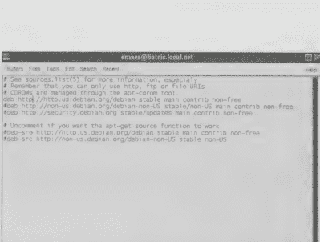

图 2.1 apt-get 的 sources.list


## Slackware 及其他发行版

对于 Slackware 的 tar 文件，操作过程略有不同。你需要进入 `/cdrom/binary/dists/slackware` 目录，然后将所需的 `.tgz` 文件复制到硬盘上的某个目录中。

`installpkg` 是一个用于安装此类软件包的 Slackware 实用工具。此命令应能为你提供一个可正常工作的 Emacs 安装：

```
installpkg /{你复制文件到的目录}/{文件名.tgz}
```

如果你的发行版未在本节中涵盖，通常使用上述命令的变体即可让你顺利上手。

## 二进制文件问题

Linux 发行版变化迅速，这意味着从 CD-ROM 安装的二进制文件可能无法运行。这总是令人沮丧，但有一种方法可以查看 Emacs 是否在寻找你系统中缺失的共享库，或者判断你已安装的库版本是否正确。在故障二进制文件上运行此命令：

```
ldd emacs
```

你应该会看到类似以下的输出：

```
libXext.so.6 => /usr/X11R6/lib/libXext.so.6 (0x401c9000)
libtiff.so.3 => /usr/lib/libtiff.so.3 (0x401e3000)
libjpeg.so.62 => /usr/lib/libjpeg.so.62 (0x40225000)
libpng.so.2 => /usr/lib/libpng.so.2 (0x40245000)
libz.so.1 => /usr/lib/libz.so.1 (0x4026d000)
libm.so.6 => /lib/ld686/libm.so.6 (0x4027c000)
libungif.so.4 => /usr/lib/libungif.so.4 (0x4029b000)
libX11.so.6 => /usr/X11R6/lib/libX11.so.6 (0x402ca3000)
libncurses.so.5 => /lib/libncurses.so.5 (0x403c6000)
libc.so.6 => /lib/ld686/libc.so.6 (0x403ac000)
/lib/ld-linux.so.2 => /lib/ld-linux.so.2 (0x40000000)
```

这个示例输出表明，我运行 `ldd` 命令的 Emacs 二进制文件找到了它所需的所有库。

另一方面，如果输出中的一行或多行在 `=>` 符号后显示 `not found`（未找到）的字样，那么 Emacs 损坏的原因就很明显了。你必须找到缺失库的正确版本，或者放弃使用那个特定的二进制文件。

还有另一个可以尝试的命令，它可以显示系统中程序可用的共享库。在 xterm 窗口中输入此命令：

```
ldconfig -v | less
```

此命令将 `ldconfig` 命令的输出通过管道传输到分页器中，这让你可以方便地查看所有输出。将 `ldconfig` 与 `ldd` 命令配合使用，通常有助于解决棘手的共享库问题。

有时，库问题可能仅仅是缺少符号链接。一个正在寻找名为 `libsomething.so` 的库的程序可能因为找不到该确切名称而失败。查看 `ldconfig` 的输出，你可能会发现 `/usr/lib` 目录中存在一个名为 `libsomething.so.0` 的库。在 `libsomething.so.0` 和 `libsomething.so` 之间创建一个符号链接可能就解决困难。为此，进入 `/usr/lib` 目录并运行类似以下的命令：

```
ln -s libsomething.so.0 libsomething.so
```

这会在现有的库文件和符号链接本身之间创建一个符号链接（symlink），它充当指向文件的指针。

## 从 CD-ROM 获取源代码

如果你从未编译过任何 Linux 源代码，Emacs 是一个很好的入门包。这并不是因为 Emacs 是一个简单、快速编译的应用程序；恰恰相反。我推荐它是因为 Emacs 在配置和编译方面通常非常完美。我从未见过它编译失败。

多年前，当我安装第一个 Linux 发行版时，可用的 Linux 软件池要小得多。可用的发行版软件包远没有现在这么多。我感觉自己一直在努力构建那些难以配合的源代码包，结果喜忧参半。当第一次编译 GNU Emacs 以及后来的 XEmacs 时，我惊喜地发现它们像一台润滑良好的机器一样，构建过程顺畅无阻，最终生成一个闪闪发新的可执行文件。

我后来了解到，并非所有源代码都生而平等。一些软件包，如 Emacs、XEmacs、Apache、Linux 内核以及其他许多，得到了密集维护，通常易于编译。许多其他软件包在类似于开发者机器的机器上编译容易，或者仅在特定的 Linux 发行版上编译，或者仅在具有特定共享库的环境中编译。

为了编译 Emacs，你需要安装合适的开发软件包。这并不难做到；它们包含在任何 Linux 发行版中，不占太多空间，而且你肯定还会再次需要它们。你肯定需要包含 gcc（GNU 编译器）、make 以及与你的 glibc 版本关联的头文件的软件包。根据你安装的 Emacs 版本，你可能还需要各种图像渲染库的开发软件包。你版本的 XFree86 的开发软件包也是必需的。

### 解压源代码归档

挂载你的 CD-ROM 驱动器并进入 `/cdrom/source` 目录。在那里你会找到两个版本的 GNU Emacs（20.7 和 21.0）的源代码 tar.gz 文件。还包含两个版本的 XEmacs（21.1.14 和 21.4.3），后者支持 GTK 编译。将你所选版本复制到至少拥有 150 MB 可用硬盘空间的分区的某个目录中。现在进入该目录并执行此命令：

```
tar xvfz [文件名]
```

这将把归档文件解压到一个包含你所选版本 Emacs 源代码的新目录中。

或者，你可以使用任何能够处理 tar 归档的文件管理器（如 Midnight Commander 或 FileRunner）来解压文件。

### 配置

配置脚本已成为在自由软件世界中为源代码包设置编译环境的标准方式。这些脚本由 Autoconf 生成，Autoconf 是 90 年代初出现的一个开发者软件包，旨在解决程序员面临的一个长期问题：如何制作一个能在任何 UNIX 变体上干净编译的源代码包。

配置脚本实际上会询问你的计算机许多问题，例如处理器类型、操作系统及版本、可用的库版本等。如果它找到这些要素的可行组合，就会生成 Makefile。如果失败，会显示一条有帮助的错误信息，告诉你系统缺少什么。

### 配置开关

Configure 不是交互式的。它不会停下来向你提问，但当你启动它时，有影响其行为的方法。快速了解特定配置脚本接受哪些选项的方法是输入此命令：

```
./configure --help
```

屏幕上会显示允许你更改安装目录或启用/禁用某些功能等开关（见图 2.2）。

*图 2.2 配置脚本帮助*

开关的一个示例是 `prefix={目录}`。假设你希望将 Emacs 安装在目录 `/opt` 而不是默认的 `/usr/local`。要输入的命令如下所示：

```
./configure --prefix=/opt
```

此开关将导致 Emacs 可执行文件最终位于 `/opt/bin`（在构建和安装过程完成后），其他 Emacs 文件将安装在 `/opt/share/emacs`。

除非你在 `/usr/local` 中的磁盘空间极其紧张，否则你很可能只需直接运行配置脚本而不带任何开关。进入解压源代码归档时创建的目录，然后输入

```
./configure
```

`configure` 前面的 `.` 是 Linux 的一个约定。它告诉你的 shell 运行当前目录中名为 `configure` 的脚本或可执行文件，而不是搜索你的路径并运行找到的第一个名为 `configure` 的文件。见图 2.3。


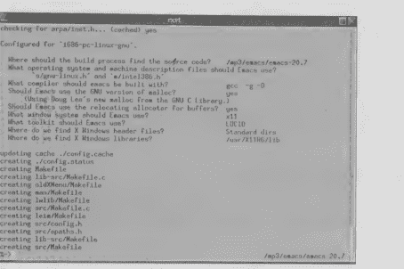

图 2.3 *运行配置脚本*

## 一个重要的开关

如果你计划编译 XEmacs，有一个重要的配置开关你可能想要使用，特别是如果你计划安装未包含在 XEmacs 包系统中的软件包。你应该输入以下命令：

```
./configure --with-site-lisp
```

如果没有这个开关，XEmacs 不会在 site-lisp 目录中查找文件。你可以在命令行上使用多个开关。这是配置 XEmacs 安装到 /opt 并识别 site-lisp 目录的方法：

```
./configure --with-site-lisp --with-prefix=/opt
```

## 编译和安装

配置脚本运行需要一些时间。信息会在你的屏幕上滚动，显示脚本正在进行的各项测试。最后一步是在 Emacs 源目录的各个子目录中创建各种 Makefile。

现在你可以输入

```
make
```

然后在 XEmacs 构建期间去喝杯咖啡。根据处理器的速度，这可能需要几分钟到几个小时不等。当构建完成后，只需输入

```
make install
```

Emacs 文件将被复制到它们的新位置。一旦你确认新的 Emacs 二进制文件可以工作，你就可以删除整个源目录。

## 使用 GTK 编译 XEmacs

XEmacs 21.4 源包也可以将 GTK 作为其小部件集进行编译，而不是默认的 Athena 集（Athena 集是 X11 程序的标准）。

威廉·佩里（William Perry），Emacs 网页浏览器 W3 的开发者（有关 W3 的更多信息请参见第 20 章），最近获得报酬重写 XEmacs 的屏幕显示部分，以便其利用 GTK 工具包（见图 2.4）。

GTK 是一个跨平台开发平台，近年来变得非常流行，尤其是在 Linux 社区。它最初是为满足 GIMP 图像编辑项目的需要而开发的，但后来它已形成自己的发展路径。GTK 被许多流行的 Linux 应用程序使用，包括 Mozilla 项目、GNOME 桌面环境以及许多其他应用。

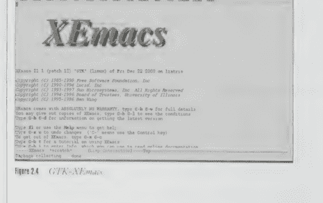

从源码构建 GTK-XEmacs 的唯一额外要求是与你安装的 GTK 和 GLib（与 GTK 相关的库包）版本相对应的发展包。大多数 Linux 发行版会自动安装 GTK 和 GLib，但你可能需要手动安装发展包。GTK-XEmacs 还需要 GNOME 发展包，但你不必运行 GNOME 才能使用此版本的 Emacs。

要启用实验性的 GTK 支持，你需要给配置脚本一个参数，如下例所示：

```
./configure --with-gtk
```

如果你是 GNOME 桌面环境的用户，你可以添加这个额外的开关，虽然这并非绝对必要：

```
./configure --with-gtk --with-gnome
```

现在你可以按照上述说明继续进行编译和安装。

## XEmacs 包

XEmacs 开发者没有将最常用的扩展包捆绑在主源发行版中，而是选择将几乎所有包分离出来，对它们进行分类，并单独提供它们。如果没有其中的一些包，XEmacs 的功能将不如你所期望的那样强大。如果你知道你想要什么，单独的软件包位于 CD-ROM 的目录 `/cdrom/packages/xemcs/packages/single` 中。

如果你有可用的磁盘空间，获得所需软件包的最简单方法是安装 Sumo 包，它由所有单独的软件包捆绑在一个 tar 文件中组成。你可能会得到一些你不需要的或不想要的软件包，但你可以在确定哪些软件包实际上对你有用后删除它们。Sumo 文件位于目录 `/cdrom/packages/xemcs/packages`。

从源码编译的 XEmacs 期望在 `/usr/local/lib/xemcs/packages` 中找到其软件包（除非配置方式不同）。如果你将所需的软件包 tar 文件复制到该目录并解压，必要的子目录将被创建并填充文件。

从二进制发行包文件（*.debs 或 RPMs）安装的 XEmacs 将位于 /usr 而不是 /usr/local，因此请相应调整你的操作过程。

你可以在第 12 章中阅读更多关于 XEmacs 软件包系统的内容。

## CD-ROM 上的额外软件包

本书第三部分描述了许多 Emacs 的外部附加软件包。这些软件包未包含在 Emacs 或 XEmacs 的官方发行版中，但其中一些无疑将在未来被添加。Emacs 开发者定期评估新的软件包，如果认为它们足够有用，则计划将其纳入下一个 Emacs 发行版。

你不必等待有用的软件包被包含在内。只需将软件包（有些只是单个 Lisp 文件，其他由几个文件组成）复制到你的 *usr/local/share/emacs/site-lisp* 目录（XEmacs 使用的目录是 */usr/local/lib/xemacs/site-lisp*）。下一节帮助你使它们运行起来。你可以在本书 CD-ROM 的目录 */packages/external* 中找到这些软件包的选择。

## 试用一个软件包

我将使用一个名为 *clipper.el* 的小型单文件软件包作为示例。图 2.5 显示此文件加载到 Emacs 会话中。文件的开头，像大多数 Lisp 文件一样，用分号注释掉了。通常在这里可以找到安装说明。

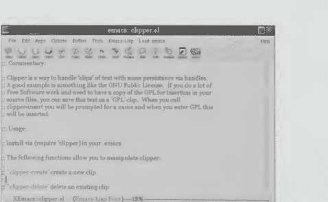

图 2.5 *clipper.el*

这些行是相关的部分：

```
;;; Usage:

;;

;; install via (require 'clipper) in your .emacs

;;

;; The following functions allow you to manipulate clipper:

;;

;; 'clipper-create' create a new clip

;;

;; 'clipper-delete' delete an existing clip

;;

;; 'clipper-insert' insert a clip into the current buffer

;;
```

你可以通过评估自包含的 Lisp 语句 `(require 'clipper)` 轻松激活此文件。Lisp 和评估在第 7 章中讨论。目前，你只需要知道的是，将光标放在一个带括号的 Lisp 表达式后面，然后按 Ctrl-x Ctrl-e 会评估前面的表达式。这样做之后，你可以通过按 M-x 然后输入 `clipper-create` 来使用 `clipper-create` 等命令（参见前面的摘录）。

第 15 章描述了 clipper.el 是什么以及它能做什么；这只是临时安装一个软件包的插图。如果你按照这个例子操作后关闭 Emacs，然后再次启动它，Emacs 不会加载 clipper.el，命令将不可用。

## 永久激活一个软件包

在试用一个软件包并发现它适合你的需求后，你很可能希望永久安装它，以便每次使用 Emacs 时，该软件包的功能都可用。你通过将 clipper.el 文件中的单条 Lisp 语句 `(require 'clipper)` 复制到你的 `.emacs` 文件中来实现这一点。

此时，你可能还没有一个 `.emacs` 文件，这是一个初始化文件，包含 Emacs 启动时读取的命令和设置。第 9 章详细讨论了该文件；现在只需说明，从像 clipper.el 这样的扩展文件复制的单条语句（如语句 `(require 'clipper)`）可以粘贴到空的 .emacs 文件中，并且是有效的，会被 Emacs 接受。

其他扩展软件包要求将几行内容复制到你的 .emacs 文件中。Emacs 社区已经形成一种惯例，在 Lisp 文件的开头或附近提供说明，因此记得首先查看那里。一些多文件软件包以 tar 存档形式分发，其中通常包含 README 或 INSTALL 文件。

## 结论

你现在应该有一个可用的 Emacs 安装可以进行试验。花一些时间自行实验。你可以尝试按 Ctrl-h t 进行 Emacs 教程。

下一章帮助你学习基本的 Emacs 键盘命令。


## 第 3 章：Emacs 基础技能概览

- 模式行与迷你缓冲区
- 加载和保存文件
- 选项卡补全
- 缓冲区与缓冲区列表
- 区域、标记与点
- 搜索中的正则表达式
- 格式化命令
- Shell 命令
- Emacs 作为编辑服务器

即使您一直定期使用 Emacs，重温本章也会对您有益。在本书的剩余部分，我将假设您熟悉本章中介绍的基本文本操作命令。如果在阅读时手边保留一个 Emacs 会话，您将很快学会使用这些命令。按照描述尝试这些技巧，它们很快就会成为您的本能。

您可能会发现本章中的某些击键组合很难输入。在第 10 章中，您将找到修改按键绑定的说明，但熟悉默认的按键绑定是值得的。您可能最终需要在另一台机器上使用 Emacs，熟悉默认设置将证明很有帮助。

### 两个基本键组合

在 Emacs 中，似乎总有不止一种方式来完成事情。一个命令可能有一个分配给它按键绑定，但它仍然可以在迷你缓冲区中手动输入。（关于迷你缓冲区的更多信息，请参见本章稍后的“模式行与迷你缓冲区”部分。）有些命令涉及与 Emacs 的交互，因此迷你缓冲区是运行它们的最佳方式，因为来自 Emacs 的提示和查询是可见的，以便您可以响应它们。

大多数主模式在菜单栏上提供可用命令的一个子集。等效的击键组合列在这些菜单上的命令旁边。即使您不使用菜单，当您忘记按键绑定时，它们也可以作为快速参考。

本节中的另一个基本命令在 Emacs 涉及您不需要的进程时使用；它提供了一种快速中止几乎任何 Emacs 进程的方法。

### M-x 命令前缀

大多数 Emacs 命令都有对应的按键绑定。键盘上的按键和组合数量有限，因此使用较不频繁的命令在迷你缓冲区中输入。

前缀 M-x 是一个信号，告诉 Emacs 您想要执行一个命令。按下 M-x 会使这些字符出现在迷你缓冲区中，随后是一个闪烁的光标。发出此命令后按下 Enter 键，Emacs 会执行该命令。使迷你缓冲区式命令变得必不可少的另一个因素是，某些命令（如搜索和替换）需要用户输入。Emacs 可以在迷你缓冲区中提示所需的信息，然后您可以输入它。

Emacs 开发者在决定将哪些命令绑定到按键组合时所做的选择必然是随意的。您经常使用的任何命令都可以分配一个按键绑定。有关更详细的信息，请参见第 10 章“更改默认行为”。

### 中止操作

也许您误输入了一个命令，或者 Emacs 正在做您不理解的事情。有时 Emacs 进程似乎耗时过长。解决所有这些问题的方法是一个键组合：Ctl-g。

此命令中止任何 Emacs 操作，并允许您重新开始或继续做其他事情。

### 模式行与迷你缓冲区

Emacs 屏幕由几个组件组成。其中一些是熟悉的，例如菜单栏、滚动条和 XEmacs 图标栏。屏幕中的两个元素是 Emacs 独有的，极大地增强了其可用性和功能：模式行和迷你缓冲区。模式行是主编辑屏幕和底部迷你缓冲区之间的一个细长分隔条，如图 3.1 所示。这个狭窄的条形起

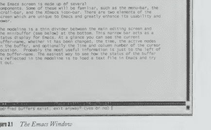

作用 Emacs 的状态显示。一眼望去，您可以看到当前缓冲区名称，它是否已更改，时间，缓冲区中的活动模式，以及可选的光标位置行号和列号。

可能最有用的信息位于缓冲区名称的左侧。查看缓冲区的状态如何反映在模式行上的最简单方法是在 Emacs 中加载一个文本文件并试用。

加载文件后（按下 `Ctrl-x Ctrl-f`，或选择 文件，打开文件 菜单选项），按下空格键在文件中插入一个空格。注意两个星号如何立即出现在模式行最左边缘。现在按下 `Ctrl-x u`（撤销）并看着它们消失。此时您可以关闭 Emacs，因为您加载的文件与您编辑前处于相同状态。

*迷你缓冲区* 是 Emacs 的重要组成部分。它是 Emacs 屏幕模式行正下方的一个短的全宽条带。这是输入未绑定到按键的命令的地方。Emacs 还使用此区域向用户提示诸如文件名、缓冲区名称、搜索字符串、请求的帮助类型以及 Emacs 工作需要执行工作的任何其他信息等。错误消息也显示在迷你缓冲区中。

在某些情况下，您可能会在迷你缓冲区中被要求确认。大多数此类查询可以用“y”或“n”（是或否）来回答，但只要您的数据可能面临风险，Emacs 坚持要求您用完整的“yes”或“no”来回答。以下是这样的提示之一：

> 存在已修改的缓冲区；仍然要退出吗？（yes 或 no）

Emacs 正在试图警告您，如果您在没有保存已更改的缓冲区的情况下退出，您可能会丢失未保存的更改。

### 使用帮助键

Richard Stallman 在描述最初的 Emacs 时，将其称为*自文档化*编辑器。这对于当时软件来说是一项相当创新的功能，即使现在，遇到以这种方式编写的软件也是罕见的。自文档化意味着文档是内置在编辑器中，而不是事后编写的。使 Emacs 编辑功能生效的 Lisp 文件内置了文档；其结果是每个 Emacs 函数和变量都有可访问的帮助文档。一组击键组合，全部以 `Ctrl-h` 开头，在需要时调用此帮助：

- `Ctrl-h` 打开一个窗口，描述该前缀可用的帮助选项，包括以下所有变体。
- `Ctrl-h m` 打开一个窗口，包含当前所有活动模式的描述，包括按键绑定。
- `Ctrl-h k` 一个提示帮助键。按下此组合后，您会被要求（在迷你缓冲区中）按下您需要帮助的按键或按键序列。打开一个窗口，描述该按键的具体功能。
- `Ctrl-h a` 另一个提示键，这个被称为 apropos 帮助。当提示时，输入一个单词、函数名或变量名。一个窗口显示包含该单词或名称的所有 Emacs 命令。这是当您不知道确切名称时查找命令的好方法。
- `Ctrl-h f` 提示您输入 Lisp 函数名称，然后在窗口中显示文档。由于 Lisp 命令是函数，您还可以输入命令名称。
- `Ctrl-h t` 启动 Emacs 教程，这是针对首次使用用户的 Emacs 简短介绍。
- `Ctrl-h v` 显示变量的值。这是查看正在使用的默认设置的快速方法。
- `Ctrl-h I` 调出 Info 帮助文件浏览器，这在第 15 章“外部便捷软件包”中涵盖。

### 加载和保存文件

您将不断使用以下命令，这使得它们成为重新绑定到单个击键（如其中一个功能键，按键绑定说明请参见第 10 章）的完美候选者。除了缓冲区保存命令外，这些命令会在迷你缓冲区中提示您输入文件名。以下是默认的按键绑定：

- `Ctrl-x Ctrl-f` 加载新文件。将" f"视为代表"find a file"（查找文件）。
- `Ctrl-x k` 杀死缓冲区；如果您有未保存的更改，系统会询问您是否要保存缓冲区。
- `Ctrl-x Ctrl-v` 将您刚加载的文件替换为另一个文件。这可以被视为上述两个命令的组合。
- `Ctrl-x i` 在迷你缓冲区中提示您输入文件名。然后，指定文件的内容将插入到点位置。
- `Ctrl-x Ctrl-s` 将缓冲区的当前状态保存到磁盘，覆盖原始文件。


## Tab 补全

Tab 补全是一个极其有用的 Emacs 功能，应该成为你最先学习的时间节省技巧之一。只要你需要在迷你缓冲区中输入内容，无论是文件名、函数或变量的名称，还是你想加载的 Lisp 库，Tab 补全都会帮你完成剩余的输入。

如果你曾在 Linux Shell 提示符下花费过大量时间，那么这个概念对你来说会非常熟悉。常见的 Shell（如 Bash）也使用 Tab 键以类似的方式补全文件名和命令名。

### 文件名补全

当你正在运行支持长文件名的操作系统（如 Linux）时，这种类型的补全尤为方便。其工作方式如下：如果你输入 `Ctrl-x Ctrl-f` 来加载新文件，然后在迷你缓冲区中输入想要加载的文件名的前几个字符，按下 Tab 键会通知 Emacs 你希望它完成剩余名称的输入。

Emacs 会检查路径。如果它在指定的目录中只发现一个以相同字母开头的文件名，该名称将在迷你缓冲区中补全；按下 Enter 即可加载该文件。否则，会出现一条消息，提示你输入的初始字母不唯一，对应多个文件。第二次按下 Tab 键会打开一个“补全”窗口，显示目录中所有以你输入的字符开头的文件名。在目标文件名上点击鼠标右键（第二鼠标键）可关闭“补全”窗口并加载该文件。如果你将光标移至“补全”窗口，也可以通过将点（point）移动到条目上并按下 Enter 来选择所需的文件名。

### 帮助键补全

帮助键补全的工作方式与之前讨论的 `Ctrl-h` 帮助键相同。如果你想获取某个以“buffer”开头的函数的帮助，请按 `Ctrl-h f`。迷你缓冲区变为活动状态，并提示你“描述函数：”。输入 `buff` 并按下 Tab 键。（没有必要输入比前几个字符更多的字母。在这种情况下，可以合理假设大多数以“buff”开头的函数可能都指代缓冲区。）第一次按下 Tab 键时，“buff”被补全，迷你缓冲区中显示“buffer”。再次按下 Tab 键，“补全”窗口将打开，列出所有以单词“buffer”开头的 Emacs 函数。同样，点击鼠标右键可调用列表中任一函数的文档。

如果你确切知道正在寻找的名称，有时输入名称的剩余部分比第二次按下 Tab 键更快。

### 命令补全

每当你在迷你缓冲区中输入 `M-x` 命令时，Tab 补全都能为你节省时间。它也是一种快速判断某命令是否可用的方法。如果 Emacs 抱怨“没有匹配”，要么是你打错了命令，要么是按 Tab 键之前你输入的字母之前确实没有可用的命令。

### 在缓冲区中移动

如果在缓冲区不同区域间移动时缓慢或笨拙，编辑将变得毫无乐趣。Emacs 内置了多种在缓冲区中移动的指令，经过少量练习，这些指令将成为你的本能。

#### 按字符、单词和行移动

与其他编辑器一样，Emacs 允许你使用方向键移动光标。由于某些键盘缺少四个方向键，因此提供了以下备用按键绑定：

- `Ctrl-f`：向前移动一个字符
- `Ctrl-b`：向后移动一个字符
- `Ctrl-右箭头`：向前移动一个单词
- `Ctrl-左箭头`：向后移动一个单词
- `Ctrl-p`：移至上一行
- `Ctrl-n`：移至下一行
- `Ctrl-v`：移至下一页（等同于 Page Down）
- `M-v`：移至上一页（等同于 Page Up）

这些按键绑定适合短距离移动光标，但如果需要长距离移动，它们可能会显得繁琐。下一节的按键绑定将解决这一问题。

#### 按句子、段落和页移动

在使用以下按键绑定之前，你应该知道 Emacs 对句子、段落和页的定义有其独特性。这些定义有些武断，但为了拥有一致的编辑行为，必须定义某些标准。当然，这些定义中的任何一个或全部都可以更改。

对 Emacs 而言，句子是由一系列单词组成，以句号加两个空格结尾；除非它位于段落末尾，此时仅一个句号即可。

段落被定义为与其他文本通过空行分隔的文本块。

## 不可打印字符

Emacs 对“页”的理解与文字处理软件不同。文字处理软件的页取决于使用的字体大小和文档的格式设置。Emacs 不是格式化工具；Emacs 文件中的文本就像一卷连续卷轴，编辑窗口中只显示其中一部分。你在纯文本文件中定义页的唯一原因，可能是为了适应特定打印机的页大小。

假设你正在使用一台每页可打印 80 行的打印机，并留有页眉和页脚的空白区域。在为该打印机输入文档时，你可以在文件中每 80 行插入一个控制码。大多数打印机将此码理解为指令，意为“立即进至下一页”。

唯一的问题是，该控制码不在你的键盘上。Emacs 提供了一种方法，通过前缀 `Ctrl-q` 来插入此类字符。在 Emacs 文本文件中按 `Ctrl-q Ctrl-L`，屏幕上会出现看似 `^L` 的符号。它实际上不是 `^L`，因为 `^L` 是两个字符（`^` 和 `L`），而按 `Ctrl-q Ctrl-L` 的结果是一个字符，你可以通过用方向键将光标移过它来验证。光标会像对待单个字符一样跳过 `^L`，因为它确实是一个字符。

总结来说，Emacs 将特殊控制字符 `^L` 视为换页符号。如果你打印一份包含 `^L` 换页符的文件副本，打印输出中不会显示这些符号，但每当遇到该字符时，新页将开始。

以下命令将点（point）移动到缓冲区中的新位置：

- `M-e`：移至下一句
- `M-a`：向后移动一句
- `M-}`：向前移动一段
- `M-{`：返回上一段
- `Ctrl-x ]`：移至下一页
- `Ctrl-x [`：移至上一页

## 开头和结尾

你有多少次在行尾附近打字时，注意到行首附近有拼写错误？能够直接从文件开头跳到末尾同样很方便。

- `Ctrl-a`：带你到行首
- `Ctrl-e`：将光标置于行尾
- `M-<`：将点（point）移至文件开头
- `M->`：将点（point）移至文件结尾

我一直觉得后两个按键绑定有些笨拙。在第 10 章中，你将学习如何为常见操作分配新的按键绑定。

## 滚动

滚动满屏文本听起来似乎不需要调整。不幸的是，Emacs 有一种奇怪的滚动方式，可能会让新用户感到不安。文本倾向于平滑滚动一小段时间，然后突然跳好几行。这里是编辑器可配置性 shines 的时刻，允许你以几种不同方式修改默认行为。

### 滚动变量

可以调整几个变量以使滚动符合你的要求。如果你希望在滚动时保持点在屏幕上的相对位置，变量 `scroll-preserve-screen-position` 可以设置为非 nil 值。默认情况下，该变量的值为 nil；将其设置为 1 可激活此行为。

`scroll-conservatively` 是一个默认设置为 0 的变量。尝试 1、2 或 3 等值，以防止点在滚动时跳到屏幕中间。两个变量 `scroll-up-aggressively` 和 `scroll-down-aggressively` 提供了对在滚动时点在屏幕上结束位置的控制。默认值为 0.5，试图将点居中于屏幕。0 到 1 之间的分数值也是有效的。

尝试这些变量各种值的最简单方法是使用“自定义”配置设施，该设施将在下一章中介绍。如果你现在想尝试更改值，可以在 `Scratch` 缓冲区中评估变量值，输入类似于以下带括号的语句：

```
(setq scroll-conservatively 2)
```


输入此表达式后，将光标（point）定位在最后一个括号之后，然后按 Ctrl-x Ctrl-c。这会立即更改该值，以便你可以查看是否喜欢新的行为。

## 缓冲区与缓冲区列表

由于 Emacs 可以在一个会话中处理多个缓冲区，因此它需要一种方式来跟踪这些缓冲区。不仅每个缓冲区的内容存储在内存中，与每个缓冲区相关的文件名和缓冲区名称也存储其中。每个缓冲区的光标位置及其状态（例如，该缓冲区是否为只读，更改是否已保存）也会被保存。

“缓冲区”菜单是切换缓冲区最简单的方式。它直接显示当前的缓冲区列表。你也可以在一个单独的窗口中访问该列表，该窗口允许你选择缓冲区并对所选内容执行操作。

### 缓冲区列表

以下两个键盘快捷键用于调出缓冲区窗口：

| 快捷键 | 描述 |
| :--- | :--- |
| `Ctrl-x Ctrl-b` | 调出缓冲区列表窗口。 |
| `Ctrl-u Ctrl-x Ctrl-b` | 调出窗口，但仅显示与文件相关的缓冲区。像 Scratch 和 Messages 这样的缓冲区不会显示。 |

缓冲区列表窗口占据屏幕的下半部分；图 3.2 是一个典型的示例。

每个缓冲区名称左侧的字符表示其状态。名称前的星号（*）表示该缓冲区已更改但尚未保存。百分号（%）表示只读缓冲区，例如 Dired 目录列表或 Info 帮助浏览器。

有许多单字母键盘快捷键可用于操作缓冲区列表窗口中显示的缓冲区。其中最重要的这些绑定包含在以下列表中。要查看其他绑定，可以将光标移动到该窗口并按 Ctrl-h m（当前模式的帮助）。此时会打开一个窗口，显示完整的快捷键列表。以下是最有用的按键：

- `f` &emsp;&emsp; 选择光标所在的缓冲区并将其显示出来，替代缓冲区列表
- `o` &emsp;&emsp; 选择该缓冲区并在另一个窗口中显示
- `s` &emsp;&emsp; 标记该缓冲区以进行保存
- `k` &emsp;&emsp; 标记该缓冲区以进行销毁
- `x` &emsp;&emsp; 对已标记的缓冲区执行操作（保存或销毁）

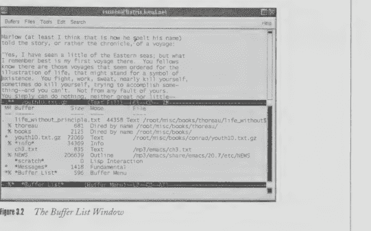

## 使用键盘和菜单更改缓冲区

Ctrl-x b 是切换缓冲区的标准快捷键。默认情况下，迷你缓冲区（minibuffer）中会建议你上次访问的缓冲区；按 Enter 键即可显示该缓冲区。如果这不是你想要的缓冲区，请输入所需缓冲区名称的前几个字母，然后按 Tab 键补全名称。如前所述，“缓冲区”菜单是切换缓冲区的另一种方式；你也可以下拉菜单并单击要编辑的缓冲区名称。

## 区域、标记与光标

选择一个文本区域并将其复制或剪切（杀死）是 Emacs 中最基本且最有用的编辑操作之一。在 Emacs 中，有几种方式可以使用鼠标或键盘执行这些操作。

### 键盘选择

区域的一端始终是光标（point）位置，由光标指示器显示。按 Ctrl-space 开始标记过程；之后的任何移动命令都会扩展该区域。可以使用方向键，也可以使用 M-→ 等命令。

按 Ctrl-space 被称为“设置标记”（setting the mark）。此时（在给出任何移动命令之前），光标（point）和标记（mark）位于文件中的同一位置。

随后的移动命令会保持标记在其原设置位置，而光标（point）会离它越来越远，从而扩大区域。按 M-> 会将光标移动到文件末尾，标记标记位置和光标新位置之间的所有内容。M-] 选择标记和下段开头之间的文本。实际上，Ctrl-space 临时重新定义了移动命令，使其进行标记而非移动。许多 Emacs 命令的定义方式使其可以应用于多种上下文。一旦你知道 M-f 意味着“移动到下一个单词”，你就能推断出 Ctrl-space M-f 将标记区域从光标扩展到下一个单词的开头。

在学习这些键盘标记命令时，知道鼠标也可以标记、复制、剪切和粘贴区域是有益的。有时鼠标更方便，特别是当你标记较小的区域时。

### 鼠标选择

鼠标选择遵循通常的软件约定：单击鼠标按钮会移动光标，然后按住按钮拖动会标记一个区域。另一种方法（在标记较大区域时特别有用）是单击你想要标记的区域另一端的鼠标第三个按钮。光标与你点击位置之间的整个文本块将成为一个新的标记区域。

### 标记环

你可能认为一旦做了新标记，旧标记就会永远消失。然而，Emacs 会记住最多 16 个旧标记。你可以通过按 Ctr1-u Ctrl-space 来恢复它们。此命令恢复当前标记之前的最近一个标记。反复按此命令会使标记依次移动到更早的位置，直到最终恢复当前标记。之所以称之为“标记环”，是因为标记会循环回到起点。

了解这一点后，你就可以在缓冲区中将标记用作书签。

每个缓冲区都有自己独立的标记环。这些环在单次 Emacs 会话期间是持久的，但不会在会话之间保存。还有一个全局标记环，记录在其他缓冲区中设置的标记。按 Ctr1-x Ctrl-space 可以将你带到你在另一个缓冲区中设置的最后一个标记。你可以将此视为标准缓冲区更改命令 Ctrl-x b 的替代方案。Ctrl-x b 移动到最近编辑的缓冲区中的光标位置，而 Ctrl-x Ctrl-space 显示在该缓冲区中设置的最后一个标记。

## 区域变窄

Emacs 中的*区域变窄*（Narrowing）是指将缓冲区的表观大小减小到定义的区域。该区域可以是当前页面、特定的 Lisp 函数或当前标记的区域。

你可能在想为什么会有人费心去做这件事。一个原因是为了限制全局操作（如查找和替换）的范围。另一个原因可能是帮助集中注意力在文件的特定部分。

当你在变窄的缓冲区中编辑时，缓冲区的其余部分仍然存在，但在你“加宽”（widen）缓冲区到其原始状态之前，它是不可见且不可访问的。

区域变窄默认是禁用的。当你第一次尝试使用变窄命令时，系统会询问你是否确实想要这样做。第一次启用区域变窄后，将来它将始终可用。Emacs 开发者这样设置区域变窄功能，是为了防止新用户看到缓冲区的大部分似乎消失了而感到惊慌。以下是区域变窄命令：

- `Ctrl-x n n` &emsp;&emsp; 变窄到选定的区域，即光标和标记之间的区域
- `Ctrl-x n p` &emsp;&emsp; 变窄到当前页面
- `Ctrl-x p f` &emsp;&emsp; 变窄到光标所在的 Lisp 函数
- `Ctrl-x n w` &emsp;&emsp; 将变窄的缓冲区加宽回原始状态

## 剪切、复制和粘贴

本节本可以叫做“杀死和粘贴”（Killing and Yanking），但熟悉的术语似乎更合适。虽然传统的 Emacs 术语带有暴力的内涵，但它们自有其表达力。

在你定义或选择一个区域后，可以对文本执行几种操作。如果你用鼠标定义了区域，内容会自动复制到内部 Emacs 剪贴板（以及 X 剪贴板；有关两者关系的信息，请参阅“Emacs 杀死环与 X 剪贴板”章节）。如果区域是用 Ctrl-space 加上移动命令定义的，则需要进一步的操作来复制或剪切文本。这些命令作用于该区域：

- `Ctrl-w` &emsp;&emsp; “杀死”（kill）或剪切命令。选定的文本从缓冲区中剪切，但仍然可用于粘贴（在 Emacs 术语中，粘贴称为 yanking）。
- `M-w` &emsp;&emsp; 复制命令。区域保留在缓冲区中，但可从剪贴板中粘贴。


+ * `Ctrl-y` 用于将最近一次剪贴（可以是剪切或复制的区域）粘贴到当前光点处的缓冲区。
+ * `M-y` 是 `Ctrl-y` 的一个有趣且实用的变体。该命令不是粘贴最近一次剪贴的文本，而是粘贴倒数第二次的剪贴，替换之前使用 `Ctrl-y` 命令粘贴到缓冲区的区域。如果重复此命令，它会用再往前一次的剪贴替换倒数第二次的剪贴。当重复此命令时，它会逐步回溯剪贴环，依次用之前的粘贴区域替换当前粘贴的文本。最终会到达剪贴环的开头，最近一次的剪贴再次被粘贴到缓冲区。`M-y` 仅在 `Ctrl-y` 或 `M-y` 之后有效。花时间熟悉此命令；它真的能节省大量时间。

## 使用鼠标

Emacs 下的基本鼠标操作很直观；鼠标的行为与其他 X 应用程序中的表现一致。点击鼠标按钮移动光点，按住按钮拖动鼠标定义区域，点击第二个鼠标按钮粘贴最近一次剪贴。

这些操作是最常用的，但 Emacs 还提供了许多其他鼠标命令。

有一种便捷的方法可以代替使用 `Ctrl-space` 设置标记然后移动光点来定义区域。点击鼠标按钮设置光点，然后在缓冲区内的其他任何位置点击第三个鼠标按钮。两者之间的区域会被复制到剪贴环。你可以在这两次点击之间使用 Page Up 或 Page Down；即使你看不到，第一次点击的位置（或光点）仍然有效。

双击鼠标按钮选中一个单词作为区域，三击则选中整行。

## Emacs 剪贴环与 X 剪贴板

Emacs 与其他 X Window 程序配合良好。如果你从另一个应用程序剪切或复制文本，该选择将成为 Emacs 剪贴环中最近的项目。反向操作也有效：Emacs 中当前剪贴的区域也是全局 X 剪贴板中的顶层项目。请记住，通过键盘定义的区域（`Ctrl-space` 加上移动命令）除非使用 `M-w` 或 `Ctrl-w` 命令进行剪贴，否则不会被复制到剪贴环，进而也不会复制到 X 剪贴板。通过鼠标定义的区域会自动置于剪贴环的顶部。

## 搜索

查找单词或短语是任何功能齐全的编辑器的基本组成部分。Emacs 提供了几种搜索方式，但最有用的方法是一种很少有其他编辑器具备的技术：增量搜索。在增量搜索中，一旦你输入搜索字符串的第一个字符，搜索过程就开始。光标跳转到光点后第一个以该字符开头的单词。随着后续字符的输入，光标向前跳转，锁定匹配文本。

在某些情况下，这种搜索方式可能过于复杂，因此 Emacs 也支持更传统的非增量搜索和单词搜索。

你可以使用通用的中止命令 `Ctrl-g` 取消搜索。光标返回到上一个匹配位置。第二次按 `Ctrl-g` 会带你回到原始位置，然后可以像以前一样继续编辑。

## 增量搜索

增量搜索旨在节省时间。常规搜索需要输入完整的搜索词或短语才开始，但在许多情况下，只需输入搜索词的几个字母就足以找到匹配项。

一个例子有助于澄清这种搜索方式的工作原理。假设你想在缓冲区中找到单词“camelopard”。按下 `Ctrl-s` 会将光标置于迷你缓冲区，等待搜索字符。一旦你在迷你缓冲区中输入 `c`，缓冲区的光标就会向前跳转到缓冲区中下一个 `c` 的出现位置，这很可能在一个短单词如“can”中。输入字母 `a` 不会产生结果，因为“can”包含“ca”。输入 `m` 可能会带你到单词“came”。输入字母 `l` 可能会直接带你到“camelopard”的第一次出现，除非先找到了单词“camel”。输入字母 `o` 几乎肯定会将光点推进到“camelopard”，因为很少有单词包含“camelo”。

找到“camelopard”的第一个匹配项后，再次按下 `Ctrl-s` 会将光点位置跳到下一个实例。重复该命令以跳转到更多匹配项。在任何时候，你可以按 Enter，光点将保持在当前搜索匹配处。请记住，`Ctrl-g` 回退到上一个匹配项，第二次 `Ctrl-g` 完全停止搜索并将光点返回到文件中的原始位置。

描述这个过程比实际操作花的时间长，并且让它看起来比实际操作更笨拙。尝试在你自己的缓冲区中搜索缓冲区末尾附近的单词或短语。一旦你掌握了技巧，你就会惊讶于这种搜索方式的速度。

如果你在迷你缓冲区输入搜索词时出错，只需按 Delete 键足够次数，直到回退到正确的输入。

当 Emacs 处于搜索模式时，标准的粘贴和剪贴命令以特殊方式工作。在你按下 `Ctrl-s` 之后：
- `Ctrl-w` 使用光点处的单词作为输入开始搜索。
- `M-y` 使用剪贴环中的最近剪贴作为输入。
- `Ctrl-y` 从光点到行尾的文本成为搜索字符串。

### 标准搜索

有时放弃增量搜索更容易、更快捷。标准搜索（在开始时就指定完整的搜索字符串）是一种特殊类型的增量搜索。

通过按 `Ctrl-s` 然后 Enter 启动标准搜索。然后输入*搜索字符串*并按 Enter。

闪烁的光标出现在迷你缓冲区中，与增量搜索中一样，但在按 `Ctrl-s` 后按 Enter 会告诉 Emacs 在开始搜索前等待完整的搜索字符串。输入搜索字符串后，按 Enter 开始搜索。

像退出增量搜索一样退出这种搜索，按 Enter 或 `Ctrl-g` 即可。

### 单词搜索

单词搜索用于搜索一系列单词。这些单词可以由空格、多个空格、换行符或标点符号分隔。这使得搜索可能跨越多行的单词模式成为可能。

乍一看，这似乎不太有用。以下示例展示了单词搜索如何找到会让标准搜索碰壁的字符串。

假设你想在文件中查找这个字符串：“The camelopard is also known as the giraffe.”。你相当确定该字符串在文件中的某处，但标准搜索失败了。搜索失败是因为字符串的末尾，“as the giraffe,” 在缓冲区中位于不同的行。你输入的搜索请求在“known”和“as”之间有空格，但在缓冲区中这两个单词被换行符分隔。

单词搜索不关心搜索字符串中单个单词之间是什么。它只查找由非字母字符分隔的单词序列。

通过按 `Ctrl-s` 然后 Enter 然后 `Ctrl-w` 启动单词搜索。

迷你缓冲区中出现单词搜索：提示。只需输入你的字符串并再次按 Enter。

## 替换搜索结果

没有什么比手动将一个单词或短语替换为另一个更枯燥了，特别是在可能需要进行数十次替换的大文件中。使用 Emacs 的搜索功能可以让这个过程稍快一些，但在一个操作中结合搜索和替换则能让工作变得快速且容易。

对搜索词进行全局替换有一个缺点。如果你想将单词“grip”的每个实例都替换为单词“hold”怎么办？你可以这样做，但单词“gripe”和“Agrippa”会被替换为无意义的单词“holde”和“Aholdpa”。

通常，使用查询替换（见下一节）更安全。它花一点时间，但结果是可以预测的。在短文件中使用全局替换是没问题的。默认情况下，没有为无条件全局替换设置键盘绑定。（我猜想 Emacs 这样设置是为了鼓励使用查询替换。）必须将命令作为 `M-x` 命令输入到迷你缓冲区。按 `M-x`，输入 (replace-string)，然后按 Enter。

你会看到 Replace string: 的提示。输入你想替换的字符串，然后按 Enter。输入替换字符串，然后按 Enter。然后将从光点到文件末尾执行替换。如果你想处理整个文件，请确保从缓冲区的非常开头开始操作。

## 查询替换

查询替换是一种确保只替换你希望替换的内容的方法。Emacs 从一个搜索字符串移动到下一个，每次询问你是否希望执行替换。按 `M-%` 开始查询替换。参见图 3.3。

迷你缓冲区中出现 Query replace: 提示。在你输入搜索字符串并按 Enter 后，光点移动到第一个搜索结果。现在你需要响应一个新的提示，Query replacing (search-string) with: . .


## 查询替换

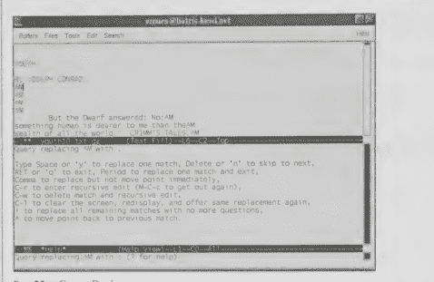

**图 3.3** 查询替换

输入您的替换字符串，然后按 Enter 键。此时，您有多种选择。

按下空格键或 y 键将替换搜索字符串的第一个出现位置，然后移动到下一个匹配项。您可以以此方式逐步遍历整个缓冲区，检查每个搜索结果并决定是否需要进行替换。如果某些实例不需要替换，请按 Delete 或 n。

在长时间的查询替换会话中，可能会出现您意识到剩余的替换不需要逐个处理的情况。按 ! 键，其余的替换将自动处理，类似于标准的全局替换。如果您对自己的判断非常有信心，可以在一开始就使用此功能。

要退出查询替换并返回正常编辑模式，请按 Enter 键或 q。

#### 递归编辑

想象一下这样的编辑场景：您正处于一个漫长且复杂的查询替换会话中。当进行到文件大约一半时，您注意到相邻行上有一个错误。您的第一反应是试图记住错误的位置，稍后再回去处理。

但如果您发现了第二个或第三个错误呢？您不应该在查询替换过程中做笔记！您的第二反应可能是立即纠正错误，但您必须退出查询替换，修复错误，然后开始一个新的查询替换。这多么麻烦！

解决这一困境的方法是暂时暂停查询替换过程，跳到错误处，然后在您离开的地方恢复查询替换。您可以通过按 Ctl-r 来实现这一点。执行该命令后，您可以随心所欲地编辑；但别忘了查询替换过程正在等待您恢复！按 M-Ctl-c 结束您当前的临时递归编辑会话，并允许您完成查询替换。

开始递归编辑的另一种方法是按 Ctl-w 而不是 Ctl-r。此命令会删除当前搜索字符串，并允许您将其替换为除替换字符串以外的其他内容。M-Ctl-c 同样会退出这种类型的递归编辑并返回主搜索。

#### 反向搜索

上述提到的任何搜索命令都可以用于在文件中反向搜索，而不仅仅是向前搜索。标准的增量搜索命令是 Ctl-s。如果改用 Ctl-r，则搜索将向缓冲区开头反向进行。此命令可用于向前搜索过程中。当从缓冲区中间向前搜索时，您可能会意识到也需要搜索缓冲区开头。

#### 重复之前的搜索

还记得 kill ring 和 mark ring 吗？Emacs 还保留了一个搜索字符串的 ring。按下 Ctl-s 或 Ctl-r 开始搜索后，您通常会在 minibuffer 中输入搜索字符串。但如果再次按下 Ctl-s 或 Ctl-r，您之前输入的最后一个搜索字符串会被粘贴到 minibuffer 中。想要再前一次的搜索字符串吗？再次按下 Ctl-s 或 Ctl-r，倒数第二个搜索字符串将替换 minibuffer 中当前的搜索字符串。这可以节省重复输入之前使用过的搜索字符串的麻烦。

#### 大写和小写

Emacs 中的标准搜索是不区分大小写的。例如，搜索 "wombat" 也会找到 "Wombat"。这一功能背后的理由是确保搜索能找到句子开头的大写单词。有时您需要搜索单词的大写形式或特定的混合大小写单词。例如，在一个包含单词 "joy" 和专有名词 "Joy" 的缓冲区中搜索 "Joy"。

Emacs 会自动处理这个问题。在 minibuffer 中输入包含一个大写或更多大写字符的搜索字符串会启用搜索的大小写敏感性。如果紧接着输入一个全小写的搜索字符串，大小写敏感性会关闭。

#### 搜索中的正则表达式

*正则表达式*（也称为 regexp）是一种在编码系统中用于匹配模式的排版符号。其基本思想是为匹配一个或多个常用字符（如字母和数字）分配很少使用的字符。正则表达式在搜索字符串中非常有用，可以帮助您通过指定字符串的一小部分来查找字符串，或者查找仅共享少量字符的字符串。它们还允许您指定搜索字符串在行中的位置，例如搜索出现在行首或行末的某个单词的所有实例。

大多数 Linux（和 DOS）用户熟悉命令行 shell（如 Bash 和 DOS 的 command.com）使用的一些正则表达式。在 bash 提示符下输入 `ls *.txt` 以查看所有扩展名为 .txt 的文件列表。在这种情况下，星号匹配任何字符或字符序列。

最基本的正则表达式是一个字符；任何字母或数字本身就是一个正则表达式。换句话说，在正则表达式中，"a" 匹配 "a"。这看起来微不足道，用处不大。使用正则表达式带来的强大功能在于将普通字符与专门分配的正则表达式符号结合使用。

##### 特殊符号

Emacs 的正则表达式版本与命令行 shell 和 Linux 实用程序（如 grep 和 sed）使用的正则表达式系统类似，但也存在差异。例如，bash shell 中的星号是通配符，匹配任何内容；而在 Emacs 正则表达式中，星号仍然是某种通配符，但它只影响其前面直接相连的最小可能正则表达式。

下表列出了 Emacs 内置正则表达式解释器识别的最重要符号。

| 符号 | 描述 |
| :--- | :--- |
| `*` | 匹配任意数量的字符，包括零个。它影响其前面的正则表达式。例如，`t*o*a*t*(de)*` 同时匹配 “toast” 和 “tossed” 等。（请参见下表中稍后对 `[]` 的描述。） |
| `^` | 匹配行的开头。例如，`^algol` 仅当 "algol" 是行上的第一个字符串时才匹配该字符串。 |
| `$` | 匹配行的末尾。例如，`p-$` 匹配由行末至少一个 `p` 组成的字符串。 |
| `.` | 匹配任何单个字符。 |
| `[]` | 匹配括号内字符范围内的字符。例如，`[l-q]` 匹配 `l, m, n, o, p` 或 `q`。这也可用于匹配括号内一组字符中的任意一个。例如，`[arm]` 匹配 `a, r` 或 `m`，但不匹配其中两个或三个。 |
| `[^]` | 匹配不在感叹号后列出的任何字符或字符范围。例如，`[^pq]` 匹配除 `p, q` 或 `z` 外的任何字符。（注：原文此处逻辑可能有误，通常 [^pq] 匹配非 p 且非 q 的字符，原文描述包含 z 且 p,q 是排除项，译文中保留原文表述或根据逻辑微调，这里保留原文意图：匹配任何未列出的字符。原文说 matches any character except p, q, or z，这可能是原文笔误，但翻译应忠实原文。） |
| `\<` | 匹配单词的开头。例如，`\<num` 匹配任何以 “num” 开头的单词，如 “number”。 |
| `\>` | 匹配单词的末尾。例如，`bez\>` 匹配 “number” 和 “encumber”。（注：原文示例可能为笔误，bez 通常不匹配 number，但翻译保留原文。） |
| `+` | 用于正则表达式之后，匹配前面的正则表达式至少一次。 |
| `\` | 用于转义此表中的任何特殊字符。例如，在正则表达式中匹配实际的星号符号时使用 `\*`。 |

本表描述了最常用的正则表达式符号。还有其他符号，但这些都足以让您入门。如果您希望深入了解此主题，Emacs 随附的 Info 帮助文件提供了更多详细信息。

##### 正则表达式的语法

通常，正则表达式是串联起来形成一个完整的表达式。例如，`Ho{urz}e.` 将同时匹配 “house” 和 “horse”。有时必须先评估正则表达式的一个子集，然后再评估其余部分。表达式可以按此方式分组：

三个点代表一个正则表达式。这种分组确保单独组的先被评估，然后将结果代回主表达式。

### 使用正则表达式搜索

有四个命令用于正则表达式搜索。这些是上述标准正向和反向搜索命令的变体。按 M-Ctrl s 在 minibuffer 中输入正则表达式时向前进行增量搜索。在标准的正向增量搜索中，每个后续匹配都更接近缓冲区末尾。使用正则表达式时，当您添加表达式时，可能会在当前匹配之前找到匹配项。例如，假设您以 `t* s` 开始正则表达式。光标跳到该单词的第一次出现位置，但现在您向表达式添加：`t\(t*t\)` ppp pp。这将搜索范围扩大到包含一个完全不同且恰好出现在第一个匹配项之前的单词。

使用此命令的另一种方法是按 Enter 而不是开始输入正则表达式：M-Ctrl-s Enter。

这会禁用增量搜索；在您输入正则表达式并再次按 Enter 之前，搜索不会开始。

以下两个命令与上述两个命令相同，但通过缓冲区进行反向搜索。按 M-Ctrl r 开始反向增量正则表达式搜索，而按 M-Ctrl r Enter 开始非增量反向正则表达式搜索。

### 使用正则表达式查询替换

一个不常见但实用的功能 `query-replace-regexp` 扩展了之前讨论的标准查询替换命令。此命令允许您在搜索字符串中使用正则表达式符号，包括带括号的组。您还可以在替换字符串中对搜索字符串的一个带括号单元进行反向引用。此示例展示了如何使用该命令。

假设您需要将单词 “flitter” 和 “flutter” 的一些出现位置替换为单词 “fly”。首先输入命令：

```
M-x query-replace-regexp
```

按 Enter，然后在 minibuffer 中输入此正则表达式：

```
fl[uI]tter
```


## 格式设置命令

当你正在撰写电子邮件、文章、书的一章或其他供自己或他人阅读的内容时，你通常不希望手动换行。默认情况下，Emacs 不会自动换行，但它会执行一种类似换行的伪换行操作，以防止线条超出屏幕范围。这通过反斜杠（在 GNU Emacs 中）或箭头（在 XEmacs 中）进行指示。必要时，会在单词中间断行。大多数 Emacs 用户会在文本模式或任何派生自文本模式的模式（例如编写电子邮件时使用的消息模式）下配置编辑器，以自动填充段落（将长行换行至特定宽度）。

### 自动填充模式

Emacs 的定制在第四章中有详细讨论，该章向你展示了如何使用 Customize 自动在 `.emacs` 文件中写入条目，第九章则教你如何编写自己的 `.emacs` 文件。但这一行换行问题（出于易用性原因）足够重要，值得提前稍微讲解一下。

Emacs 自带一种文本填充小模式（一种与大模式共存并补充大模式的状态），称为自动填充模式（auto-fill mode）。你可以轻松地设置一个选项，使得在未指定其他模式时，该模式成为默认模式。这意味着每当打开新文件时，它处于自动填充模式，你的文本将自动换行。以下是分步说明：

- 1. 启动 Emacs，并按下 Ctrl-x Ctrl-f 创建一个空的 `.emacs` 文件。
- 2. 你会在 minibuffer 中被提示输入文件名。输入 `~/.emacs`。除非你已经有 `.emacs` 文件，否则屏幕将是空白的。输入以下两个 Lisp 表达式：

```
(setq default-major-mode 'text-mode)
(add-hook 'text-mode-hook 'turn-on-auto-fill)
```

确保包含所有括号，并且不要忘记在 *turn* 和 *text* 这两个单词前面的单引号。

- 3. 通过移动光标到第一行末尾并按下 Ctrl-x Ctrl-c 来检查是否正确输入了这些行。此命令告诉 Emacs 评估 Lisp 表达式。如果无效，会出现错误消息。
- 4. 移动光标到第二行末尾，再次按下 Ctrl-x Ctrl-c。如果没有错误，当前 Emacs 会话剩余时间将处于开启了自动填充的文本模式。
- 5. 按下 Ctrl-x Ctrl-s 保存文件。新设置将在未来的 Emacs 会话中生效。

### Fill-Column 变量

Emacs 自带的自动填充模式的文本宽度设置为 70 列，这是针对普通计算机屏幕和 Emacs 窗口大小的合理默认值。如果 70 列对于你的屏幕来说太宽或太窄，可以更改 fill-column 变量。按下 Ctrl-u，输入 `number`，然后按下 Ctrl-x f。

在命令中用任何你想要的列数替换 `number`。有关使此类更改永久化的方法，请参阅第九章。

### 大写与小写

将大写单词改为小写，或反之，是一种常见的编辑任务。人们常常忘记大写专有名词或句子的第一个单词。纠正此类拼写错误的一种繁琐方法是将光标移回到问题字符处，删除它，然后输入正确的字符。对于这种琐碎但常见的操作来说，这需要很多步骤。

Emacs 有几个内置命令来处理这种情况。这些命令容易输入，你会很快变得熟能生巧：

- M-c 将单词首字母大写。
- M-l 将单词转换为全小写。
- M-u 将单词转换为全大写。

这些命令不要求你精确地将光标放在第一个字符上；在单词的任何位置都可以。

### 互换

另一种常见错误是单词或字符的顺序颠倒。你可以使用以下命令快速修复这些烦人的错误：

- Ctrl-t 互换两个字母。
- M-t 互换两个单词。
- Ctrl-x Ctrl-t 互换两行。

## 窗口、框架和缓冲区

在 Emacs 语境中，术语“窗口”和“框架”的含义与其常规含义不同。通常，在像 X Windows 这样的 GUI 中，窗口被定义为应用程序运行的可移动、可调整大小的带边框矩形框。在 Emacs 术语中，这是一个框架（frame），而窗口是框架的细分部分，用于显示单个缓冲区。

### 多窗口

通常，当你从一个缓冲区切换到另一个缓冲区时，每个缓冲区都填充整个框架（当 Emacs 运行在非 X 控制台时，则填充整个屏幕）。有时，能够同时看到两个或更多缓冲区，或同时看到单个缓冲区的两个或更多部分会很有帮助，如图 3.4 所示。


有几个键盘命令用于创建、销毁和在窗口之间移动：

- Ctrl-x 2 将当前全尺寸窗口分割为两个较短的窗口，一个在另一个上方。
- Ctrl-x 3 将当前窗口分割为两个较窄的并排窗口。
- Ctrl-x o 将点移动至下一个窗口，如果有超过两个窗口，则按顺时针方向移动至下一个窗口。
- Ctrl-x 1 使当前窗口变为全尺寸，删除另一个窗口（但不删除另一个窗口的缓冲区）。
- Ctrl-x 0 移除当前窗口，允许其他窗口扩展至全尺寸。
- Ctrl-x ^ 扩大当前窗口，同时缩小其他窗口。

## 框架

Emacs 框架是在 X 窗口中运行的 Emacs，但无需启动另一个 Emacs 会话，Emacs 可以在多个框架中运行。这些框架可以像任何 X 窗口一样处理：它们可以调整大小，并且任何窗口管理器命令，如下一个窗口和上一个窗口的键盘命令，都可以正常使用。用于操作框架的 Emacs 命令类似于上一节中的窗口命令：

- Ctrl-x 5 2 创建一个新框架，显示与原始框架相同的缓冲区。
- Ctrl-x 5 o 将焦点移动至另一个框架。
- Ctrl-x 5 0 移除当前活动的框架。
- Ctrl-x 5 b 创建一个新框架并在其中显示前一个缓冲区。
- Ctrl-x 5 f 在新框架中加载新文件。

虽然“框架”的概念在具有独立全屏窗口的 Linux 虚拟控制台中翻译得不太好，但最近版本的 XEmacs 确实提供了可在控制台会话中切换的框架。这些可以被看作独立的窗口组。

## Shell 命令

Emacs 提供了几种运行外部 shell 命令的方法。它甚至允许你分配一个窗口给完整的交互式 shell，就像在 xterm 或虚拟控制台中运行你的 shell 一样。

#### 非交互命令

M-! 是一个快速且简单的键位命令，它运行外部 shell 命令并将其输出定向到名为 Shell Command Output 的 Emacs 窗口。图 3.5 展示了 df 命令在其自己的新窗口中的输出。从 Emacs 内部运行命令有几个优点。你可以像处理缓冲区中的其他文本一样处理输出。你可以将其剪切或复制到另一个缓冲区，保存到文件，或在会话稍后引用它。

另一个有趣的功能是 M-! 命令的一个变体。使用标准 Emacs 方法之一标记一个区域，然后按下 M-!。Emacs 将在 minibuffer 中提示你输入 shell 命令。

例如，图 3.6 显示了将选定的文本区域通过 GNU pr 文本实用工具（使用 -a 选项，该选项使输出双倍行距）进行管道传输的结果。

#### 将命令输出插入缓冲区

与其从 Shell Command Output 缓冲区复制文本，你可以运行外部命令并让输出出现在当前缓冲区的点位置。你只需在基本 shell 命令前加上 Ctrl-u 即可，按下 Ctrl-u M-!。这种变体也可以与区域上的 shell 命令一起使用。原始区域消失，并被 shell 命令的输出所取代。按下 Ctrl-u M-l。

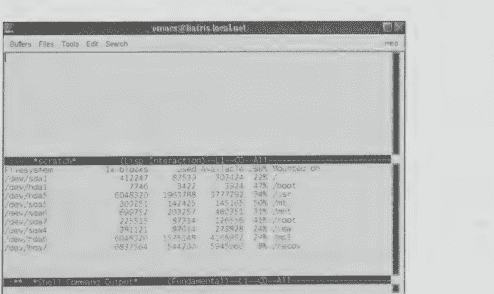

图 3.5 Shell 命令输出


## Shell 缓冲区

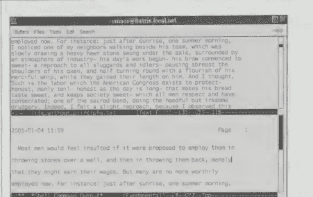

**图 3.9** 区域内的命令

在 minibuffer（迷你缓冲区）中，按下 `M-x` 并输入 `shell`。

将打开一个新的 Shell 窗口，运行你通常使用的命令 shell（如 bash, csh 等）。从这个窗口中，你可以运行任何在 xterm 中运行的命令——尽管如果你尝试运行基于 curses 的程序（例如 lynx, vim, 或 ctpip），会遇到问题。Shell 窗口旨在用于输出文本的命令行程序，例如许多基本的 GNU/Linux 实用工具，如 ls, cat 和 du 等。

尽管 Shell 窗口非常实用，但我必须承认，大多数用户没有太多 compelling（令人信服的）理由去使用它。既然你已经有能力在 xterm 或 rxvt 窗口与 Emacs 之间使用鼠标进行剪切和粘贴，你不妨直接使用那个方法。

Emacs 的 Shell 缓冲区提供了另一个选项，这确实有一些优势。你可以在命令输出中进行增量搜索，并且有些人认为 Emacs 的命令历史实现提供了标准 shell 所缺乏的功能。

## Emacs 作为编辑服务器

一旦你习惯了 Emacs 提供的许多编辑便利功能，使用内置于电子邮件或其他程序中的有限编辑器可能会让人失望。幸运的是，大多数此类程序都有一个选项，允许你指定外部编辑器。GNU Emacs 和 XEmacs 各自都有不同的辅助程序充当编辑服务器，以便外部程序无需每次需要编辑文件（例如电子邮件消息）时都启动一个新的 Emacs 实例。相反，当前正在运行的 Emacs 进程将编辑文件，并在此后继续运行。

### emacsclient

GNU Emacs 附带了一个小型的类似守护进程的程序，称为 `emacsclient`。它可以以两种方式使用。第一种方式是将环境变量 `EDITOR` 设置为 `emacsclient`。这通常在登录 shell 的配置文件中设置。如果你是 bash 用户，请检查你的 `~/.bash_profile` 文件。（如果没有，将 `/etc/profile` 或 `/etc/profile` 复制到 `~/.bash_profile` 并在那里进行修改。）查找类似于 `EDITOR=[editor-name]` 的行。将其更改为 `EDITOR=emacsclient`。然后，将行 `(server-start)` 放入你的 `~/.emacs` 文件中（参见第 9 章）。首先，你必须退出 shell（终止你的 X 会话，然后在控制台提示符下输入 `exit`，重新登录并重启 X）。一旦 X 再次运行，启动 Emacs，它就准备好了。任何使用 `EDITOR` 环境变量来确定使用哪个编辑器的程序都将调用 `emacsclient`。`emacsclient` 向主 Emacs 进程发出信号，然后主 Emacs 进程充当外部程序的编辑器。

如今许多 X 程序并不麻烦使用 `EDITOR` 环境变量。它们通常有一个配置对话框，你可以指定外部编辑器。在该对话框中输入 `emacsclient` 并保存设置。该程序（使用 `emacsclient` 作为中介）将使用你的 Emacs 会话作为其编辑器。

使用 `emacsclient` 的第二种方式是直接从 shell 提示符调用它。你可以输入 `emacsclient file-name`，一个新的框架（frame）将出现。`emacsclient` 工作需要 Emacs 正在运行。新框架是你主 Emacs 会话的一部分，并像任何新框架一样共享缓冲区列表（buffer-list）和 kill ring（剪切环）。

### XEmacs 和 gnuserv

XEmacs 的做法略有不同。其编辑服务器称为 `gnuserv`。Lisp 命令 `(gnuserv-start)`，在 Scratch 缓冲区（参见第 6 章）中求值，或作为 `~/.emacs` 文件中的一行，启动服务器。此后，希望使用当前正在运行的 XEmacs 作为其编辑器的程序需要调用编辑客户端，即 `gnuclient`。与 Emacs 的 `emacsclient` 一样，可以将 `EDITOR` 环境变量设置为 `gnuclient`。这将导致使用该变量的程序将编辑任务直接指向 XEmacs，而无需启动新进程。

## 结论

在复习了本章的材料后，你应该对使用 Emacs 感到更得心应手了。让 Emacs 的键盘命令成为本能需要一段时间，但你付出的努力会得到充分的回报。

下一章介绍用于 Emacs 定制的 Configure 界面。

# 第 4 章：使用内置定制工具

- 定制（Customize）简介
- 使用定制的理由
- 定制的工作原理
- 使用定制
- 定制字体（Faces）
- Emacs 和 X 资源文件
- 定制的局限性
- 介绍 Emacs 宏

本章介绍了两种极其有用的定制 Emacs 的方法。第一种是指向几乎所有 Emacs 设置的一个名为“定制”（Customize）的点击式界面。第二种是 Emacs 宏功能，它允许你自动化 Emacs 命令和击键序列并记录它们以供重用。使用这两种工具，你几乎可以配置所有类型的 Emacs 行为，而无需深入了解 Lisp。

## 定制（Customize）简介

在 Emacs 经过几年的开发后，它成为了一个相当复杂的软件。尽管它仍然完全可以通过 Lisp 进行配置，但数量可观的用户缺乏时间或能力这样做。Per Abrahamsen 在 1996 年引入的 Custom 库开启了 Emacs 用户的新纪元。Emacs 附加包的作者可以通过几条简单的 Lisp 语句轻松地将他们的包变量和设置添加到定制界面中。最终，定制被整合进 Emacs 和 XEmacs 中；这使得大量的原生 Emacs 设置进入了定制界面。对于许多一直与默认设置作斗争的 Emacs 用户来说，广泛的 Emacs 定制成为可能。

我与几位 Emacs 用户交谈过，他们并不了解定制功能；他们注意到了菜单栏上的定制项，但从未深入研究过。这是开源软件的一个缺点。对于一个不是由商业公司销售的“产品”，没有市场营销和促销部门。Emacs 没有广告在计算机杂志中吹嘘最新的新技术。

## 使用定制的理由

即使是经验丰富的 Lisp 程序员也通常使用定制，只是为了节省时间。为什么要用困难的方式做所有事情呢？

使用定制界面可以让你在短时间内设置 Emacs 变量；在第一次会话中花 30 分钟将极大地增强 Emacs 的可用性，尤其是对于新用户。手动在 `.emacs` 文件中做出等效的更改可能需要几个小时。

我第一次使用定制时，总共可能花了一个小时，分两次不同的会话。自那以后，我偶尔会使用它来一次更改一两个设置。另一个启动界面的场合是在你安装一个新的 Lisp 包之后。除非包很小且简单，否则必要的 Custom hooks（挂钩）通常内置于新包中，导致新的组或子组出现在定制缓冲区中。

任何认真的 Emacs 用户最终都会吸收相当多的 Lisp 语言。使用定制可以让你快速用 Emacs 变得富有生产力，而无需在你准备好之前学习任何 Lisp。

## 定制的工作原理

任何 Emacs 包都包含一些可以通过 `~/.emacs` 初始化文件中的 Lisp 语句更改的变量。如果开发人员以定义的方式“包装”这些变量，只要该包在 Emacs 的 load-path（加载路径）中，Emacs 启动时定制就可以找到并整合它们。

> Emacs 仅当 Lisp 文件位于名为 **load path**（加载路径）的列表中包含的目录中时才能找到它们。默认的 load-path 包括原生的 Emacs Lisp 目录（属于 Emacs 安装的一部分）。这些安装目录之一，site-lisp 目录，在 Emacs 首次安装时是空的。这是应该安装额外的 Lisp 文件和包的目录。第 12 章描述了如何将目录添加到 load-path。


当 Emacs 启动时，通过 `~/.emacs` 文件中的语句加载各种可选包。如果包是为支持定制而编写的，在包加载时会创建变量。这些变量添加了包特定的设置，Custom 库会在创建定制缓冲区时读取并将这些设置转换为包的定制界面。这意味着你安装的每个新的支持 Custom 的 Emacs 包都将成为定制界面的一部分，该界面在菜单栏上可用，并通过直接的 M-x mini-buffer 命令可用。

定制界面将许多可更改的选项组织在一个层次化的树状结构中，该结构可以展开和折叠。选项包含在组和子组中；这使得特定选项相对容易找到。

图 4.1 显示了一个典型的定制会话，以帮助阐明这一点。

组名称左侧的加号（+）可以通过鼠标第二或第三按钮切换。此操作展开组以显示可展开的子组或单个选项。

图 4.2 显示了单个选项，即默认字体（default face）。


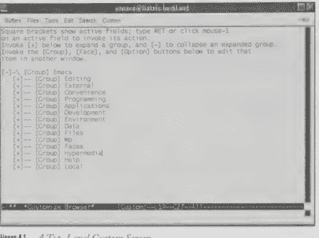

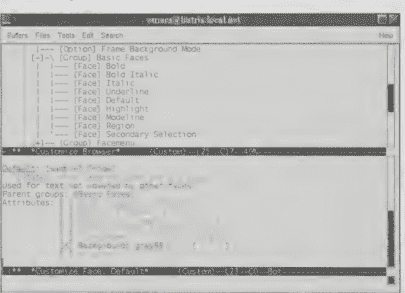

对于初学者来说，该界面并不完全直观，但考虑到“自定义”（Customize）所组织的信息量，花几分钟时间熟悉它是物有所值的。

## 使用“自定义”（Customize）

使用菜单栏是调出“自定义”缓冲区的最简单方法。“自定义”项位于不同 Emacs 版本中的不同标题下。在 21 版之前的 GNU Emacs 版本中，“自定义”位于“帮助”（Help）菜单下；而在 GNU Emacs 21 和 XEmacs 中，你可以在“选项”（Options）菜单中找到它。

所有其他组都衍生自顶层或父级“自定义”组，即 Emacs 组。如果你从未使用过“自定义”，这里是你开始的地方。菜单还提供了直接跳转到更专业化组的选择，但浏览各个组将有助于你理解“自定义”的组织方式。

在 GNU Emacs 中，选择“浏览自定义组”（Browse Customization Groups）选项。这会调出一个“自定义浏览器”（Customize Browser）缓冲区。每个主要的“自定义”组都列在一列中，每个条目的左侧都有一个 + 号。按下鼠标中键或左键点击 + 号，或者将光标移动到 + 号上并按 Enter，可以展开特定的树状层级。

XEmacs 的菜单略有不同。“选项”下的“自定义”项会随鼠标移动展开，显示各个“自定义”组，允许你移动到底部的任何单个支持“自定义”的设置。目前，请选择第一项，即 Emacs 组。会出现一个类似于“自定义浏览器”的缓冲区，如图 4.3 所示。除了 + 号，每个组的左侧还有一个文件夹按钮。当光标位于按钮右侧时，点击鼠标中键或按 Enter 键，会打开一个专门针对该按钮所属组的新缓冲区，其中可能包含子组。这种可展开的树状结构在 GNU Emacs 版本中的实现方式不同，但最终结果是一样的。

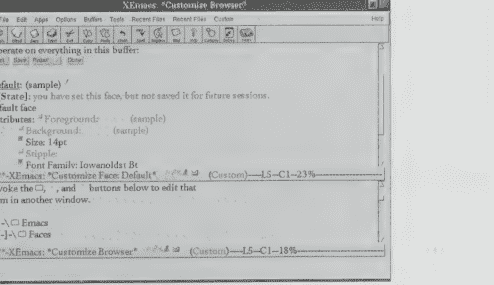

**图 4.3 XEmacs 自定义缓冲区**

### 导航界面

当你通过点击 + 号或图形按钮逐层打开“自定义”缓冲区时，你会看到包含子组或实际选项的新缓冲区。每个选项都有一个标签，指示其是否已更改，或者仍然设置为默认值。

选项有两种类型。有些具有布尔值（是或否），可以切换（这些选项有一个“切换”按钮或高亮显示的单词）；其他具有字符串值，例如颜色或字体名称。字符串值选项通常有一个下拉菜单（Value 菜单），其中包含可选的选择。如果菜单中的选项过多，你需要在删除默认字符串后，在输入字段中键入字符串值。

“自定义”会话中的许多选项都有合理的默认值，大多数用户不会想要更改它们。成功使用“自定义”的技巧是快速浏览每个组，寻找可能的更改候选项，然后继续前行。

每次你选择一个组或子组时，之前的“自定义”缓冲区会消失，但仍可在“缓冲区”（Buffers）菜单中找到。如果你想回到之前的缓冲区，这会很有用。如果你完成了“自定义”树的一个分支且不想更改任何内容，请单击“完成”（Done）或“结束”（Finish）上的鼠标第二或第三按钮。否则，你会打开许多不必要的“自定义”缓冲区。

第一次使用“自定义”时，最好不更改任何内容。花些时间浏览各个组及其包含的内容。

### 进行临时更改

你可能希望在使更改永久生效之前，先临时试用一段时间。在“自定义”缓冲区中有两个点击位置可以使你的更改生效：一个位于缓冲区顶部——在“对此缓冲区中的所有操作”（Operate on everything in this buffer）下方的“为当前会话设置”（Set for Current Session）语句处。在此处点击鼠标第二或第三按钮，将在你关闭 Emacs 之前激活缓冲区中所有选项的更改。第二个位置是每个单个选项旁边的鼠标菜单，称为“状态”（State）。当你点击“状态”时，会出现一个下拉菜单。该菜单中的一个项是“为当前会话设置”。当你点击此项时，只有该单个选项会被激活。

### 永久设置选项

永久设置一个或多个选项也使用相同的程序。在上述提到的缓冲区中的两个位置之一，选择“为未来会话保存”（Save for Future Sessions）。Lisp 语句会被添加到你的 ~/.emacs 文件中，这将设置这些选项每次启动 Emacs 时。如果你没有 .emacs 文件，系统会为你创建一个。

由“自定义”插入的 Lisp 代码格式较为严格；这有助于 Custom 库成功读取。即使你学习了一些 Lisp，折腾 Custom 生成的代码也是危险的。结果是不可预测的，你可能最终不得通过删除 ~/.emacs 文件中的整个 Custom 部分并重新进行“自定义”会话来从头开始。

安全的做法是抵制诱惑，在一个正式的“自定义”缓冲区中进行所有“自定义”更改。

图 4.4 显示了一个示例屏幕。图中显示了“状态”菜单，但菜单部分遮挡了“状态”按钮。

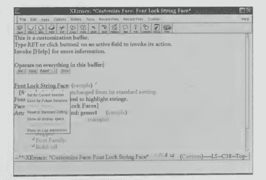

*图 4.4 设置选项*

## 自定义显示外观（Faces）

“显示外观”（Face）是 Emacs 术语，用于描述文本区域、光标、菜单或 Emacs 屏幕任何其他组件的外观属性总和。这些属性包括字体（如果适用）、字体大小、前景和背景颜色、背景像素图以及纹理。

使用“自定义”时，显示外观通常是你更改的第一个选项，因为对特定屏幕和文本颜色及字体的偏好非常个性化。有些人喜欢深色背景上的浅色文本，而另一些人则坚持相反的设置。在这个领域中，无论默认设置是什么，都不会让大多数用户满意。

手动设置显示外观既复杂又耗时。你需要在 .emacs 文件中编写自己的自定义条目。

### 不同模式如何共用相同的显示外观

大多数主要模式使用多个显示外观，例如各种字体锁定（或语法高亮）外观。其中包括用于突出显示带引号字符串的 String 外观，以及最常用于源代码缓冲区的 Keyword、Function 和 Variable 外观。许多这些外观也用于其他类型的缓冲区，例如 HTML 和邮件消息缓冲区。

此功能允许你更改基本字体锁定外观的前景和背景颜色。之后，这些更改将在各种文件上自动生效，无需进一步干预。从某种意义上说，模式继承了全局显示外观设置，因此你不必为每个模式单独设置显示颜色和字体。

### 深色和浅色背景

Emacs 维护两套完整的默认显示外观设置——一套用于深色屏幕背景，另一套用于浅色背景。默认设置是针对浅色背景的。如果你更改为深色背景，许多字体锁定外观将难以阅读。一个快速的临时解决方案是使用“自定义”将“框架背景模式”（Frame Background Mode）（位于“自定义”浏览器中的“显示外观”下）从默认的“light”（浅色）更改为“dark”（深色）。这将启用替代的字体锁定颜色，并使屏幕更易读。当你有时间进行精细调整时，可以单独设置每个字体锁定外观。

## 为 Emacs 着色

你可能想知道 Emacs 从哪里获取用于前景和背景颜色的特定颜色名称。它们包含在一个名为 rgb.txt 的文件中，该文件通常位于 /usr/X11R6/lib/X11 目录下。如果你的机器上没有该文件，请尝试此命令：

```
locate rgb.txt
```

该文件是一个普通文本文件，将颜色值映射到名称。条目看起来像这样：

```
255 248 220 cornsilk
```

GNU Emacs 内置了 rgb.txt 的标准内容，因此它不需要直接查询该文件。XEmacs 从属于 X 安装的一部分 rgb.txt 文件中读取颜色值。

如果你有一个不在文件中的喜爱颜色，请使用 Gimp 等图形程序确定该颜色的红绿蓝值，并插入类似上述示例的条目。任何 X 程序都能使用新的颜色。

为了为 GNU Emacs 添加颜色色调，需要额外的步骤。文件 [emacs-source-directory]/lisp/term/x-win.el 包含一个 rgb.txt 颜色名称列表。你新颜色的名称也需要添加到该列表以及 rgb.txt 文件中。添加名称后保存 x-win.el，重新进行字节编译，你就可以使用该颜色了。

## X 窗口和控制台显示外观

许多 Emacs 用户仍然在传统控制台或虚拟终端中使用 Emacs。控制台程序最多可使用 16 种颜色，尽管 8 种颜色更为常见。这与现代显卡在 X 窗口中的图形功能形成对比，后者可以显示数百万种不同的色调。

在花时间设置好令人愉悦的字体锁定颜色组合后，在控制台中运行 Emacs 可能会让人感到失望。

> 21 版之前的 GNU Emacs 不支持控制台会话中的颜色，但 Emacs 21 和 XEmacs 都支持。


## 如果您已使用 Customize 设置 font-lock 颜色

如果您之前使用 Customize 设置了 font-lock 颜色，那么其中很少甚至没有一种会是控制台支持的基本八种颜色之一，例如红色、绿色和黄色。X Windows 中有很多更悦目的颜色可用，如果仅仅为了让 font-lock 在 Emacs 控制台中工作就强制使用那八种控制台颜色，那就太可惜了。

查看 font-lock 面的 Customize 缓冲区时，您会以为没有为两组颜色——一组用于控制台，另一组用于 X——预留配置。实际上，确实有方法以这种方式设置颜色，但不知何故该选项被隐藏了。

要找到此设置，首先请打开某个面的 Customize 缓冲区。一个很好的起始对象是 Default 面，它控制所有不属于任何 font-lock 面的文本属性。

在 State 下拉菜单上单击鼠标中键；您之前保存的设置就在这里。在菜单的下方，注意“Show all display specs”（显示所有显示规范）选项。选择此项后，您将会看到一个新的 Display 菜单。激活此菜单并选择“checklist”（清单）。会出现一系列带标签的复选框。选择 Type 和 X 选项，并确保 TTY 保持未选中状态。

现在，您对前景色和背景色所做的任何更改都仅适用于 X Window 环境下的 Emacs。请对所有 font-lock 面重复此步骤。结果是，控制台 Emacs 会话将使用默认的颜色选择，而您选择的更复杂的颜色将用于 X 环境下的 Emacs。此步骤在 XEmacs 中同样有效。

### 从迷你缓冲区执行 Customize

如果您知道特定的 Customize 组、变量或面的名称，并不一定需要启动 Customize 浏览器。按下 M-x 然后输入 `customize-face`、`customize-group` 或 `customize-variable` 即可访问您需要的特定 Customize 缓冲区。当您知道至少一部分 Customize 项的名称（此处可以使用 Tab 自动完成辅助）但不知道它属于哪个组时，这特别有用。

## Emacs 和 X 资源文件

几年前，Custom 的功能在可控范围内较为有限。许多 Emacs 用户学会了在 `~/.Xresources` 或 `~/.Xdefaults` 文件中进行上述讨论中的许多更改。Linux 发行版使用这两个文件之一来存储许多 X 程序的设置。Emacs 仍然会关注这些设置，但逐步停止使用此文件来存储 Emacs 设置是个好主意。如果 Emacs 从您的 `.emacs` 文件读取所有设置，而不是试图从该文件和 X 资源文件读取，要获得期望的 Emacs 行为会更容易。如果您在 X 资源文件中注释掉（使用感叹号）所有 Emacs 设置，并尝试使用 Customize 以及您可能编写的手工代码 Lisp 来在 Emacs 中设置一切，两者之间发生冲突的可能性就会降低。

## Customize 的局限性

随着 Custom 库在过去几年的发展，越来越多的 Emacs 选项已变为可定制的。这对于核心 Emacs 开发人员和外部包作者来说是一项巨大的工作，Emacs 用户对此深表感激。仍有一些很少使用的选项未被包含在内，还有少数（主要是小型）包尚未适配使用 Customize。尽管如此，大部分工作已经完成，要求 Emacs 用户偶尔手动添加一行到 .emacs 文件以启用新包并不算过分。

## 介绍 Emacs 宏

宏只是一段记录的按键序列，可以随时回放。每当您在 Emacs 中发现自己正在重复某个过程时，您可能需要考虑创建一个宏。

宏可以是临时的，仅在您退出 Emacs 或创建新宏之前有效。如果您给宏命名，就可以在一个会话中使用多个宏。一旦给宏命名，您就可以将其保存至文件以供重复使用。您甚至可以为宏分配一个键绑定，以便快速执行它。

这听起来可能有点抽象，所以在介绍宏技术之前，一个实际例子应该能帮助您了解如何通过使用宏来节省时间。

## 一个宏示例

早些时候，我正在编写一系列文本文件，每个文件都需要一个包含文件编写日期的页眉。我不想每次都手动输入日期；看起来一定有一种方法可以自动化这个过程。

我的第一个想法是使用“insert-shell-command-output”（插入 shell 命令输出）键命令。Linux 的 date 实用工具在执行时会返回时间和日期，所以我尝试按下 Ctrl-u M-l，输入 `date`，然后按 Enter。

插入到缓冲区中的输出看起来像这样：

> Fri Dec 29 09:36:45 CST 2000

这并不是我完全想要的；我不想插入时间，也不喜欢日期单位的顺序。我阅读了 date 的手册页，接下来我尝试按下 Ctrl-u M-l，输入 `date '+%A, %-d %-b %Y'`，然后按 Enter。

这次，输出是可以接受的：

> Friday, 29 Dec 2000

但这个命令有两个问题：输入该命令比直接输入日期本身花费的时间更长，并且光标停留在插入日期的开头，这迫使我必须将光标移动到日期末尾并按 Enter 换行。

这种情况非常适合使用宏。这是一项繁琐且重复的打字任务，我知道我会经常做。我创建了一个宏，记录了按键，包括光标移动和换行，以便宏执行后我就能随时恢复输入。我给这个宏命名为“mymtime”，然后为它分配了专属键绑定 Ctrl-c m。我将其保存在我的 ~/.emacs 文件中，这样新命令随时都可用。继续阅读以了解如何做到这一点。

## 录制和回放宏

键命令 Ctrl-x ( 开始键盘宏。

您输入的一切，包括其他键盘命令和迷你缓冲区 M-x 命令，都会被记录在宏中，直到您按下 Ctrl-x ) 结束它。

要执行刚才创建的宏，请按 Ctrl-x e。

旨在单个文件中临时使用的宏可以带有参数，使宏重复执行特定次数。有两种方法可以实现这一点。例如，如果您知道在录制宏之后希望它重复三次，请按下 Ctrl-u，输入 `3`，然后按 Ctrl-x ) 结束宏。

如果您希望最后录制的宏不定次重复（例如贯穿整个文件），请按 Ctrl-u，输入 `0`，然后按 Ctrl-x e。

以下是该命令的一个示例。假设您希望为每个段落的开头添加三个空格的缩进。首先，您录制一个宏，使其执行一次（假设点位于段落开头）：

- 1. 按 Ctrl-x ( 开始录制宏。
- 2. 按三次空格键。
- 3. 按 M-q 重新格式化段落。
- 4. 按 M-] 向前移动一个段落。
- 5. 按 Ctrl-x ) 结束宏录制。

现在宏已录制完毕，确保点位于段落开头，然后按 Ctrl-u，输入 `0`，并按 Ctrl-x e。

宏将依次作用于每个段落。

将命令中的 `0` 替换为一个数字，宏将执行该次数，而不是直到文件末尾。

> 此宏仅在关闭自适应填充模式（adaptive-fill mode）时才能在 XEmacs 中工作。XEmacs 默认开启此模式，而在 GNU Emacs 中此模式是禁用的。


## 命名和保存宏

创建宏需要时间。有时您需要尝试两到三次才能使宏完全符合您的要求。给宏命名是永久保存宏的第一步，这样做还允许您在单个 Emacs 会话中创建多个宏。

给宏命名需要执行以下较长的迷你缓冲区命令：按 M-x 并输入 `name-last-kbd-macro`

> Tab 自动完成在此特定命令中效果很好，因为似乎没有其他以 name 开头的 Emacs 命令。按 M-x，输入 name，然后按 Tab。命令的剩余部分将为您自动补全。如果您发现自己经常给宏命名，可以考虑将此命令绑定到一个键上。


系统会提示你输入一个名称。该名称不应与任何 Emacs 变量、命令或函数冲突。在 Emacs 社区中，有一种惯例是用个人首字母前缀来命名个人的宏、函数和变量。这确保了名称不会与其他 Emacs 名称冲突，并带来额外的好处：你可以使用 Apropos 帮助键加上你的首字母，并利用 Tab 补全功能来列出所有个人宏等名称。

现在，既然你的宏已经有了名字，你就可以像执行其他 minibuffer 命令一样执行它。按 `M-x`，然后输入 `宏名称`。

既然你有了一个命名的宏，就可以将其保存到文件中。如果你计划不频繁地使用该宏，该文件可以是一个 Lisp 文件，在需要时显式加载。也许该宏只在特定目录中使用。在这种情况下，包含宏的文件可以通过该目录中文件的注释来自动加载。在文件末尾添加如下行可以通知 Emacs，在加载该文件时同时加载宏文件：

```
Local Variables:
eval: (load-file "my-macros.el")
End:
```

任何你预计经常使用的宏都可以直接插入到你的 ~/.emacs 文件中。

将宏写入文件并不困难或复杂。如果你想将命名宏写入文件，首先加载该文件。将光标定位到文件中的期望位置，按 `M-x,` 并输入 `insert-kbd-macro`。

系统会提示你输入宏的名称。在 minibuffer 中键入该名称并按 Enter。代表你宏的 Lisp 代码将出现在文件中。

还记得我之前描述的 "mytime" 宏吗？以下是该宏通过上述命令写入文件后的样子：

```
(defalias 'mytime (read-kbd-macro
"C-u M-! date SPC \*\!\!\&M SPC %p" RET 9*\<right> SPC RET>))
```

这是 Lisp 代码。即使你不了解 Lisp，你也能大致理解这段代码的作用。

有关为命令定义新的键绑定，将在第 10 章中详细讨论。目前，我只演示如何在 .emacs 文件中为上述宏赋予其自己的键绑定：

```
(global-set-key (kbd "C-c m") 'mytime)
```

该命令使键绑定 `Ctrl-c m` 在所有模式下生效。第 10 章将向你展示如何使键绑定仅在单一模式下生效。

### 查询宏

有两种类型的宏会在指定时间停止并请求输入，类似于第 3 章中讨论的查询替换命令。第一种类型整合了递归编辑功能，该功能也用于查询替换操作。

宏中的递归编辑在你创建填空题表格时非常有用。通过一个简单的例子逐步演示可能是展示如何做到的最简便方法。

- 1. 按 `Ctrl-x (` 开始录制宏。
- 2. 表格的第一项是人名，紧接着是开始递归编辑的命令。输入 `Name:` 并按 `Ctrl-u Ctrl-x q`。
- 3. 当你处于递归编辑中间时，模式行上会出现方括号。当宏正在执行时（录制后），此时是输入名字的时候。按 `M-Ctrl-c` 退出递归编辑。
- 4. 这使你回到宏录制状态。现在输入表格的下一个字段，然后再次跟上递归编辑命令。输入 `Address:` 并按 `Ctrl-u Ctrl-x q`。
- 5. 再次，你离开递归编辑来输入第三个字段。按 `M-Ctrl-c`，输入 `Date of Birth,`，并按 `Ctrl-u Ctrl-x q`。然后通过按 `M-Ctrl-c` 重新进入递归编辑。
- 6. 现在结束宏（尽管你可以定义任意数量的字段），按 `Ctrl-x )`。你刚刚创建了一个用于编写表格的交互式模板。当你执行这种宏时，在填写表格的每个字段后，你必须执行退出递归编辑命令（`M-Ctrl-c`）。

第二种查询宏不使用递归编辑。相反，它在宏执行期间预先定义的点暂停，询问你接下来想做什么。

这里有一个示例，展示这种变体是如何工作的。该宏的目的是在文件中搜索以“Note”开头的行，然后复制第一句并粘贴到一个名为 notes.txt 的新文件中。查询的原因是让你决定是否复制每个句子。

- 1. 按 `Ctrl-x (` 开始录制宏。
- 2. 执行正则表达式搜索 `Notes,`，但仅限行首。按 `M-Ctrl-s` 并输入 `^Note.` （记住，脱字符 (^) 表示匹配必须在行首。）
- 3. 按 `Enter` 停止搜索。这里是查询发生的地方，让你决定是否接受第一个匹配项。
- 4. 按 `Ctrl-x q`。此时，宏暂停，等待响应。按空格键或 y 向 Emacs 发出信号，表示你希望宏继续。按 `Delete` 或 n 表示你希望忽略此匹配项并继续到下一个匹配项。按 `Enter` 或 Q 表示你希望完全退出宏。
- 5. 假设你按了 `y` 或 `n`（允许宏继续），按 `Ctrl-space` 设置标记。
- 6. 按 `Ctrl-e` 将点移动到行尾。
- 7. 按 `M-w` 将行复制到杀环（kill ring）。
- 8. 按 `Ctrl-x Ctrl-f` 并输入 `notes.txt`，在当前目录中创建名为 `notes.txt` 的新文件。
- 9. 按 `Ctrl-y` 粘贴复制的行。
- 10. 按 `Enter` 开始新的一行。
- 11. 按 `Ctrl-x b` 返回原始文件。
- 12. 按 `Ctrl-x )` 结束宏。

## 结论

许多 Emacs 用户发现，Customize 和键盘宏提供的可配置性已经满足他们的需求。

尽管这些工具很有用，但最终你可能需要在 Emacs 中完成超出其范围的事情。下一章将向你介绍 Emacs-Lisp 语言，这使得这一切成为可能。

## 第 5 章：Emacs-lisp 作为配置的切入点

- Lisp 的起源
- Emacs-Lisp 的区别
- C 和 LISP 的混合体
- 为什么不选 Perl 或 Java？

Lisp 并不是当今使用最广泛的编程语言之一，但作为文本编辑器与其用户之间的接口，它具有几个引人注目的优势。由于其语法简单，无需深入研究即可发挥作用。本章包含关于该语言及其在 Emacs 中集成的部分背景知识。

### Lisp 的起源

如果 20 世纪 70 年代中期，即 Emacs 最初开发的时期，在计算史上是一段遥远的历史，那么 20 世纪 50 年代中期则是史前时期。计算机数量少、昂贵且由真空管驱动。高级编程语言的概念在当时很新颖；在这一时期，编程意味着用机器语言编写。这是一种（并且仍然是）难以掌握的技能。计算机科学家意识到，一种介于口语和机器语言之间的语言将有助于使编程更容易访问。

John McCarthy 和其他研究人员在达特茅斯学院和麻省理工学院早期在人工智能领域的研究，促成了麻省理工学院人工智能项目的形成。Lisp 的最早形式开始被开发和使用，既用于人工智能（*artificial intelligence*）研究，也用于数学编程。IBM 的 Fortran 产生了一定影响。就像十年后的互联网一样，早期 Lisp 开发的大部分资金来自美国军方。

在 20 世纪 60 年代，Lisp 变得更加流行，并且演化出几种方言或变体。其中一种是 MacLisp，最终启发了 Emacs-Lisp。

### Lisp 作为研究语言

Lisp 最初是作为研究工具诞生的。它旨在通过使用人类语言符号来表示数学函数，使当时原始计算机的内部工作原理更容易被理解和操作。在 Lisp 演化的前二十年中，程序员发现该语言在其理论上的 AI 研究用途之外还有应用。Lisp 作为一种通用编程语言受到青睐，尤其是在其诞生地麻省理工学院。

### Lisp 作为教学语言

20 世纪 60 年代和 70 年代是计算机研究和教学的形成期。当时（今天仍然如此）迫切需要一种计算机语言，它既足够强大以支持创建可用的程序，又在语法上足够简单，以至于


计算机专业的学生很容易学会它。Lisp 在许多人中满足了这一需求。Lisp 的一种方言 Scheme 如今被更广泛地使用。与倾向于使用令人眼花缭乱的方括号、大括号和其他标点符号的其他语言不同，Scheme 和 Lisp 都使用带括号的表达式单元。Lisp 很少有成文的规定；构建有效 Lisp 表达式的基础知识可以在一个下午内教会。

## Lisp 与 Java

现代大学的计算机科学课程通常使用 Sun Microsystems 的“一次编写，到处运行”语言 Java 来教授入门课程。Java 有许多与 Lisp 共同的特点。两者都可以被解释执行而非编译执行，且两者都在内部处理内存管理，而不是迫使程序员去处理内存分配问题。

尽管这两种语言之间存在相似之处，Emacs-Lisp 允许用户对正在运行的系统（如 Emacs）进行修改，这是 Emacs 用户所享有的高度可配置性和可扩展性的关键。

Java 的主要开发者之一是 James Gosling。Gosling 在职业生涯早期大量使用了 Lisp，甚至还编写了一个非 GNU 版本的 Emacs。

## Emacs-Lisp 的不同之处

理查德·斯托曼转向 Lisp 并不令人意外。这在某种程度上在过去 Emacs 用于较慢机器时是成立的。与过去相比，现代计算机速度如此之快，以至于 Lisp 解释几乎是瞬间完成的。在当今的计算环境中，Emacs 的响应速度可以与任何完全用 C 编写的编辑器相媲美。

## Emacs 及其内置的 Lisp 函数

Emacs 使用的 Lisp 文件可以分为两类。不太可能更改的核心 Lisp 文件会在 Emacs 编译时被“转储”到可执行文件中。一个例子是包含前面提到的字符插入例程的文件。很难想象为什么有人想要改变这种行为：当你按下字符键时，你希望该字符出现在屏幕上！

剩余的 Lisp 文件随时可用，但单个用户很可能只使用其中的一小部分。这种行为可以防止不必要的编辑功能被加载到内存中。

## 为什么不用 Perl 或 Java？

多年来，Emacs 社区中周期性地爆发过一场争议。总有人建议放弃 Lisp，并采用更流行的语言作为 Emacs 原生的脚本和配置语言。Perl、Python、Scheme、Java 和 Guile 都曾有人提议过。

这个想法的问题在于（除了没有人自愿做这项工作之外），存在大量有用的 Emacs 附加软件包。人们依赖这些软件包进行日常工作；如果 Emacs 突然开始使用 Java 而不是 Lisp，这些软件包将变得毫无用处。用另一种语言重写这些软件包将是一项巨大的工作。

虽然 Java 与 Emacs-Lisp 有一些相似之处，但缺乏运行时可配置性是一个缺点。

每当指出这一因素时，反复出现的争议就会平息。Lisp 并不是一种完美的语言，但它已经融入了 Emacs 社区，并且在可预见的未来不太可能被取代。

## 结论

本章讨论了一个内置 Lisp 解释器的优点，以及 Lisp 和 C 如何交织在一起形成 Emacs。下一章将向你介绍 Lisp 的构建模块。

## 第 6 章：学习 Emacs-Lisp 的词汇

-   求值
-   基础 Emacs-Lisp 表达式
-   函数
-   变量
-   列表操作
-   括号的使用
-   临时缓冲（Scratch Buffer）
-   常见错误

Lisp 是*列表处理*的缩写，这两个词简要概括了 Lisp 解释器的动作。Lisp 文件拥有数量惊人少的基元，它们都是由称为*原子*的不可分割单元组成的列表。Lisp 列表的另一个术语是*符号表达式*，有时简称为*s-表达式*或只是*表达式*。

本章描述了这些基本元素。你将学习如何阅读 Lisp 表达式，然后构建自己的表达式。如果你手头有一个 Emacs 临时缓冲，你会更快地学习这些材料；一边阅读一边尝试这些表达式。如果你在临时缓冲中求值一个无效表达式，Emacs 会立即提供反馈。

## 求值

对 Lisp 表达式进行求值就是将其交给 Lisp 解释器。这很像运行编译后的程序。你可以通过在临时缓冲中输入以下示例，将光标放在最后一个右括号右侧，然后按下 Ctrl-x Ctrl-e 来求值它们。

Lisp 解释器的输出显示在小工具（minibuffer）中。

求值一个非常简单的 Lisp 表达式除了表达式本身什么也不返回。求值的结果可以是一个值、一个副作用（如复制区域或移动点），或者一条错误消息。奇怪的是，副作用可能是编写该表达式时的实际结果。这可能是用户的观点，但对 Lisp 解释器来说，返回值才是目标。

### 嵌套列表

当解释器开始求值时，它首先查找包含在主列表内的列表。这些先被求值，当处理外层列表时，返回值会被替换掉内层列表。下面是一个说明这一点的数值示例：

```
(\* 3 (- 20 4))
```

包含的列表 `(- 20 4)` 首先被求值，返回值为 `16`。此时，主要表达式在 Lisp 解释器看来变成了这样：

```
* 3 16
```

这被求值并返回 48。


## 基础 Emacs-Lisp 表达式

表达式可以很简单，例如用括号包围并由单引号前缀的一个词或数字，如 `' (123)`。单引号告知解释器将表达式原样接受；如果没有单引号，Emacs 会假设列表的第一个成员是一个函数。

### 原子

Lisp 表达式被定义为一系列无法分解为更小单位的单元序列。这些单元被称为 *原子*。原子之间由任意数量的空白分隔，通常只是一个空格。一个原子可以是数字、符号或带引号的字符串，例如 "this is a string"。符号可以是单词或算术运算符，如 `+`、`-`、`*` 或 `/`——分别代表加法、减法、乘法和除法。

## 列表

上文描述的单元序列被称为 *列表*。列表可以由单个原子、多个原子或列表与原子的组合构成。列表可以是空的，其形式如下：`()`。从技术上讲，空列表既是原子也是列表。

Emacs 期望列表的第一个元素是一个函数。它可以是算术函数或任何预定义的 Lisp 函数。Lisp 中的函数本质上是预定义的 Lisp 命令。上述在列表前的单引号迫使 Emacs 将第一个或最左侧的原子仅视为数字或符号。换言之，Emacs 不会尝试将第一个原子与函数进行匹配。

当表达式被求值时，第一个元素（假设为函数）会接受后续元素作为其操作对象。如果其中任何元素是列表（由括号标示），则这些元素会在其余部分之前被处理。这被称为 *递归* 求值。

例如，以下表达式：

```
(* 3 (+ 5 5))
```

求值后返回 30。这再次展示了求值的一个基本原则：包含在外层列表中的内层列表会先被求值。一旦知道了内层列表的值，它就会被用作外层部分列表的输入。`(* 3 10)` 用英语表述就是“三乘十”。在表达式中用值 10 替换 `(+ 5 5)` 后看起来像这样：

```
(* 3 10)
```

这在英语中意为“三乘十”，最终结果为 30。

如果表达式看起来像这样：

```
'(* 3 (+ 5 5))
```

求值将返回：

```
(* 3 (+ 5 5))
```

而不是 30，因为单引号迫使解释器将 * 和 + 视为无意义字符，而非算术符号。

每个列表以及嵌套列表都用括号包围。这是 Lisp 的约定，有助于解释器找到任何列表的边界。一个列表可以长达数页，并且可以包含许多其他列表。Emacs-Lisp 解释器会深入挖掘到最内层的列表，并逐层向外求值。一旦内层列表被求值，解释器就会从左到右遍历列表，用之前存储在内存中的值替换每个包含的列表。

## 数字和字符串

Emacs-Lisp 既识别整数也识别浮点数，通过是否存在小数点来区分二者。例如，3 和 236 被视为整数，而 37.66 和 21.0 被视为浮点数。

字符串最常在使用户需要显示消息时使用。Emacs 小窗口（minibuffer）消息就是很好的例子。当你在小窗口中看到提示 I-search: 时，你看到的就是来自名为 isearch.el 的 Lisp 文件的一个字符串变量，这是 Emacs-Lisp 核心文件之一。

当 Lisp 程序需要一个可修改的文本块时，也会使用字符串。例如，一个基于 Lisp 的 Emacs 附加组件为编辑器添加电子邮件功能。这样的 Lisp 程序需要使用用户的电子邮件地址。Lisp 程序不需要知道该地址的具体内容；此数据被保存起来，以便粘贴到电子邮件消息的 From: 头部。当文本被双引号包围（使该文本对 Lisp 解释器成为一个字符串）时，该文本被视为一个整体。记住，字符串也是原子，是一个不可分割的块。

## 符号

符号是 Lisp 表达式中的唯一名称。它不过是一个词或字符，通常指代一个 Lisp 函数或变量，尽管符号可以指代任何事物。同一个符号可以在同一语句中指代函数或变量。记住，Lisp 解释器假设语句中的第一个符号指代一个函数。

符号名称是任意的，但 Lisp 程序员通常会赋予它们某种助记价值，仅为代码清晰起见。符号不能包含任何空白，因为 Emacs 会尝试将其解释为两个符号。

使用同一个符号指代多个函数或变量会导致不可预测的结果。另一个可能的问题来源是重新定义现有的 Lisp 函数；你最好定义一个全新的函数。

## 真值和假值

许多 Lisp 表达式的值可以是真或假——在 Lisp 术语中分别为 t 或 nil。这里有一个例子：

```
(setq initial-scratch-message nil)
```

该语句将变量 `initial-scratch-message` 的值设置为 nil。将此值设为 nil（在你的 .emacs 文件中）会导致 Emacs 启动时不在 Scratch 缓冲区中显示基本使用说明，而 Scratch 缓冲区是当你在命令行启动 Emacs 时未指定文件名时看到的默认缓冲区。

注意，变量名称 `initial-scratch-message` 而非在单词之间使用连字符。这是 Emacs-Lisp 的标准用法，确保 Emacs 将该变量视为一个整体。单词之间的空白总是向 Emacs 发出信号，表明每个单词是一个独立的符号。

## 函数

*函数* 是一个自包含的 Lisp 过程。你可以将函数描述为一个程序，Lisp 解释器可以调用它以完成特定任务。函数可以包含其他函数。你可以把函数想象成一个模块，可以插入到其他函数中。从某种意义上说，函数类似于缩写。从理论上讲，可以编写一个不使用任何函数的复杂 Lisp 程序，但定义每个例程的工作量将是巨大的。

Emacs 使用几种 *原始* 函数，这些是用 C 语言编写的低级过程。它们的使用方式与 Lisp 函数完全相同。从用户的角度来看，唯一的区别是原始函数不能被修改。原始函数的一个例子是 +，即前面讨论过的加法函数。

一个函数可能需要数据来工作。这些数据可以来自另一个函数或来自用户。这些数据被称为函数的 *参数*。不需要参数的函数在函数定义中列出参数的位置使用空列表 `()`。

## 定义函数

在使用函数之前，必须先定义它。一个名为 `defun`（“define function”的缩写）的内置函数用于此目的。下面是一个简单的函数定义：

```
(defun dos-unix ()
"Strip DOS carriage return characters from a buffer."

  (interactive)
  (goto-char (point-min))
  (while (search-forward "\r" nil t) (replace-match ""))
  (message "Operation complete"))
```

该函数的第一行告诉 Emacs 正在定义一个名为 `dos-unix` 的新函数。如果有任何参数，空列表 `()` 将包含参数（因此不会为空）。这个特定函数不需要参数。

第二行是可选的。注意，该行是双引号的，这是告诉 Emacs 该行是字符串的信号。该字符串的位置（紧跟在 `defun` 行之后）让 Emacs 知道该字符串意在作为 *文档字符串*（docstring，documentation string 的缩写）。还记得理查德·斯托曼（Richard Stallman）最初将 Emacs 描述为自文档化编辑器吗？自文档化就始于此处——就在函数定义内部。

## 阅读函数的文档

为了好玩，将 `dos-unix` 函数输入到 Emacs 的 Scratch 缓冲区中。

-   一旦你在 Emacs 缓冲区中显示了该函数，将光标放在最后一个括号之后，然后按 Ctrl-x Ctrl-e。
-   从 Emacs Lisp 菜单中选择“Evaluate Last S-expression”效果相同。
-   现在 Emacs 已经知道了新函数，按 Ctrl-h f。
-   当小窗口提示输入函数名称时，输入 `dos-unix`。
-   将打开一个新窗口，并显示函数定义中包含的文档。图 6.1 显示了结果。


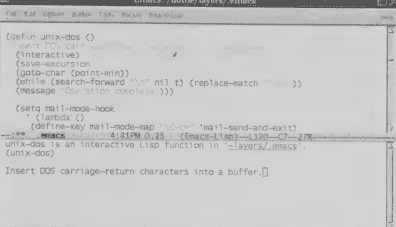

*图 6.1 函数文档*

第三行决定了该函数如何使用。如果没有 *interactive* 声明，只有在手动求值时才能加载该函数。*interactive* 是一个内置函数，它允许通过在 minibuffer 中输入函数名来运行该函数。

### 函数体

最后三行是函数的“主体”，即实际执行工作的部分。依次调用了六个函数来执行当前任务：从一个源自 DOS 或 Windows 系统的缓冲区中剥离回车符 (^M)。

首先，函数 *goto-char* 是一个简单的内置函数，用于移动点位置。它调用了另一个内置函数 *point-min*。*goto-char* 使用 *point-min* 找到缓冲区中最靠近起始位置的地方，并将 *point* 移动至此。这确保了整个缓冲区将被 *dos-unix* 处理。

接下来，每次 *search-forward* 找到回车符时，它都会将结果传递给下一个函数 *replace-match*。*replace-match* 是一个内置函数，用于将一个字符串替换为另一个字符串。传递给 *replace-match* 的参数是空字符串，""。

回车符（在 Linux 系统上看起来像 `^M`）被依次找到，然后传递给 `replace-match`，该函数在其位置替换为 nothing（空值）。请记住，`while` 函数负责此操作。当 `search-forward` 找到最后一个回车符并将其传递给 `replace-match` 后，`while` 停止并返回 `nil` 值给 Lisp 解释器。解释器看到 `while` 已结束，并继续执行主函数中的最后一行。

如果将第四行和第五行翻译成英语指令，它们可能看起来像这样：

> 从缓冲区的开头开始，查找回车符并删除它们。当找不到更多回车符时，停止。

`dos-unix` 的最后一行是可选的。`message` 内置函数用于向用户显示一串文本。在 `dos-unix` 中，`message` 被调用，参数为字符串 “`Operation complete`”。当 `dos-unix` 完成其工作后，该字符串将在 minibuffer 中显示。

### 作为模板的 dos-unix

只需将传递给 `search-forward` 和 `replace-match` 的参数中的 `\r\*` 和 `**` 替换为其他字符串，就可以轻松修改 `dos-unix` 函数。尝试在一个窗口中打开一个文本文件，在另一个窗口中打开 `dos-unix` 函数。更改 `dos-unix` 中的字符串，重新评估该函数，然后在文本文件上运行它。这种实验是熟悉函数工作原理的好方法。

请记住，`dos-unix` 中使用的所有内置函数都有它们自己的内部文档。使用 `Ctrl-h f` 帮助键来了解更多信息。

## 变量

Lisp 变量就像其他编程语言中的变量一样。变量只是一个名称，用于指代某种值，该值可以是数字或 Lisp 表达式。可以使用内置函数 `defvar`（“定义变量”的缩写）来定义变量。变量可以是全局的，影响 Emacs 使用的所有 Lisp 过程；或者它可以是局部的，在这种情况下，它仅在该变量被定义或设置的函数内有效。

## 内部 Emacs 变量

Emacs 在内存中存储了大量变量，所有这些变量都有默认值。这些变量中的许多可以被视为用户偏好设置，并且可以使用 .emacs 文件中的简单 Lisp 语句来更改它们的值。

最常更改的 Emacs 变量可以使用 Customize 接口进行更改，这在第 4 章中已讨论过。

## 定义变量

您可以在使用变量之前无需定义它。Emacs 接受变量在创建时的状态，但您可能希望提供一些文档并设置初始默认值。

另一个名为 *defvar* 的内置函数用于提供这些额外服务。语法如下：

```
(defvar variable-name initial-value docstring)
```

这是一个取自 Emacs 核心 Lisp 文件的示例：

```
(defvar mark-ring nil
"The list of former marks of the current buffer, most recent first.")
```

在这个示例中，创建了一个名为 *mark-ring* 的变量，初始值为 *nil*（因为缓冲区开始时没有设置任何标记）；带引号的文档字符串完成了定义。尝试按下 Ctrl-h v。

当在 minibuffer 中提示时，输入 *mark-ring*。

您将在 minibuffer 中看到 *mark-ring* 变量的文档字符串。

## 更改变量的值

*setq* 是一个有用的内置函数，用于更改变量的值。*setq* 通常用于 ~/.emacs 文件中以更改默认变量值。将这些值视为与其他软件中的设置类似。*setq* 命令的语法很简单：

```
(setq fill-column 72)
```

这是一个 Lisp 语句，将变量 `fill-column`（自动填充模式下换行的列号）更改为新值 72。

另一个名为 `let` 的内置函数设计用于在函数内部使用。它的角色有三方面：

- 定义一个变量列表。
- 将变量设置为初始值，类似于使用 `setq`。
- 执行一个操作，通常使用其他内置函数，利用新设置的变量值。

函数内的 `let` 表达式看起来像这样：

```
(let ((first-variable first-value) (second-variable second-value))
  function operations on the variables)
```

在 `let` 语句内设置的变量值（可能不止两个）仅在语句内有效，并且仅在语句被求值期间有效。您可以在 `let` 代码块中为在其他地方使用的变量赋予新值，而不会影响可能使用特定变量的任何其他 Emacs 例程。

这是一个使用 `let` 的示例函数：

```
(let ((airplane 'flies) (balloon 'floats))
  (message "An airplane %s, while a balloon %s" airplane balloon))
```

请注意，这两个变量值前面都有一个单引号。如果没有这些引号，Emacs 会尝试将单词 "flies" 和 "floats" 解释为有意义的符号，并显示错误消息。

在函数的最后一行，`message` 内置函数的使用方式与前面讨论的 dos-unix 函数中相同。此函数中 `message` 用法的不同之处在于使用了字符串格式占位符 %s。这两个占位符将被紧跟在 `message` 字符串后面的两个变量值替换。输出到 minibuffer 的实际结果是

> "An airplane flies, while a balloon floats"

## 列表操作

有几个有用的内置函数用于操作列表。在介绍这些函数之前，需要定义两个新术语：

- `car` 是列表的第一个成员。
- `cdr` 是列表的其余部分，即除第一个元素外的所有元素。

有两个内置函数可以提取列表的这两部分。它们是 car 和 cdr，均以其旨在检索的列表元素命名。

它们的使用方式如下：

```
(car '(this that other))
```

评估此表达式将产生列表 (this that other) 的 car，即 “this”。

```
(cdr '(this that other))
```

正如预期，此表达式的输出是 “that other”。

### 添加到列表的前部

如果你需要向列表的开头添加一个新项目，实际上是将列表的旧 car 变成新 cdr 的一部分，你需要使用内置函数 cons。语法并不复杂：

```
(cons list-1 list-2)
```

这里有一个示例，将 25 插入到一个由数字 50、75 和 100 组成的列表中：

```
(cons 25 '(50 75 100))
```

结果是

```
(25 50 75 100)
```

你甚至可以使用 cons 将元素添加到空列表来从零开始创建一个列表：

```
(cons 88 ())
```

这会生成一个包含单个元素的新列表：

```
(88)
```

如果你将变量 cons 到一个列表中，变量的值将被添加到列表的前部：

```
(cons fill-column '(12 13 14))
```

这将产生类似以下输出：

```
(70 12 13 14)
```

数字 70 会变化，具体取决于你的 fill-column 设置为什么。

作为练习，尝试使用 cons 将其他变量的值放置在列表的前部，例如 kill ring。


## …或到列表的末尾

一个类似的函数被用来将列表插入到另一个列表的末尾。这个函数叫做 `append`，其用法与 `cons` 类似。下面是一个示例：

```lisp
(append '(oak ash) '(birch pine))
```

输出为

```lisp
(oak ash birch pine)
```

正如你所见，第二个列表被附加到了第一个列表的末尾。

下一个示例将展示如何使用 `cons` 向 Emacs 的某个变量中添加元素。变量 `load-path` 的值是一个关联列表，其中包含了 Emacs 查找 Lisp 文件以进行加载的目录。这个 `setq` 语句使用 `cons` 将一个新目录添加到列表的前端：

```lisp
(setq load-path (cons "[new directory]" load-path))
```

该语句的求值会强制 Emacs 在检查列表中原始目录之前，先在新目录中查找 Lisp 文件。

## 保存 Excursion（现场状态）

当你编写文本处理函数时，光标（point）的位置通常会偏离起始点，将光标留在了缓冲区中的新位置。你可能更希望在运行函数后，光标位置返回到起始点——毕竟，那是你正在编辑的地方。

内置函数 `save-excursion` 是解决这个常见问题的答案。这个函数作为函数主体的包装器，允许光标和标记（mark）位置移动到所需的地方，但当函数操作完成时，它们会返回到原始位置。

为了说明这一点，下面是本章早些时候提到的 `dos-unix` 函数的修改版本：

```lisp
(defun dos-unix ()
  "*Strip DOS carriage return characters from a buffer."
  (interactive)
  (save-excursion
    (goto-char (point-min))
    (while (search-forward "\r" nil t) (replace-match ""))
    (message "Operation complete")))
```

与旧版本唯一的区别是添加了这一行：

```lisp
(save-excursion
```

以及末尾的一个额外括号，用于关闭新 `save-excursion` 行开头的括号。这两个新括号实际上包裹了函数的主体；现在 `dos-unix` 的整个操作都隶属于 `save-excursion` 函数。

为了便于实验 `dos-unix` 函数（你可能手头没有 DOS 格式的文件来测试），这里有一个相反功能的函数叫做 `unix-dos`：

```lisp
(defun unix-dos ()
  "*Insert DOS carriage-return characters into a buffer.*"
  (interactive)
  (save-excursion
    (goto-char (point-min))
    (while (search-forward "\n" nil t) (replace-match "\r\n"))
    (message "Operation complete")))
```

在这个函数中，`search-forward` 正在查找换行符而不是回车符。`"\n"` 是表示不可见换行符的反斜杠转义符号，正如 `"\r"` 是表示回车符的符号（在基于 DOS 的系统中是不可见的，但在 Linux 下查看时是可见的）。当你运行 `unix-dos` 时，每个换行符都会被替换为一个换行符和一个回车符。

尝试运行旧版本的 `dos-unix` 和新版本，你将看到 `save-excursion` 带来的区别。

## 括号的使用方式

到现在，你可能已经注意到 Lisp 语句中括号是如何使用的。Emacs 在函数或其他 Lisp 语句中查找括号，并依靠它们来区分一个列表和另一个列表。

请注意在示例函数 `unix-dos` 中，每个独立的函数操作都被括号包围。整个 `dos-unix` 函数本身也被括号包围。这里有一个简单的经验法则：每当引入一个新的函数时，都将其包含在自己的括号表达式内。

Emacs 提供了一些方便的功能，帮助你跟踪括号。在本章的简单函数示例中，很容易看出每个括号包围了什么，但随着 Lisp 语句变得更长、更复杂，括号有堆积成难以解析的一堆的倾向。

默认情况下，当你插入一个右括号时，Emacs 会闪烁匹配的左括号。这很方便，因为在那一瞬间，你可以轻松看到你正在关闭的语句的开头。然而，当你查看已编写的代码并想知道哪个左括号匹配特定的右括号时，这并没有帮助。

`show-paren-mode` 是专门为了满足这种需求而设计的。只需按 M-x 并输入 `show-paren-mode` 即可启用该模式。现在，只要光标位于括号处，其匹配的括号就会被持续高亮显示。图 6.2 展示了启用该模式时的一个更复杂的 Lisp 函数。

如果你正在编写 Lisp 代码，启用此模式是非常值得的。可以使用 Customize 切换该模式的开关。按 M-x 并输入

```lisp
customize group
```

当在迷你缓冲区（minibuffer）中提示输入组名称时，输入

```lisp
paren showing
```

一个 Customize 窗口将会打开，提供切换该模式的选项，以及其他几个与括号相关的选项。

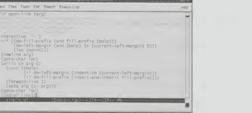

**图 6.2** *show-paren-mode 的工作原理*

## Scratch 缓冲区

Scratch 缓冲区旨在方便尝试 Lisp 代码。该缓冲区的默认模式是 Emacs-Lisp，这种模式提供了一些有用的键绑定，例如：

| 键绑定 | 描述 |
| :--- | :--- |
| M-Tab | 补全部分输入的符号。 |
| Delete | 向后删除字符，将制表符转换为空格。 |
| Ctrl-j | 求值最后一个表达式。作用与 C-x C-e 相同，除了输出显示在新的一行下方。 |

无论你在 Scratch 缓冲区中输入什么，退出 Emacs 会话时都不会保存。如果你想保存你编写的 Lisp 代码，只需将缓冲区保存为新文件即可。如果你给新的 Lisp 文件加上 .el 后缀（比如名为 mycode.el），Emacs 在后续打开该文件时会自动切换到 Emacs-Lisp 模式。

## 常见错误

初学者面临的最常见错误源于无法跟踪括号。在代码中使用大量的空白，因为这更容易在视觉上分隔各个组件。

请记住，通过按帮助键 C-h f，可以随时查阅 Emacs 内置函数的文档。

## 结论

如果不让这本书体积翻倍，它无法提供你成为 Lisp 专家所需知道的所有内容。阅读这些章节并自行实验后，你应该开始感觉到能够以一定的理解力阅读 Lisp 代码了。

最有价值的学习辅助材料之一是大量的 Emacs-Lisp 代码，本书 CD-ROM 上包含了一个良好的选择集。尝试跟踪一个简单的 Lisp 文件的逻辑以开始入门。

一个很好的探索文件是 simple.el，它位于所有 Emacs 安装目录的 /lisp 子目录中。这个文件是各种杂项函数的集合，其中许多很小且易于理解。每当你遇到不熟悉的术语时，使用 Emacs 的帮助设施来查找其含义。

首先应查阅的帮助来源是函数帮助键（C-h f），因为许多不熟悉的术语是内置函数的名称。如果这未能提供信息，请尝试 C-h a 或 M-x `apropos`。`apropos` 帮助设施将返回与你的请求相关的任何符号或键绑定的列表。

通过梳理不熟悉的函数，在过程中琢磨术语和语法，最终你会对 Lisp 的结构有一个基本的了解。

下一章将更详细地介绍编写 Lisp 表达式和函数。

# 第 7 章：一个 Emacs-Lisp 文件示例

## Clipper 中的新 Lisp 特性

## The Clipper.el 文件

如果你已经仔细阅读了上一章的内容，希望你已经对 Lisp 程序和函数是如何组合起来的有了一种大致的感觉。本章可以继续沿着同样的思路，描述更多的内置函数和变量以及如何使用它们。但由于这不是一本 Lisp 教科书，我选择了一种不同的方法——一种我怀疑会更有意思的方法。

本章重点介绍了一个名为 clipper-mode 的相当简短且简单的 Emacs 附加模式。

模式（mode） simply 是一组配置设置的集合，使得编辑特定类型的文件更容易。有主要模式（major modes），每个缓冲区中只能有一个处于激活状态；以及次要模式（minor modes），它们可以与主要模式和其他次要模式共存。

第 11 章将更深入地探讨模式的主题。本章的前几节强调了 clipper-mode 中使用的不熟悉的 Lisp 特性。

在向你介绍这些 Lisp 工具之后，我将逐行带你了解该实用程序，跟踪并描述 Lisp 解释器在求值文件时所采取的路径。

与前一章一样，如果你有一个正在运行的 Emacs 会话，理解和吸收这些材料会容易得多。这里描述的函数以及 `clipper.el` 本身可以在本书 CD-ROM 的目录 `/examples/ch7` 中找到。

## Clipper 中的新 Lisp 特性

Clipper-mode 使用了第 6 章中讨论的许多 Lisp 函数和其他表达式。该模式中的几个 Lisp 特性尚未介绍，因此以下部分简要解释其中几个。请在 Scratch 缓冲区中尝试它们。你可以访问这些函数的在线帮助，至少是为了从另一个角度了解其用法。

## 关联列表

Clipper 频繁使用另一种类型的 Lisp 列表，而非第 6 章中讨论的基本变体。关联列表，通常称为 alist，是一个 cons 单元（cons cells）的列表。一个 cons 单元是一个有序对，类似于一个列表，其 car（第一个元素）和 cdr（剩余部分）仅由单个元素组成。每个 cons 单元的 car 是一个键，而该单元的 cdr 是一个与键关联的值


所指的内容。从某种意义上说，关联列表（alist）就是一个简单的数据库。一个关联列表中可以包含任意数量的 cons 单元。以下示例仅包含两个：

```lisp
(setq tools-alist
      '((wrench . nut) (hammer . nail)))
```

该 Lisp 表达式创建了一个名为 `tools-alist` 的新变量。该变量指向第二行中的关联列表。分隔相应键（wrench 和 hammer）及其关联值（nut 和 nail）的句号和额外空格表明，该关联列表是使用点符对（dotted-pair）表示法编写的，这是一种常用于关联列表的列表表示替代方法。句号明确分隔了 cons 单元的 car 和 cdr。前一个列表如果用标准表示法编写，则看起来像这样：

```lisp
(list (list 'wrench 'nut) (list 'hammer 'nail))
```

`assoc` 是一组在关联列表中查找匹配项的函数中最常用的一个。以下是使用该函数在前述关联列表中查找匹配项的示例：

```lisp
(assoc 'hammer tools-alist)
```

求值返回此值：

```lisp
(hammer . nail)
```

对上述 `assoc` 表达式的英文翻译可能类似于以下内容：

> 在名为 tools-alist 的关联列表中，键 hammer 与哪个值匹配？

## progn 函数

`progn` 是一种包装函数，方式类似于 dos-unix 中的 `save-excursion` 函数（参见第 6 章）。`progn` 之后的每个函数或其他表达式都会被逐一求值，但返回的值会被丢弃，最后一个除外。通常，早于最后一个的函数所做的更改（从解释器的角度来看）只是副作用，但包含 `progn` 函数块的整体程序或函数需要这些副作用。这些副作用可能包括 minibuffer 消息、点位置移动或对 buffer 某些部分的删除。

最终结果是，从 `progn` 包裹的代码块中最后一个 Lisp 语句返回的值会传递给紧随其后的下一个阶段。

语法如下：

```lisp
(progn (expression1) (expression2) (expression3))
```

`progn` 是本书中称为包装函数的一组函数之一。包装函数封闭一个或多个其他函数组成的组，并对这些子函数的操作施加某种条件。第 6 章中讨论的 `save-excursion` 和 `while` 函数也是包装函数。

## if-then 语句

还记得 dos-unix 中使用的 `while` 循环函数吗？一种类似的条件函数简单地称为 `if`。其用法如下：

```lisp
(if
  (此条件语句返回一个非 nil 的值)
  (求值此表达式)
  (否则，求值此表达式（以及后续的任何表达式）))
```

与 `while` 不断循环直到满足条件不同，`if` 是一次性开关：要么执行条件块之后的第一个表达式，要么执行随后的那些表达式。

`if` 和 `while` 函数都是前一部分中介绍的包装函数的例子。

## Buffer 函数

Clipper 使用了几种 buffer 处理函数，例如 `end-of-buffer` 和 `set-buffer`。这些函数的名称本身就很说明问题。在 clipper.el 文件中遇到这些函数时，将提供简短的描述。

## 稀疏键映射（Sparse Keymaps）

在 Emacs-Lisp 中，keymap（键映射）是按键与它们所执行的命令构成的关联列表的术语。全局键映射用于所有 buffer，而各个模式通常拥有自己的键映射。

像 clipper 这样的小型模式不需要重新定义每个按键；它只需要设置几个新的按键绑定，同时保持其他键映射不变。为此设计了一个名为 `make-sparse-keymap` 的函数。它允许你仅使用几个新的按键绑定来构建一个新的键映射。

`make-sparse-keymap` 的功能涉及创建一个新的空关联列表。该函数通常用于定义新按键及其关联命令的表达式中。这些按键/命令对被作为 cons 单元插入到空的关联列表中。这为该模式形成了一个新的键映射。

## print 及其相关函数

*print* 是另一个内置函数；它将其作为参数传入的任何 Lisp 对象简单地输出到屏幕上。有两个相关的函数，分别称为 *print* 和 *princ*。这三个函数在输出格式化方式上有所不同。这里是一个使用 *princ* 的示例：

```lisp
(with-output-to-string
  (princ "This is ") (princ (emacs-version)))
```

在这个示例中，我使用 *princ* 而不是 *prin1*，因为它的输出在 minibuffer 中更具可读性。此示例的第一行使用了一个名为 *with-output-to-string* 的 Lisp 宏。Lisp 宏超出了本书的范围；只需说明它们在使用上与 Lisp 表达式中的函数方式相同。该宏接收传递给它的参数的输出，将该输出格式化为字符串，然后在 minibuffer 中显示该字符串。

第二行中的语句 *emacs-version* 指的是在编译特定的 Emacs 可执行文件时定义的一个内部 Emacs 函数。按下 M-x 然后键入

```lisp
emacs-version
```

将导致 minibuffer 中输出与刚刚显示的 *princ* 表达式完全相同，但缺少开头的单词“This is ”。

## 错误消息

clipper-mode 中使用的最后一个新函数是 *error*，当需要通知用户发生错误时使用。它与刚刚讨论的打印函数非常相似，因为它将其输出发送到 minibuffer。

*error* 函数用作正在运行的 Lisp 程序与用户之间的一种通信方式。实际上，它通知用户某处出了问题，并且用户应该使用有效参数重复命令或重新启动程序。

## 进一步准备

接下来的部分将剖析 clipper-mode，试图追踪 Emacs-Lisp 解释器在评估该模式时所走的路径。此时将 clipper.el 文件加载到 Emacs 中是个不错的主意。确保通过按下 M-x 然后键入以下命令来开启字体锁定（font locking）：

```lisp
font-lock-mode
```

字体锁定提供的不同颜色的字符串、关键字等在试图理清 Lisp 文件结构时非常有帮助。

如果你遇到仍然不清楚的函数或变量，请记住使用帮助键 Ctrl-h a 或 Ctrl-h v 从不同角度查看帮助文档。

# clipper.el 文件

clipper-mode 的简化大纲可以这样呈现：

- 引言注释
- 设置变量
- 定义函数

这些逻辑上的细分将在以下各部分中处理。读完这些材料后，你应该已经在理解其他 Lisp 文件方面取得了很大进展。

## 引言注释

编写 Emacs-Lisp 文件时有一个惯例，即在文件顶部的一行块用分号注释掉，导致 Lisp 解释器忽略这些行（参见图 7.1）。在列出了文件名和版权声明的几行之后，注释部分以一个五行摘要开始，列出了作者、维护者、位置（通常是网站）、关键字和版本。作者和维护者通常是同一个人；类别之所以分开，是因为一些 Lisp 作者要么对他们编写的文件失去了兴趣，要么无法通过电子邮件联系到。在这些情况下，对该文件有兴趣的其他人可能会接手作为维护者——一个接受错误报告或修复并尝试改进文件并发布增强版本的人。

接下来通常是一块关于 GNU 和 Emacs 的相关“样板”信息，详细说明了文件的许可和分发条款。顺便一提，Kevin Burton 编写 clipper.el 的动力之一是使向文件中插入不变的文本块变得更加容易。

下一部分注释是最有用的。其标题通常是“Commentary”（参见图 7.2）。你可以在这里找到使用说明以及安装模式或实用程序的指示。作者通常包含几行 Lisp 代码，可以剪切并粘贴到你的 .emacs 初始化文件中（有关 .emacs 文件的更多信息，请参见第 9 章）。


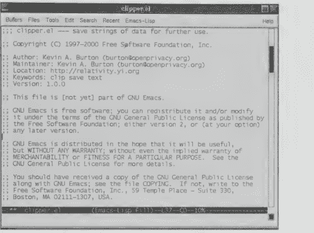

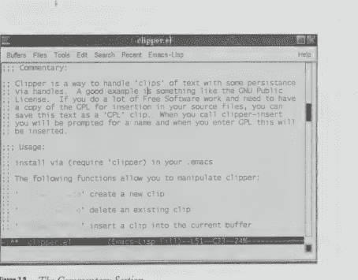

这些行要么在 Emacs 启动时自动加载文件，要么在打开特定扩展名的文件时触发加载。例如，一个仅用于编辑 HTML 文件时使用的实用工具，可能只在打开带有 `.html` 或 `.htm` 后缀的文件时才被加载。

## 设置新变量

当你编写像 `clipper-mode` 这样的 Lisp 实用程序时，首先创建新的全局变量在代码的其他地方使用，这具有某些优势。将变量定义放在 Lisp 代码的开头，使得后续的功能定义可以通过名称来使用它们。这产生了一个副作用，使代码更容易阅读和理解。替代方案是在函数内部需要时再创建变量。然而，这往往会模糊函数的含义——至少对于阅读代码的人类来说如此。Lisp 解释器并不关心这一点。

`clipper.el` 的 Lisp 代码以几个变量定义开头，如图 7.3 所示。

变量可以有任何名称（只要不包含空白字符），但已经形成了一种习惯，即选择至少部分反映变量用途的名称。

第一个定义的变量是一个名为 `clipper-alist` 的空关联列表。定义如下：

```lisp
(defvar clipper-alist '() "Associated list for holding clips.")
```

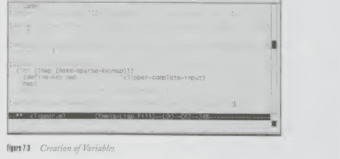

查看空列表 `()`。它是空的，因为还没有创建任何“片段”（clips）。该关联列表存在是因为它已被定义，但在有人创建片段之前，它不会有任何内容。这不会发生直到 `clipper-mode` 被使用，但当需要时，该关联列表已准备好接收第一个片段。

下一个变量为剪贴板文件命名，这是一个在 Emacs 会话之间存储已保存片段的文件：

```lisp
(defvar clipper-file "~/.clipper"
"File used for saving clipper information.")
```

文件名是任意的，可以很容易更改，但必须为文件分配一个名称，以便当 `clipper-mode` 试图保存一段剪贴的文本时，它知道将其放在哪里。

```lisp
(defvar clipper-input-buffer "*clipper input*"
"Buffer used for entering new clips.")
```

此变量为用于编写新片段的专用缓冲区命名。缓冲区名称由星号包围，表示该缓冲区不关联到实际文件，类似于 Scratch 缓冲区。

下一个变量为 `clipper-mode` 创建单个键绑定：

```lisp
(defvar clipper-mode-map
 (let ((map (make-sparse-keymap)))
 (define-key map "\C-c\C-c" 'clipper-complete-input) map)
"Mode specific keymap for 'clipper-mode'.")
```

此定义比之前的稍微复杂一些。它首先使用 `let` 函数（参见第 6 章的示例）。`let` 使用函数 `make-sparse-keymap` 定义一个临时变量 `map`。结果是名为 `map` 的空键图。在这种情况下，`define-key` 函数将键绑定 Ctrl-c Ctrl-c 添加到空的 `map` 键图，并将该键绑定与名为 `clipper-complete-input` 的东西关联。请记住，变量 `clipper-mode-map` 正在被定义的过程中。`let` 语句返回的输出是一个包含单个键绑定的键图。这成为 `clipper-mode-map` 中唯一的值。

在代码块的第三行中出现了 `clipper-complete-input`，但到目前为止，`clipper.el` 中尚未定义具有该名称的函数。将一个键绑定到一个尚不存在的命令似乎有些奇怪，但这其实并不重要。到用户有机会按下 Ctrl-c Ctrl-c 时，`clipper.el` 将已被整体评估，并且在文件更下方的位置，将定义一个具有该名称的函数。

此变量声明的最后部分是可选的文档字符串（docstring）。如果你评估整个变量定义并按下 **Ctrl-h v**，然后在提示时输入 `clipper-mode-map`，该文档将会显示。

最后一个变量仅仅为当 `clipper-mode` 激活时将在状态行（modeline）中可见的模式命名：

`(defvar clipper-mode-string "Clipper" "Mode name for clipper.")`

### 剪贴板功能

`clipper.el` 的其余部分是一系列函数定义，每个定义都定义并启用该模式行为的特定方面。你将在这些定义的多个地方看到刚刚讨论过的变量。

第一个函数是一组指令，该模式在保存文件时遵循这些指令：

```lisp
1  (defun clipper-save ()
2     "Save the clipper information to file."
3     (find-file clipper-file)
4     ;;Whatever is in this buffer is now obsolete
5     (erase-buffer)
6     (insert "(setq clipper-alist '")
7     (prin1 clipper-alist (current-buffer))
8     (insert ")")
9     (save-buffer)
10    (kill-buffer (current-buffer))
11    (message "Wrote %s" clipper-file))
```

它开始时，像往常一样，给出函数名称及其文档字符串（第 1 行和第 2 行）。

此函数执行的实际第一项工作是第 3 行。一个名为 `find-file` 的简单内置函数寻找并加载 `clipper-file`，这是之前定义的变量之一。如果替换变量的值，这一行看起来像这样：

`(find-file "~/.clipper")`

注意第 4 行的注释，它向任何可能正在阅读文件的人保证，第 5 行中的破坏性操作是有原因的。调用另一个简单的内置函数 `erase-buffer`。它删除 `~/.clipper` 缓冲区的全部内容。

起初，这没有太大意义。`clipper-mode` 的整个目的不是允许在 Emacs 会话之间保存文本的持久片段吗？现在所有耐心保存的“片段”都被删除了！

那些片段可能已从文件中消失，但它们仍然作为 Emacs 内存中的关联列表存在。函数 `clipper-save`（希望删除 `~/.clipper` 的内容）不是一个可用的函数，除非 `clipper.el` 已被加载。如果 `clipper.el` 已被加载，`~/.clipper` 的内容已作为与值 `clipper-alist` 链接的变量被纳入 Emacs 的当前内存状态。你可以通过评估 `clipper.el`，按下变量帮助键 Ctrl-h-v，并在小缓冲区提示时输入 `clipper-alist` 来亲自查看。除非你已经创建了一些片段，否则该关联列表将是空的。

第六行调用另一个名为 `insert` 的简单内置函数。`insert` 在此所做的只是将字符串复制到现在为空的 `~/.clipper` 文件中。插入的字符串 `"(setq clipper-alist '"` 是一个 Lisp 语句的第一部分，带有左括号。

第七行调用函数 `prin1`，该函数在本章前面已描述过。`prin1` 将 `clipper-alist` 变量的当前值打印或复制到剪贴板文件 `~/.clipper` 中。`insert` 的先前操作将点（point）留在了它复制到同一文件中的字符串末尾。`prin1` 从 `insert` 停止的地方继续，`clipper-alist` 的值最终位于插入字符串之后。此时剪贴板文件看起来像这样：

```lisp
(setq clipper-alist '((name-of-first-clip . first-clip)
                      (name-of-second-clip . second-clip)))
```

这还不是一个完整的 Lisp 表达式，因为括号不平衡。末尾还需要一个括号来匹配 `setq` 之前的那个，因此再次调用 `insert` 函数在第 8 行插入单个括号。

依次调用三个内置函数来完成此函数实现的工作。首先，`save-buffer` 保存缓冲区（这意味着带有新内容的 `~/.clipper` 文件被写入磁盘），接着是 `kill-buffer` 函数，它关闭缓冲区（Emacs 将其从内存中丢弃）。`kill-buffer` 知道要关闭哪个缓冲区，因为传给 `kill-buffer` 的参数是另一个函数 `current-buffer` 返回的值。

最后一行调用 `message` 函数，其作用是在小缓冲区中显示一行确认文本。字符串格式占位符 `%s` 被 `clipper.el` 开头定义的变量 `clipper-file` 的值替换，因此该字符串输出到小缓冲区：

```
Wrote ~/.clipper
```


此处使用 `message` 函数并非真正必要，因为 `save-buffer` 函数也会向 minibuffer 输出相同的消息，但这种冗余并不会造成任何伤害。

在消息字符串中使用变量而非文件名本身，是为了赋予 clipper-mode 一定程度的用户可配置性。如果某位 clipper-mode 用户认为 `~/Repository` 比文件 `~/clipper` 更适合作为名称，他只需编辑 `clipper.el` 中变量 `clipper-file` 的值即可。该变量的定义将变为：

```
(defvar clipper-file "~/Repository"
  "File used for saving clipper information.")
```

此时，由 `message` 生成的 minibuffer 输出将为：

Wrote `~/Repository`

在诸如 clipper-mode 这样的 Lisp 实用程序中，函数的顺序并不重要，即使后面的函数引用了前面定义过的函数也是如此。当 clipper.el 被求值时，函数的定义会存储在 Emacs 的内存中，但在实际使用 clipper-mode 并调用它们之前，这些函数都不会被执行。

为了清晰起见，接下来要拆解的函数不是第二个，而是第三个：`clipper-create`：

```
1 (defun clipper-create ()
2   "Create a new 'clip' for use within Emacs"
3   (interactive)
4   (set-buffer (get-buffer-create clipper-input-buffer))
5   (erase-buffer) ;; just in case
6   (clipper-mode)
7   (setq clipper-clip-name (read-string "Name of new clip: "))
8   ;;make sure the clip that the user just specified doesn't already exist.
9   (if (null (assoc (intern clipper-clip-name) clipper-alist))
10     (progn
11       (insert "CLIPPER:-------------------------------\n")
12       (insert "\n")
13       (insert "CLIPPER: Lines beginning with 'CLIPPER:' are removed automatically.\n")
14       (insert "CLIPPER: Enter new clip.  Type C-c C-c when complete.\n")
15       (insert "CLIPPER: \n")
16       (pop-to-buffer clipper-input-buffer)
17     )
18   )
19 (message "Enter new clip. Type C-c C-c when complete.")
20 (error "The specified clip already exists")))
```

在例行公事般的名称创建和简短的文档字符串之后，一条 *interactive* 语句表明该函数可由用户运行。clipper-mode 中的其他函数（如 clipper-save）属于该模式的内部运行机制，并非设计为单独运行。这意味着安装 clipper-mode 后，按下 M-x 并输入 *clipper-create* 即可运行此函数。

紧接着有三个与缓冲区相关的内置函数依次出现。第一个函数 `set-buffer` 确保当前缓冲区被设置为第二个函数 `get-buffer-create` 的输出结果。该函数执行以下两种操作之一：如果函数参数是缓冲区列表（即 Emacs 当前打开的缓冲区）中某个缓冲区的名称，则该缓冲区的名称会被传递给 `set-buffer`；否则，将使用参数作为名称创建一个新缓冲区。在本函数中发生的是后一种情况。

最终传递给 `set-buffer` 的名称是 *clipper-input-buffer*。当 Lisp 解释器遇到一个名称时，它会检查该名称是否匹配任何已定义的变量。在 clipper.el 的开头，*clipper-input-buffer* 被赋予了值 *"clipper-input"*。在这种情况下，`get-buffer-create` 创建了一个新缓冲区（由于没有其他打开的缓冲区名为 *"clipper-input"*，因此不是“获取”一个现有的缓冲区），并赋予其该名称。请记住，名称周围环绕的星号表示该缓冲区是临时的，不与文件关联，类似于 Scratch 缓冲区。

接下来调用另一个小型的单用途函数 `erase-buffer`，以清除新缓冲区的内容。这个全新的缓冲区中本不该有任何内容，但正如注释所述，“以防万一”缓冲区中存在某些内容，这些内容会被清除。

此时，屏幕上显示了一个名为 *clipper-input* 的新缓冲区。下一条语句 *clipper-mode* 设置了该文件的模式。*clipper-mode* 是一个足够简单，因此留作本章末尾示例的函数。

变量设置函数 `setq` 出现在第 7 行。它的任务是设置变量 *"clipper-clip-name"* 的值。现在需要一些用户交互，因为不同的片段（clip）名称由用户指定。该函数需要某种方式来提示用户为新片段命名。

另一个内置函数 `read-string` 正是为这种情况设计的。该函数接受一个字符串作为参数——在此例中为 *"Name of new clip: "*。该字符串会出现在 minibuffer 中。用户在字符串后输入的任何内容都会成为 `read-string` 函数的输出。假设用户响应提示时输入了 *clip3*。将其替换到第 7 行的 `read-string` 语句中，结果如下：

```
(setq clipper-clip-name "clip3")
```

下一段代码较为复杂。一个 `progn` 函数被包裹在一个 `if` 函数中。外层 `if` 函数的任务是确保用户未尝试使用已存在的片段名称。

请记住，任何已存在的片段都以关联列表（association list）的形式存储在内存中（当 clipper-mode 处于激活状态时）。必须以某种方式检查该列表，以确保用户刚输入的新片段名称不在该 alist 中。

以下是该部分函数的更 schematic 视图：

```
(if (null (assoc (intern clipper-clip-name) clipper-alist))
  (progn function snipped)
  (error "The specified clip already exists"))
```

这里的第一个新函数很简单：如果后续列表的值为 `nil`（或否），`null` 返回的值即为 `t`（或真）。

`null` 函数检查 `assoc` 函数语句的值。此处 `assoc` 的作用是检查其第一个参数（`intern clipper-clip-name`）是否能在 `clipper-alist` 中找到。另一个小函数 `intern` 会查找与其参数 `clipper-clip-name` 相关的符号，并返回其找到的内容。在此函数的前面部分，用户被提示输入新片段的名称。`setq` 函数将变量 `clipper-clip-name` 的值设置为该名称。

由于这段代码可能难以理清，以下英文翻译应能使其清晰明了：

如果新片段的名称能在现有的片段名称列表中找到，则向用户显示错误消息，以便其选择一个唯一的名称。另一方面，如果新名称确实是新的，则运行函数的 `progn` 部分。

围绕 `progn` 函数的这个 `if-then` 包装器本可以省略，但如果用户错误地选择了已使用的名称，`clipper-create` 函数可能会挂起或停滞。可以将其视为函数中的一个错误捕获功能。

现在进入 `progn` 代码块。此时，名为 `*clipper-input*` 的新缓冲区已创建并获得了唯一标识，使其区别于之前创建的片段。该缓冲区尚未可见，因为在其准备好接收用户输入之前，还需做一些额外工作。

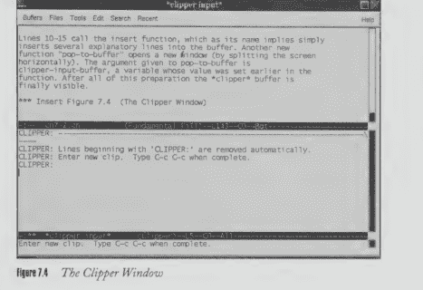

第 11 至 16 行调用了 *insert* 函数，如其名称所示，它将几行说明性文本插入到缓冲区中。另一个新函数 *pop-to-buffer* 打开一个新窗口（通过水平分割屏幕），如图 7.4 所示。传递给 *pop-to-buffer* 的参数是 *clipper-input-buffer*，这是一个在函数早些时候已设置值的变量。经过所有这些准备工作，*clipper-input* 缓冲区终于可见了。

输入新片段后，通过 C-c C-c 保存它会用 clipper 关联列表的内容覆盖 `~/.clipper` 文件，其中现在包含了新片段。此操作并非由 *clipper-create* 函数执行；C-c C-c 键绑定调用的是一个名为 *clipper-complete-input* 的新函数（参见 *clipper.el* 开头的 *clipper-mode-map* 变量的值）。

以下是该新函数：

```
1  (defun clipper-complete-input ()
2  "Called when the user is done entering text."
3  (interactive)
4  (set-buffer (get-buffer-create clipper-input-buffer))
5  ;;make sure font-lock is off in this buffer
6  (font-lock-mode -1)
```


## 代码片段

```elisp
7   ;;clean up the input buffer by removing comment lines.
8   (save-excursion
9    (beginning-of-buffer)
10   (while (re-search-forward "*CLIPPER: .*" nil t)
11     (message "removing region")
12     (delete-region (match-beginning 0) (match-end 0))
13     (kill-line 1))
14   ;;now get the value of the buffer.
15   (let (clipper-input begin end)
16     (save-excursion
17      (beginning-of-buffer)
18      (setq begin (point))
19      (end-of-buffer)
20      (setq end (point)))
21     (setq clipper-input (buffer-string))
22     (add-to-list 'clipper-alist (cons (intern clipper-clip-name) clipper-input))
23   ;;now clean up...
24   (kill-buffer clipper-input-buffer)
25   (delete-window)
26   (clipper-save))
```

该函数的前六行很直接明了，类似于其他已讨论的函数操作。第 7 行是一个有趣部分的开始，该部分包含在 `save-excursion` 包装器中，确保 `point` 会返回到其原始位置。

此代码块首先调用 `beginning-of-buffer` 函数，其作用正如你所预期的那样：将 `point` 移动到缓冲区中的第一个字符。该块其余部分是一个 `while` 循环，它使用了 `search-forward` 函数的一种变体，称为 `re-search-forward`。此功能为搜索增加了正则表达式能力。

第 3 章介绍了正则表达式的概念。为了理解 `re-search-forward` 函数，你可能需要回顾正则表达式的特殊字符，因为 Clipper 编译输入的这部分使用了好几个这样的字符。

这个 `while` 循环有一个条件：只要 `re-search-forward` 不断找到符合给定标准的行，`delete-region` 和 `kill-line` 函数就会执行它们的工作。

那么 `re-search-forward` 正在寻找什么标准呢？正则表达式 “*CLIPPER: .*” 匹配以单词 “CLIPPER:” 后跟一个空格开头的行。`.*` 匹配零个或多个任意字符的序列，`$` 字符表示行的结尾。描述匹配行的另一种方式是：任何以 “CLIPPER:” 开头的整行，不管行的剩余部分是什么。

每次找到匹配的行时，函数 `delete-region` 都会被调用。这个删除函数接受两个参数：区域的开始（或选区）和结束。两个小函数用于指示区域的边界。`match-beginning` 查找最近一次 `re-search-forward` 结果中匹配行的开始位置。`match-end` 查找匹配行的结束位置。因此，传递给 `delete-region` 的区域是整条匹配行。

搜索的行逐一被删除；当它们全部处理完毕后，`while` 循环的条件得到满足。

为了确保缓冲区被彻底清除临时行，调用了函数 `kill-line`。这会删除文件中的顶部行。留下的唯一行应该是用户输入的新剪贴材料的新行。

下一步是对作为新剪贴输入的文本文本做点什么。以某种方式，该函数需要保存新的剪贴及其唯一名称，以便将来可以使用。

执行此操作的代码块由一个围绕 `save-excursion` 函数和两个额外函数调用的 `let` 函数组成。

`let` 函数为三个仅在 `let` 包装器内有效的变量（`clipper-input`、`begin` 和 `end`）命名。

在 `save-excursion` 包装函数内，`point` 被移动到缓冲区的开始（通过 `beginning-of-buffer` 函数），并且 `let` 变量 `begin` 通过 `setq` 设置为该点位置。`point` 被移动到缓冲区的末尾（通过 `end-of-buffer` 函数），第二个 `let` 变量 `end` 被设置为新的点位置。`save-excursion` 现在发挥作用，将 `point` 移回缓冲区的开始。

在第 21 行，`let` 变量中的最后一个 `clipper-input` 通过 `setq` 被赋予一个值。这个值是简单函数 `buffer-string` 的输出，该函数将当前缓冲区的内容转换为字符串。

调用的下一个函数是 `add-to-list`，它接受列表的名称（一个变量）作为参数，后跟要添加到该列表的元素。指定的列表是关联列表 `clipper-alist`。Alist 需要由两个成员组成的 cons 单元——一个键以及与该键相关联的值。基本函数 `cons` 被调用，以两个变量的值构建一个新的 cons 单元。第一个由名为 `intern` 的简单函数生成，该函数返回与其参数 `clipper-clip-name` 相关联的符号。这是最近键入的剪贴的用户定义名称。列表的第二个成员是第 21 行中设置的变量的值，即剪贴缓冲区的内容。

`add-to-list` 准备添加到 `clipper-alist` 的 cons 单元看起来如下：

`(name-of-the-clip . contents-of-the-clip)`

正如第 23 行的注释所指出的，剩下的只是一些清理工作。最后几行杀死缓冲区并删除窗口。最后，调用最后一个函数 `clipper-save`，这是前面讨论的第一个新的 Clipper 函数。

到目前为止，已经描述创建和保存剪贴的函数。该模式的主要目的是让用户将具名文本剪贴插入到缓冲区，因此需要选择并插入剪贴的函数。接下来的两个函数建立了一个框架，让用户可以按名称请求剪贴。

这两个函数中的第二个，`clipper-insert`，是一个用户命令，可作为 `M-x` 迷你缓冲区命令使用，或绑定到按键。`clipper-insert` 需要以某种方式提示输入剪贴名称，并从 `clipper-alist` 中检索匹配该名称的剪贴。为此，`clipper-insert` 调用第一个函数 `clipper-get-clip`。该函数试图构建一个补全列表，以便使选择剪贴更简单。

函数如下：

```elisp
1 (defun clipper-get-clip())
2 "Use completion to ask the user for a clip"
3 ;;build a list for completion
4 (let((clip completion-list))
5 (setq i 0)
6 ;;setq
7 (while (< i (safe-length clipper-alist))
8 (setq clip (symbol-name (car (nth i clipper-alist))))
9 (message clip)
10 (add-to-list 'completion-list
11 (list clip i))
12 (setq i (1+ i)))
13 (completing-read "Clip name: " completion-list nil t))
```

这是本章中第一个使用计数机制的函数，这是一个递增的 `while` 循环，它将 1 加到前一个数上，然后对新值运行一系列函数。它不断这样做，直到用完元素——在这种情况下，是 `clipper-alist` 的成员。

与前面的函数一样，`let` 包装器设置了三个在函数稍后定义的变量。

在 `while` 循环开始其重复操作之前，其中一个新的 `let` 变量在第 5 行通过 `setq` 被赋予值。这是计数器的开始。在每次 `while` 循环运行之后，第 12 行将变量 `i` 的值加 1。什么能阻止这个 `while` 循环陷入无尽的重复系列？

第 7 行的条件子句为 `while` 循环的重复设置了边界。第 7 行用英语可以这样描述：

> 只要 `clipper-alist` 中的元素（或 cons 单元）数量大于 `i` 的当前值。

第 7 行的 `safe-length` 函数是一个具有安全功能的计数函数：如果正在计数的列表是循环的，`safe-length` 限制自己只计算唯一的项目。

`safe-length` 返回 `clipper-alist` 中元素的数量。现在函数需要一种方法来组装剪贴名称的列表。

第 8 行的 `setq` 语句做了大部分工作。它在 `while` 循环的每个周期中根据 `i` 的当前值，将 `let` 变量 `clip` 设置为不同的值。`nth` 函数使用 `i` 的值来获取 `clipper-alist` 中对应的成员。该函数接受两个参数：第一个是数字，第二个是列表。如果函数中的数字 `i` 为 3，则该函数返回列表中的第三个成员。

然而，出现了一个问题：`clipper-alist` 的成员是 cons 单元，由剪贴的名称及其内容组成。函数试图从剪贴名称构建补全列表；这里剪贴的内容是多余的。这正是列表操作符 `car` 派上用场的地方。

`nth` 函数已从 `clipper-alist` 中提取了一个特定的 cons 单元。取该 cons 单元的 `car` 结果得到仅包含剪贴名称。第 7 行的 `setq` 函数获取该结果并将 `clip` 的值设置为此结果。

在第 9 行，`message` 函数在迷你缓冲区中显示剪贴名称。

`clip` 变量的当前值，在 `while` 循环的每次遍历中都不同，由函数 `add-to-list` 添加到临时补全列表中。

当 `while` 循环最终处理了 `clipper-alist` 的每个成员后，结果是一个包含列表中每个剪贴名称的补全列表。

这服务于第 13 行中的函数 `completing-read`。该函数接受两个参数。第一个是在迷你缓冲区中显示的提示字符串，第二个是用于搜索匹配的补全列表。当用户输入一个字母时，在...


根据提示，在 minibuffer 中，`completing-read` 会在补全列表中搜索匹配项。Emacs 的原生补全机制会被调用，允许对片段名称进行 Tab 补全。

主要的工作现在已由 `clipper-get-clip` 完成。`clipper-insert` 短得多且更容易理解，因为许多细节已经由 `clipper-get-clip` 处理好了。

**以下是 `clipper-insert`：**

```lisp
1  (defun clipper-insert()
2  "Insert a new 'clip' into the current buffer"
3  (interactive)
4  (let (value)
5      (setq value (assoc (intern (clipper-get-clip)) clipper-alist))
6      (insert (cdr value)))
```

与前面的函数不同，这是一个交互式函数，由用户直接调用。第 3 行引入了 `interactive` 函数，随后是 `let` 包装器，它封闭了函数的其余部分。`let` 只命名了一个局部变量 `value`。第 5 行使用 `setq` 给 value 赋值。

将第 5 行中的 `assoc` 语句与之前讨论的 `clipper-create` 函数中的第 9 行进行比较。与那个函数一样，`assoc` 被用于通过引用键值来提取关联列表的成员。这里的键值由 `intern` 函数返回，该函数查找 `clipper-get-clip` 的当前值。此时，变量 `value` 的值是从 `clipper-alist` 中检索到的一个包含两个元素的列表。在 `clipper-get-clip` 中，所需的列表成员是第一个，即键值或片段名称。在 `clipper-insert` 中，需要的是片段的实际内容。

在第 6 行，`cdr` 列表运算符由 `insert` 函数调用。`value` 列表的其余部分（除第一个元素外）由 `cdr` 提取，然后 `insert` 将其粘贴到缓冲区中。

到目前为止，已经定义了创建和插入片段的函数，但还没有定义删除旧且无用片段的函数。下一个函数解决了这个需求：

```lisp
1  (defun clipper-delete()
2      "Delete an existing 'clip'"
3  (interactive)
4  (let (clip)
5      ;; get the clipper to delete
6      (setq clip (clipper-get-clip))
7      (if (yes-or-no-p
8     (format "Are you sure you want to delete clip: $a? " clip) 
9     (progn
10    ;remove it...
11    (setq clipper-alist
12          (delq (assoc (intern clip) clipper-alist) clipper-alist))
13    ;save the alist to disk
14    (clipper-save) )) )
```

这是另一个以 `let` 函数包装器开头的交互式函数。第 4 行中命名了一个名为 `clip` 的单一临时 `let` 变量。

与 `clipper-insert` 一样，第 6 行的 `setq` 语句中调用了 `clipper-get-clip` 函数。`setq` 将变量 `clip` 的值设置为 `clipper-get-clip` 函数的输出。该输出将是用户被提示的片段名称。

第 7 行开始了一个 `if` 语句。名为 `yes-or-no-p` 的函数在 minibuffer 中显示一个问题。该函数有两种可能的输出，具体取决于用户如何回答该问题。如果用户输入 `no`，`yes-or-no-p` 向 `if` 函数返回 `nil`，后者通过完全中止函数来响应。相反，回答 `yes` 会执行 `if` 代码块的其余部分。

该函数的这一部分由 `progn` 函数控制，它依次执行每一行，丢弃除最后一个命令（即函数 `clipper-save`）输出之外的所有输出。第 11 行和第 12 行是实际工作发生的地方。`setq` 通过给变量 `clipper-alist` 赋 `delq` 函数返回的值来设置其值。

尚未讨论 `delq` 函数。它在这里的作用是删除 `clipper-alist` 的特定成员。`assoc` 函数被用于提取列表的正确成员；之前定义的变量 `clip` 是 `assoc` 被指示要提取的内容。新的 `clipper-alist` 只是旧的一个删除了一项的版本。函数以对 `clipper-save` 函数的调用结束，该函数将修改后的 `clipper-alist` 写回磁盘。

## 结论

`clipper.el` 中还有几个函数，但大多数情况下，它们使用了我们已经讨论过的函数。趁着这些概念还历历在目，尝试使用函数帮助键（`Ctrl-h f`）逐步遍历 `clipper.el` 中剩余的函数。

既然你已经看到了这个小模式是如何工作的，试着阅读一些其他 Emacs-Lisp 文件。在第 6 章中，分析了 Emacs 核心文件 simple.el 中的一个函数。同一文件包含许多与文本相关的小函数，理解起来并不太难。根据你安装 Emacs 的方式，在 /usr/share/emacs/lisp 或 /usr/local/share/emacs/lisp 中查找 simple.el。

下一章向你介绍 Emacs 字节编译器，一个优化 Lisp 文件使其运行更快的实用工具。

# 第 8 章：通过字节编译提高效率

- 字节编译器
- 如何运行它
- 解释错误信息
- 不同 Emacs 版本的问题
- 看似无效编辑

Emacs-Lisp 是一种人类可读的语言。它可能没有英语那么易读，但单词和短语是可识别的，且字符均为 ASCII 文本。这种可读性对人类是一个优点，但对于需要读取 Lisp 文件的程序（如 Emacs-Lisp 解释器）来说却是一个障碍。

计算机程序阅读文件的方式与我们阅读文本不同。就像人一样，程序从文件开头开始，一直读到结尾。机器和人的阅读技术之间的一个重大区别是，人们不会仔细审视每个字符和每块空白（如制表符和空格）以寻找意义。计算机程序对于空格、缩进和字符的相对重要性没有概念。

正是这些特性使得程序员能够快速扫描 Lisp 文件，注意到各种函数和变量声明以及文件的一般逻辑流程，但对于程序而言，这些却只是耗时且令人讨厌的障碍。Lisp 解释器花费大量时间费力地穿透使程序对人类可读的空白，以获取文件的“实质内容”。

在 Emacs 早期，当机器很慢时，这是一个更大的问题，当时人们竭尽全力从计算机程序中挤出更多的效率。

## 字节编译器

Emacs 开发人员想出的解决方案是一个名为字节编译器的 Lisp 程序。该程序由几个相关的 Lisp 文件组成，它们共同作用将普通的 Lisp 文件转换为更有效的形式。

可以将字节编译器视为虚拟机器，一个在实际硬件机器内运行的模拟 Lisp 计算机。编译后的代码可执行文件，如 Emacsen 或任何 C 或 C++ 程序，直接访问计算机硬件（尽管操作系统充当中间层）。字节编译器评估 Lisp 代码并将结果传递给 Emacsen。这种额外的评估导致了字节编译代码比编译代码相对较慢，但这种方法有其优点。字节编译后的代码是机器和平台无关的。只要 Emacsen 版本相同，来自 Linux 机器的字节编译 Lisp 文件在 Windows 或 Space 机器上运行得一样好。

虚拟机的概念也用于 Java 语言。`.java` 源文件被编译为 `.class` 文件；这类似于 Emacsen Lisp `.elc` 字节编译文件。`.class` 文件也是平台间的可移植的，因为它在 Java 虚拟机内运行。

## 字节编译器文件

如果你感兴趣字节编译器内部工作原理，你可能希望阅读执行实际工作的 Lisp 文件。它们可以在 /usr/share/emacs/(version-number)/lisp/emacs-lisp 中找到。如果你运行的是 XEmacs，文件位于 /usr/lib/xemacs-(version-number)/lisp。

主要查看的文件名为 byte-comp.el；其他使用的文件在这个文件中被引用。

该文件注释非常完善。这些注释将帮助你理解 Lisp 文件进行字节编译时发生的情况。

新文件对人类不可读，但它可以被 Lisp 解释器加载的速度快很多倍，并且使用更少的内存。

图 8.1 和 8.2 是一个小型 Lisp 文件在字节编译前后的屏幕截图。

字节编译器生成的 Lisp 代码被称为字节码。由于字节编译过程中发生的压缩，结果文件的大小约为原始文件的一半。

字节编译器主要处理函数定义，它们构成了大多数 Lisp 文件的主要部分。原始 Lisp 文件中的函数被其字节码等价物所取代。定义内的文档字符串保持不变，并且在字节编译后的文件中仍然可读。这些字符串保持完整，以便内置的函数帮助仍然对用户可用。经常出现的注释

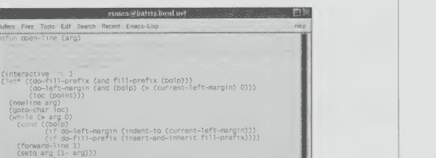

图 8.1 字节编译前


Lisp 文件中占很大一部分的内容会被字节编译器丢弃；毕竟，这些内容对程序本身没有任何意义。

作为 Emacs 安装一部分的 Lisp 文件已经经过字节编译，在某些 Linux 发行版中，字节编译后的版本是唯一提供的 Lisp 文件形式。在这种情况下，未编译的 Lisp 文件可作为单独的软件包提供。

字节编译器对于新编写的 Lisp 文件以及为不同版本的 Emacs 或 XEmacs 进行字节编译的文件同样有用。有时，将字节编译后的 Lisp 文件从一个版本迁移到另一个版本可能运行正常，但一个很好的经验法则是使用与你当前 Emacs 版本相匹配的编译器来字节编译这些文件。

## 如何运行

字节编译器可以针对单个函数、整个文件或整个包含 Lisp 文件的目录运行。已经过字节编译的文件通过在文件名后添加字母 c 来区分：文件名 `filename.el` 变为 `filename.elc`。

## 键盘命令

最常用的命令是

```
M-x byte-compile-file
```

系统会提示输入文件名；建议的默认值是当前缓冲区的文件名。只需按 Enter 接受默认值，或者输入不同的文件名以选择其他文件。

以下命令用于字节编译特定目录中的所有 Lisp 文件：

```
M-x byte-compile-directory
```

非 Lisp 文件将被忽略。如果你预计很长一段时间内不会修改父目录中的 `*.el` 文件，可以通过在 Shell 窗口中使用以下命令将它们压缩以节省一些磁盘空间：

```
gzip *.el
```

这是一个 Linux 命令而不是 Emacs 命令，因此你应该从终端窗口或 Emacs Shell 缓冲区中运行它。

你还可以在 Dired 目录列表中，使用菜单或 Dired 键盘命令压缩已标记的一组文件。

为了运行下一个命令，需要非交互式地运行 Emacs，因为 Emacs 进程在结束时会被关闭。此命令称为 *batch-byte-compile*。与上一个命令类似，它需要从 Linux 终端或控制台中运行：

```
emacs -batch -f batch-byte-compile *.el
```

运行此命令会启动 Emacs，而不会创建通常的编辑器窗口。该命令由 Lars Magnus Ingebrigtsen 作为 Gnus 邮件/新闻阅读器安装过程的一部分使用。他这样做是为了能够发行适用于所有版本 Emacs 的 `*.el` 文件。安装 Gnus 的用户使用本地的 Emacs 版本来字节编译这些文件，从而确保 `*.elc` 文件能够良好运行。

最后一个键盘命令主要供 Lisp 开发人员使用。它允许你针对单个函数而不是整个文件运行字节编译器：

```
M-x eval-defun
```

此命令在 Emacs-Lisp 模式下也有一个键绑定：

```
M-C-x
```

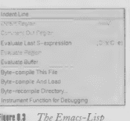

图 8.3  Emacs-Lisp 菜单

## 使用菜单

上述前两个键盘命令也可从 Emacs-Lisp 菜单中访问，该菜单在加载扩展名为 ".el" 的 Lisp 文件时会自动出现。

还有另一个有用的字节编译命令：Byte-compile And Load（参见图 8.3）。以下是一个展示如何使用此命令的场景。

假设你在 Usenet 新闻组 `gnu.emacs.sources` 上发现了一个新颖且令人感兴趣的 Emacs 实用工具。你将其保存到一个文件中，并将文件移至你的 `site-lisp` 目录中，以便试用。你做的第一件事是将该文件加载到 Emacs 中，以便阅读注释并决定它是否有用。你可以通过从 Emacs-Lisp 菜单中选择“Evaluate Buffer”来评估整个缓冲区以尝试运行它。

另一种方法是选择菜单中的 Byte-compile And Load。由于 Emacs 将加载运行速度更快的字节编译版本，这将让你对该实用工具的响应速度和性能有更直观的了解。

## 解释错误信息

当字节编译器处理 Lisp 文件时，迷你缓冲区中可能会闪过一系列消息。这些可能是错误信息。如果错误严重，编译将停止。如果没有错误，迷你缓冲区中会出现类似以下内容的消息：

```
Compiling file /usr/local//lib/xemacs/site-lisp/square-braces-as-parens.el at Thu Jan 10 09:38:08 2001
```

所有消息的日志都保存在一个名为 "Compile-Log" 的临时缓冲区中。当你试图追踪错误来源时，这个日志非常有用。

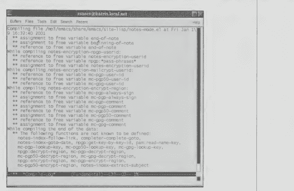

**图 8.4  无害的错误**

许多 Lisp 文件会导致字节编译器输出大量不会阻止成功生成可用 `.elc` 文件的错误。图 8.4 展示了一个典型的 *Compile-Log* 缓冲区示例。

如果有任何错误是致命的（意味着该 Lisp 文件根本无法工作），当你尝试加载编译后的文件时，迷你缓冲区中会出现错误消息。

### 错误类型

有两种错误消息几乎总是表示括号问题：

```
Invalid read syntax: *)
End of file during parsing
```

这些是最容易修复的错误。使用 Emacs 的括号匹配模式之一来查找不配对的括号。你还可以通过反复按 `Ctrl-M-f` 逐步浏览缓冲区。此按键命令将光标移动到下一个有效的函数定义，如果括号不匹配则会发出错误信号。

类似以下的错误消息：

Warning: the function font-lock-add-keyword is not known to be defined.

意味着在 Lisp 文件内部调用的外部函数无法找到。这通常是因为该 Lisp 文件是面向特定版本的 Emacs 编写的，那个版本知道这个缺失的函数，但你的 Emacs 不知道。Lisp 文件和软件包可以编写得让任何较新版本的 Emacs 都能使用。开发者会包含一些 if/then 子句，可以将其翻译成英文如下：

如果正在运行此字节编译器的 Emacs 版本是 GNU Emacs 20.0 或更高版本，则调用函数 x。如果 Emacs 版本是 21.0 之后的 XEmacs，则改为调用函数 y。如果 Emacs 版本不属于上述任何一种，则中止并将此消息发送给用户：`You need to upgrade your Emacs to a newer version in order to use this package.'

函数错误的另一个可能原因是，新软件包要求先加载另一个软件包。这应该记录在新文件的注释掉的安装说明中。

另一种通常较不严重的错误消息抱怨未初始化的变量。图 8.4 展示了几个示例。

这种类型的错误很少导致使用该文件时出现问题。通常在字节编译多文件软件包的单个文件时遇到此类错误。未初始化的变量或看似缺失的函数可能位于软件包的其他文件中——这些文件当前未加载。当软件包实际被使用时，主文件会在需要时引用其他文件。

## 不同 Emacs 版本的问题

在将一个 Emacs 版本的 Lisp 扩展迁移到另一个版本时，重新字节编译每个文件是一个好的经验法则。新的 Emacs 有可能接受由另一个 Emacs 生成的 `*.elc` 文件，但为什么要冒这个风险呢？字节编译不需要很长时间，并且可以消除任何不确定性。

如果你花很多时间实验 Emacs 扩展软件包，你肯定会发现一些无法在你所选的 Emacs 版本上运行的软件包。Lisp 程序员需要付出相当多的额外努力才能使程序与版本无关。

创建开源软件背后的典型动机是“抓挠瘙痒”（解决个人痛点）。在个人的瘙痒得到解决后（即，当程序满足了创建者的需求后），并非每个程序员都会立刻有动力使该程序对所有 Emacs 用户有用。这可能稍后发生，例如在开始收到使用该新软件包的用户发来的电子邮件之后。甚至可能有新用户提供补丁。

如果你下定决心要让一个庞大的软件包运行，可以考虑在 `gnu.emacs.help` Usenet 新闻组上发布一个问题。许多经验丰富的资深 Emacs 用户经常访问这个组，礼貌的询问可能会得到有用的回复。

如果一切方法都失败，考虑给 Lisp 扩展的作者发电子邮件。大多数自由软件作者喜欢收到用户的来信，但需要注意一种心态。失礼且要求苛刻的信息很可能被删除且不予回复。请记住，作者并不欠你什么。尝试强调你喜欢该扩展的哪些地方，哪怕只是其概念本身。

## 似乎没有效果的编辑

当 Emacs 被指示加载 Lisp 文件（可能来自你的 `~/.emacs` 初始化文件）时，会省略文件的后缀。假设你想让 Emacs 加载文件 `utility.el`；`~/.emacs` 文件中的语句可能如下所示：

```
(load 'utility)
```

当 Emacs 遇到这样的语句时，它采取的第一个动作是查找名为 `utility.elc` 的文件。由于字节编译文件比普通的 Lisp 文件运行得更快，因此如果存在 `*.elc` 文件，Emacs 默认使用它。如果找不到 `utility.elc`，Emacs 接下来会查找并加载 `utility.el`。

这种行为可能会导致问题。想象一下，你（或网络上某人）想出了改进 `utility.el` 的方法。你启动 Emacs 以尝试新版本，却发现没有任何变化。可能发生什么错误了？

发生的事情是 Emacs 找到了由旧 `utility.el` 生成的 `utility.elc` 文件，实际上忽略了新版本。解决这种情况的方法是养成每当进行修改时重新字节编译 Lisp 文件习惯。

Emacs 能够注意到 `*.el` 文件比相应的字节编译版本更新。查看 Message 缓冲区（如图 8.5 所示），你可能会看到如下的条目：

Source file '/usr/share/emacs/site-lisp/notes.el' newer than byte-compiled file


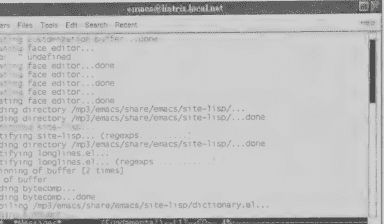

图 6.5 *消息缓冲区*

消息缓冲区是 Emacs 在会话期间生成的所有消息或警告的记录。退出 Emacs 时不会保存该缓冲区；它与 Scratch 缓冲区属于同一种临时缓冲区类型。时不时查看一下是个不错的主意，以便检查可能需要重新字节编译的 Lisp 文件。

你可以在 GNU Emacs 的“缓冲区”菜单中找到消息缓冲区。在 XEmacs 中，请从“编辑”菜单中选择“显示消息日志”项。

## 结语

熟悉字节编译器的好方法是花点时间随意把玩它。尝试删除 `/usr/share/emacs/[version-number]/lisp` 目录中的一些 `*.el` 文件，但在此之前请确保对应的 `*.el` 文件已安装。将这些 `*.el` 文件加载到 Emacs 中，并尝试本章讨论的字节编译命令。构成 Emacs 安装部分的 Lisp 文件可以毫无问题地进行字节编译。这应能增强你的信心，以便你尝试字节编译第三方 Lisp 文件。

下一章的目标是帮助你熟悉一个至关重要的 Lisp 文件——`.emacs` 初始化文件。这将为你打开一扇通往无数 Emacs 自定义可能性的门。

# 第二部分

# 学习使用 Lisp 配置 Emacs

- 9 自定义的第一步：你的 .emacs 文件
- 10 更改默认行为
- 11 模式，主要模式和次要模式


# 第 9 章：自定义的第一步：你的 `.emacs` 文件

- 文件的构建模块
- 文件的故障排除
- 备份你的 `.emacs` 文件
- 字节编译 `.emacs`
- 拆分你的 `.emacs` 文件
- 加载新文件
- 示例 `.emacs` 文件
- XEmacs、GNU Emacs 及其 `.emacs` 文件

## 此文件让你的编辑器独具特色

如果你使用 Emacs 一段时间，最终会面临编辑你的 .emacs 文件的前景。也许你试过，但不小心导致 Emacs 变成了最简配置版本，甚至无法加载你的配置文件！本章将展示这个重要文件是如何构建的，以及如何随心所欲地修改它。

## 文件的构建模块

Emacs 默认行为的自定义包含在一个名为 .emacs 的单个 Emacs-Lisp 文件中，该文件位于你的主目录（~）中。在普通用户的 Emacs 安装中，该文件并不存在。用户可以从头创建它，或者通过“自定义”实用程序间接创建，当保存你更改的选项以供将来会话使用时。

> 我不建议在单次编辑会话中对 .emacs 文件进行大量更改。这样做会使追踪可能产生的问题源头变得困难。

## 函数

一个 .emacs 文件由一系列独立的函数组成，称为表达式，每个表达式由函数名和参数组成。例如：

```lisp
(global-set-key `(kbd "<f4>") 'end-of-buffer)
```

是一个完整的 Lisp 语句。它调用内置函数 `global-set-key`，传入的参数指示该函数使 F4 键将点移动到缓冲区末尾。这些参数调用了另外两个内置函数 `kbd` 和 `end-of-buffer`。有关 Lisp 函数的更多信息，请参见第 6 章。

### 定义

Emacs 的许多行为是由存储在 Emacs Lisp 变量中的值决定的。这些变量可供用户使用，并且可以随时更改；更改这些值最常见的方法是在你的 ~/.emacs 文件中使用语句。

用于此目的的一个内置函数是 `setq`，如下例所示：

```lisp
(setq initial-scratch-message nil)
```

`setq` 显式地将变量设置为一个值。变量 `initial-scratch-message` 的默认值是 `t`，即真。当值为真时，每次 Emacs 启动都会在 Scratch 缓冲区中显示“启动画面”。该屏幕包含有关编辑器的基本信息和查找帮助的方法。你的 .emacs 文件中的上述行会抑制初始消息屏幕。

Lisp 术语 `t`（意味着真）和 `nil`（意味着假）经常出现在 Lisp 表达式中（参见第 6 章）。

## 文件的故障排除

当 Emacs 启动时，它会读取你的 .emacs 文件，从第一行开始一直读到末尾。如果遇到任何错误，内置的 Emacs-Lisp 解释器会立即拒绝该文件，并转而加载默认设置。一条以短语“init file 中的错误”开头的消息会出现在迷你缓冲区中，并引用第一次出现问题所在的行号。

## 处理括号

任何曾经尝试过在 .emacs 文件中设置配置的 Emacs 用户，可能都在某个时刻无意中破坏了代码。Lisp 需要 Lisp 文件或语句中的括号平衡；也就是说，每一个左括号都必须有一个对应的右括号。Lisp 函数通常包含几个嵌套的带括号语句。缺少一个括号人眼不一定能察觉，但这可能使 Emacs 解释器完全无法理解该 Lisp 函数。Emacs 会放弃格式错误的 .emacs 文件，并恢复到其编译时的默认设置。

## 括号模式

Emacs 的开发者早就受够了手动计算大量括号。一种名为 `blink-matching-paren` 的模式在默认的 GNU Emacs 新安装中是开启的。此模式会在点位于带括号表达式的一端时，使另一端相应的括号闪烁。一种名为 `show-paren-mode` 的 X Windows 特定变体可以通过迷你缓冲区命令 `M-x show-paren-mode` 开启或关闭。此模式会高亮显示与光标所在括号相对的对应括号。XEmacs 有三种括号匹配模式，可以通过选择“选项”、“括号高亮”来激活。这些模式中的任何一种都有助于你发现不平衡的括号。

你还可以使用键命令 `Ctrl-M-f` 和 `Ctrl-M-b` 从一个正确加括号的表达式向前或向后移动到另一个。

## 其他错误来源

另一个潜在的错误原因可能是缺失或多余的单引号 (')。请记住，列表前的单引号告诉解释器该列表不是要评估的函数（参见第 6 章和第 7 章）。缺失的引号会导致 Emacs 的 Lisp 解释器试图将列表与函数定义关联失败，从而引发错误。相反，无意中放在合法函数前的单引号会导致 Emacs 忽略该函数，从而无法执行。

寻找和处理 Lisp 错误有几种技术。如果你怀疑某个例程有问题，请选择整个函数或语句，以将 Emacs 的注意力集中在该区域。可以通过按下 `M-x` 并输入

```
eval-region
```

或者通过从 Emacs Lisp 菜单中选择“评估区域”来实现。限制评估范围的另一种方法是将光标直接放在单个 Lisp 表达式之后，然后按 `Ctrl-x Ctrl-e`。你可能还记得，在第 6 章中，这是“评估最后一个 S 表达式”的快捷键，该函数也可在 Emacs Lisp 菜单中找到。

追踪 .emacs 文件错误的另一种技术是以某种方式启动 Emacs，使得如果在发生错误时调用 Lisp 调试器。通过在启动 Emacs 时使用此开关来实现：

```
emacs -debug-init
```

有关 Lisp 调试器的信息，请参见第 22 章。

### 注释

大多数编程语言都设计允许程序员在源代码中包含旨在供人类阅读的文字。这些部分或行称为注释；它们用于帮助程序员（以及任何稍后可能看到代码的人）理解代码的预期功能。

注释会被将代码转换为计算机可执行形式的编译或解释软件忽略。使用一个特殊字符来通知软件应忽略特定的行或代码块。用这个字符包围或前缀一个区域被称为将该区域注释掉。下面是一个例子：

```lisp
;; Make F8 be "start macro", F9 be "end macro". 
;; F10 be "execute macro" 
(global-set-key [f8] 'start-kbd-macro)
```


```lisp
(global-set-key [f9] 'end-kbd-macro)
(global-set-key [f10] 'call-last-kbd-macro)
```

前两行是解释后面三行代码用途的注释。

如示例所示，Emacs-Lisp 使用分号作为注释字符。当文件被求值或字节编译时，Emacs 会忽略分号后面的任何文本。培养一个好习惯就是给你的 Lisp 文件加上充分的注释。代码刚写完时可能清晰易懂，但随着时间推移，往往会变得难以理解。作为 Emacs 一部分的 Lisp 文件通常都有非常完善的注释。

## 备份你的 .emacs 文件

一旦你配置好 Emacs 并将其适应你的工作风格，你可能会因为害怕破坏配置而不愿意再去折腾你的 .emacs 文件以获得进一步的易用性和效率。如果在 .emacs 文件变得不可用后想要回退到一个可用状态，需要花费不少时间。在开始进行大量更改之前，始终是一个好主意先保存一份 .emacs 的副本。将副本放在主目录以外的地方，它将起到保险作用：在任何时候，你都可以用那份已知良好的副本替换掉损坏且不可用的 .emacs 文件。另一种方法是在你的 Linux 系统上创建一个新用户；大多数 Linux 发行版使用名为 `adduser` 的命令。将你正在使用的 .emacs 文件从主目录复制到新用户的家目录，然后以该新用户登录。这个用户账号可以作为一个开发沙盒使用。无论你对新用户的 Emacs 设置做了哪些更改，好或坏，你始终可以在主账号中保留并使用未经修改的原始 Emacs。如果你对新用户 .emacs 的更改是有益的，最终可以将它们迁移到你的“真实” .emacs 中。

访问像 .emacs 这样文件的早期版本的另一种方法是使用版本控制系统，如 CVS 或 RCS。这些系统旨在维护程序源代码；它们赋予了你回退到任何你编辑过的文件的任何早期版本的能力。你的 Linux 发行版很可能同时提供这两个系统的软件包。安装其中之一并阅读随附的文档，以学习如何维护那些经常发生变化的文件的不同版本。

## 字节编译 .emacs

第 8 章介绍了 Emacs-Lisp 文件的字节编译。当你的 .emacs 文件及其加载的附属文件累积了相当数量的函数和语句时，对它们进行字节编译是一个好主意。Emacs 的启动速度会更快（尽管以现代计算机的速度来看，这并不像几年前那样显著了）。只要记住，你对原始 Lisp 文件所做的任何进一步更改，直到文件再次被字节编译之前都不会生效。届时，.elc 文件将被一个反映对 .el 文件所做更改的最新版本覆盖。作为复习，要字节编译当前正在编辑的文件，请按下 `M-x` 并输入 `byte-compile-file`。

GNU Emacs 会在 minibuffer 中显示文件的目录路径，并提示你输入文件名。只需键入足够多的文件名字符，以便 Tab 补全能完成该名称。XEmacs 假定你要字节编译你正在编辑的文件，并以该文件名作为提示。在任何一种编辑器中，按下 Enter 键都会开始操作。直到确定没有拼写错误或 Lisp 错误之前，甚至不必麻烦去进行字节编译。

## 通过示例学习

其他 Emacs 用户的个人 .emacs 文件是一个宝贵的资源。许多长期用户已将其 .emacs 文件公开发布到万维网上。（参见第 23 章的 URL 列表。）多年来，.emacs 文件会逐渐累积越来越多有用且节省时间的添加内容，而那些不起作用的文件则会被注释掉或删除。由于这些文件体积小且便于移植，用户可以随其工作变动和机器更换而携带这些文件。

## 拆分你的 .emacs 文件

随着你根据需求定制编辑器，你的 .emacs 文件不可避免地会变大。这些文件往往变得笨拙不堪，并充满了被注释掉的段落。由 Customize 工具所做的添加并不旨在让人类易于阅读，并且可能占用相当多的空间。将你的 .emacs 文件拆分为几个单一主题的文件可以帮助让整个初始化方案更容易处理。为了做到这一点，首先创建一个子目录，也许就在你的主目录中。在这个例子中，我将其命名为 /home/user/emacs。将你的 .emacs 文件加载到 Emacs 中，剪出处理键绑定文件片段，并将其粘贴到一个名为 /home/user/emacs/keys.el 的新文件中。对设置各种主要模式选项的 .emacs 部分做同样的事情；它们可以粘贴到一个名为 modes.el 的新文件中。你生成的宏也是新文件的好候选者。在此分解文件后剩下的很可能是杂项 Emacs 设置，以及 Configure 保存的选项。杂项选项可以粘贴到 misc.el 文件中，除了在 .emacs 文件中只留下 Configure 生成的行之外，什么都不剩。

## 加载新文件

下一步是找到一种让 Emacs 找到并加载这些拆分出来的 Lisp 文件的方法。在第 4 章中，介绍了基本的内置函数 `cons`。作为提醒，它用于将原子（或单个元素）插入列表的前端。这个函数正是你现在需要的。`load-path` 是 Emacs 用来查找其运行所需文件的变量。这个变量只是一个包含 Lisp 文件的目录列表，例如 /usr/share/emacs。可以使用 `cons` 将新的 Lisp 目录 /home/user/emacs（一个单一元素）插入到此列表的前端。代码如下所示：

```lisp
(setq load-path (cons "/home/user/emacs" load-path))
```

这简短的一行代码为 `load-path` 变量创建了一个新值，其中新路径是目录列表的第一个元素。列表的其余部分是 `load-path` 的旧值。这个程序的一个有趣方面是，你不需要知道变量的值就可以将一个新元素 `cons` 到开头或将一个新元素追加到末尾。

将前面的一行 Lisp 代码插入到你的 .emacs 文件的末尾，然后求值它以确保它是正确的 Emacs Lisp。现在 Emacs 意识到了新目录，但它尚未被指示对那里的文件执行任何操作。Emacs 在启动时会自动加载 ~/.emacs 文件，但它必须被明确告知加载其他任何文件。`load` 是一个用于加载 Lisp 文件的 Emacs 内置函数。在这种情况下，以下语句完成了这项工作：

```lisp
(load "keys")
(load "modes")
(load "macros")
(load "misc")
```

这些行应该紧跟在 .emacs 文件中的前一条 `load-path` 行之后。你有没有注意到 `load` 命令中缺少 .el 后缀？Emacs 不需要这个后缀。其中一个原因是，某些 Lisp .el 文件为了更快的执行速度而被字节编译并带有 .elc 后缀，而人类可读的未编译 Lisp 文件带有 .el 后缀。Emacs 会寻找带有任一后缀的文件，如果存在 .elc 文件，则优先加载 .elc 文件而不是其 .el 对应文件。

现在，你的初始化文件已拆分为独立的专用文件，你会发现进行更改更容易了。如果你想更改或添加一个键绑定，`keys.el` 文件会向你展示一个简单的键绑定列表。你不再需要在一大型 .emacs 文件中翻页寻找特定的键绑定。

## 编辑并重新字节编译

如果你已经字节编译了 .emacs，如果你在原始的 .el 文件中做了任何更改，请不要忘记重复该过程。Emacs 始终加载速度更快的字节编译 .elc 文件，而不是人类可读的 .el 文件，因此你做的任何更改只有在重复字节编译后才会生效。

## 一点 reassurance

如果这些关于损坏的 .emacs 文件和格式错误的 Lisp 语句的描述听起来令人生畏，请安心。使用 Lisp 定制 Emacs 的通常方法是缓慢且渐进的，一次处理一个问题并不是真正繁重的工作。随着时间推移，你最终会开发出一个使你的工作更加顺畅的初始化文件。

Emacs 社区中的一个习俗对新人非常有帮助。绝大多数 Emacs 附加软件包在主 Lisp 文件的开头包含一段被注释掉的安装说明。这些说明几乎总是包含几行 Lisp 代码，可以复制并粘贴到 .emacs 文件中。这些行对于正确使用该软件包是必要的。编写这些软件包的程序员主要为自己编写这些软件包，但当其他人开始使用它们时，修复 bug 和进一步开发软件包的冲动似乎会增加。鼓励这种方式的一种方法是让软件包对新用户易于访问。有时，一个软件包最终服务于整个用户社区，其中许多人都贡献了补丁和 bug 报告，从而增强了该对所有人的软件包。由 Lars Magne Ingebrigtsen 维护的 Gnus 新闻和邮件阅读器就是一个完美的例子。在过去几年中，这个非常复杂且功能丰富的 Emacs 扩展已经获得了足够的追随者，以至于值得拥有自己的 Usenet 新闻组，ntp://gnus.emacs.gnus。

## 尝试示例文件

随本书提供的 CD-ROM 中，在目录 /lisp/samples 中有几个示例 .emacs 文件。这些文件旨在用于实验，并且需要适应你的系统才能实际有用。把它们看作是一种可以复制并粘贴到你的个人文件中的 Lisp 片段来源。


# 别忘了做个备份

如果你已经在用 `.emacs` 文件，请务必把它挪到别处存放，以免被覆盖。记住，Emacs 会自动尝试加载你主目录中任何名为 `.emacs` 或 `.emacs.el` 的文件。现在你准备好将某个示例文件复制到你主目录并启动 Emacs 了。

# 从 CD-ROM 复制文件

使用如下命令将 CD-ROM 挂载到一个合适的挂载点：

```
mount -t iso9660 -ro /dev/lcd /cdrom
```

如果你经常使用数据 CD-ROM，可以将该命令设置一个简短的别名，例如 `cdmnt`，这样就无需每次都输入完整命令了。请继续将 `/cdrom/lisp/samples` 目录中的全部六个示例文件复制到你的主目录。为了让 Emacs 使用某个特定示例，应该通过如下命令将其软链接到 `.emacs`：

```
ln -s .emacs-html .emacs
```

当你对某个示例的试用结束后，命令 `rm .emacs` 会删除符号链接，而不会影响它所链接的文件。你可以对感兴趣的每一个文件重复此过程。

# 示例 .emacs 文件

CD-ROM 上的示例文件都是针对特定任务配置的。你可以自由地从一个文件复制部分代码到另一个文件，或者将两个文件合并为一个。例如，你可以创建一个专门用于 HTML 和 LaTeX 编辑的新文件。请记住，这些只是示例，因此你需要进行修改才能使其非常实用。许多行是被注释掉的；每次只取消少量行的注释，以便你可以评估这些变化。

# 针对 HTML 优化的 .emacs

文件 `.emacs-html` 包含一些行，这些行会在 Emacs 加载 HTML 文件时自动加载 `html-helper-mode`。在启动 Emacs 之前，你必须从 CD-ROM 的 `/packages/html-helper` 目录中复制 `html-helper-mode` 文件到你的 Emacs site-lisp 目录（通常是 `/usr/share/emacs/site-lisp` 或 `/usr/local/share/emacs/site-lisp`）。这是尝试 Emacs 最流行的 HTML 模式之一的一种快捷方式。启动 Emacs 并加载 HTML 文件后，你应该注意到菜单栏上出现了新的 HTML 菜单。下拉该菜单并切换 *Turn On Expert Mode*（开启专家模式）选项。现在菜单应该会显示一系列可以插入到文档中的 HTML 标签。注意，菜单还显示了每个标签等效的键盘快捷键。如果你经常使用这种模式，花点时间学习最常用标签的键盘命令是值得的，而将菜单保留给较少使用的标签。

该文件还包含一个大的注释掉的段落，如果取消注释，它会初始化 `hs__html__menus` 模式。这是另一种编辑 HTML 的模式，有些用户更偏好它。如果你取消注释这些行，你应该将 `html-helper` 相关的行注释掉。关于这两种模式的详细信息，请参阅第 13 章。

如果你希望经常使用这两种模式中的任意一种，只需在 Emacs 中打开 `.emacs__html` 文件和你的已保存的 `.emacs` 文件，然后将初始化该模式的行复制到你的已保存的 `.emacs` 文件中。对于以下任何示例，都使用相同的步骤。

# 程序员的 .emacs

示例文件 `.emacs__prog` 设置了 C、Perl 和 Python 模式使用的几个变量。文件中包含一些替代选择，但已被注释掉。这些替代变量值很容易启用：用分号注释掉激活的值，取消注释一个或多个替代值，然后评估新取消注释的语句。（复习一下，我会提醒你把光标放在语句后面，然后按 `Ctrl-x Ctrl-e` 即可评估该表达式。）与前面的示例一样，为了使模式处于活动状态，相关的 Lisp 文件必须是你的 Emacs 安装的一部分，或者位于你的 site-lisp 目录中。

在此示例文件中使用的 `cc_mode` 是随 GNU Emacs 一起提供的。`python_mode` 和 `eperl_mode` 则需要安装在 site-lisp 目录中。XEmacs 在 `prog_modes` 软件包中捆绑了这三种模式，当然，它们也包含在巨大的 Sumo 软件包中。

# LaTeX 写作者的文件

你可以从 CD-ROM 安装 AUCTeX 来尝试 `.emacs__tex` 文件。XEmacs 的 AUCTeX 软件包可以在目录 `/external/auctex/xemacs` 中找到。对于 GNU Emacs，使用位于目录 `/external/auctex/emacs` 中的源码包来安装 AUCTeX 最为方便。安装说明请参阅第 12 章。如果没有完整的 TeX-LaTeX 安装，AUCTeX 就毫无用处。如果你缺少必要的 TeX 设置，并且对此类文本处理没有兴趣，最好直接跳到下一节。

## 新的键盘绑定

文件 `.emacs-keys` 包含各种替代键盘绑定，其中大多数是被注释掉的。只需取消注释你感兴趣的绑定，评估它们并试用。将你喜欢的绑定复制并粘贴到你的 `.emacs` 文件中。F 键绑定特别有用，因为 Emacs 默认不会为这些键分配绑定。那些难以输入的组合键绑定可以重新分配给 F 键。这可以显著加快你的工作效率。

## 关于宏的 `.emacs`

我在文件 `.emacs-mcr` 中编写了几个示例宏。这些示例展示了 `save-kbd-macro` 函数所写出的 Lisp 类型。请阅读注释，因为其中一个示例仅在 XEmacs 中有效。

## GNU 用户的 `.emacs`

文件 `.emacs-gnus` 包含许多可以由 Gnu 用户设置或修改的变量中的一部分。这些 Lisp 语句可以放在你的 `.emacs` 文件中，或者放在名为 `.gnus` 的文件中，该文件与 `.emacs` 一样，也应放在你的主目录中。

# XEmacs、GNU Emacs 及其 `.emacs` 文件

理论上是可以同时运行 XEmacs 和 GNU Emacs，并且让两个编辑器使用同一个 `.emacs` 文件。过去我有过这样成功的经历，但不可避免地，每当安装一个新的附加软件包时，其中一个编辑器就会抱怨并出现故障。有些软件包是专门为 GNU Emacs 设计的，而其他的则是为 XEmacs 设计的。最好的做法是确保每个程序使用自己的初始化文件。

我发现最简单的做法是运行其中两个之一（最好是使用最少的那个）并使用另一个用户的 `.emacs` 文件。我大部分时间都使用 XEmacs，所以我让它使用我主目录中的 `.emacs` 文件。我创建另一个用户只是为了让我能在该用户的主目录中保留一个 GNU Emacs 的 `.emacs` 文件。当我运行 GNU Emacs 时，我通过 shell 别名启动它。在我的 `~/.zshrc` 文件中有这样一行：

```
alias emacs emacs -u {username}
```


> 类似的一行在更流行的 Bash shell 中也起作用。

这行命令允许我在终端窗口输入 `emacs`，然后执行 `emacs -u {username}` 命令。我使用的是 zsh shell，但其他 shell 如 Bash 也支持在它们的初始化文件（如 `.bashrc`）中使用相同的语法。通过编辑你喜欢的窗口管理器的鼠标菜单配置文件，也可以获得类似的结果。

## 结语

尝试新事物并不害怕实验是熟悉使用你的 `.emacs` 文件的关键。只要你有可用 `.emacs` 的备份作为安全网，花点时间将 Lisp 代码块剪切和粘贴到试用 `.emacs` 文件中是非常值得的。

从万维网下载经验丰富的 Emacs 用户的 `.emacs` 文件副本，并尝试在你的文件中运行其中的一些例程和函数。外界有一些 Emacs 爱好者多年来一直在打磨和完善他们的 Emacs 设置，你可以从他们的经验中受益。


> 时不时地使用 `-q` 开关（`emacs -q`）启动 Emacs，作为提醒你最初默认行为的一种方式。你会惊讶地发现，Emacs 可以比“开箱即用”的状态易用得多。

至此，你应该已经在理解 Emacs 初始化过程以及如何将 Emacs 塑造成符合你偏好和工作风格方面取得了很大进展。在下一章中，你将了解可以在 `~/.emacs` 文件中进行的更多可能的更改，以及其他根据你的偏好定制 Emacs 的方法。


## 第10章：更改默认行为

- 令人困惑的默认设置
- 自定义按键绑定
- 标题栏

第一印象很重要，在软件领域也不例外。大多数人都有过这样的经历：尝试一款新的软件应用程序后，却发现用户界面笨拙且难以上手。如果该软件是工作所必需的，人们通常只能硬着头皮学会使用它；否则，第一反应往往是寻找能完成相同工作却更友好的其他软件。

与过去相比，Emacs 的默认设置更加合理，但一些新用户仍然觉得这款编辑器的交互方式令人沮丧且反直觉。这可以归因于早期 Emacs 开发人员的 UNIX（及前 UNIX）背景。随着大量来自 Windows 背景的新 Emacs 用户的加入，这种状况进一步加剧。如今，既然 GNU Emacs 和 XEmacs 都有了功能完善的 Windows 移植版，习惯于 CUA 应用程序的用户数量也随之增加。

> CUA 是 Common User Access 的缩写，是 IBM 为计算机程序开发的一套指南。微软在开发其 Windows 应用程序标准时，将这些标准作为参考。CUA 确立了许多熟悉的约定。许多流行应用中常见的热键、菜单内容及位置，很大程度上都得益于该标准。


对于感到沮丧的新用户来说，有两种应对方法：要么习惯那些虽然陌生但既定的默认设置，要么将 Emacs 塑造成符合自己意愿和偏好的样子。本章强调第二种选项。本章将介绍一些技巧，帮助你创造一个更舒适的 Emacs 工作环境。

### 令人困惑的默认设置

初学 Emacs 的用户对奇怪的按键绑定、偶尔恼人的蜂鸣声以及单调的外观感到困惑是完全可以理解的。这些默认设置是早期计算时代的遗留产物，当时相当多的潜在用户运行的是功能极其有限的计算机。近年来计算机发展迅速，使得一些默认设置显得过时。然而，考虑到许多 Emacs 用户位于第三世界国家，那里的计算环境与富裕国家相比较为原始，因此保留这些设置也有一定价值。

### Backspace 和 Delete 键

使用主流消费级 PC 的用户可能会惊讶地发现，如今无处不在的 101 键键盘并非唯一使用的键盘类型。用于商业、研究和政府环境中的大型机、服务器和工作站拥有令人眼花缭乱的键盘类型，其中许多至今仍在日常使用。Emacs 最初是在这些非标准键盘上开发的，编辑器至今仍保留着一些历史的痕迹。

对于习惯了 CUA 操作系统和程序的用户来说，这似乎有些奇怪，但在 Emacs 社区中，关于 Backspace 键和 Delete 键正确角色的辩论时常出现。使用 Sun 及其他非标准键盘的用户坚持认为，Delete 键和 Backspace 键都应该删除点号（cursor）前的字符（换言之，向后删除）。这适应了那些键盘上没有 Delete 键，或者 Backspace 键标有 “Delete” 的用户。Emacs 中向前删除的默认按键是 Ctrl-d，许多 Emacs 用户已习惯使用此按键绑定而非 Delete 键。

我假设本书的大多数读者使用的是标准的 101 键键盘，配有 Delete 键，但在 Emacs 中，该键却令人恼怒地与 Backspace 键执行相同的功能。

若要更改 Delete 键的行为，首先需要确定 X11 是如何使用这些按键的。X11 自带一个名为 xev 的实用工具，它可以在终端窗口中提供实时输出，显示 X11 如何解释每一次按键和鼠标移动。在 xterm 或 rxvt 窗口中输入 xev 来尝试一下；会出现一个小的白色“Event Tester”窗口。将鼠标光标移入此窗口，并确保该窗口拥有焦点。按下 Backspace 键，然后按下 Delete 键，并观察终端窗口中显示的内容。它应该看起来像图 10.1 那样。

如果你的输出不同，你可能需要修改一个 X11 配置文件来调整 X11 的内部按键映射。单个用户的文件名为 `~/.Xmodmap`，而系统级文件通常名为 `/etc/X11/Xmodmap`。如果你是计算机的唯一用户，不妨直接修改 `/etc/X11` 中的系统文件。以下是一个示例 Xmodmap 文件，将这两个键映射到标准值：

```text
keycode 64 = Meta_L
keycode 113 = Meta_R
keycode 0xeD = Multi_key
keycode 22 = BackSpace
keycode 107 = Delete
```

如果你正在运行 GNU Emacs，可以忽略前三行；然而，对于使用较新 XEmacs 版本的用户来说，这些行可能有用。

文件 `/etc/X11/Xmodmap` 很可能存在于你的系统中，并且可能已经包含上述示例中的最后两行。如果存在这些行，它们很可能被 `#` 字符注释掉了，`#` 是 X Window 配置文件的注释符号。删除这两行开头的注释字符，保存文件，然后注销你的 X 会话。下次启动 X 时，新的键码将会生效。

如果这些行不存在，只需按所示输入即可。确保 BackSpace 中的 's' 是大写的；如果大小写不正确，该行将无效。

对 X11 的这些更改将影响所有其他 X11 应用程序，从而使 Delete 键和 Backspace 键的行为保持一致。

既然 X11 对这两个按键的处理已被重新配置，剩下的就是让 Emacs 使用这些按键绑定。更改 Delete 键行为的方法有很多种，但最简单的方法是在你的 `~/.emacs` 文件中插入以下这行：

```lisp
(define-key global-map (delete) 'delete-char)
```

这行代码调用了 `define-key` 函数，该函数接受三个参数。第一个参数是新定义的按键应放置的特定按键映射。在此例中，映射是全局映射（global map），它影响所有缓冲区。第二个参数是要映射的键盘按键，第三个参数是该按键应执行的操作。此处的操作是一个名为 `delete-char` 的 Emacs 基本内置函数，它简单地删除点号（cursor）后的字符。

以这种方式定义按键会覆盖 Delete 键的其他任何定义。

XEmacs 用户可以通过设置变量的值来完成相同任务，而不是调用函数：

```lisp
(setq delete-key-deletes-forward t)
```

将此行放入你的 `~/.emacs` 文件中，可以将变量 `delete-key-deletes-forward` 的值从默认值（即 `nil`）切换为 `t`（真）。

你可能会好奇，为什么 GNU Emacs 和 XEmacs 中 Delete 键的默认行为都是向后删除。仍然有相当数量的非 PC 用户在使用 Emacs，其中许多人在这两个编辑器的持续开发中非常活跃。可以将其视为一种 Emacs 传统，有些人不愿放弃；同时也应庆幸 Emacs 的可配置性足够强，允许你根据个人意愿忽略这一传统。

### 蜂鸣声

我记得当我最初学习使用 Emacs 时。新用户难免会犯错误，而这些错误伴随着尖锐的蜂鸣声来示警。过了一段时间，Emacs 开始显得脾气有些坏，每次错误后都用尖锐的声音抱怨，其中许多错误看起来微不足道。当我在缓冲区中向下滚动时，光标会撞到尽头。蜂鸣！到达文件末尾算是一个错误吗？

也许有些人不介意这种错误蜂鸣，但我感到足够烦躁，以至于去寻找关闭它的方法。事实证明，有一个变量可以通过副作用来关闭蜂鸣。

这个变量有一个听起来很神秘的名字：`visible-bell`（可视蜂鸣）。这个名字是 Emacs 中幸存下来的另一个历史遗物。70 年代和 80 年代初的计算机没有如今几乎所有现代机器都常见的微型扬声器——而这些扬声器正是发出 Emacs 蜂鸣声以及计算机启动时蜂鸣声的装置。

相反，较旧的大型机内部装有实际的铃铛，类似于老式旋转拨号电话上的半圆形铃铛。那个时代的计算机程序在显示错误信息时被称为“摇铃”（ring the bell）。

这就引出了可视蜂鸣的概念。一些早期计算机用户也被可听见的错误信号所困扰，特别是当许多计算机终端位于同一房间时。可视蜂鸣是音频铃铛的替代方案，它会短暂闪烁屏幕的全部或部分。

在 Emacs 中，`visible-bell` 是一个默认设置为 `nil` 的变量。在你的 `~/.emacs` 文件中添加以下这行，将该变量设置为 `t`：

```lisp
(setq visible-bell t)
```

此设置会导致当前缓冲区的模型行（modeline）和第一行可见内容闪烁对比鲜明的颜色。作为副作用，它会禁用蜂鸣声。

该变量也可以通过 Customize（自定义）界面设置。图 10.2 显示了“Visible Bell”自定义缓冲区。


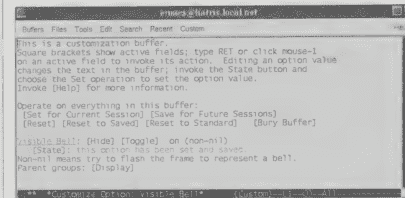

你可以通过按下 M-x 并输入 `customize-variable` 来打开自定义缓冲区。

当提示输入变量时，输入 `visible-bell`。

将显示一个包含单个选项的自定义缓冲区。有关使用自定义功能的更多详细信息，请参见第 4 章。

## 语法高亮

语法高亮是一种在缓冲区中以不同颜色显示不同类别文本的方式。Emacs 中的术语是字体锁定（font locking）。可以将其理解为锁定在 Emacs 用于显示文本的字体上的可变量和可配置的前景色。

字体锁定特别有用之处在于它的颜色取决于文件类型。例如，HTML 文件的文本包含在不同类型的标签中，并使用不同的颜色，这使得文件更容易阅读和编辑。尖括号标签指示符也被着色，使你在阅读文件时更容易忽略它们。

字体锁定最常被程序员使用。源代码文件通常充满了具有定义功能的单词和短语，如字符串、变量、函数和注释。当这些元素通过颜色区分时，文件的逻辑结构更容易阅读。

其他许多类型的文件也可以从字体锁定中受益。电子邮件消息可以显示其头部，引用块可以突出显示。甚至 shell 脚本和 Linux 配置文件的可读性也会提高。

到此时，你可能会疑惑为什么你的所有缓冲区都是统一的颜色。如果你还没有花太多时间定制 Emacs，你可能还没有打开字体锁定。它默认是关闭的。这样设置的原因是，Emacs 发行版的打包者无法知道你的显示器和视频卡可以显示多少种颜色。毕竟，有些人仍然使用单色显示器。选择关闭字体锁定有助于确保无论你的硬件如何，Emacs 都能无错误启动。

设置字体锁定过去是一项严肃的任务，涉及在 `~/.emacs` 文件中为每种字体锁定类型和颜色编写 Lisp 代码。如果你喜欢这种调整，这很有趣，但许多用户满足于默认的颜色值。*Customize* 的出现简化了字体锁定配置。Customize 为你编写必要的 Lisp 代码，并且接口通过少量练习就不难导航（参见第 4 章的介绍）。

你可能不会在一次 Customize 会话中创建理想的字体锁定配置。与其他 Emacs 配置任务一样，这是一个渐进的过程。你改变一些东西，看看你是否喜欢，然后，当时间允许时，再改变一些。

而不是启动自定义浏览器并四处点击寻找字体锁定组（如果你走那条路，它是 Faces 的一个子类别），你可以通过按下 M-x 并输入 `customize-group` 直接进入该组。

提示时，在小缓冲区中输入 `font-lock`。图 10.3 显示了出现的屏幕。

在图中，看一下从上数第五个带下划线的项。Global Font Lock Mode 是一个可以开关的设置。当你在 Emacs 会话中显示自定义缓冲区时，如果设置为关闭，请单击 **Toggle** 按钮。你可能希望在永久开启之前先试用一段时间字体锁定模式；使用 **State** 按钮来激活字体锁定。

默认的字体锁定面可能适合也可能不适合你的屏幕背景。尝试加载一个包含几种字体锁定面的文件；我推荐使用 Lisp 文件，也许是第 7 章中讨论的 `clipper.el` 文件。

通读该文件。有些新着色的部分是否难以阅读？良好的可读性需要一定的对比度。如果前景色和背景色之间的对比度太小，就需要采取一些措施。当一点努力可以极大地提高可读性时，不要勉强接受勉强可读的文件！

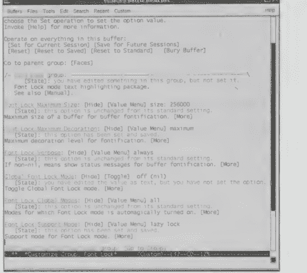

**图 10.2** *字体锁定自定义组*

现在全局字体锁定已启用，下一步是查看屏幕亮度的默认设置。有两套默认的字体锁定面；使用哪一套由变量 `frame-background-mode` 的值决定。你可以通过点击字体锁定组：Font-lock 缓冲区中的 Faces 来访问包含此变量的自定义缓冲区。要找的是“Go to parent group: {Faces}”这一行。

你在 自定义组：Faces 缓冲区中看到的第一个项是 `frame-background-mode` 的设置。默认设置为 `nil`，这让 Emacs 决定你的背景是浅色还是深色。我不知道 Emacs 究竟是如何确定这一点的；为什么不直接将变量设置为浅色或深色？大多数人要么喜欢浅色背景，要么喜欢深色背景。在将此变量设置为你偏好的值（并临时或永久保存）后，切换回 Lisp（或你选择的任何）字体锁定缓冲区。也许设置背景模式改变了颜色，使其变得更好。如果你仍然认为颜色可以改进，你可以单独设置每个字体锁定面。

为此，你需要回到字体锁定组自定义缓冲区（它应该列在缓冲区菜单上）。向下的第七项（这可能会变化，取决于你运行的 Emacs 版本）应该是字体锁定高亮面。选择此项，将出现一个新的缓冲区，其中包含许多不同字体锁定面的项。第一行是最重要的一行。为每一项显示当前设置的样本，让你判断它是否与默认面的背景相协调。单击任何你想更改的面的 **Show**，将出现可能设置的菜单（参见图 10.4 的代表性屏幕截图）。

默认情况下，只有前景设置标记为 X。在大多数情况下，这是唯一你想要更改的设置。背景应该由默认面背景控制（参见第 4 章）。

当你更改前景或背景色时，一旦通过选择 **State**、为当前会话设置或 **State**、为未来会话保存来激活设置，你会立即获得反馈。文本输入框中在 Foreground: 之后输入的颜色名称将突出显示单词“sample”。

Emacs 将接受你的 X11 会话可用的任何颜色。这些颜色的名称及其 RGB 值存储在一个名为 `rgb.txt` 的文本文件中；此文件通常可以在 `/usr/X11R6/lib/X11` 或可能的 `/etc/X11` 中找到。如果你找不到它，请在终端提示符下输入以下命令：

```
locate rgb.txt
```

将参考系统中文件的定期更新数据库，并且 `rgb.txt` 的位置将会显示出来。


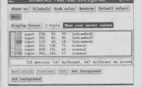

**图 10.5** xcoloreel 窗口

由于此文件中大约有 750 种颜色，你应该能找到你需要的东西。浏览 `rgb.txt` 时，不可避免的第一反应是“但它们看起来是什么样的？”。一个名为 `xcoloreel` 的实用小工具应运而生。它显示每种颜色，甚至允许你从桌面或应用程序中“捕捉”一种颜色，并确定可用颜色中哪一种是与其最接近的。图 10.5 显示了 xcoloreel 的实际操作。

xcoloreel 可从你的 Linux 发行版光盘和任何 Linux 软件存档站点获得。

开始时，让 xcoloreel 窗口显示在显示字体锁定高亮面缓冲区的 Emacs 窗口旁边。遍历这些面，尝试将每一个设置为与你的默认面背景以及其他字体锁定面都相协调的颜色。你不需要知道它们所有含义；每个面都在提供字体锁定的各种模式中使用。除非你是 VHDL 程序员，否则你可以安全地忽略列表底部的项；它们是 VHDL 模式专门使用的面。

新的字体锁定面将自动用于你可能安装的任何未来附加模式。如果你想单独设置控制台字体锁定面，请参见第 4 章的“X 窗口和控制台面”部分。

GNU Emacs 提供了另一种评估各种前景和背景字体锁定颜色的方法。按下 `Ctrl-mouse-button-2` 调出文本属性菜单。菜单的最后两项是显示面和显示颜色。依次选择这两项，你将最终得到一个水平分割的屏幕，类似于图 10.6 中显示的那个。

需要一些练习和实验才能得出和谐的字体锁定面集合。太多鲜明的对比颜色对眼睛有害，这就是所谓的“愤怒的水果沙拉”效果。过于相似的颜色违背了字体锁定的目的。一段试错期通常会产生一个你可以接受设置。


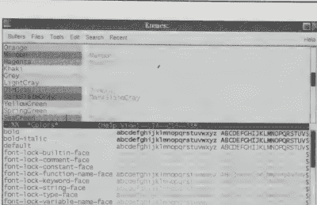

## 自动换行（Word Wrapping）

多年前，在 Emacs 开始多样化成为一个通用的编辑和工作环境之前，大多数 Emacs 用户都是计算机程序员。编写源代码的程序员不需要自动换行功能。这或许可以解释为什么在默认安装的 Emacs 中编写文本文件对新手用户来说可能会令人沮丧。

Emacs 默认使用一种伪换行机制。当输入的文字到达缓冲窗口的边缘时，会出现一个续行字符；如果你继续输入更多文字，它会显示在下一行。在 GNU Emacs 中，续行字符是一个反斜杠，而 XEmacs 使用一个小弯箭头。

这些续行字符不是文件的一部分，也不会被保存。它们的作用只是让你知道，文件的某一行太长，无法在缓冲窗口中完整显示。请注意图 10.7 中，换行可能正好发生在单词中间。这使得文件难以阅读。

如果伪换行是唯一的选择，很少有人会愿意选择使用 Emacs 来读写文本文件。幸运的是，可以自动启用一种行换行模式，适用于所有文本文件。

Auto-fill-mode 是一个次要模式（minor mode），这意味着它可以与主要模式（major modes，如 text-mode）共存。你可以通过按下 M-x 并输入以下内容来启用此模式：

你可能不希望每次需要这种模式时都被迫手动启动它。将以下行插入到 ~/.emacs 文件中，将导致该模式在需要时自动加载：

```
(add-hook text-mode-hook '(lambda () (auto-fill-mode)))
```

下一章将讨论模式钩子（mode hooks）。暂且将此代码行视为向现有模式添加新设置的一种方式——在本例中，即 text-mode。

默认情况下，只有后缀为 *.txt 的文件会自动进入文本模式。如果你有具有其他后缀且应处于 text-mode 的文件，在你的 ~/.emacs 文件中加入如下语句应该能解决问题：

```
(add-to-list 'auto-mode-alist (cons "\\.jrn\"\" 'text-mode))
```

将表达式中的 jrn 替换为你想要的任意后缀。

Emacs 在内存中维护一个称为 auto-mode-alist 的关联列表（alist），它将文件后缀与主要模式匹配起来。上述 add-to-list 语句通过添加一个新的 cons 单元（将后缀 ".jrn" 与 text mode 关联），有效地创建了一个新的 alist。在这一行被求值后，任何具有 ".jrn" 后缀的文件都将自动处于文本模式。你可能想要查看 auto-mode-alist 的当前值。只需按下变量帮助键，Ctrl-h v。

系统会要求你输入变量名。请输入：

```
auto-mode-alist
```

将会打开一个窗口，其中包含该变量的描述及其当前值。在这种情况下，你将看到所有文件类型关联，形式为 cons 单元。

这是你最后一个可能需要添加到 `~/.emacs` 文件中的 Lisp 表达式：

```
(setq default-major-mode 'text-mode)
```

这一行是让 Emacs 知道如果加载了一个未知扩展名的文件，应该启用 text-mode 的一种方式。它使用 `setq` 变量设置函数来更改 `default-major-mode` 变量的值。默认情况下，该变量的值是 `fundamental-mode`，这是一个相当无用的模式。

## 字体

你在 Emacs 会话中看到的字体是由 X 服务器提供的，而不是由 Emacs 本身提供。与文字处理器不同，像 Emacs 这样的文本编辑器不会将字体信息与文档文本一起保存。打印文本文件更多取决于打印机的功能，而不是生成文本的编辑器。

为了使用 Emacs 生成格式化文本，你需要使用 LaTeX 或 groff 等标记语言。许多 Emacs 模式为使用这些语言的写作者提供了便利功能。有关这些模式的更多详细信息，请参见第 13 章。

为 Emacs 选择不同显示字体的主要原因是增强屏幕可读性。合适的字体可能差异很大，具体取决于你的显示器尺寸、分辨率以及你的视力状况。

GNU Emacs 和 XEmacs 在字体处理方式上有所不同。XEmacs 允许你从“选项”菜单以及“自定义默认脸”缓冲窗口中设置默认字体及其大小。

你可以尝试在单次会话中使用某种字体，看看你是否喜欢它。使用以下命令启动 Emacs：

```
emacs -fn "+font-name" &
```

为了永久更改，GNU Emacs 要求字体必须在外部设置，即在 `~/.Xresources` 或 `~/.Xdefaults` 文件中。（你可能没有这样的文件；新建一个，你的 X 服务器将会使用它。）这种字体必须是等宽字体，而不是比例字体。它还必须使用标准的 X 字体名称语法。以下是来自 `~/.Xresources` 文件的一行示例，用于设置 Emacs 的基础字体：

```
Emacs*font: *bäh-lucidadtypewriter-medium-r-normal-sans-17-120-100-100-m-100-iso8859-1
```

你的 X 安装环境中提供的一些等宽字体有较短的名称，例如 9x15；这些是长形式（如上述 `~/.Xresources` 行所示）的别名。

两个实用工具 xlsfonts 和 xfd 应该在你的 Linux 系统中可用。前者列出 X11 字体，后者在窗口中显示字体及其属性。以下是如何使用 xlsfonts 生成等宽字体列表的方法。依次运行这两个命令，列表将保存到文件 fonts.txt 中：

```text
xlsfonts -fn 's*-*--*-*-*-*-*-*-m*' > fonts.txt
xlsfonts -fn 's*-*-*-*-*-*-c*' >> fonts.txt
```

在 Emacs 会话中打开新的 fonts.txt 文件后，你可以将指向所需字体的那一行复制到 ~/.Xresources 文件中的 Emacs;font : 行中，类似于前面的示例。或者，你可以使用标准的 X11 鼠标剪切和粘贴功能，将字体名称粘贴到 X11 终端窗口中的 emacs -fn 之后，如前面的示例所示。

xfd（X Font Display）实用工具可用于预览 xlsfonts 为你列出的任何字体。将 fonts.txt 中的任何一行粘贴到以下命令中：

```text
xfd -fn [font-name]
```

xfd 显示一个窗口，其中所有字符按实际大小显示。图 10.8 显示了一个示例。

这看起来可能工作量很大，但你只需要做一次。你会因为得到一个对眼睛更友好的 Emacs 显示而获得丰厚的回报。

你可以通过 Customize 为 XEmacs 设置默认字体。按下 M-x 并输入 customize-face

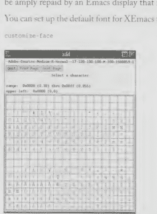

在提示输入时，请输入：

*default*

默认脸的自定义缓冲窗口有一个字体族（Font Family）输入字段，以及前面讨论过的熟悉的背景色和前景色输入字段。不需要输入完整的长字体名称，只需输入字体族名称，例如 Times 或 New Century Schoolbook。字体族和大小也可以从“选项”菜单中设置；如果你希望永久保存更改，请记得从同一菜单中选择“保存选项”（Save Options）。

## 脸（Faces）与字体

脸（faces）和字体很容易混淆。需要记住的一点是，每个脸都有一个字体，在大多数情况下，这是默认字体。脸还包括其他文本属性，如颜色、字体大小，以及字体是*斜体*、**粗体**还是下划线。

## 比例字体与等宽字体

文本编辑器传统上只使用等宽字体。其中一个原因是，程序源代码和列式数据等文本由于字符宽度相等而显得更整齐。比例字体或变宽字体长期以来一直被用于出版领域，因为它们的可读性更强，字符设计更精致。一般来说，比例字体会使文档看起来更精致、更正式。旧式的机械打字机只有等宽字体，这就是为什么像 Courier 这样的流行等宽字体有时被称为“打字机字体”。

你应该使用哪一种？这是一个口味和偏好的问题。目前，GNU Emacs 不支持比例字体，但即将发布的 21 版本将支持。XEmacs 已经支持这些字体好几年了。

在我看来，在 X 中值得使用的唯一比例字体是 TrueType 字体（下一节讨论）。在所有字体大小下，清晰度和锐度的提升都非常明显。如果你的系统未设置为渲染 TrueType 字体，并且你也不打算升级，那你最好还是坚持使用久经考验的等宽字体。

## TrueType 字体

字体显示多年来一直是 X11 的一个薄弱环节。一些字体看起来还行，但其他字体，尤其是可缩放字体（比例字体的另一个名称），往往显得锯齿状和方块化。我第一次看到外观均匀良好的字体时


X Window 已经是几年前的事了，当时我发现已经有了支持 TrueType 字体的字体服务器。

TrueType 字体由 Apple 在 20 世纪 80 年代末开发，作为与 Microsoft 的一项协议的一部分。这两家公司的动机是为了抗衡 Adobe 的字体技术在新兴个人计算机市场中即将占据的主导地位。Apple 的新字体旨在计算机显示器上呈现清晰且锐利。自然，Microsoft-Apple 联盟希望这种新风格的字体能取代 Adobe 的竞争对手 PostScript Type 1 字体标准。但这并未发生。PostScript 字体仍然是出版行业的主流，但对于屏幕显示而言，TrueType 字体表现出色。

XFree86 项目发布的 4.0x 版本是 Linux 用户的一个里程碑。主要的 Linux 发行版正在从旧的 3.3x 版本过渡。因此，TrueType 字体的安装和使用变得更加容易。新的 XFree86 版本内置了对 TrueType 字体的支持。xf86font 服务器可以使应用程序使用它们，这项工作以前需要第三方字体服务器的服务。

安装了一些高质量的 TrueType 字体后，它们会出现在 XEmacs 选项菜单的字体部分。

## 您自己的键盘绑定

标准键盘上可用的按键组合有限。Emacs 开发者试图为最常用的命令分配快捷键，同时将其他命令作为 M-x 迷你缓冲区命令提供。很可能您并不完全同意他们的决定。一些键盘绑定可能感觉不太方便，而您经常使用的其他绑定则值得从多键绑定提升为单键绑定。

这是 Emacs 强大可配置性的一个体现。一旦您学会使用一些相当简单的 Lisp 函数，可以将任意或所有键重新绑定到其他按键上。

一点注意事项：如果您进行大量的键盘绑定更改，使用另一台配置“正常”的 Emacs 可能会带来痛苦体验。如果您在 corporate 环境中工作，偶尔需要在其他用户的机器上使用 Emacs，最好保留至少基本键命令接近默认设置。这是人们声称更高效但 Dvorak 键盘布局使用不广泛的原因之一：在 QWERTY 键盘上使用 Dvorak 布局的用户可能会退回到逐字打字的风格。

## Lisp 中按键的表示方式

Emacs-Lisp 解释器理解几种有效的按键表示系统。不幸的是，某些系统在不同版本的 Emacs 之间不具可移植性。我在此介绍的系统不如某些系统紧凑，但它的优点是可以用于任何现代版本的 GNU Emacs 或 XEmacs。

该系统使用基本的英文术语来表示修饰键：`Ctrl-x` 表示 control x，M-x 表示为 meta x。`Shift` 表示 shift；方向键简单地表示为 `left`、`right`、`up` 和 `down`；功能键表示为 f1、f2 等。

当两个或多个键打算同时按下（称为*按键组合*）时，它们应该被括在括号内。整个按键序列（包括按键组合）被括在方括号内。以下是它们在 Lisp 表达式中出现的几个示例：

```
[(control c) d]
[(shift f1)]
[(control c) (control shift f5)]
[(meta shift right)]
[(control mouse-1)] ; GNU Emacs
[(control button 1)] ; XEmacs
```

最后两个示例展示了 GNU Emacs 和 XEmacs 在这些表示中唯一的区别：鼠标按键点击的术语略有不同。

现在您可以编写任何按键序列，使 Emacs 能够解读它，但这只是第一步。 somehow，该按键表示需要与其他所有键盘绑定以及它应该执行的命令放在一起。

## 键盘映射：全局和局部

第 7 章在剖析 clipher.el 时简要介绍了键盘映射的概念。回顾一下，键盘映射是一个变量，其值是一个关联列表，由按键序列/命令对组成的列表。


> 在 XEmacs 中，键盘映射不是一个关联列表。它是一个原始类型，但从用户的角度来看没有区别。内置函数如 make-sparse-keymap 的使用方式与 GNU Emacs 相同。

键盘映射可以是全局的，在所有的 Emacs 缓冲区模式中有效，也可以是局部的，限制在特定类型的缓冲区中。每次您使用键盘命令时，Emacs 首先在局部键盘映射（可能是某种模式的一部分）中查找该按键序列。如果找不到该按键序列，则咨询全局键盘映射；如果找到匹配项，则执行相关的命令。如果 Emacs 完全找不到匹配项，迷你缓冲区中会出现错误消息 `(keys pressed) not defined`。这听起来像是一个缓慢的过程，但由于键盘映射保存在内存中，访问它们是近乎瞬间的。

全局键盘映射不仅仅是一堆杂乱的键盘绑定。它根据前缀排序；每个前缀（如 Ctrl-x）都有自己的子键盘映射。所有以 Ctrl-x 开头的键命令（如 Ctrl-x h，kill buffer 命令）都是 `ctrl-x-map` 的一部分。向全局键盘映射添加新的键盘绑定需要如下的 Lisp 表达式：

```lisp
(global-set-key '[(control c) c] 'fill-region)
```

函数 `global-set-key` 是 Emacs 的内置函数；它的第一个参数是按键表示，第二个参数是执行的命令。在这个例子中，我定义了内置函数 `fill-region`（重新填充选定区域中的所有段落）的键盘绑定为 Ctrl-c c。该函数没有默认键盘绑定。如果存在一个，它将仍然有效，您最终会有同一命令的两个键盘绑定。

`fill-region` 前面的单引号是必要的，因为它强制 `global-set-key` 函数将 `fill-region` 视为符号，而不是变量的值。

许多 Emacs 命令使用同时按下 Ctrl 键和字母键（称为修饰键），后跟一个单独的字母键或另一个 Ctrl 键-修饰键组合。这些组合中有一个已保留给您新的键盘绑定：Ctrl-c 前缀。这个前缀很容易输入，当您为新创建命令需要键盘绑定时，它应该是您的首选。

另一种可能性是更改 Emacs 的默认键盘绑定。这被称为重新绑定键盘命令。很可能有几个键盘绑定您从不使用，也预见到将来不会使用。作为例子，考虑 Ctrl-z 键盘绑定。按下它会暂停 Emacs 并使框架图标化。任何 Linux 窗口管理器都提供相同的操作，要么通过标题栏按钮，要么作为菜单项，因此这可能是重新绑定的候选项。

也许您觉得 `beginning-of-buffer`（M-<）的默认键盘绑定按起来不太方便。您在 ~/.emacs 文件中的以下行将此命令分配给 Ctrl-z：

```lisp
(global-set-key [(control z)] 'beginning-of-buffer)
```

评估此行后，按 Ctrl-z 将点移动到缓冲区开头。旧的 Ctrl-z 键盘绑定将被取代，但 M-< 键盘绑定仍然有效。

如果 Ctrl-c 前缀不能提供足够的舒适按键组合，您可以通过创建新前缀来创建一组新的可用键盘绑定。如果您决定 Ctrl-z，因为它很容易输入，将成为新键盘绑定的绝佳前缀？像这样的一行：

```
(global-set-key [(control z) a] 'eval-region)
```

会导致错误。因为 Ctrl-z 已经与一个命令相关联，所以它不能被用作前缀。您必须首先用如下语句显式地解除 Ctrl-z 与所有键盘绑定的关联：

```
(define-key global-map [(control z)] nil)
```

评估此之后，前面的 `global-set-key` 语句将有效。

您可以使用前面的表达式禁用任何键盘绑定，即使您不打算用其他绑定替换它。例如，我偶尔会不知不觉地按下 Insert 键。通常 Insert 键会在默认的插入模式和覆盖模式之间切换。我在编辑时从不使用覆盖模式，所以我 ~/.emacs 文件中的以下语句禁用了该键盘绑定：

```
(define-key global-map [(insert)] nil)
```

功能键是重新绑定的良好候选项。F1 默认绑定为内部 Emacs 帮助系统的前缀（Ctrl-h 也是如此），但您真的需要两个帮助键盘绑定吗？在 GNU Emacs 中，F2 按两次（或 F2-2）绑定为垂直分割屏幕进行双列编辑的命令，这是一个很少使用的命令。如果您从控制台运行 Emacs，F10 会很方便，因为它设置键盘菜单界面（Emacs 的任何版本都没有控制台菜单）。如今大多数用户将 Emacs 作为 X Windows 应用程序运行；对于这些用户，此绑定没有用。我想说的是，所有功能键都可以重新绑定。

您最常使用哪些 Emacs 命令？我猜测关闭缓冲区、保存到磁盘和运行 ispell（Emacs 拼写检查器）符合。这些类型的命令适合单个键，而不是多键组合。您可能希望尝试在您的 ~/.emacs 文件中试用以下 `global-set-key` 表达式。如果它们不适合您，请更改或删除它们。

```
(global-set-key [(f1)] 'kill-buffer)
(global-set-key [(f2)] 'ispell-word)
(global-set-key [(f3)] 'beginning-of-buffer)
(global-set-key [(f4)] 'end-of-buffer)
```


```lisp
(global-set-key [(f7)] 'save-buffer)
(global-set-key [(f8)] 'start-kbd-macro)
(global-set-key [(f9)] 'end-kbd-macro)
(global-set-key [(f10)] 'call-last-kbd-macro)
```

请记住，你不必费心将这些（或之前任何）示例实际放入你的 `~/.emacs` 文件中来尝试它们；只需将其中任何一个输入到**草稿**缓冲区中并求值该表达式（使用 `Ctrl-x Ctrl-e`）。该绑定将保持有效，直到你更改它或退出 Emacs 为止。

## 特定模式绑定

另一种键绑定仅在特定模式内有效（有关模式的更多信息，请参阅第 11 章）。你不需要做任何事情来设置这些绑定。当某个模式被加载并因此变得活跃时，会创建一个本地键映射（如果需要），它可能会覆盖一些全局键绑定。

## 键盘与控制台

如果你在使用虚拟控制台使用 Emacs，那么某些在 X Window 中正常工作的按键可能会有不同的行为。这完全取决于你的 Linux 发行版是如何设置的。通常的罪魁祸首是 Backspace 和 Delete 键，可能还有 Alt 键。

Linux 附带一个名为 `loadkeys` 的工具，可以加载不同的控制台键映射。查阅你的发行版文档以了解控制台键映射的位置；你很可能会找到至少一个针对 Emacs 使用进行优化的键映射，其名称类似于 `emacs.kmap`。阅读 `loadkeys` 的手册页，加载新的键映射，并启动一个控制台 Emacs 会话。如果新的键映射改善了键盘状况，你可以编辑其中一个初始化脚本，以便每次在虚拟控制台登录时自动加载 Emacs 键映射。你的发行版文档会告诉你如何做到这一点。

## 标题栏

默认情况下，X Window Emacs 窗口的标题栏显示如下所示的一行内容：`emacs [你的机器的主机名]`。你可以更改标题栏文本，使其显示更有用的信息。变量 `frame-title-format` 控制此文本，并且其值可以更改。也许你希望将当前缓冲区的文件名（包括其目录）显示在标题栏中。尝试将以下 Lisp 表达式放入你的 `~/.emacs` 文件中：

```lisp
(setq frame-title-format "(*Emacs: %i (%f)*)")
```

该变量使用几个内置代码，这些代码与另一个 Emacs 变量 `mode-line-format` 共享。`"%f"` 是其中之一；它代表当前缓冲区的文件路径名。任何带引号的字符串，例如示例中的 `"Emacs: "`，都会原样插入到标题栏文本中。以下是一些你可能想要尝试的其他代码：

- `"%b"` 打印缓冲区名称。
- `"%m"` 打印当前模式名称。
- `"%p"` 打印窗口上方缓冲区的百分比，或显示“Top”。
- `"%P"` 打印窗口下方缓冲区的百分比，或显示“Bottom”。

这里还有另一个示例：

```lisp
(setq frame-title-format '("XEmacs: " ("%b") (" %m")))
```

此设置将窗口标题设置为类似以下内容：

```text
XEmacs: buffername Text-mode
```

在这些示例中，请注意引号内插入的空格。这些空格出现在标题栏上，有助于将字段分开。

你可以查阅 Emacs 帮助（`Ctrl-h v`），了解变量 `frame-title-format` 和 `mode-line-format`，以了解更多关于该变量结构的信息。

## 结论

本章和上一章应该有助于你超越 Customize 提供的 Emacs 更改范围。尝试这些 Lisp 示例表达式。请记住，当你求值一个 Lisp 语句时，Emacs 会实时捕获更改。这让你可以临时尝试某些事情，而不会干扰你当前可用的设置。

下一章将探讨 Emacs 模式，之前的章节已简要讨论过这些内容。模式赋予了 Emacs 强大的能力和灵活性，因为它们使 Emacs 成为针对特定类型文件的专用编辑器。

## 第 11 章：模式，主要和次要

- 介绍模式
- 模式为你做什么
- 次要模式
- 加载模式的多种方式
- 从一种模式派生出另一种模式
- 修改模式

## 介绍模式

到目前为止，你很可能已经对 Emacs 模式有了概念，因为之前提到过几种模式。可以将模式视为一组配置值，可能包括字体锁定颜色、键绑定、新菜单和专用函数。

本章介绍主要模式和次要模式的不同用途以及它们的交互方式。由于模式由一个或多个 Lisp 文件组成，如果你想改变其行为，可以对它们进行编辑和重新字节编译；本章最后几节给出了这方面的示例。

模式有两个种类——主要模式和次要模式。在任何给定时间，缓冲区只能处于一种主要模式中。次要模式的排他性较弱。可以同时激活多个次要模式，并且它们可以与占主导地位的主要模式共存。你可以将次要模式视为补充主要模式的一种模式，它添加了新的功能或能力。

模式可以通过两种方式加载：显式地，通过小型缓冲区命令；或者自动地，当加载了带有特定扩展名的文件时。第 10 章引入了变量 `auto-mode-alist`，它是所有模式与扩展名配对的关联列表。为什么不看看这个变量的值呢？按 `Ctrl-h v`，然后在提示输入时输入 `auto-mode-alist`。

一个帮助窗口会打开并显示该变量的帮助（参见图 11.1），它由简短的描述和变量当前的值组成，这是一个看起来杂乱无章的长列表。

仔细观察，你会发现组成整个关联列表的各个元素。这是其中之一：

```lisp
'("\\.[ch]\\'" . c-mode)
```

早在第 3 章，“搜索中的正则表达式”部分，介绍了基本的 Emacs 正则表达式（regexp）语法。这个两元素点号配对的 cons 单元使用了两个正则表达式符号。`c|h` 字符对位于一对方括号内，表示 `c` 或 `h` 都是有效的。反斜杠是正则表达式的转义字符，强制将句点视为字面量，而不是将其解释为通常的正则表达式符号。反斜杠加单引号是一个特殊情况：它表示后缀必须是构成文件名的字符串的结尾。这一切的结果是，任何带有 `c` 或 `h` 后缀的文件都匹配该正则表达式，并将在 `c-mode` 中打开。

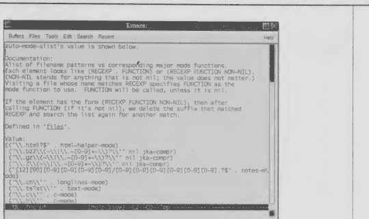
图 11.1 auto-mode-alist 帮助窗口

另一个关联列表将脚本语言文件匹配到主要模式。它不使用文件名后缀，而是 `interpreter-mode-alist` 匹配此类文件第一行中发现的字符串。这是该 a-list 中的一个 cons 单元：

```lisp
('python' . python-mode)
```

Python 文件通常以类似于以下内容的行开头：

```text
#!/usr/bin/env python
```

当这样的文件加载到 Emacs 会话中时，`interpreter-mode-alist` 会在该第一行中找到匹配项，并且文件将以 Python 模式打开。这种 a-list 背后的逻辑是，脚本语言文件可能没有允许 `auto-mode-alist` 将该文件与主要模式关联的后缀。

## 模式为你做什么

一种用于编辑特定类型文件的模式将 Emacs 转换为针对该特定类型文件优化的编辑器。这一切对用户来说是毫无费力且透明的。你打开一个 HTML 文件，HTML 模式就会发挥作用；打开一个 LaTeX 文件，AucTeX 就会接管。只有当文件后缀包含在 `auto-mode-alist` 变量中时，这种情况才会发生。该变量包含许多种文件类型，但你需要自己添加新的和不常见的类型。执行此操作的说明通常包含在新模式的注释中。如果没有，前一章中的示例可以作为一个模板：

```lisp
(add-to-list 'auto-mode-alist (cons "\\.jrm\\'" 'text-mode))
```

将文件类型的后缀替换为 `jrm`，将模式名称替换为 `text-mode`。这将导致任何具有该后缀的文件在指定的模式下打开。如果希望此设置永久生效，可以将该表达式包含在你的 `~/.emacs` 文件中。

`auto-mode-alist` 中的正则表达式不一定需要匹配文件的后缀。假设你决定将 Emacs 用作 Mutt 邮件程序的外部编辑器。你希望 Emacs 在编写源自 Mutt 的电子邮件消息时自动切换到 `text-mode`。

Mutt 对其临时消息文件的命名格式如下：

```text
mutt-[user-name]-xxxxxx-x
```
其中 `x` 字符被替换为每个消息都不同的数字。这些文件名中唯一不变的部分位于开头，因此正则表达式应搜索并匹配任何以 `mutt-` 开头的文件。以下是执行此操作的 `setq` 语句：

```lisp
(setq auto-mode-alist (cons '("mutt-.*" . text-mode) auto-mode-alist))
```
正则表达式部分中 `.*` 前的 `^` 表示只有文件名以 `mutt-` 开头的文件才应匹配。

## 语法高亮

Emacs 使用的语法高亮（或字体锁定）系统最初设计主要用于编程语言，但已适应于在多种其他类型的文件中良好工作。九种主要的字体锁定面元素（faces）的命名反映了它们在编程模式中的原始用途，例如变量、常量和关键字面元素。这并不意味着这些面元素不能用于非编程模式。这些面元素主要通过其前景色进行区分。许多模式选择使用现有的字体锁定面元素，即使它们的名称可能与所高亮的文本类型关系不大，而不是创建新的面元素。

这为用户安装新模式提供了便利。一旦你费心将字体锁定面元素配置为你喜欢的方式，使用已配置面元素的新模式即可直接使用。


## 键位绑定

模式通常不需要一套全新的键位绑定。它们中的许多都使用 `make-sparse-keymap` 函数来构建局部键位图，这是一组仅限于当前缓冲区的绑定。

`Ctrl-c` 前缀保留给模式以及用户定义的键位绑定使用。跟在 `Ctrl-c` 后面的若干字符保留给主模式使用：

- `Ctrl-c Ctrl-l-[字符]`
- `Ctrl-c [数字]`
- `Ctrl-c [{],<,>,], 或 :}`

您可以确信，如果您使用 `Ctrl-c` 后跟一个字母字符作为自己的键位绑定，那么不会与主模式的键位绑定发生冲突。

某些特殊用途的模式不用于实际编辑。插入文本并非它们的设计初衷；因此，它们可以完全接管键盘。`Dired` 文件管理模式就是一个很好的例子。Dired 使用许多字母键来执行各种文件操作，例如标记和删除。

另一种这样的模式是 `dictionary` 模式，它是一个作为 Emacs 与字典服务器接口的附加组件。字典模式使用允许您查找点处单词定义的键位绑定。定义会在一个新的专用字典窗口中显示。当这种情况发生时，以下代码开始生效：

```lisp
(setq dictionary-mode-map (make-sparse-keymap)
  (suppress-keymap dictionary-mode-map)

(define-key dictionary-mode-map "q" 'dictionary-close)
(define-key dictionary-mode-map "h" 'dictionary-help)
(define-key dictionary-mode-map "a" 'dictionary-search)
(define-key dictionary-mode-map "D" 'dictionary-select-dictionary)
(define-key dictionary-mode-map "M" 'dictionary-select-strategy)
(define-key dictionary-mode-map "m" 'dictionary-match-words)
(define-key dictionary-mode-map "d" 'dictionary-search-word-at-point)
(define-key dictionary-mode-map "1" 'dictionary-previous)
```

这段 Lisp 代码首先创建了一个新变量 `dictionary-mode-map`，其初始值为 `make-sparse-keymap` 返回的值。在下一行中，使用名为 `suppress-keymap` 的内置函数替换了正常的键位图。该函数将当前的键位图替换为函数的参数值，在本例中为 `dictionary-mode-map`。此时，`dictionary-mode-map` 是空的，但接下来的几行向键位图添加键位绑定——这些绑定之前是普通的字符插入命令。

在每一行中，最后一个元素是 dictionary.el 其他地方定义的函数名称。

在 dictionary.el 稍后的部分，以下行使新的键位图仅在字典窗口中激活，而在其他任何地方都不激活：

```lisp
(use-local-map dictionary-mode-map)
```

### 缩进

编程模式（如 c-mode、python-mode 和 lisp-mode）重新定义了缩进行为。例如，一些程序员喜欢能够将函数作为一个单元进行缩进。Emacs 的 C/C++ 模式（cc-mode）为此提供了键盘命令，以及对整个带括号或中括号语句的缩进功能。其他语言模式在较大或较小程度上提供了这些功能。

## 自动换行

text-mode 并不是唯一可以使用 auto-fill-mode 的模式。各种电子邮件消息编辑包，例如 Gnus 和 rmail，默认加载 auto-fill-mode 或称为 adaptive-fill-mode 的相关模式。

上述 cc-mode 仅在注释块内使用自动换行，即源代码文件中适合或需要换行的区域。

在本章稍后的部分，将引入模式继承的概念。这是一种允许一种模式从另一种模式“继承”特性的机制。几种模式使用这种机制向新模式添加功能，而无需重写函数代码。

### 次要模式

每个缓冲区始终处于某种主模式，即使只是基本模式。次要模式的使用是可选的。当启用这些较小的模式之一时，它会为主模式的添加一些行为，而不会干扰主模式的功能。

一个例子是 auto-fill-mode，一个次要模式，与 text-mode 配合使用。text-mode 自身所做的仅是设置几个键位绑定（如 M-Tab，它调用 *ispell* 补全部分输入的单词）并定义空行作为段落分隔符。auto-fill 次要模式向基本的 text-mode 行为添加了自动换行功能。

缓冲区中可以有任意数量的次要模式处于激活状态，但超过两三个的情况并不常见。

次要模式可以安装一个新的键位图，该键位图可以重新定义主模式键位图中的一些键。由模式帮助键 Ctrl-h m 调出的文档列出了所有激活模式的键位绑定，包括次要模式。

### 多模式的优势

您可能针对特定类型的文件使用一种主模式，但发现缺少一个小的功能。尝试编辑主模式的 Lisp 文件以添加该功能的前景可能令人望而生畏。该模式现在运行正常，您必须冒着使其不可用的风险。很可能存在一个可用的次要模式，可以添加该缺失的功能，但如果您找不到，您可以尝试编写自己的模式，而无需承担损坏主模式文件的风险。

### 模式钩子

为模式提供钩子的想法是一个富有启发性的概念。想象一种模式是某种物质对象。进一步想象，该对象上装有钩子，可以挂上改变对象行为的小型对象。这就是模式钩子背后的理念：在模式中构建一个设施，以便使用简单的 Lisp 表达式来修改该模式。这与次要模式的理念相似，但挂载到模式钩子上的 Lisp 表达式不需要像完整的次要模式那样复杂。如果您只需要向模式添加，例如，一个新的单一键位绑定，这就是您需要使用的。

下面是一行启用 text-mode 钩子的示例代码（该行提取自 text-mode.el 文件）：

```lisp
(run-hooks 'text-mode-hook)
```

下面是 ~/.emacs 中可能包含的一行代码，向 text-mode 添加一个钩子：

```lisp
(add-hook 'text-mode-hook 'turn-on-auto-fill)
```

本例中的钩子是一个简单的指令：执行 turn-on-auto-fill，这是一个无条件开启 auto-fill-mode 的内置函数。

模式钩子使向模式添加一个或多个功能变得容易。使用 add-hook 语句可以完成键位绑定、新外观以及运行现有函数等操作。

这里还有另一个例子：

```lisp
(add-hook mail-mode-hook
  (lambda ()
    (define-key mail-mode-map [(control c) (x)] 'mail-send-and-exit)
    (define-key mail-mode-map [(control c) (c)] 'mail-cc)
    (setq fill-column 65)))
```

这个例子向 mail-mode 添加了两个新的键位绑定，并更改了 fill-column 设置。它使用 lambda 函数来完成，lambda 函数是一个匿名函数，因为没有在此特定的 setq 变量定义之外使用它的原因，所以没有命名。

注意这两个示例之间的区别。第一个添加了一个钩子，因此如果已定义了其他 text-mode 钩子，这个钩子将被添加到列表中，而不是替换早期的钩子。第二个示例是 setq 变量定义，它将替换 mail-mode-hook 可能拥有的任何值。当您确定没有将其他钩子附加到该模式时，请使用此形式。由于这些钩子通常定义在 ~/.emacs 文件中，因此检查文件中关于所涉模式的先前钩子条目并不是一件繁重的工作。

### 如何关联模式

某些模式除非与一个或多个其他 Lisp 库一起使用，否则没有用处。require 函数在 Lisp 模式文件的开头附近使用，以强制在评估模式主体之前从另一个文件加载功能（有关 require 的更多信息见下一节）。这就是构建多文件包的方式。对用户的优势是，只需在 ~/.emacs 文件中写一行语句即可加载整个包。notes-mode 是一个很好的例子。notes-mode.el 的前两行导致两个相关文件 notes-variables.el 和 notes-aux.el 在评估 notes-mode.el 的主体之前被加载：

```lisp
(require 'notes-variables)
(require 'notes-aux)
```

将大型模式拆分为几个文件使开发者的工作更轻松。相关的函数和变量可以被隔离到单独的文件中。这也隔离了可能的错误，使其更容易追踪。

### 加载模式的几种不同方式

在 ~/.emacs 文件中编写 Lisp 表达式的三种方式可以激活一个模式。它们各自有优缺点，附加组件模式可能会以只有其中一种方式有效的方式编写。我遇到过一些模式包


某方法可能无法正常工作，尽管文档声称可以。有时，尝试三种加载方法中的另一种可能有助于让该模式在你这里正常运行。

### 加载

加载 Lisp 文件最基本的方法是使用内置函数 `load`。一个 `load` 语句如下所示：

```lisp
(load 'file-name)
```

`load` 首先查找 `file-name.elc`；如果找不到，则查找 `file-name.el`；如果该文件也不存在，则直接使用 `file-name`。

使用此函数的缺点是文件会被立即加载，即使它直到稍后才需要。对于需要快速可用的频繁使用的 Lisp 文件，使用 `load` 是合适的。由于下两种方法具有更大的灵活性，它们更常用。

### 自动加载

可能有一些你很少使用但需要在需要时仍可访问的模式。自动加载这些模式是理想的技术，因为模式直到你通过键盘按键或迷你缓冲区命令调用时才会加载。`autoload` 是一个内置函数。一个 `autoload` 命令如下所示：

```lisp
(autoload 'follow-mode "follow")
```

这是一个简单的例子；`autoload` 命令的完整语法如下：

```lisp
(autoload function-name Lisp-file docstring interactive type [最后三个是可选的])
```

上面展示的 `follow-mode` 例子只使用了语法示例中的前两个元素。它省略了三个可选开关，因为当你自动加载位于加载路径目录中的 Lisp 文件时，这些开关是不必要的。当请求时，Autoload 使用 `load` 函数实际加载文件，因此如上所述，如果存在 `.elc` 文件则使用它。

上述 autoload 语句翻译成英文可能读起来像这样：

> “在加载路径上查找名为 `follow.elc`、`follow.el` 或 `follow` 的 Emacs Lisp 文件，首选第一个。在文件中查找名为 `follow-mode` 的函数，并准备好在用户请求时加载该函数。”

如果仅存在前两个必需参数，`autoload` 认为缺失参数的值为 nil。换句话说，没有 docstring，函数不是交互式的，并且 `type` 参数指向一个函数（默认值）。

以下是从加载 `dictionary`-mode 中两个函数而非 `entire` 文件的 `~/.emacs` 文件中的两个示例：

```lisp
(autoload 'dictionary-search "dictionary"
 "Ask for a word and search it in all dictionaries" t)

(autoload 'dictionary-search-word-at-point "dictionary"
 "Search the word at point in all dictionaries" t)
```

这两个表达式从 `"dictionary"` 中加载函数，该函数被 `autoload` 扩展为 `"dictionary.elc"`。如果函数无法在 `load-path` 上找到该名称的文件，它会改为查找 `dictionary.el`。表达式末尾的 `t` 旨在使 `dictionary` 函数变为 `interactive`（交互式）——`t` 表示是或真。这意味着按下 M-x 并输入

`dictionary-search`

将导致 `dictionary` 搜索函数从 `dictionary.elc` 加载，这会导致迷你缓冲区提示 Search word:（搜索单词：）

### 需求

某些软件包是你日常工作的必需品；你希望在 Emacs 启动时加载它们，并在此后快速可用。`require` 函数专为这种需求而设计。一个 `require` 表达式可以像这样简单：

```lisp
(require 'clipper)
```

该函数不会显式加载函数或 Lisp 文件。它加载一个 `feature`（特性），这是 Emacs 术语，意为一组函数和/或变量。

完整语法是

```lisp
(require '[feature-symbol] ['file-name])
```

第二个参数是可选的；如果缺失，该函数将查找与 `feature` 同名的文件名。

为了使用 `require`，Lisp 文件中必须存在如下的语句：

```lisp
(provide 'clipper)
```

函数 `provide` 将其参数给定的 `feature-symbol` 添加到名为 `features` 的 Emacs 变量中，该变量是可用特性的列表，这些特性在当前 Emacs 会话中可用。

require 的一个优点是，该函数首先检查文件是否已经加载；如果已加载，require 不做任何事。这防止了文件在一个会话中被加载多次。

require 通常用于在 Lisp 文件中使存在于另一文件中的特性可用。require 和 autoload 函数之间的区别在于，autoload 仅将文件名及其 docstring 加载到内存中，将实际加载推迟到明确请求时进行。

使用这三个函数中的哪一个通常由软件包作者决定。源文件中被注释掉的文档通常提供了可以插入到你的 ~/.emacs 文件中的示例行。如果你难以说服软件包加载或自动加载，尝试其他函数是值得的。

### 从另一个模式派生模式

模式派生是一种节省时间的技术。这是一个常见情况：你需要一种模式来使编辑某种类型的文件更容易。为另一种类型的文件设计的模式几乎是你需要的，从头开始似乎很可惜。你可以从另一个模式派生一个新模式，保留旧模式的核心功能，但更改某些特性，使新模式按你需要的方式工作。这有助于防止“我是不是在重新发明轮子？”的感觉。

使这成为可能的是一个名为 define-derived-mode 的 Lisp 软件包。它具有简单的语法：

```lisp
(define-derived-mode new-mode's-name old-mode's-name mode-line-string
docstring
expression-1
expression-2
etc.)
```

以下是来自 gametree.el 的一个示例，这是 Emacs 游戏模式附带的一个文件：

```lisp
(define-derived-mode gametree-mode outline-mode "GameTree"
"Major mode for managing game analysis trees.
Useful to postal and email chess (and, it is hoped, also checkers, go, shogi, etc.) players, it is a slightly modified version of Outline mode.

\\{gametree-mode-map}"
(auto-fill-mode 0)
(make-variable-buffer-local 'write-contents-hook)
```

```lisp
(add-hook 'write-contents-hooks 'gametree-save-and-back-layout!)

;;; Key bindings

(define-key gametree-mode-map "\C-c\C-j" 'gametree-break-line-here)
[etc]
```

第一行设定了场景：调用 `define-derived-mode` 使用 `outline-mode` 作为基础创建新模式 `gametree-mode`。`mode-line-string` 是一段简短的描述性文本，显示在模式行中——在这种情况下是“Gametree”。

接下来的三行是 docstring，即大多数编写良好的模式中发现的可选内置文档。注意第一行过早断开（在 `name` 之后立即断开）。这是 Emacs 的惯例，在单独一行上以单句摘要开始 docstring。apropos 帮助设施查找该摘要行，如果在 `gametree-mode` 加载后按下 `C-h l`，则会显示它。docstring 以以两个反斜杠开头的奇特表达式结束。这是 Emacs 内部帮助系统理解的代码；它意味着“评估大括号之间的表达式，并用结果替换此行。”如果在 `gametree-mode` 中有一个缓冲区，并且你通过按下 `C-h m` 召唤模式帮助，Help 缓冲区将看起来像 **图 11.2**。

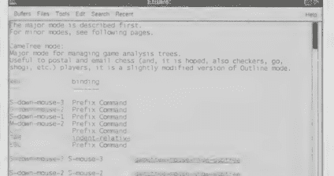

图 11.2 Gametree 帮助

注意 docstring 如何被修改：反斜杠前缀的行消失了，键绑定列表 (`gametree-mode-map`) 在其位置被替换。紧随 docstring 之后的是表达式的实际主体，由一系列函数定义和/或变量声明组成。此例中的 define-key 函数使用了一种显示键绑定的替代方式。使用反斜杠转义字符代替前一章中说明的括号系统。此键绑定等同于 [(control c) (control j)]。

### 修改模式

迟早，每个 Emacs 用户都会想到“我希望有某种模式使这种编辑更容易！”。也许你在编辑新类型的文件，并希望有用于该文件类型的字体锁定，或能加速重复任务的新的键命令。

我愿意打赌，许多有经验的 Lisp 黑客在从头创建新模式之前，是通过修改现有模式入门的。几乎每个模式的 Lisp 源代码都是自由可用的；你需要做的是找到一个接近你需求的模式。

如果你想在修改模式方面走得更远，一项必不可少的 Lisp 技能是熟练运用正则表达式。它们在几乎所有模式中以某种方式被使用，特别是在字体锁定例程中。

你需要能够告诉字体锁定引擎如何识别特定的文本块，而正则表达式是做到这一点的唯一实用手段。看看这个从 rmail.el 中摘录的字体锁定代码：

```lisp
(defvar rmail-font-lock-keywords
  (eval-when-compile
    (let* ((cite-char "[>]")
           (cite-prefix "^A-Za-z")
           (cite-suffix (concat cite-prefix "0-9_~^\"")))
     (list '("^\\[From\\|Sender\\]:" . font-lock-function-name-face)
           '("^Reply-To:.\\$" . font-lock-function-name-face)
           '("^\\[Subject]" . font-lock-comment-face)
           '("^\\[To\\[Apparently-To\\[Cc\\[Newsgroups\\]:"
             . font-lock-keyword-face)
           [remainder of defvar statement cut])))
```

这就是 rmail Emacs 邮件客户端确定要突出显示哪些行的方式。注意整个过程中使用的众多正则表达式符号，例如


指示其后的正则表达式仅在行首进行匹配。倒数第二行展示了字体锁定表达式中常见的正则表达式约定：双反斜杠转义字符，它允许诸如括号和管道符（\|）等字符被传递给 Emacs 正则表达式解释器，而不是 Lisp 解释器。

正则表达式对初学者来说可能令人困惑。学习阅读它们的一个好方法是在研究 Emacs 自带的 Lisp 文件时，手边备一份正则表达式特殊符号的列表。

## 结论

本书此部分的章节应该能让你对基本的 Lisp 和 Emacs 配置打下良好的基础。如果你想深入了解 Emacs Lisp，我强烈推荐两套 Info 格式的文档。“Emacs Lisp 参考手册”和“Emacs Lisp 编程入门”都包含在这本书的光盘中（位于目录 /cdrom/docs 中）。

本书的下一部分将探讨可用的各种 Emacs 包——既包括标准 GNU Emacs 和 XEmacs 发行版中自带的包，也包括由 Emacs 社区其他成员编写的包。

# 第三部分

## 探索 Emacs 包

- 12 包简介
- 13 文本处理包
- 14 内置便捷包
- 15 外部便捷包
- 16 简化编程的包
- 17 电子邮件的不同方法
- 18 Gnus 配置与使用
- 19 在远程机器上编辑文件
- 20 使用 W3 进行网页浏览
- 21 Emacs 游戏


# 第 12 章：包简介

- 打包的原理
- GNU Emacs 包
- XEmacs 打包系统
- 安装方法

在 Emacs 的早期，人们理所当然地认为大多数用户具备一定的 Lisp 经验。当时可用的包数量远远少于现在，而且包本身也更简单，许多只是单文件的 Lisp 实用工具。随后的几年里，开发了许多大型多文件包，其中一些（如 Gnus 新闻/邮件阅读器）在复杂性上几乎达到了巴洛克式的繁复程度。

Emacs 的用户群体开始变得多样化。随着这款拥有众多巧妙且省时功能的免费编辑器的名声传开，Emacs 开始被非程序员使用，起初主要是各种 UNIX 口味的用户，最近则是更多主流 Microsoft 操作系统用户。

Emacs 和 XEmacs 阵营的开发者意识到时移世易，并认为简化附加包安装的努力将极大地惠及用户社区。

本章讨论 GNU Emacs 和 XEmacs 包系统之间的差异。我们将分别考察每个系统的使用方法和功能。

## 打包的原理

理想情况下，包应针对 Emacs 的每个新版本进行仔细适配，以便将用户的配置降到最低。默认设置应使包至少具备基本可用性。在很大程度上，这一目标已经实现：GNU Emacs 和 XEmacs 虽然系统不同，但都附带了各种可用的包。包开发者努力跟上两个 Emacs 变体的变更，而官方 Emacs 维护者也尽量保持沟通。

自然，这种相当非正式的系统并不总能奏效。某个包可能会变得过时，无法与新版本的 Emacs 配合使用。开发者可能已经失去兴趣，或者出现了一个功能相似且更受欢迎、更出色的包。

与其他类型的开源软件一样，最终是用户群的状态推动着进一步的发展。用户社区越大，流向开发者“上游”的错误报告和修复就越多。用户更多也意味着其中有些人精通 Lisp，从而为未来更长远的发展提供潜在的新维护者人选。

# GNU Emacs 包

每隔几年，就会发布一个新版本的 GNU Emacs。在中间的几年里，开发者致力于 Emacs 本身的源代码，改进它并处理错误。与此同时，随着编辑器核心工作的进行，旧包得到更新，新包则被评估是否纳入官方发行版。提交新包的作者与 Emacs 维护者之间存在双向交流。Emacs 人员可能会建议对包进行某些更改，以帮助其在下一个 Emacs 版本中正确工作。包作者还必须签署某些法律文件并将其返回给 GNU Emacs 团队。这些文件将权利赋予自由软件基金会，这是 FSF 认为必要的保护措施，以抵御 Emacs 面临的法律挑战。版权模糊不清的包可能会使整个 Emacs 发行版的法律地位受到污染。

并非所有包作者都同意签署这些文件。有些人不想花时间，其他人则认为随包附带的 GNU GPL 许可证足以保护其自由。

这种偶尔的分歧结果是，并非每个有价值的附加包最终都会随 GNU Emacs 一起捆绑。这对 Emacs 用户来说只是意味着，必须从包作者的 Web 或 FTP 站点单独获取该包。

# 包如何激活

当前版本的 GNU Emacs 包含种类繁多的包，其中许多你可能永远不会使用。其中大多数处于休眠状态。实际使用它们需要一个明确的命令，无论是在 minibuffer 中、作为键盘命令，还是作为 `~/.emacs` 文件中的条目。其他包则随时可用，因此你不需要做任何操作来启用它们。

采用多种激活方法是有充分理由的。一些包很少使用，而另一些包则每天使用。当然，对于每个用户而言，属于这些类别的包是不同的。任何你经常使用的包都可以从 minibuffer 加载提升为自动加载。请参阅第 11 章中关于自动加载、require 和 load-library 的章节，这三个函数可用于在 `~/.emacs` 文件中加载包。

随时可用的包通常是与 `auto-mode-alist` 或 `auto-interpreter-alist` 变量中的文件名扩展名或第一行内容配对的模式。第 11 章详细介绍了这些变量的细节。

# 查找安装说明

如果你想了解如何安装某个主要的带有 Info 文档的包（如 Gnus），只需按 Ctrl-h i 并在相关的 Info 手册中阅读说明。较小和/或较冷门包则是内部文档化的。

Emacs（和 XEmacs）的一个小缺点是，许多有趣且有用的模式和包已安装，但提供的文档（Info 文件）仅覆盖较大和最常用的包，如 Dired、Gnus 和 Ediff。

包查找器（Package Finder）是一种浏览 Emacs 附带包的 Commentary（说明）部分的有效方式。按 Ctrl-h p 调出查找器窗口（或从帮助菜单中选择 Find Emacs Packages）。会出现一个列出包类别的缓冲区。在某个类别上点击鼠标第二键或中键，即可查看查找器类别窗口，如图 12.1 所示。

第二个窗口中列出的 Lisp 文件可以点击以访问第三个窗口，该窗口包含文件的实际 Commentary 部分。在大多数情况下，此文档足以让你开始使用该包。

了解包的另一种方法是查看实际的 Lisp 文件。它们可以在 `/_prefix/share/[version-number]/lisp` 目录及其下各种分类子目录中找到。有时包的 Commentary 部分很简略。实际的 Lisp 代码可以是有用的信息来源。

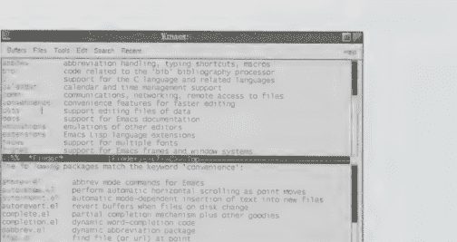

**图 12.1 查找器窗口**


目录路径中的方括号 [prefix] 可能会因你安装 Emacs 的方式不同而有所差异。最常见的前缀是 `/usr` 或 `/usr/local`，但如果从源代码构建，Emacs 可以安装在非标准位置。图 12.2 展示了这种情况的一个示例；该特定 Emacs 的前缀是 `/mp3/emacs`。方括号中的 [version-number] 可能是 20.7、21.0 或其他值，具体取决于你安装的 Emacs 版本。

Emacs 文件管理器模式 Dired 非常适合帮助你浏览 Lisp 文件目录。你希望查看的任何文件都可以轻松地在具有字体锁定的 Lisp 模式 Emacs 缓冲区中读取。只需按 `Ctrl-x d`，系统会提示输入目录名称。输入你的 Emacs 安装目录中 `/lisp` 目录的名称，就可以开始使用了。

浏览你在那里找到的 `.el` 文件。通常，文件名能给你提供一些关于其功能的线索。

你需要加载 Lisp 文件（如果是多包，则加载主文件），并在文件顶部附近的注释部分中寻找说明。需要查找的部分称为 Commentary（注释）。你会在那里找到使用注意事项以及可以插入到 `.el` Emacs 文件中的激活行示例。

图 12.2 显示了一个名为 desktop.el 的工具的注释部分，该工具用于保存当前 Emacs 会话的状态（包括主要模式、打开的缓冲区以及其他方面），并在你下次启动 Emacs 时恢复该状态。

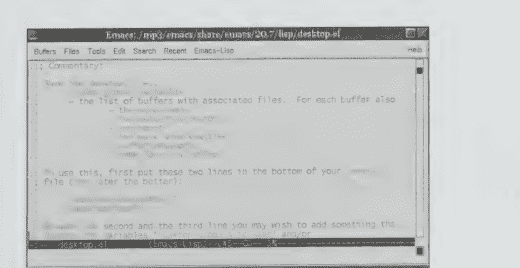

图 12.2 desktop.el 的说明


> 在向 `~/.emacs` 文件添加一行或两行后，你无需重启 Emacs。相反，将新行作为区域选中（使用 `Ctrl+空格键` 和方向键），然后从 Emacs-Lisp 菜单中选择评估区域（Evaluate Region）。

## 安装新版本

一些 Emacs 模式和实用程序，尤其是较简单的功能，是多年前编写的，现在仍然运行良好。它们能可靠地完成工作，那么谁还会被诱惑去修改它们呢？

其他包处于间歇性变动状态。如果某个包对你的工作很重要，你不妨跟上开发进程。可能有一个邮件列表需要监控；几乎所有的包发布都会在某一个 Emacs 新闻组上宣布。

安装包的新版本可能很简单，只需将文件放入 Lisp 目录，从而替换旧文件。如果有新版本的任何问题，最好将旧文件移动到一个临时目录（一个不在你的 load-path 中的目录），以备不时之需。

不要忘记对 Lisp 文件进行字节编译（参见第 8 章）。这不是绝对必要的，但文件加载速度会快得多。

## 站点 Lisp 目录（Site-Lisp Directory）

在新 Emacs 安装中，site-lisp 目录是空的。它的存在是为你提供一个安装第三方包的地方，即 Lisp 附加组件，它们不是 Emacs 安装的一部分。此目录包含在 load-path 中，这是一个变量，其值是一个 Emacs 搜索 Lisp 文件的目录列表。图 12.3.3 展示了 load-path 变量的帮助屏幕。

如果你的 `~/.emacs` 文件包含以下内容：

```lisp
(autoload ‘html-helper-mode “html-helper-mode” “Yay HTML” t)
(setq auto-mode-alist (cons ‘(“\\.html?$” . html-helper-mode) auto-mode-alist))
```

当你加载名为 index.html 的文件时，Emacs 首先检查 auto-mode-alist 变量，查看 html 后缀是否与某个模式的名称匹配。发现匹配（由于第二行）。由于 html-helper-mode 已自动加载（在第一行中），当 index.html 缓冲区出现在 Emacs 窗口时，该模式会被激活：Emacs 找到了 html-helper-mode，因为它位于 site-lisp 目录中。

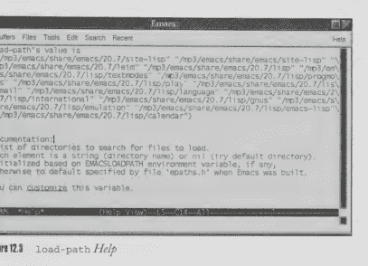

实际上有两个 site-lisp 目录。第一个的路径是 `/[prefix]/share/emacs/[version-number]/site-lisp`，第二个位于 `/[prefix]/share/emacs/site-lisp`。这两个目录都在 load-path 上。

为什么有两个？有些用户安装了多个版本的 Emacs。第二个 site-lisp 目录使得可以拥有能被任何 Emacs 版本找到的附加包。第一个目录与特定版本的 Emacs 相关联。某些包可能对它能配合工作的 Emacs 版本比较挑剔。将包安装在特定版本的 site-lisp 目录中，允许仅由该版本使用包。

这种情况很少见。绝大多数包可以愉快地与任何较新的 Emacs 版本合作，因此可以安装在第二个（版本中性）site-lisp 目录中。

## XEmacs 打包系统

在过去几年中，XEmacs 开发团队一直在创建一个新的打包系统。XEmacs 传统上在标准发行版中包含大量包。缺点是完全二进制 XEmacs 包的下载体积随着时间推移变得越来越大，以至于一些用户不愿升级到新版本。一个想法出现了：也许 Lisp 包可以从编辑器中独立维护。一个附带的好处是，用户将能够挑选他们需要的包，而不是接收所有包。

## 一种新的包管理方式

这个新系统依赖于几个交织的特性。包驻留的标准目录结构让 XEmacs 能够找到包。创建了类别包名（下一节中描述的单个文件包），例如 edit-utils（包含与编辑相关的包）和 os-utils（与宿主操作系统交互的实用程序）。确定了一种文件格式，列出并简要描述所有可用的包。

为了最小化维护一组包更新所需的时间，编写了几个实用程序。这些包工具允许用户选择一个可获取包的 FTP 站点，并下载更新的包数据库（刚刚描述的包列表）。然后在 XEmacs 内部可以打开与 FTP 站点的连接，可以下载并安装任意数量的包。之前安装的包也可以更新到新版本。一旦启动，这个过程在后台进行。这些工具的菜单界面将在后面描述。

## 包的类型

有两种类型的包——常规包和单文件包。

常规包是一组相关的 Lisp 文件，它们需要彼此的存在。你不应该删除这种包中的任何文件，因为包本身是一个单元。Gnus、VM、Dired 和 Viper 是例子。

单文件包并不是本章所用意义上的“包”。这种包是一组较小的 Lisp 实用程序或模式的捆绑包，每个都是一个单文件。prog-modes 包是一个例子。这个包中的每个文件都是某种编程语言的模式，如 perl-mode、python-mode 和 pascal-mode。另一个是 misc-games 包，是一组文本模式娱乐项目，如 doctor.el、gomoku.el 和 life.el。

单个文件可以从单文件包中删除。例如，如果你对使用 Pascal 语言编程没有兴趣，可以从 prog-modes 包目录中删除该文件。

## 目录结构

XEmacs 的目录布局与本章前面展示的 GNU Emacs 系统有很大不同。有两个目录层级。第一个是位于 `/lprefix/l//l/xemacs-x.lx/` 的特定版本目录树，末尾的 x 字符用 XEmacs 版本号替换。此目录包含 XEmacs 核心 Lisp 文件、Info 文档和杂项可执行文件。实际的 XEmacs 可执行文件（程序本身）安装在 `/[prefix]/bin`。

第二个目录树包含 site-lisp 和 package 目录。此树是版本中性的，并在 XEmacs 升级时保留。它位于 `/[prefix]/lib/xemacs`，包目录是 `/[prefix]/lib/xemacs/packages`。

### 安装方法

如果你安装了 XEmacs 但还没有任何包，就会有一个类似“先有鸡还是先有蛋”的问题。在包实用程序可以工作之前，必须安装两个包：efis 包（赋予 XEmacs 进行互联网 FTP 传输的能力）和 xemacs-base 包。所有包文件都位于本书的光盘 I 的 `/cdrom/xemacs/packages` 目录中。如果你更愿意从互联网获取（确保获取最新版本），可以在 http://www.xemacs.org 找到 XEmacs 镜像 FTP 站点列表。选择离你最近的站点。

按照后面“手动安装单个包”一节中的说明，下载并安装两个必需的包。完成此操作后，下一节将指导你进行自动包安装过程。

### 手动安装单个包

如果你习惯使用 gftp、ncftp 或原始 FTP 程序等 FTP 客户端检索文件，安装一个或多个包并不困难。包可以在 `ftp://ftp.xemacs.org/pub/xemacs/packages` 找到。

下载文件后，只需将它们移动到 `/[prefix]/lib/xemacs/packages`。使用此 shell 命令解压 tar 归档：

```bash
tar xvzf [package].tar.gz
```

你也可以从本书光盘的 `/cdrom/packages/xemacs/packages/single` 目录复制包。

当包到位后，下次启动 XEmacs 时就可以使用了。

### 使用菜单界面

Options、Packages 菜单选项下可用的包实用程序仅在你有打开的互联网连接时才能工作，因此在开始之前先打开一个连接。第一步是选择菜单选项“添加下载站点（Add Download Site）”，如图 12.4 所示。


## 图 12.4 软件包下载站点

选择一个附近的 FTP 站点，然后从顶部第三个选项中选择“列出并安装”。在后台，将打开到所选站点的 FTP 连接。当前的索引数据库（一个名为 `package-index-LATEST.pgp` 的文件）将被下载到机器上的一个临时目录。此文件中的信息将与已安装的软件包进行比对。随后会出现一个软件包缓冲区，显示所有已安装和可安装软件包的状态（见图 12.5）。你可以快速判断已安装软件包中是否有过时的，并决定要更新到当前版本的是哪些（如果有）。你还可以选择新软件包进行安装。

图 12.6 中展示的新软件包菜单，可用于安装或删除被标记的文件，以及其他操作。

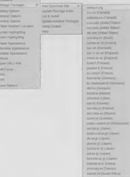

图 12.5 *软件包缓冲区*

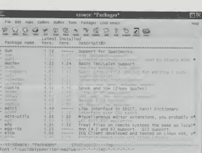

图 12.6 *软件包菜单*

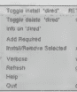

软件包缓冲区有自己的按键绑定：

- **Enter**：将当前软件包标记或取消标记为安装对象。
- **d**：将当前软件包标记或取消标记为移除对象。
- **r**：添加被标记软件包所需的所有软件包。
- **x**：安装或删除被标记的软件包。
- **i**：在模型行中显示关于该软件包的更多详细信息。
- **g**：刷新软件包列表。
- **v**：在详细显示和简洁显示之间切换。
- **q**：终止缓冲区。

当你标记了感兴趣的软件包后，按 `x` 或从软件包菜单中选择“安装/移除选定项”将从之前指定的下载站点获取文件并安装它们。

你可能需要注意的一个菜单项/键盘命令是“添加必需项”。这是一种自动方法，用于下载所选软件包正常运行所需的其他软件包。此功能类似于 Debian Linux 的 `apt-get` 命令，该命令为 Debian 软件包提供相同的服务。

如果由于某种原因，你在此过程的任何阶段遇到麻烦，你可能需要使用“自定义”来更改一个或多个默认的软件包工具变量。按 `M-x` 并输入：

```
customize-group
```

提示时，输入：

```
package-tools
```

生成的自定义缓冲区允许你更改并保存设置。

## Linux 发行版和 XEmacs 软件包

每个 Linux 发行版处理 XEmacs 软件包的方式略有不同。大多数发行版将发行版中的所有软件包捆绑在发行版软件包中，因此你只需要一个文件。如果你安装了基于 RPM 的发行版的 XEmacs 软件包，你应该已经安装了必要的 XEmacs 软件包。

Debian 将软件包与核心 XEmacs 发行版分开，将它们放在一个单独的 `*.deb` 文件中。你需要的软件包文件位于书籍 CD-ROM 上与二进制文件相同的目录中。

## 安装 Sumo 压缩包

一些 XEmacs 用户更倾向于旧的软件包策略。他们认为，如果磁盘空间不是主要考虑且互联网连接速度快，为什么不一次性下载所有软件包呢？为了迎合这些用户，每当发布一系列软件包时，都会提供一个包含所有软件包的大型单归档文件。

此文件被称为 Sumo 压缩包，其文件名为 `xemacs-sumo.tar.gz`。实际上这是一个符号链接；实际文件名包含发布日期。

Sumo 压缩包可以在 FTP 站点的同一目录中找到，与单独的软件包在一起。你还可以在书籍 CD-ROM 的 `/cdrom/xemacs/packages` 目录中找到一份副本。

要安装其中一个文件，只需将其移动到 `/[prefix]/lib/xemacs/packages` 目录中，并执行以下 shell 命令：

```sh
tar xvzf xemacs-sumo.tar.gz
```

如果 `/lisp`、`/etc/`、`/info` 以及另外几个目录尚不存在，它们将被创建，文件将填充这些目录并准备就绪。

## 结论

现在你知道了如何获取和安装这些软件包，接下来的章节将向你介绍其中的一些示例。

虽然编程是开发 Emacs 的目的，但它现在同样重要的是作为写作工具的功能。下一章概述了用于以某种形式生成可读文本的软件包。

# 第 13 章：文本处理软件包

**文本处理与文字处理**

- 文本处理与文字处理
- 何时文字处理器更合适
- LaTeX、HTML 和 Lout 作为替代方案
- HTML 模式
- LaTeX 还是 Lout？
- LaTeX
- Lout

ASCII 文本是 Emacs 的原生文件格式。ASCII（*American Standard Code for Information Interchange*）是一种字符编码标准，旨在与平台和制造商无关。每个字符由 7 位（计算机的最小存储单元，等同于二进制位）表示。以下是 ASCII 文本的一些优点：

- 它是一个全球标准，所有软件都可以读取。
- 它的最小存储要求。
- 文件相对较小。
- ASCII 不依赖于任何商业实体的命运。
- 它是多功能的。
- 它用于程序员的源代码、电子邮件和文本处理器的输入。

ASCII 文本的简单性是有代价的。除了换行符和/或回车符造成的换行（这些是不可见的非打印字符，使自动换行的文件成为可能）之外，文件中没有内置格式信息。字体信息缺失；此类文件的外观取决于视频显示器的功能或打印机内置的字体。这是一个最简化的文件格式，但你可以确信，以纯文本保存的任何内容将来都可以被读取，这是专有二进制文件格式供应商无法保证的。


> 二进制文件无法在文本编辑器中读取。你的 Linux 系统上的可执行文件或共享库文件是二进制文件。商业应用程序（如文字处理器和电子表格）传统上对用户文档使用二进制文件格式。这些文件格式可以随时更改，而且其他制造商的产品通常无法准确读取它们。

虽然格式信息不是纯文本文件的一部分，但可以使用各种文本处理语言和系统，以标记或标签的形式为 ASCII 文本文件添加格式，这些特殊字符告诉文本处理系统如何表示文本段落。本章介绍几种使用 Emacs 编写文本、处理文件并最终生成专业外观的可打印文件的方法。

## 文本处理与文字处理

近年来，文字处理器变得无处不在。它们提供了一种生成格式化文档的简便方法，但确实有一些局限性。专有二进制文件格式将用户锁定在某个应用程序中，并且文档的可移植性受到损害。

基于标签的格式化语言的优势在于，它将文档内容与格式指令分离，尽管两者都在同一个文件中。你可以提取内容，并与另一种格式化语言一起使用，或导出到文字处理器。在撰写较长文档（如研究论文或书籍）时，这种方法也更为可靠。

文本格式化器的另一个优势是，它们不必交互使用，即你不一定需要始终在场。像 `TeX` 这样的格式化器可以设置为定期从随时间变化的输入源（如数据库或日志记录设施）生成可打印的文档。一般来说，文字处理器最好交互使用。

Linux 上有多种应用程序可用，可以将用一种文本处理语言编写的文件翻译成用另一种语言编写的等效文件。例如，用 `LaTeX` 编写的文件可以翻译成 `HTML`，反之亦然。

`Emacs` 的多种模式简化了在这些基于标签的语言中编写文档，提供热键、菜单和字体锁定。

## 何时文字处理器更合适

在某些情况下，使用文字处理器是最佳选择。许多公司、大学和政府机构已将 Microsoft Word 作为文档交换的标准。许多律师事务所使用 WordPerfect。在这些环境中，大多数用户感到别无选择。

在你使用 Emacs 足够多并意识到它如何加快写作过程后，你可能会发现自己希望将文本文件导出到文字处理器，使这些文档对同事更易于访问。如果你曾尝试过，你可能已经注意到，大多数文字处理器对通过 `auto-fill-mode` 包裹成段落的文本处理得不太好。

问题是，文字处理器内部将段落存储为长行。它们在处理 ASCII 文本导入时容易困惑，并且经常不一致地重新排版段落，要求你在文件可接受之前进行大量清理。

有几种方法可以解决这种情况。一种方法是首先更改 `fill-column` 设置（自动换行包裹行的列号）。通过按 `Ctrl-u` 并输入 `1000` 将其更改为一个大数字，例如 1,000。然后按 `Ctrl-x f`。


Ctrl-u 是“通用参数”前缀，这是一种按键组合，允许你为随后的命令提供参数。Ctrl-x f 执行 `set-fill-column` 功能。这两者的组合将 `fill-column` 设置为 1000，实际上这就形成了由单行长文本组成的段落。如果你写的段落超过 1,000 个字符，你可以使用更大的数字。

下一步是按 Ctrl-x h。这是“标记整个缓冲区”命令的快捷键。现在整个缓冲区变成了一个选中的区域。

最后一步是按 M-x 并输入：

```
fill-region
```

现在每个段落都将变成一行，虽然 Emacs 使用的伪换行机制会保持所有文本可见。读完描述后你可能会觉得这段命令序列耗时较长，但实际上并没有那么久。如果你经常这样做，可以将整个命令序列制作成一个键盘宏，并为其分配一个快捷键。

以下是可以插入到你的 `~/.emacs` 文件中以定义两个宏并分配快捷键的一些代码行：

```
(defalias 'unwrap
  (read-kbd-macro "C-u 1000 C-x f C-x h M-x fill-region RET"))
  (global-set-key [(control c) (u)] 'unwrap)

(defalias 'wrap
  (read-kbd-macro "C-u 72 C-x f C-x h M-x fill-region RET"))
  (global-set-key [(control c) (w)] 'wrap)
```

第二个宏名为 `wrap`，它反转第一个宏的效果。你可以在展开文件并导出到文字处理器之后使用它。它将段落重新换行到可用于进一步编辑的 `fill-column` 设置。

## LaTeX、HTML 和 Lout 作为替代方案

HTML（超文本标记语言）是如果你的需求相当简单时，生成格式化文本最简便的方法。HTML 是一种基于标签的标记语言，支持图像、表格、不同字体以及各种文本和标题大小。它的格式化能力大致相当于一种基础的文字处理器。主要的 Web 浏览器可以将文件导出到打印机。在 Linux 上，成功打印取决于工作正常的 GhostScript 配置（或 PostScript 打印机），因为 Netscape 在将文件发送到打印队列之前，会将其转换为 PostScript 格式。

由于文件由 Web 浏览器（几乎存在于所有计算机上的应用程序）解释和显示，因此没有文本处理步骤。

使用 LaTeX 或 Lout 稍微复杂一些。虽然这两种文本系统都存在有效的 Emacs 模式，但你必须在查看或打印文件之前安装并配置好相应的文本处理系统。设置 TeX/LaTeX 安装曾经是一项困难的任务，但良好的 Linux 发行版应该提供预配置的可用软件包。Lout 从来都不难设置，但发行版的软件包仍会有所帮助。

LaTeX（基于 Don Knuth 的 TeX 系统）和 Lout 都非常适合生成复杂且篇幅较长的书籍级文档，但也可用于像写商务信函这样简单的任务。对数学符号和方程的出色支持使得 LaTeX（以及在较小程度上 Lout）成为科学界的标准。

LaTeX 和 Lout 文本处理器的最终输出都是 PostScript 文件。与使用 Web 浏览器打印 HTML 一样，需要可用的 GhostScript 安装以及针对你打印机的正确打印过滤器，才能查看和打印你的文件。

### 打印过滤器

打印过滤器是用户和打印守护进程（通常是 lpr 或 lpmsg）之间的一层便利机制。这些过滤器在 `/etc/printcap` 文件中创建一个新条目，该条目将正在打印的文件发送给 GhostScript，并附带你的打印机产生最高质量输出所需的所有晦涩的命令开关。两个最受欢迎的过滤器是 `magickfilter` 和 `apsqfilter`。`magickfilter` 最近没有进行积极开发，但它与较旧型号的打印机配合良好。如果你使用的是较新的喷墨打印机，应选择 `apsqfilter`。这两者在你的 Linux 发行版中应该都提供为软件包。

## HTML 模式

当你决定需要生成 HTML 文件时，你有两个选择。你可以使用 WYSIWYG HTML 编辑器，它会隐藏标签并以 Web 浏览器中显示的样子显示文本。如果你不熟悉 HTML，这看起来可能像是福音，但有一些缺点。使用此类应用程序必然会使你与后台实际发生的事情隔绝开来。应用程序开发人员无法预测每个用户的需求，因此生成的网页可能不完全是你心中的样子。这些应用程序生成的 HTML 在文本编辑器中通常几乎无法阅读。

其他商业 HTML 编辑者在编写时会向你展示文件中的标签。这是 Emacs HTML 模式采用的方法。你最终会对文件的最终显示方式拥有更大的控制权，但你需要更多地了解这些标签的实际含义。

学习 HTML 基础知识并不难。流行的一种迷信（由一些 HTML 作者推广）认为 HTML 是一种编程语言；因此，编写 HTML 的人就是程序员。这不是事实。HTML 是较简单的文本标记语言之一，只需一个下午左右的时间就能掌握其基本原理。许多网站（以及书籍）可以帮助你学习这些基本思想，尽管花一小时左右在 Emacs 的 HTML 模式之一中摸索一下，也足以让你入门。

## 设置 HTML 编写

没有人应该手动在 HTML 文件中输入标签。有太多的便捷手段可以避免这种繁琐的任务——其中包括各种 Emacs HTML 模式。请看图 13.1。它给你一个典型的 HTML 文件外观的大致概念。

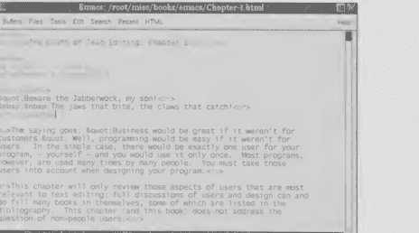

**图 13.1** *一个 HTML 文件*

注意所有标签都包含在尖括号（`<>`）中。这些括号很难键入，因为它们是移位字符（就像大写字母一样）——Shift-` 和 Shift-`。

几种模式使编写 HTML 文档的任务变得更容易。你应该选择哪一种？尝试它们，看看哪一款适合你。我更喜欢 `html-helper-mode`，但其他模式也有其忠实的追随者。

## GNU Emacs 内置模式

GNU Emacs 自带的默认 HTML 模式对于偶尔使用来说足够好，但它不提供许多功能。我在此不详细描述它，因为如果你感兴趣，`mode-help`（`Ctrl-h m`）会解释它。如果你确实使用此模式，你会注意到 HTML 缓冲区默认不进行字体锁定。你可以通过按 `M-x` 并输入以下内容随时为此模式开启字体锁定：

```
font-lock-mode
```

如果你喜欢为所有 HTML 缓冲区启用自动语法高亮，请将此行插入你的 `~/.emacs` 文件：

```
(add-hook ‘html-mode-hook ‘turn-on-font-lock)
```

如果你经常编写 HTML，考虑学习 `html-helper-mode` 或 `hh-html-menus`，两者都为大多数 HTML 标签提供了快捷键和菜单。

## html-helper-mode

该模式由 Nelson Minar 在多年间编写；最近，Gian Uberto Lauri 成为了新的维护者。该模式不像 `hh-html-menus` 和 `pgm1-html` 那样复杂和功能丰富，但它拥有足够的菜单项和热键，可以快速编写除最复杂 HTML 之外的所有类型。

网络（以及本书的 CD-ROM）上可获取两个版本。Nelson Minar 的最新版本是 2.19.1.1。该版本不再积极维护，但在 XEmacs 和 GNU Emacs 中都工作良好。Gian Uberto Lauri 一直在定期发布新版本，但我尝试的最新版本仅在 GNU Emacs 中为我工作。他所做的改进涉及对 `*.php` 和 `*.asp` 文件（*个人主页和 Active Server Page*）的支持，以及 Java 支持。他还整合了一个 Customize 接口，以便可以轻松设置用户变量。

两个版本都很容易安装。将文件复制到你的 site-lisp 目录后，将这些行插入你的 `~/ .emacs` 文件，你就可以开始编辑 HTML 了：

```lisp
(auto-load 'html-helper-mode "html-helper-mode" "\*ay HTML\*" t)
(set auto-mode-alist (cons '("\\.html?" . html-helper-mode) auto-mode-alist))
```

重启 Emacs 并加载一个 HTML 文件。它应该与图 13.1 相似。

*html-helper-mode* 生成的菜单可以以两种形式出现：Novice（初级）和 Expert（专家）。我建议使用 Expert 模式，因为这个菜单提供了更多的标签。如果你想将此作为默认设置，请将 *html-helper-mode.el* 文件加载到 Emacs 中并更改这些行：

```lisp
(defvar html-helper-use-expert-menu nil
  "*If not nil, then use the full HTML menu.")
```

改为：

```lisp
(defvar html-helper-use-expert-menu t
  "*If not nil, then use the full HTML menu.")
```

如果使用增量搜索功能，查找这些行会很快且容易。按 Ctrl-s 并输入：

```
expert-menu
```

这应该会带你到需要编辑的行。编辑它们，保存文件，然后从 *Emacs-Lisp* 菜单中选择 *Byte-compile This File*。下次启动 Emacs 并加载 HTML 文件时，Expert 菜单将出现（见图 13.2）。不要被这个名字吓到；你不需要成为专家才能使用这个菜单！它只是为你提供了更多的标签插入选项。

菜单很实用，但使用 Ctrl-c 前缀的快捷键更快。让我们看看它们如何按次级前缀组织。主要前缀是 Ctrl-c，后面跟随另一个具有（在很大程度上）助记值的 Ctrl 前缀。

例如，Ctrl-c Ctrl-l 是用于列表相关标签的双重前缀。这些按键后跟 *u* 将插入无序列表的标签，而跟 *o* 则插入有序列表的标签。跟 *i* 会产生另一个列表项。

为了不在几页纸上填满完整的快捷键列表（数量相当多！），我建议你将菜单作为学习辅助工具。菜单上的每个标签后都跟随其快捷键。开始时你应该只学习少数几个——那些经常使用的。使用菜单插入这些标签很快就会变得令人厌烦。


## html-helper 菜单

- 插入超链接
- 插入列表元素
- 插入标题
- 插入逻辑样式
  - 居中 (C-c C-p c)
  - 固定 (C-c C-p f)
- 插入文本元素
  - 粗体 (C-c C-p b)
  - 斜体 (C-c C-p i)
- 插入内联图片
- 插入表格
- 插入结构元素
  - 下划线 (C-c C-p u)
  - 删除线 (C-c C-p s)
- 插入字体元素
- 插入脚本
- 插入时间戳分隔符 (C-c C-u c)
- 浏览网址 (C-c C-u w)
- 在浏览器中加载 Bib 缓冲区 (C-c C-u v)
- 开启 Navtex 菜单
- 缩小至 ASP (C-c C-u a)
- 缩小至 PHP (C-c C-u p)
- 缩小至 VBScript (C-c C-u b)
- 缩小至 JavaScript (C-c C-u j)
- 使用 JSP

*图 19.2* *html-helper* 菜单

这些键绑定足以让你迈出坚实的第一步。通过反复在菜单上看到其他键绑定，你会逐渐熟悉它们。

| 键序列 | 描述 |
| :--- | :--- |
| M-Enter | 插入 `<p>` 段落标签。 |
| M-Tab | 补全粒子类型标签。 |
| Ctrl-c Ctrl-l [1-6] | 插入标题标签 `<h1>`...`<h6>`，从 1（最大）到 6（最小）。 |
| Ctrl-c M-h [1-6] | Gian Umberto Lauri 的新版本使用此组合而非 Ctrl-c Ctrl-l [1-6] 来插入标题。 |
| Ctrl-c - | 插入水平线标签 `<hr>`。 |
| Ctrl-c Enter | 插入强制换行 `<br>`。 |
| Ctrl-c Ctrl-a l | 插入 HTML 链接 `<a href="">`。 |
| Ctrl-c 空格键 | 插入不间断空格 `&nbsp;`。 |

另一类标签帮助你插入 HTML 语言中的特殊字符。如果想在 HTML 文件中尖括号该怎么办？如果直接输入，HTML 解释器（如 Netscape 或 Lynx）会将其视为标签的一部分而感到困惑。& 符号也是一个特殊字符（如在不间断空格标签 &nbsp; 中），不能直接包含在内。有一些特殊的 HTML 标签用于处理这些情况：

| 键序列 | 描述 |
| :--- | :--- |
| Ctrl-l c | 插入字面小于号 &lt; |
| Ctrl-l > | 插入字面大于号 &gt; |
| Ctrl-l & | 插入字面 & 号 &amp; |

你可能注意到有两种类型的标签：单标签，如 `<hr>`，以及双标签，它们包围某些内容，如标题标签 `<h1>`。html-helper-mode 足够智能，知道如果你插入双标签，接下来你要做的就是填充内容，例如标题标签之间的标题。为了让你更容易操作，当插入双标签时，光标会自动放置在标签之间。

如果你是 HTML 初学者，可能会插入双标签而没有意识到需要在标签之间填写内容。你可以告诉该模式，每当插入此类标签时，你希望在 minibuffer 中收到提示。可以通过 Customize 更改此变量。按 M-x 并输入 `customize-variable`。

根据提示，输入 `tempo-interactive`。

默认值为 nil，这意味着不会进行提示。在 Customize 缓冲区中将值切换为 t 以启用提示。

当值设置为 t 时，尝试使用之前列表中合适的键绑定在 HTML 缓冲区中插入标题标签。左标签被插入，并出现 minibuffer 提示：

> 标题：

输入标题名称并按 Enter。标签会被填入你的内容，随后是闭合标签。

这种提示适用于所有双元素标签。当你对 HTML 更加熟练后，你可能会希望将变量改回 nil，因为让光标停留在标签之间比使用 minibuffer 更快。

HTML 文件中的时间戳是一种有用的约定。时间戳是插入文件中的一段文本，注明作者姓名以及文件最后修改的日期和时间。许多 HTML 文件旨在用于万维网（World Wide Web），与硬拷贝打印相比，这是一种动态媒介。这些文件会定期更新（至少在被维护的站点上），HTML 编写者和读者都希望能够确定网页最后更新的时间。

html-helper-mode 具有自动时间戳功能。当此功能开启时，每次保存缓冲区时时间戳都会更新。通过将此代码粘贴到 ~/.emacs 文件中的其他 html-helper-mode 行之后来启用此功能：

```lisp
(setq html-helper-do-write-file-hooks t)
```

如果你希望姓名和电子邮件地址随日期和时间一起显示，请插入以下代码：

```lisp
(setq html-helper-address-string
    "<a href=\"mailto: user@your.net\">Your Name <user@your.net></a>")
```

该模式内置了用于新 HTML 文件的模板。如果启用此功能，HTML 文件所需的必要元素将插入到每个新的 HTML 文件中。图 13.3 显示了这样一个新创建的文件。

此功能也通过在 ~/.emacs 文件中添加一项设置来激活：

```lisp
(setq html-helper-build-new-buffer t)
```

与原生 GNU Emacs 模式一样，html-helper-mode 可以调用 browse-url 包，该包将当前缓冲区加载到你首选的 Web 浏览器中。这可以是任何浏览器，从文本模式的 Lynx 浏览器到 Netscape。按 M-x 并输入 `customize-group`，通过 Customize 选择浏览器和任何命令行开关。根据提示，输入 `browse-url`。

当你可以轻松地在浏览器中查看文件并随着更改定期重新加载时，这会加快 HTML 编写速度。

许多 HTML 文件最初是纯文本文件，后来才应用标签。一些 HTML 作者甚至更喜欢以这种方式工作，先编写内容，然后将文件转换为 HTML。这通常导致一种常见情况：当你回顾文件时，发现有一个短语本应标记为粗体。如果你按下 Ctrl-c Ctrl-p b（粗体字键序列），你会得到 `<b> </b>`，但你需要该短语被开始和结束标签包围。

解决方案？首先，选择要标记的区域，然后在按下键序列之前按下 Ctrl-u。标签将整齐地包围选定的文本。这对所有配对标签都适用。html-helper-mode 征用了 Ctrl-u “通用参数”键序列，使其效果为“标记选定区域”。

## hm—html-menus

如果你更喜欢使用鼠标而不是键盘来插入 HTML 标签，这个包可能正合你意。Heiko Münkler 编写了 hm—html-menus，作为一个 HTML 新手可以使用的包，同时具备足够多的功能来吸引 HTML 老手。最新版本（5.9）已有几年历史，但它与 GNU Emacs 和 XEmacs 都兼容良好。XEmacs 包维护者对其进行了一些修改，使该模式能很好地集成到新的打包方案中。按照第 12 章的说明安装 XEmacs 包。

安装 GNU Emacs 只需将本书 CD-ROM 上的 Lisp 文件复制过来即可。你可以在目录 /cdr/m/packages/hm—html-menus 中找到所需的文件。将文件安装到你的 site-lisp 目录中，并将 Info 文档文件安装到 /usr/local/info。你也可以从 `ftp://ftp.tnt.uni-hannover.de/pub/editors/xemacs/contrib` 获取该包。

激活此包并将其设为 HTML 文件的默认模式，需要在 ~/.emacs 文件中添加相当大的一堆 Lisp 代码。我想你不想重新输入必要的代码，所以我把它放在了一个名为 config.el 的文件中，你可以在 CD-ROM 上的 /cdr/m/packages/hm—html-menus 目录中找到。你可以从该文件或随包附带的 hm—html-menus Info 文件中复制粘贴。如果你已安装 `html-helper-mode`，需要用分号注释掉该模式的激活行。

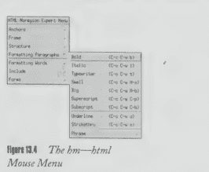

**图 13.4** *bm—html* 鼠标菜单

与 html-helper 不同，此包的大多数功能位于鼠标按钮菜单中，而不是菜单栏菜单中。图 13.4 显示了主鼠标菜单和其中一个子菜单。

此包比 html-helper-mode 有更多的标签键绑定，但其中许多绑定较长，难以记忆和使用。例如，表格标签的绑定是 Ctrl-c Ctrl-s Ctrl-t t。这就是我前面建议此包给偏好鼠标而非键盘命令的用户的原因。从菜单中选择比输入如此复杂的命令更快。

不知何故，XEmacs 包维护者在将 hm—html-menus 变成官方 XEmacs 包时更改了许多键绑定。如果你同时使用 GNU Emacs 和 XEmacs，这可能会令人烦恼和困惑。

hm—html-menus 以一种巧妙的方式处理反复出现的用标签包围选定文本区域的需求。注意图 13.4 中，菜单标题是“HTML Region Expert Menu”；如果你选择了一些文本，标题会变为“HTML Region Expert Menu”；从菜单中选择的任何标签现在都会包围选定的区域。

hm—html-menus 包含一个模板次要模式，名为 tmpl-minor-mode.el，可用于任何主要模式的模板扩展。当你创建一个新 HTML 文件时，此次要模式会发挥作用。你会在 minibuffer 中被提示模板文件的位置。输入你安装 hm—html-menus 的目录，它将在未来的会话中记住。该包附带一个示例模板，但你需要编辑它或将其作为模型来编写自己的模板。

## psgml 和 HTML

psgml 是由 Lennart Ståfflin 开发的一个大型且复杂的包，旨在帮助使用 SGML 文档的编写者。由于 HTML 是 SGML 的子集，它也是


虽然 XEmacs 对 HTML 的支持更好，但使用 `pshtml` 来编写 HTML 文档也是可行的。

随附的此软件包并未专门配置为用于处理 HTML 文档，但将 `hm-html-menus` 作为次要模式与 `pshtml` 结合使用，可以提供一个相当有效（尽管复杂）的 HTML 编辑环境。`pshtml` 具有文件解析功能。换句话说，它可以通读文件并检查语法错误。它还可以与 `sgmls` 外部解析器配合使用。

在 XEmacs 中安装 `pshtml` 只需获取预配置的软件包即可，具体步骤详见第 12 章。XEmacs 版本的 `pshtml` 与发布版本有很大不同。`hm-lhelp.el` 模式的大量部分已被整合进去；总体而言，该模式更适合进行 HTML 编辑。

要将 `hm-html-menus` 用作次要模式（假设你已安装了 `hm-html-menus` 软件包），请将以下行插入到 `~/.emacs` 文件中：

```
(add-hook 'html-mode-hook 'hm-html-minor-mode)
```

请分别尝试使用启用和未启用 `hm-html-menus` 作为次要模式的 `pshtml`；两者结合使用可能超出了你的实际需求。图 13.5 显示了同时启用两种模式时的菜单布局。

这是一个包含三个部分的复杂菜单和子菜单阵列。靠近左侧的新增项目是 `pshtml` 菜单：Modify（修改）、Move（移动）、Markup（标记）和 DTD。在编写 HTML 时，你可以忽略这些菜单下的大部分项目，因为它们涉及的是 SGML 而非特定的 HTML。DTD 菜单适用于 HTML 文件。


> DTD（文档类型定义）是一种对应于特定类型 SGML 文档的文本文件。DTD 定义了可以在像 HTML 这样的标记语言中使用的有效元素。SGML 解析器（例如 `pshtml` 中包含的那个）会解析（读取并吸收）HTML DTD，并在验证 HTML 文件时使用这些信息。你可以将验证视为一种帮助你编写正确 HTML 的错误检查。

HTML 已经演变成一种执行起来相当随意的语言。网络浏览器可以处理并显示格式错误或是不完整的 HTML。为了利用 `pshtml` 的验证功能，HTML 文件的第一行应声明 DTD，因为 HTML 有几个版本，因此可能存在多个 DTD。第一行应该类似于以下内容：

```
<!DOCTYPE HTML PUBLIC "-//W3C//DTD HTML 4.01 Transitional/EN">
```

本书中讨论的所有 HTML 模式都在其新文件的默认模板中包含这样一行。

组成 XEmacs `pshtml` 软件包的文件中，包括了一套针对不同版本 HTML、Docbook（一种用于技术文档的 SGML 软件包）以及 XML 的 DTD。当你使用 `pshtml` 检查你的 HTML 文件时，会参考其中某一个文件。

沿着菜单栏向右看，你会找到 `hm-html` 次要模式菜单，它与 `hm-html-menus` 作为主要模式时显示的菜单类似。此菜单中最有用的项目包括用于设置鼠标菜单技能级别（新手或专家）的切换项，以及将当前缓冲区加载到网络浏览器中的项目。当 `hm-html-menus` 作为 `pshtml` 下的次要模式时，其鼠标菜单与 `hm-html-menus` 主要模式的鼠标菜单相同（参见图 13.4）。

最后两个新菜单属于 `pshtml` 的 HTML 模式。图 13.6 中的 HTML 菜单包含几个实用功能，其中一些与 `hm-html-menus` 菜单上的项目重复，例如文件预览功能。此菜单中的 Validate（验证）项会根据相应的 DTD 检查你的文件，并指出任何语法错误。这是 `pshtml` 的强项。

图 13.7 中的 Insert（插入）菜单是一系列嵌套菜单，充满了标签插入命令。这些命令是从 `html-helper-mode` 中引入的，但具有不同的键绑定。此菜单与原始 `html-helper` 菜单的一个显著区别是，每个菜单项旁边没有显示键绑定。这很遗憾，因为在 `html-helper-mode` 和 `hm-html-menus` 中显示键绑定都是一种方便的学习辅助。你可以按 C-h b（模式键绑定帮助键）查看 `pshtml` 键绑定的列表。

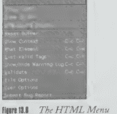

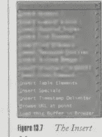

图 13.7 插入菜单

与前两个描述的 HTML 模式不同，基于 XEmacs `pshtml` 的 HTML 模式没有附带任何特定文档。`pshtml` 本身有一套全面的 Info 文件，但重点在于通用的 SGML，并未提及 HTML 编辑。你可以通过尝试和错误来学习此模式。选择各种菜单项，看看它们的用途是否对你有用。最终，你会在学习忽略其他命令的同时，发展出一套有用的命令工具包。

此 HTML 模式的主要优势在于其验证和错误检查能力。与其他 HTML 模式相比，其标签插入菜单更难使用，而且对于面向键盘的用户来说，键绑定过长。使用此模式的一种可能方法是在其他 HTML 模式之一中进行大部分编辑，然后使用 `pshtml-html` 来检查你的文件。

GNU Emacs 版本的 `pshtml` 则是另一回事。显然，有些人已经学会了仅使用 `pshtml` 就能高效地编写 HTML，但这并不容易。如果我有多余的一两章篇幅，我可以概述其流程，但我感觉受众群体会很小。如果 `hm-html-menus` 作为次要模式能够自动链接到 `pshtml`，其可用性可能会更高，但不幸的是，这只适用于 XEmacs 版本的 `pshtml`。

这里讨论的三种 HTML 模式中的任何一种都可能有用。尝试它们全部，你很可能会选定一个符合你工作风格的模式。

## LaTeX 还是 Lout？

这两种文本处理系统都可以生成高质量的文档。各自都有优缺点。

- LaTeX 的优点：
  - 庞大的用户社区，从而带来更多样的附加软件包。
  - 被更多的科学出版物接受（在某些情况下是强制性的）。
  - 存在时间更长；代码更成熟且无错误。
  - 有可供商业印刷的文档。

- LaTeX 的缺点：
  - 更难根据你的需求进行适应；更改默认设置可能很困难。
  - 安装体积大得多。
  - 添加新字体更困难。

- Lout 的优点：
  - 包含图形更容易。
  - 创建新的文档样式所需的专业知识较少。
  - 使用标准 PostScript 字体。
  - Lout 发行版可装入一张软盘。
  - 附带详尽的文档。

- Lout 的缺点：
  - 用户社区较小。
  - 可用的 Emacs 模式不如 AUCTeX 完善。
  - Lout 消耗计算机更多的内存。

没有理由不能同时使用这两个系统，尽管每个系统都有学习曲线，这可能使同时使用变得不切实际。试一试，看看哪个更适合你的需求。

## LaTeX

输入带有 LaTeX 标记的文档可能是一项繁琐且耗时的工作。Emacs 的 TeX/LaTeX 模式，特别是 AUCTeX，可以使编写这种标记变得几乎像编写普通文本文件一样容易。图 13.8 是一个典型的 LaTeX 文档。

正如你所见，标记字符被高亮显示，这有助于你在心理上将其与文件的实际内容区分开来。反斜杠表示 LaTeX 命令，到处都是花括号、美元符号和百分号。这是一种 Emacs 模式能很好处理的文件类型，其中包含了许多你不想反复键入的元素。

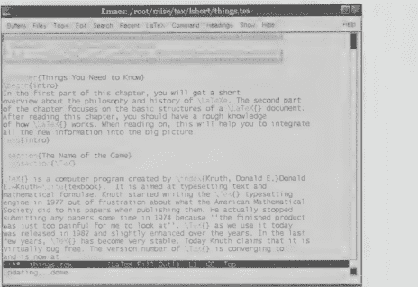

图 13.8 *LaTeX 缓冲区*

### TeX、LaTeX 和 Linux

如果没有某种手段将生成的 LaTeX 文档通过 TeX 处理器运行，那么生成 LaTeX 文档就没有太大意义。即使你不打算在本地机器上打印硬拷贝，你也需要能够预览 TeX 生成的 PostScript 文件，以确保文档令人满意。

幸运的是，任何有价值的 Linux 发行版都有预配置的 TeX 和 LaTeX 软件包可用。大多数发行版使用 Thomas Esser 维护良好的 teTeX 软件包作为其发行版软件包的基础。teTeX 安装体积庞大，最多占用 60 MB 的磁盘空间。与大多数文字处理器的安装相比，这并不算太多，而且输出质量有潜力保持一致且更高。

不确定是否安装了 teTeX？输入

```
locate latex
```

如果该软件包已安装，结果将是

```
usr/bin/latex
```

如果没有安装，请在完成本章之前考虑安装你的发行版的软件包，以便你能够尝试示例。


## 基本 TeX 模式

GNU Emacs 和 XEmacs 都提供了一个简单的 tex-mode，用于编辑 TeX 和 LaTeX 文件；XEmacs 版本是 Texinfo 包的一部分。由于这些模式的功能并不十分全面，本章不会详细描述它们。如果未安装 AUCTeX，tex-mode 是 *.tex 文件的默认模式。虽然提供了字体锁定和少量的键绑定，但没有标签插入命令或菜单。Ctrl-h m 模式帮助键命令会告诉你关于此模式所需了解的一切。对于偶尔使用 TeX 的用户来说，一个优点是这个模式不需要花很长时间就能学会。

## AUCTeX

在计算机程序压缩的历史时间表中，几年之间就会发生许多变化，而 AUCTeX 是一个久经考验的古老软件包。它甚至比 Linux 还要早几年。1986 年，Lars Peter Fischer 为 Emacs 16 版本的 TeX 模式编写了一些宏扩展。Per Abrahamsen 于次年做出了首次贡献，随后不久，Kresten Krab Thorup 发布了 AUCTeX 的第一个版本。Per Abrahamsen 是当前的维护者。新版本定期发布，并且拥有庞大的全球用户社区，其中许多人贡献了补丁和增强功能。AUCTeX 拥有令人印象深刻的菜单和键绑定阵列，可以让你避免手动输入环境标签。

### 安装

XEmacs 用户可以通过安装 AUCTeX 包来安装 AUCTeX（参见第 12 章的说明）。要激活该软件包，还需要再执行一步。请将以下行插入你的 ~/.emacs 文件：

```
(require 'tex-site)
```

之后，你就准备好编辑 TeX 和 LaTeX 文件了。

GNU Emacs 用户可以在本书的 CD-ROM 中的 /cdrom/packages/auctex 目录下找到 AUCTeX 归档文件。在临时目录中展开该归档文件，并将 makefile 加载到 Emacs 会话中。

此 makefile 会为你字节编译并安装必要的文件，但在运行 make 命令之前，最好对其进行一些编辑。你还可以在 site-lisp 目录下创建一个名为 auctex 的子目录，并将文件安装在那里。这并非绝对必要，但将 AUCTeX 安装的大量文件集中放在一个位置，而不是与其他 site-lisp 文件混在一起，会非常有帮助。

需要修改的 makefile 部分位于文件开头附近，看起来像这样：

```makefile
##-------------------------------
## YOU MUST EDIT THE FOLLOWING LINES
##-------------------------------

# Where local software is found
prefix=/usr/local

# Where info files go.
infodir = $(prefix)/info

# Where local lisp files go.
lispdir = $(prefix)/share/emacs/site-lisp

# Where the AUC Tex emacs lisp files go.
auctdir=$(lispdir)/auctex

# Name of your emacs binary
EMACS=emacs
```

编辑这些行以反映你的 Emacs 安装情况，然后（在终端窗口中）切换到包含已解压的 AUCTeX 文件的目录并运行 make 命令。只需输入：

```bash
make
```

makefile 会以非交互模式调用 Emacs。结果是，AUCTeX Lisp 文件将由你的 Emacs 版本进行字节编译。当此过程完成后，输入：

```bash
make install
```

文件将被复制到你在 makefile 中指定的目录。

最后一步，你就可以使用该软件包了。请将以下行插入你的 `~/.emacs` 文件：

```lisp
(require 'tex-site)
```

下次启动 Emacs 时，加载一个 `*.tex` 文件。AUCTeX 菜单应该会显示出来。

### 与 TeX 安装同步

默认设置应在大多数 Linux 系统上有效。如果你尝试用 TeX 处理文件时 AUCTeX 报错，那么你的 TeX 安装可能与众不同。请查看安装在你的 site-lisp 目录中的 tex-site.el 文件；它包含可能需要更改的默认路径和设置。幸运的是，AUCTeX 还具有大量的 Customize 支持。按下 M-x 并输入：

```
customize-group
```

当提示时，输入：

```
AUC-TeX
```

将出现一个多级 AUCTeX 定制缓冲区。大多数设置可能保持不变即可，但你可能会发现其中某项设置起到了决定性的作用。

### 菜单和键绑定

AUCTeX 的这方面功能可以为你节省时间，并使编写 $\LaTeX$ 文件变得可以忍受。为什么不创建一个新空缓冲区来尝试这些功能呢？给缓冲区起个像 new.tex 这样的名字，以便自动加载 AUCTeX。注意菜单栏上出现的两个新菜单：Command 和 $\LaTeX$。暂时搁置 Command 菜单，来看一下 $\LaTeX$ 菜单，如 图 13.9 所示。

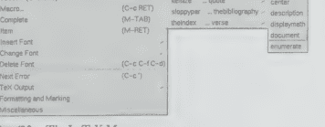


此菜单中的插入环境（Insert Environment）项是最常用的命令之一，也是在新 $\LaTeX$ 文件上首先运行的命令。如果你使用键绑定 Ctrl-c Ctrl-e 而不是菜单项，系统会提示你输入环境名称。AUCTeX 为此命令提供了合理的默认值。如果你的文件为空，默认环境（在小缓冲区中用括号显示）是 documentclass article。按下回车键会插入正确的标签，并将光标放置在标签之间。

在 LaTeX 术语中，环境是指两个定义标签之间的文本类别。这包括列表、引文、各种数学形式、表格以及许多其他内容。环境可以嵌套。例如，最外层的环境是文档类，它设置整个文档的参数，例如哪些小节是有效的。本书的文档类使用章节作为小节，而文章则使用节。许多 LaTeX 环境类似于各种 HTML 标签，尽管 LaTeX 的可能性更多。

LaTeX 文件需要一些基本标签才能有效。第一个是文档类标签，它让 TeX 知道该文件是旨在成为书、文章还是报告。紧接反斜杠标签之后的可以是花括号中的陈述。这可以是节或章名称，或者可能是适用于该标签的任何变量值。将它们视为格式命令的参数。

你的章节或小节的实际内容就像其他文本一样输入。你不需要担心格式，因为 TeX 在处理文件时会为你完成这些。在编写此类文件时，有些事情需要注意。八个字符对 TeX 程序具有特殊含义，除非在它们前面加上反斜杠，否则不能直接插入：

- $
- &
- %
- {
- }
- \
- ^
- _

例如，如果你需要在文件中输入美元金额，你会写 \$2.00。反斜杠是这一规则的例外，因为 \textbackslash{}\textbackslash{} 被定义为“强制换行”命令。要在文件中插入反斜杠，你需要这样写：

```latex
\backslash
```

需要记住的另一个可能的错误来源是，所有“begin”标签都必须由一个“end”标签平衡，并且所有花括号必须成对匹配。AUCTeX 帮助你跟踪这些，因为当你使用菜单或键绑定插入环境标签时，它总是同时插入开始和结束标签。

在你的新文件中还可以尝试别的东西。从插入环境子菜单中选择列表（List）。缓冲区中会出现一对定义列表的标签，以及第一个“item”标签，光标将位于你需要的位置，以便轻松编写列表项。在那里写点内容，然后按下 M-Enter。会出现一个新的列表项，光标再次重新定位。结果应该看起来像 图 13.10。

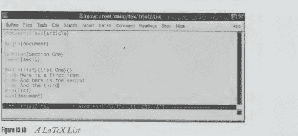

AUCTeX 还可以为你补全部分输入的标签。如果你经常编写 LaTeX 文件，最终你会使用不在菜单上或未绑定到按键的标签，此功能让你只需输入标签的前几个字符。AUCTeX 会扫描你正在编辑的 LaTeX 文件并构建一个你正在使用的标签内部列表。它使用此列表作为补全的来源。

本章的限制使我无法更深入地讨论 LaTeX 的使用。本书的 CD-ROM 上有一本由 Tobias Oetiker 撰写的优秀 LaTeX 入门和教程，名为“LaTeX 不太短的入门指南”。它以未处理的 LaTeX 文件形式存在。我建议将此文件 lshort.tar.gz 复制到你的硬盘并解压。你可以在 CD-ROM 目录 /cdrom/doc 中找到此文件。你可以在下一节中使用这些文件作为练习材料。作为一个附带的好处，你最终会获得一本印刷版的 PostScript 文件。

## 运行 TeX

Command 菜单是 AUCTeX 与实际的 TeX 处理命令接口的所在地。这些命令可以从任何终端窗口运行；使用 AUCTeX 的优点是它会跟踪你文件中的错误，并直接带你到问题所在之处，以便你处理它们。

通过加载 lshort.tar.gz 归档中的主 LaTeX 文件来尝试。你需要的文件是 lshort.tex。

一旦你在 Emacs 缓冲区中拥有了此文件，请从 Command 菜单中选择 LaTeX 交互（LaTeX Interactive）。这将文件交给你的 TeX 系统。会打开一个新窗口，显示 TeX 在执行任务时发出的消息。如果过程成功，小缓冲区中将显示一条消息，如 图 13.11 所示。


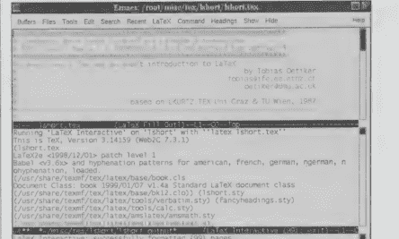

图 13.11 LaTeX 交互会话

## 查看和打印文件

如果想查看生成的 DVI 文件，请从“命令”（Command）菜单中选择“查看”（View）。一个调用 `xdvi` 的命令行（它应该是你的 TeX 安装程序的一部分）将出现在 minibuffer 中，以便你根据需要编辑它。

如果想生成可打印的 PostScript 文件，请从“打印”（Print）子菜单中选择 `ps`。`dvi2ps` 命令行将出现在 minibuffer 中。你需要一个 PostScript 查看器，如 `gv` 或 GhostScript，来查看该文件。请参阅本章前面标题为“打印过滤器”（Printing Filters）的边栏，了解有关打印 PostScript 文件的信息。

AUCTeX 中还有许多其他命令和功能超出了本简短介绍的范畴。AUCTeX 附带的 Info 文件写得很好且完整，应该是你下一个学习资料来源。

## Lout

Lout 文本处理系统是由澳大利亚悉尼大学的 Jeffrey H. Kingston 创立的。（Lout 是“layout”的缩写。）它具有 TeX/LaTeX 的大部分功能，但其大小和复杂度只是后者的一小部分。Lout 已经开发了 16 年。它最初是一个大学研究项目，后来演变为 GNU 许可的免费软件包。随着用户开始贡献功能和提出建议，经过多年发展，Lout 变得非常多功能且强大，但其学习曲线比 LaTeX 平缓。请参阅前文“LaTeX 还是 Lout？”（LaTeX or Lout?）部分，对两者进行比较。

从用户的角度来看，这两种格式系统有很多共同点。标签由某些保留字符指示。这些标签不仅控制结构格式（如章节），还控制字符级特征，例如字体选择。

Eric Marsden 为 Emacs 编写了一个名为 `lout-mode.el` 的 Lout 主模式。它没有 AUCTeX 那么大和复杂，但它拥有大多数标签的键绑定和菜单项。支持字体锁定（font locking），允许以柔和的颜色显示标签。你可以像 AUCTeX 一样在该模式下运行 Lout 处理器并逐步查看错误。

### 安装 Lout

你可以在本书 CD-ROM 的 `/cdrom/packages/lout` 目录中找到 RPM 和 `*.deb` 软件包。如果偏好自行编译，源文件归档也包含在内。使用你的发行版包管理工具来安装预构建的软件包。安装源软件包并不困难得多。你需要编辑 makefile，但文件顶部的说明很清晰。完成此操作后，输入

```
make ; make install
```

你就应该拥有一个随时可用的新 Lout 安装。

Lout 的文档在一个独立的发行版 RPM 或 `*.deb` 中。它以未处理的 Lout 文件形式包含在源文件归档中。

### 使用 lout-mode

你可以在 CD-ROM 目录 `/cdrom/packages` 中找到 `lout-mode.el`。将此文件复制到你的 site-lisp 目录，并将以下行插入你的 `~/.emacs` 文件：

```lisp
(autoload 'lout-mode "lout-mode" "Major mode for editing Lout text" t)
(setq auto-mode-alist
      (append '(("\\.lout$" . lout-mode)) auto-mode-alist))
```

后两行使得任何具有 `*.lout` 后缀的文件都在 lout-mode 下编辑。如果你想为 Lout 文件使用不同的后缀，请编辑最后一行，将 `\\.lout$` 改为你喜欢的任何内容。别忘了对该文件进行字节编译：加载 `lout-mode.el` 并从 Emacs-Lisp 菜单中选择“字节编译文件”（Byte-compile File）。

如果你不熟悉 Lout，你可能正在好奇 Lout 标记看起来是什么样子的。即使你安装了默认的 Lout 和文档发行软件包，你可能也想要将 CD-ROM 中的源文件归档解压到一个临时目录。删除除 `/doc` 目录以外的所有内容，然后使用 Dired 访问该目录。那里的文件没有识别后缀。它们是 Lout 文件，如果经过处理，将变成 Lout 文档 PostScript 文件。你不需要处理它们，因为假定你已经安装了 Lout 文档。它们是 Lout 文件的良好示例，让你了解这些文件是如何标记的。

在 Dired 缓冲区中的文件上点击鼠标中键将其加载。它出现在 Basic 模式而不是 Lout 模式下，因为文件没有后缀。按 M-x 并输入

```
lout-mode
```

然后按 M-x 并输入

```
font-lock-mode
```

你应该看到类似图 13.12 的内容。（字体锁定命令可能必需也可能不必需，这取决于你的 Emacs 配置。）

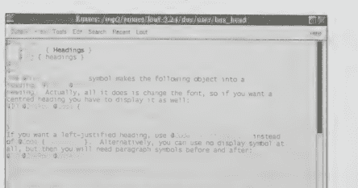

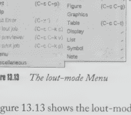

图 13.13 lout-mode 菜单

图 13.13 显示了 lout-mode 菜单，它将两个 AUCTeX 菜单的功能合二为一。

`lout-mode.el` 中有几个变量可能需要编辑以匹配你的系统。你可以在 Lisp 文件的开头找到它们：

```lisp
(defvar lout-view-command "gv -safe"
 "*The name of the Postscript previewer on your system.
This program is called from \\[lout-view]. You can include command-line
arguments such as \\ -dSAFER \" to protect against dangerous Postscript
commands.")
```

```lisp
(defvar lout-print-command "lpx -Pps"
 "*How to print Postscript files on your system.
If this is a string it will be sent to a shell, after having the
name of the Postscript file appended to it. If it is a function it
will be called with the name of the Postscript file as a parameter,
and should return a string which when passed to a shell, will print the
file.")
```

在第一行中，如果你没有安装 `gv`，可能需要将 `gv` 更改为 `ghostview`。你可能会考虑安装 `gv`，因为它是一个比 `ghostview` 功能更丰富且更便捷的 PostScript 查看器。

`print` 命令因你的 Linux 发行版、打印后台处理程序（print spooler）和过滤器设置而异。在许多系统上，简单的 `lpr` 就足够了。

## 处理和打印

从 Lout 菜单中选择 Loutify（或按 Ctrl-c Ctrl-b）会将你的文件发送到 Lout 文本处理器。一个新窗口打开，显示文件被编译为 PostScript 格式时的消息。如果发生错误，你可以从菜单中选择下一个错误（或按 Ctrl-c '），点（point）将移动到源文件中需要关注的地方。“预览”（Preview）和“打印”（Print）的菜单项和键绑定让你可以使用 PostScript 查看器查看完成的 PostScript 文件，然后将其发送去打印。

文件 `user.ps` 是 Lout 用户的全面且编写良好的指南。可以在 Lout 文档软件包中找到此文件。如果你从源文件归档安装了 Lout，你需要在 Lout 源目录的 `*/doc/user` 子目录中名为 "all" 的文件上运行 Lout。你需要在 "all" 文件上多次运行 Lout，因为在这种复杂索引文档中，需要进行多次编译才能解析交叉引用。

## 结论

尽管 HTML 和 LaTeX 是最流行的格式语言，Emacs 也具有一些使用较少语言的模式。

*troff*（及其 GNU 后代 *groff*）在早期 UNIX 系统上广泛用于文档格式设置，并且仍然是生成 UNIX、BSD 和 Linux 手册页的标准。*nroff*-mode 提供了用于创建此类文档的字体锁定和键绑定。

*psgnl* 除了作为 XEmacs HTML 模式的基础外，也是为编写 SGML 和 XML 文件提供的全功能辅助工具。

随着新的文档格式方法被开发，毫无疑问 Emacs 支持会紧随其后。

下一章介绍了许多节省时间的 Emacs 模式和实用工具。


# 第 14 章：内置便利包

- 缩写与扩展
- 书签
- Dired，Emacs 文件管理器
- 文件差异
- 使用 ispell 进行拼写检查
- 在 Emacs 中运行 Shell
- 大纲模式
- 日历和日记

每当发布 GNU Emacs 的新版本时，都会包含新的模式和实用工具。这些是由作者提交的，或由 Emacs 用户推荐的。使用拥有如此悠久历史的可扩展编辑器的一个好处是，编辑器扩展功能多年来已经大量增加。

在使用任何软件时，遇到让你惊叹“这太繁琐了！为什么这个软件没有设计一个功能来简化这个过程？”的情况并不罕见。原因当然是，所有软件都是由时间有限且远见有限的人类编写的。

对于 Emacs 而言，很可能 Emacs 社区中的其他人也曾经历过因编辑器局限性而产生的同样挫败感，并决定编写一个扩展。在本章及后续章节中，将描述许多这些扩展，无论是简单还是复杂的，并附上它们的使用说明。本章重点介绍作为 Emacs 发行版一部分的扩展模式和实用工具。

## 缩写与扩展

Emacs 提供两种缩写模式。其思想是，与其反复输入长单词或难以输入的单词，不如输入几个字母（即缩写），然后按下扩展部分单词为其完整长度的键绑定。*abbrev-mode* 使用之前定义的缩写，而动态缩写使用当前缓冲区中的其他单词，因此无需设置。它们各有用途，可以同时使用。如果你打字速度不快，这些模式特别有用。简短的试用并不足以体现它们的效果。在一段时间内定期使用其中一个或两个后，你会惊讶于打字速度可以快多少。

### abbrev-mode

此模式可以以多种方式使用。你可以在 `~/.emacs` 文件中加载一个缩写文件，使其始终可用。或者，你只需在需要时加载该文件。你可能为特定项目创建了一个专门的缩写文件。

这里有两个主要入口点：

按下 `M-x` 并输入 `abbrev-mode`

将启动 *abbrev-mode*，以便你可以定义缩写。

按下 `M-x` 并输入 `edit-abbrevs`

打开你的缩写文件，以便你可以编辑、添加或删除缩写。在使用 `abbrev-mode` 命令进入 *abbrev-mode* 后，你需要决定是要一个全局缩写（在所有缓冲区和主要模式下有效），还是限于特定模式的缩写。输入新缩写（位置无关紧要；Scratch 缓冲区即可）。根据你选择的类型，以下两个命令之一将开始该过程：

| 命令 | 描述 |
| :--- | :--- |
| C-x a g | 添加新的全局缩写。 |
| C-x a l | 添加新的仅在当前主要模式下激活的缩写。 |

你会被提示输入缩写所指向的字符串。在小缓冲区中输入它。它将被添加到称为 `global-abbrev-table` 的列表中。

缩写不必是实际的缩写；它们也可以是你习惯性拼错单词的纠正手段。例如，我习惯在快速打字时把 “the” 写成 “teh”。我将 “teh” 定义为 “the” 的缩写。因此，只要 *abbrev-mode* 处于开启状态，这个打字错误就会被自动纠正。

添加此类缩写的好时机是你把某个单词错拼第一百次之后。纠正该单词，然后使用以下命令之一：

| 命令 | 描述 |
| :--- | :--- |
| C-x a g | 此命令使用光标前的单词作为扩展。你会被提示输入缩写，在这种情况下，即是你习惯性拼错的那个单词。 |
| C-x a l | 这与 `C-x a g` 做同样的事，但缩写仅限于当前主要模式下的缓冲区。 |

当 *abbrev-mode* 开启时，*abbrev-mode* 的扩展仅在输入单词分隔符时发生，例如空格或句号。如果出于某种原因你不希望某个特定缩写被扩展，请输入该缩写，然后按下 `C-q`，再按下相应的单词分隔符。

### 保存缩写

你定义的任何缩写在退出 Emacs 时都会丢失。如果你想保存你在一个会话中创建的所有缩写，请按下 `M-x` 并输入 `write-abbrev-file`

此命令将缩写写入默认的缩写文件 `~/.abbrev_defs`。你会被提示输入文件名，如果你打算使用多个缩写文件，则提供该名称。否则，只需按 Enter，将使用默认文件。

如果你成为这种缩写方法的粉丝，你可能希望在你的 `~/.emacs` 文件中添加行，以加载你的缩写并开启 *abbrev-mode*。这些行是：

```elisp
(setq-default abbrev-mode t)
(read-abbrev-file "~/.abbrev_defs")
```

### 动态缩写

我直到几年前才发现动态缩写，但现在我是它的上瘾者。你只需要简单的键绑定 `M-/` 就可以立即开始使用动态缩写。此键绑定在当前缓冲区中搜索任何以你已输入的字符开头的单词，然后完成该单词。当然，这只有在输入了大量内容后效果才好，但一旦你使用过某个单词，就不必再完整输入它了。可能有几个单词以你输入的字母开头。如果第一个结果不是你所需要的，请反复按下 `M-/`，直到输入正确的完成词。就是这样。

默认设置可以满足大多数需求，但有几个变量可以通过自定义（Customize）进行更改。默认情况下，动态缩写搜索其他打开的缓冲区以寻找匹配项，忽略诸如缓冲区列表和消息日志等缓冲区。正如你在图 14.1 中所见，你可以更改行为，使搜索仅发生在当前缓冲区中，或者在当前缓冲区以及其他定义缓冲区列表中。动态缩写搜索对单词大小写的响应是可变的，同样，搜索是仅在缓冲区中向后，还是既向前又向后也是可变的。

你可以浏览自定义组以找到图 14.1 中所示的自定义缓冲区，或者按下 `M-x` 并输入以直接前往该缓冲区

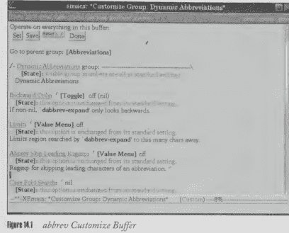

使用 `*abbr*` 回应提示

动态缩写组缓冲区可以从父组缓冲区（Abbreviations）访问，该父组缓冲区由 `*abbr*` 命令调用。在你选择动态缩写缓冲区之前，你可以浏览父组缓冲区中的自定义选项，这些选项会影响 *abbr*-mode。

### 书签

在短文件中，书签没有多大用处，但在长文件中，它们可以节省你寻找需要返回位置的时间。界面并不复杂。如果你处于文件中某个你知道需要返回的位置，只需按下 `C-x r m Enter`。

书签的默认名称是父缓冲区的名称。当你设置或访问书签而未指定名称时，它会在括号中（在小缓冲区中）建议。

如果你将在文件中设置多个书签，你需要使用前面命令的变体为每个书签指定名称：按下 `C-x r m`，输入 [名称]，然后按 Enter。

如果你设置了几个书签，很容易忘记书签名称。按下 `C-x r l Enter` 查看你设置的所有书签列表。


> XEmacs 用户需要安装 edit-utils 包才能使用书签功能。请参阅第 12 章了解说明。

你可以设置任意数量的书签。你编辑的每个缓冲区都有自己私有的书签，但除非你将它们保存到书签文件中（参见下一节），否则退出 Emacs 时它们都会丢失。

### 保存和重新访问书签

你可以通过按下 `C-x r b` 并输入 *(可选名称)* 回到你设置的任何书签。

你可以将此命令用作改变缓冲区的替代方式，因为访问书签会产生这种副作用。

你甚至可以使用此命令来加载文件。包含特定命名书签的文件会在你向该命令提供该名称时自动加载。给你的书签起短名称——只需两三个字符就足够了。

并非每个书签都需要在所有缓冲区中可用。也许你有一个包含与项目相关的文件的目录，并且希望将这些书签与你主目录中的主要书签文件分开。使用 `bookmark-save` 命令：按下 `M-x` 并输入 `bookmark-write`

你会被要求输入文件名。输入一个，新的书签文件将被创建。

如果你想将书签保存到全局书签文件，请按下 `M-x` 并输入 `bookmark-save`

如果你想使用建议的默认值（`~/\.emacs.bmk`），只需按 Enter。此默认文件在每次启动 Emacs 时都会加载，而你必须通过按下 `M-x` 并输入 `bookmark-load` 显式加载任何其他书签文件。

将此用于目录或项目特定的书签文件。

默认书签文件 `~/\.emacs.bmk` 在我尝试过的每个 GNU Emacs 和 XEmacs 版本之间都兼容，包括测试版。


Emacs 书签功能的一个附加特性是注释。在使用该功能之前，您必须先启用它。按 `M-x` 并输入以下内容进入“自定义书签”缓冲区：

```
customize-group bookmarks
```

响应提示并执行以下操作：

```
toggle The Use Annotations item to on, and save the setting. You will be queried for an annotation whenever you save a bookmark. An annotation is a description or any text you want to be associated with your bookmark. This isn't really necessary in a short bookmark file, but if you have dozens of bookmarks saved, this can help you remember why you saved them. The annotations are visible in a bookmark list summoned with the Ctrl-1 bookmark-11isting command (see Figure 14.2). This feature can also be used as a means of keeping bookmarked notes on a file.
```

书签列表缓冲区拥有自己的一套键位绑定。以下是其中最重要的几个：

| 键位 | 描述 |
| --- | --- |
| a | 在另一个窗口中显示书签注释（带有注释的书签会用星号标记）。 |
| 1 | 在当前全屏窗口中选择此书签。 |
| j | 用选定的书签替换书签列表。 |
| o | 拆分窗口，并在另一个窗口中加载书签，同时在其原窗口中保留书签列表。 |
| k | 标记删除书签，并向下移动一项。 |
| Ctrl-d | 标记删除并向上移动一项。 |
| x | 删除已标记的书签。 |
| s | 将列表保存到默认书签文件（`~/.emacs.bmk`）。 |

只要启用了自动压缩，书签功能在压缩文件上也能完美工作。此功能会在加载压缩文件时自动将其解压，并在您完成编辑后重新压缩。您可以通过按 `M-x` 并输入以下内容来开启此功能：

```
customize-group
```

然后在提示后输入：

```
jka-compr
```

此时会出现一个自定义缓冲区，其中没有任何关于自动压缩的明显引用。点击“压缩信息列表”项旁边的“显示”按钮。您的缓冲区现在应该看起来类似于图 14.3。

大多数子项都有合理的默认值，主要处理用于重新识别压缩文件的正则表达式。每个部分底部都有一个标有“自动模式”的切换开关。请为每种压缩类型将其切换到开启状态，并从“状态”菜单中选择“保存以供未来会话使用”。

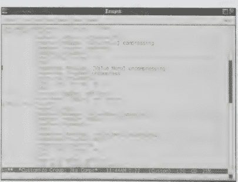

图 14.3 jka-compr 自定义缓冲区

现在，加载、保存和为压缩文件创建书签将几乎不被察觉。 minibuffer 中闪烁的简短消息和不到一秒的延迟是后台活动的仅有的迹象。

## Dired，Emacs 文件管理器

Dired 是 Emacs 的长期组成部分，其历史可追溯到文件管理程序问世之前。本质上，Dired 是 `ls`、`rm`、`mv` 以及其他文件工具在 Emacs 中的封装器。

如今，Linux 上有许多独立的文件管理器，并且大多数都可以配置为将 Emacs 作为选定文件的默认编辑器。这降低了 Dired 对许多 Emacs 用户的重要性，但从 Emacs 内部浏览文件在某些时候不可否认是非常方便的。图 14.4 展示了一个典型的 Dired 缓冲区。

在 Dired 模式下会出现一组复杂的菜单，提供广泛的文件和目录操作。有一点需要记住的是，如果另一个程序更改了目录的内容，文件和目录列表不会自动更新。输入 `g` 会导致列表（即 ls 命令的输出）被重新读取。通过 Dired 命令（如删除或创建子目录）对 Dired 缓冲区所做的任何更改都会立即反映在 Dired 列表中。

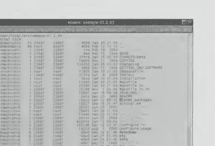

图 14.4 Dired 缓冲区

### Dired 键位

加载 Dired 缓冲区的关键命令是 `Ctrl-x d`。系统会提示您输入目录名称。默认值（在括号中显示）是当前缓冲区文件的目录。如果您希望使用默认值，只需按 Enter；否则，请在 minibuffer 中输入目录名称。

当 Dired 缓冲区出现时，默认键位映射将被 Dired 键位映射替换。许多字母键被重新映射为 Dired 命令。这些键位绑定显示在菜单中相关项的旁边。Dired 有很多绑定，但只需掌握其中几个就可以开始使用。在使用菜单时，您将学会使用其他键位。

### 基本 Dired 键位

| 键位 | 描述 |
| --- | --- |
| d | 将文件或目录标记为待删除。 |
| x | 删除已标记的文件，先询问确认。 |
| m | 标记或标记项目（文件或目录）以便执行其他操作。 |
| C | 复制项目或已标记的文件。 |
| S | 为项目创建符号链接（提示输入符号链接指向的名称）。 |
| R | 重命名项目。 |
| Z | 使用 gzip 压缩项目。 |
| v | 以查看模式（只读，通过空格键翻页）加载文件。 |

### 正则表达式菜单

Dired 命令中更有用的组之一是列在“正则表达式”菜单上的那些。这些命令使用正则表达式来标记或操作文件。这允许您使用单条命令修改大量文件。假设您有一些以 `_QUOT_` 开头的文件，并希望它们改为以 `quotes_2000` 开头。从“正则表达式”菜单中选择“重命名”将在 minibuffer 中产生以下提示：

```
Rename from (regex):
```

您将在 minibuffer 中输入 `^`。请记住，脱字符（`^`）是正则表达式中表示“仅在行首”的符号。

下一个提示将是：

```
Rename to (replacement):
```

您将输入 `quotes_2000`，所有文件名都会随之更改。这些正则表达式操作仅限于文件名的左侧部分；文件后缀会被忽略。

GNU Emacs 和 XEmacs 各自在其 Dired 版本中提供了 grep 文件搜索功能，但命令略有不同，且位于不同的菜单中。grep 是经典的 GNU 文件实用工具，用于在单个或多个文件中执行正则表达式搜索。您可以在 Dired 缓冲区中标记文件，并使用菜单命令搜索特定的文本字符串或正则表达式匹配项。

GNU Emacs 的 grep 命令是“正则表达式”菜单上的“标记包含”，而 XEmacs 的等价命令是“查找”菜单上的“查找”。

新窗口打开，显示搜索的结果。

### 自定义 Dired

Dired 自定义组有几个可以更改的设置。其中影响 Dired 缓冲区布局的设置是传给 `ls` 命令（Dired 的后端）的开关选项。阅读 ls 信息文件（您的系统上应该已安装该文件）。与其他许多 Linux GNU 实用工具一样，ls 提供了丰富的可选开关。不幸的是，Dired 可接受的选项必须与 `-l` 长列表开关兼容，该开关包含文件的属主、组和权限。

XEmacs 版本的 Dired 使用几种面（faces）来显示不同种类的文件和目录名称。备份文件、可执行文件、软链接和硬链接以及目录都有独立的面，可以通过自定义进行更改。从“选项”菜单中选择“编辑面”会打开一个自定义缓冲区，显示 XEmacs 使用的所有面。它们按字母顺序列出；所有 Dired 面都以 `dired-` 开头。

### Dired 技巧

当使用 Dired 遍历目录层级时，有一点要记住：每个 Dired 缓冲区会一直保留，直到您明确将其终止。很容易在下钻嵌套子目录时，没有意识到自己身后留下了一串活动的 Dired 缓冲区。虽然它们实际上无害，但确实会堵塞您的缓冲区列表，并最终毫无理由地占用内存。您可以在使用 `Ctrl-x d` 命令时更具体一些，并在完成后终止 Dired 缓冲区来避免这种情况。按 `l` 还可以将子目录列表附加到当前 Dired 缓冲区，按 `k` 可将其终止。Dired 具有良好的鼠标支持。当鼠标光标扫过 Dired 缓冲区中的文件名时，请注意名称如何被高亮显示。如果您点击中间


在文件名上按住鼠标按钮，文件就会被加载到一个 Emacs 缓冲区中。XEmacs 的 Dired 具有额外的鼠标功能：

| 操作 | 描述 |
| :--- | :--- |
| Ctrl-Button 2 | 弹出包含可能文件操作的菜单。 |
| Button 3 | 显示另一个具有不同查看和编辑选项的菜单。 |
| Shift-Button 2 | 为后续操作标记文件或目录。 |

如果您探索众多 Dired 菜单项，我确信您会发现其他有用的命令。

## 文件之间的差异

正如 Dired 是 ls 及其相关工具在 Emacs 中的前端一样，Ediff 提供了一种方便的方式来使用 GNU 文件比较工具 `diff` 和 `diff3`，以及 Larry Wall 的 `patch` 实用程序。Michael Kifer 编写了 Ediff 并继续维护该包。Ediff 很好地利用了字体锁定（font locking）。两个文件之间存在差异的行会以不同的字体锁定面孔（face）显示，使您可以一眼看出差异区域。

当您比较两个或三个文件时，每个文件都会出现在自己的窗口或框架中。您可以在两个缓冲区之间复制高亮的差异。图 14.5 和 14.6 让您对该界面有个大致的了解。

比较（Compare）子菜单位于菜单栏上的工具（Tools）之下。菜单非常方便，因为它们可以替代 minibuffer 命令。此菜单的前两项，两个文件（Two Files）和两个缓冲区（Two Buffers），分别等同于 minibuffer 命令：

```
M-x ediff-files
```

和

```
M-x ediff-buffers
```

您可以通过按 M-x，输入 ediff-，然后按两次 Tab 键来查看其他 Ediff minibuffer 命令的列表。

会显示一个补全窗口，列出众多命令，其中许多命令很难手动输入——这是使用菜单的又一个理由！

当您从菜单栏运行 Ediff 或使用 minibuffer 命令时，您指定的文件会先在后台进行比较。除非文件异常长，否则这需要不了太久。Ediff 缓冲区中的文件处于其正常模式下，编辑也是正常进行的。当 Ediff 缓冲区窗口出现时，鼠标

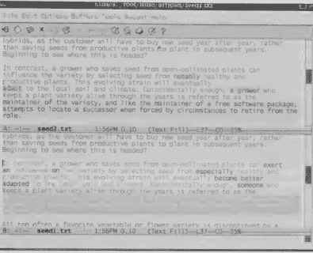

图 14.5 Ediff 缓冲区中的两个文件


图 14.6 Ediff 菜单

光标会立即放置在 Ediff 控制窗口中，这是一个显示差异区域数量以及获取帮助说明的小窗口（参见图 14.7）。

与 Dired 一样，键盘被完全重新映射，但仅在鼠标光标位于控制窗口中时生效。当控制窗口处于活动状态时，点击 ? 会扩展该窗口，使其足够大以显示按键绑定（参见图 14.8）。再次点击 ? 可将窗口缩小回原始状态。


如果您希望看到 Ediff 缓冲区窗口之一的帮助，请点击控制缓冲区“快速帮助”面板上的鼠标中键。

您不必处理整个文件。在菜单底部有一些命令，允许您比较两个完整的文本窗口，或者这些窗口内选定的区域。您可以选择较粗的逐行比较，或者显示逐字的差异。

## 在 Ediff 缓冲区中导航

您最常使用的键是 v 和 V 键，它们同时滚动两个（或三个）缓冲区；n 或空格键，带您前往下一个差异；以及 p 或 Delete 键，移动到上一个差异。

## 处理目录

同时拥有多个 Ediff 会话很常见，一个会话是一组已确定差异的文件对或文件三组。比较两个相似目录是尝试此功能并熟悉 Ediff 如何处理多个会话的一种方法。选择 *Tools, Compare, Two Directories*。系统会提示您输入两个目录名称。理想的候选者是一个目录及其足够长时间的备份，您已对该备份中的某些文件进行了修改。图 14.9 展示了一个 Ediff 会话组面板，显示了比较两个不同 AucTeX 版本目录的结果。


*图 14.9 编辑会话组*

每对文件都会列出其大小和最后修改时间，这使得很容易看出哪些文件对彼此不同。按 Enter 或在会话上点击鼠标中键，Ediff 就会开始处理该文件对，很快就会看到类似图 14.5 的分窗 Ediff 会话。

## 处理差异

一旦文件之间的差异可访问并被高亮显示，就有几种操作可用。*a* 和 *b* 键将高亮区域从一个缓冲区复制到另一个，*ra* 和 *rb* 通过撤销操作来恢复缓冲区。数字参数可以限制复制。例如，输入 *3a* 仅将缓冲区 A 中的第三个差异区域复制到缓冲区 B。输入 *:* 重新计算两个缓冲区之间的差异。

一个常见的场景涉及一个被两个不同人编辑过的原始文件。最终您会得到三个不同的文件，其中一个是另外两个的“祖先”。从比较菜单中选择 *Three Files*。系统会提示您输入三个文件名。会出现一个 Ediff 三方会话，外观类似图 14.10。可以使用与双文件会话相同的命令，但要复制差异，您需要指定源和目标。*cb* 将差异从缓冲区 C 复制到缓冲区 B。


图 14.10 *两个文件及其祖先*

## 合并文件

紧挨着比较菜单下方还有另一个 Ediff 菜单：合并（Merge）。该菜单上的各种命令可以处理文件、缓冲区和目录。基本思想是获取两个较新文件的差异，并将它们合并到原始文件（祖先）中。这些命令通常与 CVS 等版本控制系统配合使用。

合并操作并不总是完全符合您的预期，但您可以随时撤销命令。按 *e* 提供合并方法的选择；按 Tab 键查看这些选项。

## 使用 Ediff 修补文件

Ediff 为 `patch` 程序提供了一个方便的接口，`patch` 是许多软件项目中使用的有用工具。补丁（patch）实际上是一组由 `diff` 程序生成的文件差异，包含差异前后可变数量的上下文行。`patch` 程序使用这些上下文来找到插入差异的正确位置。

紧挨着合并（Merge）子菜单下方是应用补丁（Apply Patch）子菜单。您可以选择修补单个文件或整个目录。后者更常用。大多数补丁包含多个差异部分，每个部分旨在针对源代码目录中的不同文件。

如果您正在修补目录，将显示一个 Ediff 会话组，每个受补丁影响的文件成为一个会话。这允许您逐个文件进行修补（如果需要）。该缓冲区类似于图 14.9。

## 深入学习

Ediff 附带一份信息丰富的 Info 手册，其中包含比本书更多的细节。熟悉并掌握 Ediff 的一个好方法是在不重要的文件上尝试它。习惯双键盘模式（命令仅在控制窗口获得焦点时有效）需要一点时间，但稍加练习就会有所帮助。

如果您经常使用 Ediff，建议查看一下可以通过 Customize 修改的变量。Ediff Customize 组相当大，包含数十种可设置的选项，包括用于差异区域的高亮显示面孔（faces）。

## 使用 ispell 进行拼写检查

大多数，甚至所有文字处理程序都提供某种形式的拼写检查，这对于拼写不好的人来说可以节省时间。通常，应用程序使用的词典数据库不被其他程序使用。这可能导致存在多个庞大的词典，每个词典由不同的软件使用。UNIX 类系统（如 Linux）背后的哲学包括小而强大的工具相互协作的思想。所有程序共享一个词典是这种观点的自然延伸。

Emacs 本身并不附带词典，但检查整个文档、选定区域或单个单词的拼写只需按一次键即可实现。这是因为 Emacs 使用了几乎在所有运行 Linux 的计算机上都存在的默认系统级词典系统 ispell。

ispell 以某种形式自 1971 年就已存在，当时为其祖版本是为 DEC PDP-10 计算机上的 WAITS 操作系统编写的。当前的维护者是 Geoff Knueling。它是一个国际化程序，提供多种语言的词典。

ispell 是一个独立的命令行程序，使用方式如下：


该程序会逐步处理文件，并逐个显示其认为的拼写错误单词，同时附带一些上下文信息。它会提供可能的替换词，并让你选择接受该单词然后继续处理下一个。

在 Emacs 开始流行后不久，就有人编写了一个 Emacs 扩展，将 ispell 有效地集成到了 Emacs 中。你无需加载 ispell.el 或手动启用它。当你需要时，它随时可以即用。

## ispell 命令

检查单个单词的命令是 `M-$`。

这会检查点（point）处单词的拼写。执行此命令时，屏幕顶部会打开一个小型“选项”窗口。如图中 Emacs 会话的模型行（modeline）所示（见图 14.11），两个主要操作是：按空格键忽略该单词，或按数字字符选择“选项”窗口中的一个候选词。

另一个有用的命令是按 `i`。这会将该单词保存到你的个人词典中，该词典默认为 `~/ispell_default`，除非你有其他指定。首次使用此选项时，该文件会被创建。你可以建立一个包含专有名词和技术术语的单词列表，这些单词将被 ispell 视为有效单词。

`M-$` 执行的命令称为 `ispell-word`。你无需输入整个不确定的单词；只需输入其一部分，让 ispell 建议单词的剩余部分。

对缓冲区（buffer）进行全文拼写检查没有绑定快捷键；请按 `M-x` 并输入 `ispell-buffer`。


图 14.11 检查单个单词的拼写

如果你经常使用此命令，可以在你的 `~/.emacs` 文件中通过类似以下的语句将其绑定到快捷键：

```
(global-set-key [(control c) l] 'ispell-buffer)
```

说到快捷键绑定，默认用于单词检查的 `M-$` 绑定相当难以输入；我在我的 `~/.emacs` 文件中将其重新绑定为一个功能键：

```
(global-set-key 'f6 'ispell-word)
```

### ispell 的词典

可以使用另一个命令来更改默认词典。按 `M-x` 并输入 `ispell-change-dictionary`。

系统会提示你输入另一个词典的名称（可能是另一种语言的词典）。

ispell 词典采用一种特殊的哈希格式。ispell 发行版包含一个名为 buildhash 的独立程序，用于将单词列表处理为紧凑的词典数据库。请查阅 ispell 和 buildhash 的 man 页以获取说明。

### 检查 HTML 和 LaTeX 文件

ispell 原生支持对带标记的 LaTeX 和 HTML 文件进行拼写检查。它会忽略标记，专注于这些文件的内容。

### 自定义 ispell

ispell 的许多设置都可以通过 Customize 功能进行更改。默认词典、拼写错误单词的高亮显示以及 ispell 对 HTML 的处理方式都可以更改，还有许多其他变量也可以调整。要调出此 Customize 缓冲区，请按 `M-x` 并输入 `customize-group`。

当被提示时，输入 `ispell`。

程序员可能会对定制项 *Ispell Check Comments* 感兴趣。默认设置为“on”，意味着注释块中的所有文本都会被检查。这没问题，但如果你不希望检查程序代码本身怎么办？ispell 很可能将奇怪的函数名和类名标记为拼写错误，这可能会在使用一段时间后变得令人恼火。此变量有一个值菜单：你可能想尝试的一个选择是“exclusive”。将该变量设置为此值可限制 ispell 仅对注释进行拼写检查。这在普通文本文件中没什么用，但可以在每次会话中这样设置。

## Flyspell

近期的 Emacs 版本附带了一个名为 Flyspell 的自动即时拼写检查器，由 Manuel Serrano 编写。XEmacs 用户可以在 text-modes 软件包中找到它。

此模式会在你输入时高亮显示 ispell 认为拼写错误的每一个单词。它不会让你停下来修正高亮显示的单词，但如果你想处理其中一个，点击鼠标按钮 2 会显示一个选项菜单。这些选项与使用默认 ispell 接口时“选项”窗口中显示的单词相同。

如果你希望以此模式为可选方式启用它，即该模式仅在手动启用时激活，请在你的 ~/.emacs 文件中插入以下行：

```
(autoload 'flyspell-mode 'flyspell "On-the-fly spelling checking" t)
(autoload 'global-flyspell-mode 'flyspell "On-the-fly spelling" t)
```

在这两行被评估（Ctrl-x Ctrl-e）或 Emacs 重启后，按 M-x 并输入 `flyspell-mode` 以启用该模式。该命令是一个切换开关。换句话说，同一命令可以关闭 Flyspell。

如果你尝试后发现想在每个 Emacs 缓冲区中使用它，请改为插入以下行：

```
(global-flyspell-mode t)
```

Flyspell 在编写时包含了大量的 Customize 支持。你可能会觉得默认行为令人分心，但可以通过更改设置使该模式更不干扰。你可以设置不重复高亮重复单词，甚至可以增加更多的时间延迟。更多的延迟会迫使 Flyspell 等待可配置的时间后才高亮单词，从而减轻 Flyspell 在背后盯着你并催促你立即修正这些错误的感觉！

你可以通过按 M-x 并输入 `customize-group` 访问此 Customize 缓冲区。

对提示响应 `flyspell`。

如果你花些时间调整 ispell 和/或 Flyspell 的设置，你应该能够找到一个有效且不显眼的拼写检查活动级别。

## 在 Emacs 中运行 Shell

Emacs 拥有自己的 shell 模式，它是一个类似于 xterm 或虚拟控制台中的登录 shell 会话的窗口。你熟悉的 shell，无论是 bash、csh、zsh 还是其他任何命令 shell，都与任何登录会话一样使用相同的启动脚本。

要打开 shell 缓冲区，只需按 M-x 并输入 `shell`。

只要其他命令行程序不操作显示器，你就可以从该 shell 缓冲区运行它们。基于 ncurses 的程序无法工作。GNU 文件和文本实用程序（如 ls 或 cat）是仅输出文本的程序的良好示例，因此是合适的选择。从 shell 缓冲区运行的程序是异步运行的，这意味着它们在一个独立于 Emacs 的进程中运行，不会影响编辑器的行为。

那么，当 xterm 或 rxvt 窗口随处可见且没有 shell 缓冲区的限制时，为什么要费心使用 shell 缓冲区呢？一个（也是唯一的？）原因是，shell 缓冲区中命令的输出可以像其他任何 Emacs 缓冲区中的文本一样被操作。你可以复制文本并将其粘贴到另一个缓冲区中。如今，程序员可能是 shell 缓冲区的主要用户。大多数免费软件开发人员都使用 GNU gcc 编译器，其输出（尤其是错误信息）在 Emacs 会话中可能很有用。

也要考虑到 Emacs shell 缓冲区是在计算机速度慢、资源消耗大的时代开发的；在那个街机时代，它是一个真正有用且良好的概念。尽管如此，即使在如今拥有强大且内存丰富的机器的情况下，Emacs shell 缓冲区仍然值得使用。

## Shell 缓冲区快捷键

你可能已经习惯了通常的 shell 快捷键，但 Emacs Shell 缓冲区的绑定是不同的。

在大多数 Linux shell 中，以前的命令保存在内存中；你可以通过按上箭头键或 M-p 找回其中一个命令并再次运行。Emacs shell 缓冲区仅支持后一种绑定。Tab 文件名补全有效，但 Shell 缓冲区中一些用于进程操作的绑定不同。在普通的 shell 会话中，按 Ctrl-c 会中断正在运行的进程。该键组合在 Emacs 会话中保留为前缀；按 Ctrl-c Ctrl-c 可中断进程。启动 Shell 缓冲区会在菜单栏上显示三个新菜单：Complete、In/Out 和 Signals。大多数用户对这三个菜单上的许多命令没什么用处，除了前面概述的基本快捷键绑定外。

### Shell 缓冲区问题

Shell 缓冲区通常工作良好，因为你的登录 shell 执行实际工作，而 Emacs 只是显示输出。用户报告的一个反复出现的问题是使用 ls 命令时显示混乱。输出中会散布 `^M` 字符，使其难以阅读。如果你在 Shell 缓冲区中使用 ls 时看到类似图 14.12 的内容，请继续阅读。

这种情况发生在用户设置 ls 以对比颜色显示各种类型的文件和目录时。许多 Linux 发行版已将此设置设为默认。ls 通过使用 Linux 控制台和 X 终端能够理解的终端代码来显示颜色。它们会通过将代码转换为相应的颜色来响应；不幸的是，Emacs shell 模式无法做到这一点。

解决此问题至少有两种方法。第一种是设置 ls 不显示颜色。这可以通过在 shell 初始化文件（如 ~/.bashrc）中的 shell 别名来完成。插入这些别名：

```
alias ls='ls --color=no'
alias ll='ls -la --color=no'
```


图 14.12 *Shell 缓冲区中混乱的 ls 显示*


## Eshell

这些别名在 Shell 缓冲区中能给你带来良好的使用体验。在普通的终端会话（console 或 xterm）中，你可以使用标准的 `ls` 和 `ls -l` 命令，输出将像以前一样显示彩色。

当 Emacs 在 Shell 缓冲区中启动你的默认 shell 时，如果存在，它将使用 Emacs 特定的初始化文件，而不是默认的 `~/.bashrc`。你可以将上述别名放入一个名为 `~/.emacs_bash` 的文件中，这样它们将仅在 Emacs 中生效。这对于任何 shell 都有效，而不仅仅是 Bash；例如，Zsh 用户可以将该文件命名为 `~/.emacs_zsh`。

另一种选择是使用 Eshell 而不是标准 shell 模式。

Eshell 是由 John Wiegley 编写的一个新包。它目前仍处于积极开发阶段，但就其当前状态而言，它是标准 shell 模式的可行替代方案。

Eshell 提供了完全用 Emacs Lisp 编写的新 shell，而不是使用你正常的命令 shell。许多标准 shell 命令在 Lisp 中被模拟到如此程度，以至于在一般使用中你将无法分辨出区别。模拟的 `ls` 命令的输出与在 xterm 中看到的彩色 `ls -l` 输出非常相似。

命令补全、别名、zsh 风格通配符以及标准 Linux shell 的许多其他功能均由 Eshell 提供。

Eshell 带有自己的脚本语言，但文档尚未编写完成。

Eshell 将随 Emacs 21 一起发布。目前作为 XEmacs 包可用。Emacs 20 及更早版本的 用户可以从 tar 归档文件中安装 Eshell，该文件位于本书的 CD-ROM 中的 `/cdrom/packages` 目录。

你可能想要查看以下网站，因为当你阅读本书时可能会有更新版本可用：`http://www.gci-net.com/users/j/johnw/`。

为 Emacs 21 之前版本的安装并不复杂。只需将 `*.el` 文件复制到 site-lisp 目录并对文件进行字节编译。然后在你的 `~/.emacs` 文件中插入这一行：

```lisp
(load "eshell-auto")
```

安装完成后，通过按 `M-x` 并输入以下内容来启动 Eshell 会话：

```
eshell
```

John Wiegley 对 Eshell 有雄心勃勃的计划。它最终可能会成为 Emacs 的默认 shell。

## 大纲模式（Outline Mode）

当你撰写具有可预测层级的结构化文档时，会使用大纲模式。任何分成章节的文档都适合使用此模式。大纲模式允许你“折叠”缓冲区，以便只有章节标题或页眉可见。图 14.13 在两个窗口中显示了相同的文档。上方窗口是正常展开视图，下方窗口已通过 Hide 菜单中的 Hide Leaves 命令进行了折叠。

大纲模式在引用文档的各部分时使用树类比：“叶子”是标题或子标题下的实际文本内容。还使用父子类比，标题下的内容（包括子标题及其内容）被视为父标题的子级。

### 启动大纲模式

你可以通过按 `M-x` 并输入以下内容来启用大纲模式：

```
outline-mode
```

这将大纲模式设为主要模式。大纲模式旨在与 text-mode 协同工作，因此你的 text-mode 设置仍将有效。

大纲模式不必是主要模式。你可能希望将其与其他模式一起使用，例如某种编程语言模式。大纲次要模式实际上是一样的模式，但键绑定不同，因此不会与主要模式的键绑定发生冲突，主要模式的键绑定通常以与大纲模式相同的 Ctl-c 前缀开始。你可以通过按 `M-x` 并输入以下内容来启动次要模式：

```
outline-minor-mode
```


图 14.13 大纲模式下的缓冲区

### 局部变量

大纲模式与许多主要模式不同，因为它不与任何特定的文件后缀关联。因此，你不能期望使用此模式编写的文件每次编辑时都自动处于大纲模式。Emacs 使用文件的后缀来确定适合它的模式。

你可以通过在文件开头包含一行 Local Variables 来强制 Emacs 对该文件使用大纲模式。当 Emacs 加载文件时，它会查看第一行。如果它发现像下面这样的行：

```lisp
-*- mode: Outline -*-
```

它将大纲模式设为文件的主要模式。这也适用于大纲次要模式：

```lisp
-*- mode: Outline-minor -*-
```

Local Variables 行可用于设置任何 Emacs 变量。它仅对该文件有效，而不影响其他 Emacs 缓冲区。可以在该行中设置多个变量。它们需要用分号分隔。

### 大纲层级

当你处于大纲模式时，如果希望该模式能够识别你文档的不同分节层级，你必须遵循某些约定。行首的星号指示层级标题：一个星号表示顶层，两个星号表示第二层，等等。下面是一个简单的例子：

```text
* 第 1 节

这被称为该顶层标题的主体部分；这部分可以使用大纲模式命令进行隐藏和显示。
```

```text
** 子节 1

更多的主体内容，但位于第二层标题之下。
```

```text
** 子节 2

另一个第二层部分，但仍属于顶层的第 1 节的一部分。
```

```text
*** 部分 1

第三层标题，这属于子节 2。
```

```text
* 第 2 节

文档的第二个顶层细分。
```

如果折叠此示例，它看起来像这样：

-   + 第 1 节 ...
-   + 子节 1 ...
-   + 子节 2 ...
-   + 部分 1 ...
-   + 第 2 节 ...

使用默认星号作为章节层级指示符并不是绝对必要的。一个名为 *outline-regexp* 的变量可以更改以对应特定类型文档的标题层级。默认值是 `^(\\*)`，这可以翻译为“一个或多个 `*` 或控制字符 ^L，这是一个用于指示页面边界的单个字符”。大纲模式的一个内置限制是，层级越高，层级指示符必须越短。你可以通过仅使用单词指示符的一部分来绕过这一限制，该部分比层级中下一个较低指示符更短。一个例子将阐明这一点。假设你正在编辑使用（按降序排列）Part、Chapter 和 Scene 层级的文档。Part 是一个短词，但 Scene 比 Chapter 短且比 Part 长。Chapter 是一个不遵循“较低层级需要较长名称”规则的层级指示符，因此 Chapter 需要截断以符合该规则。问题出现了：如果将 Chapter 缩短为 Chapt 以使其比 Part 长，它的长度将与 Scene 相同。这里除了给 Scene 添加一个字符使其变长之外别无他法。使用星号作为该字符，新正则表达式的三个字符串为 Part、Chapt 和 *Scene。将这些放入 Lisp 语句中，结果如下：

```lisp
\\(Part\\|Chapt\\|^\*Scene\\)*
```

这是一个看起来复杂的正则表达式。大量的反斜杠是必需的，以“转义”那些否则将被解释为正则表达式特殊字符的字符。

### 展开和折叠大纲

你可以通过按 `M-x` 并输入以下内容来调用 Customize 缓冲区以更改 `outline-regexp` 变量：

```
customize-variable
```

根据提示输入：

```
outline-regexp
```

你可以在该 Customize 缓冲区中更改该变量，使其适用于所有缓冲区，可以是永久的，也可以仅限你的 Emacs 会话期间。你可能需要考虑将此变量设置得仅适用于你正在编辑的文件，方法是在需要不同设置该变量的文件顶部包含一行 Local Variables。该行的样子可能如下：

```lisp
-*- mode: Outline; outline-regexp:"\\(\\*(\\\\)\\\\*\\\\(Chapt\\\\)\\\\*Scene\\\\)"-*-
```

确保你在 Local Variables 行中可能包含的各个设置之间包含分号。

大纲主要模式和次要模式的键绑定是不同的；主要模式的键绑定基于 Ctrl-c 前缀，打字并不困难。不幸的是，次要模式的键绑定基于 Ctrl-c @ 前缀，这是一种手指扭曲的绑定，无疑是存在的最不舒服的前缀之一。如果你计划经常使用大纲次要模式，我建议你更改次要模式前缀为更舒适的东西。你只需在你的 ~/.emacs 文件中插入类似此 Lisp 语句：

```lisp
(setq outline-minor-mode-prefix [C-s])
```

在 X Window Linux 会话中，Ctrl-z 是一个相当无用的前缀。单独使用时，此键命令会图标化并挂起 Emacs 会话。大多数窗口管理器通过标题栏按钮或键绑定提供此服务，因此此前缀在 Emacs 模式配置中可以使用。你可能更喜欢的另一个前缀是 Ctrl-v。默认情况下，这会运行 scroll-up 命令，但 Page Up 键也执行相同操作。

以下是大纲模式的键绑定。当你处于大纲主要模式时，用 Ctrl-c 替换 `[prefix]`；当你使用大纲作为次要模式时，用 Ctrl-c @（如果你更改了变量，则为 Ctrl-z）替换。


## 标题菜单

- `[prefix] Ctrl-n` 移动到下一条目的位置。
- `[prefix] Ctrl-p` 向上移动到父级标题。
- `[prefix] Ctrl-f` 移动到同级别的下一个条目。
- `[prefix] Ctrl-b` 移动到同级别的上一个条目。

## 显示菜单

- `[prefix] Ctrl-a` 显示所有内容。展开树状结构，使所有内容可见。
- `[prefix] Ctrl-e` 展开当前光标位置的条目。
- `[prefix] Ctrl-l` 显示当前级别的子类别。
- `[prefix] Ctrl-i` 显示“子项”，或下级标题。
- `[prefix] Ctrl-s` 类似于 `[prefix] Ctrl-i`，但同时也显示条目。

## 隐藏菜单

- `[prefix] Ctrl-l` 隐藏“叶子节点”，即当前级别内的条目。
- `[prefix] Ctrl-t` 隐藏除大纲标题以外的所有内容。
- `[prefix] Ctrl-c` 仅隐藏属于当前标题的条目。
- `[prefix] Ctrl-d` 隐藏当前级别下方的标题和条目。
- `[prefix] Ctrl-q` 除顶级标题外，隐藏所有内容。
- `[prefix] Ctrl-o` 除光标位置的标题和条目外，隐藏所有内容。

在多级别文件中掌握此模式需要一些练习。每个版本的 Emacs 都附带一个文件——NEWS 文件——详细记录了当前及之前版本 Emacs 所做的更改。你只需按下帮助键 `Ctrl-h n` 即可加载此文件。它以大纲主模式显示，因此前文讨论的 `Ctrl-c` 前缀键位将起作用。

如果你在执行增量搜索时遇到处于折叠状态的大纲模式缓冲区，会担心使用 `Ctrl-s` 命令会发生什么呢？搜索将穿透缓冲区的折叠和不可见部分，受影响的不可见部分将变为可见，并且在之后仍保持可见。你可以使用 `Ctrl-c Ctrl-c`、`Ctrl-c Ctrl-l` 或 `Ctrl-c Ctrl-t` 命令再次隐藏它们。

## 删除与大纲：警告

在熟悉此模式时，你需要谨慎行事，避免随意剪切文本。如果在文档折叠时删除一个标题，该标题下方的所有内容也将被删除。请记住，标题行末尾的那三个点代表隐藏的内容；当它们被删除时，你的内容也会随之被删除。在退出 Emacs 之前，被删除的内容仍保留在剪贴板（kill ring）中，可以重新粘贴回来，但如果你关闭 Emacs，那么被剪切的文本将会丢失。你或许能够从备份文件中检索到意外删除的文本，但最佳策略是“三思而后删”。

## 其他大纲模式

如果你觉得大纲模式很有用，可以考虑尝试其他类似的模式。折叠模式（在下一章介绍）提供了显示和隐藏文档层级的不同方法，大纲模式的 Foldout 次要模式扩展也是如此。Foldout 次要模式记录在 Emacs Info 文件中。它为大纲模式添加的一个功能是使用窄化（narrowing）——使某一级别的标题成为缓冲区中唯一可见的部分。这将全局编辑操作限制在你可见的缓冲区部分。你可以在 `~/.emacs` 文件中包含以下行来试用它：

```
(eval-after-load 'outline" '(require 'foldout))
```

每当启用大纲模式时，这会使其自动将 Foldout 作为次要模式。请记住，如果不喜欢这个次要模式，应该注释掉或删除这一行。

## 日历和日记

你可以使用 Emacs 来记录约会、纪念日、节日以及任何你想记住的日子。此功能模式的入口是日历模式，它是一个显示三个月日历的小窗口，当前月份位于中间。通过按下 `M-x` 并输入以下内容即可打开日历窗口：

```
calendar
```

乍看之下它似乎没什么特别，但与这种模式关联着一系列有用的命令。你可以轻松地在月份之间移动，既可以向未来方向（向右）移动，也可以向过去（向左）移动。日历模型行中显示的键位（`Ctrl-x <` 和 `Ctrl-x >`）可以每次将显示移动一个月，方向不限。如果你想更快地浏览月份，`Page Up` 和 `Page Down` 键每次按键可跳转三个月。方向键在日期之间移动，鼠标也可以像在任意 Emacs 缓冲区中一样用于移动光标。

注意当鼠标在日期上方移动时该日期是如何被高亮显示的。每个日期都有两个鼠标菜单可用。鼠标中键会弹出与该日期相关的命令菜单，而 `Ctrl-mouse button 3` 则显示更通用的日历功能菜单（XEmacs 不需要为此菜单使用 `Ctrl` 键）。

图 14.14 中显示的命令主要与日记相关，日记更像是一个约会和计划工具，而不是一本实际的日记。

图 14.15 中显示的键位仅在光标位于日历窗口中时有效。它们适用于光标所在的日期。

日历菜单或主菜单栏上的菜单提供了更多的命令。GNU Emacs 将它们分为四个不同的菜单（跳转、节日、日记和月相），而 XEmacs 将所有命令整合到一个多级日历菜单中。

使用这些菜单，你可以显示玛雅历或中国日期，查看不同年份和时间段的节日列表，查看当前的月相，以及执行各种其他与日期相关的命令。其中许多功能你可能很少（甚至从不）使用，但它们是可用的。


## 日记文件

日历模式的日记功能类似于个人信息管理（PIM）程序；你可以记录一次性、每周或周期性的预约、纪念日或提醒。从日记菜单或子菜单中选择*插入日记条目*将在你的主目录中打开一个名为 `diary` 的文件。如果你刚开始使用日历模式，此文件将被创建。日期会被插入到文件中，其余部分用于你的备注。图 14.16 是日记文件的一个示例。注意文件中提到的日期在日历窗口中是如何被高亮显示的。按下 `m` 可以开启此功能，按下 `u` 可以关闭它。

使日记功能有用的一个特性是可能使用的条目种类繁多。例如，看看图 14.16 所示日记文件中的第四个条目。这是一个周期性条目。你不需要知道这类条目的格式，因为它会在提示你输入周期长度后自动为你创建。显示的条目标记了每第四天。你可以通过从日记菜单或子菜单中选择*插入周期性条目*来创建此类条目。

你可以通过选择*插入块条目*命令来创建另一种有用的条目类型。这会创建一个包含连续一系列天数的条目。在选择此命令之前，你需要将标记（`Ctrl-spacebar`）设置在块的第一个日期，然后将光标移动到最后一个日期。图 14.16 中的最后一个日记条目是块条目的一个示例。


图 14.17 准备 LaTeX 菜单

当你拥有与图 14.16 类似布局的日记和日历屏幕时，日记文件并不总是完整显示的。如果你使用鼠标中键菜单选择*日记条目*，则仅显示光标所在日期的相关条目。在 Emacs 21 和 XEmacs 中，一个弹出的 ToolTip 窗口也会显示这些条目。按下 `s` 可再次显示所有条目。

如果你想打印日历（并且已安装 LaTeX），请从鼠标中键菜单中选择*准备 LaTeX 缓冲区*。将显示如图 14.17 所示的菜单；选择你偏好的日历，系统将创建一个 LaTeX 缓冲区。你可以使用 LaTeX 和 `dvips` 处理该缓冲区，最终得到一个可打印的日历 PostScript 文件。（有关 LaTeX 和 Emacs 的更多信息，请参阅第 13 章。）

日历和日记还有许多其他功能；要了解更多信息，请参阅 Emacs 或 XEmacs Info 文件中的日历部分。

## 结语

本节概述了更受欢迎且有用的“官方”Emacs 扩展，但你也可能喜欢探索 Emacs 附带的其他扩展。了解值得查看的软件包名称的一种方法是花些时间浏览 `comp.emacs.*` 和 `gnU.emacs.*` 新闻组。如果一个扩展有用且编写精良，那么其他 Emacs 用户很可能正在讨论它或提出相关问题。

下一章将讨论一些外部 Emacs 附加组件。尽管这些软件包并不随 Emacs 分发，但它们的质量可以与内置软件包媲美。其中一些最终将被纳入官方的 Emacs 和 XEmacs 发行版，但在发生这种情况之前，你可以从各种互联网站点获取它们。


## 第15章：外部便利软件包

- Clipper：持久化剪贴板
- 笔记模式（Notes Mode）
- 折叠模式（Folding Mode）
- 在线字典接口
- Emacs CD 和 MP3 播放器
- 面向音乐家的 ABC 模式
- 记忆代理（Remembrance Agent）


本章讨论的软件包由那些有“未被满足的需求”（换言之，需要 Emacs 无法执行的任务）的 Emacs 用户开发而成。在此语境下，“满足需求”意味着为 Emacs 编写一个新的扩展——一种模式或实用工具，为这位“变装大师”般的编辑器再添一套新装。

这些是外部软件包，意味着它们并不随官方 Emacs 发行版捆绑提供（尽管其中一些可能作为 XEmacs 软件包可用）。若要充分描述过去 15 年间编写的大量 Emacs 扩展，所需篇幅将是本书的数倍。以下是我选取本章软件包的标准：

- 该扩展必须能与当前版本的 Emacs 和/或 XEmacs 兼容。一些较旧软件包尚未更新以适配近期版本。在许多情况下，已编写了具有相同功能的新扩展。
- 它应自由许可，最好采用 GNU GPL。
- 该附加功能应对相当大比例读者有用。有些软件包非常专业化，例如用于少数人使用的冷门编程语言的扩展。
- 软件包不应有过多错误，最好有活跃维护者。
- 它应附带足够的文档。弄清如何使用该扩展不应是一场解读 Emacs-Lisp 的测试。

本章描述的所有软件包均可在本书 CD-ROM 的 `/cdrom/packages` 目录中找到。

## Clipper：持久化剪贴板

你可能还记得第 7 章中提到的 clipper.el。在那一章结尾，Lisp 文件静卧在大理石板上，它仍在微微颤动的器官（请原谅，我是指函数！）杂乱无章地散落着。在此期间，它已被重新组装并缝合好。在本节中，你将看到它能做什么。

Clipper 是一个紧凑的单文件 Lisp 软件包的典范（仅略大于 6 KB）。尽管体积小，它为 Emacs 会话新增了模式和一个易于使用的接口。

Kevin Burton 编写了该模式，因为他厌倦了手动将相同文本块复制粘贴到自己编写的 Lisp 文件的注释部分。其中一个文本块是大多数 Emacs–Lisp 文件开头必备的 GPL 声明。许多 Emacs 扩展就是这样诞生的：面对重复性任务的人心想，“要是 Emacs 能……就好了”。Kevin 提出的构想是一个充当这些文本片段仓库或记忆存储的永久文件。难点在于想出一种通过名称轻松检索文本单元的方法，以及一种将带名称的新文本块快速添加到仓库文件的简便方法。如果你感兴趣这些细节，请参见第 7 章。

### 安装

像 Clipper 这样的单文件软件包安装起来很容易。只需将文件从本书 CD-ROM 复制到你的 site-lisp 目录，然后在你的 `~/.emacs` 文件中插入以下 Lisp 语句：

```
(require 'clipper)
```

如果你评估此语句（按 Ctr-x Ctrl-c），你将获得几个可尝试的新 Clipper 相关命令：

- M-x clipper-create 创建新的剪贴片段。
- M-x clipper-delete 删除现有剪贴片段。
- M-x clipper-insert 将其中一个剪贴片段插入当前缓冲区。

这三个命令都会提示输入剪贴片段的名称。你或许还想为最常使用的两个命令设置键绑定：

```
(global-set-key [(control c) (control i)] 'clipper-insert)
(global-set-key [(control c) (control n)] 'clipper-create)
```

尽管 Kevin Burton 设计 Clipper 用于插入 GNU 许可证等“样板”文本，但该模式足够开放，可用于任何你需要反复插入的文本，如你的姓名和邮寄地址。你可以将 Clipper 视为另一种 abbrev-mode（在第 14 章中讨论）的形式，但针对那些不像缩写那样频繁需要、而是较大的文本块进行了适配。

## 笔记模式

Notes 模式由 John Heidemann 数年前开发，旨在帮助整理和便捷获取学术笔记。它可能永远不会被纳入官方 Emacs 发行版，因为它不仅仅是一个完全用 Lisp 编写的 Emacs 扩展。该模式的大部分功能源自多个 Perl 脚本，这些脚本设计为在后台定期且非交互式地运行。因此，Notes 模式是一种不寻常的混合模式，没有 Emacs 作为宿主就没有用处（像大多数模式一样），但若没有 Perl 安装环境和一种在定义间隔自动运行进程的手段，也没有用处。幸运的是，几乎所有 Linux 安装都满足这两个要求：Perl 通常默认安装，并且有一个名为 cron 的守护进程可用于定期运行程序或脚本。

Notes 模式提供了一个编写笔记并使其按日期和主题组织及索引的环境。与许多 Emacs 扩展一样，它可被用于作者未曾设想的用途。Notes 模式可用作个人数据库，甚至作为日志或日记的框架。

## 先决条件

你需要已安装 Perl，且版本至少为 5.00。任何近期版本的 Emacs 或 XEmacs 都应能工作。你应至少有数兆字节的可用磁盘空间，因为笔记文件和目录会随时间不可阻挡地增大。

### 安装

Notes 模式的安装比通常情况略复杂。如果操作不当，该模式将完全无法工作。首先，将发行文件解压到一个临时目录。Notes 模式使用 configure 脚本和 makefile 系统来适配某些 Lisp 文件到你的系统、字节编译它们，最后将 Lisp 文件和一组 Perl 脚本复制到新位置。

运行 configure 脚本会创建一个定制化的 makefile，但 configure 过程可能需要使用至少一个开关运行，因为它可能找不到你的 site-lisp 目录。非 Lisp 组件的默认安装目标是 /usr/local，但这也可以通过开关更改。以下是一个示例命令：

```
../configure --with-prefix=/usr --with-lisp-dir=/usr/share/emacs/site-lisp --info-dir=/usr/info
```

如果你希望将 Info 文档文件放在 `/usr/local/info` 以外的其他位置，请使用 `--info-dir` 开关。

现在，将新创建的 makefile 加载到 Emacs 会话中，并在文件顶部附近查找以下部分：

```
##################################################
#
# user configurable parameters
#

prefix=/usr

# LIB_DIR should be a private place for notes-mode stuff.
LIB_DIR=$(prefix)/share/notes-mode

# EL_DIR should be where your site-specific emacs .el[.c]s go.
EL_DIR=/usr/share/emacs/site-lisp
# INFO_DIR is for emacs info files.
INFO_DIR=$(prefix)/info
INSTALL_INFO=/usr/sbin/install-info
# must be perl 5.000 or better.
PERL=/usr/bin/perl
# must be 19 or greater
EMACS=emacs
MKDIR_P=mkdir -p
#
       !
# end of user configurable parameters
#
##################################################
```

检查参数是否准确反映了你希望安装软件包的方式。进行必要的更改并将文件保存到磁盘。

XEmacs 用户需要进行一项额外编辑；将此行：

```
EMACS=emacs
```

改为：

```
EMACS=xemacs
```

这假设 XEmacs 可执行文件在你的路径中。否则，也输入路径——例如像这样：

```
EMACS=/opt/bin/xemacs
```

现在 makefile 已准备就绪，你可以输入

```
make install
```

Lisp 文件将由非交互式 Emacs 或 XEmacs 进程在后台进行字节编译，然后复制到你的 site-lisp 目录。Perl 脚本被复制到 `/usr/local/share/notes-mode`（或者——如果你指定了不同的前缀，则为你指定的位置），Info 文档文件加入你的其他 Info 文件。你需要在 Info 目录的 dir 文件中添加一行如下所示：

```
* Notes Mode: (notes-mode). On-line note organizer
```

在你可以开始使用 Notes 模式之前，还有一个最后步骤。切换到 Perl 脚本安装的目录（默认位置是 `/usr/local/share/notes-mode`）。通过输入以下命令执行其中一个脚本

```
notesinit
```

这是一个交互式脚本。你会被询问各种问题，例如你希望笔记目录位于何处，脚本根据你的回答完成设置，如有必要则创建目录。如果你希望使用该模式，系统上的每个用户都必须运行此脚本。

notesinit 脚本执行的一项任务是设置你的 crontab 文件，以便其他 Perl 工具在适当间隔被调用。这是否有效取决于你的 Linux 发行版中 cron 的配置方式。

阅读你的 cron 文档以了解 crontab 配置文件位于何处，并检查是否已为 Notes 模式的 `mkall` 命令添加了条目。如果出错且未添加，你需要添加一个每日 cron 任务。以下命令需要在每日 cron 会话期间执行：

```
/usr/local/share/notes-mode/mkall
```

例如，在我的 Debian 系统上，各种 cron 任务是位于 `/etc/cron.daily`、`/etc/cron.weekly` 和 `/etc/cron.monthly` 目录中的 shell 脚本形式。以下是名为 `notes-mkall` 的 shell 脚本的内容，它每天运行一次 `mkall` Perl 脚本：

```
#!/bin/sh
# notes-mode cron daily
/usr/local/share/notes-mode/mkall
```

这样的脚本需要由类似以下命令设为可执行：

```
chmod +x /etc/cron.daily/notes-mkall
```

你真的需要确保 cron 已设置为每天运行 `mkall`，尽管我想你可以每两三天自己运行一次该命令。不过，让笔记索引保持最新而无需自己记住去做，是件好事。


运行 `notesinit` 的一个结果是，会创建一个示例笔记文件并将其插入到你新的笔记目录中。这个文件能让你了解笔记文件的格式。以下是示例的样子：

```
• Today ------
to do list goes here?
```

```
• Environment/notes ---------------
Set up notes with notesinit.
```

`mkall` Perl 脚本（每天作为 cron 任务运行）会对所有现有的笔记文件进行索引和交叉引用。你创建的每个笔记文件都会自动获得一个反映其创建日期的数字名称。举个例子，我是在 2001 年 2 月 17 日撰写这段文字的。今天早上为我创建的笔记文件的文件名和路径如下：/home/layers/Notes/200102/010217。

目录名称 `200102` 应解释为 2001 年的第二个月，而文件名 `010217` 则使用年份的后两位数字，接着是月份和日期。这些名称并非真正供你直接使用的；它们是为了供在后台运行的索引 Perl 程序使用，以保持你的笔记有序且易于访问。

Perl 脚本每天生成一个新的索引，将你的笔记按主题标题排序，而单个笔记文件则按时间顺序排列。索引缓冲区中的每一项（可以从任何 Notes 模式缓冲区调用）都是指向你的某个笔记文件的可点击链接。

具有特定主题行的条目可以通过按键命令从所有现有笔记复制到单个摘要缓冲区中。这是一种便捷的方式，可以查看具有相同主题的每个笔记，作为按时间顺序和主题从一个笔记移动到另一个笔记的替代方法。

图 15.1 显示了一个摘要缓冲区。这是一个临时缓冲区，但可以保存到文件中。

脚本完成的另一项任务是更新笔记文件内的所有链接。如果你在一周前写了一篇主题行为“** 政治”的笔记，今天又写了一篇具有相同主题的笔记，那么一周前的文件中会插入一个新的“下一个”链接，指向今天的文件。你的旧笔记会不断被更新，以包含指向较新笔记的链接。


Notes 模式将任何以星号后跟空格开头的行识别为主题标题。**Today** 标题是一个特殊的标题。该标题及其后续内容会从上一个笔记文件复制到下一个新文件中。这是插入“待办”事项的地方；它们会出现在后续的所有笔记中，直到你删除它们。如果你不习惯制作待办事项列表，只需删除示例条目，并将 **Today** 类别用作导航到前一天笔记的方法。

只要行以星号开头且名称前有一个空格，你随时可以创建新的类别。一旦你使用过某个主题行并且它已被索引，下次输入它时你就可以使用 Tab 补全功能。

在输入带有星号空格标识符的主题前按 Enter 键即可开始一个新笔记。主题行会自动被下划线标记，并为该笔记创建伪 URL。如果存在具有该主题标题的前一个笔记，也会插入其伪 URL，这样你就可以立即返回到该笔记（如果你希望的话）。

外部链接是指向你机器或网络上其他文件的指针。它们的工作方式类似于 HTML 链接，作为一种伪 URL。它们看起来像这样：

```
file:////usr//local/articles/mencken.txt
```

在积累了一定数量的笔记之前，Notes 模式的强大和便利功能真的无法被充分认识。按日期、索引或主题在一个笔记之间导航，类似于浏览万维网，只不过那是你个人的笔记网络。

## 键盘和鼠标命令

笔记导航可以基于鼠标或键盘。按键绑定基于 `Ctrl-c` 前缀：

| 命令 | 操作 |
|---|---|
| Ctrl-c Ctrl-n | 移动到具有相同主题的下一个笔记。 |
| Ctrl-c Ctrl-p | 移动到具有相同主题的上一个笔记。 |
| Ctrl-c Ctrl-i | 移动到索引缓冲区，其中包含指向每个笔记的链接。 |
| Ctrl-c Enter | 跟随伪 URL 链接。 |
| Ctrl-c Ctrl-k | 将当前笔记的伪 URL 复制到 kill ring。 |
| Ctrl-c Ctrl-s | 将所有具有当前笔记主题标题的笔记收集到一个摘要缓冲区中。 |
| M-Ctrl-a | 跳转到当前条目的开头。 |
| M-Ctrl-e | 跳转到当前条目的末尾。 |

`Ctrl-c Ctrl-k` 绑定是一个有趣且有用的功能。它让你可以将当前笔记的伪 URL 作为一个整体抓取。你还可以通过选择区域并复制来实现这一点，但按键操作更快。将伪 URL 粘贴到另一个笔记中，你就将两者关联起来了。有时，将两个不共享相同主题类别的笔记链接在一起是很有帮助的。

鼠标命令提供了另一种导航方式：

| 命令 | 操作 |
|---|---|
| 鼠标按钮 2 | 在索引缓冲区中点击指向笔记的链接将带你到那里。 |
| Shift-鼠标按钮 2 | 在 Notes 缓冲区中点击伪 URL 将打开该笔记。 |

Notes 模式还支持对单个笔记进行加密。`outline-minor-mode` 可以与 Notes 模式配合使用，使笔记缓冲区可以折叠，仅显示主题标题行。请参考随附包的 Info、PostScript 或 HTML 文档，以了解这些和其他此处未描述的功能。

## 自动还原笔记

如果你有整晚让 Emacs 保持运行状态的习惯，并且在前一天编写并保存了一个 Notes 模式笔记，你可能会在第二天早上注意到你的笔记变成了“未保存”状态。模型行（modeline）中的星号表示该笔记已更改但未保存。

不，你并没有忘记保存笔记。Perl 脚本 `mkall` 在夜间完成了它的工作，重新索引了你的所有笔记。此 cron 任务的一部分是在笔记之间插入伪 URL 链接，包括仍然加载的昨天的笔记。Emacs 会注意到如果它的某个缓冲区已被其他进程在磁盘上修改，如果你尝试重新保存该笔记，系统会询问你是否真的要这样做。输入 yes，保存笔记，并考虑使用名为 `auto-revert-mode` 的附加组件，它可以自动为你完成此操作。

还原缓冲区意味着将磁盘上的文件解释为所需版本，并将该文件重新加载为 Emacs 缓冲区。

`autorevert.el` 包含在 GNU Emacs 中；XEmacs 用户可以在此书的 CD-ROM 或此 URL（这是作者 Anders Lindgren 的页面）上找到该文件：http://www.csd.uu.se/~/andersl/emacs.shtml。

你可以通过在 `~/.emacs` 文件中插入以下行来激活此模式，从而仅影响 Notes 模式缓冲区：

```lisp
(add-hook 'notes-mode-hook 'turn-on-auto-revert-mode)
```

auto-revert 模式设计为仅在 Emacs 空闲时执行其任务，因为如果该模式试图在你编辑文件时还原它，那将会令人不安和烦恼。

## 折叠模式

Anders Lindgren 的折叠模式（Folding mode）近年来作为一种 Outline 模式的替代方案而变得流行。该扩展是另一种有选择性地隐藏和显示缓冲区部分的方法。

在 Outline 模式中，星号用于指示部分标题——顶级部分使用一个星号，二级子部分使用两个，等等。没有“部分结束”标记。折叠模式使用三个花括号来指示部分的开始和结束，并且部分层次结构中的所有级别都使用相同的三重开括号和闭括号。折叠模式完全通过花括号包裹的部分嵌套深度来确定部分所属的级别。以下是一个带有嵌入式子部分的折叠模式骨架部分：

```lisp
{{{ Section One
  [upper-level content]
  {{{ Sub-section 1
      [sub-section content]
  }}}
}}}
```

折叠开始标记后面应始终跟随一些标识文本。折叠模式需要此文本才能正常工作，并且这也使得折叠后的缓冲区更易于理解。

理解折叠模式工作原理的一个好方法是安装它，然后加载一个专为折叠而编写的大型多层级文件。巧合的是，`folding.el` 本身就充当了该模式如何使用的绝佳示例。

### 安装

GNU Emacs 用户可以在此书的 CD-ROM 上找到 `folding.el`。XEmacs 用户需要安装 text-mode 包，该包包含此扩展。

有两种通过在你的 `~/.emacs` 文件中添加行来激活该模式的方法。第一种方法在打开包含折叠指示符花括号的文件时自动启动折叠模式：

```lisp
(if (load 'folding 'nomessage 'noerror)
  (folding-mode-add-find-file-hook))
```

你可能不希望折叠模式加载，直到你通过按 `M-x` 并输入以下内容显式启动它：

```
folding-mode
```

在这种情况下，你 `~/.emacs` 文件中的 autoload 语句是你所需要的：

```lisp
(autoload 'folding-mode               "folding" "Folding mode" t)
(autoload 'turn-off-folding-mode      "folding" "Folding mode" t)
(autoload 'turn-on-folding-mode       "folding" "Folding mode" t)
```

在评估这些行之后（无论是手动使用 Ctr1-x Ctr1-e 还是通过重启 Emacs），你就可以打开 `folding.el` 文件并尝试一些折叠和展开命令。

图 15.2 显示了 `folding.el`，其中只有一个部分被展开。


图 15.2 部分折叠的缓冲区

## 键盘和菜单命令

折叠模式命令的默认前缀是 Ctrl-c @，这是我不愿意使用的前缀。在寻找多余的 Emacs 键绑定以将其征用为折叠模式的前缀时，我偶然发现了 Ctrl-v。默认绑定运行向上滚动命令，而该命令恰好也是 Page Up 键调用的命令。由于我从不使用 Ctrl-v，尽量偏好单键输入，Ctrl-v 似乎是一个很好的候选项。如果你愿意这样做，你需要先在 `~/.emacs` 文件中用这一行取消当前的绑定：

```elisp
(define-key global-map [(control v)] nil)
```

这一行需要在 `~/.emacs` 文件中位于你的折叠模式初始化行之前。现在你可以自由地为 Ctrl-v 前缀分配新含义。这可以通过 Customize 完成。按下 M-x 并输入

`customize-group`

在提示时，输入

`folding`

在生成的 Customize 缓冲区中可以更改几个折叠设置。默认前缀键是第一个设置。

但既然你已经在捣鼓你的 `~/emacs` 文件了，与其使用 Customize，你可以直接在刚才显示的 `define-key` 行之后添加另一行，这将永久更改前缀：

```elisp
(defconst folding-mode-prefix-key (control v))
```

即使是菜单也会捕捉到这一变化，因为它们在每次启动折叠模式时都会从头生成。

图 15.3 是在进行此更改后 Fld 菜单的屏幕截图，展示了可用的众多折叠相关命令。

如果你保留了默认的折叠模式前缀，每个命令将以 Ctrl-c @ 作为前缀，而不是 Ctrl-v。

在启动折叠模式后，花些时间研究 `folding.el`，你将会熟悉在折叠文件中导航的感觉。创建你自己的文件并不困难，只要你记得保持打开和关闭折叠标记平衡即可。

折叠模式内置支持大多数编程语言使用的特定注释字符。请注意，图 15.2 中的折叠指示符以分号（Emacs Lisp 注释字符）为前缀，但该模式仍然识别折叠。以双斜杠（表示 C++ 注释）为前缀的大括号将在 C++ 源文件中被识别为折叠。可以使用如下语句将新的注释字符添加到列表中：

```elisp
(folding-add-to-marks-list 'major-mode *e({[`"*e{]}]`*) )
```

| 命令                       | 快捷键      |
|----------------------------|-------------|
| 进入折叠                   | (C-v x)     |
| 退出折叠                   | (C-v X)     |
| 显示折叠                   | (C-v S)     |
| 隐藏折叠                   | (C-v H)     |
| 显示整个缓冲区             | (C-v G)     |
| 折叠整个缓冲区             | (C-v G)     |
| 显示子树                   | (C-v +)     |
| 隐藏子树                   | (C-v -)     |
| 显示折叠名称               | (C-v =)     |
| 移动到上一个               | (C-v \|)    |
| 移动到下一个               | (C-v SP)    |
| 选择折叠                   | (C-v P)     |
| 折叠/展开区域              | (C-w B)     |
| 打开或关闭区域内的折叠     | (C-v F)     |
| 打开顶层折叠               | (C-v L)     |
| 注释折叠内的文本           | (C-v >)     |
| 转换为打印/临时缓冲区      | (C-v D)     |
| 转换为主要模式折叠         | (C-v 2)     |
| 移动区域内的折叠内注释     | (C-w /)     |
| 插入折叠 URL 引用          | (C-v )      |
| 切换进入和退出模式         | (C-v )      |
| 切换显示和隐藏             | (C-v )      |
| 关闭折叠模式               | (C-v )      |


这一行适用于一个假设的主要模式，该模式使用 @ 字符作为注释指示符。

如果你想查看某种特定语言是否受支持，请按“help-on-variables”帮助键，即 Ctrl-h v。

响应提示时输入

```elisp
folding-mode-marks-alist
```

将打开一个窗口，显示折叠模式识别的众多注释字符。

## 在线字典的接口

Dict 项目（http://www.dict.org）为计算机用户提供了一个免费的客户端/服务器字典系统。它通过运行作为后台进程的服务器守护程序来处理来自诸如 dict 等客户端软件的请求，dict 是发行版的一部分。

Dict 是一个命令行程序。你输入 `dict word`，单词被传递给 dictd 服务器，该服务器在一个或多个使用名为 dictzip 的专用压缩程序压缩的字典文件中查找该单词。定义随后被传递给诸如 less 等分页器，在那里可以阅读定义。整个过程几乎是瞬间完成的。

Dict 从中提取定义的压缩字典文件都是公共领域文件，包括大约 1913 年版的未删节版梅里安-韦伯斯特字典和完整的 WordNet 数据库。其他还包括地名集、圣经字典和两部计算机术语汇编。

这些字典文件可以是 Internet 上远程 Dict 服务器上的，也可以是你自己机器上的本地文件。Linux 发行版提供了客户端、服务器和字典文件的软件包。

Dict 系统本身就值得一用，但不久之后，一些 Emacs 用户开始编写允许在 Emacs 内部访问这些字典的模式。其中一位用户是 Torsten Hilbrich；他编写了一个功能丰富的模式，称为 `dictionary.el`。该模式并没有作为 Emacs 对 dict 客户端程序的前端，而是取代了它，直接联系 dict 服务器。

## 安装 Dictionary.el

安装包括解包 `dictionary-1.2.1.tar.gz` 文件，将 “.el” 文件复制到你的 site-lisp 目录，并对文件进行字节编译。将这些行粘贴到你的 `~/.emacs` 文件中将激活该模式：

```elisp
(auto-load 'dictionary-search "dictionary"
  "Ask for a word and search it in all dictionaries" t)
(auto-load 'dictionary-lookup-definition "dictionary"
  "Search the word at point in all dictionaries" t)
(auto-load 'dictionary-match-words "dictionary"
  "Ask for a word and search all matching words in the dictionaries" t)
(auto-load 'dictionary "dictionary"
  "Create a new dictionary buffer" t)

(global-set-key [(control c) (d)] 'dictionary-lookup-definition)
(global-set-key [(control c) (s)] 'dictionary-search)
(global-set-key [(control c) (m)] 'dictionary-match-words)

(setq dictionary-server "localhost")
```

最后一行使你的机器成为默认的字典服务器。如果你想使用远程服务器，请用服务器的 IP 地址替换 "localhost"。可以根据你的设置更改键绑定。

字典模式提供几个功能命令。`dictionary-lookup-definition` 查找光标位置的单词，然后打开字典缓冲区并显示找到的定义。一种变体称为 `dictionary-search`，在 minibuffer 中显示当前点的单词，允许你在按 Enter 之前进行编辑。`dictionary-match-words` 提示你输入部分单词，然后显示包含该模式的单词列表，按字典排序。列表中的每个单词都是可点击的链接，用于获取定义。

图 15.4 显示了一个典型的字典窗口。

在字典窗口的顶部有几个通过鼠标激活的按钮，用于运行各种字典模式命令；结果将在窗口中显示。

如果你按下 M-x 并输入

`dictionary`

将显示一个空的字典窗口。


你可以使用空的字典窗口访问命令按钮。

字典窗口中的一个按钮可用于选择默认字典，可以随时更改。图 15.5 显示了由此按钮调起的选项菜单。

字典模式是写作者的一大助力。你不仅可以有使用 `ispell` 检查单词拼写，使用此模式你还可以快速查阅定义。


这种模式对于阅读古腾堡计划公域文本的用户也很有用。我发现，如果可以用单个按键命令快速查找单词，我更有可能去查阅它。

## Emacs CD 和 MP3 播放器

Linux 上有许多可用的命令行音乐播放器。本节重点介绍 mpg123 MP3 播放器和 cda、cdcd 音乐 CD 播放器的 Emacs 界面。这些 Emacs 音乐模式并不像 gcd 和 xmcdd 等独立的 X11 播放器那样花哨，但如果你经常使用 Emacs，并且不介意牺牲其中一个 Emacs 窗框的一部分空间，它们会非常方便。X11 播放器可能会埋在层层叠叠的窗口后面，或者位于另一个虚拟桌面上。当所有你需要做的只是找到播放器控制键时，在复杂的屏幕布局中翻找会令人分心。Emacs 音乐播放器只是另一个缓冲区，可以从缓冲区菜单访问。

### CD 界面

Matthew Hodges 编写了 cdi.el，这是一个功能多样的 CD 播放模式，它在一个窄窗口中显示曲目、艺术家和唱片名称，并提供各种播放操作的预期命令。这两个命令行播放器都支持通过访问 CD 数据库服务器来查找 CD（如果你已连接互联网），并下载标题、艺术家和曲目信息以供当前和未来使用。

cdi.el 是一个单文件包，可以放入你的 site-lisp 目录。在你的 ~/.emacs 文件中添加以下两行即可启用该扩展：

```
(require 'cdi)
(global-set-key [(control c) (z)] 'cdi-start)
```

第二行是可选的，可以设置为任何方便且可用的绑定。如果你选择不分配按键绑定，按下 M-x 并输入

```
cdi-start
```

将开始一个新的 cdi 会话。

Cdi 界面是一个短窗口，顶部显示唱片、曲目和已用时间。

当 Cdi 窗口获得焦点时，按下 Ctrl-h b（绑定帮助键），会出现一个类似于图 15.6 中上方窗口的窗口。此模式分配了助记键，例如 p 用于播放/暂停，> 用于下一曲目。


图 15.8 带有帮助窗口的 Cdi 窗口

### 播放 MP3 列表

这个用于播放 MP3 压缩音乐文件的模式由 Hirose Yuuji 编写。它是命令行程序 mpg123 和 aumix 混音器的前端，这两个程序在你的 Linux 发行版中应该都可以作为包获得。

它与 Cdi 有些相似，只是用播放列表代替了 CD，如图 15.7 所示。

mpg123.el 的一个便利功能是，除了指定单个 MP3 文件进行播放外，你还可以指定播放列表的名称。播放列表格式简单：每行一个文件名。你甚至不需要手动输入列表。你可以用一个简单的 shell 命令生成列表：

```
ls *.mp3 > list
```

对于单个目录列表，你可以省略路径开头的 */。

你还可以通过加载整个目录而非单个文件来生成列表。当显示单个 MP3 文件名时，按下 s 可保存为列表。当该模式可以加载满目录的文件时，为什么还要费心呢？你可以将播放列表加载到 Emacs 中，并按令人愉悦的播放顺序对文件名进行排序和重新排列。如果你只想要随机打乱播放顺序，按 s 命令后紧跟 m 可以整理你在屏幕上看到的列表。


图 15.7 mpg123 MP3 播放器

## 面向音乐家的 ABC 模式

ABC 是一种 ASCII 文件格式，最初开发作为通过电子邮件或网络在 Internet 上传输传统曲调的紧凑手段。在存在的十年里，该格式经过调整和精炼，以至于即使是复杂的欧洲艺术音乐作品也可以转换为 ABC 格式。

使 ABC 对音乐家真正有用的原因是，已经开发出了将该格式编写的音乐转换为可打印的高质量 PostScript 乐谱的程序。音乐出版商可能对 ABC 不太感兴趣，但对音乐家来说，网络上可用的大量此格式的音乐是一份宝贵的资源。

访问 ABC 主页 http://www.grc.uc.ca/~k.walshaw/abc/ 以查找 ABC 曲调文件和用于 PostScript 转换的 Linux 软件来源。我推荐 abc2ps，这是 abc-mode 设置中使用的转换软件。

Michael Shulman 编写了 abc-mode.el，作为 ABC 文件格式及其相关软件的 Emacs 界面。该扩展提供字体锁定和多种键盘命令，用于处理和查看曲调文件。其中一个命令甚至可以将曲调转调至不同的调。

### 安装

要从 abc-mode 中受益，你需要安装并配置好 GhostScript，安装 abc2ps（以及可选的 abc2midi 包），以及一个 PostScript 查看器，如 gv。该模式包含在单个文件 abc-mode.el 中，你需要将其复制到你的 site-lisp 目录。最后一步是将以下行插入你的 ~/.emacs 文件：

```
(autoload 'abc-mode "abc-mode" "Major Mode for ABC files" t)
(add-to-list 'auto-mode-alist '("\\.abc$" . abc-mode))
```

### 使用 abc-mode

除了 PostScript 转换和查看外，abc-mode 还允许你搜索曲调名称。这对于一些可用的大型 ABC 文件非常有用，这些文件可能包含 100 多条曲调。以下是可用命令：

| 按键 | 描述 |
| :--- | :--- |
| M-Ctrl-b | 在曲调中向后移动一个小节。 |
| M-Ctrl-f | 向前移动一个小节。 |
| Ctrl-c Tab | 插入标准 ABC 头。 |
| Ctrl-c Ctrl-b | 将整个缓冲区转换为 PostScript 文件。 |
| Ctrl-c Ctrl-c | 仅将点位置的曲调转换为 PostScript 文件。 |
| Ctrl-c Ctrl-g | 跳转到特定曲调。 |
| Ctrl-c Ctrl-i | 与 Ctrl-c Tab 相同：插入一个 ABC 头。 |
| Ctrl-c Ctrl-n | 将选定区域转换为 PostScript 文件。 |
| Ctrl-c Ctrl-p | 将整个缓冲区转换为 PostScript 文件。 |
| Ctrl-c Ctrl-r | 将曲调转调至不同的调。 |
| Ctrl-c Ctrl-s | 搜索曲调。 |
| Ctrl-c Ctrl-t | 跳转到曲调主体。 |
| Ctrl-c Ctrl-v | 在 PostScript 文件上运行 PostScript 查看器。 |

abc-mode 很好地展示了 Emacs 如何促进使用文本文件作为输入的外部程序的工作。

### 记忆代理

具有完全新功能软件很少见。大多数应用是对十年前或十五年前想法的改进——更好的电子表格、具有新功能的文字处理器等。Bradley Rhodes 在开始编写记忆代理（RA）时，设法为软件构思了一项新颖的工作。用他的话说：

> 记忆代理是 MIT 媒体实验室软件代理小组开发的项目之一。给定用户积累的电子邮件、Usenet 新闻文章、论文、保存的 HTML 文件和其他文本笔记的集合，它试图找到与用户当前上下文最相关的文档。也就是说，它在这个文本集合中搜索与用户当前编辑文本具有最高逐字相似度的文档，希望它们也具有高概念相似性，从而对用户当前的工作有用。这些建议会持续显示在用户 Emacs 缓冲区底部的小缓冲区中。如果某个建议看起来有用，可以用单个命令检索全文。

记忆代理分两个阶段工作。首先，用户的文本文档集合被索引到一个以向量格式保存的数据库中。数据库创建后，记忆代理的其他阶段从 Emacs 运行，它会定期对工作缓冲区中的文本进行采样，并找到集合中最相似的文档。它在一个小 Emacs 窗口中总结顶级文档，并允许你用一次击键检索任何一篇的全文。

在本书描述的包中，记忆代理可能与 Notes 模式最接近，因为这是另一个依赖外部程序才能工作的混合包。两个包都索引和整理文本文档集合，并通过 Emacs 界面使其可访问。两者之间的一个重大区别是 RA 缓冲区的动态特性，它会自动响应你在活动缓冲区中输入的文本。

RA 背后的引擎是两个编译的 C 程序，ra-index 和 ra-retrieve。第一个必须手动在你想要索引以供 RA 后续使用的文件和目录上运行。ra-retrieve 由系统的 Emacs Lisp 组件自动调用；其职责是定期搜索你索引文件中的相似性。ra-retrieve 的输入是你活动缓冲区中点周围的文本，其输出为 RA 窗口提供链接。

由于 RA 的空前性，需要一些练习才能掌握使用它。控制 RA 窗口中链接相关性的主要因素是你选择索引和可用的文件。这需要一些实验。


用户习惯于软件响应其输入，然后耐心地被动等待更多指令。RA 类似于 Linux 系统中的后台守护进程，它们在后台忙碌地工作，但守护进程不会像 RA 那样定期向用户展示它们的活动情况。

## 解包与安装

解包 remem-2.09.tar.gz 归档文件并进入新目录，在那里您将找到一个 Configure 脚本。如果您正在使用 GNU Emacs，运行该脚本生成可用 makefile 的可能性很大。首先尝试此操作：

```
./configure ; make ; make install
```

make 过程会生成两个二进制可执行文件 ra-index 和 ra-retrieve，并对子目录 other 中的两个 Lisp 文件进行字节编译。make install 命令会将可执行文件复制到 /usr/local/bin，将 Lisp 文件复制到您的 site-lisp 目录。

XEmacs 用户需要将上述行中的中间命令更改为

```
make EMACS=xemacs
```

然而，由于 XEmacs 加载非打包扩展方式的一些近期变更，可能还需要进一步的调整。较新版本的 XEmacs 已弃用旧的 site-lisp 目录，并用 /usr/local/lib/xemacs/site-packages/lisp 取而代之。您可以费心修改 makefile，以便将字节编译的 Lisp 文件安装到正确的目录，但手动操作更为简便。只需确保 remem.elc 和 jimminy.elc 被复制到正确的目录，即 XEmacs 搜索本地 Lisp 文件的那个目录。即使 Lisp 文件未复制到正确位置，两个二进制文件也应该已经位于 /usr/local/bin。

最后一步是在您的 ~/.emacs 文件中插入这些激活行：

```
(load "remem")
(load "remem-custom.el")
```

此时，您可能会说：“没有名为 remem-custom.el 的文件！Emacs 怎么可能加载它？”

是的，您说得对；没有这样的文件。需要创建它。这一步并不是绝对必要的（如果您不这样做，请忽略 ~/.emacs 中的第二行），但它使得自定义 RA 变得更容易，而不必在调整 RA 配置时重新字节编译 remem.el。

您只需将文件 *remember.el* 加载到 Emacs 会话中，并复制文件顶部附近位于以下带注释的行：

```
\; CUSTOMIZATIONS
```

和这一行之间的内容：

```
\; END OF CUSTOMIZATIONS
```

现在，通过按下 *Ctrl-x Ctrl-f* 并输入来加载一个新的、尚不存在的文件

```
/your site-lisp directory/remember-custom.el
```

将复制的行粘贴到新文件中并保存。

现在，上述 `~/.emacs` 条目中的第二行将起作用，但前提是您编辑 *remember-custom.el* 使其包含在 RA 运行前需要创建的目录。

## 设置可搜索源

您需要至少一个包含由 *ra-index* 生成的文件的目录。第一步是创建目录 `~/RA-indexes`。这是默认名称。如果您想使用不同的名称和位置，需要编辑 *remember-custom.el* 文件并更改变量 *remember-database-dir* 的值。

### XEmacs 字体锁定

XEmacs 用户可能希望更改 *remember-custom.el* 中的几行代码以启用语法高亮（尽管在阅读此文档时可能已修复）。这些行

```lisp
(cond ((and (boundp 'hilit-background-mode)
	(equal hilit-background-mode 'dark)))
```

应更改为：

```lisp
(cond ((and (boundp 'frame-background-mode)
	(equal frame-background-mode 'dark)))
```

选择一个包含文本文件的目录，然后在 `~/RA-indexes` 下创建一个子目录，该目录的助记词应反映文本文件目录的内容，例如“mail”或“notes”。现在您需要告诉 RA 使用哪个目录。再次编辑 *remember-custom.el* 文件，并至少添加一个 *scope*，这是一个 Lisp 语句，用于设置 RA 显示缓冲区中的某些行，以显示来自特定目录的搜索结果。需要更改的变量定义看起来像这样：

```lisp
(defvar remsen-scopes-list
* '(("books" 2 5 500)
    ("articles" 2 5 500)
    ("common" 2 5 500)
    ("notes" 2 5 500))
"The list of scopes, where each scope is (DIRN NUM-LINES UPDATE-TIME QUERY-RANGE)" )
```

Scope 是 RA 窗口中的一系列行，显示来自 ~/RA-indexes 特定子目录的搜索和匹配结果。您只需要一个 scope，但也可以使用多个，如前面的示例所示。引号中的单词（例如示例中的“books”）是您的 ~/RA-indexes 目录中某个子目录的名称。示例条目中的数字是更新之间的间隔秒数；ra-retrieve 在再次搜索并更新 RA 缓冲区前会等待这么久。QUERY RANGE（示例中为 500）是搜索时应考虑的指针（在您编辑的缓冲区中）两侧的词数。完成后保存文件，并评估缓冲区以更新任何已更改的变量。

现在您可以使用以下命令运行 ra-index：

```sh
ra-index -v ~/RA-indexes/[subdirectory] [directory-to-be-indexed] -e [subdirectories-to-ignore]
```

一个示例可能如下所示：

```sh
ra-index -v ~/RA-indexes/articles -/articles -e -/articles/economist
```

您需要为 remsen-scopes-list 变量中包含 scope 的每个目录运行一次此命令。

准备工作相当多，但您只在想要添加、更新或排除目录时才需要这样做。

## RA 命令

RA 键映射基于前缀 Ctrl-c r。要启动（或停止）Agent，请按 Ctrl-c r t。

会打开一个 RA 窗口。在扫描索引目录时会有几秒钟的延迟。一旦启动，窗口看起来类似于图 15.8。


图 15.8 *记忆 Agent 窗口*

您可以使用这些按键命令控制 RA 活动：

- Ctrl-c r
  - 切换 RA 的开关。
  - 显示结果。绕过内置定时器并更新 RA 窗口。
- Ctrl-c r [number]
  - 将索引源文件的完整文本复制到临时缓冲区。
- Ctrl-c r [number]
  - 对建议的相关性进行评分。评分保存在日志文件中，该文件可以电子邮件发送给作者，作者使用此信息来评估和改进软件。
- Ctrl-c r f
  - 对 RA 显示中的一个字段进行搜索：正文、位置、日期、主题或人物。
- Ctrl-c r q
  - 调出一个查询缓冲区，以便您可以在多个字段中填写关键字。按下 Ctrl-c r（如上所述）将启动搜索并用结果更新 RA 窗口。
- Ctrl-c r d
  - 数据库更改。这是告诉 RA 开始使用 ~/RA-indexes 子目录而非 remem-custom.el 中定义默认值的方法。

鼠标也可以用于控制 RA 窗口。

鼠标按钮 1 相当于 Ctrl-c (number)。点击窗口左边缘的行号将显示该索引文件。

第一个鼠标按钮也可以点击特定字段，如位置或主题。将对字段内容进行搜索，并显示新结果。鼠标按钮 2 和 3 会弹出一个小窗口，显示导致该文件被认为相关的关键字。

由于 RA 完成的工作是新颖且不熟悉的，因此需要练习才能从该包中获益。尝试不同的索引目录组合、不同的 scope 大小和不同的更新间隔，这些都可以在 remem-custom.el 文件中更改。由于该文件很小且经常更改，因此不应进行字节编译。

如果 RA 窗口一直可见，可能会分散注意力。如果您最大化主编辑窗口（Ctrl-x 1），RA 将在后台继续运行。这是我喜欢运行 RA 的方式，时不时地检查窗口，看看最近挖掘出了哪些结果。

## 许可问题

Remembrance Agent 一直免费可用，但只有最新版本才在 GNU 通用公共许可证下发布。该包虽然是在 MIT 媒体实验室开发的，但部分得到了两家公司的支持：英国电信和 Merrill Lynch。早期版本在 GPL 意义上并非免费，因为您不能分发修改后的版本。现在 RA 已不再受限，无疑会以 Linux 发行版包的形式出现，这应该会简化设置过程。

## 结论

请记住，本章和前一章只是可用包的抽样。要了解其他包，请浏览 Emacs 新闻组，因为有用的包往往经常被讨论。

下一章介绍使程序员生活更轻松的药物包。Emacs 在这方面特别强大，因为程序员是编辑器的首批用户。


## 第 16 章：让编程更轻松的包

- 适用于几乎所有语言的模式
- 处理注释
- C、C++ 和 Java 的模式
- JDE
- CPerl-mode
- Python 模式
- 在多个源文件中搜索
- 作为 IDE 的 Emacs

Emacs 最初是程序员的编辑器。各种特定语言的模式有着长期的调整和精细化的历史。随着新语言的开发，要么是对现有模式进行适应，要么是从零开始编写全新的模式。

除了语言模式外，还有许多编程实用程序可供选择。通过选择一套符合你编程风格的实用程序，你可以创建一个基于 Emacs 的自定义编程环境，其可用性可与现代 IDE（*集成开发环境*）相媲美，后者在商业软件市场中很常见。

源代码文件之间的区分是为程序员提供的一种便利。就编译器而言，这些文件的目录可能只是一个大文件。在项目源文件中，对程序员更重要的单元是代码块，例如函数和变量定义、类以及预处理器条件语句。一个文件中的语句可能引用或调用另一个文件中的定义。Emacs 提供了几种不同的方法来浏览源代码目录并定位特定的代码块。标签、函数菜单和 Speedbar 窗口是本稍后讨论的其中三种方法。

### 适用于几乎所有语言的模式

语言模式对程序员有何用处？

- 字体锁定在视觉上有助于区分不同类型的代码和注释。
- 特殊的键绑定允许在语句或函数定义之间快速移动，类似于文本模式中的句子和段落移动命令。
- 缩进可以自动化并设置为特定样式。
- 可以检查括号、方括号和大括号的匹配平衡。
- 内置与编译器和调试器的接口。
- 可以逐个跳转到负责编译器报告错误的源文件。

并非每种语言模式都具备所有这些功能。通常，使用更广泛的语言，如 C、C++ 和 Java，拥有功能最强大的 Emacs 模式。Python 和 Perl，这两种主要的解释型语言，各自都有一个在适当时提供这些功能的模式。

### 处理注释

Emacs 提供了一些键盘命令，有助于简化用注释字符界定注释并良好地格式化注释的任务。这些命令适用于所有主要语言和许多次要语言。

M-q 键命令在文本模式中用于将段落重新格式化为特定的填充列，但在编程模式中经过修改，以保留缩进并丢弃操作后可能不需要的多余注释字符。在此 C 注释块内按下 M-q：

```
/* Here are some comments which could
 * be evened out and
 * formatted, just for appearance's sake
*/
```

结果变为：

```
/* Here are some comments which could be evened out
 * and formatted, just for appearance's sake */
```

indent-for-comment 和 comment-region 命令可以帮助你输入注释。M-; 将点移动到代码之后，插入开始和结束注释字符，并将光标留在其中。该命令移动到的列称为 comment-column（注释列）。默认情况下，这被设置为第 32 列。如果你的代码宽度超过 32 列，你可以使用 set-comment-column 命令将其设置为当前缓冲区的其他值。Ctrl-x ; 将当前点位置设置为新的 comment-column。如果你想永久设置，可以在 ~/.emacs 文件中使用如下行：

```
(setq comment-column 55)
```

当你在代码块的右侧输入注释时，你可能希望文本在 comment-column 位置换行，而不是超出屏幕右边缘。不要按 Enter 进行换行，而是使用 M-j 命令为新注释行进行缩进。该键命令还将已输入的文字向下移动到当前行下方的新缩进行中。如果你的注释看起来像这样，且点移动到 much 和 undo 之间：

```
Fixnum undo-threshold;		/* Two thresholds controlling how much undo information to keep. */
Fixnum undo-high-threshold;
```

按下 M-j 会将注释行格式化为这样：

```
Fixnum undo_threshold;    /* Two thresholds controlling how */
Fixnum undo_high_threshold; /* much undo information to keep. */
```

有时，在想法新鲜时输入注释材料更容易，而不必在完成后才处理注释字符。comment-region 键命令，Ctrl-c Ctrl-c，会在选区周围包围注释字符。

这也可以用于你想对编译器“不可见”的代码，也许是在诊断故障源文件时。如果你使用 Ctrl-u Ctrl-c Ctrl-c 命令，即 Emacs 的“通用参数”，它会移除选定区域内的所有注释字符。

下一节介绍 cc-mode，它是从更简单的 C 和 C++ 模式演变而来，经过多年发展形成的。

### C、C++ 和 Java 的模式

cc-mode 是一种高度进化且维护良好的模式。它由包括 Emacs Python 模式合著者 Barry Warsaw 在内的多人从早期的 C 模式开发而来。目前，该模式是一个团队努力的结果，由 Martin Stjernholm 担任维护者。

与其他一些语言模式不同，它没有字体锁定的功能，将这些职责留给 font-lock 模式本身。有些程序员不使用语法高亮；cc-mode 在有或没有语法高亮的情况下同样工作良好。选择权在于用户。

如果你的源文件有任何常规文件名后缀，如 .c, .h, .C, .cxx, .cpp 或 .c++，当你查看这些文件时，cc-mode 应该会自动启动。你可以使用 Ctrl-h v (变量) 帮助命令查看识别后缀的完整列表。请求关于 auto-mode-alist 变量的帮助会显示一个帮助缓冲区，列出所有自动调用特定模式的后缀。

如果你使用非标准文件名后缀，你可以手动启动 cc-mode（M-x cc-mode），或者在 ~/.emacs 文件中使用如下行：

```
(add-to-list 'auto-mode-alist '("*.c\\|*.C\\|*.c+\\|*.c++" . cc-mode))
```

这使得 cc-mode 成为所有以 .cxt 结尾文件的默认模式。

该模式的功能体现在两个领域：语法导航和维护定义的缩进样式。

### 在源文件中导航

单词、句子和段落可能是文本文件中按逻辑移动的单位，但 cc-mode 忽略这些（除了注释块内），提供键绑定以在表达式、函数和列表之间快速移动：

- M-Ctrl-a 将点移动到函数开头。
- M-Ctrl-e 移动到函数末尾。

这两个命令是 M-a 和 M-e 的扩展，在文本模式中它们将点移动到句子的开头或末尾。在 cc-mode 中，这两个键命令用于在语句内移动：

- M-a 将点移动到语句开头。
- M-e 移动到语句末尾。

下一个键命令启用在预处理器条件语句中快速移动：

- Ctrl-c Ctrl-u 将点放置在预处理器条件语句的开头。
- Ctrl-c Ctrl-p 移动到上一个预处理器条件语句。
- Ctrl-c Ctrl-n 将点移动到下一个预处理器条件语句。

预处理器条件语句移动命令在试图扫描源文件以确定在你的平台上哪些代码是活动时特别有用。条件语句在可以编译为众多操作系统的软件中广泛使用，例如大多数 GNU 和开源软件。

### 缩进样式

多年来，C 和 C++ 源文件发展出几种不同的缩进样式。关于哪种样式更逻辑和可读，往往持有非常强烈的观点，这激发了许多争论，但这真的只是品味和习惯的问题。cc-mode 的默认是一种基本样式，其他样式由此派生。K&R 样式，用于 Kernighan 和 Ritchie 的经典著作《The C Programming Language》，是提供的选择之一，GNU 样式也是，常用于许多（但并非所有）


采用 GPL 许可的软件项目。Linux 源代码是另一种变体风格。图 16.1 显示了默认风格的 C 语言代码缩进，而图 16.2 则是相同代码的 Linux 风格。


> 默认 cc-mode 风格缩进


> Linux 风格缩进

如你所见，这些风格并没有根本性的差异；花括号的对齐方式和缩进量在不同风格之间有所不同。你可以轻松尝试 11 种可用风格中的任意一种。要么按下 Ctrl-c，要么按下 M-x 并输入

```
c-set-style
```

系统会在迷你缓冲器中提示你选择一种风格。删除默认值并按下 Tab 键。将打开一个补全窗口，其中列出了 cc-mode 支持的所有缩进风格。选择一种并在迷你缓冲器中输入其名称。在以下两种操作之一发生之前，你不会看到任何变化：输入更多代码，或选择现有代码的区域并使用 M-Ctrl-l 命令重新缩进它。

这个按键组合调用 `indent-region` 命令，该命令会使用当前生效的缩进风格。

在尝试了这些不同的风格后，你可能会发现某一种你比默认风格更偏好。你可以在自定义组（Customize Group）缓冲区中设置此变量（转到 “c” 组），在那里你会找到一个默认风格（Default Style）设置。你需要记住该风格的准确名称（即在补全窗口中显示的名称），以便在条目字段中输入它。

或者，你可以在 `~/.emacs` 文件中使用 `c-mode-hook` 设置，如下例所示：

```
(add-hook 'c-mode-hook
  (lambda ()
    (c-set-style "name")))
```

不要忘记在风格名称周围加上双引号。

### 自动缩进

Tab 键在 cc-mode 中有一个特殊的作用。在普通的文本模式缓冲区中，Tab 键会插入可配置数量的空格（默认为 8 个）；这模拟了大多数人习惯的行为。在 cc-mode 缓冲区中，Tab 插入可变数量的空格，具体取决于你正在输入的语句的语法角色。如果你不习惯这种机制，这可能会让人感到困惑，但该模式试图做的是保持你的代码按照你选择的风格进行缩进。这让你可以专注于代码，而缩进会在你输入时自动为你调整。你可以通过按下 Tab 键，输入一些内容（尝试一个函数定义），然后将光标移回行首并反复按 Tab 键来查看这一演示。你可能会期待你输入的定义会被这些 Tab 键推向右侧，但你会发现一旦 Tab 键将某一行缩进到正确的列，它就拒绝让你插入更多的空格。如果你需要插入真正的制表符，你始终可以使用“插入引用字面量”键命令，即 Ctrl-q Tab。

另一个有用且不限于 cc-mode 的缩进命令是“indent-for-tab”命令，即 Ctrl-i。此命令会按照当前主模式正确的方式缩进一行。自动缩进是 cc-mode 中比任何其他单一功能更能为你节省时间的功能。你只需要稍加练习，让它处理缩进，而你则专注于编写代码。

## 电性字符和贪婪删除

这两个功能默认是关闭的（大概是为了避免吓退胆小的新用户），但它们都非常值得尝试。你可能会发现自己喜欢其中一个或这两个功能，在这种情况下，你可以永久开启它们。

`auto-newline` 功能更改了输入逗号、冒号、分号和花括号键的结果。这些字符在 C 和 C++ 语言中都具有特定的语法含义，因此 cc-mode 可以对你在输入它们之后需要什么做出一般性假设。

在 C 语言中，分号用于终止语句，惯例是在新的一行开始下一条语句。由 `auto-newline` 提供的“电性”分号实际上会替你按下 Enter 键，使点（光标）最终位于新行的开头。假设你的下一个字符是一个花括号，意图用来包围一个函数定义：

```
statement;|
```

一旦你输入花括号，就会插入一个新行加上适当数量的缩进。（最后一行中的管道字符显示了你的光标将停在的位置。）要临时开启此功能，请按下 Ctrl-c Ctrl-a。相同的键命令也会再次将其关闭。

另一个可选功能与 `auto-newline` “电性”字符互补；它被称为 `hungry delete`。它增强了你的 Backspace 和 Delete 键的“胃口”，使它们会消耗路径中的所有空格，直到接触到行的开头或结尾，或者遇到非空格字符为止。这在你犯错并需要回退时，能加快删除缩进空格的速度。当你快速按 Backspace 键穿过一排空格时，很容易不小心按键时间过长，意外擦除一两个你想保留的字符。Hungry delete 有助于防止这种情况。

你可以通过按下（在 cc-mode 中）Ctrl-c Ctrl-d 来开启此功能。按下 Ctrl-c Ctrl-t 可以同时开启这两个功能。

如果你尝试了这两个功能并希望永久开启它们，你可以将以下任一语句插入到你的 `~/.emacs` 文件中。

如果只使用 `auto-newline`，请使用此语句：

```
(add-hook 'cc-mode-hook
  (lambda ()
    (c-toggle-auto-state 1)))
```

此语句激活 `hungry delete`：

```
(add-hook 'cc-mode-hook
  (lambda ()
    (c-toggle-hungry-state 1)))
```

如果你希望两者都开启，这个语句就足够了：

```
(add-hook 'cc-mode-hook
  (lambda ()
    (c-toggle-auto-hungry-state 1)))
```

这些 `lambda` 函数可以输入到自定义缓冲区中的 `cc-mode-hook` 条目字段之一中（在下一节中讨论），作为将上述任一语句插入 `~/.emacs` 文件的替代方案。

你始终可以通过瞥一眼模式行（modeline）来知道这两个子模式中的任意一个是否处于激活状态。如果模式指示器是 C，则表示两者都已关闭。如果指示器是 C/a，则表示 `auto-newline` 已开启。如果是 C/h，则表示 `hungry delete` 已开启。模式行中的 C/ah 表示两者都处于激活状态。

## 其他 cc-mode 变量

曾经有一段时间，为 cc-mode 开发一套完整的自定义变量是一项重大任务。这是通过构建重新定义 cc-mode 众多可调整设置的 Lisp 语句来完成的。幸运的是，对于用户来说，许多这些变量现在都有自定义界面。如果你经常使用 cc-mode，浏览该模式的自定义组缓冲区并查看是否想更改某些设置是值得的。你可能会猜要找的组名是 `cc-mode`，但名字仅仅是“c”。按下 M-x 并输入 `customize-group`。

当提示时，简洁地响应 `c`。结果生成的自定义缓冲区看起来可能如图 16.3 所示。

## 潜在的性能问题

当你使用导航键命令从语句主体跳回开头，或从预处理器条件跳转到前一个条件时，幕后正在进行大量的扫描和解析。在某些编码风格下，cc-mode 可能会迷失方向甚至停滞，甚至可能挂起 Emacs 会话。cc-mode 倾向于在文件中向前扫描，因为 C 和 C++ 在向后移动（逆逻辑流）时对模式来说很难解读。该模式会向后跳跃，希望超越比如函数的开头，然后向前扫描直到找到它。

避免这些潜在问题有一个简单的方法：尝试将开始函数定义（在 C 中）或类定义（在 C++ 或 Java 中）的左花括号放在第一列。Emacs 和 cc-mode 通过设置缩进和电性字符的方式鼓励这样做。


K&R 风格的缩进可能会给函数参数声明带来问题，因为这种风格让参数从第一列开始。将参数列表缩进一个空格可以极大地加快 cc-mode 的解析速度。

有关此主题的更多信息，请参阅 cc-mode 的 Info 文件。

## cc-mode 和 Java

cc-mode 可用于编辑 Java 代码。它了解 Java 语法、注释和缩进，但构建在 cc-mode 之上的扩展更可取。它被称为 JDE，即 Java 开发环境（Java Development Environment）。在下一章中可以阅读关于它的所有内容。

## JDE

Java 开发环境是“大型模式”之一；它庞大且复杂，但随附带有详尽说明的 HTML 文档。我只能在这章中略微涉及该模式，但希望本节足以激起你的兴趣，让你在使用 JDE 时有一个好的开端。

JDE 与许多自由软件项目一样，始于单一开发者。Paul Kuncean 启动了该项目并仍然是维护者，但近年来，一个相当规模的用户社区已经兴起，拥有活跃的邮件列表和许多用户贡献。

## 需求和安装

你可以使用任何 Java 开发工具包与 JDE 一起使用，但若要与除 Sun Microsystems 官方 JDK 以外的工具包一起使用，需要进行一些自定义。请参阅后面的“自定义 JDE”章节了解详情。

## GNU Emacs 安装

GNU Emacs JDE 安装需要几个外部 Emacs 包：

- semantic
- beanshell
- elib
- eieio
- Speedbar

Speedbar 包随 GNU Emacs 附带提供，但安装较新的版本是一个好主意，以便它能与其他必需的包协同工作。


你还需要 Netscape 或其他图形化 Web 浏览器来查看文档。

运行 JDE 所需的所有 Emacs 扩展以及 JDE 源代码本身都可以在本书的 CD-ROM 中找到，位于 /cdrom/packages/JDE 目录下。

通过将这些额外软件包解压到临时目录并遵循安装说明来安装它们。这是一个涉及多个步骤的安装过程，但如果你仔细处理所需的软件包，最终应该会得到一个功能强大的 Emacs 扩展。

在 CD-ROM 上你找到 JDE 和其他软件包的目录下，有一个名为 jde\_init.el 的小文本文件。该文件包含所有软件包的初始化行。你可以将它们复制并粘贴到你的 ~/.emacs 文件中。事先需要对文件进行一些编辑，因为你需要调整类似以下这一行中的路径：

```
(add-to-list 'load-path "opt/emacs/jde-2.2.6/lisp")
```

使用像这样 add\_to\_list 语句可以让你将 Emacs 扩展安装到任何你喜欢的地方，并且它们会取代 Emacs 安装中可能存在的较旧或不兼容版本。这也有助于保持你的 site-lisp 目录整洁。

jde\_init.el 中的两条语句是可选的：

```
(global-set-key [[f12]] 'speedbar-get-focus)
```

这条语句允许你通过按键启动 Speedbar，并将光标和焦点移动到新的框架中。

下一条语句仅适用于 GNU Emacs。它将在“工具”菜单中的“日历”项之后放置一个 Speedbar 项：

```
(define-key-after [lookup-key global-map (menu-bar tools)]
 [speedbar] '("Speedbar" . speedbar-frame-mode) [calendar])
```

## XEmacs 安装

安装 XEmacs 需要以下软件包：

- JDE
- cc-mode
- semantic
- debug
- Speedbar
- edit-utils
- eterm
- mail-lib
- xemacs-base

所有这些都是在 XEmacs 中预配置的软件包，可以使用 XEmacs 软件包工具进行安装（参见第 12 章了解说明）。你可能已经安装了其中几个。

维护 XEmacs 软件包是一种志愿工作，因此在任何给定时间，网络上可用的原始源代码软件包可能更新。你可以遵循前文描述的相同程序，从源归档安装 JDE 及其相关文件，但这需要更长的时间。你只需要在拥有最新和最强大软件的天然渴望与时间和意愿的限制之间进行权衡。

## 使用 JDE

安装 JDE 后，尝试加载一个 Java 文件进行测试。如果文件具有广泛使用的 .java 后缀，你应该注意到有两个新菜单，并且模型线中应显示“JDE”。否则，你可以通过按 M-x 并键入来手动启动它

```
java-mode
```

如图 16.4 所示的 Java 菜单，是改编自基础 cc-mode C 菜单，包含其运动和注释填充实用命令。有关详细信息，请参见前文部分。

如图 16.5 所示的 JDE 菜单，是你找到类似 IDE 命令的地方，用于编译 Java 源文件，然后运行和调试编译后的应用程序和 applet。


**图 16.4** Java 菜单


“向导”和“模板”子菜单允许你将预写好的代码块插入到你的文件中。

## 目录浏览

Eric Ludlam 的 Speedbar 附加组件与 JDE 配合良好。从 JDE 菜单中选择 Speedbar。会出现一个窄框架，当前目录中的文件以树状结构显示，如图 16.6 所示。

点击 Speedbar 框架中任何文件名左侧的加号符号，该文件中的类层次结构就会展开。点击某个类，点（point）会移动到该类；如果文件未加载，则会加载。实际上，Speedbar 是 etags 的图形化版本，但你在浏览源文件元素之前不需要生成 Tags 文件。Eric Ludlam 的 Semantic Bovinator 负责生成标签。（Speedbar 和 etags 都将在本章后面详细讨论。）


使用 Speedbar，你可以快速且高效地导航源目录。把它想象成程序员版的文件管理器。在源代码中，相关单元是类和函数等编程结构，而不是文件，文件之间是有些任意地分隔开的。

Speedbar 拥有自己的一套键绑定用于管理其框架中的文件：

| 命令 | 描述 |
| :------ | :---------- |
| Enter   | 加载光标下的文件。 |
| g       | 刷新显示（从磁盘重新读取目录）。 |
| =       | 展开标签树（就像点击 + 按钮一样）。 |
| -       | 收缩树，隐藏标签。 |
| C       | 复制文件。 |
| R       | 重命名文件。 |
| D       | 删除文件。 |
| I       | 文件信息（如权限）。 |

最后四个命令使用小缓冲区进行提示和用户输入。

如果你熟悉 etags 及其 Tags 文件，你可以单独使用它或与 Speedbar 结合使用。

### 调试

使用 JDE 调试 Java 程序有两种方法。如果你拥有 Sun JDK 1.2 或更高版本，你可以使用随 JDE 附带的调试器 JDebug。JDE 还支持 jdb，即原生 Java 调试器。这两个调试接口都相当于你在商业 IDE 中找到的调试器，包括逐步执行源文件、条件断点、菜单驱动操作以及直接输入命令提示等功能。

如果你拥有合适版本的 JDK，JDebug 软件包可能比原生 jdb 调试器更可取。这里是一些高级功能：

- 自动局部变量显示。当你单步调试代码时，局部变量会被显示，在每个断点处也会显示。
- 多进程调试，允许你监控同时运行的进程。
- 堆栈导航。在每个程序步骤和断点处，你可以用一条命令在堆栈中上下移动。

在使用任何调试器之前，需要进行一定程度的配置。请参考 JDE HTML 文档获取逐步说明。

## 自定义 JDE

JDE 与自定义（Customize）工具进行了广泛（无限？有很多选项！）集成。你可能会花一天或更多的时间使用 Customize 来调整 JDE 安装，但幸运的是默认值选择得很好。“选项”子菜单提供了五个不同的 JDE Customize 组缓冲区加载选项。篇幅限制使我无法深入介绍所有选项，但我必须特别指出其中一个特别令人印象深刻且有用的组。JDE Autocode 组缓冲区允许你输入自己的模板（或修改现有的模板）。这些模板随后可以从 JDE 菜单中访问。

在图 16.7 中，该组中的第一个自定义选项是要在每个新 Java 文件顶部的样板文本中使用的文本。

想象一下，你正在处理一个大型 Java 项目，其中某个代码块在几个不同文件中重复使用。自然地，Emacs 提供了几种避免重新输入相同或类似文本的方法；你可以使用缩写、宏或 Cliper 工具。与 JDE 和 Customize 配合良好的方法是使用 tempo 模板创建系统。tempo.el 包含在所有当前版本的 Emacs 中。html-helper-mode 是另一个大量使用它的软件包。

Tempo 提供了一种编写简单 Lisp 代码的方法，定义一个可以通过名称调用或由另一个 Lisp 模式或工具调用的模板。使用的函数称为 tempo-define-template。在以下示例中，创建了一个名为“hello”的模板：

```
```lisp
(tempo-define-template
  'hello"                          ;; 模板名称
  '("System.out.println(\"hello\");"  ;; 定义
  "h"                               ;; 缩写
  "插入打印 hello 消息")  ;; 文档
```
```

这条 Lisp 语句可以包含在你的 ~/.emacs 文件中，或者多条这样的语句可以包含在一个 .lisp 文件中，你可以在处理 Java 项目之前加载该文件。


**图 16.7 *JDE 的自动代码组***


在求值后，按下 M-x 并输入

`tempo-template-hello`

该字符串将插入到当前缓冲区的光标位置：

```
System.out.println("hello");
```

请注意上面显示的 Lisp 语句中的反斜杠转义字符。这是必要的，因为带引号的字符串 "hello" 需要避免被 Lisp 意外解释。

现在请查看图 16.8。请注意每个项目左侧的 INS 和 DEL 按钮。要将 "hello" 模板添加到缓冲区中，请单击“代码模板”类别底部的 INS 按钮，并填写模板的名称以及用于调用它的命令。


**图 16.8 注册新模板**

请务必通过单击“状态”按钮来保存您的更改。下次使用 JDE 时，您应该能够通过菜单选择插入您的新模板。

JDE 是 Emacs 可用的最大且最复杂的包之一。要真正详尽地介绍它，需要好几章的篇幅。有关更多背景信息和安装信息（以及所需包的网站链接），可以在官方 JDE 网站找到：http://jde.sunsite.dk.

## CPerl 模式

Perl，Larry Wall 开发的解释型文本处理语言，被称为万维网的瑞士军刀。它被广泛用于许多网站使用的 CGI 脚本中，但也在 Linux 系统的幕后维护中发挥作用。Perl 脚本负责许多琐碎的任务，例如轮换日志文件、在启动和关机时触发某些操作，以及执行定期的 cron 任务。该语言对系统管理员的吸引力在于可以快速编写功能性强、节省时间的脚本。

有两种 Perl 主要模式：`perl-mode` 和 `CPerl-mode`。本节描述 `CPerl-mode`，因为它具有更多功能，并且维护非常活跃。

某些版本的 Emacs 在加载 Perl 文件时默认使用 `perl-mode`，而其他版本则默认使用 `CPerl-mode`。通常，XEmacs 设置为使用 `CPerl-mode`，而 GNU Emacs 设置为使用 `perl-mode`。为了使本节在尝试时更有意义，我建议您找一个 Perl 文件，在 Emacs 会话中加载它，并按下 Ctrl-h m。

模式帮助窗口会出现。如果它看起来像图 16.9，说明您正在运行 `CPerl-mode`。还要注意模型行中的 "CPerl" 模式标识符。如果窗口将模式标识为 `perl-mode`，您可能需要考虑在您的 `~/.emacs` 文件中添加这一行：

```
(autoload 'perl-mode "cperl-mode" "alternate mode for editing Perl programs" t)
```

当您评估这一行或重启 Emacs 时，`CPerl-mode` 将成为您的新默认模式。（如果您更喜欢标准的 Perl 模式，以后可以随时删除这一行。）

该模式多年前是从早期的 C 模式改编而来的，因此您会发现它与 `cc-mode` 有一些相似之处，例如运动键绑定（见图 16.10）。

`CPerl-mode` 提供了 Perl 信息文件的智能接口，可通过 Perl 文档子菜单访问。该模式会在源文件中查找函数和符号，然后打开指向相应文档的信息窗口。不幸的是，大多数 Linux 发行版的 Perl 包中不包含 Perl 文档的 Info 版本。您需要获取一份 Perl 源代码发行版（确保源代码版本与您安装的 Perl 二进制版本匹配），构建 Info 文件，并将其安装到您的 Info 目录中。如果您经常进行 Perl 编程，尤其是对于初学者来说，这将值得花费时间和精力，因为这意味着随时都可以使用上下文敏感的帮助。


**图 16.9 CPerl 模式帮助**


**图 16.10 CPerl 菜单**

还可以从 Micro-docs 子菜单中获取另一种独特形式的文档。那里的项目会调出关于 `CPerl-mode` 使用和功能的多篇短文章，并在帮助窗口中显示。这些文档实际上是隐藏在 `cperl-mode.el` Lisp 文件中未使用的变量的文档字符串。菜单项目请求有关某个变量的帮助，正如您按下 Ctrl-h v 时所做的那样。这是一种巧妙利用 Emacs 帮助机制的方式，也是一种在 Lisp 文件中嵌入帮助信息并使其易于访问的方式。

编辑完 Perl 脚本后，两个菜单命令可让您轻松运行或调试该文件。如果您从菜单中选择 Debugger，将打开一个 Shell 窗口，其中 Perl 正在运行（带有 -d 调试开关）并等待您的输入。在提示符处按下 h 会显示一个带有简短说明的命令列表，但要充分利用该程序，您应该阅读 perldebug man 页。

作为一个历史悠久且经过充分优化的 Emacs 模式，`CPerl` 的大多数变量都可以通过 Customize 进行更改。按下 M-x 并输入

```
customize-group
```

响应为

```
cperl
```

您可以访问几个可更改的设置页面。如果您希望 CPerl 尽可能多地为您做事，请寻找启用“复杂”选项的设置。其中包括类似 `cc-mode` 中的智能字符，因此输入左大括号会自动插入匹配右大括号，并将光标留在它们之间。CPerl 使用了比标准 font-lock 人脸更多的样式，您可能已经自定义过这些样式。这些新样式列在 CPerl Customize 组的一个子组中。

Customize 是 Emacs 不可或缺的一部分，没有它我会很想念，但在尝试新软件包时，您可能希望在调出 Customize 缓冲区的情况下尝试不同的设置组合。`CPerl-mode` 的开发人员意识到了这一点，并在模式内置了一种通过菜单选项快速试用多种设置的方式。

各种缩进样式，如 K&R 和 GNU，之前已经介绍过。Perl 编程中也使用类似的样式。Indent styles... 子菜单允许您切换七种不同的样式中的任意一种。如果您尚未确定使用哪种样式，这特别有用，因为您可以快速从一种样式切换到另一种样式以进行比较。

您可以使用 Toggle 子菜单试用各种“智能”功能，例如智能括号和关键字。您还可以打开自动换行功能，类似于之前讨论的 `cc-mode` 的自动换行。

总而言之，考虑到内置文档和丰富的菜单命令，`CPerl-mode` 无疑是 Emacs 中最用户友好的编程模式之一。

## Python 模式

Python 是一种新兴的解释型脚本语言，与 Perl 有一些相似之处。它是一门面向对象的语言，类似于 C++ 和 Java，但它使用的语法与这两者或 Perl 完全不同。Python 不使用花括号、方括号或圆括号来分隔语句或代码块，而是仅使用缩进级别来将语句分组到标头下。缩进控制在 `cc-mode` 和 `CPerl-mode` 中占很大比重，但仅出于惯例和可读性的原因。在 Python 中，Python 解释器使用空白来理解源代码。Emacs 的 Python 模式应使创建和维持一致的缩进级别变得容易，并提供字体锁定以及键盘/菜单命令。

Barry Warsaw 的 `python-mode.el` 实现了所有这些功能，甚至更多。作为 XEmacs 的标准 Python 模式，该模式多年来一直处于积极开发中，并随着相对较新的 Python 语言的演变而不断改进。它在 GNU Emacs 中也运行良好。出于某种原因，它从未包含在官方的 GNU Emacs 发行版中，但您可以将 `python.el` 的副本放入您的 site-lisp 目录中并对该文件进行字节编译，这样就可以几乎准备好使用 Python 模式了。

在您的 `~/.emacs` 文件中用以下行激活该模式：

```lisp
(add-to-list 'auto-mode-alist (cons '("\\.py\\'" . "python-mode")))
(add-to-list 'interpreter-mode-alist (cons "python" "python-mode"))
(auto-load "python-mode" "Python editing mode." t)
```

这些行仅对 GNU Emacs 用户是必需的。

### Python 菜单

在图 16.11 中，可以看到用于导航到语句开头或结尾的常用运动命令已包含在内，虽然在 Python 模式下，语句是定义或类。由于缩进级别在 Python 中至关重要，因此包含了将当前定义或类标记为区域的命令。标记后，可以将该区域向任一方向移动一个制表符宽度，或传递给 Python 解释器。

制表符宽度是个人喜好的问题。制表位过宽往往会将嵌套代码块推到 Emacs 框架的边缘。每当加载 Python 文件时，


**图 16.11 Python 模式菜单**


## 制表符宽度设置为该文件作者所使用的宽度，确保你对该文件所做的任何添加都符合该文件原生的缩进格式。当你编写一个新的 Python 文件时，默认使用四个空格的制表符宽度，但可以通过“自定义”功能更改此变量。

## 执行命令

在此模式下，有几种方法可以执行 Python 代码。你可以按下 Ctrl-c 将整个缓冲区交给解释器处理。此时会打开一个新窗口，显示该进程的输出（见图 16.12）。你可以召唤一个运行 Python 的 Shell 窗口，从而获得一个交互式 Python 会话。在 Emacs 窗口中运行此会话的优势在于，你可以从另一个 Python 缓冲区复制区域，并将这些代码块直接提交给解释器。

## 自定义

在 Python 组“自定义”缓冲区中，你可以设置许多选项，其中包括你正在使用的 Python 可执行文件的名称。在大多数情况下，这是默认的“python”，但最近用 Java 编写的新版本 Python 正日益普及。Python 模式会在你第一次打开 Python 文件时，通常会准确猜测你使用的是哪一个。Java 版 Python 的可执行文件通常被称为“jython”，但如果你的不是，或者你通过别名调用它，你可以将变量 `py-default-interpreter` 设置为你的可执行文件名称。你可以像本书前面许多其他变量设置语句一样，通过 `setq` 语句来完成此操作，但这可能是一个调查 Python 自定义缓冲区的好时机。按下 M-x 并输入 `customize-group`。

响应提示时输入 `python`。

图 16.13 显示了初始的 Python 自定义缓冲区。

前几项是默认 Python 模式可执行文件的名称，包括 Java 版和 C 版，以及应设置为默认的那一个。在其他值得关注的设置中，包括默认缩进宽度、是否使用各种“电式”（electric）功能，以及当模式更改了制表符宽度时（当加载了具有不同缩进设置的 Python 文件时）是否发出蜂鸣警告。

Python 模式使用标准的字体锁（font-lock）面部，例如 `function-name-face` 和 `string-face`。如果你已经按照喜好设置了字体锁面部，那么对于此模式你不需要做任何特殊处理。


图 16.13 自定义 Python 模式

## Python 调试器

Python 模式没有直接支持 Python 调试器模块 `pdb.py`。不过，你仍然可以在 Python Shell 缓冲区中使用它。在 Python 提示符下输入以下行来导入该模块：

```python
>>> import pdb
>>> pdb.run('statement')
```

不要输入三个尖括号。它们是你所在的任何交互式 Python 会话中看到的默认 Python 提示符字符。

标准 Python 文档包含几个帮助文件，解释了如何使用调试器模块，但你可以通过在 pdb 提示符下按 `h` 来快速概览可用的命令。你可以用从另一个 Python 缓冲区复制的任何 Python 语句来替换第二行中的 *statement* 一词。

虽然本书 CD-ROM 上的 `python-mode.el` 版本在我撰写时是最新的，但极有可能在你阅读本书时已经发布了新版本。最新版本始终可以在官方 Python 网站上找到（查找“Emacs 支持”链接）：http://www.python.org。

## 在多个源文件中搜索

在本章前面，你看到了如何利用 Semantic Bivinator 和 Speedbar 的组合，通过使用标签（即用于按名称查找函数或类的位置标记）来导航源文件。这并非一个新概念。多年来，程序员一直使用各种实用程序生成标签文件，以对源代码目录进行索引。其他软件，无论是独立的标签浏览器还是编辑器扩展和功能，都被用于导航到带标签的代码块。Speedbar 是一个作为 Emacs 框架运行的图形化标签浏览器，但 Emacs 也有非图形化的标签浏览功能。

## 介绍 etags

安装 Emacs 时，还会安装一些辅助程序。其中大多数并不直接由用户直接使用。相反，它们由 Emacs 用于执行某些工作，而这些工作由单独的程序执行比由 Emacs 本身执行更有效率。由用户运行的一个程序称为 etags，是“Emacs tags”的缩写。etags 有一个长长的开关列表，你可以将其附加到命令中，其中大多数你很少需要。该命令的语法很简单：

```bash
etags *.c|h
```

当你在 C 源文件目录中运行此命令时，etags 会扫描每个 *.c 和 *.h 文件，并编译所有文件中每个函数声明、全局变量、外部变量和预处理器常量定义的列表，以及它们的位置。它创建的标签文件默认称为 TAGS，除非你指定了其他名称。

这个程序不仅用于 C 文件；它也适用于 C++、Perl、Python、Emacs Lisp 和 Java，以及其他几种语言。当然，它不会在这些所有语言中查找相同的代码结构，但它会相应地修改其行为。

## 使用标签文件可以做什么

现在你已经生成了一个崭新的 TAGS 文件，你可能会想在 Emacs 缓冲区中查看它。以下是索引 XEmacs 源代码部分的 TAGS 文件片段：

```
^L
alloca.c,814
#define ADDRESS_FUNCTION( ADDRESS_FUNCTION^?"287
#define ADDRESS_FUNCTION( ADDRESS_FUNCTION^?"2350
typed void *pointer; pointer^?71,2433
typed char *pointer; pointer^?73,2460
#  define xtref  ^?83,2743
#define    NULL      ^? 90,2830
#define malloc  ^?104,3301
#define   STACK_DIRECTION    ^? 121,3754
#define   STACK_DER   ^?126,3840
```

你很高兴不用阅读这样的文件吧？标签文件并不是供人类阅读的，但你可以从这个简短的摘录中看到一些含义。`alloca.c` 是源文件，随后是定义列表等，其行号位置直接跟在 `^?` 字符之后，该字符看起来像两个字符，但实际上是一个 ASCII 控制字符。

Emacs 提供了多个命令来搜索 TAGS 文件并打开包含特定标签的文件。

Emacs 合理地假设当前目录中名为 TAGS 的文件适用于该目录中的文件。如果你的标签文件在其他位置或名称不同，你需要告诉 Emacs。按下 M-x 并输入 `visit-tags-table`。

系统会提示你输入文件名，但如果你希望 etags 使用默认名称 TAGS，只需按 Enter 即可。

你最经常使用的命令是 M-..

如果光标位于函数名或你要搜索的对象上，Emacs 会将其用作搜索词。否则，输入一个术语。它不需要是完整的名称，但如果你输入正在查找的名称中太小的一部分片段，结果将会太多。

此命令按字母顺序找到第一个匹配项。如果这不是你心中所想的那个，按下 M-.。将找到下一个。你可以重复执行此命令，直到找到正确的那个。

当 Emacs 找到标签时，它会加载源文件并将光标放置在代码上。

标签功能还可以用于在源文件中搜索任何其他文本，并将其替换为其他文本，类似于使用 GNU grep 文件搜索实用程序，但增加了替换功能。此搜索类似于标准的查询替换命令 M-%，区别在于替换发生在 TAGS 文件列出的所有文件中。要发出此命令（可以绑定到按键），按下 M-x 并输入 `tag-query-replace`。

与标准查询替换命令一样，按下 `!` 会自动替换剩余匹配项，但仅限于当前文件。你必须不断按下 M-tags 继续键以推进到下一个匹配项，该匹配项可能在另一个文件中。

还有几个其他的 etags 命令（参见 Emacs Info 文件中的 etags 章节），但现代基于菜单和鼠标替代 etags 的方案提供了大部分相同的功能，并且更容易学习和使用。有两个实现方案——一个由 GNU Emacs 使用，另一个由 XEmacs 使用。

GNU Emacs 版本称为 `imenu`。如果你想尝试一下，加载一个源代码文件，例如 C 或 Emacs Lisp 文件。大多数编程模式都内置了 imenu 支持。你可能会或不会在菜单栏上看到一个新的菜单。它可能被称为 Index，或者在 Python 模式的情况下被称为 IM-Python。该菜单列出了文件中的编程结构，例如函数和变量。如果你希望每次在特定模式下加载文件时都看到这个菜单，你可以在 `~/.emacs` 文件中添加 imenu 到模式钩子，使用如下语句：

```elisp
'(add-hook 'c-mode-hook (lambda () (imenu-add-menubar-index)))
(add-hook 'emacs-lisp-mode-hook (lambda () (imenu-add-menubar-index)))
```


你或许会觉得每当加载源文件时产生的轻微延迟（对于大文件而言延迟会更长）令人烦恼。在这种情况下，你可以通过按下 M-x 并输入以下内容来启动 `imenu`，从而仅在需要时才使用它：

```
imenu-add-menubar-index
```

你还可以通过按下 Ctrl 和鼠标按钮 3 来访问鼠标菜单。XEmacs 中的等效功能称为 func-menu，它会在菜单栏中添加一个新的“Functions”菜单。要启用此功能，请在你的 `~/.emacs` 文件中插入以下行：

```
(require 'func-menu)
(define-key global-map 'f11 'function-menu)
(add-hook 'find-file-hooks 'fume-add-menubar-entry)
(add-hook 'c-mode-hook 'fume-add-menubar-entry)
(add-hook 'c++-mode-hook 'fume-add-menubar-entry)
(add-hook 'emacs-lisp-mode-hook 'fume-add-menubar-entry)
(add-hook 'python-mode-hook 'fume-add-menubar-entry)
(define-key global-map [(control c) (i)] 'fume-list-functions)
(define-key global-map [(control c) (q)] 'fume-prompt-function-goto)
(define-key global-map [(shift button3)] 'mouse-function-menu)
(define-key global-map '(meta button1) 'fume-mouse-function-goto)
```

并非所有这些行都是必需的。例如，你可能不需要第二行中的键绑定或最后两行中的鼠标绑定。

前面讨论过的更原始的 `etags` 方法的主要优点是，一旦生成了 TAGS 文件，目录中的每个文件都会建立索引；而 `imenu` 和 `func-menu` 接口仅显示当前缓冲区中的函数等内容。此外，加载新文件时还会产生时间滞后。

本章前面介绍了 Speedbar。它的优点是作为整个目录的图形化索引，但它确实占用了更多的屏幕空间。GNU Emacs 自带 Speedbar，而 XEmacs 则将其作为预配置的包提供。要使用这些版本，请按下 M-x 并输入：

```
speedbar
```

如果你发现自己经常使用 Speedbar，你可能会想要将命令绑定到一个能够切换窗格显示与隐藏的按键上：

```
(global-set-key [f12] 'speedbar)
```

与在 Emacs 中通常的情况一样，你面临着多种不同方法来提取并利用源代码文件中语言元素的选择。学习有效使用 Emacs 的一部分在于尝试各种扩展，并找出适合你编程和编辑风格的一个子集。

## Emacs 作为集成开发环境

本章前面介绍了 JDE 如何将 Emacs 变成一个功能齐全的 Java 编程集成环境。通过结合和定制各种 Emacs 扩展，你同样可以针对其他编程语言创建类似的 Emacs 配置。

如图形化地导航代码块（如函数声明）的舒适方法是一个第一步，如前一节所示。你现在需要的是一种在 Emacs 会话内构建和调试项目的方法。

### 编译模式（Compile-mode）

Emas 提供了一个主要的入口点来编译 C 和 C++ 代码——命令 M-x compile。

当然，如果你的项目由多个源文件组成，你需要一个 makefile。如果你只需要编译单个源文件，最好直接使用 shell 窗口并从那里调用编译器。即使对于最简单的项目，使用 Compile 缓冲区的一个优点是“next-error”命令，它可以将指针移动到编译器输出中的下一个错误。请参阅下面的“访问错误”部分。

Compile-mode 调用 make 程序时使用了 -k 开关。这会导致编译过程忽略那些未能正确编译的文件并继续处理下一个文件。你将有机会在小缓冲区中编辑 make 命令行。如果 make -k 是你想要的，只需按下 Enter。

当你的编译器正在工作时，它不会阻止你在 Emacs 会话的其他缓冲区上工作。会出现一个编译窗口，如图 16.14 所示，显示编译器生成的任何错误消息。当进程结束时，会显示一个退出状态码。退出状态为 0 表示进程成功完成。

如果编译模式所做的仅此而已，那么与从 xterm 窗口运行编译器相比，它就没有太大改进。使这种模式有用的正是其错误处理功能。


图 16.14 编译窗口

### 访问错误

当编译缓冲区中出现一些错误消息时，你可以通过按下 Ctrl-x ` 使用 `next-error` 命令。

请注意，该命令使用的是反引号（backquote）而不是单引号。当你输入此命令时，负责该错误的源文件会被加载，且点（point）会停留在出问题的位置。在你纠正错误后，重复这个按键命令以查看下一个错误，该错误可能位于同一文件中，也可能位于其他文件中。

如果你想从头开始查看第一个错误消息，请通过按下 Ctrl-u Ctrl-x ` 为该命令添加“通用前缀”。

当你处于编译缓冲区时，还有几个其他按键命令允许你在缓冲区中移动：

| 命令 | 描述 |
| :--- | :--- |
| M-n | 移动到下一个错误（而非源代码）。 |
| M-p | 移动到上一个错误。 |
| Ctrl-c Ctrl-c | 加载包含点所在位置错误的文件。 |
| Delete | 向上滚动。 |
| 空格键 | 向下滚动。 |
| 鼠标按钮 2 或 Enter | 跳转到导致错误的源文件行。 |

### Makefile 模式（makefile-mode）

当你在 Emacs 会话中加载 makefile 时，一种专为这种文件类型设计的特殊模式会被激活，如图 16.15 所示。此模式提供字体锁定、多个移动和补全按键命令以及一个菜单。你可以打开一个简单的 Makefile 浏览器窗口，但结合 makefile-mode 使用 Speedbar 会更直观且更有用，如图 16.16 所示。

移动命令与编程模式中的类似。菜单上没有列出几个有用的按键命令，例如 Ctrl-c Ctrl-l，它会在选定区域的行尾添加反斜杠。这强制 make 程序将几行连续的行视为一个长行。该模式的帮助键 Ctrl-h m 会向你显示 makefile-mode 按键绑定的完整列表。

### EDE：Emacs 开发环境

Eric Ludlam 一直在开发几个有趣的包，它们显著增强了 Emacs。Speedbar 是其中之一，前面提到的 JDE 安装所需的一些必需包也是他的作品。

他的其中一个包补充并扩展了编译模式：Emacs 开发环境（EDE）通过开发项目（development project）的概念来模拟商业集成开发环境（IDE）。一个项目不仅仅是一个目录


图 16.15 Makefile 模式


图 16.16 Makefile 的 Speedbar 视图

包含源文件和 makefile；它可以包含多个子目录，每个子目录都有自己独立的 makefile。

EDE 将 Speedbar、compile-mode 和 GUD（通用调试器）结合在一起，使它们可以通过共同的菜单和命令集进行访问。

在评估这个附加包时，我得出的结论是它可能尚未准备好供通用。文档很简略，有些功能似乎也没有完成。尽管如此，我认为这个项目很有前途，开发工作正在进行中。如果你对这样的类 IDE 项目感兴趣，可以考虑访问 Eric Ludlam 的 CEDET 网站（http://cedet.sourceforge.net），在那里你可以找到 EDE 和他的其他项目，其中许多项目是相互依赖的。

### 调试

调试器是一种以受控方式运行另一个程序的应用程序。执行可以暂停和恢复，问题可以追溯到特定的源文件“罪魁祸首”。

大多数 Linux 系统上 C 和 C++ 程序的默认调试器是 gdb，它是一个 GNU 程序。gdb 严格来说是一个命令行程序。它非常强大，并且


虽然维护得很好，但它的学习曲线非常陡峭。多年来，Emacs 一直被用作 gdb 的前端，并且编写了多种模式作为编辑器和调试器之间的接口胶水。

gdb 命令大多是像“run”和“break”这样的英语单词。Emacs 调试模式让你可以使用更短的按键命令来代替。另一个优势是，对于正在调试的二进制文件中触发错误的文件，可以迅速加载到 Emacs 会话中，并将点（光标）定位到需要修复的位置，这与 compile-mode 的行为类似。

如果二进制文件被剥离了调试符号，gdb 几乎什么都做不了。使用 gcc 编译器开关 `-g` 编译的程序是 gdb 的良好目标。

## 大一统调试器

最常用的 Emacs 调试模式的名称需要做一些解释。gud.el 多年前始于 gdb.el，它为 GNU 调试器 gdb 提供了前端。在那些 Linux 出现之前的日子里，大部分 Emacs 用户运行的是专有 UNIX 变体，如 HPUX 或 System 5。每个商业 UNIX 操作系统往往都有自己专属的编译器和调试器。GNU 调试器模式逐渐扩展，以支持这三种专有调试器：sdb、dbx 和 xdb。从今天的角度来看，这当时似乎并没有那么宏大，但用户环境已经发生了变化。GNU 编程工具的质量稳步提升，以至于即使是使用商业 UNIX 变体的用户数量虽然在减少，他们往往也更倾向于使用 GNU 工具而非随附的编译器和调试器。

调试模式的入口点是 `M-x` `gdb`。

你会在 minibuffer 中被提示输入希望 gdb 运行的可执行文件名，gdb 假设该文件位于当前目录中。通常，当你已加载源文件时启动 GUD；因此其目录即为当前工作目录。

会打开一个新的调试窗口，这是一个带有 gdb 提示符的 Shell 窗口。直到你给 gdb 一个命令，无论是直接在提示符处输入，还是使用其中一个键绑定或菜单命令，什么都不会发生。

如果你在提示符处输入 `run`，二进制文件将正常运行，并在初始化完成后脱离 gdb 的控制。设置断点是使进程停止的方法，可能是在某个函数声明或让你感到困扰的其他结构处。一旦运行的二进制文件到达该特定函数，gdb 就会介入并挂起进程。从那里，你可以逐行遍历源文件。图 16.17 展示了可用的菜单和键盘命令。我没有在该模式的帮助中看到的一个关键命令是 Ctrl-x spacebar。这非常有用，因为它是一个在源文件缓冲区中执行的简短且常用的命令。它会在当前缓冲区的光标处设置断点。

Speedbar 框架内置了 GUD 支持。使用它可以让你图形化地显示源文件中的函数和变量，从而更容易选择断点位置。

Emacs 调试有用之处在于，当你在逐步执行时能够同时显示源文件。这使得修改代码并重试变得容易。你甚至不需要离开源缓冲区就可以给调试器下达命令。而不是使用 Ctrl-c，用 Ctrl-x Ctrl-a 前缀命令，该命令将被传递给调试器窗口。

gdb 调试器是一个具有许多可用命令的复杂程序。只有其中的一小部分命令在调试器窗口中有键绑定。该模式的开发者为最常用的命令绑定了按键；其他任何命令都可以直接在 gdb 提示符处输入。

gdb 调试器有各种格式的大量文档可供使用。大多数分发版本包中的 gdb 都附带 Info 格式的文档，使其在 Emacs 内部容易访问。如果你先阅读一些资料来熟悉 gdb，你会从 gdb-Emacs 组合中获得更多的益处。


## XEmacs 调试模式

XEmacs Debug 包包含 gud.el，但目前它工作得不太好，默认情况下未启用。另一个较旧的模式名为 gdb.el，是默认的 XEmacs 调试器；你可以使用前面针对 gud.el 描述的命令来启动它。此模式更适合那些已经习惯使用 gdb 的人。没有菜单，但许多按键与 gud 调试器模式相同。此模式还包含刚刚提到的有用的 Ctrl-x spacebar 命令。

## 结论

在本章中，我们重点介绍了针对更流行的编程语言和工具的模式。如果未包含你的语言，很可能已经为它编写了模式。尝试加载一个源文件。合适的模式可能恰好可以从某个 Lisp 目录中召唤出来。支持的语言包括 Awk、Assembly、Fortran、Scheme、Modula、Prolog、Simula 和 Tcl 等。

本章未涵盖的模式与已涵盖的模式类似，因为大多数编程模式的作者遵循特定的按键绑定和菜单约定。

下一章介绍你可以使用 Emacs 处理电子邮件的各种方式。

# 第 17 章：不同的邮件处理方式

- 首先，一个警告
- 在 Emacs 中编写电子邮件
- 用于基础电子邮件的 Rmail
- VM 邮件器
- 将 Emacs 作为其他邮件程序的编辑器
- 作为邮件客户端的 Gnus

如果你从未使用过 Emacs 处理电子邮件，你可能会想，既然有数十种可用的 Linux 邮件客户端，你为什么要这样做呢？许多 Emacs 用户使用它处理电子邮件的一个原因是它提供的便利性。一旦你习惯了诸如缩写、动态补全以及交换字母和单词等功能，使用电子邮件程序中通常内置的简化基本编辑器来撰写信息可能会成为一种折磨。

Emacs 天生具有积累性，随着年份的推移，它积累模式和选项，但很少丢弃它们。你可能正确地怀疑 Emacs 有几种不同的收发电子邮件方式，而不是只有一种统一的方法。那太简单了！这给用户的评估过程和决策又增加了一项负担，但好处是，这些电子邮件方法中更有可能有一个非常适合你，而不是一个适用于所有情况的 Emacs 邮件客户端。

当然，还有另一个明显的选择：跳过本章，继续下一章。你当前的邮件客户端可能完全满足你的需求；你可能已经如此透彻地了解了它的里里外外，以至于改变它会带来痛苦。许多经验丰富的 Emacs 用户使用其他电子邮件程序。即使你不使用完整的 Emacs 邮件模式之一，基本的邮件撰写模式仍然可以用于发送没有附件的简单电子邮件。

本章介绍了可用的四种邮件模式中的三种。VM 和 Gnus 是大型、复杂且功能强大的模式，而 Rmail 是原始的 Emacs 邮件模式，轻量级且没有消息附件等功能。第四种模式称为 mh-e；如今它不像其他模式那样广泛使用。如果你感兴趣，可以在 Emacs Info 文档中阅读它。本章的大部分内容关于 VM。最后一节是 Gnus 的快速介绍，它将在下一章中详细讨论。

在本章末尾，讨论了一种日益流行的混合方法：将 Emacs 用作 Mutt 等邮件程序的外部编辑器。

## 首先，一个警告

几乎每个电子邮件程序都带有某种程度的傲慢，即使是 Emacs 邮件模式也是如此。它们似乎认为，既然你在尝试一个新程序或模式，你会被易用性和功能集深深迷住，以至于几乎不会注意到或关心你那些被破坏的电子邮件消息被随意移动到了新程序认为完美的邮件存储方案中。

如果你尝试了一个新的电子邮件程序但不喜欢它怎么办？你想回到你熟悉的旧程序，但你的消息已经被移动，甚至可能被转换


到另一种文件格式中。这种情况我遇到过几次，相信我，这很烦人！虽然可以将邮件从一种格式转换为另一种格式，但稍微有远见一点，你就永远不会需要这样做。

应对这种情况的最佳方法是养成习惯：在安装任何新的邮件客户端之前，先将你的邮件发件箱（mail-spool）文件复制到一个临时目录中。如果你后来决定回到原来的电子邮件设置，可以随时将其移回。

## 在 Emacs 中撰写电子邮件

不同的电子邮件模式之间存在某些相互关联。Rmail 和 VM 都使用 mail-mode，这是基本的邮件撰写模式。VM 在 mail-mode 的基础上进行了扩展，使其具备更强的功能和灵活性。Gnus 则使用其自己的撰写模式，称为 message-mode。

你可以单独使用 mail-mode；你完全可以在不使用完整的邮件模式的情况下撰写和发送消息。你可以继续使用其他非 Emacs 的邮件程序来接收和发送邮件。

按下 `Ctl-x m` 即可进入 mail-mode。

会出现一个 Mail 缓冲区，其中包含一组可以编辑的标准邮件头，如图 17.1 所示。


Headers（头部）菜单允许你插入并非每条消息都必需的可选头部信息，例如 CC（抄送）和 FCC（抄送至自己信箱）。正如你在图 17.2 中看到的，快捷键非常长，因此使用菜单会更快。你可能会想知道为什么要包含这些快捷键，因为很少有用户会费心去记忆它们。其中一个原因是，开发人员尽了最大努力确保在较简单的显示环境（如 Linux 虚拟控制台）中，用户也能访问每一个命令。在非窗口化、非图形化环境中运行的 Emacs 没有菜单栏，尽管可以通过按 F10 键来访问菜单项。绝大多数 Linux Emacs 用户都在 X Windows 会话中运行该编辑器，当有菜单可用时，他们会忽略复杂的快捷键。

几乎每个电子邮件程序都有地址簿，因为没有人喜欢反复输入常用的电子邮件地址。mail-mode 没有图形化的地址簿；相反，它使用邮件别名（mail aliases）的概念。创建别名并不比在地址簿窗口中输入电子邮件地址更困难。你只需要在你的主目录中创建一个文件并将其命名为 `.mailrc`。每行输入一个电子邮件地址，使用基于以下任一示例的格式：

```
alias bank hdt.walden.net
alias jorge “Jorge Luis Borges <jborges@biblio.ar>”
```

别名中包含空格的任何地址（如此处所示的第二个示例）都必须用双引号括起来。

当你进入 mail-mode 时，Emacs 会检查你是否有一个 `~/.mailrc` 文件。如果找到该文件，它会将其读入内存。如果该文件包含前面两个假设条目中的第一个，那么在 `To:`（收件人）字段中输入 `bank` 时，一旦消息发送，它会自动扩展为 `hdt.walden.net`。XEmacs 的做法略有不同。只要光标移出 `To`（收件人）字段，真实的电子邮件地址就会立即插入。这是一个非常有价值的功能，因为它让你可以确保别名指向正确的电子邮件地址。

成功发送邮件要求你安装并配置了可用的邮件代理之一。Sendmail 和 Exim 是两个最流行的。你的 Linux 发行版会从中选择一种（或者可能选择另一种）作为默认配置。当前的发行版几乎总是提供邮件设置程序，通常作为安装过程的一部分。

你从 `--text follows this line--` 这一行的下一行开始输入消息正文。该行是一个分隔符，用于将消息正文与头部信息分开，但它不会出现在消息本身中，因为 Emacs 会先将其删除。

签名（或 sigs）是你希望附加在消息末尾的行——通常是专业身份标识或引言。如果你希望将默认签名附加到消息末尾，可以使用键命令 `Ctrl-c Ctrl-w` 或菜单命令 **Insert Signature**（插入签名）来实现。这是一个可选项，因为你可能并不希望在每条消息中都加上签名。Emacs 使用文件 `~/.signature` 作为默认签名文件。

当你准备发送消息时，`Ctrl-c m` 会将它交给你的邮件代理。你无需在线，因为消息的首要目的地是邮件队列目录。邮件代理通常每隔几分钟“唤醒”一次，并尝试发送在该目录中积累的消息。如果找不到邮件服务器（意味着你没有连接到互联网），代理将再次休眠，并稍后重试。

## 教会 Emacs 你的电子邮件地址

根据 Linux 安装方式的不同，Emacs 可能能够也可能无法识别你的姓名和电子邮件地址。为了保险起见，明智的做法是在你的 `~/.emacs` 文件中插入几行代码，以永久设置这些变量：

```
(setq user-full-name "Your Name")
(setq user-mail-address "youremail.address")
(setq mail-archive-file-name "~/Mail/emacs.sent")
```

最后一行设置了所有从 Emacs 发送的消息的归档位置和文件名。此文件相当于其他电子邮件程序使用的发件箱文件或目录。如果你发送了大量带有附件的消息（只有 VM 和 Gnus 支持此功能），该文件可能会变得巨大，因此建议定期编辑该文件并删除不需要保留的部分。

现在你已经可以使用 Emacs 发送邮件，接收新消息则需要使用 Rmail、VM 或 Gnus。

## 使用 Rmail 进行基础电子邮件处理

Rmail 是 Emacs 邮件包中最古老的一个。它是在电子邮件早期开发的，那时附件还是未知事物，仅仅能够发送和接收 ASCII 消息就已经是一项成就。如今，仍有许多电子邮件用户很少需要 MIME 附件，并且重视简单且整洁的界面。由于这些用户的存在，Rmail 得以保留。如果你的需求不复杂，且不介意将邮件存储在不兼容的格式中，Rmail 可能就是你所需要的。

### Babel 邮箱格式：警告

Rmail 以一种名为 Babel 的独特格式存储邮件，这是一种其他邮件软件都无法理解的格式。你可以尝试 Rmail，如果你认为它满足你的需求，那就一切都好。如果你后来决定切换到使用标准 Linux 邮箱格式的电子邮件程序或 Emacs 模式（所有消息都连接到一个单一文件中），会有一个命令将 Babel 邮件文件转换为更广泛使用的格式。按下 `M-x` 并输入：

`unmail file-name`

这不会修改原始的 Babel 文件，而是根据其内容创建一个新的邮箱格式文件。

XEmacs 没有 `unmail` 命令，且关于转换 Babel 文件的文档含糊不清。因此，建议 XEmacs 用户坚持使用 Gnus 或 VM。Rmail 在 GNU Emacs Info 文件中有完整文档，但在 XEmacs Info 文件中仅被简要提及。

许多用户从 Rmail 迁移到 VM 或 Gnus 的主要原因可能是 Rmail 不支持电子邮件附件。曾经被视为不必要的花哨功能，MIME 附件现在已被大多数电子邮件用户使用。如果你认为需要在消息中附带图像文件、Microsoft Word 文档、声音文件或任何其他非 ASCII 文件，你应该跳至 VM 或 Gnus 章节。

至少有一个第三方 Rmail 扩展增加了附件功能。它被称为 **etach**；你可以在 http://etach.sourceforge.net/ 了解更多。

### 使用 Rmail

按下 `M-x` 并输入以下命令即可启动 Rmail 会话：

`rmail`

或者从 Tools（工具）菜单中选择 **Read Mail**（阅读邮件）。Rmail 做的第一件事是将收件箱文件（通常是 `/var/spool/mail/your-user-name`）中的任何消息移动到 `~/.RMAIL`，即 Rmail 的默认邮箱文件。所有消息在保存文件前都会转换为 Babel 格式。

Rmail 默认不会从电子邮件来源处获取新邮件，例如 POP 或 IMAP 服务器。这需要你自己进行设置。许多 Linux 用户使用 Fetchmail 来获取新消息。VM 和 Gnus 都可以连接到邮件服务器并拉取新消息。

> Rmail Info 手册（在“movemail and POP”部分）描述了直接连接到 POP 服务器以获取邮件所需的设置。简而言之，不是使用收件箱文件名，而是使用如下的条目：
>
> ```
> po: [username]:[mail hostname]
> ```
>
> 系统将提示你输入 POP 密码。


Rmail 模式重新定义了许多字母键，以便它们运行与消息相关的命令。大多数都有助记符值：

| 命令 | 描述 |
| :--- | :--- |
| `m` | 撰写新消息（需要在 To:（收件人）字段中输入收件人）。 |
| `r` | 回复消息。 |
| `f` | 将消息转发到其他地址。 |
| `d` | 标记消息为删除。 |
| `u` | 取消删除标记。 |
| `x` | 清除（实际删除已标记的消息）。 |
| `s` | 将消息保存到文件，然后将其从文件夹中删除。 |

前三个命令会打开一个 mail-mode 窗口，如前文所述。

你可以通过选择 Summary（摘要）菜单上的某个项目或使用键盘等效项来创建 Rmail Summary 缓冲区。按下 `h` 会显示一个新窗口，其中按时间顺序显示所有消息。Rmail 可以用多种方式对消息进行排序和过滤。图 17.3 显示了使用正则表达式 `LISTERV` 选择的摘要。图中的菜单显示了其他消息过滤可能性。


## Rmail 输出与标签

Rmail 提供了丰富多样的命令来处理邮件。您可以将邮件保存为标准 UNIX 邮箱格式或 Rmail 的 Babyl 格式的文件：

- **o** `[file-name]` 将当前邮件的副本追加到 Rmail 格式的文件中。此过程可用于创建相当于其他电子邮件程序中的文件夹，即具有共同主题来源的邮件集合。
- **Ctrl-o** `[file-name]` 执行与 `o` 相同的功能，只是邮件文件保存为标准邮箱格式。如果您希望使用其他电子邮件客户端（基于 Emacs 或独立的）读取这些邮件，请使用此命令。
- **w** `[file-name]` 将当前邮件的正文复制到一个新的文本文件中，在此过程中剥离所有头部行。`Subject:` 头部的内容会显示在迷你缓冲区（minibuffer）中，作为文件名的默认选择，让您有机会编辑它或替换为另一个名称。

给邮件添加标签允许您定义可能与主题或发件人无关的自定义类别。这让您在将邮件保留在单个文件中的同时，也能享受到使用独立邮件文件的一些好处。当某封邮件被分配了标签后，它会在 Summary（摘要）缓冲区中可见。以下两个命令用于分配和移除标签：

- **a** `[label]` 为当前邮件分配标签。按下 `a` 后，迷你缓冲区变为活动状态。输入标签后，按 Enter 使其生效。
- **k** `[label]` 此命令类似于 `a`，但它是移除邮件的标签。

一旦您给一组邮件分配了相同的标签，您就可以使用一些新命令：

- **Ctrl-M-n** `[label1, label2]` 移动到带有列表中任一标签的下一封邮件。如果没有指定标签，则重用上次使用此命令时使用的最近标签。
- **Ctrl-M-p** `[label1, label2]` 与 `Ctrl-M-n [label1, label2]` 相同，但向后移动。
- **Ctrl-M-l** `[label1, label2]` 创建一个新的 Summary 缓冲区，仅显示带有指定逗号分隔标签的邮件。

Rmail 可能没有 VM 或 Gnus 那么多额外功能，但许多 Emacs 用户认为它足以满足他们的需求。

## VM 邮件程序

Kyle Jones 创建并目前维护着 Emacs 的 VM 邮件程序。它可作为预配置的 XEmacs 包提供。XEmacs 文档推荐 VM 作为初学者的良好选择，尽管该包可配置且功能强大，足以成为许多资深用户的首选。

以下是 VM 提供的一项功能列表（部分）：

- 发送和接收 MIME 附件
- 创建和“bursting”（拆分）邮件摘要
- 多种组织邮件的方式
- 虚拟文件夹
- 许多菜单命令
- 可配置的工具栏（在 XEmacs 和 GNU Emacs 21 中）

VM 非常可配置，但不幸的是它没有 Customize 支持。如果您已经习惯了 Customize 在 Emacs 包配置中带来的便捷，Rmail 或 Gnus 可能是更好的选择。更改 VM 的默认设置涉及在名为 `~/.vm` 的文件中插入 Lisp 变量语句，该文件在 VM 启动时读取。这些变量在 VM 的 Info 文件中有详细文档说明；您可以直接从 Info 窗口复制并粘贴到 `~/.vm` 文件中。

话虽如此，VM 的默认设置是合理的，因此您可能不需要更改其中任何一项。

### 安装

GNU Emacs 用户需要作为外部包安装 VM，因为它不包含在 Emacs 发行版中。在此之前，查看您的 Linux 发行版是否有 VM 的打包版本并不会造成损害。如果有可用包，与手动构建和安装源码发行版相比，它可能会为您节省一些时间。

您可以在本书的光盘上找到 VM 源码的副本，位于目录 `/cdrom/packages/vm` 中。解压归档文件并查找名为 `README` 的文件，其中包含逐步安装说明。您需要编辑 makefile，以便将文件安装到您希望的位置。`site-lisp` 目录的子目录是 VM Lisp 文件的合适归宿。您可以将它们直接放在 `site-lisp` 中，但通常这是一个坏主意，即将大型多文件包直接安装在 `site-lisp` 目录中。这使得如果您将来想要卸载或升级某个包时，很难跟踪您的 Lisp 文件。

`README` 文件还包含一组 Lisp 自动加载语句，可以复制并粘贴到您的 `~/emacs` 文件中。

### VM 起步指南

第一次按下 `M-x vm` 或从菜单中选择 **Read Mail (VM)**（仅在 XEmacs 中）时，您的主要收件箱或邮件队列文件将被清空。请记住备份您的收件箱，以防您想回到原始邮件程序。邮件会被传输到 `~/INBOX`，并出现 VM 窗口。

屏幕被分为两个窗口，如 Figure 17.4 所示。上面一个是 Summary 缓冲区，其中每封邮件被赋予一行标识信息，下面一个窗口显示第一封未读邮件的预览，或者可选地显示完整邮件。

预览只是邮件头部的显示，旨在让您决定是否真的想要阅读该邮件。按下空格键会显示邮件的其余部分。反复按下空格键会分页浏览邮件。按下 `b` 向前分页。请注意，这些按键在点（point）位于 Summary 窗口时有效，因此您无需在两个窗口之间来回移动点和键盘焦点。


许多 VM 用户不希望有这种预览操作，而是希望完整显示邮件。这引出了 VM 配置文件的话题，这是一个名为 `~/vm` 的 Lisp 文件，如果您想更改任何默认设置，就需要创建它。实际上，任何与 VM 相关的 Lisp 语句都可以直接放入您的 `~/.emacs` 文件中，但在单独的文件中处理起来更容易。每次启动 VM 时，如果该文件存在，VM 都会读取此文件。

控制预览的变量是 `vm-preview-lines`。默认值为 0，这意味着只预览头部。大于 0 的数字会显示邮件正文的那多行。以下语句禁用预览，并强制 VM 在选择邮件时显示完整邮件：

```
(setq vm-preview-lines nil)
```

在 Figure 17.4 中，您可以看到 VM 为几个标准菜单替换了其自定义菜单。您可以通过点击菜单栏右侧的 XEmacs 或 Emacs 按钮切换回正常菜单。这样做时，您会看到一个 VM 按钮，用于切换 VM 菜单的可见性。

### 排序和线程化邮件

正如您在 Figure 17.5 所示的 Sort 菜单条目中看到的，VM 从 Rmail 继承了许多命令。


这些排序命令也可以通过按键盘上的 `g` 来访问。您会在迷你缓冲区中收到提示，输入一个或多个排序标准，如主题或作者。按两次 Tab 键，帮助窗口会显示所有有效选项。

此菜单上一个有用的项目是 **Toggle Threading**（切换线程），绑定到 `Ctrl-t`。它以层级树状形式显示相关邮件，线程中较晚的邮件向右缩进。

### 邮件摘要

摘要是由许多独立邮件压缩成的一封邮件。许多邮件列表提供摘要形式的订阅；这保护您的收件箱免受每日列表邮件洪流的冲击。您将收到一封摘要来替代它们。

VM 有用于“bursting”（拆分）摘要为独立邮件的命令，以便您可以像阅读邮件文件夹中的正常邮件一样选择和阅读它们。这使得回复摘要中的特定邮件更容易，因为您可以引用相关邮件而不是摘要邮件本身。输入星号字符会拆分当前邮件（如果是摘要）并将邮件合并到您的邮件文件夹中。如果在 Summary 缓冲区中点击摘要邮件的鼠标中键，邮件头部将显示在邮件窗口中，并附带代表摘要邮件的图标，如 Figure 17.6 所示。再次点击邮件的其余部分。


*Figure 17.6 展开的摘要*


## 显示在图标旁边的提示行会打开一个新的 VM 帧，其中包含一个新创建的摘要缓冲区，该缓冲区填充了摘要邮件的内容。

您可以创建标记邮件或整个文件夹的摘要，然后将其发送出去。Mark 菜单中有多种标记命令，它们都以 `M` 开头，其中 `MM`（标记当前邮件）可用于标记准备用于摘要的邮件。`@` 字符会将标记的邮件打包成摘要并发送。

## 虚拟文件夹

虚拟文件夹是您的邮件文件夹的一个子集，由共享相同主题行、发件人、标签或任何其他若干标准的邮件组成。这不是一个真实的文件夹或文件；它只是 VM 用来选择性显示部分邮件的一种方法。这类似于 Rmail 的标签和选择性标记邮件视图。

您可以使用 Virtual 菜单中的命令创建其中一个，但它仅会在 VM 会话活动期间保持有效。创建永久虚拟文件夹需要在您的 `~/.vm` 文件中包含一个 Lisp 语句。该语句可以参照以下示例：

```lisp
(setq vm-virtual-folder-alist
      '(("First-virtual-folder"
        ((/path/file-name))
        (header "Duroc"))
       ("Second-virtual-folder"
        ((/path/file-name2 /path/filename3))
        (and (header "Bulletin") (author "Benson"))))
)
```

这个语句创建了一个关联列表，这是一种在本书前文讨论过的 Emacs Lisp 变量类型。还记得 `auto-mode-alist` 吗？它是一个文件名后缀与主要模式之间的对应列表。可以把这个看作 Emacs 将几个相关变量归到一个名称下的方式。

上述关联列表只有两个成员，每个成员都定义了一个虚拟文件夹。要使用此模板，请用虚拟文件夹名称替换 `First-virtual-folder` 和 `Second-virtual-folder`。路径部分应指向任何 VM 邮件箱文件。定义的最后一部分是说明符，其中可以包含正则表达式。第一个说明符（`header "Duroc"`）指示 VM 在邮件箱文件中查找主题行或头部行中任何位置包含单词 Duroc 的邮件。第二个使用了条件关键字，在此上下文中意味着只有当所有后续说明符都为真时，邮件才有资格被包含在该文件夹中。

`and` 说明符行（关联列表中的最后一条语句）可以这样理解：邮件必须在某个头部行中包含单词 Bulletin，并且必须在 From: 头部中包含单词 Benson。

这个关联列表可以包含任意数量的虚拟文件夹定义。在处理像这样的嵌套语句时，开启闪烁或高亮括号模式会很有帮助。

有关在此关联列表变量定义中可用的许多不同说明符的更多详细信息，请参阅 VM 模式帮助或 VM Info 文件。

诚然，这可以更轻松地实现，但与其他涉及 Lisp 的 Emacs 配置任务一样，你可以一次完成工作并多年使用其结果。

## VM 和 MIME 附件

VM 可以使用内部（尽管较慢的）Lisp 例程或外部程序来解码和编码 BASE64 和 Quoted-Printable MIME 类型。如果您希望 VM 使用外部解码器或编码器，您需要更改几个变量。VM 源码分发版包含四个此类程序的 C 源码——`gp-encode`、`gp-decode`、`base64-encode` 和 `base64-decode`。如果使用提供的 makefile 安装 VM，二进制文件将被构建并安装在 `/usr/bin` 中。以下 `~/.vm` 文件中的四行代码告诉 VM 优先使用这些程序而非内置的 Lisp 解码器和编码器：

```lisp
(setq vm-mime-gp-encoder-program "gp-encode")
(setq vm-mime-gp-decoder-program "gp-decode")
(setq vm-mime-base64-encoder-program "base64-encode")
(setq vm-mime-base64-decoder-program "base64-decode")
```

XEmacs VM 包不包含这些小型 C 程序，但在任何较新版本的 XEmacs 中，您都可以在 `/usr/[local]/lib/xemacs-[version-number]/[4,5 or 6]86-pc-linux` 目录中找到一个 base64 编码器/解码器，该目录是安装各种非 Lisp 实用程序的地方。该程序名为 `mmmencode`，以下 `~/.vm` 中的这些行将使它成为 VM 的默认 base64 编码器/解码器：

```lisp
(setq vm-mime-base64-decoder-program "mmmencode"
      vm-mime-base64-decoder-switches (list "-u")
      vm-mime-base64-encoder-program "mmmencode"
      vm-forwarding-digest-type "mime")
```

`mmmencode` 程序不在您的可执行文件搜索路径中，为了避免在前面的 Lisp 代码行中输入 `mmmencode` 的完整路径，您可以从 XEmacs 安装目录中的 `mmmencode` 文件到 `/usr/local/bin` 创建一个软链接：

```bash
cd / [directory where mmincode is installed] [Enter]
ln -s mmincode /usr/local/bin/mmincode [Enter]
```

除非您经常发送和接收大量 MIME 编码消息，否则您可能不需要费心更改这些变量。

有很多与 VM MIME 相关的变量——本章无法详尽介绍。VM FAQ 可以在本书 CD-ROM 中与 VM 源码相同的目录中找到，其中有关于 MIME 变量的信息章节。

## VM 工具栏

如果您正在运行 XEmacs 或 GNU Emacs 21（或更高版本），VM 会在窗口侧边或顶部显示工具栏，替换标准工具栏。当您使用 VM 一段时间后，您可能希望收回被工具栏占用的窗口空间，因为所有图标命令都可以从菜单和键盘命令中获取。以下是一些可以放入 `~/.vm` 文件的工具栏相关变量：

```lisp
(setq vm-use-toolbar nil)
```

此变量关闭工具栏。

```lisp
(setq vm-toolbar-orientation 'top)
```

如果您希望将工具栏放置在窗口的不同边缘，请在此语句中将 `top` 替换为 `bottom`、`left` 或 `right`。

如果您喜欢工具栏，但想更改图标及其运行的命令，您需要阅读 VM Info 文件，其中包含有详细说明的章节。

## 配置显示：帧和窗口

不可否认，VM 就是喜欢创建新的帧。新打开的文件夹、摘要爆发、新的邮件撰写缓冲区——所有这些都在新帧中打开。您可以通过将这些帧相关变量设置为 `nil` 来控制这种情况：

```lisp
(setq vm-frame-per-folder nil)
(setq vm-frame-per-composition nil)
```

如果您希望 VM 在任何情况下都不创建新帧，请在 `~/.vm` 中插入一行将此变量设置为 `nil`：

```lisp
(setq vm-mutable-frames nil)
```

设置此变量后，VM 将始终使用当前帧来创建新的 VM 缓冲区。

您有一个选择：您是否希望有一个摘要窗口以及一个显示第一封未读邮件的窗口？这种行为由一个变量的值控制，您的特定 VM 安装可能将其设置为某种方式。更改初始窗口布局涉及更改此变量：

```lisp
(setq vm-startup-with-summary t)
```

此语句使 VM 在新打开文件夹时始终生成摘要窗口。如果您希望第一封未读邮件全屏显示，请将值设置为 `nil`。

## 从服务器检索邮件

您可以配置 VM 使其能够登录您的 POP 或 IMAP 邮件服务器并下载新消息。许多用户更倾向于使用 Fetchmail 等外部程序，以避免被 Emacs 和 VM 束缚进行邮件检索，但如果这种方法适合您，以下是详细信息。

您需要将服务器信息作为条目插入 VM 的 spool 文件列表中。当您从主收件箱移动邮件到 VM 的 `~/INBOX` 时，VM 不需要这样一个列表，但如果您想告诉 VM 在其他位置查找新邮件，您需要使用类似于以下这样的语句：

```lisp
(setq vm-spool-files ('(/var/spool/mail/layerns "/~/Mail")))
```

通过修改语句使其类似于以下内容，将其中一个 spool 文件替换为服务器，包含端口、用户名和密码：

```lisp
(setq vm-spool-files '("mail.server.net:110:pass:username:password " ~/"Mailbox"))
```

如果您希望在 VM 将邮件“吸”入后从服务器删除这些邮件（除非您从多个位置访问，否则您可能希望这样做），您需要将服务器信息添加到另一个关联列表中：

```lisp
(setq vm-pop-auto-expunge-alist
      ('"mail.server.net:110:pass:username:*" . nil)
)
```

此语句中不需要包含密码，因为星号指示 VM 应使用在 `vm-spool-files` 变量中设置的值。


还有两个重要的变量限制了下载邮件的大小和数量：

```
(setq vm-pop-messages-per-session 100)
(setq vm-pop-max-message-size 50000) ;; this size is in bytes
```

这些变量的默认值均为 nil，这意味着无论耗时多久，VM 都会下载远程邮件。

指定 IMAP 服务器的语法略有不同：

```
(setq vm-spool-files '("imap:mail.server.net:143:user:password" "-~/Mailbox"))
```

在 POP 和 IMAP 示例中使用的端口号 110 和 143 在你的系统中可能有所不同。你可以在大多数 Linux 系统的 /etc/services 文件中查找这些数字。

关于其他认证方案的信息（前面的示例中的 pass 只是几种方案之一），请查阅 VM Info 文件。

## VM 资源

虽然 VM Info 文件内容全面且实用，但关于许多 VM 变量的更多信息可以在 vm-vars.el 中找到，这是一个包含在任何 VM 安装中的、注释非常详尽的 Lisp 文件。

VM 在 WWW 上的主页是 http://www.wonderworks.com/vm。

最新版本、VM 常见问题解答（FAQ）以及其他 VM 资源的链接都可以在那里找到。

如果你使用 VM，时不时地浏览两个 VM Usenet 新闻组中的帖子是值得的。这些新闻组的活动程度不是特别高，但你会发现配置 VM 的有趣方法以及问题的解决方案。这两个新闻组是 gnu.emacs.vm.bug 和 gnu.emacs.vm.info。

## Emacs 作为其他邮件程序的编辑器

也许前面关于 Rmail 和 VM 的描述并没有让你相信其中任何一个比你的首选邮件客户端更便捷、功能更齐全。通过让 Emacs 处理你邮件客户端的消息编写工作，你可以兼得两者之长。这将使你当前的邮件客户端继续管理你的归档邮件和当前邮件，而这些邮件可能已经按照你的喜好设置好了。

每次你想编写消息时都启动一个 Emacs 实例会浪费系统资源。解决这一问题的方法是使用 Emacs 的客户端/服务器功能。要为 GNU Emacs 设置此功能，请在你的 `~/.emacs` 文件末尾插入这条简短语句：

    (server-start)

在此生效后，你可以从 X 终端窗口将文件加载到 Emacs 会话中，其他程序也可以做到这一点。要使用的命令是

    emacsclient [file-name]

XEmacs 使用不同的初始化和不同的客户端程序。在你的 `~/.emacs` 文件中启动服务器的行是

    (gnuserv-start)

对应的远程客户端命令是

    gnclient [filename]

在尝试设置电子邮件程序使用其中一条命令之前，最好先在一个 xterm 窗口中测试一下，以确保系统设置正确且功能正常。

电子邮件程序允许你指定默认外部编辑器的方式各不相同。通常这种设置是在配置文件中完成的，而其他程序则会读取环境变量 `EDITOR` 的值并加以使用。

如果你将 `EDITOR` 设置为 `emacsclient` 或 `gnuserv`，那么当 Emacs 或 XEmacs 没有运行时，你将没有默认的 Linux 编辑器。

诸如 `EDITOR` 这样的变量是在你的登录 shell 的初始化文件中设置的，例如 `~/.bash_profile` 或 `~/.zshenv`。在添加环境变量（或进行任何其他更改）后，在终端窗口或虚拟控制台中输入

    source [init-file]

以使更改立即生效。


需要的是一个回退编辑器，以便在 Emacs 不可用时供系统使用。类似于以下的设置告诉应用程序在没有可用的正在运行的 Emacs 进程时使用 vi：

    EDITOR="emacsclient --alternate-editor vi"

如果你更喜欢其他编辑器，可以将此语句中的 vi 替换为 vim、vile 或任何其他文本模式编辑器。

似乎没有使用 XEmacs 的 gnclient 的等效方式，因此这个环境变量设置仅适用于 GNU Emacs。

你需要查阅电子邮件程序的文档，以了解如何指定外部编辑器，尽管一些较新的图形邮件客户端提供了用于进行此类设置的对话框。请记住不要将 Emacs 或 XEmacs 指定为外部编辑器；而是使用 emacsclient 或 gnclient。

### 另一种方法

一个有趣的 Emacs 邮件可能性是一个名为 post.el 的主模式扩展。此模式作为流行的 Mutt 邮件程序和 Emacs 之间的缓冲层，提供了字体锁定、菜单以及对 Mutt 按键设置的模拟。这个主模式是从几个祖型 Mutt 模式演变而来的，这是开源交叉融合的一个很好的例子。你可以在本书的 CD-ROM 目录 /cdrom/packages/mail 中找到一份副本。可能可以从 http://astro.utoronto.ca/~reid/mutt/ 获取较新的版本。

该模式的安装很简单。只需将文件放入你的 site-lisp 目录，进行字节编译，并在你的 ~/.emacs 文件中添加这一行：

```
(require 'post)
```

最后一步是让 Mutt 知道你要使用 Emacs 作为默认的外部编辑器。应将以下其中一行插入你的 ~/.muttrc 文件；第一行适用于 GNU Emacs 用户：

```
set editor="/usr/local/bin/emacsclient"
```

XEmacs 用户应使用这一行：

```
set editor="/usr/local/bin/gnclient"
```

这些路径可能需要根据你的 Emacs 安装情况进行调整。别忘了通过在 ~/.muttrc 中的其他 set editor 行前加哈希字符 (#) 来注释掉它们。

现在，当你在 Mutt 中想要回复消息或编写新消息时，会出现一个新的 Emacs 框架，其中包含新的菜单、标题和引用文本的高亮显示，以及一套完整的类似 Mutt 的按键绑定（参见图 17.7）。

在图 17.7 中注意菜单栏上的 Done（完成）按钮。当你准备好发送消息时，点击该按钮。系统会询问你是否要保存


图 17.7 Post 模式的 XEmacs 框架

Mutt 的临时文件。你确实希望保存它；否则，Mutt 将无法发送它。回答“是”之后（如果你想中止消息则回答“否”），Emacs 框架会消失，你会回到 Mutt 中。

Post 模式的 Customize 接口可以修改许多变量。按 M-x 并输入

```
customize-group
```

当在迷你缓冲中被提示时，输入

```
post
```

你会找到各种各样可设置的变量，无论是临时设置（只是为了试用）还是永久设置。

使用 Post 模式的主要反对意见是，为了使用它，Emacs 必须处于运行状态。绕过这一问题的简单方法是设置两个 shell 别名和两个对应的 Mutt 初始化文件。

以下是这两个别名，它们应包含在你的某个 Shell 初始化文件中，例如 `~/.bashrc`、`~/.zshrc` 或 `~/.cshrc`：

```
alias mutt-1 'mutt -F ~/.muttrc'
alias mutt-2 'mutt -F ~/.muttrc-2'
```

文件 `~/.muttrc` 是你的旧 Mutt 初始化文件，它要么不为 Mutt 设置外部编辑器（这意味着 Mutt 使用其内置编辑器），要么将外部编辑器定义为快速启动的编辑器，例如 vi 克隆之一——也许是 Vim 或 Vile。

替代的 Mutt 初始化文件（`~/muttrc-2`）将外部编辑器定义为 Emacs 客户端程序之一，即 emacsclient 或 gnclient。

一旦创建了这些别名和 Mutt 初始化文件，你可以使用 `Emacs/Post-mode` 命令、`mutt-2`，或者在 `Emacs` 未运行时使用的替代命令 `mutt-1` 来启动 Mutt。如果你想将这两种运行 `Mutt` 的方式包含在你的窗口管理器的菜单定义文件中，可以直接使用刚才显示的别名定义。以下是 `Blackbox` 窗口管理器的一个示例，可以包含在 `~/.blackbox/rootmenu` 文件中：

```
[exec] (Mutt-Emacs)     {mutt -F ~/muttrc-2}
[exec] (Mutt-Vim)       {mutt -F ~/muttrc}
```

每个窗口管理器都有不同的初始化文件语法，但几乎总是有一种方法来定义可见的根菜单条目（在此 `Blackbox` 示例中用括号括起来）和要实际执行的命令（用花括号括起来）。

`Post-mode` 的主要限制是它仅与 `Mutt` 一起工作。不过，`Mutt` 非常值得使用。它维护良好，几乎在可配置性方面与 `Emacs` 不相上下。你可以在 `Mutt` 网站 `http://www.mutt.org` 上阅读更多关于它的信息。

## Gnus 作为邮件客户端

下一章专门介绍 `Gnus`，它是所有 `Emacs` 包中最复杂和最专制的之一。许多核心 `Emacs/XEmacs` 用户将 `Gnus` 作为唯一的邮件和新闻客户端。`Gnus` 拥有一个非常活跃的用户社区。维护者 Lars Magne Ingbergriksen 保持着快速的发展节奏。

本节对 `Gnus` 进行了一次快速的概览评估。希望阅读本节能帮助你决定是否阅读下一章并尝试 `Gnus`。

首先，请允许我说明 `Gnus` 并不适合所有人。如果你不乐见多种选择、不欣赏那些通过一定努力可以以多种方式配置的软件，以及开发者那种明显的幽默态度，那么使用如 `slrn` 这样的标准新闻阅读器可能更适合你。


## 优缺点

Gnus 的优点：

- 拥有极其详尽、内容丰富的 Info 手册，虽然行文风格略带诙谐。如果您一直在寻找一本引用查尔斯·雷兹尼科夫（Charles Reznikoff）诗句的软件手册，那么您的寻找到此为止了！当您感到困惑时（这在某种程度上是难免的），这本手册是您的首选去处。
- 拥有广泛的自定义界面。不过，要了解如何设置众多变量，您需要随时调用 Info 文件。
- 能够良好地处理 MIME 附件。当然，这一点也是可配置的。
- 允许在在线状态下批量下载新闻帖子，将其缓存，然后离线时再悠闲地阅读。您发布的任何帖子在重新上线前都会保存为草稿。这被称为“Gnus 离线模式”（Gnus unplugged）。
- 您可以选择多种不同的邮件消息存储方案，每种方案都有各自的优缺点。
- 与 VM 类似，Gnus 可以直接连接到您的邮件服务器并获取消息。

Gnus 的缺点：

- 人生苦短。谁有时间去研究如何让 Gnus 按照自己的意愿行事？（答案可能包括研究生和仅勉强维持生计的自由职业者。）
- Gnus 与众不同。它对电子邮件有着独特的视角，将其视为新闻组帖子的一种变体。如果您习惯使用“常规”电子邮件应用程序，将会经历一段适应期。
- 所有 Emacs 互联网相关模式的一个缺点是，Emacs 的子进程在异步运行方面表现不佳。如果由于某种原因服务器响应延迟较长，您的整个 Emacs 会话可能会停滞并变得无响应。一些 Gnus 爱好者通过运行一个独立的 Emacs 进程专门用于 Gnus 来解决这个问题。如果网络出现拥堵，编辑用的 Emacs 仍然保持响应，而 Gnus 专用的 Emacs 则会被扔到角落，直到它恢复正常。
- 在阅读大型邮箱文件时，Gnus 可能会显得缓慢，尤其是与 Mutt 和 Pine 等文本模式邮件客户端相比。一些用户认为这是一种激励，促使他们保持将归档邮件分散在多个文件夹中，而不是集中在一个文件夹。

- Gnus 在内存和处理器资源充足的机器上运行效果最佳。不过，这在如今几乎不再是问题，因为快速且强大的机器已经变得非常廉价。我说“几乎”是因为仍然有一些 Emacs 用户在使用配备 16 MB 内存的 486 机器。如果您也是其中之一，我推荐您使用 Mutt 和 slrn 而不是 Gnus。slrn 新闻阅读器部分灵感来源于 Gnus，并共享许多相同的键盘快捷键。

阅读完这份概述后，您应该对 Gnus 是否值得在您这种情况下尝试使用有一个大致的了解。如果您感兴趣，不妨继续前往下一章；否则，请跳至第 19 章。

## 结论

如果您刚开始使用 Emacs，使用 Emacs 处理电子邮件可能并不符合您的需求。随着您对编辑器的熟练程度提高，本章概述的选项可能会变得更具吸引力。

下一章将深入探讨 Gnus 的复杂性，Gnus 是 Emacs 最大的扩展之一。

# 第 18 章：Gnus 配置与使用

- 首次启动 Gnus
- 五个 Gnus 缓冲区
- 使用 Gnus 查看文件和目录
- 用于电子邮件的 Gnus
- 使用 Gnus Agent 进行离线新闻阅读
- 其他 Gnus 设置
- Gnus、XEmacs 和 GNU Emacs 21

网络新闻是互联网最古老的领域之一。在近 20 年的时间里，它已从连接两所东海岸大学的原始公告板系统，演变成我们今天使用的包含数万组新闻组的全球性集合。

使得该系统得以实现的是用于消息传输和存储的标准化协议——NNTP（网络新闻传输协议）。消息包含日期和标识头；与电子邮件消息一样，它们采用 ASCII 格式。Gnus 是 Emacs 最大的扩展之一。它由一个名为 GNUS 的早期新闻阅读包演变而来。Lars Magne Iangbrighten 是该软件包的主要作者和维护者。由于 Gnus 最初的设计初衷是阅读网络新闻，本章的前几部分专门用于设置和将 Gnus 用作您的新闻阅读器。Gnus 作为电子邮件客户端的内容是本章最后部分的主题。

要说服 Gnus 按照您认为它应该的方式行事，需要花费一定的时间和精力。把它想象成一台复杂的机器，有许多旋钮可以调节，还有许多仪表盘需要监控。该安装包附带了一份庞大的 Info 手册，编写巧妙，信息量巨大。不幸的是，其体积使得初学者在试图理清头绪时导航困难。Info 文档系统内置了使用文件和文件之间链接及交叉引用的导航系统，但即使有这些辅助工具，在大量的 Info 集合中寻找路径也可能令人沮丧。如果将 Gnus 的 Info 手册打印出来，其篇幅将与本书相当。难怪容易迷失方向！本章旨在提供对 Gnus 更为浓缩和基础的介绍，旨在帮助您在深入研究更玄奥且较少使用的配置变量的同时，舒适地学会使用 Gnus。

阅读完本章后，您应该能够在基本层面上有效地使用 Gnus，这为您提供了与“常规”新闻阅读器大致相同的功能。只有在掌握了该层级的 Gnus 用法之后，您才应尝试 Gnus 高级命令中的玄奥内容。Gnus 许多菜单中溢出的大量命令可能会让新用户感到望而生畏和困惑，因此本教程侧重于核心的键盘和鼠标命令。

## 首次启动 Gnus

有些应用程序相当直观；您启动它们，发现无需先阅读文档即可有效使用它们。Gnus 并不属于此类。如果没有准备就开始使用 Gnus 的新用户，很可能在没过多久之前就会因困惑而放弃。在尝试使用 Gnus 之前，请阅读本章的全部内容；您会庆幸自己这样做了。

### 安装

Gnus 作为 GNU Emacs 发行版的一部分包含在内，并且为 XEmacs 提供了预构建的软件包（安装说明请参见第 12 章）。除非您想要安装比随 Emacs 版本提供的更新版本，否则 Gnus 的安装通常不是问题。如果您使用的是 21.0 之前版本的 GNU Emacs，您可能需要考虑安装更新版本的 Gnus（或更新版本的 Emacs），因为自 GNU Emacs 20.7 发布以来，Gnus 已经有了相当大的演变。最新的稳定版 Gnus 发行版（源代码形式）和 XEmacs 软件包均可在本书的 CD-ROM 中的 `/cdrom/packages/gnus` 目录中找到。

如果您使用随附的配置脚本和 Makefile，从源代码安装并不太难。配置完成后，Emacs 用户可以输入 `make`。XEmacs 用户应改为输入 `make EMACS=xemacs`，然后输入 `make install`。

请阅读位于 Gnus 源代码软件包中的 README 文件。您会在其中找到用于 `~/.emacs` 文件的行，这些行告诉 Emacs 在哪里找到新的 Info 文件。

### 来自外部服务器的新闻

为了浏览新闻组帖子，Gnus 需要知道您的新闻服务器地址。Linux 的一种惯例是文件 `/etc/nntpsvr`（注：原文为 `/etc/ntpsvcr`，根据上下文推断应为拼写错误或 OCR 识别错误，此处修正为合理的文件名占位符，实际使用时请根据具体环境确认文件路径）。另一种可能性是环境变量 `NNTPSERVER`。

Gnus 在启动时会查找这些服务器定义之一。如果两者均未找到，您需要创建 `/etc/nntpsvr` 文件，或者在 `~/.bash_profile` 文件中（如果您使用其他 shell，则为等效文件）添加类似于以下内容的行来定义环境变量：

```bash
export NNTPSERVER=your.news.server
```

保存文件，然后执行 “source” 命令，该命令强制 shell 识别您所做的更改：

```bash
source ~/.bash_profile
```

另一种可能性是设置 Gnus 的某个变量，例如 `gnus-select-method`。虽然您可以将 Gnus 特定的设置放在 `~/.emacs` 文件中，但建议创建一个名为 `~/.gnus.el` 的新文件来保存您的 Gnus 设置。名称 `.gnus` 也是可以接受的，但使用 `.el` 扩展名可以让您更容易地在 Emacs-Lisp 模式下编辑该文件。该文件在您实际启动 Gnus 之前会被忽略，以便


当 Emacs 启动时，它不必花费时间和努力去加载 Gnus 变量定义。

以下是如何在 `~/.gnus` 文件中定义 `gnus-select-method` 的示例：

```
(setq gnus-select-method '(nntp "news.server.net"))
```

## 使用 Spool 目录作为源

如果您的机器在本地网络上，您可能会访问到一个所谓的“本地 spool”。这是网络中某台机器上的一个目录，它定期接收新闻帖子，并使其可供网络上的用户新闻阅读器使用。对于通过调制解调器访问互联网的单机而言，使用如 Leafnode 这样的程序自动获取并存储新帖子，也可以拥有一个本地 spool。

当 Gnus 能够从文件系统而非通过相对较慢的调制解调器连接获取新闻时，速度会快得多，因此，如果可以获取到本地归档的新闻，请务必使用它们。您可以告诉 Gnus 您希望使用 spool 目录作为新闻源，只需将上述 `setq` 语句的变体放在您的 `~/.gnus` 文件中：

```
(setq gnus-select-method '(nnspool "location"))
```

在语句中，用 spool 目录的网络或本地路径替换 `location` 这个词，但不要移除双引号。

还有大约十几个其他的 `nnspool` 变量，其中一些可能需要更改才能使此选择方法在您的情况下正常工作。您可以通过加载 Gnus Info 手册并直接跳转到顶级索引中列出的“New Spools”部分来检查它们。

如果您从未使用过 Gnus，请在首次启动之前阅读接下来的几节；您会庆幸自己等待了！

## `~/.newsrc` 和 `~/.newsrc-eld`

在 Linux 和其他类 UNIX 系统上，可用的本地新闻组列表的传统名称是 `~/.newsrc`。该文件不仅包含您的 ISP 新闻服务器可以提供的组名，还标记了哪些组是您希望阅读的，以及哪些消息您已标记为已读。

如果您之前使用其他 Linux 软件阅读新闻，可能已经拥有这样的文件。Netscape 和少数其他程序是例外，它们不使用与新闻相关的标准文件位置和格式。

如果您没有 `~/.newsrc`，Gnus 会在第一次连接到您的新闻服务器时从服务器下载信息。这些文件可能相当大（通常超过 1MB），在下载期间 Emacs 将无法响应，因此请勿在另一个缓冲区中进行编辑时启动 Gnus。

如果您的新闻是通过调制解调器传输的，您可能不希望每次启动 Gnus 时都更新 active 文件。active 文件包含关于组及其可用消息的信息；这是 Gnus 用于更新您的 `~/.newsrc` 文件的数据。控制此行为的变量名为 `gnus-read-active-file`。可以在您的 `~/.gnus` 文件中通过 `setq` 语句设置此变量，但我想借此机会介绍 Gnus 广泛的 Customize 支持。与其直接进入可能因包含多个子组和数百个设置而令人不知所措的主 Gnus Customize 缓冲区，不如先查看包含启动服务器变量的子组。按 `M-x` 并输入 `customize-group`。

根据提示，输入 `gnus-start-server`。

在图 18.1 中，请注意 *Value* 菜单，它显示了该变量的三种可能设置。将其设置为 *is* 仅适用于与服务器直接且快速的连接，例如 T-1 线路或本地 spool。此设置会导致 Gnus 在启动时下载整个 active 文件。


Gnus Customize 缓冲区

值为 *some* 将是理想的折中方案，但并非所有服务器都支持它。使用此值时，仅订阅组的信息会从服务器更新，速度要快得多。请在您的服务器上尝试一下，看看是否有效。*nil* 值会阻止 Gnus 读取 active 文件，强制 Gnus 使用您 `~/.newsrc` 中的信息作为组信息的唯一来源。


> 在本章中，“back end”（后端）一词经常被使用。Gnus 后端是用于收集特定类型消息的模块之一。例如，网络新闻文章或消息是通过 *nntp* 后端从新闻服务器获取的。邮件后端包括 *nnml*（邮件 spool 格式）和 *nnmbox*（UNIX 邮箱格式）。

如果您使用的是由其他新闻阅读器创建的 `~/.newsrc` 文件，即使您将 *read active file* 变量设置为 *some* 或 *nil*，Gnus 也可能坚持在每次启动时下载整个 active 文件。这可能会让人烦恼。我见过几次这种情况，而且它似乎并不完全可预测。您可以采取的补救措施是在普通的 Emacs 会话中打开 `~/.newsrc` 文件。切出大部分文件内容，只保留您订阅或感兴趣的组。创建一个新文件（您可以将其命名为 `.newsrc-complete` 之类），将切出的组粘贴到其中。将此文件保存为资源，以防您对其中某个组产生兴趣。

## 默认新闻组订阅

如果您从未使用过如 *slrn* 或 *trn* 等新闻阅读器（两者都使用传统的 `~/.newsrc` 文件），那么您是从一张白纸开始的。Gnus 会自动将您订阅到一对基本新闻组，例如 *news.announce.newusers*，以及 Gnus 组 *gnus.emacs.gnus*。您可能知道一些您希望订阅的组。当 Group 缓冲区出现时，将有一些命令可用于订阅或取消订阅您的服务器或 spool 提供的组。不过，首先，我将解释 Gnus 在不同时间使用的各种缓冲区类型。

## 五个 Gnus 缓冲区

Gnus 缓冲区主要有五种类型，每种都有其独特的命令和菜单。Gnus 与服务器或 spool 连接后，您首先看到的是已订阅新闻组的列表，即 Group 缓冲区。

### 已订阅组列表

这是进入其他 Gnus 缓冲区的入口。只要 Gnus 在运行，它始终可用。Group 缓冲区在从服务器更新的消息信息下载完成后出现，如图 18.2 所示。除非建立了成功连接，否则您不会看到此缓冲区。

> 大多数 Gnus 键盘命令由一系列字母组成，有些是大写，有些是小写。为了使这些命令的印刷表示更清晰易读，我在字母之间加了空格。这个空格不应该输入。这些字母命令应按顺序输入，而不是同时按下。例如，通过按 S，松开，然后按 z 来输入命令 `S z`。
>
> 有些命令以大写 M 开头，这可能令人困惑，因为本书中使用 M 来表示 Alt 键。两者有区别：表示 Alt 键的 M 后面总是跟着连字符，如 `M-x` 迷你缓冲区命令。后面跟着空格的 M 只是一个大写 M。


*图 18.2* *Group 缓冲区*

此缓冲区中的主要命令如下：

- **空格键** 打开一个 *Summary*（摘要）缓冲区（将在下一节讨论），将屏幕分为两个窗口，并在一个 *Article*（文章）缓冲区中显示第一条未读消息。中键鼠标也可以用于选择组。
- **Enter** 为选定的组创建一个 *Summary* 缓冲区，而不打开 *Article* 缓冲区。
- **A M** 添加那些匹配正则表达式但未订阅的可用组到组列表中。此命令实际上是对您 `~/.newsrc` 中列出的组的正则表达式搜索。例如，如果您输入 `A M` `comp.lang.*`，则诸如 `comp.lang.c` 和 `comp.lang.lisp` 之类的组将被添加到 Group 缓冲区并显示。您可以阅读可用消息，但如果想订阅这些新组中的一个，还需要进一步的命令。
- **u** 切换组的订阅状态（开启或关闭）。
- **U** 提示输入您希望订阅的具体组名。

菜单中还有更多 Group 命令，但这几个足以让您起步。

从 Group 缓冲区可获得的另一种缓冲区是 Server 缓冲区，如图 18.3 所示。输入以打开它。此缓冲区仅是 Gnus 可以访问的各种可能服务器连接（此处“服务器”一词需广义理解）的列表。这些


图 18.3 Server 缓冲区


包含你创建的新闻服务器、邮件后端、WWW 后端和目录组。在列表中的任何服务器上按回车键，都会将你带到该服务器可用的新闻组、邮件文件夹或其他类型组的 Group 缓冲区列表。你可以通过按 u（切换键）来订阅或退订任何组。

你应该知道的最后一个主要组是僵尸组（zombie group）。这是 Gnus 知道并且可以访问但你没有订阅的组。许多僵尸组是新闻服务器新提供的组，其他一些是你以前访问过但未订阅的组。时不时地检查一下你的僵尸组是个好主意。可能有一些是你想用 u 命令订阅的；其他的可以用这个命令丢弃：

```
s z
```

### 摘要缓冲区

当你选择一个组后，会创建一种新类型的 Gnus 缓冲区——摘要缓冲区（Summary buffer），它列出了未读文章或帖子。会显示发送者、主题行和服务器的消息编号，每行显示一篇文章。

如果你通过按空格键而不是回车键来选择组，第一封未读文章会在另一个窗口中显示，如图 18.4 所示。


图 18.4 摘要缓冲区和文章缓冲区

有几种方式可以将焦点从一篇文章移动到另一篇文章。上下箭头键很直观，单击鼠标中键也是如此，所以暂时使用这些，因为还有很多其他按键需要记忆。

按回车键或空格键（或点击鼠标）从服务器获取文章。它会出现在一个新的文章窗口中，并且在摘要缓冲区中，消息行左侧的大写字母 R 表示该消息已被标记为已读。

通常，在阅读新闻帖子时，你会读完感兴趣的消息，并且希望永远不再看到剩下的部分。通过按 c 来让它们“消亡”，c 代表“赶上进度”（catch up）（这实际上是将摘要缓冲区中的所有消息标记为已读。这会被记录在你的 ~/.newsrc 文件中，以便下次阅读新闻时，只能看到组中的新消息。你也可以在 Group 缓冲区中对组列表按 c，这会标记所有消息为已读而无需打开该组。）

焦点无需离开摘要缓冲区，因为文章相关命令在某种程度上“跨越”了摘要窗口和文章窗口之间的调制行（modline）。使用空格键和 Delete 键在文章中上下翻页。有一类摘要命令通过使用各种过滤标准来限制显示的组。以下是三个最常用的命令：

- 输入此命令后，只显示具有当前消息主题的 articles。
- `/a` 限制显示，只显示当前文章作者的文章。
- `/u` 隐藏已标记为已读的消息。

Gnus 可以显示排列成*线程*（threads）的文章，这些是文章的层次分支树。有时这很有用，但在某些组中，你可能希望以连续序列查看所有文章。你可以使用此命令切换线程显示：

```
T T
```

多年来，Gnus 命令似乎像兔子一样繁殖得很快。有很多与线程相关的命令，其中一些很晦涩，但据推测一些高级 Gnus 爱好者会使用它们（虽然猜测可能有些命令从未被任何人使用过，但这很有趣！）。以下是一些很好的起点线程命令：

| 命令 | 描述 |
| :--- | :--- |
| T s | 展开或显示隐藏在当前文章下的线程消息。 |
| T h | 折叠当前文章的线程回复，将其隐藏。 |
| T S | 显示所有线程。 |
| T H | 隐藏所有线程。 |

Gnus Info 手册详细列出了其余的线程命令，但使用鼠标导航几乎一样快，而且你不需要学习更多的键盘命令。

## 文章

一旦文章在其自己的窗口中显示，更多的命令就开始起作用了。如前所述，空格键和 Delete 键在消息之间前后翻页。可以对文章使用几种类型的操作，包括标记、保存、评分和缓存（你可以在 Gnus Info 手册中找到更多相关内容）。

### 标记或标签

通常，摘要缓冲区中会有几篇文章你希望以相同的方式处理。Gnus 提供了一系列可以添加到文章上的标签。被标记文章的特定标签会显示在摘要缓冲区中。以下是其中最有用的几个命令：

| 命令 | 描述 |
| :--- | :--- |
| # | 基本的处理标签。如果你用此标记了多篇文章，后续的命令将应用于所有这些文章。 |
| M-# | 移除当前文章的标签。 |
| M P U | 移除所有已标记文章的标签。 |
| M P t | 标记当前线程中的所有文章。 |
| M P T | 移除当前线程中文章的标签。 |
| ? | 使文章休眠。休眠的文章在摘要缓冲区中不可见，除非有人回复了它。换句话说，这会“唤醒”它。当你发布了一条消息并且希望在收到回复之前不想再次看到它时，可以使用此命令。文章将存储在磁盘缓存中（参见“本地缓存”部分）。 |
| M-u | 将文章标记为未读，即使你已经读过它。 |
| Ctrl-k | 将所有具有相同主题的消息标记为已读。 |
| k | 将具有与当前消息相同主题的所有消息标记为已读，然后打开下一条消息。 |
| M-s | 在当前组中的所有文章中搜索正则表达式匹配项。 |

与所有这些命令类别一样，你可以在菜单中找到许多其他标记命令，并在 Gnus Info 文件中有详细描述。

### 保存文章

如果你关注某些特定的新闻组，你很可能会遇到想要永久保存的文章。这些可能是绝妙的散文范例、软件技巧或代码片段，也可能是你参与的整个线程。你也可能正在从某个二进制新闻组中收集一组编码的图像或声音文件。

大多数新闻服务器会定期丢弃达到一定年龄的文章，以应对磁盘空间限制，因此你无法指望文章能无限期地从你的服务器上获取。Gnus 可以以多种不同格式保存文章，但如果你保存了大量文章，保持它们有序且可识别可能会变得耗时。如果你的收藏变得难以管理，请考虑使用持久缓存（稍后讨论）。以下是主要的文章保存命令：

- `o` 将当前文章保存为 Rmail（Babyl 格式）文件。此命令将文章附加到 Rmail 文件夹中。默认文件名是新闻组的名称，但如果你喜欢，可以输入其他名称。这是从组中积累有价值帖子存档的一种方式。如果你的邮件阅读器是 Rmail，你可能想要使用此命令；否则，不要使用它，因为 Babyl 格式只能被 Rmail 和 Gnus 理解。
- `o m` 类似于 o，但使用标准的 UNIX 邮箱格式。
- `o f` 将整个文章附加到一个纯文本文件。
- `o F` 与 o f 相同，但会覆盖文件，销毁文件内容。
- `o v` 将文章附加到一个 VM 样式的邮件文件夹。如果你使用 VM，这将很有用，因为你可以从你的 VM 会话中读取该文件夹。

另一种在本地保存文章但使其在未来摘要缓冲区中显示的方法是使其持久化。有关详细信息，请参见“本地缓存”部分。

### 评分

*评分*（Scoring）是一个新闻阅读器术语，指对文章进行评级或分配相对值。其想法是，未来类似的文章，例如具有相同主题或作者的文章，将继承一个分数。如果分数较高，Gnus 会尝试使文章更突出。分数较低或为负数的文章甚至不会出现在摘要缓冲区中。默认分数是中性的 0。

你可能更熟悉杀戮文件（kill files），某些新闻阅读器软件用于类似目的。杀戮文件是一个模式列表，匹配消息中主题、作者或其他头部行的某些组合。新闻阅读器会忽略匹配这些模式之一的任何消息。Gnus 可以使用杀戮文件，但它们解析速度慢得多，且灵活性不如文章评分。杀戮文件需要更多的用户维护，而评分可以以各种方式自动化。

有两种类型的分数——持久分数和可过期分数。持久分数一直有效，除非你故意移除它们，而可过期分数仅在有限时间内有效。

大致来说，持久分数倾向于基于作者姓名进行评分，因为人们往往能存活并保持姓名不变。可过期分数非常适合基于消息主题进行评分，因为主题来来去去。

分数存储在 Lisp 文件中，每个新闻组一个。凭借对 Lisp 语法的基本知识（你可以从前面几章中获取），你可以直接编辑你的评分文件。有时这比弄清楚为以特定方式评分消息所需的确切命令要快，因为评分命令语法可能会变得复杂。

要编辑当前组的评分文件（假设你正在查看摘要缓冲区），按 M-x 并输入

```
gnus-score-mode
```

或者使用直接按键命令：

```
v e
```

以下命令将当前评分文件加载到评分模式缓冲区以进行编辑：

```
v f
```

系统会提示你输入另一个评分文件的名称，该文件将被加载以进行编辑。然后该文件成为当前评分文件。


评分（Scoring）这一主题在 Gnus Info 手册中占据了多个章节。如果你愿意，你完全可以在评分上变得非常巧妙和复杂。下面提供了一个足够的概览，让你能够开始使用交互式评分或自适应评分。

## 交互式评分

键盘评分命令的语法相当复杂，但在实际使用中，你最终可能会固定使用几个常用的公式。要对一篇文章进行评分，你需要按下四个字符键。命令的第一个字符要么是 I（表示增加分数），要么是 L（表示降低分数）。请记住，除非已经生效了评分文件，否则文章的初始分数为中性的 0。

第二个字符告诉 Gnus 你希望评分的页眉部分是什么：

- a 作者（Author）
- s 主题（Subject）
- d 日期（Date）
- f 跟进（Follow-up）：这会为跟进消息的分数加分
- b 消息的主体或内容
- t 线程（Thread）上的评分

第三个字符是条件性的；根据第二个字符指定的页眉不同，有效的选项也不同。如果页眉属于*字符串*类型，例如主题或作者，请使用以下字符：

- e 精确匹配
- s 子字符串匹配
- f “模糊”或宽松匹配
- r 正则表达式匹配

如果第二个字符指定的页眉是日期，那么第三个字符的选项如下：

- b 在消息日期之前
- a 在日期之后
- n 正在评分的文章的日期

第四个也是最后一个字符决定了分数是永久的、临时的还是即时的（而不添加到评分文件中）：

- p 使分数永久有效
- t 用于可过期的分数
- i 用于即时分数

我敢打赌，这时候你肯定很想看一些例子！

这是一个例子：假设你希望使用模糊匹配（以便分数能捕捉到相似的标题）永久地提高当前文章在其主题行上的评分。该命令如下：

`isp`

这是另一个例子。这次你希望降低某个特别烦人的作者的评分，该作者一直在你最喜欢的新闻组中捣乱。这将使那些冒犯性的消息被推入后台：

`30Laep`

你可能想知道数字 30 在那里做什么，为什么要无缘无故地粘在命令的开头。我特意加上去是为了演示如何给评分命令提供一个数字参数。没有这个前缀，该命令只会将分数降低 1 点。有了它，分数会降低 30 点，这有助于最大限度地减少你看到该作者帖子的可能性。你可以将类似的前缀用于任何涉及数量的 Gnus 命令。

这里还有最后一个例子：也许你想基于对主题行的子字符串解释来临时降低分数：

`Ls`

“等等，”你说，“我以为应该有四个字符，而且只有第一个字符是大写的！”我只是想看看你是否在认真听讲。既然你提到了，按照你目前读到的内容，这个命令看起来确实不正确。它之所以有效，是因为 Gnus 在此命令中接受大写的第二个或第三个字符。这表示被省略的字符应被赋予默认值。这些默认值对于第三个字符是“子字符串”，对于第四个字符是“临时”。

这种复杂的评分命令语法可能显得不必要地复杂，但从另一个角度来看，它赋予了用户更多的力量。你可能永远不会使用数百种可能排列组合中的大部分。尽管如此，一点点的实验可能会为你提供所需的精确命令。你可能会想要制作一份包含你最喜欢的评分命令排列组合的速查表，或者为它们创建更简单的键绑定。

这些命令也可以从菜单中启动，但你会被提示输入代码字母序列。对我来说（至少对我来说），创建几个有效的公式并直接作为命令输入更容易。

在你的主要新闻组受到评分文件影响后，你可以使用以下命令根据分数过滤摘要（Summary）缓冲区：

- `V m` 你会被提示输入一个数值分数。所有分数低于你输入值的文章都会被标记为已读。
- `V x` 这一次，你在小程序（minibuffer）提示处输入的*分数*将用于通过组评分文件中的条目来清除或删除所有分数较低的文章。

### 自适应评分

如果关于评分命令的解释让你反思了我们在地球上的短暂停留，你可能会感兴趣让 Gnus 根据你删除、阅读和保存的文章来替你进行评分。这是一种透明的、后台技术的评分方式，没有直接的用户交互。要启用自适应评分，你需要将变量 `gnus-use-adaptive-scoring` 的值从 `nil` 更改为 `t`。你可以在你的 `/.gnus` 文件中通过 `setq` 语句来完成：

```
(setq gnus-use-adaptive-scoring t)
```

你可以在该语句中更具体一些。代替 `t`，你可以使用 `word` 或 `line`。前者使用主题页眉中的单个单词进行评分，后者除了主题行外还使用多个页眉行。在大多数情况下，`line` 选项可能更实用。

你也可以使用 Customize 来更改该值。按下 `M-x` 并输入 `customize-group`。当被提示时，输入 `gnus-score-adapt`。

会出现一个 Customize 缓冲区，其中包含许多与自适应评分相关且可更改的变量，如图 18.5 所示。第一个是自适应评分的开关。


本身。只需勾选“word”或“line”旁边的复选框之一，并使用 State 菜单保存你的更改。

当开启自适应评分时，Gnus 开始注意到哪些文章被你未读即删除，哪些被保存，以及哪些类型的线程让你感兴趣。它会在阅读新闻期间积累这些信息，当你退出时，它会整齐地将这些信息存入一个或多个评分文件中。Gnus 需要一段时间才能在评分文件中积累足够的信息以产生明显的差异，但在每天阅读新闻一周后，你的摘要缓冲区将显著显示有趣的帖子，而烦人的内容开始退居后台。将评分视为一种自我防御形式。

## 本地缓存

在 Gnus 术语中，缓存是一个目录树，文章可以存储在其中，无论是临时存储（直到你有时间阅读）还是永久存储。你可以将缓存（它是你的 ~/News 目录的子目录）作为保存文章本地副本的替代手段。缓存还可以加快后续的 Gnus 会话速度，因为如果有选择，Gnus 会从缓存中加载文章，而不是从服务器下载。以下是一些将文章复制到缓存的命令：

- `!` “打勾”该文章。Gnus 下载消息并将其复制到缓存中以供稍后阅读。阅读后，它将被删除。打过勾的文章将在该组的摘要缓冲区中可见。
- `*` 使当前文章持久化。这会导致 Gnus 将文章复制到你的本地新闻缓存中。持久缓存的文章永远不会被删除。除非你也使用 ! 命令对文章打勾，否则该文章在摘要缓冲区中不可见。
- `M-*` 从文章中移除持久化标记，导致其在阅读后被删除。

## 分数衰减

这听起来可能有点不吉利，但允许你的分数衰减为数字腐殖质对你的 Gnus 生态系统可能是有益的。开启 Gnus 的这一子系统可以让它每天评估你的评分文件，逐渐将正和负的分数值移向 0 基线。当你启用了自适应评分时，这特别有价值，因为自适应评分随时间推移可能会导致评分文件变得巨大且条目冲突，这些条目往往相互抵消。

你可以通过将变量 `gnus-decay-scores` 设置为非 nil 值（例如 `t`）来开启此功能。你 `~/.gnus` 文件中的这一行代码即可做到：

```
(setq gnus-decay-scores t)
```

默认的衰减值应该符合你的要求。小的正负分数（在 -3 和 3 之间）会被重置为 0。较大的分数（在 3 或 -3 与 60 或 -60 之间）每天缩减 3 分。大于 60（或小于 -60）的分数每天减少 5%。

这些是设计良好的默认值。较小的分数真的没那么多意义，不如直接归零。分数越大，它对你真正有意义的的可能性就越大，因此这些分数逐渐向 0 靠近。随着你的评分命令或自适应评分写入评分文件，它们会被推回其原值。

## 消息撰写

能够发布跟进消息和直接回复是网络新闻的全部意义所在，因此 Gnus 自然提供了多种健康的方式来做到这一点。Gnus 不提供默认的 Emacs 邮件模式，而是提供了一个通用的消息模式（message-mode），它同样适用于新闻文章和邮件撰写。


# **图 18.6** *消息模式窗口*

在图 18.6 中，请注意不同级别的引用是如何被以不同方式高亮显示的。这提高了该部分消息的可读性，让你可以一眼看出是谁回复了谁。

五个基本命令可以打开消息撰写窗口，以便你撰写回复：

| 命令 | 描述 |
| :------ | :---------- |
| `a` | 当你想发布一篇不是后续回复（新闻术语中称为公开回复）的文章时，使用此命令。实际上，你这样做就是开始一个新的线程。 |
| `f` | 后续回复命令。你的消息最终会作为线程中的下一个帖子出现。 |
| `F` | “引用式后续回复”命令。你正在回复的帖子会插入到你的回复编辑缓冲区中，位于你的回复之前。引用部分的每一行前都有一个尖括号，以便将其与你写的内容区分开来。 |
| `r` | 通过电子邮件私下回复当前文章的作者。你无需将 Gnus 设置为邮件客户端即可执行此操作。 |
| `R` | 类似于 `r`，但在回复中引用当前文章。 |

这些命令的许多变体都列在菜单上，但上述命令是主力。在你完成发布后，按 Ctl-c Ctl-c 将其发送到新闻服务器。

## 使用 Gnus 查看文件和目录

Gnus 雄心勃勃。新闻和邮件的有限世界对它来说不够用，因此它扩展了其领地，以包含文件系统中几乎所有内容，甚至包括万维网（WWW）。并非所有这些 Gnus 扩展都具有引人注目的实用性。我怀疑 Lars Magne Ingebrigsten 实施其中一些功能，或许只是为了证明这是可以做到的，也许是作为 Gnus 可扩展性的演示。

## 目录和文档组

目录组后端是一个能力有限且有些奇怪的东西。它允许你读取具有数字文件名的目录（即使在远程机器上，使用 ange-ftp 或 etfs 文件名）。该目录看起来像新闻组，但访问权限是只读的。

更有用的是 nnnr 后端；它允许你将任何目录当作新闻组来读取。当你打开文件时，它们会被标记为已读，并且此信息会为未来的会话保存。这不能替代 Dired 或文件管理器，但对于浏览文档集合并跟踪哪些已读会很有用。

文档组后端（nndoc）相当灵活，允许你将多种文件类型作为新闻组来处理。并非所有文件都由可以有用地被 nndoc 拆分的离散单元组成，但此后端理解几种消息归档文件类型。

一个例子有助于澄清这一点。假设多年前，当你使用 Netscape 处理电子邮件似乎是一种令人愉快的新奇事物时，你最终有四个月的电子邮件存储在一个只有 Netscape 能有效读取的文件中。你决定通过输入以下内容来让 Gnus 处理该文件：

```
`g f`
```

你将在 minibuffer 中被提示输入文件名，你输入：

```
`~/.netscape/mbox`
```

nndoc 后端熟悉这种类型的邮件文件，并分离各个消息并显示一个新的摘要缓冲区。

你可以将 Rmail 文件、标准邮箱文件、已保存的新闻组帖子文件（许多新闻阅读器将已保存的消息存储为每个组一个文件）以及几种类型输入 nndoc。这是阅读旧归档邮件的好方法，将其作为邮件消息而不是“原始数据”来读取。

如果你启用了 Gnus 的一个邮件后端，你甚至可以“重新填充”这些消息，并从中创建原生的 Gnus 文件夹或目录（取决于你使用哪个后端）。使用此命令通过 `#` 过程标记标记所有消息：

```
MPb
```

然后使用以下命令重新填充：

```
Br
```

你将被告知使用哪个后端（参见“选择邮件后端”一节以比较邮件后端）。如果你输入 nnml，消息将被写入 ~/Mail 目录子目录中的新文件。

你最初使用的原始邮件文件保持不变。

你还可以通过 Groups 菜单的 Foreign groups 子菜单找到所有这些后端。

## Gnus 和万维网

你可能没想到尝试使用新闻阅读器访问网站。对于某些网站，这并非是个坏主意。基于 Web 的讨论论坛和邮件列表归档在近年来已开始超越传统的 NNTP 新闻组。Gnus 为特定类型的网站附带了多个后端。本章没有空间讨论它们所有，但下一个描述的是其中最有意思的一个。Gnus Info 手册中名为“浏览 Web”（在“选择方法”部分）的章节为你提供了关于这些后端的更详细信息。

## Slashdot

Slashdot 是一个深受 Linux 用户和开源软件用户欢迎的新闻和留言板网站；你可以在 http://slashdot.org 找到它。你可以通过在你的 ~/.gnus 文件中插入以下语句来启用此网站的后端：

```
(setq gnus-secondary-select-methods
       '((nnslashdot "*")))
```

Slashdot 后端依赖于 W3，即 Emacs Web 浏览器（参见第 20 章）。W3 用于渲染 Slashdot 消息所用的 HTML。如果你尚未安装 W3，请跳至第 20 章并安装它，以便此后端能够工作。

一旦你启动了 Gnus 并且组缓冲区可见，通过输入 ^s 切换到服务器缓冲区。你会看到 nn slashdot 列为可用服务器之一。按 Enter 选择它。过一会儿，你会看到类似于图 18.7 的内容。


# 图 18.7 Gnus 和 Slashdot

按 F 订阅其中一个“组”，这实际上是带有读者评论的 Slashdot 新闻条目。

如果你按下其中一篇文章上的空格键，Gnus 将检索新闻条目及其响应。

你可以像浏览新闻帖子一样浏览 Slashdot 响应。

我必须承认，最近我不得不从 http://www.gnus.org 下载最新 Gnus 开发版本的快照才能让 nnslashdot 后端工作。

我甚至没有安装整个快照分发；我只是字节编译了 nnslashdot.el 文件并用它替换了文件的旧版本。最新的 Gnus 快照包含在本书的 CD-ROM 中，位于 /cdrom/packages/gnus 目录下，所以如果你感兴趣，可能需要提取所需的文件。

网站经常变化，而它们的网站管理员并不真正关心那些从未看到据称支付网站费用的横幅广告的周边查看器（如 nnslashdot 用户）。如果 Slashdot 的格式发生变化，Slashdot 开发者不太可能麻烦去通知 Gnus 开发者。因此，Slashdot 后端在某些时候可能无法工作。

## 一个警告

这些 Web 后端可能永远不会像核心 Gnus 功能那样可靠。当网站改变时，后端代码的一部分可能会被禁用。最终可能会有人修复受影响的 Gnus 代码，但这些周边后端对开发人员来说可能不是高优先级。

## Gnus 用于电子邮件

不要指望 Gnus 可以即插即用地替代你可能一直在使用的任何其他电子邮件程序。Gnus 处理你的邮件消息的方式与处理新闻消息的方式相同，这可能需要一些时间来适应。与其他邮件客户端相比，你需要进行更多的配置；其好处是具有高度个性化的邮件设置潜力。

特别是，你需要理解 Gnus 的邮件过期模式。自然地，你不想丢失你希望保留的消息，但在默认设置下，Gnus 永远不会删除邮件消息。

几个步骤可以引导你建立一个可用的 Gnus 邮件设置。首先，你需要选择一个邮件后端。接下来，你必须告诉 Gnus 在哪里查找新邮件。Gnus 可以从本地文件或目录、POP 服务器、IMAP 服务器，甚至基于 Web 的邮件服务（如 Yahoo mail 或 Hotmail）获取邮件。

下一个可选步骤可能是配置消息过期。如果你订阅高流量邮件列表或收到大量垃圾邮件，你可能会考虑这样做。

在通过这些初始步骤之后，就 Gnus 配置而言，天空才是极限。Gnus 拥有大量的自定义缓冲区可用；大多数众多的 Gnus 变量都可以从这些缓冲区之一中进行更改。按 M-x 并输入：

```
customize-group
```

响应：

```
gnus
```

你会看到一个顶级的 Gnus 自定义缓冲区，类似于图 18.8 所示的那个。需要调查的两个与邮件相关的小组是 Mail Source 和 Nnmail。有时在自定义缓冲区之一中追踪设置是值得的，其他时候，将一段 Lisp 代码片段复制并粘贴到你的 ~/gnus 文件中会更简单。


图 18.9 自定义 Gnus

## 选择邮件后端

Gnus 并没有单一的邮件消息处理方法；它拥有多种方法，每种方法都有其优缺点。有些方法更适合拥有大量自由磁盘空间的用户，而另一些方法在处理大量邮件时则更高效。在开始使用 Gnus 处理邮件之前，你需要决定使用其中一种后端。

这些后端的主要区别在于存储消息的方法。本章新闻阅读部分介绍的“摘要”和“文章”缓冲区，无论你使用哪种后端阅读新闻还是阅读邮件，它们在大多数情况下都是相同的。之前描述的所有命令同样可以用于邮件消息。

### 在本地 Spool 中存储邮件

nnml 后端是模仿新闻服务器存储文章的方式设计的。消息被拆分，每个消息一个文件，并存储在一个或多个目录中。活动文件（active file）和概览文件（overview file，类似于新闻服务器使用的文件）提供了索引，Gnus 可以利用这些索引快速访问特定消息。

nnml 的缺点在于它使用大量的 inode（索引节点），inode 是 Linux ext2 文件系统用于识别文件及其在硬盘上位置的指针。每个文件使用一个 inode。每个文件系统的 inode 数量是有限的，这引发了耗尽 inode 的恐惧。只有当你拥有大量邮件，或者你位于由他人管理的共享文件系统中时，这一点才值得你担忧。

当 Gnus 正在接收大量新邮件时，这个后端稍慢，因为邮件必须被拆分为其组成部分的消息并分布到各个目录中。

对于许多 Gnus 用户，特别是那些不关心维护与标准电子邮件客户端兼容性的用户来说，nnml 是首选的后端。

### 使用 MH 风格的 Spool

nnml 后端是为那些习惯于多年前在 RAND 开发的古老 MH 邮件处理系统的用户开发的。它很像 nnml，但没有索引文件提供的快速消息访问功能。如果你习惯于此类系统并希望保持兼容性，请使用此后端；否则，其他任何后端都是更好的选择。

### UNIX 邮箱格式

如果你喜欢许多其他电子邮件程序使用的传统邮箱格式，nnmbox 后端应该适合你。所有消息都存储在一个大文件中。Gnus 可以非常快地向此类文件追加新邮件，但查找消息比使用 nnml 更慢，因为必须搜索整个文件以查找头标识符。如果你认为能够使用 Mutt 或 Pine 等传统邮件阅读器读取邮箱文件很重要，那么你可以使用此后端。

### 邮件文件夹

nnfolder 是 nnml 邮件 spool 方法和单文件 nnmbox 后端之间的混合体。邮件存储在多个类似邮箱的文件中，但你设置的每个邮件组都有自己的文件。查找消息比使用 nnmbox 后端更快，部分原因是这些文件往往更小。维护一个活动文件，这为你的邮件提供了一些索引。

### Rmail (Babyl) 格式

Rmail 用户（但可能没有其他用户）可能会对以 Rmail 的原生格式保存他们的 Gnus 邮件感兴趣。这是另一种像 nnmbox 的“单一大文件”后端，因此性能相似。

## 告知 Gnus

你可以通过在 `~/.gnus` 文件中编写 Lisp 代码，或者通过打开自定义缓冲区并在那里输入你的选择来设置邮件后端。

以下是一个可根据你的情况进行调整的示例 Lisp 语句。它设置了一个新的次要选择方法；主要方法是你的新闻服务器。如果你愿意，可以将此表达式中的 nnml 替换为 nnnbox 或其他任何邮件后端：

```lisp
(setq gnus-secondary-select-methods
      '((nnml "")))
```

## 邮件源

现在是一些告诉 Gnus 你的邮件文件夹位置的 Lisp 代码。第一个例子可用于从需要用户名和密码的 POP 服务器获取邮件：

```lisp
(setq nnmail-spool-file
      '(pop :server "pop3.mailserver.com" :user "myname"))
```

如果你更喜欢使用非 Emacs 的方法（如 Fetchmail）来获取邮件，你只需要像这样的语句：

```lisp
(setq nnmail-spool-file
      '(file :path "/var/spool/mail/user"))
```

也许你使用 procmail 根据消息头的内容将邮件拆分为文件。在这种情况下，请让 Gnus 指向该目录，使用基于以下语句的模式：

```lisp
(setq nnmail-spool-file
      '(directory :path "/var/mail"))
```

你可以在 `nnmail-spool-file` 变量定义中列出多个邮件源。例如，前面的语句可以合并。这将告诉 Gnus 从单个邮箱文件和目录中的文件收集邮件：

```lisp
(setq nnmail-spool-file
      '((directory :path "/var/mail")
        (file :path "/var/spool/mail/user")))
```

请确保像这样的语句中括号是平衡的。

## 拆分邮件

许多电子邮件用户欣赏将邮件按主题或来源分类并分离到文件夹中的便利性。在 Linux 系统中，与 Fetchmail 结合使用的 Procmail 是实现这一目的的一种流行手段。Gnus 也能做到这一点，使用类似于 Procmail 使用的正则表达式匹配方案。

这是一个创建几个新邮件组的例子：

```lisp
(setq nnmail-split-methods
 '(("kernel" "Sender:.+linux-kernel.*")
    ("family" "From:.*Ayers.*")
    ("xemacs" "X-Mailing-List:.+xemacs-beta.*")
    ("misc" ".*")))
```

最后一个组（misc）应该始终存在，因为它是捕获所有未通过前三个测试的邮件的组。如果你省略它，你可能会丢失邮件。也许 Gnus 会以某种方式保存消息，但我没有动力去运行测试！

此拆分列表中的每个项都是一个二元列表。第一部分是你要给组起的名字，第二部分是一个旨在匹配消息中某一行头的正则表达式。

下面是倒数第二个项目中正则表达式的英文解释：

> 任何消息如果在某行头的开头（^）有字符 "X-Mailing-List:"，后跟一个字符（点匹配空格），后跟零个或多个字符（*），后跟 "xemacs-beta"，再后跟零个或多个字符（*）

有时候需要一些实验才能得出一个能匹配你认为它应该匹配的所有消息的正则表达式。你可以通过直接在 Emacs 中（不使用 Gnus 等邮件模式）打开电子邮件消息来检查头行，或者简单地按 t 键在文章缓冲区中查看。查看你试图过滤的源的几个消息，尝试找到一行头，该行在所有消息中都是共同的，但足够独特，使得其他消息不会匹配。

这只是 Gnus 拆分邮件的冰山一角。请参阅 Gnus Info 手册中的“复杂邮件拆分”章节，了解有趣但复杂的邮件拆分知识。

## 过期邮件

你可以告诉 Gnus 使特定邮件文件夹中的消息过期，在这种情况下，消息将在你收到它们后的一周被删除。可以通过像这样的 Lisp 语句改变这个时间滞后：

```lisp
(setq nnmail-expiry-wait 9)
```

你还可以在 nnmail-expire 自定义组中改变这个变量。

你可以在摘要缓冲区中按 E 键随时手动使消息过期。如果它是一个大文件，你想立即处理而不是等到过期发生，只需按 B 键删除。

以下 Lisp 语句可以用作模板，以精细调整多个邮件文件夹的过期时间段。请仔细检查你的括号！

```lisp
(setq nnmail-expiry-wait-function
      (lambda (group)
        (cond
         ((string= group "family") 60)
         ((string= group "junk") 1)
         ((string= group "main") 'never)
         (t 9))))
```

这段 Lisp 代码创建了一个 lambda（匿名）函数，其主要主体是一个条件语句，该语句表示如果字符串 "family" 匹配邮件文件夹的名称，则在使消息过期前等待 60 天。对 main 文件夹采取的过期操作是 never，这完全禁用了该文件夹的过期。别忘了 never 前面的单引号，因为它防止 Lisp 解释器试图解释这个单词。它需要原样传递给 Gnus。除了整数或单词 never 之外的另一个有效条目是 immediate，这向 Gnus 发出信号，表示你希望立即使文件夹中的所有消息过期。

## 附件和 MIME

要在发往的消息中附加文件，你只需按 Ctrl-c Ctrl-a（或使用菜单）。你会被要求输入文件名（Tab 补全很有用）和 MIME 类型。建议一个默认类型。

当你收到带有 MIME 附件的消息时，Gnus 应该知道如何处理它。如果你宁愿使用外部查看器查看图像，或者你需要将某种 MIME 类型传递给另一个应用程序，你可以使用键盘命令。

MIME 相关命令很多，但这几个可以处理你的大多数需求：


- `Ko` 将附件保存为文件。
- `K v` 查看附件。
- `K I` 将附件通过管道传递给另一个程序。
- `WM v` 查看当前消息中的所有附件。

这些命令接受数字前缀。例如，你可以输入 `2 Ko`。这将把第二个附件保存为文件。

## 不含新闻的邮件

你可能不希望每次用 Gnus 接收新邮件时都打开到新闻服务器的连接。还有另一种启动 Gnus 的方式，只激活邮件后端。按 `M-x` 并输入 `gnus-no-server`。

此命令允许你离线阅读邮件。下一节演示如何有效地将 Gnus 用作离线新闻阅读器，这是一种“断开连接”模式，对于通过慢速调制解调器间歇性连接互联网的用户特别有用。

## 使用 Gnus 代理进行离线新闻阅读

近期版本的 Gnus 包含了一种全新的使用模式，称为 Gnus 代理（Gnus Agent），也被称为“Gnus Unplugged”。其设计理念是：当你在线时，Gnus 会从你订阅的新闻组中下载文章，然后允许你在方便时阅读它们，并在离线时撰写后续回复。

你可以手动标记想要下载的文章，或者稍加配置后，让代理只下载符合特定评分标准的消息。

这听起来不错，但请注意，如果你想要更精确地控制下载哪些文章，除了默认设置外，配置 Gnus 代理需要一些 Lisp 知识。篇幅所限，我无法深入讲解高级代理配置。Gnus Info 手册详细说明了设置代理类别所需的代码，这可以作为理解并应用本节内容后的下一步，尽管这里给出的简化方法可能已经满足你的需求。

在下一节中，你将学习手动使用代理，这意味着你将在在线时告诉 Gnus 哪些组或文章需要下载以便稍后阅读。

### 设置方法

在 `~/.gnus` 文件中添加一行代码即可将 Gnus 转换为离线阅读器：

```lisp
(gnus-agentize)
```

这会彻底改变 Gnus 的特性。现在你可以使用新的 minibuffer 命令启动 Gnus。按 `M-x` 并输入 `gnus-unplugged`。

这样启动 Gnus 时，它不会尝试连接任何服务器。如果你有任何已下载的文章，现在可以阅读它们；但由于这是第一次使用，你需要启动 PPP 连接（或以其他方式连接互联网）。一旦在线，一个新命令可通知 Gnus 当前状态：`J J`。

此时 Gnus 已“连接”并会与你的 NNTP 服务器通信。现在输入 `g`。

这告诉 Gnus 检查你订阅的组中是否有新文章。命令 `J s` 会下载所有未读文章，并将它们放置在 `~/News/agent` 下新建的子目录中。每个组都有自己的目录。但在输入此命令之前，请考虑可能的后果。你是否疏忽了阅读订阅新闻组中的帖子？也许其中一些包含数千条未读消息。你希望这种海量消息涌入你的硬盘吗？


**图 10.8 Gnus 代理组**

使用此命令，你可以有选择地决定下载哪些组的消息。

下载完成后，从代理菜单中选择“Toggle plugged”或输入 `J J`。现在 Gnus 处于“断开连接”状态，并不关心你是否连接到互联网。

你可以像正常 Gnus 会话那样阅读新消息，但无需占用电话线。标记为已读的消息将遵循正常的过期处理流程，并且你可以使用通常的 Gnus 命令进行保存、持久化等操作。

你可能已经注意到，几乎所有代理按键命令都以大写字母 J 开头。为了便于记忆，J 后面的字母通常与类似的 Gnus 命令相同。

启用 Gnus 代理后，如果你已连接到互联网，仍可使用原始启动命令 `M-x gnus`。无论是否连接，你随时都可以选择“断开连接”。

#### 代理与邮件

Gnus 代理旨在用于新闻服务器。如果你使用的是邮件后端，应在组缓冲区中输入 `^`；这会打开稍后讨论的服务器缓冲区。此处提供两个命令：

| 命令 | 描述 |
| :--- | :--- |
| `J r` | 从代理的工作服务器列表中移除一个服务器（如辅助邮件服务器）。 |
| `J a` | 向列表中添加一个服务器。你通常不需要添加主新闻服务器，但如果使用其他服务器，可以添加它们。 |

#### 发布后续回复

当 Gnus 处于断开连接状态时，你可以随意撰写大量后续或回复消息。使用 `Ctrl-c Ctrl-c` 发送它们，就像通常操作一样。这些消息不会被发送，而是被复制到草稿文件夹。

稍后，当 Gnus 处于连接状态时，你可以从代理菜单中选择“Send drafts”或输入 `ç s`。

所有消息都将发送到服务器。

#### 进一步探索

可以配置 Gnus 代理在下载内容上非常具体。不幸的是，Gnus 在这方面的 Customize（自定义）支持并不完善，这意味着你需要深入 Gnus Info 手册的代理部分获取关于编写评分类别的信息。例如，你可以限制代理仅下载短消息，或三天以内的消息。

如果你使用调制解调器连接新闻服务器，至少应该花一两天时间尝试一下 Gnus 代理。如果最终不喜欢，只需注释掉 `~/.gnus` 文件中的 `gnus-agentize` 行，Gnus 就会恢复原状。如果卷入需要深思熟虑回复的讨论串，我会切换到代理模式——这种写作在离线时更容易进行。

一些 Gnus 用户，特别是使用拨号互联网连接的用户，更喜欢安装诸如 leafnode 之类的本地新闻服务器，而不是将 Gnus 代理化。如果你在多人网络上，安装这样的新闻服务器是合理的。无论使用哪种新闻阅读器，所有用户都可以访问同一个新闻收件箱（news-spool）。

## 其他 Gnus 设置

Gnus 非常（有些人会说是病态地）可定制。最简单的方法是深入 Gnus Customize 缓冲区的迷宫，查看默认设置。并非所有内容都包含在内，但 Gnus Info 手册提供了足够的材料，指导你在 `~/.gnus` 文件中编写 Lisp 语句来更改未自定义的变量并创建新函数。

### 高亮显示

没有什么比一套使文本难以阅读默认字体锁定（font-lock）高亮颜色更让人对 Emacs 模式的使用感到沮丧了。Gnus 拥有自己的 font-lock 类型，因此即使你仔细设置了标准 font-lock 颜色，Gnus 的颜色可能仍需要调整。你可以轻松找到这些设置：选择 GNU Emacs 菜单项“Options”、“Customize Emacs”、“Faces Matching `Regexp`”。当在 minibuffer 中提示时，输入 `gnus`。

此时会显示一个包含所有 Gnus 特定字面的 Customize 缓冲区。

XEmacs 用户可以选择“Options”、“Edit Faces”。向下滚动直到找到以“gnus”开头的字面。

我注意到，如果使用浅色背景，默认的 Gnus font-lock 颜色是可接受的，但对于深色屏幕背景，则需要一些自定义。

### 异步获取

尽管 Emacs 中的网络操作永远无法成为完全独立的过程（Emacs 需要是多线程的，但它不是），Gnus 仍可以在你阅读新闻时预取文章。你需要小心设置此功能，因为你不希望 Gnus 轻率地预取过多或过大的文章。`~/.gnus` 文件中的一行 Lisp 代码即可开启异步获取：

```lisp
(setq gnus-asynchronous t)
```


你可能想要调整与此功能相关的一些变量。获取概览的最简单方式是使用“自定义”功能。按 `M-x` 并输入 `customize-group` 来打开缓冲区。在提示时输入 `gnus-asynchronous` 进行响应。

图 18.10 显示了出现的缓冲区。


**图 18.10** 自定义异步获取

在此缓冲区中，你可以开启异步获取功能，要么是临时开启以便尝试一下（推荐），要么是永久开启。你可能需要考虑将 Gnus 预取的文章数量从 30 减少到一个较小的数字。这完全取决于你的互联网连接速度以及你的服务器承受的用户负载程度。

你可以尝试的另一个选项是 Gnus 使用标题预取。如果此选项被开启，当你正在读取当前组时，Gnus 会下载组缓冲区中下一个组的标题。只有当你习惯于严格按照顺序读取各个组时，这样做才讲得通。

当开启异步获取时，Gnus 会向你的新闻服务器打开两个连接。如果你的服务器很忙，这可能会拖慢 Gnus 的速度。这是仔细评估此功能而不是简单地开启后就不再管它的另一个原因。

## 技能级别

由于 Gnus 非常复杂，设定两个不同的技能级别是有意义的。默认级别是新手（Novice），但随着你对 Gnus 熟练度的提高，你可能想将级别提高一档至专家（Expert）。这两个级别之间的区别主要在于 Gnus 会多么殷勤地变得啰嗦。如果你厌倦了不断被问诸如“你确定吗？y 或 n”这样的问题，你可以更改级别。在你的 `~/.gnus` 文件中插入以下行：

```lisp
(setq gnus-novice-user nil)
(setq gnus-expert-user t)
```

一旦这些行生效，Gnus 就会愉快地允许你自找麻烦（shooting yourself in the foot）。然而，即使开启了专家用户选项，当你试图做一些破坏性极大的操作时，Gnus 仍会询问你的意见。

另一对选项可以防止 Gnus 在你试图“追赶”或标记组中所有消息为已读以及当你退出 Gnus 时要求确认。以下是 `~/.gnus` 中的相关行：

```lisp
(setq gnus-interactive-catchup nil)
(setq gnus-interactive-exit nil)
```

除非你非常自信（大胆到鲁莽的程度），否则建议不要动这些变量。

## Gnus, XEmacs, 和 GNU Emacs 21

Gnus 开发人员付出了巨大努力，以确保 Gnus 在 GNU Emacs 和 XEmacs 上都能良好运行。在实际使用中，两者的差异很小。如果你使用的是 21.0 之前的 GNU Emacs 版本，你就不会看到工具栏，而在我的印象中，工具栏并没有那么重要。它们为初学者提供了点击图标而不是在菜单中搜索那四个或五个最常见命令的选项。在 XEmacs 中，你可以看到图形化的“笑脸”。这些是小巧的黄色图标，是对经典电子邮件和新闻帖缩写（如 :) 和 :-(）的卡通化表现。诚然，这些功能微不足道，但相当有趣。

另一个图形功能是显示消息头部中的小图标（picons）。小图标（"personal icon"的缩写）是一个小型位图，显示发送者面部的低分辨率图像。我得到的印象是，近年来小图标的使用已减少，因此随着时间推移，这个功能可能会逐渐被边缘化。

XEmacs 版和 GNU Emacs 版 Gnus 之间的主要区别在于，对于 XEmacs 用户来说，保持使用较新版本的 Gnus 更容易。XEmacs 的 Gnus 包独立于各个 XEmacs 测试版和稳定版进行维护，因此它比随 GNU Emacs 捆绑的版本（仅在发布新 GNU Emacs 版本时更新）更可能是最新的。当然，使用 GNU Emacs 的 Gnus 用户也可以获取新版本并将其安装在 site-lisp 目录的子目录中，如第 12 章所述。

## 结语

至此，你已经初步接触了 Gnus。读完本章后，你可能会惊慌失措地跑回你熟悉的新闻和邮件阅读器，但也很可能会对你产生兴趣。即使你最终拒绝了 Gnus，探索这样一个仅由一组 Lisp 文件构成的复杂而强大的包也很有趣，哪怕只是短短一段时间。

下一章将讨论访问远程文件的 various 方法。这对于每个 Emacs 用户来说并不一定有用，但如果你需要编辑远程机器上的文件，Emacs 提供了一些非常有用的工具。

# 第 19 章：编辑远程机器上的文件

- ftp
- 请求远程文件
- netrc 和 密码
- 二进制和 ASCII 传输
- 主机类型
- 模式行中的哈希

## ftp

处理远程机器上文件的常规技术是使用 `ftp` 文件传输程序（或类似工具）下载所需文件的副本，对其进行编辑，然后将其上传回原位置，覆盖原始文件。当然，这假设你在远程机器上具有读写权限。


> 在本章中，“远程机器”一词用于指代通过网络可访问的另一台计算机。这可能是局域网，也可能是互联网。

这种技术效果良好，但如果你有大量文件需要编辑，或者需要反复编辑同一个文件，它可能会变得繁琐。此类重复性任务迫切呼唤自动化。足够多的人感受到了这种需求，以至于有人编写并完善了一个 Emacs 包，使这种文件访问变得透明。该包有两种变体形式——用于 GNU Emacs 的 ange-ftp 和用于 XEmacs 的 EFS。

两者提供的功能大致相同，并使用相同的文件名语法；在本章进程中，任何使用差异都会沿途指出。为了避免不断重复，我将两个版本都称为 ange-ftp，只有当它与 ange-ftp 在某方面存在差异时，才使用 EFS 这个名称。

标准的 `ftp` 程序是这里的“幕后推手”，是 ange-ftp 用于跨网络复制文件的引擎。`ftp` 是一个命令行控制台程序，可以显示远程机器上的目录列表并传输文件。它接受诸如 `get` 和 `put` 等命令，用于请求文件下载和上传。

当你使用 ange-ftp 时，这一切都会自动发生。你请求 Emacs 加载一个远程文件，不久后，一个包含该文件的缓冲区就会出现。你进行编辑，然后保存更改，该文件便会通过网络传出，并静默地替换原始文件。你可以将 ange-ftp 视为 `ftp` 的前端；它为你完成所有繁琐的登录和传输工作，让你自由地去做你需要做的事：编辑文件。

## 请求远程文件

你或许想知道 Emacs 如何知道你想要位于网络某处的文件而不是你机器上的文件。这里使用了一种特殊的路径语法。当 Emacs 在小缓冲区中看到使用该语法输入的路径时，它不会试图以常规方式查找该文件。获取文件的职责被移交给 ange-ftp。文件下载后，Emacs 会在缓冲区中显示它，就像它是本地文件一样。ange-ftp 并不会陷入完全的休眠。它会等待你保存文件，然后尽一切努力将修改后的文件副本上传到其原始位置。

提醒 Emacs 你意图的语法仅仅是冒号的存在，该冒号分隔了远程机器的系统名称以及你所想要的文件的路径和文件名。可选地，用户名后可以跟随 `@` 字符置于最前。整个序列必须以正斜杠开头。以下是两个示例——第一个没有指定用户（“匿名”是默认值），第二个包含用户名。这两个都应在 `find-file` 键命令 `Ctrl-x Ctrl-f` 之后输入：

```
/ftp.gnu.org:/pub
/juneau@ftp.esd.edu:/pub/user/juneau/great_bustard.tex
```

第一个命令不会检索文件，因为该路径是一个目录的路径。将会显示一个 Dirent 目录列表，你可以从中选择一个文件（参见图 19.1）。你可以编辑文件，但你不能将它们保存为相同的名称（包括远程机器上的路径）。没有什么能阻止你将文件保存到你机器上的路径和文件名。你还可以通过按键命令 `C` 或选择 Operate, Copy 来使用 Dirent 的复制命令。如第一个示例中的匿名登录，几乎总是对远程文件系统的只读访问。

第二个示例展示了登录名为 `juneau` 的虚构用户如何获得对 `ftp.esd.edu` 机器上其私有目录的读写访问权限。该用户将被提示在小缓冲区中输入密码以获得对该目录的访问权限。这种情况可以避免；参见下一节。

ftp 站点通常不允许你在没有活动的情况下长时间保持连接。假设你花了两个小时在一个文件上工作，并想将其保存到远程机器。此时，ftp 会话已超时并断开了连接。如果你尝试保存文件，ange-ftp 足够聪明，知道应该先重新建立连接，并且它会这样做。


图 19.1 ange-ftp Dired 列表

ange-ftp 路径和文件名指令中还有另一个可选元素——端口号。大多数机器使用标准的 ftp 端口 21，但如果你出于某种原因需要使用其他端口，你可以在路径中包含 `#(digit)`：

```
/minmaus8ftp:#c.pompos.org Error: Bookmark not defined. ...:/pub/compositeaE/laciniatium.txt
```

“org”和端口号 23 之间的空格必须通过“insert-literal”击键插入：按 Ctrl-q Space。

在 GNU Emacs 21 中，语法略有不同；无需输入字面空格，可以使用井号：

```
/minmaus8ftp:nilphium.org#23:/pub/compositeaE/laciniatium.txt
```

## .netrc 和密码

连接到网络的机器可能允许匿名访问，例如托管各种自由软件项目的公共文件服务器。除非另有说明，否则 ange-ftp 会尝试使用用户名“anonymous”和由你的电子邮件地址组成的密码登录服务器。如果你计划只保存所获取文件的本地副本，这样工作得很好。除非你在远程机器上拥有具有写入权限的账户，否则你无法用自己的版本覆盖原始文件。

告知 ange-ftp 你的用户名和密码有一种直接且简单的方法。名为 `~/.netrc` 的文件长期以来在 UNIX 和源自 UNIX 的系统上被用作包含主机名、用户名和密码信息的个人文件。诸如 telnet 和 ftp 等网络程序通常都包含对此文件的支持。这是一个简单的文本文件，条目如下所示，它们使用与前面示例相同的假想用户等：

```
machine ftp.eed.edu login juneau password X387qrlk
machine ftp.al.phium.org login liinamue password chloron@scurlie.net
machine ftp.gnu.org login anonymous password oggyvoibis.net
```

乍一看，第三个例子似乎没什么用，因为 ange-ftp 会自动填写匿名登录的信息。使得此类条目有价值的是，ange-ftp 会为 `~/.netrc` 文件中列出的任何主机机器提供 Tab 补全功能。

在纯文本文件中存储未加密的密码存在一定的安全风险。请确保权限设置得当，以便只有你可以读取该文件。如果 `.netrc` 的权限不够安全，ange-ftp 会给你发出警告消息。

## 二进制和 ASCII 传输

底层的 ftp 程序使用两种方法来传输文件——二进制和 ASCII。ange-ftp 默认将文件作为 ASCII 文本传输，尽管如果文件后缀是已识别的二进制类型，它会尝试切换到二进制传输。如果像 tar 归档或可执行文件这样的二进制文件使用 ASCII 方法传输，文件将被损坏，因此如果你有任何疑虑，有几种方法可以确保传输是二进制而非 ASCII。

只要 ange-ftp 建立了 ftp 连接，就会有一个 Shell 缓冲区可用，并显示 ftp 程序的提示符（见图 19.2）。你可以从 Buffers 菜单中选择此缓冲区。这样做给了你一个机会来覆盖 ange-ftp 并在 ftp 提示符处直接给出命令。输入 `binary` 并按 Enter。ftp 切换到二进制模式（也称为图像模式）。随后的所有传输都将处于该模式。你可以在 ftp 提示符处输入 `ascii` 切换回 ASCII 模式。

你可以给出的另一个 ftp 命令是 `bye`。这将关闭 FTP 连接。这样做偶尔可能是必要的，因为 ange-ftp 不会自行关闭连接。终止 ftp Shell 缓冲区也会关闭连接。

ange-ftp 识别最常见的二进制文件名后缀，例如 `.tgz` 和 `.zip`。如果你发现自己在传输具有新或非标准


图 19.2 ftp Shell 缓冲区

后缀的二进制文件，你可以更改关联的列表变量。按 M-x 并输入以打开 ange-ftp 或 EFS 自定义缓冲区

```
customize-group
```

在迷你缓冲区提示符处，输入

```
ange-ftp
```

或者，对于 XEmacs，输入

```
efs
```

你将看到一个类似于图 19.3 中所示的自定义缓冲区。

在图 19.3 中，请注意"Ange Ftp Binary File Name Regex"下方紧接着的长正则表达式。这个正则表达式是一系列可接受的二进制文件名后缀。此列表位于一个文本输入字段中，意味着你可以将光标移过去并输入新项目。如果你在正则表达式的末尾添加后缀 .pck，它看起来会是这样：

```
|\.tar$|\.tgz$|\.pck$|
```

不要忘记反斜杠，因为它们是必需的，用于“转义”句号，使其不被解释为正则表达式的一部分。美元符号也是必需的，因为它是匹配行尾的正则表达式符号。在这种情况下，它代表文件名的结尾。如果你进行了更改，请记住从 State 按钮的下拉菜单中选择 Save for Future Sessions。


图 19.3 自定义 ange-ftp

当你打开自定义缓冲区时，你可能会查看一些其他可以更改的设置。你可以更改默认用户名、密码、重试前的等待时间以及许多其他变量。

## 主机类型

ange-ftp 试图自动检测远程主机机器运行的操作系统类型。该模式是在非 UNIX 服务器（如 DEC VMS 和 MTS）更为常见的年代创建的。通常，如果 `ls` 命令未能返回文件列表，则用 `aix` 替代。请注意，如果你遇到运行 VMS 的主机，你需要用大写字母输入文件名。

运行 Microsoft Windows 操作系统之一的主机通常没有问题，但在传输文本文件时，你应该意识到 Microsoft 操作系统和 Linux 之间不同的行结束约定。作为一个例子，如果你在 Microsoft Windows 平台上使用 zip 或 PKZIP 程序下载压缩的文本文件，你应该使用此开关解压文件：

conventions are preserved at each end, you should transfer text files in text mode (see the preceding section). XEmacs users can set a variable that will enable this behavior:

```
(setq efs-treat-crlf-as-nl t)
```

如果你经常使用它，可以给它指定一个键绑定。

如果你使用启用了 MULE 的 Emacs 版本（Emacs 国际字符集扩展；见附录 D），行尾转换将自动处理。

## 模型行中的井号

不是玉米牛肉，而是 ASCII 井号 (#)，如果在传输文件时向远程发送 hash 命令，则会在 ftp 提示符处显示。这些字符是许多窗口化程序显示的进度条的原始前身。ange-ftp 不显示实际的井号字符。相反，它将它们转换为总下载量的运行百分比，并在模型行中显示该数字。这只适用于理解 hash 命令的主机（大多数都理解）。你可以使用 Customize 关闭此功能，或者通过将下列变量之一的值从 t 更改为 nil：

```
(setq efs-send-hash nil)      ; for XEmacs
(setq ange-ftp-send-hash nil)  ; for GNU Emacs
```

ange-ftp 不会持续监视字节流，因为那会消耗资源。它每发送或接收一个千字节就更新一次百分比。

## 进一步的信息来源

关于 ange-ftp 的 GNU Emacs Info 文档相当简略；在 Emacs Info 手册的 Remote Files 部分只能找到大约一页。更好的使用细节来源位于主要 ange-ftp Lisp 文件 ange-ftp.el 的注释部分。你可以在主 Emacs Lisp 目录的 lisp 子目录中找到此文件，通常位于 /usr/local/share/emacs/Emacs-version-number/lisp。"local"路径元素可能对应也可能不对应你的安装。

在 Lisp 文件的开头，你将发现许多页解释 ange-ftp 如何工作以及可能影响其操作的变量。

XEmacs EFS 包包含其自己的 Info 手册，这是一个有用的资源。其中大部分内容是对 Lisp 文件中注释材料的重新整理。


## 结论

本章篇幅虽短，但应能让你在编辑远程文件方面领先一步。一旦你用你自己的密码完成了配置，ange-ftp 就是一个直截了当的包，使用起来透明度高到你很容易将其视为理所当然。

下一章将介绍 W3，它是文本编辑器世界中唯一的 Web 浏览器。

## 第 20 章：使用 W3 浏览 Web

安装和设置 W3
图像、XEmacs 与 GNU Emacs
基本命令
样式表
安全性
伪装（Masquerading）
下载文件
异步操作
缓存网站


多年前，一位名叫 Bill Perry 的 Emacs 黑客有一个天真的想法。如果 Emacs 可以被用作 Web 浏览器会怎样？毕竟，Web 页面是 ASCII 文本文档；甚至 HTML 标记也是由 ASCII 字符组成的。那图像呢？在当时（90 年代初），XEmacs 刚开始能够显示图像，所以这是一个可能性。所提议的 Emacs 浏览器也可以像 Lynx 浏览器一样严格以文本模式运行，这将让 GNU Emacs 用户能够使用这个奇妙的 Emacs 扩展。这无疑是一个具有挑战性的项目，最终将推高对像 Emacs-Lisp 这样的解释型语言所能提出的要求的极限。

Perry 在这个项目上埋头苦干了几年。他忙于 W3，因为这个 Emacs 扩展占据了一个不稳定的领域：一方面是两个缓慢演进的 Emacs 版本之间的流动地带，另一方面是 90 年代中后期 HTML 的剧烈变化性质。

结果如何？考虑到该项目固有的困难，结果出奇地好。它远非完美；W3 渲染 Web 页面可能很慢，并且由于 Emacs 的单线程特性，如果发生网络延迟，它可能会导致 Emacs“卡死”（zone out）。

在优点方面，以下是 W3 通过艰苦努力赢得的一些功能：

- 它很好地渲染内联图像（在 XEmacs 以及推测中的 Emacs 21 上）。
- 样式表得到很好的支持。
- 它具有 SSL 加密（借助辅助应用程序）。
- 它支持书签和缓存。

它不会取代 Netscape 或 Mozilla，但 W3 在某些时候是有用的。Gnus 在显示 HTML 邮件或新闻组消息时很好地利用了 W3。它对于读取硬盘上的 HTML 文件也很方便。

### 安装和设置 W3

XEmacs 用户可以安装一个预配置的包，应该可以直接使用。GNU Emacs 不包含 W3，因此你必须从源代码安装，这并不难。W3 源代码存档很像 Gnus 和 VM 的存档；因为它包含一个生成自定义 makefile 的 configure 脚本。可以在本书的 CD-ROM 中 /cdrom/packages/w3 目录找到一份 W3 存档的副本。

如果你想为 W3 的字节编译 Lisp 文件指定特定目录，请使用此命令运行 configure 脚本：

```
configure --with-lispdir="/path"/W3 --with-emacs
```

将此命令中的 *path* 替换为你的 site-lisp 目录的路径（推荐位置）。如果你的 Emacs（无论出于什么原因）不叫 *emacs* 或者不在你的可执行文件路径中，请替换 *emacs* 的名称和路径（如果需要）。

运行 *make* 然后 *make install* 应该就是你需要做的全部事情。

*W3* 使用了几个配置文件，其中一些是自动生成的，然后保存在目录 *~/.w3* 中。你可以通过编辑那里的文件，或者通过访问 *W3 Customize Group* 缓冲区并更改设置来改变 *W3* 的工作方式。

### 图像、XEmacs 和 GNU Emacs

*W3*（如图 20.1 所示）是最早利用 XEmacs 内置图像渲染支持的 Emacs 扩展之一。GNU Emacs 用户被剥夺了这一 *W3* 功能，直到 *Emacs 21* 的发布，这是 Emacs 历史中一个显著的事件。*W3* 当前发布的版本不支持 *Emacs 21*，但修复已位于 *W3 CVS* 树中，这最终将成为新版本。本章重点关注 XEmacs 中 *W3* 的使用，但当代码情况稳定时，使用和配置细节应适用于 GNU Emacs。


*图 20.1 W3 显示 W3 主页*

**注意**

撰写本书时 Emacs 21 尚未发布，但发布似乎迫在眉睫，因此在你阅读此书时可能已经可用。

### 关闭图像显示

即使你运行的是支持图像的 Emacs，可能也有很好的理由禁用 W3 的图像加载。W3 比 Netscape 和 Opera 等浏览器更慢，不应被视为图形浏览器的替代品。关闭图像加载后，W3 表现尚可，类似于 Lynx，但页面格式更先进。如图 20.2 所示的 W3 选项菜单允许你关闭自动图像加载。选择菜单上的最后一项会将列出的选项的当前状态保存到一个名为 ~/.w3/profile 的初始化文件中。

### MIME 支持

W3 知道在哪里可以预期找到系统的 mailcap 和 mime-types 文件的标准位置。许多 Web 浏览器参考这些文件来找到向用户呈现文件的方法。mime-types 文件（通常是 /etc/mime.types）列出了各种文件后缀以及该后缀所指示的 MIME 类型。以下是典型的 mime-types 文件中的几行：

```
audio/x-pn-realaudio     ra rm ram
application/x-httpd-php3  php3
```

mailcap 文件（~/.mailcap 或 /etc/mailcap）将已被标识为具有某种 MIME 类型的文件映射到知道如何处理此类文件的相应程序。以下是与上面显示的第一个 mime-type 行对应的 mailcap 行：

```
audio/x-pn-realaudio:/usr/local/RealPlayer7/realplay "*"
```


这一行将 RealPlayer 程序与在 mime-types 文件中标识为 audio/x-pn-realaudio 类型的文件关联起来。

## 基本命令

启动 W3 有两种方法。第一种是按 M-x 并输入

```
w3
```

W3 启动并尝试加载默认主页，即印第安纳大学的 W3 主站。如果你没有连接到网络，W3 自然无法找到该页面。按 Ctrl-g 可中止搜索。如果你希望在不联网的情况下启动 W3，你可以将默认页面更改为硬盘上的本地 HTML 文件。你可以通过按 M-x 并输入以下命令来更改设置：

```
customize-group
```

通过输入以下内容响应 minibuffer 提示：

```
w3-files
```

生成的 Customize 缓冲区中的项目之一是 w3-default-homepage。你可以在该项目的文本输入字段中输入任何有效的 URL。完成时别忘了从 State 菜单中选择“Save for Future Sessions”。

你还可以通过按 M-x 并输入以下内容直接将 W3 指向本地 HTML 文件来启动它：

```
w3-open-local
```

你会在 minibuffer 中被询问文件名。

W3 提供了大量的键命令，但你只需学习几个就可以快速浏览网站：

| 键/命令 | 描述 |
| :--- | :--- |
| 空格键和退格键 | 向前和向后滚动页面（Page Up 和 Page Down 也有效）。 |
| Enter | 跟随光标处的链接（中鼠标按钮也执行此操作）。 |
| B | 返回上一页。如果你开启了磁盘缓存，则使用缓存副本。 |
| F | 前进到下一页。 |
| r | 重新加载页面（g 也执行此操作）。 |
| Tab | 将光标移动到下一个文本输入字段（如表单）。 |
| Shift-Tab | 移动到前一个文本输入字段。 |
| Ctrl-o | 提示你输入网站 URL。 |
| o | 提示你输入本地 HTML 文件。 |
| s | 显示当前缓冲区的 HTML 源代码。 |

还有许多其他键命令，但这些是你最常用的。按 Ctrl-l h 查看完整列表。

为了帮助 Netscape 和 Lynx 用户轻松适应 W3，Bill Perry 包含了仿真键绑定。这两个命令将默认键绑定替换为类似于这两个浏览器之一的绑定：

```
M-x turn-on-netscape-emulation
M-x turn-on-lynx-emulation
```

这些命令允许你试用新的键绑定，但如果你决定在每次 W3 会话中使用其中一种仿真，你大概不希望每次 W3 启动时都输入该命令。解决此问题的一种方法是在 ~/.w3/profile 文件中插入此行：

```
(setq-default w3-netscape-emulation-minor-mode t)
```

如果你更倾向于 lynx，请在此行中将 netscape 替换为 lynx。

### 书签

默认情况下，W3 将 ~/.mosaic-hotlist-default 文件识别为其书签文件。你可能不使用 Mosaic（Netscape 的早期前身），所以你很可能没有这样的文件。如果你在某网站访问期间从 Bookmark 菜单中选择 Add bookmark，该网站的 URL 将被添加到该书签文件中。如果它不存在，则会被创建。

如果你宁愿使用不同的书签文件，可以在 ~/.w3/ profile 文件中指定它，例如使用如下行：

```
(setq-default w3-hotlist-file "file:///[path]/file.html")
```

有几个键绑定（以及菜单项）用于处理书签：

| 键/命令 | 描述 |
| :--- | :--- |
| h i | 将当前页面添加到默认书签文件。此命令使用缓冲区名称作为标识符（这是你在书签菜单上看到的）。如果你想给书签另起一个名字，请在输入 i i 之前按 Ctrl-l u 并输入 new-name。 |


## 样式表

**h l**

在书签文件中指定位置添加链接的 URL。

**h v**

将书签文件转换为 HTML，并使用 W3 显示。

**h a**

系统会提示你输入一个正则表达式。在迷你缓冲中输入该表达式，然后显示匹配的书签。这是一种在大型书签文件中快速查找特定书签的便捷方式。

**h u**

允许你使用 Tab 补全功能跳转到已设置书签的位置。输入书签名称（而非 URL）的几个字母，然后按 Tab 键以插入名称的剩余部分。

**h r**

重命名书签。你可能会遇到书签名称过长或作为标识符不理想的情况，例如 index.html。此命令也使用 Tab 补全功能。输入你要重命名的书签的一部分，通过按 Tab 键完成补全，然后在提示时在迷你缓冲中输入新名称。

这些是默认的书签快捷键命令。如果你已开启 Netscape 或 Lynx 模拟，可以通过按 Ctrl-h b 查看新的按键绑定。

## 使用 Netscape 的书签文件

W3 可以加载外部书签文件并将其显示在书签菜单中，但在执行此操作时需要格外小心。典型的 Netscape 书签文件包含数百个条目。Emacs 菜单系统在以可读且易于导航的方式显示大量项目时往往力不从心。由于 W3 在渲染许多重度使用表格的网页时存在困难，因此保持一个仅包含 W3 能够处理的网站的独立书签文件是合理的做法。

Netscape 使用 HTML 作为其书签文件的文件格式。刚刚提到的并非所有书签命令都支持这种类型的文件——这是另一个将 W3 的书签单独维护的原因。

## 样式表

W3 对 HTML 文档的显示可以通过使用层叠样式表（CSS）来控制。这些是使用特定语法编写的文本文件，支持 CSS 的浏览器会解释这些文件以控制 HTML 文件的不同属性，如字体、颜色和文本对齐方式。样式表既存在于托管 HTML 文件的服务器上，也存在于运行浏览器的机器上。使用样式表的目的是将展示属性与 HTML 文件本身分离，并让观众和作者对页面显示方式都拥有一定的控制权。观众样式表和作者样式表之间的影响比例是可以变化的。样式表的“层叠”是一个比喻，用于描述多个样式表如何影响 HTML 文件的最终展示效果。

> W3 是首个包含样式表支持的网页浏览器，这一点值得称道。早在各大知名品牌浏览器开始支持该协议之前，层叠样式表就已经被提议作为标准。

W3 发行版包含一个示例样式表，位于 /etc 目录中，名为 default.css。在 XEmacs 软件包中，它位于主软件包目录下的 /etc/w3/stylesheet。

以下是该文件中的几条示例条目，让你领略一下 CSS 语法：

```
/*
** Hypertext link coloring
*/
a:link    { color: #FF0000 }
a:visited { color: #B22222 }
a:active  { color: #FF0000 }

/* W3-specific section for Emacs versions which
** can only display one size of font at a time
*/
@media unifont {
h1,h2,h3,
h4,h5,h6 { text-decoration: underline; }

	h1 { color: rgb(0,255,255); }  // cyan
	h2 { color: rgb(70,130,180); } // steelblue
	h3 { color: rgb(106,90,205); } // slateblue
	h4 { color: rgb(135,206,235); } // skyblue
	h5 { color: rgb(0,0,128); }    // navy
	h6 { color: rgb(173,216,230); } // lightblue

	strong,em { color: red        }
	dfn { font-style: italic       }
	s,strike { color: green        }
}
```

W3 信息手册中有好几章专门介绍样式表的内部机制。你将在其中找到本书范围之外的详细资料。你可以通过将 W3 示例样式表复制到 `~/w3/default.css` 并告知 W3 使用该文件来感受样式表的运作方式。通过按 M-x 并输入 `customize-group` 来完成此操作。

在迷你缓冲提示处，输入

w3-files

此时会出现一个类似于图 20.3 的缓冲区。需要更改的设置项是**默认样式表**。在输入字段中输入示例文件的路径和文件名。

通过从 State 按钮的菜单中选择**Save For Future Sessions**（为未来会话保存）来保存更改。

在启动 W3 之前，将新的样式表加载到一个 Emacs 会话中并通读一遍。颜色规格可以采用三种格式：RGB 数字三元组、X11 `rgb.txt` 文件中命名的颜色，或 8 位截断的 RGB。上述示例中使用了所有这三种格式。

作为第一个 CSS 实验，试着更改文件中的一些颜色，使它们在 Emacs 背景色下显示得清晰。X11 应用程序 `xcolsel` 是一个方便的工具，可用于浏览可用颜色并查找其各种格式的名称。


如果你正在使用 XEmacs（可能还有 Emacs 21），可以更改不同标题的相对大小。不要一次做太多更改，以便能够追踪任何错误。

文件中看似晦涩的部分将在样式表信息章节中进行解释。

保存更改后，按 M-x 并输入以下命令来加载一个本地 HTML 文件：

`w3-open-local`

你所做的更改应在 W3 缓冲区中可见。如果不可见，请检查文件是否存在错误。

需要牢记的一点是，W3 在 Emacs 会话中首次启动时读取其配置文件。你可以按 q 关闭 W3，编辑配置文件或样式表，然后重新启动 W3，但更改不会生效。W3 似乎在其内存中保持配置变量，直到 Emacs 会话结束。这意味着当你希望 W3 注意到对配置所做的任何更改时，你需要关闭并重启 Emacs。

## 安全性

W3 在设计时已考虑安全性。你可以安装外部的 SSL（Secure Sockets Layer，安全套接字层）程序，W3 将通过 SSL 通道加密 HTTP 连接。Cookies 是许多服务器希望留在你硬盘上的文件，可能包含密码或身份验证信息。你可以禁用所有 cookies，或将其限制在特定的受信任服务器范围内。

## 使用 SSL

为了使用 W3 的 SSL 功能，你必须安装一个外部程序。目前唯一支持的程序是 SSLeay 0.6.6 或更高版本。SSLeay 的当前状况是它已被其原始开发人员弃用。该代码被一个名为 OpenSSL 的新项目所采用，该项目作为 SSLeay 的开源替代品正在积极开发中。W3 不支持直接集成 OpenSSL，但通过一些脚本，可以规避这一劣势。

警告：以下是针对某些人行之有效的 SSL W3 方法的一些建议，但很可能需要一些调整才能在你的系统上运行。进行一些背景阅读会有所帮助。你可以在 [OpenSSL 网站](http://www.openssl.org) 上找到参考资源和链接。

W3 信息手册也可以提供进一步的帮助。

首先，创建一个名为 emacs-ssl 的 shell 脚本：

```
#!/bin/sh
exec 2>/dev/null
exec openssl "$@"
```

此脚本启动 openssl 并将所有错误消息重定向到 /dev/null，以免 W3 因此感到困惑。确保使该脚本可执行，然后将其移动到 /usr/local/bin 或路径上的其他二进制目录。

下一步是更改几个 W3-SSL 变量的值。最简单的方法是使用 Customize（自定义）。

### SSL 变量

通过按 M-x 并输入以下内容，启动 SSL 的 Customize 缓冲区：

```
customize-group
```

响应提示时输入

```
ssl
```

生成的缓冲区如图 20.4 所示，允许你设置 SSL 证书目录以及 SSL 程序的命令行选项等变量。


默认的 openssl 命令行参数应该是适用的，但 Program Name 变量应设置为 `emacs-ssl` 而不是 `openssl`，以确保调用的是你的新 shell 脚本，而不是直接调用 `openssl`。保存新设置，并关闭 Customize 缓冲区。

SSL 的主题相当复杂；各国立法机构规定不一，且多家商业机构对证书收费。万维网（WWW）是关于这个快速变化领域的最新信息的最佳来源。前面部分提到的 OpenSSL 网站，以及 W3 Consortium 的网站（与 Emacs W3 无关）都是不错的起点：`http://www.w3.org`。

## Cookies

Cookies（Cookie）颇具争议。有些人认为它们是对隐私的恶性侵犯，而另一些人则认为无需担心。这些文件对你系统中的任何程序都没有意义，但用于在你下次访问时识别你之前访问过的 WWW 主机。注册和密码信息存储在 cookies 中。结果是，下次访问网站时你无需手动登录。

在 W3 中默认启用 Cookies。你可以在 `~/.w3/profile` 中添加以下代码行来阻止 W3 接受任何 cookies：

```lua
(set-q-default 'url-privacy-level 'paranoid)
```

你可以使用 Customize 以更细微的方式调整 W3 的 cookie 行为。图 20.5 显示了 Url Customize Group 缓冲区。Privacy Level 复选框提供了一系列级别供你选择。按 M-x 并输入 `customize-group` 即可调出此缓冲区。

在 minibuffer 提示符下，输入 `url`。

或者，响应提示符输入 `url-cookie`。

在这个新的 Customize 缓冲区中，你会看到 Trusted Urls 和 Untrusted Urls 两项旁边的 INS 按钮。用鼠标中键点击其中一个按钮，将打开一个新的文本输入字段。然后你可以输入正则表达式（可以包含或排除 URL 范围）或具体的实际 URL，如图 20.6 所示。


**图 20.5 Url Customize Group 缓冲区**


**图 20.6 更多 Cookie 自定义**

举个例子，许多 Linux 用户不希望他们的机器上有来自 doubleclick.com 的 cookies。你可以在“Untrusted Urls”输入字段中输入以下正则表达式：

```
http://\.*.doubleclick\.com\.*
```

注意表达式中的第二个和第三个点如何用反斜杠转义，以便将它们解释为点号，而不是正则表达式中代表任意单个字符的符号。

谨慎的调整应能为你提供一个适合你情况的 cookie 使用级别。

## Masquerading（伪装）

许多网站会查询访问它们的每个浏览器。在后台，浏览器会被要求揭示其身份——即浏览器的名称和版本号。这些网站为什么甚至会在意？他们可能正在使用只有某些浏览器支持的 HTML 高级或变体功能。如果出现了过时的浏览器版本，网站可能会阻止访问或显示警告，例如，“此网站需要 Netscape 4.0 或更高版本以获得最佳浏览效果。” 在设计精良的网站上，可能会提供查看网站纯文本版本的选项。

W3 可以假装是 Lynx、Netscape、Internet Explorer 或 arena。这被称为*伪装*成另一个浏览器。这对 W3 的使用没有影响，但可能让你能访问更多的网站。你可以通过在 ~/.w3/profile 中插入以下代码行来设置此变量：

```
(setq-default w3-netscape-masquerade-mode t)
```

如果你愿意，可以将 *netscape* 替换为其他浏览器。如果你习惯关闭图形浏览网页，可以尝试伪装成 Lynx。一些网站会自动将 Lynx 浏览器重定向到替代的文本模式网站，这可能非常适合 W3。

## Downloading Files（下载文件）

有几种命令用于保存页面和下载远程文件：

| 按键 | 描述 |
| :--- | :--- |
| D | 下载光标所在超链接指向的文件。用鼠标中键点击也有效。硬盘上的目标路径将在 minibuffer 中可编辑。 |
| d | 下载当前显示的页面。 |
| M-s | 将访问过的当前页面的 HTML 源代码保存为格式化文本、HTML 源代码或 LaTeX 源代码，或以二进制格式保存。相关命令是 p，将在下文描述。 |
| p | 将文档以上述条目中描述的四种格式之一发送到打印机。 |

## Asynchronous Operation（异步操作）

W3 在默认状态下，在下载过程中可能会导致 Emacs 无响应。你可以通过启用异步下载来防止这种不友好的行为。此功能允许你在 W3 获取文件的同时继续在其他缓冲区中编辑文件。你可以通过在 `~/w3` 文件中包含以下代码行来设置此变量：

```
(setq-default url-be-asynchronous t)
```

这也 constellations 从 W3 的 Options 菜单切换，或者使用 Customize 设置。要调出正确的 Customize 缓冲区，请按下 M-x 并输入 `customize-group`。

当提示时，输入 `url`。

查找 Be Asynchronous 项，用鼠标中键将其切换为开启状态，并通过从 State 下拉菜单中选择 "Save for future sessions" 来保存你的更改。

W3 的异步下载在大多数情况下工作得很好，但如果 Emacs 能运行在并发线程中，效果会更好。

## Caching Web Sites（缓存网站）

缓存意味着将 W3 访问的每个网页副本保存到硬盘上的一个目录中。如果启用了图像加载，每个图形文件也会被保存。

当你给 W3 一个要访问的 URL 时，会在缓存目录中进行快速检查。如果在那里找到了该文件并且它与远程文件相同，则使用缓存副本而不是原始文件。这大大提高了 W3 的速度。缺点是一个缓存可能变得非常大。

对于你的缓存文件名，你有两种不同类型文件名的选择。文件名可以保留其原始的可读名称，也可以使用 MD5 消息摘要算法重命名。第二个选项较慢，但确保缓存碰撞不太可能发生。

当 Web 浏览器检查缓存中与已检索文件匹配的文件时，会发生缓存碰撞。如果发现两个或更多具有相同名称的文件，会进行任意选择，这可能是错误的文件。根据浏览器的不同，任何多个文件名匹配都可能会被拒绝，导致浏览器认为远程文件未被缓存，尽管缓存中有一个副本。

当 W3 将文件复制到缓存时，它会通过计算文件内容的 16 位校验和或摘要来为其赋予一个新名称。新的文件名看起来像这样：

```
efa25a22a6b9b63d317a58393f248bf16
```

这样的名称中包含足够的字符，使得两个文件获得相同名称的机会可以忽略不计。你所放弃的是通过查看文件名就能知道它是什么的便利性。

默认情况下，W3 使用 MD5 方法，但如果你希望有可理解的缓存文件名，你可以在 `~/.w3/profile` 中插入以下代码行：

```
(setq-default url-cache-creation-function
    'url-cache-create-filename-human-readable)
```

### Cleaning out the Cache（清理缓存）

一段时间后，缓存的页面和图像会变得“陈旧”；它们可能不再对应于活动的页面。定期“修剪”缓存是有用的，即删除所有文件并让 W3 重新开始其无休止的文件积累（假设你启用了缓存）。这可以防止缓存膨胀到巨大的规模。过多的缓存文件会导致 W3 变慢，因为它被迫将如此多的文件与当前页面进行比较。

你可以每隔一段时间手动执行此操作，或者使用名为 clean-cache 的 shell 脚本，它可以在 W3 源代码发行版的 `contrib` 子目录中找到。可能需要编辑此脚本，以便它能够找到你的 W3 缓存目录。或者，你可以在你的登录 shell 的初始化文件之一中设置环境变量 `CACHE_ROOT`，使用类似以下的一行代码：

```
export CACHE_ROOT=/home/user/.w3/cache
```


进一步改进方案是将 clean-cache 设置为一个 cron 任务，例如每月执行一次。在 clean-cache 脚本开头的注释中，Bill Perry 建议将其作为一个小 shell 脚本由 cron 调用：

```sh
#!/bin/sh
CACHE_ROOT=/home/user/.w3/cache
CACHEMAXSIZE=5000
SIZE=`du -s $CACHE_ROOT | awk '{print $1}'`
if [ $SIZE -gt $CACHEMAXSIZE ] ; then
  /usr/local/bin/clean-cache
fi
```

cache_root 和 cachemaxsize 的值以及 clean-cache 脚本的位置应进行调整以适应具体情况。请参阅你的 Linux 发行版文档以获取关于添加新 cron 任务的说明（可能是 `man cron` 或 `man crontab`）。

XEmacs 的 W3 软件包不包含 clean-cache 的副本，因此 XEmacs 用户应从本书 CD-ROM 上的 W3 源代码归档中获取一份副本。

## 仅缓存模式

一旦你在缓存中积累了一定数量的文档，W3 会提供选项，允许你尝试在完全不访问网络的情况下阅读这些文档。在这种模式下，W3 速度会快得多，因为所有网络操作都已被禁用。如果你的网络连接不稳定且通过调制解调器连接，这将特别有用。你可以访问内容丰富的网站，并在离线时更仔细地阅读它们。

这个选项可能不适合放在你的 `~/.w3/profile` 文件中，因为你需要能够随时开关它。从“选项”菜单中选择“仅使用缓存”以启用此功能。

## 结语

W3 是一个有趣且复杂的 Emacs 扩展，但随着当今网页中使用的 HTML 演进，越来越多页面对这个 Emacs 浏览器变得不可读。Bill Perry 暂时放缓了进一步的开发。网络上关于协助特定方面的呼吁迄今几乎没有得到回应。这可能表明，对此类浏览器的需求并不普遍。

XEmacs 中最近开发的加载模块支持，未来可能会导致 W3 的一部分以编译 C 模块的形式重写。这将极大地提升 W3 的性能，而且有传闻称 GNU Emacs 也可能即将获得此类模块支持。

如果 W3 是一款商业闭源产品，一旦开发滞后，我们就别无选择只能放弃它。W3 使用 GPL 许可证，正如 Emacs 一样，因此它的未来仍可能在扩展和改进方面充满希望。

虽然 W3 无法很好地渲染如 Amazon 或 Linux Today 这样的网站，但仍有许多较简单的网站不太依赖复杂的表格布局。W3 也很好地服务于 Gnus 和 VM 用户，作为内置的 HTML 邮件解释器。

在一个轻松的注记中，下一章介绍了为 Emacs 编写的各种游戏和娱乐程序。

# 第 21 章：Emacs 游戏

基于文本的游戏和 Hacks

Xmine

Gamegrid 游戏

Emacs-Lisp 程序员自编辑器早期就开始为 Emacs 编写游戏。该语言虽然针对文本编辑进行了优化，但足够通用，可以有效地用于编写类似于用 C 等编译语言编写的熟悉示例的游戏。

Emacs 游戏，特别是本章末尾引入的图形化游戏，永远不会像其编译后的 C 或 C++ 等效程序那样运行得快。幸运的是，现代计算机的速度使得这种差异比以前更不明显。

## 基于文本的游戏和 Hacks

回顾过去的日子，当时基于文本的终端占主导地位，计算机娱乐的概念还很新奇。作为从编写和运行实用程序中的一种休息，许多早期用户编写了游戏、hacks 和娱乐程序。Emacs-Lisp 程序员也未能免受这种诱惑。


> 在计算机术语中，“hack”一词有几个含义。这个词最终扩展为现代术语“hacker”，带有一些负面含义。在本章的语境中，《在线计算词典》中的这个定义很恰当：“以 playful and exploratory rather than goal-directed 的方式与计算机交互。‘你在干什么？’‘哦，只是在 hacking。’”

受限于 ASCII 字符集，没有图形或音频资源，要想出一个能吸引用户注意力的娱乐或游戏是一个挑战。下面的一些是可玩的游戏，其他的可以看作是 Emacs-Lisp 灵活性的演示。其中一些（如汉诺塔）利用了该语言的数学函数。

除了 Dissociated Press 和 Conx 等可读文本模式外，这些游戏和 hacks 大多需要在显示固定宽度字体而非比例字体或缩放字体的 Emacs 中运行。

## Zippy

在 Emacs 的早期，Bill Griffith 的“Zippy the Pinhead”是一种受欢迎的地下连环漫画。Zippy 的头骨形状像一个倒置的圆锥，经常做出超现实的感叹，其中常常包含对美国大众市场低俗文化方面的奇怪引用。

如果你觉得你陷入了思维僵局，按 M-x 并输入：

```
yow
```

一条 Zippy 语录会出现在模型线中。如果语录对于模型线来说太长，GNU Emacs 会扩大该区域，而 XEmacs 会在新窗口中显示该语录。

这些语录是从一个名为 `yow.lines` 的文件中随机提取的，该文件包含在 GNU Emacs 中，并且是 XEmacs Cookie 软件包的一部分。

以下是 Zippy 的一句典型话语：

```
i pretend I'm living in a Styrofoam packing crate, high in th' SWISS ALPS, still unable to accept th' idea of TOUGH-TONE DIALING!!
```

许多行泄露了它们 20 世纪 70 年代的起源；把它们当作那个时代的幽默作品。其他的则历久弥新地怪异。

与 Zippy 语录相似的是 Spook 行。这些是故意听起来具有颠覆性的单词或短语行，旨在浪费像 NSA 等机构使用的自动化关键词搜索引擎的时间和精力。

想法是通过按 M-x 并输入以下内容，在电子邮件消息的末尾插入随机组合的此类短语：

```
spook
```

以下是典型 Spook 输出的示例：

```
Janet Reno PSP arrangements Kennedy CIA explosion Nazi encryption Semtex terrorist Honduras Paula Corbin Jones Roswell counter-intelligence Kibo
```

其中一些条目，如 Janet Reno，已经不像以前那样及时了。与 Zippy 语录一样，静态条目往往会过时。这些语录或短语的来源在文本文件中，因此没有什么阻止你插入新条目或替换旧条目。这些文件的唯一要求是条目必须用 ASCII 空字符分隔。这个字符看起来像 `^0`，但实际上只是一个字符。在缓冲区中插入其中一个字符的方法是按 Ctl-q Ctrl-0。

你甚至可以通过替换 `spook.lines` 或 `yow.lines` 的完全新文件来劫持 Spook 或 Zippy 模式。例如，假设你决定希望你的电子邮件签名从你的收藏夹文件中随机选择。你要做的首先是重命名 `spook.lines` 为 `spook.lines.org`，然后给你的签名集合命名为 `spook.lines`。确保条目用空字符分隔。现在，要为你的消息追加随机签名，只需调用该模式即可。

如果你尝试使用 Spook 模式，你可能需要修改变量 `spook-phrase-default-count` 的值，使用如下语句在你的 `~/.emacs` 文件中：

```
(setq spook-phrase-default-count 1)
```

默认值是 15，但对于插入签名来说，值为 1 更合适。

## Doctcr

Eliza 是最早和最受欢迎的伪人工智能程序之一。它已用许多编程语言实现，因此自然开发了一个 Emacs 版本。它被称为 Doctcr，是一个令人惊叹的罗杰派分析师与你对话的模拟。

按 M-x 并输入以下内容开始会话：

```
doctcr
```

“doctcr”会自我介绍并邀请你描述你的问题。这个 doctcr 模拟背后的 Lisp 文件扫描你的响应以查找关键词，并试图制定大致合适的回答。有时它们听起来像是真人会说的话，但其他回答显然因该模式的局限性而有些偏差。以下是与 doctcr 的简短交流示例：

> “我是心理治疗师。请描述你的问题。每次说完话后，请按两次 RET。”

> “我被无端的焦虑困扰。”

> “为什么你说你被无端的焦虑困扰？”

> “你让我描述我的问题。”

> “是因为你的计划才说让我描述问题吗？”

> “你什么意思？”

> “也许你的生活与此有关。”

> “你不是想说‘has’吗？”

正如你所见，Doctcr 的语法有时会有些偏差。


两个因素有助于该功能的实现。第一个因素是心理层面的：即使是一段部分连贯的回应，人们也倾向于假设它来自另一个有感知能力的人，即使你知道事实并非如此。正如在普通对话中，你试图将他人的言语解读为有意义的内容，并自动填补逻辑和事实上的空白一样，你往往也会忽略“医生”的失误，并挑选出你能找到的任何意义。将你的输入短语融入到“医生”的回应中，进一步强化了屏幕上背后真的有人在阅读你打字内容的错觉。

第二个因素是对心理治疗技巧的模仿。这些技巧试图通过少言寡语并使用问题作为回应来引导患者表达想法。这些技巧很容易被无意识的计算机程序伪装出来，因为它们并不展示多少事实知识或分析。

该“医生”程序的一个变种是将 Zippy 作为病人。请尝试按下 `M-x` 并输入 `psychoanalize-pinhaad`

“医生”与 Zippy 的对话滚动速度太快，难以阅读。按下 `Ctrl-g` 暂停对话，以便你可以向上翻页并阅读部分输出内容。

## 解离式压印（Dissociated Press）

本模式和下一个模式是文本乱序处理器，可以产生有趣的结果。输入可以是整个缓冲区或选定的区域。

解离式压印是这两种模式中较老的一种。通过按下 `M-x` 并输入 `dissociated-press` 来启动它。

一个新的解离缓冲区会打开。新的句子开始显现，它们由从原始缓冲区中半随机抽取的句子片段组成。该模式通过尝试匹配相似的单词开头和结尾来选择下一个要复制的片段。结果是一个充满无意义内容的缓冲区，其中既有真实的单词，也有奇异的组合词（portmanteau words，由两个真实单词拼接而成的新词）。

图 21.1 是一个使用简·奥斯汀的小说 *Mansfield Park* 作为解离磨坊原料而形成的解离缓冲区。

该模式可以接受两种参数的变体。正数参数会使操作逐字符进行，数字决定重叠的字符数。例如，此命令：

```
Ctrl-u 2 M-x dissociated-press
```

是默认行为，而此命令：

```
Ctrl-u 3 M-x dissociated-press
```

保留单词边界，并在每次找到并插入到新缓冲区中一个块时，重叠三个单词。


图 21.1 解离式压印

## CONX

Jamie Zawinski，早期 XEmacs 开发者及前 Netscape 程序员，约十年前将另一个名为 Conx 的单词乱序处理器移植到了 Emacs-Lisp。这个程序非常有趣，适合玩耍。它与解离式压印的不同之处在于，当你“conx”一个缓冲区或区域时，文本会被分析，并生成并在内存中维护一棵词频树。然后你可以转到其他缓冲区并添加到树中，以便最终输出的文本取自所有缓冲区。当输入缓冲区来自不同流派和时代的文学作品时，可以生成一些有趣和/或怪异的句子。

Conx 包含在 XEmacs Misc-games 软件包中。它不是 GNU Emacs 发行版的一部分，但我发现它在 GNU Emacs 下可以字节编译并运行。GNU Emacs 用户可以解压 Misc-games 软件包，它可以在本书的 CD-ROM 中的 /cdrom/packages/xemacs 目录中找到，并将 conx.el 文件复制到他们的 site-lisp 目录中。加载该文件并进行字节编译；可以忽略错误消息。Conx 中唯一似乎不能正常运行的部分是混合模式，通过命令 `M-x psychoanalyze-conx` 调用。

以下是使用此模式的方法：第一步是通过按下 `M-x` 并输入以下内容来“conx”一个缓冲区或区域：

```
conx-buffer
```

或者

```
conx-region
```

你可以切换缓冲区并像往常一样重复该命令。命令的每次重复都会向词频树添加更多内容。当你积累了足够的文本（多少才算够？自行实验）后，此命令将打开一个 Conx 缓冲区并生成新文本。完成后按下 `Ctrl-g`。

在大型缓冲区（如整部小说）上生成词频树需要一段时间。你可以通过按下 `M-x` 并输入以下内容将 Conx 数据保存到文件中以便日后使用：

```
conx-save
```

你可以通过按下 `M-x` 并输入以下内容稍后加载保存的文件：

```
conx-load
```

图 21.2 是一个 Conx 会话的示例，使用奥斯汀的 *Mansfield Park* 和约瑟夫·康拉德的短篇故事 “Youth” 作为输入。请将此输出与图 21.1（仅对 *Mansfield Park* 运行解离式压印的输出）进行比较。


图 21.2 奥斯汀与康拉德的 Conx 结果

如果你希望使用一些新的输入缓冲区重新开始，请通过按下 `M-x` 并输入以下内容清除累积的词频数据库：

```
conx-init
```

初次接触这些单词乱序模式时，可能会觉得这是一种相当无用的时间消磨，但它们有一些好处。很容易陷入写作的窠臼，这些习惯在你想更自由地写作时会构成限制。乱序文本可以让你接触到意想不到的、有时富有成效的并置和短语序列，从而推动你的想法。

## 黑盒（Blackbox）

黑盒是本章中第一个真正的游戏，一个交互式的谜题和推理游戏，玩起来具有挑战性。

在这个游戏中，你与 Emacs 对弈。通过按下 `M-x` 并输入以下内容开始游戏：

```
blackbox
```

显示一个 8x8 的方格网格。Emacs 在遮蔽方块后面隐藏了几个球。你的任务（如果你选择接受的话）是通过盒子发射强大的寻球射线，最终找到所有的球。如果你的射线之一离某个球很近，射线会像击中倾斜的镜子一样偏转。它沿垂直于原路径的方向离开盒子。（它可能被另一个球偏转，甚至在离开时击中某个球。）出口点是一个线索，暗示着一个或多个球的可能位置。

当你释放射线时，有四种可能的结果：

-   射线穿过网格并从另一侧射出。
-   射线被偏转一次或多次，并几乎从任何位置射出。
-   射线被两个球偏转。相反方向的偏转相互抵消，射线沿原路反射回来。
-   直接击中球。射线被吸收，你可以确定射线路径中某处有一个球。

该模式在盒子周围插入各种字母和数字。它们提供了你的射线历史。H 表示直接命中，R 标记反射射线，偏转射线和未受阻射线的入口点和出口点用相同的数字标记。图 21.3 展示了发射几条射线后的黑盒会话。


过了一会儿，你可能会认为自己已经弄清楚了球在哪里。在盒子内使用空格键标记你认为球所在的位置，然后按 Enter 键。你将看到球的实际位置。你的得分是根据每个错误的球位置猜测加五分，再加上盒子周围的字母和数字数量来计算的。

如果你一开始隐藏超过默认的四个球，这个游戏会相当具有挑战性。例如，如果你想隐藏六个球，请使用此“通用参数”命令开始游戏：

```
Ctrl-u 6 M-x blackbox
```

## 汉诺塔（Towers of Hanoi）

汉诺塔，如图 21.4 所示，最初是一个实体的环操作谜题，由传奇谜题发明家 Sam Loyd 在十九世纪普及。

原始谜题由垂直安装在一个扁平底座上的三个木桩组成。数量不等的直径递减的环金字塔状地堆叠在一个木桩上。目标是将堆叠转移到另一个木桩上，使得最大的环保持在底部，其余的环直径逐渐减小，就像开始时一样。第二个木桩（以及后来的第一个木桩）被用作临时


## 汉诺塔

放置区域。这个谜题作为一种逻辑问题，多年来一直广受欢迎。当计算机编程语言开始被教授时，这个谜题被证明是递归和迭代逻辑的理想练习。由于其不直观但不过于困难的特性，这个谜题已经被许多编程语言实现了。通过在搜索引擎中输入“Towers of Hanoi”，你可以在网络上找到许多 Java 小程序版本。

Emacs Lisp 版本作为一个非交互式演示运行。要试用它，按 M-x 并输入

```
hanoi
```

使用默认的环数（三个），谜题可以很快解决。给该模式一个数值参数会增加环的数量，并使谜题花更长时间完成。试着输入类似以下内容：

```
Ctrl-u 5 M-x hanoi
```

此命令以五个环而非三个环开始谜题。在此命令中使用的数字越大，谜题完成所需的时间就越长。增加是指数级的，而不是几何级的。使用高达 20 的值，谜题将花费相当长的时间，这取决于你的 CPU 有多快。键盘或鼠标输入会停止谜题的求解过程。

GNU Emacs 21.0 提供的汉诺塔版本与 XEmacs Misc-games 软件包中的版本相比，有相当大的增强。随着处理器速度的提高，谜题遇到的一个问题是动作发生得太快，人眼无法跟上。在 XEmacs 版本中，在我的中档处理器（Athlon 700 MHz）上，过渡快如闪电。GNU Emacs 版本引入了可配置的延迟（默认 1 秒），减缓了谜题的速度，以便你可以逐步跟随逻辑，观察每一步。这个新版本还可以为奇数环和偶数环以及杆使用不同的面部样式。包括这些在内的多个设置可以通过 **Customize** 更改。按 M-x 并输入

```
customize-group
```

在 minibuffer 提示符处，输入

```
hanoi
```

在此缓冲区中，你可以更改延迟时间、开关面部样式，并影响其他几个变量。记得在关闭缓冲区之前保存你的更改。

Hanoi 模式可以被视为 Emacs-Lisp 程序员可用的数学和逻辑函数的演示。

## 五子棋

五子棋，如图 21.5 所示，是一种古老的东方棋盘游戏，与日本围棋有关。规则看似简单。糟糕的棋局对手（在此版本中为 Emacs）轮流在网格上放置棋子。任何人若能建成由五枚棋子组成的水平、垂直或对角线即获胜。听起来很简单，但玩法可能很棘手，因为你在试图扩展自己的线条的同时还必须阻止对手。

按 M-x 并输入以下命令开始游戏：

```
gomoku
```

屏幕上显示点状网格。你会被问及是否想走第一步。

这个游戏让人上瘾。机器获胜时留在 minibuffer 里的挖苦评论，往往会让你想要再来一局。

快捷键是基本的。方向键让你在网格上的点之间移动，空格键和回车键放置你的棋子。Ctrl-c Ctrl-p 开始另一局游戏。你也可以点击鼠标中键来放置你的棋子。

这是一个简单的游戏，快速可玩且逻辑上具有挑战性。


图 21.4 *汉诺塔*


图 21.5 *五子棋*

## 发呆模式

Zone-mode 不是一个游戏；它只是一个有趣的屏幕特效工具。你可以称它为基于文本的屏幕保护程序。当此模式激活时，它会等待可配置秒数的无操作时间（没有鼠标或键盘动作）。随后调用随机选择的文本扭曲函数，对你的缓冲区做一些奇怪的事情，直到下一次鼠标或键盘动作发生。根据调用的函数不同，缓冲区中的文本可能开始旋转，字母的大小写可能随机切换，或者字母可能开始滴落并流向屏幕底部。共有 15 种不同的扭曲函数。不用说，扭曲只是暂时的；不用担心你精心写作的文章！

Zone-mode 仅适用于 GNU Emacs，尽管有一天可能会移植到 XEmacs。

按 M-x 并输入以下命令启动该模式：

```
zone
```

Zone-mode 不适合静态截图，因为文本扭曲函数依赖运动产生效果。如果你想退出，按 M-x 并输入

```
zone-leave-me-alone
```

## 康威生命游戏

30 多年前，数学家 John Horton Conway 正在实验生命模拟游戏。其中一个名为 Life 的游戏，在 Martin Gardner 撰写了关于 Life 的介绍性文章后，在数学娱乐爱好者中变得极其流行。该文章发表在 1970 年 10 月号的 *Scientific American* 的“Mathematical Games”栏目中。

Life 最初是用纸和笔或围棋棋子和棋子来玩的。由于游戏规则有限，因此没过多久，Life 的计算机程序就开始出现。很快，世界各地的爱好者们都在创建新的 Life 场景并相互交流。

Life 的世界可以可视化为无限棋盘。每个方格要么是空的，要么被一个活细胞占据。细胞的生死由三条规则控制：

- 拥有两个或三个相邻细胞的细胞存活到下一代。
- 拥挤导致的死亡发生在细胞拥有四个或更多邻居时。相反，孤独导致的死亡发生在细胞拥有一个或零个邻居时。
- 如果一个空格拥有恰好三个邻居，则它会产生一个新细胞。

游戏从初始细胞图案开始。规则应用于该图案（通过程序或人工计算），然后图案更新；这是一代。Life 计算机程序可以非常快速地计算世代。结果是不断移动、突变的细胞群，它们扩展、收缩、完全死亡，或稳定为循环或静态图案。

Kyle Jones，VM Emacs 邮件扩展的作者，编写了 Life 程序的 Emacs Lisp 版本作为 Emacs 模式。此模式从一组能产生有趣结果的初始细胞图案中选择一个，并在 Emacs 缓冲区中显示各代。使用 @ 字符表示每个细胞，如图 21.6 所示。

这并不是一个完全成熟的 Life 程序（如 Xlife 或 GOL），那些程序允许你创建图案并控制执行。击键会停止 Emacs Life。若要使用新图案启动，只需关闭缓冲区并给出启动该模式的命令：按 M-x 并输入

```
life
```

可以想象，你可以编辑 life.el 文件并添加新图案，但如果你觉得这个游戏真的很有趣，你应该安装一个专用的 *Life* 程序。


图 21.6 康威生命游戏

## Xmine

Xmine 是经典扫雷类游戏的一个仅限 XEmacs 的变体。Jens Lautenbacher 编写了这款游戏，作为使用 XEmacs 图形和音频功能的练习。该游戏已制作成名为 *Xmine* 的 XEmacs 软件包，如图 21.7 所示。

游戏从一个平铺的雷区开始。在 500 个方块中的 60 个下面，以随机模式放置了爆炸地雷。点击一个方块会出现一个数字；该数字指示有多少个雷方块是所点击方块的紧邻邻居。如果你点击一个隐藏的地雷，它会爆炸，游戏结束。

“空”方块是指周围没有地雷的方块。当点击一个空方块时，所有相邻的空方块也会显示出来。这样可以揭示雷区的大片区域。使用显示在已显示方块上的数字作为线索，你可以推断出地雷的位置，并通过点击可能埋有地雷的方块上的鼠标中键来标记它。如果标记的地雷数量加上已显示方块的数量等于方块的总数，则游戏被解决或获胜。


*图 21.7 Xmine*

这类游戏如此受欢迎的原因之一是运气与推理的结合。在任何时刻，不幸可能会让你点击到地雷并结束游戏，但给你的线索有助于你在脑海中生成一张可能藏有地雷的地块地图。

如果你已启用 XEmacs 声音功能（通过在 `~/.emacs` 文件中添加语句或直接命令），Xmine 将在游戏过程中播放各种声音文件。你可以通过按下 M-x 并输入

customize-group

来使用 Customize 配置此功能以及许多其他设置。

作为对迷你缓冲提示的响应，输入

xmine

在图 21.8 中，你可以看到网格大小、炸弹数量、游戏颜色和声音都可以更改。这允许你根据自己的偏好调整游戏难度。


## 自定义 Xmine

### Gamgrid 游戏

以下四种游戏相互关联，因为它们依赖于一个通用的 Lisp 库，该库简化了图形化 Emacs 游戏的创建。Gamgrid 由 Glynn Clements 编写；他后来编写了本节中的前三个游戏。最后一个游戏 Pong 是使用另一位作者编写的库的第一个游戏。预计未来会看到更多此类游戏。

## 俄罗斯方块

自俄罗斯程序员 Alexey Pajitnov 在 20 世纪 80 年代中期创建该概念以来，已经编写了无数种俄罗斯方块实现。传统的拼接益智游戏 Pentomino 对其产生了影响。Pajitnov 的创新在于使用数量更少、形状更简单的图块，并引入了当图块从不可见来源下落时旋转它们的想法。

俄罗斯方块因其放松却又令人上瘾的特性而大受欢迎。它对玩家的要求与许多纸牌单人游戏的可比性相当。

Emacs 版本的俄罗斯方块（如图 21.9 所示）与其他版本非常相似；方向键旋转形状，空格键让它们立即落下。


通过按下 M-x 并输入

`tetris`

来开始游戏。

你可以通过按下 p 来暂停和恢复游戏，而 n 则放弃当前游戏并开始新的一局。

游戏暂停后，你可以从 Buffer 菜单中选择另一个缓冲区来隐藏当前缓冲区。我通常至少分两个阶段玩一局游戏，在玩过一段时间后暂停，以便回到更具生产力的编辑工作中。俄罗斯方块是打字的理想休息方式。玩它似乎使用了写作或编程未使用的思维模式，使语言或分析区域暂时放松。

## 贪吃蛇

这款经典游戏是经典贪吃蛇或蜈蚣计算机游戏的简单变体。一条持续移动的方块链“贪吃蛇”，如果撞到游戏边界或其定期排泄的红色方块之一就会死亡。你用方向键控制行进方向。目标是看看随着导航变得越来越困难，你能让贪吃蛇存活多久。

通过按下 M-x 然后输入

`snake`

可以开始一局贪吃蛇游戏。

贪吃蛇需要最少的思考；它主要是对反应时间的测试，尽管在游戏接近尾声时，随着游戏区域变得更加拥挤，需要一定的战略思维。这类游戏很受幼儿欢迎。也许可以在孩子处于易受影响的年龄时，用它来介绍 Emacs！

## 推箱子

Sokoban（推箱子）是由日本程序员今林宏树（Hiroyuki Imabayashi）于 1982 年发明的。游戏推出时获得了奖项，很快克隆版也开始出现。Sokoban（如图 21.10 所示）是一个谜题逻辑游戏的例子，它完美地适应了计算机用户交互；使用键盘和鼠标都很简单。该名称意为“仓库管理员”。游戏的前提是一个小人试图通过迷宫推动几个箱子，试图将它们全部放置在标记的目的地区域。关卡变得越来越曲折和困难。不小心使一个箱子无法移动并不难。你必须能够到达箱子后面才能移动它，并且箱子前面必须有清晰的空间，否则它就会被阻挡。应避免角落。

Xsokoban 是一个 X Window 版本，运行良好（尽管开发似乎已被放弃）。它包含 90 个关卡。Glynn Clements 在编写 Sokoban 的 Emacs 版本时借用了这些关卡和一些图形文件。


通过按下 M-x 并输入

**sokoban**

开始游戏。

这款游戏可能是 Emacs 游戏中最具挑战性的。大多数玩游戏的时间（至少对我来说）都花在盯着游戏关卡，试图为那位久经磨练但听话的仓库工人可视化一条可行的路径。我已经完成了一些关卡，但当我思考升级到更高级别所需的时间时，我的头脑就糊涂了。

尽管该游戏的版权已分配给自由软件基金会（这是包含在 GNU Emacss 中的文件的要求），但 Sokoban 并非官方发行版的一部分。我尝试在 GNU Emacss 21.0 中玩这款游戏，它有点能工作，但作为游戏图像基础的 XPM 文件未在 Emacss 缓冲区中渲染。如果你想玩这款游戏，你需要在 XEmacss 下运行它，或者直接使用 Xsokoban，它功能上与 XEmacss 版本相同，甚至外观稍好一些。

按键绑定很容易记住：方向键（或鼠标按钮）移动小人，n 开始新游戏。你可以通过输入 r 重新开始当前关卡（从第一级开始完全是新游戏）。你可以通过输入 g 在任意关卡开始游戏（你会被提示输入关卡号）。

## 乒乓

计算机交互式网球或乒乓球模拟的想法已经有 40 多年了。1958 年，布鲁克海文国家实验室的一位物理学家 Willie Higinbotham 为一台大型机编写了一个粗糙的模拟器。该机器由真空管驱动，没有显示器；示波器屏幕是显示设备。这是此后在所有计算平台上广泛传播的各种变体的祖先。

法国游戏程序员 Benjamin Drieu 使用 gamelib 库作为他 Emacs 版本 Pong 的基础，如图 21.11 所示。这是一种相当简单的 Pong 变体；屏幕两侧的球拍可以通过方向键移动以拦截移动的方块。

Pong 是 GNU Emacss 21.0 版本的一部分，但尚未包含在两个 XEmacss 游戏包中的任何一个中。单个 Lisp 文件 pong.el 在 XEmacss 下字节编译并运行良好。XEmacss 用户可以在本书 CD-ROM 上的 /cdrom/packages 目录中找到该文件。

通过按下 M-x 并输入

**pong**

开始游戏。


与其他基于 gamegrid 的游戏不同，Pong 有一个可以在 Games Customize 组中找到的 Customize 缓冲区。游戏区域和球拍的大小、用于控制球拍的按键以及各种元素的颜色都可以更改。影响游戏速度的设置位于 Customize 缓冲区的末尾。Timer Delay（定时器延迟）的默认值为 0.1 秒。尝试 0.05 秒的值；球会加速，游戏将更具挑战性。

当前分数显示在屏幕底部，但分数不会在会话之间保存。这并不是一款真正严肃的竞技游戏；它只是 Emacs 的另一种娱乐方式，用于打发一段空闲时光。

## 结论

现在你应该不难找到消磨那些本该工作时间的方法了！本章没有提到其他主要基于文本的游戏。你可以浏览包含在 GNU Emacs 中的 /lisp/play 子目录以寻找更多游戏；每个文件开头的注释应该告诉你如何使用它。XEmacs 用户可以在 Games 和 Misc-games 包中找到更多游戏和娱乐项目。

暂时先不谈这些消遣了。下一章将帮助你解决在使用 Emacs 时可能会遇到的问题。


## 第四部分：处理问题
- 22 应对 Emacs 问题
- 23 帮助资源

### 第 22 章：应对 Emacs 问题
- 撤销（Undo）
- 消息日志
- 网络问题
- 自动文件备份
- 发现 Bug 该怎么做
- Lisp 调试工具

尽管 GNU Emacs 和 XEmacs 通常都是非常可靠的软件，但有时编辑器也会陷入困境。键盘和鼠标的响应可能会变得迟钝甚至完全消失，或者你可能自己陷入了困境。也许你正试图说服 Emacs 去做它原本并不设计用于执行的事情。

Emacs 提供了多种处理问题情况的方法。在许多情况下最有用的是 `Ctrl-g`，即“键盘中止”命令。当 Emacs 变得无响应或表现异常时，这应该是你的首选应对措施。`Ctrl-g` 终止 Lisp 进程；你可以将其视为一种后退一步并尝试不同操作的方式。

#### 撤销（Undo）

大多数编辑器都有某种撤销命令，而 Emacs 的版本比大多数更强大。尽管它不是所谓的“无限”撤销，但可以撤销多达 8,000 个字符的插入或删除。关键命令是 `Ctrl-x u`。

你可以通过在一个非关键缓冲区中进行实验来熟悉此功能。第一次输入该命令时，你会撤销对缓冲区所做的最后一次更改，或者说恢复其状态，就好像从未输入过一样。当你重复该命令时，文件会逐字符地回溯到过去。如果你对此命令使用过度并想重新开始，你可以通过从文件菜单中选择“还原缓冲区”（Revert Buffer）将缓冲区还原到最后保存的状态。

Emacs 会记住你使用撤销命令的次数，以便下次输入该关键命令时，能撤销相应的更改。一旦你输入一个字符或执行任何其他 Emacs 命令，历史就会清除，后续的撤销命令将重新开始计数。

VM Emacs 邮件客户端的作者 Kyle Jones 编写了一个撤销命令的便捷伴侣工具；它的描述性名称是 `redo.el`。理解这个新命令效果的一种方式是，首先想象一系列撤销命令就像链条的链接。缓冲区修改会溶解这条链，之后，新的撤销命令会形成一条新链。重做（Redo）命令可以“退回”或反转链中任何撤销命令的效果，而不会被视为缓冲区修改。当你反复使用撤销命令并发现有一个或多个你不想撤销的更改时，这很有帮助，但你知道在缓冲区历史更早的地方有你想撤销的操作。这个概念类似于递归编辑。

另一个优点是，你的撤销和重做命令链条不会因为单纯在缓冲区中移动或切换到其他缓冲区而溶解。当你单独使用撤销命令时，光标移动和缓冲区切换会被视为取消撤销链并启动另一条链的命令。

重做扩展包含在 XEmacs 的 `edit-utils` 包中。这个单文件包并未随 GNU Emacs 一起提供，但它在该编辑器中工作良好。你只需将此书中的 CD-ROM（位于 `/cdrom/packages` 目录中）上的文件复制到你的 `site-lisp` 目录，并进行字节编译即可。

通过在 `~/.emacs` 文件中插入一条语句来启用此实用程序：

```
(require 'redo)
```

一旦加载重做功能，当你使用撤销命令时，只需按下 `M-x` 并输入即可使用它：

```
redo
```

你可以在 `~/.emacs` 文件中添加类似以下的一行，为这个命令绑定一个便捷的热键：

```
(global-set-key [(control c) (r)] 'redo)
```

#### 消息日志

在 Emacs 会话期间，许多事件都会生成消息。错误是最明显的例子，但即使 Emacs 正常运行时，消息也会持续写入一个名为消息日志的临时缓冲区。两个 Emacs 变体对此缓冲区的显示方式各不相同，因此我将分别描述它们。

##### GNU Emacs：消息与日志保存

查看缓冲区（Buffers）菜单，你会看到一个名为“消息”（Messages）的条目。选择它，你会看到 Emacs 在该会话中生成的累积消息，如图 22.1 所示。滚动到缓冲区顶部，你会发现 Emacs 启动时生成的消息记录，其中大多数是你处理 `~/.emacs` 文件的结果。

如果你在 `~/.emacs` 文件中犯了错，这个缓冲区可以成为追踪错误的有价值工具。当你启动 Emacs 时，如果它遇到无法处理的错误，`~/.emacs` 文件将被拒绝加载，最终你将运行一个默认的 Emacs，而不包含任何你的自定义设置。但不要因此放弃寻找错误。你仍然可以加载和编辑 `~/.emacs` 文件，并查看消息缓冲区。


**图 22.1 GNU Emacs 消息缓冲区**

另一个有时有用的信息来源是 *lssage*。这是那些奇特的 Emacs 术语之一，其起源无疑可以追溯到 Emacs 诞生的“黑暗、倒退和深不可测的过去”。它仅仅意味着你最近输入的最后一百个字符，以字面方式呈现，包括 `M-x` 命令、空格和按键命令。图 22.1 中的上部窗口显示了一个 lssage 缓冲区。

你为什么想看到这个？如果你输入了一个命令且 Emacs 行为异常，你可以查看这个缓冲区，看到实际输入的内容，而不是你以为输入的内容。可以通过按下 `M-x` 并输入以下命令来总结该缓冲区：

```
view-lssage
```

或者按下 `Ctrl-1`。

这不是一个每天都会使用的命令，但偶尔它可以澄清模糊的情况。

##### XEmacs 与最近的消息

在 XEmacs 的帮助菜单中，你会找到一个名为**最近消息**（Recent Messages）的条目。选择它时，你会看到一个类似于图 22.2 的缓冲区。

XEmacs 版本在缓冲区顶部包含 lssage 字符，紧随其后是消息日志，将前面提到的两个 GNU Emacs 缓冲区合并在一起。


#### 网络问题

GNU Emacs 和 XEmacs 设计中的一个弱点是，所有进程共享同一执行线程。如果你查看 Top 进程监视器的输出或 `ps aux` 命令的输出，你永远不会看到超过一个属于 Emacs 的进程。在正常编辑中，这不会带来问题，但一旦 Emacs 访问网络，无论你是在使用 Gnus、ange-ftp、W3 还是 Emacs 电子邮件客户端，都有可能发生 Emacs 停滞的情况。这种情况最常发生在 Emacs 通过网络联系远程地址，而远程服务器变得无响应或非常缓慢的时候。

如果你有耐心，Emacs 可能会过一段时间后恢复。如果你在该 Emacs 会话中有未保存的已修改文件，你可能会感到必须等待并抱以最好的希望。如果没有未保存的文件，你最好强制结束行为异常的 Emacs 并启动一个新的。XFree86 自带一个名为 `xkill` 的实用小工具；启动它后，它会将鼠标指针变成一个小骷髅图标。将其放置在被终结的窗口上方并单击鼠标主键。负责该窗口的进程会干净地终止。

阅读完这段内容后，你可能开始意识到，如果你经常使用 Emacs 进行网络访问，在启动 Gnus 或其他网络工具之前保存已更改的文件是明智之举。另一个选项是运行一个单独的 Emacs 会话用于实际的编辑工作。

#### 自动文件备份

你在写作过程中经历停电或计算机崩溃后，无疑经历过那种独特的胃部下沉的不安感。讽刺的是，这种状况总是发生在你已经很久没有将文件保存到磁盘的时候。

Emacs 采用双管齐下的策略来保护你免受这种令人不安的事故影响。像大多数编辑器和文字处理器一样，每当你更改文件时，文件的上一版已保存副本都会被保存。你可能已经遇到过这些备份文件；Emacs 将它们的文件名与原文件相同，但在名称后添加了一个波浪号，如下所示：`filename~`。如果你对该文件进行了大量修改，那个文件并不怎么有用，因此 Emacs 会以可配置的时间间隔保存文件的快照。这被称为自动保存文件。

默认情况下，缓冲区的当前状态每 300 个按键自动保存一次。如果你的计算环境特别不稳定（例如由于电力供应不可靠），你可能希望减少这个数字。使用 Customize 是最简单的方法。GNU Emacs 用户可以按下 `M-x` 并输入：

```
customize-group
```

根据提示输入 `auto` 后按 Tab 键。会打开一个窗口显示可能的补全项；使用鼠标右键（mouse-button-2）单击 `autosave`，合适的 Customize 缓冲区就会出现。

XEmacs 用户可以找到另一种查找 Customize 组的方法。这是另一个 `Ctrl-h` 帮助命令：

```
Ctrl-h C auto-save
```

使用此命令时，你不需要知道 Customize 组的确切名称；Tab 补全要么补全组名，要么显示一个可能性列表。例如，如果你按下 `Ctrl-h C` 并输入：

```
auto-Tab
```

将会打开一个窗口，显示以 `auto` 开头的三个组名。

自动保存 Customize 组包含几个你可以更改的设置，如图 22.3 所示。除了刚才提到的自动保存间隔外，另一个可能感兴趣的设置是自动保存超时间隔。这是另一张安全网。一个假设的场景将向你展示这如何帮助保存你的数据。假设你正在输入，自上次自动保存以来你刚刚输入了第 280 个字符。这些字符尚未存在于磁盘上。自动保存不会捕获它们，并且由于缓冲区尚未保存，你最近输入的材料


图 72.3 自定义自动保存

此时处于脆弱状态。电话响了。你深爱的祖母需要帮助，所以你立刻从电脑前跳起来，赶去照顾她。与此同时，一场雷暴移动到该区域。附近的一道闪电瞬间切断了电源，你的电脑重启了。那 280 个字符发生了什么？它们就像你预期的那样，蒸发成了电子吗？

不，幸运的是，在闪电击中之前，自动保存的超时间隔（默认为 30 秒）已经触发，字符已被保存。如果你习惯在不保存工作的情况下离开机器，你可能希望将间隔设置为 10 或 15 秒。

自动保存的文件与原始文件具有相同的文件名，只是在文件名前后添加了一个井号（hash）字符：#filename#。当文件按字母顺序列出时（通常情况如此），这些文件在目录列表或文件管理器窗格中很容易定位。你几乎总是会在列表的顶部找到它们。

有两种方式可以利用自动保存文件。第一种也是最简单的方法是让 Emacs 提示你将自动保存的文件重命名为真实文件名，从而覆盖原始文件。当 Emacs 启动时，它会注意到任何仍存在的自动保存版本。那些已被自动保存的文件列在用户主目录下一个名为 ~/.emacs.d 的隐藏子目录中。由于文件的自动保存版本在你保存缓冲区后会被删除，因此列在 ~/.emacs.d 中的任何文件都必须是强制关闭 Emacs 的结果，例如电源中断或 Emacs 或 Linux 崩溃时发生的情况（这种情况很少见，但确实可能发生）。

当你打开一个具有自动保存版本的文件时，Emacs 会询问你是否要将文件还原到自动保存版本。你会看到两个文件的相对大小。如果自动保存版本更大，请考虑还原文件。如果你没有还原文件，下一次自动保存（在你输入 300 个字符后）将覆盖旧的自动保存文件，然后你将永久失去已保存的内容。

如果你决定使用自动保存文件，请按 M-x 并输入

`recover-file`

以启动该过程。

Emacs 会提示你输入文件名，并给出当前文件的名称作为默认值。通常你只需按 Enter，事情就完成了。`recover-file` 命令会为当前文件禁用自动保存，以防你希望保留自动保存文件作为备份。如果还原的缓冲区包含你丢失的材料并且你继续编辑该缓冲区，按下 M-x 并输入以下内容以重新启用自动保存是个好主意

`auto-save-mode`

这听起来可能很复杂，但在实践中，你很少需要考虑自动保存。它会在你工作时自动发生，你甚至不会意识到这个保护系统的存在，直到你需要它的时候。

## 发现错误时该怎么办

你不需要是 Lisp 或 C 程序员就能参与 Emacs 的开发。如果你碰巧遇到一种特定的编辑情况，导致 Emacs 持续表现异常，你可能发现了程序中的一个错误（bug）。在这种情况下，你有两个选择。你可以采取被动路线，容忍该错误并希望其他人已向开发者报告（毕竟大多数 Emacs 错误最终都会被修复）。

另一个选择是让他人知道你发现了一个错误，可以通过向开发者邮件列表发送错误报告，或者在 gnu.emacs.bug 或 gnu.emacs.help 新闻组发布报告（参见第 23 章）。

带有破坏性或指责性的态度无处可去。此外，你将其解释为错误的情况，可能是你对 Emacs 行为的某方面存在误解所致。

在你实际报告错误之前，你应该确定问题是出在你的特定设置上，还是从你的 `~/.emacs` 文件加载的扩展包上。你应该首先尝试的命令是：

```
emacs -q
```

如果你在网络环境中运行 Emacs，系统管理员可能安装了一个站点范围的初始化文件。额外的开关将阻止 Emacs 读取该文件以及你的个人 .emacs 文件：

```
emacs -q --no-site-file
```

`-q` 开关使 Emacs 忽略你的 `~/.emacs` 文件并使用默认设置启动。除了 Emacs 自带的久经考验的核心 Lisp 文件外，不会启用任何包。

如果你无法在这个精简版的 Emacs 中重现你的问题，那么你的错误可能出在某个包上。此时直觉可以帮助你。思考一下异常行为以及它与你某个包之间可能的联系。你可以加载你新的 `~/.emacs` 文件，并逐个激活不同的包，尝试重现看似错误的现象。选择启用特定包的那一行或几行，然后从 `Emacs-Lisp` 菜单中选择 `Evaluate region`。

如果你的问题似乎与扩展包有关，你应该联系维护者而不是 Emacs 开发者。通常在 `gnu.emacs.help` 等新闻组上发布的问题会得到其他包用户的有用回复。

### 提交错误报告

GNU Emacs 和 XEmacs 都有一种内置模式，可以通过电子邮件直接向维护者提交错误报告。即使你没有错误报告，也可以尝试此方法，以熟悉该流程；按 `M-x` 并输入

```
report-emacs-bug
```

会出现一个 Mail 缓冲区，其中包含关于你的 Emacs 版本及其编译方式的基本信息，如图 22.4 所示。日志消息（由你输入的最近 100 个字符或命令组成）也会被插入到新的邮件消息中，该邮件已预填写了发送给相应维护者的地址。


图 22.4 错误报告消息

这种半自动化的错误报告方法不仅节省了你的时间，因为你不必将版本信息和日志消息粘贴到消息中，而且它还有助于确保维护者收到更少的不完整报告。

如果你实际上没有报告错误，别忘了删除 Mail 缓冲区。

GNU Emacs 和 XEmacs 的 Info 手册都包含章节，任何想要报告错误的人都必须阅读。

## 错误报告技巧

如果你的报告被其他用户确认，并且结果证明是程序代码中的真实错误，你可能会被要求帮助追踪它。可能你的 Linux 版本、glibc 或其他共享库与开发者和/或其他用户的版本差异很大，以至于没有其他人看到该错误。

你可能会被要求使用 gdb 调试器运行 Emacs。如果 Emacs 发生了核心转储（core dump），你可能会被要求对核心文件运行 gdb。除非你的 Emacs 二进制文件是使用 -g 标志编译且未被剥离调试符号，否则这行不通。你可以通过切换到存放 Emacs 二进制文件的目录并输入以下内容来了解情况：

```
file emacs
```

或者

```
file xemacs
```

视具体情况而定。类似这样的消息意味着你的二进制文件适合与 gdb 一起使用：

```
emacs: sticky ELF 32-bit LSB executable, Intel 80386, version 1, dynamically linked (uses shared libs), not stripped
```

**如果你的消息看起来像这样，则你的二进制文件不适合使用：**

```
emacs: ELF 32-bit LSB executable, Intel 80386, version 1, dynamically linked (uses shared libs), stripped
```

如果你的二进制文件已被剥离，如第二个例子所示，你需要编译一个启用了调试功能的特殊 Emacs 或 XEmacs 二进制文件。

这听起来可能令人望而生畏，但只要你安装了当前的开发工具集和库头文件，其实并没有那么难。即使你不打算重新编译 Emacs，你也应该安装这些软件包，因为你可能在某个时候需要编译新的 Linux 内核。

如果你运行标准的 GNU Emacs configure 脚本，它会生成一个构建启用调试功能的 Emacs 二进制文件的 makefile。随稳定版 XEmacs 源代码提供的 configure 脚本并未设置为调试模式。你需要运行显式启用调试的 configure 脚本：

```
./configure --debug
```

一旦你正在运行启用调试功能的 Emacs，你就可以使用以下命令在 GNU 调试器 gdb 的控制下运行 Emacs：

```
gdb emacs
```

Gdb Info 手册提供了你需要的信息，以便你诱导 gdb 生成对开发者有用的消息和报告。若要查看简要的使用信息，你可以输入

```
gdb --help
```

如果你向报告错误的开发者寻求帮助，你可能会收到以命令或程序形式提供的帮助，你可以遵循该步骤。你可以查找一个


这是一个简短的教程，教你如何生成有用的回溯（backtrace）。相关文件为 *DEBUG*，你可以在 Emacs 安装目录的 /etc 目录下找到它。

尽量不要将错误报告与对 Emacs 工作方式的评论混淆。后者属于观点问题，也许在非正式的新闻组讨论中是合适的，但这并不是维护者们热衷于接收的内容。

## Lisp 调试工具

如果你对 Emacs-Lisp 编程不感兴趣，可以考虑跳过本章的其余部分。然而，即使你对 Lisp 知之甚少，下一节介绍的内容也可用于排查无法正常工作的 Lisp 文件（如你的 ~/.emacs 文件）的问题。

本节性质为入门介绍，旨在概述 Emacs 提供的调试方案。以下材料可帮助你开始调试，但若需详细的信息，你需要查阅任意一本免费可用的 Lisp 参考手册。

GNU Emacs 并不附带 Info 手册；你可以在本书的 CD-ROM 的 /cdrom/docs/lisp 目录中找到一份副本。XEmacs 版本的 Lisp 参考手册包含在标准的 XEmacs 软件包中。

### 内置调试器

由于会干扰正常的编辑操作，内置的 Lisp 调试器默认在非 Lisp 缓冲区中处于禁用状态。当主模式为 Emacs-Lisp 模式时（如果文件扩展名为 .el，这通常是自动的），调试器就会准备就绪，至少对于 GNU Emacs 用户而言如此。XEmacs 照例略有不同；请在 Emacs-Lisp 菜单上查找几个与调试相关的选项。最常用的选项是“在错误时调试”（Debug on error）。点击该选项旁边的复选框以启用错误调试。

启用错误调试后，在评估 Lisp 语句或文件过程中遇到错误时，会创建一个回溯（Backtrace）缓冲区。在此缓冲区的顶部，是描述导致该缓冲区出现的错误的行。

如果你希望将调试限制在某个特定函数中，请按 M-x 并输入

```
debug-on-entry
```

此命令会提示你输入一个函数名。在此命令生效期间，每次调用该函数时都会启动调试器。按 M-x 并输入 `cancel-debug-on-entry` 来取消该命令。

如果你有一个完全无法运行的 Lisp 文件，请跳读至后面“Lisp 语法问题”一节。

### 调试器模式和回溯缓冲区

回溯缓冲区显示当前的 Lisp 运行时栈（参见下文备注）。缓冲区中的行是按时间倒序排列的；你可以从下往上阅读，查看 Lisp 解释器在接近错误时正在做什么，错误显示在顶行。


> 计算机程序员用*栈*（stack）一词来指代用于存储项的数据结构。在 Emacs Lisp 中，这些项形成链式列表，每个列表都指向其前驱和后继。

回溯缓冲区拥有其自己的主模式，称为调试器模式（Debugger mode）。可以使用此模式逐步通过 Lisp 文件或代码块，放慢评估过程，以便你查看每个阶段的控制流。键盘已重新映射，使得字符执行调试命令，类似于 Dired 和 Gnus 命令被分配键位的方式。

如果我详细讲解内部调试器及其强大而多功能的替代方案 Edebug 的用法，那就离本书的目的甚远了。如果你有兴趣深入研究这一主题，我建议你阅读 Emacs 或 XEmacs Lisp 参考手册中的相关章节。

### 调试你的 `.emacs` 文件

当 Emacs 在加载你的 `~/.emacs` 文件时遇到错误，它会简单地停止并生成一条错误消息。最终结果是一个默认的 Emacs 在运行，就像你使用命令 `emacs -q` 启动它一样。自然，你会想知道是哪一行导致了问题。查找错误的一种方法是像加载其他任何文件一样加载 `~/.emacs` 文件，并使用 Ctrl-x Ctrl-e 逐句评估文件。如果文件非常大，这可能非常耗时，而且 `.emacs` 文件会变得相当长！

另一种方法是使用此命令行开关启动 Emacs：

```
emacs --debug-init
```

等效的 XEmacs 命令只有一个连字符的区别：

```
xemacs --debug-init
```

此开关将变量 *debug-on-error* 设置为 *t*，这意味着在遇到第一个错误时，将生成一个回溯缓冲区。

在图 22.5 中，你可以看到 Emacs 在加载一个它从未听说过的函数时卡住了。此行多了一个连字符：

```
(setq-default-frame-alist '(menu-bar-lines . 1) (cursor-type . bar))
```

第一个连字符完全让 Emacs Lisp 解释器困惑了。Emacs 期望找到一个函数，而且像典型的计算机程序一样，它无法看到真正的函数名 *setq* 被埋没在该语句中。该行应为：

```
(setq default-frame-alist '(menu-bar-lines . 1) (cursor-type . bar))
```

如果你查看图 22.5 中的下一行，你可以看到人类错误是如何被那里存在的一个完全不同的函数 *setq-default* 所加剧的。


图 22.5 调试 Emacs

如果调试器发现括号不匹配，它的帮助就有限了。它会告诉你有一个括号问题，但不会指出在哪里。下一节概述了一些追踪游离括号的技术。

## Lisp 语法问题

Lisp 文件中最常见的错误之一是括号不匹配。Lisp 解释器依靠这些字符来确定列表或语句的边界。缺失或多余的括号会破坏文件原本 intended 的意义。

Emacs-Lisp 模式的三个特性在此情况下很有帮助。括号匹配、自动缩进和函数遍历命令都可以用来追踪这些难以捉摸且麻烦的字符。

首先要做的是确保已开启括号匹配。GNU Emacs 默认启用此选项，而 XEmacs 不启用；如果需要，请从 Options 菜单将其切换为开启状态。将点（point）置于开括号和闭括号旁边，确保它们与正确的对应括号匹配。对于简单的函数和语句，这并不难，但对于更复杂的表达式，你可以尝试以下替代方法。

键命令 Ctrl-M-e 将点移动到函数定义的末尾。在定义的开始处放置点，看看该命令是否带你到末尾；如果没有，你就已将至少一个问题缩小到该区域。

另一种尝试的策略是在文件开头插入一个额外的开括号，或在末尾插入一个额外的闭括号。

如果在开头放一个额外的开括号，现在可以将点放在该括号之前并按 Ctrl-M-f。此命令将点向前移动到可能不平衡的表达式另一端。移除你添加的额外括号，再次按 Ctrl-M-f。

你也可以以同样的方式从文件末尾开始操作，插入一个额外的闭括号并使用 Ctrl-M-b 向后移动通过可能不平衡的表达式。

一种更简单的方法是从文件开头开始并按 Ctrl-M-f。按住键直到发出错误信号。在大多数情况下，点会位于不匹配的括号附近。

在 Emacs-Lisp 模式下，使用命令 Ctrl-M-q 来缩进整个平衡的表达式。你可以将此命令用于各种表达式，查看哪些内容会被缩进。

受影响的可能更多或更少的行数似乎不正确，这可能是问题所在的一个线索。此命令是语法驱动的；它确定缩进方式的唯一依据是括号的排列。如果括号不匹配，缩进显然是错误的。如果需要，使用 Ctrl-x u（撤销）命令恢复之前的缩进。

这里还有另一种你可以尝试的技术：选择一个自包含的区域，如函数定义，并仅评估该区域（你可以在 Emacs Lisp 菜单中找到该命令）。如果发生错误，你就知道在哪里查找了。

如果你绝望地找不到错误，始终存在一种劳动密集型的方法：逐段注释掉部分代码，直到剩下的部分能够运行。

## 结论

Emacs 的开发者提供了几种方法，用于摆脱乍一看似乎无法解决的困境。他们还提供了多种方法来学习更多关于 Emacs 及其模式的知识，其中许多无需离开你正在工作的缓冲区即可访问。下一章介绍访问内置 Emacs 帮助设施的各种方法。


## 第 23 章：帮助资源


- Emacs 帮助系统
- Info 帮助系统
- 在网络中查找帮助

从最初开始，Emacs 就被设计为向用户提供多个层级的帮助。第一个层级是帮助键系统，这是一种简要帮助，无需离开当前编辑缓冲区即可访问。

Info 文件是下一层级，它们是关于 Emacs 配置和用法的更详细手册，可以在一种特殊的 Emacs 模式下阅读。许多更复杂的 Emacs 扩展也附有 Info 手册。

在大多数情况下，这两种 Emacs 帮助形式可能已经足够，但如果你感到好奇，不妨进一步探索。近年来，互联网作为 Emacs 用户（以及少数其他用户！）交流的平台和通讯手段。有关新软件包以及配置和用法细节的最新信息，可以在 Emacs 相关的网站和各种 Emacs 新闻组中找到。

另一种形式的帮助可以在纸质书籍中找到，比如本书。尽管 GNU 组织希望所有 GNU 软件文档都是免费的，但由于生产成本的原因，这在印刷品方面迄今仍不切实际。纸质书籍仍具有数字书籍尚未能匹敌的优势——其中最主要的一点是它们的便携性。书籍可以提供久旱甘霖般的休息，让你不必一直盯着屏幕看。

### Emacs 帮助系统

第 3 章介绍了一些基本的帮助键。现在你对 Emacs 更加熟悉了，对这些基本键进行更详细的说明也就合情合理了。这些命令都以 `C-h` 前缀开头。

模式如此之多，时间如此有限！典型的 Emacs 会话可能包含多个缓冲区，每个缓冲区都有自己的主模式，其中一些缓冲区可能还有多个次模式。由于每个模式通常都有自己特定的键绑定、函数和命令，这听起来可能是导致混乱和挫败感的配方。想象一下，如果你必须为每个活动模式查阅 Info 或纸质文档才能了解可用的键命令。你会倾向于依赖菜单栏上你能找到的东西摸索前行，尽管你可能怀疑你需要的确切命令并不在这些菜单上。如果你使用的是虚拟控制台中的 Emacs，你甚至没有菜单可以作为后备手段（不过你可以通过按 `F10` 查看菜单内容）。

请记住书中早期引用的理查德·斯托曼（Richard Stallman）的那段话，他把 Emacs 描述为一个“自我文档化的编辑器”。他不是在开玩笑。无需离开当前缓冲区，Emacs 提供的帮助比你任何时刻所需或所愿的都多。这种帮助的冗余确保了无论你好奇什么，很可能都有一个帮助键能获取你需要的信息。

如果你按 `C-h ?`，迷你缓冲区中会显示一个有效键的简单列表，这些键可以跟随在 `C-h` 之后，如图 23.1 所示。


**图 23.1 帮助选项**

再输入一个问号，将出现一个帮助缓冲区，其中包含各种帮助命令的简要描述。为了不与该缓冲区重复，我将帮助键分为几类，因为有些仅对 Lisp 程序员感兴趣，而有些在“Info 帮助系统”部分中有讨论。

### Apropos

当你需要帮助的方向有概念，但不知道确切的命令或函数名时，各种 apropos 命令是理想的。这些命令生成一个迷你缓冲区提示。按 `C-h a`。

出现在迷你缓冲区中的 XEmacs 查询是“List symbols matching regexp?”（列出匹配正则表达式的符号？），而 GNU Emacs 的消息是“Apropos command (regexp)?”（Apropos 命令（正则表达式）？）。它们都有相同的含义：“在迷你缓冲区中输入一个正则表达式，我将尝试查找每个匹配的命令、函数和变量。”在编写 apropos 请求时，你可以使用第 3 章“搜索”部分中描述的任意正则表达式符号，虽然你只需输入一个单词或片段，它将被视为代表自身的一个简单正则表达式。

在几次使用之后，你才能体会到这个 apropos 帮助设施的价值。图 23.2 展示了一个样本 apropos 搜索；我选取了单词“fill”作为搜索词，并将其输入到 XEmacs 的 Hyper–Apropos 查询中。图 23.2 显示了生成的页面。


给 GNU Emacs 版本的 Apropos 提供相同的术语，会产生如图 23.3 所示的缓冲区。

这些 Emacs 变体中的每一个呈现信息的方式略有不同，但基本想法是一样的。在这两个示例中看到的结果是一系列搜索的结果。首先，大型 DOC 文件会被搜索以查找匹配项。该文件由所有 Emacs 核心 Lisp 文件的内部文档部分组成（该文件在你的 Emacs 安装编译期间组装）。在这些匹配项检索之后，所有自动加载 Lisp 文件的文档也会被搜索。


> 自动加载 Lisp 文件或文件中的函数是一种让文档对 Emacs 可用而无需实际将整个文件加载到内存中的方法。它被用作*require*或*load*语句的替代方案，用于不经常使用的文件。

你可能注意到，图 23.2 中的 XEmacs 结果缓冲区比图 23.3 中的 GNU Emacs 缓冲区显示了更多和更广泛的条目。原因是 GNU Emacs 的 `C-h a` 命令只是几个其他 Apropos 命令中的第一个；它被称为*command-apropos*，它将输出限制为用户命令。其他两个 Apropos 命令对 Lisp 程序员比一般用户更有兴趣，并且没有分配键绑定：

| 命令 | 描述 |
| :--- | :--- |
| `M-x apropos RET` | 显示所有匹配正则表达式的符号。这些符号可以是函数和变量的名称，也可以是由*command-apropos*报告的命令。 |
| `M-x apropos-documentation` | 显示其文档包含正则表达式匹配项的所有符号。 |

这两个命令在 XEmacs 中也是有效的。

如果搜索术语过于模糊或通用，这两个命令可能会产生无法管理的巨大输出量。单词“file”和“buffer”是应避免的示例。

XEmacs `C-h a` 命令的输出，如图 23.2 所示，大致相当于 GNU Emacs `M-x apropos` 命令产生的输出。如果你希望 XEmacs 将其输出限制为用户命令的名称，忽略函数和变量名称，请尝试按 `C-h a`。

在 Apropos 缓冲区中，任何有更多可用信息的命令、变量或函数都会被高亮显示。当鼠标光标经过时，高亮效果会发生变化。这表明点击中键或在该项目上按 Enter 键会弹出一个新的帮助缓冲区，其中包含更详细的信息。

使用各种 Apropos 命令让我想起使用网络搜索引擎。有时搜索术语会产生有用的输出，其他时候则需要多次尝试。尝试部分单词，这可以有效扩大搜索范围。思考相关术语的同义词。

### 模式帮助

几乎每一个值得称道的关键或次要模式都有足够的内置文档来回答大多数基本使用问题。将有一段或两段概述该模式特性的文字，随后是特定于该模式的键绑定列表。这是一个相当简单的主模式的模式帮助，后面是通常与文本模式相关的次要模式的帮助：

```
Text mode:
Major mode for editing text written for humans to read.
In this mode, paragraphs are delimited only by blank or white lines.
You can thus get the full benefit of adaptive fill filling
(see the variable 'adaptive-fill-mode')

tab     indent-relative
C-i     indent-relative
M-$     center-paragraph
M-$     center-line
M-tab   ispell-complete-word
M-C-i   ispell-complete-word

Turning on Text mode runs the normal hook 'text-mode-hook'

----
auto-fill-function minor mode (indicator Pill):
Automatically break line at a previous space, in insertion of text
```

在次要模式描述中，括号内的从句*indicator Pill*（指示器 Pill）值得稍作解释。在此上下文中，指示器是模式行中的单词，用于指示某个次要模式处于活动状态。

此帮助出现在单独的窗口中。GNU Emacs 将点保留在原始窗口中，因此你可以通过按 `C-x 1` 来关闭模式帮助，这会最大化*当前*窗口。使用*revert-other-window*命令在帮助缓冲区中翻页：`C-M-v`。

XEmacs 将点移动到新的帮助窗口。然后你可以使用常规移动键来滚动缓冲区。按 `q` 关闭帮助窗口。


帮助缓冲区拥有自己的主模式，**帮助模式（Help mode）**。你可能从未想过，在帮助缓冲区中也能获取模式帮助——即**帮助模式**自身的模式帮助，这是一个颇具对称性和递归性的概念。试一试。当点（point）位于帮助缓冲区时，按下**Ctrl-h**。你会发现，该模式提供了相当丰富的按键命令，其中一些是从查看模式（View mode）继承而来的。这是一种只读模式，你可能曾在 Dired 缓冲区中遇到过它。


## 关于按键绑定的帮助

也许你已经熟悉影响当前缓冲区的各种模式，只想查看模式按键绑定的列表。这是你需要的命令：**Ctrl-h b**。

在这个帮助缓冲区的顶部，你会看到与“模式帮助”缓冲区中相同的按键绑定列表。这里没有关于模式的评论，但如果你向下滚动，你会看到长长的全局按键绑定列表。除非某模式的按键绑定覆盖了其中的一些，否则这些按键绑定始终处于生效状态。我经常使用这个帮助按键，然后向下滚动浏览全局绑定。不可避免地，我总会遇到一些我早已遗忘的绑定。学习 Emacs 按键绑定是一个渐进的过程，因此偶尔浏览一下列表是有益的。

这些帮助缓冲区中的按键列表并非静态的；它们会随着你所做的任何更改而保持最新。下面的练习演示了如何实时观察这一过程。

文本模式的一个按键绑定是 **M-Tab**，它本应运行 *ispell-complete-word*。许多窗口管理器会在该按键到达 Emacs 之前将其拦截，或许会用它来将下一个窗口提升到堆栈顶部并赋予其焦点。切换到文本缓冲区，输入一个新的用 Lisp 编写的文本模式钩子（hook）：

```
(add-hook 'text-mode-hook
          (lambda ()
            (define-key text-mode-map [(control c) (1)] 'ispell-complete-word)
            (turn-on-auto-fill)))
```

将光标直接放在最后一个右括号之后，按下 **Ctrl-x Ctrl-e**，强制 Emacs Lisp 解释器评估该语句。这将把它作为新成员添加到 text-mode 可以执行内容的定义中（但仅在当前 Emacs 会话期间有效）。

你输入的语句是对 `~/.emacs` 文件中某一行代码的扩展，该行代码使自动换行模式（auto-fill-mode）与文本模式（text-mode）相关联（参见第 9 章和第 10 章）。原始的一行是

```
(add-hook 'text-mode-hook 'turn-on-auto-fill)
```

turn-on-auto-fill 语句被提取出来，变成了一个新的 lambda（匿名）函数的两个组成部分之一，然后该函数作为一个整体被定义为一个新的钩子，链接到任何现有的文本模式钩子上。

有没有证据表明评估此语句确实产生了效果？按下 **Ctrl-h b**，你会看到在之前存在的行下方出现了一行新的按键绑定：

`C-c i` ispell-complete-word

这向你表明，与模式相关的许多信息都以可变变量定义池的形式存储在 Emacs 的内存中。

你输入的 Lisp 语句可以从 Scratch 缓冲区复制并插入到你的 `~/.emacs` 文件中，如果你希望这些针对 text-mode 的更改是永久性的。

### 按键帮助

如果你已经学会使用某个模式，但不太确定某个特定按键命令的功能，不要盲目输入并希望一切顺利。你可以使用“按键帮助”命令来确切了解。如果你按下 **Ctrl-h k**，迷你缓冲（minibuffer）中会出现 *描述按键：（Describe key:）* 的提示。输入你不确定其功能的按键命令，该命令执行的名称就会显示在迷你缓冲中，如图 23.4 所示。如果仅凭命令名称不足以满足你的好奇心，之前讨论过的模式帮助应该是你接下来的求助对象。

### 包帮助

Emacs 包含如此多的模式和实用工具，以至于期望用户熟悉所有内容是并不合理的。如果你在编辑文件时遇到重复性的任务，或者你想到可能有适用于当前文件类型的 Emacs 扩展，请考虑使用 *Finder*。入口点是命令 **Ctrl-h p**。作为记忆技巧，将“p”视为代表“packages”（包）。


图 23.5 展示了第一个 Finder 索引缓冲区。每一行都是可用包的一个类别。按 Enter 键或在中击（鼠标中键）上点击某一行，即可调出带有简要文档的包列表。

Finder 的类别列表可能无法提供足够的包细节描述。再次，按 Enter 键或点击鼠标中键会调出特定包的更详细文档，如图 23.6 所示。


**图 23.5** *Finder 类别索引*


**图 23.6** *Finder 包描述*

花些时间浏览这些描述是值得的；你可能会偶然发现一个能简化你编辑任务的包。

## Lisp 帮助

别忘了函数和变量帮助按键 **Ctrl-h f** 和 **Ctrl-h v**，它们在第 6 章和第 7 章中被广泛使用。以下是这些按键命令的一些变体，它们为你提供了通往更详细 Emacs Lisp 帮助的直接路径：

| 按键命令 | 描述 |
| :--- | :--- |
| **Ctrl-h Ctrl-f** | 打开 Lisp 参考 Info 文件，定位到记录点（point）处 Lisp 函数的页面。如果点处不在函数名称上，系统会提示你输入名称。 |
| **Ctrl-h Tab** | 此 GNU Emacs 命令在迷你缓冲提示符处查找你输入的任意 Lisp 符号的 Info 页面（如果存在）。该符号可以是用户命令、函数或变量。如果你为其他编程语言安装了 Info 文件，你还可以在这些语言中查找符号。 |

## Info 帮助系统

Info 文档系统可以被视为早期尝试提供 HTML 给予 Web 作者的一些相同功能。Info 文件可以包含指向其他 Info 文件的链接和交叉引用，但与 HTML 不同，它不能包含图形。

Info 系统是 Emacs 中最常让新（以及一些有经验的）用户抱怨的方面之一。诚然，使用起来不如预期的那样直观，且缺乏图形令人遗憾。无论好坏，Info 都是 GNU 软件社区中根深蒂固的格式。掌握在 Info 文件之间及内部导航的基本知识是一项容易习得的技能，对于 GNU 软件用户来说几乎是必不可少的。

颇具讽刺意味的是，Info 自身的 Info 手册对于新的 Emacs 用户来说可能令人困惑，并可能让你对该格式产生反感。手册的大部分内容是有关编写 Info 文件的说明，这一主题远远超出了本书的范围。本节仅介绍了基本的 Info 命令，以及处理基本 dir 索引文件的说明。

### 启动 Info

通过按下 **Ctrl-h i**，你可以调出系统上所有 Info 文件的索引（见图 23.7）。

是的，又是另一个 **Ctrl-h** 帮助按键。此命令调出的索引可能相当长，因为 Linux 系统默认安装的许多 GNU 程序都有 Info 文档。如果你知道想阅读哪个 Info 文件，你可以（例如）按下 **Ctrl-l Ctrl-i** 并输入 *emacs* 直接前往该文件。另外两个专用按键命令直接带你前往 Emacs Info 文件中的某个主题。第一个查找 Emacs 命令的描述（如果存在）：

`Ctrl-h Ctrl-c command-name`

第二个旨在用于 Lisp 程序员。它在 Emacs-Lisp 参考 Info 手册中查找函数的 Info 文档：

`Ctrl-h Ctrl-f function-name`

Lisp 参考手册不随 GNU Emacs 附带，因此如果你想使用此命令，需要安装它。你可以在本书的 CD-ROM 目录 `/cdrom/docs` 中找到一份副本。XEmacs Lisp 参考手册是 XEmacs 发行版的标准组成部分。

Info 文件拥有自己的主模式，提供按键绑定和鼠标控制。


## 信息导航

信息手册可能相当庞大。有些手册长达数百页。迷失方向并不困难，因为当查看特定页面时，并没有视觉提示来表明你在整个手册中的位置。每页顶部的可点击链接会将你带到下一页、上一页或上级页面。理解“向上”和“转到上一页”之间的区别非常重要，因为这种区别并不显而易见，可能会导致你在页面间漫无目的地徘徊。上一页是指同一层级的上一页，例如上一个子主题。向上（Up）页面包含指向当前页、上一页和下一页的链接。

信息手册页面以类似树状的层级结构排列。另一种理解“向上”的方式是意识到该链接会将你提升一个层级，到达更接近“顶部”（Top）页面的分支，而“顶部”页面可以被视为手册树的树干。

每个手册的顶部（Top）页面由一些介绍性材料和子主题链接列表（大致相当于书中的章节）组成，如图 23.8 所示。


**图 23.8** Emacs 信息顶部页面

注意在图 23.8 中，向上参考链接指向 `dir`，这是所有信息手册和页面的主索引。这是你能到达的最高层级页面。

按键命令很直观：

- **d**：代表 dir。这将带你前往主信息索引页面，通常是 `/usr/info/dir`。通过点击高亮条目的中键或按 Enter 键选择其中一个高亮条目。选定的手册的顶部页面将被加载。
- **t**：返回当前手册的顶部页面。
- **n**：当前手册当前部分的下一页。有时一个部分或子部分的最后一页会链接到下一页的第一页。其他则是死胡同，你唯一的出路是向上（Up）、顶部（Top）或目录（dir）。许多手册被设置成连续按 n 会带你一直到最后。
- **p**：带你前往当前部分的上一页。
- **b**：带你回到当前页面的顶部。
- **s**：信息搜索命令。提示你输入要搜索的字符串。按 Enter 键会将你带到当前信息手册中该字符串的第一次出现位置。再次按 s，提示会提供相同的字符串作为默认值。再次按 Enter，将找到下一次出现。
- **空格键**：按空格键向下翻页，按 Delete 键向上翻页。Page Up 和 Page Down 键也有效，但使用空格键和 Delete 键有优势。当你到达页面末尾时，按空格键会带你前往下一页，就像按 n 一样。不出所料，在页面开头按 Delete 会移动到上一页。XEmacs 需要按两次这些键才能到达下一页或上一页。
- **m**：通常一个部分（也称为节点）包含几个子部分，每个子部分都由一个前面带有星号的高亮链接表示。如果你输入 m（代表“menu”），你会被提示输入链接的名称。输入足够的字符以将该名称与其他名称区分开来，让 Tab 自动补全完成名称。如果你更喜欢使用键盘，可以使用此命令。否则，在中键上点击链接也会带你前往那里。
- **x**：Info 模式的 XEmacs 版本允许你使用此按键命令在信息文件中设置书签。你会被提示输入书签名称。选择一个简短且便于记忆的名称，以便你记得住。书签保存在名为 `--/xemacs/info.notes` 的文件中，这是一个文本文件，如果需要提醒书签名称，你可以查看它。
- **b**：这会将你“跳转”到之前分配的信息书签。可以使用 Tab 自动补全来补全部分输入的名称。如果你记不起书签名称，请按两次 Tab。会打开一个包含所有书签补全列表的窗口。在新窗口中的某个书签上点击中键。页面加载后，点（point）保留在书签所在行。
- **i**：在手册的索引中查找字符串。
- **q**：“退出 Info”命令会带你回到开始 Info 会话前正在编辑的缓冲区。

## 信息浏览中的问题

在浏览大型信息手册时，方向感混乱可能是一个缺点。没有指示手册的 *大小* 或各个组成部分的相对大小和重要性。在深入阅读你感兴趣的章节之前，快速浏览整个手册会有帮助。沿着手册的 *各种支路* 进行简短的探索，以便你建立心理地图，经常回到顶部页面以保持方向感。

注意交叉参考。这些都被清楚地标记出来了，但要知道，跟随其中一个可能会带你离开当前手册，进入完全不同的另一个手册。在图 23.9 中，注意指向 CC Mode 的链接。这个链接和同一段落中的其他两个链接表明，这些链接会带你到另一个手册的顶部页面。寻找链接前面的 `*note` 而不是单独的一个星号，因为这是交叉参考的明确标志。


**图 23.9** 信息交叉参考链接

如果你发现自己无意中进入了另一个信息手册，请使用 l 键命令；这会带你回到你上次阅读的节点，即使它在另一个手册中。如果你在意识到自己正在阅读不同手册之前已经经过了好几个节点，你会发现输入 d 返回主信息索引并找到你意外退出的那个手册的链接可能更快。你会再次到达顶部页面，并且必须回溯那条带你到带有交叉参考的页面的路径。这是一种麻烦。经验法则是，当你第一次阅读信息文件时，忽略交叉参考；留待以后阅读。

## 添加新的信息目录

像 Gnus 和 AUCTeX 这样较大的 Emacs 扩展包通常带有大型多文件信息手册，你可能不愿意将其添加到你的主信息目录中（通常是 `/usr/info` 或 `/usr/share/info`）。也许你正在安装某个包的测试版或新发布版本，并希望将信息文件分开存放，以便于未来升级。

Emacs 在一个称为 Info-directory-list 的相关目录列表中查找信息文件（尽管某些版本的 Emacs 可能使用 Info-default-directory-list 代替）。使用变量帮助键（Ctrl-h v）来确定你的 Emacs 使用哪一个。

假设你有一个新的信息文件目录，名为 `/home/user/info`，你希望 Emacs 知道它。在 `~/.emacs` 文件中的以下语句使用 Lisp 函数 `cons` 和 `add-to-list` 将你的新目录添加到列表的开头：

```
(require 'info)
(add-to-list 'Info-directory-list (cons "/home/user/info" 'Info-directory-list))
```

## dir 文件

Emacs 信息阅读器只有一种方法来了解你的各个信息目录的内容。每个目录中都有一个名为 dir 的特定格式文件，其中包含每个信息手册的名称和简要描述。Emacs 从所有已知的信息目录中读取 dir 文件，将它们拼接起来，并在 Info::dir 缓冲区中向你显示。这是 Info d 键调出的主索引。

通常你不需要手动向这些 dir 文件中添加条目。Gnus、VM 和 AUCTeX 等软件包带有自己的 dir 文件，在你按上述方法添加新的信息目录后，它们应该能与任何版本的 Emacs 配合使用。名为 install-info 的工具是大多数 Linux 发行版的一部分。根据发行版的不同，这个程序可以是 Perl 脚本或编译后的 C 程序。所有版本都使软件作者能够安装相关的信息文件并添加适当的索引条目到 dir 文件。如果你需要手动安装信息文件，也可以自己使用这个工具，但自己添加条目可能比弄清楚 install-info 命令的正确开关更容易。

只要遵循几条有效条目所需的格式规则，这并不难做到。这里有一个例子：

* Ispell: (ispell) ISPELL, an interactive spelling corrector.

右侧的字段是简要描述，并非绝对必要。左侧的字段必须遵循以下顺序：

- 一个星号后跟一个空格
- 程序的英文名称，后跟冒号和空格
- 实际的信息文件名（去掉 .info 后缀）
- 实际名称必须用括号括起来
- 右括号后跟一个句号
- 至少一个空格或制表符分隔左侧和右侧字段

添加条目后，你可以在 Emacs 会话中启动 Info 来检查它。如果新的链接条目有效，它会像其他条目一样高亮显示。点击新条目应该会加载新手册。

Emacs 在第一次启动信息阅读器时构建其复合 dir 文件。如果你对其中一个 dir 文件进行了更改（例如添加新条目），你需要退出 Emacs 并重新启动它，以便更改被识别。

## 在网络上查找帮助

没有什么事件比普遍且廉价的互联网接入的出现更惠及自由软件社区了。补丁、想法和帮助请求的持续流动是用户和开发者的宝贵资源。近年来互联网发展如此之大，以至于很难找到拥有你所需信息的特定在线社区。本节为 Emacs 用户提供了网络上提供帮助和信息最多的领域的指引。


## Emacs 新闻组

使用 Gnus 或 slrn 等 NNTP 新闻阅读器阅读新闻帖子是一项有益的活动，但参与讨论能让你的收获更大。有一些礼仪需要遵守，这有助于你被某个小组的长期成员所接受，并使你和他人在阅读新闻时都能获得更多的益处。

订阅一个新小组时，在尝试发帖之前先观察一段时间总是个好主意。你可以感受到该小组的氛围：谁是知识最渊博的人，谁更有可能回答初学者提出的问题，以及应避免哪些人的帖子。你很快就会注意到那些长期被反复提问且常常被忽略的问题，因为这些问题已经被回答过太多次了。在许多新闻组中，你会看到定期重新发布的 FAQ（常见问题解答）穿插在其他消息中。阅读这些内容有助于你避免发布那些已被反复回答过的问题。

一个名为 The Internet FAQ Consortium 的组织维护着一个网站，你可以在那里找到几乎任何新闻组的官方 FAQ：http://www.faqs.org。

### gnu.emacs.help

该小组创建于为 Emacs 用户提供帮助，但各种 Emacs 小组之间的界限有些模糊，部分原因是人们经常向多个小组交叉发帖。尽管如此，我估计该小组四分之三的帖子是关于 Emacs 使用细节和配置方面的问题和答案（见图 23.10）。几位 GNU Emacs 开发者经常在这个列表发帖，因此你可以确信，一个有效的问题会被一些非常精通 Emacs 的专家看到。在这类新闻组中，一个可以通过阅读 Info 文档轻松回答的问题可能会被忽略。

### gnu.emacs.announce

这是一个消息量非常低的小组。GNU Emacs 的新版本以不固定的间隔发布，平均发布间隔约为 18 个月。发布公告会在此处发布，但也会在其他 Emacs 小组上发布。

### gnu.emacs.sources

同样，这也是一个消息量较低的小组，但其信噪比很高，意味着大多数帖子都切中要点且值得一读。


Emacs 包作者会将完整的扩展软件包发布到此小组，尽管大型多文件软件包仅在此处发布公告，并提供指向可获取该包的 Web 或 FTP 网站的链接。如果你想跟上 Emacs Lisp 程序员的活动，这是你应该订阅的小组。

## comp.emacs

这是一个更偏向通用 Emacs 讨论的小组，有些讨论线程可能会偏离主题。每天可能有 50 到 100 个帖子——数量不多，因此浏览标题以寻找有趣帖子并不会造成负担。在这个小组和 comp.emacs.xemacs 之间会有一定程度的交叉发帖，这意味着 XEmacs 用户也会在这里发现很多有趣的内容。

## comp.emacs.xemacs

XEmacs 用户希望至少偶尔监控这个小组，因为新的稳定版和测试版 XEmacs 发布公告会在此处发布。XEmacs 软件包的维护者也会在这个小组发布版本信息。许多讨论帖都交叉发布到 comp.emacs，因此这个小组混合了 XEmacs 特定的消息和适用于两种分支的更通用的消息。

## gnu.emacs.bugs

如果你发现了一个可复现的 GNU Emacs 错误，请考虑在此报告。为了让你的信息对 Emacs 开发者有用，你需要具体说明导致异常行为的步骤。`view-lossage` 命令可以用作记录错误出现前你所使用的按键记录。如果你遇到崩溃，开发者可能希望你用 gdb 调试器检查生成的核心转储文件。报告错误并帮助开发者追踪原因是非程序员协助如 Emacs 等自由软件项目的一种方式。

## gnu.emacs.gnus

这个新闻组平均每天大约有 50 条消息，几乎与主要 Emacs 小组一样多。你可以找到关于 Gnus 配置和使用的深奥讨论，以及相当数量初学者的帖子。Gnus 的主要作者和维护者 Lars Magne Ingebrigtsen 经常在此发帖。这里也是查找 Gnus 新版本公告的地方。在考虑到 Gnus 的复杂性和学习难度之前，这个小组的帖子量可能会让你感到惊讶。

如果你想尝试学习使用 Gnus，这个小组是必读的。

## gnu.emacs.vm.info

VM 邮件扩展的用户应该监控此列表。这是一个消息量较低的列表，但 Kyle Jones（VM 的作者）会回答用户问题并宣布新版本。

## 有用的网站

GNU Emacs 和 XEmacs 的官方网站非常值得不时访问。它们分别提供了各自编辑器的哲学依据、指向其他 Emacs 网站的链接，以及邮件列表和新闻组信息。最新的发布新闻通常保持最新状态，尽管在新闻突发时，新闻组更可能有最新消息。标准网站是 http://www.gnu.org/software/emacs 和 http://www.xemacs.org。

如今，几乎所有的 Emacs 扩展都有网站。它们充当关于该扩展的中心新闻站点。它们还有指向分发网站的链接、邮件列表信息以及一般的说明材料。我不会在此列出它们所有（这将迫使你输入才能使用它们）；你可以从本节列出的站点访问其中任何一个。相反，我将引导你关注另外两个通用站点。第一个是 Emacs Web Ring，这是一个包含循环链接的 Emacs 相关站点的中心站点：http://www.gnusoftware.com/WebRing。

第二个是俄亥俄州立大学的 Emacs-Lisp 存档站点：http://www.cs.ohio-state.edu/archive。

该站点提供许多已发布到 *gnu.emacs.sources* 新闻组的扩展。

如果你希望了解 Emacs、XEmacs 和代码分叉的更多历史，可以参考以下网址，如本书引言中所述：http://www.gnu.org/gnu/thegnuproject.html, http://www.multicians.org/memap.html, http://www.jwz.org/doc/emacs-timeline.html。

## 结论

Emacs 相关的帮助资源 certainly 不缺；问题在于找到时间来利用它们！适应使用开源软件的一部分，是认识到尽管有如此多的信息可用，但它们并不总在你偏好的形式中。你需要做一些额外的工作来学习如何使用 Info 文件、手册页以及 Emacs Lisp 文件中包含的信息。幸运的是，许多熟练的用户愿意牺牲一些宝贵的业余时间来帮助新用户。动机多种多样，但最强大的动机之一是认识到自由软件社区需要欢迎新用户；否则，它将停滞不前。

# 第五部分

# 附录

- 附录 A：按键命令参考
- 附录 B：迷你缓冲区命令
- 附录 C：其他模式命令
- 附录 D：Emacs 与国际ization


# 附录 A：按键命令参考

这是按任务排序的常用且具有默认按键绑定的命令列表。当然，如果你创建了自己的按键绑定，这里不会列出。

有关没有默认按键绑定的迷你缓冲区命令，请参阅附录 B。

## 基本命令

这些是你应该首先学习的命令。

| 按键绑定 | 描述 |
| :--- | :--- |
| Ctrl-x Ctrl-f | 加载文件。你会在迷你缓冲区中被提示输入文件名。 |
| Ctrl-x Ctrl-s | 将当前缓冲区保存到磁盘，覆盖原始文件。 |
| Ctrl-x Ctrl-w | 将缓冲区保存为不同的文件名。 |
| Ctrl-x = | 保存多个已更改的缓冲区。你会被要求确认。 |
| Ctrl-x x | 杀死缓冲区。如果你有未保存的更改，系统会询问你是否确定要杀死该缓冲区。 |
| Ctrl-x i | 将文件内容插入当前缓冲区。 |
| Ctrl-g | 中止或取消 Emacs 操作。有时需要重复按。 |
| Ctrl-x u | 撤销最后一次更改。重复按此命令可撤销先前的编辑。 |

## 移动命令

这些按键命令允许你以不同幅度在缓冲区中移动。

| 按键绑定 | 描述 |
| :--- | :--- |
| Ctrl-x b | 移动到另一个缓冲区——默认是最近访问的缓冲区。 |
| Ctrl-x Ctrl-b | 列出缓冲区，允许你访问或杀死缓冲区。 |
| M-< | 移动到缓冲区开头。 |
| M-> | 移动到缓冲区末尾。 |
| Ctrl-a | 移动到当前行行首。 |
| Ctrl-e | 移动到当前行行尾。 |
| Ctrl-p | 移动到上一行。 |


## 窗口、框架和缓冲区

这些命令允许你控制窗口和框架的数量与大小。

- `Ctrl-x 2` 在框架中添加另一个窗口，水平分割。
- `Ctrl-x 3` 分割框架，使两个窗口并排显示。
- `Ctrl-x o` 将光标移动到另一个窗口。
- `Ctrl-x 1` 使当前窗口成为唯一的窗口。
- `Ctrl-x 0` 删除当前窗口（但不删除缓冲区）。
- `M-Ctrl-v` 滚动另一个窗口，使点停留在当前窗口中。
- `Ctrl-x ^` 放大当前窗口；另一个窗口缩小。
- `Ctrl-x 5 2` 创建新框架。
- `Ctrl-x 5 o` 将光标移动到另一个框架。
- `Ctrl-x 5 0` 销毁当前框架。
- `Ctrl-x 5 f` 提示输入要在另一个框架中加载的文件名。
- `Ctrl-x 5 b` 在另一个框架中切换到另一个缓冲区。

## 选择区域

以下是 Emacs 选择文本的默认命令。如果你更喜欢使用更传统的 Shift 键组合移动键的方式，可以尝试 Emacs 扩展 pc-select。最新版本的 XEmacs 提供了移位移动键作为“开箱即用”的替代键绑定。

- Ctrl-Spacebar 设置标记。随后任何光标移动都会定义一个区域或选定区域。
- Ctrl-x h 将整个缓冲区选择为区域。
- M-h 选择当前段落。
- Ctrl-x Ctrl-x 交换点和标记。

## 剪切、复制和粘贴

- M-w 将选定区域复制到剪贴环。
- Ctrl-w 删除区域并将其保存在剪贴环中。
- Ctrl-y 从剪贴环中粘贴最近一次剪切或复制的区域。
- M-y 从剪贴环中粘贴倒数第二次剪切或复制的区域。只能在 Ctrl-y 之后使用。
- Ctrl-d 删除下一个字符。删除的内容不会被保存。
- Delete 删除前一个字符，类似于退格键。见第 10 章。
- M-d 删除下一个单词。
- M-Delete 删除前一个单词。

## 换位和大小写

- Ctrl-t 交换点两侧的字符。
- M-t 交换点两侧的单词。
- Ctrl-x Ctrl-t 交换两个句子。

## 搜索和替换

有关更多用法信息，请参阅第 3 章。

- M-c | 将单词的首字母大写，如果点在单词内部，则将该单词的下一个字母大写。
- M-l | 将点右侧的单词部分全部转换为小写。
- M-u | 将整个单词转换为大写。

- Ctrl-s | 增量向前搜索。
- Ctrl-r | 增量向后搜索。
- M-Ctrl-s | 正则表达式向前搜索。
- M-Ctrl-r | 正则表达式向后搜索。
- M-% | 搜索并替换，并提示执行操作。
- M-Ctrl-% | 与 M-% 类似，但使用正则表达式。

在搜索和替换操作期间使用以下响应键。

- 空格键或 y | 替换当前搜索匹配项并继续下一个。
- . | 替换当前匹配项并完全退出搜索。
- , | 替换匹配项并暂停。空格键或 y 恢复搜索。
- Delete 或 n | 不替换当前匹配项并移到下一个。
- ^ | 返回到上一个匹配项。
- ! | 不询问确认直接替换所有搜索匹配项。
- Ctrl-r | 在搜索期间开始递归编辑。
- M-Ctrl-c | 退出递归编辑并返回到搜索。
- Return | 退出并返回正常编辑。

## 拼写校正

另请参阅附录 B 中的小缓冲区拼写检查命令。

- M-S 检查点所在位置的单词拼写。
- M-Tab 在 GNU Emacs 中，告诉 ispell 尝试补全部分输入的词。

## Dired 文件管理器

- Ctrl-x d 提示输入要供 Dired 列出的目录。

以下键命令在 Dired 缓冲区中有效。有关完整列表，请参阅 Emacs Info 手册中的 Dired 章节。

- d 标记文件以供稍后删除。
- ~ 标记所有备份文件以供稍后删除。
- u 取消标记文件。
- x 删除所有标记为 d 的文件。
- m 标记文件用于其他操作，如复制。
- M-Delete 取消标记所有已标记的文件。
- c 复制文件。
- R 重命名文件。
- z 压缩或解压缩文件（默认使用 gzip）。
- Enter 加载文件。（中键鼠标也执行此操作。）
- y 以只读模式加载文件以进行查看。
- g 从磁盘更新目录列表。
- = 在按文件名排序和按日期排序之间切换。
- + 创建新目录。

## 自动换行

- M-q 对当前段落中的单词进行换行。没有行会超过第 70 列。

## 键盘宏

另请参阅附录 B 中的宏相关小缓冲区命令。

- Ctrl-x ( 开始记录宏。
- Ctrl-x ) 结束宏记录。
- Ctrl-u Ctrl-x ( 重放最近的宏并允许添加更多按键。
- Ctrl-x e 重放最近的宏。
- Ctrl-x q 在记录宏时插入提示或查询。
- Ctrl-u Ctrl-x q 在宏中插入递归编辑。
- M-Ctrl-c 退出递归编辑并继续执行宏。

## Shell 命令

另请参阅附录 B 中的 shell 缓冲区命令。

- M-! 执行外部 Linux shell 命令。
- Ctrl-u M-! 与 M-! 类似，但命令的任何输出都会插入到当前缓冲区中。
- M-\ 使用选定区域的内容作为 shell 命令的输入。
- Ctrl-u M-\ 获取 shell 命令的输出并用于替换选择。

## 矩形和寄存器

- Ctrl-x r k 终止由点和标记对角放置形成的矩形。
- Ctrl-x r x 将矩形区域复制到名为 x 的寄存器中。
- Ctrl-x r y 粘贴最近一次终止的矩形区域。
- Ctrl-x r t 在矩形中每一行的左侧插入文本字符串。
- Ctrl-x r c 删除矩形中的所有字符并用空格代替。
- Ctrl-x x 空格键 x 将当前点位置保存在名为 x 的寄存器中。你可以同时保存许多这样的位置，每个都有自己不同的名称。名称可以是一个单词或单个字符。
- Ctrl-x x j x 跳转到保存在寄存器 x 中的点位置。
- Ctrl-x x a x 将选定区域复制到名为 x 的寄存器中。
- Ctrl-x x r x 将寄存器 x 的内容插入到当前缓冲区中。这可以是普通或矩形寄存器。

### 书签

另请参阅附录 B 中的书签小缓冲区命令。

- Ctrl-x x m 在当前缓冲区中点在的位置设置书签。
- Ctrl-x x m xxx 在点的位置设置名为 xxx 的书签。
- Ctrl-x x b xxx 跳转到名为 xxx 的书签，如有必要则加载文件。
- Ctrl-x x l 打开包含所有书签列表的缓冲区。

## 缩略词

另请参阅附录 B 中的缩略词命令。

- Ctrl-x a g 定义缩略词。
- Ctrl-x a l 仅为当前主要模式定义缩略词。
- Ctrl-x a i g 将点所在的词定义为缩略词。
- Ctrl-x a i l 与 Ctrl-x a i g 类似，但仅针对当前主要模式。
- M— 在展开缩略词时忽略前缀。
- Ctrl-x a e 展开点所在的缩略词。
- M-/ 使用在当前缓冲区或其他缓冲区中找到的匹配项补全部分输入的词。

## 发送邮件

另请参阅附录 C 中进入 Rmail、VM 和 Gnus 模式的命令。

- Ctrl-x m 打开新的邮件撰写缓冲区并插入必需的头部信息。
- Ctrl-c Ctrl-c 发送邮件并移动到上一个缓冲区。

## 鼠标命令

GNU Emacs 和 XEmacs 的鼠标命令略有不同。

### GNU Emacs 和 XEmacs 共用的鼠标绑定

- Button 1 点击移动点。如果按住按钮并拖动，则会进行选择。
- Button 2 粘贴最近一次剪切或复制的选择。如果鼠标指针在突出显示文本或按钮控件上方，则会跟踪链接。

### 仅限 GNU Emacs 的鼠标用法

- Button 3 选择点和鼠标指针之间的区域。再次点击以剪切文本。
- Ctrl-Button 3 主要模式鼠标菜单。
- Shift-Button 1 字体鼠标菜单。
- Ctrl-Button 1 缓冲区鼠标菜单。


## XEmacs 专属鼠标操作

- **按钮 3**：主要模式鼠标菜单。
- **M-Ctrl-按钮 3**：缓冲区鼠标菜单。
- **Ctrl-按钮 1**：创建选区并将其插入到光标处。
- **Shift-按钮 1**：扩展选区。
- **Ctrl-按钮 2**：将光标定位在鼠标点击处，并将选中的区域移动至此。
- **Ctrl-Shift-按钮 1**：使用鼠标剪切选区并插入，但不移动光标。

## 帮助键

这些是最常用的帮助键。Emacs Info 手册的帮助章节描述了许多其他帮助键。

- **Ctrl-h m**：简要描述当前激活的主要模式和次要模式。
- **Ctrl-h b**：列出当前激活的按键绑定。
- **Ctrl-h i**：启动 Info 帮助系统。
- **Ctrl-h a**：Apropos 命令；正则表达式帮助（参见第 23 章）。
- **Ctrl-h c**：按键命令的简要描述。
- **Ctrl-h k**：按键命令的详细描述。
- **Ctrl-h t**：启动交互式 Emacs 教程。
- **Ctrl-h v**：Lisp 变量的描述——默认情况下，描述光标处的变量。
- **Ctrl-h f**：Lisp 函数的描述——默认情况下，描述光标处的函数。
- **Ctrl-h p**：通过关键词帮你查找 Emacs 软件包。
- **Ctrl-h K 命令名**：显示某命令的按键绑定信息。
- **Ctrl-h n**：显示你的 Emacs 或 XEmacs 版本中所做的更改，最近的更改显示在首位。

## 退出 Emacs

- **Ctrl-x Ctrl-c**：结束 Emacs 会话。

## 附录 B：Mini-buffer 命令

Emacs 拥有大量的可用命令，鉴于标准 101 键键盘的限制，不可能为所有命令分配可用的快捷键。因此，那些较不常用且偏门的命令是通过在命令名前添加 M-x 前缀来执行的，这表示 Emacs 期望在 mini-buffer 中接收用户输入的命令。按下 M-x 前缀后，后续的按键输入将显示在 mini-buffer 中，而不是主编辑窗口中。你可以通过按 Enter 键执行命令。之后，你的按键输入将像往常一样指向编辑窗口。

以下是 mini-buffer 命令中最有用的一些列表。

- **M-x bookmark-save**：将所有当前书签保存到默认书签文件。
- **M-x bookmark-load**：提示输入要加载的书签文件名。按 Enter 键将加载默认书签文件。
- **M-x bookmark-write**：你可以指定一个文件名，所有当前书签将保存至该文件。
- **M-x bookmark-delete**：按名称删除书签。系统会在 mini-buffer 中提示你。
- **M-x bookmark-insert**：在光标处插入书签所指向文件的完整内容。
- **M-x bookmark-insert-location**：在光标处插入书签所指向文件的文件名。
- **M-x customize**：打开顶层 Customize 缓冲区，其中包含指向所有 Customize 组的链接。如果你已经知道要自定义的组或变量，请使用以下 customize 命令之一。
- **M-x customize-group**：系统会要求你在 mini-buffer 中输入组名。如果不确定完整名称，Tab 补全功能将非常有帮助。
- **M-x customize-variable**：与前面的命令类似，系统会提示你输入具体的变量。在所有 mini-buffer 命令中，Tab 补全功能都可用。
- **M-x customize-face**：系统会提示你输入一个 face 的名称（一种字体和其他显示特征的组合，如前景和背景颜色）。一个好的入门选择是默认 face。

| 命令 | 描述 |
| :--- | :--- |
| **M-x fill-region** | 在选中的区域内对长行进行换行，使其不超过填充列，默认设置为第 70 列。 |
| **M-x goto-line** | 允许你在 mini-buffer 中输入行号，按 Enter 键，光标即移动到该行。 |
| **M-x ispell-region** | 在选中的区域运行 ispell 拼写检查器。 |
| **M-x ispell-buffer** | 检查整个缓冲区的拼写。 |
| **M-x load-library** | 输入 Lisp 文件名（不含 .el 或 .elc 后缀）后，该文件将被加载。该文件必须位于你的 load-path 中的某个目录中，例如 site-lisp 目录。这是临时尝试某个扩展的一种方式。 |
| **M-x name-last-kbd-macro** | 为最近创建的键盘宏命名。此名称仅在 Emacs 会话期间有效。 |
| **M-x insert-kbd-macro** | 提示输入你已创建并命名的宏的名称。该宏的 Lisp 定义将被插入当前缓冲区。通常用于在 .emacs 文件中插入宏定义，以便在后续会话中可用。 |
| **M-x recover-file** | 当 Emacs 因系统或 Emacs 崩溃而意外终止时使用的命令。系统会提示你输入文件名。如果找到与该文件对应的自动保存文件，它将重命名该文件，替换最后保存的版本。 |
| **M-x recover-session** | 前面命令的扩展，在崩溃时有多个已修改但未保存的缓冲区时非常有用。你可以使用此命令选择要恢复哪些自动保存文件。 |
| **M-x revert-buffer** | 丢弃对缓冲区的所有更改，并从磁盘重新加载原始未修改的文件，即最后保存的版本。 |
| **M-x server-start** | 启动 Emacs 编辑服务器，这是一个后台实用程序，允许你从命令行或其他应用程序将文件加载到已在运行的 Emacs 会话中。该用户程序称为 emacsclient。 |
| **M-x gnu-serve-start** | M-x server-start 的 XEmacs 等价命令。与用户程序 gnuclient 配合使用。 |
- **M-x shell**：打开一个 shell 缓冲区，类似于 xterm 但在 Emacs 窗口中运行。 |
- **M-x write-abbrev-file**：提示输入文件名，然后将所有当前缩写保存到该文件。 |
- **M-x read-abbrev-file**：加载缩写文件并使内容可用。 |
- **M-x list-abbrevs**：显示当前可用的缩写及其展开内容。 |
- **M-x edit-abbrevs**：打开包含你当前缩写的缓冲区。你可以添加、编辑和删除条目。 |

## 附录 C：其他模式命令

尽管主要模式通常在加载相应类型的文件时初始化，但有时需要手动加载。以下是常用模式的 mini-buffer 命令。

- **M-x auto-fill-mode**：启用自动换行。
- **M-x font-lock-mode**：在当前缓冲区中启用语法高亮。
- **M-x line-number-mode**：一个次要模式，用于在模式行中显示行号。
- **M-x column-number-mode`：类似 `M-x line-number-mode` 的模式。在模式行中显示列号。
- **M-x abrev-mode**：切换单词缩写模式。
- **M-x auto-compression-mode**：切换文件自动压缩和解压缩功能。
- **M-x transient-mark-mode**：切换选中区域的高亮显示（仅限 GNU Emacs）。
- **M-x tool-bar-mode**：切换 GNU Emacs 21 工具栏。
- **M-x rmail**：启动 Rmail 邮件阅读器。
- **M-x vm**：启动 VM 邮件阅读器。
- **M-x gnus**：启动 Gnus，邮件和新闻阅读器。
- **M-x cc-mode**：C 和 C++ 文件的主要模式。
- **M-x cperl-mode**：Perl 编程语言的主要模式。
- **M-x python-mode**：Python 编程语言的主要模式。
- **M-x Lisp-mode**：编写 Lisp 程序的主要模式。
- **M-x TeX-mode**：编写 TeX 文件的主要模式。
- **M-x latex-mode**：用于编写 LaTeX 文件的 TeX 模式变体。

## 附录 D：Emacs 与国际化

Emacs 最初是由英语使用者设计并使用的，但不久之后，世界各地的用户开始采用该编辑器。采用单字节编码的 ASCII 字符集非常适合英语字母和其他字符。其他罗曼字母语言需要 ASCII 变体字符集，以便显示带变音符号和分音线字符。

> 每个字符集在用于计算机程序或通过传输网络之前都需要进行编码。为处理世界各地用于表示各种脚本的字符集的不同需求，各种编码系统应运而生。当每个字符在计算机内存中均可用不超过 8 位（二进制位）表示时，特定的字符编码被归类为“单字节”（unibyte），这相当于 1 字节。标准 ASCII 字符集仅使用 8 位中的 7 位。多字节字符编码用于表示汉语、日语等语言所使用的脚本，这些语言字符众多，单个字节不足以表示。这些脚本每个字符使用 2 个字节。


音节文字和图形字符脚本（如用于表示东方语言的脚本）需要更复杂的解决方案。虽然为这些语言开发了多字节或 16 位字符集编码，但需要一种方法让 Emacs 能够利用它们。Mule 项目最初是一个独立的项目，最终与 Emacs 合并，现在构成了 Emacs 显示和接收世界主要语言所用大多数脚本输入的核心能力。

### 设置

你安装的 Emacs 版本可能能够也可能无法显示替代字符集。Emacs 和 XEmacs 各自拥有处理此选项的方法。由于 Linux 发行版打包编辑器的差异，情况变得复杂。通常，Mule 和非 Mule 软件包都可用。默认安装是非 Mule 版本。

你可以很容易地查明你的 Emacs 是否支持 Mule。你的菜单栏上是否有 Mule 菜单？在 GNU Emacs 21 中，Mule 是 Options 下的一个子菜单。如果此菜单缺失，请检查你的 ~/.emacs 文件中是否有禁用多字节字符支持的行，如下例所示：

```lisp
(setq-default enable-multibyte-characters nil)
```

注释掉此行并重启 Emacs。现在 Mule 菜单应该可见了。此变量仅对 GNU Emacs 有效。


如果事实证明 Mule 并不是您 Emacs 安装的一部分，而您又需要它提供的功能，您有两个选择。您必须安装 Mule 版本的 Emacs 发行版软件包，或者从源代码编译它。

为了使用从源代码构建的启用 Mule 的 GNU Emacs，您需要安装 Leim 发行版，该发行版可在此书的 CD-ROM 中找到，位于 Emacs 源代码的同一目录：`/cdrom/emacs/source`。GNU Emacs 的 configure 脚本对于 Mule 支持无需额外的开关，因为这是默认设置。

XEmacs 的 configure 脚本需要一个命令行开关来启用 Mule：

```
./configure --with-mule
```

有关更多与 Mule 相关的配置选项，请查阅 XEmacs 源代码目录中的 INSTALL 文件。

XEmacs 基于 Mule 的软件包是必需的。根据您需要的语言环境，您可能还需要 Egg-its（日语）和 Leim（非英语和非日语语言）软件包。

## 字体

既然您已经拥有了一个启用 Mule 的 Emacs，您可能需要安装额外的 X Window 字体。Emacs 提供了一个名为 HELLO 的便利示例文件，如图 D.1 所示，其中包含当前支持的每种语言的一行文本。


图 D.1 HELLO 文件

加载此文件可以迅速证明缺少哪些字体。按 `C-h` 并输入 `H` 来加载该文件。任何缺失的字体都会显示为空框。在 XEmacs 中，使用波浪号表示。

除非您多语言能力惊人，否则没有必要为这些语言中的每一种安装可用的 X 字体。您的 Linux 发行版 CD-ROM 中包含可安装的国际字体软件包。软件包文件名应能让您了解哪个文件包含哪种语言的字体。

## 输入方法和语言环境

输入方法是一组指令，告诉 Emacs 如何解释您的按键。最简单的输入方法就是直接按键盘上显示的字符解释每个字符键。输入 `a` 会在缓冲区中显示小写的 `a`，以此类推。基本英语输入方法的变体用于欧洲语言和一些使用变音符和重音字母等字符的其他语言。在这些方法中，输入所需字符需要两次击键。

对于使用不同字母表的语言（如希腊语和俄语），需要额外的一层解释。当使用这些输入方法时，键盘上的字母会一对一地映射到其他字母表中的字符。

对于非字母表语言（如中文和泰语），输入方法变得更加复杂。字符数量往往达到数千而非数十。这意味着输入一个字符需要几次击键。您可以按 `M-x` 并输入以下内容来查看所有可用 Emacs 输入方法的描述列表：

```
list-input-methods
```

语言环境是一组设置的集合，包括默认的输入方法和编码系统。


> 编码系统是将书面字符编码为数字计算机可用形式的系统。例如，ASCII 是一种编码系统，它为每个字符使用独特的 7 位序列。Emacs 在读取数据时会自动将任何编码系统编写的文本转换为内部系统，并在写入文件时将其转换回原始系统。

当启用多字节字符时，如果可用的字体正确，Emacs 可以显示以任何受支持语言编写的文本。设置语言环境会将默认编码系统和输入方法更改为所选语言的适当设置。

如果您想阅读某个特定语言环境的简短描述，请按 `C-h`，输入 `L`，然后按 `Tab`。

`Tab` 键会调用一个 Completions 窗口，其中列出了所有受支持的语言环境。选择一个，将其名称输入到 minibuffer 中，然后按 `Enter`。

您可以通过按 `M-x` 并输入 `set-language-environment` 来更改当前 Emacs 会话的语言环境。

系统会提示您输入名称。如果您不确定名称或拼写，请按 `Tab`，一个 Completions 窗口会出现。

您也可以通过选择 Mule 菜单中“Set language environment”子菜单中的一个项目来更改此设置。

GNU Emacs 允许您使用 Customize 永久更改您的语言环境。按 `M-x` 并输入 `customize-option`。

当在 minibuffer 中被提示时，输入 `customize-language-environment`。

当 Customize 缓冲区出现时，将您希望作为默认的语言环境输入到文本输入字段中，然后从 State 弹出菜单中选择 Save for Future Sessions。

## Mule 项目

1987 年，一群日本 Emacs 用户开发了一个名为 Nemacs 的日语版 Emacs。一旦他们使新版本能够很好地处理他们的语言，这些开发者就联系了自由软件基金会，并主动提出将代码作为 Emacs 的一个可能扩展。FSF 拒绝了。虽然让 Emacs 可供一个新的用户社区使用这一前景很有吸引力，但 FSF 认为，一种能够支持任何语言的更通用方法将更可取。

这种情况催生了一个新项目，即多语言增强项目，或称为 Mule。日本开发者从 Nemacs 编辑器中使用的日语代码开始，将其通用化，以便支持新的语言。结果是一个 Emacs 扩展，而不是一个独立的编辑器。在接下来的几年里，随着来自不同语言背景的贡献者加入该项目，新的语言被不断添加。在此期间，Mule 是一个外部的 Emacs 扩展。1997 年，Mule 被接受为 GNU Emacs 的组成部分。XEmacs 团队选择将 Mule 作为一个可选的，但官方的软件包。


### 关联列表 (alist)

Emacs Lisp 术语，指一种特殊类型的列表，其中每个元素都是关键字-值对。有关这种列表在 Emacs Lisp 文件中的使用示例，请参阅第 7 章。

### 原子

Lisp 表达式的基本单元。原子可以是数字、符号（可能标识一个函数或变量）或带引号的字符串。参见 *symbol*。

### 自动保存

Emacs 在您编辑缓冲区时定期将缓冲区的一份副本保存到一个文件中，该文件在缓冲区成功保存到磁盘后会被删除。如果 Emacs 或系统崩溃，此临时文件会保持更新状态。可以稍后恢复自动保存文件，从而最小化您失去工作成果的可能性。更多细节请参阅第 22 章。

### 书签

保存在书签文件中的缓冲区内的位置，允许您轻松返回。通常，打开文件会导致光标定位到新缓冲区的开头。选择书签是一种加载文件并将光标定位在保存位置的方法。

### 缓冲区

在 Emacs 窗口中可见的文件副本。当做出更改并保存缓冲区时，缓冲区的内容将覆盖原始文件。Emacs 还创建不对应于实际文件的临时缓冲区，例如 `*Scratch*` 缓冲区。

### 字节编译

Emacs Lisp 文件可以 undergo 一个称为字节编译的过程，使文件加载得更快且更容易。由于部分 Lisp 代码被转换为字节代码（一种紧凑的代码形式，易于被 Emacs Lisp 解释器处理），文件对人类来说变得不可读。可以通过附加在文件名称末尾的字母“c”来识别字节编译文件。例如，`code.el` 变为 `code.elc`。

### car

Emacs Lisp 术语，意为列表中的第一个元素。另见 *cdr*。

### cdr

Emacs Lisp 列表中除第一个元素外的所有元素。当移除列表的 *car* 时，列表剩余的部分。另见 *car*。

### 注释

源代码文件中带有特殊字符标记的、可供人类阅读的部分，这些字符强制解释器或编译器忽略该部分。文本格式化语言也有特殊的注释字符。当标记后，文本会被处理，而注释部分会被跳过。

### 补全

Emacs 可以完成不完整的文件名、命令或变量名的输入。您只需输入部分名称并按 `Tab`，名称的其余部分即被补全。

### cons

在 Emacs Lisp 中，*cons* 一个元素到列表意为将其添加到列表的前面。*Cons* 是一个内置函数。


## 求值

内置于 Emacs 中的 Emacs Lisp 解释器可以读取 Lisp 代码并执行其中发现的任何指令。这被称为对代码进行求值。

## 填充，填充栏

Emacs 中关于自动换行的术语是“填充段落”，意思是在特定的栏号（`fill-column`）处断行。结果是一个适应于定义宽度的段落。

## 框架

一个 Emacs X 窗口，其中包含一个或多个 Emacs 窗口。许多框架可以同时处于活动状态。虚拟控制台的 Emacs 会话在技术上处于一个框架中，但通常在另一个虚拟控制台中运行的 gnusclient 或 emacsclient 框架可以起到与多个 X 框架相同的作用。

## 函数

用 Emacs Lisp 编写的命令或一系列指令。

## GNU

“GNU’s Not UNIX”（GNU 不是 UNIX）的递归缩写。GNU 是自由软件基金会（Free Software Foundation）旗下项目的名称。GNU 项目的目标是促进创建用户可能需要的所有软件。这些软件的授权方式允许任何人修改它，只要修改后的版本能够免费提供。Emacs 是第一款 GNU 软件之一。GNU 软件是自由软件的一个子集，而自由软件是一个更广泛的类别。其他类型的自由软件通常以各种方式限制用户的权利。例如，BSD 许可证允许从 BSD 授权软件中创建闭源衍生品。这阻止了其他用户受益于或为这些私有增强功能做出贡献。

## GPL

“通用公共许可证”（General Public License）的缩写，所有 GNU 软件都使用此许可证。你可以按下 Emacs 会话中的 `Ctrl-h Ctrl-l` 或 XEmacs 会话中的 `Ctrl-h Ctrl-l` 来阅读有关 GPL 的信息。

## 增量搜索

一种在你输入时搜索缓冲区字符串的方法。搜索会将点移动到输入内容的第一处匹配项。随着你输入更多内容，搜索范围会缩小到更具体的匹配项。

## 杀死

杀死选中的或标记的文本意味着将其从缓冲区中删除，但将其存储在一个名为“杀死环”的内部循环列表中。你可以将杀死环想象成已删除文本片段的剪贴板。

## 列表

Emacs Lisp 表达式的基本单位。列表由零个或多个元素组成，元素之间用空格分隔并用括号括起来。

## 宏

一个按键序列（可以包含按键命令），记录后供后续回放。鼠标事件也可以包含在宏中。更多信息请参阅第 4 章。

## 标记

第二个不可见的游标，通过移动它来设置区域的大小。想象一下光标或点被一分为二，其中一半保持在原始位置，另一半移动以包围两半之间的文本区域。另请参阅点。

## 标记

文本格式系统和语言（如 LaTeX 和 HTML）所能理解的特殊字符。这些字符是一种代码，告知外部软件如何显示文件的不同部分。

## 迷你缓冲区

位于 Emacs 框架中模式线正下方的水平条带。这是用户与 Emacs 进行通信的区域。Emacs 的消息在此显示。在这里，你输入 Emacs 完成工作所需的信息，例如命令或文件名。

## 模式

一组针对特定类型的编辑而优化的 Emacs 设置。模式可以手动或自动调用，例如加载具有特定后缀的文件时。主要模式会改变许多设置，例如按键绑定和屏幕外观。一次只能有一个主要模式处于活动状态。次要模式仅影响少数设置。多个次要模式可以同时在主要模式旁处于活动状态。

## 模式线

在 Emacs 窗口的编辑区域下方，是一个多功能的水平区域，通常颜色对比鲜明，包含关于当前状态的大量信息。你可以查看当前文件的名称、是否已修改、点在缓冲区中的位置以及当前活动的模式。几个选项控制你在模式线上看到的内容。

## 点

与光标位置同义。每个缓冲区都有一个点位置，即使你在编辑另一个缓冲区时 Emacs 也会记住它。光标仅存在于当前缓冲区中。另请参阅标记。

## 查询替换

一种查找和替换的形式，在此期间会询问用户是否应将每个匹配项替换为新字符串或保持原样。

## 区域

通过键盘或鼠标选中或标记的文本区域。标记的区域可能会被高亮显示，但这不是必须的，并且在某些 Emacs 版本中并非默认行为。区域可以被复制或删除（杀死）。在 Emacs 术语中，区域是点（光标位置）和标记之间的文本区域。请参阅点和标记。

## 正则表达式 (regexp)

软件用于查找文本字符串匹配项的技术。特殊的“通配符”字符保留用于匹配满足特定要求的字符和字符序列。正则表达式是字符模式，其中穿插着这些特殊字符，匹配自身。第 3 章描述了正则表达式如何用于各种 Emacs 搜索命令。

## setq

一个常用的 Emacs Lisp 函数，用于给变量赋值。

## shell 缓冲区

一种特殊的 Emacs 缓冲区，包含 shell 提示符。你可以运行文本模式的 Linux 命令，并对输出使用任何 Emacs 命令。

## 字符串

文本字符序列。一个通用术语，包括但不限于单词和句子。

## 符号

一种原子类型。符号具有名称，名称由一系列不间断的空格字符组成。它们用于唯一标识 Emacs Lisp 函数。符号也可以关联一个值，在这种情况下，该符号标识一个变量。单个符号可以同时标识一个变量和一个函数。请参阅原子、函数和变量。

## 变量

一个具有可变值的 Emacs Lisp 符号，大致相当于一个设置。变量可以关联多个符号。通过更改变量的值，你可以自定义 Emacs 行为的许多方面。

## 窗口

Emacs 框架中的一个编辑区域，拥有自己的模式线。框架可以显示一个填满可用区域的窗口。两个或更多窗口可以共享同一个框架，它们之间的分隔可以是水平或垂直的。Emacs 窗口与 X 窗口不同；Emacs 的 X 窗口被称为框架，以区分两者。

## yank

Emacs 中插入之前剪贴或复制文本到缓冲区的术语。大多数应用程序使用术语“粘贴”代替。

## 索引

- period, regular expressions, 51
  - ^ caret in square brackets, regular expressions, 51
  - \( backslash left angle bracket, regular expressions, 51
  - \) backslash right angle bracket, regular expressions, 51
  - ( ) parentheses
  - * byte-compile error and, 127~128
    - elisp file, error and, 135
    - Lisp statement, 95~96
    - [ ] square brackets, regular expressions, 51
  - * asterisk
    - buffer list window, 40
    - regular expressions, 50~51
    - \ backslash, regular expressions, 51
    - ^ caret, regular expressions, 51
    - $ dollar sign, regular expressions, 51
    - % percent symbol, read-only buffers, 40
    - + plus sign, regular expressions, 51
    - ' single quote, variable values, 92

- abbreviation-mode, 226~227
  - preventing expansion of abbreviations, 227
  - saving abbreviations, 228
  - abbr-mode, 226~227
  - abbreviations, key commands, 474~475
  - ABC mode, 275
    - installing, 276
  - aborting operations, 33
  - Add Required command, 194
  - address book, e-mail, 322
  - aliasing book CD-ROM, 18~19
  - atits. See association lists
  - Alt key, keybindings, 10~11
  - ange-ftp, 380
    - customizing, 384~385
    - documentation, 386
    - file transfer types, 383~385
    - hash command, 386
    - passwords, 382~383
    - remote files, requesting, 381~382
    - remote host reconnection, 385~386
  - annotations, bookmarks, 231
  - append function, 94
  - applications, CUA (Common User Access), 146
  - appointments, Calendar mode, 253~255
  - Apropos buffer, 449
  - apropos commands, 447~450
  - apsfiler, 201
  - arguments, 68
  - articles, newsgroups
    - marking/tagging, 353~354
    - saving, 354
    - scoring, 355~359
  - ASCII text
    - advantages of, 198
    - ange-ftp file transfers and, 383~385
    - associating modes, 174
  - association lists, 100~101, 491
  - asterisk (*)
    - buffer list window, 40
    - regular expressions, 50~51
  - atoms, 85, 491
    - lists, 85~86
  - AUCTeX, 142, 215
    - installing, 215~216
    - keybinding, 217~219
    - TeX, syncing with, 217
  - author names (Lisp files), location of, 104
  - auto-fill, 53~54, 155~157
  - auto-mode-alist variable, 156
  - auto-save, 491
  - Autoconf, 23
  - autoload function, 175~176
  - automatic file backup, 434~436

- Babel mailbox, 324
- back, changing for reability, 68
- background
  - color, adjusting, 153
  - color names, 69
- backups, up emacs file, 137
- backface (\), regular expressions, 51
- backslash left angle bracket ( \ ), regular expressions, 51
- backslash right angle bracket ( \ ), regular expressions, 51
- backspace key, behavior, 146~147
- Backtrace buffer, Lisp, 440~441
- backups, automatic, 434~436
- batch-byte-compile command, 125
- bearing, running off, 149~150
- binary files
  - ange-ftp transfers and, 383~385
  - text editors, reading and, 198
- Blackbox, 214~215
- blink-matching-paren mode, 135
- Bookmark List buffer, 231~232
- bookmarks, 229~230, 491
  - annotations, 231
  - key commands, 474
    - keybinding, 231~232
  - mark ring, 42
  - saving, 230
- W3, 394~395
- browse-url package, 207
- buffer functions, 102, 111


# B

- 缓冲区列表窗口，40–41
- 缓冲区，7，491。参见 *另见* 编辑；文本
- Aprops，449
- 书签列表缓冲区，231–232
- 字节编译器错误信息日志，126
- 回车符，去除，89–90
- 比较，236–238
- 编译，错误信息，312
- 日期，通过宏插入，72
- Dired，浏览文件，233
- 动态缩写，229
- 编辑，导航，238
- 字体锁定组自定义，153
- Gnus，348–361
- 按键命令，469
- 删除，Dired 模式，235
- 加载，键绑定，35
- Loosage，432
- 标记（mark），8–9
- 消息，排查字节编译器故障，129–130
- 消息，3
- 迷你缓冲区，33–34
- 迷你缓冲区，命令，480–482
- 区域限制，43
- 内部导航，37–40
- 大纲模式，248–253
- 软件包，192–193
- 点（point），8–9
- 区域，选择，41–42
- 文本区域，定义，8–9
- 保存，键绑定，35
- 保存更改，34
- 草稿区，7
- 草稿区，用途，97
- 搜索，45
- Shell，58
- 终端，打开，245
- 终端缓冲区，493
- 终端命令输出，插入，57–58
- 在...之间切换，41
- Web 浏览器，加载到，207
- bug 报告，调试与，437–440
- bug 代码，123
- 字节编译，491
- 字节编译和加载命令，126
- 字节编译命令，125
- 字节编译器，122–124
- Emacs 文件，137–138
- Emacs 版本问题与，128–129
- 错误信息与，126–127
- 错误类型，127–128
- 键盘命令，125–126
- 运行，124
- 故障排除，129–130

# C

- C 编程语言与 Lisp 的比较，80
- C 模式，286–293
- C++ 编程语言，其模式，286–293
- 缓存，Gnus，359–360
- 缓存，W3，403–405
- 日历模式，253–255
- 日历，打印，256
- 日记文件，255–256
- 大小写，更改，54
- car，491
- car (*, *), 正则表达式，51
- 脱字符到方括号 [ (*], 51
- 回车符，去除，89–90
- 级联样式表，W3，395–398
- 大小写 *按键* 命令，470–471
- 区分大小写，搜索，49–50
- cc-mode，286
    - 缩进样式，选择，287–289
    - Java ai，293
    - 键绑定，287
    - 性能问题，292–292
    - 特殊编辑命令，290–291
    - Tab 键功能，289–290
    - 变量，与自定义界面，291–292
- CD 播放器，273
- CD-ROM（随书附带）
    - 安装，18–19
    - Emacs，示例，141
    - emacs-gnus 文件，143
    - emacs-kye 文件，143
    - 其上的 Emacs 软件包，17–18
    - emacs-prog 文件，142
    - html-helper 文件，141–142
    - 从 CD-ROM 安装，18–21
    - 软件包，28
    - 示例文件，140–141
    - 示例文件，复制，141
    - 示例代码，编译，22–23
    - 源代码，解包，23
    - 安装故障排除，21–22
- Cd *按键* 界面，273
- cd 函数，92–93，491
- 字符
    - 在缓冲区中导航，37
    - 不可打印字符，控制代码，38
- 选择窗口（ispell），242
- clipper-complete（输入）函数定义，113
- clipper-create 函数，110–111
- clipper-delete 函数定义，118–119
- clipper-insert 函数
    - 定义，118
- Clipper 模式，100
    - 关联列表，100–101
    - 缓冲区函数，102
    - 错误函数，103
    - if-then 语句，102
    - print 函数，103
    - prog 函数，101–102
    - 备用键位映射，102
- Clipper 软件包，258–259
    - 安装，28–29，259
- clipper-save 函数，109
- clipper.el 文件
    - 缓冲区函数，111
    - cons 单元，115–116
    - 函数定义，108–119
    - 介绍性注释，104–106
    - 大纲，104
    - 用户输入，提示，111–112
    - 变量定义，106–108
- 代码，注释掉，286
- 折叠大纲，251–253

# colors

- 调整，153–154
- 控制台字体对象与其，69–70
- 为 X 和控制台自定义，70
- 名称，69

# 列，在屏幕上显示，更改数量，54

# commands，32

- 添加必需项，194
- apros，447–450
- batch-byte-compile，125
- byte-compile，125
- 字节编译和加载，126
- 用于注释的命令，285–286
- edit-abrevs，227
- eval-defun，125
- eval-region，136
- 折叠模式，268–270
- grep，235
- gzip，125
- bash（sage-ftf），386
- ispell，242–243

# key commands

- 缓冲区，469
- 大小写，470–471
- 复制，470
- 剪切，470
- Dired 文件管理器，472
- 基本命令，468
- 框架，469
- 键盘宏，473
- 邮件，475
- 移动命令，468–469
- 粘贴，470
- 矩形，474
- 寄存器，474
- 搜索/替换，471
- 终端，473
- 拼写检查，472
- 交换字符，470–471
- 窗口，469
- 自动换行，473

- Iding，22
- LAL，21
- Lisp，添加到自定义界面，63–65
- in，22
- 迷你缓冲区，24
- 迷你缓冲区，标签补全，37
- 迷你缓冲区，480–482
- 模式命令，484
- 鼠标命令，475–476
- 非交互式，57
- 括号高亮，135
- Python 模式，304–305
- query-replace-regexp，52
- 重做，430–431
- 记忆代理，280–281
- shell，56–58
- shell 按键命令，473
- show-paren-mode，96
- tar，23
- 撤销，430–431
- W3，393–394

- 注释段，软件包，安装，186–188
- 注释，491
- company 文件，介绍性，104–106
- 用于...的命令，285–286
- Emacs 文件，136–137
- 商业软件，缺点，5
- 通用用户访问（CUCA）应用程序，146

# comparing

- 目录，238–239
- 文件，236–238

# compatibility

- 来自远程主机的文件，385
- Lisp 扩展与其，128
- W3 问题，391–392

- 编译日志，126
- 编译缓冲区，错误信息，312
- compile-mode，311–313

# compiling

- 随书 CD-ROM 源代码，23–24
- 字节编译器，122–124
- 配置例程，15–16
- 安装用源代码，15–16

- completing-read 函数，117–118
- 补全，491
- 补全窗口，打开，36

# compression

- 文件与其书签，232
- gzip 命令，125

# configuration

- 发现可接受的选项，23
- 更改安装目录，24
- 学习曲线，12
- 以脚本语言方法处理，7
- 脚本，23
- 开关，23–25
- 开关（安装 Emacs），15–16
- 配置对话框，6
- 显示 configure 帮助，23–24
- cons 单元，100
- Clipper 文件与其，115–116
- cons 函数，93，491
- 分叉菜单文件，加载，139–140
- 控制台，其键盘行为，164
- 控制代码，不可打印字符，38
- Conx，412–414
- cookies，W3，400–402
- 复制，43–44
- 按键命令，470
- 示例文件（随书 CD-ROM），141
- tex，9
- Corel，从随书 CD-ROM 安装，20
- CPel 模式，300–303
- crontab 文件，262
- CUAL（通用用户访问）应用程序，146
- 光标。参见 point

# D

- 日期，通过宏插入，72
- Debian，18
    - 从随书 CD-ROM 安装，20
- Debug 软件包，317
- 调试器
    - Emacs 与其，311–313
    - gdb，314–315
    - 发生错误时调用，136
    - JDE，297–298
    - Python，307
- 调试，436–440
    - 回溯缓冲区（Lisp），441
    - bug 报告，437–440
    - /.emacs 文件，441–443
    - gdb 调试器，438–440
    - Lisp 软件包问题，437
    - Lisp 工具，内置调试器，440–441
- default-major-mode 变量，157
- 默认设置，146
    - 蜂鸣，关闭，149–150
    - 颜色，调整，153–154
    - 删除键和退格键的行为，146–149
    - ispell 词典，更改，243
    - 字体对象，153–154
    - 字体锁定，150–154
    - 字体，157–160
    - 键绑定，160–164
    - 标题栏文本，164–165
    - 自动换行，开启，155–157
- define-derived-mode 软件包，177
- 定义
    - clipper-complete 输入，113–114
    - clipper-delete 函数，118–119
    - clipper insert 函数，118
    - 函数，88–89
    - 函数，clipper 文件，108–119
    - 变量，91
    - 变量，clipper 文件，106–108
- delete 键
    - 行为，146–147
    - 行为，修改，148–149
- delete-region 函数，115
- 删除文本，大纲模式，关于的警告，253
- desktop.el 实用程序，187
- 开发，开源软件，5–6
- 开发软件包，22–23。参见 *另见* 软件包
    - 编译源代码，所需的，15
- 日记文件，255–256
- Dict 系统，270–273
- 词典，访问，272
- 词典
    - Dict 系统，270–273
    - ispell，更改默认，243
    - 个人词典，使用单词（spelli），242
- 词典模式，171
- 摘要，电子邮件，331–332
- dir 文件，Info 帮助系统，459–460
- 目录
    - 比较，238–239
    - Grus，362–363
    - Info 帮助系统，459
    - 安装，更改，24
- 目录结构，XEmacs，190–191
- Dired 文件管理器，按键命令，472
- Dired 模式，171，233
    - 缓冲区，删除，235
    - 自定义，235
    - 键绑定，234
    - Lisp 文件，浏览，187
    - 鼠标，支持，235–236
    - 正则表达式菜单，234–235
- 显示
    - 配置选项，23–24
    - 文本，列数，54
- 分离式新闻模式，411–412
- dostring 函数，88
- defund 模式，178–179
- Doctor，410–411
- 文档
    - ange-ftp，386
    - E.doff，241
    - 函数与其，88
    - 帮助，其键绑定，34–35
    - 帮助，标签补全，36–37
    - Logo，224
    - 软件包，安装说明，184–188
- 美元符号（$），正则表达式，51
- dos-unix 函数，90
- 使用 W3 下载文件，402


## 索引

- DTD（文档类型定义），210
- 动态缩写，228

### E

- 电子邮件，320。另请参阅 mail-mode；message-mode
  - 地址，323
  - Babyl 邮箱，324
  - 摘要，331–332
  - 编辑器，指定 Emacs 为编辑器，57–58
  - 将 Emacs 作为编辑器，336–340
  - 将 Gnus 作为客户端，365–371
  - 头部信息，322
  - rmail，323–328
  - 签名行，323
  - 虚拟文件夹，331–332
  - VM 邮件程序，328–336
  - 编写消息，321–323
- EDE（Emacs 开发环境），313–314
- Ediff，236–238
  - 可用操作，239
  - 缓冲区，导航，238
  - 比较目录，238–239
  - 文档，241
  - 合并文件，240
  - 修补文件，240–241
- edit-abbrevs 命令，227
- edit-utils 包，230
- *编辑。另请参阅缓冲区*，文本
  - 大写转换，更改，54
  - 剪切、复制、粘贴，43–44
  - Emacs 文件，字节编译之后，140
  - 增量搜索，45–46
  - 模式，修改，179–180
  - 查询替换，中断，48–49
  - 远程文件，380
  - 替换，47–48
  - 搜索，45
  - 搜索，向后，49
  - 搜索，区分大小写，49–50
  - 搜索，重复，49
  - 标准搜索，46
  - 转置，修正，55
- EDITOR 环境变量，59
- Elmas
  - 二进制发行版，16
  - JDE 安装，293–294
  - Lisp 文件，类型，81
  - 维护，17
  - 平台支持，14
  - 编程语言，80–81
  - 变种，14
  - 版本，确定，17
- emacs-file，134
  - 备份，137
  - 字节编译，137–138
  - 注释，136–137
  - 调试，141–143
  - 编辑，重新编译之后，140
- emacs-html，141–142
- emacs-keys，143
- emacs-mnr 示例文件（书中 CD-ROM），143
- emacs-prog 文件，142
- 函数，134
  - Lisp 错误及，136
- 加载拆分文件，139–140
- 在线资源，138
- 括号，错误及，135
- 括号模式，135
- 示例（书中 CD-ROM），141
- 拆分，138–139
- 试图文本，更改，164–165
- tools/boxshing，135–137
- 自动换行设置，135
- emacs-gnus 示例文件（书中 CD-ROM），143
- emacs-helper 文件（书中 CD-ROM），141–142
- emacs-keys 示例文件（书中 CD-ROM），143
- emacs-mnr 示例文件（书中 CD-ROM），143
- emacs-prog 文件（书中 CD-ROM），142
- emacsClient，59
- 加密，Notes 模式，265
- 环境变量，EDITOR，59
- 环境
  - 国际考虑，488–489
  - LaTeX，218
- erase-buffer 函数，111
- error-compiler，103
- 错误消息，103
  - 字节编译器及，126–127
  - 编译缓冲区，312
  - 错误文件，135
- 错误，跟踪，消息日志，431
- 错误，消息缓冲区，8
- Eshell，247
- essential-key 命令，468
- eval-defun 命令，125
- eval-region 命令，136
- 评估
  - 表达式，84
  - 列表，84
- 展开大纲，251–253
- 导出测试到文字处理软件，200
- 表达式，85
  - 原子，85
  - Emacs 文件，134
  - 评估，84
  - 列表，85–86
  - 数字，86
  - 字符串，86
  - 符号，86
  - 树和面部值，87
- 扩展包，11
- *外部编辑器，指定 Emacs 为*，58–59

### F

- 面部（显示样式），68
  - 背景，更改，68
  - 颜色，为 X 和控制台自定义，70
  - 控制台及颜色限制，69–70
- Font Lock Group Customize 缓冲区，153
- 模式，68
- 文件扩展名，模式及，9
- 文件格式，专有格式的缺点，5
- 文件管理。请参阅 Dired 模式
- 文件名
  - 字节编译的，124
  - 在迷你缓冲区中输入，制表符补全，36
  - Notes 模式，解释，263
  - 变量，赋值，107
- 文件
  - 备份，自动，434–436
  - 浏览源文件，307–308
  - 使用 Dired 浏览，233
  - 缓冲区
    - 比较，236–238
  - 使用 W3 下载，402
  - Emacs，组成部分，134–135
  - FTP 传输，类型，383–385
  - gudp 命令，125
  - Lisp，浏览，187
  - 加载，键绑定，35
  - Lout，加载，222
  - 合并，240
  - 修补，240–241
  - 远程主机，兼容性问题，385
  - rgb.txt，69，153–154
  - 保存，34
  - 保存，键绑定，35
  - XF86Config，键绑定，10–11
  - Xmodmap，修改，148–149
- fill-column 变量，54
  - 更改，92
  - 文字处理软件，从中导入文本，199–200
- 过滤器，打印，201
- find-file 函数，108
- 固定宽度字体与比例字体对比，159
- 浮点数，86
- Flyspell，244–245
- Folding 模式，266–267。另请参阅 Outline 模式
  - 命令，268–270
  - 安装，267
- Font Lock Group Customize 缓冲区，153
- 字体锁定，9
- 字体
  - 更改，157–160
  - 固定宽度与比例字体对比，159
  - 国际考虑，487–488
  - TrueType，159–160
- 格式化
  - 面部（显示样式），68
  - 文本，53–55
  - 文本编辑器及，198
- frame-background-mode 变量，152
- 框架，55
  - 键命令，469
  - 操纵，556
- FTP（文件传输协议），380
- 功能键，重新绑定，163–164
- 函数，87–88
  - append，94
  - autoload，175–176
  - buffer，102
  - 字节编译器，eval-defun 命令，125
  - 字节编译器及，123
  - 字节编译器错误及，128
  - cat，92–93
  - cdr，92–93
  - clipper-create，110–111
  - clipper-complete-input，定义，113–114
  - clipper-delete，118–119
  - clipper-inser，116，118
  - clipper-save，109
  - clipper-c 文件，定义，108–119
  - completing-read，117–118
  - cons，93
  - 定义，87，88–89
  - delete-region，115
  - 文档，打开帮助，88
  - dos-unix，90
  - Emacs 文件，134
  - erase-buffer，111
  - error，103
  - find-file，108
  - 函数体，89–90
  - get-buffer-create，111
  - global-set-key，162
  - if，102
  - inset，109，113
  - kill-line，115
  - list，92，115
  - let，128
  - load，175
  - message，92，109–110
  - null，112
  - pop-to-buffer，113
  - prin1，103
  - print，109
  - props，101–102
  - regexp-string，111–112
  - Require，174，176–177
  - save-excursion，94–95
  - setq，111
  - setf，91–92

### 游戏

- Blackbox，414–415
- Cox，412–414
- Dissociated Press 游戏，411–412
- Doctor，410–411
- Genome，417–418
- 基于网格的，422
- Life，419–420
- Pong，424–425
- Snake，423–424
- Soxban，424–425
- Tetris，422–423
- 基于文本的，408
- 汉诺塔，415–417
- xmms，420–421
- Zippy，408–410
- gdb 调试器，314–315，438–440
- 通用公共许可证。请参阅 GPL
- got-buffer-create 函数，111

### G

- Global Font Lock Mode（全局字体锁定模式），151–152
- 全局键位图，162
- global-set-key 函数，162
- **GNU Emacs**
  - HTML 模式，203
  - 包，185
  - 在 X Emacs 上运行，143–144
- GNU GPL。请参阅 GPL
- gnu.emacs.help 新闻组，129
- **Gnus**
  - 缓冲区，348
  - 缓存，359–360
  - 目录，362–363
  - 文档组，362–363
  - 作为电子邮件客户端，365–371
  - 安装，345
  - 新闻组，345–346
  - 新闻组，列出已订阅的，349–351
  - 新闻组，newsrc-eld 文件，346–348
  - 新闻组，newsrc 文件，346–348
  - 设置，375–377
  - spool 目录，346
  - 启动，初始，344–348
  - 摘要缓冲区，351–353
  - 网站，363–365
- **Gnus Agent，离线新闻阅读**，371–375
- gnsvr，59
- Gomoku（五子棋），417–418
- GPL（通用公共许可证），4
- grep 命令，235
- GTK、X Emacs 及，26–27
- GUD（统一调试器），315–316
- gzip 命令，125

### H

- **黑客行为**，408
- 头部信息，电子邮件，322
- Headings 菜单（Outline 模式），252
- **帮助**
  - 配置选项，显示，23–24
  - 安装包，186–188
  - 键绑定，34–35
  - Lisp 附加组件，版本兼容性，129
  - Lout，224
  - 迷你缓冲区，制表符补全，36–37
  - 模型，显示，168
- 帮助键，476
- 帮助系统，446–447
  - apropos 命令，447–450
  - Info 帮助系统，454–460
  - 互联网资源，460–464
  - 帮助调试，451–452
  - 击键，452
  - Lisp，454
  - 模式帮助，450–451
  - 包，帮助，452–454
- Hide 菜单（Outline 模式），252
- lm-html-menus 包，208–209
- 钩子，模式，173
- HTML
  - browse-url 包，207
  - DTD（文档类型定义），210
  - 生成文件，201–202
  - lm-html-menus 包，208–209
  - ispell 及，243
  - pgnl，209–212
  - 标签，202–203
  - 时间戳及，206
  - 文字处理的替代方案，200–201
  - WYSIWYG 编辑器，缺点，201–202
- hml-helper-mode，203–208
- emacs-lisp 示例文件（书中 CD-ROM），141–142

### I

- if 函数，102
- if-then 语句，102
- 从文字处理软件导入文本，199–200
- 增量搜索，45–46
- 缩进，模式及，172
- 缩进样式（cc-mode），选择，287–289
- Info 帮助系统，454
  - do 文件，459–460
  - 目录，新的，459
  - 导航，456–458
  - 问题，458–459
  - 启动，455
- 输入法，国际考虑，488–489
- insert 函数，109，113
- 安装
  - ABC 模式，276
  - AUCTeX，215–216
  - 二进制发行版，16–17
  - 从 CD-ROM 安装，18–21
  - clipper 包，28–29，259
  - 配置开关，15–16
  - Dice 系统字典，271
  - 目录，更改，24
  - Folding 模式，267
  - Gnus，345
  - html-helper-mode，204
  - JDE（Java 开发环境），293–295
  - 安装位置，15
  - Lout，223
  - Makefile，创建，25–26
  - Notes 模式，260–265
  - 选项，14
  - 包，27–30
  - 包，查找说明，186–188
  - 包，新版本，188
  - 包，X Emacs，191–194
  - pgnl 包，210
  - Remembrance Agent，278–279
  - site-lisp 目录及，188–189
  - 源代码，编译，15–16
  - 源代码，解包，25
  - 故障排除，21–22
  - W3，390–391
- 整数，89
- 交互语句，89
- 内部变量，91
- 国际考虑，486–489
- 互联网，帮助资源，460–464


## 索引

### J
ispell，241–242
命令，242–243
定制界面，243–244
默认字典，更改，243
单词，保存至个人字典，242

### K
键位命令
缩写，474–475
书签，474
缓冲区，469
大小写，470–471
复制，470
剪切，470
Dired 文件管理器，472
基础键位，468
框架，469
帮助键，476
键盘宏，473
邮件，475
移动命令，468–469
粘贴，470
替换，474
区域选择，470
寄存器，474
查找/替换，471
Shell，473
拼写校正，472
转置，470–471
窗口，469
自动换行，473
键位表示法，161
按键绑定，10–11，160，451–452
ABC 模式，276
中止操作，33
AUCTeX，217–219
书签，231–232
缓冲区列表窗口，40–41
缓冲区，在其中导航，37–39
Calendar 模式，254
大写转换，54
cc-mode，287
clips 模式，创建，107
clips 模式键位映射，102
复制、剪切、粘贴文本，43–44
定义文本区域，8–9
Dired，234
动态缩写，228
Eliid，显示，237
框架操作，56
帮助文档，34–35
html-helper-mode，205
kill ring 操作，9
M-x 命令，32–33
宏录制，开始，72
宏，74–75
模式相关，164
模式与按键，171–172
缓冲区窄化，43
Notes 模式，265
Outline 模式，251–253
Packages 缓冲区，193
分页符，38
点，移动，38
重新绑定按键，162–163
正则表达式，52
示例 emacs-keys 文件（图书 CD-ROM），143
文本查找，45–46
Shell 缓冲区，245–246
语法，11
转置，55
W3 书签，394–395
窗口导航，56
键盘
控制台，其中的行为，164
Delete 和 Backspace 键行为，146–147
键行为，修改，147–149
键位表示法，161
区域，选择，41–42
X11，确定键行为，147
键盘命令，字节编译器，125–126
键盘宏，473
键名，102，161–164
击键约定，9–11。另见按键绑定
击键，帮助，452
kill-line 函数，115
Kill ring，9，44

### L
标签，rmail，326–328
语言环境，488–489
LaTeX，213
AUCTeX，148
环境，218
ispell 与 LaTeX，243
打印日历，256
打印/查看文件，220
优缺点，212–213
标记，218–219
TeX 与 LaTeX，214
文字处理替代方案，201
Ldconfig 命令，22
lfd 命令，21
学习曲线，12
法律事务，软件包，185
let 函数，92，115
图书馆员，故障排除，21–22
许可信息，Lisp 文件中的位置，104
Life，419–420
行换行，155
nowrapping，200
行
在缓冲区中导航，37，39
换行，53–54
Lisp 发行版，XEmacs 软件包与其，194

Lisp
附加组件，版本兼容性，128
替代品，81
原子，85
auto_loading 文件，449
Backtrace 缓冲区，440–441
基本单位，84
内置调试器，440–441
字节编译器，122–124
命令软件包，添加至定制界面，63–65
与 C 的比较，80
与 Java 的比较，79
定制界面与 Lisp，62–63
软件包问题调试，437
define-derived-mode 软件包，177
效率，提高，16
表达式，求值，84
特性，79–80
文件结构，104–119
文件，浏览，187
帮助类型，81
帮助，454
历史，78–79
键位表示法，161
语言，特性，122
列表，85–86
MacLisp，79
菜单，字节编译器命令，126
模式钩子与 Lisp，173
模式，修改，179–180
软件包，184
语句中的括号，95–96
Reference Info 文件，454
Scratch 缓冲区与 Lisp，97
语法缓冲区，emacs 文件与其，136
语法问题，443–444
Lisp 文件，Commentator 部分，104–106
Lisp-Interaction 菜单项，7
列表，85–86
在末尾添加元素，94
在开头添加元素，93
关联，100–101
书签名称，230
求值与列表，84
提取元素，92–93
in 命令，22
load 路径，63
拆分 emacs 文件，加载，139–140
加载
文件，Completions 窗口，36
文件，按键绑定，35
Lout 文件，222
Lisp 文件，Commentator 部分，104–106
Lisp-Interaction 菜单项，7
列表，85–86
在末尾添加元素，94
在开头添加元素，93
关联，100–101
书签名称，230
求值与列表，84
提取元素，92–93
in 命令，22
load 路径，63
拆分 emacs 文件，加载，139–140
加载
文件，Completions 窗口，36
文件，按键绑定，35
Lout 文件，222

模式，168
日志文件，字节编译器错误消息，126
lossage，431–432
Lout，220–221
帮助文件，224
安装，221
lout-mode，221–223
打印文件，223–224
优缺点，212–213
文字处理替代方案，201
lout-mode，221–223

### M
M-x 命令，32–33
MacLisp，79
宏，71
日期，插入，72
按键绑定，74–75
命名，73
回放，73
查询，75–76
录制，72
保存，74–75
文本，导出至文字处理器，200
magieller，201
邮件
Emacs 作为编辑器，336–340
Gnus 列表，340–342
键位命令，475
mail-mode，321。另见电子邮件；message-mode
维护者姓名，Lisp 文件中的位置，104
维护，发行商职责，17
make-sparse-keymap 函数，102
makelint-mode，313
Makefile，15
创建，25–26
Notes 模式，特殊考虑，260–262
手动安装，软件包，191
标记，8–9
标记环，42
标记文章，新闻组，353–354
标记，493
内存，缓冲区，7
菜单
AUCTeX，217–219
缓冲区列表，40–41
Calendar，253
Diary，253
Headings (Outline 模式)，252
Fidos (Outline 模式)，252
html-helper-mode，204–205
Lisp，字节编译器命令，126
Lisp-Interaction 项，7
lout-mode，222
软件包，安装，191–194
Show (Outline 模式)，252
Text Properties，154
合并，文件，240
Message 缓冲区，字节编译器故障排除，129–130
message 函数，92，109–110

Message Log，431
错误跟踪，431
lossage，431–432

Messages (Buffers 菜单)，431

message，模式，321。另见电子邮件；mail-mode

Messages 缓冲区，9

Meta 键，按键绑定，10–11

MIME 附件，VM 邮件客户端，333–334

minibuffer，33–34
定制界面，从中运行，70
HTML 标签，提示，206
宏，命名，73
query–replace 正则表达式与 minibuffer，52–53
Tab 补全，36

minibuffers，493

命令，480–482
次级模式，172–173

模式命令，484
模式帮助，450–451

modeline，33–34，493

模式，9，100，493
abbrev-mode，226–227
ABC，275
激活，15–177
关联，174
自动换行，53–54
Calendar，253–255
cc-mode，286–293
clips，100
compile-mode，311–313
CPerl，300–303
创建，派生，177–179
字典，171
Dired，171，233
Dissociated Press，411–412
扩展软件包，11
外观，定制，68
Flyspell，244–245
Folding，266–267
钩子，173
HTML，201–202
html-helper，141–142
html-helper-mode，203–208
其中缩进，172
JDE (Java Development Environment)，293–300
按键绑定与模式，171–172
键位映射，102
lout-mode，221–223
makelime-mode，313
次级，172–173
模式特定按键绑定，164
修改，179–180
多重模式，实用性，173
Notes，259–266
Outline，248–253
概述，168–169
括号（显示配对），135
编程语言，284
Python，303–307
语法高亮，170
实用性，169–170
VHDL，154
其中自动换行，172
zone，418

鼠标
定制界面，进行临时更改，67
剪切、复制、粘贴文本，44
Dired 排序，235–236
HTML 编写，html-hmml-menus 软件包，208–209
区域，选择，41–42

鼠标命令，475–482

移动键位命令，468–469

MP3 文件，274

Mule 项目，489

Multi 键，按键绑定，10–11

音乐文件
ABC 模式，275–276
MP3 文件，274

命名
书签，229
宏，73–74
符号，87

命名约定，宏，74

导航
在缓冲区中，37–40
cc-mode 按键绑定，287
定制界面，66
Ediff 缓冲区，238

导航，键位命令，468–469

nette 文件，382–383

网络
问题，433
远程路径名语法，381–382

newgroups，461–463
文章，标记/打标签，353–354
文章，保存，354
文章，评分，355–359
外部服务器，345–346
gnu.emacs.help，129
Gnus Agent，离线阅读，371–375
消息构成，360–361
/newsre-eld 文件，346–348
/newsre 文件，346–348
订阅，默认，348
订阅，列出，349–351
/newsre-eld 文件，346–348
/newsre 文件，346–348

NNTP (Network News Transport Protocol)，344

非交互式命令，57

Notes 模式，259–260
自动重载（保存），266
复制，265
文件名，解释，263
安装，260–265
按键绑定，265
操作，264–265
需求，260

notescan 脚本，262–263

null 函数，112

数字，86

### 504
索引


O
- 开源软件，开发，5–6
- 操作系统，Emacs 支持，14
- 孤儿软件，5
- Outline 模式。*另见* Folding 模式
  - 删除文本，相关警告，253
  - 展开/折叠，251–253
  - 强制，相关变量，249
  - 键盘绑定，251–253
  - 级别，249–251
  - 运行，248–249
- outline 模式，248
- 输出
  - print 函数，103
  - rmail，326–328

P
- packages，184。*另见* 开发包
  - 激活，185
  - Autoconf，23
  - 书籍 CD-ROM，28
  - browse-url，207
  - clipper，28–29, 258–259
  - Debug，317
  - 调试，Lisp，437
  - define-derived-mode，177
  - edit-utils，230
  - GNU Emacs，185
  - 帮助，452–454
  - hmm-html-menu，208–209
  - 安装说明，查找，186–188
  - 安装工具，19–21
  - 安装，27–30
  - 法律事务，185
  - 管理系统，190
  - 安装新版本，188
  - 打印机过滤器，201
  - psgml，209–212
  - suno tarballs，194–195
  - 相关系统，190
  - XEmacs，189–191
  - XEmacs 安装，191–194
- Packages 缓冲区，192–193
- 分页符，38
- 页面，在缓冲区中导航，37–38
- 段落，在缓冲区中导航，37–38
- Paren Highlighting 命令，135
- 括号 ()
  - 与字节编译器错误，127–128
  - 与 Emacs 文件，错误，135
  - 与 Lisp 语句，95–96
- 密码，远程登录，382–383
- 粘贴，41–44
  - 键盘命令，470
- 模式文件，240–241
- 模式，搜索。*参见* 正则表达式
- 百分号符号 (%)，只读缓冲区，40
- 点号 (.)，正则表达式，51
- Perl
  - CPerl 模式，300–303
  - Notes 模式需求，260
  - Notes 模式设置，262–263
- 个人词典，保存单词至，242
- PIM (*个人信息管理器*)。*参见* 日记文件
- 平台独立性，122
- 加号 (+)，正则表达式，51
- point，8–9, 493
  - 移动，键盘绑定，38
  - 子表达式，38, 94–95
- Pop，424–425
- port-to-buffer 函数，113
- 指针编号，远程路径名，382
- 预览字体，158
- 原始函数，87
- print 函数，103
- 打印
  - 日历，256
  - 使用 HTM，200–201
  - LaTeX 文件，220
  - Lotus 文件，223–224
- 打印过滤器，201
- printd 过滤器，109
- prog 函数，101–102
- 编程语言模式，284
- 比例字体与等宽字体对比，159
- 专有二进制文件格式（商业软件），5
- signal 包，209–212
- Python 模式，303–304
  - 命令，304–305
  - 自定义，305–306
  - 调试，307
  - 执行代码，305

Q
- 查询，宏，75–76
- query-replace，47–48, 493
  - 中断，48–49
  - 与宏，75
  - 与正则表达式，52
- query-replace-regexp 命令，52

R
- 只读缓冲区，40
- read-string 函数，111–112
- 重新绑定按键，162–163
- Recent Messages，432–433
- 矩形，键盘命令，474
- Red Hat，17
  - 从书籍 CD-ROM 安装，19–20
- Redo 命令，430–431
- Regexp 菜单 (*Regex* 模式)，234–235
- regexps (正则表达式)，493
- regions，493
  - 选择命令，470
- regions (文本)
  - 定义，8–9
  - 缩至，43
  - 选择，41–42
- registers，键盘命令，474
- regular expression (regexp)，493
- 正则表达式
  - 键盘绑定，52
  - 与模式，168
  - 改变 outline 级别，250
  - 使用其进行 query-replace 操作，52–53
  - 使用其搜索，50
  - 符号，51–52
  - 语法，50–52
- Remembrance Agent
  - 命令，280–281
  - 索引目录，279–280
  - 安装，278–279
  - 许可，282
  - 概述，276–278
- 远程编辑，380
  - 文件兼容性问题，385
  - 密码，382–383
- 远程文件，请求，381–382
- 替换文本，47–48
- require 函数，174, 176–177
- 资源文件，与 Customize 界面相比，71
- rgb.txt，69
- rgb.txt 文件，153–154
- email，323–328

S
- save-excursion 函数，94–95
- 保存
  - 缩写词 (abbrev-mode)，228
  - 文章，新闻组，354
  - 书签，230
  - 键盘绑定，35
  - 宏，74–75
  - 调度，Calendar 模式，253–255
  - 评分文章，新闻组，355–359
- Scratch 缓冲区，7
- 滚动变量，调整，39–40
  - 用途，97
- screen
  - 亮度，调整设置，152–153
  - 显示字体，更改，157–160
  - 显示输出，103
- scripting
  - 可配置 soxace 及其，7
  - 配置，23
- 脚本，Perl，Notes 模式设置，262–263
- 滚动，调整行为，39–40
- 搜索和替换，键盘命令，471
- 搜索，45
  - 向后，49
  - 大小写敏感性，49–50
  - 模式 (参见 regular expression)
  - 与正则表达式，50–53
  - 替换，47–48
- 安全性，与 W3，398–402
- 句子，在缓冲区中导航，37–38
- 服务器
  - 新闻组，外部服务器，345–346
- set-buffer 函数，111
- setq，493
- setq 函数，91–92
- 设置，国际化考虑，486–487
- Shell 缓冲区，58, 493
  - 键盘绑定，245–246
  - 运行，245
  - 故障排除，246–247
- Shell Command Output 窗口，57
-  shell 命令，56–57
  - 缓冲区，插入输出至，57–58
  - 非交互式，57
- Shell 窗口，58
- shells，键盘命令，473
- shortcut keys。参见键盘绑定
- Show 菜单 (Outline 模式)，252
- show-paren-mode 命令，96, 135
- 签名行，电子邮件，323
- 单文件包，190
- 单引号 (', ) 变量值，92
- site-Xps 目录，188–190
- Slackware，18
- Snake，423–424
- 软件
  - 编译源代码，15
  - 开源开发，5–6
  - 孤儿 (商业)，5
  - 专有二进制格式，5
- Sokoban，424–425
- 源代码
  - 为安装而编译，15–16
  - 解包，23
- 稀疏键图，102
- 拼写
  - 更正错别字，227
  - Flyspell，244–245
  - ispell，241–242
- 拼写更正键盘命令，472
- 存储池目录，346
- 方括号 ( [ ], )，正则表达式，51
- SSL，与 W3，398–400
- 栈，441
- 标准搜索，46
- 语句
  - if-then，102
  - 迭代，89
  - 括号，及，95–96
- 状态显示，modeline，33–34
- Stornm，从书籍 CD-ROM 安装，20
- 字符串，86, 494
- 样式表，W3，395–398
- Summary 缓冲区，Gnus，351–353
- Sumo 包，安装，27
- sudo tarballs，包，194–195
- SuSE，18
  - 从书籍 CD-ROM 安装，19–20
- 开关
  - 配置，23–25
  - 安装 Emacs，15–16
- 符号链接，故障排除，22
- * 符号，86, 494
- 语法
  - * 错误，与 emacs 文件，136
  - * 表达式，85-86
  - * 键盘绑定，11
  - * 正则表达式，51-52
  - * 远程路径，381-382
- 语法高亮，9
  - * faces，68
  - * faces，为 X 和控制台自定义，70
  - * 与模式，170
  - * 修改行为，150-154

T
- 制表符补全。另见 缩写模式
  - * minibuffer，36
  - * 命名宏，73
- Tab 键，在 cc-mode 中的功能，289-290
- 标记文章，新闻组，353-354
- 标签
  - * 浏览源文件，307-308
  - * HTML，202-203
  - * LaTeX 文件，218-219
- TAGS 文件，308-311
- tar 命令，23
- Tetris，422-423
- TeX
  - * AUCTeX，同步，217
  - * LaTeX，AUCTeX，安装，142-143
  - * 与 LaTeX，214
  - * 运行，Command 菜单，219
- 文本。另见 缓冲区；编辑
  - * 复制，9
  - * 剪切，9
  - * 剪切、复制和粘贴，43-44
  - * faces，自定义，68
  - * 格式化，53
  - * 区域，定义，8-9
  - * 替换，47-48
  - * 搜索，45
  - * 基于文本的游戏，408
- 文本文件
  - * 缓冲区，7
  - * 回车符，去除，89-90
- 窗口 (续)
  - 在窗口间导航，55-56
  - Shell，58
  - Shell Command Output，57
  - xcloser，154
- Windows 键，键盘绑定，10-11
- 文字处理器
  - 优点，199
  - 替代方案，200-201
  - 与文本编辑器相比，198-199
  - 从中导入文本，199-200
- 单词搜索，46-47
- 自动换行，53-54, 155-157
  - 键盘命令，473
  - 与模式，172
  - 取消换行，200
- 单词，在缓冲区中导航，37
- 包装函数，102
  - progln，94-95
  - save-excursion，94-95
- 换行，53-54
- 撰写电子邮件消息，321-323
- WYSIWYG HTML 编辑器，缺点，201-202
- 修改按键行为，147-149
- 修改 xcloser，154
- XEmacs
  - Debug 包，317
  - 设置默认字体，158
  - 目录结构，190-191
  - gnuserv 及其，59
  - GTK 及其，26-27
  - JDE 安装，294-295
  - 键图，161
  - 包，189
  - 安装包，191-194
  - 包，Linux 发行版及其，194
  - 包，管理系统，190
  - Paren Highlighting 命令，135
  - 与 GNU Emacs 一起运行，143-144
  - site-lisp 目录，安装时识别，25
- XF86Config 文件，键盘绑定，10-11
- xld 工具，158
- xlfonts 工具，158
- xmine，420-421
- Xmodmap 文件，修改，148-149

X
- X
  - 剪贴板，44
  - 字体，更改，157-158
- X11
  - 确定按键行为，147

Y
- yank，494

Z
- Zippy，408-410
- zone 模式，418


# 使用 **Emacs** 轻松编辑您的文档！

Emacs 是当今最流行的文本编辑器之一。这个高度可定制的编辑器允许您字面意义上创建所需工具，使软件使用更加便捷。如果您尚未体验过配置 Emacs 的过程，那么本书就是为您准备的。它为所有级别的用户提供 Emacs 和 Lisp 的入门介绍。读完本书后，您将能够自如地探索 Emacs 提供的各项功能！

拉里·艾尔斯（Larry Ayers）是一名自由撰稿人和开源倡导者。他与家人居住在美国密苏里州东北部的一座小农场上。除了写作，他在当地从事计算机咨询工作，制作乐器，并运营一家小型便携式锯木厂。拉里曾为《*Linux Gazette*》和《*Linux Journal*》撰稿。

## 更快学习

- 了解 Emacs 的外部附加包及其使用方法
- 使用省时命令操作文本
- 创建并执行宏，消除重复打字任务的需求

## 深入学习

- 编译您自己定制的 Emacs 安装程序
- 学习成功安装 Emacs 所需的开发包
- 使用自定义接口调整 Emacs 中的背景、字体和颜色

## CD 内容

- Linux 版 Emacs 和 XEmacs 包
- 最新版 GNU Emacs Lisp 参考手册
- 罗伯特·J·查瑟尔（Robert J. Chassell）的经典教程《Emacs Lisp 编程：入门》
- 示例 Emacs 和 Lisp 配置文件
- 多个 Emacs 扩展包


应用程序
安装/配置
网络/管理
编程/开发


PRIMA TECH
Prima Publishing 旗下部门
www.prima-tech.com
www.primalinux.com

封面设计：Prima 设计团队
分类：应用程序与编程
美国 $49.99   加拿大 $74.95   英国 £36.99

ISBN 0-7615-2948-0


