# GNU Linux 高级管理指南


## Josep Jorba Esteve

巴塞罗纳自治大学（UAB）高级工程师及 IT 博士。加泰罗尼亚开放大学（UOC）信息技术、多媒体与电信研究系教授。

## Remo Suppi Boldrito

电信工程师，巴塞罗纳自治大学（UAB）IT 博士。UAB 计算机架构与操作系统系教授。

# 前言

在过去的几十年里，软件已成为一种战略性的社会资源。自由软件的兴起进入了 ICT 市场的主要领域，正从根本上改变着软件开发和使用的经济模式。自由软件——有时被称为“开源”或“Libre Software”——可以自由地使用、研究、复制、修改和分发。它提供了不依赖任何单一技术提供者的学习和教学自由。这些自由是可持续发展和包容性信息社会的根本前提条件。

尽管人们对自由技术（自由软件和开放标准）的兴趣日益增加，但仍有少数人在这些领域拥有足够的知识和专业技能。自由技术学院（FTA）试图满足这一需求。

## FTA 简介

自由技术学院（FTA）是多个国家多个教育机构的联合倡议。其目标是贡献一个允许所有用户无限制地学习、参与并在现有知识基础上进行构建的社会。

## FTA 提供什么？

学院提供一个包含自由技术课程模块的在线硕士课程。学习者可以选择参加单门课程或注册整个课程。教学在 FTA 虚拟校园内在线进行，并由合作大学的教学人员完成。在 FTA 项目中获得的学分受到这些大学的认可。

## FTA 的后盾是谁？

## 谁支持 FTA？

自由技术学院专门面向 IT 专业人士、教育者、学生和决策者。

## 许可协议是怎样的？

FTA 使用和开发的所有学习材料都是开放教育资源，在拷贝权（copyleft）自由许可下发布，允许它们被自由地使用、修改和重新分发。同样，FTA 虚拟校园中使用的软件是自由软件，并基于开放标准框架构建。

## 本书的演变

FTA 重用了来自加泰罗尼亚开放大学（Universitat Oberta de Catalunya）的现有课程材料，以及与来自 Juan Carlos 大学的 LibreSoft 员工共同开发的材料。2008年，在 SELF 项目（科学、教育与自由）的支持下，并在欧盟委员会第六框架计划的支持下，本书被翻译成英文。2009年，这些材料得到了自由技术学院的改进。此外，FTA 还开发了学习指南和学习活动，供 FTA 校园的学习者使用。

## 参与

鼓励 FTA 学习材料的用户提供反馈并改进建议。FTA 网站上为此类反馈设立了专门区域。这些投入将在后续版本予以考虑。此外，FTA 欢迎所有人使用和分发这些材料，制作新版本和翻译。

有关该书的特定和更新信息（包括翻译和其他格式），请访问：`http://ftacademy.org/materials/fsm/2`。欲了解更多信息并报名 FTA 在线课程计划，请访问学院网站：`http://ftacademy.org/`

我诚挚地希望本课程书对你的个人学习过程有所帮助，并帮助你帮助他人。我期待在自由知识和自由技术运动中见到你！

Wouter Tebbens

自由知识学院院长

自由技术学院院长

作者感谢加泰罗尼亚开放大学基金会（Foundation for the Universitat Oberta de Catalunya）资助了本作品的第一版，以及导致第二版的大部分改进，这些是该大学提供的硕士计划的一部分，书中作为一门课程的材料。

本书的英文翻译是在 SELF 项目、SELF 平台、欧盟委员会信息社会技术计划以及加泰罗尼亚开放大学的支持下实现的。我们感谢 lestiapark 完成的材料英文翻译。

这些材料目前的英文版本在自由技术学院（FTA）的资助下得到了扩展。FTA 项目获得了欧盟委员会的支持（参考号 142706-LLP-1-2008-1-NL-ERASMUS-EVC）。本出版物反映的观点仅代表作者，委员会对内容的任何使用不负责。

2. GNU/Linux 服务

2. TCP/IP 概念

4. 如何配置网络

6. IP 别名

8. 内核版本及以上的 NAT

10. 通过热插配置网络

12. 高级配置与工具

2. NIS (YPF)

4. 文件传输服务：FTP

7. OpenLdap (Ldap)

Remo Suppi Boldtrito

Remo Suppi Boldtrito

Josep Jorba Esteve

`PID_00148470`


# 引言

GNU/Linux 系统 [`Joh98`] 不再是新奇事物；它们拥有广泛的用户群体，并被应用于大多数工作环境中。

它们的起源可以追溯到 1991 年 8 月，当时一位名为 Linus Torvalds 的芬兰学生在新闻邮件列表上宣布，他创建了自己的操作系统，并将其提供给开发者社区进行测试并提出改进建议，以提高其可用性。这就是该操作系统 `kernel` 的起源，后来它被称为 Linux。

与此同时，自由软件基金会（FSF）通过其 GNU 项目，自 1984 年起一直在生产可以免费使用的软件。理查德·斯托曼（Richard Stallman）认为自由软件是指我们可以获取、修改和重新分发源代码而无需义务支付费用的软件。在这种模式下，商业价值不在于隐藏代码，而在于互补软件、为客户定制软件以及增值服务，例如维护和用户培训（即我们提供的支持），无论这些是以材料、书籍还是培训课程的形式存在。

GNU 软件与 Linux 内核的结合，带我们我们今天的 GNU/Linux 系统。目前，开源运动通过各种组织（如 FSF）以及生成不同 Linux 发行版的公司（Red Hat、Mandrake、SuSE...），包括提供支持的大公司（如 HP、IBM 或 Sun），为 GNU/Linux 系统提供了巨大的推动力，使其处于一个能够竞争并超越许多现有专有解决方案的水平。

GNU/Linux 系统不再是新奇事物。GNU 软件始于 80 年代，Linux 内核始于 90 年代初。而 Linux 基于 UNIX 技术，拥有超过 30 年的历史。

在本次介绍中，我们将重新回顾开源和自由软件运动的一些通用理念，以及 Linux 的部分历史及其与 UNIX 的共同起源，Linux 从源自 UNIX 的 30 多年操作系统研究中获益。

# 1. 自由软件与开源

在自由软件和开源 [`OSIC`] [`OSIb`]（也称为开放代码或开放软件）运动的影响下，我们发现了许多具有许多共同理念的各种软件形式。

> 被认为是开源的软件，其核心思想意味着：可以访问其源代码，并根据定义法律背景的特定开源许可，按需要进行修改和重新分发。

与专有类型代码不同，在专有代码中制造商（软件公司）会锁定代码，隐藏并将权利限制在自己手中，不允许进行任何非制造商的修改或更改，而开源提供了：

- a) 获取源代码的权限，无论是为了研究（非常适合教育目的）还是为了修改它、纠正错误、适配它或添加更多功能；
- b) 免费软件：通常情况下，无论是二进制形式还是源代码形式，都可以免费获取或支付少量的费用以涵盖包装和发行成本以及增值；
- c) 防止专有软件垄断的标准，避免对单一软件制造商的依赖；这对于大型组织（无论是公司还是国家）来说更为重要，因为它们不能（或不应）将一切交给某一个特定的解决方案并完全依赖它；
- d) 一种不基于隐藏信息而是基于共享知识（如科学社区）的进步模式，以便更快速地发展，

开源概念本身追溯到 1997 年。埃里克·雷蒙（Eric Raymond）和布鲁斯·彼得斯（Bruce Peters）推广这一理念。Raymond [`Ray98`] 是文章《大教堂与集市》的作者，文章讨论了 Linux 社区（由 Linux Torvalds 领导）和 GNU 社区（由 Richard Stallman 领导的自由软件基金会）的软件开发。Bruce Peters 是 Debian 项目的领导，当时正致力于创建一个自由发行版。

> 注意 参阅《大教堂与集市》文章：`http://www.catb.org/~es/writings/cathedral-bazaar/`

## 注意

两个最重要的社区是拥有 GNU 项目的 FSF，以及以 Linux 为其主要项目的开源社区。GNU/Linux 是他们合作的成果。

这些社区之间的重要区别在于开源和自由软件的定义。[`Debai`][`PS02`]

自由软件基金会 [`FSF`] 是一家非营利机构，由理查德·斯托曼创立，他认为我们应该保证每个人都能免费获得程序、自由访问并根据每个人的意愿使用程序。在英语中，“free”一词可以意味着“没有成本或支付”，也可以意味着“不受他人控制或支配”。FSF 追求这两种含义，但将这两个观点作为业务来销售是很困难的；我们如何从中盈利？”答案来自 Linux 社区（由 Linus Torvalds 领导），他们成功获得了 GNU 和 FSF 社区尚未实现的东西：一个源代码可见的自由操作系统。就在那时，社区决定将自由软件运动中的活跃活动统一在一个新的名称下：开源软件。


在某种程度上，对于自由软件的维护者（如 `FSF`）来说，开源是一个错误的步骤，因为它意味着将其理想出售给市场，为可能变为专有的软件留了大门。支持开源的人则将其视为一种机会，以推广本只会被少数人使用的软件，而通过在全球范围内的传播和共享（包括希望参与开源的公司），我们找到了足够的实力来挑战专有软件。

然而，这两个运动所追求的理念都是增加自由软件的使用，将其作为大公司希望强加的唯一解决方案的替代方案。它们之间的差异不仅在于实践层面。

在确了开源社区的基本理念后，我们达到了需要明确软件产品必须满足哪些标准才能被视为开源的程度。我们必须根据开源定义 `[OSI]` 的定义来制定这一标准，该定义最初由 Bruce Peers 于 1997 年 6 月编写，旨在回应对 Linux 发行版开发者的评论，随后由开源倡议组织（`OSI`）进行了重新编辑（细微调整）。该机构负责控制开源定义和许可协议。

## 注意

在以下地址查看开源的原始定义：`http://www.opensource.org/docs/definition.php`

重印版地址：`http://www.opensource.org`

## 注意

开源受一项公共定义的监管，该定义被用作制定其软件许可协议的依据。

对该定义的简要总结（解释）：开源软件 `[OSI]` 或具有开源源代码的软件，必须满足以下要求：

- 1) 软件可以被复制、赠送或出售给第三方，且无需为此支付任何费用。
- 2) 程序必须包含源代码，并允许以源代码形式和编译形式进行分发。或者，在任何情况下，必须有一种公开良好的获取源代码的途径（例如，通过互联网下载）。不允许故意混淆或使用中间形式的源代码。许可协议必须保证可以进行修改。
- 3) 软件许可必须允许修改和衍生作品，并必须允许这些作品在与原始软件相同的条款下进行分发。原始代码应被重用。
- 4) 换句话说，作者源代码的完整性可以以原始代码补丁（patches）的形式呈现，也可能要求带有与原始代码不同的名称或版本号。这确保了修改可以归因作者。这一点取决于软件许可协议的规定。
- 5) 许可协议不得对任何个人或团体产生歧视。对软件的访问不应受到限制。在某些情况下，可能存在法律限制，例如美国对第三国的技术出口限制。如果存在此类限制，必须予以说明。
- 6) 不对任何努力领域产生歧视。软件可以在任何领域中使用，即使它不是为该领域设计的。允许商业用途；没有人可以阻止软件用于商业目的。
- 7) 许可协议适用于接收该程序的每个人。
- 8) 如果软件是一个更大产品的一部分，它必须保持相同的许可。这确保了部分内容不会被拆分以形成专有软件（以不受控的方式）。在专有软件的情况下，必须告知其包含开源软件的部分（说明是哪些部分）。
- 9) 许可协议不得限制任何合并的或联合分发的软件，换句话说，它的合并不应成为另一个联合分发的软件产品的障碍。这是一个争议性问题，因为它与前一点相矛盾，它基本上意味着任何人都可以获取开源软件并将其添加到自己的软件中，而不影响其许可条件（例如专有许可），尽管根据前一点，它必须告知其中包含开源部分。
- 10) 许可协议必须是技术中立的，即不局限于某些设备或操作系统。不允许提到独占性的分发手段或排除某些可能性。例如，在开源许可协议下，无法将分发限制在 CD、FTP 或 Web 形式。

> 这一对开源的定义本身并不是一种软件许可，而是开源软件许可必须满足的的规范。

| 注意 | 开源许可列表：`http://www.opensource.org/licenses/index.html` |

为了被认为是开源程序，程序的许可协议必须符合上述规范。`OSI` 负责检查许可协议是否符合规范。你可以在开源许可网页上找到许可列表[仅]，其中最著名且使用最广泛的是 `GPL`（GNU 通用许可证）。

在 `GPL` 下，软件可以被复制和修改，但修改必须在相同的许可下进行，并且它防止代码与专有代码混合，以避免专有代码获取开源代码部分。有一种 `LGPL` 许可，它与 `GPL` 几乎相同，只是带有这种许可的软件可以集成到专有软件中。一个经典的例子是 Linux 库（带有 `LGPL` 许可）；如果只有 `GPL`，则只能开发自由软件，而使用 `LGPL` 则可以开发专有软件。

许多软件项目（或部分开源部分专有的项目）有自己的许可协议：`Apache` (`BSD`)、`Mozilla` (`MPL`) 和 `NPL` (`Netscape`) 等。基本上，在识别软件是否为开源时，我们可以让自己的许可符合该开源定义（开源），或者我们可以选择使用已经建立的许可，或者在 `GPL` 的情况下，我们义务让自己的许可也成为 `GPL`。

在学习了开源概念及其许可后，我们需要观察公司开发或生产源码在多大程度上是有利的。如果这对公司没有吸引力，我们将同时失去一个潜在客户和一个领先的软件生产商。

开源对公司也具有吸引力，其业务模式强调其附加价值。

当我们考虑到这些，开源提供了各种吸引人的益处：

- a) 对于开发者公司来说，这提出了一个问题：如何在不销售产品的情况下盈利？大量的资金花在开发程序上，然后必须在基础上获利。嗯，这没有简单的答案，收益在于我们提供的支持或文档服务。如果平衡是正的，那么即使在不通过销售的情况下也是可行的，考虑到开源将提供的用户数量，以及他们的需求。
- b) 增加用户数量。
- c) 获得更大的开发灵活性，参与的人越多，就越能发现错误。
- d) 收入主要来自支持、用户培训。
- e) 公司在选择任务软件时会考虑许多因素。

我们需要避免垄断及其随的风险：缺乏价格竞争、服务昂贵、维护昂贵、选择有限（或没有）。

- f) 私人用户使用各种适应任务的软件，因为许多软件是由执行相同任务的人构思并实现的，但他们找不到合适的软件。通常，在个人用户的情况下，一个非常重要的参数是成本，但悖论在于用户越倾向于使用专有软件。通常，个人用户会使用软件非法拷贝；最近数据显示 60%-70% 是非法拷贝。在某些国家，用户认为仅仅拥有家用电脑就有权使用这些软件。在这些情况下，我们面对的是指控，尽管可能并未被起诉或尝试。此外，这对自由软件有间接的负面影响，因为如果用户大量使用专有软件，将迫使想要与银行、公司或政府机构通信的人使用相同的专有软件，而他们必须支付产品许可费。自由软件最重要的战斗之一就是获取个人用户。
- g) 最后，国家作为一个特殊案例，可以从开源软件中获得重要益处，因为与专有软件昂贵的许可费用相比，它提供了价格极廉的优质软件。此外，开源软件可以轻松整合每个国家的文化因素，例如语言。最后一种情况相当棘手，因为专有软件制造商拒绝在某些地区（拥有自己语言的小国家）适配其应用程序，或拒绝为此付费。

> 注意

非法个人拷贝有时也被称为盗版。

作为我们 `GNU/Linux` 系统的前身 `[Sta02]`，让我们稍微回溯一下 `UNIX` 的历史 `[Sal94][Lev]`。最初，Linux 被构想为 Minix 的克隆版本（一种为 PC 准备的 `UNIX` 学术实现），并使用了一些来自专有 `UNIX` 的想法；但反过来，它是以开源方式开发的，并侧重于个人电脑。在本节中，我们将关注 `UNIX` 以及接下来的 `GNU/Linux` 节，我们将看到这种演变如何将我们带入如今的 `GNU/Linux` 系统，这些系统能够与任何专有 `UNIX` 竞争，并适用于从简单的 PC 到超级计算机的大量硬件架构。

Linux 可用于广泛的机器。在 `TOP500` 强力超级计算机运行列表中，我们可以找到几台运行 `GNU/Linux` 的超级计算机（列表见 web `tops500.org`）；例如，位于巴塞罗纳超级计算中心的 `Maentrum`，由 IBM 设计，拥有 1024 个运行 `GNU/Linux` 系统的 PowerPC CPU（该系统已根据这些机器的需求进行了适配）。从列表中可以看出，运行 `GNU/Linux` 的超级计算机占了列表的 75%。

> 注意 我们可以在此处查看 `TOP500` 最快超级计算机列表：`http://www.tops500.org`。

`UNIX` 起于 1969 年（我们现在已有近 40 年的历史），起源于 AT&T 的贝尔电话实验室（`BTL`）。当时他们刚刚退出一个名为 `MULTICS` 的项目，该项目旨在创建一个操作系统，以便大型计算机能够同时支持数千名用户。`BTL`、通用电气和 MIT 都参与了该项目。但它失败了，部分原因在于它对他们来说太野心勃勃了。

在该项目进行期间，参与过 `MULTICS` 的 `BTL` 工程师肯·汤普森（Ken Thompson）和 Dennis Ritchie 发现了一台没人使用的 `PDP-7` 计算机，机器上只有一个汇编器和一个加载程序。Thompson 和 Ritchie 作为测试（通常在业余时间）开发了 `UNIX` 的部分内容：一个机器代码编辑器和操作系统的原始内核。

1969 年，Thompson 想要为创建的内核编写一个文件系统，使得文件能够以分层目录的有序形式存储。在经过各种理论争论（持续了几个月）后，该系统仅在几天内就实现了。随着系统设计的进展以及几位 `BTL` 工程师的加入，原始机器变得太小了，他们考虑申请一台新机器（在那个年代，机器的价格高达 10 万美元，这是一笔巨额投资）。他们必须找一个借口（因为 `UNIX` 系统是业余时间开发的），于是他们说想创建一个新的文本处理器（一种在当时能产生收益的应用），因此他们获得了批准购买一台 `PDP-11`。


# UNIX 历史

UNIX 的历史可以追溯到 1969 年，其技术已有 30 多年的发展，并应用于所有类型的系统中。

机器送到了，但他们只得到了 CPU 和内存，而没有磁盘或操作系统。Thompson 等不及了，在内存中设计了一个内存磁盘（RAM disk），并将一半的内存作为磁盘，另一半用于他设计的操作系统。一旦磁盘送达，他们继续开发 UNIX 和承诺的文本处理器（即那个借口）。文本处理器取得了成功（它是 Troff，一种随后用于 UNIX 打印的编辑器语言），BTL 开始使用带有新文本处理器的原始 UNIX，使 BTL 成为 UNIX 的第一个用户。

## UNIX 哲学

那时，UNIX 哲学开始出现 [Ray02a]：

- 编写程序只做一件事，并将其做好。
- 编写程序协同工作。
- 编写程序处理文本流。

UNIX 的另一个重要特征是，它是最早被构想为独立于硬件架构的系统之一，这使得它可以被移植到大量的不同的硬件架构上。

## 社区与手册

1971 年 11 月，由于有了外部用户，记录工作内容的需求导致了 Thompson 和 Ritchie 编写的《Unix 程序员手册》（Unix Programmer's Manual）。在第二版（1972 年 6 月，称为 V2，手册的版本与 UNIX 版本相对应）中提到 UNIX 的安装数量已达到 10 处。这一数量在美国继续增长到 50 处。

随后，在 1973 年底，决定在操作系统会议上展示这些成果。各种 IT 中心和大学都索要了副本。AT&T 没有为 UNIX 提供支持或维护，这意味着用户必须团结起来，并在 UNIX 社区中共享知识。AT&T 决定建立 UNIX 大学，但并未为他们提供支持或纠正错误。用户开始分享想法、程序信息、漏洞等等。他们创建了一个名为 USENIX 的协会，意为“UNIX 用户”。他们在 1974 年 5 月的第一次会议有十几个人参加。

> 注意
> 参见：http://www.usenix.org

获得 UNIX 许可的大学之一是加利福尼亚大学伯克利分校，Ken Thompson 曾在那里学习过。1975 年，Thompson 回到伯克利，一位老师带他回了最新版本的 UNIX。两名毕业学生 Chuck Haley 和 Bill Joy（现为 SUN 公司的副总裁之一）加入了他的行列，并开始合作实现一个 UNIX 版本。

他们感到失望的首件事之一是编辑器；Joy 离开了完美的编辑器单元，将其转变为 VI，一个全屏编辑器。并且他们开发了一个 Pascal 语言编译器并将其添加到 UNIX 中。人们对这种 UNIX 实现有一定需求，Joy 开始为 BSD（伯克利软件发行版，或 UNIX BSD）生产它。

BSD 诞生时……

## 后续发展

原始 UNIX 代码。目前的结果是，该案件仍在诉讼中，SCO 已经变成了一个威胁 Linux、IBM 和其他 UNIX 用户的滑稽模仿品，它声称拥有 UNIX 的原始权利，并且每个人都应该付费。我们必须观察这一案件将如何演变，以及随之而来的 UNIX 权利问题。

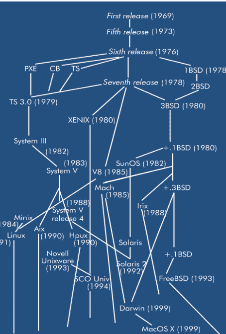

自 1991 年 Linux 出现以来，UNIX 的现状发生了巨大变化。到 1995-1999 年，由于支持的大量硬件平台以及国际社区和公司对其进展的广泛支持，它已成为专有 UNIX 系统的严肃替代方案。不同的专有 UNIX 版本继续在市场上生存，原因在于它们适应了工业环境，或者作为市场上的最佳操作系统，亦是因为某些只有 UNIX 及其相应硬件才能满足的需求。此外，某些专有 UNIX 在可靠性和性能方面甚至于 GNU/Linux——尽管差距正在不断缩小，因为拥有专有 UNIX 系统的公司对 GNU/Linux 表现出越来越兴趣，并提供了自己的开发成果以纳入 Linux。我们可以预计，适配其设备的制造商的专有 UNIX 版本将逐渐向基于 Linux 的发行版消亡。

这些公司概览：


## SUN
它提供了一种名为 Solaris 的 UNIX 实现（SunOS 的演进）。它最初是一个 BSD 系统，但主要是带有 BSD 部分的 System V；它通常用于带有 SPARC 架构的 Sun 机器以及多处理器机器（多达 64 处理器）。他们推广 GNU/Linux 作为开发环境，并有一个名为 Java Desktop System 的 GNU/Linux 发行版，这在许多国家被广泛接受。还向 Mozilla、Gnome 和 OpenOffice 等项目提供资金支持。我们还应该提到其最新版本的 Solaris，在 Solaris 版本 10 中几乎完全释放了代码。为 Intel 和 SPARC 架构创建一个名为 OpenSolaris 的社区使得创建免费发行版成为可能。另外，我们应该提到近期（2006年）根据 GPL 许可证释放 Java 平台的倡议。

## IBM
它有一个名为 AIX 的专有 UNIX 版本，在公司工作站和服务器的某些领域生存。同时，它通过推广开发环境（`eclipse.org`）和 Linux 的 Java 技术来支持开源社区，将 Linux 整合到其大型机中并设计了推广 Linux 的活动。它还因为对 SCO 的法律防御对社区产生影响，SCO 指控它违反了知识产权，称其在 GNU/Linux 中包含了 UNIX 的元素。

## HP
它有 HPUX UNIX，但对 Linux 提供广泛支持，既通过开源代码的形式，也通过在其机器上安装 Linux。据说是从 Linux 中挣钱最多的公司。

## SGL
Silicon Graphics 拥有一个名为 IRIX 的 UNIX 系统用于图形机器，但最近倾向于销售带有 Windows 以及可能带有 Linux 的机器。该公司经历了困难并几乎要分拆。它在 OpenGL（3D 图形技术）、不同文件系统和外围设备控制方面为 Linux 社区提供支持。

## Apple
90 年代中期加入了 UNIX 世界，当时它决定用 UNIX 变体替换其操作系统。被称为 Darwin 的内核源自 BSD 4.4；这个带有某些强大图形界面的开源内核是 Apple 提供其 MacOS X 操作系统的内核。今天被认为是最好的 UNIX 之一，而且，

> 注意：许多拥有专有 UNIX 的公司参与了 GNU/Linux 并向社区提供他们的一些开发成果。

至少在图形方面是最具吸引力的之一。它还使用了大量的 GNU 软件作为系统工具。

## Linux 发行版
包括商业和机构性的，我们将提到诸如 Red Hat、Su、Mandriva（曾名为 Mandrake），以及非机构的 Debian（最广泛的）和负责 GNU/Linux 开发的最小发行版，它们在 Linux 社区和 FSW 以及 GNU 软件的支持下，还收到了来自上述公司的贡献。

## BSD
它本身并不是一家公司，BSD 版本继续开发，其他 BSD 项目也是如此，例如 FreeBSD、netBSD、OpenBSD（被认为安全的 UNIX）、TrustedBSD 等。这些操作系统迟早也会为 Linux 带来改进或软件整合。此外，一个重要的贡献是源自 BSD 4 的 Darwin 内核，Apple 将其作为 MacOS X 操作系统的开源内核。


## Microsoft
作为阻碍 UNIX 和 GNU/Linux 开发的一部分，通过在不同技术之间的不兼容性上设置障碍，它没有直接参与 UNIX/Linux 世界。在早期，它为 PC 开发了基于 AT&T UNIX 许可证的 Xenis (1980)，该系统未直接销售，而是通过中间商销售，例如 SCO（SCO 在 1987 年获得了控制权，并在 1989 年更名为 SCO）。作为一个有趣的附记，它后来从 SCO 处购买了 UNIX 许可证（SCO 又是从 Novell 处获得的）。微软此次收购的动机尚不明，但有人认为这与它支持 SCO 诉讼 IBM 的事实有关。事实上，最近（2006年），微软与 Novell（唯一分发和 OpenBase 社区的当前提供者）达成了若干双边协议。

## 历史背景

二十年前，个人电脑用户没有许多操作系统可供。个人电脑市场由 Microsoft DOS 主导。另一种可能是 Apple 的 MAC，但价格昂贵。对于大型机器的一个重要选项是 UNIX。

第一个出现的选项是 MINIX (1984)，由 Andrew Tanenbaum 从零创建，目的是教学如何设计和实现操作系统。MINIX 被设计在 Intel 886 平台上运行，该平台在第一代 IBM PC 上非常流行。该系统的主要优势源于其源代码，任何人都可以访问（两万行汇编和 C 代码），并从 Tanenbaum 的书中获得。然而，MINIX 是一个教育工具，而不是为专业性能设计的效率系统。

90 年代，自由软件基金会（FSF）及其 GNU 项目，许多程序员致力于高质量和自由分发的软件。除了工具软件，工作正在 HURD 内核上进行。与此同时，1991 年 10 月，芬兰学生 Linus Torvalds 展示了他的操作系统内核的 0.0.1 版本，将其命名为 Linux，为 Intel 386 机器设计，并根据 GPL 许可证向程序员社区和互联网提供测试，如果他们喜欢，就可以帮助开发。这种热情如此巨大，短时间内就有大量的程序员在内核或应用程序上工作。

一些 Linux 与当时操作系统相比的不同且可能仍然有效的特性，以及继承自 UNIX 的特性可能是：

### a) 它是一个开源系统
任何人都可以访问其源代码、更改并创建由 GPL 许可证共享的新版本（事实上，这使其成为自由软件）。

### b) 可移植性
像原始 UNIX 一样，Linux 的设计几乎不依赖特定机器的架构；因此，Linux 基本上独立于目标机器，并可以带到几乎任何地方带有如 GNU gcc 等 C 编译器的架构。机器上只有一小部分汇编代码和少量设备，这些在每次移植到新架构时都需要重写。得益于此，GNU/Linux 运行在最多的架构上，包括 x86 和 IA64、AMD x86 和 x86_64。Sun 的 SPARC、Silicon 的 MIPS、Apple 的 PowerPC、IBM S390、Compa 的 Alpha、Motorola 的 m68k、Vax、ARM、HPPARisc……

### c) 单体内核
内核的设计整合在一起。另一种操作系统设计是微内核（Mach 为例），服务作为独立的进程实现，并通过一个更小的（微）内核进行通信。Linux 被构想为单体内核，因为很难从微内核获得良好的性能（这是一项艰巨且复杂的任务）。同时，单内核的问题在于它们会变得非常庞大，且难以难以处理；使用了动态加载模块来解决这个问题。

### d) 动态加载模块
使得操作系统的部分（如文件系统或设备控制器）可以作为外部部分在运行时按需加载（或）链接到内核。这使得简化内核成为可能，并将这些功能作为可以被认为是混合内核的元素来运行，它是一个单体内核，但提供了许多补充内核的模块（类似于微内核概念）。

### e) 由联网社区开发的系统
操作系统从未以如此广泛和分散的方式开发过；它们倾向于不离开开发它们的公司（对于专有系统而言）或协作创建内核的小型学术机构。Linux 社区的现象允许每个人在根据自己的时间和知识允许的范围内进行协作。结果是：数百名 Linux 开发者。此外，由于其开源的性质，Linux 是一个以最低成本测试操作系统理念的理想实验室；它可以被实施、测试、采取措施，如果有效，就可以将理念添加到内核中。


在 Linux 诞生之初，各个项目相互构思并与内核一同问世——FSW 的人员、GNU 实用软件及以上，他们都使用 `(GCC)` C 编译器，与其他重要项目汇合在一起，如 `XFree`（X Window 的 PC 版本）以及桌面项目 `KDE` 和 `Gnome`。而随着互联网的发展，出现了诸如 `Apache` Web 服务器、`Mozilla` 浏览器或 `MySQL` 和 `PostgreSQL` 数据库等项目，最终为初始的 Linux 内核提供了足够的应用覆盖范围，以构建 `GNU/Linux` 系统，并能与专有系统同台竞争。并将 `GNU/Linux` 系统转换为开源软件的范式。

> 注意

原始 Mach 项目：

`http://www.cs.cmu.edu/afs/cs/mach/public/www/mach.html`

`GNU/Linux` 系统已成为开源社区的先锋，因为它们能够汇聚并成功完成大量的项目。

创建并支持 `GNU/Linux` 发行版（内核+应用程序打包）的新社区，如 `Red Hat`、`Mandrake`、`SuSe`，有助于将 `GNU/Linux` 引入不犹豫的竞争者，并启动了我们今天目见的不可阻挡的增长。

我们还考虑关于 `GNU/Linux` 等系统命名的争议。`Linux` 一词通常用于（为了简化名称）来标识这一操作系统，但在某些人看来，它损害了 `FSW` 在 `GNU` 项目上所的工作，后者减少了系统的主要工具。尽管如此，`Linux` 一词在商业上被广泛用于指代整个系统。

# Note

Richard- Stallman 写的 `GNU` and `Linux`：

`http://www.gnu.org/gnu/linux-ux-and-gnu.html`。

通常情况下，当我们仅指的是操作系统的内核时，一个反映社区参与的更合适的术语是 `Linux`。这导致了某种困惑，因为人们在谈论 `Linux` 操作系统时指的是内核。通常情况下，当我们仅指的是操作系统的内核时，一个反映社区参与的更合适的术语是 `Linux`。这导致了某种困惑，因为人们在谈论 `Linux` 操作系统时指的是内核。通常情况下，当我们仅指的是操作系统的内核时，一个反映社区参与的更合适的术语是 `Linux`。这导致了某种困惑，因为人们在谈论 `Linux` 操作系统时指的是内核。通常情况下，当我们仅指的是操作系统的内核时，一个反映社区参与的更合适的术语是 `Linux`。这导致了某种困惑，因为人们在谈论 `Linux` 操作系统时指的是内核。

通常情况下对于 `Linux` 内核，是 `GNU` 实用工具。为了突出 `GNU` 的贡献，我们可以看看它包含的一些内容：

- C 和 C++ 编译器 (`GCC`)
- `bash` 壳
- `Emacs` 编辑器 (`GNU Emacs`)
- `postscript` 解释器 (`ghostscript`)
- 标准 C 库 (`GNU glibc`)
- 调试器 (`GNU gdb`)
- 编译工具 (`GNU make`)
- 汇编器 (`GNU gas`)
- 链接器 (`GNU ld`)

`GNU/Linux` 系统并不是唯一使用 `GNU` 软件的系统，例如 `BSD` 系统也使用。某些专有系统如 `MacOS X` 也使用 `GNU` 软件。`GNU` 项目生产了高质量的软件，无论是免费还是专有的。为了世界公平地承认大家的贡献，我们需要 `GNU/Linux`。

大型公司和组织日益依赖 IT 资源以及对这些资源进行管理和适应。分布式网络（服务器和客户端机器）的巨大增加增加了市场对新职位的需求：系统管理员。

系统管理员负责许多重要任务。最好的管理员通常具有通用的实践和理论背景。他们可以执行的任务包括布线安装或维修；安装操作系统或应用程序；修复硬件和软件系统问题；培训用户；提供从文字处理到代码等领域的技巧或技术；对硬件和软件进行财务评估；自动化大量任务；提高组织的整体性能。

管理员可以被认为是帮助组织利用可用资源的员工，从而改善整个组织。

与组织终端用户的关系可以通过以下方式建立：培训用户并在出现问题时提供直接帮助。管理员负责确保用户使用的技术正常运行，这意味着系统满足了用户的期望并完成了他们需要完成的任务。

过去，甚至现在，许多公司和组织对系统管理员的角色没有清晰的愿景。当商业计算处于早期（八十年代和九十年代）时，管理员被认为是理解电脑的人（大师），负责安装机器并在出现问题时监控或维修。通常，这个职位由能力多才的计算机技术人员担任，负责解决出现的问题。这个职位没有明确的，因为不需要广泛的知识，只需要应用程序（文字处理器、表格、数据库等）的基本知识，以及一些基本的硬件知识就对日常工作足够了。

这种情况在某种程度上反映了系统管理的历史背景（尽管仍有人认为这本质上是同一份工作）。在如今的互联网和分布式服务器时代，系统管理员是一项专业职业（全职专门从事此目的的员工），他们在系统软件和硬件领域提供服务。系统管理员必须执行针对多个 IT 系统的任务（大多数是异构系统），目标是使这些系统能够运行多项任务。

当前的系统需要对多个领域具备通用的知识（包括理论和实践），涵盖从网络技术、操作系统、各种应用程序、多种编程语言的基础编程、广泛的硬件知识——涉及计算机本身以及外围设备——到互联网技术、网页设计、数据库管理等。通常情况下，所选用的人才画像要求与公司的业务领域相匹配，如化学、物理、数学等。因此，任何中大型企业不再雇佣随手随得的“打杂工”，而是雇佣一小群拥有丰富知识、拥有大学学位的专业人士，并分配到组织内的不同任务。

系统必须能够掌握广泛的技术，以适应组织内部可能出现的各种任务。

由于所需的知识量巨大，意乎意料，系统管理员有多个细分方向。在大型组织中，经常会发现不同的操作系统管理员（`UNIX`、`Mac` 或 `Windows`）：数据库管理员、备份副本管理员、IT 安全管理员、用户帮助管理员。

在较小的组织中，所有或部分任务可能分配给一个或少数几个管理员。`UNIX` 系统（或 `GNU/Linux`）管理员将是其中的一员（有一位管理员负责所有任务）。通常，管理员的工作平台是 `UNIX`（在我们的案例中是 `GNU/Linux`），这需要足够的特定元素来使这份工作具有独特性。像任何软件系统一样，在其实使用的任务中，需要一定程度的适配、配置和维护。配置和维护操作系统是一项严谨的工作，在 `UNIX` 的情况下甚至可能会变得非常令人沮丧。

涵盖的一些重要问题包括：

a) 系统的强大也意味着它在为我们需要执行的任务进行适配（配置）方面具有巨大潜力。我们必须评估它能提供哪些可能性，以及哪些可能性符合我们的最终目标。

b) 一个开放系统的清晰例子是 `GNU/Linux`，它将为我们提供更新，以修复漏洞或引入新功能。显然，所有这些对管理任务都有相当大的影响。

c) 系统可用于关键任务，或者在组织的关键节点，不允许出现会减慢或阻碍运行的故障。

d) 网络目前是一个重要点（如果不是最重要的话），由于其分布式特性以及系统的复杂性，寻找和解决问题是一个非常关键的领域。

e) 在 `UNIX` 和我们的 `GNU/Linux` 特殊情况下，版本和发行版的丰富为管理任务增加了更多问题，因此了解每个版本和发行版的差异很重要。

特别是系统和网络管理任务往往具有不同的特征，有时会被分开处理（或由不同的管理员处理）。我们也可以将其视为同一工作的两个方面：一方面是系统本身（机器和软件），另一方面是与之共存的环境（网络环境）。

通常，网络管理被理解为管理网络的一部分，指的是机器在网络环境中运行的服务或设备；例如交换机、集线器或其他网络，但为了管理任务，基础知识是至关重要的。

在本教程中，我们首先处理系统的本地方面，其次将查看网络及其服务的任务。

我们已经提到了确定什么是系统管理员的问题，因为在 IT 市场上这并不明确。通常根据类别（由公司建立）要求的程序员或软件工程师是不完全合适的。

程序员基本上是代码的生产者；在这种情况下，管理员不需要产生很多代码，因为对于某些任务可能是必要的，但对于其他任务则不然。根据工作类别，通常要求：

- a) 某些资格或大学学位，最好是 IT 领域或与组织相关的领域。系统管理员的画像倾向于计算机科学或工程学习，以及异构系统和网络技术的广泛知识。
- b) 通常要求 1 到 3 年的管理员经验（现有管理员的助理）。也可能要求 3 到 5 年。
- c) 熟悉网络环境和服务的知识。`TCP/IP` 协议、`telnet`、`ssh`、`http`、`ids` 等。
- d) 了解原型设计或快速任务自动化脚本语言（例如 `shell` 脚本、`Perl`、`C++`、`Python` 等）以及各种语言的编程经验（`C`、`C++`、`Java`、汇编等）。
- e) 这些语言的大型开发经验。
- f) 丰富的 IT 市场知识，涵盖硬件和软件，以便评估购买或安装新系统。
- g) 多个版本 `UNIX`（`GNU/Linux` 系统）的经验，例如 `Solaris`、`AIX`、`AT&T System V`、`BSD` 等。
- h) 非 `UNIX` 操作系统的经验，组织中可能发现补充系统：`Windows 9x/2000/XP/Vista`、`Mac OS`、`VMS`、`IBM` 系统等。
- i) `UNIX` 设计和实现的坚实知识，分页机制、交换、预处理通信、控制器等，例如如果管理任务包括系统优化（调优）。
- j) IT 安全知识和经验：防火墙构建、身份验证系统、加密应用、文件系统安全、安全监控工具等。
- k) 数据库经验、`SQL` 等知识。
- l) 硬件和/网络布线及设备的安装与维修。

# 5. 管理员的任务


正如所述，将 GNU/Linux 管理员（或通用 UNIX）的任务分为两个部分：系统管理和网络管理。在接下来，我们将总结这些任务通常由 GNU/Linux（或 UNIX）系统组成；本教程的大部分内容将以一定的细节处理；这些管理任务将在本教程展开；由于空间或复杂性的原因，任务的其他部分将得到很好的解释。

管理任务涵盖一系列技术和知识，这只是冰山一角；无论如何，每个单元附带的参考文献都提供了扩展这些主题的参考。正如我们将看到的，对于每个处理的点都有详尽的参考文献。

> 系统管理任务可以总结为：一方面是管理本地系统，另一方面是管理网络。

# 本地系统管理任务（无特定顺序）

- 开关：任何基于 UNIX 的系统都有可配置的开关机系统，以便我们可以配置机器启动时提供哪些服务，以及何时需要关闭，以便我们程序程序系统关机进行维护。
- 用户和组管理：为用户分配空间是任何系统管理员的主要任务之一。我们需要决定哪些用户能够访问系统以及拥有什么权限；并通过组建立社区。一种特殊情况涉及用于系统任务的用户伪。
- 系统资源管理：我们提供什么、如何提供以及向谁提供访问权限。
- 文件系统管理：计算机可能有不同的资源来存储数据和设备（磁盘、硬盘、光驱驱动器等），并具有不同的文件访问系统。它们可能是永久的或临时的，这对于建模和管理过程具有意义。

关于安装和卸载相关磁盘或逻辑设备上提供的文件系统。
- 系统配额：任何共享资源都必须进行管理，并且根据用户的数量，需要建立一套配额系统，以避免用户滥用资源，或者区分不同类别（或组）的资源使用量多寡的用户。磁盘空间、打印或 CPU 使用（使用计算时间）的配额系统是常见的。
- 系统安全：本地安全，但要保护资源免受对数据或其他用户或组数据的不当或未经授权的访问。
- 系统备份与恢复：（根据数据的重要性）需要建立周期性时期为系统制作备份副本。需要建立备份周期，以保护我们的数据免受可能导致数据丢失或损坏的系统故障（或外部因素）的影响。
- 日常任务自动化：许多日常管理任务与机器日常使用相关的任务可以自动化，由于它们非常简单（易于重复）并且具有定时性（这意味着它们需要在特定的间隔重复）。这些自动化需要通过脚本类型的解释型语言（`shell`, `Perl` 等）编程，或者通过包含在调度系统（`crontab`, `at`...）中来实现。
- 打印与队列管理：UNIX 系统可以被用作打印系统，用于控制连接到系统的一个或多个打印机，并管理用户或应用程序发送到打印机的工作队列。
- 现代和长期终端：这些设备在未连接局域网或宽带的环境中很常见：

调制解调器使得能够通过中间节点（ISP 或接入提供商）连接到网络，或者从外部任何一点通过电话连接到我们的系统。

在终端的情况下，在引入网络之前，UNIX 机器作为中心计算元素是很常见的，配有一系列哑终端，仅用于视觉化信息或允许使用外部键盘输入信息；这些终端往往是串行型或并行型终端。如今，它们在工业环境中仍然常见，而且我们的 GNU/Linux 桌面系统有一个特殊功能：使用 `Alt+Fxx` 键访问的虚拟文本终端。
- 系统审计（日志）：为了检查系统运行是否正常，我们需要实施策略来告知我们系统潜在的故障，或者应用程序、服务或硬件资源的性能情况。或者以报告的形式汇总消耗的资源、系统使用情况或生产力。
- 系统性能调优：针对特定目的系统调优技术。通常，系统是为特定的工作而设计的，我们可以验证其运行是否正常（例如使用日志），以便检查其参数并使其适应所提供的服务。
- 系统定制：内核重新配置。例如在 GNU/Linux 中，内核是高度可配置的，取决于我们希望包含的功能以及我们在机器上拥有或希望拥有的设备类型，此外还有影响系统性能的参数或通过应用程序获取的参数。

# 网络管理任务

- 网络接口与连通性：我们使用的网络接口类型，无论是接入局域网、更大型的网络，还是使用 DSL 或 ISDN 技术的宽带连接。此外，我们将以服务或请求的形式拥有何种连接类型。
- 数据路由：数据将如何流动，从哪里到哪里，取决于可用的网络设备以及机器在网络中的功能；可能需要将流量从/向一个或多个地方重定向。
- 网络安全：网络，特别是对任何外部点（如互联网）开放的网络，是攻击的可能来源，因此可能会损害我们系统或用户数据的安全。我们需要通过清晰高效的安全策略来保护自己，检测并防止潜在的攻击。
- 名称服务：网络拥有无限的可用资源。名称服务允许我们对对象（如机器和服务）进行命名，以便能够找到它们。通过 `DNS`、`DHCP`、`LDAP` 等服务，我们将能够定位发现多的的服务……
- `NIS`（网络信息服务）：大型组织需要机制来高效组织和访问资源。标准的 UNIX 形式（如由本地密码控制的用户登录）在机器和用户较少时是有效的，但当我们拥有分层结构的大型组织，用户可以以统一方式或带有不同权限单独访问多个资源时……简单的 UNIX 方法显然不足或无法实现。我们需要更高效的系统来控制整个结构。诸如 `NIS`、`NIS+`、`LDAP` 等服务帮助我们有效地组织这种复杂性。
- `NFS`（网络文件系统）：通常，在网络系统结构中，信息需要由所有或部分用户共享（以文件本身的形式）。或者仅仅是因为用户的物理分布，需要从网络中的任何点访问文件。网络文件系统（如 `NFS`）为我们提供了透明的文件访问，无论我们在网络中的位置何处。
- UNIX 远程命令：UNIX 拥有透明命令，意味着无论物理连接如何，都可以运行在网络中传输或允许访问某些机器服务的命令。这些命令通常前面带有一个“r”，表示“远程（remote）”，例如：`rcp`, `login`, `rsh`, `rexec` 等，可以远程启用网络上的特定功能。
- 网络应用程序：用于连接网络服务的应用程序，例如 `telnet`（互联网）、`FTP`（文件传输），表现为从另一台机器连接到服务的客户端应用程序。或者我们可以为自己提供远程服务器服务：`telnet` 服务器、`FTP` 服务器、`Web` 服务器。
- 远程打印：访问远程打印服务器，无论是直接打印到打印机还是打印到提供其本地打印机的其他机器。网络打印对用户或应用程序来说是透明的。
- 电子邮件：UNIX 机器提供的主要服务之一是电子邮件服务器，它可以存储邮件或将其重定向到其他服务器，而不是直接发送给用户。在 Web 方面，UNIX 系统同样通过 Web 服务器提供理想的 Web 平台。UNIX 在电子邮件和 Web 服务器方面拥有最大的市场份额，这是它的市场之一，并在其中占据主导地位。GNU/Linux 系统为电子邮件和 Web 提供开源解决方案。
- `X Window`：一种特殊的连接模型是 GNU/Linux 系统（以及大多数 UNIX）的图形系统，`X Window`。该系统允许完全的网络透明，并以客户端-服务器模型运行；它允许应用程序与其输入设备的交互完全解耦，这意味着这些设备位于网络上的任何位置。例如，我们可以在某台 UNIX 机器上执行特定的应用程序，而在另一台机器上可以在屏幕上显示图形结果，并使用本地键盘和鼠标远程输入数据。此外，客户端（称为 client X）只是一个携带到其他操作系统的软件组件，使得可以在一台 UNIX 机器上运行程序并在任何其他系统上显示。所谓的 X 终端是一种特殊情况——它们基本上是一种哑终端，只能对远程运行的应用程序进行显示或交互（使用键盘和鼠标）。

# GNU/Linux 系统构成

在谈论 GNU/Linux 的起源时，我们看到并没有一个明确定义的唯一操作系统。一方面，有三个组成 GNU/Linux 系统的主要软件元素：

1) `Linux` 内核：正如我们所见，内核是系统的核心部分。但如果没有实用程序、壳、编译器、编辑器等，我们就无法拥有一个完整的系统。
2) `GNU` 应用程序：`Linux` 的开发由自由软件基金会（FSF）在 `GNU` 项目下投资的软件进行了补充，它提供了编辑器（如 `emacs`）和编译器（`gcc`）等。
3) 第三方软件：通常是开源的。此外，任何 GNU/Linux 系统都包含了第三方软件，这使得添加许多广泛使用的应用程序成为可能，无论是图形系统本身 `X Windows`、用于 Web 的服务器（如 `Apache`）、浏览器等。同时，根据发行版创建者希望让软件达到何种程度的自由，可能习惯性地包含一些专有软件。

由于大多数软件都是开源或免费的（无论是内核、`GNU` 还是第三方软件），通常版本会有不同程度的快速演进，无论是通过修复漏洞还是引入新功能。这意味着当我们想要创建一个 GNU/Linux 系统时，我们必须选择想要在系统上安装哪些软件，以及这些软件的具体版本。

GNU/Linux 的世界并不局限于特定的公司或社区，这意味着它为每个人提供了创建适用于其自身需求的系统的可能性。

通常，总会有一些稳定版本和另一些处于 alpha 或 beta 阶段的开发版本，这些版本可能包含错误或不稳定，这意味着当涉及到创建 GNU/Linux 系统时，我们必须对版本的选择非常谨慎。GNU/Linux 的世界足够丰富，以至于同一个软件产品会有不止一个替代方案。如果我们希望为用户提供选择软件的自由，我们需要在可用替代方案中进行选择，并整合一部分或全部。

我们在 `X Window` 桌面管理器中找到了一个实际例子，它们为我们提供了（主要）两个不同的环境，如 `Gnome` 和 `KDE`；两者具有相似的特征以及相似或互补的应用程序。

对于 GNU/Linux 系统发行版来说，无论是商业性的还是非营利的，发行者的责任是通过选择可用的最佳软件产品和版本来创建一个可以工作的系统。


在这种情况下，GNU/Linux 发行版 `Dist` 是构成基于 Linux 内核的操作系统的软件集合。

一个需要考虑且引起不小困惑的事实是，发行者的每个软件包都有其自己的版本（无论它位于哪个发行版上），分配的发行版编号并不对应于软件版本。

让我们看看内核：我们目前可以找到提供一个或多个内核的发行版，例如旧版本 `2.4.x`，或者最新的 `2.6.x`，其新旧程度不一（数字 `x`）。

- b) 开源的 X 窗口选项，我们在几乎所有的 GNU/Linux 系统中都能找到，例如各种版本的 `XFree`，如在 `2.4.x` 中使用的），或者作为新的 X 项目（2003 年对以前版本的分支），它在 `2.6.x` 用户中非常流行。

- c) 桌面或窗口管理器：我们有 `Gnome` 或 `KDE`，或者两者都有；版本 `2.X` 的 `Gnome` 或版本 `3.x.y` 的 `KDE`。

例如，我们可以获得一个包含内核 `2.4.4`、`XFree 4.4` 和 `Gnome 2.6` 的发行版；或者例如，内核 `2.6.8`、`KDE 3.1`。哪个更好很难比较，因为它们包含了元素的混合，取决于这种混合是如何制作，产品将会变好或变差。如果我们希望为用户提供选择软件的自由，我们需要在可用的替代方案中进行选择，并整合一部分或全部。

我们可以获得一个包含内核 `2.4.4`、`XFree 4.4` 和 `Gnome 2.6` 的发行版；或者例如，内核 `2.6.8`、`KDE 3.1`。哪个更好很难比较，因为它们包含了元素的混合，取决于这种混合是如何制作，产品将会变好或变差。如果我们希望为用户提供选择软件的自由，我们需要在可用的替代方案中进行选择，并整合一部分或全部。

Unix 和 GNU/Linux 系统包含了启动脚本，指示机器如何启动、遵循哪些过程（或阶段）以及每个步骤需要做什么。通常，我们根据以下标题进行分析：

- a) 内核版本：通过 `X.Y.Z` 标识，`X` 是主版本，`Y` 是次版本，`Z` 是修订版本；`X` 代表主版本，`Y` 表示改进，`Z` 表示测试。这些版本方案不断变化，以适应社区的需求。

- b) 软件包格式：这是用于安装和管理软件的机制。它支持哪些格式。通常我们在这方面找到 `RPM`、`DEB`、`tar.gz` 等格式，尽管每个发行版通常提供使用不同格式的可能性，但它有一个默认格式。

- c) 文件系统：主文件系统 `/` 告诉我们可以在文件系统中找到文件（或系统文件）。GNU/Linux Unix 有一些文件位置标准（正如我们在工具单元中看到的），`[Lin03]`。因此，如果我们了解标准，就会知道哪里可以大多数文件；然后取决于发行版是否遵循它。

- e) 系统库版本：我们在系统上的所有程序（或应用程序）将依赖于（多或少）数量的系统运行所需的库。这些库通常有两种类型：链接到程序中的静态库（`libxxx.a`）或运行时动态加载的动态库（`libxxx.so` 文件），它们提供了应用程序使用的大量实用或系统代码。运行应用程序可能取决于相应库的存在以及这些库的具体版本（这并非必须的，但有所帮助）。一个常见的情况涉及 GNU 库，即标准 C 库，也称为 `libc`。应用程序可能会要求运行或编译特定版本的 `glibc`。这是一个相当棘手的问题，因此，发行版所看重的参数之一就是知道它所携带的是哪个版本的 `glibc`，以及可能与旧版本兼容的额外版本。当尝试在新版发行版上运行或编译旧版软件产品，或者在旧版发行版上运行非常新的软件产品时，问题就会出现。最大的变化发生在迁移到 `glibc 2.0` 时，所有程序必须重新编译才能正确运行，而在不同的修订版本中进行了一些可能影响应用程序的微调。在许多情况下，软件包会检查 `glibc` 版本是否可用，或者名称本身就标识了需要使用的版本（例如：`package-xxx-glibc2.rpm`）。

- f) Windows 桌面：Window 系统是 GNU/Linux 桌面可视化的图形标准。它由 MIT 在 1984 年开发，实际上几乎所有的 UNIX 系统都有它的版本。GNU/Linux 发行版拥有不同的版本，如 `Xfree8` 或 `Xorg`。通常，X Window 是一个中间图形层，它委托另一层作为窗口管理器来呈现其元素。此外，我们还可以将窗口管理器与各种应用程序和工具结合起来，创建一个桌面环境。

- Linux 主要有两个桌面环境：`Gnome` 和 `KDE`。它们各自的独特性之处在于，它们是基于各自的组件库（环境的不同元素，如窗口、按钮、列表等）：`gtk`（在 `gnome` 中）和 `Qt`（在 `kde` 中），它们是在在这些环境中编写应用程序时的主要图形库。除了这些环境外，还有许多窗口管理器或桌面管理器：`XFCE`、`Motif`、`Enlightenment`、`Blackwell`、`FVWM` 等，这意味着用户有广泛的选择。每种环境都让用户根据自己的意愿更改窗口和组件的外观（外观与感受），或者创建他们自己的。

- g) 用户软件：由发行版添加的软件，大部分为开源，用于常用任务（或用于高度专业领域的非常用任务）。常见的发行版如此庞大，我们可以找到数百个此类额外应用程序（许多发行版有 1 到 4 张 CD - 大约 1 张额外应用程序 DVD）。这些应用程序几乎涵盖了所有领域，无论是家庭、行政还是科学领域。某些发行版还会添加第三方专有软件（例如办公类套件）；由发行版准备的服务器软件，例如电子邮件服务器、安全 Web 服务器等。

这就是每个发行版倾向于发布其发行版的不同版本，例如，有时个人版或服务器版之间会有区别。

通常，这种成本并没有意义，标准软件已经足够（只需一些额外的管理工作）；但对于公司来说可能很有趣，因为减少了服务器的安装维护时间，还为公司的 IT 管理优化了关键服务器和应用程序。

## 6.1. Debian

`Debian` `[Debb]` 的情况是特殊的，意义在于它是一个由社区交付的发行版，除了维护其发行版和使用自由开源软件外，没有商业目标。

`Debian` 是一个由热情的用户和开发者支持的发行版，基于对使用自由软件的承诺。

`Debian` 项目成立于 1993 年，旨在创建 `Debian GNU/Linux` 发行版。它已变得非常流行，并且在使用上可以与 `Red Hat` 或 `Mandrake` 等其他商业发行版竞争。由于它是一个社区项目，该发行版的开发受一系列政策或规则的约束；有被称为《`Debian` 社会契约》(`Debian Social Contract`)的文件，这些文件提到了项目的整体愿景和 `Debian` 的政策，详细规定了如何实现其发行版。

> `Debian` 社会契约

> 应用程序可能会要求运行或编译特定版本的 `glibc`。这是一个相当棘手的问题，因此，发行版所看重的参数之一就是知道它所携带的是哪个版本的 `glibc`，以及可能与旧版本兼容的额外版本。当尝试在新版发行版上运行或编译旧版软件产品，或者在旧版发行版上运行非常新的软件产品时，问题就会出现。最大的变化发生在迁移到 `glibc 2.0` 时，所有程序必须重新编译才能正确运行，而在不同的修订版本中进行了一些可能影响应用程序的微调。在许多情况下，软件包会检查 `glibc` 版本是否可用，或者名称本身就标识了需要使用的版本（例如：`package-xxx-glibc2.rpm`）。

物理支持的符号成本，因此有助于维护（发行版），或可以从 `debian.org` 或其镜像站点下载。

+ b) 测试版和不稳定版没有任何官方 CD，但一个稳定的 `Debian` 可以通过更改 `APT` 软件包系统的配置转换为稳定版或不稳定版。

+ c) Linux 内核：默认内核为 `2.4.x` 系列，并包含一个可选的 `2.6.x`，后者现在是最新版本的默认内核。稳定版 `Debian` 的重点是提高稳定性，并为有需要的用户提供另一个更更新的软件产品的选项（在不稳定版或测试版中）。

+ d) 软件包格式：`Debian` 支持提供最全功能的格式之一 `APT`。软件软件包具有名为 `DEB` 的格式。`APT` 是一项高级工具，用于管理和维护一个来自各种来源（CD、FTP 或网络）的即时安装可用软件数据库。

+ e) `APT` 系统可以随时从 `Debian` 源列表（`APT` 来源）进行更新，这些源可能是默认 `Debian` (`debian`) 或第三方站点。这就是为什么我们没有绑定到某一家公司或单一的订阅系统上。

+ f) 使用的一些版本，例如：`Xfree86(4.x)`, `glibc (2.3.x)...` `Debian Sid` 拥有 `Xorg (7.1)`, `glibc (2.3...x)...`

+ g) 桌面方面，它接受 `Gnome 2.16.x`（默认）或 `KDE 3.3.x`（K 桌面环境），不稳定版带有 `Gnome 2.18.x` 和 `KDE 3.5.x`。

+ h) 在插入应用程序方面，它包含了我们在 GNU/Linux 发行版中常见的大多数程序；在 `Sid` 中：编辑器如 `emacs`（以及 `nemacs`）、`gcc` 编译器和工具、`Apache` Web 服务器、`Mozilla`（或 `Firefox`）浏览器、用于与 Windows 共享文件的 `Samba` 软件等。

+ i) 它包含了办公套件，如 `OpenOffice` 和 `KOffice`。

+ `Debian` 包含许多发布在 `/etc` 目录下的个性化配置文件。

+ k) `Debian` 默认使用引导管理器 `lilo`，尽管它也可以使用 `Grub`。


### 监听 TCP/IP 网络服务的配置

l) 监听 TCP/IP 网络服务的配置已完成，与大多数 UNIX 系统一样，这是通过 `inetd` 服务器 (`/etc/inetd.conf`) 完成的。尽管它也有一个可选的 `xinetd`，后者正成为首选方案。

m) 还有许多基于 Debian 的 GNU/Linux 发行版，因为该系统很容易调整，以产生更大或更小的发行版，并针对特定领域调整较少的软件。其中最著名的之一是 `Knoppix`，这是一种单 CD 发行版，属于 Live CD 类型（在 CD 上），通常用于 GNU/Linux 演示，或在不安装的情况下在机器上进行测试，因为它从 CD 运行，尽管也可以像标准 Debian 一样安装在硬盘上。`Linux` 是另一个非常著名的发行版，它的开发得到了埃斯特雷马杜拉（Extremadura）社区地方当局的支持。与此同时，我们还有 `Ubuntu`，它是取得最大影响的发行版之一（在多个方面超过了 Debian），因为其易于构建替代系统。

#### 注意

Debian 可以作为其他发行版的基础：例如，`Knoppix` 是一个基于 Debian 的发行版，它可以从 CD 运行而无需安装到硬盘上。`Linux` 是为了适应埃斯特雷马杜拉自治区而的 Debian 发行版，作为其开源软件项目的一部分。而 `Ubuntu` 更适合桌面环境。

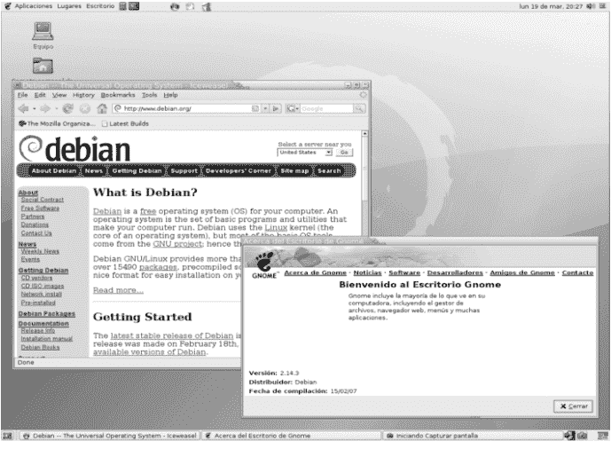

图 3 带有 Gnome 2.14 的 Debian Sid 环境

`Red Hat Inc.` [Redh] 是 GNU/Linux 世界中最具商业成功的公司之一，拥有最成功的发行版之一。`Bob Young` 和 `Marc Ewing` 于 1994 年创立了 `Red Hat Inc.`。他们对开源软件模型感兴趣，并认为这是一个很好的业务模式。他们的主产品是 `Red Hat Linux` 发行版（我们将简写为 Red Hat），它面向不同的市场细分、个人用户（个人版和专业版）或中大型公司（带有其企业版及其不同的子版本）。

`Red Hat` 是 Linux 的主要商业发行版，面向个人桌面和高范围服务器市场。此外，`Red Hat Inc.` 是 Linux 开发中合作最密的公司之一，因为社区的许多重要成员都在该公司工作。


尽管他们采用开源模型工作，但这是一家具有商业目标的公司，这就是为什么他们倾向于通过支持合同、更新订阅和其他手段为他们的基础发行版增加价值。对于企业，他们添加定制的软件（或开源软件），以适应公司的需求，无论是通过优化的服务器还是 Red Hat 拥有的实用软件来实现。

到某个特定时间点（接近 2003 年底），`Red Hat Linux` (9.x) 决定停止其 GNU/Linux 桌面版，并建议其客户迁移到社区的商业版本，这些版本将继续作为官方支持的版本。

> 注意
> 参阅：http://fedoraproject.org

在那个时刻，Red Hat 决定启动一个名为 `Fedora` [Fed] 的社区项目，旨在生产一个由社区引导的（ Debian 风格，适用于不同目的）发行版，命名为 `Fedora Core`。事实上，目标是创建一个向社区开放的开发实验室，使其能够测试该发行版，同时引导社区在其业务发行版中的商业开发。

在某种程度上，批评者指出，社区被用作随后包含在商业产品中的技术的测试人员。此外，这种模型随后被其他公司用于创建社区和商业发行版的双重模型。例如出现了 `OpenSUSE`（基于商业版的 SuSE）或 `Freedes`（基于 Linspin）。

通常，Red Hat 和 Fedora 社区组合对其添加到发行版中的软件元素呈现出某种保守的愿景（在 Fedora 上不那么明显），因为其市场是企业，它试图让其发行版尽可能稳定，即使这意味着不使用最新版本。它所做的附加值是对比 Linux 内核进行大量的调试，以生成修正和补丁来提高其稳定性。有时，如果它认为某个内核功能（或驱动程序）不够稳定，它甚至可以禁用它。它在图形环境中提供了许多实用工具，包括几个管理工具；在图形环境方面，它使用 `Gnome`（默认）和 `KDE`，但通过其自己的 `BlueCurve` 使得两个桌面几乎相同。

我们使用的版本将是最新的 `Fedora Core`，我们简单地称为 `Fedora`。通常，维护的功能和特性在发布的版本中保持相当相似，这意味着大多数注释适用于不同的版本。我们需要考虑到 `Fedora` [Fed] 社区尝试为每个新版本遵循一个大约 6 个月的时间表，并且对于包含哪些新功能存在某种共识。

另一方面，Red Hat 将其桌面版本交给社区，并将精力放在业务版本上（`Red Hat Enterprise WS`、`ES` 和 `AS`）。

让我们简单查看此 Fedora Core 发行的一些特征：

+ a) 当前发行版由 CD 组成，第一张是启动盘，用于安装。还有额外的 CD 包含了文档以及与发行版安装的大部分软件的源代码。该发行版也通过 1 张 DVD 提供。

+ b) Linux 内核：它使用 `2.6.x` 系列内核，可以通过 `rpm` 软件包系统（内核单元）通过 `yum` 工具等进行更新）。Red Hat 则对内核进行了许多测试，并创建了解决问题的补丁，这些补丁通常会被整合到 Linux 社区的版本中，因为许多重要的 Linux 合作者也在 Red Hat 工作。

+ c) 软件包格式：Red Hat 通过 `RPM` 软件包系统（红帽包管理器）分发其软件，通过 `rpm` 命令或 `yum` 工具进行管理（我们将在本地管理）。`RPM` 是目前最优秀的软件包系统之一（类似于 Debian），某些专源 UNIX 系统也包含了它。从根本上，`RPM` 系统维护着一个包含已安装软件包的小型数据库，并验证通过 `rpm` 命令要安装的软件包是否已经安装，或者是否与任何其它软件包产生冲突；另一方面，它会检查安装所需的软件软件包或版本是否缺失。`RPM` 软件包基本上是一组压缩文件的集合，包含了有关依赖关系或其运行所需软件的信息。

- 关于启动，它使用了 System V 类型的脚本（我们将在本地管理单元中查看这些）。

- 使用的一些版本：`Xorg` (7.x)、`glibc` (2.5.x) 以及可选的 `KDE`。

- 在涉及有趣的应用程序方面，它包含了我们在几乎所有 GNU/Linux 发行版中都能找到的程序：编辑器如 `emacs` (`emacs`)、`gcc` 编译器和工具、`Apache` 网页服务器、`Firefox`/`Mozilla` 浏览器、用于与 Windows 共享文件的 `Samba` 软件等。

- 它包含了如 `OpenOffice` 和 `KOffice` 等办公套件。

- 额外的软件可以通过 `yum update` 服务（等）获取，类似于 Debian 的 `APT` 系统，或者使用不同的工具，从互联网下载为该发行版设计的 `RPM` 软件包。

- `Fedora` 默认使用 `Grub` 引导程序启动机器。

- Red Hat 替换了监听 TCP/IP 网络服务的配置，大多数 UNIX 系统使用 `inetd` 服务器 (`/etc/inetd.conf/`)，而它使用了 `xinetd`，后者具有更模块化的配置 (`/directory/xinetd.d/`)。

- 启动时有一个名为 `Kudzu` 的程序会验证任何硬件更改和新安装的硬件。我们预计它将在后续版本中被移除，因为有一个名为 `HAL` 的新 API 可以执行此功能。

- 还有几个基于原始 Red Hat 的发行版，它们保留了其许多特性，特别是 `Mandriva`（原 `Mandrake`）：这是一个法国发行版，最初基于 Red Hat，如今在用户偏好方面仍然处于领先地位（特别是对于桌面工作）。`Mandriva` 开发了自身的软件和许多向导来帮助最常见任务的安装和管理，使其与基于 Red Hat 的起源区分开来。同时，Red Hat 的商业业务还在服务器环境中催生了一系列非常流行的发行版，例如 `CentOS` [Cen]（它尝试与商业版 Red Hat 保持 100% 的兼容性）以及 `Scientific Linux` [Sci]（专门用于研究项目的科学计算）。至于软件包系统，值得注意的是，`rpm` 系统被许多发行版使用，包括 `SuSE`。

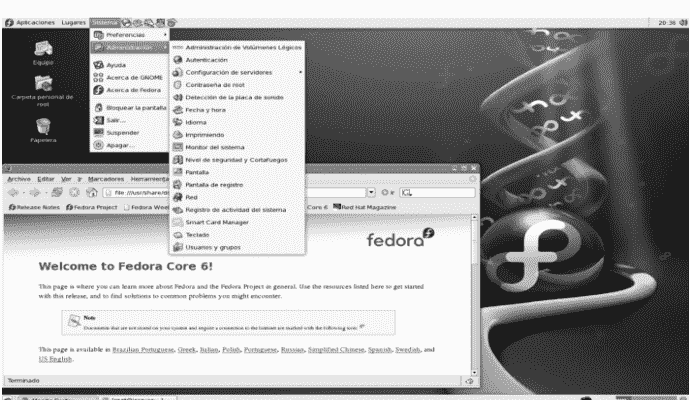

图 5 带有 Gnome 的 Fedora Core 桌面

关于社区发行版 Fedora Core 及其在 Red Hat 的商业起源：

- a) 这是一个由程序员和用户社区基于开发创建的发行版；它没有来自厂商那的任何更新或维护支持。这方面将取决于社区，类似于 Debian GNU/Linux 发行版的情况。

- b) 这些版本的产生非常快，预计大约每六个月会发布一个新的发行版版本。

- c) 它也使用 `RPM` 软件包管理系统。在更新软件包或安装新软件包的过程中，可以通过不同的工具、通过 `update`、通过 Fedora 更新通道或新的 `Yum` 更新系统以及在某些情况下通过 `Apt`（继承自 Debian，但它可以处理 RPM 文件）来实现。

- d) 其他更具技术性的方面（我们将将在章节中查看一部分）可以在 Fedora Core 的版本说明中找到。

> 注意


查看 Fedora 发布说明请：http://docs.fedoraproject.org/

## 7. 我们将涉及……

在学习了这一关于开源世界的“哲学性”介绍以及 UNIX 和 GNU/Linux 系统的历史，并定义了系统管理员的任务后，我们将学习如何处理管理 GNU/Linux 系统涉及的典型任务。

接下来，我们将查看管理 GNU/Linux 系统涉及的不同领域。对于每个领域，我们将检查一些理论基础，以帮助我们解释需要完成的任务并理解我们将要使用的工具。每个主题都将辅以一种类型的教程，我们将在其中查看小型工作课程或某些工具的使用方法。正如引言提到的，管理领域非常广泛，任何试图完全涵盖它的尝试（如本文）注定都会由于其规模有限而失败；因此，你将在每个主题找到丰富的参考文献（书籍、页面、网站、教程等形式），你可以在我们对该主题的首次介绍的基础上扩展你的知识。

我们将涉及的主题如下：

- 在迁移章节，我们将对正在使用的计算机系统类型及其环境有一个视角；我们还将观察 GNU/Linux 系统对每种环境的适应性好坏，并在引入 GNU/Linux 系统时考虑第一个困境：我们是更换原有的系统，还是分阶段进行让两者共存？

- 在工具章节，我们将学习（基本上）管理员日常使用（和/或使用）的工具集，这些工具构成了管理员的工具箱。我们将讨论 GNU/Linux 标准，这让我们能够了解所有 GNU/Linux 发行版的方面，换句话说，我们可以在任何系统中期待到什么。其他基本工具将是：简单的（或简单的）编辑器；一些用于学习系统状态以获取过滤信息的基本命令；根据我们的兴趣编程脚本（或 脚本）来实现任务自动化；基于源代码的编译过程；管理已安装软件的工具以及图形工具或命令行。

在涉及内核的章节，我们将观察 Linux 内核，以及如何通过定制它来适应硬件或我们希望提供的服务。

在本地管理标题下，我们将处理那些被认为属于系统“本地”的管理方面。这些方面可能包含了管理员处理用户、打印机、磁盘、进程等元素的大部分典型任务。

- 在网络章节，我们将检查涉及系统及其网络环境的所有管理任务，无论网络类型如何，我们将查看与相邻系统的不同连接类型以及我们从那里提供的服务。

- 在服务器章节，我们将查看 GNU/Linux 系统上常见的一些服务器典型配置。

- 在数据章节，我们将查看今天最相关的主题之一，GNU/Linux 系统提供的数据存储和查询机制，特别是数据库系统和版本控制机制。

- 在安全章节，我们将处理有关 GNU/Linux 系统最相关且最重要的问题之一。互联世界的存在给系统的正常运行带来了系列重大危险，并引发了可靠性问题，涉及系统本身以及通过网络接收或提供的数据。因此，我们的系统需要提供最低的安全级别，并防止未经授权的访问或处理。我们将查看最常见的攻击类型、可以实施的安全策略以及帮助我们控制安全水平的工具。

- 在优化章节，我们将看到由于存在大量的服务器和服务，以及由于为该系统设计的众多环境，GNU/Linux 系统往往具有许多影响应用程序或服务性能的功能参数。我们可以（或应该）通过分析系统自身的配置来提取最大性能，以适应我们希望向客户提供的服务质量。

- 在集群章节，我们将查看一些在 GNU/Linux 系统上提供高性能计算的技术，这些技术被广泛应用于科学计算领域，并越来越多被许多行业使用（制药、化学、材料等，用于研究和开发新产品。除了将各种 GNU/Linux 系统组织成集群以增强单个系统的性能外，还通过创建系统群组，使得能够根据增长的客户需求对所提供的服务进行横向扩展。

## 活动

1) 在以下地址阅读 Debian 宣言：

http://www.debian.org/social_contract

+ 2) 了解基于 Debian 的不同发行版：Knoppix、Linux、Ubuntu 变体。

除了每个发行版的官方网站外，www.distrowatch.com 网站还提供了关于发行版及其状态的良好指南，以及它们包含的软件。通过该网页或访问不同的社区或制造商，我们可以获得不同发行版的 ISO 镜像。

其他参考和信息来源（参见“参考文献”部分下的引用）

- [LPD] Linux 文档项目 (LDP)，涵盖 GNU/Linux 任何方面的 Howtos（操作指南）、手册和导向指南的合集。

- [OSdbj] 拥有各种网站、新闻、进展、项目等的社区。

- [Sla] 开源社区新闻网站以及关于 IT 和互联网的通用网站。

- [New] [Bar] 开源新闻。

- [Fre] [Souj] 开源项目列表。

- [Dis] 对 GNU/Linux 发行版和软件包新特性的监控，以及下载 GNU/Linux 发行版 CD/DVD ISO 镜像的链接。

- [His] [Bul] [LPD] 通用文档和用户社区。

- [Mag03] [Lou03] GNU/Linux 杂志。

# 与非 Linux 系统的迁移与共存

Josep Jorba Esteve

PID_00148467


# 目录

+ 引言.................................................................................................................................. 5

+ 1. 计算机系统：环境............................................................................... 7

+ 2. GNU/Linux 服务.................................................................................................... 11

+ 3. 用类型............................................................................................................................. 13

+ 4. 迁移或共存...................................................................................... 16

+ 4.1. 识别服务需求.................................................................................. 17

+ 4.2. 迁移过程............................................................................................................... 18

+ 5. 迁移工作坊：案例分析............................................................................... 24

+ 5.1. Windows 桌面用户个人迁移到 GNU/Linux 系统............................................................................... 24

+ 5.2. 拥有 Windows 系统和少量 UNIX 系统的小型组织迁移...................................................................................... 27

+ 5.3. 独立 Windows 服务器迁移到运行 GNU/Linux 的 Samba 服务器........................................................................... 29

+ 活动...................................................................................................................... 35

+ 参考文献......................................................................................................................... 36

# 引言

在对 GNU/Linux 系统有了简要介绍后，下一步是将它们作为生产系统集成到工作环境中。根据当前正在使用的系统，我们可以考虑完全迁移到 GNU/Linux 系统，或者通过兼容服务实现共存。

迁移到 GNU/Linux 环境可以通过部分替换服务，或用 GNU/Linux 等等物替换旧系统中的所有内容来逐步进行。

在当前的分布式环境中，最相关的问题是客户端/服务器环境。全局系统中的任何任务都由一个或多个专用服务器管理，应用程序或用户直接访问提供的服务。


关于工作环境，无论是在简单的个人用户情况下，还是在复杂的业务环境情况下，每个环境都需要一组服务，我们需要选择这些服务，稍后调整客户端和服务器机器，以便它们能够访问这些服务或提供其使用。

服务可能涵盖不同的方面，并倾向于有多种类型共享资源或信息。文件服务器、打印服务器、Web 服务器、域名服务器、电子邮件服务器等常见的。

管理员通常会根据终端用户和/或组织的需求，选择工作环境中需要的一系列服务；必须以支持预期工作负载的服务器形式，为基础设施提供正确的支持。

# 1. 计算机系统：环境

在安装某些 GNU/Linux 发行版的过程中，我们经常会被询问系统将用于什么类型的环境或任务，这通常允许我们选择默认安装的软件子集，因为它们最适合预期的工作。我们经常会被问及系统将被用作：

+ a) 工作站：这种类型的系统通常包含最常用的特定应用程序。系统基本上用于运行这些应用程序和一小部分网络服务。
+ b) 服务器：基本上集成了大多数网络服务，或至少是某个特定服务，这将是该系统的主服务。
+ c) 专用计算单元：计算密集型应用程序、科学应用、CAD 图形等。
+ d) 图形站：带有需要图形形式与用户交互的应用程序桌面。

我们通常可以根据这些可能性中的一种或多种来设置我们的 GNU/Linux 系统。

> 更广泛地说

我们还可以包括另一种类型的系统，我们将其统称为嵌入式设备或小型移动系统，如 PDA、手机电话、便携视频游戏机等。GNU/Linux 也为这些设备提供了支持，并为它们提供了个性化的内核。

| 注意事项 |
| :--- |
| GNU/Linux 系统可以用于服务器、工作站或桌面功能 |
| 示例 |
| :--- |
| 例如，Sharp Zaurus 模型、具有高级特性的 PDA（四个或五个市场）、或嵌入式类型的 POS（销售点）终端。例如 GP2X 和 PlayStation 等游戏机。还有 Android、Maemo、Mobil 等平台。 |

关于三种主要的环境，让我们看看这些每一个系统在 GNU/Linux 环境是如何开发的：

1) 工作站类型系统需要一台用于特定任务的高性能机器；它通常是 Sun 的 SPARC、IBM RISC 或 Silicon 机器（带有其他专用 UNIX 变体）。这些高成本机器用于 3D 图形设计（在 Silicon 情况中）或数据库（IBM 或 Sun）。如今，许多 PC 的性能与这些系统相当，由于 GNU/Linux 的存在，这些系统与 PC 之间的界限不再清晰。

2) 服务器类型系统有特定的目的，即为网络上的其他机器提供服务：它与其他机器相比具有明显不同的特征或功能。在小型计算机系统中（例如少于 10 台机器），并不一定有专用服务器系统，它倾向于与其他功能共享，或作为桌面类型的机器。中型系统（几十台机器）倾向于拥有一或多台机器作为服务器运行，无论是作为专用机器集中所有服务（电子邮件、Web 等），还是作为用于共享主服务的双机器。

大型系统（数百甚至数千台机器），负载使得必须拥有一大组服务器，每台都专门用于某个特定服务，甚至有一组专门用于某项服务的机器。此外，如果这些服务是在组织内部或外部提供的，通过客户端直接访问或开放互联网，取决于需要支持的工作负载，我们将不得不采用 SMP 多核类型解决方案（带有多个处理器/解码器的机器）或集群类型解决方案（分配特定服务负载的机器组）。

可能内部（或外部）需要的服务可以涵盖（其他）以下服务类别：

+ a) 应用程序：服务器可以运行应用程序和客户端，我们只需观察它们的执行和与其交互。例如，它可能包含终端服务和 Web 应用程序。
+ b) 文件：我们提供了一个从网络任何一点都可以访问的共享空间，可以在那里存储/恢复我们的文件。
+ c) 数据库：供网络上的系统应用程序（或其他服务）查询或生产使用的数据集中化。
+ d) 打印：管理一组打印机及其队列，以及从网络任何一点发送到这些打印机的作业。
+ e) 电子邮件：提供接收、发送或重发入站或出站邮件的服务。
+ f) 网页：属于该组织的服务器（或服务器），供客户在内部或外部使用。
+ g) 网络信息：对于大型组织来说，这对于查找所提供的服务或共享资源；或者查找用户本身至关重要，如果他们需要能够实现这种定位的服务，并查询每个类型对象的属性。
+ h) 名称服务：需要服务来对不同的名称进行命名和翻译，同一个资源通过这些不同的名称为人知的。
+ i) 远程访问服务：在没有直接访问的情况下，我们需要替代方法来允许我们从外部进行交互，从而访问我们想要的系统。
+ j) 命名生成服务：例如在命名机器时，机器的数量可能会非常多，或者它们并不总是同样的同一批机器。我们需要提供方法来清晰地识别它们。
+ k) 互联网访问服务：许多组织没有直接访问的理由，而是通过网关或代理访问。
+ l) 过滤服务：用于过滤错误信息或影响我们安全的安全措施。

3) 桌面型机器简单是指用于日常计算机任务的机器（如我们的家庭或办公室 PC）。

## 示例

例如，我们可以建立以下内容为常用任务（包含在一些最常用的 GNU/Linux 程序中）：

- 办公任务：提供办公套件的经典软件：文字处理器、电子表格、演示文稿、小型数据库等。我们可以找到如 `OpenOffice`（免费）、`StarOffice`（付费，针对某些用户）、`KOfICE`（由 KDE 开发）或像 `Gnumeric`、`AbiWord` 等各种程序，它们可以构成 Gnome 办公软件（称为 `Gnome-Office`）的一部分。
- 网页浏览器：如 `Mozilla Firefox`、`Konquerer`、`Epiphany` 等浏览器。
- 硬件支持（USB、存储设备..）。GNU/Linux 通过专有驱动程序支持，这些驱动程序通常由内核提供或制造商提供。每种设备都有新的驱动程序可用。媒体和娱乐（图形、图像处理、数字摄影、游戏等更多）。在 GNU/Linux 中，有大量此类非常专业的应用程序：`Gimp`（修饰照片）、`Sodipodi`、`Xine`、`Mplayer` 等。
- 连接性（远程桌面访问、访问其他系统）。在这方面，GNU/Linux 拥有大量工具，无论是 TCP/IP 还是 FTP、telnet、web 等，或者 X Window（它具有针对任何 UNIX 的远程桌面的能力）、桌面（用于连接 Windows 桌面）或 VNC（用于连接 UNIX、Windows、Mac 等）。

## 网站

开源办公套件：

`http://openoffice.org/`

`http://www.koffee.org/`

`http://live.gnome.org/Gnome-Office`

# 2. GNU/Linux 服务

GNU/Linux 拥有适用于任何工作环境的服务器。

我们提到的服务类别具有对等物，我们可以从 GNU/Linux 系统为网络上的所有其他机器提供这些服务（并从中作为客户端）：

- a) 应用程序：GNU/Linux 可以提供远程终端服务，无论是通过哑终端接口直接连接，用于实现应用程序的可视化或与其交互。另一种可能性是通过文本模式进行远程连接，通过通过 TCP/IP 服务（如 `login`、`telnet`）或通过 `ssh` 以安全的方式从另一台机器进行连接。GNU/Linux 为所有这些协议都提供了服务器。对于图形应用程序，我们有通过 X Window 的远程解决方案，任何带有 X Window 客户端的 UNIX、Linux 或 Windows 客户端（或其他）都可以设想环境及其应用程序的运行。同时，还有其他解决方案如 `VNC` 用于解决相同的问题。关于 Web 运行应用程序，GNU/Linux 有 `Apache` 服务器，可以使用任何多种 Web 运行系统，如 `Servlets`（带有 `Tomcat`）、`JSP`、`Perl`、`PHP`、`xml`、`webservices` 等，以及 `BEA WebLogic`、`IBM Webphere`、`JBoss`（免费）等运行在 GNU/Linux 平台上的应用程序服务器。
- b) 文件：可以通过多种方式提供，可以通过 `FTP` 访问文件，或者通过 `NFS` 向 UNIX 和 Linux 机器透明地提供，或者通过 `Samba` 作为 Windows 机器的客户端或服务器。
- c) 数据库：支持大量的关系型客户端/服务器类型数据库，如 `MySQL`、`PostgreSQL` 以及 `Oracle` 或 `IBM DB2` 等商业数据库。
- d) 打印：它可以为本地或远程打印机服务，适用于带有 TCP/IP 协议的 UNIX 系统和通过 `Samba/CIFS` 的 Windows。
- e) 电子邮件：提供客户端在其机器上获取邮件的服务（`POP3` 或 `IMAP` 服务器），作为邮件传输代理 (`MTA`) 来接收和重传邮件，例如 `Sendmail` 服务器（UNIX 标准）或其他 `Exim`，以及在向外发送时用于出站邮件的 `SMTP` 服务。
- f) 网页：我们有 `Apache` 服务器，无论是 `1.3.x` 版本还是新的 `2.0.x` 或 `2.2.x` 版本，我们可以集成 Web 应用程序服务器，如用于 servlet、JSP 的 `Tomcat`...


### g) 网络信息
`NIS`、`NIS+` 或 `LDAP` 等服务允许我们翻译网络上机器、用户和各种资源的信息，便于管理和为用户提供服务，使用户不取决于他们在网络中的状况。或者如果我们的组织有特定的内部结构，这些服务允许我们对其进行建模，允许需要的人访问资源。

### h) 名称服务
需要服务来对不同的名称进行命名和翻译，同一个资源通过这些不同的名称为人知的。

### i) 远程访问服务
在没有直接访问的情况下，我们需要替代方法来允许我们从外部进行交互，从而访问我们想要的系统。

### j) 命名生成服务
例如在命名机器时，机器的数量可能会非常多，或者它们并不总是同一批机器。我们需要提供方法来清晰地识别它们。

### k) 互联网访问服务
许多组织没有直接访问的理由，而是通过网关或代理访问。

### l) 过滤服务
用于过滤错误信息或影响我们安全的安全措施。

# 3. 使用类型

`GNU/Linux` 作为一个系统，提供了适用于个人用户也适用于大规模基础设施的特性。

从个人用户的角度来看，我们可以区分：

### a) 个人或家庭用户
这种类型的用户通常有一台或多台机器。通常情况下，在这种环境下，`GNU/Linux` 用于开发，这意味着图形部分将非常重要；对于桌面，我们有两个选择，即 `Gnome` 和 `KDE` 环境，两者都是完全有效的。这两个环境都提供运行和可视化服务，以及一系列基础应用程序，允许我们完成各种日常任务。这两个环境都提供了不同的菜单、图标栏和图标，此外还有文件导航器和各种实用程序。任何环境都可以运行自己的和其他的，尽管与应用程序一样，它们在自己的环境中运行得更好，因为它们的视觉效果更适合设计的环境。对于个人用户的应用程序，我们应该包含典型的程序。如果用户有一个家庭网络，例如一组通过以太网连接的小型计算机，共享文件和打印机的服务也可能很有趣。如果有 Linux 机器，可能需要 `NFS` 等服务；如果有 Windows 机器，则需要 `Samba`。

在通过 `ISP`（互联网服务提供商）拥有互联网连接的情况下，我们需要取决于连接类型和协议：

- 调制解调器连接：电话用户倾向于使用 `PPP` 协议连接提供商。我们需要启用此协议并配置我们在提供商处开通的账户。
- `ADSL` 调制解调器连接：功能类似，可以使用 `PPP` 协议或另一种称为 `EPoPP` 的协议。这取决于取决于调制解调器的制造商以及调制解调器的类型：以太网或 `USB`。
- 路由 `ADSL` 连接：配置非常简单，因为在这种情况下，我们需要做的只是在系统中配置以太网卡和或无线网卡以连接到 `ADSL` 路由器。

一旦连接并配置了互联网接口，最后一点是包含我们需要的服务类型。如果我们只想作为互联网的客户端运行，那么使用不同协议的客户端工具即可，无论是 `FTP`、`telnet`、网页浏览器、电子邮件或阅读器等。如果我们还希望提供自己的服务——例如，发布网站（Web 服务器）或提供对机器的访问权限（`ssh`、`telnet`、`FTP`、`X Window`、`VNC` 等），在这种情况下，作为服务器，我们必须记住，只有当我们的服务提供商为我们的机器分配 `IP` 地址时，这种做法才是可能的。否则，我们的 `IP` 地址在每次连接时都会变化，提供服务的可能性将变得困难甚至不可能。

另一个有趣的服务是在我们可用的机器之间共享互联网访问权限。

### b) 中规模用户
这是中等规模组织的用户，无论是小公司还是用户组。通常，这些用户将具有本地网络连接（例如通过局域网 `LAN`），并连接到一些机器和打印机。并将通过某些代理（设计用于外部连接的节点或机器）访问互联网，或者有几台机器物理连接到互联网。通常，在这种环境中，工作部分是本地的，部分是共享的（无论是资源、打印机还是应用程序）。通常，我们需要桌面系统；例如，在办公室中，我们可以使用办公应用程序配合互联网客户端；可能作为工作站类型；对于工程师或科学工作，可以使用 `CAD` 或图像处理应用程序，以及密集的数学计算系统……，几乎所有强大的机器都会被分配给这些任务。

在这样的用户环境中，我们经常需要共享资源，如文件、打印机，可能还有应用程序。因此，在 `GNU/Linux` 系统中，`NFS` 服务是合适的、打印机服务、`Samba`（如果有需要共享文件或打印机的 Windows 机器），我们可能还需要数据库环境、一个带有共享应用程序的内部 Web 服务器等。

### c) 大规模用户
这种类型的用户与之前的相似，区别在于组织规模和可用资源的大小。资源可能非常丰富，以至于可能需要 `NIS`、`NIS+` 或 `LDAP` 类型的网络目录系统来处理组织的信息并反映其结构，显然还需要为外部客户提供大型服务基础设施，通常形式为具有各种应用程序的网站。

这类组织在系统硬件和软件上具有高水平的异构性，我们可以发现许多架构和不同的操作系统，这意味着主要任务将包括通过数据库和标准文档格式简化数据兼容性，以及通过标准协议、客户端和服务器（通常带有 `TCP/IP` 元素）简化互连性。

# 4. 迁移或共存

接下来，我们将考虑采用 `GNU/Linux` 系统的另一个重要方面。假设我们是处理该系统的业余人员；或者相反，我们是经验丰富的人士，希望作为个人用户采用一个或多个 `GNU/Linux` 系统在我们的小型组织中工作；或者我们正在完全（或部分）替换我们大型公司或组织的基础设施。

迁移到新系统并非易事，它需要通过研究来评估，该研究将分析成本以及我们期望获得的益特性。此外，迁移可以全量或部分进行，并与旧系统保持一定程度的共存。

我们将处理 `IT` 系统向 `GNU/Linux` 的全量或部分迁移项目，作为管理员，我们将负责这一过程。

像任何项目一样，我们必须研究回答诸如下问题的方法：这种改变在财务或性能效益方面是否有意义？迁移的目标是什么？我们需要满足哪些要求？我们可以进行部分迁移还是需要全量迁移？是否有必要与其他系统共存？我们是否需要保留用户？我们能够使用相同的硬件还是需要新硬件？是否会有额外成本？或者简单的，它会进展顺利吗？这些以及许多其他问题是我们必须尝试回答的问题。对于公司来说，答案将在迁移项目中提供，规定其目标、要求、实施过程，并包括财务分析、用户培训计划等。我们不会进入这些细节，但将以小规模的方式考虑其中的一些问题。在最后的工作会中，我们将检查如何实施迁移的几个案例。

此外，从我们开始迁移到 `GNU/Linux` 开始，我们将开始注意到该系统为我们的组织带来的优势：

### a) 成本
降低系统软件和应用程序的许可费用。`GNU/Linux` 从互联网购买的许可费用为 0（例如，以发行版 `CD` 镜像的形式），如果考虑到具有等功能的系统的最近对比是 `Windows Server` 系统（其许可费用在 1500 欧元到 3000 欧元之间，且不包含典型的 `GNU/Linux` 发行版所包含的大量额外软件），如果谨慎，我们不应低估维护和培训成本。如果我们的组织完全由经过 Windows 培训的用户和管理员组成，我们可能在人员培训方面面临高昂成本，而且在维护方面，许多大公司倾向于依赖商业发行商来实施和维护系统，例如 `Red Hat`、`SuSE` 等提供的版本。

### b) 支持
`GNU/Linux` 提供了任何操作系统所具有的最佳维护支持，而且大部分是免费的。尽管如此，有些人由于认为没有产品支持而不愿采用 `GNU/Linux`，并倾向于购买商业发行版。我们提到的 `GNU/Linux` 在全球范围内建立了良好的社区，通过各种文档（著名的 `HOWTOs`）、专业软件论坛、世界上任何国家或地区的用户社区等。我们可以在互联网上找到答案，如果找不到，如果我们发现了漏洞、错误或意外情况，我们可以在各种网站（论坛、开发站点、发行版错误跟踪站点等）报告它，并在几小时内或最多几天内获得解决方案。……识别服务需求

## 迁移流程

做事方式存在差异。此外，许多 `IT` 系统使用的服务是在 `UNIX` 上用几天时间构思、研究、开发并实现的，随后适配到其他系统（例如 `Windows`，且成功程度不一）。

许多使用专有 `UNIX` 的公司参与了 `GNU/Linux` 并向社区提供了他们的部分开发成果。

当时可用的任何服务都可以通过等效（即使不完全相同）的服务适配到 `GNU/Linux` 系统。

### 示例

一个著名的案例是 `Samba` 服务器 `[Woo00][Sam]`。`Windows` 通过其名为 `SMB Server` 的自有协议（支持 `NetBIOS` 和 `NetBIOS /IP` 协议）提供其所谓的“在网络上共享文件和打印机”的功能。`CIFS`（通用互联网文件系统）这一名称也被常用，这是该协议在第二个修订版本中的名称（该版本仍继续包含 `SMB` 作为基础协议）。这些协议允许在 `Windows` 网络的工作负载配置或 `Windows` 环境中共享文件（或磁盘）和打印机。在基于 `NetBIOS/NetBIOS` 的 `Windows` 共享服务器的替代方案中（当我们想保留 `Windows` 客户端时），我们无法使用 `UNIX` 版本。出于该目的，`Samba` 作为 `UNIX` 服务器/客户端机器透明地运行，`Windows` 客户端完全无需察觉任何变化。然而，在大多数情况下，结果是由于 `Samba` 完美的性能，它并不比原始 `Windows` 机器更好。


目前，Samba [`Sam`] 正在不断演进以保持与 Windows 文件和打印服务器的兼容性，因为微软在每个新的 Windows 版本中对 SMB 族协议进行通用更改（由 Samba 实现），特别是操作系统客户端版本中工作负载方案的演进——向集中式服务器演进，使用 NTLM、NTLM2 等特定的用户认证，以及作为 Active Directory 的系统管理集中化存储。

但在迁移过程中，我们需要评估系统使用了哪些用户/客户端管理系统，以及使用了哪些用户认证/信息管理方式。此外，我们还需要了解系统是如何划分为域的（及其控制器服务器、机器隔离服务器），以便实现向基于 Samba 的解决方案的完整且正确的映射，并在用户认证（`winbind`, `kerberos`, `ns_ldap`）和管理服务（针对 `openLDAP`）[`Sam`] [`Sam`]。

在迁移过程中，我们需要考虑如何迁移，以及我们是想完全迁移还是部分迁移，是与其他服务或不同操作系统的服务进行协作。

在大型组织环境中，我们发现了大量的异构系统，我们需要考虑到我们几乎不会迁移其中的每一个系统，特别是专门用于运行特定任务基础应用程序的工作站类型；可能没有等效的应用程序，或者仅仅是因为由于财务原因或为了实现投资最大化，我们希望保留这些系统。

我们可以迁移各种元素，无论是由我们提供的服务、提供服务的机器，还是访问服务的客户端。

可以迁移的元素包括：

- a) 专用于一个或多个服务的服务或机器。在迁移一台负责整个功能的服务器机器时，我们需要分析该机器是否专用于一个或多个服务，以及它们是否可以被替换。因此，我们只需要用运行 GNU/Linux 服务的新机器替换旧机器（或维护旧机器），并在任何情况下，如有必要，修改客户端参数。通常，在做出更改之前，建议先用几个客户端对该机器进行单独测试，以确保它能正确执行该功能，然后在系统非活动期间更换机器。

无论如何，我们不可避免需要备份原始服务器中的现有数据、文件系统或可用应用程序。另一个需要提前考虑的点是数据可迁移性：当组织使用依赖平台的数据或应用程序时，我们经常会在兼容性上遇到问题。

# 示例

提到一些公司目前发现的实际案例：

- 带有 ASP 的 Web 应用；这些应用程序只能在带有 Windows 和 Microsoft IIS Web 服务器的 Web 平台上执行。如果我们想并打算将它们移动到其他平台，我们需要用另一种语言重写它们来实现。GNU/Linux 平台拥有 Apache 服务器（网上最常用的），它也可以与 Windows 一起使用，以及其他支持 ASP 的 Perl 版本（它使用 Visual Basic、C# 和 JavaScript）；还有针对 ASP 的第三方解决方案可以很大程度上对其进行转换。但如果我们的公司依赖于此，在时间和金钱方面将非常昂贵。一个实行的解决方案是使用 Java 进行 Web 开发（它在平台之间具有可移植性）或其他如 PHP 等解决方案。关于这一点，我们应该重点介绍 Mono 项目 [`Mon`]（由 Nowell 赞助），它实现了部分 Microsoft .NET 环境到 GNU/Linux 的可移植性，特别是大量的 .NET API、C# 语言以及 ASP.NET 规范。这允许基于被 Mono 平台支持的 .NET API 的 .NET 进行灵活迁移。同时，我们应该提到 FSF 的 DotGnu [`Dgn`] 项目，作为 Mono 的 GPL 替代方案。

- 使用 Microsoft SQL Server 会让你非常依赖 Windows 平台，如果我们在特定环境的数据库应用程序中使用专有解决方案，这将很难迁移。其他数据库如 Oracle 和 DB2 具有更好的可移植性，因为它们使用不同的编程语言。我们也可以使用 GNU/Linux 中提供的 PostgreSQL 或 MySQL 数据库系统（它也有 Windows 版本），从而允许更轻松的过渡。同时，如果我们继续进行 Web 开发，会有很多可能性；在这个意义上，我们使用 Java 配合 servlets、applets 或如 LAMP 等解决方案（GNU/Linux、Apache、MySQL 和 PHP 的组合）。

- b) 工作站：在许多情况下，工作站最大的问题是工作站应用程序，用于 CAD、动画、工程或科学程序，这些是工作站存在的意义。在这里，用等效或至少具有相同功能的应用程序替换它们将是重要的。通常，大多数此类应用程序来自 UNIX 世界，那里大多数工作站被设计为 UNIX 机器。如果我们有源代码，对它们进行编译或适配新的 GNU/Linux 可能就足够了（科学应用程序通常如此）。如果我们处理的是商业应用程序，制造商（工程和科学软件）正开始将它们适配到 GNU/Linux，在这些情况下，应用程序通常非常贵（数百欧元）。

> 关于 GNU/Linux 等效应用程序的示例，请参见 http://www.linuxxt.com/ http://wiki.linux.org/wiki/Linux_equivalent_to_Windows_software http://www.linux.org/winsoft/table-eng.html

- c) 客户端机器。桌面机器一直是 GNU/Linux 世界难题，因为涉及到许多额外问题。在服务器中，机器被分配了明确的功能，按照规则，它们不需要复杂的图形界面（通常通信就足够了），通常的高性能硬件是为了特定的功能组购买的，应用程序往往是操作系统中的本身或某些第三方应用程序。此外，这些机器通常由对处理内容有深入知识的管理员管理。然而，在桌面机的情况下，我们面对的是一个问题因素（本身以及更多是针对管理员）；系统的终端用户。桌面用户期望强大且日益直观的图形界面，以及允许他们运行常规——通常办公任务的应用程序。这类用户（除少数例外）没有理由具备高级计算机知识；通常他们熟悉办公套件并以不同程度的技能使用应用程序。这里 GNU/Linux 面临一个明显的问题，因为 UNIX 从未被构想为纯粹的桌面系统，后来才适配了 X Window 等其他桌面环境。

例如当前的 GNU/Linux 用户：`Gnome` 和 `KDE`。此外，终端用户往往熟悉 Windows 系统（该系统占据了桌面市场近 95% 的份额）。

在桌面领域，GNU/Linux 有许多需要克服的障碍。其中最关键的障碍之一是它没有预装在机器上，这迫使用户具备一定的知识才能能够安装。其他原因可能包括：

## Note

桌面环境是 GNU/Linux 系统需要赢得的一场战斗；它需要克服用户对切换系统的抵触情绪，并让他们意识到系统能够提供简单的替代方案和应用程序，这些程序可以处理用户所需的任务。

- *抵触情绪*：用户可能会问：我为什么要切换系统？新环境能给我提供相同的内容吗？更换系统的基本原因之一是软件质量和成本，因为很大一部分是免费的。在这一点上，我们应该考虑非法软件的问题。用户似乎认为软件是免费的，但实际上他们处于非法状态。GNU/Linux 软件以低廉的价格（在许多情况下是免费的）提供了良好的质量，并为相同的工作提供了多种备选方案。

- *简单性*：如果系统没有与用户熟悉的界面类似的参考点（例如具有相似功能的界面或工具），用户通常会迷无所措。用户通常希望不要在学习如何处理新系统上花费太多额外时间。GNU/Linux 在自动化程度较低方面仍存在一些问题，这意味着需要一定的知识才能正确安装它。在这一点上，我们应该提到在 Ubuntu [`Uboj.`] 等近期桌面发行版提供的环境中进行安装的情况。另一个常见问题涉及对 PC 硬件的支持；然而，尽管支持一直在不断改进，但制造商仍未给予足够的关注（部分是由于市场份额的原因）。尽管在这一方面有明确的意图，但我们无法获得与其它专有系统（如 Windows）相同的支持。然而，我们应该强调 Linux 内核社区的工作，他们为新技术提供正确的支持，在某些情况下通过支持制造商或准备主要支持（如果制造商未支持）或提供于制造商的替代支持。

- *透明性*：GNU/Linux 环境有许多复杂的机制，例如守护进程（daemons）、服务、难以配置的 ASCII 文件。对于终端用户来说，有必要通过图形程序、配置向导等隐藏所有这些复杂性；这是 Red Hat、Mandriva、Ubuntu 或 SuSE 等某些发行版所采取的路径。


- *对已知应用程序的支持*：标准办公套件用户将面临数据可移植性或数据格式处理的问题。现有数据该怎么办？这个问题每天都在被解决，得益于办公套件开始具备桌面用户所需的功能。例如，如果我们考虑从使用 Windows Office 套件进行迁移，我们可以找到如 OpenOffice（免费软件）之类的套件，它可以读取（并创建）Office 文件格式（带有某些限制）。当格式是开放时，兼容性并不困难，但在 Windows 的情况下，微软继续维持闭源格式的策略；需要大量工作才能通过逆向工程（相当昂贵的过程）来使用这些格式。此外，在互联网时代，当信息本应该流动时，未记录的闭源格式比任何其他东西都是障碍。最好的办法是使用 RTF 等开放格式（尽管由于版本很多它们也存在一些问题），或基于 XML 的格式（OpenOffice 生成自己的 XML 文档），或者用于只读文档的 PDF。我们还应该强调 OpenOffice 社区近期在创建标准开放文档（该套件从 2.x 版本开始使用）方面的努力，这使得将免费格式作为文档创建 ISO 标准成为可能。这一事实迫使微软从 Office 2007 开始的版本中（部分）开放其格式，以整合 XML 格式。

- *提供有效的替代方案*：我们停止使用的软件必须有能够完成与之前系统相同工作的替代方案。大多数应用程序都有一个或多个具有相似、甚至更好功能的替代方案。在互联网上，你可以找到（或或不完整的）GNU/Linux 应用程序列表，以匹配应用程序的功能。

- *对运行其他系统应用程序的支持*：在某些条件下，可以通过兼容补丁或某种类型的模拟器运行其他 UNIX 系统（具有相同架构，如 Intel x86）或 MS-DOS 或 Windows 的应用程序。

影响桌面迁移的大多数问题正在迅速克服，这将我们在未来拥有更多的 GNU/Linux 桌面用户，随着用户的增加，他们将获得更好的应用程序，从而鼓励软件公司开始实现 GNU/Linux 版本。

对于公司来说，可以通过温和的迁移来克服，从服务器和工作站开始，在对新系统和应用程序的用户进行广泛培训计划后，再转向桌面系统。

一个非常有帮助的过程是在教育和公共管理部门引入开放代码软件，例如西班牙的 Extremadura 地区及其名为 Linex 的 GNU/Linux 发版；或者近期将此类软件引入小学教育的措施，以及大学通过运行使用这些系统的课程和科目所采取的措施。

# 5. 迁移工作坊：案例研究分析

在本次工作坊中，我们将尝试应用在本单元中学习的知识来分析一些迁移过程，以及所需技术的细节（对于网络技术，我们将在后续单元中查看这些）。

我们将考虑以下案例研究：

- Windows 桌面用户向 GNU/Linux 的个人迁移。
- 某个拥有 Windows 系统和少量 UNIX 系统的小型组织的迁移。
- 一台独立的 Windows 服务器迁移到运行 GNU/Linux 的 Samba 服务器。

## 5.1. Windows 桌面用户向 GNU/Linux 的个人迁移

一个用户考虑迁移到 GNU/Linux [Ray2b]。通常，会有一段共存期，以便用户可以使用两个系统，并将它们用于一系列任务：在用户学习新系统并寻找等效软件或能够完成此前没有软件可执行任务的新软件时，任务将继续执行。

对于私人用户，迁移可能是最复杂的过程之一；我们需要为他们常用的内容提供替代方案，以便使适应尽可能简单，让用户能够逐渐且轻松地适应新系统。

第一个可能性是原始系统（Windows）与 GNU/Linux 系统的双安装 [Ran01] [Sco0b]。

对于确定的机器配置，第一步将检查我们的硬件是否与 Linux 兼容 [Pri02]，可以通过硬件兼容性列表，或者通过询问制造商是否需要购买新组件或现有组件需要特定配置。同时，一种建议的方法是使用 LiveCD GNU/Linux 发行版，这将允许我们在不需要物理安装的情况下检查 GNU/Linux 在我们硬件上的运行情况，因为唯一的要求是从 CD/DVD 启动系统（某些情况下可能必须更改 BIOS 配置）。存在像 Knoppix [Knp] 这样的 Live CD，对硬件检查提供了很好的支持，大多数 GNU/Linux 发行版倾向于提供 Live CD 以便初步检查其功能（在某些情况下，例如 Ubuntu [Ubn]，可以使用相同的 Live CD 完成全盘安装）。在任何情况下，我们都应该提到，使用特定的 Live CD 并不意味着最终安装不会出现任何问题，可能是因为该 Live CD 与我们最终安装的不是同一个 GNU/Linux 分发版，也可能是因为系统和/或应用程序的版本不一致。

关于磁盘上的物理安装，我们需要拥有未分区的磁盘空间，或者如果我们有 FAT/32 类型的分区，可以使用可以调整分区大小的程序来释放空间，通过减小现有分区来腾出空间（建议在此之前先进行备份）。显然，大多数分发版都支持各种磁盘分区和分区缩小方案，尽管可能会根据发行版的不同而出现问题。如果空间不足或存在带有文件系统的分区（如某些发行版中的 NTFS），我们可能需要考虑购买一块新硬盘，将其全部或部分用于 GNU/Linux。

在检查硬件之后，我们必须决定使用哪种 GNU/Linux 系统（我们之前提到过一种可能性，即选择一个满意的 Live CD 并安装该发行版）。如果用户对 GNU/Linux 缺乏经验或仅具备基础计算机知识，最好选择如 Fedora、Mandriva、SuSE 或类似的更易用的分发版（在此我们重点推荐选择 Ubuntu）。如果我们有更丰富的知识或倾向于实验，可以尝试 Debian 分发版。对于商业发行版，大多数与硬件兼容的发行版（如 Red Hat 和 SUSE 等商业版本会对其支持的硬件进行认证）可以完美安装而没有任何问题，并进行基础配置，使操作系统立即可用。在过程中，我们需要安装软件，这些软件通常由面向特定软件组定义：对于服务器，是特定的应用程序；对于桌面应用程序，如办公套件、开发（如果我们对编程感兴趣）等。

系统安装完成后，我们必须处理数据共享 [Got00] [Kat01] 的问题：我们如何在两个系统之间共享数据？或者是否可以共享某些应用程序？这有多种解决方案：

- 间接方法：通过使用磁盘盘等方式共享数据。为此，最好的工具是名为 `mtools` 的程序，它可以透明地访问 MS-DOS 格式的磁盘，并且有几个命令运行方式与 MS-DOS 或 Windows 非常相似。这些命令的名称与原始 MSDOS 命令完全相同，只是前面加了一个“m”，例如：`mcd`, `mcopy`, `mdir`, `mformat`, `mtype` 等。

- 直接方法：这包括直接使用 Windows 中的文件系统。正如我们在本地管理单元中看到的，GNU/Linux 可以读写许多文件系统，如 FAT、FAT32 和 NTFS（某些情况下为只读，大多数发行版已包含允许写入的 ntfs-3 [Ni3] 驱动）。首先需要挂载 Windows 磁盘，并将 Windows 文件系统整合到 Linux 树中；例如，我们可以将 Windows 磁盘挂载到 `/mnt/windows`，并从此处读写其文件夹。对于 ASCII 文本文件需要考虑转换，因为 UNIX 和 Windows 处理它们的方式不同：UNIX 的行尾有一个字符，即换行符 ASCII 10，而 Windows 有两个，即回车符和换行符 ASCII 13 和 10（在 Mac 中为 ASCII 13）。这意味着当我们读取 DOS/Windows ASCII 文件时，行尾包含奇怪的字符。有像 `emacs` 这样的编辑器可以透明地处理它们，并且可以将其转换为另一种格式（如 `duvcon`、`recode`、`dos2UNIX`、`UNIX2dos` 等工具）。

- 使用应用程序：对于 MS-DOS 和 Windows 的应用程序（并非所有），很少有替代方案。对于 GNU/Linux，有 MS-DOS 模拟器如 `Dosems` [Sun2] 或 `DosBox`，对于 Windows 则有 `Wine` [Wine]。我们可以运行各种应用程序（例如它可以运行某些版本的 Office 和 Internet Explorer），但正在不断改进。如果运行 Windows 应用程序至关重要，某些商业软件可以帮助我们；这些软件为虚拟机提供额外支持：广泛使用的软件示例是 VMware 和 VirtualBox，在其中可以安装许多不同的操作系统。VMware 和 VirtualBox 提供 Linux 版本，这使得可以在上面运行已安装的 GNU/Linux，或者运行带有虚拟 GNU/Linux 的 Windows。其他免费虚拟机的解决方案还如 QEMU、KVM、Bochs。在另一个领域，虚拟机或广义的虚拟化被用于创建虚拟服务器，例如 VMware server 或开源项目 Xen、OpenVZ、Verv；在支持这种虚拟化的操作系统上，可以运行多个虚拟机，甚至直接在硬件上通过极小的软件层运行。除了共享信息（应用程序和/或数据）之外，随着用户逐渐学会使用并发现它们提供了预期的功能，你可以寻找替代原始 Windows 程序的 GNU/Linux 应用程序。

# 示例


典型的案例是可以迁移到 OpenOffice 的办公套件，它与 Office 文件具有高度兼容性且功能相当，或者 KOffice（作为 KDE 的 Office 替代品）。在图像处理方面，可以使用 Gimp，其功能与 Photoshop 类似。还有许多媒体播放器：Xine、Mplayer（或 RealPlayer 的版本）。在互联网上，我们可以找到 Windows 和 GNU/Linux 对应程序列表。

## 5.2 带有 Windows 系统和 UNIX 的小型组织的迁移

组织内的迁移（即使是小型组织）也有许多困难：我们将会有不同的工作环境和异构软件，而且再次会有对变化抵触的用户。现在，让我们考虑以下情况：该组织有一个由用户共享的 Windows 网络（没有 Windows 服务器）。

群体是多样化的：我们拥有 Windows 98、ME、NT、XP 机器，并为每个用户配置了日常工作软件：如 Office、浏览器、邮件阅读器或不同语言开发环境（例如 C、C++、Java）。

有一些额外的硬件资源，如连接到网络的打印机（接受 TCP/IP 任务），可以在组织内的任何地方使用。同时，有一台共享机器，带有一些特殊资源，如扫描仪、CD 刻录机网络共享目录，用户可以在那里留下自己的目录和文件用于备份过程或恢复扫描图像等。

我们还有几台工作站，是 Sun Micros 的 SPARC，运行 Solaris（Sun 的商业 UNIX）。这些工作站用于开发以及某些科学和图形应用程序。这些机器具有用于文件共享的 NIS 服务和处理连接用户信息的 NIS+，用户可以透明的方式连接。某些机器包含特定服务；其中一台是公司的 Web 服务器，另一台用作邮件服务器。

我们正在考虑迁移到 GNU/Linux 的可能性，因为对软件开发的兴趣以及某些用户对该系统的特别感兴趣。

此外，迁移大部分是为了解决与安全相关的某些问题——一些旧的 Windows 系统不是共享文件的最佳方式；我们希望限制打印机的使用（纸张和相关成本很高）到更合理的配额。同时我们将

> 注意 有关 GNU/Linux 对应应用程序的示例，请参：http://www.linuxext.com/ http://linuxquests.org/wiki/software_equivalent_to_Windows_software http://www.linux.org/lin-soft/table.html

我们希望用户拥有一定程度的自由，他们没有强制更换系统，尽管我们会向他们提出建议。我们还将利用机会购买新硬件来补充现有硬件，例如，如果工作站需要额外的磁盘空间，这会对电子邮件和用户账户造成限制。

在对我们组织的描述之后（在更复杂的情况下，这可能占据几页内容或一份分析现状并提出未来建议的完整文档），我们可以开始考虑所有这些可能性：

- 我们对现有的工作站该怎么办？维护和软件许可的成本很高。我们需要涵盖大量且昂贵的硬件（在此例中，SCSI 磁盘）的故障维护，以及昂贵的内存维护。操作系统及其更新的成本也很昂贵。在这种情况下，我们有两种可能性（取决于我们的可用预算）：

  - 我们可以通过使用 SPARC 架构来降低成本，并且支持这种架构的发行版。这些系统拥有支持该架构的 GNU/Linux 系统。我们可以将服务替换为相应的 GNU/Linux 等等服务；由于我们使用的是 UNIX 系统，这种替换几乎是直接的。

  - 另一种可能性是消除 Sun 的专用硬件，并将工作站转换为运行 GNU/Linux 的强大 PC；这将使随后的维护变得简单，尽管初始成本很高。

- 那么工作站软件怎么办？如果应用程序是内部开发的，是否只需重新编译它们或对新环境进行简单调整就足够？如果是商业软件，我们不得不看公司如何在 GNU/Linux 环境下提供它们，或者我们是否可以找到功能类似的替代品。对于开发人员，他们的 C、C++ 和 Java 语言环境很容易迁移；对于 C 和 C++，可以使用 GNU 编译器 `gcc`，并有许多开发 IDE（`KDevelop`, `Anjuta...`）用于开发；或者对于 Java，可以在 GNU/Linux 以及各种开放环境（IBM 的 Eclipse 或 Netbeans）中使用 Sun 软件包。

- 那么用户呢？对于那些对 GNU/Linux 系统感兴趣的用户，我们可以安装 Windows 和 GNU/Linux 双系统设备，以便他们开始测试系统，如果他们感兴趣，我们最终可以迁移到单一 GNU/Linux 系统。我们可以找到两类用户：纯办公用户，他们基本上只需要套件、浏览器和电子邮件；所有这些都可以通过如 Gnome 或 KDE 等 GNU/Linux 桌面以及 OpenOffice、Mozilla/Firefox 浏览器和 Mozilla Mail 或 Thunderbird 电子邮件（或任何其他 Kmail、Evolution...）来提供。它们在多多程度上是直接等同的，取决于用户测试和使用新软件的意愿。对于开发人员，这种可以更直接，因为他们拥有许多环境和灵活的工具；他们可以完全切换到 GNU/Linux 系统或直接在工作站操作。

- 那么打印机呢？我们将建立一个工作站作为打印服务器（通过 TCP/IP 队列或 Samba 服务器），并通过配额控制打印。

- 共享机器？共享硬件可以留在同一台机器上，也可以从 GNU/Linux 系统进行控制。关于共享磁盘空间，它可以移动到替换当前的 Samba 服务器。

- 我们要扩展磁盘空间吗？这将取决于我们的预算。我们可以通过配额系统改进控制，该系统平均分配空间并在饱和时实施限制。

## S.3. 将独立的 Windows 服务器迁移到运行 GNU/Linux 的 Samba 服务器

所需的标准流程通常要详尽得多，请参考参考文献以获取要采取的完整步骤。

在这种情况下，从共享文件和打印机的 Windows 服务器迁移到 GNU/Linux 系统中的 Samba 服务器的基本所需流程如下。

得益于 Samba 等软件，从 Windows 环境的迁移非常灵活且快速，甚至可以提高机器性能。

假设有一台属于工作组 `GROUP` 的机器，共享一个打印机 `PRINTER` 和一个名为 `DATA` 的共享文件，该文件不超过机器的 `D` 盘。Windows 客户端在 IP 为 `192.168.1.x` 的本地网络内读写该文件夹，其中 x 对我们的 Windows 服务器为 1，而客户端将其他值（`192.168.x.x` 网络用作安装内部网络的地址）。

作为流程的一部分，我们将构建一个 Samba 服务器，正如我们所见，它允许我们使用 SMB/CIFS（服务器消息 / CIFS）。

对于 Samba 服务器，一旦我们安装了 Samba 软件，就必须通过其配置文件来配置服务器。根据版本（或发行版），该文件可能位于 `/etc/smb.conf` 或 `/etc/samba/smb.conf`。我们显示的选项适用于安装在 Debian 发行版系统上的 Samba 3.x.x。其他版本可能会有一些微小的修改。

在安装软件包的过程中，我们通常会被要求提供有关配置的数据。对于 Samba，我们会被要求提供要服务的组；我们必须放置与 Windows 中相同的组名。我们还会询问是否输入了密码（出于安全考虑，建议这样做；在 Windows 9X 中，密码是以明文发送的，这显然缺乏安全性且系统漏洞性很高）。

接下来我们将查看 `smb.conf` 文件的配置过程。该文件三个三个部分：

- 1) Global（全局功能特性）。
- 2) Browser（控制其他机器能看到我们的哪些资源）。
- 3) Share（控制我们共享的内容）。

在该文件的详尽手册中，我们可以看到可用选项（`man smb.conf`）。我们将使用编辑器编辑文件并查看文件的一些行（行首的字符 `#` 或 `;` 表示：如果行包含 `;`，则它是一行注释；要启用某行，如果它是可选配置行，我们必须编辑它并删除 `;`）。

```
workgroup = GROUP
```

这显示了 Windows 客户端将加入的 Windows 组。

```
server string = %h server (Samba %v)
```

我们可以为服务器放置文本描述。出现的 `h` 和 `v` 是 Samba 变量，代表主机名和 Samba 版本。出于安全考虑，记住 `v` 是一个好主意，因为这将告诉外部我们使用的是什么版本的 Samba；如果存在已知的安全漏洞，可能会被利用。

```
hosts allow = 192.168.1.
```

此行可能存在也可能不存在，我们可以包含它来启用哪些主机将被服务；在这种情况下，所有 192.168.1.x 范围内的主机都是。

```
printcap name = /etc/printcap
```

GNU/Linux 中的 `printcap` 文件存储了打印机的定义，Samba 将在此处查找它们的信息。

```
guest account = nobody
```

这是访客账户。我们可以创建一个不同的账户，或者仅允许注册在 (GNU/Linux) 系统上的用户访问 Samba。

```
log file = /var/log/samba/log.%m
```


此行告诉我们 Samba 日志文件将存储在何处。每个客户端存储一个文件（变量 `m` 是连接客户端的名称）。

```
encrypt passwords = true
```

出于安全考虑，如果我们拥有运行 Windows 98、NT 或更高版本的客户端机器，建议使用加密密码。这些密码保存在 `/etc/samba/smpasswd` 文件中，该文件通常为 Samba 安装的用户生成。可以使用 `smpasswd` 命令更改密码。还有一个 `UNIX password sync` 选项，它允许同时更改两个密码（Samba 用户和 Linux 用户密码）。

接下来，我们将跳转到共享定义（Share Definitions）部分：

```
[homes]
```

这些行允许从 Windows 机器访问用户账户。如果我们不希望这样做，将在这些行的开头添加 `;`，当机器连接时，它们将看到该注释。原则上，写入是禁用的，你只需要将 `writable` 选项设置为 `yes` 即可。

任何对特定目录的共享（Samba 倾向于将一组共享数据称为分区），将按照出现示例所示进行（例如，共享 CD-ROM，请查看以 `[cdrom]` 开头的行）。在 `path` 中我们将放置访问路径：

示例

在我们的情况下，例如我们为路径 `/home/DATA` 上的分区命名为 `DATA`，那里我们从原始 Windows 机器上复制了主磁盘，以及可以找到它的路径，此外有一组可以修改的选项、授权访问它们的用户以及访问方式。

| Note |

| :--- |

| 参见：man `smb.conf` |

还有一个配置定义（profiles definition），它能够控制 Windows 用户的配置，换句话说，就是存储他们的 Windows 桌面配置、启动菜单等所在的目录。

打印机的方法类似：使用打印机名称（与在 GNU/Linux 中给出的名称相同）创建一个分区。

一旦我们做了这些更改，只需保存它们并重启 Samba，使其能够读取新配置。在 Debian 中：

```
/etc/init.d/samba restart
```

现在，我们的共享目录和打印机通过 Samba 可供用户使用，而他们不会察觉到与之前连接 Windows 服务器相比有任何不同。

# Activities

- 1) 在 GNU/Linux 服务描述中，我们是否发现缺少了任何功能？我们还会添加其他类型的服务？

- 2) 在教程的第二个案例研究中（关于组织的那个），如果你有零预算、中等预算或高预算，你会如何更改 IT 基础设施？为所示的解决方案提供一些替代方案。

- 3) 虚拟化技术如 VMware、VirtualBox 或 VirtualBox，通过虚拟机可以允许在虚拟 PC 上安装操作系统。你可以从 www.vmware.com 或 www.virtualbox.org 获取软件。测试（在拥有 Windows 许可的情况下）在 Windows 上安装它，然后在虚拟 PC 上的 GNU/Linux 上安装（或反之）。这种共享操作的方法提供了什么优点？会引起什么问题？

- 4) 如果我们有两台机器安装 Samba 服务器，我们可以测试 Samba UNIX 客户端-Windows 服务器或 Windows 客户端-Samba 服务器配置的安装或配置。你也可以在单台机器上作为 Samba 服务器和客户端进行测试。

# Bibliography

其他参考和信息来源

[LPD] Linux Documentation Project 提供关于 GNU/Linux 系统各个方面的 Howtos 以及一组更详细的手册。

[Mor03] 关于 Linux 系统配置的良好参考，包含不同环境下的案例研究；对 Debian 和 Red Hat 发行版的评论。

# 介绍

GNU/Linux 系统的管理员每天需要处理大量的任务。通常，UNIX 哲学并没有为每项任务提供单一的工具，也没有为每种操作提供单一的方法。UNIX 系统的特点是提供许多或或简单的工具来处理不同的任务。

> 注意

通过这些基本工具的组合（每个工具都有定义良好的任务），将使我们能够解决问题或管理任务。

在本单元中，我们将查看不同的工具组，识别它们的一些基本功能，并查看它们用途的一些示例。我们将从研究 GNU/Linux 世界的标准开始，这将帮助我们发现我们对任何 GNU/Linux 发行版所期望的一些基本特征。这些标准，如 LSB（或 Linux 标准基础）[链接]和 FHS（文件系统层次结构标准）[链接]，告诉了我们可以找到哪些工具、文件系统的通用结构，以及一个发行版被视为 GNU/Linux 系统并保持它们之间兼容性的共享规则时需要满足的各种规范。

为了实现任务自动化，我们需要使用分组在 shell 脚本（也称为命令脚本）中的命令，通过系统 shell（命令解释器）对语言的解释来执行。在编程中，这些 shell 脚本允许将系统命令与流程控制结构相结合，并为任务自动化提供一个快速的原型工具环境。

另一种常见方案是使用编译和调试高级语言（例如 C）的工具。通常，管理员将使用它们来生成应用程序或工具的新开发，或者整合以源代码形式出现并需要适配和编译的应用程序。

我们将分析与常规命令行相比的一些图形工具的使用。这些工具旨在方便管理员的任务，但它们的使用是有限的，因为它们高度依赖于 GNU/Linux 发行版和版本。尽管如此，不同发行版之间存在一些可导出的工具。

最后，我们将分析一组用于维护系统更新的关键工具，即软件包管理工具。GNU/Linux 发行版提供或随后整合的软件通常以“包”为单元提供，这些包包含特定软件的文件，以及准备安装然后进行配置（或在适用情况下更新或卸载特定软件）所需的各个步骤。而且每个发行版都倾向于带有管理软件，用于维护已安装或可安装包的列表，并控制现有版本或通过不同的原始源进行更新的各种可能。

# 1. 图形工具与命令行

有许多工具，我们将在本及后续模块中检查其中一小部分，这些工具是由第三方提供的管理工具（独立于发行版），或由 GNU/Linux 系统发行者提供的。

这些工具可能涵盖特定任务管理的更多或更少方面，并以各种不同的界面出现：无论是带有各种相关配置选项的命令行工具和/或带有某种形式菜单的文本工具；具有更适合处理信息的界面的图形工具、用于自动化任务的向导或 Web 管理工具。

所有这些在涉及管理方面都提供了广泛的可能性，但我们始终必须评估使用它们的易用性与使用它们带来的收益，以及负责这些任务的管理员的知识。

GNU/Linux 管理员的常见任务可能包括与不同的发行版工作（例如我们将讨论的 Fedora [Fed] 或 Debian [Debb] 或其他），甚至与其它 UNIX 系统的商业变体工作。这需要某种工作方式，使我们能够以统一的方式在不同的系统中执行任务。

出于这个原因，在不同的模块中，我们将尝试突出最常见的方面，管理技术将主要通过低层级的命令行和/或编辑相关的配置文件来形成。

任何 GNU/Linux 发行版都倾向于包含命令行、文本或特别是图形工具，以补充上述内容并在或或或少地简化任务管理 [Sm02]。但我们需要考虑许多几点：

- 这些工具是基本命令行工具和相应配置文件的更多或更少复杂的界面。

- 通常它们不提供在低层级可以执行的所有功能或配置。

- 错误可能无法很好管理，或者可能仅提供此类“无法执行此任务”的消息。

d) 使用这些工具会隐藏（有时是完全隐藏）服务或任务的内部运行机制。对于管理员来说，良好的内部理解是基础，特别是当管理员负责纠正错误或优化服务时。

e) 一旦管理员拥有了高效处理例行任务并将其自动化的所需知识，这些工具对于提高生产非常有用。

f) 或者在相反的情况下，任务可能非常复杂，需要许多参数或产生大量数据，以至于可能无法手动控制。在这些情况下，层级工具可以非常有用，并使原本难以控制的任务变得可行。例如，这一类将涉及可视化工具、监控工具以及对任务或复杂服务的摘要。

g) 对于任务自动化，某些工具（较高级别的）可能并不适用：它们可能不是为需要采取的步骤而设计的，或者执行这些步骤的效率低下。例如，一个特定情况是创建用户，视觉工具因为输入数据的方式可能非常有吸引力；但如果我们不是输入一个或几个用户，而是想输入几十或数百个用户的列表呢？如果没有为此做好准备，该工具将变得完全低效。

h) 最后，管理员通常希望使用他们认为方便的工具来个性化他们的任务。我们偶尔（或每天）可能会这样的工具，shell 脚本（我们将学习），它们为系统提供了底层知识。

# 2. 标准

标准，无论是 UNIX 的通用标准还是 GNU/Linux 特有的标准，允许我们遵循指导我们工作的基本准则并为我们提供基本信息。

> 注意

在 GNU/Linux 中我们可以找到标准，如 FHS（文件系统层次结构标准）[链接]，它告诉我们可以在系统中找到什么（或去哪里寻找），或者 LSB（Linux 标准基础），它讨论了我们在系统中需要的不同组件。

> 注意

查看 FHS：

www.pathname.com/fhs


FHS 文件系统层次结构描述了主文件树 (`/`)，规定了目录的结构以及它们包含的主要文件。该标准也多或少地用于商业 UNIX，最初存在许多差异，每个制造商根据自己的意愿更改结构。GNU/Linux 的初衷是规范这种状况并避免剧烈变化。尽管如此，标准以不同程度被遵守，大多数遵循 FHS 的高比例，进行细微更改或添加标准中不存在的文件或目录。

基本的目录标准可以是：

- `/bin`：基本系统实用程序，通常用户使用，无论是系统命令（如 `/bin/ls`，列出目录）、shell (`/bin/bash`) 等。
- `/boot`：启动系统所需的文件，例如 Linux 内核镜像 `/boot/vmlinuz`。
- `/dev`：在这里我们将找到代表不同设备的特殊文件，例如 UNIX 系统中的外设被制作像文件一样。我们可以找到此类文件如 `/dev/console`、`/dev/modem`、`/dev/mouse`、`/dev/cdrom`、`/dev/floppy`.. 倾向于链接到驱动程序或接口类型的更具体的设备：`/dev/mouse` 连接到 `/dev/psaux`，代表 PS2 类型鼠标；或 `/dev/cdrom` 链接到 `/dev/hdc`，作为第二个 IDE 连接器主设备的光驱。在这里我们发现 IDE 设备为 `/dev/hdx`，scsi 为 `/dev/sdx`... x 根据设备数量变化。

技术（如热插拔 `udev`），可以在系统启动或运行期间、在插入可移动设备时检测设备并动态创建 `/dev` 文件。
- `/etc`：配置文件。大多数管理任务将需要检查或修改该目录包含的文件。例如：`/etc/passwd` 包含了系统用户账户的部分信息。
- `/home`：它包含用户账户，即每个用户的个人目录。
- `/lib`：系统的库，供用户程序共享，无论是静态的（`.a` 扩展名）还是动态的（`.so` 扩展名）。例如，标准 C 库，如 `libc.so` 文件或 `libc.a`。特别地此，我们通常可以在 `/lib/modules` 中找到 Linux 内核的动态模块。
- `/mnt`：临时挂载（使用 `mount` 命令）文件系统的点；例如：`/mnt/cdrom`，用于临时挂载 CD-ROM 驱动器中的磁盘。
- `/media`：用于可移动设备的常用挂载点。
- `/opt`：安装后添加到系统的软件通常放置在此处；另一个有效的安装路径是 `/usr/local`。
- `/sbin`：基本系统实用程序。它们通常是为管理员（root）保留的命令。例如：`/sbin/fsck` 用于验证文件系统的状态。
- `/tmp`：应用程序或系统本身的临时文件。虽然它们用于临时运行，但在两次执行之间，应用程序/服务无法保证会保留之前的文件。
- `/usr`：安装在系统上的不同元素。这里安装了更完整的软件，此外还有多媒体附件（例如在 `/usr/share` 中的图标、图像、声音等）和系统文档（`/usr/share/doc`）。它也倾向于被用于在 `/usr/local` 安装软件。
- `/var`：系统本身以及各种本地和网络服务的日志或状态类型文件和/或错误文件。例如，`/var/log` 中的日志文件，`/var/spool/mail` 中的邮件内容，或 `/var/spool/lpd` 中的打印作业。

这些是 FHS（文件层次结构标准）为根系统定义的一些目录，例如，它规定了某些子划分，如 `/usr` 和 `/var` 的内容，以及预计在这些目录中至少找到的典型数据和/或可执行文件（参见 FHS 文档引用）。

关于发行版，Fedora/Red Hat 非常紧密遵循 FHS 标准。它只对 `/usr/var` 中存在的文件进行了少量更改。在 `/etc` 中倾向于为每个可配置组件创建一个目录，而在 `/opt`、`/etc/local` 中，除非用户安装，否则通常没有软件。Debian 遵循该标准，尽管它在 `/etc` 中添加了一些特殊的配置目录。

另一个正在进行的标准是 LSB（Linux 标准基础）[链接]。它的想法是定义应用程序、库和实用程序之间的兼容级别，以便应用程序在不同发行版之间能够迁移而不会产生太多问题。除了标准之外，它们还提供了测试集来检查兼容级别。LSB 本身是应用于 GNU/Linux 的各种标准的集合。

| 备注 |
| :--- |
| 查看标准规范：http://www.linuxfoundation.org/en/ |

# 3. 系统文档

我们管理任务中最重要的方面之一是为我们的系统和安装的软件准备正确的文档。信息来源有很多，但我们应该强调以下内容：

- **a) `man`** 是目前最好的帮助选择。它允许我们查阅 GNU/Linux 手册，该手册被分为若干章节，分别对应管理命令、文件格式、用户命令、C 语言调用等。通常，为了获取相关的帮助，我们只需要：

```
man command
```

每个页面通常都会描述该命令及其选项，并且通常有用法示例。有时，手册中可能存在多个条目。例如，可能有一个与命令同名的 C语言调用；在这种情况下，我们必须指定想要查看的章节：

```
man $n command
```

其中 `$n` 是章节号。

有几种工具可以用于探索手册，例如 `xman` 和 `rtman`，它们通过图形界面帮助检查不同的章节和命令索引。另一个有趣的命令是 `apropos` 单词，它允许我们找到讨论特定主题（与该单词关联）的手页（man pages）。
- **b) `info`** 是另一个常见的帮助系统。该程序由 GNU 开发，用于对其许多工具进行文档说明。它基本上是一个文本工具，可以使用简单的键盘导航系统查阅章节和页面。
- **c) 应用程序文档**：除了某些页面外，在应用程序中包含额外的文档是常见的，形式为手册、教程或或简单的用户指南。通常，这些文档组件安装在 `/usr/share/doc` 目录（或 `/usr/doc`，取决于发行版）中，通常为每个应用程序包创建一个目录（通常应用程序可以有一个独立的文档包）。
- **d) 发行版自身的系统**。Red Hat 倾向于配备几张咨询手册光盘，可以安装在系统中并以 HTML 或 PDF 格式提供。Fedora 在其网页上有一个文档项目。Debian 以另一个软件包的形式提供其手册，该包通常安装在 `/usr/doc` 中。同时，它还有工具对系统中的文档进行分类，通过菜单进行组织以便可视化，例如 `dwn` 或 `ahelp`，它们提供了查看系统文档的 Web 界面。
- **e) 最后，X 桌面**，如 Gnome 和 KDE，通常也带有它们自己的文档系统和手册，此外还有开发者的信息，无论是以应用程序中图形帮助文件的形式，还是以编译所有帮助文件的独立应用程序（例如 Gnome 中的 `devhelp`）。

# 4. Shell 脚本

通用术语 shell 指充当用户与 GNU/Linux 内核之间接口的程序。在本节中，我们将关注交互式 shell，它们是我们用户登录系统后会发现的内容。

> Shell 是一种实用程序，允许用户通过解释其在命令行或 shell 类型文件中输入的命令与内核进行交互。

Shell 是用户看到的部分。操作系统的其他部分对他们来说大部分是隐藏的。Shell 的编写方式与其他用户程序相同；它不是内核的一部分，而是作为另一个程序运行。

当我们的 GNU/Linux 系统启动时，它倾向于为用户提供一个具有特定外观的界面；界面可以是文本或图形界面。取决于启动系统的模式（或级别），无论是不同的控制台模式还是直接进入 X Window 的图形启动模式。

在图形启动模式下，界面包含一个访问管理员来管理用户登录过程，使用一个图形封面要求输入相应的信息：用户名和密码。访问管理器在 GNU/Linux 中很常见：`xdm`（属于 X Window）、`gdm`（Gnome）和 `kdm`（KDE），以及针对不同窗口管理器的其他几个。当我们登录后，我们将进入带有 Gnome 或 KDE 的 X Window 界面中。为了通过交互式 shell 进行交互，我们只需要打开一个可用的终端模拟器程序。

如果我们的访问是控制台模式（文本），登录后我们将获得交互式 shell 的直接访问。

获取交互式 shell 的另一种情况是通过远程访问机器，无论是通过任何文本方式（如 `telnet`、`rlogin`、`ssh`），还是图形方式（如 X Window 模拟器）。

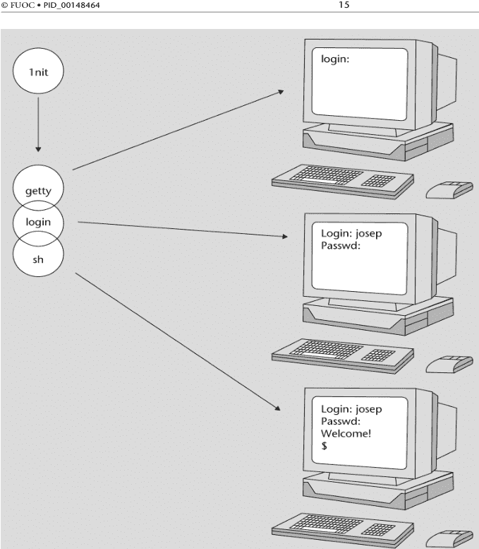

## 4.1. 交互式 shell

启动交互式 shell [Qui01] 后，用户会看到一个提示符，表示可以输入命令行。在输入命令后，shell 将负责对其进行验证并开始运行所需的进程，分为多个阶段：

通常情况下，命令行是运行系统命令、交互式 shell 命令、启动应用程序或 shell 脚本的方式。

shell 脚本是文本文件，其中包含了系统的命令序列、交互式 shell 的一系列内部命令，以及用于处理程序流的必要控制结构（例如，可以运行的类型，等）。

系统可以根据赋予文件的名称直接运行 shell 脚本。要运行它们，我们通过调用 shell 并带上文件名，或者为 shell 脚本赋予执行权限。


在某种程度上，我们可以将 shell 脚本视为在交互式 shell 上执行的解释型语言代码。对于管理员来说，shell 脚本非常重要，主要基于两个原因：

- 1) 系统的配置和大多数服务都是通过形式为 shell 脚本的工具提供的。
- 2) 自动化管理过程的主要方法是创建 shell 脚本。

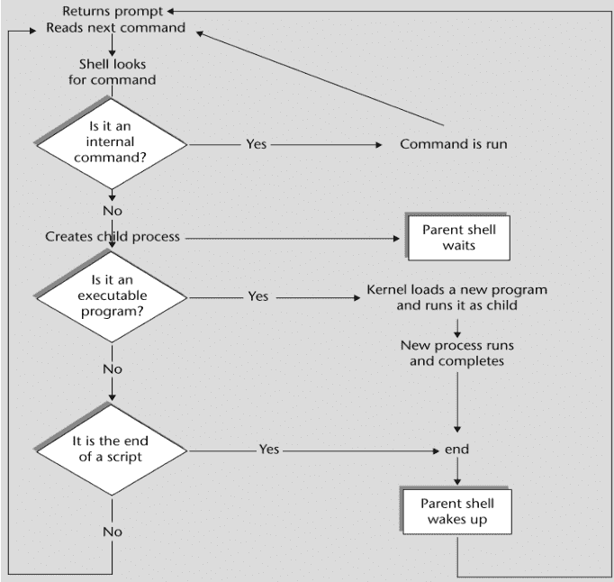

图 2 基本 shell 流控制

所有由 shell 调用的程序都拥有三个定义文件，由相应的句句柄指定。默认情况下，这些文件是：

- 1) **标准输入**：通常分配给终端键盘（控制台）；使用文件句柄 `0`（在 UNIX 中使用整个文件句柄）。
- 2) **标准输出**：通常分配给终端屏幕；使用文件句柄 `1`。
- 3) **标准错误**：通常分配给终端屏幕；使用文件句柄 `2`。

这告诉我们，默认从 shell 运行的任何程序其输入都与终端键盘关联，输出与屏幕关联，并且会将错误发送到屏幕。

此外，shell 倾向于提供以下机制：

- 1) **重定向**：由于 UNIX 中 I/O 设备和文件被以相同的方式对待，shell 简单地将它们视为文件。从用户的角度来看，文件句柄可以重新分配，使得一个文件句柄的数据流指向任何其他文件句柄；这被称为重定向。例如，我们将重定向文件句柄 `0` 或 `1` 为重定向标准 I/O。
- 2) **管道**：程序的标准输出可以通过管道作为另一个程序的标准输入。各种程序可以通过管道连接在一起，创建所谓的流水线（pipeline）。
- 3) 用户程序的**并发性**：用户可以同时运行多个程序，这意味着它们将在后台运行，或者在前台运行并独占屏幕控制。另一种方法是允许长任务在后台运行，同时在前台与 shell 以及其他程序进行交互。

在实践中，UNIX/Linux 这些 shell ：

- **重定向**：命令能够从其他文件或设备接收输入或输出。

### 示例

让我们看看

```
command op file
```

其中 `op` 可能可能是：

- `-` : 从文件接收输入。
- `>` : 将输出发送到文件。
- `>>` : 表示允许输出（默认情况下，`>` 会创建文件）。

管道：链接多个命令，并传输它们的数据：

`command1 | command2 | command3`

- 这条指令允许 `command1` 可能从键盘接收输入，将其输出发送到 `command2`，`command2` 将其作为输入并向 `command3` 输出，`command3` 将接收并将其输出发送到标准输出（默认是屏幕）。
- 后台并发：在行末尾带有 `&` 执行的任何命令将在后台运行，shell 的提示符会立即返回，同时它将继续执行。我们可以使用 `ps` 命令及其选项跟踪命令的执行情况，这允许我们观察系统进程的状态。我们还有 `kill` 命令，允许消除仍在运行或进入错误状态的进程：`kill -9 PID` 允许我们杀死具有 `PID` 标识的进程。`PID` 是与进程关联的标识符，是系统分配给它的整数，可以使用 `ps` 命令获取。

## 4.2. Shells

`shell` 相对于操作系统内核的独立性（`shell` 只是一个接口层），允许我们在系统上拥有多个 `shell` [Qui01]。尽管一些最常见的有：

- Bourne shell (`sh`)。这一直是标准的 UNIX shell，所有 UNIX 系统的某个版本中都包含它。通常，它是管理员的默认 shell (`root`)。在 GNU/Linux 中，它倾向于 Bash，它是 Stephen Bourne 在 70 年代末在 AT&T 创建的 Bourne shell 的改进版本。默认提示符倾向于 `$`（在 root 下为 `#`）。
- Korn shell (`ksh`)。它是 Bourne 的一个超级组（保持了一些兼容性），由 David Korn 在 80 年代中期在 AT&T 编写，具有 Bourne 和 C 的功能，并进行了一些额外添加。默认提示符是 `$`。
- C shell (`csh`)。它由 Bill Joyce 在 70 年代末在伯尔克利大学开发，相比 Bourne 有几处改进，类似于全名补全和作业控制。默认提示符是 `%`。由于管理员倾向于使用 Bourne，用户在 Bourne shell 中进行交互时对它进行了添加。`csh` 使用 `Login`（在用户登录时运行）、`logout`（在离开用户会话时运行）和 `cshrc`（与 `profile` 类似，在启动的 C shell 中运行）。尽管如此，它的语法是基于 C 语言的。
- 其他，如受限或特殊版本。
- Bash（由于它是 Bourne shell 的）在 GNU/Linux 中变得重要，并作为默认 shell。它包含了上述三种 shell（Bourne, Korn），遵循 Bourne shell 的语法。

了解我们使用的是哪种 shell 的快速方法是使用变量 `$SHELL`，通过命令行：

```
echo $SHELL
```

我们将发现所有 shell 都有以下共同点：

- 它们都可以通过名称或作为参数执行。
- 系统用户有一个默认 shell。此信息保存在密码文件 `/etc/passwd` 中，可以使用 `chsh` 命令进行更改，该命令带有 `-l` 参数将列出可用 shell（见 `/etc/shells`）。
- 每个 shell 实际上都是可执行命令，通常位于 `/bin` 中（或 `/usr/bin`）。
- `shell` 脚本可以在它们的任何一个中编写，适应各自的语法，这通常是不同的。构造语法以及内部命令在每个 shell 的页面中都有记录（例如 `man bash`）。
- 每个 shell 都有一些启动文件（初始化文件），每个用户都可以根据需要对其调整，包括代码、路径...

> 注意

编写 shell 脚本建议对 shell 脚本有良好的了解。某些命令以及它们的不同选项。

- Bash 是 GNU/Linux 的默认 shell（除非在创建用户账户时另有指定）。在其他 UNIX 系统中，它倾向于 Bourne shell (`sh`)，并结合了其他 shell，`csh` 和 `ksh` 的特性。
- 启动文件：`sh`，`ksh` `profile`（在用户账户中，并在用户登录时执行），`ksh` 还倾向于有一个 `kshrc`，它随后执行；`csh` 使用 `Login`（仅当用户登录运行时运行）、`logout`（用户离开会话时运行）和 `cshrc`（与 `profile` 类似，在启动的 C shell 中）。而 Bash 使用 `.bashrc` 和 `.bash_profile`。此外，管理员可以将公共变量和路径放置在 `/etc/profile` 文件中，这些将在每个文件之前执行。

用户拥有。在创建用户账户时，启动文件会被放在用户的账户中（通常是从 `/etc/skel` 目录复制的），管理员可以在那里留下准备好的文件骨架。

c) 系统或服务配置通常用 Bourne shell (`sh`) 编写，因为大多数 UNIX 系统都是这样使用它们的。GNU/Linux 也可以在 Bash 以及其他与 shell 无关联脚本语言（如 Perl 或 Python）中找到[它们]。

d) 我们可以通过检查脚本的第一行来识别脚本运行在什么环境上，例如文件《scriptname》。它倾向于是：`#!/bin/name`，其中 `name` 是 `bash`、`sh`、`csh`、`ksh` 等……这告诉我们在运行脚本的那一刻，需要启动什么种 shell 来运行它。解释这一行至关重要（换句话说，所有的脚本都应该包含这一行，否则它们将尝试运行默认 shell（在我们例中是 Bash），而可能不是正确的 shell，导致执行过程中出现许多语法错误）。

## 4.3. 系统变量

某些系统变量（例如我们可以使用 `echo` 命令查看）可以在命令行或 shell 脚本编程中查询：

| 变量 | 取值示例 | 说明 |
| --- | --- | --- |
| HOME | /home/juan | 用户的根目录 |
| LOGNAME | juan | 登录时的用户 ID |
| PATH | /bin:/usr/local/bin:/usr:/X11/bin | 路径 |
| SHELL | /bin/bash | 用户 shell |
| PS1 | $ | Shell 提示符，用户可以更改它 |
| MAIL | /var/mail/juan | 邮件目录 |
| TERM | xterm | 用户使用的终端类型 |
| PWD | /home/juan | 当前目录 |

可以使用 `env` 命令查看不同的环境变量。例如：

```bash
$ env
SSH_AGENT_PID = 598
MM_CHARSET = ISO-8859-15
TERM = xterm
DESKTOP_STARTUP_ID = 
SHELL = /bin/bash
```

*(此处省略原文中乱码的重复输出部分)*

## 4.4. Bash 中的编程脚本

在这里我们将查看 Bash 脚本的一些基本概念，建议进一步阅读 [Bas] [Coo]。

所有的 Bash 脚本都必须以以下行开头：

```bash
#!/bin/bash
```


这一行表示用户使用的 shell、当前激活的 shell，以及运行接下来出现的脚本需要什么种 shell。

脚本有两种不同的运行方式：

- 1) 直接从命令行运行，前提是它具有执行权限。如果不是，我们可以通过 `chmod +x script` 建立权限。
- 2) 通过 shell 运行，我们显式地调用 shell：`/bin/bash script`。

我们应该考虑到，无论采用何种执行方法，我们始终创建一个运行脚本的子 shell。

### 4.4.1. Bash 中的变量

变量赋值通过以下方式完成：

```
variable = value
```

变量的值可以通过以下命令查看：

```
echo $variable
```

其中 `$` 代表变量的值。

默认变量只在脚本内部（或 shell 内部）可见。如果变量需要在脚本外部（即 shell 级别或事后生成的任何子 shell 级别）可见，我们需要对其进行“导出”`export`并进行赋值。

我们可以做两件事：

- 先赋值后导出：

```
var=value
export var
```

- 赋值时导出：

```
export var=value
```

在 Bash 脚本中，我们拥有一些可访问的预定义变量：

- `$1`：将命令行中的参数作为参数传递给脚本。
- `$0`：保存脚本名称，它是命令的第 0 参数。
- `"$@"`：保存该变量从 1 到 N 的所有参数。
- `$#`：保存参数个数，每个参数用双引号括起来。
- `$?`：“状态”：保存最近执行的命令所返回的值。用于检查错误情况。
- `"$*"`：保存所有参数，每个参数都用双引号括起来。

（注：原文中特殊符号如 `$@` 和 `$*` 存在错误，已根据标准 Bash 语法进行了修正）。

接下来，让我们看看大多数发行版中三种经典的包。每个发行版都有一个标准格式，并支持另外一种。

## 5.1. TGZ 包

TGZ 包是使用时间最长的包。第一批用于安装软件的 GNU/Linux 发行版以及几个发行版仍然在使用它（例如 Slackware），以及某些商业级 UNIX。它们是由团队将文件合并到单个 `.tar` 文件中，并使用 `gzip` 实用程序压缩的，通常以 `.tgz` 或 `.tar.gz` 扩展名出现。同时，现在经常发现 `tar.bz2` 代替 `gzip`，后者是另一种名为 `bzip2` 的工具，在某些情况下它能获得更高的压缩率。

> 注意
>
> 在安装组织性良好的软件时，GZ 包是一项基础工具。此外，它们也是备份和恢复文件的有用工具。

与看起来相反，这种格式被广泛使用，特别是对于那些发行版的软件创建者或分发者。许多为各种平台（如各种商业 UNIX 和不同的 GNU/Linux 发行版）工作的软件创建者更倾向于将其作为更简单、更具移植性的系统。

这种情况的一个例子是 GNU 项目，它以这种格式（源码形式）分发软件，因为它可以用于任何 UNIX，无论是专有系统、BSD 变体还是 GNU/Linux 发行版。

如果是二进制格式，我们必须记住它是否适用于我们的系统，例如一个常见的命名方式（在此例中，Mozilla 浏览器的 1.4 版本）：

```
mozilla-i686-pc-linux-gnu-1.4-installer.tar.gz
```

其中我们有包名 Mozilla，为 `i686` 架构（Pentium II 或更高或兼容版本）设计，可能是 `i386`、`i586`、`i66`、`k6` `amd k6`、`k7` `amd athlon`、`amd64 x86_64`（针对 em64 中的 AMD64 和 64 位单元），或 `la64`（Intel Itanium），适用于其他机器如 `sparc`、`powerpc`、`mips`、`hppa`、`alpha`... 等架构，然后它告诉我们这是用于 Linux、PC 机器、软件版本 1.4。

如果是源码格式，它可能显示为：

```
mozilla-source-1.4.tar.gz
```

在这里我们看到了 `source`（源码）一词；在这种情况下它没有提到机器的架构版本，这告诉我们它已准备好在不同架构上编译。

否则，每个操作系统或源码会有不同的代码，如 GNU/Linux、Solaris、Irix、bsd...

这些这些包的基本流程包括：

- 1) 解压包（它们通常不使用绝对路径，这意味着它们可以在任何地方解压）：

```
tar -zxvf file.tar.gz
```
或 `.tgz` 文件

使用 `tar` 命令时，我们使用 `z` 选项：`z`：解压，`x`：提取文件，`v`：显示过程，`f`：指定要处理的文件。

也可以单独完成（不带 tar 的 z 选项）：

```
gunzip file.tar.gz
```

这将留下一个 `tar` 文件

```
tar -xvf file.tar
```

- 2) 一旦我们解压了 `tgz`，就会得到它包含的文件，通常软件应该包含一些 `readme` 或 `install` 类型的文件，这些文件会逐步指定安装选项，以及可能存在的依赖项。

首先，我们应该检查依赖项以查看我们拥有正确的软件，如果没有，则寻找并安装它。

如果是二进制包，安装通常非常简单，因为它可以从我们离开的地方直接执行，或者它带有自己的所有者属性。另一种可能是我们可能需要手动操作，这意味着只需复制 `cp -r`，递归复制或移动 `mv` 命令到所需位置即可。

另一种情况是源码格式。那么，在安装软件之前，我们必须先进行编译。为此我们需要详细阅读程序携带的说明文件。大多数开发者使用 GNU 系统调用 `autoconf`（自动配置），它通常使用以下步骤（如果没有出现错误的话）：

- `./configure`：这是一个脚本，用于配置代码以便可以在我们的机器上进行编译，并验证正确的工具是否存在。`--prefix` 目录选项允许指定软件安装的位置。
- `make`：编译本身。
- `install`：将软件安装在正确的位置，通常之前已作为配置的选项指定，或者默认假设。

这是一个通用过程，但取决于软件是否遵循它。有些情况要糟糕得多，需要手动完成整个过程，修饰配置文件和 `Makefile`，和/或逐个编译文件，但幸运的是，这种情况正变得越来越少见。

在想要删除所有已安装软件的情况下，如果有需要我们将使用卸载程序，否则直接删除目录或已安装的文件，并注意潜在的依赖关系。

`tgz` 包作为管理任务的备份机制非常常见，例如制作用户账户备份，或保存我们不知道是否还会需要的旧数据副本。通常使用以下过程：假设我们想保存目录 `dir` 的副本，可以输入：`tar -cvf dir.tar dir` 将 `dir` 压缩到文件 `dir.tar` 中

```
tar -cvf dir.tar dir
```

结果将是一个 `tgz`。如果我们感兴趣的是保留属性和用户权限以及可能存在的链接，我们需要小心。

## 5.2. Fedora/Red Hat: RPM 包系统

`RPM` 包系统代表了向前一步，它包含了任务管理。此外，系统存储了一个带有已安装包的小型数据库，可以在新安装时进行查询。按照惯例，`RPM` 包使用如下名称：

```
package-version-rev.rpm
```

其中 `package` 是软件名称，`version` 是软件版本号，`rev` 表示 `RPM` 包的修订版本，它表示构建的次数，并指代它所设计的任何架构，无论是 Intel/AMD `i386`、`i586`、`i686`、`x86_64`、`em64`、`ia64` 或其他如 `alpha`、`PPC`...

- 包信息：使用 `-q` 配合包名查询包的特定信息（在 `rpm` 文件上使用 `-p`）。如果包尚未安装，该选项将伴随所请求的信息，如果请求是同时显示所有已安装的包，该选项为 `-qa`。例如，对已安装包的请求：

| 请求 | RPM 选项 | 结果 |
| --- | --- | --- |
| 文件 | `rpm -ql` | 包含的文件列表 |
| 信息 | `rpm -qi` | 包描述 |
| 依赖 | `rpm -qR` | 先期需求、库或软件 |

- 安装：简单使用 `rpm -i package.rpm`，或者带有包所在的 URL，从 FTP 或网络服务器下载，我们需要使用 `ftp://` 或 `http://` 语法获取包的位置。可以在满足包依赖的情况下完成安装，无论是先期软件的形式还是应该安装的库。在不满足此要求的情况下，我们将告知缺失软件以及提供它的包名。我们可以使用 `--force` 或 `--nodeps` 选项强制安装（尽管安装的软件可能无法工作），或者简单地忽略依赖信息。

安装包的任务（执行 `rpm`）涉及各种子任务：
c) 检查潜在依赖关系；b) 检查与其他已安装包的冲突；c) 决定对以前存在的与包相关的配置文件该做什么；d) 解压文件并将其放置在正确的位置；e) 执行安装后任务；最后，f) 将执行任务的日志存储在 `RPM` 数据库中。

- 更新：等同于安装，首先检查软件是否已存在，使用 `rpm -U package.rpm`。它将处理删除之前的安装版本。


# 验证

在系统正常运行期间，许多安装的文件会发生变化。在这方面，RPM 允许我们检查文件，以检测偏离正常流程的任何更改，或可能指示数据损坏的潜在错误。通过 `rpm -V package` 我们可以验证特定的软件包，通过 `rpm -Va` 我们将验证所有包。

# 删除

从 RPM 系统中擦除软件包（使用 `-e` 或 `--erase`）；如果存在依赖关系，我们可能需要先消除其他包。

# 示例

对于远程情况：

```
rpm -i ftp/site/directory/package.rpm
```

将允许我们从提供的 FTP 或网站下载包，带有其目录位置，并在这种情况下进行处理以安装该包。

我们需要控制仅来自已知且可靠的软件包，例如发行版的所有者制造商或值得信赖的网站。通常，与软件包一起，我们还会提供数字签名，以便我们检查其真实性。`md5` 和值通常用于检查软件包是否被篡改，其他系统如 PGP（GNU 版本 PGP）用于检查软件包发行者的真实性。同样，我们可以在互联网上找到不同的 RPM 存储库，它们适用于使用或允许 RPM 格式的不同发行版。

| 注意事项 |
|---|---|
| 查看网站：www.rpmfind.net。 |

为了安全使用软件包，官方和某些第三方仓库目前会对比软件包进行电子签名，例如使用上述的 PGP；这有助于我们确保（如果我们有签名的话）软件包来自可靠的源。通常，每个提供的（仓库）都会包含带有其站点密钥的 PGP 签名文件。通常从官方仓库安装，如果它们来自第三方，我们需要获取密钥文件并将其引入 RPM 中，通常为：

```
$ rpm import GPG-KEY-FILE
```

其中 `GPG-KEY-FILE` 是 GPG 密钥文件或文件的 URL，通常这也会包含一些用于检查完整性的 `md5` 值。我们可以在其系统中找到这些密钥：

```
$ rpm -qa | grep ^pgpg-pubkey
```

我们可以根据获取的密钥观察更多细节：

FUOC* PID_001_048464 33 管理员基础工具

```
$ rpm -qi gpg-key-xxxxx-yyyy
```

对于特定的 RPM 软件包，我们将能够检查它是否带有签名，以及使用了哪种签名：

```
$ rpm -checksig -v <package>.rpm
```

并且根据可用签名检查软件包是否正确，可以使用：

```
$ rpm -K <package>.rpm
```

我们需要对从我们信任的站点导入密钥保持谨慎。

当 RPM 发现一个带有我们系统中没有的签名的包时，或者该包没有签名时，它会告诉我们，然后我们必须决定如何处理。

关于发行版对 RPM 的支持，在 Fedora（Red Hat）以及衍生版本中，RPM 是默认的软件包格式，也是发行版广泛用于更新和软件安装的格式。Debian 使用所谓的 DEB（正如我们将看到的），它对 RPM 有支持（`rpm` 命令存在），但仅用于查询或查看软件包信息。如果要在 Debian 中安装 RPM 软件包至关重要，我们使用 `alien` 工具，它可以转换包格式（在此情况下从 RPM 转换为 DEB），并继续使用转换后的包进行安装。

除了发行版的基础软件包系统外，现在每个

[发行版] 倾向于支持一种中间高级别的软件管理系统，这为基础系统增加了一个上层，帮助软件包管理任务，并添加许多实用工具以改进对过程的控制。

在 Fedora (Red Hat) 和衍生版本中，它使用 `yum` 允许对软件包进行高级管理，并将配置集中在

配置文件中。

通常，每个提供的（仓库）都会包含带有其站点密钥的 PGP 签名文件。从官方仓库通常安装，如果它们来自第三方，我们需要获取密钥文件并将其引入 RPM 中，通常为：

> 注意事项
> yum：http://yum.baseurl.org

`yum` 配置基于：

| /etc/yum | (文件) |
|---|---|
| /etc/yum | (用于指定仓库的目录) |
| /etc/yum.repos.d | (包含仓库信息) |

典型的 `yum` 操作总结如下：

## 管理员基础工具

| 命令 | 说明 |
|---|---|
| `yum install <name>` | 安装名为指定的包 |
| `yum update <name>` | 更新现有软件包 |
| `yum remove <name>` | 消除软件包 |
| `yum list <name>` | 按名称搜索软件包 |
| `yum search <name>` | 更广泛的搜索 |
| `yum provides <file>` | 搜索提供文件的软件包 |
| `yum update` | 更新整个系统 |
| `yum upgrade` | 如上，包括额外的包 |

### apt-get dist-upgrade

通过这最后一个过程，我们可以保持发行种的永久更新，安装软件包并与新包一起验证依赖关系。构建此过程的一些实用工具包括 `apt-spy`（它尝试搜索最快的站点）或 `netselect`（它允许我们找到站点列表）。另外，我们可以搜索这些站点（我们可以通过 `apt-setup` 配置它们）或复制任何官方文件。额外的（第三方）软件可能需要添加更多源（到 `/etc/sources.list`）；可以获取可用源的列表（例如：http://www.apt-get.org）。

更新系统特别会下载大量软件包（尤其是在 `unstable` 版本中），因此建议清理缓存，即本地仓库；对于下载的软件包（它们保留在 `/var/cache/apt-archive/` 中），如果它们不再被使用，可以使用 `apt-get clean` 消除它们，或者使用 `apt-get autoclean` 消除那些已经存在新版本而不再需要的软件包，原则上，它们将不再被需要。我们需要考虑在重新安装软件包的过程中是否可能再次需要这些软件包，因为如果需要，我们将不得不重新下载它们。

APT 系统还支持所谓的 SecureAPT，即通过验证和（`md5`）和软件包源签名（GPG 类型）对软件包进行安全管理。如果在下载期间没有可用签名，`apt-get` 会报告此问题并生成一个未签名软件包列表，询问是否停止安装，将决定权交给管理员。当前可靠源的列表可以使用以下命令获取：

- `apt-key list`

官方 Debian 站点的 GPG 密钥通过软件包分发，我们可以如下方式安装它们：

```bash
## apt-get install debian-archive-keyring
```

显然，考虑到我们有包含官方站点的 `sources.list`，希望默认情况下（取决于 Debian 版本），这些密钥在系统启动时已经安装好了。对于其他不通过软件包提供密钥但我们认为可靠的非官方站点，我们可以导入它们的密钥，从仓库中获取它（我们需要咨询密钥在哪里可用，没有标准，尽管它通常在仓库的主页上）。使用 `apt-key add` 配合来添加密钥，或者：

```bash
## gpg -import file.key
## gpg -export -armor XXXXXXX | apt-key add -
```

X 是与密钥相关的十六进制数（参见仓库指令以获取推荐的导入方法和必要数据）。

APT 系统的另一个重要功能是使用 `apt-cache` 工具查询软件包信息，它允许我们与 Debian 软件包列表进行交互。

# 示例

`apt-cache` 工具拥有的允许我们搜索软件包信息的命令，例如：

- 根据不完整的名称搜索软件包：

  `apt-cache search name`

- 显示软件包描述：

  `apt-cache show package`

- 软件包依赖于哪些包：

  `apt-cache depends package`

其他有趣的 apt 工具或功能：

- `apt-show-versions`：告诉我们哪些软件包可以更新（以及对应哪些版本，请参见选项 `-u`）。

其他特定任务需要使用低层次的工具完成，例如 `dpkg`。例如，获取特定已安装软件包的文件列表：

```bash
dpkg -L package
```

获取完整的软件包列表可以使用：

```bash
dpkg -l
```

或者搜索某个元素来自哪个软件包（例如文件）：

```bash
dpkg -S file
```

这些功能适用于已安装的软件包，而 `apt-file` 也可以搜索尚未安装的软件包。

最后，一些用于 APT 的图形化工具，如 `synaptic`、针对 gnome 的 `gnome-apt`，以及 KDE 的 `kpackage` 或 `adept` 也值得提及，还有前面提到的文本工具如 `aptitude` 或 `dselect`。

结论：我们应该强调，APT 管理系统（结合 `dpkg` 基础）在管理更新方面非常灵活强大，是 Debian 及其衍生发行版（如 Ubuntu, Kubuntu, Knoppix, Linex 等）使用的软件包管理系统。

## 6. 通用管理工具


在管理领域，我们也可以考虑一些工具，例如专门为管理目的而设计的工具。尽管由于目前不同版本的发行版计划演进非常快，很难跟上这些工具的更新。我们将提到几个例子，某些某些它们可能无法完全正常工作：

- **Linuxconf**：这是一个通用的管理工具，它将不同的方面分组在一个文本菜单界面中，在最新版本中已进化到支持我们；它可以用于几乎所有的 GNU/Linux 发行版，并支持每个发行版固有的细节（遗憾的是，它已经一段时间没有更新了）。

- **Webmin**：这是另一个基于 Web 界面的管理工具；通过一系列插件运行，可以为每个需要管理的服务添加插件；通常它形成该服务的配置参数；它还提供了（激活后）从任何带有浏览器的机器进行远程管理的可能性。

- 其他正在开发中的 cPanel、ISPConfig。

同时，Gnome 和 KDE 桌面环境倾向于包含“控制面板”概念，这允许管理图形界面的视觉外观以及某些系统设备的参数。

关于个性的图形化管理工具，GNU/Linux 发行版直接提供了一些（随 Gnome 和 KDE 的工具）、专门用于管理设备（打印机、声音、网络等）的工具，以及用于执行特定任务（连接连接、配置用户、查看日志……）的工具。

在本节中，我们特别应该强调 Fedora 发行版（Red Hat 及其衍生版），它尝试为不同的功能提供若干简单的实用程序，我们可以在桌面（在管理菜单中）找到它们，或者通过 `system-config` 命令用于屏幕、打印机、网络、安全等

> 注意

我们可以在这里找到：Linuxconf http://www.solucorp.qc/linuxconf


## 7. 其他工具

在本单元有限的空间内，我们无法对所有对管理有益的工具进行注释。我们将引用一些认为是基础的工具：

- 各种基础 UNIX 命令：`grep`, `awk`, `sed`, `find`, `diff`, `gzip`, `cut`, `sort`, `du`, `cat`, `more`, `file`,...

- 编辑器，对于任何编辑任务至关重要，例如：`vi`，因为可以快速修改文件而被广泛用于管理任务。`Vim` 是兼容 `vi` 的编辑器，GNU/Linux 倾向于携带；它允许多种语言语法高亮。`Emacs` 是一个非常完整的编辑器，适用于不同的编程语言（语法和编辑模式）；它有一个非常完整的环境和一个 X 版本称为 Emacs。`Joe` 是一个兼容 Wordstar 的编辑器。还有很多……

- 脚本工具，用于管理，例如：`Perl`，处理正则表达式和分析文件（过滤、排序等）时非常有用。`PHP`，在网络环境中非常使用的语言。`Python`，另一种可以快速构建应用程序原型的语言……

- 用于高级语言编译和调试的工具：GNU `gcc`（C 和 C++ 编译器）、`gdb`（调试器）、`xdb`（`gdb` 的 X 界面）、`ddd`（多种语言的调试器）。

> 参考与 GNU/Linux 入门课程相关的资料，工具命令参考页面如 [Stu01]。

## 活动

1) 为了快速阅读，请参阅 `FHS` 标准，它将帮助我们在发行版中搜索文件时提供良好的指南。

2) 为了复习和扩展 `bash` shell 脚本的概念和编程知识，请参阅：[Bas] [Coo]。

3) 对于 `RPM` 软件包，我们如何执行以下某些任务？

   - 找出哪个软件包安装了特定命令。
   - 获取安装某个命令的软件包的描述。
   - 删除位于某个未知的包名中的文件。
   - 显示与特定文件位于同一个包中的所有文件。

4) 执行上述相同任务，但针对 Debian 软件包，使用 `APT` 工具。

5) 更新 Debian（或 Fedora）发行版。

6) 在我们的发行版上安装一个通用的管理工具，例如 Linuxconf 或 Webadmin。它们能为我们提供什么？我们是否理解所执行的任务以及它们产生的影响？

# 参考文献

其他参考和信息来源

[Bas][Coo] 提供了关于 `bash` shell 脚本编程的广泛介绍（以及高级概念）以及多个示例。[Qui01] 讨论了 GNU/Linux 中不同的编程 Shell，以及它们的相似之处与不同。

[Des02][Bat03] 提供了 Debian 和 Fedora/Red Hat 发行版软件包系统的广阔视角。

[Stu] 是对 GNU/Linux 中可用工具的广泛介绍。

# Linux 内核

Josep Jorba Esteve

PID_00148468


# 目录

- 引言.................................................................................................... 5
- 1. GNU/Linux 系统的内核............................................................... 7
- 2. 配置或更新内核.................................................................. 15
- 3. 配置与编译过程.............................................................. 18
- 3.1. 内核编译版本 2.4.x......................................................................... 19
- 3.2. 迁移到内核 2.6.x................................................................................ 24
- 3.3. 内核版本 2.6.x 的编译.............................................................. 26
- 3.4. Debian 中内核的编译（Debian 方式）......................... 27
- 4. 内核补丁...................................................................... 30
- 5. 内核模块........................................................................... 32
- 6. 内核的未来与替代方案............................................................... 34
- 7. 教程：根据用户需求配置内核............................................................................... 38
- 7.1. 在 Debian 中配置内核...................................................... 38
- 7.2. 在 Fedora/Red Hat 中配置内核........................................... 40
- 7.3. 配置通用内核....................................................... 42
- 活动............................................................................................... 45
- 参考文献........................................................................................... 46

# 引言

GNU/Linux 系统的内核（通常称为 Linux）是系统的核心：它负责启动系统，通过管理内存、文件系统、输入/输出、进程以及进程间的相互通信来管理机器资源。

它的起源可以追溯到 1991 年 8 月，当时一位名为 Linus Torvalds 的芬兰学生在列表中宣布，他创建了自己的操作系统内核，该内核与 GNU 项目的软件协同工作，并将其提供给开发者社区进行测试和改进建议，以使其更加易用。这就是操作系统内核的起源，后来它被称为 Linux。

Linux 的一个特殊特性是，遵循自由软件哲学，它以一种方式提供了操作系统本身（内核）的源代码，这使其成为教学操作系统的完美工具。

另一个主要优势是，通过拥有源代码，我们可以对其进行编译以更好地适应我们的系统，还可以配置其参数以提高系统性能。

在本单元中，我们将介绍如何处理为我们的系统准备内核的过程。在这里，从源代码开始，我们可以获得适用于我们系统的内核内核。同样，我们将讨论如何开发配置以及随后的编译，以及如何测试我们获得的新内核。

> 注意


> Linux 内核追溯到 1991 年，当时 Linus Torvalds 向社区发布了它。它是少数在被广泛使用的同时，也提供源代码的操作系统之一。

# 1. GNU/Linux 系统的内核

核心或内核（kernel）是任何操作系统的基本部分 [Tan87]，控制整个系统的基础服务代码位于此处。基本上，它的结构可以分为一系列管理组件，旨在：

- 管理进程：将运行哪些任务、以什么顺序和什么优先级。一个重要方面是 CPU 调度：我们如何优化 CPU 时间以最佳可能的性能或与用户的交互性来运行任务。
- 进程间的通信与同步：进程之间如何相互通信。
- 输入/输出管理 (I/O)：我们如何管理外设。
- 内存管理：优化内存。
- 文件管理：如何组织文件

| Shell，应用程序 | 系统服务 |
| :--- | :--- |
| 文件管理 |  |
| I/O 管理 | 内存管理 |
| 核心 |  |


在专源系统中，内核通常是“隐藏”的。

这种方法的一个主要问题正是在这些更新的可用性，而时间是关重要的。许多大型公司、科学和军事机构不能依赖制造商的意愿来解决问题。

Linux 内核为任何具备所需知识的人提供了开源解决方案。因为源代码是的，可以立即找到改进和解决方案，而不像专源软件那样必须等待制造商的更新。此外，我们可以根据自己的意愿深度定制内核，这是一个必要需求，例如对于时间敏感的高性能应用或嵌入式系统（如移动设备）。

内核的简要历史 [Kara][Kerb]：它最初由一位名为 Linus Torvalds 的芬兰学生于 1991 年开发，目的是为 Intel 386 处理器为 Min Tan87（Unix 的一个版本 [Bac86]）创建一个简单的内核。第一个正式发布的版本是 1994 年 3 月的 Linux 1.0，它仅包含 i386 架构的执行并支持单处理器机器。Linux 1.2 于 1995 年 3 月发布，它是第一个涵盖不同架构（如 Alpha、SPARC 和 MIPS）的版本。Linux 2.0 于 1996 年 6 月增加了更多架构，并是第一个包含多处理器支持（SMP）[Tum] 的版本。Linux 2.2 于 1999 年 1 月发布，SMP 的优势显著增加，并为大量硬件添加了控制器。2.4 版本于 2001 年 1 月发布，SMP 支持得到了改进，合并了新的支持架构，并包含了 USB、PC 卡设备控制器（笔记本电脑的 PCMCIA）以及 PnP（即插即用）、RAID 和卷支持等。分支 2.6

内核（2003年12月）显著改进了 SMP 支持，对 CPU 调度系统提供了更好的响应，引入了内核线程的使用、对 64 位架构提供了更好的支持、虚拟化支持以及对移动设备的适应改进。

在开发方面，由于内核是由 Linux Torvalds 在 1991 年创建的（版本 0.01），他一直持续维护它。但随着内核的运行和趋于成熟（并不断增长），他帮助不同的合作者维护了内核的不同稳定版本，同时 Linux（尽可能地）为内核开发的最新版本进行开发并贡献代码。这些版本的主要合作者是[列表]：

- 2.0 David Winehall。
- 2.2 Alan Cox（他还负责大多数版本的补丁的开发和发布）。
- 2.4 Marcelo Tosatti。
- 2.6 Andrew Morton / Linux Torvalds。

> 注意
> 内核起源于 MINIX 系统，这是 Andrew Tanenbaum 开发的、用于 PC 的 UNIX 克隆系统。

为了稍微理解 Linux 内核的复杂性，让我们来看一张表格，其中简单概述了其不同版本的历史以及相对于源代码的大小。该表仅显示生产版本；（近似）大小以源代码的千行（K）为单位：

| 版本 | 发布日期 | 代码行（千） |
|---|---|---|
| 0.01 | 09-1991 | 10 |
| 1.0 | 03-1994 | 176 |
| 1.20 | 03-1995 | 311 |
| 2.0 | 06-1996 | 649 |
| 2.2 | 01-1999 | 1800 |
| 2.4 | 01-2001 | 3378 |
| 2.6 | 12-2003 | 5930 |

我们可以看到，我们已经从大约万行增加到了六百万行。

现在，内核 2.6.x 的开发仍在继续，这是最新的稳定版本，许多发行版将其作为默认版本（尽管仍然包含 2.4.x，但在安装期间 2.6.x 是一个选项）；尽管对之前的版本掌握某些知识至关重要，因为我们很容易找到运行未更新的旧发行版的机器，我们可能需要对它们进行维护或迁移到更现代的版本。

> 注意
> 今天的内核已达到了相当的复杂性和成熟度。

在 2.6 分支的开发期间，内核的开发大大加快了，因为 Linux Torvalds 和 Andrew Morton（ 2003 年加入 Linux 2.6 维护）都加入了 OSDL（开源开发实验室），OSDL 是一个致力于推广开源和 GNU/Linux 使用的公司财团（该财团包括许多其他使用 GNU/Linux 的公司：IBM、Sun、英特、富士电、日立、东芝、红帽、Transmeta……）。我们现在正面临一种有趣的状况，因为 OSDL 财团赞助了内核稳定版维护者（Andrew）和开发者（Linux）的工作，他们全职处理这些版本和相关问题。Linux 保持独立，致力于内核工作，而 Andrew 则去了 Google 工作，在那里他继续全职进行开发，为内核提交具有不同贡献的补丁。一段时间后，OSDL 变成了 Linux基金会。

我们需要记住，对于当前的内核版本

另一个需要考虑的因素是目前从事其开发的人数。最初，只有少数个人完全了解整个内核，而现在许多人参与了其开发。估计人数接近两千，贡献程度各异，尽管工作核心部分的开发者人数估计为几十个。

我们还应该考虑到，大多数人对内核仅有部分了解，而且他们并非同时工作，其贡献的相关性也不相同（有些人只是纠正简单的错误）；只有少数人（例如对内核有完整知识的维护者）。这意味着开发可能需要一段时间才能发生，贡献需要经过调试以确保它们之间不会发生冲突，并且要在备选功能之间做出选择。

关于 Linux 内核版本的命名 ([lkmD])，我们应该记住以下点：

- a) 在内核 2.6.x 之前，内核版本被分为两个系列：一个被称为“实验性”版本（数字为奇数，例如 1.3.xx、2.1.x 或 2.5.x），另一类是“生产”版本（偶数系列，如 1.2.xx、2.0.xx、2.2.x、2.4.x 等更多）。实验系列是移动快速的版本，用于测试新功能、算法、设备驱动等。由于增量内核的特性，它们的行为可能不可预测，导致数据丢失、死机等。因此，它们不适用于生产环境，除非是为了测试特定功能（并带有相应的风险）。

生产或稳定内核（偶数系列）是具有定义良好的功能集、已知错误较少且经过测试的设备控制器的内核。它们的发布频率低于实验版本，并且有多个版本，有些比其他的要好。GNU/Linux 发行版通常基于特定选择的稳定内核，而不一定是最新生成的内核。

- b) 当前的 Linux 内核命名（使用 2.6 分支），我们应该记住：

- 直到内核 2.6.x，内核版本通过分为两个系列给出：一个被称为“实验性”版本（数字为奇数，如 1.3.xx、2.1.x 或 2.5.x），另一类是“生产”版本（偶数系列，如 1.2.xx、2.0.xx、2.2.x、2.4.x 等更多）。实验系列是移动快速的版本，用于测试新功能、算法、设备驱动等。由于增量内核的特性，它们的行为可能不可预测，导致数据丢失、死机等。因此，它们不适用于生产环境，除非是为了测试特定功能（并带有相应的风险）。

生产或稳定内核（偶数系列）是具有定义良好的功能集、已知错误较少且经过测试的设备控制器的内核。它们的发布频率低于实验版本，并且有多个版本，有些比其他的要好。GNU/Linux 发行版通常基于特定选择的稳定内核，而不一定是最新生成的内核。

当前的 Linux 内核命名（使用 2.6 分支），我们应该记住：

- 直到内核 2.6.x，内核版本通过分为两个系列给出：一个被称为“实验性”版本（数字为奇数，如 1.3.xx、2.1.x 或 2.5.x），另一类是“生产”版本（偶数系列，如 1.2.xx、2.0.xx、2.2.x、2.4.x 等更多）。实验系列是移动快速的版本，用于测试新功能、算法、设备驱动等。由于增量内核的特性，它们的行为可能不可预测，导致数据丢失、死机等。因此，它们不适用于生产环境，除非是为了测试特定功能（并带有相应的风险）。

生产或稳定内核（偶数系列）是具有定义良好的功能集、已知错误较少且经过测试的设备控制器的内核。它们的发布频率低于实验版本，并且有多个版本，有些比其他的要好。GNU/Linux 发行版通常基于特定选择的稳定内核，而不一定是最新生成的内核。

- b) 当前的 Linux 内核命名（使用 2.6 分支），我们应该记住：


# Linux 内核版本命名

## 早期版本划分

直到内核 `2.6.x`，内核版本通过分为两个系列给出：一个被称为“实验性”版本（数字为奇数，如 `1.3.xx`、`2.1.x` 或 `2.5.x`），另一类是“生产”版本（偶数系列，如 `1.2.xx`、`2.0.xx`、`2.2.x`、`2.4.x` 等更多）。实验系列是移动快速的版本，用于测试新功能、算法、设备驱动等。由于增量内核的特性，它们的行为可能不可预测，导致数据丢失、死机等。因此，它们不适用于生产环境，除非是为了测试特定功能（并带有相应的风险）。

生产或稳定内核（偶数系列）是具有定义良好的功能集、已知错误较少且经过测试的设备控制器的内核。它们的发布频率低于实验版本，并且有多个版本，有些比其他的要好。`GNU/Linux` 发行版通常基于特定选择的稳定内核，而不一定是最新生成的内核。

## 当前的 Linux 内核命名

b) 当前的 Linux 内核命名（使用 `2.6` 分支），我们应该记住：


## Linux 内核版本历史

### 2.6.x 之前的版本划分

直到内核 `2.6.x` 之前，内核版本通过分为两个系列给出：一个被称为“实验性”版本（数字为奇数，如 `1.3.xx`、`2.1.x` 或 `2.5.x`），另一类是“生产”版本（偶数系列，如 `1.2.xx`、`2.0.xx`、`2.2.x`、`2.4.x` 等更多）。

实验系列是移动快速的版本，用于测试新功能、算法、设备驱动等。由于增量内核的特性，它们的行为可能不可预测，导致数据丢失、死机等。因此，它们不适用于生产环境，除非是为了测试特定功能（并带有相应的风险）。

生产或稳定内核（偶数系列）是具有定义良好的功能集、已知错误较少且经过测试的设备控制器的内核。它们的发布频率低于实验版本，并且有多个版本，有些比其他的要好。`GNU/Linux` 发行版通常基于特定选择的稳定内核，而不一定是最新生成的内核。

### 当前的 Linux 内核命名

b) 当前的 Linux 内核命名（使用 `2.6` 分支），我们应该记住：

- 直到内核 `2.6.x` 之前，内核版本通过分为两个系列给出：一个被称为“实验性”版本（数字为奇数，如 `1.3.xx`、`2.1.x` 或 `2.5.x`），另一类是“生产”版本（偶数系列，如 `1.2.xx`、`2.0.xx`、`2.2.x`、`2.4.x` 等更多）。

### SMP 与阻塞

在阻塞发生的情况下。`SMP` 是 Linux 内核社区中研究最充分的技术之一，在 `2.6` 分支中已取得了重要的改进。因为 `SMP` 性能是公司采用 Linux 作为服务器操作系统的决定性因素。

### 文件系统

文件系统：内核拥有良好的文件系统架构，其内部工作基于虚拟系统的抽象（`VFS`，虚拟文件系统），这可以轻松地适配到任何真实系统。因此，Linux 可能是支持文件系统数量最多的操作系统，从 `ext2`、`MSDOS`、`VFAT`、`NTFS`、到日志文件系统（如 `ext3`、`ReiserFS`、`JFS`(`IBM`)、`XFS`(`Silicon`)、`NTFS`）、`ISO9660` (`CD`)、`UDF` 等，并在不同的版本中不断不断支持。

其他一些技术性较弱的特性（带有一营销色彩）：


## Linux 的主要特性

- a) Linux 是免费的：通过 GNU 软件并包含在任何发行版中，我们几乎只需硬件成本即可获得一个完整的类 Unix 系统，无论 GNU/Linux 发行版的成本如何，我们实际上可以免费获得它。虽然看起来为了获得带有全套手册和技术支持的完整版本而多花一点钱，但比某些专用系统的费用要低得多，或者通过购买来支持我们青睐或认为更实用的发行版的开发。

- b) Linux 是可以修改的：`GPL` 许可证允许我们读取和修改内核的源代码（前提是我们必须具备所需的知识）。

- c) Linux 可以运行在相当有限的旧硬件上；例如，可以在一台拥有 4 MB 内存的 386 上创建网络服务器（有专门针对资源受限设备的发行版）。

- d) Linux 是一个强大的系统：Linux 的主要目标是效率，它旨在最大地利用可用硬件。

- e) 高质量：GNU/Linux 系统非常稳定，故障率低，并缩短了维护系统的时间。

- f) 内核非常小且紧凑：可以将它与一些基础程序一起放在仅 1.44 MB 的磁盘上（有几个发行版位于单张软盘上并带有基础程序）。

- g) Linux 兼容大量的操作系统，它可以读取几乎任何文件系统的文件，并可以通过网络通信为这些系统中的任何一个提供/接收服务。此外，通过某些库，它还可以在 x86 架构上运行其他系统的程序（如 MSDOS、Windows、BSD、Xenix 等）。

- h) Linux 拥有广泛的支持：没有其他系统的补丁和更新速度及数量能与 Linux 相比，甚至专用系统也不如此。对于特定问题，有无限邮件列表和论坛可以在几小时内帮助解决任何问题。唯一的问题影响最近的硬件控制器，如果这些控制器不是为专用系统提供的，许多制造商仍然不愿提供。但这种情况正在逐渐改变，显卡（NVIDIA, ATI）和打印机（Epson, HP）等领域的许多最重要制造商已经开始为它们的设备提供控制器了。

## 2. 配置或更新内核

作为 GNU/Linux 用户或系统管理员，我们需要记住 Linux 内核为我们适应需求和设备所提供的各种可能性。

在安装时，GNU/Linux 发行版提供了一系列预先配置和编译好的二进制内核，我们必须从可用集合中选择最适合我们硬件的内核。有通用内核，有的面向 IDE 设备的，有的面向 SCSI 的，还有的提供设备控制器的混合体。

安装过程中的另一个选项是内核版本。发行版通常使用它们认为足够稳定的版本，以确保不会给用户带来任何问题。例如，现在的发行版默认使用 2.6 版本的内核，因为它被认为是最稳定的版本（在发行版发布时）。在某些情况下，作为替代方案，安装过程中可能会提供更现代的版本，这些对现代（最新一代）设备提供了更好的支持，而这些设备在发行版发布时尚未经过如此广泛的测试。

发行商倾向于修改内核以改进其发行版的行为，或者修复测试期间发现的内核错误。商业发行版中另一种非常常见的技术是禁用可能导致用户出现错误的故障，或者需要特定机器配置的故障，或者当某个特定功能未被认为足够稳定而未被默认包含时。

这使我们考虑到，无论发行商在适配内核到其发行版方面工作做得多好，我们总会遇到一些问题：

- 内核没有更新到最新的可用稳定版本；某些设备不受支持。
- 标准内核不支持我们拥有的设备，因为它们没有被启用。
- 制造商提供的控制器需要新版本的内核或进行修改。
- 反之，内核太新了，而我们拥有的旧硬件不再被现代内核支持。
- 当前的内核无法从我们的设备中获得最佳性能。

> 注意
> 更新和适配内核的可能性为通过调优和优化为任何系统提供了良好的调整空间。

- 我们的一些应用程序要求支持新内核或其某项功能。
- 我们想处于前沿，冒风险安装最新版本的 Linux 内核。
- 我们喜欢研究或测试内核的新进展，或者想要接触或修改内核。
- 我们想为不支持的设备编写驱动程序。
- ... 以及其他我们可能对现有内核不满意的原因；在

由于这些原因，我们可能对现有的内核不满意；在这种情况下，我们有两种可能：更新发行版的二进制内核，或者使用源代码进行定制。

让我们看看与不同选项相关的问题以及它们包含的内容：

### 1) 更新发行版的内核

发行商通常在内核发布时发布更新。当 Linux 社区创建一个新内核版本时，每个发行商都会将其加入自己的发行版中并进行相关测试。测试后，识别并修复潜在错误，并相对于光盘上提供的内核进行相关的内核更新。用户可以从网站下载新版本的发行版，或者通过某些其他自动包系统从仓库进行更新。通常，会验证系统版本，下载新内核并进行所需的更改，以便下次系统启动时使用新内核，保留旧版本以防出现问题。

> 这种更新类型极地简化了我们的工作，但可能无法解决我们的问题，因为我们的硬件可能尚未获得支持，或者我们要测试的内核功能在我们当前的发行版版本中；我们需要记住，发行商没有理由使用最新版本（例如 `kernel.org` 中的），而是使用它们认为对于其发行稳定的版本。

如果我们的硬件在新版本中也没有被启用，我们将面临同样的境地。或者简单来说，如果我们想要最新版本，这个过程没有用。

### 2 定制内核

该过程将在后续章节中详细描述。在这种情况下，我们将进入内核源码并“手动”调整硬件或所需的特性。我们将通过配置和编译内核源代码的过程创建一个二进制内核，并将其安装到系统中，以便在下次系统启动时可以使用。

在这里我们可能会遇到另外两种选项：要么默认获取内核的“官方”版本（`kernel.org`），要么我们可以使用发行版本身提供的源码。我们需要记住的是，像 Debian 和 Fedora 这样的发行版在适配内核以及纠正影响其发行版的内核错误方面付出了大量工作，这意味着在某些情况下，我们可能对内核的原始代码有额外的修正。再次强调，发行版提供的源码并不一定与最新发布的版本相对应。

> 这种系统赋予了我们最大的可靠性和控制权，但管理成本很高；因为我们需要对所选择的设备及其特性有深入的了解（包括它们的含义以及可能产生的影响），外还要考虑我们所做决策可能隐含的后果。

## 3. 配置与编译过程

内核配置是一个耗时的过程，要求执行人员具备广泛的知识；鉴于内核作为系统的核心组件，它也是决定系统稳定性的关键任务之一。

过程中的任何错误都可能导致系统不稳定或系统丢失。因此，建议对用户数据进行备份，或者在定制化配置时，或者在我们已经准备好所需设备的情况下，进行完整的系统备份。此外，建议准备一个启动盘（或带有工具的 Live CD 发行版），以便在出现问题时提供帮助，或者使用救援盘（大多数发行版允许我们从发行版 CD 进入救援模式，或直接为发行版提供救援光盘）。

无夸张地说，如果按照步骤操作并采取了必要的预防措施，错误几乎不会发生。

让我们来看安装和配置 Linux 内核所需的流程。在接下来的章节中，我们将介绍：

- 1) 旧版 2.4.x 版本的情况。
- 2) 关于迁移到 2.6.x 的注意事项。
- 3) 关于 2.6.x 版本的具体细节。
- 4) Debian 发行版的特殊情况，它有自己灵活的编译系统（debian way）。

目前的发行版实际上已不再提供 2.4.x 版本，但我们应该考虑到，在某些情况下，由于兼容性问题或旧版不支持硬件的存在，我们可能被迫将特定系统迁移到新版本，或者将其维护在旧版本。

编译和配置过程的通用概念将在第一节（2.4.x）中解释，因为其中大部分内容是通用的，随后我们将看到与新版本之间的差异。

> 注意：获取新的个性化内核的过程涉及获取源码、适配配置以及在系统上编译并安装获取的内核。

### 3.1. 内核编译版本 2.4.x

这些说明专门针对 intel x86 架构，并由 root 用户执行（尽管过程的大部分可以在普通用户下完成）：

- 1. 获取内核：例如，我们可以访问 `kernel.org`（或其 FTP 服务器）并下载我们想要测试的版本。不同国家都有镜像站点。在 GNU/Linux 发行版（如 Fedora/RedHat 或 Debian）中，内核源码也以包的形式提供（包含了一些修改），如果我们处理的是我们需要的内核版本，使用这些包（通过 `kernel-source` 包或类似包）可能更理想。如果我们想要最新的内核，发行版中是不提供的，我们必须去 `kernel.org` 下载。

- 2. 解压内核：内核源码通常被放置并从 `/usr/src` 目录解压，尽管我们建议使用一个独立的目录，以防源码文件与该目录混合。例如，如果源码是 bzip2 类型的压缩文件：

```
bzip2 -dc linux-2.4.0.tar.bz2 | tar xvf
```

如果源码是 gz 文件，我们将 bzip2 替换为 gzip。当我们解压源码时，会生成一个 `linux_kernel` 目录，进入该目录以配置内核。

在进行编译步骤之前，我们应该确保拥有正确的工具，特别是 `gcc` 编译器、`make` 以及其他用于该过程的辅助 gpu 工具。例如，用于使用和处理动态内核模块的各种工具。同样，对于不同的配置选项，我们应该考虑许多预决条件，这些条件以与所使用的配置接口相关的库的形式存在（例如 `menuconfig` 接口）。


通常情况下，我们建议检查根目录下的文档（无论是在包内还是源码根目录），以了解该过程所需的预决条件和内核源码版本。我们建议学习内核源码根目录下的 `README` 文件，以及 `Documentation/Changes` 或 `Documentation/00-INDEX` 中的内核文档索引。

如果我们已经在同一个目录下进行过之前的编译，则需要确保该目录已清理之前的编译遗留文件；我们可以使用 `make clean`（在“根”目录下执行）来清理。

对于内核配置过程，我们有几种替代方法，它们为提供了不同的界面来调整内核的各种参数（这些参数通常存储在源码“根”目录下的 `.config` 文件中）。不同的替代方案有：

- `make config`：从命令行开始，我们会询问每个选项，并要求确认（y/n）——是或否、选项，或者要求提供所需的值。
- `make oldconfig`：如果我们想重用配置（通常是源码根目录下的 `.config`），这非常有用。我们需要考虑到，在许多情况下，系统会询问我们将特定特性集成到内核还是作为模块。
- `make menuconfig`：基于菜单。
- `make xconfig`：最方便，基于 X Window 对话框。

## Linux 内核配置

| 可加载模块支持 | 频 |
| :--- | :--- |
| IEEE 1394 支持 (外部) | USB 支持 |
| 处理器类型和特性 | 设备设备支持 |
| 内存技术 (MTD) | 模拟无线电支持 |
| 并口支持 | 内核锁定 |
| 即插用配置 | USB 子系统 |
| 块设备 | 磁盘驱动程序 (除 IDE 外) |
| 多用户支持 (UID 和 GID) | 字符设备 |
| 加密支持 (CryptoAPI) | 区域和退出 |
| 网络选项 | 多媒体设备 |
| 终端支持 | 通用硬件支持 |

图 2：从图形界面进行内核配置 (`make config`)。

一旦完成配置过程，我们需要保存文件 (`.config`)，因为配置需要花费大量时间。此外，如果计划在相似或相同的机器上进行操作，那么先做好配置可能会很有用。

Linux 内核已经变得庞大，既是因为它的复杂性，也是因为其包含了许多设备控制器（驱动程序）。如果我们整合所有内容，将创建一个巨大的内核文件，这将占用大量内存并减慢某些功能的运行。内核模块是一种允许将内核部分分为较小区域的方法，这些部分将在需要时或显式加载/使用某功能时动态加载。

- 一个典型的例子是设备控制器：如果我们正在更新机器，可能在创建内核时我们不确定它将拥有什么硬件：例如，什么网卡；但我们知道它将连接到网络，因此网络支持将集成到内核中，但对于网卡控制器，我们可以选择几个（或全部）并将它们作为模块安装。然后当我们有了网卡时，就可以加载所需的模块或

如果我们以后需要将其中一个卡更换为另一块，我们只需要更改要加载的模块即可。如果只有一个控制器被集成到内核中且我们更改了它，我们将被迫使用新显卡的控制器重新配置并重新编译内核。

- 另一种出现的情况（尽管并不常见）是当我们有两个互不兼容的设备时，或者当其中一个或另一个正在运行时时（例如，这通常发生在并行电缆打印机和连接到并行端口的硬件上）。因此，我们需要将控制器设置为模块，或者下载我们需要的那一个。
- 另一个例子是文件系统的情况。通常情况下，我们希望系统能够访问某些文件系统，如 ext2 或 ext3（属于 Linux）、VFAT（属于 Windows 95/98/ME），并且我们会在配置内核时启用它们。如果在某个时刻我们必须读取另一种意外的类型，例如存储在 Windows NT/XP NTFS 系统的磁盘或分区上的数据，我们将无法做到：内核将不知道如何做，或者将不支持这样做。如果我们预见到到在未来某一个点（但通常不会）我们可能需要访问这些系统，我们可以将其他文件系统作为模块。

## 3) 编译内核

我们将使用 `make` 开始编译，首先我们必须生成代码之间可能的依赖关系，然后生成我们想要的内核镜像类型（在这种情况下，是一个压缩镜像，这通常是正常情况）：

```
make
make bzImage
```

当这个过程完成后，我们将得到内核的集成部分；我们还缺少那些被设为模块的部分：

```
make modules
```

至此，我们已经完成了内核的配置和编译。这部分可以由普通用户完成，也可以由 root 用户完成，但现在我们绝对需要 root 用户了，因为我们将进入安装阶段。

## 4) 安装

我们将从安装模块开始：

```
# make modules_install
```

以及新内核的安装（从 `/usr/src/linuxversion` 目录或我们使用的临时目录）：

```
cp arch/i386/bz /boot/vmlinuz-2.4.0
cp System.map /boot/System.map-2.4.0
```

`bImage` 文件是新编译的内核，放置在 `/boot` 目录中。通常，我们在 `/boot` 目录下可以找到旧内核，其名称为 `vmlinuz` 或 `vmlinuz-previous-version`，作为旧内核的符号链接。一旦有了新内核，最好保留旧内核，以防发生任何故障或新内核运行不佳，以便我们可以恢复旧内核。`System.map` 文件包含了内核可用的符号，对于启动处理是必须的；它也被放置在同一个目录下。

关于这一点，我们还需要考虑，当内核启动时，我们可能需要创建 `initrd` 类型的文件，它作为某些基本驱动程序的复合镜像，并在加载系统时使用，如果系统在启动包含组件的系统之前需要这些驱动程序。在某些情况下，这是至关重要的，因为为了启动系统的其余部分，某些驱动程序需要在第一阶段加载；例如磁盘控制器如 RAID 或卷控制器，这些对于在第二阶段访问磁盘以启动系统的其余部分是必要的。

内核可以带有或不带有 `initrd` 镜像生成，取决于相关硬件或系统的需求。在某些情况下，发行版强制要求使用 `initrd` 镜像，在其他情况下将取决于我们的硬件。它通常也用于控制内核的大小，以便基础部分可以通过 `initrd` 镜像加载，随后在第二阶段以模块的形式加载其余部分。在需要 `initrd` 镜像的情况下，将使用 `mkinitrd`（参见 `man` 手或工作坊章节）在 `/boot` 目录下创建它。

5) 下一步是告诉系统启动需要哪个内核，这取决于 Linux 启动系统：

- 从使用 lilo [Zan][Skaa] 启动开始，无论是在 MBR（主引导记录）中还是从自己的分区启动，我们都需要在配置文件中添加以下行（路径：`/etc/lilo.conf`）：

```
image = /boot/vmlinuz-2.4.0
label = 2.4.0
```

其中 `image` 是要启动的内核所在，`label` 是启动时该选项出现的名称。我们可以添加这些行，也可以修改旧内核的行。我们建议添加它们并保留旧内核，以防发生任何问题，以便恢复旧内核。在 `/etc/lilo.conf` 文件中，我们可能有一个或多个启动配置，用于 Linux 或其他系统（如 Windows）。

每次启动都通过其 `image` 行和在启动菜单中显示的 `label` 来标识。有一行 `default = label` 表示默认启动该标签。我们还可以在前面的行添加 `root = /dev/...` 来指示主文件系统所在的磁盘分区，如 `/dev/sda`（第一块磁盘索引）或 `/dev/hdb`（第二块磁盘索引）或用于 SCI（或模拟）磁盘的 `/dev/sdx`，该分区将被识别为 `root=/dev/h2`（位于第一个磁盘的第二个分区）。使用 `"append"`，我们还可以为内核启动添加参数 [Gr]。如果系统使用 `initrd`，我们还需要指示是哪一个：

```
/boot/initrd
```

- 另一种出现的情况（尽管并不常见）是当我们有两个互不兼容的设备时，或者当其中一个或另一个正在运行时时（例如，这通常发生在并行电缆打印机和连接到并行端口的硬件上）。因此，我们需要将控制器设置为模块，或者下载我们需要的那一个。
- 另一个例子是文件系统的情况。通常情况下，我们希望系统能够访问某些文件系统，如 ext2 或 ext3（属于 Linux）、VFAT（属于 Windows 95/98/ME），我们会在配置内核时启用它们。如果在某个时刻我们必须读取另一种意外的类型，例如存储在 Windows NT/XP NTFS 系统的磁盘或分区上的数据，我们将无法做到：内核将不知道如何做，或者将不支持这样做。如果我们预见到到在未来某一个点（但通常不会）我们可能需要访问这些系统，我们可以将其他文件系统作为模块。

## 3.2 迁移到内核 2.6

在需要更新 2.4 版本内核的情况下，由于源代码的变化，我们需要考虑某些方面。

以下是需要考虑的一些点：

- 某些内核模块更改了名称，某些可能消失了，我们需要检查 `/etc/modules` 和/或 `/etc/modules.conf`。
- 配置中增加了新的选项，如 `gconfig`。在这种情况下，作为前提，我们需要查看 Gnome 库。`xconfig` 现在使用 qt 实现。


- 编译所需的工具最小版本有所提高（参见 `Documentation/Changes`）。

- 模块默认包已更改，变为 `module-init`（由于模块加载器基于该版本）。

- `devfs` 系统被 `udev` 取代，后者是控制设备热插拔（连接）的系统（实际上是在系统启动时模拟热插拔），动态输入 `/dev`，仅针对实际存在的设备。

- 在 Debian 中，从某些 2.6 版本开始，对于内核镜像、头文件和源代码，包名从 `kernel-images`/`source`/`headers` 变为 `linux-source`/`headers`。

- 在某些情况下，新技术（如 SATA）可能已移动 `/dev/sdX`。在这些情况下，我们需要编辑 `/etc/stab` 和引导加载程序（`ilo` 或 `grub`）以反映这些变化。

- 某些输入输出设备可能会出现问题。内核模块名称的变化影响了其他设备，这同样影响 X-Window 的运行，而所需的模块正在加载（例如 `pmsouse`）。同时，内核集成了 `Alsa` 音频驱动。如果我们有旧的 `OSS`，我们必须从模块加载中删除它们，因为 `Alsa` 已经负责模拟这些内容。

关于内核支持的架构，我们需要记住，内核 `2.6.x` 在其不同的修订版增加了支持的架构，这将允许我们能够在发行版中（或编译选项中）获得最适合处理器的内核镜像。具体而言，我们可以找到 archi-

作为 `i386`（针对 Intel 和 AMD）：支持整个处理器家族在 32 位下的 Intel 兼容性（某些发行版使用 `486` 作为通用架构，某些发行版针对 `i686`（此后的 Intel `Pentium Pro`）以及此后的 AMD `k7` 集成了差异化的版本），以及这些特定的位，针对 AMD 64 位，以及带有 `em64` 扩展的 64 位 Intel（如 `Xeon` 和多处理器）。同时，还有用于 64 位 Intel Itanium 型的 `IA64` 架构。在大多数情况下，内核镜像中激活了 `SMP` 能力（除非发行版支持独立创建的不带 `SMP` 版本，在这种情况下，支持 `SMP` 的镜像通常会添加后缀 `-snp`）。

- 在 Debian 中，为了生成 `initrd` 镜像，由于某些版本的内核（>=2.6.12）`mkinitrd` 工具被认为已过时，被新的工具如 `initramfs` 或 `yandrd` 取代。两者都允许构建 `initrd` 镜像，其中前者是推荐的（针对 Debian）。

### 3.3. 2.6.x 版本内核的编译

在 `2.6.x` 版本中，考虑到上述考虑，编译过程与上述描述的方式类似：

在将内核 `2.6.x`（带有内核修订号的 x 数字或数字对）下载到将用于编译的目录，并检查了基础工具的所需版本后，我们可以进入编译和清理之前的编译结果的步骤：

```
# make clean mrproper
```

参数配置（记住，如果我们有之前的 `.config`，将无法从零开始配置）。我们通过选定的 `make` 选项进行配置（配置取决于我们使用的界面）：

```
# make menuconfig
```

构建内核的二进制镜像

```
# make dep
# make bzImage
```

构建模块（那些指定的模块）：

```
# make modules
```

安装创建的模块 (`/lib/modules/version`)

```
# make modules_install
```

将镜像拷贝到其最终位置（假设架构为 `i386`）：

```
# cp arch/i386/boot/bzimage /boot/vmlinuz-2.6.x.img
```

最后，根据版本使用必要的工具（见后续注释）创建我们认为必要的 `initrd` 镜像。并根据我们使用的 `lilo` 或 `grub` 引导程序进行调整。

将文件（`vmlinuz`, `system.map` 和 `initrd`）移动到 `/boot` 的最后步骤通常也可以通过过程完成：

```
# make install
```

但我们需要考虑到它执行了整个过程并会更新引导程序，移除或更改旧配置；同时，我们可能会更改 `/boot` 目录中的默认链接。在考虑我们想要保存的配置时，我们需要记住这一点。

关于 `initrd` 的创建，在 `Fedora`/`Red Hat` 中将通过 `install` 选项自动创建。在 Debian 中，我们应该使用下一节的技术，或者使用 `mkinitrd`（版本 <=2.6.12）或后续的 `mkinitramfs`，或名为 `update-initramfs` 的工具，指定内核版本（假设它在 `/boot` 目录内名为 `vmlinuz-version`）：

```
# update-initramfs -c -k 'version'
```

### 3.4. Debian 内核的编译（Debian 方式）

在 Debian 中，除了检查的方法外，我们还需要使用被称为 Debian Way 的方法添加配置。这种方法允许我们以快速且灵活的方式构建内核。

对于该过程，我们需要几个工具（安装相应的包或类似包）：`kernel-package`, `ncurses-dev`, `fakeroot`, `wget`, `bzip2`。

我们可以从两个角度来看这种方法：重建一个与发行版提供的等同的内核，或者定制它然后使用该方法构建等等的个性化内核。

在第一种情况下，我们首先获取发行版提供的内核源码版本（即内核 2.6 的修订号 x）：

```bash
$ apt-get install linux-source-2.6.x
$ tar -xvjf /usr/src/linux-source-2.6.x.tar.bz2
```

在此处我们获取源码并将其解压（包将文件留在了 `/usr/src/` 中）。

安装基础工具：

```
$ apt-get install build-essential fakeroot
```

检查源码依赖项

```
$ apt-get build-dep linux-source-2.6.x
```

并根据预设的包配置构建二进制文件（类似于 Debian 官方内核包中包含的配置）：

```
$ cd linux-source-2.6.x
$ fakeroot debian/rules binary
```

对于根据发行版提供的不同补丁级别创建内核，以及生成不同配置的可能性，还有一些额外的程序（请参考注释以补充这些方面）。

在第二种更常见的情况下，当我们想要一个个性化的内核时，必须通过一个典型的定制步骤（例如 `make menuconfig`）遵循类似的过程；步骤如下：

获取并准备目录（在此处我们获取发行版的包，但是从 `kernel.org` 获取源码）。

```bash
$ apt-get install linux-source-2.6.x
$ tar -xvjf /usr/src/linux-source-2.6.x.tar.bz2
$ cd linux-source-2.6.x
```

接下来，我们配置参数，像往常一样我们可以使用：

```
$ make menuconfig
```

> 注意

我们可以在 http://kernel.org 查看该方法

内核的最终构建

在任何情况下，如果我们有问题的硬件或错误影响了系统的运行或稳定性，且我们无法等待下一个内核版本；我们将必须应用补丁。

补丁通常以 `bz2` 类型的压缩文件发行（`bunzip2`，尽管你也可以在带有 `.gz` 后的 `gzip` 中找到它），例如：

```
patchxxxx-2.6.21-pversion.bz2
```

其中 `xxxxx` 通常是关于补丁类型或目的的任何信息，`2.6.21` 是应用补丁的内核版本，而 `version` 指补丁的版本，补丁也可以有多个版本。

```
# bunzip2 patch-xxxxx-2.6.21-version.bz2
# patch -pl < patch-xxxxx-2.6.21-version
```

补丁可以从不同的地方获取。通常，我们可以在内核存储站点（`www.kernel.org`）或 `www.linuxhq.com` 找到它们，后者有完整的记录。某些社区（或个人用户）也提供修正，但最好在标准站点上搜索关于“盗版（pirate）”补丁的问题，以避免风险。另一种方法是硬件制造商，他们可能会对内核（或控制器）提供某些修改，以便使其设备运行得更好（一个已知的例子是 Linux `NVIDIA` 及其显卡驱动程序）。

最后，我们应该指出，许多 GNU/Linux 发行版（`Fedora`/`Red Hat`, `Mandriva`...）会自行对内核进行补丁处理并使用系统对其进行更新（有些甚至是自动更新，如 `Fedora`/`Red Hat` 和 `Debian`）。通常，在生产系统中，更建议跟进制造商的更新，尽管这并不意味着提供最新的发布的内核，而是提供他们认为对该发行版最稳定的内核，代价是可能会错过内核中包含的最新一代功能或技术创新。

> 注意：对于我们想要更新的系统，出于测试原因或我们需要最新功能，我们可以前往 `www.kernel.org` 获取最新发布的内核。

# 5. 内核模块


内核能够根据需要加载动态代码部分（模块），以补充其功能（这种可能性从内核 1.2 及更高版本开始）。例如，模块可以添加对文件系统或硬件设备的支持。当模块提供的功能不再需要时，可以卸载该模块以释放内存。

根据需要，内核通常在识别到当前内核不存在的特征时，会与一个名为 `kmod` 的内核线程通信（在内核 2.0x 版本中，该守护进程被称为 `kereld`），它会执行命令 `modprobe`，尝试从具有模块名称的链或通用标识符中加载关联模块；这些信息可以在 `/etc/modules.conf` 文件中找到，并以名称与标识符之间的别名 `alias` 形式存在。

接下来，我们在 `/lib/modules/version_kernel/modules.dep` 中搜索，以找出与其他模块的依赖关系。最后，使用 `insmod` 命令从 `/lib/modules/version_kernel/`（模块的标准目录）加载模块，其中 `version_kernel` 是通过 `uname -r` 命令设置的当前内核版本。因此，二进制格式的模块与特定版本的内核相关，通常位于 `/lib/modules/version-kernel`。

如果我们需要编译它们，将需要为其设计的代码版本的源码和头文件。

有一些工具允许我们处理模块（它们通常出现在名为 `modulus` 的软件包中，该包已被用于管理 2.6-x 分支模块的 `module init-tools` 取代）：

- `lsmod`：我们可以查看内核中已加载的模块（从伪文件 `/proc/modules` 获取信息）。它列出了名称、与其他模块的关系（在 `[ ]` 中）、以字节为单位的模块大小以及模块计数；如果计数为零，则可以卸载。

> 注意
> 模块提供了很大程度的活性，使其适应动态情况。

## 示例

Debian 发行版中的某些模块：

- `probe`：尝试加载模块及其依赖。
- `depmod`：分析模块之间的依赖关系并创建依赖文件。
- `rmmod`：从内核中移除模块。
- 其他命令可用于调试或分析模块，例如 `modinfo`，它可以列出与模块相关的某些信息；或者 `ksyms`（仅限 2.4.x 版本），允许检查由模块导出的符号（同样在 `/proc/ksyms` 中）。

为了加载模块，通常会指定模块名称，由内核本身指定或由用户使用 `insmod` 和特定的参数手动指定。

```
insmod module_name irq=5
```

# 内核的未来与替代方案

在某些时刻，内核取得了进展发布：在当前系列中，2.6.x 分支在内核方面取得了重大进展；我们应该强调，例如针对 Xen 或虚拟服务器（Vserver）修改过的内核。

内核不断演进，纳入最新的硬件支持和改进的功能。

带有关于执行过程中进程及其开发情况的信息。

- 用于在用户空间实现文件系统的 `FUSE` 模块（特别是 NTFS 情况）。

未来，计划在以下方面进行改进：

- 增加内核中的虚拟化技术，以支持不同的操作系统配置和不同的虚拟化技术，此外对于新架构处理器中包含的硬件虚拟化的更好的支持。
- 64 位 CPU（Intel Itanium 和 AMD Opter）的 SMP 支持（多处理器机器），以及对多核 CPU 的支持。
- 改进用于集群和分布式系统的文件系统。
- 改进针对移动设备（PDA、手机等）优化的内核。
- 改进对 POSIX 标准的实现等等。
- 改进 CPU 调度；在 2.6.x 分支的初始系列中，这方面已经取得了许多进展，但在某些情况下性能仍然低**，特别是在使用交互式桌面应用程序时，目前正在研究不同的替代方案以改进这一及其他方面。

此外，尽管它是独立于 Linux 系统的，但 FSF（自由软件基金会）及其 GNU 项目正致力于完成一个完整操作系统的项目。需要记住的是，GNU 项目的主要目标是获得一个自由软件的克隆，而 GNU 工具仅仅是系统必需的软件。1991 年，Linux 学会了将其内核与 GNU 工具结合，这一步通向了今天/GNU Linux 系统的成型。GNU 项目继续其完成完整系统的想法。现在，他们已经有了一个可以运行其 GNU 工具的核心。这个核心被称为 Hurd；用它构建的系统被称为 GNU/Hurd。这里已经有了一些测试，具体来说是 Debian/Hurd。

Hurd 在 1990 年左右在其开发期间，被设计为 GNU 系统的核心，因为那时大多数 GNU 软件已经开发完成，唯一缺失的是内核。直到 9991 年 Linux 将 GNU 与其 Linux 内核结合，GNU/Linux 系统的历史才真正开始。但 Hurd 仍在开发中。Hurd 的开发理念更为复杂，因为 Linux 可以被认为是一种保守的设计，基于已知的且已实现的理念。

具体来说，Hurd 被构想为实现在 Mach 微内核 [Vah96] 上的服务器集合，这是一个微内核类型的内核设计（与 Linux 不同，Linux 是单体内核类型），由卡内基梅梅隆大学开发，随后由犹他大学开发。基本思想是在基础 Mach 内核上实现。Hurd 的开发在 Mach 开发完成期间被推迟，而它最终作为自由软件发布，这允许将其用于开发 Hurd。在此处，我们应该提到 Mach 的重要性，因为现在许多操作系统都是基于从它中提取的理念；最突出的例子是 Apple 的 MacOS X。

由于内部复杂性，Hurd 的开发被进一步推迟，因为它有几个具有不同任务的多线程类型服务器（执行多个线程），调试极其困难。但现如今，GNU/Hurd 的第一个商用版本已经可用，还 { GNU/Hurd 发行版的测试版本。

在不不久的将来，GNU/Linux 系统可能会与 GNU/Hurd 并存，甚至如果某些针对 Linux 的诉讼胜诉（阅读 SCO 诉 IBM 的案例），Linux 内核将被 Hurd 内核取代，这两个系统都有光明的未来。时间将证明平衡如何倾斜。

# 教程：根据用户配置内核

在本节中，我们将查看在两个发行版（Debian 和 Fedora）中更新和配置内核的小型互动工作坊。

在开始之前，第一个首要任务是通过 `uname -r` 了解我们当前的内核版本，以便确定我们想要更新或个性化的下一个版本。另一个是拥有在出错时增强系统的手段：安装 CD 组、用于恢复的软盘（或 CD，目前通常使用发行版的第一张 CD）或某些允许我们访问机器文件系统的 Live CD 发行版，以便重新进行任何可能导致问题的的配置。此外，备份我们的数据或重要配置也是至关重要的。

我们将查看以下可能性：

- 1) 更新发行版的内核。Debian 的自动情况。
- 2) Fedora 中的自动更新。
- 3) 适配通用内核（Debian 或 Fedora）。在最后一种情况下，步骤基本上与配置节中介绍的相同，但我们会多做一些注释：

## 在 Debian 中配置内核

在 Debian 发行版中，也可以使用 APT 软件包系统自动完成安装。既可以通过命令行完成，也可以通过图形化 APT 管理器（`synaptic`, `gnome-apt`...）完成。

我们将使用 `apt-get` 命令行进行安装，并确保 apt 源的访问（全部来自 Debian 原始）在 `/etc/apt/sources.list` 文件中正确配置。让我们来看步骤：

- 1) 更新软件包列表。

```
# apt-get update
```

- 2) 列出与镜像相关的软件包：

```
# apt-cache search linux-image
```

- 3) 选择适合我们架构的版本（通用的，Intel 的 386/486/686，amd 的 k6 或 k7，64Bits amd64, intel 和 amd 或 ia64，针对 Intel Itanium）。该版本由内核、Debian 修订的内核和架构组成。例如：2.6.21-4k7。
- 4) 检查所选版本是否有可用的模块（相同的版本号）。使用 `apt-cache` 搜索是否存在我们硬件所需的模块，取决于要安装的内核。记住，正如我们在 Debian 中看到的，还有一个 `module-assistant` 工具允许我们在编译内核后自动化此过程。如果不支持必要的模块，这可能会阻止我们更新内核，如果我们认为硬件的功能对系统至关重要。
- 5) 搜索如果我们也想获得内核源码（2.6.21，即主数字）以及相应的头文件，以便我们以后制作个性化内核：在这种情况下，对应 Debian 补丁的通用内核。
- 6) 安装我们决定的内容：如果我们从源码编译或仅获取代码：

```
# apt-get install linux-image-version
# apt-get install xxxx-modules-version（如果某些模块需要）
```

以及

```
# apt-get install linux-source-version-generic
# apt-get install linux-headers-version
```

- 7) 安装新内核，例如在 lilo 引导加载器中（检查使用的引导工具，最近的 Debian 版本使用 grub），这会自动完成。如果询问 initrd 是否处于状态，我们需要验证 lilo 文件，并在新镜像的 lilo 配置中包含新行：


```
initrd = /initrd.img-version (or /boot/initrd.img-version)
```

一旦配置完成，我们需要 `lilo` 模式（假设 `initrd.img` 和 `vmlinuz` 是指向新内核文件的链接）：

| 网站 |  |

|---|---|

| POSIX 规范 | www.UNIX-systems.org/ |

| 网站 |  |

|---|---|

| GNU 项目： | http://www.gnu.org/gnu/thenugaproject.html |

| 参考文献 |  |

|---|---|

| GNU and Linux, 由RichardStallman; | http://www.gnu.org/gnu/linux-and-gnu.html |

```bash
default = Linux

image = /mlinuz
label = Linux
initrd = /initrd.img
# restricted
# alias = 1
image = /mlinuz.old
label = LinuxOLD
initrd = /initrd.img.old
# restricted
# alias = 2
```

我们默认有一个第一个镜像，另一个是之前的内核。因此，从 `lilo` 菜单中，我们可以请求其中一个，或者简单地通过更改默认值来恢复之前的内核。每当我们在 `/etc/lilo.conf` 中进行任何更改时，应该不要忘记使用命令 `/sbin/lilo/lilo` 或 `/sbin/lilo -v` 在相应的扇区进行验证。

## 7.2. 在 Fedora/Red Hat 中配置内核

在 Fedora/Red Hat 发行版中更新内核完全可以通过其包管理服务或该发行版包含的更新图形程序自动完成；例如，在 Red Hat 的商业版本中，有一个名为 `update` 的程序。通常，我们会在任务栏或 Fedora/Red Hat 工具菜单中找到它（检查 `tools/Administration` 菜单中的可用实用程序，当前可用的图形工具高度取决于发行版版本）。

该更新程序基本上会根据当前发行版的包与 Fedora/Red Hat 数据库进行对比，并提供下载更新包（包括内核包）的可能性。Red Hat 的这一部分面向企业通过服务账户提供付费，通过这种类型的内核将自动更新。

例如，在图 10 中，我们可以看到一旦运行，检测到了新版本的内核，我们可以选择下载：

### 未选择的包

| 包名 | 版本 | 引用 | 大小 | 跳过原因 |

| :--- | :--- | :--- | :--- | :--- |

| kernel | 2.4.20 | 20.9 | 13535 kl | 包名/模式 |

| kernel-source | 2.4.20 | 20.9 | 38046 kl | 包名/模式 | |


无法自动更新包

如果您想调整配置并重启列表中的一个包，请勾选复选框。

图 3. Red Hat 更新服务（Red Hat Network update）显示了可用的内核更新及其来源。

在 Fedora 中，我们可以使用相应的图形工具，或者如果我们知道有新内核可用，可以直接使用 `yum`：

```bash
# yum install kernel-source
```

下载完成后，我们继续进行安装，通常作为一个自动过程，无论使用 `grub` 还是 `lilo` 作为引导管理器。在 `grub` 的情况下，它通常是自动的，并在菜单上留下一对选项，一个针对最新版本，另一个针对旧版本。例如，在这个 `grub` 配置中（文件位于 `/boot/grub/grub.conf` 或 `/boot/grub/menu.list`）中，我们有两个不同的内核，带有各自的版本号：

```bash
#file.grub.conf
default = 1
timeout = 10
splashimage = (hd0,1)/boot/grub/splash.xpm.gz

title Linux (2.6.20-2945)
root (hd0,1)
kernel /boot/vmlinux-2.6.20-2945 ro root = LABEL = /
initrd /boot/initrd-2.6.20-18.9.img

title LinuxOLD (2.6.20-2933)
root (hd0,1)
kernel /boot/vmlinux-2.4.20-2933 ro root = LABEL = /
ititrd /boot/initrd-2.4.20-2933.img
```

每个配置都包含一个启动时显示的标题。引导其启动的磁盘根分区、存放对应内核文件的目录以及相应的 `initrd` 文件。

在 `lilo` 的情况下（默认在 Fedora/Red Hat 管理器中使用），系统也会对其进行更新（文件 `/etc/lilo.conf`），然后我们必须使用命令 `/sbin/lilo` 手动重写引导。

同样需要提到的是，在之前的安装中，我们有下载内核源码的可能性；这些源码一旦安装在 `/usr/src/linux-version` 中，就可以按照作为通用内核的常规程序进行编译和配置。我们应该提到，Red Hat 在内核（Fedora 之后使用的内核）上做了大量的补丁和修正工作，其内核是对通用标准的修改并带有许多添加，这意味着除非我们想要比提供的内核更新或更具实验性的内核，否则使用 Red Hat 的源码可能会更好。

## 7.3. 配置通用内核

让我们看看从源码开始安装内核的通用情况。假设我们已经在 `/usr/src`（或相应的前缀）中安装了一些源码。通常，我们会有一个 `linux` 目录或 `linuxversion` 或版本号目录。这将是内核源码的树。

这些源码可能来自发行版本身（或者我们可能在之前的更新中下载了它们），首先检查它们是否是最新可用将很有趣，就像我们在处理 Fedora 或 Debian 之前做的那样。如果我们想获得最新且通用版本，可以去最新通用版本页面。

### 1) 清理之前的

```bash
make clean
```

### 2) 配置内核

```bash
make menuconfig
```

### 3) 依赖关系和清理

```bash
make dep
```

### 4) 清理内核

```bash
make proper
```

### 5) 编译并创建镜像

```bash
make bImage
```

### 6) 安装模块

```bash
make modules
```

### 7) 备份模块

```bash
cd /lib/modules
tar -cvzf old_modules.tgz versionkernel-old
```

### 8) 安装内核

```bash
# cd /usr/src/directory-sources/arch/i386/boot
# cp b2Image /boot/vmlinuz-versionkernel
# cp System.map /boot/System.map-versionkernel
# ln -s /boot/vmlinuz-versionkernel /boot/vmlinuz
# ln -s /boot/System.map-versionkernel /boot/System.map
```

### 9) 安装模块

```bash
make modules install
```

### 10) 重启机器并观察结果（如果一切顺利）。

## 活动

- 1) 确定我们发行版中集成的 Linux 内核当前版本。自动检查可用更新，无论是 Debian (`apt`) 还是 Fedora/Red Hat (通过 `yum`)。

- 2) 执行我们发行版的自动更新。检查与其他使用的其它模块（pencia 或其他）以及引导加载程序（`lilo` 或 `grub`）的可能依赖关系。如果我们没有其他可用的系统进行测试，建议对重要的系统数据（账户、用户和已修改过的配置文件）进行备份。

- 3) 针对你所在的内核分支，确定最新的可用版本（参阅 http://www.kernel.org）并按照单元中描述的步骤进行手动安装。双系统安装可以保持可选，或者我们在引导加载程序中创建一个条目以测试新内核。

- 4) 在 Debian 发行版中，除了手动步骤外，我们还看到了一种特殊（推荐）的方法，即使用 `kernel-package` 从源代码安装内核。

# 参考文献

其他参考和信息来源

- [Kerb] 某个提供不同版本的 Linux 内核及其补丁存储库的站点。

- [Kerb][Bam] 指向 Linux 内核社区部分的网站。它提供了内核演变、稳定性以及正在开发的新功能的各种文档资源和邮件列表。

- [Dbo] 一本关于 Linux 2.4 内核的书，详细介绍了不同的组件、它们的实现方式和设计。有一本关于 2.2 内核的第一版以及一个针对 2.6 内核的新更新。


- [Pra] 一篇描述 Linux 内核 2.6 系列一些主要创新的文章。
- [Ker][Mur] 内核文档项目，虽不完整但有实用的材料。
- [Bac86][Vah96][Tan87] 关于不同 UNIX 版本内核概念、设计和实现的一些文本。
- [Skoa][Zan01][Kan][Pro] 关于 `lilo` 和 `grub` 引导加载程序的更多信息。

# 本地管理

Josep Jorba Esteve

PID_001484865


# 目录

- 引言........................................................................................................... 5
- 1 发行版：特殊特性......................................................................................... 7
- 2. 引导与运行级别.............................................................................................. 9
- 3. 监控系统状态...................................................................................... 12
- 3.1. 系统启动..................................................................................... 12
- 3.2. 内核：/proc 目录.................................................................................. 13
- 3.3. 内核：/sys..................................................................................... 14
- 3.4. 进程..................................................................................... 14
- 3.5. 系统日志.................................................................................. 15
- 3.6. 内存........................................................................................... 17
- 3.7. 磁盘与文件系统..................................................................................... 17
- 4. 文件系统...................................................................................................... 21
- 4.1. 挂载点.................................................................................. 22
- 4.2. 权限.................................................................................. 25
- 5. 用户与组............................................................................................... 27
- 6. 打印服务.............................................................................................. 32
- 6.1. BSD LPD....................................................................................... 36
- 6.2. LPRng........................................................................................... 37
- 6.3. CUPS........................................................................................... 39
- 7. 磁盘管理............................................................................................... 42
- 7.1. RAID 软件........................................................................................... 44
- 7.2. 逻辑卷管理器 (LVM)................................................ 50
- 8. 更新软件......................................................................................... 54
- 9. 批作业..................................................................................................... 56
- 10. 教程：不同章节的综合实践...................... 58
- 活动......................................................................................................... 67
- 参考文献.................................................................................................... 68

# 引言

管理员的首要任务之一基本上是管理机器的本地资源。其中一些方面已经在 GNU/Linux 课程中基本涵盖了。在本课程中，我们将更深入地涵盖这些管理任务，以及一些定制和资源效率方面的内容。

我们将开始分析 GNU/Linux 系统的启动过程，这将有助于我们理解系统的初始结构及其与其提供的各种服务之间的关系。

现在我们将学习如何使用用于评估系统不同部分的可用程序和命令来获取系统当前状态的总体概览；当我们检测到性能存在任何故障或缺陷，或者缺少任何资源时，这将允许我们执行管理任务。

管理员的主要任务之一是管理用户账户，因为我们没有（等一下，重读：“managing user accounts, as we do not have” - 可能是 OCR 错误“managing user accounts, as we...” - 不，看下文）。

> **注意**
> 本地管理涵盖了许多多样的任务，这些任务对于他们的日常工作至关重要。

# 1. 发行版：特殊特性

现在我们将尝试通过 [Mor03] 概述发行版（Fedora/Red Hat 和 Debian）之间的一些技术差异（这些差异正在不断缩小），我们将详细检查。

Fedora/Red Hat 的特点：

- 使用 `grub` 引导加载器；大多数发行版倾向于使用 `linux` 不同，Fedora 使用 `grub`。GRUB（大引导加载程序）有一个文本模式配置（通常在 `/boot/grub/`），非常简单且可以在启动时修改。它可能比 `linux` 更灵活。Debian 也包含了这一选项。
- 使用 `inetd` 的 TCP/IP 服务；在 `/etc/inetd` 中我们将找到某些服务的模块化配置，以及 `/etc/inetd.conf` 配置文件。在经典的 UNIX 系统中，用于此的程序是 `inetd`，它在 `/etc/inetd.conf` 中有一个单一配置文件，例如在 Debian 发行版中使用了 `inetd`，将其留作选项。


- 一些配置目录（`/etc/profile.d`，用户打开 shell 时执行的文件；`/etc/inetd.conf`，某些服务的配置；`/etc/sysconfig`，系统各个方面的配置数据；`/etc/cron`，指定需要定期执行任务的各种目录（通过 `crontab`）；`/etc/pam`，认证模块被称为 PAM 的地方：特定服务或程序的权限在每个 PAM 文件中配置；`/etc/logrotate.d`，某些服务日志文件的轮转配置（当需要清理、压缩等时执行）。）

- 有一个名为 `kudzu` 的软件库，它在启动时检查硬件以检测任何可能的配置更改（在 Fedora 之前的某些版本中），并创建相应的元素或配置。尽管目前正在逐步向 Hal 迁移，由 Hal 控制这一方面。

在 Debian 的情况下：

- 基于 DEB 软件包的内部软件包系统，具有多个不同层级的工具用于处理软件包，例如：`dpkg`、`apt-get`、`dselect`、`tasksel`。

- Debian 遵循 FHS（文件层次层次标准），具有特定的目录结构，并在 `/etc` 中添加了一些特殊之处；例如 `/etc/default`，包含某些程序的配置文件和默认值；`/etc/network`，包含数据和网络接口配置脚本；`/etc/dpkg` 和 `/etc/apt`，包含有关软件包管理工具配置的信息；`/etc/alternatives`，指向默认程序的链接，其中包含（或可能包含）许多可用的替代方案。

- 使用 `dpkg-reconfigure` 工具为许多软件包提供配置系统。例如：

```
dpkg-reconfigure gdm
```

这使得可以选择 X 的入席管理器，或者：

```
dpkg-reconfigure X-Window-system
```

允许我们配置 X 的不同元素。

- 通过 `inetd` 使用 TCP/IP 服务配置；配置文件 `/etc/inetd.conf`；有一个 `update-inetd` 工具用于禁用或创建服务条目。

- 一些特殊的配置目录：`/etc/cron.*`，多个指定需要定期执行任务的目录（尽管还有 `crontab`）；`/etc/pam.d`，其中 PAM 是认证模块所在地。

## 2. 启动和运行级别

分析系统本地性能的第一个重要点是它如何在运行级别（`runlevels`）上运行，运行级别决定了系统的当前工作模式以及在该级别提供的服务 [Wm02]。

服务是机器提供的一种功能，通常基于守护进程（或后台执行进程），这些进程控制网络请求、硬件活动或其他提供任何任务的其他程序。

可以使用脚本激活或停止服务。大多数标准进程（通常配置在 `/etc/init` 目录中）倾向于由 `/etc/init.d` 中的脚本控制，这些脚本的名称通常与它们对应的服务相似，通常出现在此目录中，并接受停止参数。将采取以下操作：

| 命令 | 描述 |
|---|---|
| `/etc/init.d/service start` | 启动服务。 |
| `/etc/init.d/service stop` | 停止服务。 |
| `/etc/init.d/service restart` | 停止并随后重启服务。 |

当 GNU/Linux 系统启动时，首先加载系统内核，开始第一个进程；此进程被称为 `init`，它必须通过管理不同的运行级别来执行和激活系统的其余部分。

> 运行级别基本上是程序和服务的配置，按顺序执行以执行特定的任务。

典型的级别虽然顺序上可能存在差异，特别是在级别 2-5（在 Fedora 的配置表中定义且在 LSB 标准中推荐），但通常如下：

| 运行级别 | 功能 | 描述 |
|---|---|---|
| 0 | 停止 | 停止或关闭活动的服务和程序，并为 CPU 卸载文件系统。 |
| 1 | 单用户模式 | 停止或关闭大多数服务，允许管理员 (`root`) 登录。用于维护任务和纠正严重错误。 |
| 2 | 无网络的多用户模式 | 不启动网络服务，仅允许本地登录。 |
| 3 | 多用户模式 | 启动除与 X Window 相关的图形界面的所有服务。 |
| 4 | 多用户模式 | 通常不使用；通常与级别 3 相同。 |
| 5 | 多用户 X | 与级别 3 相同，但支持用户登录的 X（图形登录）。 |
| 6 | 重启 | 针对所有程序和服务。重启系统。 |

这些运行级别通常在 GNU/Linux 系统（以及 UNIX）中通过两个不同的系统配置：BSD 或 System V（有时缩写为 `sysV`）。在 Fedora 和 Debian 的情况下使用的是 System V，这是我们将检查的，但其他 UNIX/Linux 发行版（如 Slackware）使用 BSD 模型。

在 System V 运行级别的情况下，`init` 进程启动，使用名为 `/etc/inittab` 的配置文件来决定它将进入的执行模式。该文件定义了启动时的默认运行级别（`initdefault`）（Fedora 为 5，Debian 为 2），以及一系列必须激活以便用户登录的终端服务。

随后，根据所选的运行级别，将咨询 `/etc/rc.d` 中的文件，其中 n 是分配给该运行级别（所选级别）的数字，它包含一个在启动该级别或放弃该级别时应该启动或停止的服务列表。在该目录下，我们将找到一系列控制服务的脚本或指向脚本的链接。

每个脚本都有与服务相关的数字、一个以 S 或 K 开头的字母（表示该脚本是用于启动 (S) 还是杀死 (K) 服务），以及一个显示服务执行顺序的数字。

一系列系统命令帮助我们处理运行级别；我们必须提到：

- 我们已经见过的 `/etc/init.d/` 中的脚本，它们允许我们启动或重启单个服务。

- `telinit`，允许我们更改运行级别；我们只需指示数字。例如，我们必须在 `root` 执行一项关键任务；在没有用户工作的情况下，我们可以执行 `telinit 1`（也可以使用 5）切换到单用户运行级别。

- `sync` 命令强制系统缓冲区清空，然后在级别 6 重启。

- `shutdown` 允许我们停止 ('h') 或重启 ('r')。这可以在给定的时间或立即执行。

- `wall` 允许我们向系统发送警告消息。具体而言，管理员可以警告用户机器即将停止。

- `pidof` 允许我们查找与进程关联的进程 ID。通过 `ps` 获取进程列表，如果我们想通过 `kill` 消除某个服务或进程，我们需要它的 PID。

不同的发行版在启动方面存在一些细微差异：

- Fedora/Red 级别 4 没有定义。`/etc/rc.d` 目录作为指向 `/etc/rc.d` 子目录的链接存在，启动脚本在这里集中管理。目录如下：`/etc/rc.d/rc.d`；但由于链接的存在，这对用户是透明的。启动时的默认运行级别为 5。

系统启动相关的命令和文件在 `sysvinit` 和 `init` 软件包中。关于 Fedora 文件和脚本的更改，我们指出在 `/etc/sysconfig` 中可以找到指定设备或服务配置默认值的文件。

- Debian 有用于运行级别的管理命令，如 `update-rc.d`，它允许我们通过在一个或多个运行级别启动或停止服务来安装或删除服务；`invoke-rc.d` 允许经典的启动、停止重启操作。

Debian 的默认运行级别是 2，X Windows 系统不是从 `/etc/inittab` 管理的；相反，有一个管理器（例如 `gdm` 或 `kdm`），它的工作就像级别 2 的另一个服务一样。

# 3. 监控系统状态

(`root`) 管理员的主要任务之一是验证系统运行正常，并检查是否存在任何错误或机器资源饱和（内存、磁盘等）。在接下来的子节中，我们将学习在特定时间点检查系统的基本方法，以及如何如何执行所需的操作以避免后续出现问题。

在本模块的最后一个教程中，我们将对一个示例系统进行全面检查，以便观察其中的一些技术。

## 3.1. 系统启动

在启动 GNU/Linux 系统时，会产生大量的有用信息；当系统启动时，屏幕通常会显示检测机器特征、设备、系统服务启动的数据，并提到任何出现的问题。

在大多数发行版中，可以在启动过程中直接在系统控制台中看到。然而，消息显示的速度或某些现代发行版会将消息隐藏在图形后面，导致我们无法正常查看消息，这意味着我们需要一系列工具来进行这一过程。

基本上，我们可以使用：

- `dmesg` 命令：显示来自上一次内核启动的消息。

- `/var/log/messages` 文件：通用系统日志，包含由内核和其他守护进程生成的消息（可能有不同的日志文件，通常位于 `/var/log`，并取决于系统服务的配置）。

- `uptime` 命令：指示系统已运行多久。

- `/proc` 系统：伪文件系统 (`procfs`)，利用内核存储进程信息和系统信息。

- `/sys` 系统：出现在内核 2.6.x 分支中的伪文件系统 (`sysfs`)，用于提供一种更一致的方法来访问设备及其驱动程序的信息。

## 3.2. 内核：/proc 目录

启动时，内核会启动一个名为 `/proc` 的伪文件系统，内核在执行期间会在其中导出机器上编译的信息以及许多其他内部数据。`/proc` 目录实现在内存中，不保存到磁盘。包含的数据既有静态的也有动态的（在执行过程中会变化）。


应该记住，由于`/proc`高度依赖内核，其结构往往取决于系统的内核，且包含的结构文件可能会发生变化。

有趣点之一是我们可以在`/proc`目录中找到正在执行的进程映像，以及内核处理的信息。每个系统进程都可以在`/proc/process_pid`目录中找到，那里有一个表示其状态的目录。这些信息对于调试程序或像`ps`或`top`这样的系统命令是基础，这些命令可以使用它们来查看进程状态。通常，许多系统实用程序使用来自`/proc`的动态信息（特别是`procps`包中的某些实用程序）。

另外注意，我们可以在`/proc`中找到有关系统全局状态的文件。我们将简要查看一些我们可以检查的文件以获取重要信息：

> 注意：`/proc`目录是获取系统运行低级信息的特殊资源，许多系统命令都依赖它来完成任务。

| 文件 | 说明 |
| :--- | :--- |
| `/proc/bus` | 包含 PCI 和 USB 总线信息的目录 |
| `/proc/cmdline` | 内核启动命令行 |
| `/proc/cpuinfo` | CPU 数据 |
| `/proc/devices` | 系统字符设备或块设备列表 |
| `/proc/drive` | 硬件内核模块信息 |
| `/proc/filesystems` | 内核中启用的文件系统 |
| `/proc/ide` | 关于 IDE 总线信息、磁盘特性的信息目录 |
| `/proc/interrupts` | 使用的硬件中断请求 (IRQ) 映射 |
| `/proc/ioports` | 使用的 I/O 端口 |
| `/proc/meminfo` | 内存使用数据 |
| `/proc/modules` | 内核模块 |
| `/proc/mounts` | 当前挂载的文件系统 |
| `/proc/net` | 包含所有网络信息的目录 |
| `/proc/scsi` | SCSI 设备或由 SCSI 模拟的 IDE 目录 |
| `/proc/sys` | 访问内核动态配置参数 |
| `/proc/version` | 内核版本和日期 |

从内核 2.6 开始，procfs (`/proc`) 向 sysfs (`/sys`) 的渐进式过渡已经开始，以便将与进程无关的信息（特别是设备及其驱动程序（内核模块））迁移到`/sys`系统。

## 3.3. 内核：/sys

`sys`系统负责将内核中的设备和驱动程序信息提供给用户空间，以便其他 API 或应用程序能够以更灵活的方式访问设备（或其驱动程序）的信息。它被 HAL 和 `udev` 服务等层级用于监控和动态配置设备。

在 `sys` 概念中，有一个设备和驱动程序的树形数据结构（我们称之为固定概念模型），以及随后如何通过 `sysfs` 文件系统访问（其结构可能在版本之间发生变化）。

当系统中检测到或出现对象时，会在 `sys` 的驱动模型树（设备，包括其不同的类别）中创建一个目录。父子节点关系通过子目录 `/sys/devices/` 反映（反映了物理层及其标识符）。符号链接放置在 `/sys/bus` 子目录中，反映了设备属于系统物理总线的方式。设备显示在 `/sys/class` 中，按类别分组，而 `/sys/block` 包含块设备。`sys` 提供的某些信息也可以在 `/proc` 中找到，但决定这种方法涉及以不一致的方式混合了不同的元素（设备、数据、内核参数），因此创建了此系统。

## 3.4. 进程

在给定时刻执行的进程性质上通常是不同的。我们可能会发现：

- 系统进程：与不同服务（守护进程）的控制相关，它们可能是局部的或网络的，取决于是否正在提供服务（我们作为服务器运行）或正在接收结果（我们作为客户端运行）。即使我们不在场，这些进程中的大多数也会显示在 `root` 用户下。可能还有一些与系统用户（`lp`, `bin`, `www`, `mail` 等）相关，这些是系统用于执行某些进程的虚拟非交互用户。
- 管理员用户的进程：当作为 `root` 用户操作时，我们的交互式进程和启动的应用程序也将显示为与 `root` 用户相关的进程。
- 系统用户进程：与它们应用程序的执行相关，无论是文本模式还是图形模式下的交互式任务。

我们可以使用以下工具，更快且更有用：

- `ps`：标准命令，列出带有用户数据、时间、进程标识符和使用的命令行的进程。常用的选项之一是 `ps -f`（或 `-ax`），但还有许多可用选项（参见 `man`）。
- `top`：一个按间隔提供更新列表的版本，动态监控变化。它允许我们根据不同的类别（如内存使用率、CPU 使用率）对进程列表进行排序，以获得占用所有资源的进程的排名。在系统资源被耗尽的情况下，它对于提供问题可能源的信息非常有用。
- `kill`：这允许我们通过向进程发送命令来消除系统进程，例如 `kill -9 pid_of_process`（`9` 对应 `SIGKILL`），其中我们设置进程标识符。它对于具有不稳定行为的进程或停止运行的交互式进程很有用。我们可以通过 `man 7 signal` 查看系统中的有效信号列表。

## 3.5. 系统日志

内核和许多服务守护进程，以及不同的 GNU/Linux 应用程序或子系统，都可以生成发送到日志文件的消息，以获取系统运行的轨迹或检测错误、故障警告或严重情况。这些类型的日志在许多情况下对于管理任务至关重要，管理员的大部分时间花在了处理和分析它们的内容上。

大多数日志位于 `/var/log` 目录下，尽管某些应用程序可能会修改此行为；但大多数日志位于该目录。

系统一个特殊的守护进程（重要）是 `Syslog`。该守护进程接收来自内核和其他服务守护进程的消息，并将其写入 `/var/log/messages` 日志文件。这是默认文件，但 `Syslog` 可以在 `/etc/syslog.conf` 文件中配置，因此可以根据来源、发送消息的守护进程创建其他文件，将其发送到此处或另一个位置（按来源分类），并/或根据重要性（优先级）对消息进行分类：警报（alarm）、警告、错误、严重。

根据发行版的不同，默认可以以不同的模式进行配置：在 Debian 的 `/var/log` 中，可以创建如 `kernel.log`、`mail` 等文件……这些是不同服务的日志。我们可以检查配置来确定消息的来源以及它们被保存在哪些文件中。通常很有用的一个选项是将消息发送到虚拟控制台（在 `/etc/syslog.conf` 中为消息类型或顺序指定目标控制台，如 `/dev/tty8` 或 `/dev/console`），这样我们就可以在消息出现时看到它们。这对于监控系统执行情况通常有用，而无需不断检查每个日志文件。这种方法的一种简单修改是从终端输入以下指令（针对通用日志）：

```
tail -f /var/log/messages
```

这允许我们离开终端或终端窗口，这样文件中发生的变化将逐次出现。

其他命令：

- `uptime`：系统运行的时间。用于检查是否发生了意外重启。
- `last`：分析用户的登录/退出日志（`/var/log/wtmp`）以及系统重启记录。`last` 命令控制用户最后一次出现在系统的时间（信息在 `/var/log/lastlog` 中）。

> 注意
>
> `thelog` 守护进程是获取分析日志匹配匹配的动态信息最重要的服务。这是为了理解它们如何工作、潜在错误以及系统性能。

- 各种用于日志组合处理的工具，它们会对系统发生的情况发布摘要（或警报），例如 `logwatch`、`logcheck` (Debian)、`log_analysis` (Debian)……

## 3.6. 内存

涉及系统内存时，我们必须记住：a)机器自身的物理内存，b) 进程可以寻址的虚拟内存。通常情况下（除非我们处理的是企业服务器），我们不会有大量的内存，因此物理内存将小于必要的内存（32位系统中为 4GB）。这将迫使我们使用磁盘上的交换区（swap zone）来实现与虚拟内存相关的进程。

此交换区可以实现为文件系统中的一个文件，但在安装系统期间，通常发现它是交换分区。在对磁盘进行分区时，它被声明为 Linux swap 类型。

要检查内存信息，我们有各种实用的命令和方法：

- `/etc/fstab`：显示交换分区（如果存在）。通过 `fdisk` 命令我们可以找到它的大小（或检查 `/proc/swaps`）。
- `ps` 命令：允许我们建立已有的进程，并带有使用百分比和内存的选项。
- `top` 命令：是一个随时间段更新的动态 `ps` 版本。它根据进程使用的内存或 CPU 时间对其进行分类。
- `free` 命令：报告内存的全局状态。还提供虚拟内存的大小。
- `vmstat` 命令：报告虚拟内存的状态及其分配的使用情况。
- 某些包（如 `dstat`）允许我们按时间间隔汇集不同参数（内存、交换分区等）的数据（类似于 `top`）。

### 3.7. 磁盘和文件系统

我们将检查哪些磁盘可用、它们是如何组织的，以及我们拥有哪些分区和文件系统。

当我们有一个分区并确定了一个可访问的文件系统时，我们必须执行挂载过程，将其集成到系统中，无论是显式地还是在启动/引导时程序化地执行。在挂载过程中，我们将文件系统连接到目录树中的某个点。


为了查找系统中的磁盘（或存储设备），我们可以使用系统启动信息（`dmesg`），当这些设备被检测到时，例如 IDE 设备的 `/dev/hda` 或 SCSI 设备的 `/dev/sdx`。其他设备，如通过 USB 连接的硬盘、闪存盘（U盘）、可拆卸单元、外部 CD-ROM 等，也可能是某些重要的设备。

| Device | | | | | | | | |
| :--- | :--- | :--- | :--- | :--- | :--- |
| `/dev/hda1` | 1 | 1045 | 2048 | | |
| `/dev/hh2` | 2 | 104 | | 2048 | |
| `/dev/hda3` | 3 | 1045 | 2048 | | |
| `/dev/hda4` | 4 | 104 | | 2048 | | |
| `/dev/hda5` | 5 | 1045 | 2048 | | |
| `/dev/hda6` | 6 | 104 | | 2048 | | |
| `/dev/hda7` | 7 | 1045 | 2048 | | |
| `/dev/hda8` | 8 | 104 | | 2048 | | |
| `/dev/hda9` | 9 | 1045 | 2048 | | | | |
| `/dev/hda10` | 10 | 104 | | 2048 | | | | |
| `/dev/hda11` | 11 | 1045 | 2048 | | | | | |
| `/dev/hda12` | 12 | 104 | | 2048 | | | | |
| `/dev/hda13` | 13 | 1045 | 2048 | | | | | |
| `/dev/hda14` | 14 | 104 | | 2048 | | | | |
| `/dev/hda15` | 15 | 1045 | 2048 | | | | | |
| `/dev/hda16` | 16 | 104 | | 2048 | | | | |
| `/dev/hda17` | 17 | 1045 | 2048 | | | | | | |
| `/dev/hda18` | 18 | 104 | | 2048 | | | | | | |
| `/dev/hda19` | 19 | 1045 | 2048 | | | | | | | |
| `/dev/hda20` | 20 | 104 | | 2048 | | | | | | | |
| `/dev/hda21` | 21 | 1045 | 2048 | | | | | | | | |
| `/dev/hda22` | 22 | 104 | | 2048 | | | | | | | |
| `/dev/hda23` | 23 | 1045 | 2048 | | | | | | | | |
| `/dev/hda24` | 24 | 104 | | 2048 | | | | | | | |
| `/dev/hda25` | 25 | 1045 | 2048 | | | | | | | | | | |
| `/dev/hda26` | 26 | 104 | | 2048 | | | | | | | | | |
| `/dev/hda27` | 27 | 1045 | 2048 | | | | | | | | | | | |
| `/dev/hda28` | 28 | 104 | | 2048 | | | | | | | | | | |
| `/dev/hda29` | 29 | 1045 | 2048 | | | | | | | | | | | |
| `/dev/hda30` | 30 | 104 | | 2048 | | | | | | | | | | |
| `/dev/hda31` | 31 | 1045 | 2048 | | | | | | | | | | | | |
| `/dev/hda32` | 32 | 104 | | 2048 | | | | | | | | | | | | |
| `/dev/hda33` | 33 | 1045 | 2048 | | | | | | | | | | | | | |
| `/dev/hda34` | 34 | 104 | | 2048 | | | | | | | | | | | | | |
| `/dev/hda35` | 35 | 1045 | 2048 | | | | | | | | | | | | | | |
| `/dev/hda36` | 36 | 104 | | 2048 | | | | | | | | | | | | | |
| `/dev/hda37` | 37 | 1045 | 2048 | | | | | | | | | | | | | | | |
| `/dev/hda38` | 38 | 104 | | 2048 | | | | | | | | | | | | | | | | |
| `/dev/hda39` | 39 | 1045 | 2048 | | | | | | | | | | | | | | | | | |
| `/dev/hda40` | 40 | 104 | | 2048 | | | | | | | | | | | | | | | | | |
| `/dev/hda41` | 41 | 1045 | 2048 | | | | | | | | | | | | | | | | | | |
| `/dev/hda42` | 42 | 104 | | 2048 | | | | | | | | | | | | | | | | | | |
| `/dev/hda43` | 43 | 1045 | 2048 | | | | | | | | | | | | | | | | | | | |
| `/dev/hda44` | 44 | 104 | | 2048 | | | | | | | | | | | | | | | | | | | | |
| `/dev/hda4` | | 45 | 1045 | 2048 | | | | | | | | | | | | | | | | | | | | |
| `/dev/hda46` | 46 | 104 | | 2048 | | | | | | | | | | | | | | | | | | | |
| `/dev/hda47` | 47 | 1045 | 2048 | | | | | | | | | | | | | | | | | | | | | |
| `/dev/hda48` | 48 | 104 | | 2048 | | | | | | | | | | | | | | | | | | | | | |
| `/dev/hda49` | 49 | 1045 | 2048 | | | | | | | | | | | | | | | | | | | | | | |
| `/dev/hda50` | 50 | 104 | | 2048 | | | | | | | | | | | | | | | | | | | | | | | |
| `/dev/hda51` | 51 | 1045 | 2048 | | | | | | | | | | | | | | | | | | | | | | |
| `/dev/hda52` | 52 | 104 | | 2048 | | | | | | | | | | | | | | | | | | | | | | | |
| `/dev/hda53` | 53 | 1045 | 2048 | | | | | | | | | | | | | | | | | | | | | | | |
| `/dev/hda54` | 54 | 104 | | 2048 | | | | | | | | | | | | | | | | | | | | | | | |
| `/dev/hda55` | 55 | 1045 | 2048 | | | | | | | | | | | | | | | | | | | | | | | | |
| `/dev/hda56` | 56 | 104 | | 2048 | | | | | | | | | | | | | | | | | | | | | | | | |
| `/dev/hda57` | 57 | 1045 | 2048 | | | | | | | | | | | | | | | | | | | | | | | | | |
| `/dev/hda58` | 58 | 104 | | 2048 | | | | | | | | | | | | | | | | | | | | | | | | |
| `/dev/hda59` | 59 | 1045 | 2048 | | | | | | | | | | | | | | | | | | | | | | | | | |
| `/dev/hda60` | 60 | 104 | | 2048 | | | | | | | | | | | | | | | | | | | | | | | | | | |
| `/dev/hda61` | 61 | 1045 | 2048 | | | | | | | | | | | | | | | | | | | | | | | | | | |


| `/dev/hda62` | 62 | 104 | | 2048 | | | | | | | | | | | | | | | | | | | | | | | | | |
| `/dev/hda63` | 63 | 1045 | 2048 | | | | | | | | | | | | | | | | | | | | | | | | | | | |
| `/dev/hda64` | 64 | 104 | | 2048 | | | | | | | | | | | | | | | | | | | | | | | | | | | |
| `/dev/hda65` | 65 | 1045 | 2048 | | | | | | | | | | | | | | | | | | | | | | | | | | | |
| `/dev/hda66` | 66 | 104 | | 2048 | | | | | | | | | | | | | | | | | | | | | | | | | | | |
| `/dev/hda67` | 67 | 1045 | 2048 | | | | | | | | | | | | | | | | | | | | | | | | | | | |
| `/dev/hda68` | 68 | 104 | | 2048 | | | | | | | | | | | | | | | | | | | | | | | | | | | |
| `/dev/hda69` | 69 | 1045 | 2048 | | | | | | | | | | | | | | | | | | | | | | | | | | | |
| `/dev/hda70` | 70 | 104 | | 2048 | | | | | | | | | | | | | | | | | | | | | | | | | | | |
| `/dev/hda71` | 71 | 1045 | 2048 | | | | | | | | | | | | | | | | | | | | | | | | | | | |
| `/dev/hda72` | 72 | 104 | | 2048 | | | | | | | | | | | | | | | | | | | | | | | | | | | |
| `/dev/hda73` | 73 | 1045 | 2048 | | | | | | | | | | | | | | | | | | | | | | | | | | | |
| `/dev/hda74` | 74 | 104 | | 2048 | | | | | | | | | | | | | | | | | | | | | | | | | | | |
| `/dev/hda75` | 75 | 1045 | 2048 | | | | | | | | | | | | | | | | | | | | | | | | | | | |
| `/dev/hda76` | 76 | 104 | | 2048 | | | | | | | | | | | | | | | | | | | | | | | | | | | |
| `/dev/hda77` | 77 | 1045 | 2048 | | | | | | | | | | | | | | | | | | | | | | | | | | | | |
| `/dev/hda78` | 78 | 104 | | 2048 | | | | | | | | | | | | | | | | | | | | | | | | | | | |
| `/dev/hda79` | 79 | 1045 | 2048 | | | | | | | | | | | | | | | | | | | | | | | | | | | |
| `/dev/hda80` | 80 | 104 | | 2048 | | | | | | | | | | | | | | | | | | | | | | | | | | | |
| `/dev/hda81` | 81 | 1045 | 2048 | | | | | | | | | | | | | | | | | | | | | | | | | | | |
| `/dev/hda82` | 82 | 104 | | 2048 | | | | | | | | | | | | | | | | | | | | | | | | | | | |
| `/dev/hda83` | 83 | 1045 | 2048 | | | | | | | | | | | | | | | | | | | | | | | | | | | |
| `/dev/hda84` | 84 | 104 | | 2048 | | | | | | | | | | | | | | | | | | | | | | | | | | | |
| `/dev/hda85` | 85 | 1045 | 2048 | | | | | | | | | | | | | | | | | | | | | | | | | | | |
| `/dev/hda86` | 86 | 104 | | 2048 | | | | | | | | | | | | | | | | | | | | | | | | | | | |
| `/dev/hda87` | 87 | 1045 | 2048 | | | | | | | | | | | | | | | | | | | | | | | | | | | | |
| `/dev/hda88` | 88 | 104 | | 2048 | | | | | | | | | | | | | | | | | | | | | | | | | | | |
| `/dev/hda89` | 89 | 1045 | 2048 | | | | | | | | | | | | | | | | | | | | | | | | | | | |
| `/dev/hda90` | 90 | 104 | | 2048 | | | | | | | | | | | | | | | | | | | | | | | | | | | |
| `/dev/hda91` | 91 | 1045 | 2048 | | | | | | | | | | | | | | | | | | | | | | | | | | | | |
| `/dev/hda92` | 92 | 104 | | 2048 | | | | | | | | | | | | | | | | | | | | | | | | | | | |
| `/dev/hda93` | 93 | 1045 | 2048 | | | | | | | | | | | | | | | | | | | | | | | | | | | | |
| `/dev/hda94` | 94 | 104 | | 2048 | | | | | | | | | | | | | | | | | | | | | | | | | | | |
| `/dev/hda95` | 95 | 1045 | 2048 | | | | | | | | | | | | | | | | | | | | | | | | | | | | |
| `/dev/hda96` | 96 | 104 | | 2048 | | | | | | | | | | | | | | | | | | | | | | | | | | | |
| `/dev/hda97` | 97 | 1045 | 2048 | | | | | | | | | | | | | | | | | | | | | | | | | | | | |
| `/dev/hda98` | 98 | 104 | | 2048 | | | | | | | | | | | | | | | | | | | | | | | | | | | |
| `/dev/hda99` | 99 | 1045 | 2048 | | | | | | | | | | | | | | | | | | | | | | | | | | | | |
| `/dev/hda100` | 100 | 104 | | 2048 | | | | | | | | | | | | | | | | | | | | | | | | | | | | |
| `/dev/hda101` | 101 | 1045 | 2048 | | | | | | | | | | | | | | | | | | | | | | | | | | | | | |
| `/dev/hda102` | 102 | 104 | | 2048 | | | | | | | | | | | | | | | | | | | | | | | | | | | | |
| `/dev/hda103` | 103 | 1045 | 2048 | | | | | | | | | | | | | | | | | | | | | | | | | | | | |
| `/dev/hda104` | 104 | 104 | | 2048 | | | | | | | | | | | | | | | | | | | | | | | | | | | | |


| `/dev/hda105` | 105 | 1045 | 2048 | | | | | | | | | | | | | | | | | | | | | | | | | | | | | |
| `/dev/hda106` | 106 | 104 | | 2048 | | | | | | | | | | | | | | | | | | | | | | | | | | | | | |
| `/dev/hda107` | 107 | 1045 | 2048 | | | | | | | | | | | | | | | | | | | | | | | | | | | | | |
| `/dev/hda108` | 108 | 104 | | 2048 | | | | | | | | | | | | | | | | | | | | | | | | | | | | | |
| `/dev/hda109` | 109 | 1045 | 2048 | | | | | | | | | | | | | | | | | | | | | | | | | | | | | |
| `/dev/hda110` | 110 | 104 | | 2048 | | | | | | | | | | | | | | | | | | | | | | | | | | | | | |
| `/dev/hda111` | 111 | 1045 | 2048 | | | | | | | | | | | | | | | | | | | | | | | | | | | | | | |
| `/dev/hda112` | 112 | 104 | | 2048 | | | | | | | | | | | | | | | | | | | | | | | | | | | | | |
| `/dev/hda113` | 113 | 1045 | 2048 | | | | | | | | | | | | | | | | | | | | | | | | | | | | | | |
| `/dev/hda114` | 114 | 104 | | 2048 | | | | | | | | | | | | | | | | | | | | | | | | | | | | | |
| `/dev/hda115` | 115 | 1045 | 2048 | | | | | | | | | | | | | | | | | | | | | | | | | | | | | | |
| `/dev/hda116` | 116 | 104 | | 2048 | | | | | | | | | | | | | | | | | | | | | | | | | | | | | |
| `/dev/hda117` | 117 | 1045 | 2048 | | | | | | | | | | | | | | | | | | | | | | | | | | | | | | |
| `/dev/hda118` | 118 | 104 | | 2048 | | | | | | | | | | | | | | | | | | | | | | | | | | | | | |
| `/dev/hda119` | 119 | 1045 | 2048 | | | | | | | | | | | | | | | | | | | | | | | | | | | | | | |
| `/dev/hda120` | 120 | 104 | | 2048 | | | | | | | | | | | | | | | | | | | | | | | | | | | | | |
| `/dev/hda121` | 121 | 1045 | 2048 | | | | | | | | | | | | | | | | | | | | | | | | | | | | | | |
| `/dev/hda122` | 122 | 104 | | 2048 | | | | | | | | | | | | | | | | | | | | | | | | | | | | | |
| `/dev/hda123` | 123 | 1045 | 2048 | | | | | | | | | | | | | | | | | | | | | | | | | | | | | | |
| `/dev/hda124` | 124 | 104 | | 2048 | | | | | | | | | | | | | | | | | | | | | | | | | | | | | |
| `/dev/hda125` | 125 | 1045 | 2048 | | | | | | | | | | | | | | | | | | | | | | | | | | | | | | |
| `/dev/hda126` | 126 | 104 | | 2048 | | | | | | | | | | | | | | | | | | | | | | | | | | | | | |
| `/dev/hda127` | 127 | 1045 | 2048 | | | | | | | | | | | | | | | | | | | | | | | | | | | | | | |
| `/dev/hda128` | 128 | 104 | | 2048 | | | | | | | | | | | | | | | | | | | | | | | | | | | | | |
| `/dev/hda129` | 129 | 1045 | 2048 | | | | | | | | | | | | | | | | | | | | | | | | | | | | | | |
| `/dev/hda130` | 130 | 104 | | 2048 | | | | | | | | | | | | | | | | | | | | | | | | | | | | | |
| `/dev/hda131` | 131 | 1045 | 2048 | | | | | | | | | | | | | | | | | | | | | | | | | | | | | | |
| `/dev/hda132` | 132 | 104 | | 2048 | | | | | | | | | | | | | | | | | | | | | | | | | | | | | |
| `/dev/hda133` | 133 | 1045 | 2048 | | | | | | | | | | | | | | | | | | | | | | | | | | | | | | |
| `/dev/hda134` | 134 | 104 | | 2048 | | | | | | | | | | | | | | | | | | | | | | | | | | | | | |
| `/dev/hda135` | 135 | 1045 | 2048 | | | | | | | | | | | | | | | | | | | | | | | | | | | | | | |
| `/dev/hda136` | 136 | 104 | | 2048 | | | | | | | | | | | | | | | | | | | | | | | | | | | | | |
| `/dev/hda137` | 137 | 1045 | 2048 | | | | | | | | | | | | | | | | | | | | | | | | | | | | | | |
| `/dev/hda138` | 138 | 104 | | 2048 | | | | | | | | | | | | | | | | | | | | | | | | | | | | | |
| `/dev/hda139` | 139 | 1045 | 2048 | | | | | | | | | | | | | | | | | | | | | | | | | | | | | | |
| `/dev/hda140` | 140 | 104 | | 2048 | | | | | | | | | | | | | | | | | | | | | | | | | | | | | |
| `/dev/hda141` | 141 | 1045 | 2048 | | | | | | | | | | | | | | | | | | | | | | | | | | | | | | |
| `/dev/hda142` | 142 | 104 | | 2048 | | | | | | | | | | | | | | | | | | | | | | | | | | | | | |
| `/dev/hda143` | 143 | 1045 | 2048 | | | | | | | | | | | | | | | | | | | | | | | | | | | | | | |
| `/dev/hda144` | 144 | 104 | | 2048 | | | | | | | | | | | | | | | | | | | | | | | | | | | | | | |
| `/dev/hda145` | 145 | 1045 | 2048 | | | | | | | | | | | | | | | | | | | | | | | | | | | | | | |


| `/dev/hda146` | 146 | 104 | | 2048 | | | | | | | | | | | | | | | | | | | | | | | | | | | | | | |
| `/dev/hda147` | 147 | 1045 | 2048 | | | | | | | | | | | | | | | | | | | | | | | | | | | | | | |
| `/dev/hda148` | 148 | 104 | | 2048 | | | | | | | | | | | | | | | | | | | | | | | | | | | | | | |
| `/dev/hda149` | 149 | 1045 | 2048 | | | | | | | | | | | | | | | | | | | | | | | | | | | | | | |
| `/dev/hda150` | 150 | 104 | | 2048 | | | | | | | | | | | | | | | | | | | | | | | | | | | | | | |
| `/dev/hda151` | 151 | 1045 | 2048 | | | | | | | | | | | | | | | | | | | | | | | | | | | | | | | |
| `/dev/hda152` | 152 | 104 | | 2048 | | | | | | | | | | | | | | | | | | | | | | | | | | | | | | |
| `/dev/hda153` | 153 | 1045 | 2048 | | | | | | | | | | | | | | | | | | | | | | | | | | | | | | | |
| `/dev/hda154` | 154 | 104 | | 2048 | | | | | | | | | | | | | | | | | | | | | | | | | | | | | | |
| `/dev/hda155` | 155 | 1045 | 2048 | | | | | | | | | | | | | | | | | | | | | | | | | | | | | | | |
| `/dev/hda156` | 156 | 104 | | 2048 | | | | | | | | | | | | | | | | | | | | | | | | | | | | | | |
| `/dev/hda157` | 157 | 1045 | 2048 | | | | | | | | | | | | | | | | | | | | | | | | | | | | | | | |
| `/dev/hda158` | 158 | 104 | | 2048 | | | | | | | | | | | | | | | | | | | | | | | | | | | | | | |
| `/dev/hda159` | 159 | 1045 | 2048 | | | | | | | | | | | | | | | | | | | | | | | | | | | | | | | |
| `/dev/hda160` | 160 | 104 | | 2048 | | | | | | | | | | | | | | | | | | | | | | | | | | | | | | |
| `/dev/hda161` | 161 | 1045 | 2048 | | | | | | | | | | | | | | | | | | | | | | | | | | | | | | | |
| `/dev/hda162` | 162 | 104 | | 2048 | | | | | | | | | | | | | | | | | | | | | | | | | | | | | | |
| `/dev/hda163` | 163 | 1045 | 2048 | | | | | | | | | | | | | | | | | | | | | | | | | | | | | | | |
| `/dev/hda164` | 164 | 104 | | 2048 | | | | | | | | | | | | | | | | | | | | | | | | | | | | | | |
| `/dev/hda165` | 165 | 1045 | 2048 | | | | | | | | | | | | | | | | | | | | | | | | | | | | | | | |
| `/dev/hda166` | 166 | 104 | | 2048 | | | | | | | | | | | | | | | | | | | | | | | | | | | | | | |
| `/dev/hda167` | 167 | 1045 | 2048 | | | | | | | | | | | | | | | | | | | | | | | | | | | | | | | |
| `/dev/hda168` | 168 | 104 | | 2048 | | | | | | | | | | | | | | | | | | | | | | | | | | | | | | |
| `/dev/hda169` | 169 | 1045 | 2048 | | | | | | | | | | | | | | | | | | | | | | | | | | | | | | | |
| `/dev/hda170` | 170 | 104 | | 2048 | | | | | | | | | | | | | | | | | | | | | | | | | | | | | | |
| `/dev/hda171` | 171 | 1045 | 2048 | | | | | | | | | | | | | | | | | | | | | | | | | | | | | | | |
| `/dev/hda172` | 172 | 104 | | 2048 | | | | | | | | | | | | | | | | | | | | | | | | | | | | | | |
| `/dev/hda173` | 173 | 1045 | 2048 | | | | | | | | | | | | | | | | | | | | | | | | | | | | | | | |
| `/dev/hda174` | 174 | 104 | | 2048 | | | | | | | | | | | | | | | | | | | | | | | | | | | | | | |
| `/dev/hda175` | 175 | 1045 | 2048 | | | | | | | | | | | | | | | | | | | | | | | | | | | | | | | |
| `/dev/hda176` | 176 | 104 | | 2048 | | | | | | | | | | | | | | | | | | | | | | | | | | | | | | |
| `/dev/hda177` | 177 | 1045 | 2048 | | | | | | | | | | | | | | | | | | | | | | | | | | | | | | | |
| `/dev/hda178` | 178 | 104 | | 2048 | | | | | | | | | | | | | | | | | | | | | | | | | | | | | | |
| `/dev/hda179` | 179 | 1045 | 2048 | | | | | | | | | | | | | | | | | | | | | | | | | | | | | | | |
| `/dev/hda180` | 180 | 104 | | 2048 | | | | | | | | | | | | | | | | | | | | | | | | | | | | | | |
| `/dev/hda181` | 181 | 1045 | 2048 | | | | | | | | | | | | | | | | | | | | | | | | | | | | | | | |
| `/dev/hda182` | 182 | 104 | | 2048 | | | | | | | | | | | | | | | | | | | | | | | | | | | | | | |
| `/dev/hda183` | 183 | 1045 | 2048 | | | | | | | | | | | | | | | | | | | | | | | | | | | | | | | |
| `/dev/hda184` | 184 | 104 | | 2048 | | | | | | | | | | | | | | | | | | | | | | | | | | | | | | |
| `/dev/hda185` | 185 | 1045 | 2048 | | | | | | | | | | | | | | | | | | | | | | | | | | | | | | | |


| `/dev/hda186` | 186 | 104 | | 2048 | | | | | | | | | | | | | | | | | | | | | | | | | | | | | | |
| `/dev/hda187` | 187 | 1045 | 2048 | | | | | | | | | | | | | | | | | | | | | | | | | | | | | | | |
| `/dev/hda188` | 188 | 104 | | 2048 | | | | | | | | | | | | | | | | | | | | | | | | | | | | | | | |
| `/dev/hda189` | 189 | 1045 | 2048 | | | | | | | | | | | | | | | | | | | | | | | | | | | | | | | |
| `/dev/hda190` | 190 | 104 | | 2048 | | | | | | | | | | | | | | | | | | | | | | | | | | | | | | | |
| `/dev/hda191` | 191 | 1045 | 2048 | | | | | | | | | | | | | | | | | | | | | | | | | | | | | | | |
| `/dev/hda192` | 192 | 104 | | 2048 | | | | | | | | | | | | | | | | | | | | | | | | | | | | | | | |
| `/dev/hda193` | 193 | 1045 | 2048 | | | | | | | | | | | | | | | | | | | | | | | | | | | | | | | |
| `/dev/hda194` | 194 | 104 | | 2048 | | | | | | | | | | | | | | | | | | | | | | | | | | | | | | | |
| `/dev/hda195` | 195 | 1045 | 2048 | | | | | | | | | | | | | | | | | | | | | | | | | | | | | | | |
| `/dev/hda196` | 196 | 104 | | 2048 | | | | | | | | | | | | | | | | | | | | | | | | | | | | | | | |
| `/dev/hda197` | 197 | 1045 | 2048 | | | | | | | | | | | | | | | | | | | | | | | | | | | | | | | |
| `/dev/hda198` | 198 | 104 | | 2048 | | | | | | | | | | | | | | | | | | | | | | | | | | | | | | | |
| `/dev/hda199` | 199 | 1045 | 2048 | | | | | | | | | | | | | | | | | | | | | | | | | | | | | | | |
| `/dev/hda200` | 200 | 104 | | 2048 | | | | | | | | | | | | | | | | | | | | | | | | | | | | | | | |
| `/dev/hda201` | 201 | 1045 | 2048 | | | | | | | | | | | | | | | | | | | | | | | | | | | | | | | |
| `/dev/hda202` | 202 | 104 | | 2048 | | | | | | | | | | | | | | | | | | | | | | | | | | | | | | | |
| `/dev/hda203` | 203 | 1045 | 2048 | | | | | | | | | | | | | | | | | | | | | | | | | | | | | | | |
| `/dev/hda204` | 204 | 104 | | 2048 | | | | | | | | | | | | | | | | | | | | | | | | | | | | | | | |
| `/dev/hda205` | 205 | 1045 | 2048 | | | | | | | | | | | | | | | | | | | | | | | | | | | | | | | |
| `/dev/hda206` | 206 | 104 | | 2048 | | | | | | | | | | | | | | | | | | | | | | | | | | | | | | | |
| `/dev/hda207` | 207 | 1045 | 2048 | | | | | | | | | | | | | | | | | | | | | | | | | | | | | | | |
| `/dev/hda208` | 208 | 104 | | 2048 | | | | | | | | | | | | | | | | | | | | | | | | | | | | | | | |
| `/dev/hda209` | 209 | 1045 | 2048 | | | | | | | | | | | | | | | | | | | | | | | | | | | | | | | |
| `/dev/hda210` | 210 | 104 | | 2048 | | | | | | | | | | | | | | | | | | | | | | | | | | | | | | | |
| `/dev/hda211` | 211 | 1045 | 2048 | | | | | | | | | | | | | | | | | | | | | | | | | | | | | | | |
| `/dev/hda212` | 212 | 104 | | 2048 | | | | | | | | | | | | | | | | | | | | | | | | | | | | | | | |
| `/dev/hda213` | 213 | 1045 | 2048 | | | | | | | | | | | | | | | | | | | | | | | | | | | | | | | |
| `/dev/hda214` | 214 | 104 | | 2048 | | | | | | | | | | | | | | | | | | | | | | | | | | | | | | | |
| `/dev/hda215` | 215 | 1045 | 2048 | | | | | | | | | | | | | | | | | | | | | | | | | | | | | | | |
| `/dev/hda216` | 216 | 104 | | 2048 | | | | | | | | | | | | | | | | | | | | | | | | | | | | | | | |
| `/dev/hda217` | 217 | 1045 | 2048 | | | | | | | | | | | | | | | | | | | | | | | | | | | | | | | |
| `/dev/hda218` | 218 | 104 | | 2048 | | | | | | | | | | | | | | | | | | | | | | | | | | | | | | | |
| `/dev/hda219` | 219 | 1045 | 2048 | | | | | | | | | | | | | | | | | | | | | | | | | | | | | | | |
| `/dev/hda220` | 220 | 104 | | 2048 | | | | | | | | | | | | | | | | | | | | | | | | | | | | | | | |
| `/dev/hda221` | 221 | 1045 | 2048 | | | | | | | | | | | | | | | | | | | | | | | | | | | | | | | |
| `/dev/hda222` | 222 | 104 | | 2048 | | | | | | | | | | | | | | | | | | | | | | | | | | | | | | | |
| `/dev/hda223` | 223 | 1045 | 2048 | | | | | | | | | | | | | | | | | | | | | | | | | | | | | | | |
| `/dev/hda224` | 224 | 104 | | 2048 | | | | | | | | | | | | | | | | | | | | | | | | | | | | | | | |
| `/dev/hda225` | 225 | 1045 | 2048 | | | | | | | | | | | | | | | | | | | | | | | | | | | | | | | |


| `/dev/hda226` | 226 | 104 | | 2048 | | | | | | | | | | | | | | | | | | | | | | | | | | | | | | |
| `/dev/hda227` | 227 | 1045 | 2048 | | | | | | | | | | | | | | | | | | | | | | | | | | | | | | | |
| `/dev/hda228` | 228 | 104 | | 2048 | | | | | | | | | | | | | | | | | | | | | | | | | | | | | | | |
| `/dev/hda229` | 229 | 1045 | 2048 | | | | | | | | | | | | | | | | | | | | | | | | | | | | | | | |
| `/dev/hda230` | 230 | 104 | | 2048 | | | | | | | | | | | | | | | | | | | | | | | | | | | | | | | |
| `/dev/hda231` | 231 | 1045 | 2048 | | | | | | | | | | | | | | | | | | | | | | | | | | | | | | | |
| `/dev/hda232` | 232 | 104 | | 2048 | | | | | | | | | | | | | | | | | | | | | | | | | | | | | | | |
| `/dev/hda233` | 233 | 1045 | 2048 | | | | | | | | | | | | | | | | | | | | | | | | | | | | | | | |
| `/dev/hda234` | 234 | 104 | | 2048 | | | | | | | | | | | | | | | | | | | | | | | | | | | | | | | |
| `/dev/hda235` | 235 | 1045 | 2048 | | | | | | | | | | | | | | | | | | | | | | | | | | | | | | | |
| `/dev/hda236` | 236 | 104 | | 2048 | | | | | | | | | | | | | | | | | | | | | | | | | | | | | | | |
| `/dev/hda237` | 237 | 1045 | 2048 | | | | | | | | | | | | | | | | | | | | | | | | | | | | | | | |
| `/dev/hda238` | 238 | 104 | | 2048 | | | | | | | | | | | | | | | | | | | | | | | | | | | | | | | |
| `/dev/hda239` | 239 | 1045 | 2048 | | | | | | | | | | | | | | | | | | | | | | | | | | | | | | | |
| `/dev/hda240` | 240 | 104 | | 2048 | | | | | | | | | | | | | | | | | | | | | | | | | | | | | | | |
| `/dev/hda241` | 241 | 1045 | 2048 | | | | | | | | | | | | | | | | | | | | | | | | | | | | | | | |
| `/dev/hda242` | 242 | 104 | | 2048 | | | | | | | | | | | | | | | | | | | | | | | | | | | | | | | |
| `/dev/hda243` | 243 | 1045 | 2048 | | | | | | | | | | | | | | | | | | | | | | | | | | | | | | | |
| `/dev/hda244` | 244 | 104 | | 2048 | | | | | | | | | | | | | | | | | | | | | | | | | | | | | | | |
| `/dev/hda245` | 245 | 1045 | 2048 | | | | | | | | | | | | | | | | | | | | | | | | | | | | | | | |
| `/dev/hda246` | 246 | 104 | | 2048 | | | | | | | | | | | | | | | | | | | | | | | | | | | | | | | |
| `/dev/hda247` | 247 | 1045 | 2048 | | | | | | | | | | | | | | | | | | | | | | | | | | | | | | | |
| `/dev/hda248` | 248 | 104 | | 2048 | | | | | | | | | | | | | | | | | | | | | | | | | | | | | | | |
| `/dev/hda249` | 249 | 1045 | 2048 | | | | | | | | | | | | | | | | | | | | | | | | | | | | | | | |
| `/dev/hda250` | 250 | 104 | | 2048 | | | | | | | | | | | | | | | | | | | | | | | | | | | | | | | |

b) 电子邮件系统：存储所有发送和接收的邮件；我们可以要求用户定期清理，或实施配额系统；c) 浏览器或其他应用程序的缓存：其他通常占用大量空间且需要定期清理的元素还包括：d) 用户账户本身：它们可能有配额，以确保不会超过预先分配的空间等。

## 文件系统

在每台运行 GNU/Linux 系统的机器上，我们都会找到不同类型的文件系统 [Hin]。

> 首先，通常的做法是在磁盘的各个分区中创建实际的 Linux 文件系统 [Koe]。典型的配置是有两个分区：一个对应于 `/`（根文件系统），另一个对应于交换文件（swap file）。尽管管如此，在更专业的配置中，将系统中具有“差异化”部分的分区进行分离是有用的，一种典型技术例如（我们稍后将检查其他选项），创建不同的分区：

- `/boot` `/home` `/opt` `/tmp` `/var` `/swap`

这些分区无疑会来自不同的来源（不同的磁盘，在某些情况下甚至是网络）。其思想是将系统的静态部分和动态部分分离，以便在出现过载问题时更容易扩展分区。或者更方便地隔离部分以进行备份（例如 `/home` 分区中的用户账户）。

交换分区是 Linux 类型的分区，对应于 `/swap` 的通常是标准文件系统之一，要么是 ext2（内核 2.4 之前的默认类型），或者是新的 ext3、ext4（ext4 是带有日志功能的 ext2 升级版，这使得能够记录文件系统运行情况的日志，以便在发生错误时进行更快的恢复）。其他文件系统类型，如 Reiser 或 XFS 也是典型的。

另一个典型的配置可能是拥有三个分区：`/`、swap、`/home`，其中 `/home` 将用于用户账户。这使得可以将系统的用户账户分离出来，隔离两个分区，并在另一个分区中为账户分配必要的空间。

另一种被广泛使用的配置是将系统的静态部分与动态部分分离在不同的分区中；例如，使用一个分区来放置静态的 `/bin` `/sbin` 和 `/usr`（在某些情况下），这些分区预计是不会增长的，或者如果增长了，则由另一个分区以及各种动态部分分区（`/var` `/tmp` `/opt`）组成，假设 `/opt` 例如是新软件的安装点。这使得能够更好地调整磁盘空间，并为需要它的系统部分留出更多空间。

关于合适的文件系统，我们必须指出它们的多样性；我们目前可以找到（包括其他）：

- 与非 GNU/Linux 环境的兼容性：MSDOS、VFAT、NTFS，访问 FAT16、FAT32 和 NTFS 等不同环境。特别必须指出，在内核情况下，支持是只读的。但正如我们提到的，存在用户空间解决方案（通过 FUSE，一种允许我们在用户空间中编写文件系统的内核模块），使得读写成为可能，例如上述的 NTFS-3g。还有与其他环境的兼容性，如带有 HFS 和 HFSPlus 的 Mac。

- 与物理相关的系统，例如用于 CD/DVD 的 ISO9660 和 UDF。

- Unix 中使用的系统，它们通常提供更好的性能（有时以消耗更多资源为代价，例如 CPU），如 JFS2 (IBM)、XFS (SGI) 或 ReiserFS。

- 网络文件系统（较传统）：NFS、Samba (`smbfs`, `cifs`)，允许我们通过网络透明地访问其他机器上提供的各种文件系统。

- 分布在网络中的系统：如 GFS、Coda。

- 伪文件系统，如 procs (`/proc`) 或 sysfs (`/sys`)。

在大多数这些文件系统中（某些特殊情况除外），GNU/Linux 允许我们创建这些类型的分区，构建所需类型的文件系统并将其挂载为目录树整合的一部分，无论是临时还是永久的。


## 4.1. 挂载点

除了 `/root` 文件系统及其可能的额外分区（`/usr` `/var` `/tmp` `/home`）之外，应该记住为其他文件系统预留挂载点，无论它们是磁盘分区或其他存储设备。

在 GNU/Linux 与操作系统共享分区的机器上，通过某些引导加载程序（`lilo` 或 `grub`），可能会为不同的操作系统分配各种分区。通常最好是共享

> 注意
> 文件系统如何对各种文件系统提供简要说明，以及你针对每种文件系统可以查询的网站。

这些系统共享数据，而不是为了读取或修改其文件。与其他系统（它们仅注册自己的数据和文件系统，并且在某些版本中不支持某些实际文件系统）不同，正如我们所看到的，GNU/Linux 能够跟踪来自不同操作系统的大量文件并共享信息。

### 示例

如果我们在 PC 上安装了 GNU/Linux，我们无疑会发现多个操作系统，例如，一个旧的 MS-DOS 与一个带有 `ext2` 或 `3` 文件系统的 GNU/Linux，我们还有一个带有 `FAT32` 的旧 `NTFS`，一个带有 `FAT32` 的旧版 Windows 98/ME 家庭版（Linux 的 Vat），以及一个带有 `NTFS` 系统的 Windows NT/2000/XP（Linux 的 NTFS）。

通常使用 `yppassword`（NIS）或 `nispassword`（NIS+）；尽管管理员通常会将它们重命名为 `passwd`（通过软链接实现），这意味着用户不会注意到这种差异。

我们将查看配置网络管理单元的和其他方法。

## 6. 打印服务

GNU/Linux GTPS 打印服务器源于 UNIX 的 BSD 变体；该系统是 `LPD`（*打印机守护进程*）。这是一个强大的打印系统，因为它集成了管理本地和网络打印机的能力。它在系统内部为客户端和打印服务器提供了这项服务。

`LPD` 是一个相当老老的系统，其起源可以追溯到 UNIX 的 BSD 分支（20 世纪 80 年代中期）。因此，由于系统最初的设计并没有考虑到现在的打印类型，`LPD` 通常缺乏对现代设备的支持。`LPD` 系统并非设计为基于设备驱动程序的系统，而通常的做法只产生用于串行或并行写入字符的打印机。

目前，`LPD` 系统与另一个常用软件（如 `Ghostscript`）结合，`Ghostscript` 为拥有相应驱动程序的广泛打印机提供 Postscript 类型的输出。同时，它们通常与过滤软件结合，根据必须打印的文档类型选择合适的过滤器。通常遵循的步骤如下（基本上）：

- 1) 通过 `LPD` 系统中的命令启动任务。
- 2) 过滤系统识别必须使用的任务（或文件）类型，并将任务转换为输出的 postscript 文件，该会被发送到打印机。在 GNU/Linux 和 UNIX 中，大多数应用程序假设任务将发送到 postscript 打印机，许多程序直接生成 postscript 输出，这就是为什么需要采取后续步骤。
- 3) `Ghostscript` 必须解释它收到的 postscript 文件，并根据文件发送到的打印机的驱动程序，将其转换为驱动程序自身的格式。如果打印机是 postscript 类型打印机，则打印过程是直接的；否则，会对任务进行“翻译”。任务被发送到打印队列。

> 注意
> UNIX 系统提供了可能最强大且复杂的系统，为打印环境提供了大量的灵活性。

> 网站
> `Ghostscript`: http://www.ghostscript.com/

除了 `LPD` 打印系统（起源于 UNIX 的 BSD）之外，还有被称为 System V 的系统（最初位于 UNIX 的另一个 System V 分支）。通常，出于兼容性考虑，大多数 UNIX 系统都集成了这两个系统，使得其中一个作为主系统，而另一个模拟主系统。在 GNU/Linux 的情况下，也发生了类似的过程，取决于我们的安装情况，我们可能只有打印系统的 `LPD` 命令，但拥有 System 命令也十分常见。识别这两个系统（BSD 和 System V）的简单方法是使用主打印命令（将任务发送到系统），在 BSD 中是 `lpr`，在 System V 中是 `lp`。

这是 GNU/Linux 打印系统的初始状况，尽管在过去的几年几年里，系统已经不断进化，提供了更大的灵活性并为打印机提供了驱动程序。两个主要系统是 `CUPS` 以及在较小范围内 `LPG`。事实上，`CUPS` 是 GNU 的事实标准，尽管为了兼容 UNIX 系统，必须支持其他系统。

两者（`CUPS` 和 `LPG`）都是某种高级别的系统，但对于普通用户来说，它们与标准的 BSD 和 System V 系统相比并不完全不同；例如，打印时使用了相同的客户端命令（或选项中的兼容命令）。对于管理员来说，存在明显的差异，因为配置系统是不同的。从某种意义上说，我们可以 `LPG` 和 `CUPS` 视为打印系统的新架构，它们在命令上与用户兼容。

在当前的 GNU/Linux 发行版中，我们可以找到不同的打印系统。如果是旧版发行版，它可能只包含 BSD 系统；在当前的发行版中：Debian 和 Fedora/Red Hat 都使用 `CUPS`。在旧版本的 Red Hat 中，两者都是一个 Tool, Print 开关，尽管这使得更改系统、切换打印系统成为可能，但最近只有 `CUPS` 可。在 Debian 中，可以安装两个系统，但它们是互斥的：只能使用其中一个进行打印。

在 Fedora Core 中，默认打印系统是 `CUPS`（因为 `LPG` 在 Fedora Core 4 中消失了），且 Print Switch 工具不再存在，因为不再需要：使用 `system-config-printer` 来配置设备。默认情况下，Debian 使用 BSD，但可以安装 `CUPS`（我们可以预计它在未来的版本中成为默认选项），也可能使用 `LPG`。此外，我们必须记住，我们还有可能通过 Samba 协议（见迁移章节）与 Windows 系统进行交互，这允许您共享打印机并访问这些打印机。

关于每个 GT 系统：

- BSD `LPD`：这是 UNIX 的标准之一，某些应用程序假设命令和打印系统是用的，因此 `LPG` 和 `CUPS` 都模拟了 BSD `LPD` 的功能和命令。`LPD` 系统可用但配置性不高，特别是在访问控制方面，这就是为什么发行版转向其他更现代系统的原因。

### 网站

- `LPRng`: http://www.lprng.org
- `CUPS`: http://www.cups.org
- `LPRng`：基本上它被设计用来取代 BSD，因此大部分配置是相似的，只有部分文件不同。
- `CUPS`：它是与 BSD 差异最大的，但配置是相同的。向应用程序提供可用打印机的信息（`LPRng` 也是）。在 `CUPS` 中，客户端和服务器都必须安装 `CUPS` 软件。

这两个系统模拟了 System V 的打印命令。

对于 GNU/Linux 打印，必须考虑各个方面：

- 使用的打印系统：BSD、`LPRng` 或 `CUPS`。
- 打印设备（打印机）：本地连接到机器或在网络上。目前的打印机可以通过串行、并行、USB 等本地接口连接到机器。或者它们可以在网络上，作为另一台机器，或使用特殊协议。连接到网络的设备通常可以作为打印服务器（例如，许多激光打印机是 BSD `LPD` 服务器），或者它们连接到作为打印服务器的机器。
- 与打印系统使用的通信协议：是直接 TCP/IP 连接（例如带有 `LPD` 的 HP）还是基于 TCP/IP 的高层节点，如 `IPP` (`CUPS`)、`JetDirect`（某些 HP 打印机）等。此参数很重要，因为这决定了如何在系统中安装打印机。
- 使用的过滤系统：每个打印系统支持一个或多个。
- 打印机驱动程序：在 GNU/Linux 中，有很多类型；我们可以提到例如 `CUPS` 驱动程序，系统的或第三方的（例如 HP 和 Epson 提供它们）；图像编辑程序 `Gimp` 也有针对打印系统优化的驱动程序；`Foomatic` 是一个与大多数系统（`CUPS`, `LPD`, `LPRng` 等）工作的驱动管理系统；`Ghostscript` 驱动程序。在几乎所有情况下，这些集中至少有一个驱动程序。

关于系统的客户端部分，不同系统的基本命令相同，并且都是 BSD 系统命令（每个系统都支持这些命令的模拟）：

- `lpr`：任务发送到默认打印队列（或选定的队列），打印守护进程 (`lpd`) 将发送到相应的队列并分配任务编号，该编号将与其他命令配合使用。

| 网站 |
| --- |
| 可以在此处找到有关相应打印机和驱动程序的信息：http://www.openprinting.org/printer_list |

通常情况下，默认打印机由 `PRINTER` 系统变量指定，或者将使用第一个定义且存在的打印机；在某些系统中，将使用 `lp` 队列（作为默认名称）。

### 示例

执行 `lpr example:`：

```
lpr -P epson data.txt
```

此命令将 `data.txt` 文件发送到与我们定义为 'epson' 的打印机相关的打印队列。

- `lpq`: 这允许我们查看队列中的作业。

### 示例

示例

| 排名 | 所有者 | 任务文件 | 总计 | 大小 |
| :--- | :--- | :--- | :--- | :--- |


| 第1名 | juan | 15 | data.txt | 74578 bytes |

| 第2名 | marta | 16 | fppppp.F | 12394 bytes |

此命令显示队列中的作业以及相应的顺序和大小；文件可能会以不同的名称出现，这取决于我们是使用 `lpr` 还是其他可能在发送时更改名称的应用程序发送它们，或者在转换时是否必须使用任何过滤器。

- `lprm`：从队列中删除作业，我们可以指定作业号或用户来取消这些操作。

### 示例

```
lprm -P epson 15
```

从队列中删除 ID 为 15 的作业。

关于管理方面（BSD），主命令是 `lpc`；此命令可用于激活或停用队列、按队列顺序移动作业，以及激活或停用打印机（作业可能会接收到队列中，但它们不会发送到打印机）。

我们还应该指出，在 System V 的情况下，打印命令通常也可用，通常是基于 BSD 命令模拟的。在客户端，命令有：`lp`、`lpstat`、`cancel` 以及用于管理性主题的 `ipadmin`、`accept`、`reject`、`lpmove`、`enable`、`disable`、`ipshut`。

在接下来的章节中，我们将看到如何为三个主要系统配置打印服务器。这些服务器既可以用于本地打印，也可以用于网络客户端的打印（如果它们已启用）。

## 6.1. BSD LPD

在 BSD LPD 服务器的情况下，有两个主要文件必须检查：一方面是 `/etc/printcap` 中打印机的定义，另一方面是 `/etc/hosts.lpd` 中的网络访问权限。

关于权限，默认情况下，BSD LPD 仅提供对打印机的本地访问，因此必须在 `/etc/hosts.lpd` 中显式启用。

### 示例

文件可能如下：

```
#file_hosts.lpd
second
first:the.com
192.168.1.7
+groupnis
-three.com
```

这表示可以向一系列机器打印，这些机器按其 DNS 名称或 IP 地址列出。可以添加属于 NIS 服务器的组（如示例所示的 `groupnis`），也可以通过指示连字符（`-`）拒绝对几台机器的访问。

关于 `/etc/printcap` 中服务器的配置，我们定义了输入，每个输入代表一个可以用于停止打印作业的打印系统队列。该队列可以与本地设备或远程服务器关联，无论它是打印机还是另一个服务器。

每个端口（port）中可能存在以下选项：

- `lp`：指打印机连接的设备，例如 `lp = /dev/lp0` 表示第一个并行端口。如果打印机是 LPD 类型打印机（例如接受 LPD 协议的网络打印机，如 HP），我们可以将其留空并填写以下内容。

- `rm`：使用该打印队列的远程机器的名称或 IP 地址。如果是网络打印机，这将是该打印机的地址。

- `rp`：在 `rm` 指定的机器上的远程队列名称。

让我们来看一个示例：

```
# Local printer input
lp|epson|Epson C62:\
:dev/lpd/sd=/var/spool/lpd:\nsh:pw#0:72?px=1440#0;if=/etc/magicfilter/StylusColor@720dpi-filter:
af=/var/lpd/lp-errs:
# Remote printer input
hremote|remote hp of the department|:\nlp = =
rm = server:rp queuehp:
l = /var/adm/lpd_errs:\log file.
sd = /var/spool/lpd/hpremote:local associated spool
```

## 6.2. LPRng

在 LPRng 系统中，由于其旨在保持兼容性，以及在访问方面的其他改进，该系统在队列配置方面是兼容的，这是通过相同的相同的格式 `/etc/printcap` 执行的，带有额外的操作。

在访问方面配置不同的地方：在这种情况下，我们通常通过 `/etc/lpd.perms` 文件获取访问，该文件对整个系统通用，每个队列可能有单独配置，`lpd.perms` 文件放置在队列对应的目录下，通常为 `/var/spool/lpd/name-queue`。

这些 `lpd.perms` 文件具有更强大的配置能力，并允许以下基本命令：

```
DEFAULT ACCEPT
DEFAULT REJECT
ACCEPT { key = value[]* } *
REJECT { key = value[]* } *
```

其中第一个允许，第二个拒绝，`ACCEPT { key = value[]* } *` 和 `REJECT { key = value[]* } *` 允许特定的键值对匹配。

（注：原文此处描述略有混乱，译文意为根据配置允许调整访问逻辑）

在图形工具方面，我们有 `gnome-cups-manager`、`gtkpl` 或带有同一 CUPS 的 Web 界面，地址为 http://localhost:631。

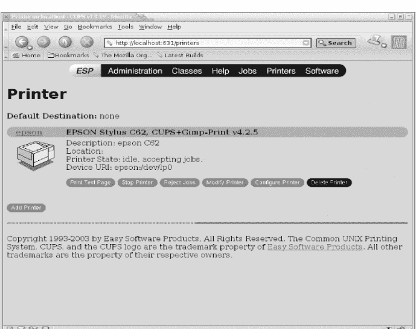

### 打印机

默认目标：

epson EPSON Status C62, CUPS-Gimp-Print v.2.5

描述 epson c62

位置：

打印机状态：空闲，正在接受作业。

设备 URI: epson:desktop/c62

版权所有1999-2002 Easy Software Products。保留所有权利。通用 UNIX 打印系统和 CUPS 标志是 Easy Software Products 的商标。所有其他商标均为其所有者的财产。

图 2. CUPS 系统管理界面

对于 CUPS 中列出的软件包，在 Debian 中，我们可以找到（但不限于）：

- `cupsys` - 通用 UNIX 打印系统 (tm) - 服务器

- `cupsys-bd` - 通用 UNIX 打印系统 (tm) - BSD 命令

- `cupsys-client` - 通用 UNIX 打印系统 (tm) - 客户端图形 (SysV)

- `cupsys-driver-gimpprint` - 用于 CUPS 的 Gimp-Print 打印机驱动

- `cupsys-pt` - 在 CUPS 下查看/管理打印作业的工具

- `cupsomatic-ppd` - linuxprinting.org 打印支持 - 转换包

- `fomatic-db` - linuxprinting.org 打印支持 - 数据库

- `fomatic-db-engine` - linuxprinting.org 打印支持 - 程序

- `fomatic-db-gimp-print` - linuxprinting - Gimp-Printer 打印机驱动数据库

- `fomatic-db-hpijs` - linuxprinting - HPIJS 打印机数据库

- `fomatic-filters` - linuxprinting.org 打印支持 - 过滤器

- `fomatic-filters-ppds` - linuxprinting.org - 预编译的 PPD 文件

- `fomatic-gui` - 用于 Fomatic 打印过滤系统的 GNOME 界面

- `gimpprint-doc` - GIMP-Print 和 CUPS 用户指南

- `gimpprint-locals` - gimp-print 的本地数据文件

- `gnome-cups-manager` - 用于 GNOME 的 CUPS 打印管理工具

- `gtkklp` - 使用 gtk 编写的 cups 前端

## 7. 磁盘管理

关于存储单元，正如我们所看到的，它们有一系列关联设备，取决于接口类型：

- IDE：设备：

  - `/dev/hda` 主磁盘，第一个 IDE 连接器；

  - `/dev/hdb` 第一个连接器的从盘，

  - `/dev/hdc` 主连接器，

  - `/dev/hdd` 从连接器。

- SCSI：`/dev/sda`, `/dev/sdb` 设备... 遵循遵循 SCSI 总线上外围设备的命名方式。


# 软盘与磁盘设备

进入 `/path/to/xxx` 目录，找到 `xxx.json`。

软盘：`/dev/fdx` 设备，`x` 为数字（从 0 开始）。根据软盘的容量有不同的设备，例如，1.44 MB 的软盘驱动器 A 将是 `/dev/fd01440`。

## 分区

关于分区，指示磁盘内分区索引的数字被视为一个独立设备：`/dev/hda1` IDE 磁盘的第一分区，或 `/dev/sdc2` 第三个 SCSI 设备的第二个分区。对于 IDE 磁盘，这些允许四个分区（称为主分区）以及较多的逻辑分区。因此，如果 `/dev/hdan` 中的 `n` 小于或等于 4，则它将是一个主分区；否则，它将是一个逻辑分区，`n` 大于或等于 5。

## 磁盘与文件系统基本操作

对于磁盘和关联的文件系统，我们可以执行的基本过程包括：

- 分区的创建或修改。通过 `fdisk` 或类似的命令（`cfdisk`, `sdisk`）。
- 格式化：软盘可以使用不同的工具：`fformat`（低级格式化）、`superformat`（以 MSDOS 格式对不同容量进行格式化）、`mformat`（特定格式标准 MSDOS 文件系统）。
- 使用 `mkfs` 命令在分区中创建 Linux 文件系统。创建各种文件系统有特定的版本：`mkfs.ext2`、`mkfs.ext3`，以及非 Linux 文件系统：`mkfs.ntfs`、`mkfs.vfat`、`mkfs.msdos`、`mkfs.minix` 或其他。对于 CD-ROM，使用诸如 `mkisofs` 的命令创建 ISO9660s（带有 joliet 或 rock ridge 扩展），这可能是一个随后可以刻录到 CD/DVD 的镜像，配合 `ecdrecord` 等命令最终允许创建/保存 CD/DVD。另一个特殊情况是 `mkswap`，它允许我们在分区中创建交换区域，随后通过 `swapon` 和 `swapoff` 激活或停用。
- 设置文件系统：`mount`、`umount` 命令。
- 状态验证：验证 Linux 文件系统的主要工具是 `fsck` 命令。它检查文件系统的不同区域以验证一致性，并检查可能的错误，并在可能的情况下纠正这些错误。当系统在启动时检测到系统未由（机器）关闭（由于断电或意外关闭机器），或者系统已启动了一定次数时，系统会自动激活该命令；这通常需要一段时间，几分钟。

增强，考虑到读写选项将分配在不同的磁盘之间。

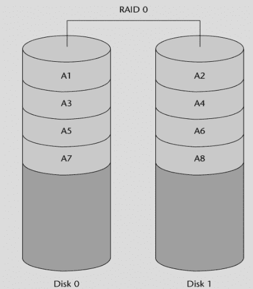

图 3

## RAID

### RAID 1

在一组两个或多个磁盘（称为 RAID 阵列）中创建一个完全相同（镜像）的。在这种情况下，它对于读取性能非常有益（性能随磁盘数量的增加而线性增长），特别是对于某个磁盘的故障具有容错能力，因为（例如，对于两个磁盘）相同的信息是可用的。`RAID 1` 通常适用于高可用性，例如我们急需资源的 24x7 环境。这种配置还允许（如果硬件支持）热插拔磁盘。如果我们检测到任何一个磁盘发生故障，我们可以在不关闭系统的情况下用另一个磁盘替换问题磁盘。

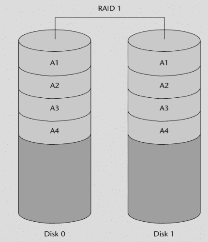

图 4

### RAID 2

在之前的系统中，数据会被分成块以便后续分发；在这里；数据被分成位，并使用冗余代码来纠正数据。尽管它可以提供很高的性能水平，但并没有广泛使用，因为理想情况下它需要大量的磁盘（每个数据位一个磁盘）以及用于计算冗余的各种磁盘（例如，在 32 位系统中，将使用多 39 块磁盘）。

### RAID 3

使用字节划分，并用一个磁盘专门用于块的校验。这目前尚未被广泛使用，因为取决于数据的大小和位置，它无法提供并发访问。`RAID 4` 类似，但它在块级上进行数据条带，而不是字节级，这意味着当只请求单个块时，也可以处理并发请求。

### RAID 5

使用块级条带，将校验分布在各个磁盘之间。它被广泛使用，由于其简单的校验方案以及由于这种计算是简单通过硬件实现的，具有良好的性能水平。

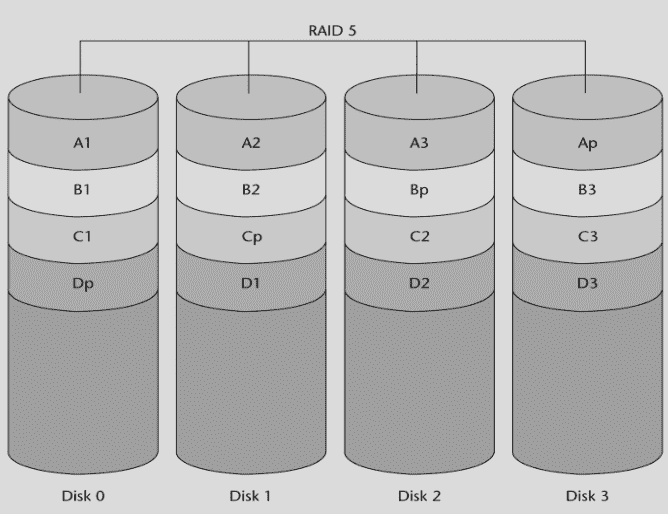

### RAID 0+1 (或 01)

镜像条带是一种嵌套的 RAID 级别；例如，实现两组 `RAID 0`，然后在 `RAID 1` 中使用它们在之间创建镜像。一个优点是，在发生错误时，可以由于另一个副本重建使用的 `RAID 0` 级，但如果需要添加更多磁盘，则必须添加到所有的 `RAID 0` 组中。

### RAID 10 (1+0)

镜像的条带化，即 `RAID 0` 下的 `RAID 1` 组。通过这种方式，在每个 `RAID 1` 组中，磁盘可能会而而导致数据丢失。当然，这意味着必须更换它们，否则组内剩余的磁盘将系统内另一个可能的错误点。这种配置通常用于高性能数据库（由于其容错能力和速度，因为它不基于校验计算）。

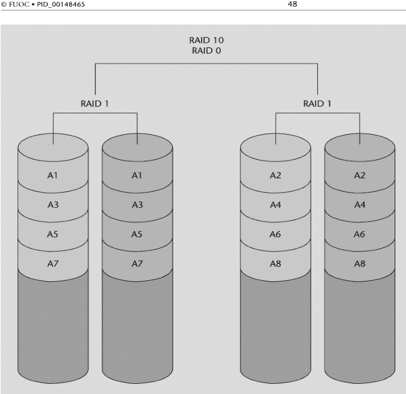

关于 `RAID 10` 通用的需要考虑的几点：

- `RAID` 提高了系统的运行时间，因为某些级别使得系统在磁盘故障时能够保持持续工作，并且取决于硬件，甚至可以在不停止系统的情况下热插拔问题硬件，这在关键系统中特别为重要。
- `RAID` 可以提高应用程序的性能，特别是在具有镜像实现的系统中，其中数据条带允许线性读取操作显著增加，因为磁盘可以提供并发读取能力，从而提高数据传输率。
- `RAID` 不保护数据；显然，它不能保护数据免受可能的故障（病毒、通用错误或自然灾害）的影响。我们必须依赖备份方案。
- 数据恢复并没有被简化。如果一个磁盘属于 `RAID` 阵列，则应该在该环境中尝试对其恢复。需要特定于硬件驱动程序的软件来访问这些数据。
- 另一方面，它通常不会提高典型用户应用程序的性能，即使是桌面应用程序也是如此，因为这些应用程序具有访问 RAM 和小型数据集的组件，这意味着它们将无法从线性读取或持续数据传输中获益。在这些环境中，性能和效率的提升几乎无法察觉。
- 信息传输没有以任何方式得到改进或促进；如果没有 `RAID`，通过简单的将磁盘从一个系统移动到另一个系统来传输数据很容易。在 `RAID` 的情况下，除非拥有相同的硬件，否则几乎不可能将一个阵列移动到另一个系统。

在 GNU/Linux 中，通过与 `RAID` 驱动程序的不同硬件或芯片组相关的各种内核模块支持 `RAID` 硬件。这允许系统从硬件机制中抽象出来，并对系统和终端用户透明。在任何情况下，这些内核模块都允许我们访问这些驱动程序的细节，并在非常底级别配置它们的参数，这在某些情况下（特别是在服务器中）

## LVM

- **物理卷 (Physical volumes, PV):** `PV` 是硬盘、分区或在系统中显示为硬盘的任何元素（例如 `RAID` 软件或硬件）。
- **逻辑卷 (Logical volumes, LV):** 这些等同于逻辑磁盘上的分区。`LV` 在系统中以原始块设备的形式可见（完全等同于物理分区），卷中可能包含文件系统（例如用户的 `/home`）。通常情况下：
- **卷组 (Volume groups, VG):** 这是上层元素。它是一个包含我们资源的管理单元，无视这些资源是逻辑卷 (`LV`) 还是物理卷 (`PV`)。可用 `PV` 上的数据以及如何使用 `PV` 形成 `LV` 都保存在该单元中。显然，为了使用卷组，我们必须有物理 `PV` 的支持，这些物理卷被组织在不同的逻辑单元中。

例如，在接下来的图中，我们可以看到卷组，其中我们有 7 个 `PV`（以磁盘分区的形式存在，它们被分组以形成两个逻辑卷（这些逻辑卷已使用 `/usr` 和 `/home` 形成了文件系统）：

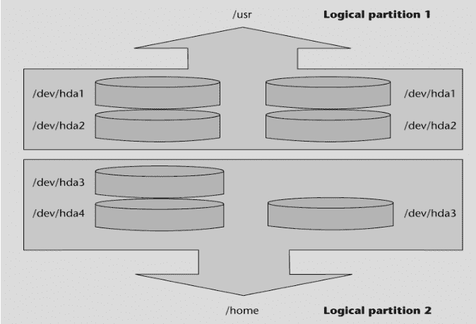

图 7. LVM 示例方案

通过使用逻辑卷，我们可以根据产生的需求更灵活地处理可用存储空间（包含许多不同的磁盘和分区），并通过更合适的标识符和允许我们调整空间以适应任何需求的操作来管理空间。

逻辑卷管理（Logical Volume Management）允许我们：

- 使用新的 `PV` 并移除某些初始可用 `PV` 来调整逻辑组和卷的大小。
- 文件系统快照（在 `LVM1` 中读取，在 `LVM2` 中读写）。这使得创建一个 `LV` 状态快照的新设备成为可能。同样，我们可以创建快照、挂载它、尝试各种操作或配置软件或其他元素，如果它们的运行不符合我们的预期，我们可以将原始卷恢复到测试时的状态。
- 逻辑卷的 `RAID 0`。

`LVM` 中没有实现 `RAID 1` 或 `RAID 5`；如果需要（换句话说，需要冗余和容错），那么我们必须使用 `RAID` 软件或 `RAID` 硬件驱动程序来实现它，并将 `LVM` 置于上层。

我们将提供一个简短的典型示例（在很多情况下，如果我们把 `LVM` 设置为初始存储系统，发行版会执行类似的过程）。基本上，我们必须：1) 创建物理卷 (`PV`)；2) 创建逻辑组 (`VG`)；以及 3) 创建逻辑卷并最后使用以下命令创建并挂载文件系统：

1) 我们在不同的磁盘上有三个分区，我们创建了三个 `PV` 并启动了内容：


```bash
# dd if=/dev/zero of=/dev/hd1 bs=1k count=1
# dd if=/dev/zero of=/dev/hd2 bs=1k count=1
# dd if=/dev/zero of=/dev/hd1 bs=1k count=1
# pvcreate /dev/sda1
Physical volume "/dev/sda1" successfully created
# pvcreate /dev/sda2
Physical volume "/dev/sda2" successfully created
# pvcreate /dev/hdb1
Physical volume "/dev/hdb1" successfully created
```

2) 从不同 PV 创建的 VG：

```bash
# vgcreate group_disks /dev/sda1 /dev/sda2 /dev/hdb1
```

Volume group "group_disks" successfully created

3) 我们根据 VG `group` 组中的元素创建 LV（在此情况下，大小为 1 GB），`-n` 表示卷的名称：

```bash
# lvcreate -L1G -n logical_volume group_disks
lvcreate -- doing automatic backup of "group_disks"
lvcreate -- "/dev/group_disks/logical_volume"
successfully created
```

最后，我们创建一个文件系统（在此情况下为 ReiserFS）：

```bash
# mkfs.reiserfs /dev/group_disks/logical_volume
```

我们可以，例如将其放置为备份空间：

```bash
# mkdir /mnt/backup
# mount -t reiserfs /dev/group_disks/logical_volume /mnt/backup
```

最后，我们将拥有作为一个逻辑卷的设备，在我们的机器上实现了一个文件系统。

## 8. 更新软件

为了管理安装或更新系统中的软件，我们首先取决于系统所使用的软件包类型：

- RPM：使用 Fedora/Red Hat 发行版（及其衍生版本）的软件包。它们通常通过 `rpm` 命令处理。包含软件对其他软件的依赖关系信息。在高级别，通过某些源自 Red Hat 的发行版的 `Yum` 或 `update`。
- DEB：Debian 软件包，通常用一组在不同层级处理单个软件包或组的工具处理。其中，我们必须提到：`dselect`、`tasksel`、`dpkg` 和 `apt-get`。
- Tar 或 tgz `tar.gz`：这些是简单的软件包文件，使用标准命令如 `tar` 和 `gzip` 进行合并和压缩的（后者用于解压缩）。

有各种工具可以管理软件，例如：

- 用于 Debian 的 `dselect`、`tasksel`、`dpkg` 和 `apt-get`。
- 用于 Red Hat 衍生版的 `Yum` 或 `update`。
- 用于 Fedora/Red Hat 的 `rpm`。
- 用于图形化的 `Synaptic`、`KDE` 以及其他工具。

取决于软件包的类型，我们可能需要使用以下以下操作：

1) 我们在不同的磁盘上有三个分区，我们创建了三个 PV 并启动了内容：

```bash
# dd if=/dev/zero of=/dev/hd1 bs=1k count=1
# dd if=/dev/zero of=/dev/hd2 bs=1k count=1
# dd if=/dev/zero of=/dev/hd1 bs=1k count=1
# pvcreate /dev/sda1
Physical volume "/dev/sda1" successfully created
# pvcreate /dev/sda2
Physical volume "/dev/sda2" successfully created
# pvcreate /dev/hdb1
Physical volume "/dev/hdb1" successfully created
```

2) 从不同 PV 创建的 VG：

```bash
# vgcreate group_disks /dev/sda1 /dev/sda2 /dev/hdb1
```

Volume group "group_disks" successfully created

3) 我们根据 VG `group` 组中的元素创建 LV（在此情况下，大小为 1 GB），`-n` 表示卷的名称：

```bash
# lvcreate -L1G -n logical_volume group_disks
lvcreate -- doing automatic backup of "group_disks"
lvcreate -- "/dev/group_disks/logical_volume"
successfully created
```

最后，我们创建一个文件系统（在此情况下为 ReiserFS）：

```bash
# mkfs.reiserfs /dev/group_disks/logical_volume
```

我们可以，例如将其放置为备份空间：

```bash
# mkdir /mnt/backup
# mount -t reiserfs /dev/group_disks/logical_volume /mnt/backup
```

最后，我们将拥有作为一个逻辑卷的设备，在我们的机器上实现了一个文件系统。

上述文件的每一行都经过了检查，以确保存在 `anac` 命令并且与每个操作相关的脚本已执行；在这种情况下，它们被保存在指定的目录中。

可能存在 `cron.allow` 或 `cron.deny` 文件，以限制谁（或谁不能）向 `cron` 添加任务。通过 `crontab` 命令，用户可以以之前看到的相同格式定义任务，这些任务通常保存在 `/var/spool/cron/crontabs` 中。某些情况下，还有一个 `/etc/cron.d` 目录，我们可以在其中放置任务，它们会被处理为对 `/etc/crontab` 文件的扩展。

## 10. 教程：不同部分的综合实践

我们将从检查系统的通用状态开始。我们将在 Debian 系统中执行不同的步骤。这是一个不稳定的 Debian 系统（不稳定版本，但更新更新）；然而，这些操作大部分可以迁移到其他发行版，例如 Fedora/Red Hat（我们将提到一些最重要的更改）。硬件由一个频率为 2.66 Gh 的 Pentium 4 处理器、768 MB RAM 以及各种磁盘、DVD 和 CD 刻录机，以及其他外设组成，我们将随着步骤进行获取这些信息。

首先，我们将看到系统上次是如何启动的：

```
uptime
17:38:22 up 2:46, 5 users, load average: 0.05, 0.03, 0.04
```

该命令告诉我们系统自启动以来已运行了 2 小时 47 分钟，在这种情况下，我们有 5 个用户。这些不一定对应五个不同的用户，但它们是打开的用户会话（例如，通过一个终端）。`who` 命令提供了这些用户的列表。平均负载是系统在过去 1、5 和 15 分钟内的平均负载。

让我们看看系统启动的 `dmesg` 命令以及系统启动时生成的行（为了清晰起见，我们删除了一些行）：


```
Linux version 2.6.20-186 (Debian 2.6.20-2) (wald@debian.org)
(gcc version 4.1.20061115 (prelease) (Debian 4.1.1-21)) #1 SMP Apr
 15 21:03:57 UTC 2007
BIOS-physical RAM map
BIOS-E820: 0000000000000000 00000000000009f8 (usable)
BIOS-E820: 0000000000009f80 0000000000000a00 (reserved)
BIOS-E820: 0000000000000ce00 0000000000000d00 (reserved)
BIOS-E820: 0000000000000c00 0000000010000000 (reserved)
BIOS-E820: 0000000000001000 000000002f6e0000 (usable)
BIOS-E820: 0000000000002fe60 000000002ff6f000 (ACPI data)
BIOS-E820: 0000000000002ff60 000000002ff70000 (ACPI NVS)
BIOS-E820: 0000000000002f70 000000002f780000 (usable)
BIOS-E820: 0000000000007f80 0000000030000300 (reserved)
BIOS-E820: 000000000000ff80 0000000000ffc0000 (reserved)
BIOS-E820: 000000000000ffffc0 0000000100000000 (reserved)
OMB HIGHMEM available.
```

759MB LOWMEM available.

这些前几行提供了有趣的数据：Linux 内核版本为 2.6.20-1-686，即 Debian 第 1 次修订的 2.6 修订 20 版本，适用于 i686 机器（英特 x86 32位）。它们还表明我们正在启动一个 Debian 系统，该系统使用 `gcc` 4.1.2 版本编译。随后是 BIOS 内存映射。

（注：由于原文中包含大量重复的 PCI 资源日志信息，译文遵循要求保留对应结构。）

例如，如果我们查看文件的最后部分（通常非常大）：

```
# tail 200 /var/log/messages
```

我们观察到与之前相同的行，以及更多信息，例如：

```
shutdown shutting down system reboot
kernel: is 4-1:USB disconnect, address 3
kernel: nfs: last server has exited
kernel: nfs: unexporting all file systems
kernel: Kernel logging (proc) stopped.
kernel: Kernel daemon terminating.

exiting on signal 15
syslogd 1.4#120: restart.

kernel: kdlog 1.4#120, log source =proc/kmsg started.
Linux version 2.6.20-26-Debian (Debian 2.6.20-26-waldd-debian.org) kernel 4.1.2
20060115 (preel221) #1 SMP Sun Apr 15 21:03:57 UTC 2007
kernel: BIOS-provided physical RAM map
```

第一部分对应于之前的系统关机，通知内核已将存储信息存放在 `/proc` 中，系统正在关闭。在新启动之初，生成日志的 Syslog 进程被激活，系统开始加载，这告诉我们内核将开始在其系统 `/proc` 中写入信息；我们使用 `dmesg` 中提到的正在加载的内核的第一行，然后通过 `dmesg` 找到我们看到的内容。

此时，另一个查找加载过程的有用命令是 `lsmod`，它会告诉我们哪些模块已加载到内核（摘要版）：

```
# lsmod
| Module | Size | Used by |
| :--- | :--- | :--- |
| nfsd | 219468 | 0 |
| nfsd | 202192 | 17 |
| exports | 5632 | 1 nfsd |
| ockld | 58216 | 3 nfs, nfsd |
| nfs_acl | 3616 | 2 nfs, nfsd |
| nsunprc | 143830 | 13 nfs, nfsd, nfs_acl |
| ppdev | 8740 | 0 |
| ip | 11044 | 0 |
| button | 7856 | 0 |
| ac | 5220 | 0 |
| battery | 79924 | 0 |
| dmd_mod | 71860 | 1 |
| dm_snapshot | 16580 | 0 |
| dm_mirror | 20340 | 0 |
| dm_mod | 52812 | 2 dm_snapshot, dm_mirror |
| i810fb | 30268 | 0 |
| vgastate | 8512 | 1 i810fb |
| eeprom | 7184 | 0 |
| thermal | 13928 | 0 |
| processor | 30536 | 1 thermal |
| fan | 4772 | 0 |
| udf | 75876 | 0 |
| ntfs | 205364 | 0 |
| usb_storage | 75552 | 0 |
| hid | 22784 | 0 |
| usbkbd | 6752 | 0 |
| eth1394 | 18468 | 0 |
| ei100 | 32648 | 0 |
| eepro100 | 32096 | 0 |
| ohci1394 | 32656 | 0 |
| ieel1394 | 89208 | 2 eth1394, ohcil1394 |
| snd_intel18x | 31420 | 1 |
| snd_ac97_codec | 89412 | 1 snd_intel18x |
| ac97_bus_pc | 2432 | 1 snd_ac97_codec |
| parport_pc | 32772 | 1 |
| snd | 48196 | 6 snd_intel18x, snd_ac97_codec, snd_pcm, snd_timer |
| ehci_hcd | 291132 | 0 |
| id_cd | 36672 | 0 |
| cdrom | 32960 | 1 ide_cd |
| soundcore | 7616 | 1 snd |
| mspspose | 35208 | 0 |
| uhci_hcd | 322160 | 0 |
| parport | 33672 | 3 ppdev, lp, parport_pc |
| intelfb | 34596 | 0 |
| zerio_new | 6724 | 0 |
| pcibp | 3264 | 0 |
| pci_hotplug | 291332 | 1 shbp |
| usbcore | 122312 | 6 dv_usb, usb_storage, usbkbd, ehci, uhci |
| intel_agp | 22748 | 1 |
| appart | 30504 | 5 i810fb, drm, intelfb, intel_agp |
| ext | 102312 | 0 |
| jbd | 55368 | 1 |
| id_disk | 15744 | 3 |
| ata_generic | 7876 | 0 |
| ata_pix | 15044 | 0 |
| libata | 100052 | 2 ata_generic, ata_piix |
| scsi_mod | 133100 | 2 usb_storage, libata |
| generic | 4932 | 0 [permanent] |
| piix | 9540 | 0 [permanent] |
| ide_core | 114728 | 5 usb_storage, ide_disk, generic, piix
```

我们基本上看到了检测到的硬件驱动程序或其他必要的依赖项。这给了我们关于内核及其模块如何加载的想法。在这个过程中，如果硬件没有正确配置，我们可能已经观察到了错误（它们不是为相应的内核编译的）。下一步是检查系统中的进程，例如 `ps` 命令（只显示系统进程，不显示其他用户），它启动了进程（或启动标识），`PID` 是系统分配的；第一个总是 0，对应于 `init` 进程；`PPID` 是当前进程的父 ID，启动时间，`TTY`（如果有的话）以及启动命令行。

```
# ps -ef
```


| UID | PID | PPID | C | TTY | TIME | CMD |
| :--- | :--- | :--- | :--- | :--- | :--- | :--- |
| root | 1 | 0 | 0 | 1452 | 00:00:00 | [2] |
| root | 3 | 0 | 0 | 1452 | 00:00:00 | [kthread/0] |
| root | 145 | 6 | 0 | 1452 | 00:00:09 | [bdflush] |
| root | 145 | 6 | 0 | 1452 | 00:00:00 | [kswapd/0] |
| root | 357 | 6 | 0 | 1452 | 00:00:01 | [kjournald] |
| root | 477 | 1 | 0 | 1452 | 00:00:00 | udevd --daemon |
| root | 719 | 6 | 0 | 1452 | 00:00:00 | [kthreadd] |

各种守护进程，如 `kswapd` 守护进程控制虚拟内存映射。系统缓冲区（`bdflush`）。文件系统日志（内核），USB 处理（`udev`）。`udev` 守护进程控制热插拔连接。通常情况下，守护进程并不总是通过 `d` 结尾标识，如果它们以 `k` 开头，则是内核的普通线程。

```
root 1652 1 0 14:52 00:00:00 - - - jf...
root 1653 1 0 14:52 00:00:00 /sbin/portmap
root 1829 1 0 14:52 00:00:00 /sbin/syslogd
root 1839 1 0 14:52 00:00:00 /sbin/klogd-x
root 1983 1 0 14:52 00:00:09 /usr/bin/cuspd
root 2178 1 0 14:53 00:00:00 /usr/bin/inetd
```


`dhclient` 表示该机器是 DHCP 服务器的客户端，用于获取其 IP：Syslog 是一个向日志发送消息的守护进程。正如我们讨论过的，`cups` 守护进程与打印系统有关。以及 `indent`，正如我们在网络章节看到的，它是一种“超级服务器”类型或其他网络服务相关守护进程的中间件。

| UID | PID | PPID | C | TTY | TIME | CMD |
| :--- | :--- | :--- | :--- | :--- | :--- | :--- |
| root | 2154 | 0 | 14:53 | 00:00:00 | `/usr/sbin/rpc_mount` |
| root | 2241 | 0 | 14:53 | 00:00:00 | `/usr/sbin/shd` |
| root | 2257 | 1 | 14:53 | 00:00:00 | `/usr/bin/xfs-daemon` |
| root | 2571 | 0 | 14:53 | 00:00:00 | `/usr/sbin/aide` |
| root | 2580 | 1 | 14:53 | 00:00:00 | `cron` |
| root | 2675 | 1 | 14:53 | 00:00:00 | `apache` |
| www-data | 2684 | 0 | 14:53 | 00:00:00 | `apache` |
| www-data | 2685 | 0 | 14:53 | 00:00:00 | `xfs` |

## 活动

1) 交换空间（swap space）使得向物理内存添加空间成为可能，从而获得更多的虚拟内存。根据物理内存和交换空间额外空间的大小，所有内存都会用尽吗？我们是否可以通过不增加更多物理内存的其他方式来解决这个问题？

2) 假设我们有一个有两个 Linux 分区的系统：一个 `/root` 分区和一个交换分区。如果用户账户占用了所有磁盘空间，我们该如何解决这种局面？如果我们有一个隔离的 `/home` 分区且它也被用尽了，我们该如何解决？

3) 安装 CUPS 打印系统，定义我们的打印机使其与 CUPS 工作，并尝试通过 Web 界面进行管理。就目前而言，是否建议以任何方式修改 CUPS 的默认设置？为什么？

4) 检查 GNU/Linux 系统用于 cron 非交互式工作的默认设置。存在哪些任务？它们是在什么时候执行的？对于必须添加的新任务有什么想法吗？

5) 在可用的机器上重现工作坊分析（以及该单元的其他部分）。我们能在所检查的系统中看到任何错误或异常情况吗？如果是，我们该如何解决它们？

# 参考文献

其他参考和信息来源

[Wn02][Frn02][Smi02] GNU/Linux 和 UNIX 管理手册，详细解释了本地管理和打印系统管理各个方面。

[Gt] 关于打印系统及其设置的更新信息，以及某些打印机的细节，可以在此处找到。关于打印机型号和驱动的具体细节，我们可以访问 `http://www.linuxprinting.org/`

[Hin][Koe] 我们可以找到关于可用不同文件系统的信息以及系统安装创建分区的方案。

# 网络管理

Remo Suppi Boldtrito

PID_00148471


# 目录

+ 引言........................................................................................................... 5
1. TCP/IP 简介 (TCP/IP 协议族)................................................................ 7
1.1. TCP/IP 上的服务...................................................................................... 7
1.2. 什么是 TCP/IP?........................................................................... 9
1.3. 物理网络设备（硬件）................................................. 10
2. TCP/IP 概念...................................................................... 13
3. 如何分配 Internet 地址............................................................... 16
4. 如何配置网络....................................................................... 20
4.1. 网络接口适配器 (NIC) 的配置....................... 20
4.1.1. Fedora 风格的网络配置..................................... 22
4.1.2. Wi-Fi（无线）网络配置.................................. 23
4.2. 名称解析器配置............................................................... 25
4.3. 路由配置...................................................................... 27
4.4. inet 配置...................................................................... 28
4.5. 额外配置：协议和网络.............................. 31
4.6. 安全方面............................................................................. 33
4.7. IP 选项...................................................................................... 33
4.7.1. 解决网络问题的命令 ............... 33
5. DHCP 配置............................................................................... 35
6. IP 别名........................................................................... 37
7. IP 伪装 (IP Masquerade)....................................................................... 38
8. 使用内核 2.2 或更高版本的 NAT............................................... 39
9. 如何配置拨号和 PPP 连接....................................... 40
10. 通过热插拔配置网络................................................. 43
11. 虚拟专用网络 (VPN)........................................................ 45
11.1. 示例...................................................... 45
12. 高级配置和工具....................................................... 48
活动.................................................................................................. 55

# 附录 控制与 FC6 网络相关的服务.......... 56

# 引言

UNIX (GNU/Linux) 被用标准通信架构的示例。从神话般的 UUCP（Unix 到 Unix 拷贝或用于 UNIX 操作系统之间拷贝的服务）到现在的网络，UNIX 一直证明了其在通信和信息交换方面的多功能性。随着计算机网络（局域网、广域网或最新的城域网）的引入，提供了不同速度（从 56bits/sec 到 1 Gbit/sec）的多点连接，基于更快协议、可在不同计算机间迁移且适应性更好的新服务，例如 TCP/IP（传输控制协议/网协议），应运生。[Com01, Mal96, Gar98, KD00]

# 1. TCP/IP 简介 (TCP/IP 协议族)

TCP/IP 协议综合了通信意愿以及在全球范围内标准化通信的示例。

> TCP/IP 实际上是一组添加到原始协议中的基本协议，用以满足 [Com01, Mal96, Gar98, KD00] 的需求。

TCP/IP 实际上是一组添加到原始协议中的基本协议，用以满足 [Com01, Mal96, Gar98, KD00] 的需求。

## 1.1. TCP/IP 上的服务

TCP/IP 协议综合了通信意愿以及在全球范围内标准化通信的示例。

- 文件传输协议 (FTP)：允许在计算机之间传输文件。
- 网络文件系统 (NFS)：允许远程系统访问文件，就像它们是本地设备一样。
- 安全外壳 (SSH)：通过安全网络操作操作系统服务的安全方式。
- 用户数据报协议 (UDP)：用于无连接的数据传输。
- 互联网控制消息协议 (ICMP)：用于网络诊断和错误报告。
- 地址解析协议 (ARP)：将 IP 地址映射到物理 MAC 地址。
- 超文本传输协议 (HTTP)：用于访问互联网上的网页。
- 传输控制协议 (TCP)：提供可靠的、面向连接的数据传输。
- 网协议 (IP)：处理跨网络的数据包路由和路由。

- 终端服务器：将终端连接到服务器，通过该服务器执行 telnet 以便连接到中央计算机。这类设置基本上对于降低成本和改进与中央计算机的连接（某些情况下）非常有用。

- 图形终端服务器（面向网络的窗口系统）：这些系统允许在连接到另一台计算机的显示器上可视化图形信息。这些系统中最常见的是 X Windows。

## 1.2 什么是 TCP/IP？

TCP/IP 实际上是计算机之间两种相互独立的通信协议。

> 另一方面，TCP（传输控制控制协议）定义了通信规则，使得（主机）计算机可以与另一台计算机通信（如果我们以 OSI/ISO 通信模型作为参考，它描述的是第 4 层，见下表）。

TCP 是一种面向连接的协议，换句话说，它等于电话，通信被视为数据流。

> IP（互联网协议）定义了识别网络并在不同计算机之间建立路径的协议。

换句话说，它通过网络在两台计算机之间路由数据。它连接到 OSI/ISO 模型的第 3 层，并且是一种无连接协议（见下表）。[Com01, Rid90, Dra99]

TCP 的替代方案是 UDP 协议（用户数据报协议），它将数据视为消息（数据报）并发送数据。它是一种无连接协议（当另一台计算机与其建立通信时，接收计算机并不一定处于监听状态），它的优点是比 TCP 连接产生的网络负载更小，但可靠性较低（数据包可能到达或重复）。

另一种协议是 ICMP（互联网控制消息协议）。ICMP 用于错误或控制消息。例如，如果尝试连接到主机，本地计算机可能会接收到一条指示“主机不可达”的 ICMP 消息。ICMP 也可用于提取网络上的信息。ICMP 与 UDP 相似之处在于它处理消息（数据报，

这里有三种连接方法，取决于互连的类型：厚线、细线和双绞。

前两种已经过时（使用同轴电缆），而最后一种是通过电话使用的双绞线和连接器（称为 RJ45）。双绞连接被称为 100BaseT 或 100BaseT（根据速度而定），并重复被称为集线器（hubs）的互连点。以太网使用中间通信元件（集线器、交换机、路由器）来配置网络的多个段并划分流量以提高数据传输性能。通常，在大型组织中，这些以太网局域网通过光纤使用 FDDI（光纤分发区域）技术互连，这种技术更贵且安装更困难，但我们可以从中获得等同于以太网的传输速度，且没有以太网涉及的 200 公里距离限制。当它们用于建筑或其他非常拥挤的网络段之间时，这些成本是合理的。

同时，还有其他不常见但同样很有趣的硬件类型，例如 ATM（异步传输模式）。这种硬件允许我们建立具有高水平服务质量的局域网，当我们必须建立高速和低延迟的网络（例如需要实时视频流的网络）时，它是一个很好的选择。

GNU/Relay 还支持其他用于计算机连接的硬件，我们可以提到：帧中继（Frame Relay）或 X.25（用于访问或互连广域网，以及具有大数据需求的服务器）、数据包无线电（通过 AX.25、NetRom 或 Rose 等协议通过无线电进行互连）或使用串口的拨号设备（串口很慢但非常便宜），这些是通常在国内或中小企业中使用的，并且需要另一种协议来传输数据包，如 SLIP 或 PPP。为了在网络上实践各种硬件，TCP/IP 定义了一个抽象接口，所有数据包都将由相关的物理设备（包括网络或网络段）发送。因此，机器中的每个通信设备在操作系统内核中都将有一个相应的接口。

# 示例

在 GNU/Linux 中，以太网被命名为 `ethx`（其中 'x' 表示从 0 开始的序号），串口（调制解调器）的接口称为 `pppx`（PPP）或 `slx`（用于 SLIP）；`fdxis` 用于 FDDI。这些名称被命令用于配置它们并分配标识，该标识随后将允许它们与网络中的其他设备通信。

在 GNU/Linux 中，这可能意味着我们必须在内核或作为模块为适当设备（NIC 网卡）包含适当模块，这意味着在选择适当 NIC 后（例如使用 `make menuconfig` 命令）编译内核，将其标记为内部或作为模块（如果是后者，则必须编译相应的模块）。

网络设备可以在 `/dev` 目录中看到，那里有一个文件（特殊文件，根据传输方式，可能是块文件或字符文件）代表每个硬件设备。[KD00, Dra99]。

> 注意
我们如何查看可用的网络接口？

此命令显示每个接口的所有默认接口/参数。

## 2. TCP/IP 概念

正如我们所讨论过的，通信涉及一系列我们现在将讨论的概念 [MalWi96, Com01]：

- **互联网/内域网：** 内域网是指在组织内部应用互联网技术（网络中的网络），基本上用于发布公司信息。例如，内域网（Int）和服务包括 WWW、新闻。

- **节点：** 节点指的是连接到网络的机器（从广义上说，节点可以是计算机、打印机、CD）；网络中需要或提供服务的活动元素。

- **以太网网络地址（以太网地址或 MAC 地址）：** 一个 48 位数字（例如 00:88:40:73:AB:FF），位于以太网驱动程序（NIC）的物理设备内部，由制造商记录（全球唯一，每个 NIC 都有预分配范围）。

- **主机名：** 每个节点必须有一个唯一的名称。机器的名字。节点的名称必须唯一，这在小型网络中很容易，在大型网络中较复杂，在互联网上除非实施某种形式的控制。名称最多为 32 个字符，范围在 a-z、A-Z 和 0-9 之间，且不能包含空格或特殊字符 #。

- **互联网地址：** 这由四个 0-255 范围内的数字组成，用点隔开（例如 192.168.0.1），用于识别网络或互联网上的计算机。名称通过 DNS（域名系统）服务器转换为 IP 地址（此服务由一个名为 `named` 的应用程序执行）。

- **端口：** 节点中信箱的数值标识符，允许特定应用程序读取消息（TCP、UDP）（例如，两台通过 telnet 通信的机器将通过端口 23，但如果它们有 FTP 事务将通过端口 21）。它们可以是不同的-

| 注意 |
| 机器名：`more /etc/hostname` |

| 注意 |
| IP 地址：`more /etc/hosts` |

| 注意 |
| UNIX 中预定义的端口：`more /etc/services`
 此命令显示支持 TCP 或 UDP 通信的预定义端口。 |

| 注意 |
| 路由配置的可视化：
 `netstat -r` |

通过各种不同端口在两个节点之间进行通信的含义。

- **路由器节点（网关）**：它是执行路由（数据传输）的节点。路由器根据其特性，可以在两个相似或不同的网络协议之间传输信息，并可能具有选择性。

- **域名系统 (DNS)**：它确保了名称的唯一性，并对执行名称与互联网地址之间转换的数据库进行管理，这些数据库是以树形结构构建的。为了实现这一点，域名通过点分隔——其中最高层级（从右到左）描述类别、机构或国家（例如，COM 代表商业，EDU 代表教育，GO 代表政府，MIL 代表军事（政府），ORG 代表非营利组织，XX 可以是任何两个国家字母，或特殊情况，如 CAT 表示加泰罗尼亚语言和文化等）。第二级代表机构，剩余部分表示机构内的部门、科或小组（例如，www.uoc 或 teu@pirolu.remix.es）。前两个（从右到左，第一种情况为 uoc，第二种情况为 remix.es）必须由 SRI-NIC（管理互联网域名注册的全球组织）分配（批准），其余部分可由机构配置/分配。

- **DHCP 引导 (bootstrap)**：DHCP 和 bootstrap 是允许客户端节点获取网络信息（如节点的 IP 地址）的协议。许多拥有大量机器的组织使用这种机制来便于大型网络或存在漫游用户网络的管理。

- **ARP, RARP**：在某些网络（如 IEEE 802 LAN，即以太网标准）中，IP 地址是通过互联网协议族中的另外两种协议动态发现的：地址解析协议 (ARP) 和反向地址解析协议 (RARP)。ARP 使用广播消息来确定以太网地址（OSI 模型第三层的 MAC 规范），它对应于特定的网络层地址（IP）。RARP 使用广播消息（到达所有节点）来确定与特定硬件地址相关的网络层地址。RARP 对于那些在启动时通常未知网络层地址的节点尤为重要。

- **Socket 库**：在 UNIX 中，所有的 TCP/IP 实现都是操作系统内核的一部分（要么在同一个内核中，要么作为启动时加载的模块，如设备驱动程序（GNU/Linux）所示）。

对于程序员使用它们的方法是通过 API（应用程序编程接口），该接口实现了此源代码接口。对于 TCP/IP，最常用的 API 是伯克利 Socket 库（Windows 使用名为 Winsock 的对应库）。该库使得创建通信端点（socket）、将其与远程节点和端口关联（例如使用 `bind`, `recv`, `recvfrom`）成为可能。该库还提供了一种更通用的通信服务（通过 `connect`, `listen`, `accept`, `send`），进程在同一台机器内部通信（AF UNIX family）。在 GNU/Linux 中，socket 库是 C 标准库 Libc 的一部分（当前版本为 Libc），并支持 AF_INET、AF_UNIX、AF_IPX（用于 Novell 协议）、AF_X25（用于 X.25 协议）、AF_ATMSVC（用于 ATM 协议）以及 AF_AX25、F_NETROM、AF_ROSE（用于业余无线电协议）。

## 3. 如何分配互联网地址

该地址分配给网卡（NIC），它包含两个部分。左侧代表网络标识，右侧代表节点标识。考虑到上述点（0-255 之间的四个数字，或 32 位，或 4 个字节），每个字节代表网络或节点。网卡分配网络部分，而机构（或服务商）分配节点部分。

存在一些限制：网络空间中的 0（例如 0.0.0.0）保留用于路由，默认的 127（例如 127.0.0.1）保留用于（本地回环或主机），节点部分中的 0 指代此网络（例如 192.168.0.0），255 保留用于向所有（广播）机器发送数据包（例如 191.162.255.255）。在不同的分配中可能有不同类型的网络或地址：

- A 类（network.host.host）：0.0.0.0 到 126.254.254.254（1.26 亿节点）定义了大型网络。二进制标准为：0 + 7 位网络位 + 24 位

- B 类（network.network.host）：128.0.0.1 到 191.255.255.254（1.6 万个网络，6.5 万个节点）；（通常，第一个字节用于识别机构内部的子网）。二进制标准为 10 + 14 位网络位 + 16 位节点位

- C 类（net.network.host）：192.1.1.1 到 223.255.255.254（200 万个网络，254 个节点）。二进制标准为 110 + 21 位网络位 + 8 位节点位。

- D 类和 E 类（network.network.network.host）：224.1.1.1 到 255.255.255.254 保留用于组播和实验目的。

某些地址用于特定用途：例如，127.0.0.1 保留用于本地回环或主机。0.0.0.0 保留用于路由。节点部分中的 0 指代网络本身（例如 192.168.0.0），255 保留用于向所有机器广播（例如 191.162.255.255）。

子网的范围由子网掩码决定。要获取子网地址，我们对 IP 地址和子网掩码进行逻辑与位运算。要获取主机地址，我们从 IP 地址中减去子网地址。

子网中的可用主机数量计算公式为 $2^n - 2$，其中 $n$ 是掩码中的主机位数。减去“2”是为了考虑到网络地址和广播地址。

当购买区域（purchases area）机器之间发送消息时，不需要离开网关，因为 TCP/IP 会直接找到该机器。当 Purchases 想要向 HumanResources3 发送消息时，问题就出现了。消息必须通过各自的两个网关。当 Purchases0 “看到” HumanResources3 在另一个网络时，它会将数据包通过 PurchasesGW 网关发送，然后由网关将其发送到 HumanResources3。使用子网的优势是显而易见的，例如，它不会影响所有购买机器之间的流量，尽管客户端或人力资源部门（尽管这在设计和构建网络方面更为复杂且昂贵）。

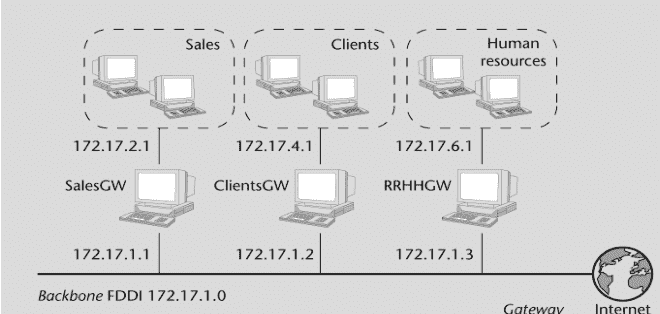

图 1. 内网中段和网关的配置

IP 使用表格在不同网络之间路由数据包，其中包含与网络 0.0.0.0 关联的默认路由。所有地址与此一致，32 位中的其中位是必须的；它们通过默认网关发送到指定的网络。在 purchasesGW 中，表格将是：

| 地址 | 掩码 | 网关 | 接口 |
| --- | --- | --- | --- |
| 172.17.1.0 | 255.255.255.0 | | fdd0 |
| 172.17.4.0 | 255.255.255.0 | 172.17.1.2 | fdd0 |
| 172.17.6.0 | 255.255.255.0 | 172.17.1.3 | fdd0 |
| 0.0.0.0 | 0.0.0.0 | 172.17.2.1 | fdd0 |
| 172.17.2.0 | 255.255.255.0 | | eth0 |

'-' 表示机器是直接连接的，不需要路由。识别是否需要路由的过程包括执行两个非常简单的逻辑与操作（子网与掩码的与运算，以及源地址与掩码的与运算）并比较结果。如果它们匹配，则不需要路由，但每台机器都必须定义一个网关机器，以便该机器能够路由消息。

例如，从 172.17.2.4 到 172.17.2.6 的消息将：


172.17.2.4 AND 255.255.255.0 = 172.17.2.0

172.17.2.6 AND 255.255.255.0 = 172.17.2.0

由于结果相同，因此不需要路由。相反，如果我们从 172.17.2.4 到 172.17.6.6 执行相同操作，我们将看到通过 172.17.2.1 进行路由，并发生接口切换（`eth0` 切换到 `fdd0`）到达 172.17.1.1，然后从这里 172.17.1.2 再次发生接口切换（`fdd0` 切换到 `eth0`）到达 172.17.6.6。当没有任何规则匹配时，将使用默认路由。如果两条规则都匹配，将使用匹配最精确的路由（换句话说，就是零最少的）。为了构建路由表，我们可以在机器设置期间使用 `route` 命令；然而，如果需要使用更复杂的规则（自动路由），我们可以使用路由信息协议 (RIP) 命令，或者在独立系统之间使用外部网关协议 (EGP) 或边界网关协议 (BGP) 命令。这些协议通过 `gated` 命令实现。

为了在现有网络上安装机器，需要从网络提供商或管理员处获取信息：节点 IP 地址、网络 IP 地址、广播地址、子网掩码地址、路由器地址和 DNS 地址。

如果我们设置一个永远不会连接互联网的网络，我们可以选择任何的地址，但建议保持与所需网络大小相应的适当顺序，以避免该网络内部出现管理问题。我们现在知道如何定义私有网络的网络和节点了（我们必须小心，因为如果机器连接到网络，我们可能会给已分配该地址的用户带来不便）：节点地址 192.168.110.23，掩码 255.255.255.0，不是地址 192.168.110.0；节点部分 .23，网络地址 192.168.110.0，广播地址 192.168.110.255。

## 4. 如何配置网络

### 4.1. 网络接口适配器 (NIC) 配置

一旦 GNU/Linux 内核加载，它会执行 `init` 命令，该命令反过来读取配置文件 `/etc/init.ab` 并开始启动过程。通常，initab 包含如 `/etc/init.d/network` 之类的条目，它启动网络服务。在 Debian 中，配置位于 `/etc/network/interfaces`。

为了配置网络，我们可以使用以下命令：

- `ifup`: 启动网络接口
- `ifdown`: 停止网络接口
- `ifconfig`: 手动配置接口参数

例如，配置静态 IP 地址：

```
eth0 inet static

address 192.168.110.23

netmask 255.255.255.0

gateway 192.168.110.1
```

如果我们想通过 DHCP 自动获取 IP 地址，我们使用：

```
eth0 inet dhcp
```

配置接口后，我们可以使用 `ping` 命令测试连通性：

```
ping 192.168.110.1
```

#### 4.1.1. Fedora 风格的网络配置

Red Hat 和 Fedora 使用不同的网络配置结构：`/etc/sysconfig/network`。例如，配置静态网络：

| 键名 | 描述 |
| :--- | :--- |
| NETWORKING=yes | 由 `cmd hostname` 定义的主机名 |
| HOSTNAME=my-hostname | 对于 NAT 防火墙网关和路由器为真 |
| FORWARD_IPV4=true | 其他任何情况为假 |
| GATEWAY="XXX,XXX,XXX.YYY" | 指向互联网的网关 |

要配置 DHCP，必须删除 `GATEWAY` 行，因为它将由服务器分配。如果要整合 NIS，必须有一行包含服务器域名的行：`NISDOMAIN=NISProject1`

配置接口 `eth0`：

```
/etc/sysconfig/network-scripts/ifcfg-eth0:

DEVICE=eth0

BOOTPROTO=static

BROADCAST=XXX.XXX.XXX.255

IPADDR=XXX.XXX.XXX.XXX

NETMASK=255.255.255.0

NETWORK=XXX.XXX.XXX.0

ONBOOT=yes 启动时激活网络。
```

从 FC3 开始，还可以添加：
`TYPE=Ethernet`
`HWADDR=XX:XX:XX:XX:XX:XX`
`GATEWAY=XXX.XXX.XXX`
`IPV6INIT=no`
`USERCTL=no`
`PEERDNS=yes`

或者，使用 DHCP 配置：

```
DEVICE=eth0

ONBOOT=yes

BOOTPROTO=dhcp
```

要禁用 DHCP，将 `BOOTPROTO=dhcp` 更改为 `BOOTPROTO=none`。这些文件中的任何更改都必须通过 `service network restart`（或 `/etc/init.d/network restart`）重启服务来实现。

更改主机名必须采取以下三个步骤：

1) 执行命令 `hostname new-name`。
2) 在 `/etc/sysconfig/network` 中修改网络配置，编辑 `HOSTNAME=new-name`。
3) 恢复所有服务（或重启）：
    - `service network restart`（或执行 `/etc/init.d/network restart`）
    - 通过在控制台模式粘贴 `init 3` 并切换到 GUI 模式 `init 5` 来重启桌面。

验证名称是否未在 `/etc/hosts` 中注册。主机名可以在执行期间通过 `sysctl -w kernel.hostname="newname"` 进行更改。

#### 4.1.2. Wi-Fi（无线）网络配置

为了配置 Wi-Fi 接口，我们基本上使用 `wireless-tools` 软件包（以及 `ifconfig` 或 `ip2`）。该包使用 `iwconfig` 命令来配置无线接口，但也可以在 `/etc/network/interfaces` 中进行。

示例：在 Debian (Etch) 中配置 WiFi（与 FC6 类似）

假设我们正在使用 Intel/Wireless2200b 网卡（许多笔记本电脑中都有此型号，如 Dell、HP...）。控制网卡的软件分为两部分：通过 `modprobe` 命令加载到内核中的软件模块，以及加载到网卡中并可由制造商更新的固件（请参阅该型号的网站）。由于我们讨论的是模块，因此使用 Debian 模块化包很重要，它允许我们轻松地创建和安装模块（另一个选项是安装相应的模块）。我们可以创建并安装软件（可以在制造商网站上找到），并使用 `module-assistant` 包中的 `mod` 命令调用它。

```
apt-get install module-assistant (安装软件包)

mod -a -f get ipw200

mod -a -t - ipw200

mod -a -t install ipw200
```

我们可以从制造商提供的网站（在产品文档中）下载固件版本以及我们需要的驱动程序，在我们的案例中将是驱动版本 1.8 和固件版本 2.0.4，从以下地址获取：

`http://ipw2000.sourceforge.net/firmware.php`

然后我们应该压缩并安装固件：

此复制将创建三个包（`ipw2200-bsf`、`ipw2200-ibs` 和 `ipw2200-sniffer-fw`）。通过 `modprobe ipw2200` 加载模块，系统重启，然后从控制台执行 `dmesg | grep ipw` 命令，这将显示与下面类似的行，指示模块正在加载（可以使用 `lsmod` 检查）。

```
ipw2200: Intel(R) PRO/Wireless 2200/2915 Network Driver, gti.0.8

ipw2200: Detected Intel PRO/Wireless 2200BG Network Connection
```

然后我们应该下载包含 `iwconfig` 的无线工具包以通过 `apt` 安装无线工具以及许多其他工具，如果我们执行 `iwconfig`，将出现类似以下的内容：

```
ethl1 IEEE 802.11 SSID:"Name-of-the-Wifi"

Managed Frequency:2.437 GHz

Access Point:00:0E:3E:34:C8:72

Bit Rate=11 Mb/s TxPower=20 dB

Security mode:open
```

我们必须配置网络文件，例如 `gedit /etc/network/interfaces`，并带有 eth1 接口，例如：

```
iface eth1 inet dhcp

pre-up iwconfig eth "Name of the Wifi"
```


`pre-up` 行在激活接口之前执行 `iwconfig` 命令。这用于我们希望在 DHCP 模式（自动分配 IP，如我们所示）下使用该服务。事实上，应该使用静态方法并输入以下行（如文件所示）：

```
address 192.168.1.2

netmask 255.255.255.0

network 192.168.0.0

broadcast 192.168.0.255

gateway 192.168.1.1
```

配置接口的另一种方法是：

```
iface eth1 inet dhcp

wireless-ssid "Name of the Wifi"

wireless-key XXXXX
```

我们可以通过 `ifconfig` 启动网络并获得有关连接和接收状态的信息。为了扫描可用网络，我们可以使用 `iwlist scan`，它将显示信息，如果我们想连接到不同的网络，可以使用 `iwconfig` 命令更改网络或接入点（Access Point）。

## 4.2. 名称解析器配置

下一步是名称解析器配置。

## 4.3. 路由配置

另一个必须配置的方面是路由。虽然这个过程被认为是复杂的，但通常情况下，路由需求非常简单。在具有多个连接的节点中，路由由决定将数据发送到哪里以及接收什么。简单的节点（单个网络连接）也需要路由，因为所有节点都有一个回环接口（loopback）和一个网络连接（例如，以太网、PPP、SLIP等）。正如我们所解释的那样，有一张名为路由的表包含各种字段，其中三个尤为重要：目的地址、发送消息的接口以及在网关中执行下一步操作的 IP 地址。

> 注意
> 查路由表：
> `route -n`
> 还有 `netstat -r`

`route` 命令用于修改此表以执行适当的路由任务。当消息到达时，将检查目的地址，将其与表中的条目进行比较，并通过与数据包目标地址最相似的接口发送。如果指定了网关，它将发送到相应的接口。

让我们假设，例如我们的节点位于地址为 192.168.110.0 的 C 网络中，地址为 192.168.110.23；而连接到互联网的路由器是 192。配置将是：

- 首先，接口：
`ifconfig eth0 192.168.110.23 netmask 255.255.255.0 up`

- 随后，指定所有发往 192.168.0.* 地址节点的数据包必须发送到该网络设备：
`route add -net 192.168.0.0 netmask 255.255.255.0 eth0`

`-net` 表示这是一个网络路由 - `-host 192.168.110.3` 也可以使用。此配置将允许它连接到网段 (192.1) 内内的所有节点，但如果我们想连接到该网段之外的另一个节点会发生什么呢？要为想要连接的所有机器都准备所有适当的条目将非常困难。为了简化这项任务，我们有了默认路由，它在目的地址不与表中的任何条目匹配时使用。

```
route add default gw 192.168.110.3 eth0
```

`gw` 是网关或路由器节点的 IP 或名称。

此另一种方法是：

```
ifconfig eth0 inet down disable the interface

ifconfig lo

  Link encap:Local Loopback

  ... (不会出现 eth0 的条目)

route

  ... (路由表中不会出现条目)
```

随后，使用另一个 IP 和新路由启用接口：
```
ifconfig eth0 up 192.168.0.111 \
  netmask 255.255.255.0 broadcast 192.168.255.255
route -net 10.0.0.0 netmask 255.255.255.0 \
  gw 192.168.0.1 dev eth0
```

竖线 (`|`) 表示命令在下一行继续。

```
ifconfig

eth0 Link encap:Ethernet Haddr 08:00:46:7A:02:B0

  inet addr:192.168.0.111 Bcast:192.168.255.255 Mask:255.255.255.0

  UP BROADCAST RUNNING MULTICAST MTU:1500 Metric:1

nlo Link encap:Local Loopback

  ...

  inet addr:127.0.0.1 Mask:255.0.0.0
route

Kernel IP routing table

| Destination | Gateway | Genmask | Flags | Metric | Ref | Iface |

| :--- | :--- | :--- | :--- | :--- | :--- | :--- |

| 192.168.0.0 | * | 255.255.0.0 | U | 0 | 0 | eth0 |

| 10.0.0.0 | 192.168.0.1 | 255.0.0.0 | UG | 0 | 0 | eth0 |
```

更多信息，请参见阅 `ifconfig (8)` 和 `route (8)`。

## 4.4. inetd 配置

网络配置的下一步是配置允许其他用户访问本地机器或其服务的服务器和服务。服务器程序将使用端口监听来自客户端的请求，这些请求将以 IP:端口 的形式发送到该服务。服务器可以通过两种方式工作：独立模式（服务监听端口并始终处于状态）或通过 `inetd`。

`inetd` 是一个服务器，用于控制和管理 `/etc/inetd.conf` 文件中指定的服务的网络连接，当请求启动时，它会启动相应的服务器并传输请求。

必须配置重要文件：`/etc/services` 和 `/etc/inetd.conf`。在第一个文件中，我们将服务、端口和协议关联；在第二个文件中，我们指定响应确定端口请求的服务器。`/etc/services` 的格式为 `name/protocol alias`，其中第一个字段是服务名，第二个字段是服务监听的端口和它使用的协议，下一个字段是别名。有一系列预配置的服务。我们现在将展示一个 `/etc/services` 的示例（`#` 表示后面是注释）：

| name/protocol | service |
| :--- | :--- |
| echo | 7/tcp | TCP multiplexer |
| echo | 7/udp | |
| discard | 9/tcp | sink |
| discard | 9/udp | sink null |
| systat | 13/tcp | users |
| ftp | 21/tcp | |
| ssh | 22/tcp | SSH Login Protocol |
| ssh | 22/udp | SSH Login Protocol |
| telnet | 23/tcp | |
| # 24/tcp | private |
| smtp | 25/tcp | mail |

`/etc/inetd.conf` 文件是主服务（inetd 守护进程）的配置。每行包含七个由空格分隔的字段：`service_type proto flags server_path server_args`，其中 `service` 是 `/etc/services` 中第一行描述的服务，`service_type` 是 socket 类型（可能的值为 stream, udp, 或 sock），`proto` 是有效的协议（必须与 `/etc/services` 中的内容匹配），`flags` 表示当有新连接时要采取的行动（`wait` 表示 inetd 启动一个新服务器，`nowait` 表示 inetd 必须启动一个新服务器），`user` 是标识客户端的本地用户，`server_path` 是服务器所在的目录，`server_args` 是将传递给服务器的可能参数。`/etc/inetd.conf` 行的示例（`#` 是注释，所以如果服务在名称前有 #，则意味着它是不可用的）：

```
telnet stream nowait /usr/sbin/tcpd /usr/sbin/in.telnet

ftp stream nowait /usr/sbin/tcpd /usr/sbin/in.ftp

shell stream nowait /usr/sbin/tcpd /usr/sbin/in.shell

login stream nowait /usr/sbin/tcpd /usr/sbin/in.login

exec stream nowait /usr/sbin/tcpd /usr/sbin/in.exec
```


`inetd` 是一个服务器，用于控制和管理 `/etc/inetd.conf` 文件中指定的服务的网络连接，当请求启动时，它会启动相应的服务器并传输请求。

虽然这个过程被认为是复杂的，但通常情况下，路由需求非常简单。在具有多个连接的节点中，路由由决定将数据发送到哪里以及接收什么。简单的节点（单个网络连接）也需要路由，因为所有节点都有一个回环接口（`loopback`）和一个网络连接（例如，以太网、PPP、SLIP等）。正如我们所解释的那样，有一张名为路由的表包含各种字段，其中三个尤为重要：目的地址、发送消息的接口以及在网关中执行下一步操作的 IP 地址。

`route` 命令用于修改此表以执行适当的路由任务。当消息到达时，将检查目的地址，将其与表中的条目进行比较，并通过与数据包目标地址最相似的接口发送。如果指定了网关，它将发送到相应的接口。

让我们假设，例如我们的节点位于地址为 `192.168.110.0` 的 C 网络中，地址为 `192.168.110.23`；而连接到互联网的路由器是 `192`。配置将是：

- 首先，接口：
```
ifconfig eth0 192.168.110.23 netmask 255.255.255.0 up
```

- 随后，指定所有发往 `192.168.0.*` 地址节点的数据包必须发送到该网络设备：
```
route add -net 192.168.0.0 netmask 255.255.255.0 eth0
```

`-net` 表示这是一个网络路由 - `-host 192.168.110.3` 也可以使用。此配置将允许它连接到网段 (`192.1`) 内内的所有节点，但如果我们想连接到该网段之外的另一个节点会发生什么呢？要为想要连接的所有机器都准备所有适当的条目将非常困难。为了简化这项任务，我们有了默认路由，它在目的地址不与表中的任何条目匹配时使用。

```
route add default gw 192.168.110.3 eth0
```

`gw` 是网关或路由器节点的 IP 或名称。

此另一种方法是：

```
ifconfig eth0 inet down disable the interface

ifconfig lo

  Link encap:Local Loopback

  ... (不会出现 eth0 的条目)

route

  ... (路由表中不会出现条目)
```

随后，使用另一个 IP 和新路由启用接口：
```
ifconfig eth0 up 192.168.0.111 \
  netmask 255.255.255.0 broadcast 192.168.255.255

route -net 10.0.0.0 netmask 255.255.255.0 \
  gw 192.168.0.1 dev eth0
```

竖线 (`|`) 表示命令在下一行继续。

```
ifconfig

eth0 Link encap:Ethernet Haddr 08:00:46:7A:02:B0

  inet addr:192.168.0.111 Bcast:192.168.255.255 Mask:255.255.255.0

  UP BROADCAST RUNNING MULTICAST MTU:1500 Metric:1

nlo Link encap:Local Loopback

  ...

  inet addr:127.0.0.1 Mask:255.0.0.0

route

Kernel IP routing table

| Destination | Gateway | Genmask | Flags | Metric | Ref | Iface |

| :--- | :--- | :--- | :--- | :--- | :--- | :--- |

| 192.168.0.0 | * | 255.255.0.0 | U | 0 | 0 | eth0 |

| 10.0.0.0 | 192.168.0.1 | 255.0.0.0 | UG | 0 | 0 | eth0 |
```

更多信息，请参见阅 `ifconfig (8)` 和 `route (8)`。

## 4.4. inetd 配置

网络配置的下一步是配置允许其他用户访问本地机器或其服务的服务器和服务。服务器程序将使用端口监听来自客户端的请求，这些请求将以 `IP:端口` 的形式发送到该服务。服务器可以通过两种方式工作：独立模式（服务监听端口并始终处于状态）或通过 `inetd`。

`inetd` 是一个服务器，用于控制和管理 `/etc/inetd.conf` 文件中指定的服务的网络连接，当请求启动时，它会启动相应的服务器并传输请求。

必须配置重要文件：`/etc/services` 和 `/etc/inetd.conf`。在第一个文件中，我们将服务、端口和协议关联；在第二个文件中，我们指定响应确定端口请求的服务器。`/etc/services` 的格式为 `name/protocol alias`，其中第一个字段是服务名，第二个字段是服务监听的端口和它使用的协议，下一个字段是别名。有一系列预配置的服务。我们现在将展示一个 `/etc/services` 的示例（`#` 表示后面是注释）：

| name/protocol | service |
| :--- | :--- |
| echo | 7/tcp | TCP multiplexer |
| echo | 7/udp | |
| discard | 9/tcp | sink |
| discard | 9/udp | sink null |
| systat | 13/tcp | users |
| ftp | 21/tcp | |
| ssh | 22/tcp | SSH Login Protocol |
| ssh | 22/udp | SSH Login Protocol |
| telnet | 23/tcp | |
| # 24/tcp | private |
| smtp | 25/tcp | mail |

`/etc/inetd.conf` 文件是主服务（`inetd` 守护进程）的配置。每行包含七个由空格分隔的字段：`service_type proto flags server_path server_args`，其中 `service` 是 `/etc/services` 中第一行描述的服务，`service_type` 是 socket 类型（可能的值为 `stream`, `udp`, 或 `sock`），`proto` 是有效的协议（必须与 `/etc/services` 中的内容匹配），`flags` 表示当有新连接时要采取的行动（`wait` 表示 `inetd` 启动一个新服务器，`nowait` 表示 `inetd` 必须启动一个新服务器），`user` 是标识客户端的本地用户，`server_path` 是服务器所在的目录，`server_args` 是将传递给服务器的可能参数。`/etc/inetd.conf` 行的示例（`#` 是注释，所以如果服务在名称前有 `#`，则意味着它是不可用的）：

```
telnet stream nowait /usr/sbin/tcpd /usr/sbin/in.telnet

ftp stream nowait /usr/sbin/tcpd /usr/sbin/in.ftp

shell stream nowait /usr/sbin/tcpd /usr/sbin/in.shell

login stream nowait /usr/sbin/tcpd /usr/sbin/in.login

exec stream nowait /usr/sbin/tcpd /usr/sbin/in.exec
```

## 4.5. 附加配置：协议和网络

还有一些极少使用但可能很有有趣的配置文件。`/etc/protocols` 是一个显示协议标识符及其协议名称的文件；通过这种方式，程序员可以在程序中使用名称指定协议。

`/etc/protocols` 的示例：

| ip | number | name | description |
| :--- | :--- | :--- | :--- |
| ip | 0 | IP | # internet protocol, pseudo protocol number |
| hopopt | 0 | HOPOPT | # IPv6 Hop-by-Hop Option [RFC1883] |
| icmp | 1 | ICMP | # internet control message protocol |

`/etc/networks` 有一个与 `/etc/hosts` 类似的功能，对于网络而言，它显示网络名称与其 IP 地址的关系（在这种情况下，`route` 命令将显示网络名称而非地址）。

`/etc/networks` 的示例：

```
loopnet 127.0.0.0

localnet 192.168.0.0

amprnet 44.0.0.0 ...
```


## 4.6. 安全方面

在网络连接中考虑安全方面是非常重要的，因为大量的攻击是通过网络发生的。我们将在安全单元中更详细地讨论这个主题；然而，有

在为我们的计算机配置网络之前和之后，为了最大限度地降低风险，应当考虑以下一些建议：

- 不要激活 `/etc/inet.conf` 中将被使用的服务，在名称前插入一个 `#` 以避免产生风险源。
- 修改 `/etc/ftusers` 文件，拒绝那些可能与你的机器建立 FTP 连接的用户访问。
- 修改 `/etc/security` 文件，以指定哪些终端（一个名称行），例如：`tty1` `tty2` `tty3`，root 超用户（superuser）可以连接。root 超用户将无法从其他任何终端连接。
- 使用 `tcpd` 程序。这是一个包装器，允许从给定节点允许/拒绝服务，它被放置在 `/etc/inet.conf` 中作为服务中间件。`tcpd` 验证两个文件中的访问规则：`/etc/hosts.allow` 和 `/etc/hosts.deny`。

如果接受连接，它将启动作为参数传递的相应服务（例如之前在 `inet.conf` 中显示的 FTP 服务行）：

```
ftp stream tcp nowait /usr/sbin/tcpd/usr/sbin/bin/in.ftpdd.
```

`tcpd` 首先搜索 `/etc/hosts.allow`，然后进入 `/etc/hosts.deny`。`hosts.deny` 文件包含了无权访问此机器内某服务的节点规则。限制性配置是 `ALL: ALL`，因为它将只允许来自 `/etc/hosts.allow` 中声明的节点访问服务。

`/etc/hosts.equiv` 文件允许在不输入密码的情况下访问此机器。不建议使用此机制；应建议用户不要通过用户账户通过 `.hosts` 文件使用等效登录（equivalent）。

在 Debian 中，配置 `/etc/security/access.conf` 是重要的，该文件指示了关于谁以及从哪里可以登录这台机器的规则。该文件有一行命令，由三个用 `:` 分隔的字段组成，表示权限类型：用户:源地（Users:origin）。第一个是 `opt+-`（允许或拒绝），第二个是用户名/用户名、组或 `user@host`，第三个是设备名称、节点、域或网络地址或 `ALL`。

### access.conf 示例

此命令不允许通过 `tty1` 登录 root：

```
ALL EXCEPT root:tty1 ...
```

它允许访问 `u1`、`u2`、`g1` 以及所有在 `remix` 域的用户：

```
+u1 u2 g1 .remix.com:
```

## 4.7. IP 选项

IP 流量中还有其他我们需要说明的选项。这通过启动 `/proc/sys/net/ipv4/` 目录下对应的文件来实现。文件名与命令相同，必须在文件中放置 `1` 来激活它们，或者放置 `0` 来禁用它们。

### 示例

例如，如果我们想激活 `ip_forward`，必须执行：

```
echo 1 >/proc/sys/net/ipv4/forward
```

最广泛使用的有：`ip_forward` 用于接口间的路由以及带有 IP 伪装（IP Masquerading）；`ip_default`、`tctl`，它们是 IP 数据包的生存时间（64 毫秒）；默认的 `ip_bootp_agent` 局部变量（布尔值），接受（或不接受）源地址为 `0.b.c.d` 类型且目标为本节点、广播或组播的数据包。

### 4.7.1. 解决网络问题的命令

如果网络配置出现问题，我们可以开始通过验证以下命令的输出来获取初步思路：

```
ifconfig
cat /proc/pci
cat /proc/interrupts
dmesg | more
```

为了验证网络连接，我们可以使用以下命令（必须安装 `netkit-ping`、`traceroute`、`dnsutils`、`iptables` 和 `net-tools`）：

```
ping uoc.edu                        # 验证互联网连接
troute uoc.edu                     # 扫描 IP 数据包
config                            # 验证主机配置
route -n                           # 验证路由配置
dig [@dns.uoc.edu] www.uoc.edu      # 验证 dns.uoc.edu 服务器
                                     # 记录
iptables -L -n |less               # 验证数据包过滤 (内核 >=2.4)
netstat -a                         # 显示所有打开的端口
netstat -l --inet      # 显示所有监听端口
netstat -ln --tcp      # 显示监听的 tcp 端口 (数量)
```

## 5. DHCP 配置

DHCP 代表动态主机配置协议。它的配置非常简单，而且非常有用，因为不需要逐个配置网络中的每个节点，而是以集中的方式进行，因此管理起来更简单。客户端的配置非常容易，因为我们只需要安装以下软件包之一：`dhcp3-client`（版本 3，互联网软件联盟）、`dhcpcd`（Yoichi Hariguchi 和 Sergei Viznyuk）、`pump`（红帽）；然后我们在在该该 dhcp 客户端下工作的接口对应的部分中添加 `dhcp` 单词（例如：`/etc/network/interfaces` 必须包含 `iface eth0 inet dhcp..`）。

配置服务器需要更多的小心，但并不特别复杂。首先，为了让服务器为所有 DHCP 客户端（包括 Windows）服务，我们必须解决一些广播地址的问题。为了做到，服务器必须能够向 `255.255.255.255` 地址发送消息，这在 GNU/linux 中是无效。为了尝试这一点，执行：

`route -add 255.255.255.255`

如果出现 `255.255.255.255` 错误，则在 `/etc/hosts` 中添加以下项：

`route -add 255.255.255.255`

dhcp 的配置可以通过编辑 `/etc/dhcp.conf` 来完成。一个示例如下：

```
# dhcp.conf 示例
range 192.168.1.10 192.168.1.200;
default-lease-time 600;
max-lease-time 86400;
option domain-name "example.com";
option domain-servers 8.8.8.8, 192.168.1.1;
option routers 192.168.1.1;
option subnet-mask 255.255.255.0;
```


## IP 伪装 (IP Masquerading)

IP 伪装是一种资源，允许一组机器可以使用单个 IP 地址。这允许隐藏节点（换句话说，即使用私有 IP 的节点，如 `192.168.10.1`）访问互联网；但它们无法直接接受外部调用或服务；只能通过具有真实 IP 的机器进行访问。

这意味着某些服务将无法工作（例如 `talk`），而其他服务必须配置为 PASV（被动模式）才能工作（例如 FTP）。然而，WWW、telnet 或 IRC 将正常工作。内核必须配置以下选项：网络防火墙、TCP/IP 网络、IP 转发/网关、[以及] IP 伪装。通常，最常见的配置是让一台机器带有 SLIP 或 PPP 连接的机器，并让另一个网络设备（例如以太网卡）拥有一个预留的网络地址。正如我们在 RFC 1918 中看到和描述的那样，以下地址范围（IP/掩码）可以作为私有 IP 使用：`10.0.0.0/255.255.255.0`、`172.16.0.0/255.240.0.0`、`192.168.0.0/255.255.255.0`。必须进行伪装的节点是充当默认网关或路由器的机器。在这台机器上，你可以配置：

- 考虑到以太网的网络路由，假设网络 IP = `192.168.1.0/255.255.255.0`：
  ```bash
  route add -net 192.168.1.0 netmask 255.255.255.0 eth0
  ```

- 针对互联网其余部分的默认路由：
  ```bash
  route add default ppp0
  ```

- `192.168.1.24` 网络中使用的所有节点都将被伪装：
  ```bash
  ipchains -A forward -s 192.168.1.0/24 -j MASQ
  ```

- 如果在 2.4 或更高版本的内核上使用 iptables：
  ```bash
  iptables -t nat -A POSTROUTING -o ppp0 -j MASERADE
  ```

有关 `ipchains` 和 `iptables` 的信息，请参阅安全单元中的参考资料。[Ran05, KD00]

## 8. 使用 2.2 或更高内核的 NAT

IP 网络地址翻译 (`NAT`) 是一种替代方案，它使得 GNU/Linux IP 伪装的功能过时，并为服务提供了新功能。GNU/Linux 2.2 TCP/IP 栈中包含的改进之一是将 NAT 集成内核内核。要使用它，我们还必须编译内核：

`CONFIG_IP_ADVANCED_ROUTER`, `CONFIG_IP_MULTIPLE_TABLES` 和 `CONFIG_IP_ROUTE_NAT`。我们需要对 NAT 规则进行全面控制（例如，为了激活防火墙，我们还必须具备 `CONFIG_IP_FIREWALL` 和 `CONFIG_IP_ROUTE_FIREWALL`）。

为了使用这些功能，我们需要使用 `ip` 程序（可以从 `http://ftp.linux.org/ip/routing/` 获取）。然后，为了翻译传入的数据报地址，我们可以使用：

```
ip route add <extaddr>/<masklen> via <intaddr>
```

这会将传入数据包的目的地址从 `ext-addr`（从互联网外部可见地址）翻译为 `int-addr`（通过网关/防火墙的内部网络地址）。数据包根据本地路由表进行路由。可以翻译单个或块地址。例如：

```
ip route add 240.0.11.34 via 192.109.0.2

ip route add 240.0.11.32/27 via 192.109.0.0
```

第一条使内部地址 `192.109.0.2` 可以作为 `240.0.11.34` 访问。第二条将 `192.109.0.0/31` 块映射到 `240.0.11.32/63`。在这种情况下，我们使用了翻译到 D 类和 E 类地址的示例（例如 `240.0.*`），以避免使用公地址。用户必须将这些地址（`240.0.11.34` 和 `240.0.11.32/63`）替换为我们必须翻译的相应公地址。[Ran05]

# 如何配置拨号和 PPP 连接

使用 GNU/Linux 通过 PPP 配置拨号连接非常简单。PPP（点对点协议）使得带有调制调器的两台计算机之间建立 IP 链路成为可能（该调制调器必须是 GNU/Linux 支持的，并非所有模型都支持，特别是内部调制调器或称为 Winmodems 的设备，因为它们可能需要额外的软件来建立通信）。[Vas00, Law07, Sec00]。

首先，我们拥有以下信息：调制调器初始化字符串（这通常不是必须，但如果需要且不可用，我们可以使用 `ATZ`，它在大多数调制调器上有效，或者我们可以咨询专门的初始化字符串列表）。

使用 `ifup` 确定加密代码，因为这只有在网卡关联后才会被调用。最简单的解决方案是使用 `waproamd`，它根据通过 WiFi 网络搜索发现的可用访问点配置 WEP 加密代码。欲需更多信息，请参阅 `man waproamd` 和该包的相关信息。

## 11. 虚拟专用网络 (VPN)

VPN（虚拟专用网络）是一种使用 Internet 传输数据的网络，但它可以阻止任何外部成员访问这些数据。

这意味着我们拥有一个通过另一个网络隧道连接的 VPN 节点网络，流量通过它传输且无人能进入。它用于远程用户希望访问公司网络以维护数据安全和隐私的情况。可以使用多种方法来配置 VPN，例如 SSH (SSL)、CIPE、IPSec、PPTP；可以在参考文献中查阅（我们建议参考 Scott Boston 写的 VPN PPP-SSH HOWTO 和 Matthew D. Wilson 写的 VPN-HOWTO）。[Bro01, Wil02]。

为了进行本节中的配置测试，我们将使用 OpenVPN，这是一种基于 SSL VPN 的解决方案，可以广泛用于各种场景，如远程访问、VPN 点对点、安全网络或分布式公司网络。OpenVPN 使用 SSL/TLS 协议实现 SSL 层 2 或层 3，并提供基于证书、智能卡和其他确认方法的认证。OpenVPN 不是代理服务器，且不通过网络浏览器运行。

为了分析它，我们将使用 OpenVPN 中一个名为“静态密钥配置 OpenVPN”的选项，它提供了一种配置 VPN 的简单方法，非常适合测试或点对点连接。其优点是简单，且不需要 X509 公钥密钥体系 (PKI) 证书即可维护 VPN。其缺点是它只允许一个客户端和一个服务器，因为由于不使用公钥和私钥，可能会出现之前会话相同的密钥，且每个对端都必须有一个文本模式的密钥，并且必须预先通过安全通道交换密钥（secret）。

### 11.1. 简单示例

在此示例中，我们将在 IP 为 `10.8.0.2` 的服务器和一个具有 IP 的客户端上配置 VPN 隧道。客户端和服务器之间的通信将在在 UDP 端口 `1194` 上进行加密，这是 OpenVPN 的默认端口。在安装包 (`http://openvpn.net/install.html`) 后，我们必须生成静态密钥：

```
openvpn --genkey --secret static.key
```

然后，我们必须通过安全通道（例如使用 `ssh` 或 `scp`）将 `static.key` 文件拷贝到另一个对端。例如，`openVPN_server` 的服务器配置文件：

```
dev tun

ifconfig 10.8.0.1 10.8.0.2

secret static.key
```

例如，`openVPN.client` 的客户端配置文件：

```
remote myremote.mydomain

dev tun
```


`ifconfig 10.8.0.2 10.8.0.1`

`secret static.key`

在验证 VPN 是否工作之前，我们必须验证防火墙，以检查服务器上的 UDP `1194` 端口是否已开启，且 OpenVPN 使用的虚拟接口 `tun0` 在客户端或服务器端都没有被拦截。请记住，新 OpenVPN 用户面临的 90% 连接问题与防火墙有关。

为了验证两台机器之间的 OpenVPN，我们将 IP 更改为真实的，将域名更改为对应的，然后执行服务器端。

```
openvpn [server config file]
```

这将产生如下输出：

```
Sun Feb 6 20:46:38 2005 OpenVPN 2.0_rc12 i686-suse-linux [SSL
[LZO] [EPOLL] built on Feb 5 2005
Sun Feb 6 20:46:38 2005 Diffie-Hellman parms [L:1542 D:138
EF:38 EB:0 ET: EL:0 ]
Sun Feb 6 20:46:38 2005 TUN/TAP device tunnel opened
Sun Feb 6 20:46:38 2005 /sbin/ifconfig tun 10.8.0.1 pointopoint-
10.8.0.2-mtu 1500
Sun Feb 6 20:46:38 2005 /sbin/route add -net 10.8.0.0 netmask
255.255.255.0 gw 10.8.0.2
Sun Feb 6 20:46:38 2005 Data Channel parms [L:1542
D:1450 EF:42 EB:23 ET: EL:0 ET:AF3/1 ]
Sun Feb 6 20:46:38 2005 UDPv4 link local (bound): [undef]:1194
Sun Feb 6 20:46:38 2005 UDPv4 link remote: [undef]
Sun Feb 6 20:46:38 2005 MULTI: multi_init called, r=256 v=256
Sun Feb 6 20:46:38 2005 IFCONFIG POOL: base=1542
Sun Feb 6 20:46:38 2005 Initialization
Feb 20:46:3 2000
```

```
iptables -A Type -i Interface protocol -s SourceIP --nsource-port Port -d DestinationPort --destination-port --n -j Action
```

### GPG

此工具使得对后续（如邮件）或存储进行加密成为可能，它还可以生成数字签名（符合 RFC2440 标准），并且不使用专利算法，这意味着它是开源的，且与其他工具（例如 GPG 2.0）具有兼容性，后者使用了 IDEA 和 RSA 等算法。如需编译和或安装该工具，请遵循程序员在以下地址提供的说明：https://www.gnupg.org/。首先，我们必须在 root 权限通过通过两次 `gpg --gen-key` 命令并回答出现的问题来加密创建一对密钥（公钥和私钥）。通常情况下，这些密钥将存储在 `/root` 中。然后我们将公钥导出（例如导出到某个网站），这样其他用户就可以使用它来加密邮件/信息，而信息可能只有生成公钥的用户才能看到。为此，我们必须使用 `gpg --export -a UID`，这将生成一个 UID 公钥的 ASCII 文件。

为了导入另一个用户的公钥，我们可以使用 `gpg --import filename`；为了对密钥进行签名（即告知被签名的密钥与其描述的一致，我们确认可以使用），可以使用 `gpg --sign-key UID`。要验证密钥，我们可以使用 `gpg --verify file/data`；要加密/解密密钥，可以使用 `gpg --dear UID file` 和 `gpg -d file`。[Gnu]

### Logcheck

网络管理员的任务之一是每天检查日志（每天超过一次），以检测是否存在任何可能的攻击/入侵或可能作为这些问题证据的事件。该工具从（日志文件中）选择有关问题和潜在风险的信息，然后通过电子邮件（例如电子邮件）将这些信息发送给相应的管理员。该包包含了在独立模式下执行的实用程序，并能记住用于后续执行的最后一次验证的条目。有关配置/安装的信息，您可以查阅参考资料。[Log]

### Portentry and Tripwire

这些工具帮助网络管理员执行其任务。Port 使得实时检测并响应搜索进程（攻击或发送垃圾邮件之前的初步步骤），并对正在执行的操作做出各种决策。Tripwire 是一个工具，它通过警告管理员文件可能发生的修改和更改来帮助他们，以避免可能的（严重）损坏。该工具通过比较当前文件与之前生成的数据库之间的差异来检测更改（插入和删除），这对于检测关键文件（例如配置文件）的可能修改非常有用。请查阅有关这些工具安装/配置的参考资料。[Tri]

### Xinetd

此工具显著提升了 inet 和 tcp-wrappers 的效率和性能。xinetd 的最大优势之一是，它可以通过基于客户端地址识别的服务的控制机制，在访问和记录期间规避拒绝访问 (DoA) 攻击。不应假设它是所有服务的最合适选择（例如，如果 FTP 和 SSH 仅执行守护进程会更好），因为许多此类进程会导致系统过载，并且存在一些不会产生系统安全中断的安全访问机制。[Xin]

编译和/或安装非常简单：我们必须配置两个文件：`/etc/xinetd.conf`（xinetd 的配置文件）和 `/etc/rc.d/init.xinetd`（Xinetd 的启动文件）。第一个文件包含两个部分：`defaults`，我们在其中可以找到适用于所有服务的参数，这些参数将用于激活 Xinetd。

一个典型的配置示例如下：

```conf
# xinetd.conf
# 适用于所有服务器的默认配置选项
# 可以针对每个服务进行修改
default
{
    instances = 10
    log_type = FILE /var/log/service.log
    log_on_success = HOST PID
    log_on_failure = HOST RECORD
    # 服务名称必须位于 /etc/services 中以获取
    # 正确的端口
    # 如果服务器/端口不是标准的，使用 "port = X"
    service ftp
    {
        socket_type = stream
        protocol = tcp
        wait = no
        user = root
        server = /usr/sbin/protftpd
    }
#service telnet
{
    socket_type = stream
    protocol = tcp
    wait = no
    user = root
    no_access = 0.0.0.0
    only_from = 127.0.0.1
    banner_fail = /etc/telnet_banner
    server = /usr/sbin/in.telnetd
}
#service ssh
{
    socket_type = stream
    protocol = tcp
    wait = no
    user = root
    port = 22
    server = /usr/sbin/sshd
    server_args = -i
}
# service http
{
    socket_type = stream
    protocol = tcp
    wait = no
    user = root
server = /usr/local/apache/bin/httpd
#service_finger
#
# socket_type = stream
# protocol = tcp
# wait = no
# user = root
# no_access = 0.0.0.0
# only_from = 127.0.0.1
# banner_fail = /etc/telnet_banner
# server = /usr/sbin/in.telnetd
}
```

编译和/或安装非常简单：我们必须配置两个文件：`/etc/xinetd.conf` (xinetd 的配置文件) 和 `/etc/rc.d/init.xinetd` (即 Xinetd 的启动文件）。第一个文件包含两个部分：`defaults`，我们在其中可以找到适用于所有服务的参数，这些参数将用于激活 Xinetd。

一个典型的配置示例如下：


```conf
# xinetd.conf
# 适用于所有服务器的默认配置选项
# 可以针对每个服务进行修改
default
{
    instances = 10
    log_type = FILE /var/log/service.log
    log_on_success = HOST PID
    log_on_failure = HOST RECORD
    # 服务名称必须位于 /etc/services 中以获取
    # 正确的端口
    # 如果服务器/端口不是标准的，使用 "port = X"
    service ftp
    {
        socket_type = stream
        protocol = tcp
        wait = no
        user = root
        server = /usr/sbin/protftpd
    }
#service telnet
{
    socket_type = stream
    protocol = tcp
    wait = no
    user = root
    no_access = 0.0.0.0
    only_from = 127.0.0.1
    banner_fail = /etc/telnet_banner
    server = /usr/sbin/in.telnetd
}
#service ssh
{
    socket_type = stream
    protocol = tcp
    wait = no
    user = root
    port = 22
    server = /usr/sbin/sshd
    server_args = -i
}
# service http
{
    socket_type = stream
    protocol = tcp
    wait = no
    user = root
server = /usr/local/apache/bin/httpd
#service_finger
#
# socket_type = stream
# protocol = tcp
# wait = no
# user = root
# no_access = 0.0.0.0
# only_from = 127.0.0.1
# banner_fail = /etc/telnet_banner
# server = /usr/sbin/in.telnetd
}
```

上述的 `xinetd.conf` 结束于：上述

在 `defaults` 部分，我们在其中可以找到适用于所有服务的参数，这些参数将是用于激活 Xinetd。

为了配置它，我们必须在（Debian）`/etc/network/interfaces` 中填写所有条目，除了回环接口外，例如留下：

```text
iface lo inet loop
```

此步骤不是强制的，但它可以更快地发现网络/接口。在 Debian 上，有一个必须执行的额外步骤，因为用户必须集成到 `netdev` 组中，这与权限有关。为此，我们必须（以 root 用户身份执行，如果不是，则先使用 `sudo` 命令）执行 `adduser current_user netdev` 并重启系统（或通过 `/etc/init.d/net` 重启网络）。

重启工作并重新登录。

- 其他工具：（其中某些工具在安全单元中有所介绍）`Nmap`（用于网络安全目的的探索和审计）、`Nexus`（远程评估网络安全）、`Wireshark` http://www.wireshark.org/download.html（原名 Ethereal)（网络协议分析器）、`Snort`（入侵检测系统，IDS）、`Netcat`（用于调试和探索网络的简单且强大的工具）、`TCPDump`（监控网络和获取信息）、`Hping2`（生成并发送 ICMP/UDP/TCP 数据包以分析网络工作原理）。

## 活动

- 1) 定义以下网络场景：

  a) 孤立机器。

  b) 小型本地局域网（4 台机器，1 个网关）。

  c) 2 个分段的局域网（2 组机器，每组配一个路由器和一个通用网关）。

  d) 2 个互连的局域网（2 组机器 + 各配一个网关）。

  e) 通过私有虚拟网络连接的 2 台机器。说明每种配置的优缺点、适用于何种基础设施以及需要哪些重要参数。

- 2) 配置选项 a、b 和 d 中的网络。

## 附录。控制与 FC6 网络相关的服务。

所有服务的一个重要方面是它们是如何启动的。FC6 包含了一系列用于管理服务守护进程（包括网络进程）的实用。正如我们在本地管理章节看到的，运行级别（runlevel）决定了将执行哪些守护进程。在 FC 中，我们可以找到：runlevel 1（单用户）、runlevel 2（多用户）、runlevel 3（带网络的多用户）、runlevel 5（X11 加 runlevel 3）。通常，如果我们执行任何图形界面，将执行 runlevel 5 或 3。要确定正在执行的级别，可以使用 `/sbin/runlevel`；要知道默认将启动哪个级别，可以 `cat /etc/init.d | grep :initdefault:default`（这将给你类似 id:5:initdefault:default 的信息，我们也可以编辑 `/etc/init.d` 来更改默认值）。

为了可视化正在执行的服务，可以使用 `/sbin/chkconfig-list` 并进行管理；我们可以在图形模式下使用 `system-config-services` 或在命令行中使用 `nitros`。要启用单个服务，可以使用 `chkconfig`：例如，使用以下命令为级别 3 和 5 启用 crond 服务：`/sbin/chkconfig -level 3 crond on`。无论服务是如何启动的，我们都可以使用 `/sbin/service -status-all` 或单独 `/sbin/service crond status` 来查看每个服务的状态。我们还可以管理这些（启动、停止、重载、重启），例如使用 `service crond stop` 停止它，或使用 `service crond restart` 重启它。

不要禁用以下服务（除非你清楚自己在做什么：`acpid`, `haldaemon`, `messagebus`, `klogd`, `syslog`）。与网络关联最重要的服务（尽管这并不是详尽列表，且遗漏了一些，但这里列出了部分服务）：

`NetworkManager`, `NetworkDispatcher`：这是一个允许我们通过它轻松更改网络（基本上是 Wifi 和以太网）的守护进程。如果我们只有一个网络，则它不需要执行。

`avahi-daemon`, `avahi-dnnsd`：zeroconf 的实现，，用于检测没有 DNS 的局域网上的设备和服务（它与 mDNS 相同）。

`bluetooth`, `hcid`, `hidd`, `sdpd`, `dund`, `pand`：蓝牙无线网络用于便携设备（不是 wifi，802.11）。例如，键盘、鼠标、电话、扬声器/耳机等。

`capi`, `isdn`：基于 ISDN 硬件的网络。

`Iptables`：这是 Linux 中的标准防火墙服务。如果我们有网络连接（电缆、DSL、TI），这对安全至关重要。

`Ip6tables`：同样适用于基于 IPv6 的协议和网络。

`netplugd`：Netplugd 可以监控网络并在状态更改时执行命令。

`netfs`：用于在启动期间通过网络自动挂载文件系统（NFS, Samba 等）。

`nfs`, `nfslock`：这些是 Unix/Linux/BSD 类型操作系统中通过网络共享文件系统的标准守护进程。

`ntpd`：通过网络提供时间和日期的服务器。

`portmap`：NFS（文件共享）和或 NIS（身份验证）的补充服务。

`rpcgsd`, `rpcbindmap`, `rpcscvssd`：用于 NFS v4（新版本的 NFS）。

`sendmail`：此服务可管理邮件（MTA）或支持 IMAP 或 POP3 等服务。

`smb`：此守护进程允许在 Windows 系统上共享文件。

`sshd`：SSH 允许其他用户交互且安全地连接到本地机器。

`yum-updated`：inet 的替代服务，提供了一系列功能和改进，例如通过同一端口启动多个服务（此服务可能没有默认安装）。

## 服务器管理

Remo Suppi Boldrito

PID_00148466


## 索引

引言................................................................................ 5

- 1. 域名系统 (DNS)........................................................................ 7


## 目录

### 1.1. 缓存名称服务器
### 1.2. 转发器
### 1.3. 自身的域配置

### 2. NIS
#### 2.1. 如何在 Debian 中启动 NIS 客户端
#### 2.2. 使用 NIS 需要哪些资源
#### 2.3. 如何执行 NIS 主服务器
#### 2.4. 如何配置服务器

### 3. 远程连接服务：telnet 和 ssh
#### 3.1. Telnet 和 shell
#### 3.2. 安全 shell 或 SSH
##### 3.2.1. ssh
##### 3.2.2. sshd
##### 3.2.3. 越过 SSH 的隧道

### 4. 文件传输服务：FTP
#### 4.1. FTP 客户端（传统的）
#### 4.2. FTP 服务器

### 5. 用户级信息交换服务
#### 5.1. 邮件传输代理 (MTA)
#### 5.2. 互联网消息访问协议 (IMAP)
##### 5.2.1. 补充方面
#### 5.3. 新闻
#### 5.4. 世界万网 (httpd)
##### 5.4.1. httpd.conf 的手动（最少）配置
##### 5.4.2. Apache 2.2 + SSL + PHP + MySQL

### 6. 代理服务：Squid
#### 6.1. 作为 http 加速器的 Squid
#### 6.2. 作为代理缓存的 Squid

### 7. OpenLdap (ldap)
#### 7.1. 创建和维护数据库

### 8. 文件服务 (NFS)
#### 8.1. Wiki 服务器

### 活动
### 参考文献

# 引言

机器与高速通信之间的互连性意味着，所使用的资源可能与用户处于不同的地理位置。UNIX（当然还有 GNU/Linux）可能是这种哲学的最佳示例，因为从一开始开始，它的关注重点一直是资源共享和“设备”的独立性。这种哲学通过创建一种现在已变得非常常见的概念得以实现：服务。服务是一种资源（可能是通用的，也可能不通用），它在特定条件下使得远程获取信息、共享数据或简单地处理信息成为可能。我们的目标是分析机器（或取决于配置的各种机器）能够与所有其他元素交换信息的服务。这些机器被称为服务器，它们包含一组用于集中信息并使其易于访问的程序。这些服务有助于降低成本并提高信息的可用性，但应该记住，集中化服务也存在一些缺点，因为它可能会离线并导致用户无法获得服务。

> 服务器的设计应确保所有服务器都进行镜像，以解决这些情况。

服务可以分为两类：将计算机连接到计算机的服务，以及将用户连接到计算机的服务。在第一种情况下，服务是其他计算机需要的；而在第二种情况下，服务是用户需要的（尽管某些服务可能同时属于这两类）。在第一类中，有命名服务，例如域名系统 (DNS)、用户信息服务 (NIS)、LDAP 信息目录或用于存储登录的服务。在第二类中，我们有交互式连接和远程执行服务 (SSH, tel)、文件传输 (FTP)、用户级信息交换如电子邮件 (MTA, IMAP, POP)、新闻、万维网 (World Wide Web)、Wiki 和文件。为了演示 GNU/Linux Debian-FC6 的所有可能性，我们将通过最小且可操作的配置描述这些服务中的每一个，但不会忽略与安全和稳定性相关的方面。

# 1. 域名系统 (DNS)

DNS 服务的功能（如在网络管理单元中所解释的）是将机器名称（对用户易读且易记）翻译为 IP 地址，反之亦然。

# 示例

当我们查询 `pirulo.remix.com` 的 IP 地址时，服务器将响应 `192.168.0.1`（此过程被称为映射）；同样地，当我们请求 IP 地址时，服务将响应机器名称（被称为反向映射）。

域名系统 (DNS) 是一种树形架构，避免了信息的重复并使任何搜索都变得更容易。由于这个原因，除非它是架构的一部分，否则单个 DNS 是没有意义的。


提供此服务的应用程序称为 `named`，它包含在大多数 GNU/Linux 发行版中（`/usr/sbin/named`），并且是 `bind` 软件包的一部分（目前版本为 9.3），由 ISC（互联网软件联盟会）协调。DNS 仅仅是一个数据库，这意味着修改它的人必须了解它的结构，否则服务将受到影响。作为预防措施，必须小心保存文件的副本以避免服务的任何中断。Debian 中的软件包是 `bind` 和 `bind.doc`。[LN01, Deb03c, IET03]。配置是相似的，因为它们是 FC，但你将不得不安装 `bind`、`bind-utils` 和 `caching-nameserver`，这些将由 `yum` 进行管理（例如所示）。

## 1.1. 缓存名称服务器

首先，我们将配置一个 DNS 服务器来解析请求，它将作为名称解析器的缓存（仅作为缓存服务器）。换句话说，第一次将查询相应的服务器，因为我们从一个不包含任何信息的数据库开始，但随后的所有时间，缓存名称服务器将做出响应，响应时间随之减少。要配置缓存名称服务器，我们需要 `/etc/bind/named.conf` 文件（在 Debian 中），它包含以下内容（保留了文件中的原始注释，以 // 标识）：

```
options {
  directory "/var/cache/bind";
  // query-source address * port 53;
  // forwarders {
    // 0.0.0.0;
    //
  }
};
auth-nxdomain no; # 符合 RFC1035
};
// 使用根服务器的知识进行预热服务器
zone "*" {
	type hint;
	file "/etc/bind/db.root";
	// 对 localhost 正向和反向区域具有权威性，以及
	// 根据 RFC 1912 的广播区域
}
zone "localhost" {
	type master;
	file "/etc/bind/db.local";
};
zone "127.in-addr.arpa" {
	type master;
	file "/etc/bind/db.127";
};
zone "0.in-addr.arpa" {
	type master;
	file "/etc/bind/db.0";
};
zone "255.in-addr.arpa" {
	type master;
	file "/etc/bind/db.255";
};
// 在此处下方添加其他区域条目
```

`directory` 语句指示了我们在哪里找到剩余的配置文件（`/var/cache/bind`）。`/etc/bind/named.conf` 文件将包含类似以下的内容（保留了文件中的原始注释，以 // 标识）：


`directory` 语句指示了我们在哪里找到剩余的配置文件 (`/var/cache/bind`)。`/etc/bind/named.conf` 文件将包含类似以下的内容（保留了文件中的原始注释，以 `//` 标识）：

```
; BIND reverse data for loopback
$TTL 64800
@ IN SOA ns.remix.bogus. root.remix.bogus. (
    1
    64800
    ; Refresh
    86400
    ; Retry
    241920
    ; Expire
    64800)
; Negative Cache TTL
@ IN NS ns.remix.bogus.
1.0.0 PTR localhost.
```

我们解释如何使用它。下一步是将服务器放入 `/etc/resolv.conf`：

我们将把 `subdomain.domain.domain` 替换为适当的值。`search` 行指示了任何想要连接的主机将搜索的域名（可以将 `search` 替换为服务器地址（在此例中为你的实际机器））而 `nameserver` 指定了服务器的地址。`search` 的行为如下：如果客户端搜索机器名称 `pirulo`，首先将搜索 `pirulo.subdomain.domain.domain`，最后是 `pirulo`。这意味着搜索将花费一些时间；`pirulo` 将位于 `subdomain.domain.domain`，不需要输入其他的。

下一步是启动 `named` 并查看结果。要启动守护进程，我们可以直接使用 `/etc/init.d/bind9` 脚本（如果 `named` 已经在运行，请到 `/etc/init.d/bind9 reload`），或者如果没有，使用 `/usr/sbin/named`。如果我们查看系统日志 `/var/log/named.log`，我们将看到类似的内容：

- Sep 1 20:42:28 remolip named[165]: starting BIND 9.2.1

- Sep 1 20:42:28 remolip named[165]: using 1 CPU

- Sep 1 20:42:28 remolip named[167]: loading configuration from /etc/bind/named.conf

服务器的启动信息和错误信息将在此处（如果有任何错误，必须进行修正并重新启动进程）。

我们现在可以使用 `nslookup` 命令（根据程序员的说法，它是原始的且容易过时的）或 `host dig` 命令（推荐）来验证配置。`dig #127.0.0.1` 的输出如下：

```
# dig # 127.0.0.1
;; DIG 9.2.1 <<>> 127.0.0.1
;; global options: primid
;; Got answer:
;; flags NOERROR-- opcode: query, status: NOERROR, id: 31245
;; flags: qr aa; QUERY: 1, ANSWER: 1, AUTHORITY: 1, ADDITIONAL: 0
;; QUESTION SECTION: 127.0.0.1#in-addr.arpa
;; ANSWER SECTION: 127.0.0.1#in-addr.arpa, 60400 IN IN PTR localhost.
;; AUTHORITY SECTION: 127.0.0.1#in-addr.arpa, 60400 IN IN ns.remix.org.
;; Query time: 1 use
;; SERVER: 127.0.0.1#53(127.0.0.1)
;; WHEN: Mon Sep 12 22:33:25 2003
;; MSG size recv: 91
```

我们可以看到查询耗时了 1 毫秒。如果你有互联网连接，可以搜索你网域内的机器以及服务器的性能和行为。在 BIND9 中，有一个 `lwres`（轻量级解析器守护进程），它是为使用 BIND9 轻量级解析库的客户端提供命名服务的守护进程。它本质上是一个缓存服务器（就像我们配置的那个），它使用 BIND9 轻量级解析协议而不是 DNS 协议进行查询。该服务器通过接口 `127.0.0.1`（这意味着它只处理本地主机上的进程）使用 UDP 和端口 `92` 进行监听。客户端请求使用 DNS 协议进行解密和解析。获取响应后，`lwres` 将其以轻量级格式编码并返回给请求的客户端。

最后，正如我们提到的，内核使用各种来源的信息，对于网络而言，这些信息是从 `/etc/nsswitch.conf` 获取的。该文件指示我们从哪里获取信息源，其中有一个关于机器名和 IP 的部分，例如：

`hosts files dns`

这一行（如果不存在，则应该添加）表示任何需要机器名或 IP 的地方都首先检查 `/etc/hosts`，然后检查 DNS，并根据 `/etc/resolv.conf` 中指定的域进行。

## 1.2. 转发 (Forwards)

在工作负载较大的网络中，可以使用 `forwarders` 部分来平衡流量。如果你的互联网服务提供商（ISP）有一个或多个稳定的名称服务器，建议让服务器分担请求压力。为此，我们必须删除 `/etc/named.conf` 文件中 `forwards` 部分每行的注释符号（`/`），并将 `0.0.0.0` 替换为你的 ISP 命名服务器的 IP。当连接较慢时（例如使用调制解调器时），建议进行此配置。

## 1.3. 自定义域名配置

DNS 拥有树形结构，根节点被称为 `.`（参见 `/etc/bind/d.root`）。在 `.` 之下是顶级域（TLD），如 `org`、`com`、`edu`、`net`。在服务器中进行搜索时，如果服务器不知道如何回答，将递归地搜索树形结构，直到找到为止。地址中的 `.`（例如 `pirolo.remix.com`）表示 DNS 树中不同的分支以及不同的请求范围（或责任范围），将从左到右递归地获取。

除了域名之外，另一个重要方面是 `in-addr.arpa`（反向映射），也被标记为通过 IP 地址请求时获取的域和服务器。在这种情况下，地址是根据域反过来写的。如果 `Pirolo.remix.com` 是 `192.168.0.1`，它将被写为 `1.0.168.192`，与 `pirolo.remix.com` 相应对应。

然后我们必须在 `/etc/bind/d.127 [LN01]` 文件中配置实际 `remix.bogus` 域：

```
; BIND reverse data file for local loopback interface-TTL 604800
@ IN SOA ns.remix.bogus. (
	; Serial
	604800
	; Refresh
	86400
	; Retry
	241200
	; Expire
	604800 ) ; Negative Cache TTL
@ IN NS ns.remix.bogus.
1.0.0.IN PTR localhost.
```

必须考虑到 `.` 是域名的结尾。区域层次结构的根由区域标识指定，在我们的案例中，是 `127-addr.arra`。该文件 (`db127`) 包含 3 个注册记录：`SOA`、`NS`、`PTR`。`SOA`（起始授权）必须位于所有区域文件的开头，位于 `TTL` 和 `@` 符号之后，它是域的根；`NS` 是域的服务器，`PTR`（域名）是子网 (`127.0.0.1`) 中的主机 `1`，被称为 `local`。

我们可以使用 `rpcinfo -p` 来检查这些服务是否激活。

- 如果 NIS 服务器不是本地的，我们必须使用 `ybind` 命令。`ybind` 命令用于为指定的域查找服务器，无论是通过广播（不推荐，因为不安全）还是通过在配置文件 `/etc/yp.conf` 中搜索服务器（推荐）。`/etc/yp.conf` 文件的语法如下：

- `domain nisdomain server hostname`: 表示应使用 `hostname` 作为 `nisdomain`。同一个域名可以有多个此类条目。

- `domain nisdomain broadcast`: 表示在本地网络上使用广播来发现具有 `nisdomain` 的服务器。

- `ypserver hostname`: 表示应使用 `hostname` 作为服务器。建议在此行（`ypserver`）中使用我们输入 NIS 服务器的 IP 地址。如果指定了名称，请确保可以通过 DNS 找到该 IP，或者它出现在 `/etc/hosts` 文件中，否则客户端将被阻塞。

- 执行以下命令启动服务：

- `/init.d/nis stop`

然后执行：

- `/init.d/nis start`


这一步启动后，NIS 客户端将开始工作（可以通过 `rpcinfo` 或 `localhost ypbind` 确认，它们将显示两个激活协议的版本），或者我们可以使用 `ypcat mapname` 命令（例如 `ypcat password`，它将显示服务器中定义的 NIS 用户），其中 `mattnames` 与 NIS 数据库中表的关系定义在 `/var/yp/nicknames` 中。

## 2.2. 使用 NIS 必须指定哪些资源？

假设我们已经安装了 Debian 的最新发行版之一（例如 3.0 Woody 或 3.1 Surge），该版本支持 `Libc6`（对于 `FC4` 或更高版本也相同），并且我们希望配置系统，使得某台客户端机器的用户可以访问服务器。在这种情况下，我们必须通过以下方式将登录发送到相应的数据库：

1) 验证 `/etc/nsswitch.conf` 并确保 `passwd`、`group`、`shadow` 和 `network` 条目类似于：

`password: compat`

`group: compat`

`shadow: compat ...nnetgroup: nis`

请查看 `man nsswitch.conf` 获取该文件的语法。

2) 在 NIS 客户端机器的 `/etc/passwd` 文件末尾添加以下行（这将指示如果用户不是本地的，则在 NIS 服务器上）；

`+:::::` （一个 `+` 和六个 `:`）

3) 记住，在 `/etc/passwd` 中，我们可以在 `/etc/override` 的每个用户名名前加 `+` 并使用 `+` 来覆盖这些用户的登录。如果我们使用带影子密码的密码（更安全，因为它不会允许普通用户查看其他用户的加密密码），则必须在 `/etc/shadow` 文件的末尾添加以下行：

`+::::::` （一个 `+` 和八个 `:`）

4) 必须在 `/etc/group` 的末尾添加以下行；

`+:::` （一个 `+` 和三个 `:`）

5) 主机查找（host lookups）将通过 DNS（而不是 NIS）进行，这意味着对于 `Lib6` 应用程序，我们必须在 `/etc/nsswitch.conf` 中将 `hosts` 条目更改为以下行：`hosts: files dns`。或者，如果我们倾向于使用 NIS 执行此操作，则使用 `hosts: files nis`。对于 `Lib5` 应用程序，我们必须根据需要通过修改 `/host.conf` 文件并输入 `order hosts, DNS` 或 `order hosts, as` 来修改。

> 通过此配置，可以（通过 NIS 客户端）与未在 `/etc/passwd` 文件中定义的用户，或在另一台机器（ypserver）上定义的用户建立本地连接。

例如，我们可以执行 `ssh -l user localhost`，其中用户定义在 yserver 中。

## 2.3. 我们如何运行主 NIS 服务器？

假设我们已经安装了 `nis` 包和 `portmap`（且 `portmap` 正在运行），并且 NIS 数据库已经创建（下文）：

- 确保 `/etc/hosts` 包含了所有以 FQDN（完全域名）格式组成域的机器，即显示 IP、域名和不带域名的名称（例如，192.168.0.1 pirulo.remix.com pirulo）。这仅在服务器上是必要的，因为 NIS 不使用 DNS。
- 此外，在选择的域文件中未使用 DNS 名称更容易避免安全风险，除非你适当配置了 `/etc/ypserv.securenets` 文件（该文件指示了哪些站点可以通过网络掩码/网络对进行连接）以及 `/etc/ypserver.conf`（该文件执行了更详细的路由，因为它指示了哪些主机可以访问哪些映射，例如：`passwd.byname o shadow.byname`）。
- 验证 `/etc/default/nis` 中存在 `NISSERVER = master`。
- 出于考虑，可以将本地网络号添加到 `/etc/ypserver.securenets` 文件中。
- 使用 `/etc/init.d/nis stop` 然后执行 `/etc/init.d/nis start` 命令启动服务器。此命令将启动服务器（ypserv）和密码守护进程（passwd）。

## 2.4. 我们如何配置服务器？

> 服务器通过 `usr/lib/ypinit -m` 进行配置；但是，如果该文件不存在，请使用 `touch /etc/networks` 创建一个空文件。

考虑到目前，更改用户的命令（如 `passwd`、`chfin`）已不再有效。相反，我们将使用 `yppasswd` 和 `ypch`。

## 3. 远程连接服务：telnet 和 ssh

### 3.1. Telnet 和 telnetd

Telnet 是一种（客户端）命令，用于与执行守护进程 telnetd 的另一个主机进行交互式通信。telnet 命令可以以 `telnet host` 的形式执行，也可以交互式执行，这将进入 "telnet>" 提示符，例如：`open host`。一旦建立通信，我们必须输入想要连接到远程系统的用户名和密码。在交互模式下有多种命令，如 `open`、`logout`、`mode`（定义可视化特性）、`close`、`encrypt`、`quit`、`set`、`unset`，或者可以使用 `.` 执行外部命令。你可以使用 `/etc/telnet 文件进行默认定义，或使用特定用户的 `.telnet` 定义（这些文件必须位于用户的家目录下）。

telnet 守护进程是用于交互式连接的网络协议。Telnet 通常由 `inetd` 守护进程启动，建议其使用 tcp wrapper（使用 `host.allow` 和 `host.deny` 中的访问规则）（Debian 3.0 或更高版本）。在 `/etc/inetd.conf` 文件的 telnet 调用中，`inetd` 的功能可以被 `xinetd` 替换（例如），包含如下行：

```
telnet stream tcp nowait telnetd.telnetd /usr/sbin/tcp /usr/bin/in.telnetd
```

为了增加系统安全性，请参见相关章节。在某些发行版（Debian 3.0 或更高版本）中，`inetd` 的功能可以被 `xinetd` 替换，这意味着必须配置 `/etc/inetd.conf` 文件（参见网络管理章节）。同样，如果你想在测试模式下启动 `inetd`，可以使用语句 `/etc/init.d/real start`。如果存在 `/etc/issue.net` 文件，telnet将在登录时显示其内容。还可以使用 `/etc/security/access.conf` 来启用/禁用用户登录、主机登录或用户组登录。

> 应该记住，尽管 telnet-telnetd 对在最新版本中可能以加密模式运行（传输加密数据，尽管它们必须用相应的选项进行编译），但它是一个过时的（已弃用的）命令，主要是由于缺乏安全性，尽管它仍然可以在安全网络或受控情况下使用。

如果没有安装，我们可以使用 `(Debian) apt-get install telnet` 然后验证它是否已注册在 `/etc/inetd.conf` 或 `/etc/xinetd.conf` 中（或定义文件的目录，例如 `/etc/xinetd`）。如前一个文件语句 `includes /etc/xinetd.d` 所示，`xinetd.conf` 或 `/etc/xinetd.telnet` 应该包含如下段落（对 `xinetd.conf` 的任何修改必须通过 `service xinetd restart` 重启服务）；

```
service telnet
{
 disable = no
 flags = reuse
socket_type = stream
 wait = root
 server = /usr/sbin/telnet
 log_on_failure = USERID
}
```

与其使用 telnet，我们可以使用 SSL telnet(d)，它通过 SSL 的加密和身份验证来替换 telnet(d)，或者使用 SSH（下一节）。SSLnet(d) 可以在两个方向上正常与 telnet(d) 配合工作，在开始通信时，它会验证另一端是否支持 SSL，如果不支持，则继续使用标准的 telnet 协议。与 telnet(d) 相比的优势是密码和数据不会以明文模式通过网络传输，任何人（例如 `tcpdump`）都能看到通信内容。此外，SSLnet 可用于连接，例如到安全的 Web 服务器（例如 https://own.web.org），只需执行：`telnet server.web.org 443`。

### 3.2. Secure Shell 或 SSH


一个建议的更改是使用 `ssh` 代替 `telnet`、`login` 或 `ssh`。后这些命令由于各种原因是不安全的（除 `SSLTelnet` 外）：最重要的点是所有内容都通过网络传输，包括用户名和密码，都是明文（尽管有 `telnet-telnet` 的加密版本，它们在两者都加密时可能是一致的），任何访问该网络或网络任何部分的人都将获取所有信息，然后冒用用户身份。第二点是这些端口（`telnet`, `rh...`）是破解者尝试连接的首选。`ssh` 协议（在 `OpenSSH` 中）提供了一个加密且压缩的连接，比例如 `telnet` 安全得多（建议使用协议的第 2 版本）。所有当前的发行版默认都包含了 `ssh` 客户端和 `ssh` 服务。

### 3.2.1. ssh

要执行命令，请如下操作：

```
ssh -l login name host ssh user@hostname
```

通过 `SSH` 我们可以将其他连接封装为 `X11` 或任何其他 `TCP/IP`。如果我们省略 `-l`，用户将连接到相同的本地用户，在两种情况下，服务器都会要求密码以验证用户身份。`SSH` 支持基于 `RSA` 算法和公共密码的不同身份验证模式（参见 `ssh` man 页面）。

可以使用命令 `ssh-keygen -t rsa` 创建用户标识密钥。该命令在用户的 `.ssh` 目录下创建 `id_rsa` 和 `id_rsa.pub` 文件，分别是私钥和公钥（例如 `RSA` 加密）。用户可以将公钥复制到远程服务器以允许无密码登录。

### 3.2.2. sshd

`sshd` 是 `ssh` 的服务器（守护进程）。通常由 `inetd` 守护进程启动，建议其使用 `tcp` wrapper（使用 `host.allow` 和 `host.deny` 中的访问规则）（Debian 3.0 或更高版本）。`inetd` 的功能可以被 `xinetd` 替换，在 `/etc/inetd.conf` 文件的 `telnet` 调用中（例如），包含如下行：

```
telnet stream tcp nowait telnetd.telnetd /usr/sbin/tcp /usr/bin/in.telnetd
```

`ssh` 协议提供了加密且压缩的连接，比例如 `telnet` 安全得多（建议使用协议的第 2 版本）。所有当前的发行版默认都包含了 `ssh` 客户端和 `ssh` 服务。参见 `ssh` man。

### 3.2.3. SSH 隧道

我们通常需要连接到 `ssh` 服务器，但出于安全考虑是非加密的服务（例如 `POP3` 服务或 `X11`），或者我们仅从网络访问某个服务器。为了这样做，可以在客户端机器（例如在 Windows 上运行免费 `ssh` 客户端 `PuTTY`）和 `ssh` 服务器之间建立加密隧道。当我们连接到隧道时，服务看到的请求就像来自同一台机器一样。例如，如果我们想在远程机器（拥有 `ssh` 服务器）的端口 110 上建立 `POP3` 连接，我们执行：

```
ssh -C -L 1100:localhost:110:user-id@host
```

该命令将要求输入 `host` `user-id` 的密码，一旦连接，隧道就已创建。发送到本地机器端口 1100 的每个数据包都将发送到远程机器 `localhost` 的端口 110，这是 `POP3` 服务监听的地方。

在其他端口建立隧道非常简单。例如，假设我们只能从远程机器访问远程代理服务器——而不是从本地机器访问——我们可以建立隧道来通过本地机器的隧道连接浏览器。假设我们在网关机器上有一个登录，它可以访问在端口 3128 上运行 `Squid` 代理服务器的 `proxy` 机器。我们运行：

```
ssh -C -L 8080:proxy:3128:user@gateway
```

一旦连接成功，隧道将在本地端口 8080 上监听。为了安全地浏览，我们只需要执行：`http://localhost:8080/`

## 4. 文件传输服务：FTP

文件传输协议（`FTP`）是一种基于 `TCP` 的客户端/服务器协议，允许在与远程系统之间传输文件。`FTP` 服务器是运行运行运行 `ftpd` 守护进程的计算机。

一些允许匿名用户进行连接的站点通常是软件仓库。在私有站点上，我们需要用户名和密码才能访问。也可以通过浏览器访问 `FTP` 服务器，而现在软件仓库通常被 Web 服务器（例如 `Apache`）或其他技术（如 `Torrent` 种子，它使用点对点 `P2P` 网络）所取代。尽管如此，在某些情况下（例如 Debian 中），访问仍继续使用用户名或密码，并具有向服务器上传文件的可能（尽管通过 Web 服务也可以实现这一点）。文件传输协议（`FTP`）以及实现它的服务器/客户端是不加密的（数据、用户名和密码以明文形式通过网络传输），并随之存在风险。但有许多服务器/客户端支持 `SSL`，因此支持加密。

### 4.1. FTP 客户端（常规）

`FTP` 客户端允许访问 `FTP` 服务器，有大量的客户端可供。使用 `FTP` 极其简单；从命令行运行：

```bash
ftp server-name
```

或者也使用 `FTP`，然后进行交互操作：

```bash
open server-name
```

服务器将提示输入用户名和密码（如果接受匿名用户，则输入匿名，并将我们的电子邮件地址作为密码），从命令提示符（经过几条消息后）我们可以开始传输文件。

该协议允许以 `ASCII` 或二进制模式进行传输。决定需要传输的文件类型很重要，因为在 `ASCII` 模式下传输二进制文件会破坏文件。要切换模式，我们需要执行 `ascii` 或 `binary` 命令。`FTP` 客户端实用的命令有 `ls`（在远程目录中导航）、`get file_name`（下载文件）或 `put file_name`（将文件发送到服务器）或 `mput`（允许使用 `*`）；在这两种情况下，我们需要对服务器目录具有写入权限。我们可以通过在命令前输入 `!` 来运行本地命令。例如 `!cd /tmp` 意味着下载到本地机器的文件将下载到 `/tmp`。为了查看传输的状态和功能，它可以打印标记（或勾号），这些标记通过 `hash` 和 `tick` 命令激活。可以在手册页（`FTP man`）上或通过在客户端运行 `help` 来查询其他命令。

我们有许多替代客户端，例如文本类的 `nctftp`、`lukemftp`、`lftp`、`cftp`、`wftp` 或图形类的：`gFTP`；`WX`；`LLNL XFTP`；`guiptp`。

### 4.2. FTP 服务器

传统的 `UNIX` 服务器通过端口 21 运行，由守护进程（取决于安装了哪一个，`xinetd`）启动。在 `inetd.conf` 中，建议将 `tcpd` wrapper 与 `host.allow` 和 `host.deny` 中的访问规则结合使用 `ftp` 调用，以增加系统安全性（参见安全章节）。当接收到连接时，它会在认证后验证用户和密码。匿名 `FTP` 的工作方式不同，由于安全原因，用户只能访问配置文件中指定的目录及其树，而不能向上访问。该目录通常包含 `pub/`、`bin/` 等和 `lib/`，`FTP` 守护进程可以为请求运行外部命令。`ftpd` 守护进程支持以下文件进行配置：

- `/etc/ftpusers`：系统中不受接受的用户列表，每行一个用户。
- `/etc/ftpchroot`：连接时将更改其基础 `chroot` 目录的用户列表。当我们想要配置匿名服务器时是必要的。
- `/etc/ftpwelcome`：欢迎公告。
- `/etc/motd`：登录后的消息。
- `/etc/nologin`：拒绝连接后显示的消息。
- `/var/log/ftpd`：传输日志。

如果在某个时刻我们希望阻止 `FTP` 连接，可以通过包含 `/etc/nologin` 文件来实现。`ftpd` 将显示其内容并结束。如果目录中存在 `.message` 文件，在访问时 `ftpd` 将显示该文件。

用户的连接通过五个不同的不同的层级：

1) 拥有有效的密码。
2) 不出现在 `/etc/ftusers` 列表中。
3) 拥有有效的标准 `shell`。
4) 如果出现在 `/etc/ftchroot` 中，它将被更改为家目录（如果是匿名或 `FTP` 用户则包含在内）。
5) 如果用户是匿名或 `FTP` 用户；它在 `/etc/passwd` 中应该有一个 `FTP` 用户条目，但可以通过提供任何密码（惯例上使用的电子邮件地址）来连接。

重要的是记住，仅允许使用 `FTP` 服务的用户在 `/etc/passwd` 中对应的用户条目没有 `shell`，以防止该用户通过 `ssh` 或 `telnet` 连接，例如。因此，在创建用户时，我们必须指定，例如：

```bash
useradd -d/home/nteum -s /bin/false nteum
```

然后：

```bash
passwd nteum
```

这意味着用户 `nteum` 将没有用于交互连接的 `shell`（如果用户已存在，我们可以编辑 `/etc/passwd` 文件并更改 `/bin/false` 字段）。然后我们必须在最后一行添加 `/bin/false`。

## 5. 用户级信息交换服务

### 5.1. 邮件传输代理 (MTA)


邮件传输代理（MTA）负责从 Internet 发送/接收邮件，实现简易邮件传输协议（SMTP）。Debian 默认使用 `exim`，因为它比其他 MTA 软件包（如 `postfix`，后者是先驱之一）更容易配置；`exim` 提供了高级功能，例如拒绝已知的垃圾邮件连接，它具有防止垃圾邮件或邮件炸弹的防御，并且处理大量邮件时极其高效。它通过 `/etc/inetd.conf` 配置文件中的一行运行，带有正常配置的参数（或 `xinetd`）。脚本本身建议了默认值。然而，在 `/usr/doc/exim` 可以找到典型配置的示例。

我们可以使用 `exim-bv` 测试配置是否有效，如果配置文件中有错误，程序将在屏幕上显示这些错误，或者如果一切正确，它将简单地指示版本和日期。要测试它是否能识别本地邮箱，请使用：

```bash
exim -v -bt local_user
```

我们也可以通过将本地用户替换为远程地址对远程用户进行测试，观察它的行为。然后尝试本地和远程邮件消息，直接将消息传递给 `exim`（不使用代理，例如 `mails`），通过输入以下内容（示例）：

```text
postmaster@OurDomain
From:user@domain
to:postmaster@OurDomain
Subject: Test Exim
Test message
*D
```

接下来，我们可以分析 `/var/log/exim/` 中的 `mainlog` 和 `panic track` 文件以查看其行为以及生成了哪些错误消息。显然，我们也可以以 `postmaster` 用户（或接收邮件的用户）身份登录系统并查看邮件消息以了解一切。

这是正确的。另一种运行方式是使用 `-Dnro` 参数进入调试模式，其中 `Nro` 是调试级别（1-9）。我们应该用来启动的正常参数是 `exim -bs`，通过 `inet` 或 `xinetd` 启动。在需要高处理能力的系统中，也可以作为守护进程运行：`/etc/init.d/exim start`。请参阅文档（包含在 Debian 的 `exim-doc-html` 软件包中）以配置过滤器、发送者验证等。安装 `exim` 包也是重要的，它是一个监控程序，允许管理员查看邮件队列和日志，并对队列中的消息进行操作（冻结、退回、解冻等……）。

`exim` 的最新版本是 `exim4`（可以通过 `apt-get install exim4-heavy` 安装，并同时安装 `exim4-config`，它将帮助配置 `exim4`）——请注意，不同的包具有不同的功能，但 `exim4-daemon-heavy` 是最完整的。我们建议阅读 `/usr/share/doc/exim/README.Debian` 和 `update-exim4.conf(8)`。有关更多信息，请参见 HowTo 部分 http://www.exim.org/docs.html。配置中需要考虑的差异之一是：使用单个配置 `exim.conf`（从源码安装 `exim` 时的默认选项），软件包 `exim4-config`（建议安装）使用小型配置文件而不是单个文件，这些文件位于 `/etc/exim4/conf.d*`，并默认由 `update-exim4.conf` 链成单个文件 `/var/lib/exim4/conf.autogenerated`。

## 5.2 互联网访问协议 (IMAP)

此服务允许通过 Thunderbird 或 Seamonkey 邮件客户端（均位于 mozilla.org）访问存储在单个服务器上的邮件。该服务由 `imapd` 守护进程支持（当前版本使用 IMAP4rev 协议），允许访问远程机器上的电子邮件文件。`imap` 服务通过 143 (`imap2`) 或 993 (支持 SSL 加密时) (`imap`) 端口提供。如果我们使用 `inetd`，该服务器将通过 `/etc/inetd.conf` 中的一行启动。

```
imap2 stream tcp noat rout /usr/sbin/tcp /usr/sbin/imapd
imap3 stream tcp noat rout /usr/sbin/tcp /usr/sbin/imapd
```

在此示例中，调用了 `tcpd` 封装器，它通过 `hosts.allow` 和 `hosts.deny` 工作以增加安全性。流行的应用程序是 `uw-imap`（华盛顿大学开发，默认在 Debian 中）或其安全版本 `uw-imap-ssl`，以及 `cnerner-imap` 或 `courier-imap`。为了测试 `imap` 服务器是否正常工作，我们可以使用客户端（如 `seamonkey` 邮件）为本地用户创建一个账户并进行适当配置，使其通过本地机器连接，验证 `imap` 是否正常工作。

在 Debian 上，`imap` 版本已编译为支持将 MD5 作为验证远程用户身份的方法，用于加密连接密码，并避免通过网络嗅探导致身份被冒充（连接到 `imap` 服务器的客户端也必须支持 MD5 身份验证方法）。该方法非常简单且安全，但服务器必须知道邮件用户的明文密码，这意味着建议通过 SSL 使用 `imap` 版本，它运行在 993 端口上。像 `ssh` 一样，`imap` 协议基于通过主机证书加密通信（用于连接到服务器的客户端也必须支持这种连接方法，例如 `thunderbird` 或 `seascape-mail`）。要配置 `imap` 服务器，请安装 Debian 软件包 `uimap-ssl`，它是支持 SSL 的 `imap` 服务器。

安装将生成一个有效期为一年的自签名证书，存储在 `/etc/ssl/certs/imap.pem`。该证书可以由证书授权机构签名的证书替换，也可以使用 OpenSSL 生成。如果我们只想通过 SSL 访问 `imap`，建议保留 `/etc/inetd.conf` 文件中的 `imaps` 条目，并删除 `imap2` 和 `imap3` 条目。

另一种具有类似特征的过去非常流行但现在已被 IMAP 取代，是邮局协议 (POP) 版本 2 和 3。它的安装和启动方式与 IMAP 相同。有许多 POP 服务器，但常见的有 `courier-pop`、`cnerner-pop3`、`ipopd`（华盛顿大学）、`qpopper`、`solid-pop3`。

### 5.2.1 补充方面

假设我们在不同的服务器上拥有 4 个电子邮件账户，并且希望发送到这些账户的所有邮件都汇总到一个账户中；以便从外部访问，并使其具备反垃圾邮件过滤器。

首先，我们必须安装 `exim-imap` 并检查它们是否工作。我们需要考虑如果在安装 `courier-imap`（根据某些人的说法它比 `we-imap` 更好）时使用 Maildir 邮件格式，这还需要在 `/etc/exim/exim.conf` 中（如果是 `exim4` 则使用相应的条目）进行如下如下配置以运行 `maildir`，选择 `mail_dir = true` 选项（邮件将保存在本地用户账户中名为 Maildir 的目录中）。然后我们需要重启 `exim`。

为了过滤垃圾邮件，我们可以使用 `spassassin`，这是一个识别垃圾邮件的强大工具。要使用它，我们需要在用户家目录下创建一个 `.mailrc` 文件。该文件应包含类似的内容：

```mailrc
set maildir="~/Maildir"
set procto="/usr/bin/spassassin"
```

通过这种配置，任何传入的邮件都将由 `spassassin` 处理，如果被识别为垃圾邮件，它将被移动到垃圾邮件目录，否则将投递到收件箱。

（邮件账户）可以通过安装 Squirrelmail (`apt-get install squirrelmail`) 来提供此服务。Debian 用户请访问 http://www.debian-administration.org/articles/200。

还有其他可能性，如在 http://www.debian-administration.org/articles/364 中讨论的那样，例如使用 MailDrop 代替 Procmail，用用，用 Postfix 代替 Exim，或者使用 ClamAV/Amavis 作为杀病毒软件（Amavis 允许 `postfix` 链接到 `spamassassin` 和 `clamav`）。

## 5.3. 新闻

新闻组或讨论组通过网络新闻传输协议 (NNTP) 支持。如果我们希望离线阅读新闻、希望拥有中央服务器的继器，或者希望拥有自己的新闻主服务器，则有必要安装一个新服务器。常见的服务器有 ANN 或 CNEWS，但它们是为大型服务器设计的复杂软件包。Leafnode 是一个 USENET 软件包，它实现了一个 TNFP 服务器，特别适合那些希望访问大量新闻组的小型用户群。它安装在 Debian 的基础配置中，可以通过 `dpkg-reconfigure leafnode` 重新配置所有参数，如中央服务器、连接类型等。该守护进程的启动方式与 `imag`（或 `with`）类似。Leafnode 支持通过正则表达式进行过滤（位于 `/etc/news/leafnode/filters` 中的 `Newgroups: .* .* alt.flame$` 类型），每条消息的头部都会由正则表达式进行匹配，如果匹配，则该消息将被拒绝。


该服务器配置简单，所有文件必须属于具有写入权限的用户（请检查 `/etc/passwd` 中是否存在该所有）。所有控制、新闻和配置文件都在 `/var/spool/news` 中，但服务器本身的配置位于 `/etc/news/leafnode/config` 文件。配置包含了一些必须配置的强制性参数（例如，以便服务器连接到主服务器）。它们是 `server`（获取和发送新闻的服务器）和 `expire`（线程或会话被读取并被删除的天数）。同样，我们还有一组针对服务器的通用或特定的可选参数可以重新配置。更多信息，请参阅文档（leafnode `/usr/doc/leafnode/README.Debian`）。

要检查服务器性能，我们可以运行：

```
telnet localhost nntp
```

如果一切运行正常，它将显示服务器标识并等待命令。作为测试，我们可以输入 `help` [退出请按 Ctrl+ (然后按 Quit)]。

## 5.4. 世界维网 (httpd)

Apache 是最流行的服务器之一，在超文本传输协议 (HTTP) 方面功能强大。Apache 采用模块化设计，并在执行期间支持动态模块。它在服务器数量和可用模块方面高度可配置性，并支持各种身份验证、访问控制、元文件、代理缓存、虚拟服务器等机制。通过模块（包含在 Debian 中），可以使用 PHP3、Perl、Java Servlets、SSI 以及其他扩展（参见文档：`/www/apache.org`）。

Apache 设计为一个独立的守护进程。这样它就创建了一个处理入口请求的进程集。它也可以通过 `inetd` 作为互联网守护进程执行，这意味着它每次接收到请求时都会启动。服务器配置取决于需求可能极其复杂（查看文档），但在这里我们可以看到一个最小可接受配置。配置文件位于 `/etc/apache`，包括 `httpd.conf`（主配置文件）、`srm.conf`、`access.conf`（后两个为了兼容性而维护）、`mime.conf`（MIME 格式）和 `magic`（文件标识码）。日志文件位于 `/var/log/apache`，包括 `error.log`（记录服务器请求中的错误）、`access.log`（访问记录）和 `apache.pid`（进程标识符）。

Apache 从启动脚本 `/etc/initd/apache` 和 `/etc/rc.d` 启动，但可以通过 `apachectl` 命令手动控制。可以使用 `apacheconfig` 命令来配置服务器。默认目录（在 Debian 中）为：

- `/var/www/`：HTML 文档目录。
- `/usr/lib/cbin`：服务器的可执行文件 (cgi) 目录。
- `http://server.domain/`：用户的个人页面。
- `~/user/public/html`：个人页面目录。

从每个目录读取的默认文件是 `index.html`。在安装 `apache` 和 `apache-common` 软件包后，Debian 基本上会配置并初始化服务器。我们可以通过打开浏览器（例如 Konqueror 并在 URL 栏中输入 "http://localhost"，这将加载 `/var/www/index.html` 页面）来检查其功能是否正常。

### 5.4.1. httpd.conf 的手动（最小）配置

让我们看看 Apache 中需要配置的一些重要参数（示例取自 Apache 1.X 版本，如果使用版本 2 则会有一些微调）。

| 参数 | 值 | 说明 |
| :--- | :--- | :--- |
| ServerType | standalone | 推荐，效率更高 |
| ServerRoot | /etc/apache | 配置文件所在位置 |
| Port | 80 | 服务器监听请求的地方 |
| User | www-data | 执行服务器的用户和组（对安全非常重要），必须是有效用户（它们可以被锁定） |
| Group | www-data |  |
| ServerAdmin | webmaster@pirululo.remix.com | 负责处理的用户地址 |
| ServerName | pirululo.remix.com | 服务器名称 |
| DocumentRoot | /var/www | 文档所在目录 |
| Alias | /icons/ | 图标所在位置 |
| ScriptAlias | /cgbin/ | CGI 脚本所在位置 |

### 5.4.2. Apache 2.2 + SSL + PHP

现代服务器的一个重要方面是 Apache 处于安全模式、PHP（用于创建 Web 内容的语言）和 MySQL（数据库）的组合。我们将通过 Debian 软件包安装这些。

- 下载需要的文件（在 `/root` 目录下 -> `cd /root`）：
  - 1) Apache：来自 http://apache.org/download.cgi `httpd-2.2.4.tar.bz2`
  - 2) PHP：来自 http://www.php.net/downloads `5.2.1.tar.bz2`
  - 3) MySQL：来自 http://mysql.org/get/Downloads/MySQL-standard-4.1.21-pc-linux-gnu-i86.tar.gz
  - 4) phpMyAdmin：来自 http://phpmy.sourceforge.net/phpMyAdmin-2.9.1.all-languages
- b) 工具：`bzip2` `openssl` `gcc++` `make`（确保它们已安装，否则运行 `apt-get install bzip2`）
- c) Apache：

```
cd /root
tar jvf httpd-2.2.4.tar.bz2
cd httpd-2.2.4
```

通过 `prefix`，我们指定安装在 `/usr/local/apache2`：

`./configure --prefix=/usr/local/apache2 --with-ssl=/usr/include/openssl --enable-ssl`

`make`

`make install`

修改配置文件 `/usr/local/apache2/conf/httpd.conf` 并将用户和组改为 `www-data`：

`User www-data`

`Group www-data`

将数据目录的所有者和组改为 `www-data`：

`chown -R www-data:www-data /usr/local/apache2/htdocs`

在 `/etc/passwd` 中修改 `www-data` 以更改其主目录：

`www-data:x:33:33:www-data:/usr/local/apache2/htdocs:/bin/sh`

Apache 服务器已安装。启动它（停止将 start 改为 stop）：

`/usr/local/apache2/bin/apachectl start`

我们可以放置一个脚本在启动机时启动 Apache 服务器。

```
In -s /usr/local/apache2/bin/apachectl /etc/rc.d/S99apache chmod 755 /etc/rc.d/S99apache
```

d) SSL：

在 `/usr/local/apache2/conf/httpd.conf` 中取消该行的注释：

`Include conf/extra/httpd-ssl.conf`

这些文件是为安全服务器生成的密钥，在 `/root` 下我们

（根据已下载的版本调整版本）——第一条 `openssl` 命令是一行，并结尾于：1024：

```
openssl genrsa -rand /httpd/2.2.4.a.tar.bz2;/php-5.2.1.tar.bz2;/phpMyAdmin-2.9.1-
all-languages.tar.bz2 -out server.key 1024
openssl req -in server.key -out server.crt
openssl req -new-key server.key -out server.crt
openssl x509 -req -days 720 -in server.crt -signkey server.key -out server.crt
```

我们复制文件...

```
cp server.crt /usr/local/apache2/conf/
cp server.key /usr/local/apache2/conf/
```

我们重启服务器...

```
/usr/local/apache2/bin/apachectl restart
```

我们可以在 http://www.debian-administration.org/articles/349 查看如何为未安装 SSL 模块的服务器添加它。

## e) MySQL:（更多信息请参阅模块 8）：


如果 MySQL 不存在，我们为它创建一个组和一个用户。

```
groupadd mysql
useradd -g mysql mysql
```

在安装 MySQL 的目录（`/usr/local/`）中输入：

```
cd /usr/local/
```

```
gunzip < /root/mysql-standard-4.1.21-pc-linux-gnu-
i686.tar.gz | tar xvf -ln -s mysql-standard-4.1.21-pc-
linux-gnu-i686 mysql cd mysql
```

我们创建一个数据库并更改权限

```
scripts/mysql_install_db --user=mysql
chown -R root.
chown -R mysql data
chgrp -R mysql.
```

我们可以放置一个用于启动 MySQL 服务器的脚本。

```
ln -s /usr/local/mysql/support-files/mysql.server /etc/
rc.d/S99mysql.server
chmod 755 /etc/rc.d/S99mysql.server
```

我们启动服务器

```
/etc/rc.d/S99mysql.server start
```

我们可以进入数据库并更改 root 用户的密码以确保安全（语法请参考 http://dev.mysql.com/doc/refman/5.0/en/index.html）

```
/usr/local/mysql/bin/mysql
```

在内部，我们可以输入：

```
USE mysql
```

我们为 root 用户设置密码

```
UPDATE user SET Password=PASSWORD('pirulo') Where User='root';
FLUSH privileges;
```

若要进入 MySQL，我们需要输入

```
/usr/local/mysql/bin/mysql -u root -ppirulo
```

## f) PHP（替换为相应的版本）

必要的实用程序：

```
apt-get install libxml2-dev curl \
libcurl3-dev libjpegpeg-mmx-dev zlib1g-dev \
libpng-12-dev
```

在 Apache 服务器停止的情况下，我们可以输入：

```
cd /root
tar jxvf php-5.2.0.tar.bz2
cd php-5.2.0
```

使用前缀我们可以指定我们想要安装的位置（全部在一行）：

```
/configure --prefix=/usr/local/php5 --enable-mbstring
--with-apache2=/usr/local/apache2/bin/apxs --with-mysql=/usr/local/mysql --with-curl=/include/curl --with-gd --with-xml --with-jpeg-dir=/include --with-zlib-dir=/include --enable-bcmath
```

```
make
install
cp php.ini-dist /usr/local/php5/php.ini
```

我们修改 Apache (`/usr/local/apache2/httpd.conf`)：

```apache
<IfModule mime_module>
AddType application/x-httpd-php .php
```

以及：

`DirectoryIndex index.php`

我们重启服务器。

## g) PHP

```
cd /usr/local/apache2/
```

MyAdmin 解压到 apache2 目录中（注意版本）。

```
tar jxf /root/phpMyAdmin-2.9.1-all-languages.tar.bz2
mv phpMyAdmin-2.9.1-all-languages phpmyadmin
```

```
cp config.sample.inc.php config.inc.php
```

我们需要修改配置文件 (`config.inc.php`)：

```php
$cfg['blowfish_secret'] = 'pturulo';
```

我们默认移除用户和密码（''）：

```php
$cfg['Servers'][$i]['user'] = "";
$cfg['Servers'][$i]['pass'] = "";
```

我们在 Apache (`/usr/local/apache2/httpd.conf`) 中添加：

```apache
<Module alias_module>
  Alias /phpmyadmin "/usr/local/apache2/phpmyadmin/"
  <Directory "/usr/local/apache2/phpmyadmin/">
    Order allow, deny
    Allow from all
  </Directory>
</Module>
```

我们可以通过 http://localhost/phpmyadmin 调用它。

数据以 `attribute = value` 的对形式表示，其中 `attribute` 是其包含信息的描述。例如，用于存储人员姓名的属性 `commonName` 或 `cn`；换句话说，对于名为 Pirulo Nteum 的人，将表示为 `cn: Pirulo Nteum`，并具有 person 类的其他属性，如：`Pirulo username: mail: pirulo@uoc`。类具有强制性属性，每个属性都有关联的语法，指示该属性包含的信息类型，例如：`(binary)`、`ces`（大小敏感字符串，搜索时大小必须匹配）、`cis`（大小不敏感字符串，搜索时可以忽略大小）、`tel`（电话号码字符串，忽略空格）。LDIF 格式的文件示例如下：

```
dn: UOC, dc = com
object: top
object: organizationalUnit
dn = groups, dc = UOC, dc = com
object: top
object: organizationalUnit
groups: top
dn = people, dc = UOC, dc = com
object: top
object: organizationalUnit
dn = Pirulo Nteum, = people, dc = UOC, dc = com
cn: Pirulo Nteum
sn: Nteum
object: top
object: person
uid: shadowAccount
userpassword={crypt}1pps2ii(pgb5*doe=@}
uidnumber:100
gidnumber:100
loginShell:/bin/nnsh
homeDirectory:/home/pirulo
shadowLastChange:10877
shadowMin:0
shadowMax:99999
shadowWarning:7
shadowInactive:1
shadowExpire:-1
shadowFlag:0
```

```
dn = unix, ou = groups, dc = UOC, dc = com
object: top
object: posixGroup
cn:Group
gidnumber:200
memberUid:pirulo other-user
member:
```


长行可以使用空格或制表符在下方继续（LDIF 格式）。在这种情况下，DN 已为机构 `dc = UOC, dc = com` 定义，它包含两个子单元：`people` 和 `groups`。然后它描述了一个属于 `people` 和 `group` 的用户。准备好数据文件后，我们需要将其导入服务器，以便 LDAP 客户端可以使用。可以将不同数据库的数据转换为 LDIF 格式的工具。[Mai07]

在 Debian 中，我们需要安装 `slapd` 软件包，它是 OpenLDap 服务器。在安装过程中，它会询问一些问题，例如：*目录安装方法*：auto；目录扩展 `[domain-host,site,institution]`：host，Admit 的特定域名；将本地更改复制到其他服务器：no。此安装将在 `/etc/ldap/slapd.conf` 中生成一个配置文件，还有另一个文件 `/etc/ldap/ldap.conf`（或 `~/.ldaprc`），它是 ldap 客户端执行时用于初始化默认值的配置文件。这里它指示了数据库（即 ldap 服务器）、安全参数以及搜索范围。

`/etc/ldap/slapd.conf` 服务器配置文件由不同的部分组成，每个部分由以下指南之一指示：global（全局）、backend specific（特定后端特定）和 database specific（特定数据库特定），并按此顺序排列。global 指南具有通用性，适用于所有后端（数据库），并定义了通用问题，如访问权限、属性、等待时间、架构等。backend specific 指南定义了其所定义的特定后端（dbm, dns, ldbm...）的属性，而 database specific 指南定义了对应数据库的属性。要启动服务器，我们需要：

```
/etc/init.d/slapd start (或使用 stop 停止)
```

在安装期间，系统将为启动后的运行创建正确的链接。

## 7.1. 创建和维护数据库

向 LDAP 数据库输入数据有两种方法。第一种方法简单且适用于小量数据，它是交互式的，我们需要使用如 `ldadd`（或任何其他工具，如 LDAP Browser <http://www.ii.edu/gawojar/ldap/ >）来创建新条目。第二种需要在离线操作，适用于大型数据库，并使用 slapd 自带的 `slapd` 命令。因为它更具通用性，我们将简要描述第二种方法，在该方法中，我们必须首先验证 `slapd.conf` 中是否包含以下属性：`suffix`（目录顶部，例如 "o = UOC, c = SP"）；`directory: /var/lib/ldap`（创建索引并允许 slapd 写入的目录）。我们还必须验证数据库包含了我们用于索引的定义：

```
index cn,ms,uid

index objectClass pres,eq
```

定义好 `slapd.conf` 后，我们必须执行命令：

```
slappadd -l entry-f configuration [-d n whole| -b suffix
```

参数为：

- `-l`：LDIF 格式的文件。
- `-f`：服务器配置文件，其中指示如何创建索引。
- `-d`：调试级别。
- `-n`：数据库数量，如果有多个的话。
- `-p`：指定需要修改的数据库。

`slapd` 还有其他命令，如 `slapindex`（允许重新生成索引）和 `slapcat`（允许将数据库导出为 LDIF 格式的文件）。

## 8. 文件服务 (NFS)

NFS 系统允许服务器导出文件系统，以便从客户端进行交互式使用。该服务由 `nfsd` 服务器和客户端 (`mountd`) 组成，后者可以通过网络共享文件系统（或其部分）。

在 Debian 中，安装 `apt-get install nfs-common portmap` 用于客户端，而服务器需要：`apt-get install nfs-kernel-server`。服务器（在 Debian 中）通过 `/etc/init.d`（以及 `/etc/rc.d`）中的 `nfmon` 和 `nfs-kernel-server` 脚本启动。服务器使用文件 `/etc/exports` 管理远程访问的文件系统的访问和控制。在客户端，root 用户或其他 sudo 用户可以使用命令管理远程系统：

```
mount ipserver:remote-directory local_directory
```

此时，`remote-directory` 将出现在本地目录（挂载前必须存在）。客户端的此任务可以通过自动挂载文件 `/etc/fstab` 中的一行进行自动化；例如：

```
pirulo.remix:/usr/local /pub
```

（注：OCR 文本在后续部分有大量重复/伪影。我将根据文本的唯一内容提供干净的版本。）

```bash
chmod -R g+w /var/www/mywiki
```

- 通过添加 `/etc/apache2/conf.d/wiki`（或配置文件所在位置）配置 apache2：
```apache
Alias wiki='/usr/share/main/htdocs/'

<Location /mywiki>

SetHandler Python-program

PythonPath '/var/www/mywiki/ /etc/moin/'+sys.path*

PythonHandler MoinMain.req::RequestModPy.run

PythonDebug On

</Location>
```

- 重启 apache2：
`/etc/init.d/apache2 reload`

- 配置 MoinMain：编辑 `/etc/moin/farmconfig.py`（多个 wiki）
```python
wikis = [

('mywiki', r'^yoursite.com/mywiki/.*$'),

]
```

- 我们也可以使用（单个 wiki）：
```python
wikis = [

('mywiki', r'.*'),

]
```

- 同样在 `/etc/moin/farmconfig.py` 中移除注释的 `data_dir` 和 `data_underlay_dir`（针对每个 wiki）并复制文件。
`cp /etc/moin/moinmaster.py /etc/moin/mywiki.py`

- 然后编辑 `/etc/moin/mywiki.py` 并更改：
```python
sitename = u'MyWiki'

data_dir = '/var/www/mywiki/data'

data_underlay_dir = '/var/www/mywiki/underlay'
```


Wiki 将安装在 http://yoursite.com/mywiki/

# 实践

- 1) 配置一个 DNS 服务器作为缓存并拥有其自己的域名。
- 2) 配置一个 NIS 服务器/客户端，使用两台机器通过 NFS 导出服务器的用户目录。
- 3) 配置一个 SSH 服务器以便从另一台机器无密码访问。
- 4) 配置 Apache 服务器 + SSL + PHP + MySQL + PHPMyAdmin 以视化用户的个人页面。
- 5) 通过 Exim、fetchmail、Spam-Assassin 和 IMAP 服务器创建并配置电子邮件系统，用于接收外部邮件，并能够使用 Mozilla 客户端（Thunderbird）从远程机器读取这些邮件。
- 6) 安装 MoinMoin Wiki 并创建一组页面以验证其运行情况。

# 参考文献

其他参考和信息来源

[Debc, LPD03b, Ib]

http://tldp.org/HOWTO/DNS-HOWTO-7.html

http://tldp.org/HOWTO/NIS-HOWTO/verification.html
Squid 代理服务器

代理缓存：http://www.squid-cache/

透明代理：http://tldp.org/HOWTO/TransparentProxy-1.html
Proftpd: http://www.debian-administration.org/articles/228
PureFppd: http://www.debian-administration.org/articles/383
Exim: http://www.exim.org/docs.html
Mutt: http://www.mutt.org
ProCMail: http://www.debian-administration.org/articles/242
LWP: http://www.lawebedeldplegamador.com/temas/tema/stablephpapachemysql.php

Moin Moin: (http://moinmoin.wikiwikiweb.de/)

Moin Moin + Debian:

http://moinmoin.wikiwikiweb.de/MoinMoinPackages/DebianLinux
Apache2 + SSL: http://www.debian-administration.org/articles/349

# 数据管理

Remo Suppi Boldrito

PID_00148469


# 目录

引言............................................................................................... 5

- 1. PostgreSQL............................................................................................... 7
  1.1. 我们应该如何创建数据库？............................................................... 7
  1.2. 我们如何访问数据库？............................................................................... 8
  1.3. SQL 语言............................................................................................. 8
  1.4. 安装 PostgreSQL............................................................................... 10
  1.4.1. 安装后操作 ....................................................................... 11
  1.4.2. 数据库用户 ............................................................................... 12
  1.5. 维护............................................................................................... 14
  1.6. Pgcache.................................................................................. 15

- 2. MySQL...................................................................................................... 17
  2.1. 安装.................................................................................................. 17
  2.2. 安装后验证....................................................................... 18
  2.3. MySQL 监控程序（客户端）。............................................... 19
  2.4. 管理........................................................................................... 21
  2.5. 图形界面............................................................................... 22

- 3. 源代码管理系统.................................................................. 24
  3.1. 版本控制系统 (RCS)........................................................ 25
  3.2. 并发版本系统 (CVS)................................................................ 25
  3.2.1. 会话示例.................................................................. 29
  3.2.2. 多用户...................................................................... 30
  3.3. 图形界面............................................................................... 30

- 4. Subversion.................................................................... 32

实践...................................................................................... 37

参考文献.................................................................. 38

# 引言

操作系统中的一个重要方面是数据如何以及何时保存。当数据需要高效时，有必要使用数据库（DB）。

数据库是一组结构化的数据，可以以简单的方式由数据库处理器进行组织。为了这一目的并标准化数据库访问，使用了一种名为结构化查询语言（SQL）的语言。这种语言允许灵活且快速的交互。目前访问数据库最常用的方法是通过包含 PHP 或 Perl 代码的网页（非常常见）。当客户端请求页面时，嵌入页面的 PHP 或 Perl 代码将执行，访问数据库并生成带有静态内容的页面，并将从数据库提取的内容发送到客户端。两个最新的数据库示例是 PostgreSQL 和 MySQL，它们是我们将分析的对象。

## 1. PostgreSQL

PostgreSQL 数据库（DB）语言使用客户端/服务器模型 [Posa]。一个 PostgreSQL 会话由一系列协作运行的程序组成：

- 处理数据库文件的服务器进程，它接受来自客户端的连接，并根据客户端的请求在数据库上执行操作。PostgreSQL 中的服务器程序被称为 postmaster。
- 客户端应用程序（前端）用于请求在数据库上执行的操作，这些操作类型可能非常多样；例如：文本模式工具、图形界面工具、Web 服务器等。

通常情况下，客户端和服务器位于不同的主机上，通过 TCP/IP 连接进行通信。服务器可以接受来自不同客户端的多个请求，激活一个进程，该进程将为每个新连接独占且透明地激活用户的请求。有一系列任务可以根据用户或管理员的需求执行，我们将在下文中进行描述。

### 1.1. 我们应该如何创建数据库？

第一步操作是检查是否可以访问数据库服务器以创建数据库。PostgreSQL 服务器可以处理多个数据库，建议每个项目使用不同的数据库。要创建一个数据库，我们使用操作系统命令行中的 `createdb` 命令。如果一切正常，该命令将生成一条 `CREATE DATABASE` 消息。重要的是，考虑到这一点，我们需要一个用户来创建数据库。在安装章节 1.4 中，我们将看到有一个用户（即安装数据库的用户），他将拥有创建数据库的权限并能相应地创建数据库。通常情况下（在 Debian 中），默认用户是 postgres。因此，在运行 `createdb` 之前，我们需要运行 `sudo postgres`（如果我们是 root 用户，则不需要密码，但任何其他用户都需要 postgres 密码），然后我们就可以运行 `createdb` 了。要创建一个名为 ntedb 的数据库：


`createdb ntedb`

如果我们找不到该命令，可能是因为路径配置不当，或者数据库没有正确安装。我们可以尝试使用全路径（`/usr/local/pgsql/bin/createdb ntedb`），这取决于我们具体的安装情况，或者查看参考资料以解决问题。其他消息包括：当服务器未启动时“could not connect to server”（无法连接到服务器），当我们没有权限创建数据库时显示“CREATE DATABASE: permission denied”（权限拒绝）。要删除数据库，可以使用 `dropdb ntedb`。

## 1.2. 我们如何访问数据库？

连接到数据库后，我们可以通过多种方式访问它：

- 通过运行交互式命令（例如 `psql`），这允许我们编辑和执行 SQL 命令。
- 使用图形界面（如 PgAccess）或带有 ODBC 支持的工具来创建和管理数据库。
- 使用支持的语言之一编写应用程序，例如 PHP、Perl、Java...（《PostgreSQL 7.3 程序员指南》）。

> 为了访问数据库，数据库服务器必须处于运行状态。当我们安装 Postgresql 时，会创建相应的链接，以便服务器启动。欲需更多详细信息，可以查阅安装章节 (1.4)。

为了简单起，我们将使用 `psql` 访问数据库，这意味着我们必须输入 `psql ntedb`：屏幕上会出现一些带有版本信息和类似于 `ntedb =>` 的提示符。我们可以运行以下某些命令：

```sql
SELECT version();
```

以及当前日期：

```sql
SELECT current_date;
```

`psql` 还有一些不是 SQL 且以 `\` 开头的命令，例如 `\l`（列出所有可用命令列表）或用于出的 `\q`。

### 示例

```bash
访问数据库 ntedb:
psql ntedb [回车]
ntedb =>
```

## 1.3. SQL 语言

本节的目的不是提供 SQL 教程，而是我们将分析一些示例来了解这种语言的能力。这些示例随 PostgreSQL 分发版包含在 `InstallationDirectory/src/` 教程目录中；为了访问它们，请切换到 PostgreSQL 目录（`cd InstallationDirectory/src/`）并运行 `psql -s ntedb`，进入后运行 `\i basics.sql`。参数 `\i` 读取指定文件的命令（在本例中为 basic.sql）。

PostgreSQL 是一个关系型数据库管理系统（RDBMS），这意味着它的数据存储在数据表中。每个表都有特定类型的行和列，每列都包含特定类型的数据。表被分组在一个数据库中，并由单个服务器处理该数据库集合（全集称为数据库集群）。

例如，使用 `psql` 创建一个表：

```sql
CREATE TABLE weather (
  city varchar(80),
  min_temp int,
  max_temp int,
  rain real,
  day date
);
```

### 示例

创建表。在 `psql` 内部：
```sql
CREATE TABLE NameTb(var1 type, var2 type,...);
```

命令在遇到 `;` 时结束，我们可以自由地使用空格和制表符。`varchar(80)` 定义了一个可以存储最多 80 个字符的数据结构（在本例中）。`point` 是 PostgreSQL 的一种特定类型。

删除表：

```sql
DROP TABLE table_name;
```

我们可以通过两种方式输入数据，第一是输入表的所有数据，第二是指定我们想要修改的变量和值：

```sql
INSERT INTO weather VALUES('Barcelona', 16, 37, 0.25, '2007-03-19');
```

*(注：原文后续部分似乎存在大量乱码或重复占位符，已根据指令要求对可读部分进行了翻译和处理，并保持格式一致。)*

```bash
chown postgres /usr/local/postgresql
su postgres
initdb -D /usr/local/postgresql
```

启动服务器（称为 postmaster），请使用以下命令：

```bash
postmaster -D /usr/local/postgresql
```

以活动模式（前台）运行它；若要以被动模式（后台）运行，请使用：

```bash
postmaster -D /usr/local/postgresql/data < logfile 2>&1 &
```

重定向是为了存储服务器的错误信息。该包还包含一个脚本（`pg_ctl`），因此无需了解所有的 postmaster 语法即可运行：

```bash
/usr/local/postgresql/bin/pg_ctl start -l logfile \
-D /usr/local/postgresql/data
```

我们可以通过不同的方式终止服务器执行，例如使用 pg-ctl，或者直接使用：

```bash
kill -INT 'head -1 /usr/local/postgresql/data/postmaster.pid'
```

### 1.4.2. DB 用户

DB 用户与操作系统的用户完全不同。在某些情况下，它们之间保持对应关系可能很有趣，但并非必须。这些用户适用于服务器控制的所有 DB，而不是每个特定的 DB。要创建一个用户，请执行以下 SQL 语句：

| 注意事项 |
| :--- |
| 创建、删除用户：`createuser [options] name`, `dropuser [options] name` |

```sql
CREATE USER name
```

要删除用户：

```sql
DROP USER name
```

我们可以在命令行中调用 `createuser` 和 `dropuser` 程序。（DB 内部）有一个名为 `postgres` 的默认用户，如果用于管理 DB 的操作系统用户不是 `postgres`，该用户将允许我们创建其余用户（通过 `psql -U postgres` 创建新用户）。

DB 用户可以根据其被允许的操作拥有一组属性：

- **超级用户 (Superuser)**：该用户没有任何限制。例如，它可以创建新用户；要执行此操作，请运行：  
  `CREATE USER NAME CREUSER`

- **DB 创建者 (DB creator)**：授权创建 DB。要创建一个具有此类特性的用户，请使用命令：  
  `CREATE USER NAME CREATEDB`

- **密码 (Password)**：仅当我们出于安全考虑希望在连接 DB 时控制用户的访问时才有必要。要创建一个带密码的用户，我们可以使用：  
  `CREATE USER name 'password'`  
  其中 password 将是该用户的密码。

- 我们可以使用 `ALTER USER` 命令更改用户的属性。我们还可以创建共享相同权限的用户组：  
  `CREATE GROUP GroupName`  
  并将用户插入此组中：  
  `ALTER GROUP GroupName ADD USER Name1`  
  要删除该组：  
  `ALTER GROUP GroupName DROP USER Name1`

### 示例

sql 内部的组操作：

```sql
CREATE GROUP GroupName
ALTER GROUP GroupName ADD USER Name1...; ALTER GROUP GroupName
DROP USER Name1...;
```

当我们创建一个 DB 时，权限属于创建它的用户（以及超级用户）。若要允许另一个用户使用此 DB 或其部分内容，我们需要授予它权限。权限有多种类型，例如 SELECT, INSERT, UPDATE, DELETE, RULE, REFERENCES, TRIGGER, CREATE, TEMPORARY, EXECUTE, USAGE 以及 ALL PRIVILEGES（请参阅参考了解其含义）。要分配权限，我们可以使用：

```sql
GRANT UPDATE ON TO user
```

其中 user 必须是一个有效的 SQL 对象（例如表）。此命令必须由超级用户或表所有者执行。`PUBLIC` 用户可以作为所有用户的别名，且 `ALL` 可以作为所有权限的别名。例如，要从对象的所有用户撤移除权限，可以执行：

```sql
REVOKE ALL ON object FROM PUBLIC;
```


## 1.5. 维护

DB 管理员负责并必须定期执行的任务：

- 1) **恢复空间 (Recovering the space)**：我们必须定期执行 `VACUUM` 命令，它将回收被删除或修改行的磁盘空间，更新 PostgreSQL 调度器使用的统计信息并改进访问条件。

- 2) **重索引 (Reindexing)**：在某些情况下，PostgreSQL 在复用索引可能会出现问题，因此建议定期使用 `REINDEX` 来消除空页和行。我们还可以使用 `contrib/reindexdb` 为整个 DB 索引（我们需要考虑到，取决于 DB 的大小，这些命令可能花费一些时间）。

- 3) **更改日志文件 (Change of log files)**：我们需要防止日志文件过大且难以处理。在服务器初始化时很容易实现：

```
pg_ctl start | logrotate
```

`logrotate` 会重命名并打开一个新的日志文件，可以通过 `/etc/logrotate.conf` 进行配置。

- 4) **备份复制与恢复 (Backup copy and recovery)**：保存数据有两种方法，使用 SQL Dump 语句或保存 DB 文件。第一种是：

```
pg_dump DBFile BackupFile
```

对于恢复，我们可以使用：`psql DBFile< BackupFile`

为了保存服务器的所有 DB，我们可以执行：

```
pg_dumpall > TotalBackupFile
```

另一种策略是在操作系统层面保存数据库文件，例如使用：

```
tar -cf backup.tar /usr/local/postgresql/data
```

有两点限制可能使这种方法变得不实际：

- 在保存和恢复数据之前必须停止服务器。
- 我们需要非常了解文件层面（所有表所在的位置、事务等）的所有影响，否则可能会导致 DB 变得无法用。此外（通常情况下），如果使用上述方法，保存的大小将更大，例如使用 `pg_dump` 时不会保存索引，而是保存重建索引的命令。

## PostgreSQL 安装总结：

```
.configure
gmake
smake install
adduser postgres
mkdir /usr/local/postgresql /usr/local/postgresql/data
su postgres
/usr/local/postgresql/bin/initdb -D /usr/local/postgresql/data
/usr/local/postgresql/bin/postgresql -D /usr/local/postgresql/data <
logfile 2>&1
/usr/local/postgresql/bin/createddb test
/usr/local/postgresql/bin/pgsql test
```

## 1.6. Pgaccess

应用程序 `pgaccess [DBName]` (http://www.pgaccess.org/) 允许你通过图形界面访问和管理数据库。最简单的访问方式（例如从 KDE）是通过终端，这将允许（如果不是 postgres 用户）连接：

```
su postgres
pgaccess [DBName]&
```

如果在“偏好”中配置，它将始终打开最后一个 DB。图 15 显示了 pgaccess 界面。


在典型的会话中，管理员首先可以打开 Database，在此处指定 Port = 432，Database = team（如果是本地数据库，其他参数不需要），然后打开。从现在起，用户可以在 Y 轴（表、查询、视图等）上选择想要操作的空间，并在窗口上方使用 X 轴进行新建（New）、打开或设计。例如，如果我们在 Y 轴选择 Users 并点击 X，应用程序将询问用户名、密码（带验证）、超时以及特性（例如创建 DB、创建其他用户）。在 Database 中我们还可以选择 Preferences 以更改字体类型并选择查看系统表的可能性。

用户的个人配置将记录在 `~/.pgaccesrc` 文件中。更简单的工具是通过相应的 webmin 模块（我们需要安装包和所需的模块，在本例中为 webmin-postgresql），许多发行版中默认不包含（更多信息请访问 http://www.webmin.com/）。在安装期间，webmin 会警告主用户将是 root 并使用与操作系统的 root 相同的密码。要连接，我们可以通过浏览器（例如 https://localhost:10000），它将要求接受或拒绝使用 SSL 证书进行 SSL 通信，随后显示所有可以管理的服务，其中包括 PostgreSQL 数据库服务器。

## 2. MySQL

MySQL [Mys]（根据其作者的说法）是最流行的 SQL 数据库（DB），换句话说就是免费软件（开源），由 MySQL AB 开发和分发（这是一家通过提供的数据库服务获取利润的商业企业）。MySQL 是一个数据库管理系统（DBMS）。DBMS 是可以向数据库内部添加和处理数据的工具。与 PostgreSQL 类似，MySQL 是一个关系型数据库，这意味着它将数据存储在表中，而不是单一位置，具有更高的速度和灵活性。作为免费软件，任何人都可以获取代码并根据自己的需求进行研究和修改，而无需支付任何费用，因为 MySQL 使用的是 GPL 许可证。在它的网页上，MySQL 提供了一组与其他数据库相比的统计数据和功能，以展示它是多快速、可靠且易于使用。数据库的选择应该根据用户的需求和数据库将使用的环境进行谨慎决定。

### 2.1. 安装

- 从 http://www.mysql.com/ 或任何软件仓库获取。可以获取二进制文件和源文件进行编译和安装。

- 如果是二进制文件，使用 Debian 发行版，并选择 `mysql*` 软件包（客户端、服务器，某些是必需的）。在回答若干问题后，安装将创建一个 `mysql` 用户并在 `/etc/init.d/mysql` 中创建一个项目，以便在启动期间启动/停止服务也可以手动完成：
  - `/etc/init.d/mysql start`

- 为了访问数据库，我们可以从命令行使用 `mysql` 监控器。如果我们有二进制文件（而非 Debian 或 RPM），只需使用常用的 `-apt-get`、`rpm-`，例如从 MySQL 网站下载的 `gz` 包，我们需要执行以下命令来安装数据库：

```
groupadd mysql
useradd -g mysql mysql
cd /usr/local
gunzip /path/to/mysql-VERSION-OS.tar.gz | tar xvf
ln -s full-path-to-mysql-VERSION-OS mysql
cd mysql
scripts/mysql_install_db --user=mysql
chown -R root
chown -R mysql data
chgrp -R mysql
bin/mysqld_safe --user=mysql &
```

这会创建用户/组/目录，并将数据库解压安装到 `/usr/local/mysql`。

- 如果是获取源代码，步骤类似：

```
groupadd mysql
useradd -g mysql mysql
gzip -c mysql-VERSION.tar.gz | tar -xvf
cd mysql-VERSION
./configure --prefix=/usr/local/mysql
make
make install
cp support-files/my-database.cnf /etc/my.cnf
cd /usr/local/mysql
bin/mysqld_install_db --user=mysql
chown -R root
chown -R mysql var
chgrp -R mysql .
bin/mysqld_safe --user=mysql &
```


配置时注意这一点非常重要，因为 `prefix=/usr/local/mysql` 是数据库安装的目录，可以更改以将数据库位于我们希望的任何目录。

## 2.2. 安装后验证

一旦安装（无论是通过二进制文件还是源代码），我们必须验证服务器是否正常工作。在 Debian 中可以直接完成这一点：

| `/etc/init.d/mysql start` | 启动服务器 |
| `mysqladmin version` | 生成版本信息 |
| `mysqladmin variables` | 显示变量的值 |
| `mysqladmin -u root shutdown` | 关闭服务器 |
| `mysqlshow` | 将显示预定义的数据库 |
| `mysqlshow mysql` | 将显示 MySQL 数据库的表 |

如果是从源代码安装的，在进行这些检查之前，我们必须执行以下命令来创建数据库（从发行版目录）：

```
./scripts/mysql_install_db
cd InstallationDirectoryMys
.bin/mysqld_safe --user mysql &
```

如果我们安装的是二进制文件（RPM, Pkg,...），我们将执行以下操作：

```
cd InstallationDirectoryMys
./scripts/mysql_install_db
./bin/mysqld_safe user = mysql &
```

`install_db_script` 脚本创建 mysql 数据库，`mysqld_safe` 启动 mysql 服务器。接下来，我们可以检查上述所有适用于 Debian 命令，第一个是启动服务器的。此外，如果安装了测试程序，可以使用 `run-all-tests` 目录下的 `sql-bench` 运行。结果将出现在 `sql-bench/results` 目录，以便与其他数据库进行比较。

## 2.3. MySQL 监控程序（客户端）

MySQL 客户端可以创建和使用简单的数据库，它是交互式的，可以连接到服务器、运行查询并可视化结果。它也可以在批处理模式（作为脚本）下工作，通过文件将命令传递给它。要查看所有命令选项，可以运行 `mysql --help`。我们将能够使用 `mysql` 命令建立连接（本地或远程），例如通过同一台机器的 Web 界面进行连接：

```
mysql -h localhost -u mysql -p DBName
```

如果我们不输入最后一个参数，则不选择数据库。

进入后，`mysql` 将显示提示符（`mysql>`）并等待我们输入命令（或 SQL 语句），例如。接下来，我们将顺序给出一系列命令来测试服务器（记住始终输入 `;` 来结束命令）：

```
mysql> SELECT VERSION(), CURRENT_DATE;
```

我们可以使用大写字母或小写字母。

```
mysql> SELECT SIN(PI/4), (4+1);
```

```
mysql> SELECT SIN(PI/4), (4+1)
-> VERSION();
```

```行输入。

```
mysql> SELECT CURRENT_DATE;
```

或者多行输入。

```
mysql> SHOW DATABASES;
```

| 注意 |
| MySQL 客户端 (root) |
| 网站 |
| 更多信息请参阅[文档](https://dev.mysql.com/doc/mysql/8.0/en/) |
| 选择数据库 |

```
mysql> USE test;
```

创建一个名为 test 的数据库。

```
mysql> CREATE TABLE pet (
```

在 MySQL 内部创建一个表。

```
mysql> SHOW TABLES;
```

显示表。

```
mysql> DESCRIBE pet;
```

显示表结构。

```
mysql> LOAD DATA INFILE "pet.txt" INTO TABLE pet;
```

从 pet.txt 加载数据。pet.txt 文件必须每行一个记录（格式为 YYYY-MM-DD）。

```
mysql> INSERT INTO pet
```

# `mysqlhotcopy DBName /DestinationDirectory`

同样，我们可以在服务器停止状态下复制 `*.frm`、`*.MYD` 和 `*.MYI` 文件。要进行恢复，执行：

```
REPAIR TABLE myisamchk -r
```

这在 99% 的情况下有效。否则，我们可以复制保存的文件并启动服务器。取决于我们想要恢复的内容，还有其他替代方法，并可能保存/恢复部分数据库（参见文档的第 4.4 节）。[Mys]

## 2.5. 图形界面

MySQL 有许多图形界面，其中我们应该提到 MySQL Administrator（可以从 http://www.mysql.com/products/tools/administrator/ 获取）。此外，作为工具我们还可以 MySQL-Navigator (http://sourceforge.net/projects/mysqlnavigator/)，或者带有 MySQL 工作模块的 Webmin（webmin-mysql 软件包），尽管后者不再包含在某些发行版中。与 PostgreSQL 类似，Webmin 也允许进行 MySQL 操作（我们需要安装 webmin-mysql，它会警告主用户将是操作系统的 root）。要建立连接，我们可以在例如 https://localhost:10000 的 URL 上输入相同的密码，导航器会请求接受（或拒绝）使用 SSL 连接证书，然后它将显示所有可以管理的的服务，其中包含 MySQL 服务器。

MySQL Administrator 是一个用于 MySQL 管理和控制数据库的强大应用程序。该应用程序以简单的方式在同一个环境中将数据库管理、控制和维护集成在一起。它的主要特点是：大型数据库的高级管理、通过“视觉化管理”减少错误、提高生产力以及安全的环境。底图显示了 MySQL Administrator 的视图（可以在 http://dev.mysql.com/doc/administrator/en/index.html 找到关于安装和启动它的所有文档）。

## 23 数据管理

- 文件 编辑 帮助
- 服务器信息
- 通用状态
- 某些操作
- 用户
- 健康状况
- 备份/恢复
- 复制状态
- 统计数据
- 用户账户
- users
- 事件
- 审计
- name
- localhost
- 127.0.0.1
- all

| 用户信息 | 全局权限 | 表格/列权限 | 资源 |
| --- | --- | --- | --- |
| Jack, Black Folat | 此用户有权连接到 MySQL 服务器 | | |

登录信息

MySQL 用户: Jack

密码: 填写您分配的密码

确认密码: 再次输入，确保密码已确认

| 附加信息 | | |
| --- | --- | --- |
| 描述: 具有 root 权限的管理员 | 用户的额外描述 |
| 邮箱: jack@example.com | 此用户的账户描述 |
| 联系信息: | 可选描述 |


图 2. MySQL Administrator

## 3. 源代码管理系统

并发版本系统 (CVS) 是一种版本控制系统，允许维护旧版本的文件（通常是源代码），并保存谁在何时以及为了什么做了什么更改的日志。与其他系统不同，CVS 并不是针对每次文件/目录工作，而是对它控制的目录分级组进行操作。

CVS 的目的是帮助管理软件版本，并控制多个作者对源文件的并发编辑。CVS 内部使用另一个名为 RCS（修订控制系统）的工具作为底层。虽然 RCS 可以独立使用，但不建议这样做，因为它除了其功能外，还具备 RCS 的所有能力，但在稳定性、功能和维护方面有显著改进。其中我们重点强调的是：去中心化操作（每个用户都可以拥有自己的代码树）、并发编辑、通过 shell 脚本实现自适应行为。[Ced, Vasa, Kiev]

正如引言中所解释的那样，Subversion (http://subversion.org/) 是一种专门设计用于取代 CVS 并扩展其能力的版本控制软件。它是 Apache/BSD 类型许可协议下的免费软件，在命令行中的名称也简称为 `svn`。Subversion 的一个重要特性是，与 CVS 不同，版本化文件没有独立的修订号，而是整个仓库有一个单一的版本号，该版本号标识了在“版本化”时仓库中所有文件的共同状态。我们提到的主要功能包括：

- 可以通过备份和重命名跟踪文件和目录的历史。
- 原子化且安全的修改（包括对多个版本的更改）。
- 高效且简单地创建分支
- 分支中仅发送差异（在 CVS 中，完整文件始终发送到服务器）。


可以通过 Apache 通过 WebDAV/DeltaV 提供服务。

它能高效地处理二进制文件（与 CVS 不同，CVS 在内部将其视为文本）。

有一本有趣的免费书籍解释了与 Subversion 相关的所有内容 http://svnbook.red-bean.com/index.es.html，其翻译相当高级（http://svnbook.red-bean.com/notify/es/index.html）。

## 3.1. 修订控制系统 (RCS)

RCS 存储的文件格式可以是文本或另一种格式（例如二进制）。RCS 文件由一个名为 1.1 的初始修订文件和每个修订对应的一系列文件组成。每当将仓库的副本制作到工作目录时，使用 `co`（获取每个 RCS 文件的修订并将其放入工作目录）。虽然 RCS 可以独立使用，但不建议这样做，因为它除了其功能外，还具备 RCS 的所有能力，但在稳定性、功能和维护方面有显著改进。其中我们重点强调的是：去中心化操作（每个用户都可以拥有自己的代码树）、并发编辑、通过 shell 脚本实现自适应行为。

## 3.2. 并发版本系统 (CVS)

并发版本系统 (CVS) 是一种版本控制系统，允许维护旧版本的文件（通常是源代码），并保存谁在何时以及为了什么做了什么更改的日志。与其他系统不同，CVS 并不是针对每次文件/目录工作，而是对它控制的目录分级组进行操作。

CVS 的目的是帮助管理软件版本，并控制多个作者对源文件的并发编辑。CVS 内部使用另一个名为 RCS（修订控制系统）的工具作为底层。虽然 RCS 可以独立使用，但不建议这样做，因为它除了其功能外，还具备 RCS 的所有能力，但在稳定性、功能和维护方面有显著改进。其中我们重点强调的是：去中心化操作（每个用户都可以拥有自己的代码树）、并发编辑、通过 shell 脚本实现自适应行为。

```bash
cvs import -m \
"Original sources"
\primer_cvs/proj userX vers0
  在 first_cvs/proj 中创建属于 userX 和 vers0 的仓库。
cd..
  切换到主目录 dir_org。
cvs checkout primer_cvs/proj
  生成仓库的副本。必须初始化 CVSROOT 变量，否则必须显示完整路径。
diff -r dir_org primer_cvs/proj
  显示两者之间的差异；除了 CVS 创建的 first_cvs/proj/CVS 目录外，不应该有任何差异。
rm -r dir_org
  删除原始文件（为了安全起见，请始终保留备份副本，并作为 CVS 工作开始位置的参考）。
```

下面的图展示了结构以及文件在版本和分支之间的分布情况。

| | | | |

|---|---|---|---|

| nteum | | usr | |

| first_cvs | | local | |

| dir_org | cvsroot | | |

| | a.b.c.c | a.b.c.c | a.b.c.c | |

| proj | CVS | primer_cvs | | |

| a.b.c.c | | | a.b.c.c | a.b.c.c |

| c.c | | proj | c.c | c.c |

| c.c | | | | |

| Makefile | Makefile | Makefile | Makefile |

| UserX vers.x | 出后必须删除 | UserX Vers0.1 | UserX Vers0.2 | UserX Vers0.x |

| 导入后仅在此目录中工作 | | a.b.c.c | | |

| | | c.c | 分支 1.1 | |

| | | c.c | UserX | |

| | | Makefile | Vers0.1.1 | |

删除原始文件并不总是个好主意；只有在一种情况下，即验证它们已在仓库中，这样它们就不会被误操作，且更改不会反映在 CVS 上。在用户需要访问远程 CVS 服务器（通过 ssh）的机器上，我们必须输入：

```bash
export CVSROOT = ":ext:user@CVS.server.com:/home/cvarroot"
```


```bash
export CVS_RSH = "ssh"
```

这里是用户登录，csv.server 是服务器名称，CVS 提供自己的一系列命令（命名为 csv 命令选项...）来处理版本系统，包括：`checkout`, `update`, `add`, `remove`, `commit` 和 `diff`。

初始的 `cvs checkout` 创建了源代码的自己的私有副本，以便在不干扰其他用户工作的情况下进行操作（至少它会创建一个文件所在的子目录）。

- 当需要用其他程序员对仓库文件所做的更改更新源文件副本时，必须在私有树中执行 `cvs update`。
- `cvs add file...` 当我们需要向已经运行过 checkout 的模块仓库添加新文件时，需要此命令。当我们执行 `cvs commit` 命令时，这些文件将被发送到 CVS 仓库。
- `cvs import` 可用于向仓库引入新文件。
- `cvs remove file...` 用于从仓库中删除文件（一旦这些文件从私有文件中删除）。此命令必须伴随 `cvs commit` 命令才能使更改生效，因为该命令负责转换所有用户对仓库的请求。
- `cvs diff file...` 如果我们需要验证仓库与工作目录之间、或者两个版本之间的差异，可以使用它，而不影响涉及的任何文件。
- `cvs tag -R "version"` 可用于在项目文件中引入版本号，然后输入 `cvs commit` 和 `cvs checkout -r 'version' project` 来注册新版本。

csv 的一个有趣特性是可以将文件的更改隔离在名为分支（branch）的独立行中。当我们在分支上更改文件时，这些更改不会出现在主文件或其他分支上。稍，这些更改可以合并到其他分支或主文件（合并）。要创建一个新分支，使用 `cvs tag -b rel-1-0-patches` 命令。将分支合并到工作目录涉及使用 `cvs update -j` 命令。有关合并或访问不同分支请参考参考。

## 3.2.1. 会话示例

遵循参考中提供的文档示例，我们将展示一个使用 cvs 将所有文件保存到中央化仓库的工作会话（通用形式），假设它已经初始化。

假设我们正在处理一组 C语言文件和一个 Makefile，例如。编译器是 gcc，仓库初始化为 gcrep。

首先，我们需要通过以下命令获取仓库文件的副本作为我们自己的私有副本：

```bash
cvs checkout gcrep
```

这将创建一个包含源文件的新目录 gcrep。如果我们执行 `cd gcrep` 和 `ls`，我们将看到例如 `cvs makefile a.c b.c`，会创建一个 cvs 目录来控制私有副本，我们通常不需要触碰它。

可以使用编辑器修改 a.c 并在文件中引入重大更改（如果需要在同一个文件上与多个用户协作，请参阅关于多个并发用户的目录章节）、编译、再次更改等。

当我们决定 a.c 中进行的所有更改（或必要文件的更改）都有了一个新版本时，是时候通过将 a.c（或所有变动过的文件）保存到仓库来创建一个新版本，并让其他用户可以使用该版本：`cvs commit a.c`。

使用变量 `CVSEDITOR` 中定义的编辑器（如果没有初始化则使用 `EDITOR`），我们将能够输入注释，讨论做了哪些更改以帮助其他用户，或记住此版本的特征以便生成日志。

如果我们决定删除这些文件（因为项目已完成或将不再进行操作），一种方法是在操作系统级别（`rm -r gcrep`），紧接在上方：`cvs release -d gcrep`。该命令将检测是否存在任何未发送到仓库的文件，如果有且被擦除，则意味着所有更改都已完成，这就是为什么它会询问我们是否继续。

要查看差异，例如 b.c 已更改，在工作目录中我们可以使用：`cvs diff b.c`。这将使用操作系统的 diff 命令比较 b.c 与仓库中的版本（如果我们想将这些更改传输到仓库作为一个新版本，必须始终记住输入 `cvs commit b.c`）。

## 3.2.2. 多用户

当多人在一个具有不同需求的软件项目工作时，情况非常复杂，因为多个用户有时会同时编辑同一个文件。一种潜在解决方案是锁定文件或使用验证点（保留检），这将只允许一个用户编辑同一个文件。要这样做，我们必须执行 `cvs admin -l` 命令（选项见 man 手）。


cvs 默认使用未检出的模型，允许用户同时在他们的目录中编辑。第一个将更改传输到仓库的人可以顺利完成，但其他人在尝试执行相同任务时将收到错误消息，这意味着他们必须使用 `cvs update` 从仓库传输最新版本。

## 4. Subversion

作为一个初始想法，`subversion` 用于管理一组文件（仓库）及其不同的版本。值得注意的是，我们并不关心文件是如何保存的，而关心我们如何访问它们，对于这通常使用数据库。

我们连接 `svuser` 并验证我们处于 `svgroup` 组中（使用命令 `command`）。

```
svnadmin create /usr/local/svn/tests
```

此命令将为版本管理和控制创建一系列文件和目录。如果我们没有 `/usr/local/svn` 的权限，可以进入本地目录：

`mkdir -p $HOME/svndir` 然后然后执行 `svnadmin create`。

接下来，我们创建一个临时目录 `mkdir -p $HOME/svntmp/tests`。

进入该目录 `cd $HOME/svntmp` 并创建一个文件，例如：

`echo "First File Svn $(date)" > file.txt`。

我们将将其传输到仓库：在目录内输入

`svn import file:///home/svuser/svndir/tests -m "View, Initial"`。如果在 `/usr/local/svn/tests` 中创建了它，我们需要在 `//` 之后输入完整路径。`import` 命令会复制目录树，`-m` 选项允许显示版本信息。如果我们不添加 `-m` 选项，将打开一个编辑器进行输入（因此我们需要输入消息以避免问题）。子目录 `$HOME/svntmp/` 是对仓库副本的测试，删除它以提交对本地而非仓库进行操作的错误：`-rf $HOME/svntmp/tests`。

一旦进入仓库，我们可以通过以下命令获取本地副本，并在其中进行工作并将副本上传到仓库：

```
mkdir $HOME/svn-work
cd $HOME/svn-work
svn checkout file:///home/svuser/svndir/tests
```

在这里我们看到了 `tests` 目录。我们可以通过在末尾添加所需的名称来复制它。要添加一个新文件：

```
cd /home/kikov/svn-work/tests
echo "Second File Svn $(date)" > file2.txt
svn add file2.txt
svn commit -m"New file"
```

需要注意的是，在本地副本（`svn-work`）中，我们不应指定路径，`svn add` 将文件标记为提交到仓库，只有在我们运行 `svn commit` 时它才会被真正添加。它将给我们一些消息，指示这是第二次操作。

如果我们使用 `echo "$(date)">>file1.txt` 添加另一行 `file1.txt`，那么我们将能够使用 `svn commit -m"New line"` 来更新更改。

可以比较本地文件与仓库文件，例如我们为 `file1.txt` 添加了第三行 `echo "$(date)">>file1.txt`，但我们没有上传它，此时我们可以看到差异并可以运行：`svn diff`。

此命令将高亮本地文件与仓库文件之间的差异。如果我们用 `svn commit -m"New line2"` 加载它（这将产生另一个版本），那么 `svn diff` 将不会再给我们显示任何差异。

我们还可以在目录内使用 `svn update` 命令来更新本地副本。如果有两个或多个用户同时工作，且每个人都创建了仓库的本地副本并对其进行了修改（通过执行 `commit`），当第二个用户尝试提交其带有修改的副本时，他们将收到冲突错误，因为仓库中的副本修改日期比该用户的原始副本更新（也就是说，副本已发生了变化），这意味着如果第二个用户运行 `commit`，可能会丢失第一个用户的修改。为了这样做，我们必须运行 `svn update`，它会告诉我们与 C 产生冲突的文件，并显示冲突部分所在位置的文件。用户必须决定复制哪个版本以及是否可以运行它。

一个有趣的命令是 `svn log file1.txt`，它将显示对该文件进行的所有更改及其对应的版本。

一个有趣的功能是 Subversion 结合 Apache2（还可以从另一台机器访问（参考客户端 [hn/svnbook.red-bean.com/]）或直接查看仓库）。在《 Debian 管理》中，他们解释了如何为 Sarge 配置 Apache2 和 SSL，或者正如我们已经在服务器部分指出的那样。为此，我们需要激活 WebDAV 模块（http://www.debian-administration.org/articles/285）或者在没有它们的情况下使用 http://www.debian-administration.org/articles/208。

作为 root 用户，输入：

```bash
mkdir /subversion
chmod www-data:www-data /subversion
```

以便 Apache 能够访问该目录

```bash
svnadmin create /subversion
```

我们创建仓库

| 权限 | 所有者 | 组 | 大小 | 日期 | 名称 |
| :--- | :--- | :--- | :--- | :--- | :--- |
| -rw-r--r-- | 1 | www-data | www-data | 376 | May 11 20:27 | README.txt |
| drwxr-xr-x | 2 | www-data | www-data | 4096 | May 11 20:27 | conf |
| drwxr-xr-x | 2 | www-data | www-data | 4096 | May 11 20:27 | dav |
| drwxr-xr-x | 2 | www-data | www-data | 4096 | May 11 20:27 | db |
| -rw-r--r-- | 1 | www-data | www-data | 2 | May 11 20:27 | format |
| drwxr-xr-x | 2 | www-data | www-data | 4096 | May 11 20:27 | hooks |
| drwxr-xr-x | 2 | www-data | www-data | 4096 | May 11 20:27 | locks |

对于身份验证，我们使用 `htpasswd`，例如：

```bash
htpasswd -c /subversion/.htpasswd user
```

以便 Apache 能够访问该目录

```apache
<Location /subversion>
    AuthType Basic
    AuthName "Subversion"
    AuthUserFile /subversion/.htpasswd
    Require valid-user
</Location>
```

# 引言

从孤立的桌面系统到当前集成到本地网络和互联网的系统的技术飞跃，为管理员的日常工作增加了一个新难度：控制系统安全。

安全是一个复杂的领域，它将分析技术与检测或预防潜在攻击的技术相结合。例如，对“心理”因素的分析，涉及系统用户的行为或攻击者可能的意图。

攻击可能来自许多来源，影响范围从单个应用程序、服务或用户到所有项，甚至是整个计算机系统。

潜在的攻击可能会改变系统的行为并使其崩溃（导致禁用），或者给出一个安全的假象，而这种假象可能很难检测。我们可能会遇到身份验证攻击（通过之前禁用的程序或用户获取访问权限）、拦截（重定向或拦截通信通道及其内部流通的数据）或替换（在不被察觉的情况下，将程序、机器或用户替换为其他的）。

> 我们必须记住，实现 100% 的安全是不可能的。

安全技术是一把双刃剑，很容易给我们一种我们已经控制了问题的假象。目前，安全是一个广泛且复杂的问题，更重要的是，它还是动态的。我们永远无法期望或断言安全是有保障的，相反，它可能是管理员必须花费大量时间并不断更新知识的领域之一。

在本单元中，我们将研究可能遇到的攻击类型，以及我们如何验证和防止本地安全和网络环境受到攻击。此外，我们将研究击败入侵的技术以及一些可以帮助我们控制安全的各种工具。

我们还应该提到，在本单元中，我们只能介绍当今与安全相关的一些方面。对于任何真正的深入学习，我们建议查阅现有的参考文献，以及我们所涵盖的产品和工具的说明书。

# 1. 攻击的类型和方法

从管理的术语来说，计算机安全可以理解为允许系统管理员防止和检测对系统未经授权使用的过程。预防性措施有助于防止未经授权的用户（称为入侵者）访问系统的任何部分。检测有助于发现这些尝试何时发生的时间，或者如果它们是有效的，则建立屏障以防止入侵再次发生，并在系统被攻破时能够恢复。


入侵者（口俗称为黑客、破解者、“攻击者”或“海盗”）通常希望获得系统的控制权，无论是为了引起功能故障、破坏系统或其数据、利用机器资源，还是简单地使用它对其他系统发起攻击，以帮助他们保护身份并隐藏攻击的真实来源。他们还可能检查（或窃取）系统信息、直接监视系统的操作，或通过格式化数据、更改数据、删除或修改关键软件等方式对机器造成物理损坏。

对于入侵者，我们需要建立一些在口语术语中并不明确的区别。通常，我们提到的黑客 [Him01] 是一个对计算有详细知识的人，对编程和安全问题多或少有热情，并且通常在没有恶意的情况下，利用他们的知识，通过进入网络检测安全漏洞来保护自己或第三方，并在某些情况下测试他们的能力。

一个例子是 `GNU/Linux` 社区，该社区在很大程度上归功于它的黑客们，因为“黑客”一词必须被理解为某些问题的专家（而不是安全层面的入侵者）。

同时，我们也有破解者（crackers）。这个术语在多或少是性地用于那些利用他们的知识来破坏（或毁灭）系统的人，无论是为了自己的名声、财务原因、意图造成破坏或简单的引起不便；还是出于网络恐怖主义的技术行为等原因。同样，当我们谈论研究、检测和保护安全的技术，或者相反，旨在通过突破某人的安全措施来造成破坏的技术时，我们也会谈论黑客和破解。

遗憾的是，获取系统（不受保护或部分安全的）访问权限比看起来的要容易得多。入侵者不断发现新的漏洞（有时被称为“洞”或可利用程序），这些漏洞允许他们进入不同的软件层。软件（硬件）日益增加的复杂性使得以合理的方式测试计算机系统的安全性变得更加困难。`GNU/Linux` 在网络上的广泛使用（无论是通过互联网还是通过带有 `TCP/IP` 技术的私有网络，如内域网），使我们的系统作为受害者，暴露在安全攻击之下。[Bur02][Fen02][Line]

我们需要做的第一件事是打破计算机安全的神话：它并不存在。我们能实现的是某种程度的安全，让我们在参数范围内感到安全。但是，这仅仅是对安全的感知，而所有的感知都可能是虚假的，导致我们可能在最后一刻才意识到我们的系统已经受到了影响。逻辑上的结论是，计算机安全需要在一致性、现实主义和日常学习方面投入巨大的努力。

我们需要能够为我们的系统建立安全策略，以便我们能够防止、识别并应对潜在攻击。并且意识到我们可能产生的安全感，恰恰仅仅是一种感觉；因此，我们不能忽视已实施的策略，并且我们需要保持这些策略以及我们对该问题的知识更新。

可能的攻击对我们的系统是持续的威胁，并损害其功能以及我们处理的数据；我们始终必须为系统和数据定义特定的安全需求策略。我们所遭受的威胁影响以下几个方面：

- 机密性：信息只能由授权人员访问；我们要回答的问题是：谁能够访问它？
- 完整性：信息只能由授权人员修改；对它可以做什么？
- 可用性：信息必须对需要的人可用。

让我们进入某些攻击类型的非详尽式分类：

- 身份验证：获取系统（不受保护或部分安全的）访问权限，这种攻击会失败以识别参与者的身份。
- 拦截（重定向或拦截通信通道及其内部流通的数据）：数据被第三方截获机制。
- 伪造（在不被察觉的情况下，将程序、机器或用户替换为其他的）。

> 注意
> 威胁影响机密性、完整性或可用性。

- 资源盗取：对我们资源的未经授权使用。
- 或者简单的破坏：毕竟，对系统或服务的正常运行造成不便是相当常见的。

攻击方法和精确技术可能差异巨大（而且每天层出不穷），使我们作为管理员不断与安全领域接触。

对于这些类型的攻击，通常可能会使用一种或多种攻击方法，反过来引发多种类型的攻击。

关于攻击的发生，我们需要清楚可以做什么，或者方法的目标是什么：

- 硬件：在这方面，威胁直接针对可用性，能够访问硬件的人可以做什么？在这种情况下，我们通常需要物理措施，如对机器所在场所的访问控制，以防止设备威胁或损坏。如果物理访问机器允许其某些设备（如驱动器）被使用，或者如果允许启动机器或访问用户帐户，机密性和完整性也可能受到破坏。
- 软件：如果可用性在攻击期间受到破坏，程序可能会删除或禁用，导致无法访问。在机密性方面，可能会导致未经授权的复制。在完整性方面，程序的默认功能可能会被更改。
- 数据：我们结构化的数据，例如数据库服务，或版本管理（如 `csv`）或简单文件。威胁可用性的攻击可能会破坏或消除它们，导致无法访问它们。在机密性方面，我们可能允许未经授权的读取，并在产生新修改或创建数据时影响完整性。
- 通信道（在网络上，例如）：对于影响可用性的方法，它可以导致消息的破坏或消除，并阻止访问网络。在机密性方面，对来自或来自机器的消息流量进行读取和观察。

> 注意
> 攻击可能是为了破坏、禁用或监视我们的组件，无论是硬件、软件还是通信系统。
> 关于完整性，指的是对入出消息的任何修改、延迟、重排序、复制或伪造。

## 1.1. 攻击中使用的技术

所使用的方法多种多样，取决于特定的元素（硬件或软件）或该元素的版本。因此，我们需要保持软件更新，以修复出现的安全漏洞，并遵循制造商或分销商的指令来保护该元素。

尽管如此，在任何特定时期，通常总是会有“流行”的技术或方法。关于当今攻击技术的的一些简要说明：

- **漏洞利用（Bug exploits）**：对错误或漏洞的利用，无论是针对硬件、软件、服务、协议还是操作系统本身（例如在内核中），且通常针对它们的某个特定版本。通常，任何计算机元素在设计上都多或少地容易出现错误，或者存在未被预见或考虑到的情况。定期会发现一些漏洞（称为 exploits 或简单称为 bugs），这些漏洞可能被利用来破坏安全系统。通常使用通用的攻击技术（如上面解释的那样），或针对受影响元素的特定技术。每个受影响的元素都有人负责——无论是制造商、开发者还是 `GNU/Linux` 社区——来产生新版本或补丁以处理这些问题。作为管理员，我们负责获取信息并承担更新的责任，以避免潜在的攻击风险。如果没有可用的解决方案，我们也可以研究该元素的替代方案，或者在找到解决方案之前将其禁用。

> 攻击者使用的方法极其多样，并且在使用的技术细节上不断演变。

- **病毒（Virus）**：通常附加在其他程序中并使用解剖和传播机制的程序。将病毒附加到可执行程序、电子邮件，或将其整合到允许宏的文档或程序中（未经验证）是常见的现象。它们可能是现代最大的安全瘟疫。`GNU/Linux` 系统几乎完全防御了这些机制，原因在于：它们对系统的访问非常有限，特别是对用户。除了 `root` 用户外，我们必须对执行的内容非常小心。邮件并不倾向于使用未验证的宏（与 Windows 中的 `Outlook` 和 `Visual Basic Script` 相反，后者是病毒入侵的利用漏洞），在文档情况下，我们也处于类似的境地，因为它们不支持未验证的宏或脚本语言（如 `Microsoft Office` 中的 `Basic for Applications`, `VBA`）。无论如何，我们都必须注意未来可能发生的情况，针对 `GNU/Linux` 的特定病毒可能会利用漏洞或 exploits。我们还必须关注邮件系统，因为虽然我们可能会生成病毒，但也可以传输它们；例如，如果我们的系统充当邮件路由器，带有病毒的消息可能会进入并然后发送给他人。在这里，我们可以实施病毒检测和过滤策略。另一种可能进入病毒类的瘟疫是垃圾邮件，尽管由于其出现的影响力以及可能带来的财务成本（时间损失和资源消耗），它们也存在问题。

- **蠕虫（Worm）**：通常这是一种程序，它利用系统漏洞在未经许可的情况下执行代码。它们倾向于被用来利用机器资源（如 CPU 的使用），当它们检测到系统未运行或未在使用时，带有恶意意，目的是窃取资源或利用它们来停止或阻塞系统。传输和复制技术也常用。

- **特木马（Trojan horse 或 "Trojans"）**：包含某些功能但隐藏了其他功能的实用程序，这些功能被用于从系统获取信息或为了破坏系统。一个特殊案例可以是移动类型 Web 应用之一，例如 `Java`、`JavaScript` 或 `ActiveX`；这些程序通常会请求执行许可（Windows 中的 `ActiveX`），或者对其功能范围有有限的模型（`Java`、`JavaScript`）。但像软件一样，它们也有漏洞，是传输特木马的理想方法。

- **后门（Back door 或 trap door）**：访问隐藏程序的方法，该程序可被用于在用户不知情的情况下访问系统。其他影响可能包括在某些类型中更改系统配置或允许特木马的引入。

- **逻辑炸弹（Logic bombs）**：嵌入另一个程序中的程序，当特定条件发生时（临时性）会激活并执行活动。

- **键盘记录器（Keyloggers）**：用于劫持用户键盘和/鼠标交互的特殊程序。它们可能是整合到其他程序中的特木马。通常，它们需要引入到已开放的系统中。其想法是以后这种方式捕获密码（例如，银行账户密码）、访问的网站、提交的表单等。

- **扫描器（Scanner，端口扫描）**：与其说是一种攻击，不如说它是收集目标的前置步骤。基本上，它由允许检查网络的工具组成，以发现开启端口的 `TCP`、`UDP` 或其他协议，表明某些服务的存在。例如，扫描开启 `TCP` 80 端口的 Web 服务器，从中获取服务器及其版本信息以利用其已知漏洞。


### 嗅探器（Sniffers）
允许捕获网络上的数据包。通过正确的工具，我们可以分析机器（服务器、客户端）、使用的协议，并在许多情况下获取不安全服务的密码。最初，它们大量用于捕获 `telnet`、`rsh`、`scp`、`ftp` 等不安全服务的密码（应使用安全版本：`ssh`、`scp`、`ftp`）。嗅探器和扫描器并不一定是攻击工具，它们也可以用于分析我们的网络并检测故障，或简单地分析我们的流量。通常，扫描器和嗅探器的技术被入侵者用于寻找未知系统的漏洞（扫描器），或分析其内部交互（嗅探器）。

### 劫持（Hijacking）
这些技术试图将机器置于某种状态，使其拦截或复制另一机器的服务功能。它们在电子邮件、文件或 Web 传输中很常见。例如，在 Web 情况下，可能会话会话，就可以复制用户正在的操作、访问的页面、提交的表单等。

### 缓冲区溢出（Buffer overflows）
一种利用应用程序溢出的相当复杂的技术。其基本思想是利用应用程序缓冲区（队列、数组等）的溢出。如果没有限制，攻击程序可以生成比预期更大的消息并导致故障。例如，许多应用程序在数组中的缓冲区编写得较差，如果超过了限制，可能会导致程序代码被覆盖，引起服务或机器的故障或崩溃。此外，更复杂的变体允许将部分程序整合到攻击中（编译后的 C 或 shell 脚本），可能允许执行攻击者想要引入的任何代码。

### 拒绝服务攻击（DoS attack）
这种类型的攻击会导致机器崩溃或使一个或多个服务过载，导致其变得无法使用。另一种技术是 `DDoS`（分布式拒绝服务攻击），它基于使用一组分布式机器来产生攻击或服务过载。这种类型的攻击需要通过软件更新来解决，几乎所有未针对特定工作负载设计且影响不受控制的服务都是如此。`DoS` 和 `DDoS` 攻击通常用于针对 Web 或 `DNS` 渲染的攻击，这些服务器受到服务器漏洞、特定版本的 `Apache` 或 `BIND` 的影响。另一个值得考虑的方面是，系统还可以通过对后门或木马的控制，被用于 `DoS` 类型的攻击。

这种攻击（`DoS`）的一个简单示例是 `SYN` 洪泛攻击（`SYN` flood），它尝试生成 `TCP` 数据包以建立连接，但随后对其进行任何操作；只是让其保持开启状态；这会消耗内核数据结构和网络连接资源的系统资源。如果这种攻击重复数百次或数千次，所有资源都可能被占用而不被使用，导致用户想要使用服务时，由于资源被占用而被拒绝。另一种情况是邮件炸弹（mail bombing），或简单地轰炸（通常使用虚假发送者）直到邮件账户饱和，导致邮件系统崩溃或变慢到无法使用。在很大程度上，这些攻击使用正确的工具执行得非常容易，且没有简单的解决方案，它们利用了协议和服务的内部运行机制；在这些情况下，我们需要采取检测和后续控制措施。

### 欺骗（Spoofing）
通过各种方法（具体来说是非常极其复杂的方法）伪造信息或传输中的参与者（源地和目的地）。一些欺骗的示例包括：

#### IP 欺骗
伪造生成虚假 `IP`，或拦截旨在指向另一台机器的流量。与其他技术结合时，可以突破防护措施。

#### ARP 欺骗
一种复杂的技术（类似于 `DoS`），它试图通过攻击机器的 `ARP` 缓存来伪造源地址和网络接收者，使得真实地址在网络的各个点被其他地址替换。这种技术可以突破所有类型的防护，包括防火墙，但它不是一种简单的技术。

#### 电子邮件欺骗
电子邮件是最简单的。它由生成内容和源地址均假的虚假邮件组成。对于这种类型，被称为“社会工程”的技术非常常见；这些技术基本上是以合理的方式欺骗用户，一个经典的例子是来自系统管理员的虚假邮件，或者例如来自我们开有账户的银行的邮件，声称账户出现问题，我们必须发送机密信息或之前的密码来解决，或者要求将密码更改为特定的。惊讶的是，这种技术（也称为网络钓鱼）成功欺骗了大量的用户。即使是使用简单的（社会工程学）方法：一位著名的黑客声称他最青睐的方法是通过电话。作为一个例子，我们描述了一家认证公司（`Verisign`）的案例，破解者只需代表一家出现问题并需要密钥的公司打一个电话，就获得了微软软件的数字签名。总而言之，高水平的计算机安全可以通过简单的电话或被用户误读的电子邮件被破解。

| 网站 |
| : --- |
| `SYN` 洪泛，请参阅：http://www.cert.org/advisories/CA-1996-21。与邮件炸弹和垃圾邮件有关的问题：http://www.cert.org/tech tips/email_bombing_spamming.html |

| 网站 |
| : --- |
| 在此处查看微软案例：http://www.microsoft.com/softwareoptics/windows/story/0_10801_05999_90.html |

### SQL 注入
是一种极大利用 Web 表单编写不当的技术，其中提供的信息没有经过正确的控制。它并不确定输入信息是否为正确类型（相对于预期的强类型）。这种技术利用 Web 表单的错误编程，其中提供的信息没有经过正确的控制。它并不确定输入信息是否为正确类型（相对于预期的强类型）。这种技术利用 Web 表单的错误编程，其中提供的信息没有经过正确的控制。通过这种漏洞可以进行 `SQL` 注入，从而获取信息、删除数据库或者执行可以被控制的应用程序。总而言之，高水平的计算机安全可以通过简单的电话或被用户误读的电子邮件被破解。在某些情况下，由于存在漏洞，可以进行 `SQL` 注入，从而导致信息泄露，或者在账户中实施破坏性行为。再次从系统的角度来看，这是一个软件问题。我们需要对检测到的漏洞进行检测和控制（并充分利用其提供的资源），并控制软件的使用（搜索引擎、Web 服务器版本以及 `API` 的开发）。

### 跨站脚本（Cross-site scripting, XSS）
另一种方法是由于在浏览器中执行脚本，利用漏洞注入脚本。在某些情况下，由于存在漏洞，可以进行 `XSS` 攻击，从而获取会话信息、重定向到恶意网站或篡改内容。通常情况下，由于存在漏洞，可以执行脚本，从而允许脚本。在某些情况下，由于存在漏洞，这是一个软件问题。我们需要对检测到的漏洞进行检测和控制（并充分利用其提供的资源），并控制软件的使用（搜索引擎、`PHP`）。

### 程序来源验证
不要使用或运行没有来源保证的程序。通常，发行商使用签名验证机制来验证软件包是否如其所言，例如 `md5` 和（`md5sum` 命令）或使用 `GPG` 签名 [H ( ( 命令）。卖家或发行商提供文件（或 `CD` 镜像）的 `md5` 和，我们可以检查其真实性。最近，单个软件包和整个的签名

一些基本的通用安全建议可以包括：

#### 控制问题因素：用户
影响安全性的因素之一是密码的机密性，它受用户行为的影响；这便利了潜在攻击者在系统内部的操作。大多数攻击源于系统内部，换句话说，攻击者拥有系统的访问权限。

用户包括那些健忘（或不谨慎）的人，他们经常忘记密码，在谈话中提到它，写在纸上留在某处或电脑上，或者直接发送给其他用户或其他。另一类用户使用可预测的密码，无论是与用户 `ID` 相同、身份证号、女朋友、宠物的名字，最少的信息就可以被轻易发现。另一种情况是具有一定知识的普通用户，他们拥有有效的密码但无法发现它们（破解密码、欺骗……）。我们需要在用户中建立安全“文化”，并通过技术手段强制他们更改密码，不要使用长密码（超过 2 或 3 个字符）等。最后，许多公司和机构正在实施让用户签署合同，强制用户不泄露密码或从其账户实施破坏行为或攻击（尽管这不能防止他人通过用户这样做）。

不要使用或运行没有来源保证的程序。通常，发行商使用签名验证机制来验证软件包是否如其所言，例如 `md5` 和（`md5sum` 命令）或使用 `GPG` 签名 [H ( ( 命令）。卖家或发行商提供文件（或 `CD` 镜像）的 `md5` 和，我们可以检查其真实性。最近，单个软件包和整个的签名

软件包仓库被用于发行版中，作为确保供应商可靠性的一种机制。

不要为了机器的正常运行而使用特权用户（如 `root` 用户）；任何程序（或应用程序）都将拥有访问任何地方的权限。

不要使用特权用户的权限进行远程访问，或运行可能具有特权的程序。特别是当我们不知道或未检查系统安全级别时。

当我们不知道某些元素的行为如何时，或者试图通过重复执行来发现它们的行为时，请不要使用这些元素。

这些措施可能非常有成效，但如果我们没有保护系统，我们就对可能发生的情况没有控制权，而且即使如此，如果我们以正确的权限执行恶意程序，也没有能保证恶意程序不会偷偷溜入并破坏安全性。换句话说，通常情况下，我们需要对所有与访问和执行或或少权限任务相关的类型攻击保持非常小心。

## 1.2. 应对措施

对于针对发生类型攻击所可以采取的措施，我们可以找到一些预防措施以及检测我们系统正在发生什么的的措施。

让我们看看在入侵防御和检测领域我们可以采取的一些措施（提到了一些工具，其中一些我们将进行检查）：


## 密码破解

在旨在破解密码的暴力攻击中，通过反复登录来获取并获得访问权限是常见的；如果获得了访问权限，用户的安全性就被破坏了，并且为其他类型的攻击敞留了大门，例如后门攻击或仅仅是用户账户的结构。为了防止这类攻击，我们需要强化密码策略，要求最小长度和定期更改密码。我们需要避免的一点是在密码中使用常用词：许多攻击是使用暴力破解，配合字典文件（包含用户所在语言的词汇、常用术语等）完成的。这种类型的密码将最先被破解。它也可以容易地获取受害者的信息，如姓名、身份证号或地址，并使用这些数据来测试密码。对于以上所有情况，也不建议使用包含身份证号、姓名（自己的或亲属的等）、地址等的密码。良好的选择倾向于至少 6 到 8 位密码，包含字母和数字，外加特殊字符。

即使密码选择得很好，如果将其用于不安全的服务，它可能是不安全的。因此，建议使用加密技术强化服务，以保护密码和消息。另一方面，防止（或不使用）任何不支持加密且易受到使用嗅探器等方法攻击的服务；这些包括 `telnet`、`FTP`、`ssh`、登录服务。

## 漏洞利用

避免使用未使用的、过旧或未更新的（因为已过时）的程序。为应用程序和操作系统应用可用的最新补丁和更新。测试检测漏洞的工具。随着漏洞的发现，保持更新状态。

## 病毒

使用防病毒机制或程序来过滤可疑消息；避免执行宏（无法验证的）。我们不应该最小化病毒的潜在影响，病毒每天都在完善，技术上可以制造出在几分钟内让网络瘫痪的简单病毒（我们只需要看 Windows 窗口中最近的病毒即可）。

## 蠕虫

控制我们在非工作时间之外对机器的用户的使用，并控制传入/或出的流量。

## 木马（或 Trojans）

使用校验和（sum）或签名机制定期检查程序的完整性。检测异常的系统传入或输出流量。一种相当危险的木马版本由 `rootkits`（下文讨论）组成，得益于多种工具可以执行多个功能。为了验证完整性，我们可以使用如 `md5` 或 `gpg` 这样的机制，或使用 `Tripwire` 或 `AIDE` 等自动处理此过程的工具。

## 后门（陷门）

我们需要从软件销售者和供应商处获得证明，程序不包含任何类型的未记录的后门。我们需要确保程序不包含任何类型的未记录的后门。在这些情况下，为了验证完整性，我们可以使用如 `md5` 或 `gpg` 这样的机制，或使用 `Tripwire` 或 `AIDE` 等自动处理此过程的工具。在这种情况下，我们需要确保程序不包含任何类型的未记录的后门。在这种情况下，我们需要检测没有可以修改的软件。一种相当危险的木马版本由 `rootkits`（下文讨论）组成，得益于多样化的工具集可以执行多个功能。为了检测它们，我们需要控制没有指向特定地址的外部流量。在这种情况下，我们可以确保没有的，，控制传入或输出流量。

## 网站

对于补丁，查看：`http://www.debian.org/security` `http://www.redhat.com/security` `http://fedaproject.org/wiki/Security`

对于漏洞，一个很好的工具是 `Nessus`。为了检测漏洞，查看 `http://www.cert.org/cas/techalerts/index.html`

## 逻辑炸弹

在这种情况下，它们倾向于在激活后隐藏，通过 `crontab` 定期执行（例如 `nohup` 类型）。在这种情况下，我们需要确保没有可以修改的软件。在这种情况下，我们需要确保没有的，控制传入或输出流量。在这种情况下，我们需要确保没有的，控制传入或输出流量。在这种情况下，非交互式任务。在这种情况下，我们可以使用预防措施来防止交互任务，或只允许用户使用它们。

## 键盘记录器和 rootkits

在这种情况下，会有某些中间程序尝试捕获按键并将其存储在某处。我们需要检查是否存在属于我们用户的异常程序。为了测试键盘记录器的基本功能，我们可以查看系统脚本（*见 script man*）。在另一种情况下，`rootkit`（通常也包含键盘记录器）通常是一系列程序的包，允许攻击者在进入账户后使用各种元素作为键盘记录器、后门、木马（替换系统命令）等，以获取信息并进入系统，通常伴随着清理日志的程序，以消除入侵证据。一种特别危险的情况是 `rootkits`，它们以内核模块的形式存在，允许它们在内核级别运行。

（作为循环包进行拦截）；网卡通常捕获其流向的流量（或广播型、多播类型的流量）；

## 劫持

实施服务加密机制，要求身份验证，并在可能的情况下更新身份验证。通过防火墙控制入站或出站流量。监控网络以检测可疑的流量。

## 缓冲区溢出

它们通常作为系统的漏洞或缺陷存在，往往通过软件更新来解决。在任何情况下，通过日志，我们可以观察到正在运行的服务崩溃的情况。我们还可以管理进程控制和对资源的访问，以便当问题发生在受控访问环境（如 `SELinux` 提供的环境，详见该模块后续内容）时对问题进行隔离。

## 拒绝服务（“DoS 攻击”）及其他攻击

如 `SYN` 洪水或邮件炸弹：采取措施阻止我们网络上不必要的流量（例如使用防火墙）。在可能的的服务中，我们必须控制缓冲区大小、处理的客户端数量、连接超时、服务容量等。

## 伪装

a) IP 欺装，b) ARP 欺装，c) 电子邮件。这些情况需要强有力的安全加密、通过防火墙控制、基于各个方面的身份验证机制（例如，不基于 IP；因为 IP 可能会被攻破），可以实施同时根据多个机器参数控制已会话的机制（操作系统、处理器、IP、以太网地址等）。监控 DNS 系统、ARP 缓存、邮件队列，以检测导致先前信息失效的信息变更。

## 社会工程学

这不是一个 IT 问题，但我们必须确保用户不会让安全状况恶化。采取适当的措施，如增加信息或向用户和技术人员进行安全教育：控制哪些人员在什么条件下可以访问关键安全信息，以及他们何时可以做出决定。公司的帮助和维护服务可能是一个关键点：控制安全信息的处理以及如何使用它。

针对终端用户，改进密码文化，避免将密码记录在任何第三方可以看到的地方，或或简单地泄露它们。

# 2. 系统安全

面对潜在的攻击，我们需要具备用于预防、检测和恢复系统的机制。

对于本地预防，我们需要检查访问资源的不同身份验证机制和权限机制，以便正确定义它们并能够保证我们信息的机密性和完整性。在这种情况下，我们将保护自己免受已获得系统访问权限的攻击者，或那些试图克服系统限制的敌对用户。

在网络安全方面，我们需要保证我们提供的资源（如果我们提供了某些服务）具有必要的机密性参数，且这些服务不会被未经授权的第三方使用，这意味着第一步是控制哪些服务是我们真正想要的，并且我们没有提供其他也需要我们确保身份验证机制的服务，即我们访问的是正确的服务器，并且没有服务或服务器被替换的情况（这通常很难检测）。

关于应用程序和服务本身，除了使用权限和对未经授权的用户进行身份验证来确保访问级别的正确配置外，我们还需要监控对软件漏洞的可能利用。任何应用程序，无论设计和实现得多么完美，都可能存在较多或大量的错误，这些错误可以被利用某些技术来克服所加的限制。在这种情况下，我们执行预防策略，包括尽可能保持系统更新，以便每当有新的补丁时就进行更新，或者，如果我们保守的话，就维护在安全方面最稳定的版本。通常，这意味着要定期检查几个安全网站，以了解软件中检测出的最新故障以及源于这些故障的漏洞可能会使我们的系统暴露在本地或网络安全故障之中。

# 3. 本地安全

本地安全 [Peñ] [Hab] 是保护系统 [Deb][Hatc] 的基础，因为通常在来自网络的首次尝试之后，它是攻击可能获得机器部分控制之前的第二道防线。此外，大多数攻击最终都会使用系统的内部资源。

> 注意：各种攻击虽然可能来自外部，但设计目的是获取本地访问权限。

## 3.1. 引导加载程序

关于本地安全，问题可能从入侵者可以获取的机器物理访问就开始了。

其中一个问题始于系统启动。如果系统可以从磁盘或 CD 启动，攻击者可以通过挂载文件系统并将自己设为 `root` 用户，而不需要任何密码，来访问 GNU/Linux（或 Windows）分区的数据。在这种情况下，我们需要从 BIOS 保护系统启动，例如，通过密码保护访问，因此不允许从 CD 启动（例如通过 Live CD 或软盘）。更新 BIOS 也是合理的，因为它也可能存在安全漏洞。但是，我们需要小心，因为 BIOS 制造商提供了额外的已知密码（一种后门），这意味着我们不能完全依赖于这些措施。

下一步是保护引导加载程序（无论是 `lilo` 还是 `grub`），使攻击者无法修改内核的启动选项或直接修改引导（在 `grub` 的情况下）。这两者都可以使用密码进行保护。

在 `grub` 中，文件 `/sbin/grub-md5-crypt` 请求密码并生成一个 `md5` 和。然后，将该值输入到 `/boot/grub.conf`。在 `timeout` 行下面，我们引入：

```
password --md5 sum-md5-calculated
```

对于 `lilo`，我们放置一个全局密码：

```
password = <selected password>
```

或者我们想要的：

```
image = /boot/vmlinuz
password = <selected password>
restricted
```


这里的 `restricted` 表示我们无法更改命令行上投放的参数。我们需要小心设置 `lilo` 文件受保护，使得只有 `root` 用户具有读写权限（`chmod 600`）。

与启动相关的另一个问题是，访问键盘的人可以通过按下 `CTRL+DEL` 重新创建系统，某些发行版现在默认禁用了此功能会导致机器关机。这种行为定义在 `/etc/initabb` 中，如下所示：

```
ca:12345:ctrltd:/sbin/shutdown -tl now
```

如果提交，重启的可能性将被禁用。相反，我们可以创建一个 `/etc/shutdown.allow` 文件，允许某些用户重启。

### 3.2. 密码与影子文件

早期 UNIX 系统（以及 GNU/Linux 早期版本）的密码使用 DES 算法加密（但密钥较小，且有一个负责加密解密的系统，具体见）。

通常，我们使用 `/etc/passwd` 文件，第二个字段，例如：

```
user:sndb65adsd...
```

但问题在于该文件对任何用户都是可见的，这意味着攻击者可以获取该文件并使用暴力破解攻击直到解密文件中包含的密码，或使用字典暴力破解。

第一步是使用 `/etc/shadow` 文件，密码现在保存在这里。这只有 `root` 用户可见，其他人不可见。在这种情况下，`/etc/passwd` 中之前加密密码的地方会出现星号（*）。除非指示不使用，否则 GNU/Linux 发行版默认使用影子密码。

第二步是将密码加密系统改为更复杂且更难破解的系统。法 Fedora 和 Debian 都提供 `md5` 密码；我们通常可以在安装时选择该系统。我们需要小心处理 `md5` 密码，因为如果我们使用 NIS，可能会出现问题；否则，所有客户端和服务器都将使用 `md5` 处理密码。密码可以在 `/etc/shadow` 中识别，因为它们带有 `"$1$"` 前缀。

其他操作还包括强制用户频繁更改密码（`change` 命令可能很有用）、对密码的大小和内容进行限制，并使用常用术语字典对其进行验证。

关于工具，拥有一个密码破解器（即用于获取密码的程序）是有趣的，以便检查我们用户账户的真实安全状况，从而强制那些检测为不安全的账户进行修复。管理员最常用的工具之一是 `John the Ripper` 和 `crack`。它们也可以配合字典工作，因此，准备一些英文 ASCII 字典（可以在网上找到）会是一件很有趣的事。另一个工具是 "`Slurpie`" ，它可以同时测试多台机器。

我们需要考虑的一个问题是在我们的系统上运行这些测试。我们不能忘记，系统管理员（或访问提供者/ISP 服务商）开启了入侵检测系统，我们可能会因为尝试此类行为被举报，要么向职能部门（计算机犯罪侦查队），要么要么向我们的 ISP 举报，导致他们关闭我们的访问权限。在使用安全工具时必须非常小心，因为这些工具始终处于安全或入侵的边缘。

## 3.3. Suid 和粘滞位

另一个重要问题影响了用于文件或脚本的某些特殊权限。

粘滞位（sticky bit）专门用于临时目录，在这些目录中，我们希望某些（有时无关的）组的用户都可以，但只有目录的所有者或目录内文件的所有者才能删除。这的一个经典例子是临时目录 `/tmp`。我们需要确保没有这种类型的目录，因为它们允许任何人写入，所以我们必须检查没有比这些纯临时目录以外的此类目录。该位通过 `chmod +t` 设置，并可以使用 `-t` 移除。在 `ls` 命令中，它将显示为具有 `drwxrwxrxt` 的目录（注意最后一个 `t`）。

`setuid` 允许我们以另一个用户的权限执行程序（无论是可执行文件还是 shell 脚本）。在某些情况下这是很有用的，但它也潜在的危险。例如，对于设置了 `setuid` 为 `root` 的程序：一个普通用户虽然没有 `root` 权限，但在执行带有 `setuid` 的程序时，可能会获得内部 `root` 用户权限。这对于脚本来说是非常危险的，因为它们可以被编辑和修改以执行任何操作。因此，我们需要控制这些程序，如果不需要 `setuid`，我们需要将其消除。该位通过 `chmod +s` 设置，无论是应用于所有者（此时称为 `suid`）还是应用于组（此时称为 `sgid`）；可以使用 `-s` 移除。在 `ls` 命令查看时，如果只有 `suid`，文件将显示为 `-rSr-rw`（注意 `S`），如果是 `sgid`，则 `S` 会出现在第二个 `w` 之后。

在情况下使用八进制表示法时，使用四个数字，其中最后三个是 `rxwxrwx` 权限（记住我们需要为 `r` 加 4，为 `w` 加 2，为 `x` 加 1），第一个数字代表我们想要的非常特殊的权限值（这些值是相加的）：4（代表 `sgid`）、2（代表 `suid`）和 1（代表粘滞位 `sticky`）。

## 3.4. 启用主机

系统有几个特殊的配置文件，允许某些主机访问某些网络服务，这些服务的错误可能导致本地安全受到攻击。我们可以找到：

- `.hosts`：允许我们指定某些机器（和用户），它们可以通过 'r' 命令（`rsh`, `rcp`...）进行登录，而无需输入账户密码。这具有潜在危险，因为糟糕的用户配置可能允许非预期的用户访问，或者可能允许攻击者（拥有用户账户）更改 `.hosts` 中的地址，以便在没有任何类型控制的情况下方便地进入。通常情况下，不应允许创建这些文件，我们应该完全删除它们并禁用 'r' 命令。

- `/hosts.equiv`：这与 `.hosts` 文件完全相同，但处于机器层级，指定哪些服务、哪些用户和组可以在不需要密码控制的情况下访问 "r" 命令。此外，在某一行上加上 `+` 号是允许访问“任何””的错误。如今，该文件通常不存在，并且始终有 `ssh` 服务作为 "r" 命令的替代方案。

- `/etc/hosts.lpd`：在 LPD 打印系统中，它用于存放可以访问打印系统的机器。我们需要非常小心，如果我们不提供服务，就要防止完全访问系统；如果我们提供服务，则要限制使用它的最大机器数量。或者尝试更改到 `CUPS` 或 `LPrng` 系统，它们对服务有更多的控制。LPD 系统是蠕虫类型或缓冲区溢出攻击的常见目标，并且记录了许多重要的漏洞。如果我们使用该系统和 `hosts.lpd` 文件，我们需要保持警惕。

## 3.5. PAM 模块

PAM 模块是一种允许管理员控制某些应用程序执行用户身份验证过程的方法。这些应用程序需要已经创建并链接到 PAM 库。

基本上，PAM 模块是一组共享库，可以被整合到应用程序中，作为控制用户身份验证的方法。此外，身份验证方法可以更改（通过 PAM 模块配置），而无需更改应用程序。

PAM 模块（库）通常位于 `/lib/security/`。配置文件位于 `/etc/pam.d/`。该目录下的每个文件（例如 `/etc/pam.d/common`、`/etc/pam.d/sshd`）对应一个服务。该文件由几行组成，每行代表一个要执行的模块。每行遵循特定的格式：`type control module arguments`。

- `type`：指定身份验证过程的阶段（`auth`, `account`, `password`, `session`）。

- `control`：指定模块的结果对整体过程的影响（`required`, `requisite`, `sufficient`, `optional`）。

- `module`：要加载的 PAM 模块名称。

- `arguments`：传递给模块的参数。

这是一个 `/etc/pam.d/sshd` 文件的示例：

```text
auth       required pam_unix.so nullok
auth       optional  pam_permit.so
account    required  pam_unix.so
password   required  pam_unix.so sha5
session    required  pam_unix.so
```

在这个示例中，`pam_unix.so` 用于所有阶段。`nullok` 参数允许空密码用户，这是一个安全风险。`sha5` 参数指定使用 SHA-5 算法对密码进行哈希处理。

受限，它可能对系统本身产生太大影响，而是影响用户自身的安全。另一个典型案例是虚假的登录界面，用一个会存储输入密码的虚假程序替换典型的登录过程和密码输入。

在发生这些更改的情况下，强制执行变更审计策略是至关重要的，无论是通过签名或总和的计算（`gpg` 或 `md5`），还是使用如 `Tripwire` 或 `AIDE` 之类的控制软件。对于木马，我们可以进行不同类型的检测，或者使用如 `chkrootkit` 的工具，如果这些木马源于某些已知 `rootkit` 的安装。

| 网站 |
| :--- |
| `chkrootkit`，访问：http://www.chkrootkit.org |

# 4. SELinux


系统内部的传统安全一直基于自主访问控制（DAC）技术，在这种技术下，通常每个程序对其资源的访问具有完全控制权。如果某个特定程序（或用户允许）决定进行不正确的访问（例如，由于疏忽或故障导致机密数据外露）。因此在 DAC 中，用户对其所属的对象或其执行的程序具有完全控制权。被执行的程序将具有与执行它的用户相同的权限。因此，系统的安全性将取决于正在执行的应用程序以及它们可能存在的漏洞，或可能包含的恶意软件，并将特别影响用户有权访问的对象（其他程序、文件或资源）。对于 root 用户来说，这将危及系统的全局安全。

另外，强制性访问控制（MAC）技术开发了安全策略（由管理员定义），在该策略下系统对授予每个资源的访问权限具有完全控制权。例如，我们可以根据权限（Unix 类型）对文件进行访问控制，但通过 MAC 策略，我们拥有额外的控制权来精确确定一个进程被允许访问哪些文件，以及我们希望授予何种级别的访问。系统建立了指定对象在什么情况下可以访问另一个对象的上下文（Contexts）。

`SELinux` [NSab] 是一种最近包含在内核 `2.6.x` 分支中的 MAC 类型，各个发行版正逐步将其纳入其中：Fedora/Red Hat 已经默认启用（尽管在安装期间可以更改），而在 Debian 中它是一个可选组件。

`SELinux` 实施了 MAC 类型的安全策略，这些策略允许比 UNIX 文件权限更精细的访问权限。例如，管理员可以允许向日志文件添加数据，但不允许重写或截断（攻击者常用的擦除踪迹的技巧）。另一个例子是，我们可以允许网络程序连接到它们所需的端口（或端口），并拒绝访问其他端口（例如，这是一种有助于控制木马或后门的技术）。

# 安全管理

`SELinux` 由美国国家安全局（NSA）开发，并由多家公司对 UNIX 和自由系统（如 Linux 和 BSD）提供了直接贡献。它于 2000 年开源，从那时起集成到 GNU/Linux 发行版中。

在 `SELinux` 中，我们有一个领域类型模型，每个进程运行在一个所谓的上下文中，并且任何资源（文件、目录、套接字等）都有与其关联的类型。存在一组规则，规定了可以在每个类型类型上可以执行的操作。这种上下文模型的优势之一是，可以对定义的策略进行分析（使用工具），以确定允许哪些信息流、检测各种攻击路径，或者策略是否足够完整以覆盖所有访问。

它被称为 `SELinux` 策略数据库，控制着 `SELinux` 的所有方面。它定义了每个程序可以使用什么，并规定了每次访问的内容类型是什么。

在 `SELinux` 中，每个系统进程都有一个由三部分组成的上下文：身份（identity）、角色（role）和领域（domain）。身份是用户账户名称，系统进程为 `system_u`，如果用户没有策略则为 `user_u`。角色决定了哪些上下文是允许的。例如，`user_r` 不允许拥有 `sysadm_t` 上下文（系统管理员的主域）。因此，身份为 user 的 `user_r` 在任何情况下无法访问 `sysadm_t` 上下文；安全上下文始终由这组值指定，例如：

```
root:sysadm_r:sysadm_t
```

用于系统管理员上下文，定义了其身份、角色和安全上下文。

例如，在启用 `SELinux` 的机器（在此情况下为 Fedora）中，我们可以通过 `ps` 的 `-Z` 选项查看与进程相关的上下文：

```
# ps ax -Z
```

| LABEL | PID | TTY | STAT | TIME | COMMAND |
|---|---|---|---|---|---|
| system_u:system_r:init_t | 1 | 7 | S | 0:00 | init |
| system_u:system_r:kernel_t | 2 | 7 | S | 0:00 | [migration/0] |
| system_u:system_r:kernel_t | 3 | 7 | S | 0:00 | [ksftirqd/0] |
| system_u:system_r:kernel_t | 4 | 7 | S | 0:00 | [watchdog/0] |
| system_u:system_r:kernel_t | 5 | 7 | S | 0:00 | [migration/1] |
| system_u:system_r:kernel_t | 6 | 7 | SN | 0:00 | [migration/1] |

# 网站

关于 `SELinux` 的一些资源：

- http://www.oracle.com/docs/manual/enterprise-html/selinux/
- http://fedaproject.org/wiki/SELinux

受限，它可能对系统产生太大影响，而是影响用户自身的安全。另一个典型案例是虚假的登录界面，用一个会存储输入密码的虚假程序替换典型的登录过程和密码输入。


在发生这些更改的情况下，强制执行变更审计策略是至关重要的，无论是通过签名或总和的计算（`gpg` 或 `md5`），还是使用如 `Tripwire` 或 `AIDE` 之类的控制软件。对于木马，我们可以进行不同类型的检测，或者使用如 `chkrootkit` 的工具，如果这些木马源于某些已知 rootkit 的安装。

| 网站 |
| :--- |
| `chkrootkit`，访问：http://www.chkrootkit.org |

# 4. SELinux

系统内部的传统安全一直基于自主访问控制（DAC）技术，在这种技术下，通常每个程序对其资源的访问具有完全控制权。如果某个特定程序（或用户允许）决定进行不正确的访问（例如，由于疏忽或故障导致机密数据外露）。因此在 DAC 中，用户对其所属的对象或其执行的程序具有完全控制权。被执行的程序将具有与执行它的用户相同的权限。因此，系统的安全性将取决于正在执行的应用程序以及它们可能存在的漏洞，或可能包含的恶意软件，并将特别影响用户有权访问的对象（其他程序、文件或资源）。对于 root 用户来说，这将危及系统的全局安全。

另外，强制性访问控制（MAC）技术开发了安全策略（由管理员定义），在该策略下系统对授予每个资源的访问权限具有完全控制权。例如，我们可以根据权限（Unix 类型）对文件进行访问控制，但通过 MAC 策略，我们拥有额外的控制权来精确确定一个进程被允许访问哪些文件，以及我们希望授予何种级别的访问权限。系统建立了指定对象在什么情况下可以访问另一个对象的上下文。

`SELinux` [NSab] 是一种最近包含在内核 `2.6.x` 分支中的 MAC 类型，各个发行版正逐步将其纳入其中：Fedora/Red Hat 已经默认启用（尽管在安装期间可以更改），而在 Debian 中它是一个可选组件。

`SELinux` 实施了 MAC 类型的安全策略，这些策略允许比 UNIX 文件权限更精细的访问权限。例如，管理员可以允许向日志文件添加数据，但不允许重写或截断（攻击者常用的擦除踪迹的技巧）。另一个例子是，我们可以允许网络程序连接到它们所需的端口（或端口），并拒绝访问其他端口（例如，这是一种有助于控制木马或后门的技术）。

## 安全管理

`SELinux` 由美国国家安全局（NSA）开发，并由多家公司对 UNIX 和自由系统（如 Linux 和 BSD）提供了直接贡献。它于 2000 年开源，从那时起集成到 GNU/Linux 发行版中。

在 `SELinux` 中，我们有一个领域类型模型，每个进程运行在一个所谓的上下文中，并且任何资源（文件、目录、套接字等）都有与其关联的类型。存在一组规则，规定了可以在每个类型类型上可以执行的操作。这种上下文模型的优势之一是，可以对定义的策略进行分析（使用工具），以确定允许哪些信息流、检测各种攻击路径，或者策略是否足够完整以覆盖所有访问。

它被称为 `SELinux` 策略数据库，控制着 `SELinux` 的所有方面。它定义了每个程序可以使用什么，并规定了每次访问的内容类型是什么。

在 `SELinux` 中，每个系统进程都有一个由三部分组成的上下文：身份、角色和领域。身份是用户账户名称，系统进程为 `system_u`，如果用户没有策略则为 `user_u`。角色决定了哪些上下文是允许的。例如，`user_r` 不允许拥有 `sysadm_t` 上下文（系统管理员的主域）。因此，身份为 user 的 `user_r` 在任何情况下无法访问 `sysadm_t` 上下文；安全上下文始终由这组值指定，例如：

```
root:sysadm_r:sysadm_t
```

用于系统管理员上下文，定义了其身份、角色和安全上下文。

例如，在启用 `SELinux` 的机器（在此情况下为 Fedora）中，我们可以通过 `ps` 的 `-Z` 选项查看与进程相关的上下文：

```
# ps ax -Z
```

| LABEL | PID | TTY | STAT | TIME | COMMAND |
|---|---|---|---|---|---|
| system_u:system_r:init_t | 1 | 7 | S | 0:00 | init |
| system_u:system_r:kernel_t | 2 | 7 | S | 0:00 | [migration/0] |
| system_u:system_r:kernel_t | 3 | 7 | S | 0:00 | [ksftirqd/0] |
| system_u:system_r:kernel_t | 4 | 7 | S | 0:00 | [watchdog/0] |
| system_u:system_r:kernel_t | 5 | 7 | S | 0:00 | [migration/1] |
| system_u:system_r:kernel_t | 6 | 7 | SN | 0:00 | [migration/1] |

## 网站

关于 `SELinux` 的一些资源：

- http://www.oracle.com/docs/manual/enterprise-html/selinux/
- http://fedaproject.org/wiki/SELinux

### 组件考虑

让我们来看关于每个组件的一些考虑因素：

- 内核监控系统活动，并确保请求的操作在当前 `SELinux` 策略配置下是授权的，不允许未经授权的操作，并会在日志中记录被拒绝的操作。该代码目前已集成到 `2.6.x` 内核中，在之前的版本中，则以系列补丁的形式提供。

- 与内核不直接相关的 `SELinux` 工具和组件使用名为 `libselinux1.so` 的共享库，该库提供了与 `SELinux` 交互的 API。

- 安全策略是集成在 `SELinux` 数据库中的内容。当系统启动（激活 `SELinux`）时，它会加载二进制策略文件，该文件通常位于 `/etc/security/selinux`（尽管它可以根据发行版而异）。

二进制策略文件是根据策略源文件和某些文件的编译（通过 `make`）生成的。

某些发行版（如 Fedora）默认不安装源码，我们通常可以在 `/etc/security/selinux/src/policy` 或 `/etc/selinux` 中找到它们。

通常，这些源码由多组信息组成：

- 与编译相关的文件、`Makefile` 和关联脚本。
- 初始配置文件、关联的用户和角色。
- 类型强制（Type-enforcement）文件，包含与特定上下文关联的策略语言的大部分语句。我们需要考虑到这些文件是庞大的，通常有数万行，这意味着我们可能会遇到在策略中寻找错误或定义更改的问题。
- 以及加载期间或特定时刻用于标记文件和目录上下文的文件。

- 工具包括了用于管理和使用 `SELinux` 的命令。标准 Linux 命令的修改版本。以及用于策略分析的工具。

让我们从最后一个部分看看我们通常可以找到的典型工具：

一些主要的命令：

| 名称 | 用途 |
|---|---|
| `chcon` | 为特定文件或一组文件标记特定的上下文（context）。 |
| `checkpolicy` | 执行与策略相关的各种操作，包括将策略编译为二进制文件，通常从 `make` 操作中调用。 |
| `getenforce` | 生成作为 `SELinux` 模式（允许模式 permissive 或强制模式 enforcing）的消息。如果处于禁用状态，则显示未激活。 |
| `getsebool` | 返回布尔值（Booleans）列表，其他情况下返回与服务或系统通用选项相关的每个上下文的开启/关闭选项列表。 |
| `newrole` | 允许操作从一个角色转换到另一个角色。 |
| `run_init` | 用于激活服务（启动、停止），确保其在自动启动（通过 `init`）时的相同上下执行。 |
| `setenforce` | 更改 `SELinux` 模式，0 为允许（permissive），1 为强制（enforcing）。 |
| `setfiles` | 为目录和子目录标记适当的上下文，通常用于初始 `SELinux` 配置。 |
| `setstatus` | 获取 `SELinux` 的系统状态。 |

此外，其他常见程序也经过修改以支持 `SELinux`，例如：

- `cron`：经过修改以包含 `cron` 正在运行的任务的上下文。
- `login`：经过修改以在用户登录系统时为用户放置初始安全上下文。
- `logrotate`：经过修改以在日志被编译时保留日志的上下文。
- `pam`：经过修改以放置用户的初始上下文，并使用 `SELinux` API 获取对密码信息的特权访问权限。
- `ssh`：经过修改以在用户登录系统时为用户放置初始上下文。
- 以及各种修改 `/etc/passwd` 或 `/etc/shadow` 的附加程序。


此外，某些发行版包含了管理 SELinux 的工具，例如 `se-linux-utils-tools(gui)`，它带有多个管理和分析策略的工具。以及用于控制发行版中 SELinux 支持的不同服务相关上下文的特定工具，例如 Fedora 中的 `system-config-security level` 工具有一个配置 SELinux 的部分，如下图所示：

# 安全级别配置

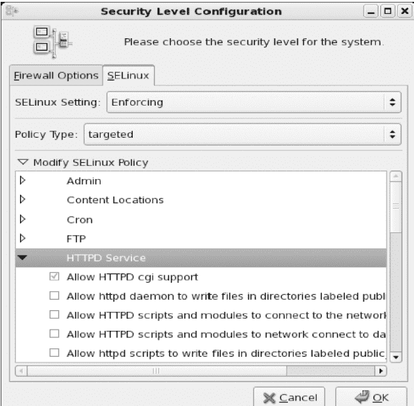

在图中，我们发现了针对不同服务（包括 Web 服务器）和通用选项的布尔（Booleans）配置。我们也可以通过 `getsebool -a` 命令获取此列表，并使用 `setbool`/`togglebool` 命令激活/禁用这些选项。

在 Fedora 中，我们发现了支持以下内容的布尔值（包括）：Cron、FTP、httpd (apache)、dns、grub、lib、nifs、nix、cups、ppp、sambda、防止不当访问进程内存的保护。

布尔值的配置允许 SELinux 策略在运行时进行定制。布尔值被用作应用规则的条件值，允许在无需加载新策略的情况下对策略进行修改。

## 4.2. 批评

一些管理员和安全专家特别批评 SELinux 配置和管理过于复杂。他们认为，由于其内在的复杂性，即使是经验丰富的用户也会犯错，导致 SELinux 配置不安全或不可用，并使系统变得脆弱。尽管在某种程度上这是可争议的，因为即使我们的 SELinux 配置不当，UNIX 权限仍然保持有效，SELinux 不允许执行原始权限未允许的操作，事实上，我们可以看到这一点。

由于策略规模巨大，性能因素可能受到影响，因为加载需要花费大量时间。另一个令管理员担忧方面是服务器被替换为虚假服务器的可能性。

# 5. 网络安全

### 5.1. 服务客户端

作为客户端，我们基本上需要确保由于使用不安全的服务而让用户陷入危险（或他们自己陷入危险）。避免使用没有加密和密码的服务（FTP、telnet、mail）。使用加密连接技术，如 SSH 和 SSL。

### 5.2. 服务器：inetd 和 xinetd

正如我们所见，网络服务从多个处配置：

- 在 `/etc/inetd.conf` 或相应的目录 `/etc/inetd.d` 中：这些系统是“超级服务”，因为它们控制子服务并启动连接。Debian 使用 inetd 服务，Fedora 使用 xinetd（在 Debian 中作为选项替换 inetd）。
- 启动时初始的服务：取决于运行级别（runlevel），将有一些初始的服务。启动源于与级别相关的目录。例如，在 Debian 中，默认运行级别为 2，服务将由 `/etc/init.d` 中的脚本启动，这些脚本将根据情况带有 start、stop、restart 参数。
- 其他 RPC 类型服务：用于机器间的远程调用，例如在 NIS 和 NFS 中。我们可以通过 `rpcinfo -p` 命令查看哪些服务。

其他支持文件（带有有用信息）：`/etc/services`，它包含已知本地或网络服务的列表，并带有服务名称、协议（tcp、udp 或其他）以及其使用的端口。`/etc/protocols` 是已知协议列表；以及 `/etc/rpc` 是 RPC 服务器列表。

以及所使用的端口。这些文件随发行版一起提供，是网络工具和命令的一种数据库，用于确定服务的名称及其关联的协议（或 rpc 和端口）。需要说明的是，这些文件在某种程度上是历史文件，并不一定包含所有协议和服务的定义；同样，我们也可以在不同的互联网已知端口列表中进行搜索。

管理员的首要要操作之一将是禁用所有未未使用或未计划使用的服务，并阅读有关服务使用的说明 [Mou01] [Neu]。

在 `/etc/inetd.conf` 的情况下，我们必须通过在行首放置新符号（`#`）来注释掉已禁用的服务行。

在另一种服务模式下（在 Fedora 中默认开启，在 Debian 中可选可选其配置位于 `/etc/xinetd.conf` 文件中，其中配置了日志的默认值，每个子服务的配置都是通过 `/etc/xinetd.d` 目录下的文件完成的。在这种情况下，定义了服务信息，等同于 `inetd.conf` 中出现的内容；此时若要禁用服务，我们只需要在服务文件中输入 `disable= yes` 即可。Xinetd 的配置比 inetd 更灵活，它将不同服务的配置分离到不同的文件中，并提供了许多限制服务连接、连接数量或能力的选项；所有这些都允许对服务进行更好的控制，且通过正确的配置，我们可以通过拒绝服务（DoS 或 DDoS）来避免某些攻击。

关于通过发行版命令处理正在运行的服务，我们已经提到了几种允许在单元位置启用或禁用服务的工具。还存在图形化工具，如 KDE 的 `ksys`，或者 Fedora 中的 `system-config-services` 和 `ntysys`（在 Debian 中，我们推荐使用 `sys-rc-conf`、`rconf` 或 `bum`）。在在更低层面，我们可以进入我们使用的根目录（`/etc/rc.d`），通过将脚本中的数字 `5` 或 `K` 改为其他文本来停用我们想要的服务：例如，一种方法可能是：将 `S20s` 改为 `STOP_S20s`，这样它将不再启动；下次我们需要它时，可以移除前缀，它就会恢复激活。或者可能推荐使用简单的实用程序来放置、删除或激活特定服务（如 Fedora 中的 `service` 和 `chconfig`，或 Debian 中类似的 `update-rc.d` 和 `invoke-rc.d`）。

另一个方面是关闭不安全的服务。传统上，在 UNIX 文件系统中，如 FTP 等被用于远程连接的服务，如 `telnet` 以及远程运行命令（`login` 或 `copy`），其中许多以字母 "r" 开头（例如 `rsh`、`r`、`rex`...）。其他潜在的危险是 `finger` 和 `rhod` 服务，它们允许从机器用户网络获取信息；这里的危险在于攻击者可以获得的信息，这将使攻击者的工作变得更容易。由于这些服务带来的潜在危险，目前不应使用所有这些服务。对于第一组：

- a) 在网络传输中，`ftp` 和 `telnet` 不加密密码，任何人都可以获取 PDE 服务密码或关联账户（例如，使用嗅探器）。
- b) `rsh`、`rexx`、`rcp` 也存在这样的问题，在某些条件下，密码甚至不是必要的（例如，如果从 `.hosts` 文件中验证的地方运行），这意味着它们同样是不安全的，为攻击留了敞大门。


替代方案是使用支持消息加密和参与者身份验证的安全客户端和服务器。这里有经典包的安全替代方案（也可以与 `OpenSSL` 结合用于 Web 环境）。`OpenSSH`。

`OpenSSH` 提供了基于 `ssh`、`scp` 和 `sftp` 命令的解决方案，允许替换旧的客户端和服务器（使用一个名为 `sshd` 的守护进程）。`ssh` 命令允许 `telnet`、`login` 和 `rsh` 等旧功能，`scp` 是 `rcp` 的安全等效物。


以及所使用的端口。这些文件随发行版一起提供，是网络工具和命令的一种数据库，用于确定服务的名称及其关联的协议（或 RPC 和端口）。需要说明的是，这些文件在某种程度上是历史文件，并不一定包含所有协议和服务的定义；同样，我们也可以在不同的互联网已知端口列表中进行搜索。

管理员的首要操作之一将是禁用所有未使用或未计划使用的服务，并阅读有关服务使用的说明 [Mou01] [Neu]。

在 `/etc/inetd.conf` 的情况下，我们必须通过在行首放置新符号（`#`）来注释掉已禁用的服务行。

在另一种服务模式下（在 Fedora 中默认开启，在 Debian 中可选），配置位于 `/etc/xinetd.conf` 文件中，其中配置了日志的默认值，每个子服务的配置都是通过 `/etc/xinetd.d` 目录下的文件完成的。在这种情况下，定义了服务信息等同于 `inetd.conf` 中出现的内容；此时若要禁用服务，我们只需要在服务文件中输入 `disable = yes` 即可。`Xinetd` 的配置比 `inetd` 更灵活，它将不同服务的配置分离到不同的文件中，并提供了许多限制服务连接、连接数量或能力的选项；所有这些都允许对服务进行更好的控制，且通过正确的配置，我们可以通过拒绝服务（DoS 或 DDoS）来避免某些攻击。

关于通过发行版命令处理正在运行的服务，我们已经提到了几种允许在单元位置启用或禁用服务的工具。还存在图形化工具，如 KDE 的 `ksys`，或者 Fedora 中的 `system-config-services` 和 `ntysys`（在 Debian 中，我们推荐使用 `sys-rc-conf`、`rconf` 或 `bum`）。在更低层面，我们可以进入我们使用的根目录（`/etc/rc.d`），通过将脚本中的数字 `5` 或 `K` 改为其他文本来停用我们想要的服务：例如，一种方法可能是：将 `S20s` 改为 `STOP_S20s`，这样它将不再启动；下次我们需要它时，可以移除前缀，它就会恢复激活。或者可能推荐使用简单的实用程序来放置、删除或激活特定服务（如 Fedora 中的 `service` 和 `chconfig`，或 Debian 中类似的 `update-rc.d` 和 `invoke-rc.d`）。

另一个方面是关闭不安全的服务。传统上，在 UNIX 文件系统中，如 `FTP` 等被用于远程连接的服务，如 `telnet` 以及远程运行命令（`login` 或 `copy`），其中许多以字母 "r" 开头（例如 `rsh`、`r`、`rex`...）。其他潜在的危险是 `finger` 和 `rhod` 服务，它们允许从机器用户网络获取信息；这里的危险在于攻击者可以获得的信息，这将使攻击者的工作变得更容易。由于这些服务带来的潜在危险，目前不应使用所有这些服务。对于第一组：

- a) 在网络传输中，`ftp` 和 `telnet` 不加密密码，任何人都可以获取 PDE 服务密码或关联账户（例如，使用嗅探器）。
- b) `rsh`、`rexx`、`rcp` 也存在这样的问题，在某些条件下，密码甚至不是必要的（例如，如果从 `.hosts` 文件中验证的地方运行），这意味着它们同样是不安全的，为攻击留了敞大门。

替代方案是使用支持消息加密和参与者身份验证的安全客户端和服务器。这里有经典包的安全替代方案（也可以与 OpenSSL 结合用于 Web 环境）。`OpenSSH`。`OpenSSH` 提供了基于 `ssh`、`scp` 和 `sftp` 命令的解决方案，允许替换旧的客户端和服务器（使用一个名为 `sshd` 的守护进程）。`ssh` 命令允许 `telnet`、`login` 和 `rsh` 等旧功能，`scp` 是 `rcp` 的安全等效物。

正确，换句话说，它测试了配置。另一个有用的命令 `tcpdmatch` 允许我们提供一个服务的名称和一个潜在的客户端（用户、和/或主机），它会告诉我们在这种情况下系统将如何操作。

## 7.1. 防火墙

防火墙是一个系统或一组系统，用于加强网络之间访问控制的策略。防火墙可以以软件形式实现，作为运行在单台计算机上的专用应用程序；也可以是一个设计用于保护一台或多台计算机的特殊设备。

通常，我们要么有一个防火墙应用程序来保护连接到互联网（直接连接或通过服务商）的特定机器，要么可以在我们的网络中放置一个或几台用于此功能的机器，以保护我们的内部网络。

从技术上讲，最佳解决方案是使用一台带有两个或多个网络网卡的计算机来隔离不同的网络（或网络分段），这样机器上的防火墙软件（如果是特殊硬件）将负责连接网络包，并决定哪些数据包可以通过或无法通过哪个网络。

这种类型的防火墙通常与路由器结合，以连接不同网络的数据包。另一种典型配置是面向互联网的防火墙，例如使用两个网卡：一个用于获取/提供互联网的流量，另一个用于将流量发送到我们的内部网络，从而消除不是发给我们的流量，并控制向外移动的流量协议，当我们怀疑由于某些攻击存在潜在信息泄露时。第三种可能性是连接互联网的单网卡独立机器，直接连接或通过服务商。在这种情况下，我们只是想保护机器免受入侵者、不必要的流量或我们希望保护机器免受数据窃取风险的流量的影响。

换句话说，在这些情况下，我们可以看到防火墙可以有不同的配置，取决于它是软件、机器拥有一个还是多个网络网卡，或者它保护的是单台机器还是一个网络。

通常，防火墙允许用户通过控制允许的入站或出站 TCP/UDP 端口，定义一系列的访问策略（哪些机器可以接收信息以及接收什么类型的信息）。某些防火墙带有预配置的策略；在某些情况下，它们会询问我们是否需要高、中或低级别的安全级别；另一些则允许对所有选项进行定制（机器、协议、端口等）。

> 防火墙使得在数据包和通信连接层级建立安全防护成为可能。

另一个相关技术是网络地址转换（NAT）。这种技术为隐藏私有网络中的 IP 地址提供了路由，并将其从互联网隐藏，但保持对机器的访问。典型方法之一是被称为伪装（masquerading）的方法。使用 NAT 伪装，一个或多个网络设备从外部看来像单个 IP 地址。这允许几台计算机连接到单一的外部连接设备；例如家中的 ADSL 路由器，有几台机器需要连接，而无需为我们提供 IP 地址。NAT 路由器也提供一些 NAT 伪装功能以及防火墙功能。结合使用这两种技术是很常见的。在这种情况下，除了防火墙机器的配置（我们在上面已经看到的），我们想要保护的私有网络配置也会发挥作用。

## 7.2. Netfilter: IPTables

Linux 内核（从 2.4.x 版本开始）提供了一个名为 `Netfilter` 的过滤子系统，它提供了包过滤功能以及 NAT。该系统允许不同的过滤器相互作用，最常用的一个被称为 `IPTables`。主命令是 `iptables`。在此之前，它在 2.2 内核中提供了另一个过滤器 `iptchains`，2.0 内核使用了不同的（尽管相似的）语法。在这里（以及随后的示例中）我们将只处理 `Netfilter/IPTables`（换句话说是2.4/2.6 内核）。

| 网站 |
| :--- |
| Netfilter, ver: http://www.netfilter.org<br>iptchains, 参见 http://www.netfilter.org/iptchains |

`IPTables` 接口允许我们配置规则，以决定数据包的去向。

| 注意 |
| :--- |
| Netfilter, 版本：http://www.netfilter.org<br>iptchains, 查阅：http://www.netfilter.org/iptchains |

| 规则 |
| :--- |
| `IPTables` 规则通常包含接受、丢弃或拒绝操作。对于 `input` 和 `output` 链的规则。 |

| 启动 iptables |
| :--- |
| 默认 启动命令：`/etc/init.d/iptables` |

`iptables -L` 命令列出活动链的规则。

`IPTables` 系统有三个表：`Filter`（过滤）、`NAT` 和 `Mangle`（修改）。第一个是用于过滤的，第二个用于 NAT，第三个较少使用，用于标记包。在 `NAT` 表中，通常有两个链：`PREROUTING` 和 `POSTROUTING`。在第一个链中，规则将决定数据包是否需要路由，如果是，则目标地址将变为。在第二个链中，最终决定数据包是否允许进入（私有网络，示例）。还有一个 `OUTPUT` 链，用于本地产生私有网络的流量，`PREROUTING` 不控制流量（更多细节请参见页面）。

接下来我们将讨论配置 `Filter` 表的一些方面和示例（对于其他表，可以查阅相关的参考文献）。


Filter 表通常配置为一系列规则，指定在特定链中执行的操作，如上述三个（`input`、`output` 和 `forward`）。通常，我们会指定：

```
iptables -A chain -j target
```

其中 `chain` 是 `input`、`output` 或 `forward`，`target` 是分配给对应规则数据包的目标。`-A` 将规则添加到现有规则之后。在这里我们必须小心，因为顺序很重要。如果我们把消除数据包的限制性规则放在开头，即使没有其他规则，它也不会被忽略。`-j` 用于用于决定对数据包做什么，`accept`（接受）、`reject`（拒绝）或 `drop`（丢弃）。注意 `reject` 和 `drop` 之间的区别。对于前者，我们拒绝数据包并通常通知发送者我们拒绝了连接尝试。对于后者 `drop`，我们只是“丢弃”它，就像它从未存在过一样，不会发送任何形式的响应。另一个目标是 `log`，将数据包发送到日志系统。通常情况下，这里会有两条规则，一个是带 `log` 的规则，另一个是相同的 `accept`、`drop` 或 `reject` 规则，这样被接受、拒绝或丢弃的数据包的信息就可以发送到日志中。

在输入规则时，我们也可以使用 `-I`（插入）选项来指定位置，例如：

```
iptables -I INPUT 3 -s 10.0.0.0/8 -j ACCEPT
```

这告诉我们该规则应该处于 `input` 链的第三位置；来自（源地址，`-s`）子网 `10.0.0.0` 且掩码为 `255.255.0.0` 的数据包（`-j`）将被接受。同样，使用 `-D` 我们可以删除任意规则或下文指定的指定的精确规则，从而保留链的第一条规则或我们提到的规则：

```
iptables -D INPUT 1
iptables -D INPUT -s 10.0.0.0/8 -j ACCEPT
```

还有一些规则可以用于为数据包定义默认“策略”（选项 `-P`）；所有数据包都将执行相同的操作。例如，我们通常会默认丢弃所有数据包，然后启用我们需要的包；同样，如果没有必要，我们会避免转发数据包（如果我们不在路由器上进行操作），可以这样声明：

```
iptables -P INPUT DENY
iptables -P OUTPUT REJECT
iptables -P FORWARD REJECT
```

这建立了拒绝任何入站数据包且不允许发送或拒绝数据包的策略。现在，我们将能够添加影响我们想要使用的数据包的规则，说明我们希望允许或避免的协议、端口以及源或目的地。这可能是困难的，因为我们需要知道软件或服务使用的所有端口和协议。另一种策略是仅保持基本服务的运行，并通过防火墙允许目标机器访问这些服务。

Filter 表中这些规则的示例如下：

```
iptables -A INPUT -s 10.0.0.0/8 -d 192.168.1.2 -j DROP
iptables -A INPUT -p tcp --dport 113 -j REJECT --reject-with tcp-reset
iptables -I INPUT -p tcp --dport 113 -s 10.0.0.0/8 -j ACCEPT
```

其中：
- 1. 我们丢弃来自 `10.x.x.x` 并发送往 `192.168.1.2` 的数据包。
- 2. 我们拒绝发送到端口 113 的 `tcp` 数据包，发出 `tcp-reset` 类型的响应。
- 3. 与 2) 相同的来自 `10.x.x.x` 的数据包将被接受。

关于协议和端口的名称，`iptables` 系统使用由 `/etc/services` 和 `/etc/protocols` 文件提供的信息，我们可以用数字或名称指定这些信息（端口或协议）（我们必须确保文件中的信息是正确的，且没有被修改，例如被攻击者）。

`iptables` 的配置通常通过连续调用带有规则的 `iptables` 命令来建立。这些规则创建了活动规则状态，可以通过 `iptables -L` 进行查询；如果我们希望让它们持久化，在 Fedora 中可以这样做：

```
/etc/init.d/iptables save
```

它们被保存到：

```
/etc/sysconfig/iptables
```

在 Debian 中，我们可以执行：

```
/etc/init.d/iptables save name-rules
```

我们必须小心并确保 `/var/log/iptables` 目录已经存在，因为文件将保存在那里；`name-rules` 将是目录中的一个文件。

通过 `(/etc/init.d/iptables load)` 我们可以加载规则（在 Debian 中，我们必须提供规则文件的名称），尽管 Debian 支持一些默认文件名，这些对于普通规则（服务启动时使用的规则）是激活的，而对于服务禁用（或停止）时保留的规则是非激活的。另一种常用方法是将规则放在包含必要的 `iptables` 回调脚本中并调用它们，例如通过将它们放在所需的运行级别，或在 `/etc/init.d` 中建立指向脚本的链接。

## 7.3 发行版中的防火墙数据包

关于防火墙中或或自动配置工具，有多种可能性，但我们应该记住，它们通常不提供像手动配置 `iptables` 那样的功能（大多数情况下建议手动配置）。某些工具包括：

- `lokkit`：在 Fedora/Red Hat 中，在非常基础的层面上，用户只能选择所需的安全级别（高、中、低）。之后，会显示受影响的服务，我们可以选择保留或取消，这样我们将更改默认配置传递给服务。底层使用的机制是：规则的最终配置可以在 `/etc/sysconfig/iptables` 中看到，这反会被 `iptables` 服务读取，该服务在启动或使用 `/etc/init.d/iptables` 的 `start` 或 `stop` 选项停止时加载。也可以在 Debian 中安装，配置应该留在 `/etc/defaults/lokkit-l` 以及 `/etc/init.d` 中的脚本中。还有一个图形版本的 `gnome-iptables`。

- `firekit`：规则的最终配置可以在 `/etc/sysconfig/iptables` 中看到，这反会被 `iptables` 服务读取，该服务在启动或使用 `/etc/init.d/iptables` 的 `start` 或 `stop` 选项停止时加载。也可以在 Debian 中安装，配置应该留在 `/etc/defaults/lokkit-l` 以及 `/etc/init.d` 中的脚本中。（注：原文中此处存在大量重复和损坏的 OCR 文本，已根据逻辑进行了清理处理）。

# Nmap 前端 v3.00

文件 输出 视图 测试版 选项 帮助

主机(s): `127.0.0.1` 通用选项:

扫描选项:

- `connect` (连接)
- SVN Stealth (SVN 隐身)
- Ping Wave (Ping 波)
- UDP Port Scan (UDP 端口扫描)
- FIN Stealth (FIN 隐身)
- Don't Resolve (不解析)
- Fast Scan (快速扫描)
- Range of Ports (端口范围)
- Don't Ping (不 Ping)
- Use Decoy() (使用诱饵)
- TCP Ping (TCP Ping)
- TCP/ICMP
- ICMP Ping (ICMP Ping)
- Fragmentation (分片)
- Get Ident Info (获取标识信息)
- Resolve All (全部)
- OS Detection (操作系统检测)
- Send on Device (在设备上发送)

```
Output from: nmap -sT -O 127.0.0.1
```

```
Starting nmap V3.00 from https://nmap.org/nmap/
Interesting ports on localhost.localdomain (127.0.0.1):
(The 156 ports scanned but not shown below are in state: closed)
Port State
22/tcp open
25/tcp open
111/tcp open
631/tcp open
6000/tcp open
X11
Remote operating system guess: Linux Kernel 2.4.0 - 2,50
Uptime 0.204 days (since Tue 23 10:45:47 2003)
nmap completed -- 1 IP address (1 host up) scanned in 7
seconds
```

图 2：`nmap` 正在分析本地服务

Wireshark [Wir] (以前称为 Ethereal)：是一种协议分析器，用于捕获网络中的流量（充当嗅探器使用）。它可以用于查看彩色流量、查看单个数据包的统计数据，并根据源、目的、端口或协议对数据包进行分组。它甚至可以从传输控制协议 (TCP) 的整个会话中重建流量。


Snort [Sno]；是一种 IDS（入侵检测）系统，能够实时分析流量并保存消息日志。它可以根据模式（协议、源、目的等）进行分析和搜索。它可以被用于检测各种类型的攻击。基本上，它通过分析网络流量来检测与攻击相匹配的模式。该系统使用一系列规则来生成情况日志（log）或警告用户（alert）或拒绝注入（drop）。

Nessus [Nes]：检测任何已知的漏洞（通过测试入侵技术）并对发现的漏洞进行安全选项评估。它是一个模块化程序，包含一系列插件（超过 11,000 个）用于执行不同的分析。它采用客户端-服务器架构，带有显示结果的图形客户端和一个在机器上执行测试的服务器。它具有检查整个网络的能力。

它对结果生成报告，并可以导出到不同的格式（例如 HTML）。在 2005 年之前，Nessus 是一个免费工具，但开发者决定在 Nessus 3 中将其变为专有软件。在 GNU/Linux 中，Nessus 2 仍在在使用，因为它继续拥有 GPL 许可证和一系列逐渐更新的插件。Nessus 3 作为 GNU/Linux 的专有工具，功能更强大且应用更广泛，因为它是最流行的安全工具之一，并且通常提供一个免费版本，其插件比非免费版本的插件更新得少。

| 总结 | |
|---|---|
| 测试的主机数量: 1 | - discard (9/tcp) |
| 发现 1 个安全漏洞 | - daytime (13/tcp) |
| 发现 6 个安全警告 | - ssh (22/tcp) |
| 发现 5 条安全备注 | - icmp (8/tcp) |
| 127.0.0.1 | - time (37/tcp) |
| | - www (80/tcp) |
| | 安全备注 |
| | 安全警告 |

`doc` 目录可浏览。

`doc show` 显示 `/usr/doc` 目录的内容

| 解决方案：对 /doc 使用访问限制 | 如果你使用 Apache，可能可以在你的 a |
| <Directory>/usr/doc
| AllowOverride None |
| order deny,allow |
| deny from |
| allow from localhost |
| </Directory> |

图 3：Nessus 客户端显示漏洞并报告可能的解决方案

我们可以找到许多其他可用的安全工具。很好的起点是 http://tools.org，Nmap 的设计者在那里维护了一份由用户投票的热工具列表（现在是一份较旧的列表，但工具很有用）。

## 9. 日志分析

通过观察日志文件 [Ano99][Fri02]，我们可以快速对系统的全局状态以及最新事件有一个了解，并检测任何异常的入侵（或入侵尝试）。还应该记住，如果发生了入侵，日志可能已被清理或伪造。大多数日志文件位于 `/var/log` 目录。

许多服务可能拥有自己的日志，这些日志通常在配置期间建立（通过相应的配置文件）。大多数它们使用集成在 Syslog 守护进程中的日志设施。配置位于 `/etc/syslog.conf`。该配置通常用于匹配消息级别：根据其重要性有不同类型的消息。通常，级别如 debug、info、notice、warning、err、crit、alert、emergency 的顺序是 [未指定]。

在日志中，应该检查的是 `/var/log` 目录仅允许 root 用户写入。否则，攻击者可能会伪造信息。尽管如此，如果攻击者访问了 root，他们可能会删除所有痕迹。

运行时间 2.011 天（自 2003年9月15日周一 11:14:57 起）

`nmap` 运行完成 - 在 9.404 秒内扫描了 1 个 IP 地址（1 个主机在线）

我们可以检测到大量的开放服务（在机器上检测到，可能更多：telnet, FTP, finger...），分布在传输控制协议 (TCP) 和数据报协议 (UDP) 中。某些服务（如 discard, daytime）偶尔可能会使用，但它们不应该对网络开放，因为它们被认为是安全的。SMTP 是邮件的核心服务；如果我们充当主机或邮件服务器，那么它就必须处于激活状态；如果我们只通过 POP3 或 IMAP 账户读写电子邮件，则不一定需要开启。

检测活动服务的另一种方法是搜索活跃的监听端口，这可以通过 `netstat -lut` 命令实现。

`nmap` 命令也可以应用于机器的 DNS 或 IP 名称；这显示了系统从外部看起来的样子（通过 `localhost`，我们可以看到实际机器能看到的内容），或者更好，我们甚至可以使用外部网络中的机器（例如，任何连接到互联网的 PC）来检查从外部可以看到我们机器上的内容。

现在我们将进入 `/etc/inetd.conf` 来禁用这些服务。我们应该寻找如下行：

```
discard stream tcp nowait root internal
smtp stream tcp nowait mail /usr/sbin/ex-exim -bs
```

我们在行开头输入数字符号 (`#`)（仅针对我们想要禁用的服务，并且在我们知道它们实际上在做什么时（强烈建议查看相应的 `man` 页面来禁用它们））。另一个建议禁用的情况是 tcp、telnet、finger 服务，我们使用 ssh 来替换它们。

现在我们必须重启 inetd 以使其重新读取我们更改的配置：`/etc/init.d/inetd restart`。

我们回到 nmap：

| 22/tcp | open | sh |
| 80/tcp | open | http |
| 111/tcp | open | sunrpc |
| 111/udp | open | sunrpc |
| 113/tcp | open | auth |
| 631/tcp | open | ipp |
| 728/udp | open | unknown |
| 734/tcp | open | unknown |

在剩余的服务中，我们留下 ssh 服务（我们希望保持其激活状态）以及 Web 服务器（我们将暂时停止它）：

```
/etc/init.d/apache stop
```

ipp 是与 CUPS 相关的打印服务。在本地管理部分，我们看到有一个连接到端口 631 的 CUPS Web 界面。如果我们想知道某个特定端口在做什么，可以查看 `/etc/services`：

```
root@machine:~ grep 631 /etc/services
ipp 631/tcp      # Internet Printing Protocol
ipp 631/udp      # Internet Printing Protocol
```

如果我们不是作为外部服务器运行，我们必须进入 CUPS 配置并消除此功能（例如，通过放置列表 127.0.0.1:631，使得只有本地机器监听），或者限制对允许机器的访问。

其他一些端口也显示为未知，在这种情况下是端口 728 和 734；这表明系统无法确定 nmap 与哪个端口关联。我们将尝试查看其本身。为此，我们执行 `netstat` 命令，从发送和接收的数据包以及错误，到我们感兴趣的元素，即开放的连接以及谁在使用它们。我们将尝试找出谁在使用这些未知端口：

```
root@machine:~ netstat -anp | grep 728
dp 0 0.0.0.0:728 0.0.0.0:552/rpc.stat
```

如果我们对端口 734 执行同样的操作，我们可以看到是 `rpc.stat` 打开了该端口；`rpc.stat` 是一个与 NFS 相关的守护进程（在这种情况下，系统有一个 NFS 服务器）。如果我们对端口 111 重复此过程，我们将看到守护进程在 `portmap` 之后，它用于远程过程调用系统 (RPC)。RPC 系统使用用户来来实现不同机器上两个进程之间的远程调用。`portmap` 是一个将到达端口的调用转换为内部 RPC 服务数字的守护进程，它被 NFS、NIS 等不同的服务器使用。

提供的 RPC 服务可以通过 `rpcinfo` 命令查看：

```
root@machine:~# rpcinfo -p
```

| programme vers | proto | Port | service |
|---|---|---|---|
| 100000 2 | tcp | 111 | portmapper |
| 100000 2 | udp | 111 | portmapper |
| 100024 1 | udp | 731 | status |
| 100024 1 | tcp | 734 | status |
| 391002 1 | tcp | 39797 | sgi_fam |
| 391002 2 | tcp | 39797 | sgi_fam |

（注：由于原文中包含大量重复的 OCR 错误文本，此处译文仅翻译了核心逻辑部分。）


```
Chain INPUT (policy ACCEPT)
  target prot opt source      destination
Chain FORWARD (policy ACCEPT)
  target prot opt source      destination
Chain OUTPUT (policy ACCEPT)
  target prot opt source      destination
```

换句话说，此时防火墙没有设置限制，所有数据包都可以被发送、接收和重发。

在此时，我们可以添加一个防火墙，对我们接收和发送的数据包进行更细的管理，这可以作为改进安全性的初步控制。根据我们的需求，我们将建立类似于本单元提供的防火墙示例那样的必要规则。

如果我们设置了防火墙，可以考虑是否将此机制作为单一的安全元素并移除“封装层（wrappers）”：这是可以行的，因为防火墙（在此情况下为 `iptables`）提供了一个非常强大的功能，允许我们根据数据包的类型、协议以及它在系统中的行为进行跟踪。一个良好的防火墙就足够了，但为了安全起见，采取更多的安全措施并允许某些数据包逃逸，“封装层”将阻止任何非预期访问的服务层级措施。用一个常用的比喻来说，如果我们把系统比作一座必须防御的中世纪城堡，护城河和外墙就是防火墙，而第二道围墙就是“封装层”。

## 活动

1) 假设我们在机器上定位了一个网站，例如使用 `Apache`。我们的网站是为内部用户设计的，但我们无法控制用户人数。随后，我们考虑让它可以通过互联网访问，因为我们认为这对客户可能有用，我们唯一做的就是为系统分配一个公网 IP 地址。这种系统可能会受到哪些类型的攻击？

2) 我们如何检测系统中的带有 `SUID` 的文件？哪些命令是必要的？哪些目录带有 `SUID` 或 `SGID`？为什么（例如）`/usr/bin/passwd` 必须有一个 `SUID` 标志位（hint）？

3) 正如所见，根文件（roots files）对安全构成了巨大危险。我们可以使用某种方法定期检查这些文件吗？如何做？

4) 假设我们想要禁用某个服务，我们知道它有一个控制它的 `/etc/init.d/service` 脚本；我们在在出现的所有运行级别（`runlevels`）中禁用它。我们如何找到它所处的运行级别？（例如，搜索指向脚本的链接）。

5) 检查你机器中的活动服务。它们都是必要的吗？我们该如何保护或停用它们？

6) 练习使用描述的安全工具（`nmap`、`nessus` 等）。

7) 对于一台只想从特定地址通过 `SSH` 访问的机器，哪些 `IPTables` 规则是必要的？

8) 如果只想访问 Web 服务器怎么办？

# 参考文献

其他参考和信息来源

[Deb] [Hat] 各发发行版的安全网站。

[Peñ] Debian 必备的资源，对如何配置安全性有很好的描述，可以按照步骤进行。[Hat] 是 Fedora/Red Hat 的等效物。

[Mout01] Red Hat 的优秀安全参考（也适用于 Debian）。

[Hat01] 涵盖了广泛技术和方面的 GNU/Linux 安全书籍。

[Line] 简要的安全指南（2 页）。

[Sei] 逐步渐进的指南，识别了必须验证的关键点和可能出现的问题。

[Net] Netfilter 项目和 `IPTables`。

[Ian] TCP/IP 端口列表。

[Proa] [Sno] [Insb] [Nes] 一些常用的安全工具。

[NSab] 由美国国家安全局（NSA）制作的专注于安全的 Linux 版本。SELinux 的参考资料。

[CERA][Aus][Insa][Inncb][NSAA] 安全组织网站。

[CERB][Ins][San] 不同操作系统的漏洞和利用程序。

[NSAa][FBI][USA] 美国的一些网络犯罪“政策”。

# 配置、调优与优化

Remo Suppi Boldrito

PID_00148473


# 目录

+   引言.................................................................................................... 5

1.  基础方面....................................................................... 7

1.1.  UNIX System V 上的监控.................................................. 8

1.2.  系统优化.............................................................. 15

1.3.  一般优化................................................................ 19

1.4.  额外配置........................................................... 20

1.5.  监控............................................................................ 24

+   活动....................................................................................................... 33

+   参考文献.................................................................................................. 34

# 引言

系统安装完成后，一个基本方面是根据用户需求对系统进行配置和调整，以确保功能能够尽可能地适应对其提出的需求。

GNU/Linux 是一个高效的操作系统，提供了极佳的可配置性以及可以根据用户需求定制的高度专注性。这就是为什么在系统安装（或更新，取决于具体情况）后，尽管某些对系统至关重要的配置可能“可以工作”，但有必要进行一些更改（适应环境或调优），以满足机器必须提供的用户/服务的所有需求。这种调优取决于机器工作的环境；调优将进行，并且在某些情况下，为了提高系统的性能和效率进行调优，而在其他情况下（此外），出于安全考虑进行调优（参见第 9 模块，“安全管理员”）。当系统运行时，有必要对系统进行监控，观察其性能和行为并据此采取行动。虽然这是一个基本方面，但操作系统的调优通常交给计算机专家或大师的意见来决定；但如果我们了解了影响性能的参数，就可以通过采取分析、更改配置、监控和进行调整的循环过程，来获得良好的解决方案。

# 1. 基础方面

在学习优化技术之前，有必要列出可能影响操作系统性能的原因 [Maj96]。在这些，我们可以提到：

- a) 资源瓶颈：后果是整个系统都会变慢，因为某些资源无法满足其正面临的需求。优化系统的第一步是找到这些瓶颈及其产生原因，同时了解它们在理论和实践上的局限性。

- b) 阿姆达尔法则（Amdahl's law）；根据该定律，“当仅改进系统的一部分时，整个系统可以改进的程度（或加速比）是有限的”；换句话说，如果我们有一个程序占用 10% 的 CPU，并通过优化将其使用率降低一半，那么该程序的性能提升（加速比）将仅为 5%，这意味着投入了大量精力，但并未获得相应的回报。

- c) 加速比的估计；有必要估计系统将提高多少，以避免不必要的努力和成本。可以使用之前描述的定律来评估是否有必要为系统投入时间或资金。

- d) 泡效应：我们经常觉得，当我们解决了一个问题时，另一个问题就会出现。这种问题的一种表现是系统不断在 CPU 问题和输入/O 问题之间切换，反之亦然。

- e) 工作负载中的响应时间：如果有二十个用户，提高生产力意味着所有人同一时间完成更多工作，但个体的响应时间并不会提高；可能某些人的响应时间会比其他人更好。改进响应时间是指优化系统，使单个任务花费尽可能短的时间。

- f) 用户心理：有两个参数是基本的：1) 当响应时间出现波动时，用户会感到非常不满；2) 用户察觉不到小于 20% 的执行时间改进。

- g) 测试效应：测量会影响测量本身。我们在执行测试时应谨慎进行，因为实际测试程序会产生副作用。

h) 平均值与波动性的重要性：必须考虑结果，因为当我们获取到序列为 100, 0, 0, 100 的平均 CPU 使用率为 50% 时，可能会得出错误的结论。在平均值的基础上观察波动是至关重要的。

- i) 对待优化系统硬件的基础知识：为了改进某些东西，我们需要“知道”它是如何被改进的。负责优化的人必须对底层硬件（CPU、内存、缓冲区、缓存、输入输出、磁盘、视频等）以及相互连接有大量的基础知识，以确定问题所在。


### j) 对待优化操作系统的基础知识
与前一点一样，你必须了解他们想要优化的操作系统的最基本方面，这包括进程和线程（创建、执行、状态、优先级、终止）概念、系统调用、缓存缓冲区、文件系统、内存管理和虚拟内存（分页、交换分区）以及内核表。

> 注意
> 在优化时，必须考虑资源的饱和情况。阿姆达尔法则列出了可用的软件和硬件知识：响应时间和任务数量。

## 1.1. 在 UNIX System V 上进行监控

`/proc` 显示为一个目录，但实际上它是一个虚拟文件系统，换句话说，它不存在于磁盘上，而是内核在内存中创建的。它用于提供系统信息（最初关于进程，因此得名），这些信息稍后将由我们现在检查的命令使用。我们将查看一些有趣的文件（更多信息请查看手册的相关页面）：

- `/proc/1`：进程 1 信息的目录（目录的数量是进程的 PID）。
- `/proc/cpuinfo`：关于 CPU 的信息（类型、品牌、型号、性能……）。
- `/proc/devices`：内核配置的设备列表。
- `/proc/dma`：此时使用的 DMA 通道。
- `/proc/filesystems`：内核中配置的文件系统。
- `/proc/interrupts`：显示哪些中断正在使用，以及处理了多少个。
- `/proc/ioports`：同样适用于端口。
- `/proc/kcore`：系统物理内存映像。
- `/proc/ksmsg`：内核生成并发送到 syslog 的消息。
- `/proc/ksym`：内核符号表。
- `/proc/loadavg`：系统负载。
- `/proc/meminfo`：内存使用信息。
- `/proc/modules`：内核加载的模块。
- `/proc/net`：网络协议信息。
- `/proc/stat`：系统统计数据。
- `/proc/uptime`：系统运行时间。
- `/proc/version`：内核版本。

应该记住，这些文件是可见的（文本），但有时数据处于“原始”状态，需要对它们进行解释。我们将检查现在检查的命令。

兼容的 UNIX 系统使用 `sar` 和大多数命令来获取系统统计数据（包括 sysstat 包中的 `fc`，同时也包含 `iostat` 和 `mpstat`）。GNU/Linux Debian 的对应命令是 `atsar`（以及 `atsarc`），它是我们提到的命令的绝对对应。`atsar` 命令读取 `/proc` 文件中的计数器和统计数据并将其显示在标准输出上。调用该命令的第一种方法是：

```
atsar t [n]n
```

其中活动每 `t` 秒显示 `n` 次，头部显示活动计数器（`n` 的默认值为 1）。调用的第二种方法是：

```
atsar -options -s time -e time -i sec -f file -n day#
```

该命令从 `-f` 指定的文件（默认为 `/var/log/atsarc`，`xx` 为月份）中提取之前由 `atsar` 保存的数据（这用于收集数据、保存并处理它们，在 Debian 中，它位于 `/usr/lib/atsar`）。参数 `-n` 可指定月份，`-s` 和 `-e` 分别指定最后启动的时间。要激活 `atsar`，例如，我们可以在 `/etc/cron.d/atsar` 中包含如下行：

```
@reboot root test -x /usr/lib/atsarc && /usr/lib/atsar/var/log/atsar/atsa'date \%d'
```

```
10,20,30,40,50 * * * root test -x /usr/lib/atsar/atsal &&
/usr/lib/atsar/atsal
```

第一个在重启后创建文件。第二个每 10 分钟通过 `atsar` shell 脚本保存数据，该脚本会调用 `atsad`。

在 `atsar` (`sar`) 中，选项用于指示显示哪些计数器；一些示例包括：

| 选项 | 描述 |
|---|---|
| u | CPU 使用 |
| d | 磁盘活动 |
| l (i) | 每秒中断数 |
| V | 内核表的使用 |
| and | tfs 使用统计 |
| p | 分页和交换活动信息 |
| r | 空闲内存和已用交换分区 |
| l (L) | 网络统计 |
| L | 网络错误信息 |
| w | IP 连接统计 |
| t | TCP 统计 |
| U | UDP 统计 |
| m | ICMP 统计 |
| N | NFS 统计 |
| A | 所有选项 |

> 注意
> 使用 `atsar` 监控：
> * CPU: `atsar -u`
> * 内存: `atsar -r`
> * 磁盘: `atsar -d`
> * 分页: `atsar -p`

`atsar` 和 `sar` 之间的区别仅在于数据的显示方式，`sar` 包含了一些额外的（或不同的）选项。现在我们将查看如何使用 `sar`（与 `atsar` 完全相同）以及生成信息的含义：

### 1) CPU 使用

```
sar -u 4 5
Linux 2.6.19-prep (localhost.localdomain) 24/03/07
```

| CPU | %user | %nice | %system | %iowait | %idle |
|---|---|---|---|---|---|
| 08:23:22 | all | 0.25 | 0.50 | 0.00 | 99.25 |
| 08:23:26 | all | 0.00 | 0.00 | 0.00 | 100.00 |
| 08:23:30 | all | 0.00 | 0.00 | 0.00 | 100.00 |
| 08:23:34 | all | 0.00 | 0.00 | 0.00 | 100.00 |
| 08:23:38 | all | 0.25 | 0.00 | 0.00 | 99.75 |
| 08:23:42 | all | 0.00 | 0.00 | 0.00 | 100.00 |
| Media: | all | 0.10 | 0.10 | 0.00 | 99.80 |

* `user` 显示用户模式下的 CPU 时间百分比，`nice = 0`（正常）。
* `nice` 相同但 `> 0`（低于平均值）。
* `idle` 表示 CPU 未被进程使用。
* `iowait` 是 CPU 无效等待的时间。在这种情况下 `idle=100` 表示 CPU 空闲，意味着没有进程在执行，工作负载较低；如果 `idle=0` 且有大量进程，则应该考虑优化 CPU，因为可能是系统瓶颈。

### 2) 每秒中断数

```
sar -I 4 5
Linux 2.6.19-prep (localhost.localdomain) 24/03/07
08:24:01 INTR/s
08:24:06 0.00
```

显示位于 `/proc/interrupts` 的活动频率信息。这有助于查看是否有设备不断中断 CPU 工作。

### 3) 内存和交换分区

```
sar -r 4 5
Linux 2.6.19-prep (localhost.localdomain) 24/03/07
08:24:24 kbmemfree kmmemused %memused kbuffers kbcache kbswapfree kbwpsused kbswad
```

| r | swpd | free | cache | si | bi | in | cs | us | sy | id | wa | st |
|---|---|---|---|---|---|---|---|---|---|---|---|---|
| 0 | 0 | 295816 | 238498 | 0 | 0 | 321 | 56 | 1249 | 724 | 11 | 81 | 5 |
| 0 | 0 | 295816 | 238498 | 0 | 0 | 28 | 1179 | 383 | 1 | 0 | 99 | 0 |
| 0 | 0 | 295816 | 238498 | 0 | 0 | 0 | 1260 | 498 | 0 | 100 | 0 | 0 |
| 0 | 0 | 295816 | 238498 | 0 | 0 | 0 | 1175 | 342 | 0 | 100 | 0 | 0 |
| 1 | 0 | 295816 | 238492 | 0 | 0 | 72 | 1176 | 356 | 0 | 99 | 1 | 0 |
| 0 | 0 | 295816 | 238492 | 0 | 0 | 0 | 1218 | 420 | 0 | 100 | 0 | 0 |

Media: 296510 729706 71.11 24270 954974 963860 0 0 0 0


在这种情况下，`kbmemfree`是空闲内存（MP）；当它被使用时，`buffers`是用于缓冲区的内存；`cache`是用于分页的主内存；`free/used`是空闲/已用的交换分区空间。重要的是记住，当内存中没有空间时，进程将进入交换分区，而那里应该有空间。这应该与 CPU 使用率进行比较。我们还可以检查缓冲区的大小是否合适以及与执行 I/O 操作的进程的关系。

查看`free`命令（fc）很有趣，因为它允许我们以简化的方式查看内存：

```
total free shared cached
Mem: 1026216 729716 296500 0 24324 459980
-/ buffers/cache: 245142 780804
Swap: 963860 0 963860
```

这表明一半的 1 GB 内存被占用，几乎一半的交换分区没有任何任何用途。此外，它告诉我们系统是空闲的，如果我们想查看详细信息，必须使用`vmstat`命令（或`sar -r`）来分析是什么导致问题或是谁在消耗这些内存。以下是 1 10：

## 内核的使用

- v 4 5

Linux 2.6.19-prep (localhost.localdomain) 24/03/07

| 时间 | dentonus | file-sz | inode-sz | super-sz | %super-sz | dquot-sz | rtsig-sz | %rtsig-sz |
|---|---|---|---|---|---|---|---|---|
| 08:24:52 | 1977 | 15153 | | 0.00 | 0.00 | | 0.00 |
| 08:24:56 | 1977 | 15153 | | 0.00 | 0.00 | | 0.00 |
| 08:25:00 | 1977 | 15153 | | 0.00 | 0.00 | | 0.00 |
| 08:25:04 | 1977 | 15153 | | 0.00 | 0.00 | | 0.00 |
| 08:25:08 | 1977 | 15153 | | 0.00 | 0.00 | | 0.00 |
| Media | 1977 | 15153 | | 0.00 | 0.00 | | 0.00 |

在这种情况下，`super-sz`是内核维护的挂载文件系统的超级块当前最大值；`inode-sz`是内核内核所需的 inode 当前最大值（至少每个磁盘一个）；`file-sz`是当前打开的文件数，`dquot-sz`是磁盘配额输入的当前最大值（对于其余操作，请参阅 sar 或或 atsar man）。此监控过程可以通过`ps -edafl`（进程状态）命令和`top`命令完成，它们将显示系统中进程的活动和状态。以下是这两个命令的示例（仅包含部分行）：

`ps -edfl`

| S | UID | PID | PPID | PRI | NI | AD-OR DR | WCHAN | START | TIME | CMD |
|---|---|---|---|---|---|---|---|---|---|---|
| 4 | root | 1 | 0 | | | 508 | | 08:02 | 00:00:00 | init [5] |
| 1 | root | 1927 | 0 | | | | | 08:02 | 00:00:00 | [kthread] |
| 1 | rpc | 2523 | 1 | | | 424 | | 08:02 | 00:00:00 | syslog -m 0 |
| 5 | rpc | 2566 | 1 | | | 444 | | 08:02 | 00:00:00 | portmap |
| 5 | root | | 0 | 78 | 0 | | | 08:02 | 00:00:00 | |
| 5 | root | 2587 | 1 | | | 472 | | 08:02 | 00:00:00 | rpc.statd |
| 5 | root | | 0 | 81 | | | | 08:02 | 00:00:00 | |
| 1 | root | 2620 | 1 | 0 | | 1232 | | 08:02 | 00:00:00 | rpc.idmap-d |
| 4 | root | - | 75 | 0 | defa | 18:02 | 00:00:00 | - |
| 5 | root | 2804 | 1 | - | 1294 | 08:27 | 00:00:00 | /usr/sbin/sshd |
| 5 | root | - | 84 | - | 0 | 08:02 | 00:00:00 | - |
| 5 | root | 2910 | 1 | - | 551 | 08:27 | 00:00:00 | /usr/sbin/at |
| 5 | root | - | 84 | - | 0 | 08:02 | 00:00:00 | - |
| 4 | root | 3066 | 1 | - | 407 | 08:02 | tty1 | /sbin/getty |
| 4 | root | 3305 | 1 | - | 21366 | 08:03 | | nautilus --no-default-window --sm- |
| 4 | root | 3305 | 1 | - | 21366 | 08:03 | 00:00:01 | client |
| 0 | root | 3643 | 3541 | 0 | | | pts/ | 00:00:00 | bash |
| 4 | root | 3701 | 3643 | 0 | | | pts/ | 00:00:00 | ps -edafl |

参数反映了内核中该进程变量的值；从监控角度来看，最重要的有：在这种情况下，1 表示具有权限，由守护进程创建。`S`是状态（可中断睡眠/可运行；S 睡眠；T: 停止；Z: 僵尸）。`PRI`是优先级；`NI`是 nice 值；`STIME`是执行时间；`TTY`是执行所在的终端。如果我们想刷新页面（可配置），可以使用`top`命令，它显示通用统计信息（进程等），然后获取每个点的信息，与`ps`类似，但每秒更新一次。

`top -08:56:24 up 25 min, 2 users, load average: 0.21, 0.25, 0.33`

Tasks: 124 total, 1 running, 123 sleeping, 0 zombie

Cpu(s): 10.8%us, 2.1%sy, 0.0%ni, 4.9%wa, 0.1%hi

Mem: 102621k total, 73105k used, 29516k free, 24464k buffers

Swap: 96380k total, 96380k free, 46208k cached

| PID | USER | PR | NI | VIRT | RES | SHR | S | %CPU | %MEM | TIME |
|---|---|---|---|---|---|---|---|---|---|---|
| 3541 | root | 15 | 0 | 42148 | 14m | S | 1.9 | 1.5 | 00:00:76 | gnome-terminal |
| 3695 | root | 15 | 0 | 260 | 944 | 1650 | R | 1.9 | 0.1 | 00:00:02 | top |
| 1 | root | RT | | | 2032 | 680 | 580 | S | 0.0 | 0.1 | 00:00:85 | init |
| PID | USER | PR | NI | VIRT | RES | SHR | S | %CPU | %MEM | TIME+ |
|---|---|---|---|---|---|---|---|---|---|---|
| 2 | root | 34 | 0 | 0 | 0 | S | 0.0 | 0.0 | 00:00:00 | migration/0 |
| 3 | root | RT | 19 | 0 | 0 | S | 0.0 | 0.0 | 00:00:04 | ksoftirqd/0 |
| 4 | root | 10 | 0 | 0 | 0 | S | 0.0 | 0.0 | 00:00:00 | watchdog/0 |
| 5 | root | 16 | -5 | 0 | 0 | S | 0.0 | 0.0 | 00:00:00 | events/0 |
| 6 | root | 10 | -5 | 0 | 0 | S | 0.0 | 0.0 | 00:00:00 | khelper |
| 7 | root | 10 | -5 | 0 | 0 | S | 0.0 | 0.0 | 00:00:00 | kthread |
| 53 | root | 11 | -5 | 0 | 0 | S | 0.0 | 0.0 | 00:00:01 | kblocks/0 |


| 54 | root | 15 | -5 | 0 | 0 | S | 0.0 | 0.0 | 00:00:00 | kpacpid |
| 177 | root | 18 | -5 | 0 | 0 | S | 0.0 | 0.0 | 00:00:00 | cequeue/0 |
| 178 | root | 18 | -5 | 0 | 0 | S | 0.0 | 0.0 | 00:00:00 | kuspend_usbd |
| 181 | root | 10 | -5 | 0 | 0 | S | 0.0 | 0.0 |  |
| 183 | root | 10 | -5 | 0 | 0 | S | 0.0 | 0.0 |  |
| 203 | root | 23 | -5 | 0 | 0 | S | 0.0 | 0.0 |  |
| 204 | root | 15 | -5 | 0 | 0 | S | 0.0 | 0.0 |  |

## 配置、调优与优化

参数反映了内核中该进程变量的值；从监控角度来看，最重要的有：在这种情况下，1 表示具有权限，由守护进程创建。S 是状态（可中断睡眠/可运行；S 睡眠；T: 停止；Z: 僵尸）。PRI 是优先级；NI 是 nice 值；STIME 是执行时间；TTY 是执行所在的终端。如果我们想刷新页面（可配置），可以使用 `top` 命令，它显示通用统计信息（进程等），然后获取每个点的信息，与 `ps` 类似，但每秒更新一次。

> 注意
> 查阅 `ps` 命令或 `top` 手页获取参数描述

## CPU 使用率过高

基本上，我们可以从空闲时间（低值）得出结论。通过 `ps` 或 `top`，我们可以分析哪些进程正在“消耗” CPU，并据此做出决策：临时停止它们、更改优先级（最简单的方法）、重启系统 PID、优化程序（为了以后使用）或更换 CPU。

同样，专家（或无所顾的人）也可以修改时间切片，这是操作系统 CPU 调度器以循环方式分配给每个进程的最大时间（建议

（为了使用 `renice` 进行练习）。GNU/Linux 与其他操作系统不同，它在代码中是一个固定值，因为它是针对不同函数优化的（尽管可以进行修改）。我们可以（在自担风险的情况下）“尝试”一组变量，这些变量使得能够触及分配给 CPU 的时间片（`kernel-source-2.x/kernel/sched`）。

## 3) 减少调用次数

提高性能的另一种实用方法是减少对系统的调用次数，因为这消耗了大部分 CPU 时间。通常由 shell 的 `fork()` 和 `exec()` 引起的不配置。`exec()` 调用不会在缓存中保存任何内容，当前目录（用 `./` 表示）可能会产生负面的执行相关关系。因此，我们必须始终配置 `PATH` 变量，将当前目录作为最后一个路径。例如，在 bash（或 `.bashrc`）中我们必须执行：`export PATH=$PATH.`。如果情况不是如此，则当前目录不是主目录；如果是，则重新设置 `PATH` 变量将其声明为最后一个路径。

必须记住，大量的中断活动会影响正在执行进程的 CPU 性能。通过监控（`atsar -I`），我们可以看到每秒中断数的关系，以及产生这些中断的设备。例如，如果我们检测到连接的串口上有过的活动，可以将其模式更改为较小的模式，或者更改通信结构。

## 4) 磁盘使用过多

除了内存之外，低响应时间可能是由于磁盘系统引起的。首先，我们必须使用 `atsar -d` 验证 CPU 时间是否充足（例如 `idle > 20%`）以及输入/输出是否高负载（例如 `> 30 in/out`）。解决方案可能是：

- a) 在多磁盘系统中，将最常用的文件放置以平衡流量（例如，将 `/home` 放在一个磁盘，将 `/usr` 放在另一个磁盘上），并确保我们可以通过缓存和 GNU/Linux 同时使用所有输入/输出容量（包括，规划它们将要放置的 ide 总线）。然后使用 `atsar -d`（或 `iostat`）检查流量是否平衡。在关键情况下，我们可以考虑购买 RAID 系统，它会自动进行这些调整。
- b) 请记住，使用两个小磁盘代替一个大磁盘可以获得更好的性能水平，后者的容量等于前两个磁盘大小之和。
- c) 对于只有一个磁盘的系统，为了通常减少空间，按以下方式创建四个分区（从外到内为）：`/`、`swap`、`/usr`、`/home`；但这会导致输入/输出响应时间非常糟糕，例如，如果用户来自其目录 `/home/user` 而编译器在 `usr/bin` 中，磁盘头将移动整个长度。在这种情况下，将 `/usr` 和 `/home` 分区合并为一个（较大的）分区更好，尽管这可能在时间或维护上带来一些不便。
- d) 增加输入/输出缓存的缓冲区（例如：`/proc/ide/hd...`）。
- e) 如果我们使用 `ext2fs`，可以使用命令：`dumpe2fs -h /dev/hd...` 获取磁盘信息，并使用 `tune2fs /dev/hd/...` 更改磁盘的一些可配置参数。
- f) 显然，针对高速磁盘（RPM）对磁盘进行调优始终会对受磁盘输入输出限制的系统产生积极影响。[Ma96]

## 5) 改进 TCP/IP 方面

k) 使用 `atsar` 命令（或也使用 `netstat -i` 或 `netstat -s | more`）检查网络，分析是否存在任何分段包、错误、丢包、溢出等，这些因素可能会影响通信，进而影响系统（例如在 NFS、NIS、FTP 或 Web 服务器中）。如果检测到任何问题，我们可以分析网络并考虑采取以下操作：

- a) 通过活动元素对网络进行分段，丢弃有问题包或不属于网段内机器的数据包。
- b) 规划服务器的位置以减少流量和访问时间。
- c) 调整内核参数（`/proc/sys/net/`），例如为了获得吞吐量的改进，类型：

```
echo 600 > /proc/sys/net/core/netdev max backlog (默认为 300)。
```

## 6) 内内核参数的其他操作

内核中还有另一组参数可以进行调优以获得更好的性能水平，尽管考虑到我们讨论过的这些点，这应该谨慎执行，因为可能会导致相反的效果或禁用系统。请查阅发行版中 `kernel-source-2.4.18/Documentation/sysctl` 下的 `vm.txt`、`fs.txt`、`kernel.txt` 和 `sunprpc.txt` 文件：

- a) `/proc/sys/vm`：控制系统的虚拟内存（MV）。虚拟内存使得不访问主内存的进程能够在交换设备中被系统访问，对于这一点，程序员对程序的大小没有限制（显然，必须小于交换设备的大小）。可以调优的参数可以通过 `gpower` 轻松更改。
- b) `/proc/sys/fs`：可以调整内核与文件系统交互的参数，如 `file-max`。
- c) 同样还有通过 `/proc/sys/kernel`，`/proc/sys/kernel`。

## 生成适当内核

内核优化意味着选择架构。阅读 `/usr/src/` 下的 readme 非常重要，且发行版提供了文档。内核的选择取决于用户，但可以针对该架构编译内核。有两种方式：单内核（所有驱动程序都在内核中）或模块化（按需加载模块）。

b) 配置与网络：建议在调整系统时断开网络。你可以通过移除线或使用 `/etc/init.d/networking stop`（使用 `start` 激活）或 `ifdown eth0`（使用 `ifup eth0` 启用）来禁用任何特定设备。

c) 根据系统的使用需求和安全需求修改 `/etc/security` 下的文件。例如，在 `ssh.conf` 中规定你何时可以登录系统。

| 格式：权限：用户：来源 | 禁用所有 tty1 上的非 root 访问 |
| :--- | :--- | :--- |
| o = : users: 来自何处 | | |
| :-ALL EXCEPT root: tty :-ALL EXCEPT user1 user2:console | 禁止除 user1,2,3 以外的用户访问，但后三者用户只能从控制台访问 |
| :-user:ALL EXCEPT LOCAL .uoc edu 'group.conf': | | |

我们还应该配置组来控制 CPU、I/O 等建立最大次数的限制和允许范围（`limits.conf`），以避免 DoS 攻击。

d) 维护 root 用户密码的安全性：使用至少 6 个字符，包含大写字母或其他符号 `-_`；这并非易事；建议激活密码过期选项以强迫自己定期更改密码，并限制输入错误密码的次数。同样，我们还必须更改 `/etc/pam.d/password` 中的参数 `min x`（x 是密码中使用的字符数）。

e) 不要以 root 用户身份登录系统：创建一个 `sysadm` 账户并使用它。如果你远程访问，将始终需要使用 `ssh` 连接到 `sysadm`，并在必要时执行 `su -` 以 root 身份工作。


## f) 设置最大空闲时间
启动 `TMOUT` 变量，例如（值以秒为单位），这将是 shell 在阻塞之前允许的最大空闲时间：可以将其放在 shell 的配置文件中（例如 `/etc/profile`、`.bashrc`...）。如果正在使用图形化环境（`KDE`、`Gnome` 等），请启用使用密码退出屏幕保护程序的选项。

## g) 限制模式下的 NFS 配置
在 `/etc/exports` 中仅导出必要的内容，且不要使用通配符，仅允许 root 的读取权限而不允许其写入权限，例如：`/directory_exports host.domain.com (no, root_squash)`。

## h) 避免带参数从 lilo（或）启动
系统可能会以 Linux 单用户模式启动，即在单用户模式下启动操作系统。配置系统使得按此顺序启动时始终需要密码。为此，在 `/etc/initab` 文件或 `/etc/lilo.conf` 中必须拥有所有权限，使得 root 用户之外无人无法修改它（`chmod 600 /etc/lilo.conf`）。为避免意外更改，使用 `chattr + /etc/lilo.conf` 更改锁定属性（在需要更改时使用）。此文件允许一系列应当考虑的选项：`timeout`（超时），或者如果系统只有一个操作系统以便立即启动，设置为 `restricted`（限制），以防止其他人在以 `linux init = /bin/sh` 启动时插入命令并获得未经授权的用户权限；在这种情况下，必须使用密码；如果只输入密码，将会被提示输入加载内核镜像的密码。`Grub` 也有类似的选项。

## i) 组合控制 Ctrl-Alt-Delete
为了防止他人通过键盘关闭机器，在以下行的第一列插入注释（`#`）：

```
ca:12345:ctrlaltdel:/bin/shutdown -t1 -a r now
```

使用 `telinit g` 激活更改。

## j) 避免未提供的服务
锁定 `/etc/services` 文件，通过 `chattr +i /etc/services` 锁定文件以允许未计划之外的服务。

## k) root 的连接
修改 `/etc/security` 文件，其中包含 root 可以连接的 TTY 和 VC（虚拟控制台），每个仅保留一个（`tyty1` 和 `vc1`），如果需要以 sysadm 身份连接，执行 `su`。

## l) 消除未使用的用户
删除不必要的的用户/组，包括默认自带的（例如 `operator`、`shutdown`、`ftp`、`ucpp`、`games`...），并只保留必要的（`root`、`bin`、`daemon`、`sync`、`nobody`、`sysadm`）以及通过安装包或使用命令创建的（同 `/etc/group`）。如果系统至关重要，我们可能会考虑锁定

`chattr +i file` `/etc/passwd`、`/etc/shadow` 和 `/etc/group` 文件以防止其被修改（执行此操作要小心，因为随后你将无法更改密码）。

## m) 以限制性方式挂载分区
在 `/etc/fstab` 中为分区使用属性 `nosuid`（使其无法替换分区上的用户或组）、`noexec`（不解释该分区上的字符或块设备）和 `noexec`（不允许在该分区上执行文件）。例如：

```
/tmp /tmp ext2 defaults, nosuid, noexec 0 0
```

还建议将 `/boot` 挂载在单独分区并设置只读属性。

## n) 各种保护
将 `/etc/init.d`（系统服务）中文件的权限更改为 `700`，以便只有 root 可以修改它们，它们启动

## o) 使用 Munin 进行监控
假设我们的服务是 `pirilo.org` 并且有以下内容。在 Debian 上安装 munin，我们可以执行例如 `apt-get install munin mun-node`。

然后我们必须配置 munin（`/etc/munin/munin.conf`）：

```
db /var/lib/munin
htmldir /var/www/pirilo.org/web
logdir /var/log/munin
tmpdir /etc/munin
templates pirilo.org
address 127.0.0.1
use_node_name yes
```

创建目录，更改权限并重启服务。

```
mkdir -p /var/www/pirilo.org/web/monitoring
chown munin:munin /var/www/pirilo.org/web/monitoring
/etc/init.d/munin-node restart
```

几分钟后，我们可以在浏览器中通过 `http://www.pirilo.org/monitoring/` 查看结果。例如，下方显示了两个图表（负载和内存）。如果你希望保持图表的隐私性，只需使用 apache 为访问目录设置密码。例如，你可以在 `/var/www/pirilo.org/web/monitoring` 目录下保存包含内容的 `.htpasswd` 文件：

```
AuthType Basic
AuthName "Members Only"
AuthUserFile /var/www/pirilo.org/.htpasswd
<limit GET PUT POST>
require valid-user
</limit>
```

我们必须使用命令（如 root）在 `/var/www/pirilo.org/.htpasswd` 创建密码文件：

```
htpasswd -c /var/www/pirilo.org/.htpasswd admin
```

当我们连接到 `pirulo.org/monitoring` 时，它不会要求输入用户名（`admin`）以及我们在上一个命令中已经输入的密码。

要安装 monit，我们需要执行 `apt-get install monit` 并编辑 `/etc/monitrc`。默认文件包含一组示例，但我们可以从 `http://tileslash.com/monit/doc/examples.php` 获取更多示例。例如，如果我们想监控 `proftpd`、`sshd`、`mysql`、`apache` 和 `postfix`，通过在 `monitrc` 上开启端口 `3333` 的 monit 的 Web 界面，我们可以输入：

```
set daemon 60
set logfile syslog facility log_daemon
set mailserver localhost
set mail-format < from: monit@pirulo.org>
set alert root@localhost
set http port 3333
allow admin:test
```

```
check process proftpd with pidfile /var/run/proftpd.pid
start program = "/etc/init.d/proftpd start"
stop program = "/etc/init.d/proftpd stop"
if failed port 21 protocol ftp then restart
if 5 restarts within 5 cycles then timeout
```

```
check process sshd with pidfile /var/run/sshd.pid
start program = "/etc/init.d/sshd start"
stop program = "/etc/init.d/sshd stop"
if failed port 22 protocol ssh then restart
if 5 restarts within 5 cycles then timeout
```

```
check process mysql with pidfile /var/run/mysqld/
mysqld.pid
group database
start program = "/etc/init.d/mysql start"
stop program = "/etc/init.d/mysql stop"
if failed host 127.0.0.1 port 3306 then restart
if 5 restarts within 5 cycles then timeout
```


```
check process apache with pidfile /var/run/apache2.pid
group www
start program = "/etc/init.d/apache2 start"
stop program = "/etc/init.d/apache2 stop"
if failed host www.pirulo.org port 80 protocol http
and request "/monitor/token" then restart
if cpu is greater than 60% for 2 cycles then alert
 cpu > 80% for 5 cycles then restart
if totalmem > 500 MB for 5 cycles then restart
if children > 250 restart
if loadavg(5min) greater than 10 for 8 cycles then stop
if 3 restarts with 5 cycles then timeout
```

```
check process postfix with pidfile /var/spool/postfix/
pid.master
group mail
start program = "/etc/init.d/postfix start"
stop program = "/etc/init.d/postfix stop"
if failed port 25 protocol smtp then restart
if 5 restarts with 5 cycles then timeout
```

更多详情请参阅手册：http://www.tildeslash.com/monit/doc/manual.php。为了验证 Apache 服务器是否配合 Monit 工作，我们必须放入配置以便在访问主机 `www.pirulo.org` 80 协议失败且请求 `/monitor/token` 时重启。如果我们无法访问，说明 Apache 没有正常工作，这意味着该文件必须存在（执行 `mkdir /var/www/pirulo.org/web/monit; echo "pirulo" > /var/www/pirulo.org/web/token`）。也可以配置 monit 使其在 SSL 上运行（参见 http://www.howtoforge.com/server_monitoring_monit_munin_p2）。

最后，我们将修改 `/etc/default/monit` 以启用 monit，并例如更改 `start=1` 和 `CHECK_INTERVAL=60`（单位为秒）。如果我们启动 monit（`/etc/init.d/monit start`）并连接到 http://www.pirulo.org:3333，我们将看到一个监控屏幕：

| Process | 状态 | 运行时间 | % |内存 |
|---|---|---|---|---|
| phppid | running | 1h 19m | 0,0% | 1,2% [234 KB] |
| sshd | running | 1h 56m | 0,0% | 0,7% [150 KB] |
| mysql | running | 1h 29m | 0,0% | 7,1% [13664 KB] |
| apache | running | 1m | 0,0% | 5,0% [9922 KB] |
| postfix | running | 1h 26m | 0,0% | 0,6% [1322 KB] |

| 参数 | 值 |
|---|---|
| Name | apache |
| Pid file | /var/unapache2.pid |
| Status | running |
| Group | none |
| Monitoring mode | active |
| Monitoring status | monitored |
| Start program | /etc/init.d/apache2 start |
| Stop program | /etc/init.d/apache2 stop |

图 3

还有更复杂的工具用于监控网络，例如，监控使用简单网络管理协议 (SNMP) 和多路由器流量图表 (MRTG) 的网络。关于此主题的更多信息可以在此处找到：http://www.linuxhomenetworking.com/index.php/HOWTO:Monitoring_Server_Performance。

MRTG (http://www.org/) 的创建基本上是为了绘制网络数据图表，但也可以使用其他数据来可视化其行为，例如在服务器中生成统计数据。为此，我们使用 `mrtg` 和 `atsar` 软件包。一旦安装，我们将配置 `/etc/mrtg.cfg`：

```
WorkDir: /var/www/mrtg
Target: /usr/local/bin/cpu-load
MaxBytes: gauge
Options: percent, growright, integer
Title: Monitoring Server
| | |
|---|---|
| System: | System |
| Webmaster: | webmaster |
| Max used: | |
```

为了使用 `atsar` (或 `sai`) 生成数据，我们在 `/usr/local/bin/cpu-load` 中创建一个脚本（该脚本应对所有人开放权限），它将把数据传递给 `mrtg`：

```
#!/bin/sh
load=$(/bin/sar -u 1 | tail -n 1 | awk -F" " '{print $8}')
echo "$load" | bc | awk -F" " '{print $1}'
```

我们必须在 `/var/www/mrtg` 目录中创建并更改权限。默认情况下，`mrtg` 执行后我们可以查看 `/var/www/mrtg/index.html` 中的监控结果。

sensors/glances (img/7eff7e7ab4e6603f02d06e026ff29408)

以下是 `isag` 和 `gtop` 的图形界面。在此案例中，`isag` 接口通过 `/etc/cron.d./sysstat` 中的 `sa1` 和 `sa2` 命令获取由 `syststat` 生成的信息，这些信息按天累积；`gtop` 显示了可能的显示方式之一，包含进程位置、内存和额外的 CPU 信息。

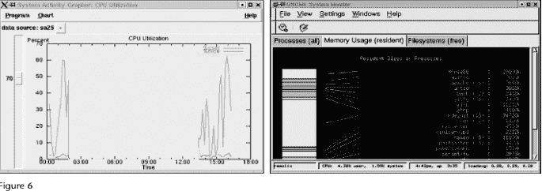

图 6

## 活动

- 1) 使用你认为最合适的工具执行全系统监控过程，并对资源使用情况和系统中可能存在的瓶颈进行诊断。然后监控涵盖集群单元中提供的 `sumdis.c` 代码的系统负载。例如，使用：`sumdis 2000000`

```bash
sumdis 2000000
```

- 2) 修改内核和编译器的参数，并执行前述提到的代码（`sumdis.c`），例如：

`time ./sumdis 1000000`

- 3) 对两个内核均进行相同操作，并对结果得出结论。

# 参考文献

其他参考和信息来源

[Debsc, [Bbb]

Linux 服务器优化：http://people.redhat.com/alikins/system_tuning.html

Linux 性能监控工具 http://www.linux

Munin: http://munin.projects.limpro.no/

Monit: http://www.tildesh.com/monit/

使用 Munin 和 monit 进行监控：http://www.howtoforge.com/

server_monitoring_monit_munin

使用 SNMP 和 MRTG 进行监控：http://www.linuxhomenetworking.com/wiki/

index.php/Quick_HOWTO__Ch22_Monitoring_Server_Performance 

MRTG: http://oss.oetiker.com/rtg/

Frysk: http://sources.redhat.com/fry/

Cacti: http://cacti.net/

# 集群

Remo Suppi Boldrito

PID_00148472


# 目录

引言................................................................................ 5

- 1. 高性能计算 (HPC) 简介....................................... 7


1.1. Beowulf ........................................................................................... 8

1.1.1. 如何配置节点？......................................................... 9

1.1.2. 分布式计算的优势....................................................... 10

1.2. 我们如何编程以利用并发计算？.................. 12

1.2.1. 并行虚拟机 (PVM)........................................................ 13

1.2.2. 消息传递接口 (MPI)...................................................... 18

2. OpenMoxix............................................................... 24

3. 元计算机、网格计算........................................................... 27

3.1. 不同的计算架构................................................................ 27

3.2. Globus ............................................................................................... 29

3.3. Globus 的软件、安装与管理...................................... 31

活动..................................................................................... 33

参考文献.................................................................................. 34

GNU 自由文档许可证.............................................. 43

# 引言

计算机集群是指一组为了共同目标而紧密工作的计算机。这些计算机由硬件、通信网络和软件组成，它们协同工作，就像都是一个单一系统的一部分一样。建立这些集群有许多原因，但主要原因之一是能够更高效、更快速地准备信息，就像单一系统一样。通常情况下，集群运行在局域网（LAN）上并提供高效的通信，尽管机器的位置彼此靠近。该概念的更大版本是网格（grid），其目标相同，但它涉及通过广域网（WAN）连接的计算机组。一些程序员将网格视为“全球”意义上的集群的集群。随着技术的不断进步，使用几十或或数百（在某些情况下是数千）台计算机所需的复杂性和努力是巨大的。然而，计算时间上的优势意味着，尽管如此，这类高性能计算（HPC）解决方案被认为是极具吸引力的并且正在不断发展。在本单元中，我们将展示一些最广泛传播和使用的方法。[Rad, Dieb, Prob, Prod, Proe, Gloa]

> 注意：集群是一组紧密工作的计算机，通常连接到局域网（LAN）。网格是通过广域网（WAN）连接的计算机组。

# 1. 高性能计算 (HPC) 简介

技术的进步带来了快速、低成本且高度高效的处理器和网络，这改变了系统中的成本/性能比例。这种架构可以分为两类：

- 紧耦合系统：内存由所有节点共享，它们通过网络进行通信。
- 松耦合系统：它们不共享内存，通过消息进行通信。

Beowulf 和工作站集群（COW）之间的主要区别之一是，Beowulf 被“视为”一台单一机器，通过远程访问节点，且节点没有终端；而 COW 是一组可以供用户使用的计算机，其他用户可以通过屏幕和键盘进行交互。我们必须记住，Beowulf 不是一种将用户代码转换为分布式代码或影响操作系统内核的软件（例如 `Mosix`）。它是创建运行 `GNU/Linux` 的超级计算机集群的一种简单方法。在接下来的章节中，我们将介绍最常见的：

## 1.1. Beowulf

Beowulf 是一种可以用于应用程序的多计算机架构。它基本上由一台服务器和通过以太网连接的一个或多个客户端组成。由虚拟机（PVM）和消息传递等系统提供的软件层极大地促进了系统的抽象，使得能够简单方便地编写分布式应用程序。基本工作模式是主从工作模式（master-workers），即有一个服务器分发工作节点执行的任务。在大型系统（1024 个节点）中，会有多个主节点以及用于特殊任务的节点，例如输入输出或监控。

### 1.1.1. 我们如何配置节点？

首先，我们必须修改（每个节点）`/etc/hosts`，使得 `localhost` 行包含 `127.0.0.1` 且不包含任何机器名，例如：

```
127.0.0.1 localhost
```

并添加节点的（以及所有节点的）IP，例如：

```
192.168.0.1 pirulo1
192.168.0.2 pirulo2
...
```

可以在所有节点上创建一个用户 (`nteum`)，创建一个组并将该用户添加到该组：

```
groupadd beowulf
adduser nteum beowulf
echo umask 007 >> /home/nteum/.bash_profile
```

通过这种方式，`nteum` 用户创建的或组内的任何文件都可以被 Beowulf 集群修改。

我们必须创建一个 NFS 服务器（其余节点将成为该服务器的客户端）。在服务器上，我们按照如下方式创建一个目录：

```
mkdir /mnt/nteum
chmod 770 /mnt/nteum
chown -R nteum:beowulf /mnt/nteum
```

```
现在我们可以从 /etc 导出此目录：
cd /etc
cat >> exports
/mnt/wolf 192.168.0.100/192.168.0.255 (rw)
control d
```

我们必须记住，我们的网络将是`192.168.0.xxx`，这是一个私有网络，这意味着集群对互联网不可，我们必须调整配置使得所有节点能够互相看到（防火墙）。

我们应该验证服务是否正在运行：

```
chkconfig -add sshd
chkconfig -add nfs
chkconfig -add reexec
chkconfig -add rlogin
```

### 集群

```
chkconfig -level 3 rsh on
chkconfig -level 3 nfs on
chkconfig -level 3 rexec on
chkconfig -level 3 rlogin on
```

为了安全地工作，使用 `ssh` 而不是 `rsh` 非常重要，这意味着我们必须为安全地连接机器-`nteum` 用户生成密钥，而无需密码。为了做到这一点，我们修改 `/etc/ssh/sshd_config` 中的行（取消注释 `#`）：

```
RSAAuthentication yes
AuthorizedKeysFile .ssh/authorized_keys
```

我们重启机器并以 `nteum` 用户身份连接，假设该用户将操作集群。生成密钥：

```
ssh-keygen -b 1024 -f ~/.ssh/id_rsa -t rsa -N ""
```

`id_rsa` 和 `id_rsa.pub` 文件已在 `/home/nteum/.ssh` 库目录中创建，我们必须将 `id_rsa.pub` 复制到同一目录下名为 `authorized_keys` 的文件中。并使用 `chmod 644 /.ssh/aut*` 和 `chmod 755 -/.ssh` 修改权限。

鉴于只有主节点会连接到其他节点（反之亦然），我们需要将公钥 (`id_rsa.pub`) 复制到每个节点的 `directory/home/nteum/.ssh/authorized_keys` 目录中。此外，在每个节点上，我们都必须使用 `/etc/fstab` 挂载 NFS，行内容为 `pirulo1:mnt/nteum/mnt/nfs rw,hard,intr 0 0`。

到此为止，我们将拥有用于集群 PVM 或 MPI 应用的 Beowulf 集群（我们将在接下来的章节中看到）。在 FC 上，有一个应用程序 (`system-cluster`) 允许基于图形化工具配置集群。更多信息，请参阅：http://www.redhat.com/docs/manuels/enterprise/RHEL-5/manual/Cluster_Administration/index.html。

### 1.1.2. 分布式计算的优势


# 并行计算的优势是什么？

我们将通过示例 [Rad] 来这些这些。我们有一个加数字的程序（例如 4 + 5 + 6...），名为 `sumidc.c` 并用 C 语言编写：

```c
#include <stdio.h>

int main (int argc, char**argv) {

    float initial, result, tmp;

    if (argc < 2) {
        printf("Use: %s N. initial N.*\n\n", argv[0]);
        exit(1);
    } else {
        initial = atol(argv[1]);
        final = atol(argv[2]);
        result = 0.0;

        for (tmp = initial; tmp <= final; tmp++) {
            result += tmp;
        }
        printf("%f\n\n", result);
        return 0;
    }
}
```

我们用 `gcc -o sumdis.c` 编译它，如果我们查看该程序的执行情况，例如：

- `time ./sumdis 1000000` 从 1 到 10^6

我们可以看到，在一台配备 AMD Athlon 1.400 MHz 256 MB RAM 的 Debian 2.4.18 机器上，时间（大约）`real = 0.013` 且 `user = 0.010`，也就是说，总计为 13 ms，用户区为 10 ms。然而，如果我们输入：

- `time ./sum 1600000` 从 1 到 16*10^6

时间将是 `real = 182`，也就是说，多出 14 倍，如果我们考虑 `1600000(160*10^3)`，时间大约是几分钟。

分布式计算的想法是：如果我们有一个由 4 台机器（`node1-node4`）组成的集群，通过 NFS 共享文件，通过 `rsh` 执行将很有趣（但在本例中是可以接受的），这样第一个是 1 到 40000000，第二个是 40000001 到 80000000，第三个是 80000001 到 120000000，第四个是 120000001 到 160000000(160*10^3)。

*(注：我处理了提供的文本。然而，提示中提供的文本包含了大量重复的乱码段落。）*

*(注：OCR 源文本是重复的，已省略以保持文档质量。）*

PVM 有一个控制台（`pvm`），通过它可以启动守护进程、创建虚拟机以及执行应用程序。由于编译需要一定程度的“投入”，建议从发行版中安装软件。例如，在 Debian 上安装 PVM，我们必须包含两个包（最少）：`pvm` 和 `pvm-dev`（`pvm` 控制台和工具在第一个包中，而库、头文件以及其余编译工具在第二个包中）。如果我们因为已经有了应用程序而只需要库，那么可以只安装 `libpvm3` 包。

在 PVM 中创建一个并行/分布式应用程序，我们可以从标准版本开始，或者从问题的的物理结构开始，并确定哪些部分是可以并发的（相互独立的）。并发部分将作为重写为并行代码的候选。此外，我们必须考虑是否可以将已有的函数替换为并行版本（例如 Scalapack，可扩展线性代数包，在 Debian 中通过 `scalapack-pvm | mpich-dev` 或 `scalapack1-pvm | m` 提供，取决于是 PVM 还是 MPI）。此外，查找是否有任何并行应用程序（`http://www.epm.org/pvm`）可以指导我们构建并行应用程序的方法也是很方便的。

程序并行化并不是一项容易的任务，因为我们必须考虑阿姆达尔定律。

> 阿姆达尔定律指出，加速比受限于可并行代码比例 (`f`) 的限制：`speedup = 1/(1-f)`。

该定律意味着：顺序执行的应用 `f = 0` 时，加速比为 1；所有代码并行 `f = 1` 时，加速比为无限大（∞）；可能的取值为，90% 的并行代码意味着加速比为 10，但当 `f = 0.99` 时，加速比为 100。这种局限性可以通过可扩展算法和不同的应用模型来避免：

- 1) 主-工作节点模式（Master-worker）：主节点启动所有工作节点并协调工作及输入输出。
- 2) 单进程多数据（SPMD）：相同的程序在不同的数据集上执行。
- 3) 功能型（Functional）：应用程序中执行不同功能的各种程序。

通过 `pvm` 控制台和 `add` 命令，我们可以在所有节点上配置虚拟机。在这些节点中的每一个，必须存在 `~/pvm3/bin/LINUX` 目录，其中包含应用程序的二进制文件。必须声明变量 `PVM_ROOT = Directory`（即 `lib/LINUX/libpvm3.a` 所在目录）以及 `PVM_ARCH+LINUX`，这些可以放在 `~/.cshrc` 文件中。

如果使用 `rsh` 作为远程执行的手段，用户的 shell（通常是 NIS 用户，如果不是，则每台机器上必须是同一个用户且密码相同）以及 `~/.hosts` 文件必须配置以便无密码访问每个节点。PVM 包包含了 `rsh-pvm`，可以在 `/usr/lib/pvm/bin/rsh` 找到，它是专门为 PVM 制作的（参见文档），出于安全考虑，某些发行版不包含它。建议如我们所示的那样，通过每个用户目录下的 `.ssh/authorized_keys` 使用公钥配置 `ssh`。

# 集群 (Clustering)

作为 PVM 编程的示例，我们展示了一个服务器客户端类型的程序，其中服务器创建子节点并发送数据，这些节点在子节点之间按照指定的次数循环传输数据（左侧第一个节点接收一段数据，进行处理并发送给右侧节点），父节点等待子节点完成。

# PVM 示例：master.c

## 在 Debian 中编译

- `gcc -I/usr/share/pvm3/include -L/usr/share/pvm3/lib -o master -lpvm3`

`-L` 参数后的目录必须是 `pvm3.h` 和 `libpvm` 库所在的目录。

## 执行步骤

1) 使用 `pvm` 执行数据守护进程
2) 执行 `add` 来添加节点（如果只有一个节点，可以跳过此命令）
3) 执行 `quit`（退出 `pvm` 但它继续运行）
4) 我们执行 `master`


```c
#include <stdio.h>
#include "pvm3.h"
#define SLAVENAME "/home/nteum/pvm/client"
int main() {
    int mytid, tids[20], n, nproc, num, i, msgtype, types;
    float data[10]; int n_times;

    if (pvm_parent() == PvmNoParent) {
        /*判断当前是父进程还是子进程 */
        loops = 1;
        printf("\nhow many children (120)? *\n");
        scanf("%d", &nproc);
        printf("\nhow child-child communication loops (1 - 5000)? *\n");
        scanf("%d", &loops);
    }
    /*重定向节点的输入输出到父节点 */
    pvm_catchout(stdout);
    /*创建子节点 */
    num = pvm_spawn(SLAVENAME, (char**)0, 0, "*", nproc, tids);
    /*启动一个新进程，第1：可执行子节点，第2：argv，第3：options，
    /* 第4：where，第5：N. 副本，第6：id 矩阵*/
    printf("Result of Spawn: %d\n", num);
    if (num < nproc) {
        printf("Error creating the children.\n");
        for (i = num; i < nproc; i++) {
            printf("Tid %d\n", tids[i]);
        }
        for (i = 0; i < num; i++) {
            pvm_kill(tids[i]); /*杀死带有 id 的进程*/
        }
        exit();
    }
    /*启动程序，初始数据 */
    n = 10;
    for (i = 0; i < n; i++) {
        data[i] = 2.0;
        /*向从节点广播初始数据*/
        pvm_initend(PvmDataDefault);
        pvm_pkint(&loops, 1, 1);
        /*在缓冲区打包数据，第2：步长*/
        pvm_pkint(&nproc, 1, 1);
        pvm_pkint(tids, nproc, 1);
        pvm_pkfloat(&data, n, 1);
        /*向子组广播缓冲区并等待子节点的结果*/
        pvm_mcast(tids, nproc, 0);
        msgtype = 5;
        for (i = 0; i < nproc; i++) {
            pvm_recv(-1, msgtype); /*接收消息，-1：任意，第2：消息标签*/
            pvm_pkint(&who, 1, 1);/*解包*/
            printf("Finished %d\n", who);
        }
    }
    pvm_exit();
}
```

# PVM 示例：client.c

在 Debian 中编译：

```bash
gcc -O3 -I/usr/share/pvm3/include -L/usr/share/pvm3/lib -lpvm client.c -o client
```

`-I` 和 `-L` 中的目录必须分别包含 `pvm3` 和 `libpvm`。

执行：

这是必要的，因为主节点会启动它们，但 `client` 必须位于 `/home/nteum/pvm3`。

```c
#include <stdio.h>
#include <pvm3.h>

main() {
    int mytid; /*任务 id*/
    int ids[20]; /*任务 ids*/
    int me, i, nproc, master, mgtype, loops; float data[10];
    long result[4]; float work();
    mytid = pvm_mytid(); mgtype = 0;

    pvm_recv(&loops, -1, msgtype);
    pvm_pkint(&nproc, 1, 1);
    pvm_pkint(ids, nproc, 1);
    pvm_pkint(&me, 1, 1);
    pvm_pkfloat(&data, n, 1);
    /*确定它是哪个子节点 (0 - nproc-1) */
    for (i = 0; i < nproc; i++)
        if (mytid == ids[i]) { me = i; break; }

    /*在相邻之间处理并传递数据*/
    work(me, data, nproc, loops);

    /*将数据发送给主节点 */
    pvm_initend(PvmDataDefault);
    pvm_pkint(&me, 1, 1);
    mgtype = 5;
    master = pvm_parent(); /*查找是谁创建了它*/
    pvm_send(master, mgtype);
    pvm_exit();
}

float work(int me, int *tids, int nproc, float *data) {
    int i, j; float psum = 0.0, sum = 0.1;
    for (j = 0; j <= loops; j++) {
        pvm_initend(PvmDataDefault);
        pvm_pkfloat(&sum, 1, 1);
    }
    return 1;
}

if ( dest == nproc ) dest = 0;
pvm_send( ids[dest], 22);
i = me - 1;
if ( me == 0 ) i = nproc-1;
pvm_recv( ids[i], 22);
pvm_pkfloat(& sum, 1, 1 );
```

程序员受到一个非常有帮助的图形界面辅助（见下图），该界面作为 PVM 控制台和监控器被称为 `xpmvm`（在 Debian 中安装 `xpvm` 包），它可以配置虚拟机、执行进程、视觉化任务之间的交互（通信）、状态、信息等。

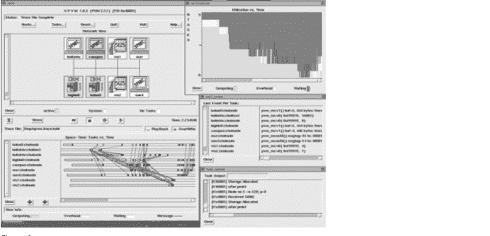

# 1.2.2. 消息传递接口 (MPI)

`MPI` API 的定义 `[Prob, Proc]` 是 `MPI` 论坛 (`MPIF`) 的成果，这是一个由 40 多个组织组成的联盟。`MPI` 影响了不同的架构、语言和并行世界的工作，例如：`WRC` (`IBM`), `Intel NX/2`, `Express`, `nCUBE`, `Vertex`, `p4`, `Parmac` 以及来自 `ZipCode`, `Chymp`, `PVM`, `Chamalone`, `PICL` 的计算。`MPIF` 的主要目标是设计一个与任何集群或库没有特殊关系的 API，以便高效的内存到内存拷贝、计算和并发通信下载成为可能，并且存在通信处理器。

在 C 和 C++ 中使用多处理器并行 (`MPP`) 范式是为了利用其最重要的特性之一：可移植性。`MPP` 可以在多处理器机器、`WS` 网络以及共享内存上执行。`MPI1` 版本（最广泛使用的版本）不支持任务的动态创建（`spawn`），但 `MPI2`（正在以日益快的速度发展）。

许多方面已经开发开发出来，以利用可扩展并行集群 (`SPC`) 上通信硬件的优势，该标准已大部分被并行和分布式硬件制造商（`SGI`, `SUN`, `Ray`, `HPConvex`, `IBM`,...）接受。这里有免费版本（例如 `mpich`，它与硬件制造商的商业实现完全兼容），它们提供了点对点通信、集合操作和进程组、通信和拓扑支持，适用于 `Fortran` 和 `C` 语言，并提供控制、管理和分析环境。但仍存在一些未解决的问题，例如：`I/O` 操作、远程执行、程序构建工具、调试、线程控制、任务管理、并发输出函数，这些由于工具缺失而产生的问题在 `MPI2` API 版本 2 中得到了解决。`MPI1` 中的函数由于没有动态创建，非常简单，因为许多作为任务的进程是独立的，并执行自己的多指令多数据 (`MDD`) 风格代码并通过 `MPI` 调用进行通信。代码可以是顺序的或多线程（并发）的，`MPI` 在线程安全模式下工作，换句话说，可以在并发线程中使用 `MPI` 调用，因为调用是可重入的。


安装 MPI 建议使用分发版（因为由于对其他包的依赖，编译过程极其复杂）。Debian 在 `mpich-package` 中包含了 `Mpich 1.2.7-(itch)` 版本（`mpich` 软件包已过时），还包含了 `mpich-bin`（一个包含对可扩展进程、管理和控制支持的多用途守护进程版本）。`mpich-bin` 实现了 MPI 1.2 标准和 MPI 2 的部分内容（例如，并行输入/输出）。此外，它还包含了另一个名为 LAM 的 MPI 实现（在 `lam*` 包和文档中）。从 MPI 的角度来看，这两种实现是等价，但管理方式不同。关于 MPI 的所有信息（在安装 `mpich*` 包后）可以在 `/usr/share/doc/mpi`（或 `/usr/doc/mpi`）中找到。MPI 需要 `rsh` 在其他机器上执行，这意味着我们必须在 `~/.hosts` 文件中插入用户目录，格式如下：`host username` 允许用户名无需密码进入主机（与 PVM 相同）。请记住，我们必须在所有机器上安装 `rshserver` 包，如果 `/etc/inetd.conf` 中的 `rsh.d` 中有 `tcpd`，我们必须在 `/etc/hosts.allow` 中启用 hosts。此外，我们必须在所有机器上通过 NFS 监控用户目录，并且 `/etc/mpich/machines.LINUX` 文件必须包含组成集群的所有主机名（默认每行一个，如 `localhost`）。此外，用户必须将 Csh 作为默认 shell。

在 Debian 上，我们可以安装 `update-cluster` 包来帮助管理。在 Debian 上安装 Mpich 出于安全考虑使用了 `ssh` 替 `rs=>ssh` 的链接，但区别在于我们使用 `ssh` 认证机制通过相应文件进行无密码连接。否则，对于每个执行的进程，我们都必须在执行前输入密码。为了允许通过 `ssh` 使用密码进行机器连接，我们必须遵循上一节提到的步骤。要检查这一点，我们可以运行 `ssh localhost`，然后我们应该能够无密码登录。请记住，如果我们安装了 Mpich 和 LAM-MPI，`mpirun` 将会被调用为 `mpirun.mpich`，而 `mpirun` 将是 LAM-MPI 的。重要的是，LAM 的 `mpirun` 将使用

`lamboot` 守护进程的设计使得用户可以在没有 root 权限的情况下执行程序（它还允许在虚拟机 VM 中在不调用 MPI 的情况下执行程序）。由于此原因，要执行 `mpirun`，我们将以非 root 身份执行并先执行 `lamboot`。我们使用 `/etc/lam` 中的配置文件进行节点的默认定义（参见 `bhost`）；请参阅文档获取更多信息（`http://www.lam-mpi.org/`）。[Lam]

要编译 MPI 程序，我们使用 `mpicc` 命令（例如 `mpicc -o test.c.`），它接受 `gcc` 的所有选项，尽管建议（通过修改）位于 `/usr/doc/mpich/examples` 文件中的某些 makefiles。也可以使用 `mpireconfig Makefile`，它使用 `Makefile.in` 作为入口来生成 makefile，并且更易修改。之后，我们可以运行：

```
mpirun -np 8 programme
```

或者：

```
mpirun.mpich -np 8 programme
```

其中 `np` 是程序执行运行的处理器或进程数量（在这种情况下为 8）。我们可以输入任何喜欢的数字，因为 Mpich 将尝试在 `/etc/mpich/machines.LINUX` 的所有机器之间平衡分布进程。如果进程多于处理器，Mpich 将使用 GNU/Linux 的交换特性来模拟并行执行。在 Debian 的目录 `/usr/doc/mpich-doc`（指向 `/usr/share/doc/mpich-doc` 的链接）中，我们可以找到所有不同格式的文档（命令、MPI API 等）。

编译 MPI：`mpicc -O -o output output.c`

执行 MPI：`mpirun.mpich -n N output`

现在我们将看到两个示例（包含在分发 `/usr/doc/mpich/examples` 中）。`pi` 是一个用于分布式形式计算 PI 值的简单程序。

点对点通信：`pi.c`

编译：`mpicc -O pi.c`

执行 MPI：`mpirun -np N output`

执行 LAM：`mpirun -np N`（如果我们无法通过 `ssh` 直接访问，则必须使用 root 以外的其他用户）

```c
#include "mpi.h"
#include <stdio.h>
#define BUFFEN 512

main(int argc, char *argv[]) {
    int myid, numprocs;
    char buffer[BUFFER], processor_name[MPI_MAX_PROCESS_NAME];
    MPI_Status status;

    /* 必须放在 MPI 调用之前，始终如此 */
    MPI_Init(&argc,&argv);
    MPI_Comm_size(MPI_COMM_WORLD, &numprocs);
    /* 表示组中的进程数 */
    MPI_Comm_rank(MPI_COMM_WORLD, &myid);
    /* 进程的 ID */
    MPI_Get_processor_name(processor_name, &namelen);
    /* 进程名称 */
    fprintf(stderr, "Process %d at %s\n", myid, processor_name);
    strcpy(buffer, "Hello!");
    if (myid != numprocs)
        next = 0;
    else
        next = 1;

    if (myid == 0) { /* 如果是第一个... */
        if (n== 0) n = 100; else n = 0;
        starttime = MPI_Wtime();} /* 时钟 */
        MPI_Bcast(&n, 1, MPI_INT, 0, MPI_COMM_WORLD); /*广播到其余部分*/
        /*从第4个参数发送到
        组中的进程。所有不是0的进程
        将从参数4或参数-进程0拷贝缓冲区-*/1.*:buffer*/
        printf("%d received '%s\n", myid, buffer)
    } else {
        printf("%d receiving \n", myid);
        MPI_Recv(buffer, BUFFEN, MPI_CHAR, MPI_ANY_SOURCE, 99, MPI_COMM_WORLD, &status);
        /* 阻塞式接收, 1:buffer, 2:size, 3:type, 4:source, 5:tag, 6:context, 7:status */
        printf("%d received '%s\n", myid, buffer);
        MPI_Send(buffer, strlen(buffer)+1, MPI_CHAR, next, 99, MPI_COMM_WORLD);
        printf("%d sent '%s\n", myid, buffer);
    }
    MPI_Barrier(MPI_COMM_WORLD); /* 同步所有进程 */
    MPI_Finalize(); /* 释放资源并结束 */
    return (0);
}
```

# 分布式进程计算：pi

```cpp
2nd :size, 3rd :type, 5th :group */
if (n == 0) done; else {
    h = 1.0 / (double) n;
    sum = 0.0;
    for (i = myid + 1; i < n; i += numprocs) {
        x = h * (double)i - 0.5); sum += f(x);
    }
    mypi = h; sum;
```

`MPI_Reduce(mypi, &pi, MPI_DOUBLE, MPI_SUM, 0,`

`MPI_COMM_WORLD);`

/* 使用 `MPI_SUM` 操作合并组中每个进程的发送缓冲区（Send Buffer）元素，并将结果返回到接收缓冲区（Recv Buffer）。它必须由组中的所有进程调用，使用相同的参数列表/*

sendbuffer, 2nd

recvbuffer, 3rd :size, 4th :type, 5th :oper, 6th :root, 7th

:context*/


```c
if (mid == 0) { /* 只有 P0 打印结果 */
    printf("Pi is approximately %.16f, the error is %.16f\n", pi, fabs(pi - PI25DT));
    endtime = MPI_WTime();
    printf("Execution time = %f\n", endtime-starttime);
}
```

`MPI_Finalize();` /*释放资源并结束*/

PVM 中存在 XPVM，而在 MPI 中有一个类似的（更复杂的）应用称为 XMPI（Debian 中的 `xmpi`）。也可以安装一个库库 `libxmpi3`，它实现了 XMPI 协议，可以以比 XMPI 提供的更多细节图形化地分析 MPI 程序。下图显示了 MPI 中一些可能的图形。

| MPI Trace |

| Timeline (msitlejary) | Scale:1 x 1 |

|---|---|

| 0.580568 | VDF | PDP | VDF | PDP | 0.623415 | 0.676853 |

图 2. XMPI

## 2. OpenMosik

OpenMosik [项目] 是一个软件包，它可以将 GNU/Linux 下通过网络连接的一组机器转换为集群。这可以在集群的不同节点之间自动平衡负载，并且节点可以在加入或离开集群时不中断服务。负载在节点之间进行分布，并考虑了连接速度和 CPU。OpenMosik 是内核的一部分（通过一个 Linux 内核补丁），并与 GNU/Linux、用户程序、文件和资源保持兼容性。OpenMosik 的另一个特性是它集成了一个用于高性能计算（HPC）应用程序的强大且优化的文件系统（oMFS）。在 Debian Woody 中，我们可以从 `openmosik-dev`（库和头文件）、`kernel-patch-openmosik`（OpenMosik 补丁）、`openmosik`（管理工具）安装 OpenMosik。同样，也可以安装所有（请参见文档了解 Mosik 和 OpenMosik 之间的差异，特别是关于许可证）。在 Woody 之后的 Debian 版本中，它不再以包（stable）的形式包含，必须去 `http://openmosik.sourceforge.net/` 获取包（或资源）以及安装指南（`http://howto.x-tend.be/openMosik-HOWTO/`）。

OpenMosik 使用一个通常位于 `/etc` 中的配置文件（参见该文件旧版本的文档），该文件名为 `openmosik.map`，并且每个节点都应该有该文件。它的格式非常简单，每行有三个字段：`Nodo_ID` `IP-Address`（或主机名） `Range-size`

示例如下：

- node1 1
- node2 1
- node3 1
- 4 192.168.1.1 1
- 5 192.168.1.2 1

也可以使用 ID 和 IP 分别增加的范围。我们必须确保每个节点上具有相同的配置和相同版本的 OpenMosik。要执行 OpenMosik，在每个节点上必须输入：

```
setpe -w -f /etc/openmosik.map
```

我们还可以使用 OpenMoscript（将其从 `userspace-tools` 复制到 `/etc/init.d`）在引导启动时启动它。

OmFS 文件系统允许远程访问集群中的所有文件，就像它们在本地挂载一样。其他节点的文件系统（FS）可以挂载到 `/mfs`，因此 `/home node 3` 中的文件将在每台机器的 `/mfs3/home` 中看到。

> 集群中每个节点文件系统的所有 UID（用户 ID）和 GID（组 ID）必须相等（可以使用 OpenLapd 用于此）。

要挂载 OmFS，我们必须修改 `/etc/fstab`，添加条目如：`mfs_mnt /mfs dfsa = 100` 和 `0` 来启用或禁用：`mfs_mnt /mfs dfsa = 0 0 0`。

之后，每个节点的文件系统将在 `/mfs/OpenMosikNode ID/` 中可见。完成后，可以多次执行一个非常简单的脚本，例如（参见 Howto OpenMosik）：

```
awk 'BEGIN{for i = 0;i<10000;i++)for(j = 0;j<10000;j++)}'
```

随后，我们可以通过 `momom` 或 `openmosikview` 作为守护进程（`omiscd`）观察行为，这使得自动配置集群成为可能，无需编辑和配置 `/etc/openmosik.map`。该守护进程将向其他节点广播它也是一个 OpenMosik 节点，这意味着一旦 `omisc` 启动，该守护进程将自动加入集群。为了实现这一点，我们需要正确配置网络的默认网关（GW）。一旦执行（`omiscd`），将生成一系列指示集群状态和配置的消息。我们可以使用 `showmap` 命令查看 `omiscd` 生成的新配置。OpenMosik 提供了一套工具，管理员可以使用这些工具来配置和调优 OpenMosik 集群。这些任务可以通过用户工具（`migrate`, `mon`, `mosctl`, `mosrun`）或通过 `proc/hpc` 接口完成。需要注意的是，在 OpenMosix 2.4.16 版本之前，该接口被称为 `/proc/mosix`，而从 2.4.16 版本开始，它被称为 `/proc/mosix`。

- `migrate`
- `mon`
- `mosctl`
- `mosrun`

## 3. 网格计算，网格计算

某些应用程序的计算需求巨大，需要数千小时才能执行。这促进了网格计算的产生。例如，北美的 I-WAY（连接超级计算机）、欧洲的 DataGrid 或西班牙的 IrisGrid。网格计算或网格计算机与分布式系统（SPD）有许多共同点，但在重要方面也不同。尽管它们通过网络连接，但无法保证服务，且它们位于不同的域。编程模型和接口必须与分布式系统相比）有本质区别，并适应高性能计算。因此，网格计算应用的通信计划提供所需的性能水平；但由于其动态性，需要新的工具和技术。换句话说，虽然网格计算可以基于分布式系统形成，但需要新的工具和。

### 3.1. 不同的网格计算架构

如果我们只考虑计算能力方面，可以看到根据问题的大小和特征有多种解决方案。首先，我们可以考虑超级计算机（服务器），但这些设备存在可扩展性差、设备和维护昂贵、持续计算（大量时间资源未得到利用）以及可靠性等问题。经济替代方案是使用高性能网络（快速以太网 - LAN 或 Myrinet - SAN）连接的一组计算机，这将形成一个用于并行/分布式计算（SPD）的工作站，具有极高的性能水平（性能比 3 到 15 倍）。但这些系统存在通信成本高、维护困难、编程模型等缺点。然而，它是中高时间计算（HTC）的极佳解决方案。另一个有趣的概念是内网计算，这意味着使用局域网设备在管理和加载工具的辅助下执行顺序或并行作业；换句话说，它是集群的一个降级方案。

资源的有效性（低成本 CPU 周期）、提升了可扩展性，且管理不会过于复杂。对于这类解决方案，有许多软件，例如 Sun Microsystems 提供的 Sun Grid Engine [Sun]、威斯康星大学的 Condor（两者均免费）[Uni] 或 Platform Computing 提供的 LSF（商业软件）[Pla]。

内网计算的选项带来了诸许多不便，例如无法管理管理域之外的资源。一些被遗弃的工具（Condor、LSF 或 SGE）允许系统的不同子节点之间进行协作，但它们都必须具有相同的管理结构、相同的安全策略和相同的资源管理理念。尽管这在低成本计算能力方面迈了一步，但它们只能管理 CPU，而不管理子节点之间共享的数据。此外，其协议和接口是专有的，当资源未被充分利用时无法进行资源摊销，也无法与其他组织共享资源。[Beo, Ext, Die]

在 1986 年到 2000 年间，计算机的数量增长了 500 倍，网络数量增长了 34 万倍，但预测显示到 2001 年和 2010 年，计算机将仅增长 60 倍，网络增长 4,000 倍。这表明下一代 HPC 架构的标准：通过互联网分布式计算或网格计算（GC）或计算。网格计算是一种新兴的新技术，其目标是以统一、安全、高效且可靠的方式在互联网上共享资源。它允许不同网域的资源进行互连，同时尊重其在内网上的安全策略和资源管理。根据其先驱者之一 Ian Foster 在其文章《什么是网格？》（2002）中的描述，网格是一个具有以下功能的系统：

- 1) 协调不受通用控制的资源，
- 2) 使用标准的、通用的协议和接口，
- 3) 提供非凡的服务质量。

在这项新技术提供的优势中，我们可能会提到资源租赁、资源摊销、在无需投资资源和设施的情况下获得巨大的算力、机构之间的协作/共享等。下图提供了所有这些概念的概览。[Lio]


## 3.2. Globus


Globus 项目 [Gloa, Glob] 是这一意义上最具代表性的项目之一，因为它是网格计算工具包开发的先驱，并在通信、信息、位置定位和资源规划领域取得了显著进展。在其他方面，它使得共享位于不同域的资源成为可能，具有不同的安全和资源管理策略，它由一个中间件软件包组成，其中包含一组库、服务和 API。Globus 工具包由一组模块组成，这些模块具有定义的接口用于与其他模块进行交互。这些模块的功能如下：

- 资源的定位与分配；这允许我们告诉应用程序需求是什么以及我们需要什么资源，因为应用程序无法知道它将在哪些资源上执行。
- 通信；这提供了基本的通信机制，这是系统的的一个重要方面，因为它们必须允许应用程序高效地使用各种方法。这些包括消息传递、远程过程调用（RPC）、共享分布式内存、（基于流的）数据流和多播。
- 统一资源信息服务；提供了一种统一的机制，用于实时获取应用程序执行的系统状态和结构信息。
- 身份验证；这些是验证用户和资源身份的基本认证机制。该模块生成上层，然后该上层将使用本地服务访问数据和资源。
- 进程的创建与执行；用于启动分配给资源的任务执行，传输执行参数并控制它们直到执行完成。
- 数据访问；这必须提供对文件中保存的数据的高速访问。对于数据库（DB），它通过 CORBA 使用分布式访问技术，并在通过网络访问并行文件系统或输入/输出设备（例如高性能存储系统 HPSS）时，能够实现最佳性能水平。

Globus 的内部结构可以在下图（`http://www.globus.org/toolkit/about.html`）所示。

### Globus Toolkit 版本4 (GT4)

| 社区授权 | 数据复制 | 网格控制协议 | Web MDS | Python WS Core |
| :--- | :--- | :--- | :--- | :--- |
| 社区授权 | - | 社区调度器框架 | - | - |
| 委托 | OGS-DA | 工作空间管理 | 收件箱 | C WS Core |
| 身份验证 | 可靠文件传输 | 网格资源分配与管理 | 触发器 | Java WS 组件 |
| WS 前身份验证授权 | GridTP | WS 前网格分配与管理 | 监控与发现 (MDS2) | C Core库-WS 组件 |
| 凭证管理 | 数据定位 | 执行管理 | 信息服务 | 通运行时扩展 IO (XIO) |

- 核心 GT 组件：增量发布之间的公共接口；尽力支持
- 贡献性/技术预览：公共接口在增量发布之间可能会发生变化
- 已弃用组件：不支持；将在未来的发布中被删除

## 3.3. Globus 的软件、安装与管理

“Globus 联盟”网站为 `http://www.globus.org` [Gloa]。在这里我们可以找到源代码以及将我们的内网转换为网格一部分所需的所有文档。成为网格的一部分意味着同意并实施参与该网格的所有机构和公司的政策。西班牙有几项基于 Globus 的不同倡议。之一是 IrisGrid II，如果我们希望利用这项技术的优势，就可以加入它。更多信息请参见：`http://www.redis.es/irisgrid/`

设置 Globus 的第一步是获取软件（目前为 Globus Toolkit4），称为 GT4。该软件结合 C 和 Java 实现服务（C 组件通常只能在 UNIX/Linux 平台上运行），这就是为什么软件被分为它提供的服务。根据需要设置的系统，应该安装某些包或其他包。

快速安装指南、包含下载、系统要求和证书可以在 `http://www.globus.org/toolkit/docs/4.0/admin/docbook/quickstart.html` 获取。总结来说，必须采取以下步骤：

- 1）准备工作：验证软件版本（zlib, j2se, 禁用 gcj, apache, C/C++, tar, make, sed, perl, sudo, postgres, iodbc）
- 2）创建用户，下载并制作、编译 GT4
- 3）启动系统安全（证书）
- 4）启动 GridFTP
- 5）启动 Web 服务容器
- 6）配置 RFT（可靠文件传输）
- 7）启动 WS GRAM（作业管理）
- 8）启动第二台机器
- 9）启动索引服务层级
- 10）启动集群
- 11）建立跨 CA 信任

正如你所看到的，安装和设置 GT4 并不是一项简单的任务，但如果我们希望将集群整合到网格中，或者如果我们希望进行测试（我们建议额外的热情和耐心）以体会 GT4 的真实威力，它是值得的。有关安装 GT4 的详细信息，请参阅：

`http://www.globus.org/toolkit/docs/4.0/admin/docbook/`

## 活动

- 1) 在节点上安装 PVM 并执行提供的示例 `master.c` 和 `client.c` 程序，通过 `xpmv` 观察它们的行为。
- 2) 在节点上安装并配置 Mpich；编译并执行 `cpi.c` 程序。
- 3) 在节点上安装并配置 LAM-MPI；编译并执行 `cpi.c` 程序，并通过 `xmpi` 观察其行为。

# 参考文献

其他参考和信息来源

- [Debc, Ibi, Mou01] Lam-mpi: `http://www.lam-mpi.org/`
- System-config-chaster (FC): `http://www.redhat.com/docs/manual/enterprise/RHEL-5-manual/Cluster_Administration/index.html`
- OpenMosix: `http://openmosix.sourceforge.net/`
- HowTo Openmosix: `http://howto.x-tend.be/benOpenmosix-HOWTO/`
- Globus4: `http://www.globus.com/toolkit/docs/4.0/`
- GT4 快速指南: `http://www.globus.org/toolkit/docs/4.0/admin/docbook/quickstart.html`

# 参考文献

- [Ai02] Tigan Aivazian (2002), 《Linux Kernel 2.4 Internals》，Linux 文档项目 (guianx)。
- [Ano99] 匿名. 最大 Linux 安全：黑客保护指南
- [Apa] Apache 2 + SSL `http://www.debian.org/articles/349>`
- [Apab] Apache 2 + WebDav `http://www.debian.org/articles/285>`
- [Apac] Apache 2 + Subversion `http://www.debian.org/admin-org/>`
- [Ar01] Jonathan Corbett, Alessandro Rubini. 《Linux Devices》第二版. O'Reilly, 2001.
- [Arc] Roberto Arcomano, "Kernel Analysis-HOWTO"。Linux 文档项目.
- [Aus] CERT Australia. "Australian CERT. `http://www.auccert.org/au/>`
- [Bac86] Maurice J. Bach (1986). 《The Design of the UNIX Operating System》。Prentice Hall. `http://www.redhat.com/books/max-rpm/index.html>`
- [Ba03] Edward C. Bailey (2003), 《Linux 安装策略 HOWTO》。Linux 文档项目.
- [Bar84] Slashdot, slashdot 网站。`http://barapunto.com/>`
- [Bas] Mike G. "BASH Programming - Introduction HOWTO"。Linux 文档项目.
- [Beo] Beowulf.org, Beowulf 网站。`http://www.beowulf.org/>`
- [Bor] Matthew Borowski (2000), "FTP"。Linux 文档项目.
- [Bro] Scott Bronson (2001), "VPN PPP-SSH"。Linux 文档项目.
- [Bul] Bulina, "halmina Linux 用户组。`http://bulinag.net/>`
- [Bur02] Hal Gurliss (2002), "Linux Security HOWTO"。Linux 文档项目.
- [Cac] 使用 Cacti 进行监控。`http://cacti.net/>`
- [Cdeg] Cdega. (GNU/Linux 游戏移植性环境) `http://www.transgaming.com/>`
- [Cde] Cederqist. "使用 CVS 管理版本"。`http://www.cvhome.org/>`


# 参考文献

- [Cen] 社区企业级系统 `http://www.centos.org/>`
- [CERa] CERT. "CERT 网站"。`http://www.cert.org/>`
- [CERB] CERT (2003). "CERT 漏洞"。`http://www.cert.org/nav/index_red.html>`
- [Cerc] Cervisia. "用于 CVS 的 Cervisia 接口"。`http://www.cervisia.sourceforge.net`
- [Ci00] Cisco (2000), "TCP/IP 白皮书"。`http://www.cisco.com/>`
- [Com01] Douglas Cooper (2001), 《TCP/IP 基本原理、协议和架构》。Prentice Hall.
- [Coo0] Mendel Cooper (2006), 《高级 脚本指南》。Linux 文档项目 (guat)。
- [CVS] CVSHome.org. "CVS 主页"。`http://www.cvhome.org/>`
- [CVSI] CVS 的图形界面 `http://www.twobaseballcorns.net/tkvs.html>`
- [Dbc] Marco Cevasi; Daniel Robert (2006). 《Understanding the Linux Kernel》（第3版）。O'Reilly.
- [Deb] Debian. Debian. "Debian 安全"。`http://www.debian.org/security/>`
- [Deb04] Debian (2004), "APT-HOWTO"。`http://www.debian.org/doc/manuals/apt-howtos/index.en.html>`
- [Deba] Debian. "自由软件与开源软件"。`http://www.debian.org/intro/free_en.html>`
- [Debb] Debian 社区。"Debian 发行版"。`http://www.debian.org/>`
- [Dieb] Hank Dietz (2004), 《Linux 并行处理》。Linux 文档项目.
- [Dis] Distrowatch. "可用 Linux 发行版"。`http://www.distrowatch.com/>`
- [Dgn] The Dot GNU 项目。`http://www.gnu.org/software/dotgn/`
- [DNS] 启动 DNS 服务器。`http://www.ldp.org/HOWTO/DNS-HOWTO.html>`
- [Dra] Joshua Drake (1999), 《Linux 网络》。Linux 文档项目.
- [DSL] 数字线路用户用户。Linux 文档项目.
- [Buy] Kris Buya 等人 (2002), 《The OpenMox. The Linux》。
- [Ext] ExtremeLinux.org, "Extreme Linux 网站"。`http://www.extmlinux.org/`
- [Exim] 邮件服务 (MTA)。`http://www.exim.org/docs/html>`
- [FBI] FBI。"针对网络犯罪"。
- [Fed] Fedora 项目。`http://fedoraproject.org`
- [Fen02] Kevin Fenzi. "Linux 安全 HOWTO"。Linux 文档项目.
- [Fos] Ian Foster; Karl Kesselmann (2003), "Globus: 元计算基础设施"。`http://www.globus.org`
- [Fre] Freshmeat. "Freshmeat 网站"。`http://freshmeat.org`
- [Pri02] Alan Frisch (2002). 《基本系统管理》。O'Reilly.
- [Fry] 使用 Fry 进行监控。`http://sources.redhat.com/fry/`
- [PSF] PSF。"自由软件基金会与 GNU 项目"。`http://www.gnu.org`
- [Gar98] Dale Barge (1998). 《TCP/IP 教程》。
- [Gloa] Globus. GT4. '管理指南'与'管理配置'。`http://www.globus.org`
- [Glob] Globus. 'Globus 用户核心框架`http://www.globus.org`
- [Gtk] Alla Grant Taylor. "Linux 打印 HOWTO"。Linux 文档项目.
- [Gid4] 快速指南。`http://www.linux.org/toolkit/docs/4.0/admin/docbook/quickstart.html>`
- [Gnu] Gnupg.org. PG 网站。`http://www.gnu.org`
- [Goi] Guido Gonzato. "从 DOS/Windows 到 Linux 的 HOWTO"。Linux 文档项目.
- [Pol] Paul Gortmer (2003)。'Linux 引导 HOWTO'Linux 文档项目.
- [Gre] Mark Gennaran. '防火墙与代理服务器 HOWTO'Linux 文档项目.
- [Hat01] Brian Hatch (2003). 'Red Hat 9 上的防火墙'`http://www.redhat.com/docs/manuals/RHL-9-Manual/security-guide/ch-nfw/FIREWALL-HT`
- [Hat03] Red Hat (2003). 'Red Hat 9 安全指南'`http://www.redhat.com/docs/manuals/RHL-9-Manual/security-guide>`
- [Hac] Red Hat (2003). 'Red Hat 安全网站'`http://www.redhat.com/security/`
- [Had03] Red Hat (2003). Red Hat 中 GPG 签名的使用。`http://www.redhat.com/docs/manuals/RHL-7-Manual/custom-guide/ch-gnupg.html>`
- [Hen03] Bryan Henderson. 'Linux 可加载内核模块 HOWTO'Linux 文档项目.
- [Him01] Pekka Himanen (2001), 信息时代的黑客精神。
- [Hin00] Martin Hinner. "文件系统 HOWTO"。Linux 文档项目.
- [His] HispanicLinux。"西班牙语社区"。`http://www.hispaniclinux.org`
- [IET] IETF.由互联网工程任务组 (IETF) 在网络信息中心 (NIC) 开发 RFC。"`http://www.cs.ohio-state.edu/rfc/`
- [Ian] Lana.IANA 端口列表。`http://www.iana.org/assignments/port-numbers`
- [IP] 使用 ip 工具进行路由。`http://ftp.linux.ac.ru/ip-routing/`
- [ipw] 用于无线网卡的 ipw 固件。`http://ipw2200.sourceforge.net/firmware.php`
- [Ibi] Biblio.org (2003). "Linux 文档中心"。`http://www.biblio.org/pub/Linux/docs/HOWTO`
- [Incb] Incidents.org。"漏洞事件"。`http://iscincidents.org`
- [Ins] Insecure.org (1998). "漏洞与利用"。`http://www.insecure.org/splots.html`
- [Inss] Insecure.org。"Insecure 网站"。`http://www.insecure.org`
- [Inrob] Insecure.org (2003). "Nmap"。`http://www.insecure.org/nmap/index.html`
- [Log] LogCheck。`http://www.logcheck.org`
- [LWP] LWP: Apache+MySQL+PHP。`http://www.latestdeveloper.com/tomcat_stablephpapachemysql.php`
- [Job98] Michael K. Johnson (1998). 《Linux 信息表》。Linux 文档项目.
- [Jou] Louis Journal. Linux Journal [Linux Magazine]。`http://www.linuxjournal.com`
- [Kan] Ivan Kanis. "使用 GRUB 进行多启动 Mini-HOWTO"。Linux 文档项目.


# 参考文献

- [Kat] Jonathan Katz; Terry Dawson. 《Linux Windows HOWTO》。Linux 网络管理员指南。O'Reilly Associates。以及自由软件基金会提供的免费电子书，2000年。`http://www.ldp.org/guides-`

- [Lam] lamMPI.org. "LAM（局域多计算机）"

`http://www.lam-mpi.org/`

- [Law07] David Lawyer (2007). "Linux 调制器"。 Linux 文档项目 (Linux Documentation Project)。

- [Lev02] Bozidar Levi (2002), UNIX 系统管理。CRC Press。

- [Levi] Eric Levenoz, "UNIX 历史"。

`http://www.levenoz.com/unix/`

- [Lin03] FHS 标准基础, 2003。

`http://www.pathname.com/fhs/`

- [Line] Linux 标准基础项目 (Linux Standards Base project)。

`http://www.linux-foundation.org/en/LSB`

- [Line] Linuxsecurity.com. Linux 安全参考卡。

`http://www.linuxsecurity.com/docs/QuickRefCard.pdf`

- [lkm] IKML Linux 内核列表。

`http://www.tuk.org/ikml/`

- [Io] Ignacio Martin Libertore. 网格技术与网格倡议。

`http://www.redris.it/isigrid=`

- [Lan] Nicolai Langfeld; Jamie Nieorsch (2001). "DNS", Linux 文档项目。

- [Log] Logcheck. "Logcheck 网站"。

`http://www.logcheck.org/`

- [LPD] LPD: Linux 文档项目。

`http://www.tldp.org/`

- [Ma96] Amir Majidneim (1996). 性能优化的 UNIX。Prentice Hall。

- [Ma96] Fred Mallett (1996). TCP/IP 教程。FAME 教育。

- [Mal07] Luis Enrique Pinhoiro Malère (2007). "NIS Debian", 见 Debian Woody；`/usr/doc/nix/nix.debian.how`。

- [Miqq] Miquel, S. "NIS Debian", 见 Debian Woody；`/usr/doc/nix/nix.debian.how`。

- [Moin] Moin Moin

- [Moin] Moin Main + Debian。

`http://mmoin.wikiwibeb.de/MoinMainPackages/DebianLinux`

- [Moin] Moin Monit

`http://www.tideslade.com/monit/`

- [Monb] 使用 Munin 和 monitit 进行监控。

`http://www.hotforge.com/server_monitoring_munin_monit_`

- [Monc] 使用 SNMP 和 MRT 进行监控。

`http://www.linuxhomenetworking.com/wiki/index.php/Quick_HOWTO_Ch22::_Monitoring_Server_Performance`

- [Mono] Mono 项目。

`http://www.mono-project.com/Main_Page>`

- [Mor03] Daniel Morilli (2003). Linux 系统配置。Anaya Multimedia。

- [Mou01] Gerard Mouanin (2001). Linux 安全与优化：终极解决方案

Open Network Architecture, Inc.

- [Mun] Munin。

`http://munin.projects.linpro.no/`

- [MRTG] MRTG。

`http://oss.oetiker.com/mrtg/`

- [May] Gary Lawrence Murphy. 内核书籍项目。

`http://kernelbook.sourceforge.net`

- [Mutt] Mutt 邮件客户端。

`http://www.mutt.org/`

- [Mys] Mysql. "参考手册"。

`http://www.mysql.com/`

- [Mysql] Mysql 管理员。

`http://www.mysql.com/products/tools/administrator/`

- [Nes] Nessus.org. "Nessus"

`http://www.nessus.org/`

- [Net] Netfilter.org. Netfilter/IPTables 项目。

`http://www.netfilter.org/`

- [Nes] Christopher Neufeld. 搭建你的域名迷你-HOWTO。Linux 文档项目。

`http://neufeld.org/`

- [Newf] Newsforge.org. "Newsforge"

`http://newsforge.org/`

- [Nis] 配置 NIS 服务。

`http://ldap.open.ldap/HOWTO/NIS-HOWTO/verification.html`

- [Nsaj] NSA. "NIST 站点"。

`http://csrc.nist.gov/`

- [Nsab] NSA (2003). "增强型 Linux (Security Enhanced Linux)"。

`http://www.nasa.gov/selinux`

- [Nt3] NTFS-3G 项目: NTFS-3G 读写驱动程序。

`http://www.ntfs-3g.org/`

- [Oek] Greg O'Keefe. "从启动到 Bash 提示符 HOWTO"。Linux 文档项目。

- [Open] OpenVPN. 虚拟专用网络。

`http://openvpn.t-end.be/howto.html`

- [OpenM] OpenMoisix。

`http://openmoisix.sourceforge.net//`

- [OpenMb] 如何使用 OpenMoisix，

`http://how-to-end.be/openMoisix-HOWTO/`

- [Osja] OSIL. "开源开发实验室"。

`http://www.osid.org/`

- [Osdb] OSDIN. "开源开发网络"。

`http://osdin.com/`

- [Osia] OSI. "源代码许可证列表"。

`http://www.opensource.org/licenses/index.html`

- [Osib] OSI (2003). "开源定义"。

`http://www.opensource.org/docs/definition.php`

- [Osic] OSI (开源倡议)。

`http://www.opensource.org/`

- [Penj] Javier Fernández-Sanguino (2007). "加固 Debian"。

`http://www.debian.org/doc/`

- [Pga] PgAccess. PostgreSQL 客户端。

`http://www.pgaccess.org/`

- [Pla] Platform. "LSF"。

`http://www.platform.com/`

- [Posa] PostgreSQL.org. 管理指南。

`http://www.postgresql.org/docs/`

- [Per] Linux 性能监控工具，

`http://www.linuxjournal.com/article.php?id=239-`

- [PPP] PPP (2000). Joshua Drake and Robert Hart。Linux 文档。

- [Pri] Steven Pritchard. Linux HOWTO。

- [Pro] GNU 项目。"Grub 手册"。

`http://www.gnu.org/software/`

- [Prosa] Bastille 项目。"Bastille"。

`http://bastille-linux.net/`

- [Prob] MPI. "MPI"。

`http://www.unix.mcs.org/80/`

- [Proc] MPI. "免费软件"。

`http://www-unix.mcs.org/`

- [Prox] OpenMoxix. "OpenMoxix"。

`http://OpenMoxix.sourceforge.net/`

- [Prox] PVM. "PVM"。

`http://www.cluster-linux.org/`

- [ProxJ] 缓存 (Squid Cache)。

`http://www.squid-cache.org/`


[Qui01] Ellie Queigley (2001). Linux 示例 (Example)。Prentice Hall。

[Ran] David Ranch (2005), "Linux 伪装 (Masquerade)"。

[Ray98] Eric Raymond (1998). "大教堂与集市"。

http://ex.tldp.org/cathedral-and-bazaar-paper-00.html

[Ray02] Eric Raymond (2002), "Unix 与互联网基础"。Linux 文档项目。

[Rayb] Steven Raymond. "Linux 安装 HOWTO"。Linux 文档项目。

http://www.tldp.org/org/

[Rad] Jacek Radajewski, Douglas Earline (2002). "Beowulf: 安装与管理"。：Kurt Swedson, Beowulf HOWTO (ldpi)。

http://www.sci.us.edu/staff/jacek/beow

[Red] Linux 服务器优化。

http://people.redhat.com/alikins/system_tuning.html

[Red] 系统配置 (CFC)。

http://www.redhat.com/docs/manuals/enterprise/RHEL-5-manual/Cluster_Administration/index.htm

[Red] Red Hat Inc. "红帽发行版 (Red Hat Distribution)"。

http://www.redhat.com

[Bid] Daniel Lopez Ridue (2000), "Linux 网络概述"。Linux 文档项目。

[Rus] Rusty Russell. "Linux IPCHAINS"。Linux 文档项目。

[Sm02] Michael Schwartz 等 (2002). 多 Linux - 开源软件实用用途。Addison Wesley。

[Sa94] Peter H. Saul (1994), "UNIX 25 周年"(第 1 期，11月)。Byte Spain。

[Sam] Samba 项目。

http://www.samba.org

[Sam] Samba HOWTO 和参考 (域控制器指南)，

http://www.samba.org/docs/man/Samba-HOWTO-Collection/samba-pdc.html

[Samb] Samba 指南（添加域成员和客户端）。

http://www.samba.org/docs/man/Samba-unixclients.html

[San] "前 20 漏洞"。

http://www.snort.org/top20

[Sci] Scientific Linux。

http://www.scientificlinux.org

[Sec] Andrés Seco (2000), "Diald"。Linux 文档项目。

[Se02] Kurt Seifried (2002), "分步加固 Linux"。

http://setfried.org/security/os/20200324-securing-linux-step-by-step.html

[Sk] Miroslav Skoric. "LILO 迷你-HOWTO"。Linux 文档项目。

[Skob] Miroslav Skoric. "Linux+WindowsNT 迷你-HOWTO"。Linux 文档项目。

[Slas] Slashot. "Slash slot"。

http://slashdot.org

[Smb] “服务器消息块 (Server Message Block)”维百科条目。

http://en.wikipedia.org/wiki/Server_Message_Block

[Sm02] Rod Smith (2002), 高级 Linux 网络。Addison Wesley。

[Sno] Snort. Snort。

http://www.snort.org

[Sou] Sourceforge, "Sourceforge 站点"。

http://sourceforge-net.org

[Squ] Squid 代理服务器。

http://www.squid-cache.org

[Sta02] Richard Stallman (2002), "Richard Stallman 关于 GNU 与 Linux 之间关系的讨论"。

http://www.gnu.org/gnu/linux-and-gnu.html

[Stu01] Michael Stutz，“Linux 书籍：日常使用的技巧与技术》。Linux 文档项目 (guias)。

[Ste07] Steve French, Linux CIFS 客户端指南。

http://ux.samba.org/samba/ftp/cifs-cvc/linux-cifs-client-guide.pdf

[Stei] Tony SteidlerDennison (2005), 《你的 Linux 服务器与网络》。

[Sub] Subversion。

<http://subversion.tigris.org/>

[Sub] 使用 Subversion 进行版本控制。免费书籍。

<http://svnbook.red-bean.com/index.html>

[Sun02] Rahul Sundar (2002), 《dosemu 使用指南》，The Linux 文档项目。

[Sun] Sun. "Sun Grid Engine.\n<http://www.sun.com/software/gridware/>

[Tan87] Andrew Tanenbaum (1987). 《操作系统：设计与实现》。Prentice Hall 出版社。

[Tan06] Andrew Tanenbaum; Albert S. Woodhull (2006). 《Minix 操作系统设计与实现》（第3版）。Prentice Hall 出版社。

[Tkc93] Tkcvs (1993), "Tkcvs 接口"。

<http://www.tkcvs.org/><http://www.twobarley.com/tkcvs.html>

[Tri] Tripweipe。Tripweipe 网站。

<http://www.triweipe.com/>

[Tum02] Enkh Tumenbayer (2002), 《Linux SMP 使用指南》，The Linux 文档项目。

[Uhn] Ubuntu 发行版。

<http://www.ubuntu.com/>

[Wil] 威斯康星大学 (2003), Condor 网站。

<http://www.cs.wisc.edu/condor/>

[USA] 美国司法部，“美国司法部网络安全部门”。

<http://www.usao.gov/criminal/cybersecurity/>

[Vah96] Uresh Vahalia (1996). 《UNIX 接口：新领域》，Prentice Hall 出版社。

[Vas] Alavoor Vasudevan (2000), 《CVS-RCS（源代码控制系统）》，The Linux 文档项目。

[Vasa] Alavoor Vasudevan (2003), 《Linux 内核使用指南》，The Linux 文档项目。

[Vish] Alavoor Vasudevan (2000), 《调制解调器拨NT》，The Linux 文档项目。

[Wen02] Matt Welsh 等人 (2002), 《运行 Linux》第4版。O'Reilly 出版社。

[War] Ian Ward. 《Debian 与 Windows 共享打印微指南》，The Linux 文档项目。

[Webch] Webmin，用于管理 Linux 系统的工具。

<http://www.webmin.com/>

[Wil02] Matthew D. Wilson (2002), 《VPN》，The Linux 文档项目。

[Wi] Wire 项目。

<http://www.wireshq.com/>

[Wiri] Wireshark。

<http://www.wireshark.com/download.html/>

[Woo] David Wood. 《SMB 使用指南》。The Linux 文档项目。

[Xin] Ximeted 网站。

<http://www.ximeted.org/>

[Zan] Renzo Zanelli. 《使用 LILomini 进行 Win95 + WinNT + Linux 多启动指南》。The Linux 文档项目。

# GNU 自由文档许可证

版本 1.2，2002年11月


版权 (C) 2000,2001,2002 自由软件基金, Inc. 59 Temple Place, Suite 330, Boston, MA 02111-1307 USA

允许任何人复制和分发本许可证文件的逐字副本，但不允许对其进行修改。

## 0. 前言

本许可证的目的是使手册、教科书或其他功能性实用文档变为“免费”，以确保每个人都能无论是否修改、无论是以商业还是非商业为目的，都能有效地复制和重新分发它们。其次，本许可证保留了作者和出版者为其作品获得认可的自由，同时无需对他人所做的修改负责。

本许可证是一种“反向许可”（copyleft），这意味着该文档的衍生作品必须在相同的意义上也是自由的。它补充了 GNU 通用公共许可证（GPL），后者是一种专为软件设计的反向许可许可证。

我们设计本许可证是为了用于自由软件的手册，因为自由软件需要自由文档：自由程序应该带有提供与软件相同自由的手册。但本许可证不仅限于软件手册；它可以适用于任何文本作品，无论主题为何，无论是否以印刷书的形式出版。我们建议那些以教学或参考为目的使用本许可证。

## 1. 适用范围与定义

本许可证适用于任何媒介的任何手册或其他作品，其包含由版权所有者发布的声明，说明其可以根据本许可证的条款进行分发。此类声明授予了全球范围、免版税、无限期的许可，允许按照本文规定的条件使用该作品。下文的“文档”是指任何此类手册或作品。公众任何成员都是被许可者，并被称为“你”。如果你以根据版权法需要获得许可的方式复制、修改或分发该作品，则表示你接受本许可证。

文档的“修改版本”是指任何包含文档或其部分的作品，无论是逐字复制的，还是经过修改和/或翻译成另一种语言的。

“附属章节”是指文档中命名的附录或前言部分，专门处理文档整体主题（或相关事项）的出版者与作者之间的关系，且不包含任何可能直接落入

印刷副本的“标题页”是指标题页本身，以及为了法律上承载本许可证要求的内容所需的后续页面。对于没有标题页的作品，“标题页”是指作品最显著出现处的文本。

“标题为 XYZ 的章节”是指文档的一个子集，其标题为 XYZ 或紧随文本括号中的 XYZ（此处 XYZ 代表下文提到的特定，如“致谢”、“献词”、“认可”或“历史”）。在修改文档时保留此类章节的“标题”，使其根据本定义仍然是标题为 XYZ 的章节。

文档可以在适用于本许可证的通知旁边包含免责声明。这些免责声明被视为通过引用包含在本许可证中，但仅涉及免责：这些免责声明可能失效的任何暗示对本许可证的含义没有影响。

## 2. 逐字复制

你可以在任何媒介上以商业或非商业的方式复制并分发文档，前提是本许可证、版权声明以及说明本许可证适用于文档的通知在所有副本中均已复制，且你不对许可证添加任何其他条件。你不能使用技术手段阻止或控制你制作或分发的副本的阅读或进一步复制。然而，你可以接受报酬。如果你分发大量副本，还必须遵守第3节的条件。

你还可以按照上述相同条件出借副本，并公开发副本。

## 3. 批量复制

如果你出版了超过100份的文档印刷副本（或通常有印刷封面的媒介副本），且文档的许可证通知要求封面文本，你必须将副本封装在封内，并在封面上清晰地载所有这些封面文本：封面文本位于正封面，封底文本位于封底。两个封面都必须清晰

并清晰地标识您为这些副本的出版者。封面必须显示完整标题，且所有文字均具有同等的显著性和可见性。您可以在封面上添加其他材料。

对副本进行复制且其更改仅限于副本本身，只要您保留了文档的标题并满足这些条件，在其他方面可以被视为逐字复制。

如果任一封面所需的文本量过大而无法清晰地容纳，您应将列出的前面的文本（在合理范围内尽可能多）放置在实际封面上，并将剩余部分继续接在相邻页面上。

如果您出版或分发不透明（Opaque）的文档副本数量超过 100 份，你必须在每份不透明副本旁附带一份机器读取的透明（Transparent）副本，或在每份不透明副本内部或旁边注明计算机网络位置，公众可以使用公共标准网络协议从该位置下载一份未添加材料的完整透明文档副本。

如果您选择后一种方案，在开始大量分发不透明副本时，必须采取合理的审慎步骤，以确保该透明副本在指定位置一直直到您（直接或通过您的代理或零售商）向公众发布该版本副本至少一年后仍可访问。

建议但并非要求，您在重新分发任何大量副本之前联系文档的作者，给他们一个为您提供文档更新版本的机会。

## 4. 修改

您可以在上述第 2 节和第 3 节的条件下复制并分发文档的修改版本（Modified Version），前提是您完全按照本许可发布修改版本，由修改版本承担文档的角色，从而许可任何拥有该副本的人对修改版本进行分发和修改。此外，您必须在修改版本中完成以下事项：

- A. 在标题页（以及封面，如有）使用与文档不同且与之前的版本不同的标题（如果有之前的版本，则应列在文档的“历史”部分中）。如果该版本的原始出版者给予了许可，您可以使用与之前的版本相同的标题。
- B. 在标题页上列出负责修改版本部分创作的一个或多个个人或实体，以及文档的至少五位主要作者（如果主要作者少于五位，则列出所有主要作者），除非您免除了他们的此项要求。
- C. 在标题页上注明修改版本的出版者名称作为出版者。
- D. 保留文档的所有版权声明。
- E. 在其他版权声明旁边添加适用于您的修改的适当版权声明。
- F. 在版权声明之后立即包含一份许可声明，允许公众根据本许可的条款使用修改版本，形式如下文附录所示。
- G. 在该声明中保留文档通知中“不变部分”（Invariant Sections）和“要求的封面文本”（Required Cover Texts）的完整列表。
- H. 包含一份未经修改的本许可副本。
- I. 保留名为“历史”（History）的章节，保留其标题，并为其添加一项说明，至少说明如标题页所示的修改版本的标题、年份、新作者和出版者。如果文档中没有名为“历史”的章节，则创建一个，说明其标题页上给出的文档标题、年份、作者和出版者；然后添加一项描述如上句所述的修改版本。
- J. 保留文档中提供的供公众访问透明副本的网络位置（如有），以及该文档所基于的之前的版本所提供的网络位置。对于比文档本身至少发布了四年的作品，这些位置可以放在“历史”部分，或者如果所引版本的原始出版者给予了许可。
- K. 对于任何名为“致谢”（Acknowledgements）或“献词”（Dedications）的章节，保留该章节的标题，并保留章节内每个贡献者感谢和/或献词的所有内容和语调。
- L. 保留文档的所有“不变部分”，其文本和标题均保持不变。不变的数字或等效物不视为章节标题的一部分。
- M. 删除任何名为“认可”（Endorsements）的章节。修改版本中不得包含此类章节。
- N. 不要将任何现有章节命名为“认可”，或使其在标题上与任何“不变部分”冲突。
- O. 保留任何免责声明。

如果修改版本包含了诸符合“次级章节”（Secondary Sections）资格的前言或附录，且不包含任何复制自文档的材料，您可以根据意愿将这些章节中的一个或所有章节指定为“不变部分”。要做到这一点，请将它们的标题添加到修改版本许可通知中的“不变部分”列表中。这些标题必须与任何其他章节标题不同。

您可以添加一个“认可”章节，前提是它仅包含各方对您的修改版本的背书——例如，同行评审声明或文本已通过标准组织批准的声明。

您可以将其中一段作为“封面文本”，将一段最多 25 字的文字作为“封底文本”，添加到修改版本中封面列表的末尾。任何实体仅允许添加一段“封面文本”和“封底文本”（或通过修订添加）。如果文档已经包含了针对同一封面的封面文本，且该文本是此前由您添加的，或由您所代表的同一实体通过修订添加的，则您不能再次添加；但您可以替换它。

## 5. 文档的合并

您可以根据上述第 4 节关于修改版本的条款，将文档与其他根据本许可发布的文档合并，前提是您包含了原始文档中未经修改的“不变部分”，并将它们列为合并作品的“不变部分”。合并作品只需要一份本许可，以及多个名称相同但内容不同的“不变部分”，并在每个章节的末尾用括号注明原始作者或出版者的名称。

在合并时，您必须将各种文档中名为“历史”的章节合并为一个名为“历史”的章节；同样合并所有“致谢”章节和“献词”章节。

## 6. 文档集

您可以创建一个由文档和其他根据本许可发布的文档组成的集合，并在集合中包含一份本许可来替换各种文档中的单独副本，前提是您遵循逐字复制每个文档的规则。

您可以从此类集合中提取单个文档，并根据本许可单独分发，前提是您在提取的文档中插入一份本许可副本，并在逐字复制该文档的所有其他方面遵循本许可。

……，但除了包含这些不变部分的原始版本外，您还可以包含其中部分或全部不变部分的译文。您可以包含本许可、文档中所有许可声明以及任何保证免责声明的译文，前提是您还必须包含本许可的英文版本以及这些声明和免责声明的原始版本。如果译文与本许可或声明或免责声明的原始版本之间不一致，以原始版本为准。

如果文档的某个章节标题为“致谢”、“献词”或“历史”，则保留其标题（第1节）的要求（第4节）通常需要更改实际标题。

## 9. 终止


除非本许可明确规定，否则您不得复制、修改、分许可或分发文档。任何其他复制、分许可或分发文档的尝试均无效，并将自动终止您根据本许可享有的权利。然而，根据本许可获得副本或权利的方，只要这些方保持完全符合规定，其许可就不会终止。

## 10. 本许可的未来修订

自由软件基金会不时发布 GNU 自由文档许可的新版修订版本。此类新版本将与当前版本相似，但在细节上可能会有所不同，以解决新的问题或疑虑。参见 http://www.gnu.org/copyleft/

每个版本的许可都给出了一个不同的版本号。

如果文档指定本许可的特定编号版本“或任何后续版本”适用于该文档，您可以选择遵循指定版本或自由软件基金会已发布（非作为草案）的任何后续版本的条款和条件。如果文档未指定本许可的版本号，您可以选择自由软件基金会发布过的任何版本（非作为草案）。

## 附录：如何在您的文档中使用本许可

要在您编写的文档中使用本许可，请在文档中包含一份许可副本，并在标题页之后放置以下版权和许可声明：

版权所有 (c) 年份 您的姓名。

根据 GNU 自由文档许可 1.2 版或自由软件基金会发布的任何后续版本的条款，允许复制、分发和/或修改本文；其中无不变部分、无封面文本、无封底文本。

许可副本包含在名为“GNU 自由文档许可”的章节中。

如果您有不变部分、封面文本和封底文本，请将“with...Texts.”这一行替换为：

其中不变部分为列出其标题，封面文本为列出，封底文本为列出。

如果您有没有封面文本的不变部分，或者这三者的其他组合，请合并这两种替代方案以适应实际情况。

如果您的文档包含非平凡的程序代码示例，我们建议根据您选择的自由软件许可（如 GNU 通用公共许可证）并行发布这些示例，以允许它们在自由软件中使用。

由……

教育与文化总署

终身学习计划支持

GNU/UX 系统已达到重要的成熟水平，允许将其集成到几乎任何类型的工作环境中，从台式个人电脑到大公司的服务器设施。

在名为“GNU/UX 操作系统”的模块中；主要内容与系统管理有关。本书是该模块的主要文档。

我们将学习如何安装和配置若干计算机服务，以及如何优化和同步资源。

本模块将进行的活动将以实践的方法涵盖所的主题，将这些概念应用于真实的 GNU/LINUX 系统。

freeknowledgeinstitute

UOC

加泰罗尼亚大学开放大学

www.uoc.edu

www.ou.no

UNIVERSITETET I AGDER
