# GNU Linux 入门指南


## 作者
Jordi Serra i Ruiz
David Megías Jiménez
Jordi Mas
Joaquín López Sánchez-Montañés
Sofia Belles Ramos
Roger Baig Viñas
Francesc Auli Llinàs

## 前言

在过去的几十年里，软件已成为一种战略性的社会资源。自由软件的出现进入信息通信技术（ICT）市场的主要领域，从根本上改变了软件开发和使用的经济模式。自由软件——有时被称为“开源”或“自由软件”可以自由地使用、研究、复制、修改和分发。它提供了学习和教学的自由，而无需依赖任何单一技术提供者。这些自由被认为是可持续发展和包容性信息社会的基本前提。

尽管人们对自由技术（自由软件和开放标准）的兴趣日益增加，但在这些领域拥有足够知识和专业技能的人仍然较少。FTA 尝试应对这一需求。

## FTA 简介

自由技术学院 (FTA) 是来自多个国家教育机构的联合倡议。它的目标是对一个允许所有用户无限制地学习、参与并在现有知识基础上进行构建的社会做出贡献。

## FTA 提供什么？

学院提供了一个硕士级课程，包含关于自由技术的课程模块。学习者可以选择参加单门课程或注册整个课程。教学在 FTA 虚拟校园在线进行，并由合作大学的教学人员授课。在 FTA 项目中获得的学分受这些大学的认可。

## FTA 的背后是谁？

FTA 是由欧洲委员会的终身学习计划 (LLP) 在 2008 年发起的，由自由知识学院协调，并与三所欧洲大学合作：荷兰开放大学 (Open Universiteit Nederland，荷兰)、加泰罗尼亚开放大学 (Universitat Oberta de Catalunya，西班牙) 和奥德大学 (University of Agder，挪威)。

## FTA 面向谁？

自由技术学院专门面向 IT 专业人员、教育工作者、学生和决策者。

## 许可协议

FTA 使用和开发的所有学习材料都是开放教育资源，根据允许共享（copyleft）的自由许可发布，允许自由地使用、修改和重新分发。同样，FTA 虚拟校园中使用的软件是自由软件，并基于开放标准框架构建的。

## 本书的演变

FTA 重用了加泰罗尼亚开放大学的现有课程材料，这些材料是与胡安卡洛斯大学（Universidad Rey Juan Carlos）的 LibreSoft 人共同开发的。2008年，在欧盟委员会第六框架计划支持的 SELF 项目（自由科学、教育与学习）的帮助下，这本书被翻译成英文。2009年，这些材料由自由技术学院进行了改进。此外，FTA 还开发了学习指南和学习活动，供注册 FTA 校园的学习者使用。

## 参与

鼓励 FTA 学习材料的用户提供反馈并提出改进建议。FTA 网站设立了专门区域来接收此类反馈。这些输入将被考虑在后续版本中。此外，FTA 欢迎任何人使用和分发这些材料，并制作新版本和翻译。

有关该书的特定和更新信息（包括翻译和其他格式），请参阅：http://ftaacademy.org/materials/fsm/。如需了解更多信息并注册 FTA 在线课程计划，请访问学院网站：http://ftaacademy.org/

我衷心希望这本课程书对你的个人学习过程有所帮助，并帮助你帮助他人。我期待在自由知识和自由技术运动中见到你！

学习愉快！

Wouter Tebbens

自由知识学院院长

自由技术学院院长

作者感谢加泰罗尼亚开放大学基金会资助了本作品的第一版。作者感谢加泰罗尼亚开放大学资助了本作品的第一版，作为 UOC 提供的国际硕士课程的一部分。

# 引言

尽管自由软件已经存在了二十多年，但直到最近才开始被许多用户、公司和越来越多的机构视为有效的替代方案。GNU/Linux 是可以找到的最可靠、高效的系统之一。尽管最初自由软件的身份让用户和公司不愿采用，但 GNU/Linux 已证明了自己的能力不亚任何操作系统。

本课程的目标是让我们进入 GNU/Linux 世界。它还将为我们提供理解自由软件的关键，教我们如何根据自己的喜好使用和处理它，为我们在这一新世界中的移动提供工具。本文并不打算成为管理员或用户的核心参考资料；为此目的已有许多手册、HOWOS 和其他参考资料，它们将占据数百万页。我们的目标是教你如何在这个尚未探索的领域迈出第一步，以及如何自己解决遇到的问题。

课程并非刻意基于特定的发行版，但在大多数示例和活动中我们需要具体，因此我们将使用 Debian GNU/Linux（4.0 etch 版本）。尽管该发行版不像其他那样直观易用，但它将帮助我们逐步解释基于 GNU/Linux 操作系统的所有功能。此外，其卓越的质量、安全使其成为目前有效的选择之一。然而，我们不应忘记其他发行版提供的支持（Debian 由志愿者开发，不提供任何类型的支持，这在公司情况下是不可缺的）。因此，我们包含了一个显示 RedHat Fedora Core（7 版本）安装过程和主要特征的附录。

我们希望你喜欢这门课程，它能帮助你开启自由软件的大门。自由软件的用户越多，我们就有更多、更好的软件。

欢迎来到 GNU/Linux！

## 基础 GNU/Linux


### 6. 基础配置......................................... 115

6.1. 登录系统....................................................... 115

6.2. 探索 bash...................................................... 116

6.3. 引导系统..................................................... 118

## 1. 引言

### 1.1. 什么是 GNU？

为了理解整个自由软件运动，我们应该追溯到 20 世纪 60 年代末 70 年代初。当时，大型计算机公司并没有赋予软件应有的价值。它们主要通过销售机器获利，这些机器附带某种类型的操作系统。大学被允许获取并研究操作系统的源代码。用户自己也可以请求驱动和程序，软件并不被认为具有内在价值。在这种背景下，贝尔实验室（AT&T）设计了名为 UNIX 的操作系统，它以对系统资源的高效管理、稳定性以及对不同硬件兼容性而闻名。后者在当时非常重要，每个制造商都有自己的互不兼容的操作系统，这使得 UNIX 变得极其流行。

#### 没有驱动程序的斯尔曼

斯尔曼自己回忆道，当发现他工作的实验室提供一台新打印机的公司不想让他获得源代码时，他感到非常愤怒。他只是想修改一下，让打印机在卡纸时自动提醒他。该公司拒绝提供源代码。

逐渐地，大公司开始意识到软件的价值：最早这样做的是 IBM，它在 1965 年停止提供其操作系统的源代码；70 年代末，Digital Research 开始销售自己的软件。这让所有公司都意识到软件可以非常有利润性，并带来许多益处。大多数公司开始不愿提供其程序和操作系统的源代码，并将其作为硬件的附加值进行销售。在这种日益封闭的环境中，理查德·斯尔曼（他在马萨诸塞理工学院 MIT 工作）发现，获取他用于适应需求的程序源代码正变得越来越困难。

Stallman 的第一份宣言对于理解他创建 GNU 的原因非常有意义；在这份文档中，他向整个社区解释了新项目包含的内容、它的定位如何，以及他为什么要这样做。在宣言中，他开启了“自由软件”的概念，并解释了他为什么相信世界各地的程序员和开发者会与他共同努力。尽管在很多情况下，自由软件的概念与“免费”（或不付费）软件的概念混淆（在英语中，free 可以同时表示这两个意思），但在本文中已经明确，没有理由规定自由软件必须是免费的。我们需要自由地学习、修改和重新分发，而无需为此支付费用。我们需要理解的是，我们可以为自己的程序和源代码收取所需的费用、为向用户提供的支持收费、为出售的书籍或提供的材料收费，就像许多分发 GNU/Linux 的公司一样。然而，我们在任何时候都不能强制用户不分发我们售出的软件。这必须能够被自由地分发。这种理解软件的方式与我们所习惯的不同。许多 FSF（自由软件基金会）的文本更多地涉及伦理而非工程。我们需要将整个运动视为一种思考或做事的方式，而不仅仅是另一家软件公司。

FSF 关于软件的原则根据以下四种自由定义：

- 自由 0 指的是出于任何目的使用程序的自由。
- 自由 1 允许我们研究程序如何工作并根据自己的需求对其调整。访问源代码是保证这一自由的前决条件。
- 第二种自由允许我们自由地分发软件副本，帮助我们的邻居。
- 最后一项自由允许我们改进程序并将自己的改进公开，以造福整个社区。访问源代码是保证这一自由的前决条件。


GPL（通用公共许可证）的起草是为了为项目开发的软件以及软件的终端用户保证这些自由，从那时起被用于保护所有类型的程序。该许可证将上述思想落实于文字。

该项目于 1984 年开始产生软件，通过开发实现完整操作系统所需的所有工具。尽管实现具有此类特征的项目是一个漫长而复杂的过程，但从一开始，软件程序员和开发者就被 Stallman 的想法所吸引，并开始免费与他合作。社区并没有停止增长，必要的工具（编辑器、编译器等）逐渐出现，以实现操作系统的内核，而这需要开发中的工具。从开始，目标是构建一个遵循 `POSIX` 标准（可移植操作系统接口）的类似于 `UNIX` 的操作系统。尽管 `UNIX` 有它自己的问题和缺陷，但它过去和现在仍然足够能够适应大多数需求。设计和编写操作系统内核的任务被留到了最后。它仍然尚未最终定稿，被称为 `Hurd` 的 `GNU` 内核仍处于开发阶段。

## 内核

正如其名称所示，操作系统的内核是管理计算机资源的核心：它与已安装的设备和应用程序通信，正确管理内存，为所有程序分配时间，与存储设备通信以保存文件等。

### 活动

- 1.1 阅读 Stallman 在 1983 年撰写的首条信息，宣布他的项目：`http://www.sf.org/gnu/initial-announcement.html`。

### 活动

- 1.2 阅读《GNU 宣言》，Stallman 的原著。

### 活动

- 1.3 阅读《通用公共许可证》。

## 1.2. 什么是 GNU/Linux？

在这样的背景下，FSF 为它的操作系统还没有一个稳定的内核，荷兰大学的一位教授安德烈·塔能姆（Andrew Tanenbaum）决定编写一个操作系统，以便他的学生学习它。和 Stallman 一样，直到那时，他一直使用 AT&T `UNIX` 的源代码来帮助学生学习设计操作系统。他的想法是编写一个任何想要这么做的人都可以学习和修改的操作系统。1987 年，他投入工作并将他的项目命名为 mini Unix，结果产生了 `MINIX`。他没有使用单行 AT&T 的 Unix 代码，该代码在自由使用和修改方面没有任何限制。

## 微内核技术

微内核技术是基于将操作系统内核的不同功能拆分为完全独立的、相互通信的程序。这使得它具有高度的模块化，使得测试、检测和纠错误、维护等变得容易得多。目前，某些操作系统如 `Amoeba`、`Chorus`、`Mach` 或 `Windows-NTTM` 已经整合了这种技术。

Tanenbaum 想要创建一个用于学术目的的系统，因此他使用微内核架构进行设计，为了便于理解，使用了那个时期创新的技术，这些技术提供了多功能性、跨平台等。这既是 `MINIX` 的优点也是当时的缺点；虽然该系统是用于研究和设计目的的一件小精品，但不太可能用于真实环境。它易于理解、模块化且适合教学，但速度并不快。无论如何，这并不是 Tanenbaum 的本意；多年来，`MINIX` 已经演变，如今它继续被全球大学的许多学生研究。

这就是 `Linux` 登场的地方。FSF 继续它的宏大项目，为构建操作系统提供工具，Tanenbaum 为学术目的设计了 `MINIX`，而许多公司演化出了自己的 `MINIX` 版本。赫尔辛基大学的学生 Linux Torvalds 在 1991 年 8 月决定为一个新的操作系统创建自己的内核。他的想法是创建一个任何想要这么做的人都可以学习和修改的操作系统。他的想法最初出现在论坛上是：

```
Newgroup: comp.os
Subject: A free (just) kernel...
Date: 25 Aug 91 21:57 GMT
Organization: University of Helsinki
Hello everybody
I'm writing a free (just) kernel,
as a hobby, not for professional production use
it will look and feel like MINIX but
not created by anyone
I'll develop it GNU-like
on a 386 PC and I hope to publish the
source-code as I am a hobbyist
Any feedback is welcome
```

Linux 内核

由于其类型，操作系统的内核是管理计算机资源的核心。`Linux`， 内核是单体内核类型。这告诉我们它的不同功能没有拆分成模块，而是程序的一部分。这种设计的主要不之处是定位错误和维护成本很高。另一方面，它的性能要好得多。

事实上，在它存在的最初几年里，`Linux` 被黑客识别为操作系统。由于它难以安装、处理且缺乏驱动，它只适用于了解操作系统的人。是这些最早的用户编写了磁盘、打印机、显卡等驱动，并在范围内引起了这一系统的关注。逐渐，用户数量开始增长，现在有很多公司和用户群体创建了他们 `GNU/Linux` 发行版。

## 1.3 发行版

目前有很多基于 `GNU/Linux` 的发行版。它们存在于各种计算机和电子设备上：笔记本或台式电脑、口袋电脑或 PDA、无线接入点等。自由软件的性质允许：任何人都可以获取目前开发的代码并根据自己的需求进行调整。事实是越来越多的公司和用户选择基于 `GNU/Linux` 的系统是因为良好的性能和大量的软件。

## Linux 与 GNU 项目

尽管许多 `GNU/Linux` 发行版仅被称为 `Linux`，但重要的是指出 `Linux` 是操作系统的内核，而 `GNU` 项目实际上为它的运行贡献了大部分结构。

在所有情况下，有很多发行版，其中某些受欢迎并被广泛使用。自由软件哲学导致许多作为 `GNU/Linux` 发行版的创建者不限制对其代码的访问。尽管如此，他们提供的支持和销售的材料提供了利润，让他们能够坚持。同时，我们应该记住，许多此类发行版包含了某些用户偏好的闭源软件，尽管在很多情况下可能有具有自由软件许可证的类似程序。

接下来我们将描述几个 `GNU/Linux` 发行版：

- `Slackware`：最早出现的发行版之一。它由 Patrick Volkersding 创建，在存在的最初几年里取得了巨大的成功。


- `Debian GNU/Linux`：最早出现的 `GNU/Linux` 发行版之一，并且持续演进。其软件包系统允许我们清晰地区分自由软件和非自由软件，帮助我们构建仅包含自由软件许可程序的系统。它由分布在世界各地的合作者开发，没有任何任何公司的支持。尽管它是现有最稳定、最安全的系统之一，但它的安装和配置系统需要先验知识。


- `RedHat Linux`：与 `SuSE` 一起，是最流行的发行版之一。它由一家美国公司创建，提供高质量的软件。它拥有非常直观的环境，使其非常容易安装和配置。


- `SuSE Linux`：虽然是一个创建较晚的发行版，但已获得了很广泛的认可。它由一家德国公司开发，贡献了大量的高质量专有软件。它非常完整且易于安装和维护，尽管在某些方面没有遵循社区的一些标准。


- `Knoppix` 发行版：基于 `Debian` 的 live-CD 版本。它能自动检测各种硬件，并提供最新的 `KDE` 桌面和 `OpenOffice.org` 办公套件。对于演示和新用户系统非常有用。


- `Ubuntu`：这是一个主要面向台式计算机的 Linux 发行版，同时也提供服务器支持。基于 `Debian GNU/Linux`，`Ubuntu` 的重点是易用性、使用限制的自由、定期发布（每 6 个月一次）以及安装的便利性。它以 live-CD 格式和可安装格式存在。能够自动检测各种硬件（最新的）。


我们不应忘记还有其他兼容 `UNIX` 和广泛遵守标准的操作系统。我们在本课程中遇到的许多概念和工具也适用于这些其他系统。特别是我们将提到 `GNU/Hurd`（由该项目开发的内核）和 `FreeBSD`。

### 活动

1.4 阅读某些基于 `GNU/Linux` 的当前发行版的描述：`http://www.linuxhq.com/dist.html`。

## 1.4. 程序与文档

互联网一直是软件开发人员与用户之间主要的通信手段。因此，自从 `GNU/Linux` 巨大扩张以来，在互联网上可以找到大量关于该操作系统的信息。我们可以从互联网下载大多数程序，下载任何常用系统的打包包，或者直接从源代码下载，以便我们可以在自己的系统上进行编译。此外，大多数发行版都可以从互联网下载，而无需从通用杂志或生产它们的公司购买任何特殊软件包。同样，如果我们希望获得某些发行版提供的支持，最好购买所有可以提供的材料（CD、手册等）并进行注册。


# 自由软件与 GNU/Linux 文档资源

随着我们对自由软件和 GNU/Linux 的熟悉，我们将意识到如何找到我们需要的文档的重要性。当我们遇到问题时，在开始绕圈思考如何解决之前，我们应该考虑可能有人遇到过类似的情况。经常搜索并找到最能回答我们遇到问题的文档将节省我们大量的时间和精力。自由软件社区生成了数百份文档，我们可以从互联网上免费下载，此外还有讨论论坛、新闻页面和八卦页面等。

## 热门参考资料

### 文档

- Linux 文档项目 (The Linux Documentation Project)。我们可以在此网站找到现有的手册、HOWTOW、FAQs 等，该网站还提供多种语言版本。`http://www.tdlp.org`
- 西班牙语 Linux (Linux in Spanish)。一个针对西班牙语的 GNU/Linux HOWTOS、指南等的大型文档项目。`http://lucas.linux.org.mx`
- HOWTOS 的 HOWTO。`http://lucas.linux.org.mx`
- Linux.com。包含新闻、文档等不同板块的页面。`http://www.linux.com`
- Debian GNU/Linux 文档。`http://www.debian.org/doc/`

### 新闻

- Slashdot。来自 GNU/Linux 社区的新闻和八卦。英文版。`http://slashdot.org`
- Barrapunto。西班牙语版的 Slashdot 等品。`http://barrapunto.com`
- Puntbarra。加罗尼亚语版的 Slashdot 等品。`http://puntabarra.com`
- Bulmagug。来自马略卡及周边的新 Linux 用户。针对特定主题的新闻和板块。`http://bulmagug.net`
- 西班牙语的 GNU 新闻。`http://www.es.gnuorg`
- Linxtoday。另一个用于获取最新消息的实用页面。`http://www.linxtoday.com`
- Libertonia。新闻页面。其“来源（Sources）”部分特别有趣，有许多指向其他类似风格页面的链接。`http://libertoniaescomplinix.org`

### 论坛

- Foroslinux.org。关于各种主题的多个 GNU/Linux 论坛。
- Linux 安全论坛。专注于安全问题及类似问题的论坛。

### 搜索

- Google 上的 Linux。世界上最大的 GNU/Linux 搜索引擎。`http://www.google.com/linux`
- Buscadoc。用于西班牙语 IT 文档的搜索引擎。

### 发行版

- 自由软件基金会 (Free Software Foundation) 官方网页。`http://www.fsf.org`
- Debian GNU/Linux 官方网页。`http://www.debian.org`
- RedHat Linux 官方网页。`http://www.redhat.com`
- SuSE 官方网页。`http://www.novell.com/es-es/linux/`
- Slackware Linux 官方网页。`http://www.slackware.com`
- Knoppix 官方网页。`http://www.knoppix.com`
- Ubuntu 官方网页。`http://ubuntu.com`

### 下载

- Sourceforge。最大的免费项目页面。`http://sourceforge.net`
- Softonic。许多下载。`http://www.softonic.com`
- 下载页面 (Download)。`http://www.download.com`

### 其他

- Linux Security。各种类型安全信息的页面。`http://www.linuxsecurity.com`
- LinuxHQ：关于发行版的通用信息。`http://www.linuxhq.com`
- Linux Journal。新闻页面。`http://www.linuxjournal.com`
- Linux Gazette。杂志。`http://www.linuxgazette.com`
- Linux-mag。杂志。`http://www.linux-mag.com`
- XFree6。项目。`http://www.xfree6.org`

# 用户管理与系统安全

## 正确管理用户

正确管理用户：访问和识别系统（登录）、每个用户可以运行的程序、保护设备硬件的安全机制，以及对用户文件的保护。

基于 UNIX 的操作系统将所有信息组织成用户和组。要进入系统，我们需要使用登录名和密码来识别自己的身份。登录名需要一个能够明确标识用户的名称。对于拥有数个用户的系统，拥有一个良好的命名策略至关重要，这样所有用户都能被清晰地识别。密码必须由字母、数字和特殊字符组合组成。它不能包含任何字典中的单词或类似的词汇，因为这会构成严重的安全风险。密码系统是单向的。这意味着我们的密码不是以文本形式存储的，而是经过加密后原样保存。当我们进入系统并输入密码时，它会被加密并与存储的密码进行比较。如果它们匹配，则识别成功；反之，则识别失败。该系统的重要性在于，通过加密我们无法以任何方式获取原始密码。所有旨在破解用户密码的程序只能根据字典对单词进行加密，并搜索和测试这些单词是否与任何用户密码的密文匹配。因此，我们需要仔细选择密码；否则就会危及整个系统的安全性。

目前，在 GNU/Linux 系统中，我们可以为密码选择两种加密类型。从 UNIX 诞生以来一直使用的是 3DES。这种加密类型的唯一不便是它只允许我们使用 8 个字母的密码（如果我们写得更多，它们会被忽略），而另一种被称为 MDS 的加密类型则允许我们使用任何喜喜长度的加密密码（事实上，MDS 是一个哈希系统，但也可以用于单向加密密码）。密码越长越安全，因此我们建议使用第二种加密类型。在我们需要使用特殊系统（如 NIS）管理用户的情况下，它可能与 MDS 不兼容。

与可以访问系统的个体不同，一组具有相同特征的用户可以共享某些特性，这意味着将他们归为一类是有用的，因为我们可以在系统上授予他们某些特殊权限。用户必须至少属于一个组，也可以属于多个组。系统使用这种组的机制来管理安装的应用程序服务器和其他机制。因此，除了规则用户外，系统还会有许多其他用户与需要在操作系统上执行的任务相关联。通常情况下，这类用户将无法（使用普通登录）进入系统。

任何操作系统都必须有一个超级用户（`root`）。`root` 用户拥有最高权限，可以在操作系统上执行任何操作。它是必须存在的，因为 `root` 将负责管理和维护服务器、组等。

此账户不应用于在系统上进行正常工作。我们只在必要时以 `root` 身份登录，并使用其他账户进行普通用户操作。这将防止我们因误操作或测试程序等损坏系统。

## NIS

`NIS` 是一系列应用程序，允许我们在单台服务器上以集中的方式管理同一网络的用户。

## 服务器

服务器是一个负责提供某种类型服务的程序（例如面向网页，允许用户远程连接），通常被称为互联网。

## 用户与组信息文件

所有用户和组信息都存储在以下文件中：

- `/etc/passwd`：信息（名称、目录、主目录等）
- `/etc/group`：关于用户组的信息。
- `/etc/shadow`：用户的加密密码以及有效性、修改密码等配置。

使用 `shadow` 文件是可选的。最初，加密的用户密码保存在在同一个密码文件中，但出于安全考虑（许多机制都需要能够读取该文件，这意味着很容易获取它并尝试破解密码），我们决定更改这种机制，因为 `shadow` 文件只有在系统上具有特种权限的用户才能访问。此选项可以在系统安装期间配置，并建议按行组织，每行识别一个用户或一个组（取决于文件）。每行有多个由字符 `:` 分隔的字段。对于管理任务，了解这些字段是什么非常重要，这就是我们要更详细查看它们的原因：

## 密码配置

也可以使用 `shadow` 文件为组进行配置（如果需要给它们设置密码的话）。该文件名为 `/etc/shadow`。通常，在系统安装时会给出密码配置，尽管可以使用可插拔模块（`PAM`）对其进行更改和适应我们的喜好，`PAM` 是负责整个认证过程的程序。

### password 字段说明

- 1) 登录：用户名。
- 2) 加密密码：如果不使用 `shadow` 文件，加密密码将存储在此字段中。如果使用 `shadow` 文件，所有现有用户都需要在 `shadow` 文件中，我们需要在该字段中输入 `x`。
- 3) 用户 ID：识别号。这是系统用于识别用户的数字。`0` 是唯一预留给 `root` 的数字。
- 4) 组 ID：用户所属组的组号。由于用户可以属于多个组，因此此组被称为主组。
- 5) 注释：预留用于输入注释的字段。破解密码意味着通过系统管理员使用的特殊程序获取密码，以发现易破解的密码（在没有大型计算机的情况下，好密码无法以任何方式被破解）。
- 6) 主目录：用户的主目录是用户保存其所有文件的地方。它们通常保存到系统文件夹（通常是 `/home/`）中并按组组织。
- 7) 主目录：用户的主目录是用户可以保存其所有文件的地方。它们通常保存到系统文件夹（通常是 `/home/`）中并按组组织。（*注：原文此处存在内容重复，译文遵循原文逻辑*）

因此，我们需要仔细选择密码；否则就会危及整个系统的安全性。


（此处省略了关于 GNU/Linux 系统描述的重复翻译）

### 也可以使用 shadow 文件为组进行配置（如果需要给它们设置密码的话）。该文件名为 `/etc/shadow`。通常，在系统安装时会给出密码配置，尽管可以使用可插拔模块（PAM）对其进行更改和适应我们的喜好，PAM 是负责整个认证过程的程序。

### password

- 1) 登录：用户名。
- 2) 加密密码：如果不使用 shadow 文件，加密密码将存储在此字段中。如果使用 shadow 文件，所有现有用户都需要在 shadow 文件中，我们需要在该字段中输入“x”。
- 3) 用户 ID：识别号。这是系统用于识别用户的数字。0 是唯一预留给 `root` 的数字。
- 4) 组 ID：用户所属组的组号。由于用户可以属于多个组，因此此组被称为主组。
- 5) 注释：预留用于输入注释的字段。破解密码意味着通过系统管理员使用的特殊程序获取密码，以发现易破解的密码（在没有大型计算机的情况下，好密码无法以任何方式被破解）。
- 6) 主目录：用户的主目录是用户可以保存其所有文件的地方。它们通常保存到系统文件夹（通常是 `/home/`）中并按组组织。
- 7) 主目录：用户的主目录是用户可以保存其所有文件的地方。它们通常保存到系统文件夹（通常是 `/home/`）中并按组组织。

（此处省略了关于 GNU/Linux 系统描述的重复翻译）

（此处省略了关于 GNU/Linux 系统描述的重复翻译）

### password

- 1) 登录：用户名。
- 2) 加密密码：如果不使用 shadow 文件，加密密码将存储在此字段中。如果使用 shadow 文件，所有现有用户都需要在 shadow 文件中，我们需要在该字段中输入“x”。
- 3) 用户 ID：识别号。这是系统用于识别用户的数字。0 是唯一预留给 `root` 的数字。
- 4) 组 ID：用户所属组的组号。由于用户可以属于多个组，因此此组被称为主组。
- 5) 注释：预留用于输入注释的字段。破解密码意味着通过系统管理员使用的特殊程序获取密码，以发现易破解的密码（在没有大型计算机的情况下，好密码无法以任何方式被破解）。
- 6) 主目录：用户的主目录是用户可以保存其所有文件的地方。它们通常保存到系统文件夹（通常是 `/home/`）中并按组组织。
- 7) 主目录：用户的主目录是用户可以保存其所有文件的地方。它们通常保存到系统文件夹（通常是 `/home/`）中并按组组织。

当用户进入系统时，他被放置在主目录中，配置已经建立。用户现在可以开始工作。添加的方式（如果不指定任何其他）可以配置在 `/etc/adduser.conf` 文件中。可以指定许多不同的选项，关于主目录、使用的 shell 等。

- `adduser`：允许我们向系统添加新用户。其添加方式可以在 `/etc/adduser.conf` 文件中配置。可以指定许多不同的选项，关于主目录、使用的 shell。
- `useradd`：创建新用户或更改用户的默认配置。此命令和前一个可以实现相同的任务。
- `usermod`：使用此命令我们可以修改 `passwd` 文件中的大多数字段，例如主目录、shell、密码过期等。
- `chfn`：更改 `passwd` 文件注释字段中的用户信息。
- `chsh`：更改用户的 shell。
- `deluser`：从系统中删除用户，根据我们设置的参数删除或保存所有用户文件，是否带有备份。此命令的默认配置指定在 `/etc/deluser.conf`。
- `usermod`：与前一个具有相同功能的命令。
- `passwd`：可以使用它更改用户密码、密码信息或锁定/解锁特定账户。
- `addgroup`：允许我们向系统添加一个组。

### group

- 1) 组名：应该是 `passwd` 文件中使用的名称。
- 2) 加密密码：自 1970 年 1 月 1 日以来。
- 3) 组 ID：系统用于识别的数字。0 是唯一预留给 `root` 的数字。
- 4) 用户列表：属于组的用户名称，用逗号分隔。

### shadow

- 1) 登录：应该是 `passwd` 文件中使用的名称。
- 2) 加密密码：自 1970 年 1 月 1 日以来。
- 3) 密码过期前经过的时间。
- 4) 密码过期后允许更改的时间。
- 5) 密码过期前经过的时间。
- 6) 在密码过期前通知用户更改。
- 7) 密码过期后账户锁定的时间。
- 8) 自 1970 年 1 月 1 日以来，账户被锁定。
- 9) 预留字段。
- `groupadd`: 与之前的命令相同，但带有不同的参数。
- `groupmod`: 允许我们修改特定组的信息（名称和 GID）。
- `delgroup`: 删除一个特定的组。如果某个用户仍将其作为主组，则无法删除。
- `groupdel`: 与上述相同。
- `gpasswd`: 我们可以用它来更改组的密码。

想要知道我们是谁，可以使用 `whoami` 命令，它会显示我们的登录名。`groups` 允许我们知道属于哪些组，而 `id` 会显示我们的用户和组信息。此外，在不退出会话（执行 `login` 命令）的情况下变成另一个用户，或者使用 `newgrp` 命令切换组，也是非常有意思的。我们只在不属于某个特定组且知道密码（该密码应该在组文件中被激活）时才应该使用这种方法。如果我们只需要运行某个特定命令时需要该组的权限，我们也可以使用 `sg`。

## GNU/Linux 的通用性

正如我们所看到的，GNU/Linux 有多种执行任务的方法。这是系统的整体方法：我们可以自己编辑并修改文件，可以使用一些现有的命令，也可以自己创建它们。当然，我们也可以选择自己喜欢的。

如之前提到的，GNU/Linux 是一个多用户操作系统，这意味着在任何时刻都可以有多个用户同时连接到系统。想要在特定时刻知道有哪些用户，可以使用 `who` 命令，它会显示系统上的用户列表。`w` 命令还会显示他们正在做什么。我们可以使用 `write` 命令与他们通信，通过该命令，我们在指定的用户屏幕或通过 `wall` 命令上编写的消息将会显示，或者向系统上的所有用户写入我们指定的文件内容。为了激活或停用接收消息选项，可以使用 `mesg` 命令。我们还可以使用 `talk` 命令与用户进行私下聊天。

## 2.3. 文件系统

### 2.3.1. 文件系统层次结构

任何操作系统都需要保存大量文件：从系统配置文件到日志文件或用户文件。通常情况下，每个操作系统都使用自己的文件系统，这在许多方面对其进行了特征，例如性能、安全性、可靠性等。GNU/Linux 能够读写任何当前存在的文件系统文件，尽管对于它的根目录和主目录，它需要一种允许某些操作的文件系统。通常，我们使用 `ext2`、`ext3` 或 `ReiserFS` 类型。`ext2` 是最常见且使用广泛的。它的性能相当良好，修正了各种机制，安全性和调整非常可靠。`ext3` 是它的演进版本，并结合了日志功能。这项技术的主要优势之一是，如果断电且计算机在没有正确关机的情况下关闭，文件恢复系统将更有效。`ReiserFS` 是一种新型系统，结合了新的设计技术以使其运行得更快。在安装过程中，操作系统会询问我们想要使用其中的哪一个。通常我们使用 `ext2` 或 `ext3`，因为它们比 `ReiserFS` 经过了更多的测试。

## 文件系统

文件系统是负责所有处理和存储相关操作的程序（操作系统内核的模块）。这些是处理计算机物理存储设备（如硬盘）的函数。

基于 UNIX 的操作系统的一个非常重要的特性是，系统所有的设备都可以像文件一样被处理。同样，当我们想要访问光盘、软磁盘或其他任何存储设备的内容时，我们必须将其挂载到已存在的系统目录上，并在其中导航，就像它只是另一个文件一样（使用不同的 A:、B:、C:、D: 等单位是一种仅存在于 Windows™ 类型操作系统中的方案）。

## ext2 文件系统

`ext2` 文件系统设计用于处理小文件，这是操作系统倾向于拥有的大多数文件。它不擅长处理和操作大型多媒体文件，尽管我们总是可以进行一些处理。

`ext2` 文件系统的设计初衷是处理小文件，这是操作系统倾向于拥有的大多数文件。它不擅长处理和操作大型多媒体文件，尽管我们总是可以进行一些处理。

我们需要理解的是，对于它的根目录和主目录，它需要一种允许某些操作的文件系统。通常，我们使用 `ext2`、`ext3` 或 `ReiserFS` 类型。`ext2` 是最常见且使用广泛的。

为了能够正确组织我们的文件，系统提供了以下根目录：

### 2.3.2. 系统目录

根据 FHS（文件系统层次结构标准），大多数 Linux 发行版遵循该标准。为了快速找到它们，我们可以查看以下目录：

- `/bin/`: 基础命令。
- `/boot/`: 启动相关文件。
- `/dev/`: 设备文件。
- `/etc/`: 系统配置文件。
- `/home/`: 用户主目录。
- `/lib/`: 共享库。
- `/mnt/`: 挂载点。
- `/proc/`: 内核进程信息。
- `/root/`: root 用户目录。
- `/sbin/`: 关键系统命令。
- `/tmp/`: 临时文件。
- `/usr/`: 存储软件的层次结构。


- `/var/`: 打印队列、日志文件等。

### 2.3.3. 移动

为了在目录结构中移动，我们需要使用列出内容和切换目录的命令。当我们进入系统时，登录通常会将我们置于主目录，这通常用字符 `~` 表示。如果我们想查看所在目录的内容，可以使用 `ls` 命令列出内容。我们需要记住，默认情况下该命令不会显示以点开头的文件。通过使用 `-a` 参数，将列出所有文件。在所有目录中都有一个 `.` 项和一个 `..`。`.` 指当前目录，而 `..` 指当前目录的上一级。

要切换目录，可以使用 `cd` 命令。如果不添加任何参数，将被带回到主目录。通常，我们倾向于指示想要去的地方，使用绝对路径或相对路径。在相对路径中，这意味着我们将从执行命令时所在的目录开始。例如，如果我们在 `/usr/bin/` 目录并想去 `/root/`，我们应该输入以下命令：`cd ../`（前两个点表示 `usr/`，接下来的点是系统的根目录，从那里我们可以访问 `/root/`）。在绝对路径中，我们从根目录开始，这意味着上一个例子中的命令将是 `cd /root`。想要知道我们在哪个目录，可以使用 `pwd` 命令。

## 2.3.4. 链接

大多数文件系统提供的其他机制被称为链接（links）。链接是通往系统文件或目录的桥梁；我们可以在任何需要的地方放置引用，并作为对任何其他内容的直接访问。这种机制允许我们更快、更方便地访问文件或文件夹，而无需在目录层级中来移动。让我们来看一个例子：假设我们是一个用户（user1），经常需要访问目录 `/usr/share/man/man3`。与其在每次需要进入那里时都编写进入该目录的长命令，我们可以在自己的目录中创建一个链接，立即将我们重定向到那里。执行 `ln -s /usr/share/man/man3 mmm` 命令就会为我们创建这个桥梁。用户只需（从主目录）输入 `cd mmm`，系统就会自动将其重定向到 `/usr/share/man/man3`。需要注意的是，当我们执行 `cd` 命令进入该目录时，我们将返回主目录，而不是 `/usr/share/man/`，因为我们是从链接访问它的。我们可以这样构想这种方案：

图 2.2

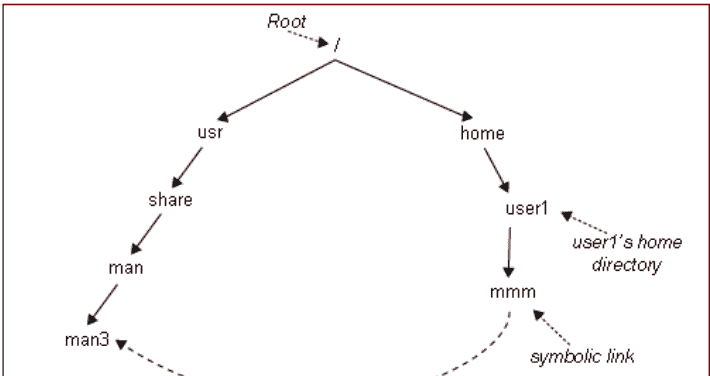

我们在上例中创建链接时向命令传递了 `-s` 参数。这表示我们创建一个符号链接（symbolic link）。符号链接意味着我们只是创建一个指向文件或目录的指针或桥梁，因此如果我们删除了目标文件，链接将指向无处。如果我们不添加 `-s` 参数，就会创建一个所谓的**硬链接**（hard link），与前一个不同，硬链接会创建文件的副本。事实上，它并不完全是副本；它像是两个指向相同数据的条目。这意味着如果我们修改了其中一个，另外一个也将保持不变。这种链接的优势是，如果我们删除了文件的两个副本之一，另一个仍然会被保留。这种链接并不常用，因为它使文件管理和处理变得复杂（始终保留文件的单份副本总是更好的）。此外，如果我们创建一个

### 创建硬链接

由于用于管理文件或目录的机制，硬链接只能在同一单元的目录或目录之间创建。

对目录的硬链接还必须对其中的所有文件和子目录进行引用。因此，系统的根目录可以创建指向目录的硬链接。另一个区别是，我们可以看到符号链接指向哪些文件，但对于硬链接我们无法做到（由于其内部使用的机制）。

## 2.3.5. 权限

在任何多用户系统中，我们都需要存储在磁盘上的文件拥有一系列功能，允许我们为定义的用户查看、修改或执行它们。尽管有几种实现此点的替代方案，但 GNU/Linux 使用了类和组系统，允许任何可能的配置。我们感兴趣的是定义每个文件或目录属于哪个用户和组，以及它们对每个用户拥有什么权限，以及对系统其他用户的权限。通过执行 `-l`，我们将在所在目录的每个文件中看到类似如下的一行出现：

```
-rwxr-xr-x 1 user group 12893 Feb 19 2000 gpl.txt
```

前十个字符（从第一个开始）告诉我们文件的权限，如下：

- 字符 1：此条目告诉我们它是文件还是目录。如果是文件，将显示 `"-"`，对于目录则显示 `"d"`。
- 字符 2, 3, 4：分别告诉我们文件所有者的读、写和执行权限。如果没有相应的权限，我们将找到字符 `"-"`，否则取决于是否可以读、写或执行显示 `"w"` 或 `"x"`。对于第三个字符，我们还可以找到 `"s"`，它告诉我们文件是否为 SetUserId 类型，这意味着我们执行它时，它将获得文件所有者的权限。如果权限只有 `"x"`，程序执行时将以启动它的人的权限运行。
- 字符 5, 6, 7：这些字符与之前的具有完全相同的含义，但指的是授予其所属组的用户的权限。
- 字符 8, 9, 10：与上述情况相同，但针对其他用户系统。

在跟随 10 个字符之后，有一个数字告诉我们该文件拥有的硬链接数量。对于目录，这显示了其中有多少个文件夹以及它拥有的硬链接数量（如果没有，由于操作系统的内部管理原因，数字为 2）。接下来我们看到文件的所有者和组，然后是它占用的字节数和最后修改日期。对于所有文件，都会保存创建、最后访问和修改日期，我们可以使用 `touch` 命令对这些进行操作。最后是文件名，它是敏感的，我们可以毫无问题地包含任何类型的字符。

SetUserId 机制当程序需要所有者权限来访问某些文件或执行某些操作时非常有用。为了更改文件的权限，我们使用 `chmod` 命令。最常见的方式是：

| 十进制 | 二进制 | 含义 |
| :--- | :--- | :--- |
| 0 | 000 | --- |
| 1 | 001 | x |
| 2 | 010 | w |
| 3 | 011 | wx |
| 4 | 100 | r |
| 5 | 101 | rx |
| 6 | 110 | rw |
| 7 | 111 | rwx |

文件名不以 `"a"` 或 `"b"` 开头。最后，为了帮助某些搜索，我们可以在 `"[]"` 内按照如下方式指定字符：`[:class]`，其中类可以是下表所示任意一个：

## 表 2.2

| class | 含义 | class | 含义 |
| --- | --- | --- | --- |
| alum | `[A-Za-z0-9]` | alpha | `[A-Za-z]` |
| blank | `[ ]` | cntl | 控制字符 |
| digit | `[0-9-Fa-f]` | graph | 可打印字符（不含空格） |
| lower | `[a-z]` | print | 可打印字符（含空格） |
| punct | `[[:punct:]]` | space | `[ ]` |
| upper | `[A-Z]` | xdigit | `[0-9-Fa-f]` |

A-Z 表示从 A 到 Z 的字符，`\` 是制表符，`\n` 是换行符。

当然，我们可以在见过的任何命令以及接下来要看到的大多数命令中使用这些模式。此外，对于列出、枚举、复制等文件的命令，也可以递归地传递。因此，从我们到达层级结构的最后一级开始，会对所有文件和目录进行相应指令的存在和执行。

另一种非常有用的操作是搜索文件。我们有几个命令允许我们对系统的所有文件进行不同类型的搜索。

## 表 2.3

| find | 这是执行此操作最全能的命令。它允许我们过滤并找到具有特定名称、在特定日期修改或创建的、具有特定权限的文件。它的缺点是它没有使用任何机制来加速搜索，这意味着它可能花费很长时间。 |
| locate | 这是另一个命令，与前一个不同，它使用一个定期更新的内部数据库来执行更快的搜索。我们需要记住，结果将不会实时更新的，而且我们无法进行像 `find` 那样全能的搜索。 |
| whereas | 最后，`whereas` 倾向于搜索二进制文件（可执行文件），而不是某个特定程序的源代码文件。 |

## 2.3.7. 文件类型和内容

我们的系统上可以有许多不同类型的文件：可执行文件、文本文件、数据文件等。与使用文件扩展名来确定文件类型的其他系统不同，GNU/Linux 使用系统魔数（magic numbers），

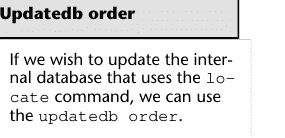

文件扩展名 使用扩展名来确定我们的文件类型并不高效，因为任何人都可以更改它，导致混乱和系统错误，而通过魔数根据其数据确定文件类型（会运行一系列测试来确定它是什么类型的文件）。`file` 命令显示了这一点。

如果我们需要查看文件的内容，基本命令之一是 `cat`。通过传递我们想要查看的文件名或文件名，它会将它们显示在屏幕上。我们尽量不在屏幕上显示可执行文件或数据文件，因为不可打印字符的输出会导致控制台充满重置或测试状态。对于大文件，最好使用 `less` 或 `more` 命令，它们允许我们逐步移动文件。如果文件是二进制类型，且我们希望查看它包含什么，我们可以使用 `hexdump` 或 `od` 命令以十六进制格式或其他表示形式查看内容。`strings` 将搜索二进制文件中的字符链并在屏幕上显示它们。


另一类是用于在文件内容中查找特定模式的命令。通过 `grep` 命令，我们可以将文件名作为第二个参数，并将第一个参数作为我们想要查找的扩展（使用我们之前看过的语法，并扩展到其他选项）。此外，该命令还允许我们执行许多其他任务，例如计算行数（使用 `-c` 参数）等。通过 `cut`，我们可以指定分隔符将每个文件的内容分离成行，这对于自动化管理任务非常有用。我们还可以使用 `head` 和 `tail` 命令分别从文件的开头或结尾提取特定数的行。通过 `wc` 可以计算行数或单词数、文件行的最大长度等。最后，为了结束文件处理这一小节，我们将查看如何比较不同的文件。像所有其他操作一样，我们有几个命令可以实现。`diff`、`cmp` 和 `comm` 对我们指定的文件进行不同类型的比较。此外还允许它们根据我们的选择进行合并。

## 2.4. 进程

操作系统是多任务的，这意味着我们可以同时启动多个进程或加载到内存并正在执行的应用程序。尽管我们的计算机可能只有一个，但操作系统负责共享其处理时间，以便几个进程可以执行它们的操作，给人一种它们都在执行的错觉。为了明确地标识每个进程，系统为它们分配了一个 `PID`（进程标识）。虽然我们可以认为只通过名称来引用它们，但这对于多次执行同一个程序是至关重要的。要知道哪些进程正在执行，我们可以使用 `ps` 命令。

| 管理进程 |
| --- |
| 进程管理是操作系统的一个重要方面，它决定了我们应用程序的响应时间、内存和 CPU 的效率等。 |

为了更深入地探索这些进程，我们将详细讨论可以应用于此命令的一些参数（用相应的字符显示）：
- `-T`: 此选项默认提供，告诉我们它只显示在终端上执行的进程或从已启动的进程。
- `-a`: 显示所有进程。
- `-l`: 显示详细信息。
- `-D`: 显示不可中断的进程。
- `-R`: 显示正在运行的进程。
- `-S`: 显示挂起的的进程。
- `-Z`: 显示僵尸进程。

另一种非常有用的命令是 `top`，它交互式地显示系统的进程、内存使用情况等。

所有进程都有特定的优先级。正如我们之前提到的，这种优先级表示该进程被允许的 CPU 时间。进程的优先级越高，与其他进程相比，它拥有的执行时间就越长。优先级的范围从 20 到 19，从高到低排序。要启动带有优先级的进程，我们可以使用 `nice` 命令。如果我们想给正在执行的进程赋予不同的优先级，可以使用 `renice`。只有 root 用户可以使用负优先级范围；这使得 root 用户有可能比普通用户更快地执行进程。程序执行时的默认优先级默认为 0。一个需要考虑的方面是，由于这种优先级机制，我们无法测量进程的实际执行时间，因为 CPU 是由执行队列中的所有进程共享的。在根据机器时间而变化的计算中心内部，能够准确测量这一点非常重要。因此，系统为我们提供了 `time` 命令，当我们把待测量的程序传递给它时，它会返回该程序实际使用的真实 CPU 时间。

## 2.5. 其他有用命令

### 2.5.1. 系统帮助

正如我们在本文中一直提到的，所有命令都有许多选项和参数，以便我们按照意愿处理它们。从一开始，我们就仔细考虑过，所有这些命令都需要详尽的文档。同样，系统配置文件、我们使用的新应用程序等都需要这些信息。因此，系统本身包含了一个手册机制，我们可以就程序、工具、命令和现有配置的几乎任何方面进行查询。最常用的命令是 `man`，它会显示我们作为参数指定的程序的手册。默认情况下，这些文档通过 `less` 程序显示，我们可以使用 `PgUp` 和 `PgDn` 键向前或向后移动，使用字符 "*/" 后面跟搜索词，然后按 "q" 退出。系统手册分为不同的部分：
- 1) 可执行程序（应用程序、命令等）。
- 2) 由 shell 提供的系统调用。
- 3) 对系统库的调用。
- 4) 特殊文件（通常用于设备）。
- 5) 配置文件的格式。
- 6) 游戏。
- 7) 宏包。
- 8) 系统管理命令（通常是 root 用户可以使用的命令）。
- 9) 内核例程。

如果同一个单词有多个可用手册，我们可以在单词前加上我们想要的章节编号来指定得更具体，例如 `man 3 printf`。与所有其他命令一样，`man` 在其自己的手册（`man man`）中记录了许多不同的选项，我们可以用它们进行搜索、创建可打印格式的手册等。当我们确切知道要找哪个程序时，这些选项中一个非常方便的是 `-k`（`apropos` 命令的作用几乎完全相同）。通过 `man -k` 后跟一个指向我们想要执行的操作的单词，系统将在所有系统手册中进行搜索，并显示所有描述或名称包含指定单词的手册。这样，我们就可以找到任何想要的内容，而无需查阅书籍或外部系统。

```
mandb
```

对于搜索，`man` 应用使用一个内部数据库，该数据库搜索包含手册的文件并对其进行适当的索引。如果我们想更新这个手册（尽管系统本身已经在自动执行此），可以使用 `mandb` 命令。

如果手册没有提供我们所需的所有信息，我们可以使用 `info` 命令，它与 `man` 相同但范围更广。如果我们只是想查看某个特定程序、库等作用的简要参考，可以使用 `what` 命令。

### 2.5.2. 打包与压缩

压缩文件、将多个文件分组为一个文件或查看压缩文件的内容，都是我们经常执行的任务，以便制作备份副本、在文件之间移动文件等。尽管有许多程序允许我们执行此类操作，但在所有的 GNU/Linux 系统中，我们都能找到 `tar` 工具。这个程序允许我们以任何方式处理一个或多个文件，以便进行压缩、分组等。选项是无穷且灵活的，在这里我们将解释其中一些基础的选项，以便我们对它们的作用有一个整体。语法如下：`tar options DestinationFile OriginFile`，其中目标文件将是我们创建的新文件，源文件是那些用于分组或压缩的文件。需要注意的是，如果我们想对整个目录分组，默认情况下过程是递归的，这意味着它打包时将覆盖其所有层级及其包含的所有内容。要创建一个新文件，我们需要传递 `c` 参数；如果我们想将其保存到文件中，我们需要传递 `f` 参数。`tar cf final.tar o*` 会打包当前目录下所有以 "o" 开头的文件。如果我们还想压缩它们，`tar czf` 将会在打包后使用 `gzip` 程序。要解包某个特定文件，需要的参数是 `x`，因此我们应该输入 `xf` 指定的文件。如果是压缩过的，我们必须传递 `zxf`。

虽然可以使用 tar 来压缩文件，但该程序的主要设计目的并非压缩。正如我们所提到的，对于压缩，我们使用 `gzip` 等外部程序。`gzip` 程序使用它自己的压缩格式，与流行的 `zip` 不同，我们也可以通过安装相应的程序使用它。另一个效果非常好的压缩应用是 `bzip2`。在下表中，我们可以看到通常用于识别压缩或打包文件格式的扩展名：

#### 表 2.4

| 扩展名 | 格式 |
| --- | --- |
| .tar | tar |
| .gz | gzip |
| .tgz | tar + gzip |
| .bz2 | bzip2 |
| .zip | zip |
| .z | compress |

### 2.5.3. 磁盘操作

管理和处理磁盘是系统管理的另一个基本方面。在本小节中，我们将讨论获取磁盘信息的命令。磁盘被划分为分区，当我们处理独立设备时，可以将其视为单元。这非常有用，因为它允许我们在同一个磁盘上安装多个操作系统，例如。`df` 命令向我们显示每个挂载单元在系统中的空间。让我们解释以下 `df` 的输出：

#### 分区配置

| 文件系统 | 1k-blocks | 已用 | 可用 | 使用率 | 挂载点 |
| --- | --- | --- | --- | --- | --- |
| `/dev/hda1` | 788712 | 42128 | 697082 | 6% | `/` |
| `/dev/hdb1` | 19541504 | 574284 | 1379120 | 29% | `/info` |
| `/dev/hdc` | 664432 | 66432 | 0 | 100% | `/CD-ROM` |

当我们格式化分区（使用 ext2 或 ext3）时，可以配置块的大小和其他参数。这些参数可以进行调整以使系统更高效。对于系统中挂载的每个单元，命令告诉我们数量，尽管通过传递 `-h` 参数（人类可读）我们可以更方便地查看。另一个非常有用的命令是 `du`，它显示文件在磁盘上实际占用的空间。为了更清楚地理解我们的意思，我们需要更深入查看磁盘的内部结构以及操作系统如何处理它们。正如之前提到的，为了效率，操作系统将磁盘空间划分为称为块的部分。块的大小是可以配置的，通常取决于磁盘的大小。每当我们想要添加新文件时，操作系统都会为其分配一个块。当我们读取或处理它时，操作系统可以一步直接读取一个（配置好的）条目。因此，`du` 命令显示了特定文件在磁盘上实际使用的块数。

几乎无法修改这些选项中的任何一个。如果我们想更改它们，必须复制所有分区信息，重新格式化并再次复制原始文件。

## 磁盘碎片整理


磁盘碎片整理（Defragmenting）只是重新组织文件块，将其放置在连续的位置以加快访问速度。在我们在 GNU/Linux 中使用的系统中，没有必要对磁盘进行碎片整理（通常有专门设计的程序），系统会自动妥善地组织它们。

管理文件的内核函数使用一系列方法来加速读写过程。其中一种方法是使用磁盘缓存，这样我们就不必对物理设备进行读写，所有缓存机制的作用是在 RAM 中保留一份我们正在操作的文件的副本（RAM 速度快得多），使得该过程对用户来说是透明的（磁盘遵循内核中实现的策略）。这种处理方式唯一的问题是，如果断电且我们没有正常关闭系统，某些文件可能没有保存到物理磁盘上，导致文件系统出现不一致。`fsck` 程序将检查并修复处于这种状态的文件。尽管我们可以随时执行它，但通常操作系统本身会在启动过程检测到系统未正常关闭时运行它（在关闭电脑之前，我们必须运行 `shut-down` 命令，它负责启动程序结束所需的所有进程等）。实际上，`ext3` 文件系统比其前身更有效率，因为日志机制（journaling）允许它更快速地从丢失文件中恢复更多信息。

自然地，如果我们处理的文件至关重要，且无法允许它们丢失，也可以配置操作系统不使用磁盘缓存系统。在任何时候，强烈建议使用这种机制，因为它显著提高了系统性能。在任何想要将磁盘缓存信息与物理磁盘同步的时刻，可以使用 `sync` 命令。我们还可以使用 `badblocks` 命令检查分区的物理完整性，该命令会对指定的设备进行检查，确保其没有损坏区域。

我们在本节中描述的大多数命令执行都需要特殊权限，这意味着只有 `root` 用户才能使用它们。

## 2.6. 命令操作

### 2.6.1. 重定向

一旦我们学会了使用系统命令，在某些情况下我们可能想要同时使用它们以加快我们想要执行的操作。非常有趣的操作是将一个命令的输出连接到另一个命令的输入并进行适当处理。操作系统使用管道（pipes）机制，它允许我们将任何命令或程序的输出重定向到我们想要的任何地方。它的工作原理非常简单：我们只需要在命令之间放置 `"|"` 字符，使第一个命令的输出作为第二个命令的输入。让我们来看一个例子：当我们输入 `echo field1:field2:field3:field4` 命令时，屏幕上将显示 `field1:field2:field3:field4`。如果我们想从此输出中提取“field3”，可以通过管道将其重定向到 `cut` 命令，按如下方式选择我们感兴趣的字段：`echo field1: field2: field3: field4 | cut -f 3`。在下面的图中，我们可以直观地看到这个图示：

图 2.3

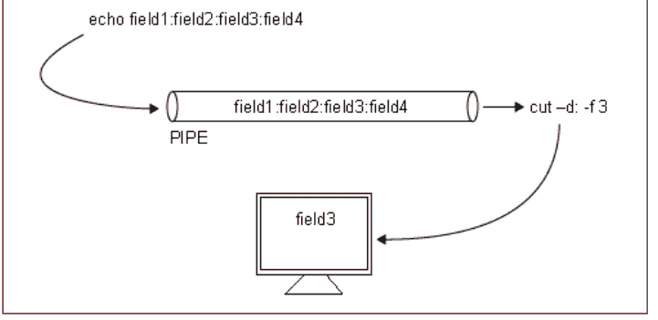

当然，我们可以根据需要连接多个管道，以执行比我们看到的更实用的任务。另一种非常实用的重定向类型与文件有关。这种重定向允许我们使用字符 `">"` 将命令或程序的所有输出保存到文件中，正如我们所做的那样。例如，如果我们想在按下 `Ctrl+C` 之前将输入的所有内容写入新文件，可以使用：`cat > test.txt`。使用 `">"` 可以实现完全相同的操作，但不是创建新文件，如果文件已存在，它将把信息添加到文件末尾。使用 `"<"` 则进行反向重定向，将指定的文件内容指向指定的命令或程序。

关于 UNIX 类型系统，我们应该了解的一个非常有趣的方面是：它们将程序的标准输出与其错误输出分开。虽然默认输出被定向到执行程序的控制台，但我们可以操纵它们将其定向到我们想要的任何地方。在本次练习中，我们将尝试使用以下指令删除一个不存在的文件：`rm file > results`。尽管我们将命令的输出重定向到了文件，但屏幕上会显示一条错误消息，告诉我们未找到文件。这是因为默认情况下，重定向只针对程序的标准输出，而不重定向错误输出（错误输出也会显示在屏幕上）。要重定向输出，我们应该在字符 `">"` 前指定数字 `"2"`（`1` 是标准输出）。因此，通过执行 `rm file>2 results` 我们可以重定向输出。我们还可以将标准输出和错误输出保存在两个不同的文件中：`rm file 1>results 2>errors`。另一方面，如果我们让所有输出都指向同一个文件，可以使用 `>|`。此外，通过与符号符号 `(&)`，如果我们想重定向标准输出，可以使用 `2>&1`。

### 2.6.2. 特定命令

`bash` 命令解释器具有快速访问键或快捷键，允许我们在无需输入的情况下执行操作。最常用的快捷键包括：

- `Tab`：不需要输入文件、目录或命令的全名。当我们输入前几个字符并按下 `tab` 键时，它将完成剩余输入。如果有多个可能性，它会显示出来。

- `Ctrl+L`：清除屏幕。

- `Shift+Up`：显示上一行。

- `Shift+Dn`：显示下一行。

- `Ctrl+W`：删除最后输入的字符。

- `Ctrl+T`：交换最后字符的顺序。

- `Ctrl+D`：退出解释器（等同于执行 `logout` 命令）。

- `ulimit`：允许我们配置 `bash` 某些内部方面的命令。例如，它允许我们指定命令解释器可以使用的内存量、打开的文件最大数等。

另一个有用的机制是命令历史（`history`）。当我们使用系统时，必须重复许多指令。通过 `Up` 和 `Down` 键，我们可以看到使用过的命令并按“Return”键重复它们。我们还可以使用 `history`，它会按出现顺序显示所有执行过的命令。我们还可以通过 `!NUM` 执行最近执行的对应编号的命令。

| Bash |

| --- |

| `bash` 命令解释器为我们提供了调节 shell 任何方面的工具。在它详尽的手手册中，我们可以找到学习如何正确操作它们所需的文档。|

### 2.6.3. 使用 bash 的 shell 脚本

Shell 脚本是在其中我们编写一系列待执行命令（本节中见过的任何命令）的文件。虽然它们的语法可能会变得非常复杂，而且为了清晰地理解，我们需要从编程方面进行研究，但在本节中，我们将总结它们的一些基本特征，以便我们至少能够理解和使用它们（如果我们想进一步深入研究，可以查阅 `bash` 手册）。Shell 脚本的第一行应该指定所使用的命令解释器：

> `fc` command\

> `fc` 命令允许我们像编写 shell 脚本一样编写一系列待执行的命令，而无需保存文件。

```bash
#!/bin/bash
```

在这一行之后，我们可以开始编写想要执行的命令，每行一个。在任何编程语言中，我们都可以使用变量、条件结构和循环。为了声明一个变量，我们将使用以下语法：

```
variableName=content
```

如果内容是一串字符，我们不需要加任何东西；如果在引号内，如果它是一个数字，并且如果我们想将命令输出保存到变量中，则需要将其放在引号之间。在其他指令中引用变量的内容时，我们必须在名称前面加上 `$` 字符。对于条件指令，我们可以使用以下结构：

```
if condition; then instructions else instructions fi
```

其中 `condition` 可以指向文件、执行算术比较操作（在 `(( ))` 字符之间）等。`test` 命令特别有用，因为它允许我们比较文件、目录等，并返回一个布尔值。因此，如果我们想根据特定文件是否存在来执行一个操作或另一个操作，我们可以使用以下结构：

```
if test -f /etc/initab; then echo "The initab file exists." else echo "The initab file does NOT exist." fi
```

另一个条件结构是选择：

```
case word in case1) instructions; case2) instructions;; *) instructions esac
```

在结构结构中，我们将 `word` 与 `case1`、`case2` 等进行比较，直到找到匹配的项，在这种情况下将执行相应的操作。如果没有找到，它将传递到 `(*)` 节，该部分是可选的。这种结构会非常有用，例如，当我们让特定的脚本根据我们建立的参数执行一个操作或另一个操作时。我们可以使用 `$1` 代表第一个参数，`$2` 代表第二个，以此类推。对于循环，我们可以使用以下任何一种结构：

```
#LOOP TYPE FOR for i in list; do instructions 
```

where #LOOP TYPE WHILE while condition; do instructions done


当然，在执行 shell 脚本之前，我们应该给相应的文件赋予执行权限（`chmod 750 fileName command`）。

| shell 脚本中的注释 |
|---|---|
| 在 shell 脚本中编写注释，我们可以使用 "#" 字符后跟我们想要的注释。这在行结束之前都有效。 | |

## 3. Knoppix 工作坊

### 3.1. 引言

本工作坊旨在成为你对 UNIX 环境的首次体验。因此，它是分步进行的，当然也为你们中好奇的人留了根据自己的想法进行调查的空间。

本工作坊的主要目标是熟悉 GNU/Linux 操作系统，并让我们在其他操作系统上习惯执行的操作在 GNU/Linux 操作系统中也可以完全相同。在工作坊中，我们还将开始学习命令行，熟悉它并消除对非图形环境的恐惧。所以，让我们开始吧，是时候实践目前为止所解释的所有内容了。

这个工作坊可以在任何计算机上进行，因为损坏我们所持信息的风险极小。我们选择这个发行版是因为启动它不需要预先了解操作系统，而且一旦我们停止系统，它就不会留下任何痕迹。

KNOPPIX 默认以只读权限挂载系统上的所有硬盘分区；因此，除非我们通过更改权限强制执行，否则我们无法写入或执行。显然，如果我们有不同的 GNU/Linux 操作系统，可以使用它来跟随工作坊。

由于这是一个位于 CD-ROM 或 DVD-ROM 上的可启动发行版，我们在完成后可以在执行它的计算机上工作而不留下任何痕迹；这意味着它是基于 Debian 的，但在这方面，文件系统并不符合 Debian 策略。尽管如此，这些差异不会影响工作坊，我们学到的所有内容对以后都是有效的。此外，从一开始就习惯与不同的发行版工作并学习区分哪些是所有基于 UNIX 系统共有的，哪些是每个发行版特有的，是非常好的。

在我们开始之前，只有一点建议：让我们采取自己的主动性，尝试自己回答问题，咨询 `man` 命令提供的帮助，进行测试，如果测试失败了，分析原因，反复尝试，直到我们获得预期的结果；这就是学习 UNIX 的方式——无畏地、从我们的错误中学习。

### 3.2. 系统启动

首先，我们需要确保计算机从 CD-ROM 或 DVD-ROM 读盘器启动。为了做到，我们将进入 BIOS（基本输入输出系统），通常是在 RAM 检查过程中按下 Del 键，并检查 CD-ROM 或 DVD-ROM 是否配置为第一个启动设备；如果是，我们就可以退出 BIOS 而无需保存任何内容，并将 CD-ROM 或 DVD-ROM 放入读盘器。

将 CD-ROM 或 DVD-ROM 插入读盘器后，我们将重启计算机。如果不是，将在退出 BIOS 之前进行相关更改并保存。

我们可以按下 F2 或 F3 进入显示以下信息的屏幕：

## 图 3.4

```
>>> KNOPPIX 0.5.1 启动选项 (按 F1 返回主界面) <<<

此版本的 Knnoppix 使用标准 Kernel 2.6 内核启动。

在启动提示符处，可以使用以下选项：

knnoppix (选项，详见 F3) Knnoppix 标准内核 2.6

debug (选项，详见 F3) 带有详细内核消息的 Knnoppix

export 交互式设置（专家模式）

next 检查 BIOS 启动错误

testdev

mstest Mem86 内存检查程序

启动 M3 软件分发系统

fbl200x1024, fb1824x760 或 fb800x600 帧缓冲器模式（适用于笔记本电脑）

knnoppix acpi/off pci-bios 针对损坏 BIOS 的变通方案

按 F3 更多选项。完整的启动选项列表可以在 USB 闪盘内 "KNOPPIX" 目录下的 knnoppix-cheatcodes.txt 文件中找到。

boot: knnoppix_2_
```

最初，键盘配置为美国（us）布局，因此某些字符与西班牙语键盘不同，我们可以立即修复，但尽管如此，了解某些美国字符在西班牙语键盘上的位置仍然很有趣：

- "" 位于 < 键上。
- "/" 在数字小键盘的 o 键上。
- "-" 在 q 键上？或者在数字小键盘上。

按下 "Intro" 后，KNOPPIX 将开始加载操作系统，并显示它在自动配置期间执行的某些测试结果。

一旦此过程结束，我们将获得命令行：

## 图 3.5

```
欢迎使用 KNOPPIX 现场 Linux

扫描 USB/IDE 设备... 完成。(VMware 虚拟 (HD 驱动器))

扫描 AHCI 加速对于... 完成。(VMware 虚拟 (SCSI 驱动器))

加载中...

访问 KNOPPIX boot=/dev/sda1

在 /dev/sda1 找到 KNOPPIX 镜像

提取中...

在 /rom/KNOPPIX/KNOPPIX.img 找到 KNOPPIX 压缩镜像

在共享内存上创建 ramdisk（大小: 317128K 缓存）... 完成。

创建根系统... 完成。

> 根系统已与读写合并。

启动 init 进程...

INIT:

Linux Kernel 2.6.31-amd64 (i686 处理器 1.70GHz 16777MHz 2048 KB 缓存)

ACPI: 已加载，激活模块：battery hotplug container facebook thermal_video

检测到根设备 /dev/sda1... 已启动。

防火墙由 udev 管理

正在配置设备... 完成。

将 /dev/sda1 挂载到 / (ext3) 完成。

成功：退出代码 0 之于 171

视频：VMware II PCI 显示管理器，使用 Xorg(vmware) 服务

显示器: 1024x768 32位

扫描网络接口并创建 /etc/fstab... 完成。

检测到网络设备 eth0，正在广播 DHCP 获取 IP...（后台）

INIT: 进入运行级别: 2

root@#
```

我们现在进入了系统。如果现在不需要用户或密码，我们就直接以 root 身份进入了，我们知道这一点是因为提示符以字符 "#" 结尾。对于 root 的任何其他用户，字符将是 "$"。

### 3.3. 停止系统

一旦进入系统，我们首先需要知道的是正如我们提到的，如何停止它。再次记住，在没有先停止操作系统（GNU/Linux）的情况下，我们无法停止计算机。常见的方法是：按下 Ctrl+Alt+Del 键或使用 `halt` 命令（还有许多方法，通过 `reboot` 命令、将运行级别从 0 改为 6 等）。
一旦向系统发出停止命令，它将开始执行相关的停止指令（卸载设备、停止进程等），在此过程结束时，KNOPPIX 将弹出 CD-ROM 或 DVD-ROM 并要求我们按回车键停止计算机。

### 3.4. 键盘配置

一旦我们知道如何启动和停止系统，我们将按照之前的相同步骤再次启动它。现在我们进入了系统，要做的第一件事是配置正确的键盘布局。有几种方法可以：

- 手动操作，如果我们在控制台模式下启动（knopppix 2）：

## 图 3.6

```
root@tty1#$ loadkeys /usr/share/keymaps/i386/qw/es.kmap.gz

Loading /usr/share/keymaps/i386/qw/es.kmap.gz

root@tty1#$ _
```


- 使用 `kbdconfig` 命令进行图形化操作，选择 `es es`。

## 图 3.7

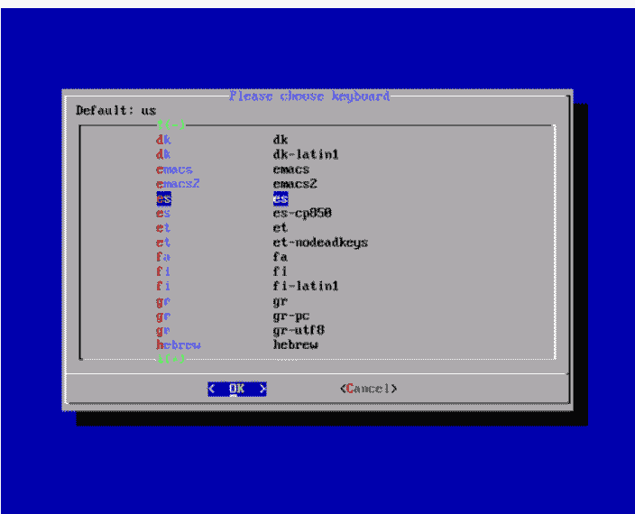

- 使用 `kbd-config` 命令并选择以下选项：

## 图 3.8

## 键位配置

如果你使用来自不同国家/语言的键盘，可以在 `map` 文件中选择特定的键位。

你想要哪个键位？

- `pc / query / American / Standard / Standard`
- `pc / query / Latin / Standard`
- `pc / query / Latvian / Standard`
- `pc / query / Lithuanian / Standard`
- `pc / query / Hungarian / Standard`
- `pc / query / Russian / Standard`
- `pc / query / Polish / Standard`
- `pc / query / Portuguese / Standard`
- `pc / query / Romanian / Standard`
- `pc / query / Russian / QWERTY`
- `pc / query / Cyrillic / QWERTY`
- `pc / query / LeftLayout / QWERTY`
- `pc / query / RightLayout / QWERTY`
- `pc / query / Slovak / Standard`
- `pc / query / Swedish / Standard`
- `pc / query / Spanish / Standard`
- `pc / query / Thai / Standard`
- `pc / query / Turkish / Standard`
- `pc / query / Vietnamese / Standard`

现在我们可以列出当前目录的内容了。为了做到这一点，我们直接使用 `ls` 而不为其传递任何选项：

图 3.11

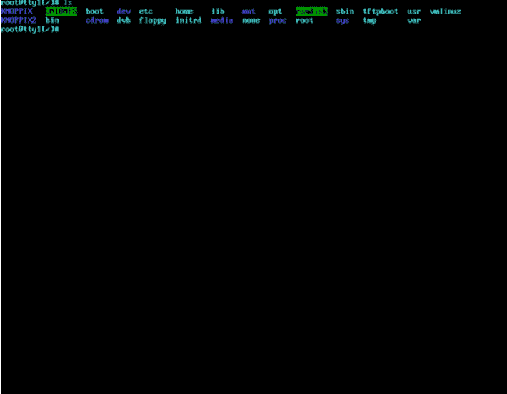

现在我们将传递两个选项（通常选项以 `-` 开头，尽管有些命令不需要这样做），用以告诉它返回更详细的信息。因此，一旦我们输入了 `-`，我们就会输入选项 `-la` 来获取这些信息：

## 图 3.2

```
ls -l /
drwxr-xr-x 2 root root 4096 May 11 10:24 bin
drwxr-xr-x 5 root root 4096 May 11 10:24 boot
drwxr-xr-x 4 root root 4096 May 11 10:24 dev
drwxr-xr-x 7 root root 4096 May 11 10:24 etc
drwxr-xr-x 2 root root 4096 May 11 10:24 home
drwxr-xr-x 19 root root 4096 May 11 10:24 lib
drwxr-xr-x 4 root root 4096 May 11 10:24 lib64
drwxr-xr-x 2 root root 4096 May 11 10:24 ldev
drwxr-xr-x 2 root root 4096 May 11 10:24 mnt
drwxr-xr-x 2 root root 4096 May 11 10:24 opt
drwxr-xr-x 23 root root 4096 May 11 10:24 proc
drwxr-xr-x 29 root root 4096 May 11 10:24 root
drwxr-xr-x 16 root root 4096 May 11 10:24 run
drwxr-xr-x 12 root root 4096 May 11 10:24 sbin
drwxr-xr-x 2 root root 4096 May 11 10:24 dev
drwxr-xr-x 9 root root 4096 May 11 10:24 usr
drwxr-xr-x 12 root root 4096 May 11 10:24 bin
drwxr-xr-x 15 root root 4096 May 11 10:24 floppy
drwxr-xr-x 12 root root 4096 May 11 10:24 local
drwxr-xr-x 12 root root 4096 May 11 10:24 media
drwxr-xr-x 11 root root 4096 May 11 10:24 tftboot
drwxr-xr-x 12 root root 4096 May 11 10:24 var
drwxr-xr-x 12 root root 4096 May 11 10:24 vmlinuz
```

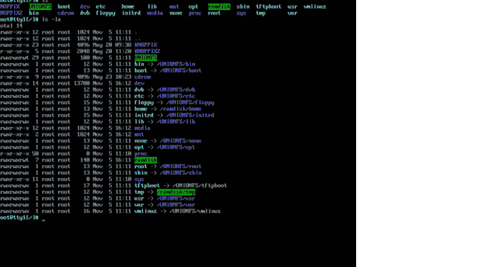

让我们看看结果显示的不同颜色（随着我们在 Knop 研讨会的进行，我们将看到这些颜色）：深蓝色表示目录

让我们进入一个确定能找到可执行文件的目录，例如 `/usr/bin/`。目录 `/usr/`（实际上）是 `/KNOPPIX/usr/` 的符号链接；因此，我们可以直接通过 `cd` 命令进入并访问内容，或者通过相同命令跟踪真实目标。然而，我们将选择第一种方案，因为当我们处于安装在硬盘上的 UNIX 系统时，该目录是一个真实的目录：

## 图 1.3

```
-rwxr-xr-x 1 root root 6253 Mar 3 2001 widdetect
-rwxr-xr-x 1 root root 27408 Oct 10 2005 view -> loadimage
-rwxr-xr-x 1 root root 5736 Feb 6 2006 minittop
-rwxr-xr-x 1 root root 28513 Jan 2005 viewer -> /etc/alternatives/xviewer
-rwxr-xr-x 1 root root 58636 May 1 2005 x
-rwxr-xr-x 1 root root 25333 May 1 2005 utmap
-rwxr-xr-x 1 root root 21852 May 2 2006 xad
-rwxr-xr-x 1 root root 13512 Oct 10 2005 xh
-rwxr-xr-x 1 root root 2428 Feb 27 2006 x -> me
-rwxr-xr-x 1 root root 28912 Apr 24 2004 xittgg
-rwxr-xr-x 1 root root 22176 May 2 2006 xd
-rwxr-xr-x 1 root root 11468 Oct 10 2005 xn
-rwxr-xr-x 1 root root 14772 Apr 21 2006 xom
-rwxr-xr-x 1 root root 15553 Mar 20 2005 xps
-rwxr-xr-x 1 root root 3568 Mar 9 2005 ycas_client
-rwxr-xr-x 1 root root 23706 Jun 4 2005 yacc -> /etc/alternatives/yacc
-rwxr-xr-x 1 root root 280468 Apr 27 2002 yfray
-rwxr-xr-x 1 root root 3954 Feb 6 2005 yelp
-rwxr-xr-x 1 root root 73931 Jan 9 2004 yorick
-rwxr-xr-x 1 root root 45594 Mar 9 2005 y
-rwxr-xr-x 1 root root 19638 May 17 2005 ypgchm -> /usr/bin/yppasswd
-rwxr-xr-x 1 root root 10688 May 17 2005 ypgpasswd -> /usr/bin/yppasswd
-rwxr-xr-x 1 root root 10568 May 9 2005 yymmatop
-rwxr-xr-x 1 root root 6812 Feb 6 2006 yoeygiltip
-rwxr-xr-x 1 root root 9508 Apr 14 2004 zdump
-rwxr-xr-x 1 root root 63138 Apr 2 2005 rity
-rwxr-xr-x 1 root root 27408 Oct 10 2005 zish
-rwxr-xr-x 1 root root 66208 May 25 2005 zip
-rwxr-xr-x 1 root root 11048 Oct 10 2005 zippre
```


-rwxr-xr-x 1 root root 1108 Apr 25 2005 zipprep

-rwxr-xr-x 1 root root 13512 Oct 10 2005 zipsst

-rwxr-xr-x 1 root root 23544 May 25 2005 zipnote

-rwxr-xr-x 1 root root 27408 Oct 10 2005 zipweeper

-rwxr-xr-x 1 root root 1411 Jan 16 2004 zipower.py

-rwxr-xr-x 1 root root 1837 Feb 15 2005 zoedim

看到显示内容的最后几行。我们可以通过按下 `Shift+Up` 回溯列表查看几个结果，通过 `Shift+Down` 向前进。尽管如此，终端是有限制的，使用这种技术我们无法看到 `ls` 命令返回的所有信息。因此，我们需要求助于其他技术：重定向输出（在本情况下到文件）或使用管道 (`|`) 和分页（在本情况下），后者使用 `Up` 和 `Down` 键移动屏幕上的内容，并使用 `Q` 键退出。当我们最后这样做时，我们对保存目录列表并不感兴趣；我们将利用机会练习另一个实用工具：按下上下箭头可以在我们传递给系统的命令行之间移动；要获得想要的内容，只需执行 `ls -la | less`，按一次箭头。

`less` 是 KNOPPIX 中非常强大的分页器，大多数发行版使用它来显示内容（尽管在大多数 Linux 服务器上我们可以根据喜好进行配置）。因此，我们可以执行 `less` 来了解这一点，同时使用它的帮助。显然，如果我们不想退出 `less`，只需按下 `Q`。

注意，对于所有的目录列表，总是会出现特殊目录：`.` 和 `..`。当我们创建目录时，系统会自动在创建的目录创建这些子目录，它们包含了非常特殊的信息。`.` 目录称为当前目录，指的是目录本身（如果执行 `ls -la` 命令，我们将获得与执行 `ls -la` 相同的信息）。`..` 目录称为父目录，指的是我们所在目录的父目录（执行 `ls -la` 将带我们父目录或上一级目录的内容）。

### 活动

3.1 查看 `ls` 命令的含义并理解 `-a` 和 `-l` 参数的功能。

我们还记得自己在文件系统中的位置吗？不记得？那么 `pwd` 命令会提醒我们。让我们回到根目录。基本上有两种方法可以实现这一点，特别是对于这种情况，它们都基于使用 `cd` 命令，区别在于我们在每种情况下传递的参数。

第一种方法是使用 `cd ..` 重复向上进入父目录（注意，系统并不理解 `cd ..`，因为它将其解释为正尝试执行一个不存在的名为 ".." 命令），直到到达根目录（我们将在提示符中看到它）。

第二种方法更有效，只需一行命令即可实现目的，即进入根目录（`cd /`）；为此，第二种选项强大得多，并允许我们直接进入属于不同分支的目录；例如，我们可以从 `/usr/bin/` 使用 `cd /etc/`（最后的斜杠是可选的）进入该目录。

正如我们提到的，对于这种情况（进入根目录），还有第三种变通实现相同目标的方法：涉及在不传递任何参数的情况下执行 `cd` 命令，它将我们直接置于系统根目录，在 KNOPPIX 的情况下这是主目录（这是许多发行版中异常且有些特殊的案例，根据文件系统层次结构标准，root 必须有自己的主目录 `/root`）；这种方法的变体是 `cd ~`，因为 `~` 等同于用户的主目录，在本情况下即根目录。

## 3.6. 处理文件和目录

在检查了实现相同目的的不同选项后，我们仍然处于根目录。现在我们可以学习如何创建文件和目录，移动、复制以及删除它们。我们将在启动 KNOOPPIX 时使用的磁盘上进行这些操作，系统在启动时已经挂载了它（稍后我们将学习如何挂载和卸载设备）。

请记住，在 UNIX 中，设备在使用之前需要挂载，而在移除设备之前，需要将其卸载。最后这一点至关重要，否则无法保证数据的完整性。例如，我们可以尝试在处理磁盘之前按下弹出按钮来移除 CD-光驱。大吃一惊！我们不能这样做；我们不应该认为设备坏了，更不用说 GNU/Linux 出了问题。这仅仅是因为系统在启动过程中自动挂载了该设备，因此它已经变成了系统的一部分；在不通知系统的情况下移除 CD-光驱是毫无意义的；系统已经接管了该设备，并出于考虑禁用了 CD-光驱的弹出按钮，这正是为了防止它在未先卸载的情况下被移除。这与磁盘驱动器不同：对于这种设备，弹出按钮在机械上是工作的，这意味着系统无法阻止我们在不通知它的情况下弹出磁盘，但正如我们已经说过的，这样做是不建议的，因为这可能导致其中包含的数据丢失。因此，在我们学习如何挂载和卸载数据支持设备之前，磁盘必须从系统启动到停止停止一直留在磁盘驱动器中，因为在停止过程中的其他操作一起，这些设备将被卸载。让我们去磁盘吧；但它在哪里呢？系统把它挂载在哪里了？为了找到这些问题的答案，我们将执行不带参数或额外选项的 `mount` 命令（这正是用于挂载设备的命令，而 `umount` 则用于卸载它们）：

## 图 3.14

```
root@tty1[#] mount
root /dev/sdb1 (rw,size=31728k)
(ramdisk /ramdisk tmpfs[floppy] rw,ramdisk=/KEMPIX-ID=/KEMPIX-ID2;delete=whiteout)
devcdrom /dev/cdrom type iso960 (ro)
devclomp2 /dev/clomp2 type iso960 (ro)
proc /proc type proc (rw)
sys /sys type sysfs (rw)
 /proc/bus/usb /proc/bus/usb usbfs (rw,mode=8666)
devpts /dev/pts type devpts (rw)
root@tty1[#] ls
```

此不带参数执行的命令向我们展示了执行时挂载在系统上的设备以及关于它们的一些额外信息（我们可以在 `/etc/mtab` 文件找到这些信息；因此，执行 `cat /etc/mtab` 将得到相同的结果）。在命令返回的第二行中，我们可以看到 CD-光驱 `/dev/CDROM` 确实已挂载到系统上，此外还可以看到它被挂载在 `/CD-ROM/` 目录下。最后一行回答了我们之前提出的问题：系统将磁盘 `/dev/fd0` 挂载到了 `/mnt/auto/floppy/`。因此，我们需要切换到此目录以开始处理该磁盘，并检查它是否确实是空的：

```
root@tty1[/#] cd /mnt/auto/floppy
root@tty1[floppy]# ls -la
total 8
drwx-rwxwx 3 knoppix knoppix 7168 Jan 1 1970 .
drwx-xr-x 3 root 0 Mar 3 19:34 ..
```

我们创建了第一个条目，并创建了几个子目录：

```
root@tty1[#]# mkdir dir00 
root@tty1[floppy]# cd dir00/
root@tty1[dir00]# mkdir subdir00 subdir01
root@tty1[dir00]# ls subdir00
```

我们进入第一个子目录，并创建第一个文件：

```
root@tty1[dir00]# cd subdir00
root@tty1[subdir00]# touch file00
root@tty1[subdir00]# ls -la
total 1
drwxrwxwx 2 knoppix knoppix 512 Mar 3 20:21 .
```

实际上，`touch` 并不是创建空文件（尽管如果文件不存在会创建一个），而是为了更改有关文件时间和日期的信息。我们可以向第一个文件中写入一些内容，并检查它是否确实已保存：

```
root@tty[subdir00]# echo "my first hello world in Linux" > file00
root@tty[subdir00]# cat file00
my first hello world in Linux
```

我们多添加了一些文本：

```
root@tty[subdir00]# echo "Nice to meet you, we're gonna be good friends" >> file00
root@tty[subdir00]# cat file00
my first hello world in Linux
to meet you, we're ganna be good friends
```

不要忘记使用按键进行保存或自动补全。现在我们可以使用编辑器来创建第二个文件。

tty，在那个 tty2 上我们仍然打开着该 man，除非我们退出（按下 q 键），或者在调用它时关闭了该命令，并继续在原本所在的 tty 上工作。让我们看看同一个 man 页面中对选项 `-i` 的解释。发生了什么？看起来这个选项是默认启用的。事实并非如此，默认情况下，系统已经建立了一些别名（aliases）；要查看所有别名，让我们执行 `alias` 命令：


```
root@tty1[etc]# alias --='cd' alias cp='cp -i' alias='ls -la --color=auto' alias la='la --color=auto' ls='ls --color=auto' ls='ls --color=auto' alias mv='mv -i' alias rm='rm -i' alias where='type=type-path'
```

在这里我们将理解更多内容，例如，当 `ls` 命令的返回是有颜色的，或者为了执行 `ls -la`，我们只需要输入 `la`。而且还可以理解为什么当我们执行 `rm` 进程时，系统会询问我们是否真的要这么做。通过别名，我们可以建立并修改命令的默认行为或创建其他新命令：

```
root@tty1[subdir00]# alias hi='echo I say hello' root@tty1[subdir00]# hi
I say hello
```

继续介绍 `rm` 命令，我们即将学习关于 `-f` 和 `-r` 选项的使用。第一个选项用于让命令执行时不产生提示，换句话说，就是不听从 `-i` 选项，这样如果我们没有删除第一个文件，可以通过 `rm -f file00` 来删除。第二个选项强制递归，换句话说，将操作扩展到所有子目录和目录。这些选项对于处理文件和目录的基本命令是通用的；因此，我们可以通过 `cp` 命令创建的第一个目录，在磁盘根目录下创建一个包含所有内容的第二个目录；要做到这一点，我们必须调用递归：

```
root@tty1[subdir00]# cp /mnt/auto/floppy/dir00 /mnt/auto/floppy/dir01 -r
```

### 活动

3.4 重复这种递归复制，将 `dir01` 复制到 USB 闪盘或内存中。

在这种情况下，我们使用了绝对路径（同时指定源和目的）来执行复制操作。换句话说，我们指定了从根目录开始的源和目的完整路径。同样，我们也可以使用相对路径来指定操作的源、目的地或两者。当我们使用相对路径时，路径的起点是文件系统中的当前位置。在大多数情况下，系统允许我们使用不同的方法实现相同的结果。我们知道的越多，就越能在每个特定情况下选择最有效的方法。因此，通过 `cp ../dir00/ ../dir01 -r` 也可以达到相同的结果，即告诉 `cp` `/dir00/` 在我们当前位置下方两个分支处，目的地是 `/dir01/`，我们也希望将其放置在位置下方的两个分支处。此外，命令行 `cp -r ../dir02/` 对于相同的目的也是完全有效的。

### 活动

3.5 解释最后这一断言的原因。

现在我们可以进入一个子目录，位于 `/mnt/auto/floppy/dir00/`，并将我们创建的文件复制到同一目录下的 `/subdir00` 子目录中：

```
root@tty[dir00]# cp subdir00/file01 .
```

我们需要理解上一行代码背后的含义和原因。首先，我们将指定想要复制的文件源（在许多选项中，`/subdir00/file00` 也是有效的），其次我们指定目的地，即当前位置，符号 `"*"`。通过这种方式，我们可以检查是否实现了预期结果。现在我们可以在挂载在磁盘上的父目录中进行练习，并删除我们到目前为止创建的所有内容。为了这样做，我们将使用 `"*"` 通配符（我们还有 `?` 通配符，它代表单个字符，除了其他指定字符范围的方法外，还可以泛指多个文件或目录）来节省输入量：

```
root@tty[floppy]# rm -rf *
```

### 活动

3.6 阅读 `rm` 的手册，了解为什么 `rm -rf *` 如此危险。

## 3.7. 用户管理

对于以 `root` 身份执行之前的所有任务，我们应该警惕，因为我们已经明白该用户应该在需要时才使用。

尽管如此，这是合理的，因为到目前为止还没有直接接触过 Unix 系统，这让我们能够稍微熟悉一下它的基本命令和文件系统。现在是时候像往常一样开始工作了，从现在起，即在严格必要时使用主账户，例如在我们接下来要采取的第一步中，创建一个新的系统用户并给他一个账户，这是一个只有 `root` 才能执行的操作。因此，让我们创建一个用户。

## GNUEFI • 001_48393 63 Basic GNU/Linux

```
root@tty[1]# useradd user00
```

我们创建了第一个用户，但过程已经完成。（注：此处原文重复了多次，已按要求处理）

现在是以新用户身份进入系统了。我们将通过 `su` 命令来实现，该命令会打开一个子进程，并以我们传递给它的用户身份登录。作为 `root` 用户，我们始终可以使用这种机制在不知道密码的情况下进入另一个用户身份，因为当我们以 `root` 身份执行 `su` 时不需要密码的；恰好我们创建的用户没有密码，因此不会提示输入密码。

但是，如果我们在任何情况下尝试执行 `su`，仍然会被要求输入用户的密码：

```
root@tty1[home]# user00 su(pam_unix) [4312]: session opened for user00 by (uid=0)
user00@tty1[home]#
```

首先，让我们注意提示符外观的变化。我们停止了一个新用户并变为 `user00`，因此我们拥有了 `root` 的权限，如提示符的最后一个字符所示。现在我们可以访问家目录，创建一个文件并设置其属性，使得只有 `user00` 可以读取、写入和执行该文件。目前，执行权限对我们来说还没有意义，因为我们不知道如何创建可执行文件，但在需要时提前了解是有好处的：

```
user00@tty1[home]# cd user00@tty1[user00]$ echo "only user00 can read, write and execute this file." > user00file@tty1[user00]$ chmod 700 user00file
```

## 练习

3.8 按照之前的步骤创建一个新用户，并检查该新用户确实无法读取最近创建的文件或在其上写入。

## 3.8. 管理进程

UNIX 的卓越之处在于其对系统上执行进程的极佳管理。首先，我们应该学习检测系统上正在运行的进程及其特定特征（运行模式、消耗的资源、谁在执行它们等）。我们将执行 `ps`（进程状态）命令并传递几个参数，以查看它们如何影响命令返回的信息：

```
root@tty1[/]# ps PID TTY TIME CMD 4881 tty 00:00:00 bash 1559 tty 00:00:00 ps
```

在不带参数的情况下，`ps` 告诉我们执行它的终端上运行着哪些进程；自然地，第一个进程总是对应于 `shell`。

我们可以命令另一个进程在后台执行，例如 `sleep`（一个仅仅等待我们作为参数传递给它的秒数时间结束的进程），并观察 `ps` 的返回：

```
root@tty[1]# sleep 300 [1] 1703 root@tty[1]# ps TTY TIME CMD 481 tty1 0:00:00 1703 00:00:00 1715 tty1 00:00:00
```

现在我们可以询问系统上正在运行的所有进程：

```
root@tty[1]# ps aux USER PID %CPU %MEM VZ RSS STAT TTY START COMMAND root
1 0.4 0.0 72 ? S 15:41 0:07 [2] root 2.0 0.0 0 0 ? SW 15:41 0:00 [keventd] root
3 0.0 0.0 0 ? SWN 15:41 0:00 [koftitcd2_CPU] root 4.0 0.0 0 0 ? SW 15:41 0:00 [kwaspad]
5 0.0 0.0 0 ? [bdflush] root 6.0 0.0 0 ? SW 15:41 0:00 [kupdated]
52 0.0 0.0 ? SW 15:41 0:00 5.0 0.0 0 0 ? SW 15:41 0:00 [khubud]
433 0.0 0.1 1.638 6 S 15:41 0:00 pump -leth0 root 475.0 0.1 1.316 1952 7 15:41 0:00 /usr/bin/automount root 481 0.0 0.3 2864 1988 tty S 15:41 0:00 /bin/bash -login root
482 0.0 0.3 2864 1988 tty2 S 15:41 0:00 /bin/bash -login root 483 0.0 0.3 2856 1952 tty3 S 15:41 0:00 /bin/bash -login root 483 0.0 0.3 2856 1974 tty4 S 15:41 0:00 /bin/bash -login 2086 0.0 0.3 3436 1752 R 16:06 0:00 aux
```

在某些情况下，也可以执行 **top 命令**，它会交互式地告诉我们 CPU 的活动和内存使用情况。


现在我们将提升一个进程，停止它，并命令它在后台运行。为了做到这一点，我们将执行 `sleep 20` 并在 20 秒前按下 `Ctrl+Z` 停止它，使用 `jobs` 确保它已停止并获取其编号，然后配合 `bg` 和其编号让它在后台模式运行：

```
root@tty[1]# sleep 20
Ctrl+Z
[1]+ Stopped sleep 20
root@tty[1]# jobs
[1]+ Stopped sleep 20
root@tty[1]# bg
```

二十秒后，进程仍在后台停止，我们可以通过 `ps` 检查没有进程在运行。我们可以使用 `fg` 将进程返回前台：

```
root@tty[1]# man ls
[1]+ Stopped ls
root@tty[1]# fg 1
```

## 3.9. 启用和使用鼠标

鼠标是控制台模式下极有用的工具，因为它可以选择和粘贴文本（这是我们为本次工作坊准备的所有输入）。

因此，我们要的第一件事是配置鼠标，我们将使用最常用的程序 `gpm` 来完成，它已经在后台自动运行（因为 `gpm` 是一个守护进程）。有许多类型的鼠标（机械、光学、激光和轨迹球）以及许多类型的接口（串口、PS/2 端口、USB、无线：射频或蓝牙），尽管目前常用的是 USB 或 PS/2 接口。如果我们有第一种类型的鼠标，将使用以下行：

```
gpm -m /dev/input/mice -t
```

如果鼠标连接到 PS/2 端口，我们将通过更改设备和鼠标类型来启用它：

```
gpm -m /dev/ps -t
```

原则上，在执行上述任意一行后，移动鼠标将在所有终端上看到鼠标箭头，通过执行：

```
sofia@tty1$ ps aux | grep gpm
```

我们应该得到如下回复：

```
root 3594 0.0 0.1 1632 532 Ss 00:28 0:00 gpm -m /dev/input/mice -t
```

如果 `gpm` 在后台运行，说明我们的鼠标是非标准的。在这种情况下，我们需要仔细阅读 `gpm` 的 man 手并执行 `gpm -t` 来帮助识别适配我们的鼠标类型。

一旦鼠标配置完成，我们可以选择感兴趣的文本部分，当按下中键时会将选中的内容粘贴到光标当前的位置。如果我们习惯使用鼠标，可能会发现得到的结果不是想要的，但通过练习很快就能适应这种工作方式。

我们还可以通过 `gpmconfig` 命令或 `dp-reconfigure` 实用工具配置 `gpm`。

### 练习

3.9 如何配置触控板模拟双键鼠标？

我们应该注意，当从一个终端切换到另一个终端时，鼠标缓冲区是被保留的。

### 练习

3.10 利用鼠标缓冲区在终端之间保留的特性，打开 `vi` 会话并进入文件系统根目录，详细列出内容导入编辑器。保存文件内容并使用 `cat` 检查我们是否有效地获得了所需的结果。

## 3.10. 其他操作

为了完成本次工作坊，我们将执行一系列命令以继续熟悉系统并解决未来的潜在问题。

我们应该找出系统、运行的机器类型以及我们安装的硬件。

这里有几条命令，记住 `man` 和命令名称可以帮助你找到命令以及它们可以拥的所有选项。

```
knoppix@knoppix$ ~ uname -a Linux Knox 2.6.12 #2 Tue Aug 9 23:20:52 CEST 2005
GNU/Linux knoppix@knoppix$ ~ cat /proc/cpuinfo processor : 0 vendor_id : GenuineIntel cpu family : 15 model : 2 name : Intel(R) Pentium(R) 4 CPU : 2.8GHz speed : 7 cpu MHz 2801.5 cache size : 512 KB fdb_vr : no hit_bug : no oof_bug : no coma_bug : no fpu
yes cpu_exception : yes cpuid : 2 : flags : vme de pse sse sse2 ht tm pbe msr cxe8
yes fpu ster mpr mca mov pse32 clif dts acpi mhw sse sse2 ht bit cid bogdnopsis
5455.knoppix@knoppix$ 0000:0000.00.0 Hot bridge: Silicon Integrated Systems
[SIS] Si6643d Memory & AGP Controller (rev a 00) 0001:0000:02.1 PCI bridge:
Silicon Integrated Systems [SIS] Virtual PCI-to-PCI bridge (AGP) 0000:0000:02.0 ISA bridge:
Silicon Integrated Systems [SIS] Si5962 [Multimedia IO] (rev a 14) 0000:0000:02.6 SMBus:
Silicon Integrated Systems [SIS] Unknown date 0016 0000:0000:02.3 FireWire (IEEE 1394):
Silicon Integrated Systems [SIS] FireWire Controller 0000:0000:02.5 IDE interface: Silicon
Integrated Systems [SIS] 5513 [IDE]
```

Integrated Systems [SIS] USB 1.0 Controller (ref 0f) 0000:00:03.1 USB Controller: Silicon

Integrated Systems [SIS] USB 1.0 Controller (ref 0f) 0000:00:03.2 USB Controller: Silicon

Integrated Systems [SIS] USB 1.0 Controller (ref 0f) 0000:00:03.3 USB Controller: Silicon

Integrated Systems [SIS] USB 2.0 Controller (ref 0f) 0000:00:04.0 以太控制器: Silicon

Integrated Systems [SIS] S9100 PCI Fast Ethernet (ref 91) 0000:00:08.0 CardBus bridge: O2

Micro, Inc. E69212 CardBus 0000:00:01.0 VGA compatible controller: ATI Technologies Inc Radeon R250 Lf [Radeon Mode 909 M9] (ref 91) knoppix8[knoppix8] df S.files 16 KB blocks

Used Free Used /root/dac 2471 24150 1% /ramdisk 4031832 8388 392224 38% /ramdisk/UNIONS 7764900 7317976 392924 95% /UNIONS/dev hdc 4067388 4067388 100% /cdrom /devcloop 4963828 4965828 100% /KNOPPIX/dev 2397672 2397672 100% /KNOPPIX2 /UNIONS/dev/sdal 255452 145522 100% /mnt/sdal[al] $ free total used free shared buffers cached

Mem: 514720 495232 1498 -/+ buffers/cache: 129672 385048 Swap: 497972 497972

### 活动

3.1 在虚拟目录 `/proc/` 和 `/sys` 中，我们可以在这些文件中找到许多关于我们系统的信息。进入此目录，并使用 `more` 或 `cat` 来探索这些文件。

## 3.11. 结论

这是我们首次接触 UNIX 环境。它帮助我们打破了“在这一类操作系统上工作既复杂又困难”的刻迷信。此外，它还帮助我们开始理解它的功能和多功能性。我们学习了如何在其文件系统中移动，如何对文件进行操作，如何搜索信息等。到目前为止，我们学到的所有内容从现在起都将非常有用，并作为扩展我们知识的基础。

同时，KNOPPIX 强大的硬件自动检测和配置能力意味着，当我们在新内核中安装 Debian 时，如果遇到棘手问题，它对我们非常有用。我们可以随时重启 KNOPPIX 并查看它是如何解决该问题的（通过研究配置文件）。

作为最后一个工作坊活动，我们可以以图形模式重启 KNOPPIX，换句话说，就是在不传递参数 2 的情况下启动它（另一种此方法是传递 `knoppixx lang=es wheelmouse` 参数）。

## 4. GNU/Linux 安装

### 4.1. 引言


在本节中，我们将查看 GNU/Linux 安装过程中所遵循的关键步骤。尽管每个发行版都有自己的安装环境，但它们都共享一些基本步骤。在本节中，我们将研究这些步骤，并解释成功执行这些步骤所需的概念。在安装新操作系统之前，确保我们充分熟悉安装在计算机上的主要组件是关重要的，这样我们就可以妥善地配置一切，即使我们使用的发行版包含了硬件检测功能。

我们可能会在一块硬盘上安装两个完全独立的操作系统。尽管在同一块硬盘（或安装同一台电脑的另一块硬盘）上安装另一个操作系统的过程不应该干扰其他分区，但建议对我们所有的文档进行备份。尽管如果我们正确地按照描述的所有步骤操作，实际上几乎不可能丢失信息，但谨慎始终是明智的，因此要对重要文件进行备份。

### 安装 Linux 的准备

在安装过程之前，了解我们安装的显卡和声卡的品牌及型号；网卡；显示器的类型和特性，以及我们拥有的任何其他硬件是方便的。通常，对于主板、CPU 和内存，我们不需要了解它们的特性。要获取这些信息，我们可以研究购买计算机时提供的说明书，或者如果我们已经安装了另一个操作系统，可以使用它来实现此目的（在“Windows”系统中，我们可以从控制面板获取这些数据）。

## 4.2. 启动

通常，GNU/Linux 发行版提供某种启动安装过程的方法。目前，可以提供启动 CD 或 DVD，如果我们的计算机没有相应的读取器，或者我们希望进行远程安装，则提供启动盘。

该过程的第一步倾向于选择我们想要执行的安装类型。通常，这种选择是为了识别安装系统的用户类型，从而提供相应或较少的信息，并允许用户更详细地配置系统或不进行配置。如果我们有足够的知识，建议以专家模式（或其他模式）进行安装，以便我们能更好地适应我们的特定需求。在某些发行版中，第一步还用于选择我们想要安装的内核版本，或将安装过程配置为图形模式、文本模式等。仔细阅读在此阶段提供的所有信息至关重要，以便我们正确验证符合我们系统用途的内容。

接下来，大多数发行版将允许我们选择想要使用的键盘（或配置）。尽管有许多不同的类型，最常见的是 qw（从键盘左上角开始的字符），我们将选择 qw/es（西班牙）。

## 4.3. 磁盘分区

硬盘分区是该过程中最关键的部分之一。这一步骤涉及将磁盘划分为多个区域，以便每个区域被视为一个独立的单元。如果我们已经在计算机上安装了操作系统，硬盘将已分为一个或多个分区，但为了安装 GNU/Linux，我们至少需要为它准备一个分区。事实是，当我们修改分区大小时，会删除其包含的信息。由于这个原因及其他原因，有一些程序允许我们在不删除分区的情况下调整分区大小。`gips` 是一个带有 GPL 许可的程序，允许我们在任何其他文件系统上执行此操作。对于非 NTFS 的 Windows 系统，在开始整个过程之前我们应该使用它们之一。

基础 GNU/Linux

证明了它们达到了一个点，如果应用程序需要使用过多的交换内存（swap memory），性能将会大幅下降，导致系统变得几乎饱和（为了查看使用了多少内存和交换内存，系统为我们提供了 `free` 命令）。

有几种应用程序用于磁盘分区的。最早出现的之一是 `fdisk`，尽管还有其他的如 `cfdisk`、`diskbrowser edit` 等。在某些安装过程中，我们可以选择想要使用哪一个，它们都允许我们执行完全相同的操作，只是环境的存在有所不同。GNU/Linux 将 IDE 磁盘识别为 `/dev/hdx`，将 SCSI 和串行 ATA（SATA）识别为 `/dev/sdx`，在这两种情况下，X 都是对应我们想要指代的磁盘的字母，如下：

### 硬盘类型

对于个人电脑有三种硬盘：IDE、串行 ATA（SATA）和 SCSI。目前，大多数主板都带有串口控制器。SATA 控制器允许连接四个或六个磁盘。SCSI 控制器（小型/智能计算机系统接口）允许连接 8 个设备并具有更高的传输率，尽管它们比 IDE 贵得多。

表 4.1

| 设备 | 含义 |
|---|---|
| `/dev/sda` | 第一个 IDE 通道的主盘 |
| `/dev/hdb` | 第一个 IDE 通道的从盘 |
| `/dev/hdd` | 第二个 IDE 通道的主盘 |
| `/dev/hdd` | 第二个 IDE 通道的从盘 |
| `/dev/sda` | SCSI 或 SATA 控制器的第一个磁盘 |
| `/dev/sdb` | SCSI 或 SATA 控制器的第二个磁盘 |

### 主引导记录

为了保存分区信息和引导程序，磁盘有一个名为 MBR（主引导记录）的预留数据区域。

如果我们的计算机中有多个磁盘，在进入分区程序之前，我们可以选择要对哪一个磁盘进行操作。当我们创建一个分区时，系统会询问它是主分区还是逻辑分区。在块硬盘上，我们最多可以有 4 个主分区和最多 64 个逻辑分区。如果我们创建的分区不超过 4 个，可以选择这两种类型中的任意。如果我们需要更多，应该记住逻辑分区是放置在主分区内的（每个最多 16 个），因此我们无法在创建了 4 个主分区的基础上添加其他逻辑分区。在这种情况下，我们应该创建 3 个主分区，并在第四个分区中创建最多 16 个逻辑分区。下面的图提供了一个图形示例：

### 图 4.1

| 硬盘 1 (hda) | 硬盘 3 (hdb) |
|---|---|
| `hda1` | `hdb1` |
| 主分区 1 | 主分区 1 |
| `hda2` | `hdb2` |
| 主分区 2 | `hdb5` |
| | 逻辑分区 1 |
| `hda3` | 逻辑分区 2 |
| 主分区 3 | 主分区 3 |
| `hda4` | `hdb4` |
| `hdb5` | 可访问分区： |
| 逻辑分区 1 | - `hdb1` |
| `hda6` | - `hdb2` |
| 逻辑分区 2 | - `hdb3` |
| | - `hdb5` |
| | - `hdb6` |
| | - `hdb7` |

当我们创建分区时，需要指定将使用哪种文件系统（Linux ext2、Linux ext3 或 Linux）。一旦创建了分区，我们将保存配置并必须告诉安装过程我们希望将根文件系统和系统交换放在哪里。执行完这些步骤后，我们可以继续安装过程的其他部分。

### 活动分区

在硬盘的所有分区中，我们可以选择一个作为活动分区。此标志用于告诉系统 BIOS 或 EFI，如果在 MBR 中没有找到启动程序，则应该启动哪个分区。

## 4.4. 模块安装

内核模块是内核的扩展。内核模块可以在需要时动态加载或卸载。许多驱动程序都以模块的形式存在，这样可以在不需要重新编译内核的情况下添加新硬件支持。在 Linux 中，模块的安装通常在安装过程中自动完成。

当我们为特定用途（如 HTTP 服务器、CVE 等）安装系统时，建议只选择那些我们真正会使用的程序，以避免安全问题（留的开放端口越少，系统越安全）。

某些发行版还允许从不同的位置获取软件包，例如从一张或多张 CD 或 DVD，或者从互联网上的服务器。Debian GNU/Linux 是第一个拥有此类系统的系统，它被称为 `apt`。这种管理方式非常有用；它赋予了我们极大的灵活性，并让我们能够了解最新的程序修复和更新。

## 4.8. 其他方面

如果我们在安装过程中遇到任何问题，或者在某个时刻启动系统未允许我们加载操作系统，我们需要知道该如何处理。通常，在安装过程中会有一个步骤询问我们是否希望创建一个恢复盘。始终建议生成此磁盘，因为它允许我们加载操作系统并访问文件系统，以修复需要修复的地方。

在某些发行版中，我们也可以通过启动光执行同样的操作。以 Debian 为例，启动过程本身包含一个控制台（我们可以通过按下 `Ctrl+F2` 访问），其中带有执行基本恢复操作的命令。无论如何，如果我们面临无法正确启动系统的严重问题，并且想要所有的常用工具，我们也可以使用 Knopix 或任何其他发行版的现场版 CD 启动，并挂载安装了系统的分区以修复故障。重要的是拥有的这些工具之一，并在严重问题发生之前对其进行测试，以便我们做好准备。

大多数安装过程都使用应用程序自引导程序（bootstrap），我们也可以通过相应的软件包将其安装在系统上。通过它，我们可以创建自己的安装过程，或者查看系统实际上是如何执行这些安装和配置任务的。我们可以通过 `base-config` 程序或它调用的任何其他程序来重现大多数任务（你可以在手册中找到更多信息），尽管我们始终可以转向操作系统的配置文件进行手动操作。

## 5. Debian Etch 安装工作坊

### 5.1. 引言

第一个工作坊帮助我们在 UNIX 类型系统上迈出了第一步，为此我们使用了一个不会在计算机上留下任何痕迹的发行版，因为它是从 CD-ROM 或 DVD-ROM 启动并运行的；而这一次工作坊旨在教授如何在计算机上安装一个基础 GNU/Linux 系统。

本次工作坊选择的发行版是 Debian GNU/Linux 4.0，被称为 Etch（本书出版时的最新版本），它在经过 21 个月的持续开发后，于 2007 年 4 月 8 日发布。Debian GNU/Linux 是一个免费操作系统，支持总共十一种架构。


在软件方面，它的创新包括桌面环境 GNOME 2.14、KDE 3.5.a 和 Xfce 4.4；办公套件 OpenOffice 2.0.4a、KOffice 1.6、GNUCash 2.0、GMetric 1.6.3 和 Abiword 2.4.6；Coreo Evolution 2.6 和消息工具 Gaim 2.0；`iweasel` 2.0.0.2 是 Firefox 浏览器，而 `icedove` 1.5 是 Thunderbird 邮件客户端；这两个程序都是注册商标未使用的版本。

它还包含了加密程序，并兼容 FHS 2.3 版本以及为 L 3.1 版本开发的程序。

Debian GNU/Linux 4.0 为安装系统引入了新的图形界面，支持使用复合字符和复杂语言的拼写。Debian GNU/Linux 的安装系统现在已翻译 58 种语言。从 Debian GNU/Linux 4.0 开始，软件包管理系统的安全性和效率得到了提高。

Debian GNU/Linux 可以在从 PDA 和口袋系统到服务器的计算机上运行，通过任何中间系统。它为总共十一种架构提供了方式：Sun SPARC (spar)、HP Alpha (alpha)、Motorola/IBM PowerPC (powerpc)、Intel IA-32 (i386) 和 IA-64 (ia64)、HP PA-RISC (ppa)、MIPS (mips, mipsel)、ARM (arm)、IBM S/390 (s390) 以及（在 Debian GNU/Linux 4.0 中首次引入的）AMD64 (am664)。

本次及其他工作坊在 Debian 和 RedHat 之间的选择并不容易，因为 RedHat 提供了许多产品，但我们选择了 Debian，因为它安装更简单。选择 Debian 是由于它的哲学，这种哲学体现在以下原因中：

- Debian 是一个免费的操作系统。
- Debian 完全免费的。
- Debian 是稳定的。
- Debian 是多功能的。
- Debian 文档齐全。
- Debian 对于初学者和专家都易于使用。
- Debian 是一个大型社区。
- Debian 是开源的。
- Debian 是安全的。
- Debian 得到了高度支持。
- Debian 是现代的。
- Debian 是那个。
- 
--- is-- is is。
- Debian is.-- is is.-- is-- to Debian..---..---。
- Debian is。
- Debian is。
- Debian is.-- is is.-- is...-..--.-.---.--- is,- is, with the following。
- 使用网络。网络启动的不同方法取决于网络启动的架构和配置（例如 DHCP）。配置网络启动最简单的方法可能是使用 PXE。
- 使用硬盘。可以在不使用拆卸介质的情况下启动安装程序，但前提是已有一个硬盘，该硬盘可能运行着不同的操作系统。在硬盘的根目录上下载 `hd-media/initrd.gz`、`hd-media/vmlinuz` 和一个 Debian 镜像（CD 镜像的文件应以 .iso 结尾）。现在我们只需要通过 `initrd` 启动 Linux。

此总结仅仅是为了列出 Debian 提供的不同类型的安装。但为了执行安装，我们建议您访问其官方网页（正如我们已经提到的），并仔细阅读《安装指南（HOWTO install）》。

安装过程所需的交互程度取决于系统和所选的安装类型。正如预期的那样，这些系统中的每一个都有其优势和不便之处：而标准安装允许我们逐步进行配置，这对于使系统适应我们的需求和可能性的极其有用；而全自动系统则需要更先进的基础设施和知识，因此在时间和金钱上需要更多的投入，只有当我们需要安装的系统数量非常多时，这种投入才是合理的（例如，我们可以考虑在一个设计供个人使用且具有并行能力的计算机、且其数量不断增加的部门中实施这种类型的安装）。

在涉及到选择系统和安装类型时，我们需要考虑几个因素，例如：我们要执行多少次安装？我们要执行多少种不同的安装？我们的经验水平如何等。由于这是我们的第一次安装，这直接引导我们选择了交互性最强且最常用的安装类型：标准交互式安装。

现在我们只需要确定安装系统，这从根本上取决于我们是否有互联网连接以及其速度。显然，如果我们没有互联网连接或访问速度非常慢，我们别无选择只能基于一套 CD-ROM 或 DVD-ROM 进行安装；但另一方面，如果我们拥有可以接受的互联网访问速度（例如基于 ADSL 技术的线路）或高访问速度（通过网关直接连接互联网），最佳选项将是网络安装。

与通过 CD-ROM 或 DVD-ROM 进行的安装相比，网络安装具有许多优势，特别是对于 Debian 尤其如此，因为它允许我们安装软件包的最新版本；此外，更新系统上安装的所有软件包只需执行单条指令。

但如果正如我们提到的，我们没有互联网连接或连接太慢，这一事实不应让我们放弃使用 CD-ROM 或 DVD-ROM 进行安装（我们不应低估这些 CD-ROM 或 DVD-ROM 包含的软件包，因为 Debian 被定义为一个仅包含广泛测试软件包的发行版）。一旦我们完成安装，可以随时更改 `/etc/apt/sources.list` 文件的内容并添加相关行以访问互联网，特别是对于安全更新。

## 5.1.2. 软件包类型

接下来我们关注 Debian 及其软件包系统。Debian 软件包可以通过其 `.deb` 扩展名来识别。官方 Debian 发行版中包含的所有软件包根据 Debian 自由软件指南都是免费的。这确保了软件包及其所有源代码的自由使用和重新发行。Debian 发行版将软件包分为四类。发行自身的软件包包含在 `main` 类中，而 `contrib`、`non-free` 和 `non-US` 类由 Debian 组织为用户利益提供：

- `main.` 符合 Debian 自由软件指南的软件包，也就是说，除了其完整的源代码外，还保证了组成它的所有二进制文件的自由使用和重新发行。
- `contrib.` 这些软件包虽然是免费的，因此与二进制文件一样提供了源代码，但它们依赖于其他非免费的软件包。
- `non-free.` 这些软件包虽然可能是免费的，但具有限制性条件，在某种程度上限制了它们的使用或重新发行。
- `non-US/main.` 该区域的软件包本身是免费的，但不能从美国的服务器导出。
- `non-US/non-free.` 这些软件包不能从美国，因为因为包含了加密软件或可能影响专利问题的软件。

官方 Debian 发行版由 Debian 文件中 main 部分的内容组成。

### 5.1.3. 软件包开发状态

软件包开发状态将决定我们安装的发行版类型。因此，有不同的发行类型：

- `Stable（稳定版）` - 这是 Debian GNU/Linux 发行的最新版本。它由稳定且经过良好测试的软件组成，仅包含重要的安全或可用性修正。
- `Testing（测试版）` - 发行版包含预计成为下一个发行版部分的软件包。在从不稳定移动到测试版之前，每个软件包必须满足一系列非常严格的要求。测试版不会在安全团队发布更新的同时获取更新。
- `Unstable（不稳定版）` - 该发行版包含最新的 Debian 软件包，因此测试最少。

尽管所有软件包都有其依赖关系，由于它们可能会导致严重问题，在关键系统中建议只使用稳定发行版。

## 5.2. Debian Etch 的安装

正如我们提到的，为了安装，Debian 提供了多种安装类型，从 DVD-ROM、CD-ROM、USB 存储器到网络。常用的安装类型有：CD-ROM 或 DVD-ROM，如果我们拥有第一者，后者则无关紧要。我们将从 DVD-ROM 开始，一旦完成，我们将分析这种过程与网络安装的区别。

我们将在连接到标准 IDE 端口作为主设备（master）的 ATA 磁盘上执行此类安装。涉及到控制器和 SCSI 磁盘，它们在启动过程中将无问题地检测到，就像 SATA 一样。从 Debian 网页我们可以下载该版本的三个 DVD，但对于基础桌面系统只需要第一个。

### 5.2.1. Debian Etch 变体（flavours）

Debian GNU/Linux 4.0 支持十二种架构，并且每种架构都有被称为变体的版本。

例如，Debian GNU/Linux 4.0 对于 Intel x86 架构默认带有 2.6.18 版本内核。有关更多信息，可以查阅针对 Intel x86 架构的安装指南文档（键名为 "etch"）。此外，它还包含了如何利用您的新 Debian 系统的信息。

## 5.2.2. 为 Intel x86 安装 Debian GNU/Linux 4.0


提供安装的基础文档是《安装 Debian GNU/Linux 4.0 I386》，包含 DVD1 中（`/doc/install/manual/en/index.html`），提供多种语言，包括西班牙语（`/doc/install/manual/es/index.html`）。我们建议阅读此文档并准备副本，以防出现任何问题，例如没有光驱。

## 5.3. 从 DVD-ROM 安装 Debian Etch

在开始安装之前

### 5.3.1. 开始安装之前

在开始安装之前

如果我们之前预留了空间，因为我们已经打算安装 GNU/Linux，或者我们有一个想要安装它的其他操作系统分区，我们就可以继续安装，也就是说从 DVD-ROM 启动。

但另一方面，如果硬盘已满且只有一个分区（我们通常不建议这样做，因为这通常会显著降低任何系统的性能，特别是对于文件系统不是非常一致的系统），我们需要释放空间以便安装 Debian GNU/Linux 4.0。

该操作系统可能属于微软™ 产品家族；如果文件系统是 FAT 或 FAT32 类型（MS-DOS™、Windows95™ 和 Windows98™ 使用），问题相对简单

克服障碍，因为发行版本身提供了一个应用程序（`DVD1/tools/fips20.zip` 中的 `fips20.exe`），它将帮助我们重新划分磁盘以留出空间来安装 GNU/Linux。

如果我们已经安装了 GNU/Linux 操作系统，我们可以使用那里许多应用程序来调整硬盘分区的大小并创建新分区。例如 `partman`（一种原始的 GNU/Linux 工具）、`fdisk`、`gparted`（GNU 和 Gnome 下的磁盘分区图形编辑器）或 `qtparted`（GNU Linux 和 KDE 下的磁盘分区图形编辑器）。这些应用程序可以管理 FAT 和 FAT32 类型的文件系统，也可以管理 NTFS。

如果我们没有安装 GNU/Linux 操作系统，则可以使用 `Gparted Live CD`，它是一个启动光盘，包含一个较小且基础的 GNU/Linux 操作系统，直接从包含 `Gparted` 程序的 CD-ROM 中运行。

作为最后的选择，我们总是可以转向商业应用程序。

无论我们使用哪种应用程序，都必须先对磁盘进行碎片整理。磁盘碎片整理是一个分析本地磁盘、发现并合并碎片文件和文件夹的实用。它也可以通过 `defrag` 命令从命令行对磁盘进行碎片整理。这将避免某些问题，因为我们可能在分区的末端存在碎片文件。因此，当我们调整大小并从这最后部分获取空间时，我们将删除这些文件，在理想情况下我们会丢失信息，但如果它们是系统文件，我们可能会导致操作系统无法运行。

因此，在重新分区之前对磁盘进行碎片整理非常重要，同样，还要对磁盘的所有信息制作备份。防患于未然。

### 5.3.2. 启动安装系统

到达这一步后，我们准备好开始安装本身。为了实现这一点，我们将启动电脑，确保启动时（`boot`）第一个读取的设备是 DVD-ROM 单元（通过进入 BIOS），并将 DVD1 放入其中。几刻之后，将出现如下所示欢迎界面：

### 图 5.1

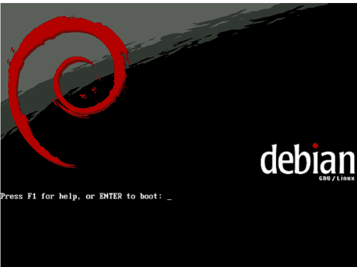

如果我们按下 `F1` 键，将出现如下所示屏幕：

### 图 5.2

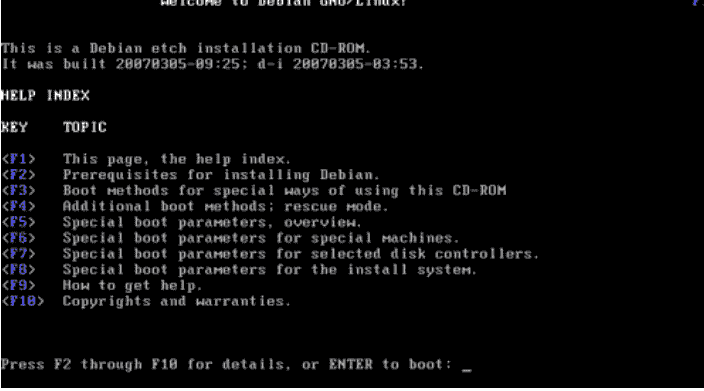

按 `F2` 到 `F10` 查看详情，或按 `ENTER` 启动： _

我们可以按下菜单提供的任何选项，例如如果我们按下 `F6`，将出现以下内容：

### 图 5.3

### 特殊启动参数 - 各种硬件

你可以在启动提示符处使用以下启动参数，并与所使用的启动方法（`F3`）相结合。如果你使用十六进制数字，则必须使用 `0x` 前缀（例如 `0x38`）。

| 硬件 | 要指定的参数 |
| :--- | :--- |
| IBM PC (IDE 磁盘) | beg_hd sectors |
| IBM ThinkPad | floppy/thinkpad |
| IBM Power 机器机! | reserve=iobase,extent... |
| 保护 1/7 端口（旧机器） | floppy/machine |
| 屏幕显示问题的笔记本电脑 | vga=771 sensible-tty,9600 |

如果你遇到硬件故障，请禁用启动 APIC 中断或使用 noaptic molaptic

```
boot: install vga=771 noaptic molaptic
```

按 `F1` 查看帮助索引，或按 `ENTER` 启动：

但最有趣的是 `F3`，它将为我们提供允许安装的不同方法。你可以使用默认方法、带有图形安装程序进行安装、使用专家模式以获得更多控制，或者使用带有图形安装程序的专家模式进行安装。因此，让我们输入 `expertgui` 以使用带有图形安装程序的专家模式进行安装。

### 图 5.4

### 启动方法

- `install`: 开始安装——这是默认的 CD-ROM 安装。
- `installgui`: 使用图形安装程序启动安装。
- `expert`: 以专家模式启动安装，以获得最大的控制权。
- `expertgui`: 使用图形安装程序以专家模式启动安装。

要使用其中一种启动方法，请在提示符处输入它，可选地跟上任何启动参数。例如：

```
boot: install expertgui_
```

如果不确定，你应该使用默认启动方法，不带任何特殊参数，只需在启动提示符处按 `ENTER` 即可。

按 `F1` 查看帮助索引，或按 `ENTER` 启动：`expertgui_`

现在让我们开始安装：

### 图 5.5

```
PnPBIOS: 正在扫描系统以寻找 PnP BIOS 支持。
PnPBIOS: 在 0xc08f5a0 0x480 找到 PnP BIOS 结构。
PnPBIOS: BIOS 安装版本 0x5456, desq 0x480
pnp bus(0b): 范围 0x1a0-0x17f 已保留
pnp bus(0b): 范围 0x180-0x19f 已保留
ACPI: pci 中断 0x00000000:18:0a (低) -> IRQ 19
ACPI: pci 中断 0x00000000:18:0b (低) -> IRQ 17
ACPI: pci 中断 0x00000000:18:0c (低) -> IRQ 18
```

（注：此处原文中存在乱码或不完整文本，已根据要求保留代码块且不翻译）

```
PnPBIOS: 正在扫描系统以寻找 PnP BIOS 支持。
PnPBIOS: 在 0xc08f5a0 0x480 找到 PnP BIOS 结构。
PnPBIOS: BIOS 安装版本 0x5456, desq 0x480
pnp bus(0b): 范围 0x1a0-0x17f 已保留
pnp bus(0b): 范围 0x180-0x19f 已保留
ACPI: pci 中断 0x00000000:18:0a (低) -> IRQ 19
ACPI: pci 中断 0x00000000:18:0b (低) -> IRQ 17
ACPI: pci 中断 0x00000000:18:0c (低) -> IRQ 18
```

（注：由于原文后续部分包含大量乱码/错误字符，以下仅翻译可读的逻辑部分）

PnPBIOS: 扫描系统以寻找 PnP BIOS 支持。

PnPBIOS: 在 0xc08f5a0 0x480 找到 PnP BIOS 结构。

PnPBIOS: BIOS 安装版本 0x5456, desq 0x480

pnp bus(0b): 范围 0x1a0-0x17f 已保留

pnp bus(0b): 范围 0x180-0x19f 已保留

ACPI: pci 中断 0x00000000:18:0a (低) -> IRQ 19

ACPI: pci 中断 0x00000000:18:0b (低) -> IRQ 17

ACPI: pci 中断 0x00000000:18:0c (低) -> IRQ 18

（注：原文此处之后存在大量乱码，作为高级文档工程师，我仅翻译了可识别的系统输出部分）

PnPBIOS: 扫描系统以寻找 PnP BIOS 支持。

PnPBIOS: 在 0xc08f5a0 0x480 找到 PnP BIOS 结构。

PnPBIOS: BIOS 安装版本 0x5456, desq 0x480

pnp bus(0b): 范围 0x1a0-0x17f 已保留

pnp bus(0b): 范围 0x180-0x19f 已保留

ACPI: pci 中断 0x00000000:18:0a (低) -> IRQ 19

ACPI: pci 中断 0x00000000:18:0b (低) -> IRQ 17

ACPI: pci 中断 0x00000000:18:0c (低) -> IRQ 18

（注：由于原文文本在多处出现严重乱码，以下翻译基于可识别的逻辑结构）

...（此处因原文乱码，跳过无效翻译）...

### 图 5.6

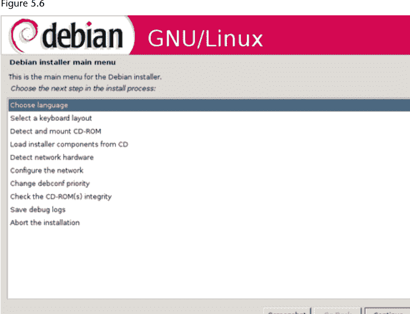

...（此处乱码跳过）...

### 图 5.7


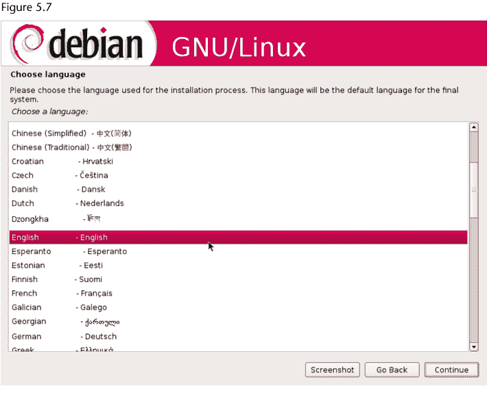

...（此处乱码跳过）...

## 图 5.8

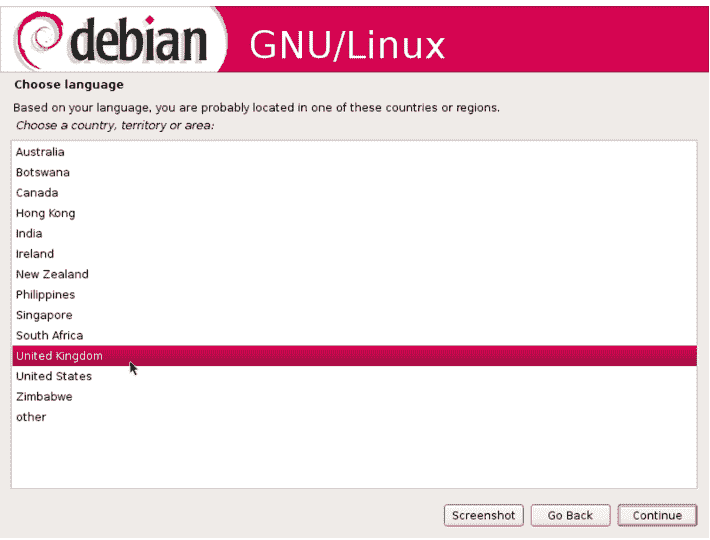

...（此处乱码跳过）...

## 图 5.9

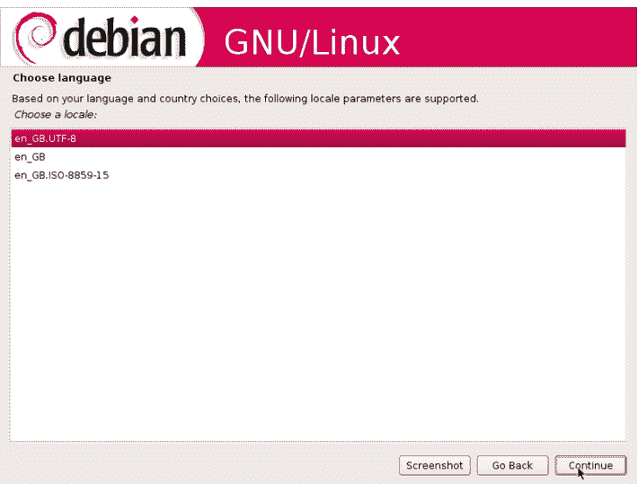

...（此处乱码跳过）...

## 图 5.10

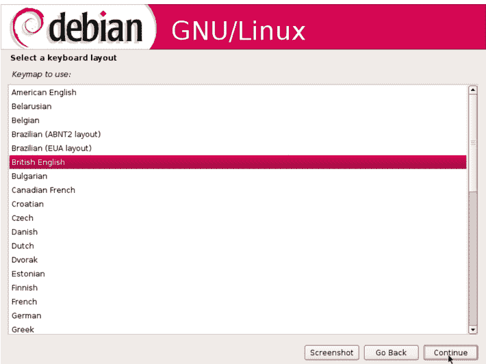

...（此处乱码跳过）...

## 图 5.11

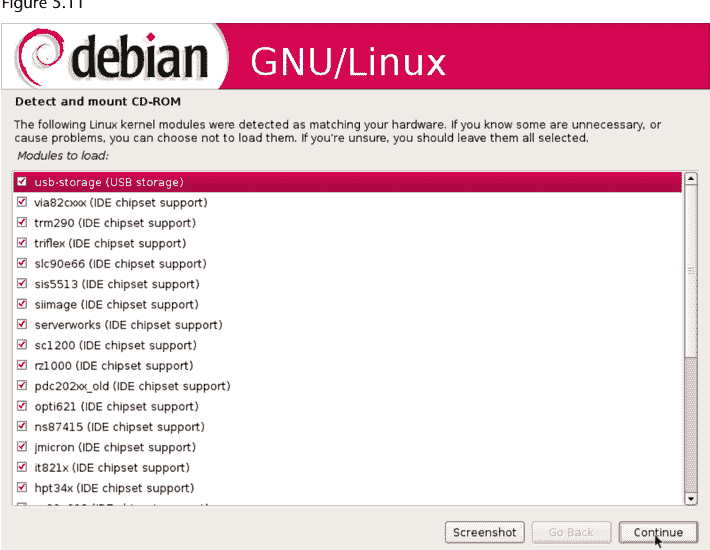

...（此处乱码跳过）...

（注：由于提供的原文后半部分包含大量无法识别的乱码，译文仅针对逻辑清晰的 Markdown 结构和可见文本进行了处理。）

## 图 5.13

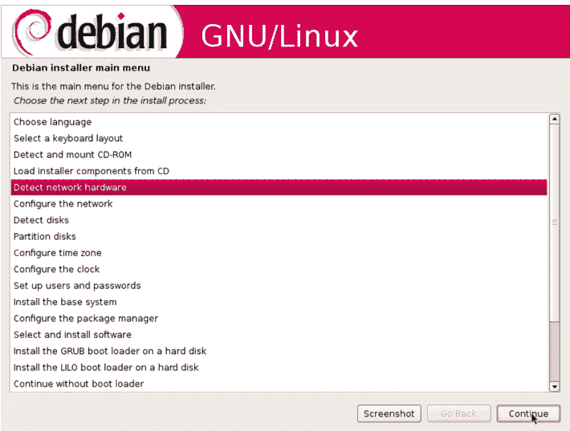

我们可以通过 DHCP 或手动配置网络。在这种情况下，我们将选择通过 DHCP 配置网络的选项。

## 图 5.14

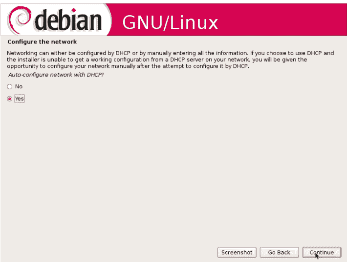

一旦我们配置好了网络，就可以为我们正在安装的系统命名了。系统会要求我们输入机器名称（Name），默认建议命名为 debian。我们可以删除此建议并赋予我们喜欢的名称，该名称由一个单词组成。

## 图 5.15

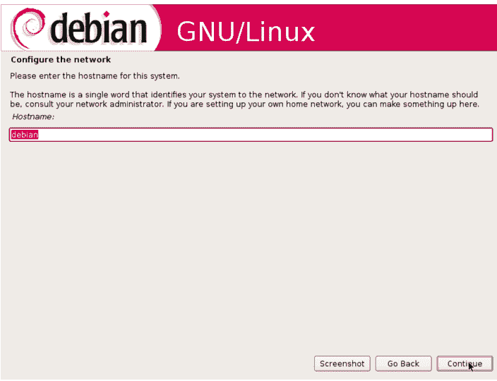

现在，我们唯一做的就是指定系统的本地名称。如果它将成为网络的一部分，因此需要域名，将在下一个屏幕上指定。

## 5.3.7. 硬盘分区

一旦指定了机器名称及其域名（如有必要），安装过程将建议检测磁盘，然后对磁盘进行分区。

## 图 5.16


Debian 安装主菜单

这是 Debian 安装程序的主菜单。

选择安装过程的下一步：

- 选择语言
- 选择键盘布局
- 检测并挂载 CD-ROM
- 从 CD 加载安装程序组件
- 检测网络硬件
- 配置网络
- 分区磁盘（已选择）
- 分区磁盘
- 配置时区
- 配置时钟
- 设置用户和密码
- 安装基础系统
- 配置包管理器
- 选择并安装软件
- 在硬盘上安装 GRUB 引导加载程序
- 在硬盘上安装 LILO 引导加载程序
- 在不安装引导加载程序的情况下继续

在对磁盘进行分区划分时，分区的大小、字符和类型在很大程度上取决于用途类型和可用硬盘空间。这是一个出于教学目的的安装，接下来将给出关于要创建的分区信息，假设我们正在为新安装准备 5 到 15 GB 之间的空间。

我们需要至少创建两个分区：第一个用于挂载系统，第二个作为交换分区（虽然可以在没有交换分区的情况下进行安装，但如前所述，这是非常不可接受的）。为了提高系统效率，我们将创建六个分区。

Debian 提供的分区工具是 `cdisk`，它基于光标在磁盘分区之间移动（屏幕上半部，使用上、下箭头），并选择每个分区上可以执行的潜在操作（屏幕下部，使用左、右箭头），这些操作将根据所选分区的状态而变化。要创建一个新分区，我们需要选择 `[New]`（新建）选项；接下来，如果还可以创建主分区（最大数量为四个），系统将询问是将其创建为主主分区还是逻辑分区；然后我们需要指定分区的大小，最后指定它在磁盘上的物理位置（建议在开始分区之前对我们想要进行的操作画一个草图，并在此基础上创建分区，这样我们就可以一直用 `[Beginning]`（起始）来回答这个问题）。

第一个分区是为根目录 `(/)` 设计的；它不需要很大，因此我们为它分配硬盘至少百分之十的空间，最好放在主分区中，但如果没有主分区，我们可以反复将其创建为逻辑分区。我们将指定该分区位于空闲空间的开头，并且分区选择的文件系统类型为 `ext3`。

第二个分区将用于交换分区 `swap`。它的大小至少应与 RAM 相同，例如 512MB、1024MB 等，通过这种大小，我们可以确保在特殊情况下永远不会饱和；同样，最好将其设为主分区，但如果它是逻辑分区，也不会影响系统性能。如果我们在同一台计算机上安装了多个 GNU/Linux 系统，我们可以为所有系统使用同一个交换分区，因为在系统运行期间存储在上面的信息是易失的。交换分区的文件系统将是 `swap` 类型（交换区）。

第三个分区将用于用户目录 `(/usr)`；我们需要记住该分区将托管大部分要安装的软件，这意味着它的大小必须相当大，大约占磁盘的百分之四十。文件系统将是 `ext3`。

第四个分区将用于 var 目录 `(/var)`，存放库、日志文件等。与上一种情况一样，也将是 `ext3`。

第五个分区将用于用户主目录 `(/home)`，旨在存储用户数据，根据硬盘的大小，我们可以为它分配硬盘百分之十到百分之二十的空间，取决于用户的数量且属于系统的一部分。此分区也将是 `ext3`。

剩余空间（第六个分区）将用于 var 目录 `(/tmp)`，其文件系统将是 `ext3`。

上述分区分布仅仅是一个建议，其有两个目标：一方面是提高安装的性能，另一方面是使系统更健壮（通过将数据分布在不同的分区，其中一个分区的损坏不会导致所有数据的丢失）。在开始分区之前画草是有的。因此，在检测到磁盘后，我们可以选择分区方法，无论是引导式还是手动。

## 图 5.17


接下来，我们将显示要进行分区的设备。如果有多个硬盘，我们可以使用光标选择我们要操作的一个。做出选择后，点击继续。

Debian 提供了多种分区方案：所有文件放在一个分区、添加用户分区或分离 `/home`、`/var` 和 `/tmp`。正如我们之前看到的，不建议在同一个分区上安装。

由于我们有一个自动分离 `/home`、`/var` 和 `/tmp` 分区的选项，对于我们首次安装 GNU/Linux 系统，我们选择这个选项。

### GNU/Linux

分区磁盘

已选择的分区：

SCSI1 (0,0,0) (`sda`) - 虚拟机：8.6 GB

磁盘可以使用几种方案进行分区。如果你确定，请选择第一个。

分区方案：

- 所有文件位于一个分区（推荐给新用户）
- 分离 `/home` 分区
- 分离 `/home`、`/var` 和 `/tmp`


正如我们看到的，这是应用程序自动建议的分区方案。如果我们想修改分区（其大小、位置或文件系统），添加或删除任何建议的分区，我们可以选择相关分区并进行相应更改，或者进入“撤销分区”选项并重新分区。

引导分区

关于分区的帮助：

- SCSI (0,0,0) (`sda`) - 8.6 GB, 虚拟机 S
- 主分区 276.8 MB `ext3` `/`
- 逻辑分区 31.5 GB `ext3` `/var`
- 逻辑分区 1.5 GB `ext4` `swap`
- 逻辑分区 509.9 MB `ext4` `/tmp`
- 逻辑分区 203.1 MB `ext4` `/home`
- 逻辑分区 3.0 GB `ext4`

撤销分区

这是你当前配置的分区和挂载概述。选择一个分区以修改其设置（文件系统、挂载点等），选择一个空闲空间以创建分区，或选择一个设备以初始化其分区表。

然而，如果我们想应用此建议的分区方案，只需完成分区、写入磁盘更改并点击“继续”(`Continue`)。现在，这些信息将写入 `MBR`，且更改将生效。我们退出 `cfdisk` 程序并继续安装。

图 5.20

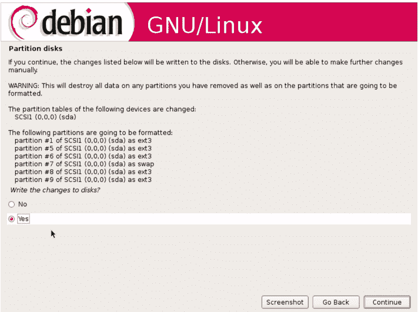

## 5.3.8. 时间配置

在对硬盘进行分区后，我们进入系统的时间配置界面。

图 5.21

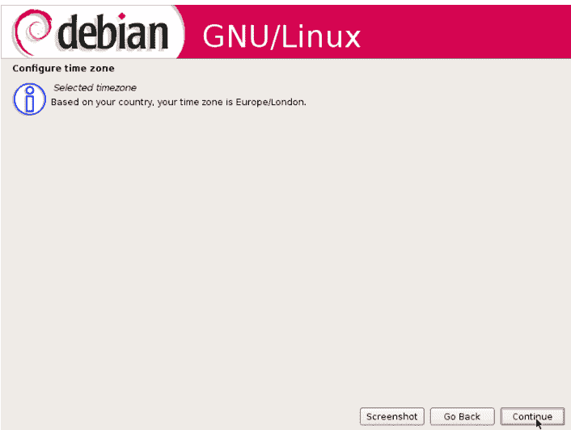

接下来，我们为时钟选择 UTC 时间，即协调世界时。

图 5.22

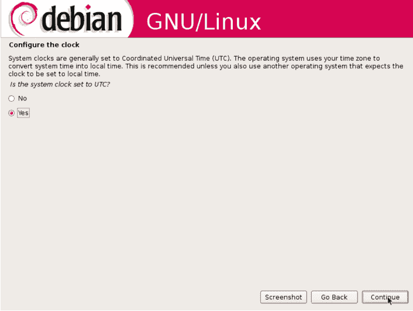

## 参考文献

> 有关协调世界时的更多信息，请访问维基百科上的“协调世界时”（Universal Time Coordinated）条目。

## 5.3.9. 配置用户和密码

一旦完成系统时间的配置程序，就是配置用户和密码的时间了。

首先，系统会询问我们是否想要启用加密密码选项，这样只有 root 用户才能访问包含密码的文件（`/etc/shadow`）。这为我们的系统增加了一项额外的安全措施。

第二个问题是决定是否允许 root 用户访问系统，或者我们是否想创建一个使用 `sudo` 命令具有管理员权限的用户。在这里，我们将让读者自行决定在执行管理任务时希望如何进行工作；在第一次安装中，我们将允许 root 用户访问系统。

图 5.23


现在我们需要输入 `root` 密码。在选择此密码时，遵循建议并记住它是至关重要的。为了确认输入了所需的密码并避免可能的输入错误，系统要求我们重复输入密码以进行确认。

图 5.24

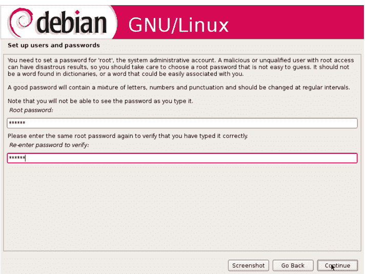

如所述，出于各种原因，始终以 `root` 身份运行是一个糟糕的策略。因此，系统建议创建一个普通用户账户。

图 5.25

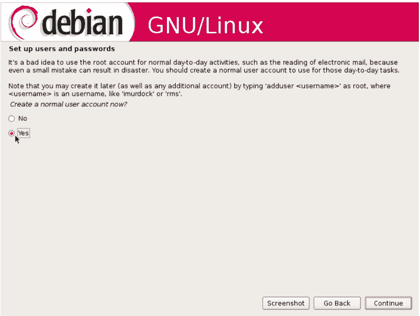

它将询问我们新用户的全名：

图 5.26

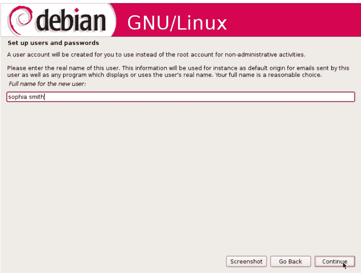

接下来，是该账户的名称，换说是访问系统的用户名：

图 5.27

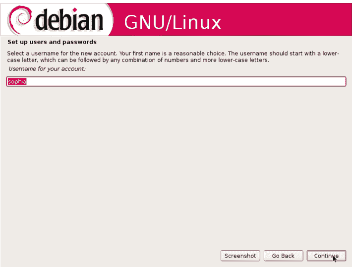

最后，是用户的密码，由于同样的原因，密码需要输入两次：

图 5.28

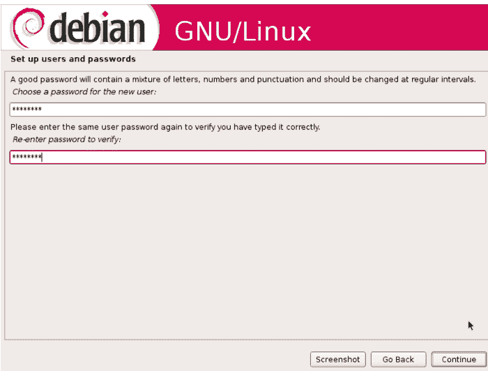

## 5.3.10. 基础系统安装

有了所有这些信息，系统开始安装基础系统：

图 5.29

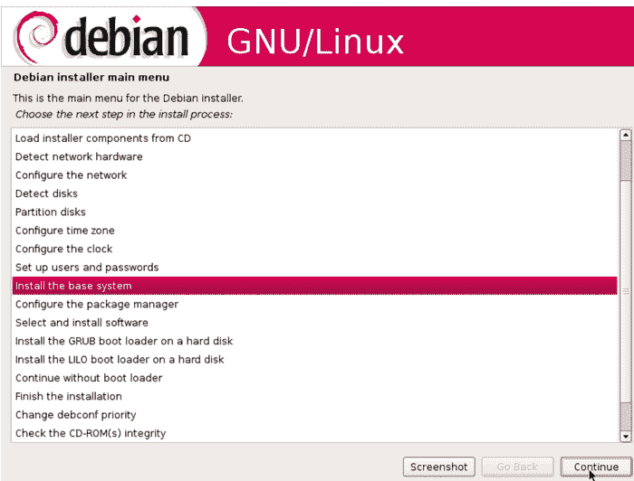

它首先要求我们提供想要安装的内核。从下面的插图中可以看出，我们可以在四个内核之间进行选择。我们将选择第一个选项：

图 5.30

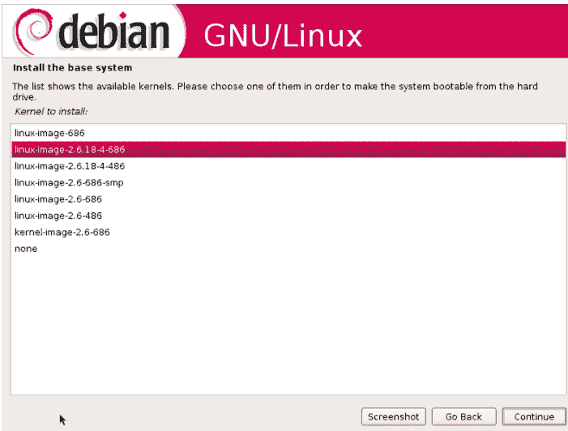

## 5.3.11. 配置包管理器

图 5.31

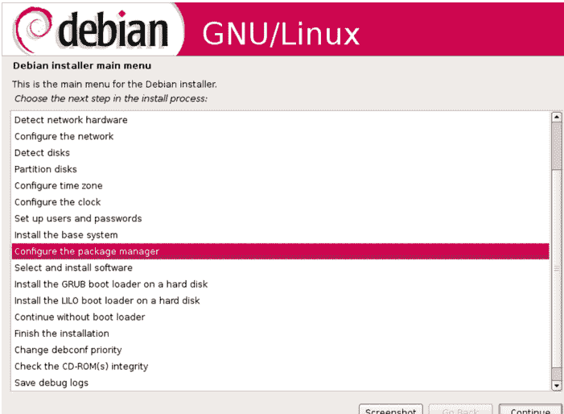

## 5.3.12. 选择并安装程序

图 5.32

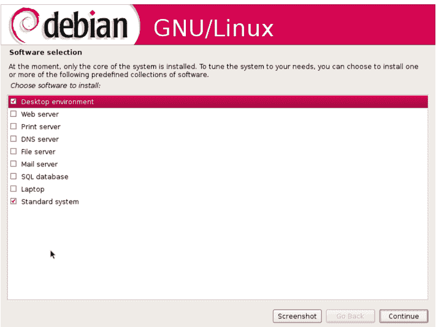

## 5.3.13. GRUB 安装

接下来，程序启动 GRUB 引导加载程序。它分析我们的硬盘并寻找所有已安装的操作系统，以便在 Debian 安装完成后重启电脑时，我们可以在安装的操作系统之间进行选择。它会询问我们确认将其安装在 MBR 中，我们将给予肯定回答。

## 5.3.14. 重启系统

我们已经到达基础系统安装的结束，这是显示的屏幕：

现在是时候重新系统到我们在硬盘上安装的基础系统了，并从那里开始定制我们的第一个 GNU/Linux 安装。因此，我们将移除 DVD-ROM 并点击上一个显示的“继续”选项。

## 5.3.15. 基础系统启动

如果一切顺利，当我们重启时将看到 Debian GNU/Linux 操作系统：

图 5.34

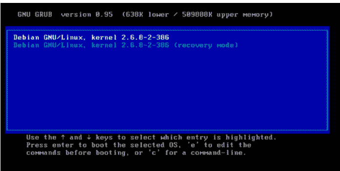

片刻后，屏幕显示启动期间执行的各种结果，系统显示欢迎界面并邀请我们继续，我们可以通过执行 `base-config` 命令随时重复此过程。点击“确定”。

图 5.35

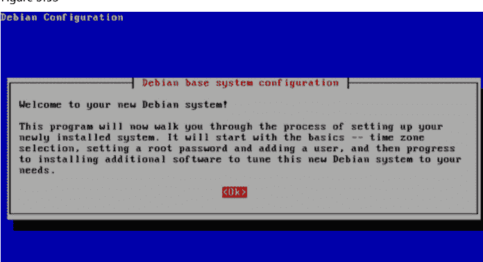

## 5.3.16. apt 配置

在此部分，我们询问 `apt` 从哪里查找构建数据库所需（依赖、状态等）。由于我们插入了 DVD-ROM，系统会询问我们是否要从 DVD-ROM 添加源，我们将回答“是”。

图 5.36

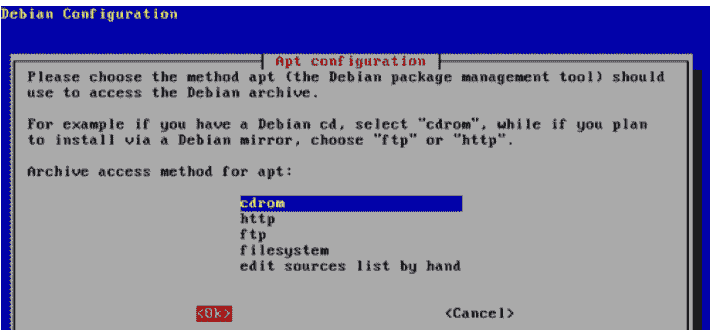

图 5.37

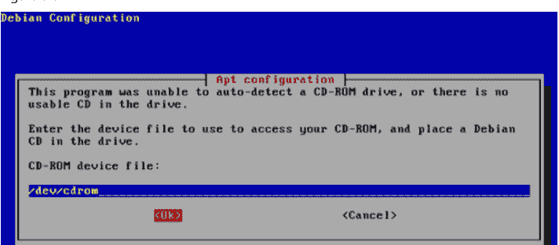

片刻后，屏幕显示启动期间执行的各种结果，系统显示欢迎界面。一旦我们插入了 DVD-ROM，系统会询问我们是否要从 DVD-ROM 添加另一个源，我们将回答“否”。

图 5.38

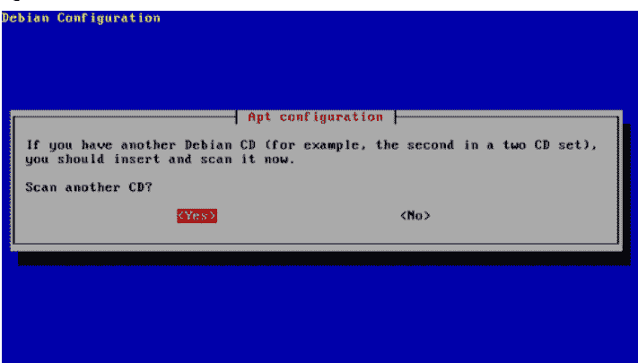

## 5.3.17. Tasksel

接下来，运行软件包选择 `tasksel`：

图 5.39

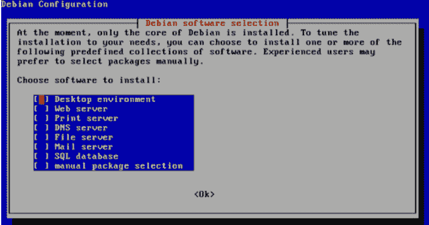

我们将不会标记任何选项，因为我们可以可以使用命令行。

图 5.40

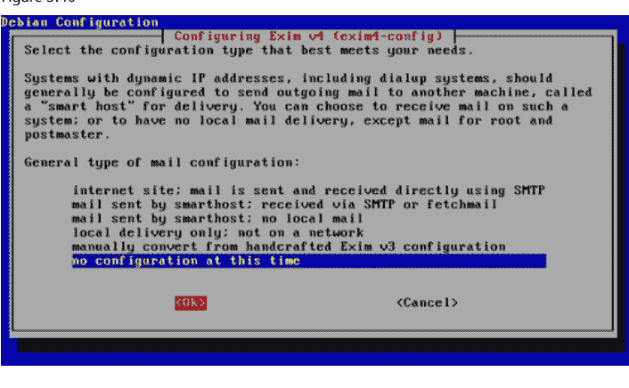

图 5.41

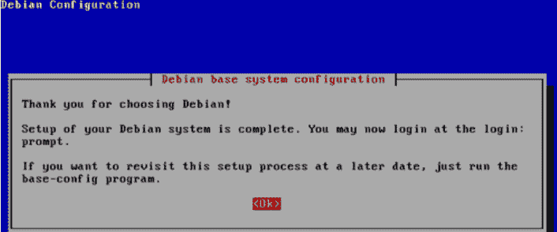

最后，片刻后，屏幕显示启动期间执行的各种结果，系统显示欢迎界面。

图 5.42


## 5.4. Debian Etch 的网络安装

执行网络安装的许多步骤与 DVD-ROM 安装相同，因此我们将仅强调并重点关注与上述过程不同的部分。

### 5.4.1. 网络安装的特殊之处

从一组 DVD-ROM 进行安装与通过网络安装之间的基本区别在于安装软件包时包的位置。对于使用 DVD-ROM 的安装，我们每次安装新软件包时都必须向光驱驱动器插入至少一张盘，以便从中提取需要的数据；而在网络安装中，软件包是远程获取的，这使我们首先能够访问最新版本，并只需通过命令行（`apt-get upgrade`）即可更新所有已安装的包。

同时，为了执行网络安装，我们通常只需要一张 CD-ROM 或单个 DVD-ROM，包含启动操作系统所需的信息，我们可以从中运行安装程序（该程序已包含在 CD-ROM 或 DVD-ROM 中，以及可能配置网络访问所需的模块，从这里开始，其余信息将通过远程获取）。

### 5.4.2. 不同安装方法的共同点

如前所述，执行网络安装时我们需要遵循的许多步骤与我们发行版的 DVD-ROM 组是类似的。因此，我们可以按照之前的方式（[5.3.1.] 和 [5.3.2.]）启动安装程序，并最初按照相同的步骤配置安装语言、键盘、划分磁盘并激活分区（[5.3.3.]、[5.3.5.]、[5.3.6.] 和 [5.3.7]）。

此时，内核通常已经识别了我们的网卡，如果没有识别，我们将继续配置相关模块以使其正常工作。在许多情况下，配置和参数传递可以通过 `probe` 自动完成，这是一个可以在选择模块后从安装界面本身启动的程序。完成此操作后，我们需要配置网络（通过 DHCP 最为方便），指定我们从哪个站点获取源，并从现在起，按照与 CD-ROM 相同的步骤完成安装。

### 5.4.3. 网络模块安装

这是执行网络安装的关键点，因为如果我们的网卡驱动程序没有编译到内核中，我们就必须选择所需的模块来访问它。首先，我们需要确定网卡在启动过程中是否已经被检测到以及其相应的驱动程序是否已经加载。要做到这一点，我们将访问第二个终端（`Alt+F2`）执行 `dmesg` 命令，我们需要从该命令返回的各种行中搜索是否有某一行提到了我们的网卡。例如，对于 RTL-8029 卡（Realtek Semiconductors），我们得到：

```
sofia@debian:~$ dmesg | grep ne2k-pci.cv1.02 10/19/2000 D. Becker/P. Gortemaker
http://www.scyd.com/network/ne2k-pci.html Found IRQ 11 for device 00:0b.0
PCI: Sharing IRQ 11 with 00:07.2 eth0: RealTek RTL-8029 found at 0xe00, IRQ 11,
52:54:00:DB:BFD4.
```

如果情况并非如此，首先我们需要确定我们使用的是什么网卡。要做到这一点，最好的方法是查看附带的文档或进行视觉检查。如果不可能，还有其他策略来确定卡类型，例如按下 `Alt+F2` 访问控制台并调查 `/proc/pci` 文件的内容（例如使用 `cat`），或者我们可以参考计算机上安装的另一个操作系统可能提供的信息。

一旦我们知道自己拥有什么种类型的网卡，就需要找到哪个模块允许我们访问该网卡。为此目的，最安全的策略是使用任何搜索引擎（例如 Google），输入我们网卡的关键词（例如网卡参考 NIC Linux 模块）并阅读我们找到的一些页面。我们也可以去主流 Linux 发行版的页面，在它们的搜索框中输入网卡型号。作为最后手段，我们可以查看内核网络模块的文档，其中指定了所有支持网卡的对应模块。

了解制造商是否开发了他们自己的模块也是有好的。为网卡寻找模块可能是一项相当复杂的任务，甚至可能是不可能，可能没有对该网卡的支持，或者可能需要更高级的方法进行配置；由于由于原因，我们始终建议使用尽可能标准的网卡。


一旦我们找到了需要的模块，在安装内核后，我们应该选择“Configure Driver Modules”（配置驱动模块）菜单给出的选项。在看到一个提醒我们许多驱动程序已包含在内核中的警告屏幕后，我们将进入“Select Category”（选择类别）模块选择屏幕（我们可以通过执行 `modconf` 命令随时访问此界面。该命令作为管理以模块化方式编译到内核中的驱动程序的程序前端），并使用光标选择 `kernel/drivers/net` 选项。进入选择网卡模块的“Select Kernel/drivers/net modules”屏幕后，我们将再次使用光标选择我们需要的模块。在对是否真的想安装该模块的问题回答“yes”后，我们可以让自动为我们配置模块，除非我们需要向模块传递特定参数。几秒钟后，我们将收到一条告知模块是否安装正确的消息。

### 5.4.4. 网络配置

一旦我们知道网卡运行正常，从安装主菜单遵循“Configure Network”（配置网络）步骤来配置网络。首先，我们需要配置主机名（例如建议 Debian），而不输入域名。接下来，我们需要输入 IP、子网掩码、网关、域名和 DNS 服务器（最多三个，用空格分隔）。

### 5.4.5. apt 配置

一旦我们配置了网络，接下来的步骤与 CD-ROM 安装相同，直到到达“Apt Configuration”（apt 配置）。此时，我们不再选择 CD-ROM 选项，而是选择最合适的选项。出于实际考虑，选择 http 协议与 ftp 相同。做出选择后，我们将被询问是否想要使用非美国软件包；原则上，除非有法律问题，我们将回答“yes”。

关于该问题的回答，涉及到使用非自由软件包，学生被允许根据自己的伦理原则做出选择。接下来，我们将询问 apt 从哪个镜像获取这些软件包；我们应该总是选择最易访问的一个，这通常是地理位置最近的那个。

## 6. 基础配置

### 6.1. 登录系统

如果我们还没有配置图形环境，在启动 GNU/Linux 系统时，将会出现一个登录界面，要求用户在开始使用系统之前识别自己的身份。事实上，大多数发行版都会启动多个控制台，我们可以通过 Alt+F1、Alt+F2 等进行访问。

这允许我们能够同时与多个账户进行工作，拥有各种会话来运行不同的程序等。负责管理这些控制台的程序是 `Getty`。该程序唯一做的事情就是与相应的设备（对于屏幕来说，是 `/dev/ttyx`，其中 *X* 是控制台编号）以及登录应用程序建立连接。这种机制赋予了我们很大的活性，因为 `Getty` 程序本身允许与不同的设备进行通信，这意味着我们可以将终端连接到串口端口、使用电话线和调制解调器连接到控制台等。

在启动登录程序之前，屏幕上会显示一条欢迎消息。我们可以在 `/etc/issue` 文件中配置此消息，写入任何我们想要的内容。在同一个文件中，我们还可以显示一些系统变量，将它们表述为：

| 变量 | 描述 |
| :--- | :--- |
| `\d` | 当前日期 |
| `\s` | 操作系统名称 |
| `\l` | 控制台编号 |
| `\m` | 计算机架构 |
| `\n` | 计算机名称 |
| `\o` | 域名称 |
| `\r` | 操作系统版本 |
| `\t` | 当前时间 |
| `\u` | 系统上活动用户的数量 |

一旦我们进入系统，`login` 程序将负责告知当日的消息。这条消息写入 `/etc/motd` 文件中，我们也可以修改它。这种机制对于通知所有用户某个特定事件、警告他们任何问题等非常有用。如果用户希望抑制此消息，他可以在其家目录下创建一个名为 `.hashlogin` 的条目文件来实现。在显示完此消息后，登录过程将启动为用户默认配置的 shell。命令解释器将做的第一件事是执行 `.profile` 文件的内容（该文件位于用户目录下）。该文件的作用是在用户每次进入系统时执行配置的指令。除了这一个 `.profile` 之外，我们还有 `/etc/profile`，它为所有系统用户执行，并应该对所有用户进行通用的配置，将我们需要的选项放在每个用户的 `.profile` 中。

### 6.2. 探索 bash

尽管无论使用哪种 shell，`.profile` 都会执行，但 `.bashrc` 和 `.bashprofile` 文件倾向于只在我们使用解释器或 bash 时执行（尽管可以从用户的 `.profile` 中配置它，那里是调用该文件执行的地方）。让我们看看在这些文件中找到的一些指令：

```bash
#BASIC CONFIGURATIONS
umask 022
#PATH
export PATH=/usr/local/sbin:/usr/local/bin:/usr/sbin:/usr/bin:/sbin:/bin:$PATH
#PROMPT
export PS1="\h:\w\$ "
#USER ALIAS
alias ll='ls --color=auto'
alias la='ls -al'
alias rm='rm -i'
alias cp='cp -i'
alias mv='mv -i'
alias v='vim'
```

正如我们所见，我们可以定义任何我们想要的内容。该文件的前两条指令抵消了其他用户的入站消息，并为我们创建的新文件配置了权限。接下来的指令是 `PATH` 的定义。`PATH` 是我们存放命令、程序、应用程序等的目录，我们希望能够在文件层次结构的任何地方调用它们，而无需编写完整路径 [我们用冒号 `:` 隔开每个 `PATH` 目录]。以下是系统的声明。提示符是出现在 shell 中 `#` 字符（对于 root 用户）或 `$`（对于所有其他用户）之前的行。我们可以使用以下系统变量按我们的意愿为自己配置此提示符：

表 6.2

| 变量 | 描述 |
| :--- | :--- |
| `\d` | 系统日期 |
| `\h` | 机器名称 |
| `\s` | 我们使用的 shell |
| `\u` | 用户名 |
| `\v` | bash 版本 |
| `\w` | 当前目录 |

#### PATH 变量

如果我们希望从当前所在的目录执行程序，而无需在开头放置 `/`，我们可以将此项添加到 `PATH` 声明中。同样，如果 `PATH` 中没有我们需要执行的程序，我们可以通过命令行指定其路径。在任何情况下，它都不建议向 `PATH` 中添加 `/`，因为可能会成为安全隐患。

最后，我们有用户别名（`alias`）。别名是同义词，通常用于我们最常用的命令（以避免输入完整内容）。例如，在示例中的一个别名中，我们定义了写 `ls --color=auto` 时应该执行什么。这样，我们可以使用长命令而无需每次都写一遍。

在定义 `PATH` 和提示符时，我们使用了 `export` 命令变量。shell 使用这些变量来定义我们可以执行哪些操作、保存特定类型的信息等。我们可以看到所有使用相同 `export` 命令声明的变量。通过 `set` 和 `unset` 我们还可以处理命令解释器的其他属性。

bash 默认拥有的这些变量和属性包括：

- `PWD`: 当前目录。
- `BASH VERSION`: 我们正在使用的 bash 版本。
- `RANDOM`: 每次显示其内容时生成一个不同的随机数。
- `SECONDS`: 自打开 shell 以来过的秒数。
- `HOSTNAME`: 系统名称。
- `OSTYPE`: 我们正在使用的操作系统类型。
- `MACHYPE`: 计算机架构。
- `HOME`: 用户家目录。
- `HISTFILESIZE`: 历史文件的大小（保存的命令数）。
- `HISTCMD`: 历史中当前命令的编号。
- `HISTFILE`: 保存命令的文件（通常是处理用户家目录下的 `.bash_history`）。

通过处理这些变量，我们可以更多地自定义命令解释器，使其更符合我们的喜好和需求。

> 我们可以看到从同一个 `alias` 命令定义的所有别名。

```bash
echo command
```

通过 `echo $VariableName` 我们可以看到这些变量的内容及其属性。

### 6.3. 启动系统

尽管在安装操作系统时已经配置并安装了启动系统，在本节中，我们将更详细地查看我们获得的内容，以及我们如何自定义并调整它们以满足我们的需求。虽然有很多选择，但 `Lilo` 和 `Grub` 是 GNU/Linux 环境中最常见的，因此我们只关注这两个两个。

在详细介绍这两个程序的配置之前，我们将先解释标准 PC 的启动系统是如何工作的。正如我们所知道的，我们可以从 `BIOS` 或 `EFI` 配置计算机的启动顺序。通常，这个序列倾向于从磁盘驱动器开始搜索，继续到 CD/DVD 驱动器和硬盘。虽然我们可以在磁盘或 CD 的引导区上安装 `Lilo` 或 `Grub`，但通常做法是将其安装在硬盘上，这样每次启动计算机时就不需要插入磁盘。

当计算机启动时，启动系统搜索硬盘，它首先会检查主硬盘（第一个 IDE 通道或磁盘通道）的 `MBR` 是否包含要加载的指示。`MBR` 是硬盘的第一扇区，存储了有关分区的信息，以及可选的启动系统的程序。如果在这里找不到该程序，将检查活动分区的引导区。每当我们要在计算机启动系统中安装程序时，必须将其放在 `MBR` 中。在底图中可以看到此过程：

图 6.1


### 6.3.1. Grub

Grub 允许许多不同的配置来执行任何操作：我们在启动计算机时提供了一个小型命令解释器，让我们在不加载任何操作系统的情况下访问磁盘文件。在前面的情况下，在本节中我们只查看其基本配置。如果我们希望深入了解其用法，可以研究它的

Grub 启动系统分阶段加载。通常，在安装软件包时，会包含对应这两个阶段的文件。当我们启动时，并不希望显示选择要加载的操作系统菜单，我们只需要执行 Grub 程序并在它显示的命令解释器执行：

> (3)`Grub` (Grand Unified Bootloader) 是 GNU 项目的启动程序。

#### 启动系统

GNU/Linux 或类似系统的启动系统允许我们在同一个文件系统中加载不同的内核。我们可以在无需重新安装系统的情况下使用不同的内核。为了配置它，我们需要指定两个位置以及我们在每个位置使用哪个内核。

```bash
$ install (hd0,0)/PATH/stage1 dhd (hd0,0)/PATH/stage2
```

此指令将 Grub 安装在第一个 IDE 磁盘主硬盘的 MBR 上。引用磁盘的方式与 GNU/Linux 中的方法差异非常小。在 `hdx` 中，`x` 代替 `a, b...` 是 `0, 1` 等。对于分区，我们也从 `0` 开始命名第一个，并且与 `hdal` 不同，我们应该编写 `(hd0,0)` 并以此类推。

（路径和阶段）。通常情况下，我们在安装 Grub 包的同时，还会为每个加载阶段添加这两个文件（它们通常位于 `/usr/share/grub/1386-pc/` 中）。`d` 参数（`hd0`）表示 Grub 的第一阶段将安装在第一块磁盘的主引导扇区（MBR）上。最后一个选项指示了第二阶段加载文件的位置，该阶段由第一阶段执行。

## 向 Linux 内核传递参数

通过 Grub，我们可以在启动之初向 Linux 内核传递参数。当我们希望对系统执行某些特定操作时，这非常有用；例如，通过传递单个 `'s'`，系统将在运行级别（runlevel）1 下初始化；通过 `root=/dev/hda3`，我们可以指定文件系统根目录。

使用此配置，当我们重启电脑时，默认会出现 Grub 命令解释器。通过它，我们可以处理磁盘的许多情况，如启动我们想要的操作系统等。如果 wef想启动一个 GNU/Linux 系统，将编写以下指令：

```bash
$ kernel (hd0,0)/vmlinuz root=/dev/hd1 boot
```

在第一条指令中，我们指定了内核镜像的位置（带有我们想要的参数），在第二条指令中，我们启动了加载操作系统的过程。如果我们选择一个菜单，这样就不需要每次启动电脑时都输入这些命令，我们可以生成一个类似下面的菜单文件（命令以 `#` 开头）：

```bash
## 默认加载的操作系统规范。
## 此数字对应于本地操作系统
## 分区上操作系统的排列顺序。 
default 0
```

## Grub 帮助

要查看 Grub Shell 中可用的所有命令，可以按 `Tab` 键。帮助信息中也包含了所有命令的完整参考。

```bash
## 让系统在加载默认配置的系统之前等待 10 秒。
timeout 10
## GNU/Linux 系统的启动配置
title Debian GNU/Linux
kernel (hd0,0)/vmlinuz root=/dev/hd1
## Windows XP 启动配置
title Windows XP system
root (hd0,2) makeactive
```

要使用此方法安装 Grub，必须执行与上述相同的指令，并添加 `p (hd0,0)/PATH/menu.lst` 参数，指定磁盘、路径和菜单。为了启动系统，我们可以在配置文件的全局部分放置密码。这样，当我们想要从菜单进入 Grub Shell 时，系统会要求我们输入密码。如果使用这条指令，确保只有 root 用户可以读取此配置文件是非常重要的（尽管在这种情况下，也有一个使用 MD5 加密密码的选项）。

> (4) 安装 grub 的另一种方法是使用 `grub-install` 程序。

还有另一种使用 RAM 磁盘（`initrd`）镜像的启动类型。这种类型的启动用于制作 Linux 内核的模块化配置。当我们我们需要带有特殊配置的内核、将模块包含在内核中、为 Live CD 制作启动镜像，或者让实验室的所有计算机使用存储在单个服务器上的相同镜像时，经常使用它。在任何情况下，操作系统的标准安装从不使用这种启动类型。如果我们想创建此类镜像，可以在 `initrd` 手册和 `mkinitrd` 程序中找到更多信息。

## 6.4. 分区和设备的访问

UNIX 类型的系统将计算机的所有设备都视为文件。这为我们提供了极大的灵活性，因为我们可以利用处理文件时使用的所有机制和功能，并将它们应用于设备。在 `/dev` 中，包含了我们所识别的所有设备。如果系统未能正确识别某个设备，或者我们想创建一个特殊设备，`mknod` 命令允许我们执行此类操作，尽管在使用它之前确切知道我们想要做什么是非常重要的，因为错误可能会损坏系统的部分内容。

| 磁盘驱动器和 CD/DVD 目录 |

| :--- |

对于磁盘和 CD/DVD，许多发行版会创建可以挂载的默认目录（`/floppy`、`/cd-ROM` 和 `/dev`）。还提供了 `/mnt/` 和 `/media/` 目录，我们使用这些目录处理系统上的其他设备。

对于存储单元，系统使用另一种操作来访问其文件，即挂载（mount）操作。对于此项操作，我们使用 `mount` 和 `umount` 命令，它们在现有的系统目录中挂载或卸载特定设备/单元的所有文件。访问设备文件系统的基本方法是 `mount <directory> <device>`，其中 `device` 可以引用 IDE 或 SCSI 通道上的任何设备（如 `/dev/hdXX`、`/dev/sdXX`、磁盘驱动器 `/dev/fdX`、备份磁带、USB 闪存盘等），而 `directory` 是我们挂载这些设备的位置。如果挂载这些设备的目录是空的将会有帮助，因为当该设备被用作挂载点时是无法访问设备的。

要卸载这些设备之一，我们可以执行 `umount <directory>`，其中 `directory` 是挂载点。如果我们挂载了软盘或 CD 等设备，在告诉系统之前，不要从介质中移除设备是非常重要的，这样它就可以更新设备的文件系统缓存。同样，如果有任何用户或应用程序正在使用该设备的任何文件或目录，我们就无法卸载该设备（如果我们尝试这样做，系统将显示错误消息）。

注意，在操作的任何阶段，我们都没有指定所挂载单元所使用的文件系统类型；这意味着它必须自动确定。如果我们想手动指定文件系统类型，可以使用 `mount` 命令并如下：

| 磁盘驱动器和 CD/DVD 目录 |

| :--- |

| /floppy |

| /cd-ROM |

| /dev |

| /mnt/ |

| /media/ |

| 表格 6.3 |

| :--- |

| 类型 | 系统 |

| ext | GNU/Linux |

| ext2 | GNU/Linux |

| ext3 | GNU/Linux |

| swap | Swap |

| minix | MINIX |

| iso9660 | 文件系统 |

| nfs | 网络 |

| smbfs | Windows |

| ntf | Windows |

| mdos | Windows |

| vfat | Windows |

| 表格 6.4 |

| :--- |

| 选项的含义 | 允许 | 不 |

| 运行二进制文件 | exec | noexec |

| 使用位 | suid | nosuid |

| 只读 | ro | rw |

| 同步系统 | sync | async |

| 设备标志位 | dev | nodev |

| 用户权限 | user | nosuser |

| 交换类型 | sw | |

| 图 6.2 |

| :--- |

| hda1 (ext2) root |

| hda2 (swap) |

| hda3 (ntfs) /mnt/w200 |

| hdb1 (fat32) /mnt/info |

| hdc (iso9660) /cdrom |

| fd0 floppy |

除了这些挂载和卸载单元的命令外，操作系统还提供了另一种实现相同功能的方法并为每个单元保留配置。在 `/etc/fstab` 文件中，我们可以保存这些信息，每行指示一个单元及其相应的挂载目录和我们想要配置的选项。这些行的格式为：

`<dev> <dir> <typeSystem> <options> <dump> <order>`


在第一个字段中，我们像使用 `mount` 命令一样指定设备，然后是挂载单元的目录。在 `typeSystem` 中，我们可以指定单元使用的文件系统或使用 `auto` 让其自动检测。在 `options` 中，我们可以写多个与 `mount` 命令中相同的项，并用逗号分隔。该字段中一个非常有用的选项是 `auto` 或 `noauto` 配置，通过它可以告诉系统自动挂载（或不挂载）启动的单元。`dump` 字段指示是否要制作备份副本（更多信息见 `dump` 手册）。如果不使用此系统，可以输入 0。最后一个字段可以用于指定挂载单元的顺序。如果我们输入 0，表示顺序不重要。根文件系统是必须挂载的内容；因此在该字段中应为 1。

我们在该文件中总是看到的一个可能让人感到惊讶的条目是 `/proc/` 目录，它具有特殊含义。实际上，该目录下并没有文件；相反，我们拥有的是系统内核使用的变量值。正如操作系统一样，它必须能够作为文件被引用，在 `/proc/` 目录中，我们也可以确定内核的某些内部变量，就像它们是文件一样。

尽管在层级目录结构中挂载单元的设计非常强大并提供了很多灵活性，但在某些情况下它并不实用。例如，每当我们想将文件复制到设备时，我们必须挂载该单元、复制文件然后卸载它。因此，能够简化整个过程并减少我们步骤的应用程序就较少。其中之一是 `itertools`，这是一个包含各种应用程序的包，允许我们直接在磁盘之间复制文件，此外还有其他一些有趣的工具。还有一个名为 `autofs` 的软件包，它可以自动检测添加到系统的任何设备并对其进行挂载，而无需管理员编写任何命令。

```
mount to command
```

`mount to` 命令用于挂载该配置文件启用了 `auto` 选项（这是默认设置）的所有设备。

## 6.5. 设备配置

尽管这在 GNU/Linux 最初并不如此，但目前越来越多的用户为他们的特殊设备为 GNU/Linux 提供驱动程序。在尝试配置它们之前，我们必须在实际系统、模块、互联网等处找到关于它们的信息，以在启动时避免一些问题。目前大多数设备都有 `HOWTO`、手册或其他类型的文档，在购买新设备之前，确定该设备是否有任何可用的驱动程序是非常重要的。

尽管我们在这个小节中只展示如何配置个人电脑中最常用的某些设备，但该过程可能会因发行版而不同而有显著差异。尽管我们在本小节中只查看一个 Debian GNU/Linux 系统，但如果你从一开始就学会了基本过程是如何工作的，那么在理解其他发行版使用的配置时就不会遇到问题。

### 6.5.1. 键盘

正确配置键盘对于解决可能出现的任何相关问题非常重要。首先，我们必须知道，当系统启动时，将加载一个与安装过程中配置的相对应的字符映射。该字符映射通常位于 `/etc/console/boottime.kmap.gz` 或 `/etc/` 中的其他目录中。如果我们想更改键盘，我们就必须将此文件替换为与新键盘对应的文件并重启系统，因为这样就会加载新的映射。所有现有的字符映射通常位于 `/usr/share/keymaps/` 目录，按计算机架构和国家排序。具体来说，西班牙在基于 i386 架构和标准键盘的计算机上使用的字符映射可以在 `i386/qwerty/es.map.gz` 中找到。

尽管所有这些字符映射都是 gzip 格式压缩的，但我们可以解压并更改某些条目，以适应我们的需求。在每一行中，我们都会找到 `we` 指令，它表示我们正在定义一个键（该按位通过使用 `showkey` 命令与键盘上每个键对应的数字来指示）。在进行定义之后，我们需要定义当单独按下按键或配合 `Shift` 键时会发生什么。

让我们来看一个例子：

```
keycode 53 = minus underscore control keycode 53 = Delete
```

在第一行中，我们指定了单独按下按键（减号）或配合 `Shift` 键按下（下划线）时对应的字符。第二行显示了如果我们配合 `Ctrl` 键按下按键将执行什么函数（随后的字符将被消除）。你可能需要配置此类类型文件的所有信息可以在名为 `readline` 的手册中找到，如果在使用特殊键盘或其他国家制造的键盘时出现问题，该手册非常有用。如果我们不想重启系统，我们可以在 `readline` 手册中找到可能配置此类类型文件的所有信息。

### 终端字体

使用终端字体，我们可以配置与系统通信的字体。我们需要区分哪些字体和字体字体，字体在 `/etc/console` 用于挂载该中启具有 `auto` 选项的所有设备设备。所有的字体配置通常位于 `/etc/console`。

与键盘的另一个方面是 `autofs`，它是通过 `/etc/aut/.interfaces` 文件来配置的。

一旦系统识别了网卡，我们就可以按照想要的方式进行配置。

在 `/etc/network/interfaces` 文件中，我们可以指定所有配置；我们将列出系统中所有的接口。接口（物理或虚拟）设备连接到网络，系统可以通过它与其他计算机通信。

|重新配置键和映射的另一种方式是使用 Debian。。

### 6.5.2. 网卡（以太网类型）

配置一个新的网卡（以太网类型），我们首先要做的是添加必要的内核模块以便其被正确识别。虽然对于某些卡我们可能不需要执行此步，因为内核本身已经编译了最常见的卡，但我们必须确保有相应的驱动程序或模块。

我们可以使用 `discover` 找出我们的网卡需要哪个模块。如果我们想配置使其始终加载，我们必须在 `/etc/modules` 中写入它（否则，我们可以使用 `modprobe` 或 `insmod` 插入它）。

一旦系统识别了网卡，我们就可以按照想要的方式进行配置。

在 `/etc/network/interfaces` 文件中，我们可以指定所有配置；我们将列出系统中所有的接口。接口（物理或虚拟）设备连接到网络，系统可以通过它与其他计算机通信，提供服务等。该文件是系统可以使用的网关。

```
#loopback interface auto lo0 iface lo0 inet loopback #NIC auto eth0 iface eth0 static

address 192.168.0.10 netmask 255.255.250. network 192.168.0.0 #optional broadcast

192.168.0.255 #optional gateway 192.168.0.1 #optional
```


我们在该文件中看到的第一个条目是关于回环接口（`loopback`）。此接口不对应计算机中的任何设备或卡，但它是操作系统中的一种机制，使得内部使用通信协议成为可能。否则，如果在不与任何计算机通信的情况下执行功能，则没有必要安装网卡。在所有条目中，在指定配置之前，我们会在其中找到 `auto` 指令。该指令表示在系统启动时可以自动挂载。接口指令指定了卡的类型以及与其配合使用的的协议，其语法如下：`interface device familyProtocol methodConfiguration`。

- `inet`: IPv4，用于互联网和大多数本地网络。
- `inet 6`: IPv6，IPv4 的新版本，正在逐步实施。
- `Ipx`: 用于 Novell™ 网络。

最后，最后一个字段用于指示网卡的配置情况（地址、其所属的网络、必须使用的网关等）。下表显示了 `inet` 协议族中这些选项的作用：

## iproute2

从 Linux 内核 2.2 版本开始，可以使用一种名为 `iproute` 的新网络基础设施。我们可以利用它来处理与我们的网卡（NIC）相关的所有方面，以及操作系统用于处理所有网络相关事务的内部表。

表 6.5

| 配置 | 选项 | 说明 |
|---|---|---|
| loopback | | 定义回环接口的方法（必须与 lo 一起使用）。 |
| staticinterface | | 使用静态 IP 地址配置网卡的方法。 |
| | address | 接口的 IP 地址。该字段是填写的。 |
| | netmask | IP 地址子码。该字段是填写的。 |
| | broadcast | 广播地址。如果未指定，系统将自动计算 |
| | network | 网络 ID 地址 |
| | gateway | 我们为此接口使用的网关 IP 地址 |
| dhcp | | 远程配置本地网络上所有计算机 IP 的方法（动态主机配置协议）。 |
| | hostname | DHCP 服务器 IP。 |
| | leasehours | IP 的租用时间（以小时为单位，时间过期后会续租）。 |
| | leasetime | IP 的租用时间（以秒为单位）。 |
| | vendor | 服务器类型标识符（通常为 dhcpd）。 |
| | client | 客户端类型标识符（通常为 dhcpd）。 |
| bootp | | 远程配置本地网络上所有计算机 IP 的方法（启动 协议）。目前，DHCP 是更常用的协议。 |
| | bootfile | 启动时使用的的文件。 |
| | server | BOOTP 服务器的 IP 地址。 |

## 配置选项描述

| | |
|---|---|---|
| hwaddr | BOOTP 服务器的 MAC 地址。 |
| PPP | 用于对点协议的方法，适用于各种介质。 |
| provider | 服务提供商。 |

尽管我们不会在这个小节中深入探讨，但必须注意到，我们有许多命令可以处理操作系统的网络配置。最常用的是 `ifconfig`，我们可以通过它配置设备；`ifdown` 和 `ifup` 允许我们开启或关闭接口；`route` 显示系统的路由情况。

### 6.5.3. WiFi 网卡

无线网络（无线局域网，WiFi）是一种基于 IEEE 802.11 的技术。最常见的定义是原始协议的 b、a 和 g修订。802.11b 和 802.11 标准使用 2.4 GHz 频谱，这意味着它们可能会与使用相同频的其他设备（如无线电话）产生干扰。802.11a 标准使用 5 GHz 频谱。

无线频谱的使用受到政府的严格监管。大多数 WLAN 卡不能作为开放代码发布。设备中定义无线电频率的部分通常以固件形式发布，原则上这意味着它是不能被修改的。

无线通信网络变得越来越普遍，无论是家庭、机构、学校还是企业。要安装这些网络，需要接入点（access points），即连接到机构物理网络的设备。这些接入点使得使用 WiFi 卡（无论是 PCI、PCMCIA、集成在主板上还是 USB 适配器）连接网络中的任何计算机成为可能。这大大简化了建筑内部布线。

为了让我们的 GNU/Linux 系统正确检测并配置无线卡，我们必须向系统内核添加必要的模块，在许多情况下这些模块已经编译在示例内核中了。如果我们没有安装任何以太网，它将被称为 `eth0`，如果已经有一个，则为 `eth1` 等。此时，为了让网卡连接到接入点，我们唯一做的就是编辑 `/etc/network/interfaces` 文件并添加所需的配置，以便分配 IP 地址。自然地，这个系统接口可以像任何其他接口一样，使用系统众知的机制，就像 `iproute2` 应用程序那样。现在我们来看一个作为 WiFi 的 eth 卡的配置示例：

```
## wireless network auth eth1 iface eth inet dhcp wireless_essid miwifi wireless_channel 6

wireless_mode managed wireless_keymode open wireless_key millavehexadecimal wireless_key2:milleascii wireless_defaultkey 1
```

如果我们查看 `iwconfig` 命令中的条目，我们将看到上述每个命令的含义。

### 6.5.4. 调制解调器

`pppconfig` 应用程序通常用于配置调制解调器；该程序编写 PPP 守护进程所需的配置文件，该守护进程是负责建立互联网连接的程序。每当我们使用 `pppconfig`（或类似的应用程序）时，必须像下面所示采取一系列步骤：

- 1) 提供商名称：提供商是与我们签订互联网的公司。
- 2) 域名服务器配置：当我们与提供商建立连接时，他们会给我们 DNS。
- 3) 身份验证方法：验证方法为 PAP 或 CHAP。
- 4) 用户名和密码：这是提供商给我们的信息。
- 5) 调制解调器速度：取决于我们拥有的调制解调器的速度。
- 6) 冲号或分号：大多数电话现在使用分号，但在某些地区仍在使用旧的冲号系统。
- 7) 电话号码：这个号码也由互联网服务提供。
- 8) 通信端口：连接调制解调器的端口。如果我们要求系统自动检测调制解调器，它将检查所有端口并进行配置。否则，我们可以输入 `/dev/ttySX`，其中 X 为 0 代表 COM1，为 1 代表 COM2。

所有配置通常存储在 `/etc/ppp/` 中的文件中。也可以手动编辑这些文件并自动配置指令，但更建议使用自动应用程序，因为配置这些文件非常复杂。要与提供商建立连接，我们需要使用 `/etc/init.d/ppp start` 启动守护进程。停止它可以使用 `/etc/init.d/ppp stop`。

包含 `ppp-` 的 `ppp` 和 `pppconfig` 包

## 观察

通过 `pppconfig`，我们可以添加、修改或删除连接。我们在这里展示的步骤如下：

### 6.5.6. 声卡

声卡为了正常工作，需要插入系统内核的一个模块。如果我们已经安装了 `discover` 应用程序，可以使用 `discover --module sound` 命令来发现与我们的声卡对应的模块。我们还可以使用 `lspci | grep audio` 命令来确定制造商和芯片组。

要安装该模块，我们可以使用 `insmod` 或 `modprobe` 命令，如果我们想让其配置永久生效，则将其写入 `/etc/modules` 文件中。虽然一旦包含了相应的模块，我们已经就可以完美地使用声卡了，但通常做法是同时安装 ALSA（高级 Linux 音频架构）基础设施。通常情况下，大多数发行版都默认包含了此内容；但如果情况并非如此，可以通过相应的软件包进行安装。

| ALSA |
| :--- |
| ALSA 是一个项目，开发了许多与音频处理应用相关的软件、Linux 内核新模块等。 |

为了让普通用户能够使用音频设备，用户必须是 `audio` 组的成员。

```
addgroup audio user
```


这意味着该用户将被添加到 `/etc/group` 配置文件的 `audio` 组成员列表中。

## 6.5.7. 打印机

GNU/Linux 中可以使用许多不同的应用程序配置打印机。虽然 `lpd`（行打印机守护进程）是 UNIX 类型系统中最早出现的打印机管理程序之一，但目前有许多易于配置和管理的程序。我们将在下面讨论一些最常用的程序：

- `lpd`：UNIX 类型系统中最早的打印守护进程之一。它必须手动配置。
- `Ipr`：`lpd` 的 BSD 版本。强烈建议使用一些自动过滤器（如 `magicfilter` 或 `psfilter` 来配置打印机。此类过滤器会自动检测将要打印的文件类型并妥善准备打印机（它使用一个名为 IFHP 的过滤器）。
- `lprng`：基于 `lpr` 的应用程序，优点是集成了一个名为 `lprntool` 的配置工具，这使得能够图形化且方便地配置打印机。
- `gnulpr`：打印系统 `lpr` 的 GNU 版本。它还集成了图形化配置工具、服务管理工具等。
- `CUPS`：代表通用 Unix 打印系统（Common Unix Printing Systems）；这组应用程序兼容 `lpr` 命令，也可以用于 Windows™ 网络。它使用自己的一套过滤器并支持市场上大多数的打印机。

尽管所有这些应用程序都有自己的配置方法，但它们都使用 `/etc/printcap` 文件进行保存。通常，它们使用某种形式的守护进程以使打印系统运行。可以对守护进程进行配置，使得连接打印机的计算机作为打印服务器。通过这样，同一网络上的各种计算机都可以使用同一台打印机，从而节省资源。对于打印客户端，可以使用相同的程序，在配置期间指定打印机是远程的（将需要打印服务器的 IP 和打印队列）。

如果我们想为 Windows™ 网络配置打印服务器，或从 GNU/Linux 客户端配置 Windows™ 服务器的打印机，我们必须使用其他类型的程序。`Samba` 是一组使用 Windows™ 网络协议的 GNU/Linux 应用程序。除了配置服务器或打印客户端之外，还有许多功能，但在 Windows™ 中使用打印机，我们需要使用这组应用程序或 `CUPS` 提供的程序。

## Swat

`Swat`（Samba Web 管理工具）是一个对于配置 `samba` 服务器非常有用的工具。

## 打印服务器的安全配置

在配置打印服务器时，定义哪些机器/用户允许使用打印机是非常重要的。否则，恶意用户可能会利用漏洞并占用我们的资源，导致打印机缺纸等问题。

## 7. 守护进程与运行级别

### 7.1. 守护进程

正如我们所知，GNU/Linux 允许我们同时运行任意数量的进程，通过在进程之间平均共享 CPU 时间。事实上，处理进程的机制还必须考虑到所谓的“中断”（interruptions）。中断是从我们计算机中安装的任何设备到达系统内核的信号。这些中断与特定的进程唯一关联，这意味着内核必须唤醒相关的进程（如果它没有运行）并重定向中断以便其被正确处理。中断的一个典型示例是我们按下键盘上的按键或移动鼠标：当我们这样做时，设备会发送一个信号，该信号必须重定向到正确的应用程序以便被妥善处理。

为了妥善处理发生的所有中断，内核不会永久监听系统中的设备等待它们的信号。相反，系统在执行队列中运行进程的操作，只有当中断发生时，系统才会处理产生中断的设备。必须以这种方式进行，这是由于系统设备和 CPU 之间的速度存在巨大差异。处理中断的方式对任何操作系统来说都是至关重要的，因为这种机制（与其他机制一样）使得运行任意数量的进程，并在中断到达时立即唤醒等待它的进程。

守护进程（磁盘和执行监控器）是一个进程，通常我们将其加载到内存中，等待某些信号（来自设备的中断或内核本身）来唤醒并执行处理它所需的函数。虽然这个定义也适用于系统中的其他进程（由用户或系统本身启动），但守护进程也倾向于后台运行。这种情况下，守护进程通常在内存中（[图 7.1](img/0.png)）

### 7.2. 运行级别 (Runlevels)

我们在特定时刻运行的守护进程（daemons）向我们展示了操作系统正在提供或接收的服务。我们可以拥有许多不同的守护进程，这一事实意味着我们需要对它们进行合理的组织。我们将运行级别（runlevel，或执行级别）理解为特定守护进程的执行，这些守护进程反过来提供特定的服务。在安装服务器时，通常会设计一种配置，使得某些服务在某些时刻可以提供，而在其他时刻不提供。为了实现这种功能，操作系统为我们提供了不同的运行级别，我们可以根据自己的需求进行调整。

尽管我们有需要的运行数量的运行级别以及每个运行级别所需的功能，但 UNIX 类系统通常为我们提供 6 种不同的运行级别，具有以下属性：

| 级别 | 功能 |
|---|---|
| 0 | 运行级别 0 配置为关机系统。 |
| 1 | 此级别称为单用户模式，因为它只允许 root 用户进入系统。只启动极少数的守护进程，用于维护任务。 |
| 2-5 | 运行级别 2 到 5 将根据每个安装过程的要求进行配置。在安装系统时，它们默认情况下都是相同的。这些也被称为多用户级别，因为默认情况下，它们允许一个以上的用户在系统上工作。 |
| 6 | 最后一个运行级别是为了重启系统而准备的。它与运行级别 0 非常相似，但它具有重启功能。 |

更改运行级别的必要命令是 `init`（我们将所需的运行级别作为参数输入），而 `runlevel` 可用于查看我们当前的运行级别。

`halt`、`reboot`、`shutdown` 或 `poweroff` 命令所做的唯一事情是在执行特定操作后调用运行级别 0 或 6（更多信息请参阅手册）。只有系统的家目录用户可以使用所有这些命令。

这些守护进程在每个运行级别中的组织方式非常简单。每个运行级别在 `/etc/rc/X/` 下有一个目录，其中 `X` 是级别的数字。在这些目录中，我们将找到指向守护进程 脚本的符号链接（symbolic links），通过这些脚本我们可以告诉系统我们是想启动还是停止它们指向的守护进程。链接的名字标识了我们将执行的操作：如果链接以 `s`（start，启动）开头，我们告诉系统我们想要启动该守护进程；如果它以 `k`（kill，杀死）开头，我们告诉系统我们想要停止或杀死它。如果名字不以这两个字母中的任何开头，系统将什么都不做。在该字母之后，必须输入一个 00 到 99 之间的两位数字，以指示它们必须启动或停止的顺序。这个顺序非常重要，因为某些守护进程需要在其他守护进程运行之前才能启动。

在更改运行级别时，系统将检查对应目录下的守护进程，并首先停止指定的守护进程，然后启动它们。我们所做的仅仅是带有启动或停止参数的调用守护进程，因此如果我们停止了任何当前没有运行的守护进程，也不会有问题，因为脚本会考虑到这一点。这可以用于在不考虑我们之前所处级别的情况下更改运行级别。下表显示了如何配置 3 个运行级别的示例：

表 7.2

| 运行级别 2 | 正在运行的守护进程 | | |
|---|---|---|---|
| K50shd | S10sysklog | syslogd | |
| K1apache-ssl | S12nermeld | kerneld | |
| K2tftpd | S20dhcpd | dhcpd | |
| K3telnet | S50proftpd | proftpd | |
| 运行级别 3 | | | |
| K0dhcpd | S10sysklog | syslogd | |
| K1proftpd | S12nermeld | kerneld | |
| K2apache | S20shd | sshd | |
| K3tftpd | S50apache-ssl | apache-ssl | |
| K3telnet | | apache | |
| 运行级别 4 | | | |
| K0dhcpd | S10sysklog | syslogd | |
| K1proftpd | S12nermeld | kerneld | |
| K2apache | S20tftpd | tftpd | |
| K3tftpd | S50telnet | telnet | |

`/etc/init` 文件包含了所有运行级别的配置：默认运行级别、每个运行级别可用的控制台数量。文件的每一行都是一个指令，语法为：`<id>runlevel:<action>`。第一个字段是指令的标识符；下一个显示该指令中有效的运行级别、我们将执行的操作以及将启动的进程。下面的示例显示了如何配置这些指令：

```


# 默认运行级别

默认运行级别（在此情况下为 `2`）

`id2:init:default:` 系统启动时运行的脚本（在进入默认运行级别之前）

`si:sysinit:wait/sbin/etc/init.d/rc` # 进入运行级别 # 时调用的程序（如果发生这种情况）

`si`（用户操作表示启动了 # 进程且没有其他）`--=S:wait/sbin/config`

# 系统中可用的不同运行级别

`10:wait:/etc/init.d/rc 0`
`11:wait:/etc/init.d/rc 1`
`12:wait:/etc/init.d/rc 2`
`13:wait:/etc/init.d/rc 3`
`14:wait:/etc/init.d/rc 4`
`15:5:wait:/init.d/rc 5`
`15:6:wait:/init.d/rc 6`

# 按 Ctrl+Alt+Del 时运行的命令

`ca=12345:ctrlaltld:-t1 -a r`

# 每个运行时打开的控制台

`respawn` 动作表示进程完成后 `getty` 将再次启动

`1:2345:respawn:/bin/getty 3840 tty1`
`2:2345:respawn:/bin/getty 3840 tty2`
`3:2345:respawn:/bin/getty 3840 tty3`
`4:2345:respawn:/bin/getty 3840 tty4`
`5:2345:respawn:/bin/getty 3840 tty5`
`6:2345:respawn:/bin/getty 3840 tty6`

## 运行级别组织

这些守护进程在每个运行级别中的组织方式非常简单。每个运行级别在 `/etc/rc/X/` 下有一个目录，其中 `X` 是级别的数字。在这些目录中，我们将找到指向守护进程脚本的符号链接，通过这些脚本我们可以告诉系统我们是想启动还是停止它们指向的守护进程。

链接的名字标识了我们将执行的操作：如果链接以 `s`（start，启动）开头，我们告诉系统我们想要启动该守护进程；如果它以 `k`（kill，杀死）开头，我们告诉系统我们想要停止或杀死它。如果名字不以这两个字母中的任何开头，系统将什么都不做。在该字母之后，必须输入一个 `00` 到 `99` 之间的两位数字，以指示它们必须启动或停止的顺序。这个顺序非常重要，因为某些守护进程需要在其他守护进程运行之前才能启动。

在更改运行级别时，系统将检查对应目录下的守护进程，并首先停止指定的守护进程，然后启动它们。我们所做的仅仅是带有启动或停止参数的调用守护进程，因此如果我们停止了任何当前没有运行的守护进程，也不会有问题，因为脚本会考虑到这一点。这可以用于不考虑我们之前所处级别的情况下更改运行级别。

### 表 7.2

| 运行级别 2 | 正在运行的守护进程 | | |
|---|---|---|---|
| K50shd | S10sysklog | syslogd | |
| K1apache-ssl | S12nermeld | kerneld | |
| K2tftpd | S20dhcpd | dhcpd | |
| K3telnet | S50proftpd | proftpd | |
| 运行级别 3 | | | |
| K0dhcpd | S10sysklog | syslogd | |
| K1proftpd | S12nermeld | kerneld | |
| K2apache | S20shd | sshd | |
| K3tftpd | S50apache-ssl | apache-ssl | |
| K3telnet | | apache | |
| 运行级别 4 | | | |
| K0dhcpd | S10sysklog | syslogd | |
| K1proftpd | S12nermeld | kerneld | |
| K2apache | S20tftpd | tftpd | |
| K3tftpd | S50telnet | telnet | |

## `/etc/init` 文件配置

`/etc/init` 文件包含了所有运行级别的配置：默认运行级别、每个运行级别可用的控制台数量。文件的每一行都是一个指令，语法为：`<id>runlevel:<action>`。

第一个字段是指令的标识符；下一个显示该指令中有效的运行级别、我们将执行的操作以及将启动的进程。

下面的示例显示了如何配置这些指令：

```
# 默认运行级别（在此情况下为 2） id2:init:default: 系统启动时运行的脚本（在进入默认运行级别之前） si:sysinit:wait/sbin/etc/init.d/rc # 进入运行级别 # 时调用的程序（如果发生这种情况） si（用户操作表示启动了 # 进程且没有其他）--=S:wait/sbin/config # 系统中可用的不同运行级别 10:wait:/etc/init.d/rc 0 11:wait:/etc/init.d/rc 1 12:wait:/etc/init.d/rc 2 13:wait:/etc/init.d/rc 3 14:wait:/etc/init.d/rc 4 15:5:wait:/init.d/rc 5 15:6:wait:/init.d/rc 6 # 按 Ctrl+Alt+Del 时运行的命令:ca=12345:ctrlaltld:-t1 -a r # 每个运行时打开的控制台（respawn 动作表示进程完成后 getty 将再次启动） 1:2345:respawn:/bin/getty 3840 tty1 2:2345:respawn:/bin/getty 3840 tty2 3:2345:respawn:/bin/getty 3840 tty3 4:2345:respawn:/bin/getty 3840 tty4 5:2345:respawn:/bin/getty 3840 tty5 6:2345:respawn:/bin/getty 3840 tty6
```


# 选择器 (Selector)

| 服务 | 含义 | 优先级 | 含义 |
|---|---|---|---|
| `user` | 用户级应用程序的日志。 | | |
| `ucp` | 由 UUCP 系统（Unix 拷贝协议）生成的消息。 | | |
| `local0` | 留作本地使用。 | | |

（服务和优先级可以根据我们的需要任意组合）。

# 操作 (Action)

| 目标 | 解释 |
|---|---|
| Regular file | 普通文件 | 指定文件的完整路径。如果在文件前面加一个连字符 (`-`)，则不需要在每次写入时都同步该文件（尽管如果断电，日志将会丢失）。 |
| Named pipe | 命名管道 | 此系统可以将消息重定向到在启动 syslog 守护进程之前使用 `mkfifo` 命令创建的管道中。这通过在文件名之前放置竖线 (`|`) 来指示。这对于调试非常有用。 |
| Console | 控制台 | 通过指定 `/dev/tty`（其中是控制台编号）或 `/dev/console`，日志将重定向到指定的屏幕。 |
| Remote machine | 远程机器 | 要指定将日志重定向到远程机器，我们必须在远程主机名之前加上商业符号 (`@`)。 |
| Users | 用户 | 如果我们指定一个或多个用户的名称（用逗号分隔），相应的日志将重定向到这些用户处。 |
| Users online | 在线用户 | 使用星号 (`*`) 将指定日志必须重定向到日志发生时在系统中的所有用户。这被用于警告用户系统中发生了某些关键操作。 |

（这些操作可以放在我们可能想要的任何选择器中）。

这种处理日志的方法在我们在使用服务器并想要配置它们时提供了极大的灵活性，如果我们想控制系统中我们最感兴趣的方面，这是一项非常重要的任务。尽管如此，如果我们必须保存服务器中生成的所有日志，由于这些文件不断增长，我们最终将导致磁盘饱和。为了避免这种情况，有一种日志轮转系统（log rotation），它由定期压缩这些文件并只保存那些已经一段时间的文件。虽然它们通常是每周压缩一次，且每一或两个月执行一次，但我们可以使用 `/etc/logrotate.conf` 文件配置所有这些。服务器和应用程序的日志也可以进行显式配置，以便进行适当控制。这些应用程序日志的个性化配置通常位于 `/etc/logrotate.d/`。在内部，系统使用程序以更好地处理整个日志系统。我们可以使用 `logger` 向系统的日志系统写入内容。`salog` 和 `logrotate` 也可以用于保存，并作为选项压缩我们拥有的一些日志文件（对于后者，我们可以配置比前者更多的选项）。这些命令也可以用于创建自己的日志文件，或者在必要时手动处理系统日志（有关如何处理和操作这些文件的更多信息，请参阅手册）。

### 观察 (Observation)

如果我们想在系统中配置一个控制台以便查看生成日志，可以在 `/etc/syslog.conf` 文件中添加行 `/dev/ttyX`（其中 X 是我们查看日志的控制台）并重启 syslog 守护进程。

### 管理法律层面 (Legal aspects of administration)

取决于我们管理的服务器，我们必须考虑现行的法律（根据国家不同），在某些情况下，法律要求我们在特定时间内保留包含某些类型日志的文件。

## 7.4.2. 正则表达式 (cron)

服务器的许多管理任务必须定期执行。还有许多操作，例如更新 cron 或内部数据库使用的某些命令，需要定期执行以确保系统正常运行。因此，操作系统为我们提供某种工具来高效配置所有定期执行的任务是非常重要的。

`cron` 守护进程处理整个系统的所有定期执行。它的组织非常简单：`/etc/crontab` 文件是保存守护进程内部配置的地方；`/etc/cron.daily/`、`/etc/cron.weekly/` 和 `/etc/cron.monthly/` 目录包含每天、每周或每月运行的程序的 shell 脚本。还有 `/etc/cron.d/`，可以在那里放置特殊格式的文件，以便以更灵活的方式执行某些程序。

### 配置 cron

系统的许多应用程序都需要某种形式的定期更新，通常使用 cron 配置。如果计算机全天开启，正确配置 cron 至关重要，这样操作就会在我们知道计算机处于开机的时间进行。

通常，我们会在 `/etc/crontab` 中找到以下指令：

```
SHELL=/bin/sh PATH=/usr/local/sbin:/usr/local/bin :sbin:bin:/usr/sbin:/usr/bin #m h dom\mon dow user command 25 6 * * root test -e /usr/sbin/anacron || run-parts --report

/etc/cron.daily 47 6 * * root test -e /usr/sbin/anacron || run-parts --report

/etc/cron.weekly 52 6 1 * root test -e /usr/sbin/anacron || run-parts --report

/etc/cron.monthly
```


变量 `SHELL` 和 `PATH` 的定义用于告诉守护进程解释所使用的命令以及 `PATH` 将是什么。以下三行来自字段：`<分钟> <小时> <日> <月> <星期> <用户> <命令>`。前五个字段是时间，第六个是用户，其余是命令。

系统的许多应用程序都需要某种形式的定期更新，通常使用 cron 配置。如果计算机全天开启，正确配置 cron 至关重要，这样操作就会在我们知道计算机处于开机的时间进行。

通常，我们会在 `/etc/crontab` 中找到以下指令：

## 7.4.3. 延迟执行 (at and batch)

虽然 cron 允许在每个时间周期定期执行某些操作，但 atd 守护进程允许在指定的时刻执行命令或运行应用程序。与先前的守护进程一样，我们可以配置哪些用户可以使用它，哪些不可以，使用 `/etc/at.allow` 和 `/etc/at.deny` 文件。在此例中，我们使用 `at` 命令来指定想要执行特定操作的时刻，语法为 `at 文件 时间`。文件是由用户创建的程序或脚本，其中写了需要执行的指令。

### ancron 程序

如果我们在一个并非全天开启的计算机上安装 GNU/Linux，我们就可以启用 `ancron` 程序，因为它会运行脚本配置（即使时间与预期不同）。

### 定期执行配置

如果我们使用 `/etc/cron` 文件来配置我们修改的定期执行任务，必须重启 cron 守护进程。如果我们使用目录结构，则是不需要这些。

### 系统负载 (System load)

系统负载是一个参数，告诉我们计算机正在发生的活动量。我们可以使用 `top` 命令以交互式格式显示它。

`+ XX` 分钟等（所有可能的格式在相应的手册中均有说明）。在 `atq` 中我们可以看到延迟执行的操作，并可以使用 `atm` 来删除队列中的任何操作。最后，如果我们想运行 `atq` 中的所有作业，可以使用 `atrun` 命令。这允许我们使用 `-l LOADAVERAGE` 参数，其中 `LOADAVERAGE` 必须是一个数字，表示当系统负载较高时延迟命令可能执行的时刻值。这与 `batch` 命令直接相关，`batch` 命令的作用与 `at` 完全相同且遵循相同的语法，但我们需要指定精确的执行时间。当系统负载降到 1.5 以下时，在该队列中配置的操作将完成。

## 运行队列机制

`at` 和 `batch` 整个系统通过特定的执行队列机制工作（每个者各有一个机制）。尽管我们可以对系统进行进一步配置，但通常情况下，这些机制足够执行系统中的任何类型的延迟执行。

通过这种方式，当我们需要在特定时间运行特定命令时，我们需要使用 `at` 命令；而对于我们希望执行且不影响计算机正常运行的其他操作，我们必须使用 `batch` 命令。`/var/spool/cron/atjobs/` 和 `/var/spool/cron/atspool/` 目录是存储所有延迟任务对应文件的地方。

# 8. 安装

## 8.1. 引言

包的管理和处理是 GNU/Linux 发行版的一个基本方面。包是一个或多个程序、库或软件组件，它们被封装成单个文件，准备安装并集成到操作系统中。在设计任何发行版时，提供正确安装和管理包所需的工具是非常重要的。还应该提供一些工具，特别是对于软件开发，以便创建新的应用程序。这些包通常包含程序的可执行文件及其依赖项，以及与其他应用程序的冲突。当安装包时，依赖关系指示了应用程序为了正常运行是否需要其他程序，而冲突则告知已安装程序与我们想要安装的程序之间是否存在任何不兼容之处。软件包系统的设计使得新应用程序能够安装，因为某些库被多个程序使用，如果每个应用程序都再次包含这些库，将是没有意义的。

大多数发行版使用 GNU/Linux 世界最广泛使用的两种包格式之一：`deb` 或 `rpm`。一方面，`deb` 包是 Debian GNU/Linux 在其发行版使用的包，而 `rpm`（RedHat 包管理器）是 RedHat 原生的。基于其中一种格式的发行版通常采用相应的包系统，尽管大多数发行版也已采用了其中一个系统，因为绝大多数程序都是使用这些格式打包的。另一方面，带有 GPL 许可证或类似许可的程序通常也同其源代码一起分发（使用某些标准格式如 `tar` 进行打包和压缩）。我们也可以使用这些源代码在我们的操作系统中安装程序，通过编译并将可执行文件放置在相应的位置来实现。

在本节中，我们将通过其所提供的大量工具及其配置的灵活性，查看该发行版的包系统是如何组织的的。在最后一个子节中，我们将学习如何使用源代码安装程序，因为在某些情况下，我们可能会发现需要的程序并没有被打包。这种安装方法是在第一个软件包系统出现之前一直被使用的方法，这些系统的创建是为了让整个过程变得更简单。

> Debian GNU/Linux 是第一个创建软件包系统的发行版。

## 8.2. Debian 软件包系统

用于操作 Debian GNU/Linux 包系统的应用程序基本上分为两种类型：`apt`（高级软件包工具）和 `dpkg` 程序（Debian 包）。`apt` 应用程序集用于确定包的位置并解决与其他任何依赖关系和冲突。`dpkg` 程序可以用于安装包、配置它们以及查找哪些包已经安装。还有其他应用程序，例如 `dselect` 或 `aptitude`，可以用于操作 `apt` 和 `dpkg` 程序，在单一环境中提供交互式工具。下图显示了该架构：

图 8.1

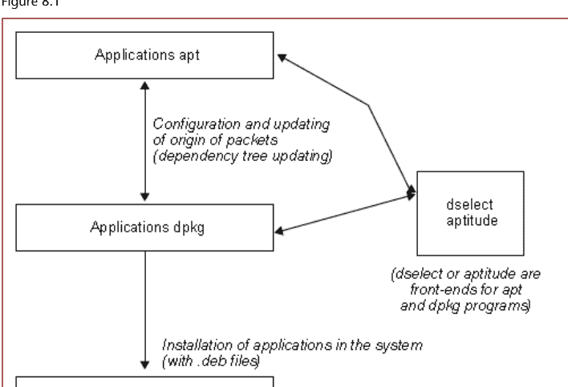

最后安装程序的程序是 `dpkg` 程序。它们解压 `.deb` 文件并安装程序。`apt` 应用程序帮助我们定位所需的程序最新版本，将文件从提取源（FTP、CD-ROM、互联网等）复制到磁盘，并检查新旧包之间是否存在任何依赖关系和冲突，以便它们能被正确安装。主要的 `apt` 应用程序如下：

- `apt-config`：此应用程序用于配置某些 `apt` 选项（我们系统的架构、保存文件的目录等）。
- `apt-setup`：此应用程序用于配置包的源（从哪里获取包）。
- `apt-cache`：软件包缓存的管理（在安装之前保存 `.deb` 文件的目录）。
- `apt-cdrom`：管理包含包的 CD-ROM 的应用程序。
- `apt-get`：更新、安装或下载包。

`apt` 的整个配置位于 `/etc/apt/` 目录。`/etc/apt/sources.list` 文件是保存包的源（来源）配置的地方。从这些源中会生成一个可用包列表，我们可以在需要时查询并安装它们。通常，它的格式使用以下语法：

```
http://site.http.org/debian section13 deb-src
http://site.http.org/debian section13
```

### dpkg 程序

尽管 `apt` 应用程序也可以用于安装包，它们唯一调用的就是 `dpkg` 程序。

每行的第一个字段指示了我们所指的文件类型：二进制文件（`deb`）或源代码（`deb-src`）。接下来，我们将找到包的源，可能是 CD-ROM、互联网地址等。发行版字段告诉 `apt` 我们正在使用哪个版本的 Debian。这个字段非常重要，因为发行版的每个版本都有自己的包。我们可以使用最后的字段来指定我们希望使用的包类型。

| 来自源代码的包 |
| :--- | 软件包系统还允许使用程序的源代码来创建包。如果我们都想使用该应用程序，就需要下载源代码包 |

如果我们手动进行这些更改，可以使用 `apt-get update` 命令更新系统中的所有可用包。为了将 CD-ROM 中的包插入到可用包列表中，可以使用 `apt-cdrom add`，通过该命令我们可以遍历插入的 CD-ROM 并更新包列表。如果任何源包含相同的包，在安装时，`apt` 应用程序会自动检测哪个包是最新的，或者哪个下载时间最快，然后从相应的源下载它。此外，我们还可以使用 `netselect` 程序更详细地配置整个下载系统。

大多数发行版另一个非常有趣的选项是更新发现任何漏洞或 Bug 的包。对于 Debian，我们只需要在 `/etc/apt/sources.list` 列表中添加以下行即可：

```
deb http://security.debian.org/ stable/updates main contrib non-free
```


当检测到关键软件包时，它们会被放置在此源中，因此通过运行 `apt-get update`，我们可以发现系统需要执行哪些新更新，并重新安装所需的软件包。

虽然可以使用 `dpkg` 程序来更改系统中已安装软件包的任何方面、创建新软件包、修改已安装的软件包等，但在本课程中，我们将关注用户级别最核心的几个程序，以便我们能够执行所有基本操作。主要的 `dpkg` 程序如下：

- `dpkg-divert`：可以用于设置我们在系统中安装某些安装包的路径。它对于避免依赖关系问题非常有用。
- `dpkg-reconfigure`：`deb` 包本身已经包含了一些机制，用于交互式地配置应用程序的一些选项。通过此程序，我们可以使用与安装时相同的机制来重新配置我们需要的软件包。
- `dpkg-scanpackages`：此程序可以用于扫描系统中包含 `.deb` 文件的特定目录，从而生成一个索引文件。我们可以使用此索引文件将该目录作为 `apt` 的另一个源。当我们下载发行版的非官方程序时，它非常有用。
- `dpkg-scansources`：这是一个与前一个功能相同的程序，但用于源代码包。
- `dpkg-split`：此程序用于将一个软件包划分并统一到不同的文件中。

通过这些程序，我们可以以我们需要的方式操作软件包。主程序 `dpkg` 允许我们安装、列出或删除系统中的软件包。为了列出所有可用软件包，我们可以输入 `-l` 参数，它将显示软件包的完整列表及其安装状态（已安装、已安装但未配置等）。如果我们想查看某个特定软件包的所有信息，可以使用 `-p` 参数后跟软件包名称，这将显示所有的依赖关系、与其他软件包的冲突、版本号、描述等信息。

要安装新软件包，我们可以使用 `-i` 参数后跟文件名。如果依赖关系出现问题，我们可以通过 `--ignoredependends=X` 忽略它们，其中 `X` 表示依赖项，尽管我们必须谨慎使用此参数，因为如果我们忽略了依赖关系，安装的软件包可能无法正常工作。如果我们想解压 `.deb` 文件以查看其内容，还可以使用 `-x`。要删除软件包，我们必须输入 `-r` 后跟软件包名称，这会将它们从系统中删除，但保留配置文件（我们可以使用 `-P` 删除所有内容）。

另一个非常有用的参数是 `--force-things X`（其中 X 是以下选项之一），当出现以下任何情况时，它可以帮助我们：

- auto-select：这会自动选择与我们选择的新软件包一起必须安装或卸载的软件包。
- downgrade：即使有更晚的版本，也安装该软件包。
- remove-essential：尽管该软件包被认为是系统必不可少的，但此操作将删除它。
- depends：这不考虑依赖关系，而仅将其视为警告。
- depends-version：这不考虑软件包版本所需的任何依赖关系。
- conflicts：即使该软件包与系统中的任何其他软件包冲突，也会安装它。
- etc.（等）

尽管我们在本节中讨论的所有程序都有许多选项，而且还有更多程序，但我们描述的这些程序应该足够（配合我们正在使用的发行版软件包系统）来执行任何必要的任务。虽然我们已经提到过可以使用 `deselect` 和 `aptitude` 等程序来执行软件包的基本安装和删除操作，但正确学习其他命令是非常重要的，因为它们对于执行特定操作或自动化选择和安装过程非常有用。

> dpkg 工具
> 通过 `dpkg`，我们还可以使用模板来选择、安装、删除等系统中的软件包。

## 8.3. 新程序的编译

在管理任何服务器时，我们可能会发现，某些情况下我们必须使用某些发行版没有的程序，或者我们需要某个尚未妥善发布的应用程序服务器的最新版本。在这些情况下，我们可以下载程序的源代码并进行编译。理解编译程序以获取可执行文件与直接下载二进制文件之间的区别是非常重要的。当我们直接下载时，最可能发生的是由于系统中可用库的原因导致无法正常工作，因为它会尝试使用与系统中安装的库不完全相同的库。因此，当我们需要安装新程序且没有相应的软件包时，最建议的做法是重新编译。

当我们下载应用程序的源代码时，将获得一个用 `tar` 和 `gzip` 或类似格式打包并压缩的文件。通常会有一个名为 `README` 的附加文件，它解释了为了正确编译程序而必须采取的步骤。虽然建议阅读该文件，但在大多数情况下，安装过程是相同的。

编译新程序需要做的第一件事是从包中解压并提取它。完成后，我们应该会看到结构在各个目录中的源代码。在它的根目录下，我们可以找到一个名为 `Makefile` 的文件。该文件告诉编译器使用了哪些库、代码文件必须如何编译等。如果我们有了这个 `Makefile`，就可以通过运行 `make` 来编译程序。默认不需要输入任何参数，它会自动寻找 `makefile` 并执行其中的操作。如果过程没有产生错误消息，我们将生成的可执行文件移动到 `PATH` 目录之一；这样每次运行时就不需要输入完整路径了。许多 `Makefile` 还提供了指令，以便我们无需执行最后一步。通常，通过运行 `make install`，该程序将负责将二进制文件和相关的文档文件放在合适的位置。最后，如果我们不想保存程序的源码，可以删除创建的所有目录。

### 编译程序

当我们编译时，系统中可能已经安装了所用库的源码或头文件。通常，这些软件包的名称与库相同，但结尾添加了 `-dev`（代表开发）。

### 编译时间

程序的编译过程可能从几秒钟到几小时不等，取决于具体的应用程序。例如，编译 Linux 内核可能需要 5 分钟到 2 小时不等（取决于内核版本和计算机的性能）。

如果程序没有包含 `makefile`，它通常会包含一些脚本以便自动生成该文件（通常，该脚本名为 `configure`）。当我们运行此脚本时，系统将进行检查以确保正确编译所需的所有库都已安装，如果缺少任何库，将生成警告消息。一旦该脚本运行正常，我们就会获得一个 `makefile`，这意味着我们可以按照上述步骤进行操作。下图显示了这一过程是如何发生的。

图 8.2

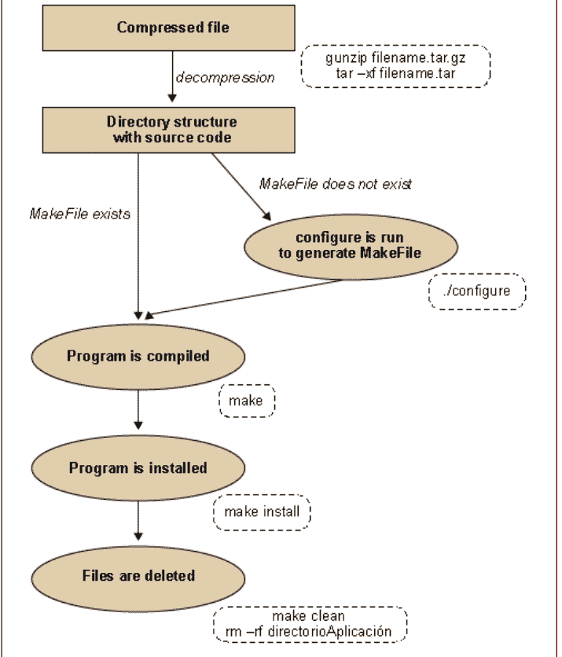

## 9. 基础配置工作坊

### 9.1. 引言

在第二个工作坊中，我们学习了如何安装一个基础系统，以便在此基础上，我们可以开始组装一个根据我们定制的系统。第一个工作坊将是最后两个工作坊的主题。在指定了有关软件包安装系统的配置某些方面后，我们将为安装所需的应用程序奠定基础。然后，我们将学习如何使用 Debian 提供的各种软件包管理工具，换句话说，就是如何安装、卸载、更新等，并将配置一些最常用的工具，这些工具在大多数 UNIX 类型系统中都是必不可少的。最后一个工作坊将涵盖图形化系统。在工作坊中，我们将学习如何安装它、配置它、使其适应我们的偏好，最后如何安装和使用使系统能够运行的应用程序。

### 9.2. 引导加载程序

首先，我们必须确保安装一个能够无问题地管理我们在计算机中安装的所有可能的操作系统的引导加载程序系统。这个问题在上一个工作坊的安装过程中已经得到了非常出色的涵盖。如果我们已经安装了引导加载程序并检查它运行正常，就可以继续进行下一个小节；但如果情况并非如此，换句话说，如果我们每次启动操作系统都需要使用安装期间创建的备用磁盘，那么是时候在硬盘上安装启动管理系统或引导加载程序了，以避免每次启动系统都使用磁盘的繁琐步骤。在任何情况下，安装引导加载程序都符合我们的利益，因为它允许我们启动不同的内核等许多功能。

正如我们解释的那样，有不同的引导加载程序，包括 Lilo 和 Grub。Grub 是来自 GNU 项目的强大引导加载程序，因能够管理我们在计算机中正确安装的任何操作系统的启动过程而闻名；然而，使用和配置此引导加载程序是相当复杂的。

在任何情况下，如果我们没有引导加载程序，并且想要启动已有的操作系统并检查应用程序是否已安装；为此，我们可以使用该应用程序的 `man` 命令。

#### 9.2.1 安装 Grub

目前，Grub 是默认的引导加载程序。在任何情况下，如果我们需要重新安装它，应该阅读以下小节来学习软件包管理系统、其配置以及如何使用；或者，简单来说，如果在安装期间我们将所有 CD/DVD 的内容输入了数据库或者决定使用互联网进行安装，我们应该运行以下行：

```
brau:-# apt-get install grub-doc
```

如果不想安装文档包，可以省略上面那行的最后一个参数。

一种建议的与 Grub 工作的方法是，在写入 MBR 之前，进行我们认为可能适用于磁盘的测试，并确保在从该磁盘启动时运行正常。要做到这一点，我们必须首先在 `/boot/` 中拷贝必要的文件：

```
brau:-# cp /usr/lib/grub/i386-pc/stage* /boot/

brau:-# cp /usr/share/doc/grub/examples/menu.lst /boot/
```


一旦完成这些操作，我们将编辑 Grub 的配置文件 `/boot/menu.lst`，并对其进行定制。这项操作之所以复杂，是因为由于等因素，特别是涉及到硬盘磁盘的命名法变化；为了识别特定文件所在的设备，我们将在进入 Grub 命令行模式后，使用 `grub` 使用 `find` 命令。因此，例如，如果我们想找到一个必须在 Grub 配置文件中指定位置的文件（例如 `/vmlinuz`），应该按照以下步骤操作：

```
brau:-# grub version 0.91 (640K lower / 3072K upper memory) [ Minimal BASH-like line editing is supported. For the first word, TAB lists possible command completions. Anywhere else TAB lists the possible completions of a device/filename. ] grub find /vmlinuz (hd2,0)
```

Grub 还有许多命令，要获取这些列表，只需在命令行中按 Tab 即可获得以下内容：

```
grub> Possible commands are: blocklist boot chainloader cmp color configfile deb device displayamem end findstest geometry halt help imps robe inittrd installprobe kernel lock keepactive md5crypt moduleno unzip partition partytype password pause quit read reboot root notoverify savede fault setkey setup terminal testload testvbe uppermem vbeprobe grub>
```

要获取任何特定命令的详细信息，我们都必须在键盘上输入 `help` 后紧跟命令名。处理我们的 Grub 配置文件 `/boot/menu.lst` 的良好方法是在不同的 tty 中打开一个新会话，并在处理 Grub 界面时逐渐修改该文件。

一旦我们完成了配置文件的编辑，并在驱动器中插入一个空磁盘，我们应该使用键盘输入以下行，将 `x` 替换为硬盘编号，将 `y` 替换为相应的分区：

```
grub> install (hdX,Y)/boot/stage1 d (fd0) (hdX,Y)/boot/stage2 p (hdX,Y)/boot/menu.lst
```

通过上述行，我们传输了 MBR Grub 及其命令行界面（stage2）的信息。

正如我们看到的，Grub 相当复杂，这就是为什么我们认为非常有必要阅读 http://www.gnu.org/software/grub 的文档。

## 9.3. 软件包系统

现在我们将分析并学习使用 Debian 软件包系统。在接下来的小节中，我们将学习如何配置数据库、如何使用它、安装不同的软件包以及更新它们。这里有许多实现相同结果的方法，有两个主要目标：首先是读者能够选择使用哪一种，其次是让读者在其中一种方法失效时总有其他方案。

### 活动

为了全面理解 软件包系统，我们推荐：

- APT HOWTO: http://www.debian.org/doc/manuals/apt-howto/index.html
- http://www.debian.org/doc/manuals/debian-faq/ch-pkgbasics.en.html
- http://www.debian.org/doc/manuals/debian-faq/ch-pkgtools.en.html
- `apt`, `apt-cache`, `apt-get`, `sources.list`, `dpkg` 和 `dselect` 的 man手册

为了方便阅读，我们可以等到配置好打印机后学习打印 man 手册。

### 9.3.1. /etc/apt/sources.list

`/etc/apt/sources.list` 文件是 Debian 软件包系统配置的核心。它是一个文本文件，就像 UNIX 类型系统中大多数配置文件一样，我们可以手动编辑它，或使用某些为此目的设计的工具。该文件的内容在很大程度上取决于互联网连接的速度（假设我们有连接）。然而，在我们修改文件后，我们永远不要忘记以 root 身份运行以下命令：

```
brau:/etc/apt# apt-get update
```

如果我们忽略了这一点，那么我们所做的任何更改都不会产生任何影响。

此文件的每一行都引用一个包源，包之间用空格分隔。首先，我们必须指定该源是二进制包 `deb` 还是源码 `deb-src`。第二个字段用于指定如何访问这些包：CD-ROM、`http`、`ftp`，后跟地址。剩余的字段指的是我们希望通过此行访问的包类型。

在理想情况下，我们应该有一个快速的互联网连接。这可能允许我们通过互联网进行基础系统的安装，并让我们获得最新版本的软件包。此外，这是处理软件包最舒适的方式，因为我们甚至不需要担心插入正确的 CD 来执行安装。

然而，在做任何事情之前，我们必须确保 `/apt/sources.list` 的内容是正确的。例如：

```
deb http://ftp2.de.debian.org/debian/debian/ stable main non-free contrib deb-src

http://ftp2.de.debian.org/debian/debian/ stable main non-free \ contrib deb

http://non-us.debian.org/debian/non-US stable/non-US main \ contrib non-free deb-src

http://non-us.debian.org/debian/non-US stable/non-US \ contrib non-free deb

http://security.debian.org/updates main contrib-freefree
```

上述所有地址都是官方的；换句话说，它们是 Debian 认可的。除了这些源，我们还可以使用非官方的包；仅仅因为它们是非官方的，并不意味着它们的质量不足以将它们包含在我们的配置文件中。查找这些包位置信息的良好地址是 http://www.aptget.org。

一旦我们编辑并保存了该文件，就应该运行 `apt-get update` 命令；几分钟后，软件包系统将配置其数据库并在屏幕上显示已执行的操作，之后我们就可以访问新包了。

如果我们没有互联网连接，或者连接太慢，我们不应该犹豫使用发行版的 CD/DVD 集合来安装不同的包。如果在到目前为止的安装过程中我们还没有插入 CD 或 DVD，现在是插入它们的时候了。我们应该将第一张 CD-ROM/DVD 放入驱动器中，并使用 `apt-cdrom add` 命令将其内容包含在数据库中：

```
brau:/etc/apt# apt-cdrom add Using CD-ROM mount point /CD-ROM/ . . . Repeat this
```


对你集合中的其余 CD 重复此操作。

到达此处，我们应该对发行版的每一张 CD/DVD 重复相同的过程。同样，我们可以使用相同的程序从不可用的 CD/DVD 导入数据。一旦我们配置好了互联网连接，如果有必要，我们可以包含远程访问包的源。为了做到这一点，我们需要编辑 `/etc/apt/sources.list` 文件，然后运行 `apt-get update` 来获取新包。

## 9.2. apt 可用

`apt` 是高级软件包工具（Advanced Package Tool）的缩写，正如我们在多次讨论中过的，它是基于 Debian 的管理软件包的基本系统。`apt` 本质上为我们提供了两个工具：`apt-get` 和 `apt-cache`。第一个命令只能由系统的 root 用户使用，因为它是包管理工具：安装、卸载、更新等；而第二个命令是一个在数据库中查找尚未安装包信息的命令，可以由任何用户使用。

为了更方便地管理软件包，开发了其他应用程序；这些程序运行在 `apt` 下的层级，例如 `dpkg` 中端或 `dselect` 和 `aptitude` 前端。但在查看不同的管理系统之前，我们应该学习一些关于这些系统的概念，以及系统与管理系统之间的相互关系。

### 根据优先级划分包类型

在软件包系统中，有五种不同的包，它们根据对系统本身的依赖程度进行定义。按优先级从高到低排序分类如下：

- **Required（必需）。** 这些是系统本身正常运行所必需的包。
- **Important（重要）。** 这些是应该出现在**任何** UNIX 类型系统中的包。
- **Standard（标准）。** 这些是 GNU/Linux 系统中常见的包。通常它们是小型应用程序，对于系统来说不再是必不可少的。
- **Optional（可选）。** 这些包在 GNU/Linux 系统中可能存在也可能不存在。其中，该组包含了所有涉及图形系统的包，因为它不被认为是必需的。实际上，在服务器上，图形环境被丢弃，以提高系统的性能水平。
- **Extra（额外）。** 这些包要么与优先级更高的包产生冲突，要么需要特殊的配置，导致它们不适合作为可选包集成。

我们可以使用类似 `apt-cache show <package name>` 的语句并检查 `Priority` 字段的内容来确定特定的包属于哪一类。

### apt 包之间的依赖程度

`apt` 包的特点是在管理包之间的依赖关系方面具有高度的一致性。例如，我们想要安装的应用程序可能依赖于一个库，因此依赖于另一个我们尚未安装的包。在这种情况下，`apt` 会告诉我们这种依赖关系，并询问我们是否想要包含该库的包以及应用程序一起安装。包之间的关系分类如下：

- **depends（依赖）。** 我们想要安装的包依赖于这些包，因此，如果我们让该包正常工作，必须允许这些包。
- **recommends（推荐）。** 维护包的人认为用户通常会使用推荐的包。
- **suggests（建议）。** 建议的包可以为我们想要安装的包带来更好的性能。
- **conflicts（冲突）。** 如果系统中存在这些包，我们想要安装的包将无法正常工作。
- **replaces（替换）。** 安装此包意味着卸载其他包。
- **provides（提供）。** 我们想要安装的包整合了上述包的内容。

我们可以使用类似 `apt-cache depends <package name>` 的语句来确定包的依赖关系。

### 对包执行的操作

使用 `dpkg` 或 `dselect` 标志，我们将获得用户对这些包打算执行的操作。

- **unknown（未知）。** 未对该包进行过任何引用。
- **install（安装）。** 必须安装或更新包。
- **remove（移除）。** 包将被卸载，但不会删除其配置文件（通常位于 `/etc/`）。
- **purge（清除）。** 包将被完全卸载，并删除配置文件。
- **hold（保留）。** 这用于指示不对该包执行任何操作（换句话说，在显式操作之前保持其版本和配置）。

### 包安装状态

软件包系统中，我们会找到：

- **installed（已安装）。** 包已安装并正确配置。
- **half-installed（半安装）。** 包的安装已开始但由于某些原因未完成。
- **not-installed（未安装）。** 包未安装在系统中。
- **unpacked（已解压）。** 包已解压但未配置。
- **config-files（仅配置）。** 系统中仅存在该包的配置文件。

### apt-cache

正如我们提到的，`apt-cache` 是一个用于分析软件包系统的命令，因此，由于它对系统没有潜在危险，所有用户都可以访问。该命令最常用的参数如下：

- **search pattern（搜索模式）。** 这在数据库中搜索名称包含模式的包，或者描述中包含模式单词的包（如果结果列表很长，由于模式非常常见，我们可以使用管道和 grep
- show package. 提供有关软件包的信息。
- policy package. 提供有关安装状态、版本、修订号以及其来源的信息。
- depends package. 列出软件包的依赖关系。
- show package. 显示软件包的直接依赖和反向依赖。

### apt-get

`apt-get` 是用于管理系统软件包的命令。这就是为什么它只能由系统的 root 用户使用。该命令最常用的参数如下：

- install package. 安装此软件包。如果系统未找到该软件包，`apt` 将向我们报告并询问是否要同时安装未安装的依赖包；通常情况下，遵循 `apt` 提供的建议是符合我们利益的。
- update package. 更新数据库。每当 `/etc/apt/sources.list` 文件被修改时，都必须运行此命令。
- upgrade package. 强制将已安装的软件包升级到最新版本。
- remove package. 删除软件包，但不删除配置文件，以便在需要时进行重新安装。
- remove --purge package. 完全删除软件包，包括配置文件。
- clean package. 消除逐渐安装的软件包的过期副本；在安装过程中，每当安装一个软件包时，解包后的软件包副本会自动保存到 `/var/cache/apt/archives` 中。这是一个对于释放不再被使用的文件占用的硬盘空间非常有用的命令。
- autoclean package. 不管过期日期，消除所有未使用的软件包副本。

## 9.3.3 dpkg

`dpkg` 代表 Debian 软件包管理器（Debian Package Manager），被设计为后端。最常用的参数通常结合 `grep` 使用：

- `-l`. 列出数据库中的软件包及其安装状态。
- `-L package`. 列出软件包包含的文件。
- `-r package`. 效果与 `apt-get remove package` 相同。
- `-P package`. 效果与 `apt-get remove --purge package` 相同。
- `-p package`. 效果与 `apt-get show package` 相同。
- `-s package`. 描述软件包的安装状态。
- `-S file`. 搜索文件所属的软件包。

## 9.3.4 dselect

`dselect` 是运行在 `apt` 之上的 GUI（图形用户界面）。进入它的界面只需要输入 `dselect` 命令，使用界面菜单选择我们想要操作的不同软件包，并指定我们想要执行的操作类型。

## 9.3.5 aptitude

`aptitude` 是另一个运行在 `apt` 之上的 GUI。它默认没有安装，这意味着我们在使用它之前必须先安装：

```bash
apt-get install aptitude
```

一旦安装完成，我们可以使用 `aptitude` 命令启动它，并立即发现它和使用 `dselect` 一样简单甚至更简单，因为它可以通过 F10 调出下拉菜单。

## 9.4 locales: 区域配置

尽管我们的键盘看起来工作正常，因为我们可以使用重音符号、变音符号和其他非英语字符，但当我们根据自己的需要调整系统时（特别是当我们想要安装图形界面并调整其运行的应用程序时），正如我们在下一个工作坊中观察到的，情况并非如此。此时，我们可以妥善地配置这些方面，以免以后再这样做。

首先，我们应该检查是否已经安装了 `locales` 软件包：

```bash
dpkg -l | grep locales
locales 2.2.5-11 GNU Library: National Language (locale)
```

如果我们没有得到最后一行，则必须继续安装并配置该软件包：

```bash
apt-get install locales
```

如果我们已经有了它，则应该按照以下行进行重新配置：

```bash
dpkg-reconfigure locales
```


在提供的许多选项中，我们选择 `en_ES.UTF8`，换句话说，突出该选项并按空格键。我们使用 `Tab` 键选中 `OK` 并按回车。在下一个屏幕中选择 `C`。回到命令行，我们编辑 `/etc/environment` 使其内容如下：

```
LC_ALL=es_ES LANGUAGE=en_US LC_TYPE=es_ES LC_MESSAGES=UTF8 LANG=C
```

为了使更改生效，我们只需要输入 `locale-gen` 命令，并退出所有打开的会话以加载新配置。

## 9.5. 主启动文件，`/etc/inittab`

虽然 GNU/Linux 系统的启动过程很复杂，但本节仅涉及主要文件之一：`/etc/inittab`。在此过程中，该文件向其他元素指示我们将启动的运行级别（runlevel），并定义在启动过程中自动启动的进程。要了解我们处于什么种运行级别，只需要使用 `runlevel` 命令。要更改运行级别，我们使用 `init <destination runlevel>` 指令。

打开这个文件并熟悉其内容很有趣。要了解更多关于 locales 的信息，我们建议访问网站：http://www.debian.org/doc/

## 9.6. 设备组装，`/etc/fstab`

`/etc/fstab` 是包含在启动过程中自动设置分区的文件。这将有助于我们更好地理解设备。我们现在展示该文件的可能内容：

| device | mount point | type | options | dump | pass |
| :--- | :--- | :--- | :--- | :--- | :--- |
| /dev/sda1 | / | ext3 | errors=rw | 0 | 1 |
| /dev/sda2 | swap | swap | sw | 0 | 0 |
| /dev/sda3 | /boot | ext3 | defaults | 0 | 1 |
| /dev/sda4 | /tmp | ext3 | defaults | 0 | 2 |
| /dev/sda5 | /var | ext3 | defaults | 0 | 2 |
| /dev/sda6 | /usr | ext3 | defaults | 0 | 2 |
| /dev/sda7 | /home | ext3 | defaults | 0 | 2 |
| /dev/cdrom | /cd-rom | iso9660 | ro,auto | 0 | 0 |
| /dev/sdb1 | /mnt/hdcl | ntfs | ro,noauto,user,gid-windows,umask=0007,utf8 | 0 | 0 |
| /dev/sdb2 | /mnt/hdel | ntfs | ro,noauto,user,gid-windows,umask=0007,utf8 | 0 | 0 |
| /dev/sdb3 | /mnt/hde5 | ntfs | ro,noauto,user,gid-windows,umask=0007,utf8 | 0 | 0 |
| /dev/sdb4 | /mnt/hde6 | vfat | user,noauto | 0 | 0 |
| /dev/sdb5 | /mnt/hde7 | vfat | user,noauto | 0 | 0 |

```bash
# /etc/fstab: 静态文件系统信息
```

前几行是由安装过程自动生成的，从中我们可以看到目录是如何分布在 GNU/Linux 结构中的。前面文件的最后几行用于挂载 FAT32 分区，在 GNU-Linux 中可以进行写入。对于这一点，始终准备一个这种格式的小分区是一个好主意，因为它是可访问的。

无论是来自 GNU/Linux 还是 Windows™。虽然从命令行挂载文件系统是可能的，例如当我们要挂载 CD-ROM 的时候：

```
brau:/etc/apt# mount /dev/CD-ROM /CD-ROM -t iso9660 ro
```

但将信息输入到 `/etc/fstab` 文件中要方便得多，这将允许我们通过简单输入命令来实现相同的操作：

```
brau:/etc/apt# mount /CD-ROM
```

## 9.7. 设备配置

在解决了软件包管理的基础问题后，我们可以开始配置系统以适应我们的特定需求。该过程基本上由两部分组成：配置我们在计算机中安装的不同硬件设备，以及安装我们将使用的软件。

配置系统硬件通常是最耗费力的部分，因为通常每台计算机的设备都不同，因此每台计算机都是一个自成的世界。通常，在 GNU/Linux 系统中，我们可以配置任何设备，无论它多么奇特，但其复杂程度在程度上取决于设备的标准化程度。然而，事实也是，这些过程是我们学到最多的地方，因为配置设备需要先前的任务，例如确切找到我们拥有的设备类型、阅读 GNU/Linux 系统包含的此类设备文档、以及该设备如何与系统集成等。

鉴于并非所有硬件制造商都支持 GNU/Linux，且某些厂商没有提供必要的信息，导致 GNU/Linux 社区的开发者无法编写将这些设备集成到操作系统所需的代码，因此建议在购买新硬件时，我们应该确切找出我们需要哪种产品（这些信息通常比硬件供应商本身提供的要精确得多，有时他们自己并不清楚）、该产品是否被完全支持、我们将新产品集成到系统中需要哪些信息等。总的来说，购买新硬件时，应该考虑的因素是标准化程度，产品越标准化，用户用户就越多，因此被完全支持的可能性也越大。至于产品质量，几年前，硬件制造商开始用软件实现的功能取代原本由硬件实现的功能，以降低成本（这种做法最著名的例子可能是被称为 winmodems 的调制解调器）。这一方面导致了系统性能下降，因为需要 CPU 处理许多任务，而其中许多任务并非设计为由其执行；另一方面，则需要替换被移除硬件的软件，而这些软件通常仅针对特定类型的操作系统开发；因此，建议避免任何专为某个特定操作系统设计的产品。

在系统配置的每个小节中，我们将讨论可能会遇到的一些不同设备及其隐含的问题。

在开始配置系统中的不同设备之前，我们必须记住一些对这些目有用的策略。首先，可以使用 `lspci` 命令获取有关系统在启动过程中如何识别这些设备的列表信息。如果这些信息不足，我们始终可以采用虚拟的 `/proc/` 目录，那里记录了系统硬件在内的所有信息。同样，位于 `/var/log/` 的日志文件也非常有用（一种查看这些文件内容演变的有趣方法是使用带有 `-f` 参数的 `tail` 命令，并将输出重定向到我们未使用的 tty；例如：`tail -f /var/log/messages > /dev/tty1`）。

### 9.7.1. 配置鼠标

正如 KNOPPIX 工作坊所示，负责管理鼠标的守护进程将是 `gpm`。我们应该安装该软件包：

```
brau:/etc/apt# apt-get install gpm
```

安装完成后，一个脚本会自动启动以帮助配置鼠标；我们必须输入的参数本质上与我们在 KNOPPIX 工作坊期间输入的相同，但如果发生任何故障，我们始终可以使用 `gpmconfig` 命令重新启动配置程序（通常配置 `-m /dev/psaux -t ps2` 对大多数带按钮的 PS2 鼠标都是有效的）。我们输入的配置保存在 `/etc/fpm.conf` 中。

### 9.7.2. 启动与停止

正如我们讨论过的，负责启动和停止鼠标的程序是 `gpm`。在本节中，我们将讨论如何启动和停止鼠标。启动鼠标，可以使用以下命令：

```
brau:/etc/fpm# gpmconfig -start /dev/tty0
```

停止鼠标，可以使用以下命令：

```
brau:/etc/fpm# gpmconfig -stop /dev/tty0
```

如果我们需要更改配置，可以使用 `gpmconfig` 命令。例如，如果我们想将鼠标切换到另一个设备，可以使用以下命令：

```
brau:/etc/fpm# ln -s /dev/tty1 /etc/fpm
```

如果该符号链接不存在，且我们想使用该设备，应该使用以下命令创建：

```
brau:/etc/fpm# ln -s /dev/tty1 /etc/fpm
```

### 9.7.3. 配置调制解调器

正如 KNOPPIX 工作坊所示，负责管理鼠标的守护进程将是 `gpm`。我们应该安装该软件包：

```
brau:/etc/apt# apt-get install gpm
```


安装完成后，一个脚本会自动启动以帮助配置鼠标；我们必须输入的参数本质上与我们在 KNOPPIX 工作坊期间输入的相同，但如果发生任何故障，我们始终可以使用 `gpmconfig` 命令重新启动配置程序（通常配置 `-m /dev/psaux -t ps2` 对大多数带按钮的 PS2 鼠标都是有效的）。我们输入的配置保存在 `/etc/fpm` 中。

鉴于并非所有硬件制造商都支持 GNU/Linux，且某些厂商没有提供必要的信息，导致 GNU/Linux 社区的开发者无法编写将这些设备集成到操作系统所需的代码，因此建议在购买新硬件时，我们应该确切找出我们需要哪种产品（这些信息通常比硬件供应商本身提供的要精确得多，有时他们自己并不清楚）、该产品是否被完全支持、我们将新产品集成到系统中需要哪些信息等。总的来说，购买新硬件时，应该考虑的因素是标准化程度，产品越标准化，用户就越多，因此被完全支持的可能性也越大。至于产品质量，几年前，硬件制造商开始用软件实现的功能取代原本由硬件实现的功能，以降低成本（这种做法最著名的例子可能是被称为 winmodems 的调制解调器）。这一方面导致了系统性能下降，因为需要 CPU 处理许多任务，而其中许多任务并非设计为由其执行；另一方面，则需要替换被移除硬件的软件，而这些软件通常仅针对特定类型的操作系统开发；因此，建议避免任何专为某个特定操作系统设计的产品。

在系统配置的每个小节中，我们将讨论可能会遇到的一些不同设备及其隐含的问题。

在开始配置系统中的不同设备之前，我们必须记住一些对这些目有用的策略。首先，可以使用 `lspci` 命令获取有关系统在启动过程中如何识别这些设备的列表信息。如果这些信息不足，我们始终可以采用虚拟的 `/proc/` 目录，那里记录了系统硬件在内的所有信息。同样，位于 `/var/log/` 的日志文件也非常有用（一种查看这些文件内容演变的有趣方法是使用带有 `-f` 参数的 `tail` 命令，并将输出重定向到我们未使用的 tty；例如：`tail -f /var/log/messages > /dev/tty1`）。

正如 KNOPPIX 工作坊所示，负责管理鼠标的守护进程将是 `gpm`。我们应该安装该软件包：

```
brau:/etc/apt# apt-get install gpm
```

安装完成后，一个脚本会自动启动以帮助配置鼠标；我们必须输入的参数本质上与我们在 KNOPPIX 工作坊期间输入的相同，但如果发生任何故障，我们始终可以使用 `gpmconfig` 命令重新启动配置程序（通常配置 `-m /dev/psaux -t ps2` 对大多数带按钮的 PS2 鼠标都是有效的）。我们输入的配置保存在 `/etc/fpm.conf` 中。

在指定我们的电话线路是基于拨号还是基于调频的（目前大多数是基于调频的）之后，我们必须输入应该拨打的号码，这是我们的 ISP 提供的号码。

到达这一步后，`pptconfig` 将询问我们是否希望调制解调器自动检测。对于现代调制解调器，我们可以让程序本身检测调制解-modem 连接的端口，或者我们可以手动进行（记住对应关系：第一个串口 COM1，`/dev/tty0`，第二个串口 COM2，`/dev/tty1`，以此此类推）。

一旦我们到达了调制解调器连接的 tty，我们将进入一个显示我们已输入数据的屏幕，这还允许我们建立某些高级选项（这些通常是不必要的）。如果数据正确，我们可以选择“Finished Write files”完成写入文件并返回主菜单；完成操作后返回界面菜单，如果我们不想配置另一个连接，我们应该选择“Quit Exit”退出此实用程序以返回命令行。回到命令行后，我们可以检查这些数据是否已正确保存到 `/etc/ppp/peers/nameofconfiguration` 中。对于 PPP 连接的用户，安装 `pppstatus` 软件包可能也很有意思，它可以监控连接上的流量等元素。

## 建立和终止连接，pon, poff

为了建立连接，我们只需要输入 `Pon` 命令，后跟我们想要使用的连接名称；如果我们只配置了一个连接，则没有必要指定其名称。原则上，如果使用不受限制，任何用户都可以运行 Pon。

要终止连接，我们只需要运行 `Poff` 命令。

## 9.7.3. 配置 DSL 调制解调器

正如我们在上一节配置传统调制解调器一样，在这里我们将使用一个配置 DSL 调制解调器的工具：`pppoconf`。在开始之前，我们建议阅读 http://www.tld.org/HOWTO/DSL-HOWTO 和 http://www.tld.org/HOWTO/ADSL-BandwidthManagement-HOWTO。

PPPoE（以太网的点对点协议）是一种与 PPP 非常的协议，它使用调制解调器的以太网接口。这种协议已被某些 ADSL 网络提供商采用。

ADSL 连接通常是电话服务的一部分。信号（电话和 ADSL 信号）被分在一个名为分离器（splitter）的设备中，将它们分离到各自的范围内。ADSL 信号进入一个名为集中器（concentrator）的设备，该设备通过 RJ45 连接器使用双线连接到计算机的以太网接口。

配置连接：

```
## apt-install pppoeconf
```

运行 `pppoeconf` 时，工具将扫描所有网络接口，直到找到一个集中器。我们将选择在此接口上配置 PPPoE。

在 `Enter USERNAME` 中，我们输入提供商分配给我们的用户名和密码。在 `Use PEER conf DNS` 中，我们选择自动修改选项 `/etc/resolv.conf`。我们选择启动时运行 PPPoE，然后连接。几秒钟后，你将在屏幕上看到这条消息：

> Every 2s: /sbin/ifconfig ppp0 Sun 13 12:11:56 2007 ppp0 Link encap:Point-to-Point Protocol incl addr:200.89.50.138 P-t:10.52.3 Mask:255.255.255.255 UP POINTOPOINT RUNNING NOARP MULTICAST MTU:1492 Metric:1 RX packets:5 errors:0 dropped:0 overruns:0 carrier:0 collisions:0 txqueuel:3 RX bytes:190 (190.0 b) TX bytes:199 (199.0 b)

## 9.7.4. 网卡的配置

如果由于某种原因，我们在安装过程中没有配置网卡，那么现在是操作的时候了。尽管 GNU/Linux 系统实际上支持所有的网卡，但由于它们是面向网络的操作系统的组件，我们建议使用尽可能标准化的硬件，以避免在排除系统问题时出现复杂。我们的卡可能以两种不同的方式支持：第一是它的驱动程序从内核本身编译，第二是驱动程序以模块化方式编译，以便随后加载。发现我们网卡的哪个驱动程序已编译在内核内部的最简单方法是分析 `dmesg` 返回的消息，正如我们在 5.4.3 中做的那样。

如果在详细分析 `dmesg` 命令的输出后，我们得出网卡驱动未加载的结论，可以运行 `modconf`，它会将内核编译的模块加载到内核，并检查驱动程序是否出现在 `kernel/drivers/net` 子集中。如果是这种情况，我们只需选择它将其加载到内核中。

如果我们的网卡默认不支持，我们必须采取重新编译内核的方法。

一旦完成此，我们必须编辑 `/etc/network/interfaces` 文件以输入与我们的网卡对应的参数。一种可能的配置可以是：

```
## /etc/network/interfaces -configuration file for ifup(8), #ifdown(8)

## 回环接口

auto lo inet loopback

## 这是在 Debian 安装期间创建的第一个网卡（网络、广播和网关是可选）

auto eth0

eth0 static address 158.109.69.132 mask 255.255.255.0 gateway 158.109.0
```


我们建议阅读 `http://www.tld.org/HOWTO/Networking-Overview-HOWTO` 以及 `http://www.tld.org/HOWTO/Interfaces-HOWTO` 以及 `man` 手页。如果我们不需要网卡来执行测试，我们可以始终求助于 `dummy`；在这种情况下，不是被名为 `eth0`，而是为了在同一台电脑上配置多个网卡（这在用网关以及其他情况下很常见），有必要在启动过程中向内核输入参数，以避免设备之间的冲突。`/etc/network/interfaces` 中的所有服务都可以使用 `/etc/init.d/networking` 脚本启动，该脚本启动特定接口的网络服务，并停止它们。因此，对于上述配置，我们想要停止并重启 `eth0` 服务，我们按照如下步骤操作，可以使用 `ifconfig` 命令检查结果：

```
ifconfig eth0 link encap:Ethernet Waddr 00:01:02:b4:3a:61 inet addr:158.109.69.132 bcast:158.109.255.255 Mask:255.0.0.0 BROADCAST RUNNING MULTICAST MTU:1500 Metric:1 RX packets:3609683 dropped:0 overrun:221 frame:35938 errors:0 dropped:0 overruns:0 carrier:0 txqueue:10 RX bytes:148927310 (1 GiB) TX bytes:20116974 (19 MiB) Interrupt:5 Base address:0x94010 link: Loopback addr:127.0.0.1 Mask:255.0.0.0 UPBACK MTU:16436 Metric:1 RX packets:823 errors:0 dropped:0 overrun:0 frame:823 errors:0 overruns:0 carrier:0 txqueue:10 RX bytes:361919 (3.0 MiB) TX bytes:361919 (3.0 MiB)
```

CUPS（通用 Unix 打印协议）是一个模块化的打印系统，它使用 IPP（互联网打印协议）来处理队列。这是一个现代且复杂的系统，可以用于 GNOME 或 KDE 等桌面环境。此外，它还提供了维护传统的 BSD `lpr` 命令行系统的选项。

GNU/Linux 系统中打印系统的通用拓扑结构是客户端-服务器架构。服务器 CUPS 是一个守护进程类型的服务器，因此我们将其视为该类型进行处理。服务器的配置文件为 `/etc/cups/cupsd.conf`。在该文件中，我们可以根据需要配置任意数量的打印机。

要安装 cups 系统，我们必须运行命令：

```
# apt-get install cupsys cupsys-client cupsys-bsd printerconf fomatic-filters-ppds
```

最后一个包包含了 Adobe 的 PPD 文件（Postscript 打印机定义），CUPS 使用它们来定义打印机。

CUPS-PDF 是一个虚拟打印机，用于将文档打印到 PDF 文件。要在我们的系统中安装它，我们将运行以下命令：

```
# apt-get install cupsys-pdf
```

在 CUPS 中，配置打印机有两种方法。其中一种是通过 GNOME 或 KDE 桌面提供的工具。另一种是通过网站。在这两种情况下，我们都需要管理员权限来配置打印机。

## 打印文本文件

格式化程序（Formatters）是主要用于将文本格式的文件转换为 Postscript 格式的程序（从历史来看，Postscript 语言在打印领域有更广泛的实现）。这些程序非常有用，因为它们允许我们将帮助命令、配置文件等打印在纸上，以便于阅读。这些程序中的一个是 `mpage`（包含在同名的包中），另一个是 `enccript`（也包含在同名的包中），它比第一个更强大。下面给出了一个我们如何使用它的示例：

```
man man | mpage -2 -o lpr
```

使用这行命令，我们将 `man` 的输出重定向到 `mpage`，它将其格式化为每页两列，且不留页边距，然后我们将其输出重定向到打印机客户端 `lpr`：

```
endscript /etc/fstab -B -fTimes-Roman -r
```

通过这行命令，我们将打印 `/etc/fstab` 文件的内容，不带页眉，使用 Times-Roman 字体，大小为 7 且采用宽格式。

## 配置声卡

由于市场上大量的声卡，因此最有可能提供一份关于如何配置它们的描述。我们建议阅读 `http://tldq.org/HOWTO/Sound-HOW-TO/` 并访问 GNU/Linux 下最重要的声学项目网站：`http://www.opensound.com` 和 `http://www.alsa-linux.org`。

高级 Linux 音频架构（ALSA）是一个在 GNU 许可证下运行的项目，为 Linux 提供音频和 MIDI 设备。

现在我们讨论一下如果需要配置常用的声卡该如何操作：SoundBlasterPCI（芯片组 ES1371）。对于此类显卡，我们将如下所示使用 `lspci` 命令：

```
00:0d.0 Multimedia audio controller: Ensoniq 5880 AudioPCI (rev 02)
```


首先，我们将使用 `modconf drivers/sound,es1371` 命令加载与该声卡对应的模块。

接下来，我们将使用 `/etc/group` 中的 `audio` 组，并将所有需要访问音频设备的用户加入该组（如果我们希望所有用户访问，可以跳过此步骤并为 `/dev/dsp` 和 `/dev/mixer` 文件提供所有权限）；并将 `/dev/dsp` 和 `/dev/mixer` 文件关联到我们创建的新组。

到此，我们已经配置好了声卡。我们现在可以通过直接将音频文件重定向到 `/dev/dsp`（如 http://tldq.org/HOWTO/Sound-HOW-TO/ 所示）或使用运行在上面的音频应用程序来检查情况。我们必须等待图形环境完成后才能安装它。

## 9.8. 结论

在本次工作坊中，我们学习了操作 Debian 软件包系统，这是至关重要的，因为它允许我们学习如何安装、卸载和管理应用程序。我们还学习了如何配置不同的硬件设备，并由此得出了一个观点：GNU/Linux 没有其他操作系统简单，它通常要求对设备本身以及系统本身有深入的了解。但为了补偿这一方面，我们可以保证一旦设备配置完成，它就能正常工作，我们就不再需要担心它。而且我们不忘记，我们还没有配置图形环境。尽管如此，为了鼓励那些可能开始认为进入 GNU/Linux 世界可能并不是好主意、是一次失败的尝试和时间浪费的人，我们引用 Mario Camou、John Goerzen 和 Aaron Van CouWenberghe 所著的《Debian GNU/Linux 2.1》一书中第一部分第一章《为什么 Linux 更好》中的一段话：

> “然而，Windows NT 几年前才学会了互联网语言。它并没有经过任何想象力的提炼，而是充满了错误和不一致性。企业需要一种可以发布到网上并期望保持 100% 可用的解决方案，但 Windows NT 无法满足这一点。相反，Windows NT 管理员最常见的工作是故障恢复；他浪费了太多时间……” Van CouWenberghe

## 10. X-Window 架构

### 10.1. 什么是 X-Window？

X-Window 是一种在 80 年代设计为工作站提供图形环境的架构。与其他环境不同，X-Window 架构的设计独立于平台，因此它可以安装在任何运行 Unix 类型系统的计算机上。尽管 X-Window 架构有着悠久的历史，涉及不同类型的许可证、各种实现以及许多开发团队，但目前它主要是由 X.Org 项目实现的。X.Org 是 Windows 系统的一个开源实现，源自 XFree86 项目的分支。

X-Window 采用客户端/服务器架构设计。这种架构意味着软件被结构化为两个相关的部分（客户端和服务器），它们通过通信链路进行通信。尽管这意味着设计和编码稍微复杂，但该架构提供了完全的灵活性，因为客户端和服务器可以位于不同的地方并使用不同的平台和操作系统。此外，我们还可以更充分利用同一个客户端，因为客户端可以为多个服务器提供服务。

### 窗口架构

窗口架构（或窗口系统）是一种图形环境，允许我们在屏幕的不同区域运行不同的应用程序，通常由某种形式的窗口限制。这些环境通常提供了移动和处理这些窗口的机制，使得工作更具交互性且更容易执行。

构成 X-Window 的组件有：客户端、服务器和通信链路。客户端和服务器的设计独立于平台，而通信链路的设计独立于网络协议。

因此，我们可以在任何场景下使用 X-Window：例如，我们可以将服务器安装在运行 Windows 的计算机上，连接到运行 GNU/Linux 的客户端并使用互联网作为通信通道（IPv4 协议）。尽管配置这些组件中的每一个（espe

至关重要的一点是，客户端在某种程度上依赖于其安装的平台，通信链路使得组件能够相互隔离并为它们提供自己的语言，以便它们能够相互理解。

该链路使用一种名为 XDCP（X 显示管理器协议）的自定义协议，其层级高于所使用的通信网络（这就是为什么它独立于网络）。

图 10.1

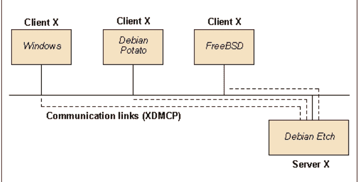

在这种架构中，服务器程序化设计为注册由输入设备（如键盘、鼠标等）产生的事件，并将它们报告给客户端。客户端处理这些事件并回复给客户端，由客户端在输出设备（通常是显示器）中显示结果。尽管对这种设计的初印象可能认为响应时间会非常慢，但 XDCP 协议专门设计用于在客户端和服务器之间提供快速的链接，以便我们能够真正进行交互式工作。只有在使用低速网络进行远程连接时，我们可能会注意到这种不便。

总之，X-Window 每个组件的主要特征和功能如下：

表 10.1

| 组件 | 功能 |
| --- | :--- |
| 客户端 | 同时管理不同的服务器。依赖于平台。 |
| | 处理应用程序 |
| 服务器 | 控制用户显示。独立于平台。 |
| | 处理输入设备 |
| 链路 | 设计用于交互式工作。 |

### 设计用于最小化网络流量

#### 透明性（独立于网络）

随着显卡的发展，越来越多的应用程序和游戏开始需要更快速的 2D 或 3D 处理能力。尽管 X-Window 架构提供了许多优势，但我们需要使用这些类型的应用程序时，客户端/服务器的设计并不是最合适的，因为我们没有利用安装在服务器上的显卡所提供的极速 2D 和 3D 处理操作。为了解决这个问题，一种名为 DRI（直接渲染基础，`Direct Rendering Infrastructure`）的新技术于 1998 年出现；这使得利用显卡的处理芯片来减轻 X-Window 客户端的工作成为可能。通过这种方式，我们继续拥有 X-Window 的所有优势，并利用了显卡的特定元素。

与图形环境与其他功能紧密集成的操作系统不同的是，X-Window 架构完全独立于操作系统，并且不将我们限制在任何 GUI（图形用户界面）上。事实上，该架构为我们提供了底层图形工具来操纵显示器的输出。这些工具包含在 `Xlib` 库中，主要由创建和操纵窗口、字符字体操作、事件检测和图形操作的函数组成。通过这些函数，我们可以为应用程序提供所需的视觉和效果，创建新的 GUI 等。事实上，这为 X-Window 的第一批应用程序开发者创造了额外的工作，因为他们现在除了要编写图形应用程序外，还必须开发自己的用于创建菜单、图标等的库。随着 X-Window 的不断增长，我们称之为“工具包”（`toolkits`）的东西出现了，它们是通常用 `Xlib` 实现并能够获取特定 GUI 的库。

通过这种方式，当我们设计应用程序时，可以使用这些工具包中的一些，这些工具包已经为了用于创建菜单、按钮、管理剪切和粘贴操作的标准工具，我们可以专注于编写应用程序本身。不定义特定的外观和效果是 X-Window 架构成功的另一个关键，因为每个软件制造商或开发者都能设计他们自己的风格，这使其与众中脱颖而出。

尽管有许多不同的工具包，但下面的图展示了 X-Window 历史上使用过的一些最流行的工具包：

### 外观和效果

外观和效果（Look and feel）是指图形界面或应用程序中按钮、滚动条、菜单等使用的设计。

## 图 10.2

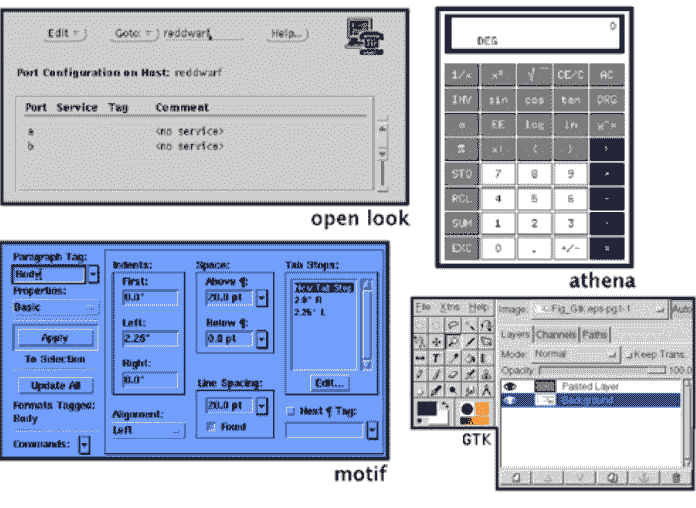

athena

窗口管理器（window manager）是一个特殊的 X-Window 服务器，负责管理所有窗口、桌面、虚拟屏幕等。自然地，所有应用程序都可以与任何窗口管理器工作，因为它管理着程序所在的窗口。尽管编写窗口管理器与编写应用程序非常不同，但通常使用提供特定外观和效果的特定工具包。目前有几十种不同的窗口管理器（wmaker, sawmill, olvm 等），用户可以选择他们最喜欢的。

另一类与 X-Window 强关联的软件类型是负责提供由应用程序、桌面、系统管理工具等组成的环境的。目前最流行的是 KDE（K 桌面环境）和 GNOME（GNU 对象模型环境）。两者都提供了一个特定的工具包、一个具有许多不同功能和配置的桌面环境，以及一个不断增长的集成应用程序列表。GNU/Linux 和 UNIX 发行版提供这两个桌面环境之一，因为它们对用户友好，并提供了自己的高质量工具和软件，这些工具可以帮助用户在很大程度上配置自己的系统和桌面。这两者可以与任何具有一系列基本功能的窗口管理器工作。下面的图显示了这两者的外观：

图 10.3

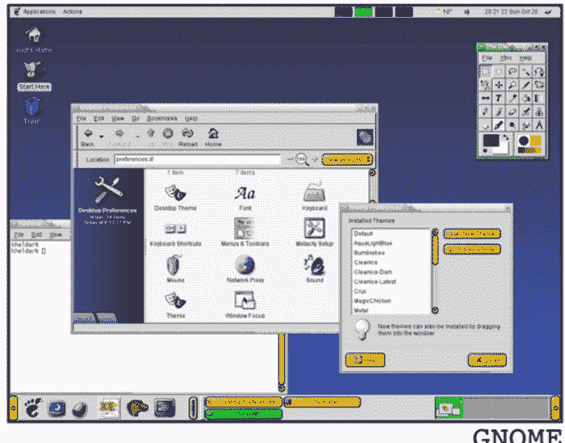

图 10.4


最后，另一种用于 X-Window 的应用程序是会话管理器（session manager），它由一系列程序组成，可以在 X-Window 启动时保存确定用户的配置。通常情况下，这些工具是在集成环境中提供的；如果没有，我们可以求助于 X-Window 自身提供的 xsm。

### 活动

- 10.1 阅读关于 X-Window 的历史：http://www.linux-mag.com/2001-12/xfree6_01.html。

### 活动

- 10.2 查看窗口管理器桌面环境示例：http://www.swman.org。

## 10.2 配置

市场上大多数显卡目前都得到了支持，但有时当新显卡出现时，需要几周或几个月才能被 XWindow 支持。无论如何，支持 GNU/Linux 的制造商数量正在增加，他们已经为该操作系统提供了驱动程序。尽管如此，在购买显卡之前，检查其是否有适用于我们使用的发行版的驱动是非常重要的。为了在计算机上安装 XOrg，我们必须下载包含客户端和服务器基础工具的包。通常，这些包是 `xorg`、`xserver-xorg` 等，并带有各种依赖项和用于 X-Window 的基本实用程序。一旦安装了这些，我们必须正确配置设备，以便正确启动 X-Window 服务器和客户端。根据我们使用的发行版，我们可以使用一个或另一个程序，或者在某些情况下，包本身会启动一个小型配置应用程序。然而，这种配置必须遵循某些步骤，我们在下面将根据配置的设备类型进行描述：

- 显卡
- 驱动：不同系列的显卡带有特定的处理器和用于执行操作的函数。在这里我们必须为我们的显卡找到合适的驱动程序。如果我们不知道是哪一个，可以安装某些自动检测硬件的应用程序；如果我们使用 `discover`，我们就可以通过 `discover --driver` 命令告知显卡需要哪个驱动。
- 标识：显卡的标识可以是用于引用我们显卡的任何名称。该标识在内部用于正确引用系统中安装的显卡。
- 内存大小：取决于显卡内存的大小，我们将能够以更高或更低的分辨率启动图形和具有较高或较低的色彩深度。虽然没有必须输入此数值（系统会自动检测），但建议在配置中指定它。
- 使用内核帧缓冲区（framebuffer）：内核帧缓冲区是一个特殊的 Linux 驱动程序，它允许在窗口上执行某些操作。虽然不是强制性的，但通常会使用它，以便 X-Window 服务器能够直接与系统内核通信。无论情况下，如果它产生问题，我们随时可以禁用它。

### 键盘

- XKB 规则：为了让 X-Window 服务器正确处理键盘，它需要知道适用于哪些规则。对于大多数标准 PC 键盘，通常使用 "xfree86" 规则，而工作站通常使用 "sun"。
- 键盘模型：键盘模型通常通过其按键数量来识别。带有菜单键和 Logo 键的标准 PC 键盘通常有 104 个键（我们将其标识为 "pc104"）。没有这些按键的键盘被识别为 101 键键盘（"pc101"）。
- 键盘布局：在本节中，我们必须使用 ISO 3166 标准识别键盘的原始产地。西班牙键盘的代码为 "es"，法国键盘为 "fr" 等。
- 键盘选项：用于个性化键盘上某些按键的选项。

### 鼠标

- 端口：鼠标端口是它与计算机通信使用的连接。当我们购买鼠标时，它总是会指示它是 PS/2 类型、串口类型、USB 等。如果鼠标是 PS/2 类型，端口将连续顺序为 /dev/psaux (COM1)、/dev/ttyS1 (COM2) 等。
- 类型：通常会提供一个列表，让我们指定鼠标类型，我们必须从中选择与我们的鼠标型号和制造商最相似的一个。通常，一旦我们知道了鼠标型号，就可以选择正确的选项。
- 3 键仿真：如果我们的鼠标只有 2 个键，我们将提供通过同时按下两个键来模拟第三个键（中间的键）的可能性。如果我们的鼠标没有中间按钮，我们应该启用此选项，因为某些 X-Window 程序需要 3 键鼠标。

### 显示器

- 标识符：与显卡一样，显示器标识符用于系统内部引用。我们可以分配任何喜欢的名称。
- LCD 类型显示器：在大多数配置中，我们会被询问显示器是否为 LCD 类型（TFT 屏幕）。正确回答这个问题非常重要，因为不同显示器的使用方式差异很大。
- 特性：在配置特性时，我们会被询问显示器的最大分辨率、刷新率等信息。虽然取决于用于配置 X-Window 的程序，会出现多或少此类问题，但准备好显示器信息并回答问题以利用所有特性是关重要的。
- 可用分辨率：此时，我们必须输入我们在启动 X-Window 时希望显示器运行的分辨率。系统要求我们定义希望默认使用的色彩深度也是正常现象；最建议的做法是使用高位深（16 或 24 位），这样我们可以清晰地看到所有颜色。一旦我们回答了这些问题（取决于我们使用的程序，数量可能多有少），整个配置将保存在 `/etc/X11/XF86Config` 文件中。

在我们在这个文件中看过的所有不同部分，如果我们查看手册，将会看到有许多可能性，让我们完全灵活地按照意愿配置 X-Window。要检查它们是否真的有效，运行 `X`，此时应该出现一个带有黑白方框的屏幕，且鼠标应该显示为“X”（要退出此屏幕，按 `Ctrl+Alt+Backspace`）。

```
```


# xsession

当我们启动 `xinit` 时，如果启动 X-Window 的用户主目录包含 `.xsession` 文件，则不会运行 `/etc/X11/XF86Config` 文件的指令，而是将运行该文件中的命令，而不是另一个文件中的命令。

如果我们有某种形式的窗口管理器，我们在启动 X-Window 时通常会使用 `xinit` 的 shell 脚本之一。这些脚本将启动配置好的窗口管理器并执行一些其他操作以正确启动 X-Window。一旦屏幕进入图形模式，我们可以使用 `Ctrl+Alt++` 和 `Ctrl+Alt+-` 键更改分辨率，或者通过 `Ctrl+Alt+F1`、`Ctrl+Alt+F2` 等返回文本控制台（使用 `Ctrl+Alt+F7` 将我们返回图形环境）。

X-Window 配置中的另一个重要特性是 Xwrappers 的配置。Xwrappers 允许控制哪些用户可以使用 X-Window 启动会话。`/etc/X11/Xwrapper.config` 文件包含允许用户的命令，我们将通过各种值指定谁允许启动 X-Window：

- `console`：任何在本地控制台的运行都可以启动 X-Window。
- `rootonly`：只有 root 用户可以启动 X-Window。
- `anybody`：系统的任何用户都可以启动 X-Window。

允许所有接收到的连接。在完成这些更改后，如果我们重启 `xdm` 守护进程，客户端将已经准备好为任何请求它的服务器提供 X-Window 服务。

对于我们只想安装窗口服务器的机器，我们必须像在上一节中看到的那样安装 X-Window，并使用 `xquery IP` 命令，其中 `IP` 应该是客户端的 IP。这与我们在本地机器上有多个 X-Window 服务器的情况一样，如果机器上已经运行了另一个 X-Window 实例，我们必须为第二个实例使用 `x-query IP :1`，第三个实例使用 `:2`，第四个使用 `:3` 等，以此此类推。

> Xnest
> `Xnest` 是一个 X-Window 服务器，它允许我们在一个窗口中打开另一个 X-Window 实例。

## 11. X-Window 工作坊

### 11.1. 介绍

在第二个工作坊中，我们讨论了正确操作和管理软件包的基本方面，并学习了如何配置某些设备。然而，由于由于其复杂性，我们没有涵盖显卡的配置，或者说，是 X 图形环境的安装。由于其结构和配置的复杂性，我们决定专门用一个工作坊介绍 X Window 系统。在这个工作坊中，我们将学习如何安装、配置和个性化此系统。但我们不会尝试提供整个系统的详尽示例，因为由于许多不同的原因，这是可能的。我们将提供一些基础知识，让每个人都能根据他们拥有的显卡类型以及个人喜好和偏好来配置自己的系统。在工作坊结束时，我们应该能够安装 X 环境，并知道如何利用其惊人的力量。

#### 活动

- 11.1 由于 X 系统的复杂性，在操作系统之前，阅读以下文档对于对基本概念有一个直观的是有帮助的。此外，这些文档将提供额外的知识，我们可以在工作坊期间将其投入实践。
  - a) `XWindow-Overview-HOWTO`。这是一份简单的文档，可以通过它可以吸收与系统相关的基本概念。
  - b) `XWindow-User-Howto`。这是一份内容比上一个高级的文档，但也有帮助。

### 11.2. X 服务器的安装与配置

正如我们提到的，X Window 系统是一个非常复杂的系统，它集成了许多库和应用程序，其中一些对于它的运行至关重要，尽管由于我们的特殊需求，只有在我们真正需要它们时才需要安装它们。这就是为什么在 Debian 中，系统被分成了许多不同的软件包，我们只安装我们需要的那些。

#### 11.2.1. 安装软件包的不同策略

由于不同软件包之间存在强烈的相互依赖关系，我们可以利用这一点，让实际的软件包管理系统安装它认为对于高层应用程序运行所必需的所有内容，其中它显然会找到系统所有的基础软件包。因此，我们使用 `dselect` 或 `apt-get` 来安装这些应用程序中的一个。这不是一个好的策略，因为这涉及到对正在安装的软件包控制权的失去，而且可能意味着某些基础软件包被遗漏了，由于任何原因，在计算依赖关系时没有对它们进行引用。因此，我们建议逐步构建系统，这样我们就能知道在每个阶段安装了哪些软件包，并理解为什么。

#### 11.2.2. 基础软件包的安装

##### 芯片组和设备

第一步是确定显卡的芯片组和支持它的设备。在终端中运行 `lspci` 命令并搜索 `VGA compatible controller:` 单词：随其后的信息通常可以识别出显卡的品牌，并可能是你需要的设备。例如，

```bash
$lspci 01:03.00 VGA compatible controller: ATI Technologies Inc ES1000 (rev 02)
```

第一列显示显卡连接的 PCI 总线数量，格式为 `<bus>:<slot>:<func>`。

通过运行

```bash
$lspci -n -s bb:ss.f
```

我们识别 PCI 总线编号以及卡的厂商 ID 和设备 ID。例如，

```bash
$lspci -n -s 01:03.00 01:03.000: 1002:515e (rev 02)
```

厂商和设备 ID 的格式为 `vvvv:dddd` 数字。在这种情况下，显卡的厂商 ID 和设备 ID 是 `1002:515e`。有了这些信息，我们在显卡列表（http://www.calele.org/pcidevices/xorg-device-list.html）中搜索我们需要使用的设备。在这种情况下，设备是 `radeon`。

我们还需要知道显示器的水平扫描和垂直扫描。扫描频率通常可以在显示器说明书的规格部分找到。这些数据非常重要，错误的值可能会导致显示器停止正常工作甚至导致损坏。

##### 安装 Xorg

从命令解释器中，从 root 账户，我们输入：

```bash
# apt-get install xorg
```

这是一个元软件包（metapackage），在使用依赖系统时，它会安装一组 X11 软件包，作为 X.Org 服务器、一组基础工具和字体。

现在我们将进行通过 `debconf` 执行的对 `xserver-xorg` 软件包的逐步配置。如果我们做了错误，可以撤销。

为了使 `/etc/X11/xorg.conf` 的更改生效，我们必须使用以下命令重启显示管理器：

```
#/etc/init.d/gdm restart
```


## 11.3.1. "Device" 部分

此节用于定义和配置显卡设备。

`Identifier` 仅仅是标识每个节的名称。

| "Device" 标识 | 通用显卡 | 驱动 "sis" | 总线ID "PCI:1:0:0" | 结束 |

`Driver` 指定了设备。在示例中，设备 `sis` 支持许多类型带有 SIS 芯片组的视频显卡。其他常见设备还有 `cirrus`、`ati`、`rtl128` (ATI Rage 128)、`radeon` (ATI Radeon)、`s3virge`、`savage`、`trident`、`tseng`。我们可以使用开头描述的方法来确定我们正在使用的是什么类型的设备。

`BusID` 标识 PCI 总线上的显卡，我们可以通过 `lspci` 来确定它。

## 11.3.2. "Monitor" 部分

此节定义了显示器。

| "Monitor" 标识 | 通用显示器 | 选项 "DPMS" | 水平同步 28-100 | 垂直刷新 40-100 | 结束 |

`Identifier` 与 "Device" 部分的标识类似。文件中可能包含多个 "Monitor" 部分，每个都有不同的标识。这非常方便，例如，当我们有多个显示器（比如家里一个，办公室一个）时。通过这种方式，我们可以轻松地为电脑在家里时定义一套配置，为在工作场所时定义另一套配置。

`HorizSync` 以 kHz 为单位指定显示器的水平扫描率。它可以是一个固定频率 `[31.5]`、多个固定速率 `[31.5,35.2]`、一个范围 `[30-64]` 或多个范围 `[15-25,30-64]`。`VertRefresh` 条目以 Hz 为单位指定垂直刷新率，其取值格式与 `HorizSync` 相同。

## 11.3.3. "Screen section" 部分

此节定义了屏幕，结合了设备和显示器的配置。

| 节 | 标识 | "默认屏幕" 设备 | "通用显卡" | 显示器 |
| :--- | :--- | :--- | :--- | :--- |
| "Generic Monitor" | DefaultDepth 24 子节 "Display" Depth 1 Modes | "1024x768" | | |
| "800x600" | "640x480" 结束子节 子节 "Display" Depth 4 Modes | "1024x768" | | |
| "800x600" | "640x480" 结束子节 子节 "Display" Depth 8 Modes | "1024x768" | | |
| "800x600" | "640x480" 结束子节 子节 "Display" Depth 15 Modes | "1024x768" | | |
| "800x600" | "640x480" 结束子节 子节 "Display" Depth 16 Modes | "1024x768" | | |
| "800x600" | 结束子节 子节 "Display" Depth 24 Modes | "1024x768" | 结束 结束 |

我们应该注意，`Device` 和 `Monitor` 的值与 "Device" 和 "Monitor" 部分中的 `Identifier` 条目相同。这意味着不同节之间的配置是相互关联的。

`DepthEntry` 指定了设备的默认颜色，在本示例中为 24 位。可能会有多个 "Display" 子节。`Depth` 指定了子节的色彩深度。可能的值有 8 (256 色)、16 (6.4 万色) 和 24 位。这意味着 `Default-Depth` 将指定特定的 "Display" 子节。

`Modes` 条目指定了分辨率。可以指定 `["640x480", "1280x960", "1152x864", "1024x768", "800x600", "640x480"]` 等分辨率。通常情况下，如果列表中的第一个支持则使用它；如果不支持，则使用下一个，以此此类推。

通常，色彩深度越大，可用的最大分辨率越少。如果屏幕上的图像在某个分辨率下效果不好，我们可以降低色彩深度，或者通过降低分辨率来保持深度。

## 11.3.4. "InputDevice" 部分

此节用于配置键盘、鼠标、触控板、触摸屏等外围设备。最常见的输入设备是键盘和鼠标；显然，每一个都是独立的。

配置键盘：

```
Section "InputDevice" Identifier "Generic Keyboard" Driver "kbd" Option "CoreKeyboard"

Option "XkbRules" "xorg" "XkbModel" "pc105" Option "XkbLayout" "es" EndSection
```

所有键盘都有一个名为 `kbd` 的通用设备。`Option "CoreKeyboard"` 条目表示该键盘由主键盘定义。`Option "XkbModel"` 指定了键盘的类型。最常见的值有 `"pc101","pc102","pc104","pc105"` 或用于微软键盘的 `"microsoft"`。`Option "XkbLayout"` 条目定义键盘的语言：`"es"` 代表西班牙语，`"us"` 代表英语。

配置鼠标：

```
Section "InputDevice" Identifier "Configured Mouse" Driver "CorePointer"

Option "/dev/input/mouse" Option "Protocol" "PS2" Option "EmulateButtons"

"true" Option Buttons "5" Option XAxisMapping "4 5" EndSection
```

常见的鼠标支持四种类型：串口、PS2 和 USB。在第一个示例中，我们配置了 USB（带滚轮）。`Option "CorePointer"` 条目表示鼠标由主鼠标定义。`Option "Device"` 指定了鼠标的单元。示例包括 `/dev/tty0` (串口)、`/dev/psaux` (PS2) 和 `/dev/input/mice` (USB)。通常，有一个指向该设备的 `/dev/mouse` 符号链接。`Option "Protocol"` 条目定义了鼠标的类型。其他协议有：

```
"Mouse" "auto"

"IntelliMouse" "PS2"

"ThinkingMouse" "PS2"

"NetScroll" "PS2"

"GlidePoint" "PS2"

"MousePlus" "PS2"

"Microsoft" "Mouse"
```

带有两个或三个按钮的鼠标通常支持协议 `"Mouse"` 或 `"auto"`。带滚轮的鼠标支持 `"IntelliMouse"` 或 `"PS2"`。`Option "EmulateButtons"` 条目在同时按下左键和右键时模拟中键。我们也可以使用这种三键系统。

## 11.3.5. "ServerLayout" 部分

此节将屏幕与外围设备关联。

## 11.3.6. "DRI" 部分

某些显卡具有所谓的直接渲染 (`DRI`)。要使用它，你必须在 "Modules" 部分加载 `"glx"` 和 `"dri"`。`DRI` 部分默认设置如下：

| Section "DRI" Mode 0 EndSection |

不支持 `DRI` 的显卡可能会导致 X 卡。

## 11.3.7. "Files" 部分

此节定义了 X 的文件路径。特别是定义了 `"FontPath"` 条目中的字体路径。

## 11.3.8. 启动服务器

是时候检查服务器配置文件是否正确，并让服务器按预期启动。为了实现这一点，我们只需要运行 `startx` 命令。

如果一切正常，几分钟后屏幕上会出现一个灰色界面。这是向前的一大步，因为启动服务器是 X 环境中最困难的事情。现在只需要时间完成我们想要的外观。如果我们移动鼠标，交叉就会移动，我们可以通过按下中键和左键在这个基础图形环境中探索更多可能性。要退出此屏幕并继续配置系统，必须按下鼠标左键点击 Exit 选项，或者直接按下 Ctrl+Alt+Backspace 键。

另一方面，如果几分钟后我们返回到了字符控制台，这意味着服务器未能正常启动。我们应该详细研究日志文件 (`/var/log/Xorg.0.log`) 并尝试检测错误源。最常见的可能是：加载的驱动错误；如果我们将选择过程留给了脚本，则必须检查上面的页面以确保脚本选择了正确的驱动；`UseFBDev` 指令被选为 true 而不是 false；使用了高于显卡支持的分辨率或扫描率。

到达此处，可以使用以下命令避免每次启动电脑时都进入图形模式：

```
bash# rm /etc/rc2.d/S99xdm
```

在我们尚未完全配置该环境之前，这将非常有用。一旦我们完成，是否以图形模式启动电脑将取决于每个用户。要做到这一点，我们必须使用之前的命令重新创建删除的符号链接：

```bash
bash# cd /etc/rc2.d
/etc/rc2.d ln -s ../init.d/xdm S99xdm
```


## 11.3.9. 日志文件

尽管启动服务器的过程成功了，但不应阻止我们分析 X 系统的主日志文件 `/var/log/Xorg.0.log`，因为这有助于解决任何没有中断服务器启动过程但可能降低性能的 Bug 和小错误。这些典型示例包括：删除配置文件中引用西里字母字体的行（如果我们永远不会使用它们，因为我们甚至还没有安装）；删除同一文件中所有引用 Generic Mouse 的内容，因为它与我们配置的语气不兼容等。

## 11.4. 窗口管理器

窗口管理器是客户端程序（实际上，它们被称为 metclients），负责管理图形环境中运行的不同窗口及其呈现方式，以及启动其他客户端（应用程序）。到这一阶段，我们已经安装了一个窗口管理器 `twm`，X 完整安装至少需要一个窗口管理器才能运行，即使它不是服务器的一部分。正如我们所看到的，`twm` 非常基础，这意味着安装一个更复杂的窗口管理器可能符合我们的利益，例如 WindowMaker、BlackBox、`qwm` 等，我们将安装其中一些并尝试它们。根据 GNU 哲学，最终目标是让每个用户最终使用他们想要的软件。实际上，这意味着，一旦学生们学会了某些窗口管理器，他们就可以自己选择想使用哪一个。显然，可以同时拥有多个窗口。

已安装窗口管理器，尽管每个会话中只能运行一个。（不过，作为 X 系统灵活性的示例，我们可以在同一台计算机上运行两个窗口管理器，每个运行在不同的终端中）。

首先，我们应该安装 `qvwm`。正如我们在启动它时将看到的，它是一个模拟我们可能熟悉的环境的窗口管理器。要做到，我们只需要运行命令：

```
brau-# apt-get install qvwm
```

到此时，我们已经安装了两个窗口管理器：`twm` 和 `qvwm`。要运行其中任何一个，我们只需要在执行 `startx` 命令后，识别我们想要使用的窗口器的完整路径（我们应该记住，当我们需要定位文件时，`wherever` 命令非常有用）。因此，要运行我们安装的窗口管理器，我们只需要运行：

```
brau-# startx /usr/bin/X11/qvwm
```

要使用 `twm`，我们必须指定其完整路径，如下所示：

```
brau-# startx /usr/bin/X11/twm
```

每次都要指定使用哪个窗口管理器，一旦决定特定的某一个，可能会很疲惫。为了在执行 `startx` 命令后如果没有指定特定窗口管理器时指定应该使用哪一个，我们将在根目录下创建文件 `.xsession`，其内容如下，以防我们需要默认窗口管理器为 `twm`：

```
#/.xsession exec twm
```

如果我们想让 `qvwm` 成为默认窗口管理器，只需将 `twm` 更改为 `qvwm` 即可。图形环境启动过程中涉及的不同进程以及读取这些进程的配置文件是经过强决定的。实际上，如果我们创建了上述文件，我们所做的是编辑了进入图形环境之前被读取的最后一个文件之一（位于用户根目录下的文件）。因此，该文件允许我们修改系统内部默认决定的某些方面，这些方面是在 `/etc/X11` 及其子目录下的文件中定义的。在本节结束之际，我们将安装一个在 GNU/Linux 世界中非常常用，并以其稳定性和低资源消耗而闻名的窗口管理器：WindowMaker：

```
brau-# apt-get install wmaker
```

我们已经安装了三个窗口管理器，并且还会安装更多。除了上述预设默认运行哪一个管理器的方法外，我们还可以使用 `update-alter-alternatives` 命令来建立它：

```
brau:~ update-alternatives x-window-manager
```

## 额外阅读

我们敦促学生熟悉这个窗口管理器，并访问其网站以获取更多信息：http://www.windowmaker.org。

## 11.5. X 会话管理器

会话管理器可以在图形会话上运行的程序，允许我们建立并修改其参数。`xms` 是图形服务器自带会话管理器。我们可以从终端启动它（要启动 `xterm`，应选择 Programs/Xhells/Xterm），我们需要使用 `xms` 命令。使用 `Checkpoint` 启动 `xms` 后，我们可以保存当前会话的配置（本质上是指正在运行的应用程序），通过 Client List 管理正在运行的进程，并在保存当前配置的同时检查会话日志或会话。除了 `xms`，还有其他会话管理器。这些通常是桌面管理器的另一部分，集成程度之高，使得识别它们的动作可能非常困难。一个典型的例子就是我们询问过的在关闭 KDE 时是否要保存会话的问题。

## 11.6. X 显示管理器

完成 Xserver 安装后，我们建议删除符号链接 `/etc/rc.d/S9xdxm`，以便在重启系统运行 `level 2` 时能够再次运行作为 X 显示管理器的 `xdxm`。这是 X-Window-System 安装的默认显示管理器。`display managers` 是负责管理哪些用户可以以及如何进入图形环境的程序。要启动它，我们将像处理其他守护进程一样进行：

```
brau:~# /etc/init.d/xdm start
```

要停止它，我们将使用与任何其他守护进程相同的步骤，但我们必须按下 Ctrl+Alt+F1 键退出图形环境并使用 tty1（例如），而不是使用在字母环境中切换 tty 的组合键。

正如我们所见，显示管理器要求我们登录和 `密码`，这与我们通过 tty 访问系统时使用的相同，除非我们实施了某种形式的限制。在验证账户后，我们以使用 `startx` 命令相同进入图形模式。区别在于，当我们结束图形会话时，服务器不会停止，而是继续运行 `xdm`。

`xdm` 的不便之处是它不允许我们选择想要工作的窗口管理器。但还有其他 `display managers`，例如 `wdm`（由 WindowMaker 提供）、`gmd`（由 GNOME 项目提供）或 `kdm`（由 KDE 项目提供），它们允许这一点。


要停止它，我们将使用与任何其他守护进程相同的步骤，但我们必须按下 Ctrl+Alt+F1 键退出图形环境并使用 tty1（例如），而不是使用在字母环境中切换 tty 的组合键。

正如我们所见，显示管理器要求我们登录和*密码*，这与我们通过 tty 访问系统时使用的相同，除非我们实施了某种形式的限制。在验证账户后，我们以使用 `startx` 命令相同进入图形模式。区别在于，当我们结束图形会话时，服务器不会停止，而是继续运行 `xdm`。

`xdm` 的不便之处是它不允许我们选择想要工作的窗口管理器。但还有其他*display managers*，例如 `wdm`（由 WindowMaker 提供）、`gmd`（由 GNOME 项目提供）或 `kdm`（由 KDE 项目提供），它们允许这一点。

如果我们想让 qvwm 成为默认窗口管理器，只需将 twm 更改为 qvwm。图形环境启动过程中涉及的不同进程以及读取这些进程的配置文件是经过强决定的。实际上，如果我们创建了上述文件，我们所做的是编辑了进入图形环境之前被读取的最后一个文件之一（位于用户根目录下的文件）。因此，该文件允许我们修改系统内部默认决定的某些方面，这些方面是在 `/etc/X11` 及其子目录下的文件中定义的。在本节结束之际，我们将安装一个在 GNU/Linux 世界中非常常用，并以其稳定性和低资源消耗而闻名的窗口管理器：WindowMaker：

```
brau-# apt-get install wmaker
```

我们已经安装了三个窗口管理器，并且还会安装更多。除了上述预设默认运行哪一个的方法外，我们还可以使用 `update-alter-alternatives` 命令来建立它：

```
brau:~ update-alternatives x-window-manager
```

## 额外阅读

我们敦促学生熟悉这个窗口管理器，并访问其网站以获取更多信息：http://www.windowmaker.org。

一旦我们熟悉了 GNOME，我们可以做的就是安装一些有用的包，特别是 `gnome-help` 和 `gnome-terminal`；前者为我们提供了一个界面，我们可以在其中图形环境下阅读手册（mans）文本文件，而后者则安装了 GNOME 自己的 `xterm`。

## 11.7.2. KDE

与 GNOME 不同，KDE 需要一个特定的窗口管理器，即 `kwm`，它是基于 Qt 工具包和 akials 的。它有自己的启动器：`kpanel`；自己的管理器：`Conqueror` 以及它的配置实用：`Control Panel`（控制面板）。显然，KDE 可以安装在我们已安装 GNOME 的同一个系统中，而且总有一些属于桌面管理器的应用程序可以在另一个系统中运行。此外，KDE 还有它自己的显示管理器（`kdm`）以及许多应用程序。我们再次建议读者访问各自的网站以了解它们的情况：http://www.kde.org。同样，我们可以运行以下命令来查看 KDE 如何集成到 Debian 中：

```bash
brau#- apt-cache search kde
```

基础 KDE 软件包在 `kdebase` 包中。因此，这将是我们首先安装的包：

```bash
brau#- apt-get install kdebase
```

再次，我们必须重启窗口管理器以访问刚刚安装的桌面管理器。完成后，我们可以继续安装文件管理器包 `conqueror`。通过使用 `kde-i18n-es` 包，我们可以安装 KDE 在西班牙语下运行所需的文件。

到此为止，我们将能够安装你想要的项目的不同包。正如我们看到的，为了预设默认窗口管理器，我们将使用 `update-alternatives` 命令的菜单来选择会话管理器：

```bash
brau#- update-alternatives x-session-manager
```

## 11.8. 个性化某些特性

X 图形环境的设计源于一个宏大的目标：利用可用硬件获得最佳性能，使用最少的资源，同时提供最大的灵活性。该系统基于客户端-服务器结构使得实现这些目标成为可能，而缺乏经验的用户会遇到的明显困难会随着练习而迅速消失，让这种设计的许多优势得以充分发挥。本节的目标仅是对该系统的威力给出粗略介绍，这在在网络上工作时是显而易见的，但在独立系统上（如本课程所基于的系统）工作时会被会被掩盖。无论如何，我们将讨论一些在网络上工作时可能有用的概念。

### 11.8.1. 本地特性的个性化

通常，配置文件位于 `/etc/X11/` 目录或其一个子目录下。每个用户都可以通过在家目录下创建或编辑与通用配置同名且以“.” 开头的文件，来个性化和重新定义配置参数并添加新参数。可以重新定义或建立所有不需要超级用户权限的参数，因为家目录的文件将在通用配置之后被处理，参数将始终采用分配给它们的最后一个值。

### Xsession

`/etc/X11/Xsession` 是当用户启动会话时运行的脚本。

该脚本负责整个会话启动过程，它还负责管理在此过程中可能发生的错误消息，这些消息记录在 `$HOME/.xsession-errors` 中。

在 `$HOME/.xsession` 中，我们可以为特定用户个性化启动过程。因此，如果我们希望窗口管理器是 `blackbox`，并且希望 `bbkeys` 在我们开始会话时自动在后台启动，这里将包含以下行：

```
bbkeys blackbox
```

### Xresources

在文件 `$HOME/.xresources` 中，我们可以个性化不同应用程序的外观。语法为 `应用程序*参数: 值`。因此，如果我们想反转应用程序 `xterm` 的颜色，将在文件中添加以下行：

```
Xterm*reverseVideo: true
```

## 200

## 基础 GNU/Linux

`xrdb` 命令负责管理 XResources 数据库。使用 `xrdb -query`，我们可以了解所有已建立的属性及其值；使用 `-display` 参数，我们将获得该命令接受的所有参数列表。如果我们输入文件位置作为参数，它将从该处读取所有的定义。

### Xmodmap

图形服务器使用字符代码表将来自键盘的信号（与服务器无关）转换为系统符号（取决于服务器）。必须使用的转换表将在键盘配置过程中选择，`xmodmap` 命令允许我们修改其内容。其用法例如所示：

### 符号赋值

由于符号在转换表中的投入，这些命令已经使用了了很长时间；但现在，这个问题已经得到了解决。

```bash
brau:-# xmodmap -e "keycode 127 = Delete" brau:-# xmodmap -e "keycode 22 = BackSpace"
```

`xmodmap` 参数 `-pk` 将返回正在使用的转换表的所有内容。

## 11.8.2 网络特性的个性化

这里讨论的方面对于独立系统也很有趣，因为就像整个操作系统一样，X 系统始终使用面向网络导向的设计。

### $DISPLAY

变量 `$DISPLAY` 可用于告诉客户端与哪个服务器通信。其语法为 `主机:显示器`。因此，如果我们想告诉服务器使用哪个显示器，我们将使用：

```bash
export DISPLAY=:0
```

如果我们进入图形会话，将收到一条关于建立连接的错误消息。

### xhost 和 xauth

`xhost` 命令允许建立访问图形服务器，换句话说，确定哪些客户端可以运行应用程序。其语法为 `xhost +主机`。如果不指定主机，任何机器都可以在服务器上运行应用程序。默认情况下，不允许从远程机器连接。`xauth` 命令可以确定哪些用户可以在服务器上运行应用程序。因此，使用这两个命令允许我们以相当合理的方式建立访问 X 的安全策略。`xhost +` 某些地址。

## 11.9. 配置打印机

在图形环境下配置打印机可能会更容易。有许多应用程序可以配置原生打印系统，另一些应用程序则取代该系统，它们通常基于客户端-服务器结构，我们将拥有。为了安装 CUPS（通用 Linux 打印系统），我们必须安装打印服务器包 `cupsys`；并建议带有此包一起安装打印客户端包 `cupsys-client`。我们还可以安装名为 `cupsysd` 的包，以便拥有通常用于 BSD 打印系统的命令。例如，我们可以使用命令安装打印系统：

```bash
# apt-get install cupsys cupsys-client cupsys-bsd printconf foom-filters-ppds
```


最后一个包包含 Adobe 的 PPD（Postscript 打印机定义），这是 CUPS 用来定义打印机的。

在 GNOME 中，我们可以进入“系统/管理/打印机”。双击“新建打印机”，输入 root 密码并按照步骤定义打印机，取决于它是本地打印机还是网络打印机。一旦定义了打印机，应该鼠标右键高亮它并进入“属性”。然后勾选“成为管理员”选项并在必要时修改配置。

以下系列图像展示了使用 `gnome-cups` 助手安装打印机的过程：

图 11.1

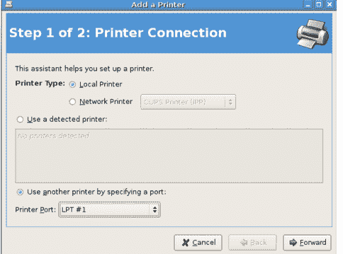

图 11.2

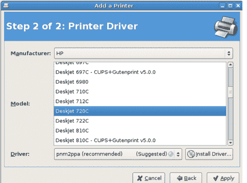

图 11.3

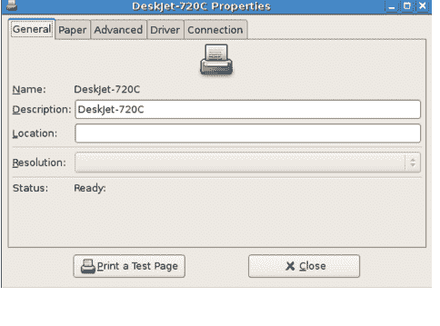

安装好打印机后，弹出一个窗口；该窗口对应 `gnome-cups` 工具：

### 图 11.4

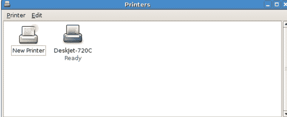

如果打印机使用 HP JetDirect 系统，最好安装 `hplip` 包，

```
# apt-get install hplip
```

并使用 `hp-setup` 工具来定义打印机。

使用 CUPS 配置打印机的另一种方法是通过 CUPS 服务的网站。我们都必须打开浏览器并输入 URL：`http://localhost:630`，这是服务器监听的端口。

以下截图显示了该管理工具的界面：

### 图 11.5

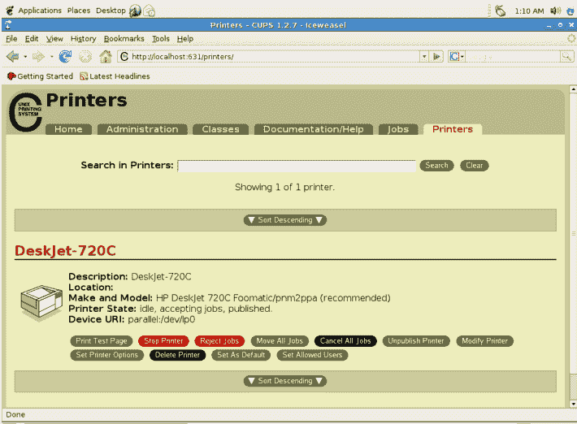

### 图 11.6

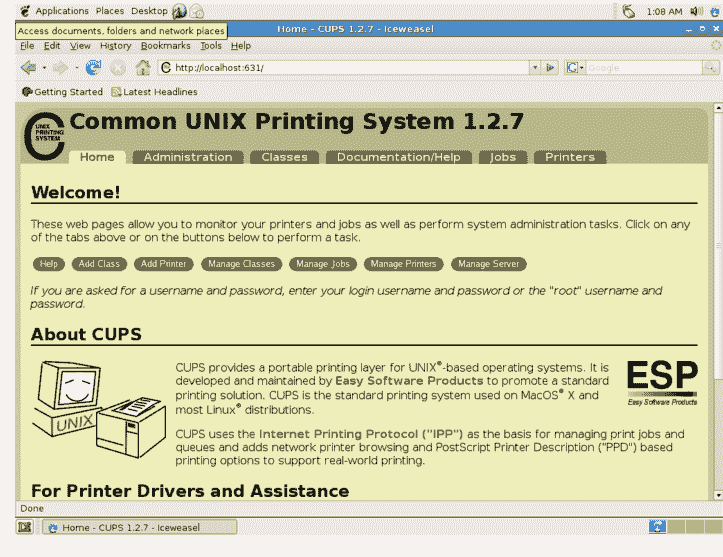

## 11.10. OpenOffice

在本小节中，虽然主题不在本课程主要目标的范围内，但我们将介绍一种办公套件，这对于我们这些处理此类软件的人来说是极其有用的。涉及的元素是 OpenOffice，这是一个源自 Sun MicroSystems StarOffice 的项目。我们必须指出，该项目是多平台的，它可以在非 Unix 类型的其他操作系统上实现。

要安装该套件，我们可以使用以下命令（全部在一行）：

```
brau:~# apt-get install openoffice.org openoffice.org-base openoffice.org-draw openoffice.org-calc
openoffice.org-common openoffice.org-core openoffice.org-draw openoffice.org- evolution
openoffice.org-gnome openoffice.org-gtk openoffice.org-help-en openoffice.org-help-es
openoffice.org-impress openoffice.org-java-common openoffice.org-l10n-es
openoffice.org-math openoffice.org-writer
```

在安装过程中（应在图形环境中执行），我们唯一做的就是记住我们必须为网络安装它。这样一来，每个用户的家目录只需要包含一个小目录，其中保存了他们的个性化配置。

一旦首次安装程序，每个用户必须运行以下程序来创建他们自己的目录：

```
/usr/lib/openoffice/program/setup
```


一旦完成此操作并回答几个问题后，执行 `openoffice` 命令将打开该套件。

目前 Debian Etch 中的 OpenOffice 版本为 2.0.4。

## 11.11. 结论

通过这次工作坊，我们结束了硕士第二个模块的教学材料。在工作坊中，我们学习了如何在系统中安装图形环境，正如我们当时看到的，它并不是操作系统内部的一个核心组成部分。但它在许多情况下显然是有用的，许多人说我们在这个模块中学习的操作系统可以作为其他系统的严肃替代方案。我们想表达完全坚信，GNU/Linux 是一个非凡的操作系统，不仅是因为它的图形界面（这可能是我们初看系统时吸引我们注意的），还由于许多其他数不胜数的的论据，其中我们将强调系统背后的哲学、它的可靠性、适应性、强大、潜在的安全水平等。我们相信这个操作系统是对未来的投资，我们只能期待它积极的发展，尽管它已经证明了自己是操作系统世界中一个强大的竞争者。我们希望我们已经提供了足够的知识，并传递了读者开启自己的 GNU/LINUX 之旅所需的热情，同时也让他们知道如何开启一扇欢迎并尊重每个人的社区大门。

## 附录

PID_00148394

## 索引

- 1. 附录 A. 命令表............................................................................... 5
- 2. 附录 B. 编辑器 vi...................................................................................... 10
- 3. 附录 C. Fedora 7 安装过程.................................................. 13
- 4. 附录 D. 管理工具.............................................................. 23
- 5. GNU 自由文档许可证................................................................ 30

## 附录 A. 命令表

### A1. 文件系统

| 命令语法 | 结果和有效参数 |
| :--- | :--- |
| `ls [pattern]` | 列出指定目录的内容<br>`-a` 显示所有包括以 . 开头的<br>`-h` 以字节, KB, MB, GB 显示大小<br>`-S` 按大小排序列表<br>`-w` 按列显示<br>`-R` 递归 |
| `cd [path]` | 切换到指定目录。默认切换到用户目录 |
| `find [parameters] [path]` | 查找特定的文件或目录<br>`-maxdepth,num` 搜索深度<br>`-uid` 强制匹配 UID<br>`-gid` 强制匹配 GID |
| `ln path [Link]` | 创建文件或目录链接。如果不是符号链接，则创建精确副本<br>`-s` 创建符号链接 |

### A2. 系统的帮助功能

| 命令语法 | 结果和有效参数 |
| :--- | :--- |
| `man [section_number] command` | 通过分页器显示命令手册 |
| `info command` | 另一种帮助来源，有时补充 man 命令，有时它是唯一的文档 |
| `apropos keyword` | 查找描述中包含关键词的所有命令 |

### A3. 文件权限

| 命令语法 | 结果和有效参数 |
| :--- | :--- |
| `chmod mode file` | 设置文件或目录权限<br>`-R` 递归更改，即影响指定目录内的所有文件 |
| `chown owner[.group] file` | 设置文件或目录的所有者和组（如果指定）<br>`-R` 命令递归 |
| `chgrp group file` | 设置文件或目录所属的组<br>`-R` 命令递归 |
| `umask mode` | 设置命令执行后创建的所有文件的权限 |

### A4. 复制和删除文件

| 命令语法 | 结果和有效参数 |
| :--- | :--- |
| `rm filename(s)` | 删除指定的文件或目录<br>`-f` 消除确认消息<br>`-R` 递归删除指定目录中的文件<br>`-i` 提示用户在删除每个文件和目录前确认 |
| `rmdir directory` | 删除空目录 |
| `cp source target` | 从指定源复制到指定目标<br>`-f` 不提示确认<br>`-i` 在复制每个文件前提示确认<br>`-L` 创建链接而非复制实际文件<br>`-R` 递归复制子目录的所有内容<br>`-s` 创建符号链接而非复制实际文件 |
| `mv source target` | 将文件从指定源移动到指定目标<br>`-f` 不提示确认<br>`-i` 在移动每个文件前提示确认 |

### A5. 关机或重启

| 命令语法 | 结果和有效参数 |
| :--- | :--- |
| `logout` | 退出 shell 返回登录 |
| `halt` | 启动系统停止过程（在显示 Power Down 前不应关闭计算机） |
| `reboot` | 重启系统，即启动系统停止并重置计算机 |

### A6. 文件操作

#### 结果与常用参数

| 命令语法 | 结果与常用参数 |
|---|---|
| `cat [file]` | 当未指定文件时，显示文件内容或按键记录<br>`->"-n"` 显示行号<br>`->Pager` 进入显示文件内容的分页器（Pager）。下方列出的选项不是命令参数，而是直接访问键或快捷键<br>`->"/pattern"` 在分页器中搜索指定的模式；使用 `"n"` 和 `"N"` 键分别跳转到下一个或上一个出现的位置。 |
| `less file` | `->END` 回到文件末尾<br>`->HOME` 回到文件开头<br>`->PAGE DOWN` 翻页到下一页<br>`->PAGE UP` 回到上一页<br>`->RETURN` 跳到下一行<br>`->SPACE` 跳到下一页 |
| `more file` | 以类似于 `less` 命令的方式显示文件内容，但带有某些限制（例如，它不提供回退的选项）<br>`->"-b"` 显示每个找到的行的字节数<br>`->"-c"` `[pattern]` 不显示行，而是进行计数并返回数字，当模式以 `"-"` 字符开头时非常有用<br>`->"-i"` 忽略大小写<br>`->"-n"` 显示行号<br>`->"-v"` 反转查找结果<br>`->"-w"` 只选择模式为完整单词的行<br>显示字段<br>`->"-d character"` 设置字段分隔符字符<br>`->"-b field number"` 设置所选字段的 listBytes，当仅需用逗号分隔的指定字节时使用 |
| `cut file` | 显示文件的字节数、行数和单词数<br>`->"-c"` 仅显示字节<br>`->"-l"` 仅显示行 |
| `wc file` | 显示单词数<br>`->"-w"` 仅显示单词数 |
| `diff file1 file2` | 显示文件 1 和文件 2 之间的差异<br>`->"-i"` 忽略大小写<br>`->"-w"` 忽略空格 |

### A7. 文件压缩与安全复制

#### 结果与常用参数

将多个文件和目录合并到一个 tar 包文件（带有 tar 扩展名）中
- `--cf` 从当前目录的指定文件创建 tar 包
- `--cvf` 详细选项，与上述参数结果相同，用于显示归包中包含的文件列表
- `--cvzf` 与上述相同，但生成一个 zip 压缩归包
- `--x` 从 tar 包中提取内容
- `--xzf` 提取并解压归包并显示过程结果
（压缩文件以 `"tar.gz"` 或 `".tgz"` 结尾）

压缩文件并在文件名后添加 `".gz"`
- `--d` 解压文件

将所有源文件压缩到 zip 归包中
- `--e` 使用终端或提示中输入的密码加密归包

解压 zip 归包

### A8. 磁盘操作

#### 结果与常用参数

显示挂载分区的总空间、已空间和可用空间
- `--h` 以字节、KB、MB、GB 单位显示数据
- `--m` 以 MB 单位显示数据

显示文件占据的块
- `--block=SIZE` 设置所需的块大小
- `--h` 以字节、KB、MB、GB 单位显示数据

创建新的文件系统。考虑到命令设备的性质，建议阅读并理解命令手册

检查文件系统一致性并交互式地修复文件系统。运行此命令时必须卸载设备

同步缓存和硬盘文件

搜索设备上的坏块
- `--s` 通过写出检查时的数字来显示扫描进度

### A9. 用户与组

图 A.9

| 命令语法 | 结果与常用参数 |
|---|---|
| `whoami` | 显示当前用户的有效用户名 |
| `groups` | 显示用户所属的组 |
| `who` | 显示所有当前登录的用户列表<br>`->-"T"` 告知每个用户是否允许接收消息 |
| `w [user_name]` | 显示系统当前当前用户的扩展信息。默认情况下显示所有当前登录用户的信息。用于向指定用户发送消息。要确定控制台，可以使用 `"who"` 或 `"w"` 命令。 |
| `write user_name [console]` | 如果指定用户在线且接受，则打开该控制台。`"y"` 开启接收，`"n"` 关闭 |
| `talk_user_name [console]` | 在不带参数使用时，显示消息接收 |
| `mesg [-v -n]` | |
| `adduser [user_name]` | 在系统中创建新用户 |
| `deluser user_name` | 从系统中删除指定用户 |
| `addgroup [group_name]` | 创建新组 |
| `delgroup group_name` | 从系统中删除指定组 |

### A10. 管理进程

图 A.10

| 命令语法 | 结果与常用参数 |
|---|---|
| `ps` | 显示当前进程的快照（类似于 `"-e"`）<br>`->-"A"` 显示系统中当前运行的所有进程<br>`->-"H"` 显示进程层次结构<br>`->-"I"` 显示有关进程的详细信息 |
| `top` | 交互式显示正在运行的进程 |
| `kill PID(s)` | 向进程发送终止信号 |
| `killall process_name(s)` | `->-"9"` 确保终止信号的执行。终止所有与参数提供的程序名称相关的进程 |
| `nice [command]` | 当未指定命令时，显示默认优先级级别。当指定命令和所需优先级时执行 |
| `renice priority` | 调整指定 PID 的优先级 |
| `at time` | 在指定时间运行任务<br>`->-"f"` 指定指定时间运行任务 |
| `atq` | 列出所有等待执行的任务 |
| `atrm` | 删除队列中的任务 |
| `batch` | 批处理 |

## 附录 B. 编辑

### B.1. 介绍

了解如何使用 `vi` 是关重要的。`vi` 有两种主要模式：普通模式和插入模式。使用 `Esc` 键返回普通模式。在普通模式下，可以执行许多操作。如下表：

| 命令语法 | 结果与常用参数 |
|---|---|
| `vi file` | 编辑指定文件，当前文件没有更改 |
| `vi -r` | 打开文件的最后版本 |
| `vi +number` | 打开文件并将光标置于指定行 |
| `vi +line` | 打开文件并将光标置于指定行 |
| `vi +string` | 打开文件并将光标置于字符串首次出现 |
| `w` | 保存文件 |
| `w file` | 保存指定文件名 |
| `x file` | 追加指定文件 |
| `Nr file` | 追加指定行 |
| `sh` | 在不退出编辑器的情况下运行 shell，必须 `"exit"` 退出 |
| `N, M` | 从 N M 行开始保存，忽略其余部分 |
| `M>` | 从 N M 行追加文本到指定文件 |
| `=` | 显示当前行 |
| `CTRL+G` | 显示文件状态 |

### B.2. 模式

编辑器可以在不同模式之间切换：普通模式和插入模式。在插入模式下输入文本。使用 `Esc` 键返回普通模式。在普通模式下，可以执行许多操作。如下表显示了常用的操作：

| 命令 | 结果与常用参数 |
|---|---|
| `a` | 在光标后插入文本 |
| `i` | 在光标前插入文本 |
| `A` | 在行末尾插入文本 |
| `I` | 在行首插入文本 |
| `R` | 进入替换模式 |
| `o` | 在当前行下方插入新行并进入插入模式 |
| `O` | 在当前行上方插入新行并进入插入模式 |

### B.3. 移动

在文件中移动。如下表显示了最常用的操作：

| 命令 | 移动文件 |
|---|---|
| `j` | 下一行 |
| `k` | 上一行 |
| `1` | 下一个字符 |
| `l` | 上一个字符 |
| `[[` | 文件开头 |
| `]]` | 文件末尾 |
| `/` | 从当前位置搜索字符串 |
| `O` | 跳到文件末尾 |
| `RETURN` | 下一行 |
| `CTRL+F` | 下一页 |
| `CTRL+B` | 上一页 |
| `CTRL+D` | 下半页 |
| `CTRL+U` | 上半页 |

### B.4. 操作文件

如下表显示了常用的操作：

| 命令 | 操作文件 |
|---|---|
| `w` | 保存文件 |
| `w file_name` | 保存指定文件名 |
| `wq` | 保存并退出编辑器 |
| `z` | 保存并退出编辑器 |
| `zz` | 如果文件未修改则退出 |
| `q` | 不保存更改退出 |
| `e file` | 编辑指定文件，当前文件没有更改 |
| `a file` | 追加文件，当前文件没有更改 |
| `x file` | 在当前行追加指定文件 |
| `Nr file` | 在当前行追加指定行 |

### B.5. 复制、删除、查找和替换

如下表显示了常用的操作：

| 命令 | 复制、删除、查找和替换 |
|---|---|
| `yy` | 复制当前行 |
| `Nyy` | 复制从当前位置到当前行的 N 行 |
| `p` | 将粘贴内容到当前行之前 |
| `P` | 将粘贴内容到当前行上方 |
| `x` | 删除光标下的字符 |
| `dw` | 删除光标下的单词 |
| `dd` | 删除当前行 |
| `D` | 删除从当前位置到行尾的字符 |
| `/` | 从当前位置搜索字符串。要继续搜索，可以使用 `"n"` 或 `"N"` 分别向后或向前搜索 |
| `?` | 从当前位置反向搜索字符串 |
| `set ic` | 忽略大小写进行搜索 |
| `set noir` | 区分大小写进行搜索 |
| `gHELLO/s/GOODBYE` | 全局替换所有所有的 `"HELLO"` 为 `"GOODBYY"` |

让它们在命令之前运行。例如，`dd` 会删除当前行；如果我们使用 `3dd` 代替现有行，则会删除随后的三行。

## 3. 附录 C. Fedora 7 安装过程

### C.1. 引言

本附录的目的是提供安装 Fedora 7 必须采取的基本步骤的概括。我们假设读者已经通过整个模块的学习掌握了基础知识，并熟悉 Debian Ethics 的安装。安装其中任何一个系统时必须具备的理论知识在实践上是相同的；因此，本附录仅侧重于将理论知识付诸实践，我们将仅突出两个安装过程之间的差异。

### C.2. 开始安装

由于该发行版非常新，在发布时仅提供英文版本的安装程序，这就是为什么截图是英文的，但安装过程在任何其他语言中都是相同的。

我们要做的第一件事是从 `http://mirrors.fedaproject.org/publiclist/Fedora/7` 下载 DVD iso 镜像，将其刻录到 DVD 并重启电脑，告诉它从 DVD 启动。我们必须使用启动提示符来指示我们想要执行安装或更新现有系统：

图 C.1

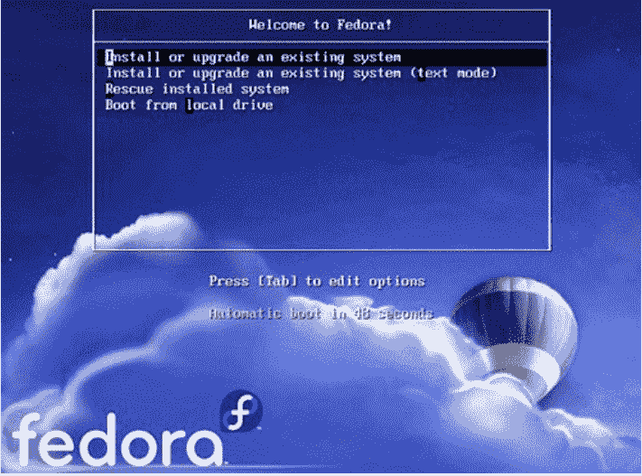

然后我们将突出正确的语言并点击“下一步”（Next）：

图 C.2

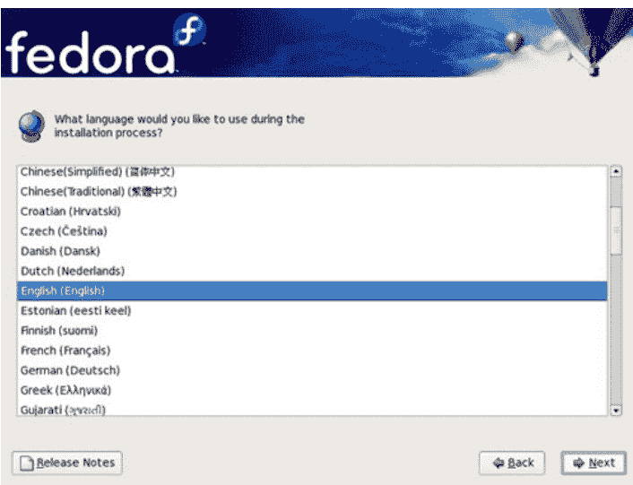

然后我们将设置键盘布局：

图 C.3


### C.3. 硬盘分区

安装系统随后将默认对硬盘进行分区。或者，我们也可以选择使用 Disk Druid（磁盘向导）来手动执行此操作。建议使用此选项，因为该程序易于使用，并且能帮助我们根据需求结构化分区。如果我们已经有一个交换分区（swap partition），即使它是来自另一个系统，我们也不必为这次安装创建一个新的，因为可以使用现有的，因为交换分区上只存储易失类型的信息。

随后我们将看到一个显示建议分区布局的屏幕：

图 C.4


### C.4. 网络配置

图 C.5


### C.5. 选择时区

将出现一张地图，我们可以使用鼠标指定指定地理位置。

图 C.6


然后我们被要求设置 root 用户密码：

图 C.7


### C.6. 选择我们要安装的软件

GNU/Linux PID_00148394

17

附录

我们随后必须选择想要安装的应用程序族，并在这些族中选择要在系统中安装的哪些应用程序。再次，我们敦促用户避免安装庞大的应用程序，因为这些显然会对系统性能产生负面影响；我们应该只安装那些确定会使用的程序，并根据需要逐渐安装其余应用程序。如果将使用图形界面，建议保持所选图形系统选项开启。

图 C.8


图 C.9


一旦选择过程完成，我们将继续进行整个系统的安装：使用提供的信息进行格式化分区、配置设备和安装包。如果硬盘上没有足够的空间安装所有应用程序，我们将被重回配置屏幕，在屏幕上我们可以要么取消某些应用程序，要么为适当的分区分配更多空间（这通常位于 `/home` 目录，大多数用于重新分区磁盘的数据都在那里，我们必须重新开始安装过程）。

图 C.10


### 图 C.11


### C.7. 安装引导程序

当数据传输完成后，安装过程将自动运行，如果我们还没有配置引导程序，它将安装引导程序。

图 C.12


### C.8. 完成安装

重启电脑后，我们将被要求输入：

图 C.13


### C.9. 首次系统

在此之前，我们必须设置一些元素，通常是系统：防火墙：

图 C.14


- 欢迎
- 许可证信息
- SELinux
- 日期和时间
- 硬件配置
- 创建用户

图 C.15


- 欢迎
- 许可证信息
- SELinux
- 日期和时间
- 硬件配置
- 创建用户

图 C.16


- 欢迎
- 许可证信息
- SELinux
- 日期和时间
- 硬件配置
- 创建用户

图 C.17


- 欢迎
- 许可证信息
- SELinux
- 日期和时间
- 硬件配置
- 创建用户

图 C.18


## 4. 附录 D. 管理工具

### D.1. 引言

在管理 GNU/Linux 时，有必要熟悉各种应用程序。虽然在安装任何应用程序之前阅读相关文档是绝对必要的，但在某些情况下配置可能会非常复杂。由于这些原因，近年来出现了一些管理工具，它们更加直观、友好，并允许我们更方便地处理许多应用程序和服务。

通常，这些管理工具集成了配置系统基本方面的机制。虽然了解这些工具的存在很有趣，但在设置服务器时我们不应该依赖它们，原因有许多。首先，我们需要记住这些程序没有考虑到这些服务器的所有可能性。这可能意味着我们让某些对我们需求重要的选项没有经过正确配置。

### 管理工具的安全

当我们安装某些全局管理工具时，限制其使用并确保只有系统 root 用户可以访问它是重要的；否则任何其他用户都可以修改系统的某些方面。此外，我们应该非常警惕它们可能出现的任何安全漏洞，因为我们要管理系统中安装的程序，大多数这些工具可能以 root 用户的权限运行，这伴随着危险。

用于检测我们创建的任何错误。我们应该将它们作为辅助工具，协助我们的管理任务，但绝不要依赖它们。

GNU/Linux 发行版通常包含它们自己的自动管理工具。这一特征明显区分了 GNU/Linux 发行版。例如，在 SuSE 中，有一个名为 Yast2 的应用程序，它允许我们运行任何配置系统的应用程序；RedHat 包含了许多不同的程序来配置网络、守护进程、应用程序服务器等；在 Debian 中安装软件包时，我们已经已经准备好根据我们在各种对话场景中提供的答案启动配置；某些应用程序有自己的脚本，使其能够快速进行标准配置等。尽管如此，如果我们知道这些应用程序实际上在做什么，以及哪些文件包含了它们的配置。除了这些我们所使用的发行版特有的工具外，尽管我们可以在大多数现有发行版中安装更通用的工具。尽管有几十种工具，每位管理员都必须选择他们最喜欢或最符合他们需求的一个，但我们将在附录中讨论这些工具中最多功能且受欢迎的一些：linuxconf 和 webmin。

## D.2. Linuxconf

通用管理程序 `linuxconf` 基于文本菜单环境，我们可以从系统中的任何控制台使用它。下面的图显示了主菜单：

## 图 D.1 Linuxconf
这是 Linux 配置的主入口。

使用 TAB 键在字段区域和底部的按钮栏之间导航。查看此屏幕的帮助。它是对 Linuxconf 的介绍。

| 配置 | 帮助 |
|---|---|
| 网络 | |
| 用户 | |
| 文件系统 | |
| 杂项 | |
| 外围 | |
| 启动 | |
| 集群管理 | |
| 控制 | |
| 控制面板 | |
| Linuxconf 管理 | |
| 日期与时间 | |
| 状态 | |
| 日志 | |
| 系统状态 | |
| 任务 | |
| 友好助手 (Gurus) | |
| 退出 | |

- **Configuration**：这是 linuxconf 中的主要部分，我们可以在这里配置系统的的大方面，例如网络、用户、已安装的外围设备等。下面的图显示了网络配置和用户对话框的工作原理：

## 图 D.2

- 网络配置器
此包允许你使用 scratch 和 mode（或其他串口连接）配置 TCP/IP 网络

- 用户账户配置器
此包允许你添加/删除和管理用户账户

| -客户端任务- | |
|---|---|
| 用户账户详情 | 正常 |
| 域名服务器规范 (DNS) | 用户账户 |
| 路由和网关 | 组定义 |
| IP 地址/掩码 | 修改密码 |
| 虚拟主机的 IP 别名 | 特殊账户 |
| 互联网服务 | POP 账户 |
| 安全访问 (openssh) | 通过普通登录的 SLP 账户
| 启动服务 | UNIX 账户 |
| ARP 服务 | POP 账户（仅限邮件） |
| 防火墙细节（数据包过滤） | 特殊组 |
| 输入过滤 | 策略 |
| 转发 | 可用的 shell |
| 输出过滤 | 可用的 SLP shell |
| 数据包过滤 | 从数据库检索 |
| 关于其他网络的信息 | 配置特殊组 |
| Linux 网络访问 | |

| 取消 | 帮助 |
|---|---|

- **Control**：此系统用于在系统中执行特定操作，例如挂载或卸载单元、更改系统日期和时间、个性化菜单等。下面的图显示了控制面板菜单中可以执行的一些操作：

## 图 D.3

## 控制面板

此菜单让你执行操作，而不是配置。


- **Status**：如果我们想查看日志或系统任何方面的状态，可以使用此部分中的菜单。许多查看磁盘状态、内存使用量等的系统基本命令都用在其中。

- **Tasks**：用于正确启动调制解调器、网络等的其他配置对话框。

使用此程序的另一种方法是通过 浏览器。默认情况下，浏览器无法访问，因此在使用它之前，我们必须通过 Networking 菜单、Linuxconf network access 启用启用 Enable network access 选项。如果我们打开浏览器并访问 `http://localhost:98/`，我们将获得以 html 格式显示的与 `linuxconf` 相同的对话和菜单选项。默认情况下，我们只能从同一台机器访问此服务，尽管建议在我们需要使用时启用它。

最后，另一个与 `linuxconf gnome-linuxconf` 相关的项目，它具有上述的功能，但可以在 X 系统中使用。下面的图显示了它的样子：

## D.4

| Account | Name | Uid | Gid |
|---|---|---|---|---|
| | FTP | | 14 | fb |
| games | | 42 | uid |
| gdm | | 19 | go |
| gopher | | 7 | c |
| lp | | 8 | ma |
| mail | | 44 | ma |
| mailman | Domain name server 156 | na | |
| named | | 9 | ner |
| news | Gustavo Nieomer | 670 | |

## D.3. Webmin

正如名称所示，webmin 是一个用于执行的工具...

**文档的修订版本**（Modified Version）是指任何包含文档或其部分的作品，无论是逐字复制，还是经过修改和/或翻译成另一种语言的。

**次章节**（Secondary Section）是指文档中命名的附录或前言部分，专门处理文档出版者或作者与文档整体主题（或相关事项）的关系，且不包含任何可能直接属于该主题的内容。（因此，如果文档不是教科书的一部分，则次章节不解释任何数学内容。）这种**关系**可以是与主题或相关事项的历史联系，也可以是关于这些事项的法律、商业、哲学、伦理或政治立场。

“**不变章节**”（Invariant Sections）是指在说明文档根据本许可发布的通知中被指定为不变章节的特定次章节。如果某个章节不符合“次章节”的定义，则不允许被指定为不变章节。文档可以包含零个不变章节。如果文档确实指定了任何不变章节，则不存在其他不变章节。

“**封面文本**”（Cover Texts）是指在说明文档根据本许可发布的通知中列出的、作为“前封面”或“封底文本”的短句。前封面文本最多包含5个单词，封底文本最多包含25个单词。

文档的**透明副本**（Transparent copy）是指一种机器可读的副本，其格式规范对公众开放，且该格式适用于使用通用文本编辑器（或由像素组成的图像）、通用绘图程序或（对于绘图）某些广泛使用的绘图编辑器来直接修订文档，并适用于输入到文本格式化器，或自动转换为多种适用于输入文本格式化器的格式。如果副本所使用的格式其标记或缺乏标记的是为了阻碍或劝阻读者的后续修改而安排的，则不是透明的。

如果图像用于任何大量的文本，则它不是透明的。不透明的副本被称为**不透明副本**（Opaque）。

透明副本的适用格式示例包括：不带标记的纯 ASCII、Texinfo 输入格式、LaTeX 输入格式、使用公共可用 DTD 的 SGML 或 XML，以及为了人类修改而设计的符合标准的 HTML、PostScript 或 PDF。透明格式的示例包括 PNG、XCF 和 JPG。不透明格式包括：仅供专有文字处理器读取和编辑的专有格式；DTD 和/或处理工具通常不可用的的 SGML 或 XML；以及某些文字处理器为了输出目的而生成的 HTML、PostScript 或 PDF。

书籍的“**标题页**”（Title Page）是指标题页本身，以及根据需要承载本许可要求在标题页上显示的材料的后续页面。对于没有此类标题页格式的作品，“标题页”是指作品标题最显著出现处的文本，位于正文开始之前。

**标题为 XYZ 的章节**（sectiontitled XYZ）是指文档中一个特定的子章节，其标题精确为 XYZ，或在 XYZ 后的括号内包含用另一种语言翻译 XYZ 的文本。（此处 XYZ 代表下方提到的特定章节名称，如“致谢”、“献词”、“认可”或“历史”）。在修改文档时保留此类章节的“标题”，意味着根据本规定，它仍然是一个“标题为 XYZ”的章节。

文档可能将**保证免责声明**（Warranty Disclaimers）包含在说明本许可适用于文档的通知中。这些保证免责声明被通过引用包含在本许可中，但仅涉及免责保证；这些保证免责声明可能具有任何其他暗示均无效，且对本许可的含义没有影响。

# 2) 逐字复制

您可以在任何媒介上以商业或非商业方式复制并分发该文档，前提是所有副本中都复制了本许可、版权声明以及说明本许可适用于文档的通知，并且您没有对本许可的条件添加任何额外条件。您不得使用技术手段来阻碍或控制您所制作或分发的副本的阅读或进一步复制。然而，您可以接受副本的补偿。如果您分发了大量副本，还必须遵守第 3 节中的条件。

您可以在上述相同条件下出借副本，并可以公开展示副本。

# 3) 批量复制

如果您出版了数量超过 100 份的文档打印副本（或常见有印刷封面的介质副本），且文档的许可通知要求提供封面文本，则您必须将副本包含在载有清晰可读的所有所有这些封面文本的封中：前封面上的封面文本和封底上的封底文本。两个封面都必须清晰可读地通过这些副本的出版者身份识别您。前封面必须展示完整标题，且标题中的所有单词同样显著且可见。您还可以在封面上添加其他材料。

仅限于副本的带更改复制，只要它们保留了这些条件，在其他方面可以被视为逐字复制。

如果任一封面所需的文本过多而无法清晰显示，您应该将列出的前面的文本（在合理范围内）放在实际封面上，并将其余部分继续到相邻页面。

如果您出版或分发数量超过 100 份的文档不透明副本，每份不透明副本都必须包含一份机器可读的副本，或者随或在每份不透明副本中说明一个网络位置，通用网络用户可以使用公共标准网络协议从那里下载一份完整的、未添加额外材料的文档透明副本。

如果您使用后一种方案，在开始大量分发不透明副本时，可以采取审慎的步骤，以确保该副本将保持

# 4) 修订

您可以根据本许可的条款复制并分发文档的**修订版本**，前提是所有副本中都复制了本许可、版权声明以及说明本许可适用于文档的通知，并且您没有对本许可的条件添加任何额外条件。您不得使用技术手段来阻碍或控制您所制作或分发的副本的阅读或进一步复制。然而，您可以接受副本的补偿。如果您分发了大量副本，还必须遵守第 3 节中的条件。

N. 不得将任何现有章节命名为“认可”（Endorsements），或与任何不变章节（Invariant Section）发生冲突。

O. 保留任何免责声明（Warranty Disclaimers）。

如果修改后的版本包含了属于辅助章节（Secondary Sections）的新前言章节或附录，且不包含拷贝自文档的内容，你可以根据自己的决定[指定]其中一个或所有这些章节为不变章节。要做到这一点，请将它们的标题添加到修改后的版本许可公告中的不变章节列表中。[这些]标题必须与任何其他章节区分开来。

你可以添加一个名为“认可”（Endorsements）的章节，前提是该章节仅包含各方对你修改版本的背书——例如，同行评审声明，或该文本已获得权威标准定义的批准。

你可能会添加一段五个字的段落作为封底文字（Front-Cover Text），并在修改版本的封底文字列表（Cover Texts）末尾添加一段最多 25 个字的段落。任何实体仅可（或通过其进行的修订）添加一段封底文字和一段封底文字。如果文档已经包含了由你之前添加或由你代表的同一实体安排的相同封面，你不得再添加另一个；但在获得添加旧封面的出版者明确许可的情况下，你可以替换旧的。

文档的作者和出版者并不通过本许可允许使用其姓名进行宣传，或断言或暗示对任何修改版本的认可。

# 5) 合并文档

你可以将文档与其他在本许可协议下发布的其他文档合并，并按照上述第 4 节中定义的修改版本的条款进行，前提是你在合并中包含了所有原始文档的所有未经修改的不变章节，并在你的合并作品的许可公告中将它们列为合并作品的不变章节，并且保留它们的所有免责声明。

合并后的作品仅需包含本许可协议的副本，多个相同的不变章节可以替换为一份副本。如果存在多个同名但内容不同的不变章节，则通过在每个章节标题的末尾用括号加上该章节原始作者或出版者的已知名称（或者一个唯一的数字）来使每个章节的标题唯一化。

对合并作品许可公告中不变章节列表中的章节标题进行相同的调整。

在合并时，你必须将原始文档中任何命名为“历史”（History）的章节合并为一个名为“历史”的章节；同样，合并任何命名为“致谢”（Acknowledgements）的章节以及任何命名为“献词”（Dedications）的章节。你必须删除所有命名为“认可”（Endorsements）的章节。

# 6) 文档集

你可以由文档和其他在本许可协议下发布的文档组成集合，并将各个文档中的本许可协议副本替换为包含在集合中的单一副本，前提是你在其他所有方面遵循本许可协议关于每份文档的逐字复制的规则。

你可以从此类集合中提取单个文档，并在本许可协议下单独分发，前提是你在所提取的文档中插入一份本许可协议副本，并在关于该文档的逐字复制的所有其他方面遵循本许可。

# 7) 与独立作品的聚合

将文档或其衍生作品与其他独立的文档或作品汇编，并在存储或分发介质的卷中或其上，被称为“聚合”（aggregate），前提是汇编产生的版权未在超出单个作品许可范围的范围内限制聚合体使用者的法律权利。

当文档包含在聚合体中时，本许可不适用于聚合体中本身不是文档衍生作品的其他作品。

如果第 3 节的封面要求适用于这些文档副本，那么如果文档少于整个聚合体的一半，则文档的封面可以放置在聚合体内包裹文档的封面上，或者如果文档是电子格式，则放置电子对应的封面。否则，它们必须出现在包裹整个门面的打印封面上。

# 8) 翻译

翻译被视为一种修改，因此你可以根据第 4 节的条款分发文档的翻译版。将不变章节替换为翻译需要其版权持有者的特殊许可，你可以在包含不变章节原始版本的基础上，包含部分或所有不变章节的翻译。你可以包含本许可协议、文档中所有许可公告以及任何免责声明的翻译，前提是你还包含了本许可协议的原始版本以及那些公告和免责声明的原始版本。如果翻译与许可协议或公告的原始版本不一致，以原始版本为准。

如果文档中的某个章节命名为“致谢”（Acknowledgements）、“献词”（Dedic）或“历史”（History），保留其标题（第 1 节）的要求（第 4 节）通常需要更改实际标题。

# 9) 终止

除非本许可明确规定，否则不得复制、修改、分许可或分发文档。任何其他尝试复制、修改、分许可或分发文档的行为都是无效的，并将自动终止你在本许可下的权利。然而，根据本许可从你处获得副本或权利的方，只要他们保持完全符合规定，其许可就不会终止。

# 10) 本许可的未来修订

自由软件基金可能会随时发布新的、修订后的 GNU 自由文档许可。此类新版本在精神上与当前版本相似，但在细节上可能不同，以解决新的问题或关注。参见 http://www.gnu.org/copyleft/

许可的每个版本都有一个区分版本号。如果文档指定本许可的特定版本号“或任何后续版本”适用于它，可以选择遵循指定版本或自由软件基金已发布（而非草稿）的任何后续版本的条款。

附录：如何在你的文档中使用本许可

要在你编写的文档中使用本许可，请包含一份许可副本，并在标题页之后放置以下版权和许可公告：

版权所有 (c) 年份 姓名。允许根据自由文档许可 1.2 版本或其发布的任何后续版本的条款复制、分发和/或修改本文；无不变章节、无前底文字、无封底文字。

许可副本包含在“GNU 自由文档”章节中。

如果你有不变章节、前底文字和封底文字，请将“无...文字”这一行替换为：“不变章节为列表标题，前底文字为列表，封底文字为列表。”。

如果你有不变章节但没有封面文字，或者这三者的其他组合，请合并上述两种方案以适应情况。

如果你的文档包含非平凡的程序代码示例，我们建议根据你选择的自由软件许可并行发布这些示例。
