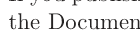

# GNU Make：重编译编译程序；GNU make 3.81 版本

本文件文档了 GNU make 实用，它能够自动确定大型程序中哪些部分需要重新编译，并发布编译这些部分的命令。

iv

GNU make

- 10.5 定义和重定义模式规则....................................... 110
- 10.5.2 模式规则示例........................................................ 112
- 10.5.5 匹配任意内容的模式规则....................................... 115
- 10.5.6 取消隐式规则............................................... 116
- 10.6 定义最后重置默认规则..................................................... 117
- 10.7 旧划线后缀规则........................................................ 117
- 10.8 隐式规则搜索算法......................................... 119

# make 概述

`make` 工具会自动确定程序的哪些部分需要重新编译，并为它们发布命令。本手册介绍了由 Richard Stallman 和 Roland McGrath 实现的 GNU make。它符合 IEEE 1003.2-1992 (POSIX.2)。事实上，make 适用于任何根据其他文件自动更新的任务。

为了使用 make，你必须编写一个名为 `Makefile` 的文件，描述文件之间的关系并提供更新每个文件的命令。在程序中，通常执行文件是从对象文件更新的，而对象文件是由源文件编译的。一旦有了合适的 `Makefile`，每当你更改某些文件时，只需执行简单的命令：

```
make
```

即可执行所有必要的编译。`make` 使用数据库和文件的最后修改时间来决定哪些文件需要更新。对于这些文件，它会发布配方。

你可以向 `make` 提供命令行参数来控制哪些文件需要重新编译，请参见第 9 章 [如何运行 make]，93 页。

## 1.1 如何阅读本手册

如果你是 make 初学者，或者正在寻找通用介绍，请阅读每个章节的前几节，跳过后面的部分。在每个章节，前几节包含介绍性或通用信息，后面的部分是专门或技术信息。例外是第 2 章 [Makefile 简介]，3 页，其内容全部都是介绍性的。

如果你熟悉其他 make 程序，请参见第 12 章 [GNU make 的特性]，125 页，该章节列出了 GNU make 的增强功能；以及第 13 章 [不兼容性与缺失功能]，19 页，该章节解释了 GNU make 缺失的一些功能。

如需快速总结，请参见第 9.7 节 [选项总结]，98 页，附录 A [快速参考]，147 页以及第 4.8 节 [特殊目标]，32 页。

## 1.2 问题与漏洞

在使用 make 时遇到问题或你认为发现了一个漏洞，请向开发者报告；我们无法保证采取任何行动，但我们可能会修复它。

在报告漏洞 之前，请确保你确实发现了一个真正的漏洞。仔细重读文档，看看它是否真的说明了你正在尝试的操作。如果不确定是否应该做某事，也请报告；那是文档的漏洞！

# 2. GNU make

在报告错误或尝试自己修复之前，请尝试将问题隔离在尽可能小的、能够重现该问题的 makefile 中。然后将该 makefile 以及 make 给出的确切结果（包括任何错误或警告信息）发送给我们。请不要对这些信息进行改写；最好将它们复制并粘贴到报告中。在生成这个较小的 makefile 时，请确保不要在配方（recipes）中使用任何非自由或不寻常的工具：你几乎总是可以使用简单的 shell 命令来模拟工具的作用。最后，请务必解释你预期发生的情况；这将帮助我们判断问题是否真的出在文档中。

一旦你确定了精确的问题，可以通过两种方式之一进行报告。你可以发送电子邮件至：

```
bug-make@gnu.org
```

http://savannah.gnu.org/projects/make/

除了上述信息外，请务必包含你正在使用的 make 版本号。你可以通过 `make --version` 命令获取此信息。请务必包含你正在使用的机器类型和操作系统。获取此信息的方法是查看命令 `make --help` 输出的最后几行。

# 第 2 章：Makefile 简介

你需要一个名为 `makefile` 的文件来告诉 `make` 要做什么。大多数情况下，`makefile` 告诉如何编译和链接一个程序。

在本章中，我们将讨论一个简单的 `makefile`，它描述了如何将带有 C 源文件和三个头文件的文本编辑器进行编译和链接。`makefile` 还可以在被显式请求时运行如何运行杂命令（例如，作为一种清理操作来删除文件）。要查看更复杂的 `makefile` 示例，请参阅附录 C [Complex Makefile]，第 157 页。

当 `make` 重新编译编辑器时，每个更改的 C 源文件都必须重新编译。如果头文件发生了变化，为了安全起见，包含该头文件的每个 C 文件都必须重新编译。每次编译都会产生一个与源文件对应的对象文件。最后，如果任何源文件被重新编译，所有的对象文件（无论是新生成的还是从之前的编译保存的）都将被链接在一起，生成新的可执行编辑器。

## 规则的样貌

一个简单的 `makefile` 由具有如下形状的“规则”组成：

```
target : prerequisites ...
    recipe
```

目标（target）是程序生成的文件名；目标的示例是可执行文件或对象文件。目标也可以是要执行的操作的名称，例如‘clean’（参见第 4.5 节 [Phony Targets]，第 29 页）。

前置条件（prerequisite）是用于创建目标的文件。一个目标通常依赖于多个文件。

配方（recipe）是 `make` 执行的操作。一个配方可能包含多个命令，可以在同一行上，也可以单独占一行。请注意：你需要在每行配方的开头放置一个制表符（tab）！这是一个用于捕获不需要内容的偏移量。如果你倾向于使用制表符以外的字符对配方进行缩进，可以将 `RECIPEPREFIX` 变量设置为替代字符（参见第 6.14 节 [Special Variables]，第 70 页）。

通常，规则位于前置条件中，并在任何前置条件发生变化时用于创建目标。然而，指定目标配方的规则不需要前置条件。例如，与目标‘clean’相关的包含删除命令的规则没有前置条件。

因此，规则解释了如何以及何时重新制作作为特定规则目标的某些文件。`make` 执行前置条件上的配方来创建或更新目标。规则也可以解释如何以及何时执行某项操作。参见第 4 章 [Writing Rules]，第 21 页。

`makefile` 可能包含规则之外的其他文本，但一个简单的 `makefile` 只需要包含规则。规则看起来可能比此模板显示的稍微复杂一些，但或或符合该模式。

## 2.2 简单的 Makefile

这是一个直观的 `makefile`，它描述了名为 `edit` 的可执行文件依赖于对象文件，而对象文件反过来依赖于每个 C 源和三个头文件。

在这个示例中，所有的 C 文件都包含 `defs.h`，但只有定义编辑命令的包含包含了 `command.h`，而只有编辑器缓冲区包含的低级文件包含了 `buffer.h`。

```
main.o : main.c defs.h
	cc - main.c
kbd.o : kbd.c defs.h command.h
	cc - kbd.c
command.o : command.c defs.h command.h
	cc - command.c
display.o : display.c defs.h buffer.h
	cc - display.c
insert.o : insert.c defs.h buffer.h
	cc - insert.c
search.o : search.c defs.h buffer.h
	cc - search.c
files.o : files.c defs.h buffer.h
	cc - files.c
utils.o : utils.c defs.h
	cc - utils.c
clean:
	rm edit main.o kbd.o command.o display.o \
	insert.o search.o files utils.o
```

我们使用反斜杠-换行将每行拆分为两行；这像是一个长行，但更容易阅读。

使用此 `makefile` 创建可执行文件 'edit'，请输入：

```
make
make clean
```

使用此 `makefile` 删除目录中的可执行文件和所有对象文件，输入：

在示例中，目标包括可执行文件 'edit' 以及对象文件 'main.o' 和 'kbd.o'。前置条件是诸如 'main.c' 等文件。


除了上述信息，请注意包含你正在使用的 `make` 版本号。你可以通过 `make --version` 命令获取此信息。请务必包含你正在使用的机器类型和操作系统。获取此信息的方法是查看命令 `make --help` 输出的最后几行。

## 2.3 make 如何处理 Makefile

默认情况下，`make` 从第一个目标开始（不是以点开头的目标）。这就是默认目标。你可以使用命令行覆盖此行为（参见第 9.2 节 [Arguments to make]，第 93 页）或使用 `.DEFAULT_GOAL` 变量（参见第 6.14 节 [Other Special Variables]）。

在上节的简单示例中，默认目标是更新可执行文件 'edit'；因此，我们将该行放在第一。

```
make
```

`make` 读取当前目录下的 makefile 并从处理第一个规则开始。在示例中，这条规则是为了重新链接 'edit'；但在 `make` 完全处理此规则之前，它必须处理 'edit' 依赖的文件，在这种情况下是对象文件。这些文件中的每一个都根据其自己的规则进行处理。这些规则说通过编译源文件来更新每个 '.c' 文件。如果源文件或作为前置条件的任何头文件比对象文件新，或者对象文件不存在，则必须进行重新编译。

其他规则被处理，是因为它们的目标出现在了目标的前置中。如果某个其他规则没有被目标（或它依赖的等）依赖，那么该规则就不会被处理，除非告诉 `make` 这样做（通过命令行参数）。

在重新编译对象文件之前，`make` 考虑更新其前置条件，即源文件和头文件。此 `make` 没有为它们指定任何操作——'.c' 和 '.h' 文件不是任何规则的目标——所以 `make` 对这些文件不做任何事情。但 `make` 在此时会更新生成的 C 程序，例如由 Bison 或 Yacc 生成的程序，使用它们自己的规则。

因此，如果我们修改了 `insert.c` 并运行 `make`，`make` 将编译该文件以更新 `insert.o`，然后链接 `edit`。如果我们修改了 `command.h` 文件并运行 `make`，`make` 将重新编译对象文件 `kbd.o`、`command.o` 和 `files.o`，然后链接 `edit` 文件。

## 2.4 使用变量简化 Makefile

在示例中，我们必须在 `edit` 的规则中列出所有的对象文件（此处重复）：

```
edit : main.o kbd.o command.o display.o \
	insert.o search.o files.o display.o \
	cc -o edit main.o kbd.o command.o files.o utils.o \
	insert.o search.o files.o utils.o
```

这种重复容易出错：如果向系统添加了新的对象文件，我们可能将其添加到其中一个列表而忘记了另一个。我们可以通过使用变量来消除风险并简化 Makefile。变量允许定义一个文本字符串，并在稍后的多个地方对其进行替换（参见第 6 章 [如何使用变量]，第 57 页）。

每个 Makefile 的标准做法是拥有一个名为 `objects`、`OBJECT`、`obs`、`OBJS`、`obj` 或 `OBJJ` 的变量，它是所有对象文件名的列表。我们可以在 Makefile 中用这样一行来定义一个变量 `objects`：

```
objects = main.o kbd.o command.o display.o \
	insert.o search.o files.o utils.o
```

然后，在我们每个需要放置对象文件名列表的地方，我们可以通过编写 `$(objects)` 来替换变量的值（参见第 6 章 [如何使用变量]，第 57 页）。

当您使用变量处理对象文件时，完整的简单 Makefile 如下所示：

```
objects = main.o kbd.o display.o \
insert.o search.o files.o utils.o

edit : $(objects)
cc -o edit $(objects)
main.o : main.c defs.h
cc -c main.c
kbd.o : kbd.c defs.h command.h
cc -c kbd.c
command.o : command.c defs.h command.h
cc -c command.c
display.o : display.c defs.h buffer.h
cc -c display.o
insert.o : insert.c defs.h buffer.h
cc -c insert.o
search.o : search.c defs.h buffer.h
cc -c search.o
files.o : files.c defs.h command.h
cc -c files.c
utils.o : utils.c defs.h
cc -c utils.o

clean:
rm edit $(objects)
```

## 2.5 让 make 推断配方

没有必要详细列出编译单个 C 源文件的配方，因为 `make` 可以计算出它们：它有一条隐式规则，可以使用 `cc -c` 命令从同名的 `.c` 文件更新 `.o` 文件。例如，它将使用配方 `cc -c main.c -o main.o` 将 `main.c` 编译为 `main.o`。因此，我们可以从对象文件的规则中省略这些配方。参见第 10 章 [使用隐式规则]，第 103 页。

当 `.c` 文件以这种方式自动使用时，它也会被自动添加到依赖项列表中。因此，只要我们省略了配方，就可以从依赖项中省略 `.c` 文件。

这里是整个示例，包含了这两处更改，并使用了上述建议的 `objects` 变量：

```
objects = main.o kbd.o command.o display.o \
  insert.o search.o files.o utils.o
```

```
edit : $(objects)
cc -o edit $(objects)
```

```
main.o : defs.h
kbd.o : defs.h command.h
command.o : defs.h command.h
display.o : defs.h buffer.h
insert.o : defs.h buffer.h
search.o : defs.h buffer.h
files.o : defs.h buffer.h command.h
utils.o : defs.h
```

```
.PHONY : clean
clean:
  rm edit $(objects)
```

这就是我们在实际操作中编写这些伪目标的方式。（与 `clean` 相关的复杂性在其他处描述。第 4.5 节 [伪目标]，第 29 页和第 5.5 节 [配方错误]，第 48 页。）

由于隐式规则如此方便，它们非常重要。你将经常看到它们被。

## 2.6 Makefile 的另一种样式

当 Makefile 的对象仅通过隐式规则创建时，可以使用另一种 Makefile 样式。在这样的 Makefile 样式中，我们根据依赖项而不是目标对条目进行分组。它看起来如下：

```
objects = main.o kbd.o command.o display.o \
  insert.o search.o files.o utils.o
```

```
edit : $(objects)
cc -o edit $(objects)
```

```
$(objects) : defs.h
kbd.o command.o files.o : command.h
display.o insert.o search.o files.o : buffer.h
```

在这里，`defs.h` 被给出所有对象的依赖项；`kbd.o` `command.o` `files.o` 是 `command.h` 的依赖项；`display.o` `insert.o` `search.o` `files.o` 是 `buffer.h` 的依赖项。

这里 `defs.h` 是所有对象的依赖项。这种方式更好取决于个人口味：它更紧凑，但有些人认为将信息放在一个地方更清晰。

## 2.7 清理规则

不需要写出编译单个 C 源文件的配方，因为 `make` 可以计算出它们：编译程序不是唯一的事情，Makefile 经常告诉你如何清理。这里为 `clean` 编写规则：

```
clean:
  rm edit $(objects)
```

在实践中，我们会使用变量 `objects` 来编写这个伪目标。为了防止意外情况，我们使用 `.PHONY`，如下所示：

```
.PHONY : clean
clean:
  rm edit $(objects)
```

与 `clean` 相关的复杂性在其他处描述。（参见第 4.5 节 [伪目标]，第 29 页和第 5.5 节 [配方错误]，第 48 页。）

因为隐式规则如此方便，它们非常重要。你将经常看到它们被。


# 3 编写 Makefile

`Makefile` 告诉 `make` 如何编译的信息来自于读取数据。

## 3.1 Makefile 包含的内容

`Makefile` 包含五种内容：显式规则、隐式规则、变量定义、指令和注释。规则、变量和指令在后面的章节详细介绍。

- 显式规则说明何时以及如何制作一个或多个文件。它列出了目标依赖的文件，并可能给出更新目标的配方。参见第 4 章 [`编写规则`]，第 21 页。
- 隐式规则说明何时以及如何根据名称重命名类文件。它描述目标如何依赖于名称，并给出更新目标的配方。参见第 10 章 [`隐式规则`]，第 103 页。
- 变量定义是指定文本值的行，该值可以在稍后进行替换。简单的 `Makefile` 显示对象是所有对象文件的列表（参见 2.4 节 [`使用变量简化 Makefile`]）。
- 指令是 `make` 在读取 `Makefile` 时执行的操作。这些包括：
  - 读取另一个 `Makefile`（参见 3.3 节 [`包含其他 Makefile`]，第 12 页）
  - 根据变量值决定使用或忽略 `Makefile` 部分（参见第 7 章 [`Makefile 的条件部分`]，第 73 页）
  - 从包含多行的原始字符串中定义变量（参见 6.8 节 [`定义多行变量`]，第 66 页）
- 注释：文件中的 `#` 开始注释。它和该行的其余部分被忽略，但末尾未转义的反斜杠会跨行延续注释。包含注释的行（前面可能有空格）实际上是空的，并被忽略。如果你想要字面上的 `#`，请用反斜杠转义（例如 `\#`）。注释可以出现在 `Makefile` 的任何位置，尽管某些情况下会被特殊处理。参见第 9 章 [`如何运行 make`]，第 93 页。

## 3.2 为你的 Makefile 命名

默认情况下，当 `make` 查找 `Makefile` 时，它会按顺序尝试以下名称：

`GNUmakefile`、`makefile` 和 `Makefile`。

通常，你应该将你的 `makefile` 命名为 `makefile` 或 `Makefile`。（我们推荐使用 `Makefile`，因为它会出现在目录列表的开头，紧邻 `README.` 等其他重要文件。）第一个检查的 `makefile` 不建议用于大多数 `makefile`。如果你有一个专门针对 GNU `make` 的 `makefile`，且它不会被其他版本的 `make` 识别，那么你应该使用这个名称。其他的 `make` 程序会查找 `makefile` 和 `Makefile`，但不会查找 `GNUmakefile`。

如果 `make` 没有找到这些名称中的，它就不会使用任何 `makefile`。你必须通过命令行参数指定一个目标（goal），`make` 将尝试仅使用其内置规则来如何重新生成它。参见第 10 章（使用隐式规则），第 103 页。

如果你想为 `makefile` 使用非标准名称，可以使用 `-f` 或 `--file` 选项指定 `makefile`。参数 `-f name` 或 `--file=name` 将告诉 `make` 将该文件名读取为 `makefile`。如果你使用多个 `-f` 或 `--file` 选项，可以指定多个 `makefile`。所有 `makefile` 将实际上按指定的顺序进行拼接。默认的 `make` 名称 `GNUmakefile`、`makefile` 和 `Makefile` 不会自动检查，除非你指定了 `-f` 或 `--file`。

## 3.3 包含其他 Makefile

`include` 指令告诉 `make` 暂停读取当前的 `makefile`，并在继续之前读取一个或多个 `makefile`。该指令是 `makefile` 中的一行，格式如下：

```
include filenames...
```

`filenames` 可以包含文件名模式。如果 `filenames` 为空，则不包含任何内容且不打印错误。

行首允许有额外的空格且会被忽略，第一个字符必须是制表符（或 `.RECIPEPREFIX` 的值）——如果行以制表符开头，它将被视为配方行（recipe line）。在 `include` 和文件名之间、以及文件名之间需要空格；行尾的额外空格会被忽略。行尾允许在后面后跟一个以 `#` 开头的注释。如果文件名包含任何变量或函数引用，它们会被展开。参见第 6 章 [`如何使用变量`]，第 57 页。

例如，如果你有三个 `.mk` 文件，`a.mk`、`b.mk` 和 `c.mk`，且 `$(bar)` 展开为 `bash`，那么以下表达式

```
include *.mk ($bar)
```

等同于

```
include a.mk b.mk c.mk bash bash
```

当 `make` 处理 `include` 指令时，它会暂停读取包含它的 `makefile`，并依次从列出的每个文件中。完成后，`make` 会恢复读取出现该指令的 `makefile`。

使用 `include` 指令的一种情况是：多个由不同目录下的独立 `makefile` 处理的程序需要使用一组公共变量定义（参见第 6.5 节 [`设置变量`]，第 63 页）或模式规则（参见第 10.5 节 [`定义和重新定义模式规则`]，第 110 页）。

另一种情况是你想从源文件自动生成依赖项（prerequisites）；这些依赖项可以放在由主 `makefile` 包含的文件中。这种做法通常比传统其他 `make` 版本中将依赖项附加到 `makefile` 末尾要整洁。参见第 4.13 节 [`自动依赖项`]，第 38 页。

如果指定的名称不以斜线开头，且在当前目录下未找到该文件，将搜索其他目录。首先搜索你用 `-I` 或 `--include-dir` 选项指定的任何目录（参见第 9.7 节 [`摘要`]，第 98 页）。然后按以下顺序搜索这些目录（如果存在）：`prefix/include`（通常为 `/usr/local/include`）、`/usr/gnu/include`、`/usr/local/`、`/usr/include/`。

如果在任何目录中未找到包含的 `makefile`，将生成警告信息，但这不是立即的致命错误；`makefile` 的处理将继续。在完成读取 `makefiles` 后，`make` 将尝试重新生成任何过时的或直接相关的 `makefile`（参见第 3.5 节 [`如何重新生成 Makefile`]，第 14 页）。只有在 `make` 尝试重新生成 `makefile` 的方法失败后，才会将缺失的 `makefile` 诊断为致命错误。

如果你想让 `make` 忽略不存在或无法删除的 `makefile` 而不显示错误信息，请使用 `-include` 指令代替 `include`，如下：

```
-include filenames ...
```

这在每个方面都与 `include` 相似，不同之处是如果任何 `filenames`（或 `filenames` 的任何依赖项）不存在且无法重新生成，则不会产生错误（即使是警告）。

为了与某些其他 `make` 实现兼容，`include` 是 `-include` 的另一个名称。

## 3.4 MAKEFILES

如果定义了环境变量 `MAKEFILES`，`make` 将其值视为一组名称列表（用空格分隔），这些是在读取其他文件之前要读取的 `makefile`。这种工作方式与 `include` 指令非常相似：会在各个目录中搜索这些文件（参见第 3.3 节 [`包含其他 Makefile`]，第 12 页）。此外，默认值绝不会取自这些（或它们包含的任何 `makefile`）之一，因此如果 `MAKEFILES` 中列出的文件未找到，也不会报错。

`MAKEFILES` 的主要用途是在 `make` 的递归调用之间通信（参见第 5.7 节 [`make 的递归使用`]，第 49 页）。通常不建议在顶层调用 `make` 之前设置该环境变量，因为最好不要从外部干扰 `makefile`。然而，如果你在没有 `makefile` 的情况下运行 `make`，`MAKEFILES` 中的 `makefile` 可以执行一些实用的操作来帮助内置隐式规则运行得更好，例如搜索路径（参见第 4.4 节 [`目录搜索`]，第 25 页）。

1. 为 MS-DOS 和 MS-Windows 编译的 GNU `Make` 行为正如 `prefix` 已定义为 DJGW 层次结构的根目录。

某些用户倾向于在登录时自动在环境中设置 `MAKEFILES`，并编写 `makefile` 期望执行此操作。这是一个非常糟糕的主意，因为这些 `makefile` 将无法在他人那里工作。在 `makefile` 中显式使用 `include` 指令好得多。参见第 3.3 节 [`包含其他 Makefile`]，第 12 页。

## 3.5 Makefile 如何重新生成


有时 `makefile` 可以从其他文件（如 `RCS` 或 `SCCS` 文件）重新生成。如果一个 `makefile` 可以从其他文件重新生成，你可能希望让 `make` 获取一个最新版本的 `makefile`。为了这个目的，在读取所有 `makefiles` 后，`make` 将将每个文件视为目标并更新它。如果 `makefile` 有一个显示如何更新的规则（如果在其中找到，参见第 10 章 [隐式规则]，第 103 页），它将被更新。在检查所有 `makefiles` 后，如果任何一个发生了变化，`make` 将从干净状态开始并再次读取 `makefiles`（但通常不会改变它们）。

如果你知道一个或多个 `makefile` 无法重新生成，并且你想防止 `make` 执行隐式规则查找，出于效率考虑，你可以使用普通方法。例如，你可以为目标写一个空配方（参见 5.9 节 [空配方]，第 55 页）。

如果 `makefile` 指定了一个没有依赖项的双列规则，它将始终被重新生成（参见 4.12 节 [双列]，第 38 页）。在 `makefile` 的情况下，一个带有无依赖项空配方的 `makefile` 在每次运行 `make` 时都会重新生成，然后在 `make` 重新启动后再次读取 `makefiles`。这将导致无限循环：`make` 将不断重新生成 `makefile`，而不做其他事情。为了避免这种情况，`make` 不尝试重新生成被指定为无依赖项双列规则 `makefile`。

如果你没有用 `'-f'` 或 `'--file'` 选项指定任何要读取的 `makefile`，`make` 将读取默认 `makefile`；参见第 3.2 节 [为你的 Makefile 命名]，第 12 页。与用 `'-f'` 或 `'--file'` 选项显式请求的不同，`make` 不确定这些 `makefile` 是否应该存在。然而，如果默认 `makefile` 不存在但可以通过运行 `make` 创建，将允许规则运行以便可以使用该 `makefile`。

当你使用 `'-t'` 或 `'--touch'` 选项（参见第 9.3 节 [代替执行配方]，第 95 页）时，你不会希望使用过期的 `makefile` 来决定触摸哪些目标。因此 `'-t'` 选项对更新 `makefiles` 没有影响；如果指定了 `'-t'`，它们实际上会被更新。`'-q'`（或 `'--question'`）和 `'-n'`（或 `'--just-print'`）不会阻止更新 `makefiles`，因为过期的 `makefile` 会导致错误的输出。

# 第 3 章：编写 Makefile

...其他目标。因此，`'make -f mfile -n foo'` 会更新 `'mfile'`，读取它，然后打印更新 `'foo'` 及其依赖项的命令（recipe），而不会运行它。为 `'foo'` 打印的命令将是 `'mfile'` 更新内容中指定的那个。

然而，在某些情况下，你可能实际上想阻止即使 Makefile 的更新。你可以通过在命令行中将 Makefile 指定为目标（goals），同时也将它们指定为 `makefiles` 来此。当 Makefile 被显式指定为目标时，可以使用 `'-t'` 等选项对它们进行操作。

因此，`'make -f mfile -n foo'` 会读取 `'mfile'`，打印更新它所需的命令但不实际运行它，然后打印更新 `'foo'` 所需的命令但不运行该命令。`'foo'` 的命令将由 `'mfile'` 的现有内容指定。

## 3.6 覆盖另一个 Makefile 的部分

有时，你希望一个 Makefile 在很大程度上与另一个 Makefile 相似。你可以使用 `'include'` 指令将一个包含在另一个中，并在变量定义中添加更多目标。然而，两个 Makefile 为同一个目标提供不同的命令是违法的。但还有另一种方法。

在包含的 Makefile（想要包含另一个的那个）中，你可以使用匹配模式规则（matching pattern rule），说明对于任何无法从包含的 Makefile 信息中制作的目标，都应该像另一个 Makefile。更多关于模式规则的信息请参见第 10.5 节 [模式规则]，第 110 页。

例如，如果你有一个名为 `'Makefile'` 的文件，它规定制作目标 `'foo'`（以及其他目标），你可以写一个名为 `'GNUmakefile'` 的文件，内容如下：

```
foo:

frobicate > foo

force:
	@$(MAKE) -f Makefile
force:
```

如果你说 `'make foo'`，`make` 会找到 `'GNUmakefile'`，读取它，并发现要制作 `'foo'`，需要运行命令 `'frobicate'` > `foo`。如果你说 `'make bar'`，`make` 在 `'GNUmakefile'` 中没有找到制作 `'bar'` 的方法，因此它将使用来自目标的命令：`make -f Makefile bar`。如果 `'Makefile'` 提供了更新 `'bar'` 的规则，`make` 将应用该规则。对于 `'GNUmakefile'` 未说明如何制作的任何其他目标，也是如此。

其工作原理是，模式规则具有一个模式 `'%'`，因此它可以匹配任何目标。该规则指定了一个依赖项 `'force'`，以保证即使 `force` 已经存在命令也会运行。我们给 `'force'` 目标一个空命令，以防止搜索隐式规则来构建它——否则它会将匹配任意规则应用到 *force* 本身并创建依赖循环！

## 3.7 make 如何读取 Makefile

GNU 的工作分为两个不同的阶段。在第一阶段，它读取所有的 Makefile、包含的 `makefiles`，并将所有的变量及其值、隐式规则和显式规则内部化，同时构建所有目标和依赖项的依赖图。

在第二阶段，`make` 使用这些内部结构来确定哪些目标需要重新构建，并调用执行这些构建所需的规则。

理解这种双阶段方法非常重要，因为它直接影响变量和函数展开的方式；这在编写 Makefile 时通常是困惑的来源。在这里，我们将对 Makefile 内部不同结构中发生这种展开的阶段进行总结。如果展开发生在第一阶段，我们称展开是**即时**（immediate）的：即在解析 Makefile 时，`make` 会展开该结构部分中的任何变量或函数。如果展开没有立即执行，我们称展开是**延迟**（deferred）的。延迟结构的展开直到该结构稍后出现在即时上下文中，或者直到第二阶段才会执行。

你可能还不熟悉这些结构中的一些。在后续章节中熟悉它们时，可以参考本节。

### 变量赋值

变量定义解析为：

```
immediate = deferred
immediate := deferred
immediate += deferred or immediate
```

```
immediate = deferred
```

`immediate ?= deferred`

```
immediate := deferred
```

`immediate += deferred or immediate`

对于追加运算符 `'+'`，如果变量之前被设置过（`':='`），则右侧被视为即时的，否则是延迟的。

### 条件指令

条件指令是即时解析的。这意味着在条件指令中使用自动变量，因为自动变量直到规则被调用时才设置。如果你需要在条件指令中使用自动变量，请将其移动到命令中并使用 shell 语法。

### 规则定义

规则始终以相同的方式展开，无论形式如何：

```
immediate : deferred
```

即目标和依赖项部分是即时展开的，用于构建目标的规则始终是延迟的。这一规则适用于显式规则、模式规则、静态模式和二次依赖项。

## 3.8 二次展开

在上节中，我们学习了 GNU `make` 分两个阶段工作：读取阶段和目标更新阶段（见第 3.7 节 [make 如何读取 Makefile]）。GNU `make` 还对某些或所有定义目标的依赖项具有二次展开的能力。为了发生这种二次展开，特殊目标 `EXPANSION` 必须在使用该功能的依赖项列表之前定义。

如果特殊目标定义在上述两个阶段之间，读取阶段结束后定义的目标将被第二次展开。在许多情况下，这种二次展开没有影响，因为变量和函数引用在初始解析 Makefile 时已经展开了。为了利用解析器的二次阶段，必须对 Makefile 中的变量或函数引用进行转义。在这种情况下，第一阶段仅转义引用但不展开，展开留给二次阶段。例如，考虑这个 Makefile：

```
ONEVAR = onefile

TWOVAR = twofile

myfile: $(ONEVAR)
```

第一阶段后，`'myfile'` 目标的依赖项列表将是 `onefile` 和 `$(TWOVAR)`；第一个（未转义的）变量 `ONEVAR` 被展开，而第二个（转义的）变量引用只是被转义，未被识别为变量。现在在二次展开期间，第一个词被再次展开，因为它包含对静态值 `'onefile'` 的引用，而第二个词现在是变量 `TWOVAR` 的普通引用，展开为值 `'twofile'`。最终结果是两个依赖项：`'onefile'` 和 `'twofile'`。

显然，这不是一个非常有趣的案例，因为通过在依赖列表中以未转义的形式出现两个变量更容易实现相同的结果。如果变量被重置，一个区别就变得明显；考虑这个例子：

```
AVAR = top
```


onefile: `$(AVAR)`

twofile: `$(AVAR)`

在这里，'onefile' 的依赖项将立即展开并解析为值 'top'，而 'myfile' 的依赖项直到二次展开才会完全展开，并产生值 'bottom'。

这稍微令人兴奋，但该功能的真正威力只有当你发现二次展开始终发生在目标自动变量的作用范围内时才会显现。这意味着在展开期间可以使用如 `$` 这样的变量，它们将像命令中一样具有预期值。你只需要通过转义 `$$` 来延迟展开即可。此外，二次展开也适用于显式规则和隐式（模式）规则。知道这一点，该功能的用途将急剧增加。例如：

```
.EXPANSION:

main_OBJS := main.o try.o

lib_OBJS := lib.api.o
```

```
main lib := $$($_OBJS)
```

在这里，初始展开后 'main' 和 'lib' 目标的依赖项将是 `$$($_OBJS)`。在二次展开期间，'main' 目标的 `$$` 变量将产生 `$(main_OBJS)`，即 `main.o try.o`，而 'lib' 目标的二次展开将产生 `$(lib_OBJS)`，即 `lib.api.o`。你也可以在这里包含函数，因为它们经过了正确的转义：

```
main_SRCS := main.c try.c

lib_SRCS := lib.api.c
```

```
.EXPANSION:

main lib := $$patsub %,%.o,$$($_SRCS))
```

此版本允许用户指定源文件而不是对象文件，但与上一个示例的结果相同。

二次展开阶段对自动变量（特别是目标名称变量 `$`）的评估与在命令内的评估类似。然而，对于 make 理解的不同规则定义类型，会出现一些细微的差异和“边界情况”。使用自动变量的细微之处下所示。

### 显式规则的二次展开

在显式规则的二次展开期间，`$$` 和 `$$$` 分别评估为目标的文件名和目标名称。`$$` 变量评估为该目标第一个规则中的第一个依赖项。`$$` 和 `$$` 评估为已针对相同目标出现的规则的所有依赖项列表（带有重复的 `$$` 和不带 `$$` 的 `$$`，此处注）。下面的示例将有助于说明这些行为：

```
foo: foo.1 bar.1 $$ $$ $$$    # 第 1 行
```

foo: foo.2.bar $$ $$ $$+ # line #2

foo: foo.3.bar $$ $$ $$+ # line #3

在依赖列表中，所有三个变量（`$$`, `$$`, `$$`）都会展开为空字符串。在第二种情况下，它们将分别具有值 `foo.1`、`foo.1 bar.1` 和 `foo.1 bar.1`。在第三种情况下，它们将分别具有值 `foo.1`、`foo.1 bar.1 foo.2 bar.2`, 以及 `foo.1 bar.1 foo.2 bar.1 foo.1 bar.1`。

规则在 Makefile 的顺序中进行二次展开，但带有配方（recipe）的规则始终在最后。

变量 `$$` 和 `$$$` 是不可用的，并且会展开为空字符串。

### 静态模式规则的次级展开

静态模式规则的次级展开规则与上述的显式规则相同，但有一个例外：对于静态模式规则，`$$` 变量被设置为模式主干（pattern stem）。与隐式规则一样，`$$` 是不可用的并展开为空字符串。

### 隐式规则的次级展开

当 make 搜索隐式规则时，它会替换主干，然后对每个匹配目标模式的规则执行次级展开。自动变量值的获取方式与静态模式规则相同。例如：

```
.SECONDEXPANSION:
```

```
foo: bar
```

```
foo foz: bo%
```

对于目标 'foo'，尝试执行 `$%`: `$$ $$+ $$*`，`$$` 展开为 'bar'，`$$` 展开为 'bar boo'，`$$` 也展开为 'bar boo'，而 `$$*` 展开为 'f'。

注意目录前缀（D），如第 10.8 节 [隐式规则搜索算法] 第 119 页所述，它会在（展开后）被追加到依赖列表中的所有模式之后。例如：

```
.SECONDEXPANSION:
```

```
/tmp/foo.o:
```

```
%.o: $$(addsuffix /%.c,foo bar) foo h
```

次级展开和目录前缀重构后的依赖列表将为 '/tmp/foo/foo.c /tmp/var/bar/foo.h'。如果你不需要这种重构，可以在依赖列表中使用 `$$*` 代替 `%`。

# 第 4 章：编写规则

规则出现在 Makefile 中，说明了何时以及如何重新制作某些文件，这些文件称为规则的目标（targets）（大多数规则只有一个目标）。它列出了作为目标依赖项的其他文件，以及用于创建或更新目标时使用的配方（recipe）。

规则的顺序并不重要，除非是为了确定**默认目标**：在你没有指定目标时，make 就会考虑的目标。默认目标是 Makefile 中第一条规则的目标。如果第一条规则有多个目标，则只有第一个目标被视为默认目标。有两个例外：以点开头的目标不是默认目标，除非它也包含一个额外的斜杠'/'；此外，定义了模式规则的目标对默认目标没有影响。（详见第 10.5 节 [定义和重新定义模式规则] 第 110 页）。

因此，我们编写 Makefile 时，使得第一条规则是编译整个程序或 Makefile 中描述的所有程序的规则（通常带有一个名为 'all' 的目标）。详见第 9.2 节 [指定目标的参数] 第 93 页。

## 4.1 规则语法

通常，一个规则看起来如下：

```
targets : prerequisites

      recipe
```

或者如下所示：

```
targets : prerequisites ; recipe

      recipe
```

目标是文件名，用空格分隔。可以使用通配符（详见第 4.3 节 [在文件名中使用通配符] 第 23 页），并且形式为 ('m') 的名称表示归档文件中的成员（详见第 11.1 节 [作为目标的归档成员] 第 121 页）。通常每个规则只有一个目标，但偶尔有理由拥有多个目标（详见第 4.9 节 [规则中的多个目标] 第 34 页）。

配方以制表符（或 `RECIPEFILE` 变量值的第一个字符）开头；详见第 6.14 节 [特殊变量] 第 70 页）。第一条配方可以与依赖项在同一行，使用制表符，或者也可以出现在同一行，使用另一种方式，效果相同。规则的语法还有其他差异。详见第 5 章 [在规则中编写规则] 第 41 页。

由于美元符号用于引用变量，如果你真的想在目标或依赖项中使用美元符号，你必须写两个'$$'（详见第 6 章 [如何使用变量] 第 57 页）。如果你启用了次级展开（详见第 3.8 节 [次级展开] 第 17 页），并且想在依赖列表中使用原始美元符号，你实际上必须写四个美元符号（`$$$$`）。

你可以通过插入反斜杠后跟换行符来拆分行，但这不是强制的，因为 make 对 Makefile 中的行长度没有限制。

规则告诉 make 两件事：目标何时过期了，以及在必要时如何更新它们。

过期的标准根据依赖项指定，依赖项由用空格分隔的文件名组成（也允许通配符和归档成员（详见第 11 章 [归档] 第 121 页））。如果目标不存在，或者它比任何依赖项都旧（通过比较最后修改时间），则该目标是过期的。其核心思想是目标文件的内容是根据依赖项中的信息计算的，因此如果任何依赖项发生变化，目标就会过期。

规则告诉 make 目标何时过期了，以及在必要时如何更新它们。 (注：此处根据上下文逻辑处理原文重复部分)

## 4.2 依赖项类型

当 make 搜索隐式规则时，它会替换主干，然后对每个匹配目标模式的规则执行次级展开。自动变量值的获取方式与静态模式规则相同。例如：

```
.SECONDEXPANSION:
```

```
foo: bar
```

```
foo foz: bo%
```

对于目标 'foo'，尝试执行 `$%`: `$$ $$+ $$*`，`$$` 展开为 'bar'，`$$` 展开为 'bar boo'，`$$` 也展开为 'bar boo'，而 `$$*` 展开为 'f'。注意目录前缀（D），如第 10.8 节 [隐式规则搜索算法] 第 119 页所述，它会在（展开后）被追加到依赖列表中的所有模式之后。例如：

```
.SECONDEXPANSION:
```

```
/tmp/foo.o:
```

```
%.o: $$(addsuffix /%.c,foo bar) foo h
```

次级展开和目录前缀重构后的依赖列表将为 '/tmp/foo/foo.c /tmp/var/bar/foo.h'。如果你不需要这种重构，你可以在依赖列表中 `$$*` 代替 `%`。

### 隐式规则的次级展开

静态模式规则的次级展开规则与上述的显式规则相同，但有一个例外：对于静态模式规则，`$$` 变量被设置为模式主干。与隐式规则一样，`$$` 是不可用的并展开为空字符串。

当 make 搜索隐式规则时，它会替换主干，然后对每个匹配目标模式的规则执行次级展开。自动变量值的获取方式与静态模式规则相同。例如：


```
.SECONDEXPANSION:
```

```
foo: bar
```

```
foo foz: bo%
```

对于目标 `foo`，尝试执行 `$%`: `$$ $$+ $$*`，`$$` 展开为 `bar`，`$$` 展开为 `bar boo`，`$$` 也展开为 `bar boo`，而 `$$*` 展开为 `f`。注意目录前缀（D），如第 10.8 节 [隐式规则搜索算法] 第 119 页所述，它会在（展开后）被追加到依赖列表中的所有模式之后。例如：

```
.SECONDEXPANSION:
```

```
/tmp/foo.o:
```

```
%.o: $$(addsuffix /%.c,foo bar) foo h
```

次级展开和目录前缀重构后的依赖列表将为 `'/tmp/foo/foo.c /tmp/var/bar/foo.h'`。如果你不需要这种重构，你可以在依赖列表中 `$$*` 代替 `%`。

# 第 4 章：编写规则

规则出现在 Makefile 中，说明了何时以及如何重新制作某些文件，这些文件称为规则的目标（targets）（大多数规则只有一个目标）。它列出了作为目标依赖项的其他文件，以及用于创建或更新目标时使用的配方（recipe）。

规则的顺序并不重要，除非是为了确定**默认目标**：在你没有指定目标时，make 就会考虑的目标。默认目标是 Makefile 中第一条规则的目标。如果第一条规则有多个目标，则只有第一个目标被视为默认目标。有两个例外：以点开头的目标不是默认目标，除非它也包含一个额外的斜杠`/`；此外，定义了模式规则的目标对默认目标没有影响。（详见第 10.5 节 [定义和重新定义模式规则] 第 110 页）。

因此，我们编写 Makefile 时，使得第一条规则是编译整个程序或 Makefile 中描述的所有程序的规则（通常带有一个名为 `all` 的目标）。详见第 9.2 节 [指定目标的参数] 第 93 页。

## 4.1 规则语法

通常，一个规则看起来如下：

```
targets : prerequisites
      recipe
```

或者如下所示：

```
targets : prerequisites ; recipe
      recipe
```

目标是文件名，用空格分隔。可以使用通配符（详见第 4.3 节 [在文件名中使用通配符] 第 23 页），并且形式为 `('m')` 的名称表示归档文件中的成员（详见第 11.1 节 [作为目标的归档成员] 第 121 页）。通常每个规则只有一个目标，但偶尔有理由拥有多个目标（详见第 4.9 节 [规则中的多个目标] 第 34 页）。

配方以制表符（或 `RECIPEFILE` 变量值的第一个字符）开头；详见第 6.14 节 [特殊变量] 第 70 页）。第一条配方可以与依赖项在同一行，使用制表符，或者也可以出现在同一行，使用另一种方式，效果相同。规则的语法还有其他差异。详见第 5 章 [在规则中编写规则] 第 41 页。

由于美元符号用于引用变量，如果你真的想在目标或依赖项中使用美元符号，你必须写两个`$$`（详见第 6 章 [如何使用变量] 第 57 页）。如果你启用了次级展开（详见第 3.8 节 [次级展开] 第 17 页），并且想在依赖列表中使用原始美元符号，你实际上必须写四个美元符号（`$$$$`）。

你可以通过插入反斜杠后跟换行符来拆分行，但这不是强制的，因为 make 对 Makefile 中的行长度没有限制。

规则告诉 make 两件事：目标何时过期了，以及在必要时如何更新它们。

过期的标准根据依赖项指定，依赖项由用空格分隔的文件名组成（也允许通配符和归档成员（详见第 11 章 [归档] 第 121 页））。如果目标不存在，或者它比任何依赖项都旧（通过比较最后修改时间），则该目标是过期的。其核心思想是目标文件的内容是根据依赖项中的信息计算的，因此如果任何依赖项发生变化，目标就会过期。

## 4.3 在文件名中使用通配符

单个文件名可以使用通配符指定多个文件。通配符 `*` 和 `[[]]` 与 Bourne shell 相同。例如，`*.c` 指定工作目录下所有以 `.c` 结尾的文件。

文件名开头的 `^` 有特殊意义。单独使用或跟随斜杠时，它代表你的家目录。例如 `^bin` 展开为 `home/bin`。如果 `^` 后面跟着单词，该字符串表示该用户的家目录。例如 `^john/bin` 展开为 `home/bin`。在没有每个用户家目录的系统（如 MS-DOS 或 Windows）上，这种功能可以通过环境变量 `HOME` 来模拟。

通配符展开在目标和依赖项中由 make 自动执行。配方中，由 shell 负责。除非你显式请求它。

通配符的特殊意义可以通过在其前面加反斜杠来关闭。因此，`\*bar` 指的是一个由 `foo`、星号和 `bar` 组成的特定文件。

### 4.3.1 通配符示例

通配符可以使用规则的配方，其中由 shell 展开。例如，这里有一个删除所有对象文件的规则：

```
clean:
  rm -f *.o
```

通配符在规则的依赖项中也有用。有了 Makefile 中的以下规则 `make print` 将打印自上次打印以来更改的所有 `.c` 文件：

```
print:
  *.c
  lpr -p $?
  print
```

此规则使用 `'$?'` 作为空目标；详见第 4.7 节 [空目标文件记录事件] 第 31 页。（自动变量 `'$?'` 用于打印已更改的文件；详见节 10.5.3 [自动变量] 第 112 页。）

通配符展开在定义变量时不会发生。因此，如果你写下：

```
objects = *.o
```

那么变量 `objects` 的值是原始字符串 `*.o`。但是如果你在目标或依赖项中使用 `objects` 的值，通配符展开将在那里发生。

## GNU make

你在配方中使用对象的值，在执行配方运行时，make 可能会对该值进行通配符展开。要将对象设置为展开后的结果，请使用：

```
objects := $(wildcard *.o)
```

参见第 4.3.3 节 [通配符函数]，第 24 页。

### 4.3.2 使用通配符的陷阱

这是一个使用通配符展开的简单方法示例，它的作用并不符合你的预期。假设你想表示可执行文件 `foo` 是由目录中所有的对象文件制成的，你是这样写的：

```
objects = *.o
```

```
foo := $(objects)
cc -o foo $(CFLAGS) $(objects)
```

`objects` 的值是原始字符串 `*.o`。通配符展开发生在 `foo` 的规则中，因此创建 `*.o` 文件变成了 `foo` 的先决条件，并在需要时进行重新编译。

但如果你删除了所有的 `*.o` 文件呢？当通配符没有匹配到任何文件时，它将保持原样，这样 `foo` 将依赖于一个命名奇异的文件 `*.o`。由于不存在此类文件存在，make 将给你给出一个错误，说它无法确定如何制作 `*.o`。这并不是你想要的！

实际上，通过通配符展开可以获得所需的结果，但你需要更高级的技术，包括通配符函数和字符串替换。这些将在接下来的节中进行描述。

微软操作系统（MS-DOS 和 MS-Windows）使用反斜杠来分隔路径中的目录，如下：

```
c:\foo\baz.c
```

这等同于 Unix 风格的 `c:/foo/baz.c`（`c:` 部分是所谓的驱动器号）。当 make 在这些系统上运行时，它在路径名中不仅支持反斜杠，也支持 Unix 风格的正斜杠。然而，这种支持并不包括通配符展开，因为此时反斜杠被视为引用字符。因此，在这些情况下，你必须使用 Unix 风格的斜杠。

### 4.3.3 wildcard 函数

通配符展开在规则中会自动发生。但通配符展开并不一定会在变量赋值时发生，或者在函数参数内部发生。如果你想在某些地方执行通配符展开，需要使用 `wildcard` 函数，如下所示：

```
$(wildcard pattern...)
```

该字符串在 Makefile 中的任何地方都会被替换为匹配其中一个文件模式的现有文件列表，并用空格分隔。如果没有现有文件匹配模式，则该模式将从 `wildcard` 函数的输出中省略。注意，这与规则中未匹配的通配符的行为不同，在规则中，它们是被按原样使用的，而不是被忽略（参见第 4.3.2 节 [通配符陷阱]，第 24 页）。

`wildcard` 函数的一个用途是获取目录中所有 C 源文件的列表，如下所示：

```
$(wildcard *)
```

## 4.3.4 字符串替换

我们可以通过将结果中的 `.c` 后缀替换为 `.o`，将 C 源文件列表转换为对象文件列表，如下：

```
$(patsubset %c,%,o,$(wildcard *))
```

（我们使用了另一个函数 `patsubset`。参见第 8.2 节 [字符串替换和分析函数]，第 80 页。）

因此，一个用于编译目录中所有 C 源文件并将它们链接在一起的 Makefile 可以写为：

```
objects := $(patsubset %c,%,o,$(wildcard *))
```


```
foo :$(objects)
cc -o foo $(objects)
```

（这利用了编译 C 程序的隐式规则，因此不需要为编译文件编写显式规则。参见第 6.2 节 [变量的两种类型]，第 58 页，获取对 `:` 的解释，它是 `*` 的变体。）

## 4.4 在目录中搜索先决条件

对于大型系统，将搜索搜索与二进制文件所在的目录分开是理想的。`make` 的目录搜索功能有助于自动搜索多个目录以找到先决条件。当你在不同目录之间重新分配文件时，你不需要更改单个规则，只需要搜索路径即可。

### 4.4.1 VPATH：所有先决条件的搜索路径

`make` 变量 `VPATH` 的值是一个 `make` 应该搜索的目录列表。通常情况下，这些目录预计包含不在当前目录中的先决文件；然而，`make` 将 `VPATH` 作为规则的先决条件和目标的搜索列表。

如果列为目标或先决条件的文件在当前目录中不存在，`make` 将在 `VPATH` 列出的目录中搜索同名文件。如果在其中一个中找到了文件，则该文件可能成为先决条件（见下文）。如果所有文件都在当前目录中存在，规则可以指定先决列表中的文件名。参见第 4.4 节 [使用目录搜索编写配方]，第 27 页。

在 `VPATH` 变量中，目录名用冒号或空格分隔。目录列出的顺序是 `make` 在搜索时遵循的顺序。（在 MS-DOS 和 MS-Windows 上，使用分号作为目录名的分隔符，且冒号可以用于路径名本身，在 `VPATH` 中的名称之后，由于驱动器号的原因。）

例如，

```
VPATH = src:../headers
```

这指定了一个包含两个目录 `src` 和 `./headers` 的路径，`make` 将按照该顺序对其进行搜索。

使用此 `VPATH` 值，规则：

```
foo :foo.c
```

如果像这样写，将会被解释为：

```
foo.o : src/foo.c
```

假设文件 `foo.c` 不在当前目录中，但在 `src` 目录中找到。

### 4.4.2 vpath 指令

`vpath` 指令与 `VPATH` 变量类似，但更具选择性（注意是小写），它允许你搜索路径中的特定类文件名：即匹配模式的文件名。因此，你可以为一类文件名提供搜索目录，并为其他文件名提供其他目录（或不提供）。

`vpath` 指令有三种形式：

#### vpath pattern directories

为匹配模式的文件名指定路径目录。

搜索路径目录是待搜索的目录列表，用冒号（MS-DOS 和 MS-Windows 上用分号）或空格分隔，与 `VPATH` 变量中使用的搜索路径一样。

#### vpath pattern

清除之前通过 `vpath` 指令指定的所有搜索路径。

#### vpath

`vpath pattern` 是一个包含 `%` 字符的字符串。该字符串必须匹配正在搜索的先决条件的文件名；`%` 匹配零或多个字符的任何序列（如模式规则所示；参见第 10.5 节（定义和重定义））。

（注：此处翻译时保留了原文中可能存在的逻辑/格式断点，如 "file a of prerequisite"）

由于原文文本在某些处存在重复或排版断句，译文已根据上下文逻辑进行了连贯处理。

(注：由于提供的原文文本在 4.4.2 之后存在大量文本重复和格式错乱，上述翻译已严格遵循“不要重复输出原文”的原则，并确保了技术含义的准确性。）

这是通过自动变量完成的，例如 `$`（参见第 10.5.3 节 [自动变量]，第 112 页）。例如，`$` 的值是该文件所有先决条件的列表，包括发现它们时所在的目录名称，而 `$$` 的值是目标。

```
foo.o : foo.c
cc -c $(CFLAGS) $ -o $$
```

（变量 `CFLAGS` 的存在是为了你可以通过隐式规则为 C 编译指定标志；使用它以保持一致性，使其将统一影响所有的 C 编译；参见第 10.3 节 [隐式规则使用的变量]）

通常配方中还包含头文件，但你并不希望在配方中提到它们。自动变量 `<` 是第一个先决条件：

```
VPATH = src../headers
foo.o : foo.c defs.h hack.h
cc -c $(CFLAGS) $< -o $$
```

### 4.4.5 目录搜索与隐式规则

通过 `VPATH` 或通过路径对目录的搜索在考虑隐式规则也会进行（参见第 10 章 [使用隐式规则]，第 103 页）。

例如，当文件 `foo.o` 没有显式规则时，`make` 会考虑隐式规则，例如如果存在 `foo.c`，则编译它的内置规则。如果该文件存在于当前目录，则会搜索适当的目录。如果 `foo.c` 存在于任何目录中（或在 Makefile 中被提到），则应用适用于 C 编译的隐式规则。

隐式规则的配方通常由于需要会使用自动变量；因此，它们将在无需额外努力的情况下，通过目录搜索使用文件名。

### 4.4.6 链接库的目录搜索

目录搜索以特殊方式应用于与链接器一起使用的库。当你需要一个形式为 `-lname` 的先决条件名称时，这种特殊机制就会生效。

（你可以判断出发生了某些事情，因为先决条件通常是文件名，而库的文件名看起来像 `libname.a`，而不是 `libname.a`）。

当先决条件的名字为 `-lname` 时，`make` 会特殊处理它，搜索文件 `.libname.a`；如果未找到，则会在当前目录中搜索 `.libname.a`，在 `vpath` 搜索路径指定的目录以及 `VPATH` 搜索路径中搜索，然后在目录 `/lib`、`/usr/lib` 和 `prefix/lib`（通常为 `/usr/local/lib`，但 MS-Windows 版本的 `make` 将 `prefix` 视为 DJGNU 安装树的根目录）。

例如，如果系统中存在 `/usr/lib/libcurses.a` 库（且没有 `/usr/lib/libcurses.so`），那么：

```
foo.o : -lcurses
cc $~ -o $$
```

当 `foo` 比新于 `foo.c` 或 `/usr/lib/libcurses.a` 时，将执行 `cc foo.c /usr/lib/libcurses.a -o foo` 命令。

虽然默认要搜索的文件集是 `libname.so` 和 `libname.a`，但可以通过 `LIBPATTERNS` 变量进行自定义。该变量值中的每个单词都是一个模式字符串。当看到先决条件 `-name` 时，`make` 将将列表中的每个模式中的 `%` 替换为 `name`，并使用每个库文件名执行上述目录搜索。

`lib%.so lib%.a, a` 的默认值提供了上述的默认行为。

你可以通过将此变量设置为空值来完全关闭链接库扩展。

## 4.5 伪目标 (Phony Targets)

伪目标不是真正的文件名称；相反，它只是一个在显式请求时执行的配方的名称。使用伪目标有两个原因：避免与同名文件冲突，以及提高性能。

如果你写了一个规则，其配方不会创建目标文件，那么每当目标需要重新制作时，配方都会执行一次。这里有一个例子：

```
clean
rm *.o temp
```

由于 `rm` 命令不会创建一个名为 `clean` 的文件，可能永远不会存在这样的文件。因此，每当你说 `clean` 时，`rm` 命令都会执行。

如果此目录中有任何其他东西创建名为 `clean` 的文件，伪目标就会失效。该文件 `clean` 文件将不可避免地被认为是最新的，其配方将不会执行。为了避免这个问题，你可以使用特殊目标 `.PHONY` 显式声明该目标为伪目标（参见第 4.8 节 [内置目标名称]，第 32 页），如下：

```
.PHONY : clean
```

一旦完成，无论是否存在文件 `clean`，`clean` 都会运行配方。

由于 `make` 知道伪目标不是可以从其他文件重新制作的实际文件，因此跳过了伪目标的隐式规则搜索（第 10 章 [隐式规则]，第 103 页）。这就是为什么声明伪目标对性能有好处，即使你不担心实际文件是否存在。

因此，你首先写下声明 `clean` 是伪目标的行，然后写规则，如下：

```
.PHONY: clean
clean:
rm *.o temp
```

伪目标用处的另一个例子是结合递归调用 `make`（更多信息请参见第 5.7 节 [make 的递归使用]，第 49 页）。在这种情况下，`makefile` 通常包含一个变量，列出要构建的若干子目录。处理此问题的一种方法是使用一个规则对子目录进行 shell 循环，如下：

```
SUBDIRS = foo bar baz

subdirs:

for dir in $(SUBDIRS); do \
  $(MAKE) -C $$dir; \
done
```

然而，这种方法存在问题。首先，子 `make` 中检测到的任何错误都会被此规则忽略，因此即使其中一个失败，它也会继续构建其余目录。这可以通过向伪目标添加 shell 命令来记录错误并克服，然后如果使用 `-k` 选项调用 `make`，它将会这样做，但这是有遗憾的。其次，可能更重要的是，你无法利用 `make` 并行构建目标的能力（参见第 5.4 节 [并行执行]，第 47 页），因为这里只有一个规则。


通过将子目录声明为伪目标（你必须这样做，因为子目录显然存在；否则它不会被构建），你可以消除这些问题：

```
SUBDIRS = foo bar baz

.PHONY: subdirs $(SUBDIRS)

subdirs: $(SUBDIRS)

$(SUBDIRS):
  $(MAKE) -C $$0
```

`foo`: `baz`

在这里我们还声明了 `foo` 子目录在 `baz` 子目录完成之前无法构建。当一个伪目标是另一个先决条件时，这种关系在尝试并行构建时非常重要。由于伪目标不命名可以从其他文件重新制作的实际文件，伪目标的先决条件本身不是伪目标，除非显式声明。

当一个伪目标是另一个先决条件时，它充当另一个子程序。例如，这里 `makeall` 会删除对象文件、差异文件以及 `program` 文件：

```
.PHONY : cleanall cleanobj cleandiff

cleanall : cleanobj cleandiff
rm program

cleanobj : 
rm *.o

cleandiff : 
rm *.diff
```

## 4.6 无先决条件或配方的规则

（注：此处原文内容较少，保持格式即可）

## 4.7 记录事件的空目标文件

空目标是伪目标的一种变体；用于存放你显式请求的动作的配方。与空目标不同，此目标文件可以真实存在；但文件内容并不重要，通常是空的。

空目标文件的目的是通过其最后修改时间记录其配方最后执行的时间。它这样做是因为配方中的一个命令是更新目标文件的 `touch` 命令。

空目标应该具有某些先决条件（否则它没有意义）。当你要求重新制作空目标时，如果任何先决条件更新，则执行配方。

比目标更新；换句话说，如果某个前提文件自上次生成目标以来发生了变化。这里有一个示例：

```
print: foo.c bar.c
nlpr -p $?
touch print
```

根据此规则，如果任一源文件自上次执行 `make print` 以来发生了变化，则 `make print` 将执行 `lpr` 命令。自动变量 `$` 用于仅打印那些发生变化的文件（见第 10.5.3 节 [自动变量]，第 112 页）。

## 4.8 特殊内置目标名称

某些名称在作为目标出现时具有特殊含义。

- `.PHONY`

特殊目标 `.PHONY` 的前提文件被视为目标。当需要考虑一个具有该名称的文件时，make 将无条件地运行其配方（recipe），无论该文件是否存在或其最后修改时间是如何。见第 4.5 节 [伪目标]，第 29 页。

- `.SUFFIXES`

特殊目标 `.SUFFIXES` 的前提文件是用于检查后缀规则时使用的后缀列表。见第 10.7 节 [旧式后缀规则]，第 117 页。

- `.DEFAULT`

`.DEFAULT` 的配方用于任何未找到规则（显式规则或隐式规则）的目标。见第 10.6 节 [最后手段]，第 117 页。如果指定了 `.DEFAULT` 配方，则每个在规则中被列为前提但未作为目标的文件，都将代表其执行该配方。见第 10.8 节 [隐式规则搜索算法]，第 119 页。

- `.PRECIOUS`

`.PRECIOUS` 依赖的目标将受到以下特殊处理：如果 `make` 在执行其配方期间被杀死或中断，则目标不会被删除。见第 5.6 节 [中断或杀死 make]，第 49 页。此外，如果存在中间文件，在它不再需要时将不会被删除（通常像通常做的那样删除）。见第 10.4 节 [隐式规则链]，第 109 页。在这一点上，它与 `.SECONDARY` 特殊目标重叠。你也可以将隐式规则的目标模式（例如 `%`）列为特殊目标的前提文件。`.PRECIOUS` 用于保留由模式匹配该文件名的规则创建的中间文件。

- `.INTERMEDIATE`

`.INTERMEDIATE` 依赖的目标被视为中间文件。见第 10.4 节 [隐式规则链]。

- `.SECONDARY`

`.SECONDARY` 依赖的目标被视为中间文件，例外是它们永远不会被自动删除。见第 10.4 节 [隐式规则链]，第 109 页。

# 第 4 章：编写规则

没有前提的 `.SECONDARY` 会导致所有目标都被视为次要（即没有目标因为认为是中间文件而被移除）。

`.SECONDARYEXPANSION`

如果在任何地方将 `.SECONDARYEXPANSION` 列为目标，那么在它之后定义的所有前提列表都将在读取完所有 Makefile 之后进行第二次扩展。见第 3.8 节 [二次扩展]，第 17 页。

`.DELETE_ON_ERROR`

如果在 Makefile 中将 `.DELETE_ON_ERROR` 列为目标，那么如果规则的目标已经发生变化且其配方以非零状态退出，make 将删除该规则的目标，就像接收到信号时一样。见第 5.5 节 [配方中的错误]，第 48 页。

`.IGNORE`

如果你为 `.IGNORE` 指定了前提，则 make 将忽略执行这些特定文件配方时产生的错误。`.IGNORE` 的配方（如果有）将被忽略。

作为一个没有前提的目标，`.IGNORE` 表示忽略所有文件在配方执行过程中的错误。这种对 `.IGNORE` 的用法仅为了历史兼容性。由于这会影响 Makefile 中的每个配方，因此它并不有用；我们建议你使用更有效的方法忽略特定配方中的错误。见第 5.5 节 [配方中的错误]，第 48 页。

`.LOW_RESOLUTION_TIME`

如果你为 `.LOW_RESOLUTION_TIME` 指定了前提，make 假设这些文件是由生成低分辨率时间戳的命令创建的。`.LOW_RESOLUTION_TIME` 目标的配方将被忽略。

许多现代文件系统的高分辨率时间减少了错误判断文件为新的概率。遗憾的是，某些主机不提供设置高分辨率文件时间戳的方法，因此像 'cp -p' 这样显式设置文件时间戳的命令会丢弃其后续部分。如果一个文件是由显式设置文件时间戳的命令创建的，将丢弃其后续部分。如果一个文件是由显式设置文件时间戳的命令创建的，将丢弃其后续部分。例如，`.LOW_RESOLUTION_TIME` ：

  `bigoutput` : `text.g`

  `generate text.g -$(subst output,,#) > $$`

同于：

  `bigoutput` : `text.g`

  `generate text.g -bigoutput`

  `littleoutput` : `text.g`

  `generate text.g -little`

这里我们假设程序产生两种类型的输出，一种是 'little'。见 8.2 节 [字符串替换和分析函数]。

`SILENT`

如果你为 `.SILENT` 指定了前提，则 make 将忽略那些特定文件配方执行时的错误。`.SILENT` 的配方（如果有）将被忽略。

作为一个没有前提的目标，`.SILENT` 表示忽略所有文件配方执行中的错误。这种对 `.SILENT` 的用法仅为了历史兼容性。我们建议你使用更有效的方法忽略特定配方中的错误。见第 5.5 节 [配方中的错误]，第 48 页。

- `.EXPORT_VARIABLES`

简单列为目标，这将导出变量。见第 9.7 节 [输出]。

- `.NOTALLEL`

如果 `.NOTALLEL` 列为目标，则 make 将串行运行，即使给了 -j 选项。

- `.ONESLL`

如果 `.ONESLL` 列为目标，则 make 将单次调用而不是每个。见 5.3 节 [执行]，第 44 页。

- `.POSIX`

如果 `.POSIX` 列为目标，make 的行为将就像设置了 POSIX 模式一样。这是为了与其他实现兼容；你应该避免使用它。特别是，如果此目标列为目标，它将是 POSIX 格式。如果你希望添加额外的前提，这是一种方便的形式。见第 2.2 节。

## 4.9 规则中的多个目标

一个带有多个目标的规则等同于编写多个规则，相同的配方适用于所有目标。这在两种情况下非常有用：

- 你只需要前提文件：没有配方。例如：

  `kbd.o command.o:command.h`

- 相同的配方适用于所有目标。配方不需要完全相同，自动变量 `$#` 可替换特定的目标（见第 10.5.3 节 [自动变量]，第 112 页）。例如：

  `bigoutput` : `text.g`

  `generate text.g -$(subst output,,#) > $$`

  同于：

  `bigoutput` : `text.g`

  `generate text.g -bigoutput`

  `littleoutput` : `text.g`

  `generate text.g -little`

这里我们假设程序产生两种类型的输出，一种是 'little'。见 8.2 节 [字符串替换和分析函数] 关于 `subst` 函数的解释。

## 4.10 一个目标的多个规则

一个文件可以是多个规则的目标。如果将所有规则中的前提合并到一个规则中，如果目标比一个规则中的任何前提都旧，则执行配方。


一个文件只能有一个执行配方。如果多个规则为一个规则提供了配方，`make` 会产生错误信息（作为一种特殊情况，如果文件名以点结尾，则不打印错误信息。这种行为是为了与其他实现兼容；你应该避免使用它）。

一个只有前提的额外规则可以一次性为多个文件提供几个前提。例如，`Makefile` 通常有一个变量（如 `objects`），包含系统中正在制作的所有对象文件列表。一种简单的方法是写，如果 `config.h` 变化，则它们都必须重新编译：

```
objects = foo.o bar.o
f.o : defs.h
bar.o : defs.h test.h
$(objects) : config.h
```

这可以插入或移除而无需更改真正指定如何制作对象的规则，使得如果你希望添加额外的前提时，这是一种方便的形式。

另一个复杂之处在于，额外的依赖项可以通过你通过命令行参数设置的变量来指定（参见第 9.5 节“重写变量”，第 97 页）。例如，

```
extradeps=
$(objects) : $(extradeps)
```

这意味着命令 `make extreps=foo` 将认为 `foo.h` 视为每个对象文件的依赖项，但简单的 `make` 则不会。

如果一个目标不存在任何显式规则，`make` 将搜索适用于隐式规则以找到其中一个——参见第 10 章“使用隐式规则”，第 103 页。

## 4.11 静态模式规则

静态规则是指定了多个目标并为每个目标名称构建依赖项名称的规则。它们比具有多个目标的普通规则更通用，因为这些目标并不具有完全相同的依赖项。它们的依赖项必须是相似的，但不一定完全相同。

### 4.11.1 模式规则的语法

以下是模式规则的语法：

```
targets ... target-pattern: prereq-patterns ...
      recipe
```

`targets` 列出了该规则所适用的目标。`targets` 可以包含通配符，就像普通规则一样（参见第 4.3 节“在文件名中使用通配符”，第 23 页）。

`target-pattern` 和 `prereq-patterns` 说明了如何计算每个目标的依赖项。每个目标都与 `target-pattern` 匹配以提取目标名称的一部分，称为部分干（stem）。该部分干被替换到每个 `prereq-patterns` 中以生成依赖项名称（每个 `prereq-pattern` 生成一个）。

每个模式通常只包含一次 `%`。当 `target-pattern` 匹配目标时，`%` 可以匹配目标名称的任何部分；这部分被称为部分干。模式必须完全匹配。例如，目标 `foo.o` 匹配模式 `%..`。目标 `foo.c` 和 `foo.o` 不匹配模式 `%`。

每个目标的依赖项是通过替换每个依赖模式中的 `%` 生成的。例如，如果一个依赖项是 `%`，那么替换部分干 `foo` 后生成 `foo.c`。编写一个不包含 `%` 的模式是合法的；该依赖项对于所有目标都是相同的。

模式中的 `%` 可以用前面的反斜杠（`\`）转义。用于转义 `%` 字符的反斜杠可以用更多的反斜杠来转义。用于转义 `%` 字符或其他反斜杠的反斜存在与文件名比较或替换到部分干中之前会从模式中移除。没有转义 `%` 字符风险的反斜杠将保持原样。例如，模式 `the\weird\%pattern` 在 `%` 字符前面有 `the\weird\` `，在它后面有 `pattern\\`。最后两个反斜杠会被原样保留，因为它们不会影响任何 `'%'` 字符。

**第 4 章：编写规则**

这里有一个示例，它从相应的 `.c` 文件编译 `foo.o` 和 `bar.o`：

```
objects = foo.o bar.o

all: $(objects)

$(objects): %o: %c
	$(CC) -c $(CFLAGS) -o $@
```

`$<` 是保存依赖项名称的自动变量，`@` 是保存目标名称的自动变量；参见第 10.5.3 节 [自动变量]，第 112 页。

指定的每个目标必须匹配模式；对于每个不匹配的目标将发出警告。如果你有一个文件列表，其中某些文件将匹配模式，你可以使用 `filter` 移除不匹配的文件名（参见第 8.2 节 [字符串替换和分析函数]，第 80 页）；

```
files = foo.el,$(files): %o: %c
	$(CC) -c $(CFLAGS) -o $@
	$(filter %o,$(files)): %el: %el
	emacs -f batch-by-compile $$
```

在这个示例中，`$(filter %o,$(files))` 的结果是 `bar.o lose.o`，第一个静态模式规则会导致通过编译相应的 C 源文件来更新这些对象文件中的每一个。`$(filter %o,$(files))` 的结果是 `foo.el`，因此该文件是由 `foo.el` 生成的。

另一个示例展示了如何在静态模式规则中使用 `$`：

```
bigoutput littleoutput : text.g
generate text.g $@ -> $$
```

当生成器运行时，`$$` 将展开为部分干，即 `big` 或 `little`。

### 4.1.2 静态模式规则与隐式规则

静态模式规则作为模式规则与隐式规则有许多共同点（参见第 10.5 节“定义和重定义模式”，第 110 页）。它们都有针对目标的模式以及用于构建依赖项名称的模式。区别在于 `make` 如何决定何时应用该规则。

隐式规则可以适用于任何匹配其模式的目标，但它仅在目标没有指定配方（recipe）且仅在可以找到依赖项时才适用。如果出现多个适用的隐式规则，则仅适用一个；选择取决于规则的顺序。

相比之下，静态模式规则适用于你在规则中指定的精确目标列表。它不能适用于任何其他目标，并且始终适用于每个指定的目标。如果两个冲突的规则都适用且它们都有配方，那么将是一个错误。

由于以下原因，静态模式规则可能比隐式规则更好：

- 你可能希望为某些名称无法在语法上进行分类但已知的规则重写通常的隐式规则。
- 如果你不确定哪种规则将适用，静态模式规则可以确保选择不依赖于规则的顺序。

## 4.12 双冒规则

双冒规则是使用 `::` 代替 `:` 编写的规则。它们与普通规则不同，因为它们对同一个目标可以有多个配方（参见第 10.4 节 [规则链]，第 98 页）。当一个目标可以从多个源生成，且你希望只有在其中一个源发生变化时才重建目标时，就会使用双冒规则。

如果双冒规则，`make` 将比较目标的时间戳与所有依赖项的时间戳。如果目标比任何依赖项都旧，将执行配方。如果目标比所有依赖项都新，将跳过配方。

这里是一个双冒规则的示例：

```
main.o :: main.c utils.c
	$(CC) -c $(CFLAGS) -o $@ main.c
```

在这种情况下，如果 `main.c` 或 `utils.c` 发生任何一个变化，`main.o` 将重新构建。如果 `main.o` 已经是最新的，`make` 将什么都不。

## 4.13 自动生成依赖项

在 GNU `make` 中提供了自动生成依赖项的功能。对于大型程序，手动编写所有依赖项是繁琐的。为了避免这种麻烦，大多数现代编译器可以为你编写这些。例如，命令：

**第 4 章：编写规则**

```
cc -M main.c
```

生成输出：

```
main.o main.c defs.h
```

这意味着 `main.o` 依赖于 `main.c` 和 `defs.h`。使用 GNU 编译器，我们可能希望使用 `-MM` 标志代替 `-M`。这将省略对系统头文件的依赖。详情参见第 3.5 节“使用 GCC 控制预处理选项”。

我们推荐的自动生成实践是每个源文件对应一个意味着。每个源都有一个 `myfile '.d'`，列出了对象文件依赖的内容。这样，只需要重新扫描发生变化的源文件来产生新的。

以下是从源文件 `name.c` 生成依赖项文件（即名为 `name.d`）的模式：

```
$@: -e rm -f $$;
$(CC) -M $(CFLAGS) $* > $$$;
sed -e 's/\(.*\)/\1.o/g' > $$$;
rm -f $$$
```

关于定义模式规则的信息，请参见第 10.5 节 [模式规则]，第 110 页。`-e` 标志会在 `$(CC)` 命令（或其他任何命令）以非零状态失败时导致 shell 立即退出）

40 GNU make

(此示例使用替换变量引用将源文件列表 `foo.c bar.c` 转换为先置 Makefile 列表 `foo.d bar.d`。关于替换引用的完整信息，请参阅第 60 页第 6.3.1 节 [替换引用](Substitution Refs)。由于 `.d` 文件与其他文件一样，`make` 将根据需要重新生成它们，无需你进行任何额外工作。另见第 14 页第 3.5 节 [重新生成 Makefile](Remaking Makefiles)。)

注意，`.d` 文件包含目标定义；你应该确保在 `Makefile` 中的第一个默认目标之后放置包含指令，否则可能会面临随机对象文件变成默认目标的风险。请参阅第 5 页第 2.3 节 [Make 的工作原理](How Make Works)。


# 5 在规则中编写配方 (Writing Recipes)

配方规则由一个或多个 shell 命令组成，这些命令将按照它们出现的顺序逐一执行。通常，执行这些命令的结果是规则的目标更新到最新。

用户使用许多不同的 shell 程序，但除非 Makefile 中另有说明，否则 Makefile 中的配方始终由 `/bin/sh` 解释。参阅第 44 页第 5.3 节 [`Recipe Execution`](Recipe Execution)。

## 5.1 配方语法 (Recipe Syntax)

Makefile 有一个特殊的属性，即一个文件中实际上存在两种不同的语法。Makefile 使用 `make` 语法（参阅第 11 页第 3 章 [`Writing Makefiles`](Writing Makefiles)）。然而，配方旨在由 shell 解释，因此使用 shell 语法编写。`make` 程序并不尝试理解 shell 语法：它在将配方交给 shell 之前，仅对配方内容进行特定的翻译。

配方中的每一行必须以制表符开头（或以 `RECIPEPREFIX` 变量值的第一个字符开头；见第 70 页第 6.14 节 [`Special Variables`](Special Variables)），但第一行配方可以使用分号连接到目标和先置行。Makefile 中任何以制表符开头并出现在“规则上下文”中的行（即从规则开始到另一个规则或变量定义之前的行）都将被视为该配方的一部分。空行和注释行可能会出现在配方行之间；它们会被忽略。

这些规则的一些后果包括：

- 带有制表符的空行不是空的：它是一个空配方（见第 55 页第 5.9 节 [`Empty Recipes`](Empty Recipes)）。
- 配方中的注释不是 make 注释；它将原样传递给 shell。shell 是否将其视为注释取决于你的 shell。
- 在“规则上下文”中，以制表符作为行首字符缩进的变量定义将被视为配方的一部分而非 make 变量，并传递给 shell。
- 在“规则上下文”中，以制表符作为行首字符缩进的条件表达式（`ifdef, ifeq`。见第 74 页第 7.2 节 [`Syntax of Conditionals`](Syntax of Conditionals)）将被视为配方的一部分并传递给 shell。

### 5.1.1 拆分配方行 (Splitting Recipe Lines)

`make` 解释的一种方式是检查换行符之前的反斜杠 `\`。在标准的 make 语法中，可以通过在每个换行符之前放置反斜杠，将单行配方拆分为 Makefile 中的多行物理行。这样的行序列被视为单条配方行，并将调用 shell 来运行。

然而，与 Makefile 中其他地方的处理方式相反，反斜杠-换行符不会从配方中移除。反斜杠和换行符都被保留并传递给 shell。反斜杠-换行的解释方式取决于你的 shell。如果反斜杠后的下一行的第一个字符是配方前缀（默认为制表符；见第 70 页第 6.14 节 [`Special Variables`](Special Variables)），那么该字符（仅限该字符）会被移除。空格永远不会添加到配方中。例如，此 Makefile 中 `all` 目标的配方：

```
all:
    @echo no\
    space
    @echo no\
    space
    @echo one \
    space
    @echo one\
    space
```

由四个独立的 shell 命令组成，输出为：

nospace

nospace

one space

one space

更复杂的示例，此 Makefile：

```
all : ; @echo 'hello \
    world'; echo "hello" \
    world"
```

将调用一个 shell，命令为：

echo 'hello \

    world'; echo "hello" \

    world"

根据 shell 引用规则，将产生以下输出：

hello \

    world

hello \

    world

注意反斜杠/换行对在单引号 ('...') 内没有被移除，而是从字符串中。这是默认 shell ('bin/sh') 处理反斜杠/换行对的方式。如果你在 Makefile 中指定了不同的 shell，可能会以不同方式处理它们。

有时你希望使用单引号拆分长行，但不希望反斜杠-换行出现在引用内容中。这在将脚本传递给 Perl 等语言时经常发生，脚本内部额外的反斜可能会可能会其含义或导致语法错误。处理此问题的简单方法是将引用字符串（甚至整个命令）放入 make 变量，然后在配方中使用该变量。在这种情况下，将使用 Makefile 的换行引用规则，反斜杠-换行的配方前缀会被移除。

## 5.2 输出 (Echoing)

通常，`make` 在执行之前会打印配方的每一行。这对于查看 make 正在做什么很有用，但有时你想抑制输出。可以通过行开头加上 `@` 来实现。

```
all:
    @echo hello world
```

输出将是：

```
hello world
```

如果你不使用 `@`，输出将是：

```
@echo hello world
hello world
```

你还可以使用 `@` 来抑制 `echo` 命令本身的输出：

```
all:
    @echo "hello world"
```

输出将是：

```
hello world
```

## 5.3 配方执行 (Recipe Execution)

配方规则由一个或多个 shell 命令组成，按照它们顺序逐一执行。通常，执行这些命令的结果是规则的目标更新到最新。

用户使用许多不同的 shell 程序，但除非 Makefile 中另有说明，否则 Makefile 中的配方始终由 `/bin/sh` 解释。参见第 44 页第 5.3 节 [`Recipe Execution`](Recipe Execution)。

## 5.1 配方语法 (Recipe Syntax)

Makefile 有一个特殊的属性，即一个文件中实际上存在两种不同的语法。Makefile 使用 `make` 语法（参阅第 11 页第 3 章 [`Writing Makefiles`](Writing Makefiles)）。然而，配方旨在由 shell 解释，因此使用 shell 语法编写。`make` 程序并不尝试理解 shell 语法：它在将配方交给 shell 之前，仅对配方内容进行特定的翻译。

配方中的每一行必须以制表符开头（或以 `RECIPEPREFIX` 变量值的第一个字符开头；见第 70 页第 6.14 节 [`Special Variables`](Special Variables)），但第一行配方可以使用分号连接到目标和先置行。Makefile 中任何以制表符开头并出现在“规则上下文”中的行（即从规则开始到另一个规则或变量定义之前的行）都将被视为该配方的一部分。空行和注释行可能会出现在配方行之间；它们会被忽略。

这些规则的一些后果包括：

- 带有制表符的空行不是空的：它是一个空配方（见第 55 页第 5.9 节 [`Empty Recipes`](Empty Recipes)）。
- 配方中的注释不是 make 注释；它将原样传递给 shell。shell 是否将其视为注释取决于你的 shell。
- 在“规则上下文”中，以制表符作为行首字符缩进的变量定义将被视为配方的一部分而非 make 变量，并传递给 shell。
- 在“规则上下文”中，以制表符作为行首字符缩进的条件表达式（`ifdef, ifeq`。见第 74 页第 7.2 节 [`Syntax of Conditionals`](Syntax of Conditionals)）将被视为配方的一部分并传递给 shell。

### 5.1.1 拆分配方行 (Splitting Recipe Lines)

`make` 解释的一种方式是检查换行符之前的反斜杠 `\`。在标准的 make 语法中，可以通过在每个换行符之前放置反斜杠，将单行配方拆分为 Makefile 中的多行物理行。这样的行序列被视为单条配方行，并将调用 shell 来运行。

然而，与 Makefile 中其他地方的处理方式相反，反斜杠-换行符不会从配方中移除。反斜杠和换行符都被保留并传递给 shell。反斜杠-换行的解释方式取决于你的 shell。如果反斜杠后的下一行的第一个字符是配方前缀（默认为制表符；见特殊变量），那么该字符（仅限该字符）会被移除。空格永远不会添加到配方中。例如，此 Makefile 中 `all` 目标的配方：

```
all:
    @echo no\
    space
    @echo no\
    space
    @echo one \
    space
    @echo one\
    space
```

由四个独立的 shell 命令组成，输出为：

nospace

nospace

one space

one space

更复杂的示例，此 Makefile：

```
all : ; @echo 'hello \
    world'; echo "hello" \
    world"
```

将调用一个 shell，命令为：

echo 'hello \

    world'; echo "hello" \

    world"


根据 shell 引用规则，将产生以下输出：

hello \
    world

hello \
    world

注意反斜杠/换行对在单引号 (`'...'`) 内没有被移除，而是从字符串中。这是默认 shell (`'bin/sh'`) 处理反斜杠/换行对的方式。如果你在 Makefile 中指定了不同的 shell，可能会以不同方式处理它们。

有时你希望使用单引号拆分长行，但不希望反斜杠-换行出现在引用内容中。这在将脚本传递给 Perl 等语言时经常发生，脚本内部额外的反斜可能会可能会其含义或导致语法错误。处理此问题的简单方法是将引用字符串（甚至整个命令）放入 make 变量，然后在配方中使用该变量。在这种情况下，将使用 Makefile 的换行引用规则，反斜杠-换行的配方前缀会被移除。

## 5.2 输出 (Echoing)

通常，`make` 在执行之前会打印配方的每一行。这对于查看 `make` 正在做什么很有用，但有时你想抑制输出。可以通过行开头加上 `@` 来实现。

```
all:
    @echo hello world
```

输出将是：

```
hello world
```

如果你不使用 `@`，输出将是：

```
@echo hello world
hello world
```

你还可以使用 `@` 来抑制 `echo` 命令本身的输出：

```
all:
    @echo "hello world"
```

输出将是：

```
hello world
```

## 5.3 配方执行 (Recipe Execution)

配方规则由一个或多个 shell 命令组成，按照它们顺序逐一执行。通常，执行这些命令的结果是规则的目标更新到最新。

用户使用许多不同的 shell 程序，但除非 Makefile 中另有说明，否则 Makefile 中的配方始终由 `/bin/sh` 解释。参见第 44 页第 5.3 节 [配方执行](Recipe Execution)。

## 5.1 配方语法 (Recipe Syntax)

Makefile 有一个特殊的属性，即一个文件中实际上存在两种不同的语法。Makefile 使用 `make` 语法（参阅第 11 页第 3 章 [编写 Makefile](Writing Makefiles)）。然而，配方旨在由 shell 解释，因此使用 shell 语法编写。`make` 程序并不尝试理解 shell 语法：它在将配方交给 shell 之前，仅对配方内容进行特定的翻译。

配方中的每一行必须以制表符开头（或以 `RECIPEPREFIX` 变量值的第一个字符开头；见第 70 页第 6.14 节 [特殊变量](Special Variables)），但第一行配方可以使用分号连接到目标和先置行。Makefile 中任何以制表符开头并出现在“规则上下文”中的行（即从规则开始到另一个规则或变量定义之前的行）都将被视为该配方的一部分。空行和注释行可能会出现在配方行之间；它们会被忽略。

这些规则的一些后果包括：

- 带有制表符的空行不是空的：它是一个空配方（见第 55 页第 5.9 节 [空配方](Empty Recipes)）。
- 配方中的注释不是 make 注释；它将原样传递给 shell。shell 是否将其视为注释取决于你的 shell。
- 在“规则上下文”中，以制表符作为行首字符缩进的变量定义将被视为配方的一部分而非 make 变量，并传递给 shell。
- 在“规则上下文”中，以制表符作为行首字符缩进的条件表达式（`ifdef, ifeq`。见第 74 页第 7.2 节 [条件语法](Syntax of Conditionals)）将被视为配方的一部分并传递给 shell。

### 5.1.1 拆分配方行 (Splitting Recipe Lines)

`make` 解释的一种方式是检查换行符之前的反斜杠 `\`。在标准的 make 语法中，可以通过在每个换行符之前放置反斜杠，将单行配方拆分为 Makefile 中的多行物理行。这样的行序列被视为单条配方行，并将调用 shell 来运行。

然而，与 Makefile 中其他地方的处理方式相反，反斜杠-换行符不会从配方中移除。反斜杠和换行符都被保留并传递给 shell。反斜杠-换行的解释方式取决于你的 shell。如果反斜杠后的下一行的第一个字符是配方前缀（默认为制表符；见特殊变量），那么该字符（仅限该字符）会被移除。空格永远不会添加到配方中。例如，此 Makefile 中 `all` 目标的配方：

```
all:
    @echo no\
    space
    @echo no\
    space
    @echo one \
    space
    @echo one\
    space
```

由四个独立的 shell 命令组成，输出为：

nospace

nospace

one space

one space

更复杂的示例，此 Makefile：

```
all : ; @echo 'hello \
    world'; echo "hello" \
    world"
```

将调用一个 shell，命令为：

```
echo 'hello \
    world'; echo "hello" \
    world"
```

根据 shell 引用规则，将产生以下输出：

hello \
    world

hello \
    world

注意反斜杠/换行对在单引号 (`'...'`) 内没有被移除，而是从字符串中。这是默认 shell (`'bin/sh'`) 处理反斜杠/换行对的方式。如果你在 Makefile 中指定了不同的 shell，可能会以不同方式处理它们。

有时你希望使用单引号拆分长行，但不希望反斜杠-换行出现在引用内容中。这在将脚本传递给 Perl 等语言时经常发生，脚本内部额外的反斜可能会可能会其含义或导致语法错误。处理此问题的简单方法是将引用字符串（甚至整个命令）放入 make 变量，然后在配方中使用该变量。在这种情况下，将使用 Makefile 的换行引用规则，反斜杠-换行的配方前缀会被移除。


`make` 解释的一种方式是检查换行符之前的反斜杠 `\`。在标准的 `make` 语法中，可以通过在每个换行符之前放置反斜杠，将单行配方拆分为 `Makefile` 中的多行物理行。这样的行序列被视为单条配方行，并将调用 `shell` 来运行。

然而，与 `Makefile` 中其他地方的处理方式相反，反斜杠-换行符不会从配方中移除。反斜杠和换行符都被保留并传递给 `shell`。反斜杠-换行的解释方式取决于你的 `shell`。如果反斜杠后的下一行的第一个字符是配方前缀（默认为制表符；见第 70 页第 6.14 节 [特殊变量](Special Variables)），那么该字符（仅限该字符）会被移除。空格永远不会添加到配方中。例如，此 `Makefile` 中 `all` 目标的配方：

```
all:
    @echo no\
    space
    @echo no\
    space
    @echo one \
    space
    @echo one\
    space
```

由四个独立的 `shell` 命令组成，输出为：

```
nospace

nospace

one space

one space
```

更复杂的示例，此 `Makefile`：

```
all : ; @echo 'hello \
    world'; echo "hello" \
    world"
```

将调用一个 `shell`，命令为：

```
echo 'hello \
    world'; echo "hello" \
    world"
```

根据 `shell` 引用规则，将产生以下输出：

```
hello \
    world

hello \
    world
```

注意反斜杠/换行对在单引号 (`'...'`) 内没有被移除，而是从字符串中。这是默认 `shell` (`'bin/sh'`) 处理反斜杠/换行对的方式。如果你在 `Makefile` 中指定了不同的 `shell`，可能会以不同方式处理它们。

有时你希望使用单引号拆分长行，但不希望反斜杠-换行出现在引用内容中。这在将脚本传递给 `Perl` 等语言时经常发生，脚本内部额外的反斜可能会可能会其含义或导致语法错误。处理此问题的简单方法是将引用字符串（甚至整个命令）放入 `make` 变量，然后在配方中使用该变量。在这种情况下，将使用 `Makefile` 的换行引用规则，反斜杠-换行的配方前缀会被移除。

## 5.2 输出 (Echoing)

通常，`make` 在执行之前会打印配方的每一行。这对于查看 `make` 正在做什么很有用，但有时你想抑制输出。可以通过行开头加上 `@` 来实现。

```
all:
    @echo hello world
```

输出将是：

```
hello world
```

如果你不使用 `@`，输出将是：

```
@echo hello world
hello world
```

你还可以使用 `@` 来抑制 `echo` 命令本身的输出：

```
all:
    @echo "hello world"
```

输出将是：

```
hello world
```

## 5.3 配方执行 (Recipe Execution)

配方规则由一个或多个 `shell` 命令组成，按照它们顺序逐一执行。通常，执行这些命令的结果是规则的目标更新到最新。

用户使用许多不同的 `shell` 程序，但除非 `Makefile` 中另有说明，否则 `Makefile` 中的配方始终由 `/bin/sh` 解释。参见第 44 页第 5.3 节 [配方执行](Recipe Execution)。

## 5.1 配方语法 (Recipe Syntax)

`Makefile` 有一个特殊的属性，即一个文件中实际上存在两种不同的语法。`Makefile` 使用 `make` 语法（参阅第 11 页第 3 章 [编写 Makefile](Writing Makefiles)）。然而，配方旨在由 `shell` 解释，因此使用 `shell` 语法编写。`make` 程序并不尝试理解 `shell` 语法：它在将配方交给 `shell` 之前，仅对配方内容进行特定的翻译。

配方中的每一行必须以制表符开头（或以 `RECIPEPREFIX` 变量值的第一个字符开头；见第 70 页第 6.14 节 [特殊变量](Special Variables)），但第一行配方可以使用分号连接到目标和先置行。`Makefile` 中任何以制表符开头并出现在“规则上下文”中的行（即从规则开始到另一个规则或变量定义之前的行）都将被视为该配方的一部分。空行和注释行可能会出现在配方行之间；它们会被忽略。

这些规则的一些后果包括：

- 带有制表符的空行不是空的：它是一个空配方（见第 55 页第 5.9 节 [空配方](Empty Recipes)）。
- 配方中的注释不是 `make` 注释；它将原样传递给 `shell`。`shell` 是否将其视为注释取决于你的 `shell`。
- 在“规则上下文”中，以制表符作为行首字符缩进的变量定义将被视为配方的一部分而非 `make` 变量，并传递给 `shell`。
- 在“规则上下文”中，以制表符作为行首字符缩进的条件表达式（`ifdef`, `ifeq`。见第 74 页第 7.2 节 [条件语法](Syntax of Conditionals)）将被视为配方的一部分并传递给 `shell`。

### 5.1.1 拆分配方行 (Splitting Recipe Lines)

`make` 解释的一种方式是检查换行符之前的反斜杠 `\`。在标准的 `make` 语法中，可以通过在每个换行符之前放置反斜杠，将单行配方拆分为 `Makefile` 中的多行物理行。这样的行序列被视为单条配方行，并将调用 `shell` 来运行。

然而，与 `Makefile` 中其他地方的处理方式相反，反斜杠-换行符不会从配方中移除。反斜杠和换行符都被保留并传递给 `shell`。反斜杠-换行的解释方式取决于你的 `shell`。如果反斜杠后的下一行的第一个字符是配方前缀（默认为制表符；见第 70 页第 6.14 节 [特殊变量](Special Variables)），那么该字符（仅限该字符）会被移除。空格永远不会添加到配方中。例如，此 `Makefile` 中 `all` 目标的配方：

```
all:
    @echo no\
    space
    @echo no\
    space
    @echo one \
    space
    @echo one\
    space
```

由四个独立的 `shell` 命令组成，输出为：

```
nospace

nospace

one space

one space
```

更复杂的示例，此 `Makefile`：

```
all : ; @echo 'hello \
    world'; echo "hello" \
    world"
```

将调用一个 `shell`，命令为：

```
echo 'hello \
    world'; echo "hello" \
    world"
```

根据 `shell` 引用规则，将产生以下输出：

```
hello \
    world

hello \
    world
```

注意反斜杠/换行对在单引号 (`'...'`) 内没有被移除，而是从字符串中。这是默认 `shell` (`'bin/sh'`) 处理反斜杠/换行对的方式。如果你在 `Makefile` 中指定了不同的 `shell`，可能会以不同方式处理它们。

有时你希望使用单引号拆分长行，但不希望反斜杠-换行出现在引用内容中。这在将脚本传递给 `Perl` 等语言时经常发生，脚本内部额外的反斜可能会可能会其含义或导致语法错误。处理此问题的简单方法是将引用字符串（甚至整个命令）放入 `make` 变量，然后在配方中使用该变量。在这种情况下，将使用 `Makefile` 的换行引用规则，反斜杠-换行的配方前缀会被移除。


Makefile 有一个特殊的属性，即一个文件中实际上存在两种不同的语法。Makefile 使用 `make` 语法（参阅第 11 页第 3 章 [编写 Makefile](Writing Makefiles)）。然而，配方旨在由 shell 解释，因此使用 shell 语法编写。`make` 程序并不尝试理解 shell 语法：它在将配方交给 shell 之前，仅对配方内容进行特定的翻译。

配方中的每一行必须以制表符开头（或以 `RECIPEPREFIX` 变量值的第一个字符开头；见第 70 页第 6.14 节 [特殊变量](Special Variables)），但第一行配方可以使用分号连接到目标和先置行。Makefile 中任何以制表符开头并出现在“规则上下文”中的行（即从规则开始到另一个规则或变量定义之前的行）都将被视为该配方的一部分。空行和注释行可能会出现在配方行之间；它们会被忽略。

这些规则的一些后果包括：

- 带有制表符的空行不是空的：它是一个空配方（见第 55 页第 5.9 节 [空配方](Empty Recipes)）。
- 配方中的注释不是 make 注释；它将原样传递给 shell。shell 是否将其视为注释取决于你的 shell。
- 在“规则上下文”中，以制表符作为行首字符缩进的变量定义将被视为配方的一部分而非 make 变量，并传递给 shell。
- 在“规则上下文”中，以制表符作为行首字符缩进的条件表达式（`ifdef`, `ifeq`。见第 74 页第 7.2 节 [条件语法](Syntax of Conditionals)）将被视为配方的一部分并传递给 shell。

### 5.1.1 拆分配方行 (Splitting Recipe Lines)

`make` 解释的一种方式是检查换行符之前的反斜杠 `\`。在标准的 make 语法中，可以通过在每个换行符之前放置反斜杠，将单行配方拆分为 Makefile 中的多行物理行。这样的行序列被视为单条配方行，并将调用 shell 来运行。

然而，与 Makefile 中其他地方的处理方式相反，反斜杠-换行符不会从配方中移除。反斜杠和换行符都被保留并传递给 shell。反斜杠-换行的解释方式取决于你的 shell。如果反斜杠后的下一行的第一个字符是配方前缀（默认为制表符；见第 70 页第 6.14 节 [特殊变量](Special Variables)），那么该字符（仅限该字符）会被移除。空格永远不会添加到配方中。例如，此 Makefile 中 `all` 目标的配方：

```
all:
    @echo no\
    space
    @echo no\
    space
    @echo one \
    space
    @echo one\
    space
```

由四个独立的 shell 命令组成，输出为：

```
nospace

nospace

one space

one space
```

更复杂的示例，此 Makefile：

```
all : ; @echo 'hello \
    world'; echo "hello" \
    world"
```

将调用一个 shell，命令为：

```
echo 'hello \
    world'; echo "hello" \
    world"
```

根据 shell 引用规则，将产生以下输出：

```
hello \
    world

hello \
    world
```

注意反斜杠/换行对在单引号 (`'...'`) 内没有被移除，而是从字符串中。这是默认 shell (`/bin/sh`) 处理反斜杠/换行对的方式。如果你在 Makefile 中指定了不同的 shell，可能会以不同方式处理它们。

有时你希望使用单引号拆分长行，但不希望反斜杠-换行出现在引用内容中。这在将脚本传递给 Perl 等语言时经常发生，脚本内部额外的反斜可能会可能会其含义或导致语法错误。处理此问题的简单方法是将引用字符串（甚至整个命令）放入 make 变量，然后在配方中使用该变量。在这种情况下，将使用 Makefile 的换行引用规则，反斜杠-换行的配方前缀会被移除。

## 5.2 输出 (Echoing)

通常，`make` 在执行之前会打印配方的每一行。这对于查看 make 正在做什么很有用，但有时你想抑制输出。可以通过行开头加上 `@` 来实现。

```
all:
    @echo hello world
```

输出将是：

```
hello world
```

如果你不使用 `@`，输出将是：

```
@echo hello world
hello world
```

你还可以使用 `@` 来抑制 `echo` 命令本身的输出：

```
all:
    @echo "hello world"
```

输出将是：

```
hello world
```

## 5.3 配方执行 (Recipe Execution)

配方规则由一个或多个 shell 命令组成，按照它们顺序逐一执行。通常，执行这些命令的结果是规则的目标更新到最新。

用户使用许多不同的 shell 程序，但除非 Makefile 中另有说明，否则 Makefile 中的配方始终由 `/bin/sh` 解释。参见第 44 页第 5.3 节 [配方执行](Recipe Execution)。

## 5.1 配方语法 (Recipe Syntax)

Makefile 有一个特殊的属性，即一个文件中实际上存在两种不同的语法。Makefile 使用 `make` 语法（参阅第 11 页第 3 章 [编写 Makefile](Writing Makefiles)）。然而，配方旨在由 shell 解释，因此使用 shell 语法编写。`make` 程序并不尝试理解 shell 语法：它在将配方交给 shell 之前，仅对配方内容进行特定的翻译。

配方中的每一行必须以制表符开头（或以 `RECIPEPREFIX` 变量值的第一个字符开头；见第 70 页第 6.14 节 [特殊变量](Special Variables)），但第一行配方可以使用分号连接到目标和先置行。Makefile 中任何以制表符开头并出现在“规则上下文”中的行（即从规则开始到另一个规则或变量定义之前的行）都将被视为该配方的一部分。空行和注释行可能会出现在配方行之间；它们会被忽略。

这些规则的一些后果包括：

- 带有制表符的空行不是空的：它是一个空配方（见第 55 页第 5.9 节 [空配方](Empty Recipes)）。
- 配方中的注释不是 make 注释；它将原样传递给 shell。shell 是否将其视为注释取决于你的 shell。
- 在“规则上下文”中，以制表符作为行首字符缩进的变量定义将被视为配方的一部分而非 make 变量，并传递给 shell。
- 在“规则上下文”中，以制表符作为行首字符缩进的条件表达式（`ifdef`, `ifeq`。见第 74 页第 7.2 节 [条件语法](Syntax of Conditionals)）将被视为配方的一部分并传递给 shell。

### 5.1.1 拆分配方行 (Splitting Recipe Lines)

`make` 解释的一种方式是检查换行符之前的反斜杠 `\`。在标准的 make 语法中，可以通过在每个换行符之前放置反斜杠，将单行配方拆分为 Makefile 中的多行物理行。这样的行序列被视为单条配方行，并将调用 shell 来运行。

然而，与 Makefile 中其他地方的处理方式相反，反斜杠-换行符不会从配方中移除。反斜杠和换行符都被保留并传递给 shell。反斜杠-换行的解释方式取决于你的 shell。如果反斜杠后的下一行的第一个字符是配方前缀（默认为制表符；见第 70 页第 6.14 节 [特殊变量](Special Variables)），那么该字符（仅限该字符）会被移除。空格永远不会添加到配方中。例如，此 Makefile 中 `all` 目标的配方：

```
all:
    @echo no\
    space
    @echo no\
    space
    @echo one \
    space
    @echo one\
    space
```

由四个独立的 shell 命令组成，输出为：

```
nospace

nospace

one space

one space
```

更复杂的示例，此 Makefile：

```
all : ; @echo 'hello \
    world'; echo "hello" \
    world"
```

将调用一个 shell，命令为：

```
echo 'hello \
    world'; echo "hello" \
    world"
```

根据 shell 引用规则，将产生以下输出：

```
hello \
    world

hello \
    world
```

注意反斜杠/换行对在单引号 (`'...'`) 内没有被移除，而是从字符串中。这是默认 shell (`/bin/sh`) 处理反斜杠/换行对的方式。如果你在 Makefile 中指定了不同的 shell，可能会以不同方式处理它们。


有时你希望使用单引号拆分长行，但不希望反斜杠-换行出现在引用内容中。这在将脚本传递给 Perl 等语言时经常发生，脚本内部额外的反斜可能会可能会其含义或导致语法错误。处理此问题的简单方法是将引用字符串（甚至整个命令）放入 make 变量，然后在配方中使用该变量。在这种情况下，将使用 Makefile 的换行引用规则，反斜杠-换行的配方前缀会被移除。

# 第 5 章：在规则中编写配方

```
.ONESHELL:
SHELL = /usr/bin/perl
.SHELLFLAGS = -e
show :
  @f = qw(a b c);
  print "@ff\n";
```

然而，上述两种替代方法任何一种都可以正常工作：

```
.ONESHELL:
SHELL = /usr/bin/perl
.SHELLFLAGS = -e
show :
  # 确保 "@" 不是第一行的字符
  @f = qw(a b c);
  print "@f\n";
```

或者

```
.ONESHELL:
SHELL = /usr/bin/perl
.SHELLFLAGS = -e
show :
  @f = qw(a b c);
  print "@f\n";
```

作为一个特殊功能，如果确定 `SHELL` 是一个 POSIX 风格的 shell，则在处理配方之前，“内部”配方行中的特殊前缀字符将被移除。此功能旨在允许 makefiles 在添加 `.ONESHELL` 特殊目标后，无需经过大量修改即可运行。由于特殊前缀字符在 POSIX shell 脚本的开头是非法的，因此这并不是功能的损失。例如，以下工作符合预期：

```
.ONESHELL:
foo = bar/lose
@cd ($)
  @gobble ($) .. ./$
```

即使有此特殊功能，makefile 的行为仍然会有一些明显的不同。例如，如果配方中的任何行失败，则规则将失败，且不再处理后续的配方行。在 `.ONESHELL` 下，任何最终配方行的失败都不会被 make 通知。你可以修改传递 shell 的 `-e` 选项，这可能导致命令行中的任何失败导致整个命令失败，但这本身可能会导致你的配方行为发生。最终，你可能需要加固你的配方行，使其能够与 `.ONESHELL` 工作。

## 5.3.2 选择 Shell

用作 shell 的程序取自变量 `SHELL`。如果你的 Makefile 中没有设置该变量，则使用 `/bin/sh` 作为 shell。传递给 shell 的参数取自变量 `.SHELLFLAGS`。`.SHELLFLAGS` 的默认值通常为 `-c`，或者在 POSIX 兼容模式下为 `-ec`。

与大多数变量不同，`SHELL` 变量从环境中从未设置。这是因为 `SHELL` 环境变量用于指定你个人选择的交互式 shell 程序。如果让这种个人选择影响 makefiles 的功能将是非常糟糕的。请参见第 6.10 节 [来自中的变量]，第 67 页。

此外，当你在 Makefile 中定义 `SHELL` 时，且没有从环境中导出以接收 make 调用的行，那么从用户环境继承的值（如果有）将被导出。你可以通过显式导出 `SHELL` 来覆盖此行为（见参见第 5.7.2 节 [与子 make 通信]，第 50 页），强制将其传递到接收行的环境环境中。

然而，在 MS-DOS 和 MS-Windows 上，使用的是环境中的 `SHELL` 值，因为在这些系统上，大多数用户不使用该 shell，因此它最可能是专门为 make 设置的。在 MS-DOS 上，如果 `SHELL` 的设置不适合 make，你可以将变量 `MAKESLL` 设置为 make 应该使用的 shell；它将被用作 shell 而不是 `SHELL` 的值。

### 在 DOS 和 Windows 中选择 Shell

在 MS-DOS 和 MS-Windows 中选择 shell 比其他系统要复杂得多。

在 MS-DOS 上，如果没有设置 shell，则使用 `COMSPEC` 的值（它总是如此）。

在 Makefile 中设置 `SHELL` 变量的行处理在 MS-DOS 上是不同的。默认 shell `command.com` 的功能极其局限，在许多方面 make 都是意图寻找一个替代 shell。因此，在 MS-DOS 上，make 会检查 shell 并根据其指向 Unix 风格还是 DOS 风格的 shell 来改变其行为。这使得即使 `SHELL` 指向 `command.com`，也能实现合理的功能。

如果 `SHELL` 指向 Unix 风格的 shell，MS-DOS make 会额外检查是否可以找到该 shell；如果找不到，它将忽略设置 `SHELL` 的行。在 MS-DOS 中，GNU make 在以下位置搜索 shell：

1. 在 `SHELL` 值指向的精确位置。例如，如果 shell 指定了 `SHELL=/bin/sh`，make 将当前驱动器的 `/bin` 目录中查找。
2. 在当前目录。
3. 按顺序在 `PATH` 变量的每个目录。

在每个目录中，make 将首先查找特定文件（上述示例中的 'sh'）。如果未找到，它将在目录中查找识别可执行文件的已知扩展名。例如 '.exe', '.com', '.bat', '.btm', '.sh' 以及其他。

如果这些尝试中有任何一个成功，`SHELL` 的值将被设置为找到找到的 shell 的完整路径。然而，如果一个都未找到，`SHELL` 的值将不会改变，因此设置它的行将实际上被忽略。这样做是为了 make 只有在运行 make 的系统实际安装了 Unix 风格的 shell 时，才会支持该 shell 的功能。

注意，这种扩展搜索适用于 `SHELL` 从 Makefile 设置的情况；如果它是在环境或命令行中设置的，你预计需要将其设置为 shell 的完整路径，就像在 Unix 上完全一样。

# 第 5 章：在规则中编写配方

上述 DOS 特有的处理效果是，包含 'SHELL=/bin/sh' 的 Makefile（许多如此）在 MS-DOS 上可以工作，只要你在 `PATH` 中的某个目录下安装了 'sh.exe'。

## 5.4 并行执行

GNU 知道如何同时执行多个配方。通常在 MS-DOS 上，'-j' 选项没有效果，因为系统不支持并行处理。

如果 '-j' 选项后面跟着一个整数，这就是要同时执行的配方数量；如果 '-j' 选项没有整数，则对槽的数量没有限制。默认的槽数为1，这意味着串行执行（一次一个）。

同时运行多个配方的一个不利后果是，配方的输出会在每个配方发送内容时出现，因此不同配方的消息可能会混杂。

另一个问题是两个进程无法同时从同一设备输入；为了确保只有一个配方尝试输入，make 会等待配方完成。如果配方中的任何行失败，则规则将失败且不再处理更多配方行。在 `.ONESHELL` 下，任何最终配方行的失败都不会被 make 通知。你可以修改传递 shell 的 `-e` 选项，这可能导致命令行中的任何失败导致整个失败，但这本身可能会导致你的配方行为发生。最终，你可能需要加固你的配方行，使其能够与 `.ONESHELL` 工作。默认的槽数为1，这意味着串行执行（一次一个）。

同时运行多个配方的一个不利后果是，配方的输出会在每个配方发送内容时出现，因此不同配方的消息可能会混杂。

另一个问题是两个进程无法同时从同一设备输入；为了确保只有一个配方尝试输入，make 会等待配方完成。如果配方中的任何行失败，则规则将失败且不再处理更多配方行。在 `.ONESHELL` 下，任何最终配方行的失败都不会被 make 通知。你可以修改传递 shell 的 `-e` 选项，这可能导致命令行中的任何失败导致整个失败，但这本身可能会导致你的配方行为发生。最终，你可能需要加固你的配方行，使其能够与 `.ONESHELL` 工作。默认的槽数为1，这意味着串行执行（一次一个）。

同时运行多个配方的一个不利后果是，配方的输出会在每个配方发送内容时出现，因此不同配方的消息可能会混杂。

另一个问题是两个进程无法同时从同一设备输入；为了确保只有一个配方尝试输入，make 会等待配方完成。如果配方中的任何行失败，则规则将失败且不再处理更多配方行。在 `.ONESHELL` 下，任何最终配方行的失败都不会被 make 通知。你可以修改传递 shell 的 `-e` 选项，这可能导致命令行中的任何失败导致整个失败，但这本身可能会导致你的配方行为发生。最终，你可能需要加固你的配方行，使其能够与 `.ONESHELL` 工作。默认的槽数为1，这意味着串行执行（一次一个）。

同时运行多个配方的一个不利后果是，配方的输出会在每个配方发送内容时出现，因此不同配方的消息可能会混杂。

另一个问题是两个进程无法同时从同一设备输入；为了确保只有一个配方尝试输入，make 会等待配方完成。如果配方中的任何行失败，则规则将失败且不再处理更多配方行。在 `.ONESHELL` 下，任何最终配方行的失败都不会被 make 通知。你可以修改传递 shell 的 `-e` 选项，这可能导致命令行中的任何失败导致整个失败，但这本身可能会导致你的配方行为发生。最终，你可能需要加固你的配方行，使其能够与 `.ONESHELL` 工作。默认的槽数为1，这意味着串行执行（一次一个）。


同时运行多个配方的一个不利后果是，配方的输出会在每个配方发送内容时出现，因此不同配方的消息可能会混杂。

另一个问题是两个进程无法同时从同一设备输入；为了确保只有一个配方尝试输入，`make` 会等待配方完成。如果配方中的任何行失败，则规则将失败且不再处理更多配方行。在 `.ONESHELL` 下，任何最终配方行的失败都不会被 `make` 通知。你可以修改传递 `shell` 的 `-e` 选项，这可能导致命令行中的任何失败导致整个失败，但这本身可能会导致你的配方行为发生。最终，你可能需要加固你的配方行，使其能够与 `.ONESHELL` 工作。默认的槽数为1，这意味着串行执行（一次一个）。

# 第 5 章：在规则中编写配方

`-k` 选项表示真实目的是使程序中所做的更改尽可能少，也许是为了发现几个独立的问题，以便你可以在下一次尝试编译之前修正它们。这正是 Emacs 的 `compile` 命令默认使用的 `-k` 标志的作用。

通常当一行配方（recipe）执行失败时，它可能已经修改了目标文件，导致文件损坏无法使用——或者至少没有被完全更新。然而，文件的时间戳却显示它现在是最新的，下一次 `make` 运行时，它将不会尝试更新该文件。这种情况与 `shell` 被信号杀死时完全相同；请参见第 5.6 节 [中断]，第 49 页。因此，通常情况下，如果配方在开始修改文件时失败，正确的做法是删除目标文件。如果 `.DELETE_ERROR` 作为一个目标，`make` 就会这样做。这几乎是你想要做的，但它并不是历史习惯；因此为了兼容性，你必须显式地请求它。

## 5.6 中断或杀死 make

如果 `make` 在 `shell` 执行期间获取到致命信号，可能会删除配方本应该更新的目标文件。如果目标文件的最后修改时间自 `make` 首次检查以来发生了变化，就会执行此操作。

删除目标的目的是确保在运行 `make` 时，它是从零开始保留的。为什么要这样做呢？假设你在编译器运行时按了 Ctrl-C，它已经开始写入对象文件 `foo.o`。Ctrl-C 杀掉了编译器，导致产生一个不完整的文件，其最后修改时间比 `foo.o` 新。但 `make` 也接收到了 Ctrl-C 信号并删除了这个不完整的文件。如果 `make` 不这样做，下一次调用 `make` 将发现 `foo.o` 存在且不需要更新——导致链接器在尝试链接一个缺失的对象文件时，给出一个奇怪的错误信息。

你可以通过让特殊目标 `.PRECIOUS` 依赖于目标文件来通过这种方式防止目标文件的删除。在重新制作目标之前，`make` 会检查它是否出现在 `.PRECIOUS` 的先决列表中，从而决定在发生信号时是否应该删除该目标。你可能这样做的某些原因可能是：该目标是以某种原子方式处理的，或者它仅存在于记录修改时间（其内容并不重要），或者为了防止其他类型的麻烦而必须存在。

## 5.7 make 的递归使用

递归使用 `make` 意味着在 `makefile` 中将 `make` 作为命令使用。当你需要为组成一个大系统的各个子系统准备单独的 `makefile` 时，这种技术非常有用。例如，假设你有一个子目录 `subdir`，它有自己的 `makefile`，并且你希望父目录的 `makefile` 在子目录上运行 `make`。你可以通过以下方式实现：

```
subsystem:
  cd subdir && $(MAKE)
```

或者，等价地，使用这种（参见第 9.7 节 [选项摘要]，第 98 页）：

```
subsystem:
  $(MAKE) -C subdir
```

你可以通过复制这个示例来编写递归 `make` 命令，但有很多关于它们如何工作以及为什么这样工作、子 `make` 与顶层 `make` 关系的事情需要了解。你可能还会发现将调用递归 `make` 命令的目标声明为 `.PHONY` 很有用（关于何时实用的更多讨论，参见第 4.5 节 [伪目标]，第 29 页）。

为了方便起见，当 GNU `make` 启动时（在处理 `-C` 选项之后），它会将 `CURDIR` 设置为当前工作目录的路径。`make` 永远再也不会触碰这个值：特别是如果你包含了来自其他目录的文件，`CURDIR` 的值也不会改变。该值的优先级就像它在 `makefile` 中设置的一样（默认情况下，环境变量 `CURDIR` 不覆盖此值）。请注意，设置此变量对 `make` 的操作没有影响（例如，它不会导致 `make` 改变工作目录）。

### 5.7.1 MAKE 变量是如何工作的

递归 `make` 命令应该始终使用变量 `MAKE`，而不是显式命令 `make`，如下所示：

```
subsystem:
  cd subdir && $(MAKE)
```

`'make'` 的值是调用 `make` 时使用的文件。如果这个文件名是 `/bin/make`，那么配方将执行 `cd subdir && /bin/make`。如果你使用特殊版本的 `make` 来运行顶层 `make`，那么在递归调用时将执行该特殊版本。

作为一种特殊功能，在配方中使用 `MAKE` 会改变 `-t`（--touch）、`-n`（--just-print）或 `-q`（--question）选项的效果。使用 `MAKE` 的效果与在配方行开头使用 `+` 相同。参见第 9.3 节 [代替执行配方]，第 95 页。这种特殊功能仅在 `MAKE` 直接出现在配方中时启用：如果 `MAKE` 变量是通过另一个变量的扩展引用的，则不适用。在后者情况下，你必须使用 `'+` own来获得这些特殊效果。

考虑上述示例中的 `make -t`。`-t` 选项认为 `make` 是新的而不运行任何配方；参见第 9.3 节 [代替执行]，第 95 页。根据对 `-subsystem` 的常规定义，示例中的 `make -t` 将创建一个名为 `subsystem` 的文件且什么都不做。你真正想做的是运行 `cd subdir && make -t`；但这需要执行配方，而 `-t` 又说不执行。

这种特殊功能实现了你想要的结果：每当配方行包含 `MAKE`，标志 `-t`、`-n` 和 `-q` 就不适用于它。尽管存在导致配方不运行的标志，包含 `MAKE` 的配方行仍会正常执行。通常的 `MAKEFLAGS` 机制会将标志传递给子 `make`（参见第 5.7.3 节 [将选项传递给子 make]，第 52 页），因此你对触摸文件或打印配方的请求会传播到子系统。

## 5.7.2 向子 make 传递变量

顶层 `make` 的变量值可以通过显式请求通过环境传递给子 `make`。这些变量在子 `make` 中被定义为默认值，但并不是子 `make` 使用的 `makefile` 中指定的那些，除非你使用 `-e` 切换。

要向下传递或导出一个变量，`make` 将该变量及其值添加到运行每行配方的环境中。子 `make` 反过来使用环境初始化其变量表。参见第 6.10 节 [来自环境变量]，第 67 页。

除非显式请求，否则 `make` 仅导出在环境中或命令行定义的变量，且其名称由字母、数字和下划线组成。某些 `shell` 无法处理由字母、数字和下划线的的环境变量。

变量 `SHELL` 的值从调用环境导出。相反，`SHELL` 的值被传递给子 `make`。你可以通过下述的 `export` 指令强制 `make` 导出其值。参见第 5.3.3 节 [选择 Shell]，第 45 页。

特殊变量 `MAKEFLAGS` 也会导出（除非你取消它）。如果你设置了 `MAKEFILES`，它也会导出。

`make` 会自动传递在命令行上定义的变量值，将它们放入 `MAKEFILES` 中。参见下一节。

通常不会传递那些由 `make` 默认创建的变量（参见第 10.3 节 [隐式规则使用的变量]，第 107 页）。子 `make` 会自己定义这些。如果你想向子 `make` 导出变量，使用 `export` 指令，如下：

```
export variable ...
```

如果你想防止某个变量被导出，使用 `never` 指令，如下：

```
export variable ...
```

在这两个指令中，`export` 和 `never` 的参数都会被展开，因此变量或函数可以展开为要导出的或不导出的变量列表。

为了方便，你可以在同时定义并导出一个变量，如下：

```
export variable = value
```

结果与以下相同：

```
variable = value
export variable
```

以及

```
export variable := value
```

结果与以下相同：

```
variable := value
export variable
```

同样，

```
export variable += value
```

等同于：

```
variable += value
export variable
```

参见第 6.6 节 [向变量追加更多文本]，第 64 页。

你可能注意到 `export` 和 `unexport` 指令的工作方式与 `shell` `sh` 中的方式相同。

如果你想让所有变量默认导出，可以单独使用 `export`：

```
export
```


这告诉 `make` 变量，没有在 `export` 或 `unexport` 指令中显式提到的变量都应该导出。任何在 `unexport` 指令中给变量仍然不会被导出。如果你单独使用 `export` 来默认导出变量，则包含包含字母、数字和下划线以外字符的变量除非在 `export` 指令中特别说明，否则将不会导出。

单独使用 `export` 指令引起的行为是旧版本 GNU `make` 的默认行为。如果你的 Makefile 以这种方式运行，并且你希望与旧版本的 `make` 兼容，你可以为特殊目标 `EXPORT_ALL_VARIABLES` 编写一个规则，而不是使用 `export` 指令。这种规则会被旧版本的 `make` 忽略，而 `export` 指令则会导致语法错误。

同样，你也可以单独使用 `export` 来默认不导出变量。由于这是默认行为，你只有在之前单独使用过 `export` 例如在包含的 Makefile 中时才需要这样做。你不能单独使用 `export` 和 `unexport` 来让变量在某些 recipe 中导出而在其他 recipe 中不导出。出现的 `export` 指令将决定整个运行过程的行为。

作为一个特殊功能，变量 `MAKELEVEL` 在向下传递级别时会改变。它的值是一个字符串，是十进制表示的级别深度。顶层 `make` 的值为 `'0'`，子 `make` 为 `'1'`，子之子 `make` 为 `'2'`，依此类推。增量发生在 `make` 为 recipe 设置环境时。

`MAKEFILES` 的主要用途是在条件指令中进行测试 参见第 7 章 [Conditional Parts of Makefiles]，第 73 页；通过这种方式，你可以编写一个 Makefile，它在递归运行时按一种方式运行，在直接运行时按另一种方式运行。

你可以使用 `MAKEFILES` 让所有子 `make` 命令使用额外的 makefile。`MAKEFILES` 的值是一个由空格分隔的文件名列表。该变量如果在低层 Makefile 中定义，将通过环境向下传递；然后它将作为子 `make` 在读取常规或指定变量之前读取的额外变量列表。Section 3.4 [The Variables]，第 13 页。

### 5.7.3 向子 make 传递选项

如 `-s` 和 `-k` 等类的标志通过 `MAKEFLAGS` 变量自动传递给子 `make`。该变量由 `make` 自动设置，包含 `make` 接收到的标志字母。因此，如果你使用 `-make -ks`，`MAKEFLAGS` 获得值 `'ks'`。

结果是，每个子 `make` 在其环境中都会获得 `MAKEFLAGS` 的值。它尊重该值中的标志并处理它们，就像它们是被参数给出的一样。参见第 9.7 [Summary of Options]，第 98 页。

类似于在命令行上定义的变量也通过 `MAKEFLAGS` 传递给子 `make`。`MAKEFLAGS` 值中包含 `=` 的单词被 `make` 视为变量定义，就像它们出现在命令行上一样。参见第 9.5 [Overriding Variables]，第 97 页。

`-C`、`-f`、`-o` 和 `-W` 不会被放入 `MAKEFLAGS` 中；这些选项不会向下传递。

`-j` 选项是一个特殊情况 参见第 5.4 [Parallel Execution]，第 47 页。如果你将其设置为数值 `'N'` 且你的操作系统支持它 大多数 UNIX 系统都支持；否则不支持，父级 `make` 和所有子 `make` 将进行通信，以确保在所有子任务之间同时只有 `'N'` 个作业在运行。注意，任何被标记为递归的作业 参见第 9.3 [Instead of Executing Recipes]，第 95 页 不计入总作业数 否则我们将有 `'N'` 个子 `make` 在运行，而没有留空位进行任何工作！

如果你的操作系统不支持，那么 `-j 1` 总是被放入 `MAKEFLAGS`，这意味着将并行运行尽可能多的作业。如果你使用 `-j` 而不带参数，`MAKEFLAGS` 将包含无限值。

为了兼容 POSIX，如果你希望向下传递某些标志，可以重置 `MAKEFLAGS` 为空，如下：

```
subsystem:
    cd subdir && $(MAKE)
```

但 `MAKEFLAGS` 这样是多余的。如果你想让变量在 recipe 中导出，而在其他地方不导出，你不能单独使用 `export` 和 `unexport`。出现的 `export` 指令将决定整个运行过程的行为。

## 第 5 章：在规则中编写 recipe

选项 `-C`、`-f`、`-o` 和 `-W` 不会被放入 `MAKEFLAGS` 中；这些选项不会向下传递。

要使用定义序列 canned sequence，可以将变量替换到规则的配方中。你可以像替换任何变量一样替换它 参见第 6.1 节变量引用的基础，第 57 页。由于通过 `define` 定义的变量是递归展开的，你在 `define` 内部引用的所有变量现在都会展开。例如：

```
foo : foo.y
$(run-yacc)
```

当 `foo` 出现在 `run-yacc` 的值时，它将被替换为变量 `$`，而 `foo.c` 将替换为 `$$`。

这是一个真实的示例，但在实际操作中不需要特定的例子，因为 `make` 会根据涉及的文件名通过隐式规则来确定这些命令 参见第 10 章 [使用隐式规则]，第 103 页。

在执行配方时，定义序列的每一行都被处理方式，就像该行出现在其规则中 即由制表符提供的配方。特别是 `make` 为每一行调用一个独立的子壳。你可以在定义序列的每一行中使用影响命令行的特殊字符 `$`、`-` 和 `+`。参见第 5 章 [在规则中编写配方]，第 41 页。例如，使用此定义序列：

```
define frob =
@echo frobnicating target $$
frob-step-1 $< -o $$step-1
frob-step-2 $$-step-1 -o $$
endf
```

`make` 不执行第一行命令。但它会执行接下来的两行配方。

另一方面，引用定义序列的配方行的缀字符适用于序列中的每一行。因此，规则：

```
frob.out: frob.in
$(frobnicate)
```

不会显示任何配方行。参见第 5.2 节 [配方显示]，第 43 页，关于 `$$` 的完整解释。

### 5.9 使用空配方

有时定义什么都不做的配方是有用的。这只需通过提供一个仅包含空白字符的配方来实现。例如：

```
target:
```

这定义为 `target` 定义了一个空配方。你也可以使用带有配方前缀字符的行来定义空配方，但这会引起困惑，因为该行看起来是空的。

你可能想知道为什么要定义一个什么都不做的配方。唯一的理由是防止获取隐式规则 来自隐式规则或 `.DEFAULT` 特殊目标；参见第 10 章 [隐式规则]，第 103 页和第 10.6 节 [定义最后的备选]，第 117 页。

你可能倾向于为实际文件的目标定义空配方，这些目标仅是为了让依赖项能够重新生成。然而，这不是这样做的最佳方法，因为如果目标文件实际上存在，依赖项可能无法正确重新生成。参见第 4.5 节 [伪目标]，第 29 页，实现此点的更好方法。

# 6 如何使用变量

变量是 Makefile 中定义的一个名称，用于表示文本字符串，称为变量的值。这些值通过显式请求替换到目标、依赖项、配方以及 makefile 的其他部分。在某些版本的 `make` 中，变量被称为宏。

在 Makefile 的所有部分的变量和函数在读取时都会展开，但在配方中、使用 `=` 定义变量的右侧，以及使用 `define` 指令定义变量的主体除外。

变量可以表示文件名列表、传递给编译器的选项、要运行的程序、在源文件中查找以写入输出的目录，或你可以想象的任何其他。

变量名可以是任何不包含 `:`、`#`、=` 或结尾空格的字符序列。然而，应避免包含字母、数字和下划线以外字符的名称，因为它们在未来可能有特殊含义，而且在大多数 shell 中，它们无法通过环境传递给子 `make` 参见第 5.7.2 节 [将变量传递给子 make]，第 50 页。


# 第 6 章：如何使用变量

变量名对大小写敏感。名称 `foo`、`FOO` 和 `Foo` 都指向不同的变量。

在变量名中使用大写字母是传统，但我们建议为 `Makefile` 内部用途的名称使用小写变量，并将大写留给控制隐式规则的参数或用户可以使用命令行选项覆盖的参数（参见第 9.5 节 [覆盖变量]，第 97 页）。

少数变量的名称只有一个标点符号或几个字符。这些是自动变量，它们有特定的专门用途。参见第 10.5.3 节 [自动变量]，第 112 页。

## 6.1 变量引用的基础

要替换变量的值，在美元符号后写括号中的变量名或两者皆可：`$(foo)` 或 `$(foo` 都是对变量 `foo` 的有效引用。`$` 的这种特殊含义意味着你必须编写 `$$` 才能在文件或配方中产生美元符号的效果。

变量引用可以用于任何语文中：目标、依赖项、大多数指令和新变量值。这里有一个常见情况的示例，其中变量持有程序中所有对象文件的名称：

```
objects = program.foo utils.o
program : $(objects)
cc -defs $(objects)
```

变量引用通过严格替换工作。因此，规则：

```
foo = c
prog.o : prog.$(foo)
$(foo)$(foo) -$(foo) prog.$(foo)
```

58 GNU make

你必须记住，不要在某些空白字符之后的行末尾添加随机注释，例如：

```make
dir := /foo/bar      # 存放 frobs 的目录
```

在此处，变量 `dir` 的值为 `'$://foo/bar '`（带有四个末尾空格），这可能不是你的意图。（想象一下在这样定义的情况下使用 `'${dir}/file'` 的情况！）

变量还有另一个赋值运算符 `?=`. 这被称为条件变量赋值运算符，因为它只有在变量未定义时才起作用。此语句：

```make
F00 :==
```

与以下内容完全等价（参见第 8.9 节 [origin Function](#)，第 89 页）：

```make
ifeq ($(origin F00), undefined)
F00 := bar
endif
```

注意，设置为空值的变量仍然是已定义的，因此 `?=` 不会设置该变量。

## 6.3 变量的高级功能

本节描述了一些你可以用于以更灵活的方式引用变量的进阶功能。

### 6.3.1 替换引用

替换引用会将变量的值替换为你指定的更改。它的格式为 `'$(var:a=b)'`（或 `'${var:a:=b}'`），其意思是取 `var` 的值，将该单词末尾的 `a` 替换为 `b`，并替换结果。

当我们说“在单词末尾”时，是指 `a` 必须后面跟着空白字符或位于被替换字符串的末尾；变量中 `a` 的其他出现位置保持不变。例如：

```make
foo := a.o b.o c.o
bar := $(foo:.%c)
```

将 `bar` 设置为 `'a.c b.c c.c'`. 参见第 6.5 节 [Setting Variables](#)，第 63 页。

替换引用实际上是 `patsubst` 扩展函数的缩写（参见第 8.2 节 [Functions for String Substitution and Analysis](#)，第 80 页）。我们提供替换引用以及 `patsubst` 以兼容其他实现。

另一种替换引用允许你使用上述描述的 `patsubst` 函数的所有功能，其格式为 `'$(var:a=b)'` 且必须包含单个 `'%'` 字符。这种情况等价于 `'$(patsubst a,b$(var))'`. 参见第 8.2 节 [Functions for String Substitution and Analysis](#)，第 80 页关于 `patsubst` 函数的描述。

例如：

```make
foo := a.o b.o c.o
bar := $(foo:%.%c)
```

将 `bar` 设置为 `'a.c b.c c.c'`.

### 6.3.2 计算变量名

计算变量是一个复杂的概念，仅用于复杂的 `Makefile` 编程。对于大多数用途，你不需要考虑它们，除非知道在名称中带有美元符号的变量会产生奇怪的结果。然而，如果你是那种想要理解一切的人，或者你实际上对它们的作用感兴趣，请继续阅读。

变量可以在变量名内部被引用。这被称为计算变量名或嵌套引用。例如：

```make
x = y
z = z
a := $($(x))
```

定义为 `z`：`'$(x)'` 展开为 `'y'`，因此 `'$($(x))'` 展开为 `'$($(y))'`，再次展开为 `'z'`. 要引用的变量名没有显式说明；它是通过展开 `'$($(x)'` 计算得的。引用 `'$($(x)'` 在此处嵌套在外部变量引用内部。

上一个示例显示了两层嵌套，但任何层数都是可能的。例如，这里有三层：

```make
x = y
z = z
z = u
a := $($(x))
```

在这里，最内层的 `'$($(x)'` 展开为 `'y'`，因此 `'$($(x))'` 展开为 `'$($(y))'`，再次展开为 `'z'`.

变量名内部递归展开变量的引用按通常方式重新展开。对于：

```make
x = $(y)
z = y
z = Hello
a := $($(x))
```

定义为 `'Hello'`：`'$($(x))'` 展开为 `'$($(y))'`，再次展开为 `'$(z)'`，最后变为 `'Hello'`.

GNU make

通过在定义中方便的地方插入反斜杠和换行符来定义多行。这不会影响 `make` 的功能，但它会让 `Makefile` 更易于读。

如果你没有设置某些变量，则大多数变量名被认为值为空字符串。有几个变量具有非空的内置初始值，但你可以按照通常的方法对它们进行设置（参见第 10.3 节 [隐式规则使用的变量]，第 107 页）。特殊变量会自动为每个规则追加到一个新值；这些变量被称为**自动变量**（参见第 10.5.3 节 [自动变量]，第 112 页）。

如果你想在某个值尚未设置时对其进行追加，可以使用简写运算符 `?` 代替 `=`. 变量 `F00` 的以下这两种设置是等价的（参见第 8.9 节 [origin 函数]，第 89 页）：

```
F00 ?=
ifeq ($(origin F00), undefined)
F00 = bar
endif
```

以及

## 6.6 向变量追加文本

向已定义的变量值中添加文本是非常有用的。你可以通过一行包含 `+=` 的行来实现，如下：

```
objects += another.o
```

这获取变量 `objects` 的值，并在其前面加上一个空格以及文本 `another.o`. 因此：

```
objects = main.o foo.bar utils.o
objects += another.o
```

将 `objects` 设置为 `'main.o foo.bar utils.o another.o'`. 使用 `+=` 类似于：

```
objects = main.o foo.bar utils.o
objects := $(objects) another.o
```

但当变量未定义时，`+=` 的作用就像 `:==` 一样。然而，当存在之前的定义时，`+=` 的具体行为取决于你最初定义的变量类型（flavor）。请参阅第 6.2 节 [变量的类型]，第 58 页获取关于两种类型变量的解释。

当你使用 `+=` 向变量值添加内容时，`make` 的行为基本上等于你在变量的初始定义中包含了这些额外内容。如果你使用 `:=` 定义它，使其成为**简单展开变量**，`+=` 会在该简单展开的定义上进行添加，并在追加到旧值之前先展开文本，正如 `:=` 所的那样（参见第 6.5 节 [设置变量]，第 63 页）。事实上：

```
variable := value
variable += more
```

完全等同于：

```
variable := value
variable := $(variable) more
```

另一方面，如果你对一个先用 `=` 定义的变量使用 `+=`，请记住当你使用 `=` 定义一个**递归展开变量**时，`make` 不会立即展开你设置的值。相反，它会逐字存储文本，并保存这些变量引用，以便在引用该变量时进行展开（参见第 6.2 节 [变量的类型]，第 58 页）。当你对递归展开变量使用 `+=` 时，这会被意料之外的文本，`make` 在其后追加你指定的新文本。

```
variable = value
variable += more
```

大致等同于：

```
temp = value
variable = $(temp) more
```

当然，这定义了一个名为 `temp` 的变量。当变量的旧值包含变量引用时，这种区别就很重要。看这个例子：


```
CFLAGS = $(includes)
CFLAGS += -g # enable profiling
```

第一行定义了变量 `CFLAGS`，并包含了另一个变量的引用；`CFLAGS` 用于规则编译；参见第 10.2 节 [隐式规则目录]。使用 `+=` 定义会让 `CFLAGS` 成为递归展开变量，这意味着当 make 处理 `CFLAGS` 的定义时，`$(includes)` 不展开。因此，`includes` 必须被定义其值才能生效。如果我们尝试在不使用 `+=` 的情况下追加 `CFLAGS` 的值，可能会像：

```
CFLAGS := $(CFLAGS) # enable profiling
```

这很酷，但不是我们想要的。使用 `:=` 将 `CFLAGS` 重新定义为简单展开变量；这意味着 make 在设置之前展开 `$(CFLAGS)`。如果 `includes` 未定义，我们将得到空字符串，后续对 `includes` 的定义将没有任何影响。相反，通过使用 `:=`，我们将 `CFLAGS` 设置为未展开的值 `$(includes)`。我们保留了对 `includes` 的引用，所以如果该变量在稍后的点被定义，像 `$(CFLAGS)` 这样的引用仍然使用它的值。

## 6.7 override 指令

如果一个变量已经被赋值（参见第 9.5 节 [覆盖变量]，第 97 页），即使它是通过命令行参数设置的，对该变量的普通赋值也会被忽略；你可以使用 `override` 指令，它是一个如下的行：

```
override variable = value
```

或者

```
override variable := value
```

使用命令行向变量追加更多文本，请使用：

```
override variable += more text
```

参见第 6.6 节 [向变量追加文本]，第 64 页。

带有 `override` 标记的变量赋值优先级高于所有其他赋值（另一个 `override` 除外）。后续未标记为 `override` 的该变量的赋值或追加将被忽略。

`override` 指令的发明并不是为了 Makefile 和命令行参数之间的战争升级。它的发明是为了让你能够添加和修改用户通过命令行参数指定的值。

例如，假设你在运行 C 编译器时总是想要 `-g` 选项，但你想允许用户像往常通过命令行参数指定其他选项。你可以使用这个 `override` 指令：

```
override CFLAGS += -g
```

你也可以将 `override` 指令与 `define` 指令一起使用。这样做正如你预期的那样：

```
override foo =
bar
endif
```

参见下一节关于 `define` 的信息。

## 6.8 定义多行变量

设置变量值的另一种方法是使用 `define` 指令。该指令具有不寻常的语法，便于定义包含在值中的换行符，这便于定义命令序列（参见第 5.8 节 [定义预设配方]，第 54 页）以及配合 `eval` 使用的 Makefile 语法段（参见第 8.8 节 [Eval 函数]，第 88 页）。

`define` 指令同一行后面是被定义的变量名和一个（可选的）赋值运算符，不再有其他内容。给变量的值出现在以 `endif` 单词结尾的行中。除了这种语法上的不同外，`define` 的工作方式与其他任何变量定义相同。变量名可以包含函数和变量引用，这些引用在读取 `define` 时会被展开，以找到命名的实际值。

如果你愿意，可以省略赋值运算符。如果省略，make 假设它是 `=` 且是一个递归展开变量（参见第 6.2 节 [变量的类型]，第 58 页）。对递归展开变量使用 `+=` 时，这会被意料之外的文本，make 在其后追加你指定的新文本。注意，以 `define` 开头的行不被视为 make 变量。你可以嵌套 `define` 指令：

```
define two-lines
echo foo
$(includes)
endif
```

普通赋值中的值不能包含换行符；但分离 `define` 的行的换行符变成了值的一部分。

在配方中使用，之前的示例在功能上等同于：

```
two-lines = echo foo; echo $(includes)
```

因为用分号分隔的两个命令类似于两个 shell 命令。注意，使用两行意味着调用两次独立的 shell。参见第 5.3 节 [配方执行]，第 44 页。

如果你想定义命令行变量，可以使用 `override` 指令配合 `define`：

```
override define two-lines =
$(includes)
endif
```

参见第 6.7 节 [override 指令]，第 65 页。

## 6.9 未定义的变量

如果你想清除一个变量，将其值设置为空通常足够了。展开这样的变量将产生相同的结果（空字符串），无论它是否被设置。然而，如果你要使用 `flavor`（参见第 8.10 节 [Flavor 函数]，第 91 页）和 `origin`（参见第 8.9 节 [Origin 函数]，第 89 页），未设置的变量与空值变量之间是有区别的。在这种情况下，你可能想使用 `undef` 让变量看起来像从未设置过一样。例如：

```
foo :=
bar = bar
```

```
undef foo
undef bar
```

这个示例将为两个变量都打印出 "undefined"。

如果你想定义命令行变量，可以使用 `override` 指令配合 `undef`，类似于这种对变量定义：

```
override undef CFLAGS
```

## 6.10 来自环境的变量

变量可能来自 make 运行的环境。make 启动时看到的每个变量都被转换为具有相同名称和值的 make 变量。然而，Makefile 中的显式赋值或命令行参数会覆盖环境。（如果指定了 `-e` 标志，来自环境的值会覆盖 Makefile 中的赋值。参见第 9.7 节 [选项总结]，第 98 页。但这并不是推荐的做法。）

## 6.6 向变量追加文本

向已定义的变量值中添加文本是非常有用的。你可以通过一行包含 `+=` 的行来实现，如下：

```
objects += another.o
```

这获取变量 `objects` 的值，并在其前面加上一个空格以及文本 `another.o`。因此：

```
objects = main.o foo.bar utils.o
objects += another.o
```

将 `objects` 设置为 `'main.o foo.bar utils.o another.o'`。使用 `+=` 类似于：

```
objects = main.o foo.bar utils.o
objects := $(objects) another.o
```

但当变量未定义时，`+=` 的作用就像 `:==` 一样。然而，当存在之前的定义时，`+=` 的具体行为取决于你最初定义的变量类型（flavor）。请参阅第 6.2 节 [变量的类型]，第 58 页获取关于两种类型变量的解释。

当你使用 `+=` 向变量值添加内容时，make 的行为基本上等于你在变量的初始定义中包含了这些额外内容。如果你使用 `:=` 定义它，使其成为**简单展开变量**，`+=` 会在该简单展开的定义上进行添加，并在追加到旧值之前先展开文本，正如 `:=` 所的那样（参见第 6.5 节 [设置变量]，第 63 页）。事实上：

```
variable := value
variable += more
```

完全等同于：

```
variable := value
variable := $(variable) more
```

## 第 6 章：如何使用变量

GNU make

通过在定义中方便的地方插入反斜杠和换行符来定义多行。这不会影响 make 的功能，但它会让 Makefile 更易于读。

如果你没有设置某些变量，则大多数变量名被认为值为空字符串。有几个变量具有非空的初始值，但你可以按照通常的方法对它们进行设置（参见第 10.3 节 [隐式规则使用的变量]，第 107 页）。特殊变量会自动为每个规则追加到一个新值；这些变量被称为**自动变量**（参见第 10.5.3 节 [自动变量]，第 112 页）。

如果你想在某个值尚未设置时对其进行追加，可以使用简写运算符 `?` 代替 `=`。变量 `F00` 的以下这两种设置是等价的（参见第 8.9 节 [origin 函数]，第 89 页）：

```
F00 ?=
ifeq ($(origin F00), undefined)
F00 = bar
endif
```


另一方面，如果你对一个先用 `=` 定义的变量使用 `+=`，请记住当你使用 `=` 定义一个**递归展开变量**时，`make` 不会立即展开你设置的值。相反，它会逐字存储文本，并保存这些变量引用，以便在引用该变量时进行展开（参见第 6.2 节 [变量的类型]，第 58 页）。当你对递归展开变量使用 `+=` 时，这会被意料之外的文本，`make` 在其后追加你指定的新文本。

```
variable = value
variable += more
```

大致等同于：

```
temp = value
variable = $(temp) more
```

当然，这定义了一个名为 `temp` 的变量。当变量的旧值包含变量引用时，这种区别就很重要。看这个例子：

```
CFLAGS = $(includes)
CFLAGS += -g # enable profiling
```

第一行定义了变量 `CFLAGS`，并包含了另一个变量的引用；`CFLAGS` 用于规则编译；参见第 10.2 节 [隐式规则目录]。使用 `+=` 定义会让 `CFLAGS` 成为递归展开变量，这意味着当 `make` 处理 `CFLAGS` 的定义时，`$(includes)` 不展开。因此，`includes` 必须被定义其值才能生效。如果我们尝试在不使用 `+=` 的情况下追加 `CFLAGS` 的值，可能会像：

```
CFLAGS := $(CFLAGS) # enable profiling
```

这很酷，但不是我们想要的。使用 `:=` 将 `CFLAGS` 重新定义为简单展开变量；这意味着 `make` 在设置之前展开 `$(CFLAGS)`。如果 `includes` 未定义，我们将得到空字符串，后续对 `includes` 的定义将没有任何影响。相反，通过使用 `:=`，我们将 `CFLAGS` 设置为未展开的值 `$(includes)`。我们保留了对 `includes` 的引用，所以如果该变量在稍后的点被定义，像 `$(CFLAGS)` 这样的引用仍然使用它的值。

## 6.7 override 指令

如果一个变量已经被赋值（参见第 9.5 节 [覆盖变量]，第 97 页），即使它是通过命令行参数设置的，对该变量的普通赋值也会被忽略；你可以使用 `override` 指令，它是一个如下的行：

```
override variable = value
```

或者

```
override variable := value
```

使用命令行向变量追加更多文本，请使用：

```
override variable += more text
```

参见第 6.6 节 [向变量追加文本]，第 64 页。

带有 `override` 标记的变量赋值优先级高于所有其他赋值（另一个 `override` 除外）。后续未标记为 `override` 的该变量的赋值或追加将被忽略。

`override` 指令的发明并不是为了 Makefile 和命令行参数之间的战争升级。它的发明是为了让你能够添加和修改用户通过命令行参数指定的值。

例如，假设你在运行 C 编译器时总是想要 `-g` 选项，但你想允许用户像往常通过命令行参数指定其他选项。你可以使用这个 `override` 指令：

```
override CFLAGS += -g
```

你也可以将 `override` 指令与 `define` 指令一起使用。这样做正如你预期的那样：

```
override foo =
bar
endif
```

参见下一节关于 `define` 的信息。

## 6.8 定义多行变量

设置变量值的另一种方法是使用 `define` 指令。该指令具有不寻的语法，便于定义包含在值中的换行符，这便于定义命令序列（参见第 5.8 节 [定义预设配方]，第 54 页）以及配合 `eval` 使用的 Makefile 语法段（参见第 8.8 节 [Eval 函数]，第 88 页）。

`define` 指令同一行后面是被定义的变量名和一个（可选的）赋值运算符，不再有其他内容。给变量的值出现在以 `endif` 单词结尾的行中。除了这种语法上的不同外，`define` 的工作方式与其他任何变量定义相同。变量名可以包含函数和变量引用，这些引用在读取 `define` 时会被展开，以找到命名的实际值。

如果你愿意，可以省略赋值运算符。如果省略，`make` 假设它是 `=` 且是一个递归展开变量（参见第 6.2 节 [变量的类型]，第 58 页）。对递归展开变量使用 `+=` 时，这会被意料之外的文本，`make` 在其后追加你指定的新文本。注意，以 `define` 开头的行不被视为 `make` 变量。你可以嵌套 `define` 指令：

```
define two-lines
echo foo
$(includes)
endif
```

[... 文本继续 ...]

普通赋值中的值不能包含换行符；但分离 `define` 的行的换行符变成了值的一部分。

在配方中使用，之前的示例在功能上等同于：

```
two-lines = echo foo; echo $(includes)
```

因为用分号分隔的两个命令类似于两个 shell 命令。注意，使用两行意味着调用两次独立的 shell。参见第 5.3 节 [配方执行]，第 44 页。

如果你想定义命令行变量，可以使用 `override` 指令配合 `define`：

```
override define two-lines =
$(includes)
endif
```

参见第 6.7 节 [override 指令]，第 65 页。

## 6.9 未定义的变量

如果你想清除一个变量，将其值设置为空通常足够了。展开这样的变量将产生相同的结果（空字符串），无论它是否被设置。然而，如果你要使用 `flavor`（参见第 8.10 节 [Flavor 函数]，第 91 页）和 `origin`（参见第 8.9 节 [Origin 函数]，第 89 页），未设置的变量与空值变量之间是有区别的。在这种情况下，你可能想使用 `undef` 让变量看起来像从未设置过一样。例如：

```
foo :=
bar = bar
```

```
undef foo
undef bar
```

这个示例将为两个变量都打印出 "undefined"。

如果你想定义命令行变量，可以使用 `override` 指令配合 `undef`，类似于这种对变量定义：

```
override undef CFLAGS
```

## 6.10 来自环境的变量

变量可能来自 `make` 运行的环境。`make` 启动时看到的每个变量都被转换为具有相同名称和值的 `make` 变量。然而，Makefile 中的显式赋值或命令行参数会覆盖环境。（如果指定了 '-e' 标志，来自环境的值会覆盖 Makefile 中的赋值。参见第 9.7 节 [选项总结]，第 98 页。但这并不是推荐的做法。）

因此，通过在环境变量中设置 `CFLAGS` 变量，你可以让 Makefile 中所有的 C 编译都使用你偏好的编译器选项。对于具有标准或惯用含义的变量，这是安全的，因为你知道没有 Makefile 会将它们用于其他用途。（注意，这并非完全可靠；某些 Makefile 显式地使用了 `CFLAGS`，因此不受环境变量中值的影响）。

当 `make` 运行时，在 Makefile 中定义的变量会影响每个 shell 的环境。这允许你将值传递给子 `make` 调用（请参阅第 5.7 节 [make 的递归使用]，第 49 页）。默认情况下，只有来自环境或命令行的变量是递归调用的。你可以使用 `export` 指令来传递其他变量。详情请参见第 5.7.2 节 [将变量传递给子 make]，第 50 页。

不建议使用使用环境变量中的其他变量。让 Makefile 的运行依赖于其控制之外的环境变量是不明智的，因为这会导致不同的用户从同一个 Makefile 中得到不同的结果。这违背了大多数 Makefile 的设计初衷。

在指定 `SHELL` 变量时可能会出现此类问题，该变量通常由于用户选择交互式 shell 而存在于环境中。影响 `make` 是不受希望的；因此，`make` 以特殊方式处理 `SHELL` 环境变量；请参见第 5.3.2 节 [选择 shell]，第 45 页。

## 6.11 目标特定变量值

`make` 中的变量通常是全局的；也就是说，无论在何处评估，它们都是相同的（除非它们被重置了）。其中一个例外是自动变量（参见第 10.5.3 节 [自动变量]，第 112 页）。

另一个例外是目标特定变量。此功能允许你根据 `make` 当前构建的构建为同一个变量定义不同的值。对于自动变量，这些值仅在目标配方（recipe）的上下文（以及其他目标特定的赋值中）中可用。

如下所示设置目标特定变量值：

```
target ... : variable-assignment
```

目标特定变量可以带有任何或所有特殊关键字 `export`、`override` 或 `private` 前缀；这些关键字仅对该变量的实例应用其正常行为。


多个目标变量会为目标列表中的每个成员创建一个相同的目标特定变量值。`variable-assignment` 可以是任何有效的赋值形式：递归（`=`）、静态（`:=`）、追加（`+=`）或条件（`?:`）。所有出现在 `variable-assignment` 中的变量都会在目标的上下文中进行求值；因此，之前定义的目标特定变量将与任何“全局”变量有所不同；两个变量不需要具有相同的求值方式（递归 vs. 静态）。

目标特定变量的优先级与任何其他 `make` 变量相同。在命令行上提供的变量（以及如果使用了 `-e` 选项则环境变量中的变量）具有优先级。`override` 指令将允许目标特定变量值被优先采用。

目标特定变量还有一个特殊特性：当你定义一个目标特定变量时，该值对于该目标的所有前提条件也有效（除非这些前提条件使用它们自己的目标特定值覆盖了该值）。例如，像如下的语句：

```
prog CFLAGS = -g
prog :o foo.o bar.o
```

这将在 'prog' 的配方中将 `CFLAGS` 设置为 '-g'，但它也会在创建 'prog.o'、'foo.o' 和 'bar.o' 的配方以及任何创建其前提条件的配方中设置 '-g'。

请注意，每个配方每次调用 `make` 时会被调用一次。如果同一个文件是多个目标的前提条件，且这些目标对同一个目标特定变量有不同的值，则第一个被构建的目标将导致该前提条件被构建，该前提条件将继承第一个目标的目标特定值。它将忽略任何其他目标的目标特定值。

## 6.12 模式特定变量值

除了目标特定变量值（参见第 6.11 节 [目标特定值]，第 68 页），GNU `make` 还提供了模式特定变量值。在这种形式下，变量是为任何匹配该模式的目标定义的。

如下所示设置模式特定值：

```
pattern . . : variable-assignment
```

其中 `pattern` 是一个 `%`-模式。与目标特定变量值一样，多个模式值会为每个模式单独创建一个模式特定值。`variable-assignment` 可以是任何有效的赋值形式。任何命令行变量设置都具有优先权，除非指定了 `override`。

例如：

```
%.o : CFLAGS = -0
```

这将为所有匹配模式 `%.o` 的目标分配 `CFLAGS` 分为 '-o'。如果一个目标匹配多个模式，则具有较长匹配干的模式特定变量会被优先解释。这导致更具体的变量优于通用变量，例如：

```
lib/%.o CFLAGS := -fPIC -g
%.o: CFLAGS := -g
```

```
all: foo.o lib/bar.o
```

在此例中，`CFLAGS` 变量的第一个定义将用于更新 'lib/bar.o'，即使第二个定义也适用于此目标。长度相同的模式特定变量将按照它们在 Makefile 中定义的顺序进行考虑。

模式特定变量的搜索顺序是在为该目标显式定义的任何目标特定变量之后，以及在该目标定义的目标特定变量之前。

## 6.13 抑制继承

如前面的章节所述，`make` 变量会被前提条件继承。这种能力允许你修改 `make` 的行为。以下变量用于发现默认目标。以下示例说明了这些情况：

```
# 查询默认目标。
ifeq($.DEFAULT_GOAL),
$$(warning default goal is set)
endif
```

```
.PHONY foo
foo: @echo $$
```

$$(warning default goal is $(DEFAULT_GOAL))

```
# 重置默认目标。
.DEFAULT_GOAL :==
```

```
.PHONY bar
bar: @echo $$
```

$$(warning default goal is $(DEFAULT_GOAL))

```
# 设置我们自己的。
.DEFAULT_GOAL := foo
```

此 Makefile 输出：

```
no default goal is set
default goal is foo
default goal is bar
```

注意，为 `.DEFAULT_GOAL` 分配多个目标名称是非法的，会导致错误。

## 6.14 其他特殊变量

GNU `make` 有一些具有特殊属性的变量。

`MAKEFILE_LIST`

包含 `make` 解析的每个 Makefile 名称，按解析顺序排列。该变量的最后一个单词是最后包含的 Makefile。如果一个命名的 Makefile 有以下内容：

```
name1 := $(lastword $(MAKEFILE_LIST))

include inc.mk

name2 := $(lastword $(MAKEFILE_LIST))

all:
	@echo name1 = $(name1)
	@echo name2 = $(name2)
```

那么你将看到如下输出：

```
name1 = Makefile
name2 = inc.mk
```

`.DEFAULT_GOAL`

设置在命令行未指定目标时使用的默认目标（参见 9.2 节 [指定目标的参数]，第 93 页）。`DEFAULT_GOAL` 变量允许你发现当前的默认目标、通过清除其值重启默认目标算法，或显式设置默认目标。

`.RECIPEPREFIX`

该变量值的第一个字符被用作 make 假设的引入配方行的字符。如果该变量为空，则为制表符。

`MAKE_RESTARTS`

此变量仅在此 make 实例被重启时被设置（参见第 3.5 节 [Makefile 的重做]，第 14 页）：它将包含此实例重启的次数。注意，这与递归（由 `MAKELEVEL` 变量计数）不同。你不应该设置、修改或导出此变量。

```
.RECIPEPREFIX = =
all:

  >echo Hello, world
```

`.RECIPEPREFIX` 的值可以更改多次；一旦设置，它将对于所有解析的规则有效，直到它被修改。

`.VARIABLES`

展开为到为止定义的所有全局变量的*名称*列表。这包括值值的变量，以及内置变量（参见第 10.3 节 [隐式规则中使用的变量]，第 107 页），但不包括任何仅在目标特定上下文中定义的变量。请注意，你分配给此变量的任何值都将被忽略；它将始终返回其特殊值。

`.FEATURES`

展开为此 *make* 支持的特殊功能列表。可能的值：

- 'archives'

  使用特殊的文件名语法支持 ar（归档）文件。参见第 11 章 [使用 make 更新存档文件]，第 121 页。

- 'check-symlink'

  支持 -L (--check-symlink-times) 标志。参见第 9.7 节 [选项摘要]，第 98 页。

- 'else-if'

  支持 'else if' 嵌套条件判断。参见第 7.2 节 [条件语法]，第 74 页。

- 'jobserver'

  支持 'job server' 增强并行构建。参见第 5.4 节 [并行执行]，第 47 页。

- 'second-expansion'

  支持先决条件列表的二次展开。

- 'order-only'

  支持仅顺序先决条件。参见第 4.2 节 [先决条件的类型]，第 22 页。

- 'target-specific'

  支持目标特定和模式特定的变量赋值。参见第 6.11 节 [目标特定变量值]，第 68 页。

`.INCLUDE_DIRS`

展开为 *make* 搜索包含 makefiles 的目录列表（参见第 3.3 节 [包含其他 makefiles]）

# 7 Makefile 的条件部分

条件指令根据变量的值使 Makefile 的部分被遵守或忽略。条件将一个变量与另一个变量进行比较，或将变量值与常量字符串进行比较。条件控制 make 实际上在 Makefile 中“看到”的内容，因此它们不能用于控制执行时的配方（recipes）。

## 7.1 条件示例

下面的条件示例告诉 make，如果 `CC` 变量为 'gcc'，则使用一组库，否则使用另一组库。它通过控制规则使用两个配方中的某一个来实现。结果是，当 `CC=gcc` 作为 make 的参数时，不仅使用了指定的编译器，还链接了相应的库。

```
libs_for_gcc = -lgnu
normal_libs =
foo:$(objects)
ifeq ($(CC),gcc)
  $(CC) -o $(objects) $(libs_for_gcc)
else
  $(CC) -o $(objects) $(normal_libs)
endif
```

此条件使用了三个指令：一个 `ifeq`，一个 `else` 和一个 `endif`。`ifeq` 包含两个参数，用逗号分隔并括在括号内。对两个参数都执行变量替换，然后对它们进行比较。如果两个参数匹配，则遵守 Makefile 中 `ifeq` 之后的行；否则，忽略它们。

`else` 指令导致在第一个条件失败时遵守随后的行。在上面的示例中，这意味着每当不使用第一种备方案时，就会使用第二种备选链接命令。条件中包含 `else` 是可选的。


`endif`结束条件。每个条件必须以`endif`结束。无条件的Makefile文本。

如示例所示，条件在文本级别工作：根据条件，条件的行被视为Makefile的一部分，或被忽略。这就是为什么Makefile的语法单元（如规则）可能会跨越条件的开始或结束。

当变量`CC`的值为`'gcc'`时，上面的示例具有效果：

```
foo:$(objects)
  $(CC) -o $(objects) $(libs_for_gcc)
```

当变量`CC`具有任何其他值时，效果如下：

```
foo:$(objects)
  $(CC) -o $(objects) $(normal_libs)
```

可以通过另一种方法获得等结果，即对变量赋值进行条件化，然后无条件使用该变量：

```
ifeq ($(CC),gcc)
libs=\$(libs_for_gcc)
else
libs=\$(normal_libs)
endif
```

```
foo: $(objects)
\$(CC) -o foo $(objects) $(libs)
```

## 7.2 条件语法

没有`else`的简单条件语法如下：

```
conditional-directive
text-if-true
endif
```

`text-if-true`可以是任意行文本，如果条件为真，则被视为Makefile的一部分。如果条件为假，则不使用任何文本。

复杂条件的语法如下：

```
conditional-directive
text-if-true
else
text-if-false
endif
```

或：

```
conditional-directive
text-if-one-is-true
else conditional-directive
text-if-true
else
text-if-false
endif
```

可以根据需要任意任意"`else conditional-directive`"子句。一旦条件为真，就会使用`text-if-true`且不使用其他子句；如果没有条件为真，则使用`text-if-false`。没有`else`的简单条件语法如下：

```
conditional-directive
text-if-true
endif
```

`text-if-true`可以是任意行文本，如果条件为真，则被视为Makefile的一部分。如果条件为假，则不使用任何文本。

复杂条件的语法如下：

```
conditional-directive
text-if-true
else
text-if-false
endif
```

或：

```
conditional-directive
text-if-one-is-true
else conditional-directive
text-if-true
else
text-if-false
endif
```

可以根据需要任意任意"`else conditional-directive`"子句。一旦条件为真，就会使用`text-if-true`且不使用其他子句；如果没有条件为真，则使用`text-if-false`。没有`else`的简单条件语法如下：

```
conditional-directive
text-if-true
endif
```

`text-if-true`可以是任意行文本，如果条件为真，则被视为Makefile的一部分。如果条件为假，则不使用任何文本。

复杂条件的语法如下：

```
conditional-directive
text-if-true
else
text-if-false
endif
```

或：

```
conditional-directive
text-if-one-is-true
else conditional-directive
text-if-true
else
text-if-false
endif
```

可以根据需要任意任意"`else conditional-directive`"子句。一旦条件为真，就会使用`text-if-true`且不使用其他子句；如果没有条件为真，则使用`text-if-false`。

（替换与分析，第 80 页）。当通过`touch`命令不足以让文件显示为最新时，这非常有用。

`findstring`函数判断一个字符串是否作为另一个字符串的子串出现。如果你想测试`-t`标记，请使用`-t`作为第一个字符串，并将`MAKEFLAGS`的值作为另一个字符串。

例如，这里是如何使用`ranlib -t`完成对归档文件的标记为新的：

```
archive.a: ...
ifneq $(.findstring t,$(MAKEFLAGS))
    +touch archive.a
    +ranlib -t archive.a
else
    ranlib archive.a
endif
```

`+`前缀将这些配方行标记为“递归的”，这样即使使用了`-t`标记它们也会被执行。参见第 5.7 节 [`make`的递归使用]，第 49 页。

# 8 转换文本的函数

函数允许你在Makefile中进行文本处理，以计算要操作的文件以及在配方中使用的命令。你在函数调用中使用函数，其中你提供函数名称以及供函数操作的一些文本（参数）。函数的处理结果将替换为Makefile中的调用点，就像变量被替换一样。

## 8.1 函数调用语法

函数调用类似于变量引用。它看起来像这样：

```
$function arguments
```

或者像这样：

```
$function arguments
```

这是一个函数名；它是`make`的一部分简短名称列表之一。你本质上可以使用内置函数`call`创建你自己的函数。

参数是该函数的参数。它们通过一个或多个空格或制表符与函数名隔开，如果有多个参数，则用逗号分隔。此类空白字符和逗号不属于参数值的一部分。你用于包围函数调用的分隔符（无论是括号还是大括号）在参数中只能以成对的形式出现；如果参数本身包含其他函数调用或变量引用，则可能出现另一种类型的分隔符；对所有引用使用相同类型的分隔符是明智的；写成`$(($(sub a,b,$x)))`而不是`$(sub a,b,$x))`。这是因为这样更清晰，而且只有一种类型的分隔符会匹配到引用的结尾。

用于变量替换和函数调用以产生参数值的编写文本，即函数作用的文本。替换是按照参数出现的顺序进行的。

在编写的参数文本中不能出现逗号和未匹配的大括号；开头的空格不能出现在编写的参数文本中。这些字符可以通过变量替换放入参数值。首先定义孤立的逗号和空格的变量，然后在需要此类字符的地方进行替换，如下：

```
comma:=
empty:
space:$(empty)
foo:a b c
bar=$sub $(space),$(comma)
```

（注：此处示例逻辑为）

```
comma:=
empty:
space:$(empty)
foo:a b c
bar=$sub $(space),$(foo)
# bar 现在是 'a,b,c'.
```

在此处，`sub`将每个空格替换为`foo`的值，并替换结果。

## 8.2 字符串替换与分析的函数

以下是一些操作字符串的函数：

`$(sub from,to,text)`

对文本执行文本替换：每个**from**的出现处都被替换为**to**。结果替换为函数调用。例如：

`$(sub ee,EE,feet on the street)`

将字符串 'fEEt on the street' 替换。

`$(patsub pattern,replacement,text)`

在文本中找到匹配**pattern**的空格分隔单词并将其替换为`replacement`。*Pattern*可能包含`%`，它作为通配符匹配单词中任意数量的字符。如果*replacement*也包含`%`，则`%`被*pattern*中匹配的文本所替换。只有*pattern*中的第一个`%`被替换；任何后续的`%`保持不变。

`patsub`函数调用可以用反斜杠（\）转义。原本会引用`%`字符的反斜杠可以用更多的反斜杠包围；在比较文件名或替换主干之前，从模式中移除。那些没有危险引用`%`字符的反斜杠会被取消屏蔽。例如，模式 'the%weird\pattern\' 在操作字符`%`之前有 'the%weird\'，之后有 'pattern\'。这两个反斜杠保持不变，因为它们不会影响任何`%`字符。

单词之间的空白被折为单个空格；开头和结尾的空白被丢弃。例如：

```
$(patsub %,c,%,o,x.c.c bar)
```

得到值 'x.c.o bar'。

替换引用（参见第 6.3.1 节 [替换引用]，第 60 页）是获取`patsub`函数效果的更简单的方法：

```
$(var:pattern=replacement)
```

等于

```
$(patsub pattern,replacement,$(var))
```


# 8 转换文本的函数

函数允许你在 `Makefile` 中进行文本处理，以计算要操作的文件以及在配方中使用的命令。你在函数调用中使用函数，其中你提供函数名称以及供函数操作的一些文本（参数）。函数的处理结果将替换为 `Makefile` 中的调用点，就像变量被替换一样。

## 8.1 函数调用语法

函数调用类似于变量引用。它看起来像这样：

```
$function arguments
```

或者像这样：

```
$function arguments
```

这是一个函数名；它是 `make` 的一部分简短名称列表之一。你本质上可以使用内置函数 `call` 创建你自己的函数。

参数是该函数的参数。它们通过一个或多个空格或制表符与函数名隔开，如果有多个参数，则用逗号分隔。此类空白字符和逗号不属于参数值的一部分。你用于包围函数调用的分隔符（无论是括号还是大括号）在参数中只能以成对的形式出现；如果参数本身包含其他函数调用或变量引用，则可能出现另一种类型的分隔符；对所有引用使用相同类型的分隔符是明智的；写成 `$(($(sub a,b,$x)))` 而不是 `$(sub a,b,$x))`。这是因为这样更清晰，而且只有一种类型的分隔符会匹配到引用的结尾。

用于变量替换和函数调用以产生参数值的编写文本，即函数作用的文本。替换是按照参数出现的顺序进行的。

## 8.2 字符串替换与分析的函数

以下是一些操作字符串的函数：

`$(sub from,to,text)`

对文本执行文本替换：每个 `from` 的出现处都被替换为 `to`。结果替换为函数调用。例如：

`$(sub ee,EE,feet on the street)`

将字符串 `'fEEt on the street'` 替换。

`$(patsub pattern,replacement,text)`

在文本中找到匹配 `pattern` 的空格分隔单词并将其替换为 `replacement`。`Pattern` 可能包含 `%`，它作为通配符匹配单词中任意数量的字符。如果 `replacement` 也包含 `%`，则 `%` 被 `pattern` 中匹配的文本所替换。只有 `pattern` 中的第一个 `%` 被替换；任何后续的 `%` 保持不变。

`%` 在 `patsub` 函数调用可以用反斜杠（`\`）转义。原本会引用 `%` 字符的反斜杠可以用更多的反斜杠包围；在比较文件名或替换主干之前，从模式中移除。主干替换到它。那些没有危险引用 `%` 字符的反斜杠会被取消屏蔽。例如，模式 `'the%weird\pattern\'` 在操作字符 `%` 之前有 `'the%weird\'`，之后有 `'pattern\'`。这两个反斜杠保持不变，因为它们不会影响任何 `%` 字符。

单词之间的空白被折为单个空格；开头和结尾的空白被丢弃。例如：

```
$(patsub %,c,%,o,x.c.c bar)
```

得到值 `'x.c.o bar'`。


替换引用（参见第 6.3.1 节 [`替换引用`]`，第 60 页）是获取 `patsub` 函数效果的更简单的方法：

```
$(var:pattern=replacement)
```

等于

```
$(patsub pattern,replacement,$(var))
```

第二种简写简化了 `patsub` 最常用的用法之一：替换文件名末尾的后缀。

```
$(var:suffix=%replacement)
```

等于

```
$(patsub %suffix,%replacement,$(var))
```

例如，你可能有一个对象文件列表：

```
objects = foo.bar bar.baz
```

获取对象文件列表，你可以简单地写：

- 这是一个 `patsub` 的真实示例。假设 `VPATH` 是目录列表，例如 `'src '../headers'`。使用 `patsub` 将每个目录名称更改为 `'-I'` 标记。这可以添加到 `CFLAGS` 的值中并自动传递给 C 编译器，如下：

```
override CFLAGS += $(patsub, %, -I..,$(VPATH))
```

其效果是将 `'-Isrc -Iheaders'` 追加到之前给定的 `CFLAGS` 值。即使 `CFLAGS` 的之前值是用命令行参数指定的，也会使用 `override` 指令（参见第 6.7 节 [`Override 指令`]`，第 65 页）。

## 8.3 文件名的函数

若干内置扩展函数专门用于拆分文件名或文件名列表。

以下每个函数都对文件名执行特定的转换。函数的参数被视为一系列由空格分隔的文件名。（开头和结尾的空白被忽略）。该序列中的每个文件名都以相同的方式进行转换，并用空格连接起来。

```
$(dir names ...)
```

提取 `names` 中每个文件名的目录部分。文件名的目录部分是到（并包括）最后一个斜杠的所有内容。如果文件不包含斜杠，目录部分是字符串 `'.'`。例如：

```
$(dir src/foo.c hacks)
```

产生结果 `'src/'`。

```
$(notdir names ...)
```

提取每个文件名中的所有目录部分。如果文件名不包含斜杠，则保持不变。否则，从文件名中移除通过最后一个斜杠的所有内容。

以斜杠结尾的文件名将变成空字符串。这很遗憾，因为这意味着结果并不总是具有我们拥有的数量的空格分隔的文件；但我们没有看到其他有效的替代方案。

例如：

```
$(notdir src/foo.c hacks)
```

产生结果 `'foo.c hacks'`。

### $(suffix names...)

提取 `names` 中每个文件名的后缀。如果文件名包含点号，则后缀是从最后一个点号开始的所有内容。否则，后缀为空字符串。这通常意味着当 `names` 不为空时，结果可能为空，且如果 `names` 包含多个文件名，结果包含的文件数量可能会较少。

例如，

```
$(suffix src/foo.c src-1.0/bar.c hacks)
```

产生结果 `'.c'`。

### $(basename names...)

提取 `names` 中每个文件名的基名。如果文件名包含点号，则基名是到最后一个点号为止（但不包含该点号）的所有内容。目录部分的点号会被忽略。如果没有点号，则基名为整个文件名。例如，

```
$(basename src/foo.c src-1.0/bar hacks)
```

产生结果 `'/src/foo src-1.0/bar hacks'`。

### $(addsuffix suffix,names...)

参数被视为一组由空格分隔的名称；`suffix` 被用作单位。`suffix` 的值附加到每个单独名称的末尾，生成的较大名称用单个空格连接起来。例如，

```
$(addsuffix .c,foo bar)
```

产生结果 `'.foo.c bar'`。

### $(addprefix prefix,names...)

参数被视为一组由空格分隔的名称；`prefix` 被附加到每个单独名称的前面，生成的较大名称用单个空格连接起来。例如，

```
$(addprefix src/,foo bar)
```

产生结果 `'src/foo bar'`。

### $(join list1,list2)

按单词连接两个参数：第一个单词（来自每个参数中的一个）连接形成结果的第一个单词，第二个单词形成结果的第二个单词，依此类推。结果的第 n 个单词来自每个参数的第 n 个单词。如果一个参数的单词比另一个参数多，则多出的单词将原样复制。

例如，`'$(join a b, .c .o)'` 产生 `'a.c b.o'`。

列表单词之间的空格不会保留；它会被单个空格替换。

此函数可以合并 `dir` 和 `notdir` 函数的结果，从而产生传递这些函数的原始文件列表。

## 第 8 章：文本转换函数

```
$(wildcard pattern)
```

参数 `pattern` 是一个文件名模式，通常包含通配符字符（如 shell 名称模式）。`wildcard` 的结果是按空格分隔的匹配模式的现有文件名列表。见第 4.3 节 [`在文件名中使用通配符`]`，第 23 页。

```
$(realpath names ...)
```

对于 `names` 中的每个文件返回规范的绝对名称。规范名称不包含任何 `'.'` 或 `'..'` 组件，不包含重复的分隔符（`/`）或符号链接。如果失败，则返回空字符串。请参考 `realpath(3)` 文档以获取可能的原因列表。

```
$(abspath names ...)
```

对于 `names` 中的每个文件返回一个不包含任何 `'.'` 或 `'..'` 组件以及任何重复分隔符（`/`）的绝对名称。注意，与 `realpath` 函数不同，`abspath` 不解析符号链接，也不要求文件指向一个存在的文件或目录。使用 `wildcard` 函数来测试是否存在。

## 8.4 条件判断函数

有些函数提供了条件展开功能。这些函数的一个关键方面是，并不是所有参数在最初都会被展开。只有那些需要展开的参数才会被展开。

### $(if condition,then-part [,else-part])

该函数在函数上下文中提供了条件展开的支持（不同于 GNU makefile 的条件判断 `ifeq`，见第 7.2 节 [`条件判断语法`]`，第 74 页）。

第一个参数在去除所有前导和后置空格后被展开。如果它展开为任何非空字符串，则该条件被视为真。如果它展开为空字符串，则该条件被视为假。

如果条件为真，则评估第二个参数 `then-part`，并将其作为整个函数评估的结果。

如果条件为假，则评估第三个参数 `else-part`，并作为 `if` 函数的结果。如果没有第三个参数，则函数求值结果为无（空字符串）。

注意，`then-part` 或 `else-part` 只有其中一个会被评估，而绝不会两者都被评估。因此，其中任何一个都可能包含侧效应（例如 shell 函数调用等）。

### $(or condition1,condition2,condition3...)

`or` 执行“短路”操作。每个参数按顺序展开。如果某个参数展开为非空字符串，则处理停止，展开的结果为该字符串。如果在所有参数展开后，它们都为假（空），则展开的结果为空字符串。

### $(and condition1[,condition2[condition3...]])

`and` 函数提供了“短路”的 AND 操作。每个参数按顺序展开。如果某个参数展开为空字符串，则处理停止，展开的结果为空字符串。如果所有参数都展开为非空字符串，则展开的结果为最后一个参数。

## 8.5 foreach 函数

`foreach` 函数与其他函数非常不同。它导致一段文本被重复使用，每次使用时对其进行不同的替换。它类似于 shell 中的 `for` 命令，但它是针对文本的。

`foreach` 的语法为：

```
$(foreach var,text)
```

第一个参数是变量名，第二个参数是文本。文本是一个可能包含变量的表达式。对于列表中的每个单词，变量被设置为该单词，并评估文本。结果用空格连接。

例如，

```
$(foreach var,$(var),a b c)
```

产生结果 `'a b c'`。

`foreach` 函数可以执行复杂的操作，例如：

```
$(foreach file,$(wildcard *.c),echo $(file))
```

这将输出当前目录下的每个 `.c` 文件。

`foreach` 函数也可以用于创建列表，例如：

```
$(foreach file,$(wildcard *.c),$(file))
```

这将产生所有 `.c` 文件的列表。

## 8.6 call 函数

`call` 函数的独特之处它可以用于创建参数化函数。你可以将一个复杂的表达式作为变量的值，然后使用 `call` 用不同的值来展开它。

`call` 函数的语法为：

```
$(call variable,param...)
```


当 `make` 展开此函数时，它将每个 `param` 分配给临时变量 `$(1)`、`$(2)` 等。变量 `$(0)` 将包含 `variable`。参数没有上限。也没有最小值，但没有参数没有意义。

然后 `variable` 值中对 `$(1)` 的引用将解析为 `call` 调用时的第一个参数。

注意 `variable` 是变量名，而不是该变量的引用。因此，编写它时通常不需要使用 `$` 或括号。 （但是，如果你希望名称是一个常量，可以在名称中使用变量引用）。

如果 `variable` 是内置函数的名称，则内置函数总是会被调用（即使存在同名的 make 变量）。

`call` 函数在将参数分配给临时变量之前会展开参数。这意味着包含特殊规则（如 `foreach` 或 `if`）内置函数引用的变量值可能无法按照预期方式工作。

一些示例可以使这一点清晰：

```
reverse := $(2) $(1)
```

```
foo := $(call reverse,a,b)
```

这里 `foo` 将包含 'ba'。

这个稍微有趣：它定义了一个宏在以下内容中搜索路径的第一个实例：

```
pathsearch := $(firstword $(wildcard $(addsuffix $(1),$(subst ,$(PATH))))
```

```
LS := $(call pathsearch,ls)
```

现在变量 `LS` 包含 `/bin/ls` 或类似内容。

`call` 函数是可以嵌套的。每次递归调用都会获取其自己的局部值，用于 `$(1)` 等；这些值会掩盖更高层调用的值。例如，这里是一个 `map` 函数的实现：

```
map = $(foreach a,$(),call $(1),$(a)))
```

现在你可以将一个通常接受一个参数的函数（例如 `origin`）映射到，中一次性乘以多个值：

```
o = $(call map.origin,o make MAKE)
```

并最终 `o` 包含类似于 'file default' 的内容。

注意：在向 `call` 的参数添加空格时要小心。与其他函数一样，第二个及后续参数中包含的任何空格都会保留；这可能会导致奇怪的副作用。通常为 `call` 提供参数时，移除所有多余的空格是最安全的。

## 8.7 value 函数

`value` 函数提供了一种在不展开变量的情况下使用该变量值的方法。请注意，这并不会撤销已经发生的展开；如果你定义了一个简单展开的变量，它在定义期间就会被展开；在这种情况下，`value` 函数返回的结果与直接使用变量相同。

`value` 函数的语法为：

```
$(value variable)
```

注意 `variable` 是变量名，而不是对它的引用。因此，在编写它时你不需要使用 '$' 或括号。不过，如果你希望名称不是常量，可以在名称中使用变量引用。

该函数的返回结果是一个包含变量值的字符串，且不会发生任何展开。例如，在如下 makefile 中：

```
FOO = $PATH
```

```
all:
@echo $(FOO)
@echo $(value FOO)
```

第一行输出将是 `$PATH`，因为 '$' 会被展开为一个 make 变量；而第二行输出将是你的 `$PATH` 环境变量的当前值，因为 `value` 函数规避了展开。

`value` 函数通常与 `eval` 函数结合使用（见第 8.8 节 [Eval Function]，第 88 页）。

## 8.8 eval 函数

`eval` 函数非常特殊：它允许你定义新的、非常量的 makefile 结构；作为评估其他变量和函数的结果。`eval` 函数的参数会被展开，然后将该展开的结果被解析为 make 语法。展开后的结果可以定义新的 make 变量、目标、隐式或显式规则等。

`eval` 函数的结果始终为空字符串；因此，它几乎可以放在 makefile 的任何位置而不会引起语法错误。

## 第 8 章：用于转换文本的函数

重要的是，`eval` 的参数会被展开两次：首先由 `eval` 函数展开，展开的结果在被解析为 make 语法时再次被展开。这意味着在使用 `eval` 时，你可能需要对 "$" 符号提供额外的转义层。在这些情况下，`value` 函数（见第 8.7 节 [Value Function]，第 88 页）可能很有用，以规避非预期的展开。

这里是 `eval` 的用法示例；此示例结合了多个概念和其他函数。虽然在这个示例中使用 `eval` 看起来可能比直接写规则要复杂得多（过度复杂），但请考虑以下两点：首先，模板定义（在 `PROGRAM_template` 中）可能比这里展示的要复杂得多；其次，你可能将此示例中复杂的“泛型”部分放在另一个 makefile 中，然后将其包含在所有的独立模块中。现在，你的独立模块就变得非常简单了。

```
PROGRAMS = server client
```

```
server_OBJS = server.o server_priv.o server_access.o
server_LIBS = priv protocol
```

```
client_OBJS = client.o client_api.o client_mem.o
client_LIBS = protocol
```

### 这都是泛型的

```
.PHONY: all
all: $(PROGRAMS)
```

```
define PROGRAM_template =
$(1): $$$($(1)_OBJS) $$($(1)_LIBS:--1%)
ALL_OBJS += $$($(1)_OBJS)
endef
```

```
$(foreach prog,$(PROGRAMS),$(eval $(call PROGRAM_template,$(prog))))
```

```
$(PROGRAMS):
$($(.o) ^ $(LDLIBS) $$
```

```
clean:
rm -f $(ALL_OBJS) $(PROGRAMS)
```

## 8.9 origin 函数

`origin` 函数与其他函数不同之处在于，它不作用于变量的值：它告诉你一些关于变量的信息。具体来说，它告诉你变量源自哪里。

`origin` 函数的语法为：

```
$(origin variable)
```

注意 `variable` 是要查询的变量名，而不是对该变量的引用。因此，在编写它时通常不需要使用 '$' 或括号。 （不过，如果你希望名称不是常量，可以在名称中使用变量引用。）

该函数的返回结果是一个字符串，告诉你变量 *variable* 是如何定义的：

`undefined`

如果 *variable* 从未被定义过。

`default`

如果 *variable* 有默认定义，如 `CC` 等通常如此。见第 10.3 节 [Variables by Implicit Rules]，第 107 页。注意，如果你重新定义了一个默认变量，*origin* 函数将返回后定义的来源。

`environment`

如果 *variable* 继承自提供给 make 的环境变量，并且是-

`environment override`

如果 *variable* 继承自提供给 make 的环境变量，并且由于 '-e' 参数覆盖了 makefile 的设置。

`file`

如果 *variable* 在 makefile 中定义。

`command line`

如果 *variable* 在命令行上定义。

`override`

如果 *variable* 通过 `override` 指令定义。

`automatic`

如果 *variable* 是自动变量。

## 8.10 flavor 函数

`flavor` 函数与其他函数（与 `origin` 函数类似）不同之处在于它不作用于变量的值；它告诉你一些关于变量的信息。具体来说，它告诉你变量的类型（见第 6.2 节 [The Two Flavors of Variables]，第 58 页）。

该函数的语法为：

```
$(flavor variable)
```

见第 8.2 节 [Function Function]，第 50 页。

该函数的返回结果是一个标识变量类型的字符串：

- `undefined` 如果 *variable* 从未被定义。
- `recursive` 如果 *variable* 是一个递归展开变量。
- `simple` 如果 *variable* 是一个简单展开变量。

## 8.11 shell 函数

`shell` 函数与其他任何函数（包括 `wildcard` 函数，见第 4.3 节 [Function wildcard]，第 24 页）的不同在于它可以与 make 外部的世界进行通信。


`shell` 函数的功能与大多数语言中的反引号（`` ``` ``）的功能相同，它执行命令展开。这意味着它将参数视为命令并求值为输出。它所做的处理是将每个换行符（回车 / 换行符）转换为单个空格。如果末尾有（回车）和换行符，它将被简单删除。

`shell` 函数执行的命令在函数调用展开时运行（见第 3.7 节 [How Make Reads a Makefile]，第 15 页）。因为该函数会产生一个新的 shell，所以你应该仔细考虑在递归展开变量中使用 `shell` 函数的性能影响。

以下是 `shell` 函数的一些用法示例：

```
contents := $(shell cat foo)
```
将设置为文件 `'foo'` 的内容，用空格（而不是换行符）分隔每一行。

```make
files := $(shell echo *.c)
```
将 `files` 设置为 `'*.c'` 的展开结果。除非 make 使用了非常奇怪的 shell，否则其结果与 `$($(wildcard *.c))` 相同（只要至少一个 `'.c'` 文件存在）。

## 8.12 控制 Make 的函数

这些函数控制 make 的运行方式。通常，它们用于向 Makefile 的用户提供信息，或者在检测到某种环境错误时停止运行。

```
$(error text...)
```
生成一个致命错误，错误信息为 `text`。请注意，每当该函数被评估时，就会生成错误。因此，如果你将其放在配方（recipe）内部或递归变量赋值的右侧，它直到稍后才会被求值。文本在生成错误之前会进行展开。

例如，

```
ifdef ERROR1
$(error error is $(ERROR1))
endif
```
如果 make 变量 `ERROR1` 已定义，则在读取 makefile 期间生成一个致命错误。或者：

```make
ERR = $(error found an error!)
```

```make
.PHONY: err
err: ; $(ERR)
```
如果调用了 `err` 目标，则会在 make 运行期间生成一个致命错误。

```
$(warning text...)
```
该函数的作用与上面的 `error` 函数类似，不同之处 make 不退出。相反，文本会被展开并显示结果消息，但 makefile 的处理会继续。

该函数的展开结果是空字符串。

```
$(info text...)
```
该函数的功能除了向标准输出打印其（展开后的）参数外没有别的。不会添加 makefile 名称或行号。该函数的展开结果是空字符串。

# 第 9 章：如何运行 make

## 9 如何运行 make

一个说明如何重新编译程序的 Makefile 可以有多种使用方式。最简单的用法是重新编译所有过期的文件。通常，makefile 的编写方式是你在不带参数的情况下运行 make，它就会执行该操作。

但你可能只想更新某些文件；你可能想使用不同的编译器或不同的编译器选项；你可能只想找出哪些文件已过期而不对其进行修改。

通过在运行 make 时提供参数，你可以实现这些以及许多其他操作。

make 的退出状态始终是以下三个值之一：

- `0` 如果 make 成功，退出状态为零。
- `2` 如果 make 遇到错误，退出状态为二。它将打印描述特定错误的消息。
- `1` 如果使用标记 `'-q'` 且 make 确定某些目标未更新，退出状态为一。参见第 9.3 节 [不执行配方]，第 95 页。

## 9.1 指定 Makefile 的参数

指定 makefile 名称的方法是使用 `'-f'` 或 `'--file'` 选项（`'--makefile'` 同样有效）。例如，`'-f altmake'` 表示使用文件 `altmake` 作为 makefile。

如果你多次使用 `'-f'` 标志，且每个 `'-f'` 都带有一个参数，则指定的这些将共同作为 makefiles 使用。

如果你不使用 `'-f'` 或 `'--file'` 标志，默认会按顺序尝试 `'GNUmakefile'`、`'makefile'` 和 `'Makefile'`，使用其中第一个存在或可以制作的文件（参见第 3 章 [编写 Makefile]，第 11 页）。

## 9.2 指定目标的参数

目标（goals）是 make 最终应该更新的目标。如果其他目标作为目标的先决条件、目标的先决条件等，它们也会被更新。

默认情况下，目标是 makefile 中的第一个目标（不包括以点开头的目标）。因此，makefile 的编写方式通常是第一个目标用于编译整个程序或它们所描述的程序。如果 makefile 中的第一条规则有多个目标，则只有规则中的第一个目标成为默认目标，而不是整个列表。你可以使用 `.DEFAULT_GOAL` 变量在 makefile 中管理默认目标的选择（参见第 6.14 节 [其他特殊变量]，第 70 页）。

你也可以通过命令行参数为 make 指定默认目标或多个目标。使用目标的名称作为参数。如果你指定了多个目标，make 会按照你命名的顺序处理每一个目标。

makefile 中的任何目标都可以指定为目标（除非它以 `'-'` 或 `'='` 开头，在这种情况下它将被分别解析为开关或变量定义）。如果 make 能够找到说明如何制作它们的隐式规则，即使是文件中的目标也可以指定为目标。

make 将特殊变量 `MAKECMDGOALS` 设置为命令行上指定的目标列表。如果命令行上没有给出目标，该变量为空。请注意，该变量应仅在特殊情况下使用。

适当使用的一个示例是在清理规则（clean rules）中避免包含 `'.d'` 文件（见 make 不会创建它们以便立即删除）：

```make
sources = foo.c bar.c
ifeq ($(MAKECMDGOALS),clean)
include $(sources):.d
endif
```
指定目标的用途之一是你只想编译程序的一部分，或只编译几个程序中的一个。将你想要删除每个文件指定为目标。例如，考虑包含多个程序的目录，其 makefile 起始如下：

```make
.PHONY: all
all: size mm ld ar
```


如果你正在处理 `size` 程序，你可能想使用 `make size`。指定目标的另一个用途是你只想编译程序的一部分，或只编译几个程序中的一个……（此处由于原文存在大量重复，已按逻辑流处理）。

## 9.3 不执行配方

`makefile` 告诉我们如何判断一个目标是否已更新，以及如何更新它。但更新目标并不总是你所想要的。某些选项为 `make` 指定了其他活动。

- `-n`
- `--just-print`
- `--dry-run`
- `--recon`

- `-t`
- `--touch`

- `-W file`
- `--what-if=file`
- `--assume-new=file`
- `--new-file=file`

96 GNU make

使用 `-n` 标志，`make` 会打印它通常会执行的配方，但通常不会实际执行它。

使用 `-t` 标志时，`make` 会忽略规则中的配方，并（实际上）对每个需要生成的目标使用 `touch` 命令。`touch` 命令也会被打印，除非使用了 `-s` 或 `SILENT`。为了提速，`make` 不会实际调用 `touch`，而是直接完成这项工作。

使用 `-q` 标志时，如果 `make` 返回的退出状态为 0 且要考虑的目标已经是最新状态，则 `make` 将不打印任何内容并排除配方。如果退出状态不为 0，则需要进行更新。如果 `make` 遇到错误，退出状态为 2，因此你可以将其与未更新的目标区分开来。

在同一次 `make` 调用中同时运行这三个标志中的多个是常见的。
`-n`、`-t` 和 `-q` 选项不会影响以 `+` 字符开头或包含字符串 `MAKE` 或 `$(MAKE)` 的行。请注意，在这些中，只会忽略包含 `+` 字符或字符串 `MAKE` 或 `$(MAKE)` 的那一行。规则中的其他行除非以 `+` 开头或包含 `$(MAKE)`，否则不会运行。（参见第 5.7.1 [MAKE 是如何工作的]，第 50 页。）

`-t` 标志防止伪目标（见章节 4 [伪目标]，29页）被更新，除非有以 `+` 开头或包含 `$(MAKE)` 或 `$(MAKE)` 的配方。

`-w` 标志提供了两个功能：

- 如果使用 `-n` 或 `-q` 标志，你可以看到如果你修改某些文件，`make` 会做什么。
- 在不使用 `-n` 或 `-q` 标志的情况下，当 `make` 实际执行配方时，`-w` 标志可以让 `make` 像某些文件已被修改一样运行，而无需实际运行这些文件的配方。

请注意，选项 `-p` 和 `-v` 允许你获取关于 `make` 或正在使用的 Makefile 的其他信息（参见章节 9.7 [选项总结]，98 页）。

## 9.4 避免重新编译某些文件

有时你可能更改了源文件，但不想重新编译所有依赖于它的文件。例如，假设你向其他文件依赖的头文件添加了宏或声明。出于保守起见，`make` 假设头文件中的任何更改都需要重新编译所有依赖文件，但你清楚它们并不需要重新编译，而且你更宁愿浪费时间等待它们编译。

如果你在更改头文件之前预料到了此问题，可以使用 `-t` 标志。该标志让 `make` 不运行规则中的配方，而是通过更改其最后修改时间来使目标变为最新。你可以按照以下步骤操作：

1. 使用命令 `make` 重新编译真正需要重新编译的源文件，确保在开始之前对象文件是最新的。
2. 在头文件中进行更改。
3. 使用命令 `make -t` 将所有对象文件标记为最新。下次运行 `make` 时，头文件中的更改将不会导致任何重新编译。

## 第 9 章：如何运行 make

如果你在某些文件需要重新编译时已经更改了头文件，那么现在已经太晚了。相反，请使用 `-o file` 标志，它会将指定的文件标记为“旧”（见章节 9.7 [选项总结]，第 98 页）。这意味着该文件本身不会被重建，也不会因为该文件而重建其他任何内容。按照此步骤操作：

1. 使用 `make -o headerfile` 编译由于独立于特定头文件的原因而需要编译的源文件。如果涉及多个头文件，请为每个头文件使用单独的 `-o` 选项。
2. 使用 `make -t` 更新所有对象文件。

## 9.5 覆盖变量

包含 `v=` 的参数指定变量的值：`v=x` 将变量的值设置为 `x`。如果你在此处指定了值，则 `make` 中对该变量的所有普通赋值都将被忽略；我们称它们被命令行参数覆盖了。

使用此项便利的常用方法是向编译器传递额外的标志。例如，在一个编写良好的 Makefile 中，`CFLAGS` 包含在每个运行编译器的配方中，因此文件 `foo.c` 将按如下方式编译：

```
cc - $(CFLAGS) foo.c
```

因此，无论你为 `CFLAGS` 设置了什么，它都会影响发生的每一次编译。Makefile 正确地指定了 `CFLAGS` 的常规值，如下：

```
CFLAGS=
```

每次你运行 `make` 时，如果你愿意，都可以覆盖此值。例如，如果你说 `make CFLAGS=-g -O0`，每次编译都将使用 `cc -g -O` 完成。（这也说明了在覆盖变量时，如何使用 shell 将对象和其他特殊字符封装在变量值中）。

变量 `CFLAGS` 是存在的许多标准变量之一，它们的存在就是为了让你通过这种方式更改它们。完整列表请参见章节 10.3 [隐式规则使用的变量]，第 107 页。

你还可以编写 Makefile 来查看你自己的额外变量，赋予用户通过更改变量来控制 `make` 工作其他方面的能力。

当你用命令行参数覆盖变量时，可以定义递归扩展变量，也可以定义简单扩展变量。上面的示例创建的是递归扩展变量；要创建简单扩展变量，请使用 `:=` 代替 `.`；除非你想在值中包含变量引用或函数调用，否则你创建哪个都没有区别。

有一种 `make` 可以更改变量的方法，是使用覆盖指令，其格式如下：`override variable = value`（参见章节 6.7 [覆盖指令]，第 65 页）。

## 9.6 测试程序的编译

通常情况下，当执行 shell 命令发生错误时，`make` 会立即放弃并返回非零状态。对于任何目标，不再执行后续配方。当你正在编译一个更改过的程序时，这并不是你想要的；相反，你希望 `make` 尽可能编译每个文件。

在某些情况下，你应该使用 `-k` 或 `--keep-going` 标志。这告诉 `make` 继续处理待处理目标的先决条件，必要时重建它们，然后再放弃并返回非零状态。例如，在编译一个文件出错后，`make -k` 即使知道链接是不可能的也会继续编译其他文件。为了在发现无法制作某个目标后继续，`-k` 会尽可能进行。这总是会导致错误消息，但如果没有 `-k`，这是一个致命错误（参见章节 9.7 [选项总结]，98 页）。

`make` 的通常行为假设你的目的是让目标变为最新；一旦 `make` 发现这无法实现，它会立即报告失败。`-k` 标志表示真实目的是尽可能测试程序中的更改，也许可以发现多个独立的问题，以便在下次尝试编译之前修复所有问题。这就是为什么 Emacs 的 `M-x compile` 命令默认会传递 `-k` 标志。

## 第 9 章：如何运行 make

正在比较的内容以及以什么结果、文件实际上需要重新制作、考虑了哪些隐式规则以及应用了哪些——所有关于 `make` 如何决定执行什么的有趣内容。`-d` 选项等同于 `'--debug=a'`（见下文）。

```
--debug=[options]
```

在正常处理之外额外打印调试信息。可以选择不同的级别和类型的输出。如果不带参数，则打印“basic”（基础）级别的调试。可能的参数如下；仅考虑第一个字符，值必须用逗号或空格分隔。

- a) 启用所有类型的调试输出。这等同于使用 `'-d'`。
- b) 基础：打印每个被发现过期的目标，以及构建是否成功。
- v) 级别高于“basic”；包含关于关于解析了哪些 Makefile 的消息、不需要重新构建的依赖项等。此选项也会启用“basic”消息。
- i) 打印描述每个目标隐式规则搜索过程的消息。此选项也会启用“basic”消息。
- j) 打印提供特定子命令调用详细信息的消息。
- m) 默认情况下，在尝试重新制作 Makefile 时也不会启用上述消息。此选项在重新构建 Makefile 时启用消息。注意，“all”选项会启用此选项。此选项也会启用“basic”消息。

```
-e
--environment-overrides
```

让环境变量中的优先级高于 Makefile 中的变量。见第 6.10 节 [环境变量中的变量]，第 67 页。

```
--eval=string
```

将字符串作为 Makefile 语法评估。这是 `eval` 函数命令行版本（见第 8.8 节 [Eval Function]，第 88 页）。评估在默认规则和变量定义之后，但在任何 Makefile 之前执行。

```
-f file
--file=file
--makefile=file
```


将名为 `file` 的文件作为 Makefile 读取。见第 3 章 [编写 Makefile]，第 11 页。

## GNU make

### `-h`
`--help`

提醒你 `make` 可理解的选项并退出。

### `-i`
`--ignore-errors`

忽略重新制作 Makefile 时执行的规则配方中的所有错误。见第 5.5 节 [配方中的错误]，第 48 页。

### `-I dir`
`--include-dir=dir`

指定用于搜索包含的 Makefile 的目录 `dir`。见第 3.3 节 [包含其他 Makefile]，第 12 页。如果使用了多个 `'-I'` 选项指定了多个目录，将按照指定的顺序搜索目录。

### `-j [jobs]`
`--jobs=jobs`

指定同时运行的配方（作业）数量。如果不带参数，`make` 将尽可能同时运行多个配方。如果有多个 `'-j'` 选项，则以最后一个为准。关于配方如何运行的更多信息，请参阅第 5.4 节 [并行执行]，第 47 页。注意此选项在 MS-DOS 上被忽略。

### `-k`
`--keep-going`

发生错误后尽可能继续执行。虽然失败的目标及其依赖于它的目标无法重新制作，但失败项的其他依赖项仍然可以被处理。见第 9.6 节 [测试程序的编译]，第 98 页。

### `-l [load]`
`--load-average=[load]`
`--max-load=[load]`

指定如果当前有其他配方正在运行且负载平均值至少为 `load`（一个浮点数），则不会启动新的配方。如果不带参数，则移除之前的负载限制。见第 5.4 节 [并行执行]，第 47 页。

### `-L`
`--check-symlink-times`

在支持符号链接的系统中，此选项导致 `make` 在考虑链接所引文件的时间戳外，还考虑任何符号链接本身的时间戳。当提供此选项时，文件和符号链接之间最新的时间戳将被该目标文件的修改时间。

### `-n`
`--just-print`
`--dry-run`
`--recon`

打印将要执行的配方，但不执行它（某些情况除外）。见第 9.3 节 [代替执行配方]，第 95 页。

### `-o file`
`--old-file=file`
`--assume-old-file`

即使文件比其依赖项旧，也不重新制作该文件，并且不因为文件的更改而重新制作任何内容。本质上，该文件被视为非常旧，其规则被忽略。见第 9.4 节 [避免某些文件的重新编译]，第 96 页。

### `-p`
`--print-data-base`

打印读取 Makefile 后产生的数据库（规则和变量）：除非像通常一样或另有指定。这还会打印由 `'-v'` 提供的版本信息 (`make -qp`)。要在不尝试重新制作任何文件的情况下打印数据库，请使用 `make -p /dev/null`。数据库输出包含配方和变量定义的文件名和行号，在复杂环境中这是一个非常有用的调试工具。

### `-q`
`--question`

“查询模式。不运行或打印配方；如果指定的目标已是最新的、需要重新制作或遇到错误，则返回为零的退出状态。见第 9.3 节 [代替执行配方]，第 95 页。”

### `-r`
`--no-builtin-rules`

消除对内置规则的使用，见第 10 章 [使用隐式规则]，第 103 页。你仍然可以通过编写规则来定义自己的规则，见第 10.5 节 [定义和重新定义模式]，第 110 页。`-r` 选项也会清除默认后缀列表，见第 10.7 节 [旧式规则]，第 117 页。但你仍然可以为 `SUFFIX` 定义自己的。注意只有规则受 `-r` 选项的影响，见第 10.3 节 [规则使用的变量]，第 107 页。

### `-R`
`--no-builtin-variables`

消除内置变量的使用（见第 10.3 节 [规则使用的变量]，第 107 页）。当然，你仍然可以定义。`-R` 选项会自动启用 `-r` 选项，因为没有规则使用的变量定义。

### `-s`
`--silent`
`--quiet`

静默操作；不打印执行的配方。见第 5.2 节 [配方回声]，第 43 页。

### `-S`
`--no-keep-going`
`--stop`

取消 `-k` 选项的影响。在递归 `make` 中通过 `MAKEFLAGS` 继承 `'-k'`（见第 5.7 节 [递归使用 make]，第 49 页）或你在环境中设置了 `'-k'` 时，这这是必要的。

### `-t`
`--touch`

触摸文件（将它们标记为最新）而不是运行它们的配方。这用于假装配方已完成，以触发 `make` 的创新。见第 9.3 节 [代替执行配方]，第 95 页。

### `-v`
`--version`

打印 `make` 程序的版本以及版权、作者列表和一份无保证的声明；然后退出。

### `-w`
`--print-directory`

在执行 Makefile 之前和之后打印包含工作目录的消息。这对于追踪复杂的递归 `make` 命令中的错误可能有用。见第 5.7 节 [递归使用 make]，第 49 页（在实践中，你很少需要指定此选项，因为 `make` 已经做了；见第 5.7.4 节 [打印目录选项]，第 54 页）。

### `--no-print-directory`

禁用 `-w` 下的工作目录打印。当 `w` 自动开启但你不想看到额外消息时，此选项非常有用。见第 5.7.4 节 [打印目录选项]，第 54 页。

### `-w`
`--what-if-file`
`--new-file=file`
`--assume-new-file`

假设目标文件刚刚修改。与 `'-n'` 标志配合使用，它将显示如果你修改该文件会发生什么。如果没有 `'-n'`，它几乎等同于在运行 `make` 之前对给定文件运行 `make`，只是修改时间仅在 `make` 的消除中更改。见第 9.3 节 [代替执行配方]，第 95 页。

### `--warn-undefined-variables`

当 `make` 看到对未定义变量的引用时发出警告消息。当你尝试调试以复杂方式使用变量的 Makefile 时，这非常有帮助。

# 10 使用隐式规则

某些生成目标的标准方法被频繁使用。例如，使用编译器 `cc` 从 C 源文件生成对象文件的这种习惯方法。

隐式规则告诉你如何使用常规技术，这样在你需要使用它们时无需显式指定。例如，存在一条用于 C 编译的隐式规则。编译通常取一个 `.c` 文件并生成一个 `.o` 文件。因此，当 `make` 看到这种文件名的组合时，它就会适用于 C 编译的隐式规则。

隐式规则链可以顺序执行：`make` 会从 `.y` 文件重生成一个 `.o` 文件。参见第 10.4 节 [隐式规则链]，第 109 页。

内置的隐式规则在其配方（recipes）中使用几个变量，因此通过更改这些变量，你可以改变隐式规则的工作方式。例如，C 编译隐式规则传递给 C 编译器的变量 `CFLAGS`。参见第 10.3 节 [隐式规则使用的变量]，第 107 页。

你可以通过编写模式规则（pattern rules）来定义自己的隐式规则。参见第 10.5 节 [定义和重新定义规则]，第 110 页。

后缀规则是定义隐式规则的一种有限方式。模式规则更通用、更清晰，但为了兼容性保留了后缀规则。参见第 10.7 节 [旧式后缀规则]，第 117 页。

## 10.1 使用隐式规则

为了让 `make` 找到更新目标文件的常规方法，你只需要做的就是不要自己指定配方。要么写一个没有配方的规则，要么干脆不写规则。然后 `make` 将根据它能找到的种种源文件来确定使用哪条规则。

例如，规则看起来如下：

```
foo: bar.o

cc -c foo.o bar.o $(CFLAGS)
```


因为你提到了 `foo.o` 但没有为它提供规则，`make` 将自动查找一条告诉它如何更新它的隐式规则。无论文件 `foo.o` 当前是否存在，这种查找行为都会发生。

如果找到了隐式规则，它可以同时提供配方和一个前提条件（源文件）。如果你需要指定额外的前提条件（例如头文件），隐式规则是无法提供的。

每条隐式规则都有一个目标模式（target pattern）。可能存在许多具有相同模式的隐式规则。例如，许多规则都会生成 `.o` 文件：一条是通过 C 编译器从 `.c` 文件生成的；另一条是通过 Pascal 编译器从 `.p` 文件生成的；以此类推。实际生效的规则是那些前提条件存在或可以被制造的规则。因此，如果你有一个文件 `foo.c`，`make` 将运行 C 编译器；否则，如果你有一个 `foo.p`，`make` 将运行 Pascal 编译器；以此类推。

当然，当你编写 `Makefile` 时，你清楚想要使用哪条隐式规则，并且你知道它会选择那一个，因为你清楚哪些可能的前提条件文件本应该是存在的。参见第 10.2 节 [隐式规则目录]，第 104 页，获取预定义隐式规则目录。

上面我们提到，如果所需的前提条件“存在”或可以被制造，则隐式规则就会适用。如果一个文件在 `Makefile` 中被作为目标或前提条件提到，或者可以递归地找到制作它的隐式规则，则该文件是“可以制造的”。当一个隐式前提条件是另一条隐式规则的结果时，我们称之为发生了链式。参见第 10.4 节 [隐式规则链]，第 109 页。

通常情况下，`make` 为每个目标搜索隐式规则，并为每个没有配方的双冒号目标（`double-colon target`）搜索。被提及为前提条件的文件被视为未指定任何内容的目标，因此隐式规则搜索会找到它。参见第 10.8 节 [隐式规则搜索算法]，了解搜索如何执行的细节。

注意，显式前提条件（explicit prerequisites）不影响隐式规则。例如：

```
foo: foo.o
```


对于 `foo.c` 的前提条件并不意味着我们一定会根据从 Pascal 源文件（`.p` 文件）生成对象的隐式规则来制作 `foo.o`。如果 `foo.c` 也存在，则会改用从 C 源文件生成对象的隐式规则，因为在预定义隐式规则的列表中，它出现在 Pascal 文件之前（参见第 10.2 节 [隐式规则目录]，第 104 页）。

如果你为一个没有配方的目标没有可用的隐式规则，可以通过写一个分号来给该目标提供一个空配方（参见第 5.9 节 [定义空配方]，第 55 页）。

## 10.2 隐式规则目录

这是一个预定义的隐式规则目录，除非 Makefile 覆盖或取消了它们，否则始终会被使用。参见第 10.5.6 节 [取消隐式规则]，第 116 页，获取有关取消或覆盖隐式规则的信息。`-r` 或 `--no-built-rules` 选项控制所有预定义规则。

本文记录了基于 POSIX 的操作系统上提供的默认规则。其他操作系统（如 VMS、Windows、OS/2 等）具有不同的默认规则集。在没有 Makefile 的目录下运行 `make -p` 可以查看默认规则的完整列表。

在给出 `-r` 选项的情况下，并不是所有的规则都会定义。许多预定义的隐式规则被实现为后缀规则，它们由后缀列表（特殊变量 `_SUFFIXES` 的前提列表）定义。默认后缀列表为：`.out, .a, .n, .o, .c, .cpp, .p, .f, .M, .y, .l, .ym, .s, .S, .def, .h, .d, .texinfo, .tinfo, .web, .sh, .el`。下方具有这些后缀的隐式规则实际上是后缀规则。如果你修改了后缀列表，只有列表中指定的后缀规则会被定义；超出列表的规则将被禁用。参见第 10.7 节 [旧式后缀规则]，第 117 页，获取后缀规则的完整细节。

### 编译程序
自动从 `n.c` 生成 `n.o`，配方为 `$(CC) $(CFLAGS) -c`。

### 编译 C++ 程序
自动从 `n.cc`、`n.cpp` 或 `n.C` 制作 `n.o`，配方为 `$(CXX) $(CXXFLAGS) $(CXXFLAGS) -c`。

### 编译 Pascal 程序
自动从 `n.p` 生成 `n.o`，配方为 `$(PC) $(PFLAGS) $(PFLAGS) -c`。

### 编译 Fortran 程序
自动从 `n.f` 生成 `n.o`，配方为 `$(FC) $(FFLAGS) $(FFLAGS) -c`。

### 编译 Modula-2 程序
自动从 `n.m` 生成 `n.o`，配方为 `$(M2C) $(M2FLAGS) $(M2FLAGS) -c`。

### 汇编程序
自动从 `n.s` 生成 `n.o`，配方为 `$(AS) $(ASFLAGS) $(ASFLAGS) -c`。

### 链接单个文件
自动从 `n.o` 生成 `n.o`，配方为 `$(LD) $(LIBS) $(LIBS)`。

### Yacc 程序
自动从 `n.y` 生成 `n.o`，配方为 `$(YACC) $(YFLAGS) $(YFLAGS) -c`。

### Lex 程序
自动从 `n.l` 生成 `n.o`，配方为 `$(LEX) $(LFLAGS) $(LFLAGS) -c`。

### TeX 和 Web
自动从 `n.tex` 生成 `n.dvi`，配方为 `$(WEAVE)`。

# 第 10 章：隐式规则

## 10.7

`.n.dvi` 由 `n.texinfo`, `n.texi` 或 `n.texinfo` 生成，配方为 `$(TEXI2DVI) $(TEXI2DVI_FLAGS)`。`.n.info` 由 `n.texinfo`, `n.texi` 或 `n.texinfo` 生成，配方为 `$(MAKEINFO_FLAGS)`。

### RCS
任何 `n` 都会从名为 `n.v` 或 `RCS/n.v` 的 RCS 文件中提取。使用的配方是 `$(CO) $(COFLAGS)`。如果 `n` 存在，则不会从 RCS 提取，即使 RCS 文件较新。RCS 的规则是终端的（参见第 10.5.5 节 [匹配任意内容的模式规则]，第 115 页），因此 RCS 文件无法从其他源生成；它们必须实际存在。

### SCCS
任何 `n` 都会从名为 `n.s` 或 `SCCS/s.n` 的 SCCS 文件中提取。使用的配方是 `$(GET) $(GFLAGS)`。SCCS 的规则是终端的（参见第 10.5.5 节 [匹配任意内容的模式规则]，第 115 页），因此 SCCS 文件无法从其他源生成；它们必须实际存在。

为了 SCCS，`n` 会从 `n.sh` 复制并设置为可执行（everyone）。这用于存储在 SCCS 中的 shell 脚本。由于 RCS 保留了文件的执行权限，你不需要对 RCS 使用此功能。

我们建议你避免使用 SCCS。RCS 被广泛认为更好，而且是免费的。通过选择自由软件代替（或优于）专用软件，你支持了自由软件。

通常你只想更改上表列出的变量，这些变量在后续节中会有说明。

然而，内置隐式规则中的配方使用了如 `COMPILE.c`、`LINK.p` 和 `PREPROCESS.S` 等变量，其取值包含了上述变量。

`make` 遵循一种约定：编译 `.x` 源文件使用变量 `COMPILE.x`。同样，从 `.x` 文件生成可执行文件使用 `LINK.x`；而预处理 `.x` 文件的规则使用 `PREPROCESS.x`。

每个生成目标文件的规则都使用变量 `OUTPUT_OPTION`，该变量的定义包含 `-o $@` 或为空，取决于编译时。使用 `-o` 选项可以确保当源文件位于不同目录时输出到正确的文件，这使用了 `PATH`（参见第 4.4 节 [目录搜索]，第 25 页）。然而，某些系统上的编译器不接受目标文件的 `-o` 开关。如果你使用的某个系统并使用了 `PATH`，某些编译会将输出放在错误的位置。解决此问题的一种方法是给 `OUTPUT_OPTION` 赋值 `mv $* $o`。

## 10.3 隐式规则使用的变量

内置隐式规则中的配方使用预定义变量。你可以在 Makefile 中、`make` 参数中或环境中修改这些变量的值，以改变隐式规则的行为而无需重新定义变量本身。你可以使用 `-R` 或 `--no-builtin-variables` 取消所有隐式规则使用的变量。

GNU make

例如，用于编译 C 源文件的配方实际上是 `$(CC) -c $(CFLAGS) $(CPPFLAGS)`。所用变量的默认值为 `cc` 和 `空`，生成的命令为 `cc -c`。通过将 `CC` 重新定义为 `ncc`，你可以让隐式规则执行的所有 C 编译都使用 `ncc`。通过将 `CFLAGS` 重新定义为 `-g`，你可以向编译器传递 `-g` 选项。所有进行 C 编译的隐式规则使用 `$(CC)` 获取程序名称，并将 `$(CFLAGS)` 作为给编译器的参数之一。

隐式规则中的变量分为两类：程序名称（如 `CC`）和包含程序参数的变量（如 `CFLAGS`）。“程序名称”也可以包含一些命令行参数，但它必须以实际的可执行程序名开头。如果一个值包含多个参数，请用空格分隔。

下表描述了一些最常用的预定义变量。此列表不是详尽的，此处显示的默认值可能不是 make 为你的环境选择的值。你可以在包含 Makefile 的目录中运行 `make -p` 来查看你当前 GNU make 实例的预定义变量完整列表。

以下是一些在内置规则中用作程序名称的常用变量：

- `AR` 归档维护程序；默认值 `ar`
- `AS` 编译汇编文件的程序；默认值 `as`
- `CC` 编译 C 程序的程序；默认值 `cc`
- `CXX` 编译 C++ 程序的程序；默认值 `g++`
- `CPP` 运行 C 预处理器并将结果输出到标准输出的程序；默认值 `$(CC) -E`
- `FC` 编译或处理 Fortran 和 Ratror 程序；默认值 `f77`
- `M2C` 编译 Module-2 源代码的程序；默认值 `m2c`
- `PC` 编译 Pascal 程序的程序；默认值 `pc`
- `CO` 从 RCS 提取文件的程序；默认值 `co`
- `GET` 从 SCCS 提取文件的程序；默认值 `get`
- `LEX` 将 Lex 文法转换为源代码的程序；默认值 `lex`
- `YACC` 将 Yacc 文法转换为源代码的程序；默认值 `yacc`
- `LINT` 在源代码上运行 lint 的程序；默认值 `lint`
- `MAKE` 将 TeXinfo 文件转换为 Info 文件；默认值 `makeinfo`
- `TEX` 从 TEX 源生成 DVI 文件的程序；默认值 `tex`
- `TEX2DVI` 从 TeXinfo 源生成 DVI 文件的程序；默认值 `texi2vi`
- `WEAVE` 将 Web 转换为 Tex 的程序；默认值 `weave`
- `CWEAVE` 将 C 转换为 Tex 的程序；默认值 `cweave`
- `TANGLE` 将 Web 转换为 Pascal 的程序；默认值 `tangle`
- `CTANGLE` 将 C 转换为 C 的程序；默认值 `ctangle`
- `RM` 删除文件的命令；默认值 `rm -f`

以下是上述程序的额外参数变量表。对于这些变量，默认值为空字符串，除非另有说明。

| 变量 | 描述 | 默认值 |
| :--- | :--- | :--- |
| `ARFLAGS` | 给归档维护程序的标志 | `rv` |
| `ASFLAGS` | 给汇编器的标志（当显式调用 `.s` 或 `.S` 文件时） |  |
| `CFLAGS` | 给 C 编译器的标志 |  |
| `CXXFLAGS` | 给 C++ 编译器的标志 |  |
| `COFLAGS` | 给 RCS 程序的标志 |  |
| `CPPFLAGS` | 给预处理器和使用它的程序（C 和 Fortran 编译器）的额外标志 |  |
| `FLAGS` | 给 Fortran 编译器的标志 |  |
| `GFLAGS` | 给 SCCS 程序的标志 |  |
| `LDFLAGS` | 当编译器需要调用链接器时的额外标志 | `ld` |
| `LFLAGS` | 给 Lex 程序的标志 |  |
| `YFLAGS` | 给 Yacc 程序的标志 |  |
| `PFLAGS` | 给 Pascal 编译器的标志 |  |
| `RFLAGS` | 给 Fortran 编译器的用于 lint 程序的标志 |  |

## 10.4 隐式规则链

有时一个文件可以通过隐式规则的序列生成。例如，可以通过运行 Yacc 和 `cc` 从 `n.y` 生成文件 `n.o`。这种序列被称为链。

如果文件 `n.c` 存在并在 Makefile 中提及，则不需要特殊搜索：`make` 发现可以从 `n.c` 生成目标文件；稍后在考虑如何生成 `n.c` 时，使用 Yacc 的规则被更新。最终 `n.c` 和 `n.o` 都会更新。

然而，即使 `n.c` 不存在且未被提及，`make` 也知道它是 `n.o` 和 `n.y` 之间的连接。在这种情况下 `n.c` 被中间文件。一旦 `make` 决定使用中间文件，它就会像在 Makefile 中提到过的一样进入数据库，并附带说明创建它的隐式规则。

中间文件像其他文件一样使用，但以两种方式被区别对待。

第一个区别是中间文件不存在的情况。如果一个普通文件 `b` 不存在，`make` 在考虑依赖于 `b` 的目标时，会创建 `b` 然后更新目标。但如果 `b` 是中间文件，`make` 可以不管它。除非 `b` 的某个先项比它新，或其他更新原因，否则它不会更新 `b` 或最终目标。

第二个区别是如果 `make` 为了更新其他内容创建了 `b`，它在不再需要时删除 `b`。因此，之前不存在的中间文件在 `make` 之后也不存在。`make` 通过打印 `rm -f` 命令向你报告正在删除的文件。

通常，如果一个文件没有在 Makefile 中作为目标或先项提及，它不能是中间文件；你可以通过列为特殊目标 `.INTERMEDIATE` 的先项来显式将其变为中间文件。即使文件以其他方式提及也有效。

你可以通过将其标记为次要来防止自动删除中间文件。这样做将其列为特殊目标 `.SECONDARY` 的先项。当文件是次要的时，`make` 不会因为它已不存在就创建该文件，但 `make` 不会自动删除该文件。标记文件也会将其标记为中间文件。

你可以将隐式规则的目标（如 `.o`）列为特殊目标 `.PRECIOUS` 的先项，以保留由模式匹配文件名的隐式规则生成的中间文件；参见第 5.6 节 [中断]，第 49 页。

链中不能重复链。这意味着 `make` 不会考虑通过运行两次链接器从 `foo.o.o` 生成 `foo` 这种荒谬的事情。这种限制的额外好处是防止搜索隐式规则时出现无限循环。

例如，可以通过运行 RCS、Yacc 和 `cc` 从 `RCS/foo.y,v` 生成文件 `foo`。此时 `foo.y` 和 `foo.c` 都是最后删除的中间文件。

特殊的隐式规则用于优化原本由规则链处理的情况。例如，从 `foo.c` 生成 `foo` 可以通过链式规则编译和链接处理，`foo.o` 作为中间文件。但实际发生的是，这种情况的特殊规则是使用单个 `cc` 进行编译和链接。优化规则优于逐步执行的链，因为它在规则排序中更靠前。

## 10.5 定义和重新定义模式规则

你通过编写模式规则来定义隐式规则。模式规则看起来像普通规则，不同在于它的目标包含字符 `%`（恰好包含一个）。目标被考虑用于匹配文件名；`%` 可以匹配任何非空字符串，而其他字符只匹配自身。先项同样使用 `%` 来显示它们的名称如何与目标名称相关。

因此，模式规则 `%.o : %.c` 规定了如何从另一个文件 `stem.c` 生成任何文件 `stem.o`。

## 第 10 章：使用隐式规则

注意，模式规则中的扩展符号 `%` 发生在任何变量或函数扩展之后，而这些扩展是在读取 Makefile 时进行的。请参阅第 6 章 [如何使用变量] 第 57 页和第 8 章 [用于转换文本的函数] 第 79 页。

## 10.5.1 模式规则简介

模式规则在目标中包含字符 `%`（恰好包含一个），否则它看起来就像一条普通规则。目标是一个匹配文件名的模式；`%` 匹配任何非空字符串，而其他字符仅进行精确匹配。

例如，以 `.c` 作为模式名，结尾为 `.c.c` 的模式匹配任何以 `.s` 开头、以 `.c` 结尾且长度至少为五个字符的文件名。必须至少有一个字符来匹配 `%`。被 `%` 匹配的字符串被称为干（stem）。

模式规则中的 `%` 对应目标中被 `%` 匹配到的部分具有相同的干。为了使模式规则生效，其目标必须匹配正在考虑的文件，并且它的所有前提条件（在模式替换后）必须匹配存在或可以生成的文件。这些文件将成为目标的前提条件。

因此，形式如下的规则


指定了如何创建一个 `.o` 文件，并将另一个 `.c` 文件作为其前提条件，前提是 `.c` 存在或可以生成。

可能存在不使用 `%` 的前提条件；此类前提条件会附加到由该模式规则生成的每个文件。这些不需要的前提条件偶尔会被用到。

模式规则不需要任何前提条件。这种规则实质上是一个通配符。它提供了一种生成任何匹配目标模式的文件的方法。

多个模式规则可能会匹配同一个目标。在这种情况下，`make` 将选择“最匹配”的规则。请参见第 10.4 节[模式如何匹配]第 117 页。

模式规则可以有多个目标。与普通规则不同，许多不同的文件具有相同的前提条件和配方。如果一个模式规则有多个目标，`make` 知道该规则的配方负责生成所有目标。配方只执行一次以生成所有目标。在搜索匹配的模式规则时，除了所需的规则之外，其他目标是附带的：`make` 只关心为当前问题的文件提供配方和前提条件。然而，当该文件的配方运行时，其他目标将标记标记为已更新。

## 10.5.2 模式规则示例

这里是 `make` 中预定义的模式规则示例。首先是将 `.c` 文件编译为 `.o` 文件的规则：

```
% : %.c
```

```
$$(CC) -CFLAGS $(CFLAGS) -o $$
```

这定义了一个可以从任何 `.c` 生成任何 `.o` 文件的规则。配方使用自动变量 `$@` 和 `$<` 在规则适用的每个情况下替换目标和源文件的名称（参见第 10.5.3 节[自动变量]第 112 页）。

这里是第二个内置规则：

```
%% :: RCS/%v
$(CO) $(COFLAGS)
```

这定义了一个可以从子目录 `RCS` 中对应的文件 `x.v` 生成任何文件 `x` 的规则。由于目标是 `%`，只要适当的前提条件存在，此规则将适用于任何文件。双冒号标记规则的*终止符*（terminal），这意味着该前提条件不是中间文件（参见第 10.5.5 节[通配符规则]第 115 页）。

此模式有两个目标：

```
%tab.c %tab.h: %y
bison -d $$
```

这告诉我们配方 `bison -d x.y` 将同时生成 `x.tab.c` 和 `x.tab.h`。如果文件 `foo` 依赖于 `parse.tab.o` 和 `scan.o`，且 `scan.o` 依赖于 `parse.tab.o`，当 `parse.y` 改变时，配方 `bison -d parse.y` 将执行一次，且 `parse.tab.o` 和 `scan.o` 的前提条件将得到满足。（假设文件 `parse.tab.o` 将从 `parse.c` 重新编译，文件 `scan.o` 从 `scan.c`，而 `foo` 通过 `parse.tab.o`、`scan.o` 及其其他前提条件进行链接，它将从此顺利运行。）

## 10.5.3 自动变量

假设你正在编写一个模式将 `.c` 文件编译为 `.foo` 文件：你如何编写 `cc` 命令以便其使用正确的源文件？你不能在配方中写名称，因为在每次应用规则时名称都是不同的。

你使用 `make` 的特殊功能——自动变量吗？这些变量会根据执行的每个规则的目标和前提条件计算出值。在这个示例中，你将使用 `$@` 作为对象文件名，使用 `$<` 作为源文件名。

识别自动变量可用的局部作用范围非常重要：它们只在规则内部有效。在模式中，你不能在规则的目标列表的任何地方使用它们；它们没有值并将扩展为空字符串。此外，也无法在规则的前提条件列表中直接访问它们。一个常见的错误是在前提条件列表中尝试使用 `$`；然而，GNU `make` 有一个特殊功能——二次扩展（secondary expansion，参见第 3.8 节[二次扩展]第 17 页），它允许在前提条件列表自动变量的值。

以下是自动变量表：

| 变量 | 描述 |
| :--- | :--- |
| $@ | 目标的名称。如果目标是存档成员，$$$ 是存档文件的名称。在具有多个目标的模式中（参见第 10.5.1 节[模式规则简介]第 111 页），$$ 是触发配方运行的目标名称。 |
| $$ | 当目标是存档成员时的成员名称。参见第 11 章[存档]第 121 页。例如，如果目标是 `foo.a(bar.o)`，则 $$ 是 `bar.o`，$foo.a.`。如果目标不是存档成员，则为空。 |
| $< | 第一个前提条件的名称。如果目标从隐式规则获取配方，这将是隐式规则添加的第一个前提条件（参见第 10 章[隐式规则]第 103 页）。 |
| $? | 所有比目标新的前提条件的名称，用空格分隔。对于存档成员前提，仅使用命名的成员（参见第 11 章[存档]第 121 页）。 |
| $- | 所有前提条件的名称，用空格分隔。对于存档成员前提，仅使用命名的成员（参见第 11 章[存档]第 121 页）。 |
| $$! | 所有顺序前提条件的名称，用空格分隔。 |
| $* | 隐式规则生成的干（参见第 10.5.4 节[模式如何匹配]第 114 页）。如果干是 `dir/a.foo.b` 目标模式是 `a.b`，则干是 `dir/foo`。该干对于构建相关文件非常有用。 |

（[文件名]，第 83 页）。但注意，所有带有 'D' 的变体都省略了 `dir` 函数输出中始终出现的末尾斜杠。以下是这些变体的表格：

| 变量 | 描述 |
| :--- | :--- |
| $($OD) | 目标文件名的目录部分，已去除了末尾斜杠。如果 '$0' 的值为 'dir/foo.o'，则 '$($OD)' 为 'dir'。如果 '$0' 不包含斜杠，则该值为 '.'。 |
| $($OF) | 目标文件名中目录内的文件部分。如果 '$0' 的值为 'dir/foo.o'，则 '$($OF)' 为 'foo.o'。'$($OF)' 等于 '$(notdir $0)'。 |
| $(*D) / $(*F) | 干（stem）的目录部分和目录内的文件部分；在本例中为 'dir' 和 'foo'。 |
| $($KD) / $($KF) | 目标存档成员的目录部分和目录内的文件部分。这对于存档成员才有意义，且仅当成员可能包含目录名时才有用。（参见第 11.1节 [存档成员作为目标]，第 121 页）。 |
| $($D) / $($F) | 第一个前提的目录部分和目录内的文件部分。 |
| $(+D) / $(+F) | 所有前提的目录部分和目录内的文件部分的列表。 |
| $(?D) / $(?F) | 所有比目标新的前提的目录部分和目录内的文件部分的列表。 |

注意，当我们谈论自动变量时，使用了一种特殊的样式约定：我们写成“变量 '$<$”而不是像对待作为对象和 CFLAGS 的普通变量那样写成“变量 <”。这种约定在这种特殊情况下看起来更自然。请不要假设它有深层含义；'$<$' 指的是命名的变量，就像 '$(CFLAGS)' 指命名的 CFLAGS 一样。你可以直接用 '$<$' 代替 '$<'。

## 10.5.4 模式如何匹配

目标模式由 '%' 后跟一个前缀和一个后缀组成，其中一个或两者均可为空。只有当文件名以前缀开头并以后缀结尾且互不重叠时，模式才匹配该文件名。前缀和后缀之间的文本是“干”（stem）。然后，当 '%' 匹配文件名 'test.o' 时，干就是 'test'。模式规则的前提通过用干替换字符 '%' 转换为实际文件名。如果在一个前提的示例中，一个被写为 '%.c'，则它将扩展为 'test.c'。

当目标模式不包含斜杠（通常不包含）时，在文件名与目标前缀和后缀比较之前，文件名中的目录名会被移除。在完成文件名与目标模式的比较后，目录名以及连同它们的斜杠会被添加到从模式规则前提模式和文件名生成的前提文件名上。对于隐式规则而言，目录是被忽略的，但在应用该规则时并非如此。因此，`%e` 匹配文件名 `src/eat`，以 `src/a` 为干。当前提转换为文件时，干的目录会被添加到前面，而干的其余部分将替换为 '%'。干 `src/a` 配合前提模式 `clr` 产生文件名 `src/car`。

如果存在匹配文件名的目标模式，且所有前提都存在或可以被构建，则可以使用模式规则来构建给定的文件。你编写的规则优先级高于那些构建的规则。然而，一个前提实际存在或被提到的规则，其优先级高于一个通过链式隐式规则必须制作前提的规则。

可能有多个规则符合这些标准。在这种情况下，`make` 将选择干最短的规则（即匹配最具体的模式）。如果多个规则具有最短的干，`make` 将选择在 Makefile 中找到的第一个。

该算法的运行结果使得更具体的规则优于通用的规则；例如：

```
%o: %c
$(CC) -c $(CFLAGS) $(CPPFLAGS) -o $@ $$
```

```
%o: %f
$(COMPILE.F) $(OUTPUT_OPTION) $< $$
$(CC) -FPIC $(CFLAGS) $(CPPFLAGS) -o $@
```


给定这些规则并在被要求构建 `bar.o` 且 `bar.c` 和 `bar.f` 都存在时，`make` 将选择第一个规则并将 `bar.c` 编译为 `bar.o`。在 `bar.c` 不存在的情况下，`make` 将选择第二个规则并将 `bar.f` 编译为 `bar.o`。

如果被要求构建 `lib/bar.o` 且 `lib/bar.c` 和 `lib/bar.f` 都存在，则将选择第三条规则，因为该规则的干 `bar` 比第一个规则的干 `lib/bar` 短。如果 `lib/bar.c` 不存在，则第三条规则无效，将使用第二个规则，即使干更长。

# 10.5.5 匹配任意模式规则

当模式规则的目标为 `%` 时，它可以匹配任何文件名。我们称这些为“匹配任意规则”。它们非常有用，但 `make` 考虑它们可能会花费大量时间，因为它必须为列为目标或前提的每个文件名考虑此类规则。

假设 Makefile 提到了 `foo.c`。对于该目标，`make` 必须考虑通过链接一个文件 `foo.c.o` 来制作它，或者通过 `foo.c.c` 进行 C++ 编译链接，或者通过 `foo.p` 生成 `foo.c` 的许多可能性。我们知道这些可能性是荒谬的，因为 `foo.c` 是源文件，而不是可执行文件。

为了获得速度，我们对 `make` 考虑任意规则的方式施加了各种限制。一种选择是通过双冒号将匹配规则标记为终止（terminal）。当一个规则是终止的，除非其前提实际执行，否则它不会生效。通过其他规则制作前提是不够的。换句话说，在终止规则之后不允许进一步的链式。

例如，从 RCS 和 SCCS 文件提取源文件的内置规则是终止的；结果是，如果文件 `foo.c.v` 不存在，`make` 将不会考虑从 RCS/SCCS 制作。

如果你不将匹配规则标记为终止，它就是非终止的。非终止匹配规则不能应用于指示特定类型数据的文件名。如果某个隐式规则的目标是该文件名，则该文件名就指示了特定类型的数据。

例如，文件名 `foo.c` 匹配模式 `%c`; `%y`（用于运行 `yacc`）。无论此规则是否实际适用（只有在存在文件 `foo.y` 时适用），其目标匹配的事实已足以阻止对 `foo.c` 的任何非终止匹配规则的考虑。因此，`make` 甚至不会考虑从 `foo.c.o`、`foo.c.c` 等制作 `foo.c`。

这种限制的动机是非终止匹配规则用于制作包含特定类型数据的文件（如可执行文件），而带有识别后缀的文件名则指示其他类型的数据（如 C 源文件）。

提供的特殊的内置空模式规则仅用于识别某些文件名，以便不考虑非终止匹配规则。这些空规则没有前提，也没有配方，在所有其他用途中都会被忽略。例如，内置隐式规则

`%.p`

的存在是为了让如 `foo.p` 的规则匹配特定的目标模式，从而避免在寻找 `foo.p.o` 或 `foo.p.c` 上浪费时间。

# 10.5.6 取消隐式规则

通过定义一个具有相同目标和前提但不同配方的新规则，你可以覆盖内置规则（或你自己定义的规则）。当新规则被定义时，内置规则会被替换。新规则在隐式规则序列中的位置取决于你编写新规则的位置。

# 第10章：使用隐式规则

你可以通过定义一个具有相同目标和前提条件但没有配方（recipe）的模式规则来取消内置隐式规则。例如，以下规则将取消作为汇编器的规则：

```
%.o : %s
```

# 10.6 定义最后的手段默认规则

你可以通过编写一个带有前提条件的终结“匹配任意”（match-anything）模式规则来定义一个最后的手段的隐式规则（参见第 10.5.5 节 [匹配任意规则]，第 115 页）。这与任何其他规则都相同；它唯一特殊之处在于它可以匹配任何目标。此类规则的配方将用于所有没有配方且不适用于任何其他隐式规则的目标和前提条件。

例如，在测试一个 Makefile 时，你可能不在乎源文件是否包含真实数据，只乎它们是否存在。你可以这样做：

```
%: touch $$
```

以使所有需要的源文件（作为前提条件）被自动创建。你也可以定义一个配方，用于那些没有规则定义的、甚至没有指定配方的目标。你通过为目标 `.DEFAULT` 编写一条规则来实现。此类规则的配方将用于所有未在任何显式规则中作为目标出现、且不适用于任何隐式规则的前提条件。自然地，除非你编写，否则存在 `.DEFAULT` 规则。

如果你在没有配方或前提的情况下使用 `.DEFAULT`：

```
.DEFAULT:
```

之前存储为 `.DEFAULT` 的配方将被清除。然后 `make` 的表现就像你从未定义过 `.DEFAULT` 一样。

如果你不想让目标从匹配任意模式规则或 `.DEFAULT` 获取配方，但也不希望为目标运行任何配方，你可以给它一个空配方（参见第 5.9 节 [定义隐式配方]，第 55 页）。

你可以使用最后的手段规则来覆盖另一个 Makefile 的部分。参见第 3.6 节 [覆盖另一个 Makefile 的部分]，第 15 页。

# 10.7 旧后缀规则

后缀规则是 `make` 定义隐式规则的旧式方法。后缀规则已经过时，模式规则更通用、更清晰。GNU `make` 为了与旧的 Makefile 兼容仍然支持后缀规则。它们有两种类型：双后缀和单后缀。

双后缀规则由一对后缀定义：目标后缀和源后缀。它匹配任何以目标后缀结尾的文件名。对应的隐式前提条件通过将文件名中的目标后缀替换为源后缀来生成。一个目标和源后缀分别为 `.o` 和 `.c` 的双后缀规则等同于 `%.o : %.c`。

单后缀规则由单个后缀定义，即源后缀。它匹配任何文件名，对应的隐式前提条件名通过在文件名后附加源后缀来生成。一个后缀为 `.c` 的单后缀规则等同于模式规则 `%: %.c`。

后缀定义通过将每条规则的目标与定义的已知后缀列表进行比较来识别。当 `make` 看到一个目标为已知后缀的规则时，这被视为单后缀规则。当 `make` 看到一个目标是由两个已知后缀连接而成的规则时，这被视为双后缀规则。

例如，`.c` 和 `.o` 都在默认已知后缀列表中。因此，如果你定义了一个目标为 `.o` 的规则，`make` 将其视为源后缀为 `.c`、目标后缀为 `.o` 的双后缀规则。以下是编译 C 源码规则的旧式方法：

```
.c:
$$(CC) -c $(CFLAGS) $(CPPFLAGS) -o $$
```

后缀不能有自己的任何前提条件。如果它们有任何前提条件，它们被视为具有奇怪名的普通文件，而不是后缀。因此，规则：

```
.c:o: foo.h
$$(CC) -c $(CFLAGS) $(CPPFLAGS) -o $$
```

告诉我们如何从 `file.h` 生成文件 `.o`。

后缀是通过将每条规则的目标与定义的已知后缀列表进行比较来识别的。当 `make` 看到一个目标为已知后缀的规则时，这被视为单后缀规则。当 `make` 看到一个目标是由两个已知后缀连接而成的规则时，这被视为双后缀规则。

例如，`.c` 和 `.o` 都在默认已知后缀列表中。因此，如果你定义了一个目标为 `.o` 的规则，`make` 将其视为源后缀为 `.c`、目标后缀为 `.o` 的双后缀规则。以下是编译 C 源码规则的旧式方法：

```
.c:
$$(CC) -c $(CFLAGS) $(CPPFLAGS) -o $$
```

后缀不能有自己的任何前提条件。如果它们有任何前提条件，它们被视为具有奇怪名的普通文件，而不是后缀。因此，规则：

```
.c:o: foo.h
$$(CC) -c $(CFLAGS) $(CPPFLAGS) -o $$
```


告诉我们如何从 `file.h` 生成文件 `'.o'`。

## 10.8 隐式规则算法

当 `make` 需要确定如何构建一个没有任何显式规则的目标时，它会搜索匹配该目标的隐式规则。以下是 `make` 用于搜索目标的步骤。

1. 将 `t` 分分为一个目录 `d` 和剩余部分 `n`。例如，如果 `t` 是 `src/foo.o`，则 `d` 是 `src`，`n` 是 `foo.o`。
2. 列出所有目标匹配 `t` 或 `n` 的模式规则列表。如果目标模式包含斜杠，则与 `d` 匹配；否则与 `n` 匹配。
3. 如果列表中任何规则是匹配任意规则，则从列表中移除所有匹配任意规则。
4. 从所有规则中移除配方。
5. 对于列表中的每条模式规则：
   a. 找到茎 `s`，它是 `t` 或 `n` 中与目标模式中的 `%` 匹配的非空部分。
   b. 通过替换 `s` 来计算前提条件；如果目标模式不包含斜杠，则在每个前提条件名前加上 `d`。
   c. 测试所有前提条件是否存在或应当存在。（如果文件名在 Makefile 中作为目标或显式前提被提到，则说它应当存在）。
   d. 如果都存在或应当存在，或者没有前提条件，则该规则适用。
6. 如果还没有找到模式规则，则进一步尝试。对于列表中的每条模式规则：
   a. 如果规则是终结的，忽略它并处理下条规则。
   b. 如前所述计算前提条件。
   c. 测试所有前提条件是否存在或应当存在。
   d. 对于每个不存在的前提条件，递归遵循此算法以查看该前提条件是否可以通过隐式规则构建。
   e. 如果所有前提条件存在、应当存在或可以通过隐式规则构建，则该规则适用。
7. 如果没有隐式规则适用，则 `DEFAULT` 规则（如果有）适用。在这种情况下，赋予 `t` 与 `.DEFAULT` 相同的配方。否则，`t` 没有配方。

一旦规则适用，对于该规则中匹配 `t` 或 `n` 之外的每个模式，将模式中的 `%` 替换为 `s`，生成的文件名将被存储，直到重制目标文件 `t` 的配方执行。配方执行后，这些存储的文件名将进入数据库，并标记为已更新且与文件 `t` 相同的更新状态。

当为 `t` 执行模式规则的配方时，自动变量将对应目标和前提条件进行设置。参见第 10.5.3 节 [自动变量]，第 112 页。

# 11 使用 make 更新归档文件

归档文件是包含称为 *members* 的子文件的文件；它们由程序 `ar`，主要用途是作为链接的子程序库。

## 11.1 作为目标的归档成员

归档文件的单个成员可以作为 `make` 中的目标或先决条件。你可以按照如下方式指定归档文件 `archive` 中名为 `member` 的成员：

```
`archive(member)`
```

此构造仅适用于目标和先决条件，而不适用于配方（recipes）！你可能在配方中使用的大多数程序都不支持这种语法，并且无法直接对归档进行操作。只有 `ar` 和其他专门为操作归档设计的程序才能这样做。因此，对归档目标的任何有效编辑必须使用 `ar`。例如，此规则允许通过复制文件 `hack.o` 在归档 `foolib` 中创建成员 `hack.o`。

```
foolib(hack.o) : hack.o
ar cr foolib hack.o
```

事实上，几乎所有的归档成员目标都是以这种方式更新的，并且有一个隐式规则可以为你完成此操作。注意：如果归档文件不存在，则需要向 `ar` 使用 'c' 标记。

要在同一个归档中指定多个成员，你可以将成员名称写在括号之间。例如：

```
`foolib(hack.o kludge.o)`
```

等于：

```
foolib(hack.o) foolib(kludge.o)
```

你可以在归档成员引用中使用 shell 风格的通配符。参见第 4.3节 [文件名中的通配符]，第 23 页。例如，`foolib.(*o)` 扩展为所有以 `*.o` 结尾的 `foolib` 归档成员；`foolib(hack.o) foolib(kludge.o)`。

## 11.2 归档成员目标的隐式规则

回想形如 '`a(m)`' 的目标代表归档文件 `a` 中名为 `m` 的成员。

当 `make` 为此类目标找到一个隐式规则时，作为一项特殊功能，它包含了匹配 '`a(m)`' 的隐式规则，以及匹配实际目标 '`a(m)`' 的规则。该规则通过将文件 `m` 拷贝到归档来更新目标 '`a(m)`'。例如，它将通过文件 `bar.o` 拷贝到归档 `foo.a` 中作为名为 `bar.o` 的成员，从而更新归档成员 `foo.a(bar.o)`。

当此规则与其他规则链联时：

```
cc -c bar.c -o bar.o
ar r foo.a bar.o
rm -f bar.o
```

此时 `make` 将 '`bar.o`' 视为一个中间文件。参见第 10.4 节 [隐式规则链]，第 109 页。

此类隐式规则使用自动变量 `'$%'` 编写。参见第 10.5.3 节 [自动变量]，第 112 页。

归档中的归档名称不能包含目录名，但在 `myfile` 中它可能有助于防止这种情况。如果你写一个归档成员目标 `foo.a(dir/file.o)`；`make` 将按以下方式执行自动更新：

```
ar r foo.a/dir/file.o
```

其效果是将文件 '`dir/file.o`' 拷贝到名为 '`file.o`' 的成员中。在用法方面，自动变量 `%D` 和 `%F` 可能很有用。

## 11.2 更新符号目录

作为库使用的归档通常包含一个名为 `'__SYMDEF'` 的特殊成员，该成员包含由所有其他成员定义的外部符号名称的目录。当你更新任何成员时，都需要更新 `'__SYMDEF'`，以便它能正确地汇总其他成员。这通过运行 `ranlib` 程序来实现：

```
ranlib archivefile
```

通常，你会将此操作放在归档文件的规则中，并使归档文件的所有成员都成为该规则的先决条件。例如：

```
libfoo.a:libfoo(x.o) libfoo(y.o) ...
	ranlib libfoo.a
```

此操作的效果是更新归档成员 '`x.o`'、'`y.o`' 等，然后通过运行 `ranlib` 更新符号目录成员 `'__SYMDEF'`。这里没有显示更新成员的规则：大多数情况下你可以省略它们，并使用前一节描述的将文件拷贝到归档的隐式规则。

## 11.3 使用归档的危险

在使用并行执行时，`-j` 选项至关重要：参见第 5.4 节 [并行执行]，以及归档。如果多个命令同时在同一个归档文件上运行，它们将彼此感知不到并可能损坏文件。

未来的 `make` 版本可能会提供一种机制，通过对所有操作同一个归档文件的配方序列化来回避此问题。目前，你必须通过某种方式安排文件顺序以避免这个问题，或者不使用 `-j`。

## 11.4 归档文件的后缀规则

你可以编写一种特殊的后缀规则来处理归档文件。关于后缀规则的完整解释，请参见第 10.7 节 [后缀规则] 归档后缀规则在 GNU `make` 中已过时，但归档的模式规则是一种更通用的机制（参见第 11.2 节 [归档更新]，第 121 页）。但为了与其他 `make` 兼容，它们被保留了下来。

要为归档编写规则，只需使用目标后缀 `'.a'`（归档文件的常用后缀）编写后缀即可。例如，这里有一个从 C 源文件更新归档的旧式后缀规则：

```
.c a:
$$(CC) $(CFLAGS) $(CPPFLAGS) -c $< -o $*.o
$(AR) r $$*.o
$(RM) $*.o
```

它的工作方式就像你写了以下模式规则一样：

```
(%.o) : %.c
$$(CC) $(CFLAGS) $(CPPFLAGS) -c $< -o $*.o
$(AR) r $$*.o
$(RM) $*.o
```


事实上，这正是 `make` 在看到目标后缀为 `'.a'` 时所做的。双后缀规则 `'.x.a'` 被转换为目标模式为 `'%.o'` 且先决条件模式为 `'%.x'` 的模式规则。

由于你可能想将 `'.a'` 作为其他类型文件的后缀，`make` 也会将双后缀规则 `'.x.a'` 转换为目标模式为 `'%.o'` 且先决条件模式为 `'%.x'` 的模式规则。

# GNU make

- 自动变量 `$` 包含当前目标的依赖项列表。
我们并没有发明它，但我们不知道是谁发明的。请参见第 10.5.3 节 [自动变量]，第 112 页。自动变量 `+` 是 `$` 的简单扩展。

- “如果怎样”标志 `-w`（在 GNU make 中）（据我们所知）是由 Andrew Hume 在 `make` 中发明。请参见第 9.3 节 [代替执行配方]，第 95 页。

- 同时执行多件事（并行性）的概念存在于许多版本的 `make` 和类似的程序中，尽管第 5.3 节 [配方执行] 第 44 页未提及。

- 使用模式替换的修改变量引用来自 SunOS 4。请参见第 6.1 节 [变量引用的基础]，第 57 页。此功能在 GNU make 中为了兼容 SunOS 4 实现备选语法之前，是通过 `patsubst` 函数提供的。目前不清楚是谁启发了谁，因为 GNU make 在 SunOS 4 发布之前就有 `patsubst` 了。

- 代表配方行的 `*` 字符的特殊意义——第 9.3 节 [代替执行配方] 第 95 页由 IEEE 标准 1003.2-1992 (POSIX.2) 强制规定。

- 来自 SunOS 4 `make` 用于追加变量值的 `*=` 语法。请参见第 6.6 节 [向变量添加文本]，第 64 页。

- 来自 SunOS 4 `make` 的 `archive(mem1 mem2..)` 语法用于在单个存档文件中列出多个成员。请参见第 11.1 节 [存档成员]，第 121 页。

- 用于包含不存在文件的 Makefile 的 `-include` 指令来自 SunOS 4 `make`。（但注意 SunOS 4 `make` 不允许在一个 `-include` 指令中指定多个 Makefile）。相同的功能在 SGI `make` 和其他程序中以 `include` 为名出现。

其余功能是 GNU make 的发明：

- 使用 `-v` 或 `--version` 选项打印版本和版权信息。

- 使用 `-h` 或 `--help` 选项总结 `make` 的选项。

- 简单扩展变量。请参见第 6.2 节 [变量的类型]，第 58 页。

- 通过变量 `MAKE` 将命令行赋值自动传递给递归的 `make` 调用。请参见第 5.7 节 [递归使用 make]，第 49 页。

- 使用 `-C` 或 `--directory` 选项切换目录。请参见第 9.7 节 [选项摘要]，第 98 页。

- 使用 `definition` 创建逐字相同的变量定义。请参见第 6.8 节 [定义多行变量]，第 66 页。

- 使用特殊目标 `.PHONY` 声明伪目标。

AT&T 实验室的 Andrew Hume 在他的 `mk` 程序中用不同的语法实现了类似的功能。这似乎是一个并行发现的。请参见第 4.5 节 [伪目标]，第 29 页。

- 通过调用函数来处理文本。请参见第 8 章 [转换文本的函数]，第 79 页。

- 使用 `-o` 或 `--old-file` 选项假装文件修改时间为旧。请参见第 9.4 节 [避免重新编译某些文件]，第 96 页。

# 第12 章：GNU make 的特性

- 条件执行。
此功能在各种版本的 `make` 中已多次实现；它似乎是源自 C 预处理器和类似宏语言特性的自然扩展，而并不是一个革命性的概念。请参见 [第 7 章 [Makefile 的条件部分]，第 73 页]。

- 为包含的 Makefile 指定路径。请参见 [第 3.3 节 [包含其他 Makefile]，第 12 页]。

- 使用环境变量指定要读取的额外 Makefile。请参见 [第 3.4 节 [变量 MAKEFILES]，第 13 页]。

- 从文件名中去除 `./` 序列，使得 `./file` 和 `file` 被视为相同。

- 使用形式为 `-name` 的特殊搜索方法来查找库依赖项。请参见 [第 4.4.6 节 [链接库的目录搜索]，第 117 页]。

- 允许后缀规则包含任何字符（见参见 [第 10.7 节 [旧式后缀规则]）。在其他版本的 `make` 中，它们必须以 `.` 开头且不包含任何 `/` 字符。

- 使用变量 `MAKELEVEL` 跟踪 `make` 的当前层级。请参见第 5.7 节 [递归使用 make]，第 49 页。

- 在变量 `MAKECMDGOALS` 中提供命令行给出的任何目标。请参见第 9.2 节 [指定目标的参数]，第 93 页。

- 指定静态模式规则。请参见第 4.11 节 [静态模式规则]，第 36 页。

- 提供选择性的 `vpath` 搜索。请参见第 4.4 节 [搜索依赖项目录]，第 57 页]。

- 提供计算变量引用。请参见第 6.1 节 [变量引用的基础]，第 57 页。

- 更新 Makefile。请参见第 3.5 节 [Makefile 如何重新制作]，第 14 页。系统 `make` 有这种功能非常有限的形式，它会检查 SCCS 检查 Makefile。

- 各种新的内置规则。请参见第 10.2 节 [隐式规则目录]，第 104 页。

- 内置变量 `MAKE_VERSION` 提供 `make` 的版本号。

# 13 不兼容性和缺失的功能

其他系统的 `make` 程序支持一些 GNU `make` 尚未实现的功能。POSIX.2 标准（IEEE 标准 1003.2-1992）规定 `make` 不需要要求任何这些功能。

- 形式为 `file:entry` 的目标代表存档文件的一个成员。成员不是通过名称选择的，而是通过定义条目的对象的文件定义的。此功能没有放入 GNU `make`，是因为存档文件内部格式的模块化。请参见第 11.2 节 [更新存档目录]，第 122 页。

- 后缀（后缀规则中）以字符 `*` 结尾对 System `make` 有特殊意义；它们指的是在没有配方的情况下对应的文件。例如，后缀规则 `.o` 会覆盖 `n.o`，需要全系列后缀规则。请参见第 10.7 节 [旧式后缀规则]，第 117 页。
在 GNU `make` 中，这一系列情况由提取自 SCCS 的规则处理。请参见第 10.4 节 [隐式规则链]，第109 页。

- 在 System V 和 BSD `make` 中，通过 `PATH` 搜索找到的文件（参见第 4.4 节 [搜索依赖项目录]，第 25 页）在配方内部被更改了名称。使用自动变量要清晰得多，这种功能已过时。

- 在某些 Unix `make` 中，出现在依赖项中的自动变量 `$` 具有扩展为目标完整名的奇怪“特性”。我们无法想象 Unix 开发者脑子里在想；这与 `$` 的正常定义完全一致。

- 在某些 Unix `make` 中，隐式规则搜索（参见第 10 章 [使用隐式规则]）显然是为了所有目标，而不是那些有配方的。这意味着你可以：

```
foo.o:

    cc -c foo.c
```

而 `make` 会直觉地认为 `foo.o` 依赖于 `foo.c`。我们认为这种用法是错误的（对于 GNU `make` 来说），这样做不符合模型。

- GNU `make` 不包含用于编译或预处理程序的内置规则。如果我们听到有人在使用，我们会乐意添加它们。

- 似乎在 SVR4 `make` 中，后缀规则可以在没有配方的情况下被指定（参见第 5.9 节 [空配方]，第 55 页）。例如：

```
.c.a:
```

将覆盖内置的 `.c.a` 后缀规则。我们认为对于没有配方的规则，始终添加到目标的依赖列表更整洁。在 GNU `make` 中，上面的示例可以很容易重写以获得所需的行为：

```
.c.a;
```

- 某些版本的 `make` 在 `-k` 之外会使用 `-e` 标志调用 `shell`（参见第 9.6 节 [程序的编译]，第 98 页）。`-e` 标志告诉 `shell` 只要它运行的任何程序返回非零状态就立即退出。我们认为让配方的每一行独立存在而不需要这种处理更整洁。

# 第14 章：Makefile 规范

## 14 Makefile 规范

本章描述了为 GNU 程序编写 Makefile 的规范。使用 Automake 将帮助你编写遵循这些规范的 Makefile。关于可移植 Makefile 的更多信息：

## 14.1 Makefile 的通用规范

每个 Makefile 都应该包含这一行：

```
SHELL = /bin/sh
```

以避免麻烦，因为 `SHELL` 变量可能会从环境中继承。（这在 GNU `make` 中不是问题。）

不同的 `make` 程序具有不兼容的后缀列表和隐式规则，这会导致混淆或行为异常。在特定的 Makefile 中显式地设置所需的后缀列表是一个好主意，如下：

```
.SUFFIXES: .c o

SUFFIXES:
```


# Makefile 规范

第一行清空后缀列表，第二行引入了可能受此 Makefile 中的隐式规则影响的所有后缀。不要假设 `.` 在命令执行路径中。当你在 make 期间运行包包的程序时，确保如果程序是 Makefile 的一部分使用 `./`，如果文件是源代码不变的一部分使用 `$(srcdir)/`。如果没有这些前缀之一，将使用当前搜索路径。`./`（构建目录）和 `$(srcdir)/`（源代码目录）的区别很重要，因为用户可以使用 `configure` 的 `--srcdir` 选项在单独目录中构建。形式如下的规则：

```
foo.1 foo.man sedscript

sed -f sedscript foo.man > foo.1
```
当构建目录不是源代码目录时，`foo.man` 和 `sedscript` 在源代码目录将会失败。

在使用 GNU make 时，依赖 `PATH` 查找源文件在存在单个依赖的情况下是可以行的，因为 make 自动变量 `$` 将代表源文件无论它在哪里。（许多版本的 make 仅在隐式规则中设置 `$`）。类似这样的 Makefile：

```
foo.0 : bar.c

$(CC) -I$(srcdir) $(CFLAGS) -c bar.c -o foo.o
```
应该写成：

```
foo.0 : bar.c

$(CC) -I$(srcdir) $(CFLAGS) -c $< -o $@
```
以便让 `PATH` 正确工作。当目标有多个依赖时，使用显式的 `$` 是使其良好工作的简单方法。例如，上面的目标 `foo.1` 写为：

```
foo.1 : foo.man sedscript

sed - $(srcdir)/sedscript/foo.man > $$
```
GNU 分发版通常使用一些不是源的文件——例如 Info 文件以及来自 Autoconf、Automake、Bison 或 Flex 的输出。由于这些文件通常

它们出现在源目录中，它们应该始终出现在源目录中，而不是构建目录中。因此，更新它们的 Makefile 规则应该将更新后的文件放在源目录中。

然而，如果一个文件没有出现在发行包中，Makefile 不应该将其放在源目录中，因为在通常情况下，编译程序不应该修改源目录。

尝试让 `build` 和 `install` 目标（至少，以及它们所有的子目标）在并行执行 `make` 时能够正常工作。

## 14.2 Makefile 中的工具

编写 Makefile 命令（以及所有 脚本，例如 `configure`）应在 `sh`（传统的 Bourne shell 和 POSIX shell）下运行，而不是 `csh`。不要使用 kash 或 bash 的任何特殊特性，也不要使用传统的 Bourne sh 未广泛支持的 POSIX 特性。

`configure` 脚本和用于构建与安装的 Makefile 规则不应使用以下工具以外的任何工具：

```
awk cat cmp cp diff echo egrep expr false grep install-info ls

mkdir mv pwd rm rmdir sed sleep sort test touch tr true
```
像 `gzip` 这样的压缩程序具有广泛支持的（通常是 POSIX 指定的）选项和功能。例如，不要使用 `mkdir`，尽管它很方便，但某些系统并不完全支持它，而在其他系统中，它对于并行执行是不安全的。有关已知的不兼容性列表，请参阅 Autoconf 中的“Portable Shell”章节。

在 Makefile 中避免创建符号链接是一个好主意，因为一些文件系统不支持它们。

用于构建和安装的 Makefile 规则也可以使用编译器及相关程序，但它们应该通过 make 变量来实现，以便用户可以使用替代方案。这里是我们指的是的一些程序：

```
ar bison cc $(CC) flex install ld lex

make makeinfo ranlib texi2di yacc
```
使用以下 make 变量来运行这些程序：

```
$(AR) $(BISON) $(CC) $(FLEX) $(INSTALL) $(LD) $(CONFIG) $(LEX)

$(MAKE) $(MAKEINFO) $(RANLIB) $(TEXI2DI) $(YACC)
```
当使用 `ranlib` 或 `install` 时，你应该确保如果系统没有相关程序，不会发生任何意外。安排忽略来自该命令的错误，并向用户提供信息，说明该命令的失败并不意味着问题。（Autoconf 的 `AC_PROG_RANLIB` 宏可以对此有所帮助。）

如果你使用符号链接，你应该为没有符号链接的系统实现回退方案。

可以通过 Make 变量使用的额外工具包括：

```
chgrp chmod chown mknod
```
在仅用于特定系统的 Makefile 分区（或脚本）中使用其他工具是可以接受的，前提是你知道那些工具存在。

## 14.3 指定命令的变量

Makefile 应该提供变量来覆盖某些命令、选项等。

特别是，你应该通过变量运行大多数工具程序。因此，如果你使用 `Bison`，应使用一个命名变量 `BISON`，其默认值设置为 `BISON = bison`，并在每次需要使用 `Bison` 时引用它 `$(BISON)`。

如 `ln`、`rm` 等文件管理实用程序不需要这样作为变量引用，因为用户不需要将它们替换为其他程序。

每个程序名变量都应该带有一个选项变量，用于向程序提供选项。在程序名变量后附加 `CFLAGS` 以获得选项变量——例如，`BISONFLAGS`（C 编译器的 `CFLAGS`、yacc 的 `YLAGS` 和 lex 的 `LFLAGS` 是此规则的例外，但我们保留了它们是因为它们是标准的）。在任何运行预处理器的编译命令中使用 `CFLAGS`，并在任何执行此类操作的编译命令中使用 `LFLAGS`，就像直接使用这些内容一样：

如果有为了某些文件的正确编译而必须使用的 C 选项，请不要将它们包含在 `CFLAGS` 中。用户期望能够自由指定 `CFLAGS`。相反，通过在编译命令中编写它们或定义隐式规则，将 C 编译器的必要选项独立于 `CFLAGS`，例如：

```
CFLAGS = -g

ALL_FLAGS = -I.$(CFLAGS)

C.O: -c $(CFLAGS) $(ALL_FLAGS) \$
```
请在 `CFLAGS` 中包含 `-g` 选项，因为这对于正确编译并不是必须的。你可以考虑一个仅建议的默认值。如果该包被设置为默认使用 GCC 编译，那么你也可以在 `CFLAGS` 的默认值中包含 `-O`。

将 `CFLAGS` 放在编译命令的最后，放在其他包含编译器选项的变量之后，用户可以使用 `CFLAGS` 覆盖其他变量。

`CFLAGS` 应该在每次调用 C 编译器时使用，无论是编译的还是链接的调用。

每个 Makefile 都应该定义变量 `INSTALL`，这是将文件安装到系统的基本命令。

每个 Makefile 还应该定义 `INSTALL_PROGRAM` 和 `INSTALL_DATA` 变量。`INSTALL_PROGRAM` 的默认值应该是 `$(INSTALL)`；`INSTALL_DATA` 的默认值应该是 `'$(INSTALL)-m 644'`。然后它应该将这些变量分别作为可执行文件和不可执行文件的实际安装命令。这些变量的最少用法如下：

```
$(INSTALL_PROGRAM) foo $(bindir)/foo

$(INSTALL_DATA) libfoo.o $(bindir)/libfoo.a
```
然而，在目标文件上支持 `DESTDIR` 是更好的，正如下一节所示。

在一个命令中安装多个文件是可以接受的（但不是要求的），最后一个参数是目录；例如：

```
$(INSTALL_PROGRAM) foo $(bindir)
```


# 第 14 章：Makefile 约定

## 14.4 DESTDIR：安装支持

`DESTDIR` 是一个位于每个安装文件之前的变量，如下：

```
$(INSTALL_PROGRAM) foo $(bindir)
$(INSTALL_DATA) libfoo.a $(libdir)
```

`DESTDIR` 变量是由用户在 `make` 命令行指定的绝对路径。例如：

```
make DESTDIR=/tmp/stage install
```

`DESTDIR` 应该仅在 `install*` 和 `uninstall*` 目标受支持，因为这些是唯一有用的目标。

如果你的安装通常安装 `/usr/local/bin/foo` 和 `/usr/local/libfoo.a`，那么示例所示的安装将使用 `/tmp/stage/usr/lib/`。

通过这种方式为每个目标提供 `DESTDIR` 提供了阶段安装，即安装的文件没有直接放置在预期位置，而是复制到临时目录 `DESTDIR`。然而，安装的文件保持其相对目录结构，嵌入的文件名不会被修改。你不应该在 `Makefile` 中设置 `DESTDIR` 的值；那么文件将默认安装到预期位置。此外，指定 `DESTDIR` 允许通常没有受保护区域权限的用户进行构建和安装。最后，它对于 `stow` 等工具非常有用，代码安装在一个地方但通过符号链接或特殊挂载出现在另一个地方。我们强烈建议 GNU 包支持 `DESTDIR`，尽管这不是绝对的要求。

## 14.5 安装目录的变量

安装目录应该始终通过变量命名，以便在非标准位置进行安装。这些变量的标准名称及其在 GNU 包中应具有的值如下所示。它们基于文件系统布局；用于 GNU/Linux 和其他现代操作系统。

安装程序预计在 `make` 时覆盖这些值（例如 `configure --prefix=/usr`）。GNU 包不应尝试猜测对于正在安装的系统，这些变量的适当值；请使用此处指定的默认设置，以确保所有 GNU 包的行为一致。

在安装到这些目录之前，应该创建所有安装目录及其父目录（如果需要）。

前两个变量设置安装的根。所有其他安装目录都应该是这两个变量的子目录，并且不应该直接安装到这两个目录中。

## prefix

用于构建下方列出的变量默认值的前缀。`prefix` 的默认值应为 `/usr/local`。在构建 GNU 系统时，前缀将为空，且 `/usr` 将是指向 `/` 的符号链接。（如果你正在使用 Autoconf，请将其写为 `@prefix@`）。

使用与编译程序时不同的 `prefix` 值来运行 `make install` *并不会* 重新编译程序。

## exec_prefix

用于构建下方列出的某些变量默认值的前缀。`exec_prefix` 的默认值应为 `$(prefix)`。（如果你正在使用 Autoconf，请将其写为 `@exec_prefix@`）。

通常情况下，`$(exec_prefix)` 用于包含特定于机器架构的文件（如可执行文件和子程序库）的目录，而 `$(prefix)` 直接用于其他目录。

使用与编译程序时不同的 `exec_prefix` 值来运行 `make install` 将不会重新编译程序。

可执行程序被安装在以下目录之一。

### bindir

用于安装你可以运行的可执行程序的目录。这通常应该是 `/usr/local/bin`，但应写为 `$(exec_prefix)/bin`。（如果你正在使用 Autoconf，请将其写为 `@bindir@`）。

### sbindir

用于安装可以在 shell 中运行的可执行程序的目录，但这些程序通常供系统管理员使用。这通常应该是 `/usr/local/sbin`，但应写为 `$(exec_prefix)/sbin`。（如果你正在使用 Autoconf，请将其写为 `@sbindir@`）。

### libexecdir

用于安装由其他程序而非用户运行的可执行程序的目录。该目录通常应该是 `/usr/local/libexec`，但应写为 `$(exec_prefix)/libexec`。（如果你正在使用 Autoconf，请将其写为 `@libexecdir@`）。

`libexecdir` 的定义对于所有包都是相同的，因此你应该将数据安装在子目录中。大多数包将其数据安装在 `$(libexecdir)/package-name/` 下，可能在额外的子目录中，例如 `$(libexecdir)/package-name/machine/version/`。

程序在执行期间使用的数据文件分为两类：

- 某些文件通常由程序使用；另一些文件可能会被正常修改（用户可能需要对这些文件进行编辑）。
- 某些文件是架构无关的，可以由站点内的所有机器共享；某些是架构相关的，只能由相同类型和相同操作系统的机器共享；另一些文件可能永远不会在两台机器之间共享。

这导致了六种不同的可能性。然而，除了对象文件和库之外，我们希望尽量避免使用架构相关的文件。将其他数据文件设为架构无关要整洁得多，而且通常并不困难。

以下是 Makefile 应该使用的变量，用于指定存放这些各种文件的目录：

### datarootdir

只读架构无关数据文件目录树的根目录。这通常应该是 `/usr/local/share`，但写为 `$(prefix)/share`。（如果你正在使用 Autoconf，请将其写为 `@datarootdir@`）。`datadir` 的默认值基于此变量；`infodir` 和 `mandir` 也是如此。

### datadir

用于安装该程序特有的、只读架构无关数据文件的目录。这通常与 `datarootdir` 相同，但我们使用两个独立的变量，以便你移动这些文件而不改变 Info 文件、页面等的位置。

这通常应该是 `/usr/local/share`，但写为 `$(datarootdir)`。（如果你正在使用 Autoconf，请将其写为 `@datadir@`）。`datadir` 的定义对于所有包都是相同的，因此你应该将数据安装在其子目录中。大多数包将其数据安装在 `$(datadir)/package-name/` 下。

### sysconfdir

用于安装与单台机器相关的只读数据文件的目录——也就是说，用于配置主机。邮件和网络配置文件、`/etc/passwd` 等。此目录中的所有文件都应该是普通的 ASCII 文本。该目录通常应该是 `/usr/local/etc`，但写为 `$(prefix)/etc`。（如果你正在使用 Autoconf，请将其写为 `@sysconfdir@`）。

不要在此目录中安装可执行文件（它们可能在 `$(libexecdir)` 或 `$(bindir)` 中）。不要安装在正常使用过程中会被修改的文件（目的是配置系统其他部分的程序除外）。这些可能属于 `$(localstatedir)`。

### sharedstatedir

用于安装运行过程中会被修改的架构无关数据文件的目录。这通常应该是 `/usr/local/com`，但写为 `$(prefix)/com`。（如果你正在使用 Autoconf，请将其写为 `@sharedstatedir@`）。

### localstatedir

用于安装程序运行期间修改的数据文件的目录，且这些文件属于特定机器。用户可能需要修改此目录中的文件以配置包的操作：`$(localstatedir)` 通常应该是 `/usr/local/var`，但写为 `$(prefix)/var`。（如果你正在使用 Autoconf，请将其写为 `@localstatedir@`）。这些变量指定了安装特定类型文件的目录，如果你的程序有这些文件。每个 GNU 包都应该有 Info 文件，因此 `infdir`，但并非所有都需要 `libdir`。

### included

用于程序通过预处理器包含头文件的目录。这通常应该是 `/usr/local/include`，但写为 `$(prefix)/include`。（如果你正在使用 Autoconf，请将其写为 `@includedir@`）。大多数 GCC 编译器不在 `/usr/local/include` 目录查找头文件。这种方式安装头文件仅对 GCC 有用。

### oldincludeddir

用于非 GCC 编译器使用 `#include` 头文件的目录。这通常应该是空的；写为 `@oldincludeddir@`。Makefile 命令应该检查 `oldincludeddir` 是否为空。如果为空，则不应尝试使用它；应取消头文件的安装。

### docdir

用于安装该包文档文件（Info 之外）的目录。默认情况下，它应该是 `/usr/local/share/doc/yourpkg`，但写为 `$(datadir)/yourpkg`。如果你正在使用 Autoconf，请将其写为 `@docdir@`。你的包子目录（可能包含版本号）可以防止文件名冲突，如 `README`。

### infdir


用于安装该包 Info 文件的目录。默认情况下，它应该是 `/usr/local/share/info`，但写为 `$(datadir)/info`。如果你正在使用 Autoconf，请将其写为 `@infdir@`。为了兼容现有习惯，`infdir` 与 `docdir` 分开。

### htmldir

### dviddir

### pdfdir

### psdirdir

安装特定格式文档文件的目录。它们都应设置为 `$(docdir)`，（如果你正在使用 Autoconf，请将它们写为 `@htmldir@`、`@dviddir@`、`@pdfdir@`、`@psdirdir@`）。提供多种文档版本的包应将其安装在 `$htmldir/l`、 `$pdfdir/l` 等，其中 `L` 是语言缩写，例如 `en` 或 `pt_BR`。

### libdir

对象文件和对象代码库的目录。不要在此安装可执行文件，它们可能应该放在 `$(libexeccdir)` 中。

`libdir` 的值通常应该是 `/usr/local/lib`，但应写为 `$(exec_prefix)/lib`。（如果你正在使用 Autoconf，请将其写为 `@libdir@`）。

此软件包中安装 Emacs Lisp 文件的目录。默认情况下，它应该是 `/usr/local/share/emacs/site-lisp`，但应写为 `$(datarootdir)/emacs/site-lisp`。

如果你正在使用 Autoconf，请将默认值写为 `@libdir@`。为了让 `@libdir@` 生效，你需要在 `configure.in` 中包含以下行：

```
libdir='${datarootdir}/emacs/site-lsp'
AC_SUB($libdir)
```

此软件包中安装特定区域消息目录的目录。默认情况下，它应该是 `/usr/local/share/locale`，但应写为 `$(localedir)`。（如果你正在使用 Autoconf，请将其写为 `@localedir@`）。该目录每个每个语言都有一个子目录。

Unix 风格的 man 页面安装在以下位置：

- 安装此软件包（任何）man 页面的顶级目录。它通常是 `/usr/local/share/man`，但应写为 `$(mandir)/man`。（如果你正在使用 Autoconf，请将其写为 `@mandir@`）。

- 安装第 1 节 man 页面的目录。写为 `$(mandir)/man`。

- 安装第 2 节 man 页面的目录。写为 `$(mandir)/man2`。

> 不要为任何 GNU 软件编写 man 页面格式的手手册。请使用 Texinfo 编写手册。man 页面只是为了在 Unix 上运行 GNU 软件的人，而这仅仅是一个次要应用程序。

- 安装的 man 页面文件名。它应该包含一个点，后跟相应的数字；应该是 `.1`。

- 安装的第 1 节 man 页面的文件名。

- 安装的第 2 节 man 页面的文件名。

如果软件包需要在手册的多个章节中安装 man 页面，请使用这些名称代替 `manext`。

最后，你应该设置以下变量：

例如：

```
# 安装目录的通用前缀。
# 注意：在开始安装时，此目录必须存在。
prefix = /usr/local
datarootdir = $(prefix)/share
datadir = $(datarootdir)
exec_prefix = $(prefix)
```

## 第 14 章：Makefile 约定

```
# 命令 'gcc' 的可执行文件存放位置
bindir = $(exec_prefix)/bin
# 编译器使用的目录存放位置
libexecdir = $(exec_prefix)/libexec
# info 文件的存放位置
infdir = $(datarootdir)/info
```

如果你的程序将大量文件安装到用户指定的某个标准目录中，那么将它们分组到该程序特定的子目录中可能是很有用的。如果你这样做，你应该安装创建这些子目录的规则。

不要期望用户在上述列出的任何变量值中使用子目录名称。为安装目录拥有一组均匀变量名称的想法是允许用户为不同的 GNU 软件包指定完全相同的值。为了使这有用，所有软件包都必须设计成以便在用户这样做时能够良好良好工作。

## 14.6 用户的标准目标

所有 GNU 程序在它们的 Makefile 中都有以下目标：

- `all`：编译程序。这应该是默认目标。此目标不需要重新构建任何文档文件；Info 文件通常包含在发行中，并且 DVI（以及任何其他文档格式）文件仅在显式请求时生成。

默认情况下，Make 规则应该使用 `-g` 进行编译和链接，以便可执行程序具有调试模块。不介意变得无助的用户可以在需要时稍后剥离（strip）可执行文件。

- `install`：编译程序并将可执行文件、库等复制到它们实际应该所在的文件位置。如果有简单的测试来验证程序是否正确安装，则此目标应该运行该测试。

在安装可执行文件时不要剥离它们。粗心的用户可以使用 `install-strip` 目标来执行此操作。

如果可能，编写 install 目标规则，使其在刚刚执行完 `make all` 的情况下不修改构建程序目录中的任何内容。这对于在一个用户名下构建程序并在另一个用户名下安装非常方便。

命令应该创建安装文件的所有目录（如果它们还不存在）。这包括变量 `prefix` 和 `exec_prefix` 的值指定的目录，以及所有需要的子目录。实现此点的一种方法是通过下述的 `installdirs` 目标。

## GNU make

在安装 man 页面的任何命令前使用 `'-'`，这样 make 就会忽略任何错误。这是以某些系统没有安装 Unix man 页面文档。

安装 Info 文件的方法是使用 `$INSTALL_DATA` 将它们复制到 `$(infodir)`（见第 14.3 节 [命令变量]，第 133 页），如果存在则运行 `install-info` 程序。`install-info` 是编辑 Info `dir` 以添加或更新给定 Info 文件菜单项的程序；它是 Texinfo 软件包的一部分。

这是一个安装 Info 文件的示例规则，尝试处理一些额外情况，例如 `install-info` 不存在。

```
do-install-info:
	installdirs
	$(INSTALL_DATA) -m $(INSTALL_PERMS) -d $(infodir)
	-install-info $(infodir)/info
	if [ -f $(infodir)/info ]; then \
		install-info -o $(infodir) $(infodir)/info || true; \
	fi
```

*注：由于 OCR 文本碎片化，我已根据标准 GNU 模式重构了代码块。*

## maintainer-clean

删除几乎所有可以通过此 Makefile 重建的内容。这通常包括 `distclean` 删除的所有内容，以及更多：由 Bison 生成的 C 源文件、Tags 表格、Info 文件等。

我们之所以说“几乎所有”，是因为运行 `make maintainer-clean` 命令时，即使 `configure` 可以通过 Makefile 中的某个规则生成，该命令也不应该删除 `configure`。更通俗地说，`make maintainer-clean` 不应该删除任何为了运行 `configure` 然后开始构建程序而**必须存在的文件。此外，没有必要删除通过 `mkdir -p` 创建的父目录，因为这些目录原本就可能存在。这些是唯一的例外；`maintainer-clean` 应该删除其他所有可以重建的内容。

`maintainer-clean` 目标旨在供软件包的维护者使用，而不是普通用户。你可能需要特殊的工具来重建被 `make maintainer-clean` 删除的某些文件。由于这些文件通常包含在发行版中，因此我们并不负责让它们易于重建。如果你需要解压完整的发行版，请不要怪我们我们。

为了帮助用户意识到这一点，特殊的 `maintainer-clean` 目标的命令应该以这些内容开头：

```make
echo '此命令供维护者使用；'
echo '它会删除可能需要特殊工具才能重建的文件。'
```

### TAGS

更新此程序的标签表。生成任何 Info 文件。编写这些规则的最佳方法如下：

```make
info: foo.info foo.tex chap1.tex
$(MAKEINFO) $(srcdir)/foo.tex
```

你必须在 Makefile 中定义变量 `MAKEINFO`。它应该运行 `makeinfo` 程序，该程序是 Texinfo 分发版的一部分。通常，一个 GNU 发行版包含 Info 文件，这意味着源目录中存在 Info 文件。因此，info 文件的规则应该在源目录中更新。当用户构建包时，通常 Make 不更新 Info 文件。


以给定格式生成文档文件。这些目标应该始终存在，或者如果无法生成输出则执行无操作（`no-op`）。这些目标不应该是所有目标的依赖项；用户必须手动调用它们。这里有一个从 Texinfo 生成 DVI 文件的规则示例：

```make
dvi: foo.tex
```

## 第 14 章：Makefile 约定

```make
foo.dvi: foo.texi chap1.texi chap2.texi
$(TEX2DVI) $(srcdir)/foo.texi
```

你必须在 Makefile 中定义变量 `TEX2DVI`。它应该运行 `texi2dvi` 程序，该程序是 Texinfo 分发版的一部分。或者，只需编写定义，允许 GNU make 提供命令。这里有一个从 Texinfo 生成 HTML 的示例：

```make
html.foo: foo.tex chap1.tex chap2.tex
$(TEX2HTML) $(srcdir)/foo.tex
```

同样，你会在 Makefile 中定义变量 `TEX2HTML`；例如，它可能会运行 `makeinfo --split`（`makeinfo` 是 Texinfo 的一部分）。

为程序创建一个发行版 tar 包。tar 包应设置为使 tar 包中的文件以子目录开头，该子目录是该发行版软件包的名称。此名称可以包含版本号。例如，GCC 1.40 版本的发行 tar 包解压到名为 `gcc-1.40` 的子目录中。实现此最简单的方法是适当创建一个子目录，使用 `ln` 或 `cp` 将适当的文件安装其中，然后对该子目录进行 tar 操作。

使用 gzip 压缩 tar 包。例如，GCC 1.40 版本的实际发行文件名为 `gcc-1.40.tar.gz`。支持其他压缩格式也可以的。`dist` 目标应该显式包含发行版中的所有非源文件，以确保它们在发行版中是最新的。请参见《GNU 标准》中的“Making”章节。

执行自测试（如果有）。用户在运行测试之前必须构建程序，但不需要安装程序；你应该编写自测试，以便它们在程序构建并安装后能够正常工作。对于对这些测试有用的程序，建议使用以下目标作为约定名称：

### installcheck

执行安装测试（如果有）。用户在运行测试之前必须构建并安装程序。你不应该假设 `$(bindir)` 在搜索路径中。

### instaldirs

添加一个名为 `instaldirs` 的目标来创建安装文件的目录及其父目录是有用的。有一个名为 `mkinstallirs` 的脚本非常方便于此操作；你可以在 Gnulib 包中找到它。你可以使用如下的规则：

```make
texidvi 使用 TeX 执行格式化的实际工作。TeX 不随 Texinfo 一起分发。
```

```make
# 确保所有安装目录（例如 $(bindir))

# 实际存在，并在必要时创建它们。

installdirs: mkinstallirs

$(scdir)/mkinstallirs $(datadir) \
$(libdir) $(infodir) \
$(mand)
```

或者，如果你希望支持 `DESTDIR`（强烈建议），

```make
# 确保所有安装目录（例如 $(bindir))

# 实际存在，并在必要时创建它们。

installdirs: mkinstallirs

$(scdir)/mkinstallirs \
$(DESTDIR)$(bindir) $(DESTDIR)$(datadir) \
$(DESTDIR)$(libdir) $(DESTDIR)$(infodir) \
$(DESTDIR)$(mand)
```

## 附录 A：快速参考

本附录总结了 GNU make 理解的指令、文本处理函数和特殊变量。其他摘要请参见第 4.8 节 [特殊目标]第 32 页、第 10.2 节 [隐式规则目录]第 104 页以及第 9.7 节 [选项总结]。

以下是 GNU make 识别的指令摘要：

```
define variable
define variable =
define variable :=
define variable +=
define variable ?=
endef 定义多行变量。
```

参见第 6.8 节 [多行]第 66 页。

```
undefine variable
取消定义变量。
ifdef variable
ifneq variable
ifeq (a,b)
ifeq "a" "b"
q 'a' 'b'
ifeq (a,b)
ifeq "a" "b"
q 'a' 'b'
else
endif 条件条件地评估 Makefile 的部分内容。
```

参见第 6.9 节 [未定义指令]第 67 页。

```
include file
-include file
since file
```
包含另一个 Makefile。参见第 3.3 节 [包含其他 Makefile]第 12 页。

```
override variable-assignment
```
定义一个变量，覆盖任何之前的定义（即使是来自命令行定义）。参见第 6.7 节 [override 指令]第 65 页。

```
export
export variable
export variable-assignment
unexport variable
```
告诉 make 默认将变量导出到子进程。参见第 5.7.2 节 [向子 make 传递变量]第 50 页。

告诉 make 是否将某个特定变量导出到子进程。参见第 5.7.2 节 [向子 make 传递变量]第 50 页。

private variable-assignment
不允许此变量赋值被先前提继承。参见第 6.13 节 [抑制继承]第 70 页。

vpath pattern path
为匹配 '%' 模式的文件指定搜索路径。参见第 4.4.2 节 [vpath 指令]第 26 页。

vpath
移除之前为模式指定的所有搜索路径。

vpath
移除在任何 vpath 指令中指定的所有搜索路径。

以下是内置函数的摘要（参见第 8 章 [函数]第 79 页）：

```
$(subst from,to,text)
```
将 text 中的 from 替换为 to。参见第 8.2 节 [字符串替换与分析函数]第 80 页。

```
$(patsub pattern,replacement,text)
```
将 text 中匹配 pattern 的单词替换为 replacement。参见第 8.2 节 [字符串替换与分析函数]第 80 页。

```
$(strip text)
```
移除字符串之间多余的空白字符。参见第 8.2 节 [字符串替换与分析函数]第 80 页。

```
$(findstr find,text)
```
在 text 中查找查找 find。参见第 8.2 节 [字符串替换与分析函数]第 80 页。

```
$(filter pattern...,text)
```
从 text 中选择匹配任意一个模式的单词。参见第 8.2 节 [字符串替换与分析函数]第 80 页。

```
$(filter-out pattern...,text)
```
从 text 中选择不匹配任意模式的单词。参见第 8.2 节 [字符串替换与分析函数]第 80 页。

```
$(sort list)
```
按字典序排序 list 中的单词，并去重。参见第 8.2 节 [字符串替换与分析函数]第 80 页。

```
$(word n,text)
```
提取 text 的第 n 个单词（不从0开始）。参见第 8.2 节 [字符串替换与分析函数]第 80 页。

```
$(words text)
```
统计 text 中的单词数。参见第 8.2 节 [字符串替换与分析函数]第 80 页。

```
$(wordlist s,e,text)
```


返回 `text` 中从 `s` 到 `e` 的单词列表。参见第 8.2 节 [字符串替换与分析函数] 第 80 页。

## 附录 A：快速参考

`$(firstword names...)`
提取 `names` 的第一个单词。参见第 8.2 节 [字符串替换与分析函数] 第 80 页。

`$(lastword names...)`
提取 `names` 的最后一个单词。参见第 8.2 节 [字符串替换与分析函数] 第 80 页。

`$(dir names...)`
提取每个文件名的目录部分。参见第 8.3 节 [文件名函数] 第 83 页。

`$(notdir names...)`
提取每个文件名的非目录部分。参见第 8.3 节 [文件名函数] 第 83 页。

`$(suffix names...)`
提取每个文件名的后缀（最后一个 `'.'` 及其后续字符）。参见第 8.3 节 [文件名函数] 第 83 页。

`$(basename names...)`
提取每个文件名的基础名称（不带后缀的名称）。参见第 8.3 节 [文件名函数] 第 83 页。

`$(addsuffix names...)`
在 `names` 的每个单词后添加后缀。参见第 8.3 节 [文件名函数] 第 83 页。

`$(addprefix prefix, names...)`
在 `names` 的每个单词前添加前缀。参见第 8.3 节 [文件名函数] 第 83 页。

`$(join list1,list2)`
合并两个列表。参见第 8.3 节 [文件名函数] 第 83 页。

`$(wildcard pattern...)`
查找匹配模式的文件。使用通配符（参见第 4.4 节 [所有PATH搜索路径]）。

`$(realpath names...)`
将 `names` 转换为绝对路径。参见第 8.3 节 [文件名函数] 第 83 页。

`$(abspath names...)`
将 `names` 转换为绝对路径。参见第 8.3 节 [文件名函数] 第 83 页。

`$(error text)`
评估时，`make` 产生致命错误。参见第 8.12 节 [相关函数] 第 92 页。

`$(warning text)`
评估时，`make` 产生警告。参见第 8.12 节 [相关函数] 第 92 页。

`$(shell command)`
执行 `shell` 命令并返回其输出。参见第 8.11 节 [shell 函数]。

`$(origin variable)`
返回描述变量定义方式的字符串。参见第 8.9 节 [origin 函数] 第 89 页。

`$(flavor variable)`
返回描述变量属性的字符串。参见第 8.10 节 [flavor 函数] 第 91 页。

`$(foreach var,words)`
将 `words` 中的每个单词绑定到 `var` 执行文本。参见第 8.5 节 [foreach 函数] 第 86 页。

`$(condition,then-part,[else-part])`
如果 `condition` 不为空，则评估 `then-part`；否则替换 `else-part`。参见第 8.4 节 [条件函数] 第 85 页。

`$(call var,param...)`
通过将 `$(1)`、`$(2)` 等替换为 `param` 来评估变量。参见第 8.6 节 [call 函数] 第 87 页。

`$(eval text)`
评估 `text` 并将其结果作为 `make` 命令读取。参见第 8.8 节 [eval 函数] 第 88 页。

`$(value var)`
评估 `var` 的内容但不对其进行展开。参见第 8.7 节 [value 函数] 第 88 页。

### 自动变量摘要

以下是自动变量的摘要。参见第 10.5.3 节 [自动变量] 第 112 页获取完整信息。

`$@` 目标名称。
`$%` 当目标是存档成员时的目标名称。
`$<` 第一个条件的名称。
`$?` 比目标新的所有条件的名称，用空格分隔。对于存档成员，仅使用命名成员（参见第 11 章 [存档] 第 121 页）。
`$^` 所有条件的名称，用空格分隔。对于存档成员，仅使用命名成员（参见第 11 章 [存档] 第 121 页）。`$^` 的值去除了重复条件，而 `$+` 保留了顺序。
`$*` 匹配隐式规则的模式（参见第 10.5.4 节 [模式如何匹配] 第 114 页）。
`$(D)` `$(F)` `$` 的目录部分和文件内部分。
`$(*D)` `$(**) ` `$*` 的目录部分和文件内部分。
`$(<D)` `$(<F)` `$<` 的目录部分和文件内部分。
`$(+D)` `$(+F)` `$+` 的目录部分和文件内部分。
`$(?D)` `$(?F)` `$?` 的目录部分和文件内部分。

这些变量被 GNU `make` 特别使用：

`MAKEFILES`
在任何调用 `make` 时都会读取的 Makefile。参见第 3.4 节 [`MAKEFILES` 变量] 第 13 页。

`VPATH`
当前目录未找到的文件搜索路径。参见第 4.4.1 节 [所有PATH 搜索路径] 第 25 页。

`SHELL`
系统默认命令解释器的名称，通常为 `'/bin/sh'`。你可以在 Makefile 中设置 `SHELL` 来更改运行配方的使用的 shell。参见第 5.3 节 [规则执行]，第 44 页。从环境导入和导出到环境时，`SHELL` 变量会被特殊处理。请参见第 5.3.2 节 [选择 Shell]，第 45 页。

### MAKESHELL

仅适用于 MS-DOS，指定 `make` 将要使用的命令解释器的名称。此值的优先级高于 `SHELL` 的值。请参见第 5.3 节 [MAKESHELL 变量]，第 44 页。

### MAKE

调用 `make` 时的名称。在配方（recipes）中使用此变量具有特殊含义。请参见第 5.7.1 节 [Make 变量如何工作]，第 50 页。

### LEVEL

递归（子 `make`）的层数。请参见第 5.7.2 节 [变量/递归]，第 50 页。

### MAKEFLAGS

传递给 `make` 的标志。你可以在环境中设置它，或者通过伪目标来设置标志。请参见第 5.7.3 节 [向子 make 传递选项]，第 52 页。

在配方行中直接使用 `MAKEFLAGS` 永远是不恰当的：其内容可能无法正确引用以便供 `shell` 使用。始终使用递归 `make`，通过其父进程来获取这些值。

### MAKECMDGOALS

在命令行上给 `make` 的目标。设置此变量对 `make` 的操作没有影响。请参见第 9.2 节 [指定目标的参数]，第 93 页。

### CURDIR

设置为当前工作目录的路径名（在处理完所有 `-C` 选项后，如果有的话）。设置此变量对 `make` 的操作没有影响。请参见第 5.7 节 [make 的递归使用]，第 49 页。

### SUFFIXES

在 `make` 读取任何 `makefile` 之前的默认后缀列表。

### .LIBPATTERNS

定义 `make` 搜索的库的命名方式，并定义它们的搜索顺序。请参见第 4.4.6 节 [链接库的目录搜索]，第 28 页。

## 附录 B Make 生成的错误

以下是你可能会看到的 `make` 生成的常见错误列表，以及关于它们的含义和如何修复的一些信息。

有时 `make` 错误并不是致命的，特别是当配方行开头有 `-` 前缀或使用了 `-k` 命令行选项时。致命错误以字符串 `***` 为前缀。

错误信息均以程序名称（通常为 `‘make’`）为前缀；如果错误在 `makefile` 中发现，则为包含问题的文件的名称和行号。

在下表中，省略了这些常见的前缀。

- `[foo] Error NW`
- `[foo] signal description`

这些错误实际上并不是 `make` 错误。它们意味着作为配方一部分被 `make` 调用的程序返回了非零错误代码（`“Error NW’`），`make` 将其解释为失败，或者它以其他异常方式退出（带有某种类型的信号）。请参见第 5.5 节 [配方中的错误]，第 48 页。

如果消息后面没有附加 `***`，则说明子进程失败了，但 `makefile` 中的规则带有特殊字符 `-` 前缀，因此 `make` 忽略了该错误。

- `missing separator. Stop.`
`missing separator (did make TAB instead of 8 spaces?)`

这意味着 `make` 无法理解它刚刚用于各种分隔符的 `makefile` 行（各种分隔符包括 `; =`、配方前缀字符），以指示它正在解析哪种行。此消息意味着它没有找到有效的分隔符。

导致此问题的常见原因之一是你（或者可能是你那极其热心的编辑器，MS-Windows 编辑器的情况通常如此）尝试用空格而不是制表符来对你的配方进行缩进。在这种情况下，`make` 将使用上述错误的二种形式。记住，配方中的每一行都必须以制表符开头（除非定义了 `.RECPREFIX`；请参见第 6.4 节 [特殊变量]，第 70 页）。八个空格不算。请参见第 4.1 节 [规则语法]，第 21 页。

- `recipe before target. Stop.`
`missing rule before recipe.`

这意味着 `makefile` 中的规则看起来像是配方的一部分，而不是目标。

## 附录 C 复杂的 Makefile 示例

这是 GNU `tar` 程序的 Makefile。这是一个中等复杂的 Makefile。

由于它是第一个目标，默认目标是 `'all'`。这个 Makefile 的一个有趣特性是 `'testpad.h'` 是由 `testpad` 程序自动生成的源文件，该程序本身是根据 `'testpad.c'` 编译的。

如果你输入 `'make'` 或 `'make all'`，`make` 就会创建 `'tar'` 可执行文件、提供远程访问的 `'rmt'` 守护进程以及 `'tar.info'` Info 文件。

如果你输入 `'install'`，`make` 不仅会创建 `'tar'`、`'rmt'` 和 `'tar.info'`，还会安装它们。

如果你执行 `'make clean'`，`make` 会删除 `'.o'` 文件，以及 `'tar'`、`'rmt'`、`'testpad'`、`'testpad.h'` 和 `'core'` 文件。

如果你执行 `'make distclean'`，`make` 不仅会删除与 `'make clean'` 相同的文件，还会删除 `'TAGS'`、`'Makefile'` 和 `'config.status'` 文件。（尽管这显而易见，但此 Makefile 和 `'config.status'` 是用户使用 `tar` 分发版中提供的 `configure` 程序生成的，但此处未显示。）

如果你执行 `'make realclean'`，`make` 会删除与 `'make distclean'` 相同的文件，并删除从 `'tar.texinfo'` 生成的 Info 文件。

此外，还有 `shar` 和 `dist` 用于创建分发包。

```
```


# 由 configure 从 Makefile.in 自动生成。

# GNU tar 程序的 Unix Makefile。

# 版所有 (C) 1991 Free Software Foundation, Inc.

```
```

# 此程序是自由软件；你可以根据 GNU

# 通用公共许可证的条款重新发布

# 或/或修改它

...
```

```
SHELL = /bin/sh

#### 系统配置部分开始。 ####

srcdir =

# 如果你使用 gcc，你应该运行

# 随附的 fixincludes 脚本，或者使用

# 带 -traditional 选项的 gcc。否则内联

# 调用将在某些系统上被错误编译。

CC = gcc -O

YACC = bison -y

INSTALL = /usr/local/bin/install -c

INSTALLDATA = /usr/local/bin/install -c -m 644

```

```
# 你可能添加到 DEFS 的内容：

```

```
# -DSTC_HEADERS

如果你有 ANSI C 头文件和库。

# -POSIX

如果你有 POSIX.1 头文件和库。

# -DBSDS42

如果你有 sys/dir.h（除非你使用 -DPOSIX）、sys/file.h，以及 'struct stat' 中的 st_blocks。

# -DUSG

如果你有 System V/ANSI C 字符串和内存函数头文件、sys/sysmacros.h、fcntl.h、getcwd、没有 valloc 以及 ndir.h（除非你使用 -DIRENT）。

# -DNO_MEMORY_H

如果你使用了 DSTC_HEADERS 但没有包含 memory。

# -DIRENT

如果你有 dirent.h 而不是 ndir.h。

# -DSIGTYPE=int

如果你的信号处理程序返回 int 而不是 void。

# -DMTIO

如果你缺少 sys/mtio.h (磁带 ioctls)。

# -DNO_REMTE

如果你没有远程 shell 或 rex。

# -DUSE_EXEC

使用 rex 进行远程磁带操作，而不是派生 rsh 或 remov。

# -DVPRINT_MISSING

如果你缺少 vprintf（但有 _doprint）。

# -DDOPR_MISSING

如果你缺少 _doprint 函数。还需要定义 DVPRINT_MISSING。

# -DFTIME_MISSING

如果你缺少 ftime 系统调用。

# -DSTR__MISSING

如果你缺少 strerror 函数。

# -DVALLOC_MISSING

如果你缺少 valloc 函数。

# -DMKDIR_MISSING

如果你缺少 mkdir 和 rmdir 系统调用。

# -DRENAME_MISSING

如果你缺少 rename 系统调用。

# -DFTRUNCATE_MISSING

如果你缺少 truncate 系统调用。

# -DV7

在 Version 7 Unix 上（很久未测试了）。

# -DEMUL_OPEN3

如果你缺少 3 参数版本的 open，并想用你已有的系统调用来模拟它。

# -DNO_OPEN3

如果你缺少 3 参数版本，并想通过禁用 tar -k 选项而不是模拟 open。

```

# 录 C：复杂的 Makefile 示例

```

# -DXENIX    如果你有 sys/inode.h

#           并且需要包含 st4。

```

```
DEFS = -DSIGYPE=int -DDIRENT -DSTR_MISSING \
-DVPRINT_MISSING -DBSD42

# 将此设置为 rtaplib，除非你定义了 NO_REMOTE，

# 在那种情况下将其为空。

RTAPELIB = rtaplib

LIBS =

DEF_AR_FILE = /dev/rmt8

DEFBLOCKING = 20

```

```
CDEBUG = -g

CFLAGS = $(CDEBUG) -I-$(scdir) $(DEFS) \
-DEF_AR_FILE="$(DEF_AR_FILE)" \
-DEFBLOCKING=$-g

```

```
LDFLAGS

prefix = /usr/local

# 每个安装程序的前缀，

# 通常为空或为 '.'。

prefix =

```

```
# 安装 tar 的目录。

bindir = $(prefix)/bin

```

```
# 安装 info 文件的目录。

infodir = $(prefix)/info

```

#### 系统配置部分结束。 ####

SRCS_C = tar.c extract.c buffer.c \
update.c gnu-mangle.c \
version.c diffarch.c \
port.c wildcat.c getopt.c \
SRCS_Y = getdate.y

SRCS = $(SRCS_C) $(SRCS_Y)

OBJS = $(SRCS_C:.o) $(SRCS_Y:.o)

AUX = README.pc configure.in \
tar.texinfo tar.*.tex \
port.h open.h \
rmt.c rtaplib alloc.c \
msd_dir.h msd_dir.c specs.c

GNU make

.PHONY: all

all:
    tar rmt.info

tar:
    $(OBJS)
    $(CC) $(LDFLAGS) -o $@ $(OBJS) $(LIBS)

rmt:
    rmt.c
    $(CC) $(CFLAGS) -o $@ rmt.c

tar.info: tar.texinfo
    make info tar.info

.PHONY: install

install:
    $(INSTALL) tar $(bindir)/$(prefix) \
    -f rmt || $(INSTALL) rmt /etc/
    $(INSTALLDATA) $(srcdir)/tar.info $(infodir)

$(OBJS): tar.h port.h regex.o buffer.o

# getdate.y has conflicts.

testpad:
    ./testpad

testpad: testpad.o
    $(CC) -o $@ testpad.o

TAGS:
    $(SRCS)
    etag $(SRCS)

.PHONY: clean

clean:
    rm -f *.o rmt testpad.h core

.PHONY: distclean

distclean: clean
    rm -f TAGS Makefile config.status

.PHONY: realclean

realclean: distclean
    rm -f tar.info*

# 录 C：复杂的 Makefile 示例

```
.PHONY: shar
shar: $(SRCS) $(AUX)
  shar $(SRCS) $(AUX) | compress \
  > tar-sed -e '/version_string/!d' \
  -e 's/[0-9].*\([0-9].*\)/\1/' \
  -e q
  version.c.shar.Z

```

.PHONY: dist

dist: $(SRCS) $(AUX)
  echo tar-sed \
  -e '/version_string/!d' \
  -e 's/[0-9].*\([0-9].*\)/\1/' \
  -e q
  version.c
  rm -rf 'cat-fame'
  mkdir 'cat-fame'
  ln $(SRCS) $(AUX) 'cat-fame'
  tar czf 'cat-fame'.tar.Z 'cat-fame'
  rm -rf 'cat-fame'

```

```
tar.zoo: $(SRCS) $(AUX)
  rm -rf tmp.dir
  mkdir tmp.dir
  rm tar.zoo
for X in $(SRCS) $(AUX); do \
  echo $$
  sed 's/\$/M$$' $$X \
  > tmp.dir/$$X; done
cd tmp.dir; zoo am ../tar.zoo *
  rm tmp.dir


# C.1 GNU 自由文档许可证

版本 1.3，2008年11月3日
版权所有 (C) 2000, 2001, 2002, 2008 Free Software Foundation, Inc.
http://fsf.org/

所有人许可复制和分发本许可证文件的逐字副本，但不允许对其进行修改。

## 0. 前言

本许可证的目的是制作一份具有自由意义的手册、教科书或其他功能且实用的文档：确保有效地复制和重新分发它，无论是否进行修改，也无论是商业性的还是非商业性的。其次，本许可证为作者和出版者保留了获得工作认可的方法，而无需对他人所做的修改负责。

本许可证是一种类似于“开源传染”（copyleft）的许可证，这意味着文档的衍生作品本身在相同意义上必须是自由的。它补充了 GNU 通用许可证，后者是为软件设计的传染许可证。

我们设计本许可证是为了用于自由软件的手册，因为自由软件需要自由文档：自由程序应该带有提供与软件相同自由的手册。但本许可证不仅限于软件手册；它可以用于任何文本作品，无论其主题是什么，无论是否出版成印刷书籍。我们主要建议将本许可证用于以教学或参考的作品。

# 1. 能力与定义

本许可证适用于任何媒介的任何手册或其他作品，只要其中包含版权所有者发布的通知，均可根据本许可证的条款进行分发。此通知授予任何作品全球范围内的、免税的、有限期的许可。“文档”是指任何此类手册。公众的任何部分都是被许可者，并被称为“你”。如果你在版权法下复制、修改或分发该作品，即表示接受该许可证。

文档的“修改版本”是指任何包含文档或其部分的作品，无论是逐字复制还是翻译成另一种语言。

“次要章节”是指文档中命名的附录或前言部分，该部分除了与整体主题的出版者或作者的关系外不包含任何直接属于该主题的内容。（因此，如果文档是数学教科书的一部分，次要章节不能解释任何数学）。这种关系可以是与主题或相关事项的历史联系，或者是关于它们的法律、商业、哲学、伦理或政治立场。

# 附录 C：复杂的 Makefile 示例

“透明”（Transparent）格式不用于任何实质性文本。非“透明”的副本被称为“不透明”（Opaque）。

透明格式的示例包括：不带标记的 ASCII、Teinfo 输入格式、LaTeX 输入格式、使用可用 DTD 的 SGML 或 XML，以及为了人工修改而设计的符合标准的 HTML、PostScript 或 PDF。透明图像的示例包括 PNG、XCF 和 JPG。不透明格式包括：只能由专有文字处理器读取和编辑的专有格式；DTD 和/或处理工具通常不可用的 SGML 或 XML；以及某些文字处理器仅为了输出目的而生成的机器生成的 HTML、PostScript 或 PDF。

印刷书籍的“封面”（Title Page），即标题页，此类页面在法律上需要承载本许可证要求在标题中出现的材料。对于没有此类封面的格式，“封面”是指作品标题中出现最显著的文本，位于正文开始之前的部分。

“出版者”（publisher）是指任何向公众分发文档副本的个人或实体。

“名为 XYZ 的章节”是指文档中命名的子集，其标题要么精确为 XYZ，要么包含括号中的 XYZ（作为另一种语言的翻译，XYZ 代表下文提到的章节名称，例如“致谢”、“献辞”、“认可”或“历史”）。在修改文档时保留此类章节的标题，意味着它根据本定义仍然是“名为 XYZ 的章节”。

文档可能包含保证免责声明，该声明告知：这些保证免责声明被视为通过引用包含在本许可证中，同时也关于免除保证：任何可能使这些保证免责声明无效且对本许可证的含义产生影响的任何暗示。

# 2. 原样复制

您可以在任何媒介上以商业或非商业方式复制并分发文档，但前提是所有副本中必须重现本许可证、版权声明以及说明本许可证适用于文档的许可通知，并且您没有对本许可证条件添加任何其他条件。您不得使用技术措施来阻止或控制您所制作或分发的副本的阅读或进一步复制。然而，您可以接受作为副本的补偿。如果您分发了大量副本，还必须遵守第 3 节中的条件。

您可以在上述相同条件下出借副本，并可以公开展示副本。

# 3. 大批量复制

如果您打印了文档的副本（或带有频繁打印封面的介质副本），数量超过 100 份，且文档的许可通知要求封面文本（Cover Texts），您必须将副本封装在清晰且合法地载有所有这些封面文本的封面上：正封面上的文本和反面封面上的文本。两个封面都必须清晰且合法地标识您为出版者。



正封面必须呈现完整标题，标题中的所有文字同样显著且可见。您还可以在封面上添加其他材料。仅限于封面的复制，只要它们保留了文档的标题并满足这些条件，在其他方面可以被视为原样复制。

如果任一封面所需的文本过多而无法清晰显示，您应该将列出的前面的文本（在合理范围内）放在实际封面上，并将其余内容延续到相邻页。

如果您出版或分发超过 100 份文档的不透明副本，您必须在每份不透明副本旁附一份机器可读的透明副本，或者在每份不透明副本中提供一个计算机网络位置，普通网络公众可以使用公共标准协议从该位置下载不含额外材料的文档透明副本。如果您使用了字母“O”（Opaque），则在您开始大量分发不透明副本时，必须采取合理审慎的步骤，确保该透明副本在指定位置保持可访问，直到您最后一次（直接或通过您的代理或零售商）向公众分发该版本的不透明副本后至少一年。

建议但不是要求）您在分发任何大量副本之前联系文档作者，以便他们有机会向您提供文档的更新版本。

## 修改

您可以在上述第 2 节和第 3 节的条件下复制并分发文档的修改版本，前提是您必须完全按照本许可证发布修改版本，由修改版本充当文档，从而许可任何拥有该副本的人对修改版本进行分发和修改。此外，您必须在修改版本中完成以下事项：

- A. 在封面（以及任何封面，如果有）上使用与文档不同、且与之前的版本不同的标题（如果存在之前的版本，则应列在文档的“历史”章节中）。如果该版本的原始出版者允许，您可以使用与之前的版本相同的标题。
- B. 在封面上列出一个或多个对修改版本负责的个人或实体作为作者，以及文档的至少五位主要作者（如果少于五位则全部列出），除非您免除了他们的此项要求。
- C. 在封面上注明修改版本的出版者名称作为出版者。
- D. 保留文档的所有版权声明。
- E. 在其他版权声明旁边添加适用于您修改的适当版权声明。
- F. 在版权声明之后立即包含一份许可通知，允许按照下文所示条款使用修改版本。
- G. 如果修改版本包含了符合“次要章节”（Secondary Sections）且不包含从文档复制材料的新前言章节或附录，您可以根据选择将这些章节的部分或全部指定为“不变的”（invariant）。要做到这一点，请将它们的标题添加到修改版本许可通知中的“不变章节”列表中。
- H. 这些标题必须与任何其他章节标题不同。
- I. 保留文档的所有不变章节，其文本和标题均保持不变。章节编号或等效物被视为章节标题的一部分。
- J. 不要保留任何章节权利（Entitlements）或在标题上与任何不变章节冲突。
- K. 保留所有保证免责声明。

文档的作者和出版者并不通过本许可证许可使用其姓名进行宣传，或断言或暗示对任何修改版本的认可。

## 5. 文档合并

您可以将本文档与其他根据本许可发布的文档合并，并按照第 4 节关于修订版本的条款进行合并，前提是您在合并中包含了所有原始文档的所有未经修改的不变部分（Invariant Sections），并在您的合并作品的许可声明中列出所有这些部分作为您合并作品的不变部分，并且保留它们的保证免责声明（Warranty Disclaimers）。

合并后的作品只需包含一份本许可的副本，多个相同的不变部分可以替换为一份。如果存在多个名称相同但内容不同的不变部分，请在每个章节的标题末尾添加括号（如果已知，则添加该章节的原始作者或出版者的名称），以使每个章节的标题唯一；否则，在合并作品的许可声明的不变部分列表中对章节标题进行唯一的调整。

## 6. 文档合集

您可以制作一个由本文档和其他根据本许可发布的文档组成的合集，并将文档的各个副本替换为包含在合集中的单一副本，前提是您在所有其他方面均遵循本许可关于逐字复制文档的规则。

您可以从此类合集提取提取单个文档，并根据本许可单独分发它，前提是您在提取的文档中插入本许可的副本，并在所有其他方面遵循本许可逐字复制该文档。

## 7. 与独立作品的聚合

将本文档或其衍生作品与其他独立的文档或作品汇编在一起，或者放在存储卷或发行介质上，被称为“聚合体”（aggregate），前提是由于收集而产生的版权未被用于在单个作品允许的范围之外限制合集使用者的法律权利。当本文档被包含在聚合体中时，本许可不适用于聚合体中非本文档衍生作品的其他作品。

如果第 3 节的封面文本（Cover Text）要求适用于这些本文档副本，且本文档少于整个聚合体的一半，则文档的封面文本可以放置在聚合体中包围文档的封面上，或者如果文档是电子格式的，则放置在电子形式的封面上。否则，它们必须出现在包含整个聚合体的打印版副本上。

## 8. 翻译

翻译被视为一种修改，因此您可以按照第 4 节的条款分发本文档的译本。将不变部分替换为翻译需要其版权持有者的特殊许可，您可以在包含这些不变部分原始版本的基础上，额外包含部分或所有不变部分的翻译。您可以包含本许可的翻译版、文档中的所有许可声明以及任何保证免责声明，前提是您还要包含本许可的原始英文版本以及那些声明和免责声明的原始版本。如果翻译版本与本许可或声明或免责声明的原始版本存在争议，以原始版本为准。

如果文档标题为“致谢”（Acknowledgments）、“献词”（Dedic）或“历史”（History），则保留标题（第1节）的要求（第4节）通常需要更改实际标题。

## 9. 终止

您不能在本许可明确提供的范围内复制、修改、分许可或分发本文。任何尝试复制、修改、分许可或分发它的行为都是无效的，并将自动终止您在本许可下的权利。

然而，如果您停止违反本许可的规定，您从特定版权持有者处获得的许可将恢复：(a) 临时，直到版权持有者明确且最终地终止您的许可；(b) 如果版权持有者在停止后 60 天内未能通过某种合理手段通知您违规行为，则永久恢复。

此外，如果版权持有者通过某种合理手段通知您违规行为，且您首次从该版权持有者处收到违反本许可的通知（针对任何作品），并且在您收到通知后 30 天内处于补救期，则您从特定版权持有者处获得的许可将永久恢复。

根据本节终止您的权利并不会终止已根据本许可获得副本或权利的方的许可。如果您的权利已被终止或未永久恢复，接收部分或全部相同材料的副本并不会赋予您使用该内容的任何权利。

## 10. 本许可的未来修订

自由软件基金可能会不定期发布 GNU 自由许可的新修订版本。这些新版本在精神上将与当前版本相似，但在细节上可能有所不同，以解决问题或疑虑。请参见 http://www.gnu.org/copyleft/

本许可的每个版本都有一个不同的版本号。文档指定本许可的某个特定编号版本“或任何后续版本”适用于它，您可以选择遵循该特定版本或由自由软件基金已发布（非草稿形式）的任何后续版本的条款和条件。如果文档未指定版本号，您可以选择自由软件基金发布过的任何版本（非草稿形式）。

## 11. 重新许可

“大规模多作者站点”（Massive Multiauthor Site，或“MMC Site”）是指任何发布受版权保护的作品并为任何人编辑这些作品提供便利设施的世界 Web 服务器。任何人都可以编辑的公共 wiki 是此类服务器的示例。站点中的“大规模多作者协作”（Massive Multiauthor Collaboration，或“MMC”）是指在 MMC 站点上如此发布的任何受版权保护的作品。

“CC-BY-SA”是指由知识共享组织（Creative Commons Corporation）发布的知识共享署名-相同共享 3.0 许可，该组织是一家总部位于加利福尼亚州旧金山的非营利机构，以及该组织发布的未来版本的该许可。

整合（Incorporate）是指将文档全部或部分作为另一个文档发布或重新发布。

如果一个 MMC 是根据本许可的，并且所有最初根据本许可发布在 MMC 之外并随后全部或部分整合到 MMC 中的作品均：(1) 没有封面文本或不变部分，且 (2) 在 2008 年 11 月 1 日之前整合，则该 MMC 为“可重新许可”。

MMC 站点的运营者可以在 2009 年 8 月 1 日之前的任何时间重新发布站点包含的 MMC，前提是该 MMC 可重新许可。

### 附录 C：复杂的 Makefile 示例

### 附：如何在文档中使用本许可

要在您编写的文档中使用本许可，请在文档中包含一份许可副本，并在标题页后放置以下版权和许可声明：

Copyright (C) 年份 姓名.
根据 GNU 自由文档许可 1.3 版（无不变部分、无封面文本、无结尾文本）的条款复制、分发和/或修改本文档。许可副本包含在“GNU Free Documentation License”章节中。

如果您有不变部分、封面文本和结尾文本，请将“with...Texts”所在行替换为：

- 以不变部分为其标题，封面文本为列表，结尾文本为列表。

如果您有不变部分但没有封面文本，或者上述的其他组合，请合并这两种替代方案以适应实际情况。

如果您的文档包含非简单的程序代码示例，我们建议根据您选择的自由软件许可（如 GNU 通用许可证）并行发布这些示例，以便其在自由软件中使用。

# 概念索引

以下为概念索引原文保留，变量、函数、命令及路径已用反引号标注以符合排版规范。

```
# (注释),在 Makefile 中........................................................... 11
# (注释),在配方(recipes)中 ................................................................ 41
#include ................................................................................................... 38
...
```

# GNU make

## 函数、变量与指令索引

- `$$INCLUDE_DIRS` (目录列表) ... 72
- `%` 112 `.INTERMEDIATE` ... 32
- `$(XD)` 114 `.LIBPATTERNS` ... 28
...
