# GO 编程入门指南：探索 Google 的 Go 语言 (golang)


版权 © 2020 In Easy Steps Limited. 保留所有权利。未经出版者书面许可，不得以任何形式或任何方式（电子或机械方式，包括复印、录制或通过信息存储或检索系统）复制或传输本书书的任何部分。

## 责任免责声明

我们已尽一切努力确保本书的内容包含准确且最新的信息。然而，In Easy Steps Limited 和作者对读者因本书包含的任何信息而遭受的损失或损害不承担责任。

## 商标

所有商标均归属于其各自的公司。

# 目录

- 1 **开始学习**
    - 认识 Go 语言
    - 安装 Go 工具
    - 创建 Go 工作空间
    - 编写 Go 程序
    - 运行 Go 程序
    - 代码格式化与注释
    - 探索 VS Code 编辑器
    - 总结
- 2 **存储值**
    - 创建程序变量
    - 显示变量值
    - 转换数据类型
    - 修复常量值
    - 指向存储的值
    - 总结
- 3 **执行操作**
    - 进行算术运算
    - 赋值
    - 进行比较
    - 评估逻辑
    - 位运算操作
    - 理解优先级
    - 总结
- 4 **控制流**
    - 测试条件
    - Switch 分支
    - 循环多次
    - While True 循环
    - 跳出循环
    - 跳转到标签
    - 总结
- 5 **生成函数**
    - 创建基础函数
    - 添加参数
    - 传递引用
    - 返回值
    - 递归调用
    - 匿名闭包
    - 传递函数
    - 处理错误
    - 分离文件
    - 总结
- 6 **构建结构**
    - 数据分组
    - 附加方法
    - 嵌入结构
    - 封装特性
    - 组合元素
    - 实现接口
    - 嵌入接口
    - 总结
- 7 **创建数组**
    - 创建基础数组
    - 循环遍历元素
    - 切片数组
    - 制作切片
    - 切片与数组
    - Map 键和值
    - 总结
- 8 **处理时间**
    - 处理日期
    - 获取时间
    - 格式化时间
    - 设置时间
    - 识别区域
    - 总结
- 9 **管理数据**
    - 合并字符串
    - 切分字符串
    - 查找字符
    - 转换字符串
    - 映射字符串
    - 处理数值
    - 生成随机数
    - 总结
- 10 **处理输入**
    - 获取输入
    - 缓冲区输入
    - 命令行输入
    - 读取文件
    - 写入文件
    - 使用文件
    - 总结
- 11 **使用并发**
    - 创建协程
    - 等待协程
    - 制作通道
    - 选择通道
    - 同步协程
    - 使用连接池
    - 总结
- 12 **处理响应**
    - 监听请求
    - 处理请求
    - 提供服务
    - 交付静态页面
    - 日志数据
    - 交付动态响应
    - 总结

## 如何使用本书

本书中的示例演示了语言的特性。使用了特定的颜色约定来辅助代码。程序代码为黑色，但语言内置函数为蓝色，字面量和数值为红色，代码注释为绿色，如下：

```go
package main

import "fmt"

// 我的第一个程序
func main() {
    fmt.Println("Hello World!")
}
```

在设置 Go 时，你将在计算机上选择一个 `GOPATH` 位置来创建程序。每个程序都将在 `src` 子目录下的唯一命名的文件夹中创建。为了识别书中描述的示例源码，页边会显示图标和文件路径：

/main.go

### 获取源代码

为了方便起见，书中所有示例的源代码都在可以在 ZIP 压缩包中。你可以按照以下简单步骤获取该包：

访问 [www.ineasysteps.com](http://www.ineasysteps.com)，然后导航到 Free Resources 并选择 Downloads 部分


接下来，在列表中找到 GO Programming in easy steps，然后点击标题为 All Code 的链接下载 ZIP 压缩包


现在，将压缩包的内容解压到计算机上的 `GOPATH/src` 子目录中。


Go 是一门免费的开源编程语言，由 Robert Griesemer、Rob Pike 和 Ken Thompson 在 Google 创建 —— 他们最因开发了 Unix 操作系统而闻名。Google 于 2012 年 3 月发布了 Go 语言的 1.0 版本 (`golang`)，从那时起它获得了广泛普及。

Go 程序以纯文本形式编写，然后由 Go 编译器编译成机器码，生成可执行的二进制版本。

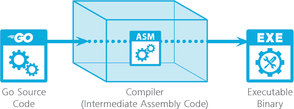

Go 编程语言的目标是具有表现力、快速、高效、可靠且易于编写。某些编程语言（如 C 或 C++）速度快且可靠，但并不简单。相反，Java 或 Python 等其他编程语言编写简单，但效率并不高。

Go 在许多方面与 C 语言语言相似，有时被称为“类 C 语言”或“21 世纪的 C 语言”。但 Go 不止于此，它吸收了许多其他编程语言的优秀思想，同时避免了会导致复杂性或不可靠性的特性。

也许最重要的一点是，Go 引入了通过“goroutines（协程）”和“channels（通道）”利用多核 CPU 处理进行并发处理的能力。这为计算机同时处理几件事提供了可能。

尽管 Go 语言没有像 C++ 或 Java 这种面向对象编程（OOP）语言中的那样的类结构，但它的特性确实提供了某种程度的封装、继承和多态——这是 OOP 的三个基石。


Go gopher —— Go 编程语言的标志性吉祥物


你可以在《In Easy Steps》系列中发现更多编程语言书籍——包括 C、C++、C#、Java 和 Python。访问 [www.ineasysteps.com](http://www.ineasysteps.com) 了解更多信息。

有这么多编程语言可以选择，你可能在奇怪为什么要选择学习 Go 编程——以下是 Go 提供的的一些优势：

### 简单的语法
Go 语言非常简洁，类似于 Python。它编写起来像 Python 一样简单，但像 C++一样高效。这让你能够编写易于阅读和维护的代码。

### 编译型语言
Go 源代码被编译成计算机可以直接读取的二进制机器码，而不是在每次程序运行时都进行解释。这使得你编写的 Go 程序运行比为 Python 或 PHP 等解释型语言的程序更快。

### Go 编译器
Go 编译器非常快并提供了额外的好处，例如代码优化和错误检查——它可以检测代码中未使用的变量、代码所需的缺失导入以及拼写错误或无效代码。Go 编译器还可以为其他操作系统生成可执行二进制文件。这让你能够编译源代码以运行在多台机器上。

### 并发
Go 语言通过 goroutines 和 channels 对并发提供了原生支持。这让你能够编写可以同时执行多个任务的多线程程序。

### 垃圾回收
自动内存管理是 Go 语言的一项关键特性。它的垃圾回收器与程序并发运行。这让你在编写程序代码时无需担心内存泄漏问题。

### 静态类型
Go 是一门静态类型语言，变量被显式地声明为特定的固定类型。这使得能够在开发过程早期发现错误。

随着对 Go 语言经验的增加，你可能会发现其他优势，但现在是时候开始了……

### 安装 Go 工具
要开始学习 Go 语言，你必须先在 PC 上安装 Go 工具。这些工具允许你构建、运行和测试用 Go 语言编写的程序。Go 工具提供了许多实用的受信任代码标准包，你可以将其导入到自己的程序中。Go 语言安装程序适用于 Windows、macOS 和 Linux。


打开浏览器并访问 [`golang.org`](https://golang.org)，然后为你的系统下载相应的安装程序

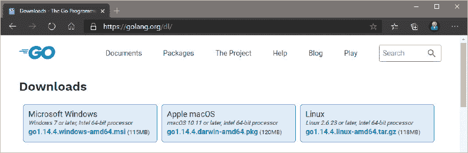

下载完成后，运行安装程序启动“Go 编程语言安装向导”

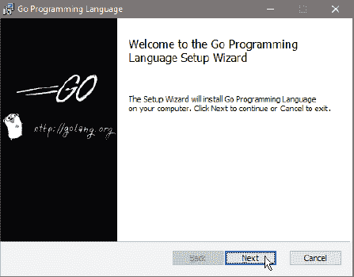

点击 `Next` 继续，然后接受许可条款

接受建议的 `Destination Folder`（Windows 上为 `C:\Go`），然后点击 `Install` 完成安装


Windows Go 安装程序会自动将 Go 添加到你的系统路径，以便在命令行提示符可以使用 Go 工具。

要测试安装是否成功，首先打开终端窗口——在 Windows 系统上同时按下 `WinKey` + `R` 打开“运行”对话框，然后输入 `cmd` 打开“命令行提示符”窗口

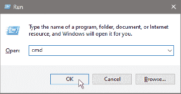

在命令行提示符处，输入命令 `go` 然后按 `Enter` 查看 Go 工具命令列表

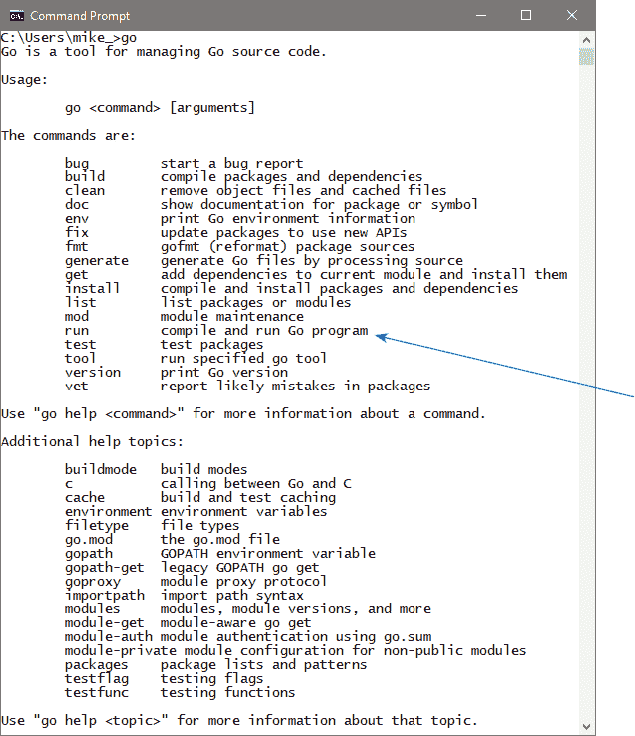


虽然有很多 Go 工具，但你大部分时间只会使用 `run` 工具来编译和运行你的程序。


“WinKey”是键盘上标有 Windows 标志的按键。


### 创建工作空间
安装 Go 时，安装程序会设置多个环境变量。例如，Go 工具的目录位于 `GOROOT` 环境变量中——Windows 上为 `C:\Go`，Linux 和 macOS 上为 `/usr/local/go`。

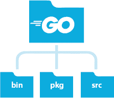

安装程序还设置了用于工作空间的 `GOPATH` 环境变量。默认情况下，它是主目录下的名为 `go` 的目录——但安装程序并没有实际创建目录。

要创建工作空间，你可以简单地在主目录下创建一个名为 `go` 的目录。你必须在工作空间内创建 `bin`、`pkg` 和 `src` 子目录——你所有的程序都可以在 `src` 目录中创建。

在桌面上创建一个可以在该子目录打开命令行的快捷方式对于运行你的程序非常有用。

在 Windows PC 上，如此处所示打开命令行，或打开终端窗口

输入命令 `go env GOPATH` 查看当前位置

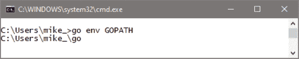

接下来，执行 `mkdir` 命令在 `GOPATH` 环境变量指定的位置创建 `go` 工作空间

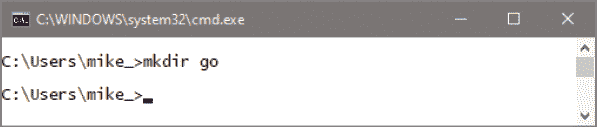


`go\src` 文件夹是你编写程序的地方。`go\bin` 和 `go\pkg` 将被用于存储可执行文件和包归档。


`mkdir` 命令名称只是“make directory”的缩写。

现在，执行进一步的 `mkdir` 命令在工作空间内创建 `bin`、`pkg` 和 `src` 子目录

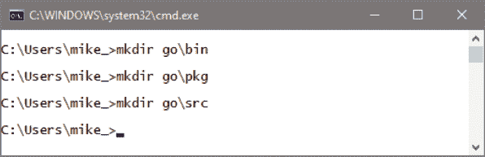

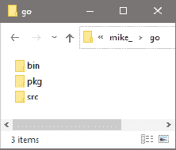

在 Windows 桌面上右键点击并选择**新建**，**快捷方式**以打开“创建快捷方式”对话框

在位置输入 `cmd` 并点击 `Next`，然后输入 `Go Terminal` 作为名称并点击 `Finish` 在桌面上创建一个快捷图标


右键点击快捷方式图标并选择`Properties（属性）项，打开其“属性”对话框

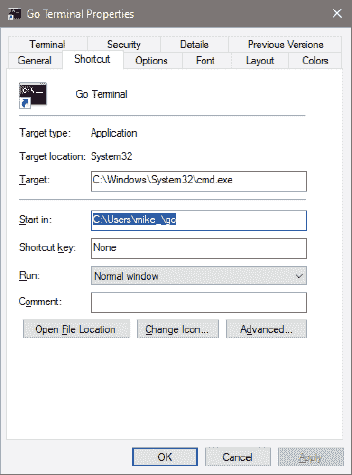

选择`Shortcut（快捷方式）选项卡，然后输入你的工作区目录的路径

点击`Apply（应用）、`OK（确定）关闭对话框，然后双击快捷方式图标在你的“src”文件夹中打开命令行

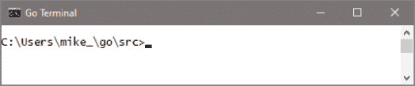


Go 程序可以使用纯文本编辑器编写，例如 Windows 的“记事本”应用。拥有一个可以在你的“src”目录文件夹中打开文本编辑器的桌面快捷方式是很有用的。重复此页面上的步骤，但在第 7 步中输入`notepad` 作为位置，输入`Go Editor` 作为名称，创建一个另一个实用的桌面快捷方式。

## 编写一个 Go 程序

所有的 Go 程序都从纯文本文件开始，随后被编译成实际的可执行程序。这意味着 Go 程序可以使用任何纯文本编辑器编写，例如 Windows 的“记事本”应用或 Linux 上的 Nano 应用。


按照以下步骤创建一个简单的 Go 程序，该程序将输出传统的第一个程序问候：

在你的“src”文件夹中创建一个名为“hello”的子目录

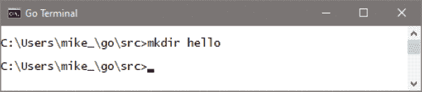


src/hello/main.go

打开一个纯文本编辑器（如记事本），并按照列出的内容输入此代码以开始程序

```go
package main
```

在下方两行，按照列出的内容插入此代码

```go
import “fmt”
```

在再下方两行，精确地添加此代码

```go
func main( ) {
    fmt.Println( “Hello World!” )
}
```

将文件保存在“hello”文件夹中，并命名为 main.go – 现在完整的程序看起来应该完全像这样：

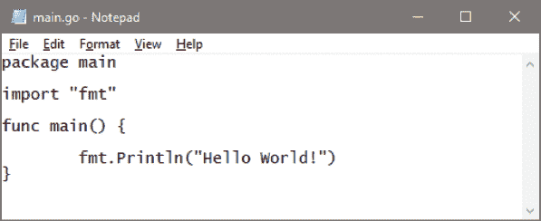


`fmt.Println` 中的大写 P 和小写 L。


文件夹内文件的安排在 Go 中非常重要。每个主文件以及任何相关文件都必须放置在唯一命名的文件夹中以创建一个包 – 所以这里的包名为“hello”。

相反页面上程序代码的各个部分可以单独检查，以更清楚地理解每个部分：

### 包的声明

```go
package main
```

包的类型在 `package` 关键字之后声明。所有的 Go 程序代码都包含在包中。你可以为作为共享库的包声明你自己的类型，但如果你想将代码编译成可执行程序，则必须声明包“main”。

### 导入的声明

```go
import “fmt”
```

`import` 关键字用于将一个或多个包导入到此包中，以便该程序可以使用这些包的功能。“fmt” 包来自 Go 标准库，该库包含在你的 Go 安装中。它提供了 `fmt.Println( ` 函数，用于在该程序中输出文本。注意，包名必须用双引号括起来。导入多个包时，包名列表必须包含在括号内，且每个名称必须单独占一行，如下：

```go
import (
    “fmt”
    “strings”
)
```

### 函数的声明

```go
func main( ) {
    fmt.Println( “Hello World!” )
}
```

函数名紧随 `func` 关键字。它后面必须紧跟括号和同一行上的左大括号 `{`。函数体包含了用于执行程序任务的实际语句。函数体必须以右大括号 `} ` 结束。函数名必须是唯一的，但每个 Go 程序都必须有一个名为“main”的函数，因为这是所有 Go 程序的起点。


包名和包类型是两个独立的项目 – 这里包名为 `hello`，但类型是 `main`。


你可以在 `GOROOT` 目录的“src”目录中找到 Go 标准库包 – 例如，在 `C:\Go\src`。此外，你可以从官方文档 `[`golang.org/pkg`](https://golang.org/pkg)` 学习每个包 – 这是一个宝贵的资源。

## 运行 Go 程序

Go 程序代码使用 Go 工具进行编译和执行。在开发期间，没有错误的 Go 程序可以通过 `go run` 工具编译运行。这很有，但如果你想创建一个可以重复执行和分发的可执行二进制文件版本，可以使用 `go build` 工具。


在你的 Go “src”文件夹中打开命令提示符或终端窗口

输入命令 `go run hello` 来运行此处编写的程序 – 它应该会输出问候语

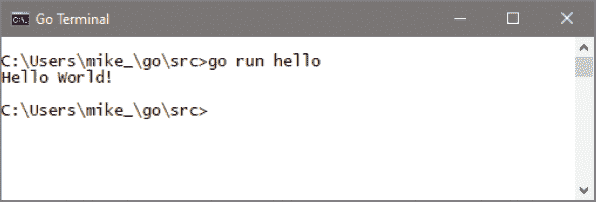

接下来，输入命令 `go build hello` 为程序此处制作可执行二进制文件


在 Windows 系统上二进制文件名为 `.exe`。

## 格式化和注释

在运行之前，通过 `go fmt` 确保你的 Go 源代码格式正确是一个良好的习惯。


在源代码中包含解释性注释也是良好的习惯，以便他人和你回顾代码时更容易理解。可以在 `//` 序列后添加单行注释 – `//` 之后的所有内容会被编译器忽略。可以在 `/*` 和 `*/` 序列之间添加多行注释 – 这在开发期间“注释掉”代码块隐藏它很有用。

编辑此处的 `hello.go` 以添加不必要的缩进（错误的格式）

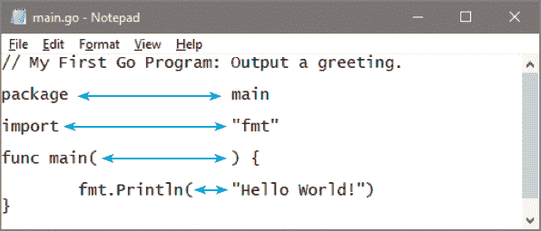

现在，在提示符输入命令 `go fmt hello` 然后重新打开源代码查看正确的格式

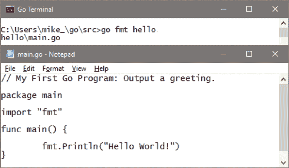

注释不应该“嵌套”，即在一个注释内部。


`go fmt` 工具提供了简单的错误检查。例如，省略最后的双引号 `“`，它将提供错误发生的行号和位置，并提供错误性质为“字符串常量未终止”。

## 探索 VS 编辑器

虽然可以使用命令行和纯文本编辑器完美创建 Go 程序，但许多开发者更倾向于使用专门的代码编辑器应用。这些提供了实用的额外功能，如语法高亮、自动缩进、括号匹配和代码调试。也许最好的免费编辑器是来自微软的 Visual Studio Code (“VS Code”）应用。它可以在 [`code.visual.com/download`](https://code.visual.com/download) 下载 Windows、Linux 和 macOS 版本。


当你下载并安装 VS Code 时，你只得到了代码编辑器框架。VS Code 实际上可以支持许多编程和脚本语言，因此你需要为你想要使用的语言安装相应的扩展。

要打开“扩展市场”侧边栏，首先点击 **View（视图）**、**Appearance（外观）**、**Show Activity Bar（显示活动栏）**，然后点击活动栏上的 **Extensions（扩展）** 按钮


点击 `Install` 为 VS Code 添加 Go 语言支持 – 如果被要求添加更多 Go 支持，选择 `Install All`

点击 `File`、`Add Folder to Workspace` 并添加包含您的源代码（“src”文件夹）的“go”工作空间文件夹

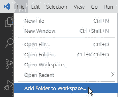

点击活动栏上的 `Explorer` 按钮，然后选择一个文件在 VS Code 主编辑器窗口中打开它 – 例如，点击“hello” 文件夹中的 `main.go` 文件

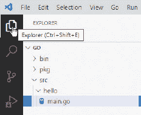

点击 `View`、`Debug Console` 打开输出面板 – 通常，这将出现在代码编辑器窗口下方，但可以移动

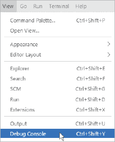

点击 `Run`、`Run Without Debugging` 在调试控制台中查看输出结果

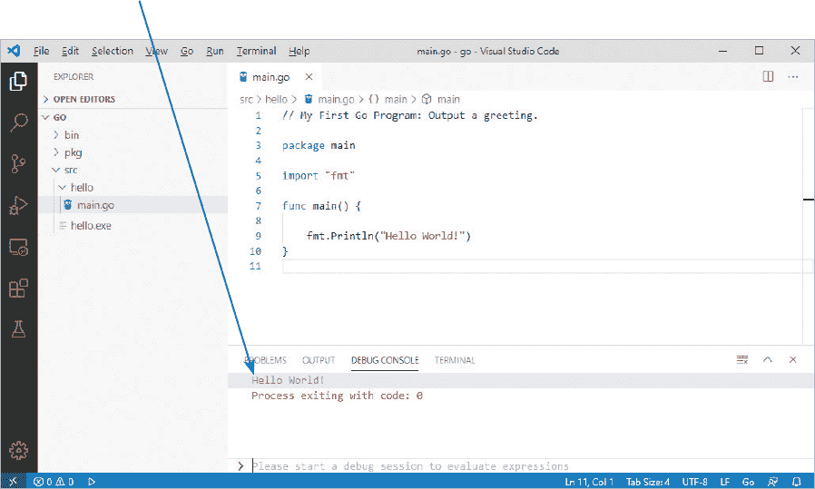

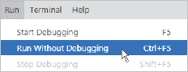


VS Code 应用高度可定制 – 您可以根据喜好更改组件的布局，并从几种浅色或深色主题中进行选择。这里显示的截图描述了默认的 Light 主题，编辑器窗口中显示的语法高亮与书中使用的相同。

## 总结

• Go 程序是纯文本文件，会被编译成机器码以生成可执行的二进制版本。
• Go 工具允许您构建、运行和测试用 Go 编程语言编写的程序。
• Go 安装包含了实用且受信代码的标准包，您可以将它们导入到程序中。
• 命令行 `go` 命令显示 Go 工具命令列表。
• `GOROOT` 环境变量存储您系统上 Go 安装的路径。
• `GOPATH` 环境变量存储您系统上 Go 工作空间的位置。
• Go 工作空间是一个命名为“go”的目录，包含命名为“src”、“bin”和“pkg”的子目录。
• Go 包的名称是包含 Go 源代码文件的目录名称。
• Go 包声明指定了其类型，且必须指定为 `package main` 才能编译为可执行文件。
• import 声明引用了任何要供程序使用的包的名称。
• 函数声明包含 `func` 关键字，其后跟函数名、`( )` 括号和 `{ }` 大括号。
• 所有 Go 程序必须有一个名为“main”的函数作为程序的入口点。
• `go run` 命令编译并运行程序。
• `go build` 命令编译程序并生成一个可以分发的可执行二进制文件。
• 应使用 `go fmt` 命令来正确格式化 Go 包的源代码。
• VS Code 提供了语法高亮、自动缩进、括号匹配和代码调试等功能。

# 存储值

*本章将演示如何在 Go 程序中使用变量容器来存储、检索和操作各种类型的数据。*

- 创建程序变量
- 显示变量值
- 转换数据类型
- 修复常量值
- 指向存储的值
- 总结

## 创建程序变量


变量是 Go 程序中的一种容器，可以在计算机内存中存储数据值。可以使用变量名引用存储的值，并通过赋值一个新值来更改它。程序员可以为变量选择任何名称，只要它符合下面列出的命名规则：

| 命名规则 | 示例 |
| :--- | :--- |
| 不能是 Go 关键字 | **default** |
| 不能包含算术运算符 | **a+b*c** |
| 不能包含标点符号字符 | **%$#@!** |
| 不能包含任何空格 | **no spaces** |
| 必须以字母开头 | **msg**（此处 msg） |
| 可以在其他地方包含数字 | **good1** |
| 可以包含混合大小写 | **camelCase** |

变量名应该是简洁的，并且始终以小写字母开头 除非该变量需要让其他包访问（稍后会详细介绍）。为变量选择有意义的名称是一个良好的习惯，可以让程序代码更易理解。在程序中创建变量只需使用 `var` 关键字对其进行“声明”。变量声明的语法如下：

`var variableName dataType`

`var` 关键字后紧跟一个空格，然后是选定的变量名，以及该变量允许存储的数据类型。通常，这将是相反页描述的五种数据类型之一。可以在单个声明中以逗号分隔列表的形式创建相同数据类型的变量，如下：

`var variableName1, variableName2, variableName dataType`


Go 关键字列在本书内封的表格中。


变量名在 Go 中是区分大小写的 – 所以名为“NUM”、“Num”和“num”的变量被视为三个独立的变量。

Go 语言的基本数据类型使用 Go 关键字定义。这些类型列在表中，并带有描述：

| 数据类型 | 描述 | 示例 |
| :--- | :--- | :--- |
| string | 字符字符串 | “Hi there!” |
| int | 整数 | 100 |
| float64 | 浮点数 | 0.123456
| byte | 能够存储单个字符的字节 | ‘A’ |
| bool | 布尔值 | true |

重要的是 Go 是一门“静态类型”语言，这意味着变量只能包含在其声明中指定的类型。当给变量赋值一个值时，该变量被称为“已初始化”。变量可以先声明后赋值，也可以在声明时初始化。例如，将变量初始化为字符串类型的值：

`var msg string`
`msg = “Hi there!”`
`var msg string = “Hi there!”`

此外，可以使用特殊运算符 `:=` 来声明并初始化变量。情况下，不需要 `var` 关键字和类型，例如：

`msg := “Hi there!”`

Go 编译器根据赋值的数据类型推断数据类型。这是创建和初始化变量的首选方式 – 但它只能在函数体内使用。


字节类型的字符值必须包含在单引号 ‘ 中 – 双引号是错误的。


Go 编程推荐短变量名，因此这里的示例使用 `msg` 而不是 `message` 作为变量名。

## 显示变量值


可以使用第 1 章用于显示“Hello World!”消息的 `fmt.Println()` 函数显示变量值。另一种方法可以使用适当的“格式化符”和变量名在 `fmt.Printf()` 函数中指定显示变量值的格式：

| 格式化符 | 描述 | 示例 |
| :--- | :--- | :--- |
| %s | 字符串 | “Go Fun!” |
| %d | 整数 | 100 |
| %f | 浮点数 | 0.123456 |
| %c | 单字符 | ‘A’ |
| %t | 布尔值 | true |
| %p | 机器内存地址 | 0x0022FF34 |
| %v | 默认格式的值 | (以上任意一种) |
| %T | 变量的数据类型 | int |


格式指定符可以通过在 `%` 字符之后指定所需的空格数，来确保输出占据最小数量的空格——例如，使用指定符 `%7d` 可以确保整数至少填充七个空间。如果你希望用零填充空白区域，只需在指定符中添加一个零，使其变为 `%07d`。

精度指定符是一个句号（.）后面跟着数字，该数字可以与 `%f` 格式指定符配合，确定显示多少位小数——例如，使用 `%.2f` 显示两位小数。精度指定符可以与最小空间指定符结合，以控制空格数和位数——例如，使用 `%07.2f` 显示包括两位小数和零填充空位在内的七个空间。默认情况下，空格位于数字之前，因此它是右对齐的。也可以将空格添加到数字之后，通过在最小空间指定符前加一个负号来使其左对齐。


`%v` 格式指定符可以显示任何值，而 `%T` 格式指定符用于确认任何变量的数据类型。

在你的 “src” 文件夹内创建一个名为 “vars” 的目录


`src\vars\main.go`

开始一个包含 package 和 import 的 main.go 程序

```go
package main

import “fmt”
```

添加一个声明并初始化两个变量的 main 函数

```go
func main( ) {
    num := 100
    pi := 3.1415926536
    // 在此处插入语句。
}
```

在 main 函数中插入语句以各种格式输出变量值

```go
fmt.Printf( “num: %v type:%T \n”, num, num )
fmt.Printf( “pi: %v type:%T \n\n”, pi, pi )
fmt.Printf( “%%7d displays %7d \n”, num )
fmt.Printf( “%%07d displays %07d \n\n”, num )
fmt.Printf( “Pi is approximately %1.10f \n”, pi )
fmt.Printf( “Right-aligned %20.3f rounded pi \n”, pi ) evenfmt.Printf( “Left-aligned %-20.3f rounded pi \n”, pi )
```

将程序文件保存在 “vars” 目录下，然后运行程序查看指定格式下的变量值

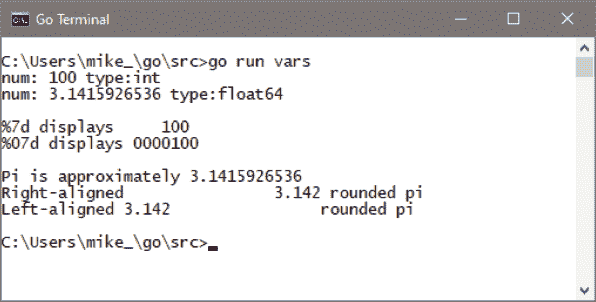


`fmt.Printf( )` 函数在输出后不会添加新行。你必须手动包含一个 `\n` 换行转义序列来将打印头移动到下一行。要使用 `fmt.Printf( )` 函数显示 `%` 字符，如所示，在在其前面加上另一个 `%` 字符。


注意，当格式指定符分配的小数位数较少，浮点值会被四舍五入——而不是简单的截断。

## 数据类型

你有时需要将变量中存储的值转换为不同的数据类型。通常，你可能希望将字符串值转换为数值以执行算术运算。例如，字符串可能包含数字字符 “42”，但除非你将其转换为 `int` 或 `float64` 数据类型，否则你无法对该值进行算术运算。


Go 标准库包含一个 `strconv` 包，其中包含与字符串类型之间转换的函数。通过在 import 声明中添加 `strconv` 包，你可以让你的程序可以使用这些函数。

`strconv.Atoi( )` 函数将括号内指定的字符串转换为 `int` 数据类型。它返回字符串等值的 `int`，但与你在 Go 中遇到的其他函数一样，它还会返回第二个值，当转换成功时该值为特殊的 nil 零值，如果失败则返回错误信息。这意味着你必须将对 `strconv.Atoi( )` 函数的调用赋值给两个变量以接收这两个返回值，如下：

```go
num, err := strconv.Atoi( “42” )
```

还有一个 `strconv.Itoa( )` 函数，它可以将 `int` 值转换为字符串值，但它只返回单个字符串值。

如果你希望将字符串值转换为 `float64`，可以使用 `strconv.ParseFloat( )` 函数。与 `strconv.Atoi( )` 类似，它返回字符串等值的 `float64` 以及一个 nil 值或错误信息。它需要字符串值和浮点大小 (64) 作为其括号内的参数——例如，`strconv.ParseFloat( “42”, 64 )`。

在不同数值数据类型之间强制转换只需指定所需的类型，后跟包含要转换值的括号。例如：

```go
var num int = 42
var decimal float64 = float64( num )
```

有趣的是，当为 `byte` 数据类型的变量（`uint8` 的别名—— 8 位无符号整数）分配一个单独字符时，它将存储该字符的 ASCII 字符编码的数值，该值可以很容易地强制转换：

```go
var char byte = ‘A’
var str = string( char )
```

ASCII（读作 “as-kee”）是“美国信息交换标准”的缩写，是文本的标准。你可以在 [www.asciitable.com](http://www.asciitable.com) 找到完整的代码范围。

在你的 “src” 文件夹内创建一个名为 “cast” 的目录


`src\cast\main.go`

开始一个包含 package 和 import 的 main.go 程序

```go
package main

import (
    “fmt”
    “strconv”
)
```

添加一个声明并初始化两个变量的 main 函数

```go
func main( ) {
    var str string = “42”
    var char byte = ‘A’
    // 在此处插入语句。
}
```

在 main 函数中插入语句以各种格式输出变量值

```go
num, err := strconv.Atoi( str )
fmt.Printf( “num:%v %T \n”, num, err )
decimal := float64( num )
fmt.Printf( “decimal: %.2f \n”, decimal )
fmt.Printf( “char:%v %T \n”, char, string( char ) )
```

将程序文件保存在 “cast” 目录下，然后运行程序查看转换后的变量值

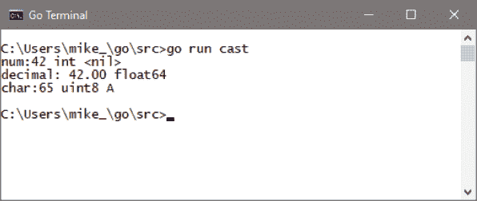


你稍后将学会通过测试 `err` 值是否为 `nil` 来确认转换是否成功——这在 Go 编程中被认为是一种良好的做法。


从 **float** 转换为 **int** 的值会被截断，所以使用 `f := 3.9` 和 `n := int( f )`，变量 `n` 将赋值为 `3`。

## 固定常量

如果你想存储一个在程序执行期间永远不会改变固定值，你应该使用 `const` 关键字进行声明，而不是 `var` 关键字。这可以防止意外（或恶意的）赋值尝试。如果你的代码尝试给常量分配新值，编译器将显示“无法分配”的消息。


与变量声明不同，常量声明必须在声明中使用其固定值进行初始化，如下：

```go
const oneMillion = 1000000
```

可选地，常量声明可以指定数据类型，但如果从声明中省略显式数据类型，Go 编译器将从赋值的值推断其类型。

相同或不同数据类型的多个常量可以在单个声明中通过逗号分隔列表创建，如下：

```go
const oneMillion, oneThousand = 1000000, “1,000”
```


非常有用的是，常量声明可以使用一个名为 `iota` 的“常量生成器”来创建一组相关的常量值。常量名称应该列在 `const` 关键字后的括号内，每行一个，并为第一个赋值 `iota` 值。这会生成一个从零开始的数值序列，列表中的每个命名常量都会使序列递增一。

例如，你可以将数值序列赋值给代表星期几的常量，如下所示：

```go
const (
    sunday = iota
    monday
    tuesday
    wednesday
    thursday
    friday
    saturday
)
```

在这个示例中，常量 `sunday` 将被赋值为零 (0)，`monday` 将赋值为一 (1)，依此类推。

如果你想从不同的数字开始序列，只需在给第一个常量赋值时将 `iota` 加上该数字即可。


在其他编程语言中，生成的序列通常被称为“枚举”（enumeration）或简单地称为 `enum`。

在你的“src”文件夹内创建一个名为“const”的目录


`src\const\main.go`

开始带有 package 和 import 声明的 main.go 程序

```go
package main

import "fmt"
```

添加一个 main 函数，用于声明并初始化单个常量和一个从一 (1) 开始的常量序列

```go
func main() {
    const pi = 3.14159
    const (
        red = iota + 1
        yellow
        green
        brown
        blue
        pink
        black
    )
    // 在此处插入语句。
}
```

接下来，插入语句以显示几个常量值

```go
f-mt.Printf("Pi approximately: %v \n\n", pi)
fmt.Printf("Red: %v point \n", red)
fmt.Printf("Blue: %v points \n", blue)
fmt.Printf("Black: %v points \n", black)
```

将程序文件保存到“const”目录中，然后运行程序以查看常量值

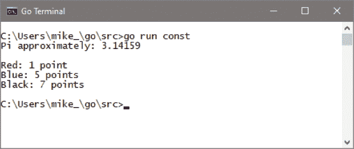


Go 中的 `math` 包提供了一个名为 `math.Pi` 的常量，它是对 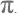 数值的远精确近似。


这里的序列代表了台球比赛中每个球的分值。

## 指向存储的值

每当你的程序创建一个用于存储数据的容器时，你的计算机会在内存中分配一个空间来存储这些数据。就像房子一样，内存位置的大小可能不同，但每个位置都有唯一的地址。


因此，一个初始化的变量实际上由三部分组成：名称、值以及存储数据的内存地址。

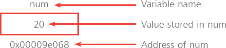

Go 语言支持“指针”（pointers）的概念。指针变量可以存储另一个变量的地址，并访问该地址上存储的值。

指针变量的声明需要在数据类型前加上一个星号 `*`，表示这是一个指针：

```go
var ptr *int      // 声明此变量将指向一个 int。
```

通过在另一个变量名前加上 `&` 符号，可以将另一个变量的地址赋值给指针：

```go
ptr = &num        // 给指针变量赋值一个地址。
```

然后，通过在指针名称前加上星号来访问所赋值地址的值：

```go
*ptr              // 指向赋值地址处的值。
```

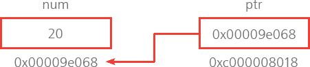

指针的概念可能很难理解，因为 `*` 运算符承担了两个用途：在声明中作为类型描述符，在放在指针名称之前时作为解引用符（dereferencer）。你现在可能在想“指针又怎样？”但指针在 Go 编程中被广泛使用，因此在继续之前，你应该彻底理解它们的工作原理。


内存地址是由你的计算机分配的十六进制数。它们在你的系统上的地址肯定与示例中显示的地址不同。

在你的“src”文件夹内创建一个名为“point”的目录


`src\point\main.go`

开始带有 package 和 import 声明的 main.go 程序

```go
package main

import "fmt"
```

添加一个 main 函数，用于声明并初始化一个普通整数变量指针变量

```go
func main() {
    var num int = 20
    var ptr *int = &num
    // 在此处插入语句。
}
```

接下来，插入语句以显示值和内存地址

```go
fmt.Printf("value: %v \n", num)
fmt.Printf("address: %v \n", &num)
fmt.Printf("pointer value: %v \n", ptr)
fmt.Printf("dereferenced: %v \n", *ptr)
```


# 理解优先级

## 总结

### 算术运算


Go 程序中常用的算术运算符如下表所示，以及它们所执行的操作：

| 运算符 | 操作 |
| :--- | :--- |
| `+` | 加法 |
| `-` | 减法 |
| `*` | 乘法 |
| `/` | 除法 |
| `%` | 取余 |
| `++` | 递增 |
| `--` | 递减 |

赋值、加、减、乘除运算符的行为与你预期的一样，但在使用多个运算符的表达式中，必须对表达式进行分组——最内层 `()` 括号内的操作优先执行：

```go
a = b * c - d % e / f ;              // 这不清晰。
a = ( b * c ) - ( ( d % e ) / f ) ;  // 这个清晰得多。
```

`%` 取余运算符将第一个数除以第二个数并返回操作的余数。这对于判断一个数是奇数还是偶数很有用。

`++` 递增运算符和 `--` 递减运算符将给数字加减一并返回结果。它们最常用于循环中的迭代计数——在每次迭代中通过 `++` 递增运算符计数，或在每次迭代中通过 `--` 递减运算符减计数。

`++` 递增或 `--` 递减运算符必须紧跟变量名之后以修改其值。例如：

```go
n := 4
n++              // 现在 n = 5.
```


`+` 运算符具有双重用途——它也用于拼接字符串。


用于运算符构成表达式的值被称为“操作数”——在表达式 `2 + 3` 中，数值 `2` 和 `3` 就是操作数。

在你的“src”文件夹内创建一个名为“arith”的目录


`src\arith\main.go`

开始编写一个包含包声明和导入声明的 main.go 程序

```go
package main
import "fmt"
```

添加一个声明并初始化两个变量的 main 函数

```go
func main( ) {
    a := 8
    b := 4
    // 在此处插入语句。
}
```

在 main 函数中，插入语句输出每次算术运算后的计算和值

```go
fmt.Println( "Addition:\t", ( a + b ) )
fmt.Println( "Subtraction:\t", ( a - b ) )
fmt.Println( "Multiplication:\t", ( a * b ) )
fmt.Println( "Division:\t", ( a / b ) )
fmt.Println( "Remainder:\t", ( a % b ) )
```

现在，插入语句更改存储的值并显示它们的新值

```go
a++
fmt.Println( "Increment:\t", a )
b--
fmt.Println( "Decrement\t", b )
```

将程序文件保存到“arith”目录中，然后运行程序以查看每次操作的结果

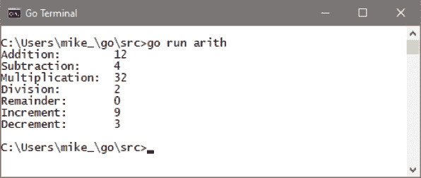


在这里，使用 `\t` 转义序列来输出制表符以对齐结果。

### 赋值


Go 编程中用于赋值的运算符如下表所示。除了简单的 `=` 赋值运算符外，所有的都是长表达式的简写形式，因此为了清晰，给出了每个等效形式：

| 运算符 | 示例 | 等效于 |
| :--- | :--- | :--- |
| `=` | `a = b` | `a = b` |
| `+=` | `a += b` | `a = ( a + b )` |
| `-=` | `a -= b` | `a = ( a - b )` |
| `*=` | `a *= b` | `a = ( a * b )` |
| `/=` | `a /= b` | `a = ( a / b )` |
| `%=` | `a %= b` | `a = ( a % b )` |

在上面的赋值示例中，`a = b` 表示名为“a”的变量被赋值名为“b”的变量所包含的值——这样该值就存储在变量 `a` 中。从技术上来说，赋值运算符将右侧操作数存储在左侧操作数指定的内存位置中，并将该值作为结果。

`+=` 复合运算符用于将值添加到存储在变量中的现有值。在上面的示例中，`a += b` 将变量 `b` 中的值加到变量 `a` 的值上——总量就是存储在变量 `a` 中的值。

其他复合运算符原理类似；例如 `%=` 复合运算符计算左侧操作数除以右侧操作数的余数，并存储在第一个变量中。

### 比较


Go 编程中常用的比较两个数值的运算符如下表所示：

| 运算符 | 比较测试 |
| :--- | :--- |
| `==` | 等于 |
| `!=` | 不等于 |
| `>` | 大于 |
| `<` | 小于 |
| `>=` | 大于或等于 |
| `<=` | 小于或等于 |

`==` 等于运算符比较两个操作数，如果两个值相等，则返回 true，否则 `==` 运算符将返回 false。如果两者都是相同的数字，则它们相等的；如果两者都是字符，则对它们的 ASCII 码进行数值比较。

相反，`!=` 不等于运算符在两个操作数不相等时返回 true，使用的规则与 `==` 等于运算符相同，否则返回 false。


`>` “大于”运算符比较两个操作数，如果第一个操作数的值大于第二个，则返回 `true`；如果它的值等于或小于第二个，则返回 `false`。`<` “小于”运算符进行相同的比较，但如果第一个操作数的值小于第二个，它将返回 `true`，否则返回 `false`。通常，使用 `>` “大于”运算符或 `<` “小于”运算符是为了在循环结构中测试迭代计数器的值。

在 `>` “大于”运算符或 `<` “小于”运算符后添加添加 `=` 赋值运算符，可以使它们在两个操作数的值恰好相等时也返回 `true`。


比较运算符也被称为“关系运算符”。

在你的 “src” 文件夹内创建一个名为 “comp” 的目录


`src\comp\main.go`

带有 package 和 import 声明开始一个 main.go 程序

```go
package main

import “fmt”
```

添加一个声明并初始化五个变量的 main 函数

```go
func main( ) {
    var zero, num, max int = 0, 0, 1
    var up, dn byte = ‘A’, ‘a’
    // 在此处插入语句。
}
```

在 main 函数中，插入语句以输出几次比较的结果

```go
result := ( num == zero )               // 0 == 0.
fmt.Prln( “Equality:\tnum == zero\t”, result )
result = ( up == dn )                   // A == a.
fmt.Println( “Equality:\tup == dn\t”, result )
result = ( max != zero )               // 1 != 0.
fmt.Println( “Inequality:\tmax != zero\t”, result )
result = ( zero > max )                 // 0 > 1.
fmt.Println( “Greater:\tzero > max\t”, result )
result = ( max <= zero )               // 1 <= 0.
fmt.Println( “Less or Equal:\tmax <= zero\t”, result )
```

在 “comp” 目录下保存程序文件，然后运行程序以查看每次比较的结果

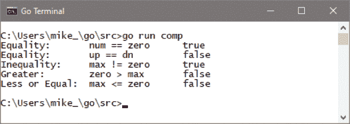


大写字母 ‘A’ 的 ASCII 值为 65，但小写 ‘a’ 是 97 – 所以它们在这里比较返回 `false`。


在比较数字时，记住要测试相等性，也要测试高值和低值。

## 评估逻辑


Go 编程中最常用的逻辑运算符列在下表中：

| **运算符** | 操作 |
| :--- | :--- |
| `&&` | 逻辑与 (AND) |
| `||` | 逻辑或 (OR) |
| `!` | 逻辑非 (NOT) |

逻辑运算符用于具有 `true` 或 `false` 布尔值的操作数，或者可以转换为 `true` 或 `false` 的值。

`&&` 逻辑与运算符将评估两个操作数，只有当两个操作数本身为 `true` 时才返回 `true`。否则，`&&` 逻辑与运算符将返回 `false`。这用于条件分支，程序的方向通过测试两个条件来确定——如果两个条件都满足，程序将向某个方向运行，否则将采取另一个方向。

与需要两个操作数都为 `true` 的 `&&` 逻辑与运算符不同，`||` 逻辑或运算符将评估它的两个操作数，只要其中一个操作数本身返回 `true` 就返回 `true`。然而，如果两个操作数都没有返回 `true`，则 `||` 逻辑或运算符将返回 `false`。这在 Go 编程中用于在两个测试条件满足其中任一时执行某些操作。

`!` 逻辑非运算符是一个一元运算符，用于单个操作数之前。它返回给定操作数的反值，所以如果变量 `a` 的值为 `true`，那么 `!a` 的值就是 `false`。`!` 逻辑非运算符在 Go 程序中用于通过类似 `a = !a` 的语句在连续的循环迭代中切换变量的值。这确保了每次通过时值都会改变，就像开关灯一样。


“boolean”（布尔）一词指的是英国数学家乔治·布尔 (1815-1864) 开发的一种逻辑思维系统。

在你的 “src” 文件夹内创建一个名为 “logic” 的目录


`src\logic\main.go`

带有 package 和 import 声明开始一个 main.go 程序

```go
package main

import “fmt”
```

添加一个声明并初始化五个变量的 main 函数

```go
func main( ) {
    var zero, num, max int = 0, 0, 1
```

在 main 函数中，插入语句以输出几次比较的结果

```go
result := ( num == zero )               // 0 == 0.
fmt.Prln( “Equality:\tnum == zero\t”, result )
result = ( up == dn )                   // A == a.
fmt.Println( “Equality:\tup == dn\t”, result )
result = ( max != zero )               // 1 != 0.
fmt.Println( “Inequality:\tmax != zero\t”, result )
result = ( zero > max )                 // 0 > 1.
fmt.Println( “Greater:\tzero > max\t”, result )
result = ( max <= zero )               // 1 <= 0.
fmt.Println( “Less or Equal:\tmax <= zero\t”, result )
```

在 “comp” 目录下保存程序文件，然后运行程序以查看每次比较的结果


大写字母 ‘A’ 的 ASCII 值为 65，但小写 ‘a’ 是 97 – 所以它们在这里比较返回 `false`。

在比较数字时，记住要测试相等性，也要测试高值和低值。

## 评估逻辑


Go 编程中最常用的逻辑运算符列在下表中：

| **运算符** | 操作 |
| :--- | :--- |
| `&&` | 逻辑与 (AND) |
| `||` | 逻辑或 (OR) |
| `!` | 逻辑非 (NOT) |

逻辑运算符用于具有 `true` 或 `false` 布尔值的操作数，或者可以转换为 `true` 或 `false` 的值。

`&&` 逻辑与运算符将评估两个操作数，只有当两个操作数本身为 `true` 时才返回 `true`。否则，`&&` 逻辑与运算符将返回 `false`。这用于条件分支，程序的方向通过测试两个条件来确定——如果两个条件都满足，程序将向某个方向运行，否则将采取另一个方向。

与需要两个操作数都为 `true` 的 `&&` 逻辑与运算符不同，`||` 逻辑或运算符将评估它的两个操作数，只要其中一个操作数本身返回 `true` 就返回 `true`。然而，如果两个操作数都没有返回 `true`，则 `||` 逻辑或运算符将返回 `false`。这在 Go 编程中用于在两个测试条件满足其中任一时执行某些操作。

`!` 逻辑非运算符是一个一元运算符，用于单个操作数之前。它返回给定操作数的反值，所以如果变量 `a` 的值为 `true`，那么 `!a` 的值就是 `false`。`!` 逻辑非运算符在 Go 程序中用于通过类似 `a = !a` 的语句在连续的循环迭代中切换变量的值。这确保了每次通过时值都会改变，就像开关灯一样。


“boolean”（布尔）一词指的是英国数学家乔治·布尔 (1815-1864) 开发的一种逻辑思维系统。

在你的 “src” 文件夹内创建一个名为 “logic” 的目录


`src\logic\main.go`

带有 package 和 import 声明开始一个 main.go 程序

```go
package main

import “fmt”
```

添加一个声明并初始化五个变量的 main 函数

```go
func main( ) {
    var zero, num, max int = 0, 0, 1
```


```go
fmt.Printf( “Flag #2:%v \n”, ( flags & 2 ) > 0 )
```

```go
fmt.Printf( “Flag #3:%v \n”, ( flags & 4 ) > 0 )
```

```go
fmt.Printf( “Flag #4:%v \n”, ( flags & 8 ) > 0 )
```

接下来，插入一条语句显示表示此模式的十进制值

```go
fmt.Printf( “Flags Value: %08b \t%v \n”, flags, flags )
```

现在，插入语句将“开启”位标志右移一位，并输出新模式的十进制值

```go
flags = flags >> 1
```

```go
fmt.Printf( “New Value: %08b \t%v \n”, flags, flags )
```

将程序文件保存到“bits”目录中，然后运行程序查看位标志标志值

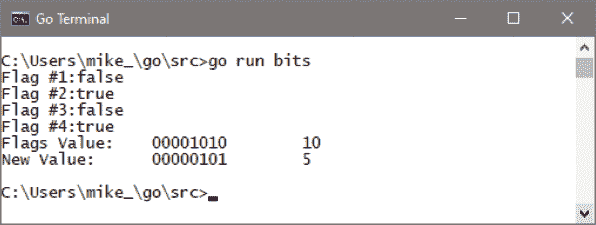


可以使用具有更多内存的变量创建具有更多位标志的位域——`int` 数据类型在 32 位系统上为 32 位，在 64 位系统上为 64 位。


这里使用 `%b` 格式指定符来输出每个位中的二进制数值。

# 理解优先级

运算符优先级定义了 Go 编译器评估表达式的顺序。在表达式 `6 + 7 * 3` 中，优先级决定了先完成加法还是先乘法。


下表列出了按降序排列的运算符优先级，高行的运算符的优先级高于低行的运算符，因此它们的操作会先完成。同一行的二运算符具有相同的优先级，但完成顺序由从左到右顺序决定，因此左侧的操作会先完成。

| 优先级级别 | 运算符 |
| :--- | :--- |
| 5 | `* % << >> &` |
| 4 | `+ - & | ^` |
| 3 | `== != < <= >=` |
| 2 | `&&` |
| 1 | `||` |

`++` 增增运算符和 `--` 减运算符在 Go 编程中形成语句，而不是出现在表达式中，因此它们没有包含在上面的优先级表中。

你可以通过将表达式部分包含括号内来强制编译器忽略默认优先级级别，从而强制编译器先评估表达式内层的部分。例如，在表达式 `6 + 7 * 3` 中，`*` 乘法运算符的默认优先级高于 `+` 加法运算符，因此先执行乘法操作 `7 * 3 = 21`，然后执行加法 `21 + 6 = 27`。你可能倾向于先执行加法操作，你可以通过给表达式添加括号 `( 6 + 7 ) * 3` 来强制编译器这样做。现在，表达式的评估结果为 `6 + 7 = 13`，然后是乘法 `13 * 3 = 39`。

在你的“src”文件夹内创建一个名为“force”的目录


`src\force\main.go`

带有 package 和 import 声明开始一个 main.go 程序

```go
package main

import “fmt”
```

添加一个 main 函数，通过评估表达式来声明并初始化变量并显示其值

```go
func main( ) {
    sum := 2 * 3 + 4 - 5
    fmt.Printf( “Default Order: %v \n”, sum )
    // 在此处插入语句。
}
```

在 main 函数中，插入语句显示评估修改后表达式的值

```go
sum = 2 * ( ( 3 + 4 ) - 5 )
fmt.Printf( “Forced Order: %v \n\n”, sum )
```

接下来，插入一条语句显示评估另一个表达式的值

```go
sum = 7 % 3 * 2
fmt.Printf( “Default Order: %v \n”, sum )
```

现在，插入语句显示评估另一个修改后表达式的值

```go
sum = 7 % ( 3 * 2 )
fmt.Printf( “Forced Order: %v \n\n”, sum )
```

将程序文件保存到“force”目录中，然后运行程序查看不同的结果

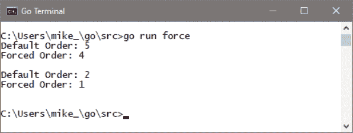


在你的表达式中使用括号以避免意外的结果。

## 总结

- 算术运算符可以形成两个操作数的表达式，如加法 `+`、减法 `-`、乘法 `*`、除法 `/` 和取模 `%`。
- 增增 `++` 和减减 `--` 运算符按 1 修改单个操作数。
- 赋值 `=` 运算符可以与算术运算符结合以执行算术计算然后赋值其结果。
- 比较运算符可以形成比较两个数的相等 `==`、不相等 `!=`、大于 `>`、小于 `<`、大于等于 `>=` 和小于等于 `<=`。
- 逻辑 `&&` 和逻辑 `||` 运算符形成表达式。
- 逻辑 `!` 运算符返回值的反反。
- 位运算符 `|`、`&`、`~` 和 `^` 各返回位。
- 移位 `<<` 和移位 `>>` 移动。

## 控制流

本章介绍了语句如何评估表达式来确定 Go 执行的方向。

### 测试条件


`if` 关键字用于执行基本的条件测试，评估一个布尔值的真或假。位于 `{ }` 大括号内的语句仅在评估为真时执行。`if` 语句的语法如下：

```go
if test-expression {
    statements-to-execute-when-the-condition-is-true
}
```

当测试为真时可能有多个要执行的语句，但每个必须单独一行。有时需要评估多个表达式以决定是否执行后续语句。可以使用逻辑 `&&` 运算符来实现：

```go
if test-expression && test-expression {
    statements-to-execute-when-all-conditions-are-true
}
```

或者，多个 `if` 语句可以“嵌套”，在一个另一个内部，以评估多个表达式，如下：

```go
if test-expression {
    if test-expression {
        statements-to-execute-when-all-conditions-are-true
    }
}
```

当 `if` 测试语句评估的一个或多个表达式被发现为假时，其后续大括号内的语句将不执行，程序继续执行后续代码。通常最好通过附加 `else` 语句来扩展 `if` 语句，指定当 `if` 语句评估的表达式发现为假时执行的语句，其语法如下：

```go
if test-expression {
    statements-to-execute-when-the-condition-is-true
} else {
    statements-to-execute-when-the-condition-is-false
}
```

测试表达式和左大括号 `{` 必须与 `if` 关键字出现在同一行。


`else` 关键字和左大括号 `{` 必须与上一个语句块的右大括号 `}` 出现在同一行。

用一个测试两个字符是否匹配的语句开始 main 函数

```go
func main( ) {
    if ‘A’ == ‘A’ {
        fmt.Println( “\nCharacters Match” )
    }
    // Statements to be inserted here.
}
```


`src\ifelse\main.go`

接下来，在 main 函数中插入嵌套语句来测试两个数值表达式

```go
if 5 > 1 {
    if 7 > 2 {
        fmt.Println( “\nBoth expressions are true” )
    }
}
```

现在，插入语句来测试一个数值表达式并测试两个字符是否不匹配

```go
if 5 < 1 {
    fmt.Println( “\n1st Condition is true” )
} else if ‘A’ != ‘A’ {
    fmt.Println( “\n2nd Condition is true” )
} else {
    fmt.Println( “\nBoth Conditions are false” )
}
```

将程序文件保存到“ifelse”目录中，然后运行程序以查看条件测试的结果

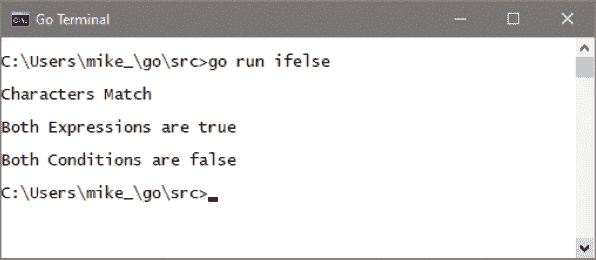


为了避免重复，从这里开始步骤中列出的代码假设你已经在每个程序的开头声明了 `package main` 并 `import “fmt”`。


注意，如果第一个测试为 `false`，你可以使用 `else if` 来评估第二个表达式。

## Switch Cases

当测试表达式仅评估单个条件时，使用 `switch` 语句执行条件分支通常比使用多个 if else 语句更高效。


`switch` 语句的工作方式很特殊。它接受一个给定的值作为参数，然后从多个 case 语句中匹配该值。找到匹配时要执行的代码包含在每个 case 语句中。

每个要执行的语句必须单独出现在一行，并从 case 语句下方的行开始。

可选情况下，case 语句列表后面可以跟跟一个最后的 default 语句，用于指定在任何 case 语句中未找到匹配项时执行的代码。因此，`switch` 语句的语法通常如下：

```go
switch test-value {
case match-value :
    statements-to-execute-when-matched
case match-value :
    statements-to-execute-when-matched
case match-value :
    statements-to-execute-when-matched
default :
    statements-to-execute-when-no-match-found
}
```

如果多个 `match-values` 需要执行相同的语句，则只需要最后一个 case 语句中包含要执行的语句。例如，为 `match-values` 为 0、1 和 2 输出相同的消息：

```go
switch num {
case 0 :
case 1 :
case 2 :
    fmt.Println( “Less than 3” )
case 3 :
    fmt.Println( “Exactly 3” )
default :
    fmt.Println( “Greater Than 3 or Less Than 0” )
}
```


`default` 语句不需要出现在 `switch` 块的末尾，但放在那里是逻辑的。


当找到匹配项时，`switch` 通常会结束，但你可以将 `fallthrough` 关键字作为任何 `case` 块中的最后一个语句，以继续到下一个 `case` 语句——尽管这很少用。

用一个声明并初始化两个变量的语句开始 main 函数

```go
func main( ) {
    num := 2
    char := ‘B’
    // Statements to be inserted here.
}
```


`src\switch\main.go`

接下来，在 main 函数中插入一个尝试匹配数值的语句

```go
switch num {
case 1 :
    fmt.Println( “\nNumber is One” )
case 2 :
    fmt.Println( “\nNumber is Two” )
case 3 :
    fmt.Println( “\nNumber is Three” )
default :
    fmt.Println( “\nNumber is Unrecognized” )
}
```

现在，插入一个尝试匹配字符的语句

```go
switch char {
case ‘A’ :
    fmt.Println( “\nLetter is A” )
case ‘B’ :
    fmt.Println( “\nLetter is B” )
default :
    fmt.Printf( “\nLetter is Unrecognized” )
}
```

将程序文件保存到“ifelse”目录中，然后运行程序以查看条件测试的结果


## Loop Times

在 Go 中，有多种方法构建循环，但它们都使用 `for` 关键字。最常见的循环类型由三个部分组成：初始化、测试表达式和递增器。

```go
func main( ) {
    for counter := 1 ; counter <= 5 ; counter++ {
        fmt.Println( “Loop Iteration “, counter )
    }
    // Statements to be inserted here.
}
```

`src\forloop\main.go` 接下来，插入一个执行三次的循环

```go
for i := 1 ; i <= 3; i++ {
    fmt.Println( “\nOuter Loop Iteration “, i )
    // Inner Loop to be inserted here.
}
```

现在，插入一个执行三次的内部循环

```go
for j := 1 ; j <= 3; j++ {
    fmt.Println( “\tInner Loop Iteration “, j )
}
```

将程序文件保存到“forloop”目录中，然后运行程序以查看每次循环的输出

## Loop While True

循环是在特定表达式为真时重复的代码。当表达式变为假时，循环立即结束。循环可以嵌套，一个在另一个内部，以允许内部循环的所有迭代完整执行。

for 循环计数器也可以向下递减——通过在每次迭代中使用 `i--` 代替 `i++` 来减小计数器值。


前一个示例此处中描述的 `for` 循环的替代方案在 `for` 关键字之后仅包含一个测试表达式——它在循环语句开头不包含初始化器或递增器。相反，它使用一个已经初始化的计数变量，并在循环体内增加该计数器。这是 Go 语言中与其他语言中“while”循环等价物，因为只要测试表达式为真，循环就会继续迭代。递增器必须在某处使测试表达式为假以结束循环，否则将创建一个永远不会结束的死循环。这种类型 `for` 循环的语法如下：

```
initializer
for test-expression {
    statements-to-be-executed
    incrementer
}
```

Go 编程中循环结构的另一种变体允许你甚至从起始语句中省略测试表达式，并使用一个在循环体内包含测试表达式的无限循环。它同样使用一个已经初始化的计数变量，并在循环体内增加该计数器。这是 Go 语言中与其他语言中“do-while”循环等价物，因为循环将执行其语句并在测试表达式为真时继续迭代。当测试表达式变为假时，可以使用 `break` 关键字终止循环，因此这种类型 `for` 循环的语法如下：

```
initializer
for {
    statements-to-be-executed
    incrementer
    if test-expression {
        statements-to-be-executed
        break
    }
}
```

注意，如果测试表达式在第一次评估时为假，则“while”循环将不会进行迭代，而“do-while”循环将至少执行一次迭代，因为它的语句在评估之前就已经执行了。


如果程序运行了无限循环，在 Windows 或 Linux 系统上按下键盘上的 `Ctrl` + `C` 键停止循环执行。

开始一个执行五次迭代的 main 函数

```
func main( ) {
    counter := 1
    for counter <= 5 {
        fmt.Println( “Loop Iteration”, counter )
        counter++
    }
    // Statements to be inserted here.
}
```


src\while\main.go

接下来，插入一个无限循环语句

```go
i := 10
for {
    fmt.Println( “\t\t\tCountdown”, i )
    i--
    // Test expression to be inserted here.
}
```

现在，插入一个测试表达式来结束循环

```go
if i < 1 {
    fmt.Println( “\t\t\t\t\tLift Off!” )
    break
}
```

将程序文件保存在“while”目录中，然后运行程序查看每次循环迭代的输出

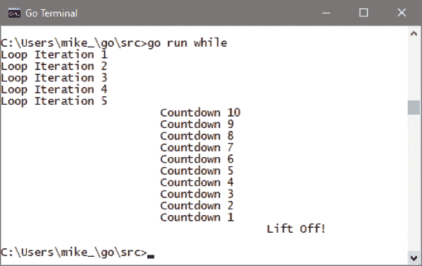


将变量 `i` 的初始值更改为 `0`（零）并再次运行程序，查看循环的第一次迭代执行执行。

### 跳出循环

当满足指定条件时，可以使用 `break` 关键字提前终止任何循环。`break` 语句位于循环语句块内部，并且前面有一个测试表达式。当测试返回真时，循环立即结束，程序继续执行下一个任务。例如，在嵌套内部循环中，它将进入外层循环的下一次迭代。


当满足指定条件时，可以使用 `continue` 关键字跳过循环的单次迭代。`continue` 语句位于语句块内部，并且前面有一个测试表达式。当测试返回真时，本次迭代结束。

开始一个执行三次迭代的 main 函数

```
func main( ) {
    for i := 1 ; i <= 3 ; i++ {
        // Inner Loop to be inserted here.
    }
}
```


src\break\main.go

插入一个执行三次迭代的内部循环

```go
// Statements to be inserted here.
for j := 1 ; j <= 3 ; j++ {
    fmt.Println( “Running i=”, i, “j=”, j )
}
```

将程序文件保存在“break”目录中，然后运行程序查看每次循环迭代的输出

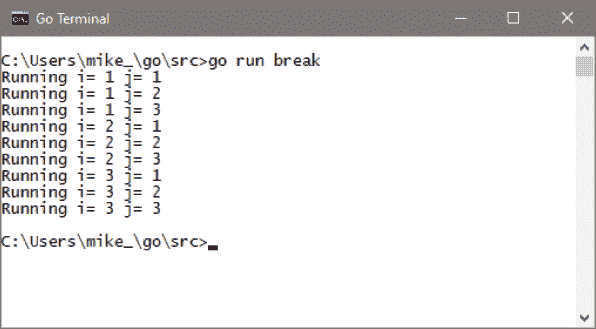


你也可以 `break` 到嵌套代码块外部特定点的标签——请参见此处的示例。

接下来，在内部循环块的最开始插入此 break 语句，跳出内部循环

```go
if i == 2 && j == 2 {
    fmt.Println( “Breaks When i=”, i, “and j=”, j )
    break
}
```

保存更新的文件，然后运行程序查看每次循环迭代的输出

```go
if i == 2 && j == 2 {
    fmt.Println( “Continues When i=”, i, “and j=”, j )
    continue
}
```

保存更新的文件，然后运行程序查看每次循环迭代的输出

### 跳转到标签

`goto` 关键字乍看起来是一个很棒的功能，因为它允许程序流跳转到位置位置标签，就像网页上的超链接一样。然而，在现实中这会导致错误，这种用法并不受欢迎。


`goto` 关键字是计算机程序中存在数十年的强大功能，但被许多早期程序员滥用，创建了跳转混乱的程序。这导致了程序代码不可读，因此 goto 的使用不再流行。

通常，程序可能会执行一组语句，然后 `goto` 语句跳转回语句开头的标签以重复执行。此外，在语句序列的某处可能会测试条件，如果条件未满足，另一个 `goto` 语句可能会跳转到序列之后以继续程序流。这样，程序代码迅速获得了大量的 goto 语句和标签

`goto` 关键字的一种可行用法是通过跳转到外层循环块结束后的标签，从而干净地退出内部循环。这会立即退出两个循环，不再执行任何一个循环的后续迭代。

```
func main( ) {
    for i := 1 ; i <= 3 ; i++ {
        // Inner Loop to be inserted here.
    }
}
```


src\jump\main.go

插入一个执行三次迭代的内部循环

```go
for j := 1 ; j <= 3 ; j++ {
    fmt.Println( “Running i=”, i, “j=”, j )
}
```

在内部嵌套循环的第一行插入一条语句，在指定的计数值跳转到名为“end”的标签

```go
if i == 2 && j == 2 {
    goto end
}
```

现在，在外层循环闭合括号 **}** 之后的下一行添加标签

```
end:
```


保存更新后的文件，然后再次运行程序，观察测试条件变为真时循环如何结束

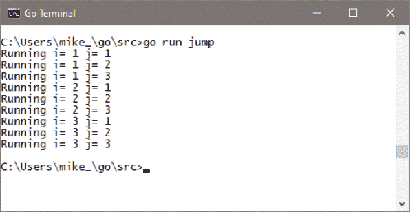


避免创建名为 `goto.exe` 的程序可执行文件，因为这可能会与 Windows 系统内部的 `GOTO` 命令冲突。


注意，标签本身必须以 `:` 冒号结尾。

## 总结

- `if` 关键字执行基础条件测试，以评估给定表达式的布尔值为真（true）或假（false）。
- `else` 关键字可用于在 `if` 语句发现表达式为假时提供可执行的备选语句。
- 在评估后为程序提供执行的备选方向被称为“条件分支”。
- 多个 `if` `else` 语句执行的条件分支通常可以通过 `switch` 语句更高效地完成。
- `switch` 块中的语句必须分别出现在 `case` 语句下方的行中。
- 可选情况下，`switch` 块可以包含一个 `default` 语句，指定在未找到匹配项时执行的语句。
- `for` 关键字可以指定初始化器、测试表达式和增量器，以控制循环。
- `for` 关键字可以仅指定一个测试表达式，以确定循环是否在为真时继续。
- `for` 关键字可以完全省略 `测试表达式` 来创建一个无限循环。
- 可以在无限循环体内部测试条件，并使用 `break` 关键字结束循环。
- `break` 关键字用于终止循环，而 `continue` 关键字用于跳过单次迭代。
- 循环可以嵌套，使得内层循环在外层循环的每次迭代中执行一系列迭代。
- 通常来说不建议使用 `goto` 关键字，但它可以正当地用于退出嵌套循环。

# 5 产生函数

*本章将演示如何将语句封装在函数内部，以便每当 Go 程序调用该函数时执行这些语句。*

- 创建基本函数
- 添加参数
- 传递引用
- 返回值
- 递归调用
- 匿名封装
- 传递函数
- 处理错误
- 分离文件
- 总结

## 创建基本函数

书中的之前的示例已经使用了强制性的 `main()` 函数以及包含在 Go 标准库中的函数，例如 `fmt` 包中的 `fmt.Println()` 函数。然而，大多数 Go 程序包含许多自定义函数，这些函数可以在程序执行期间根据需要进行调用。


函数块仅包含一组语句，这些语句每当该函数被调用时就会执行。一旦函数语句执行完毕，程序流将从函数调用后的直接点继续恢复。这种模块化在 Go 编程中非常有用，可以隔离一组代码序列，以便根据需要反复调用。

要向 Go 程序中添加自定义函数，必须使用 `func` 关键字进行声明，随后是你你选择的名称——遵循与变量名相同的命名规范。

| 命名规则 | 示例 |
| :--- | :--- |
| 不能是 Go 关键字 | `default` |
| 不能包含算术运算符 | `a+b*c` |
| 不能包含标点字符 | `%$#@!` |
| 不能包含任何空格 | `no spaces` |
| 必须以字母开头 | `msg` |
| （除首位外）其他地方可以包含数字 | `good1` |
| 可以包含混合大小写 | `camelCase` |

在选择函数名时，它应该描述函数的用途但要保持简洁。函数名后面跟着 `()` 括号和 `{` 左花括号，且都在在同一行上。这一行通常被称为函数的“签名”。要执行的语句包含在函数体中，函数体以 `}` 右花括号结束——就像与 `main` 函数一样。在程序中，可以通过陈述其名称后跟 `()` 括号来调用该函数。


函数名应该以小字母开头，除非该函数是要导出的——参见此处。

创建一个每次被调用时简单简单打印消息的函数

```go
func first() {
    msg := “Hello from the 1st function!"
    fmt.Println(msg)
}
```


`src\funcs\main.go`

创建另一个函数，每次被调用时简单简单打印乘法的结果

```go
func sqFive() {
    fmt.Printf("%v \n", 5 * 5)
}
```

接下来，添加一个 main 函数，其开头是一个调用第一个函数的语句以打印其消息

```go
func main() {
    first()
    // 在此处插入语句。
}
```

现在，插入语句来显示乘法和并打印其结果

```go
fmt.Print( “5 x 5 = “)
sqFive()
```

将程序文件保存在“funcs”目录中，然后运行程序查看输出

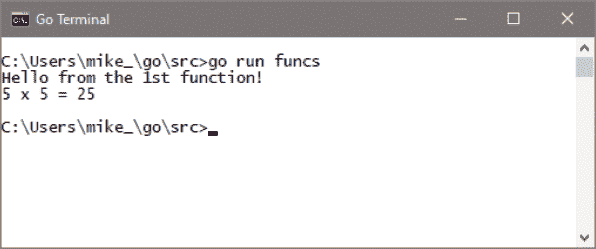


列出的代码假设你已经在每个程序的开头声明了 `package main` 并导入了 `import “fmt”`。


函数或其他块内部声明的变量只能从该块内部访问——它们具有“局部作用域”。例如，这里的 `msg` 变量只能从 `first()` 函数内部访问。在函数外部声明的变量可以在程序的任何地方访问——它们具有“全局作用域”。最好只使用局部变量，以避免与全局作用域可能发生冲突。

## 添加参数


函数声明中函数名后面的 `()` 括号可以可选地包含一个由逗号分隔的“参数”列表。这些是函数使用的变量，其初始内容由调用者提供。每当函数被调用时都会创建这些变量，并在退出函数时销毁。每个参数必须给出一个你选择的名称（遵循通常的命名规范）和一个类型，语法如下：

```go
func funcName(paramName type, paramName type) {
    // 执行的语句
}
```

多个连续的相同类型的参数可以声明为一个列表，并且仅在相同类型的最后一个参数后指定类型，如下：

```go
func funcName(paramName, paramName type) {
    // 执行的语句
}
```

每次函数调用必须为每个参数指定内容，类型要正确且顺序与函数声明中的顺序相同。传递给函数的内容被称为“参数”。这些在调用中函数名后的 `()` 括号内通过逗号分隔的列表指定：

```
funcName(argument, argument, argument)
```

与其他某些编程语言不同，Go 没有方法为函数参数指定默认内容。

非常重要的是在 Go 编程中，参数默认是“按值”传递的——函数接收参数的副本，而不是原始参数。这意味着对参数变量的更改默认不会影响调用者指定的原始参数——它们只影响副本。

创建一个需要单个整数参数并显示其值的函数

```go
func square(num int) {
    fmt.Println("\t\t 接收到的副本:", num)
    // 在此处插入语句。
}
```


}


`src\args\main.go`

接下来，插入语句修改接收到的参数并显示其新值

```go
num = num * num
```

```go
fmt.Println( “\t\tModified Copy:”, num )
```

开始一个 main 函数，声明并初始化一个变量，然后显示它的值

```go
func main( ) {
num := 5
fmt.Println( “Original:”, num )
// 在此处插入语句。
}
```

现在，在 main 函数中插入语句调用另一个函数，并再次显示其变量值

```go
square( num )
fmt.Println( “Original:”, num )
```

将程序文件保存在“args”目录中，然后运行程序查看原始值未发生改变

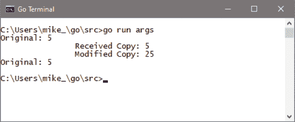


你也可以创建接受任意数量参数的“变长函数”——请参此处的示例。

### 传递引用

示例此处证明了在 Go 编程中，参数默认是“值传递”的——函数接收的是参数的副本，而不是原始参数。但很多时候，你可能希望函数修改原始参数。这可以通过向函数传递一个指向原始值的引用（而不是其值的副本）来实现。


请记住，指针是对你系统上存储某个值的内存地址的引用。这意味着如果你向函数传递指针参数，它将能够修改位于指针所提供地址上的原始值。

在声明一个可以接收指针参数的函数时，其参数列表中指定的类型类型必须以星号 `*` 前缀，以指示该参数将是一个指针，如下：

```go
func *functionName* ( *paramName* *type* ) {
    *statements-to-be-executed*
}
```

该参数将能够存储一个位置地址。

函数语句通过在参数名前前加星号 `*` 作为解引用符，来访问并修改指针所提供地址上的值。

在调用接受指针参数的函数时，参数必须以前 `&` 符号为缀，以引用存储该值的内存地址。

这种技术可以用于 `int`、`float64`、`string` 和 `bool` 数据类型，还可以用于下一节引入的 `struct` 类型。这些都是“值类型”，因此在将它们传递给函数时，需要指针来访问它们包含的原始值。

这种技术不能用于指针类型或函数类型（是的，函数在 Go 中也是类型），也不能用于本书后面介绍的 slice、map 或 channel 类型。这些都已经是“引用类型”，因此在将它们传递给函数时，不需要指针来访问它们包含的原始值。


返回此处以复习指针的工作原理。

创建一个需要单个整数指针参数的函数并显示其值

```go
func square( num *int ) {
fmt.Println( “\t\tReceived Address:”, num )
// 在此处插入语句。
}
```


`src\refs\main.go`

接下来，插入语句修改接收到的参数并显示其新值

```go
num = *num * *num
```

```go
fmt.Println( “\t\tModified Original:”, *num )
```

开始一个 main 函数，声明并初始化一个变量，然后显示它的值

```go
func main( ) {
num := 5
fmt.Println( “Original:”, num )
// 在此处插入语句。
}
```

现在，在 main 函数中插入语句调用另一个函数，并再次显示其变量值

```go
square( &num )
fmt.Println( “Original:”, num )
```

将程序文件保存在“refs”目录中，然后运行程序查看原始值已改变

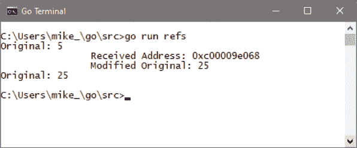


在函数调用中传递指针参数时，如果你需要传递存储该值的内存地址，请加上 `&` 符号前缀。

### 返回值

本章目前为止描述的函数只是在函数调用后的下一个语句恢复程序流，但让函数在继续执行后续语句之前向调用者返回一个值，通常是有帮助的。


在声明一个返回值的函数时，函数签名必须在参数列表之后定义返回值的数据类型。要返回的值通常在函数体末尾通过 Go 的 `return` 关键字指定。返回单个值的函数语法如下：

```go
func *funcName* ( *paramName* *type* ) returnType {
    *statements-to-be-executed*
    return returnValue
}
```

与大多数只能返回一个值的语言不同，Go 编程中的函数可以返回多个值。返回多个值的函数语法如下：

```go
func *funcName* ( *paramName* *type* ) ( returnType, returnType ) {
    *statements-to-be-executed*
    return returnValue
}
```

如果你调用一个返回多个值的函数但没有在程序代码中使用所有返回值，编译器将产生“声明但未使用”的消息，程序将无法运行。为了避免这种情况，你可以将任何返回值赋值给 `_`。这在 Go 编程中被称为“空白标识符”。

标准库中的许多函数返回多个值，特别是为了返回结果和错误值。

创建一个需要单个整数参数并向调用者返回三个值的函数

```go
func cube( num int ) ( string, int, int ) {
    return “Result”, num, ( num * num * num )
}
```


`src\returns\main.go`

添加一个 main 函数将三个返回值赋值给三个变量，然后尝试显示两个值

```go
func main( ) {
a, b, c := cube( 5 )
fmt.Println( b, “Cubed =”, c )
}
```

将程序文件保存在“returns”目录中，然后运行程序查看编译器错误

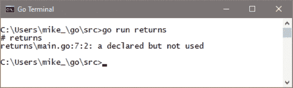

修改 main 函数中的赋值，将第一个返回值赋值给空白标识符

```go
func main( ) {
_, b, c := cube( 5 )
fmt.Println( b, “Cubed =”, c )
}
```

再次保存程序文件，然后运行程序，看到输出中打印了两个返回值

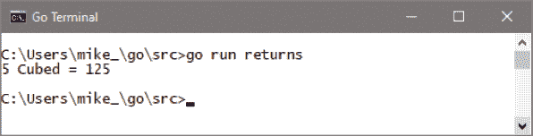


返回的“Result”**字符串**值在此处没有被使用。

### 递归调用

自定义函数中的语句可以自由地调用其他自定义函数，就像调用标准 Go 库函数如 `fmt.Printf()` 一样。此外，函数可以递归“递归”。与循环一样，重要的是递归函数调用必须修改被测试的表达式以避免连续执行——这样函数会在某个时刻退出。


递归函数调用可以用于模拟循环结构，例如此处的倒计时示例：

创建一个需要整数参数的函数，并进行递归调用，直到该值递减到零

```go
func countDn( num int ) {
    if num < 1 {
        fmt.Println( “\t\t\t\tLift Off!” )
    } else {
        fmt.Println( “\t\t\tCountdown”, num )
        num--
        countDn( num )
    }
}
```


`src\recur\main.go`

添加一个 main 函数，其中包含一个调用上述函数的语句

```go
func main( ) {
    countDn( 10 )
}
```

将程序文件保存在“recur”目录中，然后运行程序查看递归函数调用如何模拟循环


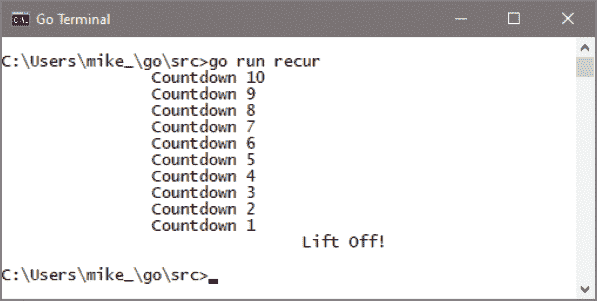

递归函数调用对于解决数学问题，例如给定数字的阶乘计算。阶乘是从给定数字到 1 的所有整数的乘积——例如，3 的阶乘是 6 (3 * 2 * 1)。

创建一个需要整数参数的函数，并在每次调用时返回一个整数值

```go
func facto( num int ) int {
    // 在此处插入语句。
}
```


`src\facto\main.go`

接下来，插入一个语句，当参数值递减到零（0）时返回一（1）

```go
if num == 0 {
    return 1
}
```

然后，插入最后的语句来递归调用该函数，以乘以序列中的所有数字

```go
return num * facto( num - 1 )
```

添加一个 main 函数，其中包含一个打印七个阶乘的语句

```go
func main( ) {
    for i := 1 ; i <= 7 ; i++ {
        fmt.Println( “Factorial“, i, “=”, facto( i ) )
    }
}
```

将程序文件保存在“facto”目录中，然后运行程序查看阶乘序列

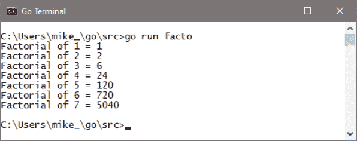


递归函数很有用，但效率并不高。这个示例调用了`facto()`函数 35 次来生成这个仅有 7 个阶乘的序列！

## 匿名闭包

Go 编程语言支持“一等函数”。这允许将函数赋值给变量、作为参数传递给其他函数并从函数返回。


## 匿名函数

匿名函数仅仅是一个不包含名称的函数定义。这对于内联创建函数而无需对其命名非常有用。匿名函数也称为“函数字面量”。和其他函数一样，这些可以包含参数列表、返回类型列表，并可以返回多个值。你可以通过在函数定义末尾附加`()` 调用运算符来创建一个自执行的匿名函数表达式，如下：

```go
func( ) { fmt.Println( “Function Literal” ) } ( )
```

此外，匿名函数可以赋值给变量，然后在变量名后附加`()` 调用运算符来调用它，如下：

```go
fn := func( ) { fmt.Println( “Function Literal” ) }
fn( )
```


自执行函数表达式仅执行其语句一次。

## 闭包

匿名函数可能最重要的用途是创建“闭包”。闭包是嵌套在外部函数内部的函数，它保留了对外部函数中声明的变量的访问。外部函数可以返回一个保留对变量访问的匿名函数，但关键是，这些变量在程序代码的任何地方都是无法访问的。这是封装的形式，当返回的匿名函数“捕获”这些变量时，保护了存储在这些变量中的数据。

通过在外部函数定义末尾附加`()` 调用运算符，可以闭包变为自执行并赋值给变量。然后，可以通过在变量名后附加`()` 调用运算符来调用匿名内部函数——并且它可以访问外部函数中的持久值。


如果你不能立即理解闭包是如何工作的，不要担心。它们初看起来可能很神秘，但随着经验的增加会变得更加清晰。你可以继续下去，稍后再来看这种技术。

通过将匿名函数赋值给变量来开始 main 函数

```go
func main( ) {
    area := func( length, width int ) int {
        return length * width
    }
}
```


`src\anon\main.go`

接下来，插入语句显示匿名函数的类型

```go
fmt.Printf( “area type: %T\n", area )
```

现在，插入语句将一个自执行函数赋值给变量

```go
counter := func( ) func( ) int {
    num := 0
    return func( ) int {
        num++
        return num
    }
}()
```

最后，插入语句显示闭包函数的类型和返回值

```go
fmt.Printf( “counter type: %T\n", counter )
fmt.Println( “Count: 1:”, counter() )
fmt.Println( “Count: 2:”, counter() )
fmt.Println( “Count: 3:”, counter() )
```

将程序文件保存在“anon”目录中，然后运行程序查看函数类型和返回值

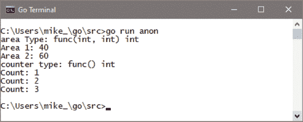


注意，外部函数必须声明其返回类型为`func() int`，因为它将返回一个返回整数的函数。

## 传递函数


## 定义函数类型

之前示例的输出通过其签名描述函数，例如 counter type : func() int。你可以使用`type`关键字声明自定义函数类型，后跟一个类型名称和一个函数签名。例如，一个接收两个整数参数并返回一个整数参数的自定义函数`adder`，如下：

```go
type adder func( int, int ) int
```

然后可以创建自定义函数类型的“实例”，并分配一个函数定义——其签名必须与自定义函数类型匹配。该函数（实例）可以用通常的方式调用。

## 高阶函数

接收值或引用参数并将这些类型返回给调用者的普通函数被称为“一阶”函数。但函数也可以作为参数传递给其他函数，函数也可以向调用者返回函数。任何接受函数作为参数或任何返回一个或多个函数都被视为“高阶”函数。

将函数传递给其他函数允许修改操作而不重复现有代码。

通过声明一个需要两个整数参数和一个整数返回类型的自定义函数类型来开始 main 函数

```go
func main( ) {
    type adder func( int, int ) int
}
```


`src\ftype\main.go`

接下来，插入语句定义自定义函数类型的函数（实例）——具有匹配的签名

```go
var add adder = func( a int, b int ) int {
    return a + b
}
```

现在，插入一个调用该函数（实例）的语句

```go
fmt.Println( “Added:”, add( 6, 2 ) )
```


在主函数之后，开始编写高阶函数，该函数将接收并返回与自定义函数类型签名相同的函数。

```go
func dub( twice func( int, int ) int ) func( int, int ) int {
    fmt.Println( “Doubled:”, twice( 6, 2 ) * 2 )
    // 在此处插入语句 – 步骤 5。
}
```

接下来，插入语句定义并返回一个具有相同签名函数给调用者。

```go
div := func( a int, b int ) int {
    return ( a + b ) / 2
}
return div
```

回到主函数，插入一条语句将该函数（实例）传递给该高阶函数，并将该函数返回的函数赋值给一个变量。

```go
div := dub( add )
```

现在，插入一条调用返回的函数的语句。

```go
fmt.Println( “Divided:”, div( 6, 2 ) )
```

最后，插入语句显示函数（实例）、高阶函数以及返回函数的类型。

```go
fmt.Printf( “add type: %T \n”, add )
fmt.Printf( “dub type: %T \n”, dub )
fmt.Printf( “div type: %T \n”, div )
```

将程序文件保存到 “ftype” 目录中，然后运行程序以查看返回的值和函数类型。

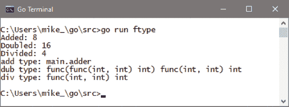


注意，函数签名在声明中只需要说明所需的类型，但其定义也需要列出参数名称。


注意，函数实例 `add` 被简单描述为自定义函数类型 `main.adder` 类型。

# 处理错误

在你的 Go 程序中预判错误并使你的代码能够高效地处理它们是非常重要的。其他编程语言（如 Java 和 Ruby）在遇到错误时会抛出“异常”，程序可以在运行时尝试捕获异常，但 Go 提供了一种更简单的方法。


Go 编程允许通过返回多个值来处理函数中出现的错误。这使得识别哪个函数返回了错误变得容易，并让你可以使用熟悉的 Go 语言结构来处理错误。

为了处理可能发生的错误，函数签名必须包含 Go 内置的 `error` 返回类型。传统上，这是返回值列表中的最后一个返回值。

```go
func *funcName*( *paramName type*) ( *returnType*, error )
```

在函数体中，在预期的返回值的位置，函数可以返回一个平凡值（例如 -1）以及返回的错误值。

如果没有发生错误，函数可以返回预期的返回值，同时返回一个 `nil` 零值。在 Go 编程中，`nil` 零值被用于表示许多类型的零值。在这里，它仅表示没有错误。因此，处理错误的函数语法可能如下：

```go
func *funcName*( *paramName type*) ( *returnType*, error ) {
    if *condition* != true {
        return -1 , *errorValue*
    }
    return *returnValue*, nil
}
```

提供示例中使用的 `fmt.Println()` 和 `fmt.Printf()` 函数的 `fmt` 包还提供了一个返回 `error` 类型的 `fmt.Errorf()` 函数。它接受与 `fmt.Printf()` 函数相同的格式化标记，并可用于返回一条消息以标识错误的位置和性质。


Go 标准库还包含一个 `errors` 包，可以处理自定义错误。

创建一个需要整数参数并返回一个整数值和一个错误的函数。

```go
func isPosInt( num int ) ( int, error ) {
    // 在此处插入语句。
}
```


`src\err\main.go`

接下来，插入一个条件测试，根据参数值的值返回错误或参数值。

```go
if num < 1 {
    err := fmt.Errorf( “%v not a positive integer”, num )
    return -1, err
}
return num, nil
```

现在，添加一个包含递减循环的 main 函数，用于打印参数值或错误消息。

```go
func main( ) {
    for i := 2 ; i >= -2 ; i-- {
        res, err := isPosInt( i )
        if err != nil {
            fmt.Println( “Failed:”, err )
        } else {
            fmt.Println( res, “Passed!” )
        }
    }
}
```

将程序文件保存到 “err” 目录中，然后运行程序以查看测试失败时的错误消息。

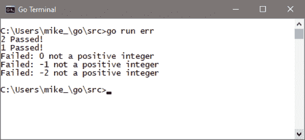


# 分离文件

随着程序规模增大，将相关的代码部分分离到单独的文件通常是明智的。在创建许多程序通用的工具函数时，将它们存储在单独文件中。要在导入的文件中使用函数，函数名必须以大字母开头。

首先，编写包含包和导入语句的 `verify.go`。

```go
package verify

import "fmt"
```


`src\verify\verify.go`

添加验证函数——但更改其名称以便导出。

```go
// IsPosInt 测试正整数。
func IsPosInt( num int ) ( int, error ) {
    ...
}
```

将文件保存到“src”文件夹中的“verify”目录。输入命令 `go install verify` 在你的 `go/pkg` 文件夹中创建一个名为 `verify.a` 的编译存档文件。创建 Go 存档包意味着每次编译导入文件时不需要重新编译工具文件。

接下来，编写一个包含包和导入语句的 `main.go` 程序。

```go
package main

import (
    "fmt"
    "verify"
)
```


`src\prog\main.go`

现在，添加 main 函数，用包名作为导入函数的前缀。

```go
func main( ) {
    for i := 2 ; i >= -2 ; i-- {
        res, err := verify.IsPosInt( i )
        if err != nil {
            fmt.Println( “Failed:”, err )
        } else {
            fmt.Println( res, “Passed!” )
        }
    }
}
```

**总结**

•函数块包含一组语句，每当调用该函数时这些语句就会执行。


- 可以使用 `func` 关键字后接符合 Go 命名规范的名称来声明函数。
- 函数声明包含 `()` 括号，随后跟有 `{}` 大括号，用于包围要执行的语句。
- 函数声明中的括号 `()` 可以包含一个参数列表，该列表指定每个参数的类型。
- 传递给函数的参数默认是按值传递的——即原始值的副本。
- 传递给函数的指针参数是某个内存地址的引用，该地址是原始值所在的位置。
- `return` 关键字允许在函数执行语句后，向调用者返回一个或多个值。
- 如果函数向调用者返回值，则在函数声明中，必须在参数列表之后列出每个返回类型。
- 函数可以递归地调用自己来模拟循环结构，但必须测试条件以便在某处退出。
- Go 支持一等函数，函数可以被赋值给变量、作为参数传递以及从函数返回。
- 匿名函数没有名称，可以通过在块后附加 `()` 调用操作符来实现自执行。
- 闭包是嵌套在外部函数内部的函数，它保留了对外部函数中声明的变量的访问。
- `type` 关键字后接名称和函数签名可用于创建自定义函数类型。
- 将函数传递给其他函数允许在不重复现有代码行的情况下修改操作。
- Go 编程允许你通过返回单独的值来处理函数中出现的错误。
- 只有导入的且名称以大写字母字母函数和变量才能被导入的文件访问。

# 6 构建结构

本章介绍了如何将数据和函数包含在“struct”（结构）中，该结构可以表示 Go 语言中的面向对象编程。

- 分组数据
- 附加方法
- 嵌入结构
- 封装特性
- 组合元素
- 实现接口
- 嵌入接口
- 总结

## 分组数据

任何数据类型的多个相关项都可以组合在 Go 语言的“struct”（结构）类型中。这对于创建记录非常有用，类似于可能在数据库中找到的记录。


使用 `type` 关键字后接你选择的名称，以及 `struct` 关键字后接 `{}` 大括号来创建结构体。大括号包含每行一个变量名和数据类型对。这些被称为结构体的“字段”（fields），定义了结构体将包含的内容，语法如下：

```go
type structName struct {
    fieldName dataType
    fieldName dataType
}
```

定义结构体类型后，可以创建以结构体名称为类型的变量，作为该结构体的实例：

```go
var instanceName structName
```

结构体的单个字段可以通过使用点后缀将字段名附加到结构体名称来访问。可以通过几种方式为结构体实例的单个字段分配数据。首先，你可以像这样给单个字段赋值：

```go
instanceName.fieldName = value
```

或者，你可以在单条语句中初始化其所有字段，通过为实例分配一个“结构体字面量”来实现，如下：

```go
instanceName = structName { value, value }
```

使用这种技术要求值的列表顺序与结构体中字段的顺序相同，但你可以在结构体字面量中包含字段名，以便值按任何顺序出现，如下：

```go
instanceName = structName { fieldName: value, fieldName: value }
```

此外，你可以在单条语句中创建结构体实例并初始化其所有字段，通过为变量分配“结构体字面量”来实现，如下：

```go
instanceName := structName { fieldName: value, fieldName: value }
```

结构中的空字段默认获得零值。


你可以结构体看作一个模板，其实例是可以持有实际数据的副本。


虽然这两个语句相似，但请注意，`:=` 运算符仅在创建实例并在单条语句中初始化结构体字段时使用。

通过创建一个结构体类型开始程序

```go
type employee struct {
    id int
    name string
    dept string
}
```


`src\group\main.go`

接下来，通过创建结构体类型的实例开始 main 函数

```go
var coder employee
```

现在，为结构体实例的每个字段赋值

```go
coder.id = 001
coder.name = “Alice”
coder.dept = “I.T.”
```

创建结构体的第二个实例，使用结构体字面量和字段名初始化结构体的每个字段

```go
clerk := employee{ name: “Burt”, dept: “Payroll”, id: 002 }
```

添加语句显示结构体中的所有值

```go
fmt.Println(coder)
fmt.Println(clerk)
```

最后，添加语句显示字符串中的单个值

```go
fmt.Printf("\n%v works in %v\n”, coder.name, coder.dept)
fmt.Printf("\n%v works in %v\n”, clerk.name, clerk.dept)
```


## 附加方法


在 Go 编程中，通过在函数签名中添加“接收者”（receiver）将函数附加到结构体，接收者指定了参数名称和作为类型的结构体名称：

```go
func (paramName structName) funcName()
```

附加到结构体的函数被称为该结构体的“方法”。方法可以指定为值接收者（在结构体的副本上操作）或指针接收者（在原始结构体字段上操作）：

```go
func (paramName *structName) funcName()
```

这种能力允许结构体表示具有属性和行为的现实对象：

- 属性描述对象具有的。
- 行为描述对象的操作。

例如，可以使用“蓝色”和“轿跑”属性描述汽车，带有“加速”行为。

这些特性可以在 Go 编程中通过包含 color 和 body 字段属性的 `car` 结构体以及一个附加的 `accelerate()` 方法来表示。


对象在 Go 编程中通过定义结构体作为模板来创建，从中创建不同的副本或“实例”。

结构体的每个实例都可以通过分配属性值和行为进行自定义以描述该对象。


与其他某些编程语言不同，Go 没有类，但可以使用结构体表示对象。

通过创建一个结构体类型开始程序

```go
type car struct {
    color string
    body string
}
```

`src\method\main.go`

接下来，为结构体类型附加方法

```go
func (c car) accelerate() string {
    return “accelerating-->”
}
```

现在，通过创建两个结构体实例开始 main 函数

```go
porsche := car{ color: “blue”, body: “coupe” }
```


`bentley := car{ color: “green”, body: “saloon” }`

添加语句显示第一个实例的所有值

```go
fmt.Println( “Porsche paint is”, porsche.color )
fmt.Println( “Porsche style is”, porsche.body )
fmt.Println( “Porsche is”, porsche.accelerate( ) )
```

最后，添加语句显示第二个实例的所有值

```go
fmt.Println( “Bentley paint is”, bentley.color )
fmt.Println( “Bentley style is”, bentley.body )
fmt.Println( “Bentley is”, bentley.accelerate( ) )
```

将程序文件保存在“method”目录中，然后运行程序查看结构体字段值

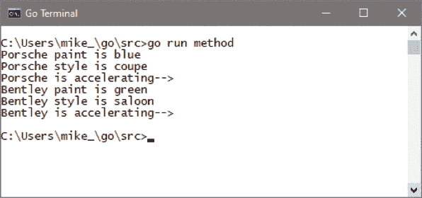


当你调用方法时，Go 会自动处理值和指针之间的转换，因此如果你想让方法能够修改原始结构体字段，这里的接收者可以是 `( c *car )`。

## 嵌入结构体 (Embed Structs)

由于结构体字段仅通过名称和类型声明，而结构体是一种类型，Go 编程甚至允许通过声明一个字段为结构体类型将一个结构体嵌入另一个结构体。


```go
type structName struct {
    fieldName embeddedStructName
}
```

这对于构建高效使用用途变化的结构体非常有用。例如，取一个仅存储 X 和 Y 坐标的结构体：

```go
type coords struct {
    x, y int
}
```

可能用于存储图表上的位置、矩形的顶点等，或者在嵌入另一个结构体时作为圆的中心点，如下：

```go
type circle struct {
    radius int
    center coords
}
```

现在，当创建 circle 的实例时，可以通过链结构体名称和字段名称来访问嵌入结构体的字段，如下：

`instanceName.*embeddedStructName.*fieldName`

`instanceName.*embeddedStructName.*fieldName`

这是可以接受的，但因为很长所以并不方便。幸运的是，Go 通过支持结构体中的“匿名字段”提供了此解决方案。这些字段仅仅指定另一个结构体的名称作为字段，而没有说明字段名称：

```go
type circle struct {
    radius int
    coords
}
```

此处的优点是，它允许你缩短访问嵌入结构体字段所需的代码：

`instanceName.*fieldName`

`instanceName.*fieldName`


匿名字段必须是命名类型，或者是指向命名类型的指针。

通过创建两个结构体类型开始程序

```go
type coords struct {
    x, y int
}

type circle struct {
    radius int
    coords
}
```


src\embed\main.go

接下来，为第二个结构体挂载一个方法

```go
func ( c circle ) getDiameter( ) int {
    return c.radius * 2
}
```

现在，通过创建一个结构体类型的实例开始 main 函数

```go
var ring circle
```

添加语句为结构体字段和嵌入结构体字段赋值

```go
ring.radius = 15
ring.x = ring.radius
ring.y = ring.radius
```

最后，添加语句显示值

```
fmt.Printf( “Diameter:%v \n”, ring.getDiameter( ) )
fmt.Printf( “Point X:%v Y:%v \n”, ring.x, ring.y )
```

将程序文件保存在“embed”目录中，然后运行程序查看结构体字段值

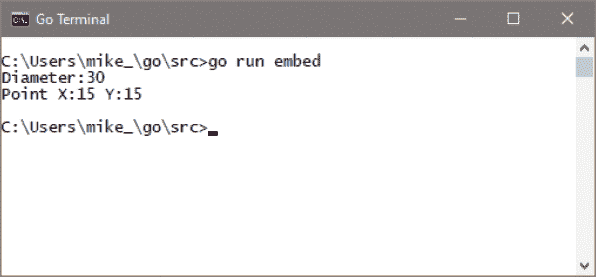

## 封装特性 (Encapsulate Features)

在 Go 程序中表示对象是面向对象编程 (OOP) 的第一个基石原则。面向对象的程序使用方法来表达其依附数据结构的属性和操作，因此程序不需要直接访问对象。

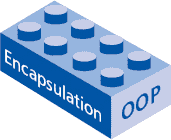

程序无法直接访问的变量、函数或方法被称为“封装”。封装、继承和多态是面向对象编程的三大构建块。

Go 编程中的封装依赖于导入程序中的包中的数据隐藏。只有以大字母开头的变量名、函数名和方法名会被导出到程序。以小字母开头的将不可访问——即它们被封装了。

首先，从带有包声明和结构体定义的 cube.go 工具文件开始

```go
package cube

// Dims 可导出的。
type Dims struct {
    width, length, height int
}
```


src\cube\cube.go


```go
return m.firstName + “ ” + m.lastName
}
```

现在，创建一个包含两个新字段的第二个结构体并嵌入基础结构体

```go
type article struct {
    title string
    body string
    member
}
```

然后，为第二个结构体附加一个方法以输出所有字段值

```go
func ( a article ) content( ) {
    fmt.Println( “Title:”, a.title )
    fmt.Println( “Content:”, a.body )
    fmt.Printf( “Author: %v \n\n”, a.fullName( ) )
}
```

通过创建一个使用结构字面量初始的基础结构体实例来开始 main 函数

```go
func main( ) {
    member1 := member {
        “Mike”,
        “McGrath”,
    }
    // 在此处插入语句。
}
```

接下来，创建一个第二个结构体的实例并显示其所有字段值

```go
article1 := article {
    “Object Oriented Programming”,
    “In Go, Composition emulates Inheritance”,
    member1,
}
article1.content( )
```

现在，创建另一个第二个结构体的实例并显示其所有字段值

```go
article2 := article {
    “Object Oriented Programming”,
    “Coming next… Polymorphism”,
    member1,
}
article2.content( )
```

将程序文件保存在“inher”目录中，然后运行程序以查看继承字段的值

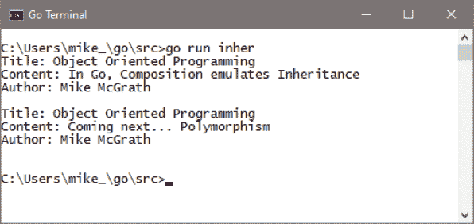


记住结构字面量中的所有值后面都必须紧跟一个逗号——包括最后一个。

# 满足接口

面向对象编程的第三大基石是“多态性”——这个词源自希腊语，意为“多种形式”，描述了根据上下文为实体赋予不同含义或目的的能力。


Go 语言通过使用 `type` 关键字创建的“interface”类型来支持多态，后面跟着你选择的名称和接口关键字，然后是 `{ }` 大括号。接口体只包含方法签名的列表：

```go
type interfaceName interface {
    methodName returnType
    methodName returnType
}
```

任何具有与接口中列出的所有方法的名称和签名精确匹配的方法结构体都实现了该接口。在 Go 语言中，它们被称为“满足”接口。这样做的用处是，它允许程序拥有具有相同名称附加方法的各种结构体，每个结构体执行不同的任务——即它们是多态的。

通过创建一个列出两个方法签名的接口来启动程序，每个方法不需要参数且都返回字符串

```go
type bird interface {
    speak( ) string
    move( ) string
}
```


`src\poly\main.go`

接下来，创建一个空结构体并附加将满足接口的方法

```go
type parrot struct { }
func ( parrot ) speak( ) string {
    return “Squawk, squawk!”
}
func ( parrot ) move( ) string {
    return “A parrot flies away.”
}
```


注意，你可以省略接收者中的参数名称，只需写出结构体名称，除非你需要在方法语句中使用参数名称。

现在，创建另一个空结构体并附加满足接口的方法

```go
type chicken struct { }
func ( chicken ) speak( ) string {
    return “Cluck, cluck!”
}
func ( chicken ) move( ) string {
    return “Chick cannot fly.”


```

)一个接收接口作为参数并调用实现方法的函数

```go
func nudge( b ) {
    fmt.Printf( “\n%v \n”, b.speak( ) )
    fmt.Printf( “%v \n\n”. b. )( )


```](

/5bl.jpg)添加一个 main 函数，通过语句创建每个结构体的实例，然后调用它们同名的方法

```go
func main( ) {
    var bird1 parrot
    var bird2 chicken
    nudge( bird1 )
    nudge( bird2 )
}
```

将程序文件保存在“poly”目录中，然后运行程序查看不同的输出


Go 会识别接口的实现。


当结构体实现接口时，附加到结构体的方法就成为了接口的“成员”——这样就可以作为参数传递。

# 嵌入接口

正如结构体可以嵌入一样，接口也可以。理解接口嵌入很有帮助，许多标准库包使用了这种技术。例如，`io.ReadWriter` 接口嵌入了 `Reader` 和 `Writer` 接口。

接下来，创建一个空结构体并附加满足第一个接口的方法

```go
type parrot struct { }
func ( parrot ) speak( ) string {
    return “Squawk, squawk!”
}
func ( parrot ) move( ) string {
    return “A parrot flies away.”
}
```

**parrot** 类型将调用步骤 3 中的方法。

现在，添加另一个空结构体并附加满足第一个和第二个接口的方法——因此满足了第三个接口

```go
type person struct { }
func ( person ) speak( ) string {
    return “Hi, there!”
}
func ( person ) move( ) string {
    return “A person walks away.”
}
```

添加一个接收第三个接口作为参数并调用实现方法的函数

```go
func nudge( c creature ) {
    fmt.Printf( “\n%v \n”, c.speak( ) )
    fmt.Printf( “%v \n\n”. c.move( ) )
}
```

添加一个 main 函数，通过语句创建每个结构体的实例，然后调用它们同名的方法

```go
func main( ) {
    var bird1 parrot
    var human1 person
    nudge( bird1 )
    nudge( human1 )
}
```

将程序文件保存在“abstr”目录中，然后运行程序以查看不同的输出


**person** 类型将调用步骤 4 中的方法。


方法签名可能还可以指定参数列表和多个返回类型。

**总结**

•多个相关的数据项可以组合在 Go 结构体类型。

•结构体的 `{ }` 大括号包含名称和类型对的列表，这些字段定义了结构体将包含的内容。

•结构体实例可以通过声明以结构体名称为类型的变量来创建。

•通过将值赋值给实例名称和点后缀的字段，可以初始化结构体的单个字段。

•通过将结构字面量赋值给变量名可以创建并初始化结构体实例。


-   通过添加接收者可以将函数附加到结构体上，接收者在函数签名中指定结构体的名称。
-   附加到结构体上的函数称为方法（method）。
-   方法可以是值接收者（在结构体的拷贝上进行操作），也可以是指针接收者（在原始字段上进行操作）。
-   结构体可以通过其字段属性和附加方法表示真实世界对象的属性和行为。
-   结构体可以作为匿名字段嵌入另一个结构体中，这样就可以直接访问它的字段。
-   面向对象编程的三大基石是封装、继承和多态。
-   Go 中的封装依赖于包中的数据隐藏，只有大写字母开头的项会被导出。
-   Go 中的继承依赖于组合，嵌入的结构体为嵌入的结构体提供了字段和方法。
-   Go 中的多态依赖于它的接口类型，接口只包含方法签名的列表。
-   任何具有与接口方法签名精确匹配方法的结构体都实现了该接口。
-   接口可以嵌入到另一个接口中，以提供进一步的抽象来增加额外的的灵活性。

# 7 创建数组

本章演示了如何在 Go 程序中通过索引元素存储多个数据项。

-   创建基础数组
-   循环遍历元素
-   切片数组
-   创建切片
-   切片与数组
-   Map 的键和值
-   总结

## 创建基础数组

数组是一个可以存储多个数据项的变量——与只能存储一个数据的普通变量不同。数据项按顺序存储在编号的数组“元素”中，这些元素从零开始编号。因此，第一个值存储在元素 0 中，第二个值存储在元素 1 中，依此类推。


可以使用 `var` 关键字后跟你自定义的名称，然后跟一个 `[ ]` 方括号，括号内包含一个指定所需元素数量的整数。这些之后必须紧跟元素可以包含的数据类型。声明的语法如下：

```
var arrayName [ nElements ] dataType
```

然后可以通过在方括号中指定元素编号来为每个可用元素单独赋值：

```
arrayName [ elementNumber ] = value
```

或者，也可以通过在“数组字面量”中为每个元素指定值来声明并初始化带有值的数组——这是一个由逗号分隔的列表，并分组在花括号内：

```
arrayName := [ nElements ] dataType { value, value, value }
```

可以使用数组名后跟包含元素编号的方括号来引用任何单个元素的值。例如，引用第一个元素中的值：

```
arrayName [ 0 ]
```

数组的所有元素合称为“索引”（index）。数组可以有多个索引——以表示多个维度，而不是普通数组的单维度。具有三个或更多索引的多维数组并不常见，但二维数组常用于存储基于网格的信息，例如坐标。

要创建一个二维数组，只需添加第二对 `[ ]` 方括号来指定所需的元素数量，如下：

```
var arrayName [ nElements ] [ nElements ] dataType
```

然后可以通过在方括号中指定元素编号来为每个可用元素单独赋值：

```
arrayName [ elementNumber ] [ elementNumber ] = value
```


数组编号从零开始——因此包含六个元素的数组中的最后一个元素是五号而不是而不是号。这种编号被称为“零基索引”（zero-based index）。


你只能在数组声明中指定的数据类型的数组元素中存储数据。

或者，可以在声明数组时，通过在数组字面量中为每个索引指定值来初始化二维数组并为每个元素赋值：

```
arrayName := [ nElements ] [ nElements ] dataType
{ { value , value , value } , { value , value , value } }
```

可以使用数组名后跟包含每个索引编号的方括号来引用任何单个元素的值。例如，第二个索引的第一个元素：

```
arrayName [ 0 ] [ 1 ]
```

创建一个三个元素的空数组，每个元素只能包含字符串值

```
var cars [ 3 ]string
```


`src\array\main.go`

接下来，添加语句初始化每个数组元素

```
cars[ 0 ] = “BMW”
cars[ 1 ] = “Ford”
cars[ 2 ] = “Opel”
```

现在，声明并初始化一个二维数组

```
coords := [ 2 ][ 3 ]int { { 1, 2, 3 } , { 4, 5, 6 } }
```

然后，添加语句显示数组

```go
fmt.Println("Cars:", cars)
fmt.Println("Second:", cars[ 1 ])
fmt.Println("X1,Y1:", coords[ 0 ] [ 0 ])
```
（注：此处原文内容似乎存在格式混乱，已根据逻辑重新对齐翻译）

```go
fmt.Println("Cars:", cars)
fmt.Println("Second:", cars[ 1 ])
fmt.Println("X1,Y1:", coords[ 0 ] [ 0 ])
fmt.Println("X2,Y2:", coords[ 1 ] [ 1 ])
```
（注：根据原文提供的代码片段逻辑，修正为显示输出）

```go
fmt.Println("Cars:", cars)
fmt.Println("Second:", cars[ 1 ])
fmt.Println("X1,Y1:", coords[ 0 ] [ 0 ])
```

Go 中的数组是固定大小的——一旦创建，就无法添加或删除元素。

## 循环遍历元素

循环和数组是完美的搭档。可以使用循环填充空数组的每个元素，并通过数组来引用值。Go 有一个内置函数 `len()`，它接受数组变量作为参数，并返回元素的数量。这可以在到达数组最后一个元素时使用。

创建一个五个元素的空整数数组

```
var arr [ 5 ]int
```


`src\elems\main.go`

接下来，添加语句确认数组大小

```
fmt.Println("No. of Elements:", len( arr ))
```

现在，添加循环填充每个元素

```
for i := 0 ; i < len( arr ) ; i++ {
    arr[ i ] = i * i
}
```

然后，添加循环引用每个数组元素

```
for i := 0 ; i < len( arr ) ; i++ {
    fmt.Printf("Index: %v Value: %v\n", i, arr[ i ])
}
```

将程序保存在“elems”目录，运行程序查看存储在数组元素中的值

数组索引是零基的，所以这里的最后一个元素是索引 4。

Go 提供了一些适用于数组的特殊特性。首先，在使用数组字面量声明数组变量时，可以使用 `…` 运算符将元素数量设置为数组字面量中值的数量：

```
arr := [ … ]int { 10, 20, 30 } // len( arr ) == 3.
```

你甚至可以通过为每个值指定索引编号来指定每个值存储在哪个元素中，如下：

```
arr := [ … ]int { 2: 10, 0: 20, 1: 30 } // arr == [ 20, 30, 10 ].
```

其次，你可以在循环中使用 `range` 关键字来遍历数组，并返回每个元素的索引编号和值。


创建一个包含五个元素的整数数组

```
arr := [ … ]int { 100, 200, 300, 400, 500 }
```


src\range\main.go

接下来，添加一条语句确认数组的大小

```go
fmt.Println( “元素个数:”, len( arr ) )
```

现在，添加一个循环修改每个元素的值

```go
for i , v := range arr {
    arr[ i ] =v / 10
}
```

然后，添加一个循环引用每个数组元素的值

```go
for i , v := range arr {
    fmt.Printf( “索引: %v 值: %v \n”, i, v )
}
```

将程序文件保存在“range”目录中，然后运行程序查看存储在数组元素中的值


如果你在循环语句中不需要索引，可以将变量名 `i` 替换为空白标识符 `_` 以避免错误——请参见此处。

## 切片数组 (Slice Arrays)

数组是序列，其每个元素包含相同类型的数据，但长度是固定的，因此并不灵活。幸运的是，Go 提供了一种切片类型，它代表一个底层数组并且其长度可以更改。


要理解切片类型，重要的一点是要意识到切片本身包含任何元素，它仅仅是对实际数组的引用。切片类型仅包含三个部分：

 ** **Ptr** –（指针）指向切片可访问的数组中第一个元素的指针（不一定是数组的第一个元素）。
- **Len** –（长度）切片中元素的总数。
- **Cap** –（容量）指针所引用的元素与数组最后一个元素之间的元素个数。

例如，从一个日期名称数组中创建一个代表工作日的切片：


在 Go 编程中，可以通过将数组赋值给指定所需下界和边界元素索引的变量来创建切片。这些边界指定在 `[ ]` 括号之间的冒号 `:` 周围。冒号左侧的数字指定要切片的起始元素的索引——切片指针将引用该索引。冒号右侧的数字指定上边界的索引——用于切片直到上边界元素但不包括该元素的所有元素。上述示例的赋值将如下：

```go
weekdays := days[ 0 : 5 ]
```

可选地，你可以省略指定上下边界的任一数字以使用默认值。下边界的默认值为 0（零），上边界的默认值是数组中元素的总数。


切片在 Go 编程中非常重要，出现的频率远比数组类型得多，但理解它们是对底层数组的引用是非常重要的。

你可以使用内置函数 `len()` 查看切片的长度（就像数组一样），但你也可以使用内置函数 `cap()` 切片的容量。将切片的指针值与它指向的数组元素的内存地址进行比较，可以确认切片确实是一个指针引用。

首先，创建一个七元素的数组

```go
days := [ 7 ]string {“Mon”,”Tue”，“Wed”，“Thu”，“Fri”，“Sat”，“Sun”}
```


src\slice\main.go

创建一个代表最后两个数组元素的切片

```go
weekend := days[ 5 : ]
```

现在，添加语句显示切片的内容和类型

```go
fmt.Printf( “切片 weekend: %v \n”, weekend )
fmt.Printf( “类型 weekend : %T \n”, weekend )
```

添加语句显示切片的长度和容量

```go
fmt.Printf( “长度 weekend: %v \n”, len( weekend ) )
fmt.Printf( “容量 weekend: %v \n”, cap( weekend ) )
```

最后，添加语句确认切片是引用底层数组元素的引用

```go
fmt.Printf( “指针 weekend: %p \n”, weekend )
fmt.Printf( “地址 days[0]: %p \n”, &days[ 5 ] )
```

将程序文件保存在“slice”目录中，然后运行程序查看切片的特性


看到切片的类型由空 `[ ]` 方括号跟随每个元素可能包含的类型来描述。

## 创建切片 (Make Slices)


可以用与数组相同的方式创建切片，只需指定长度。你还可以使用 `make()` 函数创建一个空切片，其参数指定切片类型、长度以及（可选的）容量。例如：

```go
fruitSlice := make( [ ]string, 3 )
fruitSlice[ 0 ] = “Apple”
fruitSlice[ 1 ] = “Banana”
fruitSlice[ 2 ] = “Cherry”
```

可以使用内置的 `append()` 函数向切片添加元素。

```go
fruitSlice = append( fruitSlice, “Damson” )
```

还有一个内置的 `copy()` 函数允许你将一个切片复制到另一个。这需要两个参数，指定要复制的目标切片和源切片的名称。例如：

```go
jamSlice = make( [ ]string, len( fruitSlice )
copy( jamSlice, fruitSlice )
```

如果你想从切片删除第一个元素并保留剩余元素的顺序，可以使用 `copy()` 函数将指定索引以上的元素向下移动一位。例如：

```go
copy( nums[ 0 : ], nums[ 1 : ] )
nums = nums[ : len( nums ) - 1 ]
```

不需要担心切片的底层数组，因为 Go 会处理。

通过切片字面量创建一个整数切片

```go
nums := [ ]int { 10, 20, 30, 40, 50, 60, 70, 80, 90, 100 }
```


src\make\main.go

创建另一个切片，然后初始化它的元素

```go
more := make( [ ]int, 3 )
more[ 0 ] = 200
more[ 1 ] = 300
more[ 2 ] = 400
```

添加一条调用函数描述切片的语句

```go
describe( nums )
```

通过追加第二个切片中的一个值扩大第一个切片，然后描述修改后的第一个切片

```go
nums = append( nums, more[ 0 ] )
describe( nums )
```

从第一个切片中删除第一个元素，再次描述修改后的切片

```go
copy( nums[ 0 : ], nums[ 1 : ] )
nums = nums[ : len( nums ) - 1 ]
describe( nums )
```

在 main 函数之后，添加描述第一个切片元素值、长度和容量的函数

```go
func describe( nums [ ]int ) {
    fmt.Printf( “\n%v Length: %v ”, nums, len( nums ) )
    fmt.Printf( “Capacity: %v \n”, cap( nums ) )
}
```


这里的容量增量大小为 10，但在其他平台上可能会有所不同。请注意，当元素被移除时，容量不会恢复到原始大小。

## 切片与数组

数组（array）包含一个值序列，而切片（slice）包含对一个值序列的引用。这是 Go 编程中一个重要的区别，适用于它的许多类型。最重要的是，当将类型传递给函数时，基于值的类型将接收原始值的拷贝，而基于引用的类型将指向实际原始值。因此，为了让函数在原始值上进行操作，在向函数传递基于值的类型时需要使用指针，但在传递引用类型时则不需要指针。


数组和切片之间的另一个区别涉及“变参”函数，这种函数可以使用任意数量的参数进行调用。你不能直接将数组元素的值传递给变参函数，除非你先通过将数组元素的值复制到切片元素中将数组“转换”为切片。

你只需要通过在函数签名的最后一个参数的数据类型前缀加上 `…` 通配符运算符，就可以创建一个变参函数，使用以下语法：

`func *funcName(paramName ...dataType)`

变参函数可以像通常一样调用，在 `( )` 括号内包含用逗号分隔的参数列表。

变参函数在将切片元素的值传递给函数时特别有用，因为切片的长度在程序执行过程中可能会变化。无论切片的长度如何，都可以通过在函数调用的括号内指定切片名称后跟 `…` 通配符运算符，将其元素值传递给变参函数：

`funcName(sliceName...)`


`fmt.Printf()` 函数是一个变参函数——它开头需要一个固定参数，然后接受任意数量的后续参数。

 创建一个包含字符串的数组

```
array := [ 3 ]string{ “BMW”, “Ford”, “Opel” }
```


`src\versus\main.go`

 将数组元素复制到切片中进行“转换”

```
slice := array[:]
```

 接下来，调用变参函数传递每个切片元素的值进行显示

```
list(slice...)
```

 现在，向切片添加两个新值

```
slice = append(slice, “Porsche”, “Ferrari”)
```

 再次调用变参函数传递每个切片元素的值进行显示

```
list(slice...)
```

 在主函数之后，添加变参函数来列出传入的切片元素

```go
func list( autos ...string ) {
    for i, v := range autos {
        fmt.Printf( “\n%v. %v”, i, v )
    }
    fmt.Println( )
}
```

 将程序文件保存在“versus”目录中，然后运行程序查看参数值


在调用变参函数时，你传递的不是切片本身——你只是传递了切片元素的值。

## 映射的键和值

哈希表可以使用关联键存储多个数据项，这样你就可以通过其关联键引用所存储的值。在 Go 编程中，这种数据结构被称为“map”，但其他编程语言称为关联数组或字典。


map 中的所有键（key）必须是唯一的且为相同的数据类型。map 中的所有值（value）必须是相同的数据类型，但不一定与键的类型相同。

可以使用 `var` 和 `map` 关键字，并使用以下语法指定键和值的数据类型来创建 map：

```
var mapName = map[keyDataType]valueDataType
```

然后可以将单独的键值对赋值给 map，如下：

```
mapName["keyName"] = value
```

或者，你可以使用内置的 `make()` 函数来创建 map：

```
mapName := make(map[keyDataType]valueDataType)
```

此外，你可以通过赋值一个“map 字面量”来创建并初始化 map：

```
mapName := map[keyDataType]valueDataType{
    key : value , key : value , key : value ,
}
```

与数组和切片不同，键值对是以无序方式存储的，因此你不能使用元素索引来引用存储的值——你必须使用其关联键。

你可以随时向 map 添加键值对，并可以使用内置的 `delete()` 函数移除键值对。这需要两个参数，分别指定 map 名称和要删除的键的名称。

与数组和切片一样，你可以使用 `range` 关键字遍历 map 的所有元素。在这种情况下，循环将返回键和值。

 map 不是切片，所以你不能获取它的地址。

 创建一个字符串键的 map

```go
colors := make(map[string]string)
```

 使用三个值初始化 map

```go
colors["Red"] = “FF00”
```

 添加另一个键值对

```go
colors["Green"] = “00FF”
```

 添加另一个键值对

```go
colors["Blue"] = “0000”
```

 接下来，显示所有的键和值

```go
fmt.Printf( "Colors: %v \n", colors )
```

 现在，移除添加的键值对

```go
delete(colors, "Red")
```

 最后，添加循环列出所有键值

```go
for k, v := range colors {
    fmt.Printf( “\nCode for %v is %v \n”, k, v )
}
```

## Summary

- 数组是固定长度结构，顺序存储数据。
- 数组声明必须在 [ ] 方括号内指定元素数量。
- 可以通过索引号引用数组或切片元素的数据。
- 空数组可以使用 `var` 关键字创建，也可以通过赋值数组字面量创建并初始化。
- `len()` 函数返回数组或切片的长度。
- `range` 关键字可遍历元素。
- 切片是可变长度结构，顺序存储在数组的元素中。
- 切片包含指针、长度和容量。
- `cap()` 函数返回切片的容量。
- 切片声明不得在 [ ] 方括号内指定元素数量。
- 可以在 [ ] 方括号内通过 `:` 字符周围指定元素序列的上下边界。
- 空切片可以使用 `make()` 函数创建，也可以通过赋值切片字面量创建并初始化。
- 使用 `append()` 函数向切片添加元素。
- 使用 `copy()` 函数将切片复制到另一个切片。
- 向函数传递引用时不需要指针。
- 变参函数可以使用任意数量的参数调用。
- map 是包含关联键值对的可变长度结构。
- 空 map 可以使用 `make()` 函数创建，也可以通过赋值 map 字面量创建并初始化。
- 可以通过在 [ ] 方括号内指定关联键引用 map 元素的值。


本章演示了如何使用 Go 标准库中的 `time` 包来处理日期和时间。

## 获取日期

Go 标准库的 `time` 包提供了功能，可以从 `Time` 数据类型中提取描述特定时间点的特定字段。通过导入 `time` 包，这些功能可以在程序中使用。


可以使用 `time.Now()` 函数创建一个新 `Time` 数据类型的日期/时间实例，其包含的字段描述了当前的当前的日期和时间。这些字段是根据设备上的系统时钟为当前区域设置初始化的。

可以使用 `Time` 数据类型的相应方法获取单个字段中的值。例如，可以使用 `Year()` 方法获取年份字段的值。同样，还有 `Month()`、`Day()` 和 `Weekday()` 方法来获取 `Time` 类型的其他单独字段。

| 方法 | 返回值 |
| :--- | :--- |
| `Now()` | 包含当前日期、时间和时区字段的 `time.Time` 数据类型 |
| `Year()` | 4 位数字的年份 (YYYY) |
| `Month()` | 年份的月份名称 |
| `Day()` | 月份中的几数 |
| `Weekday()` | 星期名称 |

还有这三个方法，其返回的 `Time` 数据类型值可以方便地赋值给变量：

| 方法 | 返回值 |
| :--- | :--- |
| `Date()` | 4 位数字的年份 (YYYY)、年份的月份名称和月份中的几数 |
| `ISOWeek()` | 一份中的周数 (1-53) 和 4 位数字的年份 (YYYY) |
| `YearDay()` | 年中的天数 (1-365/366) |

重要的是，`Time` 数据类型包含单独的字段，因此它不是字符串。然而，你可以使用它的 `String()` 方法将其转换为字符串：


`Time` 数据类型方法返回的值不是字符串。

开始在程序中导入 Go 标准库 time 包

```go
import (
	"fmt"
	"time"
)
```


src\date\main.go

接下来，创建一个 `Time` 类型的日期/时间实例，并用当前的日期和时间初始化

```go
dt := time.Now()
```

添加语句输出日期/时间实例的所有字段，并确认其数据类型

```go
fmt.Printf("DateTime: %v \n", dt)
fmt.Printf("DateTime Type: %T \n", dt)
```

接下来，添加一条语句输出今天的星期几

```go
fmt.Printf("Today is: %v \n", dt.Weekday())
```

现在，添加语句显示今天的日期、本周以及一年中的天数

```go
y, m, d := dt.Date()
fmt.Printf("Date: %v %v, %v \n", m, d, y)
yr, wk := dt.ISOWeek()
fmt.Printf("Week No.: %v in %v \n", wk, yr)
dy := dt.YearDay()
fmt.Printf("Day No.: %v \n", dy)
```

将程序文件保存在“date”目录中，然后运行程序查看日期字段的值


时区值指定了相对于 UTC（通用时间）的偏移量以及时区缩写——有关时区的更多信息请参阅此处。

## 获取时间

`Time` 数据类型单个字段中的时间值可以使用相应的方法获取。例如，可以使用 `Hour()` 方法获取小时字段的值。同样，还有 `Minute()`、`Second()` 和 `Nanosecond()` 方法来获取 `Time` 的其他单独字段。


| 方法 | 返回值 |
| :--- | :--- |
| `Hour()` | 一天的小时数 (0-23) |
| `Minute()` | 小时内的分钟数 (0-59) |
| `Second()` | 分钟内的秒数 (0-59) |
| `Nanosecond()` | 秒内的纳秒数 (0-999999999) |

与其他编程语言不同，Go 的 `time` 包没有提供从 `Time` 数据类型返回毫秒值的方法。然而，你可以将纳秒值除以一百万来产生等值的毫秒。

还有这三个方法，其返回的 `Time` 数据类型值可以方便地赋值给变量：

| 方法 | 返回值 |
| :--- | :--- |
| `Clock()` | 一天内的小时、分钟和秒 |
| `Unix()` | 自纪元以来的秒数 |
| `UnixNano()` | 自纪元以来的纳秒数 |

开始在程序中导入 Go 标准库 time 包

```go
import (
	"fmt"
	"time"
)
```


src\date\main.go

接下来，创建一个 `Time` 类型的日期/时间实例，并用当前的日期和时间初始化

```go
dt := time.Now()
```

添加语句输出日期/时间实例的所有字段，并确认其数据类型

```go
fmt.Printf("DateTime: %v \n", dt)
fmt.Printf("DateTime Type: %T \n", dt)
```

接下来，添加一条语句评估小时并显示相应的问候

```go
hr := dt.Hour()
switch {
case hr < 12:
	fmt.Println("Good Morning!")
case hr < 18:
	fmt.Println("Good Afternoon!")
default:
	fmt.Println("Good Evening!")
}
```

现在，添加语句显示当前时间

```go
h, mn, s := dt.Clock()
fmt.Printf("Time: %v:%v:%v \n", h, mn, s)
```

最后，添加语句显示当前的纳秒字段及其毫秒值

```go
ns := dt.UnixNano()
ms := ns / 1000000
fmt.Println("Nanoseconds:", ns)
fmt.Println("Milliseconds:", ms)
```

将程序文件保存在“times”目录中，然后运行程序查看时间字段的值


个位数的小时、分钟和秒没有前导零。

## 格式化日期和时间


`Time` 数据类型单个字段中的日期和时间值可以使用 `Format()` 方法以多种方式格式化。该方法接受一个作为“布局”的参数，指定如何格式化日期/时间。格式必须精确使用此参考字符串的元素来指定：

`Mon Jan 2 15:04:05 2006 MST`

由于 MST（山地标准时间）比 UTC（协调世界时）慢 7 小时，参考字符串也可以从数值上考虑为：

`01 02 03:04:05PM ‘06 -0700`

如果你想让 `Format()` 方法返回返回、月份和 hh:mm 格式的时间，布局可以指定：

`Mon Jan 2 15:04`

或在数值上指定为：

`01/02 03:04`

通过在布局中指定全称版本，你可以让星期和月份名称返回全称：

`Monday January 2 15:04`

`time` 包包含了预定义的 `UnixDate`、`ANSIC` 和 `RFC3339` 常量，可以作为日期/时间布局格式使用。

自定义布局可以任意顺序指定组件以适应不同的区域——例如，用于适当的日期格式化。

`time` 包还包含一个预定义的 `Kitchen` 常量，可以作为时间布局格式使用。它将以十二制格式显示时间并根据情况添加“AM”或“PM”。


此外，时间组件可以格式化为 24 小时制，通过指定“15:04”，它会自动在个位数小时前补零。

12 小时制和 24 小时制都会在个位数分钟前补零。


ANSIC 指的是 C 语言的美国国家标准协会日期/时间格式。RFC 3339 指的是互联网工程任务组（IETF）的请求意见日期/时间文档。

首先在程序中导入 Go 标准库 time 包

```go
import (
	"fmt"
	"time"
)
```


src\format\main.go

接下来，创建一个 Time 数据类型的日期/时间实例，并用当前日期和时间初始化，然后以各种格式显示其组件

```go
dt := time.Now()
fmt.Println("\nDefault Format:", dt)
fmt.Println("Unix Format:", dt.Format(time.UnixDate))
fmt.Println("ANSIC Format:", dt.Format(time.ANSIC))
fmt.Println("RFC3339 Format:", dt.Format(time.RFC3339))
fmt.Println("Custom Format:", dt.Format("January 2, 2006 [Monday]"))
```

现在，仅显示符合两个地区格式的格式化日期组件

```go
fmt.Println("\nUS Format:", dt.Format("January 2, 2006"))
fmt.Println("UK Format:", dt.Format("2 January, 2006"))
```

然后，仅显示 12 小时制和 24 小时制的的时间组件

```go
fmt.Println("\nTime 12-Hour:", dt.Format(time.Kitchen))
fmt.Println("Time 24-Hour:", dt.Format("15:04"))
```

将程序文件保存在“format”目录中，然后运行程序查看格式化后的日期和时间字段值


`time.Kitchen` 常量等于指定布局格式为“15:04PM”。

## 设置日期和时间

你可以使用 Go 标准库 time 包的 `Date()` 函数创建自己的 Time 数据类型。这需要八个参数来指定（按顺序）年、月、日、时、分、秒、纳秒和位置。


除了月份和位置外，所有参数都以整数值形式指定。

月份可以使用 time 包预定义的 1 月至 12 月全名月份常量之一指定，例如 `time.January`。

位置可以使用 time 包预定义的位置常量之一指定，例如 `time.UTC`（协调世界时）或 `time.Local`（你的系统时钟）。

任何 Time 数据类型中的日期字段都可以通过使用 Go 标准库 time 包的 `AddDate()` 方法进行修改，以指定年、月、日的三个参数。正值将推后日期，负值将推迟日期。例如，`time.AddDate(1, 0, 0)` 将日期推后一年。

同样，time 包的 `Add()` 方法可以用于指定单个持续时间参数来修改日期/时间。该值可以是一个表示修改时间的纳秒数的 `int64` 值。更方便，你可以使用常量 `time.Hour`、`time.Minute`、`time.Second` 或 `time.Millisecond` 来修改 Time 数据类型的各个时间字段。例如，`time.Add(10 * time.Hour)` 将时间推后 10 小时。

你还可以使用 Go 标准库 time 包的 `Parse()` 函数从字符串创建自己的 Time 数据类型。这需要两个参数来指定布局和日期/时间字符串。有用的是该函数返回两个值：一个 Time 数据类型和一个错误。如果函数返回 Time 数据类型，则错误值为 `nil`，否则它将是一个错误信息。

布局应仅使用 Go 参考字符串中的值：

**Mon Jan 2 15:04:05 2006 MST**

除非在日期/时间字符串指定了时区偏移值（例如 -0500），否则生成的 Time 数据类型将假设为 UTC 时间。


`Time` 数据类型可以使用此处描述的 `Format()` 方法进行格式化。

首先在程序中导入 Go 标准库 time 包

```go
import (
	"fmt"
	"time"
)
```


src\setdate\main.go

接下来，创建并显示 Time 数据类型的日期/时间实例，初始化为元旦正午

```go
dt := time.Date(2025, time.January, 1, 12, 0, 0, 0, time.Local)
fmt.Printf("\nDateTime:", dt)

dt = dt.AddDate(0, 0, 2)
fmt.Printf("\nDateTime:", dt)

layout := "2006-Jan-02 03:04PM"
str := "2030-Dec-25 12:30AM"
t, err := time.Parse(layout, str)
if err != nil {
	fmt.Println(err)
} else {
	fmt.Printf("Parsed DateTime: %v\n", t)
}
```

将程序文件保存在“format”目录中，然后运行程序查看格式化后的日期和时间字段值


`time.` 字段会自动识别从标准时间到夏令时间的变化

## 识别时区

Go 中的所有 Time 类型都与时区关联。通常，这是 UTC 时间或基于系统位置的本地时间。然而，你可以指定另一个位置作为 `time.LoadLocation()` 的参数。位置名称必须对应于互联网分配数字（IANA）时区数据库中的文件。`time.LoadLocation()` 函数返回两个值：一个 Location 类型和一个错误。

某些时区会在夏令时改变时间，因此你可能需要评估时区缩写和偏移量以正确识别时区。


接下来，在指定位置创建并初始化带有默认字符串值和 `Time` 数据类型的变量

```go
zone := “All”
loc, _ := time.LoadLocation( “America/New_York” )
dt := time.Now( ).In( loc )
```

确定时区缩写和秒偏移量，然后将偏移量转换为正分钟数

```go
abbr, offset := dt.Zone( )
if offset < 1 {
    offset = offset * -1
}
offset /= 60
```

现在，评估缩写和偏移量值

```go
switch {
case abbr == “EST” && offset == 300 :
    zone = “East Coast”
case abbr == “EDT” && offset == 240 :
    zone = “East Coast”
}
```

显示时区详情和适当的消息

```go
fmt.Printf( “\nTZ: %v Offset Minutes: %v \n”, abbr, offset )
fmt.Println( “Welcome to”, zone, “Visitors!” )
```

将程序文件保存到“zone”目录中，然后运行程序以查看时区值


这里使用 `_` 空标识符是为了由于空间限制而忽略返回的错误值，但理想情况下，你应该包含一个错误处理器。

### 延迟时间

Go 标准库 `time` 包提供了一个 `Sleep( )` 函数，它允许你通过指定的持续时间延迟程序的进度。持续时间作为 `Sleep( )` 函数的参数提供，并可以表示为 `time` 包常量的乘法形式。例如，`5 * time.Second` 表示五秒的持续时间。


Go 标准库 `time` 包还提供了三个方法，用于将 `Time` 数据类型的实例与作为参数指定的另一个时间进行比较。这些方法将根据根据时间比较的结果返回一个布尔值（true 或 false）：

| **方法** | **返回** |
| :--- | :--- |
| **Before(**time**)** | 如果实例时间早于参数时间，则返回布尔值 **true** |
| **After(**time**)** | 如果实例时间晚于参数时间，则返回布尔值 **true** |
| **Equal(**time**)** | 如果实例时间与参数时间代表同一时刻（即使在不同的时区）——则返回布尔值 **true** |

如果你想查看两个 `Time` 数据类型实例之间的差异，可以使用时间实例的 `Sub( )` 方法，并指定另一个时间实例作为其参数。该方法将两个瞬间之间经过的持续时间以纳秒精度的 `int64` 数据类型值返回。

通常情况下，使用小于纳秒精度的持续时间表示更为合适，因此 Go 标准库 `time` 包包含了一个 `Round( )` 方法来指定更简洁的精度。该方法需要一个参数来确定你偏好的舍入行为。通常，该参数由 `time` 包的常量之一提供。例如，调用 `Round( time.Millisecond )` 方法将把纳秒精度的持续时间四舍入到最近的毫秒，`Round( time.Second )` 将把纳秒精度的持续时间四舍入到最近的秒，依此类推。

首先在程序中导入 Go 标准库 `time` 包

```go
import (
    “fmt”
    “time”
)
```


src\delay\main.go

接下来，创建并显示 `Time` 数据类型的组件

```go
start := time.Now( )
fmt.Println( “\nStarted At:”, start.Format( “03:04:05” ) )
```

现在，延迟程序进度五秒

```go
time.Sleep( 5 * time.Second )
```

然后，创建并显示第二个 `Time` 数据类型

```go
finish := time.Now( )
fmt.Println( “\Finished At:”, finish.Format( “03:04:05” ) )
```

比较开始和结束时间

```go
fmt.Println( “\nStart First?:”, start.Before( finish ) )
fmt.Println( “Finish First?:”, finish.Before( start ) )
```

最后，显示延迟的长度

```go
diff := finish.Sub( start )
fmt.Println( “\nTime Elapsed:”, diff.Round( time.Second ) )
```

将程序文件保存到“delay”目录中，然后运行程序以查看时间延迟


延迟执行的能力在暂停单个“goroutine”时特别有用——更多详情请参阅此处示例。

## 总结

- Go 标准库 `time` 包包含创建由日期、时间和区域字段组成的 `Time` 数据类型的函数。
- `time` 包包含了用于创建 `Time` 类型的常量，且 `time.Now( )` 函数返回当前日期、时间和区域。
- `Time` 类型不是字符串，但可以通过 `String( )` 方法转换为字符串。
- `Time` 字段可以通过 `Year()`、`Month()`、`Day()`、`Hour()`、`Minute()` 和 `Nanosecond()` 提取。
- `time` 包包含了月份名称、小时、秒、毫秒和纳秒的常量。
- `LoadLocation( )` 函数需要 IANA 区域名称，且 `In( )` 函数应用区域。
- `time.Sleep( )` 函数通过指定的持续时间延迟程序的执行。
- `Sub( )` 方法返回两个时间之间的持续时间，而 `Round( )` 方法可以指定精度。

# 9 管理数据

***本章将演示如何使用 `math`、`string` 和 `strconv` 包处理文本和数字。***

- 合并字符串
- 分割字符串
- 查找字符
- 转换字符串
- 计算区域
- 评估数字
- 舍入小数
- 生成随机数
- 总结

## 合并字符串


在 Go 编程中，字符串是双引号内的零或多个字符。因此，这些都是有效的字符串值：

```go
s1 := “My First String”
s2 := “”
s3 := “2”
s4 = “nil”
```

`s2` 的空引号将变量初始化为空字符串值。赋值给 `s3` 的数值是数字的字符串表示。Go 的 `nil` 零值通常表示值的缺失，但当它包含在引号内时，它就是一个字符串字面量。


Go 标准库中的 `strings` 包包含了用于字符串操作的有用函数。其 `Join()` 函数将字符串数组中的所有元素连接（拼接）以创建一个单一的统一字符串。此函数需要两个参数：指定字符串数组的名称，以及放置在统一字符串中每个字符串元素之间的分隔符值。通常，你会指定单个空格作为分隔符，以创建一个由空格分隔的统一字符串。

`fmt.Printf()` 和 `fmt.Println()` 函数可以将内容写入标准输出，它们可以在输出中添加空格和换行符，但不会更改实际的字符串。不过，这两个函数都返回两个值，即写入的字节数和任何写入错误。如果没有遇到错误，错误错误值将像往常一样为 `nil`。对于英语，写入的字节数通常代表输出的字符数——包括字符串中包含的非打印字符。


非打印字符 `\t` 制表符的 ASCII 码为 9，非打印字符 `\n` 换行符的 ASCII 码为 10。


在程序中导入 Go 标准库 strings 包

```go
import (
    "fmt"
    "strings"
)
```


`src\join\main.go`

初始化两个变量和一个拼接后的字符串

```go
s1, s2 := "The Truth is rarely Pure ", "and never Simple."
str := s1 + s2
```

接下来，输出拼接后的字符串及其长度

```go
chars, err := fmt.Printf("\n%v \n", str)
if err != nil {
    fmt.Println(err)
} else {
    fmt.Println("Bytes Written: ", chars)
    fmt.Println("String Length:", len(str))
}
```

初始化字符串数组和一个连接后的字符串

```go
arr := []string{"\n\tStrive", "For", "Greatness!"}
ast := strings.Join(arr, " ")
```

现在，输出连接后的字符串和前两个字符

```go
fmt.Println(ast)
if ast[0] == 10 && ast[1] == 9 {
    fmt.Printf("1st Char: ASCII %v Newline\n", ast[0])
    fmt.Printf("2nd Char: ASCII %v Tab\n", ast[1])
}
```

将程序文件保存到“join”目录，然后运行程序查看统一的字符串


这里写入的字节数超过了字符串长度，因为 `fmt.Printf()` 方法增加了两个换行符和一个空格字符。

## 分割字符串


Go 标准库 strings 包提供了几个函数，允许将指定的字符串拆分为子字符串。这些函数将字符串视为数组，其中每个元素包含一个字符或一个空格。

通常，你可能希望将一个由空格分隔的句子拆分为一个子字符串数组，每个子字符串都是独立的单词。strings 包方便地提供了一个 `Fields()` 函数，可以执行此任务。该函数需要字符串句子作为唯一参数，并返回一个包含该字符串中每个独立单词的子字符串数组。

strings 包有一个 `Split()` 函数，它需要两个参数来指定字符串和一个分隔符。此函数将返回存在指定分隔符出现位置之间的子字符串数组。例如，当字符串是一个由空格分隔的句子且分隔符是空格字符时，`Split()` 函数将返回该句子中的单词数组。

strings 包还有一个 `SplitN()` 函数，它的工作方式与 `Split()` 函数相同，但接受第三个参数来指定要返回的子字符串数量。如果指定的子字符串数量超过分隔符的数量，则后续出现的指定分隔符将简单地位于最后一个子字符串中。例如，当字符串是一个由空格分隔的句子，分隔符是空格字符，且仅指定两个子字符串时，`SplitN()` 函数将返回一个包含句子第一个单词的子字符串，以及一个包含句子剩余所有部分（包括空格）的子字符串。

重要的是，`Fields()`、`Split()` 和 `SplitN()` 函数会丢弃指定的分隔符，并在返回的子字符串中包含分隔符周围的字符。然而，还有两个函数允许你在返回的子字符串中也包含分隔符。

strings 包的 `SplitAfter()` 函数工作方式与 `Split()` 函数类似，但在返回的子字符串中包含了分隔符。同样，strings 包的 `SplitAfterN()` 函数工作方式与 `SplitN()` 函数类似，但在返回的子字符串中包含了分隔符。


数据通常以逗号分隔值（CSV）的形式存储在 CSV 文件中，可以很有用地拆分成单个值。

在程序中导入 Go 标准库 strings 包

```go
import (
    "fmt"
    "strings"
)
```


`src\split\main.go`

通过初始化字符串来启动主函数

```go
str := "I can, and I will."
```

接下来，添加语句将描述和字符串子字符串传递给列表函数

```go
list(strings.Fields(str))
list(strings.Split(str, ","))
list(strings.SplitN(str, ",", 2))
list(strings.SplitAfter(str, ","))
list(strings.SplitAfterN(str, ",", 2))
```

在主函数之后，添加函数来列出描述和子字符串

```go
func list(desc string, subs []string) {
    fmt.Print("\n", desc, ": ")
    for _, v := range subs {
        fmt.Print("[", v, "] ")
    }
    fmt.Print("\n")
}
```

将程序文件保存到“split”目录，然后运行程序查看子字符串


只有名称中包含“After”的分割方法才会保留分隔符。

## 查找字符


Go 标准库 strings 包提供了几个函数，允许对指定的字符串查找指定的字符或子字符串（模式）。这些函数将字符串视为数组，其中每个元素包含一个字符或一个空格。

strings 包有一个 `Contains()` 函数，它需要两个参数来指定字符串和要查找的模式。此函数将简单地返回 true 或 false 以表示搜索结果（区分大小写）。例如，查找“Pro”模式：

```go
strings.Contains("Go Programming in easy steps", "Pro")
```

strings 包还有一个 `Index()` 函数，它需要两个参数来指定字符串和要查找的模式。如果搜索成功，此函数将返回一个整数，即模式在搜索字符串中首次出现的索引位置；如果搜索失败，它将返回 -1。

strings 包的 `Count()` 函数需要两个参数来指定字符串和要查找的模式。你可以使用此函数发现模式在搜索字符串中出现了多少次非重叠的实例。如果模式为空字符串，此函数通常会返回 1 加上搜索字符串的字符数。这允许你通过从返回的整数中减 1 来确定搜索字符串的字符数。


同样，`strings` 包的 `HasSuffix()` 函数需要两个参数，分别指定一个字符串和一个要查找的模式，并返回 true 或 false 以表示被搜索字符串是否以指定的模式结尾。

你可以使用 `strings` 包的 `Replace()` 函数通过将指定的模式替换为替换子字符串来修改被搜索字符串。该函数需要四个参数：指定要搜索的字符串、要查找的模式、替换子字符串以及一个表示替换次数的整数。如果你想替换搜索字符串中所有的模式实例，只需将替换次数指定为 `-1` 即可。


`strings.Index()` 函数在在搜索字符串中找到模式的第一个实例时停止搜索。


首先在程序中导入 Go 标准库的 `strings` 包

```go
import (
    "fmt"
    "strings"
)
```


`src\find\main.go`


通过初始化字符串变量来启动 main 函数

```go
str := "I can resist everything except temptation"
```


接下来，测试子字符串是否存在于字符串中，然后找到第一个实例的索引位置

```go
fmt.Printf("\nFound ‘an’: %v \n", strings.Contains(str, "an"))
fmt.Printf("Found ‘an’ at: %v \n", strings.Index(str, "an"))
```


现在，统计字符串中某个字母出现的次数

```go
fmt.Printf("Count of ‘e’: %v \n", strings.Count(str, "e"))
```


然后，测试字符串是否以某个特定的子字符串开头或结束

```go
fmt.Printf("Prefix ‘ion’: %v \n", strings.HasPrefix(str, "ion"))
fmt.Printf("Suffix ‘ion’: %v \n", strings.HasSuffix(str, "ion"))
```


最后，替换字符串中的子字符串

```go
fmt.Println(strings.Replace(str, "temptation", "chocolate", 1))
```


将程序文件保存到“find”目录中，然后运行程序查看搜索结果


## 转换字符串


Go 标准库 `strings` 包提供了用于转换字符串字符大小的函数。

`strings` 包有一个 `ToUpper()` 函数，它需要一个字符串参数。该函数将简单地返回字符串的副本，将其所有字符都转换为大写字母。

同样，`strings` 包的 `ToLower()` 函数需要一个字符串参数，并将返回字符串的副本，将其所有字符都转换为小写字母。

`strings` 包还 true `ToTitle()` 函数，它需要一个字符串参数。该函数将返回字符串的副本，并将每个单词的首字母转换为大写字母——但仅当字符串参数全为小写时才起有效。如果你想将一个混合大小写的字母字符串转换为标题格式（title case），必须先使用 `strings` 包的 `ToLower()` 函数将其转换为小写。

当程序在请求数值后接收到用户输入时，输入可能是字符串数据类型，并可能包含用户无意输入的空格。你可以使用 `strings` 包的 `Trim()` 函数删除字符串开头和结尾的空格。这需要两个参数：指定要删除的字符串和字符。要删除所有开头和结尾的空格，第二个参数将是 `" "` 指定单个空格字符。

一旦包含输入数字的字符串删除了不必要的空格，在程序将输入用于算术运算之前，必须将数据类型转换为数值类型。这可以通过导入 Go 标准库的 `strconv` 包来实现。该包包含一个 `Atoi()` 函数（ASCII 转整数），它需要一个字符串参数，并返回一个整数和任何错误。如果没有遇到错误，错误值将为 `nil`；如果方法无法返回整数数据类型，它将包含一个描述性的错误信息。

同样，`strconv` 包包含一个 `Itoa()` 函数，可以将整数转换为字符串数据类型。该方法只需要一个整数参数，并将返回一个字符串副本。


`strconv.ParseInt()` 方法也可以用于将字符串类型转换为整数。`strconv.Atoi()` 方法等同于调用 `strconv.ParseInt(str, 10, 0)`。


首先在程序中导入 Go 标准库 `strings` 包和 `strconv` 包

```go
import (
    "fmt"
    "strings"
    "strconv"
)
```


`src\conv\main.go`


通过初始化字符串变量启动 main 函数，然后显示具有不同字符大小的字符串

```go
str := "I have Nothing to declare except My Genius"
fmt.Println(strings.ToUpper(str))
fmt.Println(strings.ToLower(str))
fmt.Println(strings.Title(strings.ToLower(str)))
```


现在，给变量赋值一个数字

```go
str = " 42 "
```


然后，从字符串开头和结尾的空格

```go
str = strings.Trim(str, " ")
```


最后，尝试将数据类型转换为整数

```go
num, err := strconv.Atoi(str)
if err != nil {
    fmt.Println(err)
} else {
    fmt.Printf("%v Type: %T\n", num, num)
}
```

images/6r.jpg)
将程序文件保存到“conv”目录中，然后运行程序查看结果


## 常数


Go 标准库 `math` 包提供了许多实用的函数和常量。常量列在下表中，并带有近似值：

| 常量 | 描述 |
| :--- | :--- |
| `math.E` | 常数 *e*，自然对数的底，近似值为 2.71828 |
| `math.Pi` | 常数 Pi，近似值为 3.14159 |
| `math.Phi` | 常数 Phi（黄金分割），近似值为 1.61803 |
| `math.Sqrt2` | 2 的平方根，近似值为 1.41421 |
| `math.SqrtE` | 常数 *e* 的平方根，近似值为 1.64872 |
| `math.SqrtPi` | Pi 的平方根，近似值为 1.77246 |
| `math.SqrtPhi` | Phi 的平方根，近似值为 1.27202 |
| `math.Ln2` | 2 的自然对数，近似值为 0.69315 |
| `math.Log2E` | 常数 *e* 的以 2 为底，近似值为 1.44269 |
| `math.Ln10` | 10 的自然对数，近似值为 2.30259 |
| `math.Log10E` | 常数 *e* 的以 10 为底，近似值为 0.43429 |

数学常量主要用于具有特定数学目的的 Go 程序，但为了完整起见，所有的 math 包常量都列在上方。


黄金比例在几何和艺术中多次出现。它是被分成两个长度不同的部分的线段的比例，其中长段与短段的长度比例等于整个线段与长段的长度比例。


开始在程序中导入 Go 标准库的 math 包

```go
import (
	"fmt"
	"math"
)
```


`src\area\main.go`

声明三个浮点变量

```go
var rad, area, perim float64
```

接下来，初始化第一个变量并将其值保留两位小数

```go
rad = 4
fmt.Printf( "\nRadius of Circle: %.2f \n", rad )
```

现在，根据给定的半径计算圆面积，并将面积保留两位小数

```go
area = math.Pi * ( rad * rad )
fmt.Printf( "\nArea of Circle: %.2f \n", area )
```

然后，根据给定的半径计算圆周长，并将周长保留两位小数

```go
perim = 2 * ( math.Pi * rad )
fmt.Printf( "\nPerimeter of Circle: %.2f \n", perim )
```

将程序文件保存在“area”目录中，然后运行程序查看计算出的值


参考此处了解更多关于输出中小数格式的内容。

## 数字评估


Go 的 `math` 包提供了这些实用函数，用于评估 `float64` 参数：

| 函数 | 返回 |
| :--- | :--- |
| `math.Abs() ` | 绝对值 |
| `math.Acos()` | 反余弦值 |
| `math.Asin()` | 反正弦值 |
| `math.Atan()` | 反正切值 |
| `math.Atan2()` | 来自 X 轴点的点的角度 |
| `math.Ceil()` | 向上取整的值 |
| `math.Cos()` | 余弦值 |
| `math.Exp()` | 常数 *e* 的指数 |
| `math.Floor()` | 向下取整的值 |
| `math.IsNaN()` | 布尔真或假值 |
| `math.Log()` | 自然对数值 |
| `math.Max()` | 两个数中的较大值 |
| `math.Min()` | 两个数中的较值 |
| `math.Pow()` | 幂值 |
| `math.Round()` | 最接近的整数值 |
| `math.Sin()` | 正弦值 |
| `math.Sqrt()` | 平方根值 |
| `math.Tan()` | 正切值 |


`math.IsNan()` 函数（不是一个数字）用于发现强制转换为 `float64` 数据类型的值是否确实为数字。


`math` 包包含更多函数，但此处列出的函数对许多数学运算都很有用。可以在 Go 文档 [golang.org/pkg/math](http://www.golang.org/pkg/math) 中发现更多。

开始在程序中导入 Go 标准库的 math 包

```go
import (
	"fmt"
	"math"
)
```


`src\maxmin\main.go`

接下来，初始化两个变量

```go
square := math.Pow( 5, 2 )// 5 的 2 次 ( 5 x 5 )
cube := math.Pow( 4, 3 )// 4 的 3 次 ( 4 x 4 x 4 )
```

现在，比较变量的正值，并显示最大和最小的数

```go
fmt.Println( "\nLargest Positive:", math.Max( square, cube ) )
fmt.Println( "\nSmallest Positive:", math.Min( square, cube ) )
```

然后，添加语句反转每个变量的数值极性——将正值变为负值

```go
square *= -1
cube *= -1
```

最后，比较变量的负值，并显示最大和最小的数

```go
fmt.Println( "\nLargest Negative:", math.Max( square, cube ) )
fmt.Println( "\nSmallest Negative:", math.Min( square, cube ) )
```

将程序文件保存在“maxmin”目录中，然后运行程序查看比较值


最大的负值是最接近零的那个。

## 小数四五入


Go 标准库 math 包提供了许多将小数四五入到整数的有用函数。

| 函数 | 返回 |
| :--- | :--- |
| `math.Floor(x )` | 小于 *x* 的最大整数 |
| `math.Ceil(x )` | 大于 *x* 的最小整数 |
| `math.Round(x )` | 最接近 *x* 的整数 |
| `math.Trunc(x )` | *x* 的整数部分 |

如果你想将浮点值保留两位小数，首先将值乘以 100，使用 `math.Round()` 去掉小数位，然后除以 100。Go 语言具有强类型系统，不支持隐式转换。然而，你可以通过 `int(value)` 语法对兼容类型（如 `float64` 和 `int`）进行显式类型转换。`math.Round()` 函数从中间点向上舍入，所以 `math.Round( 7.5 )` 返回 `8` 而不是 `7`。


开始在程序中导入标准 math 包

```go
import (
	"fmt"
	"math"
)
```


`src\round\main.go`

初始化一个浮点变量并显示其值

```go
var pi float64 = math.Pi
fmt.Println("Pi:", pi)
```

接下来，显示浮点值的对应整数

```go
fmt.Println("\nFloor:", math.Floor( pi ) )
fmt.Println("\nCeiling:", math.Ceil( pi ) )
fmt.Println("\nRound:", math.Round( pi ) )
fmt.Println("\nTruncated:", math.Trunc( pi ) )
```

现在，将浮点值保留两位小数

```go
fmt.Println("\nShort Pi:", math.Round( pi * 100 ) / 100)
```

最后，初始化另一个浮点变量并将其值转换为整数变量

```go
var e1 float64 = math.E
fmt.Printf("\nE: %v %T \n", e1, e1 )
var e2 int = int( e1 )
fmt.Printf("Cast: %v %T \n", e2, e2 )
```

将程序文件保存在“round”目录中，然后运行程序查看四五入的小数

## 生成随机数

Go 标准库 math 包包含一个 rand 包，提供了生成伪随机数的函数。通过导入 `math/rand` 可以使其在程序中可用。

`rand.Intn( )` 函数返回从 0 到指定参数范围内的随机数。`rand.Perm( )` 函数返回一个从 0 到指定参数范围的整数序列，顺序为伪随机排列。


随机化模式基于默认的“种子”（seed），该种子在每次程序运行时都会返回相同的伪随机顺序。这可能正是你想要的，但通常情况下，在每次程序运行时生成不同的顺序会更理想。为了实现这一点，你必须指定一个自定义种子作为整数参数传递给 `rand.Seed()` 函数，该种子在每次程序运行时都应该是唯一的。为了这个目的，可以通过调用 `time.Now()` 函数并使用 `Time` 数据类型的 `UnixNano()` 方法提取自 Unix 纪元（Epoch）以来流过的纳秒整数计数，来使用当前系统时间。此值在每次程序运行时都是不同的，因此将此整数作为 `rand.Seed()` 函数的参数，可以确保每次程序运行时都会生成不同的伪随机顺序。

在程序中导入 Go 标准库 `math/rand` 包，以及用于设置随机种子的 `time` 包和用于转换随机数的 `strconv` 包

```go
import (
	"fmt"
	"math/rand"
	"strconv"
	"time"
)
```


src\lotto\main.go

接下来，为随机生成器指定一个唯一的种子

```go
rand.Seed(time.Now().UnixNano())
```

现在，生成一个从 0 到 58 的整数切片

```go
nums := rand.Perm(59)
```

然后，增加范围使其变为 1-59（包含边界）

```go
for i := 0; i < len(nums); i++ {
	nums[i]++
}
```


在计算中，Epoch（Unix 纪元）是指 1970 年 1 月 1 日午夜的时间。

在格式化字符串中，在连字符字符周围按照伪随机顺序分配前六个数字

```go
str := "\nYour Six Lucky Numbers: "
for i := 0; i < 6; i++ {
	str += strconv.Itoa(nums[i])
	if i != 5 {
		str += " - "
	}
}
```

最后，显示格式化后的字符串

```go
fmt.Println(str)
```

将程序文件保存在“lotto”目录中，然后反复运行程序查看不同的随机数


这里的随机数范围是 1 到 59 —— 用于玩英国乐票（UK Lotto）或美国纽约乐票（US New York Lotto）。


`int` 数字数字必须转换为 `string` 数据类型才能拼接。

## 总结

- 字符串是字符的集合，类似于数组中的元素。
- 内置函数 `len()` 返回作为参数的指定字符串中的字符数量。
- `strings` 包包含用于字符串操作的函数，例如 `Join()` 拼接函数。
- `Fields()` 和 `Split()` 函数分别从指定的字符串参数中返回子字符串数组。
- `Contains()` 和 `Index()` 函数可用于在字符串参数中查找指定的子字符串。
- `Count()` 函数报告子字符串在指定的字符串参数中出现的次数。
- `HasPrefix()` 和 `HasSuffix()` 函数可用于识别字符串参数的开头和结尾。
- `Replace()` 函数可以替换子字符串。
- 使用 `ToUpper()`、`ToLower()` 和 `ToTitle()` 函数可以更改字符的大小写。
- `Trim()` 函数可以移除前后的空格。
- `strconv` 包包含 `Atoi()` 和 `Itoa()` 函数，它们可以在字符串和 `int` 数据类型之间转换。
- `math` 包包含数学函数（如 `math.Pow()`）以及数学常量（如 `math.Pi`）。
- 小数值可以使用 `math.Floor()`、`math.Ceil()`、`math.Round()` 和 `math.Trunc()` 舍入到最近整数。
- `math/rand` 包提供了生成伪随机数的函数。
- `rand.Perm()` 函数返回一个从 0 到指定参数数字的随机整数序列。
- `rand.Seed()` 函数可以为随机数生成器指定自定义种子整数。
- 通过调用 `time.Now().UnixNano()` 函数，可以在每次程序运行时指定一个唯一的随机种子。

# 10. 处理输入

*本章演示了如何处理用户输入，以及如何使用 Go 标准库 `os`、`bufio` 和 `io/ioutil` 包来读写文本文件。*

- 获取用户输入`、`fmt.Scanln()` 和 `fmt.Scanf()` 从标准输入读取内容。这些函数中的每一个都会返回扫描到的项目数量以及任何错误。如果没有遇到错误，错误值将为 `nil`。

```go
import (
	"fmt"
	"math/rand"
	"time"
)

func main() {
	rand.Seed(time.Now().UnixNano())
	var num int = rand.Intn(20) + 1
	var guess int = 0
	var flag bool = true

	fmt.Print("\nGuess My Number 1-20: ")
	for flag {
		_, err := fmt.Scan(&guess)
		if err != nil {
			fmt.Println(err)
		} else if guess > num {
			fmt.Print("Too High, Try Again: ")
		} else if guess < num {
			fmt.Print("Too Low, Try Again: ")
		} else if guess == num {
			fmt.Println("Correct - My Number Is", num)
			flag = false
		}
	}
}
```

## 缓冲区输入

当你想要将较大项目的数据收集到程序中时，通常情况下将数据流存储在内存缓冲区中更好。Go 标准库 `bufio`（缓冲输入/输出）包提供了一个 `Scanner` 类型，它是一个具有多个用于处理数据流有用方法的内存缓冲区。你可以通过导入 `bufio` 包在程序中使用它。


首先，通过向 `bufio` 包的 `NewScanner()` 函数传递一个参数，指定用于读取数据的源，用来创建一个 `Scanner` 实例。当数据源为用户输入时，你可以导入 Go 标准库中的 `os` 包，并将 `os.Stdin`（标准输入）作为 `NewScanner()` 的参数。

`Scanner` 实例有一个 `Scan()` 方法，用于读取所有用户输入，以及一个 `Text()` 方法，它将已读取的输入作为单个字符串值返回。

`Scanner` 实例还有一个 `Err()` 方法，它将返回任何读取错误。如果没有遇到错误，错误值将如常地为 `nil`。在调用 `Scan()` 方法和 `Text()` 方法后检查错误是有用的。

如果你想将输入拆分为单个字符串项，可以导入 Go 标准库中的 `strings` 包，并将输入传递给它的 `Fields()` 函数，以将字符串拆分为单词。

首先在程序中导入 Go 标准库的 `bufio`、`os` 和 `strings` 包，以处理输入

```go
import (
	"fmt"
	"bufio"
	"os"
	"strings"
)
```


src\buffer\main.go

接下来，请求用户输入

```go
fmt.Print( "\nEnter Text:" )
```

现在，创建一个 `Scanner` 实例将用户输入存储在内存缓冲区中，然后读取用户输入

```go
scanner := bufio.NewScanner( os.Stdin )
scanner.Scan( )
```

然后，如果发生错误，则输出错误，否则输出存储的数据

```go
if scanner.Err( ) != nil {
	fmt.Println( scanner.Err( ) )
} else {
	fmt.Println( scanner.Text( ) )
}
```

接下来，创建一个新的 `Scanner` 实例，将其他用户输入存储在内存缓冲区中

```go
fmt.Print( "\nEnter Text:" )
scanner = bufio.NewScanner( os.Stdin )
scanner.Scan( )
```

然后，将用户输入的各个项存储在切片的各个元素中

```go
words := strings.Fields( scanner.Text( ) )
```

最后，如果发生错误，则输出错误，或者列出用户输入的各个项

```go
if scanner.Err( ) != nil {
	fmt.Println( scanner.Err( ) )
} else {
	for i, v := range words {
		fmt.Printf( “%v: %v \n”, i, v )
	}
}
```

将程序文件保存在“buffer”目录中，然后运行程序以查看用户输入


`if` 条件测试的执行依据是：`Scan()` 方法在读取输入时返回布尔值 `true`，当到达输入末尾时则返回 `false`。

## 命令标志

运行你程序的命令可以识别任意数量的参数，因此在运行程序时，你可以向程序传递一个空格分隔的参数值列表。Go 标准库 `os`（操作系统）提供了一个 `Args` 切片，它将这些参数值存储在各个元素中。你可以通过导入 `os` 包让你的程序可以使用这些功能。


需要注意的是，`os.Args` 中的第一个元素始终包含你的程序路径——参数值随后按顺序存储在随后的元素中。你可以像使用任何其他切片一样使用 `[]` 方括号来引用参数值——例如，使用 `os.Args[1]` 引用第一个参数值。

首先在程序中导入 Go 标准库的 `os` 包，以存储命令行参数

```go
import (
	"fmt"
	"os"
)
```


src\params\main.go

接下来，添加循环来显示程序在系统上的默认位置，以及任何传递的参数

```go
for i, v := range os.Args {
	fmt.Printf( “Argument %v: %v \n”, i, v )
}
```

现在，显示最后一个传递的参数

```go
fmt.Println( “\nLast Argument:", os.Args[ len( os.Args )-1 ] )
```

将程序文件保存在“params”目录中，然后带命令行参数运行程序查看输出


运行 `go build params` 来编译程序，然后使用命令 `params a b c` 运行它，以查看本地程序路径而不是默认系统位置。

Go 标准库 `flag` 包提供了用于高级命令行处理的函数。你可以通过导入 `flag` 包让你的程序可以使用这些功能。


你使用 `flag` 包的 `String()`、`Int()` 或 `Bool()` 函数来定义标志。这些每个都需要三个参数，分别指定标志名称、默认值以及该标志的帮助信息。它们返回一个适当变量数据类型的地址，用于存储值。用户可以可选地在命令行中为每个标志指定备用值，在标志名前加加上连字符。`flag` 包的 `Parse()` 函数将用户的值应用到标志。

首先在程序中导入 Go 标准库的 `flag` 包，以解析命令行标志

```go
import (
	"fmt"
	"flag"
)
```


src\flags\main.go

接下来，定义三个命令行标志

```go
txt := flag.String( “txt”, “C#”, “A string” )
num := flag.Int( “num”, 8, “An integer” )
sta := flag.Bool( “sta”, false, “A boolean” )
```

现在，处理标志并显示它们的值

```go
flag.Parse( )
fmt.Println( “\nText:", *txt )
fmt.Println( “Number:”, *num, “ Status:”, *sta )
```

将程序文件保存在“flags”目录中，然后不带带输入运行程序以查看标志值


你需要使用 `*` 解引用运算符来引用存储地址处的值。

## 读取文件

Go 标准库 `io` 包包含一个 `ioutil`（输入/输出）包，它提供了读取文件的函数。通过导入 `io/ioutil` 让你的程序可以使用这些功能。


`ioutil` 包的 `ReadFile()` 函数接收文件路径作为参数，并返回整个文件内容和任何读取错误。如果没有遇到错误，错误值将为 `nil`。在每次文件操作后检查错误是良好的做法。

为了在读取文件时进行更精细的控制，你可以将文件路径作为 `os` 包的 `Open()` 函数的参数。这仅仅是打开文件（仅可读），并返回一个 `os.File` 类型和任何读取错误。`file` 类型拥有 `Read()`、`Seek()` 和 `Close()` 方法，允许你处理文本文件。

`Seek()` 方法确定从打开的文件开始读取的位置。它需要两个参数来指定偏移量位置，并且如果相对于文件开头，则指定零 (0)，如果相对于当前位置，则指定一 (1)。

`Read()` 方法需要一个字节切片参数，其长度将决定从指定位置读取的字节数（字符）。该方法返回读取的字节数和任何读取错误。

`Close()` 方法不需要参数，但在完成对打开文件的其他操作后必须调用它。为了不忘记这一要求，你可以在打开文件后立即使用 `defer` 关键字调用 `Close()` 方法。这将在封装函数结束时自动关闭文件。


现在，在 main 函数中读取整个文本文件，然后检查错误并显示文本内容

```go
txt, err := ioutil.ReadFile( “C:/Textfiles/Oscar.txt” )
check( err )
fmt.Println( string( txt ) )
```

接下来，打开同一个文本文件，然后检查错误，并记住在其他操作完成后关闭文件

```go
file, err := os.Open( “C:/Textfiles/Oscar.txt” )
check( err )
defer file.Close( )
```

然后，指定起始位置并检查错误

```go
pos, err := file.Seek( 42, 0 )
check( err )
```

现在，读取 15 个字符并检查错误

```go
slice := make( [ ]byte, 15 )
nb, err := file.Read( slice )
check( err )
```

最后，显示起始位置、读取的字符数以及已读取的文本

```go
fmt.Printf( “\n%v bytes @ %v: “, nb, pos )
fmt.Printf( “%v\n”, string( slice[ : nb ] ) )
```

将程序文件保存到“read”目录中，然后运行程序以查看从指定文件中读取的文本


文本文件 `Oscar.txt` 包含本书的示例下载包中（请参见此处），但你需要调整这些步骤中的路径以适应它在系统上的位置。


你必须使用 `string()` 函数将 `byte` 切片的字符代码数字转换为相应的字母字符。

## 写入文件

Go 标准库中的 `io` 包包含一个 `ioutil`（输入输出实用程序）包，该包提供了写入文本文件的函数。你通过导入 `io/ioutil` 使这些功能供程序可用。


`ioutil` 包的 `WriteFile()` 函数接受三个参数：指定要写入的文件路径、要写入的文本字符字节切片以及该文件的数值文件权限。如果写入失败，该函数将返回错误信息；如果文件写入成功，则返回错误值 `nil`。

为了在写入文本时进行更精细的控制，可以使用 `os` 包的 `OpenFile()` 函数。这需要三个参数：指定写入的文件路径、一个指定操作类型的标志以及该文件的数值文件权限。指定操作类型的标志是 `os` 包的常量。例如：`os.O_RDWR` 用于读写，`os.O_APPEND` 用于追加文本，或 `os.O_CREATE` 在文件不存在时创建一个新文件。

`OpenFile()` 函数返回一个 `os.File` 类型和任何读取错误。该文件类型具有 `Write()` 和 `Close()` 方法，允许你处理文本文件的内容。

`Write()` 方法需要一个包含要写入文本的字节切片参数。该方法返回读取的字节数和任何读取错误。

`Close()` 方法可以在打开文件后立即使用 `defer` 关键字调用，以便在文件操作完成后在封装函数结束时关闭文件。

首先在程序中导入 Go 标准库 `ioutil` 和 `os` 包，以写入文本文件

```go
import (
	“fmt”
	“io/ioutil”
	“os”
)
```


src\write\main.go

接下来，添加一个函数来检查写入错误

```go
func check( err error ) {
	if err != nil {
		fmt.Println( err )
	}
}
```


有多种操作类型标志，可以为 `OpenFile()` 函数指定多个标志。更多细节，请参考 [golang.org/pkg/os/#OpenFile](http://www.golang.org/pkg/os/#OpenFile) 的文档。

现在，在 main 函数中写入整个文本文件，然后检查错误

```go
txt := [ ]byte( “nA thousand suns will stream on thee,
\nA thousand moons will quiver.\n” )
err := ioutil.WriteFile( “C:/Textfiles/Farewell.txt”, txt, 0644 )
check( err )
```

接下来，打开同一个文本文件进行追加操作，然后检查错误并记住关闭文件

```go
file, err := os.OpenFile( “C:/Textfiles/Farewell.txt”,
os.O_APPEND, 0644 )
check( err )
defer file.Close( )
```

现在，向现有文件内容追加文本并检查错误

```go
slice := [ ]byte( “by Alfred Lord Tennyson.\n” )
nb, err := file.Write( slice )
check( err )
```


接下来，从临时文件中读取文本并检查错误，然后显示读取的字符数

```go
txt, err := ioutil.ReadFile( tmpFile.Name( ) )
check( err )
fmt.Printf( “\nRead: %v bytes - %v \n”, nb, string( txt ) )
```

记得在处理完成后关闭文件

```go
tmpFile.Close( )
```

然后，删除临时文件

```go
os.Remove( tmpFile.Name( ) )
```

最后，尝试检查（已删除的）临时文件并检查错误

```go
_, err = os.Stat( tmpFile.Name( ) )
check( err )
```

将程序文件保存到“temp”目录，并运行程序以创建、写入、读取和删除临时文件


`_` 空标识符表示在此程序中未使用的类型信息。

## 总结

- Go 标准库 `fmt` 包提供了 `Scan()`、`Scanln()` 和 `Scanf()` 函数用于从标准输入中读取内容。
- `Scan()`、`Scanln()` 和 `Scanf()` 函数各返回两个值：扫描到的项目数量和任何读取错误。
- 如果从标准输入读取内容时没有遇到错误，返回的错误值将为 `nil`。
- Go 标准库 `bufio` 包提供了一个 `Scanner` 类型，它是用于数据流的内存缓冲区。
- `Scanner` 具有一个读取输入的 `Scan()` 方法、一个返回文本的 `Text()` 方法和一个返回错误的 `Err()` 方法。
- Go 标准库 `strings` 包提供了一个 `Fields()` 函数，可以将字符串拆分成单个单词。
- Go 标准库 `os` 包提供了 `Args` 切片（slice），它在元素中存储命令行参数值。
- Go 标准库 `flag` 包拥有 `String()`、`Int()` 和 `Bool()` 函数，每个函数都用于指定标志位名称、默认值和帮助信息。
- `flag` 包的 `Parse()` 函数将用户的值应用到标志位上。
- Go 标准库 `io` 包包含一个 `ioutil` 包，该包提供了 `ReadFile()` 函数来读取整个文本文件。
- Go 标准库 `os` 包拥有 `Open()`、`Read()`、`Seek()` 和 `Close()` 方法来处理文本文件的内容。
- 可以配合 `defer` 关键字调用 `Close()` 方法，在所有文件操作完成后延迟关闭文件。
- Go 标准库 `io/ioutil` 包提供了一个 `TempFile()` 函数来创建临时文件。
- `TempFile()` 函数返回一个 `os.File` 类型，该类型具有 `Name()`、`Write()`、`WriteString()` 和 `Close()` 方法用于向临时文件添加内容。
- `os.Remove()` 函数可以删除文件，而 `os.Stat()` 函数可以检查文件信息。

11

# 使用并发

*本章演示了如何在 Go 程序中使用 goroutine（协程）和通道（channels）来执行任务的并发执行。*

- 创建 goroutine
- 持续等待
- 制作通道
- 缓冲通道
- 选择通道
- 同步 goroutine
- 使用工作池
- 总结

## 创建 goroutine

Go 程序与用其他编程语言编写的程序一样，通常按行顺序顺序执行代码。但 Go 编程还支持“goroutine”，它提供了代码行能够并发、并行执行的能力。这是许多人选择 Go 编程的重要原因之一。


并发提供了利用多核处理器的潜力，但区分并发（concurrency）和并行（parallelism）的区别是非常重要的：

- **并行 (Parallelism)** 是两个任务在完全同时执行。例如，在多核处理器上，当一个核心正在执行一个任务而另一个核心正在同时执行另一个任务时。然而，对于按行执行的程序代码，这很难实现。


- **并发 (Concurrency)** 是将程序代码拆分为独立执行的任务，这些任务可能同时运行并产生正确的最终结果。因此，一个并发程序就是一个可以并行的程序。Goroutine 在 Go 程序代码中提供了这种能力。


Goroutine 是可以并发执行的轻量级线程。带有多个函数调用的顺序程序将按顺序执行每个函数，但带有 goroutine 的并发程序允许多个函数同时处于激活状态。

通过在普通函数调用或方法调用之前插入 `go` 关键字来创建 goroutine。任务执行的顺序由 Go 调度器内部决定。

首先向程序导入 Go 标准库 `time` 包，以允许 goroutine 在执行时产生延迟。

```go
import (
	"fmt"
	"time"
)
```


src\goroutine\main.go

添加一个包含循环的函数，每隔 1 秒打印一次迭代次数和字符串

```go
func count(item string) {
	for i := 1; i <= 3; i++ {
		fmt.Printf("%v %v ", i, item)
		time.Sleep(1 * time.Second)
	}
	fmt.Println()
}
```

现在，在主函数中添加普通调用以按顺序执行

```go
fmt.Println("\nLine-by-Line Execution...")
count("moose")
count("sheep")
```

然后，在主函数中添加一个 goroutine 和一个普通函数调用以并发执行

```go
fmt.Println("\nConcurrent Execution...")
go count("moose")
count("sheep")
```

将程序文件保存到“goroutine”目录，然后运行程序查看输出。


你也可以从自调用函数中启动 goroutine。

默认情况下，程序会在主 goroutine 完成后退出——无论是否有其他必须完成的 goroutine。

## 持续等待

Go 程序通常可能包含多个 goroutine，因此 Go 标准库 `sync` 包提供了一个 `WaitGroup` 类型，可以用于等待一组 goroutine 完成。


以通常的方式创建 WaitGroup 实例，即具有如下语法的变量：

```go
var waitgroupName sync.WaitGroup
```

WaitGroup 仅仅是一个计数器，可以记录运行中的 goroutine 总数。它有以下方法，你可以使用它们阻塞程序直到所有 goroutine 完成：

- `Add()` – 按参数指定的数字增加 WaitGroup 计数器。对于添加到程序中的每个新 goroutine，计数器应该加 1。
- `Done()` – 自动将 WaitGroup 计数器减 1，不需要参数。当每个 goroutine 完成时，计数器应该减 1。
- `Wait()` – 阻塞程序直到 WaitGroup 计数器变为零，不需要参数。当最后一个运行的 goroutine 将计数器减为零时，阻塞会自动移除。

当将 WaitGroup 作为参数传递给函数时，必须以指针的形式传递。这意味着参数将指定其内存地址（使用 `&` 取地址运算符），而函数参数将使用 `*` 前缀运算符标识其为指针。接收的函数随后可以使用指针参数调用 WaitGroup 的 `Done()` 方法。

`Add()` 方法应该在实际创建 goroutine 的语句之前调用，以增加 WaitGroup 计数器。


可选地，`Add()` 方法的参数可以指定集合中 goroutine 的总数，而不是逐个为每个添加的 goroutine  `WaitGroup` 计数器。

你可以复用 `WaitGroup` 来控制后续一组 goroutine 的执行，但你必须在前一组 goroutine 的 `Wait()` 方法达到零后，才能对它们调用 `Add()` 方法。


goroutine 的执行顺序由 Go 调度器控制，并且每次程序运行时都可能不同。


首先导入 Go 标准库中的 `sync` 和 `time` 包，以便于等待 goroutine 并允许延迟。

```go
import (
	"fmt"
	"sync"
	"time"
)
```


src\waitgroup\main.go

接下来，在 `main` 函数中，创建一个 `WaitGroup` 实例。

```go
var wg sync.WaitGroup
```

现在，添加一个循环来增加计数器，并将 `WaitGroup` 的地址作为函数参数传递。

```go
for i := 1 ; i <= 3 ; i++ {
	wg.Add(1)
	go report(i, &wg)
}
```

最后，在 `main` 函数中，阻塞直到 `WaitGroup` 计数器达到零。

```go
wg.Wait()
```

现在，添加一个函数来确认每个 goroutine 的开始和结束，然后通知 `WaitGroup` 停止等待。

```go
func report(i int, wg *sync.WaitGroup) {
	fmt.Printf("\nGoroutine %v Started", i)
	time.Sleep(1 * time.Second)
	fmt.Printf("\n\t\t\tGoroutine %v Ended", i)
	wg.Done()
}
```

将程序文件保存到“waitgroup”目录，然后运行程序以查看程序等待 goroutine 的情况。


你也可以在函数开始处使用 `defer wg.Done()` 来确保 Waitgroup 收到完成。

## 创建通道

goroutine 允许代码以独立的方式并发执行，但你可以通过使用“通道（channels）”让 goroutine 之间进行通信。


Go 通道就像一根管道，你可以通过它发送或接收消息。重要的一点是，发送和接收操作是“阻塞”操作——当发送消息时，通道将等待直到接收者准备好接受消息；当接收消息时，通道将等待直到发送者实际交付消息。

通过在内置函数 `make()` 中指定 `chan` 关键字并将数据类型作为参数来创建通道，如下所示：

```go
channelName := make(chan *dataType)
```

你可以使用 `<-` 箭头运算符将值发送到通道，将值定向入通道，语法如下：

```go
channelName <- message
```

相反，你可以使用 `<-` 箭头运算符从通道接收值，将值重定向到变量，语法如下：

```go
variableName <- channelName
```

确保接收者不会等待一个永远不会到达的消息是非常重要的。这会导致称为“死锁（deadlock）”的致命错误——即程序永远无法继续。为了避免这种情况，发送者可以将通道名称作为内置函数 `close()` 的参数，在将不再发送更多消息时显式地关闭通道。

接收者可以可选地接收第二个值，它是一个布尔值，当通道打开时为真，当通道关闭时为假。

```go
variableName, channelOpenState <- channelName
```

这可以用来检查通道状态，并用于在通道确定关闭后退出包含接收者的循环。


只有发送者应该关闭通道——永远不要使用接收者来关闭通道，以防发送者尚未完成。

首先导入 Go 标准库中的 `time` 包，以便允许延迟并获取当前时间。

```go
import (
	"fmt"
	"time"
)
```


src\channel\main.go

接下来，在 `main` 函数中，创建一个字符串类型的通道。

```go
c := make(chan string)
```

添加一个传递字符串值和通道的 goroutine。

```go
go count("Message", c)
```

现在，添加一个包含通道接收者的循环，它将打印接收的消息直到通道关闭。

```go
for {
	msg, open := <-c
	if !open {
		break
	}
	fmt.Println(msg)
}
```

现在，添加一个包含通道发送者的循环函数，它将每隔 1 秒发送一次消息，然后在循环结束时关闭通道。

```go
func count(msg string, c chan string) {
	for i := 0; i < 3; i++ {
		c <- msg + time.Now().Format("15:04:05")
		time.Sleep(1 * time.Second)
	}
	close(c)
}
```

```


当多个 goroutine 在不同的时间向通道发送消息时，程序可能会在等待从较慢的通道接收消息时阻塞进度。Go 提供了一种解决方案来处理这种阻塞操作，即在 `select` 语句块中同时监听来自多个通道的消息。它的语法与这里 描述的 `switch` 语句相似，但 `select` 语句会阻塞，直到它的某个 `case` 语句找到匹配项。当找到匹配项时，与该 `case` 语句相关的语句将被执行。这种组合 goroutine 和通道的能力是 Go 编程语言的一项强大特性。


为了持续监听通道消息，可以将 `select` 语句封装在无限 `for` 循环内部。可以通过包含一个带有关联语句的 `case` 语句来退出循环，该语句将 `break` 到带有外部标签（label）的循环。

Go 标准库 `time` 包提供了一个实用的 `After()` 函数，可以用于创建一个“超时”来限制监听循环的执行时间。它需要一个持续时间作为参数，并返回一个 `time.Time` 类型的通道——该通道代表当前时间加上持续时间后的未来时间。使用 `case` 语句测试当前时间何时匹配超时通道可以用于退出监听循环。

开始导入 Go 标准库 `time` 包，以等待 goroutine 并创建超时

```go
import (
	"fmt"
	"time"
)
```


src\select\main.go

接下来，在 main 函数中创建一个超时通道和两个空通道

```go
c0 := time.After( 7 * time.Second )
c1 := make( chan string )
c2 := make( chan string )
```

现在，添加两个各传递通道的 goroutine 调用

```go
go fastCount( c1 )
go slowCount( c2 )
```

在 main 函数之后，添加两个被调用的函数，这些函数将以不同的间隔发送通道消息

```go
func fastCount( c1 chan string ) {
	for {
		time.Sleep( 1 * time.Second )
		c1 <- time.Now().Format( “04:05” )
	}
}

func slowCount( c2 chan string ) {
	for {
		time.Sleep( 2 * time.Second )
		c2 <- time.Now().Format( “04:05” )
	}
}
```

现在，回到 main 函数，添加一个无限循环来接收来自三个通道中任何一个的消息


将程序文件保存在“select”目录中，然后运行程序以查看通道消息


一个无标签的 `break` 语句只会跳出 `select` 语句——允许 `for` 循环继续！带标签的 `break` 语句会同时跳出 `select` 语句和无限 `for` 循环。

### 同步 Goroutine

无缓冲通道的阻塞操作（即发送操作阻塞发送端 goroutine，直到另一个 goroutine 在同一通道上接收交付）会导致发送和接收端 goroutine 发生同步。事实上，无缓冲通道有时被称为“同步通道”。


因此，通道可以用于将 goroutine 连接在“流水线（pipeline）”中，其中从一个 goroutine 发送的项是另一个 goroutine 接收到的项。流水线中的每个 goroutine 都将等待通道被“清空”后才沿流水线发送下一个项目。

默认情况下，通道既可以发送也可以接收，但当你将通道传递给 goroutine 时，你可以在函数参数中指定该通道是仅允许发送还是仅允许接收项目。在参数中通过在 `chan` 关键字前加上 `<-` 运算符来指定只发送通道，如下所示：

```go
func funcName ( paramName <-chan dataType )
```

相反，在参数中通过在 `chan` 关键字后加上 `<-` 运算符来指定只接收通道，如下所示：

```go
func funcName ( paramName chan<- dataType )
```

建议指定单一的允许方向，以减少程序中出现漏洞的可能性。

通过创建两个用于整数项目的无缓冲通道来开始 main 函数

```go
nums := make( chan int )
sqrs := make( chan int )
```


src\synchronize\main.go

接下来，添加一个传递通道的 goroutine 调用，这将开始一个流水线

```go
go count( nums )
```

现在，添加一个传递两个通道的 goroutine 调用，这将继续该流水线

```go
go square( nums, sqrs )
```

在 main 函数之后，添加第一个被调用的函数，它有一个只接收通道，当流水线清空时，它将逐个发送 10 个独立的整数

```go
func count( nums chan<- int ) {
	for i := 1 ; i <= 10 ; i++ {
		nums <- i
	}
}
```

现在，回到 main 函数，./5p.jpg，添加第二个被调用的函数，它有一个只发送通道和一个它接收发送的通道

```go
func square( nums <-chan int, sqrs chan<- int ) {
	for i := 1 ; i <= 10 ; i++ {
		num := <- nums
		sqrs <- num
	}
}
```

现在，回到 main 函数，添加一个循环来接收流水线结束的结果

```go
for i := 1 ; i <= 10 ; i++ {
	num := <- sqrs
	fmt.Printf( “%v = %v \n”, i, num )
}
```

将程序文件保存在“synchronize”目录中，然后运行程序以查看结果

/。

### 线程池 (Worker Pools)

如果你的程序有一个任务队列，且结果产生的顺序并不重要，你可以采用“线程池（worker pool）”——使用 goroutine 和通道。

示例所示：

开始导入 Go 标准库 `time` 包，以延迟 worker goroutine 函数

```go
import (
	"fmt"
	"time"
)
```


src\workers\main.go

接下来，在 main 函数中，初始化 `jobs` 总数变量，并创建两个大小为总数的缓冲通道

```go
numJobs := 10
jobs := make( chan int, numJobs )
results := make( chan int, numJobs )
```

现在，添加三个各传递 ID 任意两个通道的 goroutine 调用

```go
go worker( 1, jobs, results )
go worker( 2, jobs, results )
go worker( 3, jobs, results )
```

为 10 个作业中的每一个发送一个整数，然后关闭该通道以表示队列中所有的作业

```go
for i := 1 ; i <= numJobs ; i++ {
	jobs <- i
}
close( jobs )
```

在 main 函数之后，添加调用的 worker 函数，它接受 worker ID 数字，有一个从其接收作业的只发送通道，以及一个它向其发送结果的只接收通道。

```go
func worker( id int, jobs <-chan int, results chan<- int ) {
	for job := range jobs {
		fmt.Print( “Worker “, id, “ ran Job “, job )
		fmt.Printf( “ …%v x %v = %v \n”, job, job, job*job )
		time.Sleep( 1 *time.Second )
		results <- job
	}
}
```

现在，回到 main 函数，添加一个循环来接收流水线结束的结果

```go
for i := 1 ; i <= numJobs ; i++ {
	num := <- results
}
```


现在，回到主函数，添加一个循环来收集结果并确保所有工作线程（workers）都已完成

```go
for i := 1 ; i <= numJobs ; i++ {
    <- results
}
close( results )
```


将程序文件保存到“workers”目录中，然后运行程序查看工作池的结果


此示例中的 1 秒延迟仅仅是为了模拟执行更耗时任务的时间。


“工作池”（Worker Pools）也被称为“线程池”（Thread Pools）。它们可以带来更好的性能，因为它们不需要为每个任务创建一个新线程。

## 总结

- 并行（Parallelism）是指同时执行两个任务。
- 并发（Concurrency）是将程序代码拆分成独立的任务，这些任务可能被同时执行。
- Goroutine 提供了代码行并发执行的能力。
- 通过在普通函数调用或方法调用之前插入 `go` 关键字可以创建一个 goroutine。
- Go 标准库 `sync` 包提供了 `WaitGroup` 类型，可以等待多个 goroutine 完成。
- `WaitGroup` 有一个 `Add()` 增计数方法、一个 `Done()` 减计数方法和一个 `Wait()` 阻塞方法。
- 将 `WaitGroup` 作为参数传递给函数时，必须以指针的形式传递。
- Go 通道就像一根管道，程序可以通过它发送和接收消息。
- 通过向内置 `make()` 函数指定 `chan` 关键字和数据类型来创建通道。
- 死锁（Deadlock）是程序无法继续的致命错误。
- 内置 `close()` 函数可以显式关闭通道。
- 在 `make()` 函数中添加缓冲区大小参数可以将多个项目作为队列发送到通道。
- `select` 语句块可用于同时监听来自多个通道的消息。
- 将 `select` 语句块封装在无限 `for` 循环中，允许程序持续监听通道消息。
- 通道可以在流水线中连接 goroutine，通过发送和接收消息来同步 goroutine。
- `<-` 箭头运算符可以在函数参数中使用，用于指定通道是否仅允许发送或仅允许接收。
- 工作池可以将来自多个并发调用的任务发送到 goroutine 中按随机顺序集进行完成。

12

# 请求响应

*本章演示了如何创建一个 Web 服务器，以及如何使用 Go 标准库 `net/http` 和 `io` 包处理提交的表单数据。*

- 监听请求
- 处理请求
- 添加用于提供服务的文件
- 交付静态页面
- 记录接收的数据
- 交付动态响应
- 总结

## 监听请求

Go 标准库 `net` 包包含一个 `http` 包，该包提供了可以方便创建 Web 服务器的实用程序。可以通过导入 `net/http` 包让这些实用程序对程序可用。


`http.ListenAndServe()` 函数允许程序启动并运行一个 Web 服务器。它需要两个参数：指定 TCP 网络地址字符串和一个请求处理器。地址字符串指定了 Web 服务器应该监听传入请求的端口号。端口号在字符串内必须以冒号 `:`  作为前缀——例如，“:8000”用于监听本地端口 8000 上的传入请求。通常通过将第二个参数指定为 `nil` 来使用默认处理器。

`http.ListenAndServe()` 函数始终返回一个非空错误并永久阻塞。这意味着此函数调用下面的代码行将永远不会执行。Web 服务器将继续监听传入请求，直到程序终止。


首先在程序中导入 Go 标准库 `net/http` 包

```go
import (
    "fmt"
    "net/http"
)
```


src\server\main.go


接下来，添加一个 `main` 函数，它将输出启动消息并启动一个监听系统本地端口 8000 的 Web 服务器

```go
func main() {
    // 稍后在此处插入语句。
    fmt.Println("Starting web server on port 8000")
    http.ListenAndServe(":8000", nil)
}
```


将程序文件保存到“server”目录中，然后运行程序启动 Web 服务器


本地系统地址通过回环网络 http 接口使用主机 `localhost` 进行引用。这通常解析为 IP 地址 `127.0.0.1`。


如果出现防火墙安全警告，请确认你希望允许 Web 服务器访问


现在，启动浏览器并访问 localhost:8000 查看 Web 服务器


按下 `Ctrl` + `C` 终止运行的程序


Web 服务器还不知道如何响应，但本章将开发程序以实现响应。## 处理请求

为了让 Go 服务器处理传入的请求，程序需要注册指定响应方式的“处理器”。

`net/http` 包提供了 `http.HandleFunc()` 函数来注册处理器。该函数需要两个参数：描述监听路径的字符串模式，以及将被调用的函数名称。字符串模式以 `/` 斜线字符开头——例如，“/hello”。这指定了 Web 服务器监听来自 localhost:8000/hello 的请求。

`HandleFunc()` 函数使用指定的字符串模式。通常，`http.ResponseWriter` 对象被命名为 `w`，而 `http.Request` 对象被命名为 `r`。

`http.ResponseWriter` 对象有一个 `Write()` 方法，接受要发送到响应的字节切片。字符可以转换为字符串，如下：

```go
w.Write([]byte("response string"))
```

然而，更方便的方法是用 Go 标准库 `io`（输入/输出）包中的 `WriteString()` 函数将字符串传递给 `http.ResponseWriter` 对象。这可以通过导入 `io` 包来实现。

`io.WriteString()` 函数需要两个参数：指定 `http.ResponseWriter` 对象和要响应请求的字符串。


首先在之前的程序导入中添加导入 Go 标准库 `io` 包的指令

```go
import (
    "fmt"
    "io"
    "net/http"
)
```


接下来，在 `main` 函数开头插入语句来注册处理器

```go
http.HandleFunc("/hello", helloHandler)
```


现在，在 `main` 函数之后，添加写入两个字符串作为请求响应的处理器函数

```go
func helloHandler(w http.ResponseWriter, r *http.Request) {
    io.WriteString(w, "Response from the helloHandler!\n")
    io.WriteString(w, "URL.Path = "+r.URL.Path)
}
```


如果出现防火墙安全警告，请确认您希望允许 Web 服务器访问

启动 浏览器并访问 `localhost:8000/hello` 查看 Web 服务器对此请求的响应


## 添加待提供的文件

在确认服务器程序可以响应请求后（参见此处），可以向程序添加文件，以便服务器在响应请求时交付。


Web 服务器文件通常包含在一个名为 `htdocs`（超文本文档）或类似名称的根目录下。这里通常包含 HTML 文件，可能 true 一个 `favicon.ico` 图片，用于在浏览器标题栏中标识网站。根目录通常还包含子目录，用于对相关文件——例如 `img` 文件夹中的图像、`css` 文件夹中的样式表等。

在我们的服务器示例中，两个 HTML 文档被添加到根目录 `htdocs` 中，同时 true 一个 `favicon.ico` 图片。一个样式表位于 `htdocs/css` 目录下，几张图像包含在 `htdocs/img` 目录下。整个服务器程序树现在如下：


favicon.ico

32px x 32px


power.png 100px x 25px

一些图像文件是各种书籍的封面，其 ISBN（国际标准书号）被用作封面图像文件名。`img` 目录还包含一张公司 Logo 图片和一个用于标识 Web 服务器的标签。

样式表包含规则，用于指定程序动态写入 Web 页面响应的外观：

| img, p | { float: left } |
| p | { width: 320px ; text-align: center ; font-size: 1.5em } |


style.css

名为 `index.html` 的 HTML 文档是一个简单的静态网页，显示网站图标、页面标题和标签：

```html
<!DOCTYPE HTML>
<html lang="en">
<head>
<meta charset="UTF-8">
<title>Index</title>
<link rel="shortcut icon" href="favicon.ico">
</head>
<body>
<h1>Static Web Page</h1>

</body>
</</html>
```


index.html

名为 `form.html` 的 HTML 文档允许用户向 Web 服务器提交单个文本值：

```html
<!DOCT Y HTML>
<html lang="en">
<head>
<meta charset="UTF-8">
<title>Submission Form</title>
<link rel="shortcut icon" href="favicon.ico">
</head>
<body>
<fieldset>
<legend>Book Lookup</legend>
<form method="POST" action="lookup">
<label>Programming Language</label>
<input name="Language" type="text" value="">
<input type="submit" value="Submit" >
</form>
</fieldset>

</body>
</</html>
```


form.html


服务器将测试 `POST` 方法；`lookup` 值将标识表单处理函数；而 `Language` 值将标识提交的值。

## 交付静态页面

Go 标准库 `net/http` 包提供了三个函数，允许 Web 服务器通过指定的文件系统内容轻松地响应所有 HTTP 请求。


首先将根目录的路径作为 `http.Dir()` 函数的参数。它返回一个 `Dir` 类型，然后该类型被作为 `http.FileServer()` 函数的参数。这又返回一个处理器，用于使用指定的根文件目录的内容响应所有 HTTP 请求。

最后，使用 `http.Handle()` 函数来注册该处理器。这需要两个参数来指定路由模式和处理器的名称。通常使用 `/` 作为第一个参数——以匹配所有请求路径。

现在浏览器可以根据名称从指定的根文件目录请求任何文档。如果请求中省略了文件名，服务器将自动查找名为 `index.html` 的文档并交付给浏览器。

在 `main` 函数开始处，插入一条语句指定要提供的文件根目录：

```go
dir := http.Dir("C:/Users/mike_/go/src/server/htdocs")
```


src\server\main.go

接下来，为该文件系统创建一个请求处理器

```go
fileServer := http.FileServer(dir)
```

现在，注册处理器

```go
http.Handle("/", fileServer)
```


## 日志数据

成功交付静态页面后，`http.Request` 对象现在可以提供数据了。


然后，在表单处理程序中，插入语句将格式化后的值写入日志文件

```go
file, err := os.OpenFile( “htdocs/data.log”, os.O_CREATE|os.O_APPEND|os.O_WRONLY, 0644 )
if err != nil {
    log.Print( err )
}
defer file.Close( )
log.SetOutput( file )
log.Print( lang )
```

保存更新后的程序文件，然后启动 Web 服务器并访问 `localhost:8000/form.html` 查看表单的出现

在输入框中输入编程语言名称，然后点击提交按钮提交表单数据


最常用的请求方法是 `GET` 和 `POST`。`GET` 方法将数据附加到 URL 字符串后面。`POST` 方法在请求体中携带数据，因此更安全，并且是从浏览器向服务器传输数据时的首选方法。


现在，点击浏览器的“后退”按钮并重复提交过程以发送多个请求——每个请求对应不同的编程语言


然后，访问 `localhost:8000/data.log` 查看日志文件中每个提交的表单值


data.log


为了简单起见，此示例仅提交了一个项，它通过请求对象的 `FormValue()` 方法和 HTML `name` 属性值进行引用。对于提交多个项的表单，可以使用 `range` 关键字遍历它们，以引用每个项的键（HTML `name` 属性）和值（HTML `value` 属性）。

## 交付动态响应

在接收并记录了请求数据后，按照此处的步骤，程序现在可以评估请求并向 浏览器发送适当的响应。

在表单处理程序的日志语句之后，初始化两个带有默认响应字符串值的变量

```go
title := “<a href=’http://www.ineasysteps.com’>**在线查看所有标题</a>”
isbn := “logo”
```


src\server\main.go

接下来，检查提交的请求值，如果匹配，则分配相应的响应值

```go
switch lang {
case “c” :
    title = “C 语言”
    isbn = “978-1-84078-840-2”
case “go” :
    title = “Go 语言”
    isbn = “978-1-84078-919-5”
case “java” :
    title = “Java”
    isbn = “978-1-84078-873-0”
case “python” :
    title = “Python”
    isbn = “978-1-84078-812-9”
case “sql” :
    title = “SQL”
    isbn = “978-1-84078-902-7”
}
```

现在，构建一个包含响应值的 HTML 字符串

```go
response := “<!DOCTYPE HTML><title>Web 响应</title>
response += “<link rel=’shortcut’ href=’favicon.ico>”
response += “<link rel=’stylesheet’ href=’style.css>”
response += “<p>” + title
if isbn != “logo” {
    response += “<br>ISBN:” + isbn
}
response += “</p>”
response += “”

注意在字符串中使用单引号来区分双引号，以避免过早终止字符串

最后，添加语句发送响应

```go
io.WriteString( w, response )
```


再次保存程序文件并启动 Web 服务器，然后访问 `localhost:8000/form.html`发送请求并接收


你可以在 [www.ineasysteps.com](http://www.ineasysteps.com) 发现该系列的更多编程语言书籍，包括涵盖 R 语言的

## 总结

- Go 标准库 `net/http` 包提供了创建 Web 服务器的工具。
- `http.ListenAndServe()` 函数指定监听的地址以及请求处理程序的名称。
- Web 服务器必须注册路由处理器以响应特定的请求。
- `http.HandleFunc()` 函数指定要监听的路由以及处理该请求的函数名称。
- 请求处理函数的签名始终带有 `http.ResponseWriter` 对象和 `http.Request` 对象参数。
- `http.ResponseWriter` 对象有一个 `Write()` 方法，可以接受 `[]byte` 切片以发送响应。
- `io` 包提供了 `WriteString()` 函数，可以将字符串传递给 `http.ResponseWriter` 对象作为响应。
- 文件可以添加到 Web 服务器程序中，以便响应器的请求进行交付。
- `http.Dir()` 函数指定根文件系统。
- `http.FileServer()` 函数返回一个针对指定文件系统内容的处理器。
- `http.Handle()` 函数指定路由以及处理指向所指定文件系统请求的处理器名称。

