# Go语言简易编程指南：学习谷歌Go语言编码

## Go 语言核心要点

以下表格包含 Go 编程语言全部 25 个关键字，以及用于在 Go 程序中创建组件的声明语法。

关键字具有特殊含义，因此不得用于 Go 程序代码中为项命名。


### Go 关键字

| 关键字 1 | 关键字 2 | 关键字 3 | 关键字 4 | 关键字 5 |
|-----------|-----------|-----------|-----------|-----------|
| break | default | func | interface | select |
| case | defer | go | map | struct |
| chan | else | goto | package | switch |
| const | fallthrough | if | range | type |
| continue | for | import | return | var |

### 组件声明语法

| 组件 | 语法 |
|-------------------------|----------------------------------------------------------------------|
| 变量（类型推断） | `var variableName dataType = value`<br>`variableName := value` |
| 常量 | `const constantName = value` |
| 数组 | `var arrayName [nElements] dataType` |
| 切片 | `sliceName := make([]dataType, nElements)` |
| 映射 | `mapName := make(map[keyDataType] valueDataType)` |
| 通道 | `channelName := make(chan dataType)` |
| 结构体 | `type structName struct {`<br>&nbsp;&nbsp;&nbsp;&nbsp;`fieldName dataType`<br>`}` |
| 函数 | `func functionName(paramName dataType) returnDataType {`<br>&nbsp;&nbsp;&nbsp;&nbsp;`return returnValue`<br>`}` |
| 接口 | `type interfaceName interface {`<br>&nbsp;&nbsp;&nbsp;&nbsp;`methodName returnDataType`<br>`}` |

## 如何使用本书

本书示例演示了 Go 编程语言（"golang"）的特性，截图展示了所列代码示例的实际运行结果。本书使用了特定的颜色编码规则来明确步骤中列出的代码……

代码默认显示为黑色，Go 语言的关键字和内置函数显示为蓝色，字面文本和数值显示为红色，代码注释显示为绿色，示例如下：

```go
package main
import "fmt"
func main() {
	// My First Go Program.
	fmt.Println("Hello World!")
}
```

配置 Go 环境时，你需要在电脑上选择一个 `GOPATH` 路径，用于存放创建的编程文件。每个程序都会被创建在 `GOPATH` 下名为 `src` 的子目录中，每个程序有独立命名的文件夹。

为了标识步骤中描述的示例程序的源代码，步骤旁会显示图标和文件路径：


`src/hello/main.go`

## 获取源代码

为方便起见，本书所有示例的源代码文件已收录在单个 ZIP 压缩包中。你可以通过以下简单步骤获取该压缩包：

1. 访问 **www.ineasysteps.com**，然后导航至 *免费资源* 板块，选择 *下载* 栏目
2. 接着在列表中找到 *Go 编程入门*，点击标题为 *所有代码示例* 的超链接下载 ZIP 压缩包
3. 现在，将压缩包内容解压到你电脑上的 `GOPATH/src` 子目录中

> 如果你没有实现任何示例中展示的结果，只需对比你编写的代码和你下载的原始示例文件中的代码，就能发现出错的位置。

## 1 入门

欢迎来到精彩的 Go 编程世界。本章将介绍这门语言，并创建可以运行你的第一个 Go 程序的工作区。

- 认识 Go 语言
- 安装 Go 工具
- 创建 Go 工作区
- 编写 Go 程序
- 运行 Go 程序
- 格式化和注释代码
- 探索 VS Code 编辑器
- 本章小结

### 认识 Go 语言

Go 是由罗伯特·格里斯默（Robert Griesemer）、罗布·派克（Rob Pike）和肯·汤普逊（Ken Thompson）在谷歌开发的一款免费开源编程语言，三人因开发 Unix 操作系统而闻名。2012 年 3 月，谷歌发布了 Go 语言（"golang"）1.0 版本，自此获得了广泛普及。

Go 程序以纯文本编写，再由 Go 编译器编译为机器码，生成可执行二进制文件。

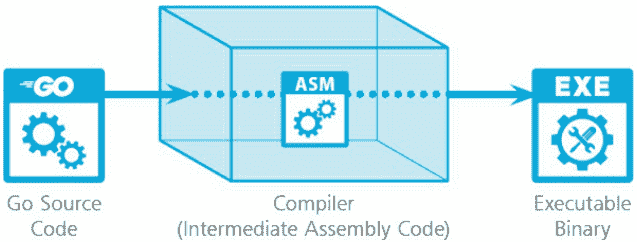

Go 编程语言的目标是表达性强、运行高效、性能出色、稳定可靠，且编写简单。部分编程语言（如 C 或 C++）高效可靠但编写复杂；而另一些编程语言（如 Java 或 Python）编写简单但性能欠佳。

Go 在很多方面与 C 语言相似，常被称为 "C 类语言" 或 "21 世纪的 C"。但 Go 远不止如此，它吸纳了众多其他编程语言的优秀特性，同时规避了会导致复杂或不可靠的功能。最重要的是，Go 引入了通过 `goroutine`（协程）和 `channel`（通道）利用多核 CPU 处理并发的能力，可以让计算机同时处理多项任务。

尽管 Go 语言没有 C++ 或 Java 等面向对象编程（OOP）语言中的类结构，但其特性仍提供了不同程度的封装、继承和多态——这些是面向对象编程（OOP）的三大基石。


Go 语言的标志性吉祥物——Go Gopher（地鼠）。


在《轻松学》系列丛书中，你还能找到更多编程语言类书籍，涵盖 C、C++、C#、Java 和 Python。访问 www.ineasysteps.com 可了解更多详情。

如今可选择的编程语言非常多，你可能会疑惑为什么要选择学习 Go 编程——接下来就为你介绍 Go 的部分优势：

### 语法简洁

Go 语言语法非常简洁，和 Python 类似。它的书写难度和 Python 一样低，但运行效率却和 C++ 相当，能让你写出易读、易维护的代码。

### 编译型语言

Go 源代码会被编译为计算机可直接读取的二进制机器码，无需在每次运行程序时都进行解释，因此用 Go 编写的程序运行速度比 Python、PHP 等解释型语言编写的程序更快。

### Go 编译器

Go 编译器速度很快，还能提供代码优化、错误检查等额外好处：它可以检测代码中未使用的变量、缺失的必要导入项，以及拼写错误或无效的代码。此外，Go 编译器还能生成适配其他操作系统的可执行二进制文件，让你编写的源代码可以跨多台机器运行。

### 并发支持

Go 语言原生支持并发，提供了 `goroutine`（协程）和 `channel`（通道）特性，让你可以编写多线程程序，同时执行多个任务。

### 垃圾回收

自动内存管理是 Go 语言的核心特性之一，它的垃圾回收器会和程序并发运行，让你编写代码时无需担心内存泄漏问题。

### 静态类型

Go 是静态类型语言，变量需要显式声明为特定的固定类型，因此开发阶段的错误能被更早发现。随着你对 Go 语言的使用经验越来越丰富，你还会发现更多它的优势，现在就先从入门开始吧……

### 安装 Go 工具集

要开始学习 Go 编程，首先需要在你的电脑上安装 Go 工具集。安装后你就可以构建、运行和测试用 Go 语言编写的程序。Go 工具集会附带大量包含实用可信代码的标准包，你可以将这些代码导入到自己的程序中使用。Go 语言安装包支持 Windows、macOS 和 Linux 系统。


- 打开浏览器访问 https://golang.org，下载对应你系统的安装包

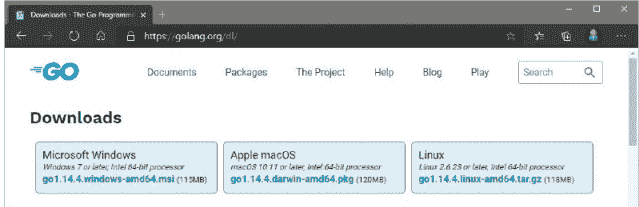

- 下载完成后，运行安装包启动「Go 编程语言安装向导」

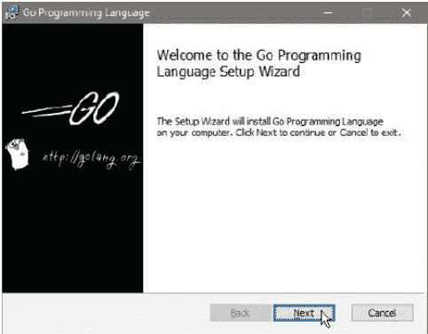

点击**下一步**继续，然后同意许可协议。接受默认的**安装目标路径**（Windows 系统下为 `C:\Go`），再点击**安装**即可完成安装。


Windows 系统的 Go 安装包会自动将 Go 添加到系统路径中，让你可以在命令提示符中直接使用 Go 工具。要验证安装是否成功，首先打开终端窗口：在 Windows 系统中同时按下 **Win 键 + R** 打开「运行」对话框，然后输入 `cmd` 打开「命令提示符」窗口。

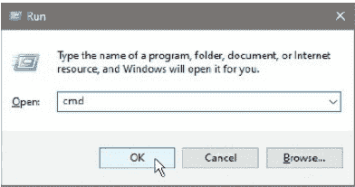

在命令提示符中输入命令 `go` 后按下 **Enter** 键，即可查看 Go 工具命令列表。


```text
C:\Users\mike_go>go
Go is a tool for managing Go source code.

Usage:

    go <command> [arguments]

The commands are:

    bug         start a bug report
    build       compile packages and dependencies
    clean       remove object files and cached files
    doc         show documentation for package or symbol
    env         print Go environment information
    fix         update packages to use new APIs
    fmt         gofmt (reformat) package sources
    generate    generate Go files by processing source
    get         add dependencies to current module and install them
    install     compile and install packages and dependencies
    list        list packages or modules
    mod         module maintenance
    run         compile and run Go program
    test        test packages
    tool        run specified go tool
    version     print Go version
    vet         report likely mistakes in packages

Use "go help <command>" for more information about a command.

Additional help topics:

    buildmode       build modes
    c               calling between Go and C
    cache           build and test caching
    environment     environment variables
    filetype        file types
    go.mod          the go.mod file
    gopath          GOPATH environment variable
    gopath-get      legacy GOPATH go get
    goproxy         module proxy protocol
    importpath      import path syntax
    modules         modules, module versions, and more
    module-get      module-aware go get
    module-auth     module authentication using go.sum
    module-private  private module configuration for non-public modules
    packages        packages list and patterns
    testing         testing flags
    testfunc        testing functions

Use "go help <topic>" for more information about that topic.
```


虽然 `go` 工具集包含不少工具，但日常使用最多的还是 `run` 工具，用来编译和运行你的程序。


「Win 键」就是印有 Windows 标志的键盘按键。


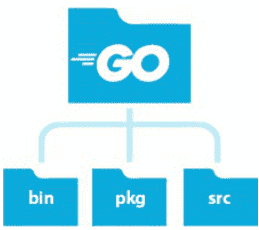

### 创建 Go 工作区

安装 Go 时，安装程序会自动设置多个 Go 环境变量。例如，`go` 工具的目录（文件夹）路径会存储在 `GOROOT` 环境变量中，默认情况下 Windows 系统下为 `C:\Go`，Linux 和 macOS 系统下为 `/usr/local/go`。

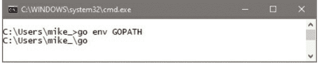

安装程序还会设置 `GOPATH` 环境变量，用来指定工作区的存储路径。默认情况下，该路径为你主目录下名为「go」的文件夹：比如 Windows 系统下的路径为 `C:\Users\userName\go`，Linux 系统下为 `/home/userName/go`，macOS 系统下为 `/Users/userName/go`——但安装程序并不会自动创建这些目录。要创建工作区，你只需在主目录下新建一个名为「go」的文件夹即可，之后还要在这个工作区目录下创建名为「bin」、「pkg」和「src」的子目录，所有你编写的 Go 程序都可以存放在「src」目录中。建议在桌面创建一个快捷方式，双击就能打开该子目录的命令行窗口，方便运行程序。

- 在 Windows 电脑上，按照前述方法打开命令提示符窗口，或者打开终端窗口
- 输入命令 `go env GOPATH` 查看当前指定的工作区路径

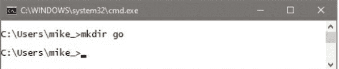


接下来，执行 `mkdir` 命令，在 `GOPATH` 环境变量指定的位置创建名为「go」的工作区目录。其中 `go\src` 文件夹用于存放你编写的程序，`go\bin` 和 `go\pkg` 目录后续会用来存储可执行文件和程序包归档。


`mkdir` 是「make directory（创建目录）」的缩写。现在继续执行 `mkdir` 命令，在工作区目录下创建「bin」、「pkg」和「src」三个子目录。

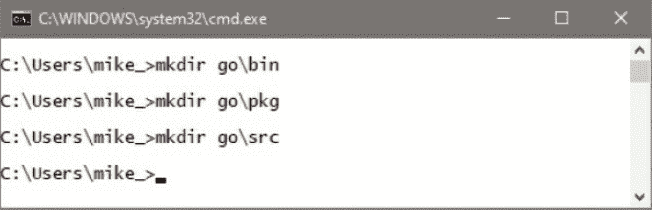

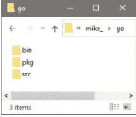

在 Windows 桌面空白处右键单击，选择**新建 → 快捷方式**打开「创建快捷方式」对话框。在位置栏输入 `cmd` 后点击**下一步**，再输入 **Go Terminal** 作为名称，点击**完成**即可在桌面创建快捷方式图标。


右键单击新建的快捷方式图标，选择**属性**选项，打开「属性」对话框。

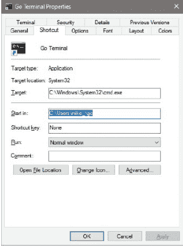

切换到**快捷方式**选项卡，输入你的工作区目录路径。点击**应用**、**确定**关闭对话框，之后双击该快捷方式图标，就能打开「src」文件夹对应的命令行窗口了。

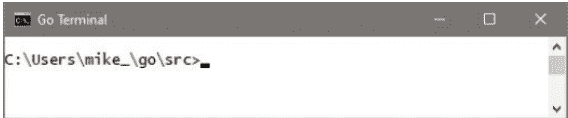


Go 程序可以使用纯文本编辑器编写，比如 Windows 系统自带的记事本应用。创建一个能打开你"src"目录下文本编辑器的桌面快捷方式会很实用。重复本页的步骤，但在第 7 步的“位置”栏输入**记事本**，名称栏输入**Go 编辑器**，即可创建另一个实用的桌面快捷方式。


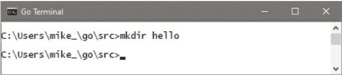


### 编写 Go 程序

所有 Go 程序最初都是以纯文本文件的形式存在，之后再被编译为可实际运行的可执行程序。这意味着 Go 程序可以用任意纯文本编辑器编写，比如 Windows 系统的记事本应用，或是 Linux 系统上的 `nano` 应用。

1. 在你的"src"文件夹中创建一个名为"hello"的子目录


2. 打开纯文本编辑器（比如记事本），完全按照如下内容输入代码以启动程序

```go
package main
```

3. 在上述代码下方两行处，完全按照如下内容插入代码

```go
import "fmt"
```

4. 再往下两行处，精确添加如下代码

```go
func main() {

    fmt.Println( "Hello World!" )
}
```


将文件保存在"hello"文件夹中，命名为 `main.go` ——此时完整的程序应该和下面的内容完全一致：

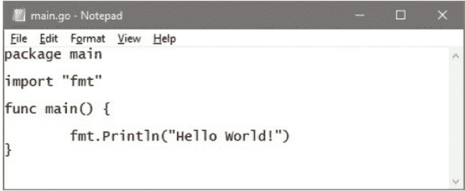


注意 `fmt.Println` 中的大写字母 **P** 和小写字母 **l**。


Go 语言中文件夹内的文件排列非常重要。每个主文件及相关文件都必须放在具有唯一名称的文件夹中，以构成一个包——因此此处的包被命名为"hello"。上一页中的各段程序代码可以单独拆解分析，以便更清晰地理解每个部分：

#### 包声明

```go
package main
```

包类型在 `package` 关键字之后声明。所有 Go 程序代码都包含在包中。你可以为将作为共享库的包声明自定义类型，但如果想要将代码编译为可执行程序，就必须声明包为"main"。


#### 导入声明

```go
import "fmt"
```

`import` 关键字用于将一个或多个包导入到当前包中，使这些包的功能可供本程序使用。"fmt"包来自 Go 标准库，该库会随 Go 安装包一并安装。它提供了本程序中用于输出文本的 `fmt.Println()` 函数。注意，包名必须用双引号括起来。导入多个包时，包名列表必须用圆括号括起来，且每个包名需独占一行，示例如下：

```go
import (
    "fmt"
    "strings"
)
```

#### 函数声明

```go
func main() {
    fmt.Println("Hello World!")
}
```

函数名位于 `func` 关键字之后，其后必须紧跟英文圆括号，且在同一行输入英文左花括号 `{`。函数体包含实际执行程序任务的语句，必须以英文右花括号 `}` 结尾。函数名必须唯一，但每个 Go 程序都必须有一个名为"main"的函数，因为它是所有 Go 程序的执行起点。包名和包类型是两个独立的部分——此处的包名为 hello，而类型是 main。


你可以在 `GOROOT` 目录位置的"src"文件夹中找到 Go 标准库包，例如路径为 `C:\Go\src`。此外，你还可以通过官方文档地址 https://golang.org/pkg 了解每个包的详细信息，这是非常有价值的资源。


#### 运行 Go 程序

Go 程序代码需要使用 Go 工具链进行编译和执行。程序开发阶段，无错误的 Go 程序可以通过 `go run` 工具直接编译运行，非常方便。如果你想创建可重复执行、可分发的可执行二进制文件版本，则可以使用 `go build` 工具。

1. 在你的 Go"src"文件夹中打开命令提示符或终端窗口

2. 输入命令 `go run hello` 来运行[此处](url)编写的程序，程序将输出问候语

3. 接着，输入命令 `go build hello` 来生成程序的可执行二进制版本[此处](url)，该命令会在你的"src"文件夹中添加一个可执行文件

4. 现在，在 Windows 系统中两次输入命令 `hello`，在 Linux 或 macOS 系统中两次输入命令 `.hello`，程序将两次输出传统问候语

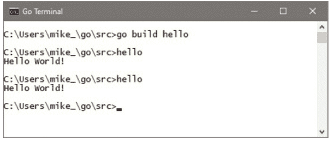


在 Windows 系统中，二进制文件会被赋予 `.exe` 文件扩展名，因此此处生成的文件为 `hello.exe`。


#### 代码格式化与注释

良好的编程习惯是在运行程序前，始终使用 `go fmt` 工具确保 Go 源代码格式正确。

1. 编辑[此处](#)的 `hello.go` 文件，添加一条注释，并插入多余的空格（不良格式）

2. 现在，在提示符后输入命令 `go fmt hello`，然后重新打开源文件即可看到正确的格式

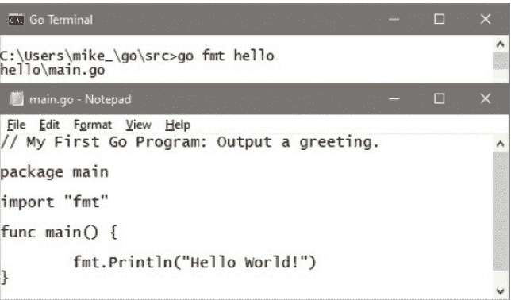


注释不能相互嵌套。`go fmt` 工具提供了简单的错误检查功能，例如，如果你遗漏了结尾的双引号，它会输出错误发生的行号、位置，以及错误性质“字符串字面量未终止”。


### 探索 VS Code 编辑器

虽然你可以用命令提示符和纯文本编辑器顺利创建 Go 程序，但许多开发者更倾向于使用专业的代码编辑器应用。这类工具提供了语法高亮、自动缩进、括号匹配、代码调试等实用的附加功能。微软推出的 Visual Studio Code（简称“VS Code”）可能是最优秀的免费代码编辑器，它支持 Windows、Linux 和 macOS 系统版本，下载地址为 https://code.visualstudio.com/download。

1. 下载并安装 VS Code

2. 要打开“扩展市场”侧边栏，首先点击**视图**、**外观**、**显示活动栏**，然后点击活动栏上的**扩展**按钮


3. 接着，在搜索框中输入"go"，查找 Go 编程语言对应的 VS Code 扩展

4. 点击**安装**按钮为 VS Code 添加 Go 语言支持，如果提示是否安装更多 Go 相关支持，选择**全部安装**

5. 点击**文件**、**添加文件夹到工作区**，添加包含存放源代码的"src"文件夹的"go"工作区文件夹

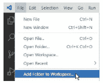

6. 点击活动栏上的**资源管理器**按钮，然后选择要打开到 VS Code 主编辑窗口的文件，例如点击"hello"文件夹中的 `main.go` 文件

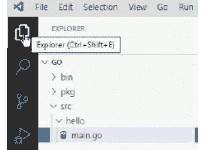

点击**视图**、**调试控制台**打开输出面板——通常该面板会显示在代码编辑器窗口下方，也可将其移动到其他位置

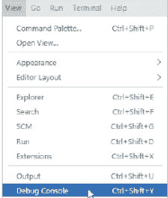

点击**运行**、**无调试运行**，即可在调试控制台中看到输出结果

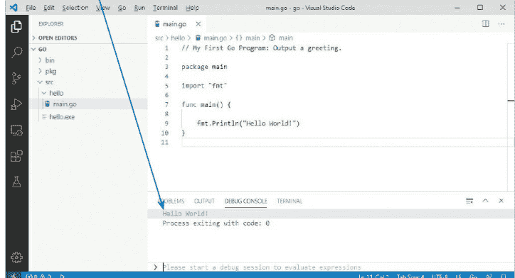

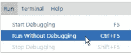


VS Code 应用具备高度自定义特性——你可以根据个人偏好调整各组件的布局，还可选择多种浅色或深色配色主题。本文中的截图均采用默认的浅色主题，代码编辑器窗口中展示的语法高亮效果与全书使用的语法高亮一致。

### 摘要

- Go 程序是纯文本文件，会被编译为机器码以生成可执行的二进制文件。

- Go 工具链可用于构建、运行和测试用 Go 编程语言编写的程序。

- Go 安装包中包含标准功能包，均为经过验证的实用代码，可导入到程序中使用。

- 命令行 `go` 命令可显示 Go 工具链的命令列表。

- `GOROOT` 环境变量存储 Go 安装路径在系统中的位置。

- `GOPATH` 环境变量存储 Go 工作区在系统中的位置。

- Go 工作区是名为 "go" 的目录，包含名为 "src"、"bin" 和 "pkg" 的子目录。

- Go 包的名称即为存放 Go 源代码文件的目录名称。

- Go `package` 声明用于指定包的类型，若要编译为可执行文件，必须声明为 `package main`。

- `import` 声明用于导入程序需要使用到的功能包名称。

- 函数声明包含 `func` 关键字，后接函数名、`( )` 圆括号以及`{ }` 花括号。

- 所有 Go 程序都必须包含名为 "main" 的函数作为程序入口。

- `go run` 命令可编译并运行程序。


- `go build`命令可编译程序并生成可分发的可执行二进制文件。

- `go fmt`命令用于正确格式化 Go 包的源代码。

- VS Code 提供语法高亮、自动缩进、括号匹配、代码调试等功能。

## 2 存储值

本章演示如何在 Go 程序中使用变量容器存储、检索和操作各类数据。

- 创建程序变量

- 显示变量值

- 转换数据类型

- 修复常量值

- 指向存储值

- 摘要

### 创建程序变量


变量是 Go 程序中的一种容器，可将数据值存储在计算机内存中。存储的值可通过变量名引用，通过赋予新值的方式修改该值。程序员可为变量选择任意名称，前提是需遵守下列列出的命名规则：

| 命名规则 | 示例 |
|--|--|
| 不能是 Go 关键字 | `default` |
| 不能包含算术运算符 | `a+b*c` |
| 不能包含标点字符 | `%$#@!` |
| 不能包含任何空格 | `no spaces` |
| 必须以字母开头 | `msg` |
| 其余位置可包含数字 | `good1` |
| 可包含大小写混合 | `camelCase` |

变量名应简洁明了，且始终以小写字母开头——除非该变量需要被其他包访问（后续会进一步介绍）。为变量选择具有实际意义的名称是一种良好的编程习惯，能够让程序代码更易理解。

要在程序中创建变量，只需使用`var`关键字对其进行“声明”即可。变量声明的语法格式如下：

```
var variableName dataType
```

`var`关键字后接一个空格，接着是选定的变量名，最后是该变量允许存储的数据类型。通常，该数据类型为前一页描述的5种数据类型之一。可在单次声明中以逗号分隔的列表形式创建多个同一数据类型的变量，示例如下：

```
var variableName1, variableName2, variableName3 dataType
```


Go 关键字列于本书扉页内侧的表格中。


在 Go 中变量名区分大小写——因此名为 "NUM"、"Num" 和 "num" 的变量会被视为三个不同的变量。

Go 语言的基础数据类型使用 Go 关键字定义，这些类型及每种数据类型的说明列于下表：

| 数据类型 | 说明 | 示例 |
|--|--|--|
| `string` | 字符串 | "Hi there!" |
| `int` | 整数 | 100 |
| `float64` | 精度约为15位的小数 | 0.0123456789 |
| `byte` | 可存储单个字符的字节 | 'A' |
| `bool` | 布尔值 true 或 false | true |

需要注意的是，Go 是“静态类型”语言，这意味着变量只能存储其声明时指定的数据类型的数据。当为变量赋予一个值时，即表示该变量已被“初始化”。变量可以先声明，之后再初始化；也可以在声明的同时完成初始化。

例如，初始化一个存储`string`类型数据的变量：

```
var msg string
msg = "Hi there!"
```

```
var msg string = "Hi there!"
```

此外，还可使用特殊的`:=`运算符声明并初始化变量，这种情况下无需使用`var`关键字或指定数据类型，示例如下：

```
msg := "Hi there!"
```

Go 编译器会自动根据赋予变量的数据类型推断该变量的类型。这是创建并初始化变量的首选方式——但仅可在函数体内部使用。


`byte`类型的字符值必须用单引号‘ ’包裹——使用双引号是错误的。


Go 编程中推荐使用简短的变量名，因此本文示例中使用`msg`而非`message`作为变量名。

### 显示变量值


可使用第1章中用于输出 "Hello World!" 信息的`fmt.Println()`函数显示变量值。此外，也可使用合适的“格式说明符”结合变量名，向`fmt.Printf()`函数指定所需的变量值输出格式：

| 说明符 | 说明 | 示例 |
|-----------|-------------|---------|
| `%s` | 字符串 | "Go Fun!" |
| `%d` | 范围-32768到+32767的整数 | 100 |
| `%f` | 浮点数 | 0.123456 |
| `%c` | 单个字符 | 'A' |
| `%t` | 布尔值 | true |
| `%p` | 机器内存地址 | 0x0022FF34 |
| `%v` | 默认格式的值 | *(上述任意类型均可)* |
| `%T` | 变量的数据类型 | `int` |

格式说明符可在 `%` 字符后指定所需空格数，确保输出占据最少空格数——例如，使用说明符`%7d`可确保整数始终至少占7个空格。如果希望空白处用零填充，只需添加一个零将说明符改为`%07d`即可。精度说明符是英文句点（.）后接一个数字，可与`%f`格式说明符搭配使用，用于指定显示的小数位数——例如，使用`%.2f`可显示两位小数。精度说明符可与最小空格说明符组合使用，以控制空格数量和小数位数——例如，使用`%07.2f`格式指定符，可输出总宽度为7、包含两位小数、空位用零填充的数值。默认情况下，空位位于数字前方，因此输出为右对齐。若要在数字后方添加空位实现左对齐，只需在最小宽度指定符前加上负号即可。`%v`格式化指定符可用于输出任意值，`%T`格式化指定符则可用于确认任意变量的数据类型。

1. 在`src`文件夹下创建名为`vars`的目录，对应路径为`src\vars\main.go`
2. 使用包声明和导入声明开始编写`main.go`程序

```go
package main

import "fmt"
```

3. 添加一个`main`函数，用于声明并初始化两个变量

```go
func main() {

	num := 100

	pi := 3.1415926536 // Statements to be inserted here.

}
```

4. 在`main`函数中，插入语句以多种格式输出变量值

```go
fmt.Printf("num: %v type:%T \n", num, num )

fmt.Printf("pi: %v type:%T \n\n", pi, pi )

fmt.Printf(
	"%%7d displays %7d \n", num )

fmt.Printf(
	"%%07d displays %07d \n\n", num )

fmt.Printf(
	"Pi is approximately %1.10f \n", pi )

fmt.Printf("Right-aligned %20.3f rounded pi \n", pi)

fmt.Printf("Left-aligned %-20.3f rounded pi \n", pi)
```

5. 将程序文件保存在`vars`目录中，随后运行程序即可查看指定格式的变量值

`fmt.Printf()`函数不会在输出后自动换行，你必须手动添加`\n`换行转义序列来将打印头移动到下一行。若要使用`fmt.Printf()`函数输出`%`字符，需要在其前再加一个`%`字符，如本例所示。请注意，当格式化指定符分配的小数位少于原值的小数位数时，浮点值会被四舍五入，而非直接截断。

### 转换数据类型

有时你需要将变量中存储的值转换为其他数据类型。通常，我们会将字符串值转换为数值类型以执行算术运算。例如，`字符串`可能包含数字字符"42"，但除非将其转换为`int`或`float64`数据类型，否则无法对该值执行算术运算。Go标准库包含`strconv`包，其中提供了在`字符串`数据类型与其他类型之间转换的函数。你可以通过在导入声明中添加`strconv`包，让程序使用这些函数。

`strconv.Atoi()`函数可将括号内指定的`字符串`转换为`int`数据类型，返回与该`字符串`等价的`int`值。但与其他Go函数一样，它还会返回第二个值：如果转换成功，该值为特殊的`nil`零值；如果转换失败，则返回错误信息。这意味着你必须将`strconv.Atoi()`函数的调用结果赋值给两个变量，以接收两个返回值，示例如下：

```go
num, err := strconv.Atoi("42")
```

此外还有`strconv.Itoa()`函数，可将`int`值转换为`字符串`值，但它仅返回单个`字符串`值。如果你需要将`字符串`值转换为`float64`类型，可以使用`strconv.ParseFloat()`函数。与`strconv.Atoi()`类似，该函数会返回与`字符串`等价的`float64`值，以及`nil`值或错误信息。它需要将`字符串`值和浮点数位数（`64`）作为括号内的参数，例如`strconv.ParseFloat("42", 64)`。不同数值数据类型之间的强制转换只需在要转换的值前加上所需类型的括号即可，示例如下：

```go
var num int = 42

var decimal float64 = float64(num)
```

有趣的是，当`byte`数据类型（`uint8`的别名，即8位无符号整数）类型的变量被赋值为单个字符时，它会存储该字符对应的ASCII字符码数值，该数值可以轻松强制转换为`字符串`数据类型，示例如下：

```go
var char byte = 'A'

var str = string(char)
```

ASCII（发音为“as-kee”）是“American Standard Code for Information Interchange（美国信息交换标准代码）”的缩写，是纯文本的通用标准。你可以在www.asciitable.com查询完整的标准ASCII码表。

1. 在`src`文件夹下创建名为`cast`的目录，对应路径为`src\cast\main.go`
2. 使用包声明和导入声明开始编写`main.go`程序

```go
package main

import (
	"fmt"
	"strconv"
)
```

3. 添加一个`main`函数，用于声明并初始化两个变量

```go
func main() {

	var str string = "42"

	var char byte = 'A'

	// Statements to be inserted here.

}
```

4. 在`main`函数中，插入语句以输出经过各种转换后的变量值

```go
num, err := strconv.Atoi(str)

fmt.Printf("num:%v %T %v \n", num, num, err)

decimal := float64(num)

fmt.Printf("decimal: %.2f %T \n", decimal, decimal)

fmt.Printf("char:%v %T %v \n", char, char, string(char))
```

5. 将程序文件保存在`cast`目录中，随后运行程序即可查看转换后的变量值

你后续将学习如何通过检测`err`值是否为`nil`来确认转换是否成功——这是Go编程中普遍遵循的最佳实践。从`float`强制转换为`int`时，值会被截断，因此对于`f := 3.9`和`n := int(f)`，变量`n`会被赋值为`3`。

### 固定常量值

如果你需要存储程序运行期间永远不会改变的固定值，应使用`const`关键字而非`var`关键字来声明它，这样可以防止意外（或恶意）为其赋予其他值。如果你的代码尝试为常量赋予新值，编译器会显示"cannot assign to"错误提示。与变量声明不同，常量声明必须在声明时初始化其固定值，示例如下：

```go
const oneMillion = 1000000
```

常量声明可以选择指定数据类型，但如果在声明中省略了显式数据类型，Go编译器会根据赋的值推断其类型。你可以在单个声明中以逗号分隔的列表形式创建多个相同或不同数据类型的常量，示例如下：

```go
const oneMillion, oneThousand = 1000000, "1,000"
```

很有用的一点是，常量声明可以使用名为`iota`的“常量生成器”来创建一系列关联的常量值。常量名称需要列在`const`关键字后的圆括号内，每行一个，第一个常量会被赋值为`iota`的值。这会生成一个从0开始的数值序列，列表中每个命名的常量值依次加1。例如，你可以将数值序列分配给代表星期几的常量，示例如下：

```go
const (
	sunday = iota
	monday
	tuesday
	wednesday
	thursday
	friday
	saturday
)
```

在本例中，`sunday`常量会被赋值为0，`monday`会被赋值为1，以此类推。如果你想从其他数字开始序列，只需在第一个常量的赋值中将`iota`与该数字相加即可。在其他编程语言中，生成的序列通常被称为“枚举”（enumeration）或简称为“枚举”（enum）。

1. 在`src`文件夹下创建名为`const`的目录
2. 使用包声明和导入声明开始编写`main.go`程序

```go
package main

import "fmt"
```

3. 添加一个`main`函数，用于声明并初始化一个单独常量以及一个从1开始的常量序列

```go
func main() {

	const pi = 3.14159

	const (
		red = iota + 1
		yellow
	)
}
```

```go
green brown blue pink black ) // Statements to be inserted here.
}
```

#### 接下来，插入语句以显示多个常量值

```go
fmt.Printf( "Pi approximately: %v \n\n", pi)

fmt.Printf( "Red: %v points \n", red )

fmt.Printf( "Blue: %v points \n", blue )

fmt.Printf( "Black: %v points \n", black )
```

#### 将程序文件保存在“const”目录下，然后运行程序以查看常量值

> Go语言中的`math`包提供了一个名为`math.Pi`的常量，它是$\pi$值的精确得多的近似值。此处的序列代表斯诺克比赛中每个球的得分值。

## 指向存储的值

每当你的程序创建一个容器来存储数据时，计算机都会在内存中分配一块空间来存储这些数据。就像房屋一样，内存位置可能大小不同，但每个位置都有唯一的地址。因此，已初始化的变量实际上由三部分组成——名称、值以及存储数据的内存地址。

Go语言支持“指针”的概念。指针变量可以存储另一个变量的地址，并且可以访问该地址存储的值。声明指针变量时需要给数据类型加上`*`星号前缀，以表明该变量是指针：

```go
var ptr *int // Declares this variable will point to an int.
```

可以通过给另一个变量的名称加上`&`与号前缀，将该变量的地址分配给指针：

```go
ptr = &num // Assigns an address to the pointer variable.
```

然后可以通过给指针名称加上`*`星号前缀，来访问指定地址处的值：

```go
*ptr // Points to the value at the assigned address.
```

指针的概念可能很难理解，因为`*`星号运算符有两个作用——在声明中用作类型描述符，放在指针名称前时用作解引用符。你现在可能在想“指针，那又怎样？”，但指针在Go编程中被广泛使用，因此在继续学习之前你应该彻底理解它们的工作原理。

1. 在你的`src`文件夹内创建一个名为`point`的目录
   `src\point\main.go`

2. 使用包和导入声明开始编写`main.go`程序

```go
package main

import "fmt"
```

3. 添加一个主函数，在其中声明并初始化一个普通整型变量和一个指针变量

```go
func main() {
	var num int = 20
	var ptr *int = &num // Statements to be inserted here.
}
```

4. 接下来，插入语句以显示普通整型变量的值和内存地址

```go
fmt.Printf("num value: %v type: %T \n", num, num)
fmt.Printf("num address: %v type: %T \n\n", ptr, ptr)
```

5. 现在，插入语句以显示指针变量的解引用值和内存地址

```go
fmt.Printf( "num via pointer: %v type: %T \n", *ptr, *ptr )
fmt.Printf( "ptr address: %v type: %T \n\n", &ptr, &ptr )
```

6. 最后，插入语句以通过给指针变量赋值的方式，修改整型变量中存储的值


```go
*ptr = 100
fmt.Printf("new num value: %v type: %T \n", num, num)
```

将程序文件保存在“point”目录下，然后运行程序以查看变量值和地址。

> 这里需要认识到的最重要特性是，指针会修改其所指向变量中存储的原始值，而不是该值的副本。这一点在将变量传递给函数时尤为重要——见此处。

### 总结

- 变量可存储通过变量指定名称引用的数据，且其值可被修改
- 显式变量声明使用`var`关键字，并声明该变量可包含的数据类型
- 隐式变量声明可在函数体内使用`:=`运算符推断数据类型来完成
- Go是静态类型语言，变量只能包含声明中指定类型的数据
- `fmt.Printf()`函数可使用格式说明符、变量名和`\n`换行转义序列来格式化输出
- `strconv.Atoi()`函数会返回括号内指定的`string`值对应的`int`类型数据，以及第二个返回值，该值将为`nil`或错误消息
- `strconv.Itoa()`函数会返回括号内指定的`int`值对应的`string`类型数据
- `strconv.ParseFloat()`函数会返回括号内指定的`string`值对应的`float64`类型数据，以及第二个返回值，该值将为`nil`或错误消息
- 当`byte`类型的变量被赋予一个字符时，它会存储该字符的ASCII字符编码值
- 数值数据类型之间的类型转换需先指明所需类型，后跟包含待转换值的括号
- 常量声明使用`const`关键字，且必须用其将包含的固定值进行初始化
- 指针变量可存储另一个变量的内存地址，并能访问该地址存储的值
- `*`星号运算符在指针变量声明中前缀于数据类型，以表明该变量将是指针
- `&`与号运算符前缀于普通变量名称，以引用该变量的内存地址
- `*`星号运算符前缀于指针变量名称，以引用该指针指向地址处存储的值

## 3 执行操作

- 执行算术运算
- 赋值
- 进行比较
- 判断逻辑
- 处理位运算
- 理解优先级
- 总结

### 执行算术运算

Go程序中常用的算术运算符如下表所示，同时列出了它们所执行的运算：

| 运算符 | 运算 |
|----------|-----------|
| `+` | 加法 |
| `-` | 减法 |
| `*` | 乘法 |
| `/` | 除法 |
| `%` | 取余 |
| `++` | 自增 |
| `--` | 自减 |

赋值、加法、减法、乘法和除法运算符的作用符合你的预期，但在使用多个运算符时需要注意表达式的分组——最内层`( )`括号内的运算会优先执行：

```go
a = b * c - d % e / f; // This is unclear.
```

```go
a = ( b * c ) - ( ( d % e ) / f ); // This is clearer.
```

`%`取余运算符将第一个给定的数字除以第二个给定的数字，并返回运算的余数。该运算符可用于判断一个数字是奇数还是偶数。`++`自增运算符和`--`自减运算符会将给定数字增加或减少1，并返回结果值。它们最常用于统计循环中的迭代次数——每次迭代使用`++`自增运算符计数递增，或使用`--`自减运算符计数递减。`++`自增或`--`自减运算符必须紧跟在变量名之后才能修改变量的值。例如：

```go
n := 4
n++ // Now n is 5.
```

> `+`运算符有双重用途——它也用于拼接字符串。

> 与运算符一起用于构成表达式的值称为“操作数”——在表达式`2 + 3`中，数值`2`和`3`就是操作数。

1. 在你的“src”文件夹内创建一个名为“arith”的目录`src\arith\main.go`
2. 使用包和导入声明开始编写`main.go`程序
```go
package main

import "fmt"
```
3. 添加一个主函数，在其中声明并初始化两个变量
```go
func main() {
```

```go
a := 8
b := 4
// 此处插入待添加语句。
}
```
## 4 在主函数中插入语句，输出每种算术运算后的结果值
```go
fmt.Println("Addition:\t", (a + b))
fmt.Println("Subtraction:\t", (a - b))
fmt.Println("Multiplication:\t", (a * b))
fmt.Println("Division:\t", (a / b))
fmt.Println("Remainder:\t", (a % b))
```
## 5 现在，插入语句修改存储的值并显示它们的新值
```go
a++
fmt.Println("Increment:\t", a)
b--
fmt.Println("Decrement\t", b)
```
## 6 将程序文件保存在"arith"目录中，然后运行程序查看每种运算的结果
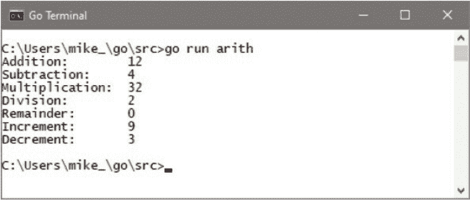


此处，`\t`转义序列用于输出制表符空格来对齐结果。

## 赋值


Go编程中用于赋值的运算符如下表所示。除简单的`=`赋值运算符外，其余都是更长表达式的简写形式，因此为清晰起见给出了每种运算符的等效写法：

| 运算符 | 示例 | 等效写法 |
| :--- | :--- | :--- |
| `=` | `a = b` | `a = b` |
| `+=` | `a += b` | `a = (a + b)` |
| `-=` | `a -= b` | `a = (a - b)` |
| `*=` | `a *= b` | `a = (a * b)` |
| `/=` | `a /= b` | `a = (a / b)` |
| `%=` | `a %= b` | `a = (a % b)` |

在上面的赋值示例中，对于`a = b`，名为`a`的变量被赋值为名为`b`的变量所包含的值——因此该值随后成为存储在`a`变量中的值。从技术上讲，赋值运算符将右操作数的值存储在左操作数所标识的内存位置中，然后返回该值作为结果。`+=`组合运算符用于将值加到已存储在变量中的现有值上。在上面的示例中，对于`a += b`，变量`b`中的值被加到变量`a`中的值上——因此总和随后成为存储在`a`变量中的值。首先对分组后的操作数执行算术运算，然后将结果存储在第一个变量标识的内存位置中并返回。所有其他组合运算符的工作方式相同：先对两个值执行算术运算，然后将运算结果赋值给第一个变量，成为其新的存储值。使用`%=`组合运算符时，分组后的左操作数`a`除以分组后的右操作数`b`，然后将该运算的余数赋值给第一个变量`a`。


`+=`组合运算符有双重用途——它也可用于连接字符串。


将`=`运算符理解为“赋值”而非“等于”非常重要，这样可以避免与下文所述的`==`相等运算符混淆。

1. 在“src”文件夹中创建名为“assign”的目录

```go
src\assign\main.go
```
2. 以包声明和导入声明开始编写`main.go`程序
```go
package main

import "fmt"
```
3. 添加一个声明了两个变量的`main`函数
```go
func main() {
    var a, b int
    // 此处插入待添加语句。
}
```

在主函数中，插入语句输出单纯赋值后的值
```go
a, b = 8, 4
fmt.Println("Assigned Values:\ta =", a, "\tb =", b)
```

现在，插入语句修改存储在第一个变量中的值并显示其新值
```go
a += b // a = 8 + 4.
fmt.Println("Add and Assign:\ta =", a)
a -= b // a = 12 - 4.
fmt.Println("Subtract and Assign:\ta =", a)
a *= b // a = 8 * 4.
fmt.Println("Multiply and Assign:\ta =", a)
a /= b // a = 32 / 4.
fmt.Println("Divide and Assign:\ta =", a)
a %= b // a = 8 % 4.
fmt.Println("Remainder Assigned:\ta =", a)
```

将程序文件保存在"assign"目录中，然后运行程序查看每种运算的结果
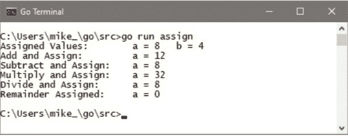

注意此处是如何在一个语句中初始化多个变量的。


操作数必须是相同的数据类型。

## 进行比较


Go编程中常用的用于比较两个数值的运算符如下表所示：

| 运算符 | 比较测试 |
| --- | --- |
| `==` | 相等 |
| `!=` | 不等 |
| `>` | 大于 |
| `<` | 小于 |
| `>=` | 大于等于 |
| `<=` | 小于等于 |

`==`相等运算符比较两个操作数，如果两者的值相等则返回`true`，否则`==`运算符将返回`false`。如果两者是相同的数字则视为相等，如果两者是字符则比较它们的ASCII码值。相反，`!=`不等运算符使用与`==`相等运算符相同的规则，如果两个操作数不相等则返回`true`，否则返回`false`。相等和不等运算符适用于测试两个变量的状态，以执行程序中的条件分支。

> “大于”运算符比较两个操作数，如果第一个的值大于第二个则返回`true`，如果相等或小于则返回`false`。“小于”运算符执行相同的比较，但如果第一个操作数的值小于第二个则返回`true`，否则返回`false`。通常，“大于”或“小于”运算符用于测试循环结构中迭代计数器的值。在“大于”运算符或“小于”运算符后添加`=`赋值运算符，会使它们在两个操作数值完全相等时也返回`true`。


比较运算符也被称为“关系运算符”。

- 在“src”文件夹中创建名为“comp”的目录

```go
src\comp\main.go
```
- 以包声明和导入声明开始编写`main.go`程序
```go
package main

import "fmt"
```
- 添加一个`main`函数，声明并初始化五个变量
```go
func main() {
    var zero, num, max int = 0, 0, 1
    var up, dn byte = 'A', 'a'
    // 此处插入待添加语句。
}
```
- 在主函数中，插入语句输出几次比较的结果
```go
result := (num == zero) // 0 == 0.
fmt.Println("Equality:\tnum == zero\t", result)
result = (up == dn) // A == a.
fmt.Println("Equality:\tup == dn\t", result)
result = (max != zero) // 1 != 0.
fmt.Println("Inequality:\tmax != zero\t", result)
result = (zero > max) // 0 > 1.
```
```go
fmt.Println("Greater:\tzero > max\t", result)
result = (max <= zero) // 1 <= 0.
fmt.Println("Less or Equal:\tmax <= zero\t", result)
```
- 将程序文件保存在“comp”目录中，然后运行程序查看每次比较的结果
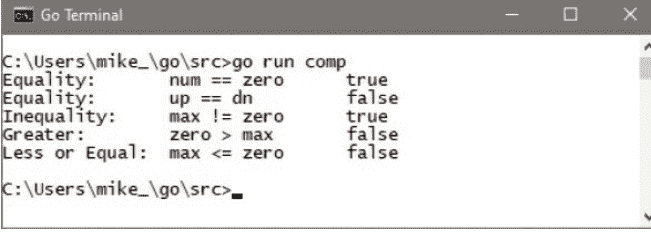

> 大写`'A'`的ASCII码值是65，但小写`'a'`的ASCII码值是97——因此这里的比较返回`false`。

> 比较数字时，记得同时测试相等性以及高低值比较。

## 评估逻辑


Go编程中最常用的逻辑运算符如下表所示：

| 运算符 | 运算 |
| -------- | --------- |
| `&&` | 逻辑与 |
| `\|\|` | 逻辑或 |
| `!` | 逻辑非 |

逻辑运算符与具有`true`或`false`布尔值的操作数一起使用，或是可转换为`true`或`false`的数值一起使用。`&&`逻辑与运算符会对两个操作数进行求值，仅当两个操作数自身都为`true`时才返回`true`，否则`&&`逻辑与运算符将返回`false`。它常用于条件分支中，程序的方向由测试两个条件来确定——如果两个条件都满足，程序将走向某一方向，否则将采取不同方向。与需要两个操作数都为`true`的`&&`逻辑与运算符不同，`||`逻辑或运算符会对两个操作数进行求值，如果任一操作数自身返回`true`则返回`true`，但如果两个操作数都没有返回`true`，则`||`逻辑或运算符将返回`false`。这在Go编程中很有用，当两个测试条件中的任一条件满足时，可执行特定操作。

`!`逻辑非运算符是一个一元运算符，需置于单个操作数之前。它会返回给定操作数的逆值，因此若变量`a`的值为真，则`!a`的值为假。`!`逻辑非运算符在Go程序中十分实用，可用于在循环的连续迭代中通过`a = !a`这样的语句切换变量的值。这能确保每次循环时值都会发生改变，就像拨动电灯开关一样。“布尔”这一术语指的是由英国数学家乔治·布尔（1815-1864）创立的一套逻辑体系。

- 在“src”文件夹中创建一个名为“logic”的目录 `src\logic\main.go`
- 为`main.go`程序添加包声明和导入声明
```go
package main
import "fmt"
```
- 添加一个`main`函数，在其中声明并初始化两个变量
```go
func main() {
    var yes, no bool = true, false // Statements to be inserted here.
}
```
- 在`main`函数中插入语句，判断两个变量的值是否都为真
```go
result := (yes && no)
fmt.Println("AND Logic:\tyes && no\t", result)
```
- 接下来，插入语句，判断两个变量中是否至少有一个为真值
```go
result = (yes || no)
fmt.Println("OR Logic:\tyes || no\t", result)
```
- 现在，插入语句来显示变量的当前值及其逆值
```go
result = !yes
fmt.Println("NOT Logic:\tyes =", yes, "\t!yes =", result)
```
- 将程序文件保存在“logic”目录中，之后运行程序查看逻辑运算的结果
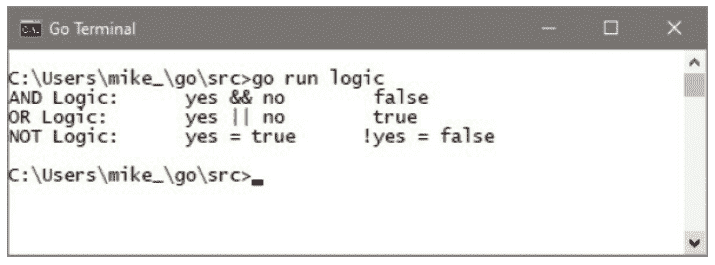


`!`逻辑非运算符返回的值为存储值的逆——存储值本身保持不变。


比较`假 && 假`会返回`假`，而非`真`——这印证了“两个错误不能构成一个正确”这句谚语。

## 位运算操作


从计算机角度来说，每个字节由8个位组成，每个位可存储`1`或`0`来表示二进制数，对应十进制的0到255。仅在位存储`1`时，该位才会贡献对应的十进制分量。分量从右到左依次被指定为“最低有效位（LSB）”到“最高有效位（MSB）”。下面的位模式中的二进制数`00110010`对应十进制数50（2+16+32）：

| 位编号 | 8<br>MSB | 7 | 6 | 5 | 4 | 3 | 2 | 1<br>LSB |
| --- | --- | --- | --- | --- | --- | --- | --- | --- |
| 十进制 | 128 | 64 | 32 | 16 | 8 | 4 | 2 | 1 |
| 二进制 | 0 | 0 | 1 | 1 | 0 | 0 | 1 | 0 |

我们可以使用下方列出的Go“位运算”运算符来操作字节中的单个位部分：

| 运算符 | 名称 | 示例运算 |
| --- | --- | --- |
| `&` | 与 | 0011 & 0101 = 0001 |
| `\|` | 或 | 0011 \| 0101 = 0111 |


| `^` | 异或 | `0011 ^ 0101 = 0110` |

| `^` | 非 | `^0101 = 1010` |

| `&^` | 与非 | `0011 &^ 0101 = 0010` |

| `<<` | 左移 | `0010 << 2 = 1000` |

| `>>` | 右移 | `1000 >> 2 = 0010` |

目前位运算符最普遍的用途是操作代表一组布尔「标志」的紧凑「位域」。这种方式比将布尔标志值存储在独立变量中更节省内存——仅1字节的`byte`类型即可存储包含8个标志的位域，每个位对应一个标志，而8个独立的`byte`变量则需要占用8整字节的内存。

许多Go程序员从未使用到位运算符，但了解位运算符是什么以及它们的用途是很有帮助的。

字节的每一半被称为「半字节」（4位）。表格中示例的二进制数值对应存储在半个字节中的值。

- 在`src`文件夹中创建一个名为`bits`的目录

```
src\bits\main.go
```

- 为`main.go`程序添加包声明和导入声明

```go
package main
import "fmt"
```

- 添加一个`main`函数，在其中声明并初始化一个由8个位组成的变量

```go
func main() {
    var flags byte = 10 // Binary 1010 (1x8 0x4 1x2 0x1). // Statements to be inserted here.
}
```

- 在`main`函数中插入语句，输出所有位标志的设置

```go
fmt.Printf( "Flag #1:%v \n", ( flags & 1 ) > 0 )
fmt.Printf( "Flag #2:%v \n", ( flags & 2 ) > 0 )
fmt.Printf( "Flag #3:%v \n", ( flags & 4 ) > 0 )
fmt.Printf( "Flag #4:%v \n", ( flags & 8 ) > 0 )
```

- 接下来，插入一条语句来显示代表该位模式的十进制值

```go
fmt.Printf( "Flags Value: %08b \t%v \n", flags, flags )
```

- 现在，插入语句将处于“开启”状态的位标志右移1位，并输出新位模式的十进制值

```go
flags = flags >> 1

fmt.Printf( "New Value: %08b \t%v \n", flags, flags )
```

- 将程序文件保存在`bits`目录中，之后运行程序查看位标志的值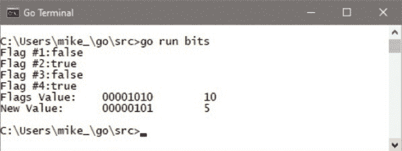 

注意！可使用内存容量更大的变量创建包含更多位标志的更大位域——在32位系统上，`int`数据类型的宽度为32位，在64位系统上宽度为64位。

`%b`格式说明符在此处用于输出每个位对应的二进制数值。

## 理解运算符优先级

运算符优先级定义了Go编译器计算表达式的顺序。在表达式`6 + 7 * 3`中，优先级决定了加法和乘法哪个先执行。

下表按优先级从高到低列出了运算符优先级：优先级越高的运算符（位于越上方的行）会先执行。同一行的二元运算符优先级相同，执行顺序由从左到右的顺序决定，因此左侧的运算会先执行。

| 优先级等级 | 运算符 |
| --- | --- |
| 5 | `*` `%` `<<` `>>` `&` |
| 4 | `+` `-` `\|` `^` |
| 3 | `==` `!=` `<` `<=` `>=` |
| 2 | `&&` |
| 1 | `\|\|` |

`++`自增运算符与`--`自减运算符在Go编程中单独构成语句，不会出现在表达式中，因此未包含在上方的优先级表中。你可以通过将表达式中的部分内容用括号包裹，强制编译器忽略默认优先级，使其优先计算表达式的最内层部分。例如，在表达式`6 + 7 * 3`中，`*`乘法运算符默认优先级高于`+`加法运算符，因此会先执行乘法运算`7 * 3 = 21`，再执行加法运算`21 + 6 = 27`。若你希望先执行加法运算，则可以通过在表达式中添加括号来强制编译器执行该顺序：`( 6 + 7 ) * 3`。此时表达式的计算顺序为`6 + 7 = 13`，再进行乘法运算`13 * 3 = 39`。

1. 在`src`文件夹中创建一个名为`force`的目录

```
src\force\main.go
```

2. 为`main.go`程序添加包声明和导入声明

```go
package main
import "fmt"
```

3. 添加一个`main`函数，在其中通过计算表达式声明并初始化一个变量，随后输出该变量的值

```go
func main() {
    sum := 2 * 3 + 4 - 5
    fmt.Printf( "Default Order: %v \n", sum )
    // Statements to be inserted here.
}
```

4. 在`main`函数中插入语句，输出修改后表达式的计算结果

```go
sum = 2 * ( ( 3 + 4 ) - 5 )
fmt.Printf( "Forced Order: %v \n\n", sum )
```

5. 接下来，插入一条语句，输出另一表达式的计算结果

```go
sum = 7 % 3 * 2
fmt.Printf( "Default Order: %v \n", sum )
```

6. 现在，插入语句，输出另一修改后表达式的计算结果

```go
sum = 7 % ( 3 * 2 )
fmt.Printf( "Forced Order: %v \n", sum )
```

7. 将程序文件保存在`force`目录中，之后运行程序查看不同的运算结果

```
C:\Users\mike_\go\src>go run force

默认顺序：5

强制顺序：4

默认顺序：2

强制顺序：1

C:\Users\mike_\go\src>
```


表达式中请使用括号，以避免出现意外结果。

### 摘要

- 算术运算符可以与两个操作数组成表达式，分别对应加法`+`、减法`-`、乘法`*`、除法`/`和取余`%`。

- 递增`++`和递减`--`运算符会将单个操作数的值增加或减少1。

- 赋值`=`运算符可以和算术运算符组合使用，先执行算术计算，再将计算结果赋值给变量。

- 比较运算符可以与两个操作数组成表达式，用于比较相等`==`、不等`!=`、大于`>`、小于`<`、大于等于`>=`和小于等于`<=`的关系。

- 逻辑与`&&`和逻辑或`||`运算符可组成对两个操作数求值的表达式，返回布尔值`true`或`false`。

- 逻辑非`!`运算符会返回单个操作数的逆布尔值。

- 单个内存字节由8个位组成，每个位的值可以是1（1）或0（0）。

- 按位运算符或`|`、与`&`、非`^`和异或`^`会在对两个位中的值进行比较后返回结果值。

- 左移`<<`和右移`>>`运算符会将位的值按指定数量向对应方向移动。

- 按位运算符最常用于操作包含一组布尔标志的紧凑位域。

- 包含多个运算符的表达式会按照默认的优先级执行运算，除非通过添加括号显式修改运算顺序。

## 4 控制流

本章介绍语句如何通过求值表达式来决定Go程序的执行方向。

### 测试条件

### Switch 分支

### 多次循环

### 条件为真时循环

### 跳出循环

### 跳转至标签

### 摘要

### 测试条件


`if`关键字用于执行基本的条件测试，它会求值给定的表达式，判断其结果为布尔值`true`还是`false`。

求值后`{ }`大括号内的语句仅在表达式条件为`true`时才会执行。

`if`测试语句的语法如下：

```go
if test-expression {
  statements-to-execute-when-the-condition-is-true
}
```

当测试结果为`true`时，可能需要执行多条语句，但每条语句必须独占一行。

有时候我们需要求值多个表达式来判断是否要执行后续语句，这可以通过逻辑`&&`与运算符实现，语法如下：

```go
if test-expression && test-expression {
  statements-to-execute-when-all-conditions-are-true
}
```

另外，也可以将多个`if`语句“嵌套”在一起来求值多个表达式，示例如下：

```go
if test-expression {
  if test-expression {
    statements-to-execute-when-all-conditions-are-true
  }
}
```

当`if`测试语句求值的一个或多个表达式结果为`false`时，其后续大括号内的语句不会执行，程序会继续执行后面的代码。

通常我们会通过在`if`语句后追加`else`语句来扩展其功能，`else`语句用于指定当`if`语句求值的表达式结果为`false`时要执行的大括号内的语句，语法如下：

```go
if test-expression {
  statements-to-execute-when-the-condition-is-true
} else {
  statements-to-execute-when-the-condition-is-false
}
```

这是一种基础的编程技术，可根据求值结果为程序提供两个执行方向，被称为“条件分支”。


测试表达式和左`{`大括号必须与`if`关键字位于同一行。


`else`关键字和左`{`大括号必须与上一块语句的右`}`大括号位于同一行。

- 从一条测试两个字符是否匹配的语句开始编写`main`函数

```go
func main() {
  if 'A' == 'A' {
    fmt.Println("\nCharacters Match")
  }
  // Statements to be inserted here.
}
```


```
src\ifelse\main.go
```

2. 接下来，在`main`函数中插入嵌套语句，测试两个数值表达式

```go
if 5 > 1 {
  if 7 > 2 {
    fmt.Println("\nBoth expressions are true")
  }
}
```

3. 现在，插入语句来测试一个数值表达式，并测试两个字符是否不匹配

```go
if 5 < 1 {
  fmt.Println("\n1st Condition is true")
} else if 'A' != 'A' {
  fmt.Println("\n2nd Condition is true")
} else {
  fmt.Println("\nBoth Conditions are false")
}
```

4. 将程序文件保存在`ifelse`目录下，然后运行程序查看条件测试的结果

```go
C:\Users\mike_\go\src>go run ifelse
Characters Match
Both Expressions are true
Both Conditions are false
C:\Users\mike_\go\src>
```


为避免重复，从这一步开始，所列代码默认你在每个程序的开头已声明`package main`并`import "fmt"`。


注意，如果第一次测试结果为`false`，你可以使用`else if`来求值第二个表达式。

### Switch 分支

当测试表达式仅需求值单个条件时，使用`switch`语句通常比多个`if else`语句实现条件分支的效率更高。


`switch`语句的工作方式比较特殊，它会将给定的值作为参数，然后尝试从多个`case`语句中匹配该值。

每个`case`语句中都包含匹配成功时要执行的代码。需要注意的是，要执行的每条语句必须独占一行，且位于`case`语句的下一行。

（可选）可以在所有`case`语句后添加一个最终的`default`语句，用于指定当所有`case`语句都未匹配成功时要执行的代码。

因此，`switch`语句的典型语法如下：

```go
switch test-value {
case match-value:
  statements-to-execute-when-matched
case match-value:
  statements-to-execute-when-matched
case match-value:
  statements-to-execute-when-matched
default:
  statements-to-execute-when-no-match-found
}
```

如果有多个匹配值需要执行相同的语句，只需在最后一个`case`语句中包含要执行的代码即可。

例如，当匹配值为0、1、2时输出相同消息的示例如下：

```go
switch num {
case 0:
case 1:
case 2:
  fmt.Println("Less than 3")
case 3:
  fmt.Println("Exactly 3")
default:
  fmt.Println("Greater Than 3 or Less Than 0")
}
```


`default`语句不需要出现在`switch`块的末尾，但放在末尾是符合逻辑的。


找到匹配项后，`switch`语句通常会结束，但你可以在任意`case`块的末尾添加`fallthrough`关键字，以继续执行下一个`case`语句——不过这种情况很少用到。

1. 从一条声明并初始化两个变量的语句开始编写`main`函数

```go
func main() {
  num := 2
  char := 'B'
  // Statements to be inserted here.
}
```


```
src\switch\main.go
```

2. 接下来，在`main`函数中插入一条尝试匹配数值的语句

```go
switch num {
case 1:
  fmt.Println("\nNumber is One")
case 2:
  fmt.Println("\nNumber is Two")
case 3:
  fmt.Println("\nNumber is Three")
default:
  fmt.Println("\nNumber is Unrecognized")
}
```

3. 现在，插入一条尝试匹配字符的语句

```go
switch char {
case 'A':
  fmt.Println("\nLetter is A")
case 'B':
  fmt.Println("\nLetter is B")
default:
  fmt.Printf("\nLetter is Unrecognized")
}
```

4. 将程序文件保存在`switch`目录下，然后运行程序查看条件测试的结果

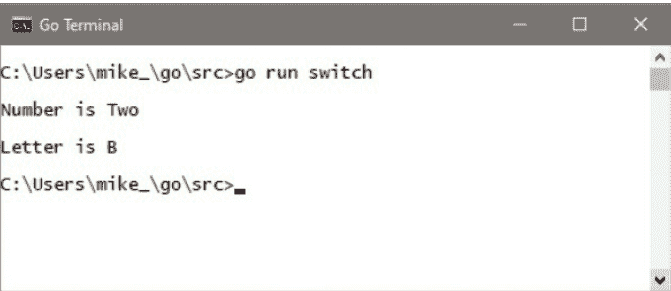


在“无标签`switch`”中，你也可以省略`switch`关键字之后的判断表达式。这等同于`switch true`——用于查找判断结果为`true`的`case`分支。

## 多次循环


循环是程序中可自动重复执行的一段代码。循环内所有语句的完整执行一次被称为“迭代”，也叫“轮次”。循环的执行次数由循环内的条件判断结果控制。当被测试的表达式结果为`true`时，循环会持续执行——直到被测试的表达式结果为`false`，此时循环结束。在Go编程中，构建循环有几种方式，但它们都使用`for`关键字。

最常见的循环语句包含三个组成部分——初始化器、单个判断表达式、增量器，语法如下：


```go
for initializer ; test-expression ; incrementer {
    statements-to-be-executed
}
```

初始化器用于设置循环次数的计数器的初始值。通常我们会使用一个整数变量作为计数器，传统上将其命名为`i`。循环的每一轮迭代中，都会先对判断表达式进行求值，仅当该表达式结果为`true`时，本轮迭代才会继续执行。当判断表达式结果为`false`时，循环会立即结束，不会再执行循环体语句。每一轮迭代中，计数器会先自增，再执行循环体内的语句。

循环可以相互嵌套，即在一个循环内部再定义另一个循环，这样外层循环每执行一轮，内层嵌套循环就能完整执行完所有迭代。通常我们会使用第二个整数变量作为内层循环的计数器，传统上将其命名为`j`。如果内层循环还包含嵌套循环，其计数器传统上命名为`k`，语法示例如下：

```go
for initializer ; test-expression ; incrementer {
    statements-to-be-executed
    for initializer ; test-expression ; incrementer {
        statements-to-be-executed
    }
    for initializer ; test-expression ; incrementer {
        statements-to-be-executed
    }
}
```

嵌套超过三层的循环并不常见，最好避免这种写法。


1. 编写一个主函数，在其中添加一个可执行5次迭代的循环

```go
func main() {
    for counter := 1 ; counter <= 5 ; counter++ {
        fmt.Println( "Loop Iteration", counter )
    }
    // Statements to be inserted here.
}
```


`src\forloop\main.go`

接下来，添加一个可执行3次迭代的外层循环

```go
for i := 1; i <= 3; i++ {
    fmt.Println("\nOuter Loop Iteration", i)
    // Inner Loop to be inserted here.
}
```

现在，添加一个可执行3次迭代的内层循环

```go
for j := 1; j <= 3; j++ {
    fmt.Println("\tInner Loop Iteration", j)
}
```

将程序文件保存在`forloop`目录中，然后运行程序，查看每次循环迭代的输出结果

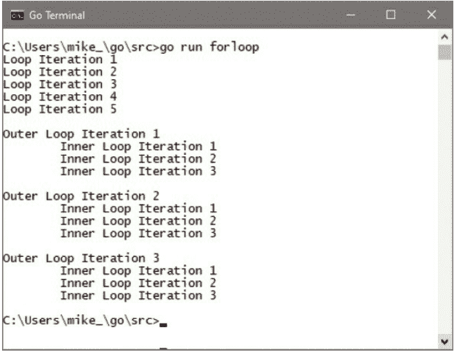


`for`循环的计数器也可以执行倒计数——通过每一轮迭代使用`i--`而非`i++`来递减计数器值。

### 真值循环


上文示例中描述的`for`循环有一种替代形式[在此处](#)，它仅在`for`关键字后包含一个判断表达式，循环语句开头没有初始化器或增量器。这种形式使用已经完成初始化的计数器变量，在循环体内部对计数器进行自增。这相当于其他编程语言中的`while`循环，因为只要判断表达式结果为`true`，循环就会持续迭代。增量器必须在某一时刻将判断表达式的结果变为`false`才能结束循环，否则就会创建永远无法结束的无限循环。这种`for`循环的语法如下：

```go
initializer
for test-expression {
    statements-to-be-executed
    incrementer
}
```

Go编程中还有一种进阶的循环结构变体，你甚至可以把开头语句中的判断表达式省略，改用包含在循环体内的判断表达式的无限循环。这种形式同样使用已经完成初始化的计数器变量，在循环体内部对计数器进行自增。这相当于其他编程语言中的`do-while`循环，因为循环会先执行语句，只要判断表达式结果为`true`就会持续迭代。当判断表达式结果为`false`时，可以使用`break`关键字终止循环，这种`for`循环的语法如下：

```go
initializer
```

编写一个主函数，在其中添加一个可执行5次迭代的循环

```go
func main() {
    counter := 1
    for counter <= 5 {
        fmt.Println("Loop Iteration", counter )
        counter++
    }
    // Statements to be inserted here.
}
```


> 如果程序进入了无限循环，在Windows或Linux系统中可以按下键盘上的`Ctrl + C`组合键来终止循环执行。


`src\while\main.go`

#### 接下来，添加一个无限循环语句

```go
i := 10
for {
    fmt.Println("\t\tCountdown", i)
    i--
    // Test expression to be inserted here.
}
```

#### 现在，添加一个用于结束循环的判断表达式

```go
if i < 1 {
    fmt.Println("\t\t\tLift Off!")
    break
}
```

将程序文件保存在`while`目录中，然后运行程序，查看每次循环迭代的输出结果

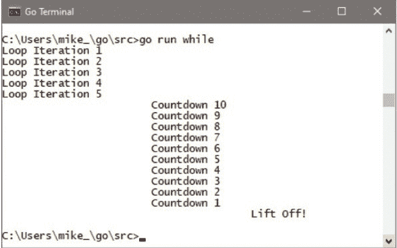


将`i`变量的初始值改为`0`（零），再次运行程序，查看循环的第一次迭代执行结果。

## 跳出循环


当满足指定条件时，可以使用`break`关键字提前终止任意循环。`break`语句位于循环语句块内部，前面附有判断表达式。当判断结果为`true`时，循环会立即结束，程序继续执行下一个任务。例如，在嵌套的内层循环中，程序会进入外层循环的下一次迭代。

> 如果程序进入了无限循环，在Windows或Linux系统中可以按下键盘上的`Ctrl + C`组合键来终止循环执行。

当满足指定条件时，可以使用`continue`关键字跳过循环的单次迭代。`continue`语句位于循环语句块内部，前面附有判断表达式。当判断结果为`true`时，当前单次迭代会直接结束。

1. 编写一个主函数，在其中添加一个可执行3次迭代的循环

```go
func main() {
    for i := 1 ; i <= 3 ; i++ {
        // Inner Loop to be inserted here.
    }
}
```


`src\break\main.go`

2. 添加一个可执行3次迭代的内层循环

```go
// Statements to be inserted here.
```

```go
for j := 1 ; j <= 3 ; j++ {
    fmt.Println( "Running i=", i, "j=", j )
}
```

### 3 将程序文件保存在`break`目录中，然后运行程序，查看每次循环迭代的输出结果

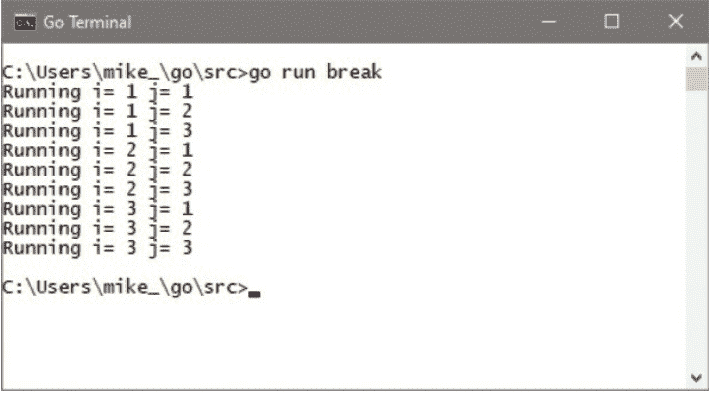


> 你也可以使用`break`跳转到嵌套代码块外指定位置的标签——可在此处查看相关示例。

### 4 接下来，在内层循环块的最开头添加这条`break`语句，用于跳出内层循环

```go
if i == 2 && j == 2 {
    fmt.Println( "Breaks When i=", i, "and j=", j )
    break
}
```

### 5 保存更新后的文件，再次运行程序，查看内层循环在第二次迭代时终止的结果。

现在，将这条`continue`语句插入到`break`语句之前——用于跳过内部循环的第二次迭代

```go
if i == 3 && j == 2 {
    fmt.Println(
        "Continues When i=", i, "and j=", j
    )
    continue
}
```

保存更新后的文件，再次运行程序，即可看到仅跳过了内部循环的第二次迭代

此处，当外层循环第二次尝试运行时，`break`语句会终止内部循环的第二次和第三次迭代。

此处，当外层循环第三次尝试运行时，`continue`语句仅会跳过内部循环的第二次迭代。

### goto 标签

乍看之下，`goto`关键字似乎是一项出色特性，它允许程序流程跳转到程序代码中任意位置的标签，就像网页上的超链接一样。

然而实际上，这可能会导致错误，其使用也不被行业认可，通常被认为是糟糕的编程习惯。

`goto`关键字的跳转功能是一项强大的特性，已经在计算机程序中存在了数十年，但许多早期程序员滥用这一功能，编写出了跳转逻辑晦涩难懂的程序。

这导致程序代码难以阅读，因此`goto`的使用变得非常不受欢迎。

通常，程序会先执行一系列语句，随后`goto`语句会跳回序列开头的标签处，重复执行这些语句。

此外，可能会在序列执行过程中的某个节点测试条件，如果测试条件不满足，另一条`goto`语句会跳转到序列之后的节点，继续执行程序流程。

如此一来，程序代码中很快就出现了大量令人困惑的`goto`语句和标签。

`goto`关键字的一个合理用法是，通过跳转到外层循环块末尾之后的标签，干净地退出内层嵌套循环。

这可以立即退出两个循环，不会再执行其中任一循环的后续迭代。

1. 编写一个包含循环的`main`函数，该循环执行3次迭代

```go
func main() {
    for i := 1; i <= 3; i++ {
        // 待插入的内部循环
    }
}
```

2. 插入一个执行3次迭代的内层循环

```go
for j := 1; j <= 3; j++ {
    fmt.Println(
        "Running i=", i, "j=", j
    )
}
```

`src\jump\main.go`

3. 将程序文件保存在名为`jump`的目录中，然后运行程序，查看每次循环迭代的输出

4. 在内层嵌套循环的第一行插入一条语句，当计数器达到指定值时跳转到名为`end`的标签

```go
if i == 2 && j == 2 {
    goto end
}
```

5. 现在，在外层循环的闭合`}`大括号的下一行添加标签

```go
end:
```

6. 保存更新后的文件，再次运行程序，即可看到当测试条件变为`true`时循环终止

```text
C:\Users\mike_\go\src>go run jump
Running i = 1 j = 1
Running i = 1 j = 2
Running i = 1 j = 3
Running i = 2 j = 1
Running i = 2 j = 2
Running i = 2 j = 3
Running i = 3 j = 1
Running i = 3 j = 2
Running i = 3 j = 3
C:\Users\mike_\go\src>
```

避免创建名为`goto.exe`的程序可执行文件，因为这可能会与Windows系统中的内部`GOTO`命令发生冲突。

请注意，标签本身必须以冒号字符`:`结尾。

### 总结

- `if`关键字用于执行基础条件测试，以判断给定表达式的布尔值为`true`还是`false`。

- 当`if`语句判断表达式为`false`时，可以使用`else`关键字提供要执行的备用语句。

- 为程序在评估后提供不同的执行方向，这一操作被称为“条件分支”。

- 通过多条`if else`语句实现的条件分支，通常可以通过`switch`语句更高效地完成。

- `switch`块中的每条语句都必须单独出现在对应`case`语句下方的行中。

- （可选）`switch`块中可以包含`default`语句，用于指定未找到匹配项时要执行的语句。

- `for`关键字可以指定初始化器、测试表达式和增量器，用于控制循环。

- `for`关键字可以仅指定一个测试表达式，以确定循环在条件为`true`时是否继续执行。

- `for`关键字可以完全省略测试表达式，从而创建无限循环。

- 可以在无限循环的循环体中测试条件，使用`break`关键字结束循环。

- `break`关键字可用于终止循环，而`continue`关键字可用于跳过单次迭代。

- 循环可以嵌套，使内层循环在外层循环的每次迭代中执行一系列迭代。

- 通常不建议使用`goto`关键字，但可以使用它合法地退出嵌套循环。

## 创建函数

- 创建基础函数

- 添加参数

- 传递引用

- 返回值

- 递归调用

- 匿名封装

- 传递函数

- 处理错误

- 分离文件

- 总结

## 创建基础函数

本书之前的示例使用了必需的`main()`函数以及Go标准库中的函数，例如`fmt`包中的`fmt.Println()`函数。不过，大多数Go程序都包含大量自定义函数，这些函数可以在程序执行过程中按需调用。

函数块仅包含一组语句，这些语句会在调用该函数时执行。函数语句执行完成后，程序流程会在函数调用之后的节点继续执行。这种模块化特性在Go编程中非常实用，能够将可按需重复调用的固定代码序列隔离开来。

要将自定义函数添加到Go程序中，必须使用`func`关键字声明该函数，后跟你自行选择的名称——需遵守与变量名相同的命名规范。

| 命名规则 | 示例 |
|-------------|---------|
| 不能是Go关键字 | default |
| 不能包含算术运算符 | a+b*c |
| 不能包含标点符号 | %$#@! |
| 不能包含任何空格 | no spaces |
| 必须以字母开头 | msg |
| 其他位置可包含数字 | good1 |
| 可包含混合大小写 | camelCase |

选择函数名时，应使其能够描述函数的功能，同时尽量简洁。函数名后跟`( )`圆括号和`{`开大括号，且这些都位于同一行。这一行通常被称为函数的“签名”。要执行的语句包含在函数体中，函数体以`}`闭大括号结束，与`main`函数一致。可以在程序中通过写出函数名后跟`( )`圆括号的方式调用函数。除非函数需要被导出，否则函数名应以小写字母开头——详见此处。

1. 创建一个函数，每次调用该函数时仅需打印一条消息

```go
func first() {
    msg := "Hello from the 1st function!"
    fmt.Println(msg)
}
```

`src\funcs\main.go`

2. 创建另一个函数，每次调用该函数时仅需打印一次乘法的结果

```go
func sqFive() {
    fmt.Printf("%v \n", 5 * 5)
}
```

3. 接下来，添加一个`main`函数，其开头包含一条调用第一个函数以打印其消息的语句

```go
func main() {
    first()
    // 待插入的语句
}
```

```go
fmt.Print( "5 x 5 = " )
sqFive()
```

5. 将程序文件保存在`funcs`目录下，然后运行程序查看打印的输出

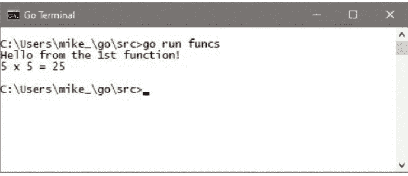


本文档中的示例代码默认假设你在每个程序的开头都声明了`package main`和`import "fmt"`。


在函数或其他代码块内部声明的变量只能从该块内部访问——它们具有“局部作用域”。例如，此处的`msg`变量仅能从`first()`函数内部访问。在函数块外部声明的变量可以在程序的任意位置访问——它们具有“全局作用域”。建议仅使用局部变量，以避免与全局作用域中已存在的变量发生可能的冲突。

## 添加参数


函数声明中函数名后的`()`括号可以有选择地包含以逗号分隔的“参数”列表。这些是函数可以使用的变量，但其初始内容由调用者提供。每次调用函数时都会创建这些变量，当控制流退出函数时会被销毁。每个参数必须按照常规变量命名规范命名，并按照以下语法指定类型：


```go
func functionName(paramName type, paramName type) {
    statements-to-be-executed
}
```

相同类型的多个连续参数可以合并声明，只需在最后一个相同类型的参数后指定类型即可，语法如下：

```go
func functionName(paramName, paramName type) {
    statements-to-be-executed
}
```

每次函数调用都必须为每个参数指定内容，类型正确，且顺序与函数声明中参数的顺序一致。传递给函数的内容被称为"实参"。它们在函数调用中跟在函数名后的`()`括号内指定，以逗号分隔：

```go
functionName(argument, argument, argument)
```

与其他一些编程语言不同，`Go`没有为函数参数指定默认值的机制。需要特别注意的是，在`Go`编程中，实参默认通过"值传递"——函数接收的是实参的副本，而非原始实参。这意味着对参数变量所做的修改默认不会影响调用者传入的原始实参——仅会作用于该副本。

- 1. 创建一个需要单个整数参数的函数，并显示它的值

```go
func square(num int) {
    fmt.Println("\t\tReceived Copy:", num)
    // Statements to be inserted here.
}
```


`src\args\main.go`

- 2. 接下来，插入语句修改接收到的实参并显示它的新值

```go
num = num * num
fmt.Println("\t\tModified Copy:", num)
```

- 3. 编写主函数，声明并初始化一个变量，然后显示它的值

```go
func main() {
    num := 5
    fmt.Println("Original:", num)
    // Statements to be inserted here.
}
```

- 4. 现在，在主函数中插入语句调用上述函数，并再次显示该变量的值

```go
square(num)
fmt.Println("Original:", num)
```

- 5. 将程序文件保存在`args`目录下，然后运行程序，可以看到原始值未被修改

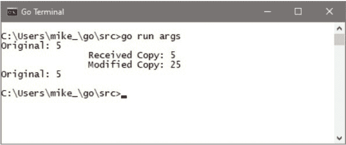


> 你还可以创建可接受任意数量参数的"可变参数函数"——请点击此处查看示例。

### 传递引用


此处的示例演示了在`Go`编程中，实参默认通过"值传递"——函数接收的是实参的副本，而非原始实参。但很多时候你可能希望函数修改原始实参。这可以通过向函数传递原始实参的引用，而非其值的副本来实现。


请记住，指针是指向系统中存储值的内存地址的引用。这意味着如果你向函数传递指针实参，它将能够修改指针指向的地址处存储的原始值。

在声明可接收指针实参的函数时，其参数列表中指定的数据类型必须以`*`星号为前缀，以表示该参数为指针类型，语法如下：

```go
func functionName(paramName *type) {
    statements-to-be-executed
}
```

此时参数即可存储内存地址。函数语句可以通过在参数名前添加`*`星号作为解引用符，来访问和修改指针指向的地址处的值。

在调用可接收指针实参的函数时，实参必须以`&`与符号为前缀，以传入存储值的内存地址。

这种技术可用于`int`、`float64`、`string`和`bool`数据类型，也可用于下一章将介绍的**结构体**类型。这些都属于"值类型"，因此将它们传递给函数时，需要借助指针访问其包含的原始值。

该技术无法用于**指针**或**函数**类型（是的，在`Go`中函数也属于类型），也无法用于本书后续将演示的**切片、映射或通道**类型。这些本身都属于"引用类型"，因此将它们传递给函数时，不需要指针即可访问其包含的原始值。


> 返回此处可回顾指针的工作原理。

- 1. 创建一个需要单个整数指针实参的函数，并显示它的值

```go
func square(num *int) {
    fmt.Println("\t\tReceived Address:", num)
    // Statements to be inserted here.
}
```


- 2. 接下来，插入语句修改接收到的实参并显示它的新值

```go
*num = *num * *num
fmt.Println("\t\tModified Original:", *num)
```

- 3. 编写主函数，声明并初始化一个变量，然后显示它的值

```go
func main() {
    num := 5
    fmt.Println("Original:", num)
    // Statements to be inserted here.
}
```

- 4. 现在，在主函数中插入语句调用上述函数，并再次显示该变量的值

```go
square(&num)
fmt.Println("Original:", num)
```

- 5. 将程序文件保存在`refs`目录下，然后运行程序，可以看到原始值被修改

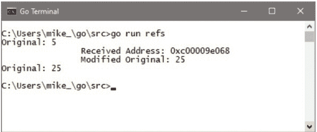

> 如果在函数调用中传递指针实参时需要传入存储值的内存地址，请给实参添加`&`与符号前缀。

## 返回值


本章目前为止描述的函数仅会在函数调用后恢复程序流到下一条语句执行，但通常让函数在继续执行后续语句之前向调用者返回一个值是更有用的。

在声明将返回值的函数时，函数签名必须在参数列表之后定义返回值的类型。要返回的值通常在函数体的末尾通过`Go`的`return`关键字指定。返回单个值的函数的语法如下：

```go
func funcName(paramName type) returnType {
    statements-to-be-executed
    return returnValue
}
```

与大多数仅能返回单个值的其他编程语言不同，`Go`编程中的函数可以返回多个值。当需要返回多个值时，每个值的类型必须在参数列表后的括号中指定为逗号分隔的列表。要返回的值通常在函数体的末尾通过`Go`的`return`关键字指定。返回两个值的函数的语法如下：

```go
func funcName(paramName type) (returnType, returnType) {
    statements-to-be-executed
```

为`return`关键字指定的返回值，每一个都必须与函数签名中声明的类型一致，且顺序必须与签名中列出的顺序相同。如果你调用一个返回多个值的函数，但在后续程序代码中没有用到所有返回值，编译器就会报出"已声明但未使用"的错误，程序将无法运行。为避免出现这种情况，你可以将所有不需要的返回值赋值给`_`下划线字符。这在`Go`语言中被称为"空白标识符"。`Go`标准库中的许多函数都会返回多个值，主要是为了同时返回结果和错误值。

- 1. 创建一个需要单个整数参数、并向调用方返回三个值的函数

```go
func cube(num int) (string, int, int) {
    return "Result", num, (num * num * num)
}
```

`src\returns\main.go`

- 2. 添加一个`main`函数，将三个返回值分别赋值给三个变量，然后尝试仅输出其中两个值

```go
func main() {
    a, b, c := cube(5)
    fmt.Println(b, "Cubed =", c)
}
```

- 3. 将程序文件保存在名为`returns`的目录中，运行程序查看编译器报错信息

- 4. 修改`main`函数中的赋值语句，将第一个返回值赋值给空白标识符

```go
func main() {
    _, b, c := cube(5)
    fmt.Println(b, "Cubed =", c)
}
```

- 5. 再次保存程序文件，运行程序，即可在输出中看到两个被打印的返回值

> 返回的`"Result"` **字符串** 值在此处输出中未被使用。

### 递归调用

自定义函数内的语句可以随意调用其他自定义函数，就像调用`fmt.Printf()`这类`Go`标准库函数一样轻松。此外，函数还可以调用自身，也就是"递归调用"。和循环一样，递归函数调用必须修改被检测的表达式，以避免无限执行——这样才能保证函数最终会退出。递归函数调用可以用来模拟循环结构，比如倒计时示例：

- 1. 创建一个需要整数参数的函数，进行递归调用，直到该参数值递减到`0`

```go
func countDn(num int) {
    if num < 1 {
        fmt.Println("\t\tLift Off!")
    } else {
        fmt.Println("\t\tCountdown", num)
        num--
        countDn(num)
    }
}
```

`src\recur\main.go`

- 2. 添加一个`main`函数，其中包含调用上述函数的语句

```go
func main() {
    countDn(10)
}
```

- 3. 将程序文件保存在名为`recur`的目录中，运行程序，即可看到递归函数调用模拟循环的效果

递归函数调用常用于解决数学问题，比如计算给定数字的阶乘。阶乘是指从给定数字到`1`的所有整数的乘积——比如`3`的阶乘是`6`（`3*2*1`）。

- 1. 创建一个需要整数参数的函数，每次调用时返回一个整数值

```go
func facto(num int) int {
    // Statements to be inserted here.
}
```

`src\facto\main.go`

- 2. 接下来，插入一条语句，当参数值递减到`0`时，返回`1`

```go
if num == 0 {
    return 1
}
```

- 3. 然后，插入最后一条语句，递归调用该函数，实现序列中所有数字的相乘

```go
return num * facto(num - 1)
```

- 4. 添加一个`main`函数，其中包含打印`7`个阶乘值的语句

```go
func main() {
    for i := 1; i <= 7; i++ {
        fmt.Println("Factorial", i, "=", facto(i))
    }
}
```

- 5. 将程序文件保存在名为`facto`的目录中，运行程序，即可看到阶乘序列

递归函数很有用，但效率并不高。本示例要生成仅`7`个值的阶乘序列，却调用了`35`次`facto()`函数！

### 匿名封装

`Go`语言支持"头等函数"，这使得函数可以被赋值给变量、作为参数传递给其他函数，也可以作为其他函数的返回值。

#### 匿名函数

匿名函数就是没有名称的函数定义。它适用于无需命名、直接内联创建函数的场景。匿名函数也被称为"函数字面量"。和其他函数一样，匿名函数也可以包含参数列表、返回值列表，能够返回多个值。你可以在函数定义的末尾追加`()`调用运算符，创建自执行匿名函数表达式，示例如下：

```go
func() {
    fmt.Println("Function Literal")
}()
```

此外，你也可以将匿名函数赋值给变量，然后在变量名后追加`()`调用运算符来调用它，示例如下：

```go
fn := func() {
    fmt.Println("Function Literal")
}
fn()
```

自执行函数表达式只会执行一次其中的语句。

### 闭包

匿名函数最有用的用途之一就是创建"闭包"。闭包是嵌套在外层函数内部的一个函数，它可以访问外层函数中声明的变量。外层函数可以返回一个能够访问这些变量的匿名函数，但关键是，这些变量无法被程序代码中的其他任何位置访问。这是一种封装形式，返回的匿名函数会"封闭"这些变量，从而保护其中存储的数据。可以在外层函数定义的末尾追加`()`调用运算符，让闭包成为自执行形式，进而赋值给变量。之后只需在变量名后追加`()`调用运算符，即可调用该匿名内部函数，它能够访问外层函数中持久保存的变量值。闭包的概念可能比较难理解，因为看起来外层函数的变量会在自执行函数执行完成后就被销毁。

> 如果无法立刻理解闭包的工作原理也不用担心。一开始它可能看起来很玄奥，但随着实践经验积累会逐渐清晰。你可以继续学习后续内容，之后再回头研究这个技巧。

- 1. 首先在`main`函数中，将匿名函数赋值给一个变量

```go
func main() {
    area := func(length, width int) int {
        return length * width
    }
}
```

`src\anon\main.go`

接下来，插入语句，输出匿名函数的类型以及两次调用的返回值

```go
fmt.Printf("area Type: %T \n", area)
fmt.Println("Area 1:", area(10, 4))
fmt.Println("Area 2:", area(12, 5))
```

现在，插入语句，将匿名自执行闭包函数赋值给一个变量

```go
counter := func() func() int {
    num := 0
    return func() int {
        num++
        return num
    }
}()
```

最后，插入语句，输出闭包函数的类型以及三次调用的返回值

```go
fmt.Printf("counter type: %T \n", counter)
fmt.Println("Count:", counter())
fmt.Println("Count:", counter())
fmt.Println("Count:", counter())
```

将程序文件保存在名为`anon`的目录中，运行程序即可查看函数类型和返回值。

#### 传递函数

#### 程序员自定义函数类型

前文[此处](https://example.com)的输出通过函数签名描述该函数，例如**计数器**类型的签名是：`func() int`。

你可以通过`type`关键字声明自定义函数类型，其后接你自定义的类型名称，再跟函数签名。

例如，一个名为`adder`的自定义函数需要接收两个整型参数并返回一个整型值，代码如下：

```go
type adder func(int, int) int
```

随后可以创建变量作为该自定义函数类型的"实例"，并为变量赋值符合自定义函数类型声明签名的函数定义。该函数（实例）的调用方式和普通函数一致。

### 高阶函数

注意外层函数的返回类型必须声明为`func() int`，因为它会返回一个函数，而该函数又会返回一个整型值。

接收值/引用参数并将其返回给调用者的普通函数被称为"一阶函数"。但函数也可以作为参数传递给其他函数，还可以向调用者返回函数。任何接受函数作为参数的函数，或任何返回一个或多个函数的函数，都被视为"高阶函数"。将函数传递给其他函数，可以在不重复现有代码行的情况下修改操作行为。

- 1. 首先声明一个需要两个整型参数、返回整型值的自定义函数类型，以此开启`main`函数，代码如下：

```go
func main() {
    type adder func(int, int) int
}
```

文件路径：`src\ftype\main.go`

- 2. 接下来插入一条语句，定义符合签名的自定义函数类型的函数（实例），代码如下：

```go
var add adder = func(a int, b int) int {
    return a + b
}
```

- 3. 现在插入一条调用该函数（实例）的语句，代码如下：

```go
fmt.Println("Added:", add(6, 2)) // 此处需插入语句 – 步骤6-8
```

- 4. 在`main`函数之后，定义一个高阶函数，该函数会接收并返回与自定义函数类型签名相同的函数，代码如下：

```go
func dub(twice func(int, int) int) func(int, int) int {
    fmt.Println("Doubled:", twice(6, 2)*2) // 此处需插入语句 – 步骤5
}
```

- 5. 接下来插入语句，定义并返回一个签名相同的函数给调用者，代码如下：

```go
div := func(a int, b int) int {
    return (a + b) / 2
}
return div
```

- 6. 回到`main`函数中，插入一条语句，将函数（实例）传递给高阶函数，并将该函数返回的函数赋值给变量，代码如下：

```go
div := dub(add)
```

- 7. 现在插入一条调用返回函数的语句，代码如下：

```go
fmt.Println("Divided:", div(6, 2))
```

- 8. 最后插入语句，打印函数（实例）、高阶函数以及返回函数的类型，代码如下：

```go
fmt.Printf("add type: %T \n", add)
fmt.Printf("dub type: %T \n", dub)
fmt.Printf("div type: %T \n", div)
```


将程序文件保存在`ftype`目录下，随后运行程序查看返回值与函数类型。

**不要忘记** 注意函数声明中的签名只需说明必需的类型，但函数定义中还需要说明参数名称。

**实用技巧** 注意函数实例`add`仅被描述为自定义函数类型`main.adder`的实例。

## 处理错误

在Go程序中预判错误、让代码能够高效处理错误是十分重要的。

Java、Ruby等其他编程语言会在遇到错误时抛出"异常"，程序可以在运行时尝试捕获这些异常，但Go提供了更简单的处理方式。

Go编程允许通过返回独立值的方式来处理函数中出现的错误。这种方式可以轻松识别是哪个函数返回了错误，还能让你用熟悉的Go语言语法来处理错误。

如果要处理可能出现的错误，函数签名必须包含Go内置的`error`返回类型。通常该类型是返回值列表中的最后一个。

```
func funcName(paramName type) (returnType, error)
```

在函数体中，函数可以用一个平凡值（比如-1）代替预期的返回值，同时返回错误值。如果未出现错误，函数可以返回预期的返回值，同时返回`nil`零值。在Go编程中，`nil`零值用于表示多种类型的零值，此处仅代表未出现错误。

因此，处理错误的函数的语法可能如下所示：

```
func funcName(paramName type) (returnType, error) {
	if condition != true {
		return -1, errorValue
	}
}
```

```
}
return returnValue, nil
```

前文示例中用到的`fmt`包提供了`fmt.Println()`和`fmt.Printf()`函数，该包同样提供了返回错误类型的`fmt.Errorf()`函数。该函数支持与`fmt.Printf()`相同的格式占位符，可用于返回标识错误位置和性质的提示信息。Go标准库中还有`errors`包，可用于操作自定义错误。

1. 创建一个需要整型参数、返回整型值和错误的函数，代码如下：

```
func isPosInt(num int) (int, error) {
	// 此处需插入语句。
}
```

文件路径：`src\err\main.go`

2. 接下来插入条件判断语句，根据参数值返回错误或参数值本身，代码如下：

```
if num < 1 {
	err := fmt.Errorf("%v not a positive integer", num)
	return -1, err
}
return num, nil
```

3. 现在添加包含递减循环的`main`函数用于打印，代码如下：

```
func main() {
	for i := 2; i >= -2; i-- {
		res, err := isPosInt(i)
		if err != nil {
			fmt.Println("Failed:", err)
		} else {
			fmt.Println(res, "Passed!")
		}
	}
}
```

4. 将程序文件保存在`err`目录下，随后运行程序，查看测试失败时的错误提示。

你会发现`if err != nil`判断语句在许多Go程序中都被用作启动错误处理的标准写法。

## 分离文件

随着程序规模增大，将相关代码段拆分到独立文件中通常是明智的选择。

你只需在`main.go`文件所在的包目录下添加新文件，只要该文件开头声明了所属包为`package main`，那么添加的文件中的所有代码都会被视作包含在`main.go`文件中。

如果要创建可能被多个程序使用的工具函数，更合适的做法是将它们存放在独立的包中，该包可被任意程序导入。

导入自定义包时需要注意，只有名称以大写字母开头的函数和变量才能被导入文件访问。要使用导入文件中的函数，函数名前必须加上包名前缀，就像从`fmt`包导入的`fmt.Printf()`函数一样。例如，**此处**的示例可以被拆分为两个包，从而导出校验函数。

1. 首先创建包含包声明和导入声明的`verify.go`工具文件，代码如下：

```
package verify
import "fmt"
```

文件路径：`src\verify\verify.go`

添加验证函数——但将其名称改为大写字母开头

```go
// IsPosInt tests for positive argument.
func IsPosInt(num int) (int, error) {
	if num < 1 {
		err := fmt.Errorf("%v not a positive integer", num)
		return -1, err
	}
	return num, nil
}
```

将文件保存在你`src`文件夹内的`verify`目录中。输入命令`go install verify`，即可在你`go/pkg`文件夹中生成名为`verify.a`的编译后的归档文件。


创建Go归档包意味着每次编译导入该包的文件时，无需重新编译工具文件。

接下来，编写带包声明和导入声明的`main.go`程序：

```go
package main

import (
	"fmt"
	"verify"
)
```


`src\prog\main.go`

现在，添加`main`函数，用包名作为修改后的导入函数名称的前缀：

```go
func main() {
	for i := 2; i >= -2; i-- {
		res, err := verify.IsPosInt(i)
		if err != nil {
			fmt.Println("Failed:", err)
		} else {
			fmt.Println(res, "Passed!")
		}
	}
}
```

7. 将程序文件保存在`prog`目录中，然后输入命令`go build prog`，即可在你`go/src`文件夹中生成编译后的可执行文件`prog.exe`（Windows系统下）。

8. 最后，输入命令`prog`（Linux系统下为`./prog`）运行程序，查看测试失败时的错误信息。

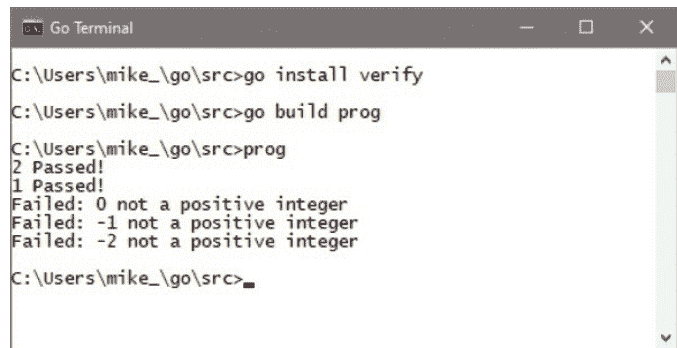


导入多个包时，导入声明必须将这些包分别列在括号内的单独行中。

### 小结

- 函数块包含一组语句，只要调用该函数，这组语句就会执行。
- 可以使用`func`关键字后跟符合Go命名规范的名称来声明函数。
- 函数声明包含`()`圆括号，后跟`{}`花括号，花括号内包裹要执行的语句。
- 函数声明中的圆括号内可以包含参数列表，用于指定每个参数的类型。
- 默认情况下，传递给函数的参数是按值传递的——即原始值的副本。
- 传递给函数的指针参数是对内存地址的引用，该内存地址是原始值所在的位置。
- `return`关键字允许函数在执行完语句后，向调用者返回一个或多个值。
- 如果函数向调用者返回值，则在函数声明中，每个返回类型必须列在参数列表之后。
- 函数可以递归调用自身来模拟循环结构，但必须测试某个条件以便在某个时刻退出。
- Go支持一等函数，这类函数可以被赋值给变量、作为参数传递，也可以从函数中返回。
- 匿名函数没有名称，在代码块后追加`()`运算符即可使其自调用。
- 闭包是嵌套在外层函数内部的函数，可以访问外层函数中声明的变量。
- 可以使用`type`关键字后跟名称和函数签名来创建自定义函数类型。
- 将函数作为参数传递给其他函数，无需重复现有代码即可修改操作。
- Go编程允许通过返回独立值来处理函数中出现的错误。
- 只有名称以大写字母开头的导入函数和变量才能被导入文件访问。

## 6 构建结构体

本章演示如何在Go语言中使用“结构体”封装数据和函数，以模拟面向对象编程。

### 分组数据

### 附加方法

### 嵌入结构体

### 封装特性

### 组合元素

### 实现接口

### 嵌入接口

### 小结

### 分组数据

Go语言的“结构体（struct）”类型可以将任意数据类型的多个相关项组合在一起。该特性可用于创建类似数据库中的记录，非常实用。


结构体使用`type`关键字、自定义名称、`struct`关键字后跟`{}`花括号来创建。花括号内包含多行变量名与数据类型的配对列表，这些配对被称为结构体的“字段”，用于定义结构体的构成，语法如下：

```go
type structName struct {
	fieldName dataType
	fieldName dataType
}
```

定义好`结构体`类型后，可以创建结构体的实例，实例是声明为结构体名称类型的变量：

```go
var instanceName structName
```

结构体的单个字段可通过点号后缀的方式，将字段名附加到结构体名后访问。有多种方式可为结构体实例的单个字段赋值。首先，你可以为单个字段赋值，示例如下：

```go
instanceName.fieldName = value
instanceName.fieldName = value
```

或者，你可以在单条语句中通过为实例分配“结构体字面量”来初始化所有字段，示例如下：

```go
instanceName = structName{value, value}
```

使用这种技术时，值的列出顺序必须与结构体中的字段顺序一致，但你可以在结构体字面量中包含字段名，此时值的顺序可以任意，示例如下：

```go
instanceName = structName{
	fieldName: value,
	fieldName: value,
}
```

此外，你也可以在单条语句中创建结构体实例并初始化其所有字段，即把“结构体字面量”赋值给变量，示例如下：

```go
instanceName := structName{
	fieldName: value,
	fieldName: value,
}
```

结构体中的空字段默认会获得零值。


你可以将结构体视为模板，其实例则是可存放实际数据的副本。


虽然这两条语句很相似，但请注意`:=`运算符仅用于在单条语句中创建实例并初始化结构体字段的场景。

1. 首先创建结构体类型来启动程序：

```go
type employee struct {
	id       int
	name     string
	dept     string
}
```

2. 接下来，创建结构体类型的实例来启动`main`函数：

```go
var coder employee
```

3. 现在，为结构体实例的每个字段赋值：

```go
coder.id = 001
coder.name = "Alice"
coder.dept = "I.T."
```

4. 创建第二个结构体实例，使用结构体字面量和字段名初始化结构体的每个字段：

```go
clerk := employee{
	name: "Burt",
	dept: "Payroll",
	id:   002,
}
```

5. 添加语句，显示每个结构体分组中的所有值：

```go
fmt.Println(coder)
fmt.Println(clerk)
```

6. 最后，添加语句，在字符串中显示各个字段的值：

```go
fmt.Printf("\n%v works in %v \n", coder.name, coder.dept)
fmt.Printf("\n%v works in %v \n", clerk.name, clerk.dept)
```

7. 将程序文件保存在`group`目录中，然后运行程序查看结构体字段的值。

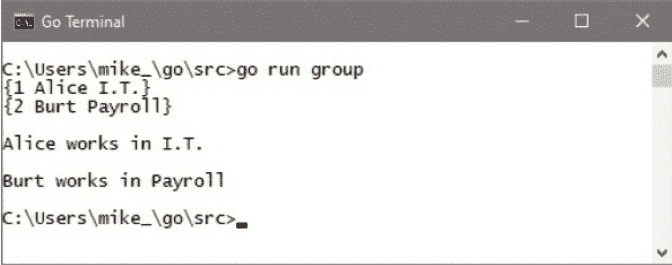

注意，第4步中的语句并未按照结构体中字段的列出顺序赋值，但使用字段名可以确保值被分配到正确的字段。

### 附加方法


在Go编程中，可以通过在函数签名中添加“接收者”将函数附加到结构体，接收者指定一个参数名，并以结构体名称作为其类型：

```go
func (paramName structName) funcName() {
	// 方法体
}
```

附加到结构体的函数被称为该结构体的“方法”。方法可以指定为值接收者，此时方法操作结构体的副本；也可以指定为指针接收者，此时方法操作原始结构体的字段：

```go
func (paramName *structName) funcName() {
	// 方法体
}
```

该特性使结构体能够表示具有属性和行为的真实世界对象：

- 属性描述对象具有的特征。
- 行为描述对象可以执行的动作。

例如，一辆车可以用“蓝色”“双门轿跑”等属性，以及“加速”行为来描述。在Go编程中，这些特性可以用包含`color`和`body`字段属性的`car`结构体，以及附加的`accelerate()`方法来表示。

Go编程中，对象是通过定义结构体（struct）作为模板来创建的，可基于该模板生成不同的副本，也就是“实例”。结构体的每个实例都可以通过赋值属性值、定义行为来进行自定义，以此描述该对象。与部分其他编程语言不同，Go没有类，但可以使用结构体来表示对象。

1. 首先创建结构体类型来启动程序：

```go
type car struct {
	color string
	body  string
}
```

文件路径：`src\method\main.go`

2. 接下来，为结构体类型附加一个方法：

```go
func (c car) accelerate() string {
	return "accelerating-->"
}
```

3. 现在，创建结构体类型的两个实例，以此启动`main`函数：

```go
porsche := car{color: "blue", body: "coupe"}
bentley := car{color: "green", body: "saloon"}
```

4. 添加语句来输出第一个实例的所有值：

```go
fmt.Println("Porsche paint is", porsche.color)
fmt.Println("Porsche style is", porsche.body)
fmt.Println("Porsche is", porsche.accelerate())
```

5. 最后，添加语句来输出第二个实例的所有值：

```go
fmt.Println("Bentley paint is", bentley.color)
fmt.Println("Bentley style is", bentley.body)
fmt.Println("Bentley is", bentley.accelerate())
```

6. 将程序文件保存在`method`目录下，然后运行程序，查看结构体字段的值。

> **小贴士**
> 调用方法时，Go会自动处理值与指针之间的转换，因此如果你希望方法能够修改原结构体的字段，这里的接收者可以设置为`(c *car)`。

## 嵌入结构体

由于结构体字段仅通过名称和类型声明，而结构体本身也是一种类型，因此Go编程甚至允许你在一个结构体中嵌入另一个结构体，只需将字段声明为结构体类型即可。

```go
type structName struct {
	fieldName embeddedStructName
}
```

这种方式在构建灵活复用结构体时非常有用。例如，下面是一个仅存储X、Y坐标的结构体：

```go
type coords struct {
	x, y int
}
```

该结构体可以用来存储图表上的位置、矩形的角点等，也可以嵌入到另一个结构体中用来表示圆心坐标，示例如下：

```go
type circle struct {
	radius int
	center coords
}
```

现在，当创建`circle`结构体的实例后，可以通过拼接结构体名称和字段名称的方式来访问嵌入结构体的字段，示例如下：

```go
instanceName.embeddedStructName.fieldName
```

这种做法可行，但写法过于冗余，使用起来并不方便。幸运的是，Go支持结构体中的“匿名字段”，解决了这个问题。匿名字段指的是仅指定另一个结构体的名称作为字段，无需额外声明字段名的字段，示例如下：

```go
type circle struct {
	radius int
	coords
}
```

这种做法的优势在于可以简化访问嵌入结构体字段的代码：

```go
instanceName.fieldName
```

> 匿名字段必须是具名类型，或是具名类型的指针。

1. 创建两种结构体类型，以此启动程序：

```go
type coords struct {
	x, y int
}

type circle struct {
	radius int
	coords
}
```

文件路径：`src\embed\main.go`

2. 接下来，为第二种结构体附加一个方法：


```go
func (c circle) getDiameter() int {
    return c.radius * 2
}
```

- 3. 现在，创建结构体类型的实例，以此启动主函数

```go
var ring circle
```

添加语句为结构体字段和嵌入结构体字段赋值

```go
ring.radius = 15
ring.x = ring.radius
ring.y = ring.radius
```

- 4. 最后，添加语句输出相关值

```go
fmt.Printf("Diameter:%v \n", ring.getDiameter())
fmt.Printf("Point X:%v Y:%v \n", ring.x, ring.y)
```

将程序文件保存在`embed`目录下，然后运行程序，查看结构体字段的值

## 封装特性

Go 程序表示对象的能力是面向对象编程（OOP）的第一块基石原理。面向对象程序使用方法来表达其所关联数据结构的属性与操作，因此程序无需直接访问对象。程序中无法直接访问的变量、函数或方法被称为“被封装”的元素。封装、继承、多态是面向对象编程的三大构建模块。Go 中的封装依赖于导入程序中所做的数据隐藏：仅名称以大写字母开头的变量、函数和方法可被程序导出，名称以小写字母开头的则无法被访问，也就是被封装了。

- 1. 首先编写`cube.go`工具文件，包含包声明和结构体定义

```go
package cube

// Dims exportable.
type Dims struct {
    width, length, height int
}
```

`src\cube\cube.go`

- 2. 接下来，添加四个函数来操作结构体字段

```go
func (d *Dims) area() int {
    return d.width * d.length
}

// SetSize exportable.
func (d *Dims) SetSize(w, l, h int) {
    d.width = w
    d.length = l
    d.height = h
}

// GetVolume exportable.
func (d *Dims) GetVolume() int {
    return d.width * d.length * d.height
}

// GetArea exportable.
func (d *Dims) GetArea() int {
    return d.area()
}
```

注意，相同数据类型的字段可以像变量声明一样，用逗号分隔成列表声明。

- 3. 将工具文件保存在`cube`目录下，然后编写导入该工具文件的主文件

```go
package main

import (
    "cube"
    "fmt"
)
```

`src\encap\main.go`

- 4. 接下来，创建导入的结构体类型的实例，以此启动主函数

```go
var box cube.Dims
```

- 5. 现在，调用导入的方法为结构体字段赋值

```go
box.SetSize(2, 4, 6)
```

- 6. 随后，调用另外两个导入的方法，利用已赋值的字段计算结果

```go
fmt.Println("Footprint:", box.GetArea())
fmt.Println("Volume:", box.GetVolume())
```

将程序文件保存在`encap`目录下，然后运行程序，查看封装值的运行结果

在主函数中添加以下语句，尝试引用未导出的字段和方法

```go
fmt.Println("Width:", box.width)
fmt.Println("Area:", box.getArea())
```

再次保存程序文件，然后运行程序，会看到编译失败，报错信息为`box.width undefined`和`box.getArea undefined`

导入的结构体必须加上其包名前缀。也可以通过对空结构体字面量赋值的方式来创建实例，即`box := cube.Dims{}`。

## 组合元素

面向对象编程的第二块基石是继承，即从另一个对象派生出的对象会继承基对象的特性。Go 编程通过“组合”实现了这种代码复用：组合是一种将一个结构体嵌入另一个结构体的技术，可以立刻为第二个结构体提供各种元素。例如，`dog`（狗）结构体可以嵌入基础的`animal`（动物）结构体，后者的字段和附加方法会立刻对`dog`结构体可用。严格来说，这些字段和附加方法并非真正从基结构体继承而来，只是对第二个结构体可访问，也就是某种意义上说的“继承”。

- 1. 创建包含两个字段的基结构体，以此启动程序

```go
type member struct {
    firstName string
    lastName  string
}
```

`src\inher\main.go`

- 2. 接下来，为基结构体附加一个方法，返回用单个空格拼接的基结构体字段值

```go
func (m member) fullName() string {
    return m.firstName + " " + m.lastName
}
```

- 3. 现在，创建包含另外两个字段和基结构体的第二个结构体

```go
type article struct {
	title string
	body  string
	member
}
```

4. 然后，给第二个结构体附加一个方法，用于输出所有字段值

```go
func (a article) content() {
	fmt.Println("Title:", a.title)
	fmt.Println("Content:", a.body)
	fmt.Printf("Author: %v \n\n", a.fullName())
}
```

5. 开始编写主函数，首先创建基础结构体的实例，使用结构体字面量初始化

```go
func main() {
	member1 := member{"Mike", "McGrath"} // 在此处插入语句
}
```

6. 接下来，创建第二个结构体的实例，并显示其所有字段值

```go
article1 := article{
	"Object Oriented Programming",
	"In Go, Composition emulates Inheritance",
	member1,
}
article1.content()
```

7. 现在，创建第二个结构体的另一个实例，并显示其所有字段值

```go
article2 := article{
	"Object Oriented Programming",
	"Coming next... Polymorphism",
	member1,
}
article2.content()
```

8. 将程序文件保存在`inher`目录下，然后运行程序，查看继承字段的值

```go
C:\Users\mike_\go\src>go run inher
Title: Object Oriented Programming
Content: In Go, Composition emulates Inheritance
Author: Mike McGrath
Title: Object Oriented Programming
Content: Coming next... Polymorphism
Author: Mike McGrath
C:\Users\mike_\go\src>
```

请牢记，结构体字面量中的所有值后面都必须添加逗号，最后一个值也不例外。

### 满足接口

面向对象编程的第三个基石是“多态”——该词源自希腊语，意为“多种形态”，描述了根据上下文为实体赋予不同含义或用途的能力。

Go 编程语言通过**接口**类型支持多态，接口使用**类型**关键字创建，后接自定义名称，再跟**接口**关键字和**{}**花括号。接口体仅包含方法签名列表：

```go
type interfaceName interface {
	methodName returnType
	methodName returnType
}
```

任何结构体只要其附加的方法与接口中列出的所有方法的名称和签名完全匹配，就实现了该接口。在 Go 编程术语中，这被称为“满足（satisfy）”接口。这种机制的优势在于允许程序拥有多个具有同名附加方法的结构体，且每个方法执行不同的任务——即它们是多态的。

1. 首先创建一个接口，列出两个方法签名，两者均不需要参数，且都返回字符串

```go
type bird interface {
	speak() string
	move() string
}
```

`src\poly\main.go`

2. 接下来创建一个空结构体，附加满足接口的方法

```go
type parrot struct{}

func (parrot) speak() string {
	return "Squawk, squawk!"
}
func (parrot) move() string {
	return "A parrot flies away."
}
```

注意：你可以省略接收者的参数名，仅声明结构体名称，除非你需要在方法语句中使用参数名。

3. 现在创建另一个空结构体，附加同样满足接口的方法

```go
type chicken struct{}

func (chicken) speak() string {
	return "Cluck, cluck!"
}
func (chicken) move() string {
	return "Chickens cannot fly."
}
```

4. 添加一个接收接口作为参数的函数，调用已实现的方法

```go
func nudge(b bird) {
	fmt.Printf("\n%v \n", b.speak())
	fmt.Printf("%v \n\n", b.move())
}
```

5. 添加主函数，包含创建每个结构体实例并调用其同名方法的语句

```go
func main() {
	var bird1 parrot
	var bird2 chicken
	nudge(bird1)
	nudge(bird2)
}
```

6. 将程序文件保存在`poly`目录下，然后运行程序，查看不同的输出

Go 会自动识别接口是否被实现。当一个结构体实现了接口，附加到该结构体的方法会成为接口的“荣誉成员”——因此当接口作为参数传递时，函数可以通过其接口参数调用这些方法。

## 嵌入接口

就像结构体可以嵌入到其他结构体中一样，接口也可以嵌入到其他接口中。这允许你在程序中创建更进一步的抽象层次，获得更大的灵活性。Go 会自动识别哪个结构体实现了每个接口。

理解接口嵌入很有帮助，因为许多 Go 标准库包都使用这种技术。例如，**输入/输出**（`io`）包包含一个**读写器**（`ReadWriter`）接口，它嵌入了**读取器**（`Reader`）和**写入器**（`Writer`）接口，这两个接口分别包含用于读写文件的**读取**（`Read`）和**写入**（`Write`）方法签名。

1. 创建两个接口，每个都包含两个相同的方法签名，所有签名都返回字符串

```go
type bird interface {
	speak() string
	move() string
}
type human interface {
	speak() string
	move() string
}
```

`src\abstr\main.go`

2. 接下来创建另一个接口，嵌入前两个接口

```go
type creature interface {
	bird
	human
}
```

3. 现在添加一个空结构体，附加满足第一个（和第二个）接口的方法

```go
type parrot struct{}

func (parrot) speak() string {
	return "Squawk, squawk!"
}
func (parrot) move() string {
	return "A parrot flies away."
}
```

`parrot`类型的实例会调用步骤3中的方法。

4. 现在添加另一个空结构体，附加满足（第一个和）第二个接口的方法——因此现在也满足第三个接口

```go
type person struct{}

func (person) speak() string {
	return "Hi, there!"
}
func (person) move() string {
	return "A person walks away."
}
```

5. 添加一个接收第三个接口作为参数的函数，调用已实现的方法

```go
func nudge(c creature) {
	fmt.Printf("\n%v \n", c.speak())
	fmt.Printf("%v \n ", c.move())
}
```

6. 添加主函数，包含创建每个结构体实例并调用其同名方法的语句

```go
func main() {
	var bird1 parrot
	var human1 person
	nudge(bird1)
	nudge(human1)
}
```

将程序文件保存在`abstr`目录下，然后运行程序，查看不同的输出。

**人**类型的实例会调用步骤4中的方法。

方法签名还可以指定参数列表和多个返回类型。

### 总结

- 多个相关的数据项可以组合到 Go **结构体**（`struct`）类型中。

- 结构体的**{}**花括号包含名称与类型的配对列表，这些是用于定义结构体所含内容的字段。

- 结构体的实例可以创建为以结构体名称为类型的变量。

- 结构体的单个字段可通过在实例名后附加点和字段名的形式完成初始化。

- 结构体实例可通过将结构体字面量赋值给变量名的方式完成创建与初始化。

- 函数可通过在函数签名中添加接收者（指定结构体名称）的方式附加到结构体上。

- 附加到结构体的函数称为方法。

- 方法可以是值接收者，操作结构体的副本；也可以是指针接收者，操作原始结构体字段。

- 结构体可通过其字段属性和附加方法表示真实世界对象的属性与行为。

- 结构体可作为匿名字段嵌入到另一个结构体中，因此其字段可被直接寻址。

- 面向对象编程的三个基石是封装、继承与多态。

- Go 语言中的封装依赖于包内的数据隐藏，仅首字母大写的标识符可被导出。

- Go 语言中的继承依赖于组合，被嵌入的结构体将为嵌入它的结构体提供字段与方法。

- Go 语言中的多态依赖于其**接口**类型，该类型仅包含方法签名列表。

- 任何结构体只要其方法与接口的方法签名完全匹配，就会实现该接口。

- **接口**可以嵌入另一个**接口**中，以提供更进一步的抽象，增强灵活性。

## 7 创建数组

本章演示如何在Go程序中存储多个数据项到索引元素中。

- 创建基础数组
- 遍历元素
- 切片数组
- 创建切片
- 切片与数组的区别
- 映射的键与值
- 总结

### 创建基础数组

数组是一种可以存储多个数据项的变量——与只能存储单个数据的普通变量不同。这些数据项按顺序存储在编号从0开始的数组“元素”中。因此，第一个值存储在元素0中，第二个值存储在元素1中，以此类推。

可以使用**var**关键字声明空数组，其后接自定义名称，再跟一对包含指定所需元素数量的整数的`[]`方括号，最后接元素可存储的数据类型。声明的语法如下所示：

```go
var arrayName [ nElements ] dataType
```

随后可通过在方括号中指定元素编号，将值单独赋给每个可用元素：

```go
arrayName [ elementNumber ] = value
```

或者，可以通过在“数组字面量”（用大括号括起来的逗号分隔列表）中为每个元素指定值来声明并初始化数组：

```go
arrayName := [ nElements ] dataType { value, value, value }
```

可通过数组名后跟包含元素编号的方括号来引用任意单个元素的值。例如，引用第一个元素内的值：


数组的所有元素统称为“索引”。数组可以拥有多个索引——用于表示多维结构，而非普通数组的单维结构。三维及更高维度的多维数组并不常见，但二维数组适用于存储基于网格的信息，例如坐标。

要创建二维数组，只需添加第二对指定所需元素数量的`[]`方括号，示例如下：

```
var arrayName [nElements] [nElements] dataType
```

随后可通过在方括号中指定元素编号，将值单独赋给每个可用元素：

```
arrayName [elementNumber] [elementNumber] = value
```


数组编号从0开始——因此包含6个元素的数组中最后一个元素的编号是5而非6。这种编号方式被称为“从零开始的索引”。


只能在数组声明时指定的数据类型的数组元素中存储数据。或者，也可以在声明二维数组时，通过在数组字面量中为每个索引指定值来初始化数组并为每个元素赋值：

```
arrayName := [nElements] [nElements] dataType { { value, value, value }, { value, value, value } }
```

可通过数组名后跟包含每个索引对应元素编号的方括号来引用任意单个元素的值。例如，第二个索引的第一个元素：

```
arrayName [0] [1]
```

### 动手试一试

1. 创建一个包含3个元素的空数组，每个元素只能存储字符串类型的值

```
var cars [3]string
```


`src\array\main.go`

2. 接下来，添加语句初始化每个数组元素

```
cars[0] = "BMW"
cars[1] = "Ford"
cars[2] = "Opel"
```

3. 现在，声明并初始化一个二维数组

```
coords := [2][3]int{{1, 2, 3}, {4, 5, 6}}
```

4. 随后，添加语句输出包含已存储数组元素值的内容

```
fmt.Println("Cars:", cars)
fmt.Println("Second Car:", cars[1])
fmt.Println("X1,Y1:", coords[0][0])
fmt.Println("X2,Y3:", coords[1][2])
```

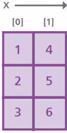

5. 将程序文件保存在“array”目录下，然后运行程序查看数组元素中存储的值

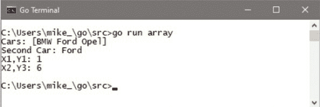


Go语言中的数组大小是固定的——一旦创建，无法添加或删除元素。

### 遍历元素

循环和数组是天作之合。循环可用于为空白数组的每个元素填充值，也可遍历数组中的每个元素以访问存储的值。


传统的自增`for`循环可将初始计数器变量值设为0，并将该变量放在数组变量的`[]`方括号中，以表示循环过程中每个元素的索引编号。Go语言内置了`len()`函数，该函数接受数组变量作为参数，返回数组包含的元素数量。可在传统`for`循环中使用该函数，在循环到达数组最后一个元素时退出循环。

1. 创建一个包含5个元素的空整数数组

```
var arr [5]int
```


`src\elems\main.go`

2. 接下来，添加语句确认数组大小

```
fmt.Println("No. of Elements:", len(arr))
```

3. 现在，添加循环为每个元素填充值

```
for i := 0; i < len(arr); i++ {
    arr[i] = i * i
}
```

4. 随后，添加循环访问每个数组元素的值

```
for i := 0; i < len(arr); i++ {
    fmt.Printf("Index: %v Value: %v \n", i, arr[i])
}
```

5. 将程序文件保存在“elems”目录下，然后运行程序查看数组元素中存储的值

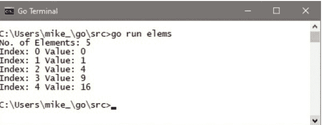


数组索引起始值为0，因此此处的第5个元素的索引编号为4。Go语言为数组提供了一些特殊用法。首先，在使用数组字面量声明数组变量时，可以使用`...`通配符运算符将元素数量设置为数组字面量中值的数量：

```
arr := [...]int{10, 20, 30} // len(arr) == 3
```

你甚至可以通过为每个值指定索引编号，来确定每个值应存储在哪个元素中，示例如下：

```
arr := [...]int{2: 10, 0: 20, 1: 30} // arr == [20, 30, 10]
```

其次，可以在循环中使用`range`关键字遍历数组，并返回每个元素的索引编号和值。

1. 创建一个包含5个元素的整数数组

```
arr := [...]int{100, 200, 300, 400, 500}
```


`src\range\main.go`

2. 接下来，添加语句确认数组大小

```
fmt.Println("No. of Elements:", len(arr))
```

3. 现在，添加循环修改每个元素的值

```go
for i, v := range arr {
    arr[i] = v / 10
}
```

4. 随后，添加循环访问每个数组元素的值

```go
for i, v := range arr {
    fmt.Printf("Index: %v Value: %v \n", i, v)
}
```

5. 将程序文件保存在“range”目录下，然后运行程序查看数组元素中存储的值

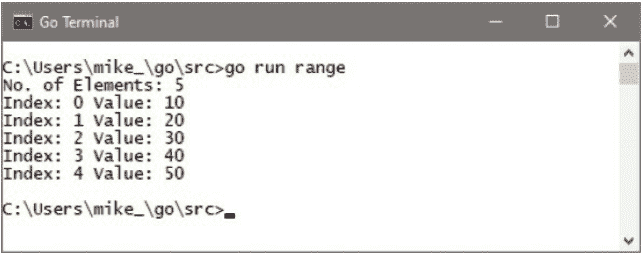


如果循环语句中不需要索引编号，可以将变量名`i`替换为`_`空白标识符以避免报错——可参考此处。

### 切片数组

数组是元素均包含同类型数据的序列，但长度固定，因此适用性不高。幸运的是，Go语言提供了`切片`类型，它代表一个底层数组，且长度可以修改。


要理解`切片`类型，首先需要明确切片本身并不包含任何元素，仅是对实际数组的引用。切片类型仅包含三个组成部分：

- `Ptr`（指针）：指向切片可访问的数组中第一个元素的指针（不一定是整个数组的第一个元素）。

- `Len`（长度）：切片中元素的总数量。

- `Cap`（容量）：指针所指向元素与数组最后一个元素之间的元素数量。

例如，从存储日期名称的数组中提取星期切片：

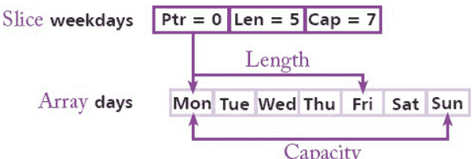

在Go语言中，可通过将数组赋值给指定所需上下边界元素索引号的变量来创建切片。上下边界索引用`[]`方括号包裹的冒号（`:`）指定，冒号左侧的数字指定要切片的起始元素的索引号，该元素即为切片指针所引用的元素。冒号右侧的

冒号右侧指定的是上边界的索引值——用于截取从起始位置到（但不包含）上边界元素的所有元素。上文对应的赋值示例如下：

```
weekdays := days[0:5]
```

你还可以省略指定上、下边界的数字，此时会使用默认值。下边界的默认值是0，上边界的默认值是数组中元素的总数。


切片是Go编程中非常重要的类型，比数组类型的使用频率高得多，但需要明确的是，切片是对底层数组的引用。你可以和使用数组一样，通过内置的`len()`函数获取切片的长度，也可以使用内置的`cap()`函数查看切片的容量。通过对比切片的指针值和它指向的数组元素的内存地址，可以确认切片本质上是一种指针引用。

1. 首先，创建一个包含7个元素的数组`days` := `[7]string{"Mon","Tue","Wed","Thu","Fri","Sat","Sun"}`


`src\slice\main.go`

2. 创建一个表示数组最后两个元素的切片`weekend` := `days[5:]`

3. 现在，添加语句来输出切片的内容和类型

```
fmt.Printf("Slice weekend: %v \n", weekend)
```

```
fmt.Printf("Type weekend : %T \n", weekend)
```

4. 添加语句来输出切片的长度和容量

```
fmt.Printf("Length weekend: %v \n", len(weekend))
```

```
fmt.Printf("Capacity weekend: %v \n", cap(weekend))
```

5. 最后，添加语句来确认切片是引用自底层数组元素的引用

```
fmt.Printf("Pointer weekend: %p \n", weekend)
```

```
fmt.Printf("Address days[0]: %p \n", &days[5])
```

6. 将程序文件保存在“slice”目录下，然后运行程序查看切片特性

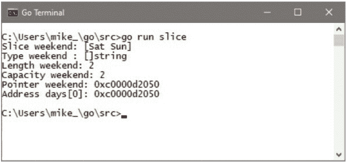

> **热提示** 切片的类型由空的`[]`方括号后跟元素可容纳的类型来表示。

## 创建切片


切片和数组的创建方式类似，只是不需要在`[]`方括号内指定元素数量，可以通过“切片字面量”初始化，语法如下：

```
sliceName := []dataType { value, value, value }
```

你也可以使用内置的`make()`函数创建空切片，该函数的参数用于指定切片类型、切片长度以及（可选的）切片容量。之后可以给单个元素赋值，示例如下：

```
fruitSlice := make([]string, 3)
```

```
fruitSlice[0] = "Apple"
```

```
fruitSlice[1] = "Banana"
```

```
fruitSlice[2] = "Cherry"
```

以上两种方式，Go都会在内部创建长度和容量合适的底层数组。

你可以使用内置的`append()`函数向切片中添加元素。该函数至少需要两个参数：一个是切片名称，另一个是要添加的一个或多个元素值。函数会返回一个包含新增元素的新切片，示例如下：

```
fruitSlice = append(fruitSlice, "Damson")
```

最重要的是，当扩容后切片的长度超过底层数组的容量时，Go会自动扩容底层数组以容纳新增元素。

Go还提供了内置的`copy()`函数，用于将一个切片复制到另一个切片中。该函数需要两个参数：第一个是目标切片的名称，第二个是源切片的名称。最佳实践是先创建一个和源切片长度相同的空切片，再将内容复制进去，

```
jamSlice := make([]string, len(fruitSlice))
```

```
copy(jamSlice, fruitSlice)
```

如果你想从切片中移除某个元素，同时保留剩余元素的顺序，可以使用`copy()`函数将指定索引之后的所有元素向前移动一位。

可以将切片作为参数传递给函数，只需在函数签名中指定参数名称和切片类型即可。


> 你不需要过度关注切片的底层数组，Go会自动管理它。

1. 创建一个整数切片，通过切片字面量初始化

```
nums := []int{10, 20, 30, 40, 50, 60, 70, 80, 90, 100}
```


`src\make\main.go`

2. 创建另一个切片，然后初始化它的各个元素

```
more := make([]int, 3)
```

```
more[0] = 200
```

```
more[1] = 300
```

```
more[2] = 400
```

3. 添加一条调用函数的语句，用于描述切片

```
describe(nums)
```

4. 将第二个切片中的一个值追加到第一个切片中以扩展它，然后描述修改后的第一个切片

```
nums = append(nums, more[0])
```

```
describe(nums)
```

5. 移除第一个切片的第一个元素，然后再次描述修改后的切片

```
copy(nums[0:], nums[1:])
```

```
nums = nums[:len(nums)-1]
```

```
describe(nums)
```

6. 在`main`函数之后，添加一个用于描述第一个切片的元素值、长度和容量的函数

```
func describe(nums []int) {
```

```
fmt.Printf("\n%v Length: %v ", nums, len(nums))
```

```
fmt.Printf("Capacity: %v \n", cap(nums))
```

```
}
```

7. 将程序文件保存在`make`目录下，然后运行程序查看切片特性

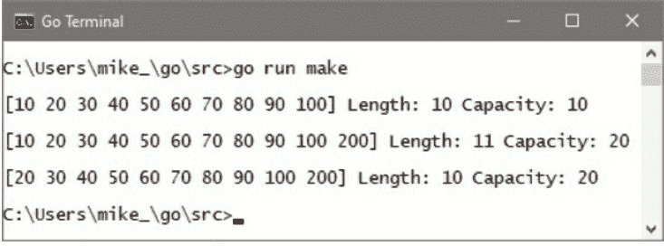

> **热提示** 此处的容量增量大小为10，但在其他平台上可能有所不同。请注意，移除元素后容量不会恢复到原来的大小。

## 切片与数组的对比


数组包含一系列值，而切片包含对一系列值的引用。这是Go编程中非常重要的一条区别，适用于很多类型。最重要的是，将类型传递给函数时，值类型会收到原始值的副本，而引用类型会指向实际的原始值。因此，若要让函数操作原始值，在传递值类型时需要用到指针，而传递引用类型时则不需要指针。

> 在函数内部修改原始值需要使用指针。

| 值类型 | 引用类型 |
|--------|------------|
| `int` | `slice` |
| `float64` | `map` |
| `string` | `channel` |
| `bool` | `pointer` |
| `struct` | `function` |
| `array` | `method` |

> 在函数内部修改原始值不需要使用指针。

数组和切片的另一处区别与“可变参数”函数有关，这类函数可以接收任意数量的参数。除非先将数组元素值复制到切片元素中，把数组“转换”为切片，否则无法将数组元素值传递给可变参数函数。

创建可变参数函数非常简单，只需在函数签名的最后一个参数的数据类型前加上`...`通配符运算符即可，语法如下：

```
func funcName(paramName ...dataType)
```

可变参数函数的调用方式和普通函数一致，将逗号分隔的参数列表放在`()`括号内即可。可变参数函数在向函数传递切片元素值时特别实用，因为切片的长度可能在程序运行过程中发生变化。无论切片长度如何，都可以在函数调用的括号内，通过指定切片名称后跟`...`通配符运算符，将切片元素值传递给可变参数函数，示例如下：

```
funcName(sliceName...)
```


`fmt.Printf()`函数就是可变参数函数——它首先需要一个固定参数，之后可以接收任意数量的后续参数。

1. 创建一个包含三个字符串的数组

```
array := [3]string{"BMW", "Ford", "Opel"}
```


`src\versus\main.go`

2. 将数组元素复制到切片中，实现数组到切片的“转换”

```
slice := array[:]
```

3. 接下来，调用可变参数函数，传递每个切片元素的值用于展示


`list( slice... )`

- 4. 现在，向切片中追加两个新值
`slice = append( slice, "Porsche", "Ferrari" )`

- 5. 再次调用可变参数函数，传递每个切片元素的值用于展示

`list( slice... )`

### 6 在主函数之后，添加可变函数来列出传入的切片元素值

```go
func list(autos ...string) {

	for i, v := range autos {

		fmt.Printf("\n%v. %v", i, v)

	}

	fmt.Println()

}
```

### 7 将程序文件保存在“versus”目录下，然后运行程序查看传入的参数值

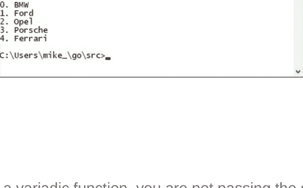


调用可变函数时，你传入的不是切片本身——仅传入切片的各个元素值。

### 映射的键和值

哈希表中可以存储多个与关联键配对的数据项，这样你就可以通过对应的键引用已存储的值。在Go编程中，这种数据结构被称为“map”，而其他编程语言称其为关联数组或字典。


映射中的所有键必须唯一，且数据类型相同。映射中的所有值必须数据类型相同，但无需与键的数据类型一致。

你可以使用`var`和`map`关键字创建映射，通过如下语法指定键和值的数据类型：

```go
var mapName = map[keyDataType]valueDataType
```

之后可以像下面这样向映射中分配单独的键/值对：

```go
mapName["keyName"] = value
```

另外，你也可以使用内置的`make()`函数创建映射：

```go
mapName := make(map[keyDataType]valueDataType)
```

此外，你还可以通过如下语法的“映射字面量”创建并初始化映射：

```go
mapName := map[keyDataType]valueDataType{

	key: value,

	key: value,

	key: value,

}
```

与数组和切片不同，键/值对是无序存储的，因此你不能使用元素索引号来引用存储的值——必须使用对应的键。

你可以随时向映射中添加键/值对，也可以使用内置的`delete()`函数删除键/值对。该函数需要传入两个参数，分别指定映射名称和你想要删除的键的名称。

与数组和切片相同，你可以使用`range`关键字遍历映射的所有元素。这种情况下，循环会返回键和值，而非索引号和值。


映射元素不是变量，因此你无法获取它的内存地址。

1. 创建用于存储字符串键和值的映射
```go
colors := make(map[string]string)
```


`src\map\main.go`

2. 用三个键/值对初始化映射
```go
colors["Red"] = "#FF0000"

colors["Green"] = "#00FF00"

colors["Blue"] = "#0000FF"
```

3. 接下来，显示映射中的所有键/值对
```go
fmt.Printf("\nColors: %v \n", colors)
```

4. 现在，添加一个键/值对并显示其值
```go
colors["Yellow"] = "#FFFF00"

fmt.Printf("\nYellow Hex Code: %v \n", colors["Yellow"])
```

### 5 接着，删除刚刚添加的键/值对

```go
delete(colors, "Yellow")
```

### 6 最后，添加循环来列出映射中的所有键/值对

```go
for k, v := range colors {

	fmt.Printf("\nHex Code for %v is %v \n", k, v)

}
```

### 7 将程序文件保存在“map”目录下，然后运行程序查看键和值

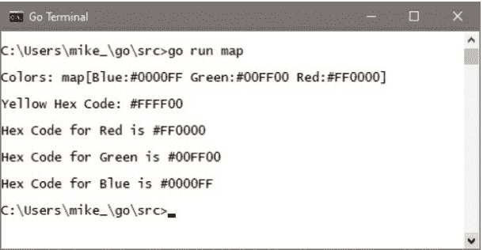


> 映射元素的顺序是随机的，在不同平台上可能有所不同。

### 总结

- 数组是固定长度的结构，在各个元素中顺序存储数据。
- 数组声明必须在`[]`方括号中指定所需的元素数量。
- 可以通过在`[]`方括号中指定元素的索引号来引用数组或切片元素中存储的数据。
- 可以使用`var`关键字创建空数组，也可以通过分配数组字面量来创建并初始化空数组。
- `len()`函数返回数组或切片的长度。
- 可以使用`range`关键字遍历元素。
- 切片是可变长度的结构，在底层数组的各个元素中顺序存储数据。
- 切片由指针、长度和容量组成。
- `cap()`函数返回切片的容量。
- 切片声明不能在`[]`方括号中指定元素数量。
- 可以在`[]`方括号中通过`:`冒号指定元素序列的上界和下界。
- 可以使用`make()`函数创建空切片，也可以通过分配切片字面量来创建并初始化空切片。
- 可以使用`append()`函数向切片中添加元素。
- 可以使用`copy()`函数将切片复制到另一个切片中。
- 向函数传递引用时不需要使用指针。
- 可变函数可以传入任意数量的参数进行调用。
- 映射是包含关联键/值对的可变长度结构。
- 可以使用`make()`函数创建空映射，也可以通过分配映射字面量来创建并初始化空映射。
- 可以通过在`[]`方括号中指定对应的键来引用映射元素中存储的值。

## 8 驾驭时间

本章演示如何使用Go标准库的`time`包操作日期和时间。

- 获取日期
- 获取时间
- 格式化日期和时间
- 设置日期和时间
- 识别时区
- 延迟时间
- 总结

## 获取日期

Go标准库的`time`包提供了从`Time`数据类型中提取描述特定时间点的各个字段的功能，导入`time`包后即可在程序中使用这些功能。


可以使用`time.Now()`函数创建新的`Time`数据类型实例，其字段描述当前日期和时间，这些字段会从设备的系统时钟中初始化，适配当前区域设置。可以通过`Time`数据类型的对应方法获取单个字段的值，例如，可以使用`Year()`方法获取年份字段的值。类似的，还有`Month()`、`Day()`和`Weekday()`方法，可以获取`Time`数据类型的其他单个字段。

| 方法 | 返回值 |
|:--------|:---------|
| `Now()` | 包含当前日期、时间和时区字段的`time.Time`数据类型 |
| `Year()` | 4位数字的年份（YYYY） |
| `Month()` | 当年的月份名称 |
| `Day()` | 当月的日期数 |
| `Weekday()` | 当周的星期名称 |
| `Date()` | 4位数字的年份（YYYY）、当年的月份名称和当月的日期数 |
| `ISOWeek()` | 当年的周数（1-53）和4位数字的年份（YYYY） |
| `YearDay()` | 当年的日期数（1-365/366） |

需要注意的是，`Time`数据类型包含各个独立的字段，因此它不是字符串。不过你可以通过它的`String()`方法将其转换为字符串：


`Time`数据类型的方法返回的值不是字符串。

1. 首先，将Go标准库的`time`包导入程序
```go
import (

	"fmt"

	"time"

)
```


`src\date\main.go`

2. 接下来，创建`Time`数据类型的日期时间实例，初始化为当前日期和时间
```go
dt := time.Now()
```

3. 添加语句输出日期时间实例的所有字段，并确认其数据类型
```go
fmt.Printf("DateTime: %v \n", dt)

fmt.Printf("DateTime Type: %T \n", dt)
```

4. 接下来，添加语句输出当前的星期名称
```go
fmt.Printf("Today is: %v \n", dt.Weekday())
```

5. 现在，添加语句显示今天的日期、当前周数和日期数

## 年份相关数值

```go
y, m, d := dt.Date()

fmt.Printf("Date: %v %v, %v \n", m, d, y)
```

```go
yr, wk := dt.ISOWeek()

fmt.Printf("Week No.: %v in %v \n", wk, yr)
```

```go
dy := dt.YearDay()

fmt.Printf("Day No.: %v \n", dy)
```

- 6. 将程序文件保存在“date”目录下，随后运行程序即可查看日期字段的取值。

时区值用于指定与协调世界时（UTC，即通用时间时钟）的偏移量及时区缩写——更多关于时区的信息请参见此处。

## 获取时间值

可使用对应的方法获取`time`数据类型各字段的时间值。例如，可通过`Hour()`方法获取小时字段的取值。类似地，还有`Minute()`、`Second()`和`Nanosecond()`方法，可用于获取`time`数据类型的其他各字段取值。

| 方法 | 返回值 |
|--------|----------|
| `Hour()` | 当日的小时数（0-23） |
| `Minute()` | 当小时的分钟数（0-59） |
| `Second()` | 当分钟的秒数（0-59） |
| `Nanosecond()` | 当秒的纳秒数（0-999999999） |

与其他编程语言不同，Go语言中的`time`包未提供从`time`数据类型返回毫秒值的方法。不过你可以将纳秒值除以一百万，即可得到对应的毫秒值。

| 方法 | 返回值 |
|--------|----------|
| `Clock()` | 当日的小时、分钟和秒数 |
| `Unix()` | 自纪元（1970年1月1日 00:00:00 UTC）以来经过的秒数 |
| `UnixNano()` | 自纪元（1970年1月1日 00:00:00 UTC）以来经过的纳秒数 |

首先，在程序中导入Go标准库的`time`包

```go
import (

	"fmt"

	"time"

)
```

`src\times\main.go`

接下来，创建`time`数据类型的日期/时间实例，将其初始化为当前日期和时间

```go
dt := time.Now()
```

`UnixNano()`方法可用于为Go随机数生成器设定种子——示例请参见此处。

```go
fmt.Printf("DateTime: %v \n", dt)

fmt.Printf("DateTime Type: %T \n\n", dt)
```

接下来，添加语句以判断当前小时并输出对应的问候语

```go
hr := dt.Hour()

switch {

case hr < 12:

	fmt.Println("Good Morning!")

case hr < 18:

	fmt.Println("Good Afternoon!")

default:

	fmt.Println("Good Evening!")

}
```

- 5. 现在，添加语句以显示当前时间
```go
h, mn, s := dt.Clock()

fmt.Printf("Time: %v:%v:%v \n", h, mn, s)
```

- 6. 最后，添加语句以显示当前的纳秒时间字段及其对应的毫秒值
```go
ns := dt.UnixNano()

ms := ns / 1000000

fmt.Println("Nanoseconds:", ns)

fmt.Println("Milliseconds:", ms)
```

- 7. 将程序文件保存在“times”目录下，随后运行程序即可查看时间字段的取值。

默认情况下，个位数的小时、分钟和秒值不会返回前导零。

## 格式化日期和时间

可使用`time`数据类型的`Format()`方法以多种方式格式化各字段的日期和时间值。该方法仅接收一个参数，即用于指定日期/时间值格式化方式的“布局”字符串。格式化规则必须严格使用以下参考字符串的元素来指定：

```
Mon Jan 2 15:04:05 2006 MST
```

由于`MST`（山地标准时间）比`UTC`（协调世界时）晚7小时，该参考字符串也可按数值形式理解为如下内容：

```
01 02 03:04:05PM '06 -0700
```

如果希望`Format()`方法仅返回月、日和hh:mm格式的时间，可将布局指定为：

```go
"Mon Jan 2 15:04"
```

或按数值形式指定为：

```go
"01/02 03:04"
```

若希望返回的星期和月份名称为全称，可在布局中指定长格式版本：

```go
"Monday January 2 15:04"
```

`time`包包含预定义的`UnixDate`、`ANSIC`和`RFC3339`常量，可将它们用作日期/时间布局格式。自定义布局可按照任意顺序指定组件，以适配不同地区——例如适配合适的日期格式化方式。

`time`包还包含一个预定义的`Kitchen`常量，可用于时间布局格式。该常量会以12小时制显示时间，并根据情况追加“AM”或“PM”后缀。

此外，通过指定“`15:04`”，可将时间组件格式化为24小时制显示，系统会自动为个位数的小时添加前导零。12小时制和24小时制均会自动为个位数的分钟添加前导零。

`ANSIC`指的是美国国家标准协会为C语言制定的标准日期/时间格式。`RFC 3339`指的是互联网工程任务组（IETF）发布的请求注释（Request For Comment）日期/时间文档。

- 1. 首先，在程序中导入Go标准库的`time`包
```go
import (

	"fmt"

	"time"

)
```

`src\format\main.go`

- 2. 接下来，创建`time`数据类型的日期/时间实例，将其初始化为当前日期和时间，随后以多种格式显示其组件
```go
dt := time.Now()

fmt.Println("\nDefault Format:", dt)

fmt.Println("Unix Format:", dt.Format(time.UnixDate))

fmt.Println("ANSIC Format:", dt.Format(time.ANSIC))

fmt.Println("RFC3339 Format:", dt.Format(time.RFC3339))

fmt.Println("Custom Format:", dt.Format("January 2, 2006 [Monday]"))
```

- 3. 现在，仅显示适配两个地区的格式化日期组件
```go
fmt.Println("\nUS Format:", dt.Format("January 2, 2006"))

fmt.Println("UK Format:", dt.Format("2 January, 2006"))
```

- 4. 然后，仅以12小时制和24小时制显示时间组件
```go
fmt.Println("\nTime 12-Hour:", dt.Format(time.Kitchen))

fmt.Println("Time 24-Hour:", dt.Format("15:04"))
```


- 5. 将程序文件保存在`format`目录下，随后运行程序即可查看格式化后的日期和时间字段取值。

> `time.Kitchen`常量等效于指定布局格式为`"15:04PM"`。

## 设置日期和时间

你可以使用Go标准库`time`包的`Date()`函数创建自定义`Time`数据类型。该函数需要传入8个参数，按顺序分别指定年份、月份、日期、小时、分钟、秒、纳秒和时区。除月份和时区外，所有参数均需指定为整数值。

月份可使用`time`包预定义的1-12月全称月份常量之一来指定，例如`time.January`。时区可使用`time`包预定义的`time.UTC`（协调世界时）或`time.Local`（系统时钟时区）常量来指定。

可使用Go标准库`time`包的`AddDate()`方法修改任意`Time`数据类型的日期字段，该方法需要传入年、月、日三个参数。正数值会使日期向后推进，负数值会使日期向前回溯。例如，`time.AddDate(1, 0, 0)`会使日期推进1年。

类似地，可使用`time`包的`Add()`方法来指定单个时长参数，以修改日期/时间。该参数可以是`int64`类型的值，代表用于修改日期/时间的纳秒数。更便捷的方式是使用`time.Hour`、`time.Minute`、`time.Second`或`time.Millisecond`常量来修改`Time`数据类型的单个时间字段。例如，`time.Add(10 * time.Hour)`会使时间向后推进10小时。

你也可以通过`Parse()`函数从字符串创建自定义的`Time`数据类型。

Go语言标准库`time`包的`time.Parse`函数。该函数需要两个参数，分别用于指定布局格式和日期/时间字符串。该函数会返回两个值，分别为`Time`数据类型和一个错误。若函数成功返回`Time`数据类型，则错误值为`nil`，否则将返回错误消息。

布局应仅使用Go参考字符串中的值：

> `Mon Jan 2 15:04:05 2006 MST`

除非日期/时间字符串中指定了时区偏移量（例如`-0500`），否则生成的`Time`数据类型将默认采用UTC时间。


- 1. 首先将Go标准库`time`包导入到程序中

```go
import (
	"fmt"
	"time"
)
```

`src\setdate\main.go`

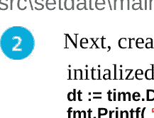

- 2. 接下来，创建并展示一个`Time`数据类型的日期/时间实例，初始化为元旦正午

```go
dt := time.Date(2025, time.January, 1, 12, 0, 0, time.Local)
fmt.Printf("\nDateTime: %v \n\n", dt)
```

- 3. 将日期推进两年至美国独立日，然后展示修改后的日期

```go
dt = dt.AddDate(2, 6, 3)
fmt.Printf("DateTime: %v \n\n", dt)
```


现在，初始化一个布局字符串和一个日期/时间字符串

```go
layout := "2006-Jan-02 03:04PM"
str := "2030-Dec-25 12:30AM"
```


最后，尝试创建并展示`Time`数据类型的各个字段，若尝试失败则展示错误消息

```go
t, err := time.Parse(layout, str)
if err != nil {
	fmt.Println(err)
} else {
	fmt.Printf("Parsed DateTime: %v \n", t)
}
```


将程序文件保存在`setdate`目录下，运行程序即可查看日期和时间字段值

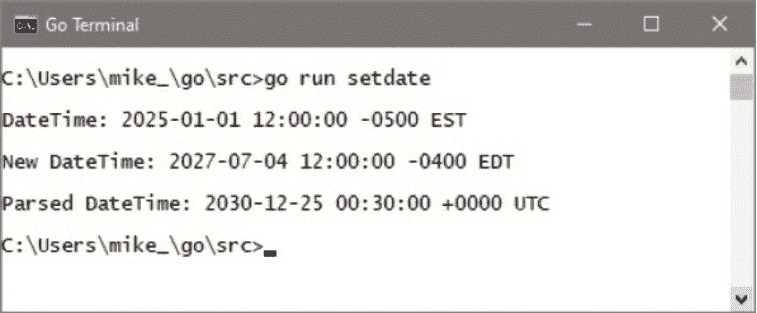


将字符串解析为`Time`数据类型时，布局字符串和日期/时间字符串必须格式一致。修改后的`Time`字段会自动识别从东部标准时间到东部夏令时的变更。

## 识别时区

Go编程中所有`Time`数据类型均与某个时区关联。通常，该时区为UTC时间，或基于运行程序的系统位置的本地时间。不过，你可以指定其他位置作为参数传入`time.LoadLocation()`函数。位置名称必须对应互联网号码分配局（IANA）时区数据库中的文件，例如`"America/New_York"`、`"Asia/Seoul"`或`"Europe/London"`。`time.LoadLocation()`函数返回两个值，分别为`Location`类型和一个错误。若函数成功返回`Location`类型，则错误值为`nil`，否则将返回错误消息。


你可以通过先调用`Now()`函数获取当前时间，再追加调用`In()`函数（将目标位置作为参数传入`In()`函数），来创建其他时区的当前`Time`数据类型。


你可以通过调用`Time`数据类型的`Zone()`方法来确认其关联的时区。该方法返回两个值，分别是三位TZ时区缩写（例如`"EST"`（东部标准时间）或`"EDT"`（东部夏令时））和代表该时区相对于UTC的秒偏移量的数值。需注意，时区缩写并非唯一，因此不要仅依赖这些缩写来识别特定时区。部分时区会因夏令时调整时间，因此你可以同时评估TZ缩写和偏移量，以正确识别时区。


本书下载文件中已包含IANA位置名称和TZ缩写的列表——请点击此处查看。


美国的夏令时会将与UTC的偏移量减少一小时。例如，东部夏令时（EDT）为UTC-4小时，中部夏令时（CDT）为UTC-5小时，以此类推。

- 1. 首先将Go标准库`time`包导入到程序中

```go
import (
	"fmt"
	"time"
)
```

`src\zone\main.go`


- 2. 接下来，创建并初始化变量，设置默认字符串值，以及指定位置的`Time`数据类型变量

```go
zone := "All"
loc, _ := time.LoadLocation("America/New_York")
dt := time.Now().In(loc)
```

- 3. 确认时区缩写和偏移秒数，然后将偏移量转换为正分钟数

```go
abbr, offset := dt.Zone()
if offset < 1 {
	offset = offset * -1
}
offset /= 60
```

- 4. 现在，评估缩写和偏移量值

```go
switch {
case abbr == "EST" && offset == 300:
	zone = "East Coast"
case abbr == "EDT" && offset == 240:
	zone = "East Coast"
}
```

- 5. 展示时区详情和对应的提示消息

```go
fmt.Printf("\nTZ: %v Offset Minutes: %v \n", abbr, offset)
fmt.Println("Welcome to", zone, "Visitors!")
```

- 6. 将程序文件保存在`zone`目录下，运行程序即可查看时区值

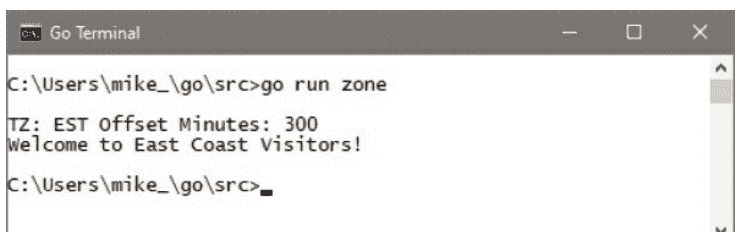


此处使用了*空标识符*来忽略返回的错误值以节省篇幅，但你最好添加错误处理逻辑。

## 延迟时间

Go标准库`time`包提供了`Sleep()`函数，可让程序按指定的时长暂停执行。该时长作为参数传入`Sleep()`函数，可表示为`time`包常量的乘积。例如，`5 * time.Second`表示五秒的时长。


Go标准库`time`包还提供了三个方法，用于比较`Time`数据类型的实例与作为参数传入的另一个时间。这些方法会根据时间比较结果返回布尔值`true`或`false`：

| 方法 | 返回值 |
|--------|---------|
| `Before(时间)` | 若实例时间早于传入的参数时间，返回布尔值`true` |
| `After(时间)` | 若实例时间晚于传入的参数时间，返回布尔值`true` |
| `Equal(时间)` | 若实例时间与传入参数时间表示同一时刻（即使处于不同时区），返回布尔值`true` |

若要查看两个`Time`数据类型实例之间的时间差，可调用时间实例的`Sub()`方法，传入另一个时间实例作为参数。该方法会返回两个实例之间的流逝时长，精度为纳秒，数据类型为`int64`。通常更推荐使用低于纳秒的精度展示时长，因此Go标准库`time`包提供了`Round()`方法来指定更简洁的精度。该方法需要一个参数来确定你偏好的舍入规则。通常，该参数为`time`包常量之一。例如，调用`Round(time.Millisecond)`会将纳秒精度的时长舍入到最接近的毫秒，`Round(time.Second)`会将纳秒精度的时长舍入到最接近的秒，以此类推。


- 1. 首先将Go标准库`time`包导入到程序中

```go
import (
	"fmt"
	"time"
)
```

- 2. 接下来，创建并展示`Time`数据类型的各个组成成分

```go
start := time.Now()
fmt.Println("\nStarted At:", start.Format("03:04:05"))
```

- 3. 现在，将程序进度延迟`5`秒

```go
time.Sleep(5 * time.Second)
```

- 4. 然后，创建并展示第二个`Time`数据类型

```go
finish := time.Now()
fmt.Println("Finished At:", finish.Format("03:04:05"))
```

- 5. 比较起始时间和结束时间

```go
fmt.Println("\nStart First?:", start.Before(finish))
fmt.Println("Finish First?:", finish.Before(start))
```

- 6. 最后，展示延迟的时长

```go
diff := finish.Sub(start)
fmt.Println("\nTime Elapsed:", diff.Round(time.Second))
```

- 7. 将程序文件保存在`delay`目录下，运行程序即可查看时间延迟

```
C:\Users\mike_\go\src>go run delay
Started At: 02:46:30
Finished At: 02:46:35
Start First?: true
Finish First?: false
Time Elapsed: 5s
C:\Users\mike_\go\src>
```


将执行延迟的能力在暂停单独的`goroutine`时特别有用——更多细节请参见此处的示例。

### 摘要

- Go标准库`time`包包含用于创建`Time`数据类型的函数，该类型包含日期、时间和时区字段。
- `Time`数据类型不是字符串，但可通过其`String()`方法转换为字符串。
- `time.Now()`函数会返回系统时间中当前区域设置的当前日期、时间和时区。
- 可通过`Time`数据类型的`Year()`、`Month()`、`Day()`和`Weekday()`方法提取日期组件。
- `Date()`、`ISOWeek()`和`YearDay()`方法返回的日期值可方便地赋值给变量。
- 可通过`Hour()`、`Minute()`、`Second()`和`Nanosecond()`方法从`Time`数据类型中提取时间组件。
- `Clock()`、`Unix()`和`UnixNano()`方法返回的时间值可方便地赋值给变量。
- `Format()`方法接受布局字符串或预定义常量作为参数，用于格式化日期和时间。
- 日期/时间布局的Go参考字符串为`Mon Jan 2 15:04:05 2006 MST`
- `time.Date()`函数用于创建`Time`数据类型，需要传入参数指定年、月、日、时、分、秒、纳秒和位置。
- `time`包包含用于月份名称、小时、分钟、秒、毫秒和位置的预定义常量。
- `AddDate()`方法可修改日期组件，`Add()`方法可修改时间组件。
- `time.LoadLocation()`函数需要传入IANA位置名称参数，`In()`方法用于应用指定位置。
- `time.Sleep()`函数会使程序的执行延迟其参数指定的时长。
- `Sub()`方法返回两个时间之间的已过时长，`Round()`方法可指定其精度。

## 9. 数据管理

本章演示如何使用Go标准库的`math`、`strings`和`strconv`包操作文本和数字。

- 合并字符串
- 拆分字符串
- 查找字符
- 转换字符串
- 计算面积
- 数值计算
- 小数舍入
- 生成随机数
- 摘要

### 合并字符串


在Go编程中，`string`是零个或多个用双引号包裹的字符。因此，以下都是有效的`string`值：

```go
s1 := "My First String"
```

```go
s2 := ""
```

```go
s3 := "2"
```

```go
s4 := "nil"
```

`s2`的空引号将变量初始化为空的`string`值。分配给`s3`的数值是该数字的`string`类型表示。Go的`nil`零值通常表示任何值的缺失，但用引号包裹时就只是一个`string`字面量。本质上，`string`是字符的集合；每个字符都包含自身的数据——就像已定义数组中的元素一样。因此，将`string`视为字符数组并在处理`string`值时应用数组特性是符合逻辑的。内置的`len()`函数会返回`string`中的字符数量，就像它返回数组中元素数量一样。`+`运算符既可以用于数值相加，也可以作为连接运算符，用于将多个`string`值拼接成一个单一的合并字符串。Go标准库的`strings`包包含用于字符串操作的有用函数。它的`Join()`函数会将字符串数组的所有元素连接（拼接）起来，生成一个单一的合并字符串。该函数需要两个参数：指定字符串数组的名称，以及要放置在合并字符串中每个字符串元素之间的分隔符值。通常你会指定单个空格作为分隔符，来生成空格分隔的合并字符串。写入标准输出的`fmt.Printf()`和`fmt.Println()`函数可以为输出添加空格和换行符，但不会改变实际字符串。不过这两个函数确实都会返回两个值：写入的字节数和任何写入错误。如果未遇到错误，错误值将和往常一样为`nil`。对于英语，写入的字节数通常代表输出的字符数——包括字符串中包含的非打印字符。


非打印的`\t`制表符的ASCII码为9，非打印的`\n`换行符的ASCII码为10。

1. 首先将Go标准库`strings`包导入到程序中

```go
import (
    "fmt"
    "strings"
)
```


2. 初始化两个字符串变量和一个拼接后的字符串

```go
s1, s2 := "The Truth is rarely Pure ", "and never Simple."
str := s1 + s2
```

3. 接下来，输出拼接后的字符串及其长度

```go
chars, err := fmt.Printf(
    "\n%v \n", str
)
if err != nil {
    fmt.Println(err)
} else {
```


4. 输出写入的字节数和字符串长度

```go
fmt.Println("Bytes Written: ", chars)
fmt.Println("String Length:", len(str))
}
```

5. 初始化一个字符串数组和一个拼接后的字符串

```go
arr := []string{
    "\n\tStrive",
    "For",
    "Greatness!"
}
ast := strings.Join(arr, " ")
```

6. 现在，输出拼接后的字符串和前两个字符

```go
```


`fmt.Println(ast)`

```
if ast[0] == 10 && ast[1] == 9 {

    fmt.Printf("1st Char: ASCII %v Newline\n", ast[0])

    fmt.Printf("2nd Char: ASCII %v Tab\n", ast[1])

}
```

7. 将程序文件保存在`join`目录中，然后运行程序查看合并后的字符串

> 这里写入的字节数超过字符串长度，是因为`fmt.Printf()`方法添加了两个换行符和一个空格字符。

### 拆分字符串

Go标准库的`strings`包提供了多个函数，可以将指定的字符串拆分为子字符串。这些函数将字符串视为数组，其中每个元素包含一个字符或一个空格。通常，你可能想要将空格分隔的句子拆分为子字符串数组，其中每个元素是一个单独的单词。`strings`包很方便地提供了`Fields()`函数，正好可以完成这项任务。该函数的唯一参数是字符串句子，将返回一个包含该字符串中每个独立单词的子字符串数组。

`strings`包还有`Split()`函数，它需要两个参数：指定字符串和分隔符。该函数将返回一个子字符串数组，这些子字符串位于指定分隔符出现的区间之间。例如，当字符串是空格分隔的句子，分隔符是空格字符时，`Split()`函数将返回该句子中的单词数组。

`strings`包还有`SplitN()`函数，功能与`Split()`类似，但接受第三个参数来指定要返回的子字符串数量。如果指定的子字符串数量超过分隔符的数量，指定分隔符的后续出现将直接包含在最后一个子字符串中返回。例如，当字符串是空格分隔的句子，分隔符是空格字符，且仅指定返回2个子字符串时，`SplitN()`函数将返回一个包含句子第一个单词的子字符串，以及另一个包含该句子剩余全部内容（包括空格）的子字符串。

需要明确的是，`Fields()`、`Split()`和`SplitN()`函数都会丢弃指定的分隔符，仅返回子字符串中分隔符两侧的字符。不过，还有两个函数支持在返回的子字符串中包含分隔符。`strings`包的`SplitAfter()`函数与`Split()`函数功能类似，但会在返回的子字符串中包含分隔符。同样，`strings`包的`SplitAfterN()`函数与`SplitN()`函数功能类似，但会在返回的子字符串中包含分隔符。


数据通常以逗号分隔值（CSV）的形式存储在CSV文件中，这类文件可被方便地拆分为单个值。

1. 首先将Go标准库的`strings`包导入到程序中

```go
import (

	"fmt"

	"strings"

)
```


`src\split\main.go`

2. 初始化`main()`函数时，首先定义一个字符串变量

```go
str := "I can, and, I will."
```

3. 接下来，添加语句将描述和变量字符串的子字符串传递给列表函数

```go
list("Fields", strings.Fields(str))

list("Split", strings.Split(str, ","))

list("SplitN", strings.SplitN(str, ",", 2))

list("SplitAfter", strings.SplitAfter(str, ","))

list("SplitAfterN", strings.SplitAfterN(str, ",", 2))
```

### 4. 在`main()`函数之后，添加以下函数，每次调用时即可列出描述和所有子字符串

```go
func list(desc string, subs []string) {

	fmt.Print("\n", desc, ": ")

	for _, v := range subs {

		fmt.Print("[", v, "] ")

	}

	fmt.Print("\n")

}
```

### 5. 将程序文件保存在`split`目录中，然后运行程序即可查看子字符串

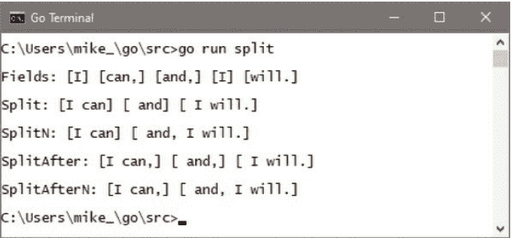


只有名称中包含`After`字样的分割方法才会保留分隔符。

## 查找字符


Go标准库的`strings`包提供了多个函数，可用于搜索指定字符串，查找指定的字符或子字符串（模式）。这些函数会将字符串视为数组，其中每个元素都包含一个字符或空格。

`strings`包中的`Contains()`函数需要两个参数：一个是待搜索的字符串，另一个是要查找的模式。该函数仅返回`true`或`false`，以指示（区分大小写）的搜索结果。例如，要查找`Pro`模式：

```go
strings.Contains("Go Programming in easy steps", "Pro")
```

`strings`包还包含`Index()`函数，该函数需要两个参数：一个是待搜索的字符串，另一个是要查找的模式。如果搜索成功，该函数会返回一个整数，代表模式在待搜索字符串中首次出现的索引位置；如果搜索失败，则返回`-1`。

`strings`包的`Count()`函数需要两个参数：一个是待搜索的字符串，另一个是要查找的模式。你可以使用该函数统计一个模式在待搜索字符串中出现的非重叠次数。如果模式是空字符串，该函数通常会返回待搜索字符串的字符数加1。你可以通过从返回的整数中减去1，来得出待搜索字符串的字符数。

`strings`包的`HasPrefix()`函数需要两个参数：一个是待搜索的字符串，另一个是要查找的模式。该函数会返回`true`或`false`，以指示待搜索字符串是否以指定模式开头。同样，`strings`包的`HasSuffix()`函数需要两个参数：一个是待搜索的字符串，另一个是要查找的模式，该函数会返回`true`或`false`，以指示待搜索字符串是否以指定模式结尾。

你可以使用`strings`包的`Replace()`函数，通过将指定模式替换为新的子字符串来修改待搜索字符串。该函数需要四个参数：待搜索的字符串、要查找的模式、替换用的子字符串，以及一个表示要替换实例数量的整数。若要替换待搜索字符串中的所有模式实例，只需将替换数量指定为`-1`即可。


`strings.Index()`函数在待搜索字符串中找到模式的第一个实例后就会停止搜索。

1. 首先将Go标准库的`strings`包导入到程序中

```go
import (

	"fmt"

	"strings"

)
```


`src\find\main.go`

2. 初始化`main()`函数时，首先定义一个字符串变量

```go
str := "I can resist everything except temptation"
```

3. 接下来，测试子字符串是否存在于字符串中，然后查找其首次出现的索引位置

```go
fmt.Printf("\nFound 'an': %v \n", strings.Contains(str, "an"))

fmt.Printf("Found 'an' at: %v \n", strings.Index(str, "an"))
```

现在，统计字符串中某个特定字母出现的次数

```go
fmt.Printf("Count of 'e': %v \n", strings.Count(str, "e"))
```

然后，测试字符串是否以某个特定子字符串开头或结尾

```go
fmt.Printf("Prefix 'ion': %v \n", strings.HasPrefix(str, "ion"))
```

```go
fmt.Printf("Suffix 'ion': %v \n", strings.HasSuffix(str, "ion"))
```

最后，替换字符串中的子字符串

```go
fmt.Println(strings.Replace(str, "temptation", "chocolate", 1))
```

将程序文件保存在`find`目录中，然后运行程序即可查看搜索结果


### 转换字符串


Go标准库的`strings`包提供了多个用于转换字符串字符大小写的函数。`strings`包中的`ToUpper()`函数只需要一个字符串参数，该函数会返回一个字符串副本，其中所有字符都被转换为大写字母。同样，`strings`包的`ToLower()`函数只需要一个字符串参数，会返回一个字符串副本，其中所有字符都被转换为小写字母。

`strings`包还包含`ToTitle()`函数，该函数只需要一个字符串参数。该函数会返回一个字符串副本，其中每个单词的首字符都被转换为大写字母——但仅当传入的字符串参数全为小写时才生效。若要将大小写混合的字符串转换为标题格式，你必须先使用`strings`包的`ToLower()`函数将其转换为全小写。

当程序请求用户输入数值后收到输入时，该输入可能是`字符串`数据类型，还可能包含用户无意中输入的空格。你可以使用`strings`包的`Trim()`函数移除字符串开头和结尾的空格。该函数需要两个参数：一个是待处理的字符串，另一个是要移除的字符。若要移除所有开头和结尾的空格，可将第二个参数指定为`" "`（即单个空格字符）。

从包含输入数字的字符串中移除不必要的空格后，程序必须先将数据类型转换为数值类型，才能对该输入执行算术运算。要实现这一操作，需导入Go标准库的`strconv`包。该包包含`Atoi()`函数（ASCII转整数），该函数只需要一个字符串参数，会返回一个整数以及可能出现的错误。如果未出现错误，错误值将为`nil`；如果该方法无法返回整数数据类型，错误值会包含描述性的错误信息。同样，`strconv`包包含`Itoa()`函数，该函数可以将整数转换为字符串数据类型。该方法只需要一个整数参数，会返回一个字符串副本。


此外，也可以使用`strconv.ParseInt()`方法将字符串数据类型转换为整数。`strconv.Atoi()`方法等价于调用`strconv.ParseInt(str, 10, 0)`。

1. 首先将Go标准库的`strings`包和`strconv`包导入到程序中

```go
import (

	"fmt"

	"strings"

	"strconv"

)
```


`src\conv\main.go`

2. 初始化`main()`函数时，首先定义一个字符串变量，然后展示该字符串在不同字符大小写下的形式

```go
str := "I have Nothing to declare except My Genius"

fmt.Println(strings.ToUpper(str))

fmt.Println(strings.ToLower(str))

fmt.Println(strings.Title(strings.ToLower(str)))
```

3. 现在，为变量分配一个数字和空格

```go
str := "42"

fmt.Printf("\n%v Type: %T, Length: %v \n", str, str, len(str))
```

然后，去除字符串的首尾空格

```go
str = strings.Trim(str, " ")

fmt.Printf("\n%v Type: %T, Length: %v \n", str, str, len(str))
```

最后，尝试将数据类型转换为整数

```go
num, err := strconv.Atoi(str)

if err != nil {

fmt.Println(err)

} else {

fmt.Printf("%v Type: %T \n", num, num)

}
```

将程序文件保存在名为`conv`的目录中，然后运行程序查看字符串转换结果

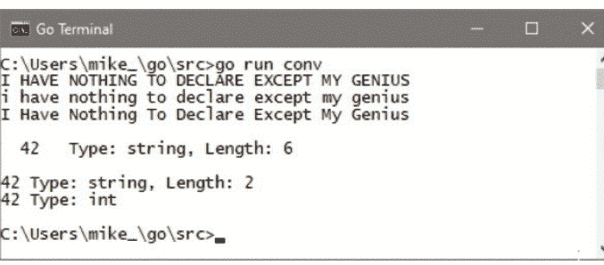


将第3步中的字符串赋值修改为`$42`，然后保存并运行程序，即可看到转换为整数失败时出现的解析错误提示。

## 计算面积


Go标准库的`math`（数学）包提供了大量实用的函数和数学常量。相关常量如下表所示，同时列出了它们的近似值：

| 常量 | 说明 |
| -------- | ----------- |
| `math.E` | 常数`e`，自然对数的底，近似值为`2.71828` |
| `math.Pi` | 常数`π`，近似值为`3.14159` |
| `math.Phi` | 常数`φ`（黄金比例），近似值为`1.61803` |
| `math.Sqrt2` | 2的平方根，近似值为`1.41421` |
| `math.SqrtE` | 常数`e`的平方根，近似值为`1.64872` |
| `math.SqrtPi` | 常数`π`的平方根，近似值为`1.77246` |
| `math.SqrtPhi` | 常数`φ`的平方根，近似值为`1.27202` |
| `math.Ln2` | 2的自然对数，近似值为`0.69315` |
| `math.Log2E` | 常数`e`的以2为底的对数，近似值为`1.44269` |
| `math.Ln10` | 10的自然对数，近似值为`2.30259` |
| `math.Log10E` | 常数`e`的以10为底的对数，近似值为`0.43429` |

`math`包中的常量大多用于有特定数学需求的Go程序中，此处为了内容完整，列出了所有的`math`包常量。


黄金比例在几何学和艺术中经常出现。它是指把一条线段截为长度不等的两部分后，较长部分与较短部分的长度之比等于整条线段与较长部分的长度之比。

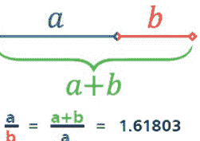


首先，在程序中导入Go标准库的`math`包

```go
import (

"fmt"

"math"

)
```


`src/area/main.go`


声明三个浮点型变量

```go
var rad, area, perim float64
```


接下来，初始化第一个变量，并将其值保留两位小数输出

```go
rad = 4
```

```go
fmt.Printf("\nRadius of Circle: %.2f\n", rad)
```


现在，根据给定的半径计算圆的面积，并将面积值保留两位小数输出

```go
area = math.Pi * (rad * rad)

fmt.Printf("\nArea of Circle: %.2f \n", area)
```

然后，根据给定的半径计算圆的周长，并将周长值保留两位小数输出

```go
perim = 2 * (math.Pi * rad)

fmt.Printf("\nPerimeter of Circle: %.2f \n", perim)
```


将程序文件保存在名为`area`的目录中，然后运行程序查看计算结果

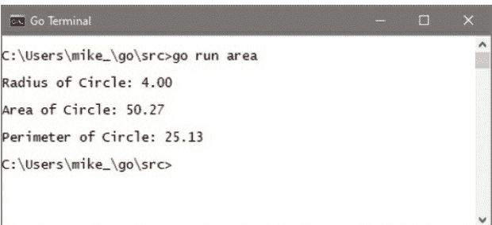


有关输出中小数点格式的更多内容，请参考此处。

### 数值运算


Go的`math`包提供了这些可用于处理`float64`类型参数的实用函数：

| 函数 | 返回值 |
| --- | --- |
| `math.Abs()` | 绝对值 |
| `math.Acos()` | 反余弦值 |
| `math.Asin()` | 反正弦值 |
| `math.Atan()` | 反正切值 |
| `math.Atan2()` | 从X轴点计算出的角度 |
| `math.Ceil()` | 向上取整的值 |
| `math.Cos()` | 余弦值 |
| `math.Exp()` | 常数e的指数值 |
| `math.Floor()` | 向下取整的值 |
| `math.IsNaN()` | 布尔类型的`true`或`false`值 |
| `math.Log()` | 自然对数值 |
| `math.Max()` | 两个数中较大的值 |
| `math.Min()` | 两个数中较小的值 |
| `math.Pow()` | 指数运算值 |
| `math.Round()` | 最接近的整数值 |
| `math.Sin()` | 正弦值 |
| `math.Sqrt()` | 平方根值 |
| `math.Tan()` | 正切值 |


`math.IsNaN()`（非数字）函数可用于判断转换为`float64`类型的值是否为有效数字。


`math`包中还包含更多函数，但此处列出的函数适用于多数数学运算。更多函数可查阅Go官方文档：`golang.org/pkg/math`

1. 首先，在程序中导入Go标准库的`math`包

```go
import (
    "fmt"
    "math"
)
```


`src/maxmin/main.go`

2. 接下来，初始化两个变量

```go
square := math.Pow(5, 2) // 5 to power 2 (5 x 5).
cube := math.Pow(4, 3) // 4 to power 3 (4 x 4 x 4).
```

3. 现在，比较两个变量的正值，输出最大和最小的数值

```go
fmt.Println("\nLargest Positive:", math.Max(square, cube))
fmt.Println("\nSmallest Positive:", math.Min(square, cube))
```

4. 接着，添加语句反转每个变量的数值符号，将正值转为负值

```go
square *= -1
```


```go
cube *= -1
```

最后，比较两个变量的负值，输出最大和最小的数值

```go
fmt.Println("\nLargest Negative:", math.Max(square, cube))
fmt.Println("\nSmallest Negative:", math.Min(square, cube))
```

将程序文件保存在名为`maxmin`的目录中，然后运行程序查看比较结果

> 最大的负值是其中最接近0的数。

## 小数取整


Go标准库的`math`包提供了多个实用函数，可将十进制小数舍入为最接近的整数。这些函数如下表所示，同时附有各函数的简要说明：

| 函数 | 返回值 |
|---------|---------|
| `math.Floor(x)` | 小于`x`的最大整数 |
| `math.Ceil(x)` | 大于`x`的最小整数 |
| `math.Round(x)` | 最接近`x`的整数 |
| `math.Trunc(x)` | `x`的整数部分 |

如果要将较长的浮点数值保留两位小数，可先将该浮点数值乘以100，再使用`math.Round()`函数去除多余的小数位，最后除以100即可得到保留两位小数的结果。乘、运算、除这些步骤既可以分步书写，也可以使用括号确定运算顺序，合并为一条简洁的表达式。例如，将名为`num`的变量中的长浮点数值转换后，可写为：

```go
num = num * 100
num = math.Round(num)
num = num / 100
```

或者：

```go
num = math.Round(num * 100) / 100
```

Go语言具有强类型系统，与其他编程语言不同，它不支持隐式类型转换（又称“强制类型转换”）。不过，你可以在兼容的数据类型（如`float64`和`int`类型）之间执行显式类型转换，转换语法为`dataType(value)`，用于将值转换为其他数据类型。将浮点数值转换为整数时，数值会被截断，丢失小数位。


> `math.Round()`函数会从中间值向上舍入，因此`math.Round(7.5)`的返回值为`8`，而非`7`。

#### 首先，在程序中导入Go标准库的`math`包

```go
import (
    "fmt"
    "math"
)
```


`src/round/main.go`

#### 初始化一个浮点型变量并输出其值

```go
var pi float64 = math.Pi
fmt.Println("Pi:", pi)
```

#### 接下来，输出浮点数值的最接近整数

```go
fmt.Println("\nFloor:", math.Floor(pi))
fmt.Println("Ceiling:", math.Ceil(pi))
fmt.Println("Round", math.Round(pi))
fmt.Println("Truncated:", math.Trunc(pi))
```

#### 现在，将浮点数值保留两位小数

```go
fmt.Println("\nShort Pi:", math.Round(pi * 100) / 100)
```

#### 最后，初始化另一个浮点型变量并将其值转换为一个整数变量：

```go
var e1 float64 = math.E
fmt.Printf("\nE: %v %T \n", e1, e1)
var e2 int = int(e1)
fmt.Printf("Cast: %v %T \n", e2, e2)
```

6. 将程序文件保存在`round`目录中，然后运行程序即可查看四舍五入后的小数


## 生成随机数

Go标准库的`math`包包含一个`rand`包，可提供生成伪随机数的函数。你可以通过导入`math/rand`包在程序中调用这些功能。


`rand.Intn()`函数会返回一个介于0到其参数指定数值之间的随机数。`rand.Perm()`函数会返回一个整数序列，这些整数介于0到其参数指定数值之间，且顺序为伪随机。随机化模式基于默认的“种子”，每次运行程序时都会返回相同的伪随机顺序。这可能是你期望的结果，但通常更倾向于每次运行程序时生成不同的顺序。要实现这一点，你需要为`rand.Seed()`函数指定一个自定义的整数种子参数，该参数在每次程序运行时都唯一。为此，调用`time.Now()`函数，并使用`Time`数据类型的`UnixNano()`方法提取自纪元以来经过的纳秒整数计数，是便捷的做法。该数值在每次程序运行时都会不同，因此将该整数作为`rand.Seed()`函数的参数，即可确保每次运行程序时生成不同的伪随机顺序。


将Go标准库的`math/rand`包导入程序，同时导入`time`包以设置随机种子，导入`strconv`包以转换随机数：

```go
import (
    "fmt"
    "math/rand"
    "strconv"
    "time"
)
```

`src\lotto\main.go`

2. 接下来，为随机数生成器指定一个唯一的种子


此处随机数的范围是1到59，可用于玩英国乐透游戏或美国纽约乐透游戏。


`int`类型的数值必须转换为`string`数据类型才能进行拼接。

### 总结

- `字符串`是字符的集合，类似于数组中的元素。
- 内置的`len()`函数返回作为其参数的`字符串`中的字符数量。
- `strings`包包含用于字符串操作的函数，例如用于拼接的`Join()`函数。
- `Fields()`和`Split()`函数分别返回从指定`字符串`参数得到的子字符串数组。
- `Contains()`和`Index()`函数可用于在指定的`字符串`参数中查找指定的子字符串。
- `Count()`函数会报告指定`字符串`参数中出现的子字符串实例数量。
- `HasPrefix()`和`HasSuffix()`函数可用于识别`字符串`参数的起始和结束部分。
- `Replace()`函数可替换子字符串。
- 可使用`ToUpper()`、`ToLower()`和`ToTitle()`函数更改字符大小写。
- `Trim()`函数可移除首尾空格。
- `strconv`包包含`Atoi()`和`Itoa()`函数，可在`字符串`和`整数`数据类型之间进行转换。
- `math`包包含数学函数（例如`math.Pow()`）和数学常量（例如`math.Pi`）。
- 可使用`math.Floor()`、`math.Ceil()`、`math.Round()`和`math.Trunc()`将十进制数值四舍五入到接近的整数。
- `math/rand`包提供了用于生成伪随机数的函数。
- `rand.Perm()`函数返回从0到作为其参数指定的数值的随机整数序列。
- `rand.Seed()`函数可为随机数生成器指定自定义的种子整数。
- 每次运行程序时，可通过调用`time.Now().UnixNano()`函数指定唯一的随机种子

## 10 处理输入

本章演示如何处理用户输入，以及如何使用Go标准库的`os`、`bufio`和`io/ioutil`包读写文本文件。

- 获取用户输入
- 缓冲输入
- 命令标志
- 读取文件
- 写入文件
- 使用临时文件
- 总结

### 获取用户输入

之前的示例已经介绍了如何在程序中使用变量存储文本字符串值、整数数值和浮点小数值，以及布尔真值。现在，我们可以利用这些变量创建一个猜数字游戏程序：存储一个生成的随机整数（用户需要猜测其值）、一个布尔真值（用户猜对时结束游戏），以及一个存储用户猜测值的变量。


大家熟悉的Go标准库`fmt`包提供了`Scan()`、`Scanln()`和`Scanf()`函数，用于从标准输入读取数据：

- `fmt.Scan()`会将连续的以空格分隔的值存入连续的接口变量，并将换行符视为空格。
- `fmt.Scanln()`会将连续的以空格分隔的值存入连续的接口变量，直到遇到换行符为止。
- `fmt.Scanf()`会使用指定的格式，将连续的以空格分隔的值存入连续的接口变量。

这些函数均会返回两个值，分别是扫描的项目数量和任何读取错误。如果未遇到错误，错误值将像往常一样为`nil`。每个函数还需要一个或多个参数来指定接口变量的地址。猜数字游戏程序可以使用`fmt.Scan()`函数将输入的整数猜测值赋给接口变量，并将其值与生成的随机整数进行比较。

1. 首先，将Go标准库的`math/rand`和`time`包导入程序，以提供自定义种子的随机数生成器

```go
import (
    "fmt"
    "math/rand"
    "time"
)
```

`src\scan\main.go`

现在，使用当前时间为随机数生成器播种，开启主函数

```go
rand.Seed(time.Now().UnixNano())
```

接下来，声明并初始化三个变量

```go
var num int = rand.Intn(20) + 1
var guess int = 0
var flag bool = true
```

然后，提示用户输入一个整数

```go
fmt.Print("\nGuess My Number 1-20: ")
```

最后，添加一个循环，反复将输入值与随机数进行比较，直到两者匹配

```go
for flag {
    _, err := fmt.Scan(&guess)
    if err != nil {
        fmt.Println(err)
    } else if guess > num {
        fmt.Print("Too High, Try Again: ")
    } else if guess < num {
        fmt.Print("Too Low, Try Again: ")
    } else if guess == num {
        fmt.Println("Correct - My Number Is", num)
        flag = false
    }
}
```


注意，此处使用了`_`空白标识符来忽略返回的扫描项目数量，并且记得在将输入值赋给接口变量时使用`&`取地址运算符。

6. 将程序文件保存在`scan`目录中，然后运行程序，猜测生成的随机数


### 缓冲输入

当你想将更大的数据项存入程序时，通常最好将数据流存储在内存缓冲区中。Go标准库的`bufio`（缓冲输入/输出）包提供了`Scanner`类型，它是一种内存缓冲区，带有多个用于处理数据流的有用方法。你可以通过导入`bufio`包来在程序中使用该功能。


首先需要创建`Scanner`实例，方法是将数据读取源作为参数传递给`bufio`包的`NewScanner()`函数。如果数据源是用户输入，你可以导入Go标准库的`os`包，并将`os.Stdin`（标准输入）指定为`NewScanner()`的参数。`Scanner`实例有一个`Scan()`方法，用于读取所有用户输入；还有一个`Text()`方法，用于返回已读取的输入，其值为单个`字符串`。`Scanner`实例还有一个`Err()`方法，用于返回任何读取错误。如果未遇到错误，错误值将像往常一样为`nil`。在调用`Scan()`方法和`Text()`方法后检查错误很有用。如果你想将输入拆分为单独的字符串项，可以导入Go标准库的`strings`包，并将其`Fields()`函数作用于输入，以将字符串拆分为单词。

1. 首先，将Go标准库的`bufio`、`os`和`strings`包导入程序，以处理输入

```go
import (
    "fmt"
    "bufio"
    "os"
    "strings"
)
```

### src\buffer\main.go

接下来，提示用户输入：

```go
fmt.Print("\nEnter Text:")
```

现在，创建一个`Scanner`实例，将用户输入存储在内存缓冲区中，随后读取用户输入：

```go
scanner := bufio.NewScanner(os.Stdin)
scanner.Scan()
```

随后，若出现错误则输出错误信息，否则输出存储的数据：

```go
if scanner.Err() != nil {
    fmt.Println(scanner.Err())
} else {
    fmt.Println(scanner.Text())
}
```


接下来，创建新的`Scanner`实例，将其他用户输入存储在内存缓冲区中：

```go
fmt.Print("\nEnter Text:")

scanner = bufio.NewScanner(os.Stdin)

scanner.Scan()
```

随后，将用户输入的每一项分别存储在切片的各个元素中：

```go
words := strings.Fields(scanner.Text())
```

最后，若出现错误则输出错误信息，否则输出用户输入的各个条目：

```go
if scanner.Err() != nil {
    fmt.Println(scanner.Err())
} else {
    for i, v := range words {
        fmt.Println("%v: %v \n", i, v)
    }
}
```

将程序文件保存在`buffer`目录下，随后运行程序查看用户输入。`if`条件判断的逻辑是：`Scan()`方法在读取输入时会返回布尔类型的`true`值，到达输入末尾时则返回`false`。

## 命令行标志

运行程序的命令可以识别任意数量的参数，因此启动程序时可以向程序传入以空格分隔的参数值列表。Go标准库的`os`（operating system，操作系统）包提供了`Args`切片，该切片会将传入的参数值分别存储在各个元素中。只需导入`os`包即可在程序中使用该功能。需要注意：`os.Args`的第一个元素始终存储程序的路径，其余参数值则按顺序存储在后续的元素中。你可以像操作其他切片一样，通过方括号引用参数值，例如第一个参数值为`os.Args[1]`。

1. 首先将Go标准库`os`包导入程序，用于存储命令行参数

```go
import (
    "fmt"
    "os"
)
```

### src\params\main.go

2. 接下来，添加循环以显示程序在系统中的默认路径以及所有传入的参数

```go
for i, v := range os.Args {
    fmt.Printf("Argument %v: %v \n", i, v)
}
```

3. 现在，输出最后一个传入的参数

```go
fmt.Println("\nLast Argument:", os.Args[len(os.Args)-1])
```

4. 将程序文件保存在`params`目录下，随后通过命令行参数运行程序查看输出。执行`go build params`编译程序，再使用`params a b c`命令运行，即可看到程序的本地路径，而非系统默认路径。

Go标准库的`flag`包提供了用于更高级命令行处理的函数，只需导入`flag`包即可在程序中使用这些功能。

1. 首先将Go标准库`flag`包导入程序，用于解析命令行标志

```go
import (
    "fmt"
    "flag"
)
```

### src\flags\main.go

2. 接下来，定义三个命令行标志

```go
txt := flag.String("txt", "C#", "A string")
num := flag.Int("num", 8, "An integer")
sta := flag.Bool("sta", false, "A boolean")
```

3. 现在，处理这些标志并输出它们的值

```go
flag.Parse()
fmt.Println("InText:", *txt)
fmt.Println("Number:", *num, " Status:", *sta)
```

你需要使用`*`解引用运算符来获取每个已定义标志存储的值。

4. 将程序文件保存在`flags`目录下，随后分别不带参数和带参数运行程序，查看标志的取值。

## 读取文件

Go标准库的`io`包中包含`ioutil`（输入/输出工具）包，该包提供了用于读取文本文件的函数。只需导入`io/ioutil`包即可在程序中使用这些功能。

`ioutil`包的`ReadFile()`函数将文本文件的路径作为参数，返回整个文件的内容以及可能出现的读取错误。若未发生错误，错误值为`nil`。每次执行文件操作后检查错误是最佳实践。

若需要对文本文件的读取进行更精细的控制，可以将文本文件的路径作为`os`包`Open()`函数的参数传入。该函数仅会以只读模式打开文本文件，返回`os.File`类型的值以及可能出现的读取错误。

文件类型拥有`Read()`、`Seek()`和`Close()`方法，可用于处理文本文件的内容。`Seek()`方法用于指定读取文件的起始位置，需要传入两个参数：第一个是偏移量数值，第二个是相对于起始位置的偏移基准：传入`0`表示相对于文件开头，传入`1`表示相对于当前位置。

`Read()`方法需要传入一个`byte`类型的切片作为参数，切片的长度决定了从指定位置读取的字节（字符）数量。该方法会返回实际读取的字节数和可能出现的读取错误。`Close()`方法不需要传入参数，但必须在完成文件的其余操作后调用。

为了避免遗忘这一要求，可以在打开文件后立即使用`defer`关键字调用`Close()`方法，这样会在外层函数执行结束时自动关闭文件。

1. 首先将Go标准库的`ioutil`和`os`包导入程序，用于读取文本文件

```go
import (
    "fmt"
    "io/ioutil"
    "os"
)
```

### src\read\main.go

2. 接下来，添加用于检查读取错误的函数

```go
func check(err error) {
    if err != nil {
        fmt.Println(err)
    }
}
```

3. 现在，在`main`函数中读取完整的文本文件，随后检查错误并输出文件内容

```go
txt, err := ioutil.ReadFile("C:/Textfiles/Oscar.txt")
check(err)
fmt.Println(string(txt))
```

4. 接下来，打开同一个文本文件，随后检查错误，并记住在其他操作完成后关闭文件

```go
file, err := os.Open("C:/Textfiles/Oscar.txt")
check(err)
defer file.Close()
```

5. 随后，指定读取的起始位置并检查错误

```go
pos, err := file.Seek(42, 0)
check(err)
```

6. 现在，读取15个字符并检查错误

```go
slice := make([]byte, 15)
nb, err := file.Read(slice)
check(err)
```

7. 最后，输出读取的起始位置、读取的字符数以及已读取的文本内容

```go
fmt.Printf("\n%v bytes @ %v: ", nb, pos)
fmt.Printf("%v\n", string(slice[:nb]))
```

8. 将程序文件保存在`read`目录下，随后运行程序查看从指定文件中读取的文本内容

> 示例文本文件`Oscar.txt`已收录在本书的示例下载压缩包中（见此处），你需要根据该文件在系统中的实际位置调整步骤里的路径。
> 
> 你需要使用`string()`函数将`byte`切片中的字符编码转换为对应的字母字符。

## 写入文件

Go标准库的`io`包包含`ioutil`（输入/输出工具包），该包提供了写入文本文件的函数。你可以通过导入`io/ioutil`包来在程序中使用该功能。


`ioutil`包的`WriteFile()`函数接收三个参数，分别指定待写入文件的路径、待写入文本的`byte`切片，以及该文件的数字权限值。如果写入操作失败，该函数会返回错误信息；如果文件成功写入，则返回`nil`错误值。

若需要对文本文件的写入做更精细的控制，你可以使用`os`包的`OpenFile()`函数。该函数需要三个参数，分别指定待写入文件的路径、指定操作类型的标志，以及文件的数字权限值。其中，指定操作类型的标志是`os`包的常量值。例如：`os.O_RDWR`用于读写文件，`os.O_APPEND`用于追加文本，`os.O_CREATE`用于在文件不存在时创建新文件。

`OpenFile()`函数返回一个`os.File`类型的值以及任意读取错误。该文件类型拥有`Write()`和`Close()`方法，可用于处理文本文件的内容。`Write()`方法接收一个包含待写入文本的`byte`切片作为参数，返回写入的字节数和任意读取错误。`Close()`方法可以在打开文件后立即使用`defer`关键字调用，待文件操作完成后，在所在函数的末尾关闭文件。

#### 步骤1：导入所需包

首先，将Go标准库的`ioutil`和`os`包导入程序，用于写入文本文件，文件路径为`src\write\main.go`

```go
import (
    "fmt"
    "io/ioutil"
    "os"
)
```


#### 步骤2：添加错误检查函数

添加一个用于检查写入错误的函数

```go
func check(err error) {
    if err != nil {
        fmt.Println(err)
    }
}
```


`OpenFile()`函数支持多种操作类型标志，还可以同时指定多个标志。更多细节请参考`golang.org/pkg/os/#OpenFile`的官方文档。

#### 步骤3：写入整个文本文件

现在，在`main`函数中写入完整的文本文件，随后检查错误

```go
txt := []byte("\nA thousand suns will stream on thee, A thousand moons will quiver.\n")
err := ioutil.WriteFile("C:/Textfiles/Farewell.txt", txt, 0644)
check(err)
```

#### 步骤4：打开文件进行追加操作

接下来，打开同一个文本文件执行追加操作，随后检查错误，并记得关闭文件

```go
file, err := os.OpenFile("C:/Textfiles/Farewell.txt", os.O_APPEND, 0644)
check(err)
defer file.Close()
```

#### 步骤5：追加文本到文件

现在，向已有文件内容中追加文本，随后检查错误

```go
slice := []byte("by Alfred Lord Tennyson.\n")
nb, err := file.Write(slice)
check(err)
```

最后，输出写入的字符数和已写入的文本

```go
fmt.Printf("\nAppended: %v bytes - %v", nb, string(slice[:nb]))
```

将程序文件保存在`write`目录下，运行程序即可写入文本，随后会显示文件内容


> 权限值的最后三位分别代表所有者、所属组和其他用户的权限。每一类用户的权限可由执行（1分）、写入（2分）、读取（4分）的分数累加得到。`0644`权限的含义是：所有者拥有该文件的读取和写入权限，而所属组和其他用户仅拥有读取权限，这样可以防止文件被未经授权的修改。


文件类型还有一个`WriteString()`方法，功能与`Write()`方法一致，但接受`string`类型的参数，而非`byte`切片参数。

## 使用临时文件

在Go程序执行过程中，在用户系统中创建一个临时文件来存储数据有时是很有用的。Go标准库`io`包下的`ioutil`包提供了`TempFile()`函数来实现这一功能。


`TempFile()`函数返回一个`os.File`类型的值，如果文件创建成功，还会返回错误信息或`nil`。该函数需要两个参数，分别指定文件创建目录和文件名模式。你可以传入具体路径作为目录参数，如果希望在系统的默认临时目录下创建临时文件，也可以传入空字符串`""`作为目录参数。文件名模式只需传入一个名称字符串，系统会自动在末尾追加生成的随机字符串；如果模式中包含`*`通配符，生成的字符串会替换该通配符。

当`TempFile()`函数成功创建临时文件后，会自动打开该文件，可直接用于读写操作。返回的文件类型拥有`Name()`方法，可通过该方法获取文件的完整路径（包含文件名模式和随机字符串部分）。你可以使用它的`Write()`和`WriteString()`方法添加文本内容，处理完成后使用`Close()`方法关闭文件。与其他文本文件一样，临时文件的内容也可以通过`ioutil.ReadFile()`函数读取。当不再需要临时文件时，可以将文件名作为参数传入`os.Remove()`函数来删除该文件。你也可以将文件名作为参数传入`os.Stat()`函数来查看临时文件（以及其他文件）的信息，该函数会返回一个`info`类型值，以及错误信息或`nil`。

#### 步骤1：导入所需包

首先，将Go标准库的`ioutil`和`os`包导入程序，用于处理临时文件，文件路径为`src\temp\main.go`

```go
import (
    "fmt"
    "io/ioutil"
    "os"
)
```


#### 步骤2：添加错误检查函数

接下来，添加一个用于检查错误的函数

```go
func check(err error) {
    if err != nil {
        fmt.Println(err)
    }
}
```

#### 步骤3：创建临时文件

现在，在`main`函数中创建临时文本文件，随后检查错误并确认文件已创建

```go
tmpFile, err := ioutil.TempFile("", "Data-*")
check(err)
fmt.Printf("\nCreated File:\n%v \n", tmpFile.Name())
```

#### 步骤4：写入临时文件

向临时文件中写入文本，随后检查错误

```go
nb, err := tmpFile.WriteString("Go Programming Fun!\n")
check(err)
```

#### 步骤5：读取临时文件内容

接下来，从临时文件中读取文本，检查错误，随后输出读取的字符数

```go
txt, err := ioutil.ReadFile(tmpFile.Name())
check(err)
fmt.Printf("\nRead: %v bytes - %v \n", nb, string(txt))
```

#### 步骤6：关闭临时文件

记得在处理完成后关闭文件

```go
tmpFile.Close()
```

#### 步骤7：删除临时文件

然后，删除临时文件

```go
os.Remove(tmpFile.Name())
```

#### 步骤8：检查文件是否已删除

最后，尝试查看已被删除的临时文件，并检查错误

```go
_, err = os.Stat(tmpFile.Name())
check(err)
```


#### 步骤9：运行程序
将程序文件保存在`temp`目录下，运行程序即可完成临时文件的创建、写入、读取和删除操作。


代码中的`_`空白标识符代表本程序中未使用的`info`类型。

### 总结
- Go标准库`fmt`包提供了`Scan()`、`Scanln()`和`Scanf()`函数，用于从标准输入读取数据。
- `Scan()`、`Scanln()`和`Scanf()`函数均返回两个值：扫描到的条目数和任意读取错误。
- 从标准输入读取时如果没有发生错误，返回的错误值为`nil`。
- Go标准库`bufio`包提供了`Scanner`类型，它是数据流的内存缓冲区。
- `Scanner`拥有`Scan()`方法用于读取输入，`Text()`方法用于返回文本，`Err()`方法用于返回错误。
- Go标准库`strings`包提供了`Fields()`函数，可将字符串拆分为独立的单词。
- Go标准库`os`包提供了`Args`切片，其元素用于存储命令行参数值。
- Go标准库`flag`包拥有`String()`、`Int()`和`Bool()`函数，每个函数都需要指定标志名称、默认值和帮助信息。
- `flag`包的`Parse()`函数用于将用户输入的值应用到对应的标志上。
- Go标准库`io`包包含`ioutil`包，该包提供了`ReadFile()`函数，用于读取完整的文本文件。
- Go标准库`os`包拥有`Open()`、`Read()`、`Seek()`和`Close()`方法，用于处理文本文件的内容。
- 可以使用`defer`关键字调用`Close()`方法，在所有文件操作完成后关闭文件。
- Go标准库`io/ioutil`包提供了`TempFile()`函数，用于创建临时文件。
- `TempFile()`函数返回一个`os.File`类型的值，该类型拥有`Name()`、`Write()`、`WriteString()`和`Close()`方法，可用于向临时文件添加内容。
- `os.Remove()`函数可用于删除文件，`os.Stat()`函数可用于查看文件信息。

## 11 使用并发
本章将演示如何在Go程序中使用协程（goroutine）和通道（channel）来并发执行任务。
- 创建协程
- 等待完成
- 创建通道
- 缓冲通道
- 选择通道
- 同步协程
- 使用工作池
- 总结

### 创建协程
Go程序和其他大多数编程语言编写的程序一样，通常按顺序逐行执行代码。但Go语言还支持“协程”，能够让代码行并发、并行执行。这也是很多人选择Go语言编程的重要原因之一。

并发能够让我们充分利用多核处理器的性能，但区分并发和并行这两个概念非常重要：
- **并行**是指两个任务完全在同一时刻执行。例如在多核处理器上，一个核心执行一个任务，另一个核心同时执行另一个任务。但这种方式很难通过逐行执行的程序代码实现。
- **并发**是指将程序代码拆分为可独立执行的任务，这些任务可能同时运行并最终得出正确的结果。因此，可并发的程序就是能够被并行化的程序。

协程就提供了这种能力。


协程是轻量级线程，可以并发执行。包含多个函数调用的顺序程序会依次执行每个函数，但使用协程的并发程序允许多个函数同时处于活跃状态。

协程的创建方式是在普通函数调用或方法调用前加上`go`关键字。任务的执行顺序由内部的`Go`调度器决定。


1. 首先将Go标准库的`time`包导入程序，用于为协程的执行提供延迟。
```go
import (
	"fmt"
	"time"
)
```
`src\goroutine\main.go`


2. 添加一个包含循环的函数，每秒打印一次迭代次数和传入的字符串参数。
```go
func count(item string) {
	for i := 1; i <= 3; i++ {
		fmt.Printf("%v %v ", i, item)
		time.Sleep(1 * time.Second)
	}
	fmt.Println()
}
```

接下来，在`main`函数中添加普通函数调用，使其按顺序执行。
```go
fmt.Println("\nLine-by-Line Execution...")
count("moose")
count("sheep")
```

随后，在`main`函数中添加一个协程和一个普通函数调用，使其并发执行。
```go
fmt.Println("\nConcurrent Execution...")
go count("moose")
count("sheep")
```

将程序文件保存在`goroutine`目录中，然后运行程序即可看到不同的输出结果。


> 你也可以从自调用函数中启动协程。


> 默认情况下，只要主协程执行完毕，程序就会退出，即使还有其他尚未执行完成的协程也不例外。

### 等待完成
Go程序通常会包含多个协程，因此Go标准库的`sync`包提供了`WaitGroup`类型，可用于等待一组协程执行完成。

`WaitGroup`实例的创建方式和普通变量一致，语法如下：
```go
var waitgroupName sync.WaitGroup
```


`WaitGroup`本质上是一个计数器，可以用来统计正在运行的协程总数。它包含以下方法，可用于阻塞程序直到所有协程执行完成：
- `Add()`：将`WaitGroup`计数器的值增加指定的数值。每向程序中添加一个新协程，计数器就加1。
- `Done()`：自动将`WaitGroup`计数器的值减1，无需传入参数。每个协程执行完成时，计数器就减1。
- `Wait()`：阻塞程序直到`WaitGroup`计数器的值变为0，无需传入参数。当最后一个运行的协程将计数器减到0时，阻塞状态会自动解除。

将`WaitGroup`作为参数传递给函数时，必须将其以指针形式传递。这意味着需要使用`&`取地址运算符来指定参数的内存地址，同时函数参数需要使用`*`前缀运算符将其标识为指针类型。接收参数的函数随后就可以通过该指针参数调用`WaitGroup`的`Done()`方法。

在实际创建协程的语句之前，需要调用`Add()`方法来增加`WaitGroup`计数器的值。

也可以选择在`Add()`方法的参数中直接指定一组协程的总数，而无需逐个将新添加的协程对应的值加到`WaitGroup`计数器中。

你可以重复使用同一个`WaitGroup`来控制下一组协程的执行，但必须等到上一组协程对应的`Wait()`方法执行完毕（计数器归零）后，才能再次调用`Add()`方法。


> 协程的执行顺序由Go调度器控制，每次运行程序时顺序都可能不同。

1. 首先导入Go标准库的`sync`和`time`包，前者用于等待协程执行，后者用于提供延迟。
```go
import (
	"fmt"
	"sync"
	"time"
)
```
`src\waitgroup\main.go`


2. 接下来，在`main`函数中创建一个`WaitGroup`实例。
```go
var wg sync.WaitGroup
```

3. 现在，添加一个循环来增加计数器，并将`WaitGroup`的地址作为函数参数传入。
```go
for i := 1; i <= 3; i++ {
	wg.Add(1)
	go report(i, &wg)
}
```

4. 最后，在`main`函数中阻塞程序，直到`WaitGroup`计数器的值归零。
```go
wg.Wait()
```

现在，添加一个函数来确认每个协程的启动和结束时间，并通知`WaitGroup`停止等待。
```go
func report(i int, wg *sync.WaitGroup) {
	fmt.Printf("\nGoroutine %v Started", i)
	time.Sleep(1 * time.Second)
	fmt.Printf("\n\t\t\tGoroutine %v Ended", i)
	wg.Done()
}
```

将程序文件保存在`waitgroup`目录中，然后运行程序即可看到程序会等待所有协程执行完成。


### 实用技巧
> 你也可以在函数开头使用`defer wg.Done()`，确保`WaitGroup`能够收到执行完成的通知。


### 创建通道
协程能够让代码以独立的方式并发执行，但你可以通过“通道”来实现协程之间的通信。

Go中的通道就像一根管道，你可以通过它发送消息，也可以接收消息。

需要注意的是，发送和接收消息的操作都是“阻塞式”操作：发送消息时，通道会一直等待直到接收方准备好接收该消息；接收消息时，通道会一直等待直到发送方实际发出消息。


通道的创建方式是指定`chan`关键字和数据类型作为内置`make()`函数的参数，示例如下：
```go
channelName := make(chan dataType)
```

你可以使用`<-`箭头运算符向通道发送值，语法如下：
```go
channelName <- message
```

反过来，你也可以使用`<-`箭头运算符从通道接收值并将其存入变量，语法如下：
```go
variableName <- channelName
```

需要确保接收方不会等待永远不会到达的消息，否则会引发名为“死锁”的致命错误，导致程序永远无法继续运行。

为了避免这种情况，当发送方不再需要发送消息时，可以将通道名作为内置`close()`函数的参数来显式关闭通道。

接收端可以选择性地接收第二个值，该值为布尔类型：信道处于开启状态时为`true`，处于关闭状态时为`false`。
```go
variableName, channelOpenState <- channelName
```

该值可用于判断信道的状态，在信道确定关闭后退出包含接收操作的循环时非常有用。


> 只有发送方可以关闭信道——不要使用接收端关闭信道，以免发送方尚未完成发送。

1. 首先导入Go标准库的`time`包，以便实现延时功能并获取当前时间。
```go
import ( "fmt" "time" )
```

`src\channel\main.go`

2. 接下来，在`main`函数中创建一个字符串类型的信道。
```go
c := make(chan string)
```

3. 添加一个协程（goroutine），用于传递字符串值和信道。
```go
go count("Message", c)
```

4. 现在，添加一个包含信道接收操作的循环，用于打印接收到的消息，直到信道关闭为止。
```go
for {
	msg, open := <-c
	if !open {
		break
	}
	fmt.Println(msg)
}
```

5. 现在，添加一个包含信道发送操作的函数，该函数会每隔1秒发送一次消息，并在循环结束后关闭信道。
```go
func count(msg string, c chan string) {
	for i := 0; i < 3; i++ {
		c <- msg + " at " + time.Now().Format("04:05")
		time.Sleep(1 * time.Second)
	}
	close(c)
}
```

6. 将程序文件保存在`channel`目录下，然后运行程序查看信道发送的消息。


> 实用提示：你可以返回此处了解更多关于时间格式化的内容。

### 缓冲信道
信道默认是“非缓冲的”。这意味着只有当存在可以接收消息的对应接收端时，才能向信道中发送消息。


由于消息发送操作是阻塞操作，除非发送端和接收端位于不同的协程中，否则消息可能无法送达对应的接收端。如果接收端仅与发送端位于同一个函数块中，发送端的阻塞操作会阻止程序执行到接收端代码——因此会发生死锁：

1. 首先在`main`函数中创建一个字符串类型的信道。
```go
c := make(chan string)
```

`src\unbuf\main.go`

2. 接下来，向信道发送一条消息。
```go
c <- "Go Programming"
```

3. 现在，添加一个接收端并输出消息。
```go
msg := <-c
fmt.Println(msg)
```

4. 将程序文件保存在`unbuf`目录下，然后运行程序查看致命错误死锁提示。


你可以通过为内置的`make()`函数添加第二个参数来指定缓冲区大小，以此克服这一限制。这允许你向信道中发送多条消息（类似队列的存储方式），仅在缓冲区容量不足时才会发生阻塞。`range`关键字可在循环中使用，用于接收信道中的每一项内容，直到信道关闭为止。


第2步中的发送端会发生阻塞，因此程序永远不会执行到第3步的接收端代码。

1. 首先在`main`函数中创建一个字符串类型的信道，为其设置10个字符串项的任意缓冲区容量。
```go
c := make(chan string, 10)
```

`src\chanbuf\main.go`

2. 接下来，向信道发送一条消息。
```go
c <- "Go Programming"
```

3. 现在，添加一个接收端并输出消息。
```go
msg := <-c
fmt.Printf("\n%v \n\n", msg)
```

随后，向信道发送多条消息。
```go
c <- "Go Programming"
c <- "in "
c <- "easy "
c <- "steps"
```

现在，在所有消息发送到信道后关闭信道。
```go
close(c)
```

添加一个循环，用于接收并打印发送到信道的每一条消息。
```go
for msg := range c {
	fmt.Println(msg)
}
```


将程序文件保存在`chanbuf`目录下，然后运行程序查看发送和接收的消息


> 你可以选择任意缓冲区大小——但如果超出所选大小，仍会发生死锁。

## 使用Select处理多信道

当多个协程在不同时间向信道发送消息时，程序在等待较慢信道的消息时可能会阻塞执行流程。Go 通过`select`语句块同时监听多个信道，解决了这一阻塞问题。其语法与本文介绍的`switch`语句类似，但`select`语句会一直阻塞，直到其中一个`case`分支匹配成功。匹配成功后，会执行与该`case`分支关联的语句。这种将协程和信道结合的能力是 Go 编程语言的强大特性之一。


如需持续监听信道消息，可将`select`语句放在无限`for`循环中。通过添加带关联语句的`case`分支，可使用`break`语句跳出循环到外层标签处，从而退出该循环。Go 标准库的`time`包提供了实用的`After()`函数，可用于创建“超时”机制，限制监听循环的执行时间。该函数需要一个时间间隔作为参数，会返回一个`time.Time`类型的信道，该信道会在当前时间加上指定间隔后的未来时间点发送消息。通过`case`分支判断当前时间与超时信道匹配的时刻，即可退出监听循环。

1. 首先导入Go标准库的`time`包，用于等待协程执行以及创建超时机制

```go
import ( "fmt" "time" )
```


`src\select\main.go`


接下来，在`main`函数中创建一个超时信道和两个空信道

```go
c0 := time.After(7 * time.Second)
```

```go
c1 := make(chan string)
```

```go
c2 := make(chan string)
```


现在，添加两个协程调用，每个调用都传入一个信道

```go
go fastCount(c1)
```

```go
go slowCount(c2)
```


在`main`函数之后，添加两个被调用的函数，它们会以不同的时间间隔发送信道消息

```go
func fastCount(c1 chan string) { for { time.Sleep(1 * time.Second) c1 <- time.Now().Format("04:05") } }
```

```go
func slowCount(c2 chan string) { for { time.Sleep(2 * time.Second) c2 <- time.Now().Format("04:05") } }
```


现在，回到`main`函数中，添加一个无限循环，用于接收来自三个信道中任意一个的消息

```go
Listener: for { select { case done := <-c0: fmt.Println("Timed Out at ", done.Format("04:05")) break Listener case msg1 := <-c1: fmt.Println("1-Second Message at ", msg1) case msg2 := <-c2: fmt.Println("\t\t\t2-Second Message at ", msg2) } }
```

将程序文件保存在`select`目录下，然后运行程序查看信道发送的消息


> 无标签的`break`语句只会跳出`select`语句，`for`循环仍会继续执行！带标签的`break`语句会同时跳出`select`语句和无限`for`循环。

### 协程同步

非缓冲信道的阻塞特性是指，发送操作会阻塞发送方协程，直到另一个协程在同一信道上接收到该消息，这使得发送和接收协程实现同步。事实上，非缓冲信道有时也被称为“同步信道”。


因此，信道可用于将多个协程连接成“流水线”：一个协程发送的条目会被另一个协程接收。流水线中的每个协程都会等待当前信道被“清空”后，才会向下一个协程发送下一条条目。默认情况下，信道既可以发送也可以接收数据，但当你将信道传递给协程时，可以在函数参数中指定该信道仅能发送或仅能接收数据。仅发送信道通过在参数中的`chan`关键字前加上`<-`箭头运算符来指定，示例如下：

```go
func funcName(paramName <-chan dataType)
```

相反，仅接收信道通过在参数中的`chan`关键字后加上`<-`箭头运算符来指定，示例如下：

```go
func funcName(paramName chan<- dataType)
```

建议指定信道的单一允许方向，以此降低程序中出现bug的可能性。

1. 首先在`main`函数中创建两个用于存储整数项的非缓冲信道

```go
nums := make(chan int) sqrs := make(chan int)
```

`src\synchronize\main.go`

接下来，添加一个传入单个通道的Go协程调用，用于启动管道

```go
count(nums)
```

现在，添加一个传入两个通道的Go协程调用，用于延续管道

```go
square(nums, sqrs)
```

在`main`函数之后，添加第一个被调用的函数，该函数包含一个仅接收通道，当管道就绪时，会逐个向其发送10个独立的整数

```go
func count(nums chan<- int) {

	for i := 1; i <= 10; i++ {

		nums <- i

	}

	close(nums)

}
```

添加第二个被调用的函数，该函数包含一个仅发送通道和一个仅接收通道，当管道就绪时，会逐个向其发送10个独立的结果

```go
func square(nums <-chan int, sqrs chan<- int) {

	for i := 1; i <= 10; i++ {

		num := <-nums

		sqrs <- num * num

	}

	close(sqrs)

}
```

现在回到`main`函数中，添加一个循环，用于接收管道末端的结果

```go
for i := 1; i <= 10; i++ {

	num := <-sqrs

	fmt.Printf("%v x %v = %v \n", i, i, num)

}
```

将程序文件保存在`synchronize`目录中，然后运行程序查看管道的执行结果


如果发送方确定不会再向接收通道发送任何值，那么可以关闭该通道，这一操作非常有用。

## 使用工作池

如果你的程序拥有一个任务队列，且任务结果的产生顺序并不重要，那么你可以使用基于Go协程和通道实现的“工作池”。


工作池允许你将来自多个并发调用的任务发送给一个Go协程，该Go协程会按照Go调度器确定的随机顺序完成每个任务。你可以使用**等待组**来等待多个Go协程执行完毕，也可以直接将任务结果发送到空通道——即清空通道，确保所有工作Go协程都已执行完成。


1. 首先导入Go标准库的`time`包，用于延迟工作Go协程函数的执行

```go
import (

	"fmt"

	"time"

)
```


`src\workers\main.go`

接下来，在`main`函数中，初始化任务总数变量，并创建两个总容量为该数值的缓冲通道

```go
numJobs := 10
jobs := make( chan int, numJobs )
results := make( chan int, numJobs )
```

现在，添加三个工作Go协程调用，每个调用都传入一个ID号以及上述两个通道

```go
go worker( 1, jobs, results )
go worker( 2, jobs, results )
go worker( 3, jobs, results )
```

向通道中发送10个任务对应的整数，然后关闭该通道，表示队列中已无更多任务

```go
for i := 1; i <= numJobs; i++ {
	jobs <- i
}
close( jobs )
```

在`main`函数之后，添加被调用的`worker`函数，该函数接收工作ID号，包含一个仅接收通道用于接收任务编号，以及一个仅发送通道，用于发送10个执行结果

```go
func worker( id int, jobs <-chan int, results chan<- int ) {
	for job := range jobs {
		fmt.Println( "Worker ", id, " ran Job ", job )
		fmt.Printf( " ...%v x %v = %v \n", job, job, job*job )
		time.Sleep( 1 * time.Second )
		results <- job
	}
}
```

现在回到`main`函数中，添加一个循环用于收集结果，并确保所有worker都已完成执行

```go
for i := 1; i <= numJobs; i++ {
	<- results
}
close( results )
```

7. 将程序文件保存在`workers`目录中，然后运行程序查看工作池的执行结果


本示例中的1秒延迟仅用于模拟执行耗时更久的任务所需的时间。


“工作池”也被称为“线程池”。其性能更优，因为不需要为每个任务创建新线程。

### 总结

- 并行是指两个任务同时执行。

- 并发是将程序代码拆分为多个独立的、可能同时执行的任务。

- Go协程提供了让多行代码并发执行的能力。

- 通过在普通函数调用或方法调用前插入`go`关键字来创建Go协程。

- Go标准库的`sync`包提供了**等待组**类型，可用于等待多个Go协程执行完成。

- **等待组**包含一个`Add()`递增方法、一个`Done()`递减方法以及一个`Wait()`阻塞方法。

- 将**等待组**作为参数传递给函数时，必须将其以指针形式传递。

- Go通道就像一根管道，程序可以通过它发送和接收消息。

- 通过将`chan`关键字和数据类型作为参数传入内置的`make()`函数来创建通道。

- 死锁是一种致命错误，会导致程序无法继续执行。

- 内置的`close()`函数可以显式关闭通道。

- 为`make()`函数添加缓冲区大小参数后，支持将多个元素作为队列发送到通道中。

- 可以使用`select`语句块同时监听多个通道的消息。

- 将`select`语句块包裹在无限`for`循环中，可以使程序持续监听通道消息。

- 通道可以在管道中连接多个Go协程，通过发送和接收消息实现Go协程之间的同步。

- 可以在函数参数中使用`<-`箭头运算符，指定通道是仅发送还是仅接收。

- 工作池可以将来自多个并发调用的任务发送给Go协程，以随机顺序完成执行。

## 请求响应

本章节将演示如何使用Go标准库的`net/http`和`io`包创建Web服务器，以及如何处理提交的表单数据。

- 监听请求

- 处理请求

- 添加待服务的文件

- 提供静态页面

- 记录接收到的数据

- 提供动态响应

- 总结

## 监听请求

Go标准库的`net`包中包含`http`包，该包提供的实用工具可以轻松创建Web服务器。导入`net/http`包即可在程序中使用这些工具。


`http.ListenAndServe()`函数用于启动Web服务器。该函数需要两个参数：一个TCP网络地址字符串和一个请求处理器。地址字符串指定Web服务器监听传入请求的端口号，端口号前必须加上冒号`:`，例如`":8000"`表示监听本地8000端口的传入请求。通常通过将第二个参数指定为`nil`来使用默认处理器。`http.ListenAndServe()`函数始终返回非`nil`的错误，并且会永久阻塞。这意味着该函数调用之后的代码永远不会被执行。Web服务器会持续监听传入请求，直到程序被终止。

1. 首先导入Go标准库的`net/http`包到程序中

```go
import (
	"fmt"
	"net/http"
)
```


`src\server\main.go`

2. 接下来，添加一个`main`函数，用于输出启动消息并启动Web服务器，监听你系统上的本地8000端口

```go
func main() {

	// Statements to be inserted here later.

	fmt.Println("Starting web server on port 8000")

	http.ListenAndServe(":8000", nil)

}
```

3. 将程序文件保存在`server`目录中，然后运行程序启动Web服务器


本地系统地址通过环回网络HTTP接口引用，主机名为`localhost`，该名称通常解析为IP地址`127.0.0.1`。


4. 如果出现防火墙安全提示，确认你允许Web服务器访问。

5. 现在，启动网页浏览器，访问本地主机8000端口，查看Web服务器返回的默认响应消息

> 你可以按下`Ctrl + C`来终止正在运行的程序。
> 该Web服务器目前还无法识别响应规则，但本章会对程序进行开发，使其具备响应能力。

## 处理请求

为了让Go语言Web服务器能够处理传入请求，程序需要注册“路由处理程序”，用于指定针对特定请求的响应规则。Go标准库的`net/http`包提供了`http.HandleFunc()`函数，可用于注册路由处理程序。该函数需要两个参数：一个是描述要监听的路径的字符串匹配模式，另一个是当识别到指定路径时，负责生成响应的被调用函数的名称。字符串匹配模式以正斜杠`/`开头，例如`"/hello"`，这表示Web服务器需要监听来自`localhost:8000/hello`的传入请求。

默认情况下，请求处理函数总会接收两个参数：一个是`http.ResponseWriter`对象，用于向请求写入响应；另一个是指向`http.Request`对象的指针，该对象包含请求的相关信息，例如其`URL.Path`字段中包含传入`http.HandleFunc()`函数的字符串匹配模式。通常，`http.ResponseWriter`对象会被简命名为`w`，`http.Request`对象指针会被简命名为`r`。`http.ResponseWriter`对象拥有`Write()`方法，该方法接受一个字节切片参数，用于在响应中发送字符。这些字符可以转换为字符串，示例如下：

```go
w.Write([]byte("response string"))
```

不过更方便的方式是，使用Go标准库`io`（输入/输出）包中的`WriteString()`函数向`http.ResponseWriter`对象传入字符串。要使用该函数，需要先导入`io`包。`io.WriteString()`函数需要两个参数：一个是`http.ResponseWriter`对象，另一个是响应请求时要发送的字符串。

- 首先，向之前的程序添加导入Go标准库**输入输出（io）**包的指令

```go
import (

    "fmt"

    "io"

    "net/http"

)
```

`src\server\main.go`

- 接下来，在`main`函数的开头插入一条注册路由处理程序的语句

```go
http.HandleFunc(

    "/hello",

    helloHandler

)
```

- 现在，在`main`函数之后添加处理函数，该函数会写入两个字符串作为请求响应

```go
func helloHandler(
```


`w http.ResponseWriter`,

`r *http.Request`

) {

    `io.WriteString(w, "Response from the helloHandler!\n")`

    `io.WriteString(w, "URL.Path = " + r.URL.Path)`

}

```
- 将更新后的程序文件保存在“server”目录中，然后运行程序启动Web服务器
- 如果出现防火墙安全提示，确认你允许Web服务器访问
- 启动网页浏览器，访问本地主机8000端口/hello，查看Web服务器对该请求的响应
```

Response from the helloHandler!

URL.Path = /hello

```

## 添加要提供的文件

我们已经通过示例验证了服务器程序可以响应请求，接下来可以向程序添加文件，服务器在收到请求时可以返回这些文件。Web服务器文件通常存放在名为超文本文档（htdocs）或类似名称的根目录中。该目录一般包含HTML文件，还可能包含网站图标（favicon.ico）图像，用于在浏览器标题栏中标识网站。根目录通常还会包含子目录，用于分类存放关联文件，例如图像（img）文件夹存放图像，样式表（css）文件夹存放样式表等。在我们的服务器示例中，两个HTML文档和一个网站图标（favicon.ico）图像被添加到了根超文本文档（htdocs）目录中，一个样式表存放在超文本文档（htdocs）/样式表（css）目录中，多张图像存放在超文本文档（htdocs）/图像（img）目录中。现在整个服务器程序的目录结构如下所示：

```
C:\Users\mike\_go\src>tree /f server

Folder PATH listing for volume WINDOWS 10

C:\USERS\MIKE\_GO\SRC\SERVER

main.go

├──htdocs

│   ├──favicon.ico

│   ├──form.html

│   └──index.html

├──css

│   └──style.css

└──img

    ├──978-1-84078-812-9.png

    ├──978-1-84078-840-2.png

    ├──978-1-84078-873-0.png

    ├──978-1-84078-902-7.png

    ├──978-1-84078-919-5.png

    ├──logo.png

    └──power.png
```

网站图标（favicon.ico） 32像素×32像素

电源图标（power.png） 100像素×25像素

部分图像文件是各类书籍的封面，这些书籍的ISBN（国际标准书号）被用作对应封面图像的文件名。图像（img）目录中还包含一张公司标志图像，以及一个用于标识Web服务器的标签。样式表中包含规则，用于指定程序动态编写的网页响应的外观：

```css
img, p { float: left }

p { width: 320px ; text-align: center ; font-size: 1.5em }
```

### style.css

```html
<!DOCTYPE HTML>

<html lang="en">

<head>

    <meta charset="UTF-8">

    <title>Index</title>

    <link rel="shortcut icon" href="favicon.ico">

</head>

<body>

    <h1>Static Web Page</h1>

    

</body>

</html>
```

### form.html

服务器将测试POST方法；查找（lookup）值将标识表单处理函数；语言（Language）值将标识提交的内容。

```html
<!DOCTYPE HTML>

<html lang="en">

<head>

    <meta charset="UTF-8">

    <title>Submission Form</title>

    <link rel="shortcut icon" href="favicon.ico">

</head>

<body>

    <fieldset>

        <legend>Book Lookup</legend>

        <form method="POST" action="lookup">

            <label>Programming Language</label>

            <input name="Language" type="text" value="">

            <input type="submit" value="Submit" >

        </form>

    </fieldset>

    

</body>

</html>
```

## 提供静态页面

Go标准库的网络输入输出（net/http）包提供了三个函数，能够让Web服务器轻松地使用指定文件系统的内容响应所有HTTP请求。首先，将根文件目录的路径作为`http.Dir()`目录函数的参数传入，该函数会返回一个`Dir`目录类型的值，该值随后被作为`http.FileServer()`文件服务器函数的参数传入，该函数又会返回一个处理程序，用于使用指定根文件目录中的内容响应所有HTTP请求。最后，使用`http.Handle()`处理注册函数注册该处理程序，该函数需要两个参数：一个是路由匹配模式，另一个是处理程序的名称。通常，第一个参数会使用`"/"`模式，用于匹配所有请求路径。现在，Web浏览器可以从指定的根文件目录中按名称请求任意文档。如果请求中省略了文件名，服务器会自动查找名为索引页（index.html）的文档并返回给浏览器。

- 在`main`函数的开头，插入一条语句，指定要提供服务的文件根目录

```
dir := http.Dir("C:/Users/mike\_/go/src/server/htdocs")
```

`src\server\main.go`

接下来，为该文件系统创建一个请求处理器

```go
fileServer := http.FileServer(dir)
```

现在，注册一个处理器以处理所有HTTP请求

```go
http.Handle("/", fileServer)
```

保存更新后的程序文件，然后启动Web服务器，访问`localhost:8000/index.html`（或直接访问`localhost:8000`）即可看到静态索引网页。你需要将根文件目录的路径修改为你自己系统中的实际路径。

## 记录接收到的数据

成功提供静态索引网页后，该程序现在可以提供一个用于提交数据的表单页面。`http.Request` 对象有一个 `ParseForm()` 方法，该方法会将提交的表单输入值填充到 `http.Request.Form` 对象中。之后可以通过将表单输入名称作为参数传入 `http.Request.FormValue()` 方法来获取提交的值。还有一个 `http.Request.Method` 对象，它包含表单HTML的 `method` 属性所分配的值。提交表单数据时优先使用“POST”方法。如果表单提交无法被解析，或是表单使用了错误的提交方法，可通过 `http.Error()` 函数向浏览器发送错误信息。该函数需要三个参数，分别指定`http.ResponseWriter`名称、错误字符串信息和HTTP状态码，例如**400**（错误请求）或**405**（方法不被允许）。提交的表单值可以使用Go标准库的`strings`包进行格式化，以去除空格并修改大小写。之后可以将这些值写入日志文件，该文件可通过Go `os`包中的`OpenFile()`函数创建。Go标准库的`log`包提供了`SetOutput()`函数，用于指定要写入的日志文件，还提供了`Print()`函数，用于指定要写入日志文件的内容。该函数会为每条日志自动添加写入的日期和时间前缀，非常实用。

1. 首先，在前面的程序`src\server\main.go`中添加导入Go标准库`strings`、`os`和`log`包的指令

```go
import (

	"fmt"

	"io"

	"log"

	"net/http"

	"os"

	"strings"

)
```

**2** 接下来，在主函数中注册一个表单处理器，附带一个路由参数，该参数会识别表单HTML的action属性所分配的名称

```go
http.HandleFunc("/lookup", formHandler)
```

> Go为每个HTTP状态码提供了对应的常量，例如200对应`http.StatusOk`。完整的常量列表可查阅`golang.org/pkg/net/http`处的官方文档。

**3** 主函数之后，开始编写表单处理器，首先添加验证逻辑，检查提交方法是否如下所示：

```go
if r.Method != "POST" {

	http.Error(w, "Method Not Allowed", 405)

	return

}

// 待插入的语句
```

**接下来**，在表单处理器中，插入用于解析表单数据的语句，若解析失败则向浏览器返回错误信息，对应文件为`src\server\main.go`

```go
err := r.ParseForm()

if err != nil {

	http.Error(w, "Bad Request", 400)

	return

}
```

**现在**，在表单处理器中，插入用于格式化提交值的语句，去除空格并修改大小写：

```go
lang := r.FormValue("Language")

lang = strings.ToLower(strings.Trim(lang, " "))
```

**然后**，在表单处理器中，插入用于将格式化后的值写入日志文件的语句：

```go
file, err := os.OpenFile("htdocs/data.log", os.O_CREATE|os.O_APPEND|os.O_WRONLY, 0644)

if err != nil {

	log.Print(err)

}

defer file.Close()

log.SetOutput(file)

log.Print(lang)
```

保存更新后的程序文件，然后启动Web服务器，访问`localhost:8000/form.html` 即可看到表单出现。在输入框中输入编程语言的名称，然后点击Submit按钮提交表单数据。

最常用的请求方法是**GET**和**POST**。**GET**方法会将数据附加到URL字符串中。**POST**方法则将数据携带在请求体中，因此更加安全，是浏览器向服务器传输数据时的首选方法。

**9** 现在，点击浏览器的**Back**按钮，重复提交流程，发送多个请求，每个请求对应不同的编程语言

**10** 然后，访问`localhost:8000/data.log`查看日志文件中的所有已提交表单值

- 2022/09/18 15:56:50 java
- 2022/09/18 16:04:26 c++
- 2022/09/18 16:04:39 python
- 2022/09/18 16:04:48 c#
- 2022/09/18 16:05:05 php
- 2022/09/18 16:05:20 visual basic
- 2022/09/18 16:05:57 go
- 2022/09/18 16:06:04 c
- 2022/09/18 16:06:15 sql

#### data.log

为简化示例，本示例仅提交一个条目，该条目通过请求对象的`FormValue()`方法和HTML的`name`属性值来引用。对于提交多个条目的表单，你可以使用`range`关键字遍历所有条目，通过HTML的`name`属性引用键，通过`value`属性引用每个条目的值。

## 返回动态响应

1. 在表单处理器的日志语句之后，初始化两个变量，赋值为默认的响应字符串，对应文件为`src\server\main.go`

```go
title := "<a href='http://www.ineasysteps.com'>See all titles online</a>"

isbn := "logo"
```

2. 接下来，检查提交的请求值，若匹配成功，则分配对应的响应值

```go
switch lang {

case "c":

	title = "C Programming"

	isbn = "978-1-84078-840-2"

case "go":

	title = "Go Programming"

	isbn = "978-1-84078-919-5"

case "java":

	title = "Java"

	isbn = "978-1-84078-873-0"

case "python":

	title = "Python"

	isbn = "978-1-84078-812-9"

case "sql":

	title = "SQL"

	isbn = "978-1-84078-902-7"

}
```

3. 现在，构建一个包含响应值的HTML字符串

```go
response := "<!DOCTYPE HTML><title>Web Server Response</title>"

response += "<link rel='shortcut icon' href='favicon.ico'>"

response += "<link rel='stylesheet' href='css/style.css'>"

response += "<p>" + title + "<br>in easy steps"

if isbn != "logo" {

	response += "<br>ISBN:" + isbn

}

response += "</p>"

response += ""
```

注意，字符串内部使用了单引号，以与外层的双引号区分，从而避免过早终止字符串。

**4** 最后，添加一条语句以发送响应

```go
io.WriteString(w, response)
```


再次保存更新后的程序文件，启动Web服务器，然后访问`localhost:8000/form.html`发送请求并接收响应

你可以在`www.ineasysteps.com`上发现该系列中更多的编程语言书籍，包括涵盖R编程语言的《R数据分析入门》。

### 总结

- Go标准库的`net/http`包提供了用于创建Web服务器的工具。
- `http.ListenAndServe()`函数指定要监听的地址以及请求处理器的名称。
- Web服务器程序必须注册路由处理器，用于指定如何响应特定请求。
- `http.HandleFunc()`函数指定要监听的路由以及处理该请求的函数名称。
- 请求处理器的函数签名始终包含`http.ResponseWriter`对象和`http.Request`对象的参数。
- `http.ResponseWriter`对象有一个`Write()`方法，该方法可以接受`[]byte`类型的切片以在响应中发送。
- `io`包提供了`WriteString()`函数，该函数可以将字符串传递给`http.ResponseWriter`对象以生成响应。
- 可以将文件添加到Web服务器程序中，以响应浏览器的请求将其传送给浏览器。
- `http.Dir()`函数用于指定根文件系统路径。
- `http.FileServer()`函数会返回一个处理器，用于处理作为其参数指定的文件系统中的内容。
- `http.Handle()`函数指定路由以及针对指定文件系统的请求的处理器的名称。
- `http.Request.ParseForm()`方法会将提交的表单数据填充到`http.Request.Form`对象中。
- `http.Request.Method`对象包含HTML表单的`method`属性所分配的值。
- `http.Error()`函数可以使用`http.ResponseWriter`对象向浏览器发送错误信息和状态码。

- Go标准库的`log`包提供了`SetOutput()`和`Print()`函数，可将带时间戳的内容写入日志文件。
- Web服务器程序可以构建HTML字符串，向网页浏览器发送动态响应。

# 喜欢这本书吗？按简易步骤学习更多知识

## 目前《Easy Steps》系列电子书已支持下载至电脑、平板和智能手机，下载地址：`www.ineasysteps.com`，访问`www.ineasysteps.com`可获取更多书目与更新信息

### 适合7岁以上儿童

本书拥有引人入胜的故事情节，能够以趣味化、分步教学的方式，指导有编程志向的青少年搭建自己的第一个网站。

### 为什么选择这本书？

> **采用通俗易懂的语言编写**
> 被专业术语吓退了？别担心，我们力求表述直白易懂。
>
> Go是一种高效的多用途编程语言，正获得越来越广泛的流行。
>
> **《简易步骤学Go编程》**无需任何前置知识，开篇先演示如何在你的电脑上搭建Go编程环境。
>
> 随后，本书将通过彩色标注的实例，教你掌握以下技能：

> **步骤清晰，易于跟学**
> 清晰的分步指引让学习变得简单。
>
> - 使用数据抽象实现面向对象编程。
> - 在程序中编写goroutine和channel实现并发。
> - 将信息存储到数据结构中。
> - 使用控制结构管控程序流程。
> - 在程序函数中创建可复用的代码块
>
> ……还有更多内容！

> **配图丰富，讲解直观**
> 我们不仅会告诉你操作方法，还会**演示**给你看。
>
> 本书适合编程新手、学生，以及希望快速掌握Go核心特性的资深程序员。
>
> 附赠免费可下载的源代码，你可以直接上手实践！

> **全彩印刷，阅读体验更佳**
> 本书采用全彩印刷，使用起来更便捷，阅读起来更护眼。

### 以下图标让学习更轻松

> **超高性价比，入手超值**
> 我们还需要多说吗？这些图标能为你的学习增添趣味，标记值得重点记忆的内容，同时提示潜在风险！

分类：计算机/编程

`www.ineasysteps.com`

