# 谷歌应用解密：云端计算优化你的桌面；软件自由实践指南

**主编** Mark Taub

**执行编辑** Debra Williams Cauley

**开发编辑** Songlin Qiu

**执行编辑** Kristy Hart

**项目编辑** Andy Beaster

**文字编辑** Barbara Hacha

**索引编制** Heather McNeill

**校对** Language Logistics, LLC

**技术审校** Corey Burger

**封面设计** Alan Clements

**排版** Bronkella Publishing, LLC

*此页有意留白*

## 献给 Robin — 我无法充分表达我的感谢。

*此页有意留白*

### 简介

#### 云端计算

- 云计算的兴起 . . . . . . . . . . . . . . . . . . . . . . . . 3
- 延伸阅读 . . . . . . . . . . . . . . . . . . . . . . . . . . . . . . 7

## 第一部分 开始使用 Google Apps

### 第 1 章 选择 Google Apps 版本

- 标准版 . . . . . . . . . . . . . . . . . . . . . . . . . . . . . . . . . . . . 15
- 高级版 . . . . . . . . . . . . . . . . . . . . . . . . . . . . . . . . . . . . 15
- 团队版 . . . . . . . . . . . . . . . . . . . . . . . . . . . . . . . . . . . . . . . 15
- 教育版（及非营利组织版） . . . . . . . . . . . . . . . . . 16
- 合作伙伴版 . . . . . . . . . . . . . . . . . . . . . . . . . . . . . . 17
- 总结 . . . . . . . . . . . . . . . . . . . . . . . . . . . . . . . . . . 17
- 延伸阅读 . . . . . . . . . . . . . . . . . . . . . . . . . . . . . . . 18

### 第 2 章 设置 Google Apps

- 注册各种 Google Apps 版本 . . . . . . . . . . . . . . . . . . . . . . . 21
  - 注册标准版 . . . . . . . . . . . . . . . . . . . . . . . . . . . . . . . . 21
  - 注册团队版 . . . . . . . . . . . . . . . . . . . . . . . . . . . . . . . . . . . 25
  - 注册高级版 . . . . . . . . . . . . . . . . . . . . . . . . . . . . . . . . . . 27
  - 注册教育版（及非营利组织版） . . . . . . . . . . . . . . . . . 29
- 启用附加服务 . . . . . . . . . . . . . . . . . . . . . . . . . . . . . . . . 30
  - 启用网页功能 . . . . . . . . . . . . . . . . . . . . . . . . . . . . . . . . . . . 31
  - 启用 App Engine . . . . . . . . . . . . . . . . . . . . . . . . . . . . . . . . 31
  - 启用信息中心安全与恢复 . . . . . . . . . . . . . . . . . . . . . . . . 31
- 配置 DNS . . . . . . . . . . . . . . . . . . . . . . . . . . . . . . . . . . . . . . 33
  - 验证域名所有权 . . . . . . . . . . . . . . . . . . . . . . . . . . . . . . . . . . 33
  - 创建自定义 URL . . . . . . . . . . . . . . . . . . . . . . . . . . . . . . 36
  - 为电子邮件设置 MX 记录 . . . . . . . . . . . . . . . . . . . . . . . . 40
  - 为 Google Talk 联合设置 SRV 记录 . . . . . . . . . . . . . . . 43
  - 为策略管理和信息恢复设置 MX 记录 . . . . . . . . . . . . . 46
  - 使用 SPF 记录对抗垃圾邮件 . . . . . . . . . . . . . . . . . . . . . . . . 48
- 使用通过 Google 购买的域名 . . . . . . . . . . . . . . . . . . . . . . . . 50
  - 通过 Google 购买域名 . . . . . . . . . . . . . . . . . . . . . . . . . . . . 51
  - 访问高级 DNS 服务 . . . . . . . . . . . . . . . . . . . . . . . . . . . . 55
  - 您应该通过 Google 购买域名吗？ . . . . . . . . . . . . . . . . . 56
- 创建用户 . . . . . . . . . . . . . . . . . . . . . . . . . . . . . . . . . . . . . . . . . 58
  - 手动添加用户 . . . . . . . . . . . . . . . . . . . . . . . . . . . . . . . . . . 58
  - 批量添加用户 . . . . . . . . . . . . . . . . . . . . . . . . . . . . . . . . . . . 59
  - 与您的 Active Directory 或 LDAP 服务器同步 . . . . . . . . . . . . . 61
  - 取消 Google Apps . . . . . . . . . . . . . . . . . . . . . . . . . . . . . 62
- 解决常见问题 . . . . . . . . . . . . . . . . . . . . . . . . . . . . . . . . . . . . . . . . . 62
  - 我无法返回控制面板！ . . . . . . . . . . . . . . . . . . . . . . . . . . . . . . . . . 62
  - 我丢失了管理员密码！ . . . . . . . . . . . . . . . . . . . . . . . . . . . . . 63
- 总结 . . . . . . . . . . . . . . . . . . . . . . . . . . . . . . . . . . . . . . . 64
- 延伸阅读 . . . . . . . . . . . . . . . . . . . . . . . . . . . . . . . . . . 64

### 第 3 章 将电子邮件迁移到 Google Apps

- 迁移前请仔细规划 . . . . . . . . . . . . . . . . . . . . . . . . . . . . . 69
  - 将您的电子邮件文件夹结构调整为 Gmail 所使用的结构 . . . . . . . . . . 69
  - 处理迁移期间到达的新电子邮件 . . . . . . . . . . . . . . . . . . . . 72
  - 处理迁移期间发送的电子邮件 . . . . . . . . . . . . . . . . . . . . . . . 74
- 使用 IMAP 手动迁移电子邮件 . . . . . . . . . . . . . . . . . . . . . . . . . 78
  - Outlook 特定设置 . . . . . . . . . . . . . . . . . . . . . . . . . . . . . . . . 80
- 使用 Google 的 IMAP 迁移工具从 IMAP 服务器自动导入 . . . . . . . . . . . . . . . . . . . . . . . . . . . . . 81
- 从Exchange服务器自动迁移 88
- 使用谷歌邮件迁移API开发你自己的POP工具 89
- 从预先存在的mbox文件或Maildir存储手动移动邮件 90
- 从预先存在的mbox文件自动移动邮件 91
- 使用谷歌邮件上传工具从客户端自动移动邮件 92
- 使用邮件重定向扩展从Thunderbird自动传输邮件 95
- 将邮件从Gmail迁移到谷歌应用高级版 96
- 使用微软Office Outlook连接器手动从Hotmail（或Live Mail）迁移 97
- 使用Thunderbird和WebMail扩展从基于网络的邮件系统迁移 98
- 从基于网络的邮件系统迁移 104
- FreePOPs 105
- MacFreePOPs 105
- YPOPs 106
- 解决常见问题 106
  - 为什么我不能使用Gmail的邮件获取工具导入邮件？ 107
  - 我想付费使用软件或雇人帮我完成这项工作！该去哪里找？ 107
- 结论 107
- 延伸阅读 108

### 第4章 将联系人迁移到谷歌应用 109

- 准备迁移联系人 110
- 手动将CSV文件导入谷歌联系人 112
- 处理CSV文件 113
- 从AOL导出联系人 117
- 从Apple Mail导出联系人 117
- 从Eudora导出联系人 118
- 从Evolution导出联系人 118
- 从Gmail导出联系人 118
- 从Hotmail和Windows Live Hotmail导出联系人 118
- 从KAddressBook导出联系人 119
- 从Outlook导出联系人 119
- 从Outlook Express导出联系人 119
- 从Thunderbird导出联系人 119
- 从Yahoo!导出联系人 120
- 使用谷歌数据API开发你自己的联系人迁移工具 120
- 从Exchange服务器自动迁移 121
- 与Plaxo自动同步联系人 121
- 使用OggSync与Outlook自动同步 122
- 将你的Apple通讯录与谷歌联系人自动同步 123
- 使用Spanning Sync将Apple通讯录与谷歌联系人自动同步 125
- 使用Zindus Thunderbird联系人同步工具将你的Thunderbird个人通讯录与谷歌联系人自动同步 128
- 使用谷歌邮件上传工具自动复制地址 131

#### 解决常见问题 131

> 在导入谷歌联系人时，我反复收到这条错误信息：“保存数据时出错：不能存在多个使用同一邮箱地址的联系人。”这是为什么？

#### 结论 132

### 第5章 将日历迁移到谷歌应用 133

- 准备迁移日历 133
  - ICAL 134
  - CSV 136
- 从软件和服务导出日历数据 137
  - 从AOL导出日历 137
  - 从Apple iCal导出日历 138
  - 从Evolution导出日历 139
  - 从谷歌日历导出日历 139
  - 从Hotmail和Windows Live导出日历 140
  - 从KOrganizer导出日历 140
  - 从Outlook导出日历 140
  - 从Sunbird或带Lightning插件的Thunderbird导出日历 142
  - 从Windows日历导出日历 143
  - 从Yahoo!导出日历 143
- 手动导入日历数据 143
- 使用谷歌数据API开发你自己的日历迁移工具 144

### 第6章 管理谷歌应用服务 155

- 使用ScheduleWorld自动同步 145
- 使用GCALDaemon自动同步 145
- 使用Spanning Sync与Apple iCal自动同步 146
- 使用iCal4OL与Outlook自动同步 147
- 使用OggSync与Outlook和Exchange自动同步 151
- 解决常见问题 151
  - “已处理0个事件”错误信息是什么意思 151
  - 当我导入ICAL或CSV文件时？ 151
  - 我的ICAL或CSV文件太大无法导入谷歌日历是什么意思？ 152
  - 为什么我导入的所有事件都显示在错误的时间？ 152
  - 为什么我的CSV文件完全无法导入？ 152
- 结论 153
- 仪表盘 155
- 用户账户 156
  - 用户 156
  - 设置 157
- 域名设置 159
  - 常规 159
  - 账户信息 160
  - 域名 160
  - 外观 161
  - 高级工具 162
- 服务设置 162
  - 起始页 162
  - 电子邮件 170
  - 聊天 172
  - 日历 173
  - 网页 176
  - 文档 177
  - 邮件安全与检索 178
  - 站点 178
- 解决常见问题 181
  - 为什么管理员能看到我所有用户创建的日历？ 182

## 结语 182

## 延伸阅读 182

## 第二部分 Gmail 183

### 第7章 设置Gmail 185

#### 通用设置 185

- 最大页面大小 186
- 键盘快捷键 186
- 文本片段 186
- 度假回复 187
- 外发邮件编码 187
- 浏览器连接 188

#### 账户 188

- 从其他账户收取邮件 188
- 以其他地址发送邮件 190
- 修改密码 194

#### 标签 194

#### 过滤器 199

#### 转发与POP/IMAP 199

- 转发 199
- POP下载 200
- IMAP访问 200

#### 聊天 201

- 聊天记录 201
- 聊天列表位置 202
- 自动添加推荐联系人 203
- AIM 203

#### 网络剪报 203

#### 实验室功能 204

- 快速链接 205
- 超级星标 207
- 等宽字体 208
- 自定义键盘快捷键 209
- 鼠标手势 209
- 签名调整 209


# 随机签名 210

# 自定义日期格式 211

## 结语 211

# 第8章 Gmail使用须知 213

- 搜索你需要的精确邮件 213
- 适应标签体系 218
- 高效过滤邮件 218
- 用键盘快捷键提速 221
- **保护你的邮件安全** 223
  - 病毒查杀 223
  - 拦截图片垃圾邮件 225
  - 查找谁在访问你的Gmail账户 225
  - 防范钓鱼攻击 226
  - 限制邮件发送数量 226
- **解决常见问题** 227
  - 什么鬼，“4区封锁”是什么意思？ 227
  - 如何排查Gmail故障？ 227
- 结语 228
- 延伸阅读 228

# 第9章 将Gmail与其他软件和服务集成 231

- **在Web浏览器中添加脚本的说明** 231
- **了解POP和IMAP的潜在影响** 232
  - IMAP与POP对比 233
  - 使用POP 233
  - 使用IMAP 235
- **在桌面邮件客户端中访问Gmail** 241
  - IMAP通用配置 242
  - 苹果邮件 243
  - Evolution 246
  - KMail（及Kontact） 248
  - Outlook 2003 250
  - Outlook 2007 251
  - Outlook Express 252
  - Thunderbird 253
  - Windows Mail 256
- **在移动设备上访问Gmail** 257
  - 移动设备通用操作指南 258
  - 黑莓互联网服务（BIS） 258
  - iPhone 259

## 目录 261

- 接收通知 261
  - 接收新邮件通知 261
  - 接收已发送邮件阅读通知 262
- 保护邮件安全 264
  - 加密邮件 264
  - 备份邮件 265
- 更改Gmail外观 266
  - 给Gmail换皮肤 266
  - 隐藏广告 268
  - 让标签呈现为嵌套文件夹样式 269
  - 始终显示抄送和密送 270
  - 鼠标悬停时高亮邮件会话 271
  - 显示附件图标 272
  - 隐藏聊天框 272
  - 在标签页或标题栏优先显示未读计数 273
  - 显示邮件详情 273
- 添加新功能 274
  - 提供更多键盘快捷键 274
  - 将Gmail与GTD（搞定）时间管理系统结合使用 276
  - 回复内容置于会话末尾 276
  - 更快创建更高效的过滤器 277
  - 通过拖放添加附件 278
- 将Gmail设为默认邮箱 279
  - 将Gmail设为Windows电脑的默认邮箱 279
  - 将Gmail设为Mac的默认邮箱 279
  - 将Gmail设为Linux电脑的默认邮箱 280
- 解决常见问题 281
  - 为什么Gmail速度这么慢？ 281
  - 如何在同一浏览器中同时登录多个Google Apps Gmail账户？ 282
  - 为什么我的非英文文件夹在Outlook和Outlook Express中显示异常？ 282
  - 为什么我下载邮件时桌面邮件客户端总是崩溃？ 282
  - 为什么我反复被要求输入密码？ 282
- 结语 283

# 第10章 将Google通讯录与其他软件和服务集成

## 多款联系人同步程序概览

## 使用GCALDaemon查询Google通讯录

## 使用Spanning Sync（及其他工具）自动同步Apple通讯录与Google通讯录

### 使用Google通讯录API开发专属联系人工具

### 常见问题解决

- 为什么我发过邮件的人都会出现在我的Google通讯录里？
- 如何快速编辑联系人姓名？
- 怎么把我输入信息的输入框调大？
- 有没有不用登录Gmail就能查看联系人的方法？
- 救命！我的联系人加载不出来！

#### 结语

#### 延伸阅读

# 第三部分 Google日历

# 第11章 Google日历设置

## 常规设置

- 当前时区
- 位置
- 显示我已拒绝的活动
- 自动将邀请添加到我的日历
- 修改密码

#### 日历

- 我的日历
- 其他日历

## 移动端设置

### 常见问题解决

- 我共享日历时，为什么仅能显示闲/忙状态？

#### 结语

# 第12章 Google日历使用须知

#### 添加活动

#### 替代Evite

#### 搜索活动

#### 使用快捷键提升操作效率

#### 结语

#### 延伸阅读

# 第13章 将Google日历与其他软件和服务集成

- 在桌面日历程序中访问Google日历
  - 通用指令
  - Evolution
  - iCal
  - KOrganizer（及Kontact）
  - Outlook 2003
  - Outlook 2007
  - 搭配Lightning插件的Sunbird和Thunderbird
  - Windows日历
- 在移动设备上使用Google日历
  - 通用指令
  - 黑莓
  - iPhone
  - Windows Mobile
- 将Google日历与桌面（或移动）日历程序同步
  - 多款日历同步程序概览
  - 使用CalDAV同步Apple iCal与Google日历
- 接收活动通知
- 保障日历安全
- 更改Google日历的外观
  - 为Google日历更换皮肤
  - 折叠页眉与侧边栏
  - 活动条目文字自动换行
- 新增功能
  - 向Google日历添加待办事项
  - 将Google日历与Gmail集成
- 常见问题解决
  - 我能在网页浏览器中离线访问和使用Google日历吗？
  - 如何将某个Google日历中的预约复制到另一个？
  - 我的日历条目消失了！它们去哪了？

#### 结语

# 第四部分 Google文档

# 第14章 Google文档使用须知

#### Google文档

### 掌握Google文档实用技巧

### 使用模板节省时间

### 借助Google Gears实现离线使用

#### 共享、协作与发布

#### 文档

### 修改样式

###### 打印页码

### 快捷键

#### 电子表格

### 活用公式与函数

#### 填写表单

### 用图表清晰呈现数据

###### 嵌入小工具

### 快捷键

#### 演示文稿

### 演示文稿播放

### 幻灯片排序

#### 调整对象大小

### 快捷键

#### 常见问题解决

- 我在Firefox中右键点击时，Google Docs菜单被浏览器菜单遮挡！

#### 结语

#### 延伸阅读

# 第15章 将Google文档与其他软件和服务集成

### 使用OpenOffice.org或Star Office操作Google文档

- OoGdocsIntegrator
- OpenOffice.org2GoogleDocs

#### 在移动设备上访问Google文档

- 通用指令
- 黑莓
- iPhone

#### 将文档导入Google文档

- 使用Firefox
- 使用Windows系统
- 使用Mac OS X系统

### 加密您的连接

### 从Mac OS X桌面搜索您的文档

### 默认使用Google文档打开

#### 常见问题解决

- 我的文档消失了！它们去哪了？
- 怎么在Safari中使用Google文档的全部功能？

#### 结语

#### 延伸阅读

# 第五部分 Google站点

# 第16章 Google站点设置

#### 共享

#### 外观

#### 主题

### 网站元素

### 颜色与字体

### 其他设置

### 数据统计

#### 网址映射

### Google站长工具验证

### 删除此网站

#### 常见问题解决

- 为什么我无法将站点共享给我域名之外的用户？

#### 结语

#### 延伸阅读

# 第17章 Google站点使用须知

### 了解Google站点在Google Apps中的定位

#### 创建多种类型的页面

#### 向页面插入其他内容

- 使用“更多操作”菜单 414
- 担忧安全问题 415
- 结论 416

# 第六部分 其他服务 417

# 第18章 使用Google Talk的注意事项 419

### Google Talk的四个版本及其功能 419

- 语音通话 422
- AIM集成 422
- 切换为隐身状态 422
- 收发离线消息 423
- 聊天记录 423
- 无记录聊天 423
- 多人（群组）聊天 424
- 表情符号 424
- 收发语音邮件 424
- 文件传输 425
- 视频和图片嵌入 426
- 音乐状态消息 427
- 主题 427

### 在桌面程序中访问Google Talk 427

- 使用SSB（站点专用浏览器） 428
- Adium 431
- 火狐浏览器 431
- iChat 432
- Kopete 432
- Meebo 433
- Pidgin 433
- Psi 434
- Trillian Pro 435

### 在移动设备上访问Google Talk 436

- 黑莓手机 436
- iPhone 436

### 保障聊天安全 436

- 客户端到服务器加密 437
- 端到端加密 437

## 目录 438

- 解决常见问题 438
  - 我拥有多个Google Apps账号，希望可以同时用两个或更多账号进行聊天 438
  - 为什么我无法连接Google Talk？ 439
  - 如何在我的网络中屏蔽Google Talk？ 439
  - Google Talk：如何录制语音对话？ 439
  - Google Talk小工具：我的一个聊天标签页消失了！ 440
  - Google Talk小工具：为什么我无法复制粘贴？ 440
- 结论 441
- 延伸阅读 441

# 第19章 使用Start Page的注意事项 443

- 使用主题装扮 443
- 痴迷于小工具 444
- 用小工具协作 445
- 用小工具解决问题 446
  - 客户跟踪 446
  - 项目管理 447
  - 访问备份文件 448
  - 任务跟踪 449
- 限制用户可添加的小工具 450
- 从移动设备访问你的Start Page 451
- 试用新版Start Page 452
- 解决常见问题 455
  - 为什么无法将某些RSS源添加到我的Start Page？ 455
  - 如何重新排列我的标签页？ 455
- 结论 455
- 延伸阅读 456

# 第20章 使用消息安全与恢复功能的注意事项 457

- 消息安全与发现功能 457
  - 策略管理 458
  - 消息恢复 458
  - 消息发现 458
- 使用消息安全与发现功能 459
  - 管理控制台 459
  - 用户概览 459
  - 用户权限 461
  - 报表 461
- 结论 462
- 延伸阅读 462

# 第21章 使用Google Video的注意事项 465

- 更改控制面板设置 466
- 使用Google Video 468
  - 首页 468
  - 我的视频 468
  - 上传 468
  - 观看视频 470
- 在iPhone上访问Google Video 472
- 解决常见问题 472
  - 为什么我无法上传视频？ 472
- 结论 472
- 延伸阅读 472

# 第七部分 附录 475

# 附录A 备份Google Apps 477

- 备份Gmail 477
- 备份Google通讯录 479
- 备份Google日历 479
- 备份Google文档 479
- 备份Google Sites 480
- 备份Google Talk 484
- 备份Start Page 484
- 备份Google Video 485
- 结论 485

# 附录B 处理多账号问题 487

- 暂无最优解的问题 487
- 可解决的问题 489
- 解决方案 490
  - 使用不同的网页浏览器 490
  - 创建多个IE浏览器实例 490
  - 使用SSB（站点专用浏览器）进行站点专属配置 490
  - 使用Chrome无痕模式隐藏身份 491
  - 使用火狐浏览器的IE Tab扩展 492
  - 创建独立的火狐浏览器配置文件 493
  - 使用火狐浏览器的CookieSwap扩展交换Cookie 497
  - 若干仅适用于Gmail的解决方案 498
- 结论 499

# 附录C 谷歌浏览器：一款为云计算而生的浏览器 501

- 为何选择它？ 502
- 功能 504
  - 多功能地址栏 504
  - V8引擎 507
  - 动态标签页 507
  - 应用快捷方式 508
  - 新标签页 510
  - 崩溃管控 511
  - 无痕模式 512
  - 安全浏览 512
  - 界面细节优化 513
- 查看About页面 513
- 解决常见问题 515
  - 如何屏蔽广告？ 515
  - 能修改Chrome的外观吗？ 516
  - Chrome的插件在哪里？ 516
  - 如何备份Chrome？ 517
  - 如何更新Chrome？ 517
  - 谷歌Chrome的最终用户许可协议是否声明它拥有我使用Chrome时产生的所有内容？ 518
- 结论 518
- 延伸阅读 519

# 索引 521

# 前言

无论微软是否乐意，成千上万的人正从自己电脑上的办公软件转向云端免费的协作式应用。在基于互联网的云应用领域，近期没有哪家公司比谷歌以及本书介绍的这款产品——谷歌应用更引人注目了。使用谷歌应用，你可以为自己的企业或组织在自定义域名下创建网站、邮箱账户和日历。你可以撰写文档、制作电子表格、使用即时通讯工具——所有这些都可以和其他用户协作完成。而完成这一切你无需在后端投入基础设施成本，前端也只需使用连接互联网的普通网页浏览器即可。

谷歌应用让你有机会摆脱维护企业或组织所需基础办公软件的烦心事，将精力自由聚焦于自身业务。所有数据都存储在谷歌服务器上，通过网页应用运行。事实上，你会发现你甚至不需要安装单独的办公软件。如果你觉得离开用惯了的旧版`Word`、`Excel`和`Outlook`会有些不安，那么在转用谷歌应用之前，你可能需要一些安心感和指引。你可能会疑惑如何挑选最适合自己的谷歌应用服务，你也可能对自己创建内容的安全性和可控性存在疑问。为了解答这些以及其他关于使用谷歌应用的顾虑，我现在把你交给能力出众的斯科特·格兰尼曼（`Scott Granneman`）。

由于我们这套系列丛书聚焦软件自由，当斯科特提出撰写这本谷歌应用相关书籍时，我们倍感振奋。`Linux`及其他自由软件让谷歌应用成为可能。作为这项服务的用户，你可能不知道你正在使用的就是自由软件。软件自由的红利会通过多种方式惠及你，例如：

- 可以使用任何网页浏览器（无论是`Windows`、`Mac`、`Linux`系统，甚至是你的手机）访问你的邮件、日历、文档和电子表格的自由
- 可以和同事、朋友实时协作的自由
- 无需自行维护服务器基础设施的自由
- 无需频繁升级软件的自由（因为谷歌应用的开发者们在幕后行使修改、快速开发并优化软件的自由）
- 还有我有没有提到过无需为软件付费的自由（至少基础服务是免费的）？

如果你没有设置自己服务器的技术专长，也不用担心。谷歌应用会帮你处理绝大多数相关工作。至于其余部分，斯科特会在书中带你了解更专业的技术细节。例如，你会学到如何为自己的域名设置`DNS`记录，以及如何将你现有的邮箱账户、文档和通讯录迁移到谷歌应用中。如果你的`IT`人员担心会失去对关键通讯数据和内容的控制，斯科特会说明他们如何维持对你组织谷歌应用账户的控制与监管。读完斯科特的介绍后，你就可以用自己选择的域名创建专属网站，并将其托管在谷歌应用平台上。你可以在这个域名下为所有员工设置邮箱账户。你还可以配置一整套协作式文档与通讯工具，供所有人（可根据你的选择开放给组织内或组织外的人员）访问。

现在，我把你交给斯科特·格兰尼曼和谷歌应用。我相信你和我一样，会觉得他的著作既实用又有趣。祝你阅读愉快！

——克里斯托弗·尼格斯，丛书主编

# 序言

谷歌应用一经推出我就开始使用，当时它的名字还叫谷歌域名专属应用（很多人简称`GAFYD`）。从一开始，谷歌应用的产品就让我印象深刻，而谷歌的目标更让我折服：打造一套任何人可以在世界任何地方使用的在线软件与服务套件，所有数据都存储在云端。过去几年里，谷歌从多个方向拓展了谷歌应用的功能，新的应用接连上线，新功能几乎每周都会推出。事实上，持续的更新让这本书的编写难度颇高——我每完成一个章节，谷歌一旦做出调整或是新增某些程序，我就得重新修订相关内容。

> **注意** 为跟进这些更新，你可以访问我专门为本书和谷歌应用开设的博客，博客名为《1与100个零》，网址是`www.1and100zeroes.com`。

这本书并不适合谷歌应用的纯新手——我不会用没完没了的篇章去枯燥地讲解如何使用`Gmail`、谷歌日历或谷歌文档（比如“点这个按钮做`foo`，按这里做`bar`，拖这个做`foobar`”这种内容）。相反，本书默认你已经掌握了基础操作，正在寻找更进阶的内容。你想要提升谷歌应用使用效率的技巧与窍门，你想要了解那些不显眼却十分实用的酷炫功能的具体细节，你想要了解其他任何书籍都没有涉及的相关程序的细节。如果你想要的是这些，那你这本书拿对了。

本书的大部分内容都基于我使用谷歌应用的个人经验，但如果没有那些每天在优秀博客上分享想法、经验和文章的其他人的贡献，这本书也不可能问世。如果你想持续关注谷歌应用的动态，我推荐以下资源。

首先是谷歌官方博客，这些博客经常有很多优质内容：

- 谷歌应用团队的官方更新动态 `http://googleappsupdates.blogspot.com`
- 谷歌官方博客 `http://googleblog.blogspot.com`
- `Gmail`官方博客 `http://gmailblog.blogspot.com`


# 谷歌相关博客资源

## 谷歌官方博客

- 谷歌文档官方博客：`http://googledocs.blogspot.com`
- 谷歌代码博客：`http://google-code-updates.blogspot.com`
- 谷歌站点博客：`http://googlesitesblog.blogspot.com`
- 谷歌Talkabout博客：`http://googletalk.blogspot.com`
- 谷歌数据API官方博客：`http://googledataapis.blogspot.com`
- 谷歌移动端官方博客：`http://googlemobile.blogspot.com`

## 其他优秀博客

谷歌官方博客固然优秀，但非谷歌员工撰写的内容同样出彩。以下博客包含我每日阅读、使用并从中学习的谷歌应用相关信息（按字母顺序排序，不代表优先级）：

- 数字灵感：`www.labnol.org`
- 下载特工队：`www.downloadsquad.com`
- 谷歌博客观察：`http://blogoscoped.com`
- 谷歌操作系统：`http://googlesystem.blogspot.com`
- 谷歌搜索指南：`http://blogs.zdnet.com/Google/`
- 生活黑客：`http://lifehacker.com`
- Mac OS X技巧：`www.macosxhints.com`
- 科技惊叹：`www.techcrunch.com`
- TidBITS：`http://db.tidbits.com`

最后，还有我自己为推广谷歌相关知识做的贡献，我也把这个博客作为向各位读者同步谷歌应用更新的平台：

- 1与100个零：谷歌应用博客：`www.1and100zeroes.com`

如果你不知道怎么阅读这些博客，可以用你的谷歌账号在`http://reader.google.com`注册使用一款出色的免费工具谷歌阅读器。这款软件非常出色，老实说，如果没有它，我根本无法完成教学工作、写作以及经营网络开发业务的所有工作。

最后，如果你想给我写点什么，随时都可以。我无法为你遇到的每一个问题提供技术支持（这也是为什么我在大多数章节末尾都设置了"延伸阅读"部分），但如果你发现书中有错误、有内容看不懂，或是只是想和我分享你的想法，我都很乐意收到你的来信。你可以发送邮件至`scott@granneman.com`和我分享你的想法。

感谢你阅读我的新书，希望你觉得它读起来轻松有趣，而且真的、真的非常有用！

本页故意留白

## 致谢

这本书我历时数月，在多个地点完成，包括Web-Sanity公司办公室、丹尼斯·利伯曼家、凯莉·贾格尔家、位于马歇尔的母亲家、往返克利夫兰的航班上、圣路易斯机场、圣路易斯到马歇尔的车上、CWE-LUG聚会现场（`www.cwelug.org`）、多家咖啡店、詹斯·卡顿家、圣路易斯华盛顿大学，以及最后同样非常重要的、我和罗宾·沃尔特曼共同的家中。

我的执行编辑黛布拉·威廉姆斯·考利一如既往地出类拔萃，她始终相信这本书的价值。谢谢你，黛布拉，和你共事一直让我很开心！宋林·邱、科里·伯格和安德鲁·比斯特是我的其他编辑，他们从数百个方面帮助优化了这本书。非常感谢各位的辛勤付出，我真的十分感激。WWWAC邮件列表中的尤瑟夫·杰弗里斯-埃尔、杰弗里·乔斯林和大卫·沃瑟曼及时且详细地回答了我提出的几个问题，再次证明了WWWAC邮件列表为何如此出色（`www.wwwac.org`）。

我最好的朋友兼商业伙伴（哎呀呀……这组合可真够可以的）詹斯·卡顿回答了我几个关于谷歌应用的疑问，而且总是对答如流。谢谢你！丹尼斯·利伯曼通读了几章内容，并提出了一些非常巧妙的编辑建议。她还多次给我提供食物，而且每次都特别好吃！杰瑞·布莱恩几乎通读了我过去六年写过的所有内容，这本书他也同样帮忙审阅了。他帮了我大忙，我无论如何感谢都不为过。罗宾·沃尔特曼读完了这本书的每一行，到处都发现了细微的笔误和错误，还逼着我思考自己到底想表达什么。

她还提供了情感支持，还总知道在我需要休息的时候用劳莱与哈代（Laurel & Hardy）的喜剧电影逗我开心。罗宾，你太棒了！

加布·吉伯特（Gabe Gibert）和菲奥娜·卡顿（Fiona Carton）是我两位非常可爱的六岁小朋友朋友，在我写这本书的时候，他们总逗我笑、陪我玩——因此也分散了我的注意力！——但这其实是个让我从书里脱身、去想更重要的事的好办法，比如足球、外星人和小狗。我再也想不出比这更好的状态了。

就在这本书出版的时候，我的另一个"作品"也会来到这个世界——芬恩·斯科特·格兰尼曼·耶格（Finn Scott Granneman Jaeger）——所以我想现在就为他大声欢呼。欢迎来到这个世界，芬恩！

最后，我的小西施犬莉比总知道什么时候该讨摸摸、求挠肚子，哪怕我正沉浸在一章的内容里，我也总是很乐意满足她。

## 关于作者

斯科特·格兰尼曼（Scott Granneman）是一名作家、教育工作者和顾问。他撰写了三本著作（《别点那个蓝E！换用火狐浏览器》（*Don't Click on the Blue E!: Switching to Firefox*）、《破解Knoppix》（*Hacking Knoppix*），以及具有里程碑意义的《Linux常用语手册》（*Linux Phrasebook*）），合著了一本（《用Audacity做播客：用免费音频软件创建播客》（*Podcasting with Audacity: Creating a Podcast With Free Audio Software*）），还参与编写了两本（《Ubuntu技巧大全》（*Ubuntu Hacks*）和《微软Vista IT安全专业人员指南》（*Microsoft Vista for IT Security Professionals*））。

此外，他还是*《安全焦点》*（*SecurityFocus*）的每月专栏撰稿人，撰写聚焦通用安全主题的评论文章，同时为*《Linux杂志》*（*Linux Magazine*）开设专栏，介绍新颖有趣的Linux软件。他曾以专业撰稿人身份在*《开源博客》*（*The Open Source Weblog*）和*《下载小队》*（*Download Squad*）上更新博客。

作为教育工作者，斯科特曾向数千名不同年龄段的受众授课，覆盖从青少年到老年人的全年龄段，授课主题涵盖文学、技术等诸多领域。他一直致力于向所有技术水平的受众普及Linux、火狐浏览器等开源技术以及开放标准的相关知识。他目前任职于圣路易斯华盛顿大学，担任兼职教授，主讲技术、互联网与安全相关的多门课程。

作为WebSanity公司的负责人，他与各类企业、非营利组织合作，帮助客户充分利用互联网的传播、销售与服务机遇。他负责新技术研发与公司基于UNIX的服务器环境管理，将其撰写、讲授的内容落地为实际应用，同时与其他合伙人紧密协作，共同开发底层WebSanity内容管理系统（CMS）。

## 云计算

微软Office是办公软件领域当之无愧的"巨无霸"，拥有数百万用户，销售额高达数十亿美元。但就像我们在《金刚》里看到的那样，哪怕是最强壮的猩猩，也扛不住足够多的轰炸机的袭击。如果其中一架轰炸机恰好是名为谷歌的巨型喷气机，那这只"老金刚"要面临的麻烦，恐怕会比它预想的还多。

过去几年间，谷歌一直在打磨自己的在线软件套件`Google Apps`，它包含了主流办公套件的大部分功能，甚至还更多：

- 文字处理、电子表格和演示文稿功能
- 电子邮件与通讯录功能，包含邮件安全与恢复服务
- 日历功能
- 维基与网站搭建功能
- 即时通讯功能
- 视频分享功能

谷歌的`Google Apps`取得了非凡的成功。目前每天有超过3000家企业注册使用，年新增注册量超过100万。总计已有超过50万家企业使用`Google Apps`，活跃用户超过1000万。其中，数十万用户选择付费购买每年50美元的`Google Apps`专业版。

在教育领域，数千所大学正在使用`Google Apps`，覆盖六大洲，活跃用户（学生与教职员工）超过100万。以下是部分企业客户：

- 巴西电信
- 哥伦比亚特区（员工38000人）
- 基因泰克公司
- Indoff公司（员工500人）
- 英特尔
- 欧莱雅研发部门
- 宝洁全球商务服务部
- 保诚房地产关联公司（员工450人）
- 《每日电讯报》传媒集团（员工1400人）
- 法雷奥公司（员工32000人）

教育领域的客户列表中，也有不少亮眼的案例：

- 亚利桑那州立大学（学生65000人）
- 乔治·华盛顿大学
- 霍夫斯特拉大学
- 印第安纳大学
- 肯特州立大学
- 西北大学（学生14000人）
- 德里大学
- 北卡罗来纳大学格林斯伯勒分校
- 南加州大学
- 弗吉尼亚大学

仅举一例，亚利桑那州立大学共有65000名学生，人数显然非常庞大，但上线`Google Apps`仅用了两周时间。完成切换后，该校目前每年可节省50万美元，这可是相当可观的数目。

与微软的覆盖范围和利润相比，这些数字看似九牛一毛，仅从数值上看确实如此。但别忘了谷歌的收入主要来自广告业务，因此它有极强的动力推动我们尽可能多的生活场景转移到线上。我们在线上停留的时间越多，谷歌就有越多的机会把广告推送到我们眼前。此外，每一个开始使用`Google Apps`的用户，都可能是微软流失的一个客户，长期来看这会打击谷歌最大的竞争对手。

微软终于意识到软件与服务正在不可逆转地向网络迁移，因此也推出了自己的相关服务，名为微软在线服务（Microsoft Online Services）。

### 引言：云计算

> **注意** 微软还推出了一款名为Office Live（`www.officelive.com`）的服务，但别被骗了。那只不过是换皮的Hotmail、文档存储服务（你仍然需要在电脑上安装Word、Excel和PowerPoint），再加上廉价低质的网站托管服务罢了。

#### 微软的参与

如果你仔细查看微软的服务内容就会发现，它仍然要求用户在电脑上安装浏览器之外的其他软件。没错，最便宜的套餐——每人每月3美元——确实支持通过浏览器收发邮件，但这本质上只是指向Exchange服务器的Outlook网页版。如果要使用其他工具，例如通过SharePoint服务器进行文档共享与协作，仍然必须购买价格不菲的微软Office许可证。价格更高一级的完整套餐包含托管的Exchange、SharePoint及其他工具，每人每月15美元起，折算下来每人每年180美元。而且这套服务仅支持微软软件，也就是Windows和Office。你可以用Mac收邮件，但必须使用微软为Mac开发的Outlook替代品Entourage（该程序属于微软Office套件的一部分）。Linux用户？别犯傻了！

不止微软在上云服务领域布局：雅虎也正在对这一托管服务概念蠢蠢欲动，新成立了云计算与数据基础设施部门；而亚马逊早就通过其亚马逊网络服务（Amazon Web Services，`http://aws.amazon.com`）布局多年，该服务包含弹性计算云（Elastic Compute Cloud）、简易数据库（Simple DB）、简易存储服务（Simple Storage Service）和简易队列服务（Simple Queue Service）。

商业、互联网和技术领域正在发生变革，用来描述这一变革的术语是*云计算*。

### 云计算的崛起

作为一个技术俚语，这类服务通常采用按需付费的计费模式。以`Google Apps`为例，机构无需在内部电脑上安装软件（无论这些电脑运行的是Windows、Mac OS X还是Linux系统），也无需采购、维护昂贵的服务器及其配套运行软件。相反，用户只需通过浏览器访问谷歌的服务即可。所有软件、数据、备份等资源都托管在谷歌的基础设施上，因此用户可以通过云端随时随地获取这些资源。无论你是在公司还是家里的电脑上使用`Google Apps`，是用iPhone还是黑莓手机访问，是在办公室还是远在廷巴克图的某个角落，所有你需要的资源都可以在谷歌的云端随时取用，完全不受地域限制。

这一概念本身并非全新的想法——几十年前，太阳微系统公司的联合创始人约翰·盖奇就曾提出"网络就是计算机"——但如今，随着可靠高速互联网的普及，加上近乎无限的计算机存储与算力供应，云计算终于走入了现实，甚至迎来了爆发式增长。

随着谷歌、亚马逊这类公司建设超大规模服务器农场的成本越来越低，借助互联网将这些性能惊人的资源连接到全球用户也变得越来越容易，诸多全新技术得以成为可能。第一个案例就是我们这本书的主角——`Google Apps`。

当然，云计算服务的提供方与使用者也会面临诸多问题。首先是可靠性问题。没错，哪怕是谷歌这样的巨头也出过故障。比如2008年7月，`Google Docs`就曾出现近一小时的服务中断，大量用户无法使用。不过几乎所有的公司都曾出现过服务中断，从eBay到亚马逊，从加拿大皇家银行到AT&T皆是如此。这就是生活的事实，服务中断总会发生。人类可以提前规划应对各种可能的情况，但错误、疏漏，甚至我们无法控制的自然灾害都会导致问题出现。不过有一个有趣的心理现象是，人类往往会产生"控制错觉"。例如，我们在车祸中丧生的概率远高于飞机失事，但人们往往在开车时感觉更安全，因为驾驶员能够掌控局面，而乘客却没有这种掌控感。出于这个原因，很多人觉得自己管理服务器比外包给谷歌更安全，因为他们想要那种掌控机器与数据的感觉。不过谷歌现在已经为`Google Apps`专业版提供了服务等级协议（SLA），承诺Gmail的可用性达到99.9%（换算下来每年的downtime约9小时）。其他服务的SLA也即将推出。

### Google Apps 解密

此外，你看看这项99.9%的正常运行时间保证。在你甚至不愿意考虑使用`Google Apps`之前，请认真思考一下你们自身组织的基础设施。我明白你们工作很努力，已经尽了最大努力，但你能诚实地说自己服务器的年停机时间不到9小时吗？如果是的话，那你或许可以继续沿用目前的工作方式。但如果不是，或许你应该再多了解一下谷歌式的云计算。

事实上，我认为客户不仅看重无停机，更希望服务商能就问题本身以及正在采取的解决措施进行坦诚沟通。我使用的服务如果宕机了，确实很烦人，但如果我能看到服务商已经知晓问题，并且能跟进他们的修复进度，我就不会有意见。我能实时了解事态进展，这能减轻我的焦虑和烦躁。谷歌目前的沟通表现尚可，但它仍在努力改进，这总归是好事。

最后是安全性问题。同样，很多组织在开始担心`Google Apps`的安全性之前，早就需要处理自身内部的安全事务了。而且话说回来，谷歌确实非常重视安全。若要了解概述，可以阅读谷歌官方博客的《谷歌如何保障你的信息安全》（`http://googleblog.blogspot.com/2008/03/how-google-keeps-your-information-secure.html`），其中介绍了谷歌四大安全策略：理念、技术、流程和人员。

除此之外还要明白，谷歌坚持"吃自家狗粮"——它自身也在使用`Google Apps`。如果出现安全漏洞，最敏感的非谷歌莫属。当你自己的业务跑在你售卖的产品上时，你肯定会竭尽所能确保一切都尽可能安全。

总而言之，云计算，尤其是以`Google Apps`形式呈现的云计算，能为用户、管理员和组织带来巨大的、不可忽视的价值。

- **随时随地访问**——我家里有多台电脑、工作单位一台、我在任教的圣路易斯华盛顿大学还有一台，而且我还经常在各种场所使用不属于我的电脑。除此之外，我走到哪都带着iPhone。用了`Google Apps`之后，我随时都能连接自己的邮箱、日历和数据。只要我在线，就能访问和使用`Google Apps`；就算不在线，我也能用`Google Apps`处理绝大多数需要的东西。

- **跨平台、跨浏览器兼容**——我主要用Mac电脑，也会用Linux，偶尔用Windows。浏览器方面我平时常用Firefox和Safari，但也会打开Chrome和Opera，甚至实在迫不得已的时候，我还会用Internet Explorer。

## Google Apps 详解

- **成本更低**——我不用为了访问和使用`Google Apps`专门购买服务器、操作系统和软件。只要有能联网的设备上的免费浏览器，我就能使用`Google Apps`。而且`Google Apps`只有两个定价档位：免费版能满足大多数用户和组织的需求，面向有特殊需求的企业推出的`Google Apps Premier Edition`每年每用户仅需50美元。就算按每年每用户50美元计算，这也是一系列超值服务的极低开销。

- **持续更新**——谷歌至少每个月都会为`Google Apps`推出新功能，不断优化其软件。这些新功能会直接集成到`Google Apps`中，无需额外安装软件，而且完全免费。有能不断变好、又不会给我添麻烦、还不用多花钱的事？听起来太完美了！

- **底层运维有人操心**——我手头可没有几百万美元和成千上万的聪明人才，但谷歌有。这家公司拥有聪明且经验丰富的程序员、管理员和工程师，还有资金，以及令人惊叹的计算机网络基础设施——而通过使用`Google Apps`，我就能坐享这些资源。我不需要操心谷歌负责的棘手底层问题，只需要专注于用`Google Apps`提升自己和工作的效率就行。

- **备份与可靠性**——作为那套庞大基础设施的一部分，谷歌会为我的数据提供备份。当然，自己也备份数据总归是个好习惯，我在附录A里也讲过具体怎么做，但你知道你不需要担心日常数据丢失的问题。而且谷歌的网络一直非常可靠，几乎从未停机，你知道它可以信赖。

- **安全性**——企业必须操心安全问题是不争的事实。`Google Apps`会帮你处理大部分安全问题，比如自动扫描病毒和垃圾邮件。更棒的是，它检测这些恶意内容的工具非常出色且高效。你可以通过加密连接访问绝大多数`Google Apps`服务，这能防范窃听者，如果你有其他安全需求，还有额外的安全工具可供使用。

- **协作与共享**——没有人是孤岛，这句话在当今互联互通的世界里再正确不过了。如今我们的工作不再是单打独斗，而是更多通过协作与共享完成，`Google Apps`让这件事变得很有趣。第一次你和另一台电脑上的人一起编辑`Google Docs`里的文件，意识到你们能同时修改同一个文件时，你一定会大吃一惊。第二次和别人一起编辑文件时，你就会开始纳闷为什么所有软件不能都这么做。它就是这么简单、这么自然，`Google Apps`把协作变得轻而易举。


**搜索代替查找**——谷歌是搜索领域的王者，它超强的搜索工具贯穿整个 Google Apps 并不意外。别再费心给你的邮件分门别类了，直接搜索即可。也不用担心挨个翻找一层又一层的子文件夹找你需要的文档，直接搜索就好。找不到即将到来的会议/约会的所需信息？搜索你的 Google Calendar，翻翻之前的会议记录，你需要的相关内容都在里面。

**适配你现有的程序**——尽管 Google Apps 非常出色，谷歌依然意识到很多人离不开一款或多款桌面工具（实际上，我觉得大多数时候，他们只是还没意识到自己其实离得开这些工具）。Outlook 往往就属于这类情况，但可不止 Outlook。也许你是苹果 iCal、Thunderbird 或是 OpenOffice.org 的忠实用户。大多数情况下，你依然可以和 Google Apps 搭配使用你喜爱的桌面工具。我会在本书的多个章节里教你具体怎么做。

`云计算`现在是个非常流行的热词，但 Google Apps 证明了这个热词背后是一个庞大且不断增长的市场。如今身处商界和科技界是非常激动人心的，因为多年来持续迭代的诸多力量——网络、计算机、移动技术等，仅举几例——已经汇聚在一起，创造出了全新的计算范式，几乎能为所有用电脑工作和生活的人带来益处。正如你在本书中将要看到的，Google Apps 能充分提供这些益处。

## 延伸阅读

总有更多的知识值得学习，如果你想进一步了解 Google Apps 和云计算，以下资源或许会对你有所帮助：

- 谷歌的客户
- 约翰·考克斯发表在 eWeek（2008年8月4日）的文章《谷歌、微软以免费福利争夺高等教育市场》
- 《企业客户案例分享》：`www.google.com/apps/intl/en/business/customers.html`
- 《Google Apps 将在德克萨斯大学适配 iPhone》：`www.eweek.com/c/a/Messaging-and-Collaboration/Google-Apps-to-Meet-iPhone-at-Texas-University/`
- 《Google Apps Premier Edition 瞄准企业市场》：`www.eweek.com/c/a/Enterprise-Applications/Google-Apps-Premier-Edition-Takes-Aim-at-the-Enterprise/`
- 《客户为 Google Apps 列出愿望清单》：`www.eweek.com/c/a/Messaging-and-Collaboration/Customers-Compile-Wish-List-for-Google-Apps/`
- 《Google Apps 教育版上线一周年》：`http://googleblog.blogspot.com/2007/10/one-year-mark-for-google-apps-education.html`
- 《全球用户超百万，助力开学季》：`http://googleblog.blogspot.com/2008/07/back-to-school-with-more-than-1-million.html`
- 《Google Apps 企业用户突破百万》：`http://news.cnet.com/8301-13953_3-10029861-80.html`
- 《没人为 Google Apps 付费，但这没问题（GOOG）》：`www.alleyinsider.com/2008/7/no-one-paying-for-google-apps`
- 《客户案例》：`www.google.com/a/help/intl/en-GB/admins/customers.html`
- 《微软的云计算产品》
- 《微软推出托管 Exchange 服务优惠》：`www.techcrunch.com/2008/07/08/microsoft-launch-hosted-exchange-deals/`
- 《微软公布基于网络的通信与协作服务定价及合作伙伴模式》：`www.microsoft.com/presspass/press/2008/jul08/07-08BOSGWPCPAR.mspx`
- 微软在线服务：`www.microsoft.com/online/`
- 《云计算》
- 《二十位专家定义云计算》：`http://cloudcomputing.sys-con.com/read/612375_p.htm`
- 《云计算：让你不必停滞不前》：`www.nytimes.com/2008/05/25/technology/25proto.html`
- 尼古拉斯·卡尔《大转型》：`www.nicholasgcarr.com/bigswitch/`（特别推荐阅读`www.nicholasgcarr.com/bigswitch/readings.shtml`）
- 《你能把业务托付给谷歌的云吗？》：`http://news.cnet.com/8301-17939_109-9989019-2.html`
- [Google Docs 宕机，用户数据无丢失](`http://news.cnet.com/8301-17939_109-9985608-2.html`)
- [Google 应用互动视频指南](`http://services.google.com/apps/resources/overviews/welcome/topicWelcome/index.html`)
- 产品概览与导览视频
- [Google 应用快速导览](`www.youtube.com/watch?v=kJT3pagjd8s`)
- [Rajen Sheth 演示 Google 应用](`www.youtube.com/watch?v=wY2bpr1TAA4`)
- [Google 应用概览屏幕录像](`https://services.google.com/apps/site/overview/index.html`)
- [Google 应用官方讨论组](`http://groups.google.com/group/apps-discuss`)
- [Google 应用团队官方更新推送（博客）](`http://googleappsupdates.blogspot.com`)
- 网络研讨会：`www.google.com/a/help/intl/en/admins/seminars.html`
- 新闻：`www.google.com/a/help/intl/en/admins/news.html`
- 用户和管理员新功能：`www.google.com/a/help/intl/en/admins/new.html`
- [Google 应用常见上报问题](`www.google.com/support/a/bin/request.py?contact_type=known_issues`)
- 支持选项：`www.google.com/support/a/bin/static.py?page=contacting_support.html`

# Google™ 应用解密

# 第一部分

# Google 应用入门

## 选择 Google 应用的版本

你已经确定 Google 应用适合你——恭喜！但你不能像直接开始使用 Microsoft Office 那样直接上手 Google 应用。如果你告诉我你想用 Office，我的第一个问题会是：“哪个版本的 Office 最适合你？”（对很多人来说，答案是“都不适合”。）微软出于各种原因——有些合理，有些荒谬，大部分令人难以理解——开发并推出了不同功能、面向不同受众的 Office 版本。同理，在注册并开始使用 Google 应用之前，你需要从 Google 称之为“版本”的选项中选择。

目前，Google 共提供五个版本：

- 标准版
- 专业版
- 团队版
- 教育版与非营利组织版
- 合作伙伴版

Google 提供了一张表格来展示各版本的差异，但该表格仅覆盖了五个版本中的三个。因此我制作了一张覆盖全部五个版本的表格，标注了核心差异与相同点（见表 1.1）。

# 表 1.1 Google 应用的五个版本

| | 标准版 | 专业版 | 团队版 | 教育版（含非营利组织版） | 合作伙伴版（免费） | 合作伙伴版（付费） |
|---|---|---|---|---|---|---|
| **价格** | 免费 | 50 美元/账号/年 | 免费 | 免费 | 免费 | 0.15 美元/账号/月 |
| **Gmail** | ✓ | ✓ | | ✓ | ✓ | |
| **邮件 99.9% 正常运行时间保障** | | ✓ | 不适用 | | ✓ | |
| **单账号存储空间** | 6.75GB | 25GB | 不适用 | 6.75GB | 6.75GB | |
| **邮件旁广告** | 标准广告 | 可选 | 不适用 | 学生、全职员工和志愿者可选，其余显示标准广告 | 标准广告 | 无 |
| **双投递邮件路由控制** | | ✓ | 不适用 | ✓ | | |
| **Google 日历** | ✓ | ✓ | ✓ | ✓ | ✓ | |
| **会议室预约** | | ✓ | | ✓ | | |
| **Google 文档** | ✓ | ✓ | ✓ | ✓ | ✓ | |
| **Google 通话** | ✓ | ✓ | ✓ | ✓ | ✓ | |
| **Google Sites** | ✓ | ✓ | ✓ | ✓ | | |
| **起始页** | ✓ | ✓ | ✓ | ✓ | ✓ | |
| **网页** | ✓ | ✓ | | ✓ | | |
| **消息安全与恢复** | | ✓ | | | | |
| **App Engine** | ✓ | ✓ | | ✓ | ✓ | |
| **集成 API** | | ✓ | | ✓ | ✓ | |
| **7×24 小时电话支持** | | ✓ | | ✓ | | ✓ |

### 标准版

从提供的功能，甚至是邮件存储空间来看，Google 应用标准版能提供的服务并不比普通非 Google 应用账号的用户能使用的更多。相反，Google 应用为管理员提供了精确控制用户可使用服务、甚至控制用户对这些服务能进行哪些操作的能力。例如，Google 应用域的管理员可以决定不向用户开放 Google 通话功能，因为其所在组织已经统一使用了其他客户端。又或者，管理员可以允许员工使用 Google 文档，但禁止员工与公司域外的人员共享文档，以保护必要信息的机密性。对许多组织来说，Google 应用标准版完全够用。它提供了优质的服务，价格也非常合适（免费！），而且通过网页查看邮件时邮件旁会出现文本广告、不提供全天候电话支持，这些也都不是什么大问题。

## 专业版

然而，其他组织可能需要 Google 应用专业版提供的额外功能。这些组织有大量重度邮件用户，需要更大的存储空间，或者需要正常运行时间保障，以及在出现问题时有专人接听电话提供支持。或许这些组织的邮件管理员对 Google 收购 Postini 后获得的强大邮件管理与恢复工具垂涎不已，又或者他们不想在查看邮件时看到广告。无论具体原因是什么，仅需每用户账号每年 50 美元，Google 就能为这些企业提供所需服务。

## 团队版

团队版是五个版本中最新的成员，它在 Google 应用产品线中占据了一个有趣但可能略有争议的细分市场。团队版的基本逻辑是：组织内有一部分员工想要使用协作工具，但他们的 IT 部门（或者根本没有 IT 部门）让这件事变得困难甚至不可能实现。如果这些用户在工作邮箱地址输入 Google 应用，且这些邮箱都以同一域名结尾（比如 colostomo.com），他们就可以使用多个 Google 工具进行团队协作。团队版不包含邮件功能，这很合理——因为 IT 人员没有参与，也就无法对 DNS 进行必要配置来使用 Gmail，不过大部分其他主流软件服务都包含在内，比如日历、即时通讯与网络电话、文档等。

围绕团队版的争议主要在于缺少 IT 部门的参与。部分评论人士认为团队版是绕过 IT 部门的手段，而 IT 部门对安全、培训和工具统一性的担忧往往十分合理。Google 对此给出了两点反驳：第一，Google 正确地指出，员工经常使用未经 IT 部门批准的软件和服务。至少当员工使用 Google 应用团队版时，IT 部门可以放心，因为 Google 这家以互联网为核心的大型公司会在幕后保障工具的安全性、易用性和统一性。第二，如果 IT 部门发现其用户正在使用 Google 应用团队版，它完全可以自行管控相关情况。IT 部门需要签署员工已创建的团队版协议，完成这一步后，它可以通过以下任意一种方式证明自己对相关域名的控制权：在公司 DNS 记录中创建 CNAME 记录、将 Google 生成的 HTML 文件上传到公司网站，或者修改域名的邮件 MX 记录（更多信息请见第 2 章的“注册团队版”或访问 `www.google.com/support/a/bin/answer.py?hl=en&answer=86647`）。完成这一步后，团队版就会转换为标准版或专业版，完全处于 IT 部门的控制之下。

## 教育版（含非营利组织版）

如果你是经过认证的非营利性 K-12 学校、学院或大学，或是注册的 501(c)(3) 非营利组织，你一定会喜欢 Google 应用的教育版（该版本名为教育版，但同样对非营利组织开放）。它和专业版基本相同，仅存在少量差异。最核心的差异是该版本完全免费，非常适合目标受众。它不提供 99.9% 正常运行时间保障，邮件存储空间和标准版一致（不过也有相当可观的 7GB 且仍在扩容），同时不提供 Postini 的策略管理与恢复服务。除此之外，几乎所有功能都和專業版一致，可见 Google 为了让尽可能多的用户使用这款有吸引力且功能强大的解决方案，做出了十分明智的努力。

不过这一版本有一点令人困惑：如果你是非营利组织，仍然需要使用教育版的注册表单。目前尚无专门针对非营利组织的注册表单。此外，国际非营利组织暂时还无法使用该版本，但如果愿意的话，可以免费使用标准版。

### 合作伙伴版

多年来，许多互联网服务提供商（ISP）和托管服务提供商一直为用户提供网页邮箱服务。不幸的是，这些网页邮箱实现中的绝大多数都给用户呈现了功能不足、难以使用的界面，反垃圾邮件和反恶意软件保护尤其薄弱。谷歌应用（Google Apps）合作伙伴版旨在为 ISP 及其用户解决这一问题。

ISP 或门户网站可以注册合作伙伴版，根据自身需求和品牌定制并集成谷歌应用，随后即可向用户提供 Gmail、谷歌日历、谷歌文档和谷歌 Talk 服务。对全球 ISP 和托管服务提供商而言，最有利的一点是他们无需自行托管任何服务，因此可以将精力集中在核心业务上。

不过与其他版本不同，谷歌推出了两种合作伙伴版，具体取决于 ISP 是否愿意为服务付费。免费版不再提供 7*24 小时电话支持、自定义 Gmail 邮件头和正常运行时间保证选项；此外，Gmail 中会向用户展示广告。

如果托管服务商需要扩展支持和定制功能，选择就取决于其是否允许用户在使用 Gmail 时看到广告。如果接受广告，合作伙伴版的费用为每个用户账户每月 0.15 美元；如果不允许展示广告，则每个用户每月需支付 0.18 美元来移除广告。

由于邮箱账户最低数量为 20,000 个，ISP 每月的起始费用要么是含广告的 3000 美元，要么是不含广告的 3600 美元。如果托管服务商或 ISP 达到了合作伙伴版要求的最低用户数量，每月 3000 美元左右的费用，相较于谷歌能为其带来的优势而言，不过是小数目。

> **注意** 如果你认为你的组织符合合作伙伴版的申请条件，请访问 `www.google.com/a/help/intl/en/admins/partner_getting_started.html` 了解更多信息。

### 总结

与微软 Office 类似，谷歌也推出了多款不同价格、不同功能等级的谷歌应用版本。不过与 Office 不同，谷歌应用各个版本的价格从低价到免费不等，且不同版本之间的功能差异并不大。所有版本都为用户提供了丰富的功能列表，且所有版本都会持续更新。

具体选择哪种版本，取决于你和所在组织的资质与需求，以及你期望从谷歌获得的支持程度。不过谷歌应用的入门门槛很低，任何人都可以通过至少免费的团队版开始使用，这使其成为进入云计算领域几乎无痛的途径。

### 延伸阅读

总有更多知识值得学习，因此如果你想要更深入了解谷歌应用各个版本，以下是一些你可能用得到的资源：

- 视频案例研究：`www.youtube.com/view_play_list?p=CAC2420E3E3EF1DC`
- 各版本对比 - 标准版、专业版和教育版功能对比表：`www.google.com/a/help/intl/en/admins/editions_spe.html`
- 标准版与专业版对比：`www.google.com/a/help/intl/en/admins/editions.html`
- 《选择适配你需求的版本》视频：`http://services.google.com/apps/resources/overviews/welcome/topicWelcome/page15.html`
- 标准版 - 概览：`www.google.com/a/help/intl/en/org/`
- 专业版 - 购买与续订：`www.google.com/support/a/bin/answer.py?answer=56904`
- 电话支持：`www.google.com/support/a/bin/answer.py?answer=65260&topic=9193`
- 企业用户视频评价：`www.youtube.com/view_play_list?p=5D03DA3C38B5AA78`
- 教育与非营利版 - 教育版概览：`www.google.com/a/help/intl/en/edu/`
- 非营利版概览：`www.google.com/a/help/intl/en/npo/`
- 管理员圈子 – 教育版讨论组：`http://groups.google.com/group/apps-edu-circle/topics`
- 高校用户视频评价：`http://www.youtube.com/view_play_list?p=F75FFEC752E33053`
- 非营利组织视频评价：`http://www.youtube.com/view_play_list?p=DC86D9E5EE317326`


- 电话支持：`www.google.com/support/a/bin/answer.py?answer=65260&topic=9193`
- 团队版 - 团队版概览：`www.google.com/apps/business/`
- 学生版团队版概览：`www.google.com/apps/edu/`
- 我的谷歌应用团队版账户与普通谷歌账户有何不同？：`http://www.google.com/support/a/bin/answer.py?answer=86646&hl=en`
- 用户控制面板与谷歌应用团队版：`http://google.com/support/a/bin/static.py?page=faq.html`
- 视频概览：`www.google.com/apps/video/team_edition_video.html`
- 合作伙伴版 - 概览：`www.google.com/a/help/intl/en/partners/`
- 功能对比（免费版与付费版）：`www.google.com/a/help/intl/en/admins/editions_partner.html`
- 常见问题解答：`www.google.com/a/help/intl/en/admins/partner_faq.html`
- 开发者资源：按版本划分的谷歌应用API：`http://code.google.com/apis/apps/start.html`
- 支持选项：`www.google.com/a/help/intl/en/admins/support.html`
- 客户与成功案例列表：`www.google.com/a/help/intl/en/admins/customers.html`

本页有意留白。

## 设置谷歌应用

现在你已经了解了我们在第1章中讲解的谷歌应用各个版本，接下来就选择一个版本，走一遍设置流程吧。这个过程可能比较繁琐，但只要你耐心仔细，操作起来并不会特别困难。

### 注册标准版

几个月前，我从梦中醒来，脑海里一直挥之不去一个完美的域名：`heavymetalmassage.com`。我没有任何成为按摩师的打算，更不会在黑色安息日和金属乐队的悦耳旋律中为客人按摩，但我觉得这个名字倒是十分有趣，而且如今购买域名已经很便宜了，所以我把它抢注了下来。

不过假设我写计算机图书的梦想化为泡影，在按摩学校学习了数月、拿到了在为客户服务时播放《钢铁侠》（`Iron Man`）和《闪电之旅》（`Ride the Lightning`）的授权后，我最终决定开办我的新业务：重金属按摩。

当然，我会用谷歌应用来管理我的邮件、日历、文档等事务。除了我这个老板之外，我还说服了我的朋友`Jans`帮忙处理所有网络相关事务，让我妈妈负责预约管理，让我的朋友`Jerry`负责财务工作。这样一共就有4个用户：`Scott`、`Jans`、`Betty Sue`（又名妈妈）和`Jerry`。

我计划使用谷歌应用标准版，所以4个用户和40个用户一样，都是免费的。

为什么选标准版？根据我在第1章里的介绍，我不需要每个邮箱账户25GB的存储空间，也不需要99.9%的正常运行时间保证，因为每次我尝试使用`Gmail`时它都能正常运行。邮件中的广告不会困扰我，而且目前我也不需要会议室预约功能，因为只有我一人提供按摩服务，而且我只用一间房间。我在备份方面非常谨慎，因此不需要`Postini`提供的邮件恢复服务。最后，因为我正在撰写一本关于谷歌应用的书， hopefully 我不会需要7*24小时电话支持。

随着重金属按摩业务的发展，如果我招聘员工，我很可能需要升级到专业版，开始为每个账户每年支付50美元。谷歌应用最棒的功能之一就是可以非常方便地随时升级账户，因此我可以在需要的时候升级，而不是被软件强制要求升级。

要开始设置重金属按摩的谷歌应用，我首先需要在谷歌注册。我访问`www.google.com/a/`（很好记的域名！），点击标有“对比版本并注册”的蓝色按钮。标准版下方有一个蓝色的大按钮，上面写着“注册”，我点击了它。

此时，我需要输入将与谷歌应用关联的域名。谷歌提供了两个选项卡选项：


我想使用一个已有域名 / 我想购买一个域名

对于重金属按摩项目来说，我已经拥有了域名`heavymetalmassage.com`，所以我会选择第一个选项卡。但如果我还没有这个域名呢？我可以先去我选择的域名注册商那里完成注册，之后再回到谷歌选择第一个选项卡（因为那时域名已经在其他地方完成了注册），或者选择用谷歌作为域名注册商，在谷歌平台完成域名注册。本章后面我会演示通过谷歌注册域名的流程，让你了解具体操作，但现在我们先继续使用已经注册好的域名。

## 第2章 设置Google Apps

如果你想使用已存在的域名，你需要明确你对该域名的控制权限。Google会要求你勾选以下选项之一来确定这一点：

- 管理员：我拥有或控制该域名
- 最终用户：我是该域名的成员

如果你选择最终用户，系统会要求你输入电子邮箱地址。如果你选择管理员，系统会要求你输入域名。Google这样设置是为了将填写表单的用户引导至对应的Google Apps版本。

如果你是最终用户，你无法控制域名，因此你无法为组织内的所有人注册并设置标准版（或高级版、教育版、合作伙伴版）Google Apps。这种情况下，你将被引导至团队版，我们将在本章后续部分介绍该版本。

> 如果你输入了已关联Google Apps的域名的邮箱地址，你会看到Google发来的提示信息：“该域名已注册Google Apps。请联系你的域名管理员，获取使用该域名搭配Google Apps的指导。”

我勾选自己是管理员，输入`heavymetalmassage.com`，然后点击“开始使用”按钮。在下一个界面，系统要求我填写一些详细信息，包括所需用户数量、新的Google Apps管理员账号，以及组织本身的相关信息。

首先是预计用户数量。这不是一个必须严格遵守的固定数值，只是让Google大致了解有多少人将使用Google Apps。我目前需要4个账号。如果我的按摩业务真的做起来了，最终可能需要多达10个。但我没必要现在就输入100来确保额度充足。

对于账户管理员，系统要求我填写名字、姓氏、电子邮箱地址、电话、国家或地区，以及职位。这些信息并不难填写，但在填写过程中有几件事你需要考虑。

我即将创建的是一个管理员账号，未来我可能会卖掉这家公司，或者把它发展成拥有完整IT部门的规模，这意味着将管理员账号与我的名字（Scott Granneman）和邮箱地址（`scott@heavymetalmassage.com`）绑定并不是个好主意。此外，我之后随时可以添加更多账号并赋予它们管理权限——比如`scott@heavymetalmassage.com`。出于这些原因，我打算将名字填写为Heavy Metal Massage，姓氏填写为Admin。

至于邮箱地址，我不应该填写`something@heavymetalmassage.com`，哪怕这个地址已经能收到邮件，毕竟我即将把这个域名和Google Apps的邮箱服务绑定。相反，我会输入另一个我可以正常访问的有效邮箱地址，比如我的`gmail.com`地址。另外注意，除了职位之外，所有字段都是必填的，所以我不会填写这一项。

> **注意**
> 我为什么没有在名字和姓氏栏填写Scott和Granneman？几段之后你就能知道原因！简短答案是：我在这里填写的内容之后无法修改，所以我会给我的管理员账号创建一个“名称”。

接下来我需要勾选一个复选框，确认我知晓需要修改域名的DNS记录，也明白如果无法修改，使用Google Apps会有些困难。勾选它。

接下来是一些关于我的组织的非必填信息，包括组织名称、业务类型和规模。此外，系统还会询问该组织目前是否提供邮箱服务，如果提供的话，我用的是什么服务。这纯粹是为了帮助Google了解谁在使用Apps以及使用原因，所以除非你想填写，否则没有必要在这里输入任何内容。我点击“继续”进入最后一个界面。

现在系统要求我创建一个管理员账号——这个账号将与我之前创建的Google Apps账户管理员绑定。该账号的姓名已显示在屏幕上且无法修改（Heavy Metal Massage Admin），这是基于我之前创建的管理员信息来的，所以这一步很简单。

我需要创建一个用户名——这个用户名同时将作为`heavymetalmassage.com`下的邮箱地址。在这个场景下，我会沿用我正在创建的Heavy Metal Massage Admin身份，使用`admin@heavymetalmassage.com`作为用户名。

接下来是`admin@heavymetalmassage.com`的密码。请输入一个强密码——密码需包含大小写字母、数字和符号，不能是词典中的单词或与你个人信息相关，且难以被猜到，然后再次输入密码以确保两次输入一致。

现在有两个复选框，分别询问你是否愿意接收通过邮件发送的提示和资讯，以及是否愿意在Google联系你时提供反馈。我两个都勾选了是，但你可以根据自己的意愿选择。

**提示** 不知道一些设置强密码的规则？可以看看我为SecurityFocus撰写的题为《传递巧克力》的文章，地址是`www.securityfocus.com/columnists/245`。

下方是Google Apps的使用条款。你可以滚动浏览，然后点击标有“我接受”的按钮，继续设置流程。现在你已经准备就绪，可以直接跳到本章后续名为“配置DNS”的部分。如果你想学习如何设置其他版本的Google Apps，请继续阅读。

### 注册团队版

注册团队版有两种方式。第一种：将浏览器指向`www.google.com/a/`，选择“比较版本并注册”，在标准版下方点击“注册”，然后在标签页“我要使用已有域名”中选择“最终用户：我是该域名的成员”。在文本框中输入你的电子邮箱地址，点击“开始使用”，你就会进入团队版注册页面。

**警告** 请确保你的电子邮箱地址与团队其他成员的域名一致！如果你在Widget Co.工作，且团队成员都是Widget Co.的员工，请在这里使用`me@widgetco.com`，不要使用你的`gmail.com`、`yahoo.com`或`att.com`邮箱地址——还要确保所有其他成员也使用相同的域名邮箱。

第二种注册团队版的方式是访问团队版信息页面`www.google.com/apps/business/`。在右侧的文本框中输入你的电子邮箱地址，点击“开始使用”，你就会进入团队版注册页面，如图2.1所示。

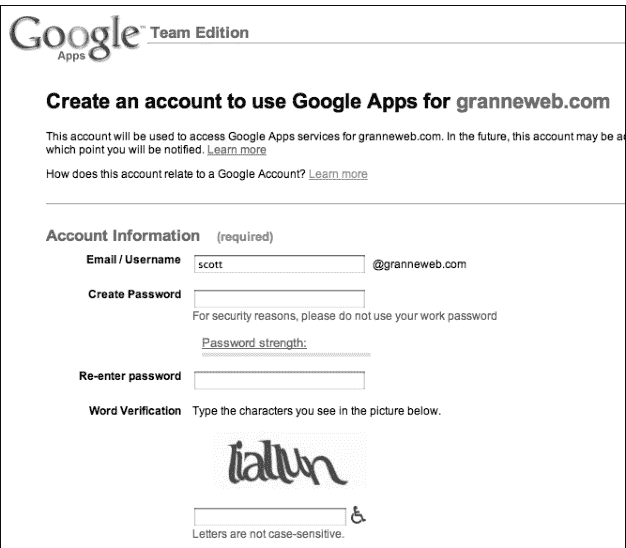

**图2.1** 创建Google团队版账号非常简单。

### 从团队版升级到标准版或高级版

如果你是某组织的IT管理员，你鼓励或允许用户使用Google Apps团队版——或者发现他们在未经你允许的情况下使用——你始终可以通过升级到标准版或高级版，甚至完全删除Google Apps来重新掌控局面。

> **注意**
> 你可以通过防火墙或其他网络安全工具屏蔽Google Apps的访问，但这可能会引发用户的怨恨和不满。最好先和用户沟通，说明你的立场和理由，再采取任何激烈措施。也许你已经有一些可用的工具供用户使用，又或者出于监管原因，你根本无法允许网络外的服务接入。也许Google Apps非常合适，但你需要对其使用有一定的控制权。无论原因是什么，都要先和用户沟通，*再采取行动*（除非使用Google Apps意味着公司违反了某些法规，可能导致相关人员陷入严重的法律纠纷——这种情况请先采取行动，之后再解释！）

如果你想开始管理Google Apps，首先需要按照之前详述的方法创建你所在公司的团队版账号。你的邮箱域名必须与所有其他成员使用的域名一致。登录团队版控制面板，在页面底部附近找到内容为「如果你是IT管理员，即可访问你组织的管理功能」的文本，点击其旁边的「了解如何操作」链接。在下一页，系统会要求你输入一个与当前域名无关的邮箱地址，此时你就可以拿出尘封已久的`gmail.com`或`att.com`邮箱了。你需要点击标注为「我接受」的按钮同意服务条款与条件，再点击「继续激活」。此时你会收到说明如何验证你对域名的控制权的指导：你可以选择在DNS中为该域名创建CNAME记录，或是上传指定的HTML文件到该域名的网站，完成其中任意一项后点击「验证」，通知Google进行检查，以此证明你确实是该域名的管理者。现在你就可以注册Google Apps的标准版或企业高级版，所有操作都由IT管理员管控。

> **注**
> 本章后续会深入讲解CNAME记录和HTML文件这两种验证方法。

## 注册企业高级版

准备好为你真正需要的功能付费了吗？在你的浏览器中打开`www.google.com/a/`，选择「比较版本并注册」，然后点击企业高级版下的「注册」按钮。系统会再次询问你是管理员还是最终用户。如果你是最终用户，输入你的邮箱地址后就会被转至团队版的注册表单（这是第三种进入该表单的途径！）。但因为你属于管理员，请选择「管理员」选项，输入你的域名，然后点击「开始使用」按钮。第二个页面和标准版的页面完全一致，需要你填写用户数量、账户管理员信息、组织详情等常规信息。第三个页面则是最大的区别所在：需要你付款！Google会将你在第二个页面指定的账户数量乘以50美元，得出你需要支付的总金额。不过你可以在这个页面修改账户数量，后续也可以随时增加用户数量。默认情况下，系统会要求你通过Google Checkout（Google推出的类似PayPal的在线支付服务）使用信用卡支付。如果你的公司不想使用Google的《Google Apps解密》系统，页面上会提供一个表单链接，你可以通过该链接申请其他支付方式。如果你还不确定是否要使用企业高级版，可以免费试用30天。你的信用卡仅会被预授权，30天到期前不会实际扣款，且你可以随时取消试用。这是一种无需承担大额资金投入、就能试用Google Apps企业高级版的不错方式。

> **注**
> Google称这只是限时优惠，但这项活动已经持续了相当长的时间，对于可能对迁移到Google Apps犹豫不决的企业来说，这项优惠能有效打消他们的顾虑，因此我认为这个选项不会很快取消。

如果你准备好了，点击「我接受」按钮，进入Google Checkout页面填写后续屏幕上的信息。向Google完成付款后，你会进入最后一个页面，按照标准版的流程创建管理员账户即可。完成所有流程后，你就会进入Google Apps控制面板，接下来可以开始配置DNS了。

## 从标准版升级到企业高级版

请注意，你可以先注册标准版，后续再升级到企业高级版。当你完成所有设置、系统按预期正常运行后，以具有管理权限的用户身份登录，进入控制面板，选择「域名设置」标签页，再点击「账户信息」。（从仪表盘你也可以点击「管理账户信息」链接作为快捷方式。）在那里你会看到「升级到Google Apps企业高级版」的链接，如图2.2所示。

![img/e9a4cffd6e6af9b4a1673e6228d68560_62_0.png)

**图2.2** 如果你需要企业高级版的额外功能，就可以选择升级。你将有机会确认所需的账户数量，之后会跳转到Google Checkout支付账单，完成后你就已启用企业高级版。

## 注册教育版（含非营利组织版）

如果你是属于官方认证的教育机构或持有`501(c)(3)`资质的非营利组织，请在浏览器中打开`www.google.com/a/`，点击蓝色的「比较版本并注册」按钮，再点击教育版下的蓝色「注册」按钮。系统会再次询问你是管理员还是最终用户。如果你是最终用户，输入邮箱地址后就会被转至团队版注册表单（这是第四种进入该表单的途径）。因为你属于管理员，请选择「管理员」选项，输入你的域名，再点击「开始使用」按钮。教育版的下一步设置流程和标准版非常相似：需要你填写用户数量、管理员的姓名和联系方式、组织详情，仅有一处不同：其他版本不需要填写组织的名称和类型，但教育版需要。你必须输入你所在的学校或非营利组织的名称，并说明该机构是教育机构还是非营利组织。点击「继续」后会进入第三个也是最后一个页面，创建管理员账户，填写必要信息，点击相应按钮即可进入Google Apps控制面板，接下来就可以开始配置DNS了。

> **注**
> 那怎么防止有些自作聪明的人为他本地的中学或者他想恶搞的非营利组织注册Google Apps呢？首先，Google会进行资质核查，且在第二个设置页面会承诺「会通过邮件告知你教育版升级的进度」；其次，这个想捣乱的人必须控制该组织的DNS，这基本上就能杜绝任何恶作剧行为了。

## 启用额外服务

默认情况下，新注册的Google Apps账号已自动启用大部分服务：起始页、邮箱、聊天、日历、文档和网站。你可以随时在控制面板中移除这些服务：进入控制面板后选择「服务设置」，再选择你想要移除的服务名称，向下滚动到「停用服务」部分，点击相应链接即可关闭该服务。服务停用后，用户将无法使用，也不会再显示在仪表盘中。你可以随时重新启用已停用的服务，也可以进入仪表盘点击「添加更多服务」来启用新服务。

加载的下一页会列出所有可添加的服务，如图2.3所示。

![img/e9a4cffd6e6af9b4a1673e6228d68560_64_0.png)

**图2.3** 标准版有3项服务未默认启用。目前共有4项服务未默认开启，但你可以在「其他服务」页面启用它们：`Salesforce.com`、网页、应用引擎、信息安全与恢复。正如你在第1章所见，可用服务列表取决于你使用的Google Apps版本。

**表2.1** 你可用额外服务的范围取决于你所使用的Google Apps版本

|  | 标准版 | 企业高级版 | 团队版 | 教育及非营利组织版 | 合作伙伴版 |
|---|---|---|---|---|---|
| `Salesforce.com` | ✓ | ✓ |  |  |  |
| Web Pages | ✓ | ✓ |  | ✓ |  |
| App Engine | ✓ | ✓ |  | ✓ | ✓ |
| Message Security and Recovery |  | ✓ |  |  |  |

## 启用网页服务

前往你的控制面板，点击「添加更多服务」，然后在「网页服务」下方点击「立即添加」按钮。页面会重新加载，你会看到「网页服务」选项已经消失。返回控制面板，它已经出现在那里了：「网页服务」现在已成为可用服务。你仍然需要配置DNS，让这项服务和其他服务一样正常运作。相关内容可以查阅本章后续的「配置DNS」部分。

## 启用App Engine

尽管许多用户和组织不会使用App Engine，但对它感兴趣的用户了解如何启用它仍然很重要。前往你的控制面板，点击「添加更多服务」，不过……你无法直接添加App Engine。首先你需要获取一个应用ID。要获得应用ID，你需要历经几道流程，其中最重要的一步是实际创建一个在App Engine上运行的项目。因此，我们将在第21章「使用Google视频的注意事项」中介绍Google App Engine。

## 启用消息安全与恢复服务

消息安全与恢复服务是仅面向高级版用户提供的服务之一，该服务源于Google对Postini的收购。在启用适用于Google Apps的Postini服务之前，你需要先激活电子邮件功能，这一点在本章前文已有详细介绍，且邮件功能必须通过Google正常运行。

要开始启用流程，请前往你的控制面板，点击「添加更多服务」。在接下来的页面中，点击「策略管理与消息恢复」旁边的「立即添加」按钮，即可将这款新工具添加到你的控制面板。不过该工具当前显示为「未激活」，因此你现在需要点击「激活Postini」。接下来会跳转到注册表单，需要你填写基础公司信息（几乎全部为必填项）、管理员联系信息（同样为必填项，请使用你为Google Apps设置的管理员账号），以及接受相关条款与条件（必须接受，否则无法继续！）。

提交表单后，你很快就会收到一封确认注册的邮件，随后还会收到一封包含激活密钥（一长串由数字、字母和特殊符号组成的字符串）、操作说明以及电子邮件保护服务设置与激活页面链接的邮件。按照链接跳转后，粘贴激活密钥，点击「登录」按钮，接下来系统会向你索要Postini所需的几项关键数据。首先是与你Google Apps高级版账号关联的域名，请仔细输入，更稳妥的方式是直接粘贴。接下来需要填写一个属于你域名下的电子邮箱地址，该账号需已拥有管理员权限，且将负责管理该域名下的Postini服务。输入两次高强度密码，选择时区，然后点击「设置账号」。

在最终设置页面，系统会告知你还会收到一封邮件，其中包含修改MX记录以适配Postini的操作说明（没错，又要改一次！）。你可以直接登录服务并开始添加用户，但需要注意的是，在MX记录完成切换之前，Postini不会为这些用户提供保护。MX记录的设置说明，以及与Postini相关的其他DNS信息，可以在下一节「配置DNS」中找到。

## 配置DNS

好了，我已经为我的企业「重金属按摩」（Heavy Metal Massage）完成了Google Apps标准版的初始设置。我现在处于控制面板的仪表盘页面，如图2.4所示。但现在所有服务都还不能正常使用。首先，Google尚未确认我拥有`heavymetalmassage.com`这个域名的所有权，而且我的所有服务都还没有激活。我倒是可以直接激活它们，但这没有意义，因为我还没有完成域名验证。所以让我们先从域名验证开始，之后再按需配置DNS。

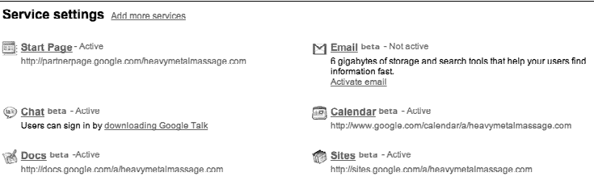

**图2.4** 服务已显示为激活状态，但在我组织的域名下都无法使用。

## 验证域名所有权

在我的控制面板仪表盘上，我看到了「验证域名所有权」的链接。点击它之后，Google提供了两种方式来证明我拥有并管理`heavymetalmassage.com`：上传HTML文件，或修改CNAME记录。

### 注

不知道DNS是什么？维基百科提供的简要定义如下：

> 域名系统（DNS）会将各类信息与域名关联；最重要的是，它作为互联网的「通讯录」，可将人类可读的计算机主机名（例如`www.example.com`）转换为网络设备传递信息所需的IP地址（例如`208.77.188.166`）。它还会存储其他信息，例如接收某个域名下电子邮件的邮件服务器列表。你可以前往`http://en.wikipedia.org/wiki/Domain_Name_System`阅读更多（大量）相关内容。

## 上传HTML文件

如果我选择上传HTML文件，Google会让我创建一个名为`google-hostedservice.html`的文件，并在其中填入指定的文本，内容类似于`google9c85d7ea61b55571`（格式一直是「google」一词后跟一串字母和数字）。如果你从未创建过HTML文件，它的格式大概如下：

```html


<html>

<head></head>

<body>

google9c85d7ea61b55571

</body>

</html>

```
我将文件保存后，将`google-hostedservice.html`上传到`heavymetalmassage.com`的根目录。完成后，我会点击提供的链接确认可以访问该文件，如果成功，就点击「验证」按钮。
```

## 修改CNAME记录

如果你知道如何编辑DNS记录，这种方式比创建HTML文件更简单。当我选择这个选项时，Google会给我一串需要填入CNAME的字符串——这和我选择上传HTML文件时得到的字符串是一样的：`google9c85d7ea61b55571`。我使用Go Daddy管理`heavymetalmassage.com`，因此我登录该网站，点击「我的账户」，选择「管理域名」，选中`heavymetalmassage.com`，然后点击写着「完整DNS控制与MX记录」的小链接，就会出现如图2.5所示的界面。

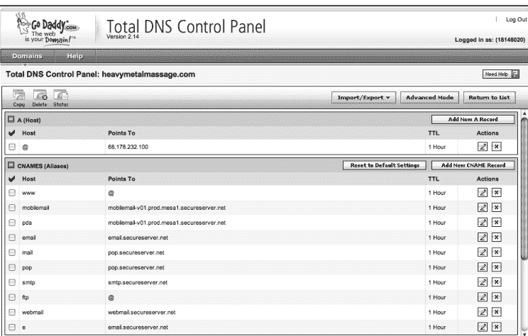

**图2.5** Go Daddy为用户提供了对其域名DNS记录的高级别控制权限。

### 注

我更青睐DynDNS（`www.dyndns.com`）及其DNS管理界面。但我知道很多读者使用Go Daddy，而且我的`heavymetalmassage.com`也是在该注册商处注册的，因此我觉得用这个网站演示整个流程会更有指导意义。你可以在`www.google.com/support/a/bin/answer.py?answer=47283`找到多家主流注册商和DNS服务商配置CNAME记录的具体说明，该页面列出的部分知名服务商包括：

- GoDaddy.com
- 1and1
- EveryDNS.net
- Yahoo! SmallBusiness
- eNom
- Network Solutions
- Dreamhost
- register.com

现在我点击「添加新CNAME记录」，会出现如图2.6所示的输入栏。在「输入别名」栏中，我填入Google提供给我的字符串：`google9c85d7ea61b55571`。在「指向主机名」栏中，我按照Google的要求填入`google.com`。TTL（生存时间）可以按需设置，默认值为1小时，但我通常出于习惯会将其设置为半小时。

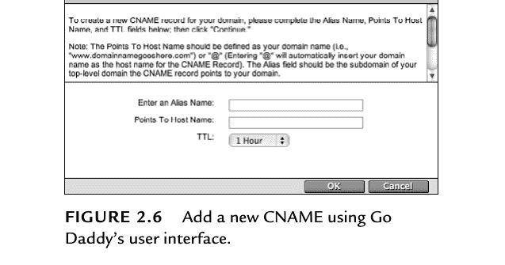

**图2.6** 使用Go Daddy的用户界面添加新CNAME记录。

Go Daddy需要一点时间才能在其侧完全完成所有设置。当系统提示CNAME记录已生效后，我可以点击`http://google9c85d7ea61b55571.heavymetalmassage.com`这个链接测试是否生效。如果我最终跳转到了Google首页，一切正常；如果没有，我需要再等待一段时间，让设置完成全球传播。如果24小时后仍然无法正常运行，我需要检查CNAME记录，确保自己填写正确。

如果CNAME已经生效，就可以点击「验证」按钮了。我立刻被带回控制面板的仪表盘，上面显示的一条如图2.7所示的小消息提示我「我们正在验证域名所有权，此过程最多可能需要48小时完成」。幸运的是，我从未遇到过耗时这么久的情况，大约5分钟刷新一次仪表盘，这条消息就会消失。如果消息消失了，就万事大吉了——Google已经完成了我的域名所有权验证，现在可以确定我拥有并管理`heavymetalmassage.com`这个域名。终于可以开始配置DNS了。

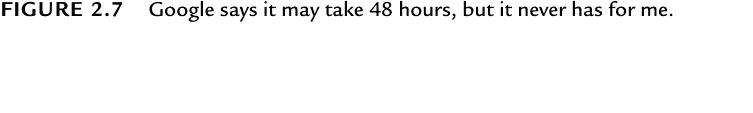

**图2.7** Google提示可能需要48小时，但我从未遇到过这种情况。

> **注意** 当你确认Google已验证你的域名后，可以删除你为`google9c85d7ea61b55571`（或Google分配给你的任意字符串）创建的CNAME记录。

## 创建自定义URL

默认情况下，我的Google起始页被设置为指向`http://partnerpage.google.com/heavymetalmassage.com`，日历指向`http://www.google.com/calendar/a/heavymetalmassage.com`，文档指向`http://docs.google.com/a/heavymetalmassage.com`。第一个问题：这些地址并不太好记。第二个问题：它们不仅难记，而且结构都不一样——比如日历的路径里包含"calendar"字样，后面跟着`/a/`，而文档的域名里包含"docs"，路径开头也是`/a/`。所以这些地址几乎不可能理清楚、记住！

幸运的是，Google允许你创建更容易记住的自定义URL。就我个人而言，我宁愿告诉同事访问`docs.heavymetalmassage.com`或者`mail.heavymetalmassage.com`。事实上，你应该提前规划好计划使用的每个Google应用对应的域名。表2.2展示了我为自己规划的内容（其中部分建议是你在接下来几段要查看的Google界面里默认提供的）：

**表2.2** Google应用建议的完整域名

| Google 应用服务 | 完整域名 |
|---------------------|-----------------------------|
| 起始页 | my.heavymetalmassage.com |
| 电子邮件 | mail.heavymetalmassage.com |
| 日历 | calendar.heavymetalmassage.com |
| 文档 | docs.heavymetalmassage.com |
| 网站 | wiki.heavymetalmassage.com |

要设置自定义URL，我会进入控制面板，决定当前要配置哪些服务。我也可以现在配两个，明天配一个，一周后再配两个，以此类推，但这样似乎效率不高。默认情况下，正如你在图2.4中看到的，Google已启用起始页、聊天、文档、电子邮件、日历和网站服务。其中聊天服务不需要做任何DNS配置，因此我可以暂时忽略它。


##### 提示

以下是你可以参考的其他域名方案：

- 起始页使用`start.domain.com`，毕竟这是一个“起始”页面（事实上这也是Google的默认设置，你很快就能看到）
- 电子邮件使用`email.domain.com`
- 日历使用`cal.domain.com`，因为输入"cal"比输入"calendar"更短
- 文档使用`office.domain.com`，因为文字处理、电子表格和演示文稿是构成办公套件软件的组成部分
- 网站使用`sites.domain.com`，因为它是一组网站的集合（这也是Google的默认设置之一）
- 网页使用`pages.domain.com`，尤其当你已经搭建并运行了官方域名`www.domain.com`时

你可以自由发挥创意，只要尽量做到简洁直观即可。为单个服务或所有服务设置自定义URL的流程开头是一样的：在控制面板的“服务设置”菜单下选择一个服务。如果只想修改单个服务的URL，就选中对应的服务；我想修改所有服务的URL，所以选任意一个都可以。起始页在列表最上方，因此我会选它。

在起始页设置页面中间有一个标注为“网址”的部分，你可以在图2.8中看到它（无论你选择哪个服务，除了没有关联网址的Google Talk之外，都会看到这个部分）。Google显示我当前的起始页地址是`http://partnerpage.google.com/heavymetalmassage.com`（真糟糕！），并提供了一个“修改网址”链接。点击该链接后，我会进入一个可以修改起始页URL的网页，如图2.9所示。如果我只想完成这一步，可以直接在这里填写表单、提交，事情就解决了。但我追求更高的效率，因此我会点击顶部的“修改所有域名服务的网址”链接。

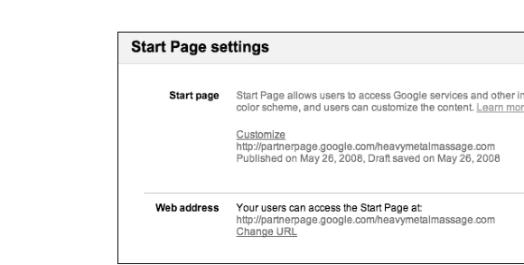

### 图2.8 是时候修改那个糟心的不友好网址了！

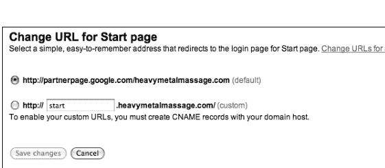

### 图2.9 我本可以只修改这一个链接，但还有很多其他的链接需要改。

现在我会进入一个页面，如图2.10所示，该页面正好可以实现我的需求：一次性修改所有正在使用的Google App服务的网址。对于每个服务，我需要选中自定义地址旁边的单选按钮，然后在文本框中输入新的子域名。你不需要接受文本框里Google的默认内容——那些只是建议。例如，Google建议起始页使用`start.heavymetalmassage.com`，这个建议很合理，但我更希望人们访问`my.heavymetalmassage.com`，因为这个名字更有个性，所以我将输入这个域名。完成表2.2中列出的修改后，我点击“继续”。

在下一页中，Google已经查明了我的DNS注册服务商（这并不难，但Google做得非常贴心、实用），并让我前往该服务商处创建与我选择的子域名匹配的CNAME记录。所有这些CNAME记录都要指向同一个地址：`ghs.google.com`。之后我需要回到这个页面，点击底部的“已完成这些步骤”按钮。

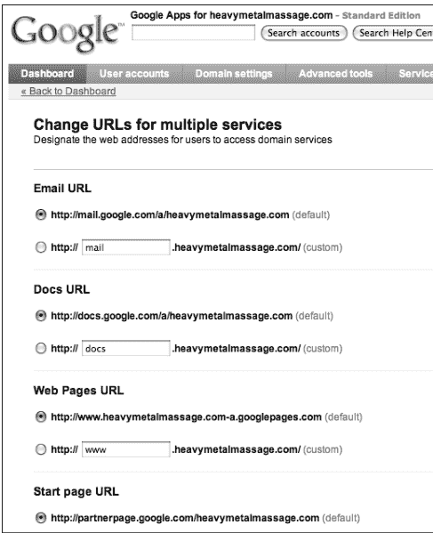

### 图2.10 现在我可以一次性修改所有服务的URL，效率高多了。

因为我用的浏览器支持标签页功能，所以我在另一个标签页中打开`www.godaddy.com`，并按照Google的说明操作。当我进入Go Daddy的DNS控制面板时，我记起当初在Go Daddy注册`heavymetalmassage.com`时，它自动为我创建了几个CNAME记录（你的域名注册商不一定会有这个操作），这些记录在图2.5中可以看到。我需要删除`mobilemail`、`pda`、`email`、`pop`、`smtp`、`ftp`、`webmail`和`e`的CNAME记录，因为我过去和将来都不会使用这些服务。接下来我需要修改`www`和`mail`的CNAME记录。最后，我需要为`my`、`calendar`、`docs`和`wiki`添加CNAME记录。你在域名注册商处的操作无疑会有所不同；你只需要遵循基本准则，将CNAME记录配置为和Google要求的一致即可。

完成操作后，我的Go Daddy DNS控制面板看起来完全是按Google的要求配置的，如图2.11所示。

| 主机 | 指向地址 | 生存时间 | 删除 |
|------|------------|-----|--------|
| ☐ mail | ghs.google.com | 1/2 小时 | ☐ |
| ☐ my | ghs.google.com | 1/2 小时 | ☐ |
| ☐ calendar | ghs.google.com | 1/2 小时 | ☐ |
| ☐ docs | ghs.google.com | 1/2 小时 | ☐ |
| ☐ wiki | ghs.google.com | 1/2 小时 | ☐ |
| ☐ www | ghs.google.com | 1/2 小时 | ☐ |

### 图2.11 我所有的CNAME记录现在都符合Google应用的要求了。

Go Daddy只用了几分钟就完成了必要的修改，之后我回到Google，打开之前留着的页面，点击“已完成这些步骤”按钮。我的控制面板重新打开，仿佛变魔术一样，所有URL现在都指向我创建的CNAME记录了。

> **提示** 如果你关闭了浏览器，或者发现页面没打开，也没关系——回到你的Google应用控制面板，重复我们设置自定义URL时走过的步骤，就可以重新开始操作。

> **警告** 虽然你可以删除本章前面创建的用于验证域名的CNAME记录，但不要删除你为自定义URL创建的CNAME记录。如果你删除了这些记录，自定义URL将无法再使用，你将收到来自终端用户困惑甚至恐慌的电话，这会非常糟糕。

## 设置电子邮件的MX记录

在设置了CNAME记录，为所有Google应用服务配置好自定义URL后，我似乎已经完成了所有工作，可以直接开始使用Google应用了。然而，看一眼控制面板就会发现，电子邮件仍然无法使用，因为它需要被激活。

要开始这一流程，我点击“激活电子邮件”，随后进入标题为“设置电子邮件传递”的页面，该页面实际上全部是关于在DNS中设置MX（邮件交换）记录的内容。简而言之，你需要在你管理DNS的所有位置修改MX记录，让它们指向谷歌的服务器。

> **注意**：如需了解MX记录的基本介绍，请查阅维基百科的相关文章：`http://en.wikipedia.org/wiki/MX_record`。

谷歌会自动检测你的DNS服务商，并尝试针对对应服务给出操作指引。就我而言，谷歌知道我在使用Go Daddy，因此显示了适配该服务商的说明。不过如果谷歌判断有误，或是你想查看其他域名注册商的操作指引，可以通过“显示以下服务的指引”下拉菜单从超过35种服务的列表中选择对应项，也可以选择“任意托管公司”查看通用指引。

对于已经熟悉DNS操作的用户，快速操作指引是删除所有已有的MX记录，然后添加以下MX服务器及对应优先级：

```
ASPMX.L.GOOGLE.COM. 10

ALT1.ASPMX.L.GOOGLE.COM. 20

ALT2.ASPMX.L.GOOGLE.COM. 20

ASPMX2.GOOGLEMAIL.COM. 30

ASPMX3.GOOGLEMAIL.COM. 30

ASPMX4.GOOGLEMAIL.COM. 30

ASPMX5.GOOGLEMAIL.COM. 30

```

> **注意**：万一谷歌后续调整这些MX记录（尽管概率极低），你可以自行访问以下链接查看最新列表：`www.google.com/support/a/bin/answer.py?hl=en&answer=33352`。

就我而言，我登录Go Daddy，再次进入DNS控制面板，就能看到图2.12所示的内容——也就是系统默认创建的MX记录。我删除了两条已有的MX记录，然后添加第一条MX记录：优先级为10，主机名为`@`（这是Go Daddy及少数其他服务商使用的格式，是我域名`heavymetalmassage.com`的简写），目标地址为`ASPMX.L.GOOGLE.COM.`（注意末尾的点号必须保留），TTL为半小时。这些设置如图2.13所示。

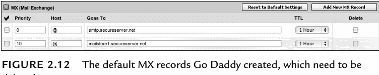

**图2.12** Go Daddy创建的默认MX记录，需要被删除。

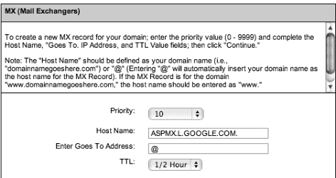

**图2.13** 在Go Daddy上为Google Apps配置的示例MX记录。

谷歌针对Go Daddy给出的操作指引要求我只创建5条MX记录，这看似和几段前你看到的7条MX记录列表矛盾，但实际上并不矛盾：5条已经足够使用，且两种列表最终的配置效果在实际使用中几乎没有区别。

配置完成后，我在Go Daddy上的MX记录列表如图2.14所示。

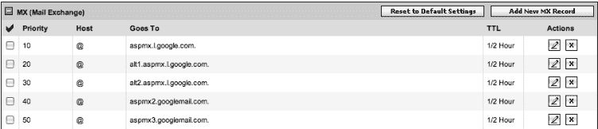

**图2.14** Go Daddy上最终的MX记录列表，已全部填写完成，可正常使用。

回到谷歌页面后，我可以点击“我已完成这些步骤”按钮，这会带我回到控制面板的仪表盘。从图2.15可以看到，谷歌正在检查我刚刚添加的MX记录。这个过程不会耗时太久；根据我的经验，校验速度几乎可以实时完成，具体时长取决于你使用的DNS服务商。

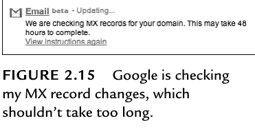

**图2.15** 谷歌正在检查我提交的MX记录变更，该过程不会耗时太久。

现在我的自定义URL和MX记录都已正常生效，仪表盘如图2.16所示，提示我接下来可以跳转到本章后续的“创建用户”部分。

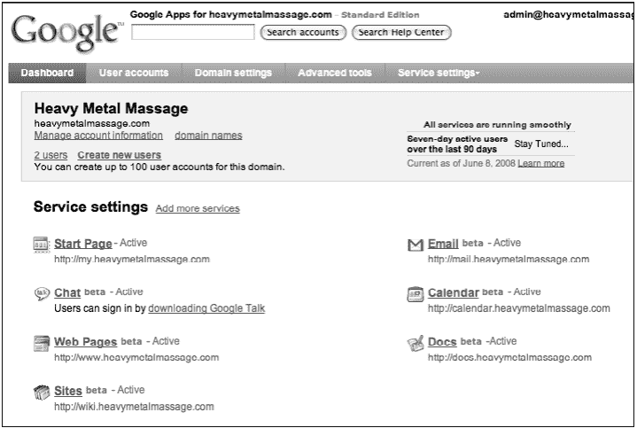

**图2.16** 我的仪表盘显示所有服务已处于最新状态。现在是时候创建用户了。

## 设置用于Google Talk互联的SRV记录

你将在第18章《使用Google Talk的注意事项》中详细了解谷歌的聊天客户端Google Talk，但现在你需要知道：Google Talk可以与其他即时通讯网络实现互联互通。Google Talk底层基于Jabber协议，这是一种开放、可扩展的即时通讯协议。使用Jabber的一大优势在于，Google Talk可以通过被称为*联邦*的流程，连接到其他基于Jabber构建的消息系统。

> **注意**：如需了解更多关于Jabber的信息，请查阅维基百科的相关文章：`http://en.wikipedia.org/wiki/Jabber`。

也就是说，如果你的Google Apps用户想要与非Google Talk用户进行即时通讯，甚至是将Google Talk当作电话使用，只要你先完成几项DNS修改就可以实现。

> **注意**：请记住，无需进行任何DNS修改，你的Google Apps用户之间就可以正常聊天；他们也可以和其他任意域名的Google Apps用户、以及非Google Apps的Gmail用户正常聊天，同样不需要修改DNS。只有当你希望用户能够与未使用Google Apps或Gmail的人聊天时，才需要进行这些DNS修改。

你需要将以下SRV记录添加到你的DNS记录中。将`mydomain.com`替换为你自己的Google Apps域名；就我而言，我会输入`heavymetal-massage.com`。不要修改`google.com`部分，且必须保留所有的下划线，否则记录将完全无法生效。

```
_xmpp-server._tcp.mydomain.com. IN SRV 5 0 5269 xmpp-server1.google.com.

_xmpp-server._tcp.mydomain.com. IN SRV 20 0 5269 xmpp-server1.l.google.com.

_xmpp-server._tcp.mydomain.com. IN SRV 20 0 5269 xmpp-server2.l.google.com.
```


`_xmpp-server._tcp.mydomain.com. IN SRV 20 0 5269 xmpp-server3.l.google.com.`

`_xmpp-server._tcp.mydomain.com. IN SRV 20 0 5269 xmpp-server4.l.google.com.`

`_jabber._tcp.mydomain.com. IN SRV 5 0 5269 xmpp-server1.google.com.`

`_jabber._tcp.mydomain.com. IN SRV 20 0 5269 xmpp-server1.l.google.com.`

`_jabber._tcp.mydomain.com. IN SRV 20 0 5269 xmpp-server2.l.google.com.`

`_jabber._tcp.mydomain.com. IN SRV 20 0 5269 xmpp-server3.l.google.com.`

`_jabber._tcp.mydomain.com. IN SRV 20 0 5269 xmpp-server4.google.com.`

在Go Daddy上，进入DNS控制面板，点击“添加新SRV记录”按钮，就会出现如图2.17所示的界面。

> **注意**：万一谷歌后续调整这些SRV记录的DNS要求，你可以通过以下两个链接查看官方原始指引：`www.google.com/support/a/bin/answer.py?answer=60227&hl=en` 和 `www.google.com/support/a/bin/answer.py?hl=en&answer=34143`。

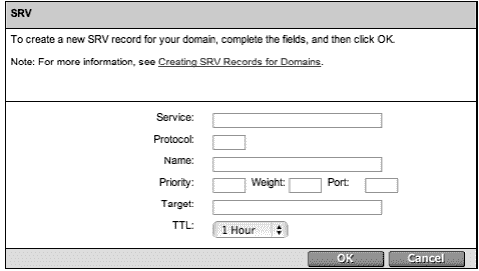

**图2.17** 尽管SRV记录相对复杂，但Go Daddy的操作流程还是很简便的。

根据谷歌的配置要求，如果我要为`heavymetal-massage.com`添加第一条SRV记录，会在Go Daddy提供的字段中填入以下内容：

- 服务：`_xmpp-server`
- 协议：`_tcp`
- 名称：`@`（Go Daddy要求使用`@`代替`heavymetalmassage.com`）
- 优先级：`5`
- 权重：`0`
- 端口：`5269`
- 目标：`xmpp-server.l.google.com.`
- TTL：选择Go Daddy提供的默认值，即1小时

注意我输入的内容中保留了所有下划线，因为这些是必填项。

如果我使用的是DynDNS，则会看到如图2.18所示的类似界面：

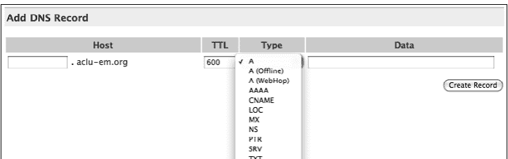

**图2.18** DynDNS的操作引导不如Go Daddy细致，但我个人更喜欢它。

根据谷歌的配置要求，如果我要为`heavymetal-massage.com`添加第一条SRV记录，会在DynDNS提供的字段中填入以下内容：

- **主机**：`_xmpp-server._tcp`
- **TTL**：选择DynDNS提供的默认值，即600
- **类型**：`SRV`
- **数据**：`5 0 5269 xmpp-server.l.google.com.`

你的DNS服务商的操作界面很可能与Go Daddy和DynDNS都不相同。由于SRV记录相比其他DNS记录更为复杂，你需要查阅你的DNS服务商的帮助文档，确保输入的SRV记录数据正确。

完成SRV记录的正确配置后，你就可以确保你的用户能够将Google Talk与其他支持的网络进行联邦互通。

> **提示**：想了解更多关于SRV记录的信息？请查阅维基百科的相关专题文章：`http://en.wikipedia.org/wiki/SRV_record`。

## 设置用于策略管理与邮件恢复的MX记录

你将收到的电子邮件会包含配置MX记录所需的全部信息。简而言之，你需要修改配置，让所有传入邮件先经过Postini处理，再传送到Google Apps的邮件服务器，最后通过Google Apps的SMTP服务器发出——之后再发往Postini的服务器，最后才会进入更广泛的互联网。（没错，这两款邮件服务器实际上都属于谷歌，不过在这里我们为了方便，还是把它们当作独立的服务来处理。）

Postini所需的MX记录几乎总是遵循以下格式：

```
[yourdomain].com.s[system #]a1.psmtp.com. 10 
[yourdomain].com.s[system #]a2.psmtp.com. 20 
[yourdomain].com.s[system #]b1.psmtp.com. 30 
[yourdomain].com.s[system #]b2.psmtp.com. 40 
```

你需要将`[yourdomain]`替换为自己的域名，将`[system #]`替换为你分配到的Postini系统编号，该编号固定为7或200。

按照上述规则，`heavymetalmassage.com`的MX记录会如下所示：

```
heavymetalmassage.com.s7a1.psmtp.com. 10 
heavymetalmassage.com.s7a2.psmtp.com. 20 
heavymetalmassage.com.s7b1.psmtp.com. 30 
heavymetalmassage.com.s7b2.psmtp.com. 40 
```

请记得你之前已经配置过谷歌应用邮箱的MX记录，格式如下：

```
ASPMX.L.GOOGLE.COM. 10 
ALT1.ASPMX.L.GOOGLE.COM. 20 
ALT2.ASPMX.L.GOOGLE.COM. 30 
ASPMX2.GOOGLEMAIL.COM. 40 
ASPMX3.GOOGLEMAIL.COM. 50 
```

> **注意：** 其中一组全是小写，另一组全是大写。大小写其实完全无关紧要，只要每条记录的末尾是点号、空格和优先级数字即可。

当你添加新的基于Postini的MX记录时，需要把它们的优先级数值设置得更低（也就是更接近0），这样它们的优先级就会高于旧的MX记录。这样邮件就会先投递到Postini。

当你确认邮件已经能正确流转——先经过Postini再到谷歌应用，最后送达用户——之后，就可以删除之前旧的、优先级更低的MX记录了。

要让Postini正常工作，你还需要完成一项必填设置：需要把Postini的SMTP服务器添加到谷歌应用的配置中。在你收到的激活邮件中，会提供一个SMTP地址，格式类似于`outbounds7.ga.obsmtp.com`。不过不要把这个SMTP地址填到你常用的邮件客户端里！

你需要进入谷歌应用控制面板，再依次进入服务设置、电子邮件，在出站网关的输入框中填入Postini提供的SMTP地址，然后向下滚动页面，点击保存更改即可。

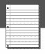

> **注意：** 谷歌已经为大部分主流域名注册商提供了操作指南，包括Go Daddy、Network Solutions、1&1、Dreamhost、Yahoo!，还有我最爱的DynDNS。你可以通过`www.postini.com/webdocs/activate_pg/wwhelp/wwhimpl/common/html/wwhelp.htm?context=activate_pg&file=mx_switch.html#960868`访问这份指南。

到这里你基本就完成了Postini的初始设置——注意只是初始设置，不是全部配置——除非你使用DNS中的SPF记录来辅助过滤垃圾邮件。如果需要配置SPF，请继续阅读下文。

## 通过SPF记录防范垃圾邮件

SPF全称是发件人策略框架，旨在防止垃圾邮件发送者伪造识别邮件发件人的“发件人”字段。你有没有遇到过这种情况：朋友质问你为什么给他们发垃圾邮件，但你确定自己根本没发过？这种情况就是垃圾邮件发送者在发件人字段造假，声称邮件是你发的。伪造发件人字段出奇地简单，因此SPF（以及另外几项互补、有时甚至是竞争关系）的技术应运而生。

要为你的域名配置SPF记录，你需要登录到管理DNS的平台，创建一条格式如下的TXT记录：

```
v=spf1 include:aspmx.googlemail.com ~all 
```

如果你用的是Go Daddy，你需要先登录账号，进入DNS控制面板，向下滚动到TXT板块。这里有一个很有用的按钮，标注为“添加新SPF记录”，但点击之后的操作会有点让人困惑。

在弹出的向导的第一页，选择“互联网服务提供商或其他邮件服务商”，然后点击确定。在第二步，选择“外包”标签页，然后在“输入外包域名”的输入框中粘贴`aspmx.googlemail.com`，点击确定，Go Daddy就会向你展示它要插入的SPF记录：

```
v=spf1 include:aspmx.googlemail.com ~all 
```

> **警告：** 不要勾选第二步中“排除此处未列出的所有主机（-all）”旁边的复选框。请注意，如果你勾选了，就会插入“减号全部（-all）”，而不是我们需要的“波浪号全部（~all）”，这很可能导致你完全无法通过谷歌发送邮件。

部分域名注册商要求你创建的记录格式会略有不同。比如管理我主域名`granneman.com`的DynDNS，就要求TXT记录加上引号，格式如下：

```
"v=spf1 include:aspmx.googlemail.com ~all" 
```

等待一段时间，让DNS更改完成全局传播，之后测试你配置的内容是否生效。你有几种测试方式可选。

SPF项目的运营方提供了一项测试服务：你只需要给`spf-test@openspf.org`发送一封邮件，就会收到一封看起来像退信通知的邮件，主题为“投递状态通知（失败）”。不过你要仔细阅读这封邮件，应该会看到类似下面这行内容：

```
SPF Tests: Mail-From Result="pass"
```


`Port25`也提供了一项基于邮件的测试服务：给`check-auth@verifier.port25.com`发送邮件，你会收到一封回复邮件，其中包含你在图2.19中能看到的信息，甚至更多内容。

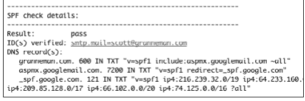

### 图2.19 Port25会告知我域名的SPF是否配置正确。

最好用的网页版测试服务来自邮件服务提供商联盟，网址是`http://senderid.espcoalition.org`。滚动到网页底部，你会看到系统生成了一个唯一的邮箱地址，格式类似于`fBk6J@senderid.espcoalition.org`。给这个地址发送一封邮件，然后点击“查看样本”按钮。当下一页加载完成后，你会看到一份美观、完整的报告，不仅包含SPF的相关信息，还涵盖其他基于DNS的垃圾邮件过滤和防伪造技术。这份报告的部分内容如图2.20所示。

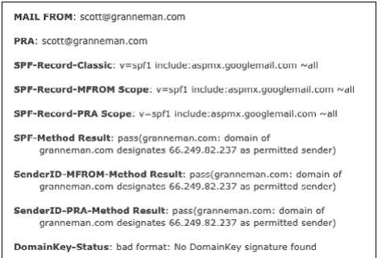

### 图2.20 邮件服务提供商联盟（ESC）会为SPF测试者提供非常有用的报告。

在开始依赖SPF记录之前，请务必完成测试。不过请耐心等待——虽然部分注册商的DNS更改更新和传播几乎是实时的，但也有一些注册商需要数小时，甚至长达标准的48小时传播周期。

## 通过谷歌购买域名

并非所有想使用谷歌应用的人都已经注册好了可配置的域名。事实上，很多对谷歌应用感兴趣的人可能根本不知道如何注册域名，更别提如何调整DNS设置了。谷歌意识到这个问题后，于2006年12月宣布与两家规模较大的域名注册商`Go Daddy`和`eNom`达成合作，让注册与谷歌应用完美兼容的域名变得极其简单。

具体规则是这样的：你可以通过谷歌购买域名（后缀包括`.com`、`.org`、`.net`、`.biz`或`.info`），每年仅需10美元（非常便宜），所有配置都会自动完成，域名注册后就能立即用于谷歌应用。这项服务还会附带一系列优质的域名相关服务。注册信息会自动免费隐藏，很多人会喜欢这项功能，因为它能保护你的数据不被垃圾邮件发送者获取（我个人认为这是个糟糕的设计，因为网民能够出于各种合理原因联系到域名所有者非常重要，但毕竟我不是这项服务的运营方）。另一项免费提供的服务是域名锁定，它可以防止未授权的域名转移。

和部分人的预期相反，你完全拥有DNS的控制权。如果你想把域名配置成兼容非谷歌服务，完全可以自由操作。系统帮你简化了操作流程，但不会剥夺你的功能或控制权，这一点至关重要，也非常公平。

### 通过谷歌购买域名

我从小就喜欢玩文字和名字相关的游戏，其中我最喜欢的是倒读游戏：把一个人的名字倒过来读，然后试着说出来（没错，我知道这很奇怪——也许这就是我成为作家的原因吧）。我叫`Ttocs Namennarg`，我弟弟叫`Sug`，我的朋友包括`Snaj Notrac`、`Sumaes Rekced`、`Nibor Namtlow`和`Ebag Trebig`（我都能完美地读出这些倒写的名字）。所以当我为了好玩、测试谷歌是否能为没有域名的人提供域名服务，准备买一个域名的时候，我决定注册`namnennarg.com`（即`granneman.com`的倒写）。反正我已经有了`granneman.com`，为什么不买个一模一样的倒写域名呢？而且每年只要10美元！

我再次打开`www.google.com/a/`，点击“比较版本并注册”，然后选择标准版下的“注册”选项。不过这次我选择了“我想购买一个域名”，首先会被要求搜索想要的域名。我输入了`namnennarg`，选择`.com`作为顶级域名，然后点击“检查可用性”按钮。下一页（如图2.21所示）告诉我这个域名可以注册（真是个惊喜！），以及注册费用和配套的域名服务。如果你仔细看图2.21的底部，会发现谷歌提示我这项注册服务将由`eNom`提供支持。嗯，我不太想要这样。我已经有`DynDNS`和`Go Daddy`的账号了，我最不想再新增一个域名注册商的账号。我点击`eNom`旁边的“了解更多”，进入了一个页面，谷歌允许我选择`eNom`或`Go Daddy`作为注册商。我选择了`Go Daddy`，点击“继续”，回到了第一步“选择域名”，但现在我的购买将由`GoDaddy.com`提供支持，这正是我想要的。我点击“继续注册”来完成购买。

**图2.21** 嘿，谁会想到呢？`namennarg.com`居然还能注册！

在第二步的页面上，系统询问我是否要隐藏注册信息。很多人会勾选这个选项，试图让垃圾邮件发送者无法获取自己的联系方式，但我确实觉得这有违互联网精神，而且我打算使用`Gmail`，它的垃圾邮件过滤功能是全球最好的，所以我会取消勾选这个选项。接下来系统要求我填写个人信息——和任何域名注册商要求提供的个人资料一致——这完全没问题，直接填写即可。接下来要处理两个复选框：一个是必须勾选才能继续的选项，提示我已阅读`Go Daddy`服务条款；另一个是每年自动续费注册的选项，完全可选。页面底部有个按钮，点击后会跳转到`Google Checkout`页面，我可以在那里支付域名费用。

> **注意**
> 没错，购买域名需要`Google Checkout`账号。不过别担心，如果你还没有账号，下一页会提示你创建。我之前已经有`Google Checkout`账号了，所以直接登录并向谷歌付款。

在（如图2.22所示的）这个页面上，我有几个有意思的选项需要选择。

**图2.22** 用`Google Checkout`购买新域名并不难。`Google Checkout`的常规操作是提供向卖家隐藏你的邮箱地址的选项。如果我勾选对应的复选框，谷歌会把卖家发来的所有邮件转发到我使用的邮箱，也就是和我的`Google Checkout`账号绑定的`gmail.com`邮箱。但这里的卖家本身就是`Google Apps`，所以我根本不知道这么做有什么意义！下方有个已经勾选好的复选框，提示我是否愿意接收卖家的垃圾……哦不，“推广邮件”。我不需要，取消勾选。我点击下单按钮，成为了新域名`namennarg.com`的拥有者，别提多骄傲了。下一页（如图2.23所示）向我表示感谢，还提供了一个链接，让我可以“领取我的购买成果”。

**图2.23** 是时候认领现在属于我的东西了：`namennarg.com`！

与此同时，我的收件箱里收到了两封邮件，一封是购买收据，另一封是激活我的`Google Apps`账号的相关信息。我把两封邮件都保存了下来。我点击感谢页上的链接，页面提示我为`namennarg.com`的`Google Apps`账号创建第一个管理员账号。用户名当然是`ttocs`，密码是`kltpzyxM`（真的是这个吗？我就不说，好坏哦！）。问我是否愿意接收使用提示？不用，不需要。问我是否愿意提供反馈？当然可以。我点击继续按钮，`namennarg.com`的控制面板就加载出来了，如图2.24所示。

**图2.24** 这是我通过谷歌购买的域名`namennarg.com`的控制面板。你会发现，起始页、邮箱、日历和文档的自定义域名都自动帮我设置好了，太方便了。就像我之前在“创建自定义URL”部分提到的，我更喜欢`my.namennarg.com`，而不是`start.namennarg.com`，不过这没什么大不了的，之后随时可以修改。但更大的问题是，网页和站点的URL完全没有自定义：一个是`http://www.namennarg.com-a.googlepages.com`，另一个是`http://sites.google.com/a/namennarg.com`？谁想要这种URL啊？我本以为从谷歌及其合作伙伴那里购买URL，就是为了不用自己费劲调整URL，结果现在我发现自己还是得手动修改。哎。不过这个问题很好解决：我在`Google Apps`控制面板里进入服务设置，再选择网页服务。在网页地址部分，我点击“更改URL”，在网页URL更改页面，我选择第二个选项按钮，它会自动在自定义URL文本框中插入“sites”。然后我点击继续按钮，再对站点重复同样的操作。没过多久，所有自定义URL就都设置好了。其实也不算太麻烦，但我真希望谷歌能修复这个小问题。问题不大，但着实烦人。

> **注意**
> 我本可以同时修改两个URL，但我只改两个，省不了几次点击，所以干脆分开改了。

## 访问高级DNS服务

如果我想在谷歌简化界面提供的DNS设置之外做更多自定义调整，或者想添加需要修改DNS记录的第三方服务，我就需要登录`Go Daddy`（如果当初选择的是`eNom`就登录`eNom`）来进行相关设置。我在`Google Apps`控制面板里进入域名设置，选择域名标签页，然后点击“高级DNS设置”链接，链接下方的备注说明点击后会跳转到`Go Daddy`页面修改DNS记录。点击后我进入一个页面，谷歌会在这里提供我的登录名（其实是一串数字）、密码（一长串字母和数字）、客服PIN码，以及`Go Daddy`的客服邮箱。所有信息下方是`Go Daddy` DNS控制台的链接。进入`Go Daddy`页面后，我看到一个页面（如图2.25所示），列出了所有我通过谷歌注册的域名。但这里不会显示我没有通过谷歌、直接在`Go Daddy`注册的域名。换句话说，如果你跟着本章的步骤操作过，就会知道我是直接在`Go Daddy`注册的`heavymetalmassage.com`，没有通过谷歌，尽管之后我修改了DNS记录指向谷歌的服务。这个域名在图2.25里没有显示。

**图2.25** 我只能看到通过谷歌注册的域名，看不到其他`Go Daddy`注册的域名，太坑了！

选择`namennarg.com`之后，我可以修改联系人信息，把域名转移到其他注册商（这会移除自动配置，需要我手动创建CNAME和MX记录），还可以按需随意修改DNS设置。很好的是，谷歌和`Go Daddy`的合作并没有限制我修改自己注册域名的DNS记录，想怎么调整都行。

## 你应该通过谷歌购买域名吗？

我的简短回答：大概率不要。详细回答：如果你哪怕对DNS有一点点了解，或者是个能照着说明操作、不会因为改设置就慌的人，你大概率也不应该通过谷歌及其合作的注册商购买域名。就像你 throughout 本章看到的，手动修改DNS记录匹配谷歌的要求其实并不难。我之前一直用`Go Daddy`，也用过`DynDNS`和其他几家注册商，体验都差不多。谷歌特意为大部分主流注册商都提供了操作指南，还有通用的步骤，你几乎完全可以自己搞定。操作这么简单，根本没必要让谷歌帮你做。除此之外，通过谷歌和`Go Daddy`（或`eNom`）购买域名时分配的账号和密码，你是无法修改的。雪上加霜的是，这个域名在`Go Daddy`的账号和我原本就有的`Go Daddy`账号是分开的，通过谷歌注册域名反而成了个大麻烦。实际上对我来说，这是劝退项。我已经有一个熟悉的、用着顺手的`Go Daddy`用户名了，不想再记一长串用户名；我早已经背下了自己用的好密码，也绝对不想再记或者存一长串密码（不过公允地说，自动生成的密码本身还挺安全的，就是难记）。更糟的是，我希望把所有域名都在`Go Daddy`的一个账号里统一管理，不想用两个账号。虽然可以统一管理，但你需要把域名从谷歌创建的`Go Daddy`账号转到你之前就有的`Go Daddy`账号里。没错，都是从`Go Daddy`转到`Go Daddy`，但规则就是这样。不过根据ICANN的规则（ICANN是负责监管域名规则的机构），你购买域名后必须等60天才能进行这样的转移。啊啊啊！要转移域名的话，我需要登录`Google Apps`控制面板，进入域名设置，选择域名标签页，然后点击“高级DNS设置”链接，进入一个显示我的`Go Daddy`登录名和密码的页面。输入这些信息，提交数据后，我就能进入`Go Daddy`的域名列表页面了。

## 第2章 搭建Google Apps域名

我点击`namennarg.com`，进入详情页，如图2.26所示。

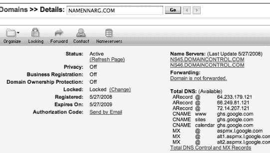

**图2.26** `Go Daddy`上`namennarg.com`的详情页。

我的域名显示为“已锁定”，这是好事，因为这能防止未经授权的转移。不过这也意味着我不能在需要的时候随时转移域名，所以我需要点击“已锁定”旁边的“更改”选项。在下一页，我可以解锁域名。完成操作后回到详情页，我看到“授权码”旁边有“通过电子邮件发送”的链接。点击该链接后，`Go Daddy`会把我需要转移域名的信息发送到我的邮箱——我可以把域名转移到`Go Daddy`的另一个账号，也可以转移到完全不同的注册商。除了ICANN规定的60天等待期外，没有什么能强制我留在`Go Daddy`，如果我想转移，随时都可以。

> **警告** 再次提醒：如果你更改或迁移该账号，`Google Apps`的DNS自动配置将会失效，你需要手动进行修改。如果你不在意使用其他账号，并且确实不想自己动手修改DNS，通过谷歌购买域名是个不错的选择。但对大多数人来说，我都不推荐这样做。

### 创建用户

目前你只有一个用户：管理员。但其他用户呢？除非你运营的是规模极小的组织，否则最终肯定需要添加多个用户。`Google Apps`提供了两种添加用户的方式：手动添加和批量添加。

#### 手动添加用户

一次添加一个用户很简单，但很繁琐。前往你的控制面板，点击“创建更多用户”链接，或者选择“用户账号”按钮，再点击“创建新用户”链接。两种操作路径最终都会进入图2.27所示的表单。

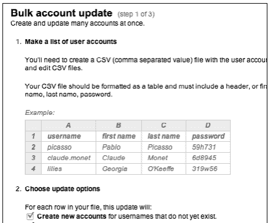

**图2.27** 使用该表单添加单个新用户。

这个表单非常直观——填写名字、姓氏和用户名（同时也是`yourdomain.com`下的邮箱地址）。你会发现图2.27中谷歌已经为用户自动生成了一个临时密码（在我看来这个密码并不算安全）。如果你对这个密码满意，点击“创建新用户”即可，现在你的域名下又多了一个可以使用`Google Apps`的用户。如果你不喜欢这个临时密码，想使用自己设置的密码或者用户自己设置的密码，点击“设置密码”，就会进入图2.28所示的页面。

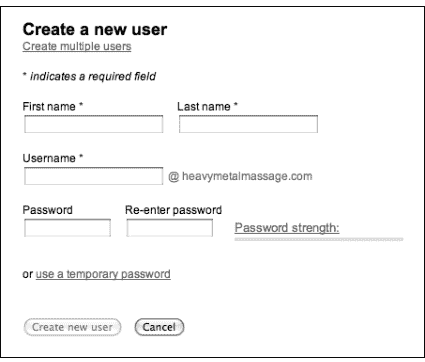

**图2.28** 如果你不想使用谷歌的临时密码，可以自由使用自己的密码。

输入密码，再次输入以确认两次输入一致，然后点击“创建新用户”，搞定！

#### 批量添加用户

正如我之前所说，通过填写“创建新用户”表单添加新用户很简单，但当你需要添加的用户数量较多时，很快就会发现这种方式非常低效。如果你有一长串需要添加到`Google Apps`的新用户列表，或者你热衷于自动化操作，就应该考虑批量添加用户的功能。前往你的控制面板，点击“创建更多用户”链接后再点击“创建多个用户”链接，或者依次选择“用户账号”按钮和“一次性上传多个用户”链接，就会进入图2.29所示的页面。

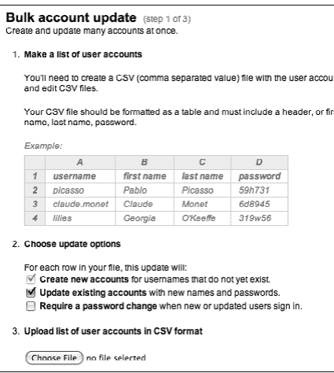

**图2.29** 无需逐个创建用户，上传包含任意数量用户的电子表格即可。

最简单的操作方式是使用你常用的电子表格制作软件创建表格，比如`Excel`，或者更好用的`OpenOffice.org`的`Calc`。（你也可以用`Google Docs`，不过我假设你目前对它还不太熟悉！）创建四个表头列：用户名、名字、姓氏和密码。填写表格，在每个单元格中输入正确数据，参考表2.3中的示例即可。

> **注意** 所有密码长度至少为6个字符。不行，`1234`这种可不行。

**表2.3** 适用于上传到`Google Apps`的电子表格格式的用户数据

| 用户名 | 名字 | 姓氏 | 密码 |
|----------|------------|-----------|----------|
| `jcarter` | John | Carter | `DotarSojat` |
| `dthoris` | Dejah | Thoris | `Carthoris` |
| `ttarkas` | Tars | Tarkas | `Jeddak` |

完成数据输入后，将电子表格保存为CSV（逗号分隔）格式的文件。如果不这么做，你就无法将数据上传到谷歌，所以务必确保文件后缀是`.csv`，而不是`.xls`、`.xlsx`、`.ods`或其他格式。接下来，在实际上传电子表格之前，你需要告诉谷歌你希望它如何处理你即将提供的新数据，这里有三个复选框选项：

- 为尚不存在的用户名创建新账号。
- 使用新名称和密码更新现有账号。
- 新用户或已更新用户登录时要求修改密码。

第一个选项是默认勾选的，你无法取消勾选。如果表格中的人员是新增用户，他会被添加为你的`Google Apps`账号的新用户。如果你想一次性修改多个人的密码或用户名，第二个选项非常实用。如果你为用户设置了临时密码（比如：“大家好，大家的密码都是`widgetinc`，请登录`Google Apps`后自行修改！”），并希望他们开始使用服务时自己设置新密码，那第三个选项你一定用得上。

点击“选择文件”按钮，选中你保存的CSV文件，然后点击“上传并继续”。在下一个页面，谷歌会展示解析文件的结果，你可以检查确认所有内容都准确无误。如果确认无误，点击“确认并运行更新”；如果有问题，点击浏览器的“后退”按钮，修改你的CSV文件后重新上传。在最后一个页面，谷歌会告知你正在处理更新，处理报告会发送到你的邮箱。如果新增的用户数量不多，你可以返回控制面板，已经能看到新用户已经添加完成了。

## 与你的Active Directory或LDAP服务器同步

如果你使用`Active Directory`或`LDAP`服务器管理用户账号，可以使用谷歌免费提供的`LDAP`同步工具，下载地址为`http://code.google.com/p/google-apps-for-your-domain-ldap-sync/`。该工具功能非常完善，具备以下关键特性：

- 自动检测新增、重命名或删除的用户
- 自动检测属性变更
- 按计划同步增量数据，减少流量消耗

你需要安装`Python 2.4`或更高版本，以及`Google Apps`配置API的`Python`客户端和`python-ldap`库。上述所有要求都在前面的网址中有详细说明。谷歌为有兴趣使用`LDAP`同步工具的用户提供了详细文档，地址为`http://code.google.com/p/google-apps-for-your-domain-ldap-sync/wiki/HowToUseIt`。

## 取消Google Apps

部分用户可能会发现`Google Apps`并不适合自己。如果`Google Apps`不适合你，大部分情况下你可以取消该服务。但在尝试取消前，有一些需要注意的小问题：

- 如果你使用的是Premier版，就像黑帮成员一样，你不能直接注销就走。如果你还在免费试用期内，需要先取消免费试用（操作指南见`www.google.com/support/a/bin/answer.py?answer=60755`），之后才能注销`Google Apps`。如果你已经付费购买了Premier版，需要等到付费年度到期后才能注销（别慌——你可以修改DNS设置，不需要强制使用`Google Apps`）。
- 如果你是通过谷歌的合作伙伴从谷歌购买的域名，需要先将域名转移到其他注册商，才能注销`Google Apps`。
- 如果你有多个用户账号，无法直接删除`Google Apps`。你需要先删除除管理员外的所有用户（操作指南见`www.google.com/support/a/bin/answer.py?answer=33314`）。

如果你完成上述操作后还是可以注销`Google Apps`，并且确实想要注销，请登录你的控制面板，依次选择“域名设置”“账号信息”。现在你可以点击“删除你的域名的Google Apps”选项。系统会弹出警告并要求你确认操作，确认后5天，你的`Google Apps`账号就会像旅鸽一样消失无踪。


##### 警告

请牢记：所有用户账号内的数据都将被永久删除，无法恢复。在告别`Google Apps`之前，请确保你已经备份了所有数据（详见附录A）！

#### 解决常见问题

没有什么是完美的，你在搭建`Google Apps`的过程中可能会遇到一些问题，以下是相关解决方案。

### 我无法返回控制面板！

你注册了`Google Apps`，已经进入了控制面板，但之后被其他事分心了。现在你找不到回去控制面板的路径了。如果你记得自己的域名，请访问`www.google.com/a/mydomain.com`（当然，这里要替换成你自己的域名）。如果不记得也没关系：你可以访问`www.google.com/a/`，点击右上角标注为“老用户，在此登录”的链接。进入后，系统会提示你输入域名，并在登录成功后选择你要进入的目标页面。由于你是管理员，在初期你可能还没有完全配置好任何服务，因此需要点击下拉菜单，选择“管理此域名”，操作如图2.30所示。

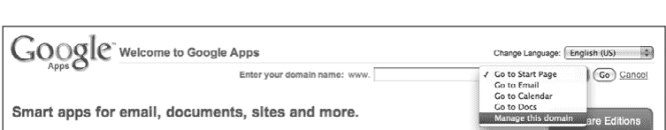

图2.30 控制面板看起来像是被隐藏了，但其实你随时可以很轻松地回到它。点击“前往”，登录后就会回到你的控制面板。这次记得要收藏它哦，好吗？

## 我丢失了管理员密码！

为了方便你在丢失或忘记管理员密码时能快速找回，你可以提前启用`Google Apps`的密码重置功能。进入你的控制面板，依次点击“域名设置”“账户信息”，找到“备用联系人”部分，勾选“如果忘记管理员密码，向备用联系人发送密码重置说明”旁的复选框。如果你已经完成了这一步，现在就可以享受提前规划的便利了。打开浏览器，访问`https://www.google.com/a/mydomain.com`（当然，替换成你自己的域名），点击“我无法访问我的账户”。你需要输入一些数字和字母来证明你是人类而非垃圾邮件机器人，输入完成后点击“提交”。接着登录你之前提供给Gmail的备用邮箱，你会收到一封来自谷歌的邮件，点击邮件内的链接即可。在打开的页面中，从下拉菜单选择要更改的管理员账户，输入新密码后点击“保存新密码”来激活。如果你从未勾选允许谷歌发送密码重置说明的复选框，或者你的域名下有超过500个活跃账户，你就需要直接联系谷歌申请密码更改。访问`www.google.com/support/a/bin/answer.py?answer=33561`，滚动到页面底部，你会看到“排查问题”选项，点击该链接，在下一页做出对应选择后，你的密码最终会被修改。不过如果提前勾选了那个复选框，整个流程会自动完成，会快很多，因此建议你提前设置。

#### 结语

搭建`Google Apps`时需要考虑和操作的事项似乎很多，但实际上这是因为你需要面对5个不同的版本，且每个版本下都提供多种服务。如果你曾经搭建过电子邮件或群件服务器，就会知道这类软件有多复杂——而`Google Apps`已经是同类软件中较为简单的一种了。尽管如此，你还是需要做好充分规划、仔细阅读说明、认真执行操作，才能将`Google Apps`按照你的预期搭建完成。接下来我们进入迁移部分，也就是将你在其他程序中已经创建的用户和数据转移到`Google Apps`中。

## 扩展阅读

相关知识还有很多，如果你想进一步了解`Google Apps`的搭建方法，以下资源可能会对你有帮助：

- 快速入门指南：`www.google.com/a/help/intl/en/admins/resources/setup/`
- 如何完成成功部署：`google.com/support/a/bin/answer.py?answer=67774`
- 面向管理员的`Google Apps` Knol知识库——演示与指南：`knol.google.com/k/google-apps-admin-help-center/google-apps-for-admins-demos-and-guides/1p0i914w5wkv/21`
- 所有帮助主题汇总页：`www.google.com/support/a/?fulldump=1`
- 搭建屏幕录像：`www.google.com/a/help/intl/en/admins/resources/setup/setup_video.html`

### 注册

- `Google Apps`注册指南：`http://services.google.com/apps/resources/overviews/welcome/topicWelcome/page16.html`
- `Train Signal`出品的`Google Apps`注册操作视频：`www.youtube.com/watch?v=nkSIF7RFsu4`

### 用户

- 用户管理屏幕录像：`http://services.google.com/apps/resources/admin_breeze/ManagingUsers/`
- `Train Signal`出品的`Google Apps`批量用户上传操作视频：`www.youtube.com/watch?v=ocEWcCego4Y`
- `LDAP`同步讨论组：`http://groups.google.com/group/google-apps-for-your-domain-ldap-sync`

### 面向开发者

- 基于SAML的单点登录（SSO）API：`www.google.com/support/a/bin/answer.py?answer=60224&topic=10717`
- `Google`资源预配API开发者指南：`http://code.google.com/apis/apps/gdata_provisioning_api_v2.0_reference.html`

#### 控制面板

- 帮助主题：`www.google.com/support/a/?hl=en`
- `Google Apps`控制面板相关YouTube播放列表：`http://www.youtube.com/watch_playlist?p=445899A1305C271C`
- `Train Signal`出品的`Google Apps`管理页面操作视频：`http://www.youtube.com/watch?v=UD7ATyuKNk`

### 验证你的域名

- 域名验证指南：`http://services.google.com/apps/resources/admin_breeze/VerifyingYourDomain/index.html`
- `Train Signal`出品的`Google Apps`域名验证操作指南：`www.youtube.com/watch?v=i_8QUrhI5fQ`
- `Train Signal`出品的`Google Apps`邮箱验证操作视频：`http://www.youtube.com/watch?v=BI4zdxsSz48`

### 域名服务器（DNS）

- 创建CNAME记录：`https://www.google.com:443/support/a/bin/answer.py?answer=47283&topic=9196` 及 `www.google.com/support/a/bin/answer.py?answer=47283&topic=9204`
- 配置MX记录：`www.google.com/support/a/bin/answer.py?answer=33352&topic=9196`
- `Train Signal`出品的`Google Apps`简易URL操作视频：`www.youtube.com/watch?v=6gmWYyrXC0U`
- 用于测试SPF记录的SPF工具：`www.openspf.org/Tools`

## Google Apps解析

### Salesforce.com集成

- 面向`Google Apps`的`Salesforce`：`http://googleblog.blogspot.com/2008/04/posted-by-scott-mcmullan-google-apps.html`
- 谷歌与`Salesforce.com`集成应用抢占企业市场，与微软竞争：`http://searchengineland.com/080414-090939.php`

##### 电子邮件

- 电子邮件网关：`www.google.com/support/a/bin/answer.py?answer=60730`
- 电子邮件路由：`www.google.com/support/a/bin/answer.py?answer=77182`
- 支持选项：`www.google.com/a/help/intl/en/admins/support.html`
- 已知问题：`www.google.com/support/a/bin/request.py?contact_type=known_issues`

## 将电子邮件迁移至Google Apps

你已经完成了`Google Apps`账户的搭建并添加了用户，按理说所有人都可以开始使用`Google Apps`了。但事情可能没那么简单。如果你的用户之前一直用其他程序和服务处理电子邮件、联系人和日程，那么这些程序里很可能已经存有大量他们希望迁移到`Google Apps`使用的数据。这种情况下，你就需要将这些数据迁移到`Google Apps`中，而这并不像看起来那么容易。本章中，你将学习如何迁移电子邮件。我会先给出通用操作步骤，再针对大多数用户常用的主流程序进行说明。

> **注意** 谷歌为大量程序的迁移提供了建议，并且会持续更新相关内容。你可以先在`www.google.com/support/a/?hl=en` 和 `http://mail.google.com/support/?hl=en` 搜索你需要导出数据的对应程序，是个不错的起点。

电子邮件是当今企业最重要的功能之一，很多人已经积累了大量的已存邮件，需要经常查阅。一方面，你的用户会很喜欢`Gmail`内置的超级强大的搜索功能；另一方面，在这些用户开始使用之前，你必须先将所有邮件同步到谷歌的服务器上。

##### 警告

本章这部分内容中，我会提到将你当前使用的客户端或系统中的电子邮件复制到`Gmail`中。当然你也可以直接移动邮件，但谨慎行事总没错。更何况，如果你尝试移动邮件时遇到网络中断，很可能陷入混乱的状态，导致邮件丢失。因此请先复制，确认所有内容都正常运作后，再（或者更好的做法是归档后）从当前客户端删除旧邮件。请记住，执行迁移前，你必须先完成用户`Google Apps`中邮箱账户的搭建，确保其能正常使用。我在第7章“搭建Gmail”中介绍了相关搭建方法，因此你可以先跳到该章节确认所有设置都已正常运行后，再回到本章继续操作。

## 技术术语说明

本章会涉及一些专业术语，我们来复习一些会反复出现的关键术语：

**POP**——定义电子邮件客户端如何从远程邮件服务器获取邮件的互联网协议，客户端会将邮件从远程服务器移动到本地客户端。更多信息可访问：`http://en.wikipedia.org/wiki/Pop3`

**IMAP**——更新、功能更丰富的互联网协议，定义电子邮件客户端如何访问远程邮件服务器上的邮件，客户端可直接查看远程服务器上的邮件，无需将其移动到本地。更多信息可访问：`http://en.wikipedia.org/wiki/Internet_Message_Access_Protocol`

**Microsoft Exchange**——微软推出的邮件服务器，在中小型企业中极为流行。`Exchange`支持POP和IMAP协议，但默认使用自身专有的MAPI（消息应用程序编程接口）协议。更多信息可访问：`http://en.wikipedia.org/wiki/Microsoft_Exchange_Server` 和 `http://en.wikipedia.org/wiki/MAPI`

**mbox**——一种广泛使用的电子邮件存储格式，同一个文件夹（或邮箱）中的所有邮件都会合并为一个单独的文件。更多信息可访问：`http://en.wikipedia.org/wiki/Mbox`

**Maildir**——一种广泛使用的电子邮件存储格式，每封邮件都存储在单独的唯一文件中。更多信息可访问：`http://en.wikipedia.org/wiki/Maildir`

## 迁移前务必做好规划

开始迁移前，你需要考虑几个关键问题，更重要的是要做好规划。不要贸然开始邮件迁移，否则你可能会遇到严重的麻烦，要花好几天才能清理修复，还会惹恼你的客户。迁移前需要重点考虑三个问题：

- 将你的邮件文件夹结构调整为`Gmail`使用的格式（两者的结构大概率差异很大！）
- 处理迁移过程中收到的新邮件
- 处理迁移过程中你发送的邮件

下面我们逐一拆解这些问题。

### 将邮件文件夹结构调整为Gmail适用的格式

你首先需要了解`Gmail`的一个核心运作规则：你可以创建文件夹（其实是标签，我会在第8章《Gmail使用须知》中详细讲解，不过暂时我们先叫它们文件夹），也可以创建嵌套文件夹，但仅此而已。换句话说，文件夹最多只能有两级：比如把「Friends」（好友）设为顶级文件夹是允许的，在它下面创建`Alice`和`Jackie`两个子文件夹也没问题（因为它们属于第二级），但如果想在`Jackie`下面再创建`Project A`、`First Strike`、`SuperCop`这些子文件夹就不行了——这属于第三级文件夹，不被允许。如果你或你的用户和大多数人一样，喜欢层层嵌套创建文件夹，那这个问题就会成为大麻烦。我一个朋友的Outlook文件夹嵌套了10层，我知道他绝对不是个例。无论你是手动迁移还是自动迁移邮件，开始前都需要调整文件夹结构，使其符合`Gmail`的要求。

我知道现在很多读到这里的读者都要慌了，你心里大概在想：「我必须要用层层嵌套的文件夹啊！那是我唯一能整理、找到邮件的方式！这些子文件夹可是我花了几年时间精心搭建的，我必须保留这个结构！」不，你完全不需要。研究已经表明，文件夹反而会加大查找内容的难度（可参考`Farhad Manjoo`所著的《过犹不及》，链接：`http://dir.salon.com/story/tech/feature/2004/07/16/e_mail/index2.html`），而且效率极低。我看到别人的邮箱里有几百个文件夹时，通常这意味着当事人花了大量功夫，却未必换来了更好的整理效果。毕竟数量多不等于质量高。而且当你把一封邮件存进某个文件夹后，它就只存在于那一个位置了。但我收到的很多邮件其实完全可以放在多个位置，或者至少关联多个参考维度。举个例子，我收到过合作伙伴`Jans`发来的关于我们为圣路易斯动物园网站开发的新日历小工具的邮件，我希望它能同时关联到`Jans`、日历工具、`STLZoo`这三个维度。我也可以复制这封邮件，但这个方法太笨拙了，大多数人根本不会想到这么做。更理想的做法是让这封邮件同时关联`Jans`、日历工具和动物园，`Gmail`就可以实现这个功能。最后，用文件夹存邮件的话，你还得记住自己把邮件存在了哪个文件夹里，然后手动翻找。大多数时候这都很麻烦，你会浪费大量时间逐个点开文件夹找那封需要的邮件。而`Gmail`基于强大的谷歌搜索引擎，拥有功能超强、可自定义的搜索选项，根本不需要你手动翻找层级文件夹。想找邮件的时候，直接搜索就行！

> **注意** 我知道很多邮件客户端都支持搜索邮件，但总的来说，这些搜索功能又慢又难用，效率极低。`Gmail`的搜索速度快、功能强，而且“开箱即用”。只要用过一次，你就再也不想用回客户端的搜索功能了。

我的建议是接受`Gmail`的限制，在其规则下使用。你可以创建一套仅含一级子文件夹的顶级文件夹体系来简化邮件管理，需要找邮件的时候直接用搜索。你很快就会发现，这是更高效、更好的邮件管理方式。如果你足够大胆，还可以把所有旧邮件都移到`Gmail`的收件箱里，完全不用文件夹。选择这种做的人其实多到超乎你想象。举个例子，我的另一位商业伙伴`Jerry`在迁到`Google Workspace`前，也曾深受Outlook文件夹无限膨胀的困扰。先看图3.1，这是他在Outlook里的文件夹树的一小部分：

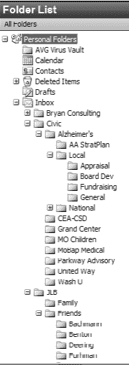

图3.1里你可以看到收件箱下有三个子文件夹（实际上还有更多没显示出来）：`Bryan Consulting`、`Civic`和`JLB`。`Civic`下面有8个子文件夹，对应他参与的各个团体，排在最前面的是阿尔茨海默病协会。阿尔茨海默病协会的子文件夹下还有3个子文件夹（现在已经是第三级了），其中名为`Local`的子文件夹下又有4个第四级子文件夹。`Jerry`的情况已经算不错的了，我之前说过，我的朋友`Rich`的文件夹嵌套到了10层！我给`Jerry`的建议是这样的：迁到`Gmail`后，收件箱是独立存在的，你不能在它下面创建任何子文件夹。`Bryan Consulting`、`Civic`、`JLB`可以保留为顶级文件夹，但要知道每个顶级文件夹下只能有一级子文件夹。比如`Civic`下面可以保留阿尔茨海默病协会、`CEA-CSD`、`Grand Center`等子文件夹，但现在阿尔茨海默病协会下面的那些子文件夹就不能保留了。不过你真的需要那些吗？为什么不把所有内容都归到阿尔茨海默病协会文件夹里？通过搜索发件人、收件人、主题或邮件正文，不是很容易就能区分这封邮件是关联地方分会还是全国总部吗？如果邮件是地方分会发来的，还和筹款有关，那搜起来不是更简单？更进一步说，你真的需要`Civic`下面那么多子文件夹吗？为什么不把所有内容都扔到`Civic`文件夹里，干脆不要子文件夹？要区分`Grand Center`、`Parkway Schools`、密苏里州浸信会医疗中心和圣路易斯华盛顿大学的邮件，通过搜索应该很容易做到吧？再看下面，你真的需要给`Friends`文件夹下的每个家庭都建单独的子文件夹吗？把所有朋友的邮件都合并到`Friends`文件夹里就好了。搜索`Bachmann`、`Benton`或者`Deering`的名字，就能精准找到对应的邮件，完全没问题。

`Jerry`听取了我的建议。刚开始确实需要适应，但调整起来并不难，`Gmail`强大的搜索功能让整个过程几乎没遇到什么障碍。我知道放弃层层嵌套的子文件夹看起来像跳崖一样可怕，但这完全可以做到，而且这本来就是邮件管理的发展方向。五年后，我们每个人都会存档上万封邮件，到那时根本不会靠文件夹来整理邮件，这套方式早就过时了。取而代之的会是搜索和标签功能。所以最好现在就开始适应。

> 我朋友`Rich`（就是那个在Outlook里建了10层子文件夹的人）就遇到过这种情况，大家要引以为戒。他用了自动迁移工具，把所有邮件从Outlook迁到了新的`Google Workspace` `Gmail`账号里。这个工具没有提醒他，层层嵌套的子文件夹是无法迁移的，最终看起来所有邮件都顺利迁过去了，没有任何问题。但后来他发现搜索根本找不到多少邮件，尤其是他预期能找到的那些。问题出在他的邮件其实并没有真的迁移成功。这个教训很明确——提前规划好新的文件夹结构。如果你要用自动工具迁移邮件，一定要确保你本地客户端的文件夹结构和你最终要在`Gmail`里用的结构尽可能一致。

## 迁移过程中收到的新邮件处理

不要忘了，你迁移旧邮件的时候，新邮件也会不断进来。如果你在开始迁移前不处理这个问题，很快就会像我妈妈说的那样，遇到“乱上加乱”的情况：新邮件和旧邮件混在一起，你还得不停回忆某封邮件到底有没有迁过去，想想就头疼。如果你已经换了MX记录，发给`you@yourcompany.com`的邮件现在已经顺利存到谷歌的邮件服务器里了，那就不用担心新邮件会和你旧服务器上的旧邮件混在一起。你只需要打开存有大量旧邮件的邮件客户端，用你选定的方法开始迁移就行。不过很多人其实会把迁到谷歌服务器这件事当成启用新邮箱地址的机会。比如他们之前用的是`sbcglobal.net`或者`aol.com`的旧邮箱地址，现在已经买了域名，打算之后用`@yourcompany.com`的新地址。这种情况下，他们一边用旧地址正常收邮件，一边搭建新Gmail账号、迁移旧邮件。

在开始迁移流程之前，请为所有收到的邮件设置自动转发规则，将它们转发到你的新谷歌应用邮箱地址。当邮件发送至`fiona@sbcglobal.net`时，会自动转发至`fiona@iloveanimals.com`。理想情况下，你可以在服务器端设置该转发规则，这样邮件永远不会到达你设备上的邮件客户端，这一流程会更简洁高效。如果你必须使用客户端转发，那也没办法。不过这种情况下，请尽量使用重定向而非转发，以便更好地保留邮件头（发件人、抄送、`Message-Id`、日期）。例如，如果位于`fiona@sbcglobal.net`的`Fiona`收到来自`jans@websanity.com`的邮件，再将其自动转发到自己的新地址`fiona@iloveanimals.com`，那么该邮件的邮件头会显示其来自`fiona@sbcglobal.net`，而非`jans@websanity.com`，且日期会标注为`Fiona`转发邮件的时间，而非`Jans`最初发送的时间。而如果`Fiona`将该邮件重定向到`fiona@iloveanimals.com`，那么邮件在收件箱中会显示为来自`jans@websanity.com`，日期和时间也为`Jans`最初发送的时间。

| 客户端 | 重定向支持情况 |
|--------|--------------------------|
| `AOL` | 不支持 |
| 苹果邮件 | 支持重定向消息 |
| `Eudora` | 支持重定向消息 |
| `Evolution` | 支持操作、转发、重定向 |
| `Gmail` | 不支持（请使用支持重定向的客户端访问`Gmail`） |
| `Hotmail`(Windows Live Mail) | 不支持（请使用支持重定向的客户端访问`Hotmail`） |
| `KMail` | 支持消息、转发、重定向 |
| `Outlook` | 支持操作、重发此邮件 |
| `Outlook Express` (Windows Mail) | 不支持 |
| `Thunderbird` | 安装免费插件`Mail Redirect`（`https://addons.mozilla.org/en-US/thunderbird/addon/550`） |
| `Yahoo` | 不支持（请使用支持重定向的客户端访问`Yahoo Mail`） |

如果你有一堆存储在mbox文件中的邮件，且正在使用Linux或Mac OS X系统，可以在终端中使用以下命令重定向特定mbox文件中的每一封邮件：

```bash
$ formail +1 -i "To: me@newaddress.com" -i Cc: -f -ds /usr/sbin/sendmail -t -oi < /path/to/mbox
```


> **提示** 如果你不喜欢我介绍的方案，或者你正在使用不支持重定向的客户端（比如Outlook Express），可以在Google上搜索“Windows 邮件重定向”，开始查看你找到的解决方案。

这里还有一封关于邮件重定向的最终建议。我们将在后续第7章《设置Gmail》和第8章《使用Gmail须知》中讨论标签、电子邮件别名中使用“+”号以及过滤器的用法，不过现在你可以知道，你可以将所有来自`@sbcglobal.net`地址的邮件重定向到`me+sbcglobal@newaddress.com`。这样一来，你就可以设置一个过滤器，按照自己的意愿为这些邮件自动添加标签（比如“sbcglobal”、“old”或“home”）。将其他账户的邮件重定向到`me+aol@newaddress.com`，并使用不同的自动标签过滤器（比如“AOL”、“old”或“personal”）。用你的电脑来自动化处理任务——这是电脑最擅长的事。

## 处理迁移过程中你发送的邮件

迁移期间，你可能仍在使用旧账户或旧客户端发送邮件。如果所有设置都正确的话，你可以将客户端设置为使用你的新谷歌应用账户作为SMTP服务器。但你可能还没准备好完成这一切换。这种情况下，你可以继续使用旧服务器发送邮件，但将你的新`Gmail`地址放入密送栏。更优的做法是，如果你的客户端支持自动密送，请使用该功能。

表3.2列出了部分常用电子邮件客户端及其对自动密送的支持情况。

| 客户端 | 自动密送支持情况 |
| --- | --- |
| AOL | 不支持 |
| 苹果邮件 | 详见下一节《为苹果邮件添加自动密送》 |
| Eudora | 创建带密送栏为你地址的信纸，并将其设为默认（工具 > 选项 > 撰写邮件） |
| Evolution | 编辑 > 偏好设置 > 邮件账户 > [账户] > 编辑 > 默认值 |
| Gmail | 在Firefox中安装Greasemonkey（`https://addons.mozilla.org/en-US/firefox/addon/748`）和Gmail自动密送Greasemonkey脚本（`http://userscripts.org/scripts/show/2255`） |
| Hotmail（Windows Live Mail） | 不支持 |
| KMail | 设置 > 配置KMail > 身份 > 修改 > 高级 |
| Outlook | 详见本章稍后《为Outlook添加自动密送》 |
| Outlook Express（Windows Mail） | 详见本章稍后《为Outlook Express添加自动密送》 |
| Thunderbird | 工具 > 账户设置 > 抄送与文件夹 |
| Yahoo | 不支持 |

部分常用电子邮件客户端在自动密送功能上存在一些特殊性，要么会让用户折腾一番，甚至要求购买第三方软件。后续章节将介绍其中几款客户端（苹果邮件、Outlook和Outlook Express）的相关内容。正如上一节介绍邮件重定向时我建议使用“+”设置电子邮件别名一样，我也建议你通过自动密送发送邮件时采用相同做法。不要简单地将邮件密送给`me@newaddress.com`，而是使用`me+sent@newaddress.com`，再创建一个过滤器，为这些邮件自动添加“已发送”标签（等同于在Gmail中将这些邮件全部移入“已发送”文件夹）。

### 为苹果邮件添加自动密送

为苹果邮件设置自动密送的操作稍显复杂，但可以通过两步完成。首先，打开“偏好设置 > 撰写”，如图3.2所示。

```
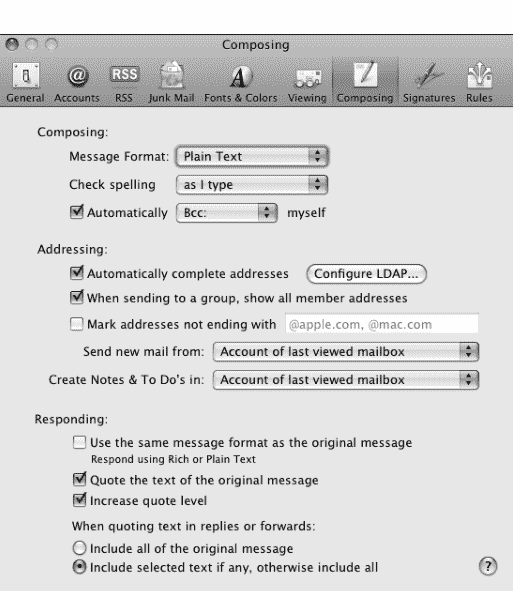
```

**图3.2** 设置苹果邮件在每封发送的邮件中自动密送给自己。勾选“自动抄送自己”，然后将“抄送”改为“密送”。接下来打开“偏好设置 > 规则”，创建一个新规则，如图3.3所示。将新规则命名为类似**“重定向我发送的邮件”**，在“如果满足以下所有条件”中将“任意”改为“全部”。添加两个新条件：如果邮件*来自*你的旧地址（图3.3中为`fiona@sbcglobal.net`），且邮件*发送至*你的旧地址（图3.3中同样为`fiona@sbcglobal.net`）。如果满足这些条件，请设置一个操作，将邮件重定向到你的新谷歌应用账户（图3.3中为`fiona+sent@iloveanimals.com`）。点击“确定”创建规则。

```
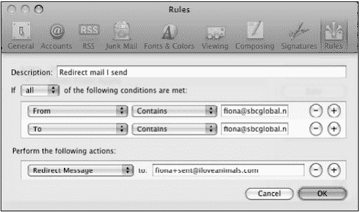
```

**图3.3** 通过一些巧妙的规则，你可以将邮件重定向到你的新谷歌应用账户。请注意，我在示例中使用了“+sent”，是因为我会在Gmail中设置一个过滤器，为所有使用该别名的邮件添加“已发送”标签（从而将它们放入Gmail的“已发送”文件夹中）。

> ⚠️ **警告**
>
> 完全迁移到Gmail后，不要忘记撤销所有这些设置！

此外，如果你不害怕使用Mac OS X的终端，可以运行以下命令，将`me+sent@newaddress.com`替换为你的地址（你不需要使用“+sent”，但它绝对能帮助你设置一个过滤器，默认将发送到该地址的邮件放入“已发送”文件夹）：


`$ defaults write com.apple.mail UserHeaders '{"Bcc" = "me+sent@newaddress.com";}'`

不过这种方法有一个小问题：如果你在密送栏输入了其他地址，它会被自动替换为你在该命令中指定的地址，这可能会带来很大的麻烦。但反过来说，如果你很少使用密送功能，在迁移过程中这完全不会造成影响。

### 为Outlook添加自动密送

令人难以置信的是，`Outlook`——微软的旗舰电子邮件程序和个人信息管理器——并不原生支持自动密送。如果你懂编程，或者不介意使用他人的`VBA`代码，可以访问`www.outlookcode.com/article.aspx?id=72`获取相关代码。如果你更倾向于购买他人的软件，`Office Add-ins`网站对部分热门选择进行了评测，地址为`www.officeaddins.com/plugins-reviews/outlook-cc-bcc/`。

### 为`Outlook Express`或`Windows Mail`添加自动密送

`Outlook Express`（以及它的`Vista`版“兄弟”`Windows Mail`）不支持自动密送，但你可以通过其他软件添加该功能。最佳选择是在`Google`上搜索`“Outlook Express 自动密送”`或`“Windows Mail 自动密送”`。虽然我从未使用过，但`AJ Systems`的`OE Quick Tools`（`www.ajsystems.com/oequicktools/qt.html`）在提供自动密送以及`Outlook Express`本应具备却缺失的大量其他升级功能方面，获得了不少明显满意的用户的提及。该工具售价30美元，但如果你打算放弃`Outlook Express`，这个价格可能是你愿意承担的。

## 使用IMAP手动迁移邮件

- 适用操作系统：`Windows`、`Mac OS X`、`Linux`
- 适用电子邮件客户端与服务：所有支持`IMAP`的桌面客户端
- 适用谷歌应用版本：标准版、高级版、教育与非营利版、合作伙伴版

> **注**
> 为了帮助你判断某部分内容是否适用于你的情况，我会在本章适当位置重复你在此注之前看到的三行内容。

这种方法最简单，但也最繁琐。基本操作是：在电子邮件客户端中使用`IMAP`作为连接方式添加你的谷歌应用账户，然后将旧账户中的邮件复制到新的谷歌应用账户中。你可以拖拽或复制整个文件夹，也可以在谷歌应用账户下创建新文件夹，再将选中的邮件拖入这些文件夹中。

这种方法有明显的优势：
- 你的邮件原始元数据——发件人、收件人、日期等——都会被完整保留。
- 你可以全程了解迁移的进度情况。
- 你可以将所有账号中存储的邮件统一复制到`Gmail`账号，轻松实现集中管理。
- `Gmail`会自动按照你复制邮件所属的文件夹、或是你迁移的文件夹为邮件打标签。无论你是在`Gmail`里新建一个名为“`ABC`项目”的文件夹再把邮件拖进去，还是通过邮件客户端把旧邮箱里的“`ABC`项目”文件夹直接复制到新的`Gmail`账号里，这个“`ABC`项目”文件夹里的所有邮件都会被加上`Gmail`的“`ABC`项目”标签。

你还需要了解这种方法的缺点：
- 耗时极长。如果你有成千上万封邮件，做好等待的准备。如果你的网络很慢——那我建议你找个快一点的网络。
- 需要手动操作，非常繁琐。比如：复制，等，等，等，等，等，等，完成。选择下一个文件夹或邮件，复制，等，等，等，等，等，完成。无限重复。你可以打开纸牌游戏、翻翻你喜欢的书，或者打开电视，反正你得找点东西分散注意力。
- 如果不小心重复复制了同一封邮件，就会出现大量重复邮件，后续你还得手动删除它们。

最后，你还需要注意一点可能会让你困惑的情况：当你把当前邮件客户端里的邮件导入`Gmail`时，`Gmail`会把同一主题的邮件会话合并为谷歌所称的“会话”。举个例子，假设你和另外两个朋友来回发送了12封主题都包含“`Facebook`必须消失”字样的邮件，把这些邮件导入`Gmail`后，它们会显示为单个包含12封邮件的会话。所以如果你迁移了5000封邮件，但`Gmail`显示你只有2000个会话，别慌，你没有丢失任何邮件。你可以在桌面客户端里查看你复制的文件夹，确认你仍然有5000封邮件。据我所知，没有任何邮件客户端能识别谷歌的会话逻辑，所以它们只会显示邮件的总数量。


> **警告** 如果你尝试一次性复制大量邮件，遇到问题（比如传输超时，或是传输完成后大量邮件丢失），可以尝试减少单次复制的邮件数量。

### Outlook专属设置

- 支持操作系统：`Windows`
- 支持邮件客户端与服务：`Outlook`
- 支持`Google Apps`版本：标准版、高级版、教育版与非营利版、合作伙伴版。

我知道我本可以介绍很多其他邮件客户端，但我选择聚焦`Outlook`，因为它使用率极高。如果你使用`Outlook`，可以通过以下几种方法从本地`PST`文件复制邮件：
- 选中要迁移的文件夹或邮件，然后依次点击“编辑”→“复制到文件夹”。
- 右键点击要复制的文件夹（我们暂且称之为“原文件夹”），选择“复制文件夹”。在弹出的窗口中，选择你的`Gmail`账号中要粘贴原文件夹的目标文件夹，然后点击确定。
- 选中要复制的文件夹或邮件，按住`Ctrl`键，将选中项拖到你`Gmail`账号中希望存放的位置。`Outlook`会询问你是要“复制”还是“移动”项目，我建议你选择“复制”。

无论你用哪种方法，你的`Outlook`邮件很快就会出现在你复制到的`Gmail`文件夹里（具体速度取决于你要迁移的邮件数量）。


> **提示** 要想轻松把一个账号文件夹里的邮件复制到你的`Gmail`账号，需要先确认你已经把`Outlook`设置成了显示文件夹视图。

## 使用谷歌IMAP迁移工具自动从IMAP服务器导入邮件

- 支持操作系统：无限制
- 支持邮件客户端与服务：所有支持`IMAP`的服务器
- 支持`Google Apps`版本：高级版、教育版与非营利版

没错，你可以手动迁移邮件，但如果你有成千上万封邮件，手动操作根本不现实。如果你所在的组织有很多账号，而你又负责迁移工作，那手动迁移更是天方夜谭。是时候用自动化工具了！

如果你的邮件已经存储在`IMAP`服务器上，你可以使用谷歌自带的自动迁移工具。这种方法有很多优势：
- 每封邮件关联的原始数据——发件人、收件人、日期——都会被保留。
- 文件夹结构会被完整保留。
- 全自动操作，无需手动干预。

不过也有一些需要注意的问题：
- 谷歌的该工具仅支持高级版和教育版的`Google Apps`。
- 你要迁移邮件的“旧”服务器必须支持`IMAP`。这看似是常识，但很多`Microsoft Exchange`服务器管理员只会开启`MAPI`协议，而`Exchange`服务器本身是支持`IMAP`的。
- 正文加附件总大小超过`20MB`的邮件不会被迁移。是时候让用户清理那些占用邮箱空间的超大邮件了！
- 如果用户账户中的邮件总容量超过`25GB`，谷歌会在达到该上限后停止迁移。
- 包含病毒的邮件不允许导入`Gmail`。这并不意外，而且也是好事一桩。
- 如果某个用户不知怎么积累了超过1800个文件夹（我也不知道怎么做到的），该用户的迁移会被跳过，你需要换用其他方法。
- 要实现这个迁移流程，你需要向谷歌提供“旧”`IMAP`服务器上的所有用户名和密码列表。当然，等所有人都迁移到`Google Apps`后，你很快也会把用户名和密码托付给谷歌，所以这个问题不大。

谷歌需要访问“旧”`IMAP`服务器，所以你要确保保护该服务器的防火墙允许以下`IP`地址访问该服务器（该列表来自`www.google.com/support/a/bin/answer.py?hl=en&answer=61369`，如果你想查看更新可以访问这个链接）：
- `216.239.56.0/23`
- `64.233.160.0/19`
- `66.249.80.0/20`
- `72.14.192.0/18`
- `209.85.128.0/17`
- `66.102.0.0/20`

如果你的组织使用`Microsoft Exchange Server 2003`，你需要确保用户的文件夹名称里没有用到正斜杠（`/`）。如果已经用了，这些用户的邮件将无法迁移。你需要把这些斜杠替换成其他字符，比如连字符（`-`）。

谷歌支持从以下服务器迁移：
- `Microsoft Exchange Server 2003`
- `Cyrus IMAP Server`
- `Courier-IMAP`
- `Dovecot`

如果你的`IMAP`邮件在这几类服务器上，而且前面提到的注意事项都不成问题，那太好了——继续往下看就行。如果有其他问题，可以直接跳到下一节。

> **警告** 在所有用户账号上全面启动迁移前，请保持耐心、格外谨慎，先用少量账号测试这个流程！

要开始迁移，请进入你的管理后台，点击蓝色的“高级工具”标签页。在“邮件迁移”板块中，点击“设置邮件（`IMAP`）迁移”链接。第一步“设置服务器连接”会加载完成，显示如图3.4所示的界面。

“为此服务器连接命名”栏可以输入对你来说有意义的名称，比如`人力资源部`或`圣路易斯分部`。“类型”栏你没法选择，只能是`IMAP`。也许以后会变，但目前为止……

“主机”栏输入你要导入邮件的`IMAP`服务器的域名或`IP`地址。“安全”栏建议选择`SSL`或`STARTTLS`，这样你的用户和`IMAP`服务器都会得到加密保护。否则就选“无”。

“端口”栏输入客户端访问你的`IMAP`服务器所需的端口号。如果不使用加密，通常是143；如果使用加密，一般是993，但也不排除其他合理范围内的端口，你需要自行确认。

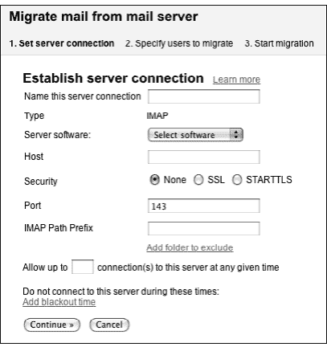

**图3.4** 谷歌自动IMAP迁移工具的第一步设置界面。

`IMAP`路径前缀可能比较难找，但非常重要，如果填错谷歌就无法知道要导入的邮件存在哪里。你一定要查看`IMAP`服务器的配置文件来找到这个值，你要找的是服务器上存储用户邮件文件夹的路径。你也可以查看用户当前使用的邮件客户端，尝试从中推断出`IMAP`路径前缀。问题是每个邮件客户端对`IMAP`路径前缀的称呼都不一样。谷歌提供了一份有用的示例列表供你参考：
- `Thunderbird`：`IMAP`服务器目录
- `Outlook Express`：根文件夹路径
- `Pine`：收件箱服务器名称

“**添加要排除的文件夹**”链接允许你实现这一功能：告知`Google`在电子邮件迁移过程中应忽略哪些文件夹。例如，你可能有一些`IMAP`文件夹包含新闻组或服务器相关信息，希望所有用户都能在共享邮箱中查看这些内容。如果你运行的是`Microsoft Exchange`服务器，你肯定需要跳过那些包含联系人和日历信息的文件夹，例如以下这些：
- `Kmail`：文件夹前缀
- `Apple Mail`：`IMAP`路径前缀
- 日历
- 联系人
- 已删除项目
- 公共文件夹
- 任务
- 笔记
- 日志

> **警告**
> 现在你明白为什么要先测试流程了吧？排除或包含错误的文件夹可能会给你和你的用户造成巨大的麻烦。

在**允许最多 ___ 个连接到此服务器**选项中填写适合你服务器的数字，具体数值需根据服务器性能和网络连接情况决定。拿不准的时候就选低值。传输耗时久一点总比压垮你的`IMAP`服务器要好，换句话说，填1或2通常就足够了。

如果你想设置`Google`不会联系你`IMAP`服务器的时间段，让服务器可以正常运行，请点击**添加停机时间**并输入对应时段。每个停机时间都需要输入时区、星期几、当日时段。

> **注意**
> 请记住这是`IMAP`协议，因此已传输到`Google`服务器的邮件仍会保留在旧服务器上，只要用户的电子邮件客户端配置正确，他们仍然可以访问这些邮件。

点击**继续**后，`Google`会测试服务器连接。如果连接失败，你会收到通知并要求修复问题；如果连接成功，就会进入下一步。第2步是“指定要迁移的用户”，正如你在图3.5中看到的，你这里要做的就是这一步。

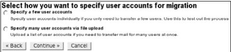

**图3.5**

创建帐号时你可以选择两种方式：手动添加或批量添加。如果要迁移的用户很少，手动添加通常也够用（当然前提是你能接受这个有时略显繁琐的流程）。如果要迁移的用户很多，那毫无疑问应该使用批量流程。

> **警告**
> 请记住，你计划迁移的每个帐号都必须已经在`Google Apps`中创建了用户帐号，否则`Google`不会处理迁移请求。

如果你选择“指定少量用户帐号”并点击**继续**，就会进入一个可以输入任意数量帐号的页面，具体界面如图3.6所示。

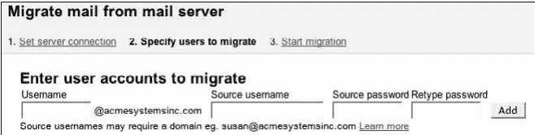

**图3.6**

逐个添加用户并不难，只是比较繁琐。`Google Apps`用户名这一栏很直观，也很好填写。下一个字段**源用户名**的填写就稍显复杂了。如果你的邮件服务器要求输入完整的电子邮件地址作为用户名，你就需要输入完整地址。不过大多数服务器只需要输入用户名（即@符号前的部分）。如果你使用的是`Microsoft Exchange`，用户名的格式为`[Domain]/[Admin]/[User]`，各部分替换规则如下：
- `[Domain]`是`Microsoft Exchange`的域名
- `[Admin]`是有权限访问你要迁移的用户邮箱的用户
- `[User]`是你要迁移的用户名称

**源密码**栏请输入用户的密码。如果你使用的是`Exchange`，这里需要填写你在`[Admin]`处指定的用户的密码。

> **注意**
> 在迁移过程中直接给用户分配临时密码可能会简单得多，也安全得多。不过一定要告知用户，否则他们可能会惊慌失措。既然你正在将用户迁移到`Google Apps`，这正好是个让所有人把老旧的不安全密码换成更安全密码的好时机。

完成单个用户的信息填写后，如果你想继续迁移更多帐号，请点击**添加**；如果已完成当前组的填写，请点击**继续**核对已输入的内容。

> **注意**
> 如果你使用`Dovecot IMAP`服务器，请务必阅读`Dovecot`官方关于主用户和密码的说明，地址为：`http://wiki.dovecot.org/Authentication/MasterUsers`。

如果你之前选择了“批量上传用户帐号”并点击了**继续**，现在就可以创建要批量添加的帐号列表了。这个流程和第2章中介绍的批量创建`Google Apps`新用户的流程非常相似。你需要创建一个`CSV`文件并上传，让`Google`解析文件并按照你的指示执行操作。

> **警告**
> 在将`CSV`文件提交给`Google`之前，务必确保文件内容正确。如果内容有误，你可能会把`Bob`的邮件导入`Alice`的新`Google Apps`帐号，你知道这会造成多大问题。甚至可能导致整个流程无法运行。请先使用少量用户测试，确认没问题后再放手干吧！

你可以使用`OpenOffice.org`、`Excel`或任意电子表格程序创建`CSV`文件，但文件格式必须符合`Google`的规定。你需要确保第一行是定义各列的标题，且总共只有三列：`Google`帐号电子邮件地址、源用户名、源密码。

最终结果会类似**表3.3**所示的批量添加用户帐号的`CSV`文件示例。

| `Google`帐号电子邮件地址 | 源用户名 | 源密码 |
|---------------------------|-----------------|------------------|
| `jcarter@barsoominc.com` | `john.carter` | `WarlordOfMars` |
| `dthoris@barsoominc.com` | `dejah.thoris` | `PrincessOfMars` |
| `ttarkas@barsoominc.com` | `tars.tarkas` | `JCarterIsMyBFF` |

源用户名需要填写你当前`IMAP`服务器用于登录的标识，你可以通过查看正在访问你服务器邮件的电子邮件客户端（如`Outlook`或`Thunderbird`）来确定具体格式。换句话说，你可能需要输入实际的电子邮件地址，而非用户名。再次提醒，务必充分测试！

确认`CSV`文件无误后，上传文件并点击**继续**。现在你已经向`Google`提供了`IMAP`服务器信息和要迁移的帐号信息——无论是1个还是10000个——`Google`会在正式开始迁移前要求你确认所有信息。如果所有信息都正确，点击**开始迁移**，`Google`就会启动迁移（除非你处于计划内的停机时段）。你会进入“迁移历史记录”页面，该页面会显示迁移开始日期、迁移用户数量、当前进度百分比，以及当前状态（完成、*已中止*或进行中）。如果想查看特定用户的状态，只需点击帐号列表中对应的用户条目即可。如果因某些原因需要停止迁移，点击**中止**即可。全部迁移完成后，你可以开始下一批用户的迁移流程；如果所有帐号都已迁移完成，你可以关闭当前的`IMAP`服务器，开始使用`Google Apps`。

> **注意**
> 据`Google`称，自该工具发布以来，已有超过1亿（没错，1亿）封邮件通过它完成迁移。太惊人了！

## 从Exchange服务器自动迁移

- 操作系统：`Windows`
- 电子邮件客户端与服务：`Exchange Server`
- `Google Apps`版本：`Premier`、教育版和非营利版

`Microsoft Exchange`服务器支持`IMAP`协议，因此从`Exchange`迁移到`Google Apps`的一种解决方案是启用服务器的`IMAP`访问权限，以便`Google`可以访问。不幸的是，许多`Exchange`管理员因各种原因（并非所有原因都合理）不想启用`IMAP`，因此他们需要探索其他解决方案。

> **注意**
> 不确定如何在`Exchange`服务器上启用`IMAP`支持？请查看`Microsoft TechNet`上的这篇文章：`http://technet.microsoft.com/en-us/library/bb123880.aspx`。

`Persistent Systems`公司推出了一款名为“`e2GMigrator`”的软件包，可运行在安装有`Exchange 2000`及更高版本的`Windows`服务器上（它支持旧版本`Exchange`这一点非常出色）。该软件按每个用户15美元收费，可提供批量折扣，能够将邮件、联系人和日历数据批量迁移到`Google`。功能强大，能为`Exchange`管理员提供很多便利。你可以访问`www.persistentsys.com/tm_mt.html`了解更多信息，也可以在`www.persistentsys.com/products/downloads/e2gmigrator/e2gmigrator.htm`观看软件的演示视频。

> **NOTE** 其他公司和产品的功能大同小异。如果你需要工具辅助从`Exchange`迁移到`Google Apps`，可以查看`Cemaphore Systems`出品的`MailShadowG`（`www.cemaphore.com/mailshadow_g.php`）以及`CompanionLink`出品的`gMigrate Premier`（`http://gmigrate.com/products/gmigrate-premier.html`）。撰写本文时，`gMigrate`支持将`Exchange`中除*但*邮件外的所有内容迁移至`Google`；希望到你阅读本文时，已支持邮件迁移功能。

## 使用谷歌邮件迁移API自行开发POP工具

- 支持操作系统：`Windows`、`Mac OS X`、`Linux`
- 支持的邮件客户端与服务：所有支持`POP`的客户端与服务
- 适用的`Google Apps`版本：`Premier`版、教育版与非营利版、合作伙伴版

谷歌`IMAP`迁移工具十分成熟且应用广泛，但无法帮助尚未使用`IMAP`提供邮件服务的组织。针对依赖`POP`提供邮件服务的群体，谷歌发布了`Google Apps`邮件迁移`API`，这是一套允许开发者开发定制化软件的规范，可满足大多数希望将邮件迁移至`Google Apps`的群体的需求。需要注意以下几点：
- 仅适用于`Google Apps`的`Premier`版、教育版与合作伙伴版。
- 你本人需要是开发者，或有可用的开发者团队，或是使用可能需要付费的第三方工具。

如果你觉得该方案可行，希望亲自跟进实际开发流程，可前往`Google Apps`邮件迁移`API`开发者指南（`http://code.google.com/apis/apps/email_migration/developers_guide_protocol.html`）和`Google Apps`邮件迁移`API`参考指南（`http://code.google.com/apis/apps/email_migration/reference.html`）开始阅读。

## 从已有的MBOX文件或Maildir存储中手动迁移邮件

- 支持操作系统：`Windows`、`Mac OS X`、`Linux`
- 支持的邮件客户端与服务：所有可生成`MBOX`文件或`Maildir`存储的客户端与服务
- 适用的`Google Apps`版本：标准版、`Premier`版、教育版与非营利版、合作伙伴版

这一方法与之前《使用IMAP手动迁移邮件》中介绍的方法一致，仅需将待迁移邮件的来源换为`MBOX`文件或存放归档邮件的`Maildir`存储即可。本质上，你可以用常用的邮件客户端打开`MBOX`文件，再在同一客户端中添加采用`IMAP`连接的`Google Apps`账号，随后即可将旧`MBOX`文件中的邮件复制到新的`Google Apps`账号中。

如果你的电脑里存有`MBOX`文件，想必你也有可读取这类文件的邮件客户端。如果不确定，支持`Mac OS X`、`Windows`和`Linux`系统的`Thunderbird`是非常不错的选择，它可以轻松打开`MBOX`文件。事实上，`MozillaZine`网站针对该流程提供了非常完整的操作指南，地址为`http://kb.mozillazine.org/Importing_and_exporting_your_mail`。

如果你使用`Linux`系统，`KMail`支持从包括`MBOX`文件在内的海量来源导入邮件，相关说明可查阅`http://contact.kde.org/kmail/tools.php`。如果你用`Maildir`存储邮件，将`Maildir`存储转换为`MBOX`格式可能是最简便的方式，因为支持该格式的客户端要多得多（不过我仍然更偏好用`Maildir`存储本地邮件，因此并非贬低`MBOX`格式）。

以下是一些可供查阅相关信息的渠道：
- 网站`www.macosxhints.com/article.php?story=20051002175356349`提供了一份可在`Mac OS X`和`Linux`系统上运行的`bash` `shell`脚本；注意该脚本在读者评论中有若干修正版本。
- 如果你的设备上安装了`Python`，位于`http://yergler.net/Maildir_to_Mbox`的脚本或许可以满足你的需求。
- 如果你的系统装有`formail`工具（属于所有`Linux`设备均可下载的`procmail`软件包的一部分），这份简易的`shell`脚本可以完成转换操作：`http://does-not-exist.org/mail-archives/mutt-users/msg05250.html`。
- 最后，在谷歌中搜索“convert maildir to mbox（将`Maildir`转换为`MBOX`）”也能找到相关资源。

## 从已有的MBOX文件中自动迁移邮件

- 支持操作系统：`Windows`、`Mac OS X`、`Linux`
- 支持的邮件客户端与服务：所有可生成`MBOX`文件的客户端与服务
- 适用的`Google Apps`版本：标准版、`Premier`版、教育版与非营利版、合作伙伴版

如果你有一个存放归档邮件的`MBOX`文件，希望自动将这些邮件迁移到你的`Google Apps`账号，且你正在使用`Linux`或`Mac OS X`系统（因此可以通过命令行运行`Ruby`脚本），那你或许很幸运。名为“`2gmail.rb`”的脚本可以满足你的需求。你可以从`http://blog.tquadrado.com/wp-content/uploads/source/2gmail.rb`下载该`Ruby`脚本，并将其设置为可执行文件（执行命令`chmod u+x 2gmail.rb`即可）。如果你使用的是`Debian`或`Ubuntu`系统，下载后即可直接运行。如果你使用其他`Linux`发行版或`Mac OS X`，请在运行前检查脚本第一行，或在命令前添加`Ruby`解释器的路径。

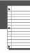

> **NOTE** 如需了解该`Ruby`脚本的更多信息，请阅读`http://blog.tquadrado.com/?p=166`上的相关博文。


`$ 2gmail.rb mbox GmailFolder [StartingMessage]`

如果你希望将名为`Sent`的MBOX文件中的所有邮件迁移到Gmail中名为`Sent Mail`的文件夹，需要执行以下命令：

```
$ 2gmail.rb Sent "[Gmail]/Sent Mail"
```

在上述代码中，`Sent Mail`是Gmail的默认文件夹，无法修改或删除，因此已经存在。如果你指定了一个名为`WebSanity Clients`的不存在的文件夹，脚本会自动为你创建该文件夹。如果遇到问题，可以查看运行`2gmail.rb`时所在目录下生成的`2gmail.log`文件。该日志文件会记录程序最后成功发送的邮件编号。如果你希望从该邮件开始继续迁移，需要提供对应的邮件编号：

```
$ 2gmail.rb Sent "[Gmail]/Sent Mail" 707
```


> **注意**  
> 如果你搜索可自动上传 MBOX 文件和 Maildir 存储的工具，可能会遇到 GMail Loader，其下载地址为 `www.marklyon.org/gmail/`。它是最早（如果不是*首*个）用于将邮件上传至 Gmail 的自动脚本之一，我几年前就使用过它。不过它有一个很大的问题，导致我无法向你推荐：你上传的每封邮件最终显示的日期都是你将其添加到 Gmail 的日期，原邮件的接收日期会丢失。你仍然可以在邮件正文中搜索到原始日期，但 Gmail 显示的是上传至谷歌的日期，而非你收到该邮件的原始日期。

## 使用谷歌邮件上传工具从客户端自动迁移邮件
- 支持操作系统：Windows  
- 支持的邮件客户端与服务：Outlook、Outlook Express、Windows Mail、Thunderbird  
- 适用的 Google Apps 版本：Premier 版、教育版与非营利版、合作伙伴版  

如果你在 Outlook、Outlook Express 或 Thunderbird 客户端中存储了大量邮件，且正在使用 Windows XP 或 Vista 系统，那你很幸运：你可以自动将所有邮件（以及联系人，我们会在后续章节介绍联系人迁移）迁移到你的 Google Apps Gmail 中。谷歌提供了谷歌邮件上传工具，可免费从 `https://mail.google.com/mail/help/email_uploader.html` 下载。

> **注意**  
> 谷歌邮件上传工具非常出色的一点是它属于开源项目，因此你可以下载源代码并根据自身组织的需求进行修改。管理员需要先启用邮件迁移 API，谷歌邮件上传工具才能正常运行。启用方式为：进入控制面板，选择「高级工具」，然后在「用户邮件上传」部分勾选「允许用户使用邮件迁移 API 上传邮件」旁的复选框。此外，希望使用谷歌邮件上传工具的用户还需要登录其 Gmail 账号并接受服务条款，以激活账号。

启动谷歌邮件上传工具前，请先关闭所有邮件程序。之后启动谷歌邮件上传工具，点击「下一步」跳过首个界面。在下一个界面中，输入你的 Google Apps 邮箱地址和密码，点击「登录」。完成身份验证（通过安全连接进行）后，你将看到如图 3.7 所示的界面。

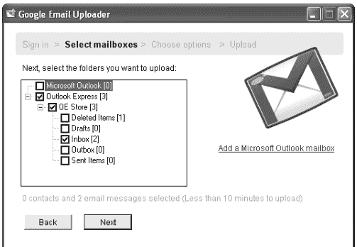

**图 3.7** 谷歌邮件上传工具可以智能识别你安装的邮件程序。它会检测你的电脑上是否运行了 Outlook、Outlook Express 或 Thunderbird，并相应展示对应列表。勾选你想要迁移到谷歌的文件夹即可选中该文件夹。如果希望选中某个程序使用的全部文件夹，勾选程序名称旁的复选框即可。如果要添加当前未在 Outlook 中打开使用的 PST 文件，点击「添加 Microsoft Outlook 邮箱」并选择对应文件即可。完成所有选择后，点击「下一步」，你将看到如图 3.8 所示的界面。

如果你希望将文件夹转换为应用于邮件的标签（请注意标签在你的邮件客户端中外观和文件夹一致），勾选「从文件夹名称创建标签」旁的复选框。如果你希望跳过收件箱，仅归档所有邮件（我会在第 8 章《使用 Gmail 的须知事项》中详细说明这一操作的含义），勾选「归档所有内容」旁的复选框。点击「上传」后，谷歌邮件上传工具就会开始工作，并展示进度条显示迁移进度。上传完成后，工具会提示你上传完成。点击「确定」按钮关闭程序即可，全部操作完成！

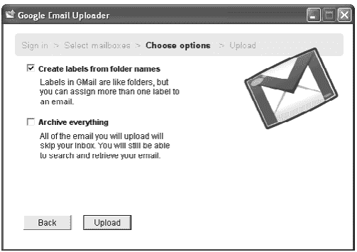

**图 3.8** 回答几个简单问题，谷歌邮件上传工具就会开始工作。如果程序或 Windows 出现故障，你可以随时重启谷歌邮件上传工具，重新开始流程。如果邮件已经被上传过，它不会重复上传，所以不用担心出现重复邮件。不过这并不意味着你可以随意修改邮件：比如批量移动邮件、关闭程序、移动一堆文件夹、下载新邮件，或以其他方式大幅更改你的邮件内容，然后重启谷歌邮件上传工具，指望它能正常运行。如果你在两次运行谷歌邮件上传工具的间隙不小心对邮件做了大量修改，可以找到该工具的安装目录（通常在 `C:\Program Files\Google\Google Email Uploader` 下），删除名为 `UserData.xml` 的文件。下次重启谷歌邮件上传工具时，你需要重新走一遍配置流程，确保环境干净，避免上传工具出现混乱。

> **提示**  
> 如果你需要谷歌邮件上传工具的帮助，可以查看 `http://code.google.com/p/google-email-uploader/wiki/UserGuide` 上的《谷歌邮件上传工具用户指南》，或者前往该软件对应的 Google 网上论坛：`http://groups.google.com/group/google-email-uploader`。

## 使用 Mail Redirect 插件从雷鸟自动迁移邮件
- 支持操作系统：Windows、Mac OS X、Linux  
- 支持电子邮件客户端与服务：雷鸟  
- 支持的谷歌应用版本：标准版、Premier 版、教育版与非营利版、合作伙伴版  

雷鸟用户非常幸运，因为这款邮件程序拥有数量极为丰富的扩展插件，可以为它添加各种实用的功能。其中，邮件重定向（Mail Redirect）插件允许雷鸟用户重定向（而非转发）邮件（如果你不清楚什么是重定向，可以查看本章前文《迁移期间新到邮件的处理》），从而保留原始发送日期及其他重要元数据。你可以通过 `https://addons.mozilla.org/en-US/thunderbird/addon/550` 获取邮件重定向插件，并按照页面说明在雷鸟中安装。重启雷鸟后，你可以依次点击「查看」→「工具栏」→「自定义」，将重定向图标拖到雷鸟的工具栏上，方便后续使用。点击「完成」关闭自定义工具栏窗口后，你会看到类似图 3.9 的界面（当然，根据你放置图标的位置不同，重定向图标也可能在其他位置）。

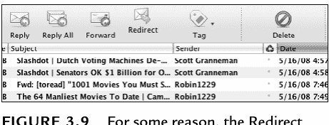

**图 3.9** 出于某种原因，重定向图标和 Mac OS X 系统默认的雷鸟主题不太协调。选中你想要迁移到 Gmail 账户的邮件，点击重定向按钮即可。你会看到类似图 3.10 的界面。

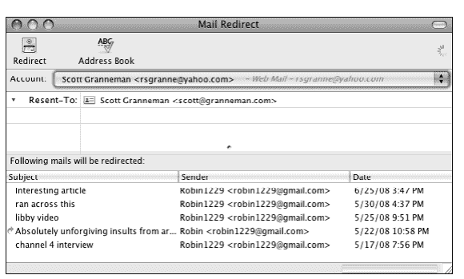

**图 3.10** 邮件重定向插件让从雷鸟向谷歌迁移邮件变得非常简单。在「重新发送至」一栏输入目标邮件地址，点击重定向按钮即可。根据你选中的邮件数量不同，该流程可能需要较长时间。流程结束后，你的旧邮件会连同发送日期及其他核心数据一起同步到你的新账户中。

> **提示**  
> 默认情况下，邮件重定向插件会同时保持 5 个 SMTP 连接处于开启状态。如果你想（谨慎地）调整这个数量，可以依次点击「工具」→「附加组件」→「邮件重定向」→「偏好设置」，修改「并发 SMTP 连接数」旁的数值即可。

## 将 Gmail 邮件迁移到谷歌应用 Premier 版
- 支持操作系统：不适用  
- 支持电子邮件客户端与服务：Gmail  
- 支持的谷歌应用版本：Premier 版  

如果你已经在使用非谷歌应用的 Gmail 账户，想要把其中的邮件迁移到谷歌应用 Premier 版账户，那你很幸运：你可以使用本章前文提到的 IMAP 迁移工具。你需要配置的参数如下：
- 服务器：`imap.googlemail.com`  
- 安全类型：SSL  
- 端口：993  
- IMAP 路径前缀：留空  

最棒的是，你的邮件、邮件头甚至标签都会得到保留，这将大幅减少你后续需要处理的工作。

## 使用 Microsoft Office Outlook Connector 手动迁移 Hotmail（或 Live Mail）的邮件
- 支持操作系统：Windows  
- 支持电子邮件客户端与服务：Hotmail、Outlook  
- 支持的谷歌应用版本：标准版、Premier 版、教育版与非营利版、合作伙伴版  

你之前一直在使用 Hotmail（或新更名的 Live Mail），现在想要迁移到功能更强大、更实用的网页版邮件系统？完全没问题。你只需要在 Windows XP 或 Vista 系统上安装 Outlook 2003 或 2007 版本，其余所有工具都是免费的。你需要下载微软 Office Outlook Connector，下载地址为 `www.microsoft.com/downloads/details.aspx?familyID=7aad7e6a-931e-438a-950c-5e9ea66322d4&displaylang=en`（这个网址很长吧？我推荐你直接在谷歌搜索「Microsoft Office Outlook Connector」，从搜索结果进入即可）。安装完成后，下次打开 Outlook 时，系统会提示你配置 Outlook Connector，你需要输入图 3.11 中显示的对应信息。电子邮箱地址和密码就是你登录 Hotmail 时使用的账号密码，名称则是你希望在 Outlook 文件夹列表中显示的名称。Outlook 加载完成后，你会在左侧的文件夹列表中看到新增的 Hotmail 账户。

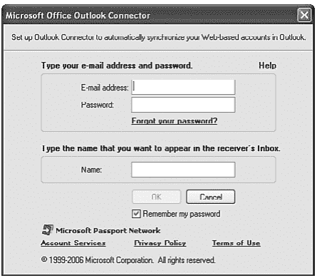

**图 3.11** 启动 Outlook 时会自动弹出填写所需信息的提示。现在你可以很方便地在 Outlook 中访问所有 Hotmail 邮件了，接下来请配置 Outlook，让它通过 IMAP 协议访问你的谷歌应用账户（具体配置方法可以参考第 7 章《设置 Gmail》）。当你能够同时访问 Hotmail 和谷歌应用账户后，只需将 Hotmail 中的邮件拖拽到谷歌应用账户对应的文件夹中即可完成迁移。所需时间取决于你邮件的数量和大小。全部迁移完成后，你就可以和 Hotmail 说再见了。

## 使用雷鸟和 WebMail 插件从网页版邮件系统迁移邮件
- 支持操作系统：Windows、Mac OS X、Linux  
- 支持电子邮件客户端与服务：雷鸟、Hotmail、Yahoo、Lycos、Mail.com、Gmail、AOL 及其他  
- 支持的谷歌应用版本：标准版、Premier 版、教育版与非营利版、合作伙伴版  

本章其他部分介绍了如何将当前使用的邮件主机或客户端中的邮件迁移到谷歌应用，上述方法都要求你可以正常访问目标邮件。不过如今很多人使用的是 Yahoo、Hotmail 这类网页版邮件系统（当然也包括 Gmail，不过谷歌已经提供了便捷的 Gmail 邮件导出功能）。不幸的是，大部分网页版邮件系统都不支持通过 POP 协议轻松导出邮件，要么会收取费用，要么干脆不允许用户下载邮件。比如 Yahoo 就要求用户每年支付 20 美元，才能通过 POP 客户端访问和下载邮件——IMAP 功能想都别想。那么怎么不花钱下载这些服务里的邮件呢？幸运的是，有一个效果不错的免费解决方案。你需要先安装雷鸟，这款软件免费，而且支持所有主流操作系统。接下来你需要安装 WebMail 插件，下载地址是 `http://webmail.mozdev.org/installation.html`。安装时，你需要先右键点击该链接。

首先，下载 WebMail 扩展，将文件保存到你的硬盘上（在我撰写本文时，对应文件为 `web-mail-1-3-2.xpi`）。在 Thunderbird 中，依次进入“工具”→“附加组件”，将 xpi 文件拖入附加组件窗口。当弹出提示时，选择让 Thunderbird 继续安装该扩展，随后重启程序。现在回到浏览器中打开 `http://webmail.mozdev.org/installation.html`，下载你想要收取邮件的网络邮件服务所需的组件。目前支持的服务包括：
- Hotmail  
- Yahoo  
- Lycos  
- Mail.com  
- Gmail  
- Libero  
- AOL  

就我而言，我右键点击了 Yahoo 组件，将文件保存到硬盘上（当前版本为 `yahoo-1-3-2.xpi`）。同样在 Thunderbird 中进入“工具”→“附加组件”，将新的 xpi 文件拖入附加组件窗口完成安装。重启 Thunderbird，我们就可以开始收取 Yahoo 邮件了！

> 我演示的是如何配置 Yahoo Mail，Hotmail、AOL 等其他服务的设置步骤类似，但可能会有细微差别。不过整体配置难度不高，如果你实在搞不定，本节末尾我会提供一些可供求助的渠道。

要配置 WebMail 扩展，回到 Thunderbird 的“工具”→“附加组件”，点击 WebMail 旁的“偏好设置”按钮。偏好设置中共有三个按钮：服务器、域名和日志。其中“服务器”是最关键的选项，因为这里的设置出现问题的话，你将无法使用该扩展，也无法访问你的邮件。

WebMail 扩展的工作原理是在你的电脑上搭建专属的 POP 服务器，用于对接你想要下载邮件的网络邮件服务（它同时还会搭建 SMTP 和 IMAP 服务器，但这部分内容不在本次讨论范围内）。你需要确保 POP 服务器处于运行状态，因此需要看到 POP 下方显示绿色指示灯，以及“运行中”字样。如果没有看到，大概率是你的防火墙拦截了访问。尝试调整防火墙设置，开放 110 端口（POP 的默认端口），然后点击“+”按钮启动 POP 服务器。如果绿色指示灯亮起就没问题；如果没有，你可能需要将端口号设置为 1024 以上的数值。我使用了 4000 端口，POP 服务器立刻就启动成功了，如下图所示。

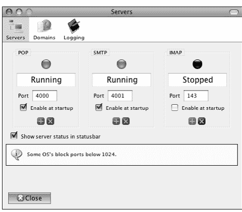

**图 3.12** WebMail 扩展正常工作需要开放若干常用端口。

你可以通过点击名为“日志”的按钮来开启日志功能。为什么要这么做呢？如果你遇到问题需要排查故障，日志会提供极大的帮助。勾选“启用日志”旁的复选框，点击“浏览”按钮，选择一个你希望存储日志的位置（最好选择专门存放日志的位置，比如新建一个名为“WebMail Logs”的文件夹，因为这个扩展会生成大量日志文件！），然后关闭偏好设置窗口。现在需要再次重启 Thunderbird！

好了，Thunderbird 已经重启完成。在 Thunderbird 中，依次进入“文件”→“新建”→“账户”。账户类型选择“网络邮件”，然后点击“继续”。在“你的姓名”（比如 `Scott Granneman`）和“电子邮件地址”栏输入正确信息（因为我们这里用 Yahoo 做演示，所以我填写了 `rsgranne@yahoo.com`），然后点击“继续”。在“收件用户名”一栏，你要忽略 Thunderbird 给出的提示。程序会建议你直接填写用户名，比如 `rsgranne`，但这种方式对 WebMail 扩展无效。相反，你必须输入完整的电子邮件地址，比如 `rsgranne@yahoo.com`，然后点击“继续”。最后一个页面会展示你输入的所有信息，请核对这些内容是否正确，取消勾选“立即下载邮件”（因为我们还没准备好进行这一步），然后点击“完成”。现在你应该能在 Thunderbird 最左侧的账户列表里看到新创建的账户了。右键点击该账户（就我而言，Thunderbird 将其命名为“Web Mail – rsgranne@yahoo.com”），选择“属性”。在账户设置下选择“服务器设置”，如下图所示。

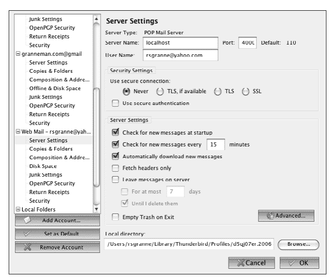

**图 3.13** 网络邮件账户的设置方式和其他 POP 或 IMAP 账户一致。

确保“服务器名称”填写为 `localhost`，端口要和你在 WebMail 偏好设置的“服务器”标签页中设置的端口保持一致。默认情况下，“在服务器上保留邮件”是勾选状态。这个选项听起来很合理，在你还没完全搞懂这个扩展的工作方式之前，你也可以先保留这个勾选状态。但你很可能需要取消这个勾选。我之前用这个扩展配合 Yahoo 账户时，它只会下载 65 封邮件——也就是最新的 65 封，之后就不会再下载了。当然，这 65 封邮件依然会留在 Yahoo 的服务器上。取消勾选“在服务器上保留邮件”后，我就可以从 Yahoo 服务器下载我的邮件了，不过一次只能下载 65 封。换句话说，我会先从 Yahoo 把 65 封邮件下载到我本地的 Thunderbird 中。如果之后我用浏览器查看 Yahoo 邮箱，那最新的 65 封邮件就会从 Yahoo 服务器上消失。之后我可以重复这个过程，下载接下来的 65 封。我 Yahoo 里总共只有几百封邮件，所以整个过程不算麻烦。如果我有几千上万封邮件的话，那这个过程就会非常枯燥，我得一边玩纸牌或者麻将一边慢慢操作了（或者找个自动化的解决方案）。

现在再次回到“工具”→“附加组件”（我保证这是最后一次提这个路径了！），这次你要点击 WebMail—Yahoo 旁的“偏好设置”按钮。你会看到如下图所示的内容。

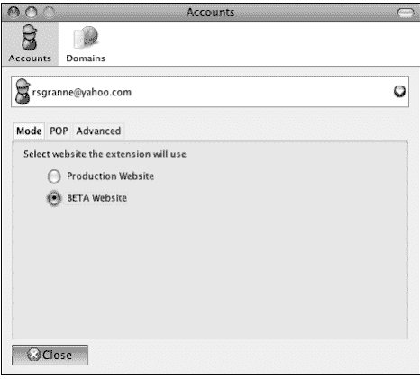

**图 3.14** 选择最适合你当前 Thunderbird 版本的 Yahoo Mail 版本。

你应该能看到你刚创建的账户的邮箱地址（就我而言是 `rsgranne@yahoo.com`）。在“模式”标签页里，你可以选择生产环境网站（对应旧版、采用非 AJAX 架构的 Yahoo Mail）或测试版网站（对应全新的 AJAX 架构的 Yahoo Mail）。我做过测试，在 Yahoo Mail 网站的旧版和新版之间来回切换，发现必须同时在网站上选择新版、在这里选择“测试版网站”，功能才能正常使用。

在“POP”标签页里，如果你只想下载未读邮件，可以勾选“仅下载未读邮件”。但你现在要做的是邮箱迁移，我想你不会想选这个选项。如果你之前在 Thunderbird 里设置 Yahoo Mail 账户时，选择了下载全部邮件并且不在服务器上保留副本，那你勾不勾选“在服务器上将邮件标记为已读”其实都没关系，因为等操作完成后，服务器上已经没有任何邮件了。

最后，只有受虐狂才会选择“下载垃圾邮件”这个选项，所以别勾选它。如果你想收取收件箱之外的其他文件夹的邮件，也可以在这个页面添加对应的文件夹。

在“高级”标签页里，如果你需要的话可以勾选“使用短 ID”，但根据我的使用体验，尽管系统会警告你勾选后所有邮件都会被重新下载导致重复，但实际上并不会出现这种情况——也就是说，我并没有重复下载所有邮件，依然是一次只下载 65 封。

> **注意**  
> 那“短 ID”到底是什么呢？原来 Yahoo 大约每周会更改一次邮件的隐藏 ID。Thunderbird 通过 WebMail 扩展识别到新的 ID 后，会认为这是一封新邮件，哪怕它之前已经下载过，也会重新下载一次。勾选“使用短 ID”之后，你相当于告诉 Thunderbird 忽略 ID 里会变动的那部分，从而使用缩短后的 ID 编号。  
> 如果你希望重用上次登录 Yahoo Mail 时留下的 Cookie，可以勾选“重用 HTTP 会话数据”，这样能稍微加快你的登录速度。

现在你可以点击“关闭”按钮关掉这个窗口，接下来你应该就能从 Yahoo Mail 下载邮件了。在 Thunderbird 里，我会进入“文件”→“获取新邮件”→“网络邮件”→`rsgranne@yahoo.com`，选择你刚刚创建的账户即可。几秒钟后，邮件就会从 Yahoo Mail 流入 Thunderbird，一次 65 封，完全不用花一分钱。很快就能看到图 3.15 里的内容了。

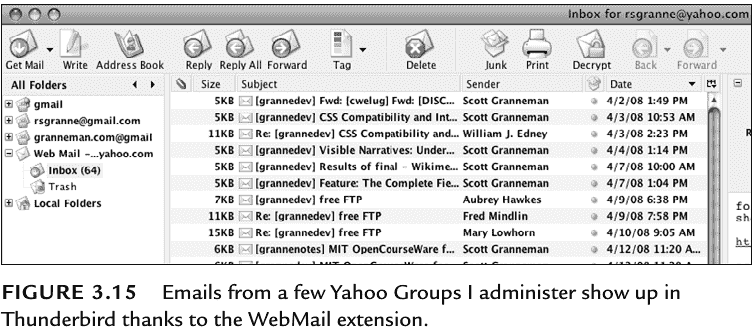

记住，你需要逐封获取你的邮件。如果你从雅虎收到关于“负面信号”的错误提示（实际上，你也可能会在 Hotmail 等其他网络邮箱服务上遇到这个提示），你需要在 WebMail 设置里调整相关参数，也就是雷鸟附加组件中的雅虎偏好设置。如果你还是无法解决问题，应该先去 WebMail 扩展的官方站点 `http://webmail.mozdev.org` 查看相关信息。不过该站点的资料不算特别多，因此你最后大概率会找到雷鸟 Webmail 扩展的讨论组，地址是 `http://groups.google.com/group/thunderbird-webmail-extension`，你可以查看过往讨论或者在该组寻求帮助。等你的雅虎邮件成功导入雷鸟后，接下来就很简单了：创建一个基于 IMAP 的 Google Apps 账号，然后手动迁移邮件即可，具体方法本章前面已经详细介绍过。如果你不想手动操作，也可以使用 Redirect Mail 扩展，或者直接访问存储了你下载的网络邮箱的 mbox 文件并直接处理，这两种方法之前也提到过。

> 注意：要找到雷鸟到底把你的 mbox 文件存在了哪里，可以点击「工具」>「账户设置」，在左侧列表中找到对应账户，选择下方的「服务器设置」，然后查看「本地目录」旁边的路径即可。

WebMail 扩展是一款功能强大、实用性极高的软件，能帮你把邮件从那些想将你的个人数据扣作人质的邮箱服务商手中解放出来。如果你正在迁移到 Google Apps，这个扩展可能会帮你顺利完成迁移工作。

## 从基于网页的邮箱系统迁移
上一节我介绍了一种导出被困在网页邮箱中的邮件的方法，这些网页邮箱要么要求你付费才能获得 POP 权限访问邮件，更糟糕的是甚至完全不提供 POP 访问权限。火狐的 WebMail 扩展会运行一个 POP 守护进程，作为你本地计算机上的邮件代理，再和你的网络邮箱服务商通信，让你的 POP 客户端能够访问你的网络邮箱，设计非常巧妙。不过还有其他软件包也能实现类似功能，无需依赖雷鸟。事实上，只要你在电脑上配置好下面任意一款工具，你就可以使用任何你想要的邮件客户端，比如 Outlook、Apple Mail、Outlook Express 等。我不会深入讲解每一款工具，不然这本书会厚得像纽约的电话簿一样，但我会提供一些基本信息，如果你对某款工具感兴趣可以自行进一步了解。

> 如果你想了解比我本节介绍的更多的同类工具列表，可以访问 `http://ypopsemail.com/links/42-similar-apps` 查看。

### FreePOPs
- 支持操作系统：Windows、Mac OS X、Linux  
- 兼容的邮件客户端与服务：AOL、Lycos、Excite、Gmail、Hotmail、NetZero、Juno、Mail.com、Netscape、雅虎，以及众多其他服务  
- 适用的 Google Apps 版本：标准版、Premier 版、教育版与非营利版、合作伙伴版  

FreePOPs（`http://www.freepops.org/en/`）是免费开源的，支持 Windows（从 95 到 Vista，兼容性不错）、Mac OS X 和 Linux 系统。你可以从 `www.freepops.org/en/download.shtml` 下载它，安装完成后，你可以从海量的网络邮箱服务中下载邮件，包括所有主流邮箱以及全球在用的众多小型服务商。完整的服务商列表可以在 `www.freepops.org/en/viewplugins.php` 查看。当你把网络邮箱的邮件安全导入邮件客户端后，就可以使用本章前面提到的方法，手动或自动将这些邮件迁移到 Google Apps。FreePOPs 的配置和使用全流程细节可以在官方手册中找到，你也可以在论坛和其他用户交流，相关链接都可以在 `www.freepops.org/en/doc.shtml` 的文档页面找到。该程序维护良好，拥有庞大的用户社区，这些都是开源项目的积极信号。

### MacFreePOPs
- 支持操作系统：Mac OS X  
- 兼容的邮件客户端与服务：AOL、Lycos、Excite、Gmail、Hotmail、NetZero、Juno、Mail.com、Netscape、雅虎，以及众多其他服务  
- 适用的 Google Apps 版本：标准版、Premier 版、教育版与非营利版、合作伙伴版  

MacFreePOPs（`http://www.e-link.it/macfreepops/`）是 FreePOPs 的 Mac 专属、对 Mac 用户友好的版本，自带自动更新、和 Mac OS 用户界面集成等实用功能。它是免费的，但似乎不提供源代码，尽管它基于开源的 FreePOPs 开发（emmm……）。如果你是 Mac 用户，这款工具可能是你的首选。不过该程序的官网主要是意大利语，虽然这门语言很优美，但对大多数用户来说并没有什么帮助。幸运的是，MacFreePOPs 的配置和使用指南可以在 `http://email.about.com/od/macosxmailtips/qt/et_free_yahoo.htm` 找到。

### YPOPs
- 支持操作系统：Windows、Mac OS X、Linux  
- 兼容的邮件客户端与服务：雅虎邮箱  
- 适用的 Google Apps 版本：标准版、Premier 版、教育版与非营利版、合作伙伴版  

YPOPs（`http://ypopsemail.com`）和 FreePOPs 类似，但仅专注于雅虎邮箱。它有官方的 Windows 版本，但由于它是开源程序，其他志愿者会重新编译它以适配 Linux（存在 Mac OS X 版本，但用户抱怨非常多，所以我建议你避开它，而且你本来也更可能选择 MacFreePOPs）。你可以从 `http://ypopsemail.com/download` 下载 Windows 版本；如果你是 Linux 爱好者，可以去 YPOPs 的 Linux 论坛 `http://forums.ypopsemail.com/ypops-linux-f3.html` 逛逛，找适合你发行版的二进制包。当然你也可以从 `http://sourceforge.net/cvs/?group_id=52835` 下载源代码自行编译。包括 Outlook、雷鸟、Outlook Express、Eudora 等在内的各类邮件客户端的配置文档，以及其他相关问题的帮助指南，都可以在 `http://ypopsemail.com/documentation` 找到。如果你想和开发者或其他用户交流，可以去论坛 `http://forums.ypopsemail.com/`。还有一篇很棒的、带插图的逐步指南，教你如何在 Windows 机器上安装 YPOPs 并配置雷鸟配合使用，地址是 `http://opensourcearticles.com/thunderbird_15/english/part_10`。这篇指南最初是为雷鸟 1.5 版本写的，但完全适用于最新版本的软件。

#### 解决常见问题
#### 为什么我不能用 Gmail 的邮件获取器导入邮件？
如果你在 Gmail 中点击「设置」>「账户」>「从其他账户获取邮件」，就会看到一个非常实用的功能，叫做邮件获取器。简单来说，它允许你指定最多 5 个其他邮箱账户，通过 POP 连接把这些账户的邮件同步到 Gmail 中。换句话说，只要你能通过 POP 访问某个邮箱账户，就可以把该账户的所有邮件导入你的 Gmail 账户，把所有邮件集中在一处。网上有些人推荐用邮件获取器把邮件从旧 POP 账户迁移到新的 Google Apps 账户，但这个思路有个问题，和 POP 本身的性质有关。记住，绝大多数情况下，POP 邮件客户端会把邮件从邮件服务器移动到本地客户端，服务器上不会留存任何副本。显然，邮件获取器只能获取新邮件，之前已经移动过的旧邮件是无法获取的。如果你之前一直把所有 POP 邮件都留在服务器上，那邮件获取器或许能生效，但这种情况极其罕见，所以邮件获取器基本不可能帮你把旧邮件迁移到新的 Google Apps 账户。

#### 我想付费买软件或者雇人帮我完成迁移，该去哪里找？
如果你更想找可以直接购买使用的软件，或者可以雇佣来提供定制开发和技术支持的服务商，你可以去 Google 解决方案市场（`www.google.com/enterprise/marketplace/`）搜索相关资源。

#### 总结
撰写邮件迁移相关的内容是一项复杂的工作，因为邮件协议、软件和服务多种多样。对于真正需要执行迁移工作的管理员来说，情况会简单一些，因为你清楚自己正在使用和处理的是哪些协议、软件和服务。不过迁移工作依然需要你谨慎、精准地完成。如今人们的日常工作都离不开邮件，任何服务中断都会让用户抓狂，也会给你带来麻烦。所以要谨慎操作，提前规划，并且反复测试、测试、再测试。

#### 延伸阅读
- 迁移指南  
  - [IMAP 邮件迁移](www.google.com/support/a/bin/answer.py?answer=61369&query=migration)  
  - [大规模迁移的最佳方案](www.google.com/a/help/intl/en/admins/pdf/google_apps_imap_migration.pdf)  
  - [邮件迁移屏幕录像](http://services.google.com/apps/resources/admin_breeze/MigratingEmail/)  
  - [Google 邮件上传工具 - 软件页面](http://mail.google.com/mail/help/email_uploader.html)  
  - [Google 邮件上传工具用户指南](http://code.google.com/p/google-email-uploader/wiki/UserGuide)  
  - [Google 邮件上传工具开源项目页面](http://code.google.com/p/google-email-uploader/)  
  - [Google 邮件上传工具讨论组](http://groups.google.com/group/google-email-uploader)  
- 邮件重定向  
  - [Jerry Peek 所著《从未耳闻的绝佳邮件功能》，发表于 *Linux Magazine*](www.linux-mag.com/id/1698)  
  - [SpamAssassin 的《在保留邮件头的前提下重新发送邮件》](http://wiki.apache.org/spamassassin/ResendingMailWithHeaders)  
  - [与 YPOPs 和 FreePOPs 类似的软件列表](http://kb.mozillazine.org/Using_webmail_with_your_email_client)，滚动到「附加组件」部分即可  
- 致开发者  
  - [Google 应用邮件迁移 API 开发者指南](http://code.google.com/apis/apps/email_migration/developers_guide_protocol.html)  
  - [Google 应用邮件迁移 API 参考指南](http://code.google.com/apis/apps/email_migration/reference.html)  

## 将联系人迁移至 Google 应用
我算是谷歌大多数产品的忠实粉丝——不然我也不会写这本书——但我也实事求是。这就是我的真实想法：Google 通讯录烂透了。它存在太多限制（你稍后就会读到相关内容），功能严重不足，用户界面极为蹩脚，迫切需要对界面进行重新设计，甚至过去一年推出的新版在好几个关键方向简直是倒退！不过，如果你打算使用 Gmail 或其他多数谷歌服务，你就不得不使用 Google 通讯录。而且如果你和大多数人一样，这些年来已经在电脑存储的通讯录里积攒了大量联系人、电话号码、邮箱地址和其他数据。本章将介绍如何将这些海量信息导入 Google 通讯录。

> **注意**
> 如果你更想找可以获取使用的软件，或是可以雇佣来做定制开发并提供支持的服务商，那你真的应该去谷歌解决方案市场 `www.google.com/enterprise/marketplace/` 逛逛。

总的来说，你要将地址导入 Google 有两种方法：一种是通过 CSV 文件手动导入（这是谷歌接受此类任务的唯一格式），另一种是在你当前的通讯录和 Google 之间进行双向同步。看起来可能不太明显，但迁移并不一定需要把数据从其他程序单向传输到你的 Google 通讯录里。现在有现成的软件包可以实现 Google 通讯录和其他通讯录之间的同步；如果你的 Google 通讯录里一开始没有联系人，那么同步的效果和你先导出再导入完全一致，都能把联系人复制到 Google 通讯录里。两种方法各有适用场景，不过正如你稍后会看到的，我因为几个原因更推荐同步。

> **警告**
> 在同步任何数据之前，你务必要备份所有打算同步的内容。在没有做好完整备份之前不要继续操作。不要拖延这件事——万一出了意外（或者至少墨菲定律应验），你要做好万全准备！

## 准备迁移联系人
在尝试将现有通讯录迁移到 Google 通讯录之前，你需要了解以下规则，除非提前做好准备，否则可能会给你带来大麻烦：
- **记录必须拥有唯一的邮箱地址。** 如果爱丽丝的邮箱地址是 `info@widgetco.com`，鲍勃的邮箱地址也是 `info@widgetco.com`，那你就等着出问题吧——后上传的条目会“覆盖”先上传的。要确保你通讯录里的每个条目都有唯一的邮箱地址。我知道这很繁琐，而且绝大多数通讯录程序几乎没法直接识别重复项。不过，如果你把通讯录导出为 CSV 文件，再按邮箱地址排序，就能轻松发现重复项了。
- **所有字符都必须是英文。** 对于读这本书的大多数人来说，这没什么大不了的。随着谷歌逐渐将应用扩展到国际用户群体，这项要求肯定会调整。
- **你一次最多可以导入 3000 个联系人。** 这依然不是什么大问题。如果你的联系人超过 3000 个，你需要分多次导入才能把所有联系人导入 Google 通讯录。不过看起来 3000 并不是一个硬性规定，只是一个近似值。实际限制更多取决于文件大小。如果你是个非常爱记笔记的人，你可能一次只能手动上传几百个联系人。比如我的朋友里奇，多年来一直在通讯录的备注栏里记录每一次通话和与客户的往来，有些联系人的备注甚至有上百行。对他来说，他一次根本不可能上传超过 1000 个联系人。灵活尝试是这里的关键。
- **你无法传输邮件群组或分发列表。** 没错，你可以等所有联系人导入 Google 之后再创建群组，但没法复制已经存在的群组。如果你的群组很多，这确实很麻烦。不过正如我本章稍后会提到的，如果你通过自动同步的方式把 Google 通讯录和桌面通讯录同步，而且你打算继续使用桌面通讯录和邮件客户端，这就不是什么大问题了。

以上就是你在开始把现有通讯录迁移到 Google 通讯录时需要注意的全部事项。不过在我们继续讲解联系人迁移的各种程序和方法的细节之前，我想在下面的边栏里和你分享一些我亲身总结的经验。

## 我历经实践总结的建议
如果要迁移的是我的账号，我会先清空所有已有的 Google 通讯录，再开始迁移联系人。如果你担心会丢失某个你其他渠道没有的邮箱地址，就先导出 Google 通讯录，再清空。之后我会找一个能自动同步你选择的客户端通讯录和 Google 通讯录的程序。我自己在 Mac 上用的是 Spanning Sync，我觉得它可靠、高效又不打扰人（本章稍后“用 Spanning Sync 自动同步苹果通讯录和 Google 通讯录”部分会提到它）。现在市面上大多数主流通讯录都有很多其他的同步程序；本章我会介绍部分，其他的也会提及。我把我的苹果通讯录和 Google 通讯录同步，这意味着一开始我苹果通讯录里的所有联系人都会被复制到 Google 上。之后我从来不会手动在 Google 上修改任何内容。所有修改都在我的 Mac 上完成，之后会自动同步到 Google。我这么做有几个原因。正如我之前说的，Google 通讯录很糟糕。但网页版 Gmail（以及其他一些谷歌服务）用的就是它，所以我不得不用，哪怕我不想。不过这并不意味着我要把它作为我所有联系人的主存储。我更愿意用功能更全的工具，比如苹果通讯录（如果我用 Windows 的话甚至可以用 Outlook）来存储我和他人往来所需的联系人数据，等数据更新了再推送到 Google 通讯录里。因为我用的是同步，所以是双向传输。不幸的是，这意味着我的通讯录最后会有点乱，因为

## 手动将 CSV 文件导入谷歌通讯录
- 适用操作系统：Windows、Mac OS X、Linux  
- 适用通讯簿客户端与服务：全部兼容  
- 适用谷歌应用版本：标准版、高级版、教育版、非营利组织版、合作伙伴版  

我在本章适当位置会重复你看到的这三行内容，帮助你判断某节内容是否适用于你的情况。

Gmail 会自动添加我回复过的所有联系人为联系人。当我同步通讯录时，我会把电脑通讯录里的更改同步到谷歌，同时也会把谷歌里的随机邮箱地址添加到我电脑的通讯录里。我只需要定期整理我的苹果通讯录，查找新增联系人，确认要保留的联系人，再对这些联系人进行调整，使其符合我其他数据的格式，或者删除我不想要的联系人。

为什么要同步？我不想一直手动折腾 CSV 文件的导入导出。我宁愿把整个流程自动化，让它在后台自动运行，尽可能减少我的参与。这种情况下，“懒”是好事——从长远来看反而能提高效率。

> 新版 Gmail（目前所有新账号的默认版本）一次最多只能删除 20 个联系人，这个限制荒谬至极，我希望谷歌尽快取消它。幸运的是，有个办法可以绕过这个束缚：在 Gmail 网页顶部，你会看到“旧版”链接，点击它进入通讯录，滚动到页面底部选中所有联系人，再滚动回页面顶部删除所有人。完成后点击“新版”即可切回。除了删除联系人的荒谬限制外，新版 Gmail 在所有方面都更优秀。

也许你不想在你选择的通讯录和谷歌通讯录之间自动同步联系人。你可能计划仅用桌面客户端使用 Gmail，几乎不会（甚至完全不会）通过网页端使用，因此谷歌通讯录里存储什么内容对你来说并不重要。又或者你只会和非常小的一部分精选人群通信，完全可以一次性通过 CSV 文件把联系人上传到谷歌通讯录，之后再也不用管。如果你想手动导入 CSV 文件，你可以在这里找到具体操作方法。

总的来说，将姓名和联系信息导入谷歌通讯录的流程非常简单：登录你的谷歌应用邮箱，点击“通讯录”，点击“导入”，点击“浏览”选择你电脑上的逗号分隔值（CSV）文件，再点击“导入”即可。几分钟后，根据你要导入的联系人数量，你就能在谷歌通讯录里看到结果。

流程很简单，但要把联系人*导入*谷歌的关键，首先是先把联系人从你正在使用的客户端或服务里*导出*，且格式要符合谷歌的导入要求。在本节中，我会先介绍谷歌要求的 CSV 文件格式，然后讲解几个主流通讯录客户端和服务，说明如何从这些工具中导出你的联系人数据。

### 处理 CSV 文件
谷歌仅支持一种格式的联系人导入：即 CSV（逗号分隔值）文件。你可能会觉得这很棒，因为你使用的通讯录正好支持导出 CSV 格式的数据，但先别高兴太早。谷歌会尝试适配你常用通讯录导出程序生成的各种常见表头，但最终数据在谷歌通讯录里的位置很可能和你预期的不一样。因此，你必须先用通讯录里的少量记录测试 CSV 文件导入流程——这些记录包含的数据越多越好。

> **警告**
> 我在这里再重复一遍，让所有人都看到：你必须先用通讯录里的少量记录测试 CSV 文件导入流程——这些记录包含的数据越多越好。
> 从你使用的通讯录中导出或生成 CSV 文件。如果可能的话，仅导出少量记录（比如 10 条），这些记录要包含不同字段的各类数据。如果不能仅导出少量记录，就导出全部数据，用电子表格打开 CSV 文件，删除除了 10 条左右数据丰富的记录之外的所有内容。现在你就有可以上传到谷歌通讯录的文件，借此检查导入结果了。

如果导入结果让你很满意，说明谷歌解析你通讯录的 CSV 文件时没出什么岔子，那么你就可以继续从你使用的通讯录中导出全部联系人，完成全量导入。更可能的情况是，你会发现谷歌放置数据的位置你不满意。一般来说，如果谷歌无法识别你的某个标签要映射到谷歌通讯录的哪个字段，这个数据项就会被塞到“备注”里。遇到这种情况，你就需要调整 CSV 文件里的导出数据，让它更符合谷歌的要求（不过谷歌对导入数据的兼容性其实相当宽松）。

最基础的 CSV 文件只需要两列：
- 姓名  
- 邮箱  

仅此而已。如果你创建仅包含姓名和邮箱的 CSV 文件，谷歌会顺利将其导入你的通讯录。如果你想拆分姓名，可以这样设置列：
- 名字  
- 姓氏  
- 邮箱地址  

你还可以按需添加“中间名”或“中间名首字母”。注意“邮箱”和“邮箱地址”都可以用作表头，谷歌对此没有限制。

反之，如果你比较挑剔，希望尽可能贴合谷歌官方的表头和 CSV 结构，有个简单的方法可以查看谷歌推荐的 CSV 联系人排序方式：在谷歌通讯录里创建一个联系人，填入你能想到的所有数据，然后将这个联系人导出为 CSV 文件。

> **提示**
> 不知道怎么从谷歌导出联系人？请参见本章后续的《从 Gmail 导出联系人》。


用 Excel、OpenOffice.org（甚至谷歌文档的表格组件）打开你导出的 CSV 文件，就能看到谷歌设置的 CSV 文件格式。你会发现谷歌使用的表头和列的顺序如下：
- 姓名  
- 邮箱  
- 备注  
- 分组 1—描述  
- 分组 1—邮箱  
- 分组 1—即时通讯  
- 分组 1—电话  
- 分组 1—手机  
- 分组 1—寻呼机  
- 分组 1—传真  
- 分组 1—公司  
- 分组 1—职位  
- 分组 1—其他  
- 分组 1—地址  
- 分组 2—描述  
- 分组 2—邮箱  
- 分组 2—即时通讯  
- 分组 2—电话  
- 分组 2—手机  
- 分组 2—寻呼机  
- 分组 2—传真  
- 分组 2—公司  
- 分组 2—职位  
- 分组 2—其他  
- 分组 2—地址  
- 分组 3—描述  
- 分组 3—邮箱  
- 分组 3—即时通讯  
- 分组 3—电话  
- 分组 3—手机  
- 分组 3—寻呼机  
- 分组 3—传真  
- 分组 3—公司  
- 分组 3—职位  
- 分组 3—其他  
- 分组 3—地址  

你可能会立刻发现，谷歌没有一些你以为会有的表头，比如工作邮箱、家庭邮箱之类的。相反，它提供了三个分组。哪个是工作用，哪个是个人用，第三个用来做什么？它们的顺序应该怎么排？谷歌其实给了你很大的灵活度。只要用“分组# - 描述”列标记数据，家庭和工作相关数据的顺序无所谓。这三个列你可以选填以下内容：
- 工作  
- 个人  
- 其他  

这意味着你可以像表 4.1 展示的那样填写数据，这些数据可以正常导入谷歌通讯录（为了便于理解，我省略了大部分列）：

## 表 4.1 展示描述表头作用的示例 CSV 文件
| 姓名 | 分组 1—描述 | 分组 1—邮箱 | 分组 2—描述 | 分组 2—邮箱 | 分组 3—描述 | 分组 3—邮箱 |
|------|----------------------|----------------|----------------------|----------------|----------------------|----------------|
| 约翰·卡特 | 工作 | `jcarter@barsoominc.com` | 其他 | `dotarsojat@yahoo.com` | 个人 | `warlord@gmail.com` |
| 德贾·托里斯 | 个人 | `princess@gmail.com` | 工作 | `dthoris@barsoominc.com` | 其他 | `tarasmom@aol.com` |
| 塔斯·塔卡斯 | 其他 | `fourarms@hotmail.com` | 个人 | `tharkme@gmail.com` | 工作 | `ttarkas@barsoominc.com` |

记住，你不需要在 CSV 文件里使用谷歌的“官方”表头，因为谷歌会尽力解析你提供的任何内容。但如果你用我之前列出的那一长串表头，导入流程肯定会顺畅很多。

> **提示**
> 谷歌在其帮助中心提供了一个名为“创建或编辑 CSV 文件”的页面（`https://mail.google.com/support/bin/answer.py?answer=12119`），但其内容过于简略，几乎毫无用处。它甚至没有列出谷歌标准 CSV 导出文件中的所有字段！拜托，谷歌——请雇些技术写手吧！

## 从 AOL 导出联系人
AOL 没有提供导出 AOL 通讯簿的功能，这实在糟糕。你可以将通讯簿打印成 HTML 报告，然后进行解析，但那需要大量工作。这也是不使用 AOL 的又一个理由。你也可以通过 Plaxo 同步你的 AOL 联系人，这将在本章稍后的“通过 Plaxo 自动同步联系人”部分进行讨论。

## 从 Apple Mail 导出联系人
不幸的是，尽管苹果允许你轻松导出联系人，但它只提供两种格式：通讯簿的备份或 vCards。这两种格式都无法直接用于谷歌通讯录。不过，事情并非毫无转机。谷歌本身推荐了一个名为 A to G 的免费开源程序，可从 `http://bborfka.com/atog/` 获取。解压它，运行它，你就会看到图 4.1 所示的极其简单的程序。

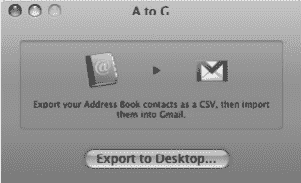

**图 4.1** A to G 是最精简简单的程序。按下标有 *导出到桌面* 的按钮，片刻之后，你的桌面上就会出现一个新文件：`Contacts for Gmail.csv`。A to G 在转换所有内容方面做得相当不错，但明智的做法是先在电子表格应用程序中打开这个 CSV 文件进行检查。你也可以通过 Plaxo 同步你的苹果通讯簿，这将在本章稍后的“通过 Plaxo 自动同步联系人”部分进行讨论。

## 从 Eudora 导出联系人
打开你的 Eudora 通讯簿，转到“文件”，“另存为”。选择 CSV 作为文件类型。现在，在 OpenOffice.org 或等效的电子表格程序中打开该文件，并开始编辑和修改。

## 从 Evolution 导出联系人
如果你在 Linux 机器上使用 Evolution，你实际上可以使用一个鲜为人知的程序来导出联系人：`evolution-addressbook-export`。只需在终端中运行以下命令：

```bash
evolution-addressbook-export
```


`$ evolution-addressbook-export --format=csv --output=~/Desktop/EvolutionContacts.csv`


根据你联系人的数量，很快你的桌面上就会出现一个名为`EvolutionContacts.csv`的文件。在导入到谷歌之前，先用`OpenOffice.org`打开该文件仔细检查一下。

## 从 Gmail 导出联系人

如果你想将联系人从标准 Gmail 账户转移到你的新 Google Apps 账户，那么你很幸运——你不需要进行任何重新格式化，因为你是在谷歌账户之间转移。前往你的 Gmail 账户的通讯录页面，点击右上角的导出链接。选择你希望从 Gmail 账户中解放出来的联系人——全部或特定群组中的联系人——然后，在格式方面，选择谷歌的 CSV 格式，该格式被恰当地描述为“用于导入到另一个谷歌账户”。按下导出按钮，你的浏览器将下载一个名为`contacts.csv`的文件。现在你可以毫无问题地将它导入到你的 Google Apps 通讯录中。

## 从 Hotmail 和 Windows Live Hotmail 导出联系人

在将你的 Hotmail 联系人导入到 Google Apps 之前，你首先需要从 Hotmail 导出联系人。登录 Hotmail，点击选项，导出联系人。按下导出联系人按钮，并将名为`WLMContacts.csv`的文件保存在你的硬盘上。你仍然需要使用 Excel 或其他电子表格程序打开 CSV 文件，以便按照谷歌的喜好进行调整。

你也可以通过 Plaxo 同步你的 Hotmail 和 Windows Live 联系人，这将在本章稍后的“通过 Plaxo 自动同步联系人”部分进行讨论。

## 从 KAddressBook 导出联系人

谈到支持各种导出格式从而不将你锁定在某个特定应用方面，KDE 的联系人管理器 KAddressBook 当之无愧地拔得头筹。选择“文件”，“导出”，你将拥有相当多的格式选择：vCard 2 和 3、LDIF、GMX、书签、GeoData，以及我们需要的 CSV。选择 CSV，然后在 OpenOffice.org 或你选择的电子表格中打开生成的文件，编辑结果以符合谷歌的需求。

## 从 Outlook 导出联系人

微软使得将联系人从 Outlook 导出到 CSV 文件变得相当容易。转到“文件”，“导入/导出”，“导出”，“CSV (Windows)”，“联系人”，然后将导出的文件保存到你的硬盘上。不过，请不要完全信任这个文件——用 Excel 打开它，仔细检查以确保它符合谷歌通讯录的期望。你也可以通过 Plaxo 同步你的 Outlook 联系人，这将在本章稍后的“通过 Plaxo 自动同步联系人”部分进行讨论。

## 从 Outlook Express 导出联系人

你已经决定停止使用 Outlook Express——太棒了！让我们把这些联系人从 OE 中取出来。选择“文件”，“导出”，“通讯簿”，选择“文本文件（逗号分隔）”，最后，点击“导出”。我知道这并不意外，但你需要在你最喜欢的电子表格程序中打开那个 CSV 文件，并重新调整以使其适用于谷歌。你也可以通过 Plaxo 同步你的 Outlook Express 通讯簿，这将在本章稍后的“通过 Plaxo 自动同步联系人”部分进行讨论。

## 从 Thunderbird 导出联系人

格式设置为逗号分隔。获得文件后，在谷歌文档的电子表格组件中打开它并进行修正，以便可以安全地将其导入到谷歌通讯录中。

## 从 Yahoo! 导出联系人

登录 Yahoo Mail 并进入你的联系人。点击导入/导出链接，在接下来的页面中，向下滚动到导出部分。你可以导出多种格式，但你需要的是 Yahoo! CSV。你应该会得到一个名为`yahoo_ab.csv`的文件。如果你不加任何修改直接导入`yahoo_ab.csv`，你会发现你的电话号码、电子邮件地址、头衔和公司信息都顺利导入了。但地址完全没导入，而即时通讯信息、日期和备注都最终出现在谷歌的备注字段中。如果你从 Yahoo 导出联系人，预计需要花费一些时间在电子表格应用程序中修正数据。你也可以通过 Plaxo 同步你的 Yahoo 联系人，这将在本章稍后的“通过 Plaxo 自动同步联系人”部分进行讨论。

## 使用谷歌数据 API 开发你自己的联系人迁移工具

- 操作系统：Windows、Mac OS X、Linux
- 通讯簿客户端和服务：任何兼容的
- Google Apps 版本：标准版、高级版、教育和非营利版、合作伙伴版

本章前面我曾指出，如果你愿意，你可以使用谷歌的 API 构建你自己的电子邮件迁移工具。这一点在转移联系人时同样适用——谷歌提供了一套相当全面的 API，使开发者能够构建自己的软件和服务，以实现地址簿数据与谷歌通讯录的同步。如果你想全面了解谷歌的通讯录数据 API，可以在`http://code.google.com/apis/contacts/developers_guide_protocol.html`找到开发者指南，在`http://code.google.com/apis/contacts/reference.html`找到参考指南。一个名为“谷歌数据 API 官方博客”的官方博客可在`http://googledataapis.blogspot.com/`获取。尽管它涵盖的内容远不止处理谷歌通讯录，但对于有兴趣开发自己解决方案的开发者来说，它仍然非常有用。最后，要查看一个使用谷歌通讯录数据 API 的程序示例，请查看一篇以 Mac 为中心的博客文章：`http://googlemac.blogspot.com/2008/03/new-frontiers-with-google-data-apis-and.html`。

## 从 Exchange 服务器自动迁移

- 操作系统：Windows
- 电子邮件客户端和服务：Exchange Server
- Google Apps 版本：高级版、教育和非营利版

在第 3 章“将电子邮件迁移到 Google Apps”中，题为“从 Exchange 服务器自动迁移”的部分，我讨论了 Persistent Systems 的`e2gMigrator`，它允许运行 Exchange 2000 及更高版本的 Windows 服务器以每位用户仅 15 美元的价格批量迁移电子邮件、联系人和日历到 Google Apps（可享受批量折扣）。有关`e2gMigrator`以及一些类似程序的更多信息，请参见前面的章节。

## 通过 Plaxo 自动同步联系人

- 操作系统：Windows、Mac OS X、Linux
- 通讯簿客户端和服务：AOL、Apple Address Book、Gmail、Hotmail、Outlook、Outlook Express、Windows Mail、Yahoo
- Google Apps 版本：标准版、高级版、教育和非营利版、合作伙伴版

Plaxo 是一个有趣的服务，已经几次改变了方向；即便如此，许多人仍对其公司和服务深信不疑。我们在此感兴趣的是那个可以在不同服务甚至设备之间同步联系人的服务，包括：
- AOL
- Apple Address Book
- Google
- Hotmail/Windows Live Hotmail
- Outlook
- Outlook Express
- Plaxo
- Windows Mail
- Yahoo
- 许多不同型号的手机

如果你有兴趣注册，请访问`http://www.plaxo.com`并注册一个 Plaxo Basic 账户（对于我们这个目的，你不需要每年 50 美元的 Plaxo Premium 账户）。它是免费且简单的，完成后你就可以开始添加各种同步点，即你想要连接在一起的各种服务和软件。

所有功能运行起来非常顺畅，尤其是搭配你的 Google Apps 账号使用时完全免费，因此很多人可能会觉得它颇具吸引力。唯一的缺点是你需要把你想要同步的各个服务的登录凭据和密码提供给 Plaxo，就像图 4.2 中 AOL 的案例所展示的那样。

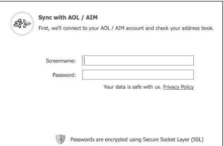

**图 4.2**

Plaxo 甚至能和 AOL 同步——这很令人印象深刻，因为 AOL 甚至不支持联系人导出。

> **注意** 这家人人恨得牙痒的有线电视公司 Comcast 于 2008 年 5 月收购了 Plaxo。希望 Comcast 别把它搞砸了。

## 使用 OggSync 自动同步 Outlook

- 支持操作系统：Windows
- 支持客户端：Outlook
- 适用的 Google Apps 版本：标准版、高级版、教育版、非营利版、合作伙伴版

OggSync 是一款最初设计用于同步 Google 日历、Outlook 和 Windows 移动设备的程序。不过在我撰写本文时，其正在开发中的测试版还承诺支持联系人同步。如果你使用的是 Outlook 2003 或 2007，这款工具可能非常适合你。
安装该程序后，你会在系统托盘（时钟旁边）看到 OggSync 的图标，每次启动 Windows 时它都会自动加载。在你操作的过程中，OggSync 会在后台自动保持所有内容同步，你几乎不需要额外操心。事实上，哪怕 Outlook 没有运行，同步也能正常进行。
该工具有免费版，足以满足你初次将联系人同步到 Google 的需求；还有专业版，每年收费 30 美元，支持自动同步（可提供批量购买方案）。如果你只计划使用一次 OggSync，或者手动用它来拷贝 Outlook 和 Google 联系人之间的所有内容，免费版就足够了。但如果你计划每天使用 OggSync，专业版可能更适合你（我们会在第 10 章《将 Google 联系人与其他软件和服务集成》和第 13 章《将 Google 日历与其他软件和服务集成》中再次介绍 OggSync）。
想要了解更多关于 OggSync 的信息，可以访问其官网（同时内含发布最新资讯和更新的博客）：`http://oggsync.com`。
关于 Outlook 同步的常见问题解答可访问：`http://oggsync.com/index.php/documentation-for-outlook-add-in/faq-for-outlook/`。

## 自动同步 Apple 通讯录与 Google 联系人

- 支持操作系统：Mac OS X
- 支持通讯录客户端与服务：Apple 通讯录
- 适用的 Google Apps 版本：标准版、高级版、教育版、非营利版、合作伙伴版

这里有个很多人可能不知道的消息：如果你使用 Apple 的通讯录，现在可以将其与 Google 联系人同步了——不过准确来说，是有限度的同步。关于这项同步功能，我有好消息也有坏消息。先说好消息：Apple 通讯录与 Google Apps 联系人的同步功能现在已经内置在 Apple 的操作系统中了。
坏消息是：你必须使用 Mac OS X 10.5.3 或更高版本，而且需要拥有一部 iPhone。Apple 其实没必要要求用户必须拥有 iPhone 才能使用这项同步功能，所以我们都希望它未来能取消这项限制。如果你感兴趣且符合使用要求，可以打开 Apple 通讯录，进入应用的「偏好设置」，选择「通用」选项卡，如图 4.3 所示。
勾选「与 Google 同步」旁边的复选框，然后点击 Google 按钮。系统会提示你输入 Google 账号（也就是你的电子邮箱地址，例如`scott@granneman.com`或`jcarter@barsoominc.com`）以及该账号的密码。输入完成后点击「确定」，再关闭通讯录的偏好设置窗口。
124 | Google Apps 详解
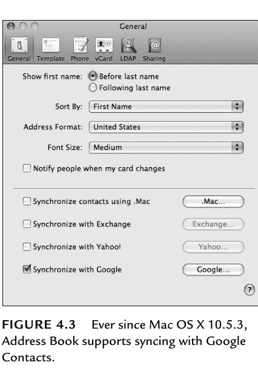

**图 4.3**

自 Mac OS X 10.5.3 起，通讯录就支持与 Google 联系人同步了。下次你将 iPhone 与 Mac 同步时，通讯录会自动更新 Google 联系人，反之亦然。所有操作都在后台自动完成，你完全不用费心。
尽管我使用 Mac 和 Apple 的通讯录，但我不会依靠这个功能来同步我的通讯录和 Google 联系人。根据我的使用体验，这个功能会产生重复联系人，还会出现其他奇怪的问题，所以我就把它关掉了。不过在我撰写本文时，这还是一项全新的功能，我相信再过一段时间这些 bug 就会被修复。在此期间，我是 Spanning Sync 的满意用户，接下来会介绍这款工具。

> **提示** 你不需要拥有 iPhone 就能让 Apple 通讯录的这项功能生效。如果你不介意稍微折腾一下系统文件，你可以做一个小小的设置，让你的 Mac 误以为你使用了 iPhone，哪怕实际上你没有。相关操作说明可访问：`www.zaphu.com/2008/05/29/how-to-enable-mac-address-book-syncing-with-googles-gmail-contacts-without-an-iphone-or-mac/`。

## 使用 Spanning Sync 自动同步 Apple 通讯录与 Google 联系人

- 支持操作系统：Mac OS X
- 支持通讯录客户端与服务：Apple 通讯录
- 适用的 Google Apps 版本：标准版、高级版、教育版、非营利版、合作伙伴版

我没有使用 Apple 通讯录内置的 Google 联系人同步功能，而是选择依赖 Spanning Sync。这款工具最初仅设计用于同步 Apple 的 iCal 与 Google 日历（相关内容会在第 5 章《使用 Spanning Sync 自动同步 Apple iCal》中详细介绍），现在也支持同步通讯录和 Google 联系人了。
关于 Spanning Sync 的更多信息可访问：`www.spanningsync.com`。
为了跟进最新进展，我一直访问 Spanning Sync 的测试版博客，网址是：`http://betablog.spanningsync.com`。随着开发进度的加快，新版本几乎每天都会发布。
Spanning Sync 并非免费工具，但定价合理：一年订阅费为 25 美元，永久许可证价格为 65 美元。你可以在购买前试用 15 天。
你可以自行设置 Spanning Sync 与 Google 同步的频率，如图 4.4 所示。
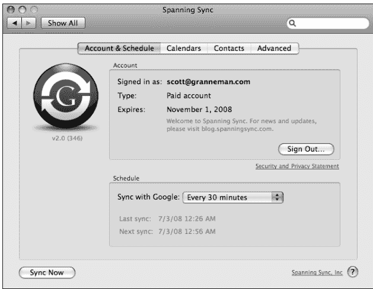

**图 4.4**

设置同步间隔时间。你可以选择每 10 分钟、30 分钟、1 小时、1 天、1 周同步一次，或者手动同步。默认情况下，Spanning Sync 的同步间隔设置为 1 小时。不过测试版新增了一项名为「涓流同步」的功能，该功能会在 Apple 通讯录（以及 iCal）中做出更改时，自动将这些变更同步到 Google。
你还可以选择需要同步的联系人，如图 4.5 所示。
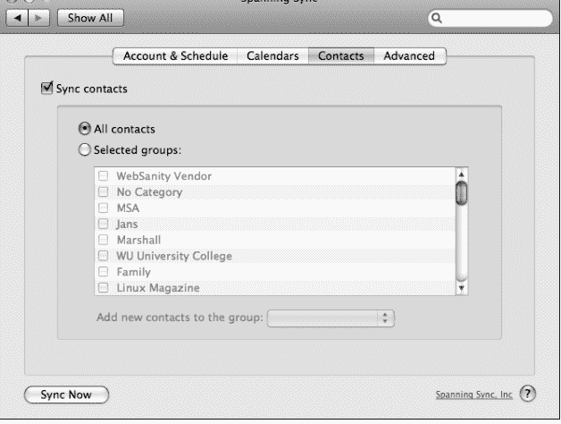

**图 4.5**

仅同步你需要的联系人。我更喜欢选择「所有联系人」，因为这样更简单，但你可能希望选择特定群组。
最后是「高级」选项卡，如图 4.6 所示。
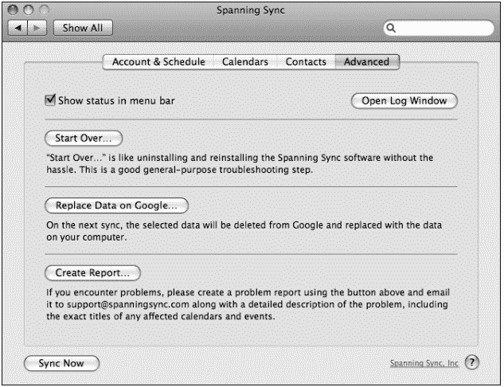

**图 4.6**

如果你想查看 Spanning Sync 在来回拷贝联系人数据时的运行状态，可以点击「打开日志窗口」按钮，它会显示大量出乎意料的有用信息。第一次运行 Spanning Sync 时，你很可能会想点击「替换 Google 上的数据」按钮。为什么？我之前在《我的建议是什么？》部分讨论过原因，简而言之，这一步会让整个过程整洁、简单得多。
哪怕还处于测试阶段，Spanning Sync 的设计也非常智能，功能相当全面。例如，它支持同步联系人照片，这是一个很贴心的功能；它还会自动忽略没有姓名的联系人（请记住，这是 Google 联系人的大忌），转而提议将邮箱地址也用作姓名字段的内容。此外，它还能检测重复的邮箱地址，并向你提示这些重复联系人。
总的来说，如果你想要同步 Apple 通讯录和 Google 联系人，Spanning Sync 是一个非常不错的选择。


**图 4.6**

> **注意** 虽然我没用过 BusySync，但这款 Spanning Sync 的竞品得到了很多人的极力推崇。两款产品的核心差异在于初始定位：Spanning Sync 是为了将 Google 日历（以及现在的联系人）与你的 Apple 桌面生产力应用关联而开发的；而 BusySync 最初的目标是在局域网内多台 Mac 和用户之间共享日历，不过现在也已经接入了 Google 日历。

## 使用 Zindus 同步工具自动同步 Thunderbird 个人地址簿和 Google 通讯录

- 操作系统：Windows、Mac OS X、Linux
- 地址簿客户端和服务：Thunderbird
- Google Apps 版本：标准版、企业版、教育与非营利版、合作伙伴版

在上一节中，我向你展示了用于同步 Apple 地址簿和 Google 通讯录的软件。当然，该软件——Spanning Sync——仅适用于 Mac 系统。然而，Thunderbird 可在三大主流平台（Windows、Mac OS X 和 Linux）上运行。Zindus Thunderbird Contact Sync 是一个扩展程序，允许所有三个平台的用户通过安全的 HTTPS 连接将 Thunderbird 地址簿与 Google Apps 同步，这为几乎所有人提供了一种便捷的方式来迁移通讯录。不过，Zindus Contact Sync 存在一些限制，你需要了解：
- 邮件列表和联系人分组不会被同步。
- Google 中同一字段的多个值，只有第一个会被传输到 Thunderbird。换句话说，如果 Google 通讯录中某人有两个手机号码，Zindus 只会复制第一个到 Thunderbird。
- Google 通讯录中只有以下字段能映射到 Thunderbird：姓名、电子邮件、电话号码、IM 账号、公司名称和职务、备注。
- 如果你的多个联系人中使用了相同的电子邮件地址（例如`info@widgetco.com`），Zindus Contact Sync 会提示冲突。你需要通过更改除一个联系人外的所有冲突联系人的电子邮件地址，或为每个联系人分配唯一的电子邮件地址来解决此问题。

在`www.zindus.com/download-extension/`下载 Thunderbird 扩展并安装。下次启动 Thunderbird 时，转到“工具”菜单，选择“Zindus”以打开扩展设置，首先看到的是如图 4.7 所示的“服务器设置”屏幕。选择 Google，输入你的电子邮件地址和密码，然后按“测试与服务器连接”。如果一切正常，请转到“首选项”选项卡，如图 4.8 所示。

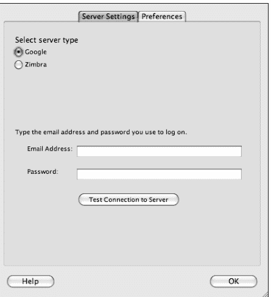

**图 4.7** 你可以将 Zindus 扩展用于 Google 或 Zimbra，但我们这里只关注 Google。

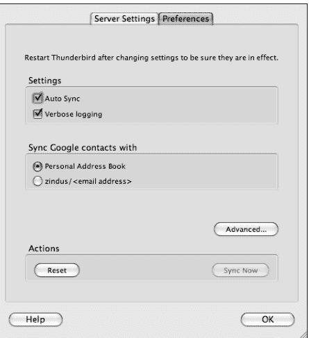

**图 4.8** Zindus 扩展的设置很简单，这正合适。

这些设置非常直观——你想要自动同步吗？你希望在扩展日志中看到更多细节吗？你想要将 Google 通讯录与你的 Thunderbird 个人地址簿同步吗（我希望这个问题是显而易见的）？如果你要从头开始并从 Google 获取联系人与 Thunderbird 的联系人合并，请按“重置”。“立即同步”按钮的作用正如其名，如果你没有勾选“自动同步”，这将是同步的唯一方式。最后，“高级”按钮，如果按下，将呈现如图 4.9 所示的屏幕。

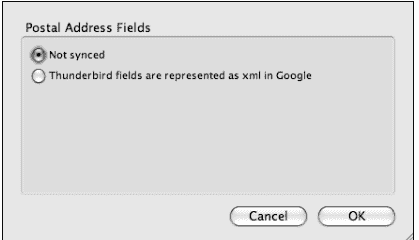

**图 4.9** 同步街道地址可能会变得有点复杂。根据 Zindus 的说法，在 Thunderbird 和 Google 通讯录之间同步街道地址充其量是件棘手的事情（诚然，其他同步解决方案似乎也能做到）。你可以选择不同步地址——这似乎只在你计划使用 Google 通讯录发送电子邮件时才没问题——或者你可以同步地址，但最终会在你的 Google 通讯录中得到 XML 代码。换句话说，如果你选择“在 Google 中 Thunderbird 字段表示为 XML”，然后同步这两个程序，Google 中的地址可能看起来像这样：

```


<address>

<street> 1610 S. Big Bend Blvd. </street>

<city> St. Louis </city>

<country> US </country>

<otheraddr> 同步前Google中的原有内容 </otheraddr>

</address>

```
我不介意查看XML，但我可以看出很多人可能会觉得它令人困惑甚至难看。但选择XML路线可能会出现问题。如果你登录到你的Google通讯录，你会发现每个地址旁边都有一个到Google Maps的链接，除非你的地址被XML包裹。在这些情况下，Google无法提供正确的链接，因为它不理解XML。最后——这也是最危险的一个陷阱——如果你在Google通讯录中编辑XML并意外破坏了语法，Zindus会认为你已从Google中删除了该地址。下次同步时，它也会从Thunderbird中删除该地址！

尽管如此，Zindus的一些优秀功能使其值得一用。例如，当你在Thunderbird地址簿和Google通讯录中同时更改联系人时发生冲突，Zindus会遵循一些规则来确定如何处理该冲突。关于冲突以及Zindus如何处理冲突的更多信息，请参见`www.zindus.com/faq-thunderbird/#toc-what-are-conflicts`。如果你想了解更多关于Zindus Thunderbird Contact Sync的信息，请访问主页`www.zindus.com`，该网站还包括一个博客，但请务必查看常见问题解答`www.zindus.com/faq-thunderbird-google/`。如果你理解了Zindus Thunderbird Contact Sync的优缺点，你可能会发现它是你迁移工具包中的一个有用工具。

> **提示** 如果你在寻找另一个可以配合Thunderbird使用的工具，请查看gContactSync，可从`http://gcontactsync.mozdev.org`获取。不要忽视观看`http://pirules.net/gcontactsync/tutorial/index.html`上的视频，因为它包含一些重要信息。

## 使用Google Email Uploader自动复制联系地址
- 操作系统：Windows
- 地址簿客户端和服务：Outlook联系人、Windows地址簿、Windows联系人、Thunderbird地址簿
- Google Apps版本：标准版、企业版、教育与非营利版、合作伙伴版

在本章早期的“使用Google Email Uploader自动从客户端移动邮件”中，我介绍了使用免费的Google Email Uploader从Outlook、Outlook Express、Windows Mail或Thunderbird移动邮件到你的Google Apps帐户。Google Email Uploader的一个附带好处是，它还会将这些应用程序中的联系人传输到Google通讯录。这是一种很好的方式，可以同时移动电子邮件和联系人，并且操作最小化。

### 解决常见问题
生活中没有完美的事物，因此在将联系人迁移到Google Apps时，你可能会遇到一些问题。以下是一些问题的解决方案。

#### 导入Google通讯录时，我不断收到此错误消息：“保存数据出错：不能有多个具有相同电子邮件地址的联系人。”为什么？
早前在“准备迁移联系人”中，我提到了（有些烦人的）事实：你不能在Google中拥有两个或多个具有相同电子邮件地址的联系人。然而，一些人报告说收到关于多个联系人共享一个电子邮件地址的错误消息，然后搜索具有重复电子邮件地址的联系人却一无所获。换句话说，只有一个联系人拥有有问题的电子邮件地址——那么另一个具有冲突地址的联系人在哪里？解决方案是点击Gmail网页右上角的链接，切换回旧版Gmail。在那里找到该联系人，编辑或删除它，然后切换回新版。你的问题现在应该解决了。

#### 结论
有些人可能不想将联系人迁移到Google，因为他们将使用桌面电子邮件客户端和地址簿。然而，尝试同步你的桌面软件和Google之间的联系人仍然是明智的，因为你永远不知道何时需要使用Gmail的Web界面。幸运的是，存在各种软件包可以帮助将旧地址簿迁移到Google通讯录变得相对轻松。只需小心谨慎，定期备份数据，并在执行迁移时保持耐心。

# 第5章 将日历迁移到Google Apps
在本章中，我们将介绍将现有日历数据迁移到Google Calendar。我将首先为你提供Google在手动导入时接受的两种数据类型的通用说明，然后我将探讨将你的数据与Google Calendar自动同步的方法，这是一种更快捷的方式。

> **提示** 如果你更有兴趣寻找可以获取和使用的软件，或可以聘请提供定制开发和帮助的服务提供商，你真的应该去Google解决方案市场`www.google.com/enterprise/marketplace/`并搜索一下。

## 准备迁移日历
在做任何其他事情之前，请备份你现有的日历。如果你还不知道如何操作，请阅读你最喜欢的日历应用或服务的帮助文件，确保所有宝贵数据安全，以防出现问题。你会很高兴花时间这样做了。之后，将你的Google Calendar时区更改为与你当前使用的日历时区相匹配。登录Google Calendar，点击右上角的“设置”。如果“常规”选项卡尚未激活，请选择它，然后查看“你当前的时区”旁边的内容，以了解当前时区是什么。使用下拉菜单将其更改为你需要的时区，然后滚动到页面底部并按“保存”。

## 第5章 将日历迁移至Google 应用
现在，我们来介绍一下：当你手动将当前使用的软件或服务中的日历迁移至Google日历时，Google 支持接收哪些类型的数据。你有两种选择：ICAL 或 CSV（逗分隔值）。基本流程就是先将现有日历数据导出为这两种格式之一，再导入到Google日历中。接下来我们会详细介绍ICAL 和 CSV，帮助你理解它们各自是什么、以及如何运作。

**警告**
接下来两小节会提到编辑ICAL 和 CSV 文件，这里所说的“文本编辑器”指的就是纯文本编辑器。不要用Word 或其他任何字处理软件，这类软件会以非常糟糕的方式破坏iCal、CSV这类文本文件，给迁移过程带来大麻烦。Windows 用户可以尝试用记事本，更推荐的是免费的NoteTab Light（`www.notetab.com/ntl.php`）；Mac OS X 自带文本编辑器，但我更推荐BBEdit，或是它的免费版本TextWrangler（官网地址分别为`www.barebones.com/products/bbedit/`、`www.barebones.com/products/textwrangler/`）；Linux 用户的可选工具最多，我自己则习惯使用vim。不管使用什么工具，都要确保保存为纯文本格式，且后缀名保持为`.ics`——别让文本编辑器自动将其改为`.txt`。

### ICAL
ICAL（是iCalendar的缩写，不过我从来没见过有人真的说“iCalendar”这个词，所以我们就用ICAL来指代）是一种用于实现程序间互通的日历数据组织标准格式，这类文件通常以`.ics`作为后缀。

**注意**
想详细了解iCal标准的话，可以访问`http://en.wikipedia.org/wiki/ICalendar`。我知道苹果将其自带的日历程序命名为iCal，这倒也合理，毕竟它支持ICAL文件格式——但这种命名方式好比微软把数据库服务器命名为SQL Server一样讨人嫌：实际上几乎所有数据库服务器都属于SQL服务器，这种命名只会造成混淆，对任何人都没有帮助。为了避免混淆，我之后提到文件类型时会用ICAL，提到苹果的程序时会用iCal。

ICAL文件有特定的格式要求才能正常使用：比如第一行必须是`BEGIN:VCALENDAR`，最后一行必须是`END:VCALENDAR`。这两行之间放置所有事件内容，每个事件都会被`BEGIN:VEVENT` 和 `END:VEVENT` 包裹。在`BEGIN:VCALENDAR` 之后、第一个`BEGIN:VEVENT` 之前，可能有你的日历程序生成的一点头信息，如果你想保留的话完全没问题。

> **警告**
> 如果你想编辑或者查看ICAL文件，用文本编辑器打开是可以的，但要小心：如果不小心删改掉了头信息（比如`BEGIN:VEVENT`）或者尾信息（比如`END:VEVENT`），对应的事件将无法导入Google日历。

下面是一个包含单个事件的ICAL文件示例，我加入了很多头信息，但不是全部。另外，为了让阅读更轻松，我对ICAL文件里的各个元素做了缩进；正常情况下所有行都是左对齐，没有缩进。

```
BEGIN:VCALENDAR

METHOD:PUBLISH

CALSCALE:GREGORIAN

VERSION:2.0

BEGIN:VTIMEZONE

TZID:US/Central

BEGIN:DAYLIGHT

TZOFFSETFROM:-0600

TZOFFSETTO:-0500

DTSTART:19460428T020000

RRULE:FREQ=YEARLY;UNTIL=19730429T080000Z;BYMONTH=4;BYDAY=-1SU

TZNAME:CDT

END:DAYLIGHT

BEGIN:STANDARD

TZOFFSETFROM:-0500

TZOFFSETTO:-0600

DTSTART:19551030T020000

RRULE:FREQ=YEARLY;UNTIL=20061029T070000Z;BYMONTH=10;BYDAY=-1SU

TZNAME:CST

END:STANDARD

END:VTIMEZONE

BEGIN:VEVENT

SEQUENCE:0

TRANSP:OPAQUE

UID:767B26B5-79E4-4C13-BD72-E47D028406A0

DTSTART;TZID=US/Central:20080726T190000

DTSTAMP:20080710T183915Z

SUMMARY:Dinner with Hedgy

CREATED:20080713T031035Z

DTEND;TZID=US/Central:20080726T200000

END:VEVENT

END:VCALENDAR
```

好在如今几乎所有好用的日历程序都支持导出为ICAL文件，所以你应该不会有太大问题。

### CSV
我们在前一章《将联系人迁移至Google应用》里已经接触过CSV文件了。如果你不记得内容或是跳过了那一章，CSV是“逗分隔值”的缩写，是一种在程序和服务之间双向传输数据的常用格式。就日历数据来说，CSV文件没有什么特殊或强制的要求，也不像ICAL文件那样是通用标准。如果两种格式都支持的话，优先选ICAL更好，因为它是通用标准，数据格式更规范，迁移起来也更方便。但如果你的现有日历程序只支持CSV，那也只能用CSV了。幸运的是，Google日历支持导入大多数日历程序生成的CSV文件，基本不会出问题。不过CSV文件顶部的表头必须正确，最简化的表头只需要包含以下三个字段：

```
Subject, Start Date, Start Time
```

不过Google日历支持的表头范围大得多，比如还可以包含以下这些：

```
Subject, Start Date, Start Time, End Date, End Time, All Day Event, Reminder On/Off, Reminder Date, Reminder Time, Meeting Organizer, Description, Location, Private
```

比如我从雅虎日历导出包含单个事件的日历，得到的CSV文件是这样的：

```
"Subject","Start Date","Start Time","End Date","End Time","All day event","Description"

"Dinner with Gabe","7/12/2008","06:00 PM","7/12/2008","08:00 PM","false","His favorite restaurant"
```

> ⚠️ **警告**
> 如果你想编辑或者查看CSV文件，用文本编辑器打开是可以的，但要小心：如果不小心删改掉了字段表头，或是某条事件记录里的字段，这条事件甚至整个文件都将无法导入Google日历。

CSV文件有一个需要注意的地方：你导入到Google日历时，重复事件可能不会被识别，最终会变成一堆单独的事件。换句话说，如果你在Outlook里创建了一个6月1日的事件，设置成每周重复共持续3周，那么你的CSV文件里最终会有4条独立的事件，导入Google日历后也会是4个单独的事件。这不算什么大问题，但你还是需要提前了解这一点。

### 从软件和服务中导出日历数据
现在你已经知道ICAL和CSV文件是什么，也了解了如何在电脑上拿到这两种文件后导入Google日历。接下来我们来看看如何从常见的日历软件和服务中导出ICAL或CSV文件。

### 从AOL导出日历
登录你的AOL邮箱账号，然后点击屏幕左侧的日历链接。进入你的日历页面后，点击操作菜单，选择导出，操作方式如图5.1所示。在接下来的页面中，选择你要导出的日历（如果有多个的话），设置要导出的日期范围，然后点击导出，所有操作如图5.2所示。将导出的ICAL文件保存到你的电脑上，就可以准备将其导入Google日历了。

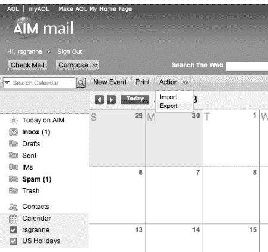

**图5.1**
AOL可能不支持导出联系人，但导出日历是另一回事。

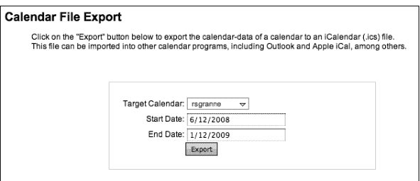

**图5.2**
只需几个简单选择和一次点击，你的日历就导出完成了。

### 从苹果iCal导出日历
苹果的iCal程序支持创建多个日历。如果你有多个日历，需要逐个选择你要导出的日历，再执行下一步操作；如果只有1个日历，流程会更简单一些。选中你要导出的日历后，点击「文件」→「导出」，选择ICAL文件在Mac上的保存位置，如果不想用默认文件名可以自行修改，然后点击导出即可。完成！

> **提示**
> Google 支持导入由 Apple iCal 程序 2.0 及更高版本创建的 ICAL 文件。

### 从Evolution导出日历
遗憾的是，Evolution没有导出功能，因此你得找到Evolution创建并使用的ICAL文件。大多数系统中，该文件位于

```
/home/[user]/.evolution/calendar/local/system/calendar.ics
```

当然，你需要把`[user]`替换为对应用户的用户名。

更糟的是，由于Evolution没有提供导出功能（话说这到底是什么鬼原因，现在都2008年了），如果你的ICAL文件不符合你的需求，你就得手动编辑它，这算不上是什么大问题，但着实很烦人。

> **注**
> 关于缺少导出功能的漏洞已经被提交，你可以在`http://bugzilla.gnome.org/show_bug.cgi?id=356551`查看。如果你在意这个功能，可以定期查看该漏洞页面了解进展。

### 从Google日历导出日历
如果你之前用非Google Apps账号使用Google日历，现在想完全迁移到新的Google Apps账号，你会发现这个过程非常简单。

打开旧的非Google Apps日历，点击日历名称旁边的三角形图标，会弹出一个小菜单，如**图5.3**所示，你需要点击该菜单中的“日历设置”。


**图5.3**

找到“日历设置”链接可能有点麻烦。在接下来的页面中，滚动到页面底部，也就是**图5.4**所示的“私密地址”部分。


右键点击ICAL按钮（如果你用的是没有双键鼠标的Mac，按住Ctrl键再点击），将ICAL文件的链接保存到你的电脑中。生成的ICAL文件可以被导入到你的新Google Apps日历中。

### 从Hotmail和Windows Live导出日历
所谓的Windows Live Hotmail经典版不允许你导出Windows Live Hotmail日历，这简直离谱。

新的Windows Live日历炫酷Beta版允许你导入来自不同服务和软件的ICAL文件，但同样不允许你导出自己的数据。

结论：不要使用Windows Live Hotmail日历。

### 从KOrganizer导出日历
KOrganizer是KDE PIM（个人信息管理）套件的一部分，它可以把你的日历非常轻松地导出为ICAL文件。

依次点击“文件”“导出”“iCalendar”，然后为生成的ICAL文件设置名称和存储位置，点击确定即可完成，该操作会导出所选日历中的所有内容。

如果你想只发布选中的日程，你需要在KOrganizer中设置筛选器。更多相关信息可以查看`http://docs.kde.org/kde3/en/kdepim/korganizer/filters-view.html`。

### 从Outlook导出日历
微软还是那个微软，导出Outlook日历的方式，以及导出的可供Google导入的文件格式，取决于你使用的Outlook版本。

如果你使用的是Office 2007之前的Outlook版本，你需要依次点击“文件”“导入和导出”“导出到文件”，选择“逗号分隔值（Windows）”作为格式（如果此时系统提示你安装转换器，按提示操作即可），然后选择你要导出的日历。

选择文件的保存位置和文件名，点击“下一步”，再点击“完成”。等Outlook处理完成后，你就可以得到可用于导入Google的文件了。

遗憾的是，该文件是CSV格式，但老版本Outlook就是用这种格式。

> **警告**
> 如果你打算导入超过一年的日期和日程，Google建议你分年度迁移，以降低出错概率。

如果你用的是Outlook 2007，那你很幸运，因为这个版本的Outlook可以把日历导出为ICAL文件。


选择你要导出的日历，然后依次点击“文件”“另存为”，在“文件名”框中输入你要生成的`ICAL`文件的名称。

在“其他选项”旁边，你会看到即将导出的数据概览。就算现在看不太出来，你也肯定需要修改`Outlook`要导出的内容，因此点击“其他选项”，就会看到图5.5所示的对话框。


**图5.5**

微软的用户界面设计不算最好，但你最终总能完成操作。

默认情况下，“日期范围”选项会设置为导出整个日历。如果你想导出某个日期范围内的内容，就点击“日期范围”旁边的下拉菜单，选择“指定日期”。

首次打开设置时，“详细信息”默认选中“仅有空闲/忙碌状态”，这意味着你导出的日历不会包含日程的具体信息，只会显示你在选中时段是否有空！可想而知，这是你自己的日历，这样导出来基本没什么用。

解决方法是将“详细信息”改为“完整详细信息”，如图5.5所示。

> **注**
>
> 如果你出于某种原因需要显示比空闲/忙碌状态更多的信息，但又不想导出全部日程详情，可以选择“有限详细信息”。

现在点击“高级”旁边的“显示”按钮（这用户界面设计太糟了，不是吗？），进入更深层的设置。

如果你什么都不改，你标记为私密的日程也不会被导出到`ICAL`文件中——这同样没什么用——除非你勾选“包含标记为私密的项目的详细信息”复选框。

如果你不想把私密日程导入`Google`，就保持该选项未勾选即可。

如果你出于某种原因将“详细信息”设置为了“仅有空闲/忙碌状态”，就无法包含私密日程。

最后，如果你的日程中有附件并且想要导出，就勾选“包含日历项目内的附件”复选框。但这个功能在`Google日历`中很可能无法完美运行，因此建议你保持未勾选状态。

而且，就算你勾选了该选项，也只有当你之前将“详细信息”设置为“完整详细信息”时它才会生效。

点击“确定”关闭“其他选项”窗口，再次点击“确定”，然后点击“保存”。等`Outlook`处理完成后，你就会得到一份`Google`可识别的`ICAL`文件。

### 从Sunbird或Thunderbird（搭配Lightning）导出日历

`Sunbird`和`Lightning`本质上是同一款日历程序，都来自`Mozilla基金会`，也就是给我们带来`Firefox`和`Thunderbird`的那个团队。

不过`Sunbird`是独立程序，而`Lightning`是`Thunderbird`的扩展插件。

要从`Sunbird`导出整个日历，依次点击“文件”“导出日历”，选择你要导出的日历（如果有多个日历，你需要对每个日历重复此操作），然后点击“确定”。

在“另存为”处为导出的数据设置文件名，选择导出文件的存储位置，将格式改为`iCalendar`，然后点击“保存”，完成导出。

如果你想导出某个日期范围内的日程，先选中这些日程，然后依次点击“文件”“导出所选”，重复上一段的其余操作即可。

如果你用的是`Lightning`，操作流程和`Sunbird`完全一致——只要在开始操作前确保你已经选中了“日历”模块即可。

### 从Windows日历导出日历

微软让`Vista`系统自带的`Windows日历`的数据导出非常方便。

在程序中依次点击“文件”“导出”，就会看到图5.6所示的对话框。


**图5.6**

`Windows日历`导出日历数据的过程简单到超乎想象。

选择存储位置，输入文件名，保持“保存类型”为“日历文件（`*.ics`）”，点击“保存”即可。看，很简单吧！

### 从Yahoo!导出日历

登录你的`Yahoo`日历，然后点击“选项”“导入/导出”，滚动到“导出到Outlook”部分，点击“导出”按钮。

把生成的名为`Yahoo.csv`的文件保存到你的电脑中。整个过程很简单，只是最终得到的是`CSV`文件，有点可惜。不过`Google`可以完美处理这种格式的文件。

### 手动导入日历数据

- 操作系统：`Windows`、`Mac OS X`、`Linux`
- 通讯录客户端和服务：所有可以导出数据的客户端和服务
- `Google Apps`版本：标准版、`Premier`版、教育版、非营利组织版、合作伙伴版

>> **注**
>
> 本章其余部分会在合适的位置重复你看到的这三行内容，方便你判断某个章节是否适用于你的情况。

将前一节“从软件和服务导出日历数据”中导出的日历数据导入`Google`的过程非常简单。

你登录谷歌日历，然后看向左侧，那里有你所有日历的列表，如图5.7所示。列表顶部有一个带向下箭头的按钮，上面还标有“添加”字样，如图5.7所示。点击该按钮，然后选择“导入日历”。在接下来的页面中，系统会提示你点击“浏览”按钮选择日历文件。点击该按钮，找到你的`iCal`或`CSV`文件，再点击“打开”。选择你想要导入日程的谷歌日历，再点击“导入”。


**图5.7** “添加”按钮可以用来执行多项实用功能，其中就包括日历导入。

你已完成日历数据的手动导入。

### 使用谷歌数据接口开发专属日历迁移工具

- 支持操作系统：`Windows`、`Mac OS X`、`Linux`
- 地址簿客户端及服务：所有适用类型
- 谷歌应用版本：标准版、`Premier`版、教育及非营利版、合作伙伴版

此前在第3章《将邮件迁移至谷歌应用》中我曾提到，如果有需要，你可以使用谷歌应用程序接口（`API`）自行开发邮件迁移工具。这一原则同样适用于日历数据传输。谷歌提供了一套非常全面的`API`，开发者可以用这套接口自行开发软件和服务，实现日历数据与谷歌日历的同步。如果你想要详细了解谷歌日历数据接口的相关信息，可以从以下网址入手：`http://code.google.com/apis/calendar/`。开发者指南可访问`http://code.google.com/apis/calendar/developers_guide_protocol.html` 获取，参考指南可访问`http://code.google.com/apis/calendar/reference.html` 查看。名为《谷歌数据接口官方博客》的官方博客地址为`http://googledataapis.blogspot.com/`。虽然该博客的涵盖范围远不止谷歌通讯录相关操作，但对于想要开发自有解决方案的开发者来说，仍有极高的参考价值。

## 使用ScheduleWorld自动同步

- 支持操作系统：`Windows`、`Mac OS X`、`Linux`
- 支持的客户端：`Sunbird`（或搭载`Lightning`插件的`Thunderbird`）、`iCal`、`Evolution`
- 谷歌应用版本：标准版、`Premier`版、教育及非营利版、合作伙伴版

`ScheduleWorld`是一项覆盖范围极广的优质服务，可以实现几乎所有你能想到的设备、软件或服务之间的数据同步。如果你需要将日历数据迁移到谷歌日历，且你使用的是`Outlook`、`Sunbird`（或搭载`Lightning`扩展的`Thunderbird`）或`Evolution`，那么`ScheduleWorld`或许能满足你的需求。`ScheduleWorld`是一个大型项目，支持的同步选项极多，因此相关资源也非常丰富。为简洁起见，下文仅提供将各类软件包同步到`ScheduleWorld`、最终实现与谷歌日历同步的相关链接。

- `Evolution`：`http://wiki.scheduleworld.com/wiki/Evolution_Configuration` 和 `http://www.estamos.de/projects/SyncML/`
- `Outlook`：`http://wiki.scheduleworld.com/wiki/Outlook_Configuration`
- `Sunbird`或搭载`Lightning`的`Thunderbird`：`http://wiki.scheduleworld.com/wiki/Thunderbird_Configuration`
- 谷歌日历：`http://wiki.scheduleworld.com/wiki/How_Do_I_Sync_Google_Calendar` 和 `http://wiki.scheduleworld.com/wiki/Google_Calendar_Interoperability`

> 另外，一位名为`Eric`的博主在以下网址撰写了一篇题为《同步的圣杯》的文章：`http://internetducttape.com/2006/08/11/the-holy-grail-of-synchronization-how-to-synchronize-microsoft-outlook-multiple-locations-google-calendar-gmail-ipod-and-mobile-phone-with-funambol-scheduleworld/`（没错，这个网址长得离谱），该文章详细讲解了如何将`Outlook`日历与谷歌日历同步。

## 使用GCALDaemon自动同步

- 支持操作系统：`Windows`、`Mac OS X`、`Linux`
- 支持的客户端：`Sunbird`/`Lightning`、`iCal`、`Evolution`
- 谷歌应用版本：标准版、`Premier`版、教育及非营利版、合作伙伴版

`GCALDaemon`是一个免费、开源且成熟完善的项目。尽管该项目最初是为了实现谷歌与各类桌面日历之间的日历数据同步而开发，但经过长期迭代，目前已经支持在桌面地址簿中读取谷歌通讯录、从谷歌获取邮件并在桌面邮件客户端中查看，还包含其他若干实用功能。`GCALDaemon`支持安装在`Windows`（`NT`、`2000`、`XP`及`Vista`系统）、`Mac OS X`、`Linux`（以及其他各类`UNIX`衍生系统），以及任何运行`Apache Tomcat`的网页服务器上。下载链接可访问`http://gcaldaemon.sourceforge.net/download.html` 获取，请注意，由于`GCALDaemon`需要`Java`运行环境，因此你所需`Java`虚拟机（`JVM`）的版本需为`1.5`及以上。安装指南可在以下网页中找到：

- `Windows`系统：`http://gcaldaemon.sourceforge.net/usage10.html`
- `Mac OS X`系统：`http://gcaldaemon.sourceforge.net/usage12.html`
- `Linux`系统：`http://gcaldaemon.sourceforge.net/usage11.html`
- `Apache Tomcat`：`http://gcaldaemon.sourceforge.net/usage15.html`

`GCALDaemon`官网针对已知可通过`GCALDaemon`与谷歌日历同步的桌面日历，提供了非常详细清晰的说明，这些日历包括：`Sunbird`（`Mozilla`项目旗下的日历项目，因此是`Firefox`和`Thunderbird`的“兄弟”产品）、`Lightning`（通过扩展将`Sunbird`集成到`Thunderbird`中的产品）、苹果的`iCal`，以及`Novell`的`Evolution`。如果你使用的是上述日历，可访问以下地址：

- `Sunbird`/`Lightning`：`http://gcaldaemon.sourceforge.net/usage.html`
- `iCal`：`http://gcaldaemon.sourceforge.net/usage13.html`
- `Evolution`：`http://gcaldaemon.sourceforge.net/usage16.html`

该工具的配置过程可能稍显繁琐，但完成设置后，你就可以将桌面日历与谷歌日历同步，大幅简化迁移流程。

### 使用Spanning Sync实现苹果iCal自动同步

- 支持操作系统：`Mac OS X`
- 地址簿客户端及服务：苹果`iCal`
- 谷歌应用版本：标准版、`Premier`版、教育及非营利版、合作伙伴版

在第4章的《使用Spanning Sync自动同步苹果地址簿与谷歌通讯录》一节中，我曾介绍过`Spanning Sync`这款定价合理的软件，它可以分别实现苹果`iCal`和地址簿程序与谷歌日历、谷歌通讯录的同步。第4章的内容主要围绕通讯录展开，但其中的相关方法在本文场景下同样适用。本章独有的内容是专门针对日历的偏好设置面板，如图5.8所示。


**图5.8** `Spanning Sync`包含专属的日历偏好设置。

如图5.8所示，勾选或取消勾选“同步日历”旁的复选框，即可开启或关闭日历同步功能。你还可以选择`iCal`中的哪些日历与谷歌日历中的日历对应。同时注意，如图5.8所示，对应日历的名称无需完全一致，这为你提供了实用的灵活性。我自己也在使用`Spanning Sync`，是一名非常满意的用户。

### 使用iCal4OL实现Outlook自动同步

- 支持操作系统：`Windows`
- 地址簿客户端及服务：`Outlook`
- 谷歌应用版本：标准版、`Premier`版、教育及非营利版、合作伙伴版

`iCal4OL`是一款自动同步程序，可实现`Outlook`与谷歌日历之间的数据传输。它支持单向（`Outlook`至谷歌）和双向同步。更棒的是，该同步功能支持重复日程以及自定义日期选择。该软件的配置要求其实并不高：`Windows 2000`及以上版本、`Internet Explorer 5.5`及以上版本、`Outlook 2000`及以上版本即可。该软件仅需`15`欧元（约合`23`美元），性价比极高，尤其是你还可以在`http://ical.gutentag.ch/download.html` 下载`14`天试用版。该软件的功能十分全面，接下来我会为你讲解几个基础的设置要点。打开偏好设置面板后，立刻切换到谷歌选项卡，该选项卡如图5.9所示。


**图5.9** 这里有专门针对谷歌的特殊偏好项需要你配置。

请确保勾选“使用`HTTPS`（`SSL`）”选项，这能提升安全性。但最重要的是，你必须勾选“谷歌应用支持”选项，否则该软件将无法正常使用。毕竟你要上传到的是谷歌应用，不是吗？其余相关偏好项采用了“谁-什么-如何”的奇特结构进行分类。你需要先从“谁”开始设置，如图5.10所示。


**图5.10** 首先是“谁”……

输入您的个人信息，确保时区设置正确，然后点击“下一步”，即可进入“什么”页面，如图5.11所示。这是您选择要执行的同步类型的重要界面。请注意，您可以执行双向同步或单向同步，其中单向同步会将`Outlook`中的数据上传到`Google`日历。选择您要执行的同步类型后点击“下一步”，即可进入“如何操作”页面。不过您看到的“如何操作”页面取决于您在“什么”页面所做的选择（如果这开始听起来像老牌喜剧搭档阿伯特和科斯特洛的经典桥段，我表示歉意，也建议您现在前往`www.youtube.com/watch?v=tPrm6luPmME`观看）。实际上，两个界面的外观完全相同，仅屏幕顶部的图例不同：分别为“单向同步”或“双向同步”。为简洁起见，我将在图5.12中展示单向同步的界面。输入您的`Google Apps`邮箱地址和密码，选择一个`Google`日历，然后点击“测试”。如果一切正常，在`Outlook`部分填写相应信息后点击“下一步”。完整文档可通过`http://ical.gutentag.ch/documentation.html`获取，如果您想充分发挥该程序的功能，真的建议您阅读这份文档。我没有介绍所有的偏好设置，但您现在已经掌握了使用`Google Apps`所需的关键设置。

```
if (condVar > someVal) {console.log("xxx")}
```


**iCal40L：已注册至`pcpraxis@gmx.ch`** © `icalagentag.ch`

+ 选项 | 维护 | 同步字段 | `Google` | 配置 | 谁 | 什么 | 1. 如何操作 | 1.1 更多 | 2. 如何操作 | 2.1 更多 | 运行

**您想执行什么操作？**

- 1. 与`Google Calendar`的双向同步
- 1. 与`Google Calendar`的单向同步 - 从`Google Calendar`下载
- 1. 与`Google Calendar`的单向同步 - 上传至`Google Calendar`
- 在`Outlook`中新增、修改变更内容或删除事件
- 1. 导入`ICAL`文件/订阅源
- 与现有事件同步
- 1. 订阅`ICAL`文件/订阅源作为远程日历
- 1. 导出`ICAL`文件（`.ics`格式）
- 1. 与`Web`解决方案的双向同步
- 2. 无需其他操作

| 功能 | 按钮 |
|----------|--------|
| 加载 | 加载配置 |
| 保存 | 保存`Default.ini` |
| 导航 | 上一步、下一步 |

**图5.11** 其次是“什么”……


**iCal40L：已注册至`pcpraxis@gmx.ch`** © `icalagentag.ch`

+ 选项 | 维护 | 同步字段 | `Google` | 配置 | 谁 | 什么 | 1. 如何操作 | 1.1 更多 | 2. 如何操作 | 2.1 更多 | 运行

**与`Google Calendar`的单向同步 - 上传至`Google Calendar`**

在下方区域输入您的`Google`邮箱和密码，然后点击[选择`Google`日历]。该唯一的订阅源描述（`ImportICS`）可自由命名，例如可命名为“`iCal`私有订阅源地址”（点击此处获取帮助）。

```
http://www.google.com/calendar/feeds/default%40ical40l%40gmail.com
```

| 字段 | 值 | 控件 |
|-------|-------|---------|
| 登录`Google Calendar`邮箱 | `ical40l@gmail.com` | |
| 密码 | `***********` | |
| 用户ID | [空] | [选择`Google`日历] [测试] |


## Outlook日历与Kalender

| Outlook日历 | Kalender | [下拉菜单：`EntryID`] |
|---|---|---|
| 上次运行日期/时间 | `08.04.2008 09:32:07` | |
| 选择周期 | 从当前开始 | |
| 仅模拟 | [x] | |
| 启用增强选项 | [ ] | |

> 如果您不与Google“默认”日历同步，子日历的用户ID将通过[选择Google Calendar]填入此处，例如`q22hi6uve3avqc5gucco8deg@group.calendar.google.com`。也请查看[Google]标签页！

| 功能 | 按钮 |
|---|---|
| 保存 | 保存`Default.ini` |
| 导航 | 上一步、下一步 |

**图5.12** 第三是“如何操作”……

## 使用OggSync自动同步Outlook和Exchange

- 操作系统：Mac OS X、Windows
- 通讯录客户端和服务：Outlook和Exchange
- Google Apps版本：标准版、Premier版、教育版、非营利版、合作伙伴版

`OggSync`是一款可将Google日历与Outlook（及Windows移动设备）日历同步的程序。在我撰写本书时，该程序的测试版本正在开发中，还将支持通讯录同步，因此我已在第4章的“使用`OggSync`自动同步Outlook”部分介绍过该程序。如需了解`OggSync`的更多信息，可查阅第4章的对应章节。本章将聚焦该程序的日历专属功能。

`OggSync`支持单向和双向同步。如果您希望将其作为一次性流程，因为您计划停止使用Outlook（或Exchange），请选择单向同步；但如果您在迁移到Google Apps后计划继续使用Outlook，则应选择双向同步。`OggSync`还可检测重复事件，该功能十分实用，并且支持按需同步指定日期范围。如我在第4章所述，`OggSync`提供免费版，足以满足将日历数据初始同步到Google的需求，还有专业版，每年收费30美元，可提供自动同步功能（支持批量采购方案）。如前一段所述，如果您计划停用Outlook，免费版即可满足您的需求；但如果您在迁移到Google后计划继续使用Outlook，您很可能需要购买该程序。

### 解决常见问题

#### 导入ICAL或CSV文件时出现“处理了0个事件”的提示是什么意思？

这种情况通常发生在您多次点击“导入”按钮时。您的数据在第一次导入时已完成导入，第二次点击时不会有数据被处理，因为数据已在第一次导入时处理完毕，因此Google会返回“未处理任何数据”或“0个事件”的提示。要验证是否确实发生这种情况，可以查看您新导入的日历。如果看到了其中的日期和时间，说明一切正常，您可以忽略该提示。如果日历中没有看到您的会议，请尝试重新使用该ICAL文件导入。如果仍然出现错误，您可以尝试两种解决方法。首先，可能是您的ICAL文件存在问题，请重新从日历中导出，或在文本编辑器中打开该ICAL文件查看是否存在问题。其次，可能是Google日历出现异常，此时可以新建一个日历，再尝试导入到该新日历中。以上两种方法之一应该可以解决该问题。

#### 我的ICAL或CSV文件太大，无法导入Google日历是什么意思？

如果您要将ICAL或CSV文件导入Google，应尽量将文件大小保持在1MB以下。如果您的ICAL或CSV文件超过该大小，请在日历程序中选择较小的事件范围，导出ICAL或CSV文件（取决于您的程序支持哪种格式），将其导入Google，然后选择不同的事件范围，重复上述流程。如果您的日历程序不支持指定导出时间范围，您需要导出整个文件，然后在文本编辑器中打开ICAL或CSV文件，手动拆分文件（需保留文件要求的页眉和页脚），再将拆分后的多个文件分别导入Google Calendar。顺便说一句，快和那些不支持指定导出时间范围的程序说再见吧。

#### 为什么我导入的所有事件显示的时间都不对？

如果您导入的事件显示的时间都不正确，不要慌张。这很可能是因为您的原始日历使用的是另一个时区，而您尚未在新Google日历中设置时区。您可以登录Google日历，点击右上角的“设置”来查看Google日历的时区。如果“您当前的时区”选项未处于激活状态，请切换到“常规”标签页，查看当前的时区设置。如果该时区与导出的ICAL或CSV文件中的时区不匹配，请使用下拉菜单更改时区，然后滚动到页面底部点击“保存”。

#### 为什么我的CSV文件完全无法导入？

请记住，CSV是逗号分隔值（Comma-Separated Values）的缩写。如果您的CSV文件使用分号（;）、冒号（:）或其他符号分隔字段，则无法在Google中正常使用。

### 结论

我们已经了解了如何迁移您或您的用户可能已经创建的三种数据：邮件、联系人和日历。事实证明日历迁移难度并不高，因为绝大多数优质的日历服务都已支持iCalendar——即事件类数据交换的标准。因此，您的日历迁移流程大概率会很顺畅。现在让我们来了解Google Apps本身的各项设置。

## 管理Google Apps服务

和绝大多数稍有复杂度的软件一样，Google Apps也设有控制面板（即管理员界面），让负责管理组织Google Apps账号的人员可以自主设置账号的运行规则。在本章中，我们将逐步介绍Google Apps控制面板的核心功能。我们不会涵盖所有功能，因为大部分功能的用途从谷歌提供的标签就能直观理解，但我们会介绍一些非常实用、有时可能存在争议的设置选项。要登录控制面板，请访问`www.google.com/a/yourdomain.com`。谷歌会跳转到一个更长的HTTPS加密地址，保障您登录和修改设置时的安全。

## 仪表盘

登录域名控制面板后首先看到的就是仪表盘。仪表盘很实用，除了一个特例之外，其中展示的所有内容都能在Google Apps的其他管理员界面中找到。在仪表盘顶部大框的右侧，你会看到一张过去90天活跃邮箱账号的小图表，如图6.1所示。


**图6.1**

扫一眼就能看到活跃邮箱账号的统计图表。图表顶部会显示所有服务是否正常运行，方便你快速查看。接下来你会看到过去90天的7日活跃用户数，分为当前值、最小值和最大值三项。下方是数据最后更新的日期；如果显示`敬请期待`，说明数据正在后台统计中。仪表盘的其他部分设计得很合理，操作也很简单，随便点击就能快速弄明白各个链接的跳转指向。

## 用户账号

用户账号板块下有两个标签页：用户和设置。用户标签页可以查看、添加或删除用户，设置标签页则用于管控用户之间的交互规则。

### 用户

本页的很多链接会跳转到管理员界面的其他区域。第2章“创建用户”部分已经介绍过点击“创建新用户”和“批量上传用户”后的操作流程，本章后续“邮件”部分会讲解邮箱地址和创建邮件列表的相关内容。如果需要为Google Apps增加更多账号，点击“申请更多用户”。在接下来的页面中输入你需要的额外账号数量，并说明谷歌需要为你开通这些账号的理由。谷歌会审核你的申请，只要通过（只要你不填写`500,000`这类离谱的数字，申请基本都会获批），你会收到邮件通知你已经获得了新的账号。

本页的核心内容是一张列出了所有Google Apps账号的表格，示例如图6.2所示。


**图6.2**

这张实用的表格会列出你所有的Google Apps账号。你可以点击任意列进行排序，支持正序（A到Z）或倒序（Z到A）。点击任意用户名，会进入该用户的账号编辑页面，你可以对Google Apps账号进行如下操作：

- 修改用户姓名
- 用户休假或临时离岗时暂停其账号
- 必要时删除用户
- 修改用户密码，或要求用户下次登录时必须修改密码
- 将用户设为Google Apps账号的管理员
- 查看该用户的邮箱配额使用情况
- 添加昵称——其他人可以通过该别名邮箱给用户发邮件
- 将用户添加到邮件列表

### 设置

目前的用户账号设置板块内容较少，后续肯定会新增更多功能。当前你可以选择两个选项按钮之一：启用联系人共享或停用联系人共享。建议你选择启用联系人共享。启用后，所有新用户会自动加入全局通讯录，所有人都可以访问。但这并不意味着`Fiona`的个人谷歌联系人会对`Gabe`可见，反之亦然。而是指同一Google Apps域名下的用户之间可以直接发送邮件，无需提前将对方添加到个人通讯录中。

## 共享联系人

遗憾的是，要找到这些共享的联系人邮箱地址并不方便，具体流程如下：

- 在Gmail中开始撰写新邮件
- 点击“从联系人中选择”。根据浏览器设置的不同，会打开新标签页或弹出窗口
- 在“从联系人中选择”页面的搜索框中输入对方的姓、名或用户名，系统会自动列出匹配你输入内容的用户列表，具体操作如图6.3所示


**图6.3**

和Gmail的操作逻辑一致，输入几个字母，谷歌就会匹配出你想要查找的联系人。

- 找到匹配的联系人后点击选中，对方的姓名和邮箱地址会自动填入邮件底部的收件人栏
- 重复上述操作，直到所有同事的邮箱地址都填入收件人栏
- 点击“完成”关闭标签页或弹出窗口，返回Gmail的邮件撰写页面

如果这些地址能直接显示在常规撰写界面中，无需先点击“从联系人中选择”，操作会方便很多。期待谷歌未来能加入这个功能。

## 域名设置

域名设置板块下共有四个标签页：常规、账号信息、域名和外观。每个标签页的大部分选项都很直观，我们只会介绍你需要关注的有趣或重要的设置。

### 常规

常规标签页的大部分选项都无需额外说明，但其中有2个板块建议你仔细考量。在“新服务和功能”板块下有两个复选框：自动添加新Google服务和启用新功能。如果勾选“自动添加新Google服务”，每当谷歌推出与Google Apps关联的新服务（比如近期推出的Google Sites），该服务会自动为你的用户启用。除非你非常喜欢尝试新功能，或者你的Google Apps域名下用户数量极少，否则不建议勾选这个选项。如果勾选“启用新功能”，你将有机会比其他Google Apps账号更早体验到新的消费端功能。你可能知道，谷歌会定期给Gmail、Google日历以及其他普通用户无需注册Google Apps即可使用的谷歌服务添加新功能。通常谷歌会先把这些功能上线到普通消费端的版本中，经过一段延迟后，再同步到Google Apps版本。如果你希望和普通用户同时拿到新功能，可以勾选这个选项。我通常会勾选，因为新功能大多能解决痛点、优化体验，但如果你比较谨慎、不想过早尝试，也可以不勾选。

在“控制面板”板块下，你可以选择使用当前版本还是下一代版本的Google Apps管理员界面。如果你使用的Google Apps不是英文界面，当前只能使用当前版本，没有其他选择。如果你的域名是通过谷歌及其合作伙伴购买的，或者你订阅的是Premier Edition，系统会自动使用新一代界面，无法切换回当前版本。如果可以自主选择，我建议你选用新一代界面。它新增的功能不会造成太大的使用干扰，反而可能更实用，而且这也是Google Apps未来的发展方向，不如现在就适应它。

### 账户信息

这个页面的功能一目了然，你可以在此执行以下操作：

- 升级你的Google 应用版本
- 删除Google 应用（相关内容我在第2章《取消Google 应用》中讲过）
- 添加备用邮箱地址
- 启用备用邮箱接收密码重置指引（相关内容我在第2章《我忘了管理员密码！》中讲过）
- 接收Google 应用更新的邮件通知
- 同意被联系以提供Google 应用相关反馈

其中需要特别留意的是「管理员支持」板块。你会在这里看到客户PIN码，它是一串字母和数字的组合，如果你需要就Google 应用相关问题联系客服，就会用到这个PIN码。

你可以把它记在某处保存，但问题是出于安全原因，谷歌会不定期更换这个PIN码，而且不会提前通知你！你或许可以每隔几天查看一下PIN码是否变更，但实际上，联系谷歌客服前你只需要登录后台查看当前PIN码即可。要是连后台都登录不了，查PIN码就会变得很麻烦，我们几个月前就遇到过这样的客户。当时我们是用旗舰版账号联系了谷歌应用客服，才有人帮我们解决了谷歌那边的故障。好在我们当时有旗舰版账号！

### 域名

这个页面功能很基础，仅会显示你的域名，但你也可以在这里设置域名别名。

我在第2章里提到过我拥有`heavymetalmassage.com`这个域名，也讲过如何用这个域名注册谷歌应用账号。假如我还拥有`speedmetalmassage.com`和`thrashmetalmassage.com`这两个域名，想要把所有服务都归拢到`heavymetalmassage.com`名下，就可以在这个页面解决问题。

点击「添加域名别名」，系统会提示你输入域名并验证域名所有权。如果你跟着第2章《注册不同版本的谷歌应用》实操过，就会知道具体怎么操作。

你还需要按照谷歌的要求修改这些域名的MX记录，相关内容我也在第2章《配置DNS》里讲过。完成整个流程后，我的主域名依然是`heavymetalmassage.com`，但如果有人给`scott@speedmetalmassage.com`或者`scott@thrashmetalmassage.com`发邮件，邮件都会投递到正确的地址：`scott@heavymetalmassage.com`。

> **警告** 如果你通过谷歌及其合作伙伴购买了域名（这一流程我在第2章《通过谷歌购买域名》中讲过，同时我也在同一章的《你应该通过谷歌购买域名吗？》中不建议你这么操作），那么还有一个不这么做的理由：你无法将这个域名添加为其他谷歌应用账号的别名。

### 外观

这个页面分为两个部分。底部是「登录框颜色」设置项，你可以选择用户在输入用户名和密码的登录框中看到的颜色。可以随意挑选适合你组织的颜色。

页面顶部的「页头标志」设置项实用性高得多。


**图6.4** 用你组织的标志来定制你的谷歌应用版本。

上传自定义标志后，它会在你和用户打开的所有谷歌应用服务中显示。这是给你的谷歌应用服务做品牌标识的好方法，你完全可以好好利用这个设置项。

不过你需要注意几点限制：图片格式可以是JPEG、GIF或PNG，尺寸不能超过143×59像素，大小在20KB以内。至于标志本身，要符合你组织的品牌规范，不要包含谷歌的标志、任何涉及谷歌或其服务的文字，唯一例外的就是可以使用「由谷歌提供技术支持」的表述，仅此而已。也不要使用任何违法违规、或你无权使用的版权内容——这是大忌。

如果你之后更换了标志，由于谷歌的图片缓存机制，新标志最长可能需要1小时才会显示。如果等了1小时还是没看到新标志，可以在按浏览器的刷新按钮的同时按住Shift键，强制刷新页面。

### 高级工具

目前高级工具只有一个页面，没有多标签页的分区！

这个页面有两个板块，相关内容我之前都讲过：

- **批量上传**（支持一次性添加多个用户账号）——第2章《批量添加用户》
- **用户邮件上传**（实际上是谷歌邮件上传工具的跳转链接）——第3章《用谷歌邮件上传工具自动迁移客户端邮件》、第4章《用谷歌邮件上传工具自动复制通讯录》

### 服务设置

服务设置没有独立的页面，而是一个下拉菜单，列出了你为谷歌应用启用的各项服务。接下来我们逐个讲解服务设置下的可选选项。

#### 起始页

第二个和第三个设置项允许你修改组织起始页的关联URL（相关内容我在第2章《创建自定义URL》中讲过），也可以根据需求禁用起始页服务（详见第2章《启用附加服务》）。

第一个设置项名为「起始页」，提供「自定义」链接。点击该链接，管理员就可以定制组织的起始页，让所有用户看到的页面外观和内容都保持一致。

点击「自定义」后，会进入新的界面，页面顶部有5个标签页（如果你是在2007年11月之前注册的谷歌应用账号，则有6个）。你可以直接跳转到任意标签页，如果是第一次设置，也可以按从第一个到最后一个的顺序依次操作。接下来我们就逐个标签页讲解，如何为所有用户定制起始页。

### 入门

这个页面除了定制流程的概览外没有其他内容，你可以真正开始做设置的第一个选项在下一个标签页，我们接下来就去那里。

### 布局

如果你是在2007年11月19日之后注册的谷歌应用账号，或者之后才添加的起始页服务，就看不到这个标签页，因为这个功能在该日期已被下线。如果你的账号没有这个标签页，可以直接跳到「颜色」部分阅读，否则请继续阅读本节。

如图6.5所示，这个页面允许你设置用户在其谷歌起始页上移动内容的自由度。


**图6.5** 是完全自由的布局，还是带有预设内容的受限布局？由你决定。

起始页默认有三列。你需要决定的是：是否要锁定第一列的内容，还是允许用户随意在页面任意位置放置内容。我给所有规模的组织建议都是选择「锁定列」选项。这样你就可以把公司公告和其他重要的、不可删除的内容放在第一列，用户可以在页面其余区域自由安排内容。

不过你也可能想要选择「完全可自定义」，因为谷歌从2007年11月起就采用了这个设置。

### 颜色

这个页面允许你设置组织起始页多个元素的颜色，包括：

- 页头背景
- 搜索框背景
- 搜索框链接文字
- 主页面背景
- 页脚链接颜色
- 用户区域标题栏
- 用户区域标题文字
- 用户区域背景
- 用户区域链接文字
- 用户区域边框

选中页面元素后，既可以点击选择颜色，也可以输入默认选项中没有的颜色的十六进制代码。你每做一次修改，页面底部的预览区都会同步更新，反馈效果很好。

### 页头和页脚

想要定制所有用户使用谷歌起始页时看到的页头和页脚？就是这里了。

页头编辑界面如图6.6所示。


**图6.6** 编辑起始页页头非常简单——甚至简单到有点过头。你可以使用谷歌标准的富文本编辑器进行编辑，支持添加文本、进行基础格式设置，还可以插入图片和链接。图片既可以上传到谷歌，也可以指向已经上传到其他网站的图片URL。

## 第6章 管理 Google 应用服务


链接可指向网页（或FTP站点，实际上只要指定对应的协议，比如`ftp://`、`webcal://`或`feed://`，任何内容都可以作为链接目标）或邮箱地址。如果你希望显示的文本和链接地址不同——你大概率会需要这个功能——你也可以自行设置显示文本。如果你熟悉HTML，可以点击「编辑HTML」手动修改代码，无需使用富文本编辑器。大部分HTML元素都受支持，但以下元素会被系统从你的代码中剔除：`APPLET`、`FRAMESET`、`HEAD`、`OBJECT`、`SCRIPT`、`STYLE` 和 `TITLE`。

页眉区域可以参考这些设置：

- 公司LOGO
- 应景图片
- 指向重要外部网站或站内页面的导航链接

编辑页脚的界面如图6.7所示。


### 图 6.7

起始页的页脚非常重要，不要忽视它。你无法删除Google默认提供的三个链接：隐私政策、服务条款和帮助。不过，你可以通过鼠标悬停在这些链接上来调整它们的显示顺序，如图6.8所示。


### 图 6.8

点击蓝色的小于号、大于号图标即可调整Google默认链接的位置。这些蓝色的小于、大于号图标支持你左右拖动链接，排序成你想要的顺序。

你也可以通过点击「添加到页脚链接」按钮添加自定义链接。和Google默认添加的链接一样，你可以用蓝色小图标调整它们的位置；和Google的默认链接不同的是，你可以通过鼠标悬停来编辑或删除这些自定义链接。页脚区域可以参考这些设置：

- 联系信息或指向联系页面的链接
- 版权信息
- 你所在组织的专属帮助站点链接

### 内容

现在轮到有意思的部分了：内容设置。默认情况下，Google会预置大量名为“小工具”的小模块。其中很多都和Google应用相关，但你不需要把它们留在Google放置的初始位置，甚至可以直接删除。默认的小工具包括：

- 电子邮件
- Google 日历
- Google Talk
- Google 文档
- 路透社头条新闻
- 天气
- 便签
- Dictionary.com 每日一词

要调整模块位置，只需点击小工具的标题栏，将其拖动到页面的新位置即可。要删除小工具，点击其右上角的`X`按钮即可。要添加新的小工具，点击页面右上角的「添加内容」按钮即可。

开始添加内容前请注意：你添加的所有模块都会默认显示在新用户的起始页上。你可以添加任意数量的模块，但不要过度添加，给用户造成负担。只需保留核心模块，让用户自行按需定制即可。另外请注意，如果你的用户想要删除你添加到默认起始页上的模块，他们可以自行删除。


> 注意：如果你在2007年11月之前注册了Google应用，你可以锁定左侧栏，禁止用户移动或删除你放置在该栏中的任何模块。

点击左侧栏中的链接，即可将新小工具按热门、新闻、工具、通讯、金融、科技等类别分类。当你找到适合的小工具、想要添加到用户的默认起始页时，点击「立即添加」即可。如果左侧栏的列表不够精准，可以使用顶部的搜索框搜索小工具。


##### 警告

遗憾的是，Google的小工具目录中包含大量完全不适用于绝大多数企业的内容。以下仅举几例：

- 《辣妹》《Hot Babes》《亚洲美女》《热辣女孩》——来自HottestBlogger.com
- 免费PSP壁纸、背景、主题和皮肤
- 《辣妹与啤酒》
- 《裸女图片池》
- 《裸体海滩世界指南》

更糟糕的是，你的用户可以找到这些内容，并将它们添加到自己的Google起始页中。诚然，你组织中的大多数人永远不会进行此类不当操作，因为这可能会给他们带来很多麻烦。但如果Google应用管理员表示希望隐藏这些内容，Google就需要想办法从他们的小工具目录中移除这些内容。如果你知道某个未收录在Google目录中、但存在于网络上的小工具的URL，可以点击搜索框旁的「通过URL添加」链接，在其中输入URL即可。你也可以通过点击右上角的「创建自定义内容」按钮添加自定义模块。如图6.9所示，新的自定义内容分为三类：

- **静态文本、图片和链接**——不会变更或更新的内容。
- **定期更新的内容**——来自定期更新的RSS或ATOM订阅源的内容。
- **Google小工具**——创建你自己的Google小工具。

创建新的自定义内容后，它会出现在左侧的板块列表中，默认标题为“自定义板块”。你创建的所有内容都会默认出现在该区域中。要添加新的自定义小工具，点击「立即添加」即可。该小工具会默认添加到用户的起始页上（但请注意，用户可以随时删除它）。


### 图 6.9

添加自定义内容可以让你的组织的起始页更具特色、更实用。

### 创建静态文本、图片和链接板块

如果选择「静态文本、图片和链接」，你会看到如图6.10所示的字段。


### 图 6.10

编辑静态内容的操作和编辑起始页的页眉、页脚非常相似。先输入该板块的标题，再开始填写内容。如果你觉得这个操作和之前编辑页眉、页脚时类似，那是对的，因为这基本就是同一款标准Google富文本编辑器。你可以用它添加文本、对文本进行基础格式化，甚至插入图片和链接。图片可以上传到Google，也可以直接指向已经上传到网站上的图片的URL。链接可指向网页（或FTP站点，只要指定对应协议，比如`ftp://`、`webcal://`或`feed://`，任何内容都可以作为链接目标）或邮箱地址。如果你希望显示的文本和链接地址不同——你大概率会需要这个功能——你也可以自行设置显示文本。如果你熟悉HTML，可以点击「编辑HTML」手动修改代码，无需使用富文本编辑器。大部分HTML元素都受支持，但以下元素会被系统从你的代码中剔除：`APPLET`、`FRAMESET`、`HEAD`、`OBJECT`、`SCRIPT`、`STYLE` 和 `TITLE`。

你可以在这里放置的内容包括：

- 希望用户能使用的LOGO及其他带商标的图片
- 广告内容
- 简洁的政策和流程说明

### 创建定期更新内容的板块

如果你有希望用户能查看定期更新的RSS或ATOM订阅源，就可以使用这个板块。你可能已经知道有适合你组织的现成订阅源。如果你想自己创建一个，几乎所有免费博客服务都可以实现，比如WordPress（`http://www.wordpress.com`）或Blogger（`http://www.blogger.com`）。

> **注意** 不知道RSS或ATOM是什么？维基百科来帮你！详见`http://en.wikipedia.org/wiki/Rss` 和 `http://en.wikipedia.org/wiki/Atom_（标准）`。你还可以在Google的在线RSS/ATOM聚合工具（也是目前最好的订阅阅读器）Google Reader中了解更多，网址是`http://reader.google.com`。我至今想不通它为什么没有被整合到Google应用中。

如果选择「定期更新内容板块」，你会看到如图6.11所示的选项。


### 图 6.11

只需填写两个简单的字段，你就创建了一个新的小工具，用户可以将其添加到自己的起始页中。

在“区块标题”中输入有意义的名称，在“输入URL”栏中输入指向RSS或ATOM订阅源的网址。点击“测试URL”按钮即可验证该订阅源。若验证通过，点击“创建区块”，区块便会成功创建。如果用户订阅了此小工具，每次订阅源更新时他们都会自动看到新内容，这是获取最新资讯的绝佳方式。

## 创建谷歌小工具区块

如果你选择谷歌小工具，就会看到图6.12中所示的字段。


### 图6.12

创建谷歌小工具需要一定的技术能力，但将其添加到开始页面非常简单。区块标题很好理解——就是用户将此小工具添加到开始页面后看到的内容名称。“输入URL”的含义也很明确，它指的是你所处的组织或其他人创建的小工具的网址。实际创建新小工具属于技术环节，相关内容已超出本书范畴，但你可以在`http://code.google.com/apis/gadgets/docs/overview.html`了解谷歌小工具API的更多信息。

## 发布

该页面可让你在组织的开始页面上发布已完成的内容。确认所有设置均正确无误后，点击“发布更新”按钮即可。如果你不喜欢它显示的网址，记得你可以修改该网址（我在第2章的“创建自定义网址”部分讲解过如何操作）。

##### 电子邮件

电子邮件设置中有两个标签页：常规和电子邮件地址。常规设置页可修改电子邮件服务的一些基础通用配置（意想不到吧！），而电子邮件地址标签页则会列出所有邮件地址和账户，并允许你创建邮件列表。

### 常规

常规标签页共有4个配置项，其中3项我们已经讲过：

- **Web Address（网页地址）**（用户输入以访问电子邮件的网址）——参见第2章“创建自定义网址”
- **Email Activation（电子邮件激活）**——参见第2章“设置电子邮件的MX记录”
- **Disable Service（停用服务）**（所有人将无法使用电子邮件！）——参见第2章“启用附加服务”

该标签页上唯一的新配置项是**Catch-All Address（全域邮箱地址）**。假设我已为`scott@heavymetalmassage.com`、`gabe@heavymetalmassage.com`和`fiona@heavymetalmassage.com`设置了电子邮件地址，如果收到发送给不存在的地址（比如`info@heavymetalmassage.com`）的邮件，会怎么样呢？我可以在本页选择“Discard the Email（丢弃邮件）”让谷歌直接删除它，也可以选择“Forward the Email（转发邮件）”将其发送到指定邮箱（比如`scott@`的邮箱）。说实话，除非你绝对害怕错过意外的重要邮件，否则我都会选择“丢弃邮件”。99.999%的地址错误的邮件都是垃圾邮件，理应被扔进“幻影地带”（和垃圾邮件发送者一起）。为什么要让你的收件箱更杂乱呢？

#### 电子邮件地址

初看“电子邮件地址”标签页，你会以为它只是一个简单表格，列出了谷歌应用账户中所有配置好的电子邮件地址，以及地址类型和收件人。但实际上它的功能要复杂一些。想要理解这个页面的运作方式，你需要先知道谷歌将电子邮件地址分为三类：账户、别名和邮件列表，具体可见图6.13。


| 电子邮件地址 | 类型 | 收件人 | 名称 |
| --- | --- | --- | --- |
| `info@websanity.com` | 邮件列表 | 3位收件人 | 詹斯·卡尔顿、斯科特·格兰内曼、杰瑞·布莱恩 |
| `jans@websanity.com` | 用户账户 |  | 詹斯·卡尔顿 |
| `jerry@websanity.com` | 别名 → |  | 杰瑞·布莱恩 |
| `jerry.bryan@websanity.com` | 用户账户 |  | 杰瑞·布莱恩 |

### 图6.13

谷歌支持三种类型的电子邮件地址，很容易让人混淆。账户类地址很好理解——就是添加新用户时创建的用户名，在图6.13中对应`jans`和`jerry.bryan`。别名是其他地址指向账户地址的链接，是关联到现有用户的额外电子邮件地址，也就是说别名只能指向你所属域内的谷歌应用账户。创建别名的方法是进入管理后台，点击“用户账户”→“用户”，选中目标用户后选择“添加别名”。在图6.13中，`jerry`就是指向`jerry.bryan`账户的别名。邮件列表则允许你在自己的域名下创建电子邮件地址，比如`info@mydomain.com`，发送给这类地址的邮件会被转发到你指定的所有邮箱中。它和别名有点像，区别在于你可以指定一个或多个邮箱地址，且这些地址不必都存在于你的谷歌应用域名下（当然也可以）。举个例子，我为`gran-neman.com`注册了谷歌应用 Premier 版，但只付钱开通了一个正式账户：`scott@grannenman.com`。我想让弟弟也能拥有`@grannenman.com`后缀的邮箱，又不想每年花50美元开通额外账户，于是我就创建了一个名为`gus@grannenman.com`的邮件列表，将其转发到他在纽约喷气机队的工作邮箱。在图6.13中，`info@`就是指向3个用户账户的邮件列表。现在你已经了解了谷歌使用的三种电子邮件地址类型，这个页面的功能对你来说应该就更清晰了。页面顶部有一个“创建邮件列表”的链接，含义一目了然。链接下方是“显示”旁的下拉菜单，你可以选择“所有地址”“用户账户”“别名”或“邮件列表”来筛选内容。接着是电子邮件地址表格，你可以按任意列进行A到Z或Z到A方向的排序。最后，页面底部支持将电子邮件地址列表导出为CSV文件，文件包含用户名、名字、姓氏、最近登录时间、首次登录时间、配额这些列。


> **提示**
> 如果你仔细查看页面底部的说明，就会发现谷歌会自动监控你域名下的`abuse@`和`postmaster@`邮箱地址，无需你手动设置。但如果你想要接收发送到这两个地址的邮件副本，可以为其中任意一个创建邮件列表，并将你自己或其他人设为收件人。

## 聊天

正如你将在第18章《使用谷歌语音聊天须知》中了解到的，谷歌在聊天功能上有点“精分”。该页面主要面向可下载的谷歌语音聊天Windows客户端，顶部提供了该软件的下载链接。（别担心——正如你将在第18章中看到的，使用其他操作系统的用户依然可以和Windows用户、谷歌官方客户端用户聊天。）如果你需要，页面底部可以禁用聊天功能，相关操作流程在第2章的《启用附加服务》部分已有说明。这两个区域之间有一些设置项，用于控制你的用户向其他谷歌应用用户提供多少信息，以及是否允许他们与谷歌即时通讯网络外的用户沟通。需要注意的是，你无法阻止用户给其他谷歌应用用户发即时消息，因为谷歌没有提供关闭该功能的入口。如果你希望用户在每次与域名外的人发起聊天时都收到提醒，可以勾选“当用户在域名外聊天时发出警告”旁的复选框。不过我不建议你这么做，除非你真的想惹怒用户，让他们养成不看对话框就点“确定”的习惯。如果你想劝阻用户与谷歌应用域名外的人聊天，更好的做法是取消勾选“在域名外显示用户聊天状态”旁的复选框。如果其他组织的人看不到你方用户的在线状态，或许找他们发消息的人就会少一些。但同样，这可能会引起用户反感。你在采取任何操作前，都要三思而后行。


> **提示**
> 不过你也可以通过屏蔽对`talk.google.com`和`talkx.l.google.com`的DNS查询来禁止谷歌聊天功能。既然你都打算屏蔽了，当初又为什么要启用这项服务呢？直接禁用它不就完事了！本节末尾还提到，如果你希望用户能和其他即时通讯网络的人聊天，需要编辑DNS中的SRV记录。我在第2章的《为谷歌语音聊天联合设置SRV记录》中讲解过具体操作方法。

##### 日历

大多数管理员只会看到“常规”标签页，而Premier版和教育版的管理员还会看到“资源”标签页。

### 常规

常规标签页共有3个配置项，其中2项我们已经讲过：

- **Web Address（网页地址）**（用户输入以访问电子邮件的网址）——参见第2章“创建自定义网址”
- 停用服务（任何人都不会再收到邮件！）——请参阅第2章的“启用其他服务”

页面中间有一个新分区：共享选项。在此分区中，管理员可决定用户能在Google Apps域内和域外共享日历的权限范围。

## 向域外共享日历

当用户向未使用你所用版本Google Apps的人员共享日历时，你有三个选项，限制程度从高到低依次为：

- **仅显示空闲/忙碌信息（隐藏活动详情）**——域外人员可以查知用户在特定时段是否有空，但无法得知该时段内的具体安排。
- **共享全部信息，但外部人员无法修改日历**——域外人员可以查看你用户安排的全部活动，包括日历条目中包含的所有信息（例如参会人、地点、描述等）。
- **共享全部信息，且外部人员可修改日历**——域外人员不仅可以查看你用户安排活动的全部详情，若用户已授予权限，还可以向自己的日历添加活动。

先别着急，请记住你只是在本网页上指定允许的最高权限；用户可以根据自身需求降低自己日历的权限。换句话说，即使你选择了“共享全部信息且外部人员可修改日历”，单个用户也可以选择仅对自己的日历向组织外人员共享“仅显示空闲/忙碌信息”；但反过来不成立，因为那样会提升权限。

对于有家人的用户而言，如果可以将伴侣的日历权限开放，能大幅便利繁忙生活的日程协调。如你所知，Google日历支持同一账号下创建多个日历，因此用户可以分别设置工作、生活专用的日历，所有日历都可通过同一个Google Apps日历界面访问。

另一方面，你也可以认为：如果有人想使用个人日历，完全可以注册免费Google账号，在那里创建共享日历即可。具体如何选择取决于你的组织及管理规则。

## 向域内共享日历

当用户向域内使用你所用版本Google Apps的人员共享日历时，你有三个选项（换言之，即共同工作的同事）：

- **不共享**——默认情况下，同事无法查看其他员工的日历。
- **仅显示空闲/忙碌信息（隐藏详情）**——同事可以查知其他员工在特定时段是否有空，但无法得知该时段内的具体安排。
- **共享全部信息**——同事可以查看其他员工安排的全部活动，包括日历条目中包含的所有信息（例如参会人、地点、描述等）。


上一节“向域外共享日历”中，你设置的是允许的最高权限，尽管用户可以选择更严格的权限，但无法选择比设定更宽松的权限。而本节中，用户可以自由修改自己日历的这些设置。即使你设置了默认不共享，用户仍可为某个日历选择“共享全部信息”，从而将该日历的所有内容共享给Google Apps域内的所有其他用户。另外，即使某人选择了“共享全部信息”，用户仍可将特定活动设为私密，让其他人无法知晓，甚至也可以将其标记为忙碌状态，隐藏实际详情。

如果你使用的是旗舰版或教育版，且已启用资源共享功能，那么最好不要选择“不共享”。如果你这么设置，你的用户将无法查看资源是否可用，除非你手动共享每一个资源，这会很快变得繁琐又耗神。事实上，我建议默认设置为“共享全部信息”，就这么定就好。毕竟大家都是同事嘛！

## 资源

通常，Google日历中只有人可以拥有日历，也就是说只能安排和人的会议。但如果你是Google Apps旗舰版或教育版的管理员，你还可以为非人物资创建日历，供用户安排日程——比如会议室、投影仪、车辆这类资源。Google将这些称为*资源*，你自然可以在“资源”标签页中完成设置。

首先，点击“创建新资源”。你需要填写三项内容，其中仅一项为必填项：

- **资源名称（必填）**——为资源起描述性名称，比如“101会议室”、“福特货车”或“Flip摄像机”。

- **资源类型**——资源的通用分类，比如“会议室”、“汽车”或“电子产品”。

- **描述**——资源的简要说明，让用户清楚知晓该资源是什么，或如何使用。

填写完成后，点击“创建资源”按钮。现在你会回到“资源”标签页，页面会列出所有资源的表格。你可以点击表头，按照A到Z或Z到A的顺序对表格排序。要编辑资源，点击资源的名称即可。操作后你会发现，Google为该资源分配了一个专属邮箱地址，你可以用这个地址将其共享给用户。

要共享资源，请复制该资源的专属邮箱地址，然后登录你的日历账号（如果你遵循了第2章“创建自定义URL”中的建议，地址为`http://calendar.yourdomain.com`）。点击日历列表上方“添加”旁边的小下拉箭头，选择“添加好友的日历”。页面加载完成后，在“联系人邮箱”旁边的输入框中输入你复制的新资源邮箱地址，然后点击“添加”按钮。片刻之后，该资源的日历就会出现在你的日历列表中。点击新日历右侧的小下拉箭头，选择“共享此日历”。确保勾选“与他人共享此日历”和“与域内所有人共享此日历”，且后者的下拉菜单选择为“查看所有活动详情”。现在你的用户就可以查看并使用这个资源的日历了。

## 网页

网页的设置页面共有三项内容，其中两项我们之前已经介绍过：

- **网页地址**（用户输入用来访问网页的URL）——请参阅第2章的“创建自定义URL”

- **停用服务**——请参阅第2章的“启用其他服务”

新增的一项是“服务设置”，其中包含一个链接：“编辑您的网页”。点击该链接，你会进入Google网页创建器，即可开始编辑网页。

> **提示** 你不需要太担心网页服务——谷歌实际上已经关停了这项服务，转而推广功能非常相似的Sites。更多相关内容请参阅第17章的“思考Google Sites如何融入Google Apps”。

## 文档

文档的设置页面共有三项内容，其中两项我们之前已经介绍过：

- **网页地址**（用户输入用来访问Google文档的URL）——请参阅第2章的“创建自定义URL”

- **停用服务**——请参阅第2章的“启用其他服务”

新增的分区是“共享选项”，用于管理用户是否能向Google Apps域外的人员共享文档。没有针对域内共享的管理设置，因为域内共享始终默认允许。不过作为管理员，你可以设置允许的最高共享等级；用户当然可以根据单个文档的情况选择更低的共享等级。换句话说，即使你允许用户向Google Apps域外共享文档，单个用户仍然可以选择不共享某个特定文档。

可选设置如下：

- **用户无法向域外共享文档**——只有同事可以访问文档。

- **允许用户接收来自域外的文档**——只有启用上一项选项时，这个复选框才会被激活。它允许你的用户编辑其他组织的人员共享给他们的文档，但禁止用户将自己的文档开放给外部人员协作。

- **允许用户向域外共享文档，但每次操作都会收到警告**——这会让你的用户很快感到厌烦，而且只会让他们为了关闭警告而尽可能快地点击“确定”，这是不良的安全习惯。

- **用户可将文档分享到域外（无任何警告）**——除非你对安全真的极其谨慎，否则我建议你直接选最后一个选项，允许用户将文档分享给组织外的人员。请和用户沟通明确哪些内容可以分享、哪些不可以。绝大多数人都懂得如何与公司外部的人员展开负责任的协作。Google Docs的一大优势是为用户提供了极其便捷的协作功能，因此在用户使用Google应用时，请慎重考虑限制他们可使用的协作功能。

## 消息安全与邮件发现

消息安全与邮件发现的设置页共有三个选项，其中第一个我们已经介绍过：停用服务，你可以在第2章中标题为“启用其他服务”的章节阅读更多相关内容。


> **注意** 只有当你使用的是Google应用高级版，且已启用这项特定服务时，才会看到此设置。

新增的选项包括「服务说明」（提供自定义电子邮件策略的链接）和「服务条款」。后者没必要多介绍，它是指向Google针对这项特殊服务的使用条款的链接。如果你点击「自定义电子邮件策略」，会跳转到`http://login.postini.com`页面。使用你为Google Postini服务设置的邮箱地址和密码（相关内容可查阅第2章中标题为“启用消息安全与恢复”的章节）登录后，即可配置该服务。这部分具体内容超出本书范围，你可以访问`www.google.com/support/a/bin/topic.py?topic=12977`了解更多。

## 网站

网站设置页共有两个标签页：「常规」和「网址映射」。「常规」标签页用于管理你在Google网站中创建的协作wiki的相关总体设置；而「网址映射」则支持你将自己拥有的域名绑定到你创建的网站上。

> **提示** 如果你在选项里找不到「网站」，是因为你的Google应用控制面板（管理后台）未设置为美国英语显示，且你没有使用新一代控制面板界面。要将控制面板语言改为美式英语，需登录控制面板后切换到新一代界面：依次点击「域名设置」>「常规」，然后将「控制面板」从「当前版本」切换为「新一代」，点击「保存更改」按钮即可。之后你就可以使用第2章“启用其他服务”中介绍的方法添加网站了。

尽管Google应用的控制面板和Google网站的界面必须为英语，但你可以在自己的Google网站上放置任何非英语的内容。

### 常规

网站设置页共有三个选项，其中两个我们已经介绍过：

- **网址**（用户访问网站时输入的URL）——可查阅第2章“创建自定义网址”

- **停用服务**——可查阅第2章“启用其他服务”

新增的模块是「共享选项」，用于管理用户是否可以将协作wiki分享给Google应用域外的人员。由于Google应用域内的共享始终是允许的，因此没有对应的设置项。不过作为管理员，你可以设置允许的最高共享级别；用户当然可以根据具体情况选择更低的共享级别。换句话说，即使你允许用户将网站分享到Google应用域外，用户仍可以选择不分享单个网站。

可选设置如下：

- **用户不得将网站分享到域外**——只有组织内的同事可以访问你用户的协作wiki。

- **用户可分享到域外，但每次分享都会收到警告**——这很容易让用户感到厌烦，只会让他们习惯性地快速点击“确定”关闭警告，这是不好的安全习惯。

- **用户可将网站分享到域外（无任何警告）**——你的用户可以邀请组织外的其他人员查看他们创建的网站。

- **用户可将网站设为公开**——该选项需先启用上一项设置。启用后，你的用户可以将网站发布到公共互联网，所有人都可以查看这些网站，包括搜索引擎。

除非你对安全真的极其谨慎，否则我建议你直接选择第三个选项，允许用户将网站分享给组织外的人员。第四个选项（注意，它需先启用第三个选项才可用）可能适合你的组织。请和用户沟通明确哪些内容可以分享、哪些不可以。绝大多数人都懂得如何与公司外部的人员展开负责任的协作。

> **提示** 如果发现有用户发布了不适当的内容（无论出于何种原因），作为管理员，你可以通过访问`https://sites.google.com/a/mydomain.com`（当然，需要将`mydomain.com`替换为你的域名）查看你所有域名的网站列表，选中对应网站后编辑或删除问题内容。

### 网址映射

通常，用户创建的协作wiki的默认地址为`http://sites.google.com/a/yourdomain.com/sitename`。但很多组织希望使用自己的域名，让网站的地址变为类似`http://wiki.yourdomain.com`的形式。

> **注意** 你只能为公开网站修改网址，相关流程在上文中已经介绍过。如果你尝试为私有网站设置网址，访问映射后网址的用户最终会被引导到网站的“真实”网址。换句话说，就算你为`http://private.yourdomain.com`设置了网址映射，访问该地址的用户仍会被重定向到`http://sites.google.com/a/yourdomain.com/private`。

需要记住，对私有wiki的用户来说，这未必是坏事——更短的网址可能更容易记忆！

如果要更改这一规则，使用自己域名的网址，点击「添加新网址」。你会进入一个新页面，需要提供两项信息：

- **网站位置**——填写`http://sites.google.com/a/your-domain.com/`末尾的空白处。不要使用空格或特殊字符，仅可使用连字符分隔单词，且只能使用小写字母。换句话说，*新建产品* 不符合要求，但 *new-products* 可以。

- **网址**——填写`http://_.yourdomain.com`开头的空白处。需遵循标准DNS规则，不能使用空格或特殊字符，仅允许使用连字符。

当你在「网址」栏输入新的子域名时，Google会尝试判断该域名是否已存在于你的DNS中。如果不存在，Google会提供修改DNS记录以适配新域名的相关说明。本质上，你需要添加一条CNAME记录，将你的新子域名指向`ghs.google.com`。换句话说，如果你添加的新网址为“products”，Google会提示你在DNS服务商处创建一条将“products”指向`ghs.google.com`的CNAME记录。如果你已经学习了第2章“配置DNS”的内容，现在操作起来应该已经驾轻就熟了。

> **提示** 这个流程实际上不会创建协作wiki网站，你仍需要手动完成创建操作，可以在映射网站DNS之前或之后进行。我们会在第16章“搭建Google网站”中介绍如何创建新的Google网站。

完成至少一个域名映射后，进入该标签页即可查看你已有的映射网站列表，列表的列支持排序。要删除映射（不会删除网站本身），勾选网址旁的复选框，点击「删除映射」即可。系统会弹出提示确认你是否要继续操作，确认后再次点击「删除映射」，映射就会被立即移除。

### 常见问题解决

世间没有完美的事物，你在管理Google应用时可能会遇到一些问题。下面是一些常见问题的解决方案：

## 管理员为什么能看到所有用户创建的日历？

管理员始终拥有对所有用户日历的完全访问权限，因此这些日历会默认显示在Google日历左侧日历列表中的管理员“我的日历”板块下。虽然你无法删除这些日历——如果用户数量不少的话，这个列表确实可能变得非常长——但你可以将它们隐藏。点击日历列表底部那个小小的“管理日历”链接，之后你就会进入日历设置的“日历”标签页。每个用户日历的右侧都有一个“隐藏”链接，点击它，该日历就会从你的日历列表中隐藏。要重新显示，点击“显示”即可。

### 结语

本章标志着第一部分的结束，在第一部分中我们初步了解了Google Apps。现在已经完成了管理端的配置，是时候深入了解各个应用本身了。下一站：Gmail！

## 拓展阅读

总有更多值得学习的内容，如果你想了解更多Google Apps管理的相关知识，以下资源可能会对你有所帮助：

- 管理功能概览：www.google.com/a/help/intl/en/admins/admin_features.html

- 术语表：http://google.com/support/a/bin/answer.py?answer=60058

- Google Apps管理员所有帮助主题单页汇总：www.google.com/support/a/?fulldump=1

- 管理控制台：www.google.com/support/a/?hl=en

- 管理控制台YouTube视频：www.youtube.com/view_play_list?p=445899A1305C271C

- 已知问题：www.google.com/support/a/bin/request.py?contact_type=known-issues

## 第二部分：Gmail

### 第7章 设置Gmail

对很多用户来说，Gmail是Google Apps中最重要的程序之一，甚至没有之一。了解Gmail的各类设置后，你就可以把这个功能强大、富有创新性的程序定制成最适合你的高效使用方式。要定制Gmail，点击程序右上角的“设置”选项。进入Gmail设置后，你会看到以下标签页：常规、帐号、标签、过滤器、转发和POP/IMAP、聊天，以及网页剪报。如果你的Google Apps管理员开启了实验室功能，你还会看到“实验室”标签页（如果尚未开启，我们会在本章后续的“实验室”部分介绍如何开启它）。

需要注意的是，开始使用Gmail实验室功能后，部分标签页的内容板块可能会发生变化，甚至会出现新的标签页。例如，如果你在实验室中开启了“超级星标”功能，“常规”标签页下就会出现新的“超级星标”板块，所以请做好心理准备，实际你看到的界面可能和我描述的内容有所不同。顺便说一下，我不会介绍每个标签页的所有板块，因为其中一些非常容易理解，只会带你了解一些更有趣、值得关注或者容易令人困惑的板块。

## 常规

这个页面包含10个以上的板块，它们各有各的用处，但我会跳过其中几个来介绍。

### 每页最大显示数量

这里你可以通过下拉菜单设置选项：显示每页____个会话，可选的数值有25、50、100。默认值为50，是比较合适的初始设置。如果你的网络连接速度较慢，可以改成25；如果你的网络速度非常快，且不介意滚动页面，可以改成100。

### 键盘快捷键

这里有两个选项：

- 关闭键盘快捷键

- 开启键盘快捷键

请务必开启键盘快捷键，它们会大幅提升你使用Gmail的速度和效率。你会在第8章《使用Gmail须知》中了解到更多关于键盘快捷键的内容。

### 邮件摘要

这里有两个选项：

- 显示摘要

- 不显示摘要

图7.1展示了开启摘要的Gmail界面：


**图7.1** 摘要会显示邮件内容的前几个词。

图7.2展示了关闭摘要的Gmail界面：


**图7.2** 关闭摘要后，Gmail界面显得非常空泛，实用性也低得多。快把摘要开回来！显然，除非你觉得摘要会带来太多冗余信息，否则开启摘要的Gmail易用性会高得多。

### 假期自动回复

该功能也被称为“外出”自动回复，你可以用它给你在度假、参加会议或一段时间内没空处理邮件的人发送自动回复。我讨厌这类功能的原因之一，是我运营的邮件列表会收到大量自动回复。举个例子，有人去度假时会设置Outlook、Thunderbird或者其他邮件客户端自动发送回复，每次有人给邮件列表发邮件，这位度假人士的邮件程序就会自动给整个列表发消息，告诉大家他要去一周。真的很烦。谷歌解决了这个问题，在这个板块的很小的一行字里提示：“如果某个联系人给你发了多封邮件，自动回复最多每4天发送一次。”每4天发一次还是有点烦，但比每封邮件都发好多了。谢谢谷歌。

### 外发邮件编码

这里有两个选项：

- 使用默认的外发邮件文本编码

- 使用Unicode（UTF-8）编码发送外发邮件

如果你的邮件大多是英语、西班牙语、法语或者其他“西方语言”的字符，默认文本编码完全够用。但如果你发送阿拉伯语、中文或者其他“非西方语言”的邮件，请选择UTF-8编码。

> **注意** 想了解更多关于UTF-8的内容？可以查看维基百科上关于该主题的文章：http://en.wikipedia.org/wiki/UTF-8，或者阅读乔尔·斯波尔斯基的《每个软件开发人员绝对、肯定必须了解的Unicode和字符集知识（没有借口！）》：http://www.joelonsoftware.com/articles/Unicode.html。

### 浏览器连接

这里有两个选项：

- 始终使用HTTPS

- 不始终使用HTTPS

如果你选择第一个选项，你的登录信息和邮件都会通过安全的HTTP传输，这意味着任何在无线咖啡厅嗅探你网络流量的人得到的都是加密的乱码，而不是你的邮件内容。我的建议是立即勾选“始终使用HTTPS”。如果你通过HTTP地址访问邮箱，谷歌会自动将你重定向到更安全的HTTPS版本。唯一的缺点是会有极小的速度减慢，因为你的电脑需要解密邮件，但这个慢到几乎察觉不到。

> **提示** 我撰写本文时，谷歌刚刚推出这项功能。该公司承诺，旗舰版的管理员将能够在管理控制台中为所有用户设置HTTPS。该功能目前尚未上线，但很快就会推出。

## 帐号

这个标签页包含三个板块：以其他地址发送邮件、从其他帐号获取邮件，以及修改密码。实际上前两个板块的顺序是错的，因为你只有在设置完“从其他帐号获取邮件”之后，配置“以其他地址发送邮件”才有意义。因此，我会按照它们*应该*出现的顺序介绍这两个板块，而不是网页上的实际顺序。

### 从其他帐号获取邮件

这项功能通常被称为Gmail邮件获取器，你可以用它通过POP3协议从其他邮箱帐号获取邮件，并将邮件显示在你的Gmail收件箱中。谷歌允许你在这里添加最多5个帐号。


> **提示** 不记得POP3是什么了？可以查看第2章的介绍部分，我在那里定义了这个术语。

要开始设置，点击“添加其他邮箱帐号”。输入你要获取邮件的邮箱地址，之后你会进入一个如图7.3所示的页面。


**图7.3** 从其他帐号获取邮件时，谷歌会提供一些实用的选项。

输入你的用户名和密码，选择正确的POP服务器，必要时可以修改端口号（`110`通常是合适的）。之后你会看到四个复选框：

- **在服务器上保留已获取邮件的副本**——既想要一封在Gmail收件箱，又想要一封留在原始POP服务器上？那就勾选这个。
- **获取邮件时始终使用安全连接（SSL）**——如果你的POP服务器支持该功能，一定要勾选它。额外的安全保障总是好的（如果你勾选了，可能需要把端口改成`995`）。
- **为收件添加标签**——给来自其他帐号的邮件选择一个标签。你可以使用已有的标签，也可以选择谷歌根据你的POP邮箱地址建议创建的标签，或者直接创建一个全新的标签。
- **归档收件（跳过收件箱）**——获取邮件但不把它们堆在收件箱里。

做出选择后点击“添加帐号”。如果存在问题，谷歌会向你提示。你无法控制谷歌检查其他帐号的频率，谷歌会根据之前的尝试结果自动调整其拉取频率。

> **提示** 有些人厌烦了谷歌检查外部POP帐号所需的时间，于是停用该功能，转而将所有发送到其他POP帐号的邮件转发到他们的Gmail地址。不过，部分POP服务提供商（尤其是雅虎）除非付费，否则不允许此类操作，因此这一方案并非人人适用。

## 以其他地址发送邮件

现在，得益于上一部分的设置，你的其他几个邮箱地址的邮件都会汇入你的Gmail帐号。那么当你回复这些邮件中的某一封时会发生什么？换句话说，假设我将自己的`heavymetalmassage.com` Gmail帐号设置为通过POP协议获取发送到`heavymetalmassage@gmail.com`的邮件。发送到`heavymetalmassage@gmail.com`的邮件会送达我的`scott@heavymetalmassage.com`邮箱，我想回复这封邮件的话有两种方式：

- 让回复显示为来自`heavymetalmassage@gmail.com`，从而维持我正在使用该帐号的假象。
- 让回复显示为来自`scott@heavymetalmassage.com`，也就是我希望所有人都切换到的地址。

如果我不做任何操作，保持图7.4所示的默认设置，那么我发送或回复的任何邮件，无论最初是发送到哪个地址，都会显示为来自`scott@heavymetalmassage.com`。


在图7.4中，“当我收到发送到我的某个地址的邮件”下的选项是灰色的——如果你在这一部分只列出了一个地址，那么回复邮件时没有可选的发件地址。

如果你想更改默认行为——换句话说，如果你希望实现以下任一效果：

- 可以接收发送到不同地址（`scott@heavymetalmassage.com`和`heavymetalmassage@gmail.com`）的邮件，但可以手动选择用哪个地址回复（`scott@heavymetalmassage.com`或`heavymetalmassage@gmail.com`）
- 可以接收发送到不同地址（`scott@heavymetalmassage.com`和`heavymetalmassage@gmail.com`）的邮件，但所有回复都自动从同一个地址（`scott@heavymetalmassage.com`）发出
- 可以接收发送到多个不同地址的邮件，但回复时自动使用邮件原本发送到的那个地址（发送到`heavymetalmassage@gmail.com`的邮件用`heavymetalmassage@gmail.com`回复，发送到`scott@heavymetalmassage.com`的邮件用`scott@heavymetalmassage.com`回复）

你可以在这个部分进行相关设置。

要开始设置，点击“添加其他邮箱地址”。在接下来的页面中输入你的姓名和另一个邮箱地址（本例中为`heavymetalmassage@gmail.com`）。如果你想使用自定义的回复地址，点击“指定其他回复地址”，输入邮箱地址后点击“下一步”。

下一页会提示你需要验证你提供的地址为你本人所有，这是合理的，因此点击“发送验证邮件”。

下一页会提示一封验证邮件已经发送到你在谷歌预留的地址。你可以点击邮件中的链接，也可以在本页面输入验证码。我很懒，所以直接点击链接就好。

当我回到设置中的“帐号”标签页时，看到的就是图7.5所示的内容。


### 图7.5 搞定！现在我可以用这两个地址中的任意一个发送邮件，还可以添加更多地址。

在图7.5中，`scott@heavymetalmassage.com`旁边标有“默认”，这意味着我回复的任何邮件，无论最初发送到哪个地址，默认都会显示为来自`scott@heavymetalmassage.com`。

如果我想把默认发件地址改为其他地址，只需要点击我想要设为默认的地址旁的“设为默认”即可。

不过，这仍然意味着我在撰写新邮件或回复邮件时，可以手动更改发件人地址。

如图7.6所示，Gmail提供了下拉菜单，你可以随时选择要用来发送邮件的地址。


### 图7.6 你可以逐封邮件更改发件人地址。

灵活性很棒，不是吗？

回到图7.5，“当我收到发送到我的某个地址的邮件”下的选项不再呈灰色；因为现在我在这个部分列出了多个地址，所以回复邮件时可以选择使用的地址。

默认选择的是“始终使用我的默认地址回复”（当前为`scott@heavymetalmassage.com`），这意味着系统会自动为我选择`scott@heavymetalmassage.com`作为发件地址。

不过，正如我在上一段提到的，你在撰写单封邮件时始终可以更改这一设置。

这里的另一个选项是“使用邮件原始发送地址回复”。如果邮件发送到`heavymetalmassage@gmail.com`，我回复时发件人地址就会使用该地址（当然我也可以手动更改）；如果邮件发送到`scott@heavymetalmassage.com`，我回复时发件人地址就会使用该地址（同样可以手动更改）。

具体选择哪种方式，完全取决于你有多想维持不同地址的独立性。

就我而言，我决定将所有邮件都统一到`scott@heavymetalmassage.com`下。我回复时，希望未来给我发邮件的人都使用这个地址。

如果你想维持正在使用多个地址的假象，Gmail也支持这一需求。

不过，这个功能有一个需要注意的地方，而且你对此几乎无能为力（实际上这是好事）。

即便你以`heavymetalmassage@gmail.com`的身份发送邮件，发件人地址显示的也是这个，但在邮件头（通常被隐藏，如今几乎所有邮件程序都可以通过一条指令轻松调出）深处，会嵌入实际用来发送邮件的真实地址：`scott@heavymetalmassage.com`。

举个例子就会清楚了。我以`scott@heavymetalmassage.com`的身份登录Gmail，向`scott@granneman.com`发送了一封邮件，但我让Gmail将发件人地址标记为`heavymetalmassage@gmail.com`。邮件送达后，苹果邮件默认的邮件头基础视图如图7.7所示。


### 图7.7 邮件显示来自`heavymetalmassage@gmail.com`，看起来没问题，对吧？

然后我点击“视图”-“邮件”-“完整邮件头”（注意，每个邮件程序的操作方式都不一样，这是苹果邮件的操作路径），突然就看到了图7.8所示的详细信息。


### 图7.8 仔细看就能发现`scott@heavymetalmassage.com`出现了！

尽管发件人地址显示的是`heavymetalmassage@gmail.com`，但`scott@heavymetalmassage.com`仍然多次出现在邮件头中，包括退件路径、发件人字段，甚至SPF接收记录和认证结果字段里。

这是为什么？是为了防止垃圾邮件。你的邮件在途经各个邮件服务器时都如实告知了真实情况，让服务器知道实际发生了什么；正因为它没有隐瞒任何信息、没有搞小动作，所以被允许正常流转，不会被标记为垃圾邮件。

至少在大多数情况下如此。部分机构的邮件服务器配置有误，确实会将这类邮件标记为垃圾邮件。

我曾读到鲍尔州立大学的一名用户的投诉，他说学校的邮件服务器会直接丢弃发件人和发件人字段不匹配的邮件。

遇到这种情况，你只能向邮件管理员投诉，尝试推动修改相关政策或部署更完善的垃圾邮件过滤器。

另一个可能的问题是，使用Outlook或Thunderbird的用户收到你的邮件时会出现异常（可能有其他邮件程序也有这个问题，但我知道的有这两个会这样处理）。

例如，部分版本的Outlook会显示“发件人：`heavymetalmassage@gmail.com`，代表`scott@heavymetalmassage.com`”。如果收件人注意到了这行提示，可能会感到有些困惑。

既然有这些问题，是不是应该忽略“以其他地址发送邮件”功能、不要使用它呢？不需要。大胆用就好。只需要留意我提到的两个问题，万一遇到也能知道怎么处理。总的来说，这是个很棒的功能，是Gmail邮件管理的突出优势。

## 修改密码

这个功能很直观。但我希望它出现在本书的索引中，这样查找相关内容的读者就能找到修改Gmail密码的入口（实际上，修改的不仅是Gmail的密码，而是整个谷歌应用套件的通用密码）。

## 标签

我们将在第8章“谷歌使用注意事项”中进一步介绍标签功能。在本章中，我只是想说明这是管理标签的标签页，并给大家分享一些创建标签的经验建议。

要创建新标签，请在【创建】框中输入标签名称，然后点击“创建”。要重命名标签，点击“重命名”；要删除标签，点击“删除”。要查看使用某个标签的所有邮件会话，直接点击该标签即可。最后你会发现，Gmail会显示使用特定标签的会话数量，如图7.9所示。


**图7.9** 你可以轻松查看关联到特定标签的会话数量。

现在我们来聊聊你的标签具体应该包含哪些内容。首先，请回头重读第3章中的《将你的邮件文件夹结构调整为Gmail使用的格式》。请注意，如果你通过Outlook、Mail或Thunderbird等桌面客户端访问Gmail，标签会显示为文件夹。如果你用网页浏览器在Gmail中创建标签，那么通过Outlook访问Gmail账号时该标签会显示为文件夹；如果你在Thunderbird中创建文件夹，那么用网页浏览器访问Gmail账号时该文件夹会显示为标签。

尽管普通邮箱允许你在邮件客户端中创建任意层级的嵌套文件夹——比如把“Fiona Inc.”放在“Missouri”里，“Missouri”放在“Clients”里，“Clients”放在“Work”里——但Gmail标签不支持这种操作。事实上，无论你通过网页还是桌面客户端使用Gmail，标签都最多只能有`2`个层级。

> **警告**
>
> 如果你尝试创建层级超过`2`层的标签文件夹，Gmail会很快出现你不希望看到的异常，因此你必须遵守`2`个层级的限制。

这意味着你在Gmail界面和桌面邮件客户端中都可以创建单层级标签，示例如下：

- 客户
- 个人
- 工作

这很简单。但如果你想在Mail、Outlook、Thunderbird或其他邮件应用中创建看起来像嵌套文件夹的标签（注意最多`2`层！），该怎么做呢？其实非常简单。我在Mac上用苹果的Mail应用通过IMAP访问Gmail，我的文件夹看起来如图7.10所示。


**图7.10** 在苹果的Mail应用中，PER是一个顶级文件夹，里面包含`10`个子文件夹。

不过，图7.11显示的是这些文件夹在Gmail中以标签形式显示的样子。


**图7.11** 在Gmail中，子文件夹不会嵌套显示在顶级文件夹内。

图7.12显示的是我在Gmail设置中的标签页看到的内容。


**图7.12** 标签的简单列表。

你现在可能已经想到了：要在桌面客户端中模拟嵌套文件夹的效果，只需在将成为文件夹的名称之间用正斜杠（“/”）分隔即可。也就是说，在Gmail中我看到的是`PER/Friends`和`PER/Home`，而在苹果的Mail应用中，我看到的是PER作为顶级文件夹，里面包含名为`Friends`、`Home`（还有其他`8`个）的子文件夹。

> **提示**
>
> 如果你厌倦了Gmail标签里反复出现的PER前缀，别担心——在第9章我会给你介绍一款很实用的Firefox扩展，它可以在Gmail中模拟嵌套文件夹的效果！

因为Gmail最多只支持`2`个层级，所以`PER/Friends`是合法的，但`PER/Friends/Gabe`不行。除非你打算同时创建文件夹和子文件夹，否则不要在标签名称里加斜杠。

> **注意**
>
> 我再次强烈建议你重读第3章中的《将你的邮件文件夹结构调整为Gmail使用的格式》，因为其中涵盖了使用标签时需要注意的一些问题。

与文件夹/子文件夹问题相关的另一条建议是：不要盲目创建过多标签，把邮件过度细分，在可以使用通用分类的时候没必要这么做。请记住，Gmail依托的是业界顶尖的谷歌搜索引擎，因此你应该计划用搜索功能来找你需要的邮件，而不是通过点击浏览各个文件夹和标签。

也就是说，我使用了`PER/Friends`这个标签，所有来自朋友的邮件都归入这个标签，我没有创建`Friends/Jans`、`Friends/Denise`、`Friends/Sarah`、`Friends/Fiona`这类标签，这么做会导致大量不必要的标签。我用了PER（代表“个人”），然后创建了以下标签：

- PER/娱乐
- PER/家庭
- PER/朋友
- PER/居家
- PER/操作指南
- PER/HP
- PER/幽默
- PER/财务
- PER/仓库
- PER/WU

当我在苹果的Mail应用中查看邮件时，会看到一个名为PER的顶级文件夹，里面包含`10`个子文件夹。Mail中可见的其他顶级文件夹还有CLI、CMS、LIST、WRI和WS，每个文件夹下的子文件夹数量从“几个”到“很多”不等。

这么做的好处是，我在桌面邮件客户端中能享受嵌套文件夹和子文件夹的便利，同时在Gmail中又能享受智能标签的优势。不过关于我的标签名称还有最后一点说明：为什么我用PER而不是Personal？其他命名选择也遵循同样的逻辑。CLI是Clients（客户）的缩写，CMS是Content Management System（内容管理系统）的缩写，LIST是Email Listservs（邮件列表服务）的缩写，WRI是Writing（写作）的缩写，WS则是WebSanity（我的公司）的缩写。为什么要用缩写呢？我刚开始用Gmail的时候，用的是Personal、WebSanity、Clients这类全称，但后来发现标签栏是固定宽度，我的标签会被截断，显示的会是Personal/Entent、Personal/Wareho、Clients/Saint L，一点儿用都没有。把顶级名称缩短后，我就能保持一致性，登录Gmail时也能轻松看完大部分标签内容。那为什么顶级名称要用全大写呢？就是为了保持一致，没有其他原因。

## 过滤器

我们将在第8章《使用Gmail的注意事项》中详细介绍过滤器。在本章中，我要说明的是，你可以在当前这个标签页中管理你的过滤器。过滤器就是Outlook及其他邮件程序中所谓的“规则”——即你的邮件程序在你看到邮件之前，自动对邮件执行的任务。你是否希望所有来自同事的邮件都被标记为“工作”，或者所有主题为“琼斯项目”的邮件都被转发给你的老板？过滤器就能帮你实现这些需求。要创建新过滤器，请滚动到页面底部，点击“创建新过滤器”，或者点击页面顶部搜索框旁的“创建过滤器”链接。第8章会具体讲解过滤器的创建流程，现在你只需要知道这是创建的入口即可。要修改过滤器，点击“编辑”；要删除过滤器，点击“删除”。

## 转发与POP/IMAP

出于各种原因，你可能希望将邮件从Gmail界面中移出。幸运的是，谷歌让这件事变得非常简单。

### 转发

与其他一些会收取邮件转发费用的网页邮箱服务不同，Gmail的转发功能简单且免费。如果你想转发邮件，请选择“转发收件邮件的副本”，输入目标邮箱地址，然后设置Gmail对转发邮件的处理方式：

- 在收件箱中保留副本
- 保留副本但将其归档，使其不出现在收件箱中
- 删除邮件

> 就像我英国的堂兄乔说的，这简直小菜一碟。

### POP下载

与其他一些会收取邮件下载费用的网页邮箱服务（说的就是你，雅虎）不同，Gmail的POP下载功能简单且免费。如果你想启用POP访问，需要先选择要下载的邮件范围：

- 为所有邮件启用POP——这将下载Gmail中当前的所有邮件以及后续收到的所有邮件
- 仅对日后收到的邮件启用POP——Gmail中当前的邮件会保留在原地，之后收到的邮件会被你的POP客户端下载

完成上述设置后，你还需要设置Gmail对POP客户端已下载邮件的处理方式：

- 在收件箱中保留副本
- 保留副本但将其归档，使其不出现在收件箱中
- 删除邮件

谷歌提供了多种POP客户端访问Gmail邮件的操作指南。我们会在第9章《将Gmail与其他软件和服务集成》中介绍部分这类客户端，如果你想查看谷歌的官方指南，直接点击“配置说明”即可。

### IMAP访问

IMAP相比POP有诸多优势，是更优的选择。如果你想启用IMAP，在此处勾选“启用IMAP”即可。


> 不知道POP和IMAP的区别，也不清楚为什么IMAP更好？谷歌会在以下地址为你详细解释：`http://mail.google.com/support/bin/answer.py?hl=en&answer=75725`，你也可以阅读名为《邮件访问模式与协议》的白皮书，下载地址为：`http://www.imap.org/imap.vs.pop.html`。这份白皮书发布于十多年前，但内容依然准确。

谷歌提供了多种IMAP客户端访问Gmail邮件的操作指南，我们会在第9章《将Gmail与其他软件和服务集成》中介绍部分这类客户端。

与其他软件和服务集成相关的部分：如果你想查看Google的操作指南，只需点击配置说明即可。如你在第六部分《Google Talk》中将会了解到的，Google有多款聊天程序。不过本部分仅介绍Gmail内集成的聊天功能（这并不奇怪，因为这些设置都在Gmail中）。

``

> **提示** 如何屏蔽联系人？这里没有相关设置！你需要进入Google通讯录，选择想要屏蔽的联系人，然后在“在聊天列表中显示”旁边选择“屏蔽”。要取消屏蔽，只需将“在聊天列表中显示”改为“始终显示”或“自动”即可。

## 聊天记录

当你在Gmail中与他人聊天时，程序默认会将对话保存在“聊天”中，你可以通过Gmail窗口左上角的默认链接访问该功能，如图7.13所示。

``

**图7.13**

“聊天”是另一个无法更改的内置链接。聊天记录共有两项可选设置（因为我登录的是“重型金属按摩”账号，所以显示的是该名称；你看到的会是所属组织的名称）：

- 在我的“重型金属按摩”邮箱账号中保存聊天记录
- 不在我的“重型金属按摩”邮箱账号中保存聊天记录

如果你保存聊天记录，之后就可以查看过往对话，甚至搜索其中的内容；如果不保存，你将无法使用这些功能。

> **提示** 不过需要注意，即使你不保存聊天记录，也无法阻止其他Gmail用户将你们的对话内容保存在自己的Gmail中。如果你选择不保存，而我选择保存，我们聊天后我仍会留存副本，即使你没有。这一点你可能非常在意。如果你希望确保对话不会被你和聊天对象任何一方保存，你需要开启**无记录模式**。开启该模式后，Google不会在任何地方存储聊天内容，除非你和对方重新关闭无记录模式，否则这些内容会永久丢失。要开启无记录模式，点击聊天窗口右上角的下拉箭头，选择“进入无记录模式”。要关闭无记录模式，点击聊天窗口顶部的“取消”按钮，或选择聊天窗口选项菜单中的“停止无记录聊天”。不过需要注意的是，如果你和未使用Gmail的用户（例如AIM用户）聊天，开启无记录模式也无法阻止对方保存你们的聊天内容。

更让人困惑的是，你在这里选择是否保存聊天的设置，同样会影响Windows版Google Talk客户端的表现，如果你在Google Talk中更改了设置，也会反过来影响Gmail聊天的功能。因此请记住，你不能在一处采用一种行为模式，在另一处又采用不同的模式。

## 聊天列表位置

设置很简单：选择将聊天框显示在标签上方还是下方。默认情况下，Gmail会将其设置为“上方”。如果你经常使用聊天功能，哪怕只是偶尔使用，这个设置都比较合适；如果你几乎不用聊天，可以将其改为“下方”。

## 自动添加推荐联系人

此处有两个可选设置：

- 自动允许我经常联系的人与我聊天，并查看我的在线状态
- 仅允许我明确批准的人与我聊天，并查看我的在线状态

默认情况下，Google会选择第一项，这意味着如果你“经常”给某人发邮件（“经常”的定义由Google决定，不由你掌控），Google会自动将其添加到你的聊天列表。这也意味着你可以查看对方的在线状态，对方也可以查看你的状态。你是否在意这一点？很多用户都很在意。如果你属于这类用户，现在就选择第二项即可。

## AIM（美国在线即时通讯）

如果你有AOL Instant Messenger（AIM）账号，Gmail聊天功能支持你登录AIM网络，从而在Gmail内和所有AIM好友聊天。要开始使用，点击“登录AIM”，输入你的AIM屏幕名称和密码，然后点击登录。如果你没有AIM账号，也可以直接注册一个。

> **注意** 要了解Gmail和AIM的更多信息，可以访问Google帮助页面：`http://mail.google.com/support/bin/answer.py?hl=en&ctx=mail&answer=61024`。可以忽略页面底部“如果使用Google Apps则无法使用AIM”的说明。

## 网页剪辑

此标签页只有一个复选框：“将我的网页剪辑显示在收件箱上方”。默认情况下该选项处于勾选状态。那么什么是网页剪辑？它只是RSS或Atom订阅源的输出内容，会随机显示在收件箱顶部，示例如图7.14所示。

``

**图7.14**

日常使用Gmail时，很容易根本注意不到网页剪辑的存在。你可以点击网页剪辑区域右侧的`<`和`>`按钮来回浏览不同的网页剪辑。网页剪辑非常不起眼，我认识很多使用Gmail多年的人，甚至从未注意到它的存在。对我来说，这已经足够成为关闭它的理由了。再加上网页剪辑区域会占用少量垂直屏幕空间。

如果你希望保留网页剪辑，需要注意默认情况下Google提供了20多个预设的网页剪辑，都列在此设置页面中。不喜欢某个剪辑？点击它旁边的“移除”按钮即可。想添加剪辑？在设置页面左侧浏览或搜索剪辑，找到喜欢的点击“添加”。如果你想添加的内容不在Google的索引中，可以在搜索框中输入特定RSS或Atom订阅源的网址，然后点击搜索。实际上，管理员可能希望移除所有网页剪辑，仅保留通过组织RSS订阅源推送的内容，比如每日提示之类的。要是用户能注意到这些内容的话，倒是会非常实用。

## 实验室

从Google的角度来看实验室功能：公司有很多聪明的程序员，会为Gmail想出一些新奇有趣的功能点子。这些功能有的非常出色，有的表现不错，也有的很怪异。Google如何才能以可控的方式将这些功能开放给Gmail用户，让喜欢尝试新功能的用户可以体验，同时让更偏保守的用户继续使用他们熟悉且喜爱的经典Gmail呢？答案就是设置中的“实验室”标签页。

> **注意** 你的管理员必须登录Google Apps控制面板，进入“域名设置”标签页，勾选“启用新功能”才能开启实验室功能。我在第6章的“域名设置”部分介绍过这一流程。

进入实验室页面后，你会看到16项可以为Gmail启用的功能（等你读到本文时，功能数量可能更多，也可能有1-2项被下架而变少）。开启你感兴趣的功能试试看。喜欢就留着，不喜欢就关闭再试其他的。随着时间推移，Google可能会将实验室中广受欢迎的功能转为Gmail的官方功能；反之，如果实验室中的功能没人用，就可能会被投票淘汰。

如果你想和某款功能的开发者，以及其他用户交流，可以点击功能旁边的“发送反馈”链接，进入Google网上论坛，在那里你可以提出表扬、投诉或参与讨论。

``

> **提示** 如果你有适合放到实验室功能中的好点子，可以访问`http://groups.google.com/group/gmail-labs-suggest-a-labs-feature/topics`发帖提出建议。我不会介绍实验室中的所有13项功能，但会重点介绍其中几个更有趣、更实用的功能。

``

> **警告** Google提醒用户，实验室功能可能会导致Gmail崩溃或其他问题。诚然，我从未遇到过这类问题，也没看到过有用户因实验室功能投诉，但这种情况是有可能发生的。要关闭实验室中的新功能，和开启时一样简单，只需选择“禁用”而非“启用”即可。如果因为出现小故障想要临时完全关闭实验室功能，可以让你的域名管理员登录Google Apps控制面板，进入“域名设置”标签页，取消勾选“启用新功能”。

## 快速链接

我喜欢在Gmail中查看所有未读邮件，以便快速处理完刚送达账号的新内容。但遗憾的是，Gmail没有提供任何可以点击的链接或按钮，用来仅查看未读邮件。当然，我可以搜索 `is:unread`，但每次都输入这个内容实在太麻烦了。这时快速链接就派上用场了！启用快速链接功能后，你会看到Gmail界面左侧底部有一个小方框，里面除了一个“添加快速链接”的链接外，没有其他内容。

在Gmail中执行搜索后，如果你点击**添加快捷链接**，系统会提示你输入一个用于标识该搜索的名称。按下确定后，这个名称就会显示在**快捷链接**框中。在图7.15中，你可以看到我自己创建的两条快捷链接：
``
> **图 7.15** 快捷链接能为你经常执行的搜索节省大量时间。你可以添加任意数量的快捷链接。如果要删除某条快捷链接，只需点击其右侧的小叉号即可。本质上，只要你能生成指向Gmail中某项内容的URL，你就可以为它创建快捷链接。它的用途远不止搜索，还可以扩展到标签甚至单封邮件。我们将在第8章《Gmail使用须知》中详细讲解Gmail搜索的相关内容，不过现在你可以先为以下几类搜索创建快捷链接：

- `is:unread`：查找Gmail中所有的未读邮件。
- `is:read in:inbox`：查找收件箱中所有的未读邮件。
- `filename:PDF`：查找所有带有PDF附件的邮件。
- `http://www.youtube.com/watch?v=*`：查找所有带有YouTube视频链接的邮件。
- `filename:{mov wmv wm mp4}`：查找所有带有视频附件的邮件——是清理存储空间的绝佳选择！
- `filename:{mp3 wav m4a wma}`：查找所有带有音乐附件的邮件——又能清理出更多空间！

我对快捷链接只有一个需求：允许我把它移到“联系人”链接下方、“标签”上方，这样我访问起来会更方便。除此之外，这项功能非常实用。

> **注意** 更新！本书付印时，Google在实验室功能中新增了3项功能。其中，“导航栏拖放”功能允许你自由调整标签、聊天和快捷链接的排列顺序！太棒了！

### 超级星标

金色星标从Gmail诞生之日起就存在了，非常实用。开启**超级星标**功能后，你可以使用的星标远不止简单的金色星标。开启该功能后，进入Gmail的**常规设置**标签页，你会看到11种可以选用的新星标样式，如图7.16所示。
``
> **图 7.16** 星形、对勾、标点符号，还有各种颜色可供选择！

要把星标添加到“使用中”分类，只需从“未使用”分类中将其拖入即可。要删除星标，则将其从“使用中”分类拖回“未使用”分类。设置好你要使用的星标列表后，就可以在邮件中查看它们了。通常你可以通过点击空白星标，或者按键盘上的`s`键（前提是开启了快捷键功能）来添加金色星标。现在你可以通过反复点击空白星标或反复按`s`键，在你选定的星标之间切换。找到你想要的星标后，停止点击或按键即可。如果停顿一秒后再点击或按键，就会取消星标，回到空白星标状态。这样一来，你既可以使用新星标，也保留了原有的星标开关功能。

你可以通过以下列表搜索星标（如果`l:^ss_sy`这类字符看起来很奇怪，等到第8章你就会明白是什么意思了）。你可以在设置页面的**常规**标签页中，将鼠标悬停在星标上查看它的名称：

- `has:blue-star`（或 `l:^ss_sb`）
- `has:red-star`（或 `l:^ss_sr`）
- `has:orange-star`（或 `l:^ss_so`）
- `has:green-star`（或 `l:^ss_sg`）
- `has:purple-star`（或 `l:^ss_sp`）
- `has:red-bang`（或 `l:^ss_cr`）
- `has:yellow-bang`（或 `l:^ss_cy`）
- `has:blue-info`（或 `l:^ss_cb`）
- `has:orange-guillemet`（或 `l:^ss_co`）
- `has:green-check`（或 `l:^ss_cg`）
- `has:purple-question`（或 `l:^ss_cp`）

你可能已经注意到，黄色星标不在上述列表中。如果你搜索 `has:yellow-star`，不会得到任何结果。如果你搜索 `is:starred`，所有星标都会出现在搜索结果中。此时你需要创建如下搜索条件（`-` 表示“排除以下内容”）：

```
is:starred -has:yellow-bang -has:green-check
```


`-has:purple-question` 当然，使用 `-has` 时，只需排除你已启用的星标即可。这个过程比较繁琐，但如果你把它和刚才介绍的快捷链接功能结合使用，查找经典黄色星标（或者其他任意星标）就会方便不少。

### 等宽字体

在实验室中启用该功能后，阅读邮件时弹出的**回复**菜单中会新增一个选项：以等宽字体显示。在启用该功能前后，该菜单的样子如图7.17所示。


> **图 7.17** 启用等宽字体功能前后的菜单样式。

例如，如果你收到的邮件中包含表格，希望表格能正常显示，就可以使用这项功能。

### 自定义快捷键

启用该功能后，Gmail设置页面会出现一个新的标签页：**快捷键**。默认情况下，Google提供了大量快捷键，可以帮你提升操作速度和效率（我们将在第8章详细介绍这些快捷键）。如果你不喜欢某个默认快捷键，或者习惯了其他程序的快捷键，想用自己常用的替代Google的默认设置，就可以在这个页面进行修改。

### 鼠标手势

如果你平时习惯用鼠标操作，一定会喜欢这项功能。启用后，你可以通过三种新的鼠标操作方式来控制Gmail：

- 按住鼠标右键向上拖动——前往收件箱
- 按住鼠标右键向左拖动——前往上一封对话
- 按住鼠标右键向右拖动——前往下一封对话

Google关于这项功能的说明中提到它“在Windows系统上运行效果最佳”，但只要你使用的是有两颗及以上按键的鼠标，在Mac或Linux电脑上使用也不会有问题。

### 签名优化

这项实用功能有两项作用：

- 回复邮件时，你的签名会显示在被引用的原文之前，而不是邮件最末尾。
- 它会自动删除签名前默认出现的“——”分隔线。

需要注意：如果你删除了签名前的两个连字符，可能会导致其他邮件软件出现问题——因为这些软件会使用这些签名分隔线来自动识别、必要时对签名进行标记甚至删除。

如需了解更多信息，请访问 http://en.wikipedia.org/wiki/Signature_block。

请注意，你无法同时使用这项功能和接下来要介绍的**随机签名**功能。

### 随机签名

如果你喜欢在签名中添加名言或其他随机内容，可以启用这项功能。启用后，进入Gmail设置的**常规**标签页，向下滚动到“签名”部分，你会发现一个新的复选框：使用RSS订阅源中的随机签名。要让这项功能生效，你需要勾选“使用此账户的随机签名”复选框，并选中签名框旁边的单选按钮。为了让随机名言正常显示，你需要在签名框末尾留一个空行，如图7.18所示。


> **图 7.18** 光标闪烁的位置就是你需要留空行的位置。

默认情况下，随机签名功能会使用BrainyQuote.com的RSS订阅源，因此你新写的邮件签名会如图7.19所示：


> **图 7.19** 哈哈，我妈妈赞同这句名言的前半部分。

如果你不想使用BrainyQuote.com，可以自由插入你自己的RSS订阅源链接。

> **注意** 创建RSS订阅源已超出本书的讲解范围，但网上有很多关于该主题的资源。你可以创建一个名言博客，直接使用其生成的RSS订阅源即可。

请注意，你无法同时使用这项功能和之前介绍的**签名优化**功能。

### 自定义日期格式

如果你想要更灵活地控制Gmail的日期和时间显示格式，可以启用该功能。启用后，进入Gmail设置的**常规**标签页，你会看到两个新的设置板块，如图7.20所示。


> **图 7.20** 通过几个不同的选项修改日期和时间的显示格式。

你暂时无法自定义格式——也许后续会推出该功能——但你可以从几个合理的预设选项中选择。

#### 结语

读完本章，你应该已经对Gmail的各项设置以及如何根据个人需求调整这些设置有了清晰的了解。花些时间探索这些选项，尝试不同的设置，找到最适合你的方案。如果条件允许，一定要试试Gmail实验室的功能，你可能会在那里找到解决你当前遇到的使用烦恼的完美方案。

本页故意留白

#### 使用Gmail的注意事项

Gmail非常出色，可以说是谷歌应用套件中最出色的产品。一方面，我发现它极其容易上手，几乎任何人只要坐在它面前就能立刻开始使用。另一方面，它的一些功能还值得进一步说明，这正是本章要提供的内容。请注意，本章完全聚焦于通过网页浏览器使用Gmail。下一章我会介绍如何通过Outlook、Apple Mail或Thunderbird等桌面邮件客户端访问Gmail。基于以上前提，让我们来看看高效使用Gmail必须掌握的5个要点。

#### 搜索你需要的精准邮件

Gmail毕竟是谷歌的产品，搜索功能出色并不奇怪。可惜很多谷歌搜索用户只在搜索框里输入一两个词就能得到不错的结果，如果他们了解一些高级搜索运算符，其实能拿到更好的结果。Gmail也存在类似的情况——大多数用户只会输入一两个关键词搜索，通常也能得到不错的结果，但若能掌握一些高级搜索运算符，就能获得更精准的搜索结果。那么什么是搜索运算符？本质上它就是用来修改搜索查询的词或符号。搜索运算符数量非常多，其中一部分用于邮件头，如表8.1所示。

**提示** 谷歌搜索和Gmail搜索存在两点差异：如果你在谷歌搜索时拼错了单词，谷歌会提示正确的拼写；但Gmail不会提供这个功能。此外，在谷歌搜索某个单词时，谷歌会同时匹配该单词的单复数形式（比如搜索“dog”也会返回包含“dogs”的结果）；Gmail同样不支持这个功能。

**表8.1 邮件头搜索运算符**

| 搜索运算符 | 含义 | 示例 |
|-----------------|---------|----------|
| `to:` | 发送给你或他人的邮件 | `to:me`<br>`to:Jans Carton`<br>`to:jans@websanity.com` |
| `cc:` | 抄送给你或他人的邮件 | `cc:me`<br>`cc:Jans Carton`<br>`cc:jans@websanity.com` |
| `bcc:` | 你通过密送发送给他人的邮件<br>（不包括密送给你的邮件） | `bcc:jans@websanity.com` |
| `subject:` | 主题栏内的关键词 | `subject:Project A`<br>`subject:"Chapter 8"` |
| `from:` | 他人发送给你的邮件 | `from:Jans Carton`<br>`from:jans@websanity.com` |

其他搜索运算符可用于搜索附件，甚至附件中文件的类型。表8.2列出了部分相关搜索运算符。你还可以搜索其他文件名，以下列表并非全部：

- **视频**—`avi`、`mov`、`mp4`、`mpg`、`wmv`
- **音频**—`wav`、`wmv`
- **图片**—`bmp`、`gif`、`jpg`、`png`、`tiff`
- **文档**—`csv`、`odt`、`ppt`、`rtf`、`txt`、`xls`

**表8.2 附件搜索运算符**

| 搜索运算符 | 含义 |
|-----------------|---------|
| `has:attachment` | 带有附件的邮件 |
| `filename:pdf` | 带有PDF附件的邮件 |
| `filename:doc` | 带有Word文档附件的邮件 |
| `filename:mp3` | 带有MP3音频附件的邮件 |

Gmail非常依赖标签（我们会在下一节详细介绍），你也可以使用针对特定标签的搜索运算符，具体示例如表8.3所示。

**表8.3 标签搜索运算符**

| 搜索运算符 | 快捷方式 | 更短快捷方式 | 最短快捷方式 | 含义 |
|-----------------|----------|------------|-------------|---------|
| `label:inbox` | `in:inbox`<br>`is:inbox` | `l:inbox` | `l:^i` | 收件箱中的邮件 |
| `label:starred` | `in:starred`<br>`is:starred` | `l:starred` | `l:^t` | 已加星标的邮件 |
| `label:chats` | `in:chat`<br>`is:chat` | `l:chats` | `l:^b` | 已存档的聊天记录 |
| `label:sent` | `in:sent`<br>`is:sent` | `l:sent` | `l:^f` | 已发送的邮件 |
| `label:drafts` | `in:drafts`<br>`is:drafts` | `l:drafts` | `l:^r` | 草稿邮件 |
| `label:spam` | `in:spam`<br>`is:spam` | `l:spam` | `l:^s` | 垃圾邮件 |
| `label:trash` | `in:trash`<br>`is:trash` | `l:trash` | `l:^k` | 垃圾箱中的邮件 |
| `label:unread` | `in:unread`<br>`is:unread` | `l:unread` | `l:^u` | 未读邮件 |
| `label:read` | `in:read`<br>`is:read` | `l:read` |  | 已读邮件 |
| `label:anywhere` | `in:anywhere`<br>`is:anywhere` | `l:anywhere` |  | Gmail中的所有邮件，<br>包括垃圾邮件和垃圾箱中的邮件（通常会被忽略） |

你也可以按时间搜索，具体示例如表8.4所示。不过日期必须始终用“年/月/日”的格式表示。

**表8.4 时间搜索运算符**

| 搜索运算符 | 含义 | 示例 |
|-----------------|---------|----------|
| `after:` | 指定日期之后（不包含指定日期当天） | `after:2008/12/17` |
| `before:` | 指定日期之前（不包含指定日期当天） | `before:2008/12/17` |

不过当你学会构建更复杂的查询条件时，搜索会变得非常有意思。让我们先从布尔搜索词和可用于构建高效查询条件的各种符号开始，具体内容如表8.5所示。

**表8.5 用于构建复杂查询的布尔搜索词及符号**

| 搜索运算符 | 符号等效写法 | 示例 | 说明 |
|-----------------|---------|----------|-------|
| `AND` | `[空格]` | `Jans AND Carton`<br>`Jans Carton` | 单词需全大写；`AND`是默认运算符，因为空格即代表`AND`运算。 |
| `OR` | `\|` | `Jans OR Carton`<br>`Carton` | 单词需全大写。 |
| `NOT` | `–` | `Jans NOT Carton`<br>`Jans–Carton` | 单词需全大写；连字符后不能加空格。 |
|  | `""` | `"Gmail address book"`<br>`subject:"Saint Louis Zoo"` | 搜索精确短语，忽略大小写。 |
|  | `()` | `subject:(Zoo PRSA)`<br>`from:(Jans \| Jerry)` | 将不同的术语分组。 |
|  | `{}` | `{from:jerry from:jans}` | 将`OR`运算的项分组。 |

现在你已经了解了前面所有表格中的内容，让我们结合表8.6中的各种运算符，来看看一些复杂查询的示例。

**表8.6 部分复杂查询及其含义**

| 搜索查询 | 含义 |
|---| |
| `to:me l:^u in:inbox OR to:me l:(unread inbox)` | 发给我且在收件箱中未读的邮件 |
| `from:jans subject:(zoo \| prsa)` | 发件人为Jans，主题包含zoo或prsa的邮件 |
| `l:unread from:jans after:2008/06/10` | Jans在2008年6月10日之后发送的未读邮件 |
| `from:jans filename:pdf -subject:zoo` | Jans发送的、带有PDF附件且主题不包含zoo的邮件 |
| `in:chat from:jans flickr` | 与Jans的聊天记录中提及Flickr的内容 |
| `l:^k from:jans before:2008/06/10 subject:zoo` | Jans在2008年6月10日之前发送、主题包含zoo，但当前在垃圾箱中的邮件 |
| `subject:zoo in:anywhere` | 主题包含zoo的邮件，可能位于Gmail的任何位置（包括垃圾邮件和垃圾箱） |
| `filename:{mov wmv pdf tiff} before:2006/01/01` | 查找2006年1月1日之前收到的、带有mov、wmv、pdf或tiff格式大附件的旧邮件，以便删除释放空间 |
| `-label:inbox OR -l:^i` | 不在收件箱中的邮件 |

事实上，学习Gmail搜索的最佳方式就是多加练习，记录下对你来说最实用的查询方式。如果你使用Gmail实验室的“快速链接”功能（相关内容可参阅第7章的“快速链接”一节），就可以保存这些搜索条件，之后随时可以快速调出。另外，如果你经常搜索某个特定标签，也可以使用浏览器的书签功能，方便之后快速访问。举个例子，如果我创建了一个名为“Todo”的标签，想要快速查看所有被打上这个标签的邮件，只需将`https://mail.google.com/a/heavymetalmassage.com/#label/todo`添加到书签即可（当然，你需要根据自身情况修改域名和标签名称）。

#### 善用标签

我曾在第7章的“标签”一节中介绍过标签功能，但在这里我想强调标签对Gmail来说有多么重要。Gmail里没有文件夹，一个都没有。Gmail用标签来整理邮件，标签比文件夹好用得多。这是为什么呢？假设你收到了同事Bob发来的一封邮件，内容是关于你和Yog-Sothoth公司合作的动物园项目。你在邮件客户端里建了4个文件夹：Bob、工作、动物园项目、Yog-Sothoth。你会把这封邮件归到哪个文件夹里？一旦你选了其中一个，就定了——尽管这封邮件和4个主题都相关，但它只能放进一个文件夹里。之后如果你想找这封邮件，要么得记住它放在哪个文件夹里，要么一个个点开文件夹查找，要么用搜索功能。如果邮件多到爆，第一种方式需要超强记忆力；第二种方式很傻；第三种在桌面客户端里可能慢到离谱。而用Gmail的话，你可以给一封邮件添加任意多个标签。刚才的例子中，你可以给这封邮件同时添加Bob、工作、动物园项目、Yog-Sothoth四个标签。之后想找的时候，点击任意一个标签就能找到，或者用搜索功能——Gmail的搜索*极快*。如果你学会了上一节介绍的搜索运算符，效率还会更高。所以学会适应标签吧，它们能给你带来巨大帮助。不过正如我之前提到的（第3章“将你的邮件文件夹结构改造为Gmail适用的结构”一节），不要滥用标签。凭借Gmail强大又快速的搜索功能，你会发现标签越少越好。添加新标签前，先问问自己是否真的需要它。之后也别怕删除、合并标签。比如不用建工作/PRSA、工作/科学中心、工作/动物园项目这样的子标签，直接建一个叫“工作”的标签，把所有相关邮件都扔进去就行。之后搜索会成为你的好帮手，试试看，你可能会爱上这种方式。

#### 高效筛选邮件

过滤器功能在第7章的“过滤器”一节中介绍过，当时提到过滤器是Gmail在你看到邮件之前自动执行的任务。举个例子，如果你受够了叔叔Gussie发来的无聊笑话邮件，可以设置一个过滤器：所有来自Gussie且主题包含“joke”或“humor”的邮件直接移入垃圾箱，这样你永远都不用看到它们。第7章的“过滤器”一节主要介绍如何设置过滤器，本节我想聊聊过滤器的一些实用场景。首先，我们来了解邮件有哪些属性可以用作筛选条件。你可以通过搜索以下标准来创建你的过滤器：

- **发件人**——可以是全名（Jans Carton）、名称片段（Jans）、邮箱地址（jans@websanity.com）、邮箱地址片段（websanity.com），或“我”。
- **收件人**——可以是全名（Jans Carton）、名称片段（Jans）、邮箱地址（jans@websanity.com）、邮箱地址片段（websanity.com），或“我”。
- **主题**——你可以用引号搜索精确短语（如“博客到维基的相关内容”）。
- **包含文字**——你可以用引号搜索精确短语（如“博客到维基的相关内容”）。
- **不包含文字**——你可以用引号搜索精确短语（如“博客到维基的相关内容”）。
- **带有附件**——可勾选的复选框。要确认你的搜索条件是否正确，点击「测试搜索」查看结果，如果结果符合预期，点击「下一步」。在下一个页面中，你可以选择对匹配条件的邮件要执行的操作，可勾选的操作如下：
  - **跳过收件箱（归档）**——邮件不会出现在收件箱中，而是会移入「所有邮件」。这个选项建议和列表中的其他选项搭配勾选。
  - **标记为已读**——如果这个选项和「跳过收件箱（归档）」一起勾选，邮件会被归档，不会以粗体或未读状态突出显示。
  - **加星标**——如果邮件很重要或需要你处理，就给它们加上星标吧！
  - **应用标签**——选择已有标签或新建一个标签。该操作如果和「跳过收件箱（归档）」搭配使用，就相当于其他邮件程序中自动将邮件分类到文件夹的功能，是非常典型的一箭双雕用法。
  - **转发至**——输入你希望邮件转发到的邮箱地址；别忘了你可以创建邮件列表，这样只需要输入一个地址就能把邮件发送给多人（相关内容在第6章的「邮箱地址」部分有介绍）。
  - **删除**——针对最恶劣的违规邮件。
  - **永不归入垃圾邮件**——可以确保你伴侣或老板发来的重要邮件，不会因为Gmail反垃圾邮件技术的误判被意外丢进垃圾邮件箱。

完成选择后，点击「创建过滤器」即可生效。该按钮旁边有一个复选框，标注为「同时将过滤器应用于以下#个会话」，其中#是匹配当前过滤器搜索条件的会话数量。大多数情况下你都需要勾选这个复选框，因为它会对已经收到的邮件应用过滤器的操作，从而保证你的邮件被妥善整理。

了解过滤器的设置流程后，下面是我的一些常用过滤器推荐。后续表格中的内容只是为了给你提供思路，你还可以通过Google搜索找到其他方案。当然，找到最适合你的过滤器的最好方法就是自行尝试设置。

**表8.7 我常用的部分Gmail过滤器**

| 过滤条件 | 过滤操作 | 含义 |
|----------------|---------------|---------|
| `From: me` | 应用标签：Me | 方便查找我发送给自己的提醒邮件 |
| `From: scott@websanity.com` | 应用标签：WebSanity | 从我工作邮箱发送的邮件 |
| `Has the words: ("serial number" OR "product key" OR "activation code" OR "license key" OR "regsoft")` | 跳过收件箱（归档）<br>应用标签：Serial Numbers | 我购买的软件的序列号（感谢向Lifehacker投稿的Micah Diamond） |
| `Has the words: (B OR И OR Ж OR א OR ג)` | 跳过收件箱（归档）<br>删除 | 我不会俄语和希伯来语，所以这类邮件都是垃圾邮件（注意这里的B不是大写拉丁字母B，而是俄语字母в） |
| `Has the words: filename:jpg {photo photos pic pics pictures attachment attached}` | 应用标签：图片 | 查找带照片附件的邮件（你也可以用同样的方法筛选带视频、文档、音乐附件的邮件） |
| `to:(stlwebdev.org OR to:wwwac.org OR from:userland.com)` | 跳过收件箱（归档）<br>应用标签：LIST/Web-Dev | 注意你可以在过滤条件中同时使用`to:`和`from:` |
| `from:(System Administrator)` | | |
| `subject:("log sizes" OR subject:"disk usage report")` | 跳过收件箱<br>应用标签：WS/Reports | 查找来自特定发件人、且主题中包含指定关键词的邮件 |

关于过滤器最后再多说一句：你创建好过滤器后，可能后续会想要修改扩展它的规则。比如，你创建了一个过滤器，会自动给来自truthout.org、eff.org或maal.org的所有邮件添加LIST/Politics标签。如果你查看过滤器列表（进入「设置」-「过滤器」，或者点击「创建过滤器」后再点击「显示现有过滤器」），会看到它的规则如下：

匹配规则：`from:(truthout.org OR from:eff.org)`
执行操作：跳过收件箱，应用标签“LIST/Politics”

如果你想新增一个来自moabolition.org的`from:`条件，点击「编辑」将其修改为：

匹配规则：`from:(truthout.org OR from:eff.org OR from:moabolition.org)`
执行操作：跳过收件箱，应用标签“LIST/Politics”

以此类推。这些过滤器的规则可以变得很长——我其中一个过滤器已经加了25个地址还在持续添加，从来都没出过问题。但你可能不知道，你还可以加入和原规则类型不匹配的其他条件。比如我想查找发送给ydgsl@yahoogroups.com的邮件，同时也给这些邮件加上LIST/Politics标签。我大可以为`to:ydgsl@yahoogroups.com`单独创建一个新过滤器，但这有点多此一举，因为我已经有一个现成的、可以给邮件加LIST/Politics标签的过滤器了。所以我会直接编辑现有的过滤器，将其修改为：

匹配规则：`from:(truthout.org OR from:eff.org OR from:moabolition.org OR to:ydgsl@yahoogroups.com)`
执行操作：跳过收件箱，应用标签“LIST/Politics”

尽管匹配规则行以`from:`开头，且后续内容都在括号里，但你依然可以在括号内加入`to:`条件，过滤器完全可以正常运行。事实上，你偷偷在括号里加入`from:`或`subject:`条件也不会有任何问题。

> **警告** 你在过滤条件之间必须使用大写的`OR`，不能用小写的“or”或首字母大写的“Or”，必须严格使用`OR`，这是Google的要求。

#### 借助键盘快捷键提升操作速度

用鼠标操作Gmail也非常便捷，但如果你掌握了Google贴心提供的快捷键指令，就能更快速高效地使用Gmail。

> **小贴士** 使用本节的操作技巧前，你需要先在Gmail设置中开启键盘快捷键，这个操作我在第7章的「键盘快捷键」部分提到过。

我不会一一介绍Gmail所有的快捷键，因为完整的快捷键列表可以在Gmail帮助中心找到，地址是http://mail.google.com/support/bin/answer.py?answer=6594。此外，我强烈推荐你查看这个可打印的速查表，地址是http://r.evhead.com/hodgepodge/gmail-shortcuts.html，非常实用。

表8.8列出了我一直在用的部分快捷键，我毫无保留地推荐给你。此外，你也可以查看我刚给出的链接，你肯定能在里面找到其他同样实用的快捷键。

**表8.8 我最常用的Gmail快捷键**

| 快捷键 | 功能说明 |
|-------------------|---------|
| **邮件操作** | |
| `c` | 在当前窗口撰写新邮件 |
| `r` | 回复（仅会话视图下可用） |
| `a` | 回复所有人（仅会话视图下可用） |
| `f` | 转发（仅会话视图下可用） |
| `r` `ESC` `a` | 将回复切换为回复所有人（仅会话视图下可用） |
| **修改邮件或会话状态** | |
| `x` | 选中当前会话，以便对其进行操作 |
| `s` | 为邮件或会话添加/取消星标 |
| `!` | 举报垃圾邮件 |
| `#` | 删除邮件；会话视图下会删除当前邮件并返回列表视图 |
| `]` | 归档并跳转至下一个会话 |
| **Gmail界面导航** | |
| `k` | 跳转到更新的会话（列表/会话视图均可用） |
| `j` | 跳转到更早的会话（列表/会话视图均可用） |
| `u` | 从会话视图返回列表视图 |
| `o` OR `Enter` | 从列表视图进入会话视图 |
| `/` | 将光标定位到搜索框 |
| `g` `c` | 跳转到通讯录 |
| `g` `i` | 跳转到收件箱 |
| `.` | 打开更多操作下拉菜单 |

牢记，这些只是众多可用快捷键中的一小部分。你可以查看本节开头我提供的链接获取更多内容。最后再多说一句：没必要学会所有快捷键，毕竟大概没谁能把它们全部记下来。相反，你只需要学习对你最有用的那些即可。

#### 保障邮件安全

邮件是不法分子入侵Windows设备的主要途径之一，而Windows设备目前仍是市面上占据多数的桌面电脑。好在Google在Gmail中设置了多项智能防护，尽可能降低邮件带来的安全风险。

##### 病毒查杀

Gmail内置了病毒查杀功能，这非常实用（对于Linux或Mac OS X设备来说这项功能并非必需，但对Windows用户而言真的非常贴心）。你收发邮件时，每次打开带附件的邮件，其中的附件都会经过恶意软件扫描。如果Google发现你收到的邮件里存在病毒，会尝试清理文件，让你还能正常使用；如果文件无法清理，你就无法访问该文件。这同样是项很实用的功能。如果Google因为任何原因无法扫描文件，会弹出小提示告知你。此时你可以选择等待，也可以自行承担风险下载文件。在我看来，下载并不是个好选择，除非你确定自己的电脑安装了非常可靠的杀毒软件。如果Google发现你正在发送的邮件里存在病毒，会给你弹出提示，但不会清理文件，清理与否由你自己决定。Google会提供「移除附件后发送」的选项，但这可能不是你想要的，因为附件可能是邮件中非常重要的内容。当然，最好带病毒的附件都不是邮件的重要部分。不过即便如此，有了病毒扫描功能，Google仍然完全禁止发送或接收某些类型的文件，包括（但不限于）：

- `.exe`
- `.dll`
- `.ocx`
- `.com`
- `.bat`

**注意** 如果你不知道这些文件类型是什么，可以到维基百科查询每个文件扩展名的含义，也可以访问http://en.wikipedia.org/wiki/List_of_file_formats_(alphabetical)这个庞大的扩展名列表，或者访问http://filext.com这个超大规模的数据库查询。如果你尝试发送，会看到如下错误提示："这是一份可执行文件。出于安全考虑，Gmail不允许你发送此类文件。"

你可能觉得只要把附件压缩打包就能绕过谷歌的检测，但这招行不通。谷歌会扫描压缩文件，识别出其中包含被禁止的文件类型，直接拦截。其他压缩格式比如TAR、TGZ、Z、GZ也都行不通。不过奇怪的是，RAR格式是被允许的。

不过勤勉的Gmail用户已经想出了几种绕过可执行文件发送限制的方法。我并不是建议你使用这些方法，其中有些方法的安全性差异很大，这里只是列举几个思路：

- 把文件扩展名从`.exe`改成`.123`，或者把`.bat`改成`.bat.removeme`。当然，你需要在邮件里告知收件人需要修改文件扩展名。
- 把文件压缩成ZIP包，再将这个ZIP文件二次压缩，并且给外层的ZIP文件设置密码保护。
- 使用可以生成RAR文件的压缩软件。谷歌会帮你找到这类工具。
- 或许最简单的方案是使用类似YouSendIt（www.yousendit.com）、Box.net（www.box.net）这类服务，也可以选择http://en.wikipedia.org/wiki/One-click_hosting页面列出的其他一键托管服务。如果你之前不了解这些服务，不妨去调研一下——你会发现它们非常实用，和Gmail的适配性也很好。

#### 拦截图片垃圾邮件

Gmail的垃圾邮件检测功能非常出色，但仍有少量垃圾邮件能漏进来。其中最烦人的一类就是图片垃圾邮件，这类垃圾邮件的正文里只有一张图片。垃圾邮件发送者使用图片，是希望Gmail的反垃圾邮件工具更难识别他们的营销诱导内容。这里有个好方法能确保这类垃圾邮件不会进入你的收件箱：按照以下规则创建过滤器：

- 包含关键词：输入“multipart/related.gif”
- 勾选“带有附件”对应的复选框

过滤器的操作设置为：

- 跳过收件箱（直接归档）
- 添加标签：图片垃圾邮件

你可能会出现误判的情况，所以你需要给邮件添加标签。偶尔查看这个标签下的邮件，确认没有你需要的邮件，同时永久删除里面的垃圾邮件。另一种帮你快速识别图片垃圾邮件的方法是，在查看“图片垃圾邮件”标签下的会话列表时使用「个人级别指示器」功能。

要开启这个功能，在Gmail中依次进入「设置」→「常规」→「个人级别指示器」，选择“显示指示器”。开启后，你的邮箱地址出现在“收件人”或“抄送”栏的邮件前面会显示一个右尖角引号（›），仅发送给你的邮件前面会显示双右尖角引号（»）。如果看到邮件前面有›或»标记，它基本不是垃圾邮件，属于合法邮件的概率很高；如果邮件前面没有这些标记，那它更有可能是垃圾邮件，是合法邮件的概率很低。

#### 查看谁在访问你的Gmail账号

如果你怀疑有人盗用了你的Gmail账号，现在可以用谷歌最近新增的功能来确认。滚动到主页底部，你会看到类似下面的提示文本：

```
```


This account is open in 1 other location at this IP (`76.211.85.91`). Last account activity: 1 minute ago.


这能让你知道是否有其他设备在访问你的 Gmail 账号。以我为例，我的账号在我的 IP 地址下有两个登录位置是完全正常的，因为我用两个浏览器同时登了 Gmail（我毕竟在写一本关于 Gmail 的书嘛！）。如果你想了解更多信息，点击「详情」链接。在这个页面里，你会看到所有的近期活动，包括访问类型（浏览器、POP、IMAP 或 SMTP）、访问设备的 IP 地址，以及访问时间。如果列表里的某条记录让你觉得不对劲，点击「退出所有其他会话」按钮即可。一眨眼的功夫，就只有你一个人在登录这个账号了。然后立刻修改你的密码，马上执行！

## 防范钓鱼邮件

谷歌现在会使用 DomainKeys 技术，检查所有声称来自 `paypal.com` 或 `ebay.com` 的邮件。如果邮件不是来自这两个域名，会在后台被静默拦截，你甚至不会发现有骗子试图欺骗你。这个功能太出色了，是非常好的用户保护手段。

> **注意**
> 不了解 DomainKeys？赶紧去维基百科查看：http://en.wikipedia.org/wiki/DomainKeys。

## 限制每日发送邮件数量

为了防止垃圾邮件和滥用行为，谷歌限制了用户每日可以发送的邮件数量。如果你超过这个限制，你的账号会被临时禁止发送邮件。如果你使用的是 Google Apps 标准版，每天最多可以给域名外的 500 个地址发送邮件。如果你使用的是 Google Apps 企业版或教育版，每天最多可以给域名外的 2000 个地址发送邮件。这些收件人地址可以在「收件人」「抄送」「密送」栏的任意位置填写。

如果你是一名管理员，当用户总数超过你允许的发送地址数量时，怎么给所有用户发送邮件？谷歌建议你创建多个账号，比如 Admin1、Admin2。如果你这么做，每个账号每天可以发送 500 封邮件，如果是标准版，总计可以发送 1000 封；如果是企业版或教育版，可发送的邮件数量会更多。

## 常见问题解决

生活中的各种事情都会遇到小麻烦，使用 Gmail 也不例外。下面列举部分常见问题及其解决方案。

### 什么是“4区封锁”？

如果你不幸发现无法再访问 Gmail，收到了提示“4区封锁！”的网页，那你很可能做了什么触发了 Gmail 的警报机制。比如你可能做了以下这些操作：

- 使用行为异常的非官方第三方程序访问 Gmail。尤其是把 Gmail 当成文件存储系统的软件，还有反复重复登录 Gmail 的程序，都会引发问题。
- 短时间内产生大量基于 POP 协议的邮件操作（收取或删除）。
- 发送大量退信、无效邮件（这通常是垃圾邮件发送者的特征）。
- 持续多次尝试访问你的 Gmail 账号失败。

不管是什么原因导致的，你有三个选择：

- 等待一段时间，通常 24 小时内你的访问权限就会恢复。这段时间你可以通过桌面客户端用 IMAP 或 POP 协议收取邮件（更多相关内容请看下一章，全是关于这个主题的）。
- 找出你之前做的可能导致问题的操作，禁用或者卸载对应的程序、停止相关活动。
- 点击给出的链接，填写表单请求谷歌帮你处理问题。

遇到 4 区封锁会非常烦人，我之所以知道，是因为我自己也碰到过。不过保持耐心，花时间排查可能的原因，很快你的账号就会恢复正常了。

### 如何排查 Gmail 问题？

如果你完全没法访问 Gmail，比如页面空白，或者一直加载不完，首先检查你的网络连接。确保你的网络环境一切正常。如果网络没问题，你可以按照下面的方法尝试，没有固定顺序：

- 清除你网页浏览器的缓存和 Cookie（你会惊讶地发现这个方法能解决很多问题）。
- 使用基础 HTML 视图（也就是非高级视图）打开 Gmail，地址是 `http://mail.google.com/mail/h/`。加载完成后，再切换到标准视图试试。
- 使用移动视图打开 Gmail，地址是 `http://m.gmail.com`。
- 如果谷歌提示你的浏览器不兼容，但你确定浏览器是没问题的，你可以跳过 Gmail 的浏览器兼容性检查。访问 `http://mail.google.com/gmail?nocheckbrowser` 看看能不能正常显示。
- 最后，查看 Gmail 已知问题页面 `https://mail.google.com/support/bin/static.py?page=known_issues.cs&hl=en&topic=12878`，这个页面包含了不同类别的问题和解决方案，分别是：登录问题、聊天和联系人、撰写和阅读邮件、POP 和 IMAP。

## 结论

本章我介绍了使用网页版 Gmail 时你需要了解的 5 个要点：搜索、标签、过滤器、键盘快捷键和安全功能。你越是了解这些功能，使用 Gmail 的效率就越高。下一章我们会讲解如何将 Gmail 集成到桌面和移动邮件程序中。本章学习的部分内容会适用，但也会有很多全新的内容。就像 Gmail 会不断更新，添加新的有趣功能一样，永远都有更多值得学习的内容！

## 延伸阅读

永远都有更多值得学习的内容，这里有一些资源，如果你想深入了解 Gmail，可能会用得上：

- 概览和核心功能
  - Gmail 概览：`www.google.com/a/help/intl/en/users/gmail.html`
  - 使用 Gmail 的 10 个理由：`http://mail.google.com/mail/help/about.html`
- 入门指南：`http://mail.google.com/support/bin/answer.py?answer=90877&topic=12925`
- 电子邮件快速入门：`http://www.google.com/support/a/bin/answer.py?answer=60761&topic=11543`
- 管理员的 Google Apps - 帮助主题：`http://www.google.com/support/a/bin/topic.py?topic=9202`
- 所有帮助主题汇总页：`http://mail.google.com/support/?fulldump=1`
- 电子邮件迁移指南：`http://google.com/support/a/bin/answer.py?answer=48237`
- 用户的 Google Apps 帮助主题：`http://mail.google.com/support/?ctx=ausers&hl=en`
- 互动视频指南 - Gmail 欢迎页：`http://services.google.com/apps/resources/overviews/welcome/topicWelcome/page05.html`
- Gmail 教程：`http://services.google.com/apps/resources/overviews/welcome/topicMail/index.html`
- 来自 Google Apps YouTube 频道的 Gmail 视频：`http://www.youtube.com/view_play_list?p=8A0C9023238F7724`
- 视频产品概览与导览 - Google Apps 中 Gmail 概览：`http://www.youtube.com/watch?v=9JJDugn4RoQ`
- 用户评价：`http://mail.google.com/mail/help/yourstory.html`
- 支持人员培训 PDF 文档 - 登录：`http://services.google.com/apps/training/user_support/Mail/MailUserSupportModule2LoginIssues.pdf`
- 阅读与发送：`http://services.google.com/apps/training/user_support/Mail/MailUserSupportModule3ReadingAndSending.pdf`
- 邮件传递：`http://services.google.com/apps/training/user_support/Mail/MailUserSupportModule4DeliveryIssues.pdf`
- POP：`http://services.google.com/apps/training/user_support/Mail/MailUserSupportModule6POPIssues.pdf`
- 讨论组 - Gmail 帮助讨论组：`http://groups.google.com/group/Gmail-Help-Discussion`
- Gmail - 用户组：`http://groups.google.com/group/Gmail-Users`
- API：`http://groups.google.com/group/google-apps-apis`
- 官方 Gmail 博客：`http://gmailblog.blogspot.com`
- 新闻与公告：`http://mail.google.com/mail/help/about_whatsnew.html`
- 已知问题：`http://mail.google.com/support/bin/static.py?page=known_issues.cs`
- Google Apps 常见上报问题：`http://www.google.com/support/a/bin/request.py?contact_type=known_issues`
- 支持选项：`http://mail.google.com/support/bin/request.py?contact_type=contact_policy`

# 将 Gmail 与其他软件和服务集成

Gmail 在网页浏览器中使用时非常出色，但并非只能通过浏览器访问。实际上，你有三种方式可以访问 Gmail：通过网页浏览器（如 Firefox、Safari 或 Internet Explorer）；通过桌面电子邮件客户端或设备使用 POP 访问；以及通过桌面电子邮件客户端或设备使用 IMAP 访问。前一章“使用 Gmail 需要知道的五件事”探讨了在网页浏览器中使用 Gmail 的基础知识。在本章中，我将探讨如何通过桌面客户端或移动设备来使用 Gmail，但我的重点将几乎完全放在 IMAP 上，原因我稍后会解释。此外，我还将介绍一些软件工具，这些工具允许你扩展和更改 Gmail 的网页界面，使其朝新的、令人兴奋且更有用的方向发展。

## 关于向网页浏览器添加脚本的说明

在本章的不同部分，我会提到一些你可以安装到网页浏览器中的用户脚本。其中大部分源于 Greasemonkey，这是一个非常棒的 Firefox 扩展，它允许开发者编写脚本，以新颖有趣的方式修改网站。一个简短的例子可以更清楚地说明这一点。假设我经常访问两个网站：`www.foo.com` 和 `www.bar.com`，每个网站都有其烦人之处。`www.foo.com` 的文本栏太窄，而 `www.bar.com` 有很多表格，如果使用斑马条纹样式（一行白色，一行深色，以此类推）会更易阅读。我在 Firefox 中安装了 Greasemonkey，然后去 `http://userscripts.org` 搜索。我发现有人已经编写了用户脚本来解决每个网站的问题，于是我将它们安装到 Greasemonkey 中。现在，当我访问 `foo.com` 时，文本栏会变得和浏览器一样宽；当我访问 `bar.com` 时，所有表格都使用了斑马条纹样式。

**注意** 要了解更多关于 Greasemonkey 和用户脚本的信息，请阅读维基百科上的相关文章：http://en.wikipedia.org/wiki/Greasemonkey。

许多人用来解决 Gmail 问题、扩展其功能甚至改变其外观的技术，都依赖于 Greasemonkey，但你也可以使用其他类似的技术。有些适用于 Firefox，有些则不适用。以下是你可能需要熟悉的工具的部分列表：

- **Greasemonkey** (`https://addons.mozilla.org/en-US/firefox/addon/748`) — Firefox 的必备扩展之一。可在 `http://userscripts.org` 找到脚本。
- **Stylish** (`https://addons.mozilla.org/en-US/firefox/addon/2108`) — 另一个 Firefox 必备扩展，它专注于 CSS 而非 JavaScript；更多信息请参见 `http://en.wikipedia.org/wiki/Stylish`。
- **IE7Pro 插件** (`http://www.ie7pro.com`) — 一个 Internet Explorer 插件，提供了一些与 Greasemonkey 类似的功能；你可以在 `http://en.wikipedia.org/wiki/IE7Pro` 上了解更多，脚本可在 `http://www.iescripts.org` 找到。
- **GreaseKit** (`http://8-p.info/greasekit/`) — 适用于 Safari 和 Mac OS X 上其他基于 Safari 的应用程序的 Greasemonkey。
- **Opera 用户 JavaScript** (`http://www.opera.com/support/tutorials/userjs/`) — Opera 浏览器内置支持类似 Greasemonkey 的脚本，其中一些可以在 `http://userjs.org` 找到。
- 更长的类似 Greasemonkey 的软件列表可在 `http://en.wikipedia.org/wiki/Greasemonkey#Greasemonkey_compatibility_and_equivalents_for_other_browsers` 找到。

请记住，许多在 Greasemonkey 上运行的脚本也能在上面列出的其他软件上运行，但在几乎所有情况下，你都需要对代码进行调整，这至少需要一些技术知识。

# 理解 POP 和 IMAP 的含义

有两种方式可以通过客户端访问电子邮件：POP 和 IMAP。在本节中，我将讨论这两种方法、它们的优缺点，然后深入探讨最适合 Gmail 的那一种。

## IMAP 对比 POP

当你使用 POP 访问邮件时，会将消息从电子邮件服务器移动到你的计算机上。当你使用 IMAP 访问邮件时，你的邮件始终保留在服务器上，但你可以在计算机上查看和操作它。POP 的最大优点是你可以下载邮件，断开网络连接，然后离线处理邮件。最大的缺点是，如果你使用不同的计算机和设备来访问邮件，你的不同设备会很快变得不同步，因为每台机器都会下载它看到的电子邮件，从而确保下一台机器看不到这些邮件，而只能下载最新的消息。

IMAP 的优点是多方面的：

- IMAP 支持在线和离线模式，这意味着你可以在联网时处理电子邮件，也可以断开连接后仍然处理邮件。当你重新连接时，你的更改会同步到 IMAP 服务器。然而，你的电子邮件客户端需要支持离线模式，并非所有客户端都支持。
- 你的电子邮件和过滤器在所有用于连接邮件的设备和客户端上都是一致的。如果你在工作中使用 Outlook 通过 IMAP 查看邮件，在家使用 Thunderbird，并在外出时使用 iPhone，那么你在任何地方看到的都将是一样的。
- 过滤和排序在你的桌面客户端访问邮件之前就在服务器上完成了，因此速度更快且更集中。

IMAP 的缺点有两点：它要求你的电子邮件提供商维护大量存储空间，因为你的邮件永久保存在其服务器上，而且对于编写电子邮件应用程序的程序员来说实现起来更困难。但这些都不是你的问题，Google 已经处理好了这些事项，你无需担心。

Google 的建议和我的在此完全一致：在这个时代，POP 是一种应该被放弃的遗留技术，转而支持 IMAP。Google 希望你使用 IMAP，我也是。如果你以前从未使用过它，你将会有一个美好的体验；如果你是 IMAP 老手，你会发现你的知识在 Google 的电子邮件系统中应该能很好地发挥作用。

## 使用 POP

本章我不会重点讨论 POP，因为我坚信 IMAP 要好得多。Google 也这么认为，因此它推动 IMAP 而不是 POP 作为访问 Gmail 的客户端方式。此外，如今几乎所有的主流电子邮件客户端都支持 IMAP 协议（当然，各服务对 IMAP 的支持程度有所差异）。最后，越来越多的人会在多台设备上查看邮件——数台电脑、一部手机等等，而 IMAP 是解决这一问题的绝佳方案。在电子邮件协议的竞争中，IMAP 是未来的胜出者。

不过，如果你确实需要使用 POP 协议，谷歌会提供在不同桌面客户端上配置 POP 访问的说明：

- 苹果邮件——`https://mail.google.com/support/bin/answer.py?answer=13275`
- Outlook 2002——`https://mail.google.com/support/bin/answer.py?answer=70770`
- Outlook 2003——`https://mail.google.com/support/bin/answer.py?answer=13278`，动画演示可访问 `http://mail.google.com/mail/help/demos/Gmail_POP/788_Google_Gmail.html`
- Outlook 2007——`https://mail.google.com/support/bin/answer.py?answer=86373`
- Outlook Express——`https://mail.google.com/support/bin/answer.py?answer=13276`
- 雷鸟（Thunderbird）——`https://mail.google.com/support/bin/answer.py?answer=38343`
- Windows 邮件——`https://mail.google.com/support/bin/answer.py?answer=86382`
- 其他客户端——`https://mail.google.com/support/bin/answer.py?answer=13287`

谷歌还提供了如何在移动设备上通过 POP 访问邮件的说明：

- 黑莓互联网服务——`https://mail.google.com/support/bin/answer.py?answer=14748`
- iPhone——`https://mail.google.com/support/bin/answer.py?answer=72454`

如果你确实需要通过 POP 在多端访问同一个邮箱账户，你必须确保使用谷歌所说的「最近模式」。该模式会始终拉取过去 30 天的邮件，哪怕你已经从其他客户端访问过这些邮件。它有点像伪 IMAP，但没有 IMAP 的其他所有优势。如果你在黑莓设备上通过 POP 访问 Gmail，系统会自动以最近模式登录。否则，你需要将登录用户名从 `gabe@redheadeddoofus.com` 改为 `recent:gabe@redheadeddoofus.com`（当然，请替换成你自己的名称和域名，但要保留 `recent:` 前缀）。

## 使用 IMAP

IMAP 是谷歌推荐的协议，我也完全认同这一观点。我自己使用 IMAP 已经近十年，坚信它适合大多数人处理邮件，而且随着越来越多的人在多台电脑和设备上查看邮件，IMAP 已经从「可有可无」的功能变成了「必备」功能。不过，即便是对于有经验的 IMAP 用户来说，谷歌的 IMAP 实现方式也需要一定时间适应。在这一部分，我会解答一些关于谷歌 IMAP 的常见问题——哪怕是资深 IMAP 用户也可能会产生的疑问。

> **注意**
> 事实上，一些苛求细节的用户对谷歌的 IMAP 实现方式有很大意见。谷歌自身也列出了其 IMAP 不支持的功能，可查看：`https://mail.google.com/support/bin/answer.py?answer=78761&topic=12762`。你还可以阅读蒂姆·阿尔曼（Tim Alman）的《Gmail 有缺陷的 IMAP 实现》（http://weblog.timaltman.com/archive/2008/02/24/gmails-buggy-imap-implementation）以及《连线》杂志的《IMAP、你 MAP、我们 MAP：邮件协议的支持者呼吁更好的支持》（www.wired.com/software/webservices/news/2007/10/imap）中关于谷歌 IMAP 的吐槽。

### 我的桌面或移动客户端里怎么这么多新标签和文件夹？

当你设置好新的 Gmail 账户，并在桌面或移动客户端中登录后，会看到一些在其他邮箱账户里未见过的文件夹。会出现一个名为 `[Gmail]` 的顶级文件夹，其中包含以下子文件夹（注意，这些实际上都是标签）：

- **所有邮件**——包含你所有的邮件，包括收件箱、已发送和已归档的邮件。如果你把一封邮件从「所有邮件」移动到垃圾箱，当你清空垃圾箱后，这封邮件就会被彻底删除。
- **草稿**——你已经开始撰写但暂时搁置、打算后续继续编辑的邮件。
- **已发送邮件**——你已经发送出去的邮件。
- **垃圾邮件**——Gmail 的垃圾邮件存放空间，其中的邮件会在 30 天后被自动删除。
- **已加星标**——相当于在你的桌面客户端中标记邮件为重要。
- **垃圾箱**——你不再需要的邮件。大概吧。具体可查看下一节《我删除一封邮件时会发生什么？》。

`[Gmail]` 文件夹是谷歌添加的特殊顶级文件夹，你无法删除它，也无法删除其内部的任何子文件夹。

> **注意**
> 如果你住在某些欧洲国家，会看到 `[Google Mail]` 而非 `[Gmail]`，这是因为涉及商标纠纷的诉讼导致的。

当涉及到谷歌针对这些特殊文件夹的建议，以及你应该如何将桌面客户端的文件夹映射到 Gmail 的文件夹（尽管它们本质上是标签，但你的桌面和移动客户端会将它们识别为文件夹，所以后文我会沿用这一叫法）时，就产生了不少问题。如果你不太理解「映射」是什么意思，可以了解：很多桌面客户端在新建邮箱账户时会自动创建「已发送」「垃圾箱」等文件夹，这些文件夹大概率会和 Gmail 的「已发送」「垃圾箱」文件夹相互独立。最终结果就是：会有两个「已发送」文件夹、两个「垃圾箱」文件夹，以此类推。那么删除邮件时，邮件会去哪里？是桌面客户端的垃圾箱还是 Gmail 的？保存草稿时，草稿又存在哪里？是桌面客户端的草稿箱还是 Gmail 的？为了解决这个问题，许多（但并非所有）桌面和移动客户端都允许用户将自己自动创建的文件夹映射到服务器端的文件夹，这里也就是 Gmail 的文件夹。

> **注意**
> 我将在本章后面的《在桌面邮件程序中访问 Gmail》和《在移动设备上访问 Gmail》两节中，教你如何进行文件夹映射。

以下是谷歌针对 `[Gmail]` 下的这些特殊文件夹给出的建议，以及我的推荐：

- **所有邮件**——谷歌除了说明如何使用「所有邮件」外，没有给出其他相关建议。
- **草稿**——谷歌建议你将桌面客户端的草稿箱映射到 Gmail 的草稿箱，我也认同这一建议。这样无论你通过哪种方式访问邮件，都能看到自己的草稿。
- **已发送邮件**——谷歌建议你不要将桌面客户端的「已发送」文件夹映射到 Gmail 的，因为这可能会导致邮件重复。不过我自己一直是这样设置的，从未遇到过重复的问题。我的建议是放心将桌面的「已发送」映射到 Gmail 的「已发送」，如果真遇到了重复，再撤销映射即可。
- **垃圾邮件**——把邮件移到这个文件夹相当于告诉 Gmail 你认为这是垃圾邮件，希望 Gmail 学习它的特征，这样后续类似的邮件就会自动进入垃圾邮件箱。因此，你可以放心把桌面的垃圾邮件文件夹映射到谷歌的。不过，不要让你的桌面或移动客户端把垃圾邮件文件夹当成垃圾箱使用！
- **已加星标**——谷歌没有针对这个文件夹给出特别说明，只是提到把邮件移到这里相当于给邮件加旗标。
- **垃圾箱**——由于谷歌关于垃圾箱的建议有点让人困惑，我将在下一节《我删除一封邮件时会发生什么？》中重点介绍这个标签/文件夹，以及你的桌面和移动客户端与它的交互逻辑。

如果你没有将桌面和移动客户端的文件夹映射到 Gmail 的文件夹，你可能会在 Gmail 里看到代表桌面客户端文件夹的标签，比如「已发送邮件」或者「垃圾邮件」。尤其可能看到 Gmail 里出现一个名为 `[Imap]` 的新顶级文件夹，其子文件夹名称和 Gmail 的类似。这些标签的名称会根据你使用的客户端不同而变化，如果你之后决定进行文件夹映射，可以放心删除客户端自动创建的文件夹和标签。

### 我删除一封邮件时会发生什么？

谷歌非常希望你保存所有邮件，永远不要删除任何邮件。最好是完全不要用垃圾箱，直接归档——把邮件移出收件箱并打上标签即可。不这么做也行，总之把这些邮件永久保存就好！我和很多其他人都觉得这个建议很离谱。诚然，Gmail 的一大优势是拥有超大的存储空间，还有速度极快、功能强大的搜索引擎，能轻松找到旧邮件，但这并不意味着我想保存两个月前派对的通知、一份我几乎没看的邮件列表里的笔记，或者朋友约我明天一起吃午饭的邀请。读一遍，处理完，删掉就好，为什么还要留着呢？

Gmail 的工作逻辑是：当你从非垃圾箱的文件夹里删除一封邮件时，你实际上是移除了这封邮件关联的标签（标签对应着文件夹），相当于将它归档。但如果你把邮件移到垃圾箱，就会移除这封邮件关联的所有标签，它就会真正进入垃圾箱，你可以彻底删除它（或者谷歌会在 30 天后自动删除它）。

如果你将桌面或移动端客户端的已删除文件夹映射到 Gmail 的已删除文件夹，删除客户端中的邮件时，邮件会同时进入客户端的已删除文件夹和 Gmail 的已删除文件夹，从而绕过 Gmail 的归档功能。换言之，如果你按照我之前的建议映射了已删除文件夹，那么删除邮件时，邮件就彻底没了，再也找不回来。邮件不会像 Google 希望的那样保留一份在「所有邮件」中（还记得吧，Google 其实根本不希望你删除任何邮件——它更希望你把所有收到的邮件都备份在 Gmail 的归档里）。相反，邮件会被移入已删除文件夹，当你清空已删除文件夹后，里面的所有邮件就会被彻底清除，无法找回。如果你更认同 Google 的做法，不想删除任何邮件，那就不要按照我之前说的去映射已删除文件夹。不过在我看来这太不合理了：我用过的所有其他邮件系统里，把邮件放进已删除文件夹都意味着你不再需要它了，Gmail 凭什么要例外呢？

不过我们还是先搞清楚具体情况：假设你有一封邮件打了三个标签，比如「工作」「项目A」「项目B」，现在你想去掉「项目B」标签，保留另外两个标签。要明白，Gmail 里的邮件实际上只有一份，只是附带了三个标签而已。如果你没有把客户端的已删除文件夹映射到 Gmail 的已删除文件夹，那么你在「项目B」文件夹里删除这封邮件时，Gmail 会认为你只是去掉了邮件的「项目B」标签，保留「项目A」和「工作」标签不变。但如果你已经映射了客户端的已删除文件夹到 Gmail 的已删除文件夹，那么你进入「项目B」文件夹把邮件移入已删除文件夹时，相当于告诉 Gmail 去掉这封邮件的所有标签——不只是「项目B」，还有「工作」和「项目A」——然后把邮件移入已删除文件夹，如果你没有先手动清空已删除文件夹，邮件会在 30 天后被彻底删除。如果你不想把邮件移入已删除文件夹，就需要用浏览器登录 Gmail，在 Gmail 网页客户端里点击你想要去掉的标签旁边的小叉号来移除标签，如图 9.1 所示。


> **图9.1** 在 Gmail 网页版中点击你想要移除的标签旁边的小叉号。

这听起来可能很麻烦，但考虑以下几个因素就会觉得合理了：

- 如果你只用桌面客户端，给邮件打多个标签的唯一方法就是把邮件复制到多个文件夹里，绝大多数桌面客户端用户都不会这么做，因为其他邮件系统都不支持标签功能。
- 几乎所有用户处理邮件时都只会用一份副本——邮件要么在收件箱，要么在其他文件夹里，仅此而已。所以如果用户删除了邮件，就是想要它彻底消失。Gmail 在这种情况下表现出的行为——把邮件移入已删除文件夹并彻底清除——是符合用户预期、也是用户想要的。
- 如果以上内容让你感到焦虑，担心丢失或误删重要邮件，或者你本身就是一个几乎所有邮件都舍不得删的人，那解决方法很简单：不要把你的桌面或移动端客户端的已删除文件夹映射到 Gmail 的已删除文件夹。

> **警告** 在本章后续内容中，我默认你想要把客户端的已删除文件夹映射到 Gmail 的已删除文件夹，因此我会给出对应的操作建议。如果你不认同这个做法，可以忽略我的建议，不要映射已删除文件夹即可。

### 垃圾邮件怎么办？

Google 强烈建议你不要开启桌面客户端的垃圾邮件过滤功能，而是依赖 Gmail 的过滤功能。这意味着垃圾邮件过滤会在服务器端完成，而不是在客户端。这是非常好的建议，我完全认同，原因如下：

- Gmail 的垃圾邮件过滤功能非常出色，比我用过的任何桌面客户端的过滤功能都要好。
- 在 Google 的服务器上过滤垃圾邮件比在你的电脑或移动设备上过滤速度更快。
- 部分设备（比如 iPhone）没有内置的垃圾邮件过滤功能，因此必须依赖 Google 的过滤服务。
- 如果你在 Google 端过滤完垃圾邮件，又在客户端过滤一次，可能会出现奇怪的异常结果。

前文在《我的桌面或移动客户端里这些新标签和新文件夹都是什么？》一节中，我建议你把桌面的垃圾邮件文件夹映射到 Google 的垃圾邮件文件夹。但这和开启桌面客户端的垃圾邮件自动过滤不是一回事。很多桌面邮件程序（比如 Thunderbird 和 Apple Mail）允许你手动把邮件标记为垃圾邮件，哪怕你关闭了自动垃圾邮件检测功能。如果你把程序的垃圾邮件文件夹映射到 Gmail 的垃圾邮件文件夹，但又关闭了自动过滤，你仍然可以把偶尔漏进收件箱的垃圾邮件手动移到垃圾邮件文件夹里。Gmail 会学习到你认为这封邮件以及同类邮件都是垃圾邮件。这样一来就能两全其美：服务器端有非常出色的垃圾邮件过滤功能，同时你也能在桌面客户端上标记那些躲过垃圾邮件过滤的邮件为垃圾邮件——通过在桌面端的操作，借助 IMAP 在桌面端和服务器的通信机制，还能同步通知服务器。太棒了！

## 能删掉那个 `[Gmail]` 顶级文件夹吗？

你可能会注意到，即使你按照前文《我的桌面或移动客户端里这些新标签和新文件夹都是什么？》和《删除邮件时会发生什么？》中的建议映射了文件夹，仍然会剩下一个 `[Gmail]` 文件夹和几个子文件夹。这对我没什么影响，但有些人觉得挺烦的。如果你也属于觉得烦的那类人，可以进入邮件程序的「偏好设置」或「选项」，四处找找类似「IMAP 路径前缀」的选项。找到之后输入 `[Gmail]`，然后保存并关闭偏好设置。现在你再查看邮件客户端的文件夹列表，`[Gmail]` 文件夹就会消失，原本在它下面的文件夹——至少包括「所有邮件」和「已加星标」——会变成顶级文件夹。不过就算你不喜欢这些新的顶级文件夹，也删不掉它们。这些文件夹是永久存在的，因为 Gmail 强制要求保留它们。如果你之前还映射了其他文件夹，此时可能也需要重新映射。我个人觉得没必要这么做，所以我会把 IMAP 路径前缀（或对应选项）留空。我宁愿把那些不能映射的 Gmail 专属文件夹保留在 `[Gmail]` 下面，这样也能清楚知道它们属于 Gmail。而且还有个更糟的问题：如果你在邮件程序里创建了新的顶级文件夹（我用 Apple Mail 举例），这个文件夹在程序里显示很正常，但实际上它在 Gmail 里是 `[Gmail]` 顶级文件夹下的子文件夹（还记得吧，Gmail 里顶级文件夹和子文件夹之间用正斜杠「/」分隔！）图 9.2 清楚地说明了这一点。


当你在 Mail 里把 IMAP 路径前缀设置为 `[Gmail]` 时，就等于告诉程序，你之后创建的所有文件夹实际上都是顶级 `[Gmail]` 文件夹下的子文件夹，只是在程序里隐藏了 `[Gmail]` 这个父级文件夹。当你登录 Gmail 时，你设置的实际情况就会完全展现出来。如果你**永远**不会登录 Gmail，**只**会用 Mail，那么你可以设置 IMAP 路径前缀。否则就别折腾这个选项！

# 在桌面邮件程序中访问 Gmail

虽然用浏览器访问 Gmail 是很好的读邮件方式，但很多人还是会选择至少部分时间用 Outlook、Thunderbird、Apple Mail 这类桌面邮件客户端读 Gmail 邮件。为什么客户端也有用武之地呢？至少在某些场景下是这样的：

- Gmail 没有提供按邮件大小排序的便捷功能，但桌面客户端可以轻松实现。如果可以按大小排序，你就能找到那些带了超大附件的邮件，进而删除它们。
- 在桌面客户端里管理多个邮件签名要容易得多。
- 虽然 Gmail 作为网页版邮件客户端速度已经很快了，但桌面客户端通常速度更快。
- 如果你没联网，用网页客户端没法读邮件和回复，但桌面客户端完全可以做到。诚然，不久后 Gmail 就会支持 Google 出色的 Gears 项目（更多信息可访问 `http://gears.google.com` 和 `http://en.wikipedia.org/wiki/Google_gears`），该项目能让用户离线时也能使用网页客户端，但这一天还没到。
- 尤其是 Thunderbird 有一些非常出色的插件，能实现 Gmail 目前还没有的功能。而 Outlook 还有 LinkedIn 工具栏这类功能，对于这个社交网络服务的高频用户来说可能会觉得不可或缺。

基于所有这些原因以及其他因素，我们介绍了如何设置最受欢迎的桌面电子邮件客户端，以便它们可以通过 IMAP 访问 Gmail。不过，让我们先从设置 IMAP 的通用说明开始，然后再介绍更具体的内容。

> **注意** 在以下所有部分中，我使用 `my heavymetalmassage.com` 账户作为示例，但您应该输入您自己的信息。此外，请确保您已启用 Gmail 的 IMAP 访问；有关说明，请参见第 7 章中的“IMAP 访问”部分。

## IMAP 的通用电子邮件配置

如果您使用的桌面电子邮件程序在本章其他地方未涉及，只要遵循一些基本准则，您仍然可以毫无问题地设置 IMAP。以下是您需要的基本设置：

- 电子邮件账户类型：IMAP
- 收件服务器：`imap.gmail.com`
- 使用 SSL：是
- 端口：993
- 发件服务器 (SMTP)：`smtp.gmail.com`
- 使用 SSL (或 STARTTLS)：是
- 端口：465 或 587
- SMTP 认证：是
- 用户名：`scott@heavymetalmassage.com`。请使用您的完整 Gmail 地址。

> **提示** 任何我提到 `gmail.com` 的地方，您也可以用 `googlemail.com` 替代。

至于将 Gmail 文件夹映射到桌面客户端的文件夹，许多客户端不允许您这样做。但对于那些允许的客户端，以下是我的建议：

- **已发送**—Google 表示不要将您的桌面客户端“已发送”文件夹与 Gmail 的 `[Gmail]/已发邮件` 文件夹映射，因为它可能导致重复邮件。根据我的经验，这从未发生过，所以我总是进行映射。
- **草稿**—Google 表示可以继续将您的桌面客户端“草稿”文件夹与 Gmail 的 `[Gmail]/草稿` 文件夹映射，我同意这一点。
- **垃圾邮件**—正如我之前在“关于垃圾邮件怎么办？”中讨论的那样，我建议将您的桌面客户端“垃圾邮件”文件夹与 Gmail 的 `[Gmail]/垃圾邮件` 映射。
- **废纸篓**—正如我之前在“当我删除一条消息时会发生什么？”中讨论的那样，我建议将您的桌面客户端“废纸篓”文件夹与 Gmail 的 `[Gmail]/废纸篓` 映射。

## Apple Mail

Apple 使其内置的电子邮件程序（巧妙地称为 Mail）非常容易为 Google Apps 添加电子邮件账户。不过，我建议对 Google 在 `http://mail.google.com/support/bin/answer.py?answer=13275` 提供的说明进行一些重要修改。

> **注意** 以下说明适用于 Leopard 中的 Apple Mail 3.0。如果您仍在使用 Tiger，请访问 `http://mail.google.com/support/bin/answer.py?answer=77663`。

打开 Mail，偏好设置，账户。点击 + 按钮以添加新账户。在“添加账户”屏幕上，输入以下内容：

- 全名：Scott Granneman
- 电子邮件地址：`scott@heavymetalmassage.com`
- 密码：123456（好像我会告诉你们我的真实密码一样！）

点击继续。在接下来的屏幕“收件服务器”上，输入以下内容：

- 账户类型：IMAP
- 描述：`heavymetalmassage.com` 您可以在此处输入任何内容；只要对您有意义即可。
- 收件服务器：`imap.gmail.com`
- 用户名：`scott@heavymetalmassage.com`
- 密码：123456。是的，输入两次确实很烦人。

点击继续。在接下来的屏幕“收件服务器安全”上，输入以下内容：

- 勾选“使用 SSL”旁边的框。
- 认证：密码

点击继续。在接下来的屏幕“发件服务器”上，输入以下内容：

- 描述：`heavymetalmassage.com`。您可以在此处输入任何内容；只要对您有意义即可。
- 发件服务器：`smtp.gmail.com`
- 勾选“仅使用此服务器”旁边的框。
- 勾选“使用认证”旁边的框。
- 用户名：`scott@heavymetalmassage.com`
- 密码：123456

点击继续。在下一个屏幕“账户摘要”上，检查您输入的内容。如果看起来正确，勾选“将账户在线”旁边的框，然后点击创建。如果某些地方搞砸了，点击返回并修正。您现在应该回到 Mail 偏好设置中的“账户”标签页。您刚创建的账户应该被选中，并且“账户信息”标签页高亮显示。选择“邮箱行为”标签页，然后输入以下内容：

- 勾选“将草稿存储在服务器上”旁边的框。如果您勾选此框，您用于检查电子邮件的每台机器都将显示相同的草稿。然而，缺点是，当使用 Apple Mail 时，草稿的多个版本往往会保存在此处，并且当您最终发送邮件时，它们不会自动删除。这是一个小小的烦恼，但毕竟是烦恼。如果这困扰您，请取消勾选该框，这意味着特定草稿将仅存储在您编写它们的机器上。
- 勾选“在收件箱中存储备注”旁边的框。
- 勾选“将已发送邮件存储在服务器上”旁边的框。如果您这样做，您可能偶尔会看到您发送的消息有多个副本，但其他副本会很快消失。
- 将“删除已发送邮件的时间”下拉菜单更改为“从不”。显然，如果您希望您的已发送邮件在一定时间后消失，请更改此项，但您为什么要这么做呢？
- 勾选“将垃圾邮件存储在服务器上”旁边的框。
- 将“删除垃圾邮件的时间”下拉菜单更改为让您感觉舒适的选项。
- 请记住，Gmail 会自动删除 30 天前的垃圾邮件；如果您希望它更频繁地删除，请在此处更改下拉菜单。
- 勾选“将已删除邮件移至废纸篓邮箱”旁边的框。
- 勾选“将已删除邮件存储在服务器上”旁边的框。
- 将“永久抹掉已删除邮件的时间”下拉菜单更改为让您感觉舒适的选项。我通常将其设置为“退出 Mail 时”。

我们稍后会回到下一个标签页“高级”，但现在，让我们点击“好”关闭偏好设置，并对您的新账户邮箱进行一些更改。如果一切设置正确，您现在应该在 Mail 的左窗格中看到您的新账户。如果您此时贸然开始使用 Gmail，您会很快发现消息不一定进入正确的默认位置。要解决此问题并使所有内容正确同步，我们需要将 Mail 的文件夹映射到 Gmail 的文件夹。

> **注意** 之前关于重新映射 `[Gmail]` 下文件夹的说明来自 Derek Punsalan 的精彩博客文章“如何：为 iPhone 和 Apple Mail 正确设置 Gmail IMAP”，可在 `http://5thirtyone.com/archives/862` 找到。

点击账户旁边的三角形。如果您之前按照第 3 章“将电子邮件迁移到 Google Apps”中的描述将电子邮件迁移到了 Gmail，您会看到您的旧文件夹和邮件。此外，您会看到一个名为 `[Gmail]`（带方括号）的文件夹。点击三角形展开该文件夹，您将看到以下子文件夹；在每个子文件夹之后，我为您提供了相应的操作说明：

- **所有邮件**—不做任何操作。
- **草稿**—点击草稿文件夹，然后选择邮箱，将此邮箱用于草稿。
- **已发邮件**—点击已发邮件，然后选择邮箱，将此邮箱用于已发送。
- **垃圾邮件**—点击垃圾邮件文件夹，然后选择邮箱，将此邮箱用于垃圾邮件。
- **已加星标**—不做任何操作。但请注意，如果您在 Mail 中为消息添加了标记，或者将其拖到此文件夹，它将显示为 Gmail 中的已加星标。
- **废纸篓**—点击废纸篓文件夹，然后选择邮箱，将此邮箱用于废纸篓。

在您执行了上述任务后，`[Gmail]` 文件夹将只有两个子文件夹：所有邮件和已加星标。


> **提示** 如果在完成所有这些操作后，您现在因为 Spotlight 搜索电子邮件找到重复电子邮件而抓狂，那是因为 Spotlight 在原始文件夹*和*所有邮件文件夹中都找到了电子邮件。这就是 Gmail 的工作方式，您无法从 Mail 或 Gmail 中移除所有邮件文件夹——您也不会想这样做！相反，告诉 Spotlight 不要索引所有邮件文件夹。转到您的 Apple 系统偏好设置，Spotlight，隐私。点击左下角的 +，找到您的 Gmail 账户的所有邮件文件夹，它很可能位于 `[您的用户名]，资料库，Mail，IMAP-scott@heavymetalmassage.com@imap.gmail.com，[Gmail]，All Mail.imapmbox`，然后点击“好”将其添加到 Spotlight 应忽略的文件夹列表中（当然，请使用您的电子邮件地址而不是我的）。

最后一条建议——如果您在 Apple Mail 中看到 IMAP 的任何异常，请尝试转到邮箱，同步，`heavymetalmassage.com`（显然，您会选择您的账户名称）。如果您想从头开始，一个长得多的过程，请在 Mail 的收件箱文件夹下选择该账户，然后转到邮箱，重建。

## Evolution

在 Evolution 中，转到编辑，首选项，邮件账户，然后点击添加。点击“前进”开始，并在“身份”屏幕上输入以下信息：

- 全名：Scott Granneman
- 电子邮件地址：`scott@heavymetalmassage.com`
- 如果需要，请勾选“将此设为我的默认账户”旁边的框。
- 回复地址：`scott@heavymetalmassage.com`
- 组织：重金属按摩

点击“下一步”。在“接收邮件”界面，输入以下信息：

- 服务器类型：IMAP
- 服务器：`imap.gmail.com`
- 用户名：`scott@heavymetalmassage.com`
- 使用安全连接：SSL 加密
- 认证类型：密码
- 勾选“记住密码”旁的复选框（除非你真的很神经质）。

点击“下一步”。在“接收选项”界面，输入以下信息：

- 勾选“每隔___分钟检查新邮件”旁的复选框，将时间间隔设置为你想要的数值（除非你只想手动查收）。
- 勾选“检查所有文件夹中的新邮件”旁的复选框。

点击“下一步”。在“发送邮件”界面，输入以下信息：

- 服务器类型：SMTP
- 服务器：`smtp.gmail.com`
- 勾选“服务器需要认证”旁的复选框。
- 使用安全连接：SSL 加密
- 类型：登录
- 用户名：`scott@heavymetalmassage.com`
- 勾选“记住密码”旁的复选框（除非你真的很神经质）。

点击“下一步”。在“账户管理”界面，输入以下信息：

- 名称：重金属按摩

点击“下一步”。在最终界面，点击“应用”。稍等片刻，根据你邮件存储量的不同，你的文件夹和邮件就会出现在 Evolution 中。如果你想将 Evolution 的默认文件夹映射到 Gmail 的文件夹，返回“编辑”→“偏好设置”→“邮件账户”，选中你的 Gmail 账户，然后点击“编辑”。在“默认”标签页，点击“草稿文件夹”旁的“草稿”按钮，选择路径为`重金属按摩/[Gmail]/垃圾邮件`的文件夹（当然，这里要用你自己的账户名称替换“重金属按摩”）。点击“确定”，然后对“已发送邮件文件夹”重复上述操作，选择路径为`重金属按摩/[Gmail]/已发送邮件`的文件夹。点击“确定”关闭“账户编辑器”窗口，再关闭 Evolution 的偏好设置窗口。现在你就可以通过 Evolution 的 IMAP 功能读取 Gmail 邮件了。

## KMail（和 Kontact）

在 KMail 中，进入“设置”→“配置 KMail”→“账户”→“接收”；如果加载了 Kontact，就选中“电子邮件”，然后进入“设置”→“配置 KMail”→“账户”→“接收”。点击“添加”创建新账户。对于账户类型，选择“离线 IMAP”，然后点击“确定”（你会看到一些关于离线 IMAP 的警告；如果这些警告让你却步，可以选择普通 IMAP，但我多年来使用离线 IMAP 一直没遇到过问题）。在“常规”标签页，填写以下信息：

- 账户名称：重金属按摩
- 登录名：`scott@heavymetalmassage.com`
- 密码：123456
- 主机：`imap.gmail.com`
- 端口：993
- 勾选“存储 IMAP 密码”旁的复选框（除非你真的很神经质）。
- 勾选“启用定时邮件检查”旁的复选框，将检查间隔设置为你想要的数值（除非你只想手动查收）。

在“安全”标签页，做如下设置：

- 加密方式：使用 SSL 安全下载邮件
- 认证方式：明文

点击“确定”。在“接收”标签页，勾选“启动时检查邮件”旁的复选框（除非你只想手动查收）。进入“发送”标签页，点击“添加”创建新的外发邮件账户。对于传输方式，选择 SMTP，然后点击“确定”。在“常规”标签页，填写以下信息（我会以我的 `heavymetalmassage.com` 账户为例，但你应该填写你自己的信息）：

- 名称：重金属按摩
- 主机：`smtp.gmail.com`
- 端口：465
- 勾选“服务器需要认证”旁的复选框。
- 登录名：`scott@heavymetalmassage.com`
- 密码：123456
- 勾选“存储 SMTP 密码”旁的复选框（除非你真的很神经质）。

在“安全”标签页，做如下设置：

- 加密方式：SSL
- 认证方式：PLAIN

点击“确定”，然后进入“身份”设置。如果你刚才为 Google Apps 添加的账户是你唯一的邮件账户，就选中“默认身份”然后点击“修改”；否则，点击“添加”创建新身份。在“常规”标签页，填写以下信息：

- 你的姓名：Scott Granneman
- 组织：重金属按摩
- 邮箱地址：`scott@heavymetalmassage.com`

点击“确定”，再点击一次“确定”关闭配置窗口。稍等片刻，根据你邮件存储量的不同，你的文件夹和邮件就会出现在 KMail 中。如果你想将 KMail 的默认文件夹映射到 Gmail 的文件夹，返回“设置”→“配置 KMail”→“账户”，在“接收”标签页选中你的 Gmail 账户，然后点击“修改”。在“常规”标签页，点击“垃圾邮件文件夹”旁的蓝色文件夹按钮，选择路径为`重金属按摩/[Gmail]/垃圾邮件`的文件夹（当然，这里要用你自己的账户名称替换“重金属按摩”）。点击“确定”，再点击一次“确定”关闭“修改账户”窗口。如果你想修改其他文件夹，返回“身份”设置，选中你的 Gmail 账户，然后点击“修改”。在“高级”标签页，点击“已发送邮件文件夹”和“草稿文件夹”旁的蓝色文件夹按钮，分别将它们映射到`重金属按摩/[Gmail]/已发送邮件`和`重金属按摩/[Gmail]/草稿`（当然，这里要用你自己的账户名称）。每修改完一个就点击“确定”，点击“确定”关闭“编辑身份”窗口，再点击一次“确定”关闭配置窗口。现在你就可以通过 KMail 的 IMAP 功能读取 Gmail 邮件了，KMail 可是当之无愧的最佳 Linux 原生邮件客户端。

## Outlook 2003

在 Outlook 2003 中，进入“工具”→“电子邮件账户”，选择“添加新电子邮件账户”，然后点击“下一步”。在“服务器类型”界面，选择 IMAP，然后点击“下一步”。在“Internet 电子邮件设置（IMAP）”界面，输入以下信息：

- 你的姓名：Scott Granneman
- 电子邮件地址：`scott@heavymetalmassage.com`
- 接收邮件服务器（IMAP）：`imap.gmail.com`
- 外发邮件服务器（SMTP）：`smtp.gmail.com`
- 用户名：`scott@heavymetalmassage.com`
- 密码：123456
- 勾选“记住密码”旁的复选框（除非你真的很神经质）。

点击“其他设置”。在“Internet 电子邮件设置”窗口的“外发服务器”标签页，输入以下信息：

- 勾选“我的外发服务器（SMTP）需要认证”旁的复选框。
- 选择“使用与接收邮件服务器相同的设置”。

在“高级”标签页，输入以下信息：

- 勾选第一个“此服务器需要加密连接（SSL）”旁的复选框。勾选后，“接收服务器（IMAP）”应自动变为 993；如果没有变化，请手动修改。
- 外发服务器（SMTP）：465
- 勾选第二个“此服务器需要加密连接（SSL）”旁的复选框。

点击“确定”关闭“Internet 电子邮件设置”窗口。点击“下一步”，再点击“完成”关闭“电子邮件账户”窗口。现在你就可以通过 Outlook 2003 的 IMAP 功能读取 Gmail 邮件了。

> **提示** 如果你在 Outlook 中标记邮件，或在 Gmail 中为邮件加星标后，Outlook 的待办事项栏出现了重复项目，可以参考 How-To Geek 的文章《防止 Outlook 通过 Gmail IMAP 在待办事项栏中显示重复任务》（www.howtogeek.com/howto/microsoft-office/prevent-outlook-with-gmail-imap-from-showing-duplicate-tasks-in-the-to-do-bar/）获取解决方案。

## Outlook 2007

在 Outlook 2007 中，进入“工具”→“账户设置”→“电子邮件”，然后点击“新建”。在“自动账户设置”界面，输入以下信息：

- 你的姓名：Scott Granneman
- 电子邮件地址：`scott@heavymetalmassage.com`
- 勾选“手动配置服务器设置”旁的复选框。

点击“下一步”。在“选择电子邮件服务”界面，选择“Internet 电子邮件”，然后点击“下一步”。在“Internet 电子邮件设置”界面，输入以下信息：

- 你的姓名：Scott Granneman（该信息在上一个界面已自动填好）
- 电子邮件地址：`scott@heavymetalmassage.com`（该信息在上一个界面已自动填好）
- 账户类型：IMAP
- 接收邮件服务器：`imap.gmail.com`
- 外发邮件服务器（SMTP）：`smtp.gmail.com`
- 用户名：`scott@heavymetalmassage.com`
- 密码：123456
- 勾选“记住密码”旁的复选框（除非你真的很神经质）。

点击“其他设置”。在“Internet 电子邮件设置”窗口的“外发服务器”标签页，输入以下信息：

- 勾选“我的外发服务器（SMTP）需要认证”旁的复选框。
- 选择“使用与接收邮件服务器相同的设置”。

在「高级」选项卡中，输入以下信息：

- 对于收件服务器（IMAP），将「使用以下类型的加密连接」设置为 SSL。完成设置后，收件服务器（IMAP）的端口应自动变为 993；如果未自动变更，请手动修改。
- 发件服务器（SMTP）：465
- 对于发件服务器（SMTP），将「使用以下类型的加密连接」设置为 SSL。点击「确定」关闭「Internet 电子邮件设置」窗口，再点击「下一步」，点击「完成」关闭「电子邮件账户」窗口，最后点击「关闭」关闭「账户设置」窗口。现在你已经可以通过 Outlook 2007 通过 IMAP 协议读取 Gmail 邮件了。

## Outlook Express

在 Outlook Express 中，依次点击「工具」>「账户」，再点击「添加」>「邮件」。在「您的姓名」界面中，输入以下信息：

- 显示名称：Scott Granneman

点击「下一步」，再次点击「下一步」。在「Internet 电子邮件地址」界面中，输入以下信息：

- 电子邮件地址：`scott@heavymetalmassage.com`

点击「下一步」。在「电子邮件服务器名称」界面中，输入以下信息：

- 我的收件服务器类型为：IMAP
- 收件服务器：`imap.gmail.com`
- 发件服务器名称：`smtp.gmail.com`

点击「下一步」。在「Internet 邮件登录」界面中，输入以下信息：

- 账户名：`scott@heavymetalmassage.com`
- 密码：123456
- 勾选「记住密码」旁的复选框（除非你确实有严重的隐私顾虑）。

点击「完成」。在「Internet 账户」窗口中，选中你新建的 Gmail 账户，点击「属性」。在「属性」窗口中，切换到「高级」选项卡，输入以下信息：

- 发件邮件（SMTP）：465
- 勾选「此服务器要求安全连接（SSL）」旁的复选框。
- 收件邮件（IMAP）：993
- 勾选「此服务器要求安全连接（SSL）」旁的复选框。

切换到「服务器」选项卡，输入以下信息：

- 勾选「我的服务器要求身份验证」旁的复选框。

点击「确定」关闭「属性」窗口，再点击「关闭」关闭「Internet 账户」窗口。现在你已经可以通过 Outlook Express 通过 IMAP 协议读取 Gmail 邮件了。

> **提示** 谷歌整理了一份 Outlook Express 用户可能会遇到的常见错误及解决方案列表，地址为：`www.google.com/support/a/bin/answer.py?answer=57921&topic=10743`

## Thunderbird

在 Thunderbird 中，依次点击「工具」>「账户设置」，再点击「添加账户」。在「新建账户设置」界面中，选择「电子邮件账户」并点击「继续」。在「身份」界面中，填写以下信息：

- 您的姓名：Scott Granneman
- 电子邮件地址：`scott@heavymetalmassage.com`

点击「继续」。在「服务器信息」界面中，选择 IMAP 协议，输入以下信息：

- 收件服务器：`imap.gmail.com`
- 发件服务器：`smtp.gmail.com`

如果你之前已经为其他账户配置过 SMTP 服务器，这一项可能不会显示。如果是这种情况，我们稍后会进行处理。点击「继续」。在「用户名」界面中，输入以下信息：

- 收件用户名：`scott@heavymetalmassage.com`
- 发件用户名：`scott@heavymetalmassage.com`

如果你之前已经为其他账户配置过 SMTP 服务器，这一项可能不会显示。如果是这种情况，我们稍后会进行处理。点击「继续」。在「账户名称」界面中，输入以下信息：

- 账户名称：Heavy Metal Massage

点击「继续」。在「恭喜」界面中，核对信息无误后点击「完成」。当账户列表出现后，选中你在「账户名称」界面输入的账户名称，也就是直接点击该账户的名称。输入以下信息：

- 回复地址：`scott@heavymetalmassage.com`
- 所属组织：Heavy Metal Massage

在左侧选择「服务器设置」，输入以下信息：

- 使用安全连接：SSL（端口应自动变更为 993；如果未自动变更，请手动修改。）
- 勾选「启动时检查新邮件」旁的复选框（除非你只想手动检查邮件）。
- 勾选「每隔___分钟检查新邮件」旁的复选框，并输入你想要的时长（除非你只想手动检查邮件）。

在左侧选择「垃圾邮件设置」，输入以下信息：

- 取消勾选「为此账户启用自适应垃圾邮件控制」。
- 勾选「将新垃圾邮件移动到」旁的复选框。
- 选择「其他」，然后选择路径为 `Heavy Metal Massage/[Gmail]/Spam` 的文件夹（当然，这里的 `Heavy Metal Massage` 要替换为你自己的账户名称）。

在左侧选择「发件服务器」。如果你之前已经添加过 `smtp.gmail.com`，请选中它并点击「编辑」；否则你需要点击「添加」新建该服务器。输入（或编辑）以下信息：

- 描述：Heavy Metal Massage
- 服务器名称：`smtp.gmail.com`
- 端口：587
- 勾选「使用用户名和密码」旁的复选框。
- 用户名：`scott@heavymetalmassage.com`
- 使用安全连接：TLS

点击「确定」关闭 SMTP 设置窗口。如果你希望将该 SMTP 地址设为默认，请选中它并点击「设为默认」；如果不需要，点击左侧的账户名称，将「发件服务器（SMTP）」更改为你 Google Apps 账户对应的服务器。点击「确定」关闭「账户设置」窗口。等待几分钟，根据你拥有的邮件数量，你的文件夹和邮件就会在 Thunderbird 中显示出来。

如果你希望将 Thunderbird 的默认文件夹映射到 Gmail 的对应文件夹，请再次依次点击「工具」>「账户设置」，选中你的 Gmail 账户，切换到「副本和文件夹」。输入以下信息：

- 勾选「放置副本到」旁的复选框。
- 选择「其他」，然后选择路径为 `Heavy Metal Massage/[Gmail]/Sent Mail` 的文件夹。
- 对于「保留邮件草稿的位置」，选择「其他」，然后选择路径为 `Heavy Metal Massage/[Gmail]/Drafts` 的文件夹。

遗憾的是，要让垃圾邮件文件夹与 Gmail 的对应文件夹完成映射，还需要进行几步稍复杂的操作。请依次点击「工具」>「选项」（Mac 系统请点击「Thunderbird」>「偏好设置」）>「高级」>「常规」，再点击「配置编辑器」。进行以下修改：

- 在筛选框中输入 `mail.server.server`，随后在右侧的「值」列中浏览，找到你的 Gmail 用户名（即你的电子邮件地址）。在你的用户名左侧，你会看到 `mail.server.server#.userName`，其中 # 为数字，这就是 Thunderbird 为你的 Gmail 账户分配的编号，请记住这个数字。
- 右键点击 `mail.server.server#.userName`，选择「新建」>「字符串」。
- 偏好名称：`mail.server.server#.trash_folder_name`（# 处填写你之前找到的数字），然后点击「确定」
- 输入字符串值：`[Gmail]/Trash`，然后点击「确定」

关闭 about:config 窗口并重启 Thunderbird。现在你删除邮件时，邮件就会被彻底删除，就像本章前文《删除邮件后会发生什么？》中说明的一样。

谷歌还推荐进行几项调整，让 Thunderbird 能通过 IMAP 协议访问 Gmail。请依次点击「工具」>「选项」（Mac 系统请点击「Thunderbird」>「偏好设置」）>「高级」>「常规」，再点击「配置编辑器」。进行以下修改：

- 在筛选框中输入 `browser.cache.memory.capacity`，找到该条目后双击，将数值从 4096 改为 31457280，然后点击「确定」。
- 在筛选框中输入 `mail.server.default.fetch_by_chunks`，找到该条目后双击，将数值从 `true` 改为 `false`，然后点击「确定」。

关闭 about:config 窗口，再关闭「选项」窗口。现在你已经可以通过 Thunderbird 通过 IMAP 协议读取 Gmail 邮件了。


> **提示** 如果你非常喜欢 Gmail 的键盘快捷键，希望能在 Thunderbird 中使用，可以下载并安装 GMailUI Thunderbird 扩展（`https://addons.mozilla.org/en-US/thunderbird/addon/1339`）。额外的好处是，你还可以在 Thunderbird 的搜索框中使用 Gmail 的搜索运算符（例如 `from:`、`subject:`、`to:` 这类）。

## Windows Mail

在 Windows Mail 中，依次点击「工具」>「账户」>「添加」。在「您的姓名」界面中，输入以下信息：

- 显示名称：Scott Granneman

点击「下一步」。在「Internet 电子邮件地址」界面中，输入以下信息：

- 电子邮件地址：`scott@heavymetalmassage.com`

单击“下一步”。在“设置电子邮件服务器”界面中，输入以下信息：

- 传入电子邮件服务器类型：IMAP
- 传入邮件服务器：`imap.gmail.com`
- 传出电子邮件服务器名称：`smtp.gmail.com`
- 勾选“传出服务器需要身份验证”旁边的复选框。

单击“下一步”。在“Internet 邮件登录”界面中，输入以下信息：

- 电子邮件用户名：`scott@heavymetalmassage.com`
- 密码：123456

连续单击“下一步”直至可以单击“完成”。现在依次选择“工具”、“帐户”、“IMAP 帐户”、“属性”、“高级”，然后输入以下信息：

- 传出邮件（SMTP）：465
- 勾选“此服务器需要安全连接（SSL）”旁边的复选框。
- 传入邮件（IMAP）：993
- 勾选“此服务器需要安全连接（SSL）”旁边的复选框。

单击“确定”关闭属性窗口。现在你已经在 Windows 邮件中可以通过 IMAP 读取 Gmail 了。

# 在移动设备上访问 Gmail

越来越多的人使用 iPhone、黑莓等移动设备随时随地查阅邮件，Gmail 恰好能满足这一需求。在本节中，我会先介绍适用于大多数移动设备的通用操作指南，之后再深入讲解当下最流行的两款智能手机：iPhone 和黑莓的使用方法。


> **提示** 如果你有其他型号的移动设备，需要对应的操作指南，Google 提供了 Windows Mobile 5（`https://mail.google.com/support/bin/answer.py?answer=10149`）、Windows Mobile 6（`https://mail.google.com/support/bin/answer.py?answer=78886`）以及 Symbian 系统（`https://mail.google.com/support/bin/answer.py?answer=78887`）的相关帮助。

## 移动设备通用操作指南

通常情况下，只要你的手机或移动设备可以接入网络，就能在设备上查阅 Gmail。联网后，请访问 `http://mail.google.com/a/heavymetalmassage.com/`（请将域名替换为你自己的域名）。由于市面上有数百种不同的手机型号，搭载的网页浏览器和屏幕也千差万别，你在手机上使用 Gmail 的体验可能从非常好到一般再到极其糟糕，不一而足。提前给你打好招呼啦！如果你使用的是黑莓，或是其他支持 J2ME（Java）应用的设备，可以安装专门为 Gmail 设计的程序。请访问 `http://m.google.com/a`，下载并安装该程序。注意要下载名为《Mail by Google》的版本，这是适用于 Google Apps 的，不要下载错成普通 Gmail 版。你可以通过图标区分：Google Apps 版的图标是蓝色的 M，普通 Gmail 版是红色的 M。

> 若要了解该 J2ME 程序的更多信息，请访问 Google 帮助页面：`www.google.com/support/mobile/bin/topic.py?topic=13545`。

## 黑莓互联网服务（BIS）

在你的黑莓设备上，依次选择“黑莓设置”、“个人电子邮件设置”（如果你使用的是较老的机型，“个人电子邮件设置”图标就在主屏幕）。接受条款和条件。在“电子邮件帐户设置”界面中，输入你的 Gmail 地址，但不要填写密码。单击“下一步”。在后续界面中，黑莓会弹出提示：“我们无法设置您的电子邮件帐户。” 选择“我将提供设置以添加此电子邮件帐户”，然后单击“下一步”。

- 选择“互联网服务提供商电子邮件（POP/IMAP）”，然后单击“下一步”。
- 再次选择“我将提供设置以添加此电子邮件帐户”，然后单击“下一步”。

你的黑莓设备会再次弹出提示，这次内容是：“黑莓互联网服务无法配置[您的电子邮件]帐户。” 选择“提供设置”。输入你的 Gmail 用户名（即你的完整电子邮件地址）和密码，然后单击“下一步”。对于邮件服务器，输入 `imap.gmail.com`，然后单击“下一步”、“确定”。在你刚刚添加的地址下方，选择“编辑”、“高级设置”。将端口设置为 993，确认“使用 SSL”已设为“是”，然后选择“保存”。如果所有操作都正确完成，你的黑莓主屏幕上会出现一个图标，下方显示你的 Gmail 帐户名称。打开邮箱图标，然后打开菜单，选择“选项”、“电子邮件同步”。输入以下信息：

- 删除位置：邮箱和设备
- 无线同步：开启
- 冲突处理：邮箱优先

单击“保存”。现在你已经在黑莓设备上可以通过 IMAP 读取 Gmail 了。

## iPhone

如果你想通过网页访问 Gmail，可以使用 iPhone 内置的 Safari 浏览器，访问 `www.google.com/m/a/yourdomain.com`（请将 `yourdomain.com` 替换为你自己的实际域名）。虽然这种方式可用，但 iPhone 内置的邮件程序速度更快、使用更方便，因此建议你先设置并试用一下，再决定是否要改用网页版。

在你的 iPhone 上，轻点“设置”，然后轻点“邮件、通讯录、日历”。在后续界面中，轻点“添加帐户”、“其他”（我知道里面有 Gmail 选项，但不要选它）。在“新帐户”界面中，输入以下信息（我会以我的 `heavymetalmassage.com` 帐户为例，你需要输入自己的信息）：

- 名称：Scott Granneman
- 地址：`scott@heavymetalmassage.com`
- 密码：123456
- 描述：`scott@heavymetalmassage.com`

轻点“保存”。

在接下来的屏幕中，选择“IMAP”。输入以下信息：

- 收件服务器
  - 主机名：`imap.gmail.com`
  - 用户名：`scott@heavymetalmassage.com`
  - 密码：123456
- 传出邮件服务器
  - 主机名：`smtp.gmail.com`
  - 用户名：`scott@heavymetalmassage.com`
  - 密码：123456

轻点“保存”。在“邮件、通讯录、日历”界面中，轻点你刚刚创建的新帐户，然后轻点“高级”。要将 iPhone 的默认文件夹映射到 Gmail 的文件夹，请进行以下修改：

- 草稿箱：服务器上的 `[ Gmail ]`、草稿
- 已发送箱：服务器上的 `[ Gmail ]`、已发送邮件
- 已删除箱：服务器上的 `[ Gmail ]`、垃圾邮件

请注意，在 iPhone 上移动邮件等同于在 Gmail 中执行某些操作：

- 将邮件移至 `[ Gmail ]/已加星标`：在 Gmail 中为邮件加星标
- 将邮件移至 `[ Gmail ]/所有邮件`：在 Gmail 中归档邮件
- 将邮件移至 `[ Gmail ]/垃圾邮件`：在 Gmail 中将邮件标记为垃圾邮件
- 将邮件移至文件夹：在 Gmail 中为邮件添加标签
- 删除邮件：移除邮件的所有标签，并将其移至 Gmail 的垃圾箱；换言之，就是完全从 Gmail 中删除该邮件（如果你对此有疑问，可以回到本章前面的“当我删除邮件时会发生什么？”部分查看）

我在 iPhone 上访问 Gmail 时，通常会先进入收件箱处理邮件，再进入“所有邮件”文件夹处理被过滤到其他文件夹和子文件夹的邮件。如果我从“所有邮件”中删除邮件，它会从我的帐户中移除；如果我把它移到某个文件夹，它会被打上标签并归档；如果我把它移到垃圾邮件，Gmail 就会知道我希望它识别其他类似邮件并自动标记为垃圾邮件；如果我把它移到已加星标，它会被标记为重要邮件。以此类推。

> **注意** 关于同步 iPhone 和 Gmail 的最佳指南位于 `http://5thirtyone.com/archives/862`，这是 Derek Punsalan 撰写的一篇优质博客文章，标题为《iPhone 和 Apple Mail 使用 Gmail IMAP 的正确方法》。

# 接收通知

关于邮件动态的信息，和你电脑上发生的事件信息同等重要。尽管 Gmail 是网页版程序，但仍有很多方式可以让你收到邮件变更的通知。

## 接收新邮件通知

大多数桌面邮件程序都可以通过声音、弹窗通知等方式提示你有新邮件需要查阅。如果你习惯使用网页版 Gmail，又想知道是否收到了新邮件，也有多种选择。

> **注意** 没错，很多这类工具都叫“Gmail 通知器”，但它们的功能各不相同。大家起应用名称的时候能不能有点创意啊！

如果你使用的是 Firefox 浏览器，可以安装以下任意一款浏览器扩展：

- **Gmail 检查器**（`https://addons.mozilla.org/en-US/firefox/addon/3179`）——不支持多帐户，一次只能检查一个 Google Apps 帐户，对大多数人来说应该不是问题。
- **Gmail 通知器**（`https://addons.mozilla.org/en-US/firefox/addon/173`）——可监控多个帐户，在状态栏或工具栏显示通知。
- **Gmail 管理器**（`https://addons.mozilla.org/en-US/firefox/addon/1320`）——可监控多个帐户，在该扩展的“通知”选项卡设置中，你可以设置它在收到新邮件时显示新邮件摘要，或者播放提示音。

如果你使用的是 Windows 系统，可以安装以下任意一款程序：

- **Gmail 通知器**（`http://gmailnotifier.net`）——售价 8 美元，但搭载了很多有趣的功能，界面还非常美观！
- **Gmail 通知器**（`http://toolbar.google.com/gmail-helper/notifier_windows.html`）——Google 官方工具。
- **Google Talk** (`www.google.com/talk/`) —— 官方 Google Talk 客户端还会提醒您是否有新邮件。如果您希望它使用 HTTPS 以提升安全性，请访问 `http://mail.google.com/support/bin/answer.py?hl=en&answer=9429` 按照说明操作。

如果您使用的是 Mac 电脑，可以安装以下程序：

- **Google 通知器** (`http://toolbar.google.com/gmail-helper/notifier_mac.html`) —— 谷歌官方工具。

如果您使用的是 Linux 系统，可以安装以下工具：

- **Gmail 通知器** (`http://gmail-notify.sourceforge.net`)
- **CheckGmail** (`http://checkgmail.sourceforge.net`) —— 您也可以通过常用的包管理器进行安装。

## 接收已发送邮件的已读通知

我曾受雇于一位男士，他与前妻陷入了一场棘手的子女抚养权纠纷。每当他就探视女儿的事宜给前妻发邮件时，前妻都会否认自己收到过这些邮件（他想要保留对话的书面记录，因此不会通过电话沟通）。他想了解有哪些方法可以追踪自己发送的邮件是否被接收和阅读。

实现这一需求有多种方法，我最推荐的是来自 RPost 公司（`www.rpost.com`）的方案。要了解这个方案的独特之处，我们首先需要明确法律层面对电子邮件“送达”的定义：邮件的送达时间并非收件人实际打开邮件的时间。《统一电子交易法》（UETA）第 15(b) 条对电子邮件“送达”的时间做出了如下规定，该法律文件可访问 `www.law.upenn.edu/bll/archives/ulc/fnact99/1990s/ueta99.htm` 下载，其内容明确了“电子记录与签名在法律效力上等同于纸质文书与手写签名”：

> 除非发件人与收件人事另有约定，电子记录在满足以下条件时视为已接收：
> (1) 电子记录进入了收件人指定或用于接收所发送类型的电子记录或信息的处理系统，且收件人能够从此系统中检索该电子记录；且
> (2) 该记录处于可被该系统处理的格式。

换言之，从法律层面来说，电子邮件在抵达收集收件人邮件的服务器时即视为已送达，而非收件人阅读邮件时。Gmail 用户注册 RPost 账号后，只需将收件人地址修改为 `fiona@iloveanimals.com.rpost.org`，即可向 `fiona@iloveanimals.com` 发送一封挂号邮件。该邮件会通过 RPost 的 SMTP 服务器发送，这些服务器会替代常规的 Gmail SMTP 服务器提供投递服务（这意味着您无法在 Gmail 中保留该邮件的记录）。RPost 会留存其邮件服务器与收件人邮件服务器之间的所有 SMTP 通信记录，并按照 UETA 对“送达”的定义，将这些记录作为送达证明，连同相关信息一同放入发送给发件人的送达回执邮件中。RPost 不会修改发件人邮件的内容，仅会添加一条通知，提醒收件人该邮件是通过 RPost 发送的“挂号邮件”（详见 `www.rpost.com/site/registered/registered_receiving.htm`）。

不过，除了其他方法外，RPost 还会使用“网络信标”来确认收件人是否首次打开了邮件。

> **注意**
> 网络信标是一张 1×1 像素的透明微型图片，会被插入到 HTML 格式的电子邮件中。当收件人查看邮件时，这个不可见的网络信标会在无感知的情况下加载。每次该不可见网络信标被请求加载时，相关请求都会被记录。想要了解这项技术的更多信息，可访问维基百科的相关条目：`http://en.wikipedia.org/wiki/Web_bug`。

另外，目前大多数邮件客户端都会默认屏蔽网络信标，这通常是件好事。如果 RPost 确认收件人在收到送达回执邮件后打开了该邮件，它还会向发件人发送一封已读回执。在此之后，如果收件人再次查看邮件，RPost 不会再通知发件人。

RPost 是一项优质服务，已获得美国邮政总局的批准，可用于美国政府公务场景；此外，包括洛杉矶县律师协会、波多黎各律师协会、科罗拉多律师协会、保险代理人与经纪人委员会在内的多家专业机构都推荐使用该服务。


> **提示**
> 如果您不想为 RPost 付费，可以在 `www.statcounter.com` 注册免费的 StatCounter 账号。注册完成后，生成一个“隐形追踪按钮”，将生成的 HTML 代码粘贴到您在 Gmail 中创建的 HTML 格式邮件中。当收件人打开该邮件时，您的 StatCounter 日志中就会出现对应的访问记录。

不过，如果收件人屏蔽了邮件中从网络加载图片的功能，这个方法就会失效——比如 Gmail 就会默认执行这一屏蔽操作。

# 保障邮件安全

尽管谷歌允许您通过浏览器中的 HTTPS 连接自动使用 Gmail（我在第 7 章“浏览器连接”部分曾提到过这一点），但您依然可以做很多事情来进一步保障邮件安全。本节我们就来了解几个常见的安全问题及其解决方案。

## 加密您的电子邮件

HTTPS 非常实用，不默认启用它才是愚蠢的，但您的邮件在互联网上传输时的安全性如何保障呢？需要记住的是，HTTPS 仅加密您的网页浏览器与谷歌服务器之间的连接，对邮件在服务器之间传输、最终进入收件人邮箱的过程毫无防护作用。如果您担心有人查看您的邮件内容，就需要对邮件进行加密。

GnuPG 是 PGP 的开源免费版本，是加密电子邮件（以及您电脑上的文件）的绝佳免费方案。尽管 GnuPG 可以与桌面端邮件客户端集成，但它无法直接与 Gmail 配合使用。您可以先在文本编辑器中手动加密、解密邮件，再复制粘贴到 Gmail 中收发，但这个过程非常繁琐且体验很差。还是自动化方案更高效！


> **注意**
> 对 PGP 一无所知？可以访问维基百科的相关条目了解：`http://en.wikipedia.org/wiki/Pretty_Good_Privacy`。那 GnuPG 呢？也可以求助维基百科，访问 `http://en.wikipedia.org/wiki/GNU_Privacy_Guard` 即可。

本文不会介绍如何针对您的操作系统安装配置 GnuPG，您可以在网上找到相关的操作指南（不过建议您先从 `www.gnupg.org` 入手，Windows 用户可以访问 `www.gpg4win.org`，Mac OS X 用户可以访问 `http://macgpg.sourceforge.net`）。

不过完成 GnuPG 的安装配置后，您还需要安装 FireGPG，这是一款火狐浏览器的开源扩展，可以将 GnuPG 集成到 Gmail 中，让您可以直接在浏览器中轻松完成邮件的加密、解密、签名或签名验证操作。您可以通过以下途径获取 FireGPG：

- `https://addons.mozilla.org/en-US/firefox/addon/4645`
- `http://getfiregpg.org`

想要了解 FireGPG 的所有功能，可以浏览其官网 `getfiregpg.org`。不过我想特别提醒您注意 Discard（丢弃）按钮旁新增的下拉菜单，您可以在图 9.3 中看到它。


**图9.3** FireGPG 将 GnuPG 集成到 Gmail 中的效果十分出色。如图所示，FireGPG 完美提供了加密、解密邮件所需的所有功能，而且它以巧妙且不干扰的方式融入了 Gmail 的默认界面。

> **提示** 大多数桌面端邮件客户端也支持加密功能，要么是内置功能，要么可以通过插件实现。

## 备份您的电子邮件

安全防护的一部分是备份。谷歌是一家规模庞大、资金充足、技术经验丰富的公司，但意外情况仍有可能发生。您应当确保您的电子邮件已做好备份，这样你晚上能睡得更安稳——知道万一谷歌网络基础设施哪里出了小故障，你发现的时候也不会急得大喊大叫。你可以用以下几种工具备份 Gmail：

- Getmail（`http://pyropus.ca/software/getmail/`）—— 免费开源的 Python 程序，可在 Linux、Mac OS X 以及安装了 Cygwin（`www.cygwin.com`）的 Windows 系统上运行。配置 Getmail 的详细教程可参阅 `http://howto.wired.com/wiki/Make_a_Local_Backup_Of_Your_Gmail_Account`。
- Gmail——没错，你可以再注册一个 Gmail 账号，用邮件获取功能抓取主账号的邮件。更多内容可参阅第 7 章的《从其他账号获取邮件》。
- 你选择的桌面邮件客户端——按照第 7 章《POP 下载》中的方法设置 Gmail 的 POP 访问权限（不用担心——只要用 POP 协议时勾选保留服务器上的邮件，你就可以同时通过 IMAP 和 POP 访问同一个 Gmail 账号），之后用 Thunderbird、Outlook 或 Apple Mail 就能复制所有邮件。

# 更改 Gmail 的外观

## 为 Gmail 换肤

不喜欢 Gmail 的现有外观？勤勉的开发者们推出了各种“皮肤”，能让 Gmail 的外观发生或细微或颠覆性的改变。举个例子，Air Skin 增加了 Gmail 界面的留白、优化了布局，让界面看起来更加清爽。我使用这款皮肤时，确实觉得读 Gmail 邮件方便了不少。另外，你还可以试试 Gmail Redesigned，它完全改变了 Gmail 的用户界面外观，如图 9.4 所示：


**图9.4** 这才是全新的界面！我特别喜欢，就是字体太小了，我看起来费劲。下面是一些有趣的 Gmail 皮肤推荐，以及获取方式。安装完皮肤后，在网页浏览器中刷新 Gmail 就能看到效果。如果出问题了别慌，只要撤销你之前的操作，再刷新一次浏览器，就能恢复正常了。

### Air Skin

- 安装位于 `http://userscripts.org/scripts/show/8833` 的用户脚本。
- 在 Firefox 配合 Greasemonkey、Opera 或 IE 浏览器下可用，后两者需要稍作调整。
- 安装 Better Gmail 2（`https://addons.mozilla.org/en-US/firefox/addon/6076`）。
- 在该 Firefox 扩展的“皮肤”标签页中选择 Air Skin。

### Blue Gmail

- 安装位于 `http://pascal.herbert.googlepages.com/bluemailskin` 的用户脚本。
- 在 Firefox 配合 Greasemonkey、Opera 或 IE 浏览器下可用，后两者需要稍作调整。
- 安装 Better Gmail 2（`https://addons.mozilla.org/en-US/firefox/addon/6076`）。
- 在该 Firefox 扩展的“皮肤”标签页中选择 Gmail Blue。

### Gmail Beautifier

- 安装位于 `http://userscripts.org/scripts/show/8212` 的用户脚本。
- 在 Firefox 配合 Greasemonkey、Opera 或 IE 浏览器下可用，后两者需要稍作调整。

### Gmail Redesigned

- 安装位于 `www.globexdesigns.com/gmail/` 的用户脚本。
- 在 Firefox 配合 Greasemonkey、Stylish，以及 Opera 或 IE 浏览器下可用，后两者需要稍作调整。
- 安装 Better Gmail 2（`https://addons.mozilla.org/en-US/firefox/addon/6076`）。
- 在该 Firefox 扩展的“皮肤”标签页中选择 Gmail Redesigned。
- 安装 Firefox 版的 Google Redesigned 扩展（`www.globexdesigns.com/gr/`）。

### Grays and Blues Redux

- 安装位于 `http://userstyles.org/styles/6209` 的用户脚本。
- 在 Firefox 配合 Greasemonkey、Opera 或 IE 浏览器下可用，后两者需要稍作调整。
- 安装 Better Gmail 2（`https://addons.mozilla.org/en-US/firefox/addon/6076`）。
- 在该 Firefox 扩展的“皮肤”标签页中选择 Grays and Blues。

## 隐藏广告

如果你购买了 Google Apps 的高级版，或者正在使用教育版，就可以关闭广告。但如果你不喜欢广告、不想看到它们怎么办？你可以用多种方法隐藏广告。到底要不要隐藏呢？这么说吧，如果你是用免费的 Google Apps，要记住正是这些广告让它能免费供你使用，而且很多人觉得这些广告还挺有用的。但如果你讨厌广告，可以试试下面这些方法。

如果你用的是 Firefox：

- 安装 AdBlock Plus 扩展（`https://addons.mozilla.org/en-US/firefox/addon/1865`）。
- 安装 CustomizeGoogle 扩展（`https://addons.mozilla.org/en-US/firefox/addon/743`）。
- 在该扩展的 Gmail 标签页中选择“移除广告及相关页面”。

如果你用的是 Internet Explorer：

- 安装 IE7Pro 插件（`www.ie7pro.com`）。它的功能非常全面，远不止拦截广告这么简单。
- 安装 Super Ad Blocker 插件（`http://www.ieaddons.com/en/details/Security/Super_Ad_Blocker/`）。
- 安装 Adblock Pro 插件（`www.ieaddons.com/en/details/Security/Adblock_Pro/`）。
- 更多插件可访问 Internet Explorer 插件中心查看（`www.ieaddons.com`）。

如果你用的是 Safari：

- 安装 Safari AdBlock（`http://safariadblock.sourceforge.net`）。它使用的过滤规则和 Firefox 版的 *AdBlock Plus* 扩展一致。

如果你用的是 Opera：

- 下载 `www.fanboy.co.nz/adblock/opera/urlfilter.ini` 处的文件。文件顶部有关于将该文件放置在你电脑哪个位置的说明，该文件会定期更新，建议经常查看是否有新版本。

## 让标签看起来像嵌套文件夹

在第 7 章的“标签”部分，我介绍过 Gmail 里带斜杠的标签，在桌面客户端中查看时会显示为嵌套文件夹，如图 9.5 所示。我不得不在自己的 Gmail 标签里反复输入 `PER/`，这实在有点蠢。如果能让我的标签看起来和桌面客户端里的文件夹一样，让顶级项目和子级项目的关系更清晰，像图 9.6 那样，岂不是更好？


**图9.5** Gmail 里的 `PER/Family` 标签在 Apple Mail 中会变成顶级文件夹 `PER`，其下名为 `Family` 的子文件夹。


**图9.6** Gmail 的标签看起来就像文件夹！这……就是 Folders4Gmail！如果你觉得这个效果不错，可以试试下面这些方法：

- 安装位于 `http://userscripts.org/scripts/show/8810` 或 `http://arend-von-reinersdorff.com/folders4gmail/` 的用户脚本。可在 Firefox 配合 Greasemonkey、Opera 或 IE 浏览器下运行，后两者需要稍作调整。
- 安装 Better Gmail 2（`https://addons.mozilla.org/en-US/firefox/addon/6076`）。在该 Firefox 扩展的“侧边栏”标签页中选择 Folders4Gmail。

## 始终显示抄送和密送

通常情况下，Gmail 需要你点击“添加抄送”链接才会显示抄送栏，点击“添加密送”链接才会显示密送栏。如果你经常使用抄送或密送，厌倦了反复点击这些链接，可以安装以下工具：

- 安装位于 `http://cache.lifehacker.com/assets/resources/2008/06/gmailalwaysshowcc.user.js` 的 Gmail Always Show CC 用户脚本。可在 Firefox 配合 Greasemonkey、Opera 或 IE 浏览器下运行，后两者需要稍作调整。
- 安装位于 `http://cache.lifehacker.com/assets/resources/2008/06/gmailalwaysshowbcc.user.js` 的 Gmail Always Show BCC 用户脚本。可在 Firefox 配合 Greasemonkey、Opera 或 IE 浏览器下运行，后两者需要稍作调整。
- 安装 Better Gmail 2（`https://addons.mozilla.org/en-US/firefox/addon/6076`）。在该 Firefox 扩展的“写信”标签页中选择“自动显示抄送”和/或“自动显示密送”。

如果你是重度键盘用户，想用快捷键代替鼠标操作，可以试试以下方法：

- 安装位于 `http://cache.lifehacker.com/assets/resources/2008/06/gmailshowcc.user.js` 的 Gmail Show CC Key Combination 用户脚本。可在 Firefox 配合 Greasemonkey、Opera 或 IE 浏览器下运行，后两者需要稍作调整。
- 安装位于 `http://cache.lifehacker.com/assets/resources/2008/06/gmailshowbcc.user.js` 的 Gmail Show BCC Key Combination 用户脚本。可在 Firefox 配合 Greasemonkey、Opera 或 IE 浏览器下运行，后两者需要稍作调整。
- 安装 Better Gmail 2（`https://addons.mozilla.org/en-US/firefox/addon/6076`）。在该 Firefox 扩展的“写信”标签页中选择“显示抄送（Ctrl+Shift+C）”和/或“显示密送（Ctrl+Shift+B）”。

## 鼠标悬停时高亮显示会话

我们都喜欢视觉提示，因为它们能让电脑操作更便捷。当你查看 Gmail 的会话列表时，有时很难准确定位鼠标的位置。如果每当你把鼠标移到某个会话上时，该会话就会高亮显示，如图 9.7 所示，你就能轻松知道当前选中的是哪个会话了。


> **图9.7** 鼠标悬停在每个会话上时，该会话会高亮显示，方便你查看。

### 显示行高亮

如果你希望鼠标悬停时对话行高亮显示，可以使用以下方法之一：

- 安装位于 `http://userstyles.org/styles/4725` 的用户脚本。该脚本适用于搭载 Greasemonkey 或 Stylish 的 Firefox 浏览器，也适用于 Opera 和 IE 浏览器，但需要进行一些调整。
- 安装 Better Gmail 2（`https://addons.mozilla.org/en-US/firefox/addon/6076`）。在 Firefox 扩展的“邮件”标签页中选择“添加行高亮”选项。

### 显示附件图标

如果对话中包含附件，Gmail 会显示一个回形针小图标。但这无法告诉你实际附加的是哪种类型的文件。如果 Gmail 能让你一眼看出附件文件类型，就像图 9.8 那样，岂不是更高效？


如果你希望获得这些实用的图标，可以使用以下方法之一：

- 安装位于 `http://userstyles.org/styles/226` 的用户脚本。该脚本适用于搭载 Greasemonkey 或 Stylish 的 Firefox 浏览器，也适用于 Opera 和 IE 浏览器，但需要进行一些调整。
- 安装 Better Gmail 2（`https://addons.mozilla.org/en-US/firefox/addon/6076`）。在 Firefox 扩展的“邮件”标签页中选择“附件图标”选项。

### 隐藏聊天框

如果你从来不使用 Gmail 内置的聊天功能，不妨隐藏掉占据 Gmail 网页界面左侧空间的聊天框。

你可以使用以下方法：

- 安装位于 `http://userstyles.org/styles/7897` 的用户脚本。该脚本适用于搭载 Greasemonkey 或 Stylish 的 Firefox 浏览器，也适用于 Opera 和 IE 浏览器，但需要进行一些调整。
- 安装 Better Gmail 2（`https://addons.mozilla.org/en-US/firefox/addon/6076`）。在 Firefox 扩展的“侧边栏”标签页中选择“隐藏聊天”选项。

### 在标签页或标题栏中优先显示未读计数

默认情况下，Gmail 会在浏览器的标题栏和标签页中显示以下信息：

```
收件箱（12）- user@gmail.com - Gmail
```

其中 `12` 是未读邮件的数量。不过，如果您将这个用户脚本安装到浏览器中，标题栏和标签页会优先显示未读数量，即：

```
12 - user@gmail.com - Gmail
```

这会使得未读邮件数量更加醒目。您可以通过以下方式实现：

- 安装位于 `http://userscripts.org/scripts/show/24817` 的用户脚本。该脚本适用于搭载 Greasemonkey 或 Stylish 的 Firefox 浏览器，也适用于 Opera 和 IE 浏览器，但需要进行一些调整。
- 安装 Better Gmail 2（`https://addons.mozilla.org/en-US/firefox/addon/6076`）。在该 Firefox 扩展的“邮件”标签页中选择“在标题中显示未读数”选项。


# Mail - Inbox (15) - scott@heavymetalmassage.com

收件箱后括号中的数字是未读邮件数量。这个数字放在前面很实用，但如果你同时打开很多标签页，标签页被截短后就会显示成下面这样：

```
Mail - Inbox...
```

不过，切换信息的显示顺序非常简单，切换后会显示成这样：

```
15 unread - Mail Inbox
```

现在最相关的信息——未读邮件数量——直接显示在最前面。如果你的标签页短到连这个数字都看不到，那你根本不会知道各个标签页的内容。  
如果你希望更改浏览器标题栏和标签页中数据的显示顺序，可以安装以下任意一款工具：

- 安装位于`http://userscripts.org/scripts/show/10253`的用户脚本。该脚本适用于搭载Greasemonkey的Firefox浏览器，也适用于Opera和IE浏览器，但需要进行一些调整。
- 安装Better Gmail 2（`https://addons.mozilla.org/en-US/firefox/addon/6076`）。在Firefox扩展的“常规”标签页中选择“优先显示收件箱计数”选项。

## 显示邮件详情

默认情况下，Gmail不会在邮件对话顶部显示太多信息，如图9.9所示。


**图9.9** 有个名字？就这？如图9.10所示，显示更多信息肯定会更好：


**图9.10** 这样才对嘛！

如果你希望Gmail中对话的第一封打开的邮件显示图9.10中的信息，可以使用以下方法之一：

- 安装位于`http://userscripts.org/scripts/show/13700`的用户脚本。该脚本适用于搭载Greasemonkey的Firefox浏览器，也适用于Opera和IE浏览器，但需要进行一些调整。
- 安装Better Gmail 2（`https://addons.mozilla.org/en-US/firefox/addon/6076`）。在Firefox扩展的“邮件”标签页中选择“显示邮件详情”选项。

## 添加新功能

尽管Gmail已经非常出色，但并非万能。不过，聪明的用户和开发者们已经通过多种方式自行为其添加新功能。本节将介绍几种为Gmail添加实用新功能的有趣方法，你可能用得上。

### 提供更多键盘快捷键

正如我在第8章《使用Gmail需要知道的五件事》中提到的，Google产品最出色的特点之一就是其丰富的键盘快捷键。正如我当时所说，学会使用键盘快捷键能让你操作Gmail更快、效率高得多。  
如果你还想要更多键盘快捷键，有几个选择可供尝试。但遗憾的是，这些选项互不兼容，你只能选择其中一套。

首先是Mihai Parparita开发的工具，你可以通过以下任意一种方法安装：

- 安装位于`http://blog.persistent.info/2007/11/macros-for-new-version-of-gmail.html`的用户脚本。该脚本适用于搭载Greasemonkey的Firefox浏览器，也适用于Opera和IE浏览器，但需要进行一些调整。
- 安装Better Gmail 2（`https://addons.mozilla.org/en-US/firefox/addon/6076`）。在Firefox扩展的“常规”标签页中选择“宏（`?`键获取帮助）”选项。

如增强版Gmail 2扩展中该选项的名称所示，点击`?`键后会弹出一个窗口，列出Gmail所有的键盘快捷键。此外，Parparita开发的工具还新增了一些快捷键，具体如表9.1所示：

**表9.1 Mihai Parparita提供的快捷键命令**

| 快捷键组合 | 效果 | 快捷键组合 | 效果 |
|-----------|---------|-----------|---------|
| `Shift + i` | 标记为已读 | `Shift + 8, r` | 选中已读邮件 |
| `Shift + u` | 标记为未读 | `Shift + 8, u` | 选中未读邮件 |
| `Shift + 3` | 移至回收站 | `Shift + 8, s` | 选中已加星标的邮件 |
| `Shift + 8, a` | 全选 | `Shift + 8, t` | 选中未加星标的邮件 |
| `Shift + 8, n` | 取消全选 | | |

还有其他键盘快捷键可供使用，你可以在之前提到的`blog.persistent.info`链接中查看。

其次是sewpafly开发的程序，你可以通过以下任意一种方法安装：

- 安装位于`http://userscripts.org/scripts/show/14189`的用户脚本。该脚本适用于搭载Greasemonkey的Firefox浏览器，也适用于Opera和IE浏览器，但需要进行一些调整。
- 安装Better Gmail 2（`https://addons.mozilla.org/en-US/firefox/addon/6076`）。在Firefox扩展的“常规”标签页中选择“修改版宏（`h`键获取帮助）”选项。

如增强版Gmail 2扩展中该选项的名称所示，按下`h`键后会弹出一个窗口，列出这款应用所有的键盘快捷键，其中一部分如表9.2所示（注意这些快捷键区分大小写，`r`和`R`代表不同的操作）：

**表9.2 Sewpafly提供的快捷键命令**

| 快捷键组合 | 效果 | 快捷键组合 | 效果 |
|-----------|---------|-----------|---------|
| `E` | 标记为已读并归档 | `e` | 归档 |
| `T` | 移至回收站 | `X, u` | 选中未读邮件 |
| `q` | 添加快捷链接 | `X, s` | 选中已加星标的邮件 |
| `r` | 标记为已读 | `X, t` | 选中未加星标的邮件 |
| `R` | 标记为未读 | | |

还有其他键盘快捷键可供使用，你可以在之前提到的`userscripts.org`链接中查看。

### 将Gmail与搞定（GTD）系统结合使用

如果你是大卫·艾伦的《搞定》（Getting Things Done，简称GTD）任务管理系统的忠实粉丝，用来整理任务和生活，那你肯定会欣喜若狂地发现有一款Firefox扩展可以把Gmail变成GTD神器。  
这款名为GTDInbox的扩展可以在`https://addons.mozilla.org/en-US/firefox/addon/3209`下载，更多详细信息可访问`http://gtdinbox.com`查看。

> **注意** 如果你对《搞定》系统还不太了解，不妨去了解一下。这个方法非常巧妙，很多人都对它推崇备至。你可以先访问大卫·艾伦的官方网站（`www.davidco.com`），再阅读维基百科上关于该主题的条目，就能全面了解这个方法了（`http://en.wikipedia.org/wiki/Getting_Things_Done`）。

### 回复时内容置于末尾

要真正理解这个功能，请看图9.11。


**图9.11** 光标应该放在引用文本的上方还是下方？

默认情况下，当你点击回复按钮回复邮件时，Gmail会将你的签名放在新邮件的底部，也就是引用文本的*下方*，但输入回复内容的光标会放在引用文本的*上方*。这种行为让一些人（比如我的生意伙伴杰瑞）抓狂。  
相反，杰瑞希望签名依旧放在新邮件底部、引用文本下方（和默认设置一样），但他希望光标放在引用文本的*下方*、签名的*上方*，这样他就能直接开始输入内容。

如果你对这个功能感兴趣，可以查看以下方法：

- 安装位于`http://userscripts.org/scripts/show/14256`的用户脚本。该脚本适用于搭载Greasemonkey的Firefox浏览器，也适用于Opera和IE浏览器，但需要进行一些调整。
- 安装Better Gmail 2（`https://addons.mozilla.org/en-US/firefox/addon/6076`）。在Firefox扩展的“写邮件”标签页中选择“回复时内容置于末尾（仅纯文本）”选项。

### 更快创建更高效的过滤规则

如我在第8章所述，创建邮件过滤规则并不难。但问题是，等你开始创建过滤规则时，你已经和最初触发你想创建规则的邮件隔了一段距离。  
如果你希望让过滤规则的创建过程更快捷，并且能更专注于触发你创建规则的那封邮件，可以通过以下两种方法安装Gmail过滤助手用户脚本：

- 安装位于`http://userscripts.org/scripts/show/7997`的用户脚本。该脚本适用于搭载Greasemonkey的Firefox浏览器，也适用于Opera和IE浏览器，但需要进行一些调整。
- 安装Better Gmail 2（`https://addons.mozilla.org/en-US/firefox/addon/6076`）。在Firefox扩展的“邮件”标签页中选择“过滤助手”选项。

- 在Gmail所有邮件的右上角、常见迷你下拉菜单旁你会看到一个小新增项：过滤器助理的链接，如图9.12所示。


**图9.12** Gmail过滤器助理会在所有Gmail邮件的顶部添加一个小链接。

当你正在查看某封邮件，且你决定围绕这封邮件创建过滤规则时，点击`「过滤器助理」`，就会弹出图9.13所示的设置字段：


**图9.13** 哇！过滤器字段应有尽有，还有一些额外实用功能！不同于我在第8章介绍过的常规三步式过滤规则创建流程，Gmail过滤器助理将所有设置项都集中在一个页面中。更棒的是，`「更多操作」`下拉菜单支持你备份和恢复过滤规则与标签，因此你可以将过滤规则和标签从一个Gmail账号迁移到另一个账号。

### 通过拖放添加附件

我用过的所有桌面端邮件客户端都支持将文件拖放到邮件正文区域来添加附件，但Gmail——乃至所有其他网页版邮箱应用——原生并不支持这一功能，除非你安装Firefox的`dragdropupload`扩展（`https://addons.mozilla.org/en-US/firefox/addon/2190`）。  
安装完成后，如果你想在Gmail的邮件撰写界面中添加文件，只需将文件直接拖到撰写界面的蓝色区域即可。稍等片刻，根据附件大小的不同，文件就会显示为邮件的附件。你可以按需重复这一操作。  
如果你想了解该扩展的更多信息，可以访问开发者的页面：`www.teslacore.it/wiki/index.php?title=DragDropUpload`。

### 将Gmail设为默认邮箱

如果你已经离不开Gmail，你可能希望进行最后一步设置：将它设为所有新撰写邮件的默认客户端。在本节中，我们将介绍如何为不同操作系统将Gmail设为默认邮箱。

> **提示** 如果你只想将Gmail设为Firefox中的默认邮件客户端，而不想在整个操作系统中生效，可以参考Lifehacker网站的文章《设置Firefox 3点击`mailto`链接时启动Gmail》，链接为`http://lifehacker.com/392287/set-firefox-3-to-launch-gmail-for-mailto-links`。

#### 在Windows电脑上将Gmail设为默认邮箱

如果你希望在Windows中点击任何邮件链接时都能用Gmail撰写邮件，可以尝试以下方法之一：

- 安装Google Talk（`www.google.com/talk/`）。官方Google Talk客户端支持你将Gmail设为默认邮件客户端。
- 安装官方Google Gmail邮件提醒工具（`http://toolbar.google.com/gmail-helper/notifier_windows.html`）。勾选「将Gmail用于互联网`mailto`链接」选项即可在系统范围内完成设置。
- 安装gAttach（`www.gattach.net`）。功能非常强大，个人用户免费，组织用户收费也很便宜。

#### 在Mac上将Gmail设为默认邮箱

最简单的方案是安装官方Google Notifier，下载地址为`http://toolbar.google.com/gmail-helper/notifier_mac.html`。安装并在Mac上运行后（你会在时钟旁的菜单栏看到它的图标），点击菜单栏中的邮件图标，进入「偏好设置」，选择「Gmail」标签页，找到「撰写邮件所用程序」下拉菜单，然后选择Gmail作为默认程序。


> 根据`www.macoshints.com`网站上一篇报道下的评论者的说法，你的所有流量都会通过HTTPS加密，这是非常好的特性。如果你有多个Google Apps账号，且希望为每个账号单独设置Google Notifier，可以参考`www.macoshints.com`网站给出的步骤：`www.macoshints.com/article.php?story=20061117161341318`。

#### 在Linux系统上将Gmail设为默认邮箱

如果你使用Linux系统，所需的设置步骤会比Windows或Mac OS X稍多。但如果你用Linux，你肯定早已经理解和接受这一点了！


> 以下脚本来自Gentoo Wiki，地址为`http://gentoo-wiki.com/HOWTO_Open_mailto:_links_in_gmail`。首先你需要配置Firefox：在地址栏输入`about:config`，如果弹出警告提示，直接点击确定即可。在筛选框中输入`mailto`，在出现的列表中双击`network.protocol-handler.external.mailto`选项，将其值从`false`改为`true`。至此Firefox的配置就完成了，接下来是脚本部分。

```bash
#!/bin/sh

BROWSER="firefox"

# remove the ? from the uri

uri=`echo "$1" | sed -e 's/subject=/su=/' -e 's/^mailto:\(\([^?]*\)\+\)[？\\]\?\(.*\)$/\1\&\2/'`

if [ "$uri" ]; then
  exec $BROWSER "https://mail.google.com/a/YOURDOMAIN/?view=cm&tf=0&ui=1&to=$uri"
fi

exec $BROWSER "https://mail.google.com/"
```

> **注意** 如果你不想手动输入上述脚本，可以从`http://ftp.granneman.com/googleapps/gmail_default.sh`下载。如果你的主目录下已有`bin`文件夹最好，如果没有就新建一个。将下载的文件保存为`gmail_default.sh`，放在`~/bin`目录下，然后打开终端输入以下命令，将该文件设为可执行文件：

```bash
chmod 755 ~/bin/gmail_default.sh
```

如果你使用GNOME桌面环境，依次进入「系统」>「偏好设置」>「首选应用程序」>「互联网」，在「邮件阅读器」部分，将下拉菜单改为「自定义」，然后在「命令」旁的输入框中输入以下内容：

```bash
/home/[your user name]/bin/gmail_default.sh %s
```

不要勾选「在终端中运行」选项。点击「关闭」，之后你再点击邮件链接，就会在Firefox中打开Gmail了。  
如果你使用KDE桌面环境，依次进入「系统设置」>「默认应用程序」>「电子邮件客户端」，选择「使用其他电子邮件客户端」，然后在输入框中输入以下内容：

```bash
/home/[your user name]/bin/gmail_default.sh %t
```


点击「应用」，之后你再点击邮件链接，就会在Firefox中打开Gmail了。

## 解决常见问题
生活中所有事情都难免遇到小坑，Gmail也不例外。下面是一些常见问题及其解决方法：

### 为什么Gmail运行这么慢？
如果你在使用Gmail时速度慢到难以忍受，且你作为Web开发者安装了强大的Firebug扩展，那么你们之间产生了冲突。谷歌建议你在使用Gmail时禁用Firebug，因为它会导致访问速度极慢。更多相关信息可参阅：`http://mail.google.com/support/bin/answer.py?hl=en&ctx=mail&answer=77355`。


### 如何在同一浏览器中查看多个Google Apps Gmail账号？
你需要安装Firefox的Gmail Manager扩展，下载地址为`https://addons.mozilla.org/en-US/firefox/addon/1320`。该扩展正是为了解决这一问题而设计的，运行效果良好。

### 为什么我的非英文文件夹在Outlook和Outlook Express中显示异常？
如果你使用的是Outlook 2002、2003或Outlook Express的英文版本，但Gmail网页界面的语言设置为了包含非拉丁字符的语言，你可能会发现文件夹名称显示异常，甚至完全不显示。遗憾的是，除了换用其他桌面端邮件客户端外，你没有什么太好的解决办法。这个问题出在Outlook和Outlook Express上，不是Gmail的问题。

### 为什么我的桌面端邮件客户端在下载邮件时会崩溃？
简而言之，你很可能是邮件太多了。Gmail的服务器可以存储数十万封邮件，通过网页查看不会有任何问题。但如果在桌面端客户端中下载并试图查看大量邮件——尤其是`[Gmail]/所有邮件`文件夹中的邮件——可能会导致运行极慢甚至崩溃。解决方法也很简单：换用更稳定的桌面端客户端，通过网页使用Gmail，或者删除部分邮件！

### 为什么我反复被要求输入密码？
如果你困在「反复要求输入密码」的怪圈里，你可能需要清除你邮箱账户的`验证码`记录。`验证码`就是那个包含扭曲字母和数字的输入框，你需要输入其中的内容来证明你是人类而非垃圾邮件机器人。有时候验证码系统会出现小故障，你需要清除相关记录。

> **注意**  
> 不知道什么是验证码？可以前往维基百科的相关条目查看：`http://en.wikipedia.org/wiki/Captcha`。

要清除验证码，请关闭所有可能正在访问您的Gmail帐号的邮件客户端。在您频繁收到密码提示的电脑上，访问`https://www.google.com/a/heavymetalmassage.com/UnlockCaptcha`，然后填写`heavymetalmassage.com`的域名。输入您的邮箱地址和密码，填写新的验证码，然后登录。成功登录后，启动桌面客户端，现在您应该就可以在不再收到烦人的密码提示的情况下下载邮件了。

## 结语
这一章内容很长，但主题涉及的范畴很广。尽管Gmail的网页界面非常实用且富有创新性，但积习难改，有无数人都希望通过桌面或移动客户端访问邮件。本章我们已深入探讨了这一主题，不过由于邮件程序种类繁多，同时也有多种方式可以扩展Gmail的功能，我实际可以把这一部分的篇幅扩充到现在的两倍。如果你想了解更多内容，可以查看《致谢》部分我提到的部分资源，也可以使用谷歌搜索引擎。新事物每天都在出现，其中很多都聪明又实用。

# 第10章
## 将谷歌通讯录与其他软件和服务集成
使用谷歌通讯录非常简单，简单到我无需在本章花费时间介绍这部分内容。相反，本章我想重点介绍如何将谷歌通讯录与其他通讯录软件集成。同时保留两套通讯录地址——一套存在谷歌，另一套存在其他通讯录里——非常不明智，这会导致混乱和不必要的麻烦。不如把这几套通讯录合并，让你的生活更轻松。

## 几款联系人同步程序速览
在第4章《将联系人迁移到Google Apps》中，我介绍过几款可用于将本地通讯录与谷歌通讯录同步的程序，其中包括以下几款：
- Plaxo（`www.plaxo.com`；免费）——一款基于网页的服务，可同步不同软件、服务甚至设备间的联系人数据。
- OggSync（`http://oggsync.com`；30美元）——可自动同步你的谷歌通讯录和Outlook。
- Zindus Thunderbird联系人同步插件（`https://addons.mozilla.org/en-US/thunderbird/addon/6095`；免费）——一款免费扩展程序，支持用户通过安全的`https`连接，将Thunderbird通讯录与Google Apps同步。
- 苹果通讯录（`www.google.com/support/contactsync/`；免费）——通讯录中的一项设置，支持用户将本地联系人与谷歌通讯录同步。

## 使用GCALDaemon查询谷歌通讯录
- 支持操作系统：Windows、Mac OS X、Linux
- 支持通讯录客户端和服务：Thunderbird、Lotus Notes、Outlook、Windows通讯录、Kontact、KAddressBook
- 支持的Google Apps版本：标准版、高级版、教育版和非营利版、合作伙伴版

GCALDaemon是一款免费开源软件，可安装在Windows（NT、2000、XP和Vista）、Mac OS X和Linux系统（以及其他多种UNIX发行版）上，你也可以将其安装在Apache Tomcat服务器上，实现完全基于网页的解决方案。你需要安装1.5或更高版本的Java运行时环境（JRE）。你可以通过以下链接找到对应操作系统的安装指南：
- Windows NT/2000/XP系统：`http://gcaldaemon.sourceforge.net/usage10.html`
- Windows Vista系统：`http://gcaldaemon.sourceforge.net/usage17.html`
- Mac OS X系统：`http://gcaldaemon.sourceforge.net/usage12.html`
- Linux/UNIX系统：`http://gcaldaemon.sourceforge.net/usage11.html`
- Apache Tomcat服务器：`http://gcaldaemon.sourceforge.net/usage15.html`

GCALDaemon官网提供了非常详细清晰的图文教程，教你如何将谷歌通讯录连接到Thunderbird、Lotus Notes、Outlook和Windows通讯录（不过也有用户表示该软件同样支持KAddressBook和Kontact）。如果你使用这些通讯录，可以访问以下地址：
- Thunderbird：`http://gcaldaemon.sourceforge.net/usage4.html`
- Lotus Notes：`http://gcaldaemon.sourceforge.net/usage5.html`
- Outlook和Windows通讯录：`http://gcaldaemon.sourceforge.net/usage6.html`

这些通讯录通过查询GCALDaemon创建的LDAP服务器来获取GCALDaemon提供的相关数据，这一逻辑关系在图10.1中有说明。

# 第10章
## 将谷歌通讯录与其他软件和服务集成


如今几乎所有主流通讯录都支持查询LDAP目录——你只需要找到你使用的桌面通讯录中对应的功能位置即可。

> **提示**  
> 不知道LDAP是什么？这是一个非常复杂的话题，你其实不需要了解太多相关知识，就可以用GCALDaemon同步你的桌面联系人。但如果你想进一步了解LDAP，维基百科上相关的条目可访问`http://en.wikipedia.org/wiki/Ldap`查看。Lifehacker网站提供了一份关于安装和使用GCALDaemon的详细指南，地址为`http://lifehacker.com/software/google-calendar/geek-to-live-sync-google-calendar-and-gmail-contacts-to-your-desktop-251279.php`，如果你对这个软件感兴趣的话可以看看。

## 通过Spanning Sync（及其他工具）自动同步苹果通讯录和谷歌通讯录
- 支持操作系统：Mac OS X
- 支持通讯录客户端和服务：通讯录
- 支持的Google Apps版本：标准版、高级版、教育版和非营利版、合作伙伴版

我之前在第4章的《通过Spanning Sync自动同步苹果通讯录和谷歌通讯录》一文中详细介绍过Spanning Sync。这款软件售价25美元，可自动将苹果的iCal和通讯录与对应的谷歌应用同步，是保持数据同步绝佳选择。你只需要完成软件设置，之后就可以不用管它，所有同步操作都会在后台自动完成，不会打扰你。

这种方法还有一个额外好处：我的谷歌通讯录会自动和我的iPhone同步，如图10.2所示：


**图10.2** 谷歌通讯录→通讯录→iPhone，反向同样成立！

Spanning Sync会确保苹果通讯录和谷歌通讯录保持同步，而由于我的iPhone同步功能会让苹果通讯录和iPhone保持同步，最终我的三个设备上的联系人数据完全一致。如我在第4章所说，Spanning Sync并不是唯一一款能保证苹果通讯录和谷歌通讯录同步的软件，其他同类工具还包括以下几款：
- **BusySync**（售价25美元，购买地址`http://busymac.com`）——目前可同步苹果iCal和谷歌日历，但开发者承诺未来会加入通讯录和谷歌通讯录的同步功能。
- **Syncman**（售价15美元，购买地址`http://wateree.net/syncman/`）——支持同步姓名、公司、职位、备注、邮箱地址、电话号码和即时通讯账号信息。
- **Soocial**（暂无定价，官网地址`http://www.soocial.com`）——截至2008年8月仍处于封闭测试阶段，但已开放邀请申请，开发者承诺未来还会加入Outlook和LinkedIn的集成功能。
- **GooSync**（售价40美元，官网地址`http://www.goosync.com`）——功能限制说明可访问`http://www.goosync.com/GoogleContactsHelp.aspx`查看。

## 使用谷歌通讯录API开发自己的联系人工具
- 支持操作系统：Windows、Mac OS X、Linux
- 支持通讯录客户端和服务：可适配你开发的所有通讯录工具
- 支持的Google Apps版本：标准版、高级版、教育版和非营利版、合作伙伴版

如果你公司有开发人员，你可能想使用谷歌通讯录API自行开发同步工具，你可以在`http://code.google.com/apis/contacts/`查看该API的详细说明。基于该API开发的程序可以实现联系人的列出、搜索、编辑和删除功能。事实上，谷歌会频繁为通讯录API新增功能，最近一次更新就加入了联系人分组（工作、家人、朋友等）同步、联系人照片同步功能，还支持添加符合你组织需求的专属属性。以谷歌的开发速度，未来还会有更多实用功能被添加到通讯录API中。如果你想进一步了解相关内容，我在第4章的《使用谷歌数据API开发自己的联系人迁移工具》一文中提供了部分相关链接。

## 常见问题解决
就像生活中所有事一样，你总会遇到一些意料外的小问题，下面列举几个常见问题及其解决方案。

## 为什么我发过邮件的人都会出现在我的谷歌通讯录里？
这个问题从Gmail推出以来就困扰了用户很多年。每次你给任何人发邮件——无论是手动在收件人、抄送、密送栏输入新地址，还是回复邮件——你发送邮件的收件地址都会被自动添加到你的通讯录里。谷歌表示这么做是为了方便邮箱地址自动补全，但大多数用户都抱怨这会导致他们的通讯录异常臃肿。多年来我们对此束手无策，直到谷歌最近修复了这个问题。当你登录谷歌通讯录时，你会发现你的地址被分成了三类：

- **我的联系人**——您手动添加或通过导入其他通讯录形成的主要联系人列表。
- **最常联系人**——您的我的联系人列表中您联系最多的人员。
- **建议联系人**——Google放置的未加入您的我的联系人列表、但您曾向其发送过邮件的人员的新分区。


> **图10.3**  
> Google最终会听取用户的呼声。如果您为Google通讯录中持续增长的电子邮件地址列表不胜其烦，请取消勾选"如果我频繁给某位联系人发邮件，则自动将建议联系人移至我的联系人"选项旁的复选框。如果保留勾选状态，当Google认为您给某位联系人发送过5次及以上邮件时，就会将该地址从建议联系人移至我的联系人。如果您觉得这个次数合适，就保留勾选；如果您希望完全自主控制，就取消勾选，定期查看建议联系人，仅将您想要添加的地址移至我的联系人。

## 如何快速编辑联系人姓名？
如果您想超级快速地编辑联系人姓名，可以将鼠标悬停在Gmail窗口左侧聊天列表中对应人员的姓名上。如果您要查找的联系人尚未在列表中，可以先搜索该联系人。将鼠标悬停在目标联系人上，弹出的小窗口中显示的姓名是可编辑的。不过您只能编辑这一项内容，但至少是个开始。

## 如何增大信息输入框的尺寸？
当您添加或编辑联系人时，地址和备注栏的文本框（如果您了解HTML，这些属于文本区域）无法调整大小。地址栏的问题不大，但备注栏的尺寸确实很恼人，如图10.4所示。


> **图10.4**  
> Jeemin，那个备注文本区域是干嘛用的？4行、大约30列？简直是个笑话！比如我的好友Rich以前在Outlook中使用备注栏，把它当成迷你的CRM（客户关系管理）应用，记录他所有与客户的通话和沟通内容。当他切换到Google Apps和Gmail后，他对Google通讯录里那个迷你备注栏抱怨个不停。我提出了几个解决方案：
> - 使用Leopard系统中的Safari浏览器，该浏览器会自动允许用户调整任意文本区域的大小。
> - 为Firefox安装Resizeable Textarea扩展，可从以下地址获取：`https://addons.mozilla.org/en-US/firefox/addon/3818`
> - 不过有些人认为Firefox的Text Area Resizer扩展效果更好。您可以两个都试用，自己判断哪个更合适！可从以下地址获取：`https://addons.mozilla.org/en-US/firefox/addon/8287`
> - 为Firefox安装出色的It's All Text! 扩展，它允许您在您选择的编辑器中打开任意文本区域的内容，编辑完成后将内容保存回文本区域。可从以下地址获取：`https://addons.mozilla.org/en-US/firefox/addon/4125`
> - 安装出色的Firefox扩展Greasemonkey（`https://addons.mozilla.org/en-US/firefox/addon/748`）后，您可以选择大量可与Greasemonkey配合使用来实现文本区域调整大小的脚本，其中包括`http://userscripts.org/scripts/show/600`和`http://userscripts.org/scripts/show/12970`
> - 如果您安装了Greasemonkey和Platypus（`https://addons.mozilla.org/en-US/firefox/addon/737`），可以使用Platypus按照您的需求设置备注文本区域，并将结果保存为Greasemonkey脚本。
> - 如果您使用的是IE浏览器，哎呀，麻烦可就大了。IE版Greasemonkey的移植版本可从`http://www.gm4ie.com`获取，您可以尝试使用我之前列出的部分Greasemonkey脚本，但您需要自行修改部分内容。具体的修改方法完全超出了本书的范畴，因此您可以前往IE版Greasemonkey官网开始阅读相关资料。

## 有没有不用登录Gmail就能查看通讯录的方法？
如果您想在不先登录Gmail的情况下访问、添加、编辑和删除Google通讯录，可以访问`https://docs.google.com/c/ui/ContactManager`实现。如果您仔细查看该网址，会发现它属于您的Google Docs账户。您使用Google通讯录发送协作请求，因此支持访问通讯录。不过有一个小限制：您需要登录Google Docs账户才能通过这种方式查看通讯录。您可以尝试一下。

## 救命！我的通讯录加载不出来！
如果点击通讯录后只看到空白区域，没有其他内容，可能是以下原因之一：
- 网页浏览器版本过旧。如果您没有使用现代浏览器（最新的Firefox、Safari或Internet Explorer，当然您应该用Firefox），请尽快升级到最新版本。
- 浏览器缓存需要清除。不同浏览器的清除方式略有差异，您可以自行搜索对应浏览器的缓存清除方法。
- Google服务器出现临时故障。请稍等片刻后重试。
- 如果此时您仍遇到问题，大概率是网络安全软件导致的。Google提供了针对多种防火墙和杀毒软件（包括Kerio、McAfee、Norton、Proxomitron、ZoneAlarm Pro等）的故障解决指南。请访问`https://mail.google.com/support/bin/answer.py?answer=80444&topic=12878`，选择您使用的应用程序，按照Google的说明操作。

## 总结
无论您使用什么操作系统，都应该能找到可以将Google通讯录与桌面通讯录同步的软件包。并非所有桌面通讯录都支持同步，且很多由于编程方式限制永远无法实现同步。但几乎所有主流桌面通讯录都可以顺畅地与Google通讯录同步，因此同步是显而易见的选择。

## 延伸阅读
总有更多知识值得学习，如果您想进一步了解Google通讯录，以下资源可能会对您有帮助：
- Google Apps用户帮助主题 - 通讯录管理：`http://mail.google.com/support/bin/topic.py?topic=12867`
- 关于通讯录管理器：`https://mail.google.com/support/bin/answer.py?answer=77259&topic=13291`
- 通讯录同步帮助中心：`www.google.com/support/contactsync/`
- Franklin Davis所著的《如何在不使用iPhone或.Mac的情况下，让Mac通讯录与Google Gmail通讯录同步》：`www.zaphu.com/2008/05/29/how-to-enable-mac-address-book-syncing-with-googles-gmail-contacts-without-an-iphone-or-mac/`
- 用于培训支持人员的PDF资料：`http://services.google.com/apps/training/user_support/Mail/MailUserSupportModule5ContactsAndChat.pdf`
- 面向开发者 - 通讯录数据API：`http://code.google.com/apis/contacts/`
- Google通讯录数据API的JavaScript客户端库：`http://googledataapis.blogspot.com/2008/06/javascript-client-library-for-google.html`
- 通讯录API Google论坛：`http://groups.google.com/group/google-contacts-api`
- Google Apps常见问题上报：`www.google.com/support/a/bin/request.py?contact_type=known_issues`

本页故意留空

# 第三部分

本页故意留空

## 设置Google日历
日历远没有电子邮件程序复杂——谢天谢地！——因此毫不意外，Google日历的设置也没有Gmail的设置那么复杂。不过您仍然需要了解一些容易踩坑的设置，我们将在本章中介绍这些内容，同时跳过显而易见的设置。学完本章后，您的Google日历就设置完成了，您就可以开始创建和共享活动与约会了。是时候大展组织能力啦！

## 概述
Google日历的设置页面包含13个以上的板块。每个板块都有一定的用处，但我会跳过大多数板块，只介绍核心内容。

### 您当前的时区
请务必设置您当前的时区，当您出差时，可以随时更改时区以匹配您当前的位置。更改时区后，您的约会时间会自动调整以适配新的开始和结束时间。

### 位置
如果您打算启用天气功能（怎么会不想启用呢？），您需要先设置您的位置，这样Google才知道要显示哪个地区的天气。您可以指定城市和州（例如"密苏里州马歇尔市"或"纽约州汉普斯特德市"），也可以直接输入邮政编码（例如65340或11550）。

顺便说一下，谷歌日历支持美国以外的邮政编码，比如加拿大和英国的邮政编码。如果你发现某个邮政编码无法使用，可以尝试直接输入地点名称代替。

### 显示已拒绝的活动
如果你拒绝了活动邀请，默认情况下谷歌日历仍然会向你展示该活动。当然你也可以手动删除，但如果你经常拒绝活动且通常不想看到它们，手动删除很快就会变得繁琐。如果你希望已拒绝的活动自动从日历中移除，只需将对应选项从「是」改为「否」。

### 自动添加邀请到我的日历
乍一看，一收到邀请就自动添加到日历似乎是件好事。但问题是，和网络上的许多其他功能一样，垃圾邮件发送者凭借他们的贪婪、自私和犯罪行为毁掉了这个好功能。垃圾邮件发送者会在自己的谷歌日历中创建充满垃圾推销内容的虚假活动，然后在「添加访客」文本框中填入大量用户的邮箱地址，向他们发送这些虚假活动的邀请。由于谷歌默认将「自动添加邀请到我的日历」设置为「是」，如果垃圾邮件发送者邀请你参加一个纯粹是为了推销垃圾产品的虚假活动，该活动会未经你任何同意就出现在你的日历中。我就曾是这类未遂诈骗的受害者，每次都要清理日历里的垃圾日程真的很烦人。因此，最好将这个设置从「是」改为「否」。

### 更改密码
如果因为任何原因需要更改密码，请点击「更改密码」链接。请注意，你实际更改的是谷歌应用账号的密码，因为所有谷歌服务是相互关联的。

> **警告**  
> 请务必理解我上一段所说的含义——如果你更改密码，更改的并不仅仅是谷歌日历的密码，而是所有谷歌应用的密码！

### 日历
这是谷歌日历设置中最重要的部分，你可以在这里创建和管理包含日程数据的专属日历。页面分为两个部分：「我的日历」和「其他日历」。「我的日历」是你创建并自行管理的日历，「其他日历」则是属于他人、但你可以访问和使用的日历。这里列出的所有日历，也会出现在谷歌日历主页面左侧的蓝色标题框中，标题分别为「我的日历」和「其他日历」，如图11.1所示。


**图11.1**  
你可以在谷歌日历主屏幕的左侧看到所有日历的列表。实际上，如果你点击任意一个蓝色标题框底部的「设置」链接，就会直接跳转到这个设置页面，是个很方便的快捷方式。

### 我的日历
刚开始使用谷歌日历时，系统会默认创建一个以你的名字命名的日历（我的是「Scott Granneman」）。你可以根据自己的需求添加任意多个日历，效果如图11.2所示。《300个谷歌应用解密》


**图11.2**  
目前我创建并管理了4个日历。在这个页面上，你可以添加、编辑和删除日历。删除操作很简单——只需点击某个日历最右侧的回收站图标，确认移除即可，日历就会被删除。不过另外两个操作——添加和编辑——要复杂一些。

#### 向我的日历添加新日历
要添加新日历，请点击「创建新日历」按钮。在打开的新页面中，输入以下信息（我会以我的`heavymetalmassage.com`账号为例，但当然你需要输入自己的信息）：
- **日历名称：预约**——你可以随意命名日历，只要保证名称有意义即可。
- **域名：重金属按摩**——你无法修改此项，因为它基于你的组织名称。
- **描述：重金属按摩的客户预约**——如果你要共享日历，这项内容非常有用，其他人可以知道这个日历记录的是什么内容。
- **地点：密苏里州圣路易斯**——如果你要公开日历，填写地点可以帮助他人找到你的活动。即使不公开，填写此项也没有坏处。
- **日历时区：(GMT -06:00)**——中部时间

这个页面上的共享功能需要额外说明。如果你勾选「与他人共享此日历」旁边的复选框，就等于允许他人访问你的日程。具体权限取决于你接下来勾选的复选框选项。

> **提示**  
> 关于共享日历的更多信息，可查看谷歌官方视频：`http://www.youtube.com/watch?v=G7kniMsskDg`。

如果你勾选了「与他人共享此日历」，接下来可以勾选「将此日历公开」旁边的复选框。勾选后，你可以选择让他人查看的内容类型：「查看所有活动详情」或「仅查看有空/忙碌（隐藏详情）」。「查看所有活动详情」即展示活动的主题、时间、地点和备注，包括谷歌搜索在内的所有人都可以看到这些信息。「仅查看有空/忙碌（隐藏详情）」则仅显示你在特定时间段内处于忙碌状态，不会展示其他信息。除了查看你的日历外，他人还可以将你的日历数据添加到自己的谷歌日历（或其他支持iCal或XML订阅源的日历）中。这一点对于完全公开的日历非常有用，但不适用于个人或商务数据。

如果你勾选了「与他人共享此日历」，「与重金属按摩域内的所有人共享此日历」的复选框会被自动勾选，且你无法取消勾选，这很合理，因为重金属按摩的所有成员都属于公开范围。如果你勾选了「与他人共享此日历」但随后取消了「将此日历公开」的勾选，就可以取消勾选「与重金属按摩域内的所有人共享此日历」。如果以上内容让你有点困惑，可以查看图11.3，应该会更清晰。


**图11.3**  

关于日历共享，你还需要做一些选择。同样，你可以选择让他人查看的内容类型：「查看所有活动详情」或「仅查看有空/忙碌（隐藏详情）」。你可能更愿意向组织内的所有人共享「所有活动详情」，因为协作的一部分就是知道每个人在做什么、在什么时间做。最后，在页面底部，你可以通过输入每个人的邮箱地址，每天最多将日历共享给75个特定用户，还可以选择以下4种权限之一，来精确控制该用户对你的日历可进行的操作：
- **可修改活动并管理共享**——对方可以添加、修改和删除活动，也可以将你的日历共享给他人。不过不用担心，他无法移除你，因为你是日历的所有者。
- **可修改活动**——对方可以添加、修改和删除活动，但无法将你的日历共享给他人。
- **可查看所有活动详情**——对方可以查看你所有活动的完整信息，但无法添加、修改或删除活动。
- **仅可查看有空/忙碌（隐藏详情）**——对方仅能看到你在特定时间段内处于忙碌状态，无法查看其他信息。

要撤销某人对你日历的访问权限，请点击其邮箱地址最右侧的回收站图标，确认移除即可，该用户就会被删除。

> **提示**  
> 关于向特定用户共享日历的更多信息，可查看谷歌官方视频：`http://www.youtube.com/watch?v=K0l-YuKYuhU`。

输入所有必要信息后，点击「创建日历」按钮，你就拥有一个新的日历来存储你的数据了。

#### 编辑我的某个日历
要编辑日历的常规设置，请在屏幕左侧的列表中找到对应日历，点击日历名称右侧的下拉箭头，选择「设置」（你也可以进入「设置」>「日历」，再点击你想要编辑的特定日历名称）。

操作后，你就可以修改创建日历时输入的以下信息：日历名称、描述、地点和日历时区。不过你无法修改日历所有者或域名，这是合理的。

页面下方还有三个新的部分：

- **嵌入此日历**——用于将你的日历插入网站的代码。请注意，该代码会共享你的所有日程详情，因为目前显然没有方法仅显示有空/忙碌信息。要自定义日历的显示样式，点击「自定义颜色、尺寸及其他选项」，会发现有非常丰富的设置选项。

- **日历地址**——您日历的只读版本，提供三种格式：XML和iCal格式，适合在包括Google日历在内的其他程序中使用；HTML格式是无需登录即可访问的网页。点击按钮可获取具体网址，仅当您已选择共享日历时，这些链接才可用。
- **私有地址**——您日历的只读版本，会自动包含您所有的日程数据，同样提供XML、iCal（适配包括Google日历在内的其他程序）和HTML（他人无需登录即可访问的网页）三种格式，仅当您已选择共享日历时这些链接才可用。如果您不小心共享了私有地址需要撤销，点击"重置私有网址"，Google就会生成新的网址。

> **注意**  
> 前面列表中提到的iCal并非苹果桌面日历程序（苹果将该程序命名为iCal），而是指iCalendar标准（顺便一提，苹果iCal遵循的就是该标准），用于共享日历数据。您可以在`http://en.wikipedia.org/wiki/ICalendar`了解更多相关信息。

要编辑日历的共享设置（也就是添加、修改或删除与特定个人、机构或公众的共享权限），点击您想修改的日历条目中的"共享：编辑设置"（如果尚未共享该日历，此处会显示"共享此日历"）。打开的页面和创建日历时页面底部的共享部分完全一致，选项也完全相同。如需了解更多，可阅读前一节"将日历添加到我的日历"。

要设置Google提醒您即将到来的日程的默认规则，点击设置页面的"通知"。您可以先设定Google提醒您的方式和提前时间，方式包括短信（短消息）、电子邮件或网页浏览器弹窗，提前时间可从日程开始前5分钟到1周不等。您可以设置任意多条默认提醒，例如可以设置日程开始前1天发送邮件提醒，日程开始前1小时发送短信和弹窗提醒。您还可以选择是否接收特定事件的通知——新邀请、已修改的邀请、已取消的邀请以及邀请回复，以及是否通过电子邮件和/或短信接收这些通知。此外，您还可以要求Google每天凌晨5点向您发送包含当日所有日程的每日议程邮件。最后，如果您想通过短信接收任何通知，需要先向Google验证您本人是该手机号的持有者。点击"设置手机以接收通知"跳转到稍后章节会介绍的移动设置页面即可完成验证。

### 其他日历
在此页面上，您可以添加、编辑和删除您不拥有的日历。要添加他人的日历，点击"添加日历"按钮，会跳转到"添加公开日历"页面，您可以在其中搜索或浏览他人公开的日历。如果您已经知道iCal文件的网址想要直接添加，查看"添加公开日历"页面顶部，那里有一个很小的"通过网址添加"链接，点击它输入网址后点击添加即可。另一种添加日历的方式是点击Google日历首页蓝色"其他日历"框底部的"添加"链接，点击后会弹出一个小窗口，支持添加以下日历：
- 添加公开日历——和点击设置页面的"添加日历"效果一致，前文已介绍。
- 添加好友日历——需要输入对方的电子邮箱地址，但如果对方没有日历的话这个功能就没用啦！
- 通过网址添加——和点击"添加公开日历"页面里的"通过网址添加"效果一致，前文已介绍。
- 导入日历——第5章《将日历迁移到Google应用》中介绍过日历导入的相关内容。

日历添加完成后，您可以在设置页面点击该日历的名称修改通用设置：可以修改您看到该日历的名称，可以通过提供的代码将其嵌入网页，也可以通过XML、iCal或HTML链接访问日历数据，这些操作和您自己的日历相关设置一致，前文已有介绍。您还可以在设置页面点击"通知"链接设置他人日历的新事件通知规则，通知设置的相关内容可参考前一节。要从Google日历列表中删除他人的日历很简单，只需点击对应日历最右侧的垃圾桶图标，确认移除即可。

### 移动设置
要在手机上接收提醒，您需要向Google证明该手机号属于您。设置时需填写以下信息：
- 国家/地区
- 手机号
- 运营商

填写完毕后点击"发送验证码"，几分钟后您会收到Google发送的包含验证码的短信，将验证码输入对应栏后点击"完成设置"，就可以通过手机接收Google日历的通知了。

### 解决常见问题
生活中使用各类服务难免会遇到小问题，下面是一些常见问题及解决方法。

#### 共享日历时，为什么我只能查看空闲/忙碌时间？
如果您尝试共享日历时唯一可选的选项是"仅查看空闲/忙碌（隐藏详情）"，说明您的Google Apps管理员限制了您的共享权限。要修改该设置，您的管理员需要进入您所属域的Google Apps控制面板，依次点击服务设置、日历，将"仅查看空闲/忙碌信息（隐藏事件详情）"改为其他选项即可。

### 结语
读完本章，您应该已经了解了Google日历的各项设置，以及如何根据自己的需求调整这些设置。您可以花些时间探索各项选项，试用后找到最适合您的使用方式。

# 第12章
## 使用Google日历须知
Google日历是一款优秀的在线日历工具，是Google Apps中最优质的服务之一，它简单易用，接下来我会介绍一些功能，帮助您更好地使用它。请注意，本章仅聚焦于在网页浏览器中使用Google日历，下一章会介绍如何通过Outlook、苹果iCal、Sunbird等桌面日历客户端访问Google日历。接下来我们就来了解高效使用Google日历必备的知识。

## 添加日程
Google提供了多种添加日程的选项：
- 点击Google日历主窗口左上角的"创建活动"链接，会直接跳转到该活动的详情页，方便您在需要添加大量详细信息时使用。
- 点击Google日历主窗口左上角的"快速添加"链接，会弹出一个小窗口，您可以在其中输入活动的简短描述，Google会尽可能解析您输入的内容并自动创建日程，示例如下：
  - 周四上午10点到中午12点在WebSanity办公室和圣路易斯动物园开会。这条内容会正确填充"事项""时间""地点"栏。
  - 周四上午10点到中午12点在WebSanity办公室和圣路易斯动物园开会 `jerry@websanity.com`。杰里会收到参会邀请，不过我唯一的抱怨是：他的邮箱地址会显示在"事项"栏里。
  - 今天一周后上午8点到9点和盖布、菲奥娜在科珀曼餐厅吃早餐。这条*无法*生效——会被添加到今天的日程，而不是一周后的对应时间。
  - 8月3日和盖布、菲奥娜在科珀曼餐厅吃早餐。这条可以生效，"事项""时间""地点"都会正确填充。
  - 9月6日到7日在箭岩度假。会自动创建覆盖整个周末的全天日程，且"事项""地点"正确。
  - 6月1日加布的生日，每年重复。会自动创建每年重复的日程。
- 点击您想要创建日程的日期的空白区域，会弹出窗口供您输入信息，如果需要填写更多信息，可以点击"编辑活动详情"。
- 在日、周或4日视图中，在您想要创建日程的时间段内点击并拖动（比如周四下午2点到4点），松开后会弹出窗口供您输入信息，需要填写更多信息的话可以点击"编辑活动详情"。
- 如果您在Gmail网页版中阅读的邮件提到了日期和时间，Gmail会尽可能解析发件人写的内容，然后在Gmail右侧栏提示您将其添加到日历，具体效果如图12.1所示。


您可以根据自己的习惯选择合适的方式——如果赶时间，"快速添加"非常好用；如果您经常使用Gmail，可以用右侧栏的提示；我个人喜欢点击拖动后再填写必要信息。不管您习惯用哪种方式，Google日历都能满足您的需求。

> **注意**  
> 有关快速添加的更多信息，请观看视频或阅读帮助页面 `www.google.com/support/calendar/bin/answer.py?hl=en&answer=36604`。

### 替代 Evite
我喜欢参加聚会，但说真的，我特别讨厌收到 Evite 的邀请。这可是一款充满广告、效率低下、设计糟糕的网站（更多吐槽可以谷歌搜索 "evite sucks"）。幸运的是，你——还有你的朋友——都不必再使用 Evite 了。相反，你可以用谷歌日历来策划下一次派对，你会发现你根本不需要 Evite 及其那些没用的冗余功能。创建一个活动——比如我们就叫"80年代老派说唱派对"——然后注意访客区域。输入客人的邮箱地址，用逗号分隔，或者点击「从通讯录选择」使用通讯录选择器。如果你想实现 Evite 的部分功能，记得勾选「访客可邀请他人」和「访客可查看访客列表」两个选项。点击保存，谷歌日历就会创建该活动，并向你的客人发送邮件。随着客人回复，这些回复会自动添加到你的谷歌日历里。更棒的是，如果你的客人也使用谷歌日历，活动会自动添加到他们的日历中，他们随时可以点击活动查看详情，比如谁会到场。如果你想给特定人群发送提醒邮件，现在也更简单了。你可以选择发送对象——选回复「参加」的人、回复「不参加」的人，甚至是回复「可能参加」还在犹豫的人。如果你想针对特定个人发送，只需点击「选择特定人员」，然后选中你要发邮件的具体人员即可。谷歌日历在邀请功能上并不是十全十美——毕竟它当初可不是为了通知人们参加派对设计的——但在这方面已经做得非常出色了。可以试试看，你可能会发现它完全能满足你的需求。

### 搜索活动
谷歌日历毕竟是谷歌的产品，拥有出色的搜索功能也并不奇怪。它的搜索功能虽然没有 Gmail 的搜索（我在第8章《搜索你需要的精确邮件》中介绍过 Gmail 搜索）那么复杂强大，但也有一些不错的高级功能值得你使用。如果你要执行基础搜索，在搜索框输入查询内容，然后点击「搜索我的日历」（如果你想搜索所有公开日历，就点击「搜索公开日历」）。如果你需要更精细的搜索，点击「显示搜索选项」。点击后你会看到以下字段：
- **内容**——对应活动详情页的「内容」字段
- **参与人**——对应活动详情页的「参与人」字段
- **地点**——对应活动详情页的「地点」字段
- **搜索范围**——选择你要搜索的具体日历，或者选择「我的所有日历」「其他所有日历」「所有日历」（默认选项）
- **不包含**——输入你不希望出现在搜索结果里的关键词
- **开始日期 ___ 结束日期 ___」**——会弹出一个便捷的日历弹窗，方便你选择日期，你也可以按照「月/日/年」的格式输入日期。

如我之前所说，这个搜索功能虽然没有 Gmail 的搜索运算符那么强大，但也没必要做到那么强。如果你需要查找某个活动，这些搜索工具绝对能帮到你。

### 用键盘快捷键提升操作速度
用鼠标操作谷歌日历已经非常方便了，但如果你能记住谷歌贴心提供的按键命令，你就能更快速、高效地使用谷歌日历。我不会列出谷歌日历所有的键盘快捷键，因为完整的列表可以在谷歌日历帮助中心找到，网址是 `www.google.com/support/calendar/bin/answer.py?hl=en&answer=37034`。表12.1列出了我一直在用的一些快捷键，我真心推荐你使用。不过你可以看看我提供的那个链接，你肯定会发现更多同样实用的快捷键。

**表12.1 我最喜欢的一些谷歌日历键盘快捷键**

| 键盘快捷键 | 含义 |
| --- | --- |
| **日历视图** | |
| w | 切换到周视图 |
| m | 切换到月视图 |
| **在谷歌日历界面中移动** | |
| k | 跳转到下一个（更新的）日期范围 |
| j | 跳转到上一个（更早的）日期范围 |
| t | 跳转到今天 |
| / | 将光标定位到搜索框 |
| s | 打开谷歌日历设置 |
| **创建活动** | |
| c | 创建活动 |
| q | 打开快速添加创建活动 |
| **活动详情** | |
| Alt+s | 保存活动 |
| Esc 或 u | 返回日历视图 |

记住，这只是你能使用的众多键盘快捷键中的一小部分。你可以查看本节开头我提供的链接获取更多内容。最后再说一句：没必要把所有快捷键都记下来，只要记住对你最有用的那些就可以了。

### 总结
在本章中，我介绍了使用网页版谷歌日历需要了解的内容：创建活动、邀请群组、搜索和键盘快捷键。你对这些功能了解得越多，使用谷歌日历的效率就会越高。下一章，我们会讲解如何将谷歌日历与桌面及移动日历程序集成。

### 延伸阅读
总有更多内容值得学习，如果你想进一步了解谷歌日历，下面这些资源可能会对你有所帮助：
- **谷歌日历导览**：`www.google.com/googlecalendar/tour.html`
- **概览类资源**
  - 谷歌日历概览：`www.google.com/a/help/intl/en/users/calendar.html`
  - 概览：`www.google.com/googlecalendar/overview.html`
  - 入门指南：`www.google.com/support/calendar/bin/answer.php?answer=97699`
- **谷歌应用管理员帮助主题**
  - 谷歌应用管理员帮助：日历：`www.google.com/support/a/bin/topic.py?topic=9201`
  - 所有帮助主题单页汇总：`www.google.com/support/calendar/?fulldump=1`
  - 用户版谷歌日历帮助：`www.google.com/support/calendar/?ctx=ausers&hl=en`
- **视频资源**
  - 谷歌日历欢迎视频：`http://services.google.com/apps/resources/overviews/welcome/topicWelcome/page07.html`
  - 谷歌日历互动视频指南：`http://services.google.com/apps/resources/overviews/welcome/topicCalendar/index.html`
  - YouTube频道：`http://www.youtube.com/view_play_list?p=86393B62706987AD`
- **开发者资源**
  - 日历数据API：`http://services.google.com/apps/resources/admin_breeze/APIGdataCalendar/`
  - API讨论组：`http://groups.google.com/group/google-apps-apis`
- **员工培训PDF资料**：`https://services.google.com/apps/training/user_support/Calendar/CalendarUserSupportModule2Issues.pdf`
- **讨论组**
  - 谷歌日历官方帮助组：`http://groups.google.com/group/Google-Calendar-Help`
  - 谷歌日历用户组：`http://groups.google.com/group/Google-Calendar-Users`
  - 谷歌日历帮助常见问题：`http://groups.google.com/group/Google-Calendar-Help/web`
- **新闻和公告**
  - 新功能：`www.google.com/googlecalendar/new.html`
  - 公告和提醒：`http://groups.google.com/group/google-calendar-help-updates/topics`
- **已知问题**
  - 谷歌应用常见上报问题：`www.google.com/support/a/bin/request.py?contact_type=known_issues`
  - 谷歌日历已知问题：`www.google.com/support/calendar/bin/static.py?page=known_issues.cs`
- **支持选项**：`www.google.com/support/calendar/bin/request.py?contact_type=contact_policy&hl=en`

本页留白

# 将谷歌日历与其他软件和服务集成
我用过很多桌面日历程序，但谷歌日历比它们任何一个都好用。这是个很棒的程序，谷歌在日历领域取得的卓越成就值得称赞。不过软件总是有改进空间的，而且有些人更习惯使用自己用惯了的桌面日历程序——比如 Outlook、iCal 之类的，所以本章会讲解如何将谷歌日历与其他软件和服务集成的多种方法，包括用不同方式访问你的谷歌日历，以及修改网页版的功能和外观。不过开始之前，我需要强调三件事，你在阅读本章剩余内容前务必了解：
- 第12章中我介绍过，如果你点击标注为 ICAL 的按钮，谷歌会提供你的日历数据，格式为标准 iCalendar 格式，常缩写为 iCal。但苹果的桌面日历程序也叫 iCal。为了在本章中区分二者，我用 ICAL 指代谷歌的那个按钮，iCal 指代苹果的程序。
- 阅读本章剩余内容前，请务必先阅读第9章的《在网页浏览器中添加脚本的注意事项》。我会在本章提到用户脚本和用户样式，如果你想了解它们是什么、为什么好用，可以查看前面那章的内容。
- 本章只会介绍 Better GCal 这款 Firefox 扩展的部分功能，如果你对修改谷歌日历有其他需求，强烈建议你到 `https://addons.mozilla.org/en-US/firefox/addon/5299` 查看对应的扩展插件。

都明白了吗？很好！那我们现在就开始捣鼓谷歌日历吧！

## 在桌面日历程序中访问谷歌日历
绝大多数主流桌面日历程序都支持查看远程iCalendar文件，只有少数例外（没错，我说的是Outlook 2003，我知道你在看）。你没法编辑这个文件，更不可能同步数据，只能单纯查看它。大部分人都无法接受这种限制，如果你也是这类用户，可以直接跳到「将谷歌日历与桌面（或移动端）日历程序同步」一节。但如果你只满足于查看、不需要编辑，那就继续往下读吧。

### 通用指南
通用指南非常简单：先在日历设置页面找到你日历的iCal私有地址的URL并复制，然后在桌面日历程序里找到输入该URL的位置，粘贴后保存就可以了！现在你的谷歌日历应该会出现在桌面日历应用里了。就像本节开头说的那样，这是只读模式，但如果只满足于查看的话，完全够用。

### Evolution
开始操作前，请先按照第11章「日历」部分的说明，在谷歌日历设置的日历详情页找到你的iCal私有地址。

> **注意**  
> 以下教程适用于Evolution 2.22及更高版本，新版本连接谷歌日历要方便得多。如果你还没升级，现在就去升级吧，反正它是免费的。

打开Evolution，依次点击「文件」-「新建」-「日历」。在弹出的新建日历窗口中，填写以下信息（这里我会用我的`heavymetalmassage.com`账号举例，你需要填写自己的信息）：
- 类型：Google
- 名称：Heavy Metal Massage。名称可以随便取，只要你自己能认得清就行。
- 用户名：`scott@heavymetalmassage.com`
- 刷新频率：30分钟。你可以根据自己的需求输入任意数值，单位可以选择分钟、小时、天或周。
- 勾选「使用SSL」复选框。
- 颜色：橙色。为这个日历的事件选择一个你喜欢的颜色（我喜欢橙色）。
- 勾选「本地复制日历内容供离线使用」复选框。这个功能很实用，即便你不在线也能查看日历。
- 勾选「设为默认文件夹」复选框。只有当你希望新建事件默认存入该日历时，才需要勾选此项。

点击「确定」。进入「日历」页面，在日历列表的Google分类下找到你的谷歌日历，勾选对应的复选框来激活它。操作完成后会弹出密码输入提示，输入密码后点击「确定」即可。此时你可以查看谷歌日历，但无法添加、编辑或删除事件。如果需要这些功能，你需要用到后续「将谷歌日历与桌面（或移动端）日历程序同步」一节中会提到的GCALDaemon或ScheduleWorld工具。

至于CalDAV支持，在我撰写本文时，Evolution无法识别CalDAV URL中的@符号，因此谷歌提供的通过CalDAV访问谷歌日历的教程目前无法使用。不过后续版本更新后，Evolution应该就能支持通过CalDAV连接谷歌日历了，届时就能实现全双向同步！

### iCal
开始操作前，请先按照第11章「日历」部分的说明，在谷歌日历设置的日历详情页找到你的iCal私有地址。

打开iCal，依次点击「日历」-「订阅」。在「日历URL」旁边的输入框中填入你的iCal私有地址URL，点击「订阅」。iCal连接谷歌并下载完初始信息后，会打开信息设置页，填写以下信息（这里我会用我的`heavymetalmassage.com`账号举例，你需要填写自己的信息）：
- 名称：Heavy Metal Massage
- 描述：Heavy Metal Massage客户日历
- 订阅地址：（保持URL不变即可）
- 取消勾选「移除提醒」复选框。如果你不想接收提醒，就保持勾选状态。
- 取消勾选「移除附件」复选框。如果你不想接收附件，就保持勾选状态。
- 勾选「移除待办事项」复选框。谷歌目前还没有待办程序——快出啊谷歌！赶紧做一个！
- 自动刷新：每15分钟。一共有6个选项，选择适合你的即可。
- 点击「确定」。现在你就可以在iCal中访问谷歌日历了。

### KOrganizer（及Kontact）
开始操作前，请先按照第11章「日历」部分的说明，在谷歌日历设置的日历详情页找到你的iCal私有地址。

打开KOrganizer或Kontact，确认已经选中「设置」-「侧边栏」-「显示资源视图」。在程序左下角的日历列表空白处点击鼠标右键，选择「添加」。在弹出的列表中选中「远程文件中的日历」，点击「确定」。在新打开的窗口中填写以下信息（这里我会用我的`heavymetalmassage.com`账号举例，你需要填写自己的信息）：
- 名称：Heavy Metal Massage。名称可以随便取，只要你自己能认得清就行。
- 勾选「只读」复选框。
- 下载地址：`https://www.google.com/calendar/ical/scott%40heavymetalmassage.com/private-abcdef1234567890abcdef1234567890/basic.ics`。（此处需填入你自己的iCal私有地址）
- 上传地址：留空即可。
- 自动重新加载：固定间隔
- 间隔分钟数：10。你可以根据需求输入任意数值。
- 自动保存：从不
- 点击「确定」。在日历列表中找到你的谷歌日历，勾选对应的复选框来激活它。操作完成后会弹出密码输入提示，输入密码后点击「确定」即可。此时你可以查看谷歌日历，但无法添加、编辑或删除事件。如果需要这些功能，你需要用到后续「将谷歌日历与桌面（或移动端）日历程序同步」一节中会提到的GCALDaemon工具。

至于CalDAV支持，在我撰写本文时，KOrganizer还无法支持谷歌日历的CalDAV功能。不过后续版本更新后，KOrganizer应该就能通过CalDAV连接谷歌日历了，届时就能实现全双向同步！

### Outlook 2003
难以置信（不过考虑到微软对标准支持的一贯糟糕表现，好像也没什么奇怪的），Outlook 2003根本不支持iCalendar文件。对Outlook用户来说（以及能靠升级赚一笔的微软来说）有个好消息：Outlook 2007已经支持iCal文件了。你可以升级到Outlook 2007，也可以使用后续「将谷歌日历与桌面（或移动端）日历程序同步」一节中提到的同步工具，还可以用一款免费开源程序，让Outlook 2003也能读写iCal文件。如果你对最后一种方案感兴趣，可以用浏览器打开 `https://sourceforge.net/projects/remotecalendars/`，下载名为RemoteCalendars的插件，它的官方介绍是「用C#编写的适用于Outlook 2003/2007的COM-.NET加载项」。安装该插件后，所有Outlook 2003/2007用户都可以订阅、重新加载、删除通用的远程iCalendar（RFC 2445标准）文件。如果你觉得这个插件好用，注意它在Outlook 2007中也可以继续使用。使用教程可访问 `http://remotecalendars.sourceforge.net/help.html`。

### Outlook 2007
开始操作前，请先按照第11章「日历」部分的说明，在谷歌日历设置的日历详情页找到你的iCal私有地址。

打开Outlook 2007，依次点击「工具」-「账户设置」-「Internet日历」，再点击「新建」。在「输入Internet日历的位置」旁的输入框中填入你的iCal私有地址URL，点击「添加」。至少官方给出的操作流程是这样的，我自己试的时候没成功，不过部分用户是可行的。如果你在Outlook中收到了「无法验证或添加Internet日历」的错误提示，需要完成以下繁琐操作流程：
- 复制私有的iCal链接，粘贴到浏览器的地址栏中（用Firefox就可以，没必要非得用Internet Explorer）。
- 把链接里的`http://`改成`webcal://`，然后按下回车。
- 此时浏览器会询问你是否用外部程序打开该URL，选择Outlook 2007后点击「确定」。
- Outlook 2007会弹出是否「添加此Internet日历到Outlook并订阅更新」的提示，这正是我们需要的功能。
- 如果你同意，直接点击「确定」即可，但这里建议点击「高级」，之后可以填写以下信息（这里我会用我的`heavymetalmassage.com`账号举例，你需要填写自己的信息）：
  - 文件夹名称：**Heavy Metal Massage**
  - 描述：**Heavy Metal Massage客户日历**
  - 勾选「下载此Internet日历中项目的附件」复选框。
  - 勾选「按发布者的建议更新此订阅」复选框。
- 点击「确定」关闭高级设置窗口，再点击「是」添加日历。

> **注意**  
> 感谢Daniel Pauly在 `www.howtogeek.com/howto/microsoft-office/view-your-google-calendar-in-outlook-2007/` 的评论提供了该问题的解决方案。顺便说一句，Outlook出现这个问题本身就很离谱。现在你就可以在Outlook 2007中访问谷歌日历了。

### Sunbird和Thunderbird（搭配Lightning插件）
开始操作前，请先按照第11章「日历」部分的说明，在谷歌日历设置的日历详情页找到你的iCal私有地址。

在Sunbird和搭载Lightning插件的Thunderbird中，依次进入「日历」→「新建日历」。在「新建日历」的第一个页面，选择「通过网络」，然后点击「继续」。下一页面选择iCalendar（ICS），在「位置」栏输入你的私有ICAL地址，点击「继续」。再下一页面输入以下信息（我会使用我的`heavymetalmassage.com`账号作为示例，当然你需要输入自己的信息）：
- 名称：**重金属按摩**
- 颜色：**橙色**。选择你喜欢的颜色即可。
- 勾选「显示提醒」旁的复选框。如果你不想让提醒在Thunderbird/Sunbird中显示，可以取消勾选，不过我想不通你为什么要这么做。
- 在最后一个页面先点击「继续」，再点击「完成」。
- 弹出提示时，输入你的Google Apps用户名（即你的邮箱地址）和密码。现在你就可以在Thunderbird或Sunbird中访问你的Google日历了。

### Windows 日历
开始此操作前，请先在Google日历设置的「日历详情」页面确认你知晓自己的ICAL私有地址，相关内容可参考第11章的「日历」部分。在Windows日历中，点击工具栏上的「订阅」按钮。在「订阅日历」页面，输入你的ICAL地址对应的URL，点击「下一步」。在「日历订阅设置」页面，输入以下信息（我会使用我的`heavymetalmassage.com`账号作为示例，当然你需要输入自己的信息）：
- 日历名称：**重金属按摩**
- 更新间隔：15分钟。共有5个可选档位，选择适合你的即可。
- 勾选「包含提醒」旁的复选框。如果你不需要提醒，不要勾选此项。
- 不要勾选「包含任务」旁的复选框。谷歌目前还没有待办事项程序——谷歌快加把劲啊！赶紧做出来！
- 点击「完成」，稍等片刻你就能在Windows日历中看到你的预约了。现在你就可以在Windows日历中访问你的Google日历了。

## 在移动设备上使用Google日历
对于上一节提到的、缺乏同步能力的桌面日历程序，你通常只能查看Google日历，无法进行编辑。但移动设备一般既可以查看也可以编辑日历内容。

### 通用操作指南
通用操作非常简单：连接网络后访问 `http://calendar.google.com/a/heavymetalmassage.com/m`（请使用你自己的域名——注意网址末尾的字母「m」！）。用你的Google Apps用户名和密码登录。现在你就能查看Google日历中的预约了，不过添加日程的功能非常有限，而且操作窗口极小，网络连接可能还非常缓慢（不过这两方面的情况显然都在改善）。

### 黑莓手机
如果你使用黑莓手机，建议安装Google Sync，这是谷歌推出的工具，可以让你的Google日历和黑莓设备保持相同的预约日程同步。要在黑莓上安装Google Sync，打开黑莓的网页浏览器，访问 `http://m.google.com/sync`，然后点击「下载Google Sync」链接。在下载页面点击「下载」。程序安装完成后，你的黑莓主屏幕上会出现Google Sync的图标。要使用Google Sync，点击该程序图标，然后用你的Google Apps用户名和密码登录。在欢迎页面底部，点击「立即同步」按钮。等待几分钟（具体时长取决于你Google日历账户中的数据量），你的日程就会出现在黑莓的内置日历中。每个日程你可以查看以下信息：
- 日期、时间、地点和备注
- 空闲/忙碌状态
- 提醒设置

如果你想调整Google Sync的工作方式，可以在黑莓上打开该程序的菜单，选择「选项」。特别是你可以修改Google Sync连接Google日历的频率，默认是每2小时一次。如果你希望Google Sync更频繁地检查更新，可以把间隔调到2小时以内；如果你希望只在手动触发时同步，可以切换为「手动」模式。

> **注意**  
> 更多关于黑莓版Google Sync的信息，请访问 `www.google.com/mobile/blackberry/sync/`。如果你遇到问题，可以查看谷歌的帮助页面合集：`www.google.com/support/mobile/bin/topic.py?topic=13626&hl=en`。

### iPhone
目前iPhone没有直接访问Google日历的方式，也没有第三方应用可以实现这一功能。你有两种选择：
- 使用iPhone内置的网页浏览器，访问前面「通用操作指南」中给出的网址打开Google日历。这种方式体验不算差，但不如使用iPhone自带的日历应用流畅，你对预约的操作权限也相当有限。
- 使用Spanning Sync、BusySync或同类工具（下一节「将Google日历与桌面（或移动）日历程序同步」中有介绍），先将Google日历和iCal同步，再通过iTunes手动同步，或者用MobileMe自动同步，把iCal的数据同步到你的iPhone。具体流程如图13.1所示。

> **注意**  
> 如果你关注科技新闻，可能会想到可以用CalDAV免费同步Google日历和iCal，之后再通过iTunes手动或MobileMe自动同步到iPhone，但遗憾的是，目前还无法实现。半年之后会怎么样谁也说不准。本章后面「使用CalDAV同步苹果iCal与Google日历」部分有更多详细介绍。


**图13.1**  
通过Spanning Sync或BusySync将Google日历同步至iCal，再通过iTunes或MobileMe将iCal同步至iPhone的流程。

哎呀！第二种方案整体来看更为简便，但有几个需要注意的事项：
- Spanning Sync和BusySync均为付费软件。价格不算高，我觉得也值这个价，但确实需要付费购买。
- 如果你通过iTunes手动同步iPhone，你的iPhone上的日历只会在你执行同步操作时更新。这可能导致Google日历和iCal保持同步，但iPhone上的日历版本严重过时，具体取决于你多久同步一次iPhone。
- 如果你用MobileMe自动同步iPhone，Google日历、iCal和iPhone之间的同步频率会高很多，也省心很多。不过这引出了我要说的第四点。
- MobileMe年费为100美元，对大多数人来说是一笔不小的开支。诚然你能获得很多很酷的功能，但毕竟要花100美元（家庭套餐性价比更高，要是从亚马逊购买的话更划算）。但如果你希望iPhone与Google日历的同步时滞最小、最省心，这可能是最好的选择。

> **注意**  
> BusySync（Spanning Sync的竞争对手）的开发者有一篇不错的博客文章，解释了「iCal、Google日历、BusySync和MobileMe」之间的关联，地址是 `http://blog.busymac.com/blog/mobileme/`。

### Windows Mobile设备
如果你使用Windows Mobile设备，可以参考以下解决方案：
- **GmobileSync**（`http://rareedge.com/gmobilesync/`；免费）——开源应用，可将Outlook Mobile与Google日历同步。
- **Google日历同步工具**（`http://www.google.com/support/calendar/bin/answer.py?answer=98563`；免费）——可将Google日历与Outlook同步，之后Outlook会自动与Outlook Mobile同步。
- **GooSync**（`http://www.goosync.com`；免费或35美元）——你需要在手机上安装SyncML客户端。
- **OggSync**（`http://oggsync.com`；免费或每年30美元）——自动化功能需要付费版本才支持。
- **SyncMyCal**（`http://www.syncmycal.com/pda_home.htm`；25美元）——免费版本功能限制极多。

## 将Google日历与桌面（或移动）日历程序同步
能在桌面和移动程序中查看Google日历当然不错，但你真正需要的是日历同步，也就是一端的任何改动都会自动同步到另一端。比如如果你同时使用Outlook和Google日历，肯定希望——甚至要求——在任意一端创建、编辑或删除预约，都能在另一端同步显示。

### 几款日历同步程序概览
在第5章「将日历迁移到Google Apps」中，我介绍了几款可用于同步本地桌面日历和Google日历的程序，包括以下这些：
- **BusySync**（`www.busymac.com`；25美元）——面向Mac OS X用户，可用于同步苹果iCal与Google日历。
- **GCALDaemon**（`http://gcaldaemon.sourceforge.net`；免费）——面向Windows、Mac OS X和Linux用户，可用于同步Sunbird/Lightning、iCal、KOrganizer/Kontact、Evolution与Google日历。
  - 针对Windows的最佳教程位于`http://lifehacker.com/software/google-calendar/geek-to-live-sync-google-calendar-and-gmail-contacts-to-your-desktop-251279.php`；针对KMail的教程请见`http://www.linux.com/feature/122054`。
- iCal4OL（`http://ical.gutentag.ch`；23美元）——适用于希望将Outlook与Google日历同步的Windows用户。
- OggSync（`http://oggsync.com`；30美元/年）——适用于希望将Outlook和Exchange与Google日历同步的Windows用户。
- ScheduleWorld（`www.scheduleworld.com`；免费）——适用于希望将Sunbird/Lightning、iCal、Outlook、Evolution及部分移动设备与Google日历同步的Windows、Mac OS X和Linux用户。
- SpanningSync（`http://spanningsync.com`；25美元/年或65美元）——适用于希望将iCal与Google日历同步的Mac OS X用户。强烈推荐。

如果您想了解以上任意工具的更多信息，请返回第5章《迁移日历到Google应用套件》。

除了前面介绍过的这些程序，我还想介绍几款新的工具供您研究：
- CalGoo（`http://www.calgoo.com`；免费）——适用于希望将Outlook或Apple iCal与Google日历同步的Windows和Mac OS X用户。
- CompanionLink（`http://www.companionlink.com/products/companionlinkforgoogle.html`；30美元）——适用于希望将桌面日历（ACT!、GoldMine、Lotus Notes、Novell GroupWise、Outlook、Palm Desktop）或移动设备（黑莓、iPhone、Palm或Windows Mobile）与Google日历同步的Windows用户。无疑是最完整的解决方案。Outlook的教程位于`www.jakeludington.com/downloads/20061006_companionlink_for_google_calendar.html`。
- Google日历同步工具（`http://www.google.com/support/calendar/bin/answer.py?answer=98563`；免费）——适用于希望将Outlook与Google日历同步的Windows用户。支持双向或单向同步。强烈推荐（连微软都推荐）。不过请注意，如果您的数据存储在Exchange服务器上，该工具无法与Outlook配合使用，仅在数据存储在本地PST文件时才可生效。
- GoogleSync（`http://googlesync.sourceforge.net`；免费）——适用于希望将iCal与Google日历同步的Mac OS X用户。开源，使用苹果内置技术。
- KiGoo（`http://www.getkigoo.com`；免费）——适用于希望将Outlook和Exchange与Google日历同步的Windows用户。
- **Provider**（`https://addons.mozilla.org/en-US/thunderbird/addon/4631`；免费）——适用于希望使用这款Thunderbird扩展将Sunbird/Lightning与Google日历同步的Windows、Mac OS X和Linux用户。
- **SyncMyCal**（`http://www.syncmycal.com`；25美元）——适用于希望将Outlook与Google日历同步的Windows用户。

您可以查看自己感兴趣的工具。如今我们有很多可选工具，正是将桌面日历与Google日历同步的好时机。

### 使用CalDAV同步Apple iCal与Google日历
我将整节内容聚焦于Apple iCal和Google日历的使用，并非因为iCal的普及率高（苹果设备上的确如此），而是因为谷歌近期对CalDAV的支持指明了日历同步的未来可能方向。

得益于Google日历对新CalDAV协议的支持，现在无需任何第三方软件即可同步iCal和Google日历。随着谷歌将支持范围扩展到其他桌面日历程序，用不了多久您就可以将自己常用的桌面日历与Google日历同步了。

> **注意**  
> 要了解有关CalDAV的更多信息，可先阅读维基百科上该主题的文章：`http://en.wikipedia.org/wiki/CalDAV`。完整的详细协议请见`www.ietf.org/rfc/rfc4791.txt`。此外，有关Google日历如何适配CalDAV的信息，可查阅CalDAV开发者指南：`http://code.google.com/apis/calendar/developers_guide_caldav.html`。

不过，使用CalDAV搭配iCal时有很多注意事项：
- 仅Leopard系统自带的iCal版本支持CalDAV。如果您使用的是更早版本的Mac OS X，则需要按照本章前面《在桌面日历程序中访问Google日历》一节中给出的iCal操作指南进行设置。
- 即使您在Google日历下连接的所有日历都属于同一个账号，也需要在iCal中为每个日历单独创建CalDAV账号（本节后面会详细介绍这一点）。
- 无法将Google中已有的日历与iCal中已有的日历直接同步；您需要先将iCal中的所有日程转移到Google，再与Google日历同步，或者在iCal内部复制日程事件。无论哪种方式，都不如Spanning Sync或BusySync方便，后两者支持您任意选择iCal和Google日历中想要同步的日历。
- 这对很多人来说可能是个大问题：通过CalDAV同步的日历无法与MobileMe同步，也就意味着无法与iPhone同步。而且，您也别想通过iTunes手动同步到iPhone上。至少目前（这句话的关键词是"目前"）没有任何方法可以将CalDAV日历与iPhone同步。

> **提示**  
> 如果您在使用CalDAV同步iCal和Google日历时遇到问题，或者想了解当前仍存在的已知问题，可以查看谷歌的已知问题列表：`www.google.com/support/calendar/bin/answer.py?answer=99360`。

如果您仍想继续操作，请打开iCal，依次点击「编辑」-「偏好设置」-「账号」，然后按+号。输入以下信息（我将以我的`heavymetalmassage.com`账号为例，请您输入自己的信息）：
- **描述：** Heavy Metal Massage。这将作为您的CalDAV日历列表的标题。
- **用户名：** `scott@heavymetalmassage.com`
- **密码：** `123456`
- **账号URL：** `https://www.google.com/calendar/dav/scott@heavymetal-massage.com/user`。请注意，URL中需要输入您的Google应用套件邮箱地址。

请勿勾选「使用Kerberos v5进行身份验证」，然后点击「添加」。

iCal将开始从Google日历拉取您的数据（根据您日历中的数据量，这个过程可能需要几分钟，不过后续同步都是即时的）。与此同时，您会回到iCal偏好设置的「账号」选项卡中的账号信息页面。

账号信息页面上的大部分信息都会根据您创建账号时输入的内容自动填充，不过您可以将「刷新日历」改为每15分钟一次。共有5个选项，请选择适合您的即可。请注意，您也可以通过按下键盘上的Command+R键来强制刷新。

关闭偏好设置窗口。现在您就可以在Google日历和iCal共享的日历中添加、编辑和删除日程了。

如果您想添加额外的（或辅助）日历，则需要执行另外一组操作步骤。登录您的Google日历，依次进入「设置」-「日历」，点击您想添加的辅助日历的名称。在「日历详情」选项卡中，向下滚动到「日历地址」部分，您会看到一个非常长的邮箱地址，即该日历的日历ID，示例如下：


`heavymetalmassage.com_09sbrfw7iuytf6yrfhgnv4h7oc@group.calendar.google.com`

复制该日历ID地址，然后打开`iCal`。完全重复您刚才添加初始Google日历到`iCal`的操作步骤，仅有一点例外。  
对于「账号URL」，请使用您刚刚复制的日历ID，而非您的Google应用套件邮箱地址：

```
https://www.google.com/calendar/dav/heavymetalmassage.com_09sbrfw7iuytf6yrfhgnv4h7oc@group.calendar.google.com/user
```


点击「添加」，如果需要的话再次修改「刷新日历」设置。关闭偏好设置窗口。现在您就可以在Google日历和iCal共享的辅助日历中添加、编辑和删除日程了。

这很不错，但有个让人恼火的地方。不算什么大问题，但对我这种完美主义者来说，总觉得不舒服。

通过CalDAV向iCal添加两个日历后，iCal左侧栏的日历列表如图13.2所示。


> **图13.2** 即使日历属于同一个Google日历，每个单独的日历也有独立的账号！

看看发生了什么？我有两个日历——`Scott Granneman`和`Home`——都位于同一个`Heavy Metal Massage`账号下的Google日历中。但当我连接

对于通过 iCal 的 CalDAV 接入的日历，我得为每个单独创建账号，没法把它们都放在 `Heavy Metal Massage` 这个账号下。就像我之前说的，这很烦人，但还不至于到无法接受的地步。不过我希望能快点修复这个问题。就这个烦人的点，还有本节开头我提到的所有其他问题，我认为谷歌日历新加入的 CalDAV 支持还不至于让 `Spanning Sync`、`BusySync` 以及其他基于 Mac OS X 的日历同步工具（就是我之前在《用桌面[或移动]日历程序同步谷歌日历》里提到的那些）灭亡。如果你能接受 CalDAV 带来的那些限制，它倒是不错的解决方案。但很多人会把它归到“挺有意思，但我稍后再看看他们修复了几个问题”这类里。

## 接收活动通知

日历动态信息对很多人来说至关重要。尽管谷歌日历是网页版程序，你仍然有很多方式收到日程提醒。多数桌面日历程序都会以某种方式提醒你即将到来的活动，通常是通过声音或弹窗通知。如果你只用谷歌日历的网页版，你可以设置它在日程即将到来时通过三种方式提醒你：
- 短信
- 网页弹窗
- 电子邮件

如果你想要更多功能，也有几个选择。如果你用火狐浏览器，可以安装谷歌日历通知扩展（https://addons.mozilla.org/en-US/firefox/addon/2528/）。这个扩展能用，但已经停止维护了。不过它是开源的，所以其他人可以接着维护。如果你用 Mac，可以安装谷歌官方推出的免费工具谷歌通知器（http://toolbar.google.com/gmail-helper/notifier_mac.html）。这个软件也支持 Gmail，我在第 9 章的《接收新邮件通知》里提到过。

## 保护日历安全

保护日历及其数据安全的最佳方式是仅通过 HTTPS 访问，这样你的浏览器和谷歌之间的所有流量都会加密。尽管你登录时用的是 HTTPS，但登录后的所有流量都不是，这挺遗憾的。不过你可以通过以下三种方式解决这个问题：
- 安装位于 http://diveintomark.org/projects/greasemonkey/gmailsecure.user.js 的用户脚本——该脚本支持火狐+Greasemonkey、`Stylish`，或者经简单调整后可在 Opera 和 IE 上运行。注意你需要把 `@include` 一行修改为 `http://www.google.com/calendar/`。
- 安装 `Better GCal`（https://addons.mozilla.org/en-US/firefox/addon/5299）——在这个火狐扩展的“通用”标签页中选择“始终使用安全连接（HTTPS）”。
- 安装 `CustomizeGoogle`（https://addons.mozilla.org/en-US/firefox/addon/743）——在这个火狐扩展的“日历”标签页中选择“安全（切换至HTTPS）”。非常推荐这个扩展，因为它提供的其他很多功能都十分实用。谷歌未来可能会像最近为 Gmail 添加的那样，加入始终使用 HTTPS 的功能，但在那之前，你只能依靠前面提到的这三种方案。


> **提示** 如果你真的想深入研究、大展身手，可以看看 Nathan Harrington 的优秀文章《通过火狐扩展为谷歌日历集成加密功能》，文章地址是 www.ibm.com/developerworks/linux/library/wa-googlecal/index.html。这是他对这篇文章的描述：“本文借助火狐扩展的极致灵活性和 Gnu 隐私保护工具，向你展示如何仅在谷歌日历应用中存储加密后的活动描述，同时向持有对应解密密钥的人展示明文版本。”非常实用。

# 修改谷歌日历的外观

通过用户脚本和一些其他软件，你可以对谷歌日历做出纯外观层面的修改。就像化妆能让女性的面貌焕然一新、好看的发型能提升男性气质一样，谷歌日历的这些纯外观修改也能大幅提升使用体验。

## 给谷歌日历换新皮肤

不喜欢谷歌日历现在的样子？勤勉的开发者已经做出了各种“皮肤”，从小幅调整到彻底改版，能改变谷歌日历的外观。在改动幅度量表上属于最极端的 `Google Calendar Redesigned`（谷歌日历重制版）完全改变了谷歌日历的界面外观，如图 13.3 所示：


**图 13.3** 这可真是全新的界面！我特别喜歡，除了字体太小，我看不清楚。

下面是一些你可能想尝试的有趣谷歌日历皮肤，以及获取方式。安装完皮肤后，在浏览器中刷新谷歌日历就能看到效果。如果出了问题别慌——只要撤销你之前的操作，再刷新一次浏览器里的谷歌日历，就能恢复原状了。

- **谷歌日历重制版**
  - 安装 `Better GCal`（https://addons.mozilla.org/en-US/firefox/addon/5299），在这个火狐扩展的“皮肤”标签页中选择“重制版”。
  - 安装火狐版的 `Google Redesigned` 扩展（http://www.globexdesigns.com/gr/）。如果你喜欢谷歌日历（和 Gmail）的这个外观，这是最佳选择。
- **谷歌日历重塑版**
  - 安装位于 http://userstyles.org/styles/6525 的用户样式表。支持火狐+Greasemonkey、`Stylish`，或者经简单调整后可在 Opera 和 IE 上运行。
- **谷歌 Air 皮肤**
  - 安装位于 http://userscripts.org/scripts/show/9691 的用户脚本。支持火狐+Greasemonkey、`Stylish`，或者经简单调整后可在 Opera 和 IE 上运行。

### 折叠顶栏和侧边栏

谷歌把谷歌日历的用户界面组织得非常好，但有时你可能想把浏览器空间尽可能多地留给日历本身。这种情况你可以安装一个用户脚本，临时隐藏侧边栏、顶栏，或者两者都隐藏。图 13.4 展示了默认样式，以及去掉顶栏和侧边栏后的谷歌日历样式。


（顶栏和侧边栏显示 / 顶栏和侧边栏折叠）

**图 13.4** 带顶栏和侧边栏，以及去掉两者后的样式。

如果你觉得这个功能有意思，可以试试以下方案：
- 安装位于 http://userscripts.org/scripts/show/8507 的用户脚本。支持火狐+Greasemonkey、`Stylish`，或者经简单调整后可在 Opera 和 IE 上运行。
- 安装 `Better GCal`（https://addons.mozilla.org/en-US/firefox/addon/5299），在这个火狐扩展的“通用”标签页中选择“折叠顶栏和侧边栏”。你可以设置顶栏和侧边栏的默认状态：展开或折叠。此外，你还可以设置快捷键来隐藏/显示顶栏和侧边栏，默认情况下，按 `z` 键切换侧边栏，按 `Z` 键切换顶栏。如果不喜欢这个默认设置，没问题，直接修改就行。

### 活动文本自动换行

很多人都觉得谷歌日历的月视图很有用，但它有一个让人头疼的问题：默认情况下，描述日程的文本会被截断而不是自动换行，所以“`Bruce Springsteen @ Scottrade Center`”会变成“`Bruce Springst`”，这没什么实用价值。幸运的是，你可以通过以下方案解决这个小问题：
- 安装位于 http://userscripts.org/scripts/show/5850 的用户脚本。支持火狐+Greasemonkey、`Stylish`，或者经简单调整后可在 Opera 和 IE 上运行。
- 安装 `Better GCal`（https://addons.mozilla.org/en-US/firefox/addon/5299），在这个火狐扩展的“通用”标签页中选择“活动文本换行”。

安装完上述方案后，月视图的实用性会大幅提升，如图 13.5 的特写所示。


**图 13.5** 月视图中，当你试图辨认日程时，文本自动换行能帮上大忙。

## 添加新功能

尽管谷歌日历已经很出色了，但它没法实现所有功能。不过，聪明的用户和开发者已经通过多种方式自发为其添加新功能。本节会介绍几种给谷歌日历添加实用功能的趣味方法。

# 为谷歌日历添加待办事项

不知为何，谷歌至今都没有在其任何在线产品中加入好用的待办事项管理功能，这是很多人呼吁了好几年的功能。在谷歌推出这项服务之前，你可以使用当属市面上最好的在线待办服务：`Remember The Milk`（www.rememberthemilk.com），它免费、易用且功能强大。更棒的是，你可以轻松将RTM集成到Google日历。如果这让你感兴趣，请用浏览器访问http://www.rememberthemilk.com/services/googlecalendar/。将页面向下滚动到标注为「Google Apps用户添加至Google日历」的板块；**不要点击**标注为「添加至Google日历」的板块，因为那个方案无效。输入你的域名（我的例子中是`heavymetalmassage.com`），然后点击标注为「Google日历」的按钮。你的日历会加载出来，系统会提示你添加一个名为`Remember The Milk`的日历。点击「是」，稍后你就能在左侧的「其他日历」板块看到新的日历：`Remember The Milk`。此外，你还会在每一天上看到蓝色的小勾选标记。点击任意一天，就能看到当天的任务，如图13.6所示。


**图13.6** `Remember The Milk` + Google日历 = 完美搭配！

现在在Google日历中，你可以用`Remember The Milk`完成以下操作：
- 查看、添加和编辑任务
- 将任务标记为已完成或已推迟
- 按地点查看任务

这是一种很棒的将待办事项同步到日历的方法——现在只希望Google要么开发自己的任务管理工具，要么更理想的是直接收购`Remember The Milk`。

## 将Gmail与Google日历集成

有些人希望能够同时查看邮件和日历。如果你觉得这个功能很实用，请安装位于http://userscripts.org/scripts/show/24877的用户脚本，该脚本可在搭载`Greasemonkey`或`Stylish`的`Firefox`浏览器中运行，经过少量调整后也可在`Opera`和`IE`浏览器中使用。安装用户脚本后，你的Google日历即将到来的事件会显示在Gmail的右侧。请留意Firefox的`Better GCal`扩展（https://addons.mozilla.org/en-US/firefox/addon/5299），因为这个脚本很可能很快会被添加到该扩展中。

# 解决常见问题

生活中所有事物都会遇到一些小坑，使用Google日历也不例外。下面介绍几个常见问题及其解决方法。

## 我能否在网页浏览器中访问和使用离线版Google日历？

Google日历是一款非常出色的软件，但它有一个缺点：必须联网才能使用。当然，如果你将它和桌面日历同步（此前在「将Google日历与桌面[或移动]日历程序同步」一章中已经介绍过），那么离线时也能正常使用，但就算没有连接网络，也可以使用网页版，这显然更方便。`Google Gears`是Google开发的一款浏览器插件，它允许用户将网页应用离线使用、修改数据，等重新连接互联网后，再将离线时的修改同步回在线应用。它操作流畅、运行稳定，但目前Google Apps套件中只有Google Docs支持该插件（出色的Google Reader也支持它，但出于某种奇怪的原因，它并不属于Google Apps套件）。媒体一直流传着Google即将为Google日历添加Gears支持的传闻，但该功能至今仍未上线。总有一天这个功能会上线，届时你就可以使用离线版Google日历。在此之前，你可以使用桌面客户端，并持续关注科技博客和网站，了解Gears终于被添加到Google日历的消息。

> **注意** 更多关于Gears的信息请访问http://gears.google.com，如果你使用的是Firefox或Internet Explorer，可以在这里下载安装（Safari的支持即将推出）。如果你还没使用Google Reader，建议你立刻去http://reader.google.com添加这项服务。

## 如何将一个Google日历中的日程复制到另一个日历？

如果你的Google日历中有多个日历（我的例子中有`Scott Granneman`、`工作`和`个人`三个日历），你可能会遇到这种情况：你在一个日历中创建的日程其实更适合放在另一个日历里。你可以先删除原日程，再在正确的日历中重新创建，但这样太麻烦了。更简便的方法是：点击该日程查看详情，在详情页顶部你会看到一个标注为「更多操作」的下拉菜单，点开它，你就可以将日程复制到其他任意日历中。比如我有三个日历——`Scott Granneman`、`工作`、`个人`，如果我在`Scott Granneman`日历中查看某个日程，「更多操作」菜单会显示「复制到工作日历」和「复制到个人日历」选项，选择对应的即可。几秒后Google就会完成复制，此时你可以点击「保存」。回到主日历界面，你会看到这个日程有两个副本，分别位于不同的日历中。点击错误副本的显示时间（不要点击描述日程的文字，当然你也可以点它，只是会增加操作步骤），会弹出一个小窗口。如果你在弹出的窗口中点击「删除」，再在确认对话框中点击「删除」确认操作，旧日历中的日程副本就会被删除，只保留新日历中的正确副本。

## 我的日历条目消失了！它们去哪了？

你的账户可能被盗了，但大概率不是这种情况。先别慌张地修改密码，继续往下读，看看是否符合你遇到的问题。这个非常闹心的问题，根源是我在本书前言中提到过的混乱情况：你可以用一个同时用于Google Apps账户的邮箱地址注册普通Google账户，而这两个账户实际上是完全独立的！换句话说，假设我在为`heavymetalmassage.com`创建Google Apps账户之前，就已经用`scott@heavymetalmassage.com`作为登录邮箱注册了普通Google账户，之后我还用这个邮箱登录Google日历并录入了大量数据。几个月后，我决定为`heavymetalmassage.com`创建Google Apps账户，自然我为`scott@heavymetalmassage.com`创建了用户，同时也为该用户创建了新的Google日历，事情就变得非常混乱了。如果我不注意登录的账户，我可能会在没意识到的情况下查看旧日历；或者邀请信息仍然会发送到我旧的、非Google Apps的日历中，但我只会查看新的Google Apps日历，永远看不到这些邀请。而且旧日历中的所有邀请都不会自动迁移到新日历，这意味着你需要手动操作（幸运的是，这并不难，我在第5章的「从Google日历导出日历」中已经介绍过方法）。此时你有两个选择：
- 停止使用旧的、非Google Apps的日历。这是我推荐的方案，清空该日历后不要再使用它。
- 修改旧非Google Apps账户绑定的邮箱地址。访问https://google.com/accounts/，用导致混淆的邮箱地址登录，点击「修改邮箱」。输入一个当前未被任何其他Google账户（无论是否和Google Apps相关）使用的邮箱地址，再输入你的密码，点击「保存邮箱地址」。

其实，为什么不两个方案都执行呢？先修改邮箱地址，之后也不再使用旧日历，这样以后就不会出现混淆了。希望Google能找到解决这种混乱问题的方法。不同账户带来的问题丝毫没有变简单的趋势，对很多人来说这确实很头疼。

# 总结

本章涵盖了大量内容，这并不奇怪。Google日历的网页版界面非常出色，但很多人仍然离不开他们的桌面日历程序。显然，我遗漏了一些内容，但我没法把所有内容都写进去，否则这本书的重量会是现在的两倍。如果你想了解更多关于Google日历的信息，以解决你遇到的具体问题，可以查看「致谢」部分中我提到的相关资源。每天都有和Google日历相关的新功能、新想法出现，其中很多都让人有茅塞顿开的感觉。

# 第四部分：谷歌文档

# 使用谷歌文档的注意事项

谷歌文档是非常优秀的软件，但很多人对它的认知存在偏差。没错，它是免费的在线办公套件（除非你使用的是谷歌应用高级版，但即便如此，其他用户依然可以免费使用其中的所有程序），包含文字处理器、电子表格和演示程序，分别名为「文档」「表格」「幻灯片」——谷歌谁负责给程序起名字啊？把他开了！。而且因为是在线工具，它拥有微软Office、`OpenOffice.org`或苹果iWork等桌面办公套件所不具备的功能，我们将在本章中介绍其中许多功能。

但有人把谷歌文档的功能集和微软Office对比，就会说：“啊哈！谷歌文档只有`x`项功能，微软Office有`xⁿ`项功能，所以谷歌文档肯定很差！”事实远非如此。绝大多数使用微软Office的用户，平时根本用不到程序提供的全部功能。对于95%的用户实际会用到的核心功能，谷歌文档全都支持，而且还在持续新增功能。除此之外，谷歌文档还有Office没有的功能，比如小工具和表单。另外要记住，和微软Office这个老态龙钟的老人相比，谷歌文档还只是个婴儿。给谷歌文档一些时间，它一定会以出人意料的方式成熟起来，就像曾经口吃的孩子成长为能说会道的演说家，丑小鸭变成白天鹅一样。看着谷歌文档成长会非常有意思，但现在是积累使用经验的好时机，你将来一定会庆幸自己这么做了。

> **注意** 整章中，我用「文档」指代在文档程序中创建或编辑的内容，「表格」指代在表格程序中创建或编辑的内容，「幻灯片」指代在幻灯片程序中创建或编辑的内容。如果泛指这三个程序的所有内容，我会用「文件」来指代。

# 谷歌文档

本章会分别介绍谷歌文档中的各个程序，本部分先讲关于谷歌文档的整体要点。这些内容适用于全部三个程序，能帮助你明白谷歌文档为什么已经足够优秀，以及为什么它有巨大的创新潜力。

# 教育领域的谷歌文档应用

作为一名前高中教师、现任圣路易斯华盛顿大学兼职教授，我多么希望我的高中学生当年能用上谷歌文档——现在我的大学生能用上，我别提多开心了。这太有道理了：学校可以节省开支，不用安装昂贵的微软Office（如果确实需要桌面办公套件，我始终推荐`OpenOffice.org`），学生也不用在学校和家之间来回传输文件。

就拿我在圣路易斯华盛顿大学（简称 Wash U.）教的学生来说，我上课的实验室里的电脑设置成重启后恢复初始安装状态。在用谷歌文档之前，我都记不清有多少次学生正在用Word记笔记，不小心用膝盖碰到电源键、扯掉电源线，或者Windows崩溃、停电，笔记瞬间就没了。现在用谷歌文档，断电也不会造成灾难了。

如果你从事教育工作，我强烈建议你向学生和同事介绍谷歌文档，他们一定会感谢你的。注意，用户需要邮箱地址才能创建谷歌应用账号，登录使用谷歌文档。对学校来说，这点有时会有些麻烦，尤其是很多学校都有繁琐的行政流程。另外，谷歌的服务条款规定，学生必须年满13岁才能使用谷歌文档，这点也要留意。

理想情况下，学校可以注册谷歌应用教育版，为所有学生、教师和员工开设账号。如果你的技术协调员不愿意或者做不到这点，你还是有其他选择：如果学校给学生提供了邮箱，所有邮箱都属于同一个域名，那就可以用谷歌应用团队版（我在第1、2章介绍过这个版本）。这样操作简单又快捷，几分钟就能让学生用上谷歌文档，还能互相协作。

> **提示** 如果你的学校不想支持谷歌应用，或者因为某些原因屏蔽了团队版（管理员可以设置屏蔽，我在第2章的「团队版」部分提过），你的学生也可以用个人邮箱创建非谷歌应用的谷歌账号。

等所有人都能用上谷歌应用后，无论学生多大年纪，教育场景的潜力都是无限的。这里有一些思路供你参考：
- 教师可以用电子表格记录考勤和成绩。如果有多位教师共同授课，这个功能会非常实用（我本人就有切身体会：我在圣路易斯华盛顿大学共同教授一门叫《科技与法律》的课程，我们就是用电子表格做这件事的）
- 可以用在线表单出测试题和测验题，答案会自动存入电子表格，还会标注提交时间！
- 教师可以给学生的文档添加评论、批注和修改意见，不用打印纸质稿，也不用往返传递
- 教师可以制作评估表格的模板，用来给学生打分评价
- 全班或者项目小组可以用同一个电子表格记录实验数据
- 教案和笔记可以和其他教师、行政人员共享
- 学生可以协作完成课堂演示文稿
- 学生可以匿名把自己的作品发布到网上供他人查看
- 年纪较小的学生可以用一些演示文稿模板（下一部分会介绍），轻松把郊游或者度假的照片整理成通顺的叙事内容
- 学生可以免费学习文字处理、电子表格和演示文稿的基础操作

> **注意** 更多相关思路和励志案例，可以阅读博客文章《来自葡萄牙、墨西哥和德国的教育工作者发声》，网址是http://googledocs.blogspot.com/2008/07/educators-in-portugal-mexico-and-germany.html。

## 用模板节省时间

每次要做重要内容时都从零开始创建新文档会很麻烦。微软Office最受欢迎的功能之一就是海量模板。同样，谷歌文档现在也提供了300多套文档、表格、幻灯片模板，能实现各种不同的功能。查看模板的方式是：点击「新建」-「从模板创建」（也可以直接访问http://docs.google.com/templates）。浏览器会打开新标签页或者新窗口，你就可以搜索模板，还可以通过四种方式对模板进行分类：
- **应用类型**——全部类型、文档、表格、幻灯片
- **热门程度**——使用人数最多或评分最高
- **分类**——全部分类、相册与翻页书、商务、计算器、日历与日程、卡片与证书、标签与名片、信函与传真、其他、个人理财、演示设计、简历与求职信、统计、学生与教师
- **我用过的模板**

默认会选择全部应用类型和全部分类。所有模板列表都遵循相同的格式，图14.1展示了模板列表的样式。

**图14.1** 所有模板列表都是这样的样式。

点击模板的截图或者「预览」按钮，会打开新的标签页或窗口，你可以更详细地查看模板效果。如果是演示文稿模板，你还可以点击窗口左下角的前进、后退箭头查看所有母版幻灯片，这个设计非常贴心。如果你满意预览效果，点击「使用此模板」就可以开始填入自己的文字和数据了。

我想推荐几款你可能感兴趣的模板，不过你还是可以花点时间浏览整个列表，说不定能找到更多能用的：
- **综合旅行行程** https://docs.google.com/View?docid=dd8nn97m_88dnh2mmc——建议打印两份：一份随身携带，一份留给帮你照看房子的人。非常实用。
- **油耗记录表**（https://spreadsheets.google.com/pub?key=pyU3xkckhpI2nn_rmp5jDSQ）——油价高的时候，这个表格不仅能帮你省钱，至少也能清楚记录你的油费支出。
- **婚礼相册、宾客名单、规划表、预算表、核对清单、付款清单**（http://docs.google.com/templates?q=wedding&sort=hottest&view=default&pli=1）——正在筹备婚礼？你需要的所有内容都在这里了。
- **销售发票**（https://spreadsheets.google.com/pub?key=pyU3xkckhpI2OBBzCJU7aQ）——非常实用的发票模板，会自动计算客户需要支付的金额。
- **视频圣诞贺卡**（https://docs.google.com/Present?docid=dd8nn97m_61d35bnjhh）——创意非常棒：嵌入你和家人的节日视频，然后发布到网上就可以了。
- **预算规划表**（https://docs.google.com/templates?q=budget&sort=hottest&view=default）——有各种不同的预算规划模板，适合学生、房主或者商界人士制定并遵守预算。

**演示文稿**（https://docs.google.com/templates?type=presentations&sort=hottest&view=default）——目前共有64个真正用于演示文稿的模板（其中演示文稿类模板有13个是用于卡片、证书和邀请函的）。尽管很多模板丑得离谱（微软在`PowerPoint`里也有这个问题，不过好在苹果在`Keynote`里规避了这一点），但也有一些不错的模板，包括秋叶、北海道贝壳、纬度、相册、剪贴簿和风险投资推介。下面这个模板属于“想法不错，但算了”的类型：艾维地址标签。这个模板要求你手动输入所有地址，简直离谱。我在电脑上制作标签的核心意义，就是可以自动用电子表格或数据库里的数据填充，不用我手动打字输入！

> **注意** 宣布模板上线的谷歌文档官方博客条目中包含大量各类模板的链接，还有一些介绍模板的视频，你可能会感兴趣。你可以在以下地址查看这篇博客文章：http://googledocs.blogspot.com/2008/07/templates-bring-docs-to-life.html。

# 使用谷歌齿轮实现离线办公

联网时可以使用谷歌文档非常方便——你无需担心要在电脑上安装软件，也不用担心需要处理的文件副本落在办公室，但总会有没联网的时候需要编辑文档或电子表格。为解决这个问题（以及另外几个问题），谷歌开发了 `Gears`，这是一款适用于网页浏览器的开源扩展程序，支持离线运行网页应用，当你重新联网后，会自动将离线时做的修改同步到对应的在线文件中。

要安装`Gears`，请访问http://gears.google.com下载软件，安装后重启浏览器即可开始使用。

要使用`Gears`，请打开谷歌文档，点击页面右上角、紧邻设置链接的新增“离线”链接，当系统询问你是否允许本网站使用`Gears`时，点击同意即可。

当你将文件转为离线状态后，文件会存储在你的电脑中，但具体存储位置取决于你的操作系统和网页浏览器，表14.1列出了这些位置。

## 表14.1 通过谷歌齿轮在本地临时存储文件的位置

| 操作系统       | 网页浏览器         | Gears文件存储位置                                                                                          |
|----------------|--------------------|-----------------------------------------------------------------------------------------------------------|
| Windows Vista  | Internet Explorer  | `C:\Users\USERNAME\AppData\LocalLow\Google\Google Gears for Internet Explorer`                            |
| Windows Vista  | Firefox            | `C:\Users\USERNAME\AppData\Local\Mozilla\Firefox\Profiles\PROFILE.default\Google Gears for Firefox`    |
| Windows XP     | Internet Explorer  | `C:\Documents and Settings\USERNAME\Local Settings\Application Data\Google\Google Gears for Internet Explorer` |
| Windows XP     | Firefox            | `C:\Documents and Settings\USERNAME\Local Settings\Application Data\Mozilla\Firefox\Profiles\PROFILE.default\Google Gears for Firefox` |
| Mac OS X       | Firefox            | `/Users/USERNAME/Library/Caches/Firefox/Profiles/PROFILE.default/Google Gears for Firefox`                |
| Mac OS X       | Safari             | `/Users/USERNAME/Library/Application Support/Google/Google Gears for Safari`                               |
| Linux          | Firefox            | `/home/USERNAME/.mozilla/firefox/PROFILE.default/Google Gears for Firefox`                               |

首次使用`Gears`时，文件同步可能需要一些时间，之后同步速度会快很多。如果同步出现问题，可以尝试刷新网页浏览器（如果要完全刷新，请在点击刷新或重新加载按钮的同时按住`Shift`键）。如果问题仍未解决，可以卸载后重新安装`Gears`。

离线工作时，你可以通过以下方式判断是否处于离线状态：
- 窗口顶部邮箱地址旁的“离线”字样，在文档列表页会变成绿色对勾，在已打开的文档页面会变成灰色箭头（如果你修改了文件）；如果还未修改文件，则会显示为带斜杠的灰色圆圈。
- 文档顶部会出现一个黄色提示框，告知你正处于“离线编辑模式”。

如果绿色对勾或灰色箭头变成红色感叹号，说明出现了问题，你实际上并未处于离线编辑状态。虽然界面看起来是离线状态，但谷歌系统不这么认为。这种情况下，请选中文档中的所有内容，将其保存到你电脑上的其他文件中。不要关闭浏览器或你正在编辑的文档，而是等待重新联网，确认修改已保存。如果修改未保存，你已经将它们存到了电脑上创建的那个文件中。

如果你和你共享过文件的对方都将该文件设为离线状态，当你重新登录谷歌文档时，会在对应文件旁看到“离线编辑”的提示。如果你和对方的修改没有冲突，就不会有问题。但如果存在冲突，你会收到通知。你可以选择继续用你的修改覆盖文档，也可以选择放弃。或者你也可以提交你的修改，之后使用“显示差异”功能对比双方的不同修改。

`Gears`虽然好用，但使用时也有不少注意事项：
- 每台电脑、每个浏览器都会独立同步。如果你使用多台电脑，就需要分别对每台进行同步，最后同步的那份会覆盖之前的版本，这一点要留意。如果你在同一台电脑上使用多个浏览器，也需要分别同步，最后同步的版本同样会覆盖之前的版本。我的建议是？不要同时使用多台电脑，否则你很可能会混乱，甚至覆盖自己的修改（问题不算大，因为你随时可以在谷歌文档里恢复到之前的版本，但还是会很烦人，甚至让你摸不着头脑）。
- 不要在和他人共用的电脑上使用`Gears`，尤其是例如咖啡馆里的公用电脑。如果你这么做了，其他人就有可能读取你本地电脑上的文件。
- 虽然你可以离线查看文档、电子表格和演示文稿，但只能编辑文档。对于电子表格和演示文稿，你只能看，不能修改。
- 你无法离线创建新文档，但可以在离线前创建几个空白文档，之后进行编辑（记住你无法离线编辑电子表格和演示文稿，所以要不要创建空白文件都无所谓）。
- 如果你使用Windows系统时遇到连接错误，可以访问谷歌的帮助页面查看解决方案：www.google.com/support/gears/bin/answer.py?hl=en&answer=70998。

> **注意** 要了解更多关于谷歌齿轮的信息，请访问该软件的谷歌官方页面：http://gears.google.com。还有一个关于如何使用谷歌齿轮离线编辑谷歌文档的视频，地址是：http://www.youtube.com/watch?v=7cyHYEFpRVA。

## 共享、协作与发布

谷歌文档中的所有三类程序都支持你将文件共享给其他人，甚至可以将特定人员设置为协作者，让他们和你一起编辑选定的文件。针对文件你能做的最开放的设置是允许全世界任何人查看。要完成这个设置，请在电子表格和演示文稿中点击“发布”标签页，在文档中点击“共享”按钮，再选择“发布为网页”（我预计这个功能很快会变成三类程序中都有的按钮）。

在三类程序中，只有你点击“发布”按钮确认操作后，文档才会真正公开给所有人查看。不过每款程序在发布相关的附加功能上有一些细微差异。

在文档中，你可以选择以下选项：
- **勾选后可在修改后自动重新发布**——如果你希望读者始终看到你文档的最新版本，这个功能非常实用。
- **勾选后可要求查看者必须登录谷歌账户才能查看已发布的文档**——如果你希望限制即使是已发布文档的查看权限，就勾选这个选项。当然，这里会使用你的域名，而不是我的。
- **点击按钮可将文档发布到博客**——谷歌文档还能当博客发布工具！谁想得到？

在电子表格中，你没有任何额外选项。要么发布，要么不发布，仅此而已。

在演示文稿中，你只有一个选项：一个复选框允许你指定**查看者必须登录`heavymetalmassage.com`账号**才能查看已发布的文稿。如果你想限制已发布演示文稿的查看者范围，就勾选这个选项。当然，这里用的是你自己的域名，而不是我的。

大多数时候，用户发布文件时，都希望它像线上的网页一样，任何想要查看的人都能访问，在本章的后续内容中，我也会按这个前提来介绍。

比发布更高一级的功能是共享。要开始共享，请在电子表格和演示文稿中点击「共享」选项卡，在文档中点击「共享」按钮，然后选择「与他人共享」（就像发布功能一样，我预计「共享」按钮很快会出现在这三款应用的界面中）。

「共享此文件」界面可以设置谁能够管理、编辑和查看你的文件。它和 Google Sites 的共享界面（我们会在第16章的「共享」部分介绍）看起来很像，这是理所当然的，因为两者的概念非常接近。

在「邀请用户」下方，你有两个权限选项（我会调整顺序，从权限最低到最高排列）：
- **以查看者身份**——用户只能查看文件，无法编辑（换句话说，只能看不能碰）；用户可以将文件副本导出到自己的电脑上。
- **以协作者身份**——用户可以编辑和查看文件，将文件副本导出到自己的电脑，如果所有者同时勾选了「协作者可邀请他人」选项，他们还可以邀请和删除其他查看者与协作者。

需要注意，协作者可以进入「修订记录」选项卡查看你文件的所有旧版本，这可能是你不希望发生的。要避免这种情况，在共享文件前，把含有所有修订记录的原始文件重命名为**令人尴尬的披露的备份**，再新建一个名为**令人尴尬的披露**的文件，把原始文件的内容复制进去。新文件不会有任何修订记录，所以你不用担心。

除了这两个选项外，还有一个隐藏角色——**所有者**——它没有被列出来，因为所有者只有你一个。不过所有者可以编辑、查看和删除文件，将文件副本导出到自己的电脑，还可以邀请和删除其他查看者与协作者。由于同一时间只能有一个所有者，你也可以转让文件的所有权：在「文档列表」页面，勾选你想要转让的文件旁边的复选框，选择「更多操作」>「更改所有者」。输入对方的邮箱地址或使用联系人选择器，如果需要可以修改消息内容，然后点击「更改所有者」即可。这个文件就不再属于你了。

> **注意**：电子表格除了查看者和协作者外，还有第三个选项——「填写表单」——这是邀请他人填写你创建的表单的另一种方式，我将在本章后面的「填写表单」部分详细介绍。显而易见，你在添加用户和分配权限时要谨慎考虑，确保你了解并信任你的协作者！

> **注意**：对于文档和电子表格，你指定的查看者或协作者必须拥有 Google 账号或 Google Apps 账号。选择对应的权限，输入你要添加的用户的邮箱地址（用逗号分隔），然后点击「邀请」按钮给他们发送邀请即可。

你还可以为查看者和协作者设置「高级权限」（电子表格中该功能称为「高级选项」）。这三款应用都有相同的三个高级权限选项，电子表格额外多一个。这些选项以复选框的形式出现在以下设置项旁：
- 协作者可邀请他人——如果你想赋予协作者邀请他人作为查看者或协作者的权利，就勾选这个复选框。再次提醒，如果你勾选此项，请务必信任你的协作者。
- 邀请可被任何人使用——如果你要给邮件列表发送邀请，就勾选此项，这样群组中的所有人只需通过一封邀请就能访问你的文件。
- `heavymetalmassage.com`域内的所有人可编辑/查看此文件——勾选此复选框后，你还需要选择权限：编辑或查看。你可以快速允许你域名下的所有人编辑你的新文件，也可以先允许所有人查看，再单独指定你域名内的特定用户作为协作者。如果你的文件只面向组织内的部分人群，就不要勾选这个复选框。

电子表格还有一个额外选项：`scott@heavymetalmassage.com`邮箱旁的**通知我**复选框，勾选后会弹出下拉菜单，你可以选择以下通知方式：
- 每当电子表格发生变更时
- 每天发送变更摘要
- 按照高级规则通知

如果你想密切跟踪你共享的电子表格的变更，就勾选这个复选框，然后选择符合你需求的通知方式。我预计这个功能未来也会应用到文档和演示文稿中。

页面右侧列出了你站点的查看者和协作者列表。要撤销某人在你站点的权限，点击该用户邮箱地址旁的「移除」链接即可。

> **警告** 如果你已经发布或共享了文件，要确保它完全无法被访问，你必须删除该文件，然后清空 Google 文档的回收站。

协作最棒的一点是，多人可以同时编辑同一个文件，所有修改会实时同步到每个人的文件副本中。当然，同一时间不能有多人编辑文档的同一行或电子表格的同一个单元格，否则就会乱成一团。

- 你最多可以和200人共享文档或演示文稿（这200人包括查看者、协作者或两者的组合），但同时只有10人可以编辑或查看该文档。
- 电子表格可以共享给无限多的人，但同时只有50人可以编辑该电子表格。

我经常让圣路易斯华盛顿大学的学生一起协作完成论文和其他作业，Google 文档的协作功能真的很惊艳。第一次看到人们在不同的实验室电脑上同时编辑同一份文档时，所有人都忍不住发出惊叹。直到现在，我依然觉得这个功能非常出色——而且实用性极高。

### 文档

文档最初是一款名为 `Writely` 的产品，Google 收购后对它进行了全面的改造。我是 `Writely` 的早期用户，Google 确实从上百个方面对它进行了优化，现在它是一款非常出色的在线文字处理器。

当然，其他同类产品功能更丰富，但总体来看，文档拥有大多数人在简易文字处理器中需要的所有功能。此外，我知道 Google 一直在努力优化文档，我迫不及待想看看 Google 接下来会推出哪些新功能。要不了多久，文档就能和部分桌面文字处理器比肩，这对我们所有人来说都是好事。


> 请注意 Google 文档中文档的大小限制：每份文档最大为 500KB，每嵌入一张图片额外增加 2MB 大小。你最多可以存储5000份文档和演示文稿，以及5000张图片。对于 PDF 文件，从本地上传的最大为 10MB，从网页导入的最大为 2MB。Google 文档中最多可以存储 100 份 PDF 文件。

#### 更改样式

这是个不太容易发现的功能，因为很多用户不知道该怎么用它。如果你懂层叠样式表（CSS），可以通过修改每份文档对应的 CSS 来调整文档的显示样式。即使你本身不懂 CSS，也可以找你附近友好的 web 开发者帮忙，请对方协助你完成修改。

如果要编辑文档的 CSS，你需要了解以下限制：
- 尝试修改文档主体的背景色时，相关代码会被注释掉或直接忽略。
- 无法通过外部完全限定的域名插入外部图片；你需要先把要用的图片导入到另一份文档中，然后进入「编辑」>「编辑 HTML」，找到图片的唯一 ID，再在 CSS 中引用该 ID。
- 通过CSS插入的图片，在选择「文件」「打印」，或「文件」「下载为PDF」时不会显示。
- 如果你用CSS为正文设置样式，请先前往「编辑」「文档样式」，选择「关闭所有样式」，或使用`!important`声明。
- 如果你的文档因启用Google Gears处于离线状态，则无法编辑CSS。
- 你无法通过`<link>`元素引用外部样式（`<link href="http://www.example.com/styles/main.css" type="text/css" rel="stylesheet" />`），因此你必须在每一个需要使用这些样式的文档中重复添加相关样式，真是麻烦。

要修改文档的CSS，请前往「编辑」「编辑CSS」。执行操作后，会打开CSS编辑框，你可以在其中输入CSS代码。完成后点击「确定」。以下是一些可用于实现各类效果的CSS示例。

##### 设置字体

你可以通过「编辑」「文档样式」设置部分字体，但如果你想获得更高的控制权，可以尝试以下方法：

```css
body { font-family: Calibri, Verdana, "DejaVu Sans", "Lucida Sans", Helvetica, sans-serif; font-size: 16px; }
```


### 添加图片

添加图片有点棘手，因为谷歌不允许你这么做：

```css
div.quote { background-image: url("http://www.d20srd.org/images/bkg_base.jpg"); }
```

你不能通过这种方式引用图片；相反，你必须执行另一套步骤：

1. 创建一个名为「图片仓库」之类的文档。在该文档中，前往「插入」「图片」。从你的电脑中选择`bkg_base.jpg`，或者如果该图片已经存在于网络上，可以通过指向其URL来选择。图片被放入文档后，前往「编辑」「编辑HTML」，在HTML中找到引用`bkg_base.jpg`的`img`元素。它会看起来像这样：

```html

```

2. 复制`img`元素的`src`属性值，也就是`File?id=dgcc9j32_33cn8tt7gp_b`。现在在你的CSS中引用该图片时，使用以下代码：

```css
div.quote { background-image: url("File?id=dgcc9j32_33cn8tt7gp_b"); }
```

3. 现在你可以在任意自己的文档中引用`File?id=dgcc9j32_33cn8tt7gp_b`。这个过程不算简单，但如果你没有一定的技术基础，也不会去折腾文档的CSS，所以负担也不算太重。

### 文档水印

你想要在你的文档页面中添加跨页水印吗，比如「机密」「绝密」或者「草稿」？使用以下CSS：

```css
body { background-image: url("File?id=efbb9j32_46cn6uv9gp_a"); background-repeat: no-repeat; background-position: 50% 20px; }
```

其中的诀窍在于你选择的用来做水印的图片。确保它低调地融入背景，让读者仍然可以轻松看清文字。

### 为所有图片添加边框

如果你知道想要给文档中放置的所有图片都加上1像素的黑色边框，那就简化操作，在CSS中设置好即可：

```css
img { border: 1px solid #000; }
```

### 打印页码

在谷歌发布文档的新功能之前，通常会给测试者插入相关代码。勇敢的博主们会仔细排查构成谷歌文档的HTML、CSS和JavaScript，寻找这些新功能的线索，当他们找到相关内容时，就会告知我们所有人。最终，大部分隐藏功能都会变成公开功能，但在此期间，你可以现在就尝试使用它们，感受这些功能粗糙、未完成的状态。

例如，给用谷歌文档创建的文档添加打印时显示的页码很简单：前往「文件」「打印设置」，勾选「包含页码」旁的复选框。指定页码的位置并点击「确定」。打印时，页码会出现在你指定的位置：1、2、3，以此类推。问题在于，你没有办法告诉谷歌你想要打印类似1/3、2/3、3/3，或者1 of 3、2 of 3、3 of 3这样的页码。除非你编辑HTML，否则做不到这一点。

首先，如果你已经设置了页码，请确保关闭「包含页码」选项。接下来，前往「插入」「页眉」或者「插入」「页脚」，取决于你想要页码出现的位置。启用页眉或页脚后，点击其中的空白处，然后点击「居中」或「右对齐」按钮来设置页码的位置（如果你想要页码靠左，不需要点击任何按钮）。现在在你想要放置页码的位置输入一个容易找到的内容，比如`ARGLEBARGLE`。前往「编辑」「编辑HTML」，在HTML中找到`ARGLEBARGLE`。在我的案例中，它看起来是这样的：

```html
<p id="dwce" style="text-align: right;">ARGLEBARGLE</p>
```

将`ARGLEBARGLE`替换为以下HTML代码：

- 插入页码：`<span class="google_pagenumber">1</span>`
- 插入总页数：`<span class="google_pagecount">1</span>`

在我的案例中，我的代码看起来是这样的：

```html
<p id="dwce" style="text-align: right;"><span class="google_pagenumber" id="w9ns0">1</span> <span class="google_pagecount" id="w9ns1">1</span></p>
```

点击「保存」，然后点击「返回文档编辑」。如果你在页眉或页脚中看到`1/1`也不用担心，因为这是谷歌当前看到的内容。但打印文档时，你会看到`1/3`、`2/3`、`3/3`。如果你更想用`1 of 3`的结构，你的代码会是这样的：

```html
<p id="w9ns0">1</span> of <span class="google_pagecount" id="w9ns1">1</span></p>
```

我预计最终这个功能会通过点选操作实现（天哪，我当然希望如此！），但就目前而言，你只能这么做。

#### 键盘快捷键

谷歌文档用鼠标操作起来非常方便，但如果你掌握了谷歌贴心提供的按键命令，你可以更快、更高效地使用谷歌文档。我不会列出谷歌文档所有的键盘快捷键，因为完整的列表你可以在谷歌文档帮助中心的[http://docs.google.com/support/bin/answer.py?answer=66280](http://docs.google.com/support/bin/answer.py?answer=66280)找到。表14.2列出了我一直在用的一些文档快捷键。不过，你最好看看我给你的那个链接，你肯定会找到其他同样有用的快捷键。

**表14.2** 我最喜欢的一些谷歌文档键盘快捷键（注意：Mac用户使用的是`Command`键，而非`Ctrl`键）

| 键盘快捷键 | 含义 |
|-------------------|---------|
| **常用快捷键** | |
| Ctrl+a | 全选 |
| Ctrl+x | 剪切 |
| Ctrl+c | 复制 |
| Ctrl+v | 粘贴 |
| Ctrl+s | 保存 |
| Ctrl+z | 撤销 |
| Ctrl+p | 打印 |
| **格式设置** | |
| Ctrl+b | 加粗 |
| Ctrl+i | 斜体 |
| Ctrl+1 | 标题（H1） |
| Ctrl+2 | 子标题（H2） |
| Ctrl+空格 | 清除格式 |
| **内容操作** | |
| Ctrl+k | 插入链接 |
| Ctrl+m | 插入评论 |

记住，这些只是你能使用的众多键盘快捷键中的一小部分。查看本节开头我提供的链接可以了解更多。最后一点提示：学习所有快捷键并非必要，相反，学习那些对你最有用的即可。

#### 电子表格

在谷歌文档的所有程序中，电子表格是最复杂、功能最强大的，谷歌也为其投入了更多的工作和精力。谷歌开发者们在谷歌电子表格上实现的功能令人惊叹——作为一款线上应用，它的功能和实力堪称一流，甚至可能比桌面应用还要出色。如果你用电子表格只是录入节日贺卡名单里的姓名和地址，你当然可以在谷歌电子表格里完成，但你并没有充分利用它的所有功能。如果你用`Excel`处理复杂的公式和计算，一定要试试谷歌电子表格，你可能会感到惊喜。

##### 警告

> 请注意谷歌文档电子表格的局限性：最多256列，行数无限制，但最多200000个单元格或100个工作表，以先达到的为准。电子表格中包含公式的单元格最多不能超过50000个（足足五万个！），其中谷歌财经公式最多10000个，谷歌查询公式最多10000个，导入公式最多500个。你最多可以拥有1000个电子表格，同一时间最多可以打开11个。

###### 利用公式和函数

公式是电子表格功能的核心。当然，很多人把电子表格当简单的数据库用，只是录入文本格式的行和列，比如节日贺卡地址或者婚礼宾客名单。但只有当你使用公式计算、处理和操作数据时，电子表格才会真正展现它的真正能力。哪怕只是让电子表格把A1单元格的内容除以B1单元格的内容，结果放到C1单元格，这么简单的操作都能带来极大帮助，产出能帮助人们做出更好决策的宝贵信息。

函数本质上是公式的快捷方式。例如，这是一个对A1、B1、C1单元格中的数字求和的公式：

```excel
=A1+B1+C1
```

但如果你要给从A1到Y1的25个单元格的内容求和呢？写一个公式来实现这个操作是可行的，但也非常繁琐。相反，你可以使用`SUM`函数，这是一个预制的代码块，可以对指定的数据集执行特定操作（在这个例子里是加法），用法如下：

```excel
=SUM(A1:Y1)
```

## Google 应用揭秘

函数本质上就是公式，它只是预置好的公式，你可以直接调用，作为快捷方式使用。基于这一现实，同时为了避免枯燥乏味的重复表述，本章后续内容中会互换使用「公式」和「函数」两个术语。

你有两种方式可以向电子表格中添加函数：

- 双击空白单元格，选择「公式」选项卡，再点击公式栏右侧的选项。默认会展示求和、计数、平均值、最小值、最大值、乘积功能，以及「更多」按钮。点击「更多」会弹出窗口（如图14.2所示），你可以轻松从中挑选谷歌研发的数百种函数。

**图14.2** 谷歌会对数百种函数按功能领域分类，帮助你快速定位到需要的函数。

- 输入`=`，然后开始输入函数名称的前几个字母。谷歌会自动补全函数名，避免你拼写错误，效果如图14.3所示。更棒的是，它还会显示该函数运行所需的参数。

**图14.3** 自动补全功能让输入常用函数变得非常简单。

所有公式都以等号（`=`）或加号（`+`）开头。不过函数内部可以根据需要使用数学运算符，具体对应关系见表14.3。

###### 表14.3

| 运算符 | 含义 | 示例 |
| :--- | :--- | :--- |
| + | 加法 | `=1+1` |
| - | 减法 | `=2-1` |
| * | 乘法 | `=1*2` |
| / | 除法 | `=2/1` |
| ^ | 幂运算 | `=2^2` |

你还可以在公式中对比数值，对比结果为`TRUE`或`FALSE`的布尔值。具体对比方式见表14.4。

###### 表14.4

| 运算符 | 含义 | 示例 |
| :--- | :--- | :--- |
| = | 等于 | `1=1` |
| <> | 不等于 | `1<>2` |
| < | 小于 | `1<2` |
| <= | 小于等于 | `1<=2` |
| > | 大于 | `2>1` |
| >= | 大于等于 | `2>=1` |

你可以用`()`对计算过程进行分组，同时避免数学表达式与布尔表达式混用。例如：

```excel
=((2^2)+(4-1)) >= 5
```

你也可以使用`&`（与符号）拼接文本字符串（不过你可能觉得后续章节将要介绍的「合并文本字符串公式」更适用）。假设A1单元格中存储了类似Carson的名，B1单元格中存储了类似Napier的姓，你想在C1单元格中得到带空格分隔的完整姓名。下面这个例子需要输入到C1单元格，展示了如何用`&`实现该效果：

```excel
=A1&" "&B1
```

如果要输入文本内容，需要将其放在引号内，就像上一个例子中的`""`，作用是在姓名之间插入空格。我不会介绍电子表格中所有可用的公式，你可以在谷歌文档帮助中心找到完整列表，网址为[http://docs.google.com/support/spreadsheets/bin/answer.py?answer=82712](http://docs.google.com/support/spreadsheets/bin/answer.py?answer=82712)（另外，如果把所有公式都列出来，本书的篇幅会翻一倍）。不过我想介绍几个有意思的函数，让你了解电子表格函数的广度、强大功能与实用价值。

> **提示** 如果你输入的公式有误，谷歌电子表格会呈现出困惑的状态，单元格中不会显示数据或你输入的错误公式，而是显示`?#Error Parse Error?`，这是它在提醒你修正函数。

## 谷歌财经信息公式

如果你想追踪股票，那你一定会喜欢这个函数。操作步骤为：选择「公式」选项卡，双击空白单元格，点击「更多」，选择「谷歌」分类，再双击`GoogleFinance`即可插入。关闭「插入函数」窗口，看看你刚插入的内容：

```excel
=GoogleFinance(symbol, attribute)
```

参数说明如下：
- 必填参数`Symbol`：需要填写你要查询的公司或基金的股票代码。
- 可选参数`Attribute`：如果不填写，谷歌默认返回该公司或基金的股价。你也可以填写`Price`（默认值）、最高价、最低价、开盘价、成交量等其他参数，还可以引用`B12`、`A10`等其他单元格的内容。

参数需要加上引号才能生效。例如，我要查询苹果当前的股价，输入内容如下：

```excel
=GoogleFinance("AAPL")
```

我无需填写属性参数，因为我要查询的股价是默认返回的内容。但如果我要查询日成交量，就会使用这个公式：

```excel
=GoogleFinance("AAPL", "volume")
```

> **注意** 想了解更多关于谷歌财经公式的内容，可以访问[http://docs.google.com/support/spreadsheets/bin/answer.py?answer=54198](http://docs.google.com/support/spreadsheets/bin/answer.py?answer=54198)，网站中还有教学视频供你参考。特别提醒，你可以添加额外参数来获取历史报价信息，更多详情可点击该链接查看。

###### 合并文本字符串公式

最近我准备买房，于是做了一个谷歌文档电子表格，可以和房产中介共享。我建了24列来记录所有我想要追踪的信息，尤其需要支持按地址数据排序，包括按街道名称排序，或者按某条街道的所有门牌号排序（我当时主要目标锁定在圣路易斯的特定区域）。因此，我的电子表格前四列的命名规则如下：
- **街道门牌号**——仅填写建筑的门牌号：`12`、`1201`、`12001`。
- **NSEW**——东南西北四个基本方位，显然并非所有地址都会使用这个字段。
- **街道名称**——比如Amherst、Waterman、Big Bend。不包含方位信息，这是上一列的工作。
- **完整地址**——完整的地址信息：`1229 W. 9th St.`、`6047 Waterman`、`466 S. Odell`。

我并没有直接在「完整地址」列输入数据，而是使用`CONCATENATE`（合并）公式来自动拼接另外三列的内容。具体操作如下：选择「公式」选项卡，双击空白单元格，点击「更多」，选择「文本」分类，再双击`CONCATENATE`即可插入。关闭「插入函数」窗口，看看你刚插入的内容：

```excel
=CONCATENATE(text_1, text_2, ... text_30)
```

参数说明如下：
- 其他单元格的引用：我的例子里是A2、B2、C2，分别对应「街道门牌号」「NSEW」「街道名称」列的数据（表头分别在A1、B1、C1单元格）。
- 如果要输入文本字符串，需要加上引号。我的例子里，在D4单元格输入的内容是：

```excel
=CONCATENATE(A2, " ", B2, " ", C2)
```

之后我选中D2单元格，按住`Shift`键的同时抓住单元格左下角，向下拖动约50行，这样就把公式复制到了每个单元格，同时每行的单元格引用也会自动递增。也就是说D3单元格引用了A3、B3、C3，D4引用A4、B4、C4，以此类推。部分结果如表14.5所示：

###### 表14.5

| 街道门牌号 | 方位 | 街道名称 | 完整地址 |
|----------|------|--------|----------|
| 1229 | W. | 9th St. | 1229 W. 9th St. |
| 3546 |  | Arsenal | 3546 Arsenal |
| 7227 |  | Dartmouth | 7227 Dartmouth |

谷歌会按照我的公式拼接内容：`1229`加上一个空格（也就是`" "`的作用）加上`W.`加上一个空格再加上`9th St.`，最终拼接出`1229 W. 9th St.`。不过要注意，Arsenal和Dartmouth这两条街道没有对应的方位数据（没有N、S、E、W），所以拼接时直接忽略了这些单元格。谷歌没有为空白单元格插入空格，而是直接跳过，这正是我想要的效果。

###### 从外部源导入数据公式

这个功能非常酷。我最好的朋友Jans Carton是《龙与地下城》（Dungeons & Dragons，简称D&D）的超级粉丝（我知道，我知道……），他在www.d20srd.org建了一个全网顶尖的D&D网站。他大体上把第三版规则用手工方式标记成了色彩丰富、语义正确的`HTML`格式，给整个站点加了海量内部交叉链接（超过75000个！），打包成了一个智能化的站点，每月有数千人使用。整个站点里都放有记录D&D各类规则细节的数据表。比如在[www.d20srd.org/srd/combat/combatStatistics.htm](http://www.d20srd.org/srd/combat/combatStatistics.htm)页面就有如图14.4所示的表格。

| 体型 | 体型加值 |
|------|---------------|
| 超巨大 | -8 |
| 巨大 | -4 |
| 超大 | -2 |
| 大型 | -1 |
| 中型 | +0 |
| 小型 | +1 |
| 极小 | +2 |
| 微小 | +4 |
| 超微小 | +8 |

> **图14.4** 显然，在D&D规则中，体型对加值影响非常大！这个表格做得非常漂亮，D&D玩家能在网上用到它已经很棒了，但如果你想用这些数据做计算怎么办？你可以重新手动输入表格数据到电子表格里，这也不算麻烦，但毕竟现在是计算机时代了。重复输入数据简直是繁重乏味的劳作，而我们有一堆计算机可以毫无怨言地执行我们的所有指令！

谷歌电子表格的「从外部源导入数据」函数可以解决这个问题！要使用这个公式，选择「公式」选项卡，双击空白单元格，点击「更多」，选择「谷歌」分类，再双击`ImportHtml`即可插入。关闭「插入函数」窗口，看看你刚插入的内容：

```excel
=ImportHtml(url, query, index)
```

参数如下：
- `URL` 应为网页的完整地址。
- 查询参数可以是 `List` 或 `Table`，具体取决于你想导入到电子表格的数据类型。如果你输入 `List`，公式会关注网页上的 `<ul>`（无序/项目符号列表）、`<ol>`（有序/编号列表）和 `<dl>`（定义列表）元素；如果你输入 `Table`，它只会查找 `<table>` 元素。


- 索引是一个数字，用于指定你想要获取数据的特定列表或表格。数字从`1`开始依次递增，但列表和表格会分别在不同的索引中计数。换句话说，如果一个页面按顺序包含列表`A`、表格`Y`、列表`B`和表格`Z`，那么列表`A`的索引是`1`，列表`B`的索引是`2`；而表格`Y`的表格索引是`1`，表格`Z`的表格索引是`2`。

要将`Jans`的表格数据插入电子表格，你需要使用以下公式：


进入`/path/to/xxx`目录，找到`xxx.json`。

在表达式`cvar = avar + bvar`中，加法运算符（`+`）将`avar`与`bvar`相加，得到它们的和`cvar`。

在`List.of(arg0, arg1, arg2)`中，`List`接口的工厂方法`of()`接受一系列的元素，返回包含它们的只读列表。

之后我们这样调用`cmd`命令：`cmd arg0 arg1 arg2`。

```
if (condVar > someVal) {console.log("xxx")}
```

---

``` 
=ImportHtml("http://www.d20srd.org/srd/combat/combatStatistics.htm", "table", 1) 
```

这个公式会告诉 Google 你需要获取给定 URL 中的第一个表格（注意 URL 和查询参数需要加引号，但索引不需要）。我把它粘贴到了电子表格的 B40 单元格，几秒后结果就自动弹出来了，占了两列十行（如果这些单元格里原本有数据，Google 会询问我是否要覆盖原有内容）。具体效果见图 14.5（部分文本因为单元格格式设置是左对齐，部分是右对齐；很显然我会立刻调整这个问题）。

| 尺寸 | 尺寸调整值 |
|------|---------------|
| 超巨型 | -8 |
| 巨型 | -4 |
| 大型 | -2 |
| 大 | -1 |
| 中 | +0 |
| 小 | +1 |
| 极小 | +2 |
| 超小 | +4 |
| 微型 | +8 |

**图 14.5** 从 Jans 的网站到 Google 电子表格。

现在这些数据已经存到了电子表格里，其他单元格甚至其他电子表格都可以引用和使用这些数据，实用性大大提升。不过对我来说倒没什么用，因为我不玩《龙与地下城》，但对那些玩家来说，我相信你们已经琢磨好要怎么用这些数据了。

> **警告** 如果你抓取数据的网页上的表格顺序发生变化，或者表格被删除，你的电子表格可能会出现异常，所以请做好应对这种情况的准备。

## 填写表单

如果你打开 Google 文档的「新建」菜单，可能会发现里面有表单选项，和文档、电子表格、演示文稿并列。实际上，表单是一种特殊的电子表格，Google 把表单加入「新建」菜单，是为了让用户更容易找到这个功能。它是做什么用的？这是个*非常实用*的功能：你可以创建一个表单，轻松发布、自动收集回复，之后还能在 Google 电子表格中查看收集到的数据。

> **说明** Google 有一个内容详尽的操作指南页面，地址是 `http://documents.google.com/support/spreadsheets/bin/answer.py?hl=en&answer=87809`。

当你选择「新建 > 表单」后，会打开一个新的标签页或窗口，你可以开始编辑想要提问的问题，如图 14.6 所示。先填写表单标题，在对应栏输入表单的相关信息。接下来就要进入最耗时的环节了：创建问题。

> **警告** 目前表单界面似乎没有自动保存功能，记得要频繁点击保存按钮。我相信这个问题很快就会被修复。

Google 会默认提供第一个问题的编辑栏，但你不需要使用默认内容。第一个问题编辑框的右上角有三个按钮，放大效果如图 14.7 所示。


**图 14.6** 创建表单的初始界面。


**图 14.7** 编辑、复制和删除表单中的每个问题。

这三个按钮从左到右依次是编辑、复制和删除。点击「编辑」按钮可以在预览模式（填写表单的人看到的界面）和编辑模式（表单创建者看到的界面）之间切换。点击「复制」会把这个问题的内容复制出一个新的问题编辑框，放在当前编辑框的上方（移动问题很方便，所以这没什么大不了的——只要把光标移到问题编辑框的任意空白处，等光标变成四向箭头后拖动即可）。「删除」按钮的作用就是彻底删除对应的问题编辑框。

> **提示** 你可以删除任意一个问题编辑框，但表单里必须至少保留一个问题编辑框，Google 不允许你删除最后一个。

## 第 14 章 使用 Google 文档的注意事项

你可以创建六种类型的问题：

- **文本**——生成一个小文本框，供用户输入答案。适合需要简短回答的问题，比如信用卡号、银行账号或 ATM 密码。
- **段落文本**——生成一个更大的文本框，供用户输入答案。适合需要较长、详细回答的问题，比如描述你最喜欢的发型、10 月 12 日晚上你在哪里、提供地球所有生命的历史。
- **单项选择**——也叫单选按钮。会生成一系列选项，但用户只能选择一项。适合只允许选一个答案的多项选择题，比如你最喜欢的披头士成员是谁、以下哪种食物你最不喜欢、你期望在本课程中获得多少分。
- **复选框**——生成一系列选项，用户可以选择所有适用的选项。适合可以同时多选的题目，比如你的素肉汉堡要加什么、选出 E Street Band 和 Bruce 一起演出的专辑、或你对学习以下哪种交谊舞感兴趣。
- **从列表中选择**——也叫下拉菜单。和单项选择功能几乎一样，只是把单选按钮换成了下拉菜单。如果让我选，我会丢掉单项选择，只保留从列表中选择这个选项。
- **量表（1-n）**——也叫“颜值打分”类题目。自定义两个数字之间的量表（默认是 1 到 5，最高可以设置到 10），为 1 和另一端的数值（比如 5）分别设置标签，用户点击单选按钮就能表明自己在这个量表上的位置。适合想要让用户在量表范围内选择答案的问题，比如给 Rush 乐队在“超棒到神级”的量表上打分、给昨晚牛仔竞技表演的小丑评分、你觉得我帮你按摩时放的重金属音乐怎么样？

要添加新问题，点击表单窗口左上角的「添加问题」按钮，选择六种类型中的一个即可。新的问题编辑框会出现在当前所有问题的下方，你依然可以通过点击拖动来调整它的位置。你可以随时通过「问题类型」下拉菜单更改当前问题的类型。勾选「将此问题设为必答」旁边的复选框，就能把问题设为必答。

完成表单制作后，你可以进行以下操作：

- **查看已发布的表单**——表单最下方有一个指向表单所在网页的链接，你可以打开查看表单的实际效果，或者填写测试数据。
- **通过邮件发送此表单**——点击「通过邮件发送此表单」按钮，输入收件人邮箱或使用联系人选择器，然后选择是否将表单内容附在邮件里。不建议把表单附在邮件里，因为不同邮件程序的差异会让这种做法风险很高（事实上 Outlook 2007 根本无法显示表单，光这个软件就有数百万用户）。千万别这么做。相反，邮件里只放表单链接就好，这样大家可以在网页上安全、稳定地填写表单。
- **查看回复**——点击这个按钮会打开一个页面，展示回复的汇总结果，同时还有「查看全部回复」的链接。关于这个功能的更多内容，在本列表之后的几段里会有介绍。
- **将表单嵌入到你的网站**——点击「更多操作 > 嵌入」，会得到一行 Google 提供的代码，把它插入你网站的 HTML 代码里就能嵌入表单。这能保留你的品牌标识，尽管表单底部的「由 Google 文档提供支持」字样还是会表明它来自 Google。
- **编辑确认信息**——点击「更多操作 > 编辑确认信息」，可以更改用户提交表单后看到的消息。如果你想删除表单，需要回到 Google 文档主界面，找到对应的表单，勾选它旁边的复选框，然后点击删除。

表单的回复非常有意思。Google 展示表单回复的初始页面里有漂亮的图表和汇总内容，图 14.8 是一个示例。如果你点击「查看全部回复」，会打开一个电子表格，里面包含表单收集到的所有真实数据，A 列的「时间戳」列会记录每条回复的日期和时间。因为这些数据都存在电子表格里，你可以做很多有意思的操作，比如自定义公式统计结果，或者根据你想可视化的内容生成专属图表。

不过有一个建议：如果你想插入新行来统计总计或其他内容，要插在结果的最上方，而不是最下方。新数据会添加到结果的最底行之后，最上方的内容不会被影响。在 Google 生成的列右侧新增列完全没问题。如果你需要的话，也可以新建一个工作表，引用第一个工作表里的数据。

**图 14.8** Google 会以美观实用的方式展示你表单的回复结果。

> **警告** 需要注意的是，任何 Google 电子表格的容量限制同样适用于表单生成的电子表格：最多 256 列，行数无限制，但所有工作表总共最多 20 万个单元格。

## 用图表澄清数据

和其他电子表格程序一样，Google 表格也能轻松通过图表实现数据可视化。若要基于数据创建图表，最好先选中数据——不选也可以，但这会让操作更简单——之后依次点击「编辑」>「插入」>「图表」（你也可以点击编辑栏右侧的图表样式小按钮，再选择「图表」）。操作后就会出现「创建图表」界面，如图 14.9 所示。

**图 14.9** Google 表格提供你所需的常规图表工具。

你可以创建 6 种图表，每种图表有 2 到 5 种子类型：

- 柱形图
- 条形图
- 饼图
- 折线图
- 面积图
- 散点图

在图 14.9 中你可以看到，「数据范围」栏已经预先填好了内容，但你可以自由修改这些单元格引用，如果创建图表时没有提前指定数据，也可以新增数据范围。在「创建图表」界面的右下角，Google 会随你的选择实时展示图表预览。这是一种快速浏览各类图表类型、找到所需精确图表的便捷方式。对图表效果满意后，点击「保存图表」，你就会回到电子表格界面，此时图表会悬浮在你的数据上方。要移动图表，点击图表并拖拽到目标位置即可。点击图表后，左上角会出现一个标注为「图表」的小菜单，通过该菜单你可以进行以下操作：

- **编辑图表**：点击后会回到「创建图表」界面，此时界面已更名为「编辑图表」，其余操作逻辑一致。
- **删除图表**：看我把图表塞到手帕下面……见证奇迹的时刻到了——它消失啦！
- **保存图片**：该操作会将你的图表转为 PNG 文件，之后你可以将其下载到电脑。得到 PNG 文件后，你可以将其导入文档或演示文稿中，不过目前这是唯一能将图表导入此类文件的方法。
- **发布图表**：该操作会提供 HTML 图片链接（类似 ``），你可以将其粘贴到网站中，其他人就能看到你的图表了。
- **移至独立工作表**：该操作会创建一个仅包含你图表的新工作表，查看和编辑都会方便很多。

Google 没有像 Excel 那样提供海量图表选项，但这并不影响使用——90% 的用户实际需要的图表都已经提供了。之后会陆续新增图表类型，不过目前 Google 表格现有的图表已经能满足大部分使用需求。

## 嵌入小工具

除了图表之外，Google 也把小工具（即可以用数据实现特定功能的组件，同时也能用于 Sites 和起始页）的概念引入了表格中。要在表格中使用小工具，最好先选中数据——不选也可以，但这会让操作更简单——之后依次点击「编辑」>「插入」>「小工具」（你也可以点击编辑栏右侧的图表样式小按钮，再选择「小工具」）。操作后就会出现「添加小工具」界面，如图 14.10 所示。

**图 14.10** Google 表格允许你插入多种功能完善的小工具。

你可以创建 7 种小工具，每种下还有子类型：

- 图表
- 表格
- 地图
- 网页
- 示意图
- 财务
- 自定义

该分类支持导入你自行创建的小工具。如果需要导入，请阅读 `http://code.google.com/apis/gadgets/` 和 `http://code.google.com/apis/visualization/`；如有疑问可以在 `http://groups.google.com/group/Google-Gadgets-API` 提问。你也可以点击「全部」查看所有小工具，或点击「推荐」查看 Google 希望推广的小工具。

> **提示** 你可以访问 Google 文档帮助中心 `http://documents.google.com/support/bin/answer.py?answer=99488&topic=15165` 查看可用小工具的完整列表。

我不会逐一介绍 Google 提供的所有小工具，但为了让你了解它们能为表格带来的功能，我会重点介绍 3 款你可能感兴趣的小工具：

- **组织架构图**：可以从 Google 表格创建经典的组织架构图，如图 14.11 所示。
  **图 14.11** 下属人员放在第一列，直属主管放在第二列。
- **地图**：可交互的地图，支持点击、拖拽和缩放，如图 14.12 所示。示例可访问 `http://spreadsheets.google.com/pub?key=pnLDJiBKx5IjckJz69Yv0cA` 查看。
  **图 14.12** 地址放在第一列，可选的描述信息放在第二列。
- **交互式时间序列图**：基于时间绘制的数据点序列，支持缩放特定时间段查看更详细信息，如图 14.13 所示。

小工具是 Google 表格非常实用的附加功能，建议你多加尝试，如果你有折腾的想法，也可以自行创建专属小工具。

**图 14.13** 日期放在第一列，数值放在第二列。

## 键盘快捷键

使用鼠标完全可以流畅操作 Google 文档，但如果你掌握了 Google 贴心提供的按键命令，就能更快速高效地使用 Google 文档。我不会逐一介绍 Google 文档的所有快捷键，完整列表可以在 Google 文档帮助中心 `http://docs.google.com/support/bin/answer.py?answer=66280` 查看。

**表 14.6** 我最常用的 Google 表格（Google Docs 表格组件）快捷键（注：Mac 用户请用 Command 键替代 Ctrl 键）

| 快捷键 | 功能 |
|:---|:---|
| **常用快捷键** | |
| Ctrl+x | 剪切 |
| Ctrl+c | 复制 |
| Ctrl+v | 粘贴 |
| Ctrl+s | 保存 |
| Ctrl+z | 撤销 |
| Ctrl+p | 打印 |
| **格式设置** | |
| Ctrl+b | 加粗 |
| Ctrl+i | 倾斜 |
| **行、列和单元格** | |
| F2 | 编辑活动单元格 |
| Ctrl+空格键 | 选中整列 |
| Shift+空格键 | 选中整行 |
| **移动** | |
| Enter | 跳转到当前列的下一个单元格 |
| Tab | 跳转到当前行的下一个单元格 |
| Ctrl+PgDn | 跳转到下一个工作表 |

请注意，这只是众多快捷键中的一部分，你可以查看本节开头提供的链接获取更多内容。最后想说：没必要记住所有快捷键，优先学习你最常用、对你帮助最大的即可。

## 演示文稿

演示文稿是 Google 办公三件套中最新推出的组件，因此也是三个程序中复杂度最低的。不过依然有一些值得注意的功能点，同时我不想再介绍那些显而易见的功能。比如插入视频的操作入口就在眼前——直接点击「插入视频」按钮即可（还有「插入图片」「插入文本」「插入形状」按钮）。跳转到演示文稿的旧版本也非常容易，界面上有一个醒目的「修订记录」标签——这是当前程序仅有的两个标签之一！因此接下来我会介绍一些演示文稿中不那么显眼、但你可能觉得非常好用的功能。

> **警告** 需要注意 Google 文档中演示文稿的容量限制：最大容量 10MB，上传文件不超过 2MB，邮件发送文件不超过 500KB。文档和演示文稿累计最多 5000 个，图片累计最多 5000 张。

### 演示播放

当然，创建演示文稿的核心目的就是……演示播放！演示时，准备仅供自己查看的备注会非常有帮助，这样你就不用在幻灯片上输入*所有*内容了。要输入演讲者备注，点击演示文稿窗口右下角对应的功能图标即可。这个图标很容易被忽略，位置见图 14.14。

**图 14.14** 查看演讲者备注的图标位于演示文稿窗口的右下角。

点击该图标后，窗口右侧会打开一个框架，你可以在其中输入任意内容。输入完成后，点击右上角的 X 即可关闭该框架，也可以保持其开启状态，方便随时查看。

准备好进行演示时，可以通过以下任一方式启动演示：

- 点击右上角的「开始演示」按钮
- 按下 `Ctrl-F5` 组合键

启动演示后，会根据浏览器的设置，在浏览器的另一个标签页或窗口中加载演示文稿。你可以复制窗口右上角 Google 提供的演示文稿链接并分享给他人，邀请其他人在线观看。他人观看时，你可以通过屏幕右侧的聊天界面和对方交流。要查看自己的备注，点击窗口右侧的「查看演讲者备注」链接即可。同样，Google 会根据浏览器的设置，在浏览器的另一个标签页或窗口中打开备注内容。

浏览器会按照你的浏览器设置打开链接，但你可能希望链接在新窗口中打开。如果你在新标签页中打开链接，就需要在演示文稿和演示文稿备注之间来回切换，这会很快变得繁琐且分散注意力。要根据不同的浏览器，将链接在新窗口中而非新标签页里打开，请按以下步骤操作：

- **火狐浏览器**—右键点击链接，选择“在新窗口中打开链接”。
- **IE浏览器**—右键点击链接，选择“在新窗口中打开”。
- **Safari浏览器**—右键点击“演讲者备注”标签页，选择“将标签页移至新窗口”。

当你翻页演示文稿时，另一个窗口（或者如果你选择了标签页模式，就是对应标签页）中的备注也会和演示文稿幻灯片同步翻页。这个功能非常便捷——也很实用！

### 调整幻灯片顺序

在准备演示文稿时，调整幻灯片顺序是核心功能：这张幻灯片应该放在那张前面？还是后面？这五张呢？该放在开头还是结尾？诸如此类的问题十分常见。很遗憾，目前 Google 文档的演示文稿功能还没有像 PowerPoint、Keynote 那样独立的幻灯片浏览视图，你只能在屏幕左侧列出幻灯片的区域里调整顺序。你的演示文稿越长，这个操作就越让人烦躁。希望谷歌能尽快优化这个问题。

首先选中你想要移动的幻灯片。要选中连续的幻灯片（彼此相邻的幻灯片），请先点击第一张幻灯片，然后按住 Shift 键，再点击该序列中你要选中的最后一张幻灯片。要选中不连续的幻灯片，请先点击第一张幻灯片，然后按住 Windows 或 Linux 系统下的 Ctrl 键、Mac 系统下的 Command 键，再点击其他你要选中的幻灯片。现在你可以通过以下任意一种方式移动幻灯片：

- 将幻灯片拖拽到你想要的新位置即可。如果你在拖拽时按住 Ctrl 键，就会复制幻灯片而非移动它们。
- 右键点击选中的幻灯片，选择“上移幻灯片”或“下移幻灯片”。如果要复制幻灯片，选择“复制幻灯片”即可。

### 调整对象大小

插入图片、文本、形状或视频等任意对象后，你都可以轻松将它移动到幻灯片的任意位置。选中该对象，光标就会变成四向箭头。此时你只需将对象拖拽到你想要的位置即可。你也可以调整对象的大小，不过这个操作可能有点复杂。当你点击某个对象时，它的每个角上都会出现调整大小的控制点，如图 14.15 所示。

> **图 14.15** 这是我可爱的利比小狗的照片，你能看到它的四个角都有调整大小的控制点。如果你点击其中一个控制点并拖拽，就能调整图片的大小。但调整后的尺寸不会锁定你开始调整时的比例，所以你很快会得到一个看起来不太协调的对象。图 14.16 就是这样的例子。可怜的利比！

> **图 14.16** 我只改了宽度，高度却保持不变。

调整对象大小时，你几乎总会希望锁定对象的比例。要实现这个效果，只需在点击并拖拽调整大小控制点时按住 Shift 键即可。这样就能限制你的修改，让对象始终保持原有比例。如果你想同时移动或调整多个对象的大小，在选中每个对象时按住 Shift 键，或者直接框选所有对象，将它们组合为一个整体即可。

## 键盘快捷键

仅用鼠标就可以很好地操作 Google 文档，但如果你能掌握谷歌特意提供的快捷键，就能更快速、高效地使用 Google 文档。我不会介绍 Google 文档所有的快捷键，因为完整的快捷键列表可以在 Google 文档帮助中心找到，网址是 `http://docs.google.com/support/bin/answer.py?answer=66280`。表 14.7 列出了我经常使用的演示文稿功能的部分快捷键。不过我还是建议你去看看刚才提供的链接，你一定能找到其他同样实用的快捷键。

**表 14.7** 我最常用的 Google 文档演示文稿功能快捷键（注意：Mac 用户需使用 Command 键替代 Ctrl 键）

| 快捷键 | 功能 |
|:------------------|:--------|
| **常用基础快捷键** | |
| Ctrl+x | 剪切 |
| Ctrl+c | 复制 |
| Ctrl+v | 粘贴 |
| Ctrl+s | 保存 |
| **格式设置** | |
| Ctrl+b | 加粗 |
| Ctrl+i | 斜体 |
| **幻灯片与屏幕** | |
| Ctrl+m | 插入新幻灯片 |
| PgDn | 向下翻一页 |
| PgUp | 向上翻一页 |

记住，这里只是你能使用的众多快捷键中的一小部分。想要了解更多，可以查看本节开头我提供的链接。最后想说一句：你没必要掌握所有快捷键，只要学习那些你最能用得上的就可以了。

## 解决常见问题

生活中做任何事都会遇到一些小麻烦，这里列举一些常见问题及其解决方法。

### 我在 Firefox 浏览器中右键点击时，Google 文档的菜单会被浏览器菜单遮挡！

这个问题非常闹心：如果你使用的是 Firefox 浏览器，在编辑文件或者在文档列表中右键点击时，会出现两个重叠的菜单：一个是 Google 文档的菜单，一个是 Firefox 的菜单。你可以通过以下两种方法解决这个问题：

- 右键点击时按住 Shift 键，就会打开 Firefox 的菜单而非 Google 文档的菜单。
- 如果你使用 Windows 系统，打开 Firefox 后依次点击“工具 > 选项 > 内容”；如果使用 Mac OS X 系统，依次点击“Firefox > 偏好设置 > 内容”；如果使用 Linux 系统，依次点击“编辑 > 偏好设置 > 内容”。确保“启用 JavaScript”选项已被勾选，然后点击“启用 JavaScript”旁边的“高级”按钮。在新窗口中勾选“禁用或替换上下文菜单”选项，点击“确定”即可。修改完成后，右键点击就只会显示 Google 文档的菜单，不会再显示 Firefox 的菜单了。

## 总结

本章内容详尽冗长，但 Google 文档是一套功能丰富、复杂且强大的程序套件，而且它还在不断迭代升级，变得越来越强大。事实上，仅 Google 文档这一个主题就足以撰写一整本书，但本章我着重介绍了核心要点，目的是让已经使用 Google 文档的用户了解如何更高效地使用它，也让尚未尝试的用户愿意开始使用它。

## 拓展阅读

总有更多知识值得学习，如果你想进一步了解 Google 应用起始页，下面这些资源可能会对你有所帮助：

- 入门指南：`http://www.google.com/google-d-s/tour1.html`
- 概览与核心功能：`http://www.google.com/a/help/intl/en/users/dands.html`
- **Google 管理员帮助主题**
  - Google 文档：`http://www.google.com/support/a/bin/topic.py?topic=10719`
  - 文档：`http://documents.google.com/support/bin/topic.py?topic=15114`（或尝试访问 `http://documents.google.com/support/?fulldump=1` 查看所有拼接后的帮助主题）
  - 表格：`http://documents.google.com/support/spreadsheets/`（或尝试访问 `http://documents.google.com/support/spreadsheets/?fulldump=1` 查看所有拼接后的帮助主题）
  - 演示文稿：`http://documents.google.com/support/presentations/`（或尝试访问 `http://documents.google.com/support/presentations/?fulldump=1` 查看所有拼接后的帮助主题）
- **Google 用户帮助主题**：`http://documents.google.com/support/?ctx=ausers&hl=en`
- **互动视频指南**：`http://services.google.com/apps/resources/overviews/welcome/topicDocs/index.html`
- **YouTube** - Google 文档 YouTube 频道：`http://www.youtube.com/view_play_list?p=372A76C86AF35D52`
  - Google 文档社区频道：`http://www.youtube.com/GoogleDocsCommunity`。该频道的视频来自喜爱 Google 文档并愿意分享知识的用户。
  - Lee LeFever 制作的《Google 文档通俗讲解》：`http://www.youtube.com/watch?v=YyJY8ZLzZrw`。这是一个有趣、简短的该主题入门视频。
  - 《教师与校长谈 Google 文档》：`http://www.youtube.com/watch?v=TYPjJK6LZdM`
- **开发者专属** - 表格数据 API 屏幕录像：`http://services.google.com/apps/resources/admin_breeze/SpreadsheetsAPI/index.html`
  - Google 应用 API 讨论组：`http://groups.google.com/group/google-apps-apis`
  - Google 文档数据 API 讨论组：`http://groups.google.com/group/Google-Docs-Data-APIs`
- 面向培训支持人员的 PDF 文档：`http://services.google.com/apps/training/user_support/DocsSpreadsheets/DocsSpreadsheetsUserSupport.pdf`
- 讨论组：`http://groups.google.com/group/GoogleDocs`。此为官方 Google Docs 帮助小组。
- 博客：`http://googledocs.blogspot.com`。此为官方 Google Docs 博客。
- 常见问题
  - Google Docs 常见问题解答：`http://docs.google.com/View?docid=lgdzdcn6d_195txp2zgn`。页面观感欠佳，但包含一些实用信息。
  - Google 电子表格常见问题解答：`http://gssfaq.googlepages.com`。该页面数年未更新。
  - 已知问题：`http://documents.google.com/support/bin/request.py?contact_type=known_issues_2`。你可以在此查看 Google 已发现的问题及对应的解决进展。
  - 支持选项：`http://documents.google.com/support/bin/request.py?contact_type=contact_policy&ctx=docs&hl=en`

## 第 15 章 将 Google Docs 与其他软件和服务集成

Google Docs 体验优异，且功能持续迭代更新。你基本上只能在网页浏览器中使用 Google Docs（有少数例外情况，本章会具体介绍），但这依然没有阻止开发者将 Google Docs 与其他软件集成，哪怕这些软件运行在本地电脑上。在本章中，我会介绍一些技巧、窍门和软件，帮助你优化 Google Docs，让它更贴合你的使用需求。

### 使用 OpenOffice.org 或 Star Office 操作 Google Docs

微软正努力将在线支持功能集成到 Office 中，让你可以访问和编辑存储在微软云服务试验项目 Office Live Workspace 中的 Word、Excel 和 PowerPoint 文件。但由于两家公司竞争激烈，微软显然不会针对 Office 推出任何 Google Docs 支持功能，这一点毫不意外。免费开源的办公套件 OpenOffice.org（简称 OOo）恰到好处地填补了这一空白。更准确地说：OOo 的开发者已经开发了多个 OOo 扩展程序，让 OOo 能够以一些巧妙的方式与 Google Docs 协同工作。不过，我预计 OOo 未来某天会原生支持 Google Docs，这也不会让人感到意外。

要安装上述任意一个扩展程序，请依次点击「工具」-「扩展管理器」，再点击「添加」按钮。选择下载好的扩展文件（文件后缀为 `.oxt`），OpenOffice.org 就会自动安装该扩展。重启 OOo 后，你就可以使用新功能了。

### OoGdocsIntegrator

免费的 OpenOffice.org2GoogleDocs 扩展程序支持你在 Google Docs 和本地设备之间互导文件。你可以从 `http://extensions.services.openoffice.org/project/OoGdocsIntegrator` 下载该扩展，也可以访问其官方主页 `http://code.google.com/p/oo-googledocs-integrator/` 了解更多信息。需要注意的是，要使用该扩展，你必须安装 Java 运行时环境（JRE）6 版本。

- **Zoho**——如果你使用 Zoho 可以关注此项，它是 Google Apps 的竞品。
- **Google**——显然这是你需要的选项。
- **History**——历史搜索记录和其他你可能希望再次查看的内容。
- **Settings**——请先进入该选项，输入你的 Google Apps 用户名和密码。
- **About**——了解关于 OoGdocsIntegrator 的更多信息。

安装完成后，你就可以在本地电脑和 Google Docs 之间上传、下载文件——甚至支持批量操作！

> **警告** 尤其是 Mac OS X 用户，系统需为 Leopard 版本（Tiger 及更早版本不支持，除非你尝试使用 `http://landonf.bikemonkey.org/static/soylatte/`），并且需要从 `http://developer.apple.com/java/` 下载最新版的 Java。但即便如此，该扩展依然无法正常运行，因为在 OOIntegrator 菜单中选择 Google 选项时，会导致 OpenOffice.org 3 beta 在 Mac OS X Leopard 上崩溃。到你读到本文时，这个问题可能已经被修复，但至少你已经收到了提醒。

### OpenOffice.org2GoogleDocs

免费的 OpenOffice.org2GoogleDocs 扩展程序支持你在 Google Docs 和本地设备之间互导文件。你可以从 `http://extensions.services.openoffice.org/project/ooo2gd` 下载该扩展，也可以访问其官方主页 `http://code.google.com/p/ooo2gd/` 了解更多信息。该扩展支持的文件格式见表 15.1。

**表 15.1：OpenOffice.org2GoogleDocs 支持的文件格式**

| 操作 | 文档 | 电子表格 | 演示文稿 |
| :--- | :--- | :--- | :--- |
| 导出到 Google Docs | DOC、ODT、RTF、SXW | CSV、ODS、XLS | PPS、PPT |
| 从 Google Docs 导入 | ODT | | PPT |

需要注意的是，要使用该扩展，你必须安装 Java 运行时环境（JRE）6 版本。安装完扩展后，会出现一个新的工具栏，如图 15.1 所示。


**图 15.1 OpenOffice.org 中的 OpenOffice.org2GoogleDocs 工具栏。**

该扩展也支持 Zoho，但你无需关注 Zoho 相关的按钮（即带小 Z 标识的按钮）。图 15.1 中的第一个按钮可以用来将本地文件上传到 Google Docs，第二个按钮则可以将 Google Docs 中的文件下载到你的电脑。当你点击其中任意一个按钮时，系统会提示你输入 Google Docs 的用户名和密码登录。如果你想导入文件，可以点击图 15.2 所示的大尺寸「获取列表」按钮，很快之后你就能看到 Google Docs 中存储的文件列表。


**图 15.2 登录后即可查看 Google Docs 中存储的文件。**

> **警告** 尤其是 Mac OS X 用户，系统需为 Leopard 版本（Tiger 及更早版本不支持，除非你尝试使用 `http://landonf.bikemonkey.org/static/soylatte/`），并且需要从 `http://developer.apple.com/java/` 下载最新版的 Java。但即便如此，该扩展依然无法正常运行，因为苹果的 JRE 更新仅支持 64 位，而该扩展的大部分组件为 32 位，二者无法兼容。

### 在移动设备上访问 Google Docs

如今我们行色匆匆地生活，随着智能手机功能越来越强大、能力越来越全面，我们会越来越多地使用它们处理工作。目前 Google Docs 已向移动用户开放，但正如你将看到的，它尚未完全成熟。

#### 通用说明

如果你想在移动设备上查看 Google Docs，请用设备的浏览器访问 `http://docs.google.com/a/YOURDOMAIN/m`。登录后，你就能看到自己的文件，但仅支持只读，而且字体可能非常小。但至少你在外出时无需依赖电脑就能查看文件了。至于编辑功能，不知道什么时候才能上线？未来肯定会支持，但我不抱太大期望。

#### 黑莓（BlackBerry）

你可以通过黑莓的浏览器访问 `http://docs.google.com/a/YOURDOMAIN/m` 查看文档和电子表格（但不支持演示文稿）。本书撰写时，该功能尚不支持编辑。

#### iPhone

如果你使用 iPhone，那你挺幸运的……大概吧。你可以用 Safari 浏览器访问 `http://docs.google.com/a/YOURDOMAIN/m` 查看 Google Docs 文件（仅支持查看，不支持编辑）。但无法编辑，而且文字在 iPhone 屏幕上会显得非常小。你可以考虑从 App Store 下载免费的 MiGhtyDocs，下载地址是 `http://phobos.apple.com/WebObjects/MZStore.woa/wa/viewSoftware?id=287327494&mt=8`（该链接会打开 iTunes，所以直接打开 iTunes 搜索该应用可能会更快）。安装完成后，你就可以访问 Google Docs，但存在以下限制：

- 你只能查看文档，无法查看演示文稿或电子表格。
- 你无法编辑文档，仅支持查看。不过好的一面是，你不需要联网就能查看文档，因为 MiGhtyDocs 会缓存文件，支持离线查看。

未来我们可能会看到功能更完整的应用，但就目前来说，我们还是得珍惜已有的功能。

### 将文档导入 Google Docs

你可以将多种类型的文件导入 Google Docs，但并非所有文件类型都支持导入。除了文件类型限制外，还有文件大小的限制。

- **文档**
  - 支持格式：DOC、HTML、ODT、RTF、SXW、TXT
  - 大小限制：500KB
- **电子表格**
  - 支持格式：CSV、ODS、TSV、TXT、XLS
  - 大小限制：1MB
- **演示文稿**
  - 支持格式：PPS、PPT
  - 大小限制：从电脑直接上传为 10MB；通过邮件发送为 500KB；通过提供 URL 导入为 2MB
- **PDF 文档**
  - 支持格式：PDF（显而易见！）
  - 大小限制：从电脑直接上传为 10MB；通过提供 URL 导入为 2MB

总体来说，无论文件类型如何，手动导入文件的步骤都是相同的。在 Google Docs 的文档列表页面，点击「上传」，选择你要上传的文件，为其命名（如果想沿用文件原有名称可以留空），然后点击「上传文件」按钮。或者，你也可以指定一个已存在文件的 URL。

你也可以将文件通过电子邮件发送到 Google Docs 页面底部指定的专用邮箱地址。文件上传完成后，Google Docs 会在新标签页中打开该文件，你就可以直接开始编辑了。毋庸置疑，如果你需要上传的文件不止几份，这个过程会极其单调乏味，让人痛苦不堪。在本节剩余部分，我会介绍一些支持批量上传文件的方案（也会提到一些不支持的方案）。啊……还好有自动化工具！

### 使用 Firefox

#### 使用 Firefox 版“发送到 Google Docs”扩展打开链接

安装 Firefox 版“发送到 Google Docs”扩展（`https://addons.mozilla.org/en-US/firefox/addon/8552`），这样就能把整个 Firefox 浏览器变成 Google Docs 的文件来源。当你找到指向 Word 文档、PDF 文件、开放文档格式文件或 Google Docs 支持的其他类型文件的链接时，只需右键点击该链接，选择“发送到 Google Docs”即可。稍等片刻，Google Docs 就会打开该文件，你就可以直接开始编辑了。这种快捷方便的操作体验真的很不错。

#### 使用 Firefox 版 gDocsBar 扩展上传和管理文件

这是一个非常酷、实用性极强的扩展，Firefox 和 Google Docs 的用户一定会爱不释手。安装 gDocsBar 扩展（`https://addons.mozilla.org/en-US/firefox/addon/6363`），重启 Firefox 后，你就会获得一个功能强大的工具。

要显示 gDocsBar，请执行以下任一操作：

- 依次点击“视图”→“侧边栏”→“Google Docs 栏”
- 如果你使用 Mac 电脑，按下 `Cmd+Shift+Y`；如果使用 Windows 或 Linux 系统，按下 `Ctrl+Shift+Y`。

完成上述操作并登录账号后，你会看到如图 15.3 所示的界面。

你可以通过以下几种不同条件查看 Google Docs 中的文件：

- **查看所有文件**——筛选条件：所有类型
- **按类型查看文件**——筛选条件：文档（或电子表格、演示文稿）
- **按标题、日期或作者排序**——进入“查看所有文件”或“按类型查看文件”页面后，点击“标题”“日期”或“作者”选项
- **按升序或降序排列文件**——进入“查看所有文件”或“按类型查看文件”页面，点击“标题”“日期”或“作者”后，再点击向上或向下的箭头
- **查看已加星标的文件**——进入“查看所有文件”或“按类型查看文件”页面，再点击淡金色的星形图标
- **搜索文件**——使用筛选栏中的搜索框
- **查看指定文件夹中的文件**——点击左上角的下拉菜单，默认显示“所有项目”
- **按名称、作者或内容搜索**——使用“搜索方式”标签页

当你找到需要的文件列表时，只需点击文件即可打开它。

要创建新文件，点击“操作”选项，选择你想要创建的文件类型即可。

如果想从本地上传文件到 Google Docs，把文件拖拽到标签页底部的蓝色区域即可。稍等片刻，你的文件就会被上传到 Google Docs 中。如果看不到蓝色的上传区域，点击标签页右下角的小图标即可（该图标会在侧边栏对应区域折叠时显示）。


> **图 15.3** 功能齐全的 Google Docs 栏。

> **提示** 没错，gDocsBar 可以轻松搞定批量上传，太好用了！

gDocsBar 还有很多其他功能，你可以自行探索，发现它的全部能力。给你个小提示：右键点击就能找到很多便捷操作。唯一的缺点是 gDocsBar 目前还不支持 PDF 文件上传。对很多人来说这并不会造成问题。就算不支持 PDF 上传，gDocsBar 依然非常实用。


> **提示** 另一款支持多文件同时上传到 Google Docs 的优质 Firefox 扩展是 Firefox 通用上传工具，下载地址：`https://addons.mozilla.org/en-US/firefox/addon/4724`。它采用类似多数 FTP 程序的双面板界面，运行稳定，不妨试试看。

#### 使用 Firefox 版 Google 工具栏

如果你在 Internet Explorer 浏览器中使用 Google 工具栏，可以跳过本节——或者读一读然后羡慕使用 Firefox 的用户。该功能仅适用于 Firefox 版 Google 工具栏（下载地址：`http://toolbar.google.com`），使用体验非常不错。

首先确保该功能已启用。在工具栏中依次点击“设置”→“选项”，勾选“Google Docs”旁的复选框，点击“确定”保存设置即可。

现在你可以通过以下几种方式打开 Google Docs 中的文件：

- 将本地文件拖拽到 Firefox 浏览器窗口中
- 点击网页中指向 Google Docs 支持的文件类型的链接（这和之前提到的“发送到 Google Docs”Firefox 扩展功能类似）
- 双击电脑中的文件，如果该文件是 Google Docs 支持的类型，就会在线打开该文件

最后一种方式可能会给部分用户带来困扰，因此你可能不想启用这个功能（当然，你也可以先打开 Word，再从 Word 中选择要打开的文件，或者右键点击 Word 文件，选择用 Word 打开，这些操作都依然可用）。

### 在 Windows 系统下使用

如果你使用 Windows 系统，想要把本地文件上传到 Google Docs，可以安装免费的 Documents List Uploader 工具，下载地址：`http://code.google.com/p/google-gdata/downloads/list`（你需要先安装 .NET 2.0 运行库，如果需要的话可以从 Windows 更新中获取）。

输入你的 Google Apps 账号和密码并启动程序后，你就可以通过以下任一方式移动文件（没错，它支持批量上传）：

- 右键点击文件，选择“发送到 Google Docs”
- 将文件拖拽到 Documents List Uploader 的窗口中

这个工具速度快、运行稳定，右键点击 Documents List Uploader 中列出的文件，还可以在浏览器中打开它或者直接删除。总得来说，这是 Windows 用户必备的工具。

> **注意** 关于 Documents List Uploader 的更多信息，请访问 `http://googledataapis.blogspot.com/2008/01/easily-upload-your-documents-to-google.html`。

### 在 Mac OS X 系统下使用

如果你使用 Mac OS X 系统，想要把 Mac 中的文件上传到 Google Docs，可以安装免费的 GDocsUploader 工具，下载地址：`http://code.google.com/p/gdocsuploader/`。

启动程序后，会提示你输入 Google Docs 的账号和密码。打开程序后，会提示你选择要上传的文件（ unfortunately，每次仅能上传单个文件）。或者，你也可以在程序未运行时将其拖拽到程序坞（Dock），这样它就会一直固定在那里。之后，只需将文件拖拽到程序坞中的 GDocsUploader 图标上即可。稍等片刻，这些文件就会出现在你的 Google Docs 账号中，搞定！

### 加密你的连接

保障 Google Docs 中文件安全的最佳方式是仅通过 HTTPS 访问，这样你的浏览器和 Google 之间的所有通信都会被加密。只要将地址开头的 `http` 替换为 `https`，Google Docs 就会使用 HTTPS 连接。我本人已经将 HTTPS 链接添加到了书签，平时一直用这个地址访问。

但如果你想要确保始终通过安全的网络连接访问 Google Docs，可以使用以下任一工具：

- **Firefox 版 CustomizeGoogle 扩展**（`https://addons.mozilla.org/en-US/firefox/addon/743`）——在该扩展的“Docs”标签页中选择“安全（切换到 HTTPS）”选项即可。这是一款功能非常全面的扩展，拥有很多必备设置。
- **Google Secure Pro Greasemonkey 脚本**（`http://userscripts.org/scripts/show/5951`）——在安装了 Greasemonkey 的 Firefox 浏览器中可直接使用，在 Opera 和 IE 浏览器中经过简单调整后也可使用。

## 在 Mac OS X 桌面搜索你的 Docs 文件

Mac OS X 系统自带 Spotlight（聚焦搜索），这是所有平台中最好的桌面搜索工具。借助免费开源的 Precipitate 工具，Mac 用户现在可以将 Google Docs 与 Spotlight（如果已安装 Google Desktop for Mac，也可以与其）整合起来。

你可以从 `http://code.google.com/p/precipitate/` 下载 Precipitate 并安装（它其实是一个偏好设置面板，而非独立应用程序）。安装完成后，打开“系统偏好设置”就能看到它。你会看到如图 15.4 所示的界面。


> **图 15.4** Precipitate 的偏好设置面板。

输入你的 Google Apps 用户名和密码，勾选 Google Docs 旁的复选框，点击“立即刷新”。请给 Precipitate 留出索引文件的时间；事实上，从你在 Google Docs 中添加或修改文件，到 Precipitate 完成索引，最长可能需要一个小时。现在当你使用“聚焦”进行搜索时，搜索结果也会包含你的 Google Docs 内容。如果你选中某份 Google Docs 的搜索结果，文件就会在你的默认浏览器中打开，非常方便。唯一的缺点是——目前 Precipitate 不会自动更新，因此你需要每隔一段时间手动检查。但为了这么实用的插件，这点代价微不足道。

## 将 Google Docs 设为默认程序

如果你想将 Google Docs 设为电脑上的默认办公程序，需要安装 Firefox 版谷歌工具栏。本章之前的“使用 Firefox 版谷歌工具栏”一节中已经介绍过相关操作。据我所知，这是唯一能将 Google Docs 设为电脑上各类 Google Docs 所支持文件类型的默认程序的方法。

## 解决常见问题

就像日常使用中的所有工具一样，你总会遇到一些使用小坑。下面列举部分问题及其解决方法。

### 我的文档消失了！去哪了？

这个问题和第 13 章“我的日历条目消失了！去哪了？”中讨论的问题是同一个。请先阅读本节内容，再去查看谷歌针对 Docs 推出的专属解决方案：[谷歌针对 Docs 的专属解决方案](https://docs.google.com/support/bin/answer.py?answer=66656)。基本原理是，如果你的原始谷歌账号和 Google Apps 账号的邮箱地址完全一致，就可以将非 Google Apps 账号中的文档导入 Google Apps 账号，这是一项非常实用的功能。最后请记住，后续你访问 Docs 的网址会根据你是否通过 Google Apps 访问而有所不同：

- Google Apps Docs：`http://docs.google.com/a/YOURDOMAIN`
- Google Docs：`http://docs.google.com`

### 如何让 Google Docs 的所有功能在 Safari 中可用？

如果你发现部分功能在 Mac OS X 系统的 Safari 浏览器中无法使用，这里有一个小技巧可以帮你更充分地使用 Safari。如果你在 Safari 中已经看到了“开发”菜单，可以直接跳到下一段；否则，请关闭 Safari，打开“终端”，输入以下命令后按回车：

```
defaults write com.apple.Safari IncludeDebugMenu 1
```


重新打开Safari，此时你应该能看到“开发”菜单了。依次点击“开发”→“用户代理”，选择“Firefox 2.0.0.12 – Mac”。现在当你访问Google Docs时，谷歌会认为你实际使用的是Firefox而非Safari，因此会开放Google Docs的所有功能。

## 总结

有很多方法可以将Google Docs融入你的整体计算机使用流程，但目前Google Docs的灵活性仍不如Gmail、谷歌日历等其他谷歌产品。这可能源于Google Docs本身的性质，也可能是因为开发者尚未对Google Docs投入足够的关注。不过假以时日我们拭目以待，我更看好开发者们的后续表现。

# 第五部分

## 谷歌站点

本页留白

## 搭建谷歌站点

当你首次访问谷歌站点的主页`https://sites.google.com/a/yourdomain.com`时，根本看不到任何设置选项。只有当你实际创建了一个站点后，才会看到设置入口，此时你就可以进入设置页进行相关配置。要创建站点，请点击“创建新站点”按钮，并输入以下信息（我将以我的`heavymetalmassage.com`账号为例，你需要输入自己的信息）：

- **站点名称：重金属按摩办公室信息**——你可以在这里输入任意内容，只要对你有意义即可。

- **站点位置**——本例中为`heavy-metal-massage-office-info`。该地址由谷歌根据你输入的站点名称自动生成，你可以修改（我建议不要修改），但不能使用空格。

- **站点分类**——例如**办公室**。该选项完全可选，本质上和Gmail、Google Docs中的标签功能一致，可以帮你快速找到所有带有相同标签的站点。如果你只有少量站点，无需设置此项。

- **站点描述**——信息内容为办公室的运营和维护相关内容。该选项同样完全可选，填写该内容的目的是让用户大致了解你的谷歌站点列表中每个站点的用途。如果你的站点数量较少且站点的名称含义明确，无需填写此项。

- **协作者**——例如`heavymetalmassage.com`下的所有用户。该选项决定了哪些人可以访问和编辑站点，我们会在后续的“共享”一节中详细介绍这个重要设置。

- **站点主题**——例如“炭黑”。该选项决定了站点的外观样式，我们会在后续的“主题”一节中详细介绍。

完成设置后，选择“创建站点”。稍等片刻，谷歌就会完成站点的创建。访问站点后，你可以点击浏览器窗口右上角的“站点设置”进入设置页。

## 共享设置

共享页面允许你设置哪些人可以管理、编辑和查看你的站点。如果你觉得它和Google Docs的共享页面看起来很像，这是正常的——两者的概念非常接近。在“邀请用户”下方有三个权限选项（我按照权限从低到高的顺序排列）：

- **查看者**——用户仅可查看站点，没有其他权限；换句话说，他们只能看，不能修改。

- **协作者**——用户可以创建、编辑、移动和删除页面；向页面添加附件或评论；在侧边栏导航中添加或移除页面；订阅站点和页面的变更。

- **所有者**——用户拥有协作者的所有权限：他们可以修改站点的名称、主题和布局；邀请其他查看者、协作者或所有者；以及删除站点。显而易见，你需要仔细考虑要添加哪些人、分配什么角色，确保你了解和信任共同持有所有权的其他所有者！

> **注意** 你指定的查看者、协作者或所有者都需要拥有谷歌账号或Google Apps账号。

选择对应权限后，输入你想要邀请的用户邮箱地址（多个地址用逗号分隔），点击“邀请这些用户”即可发送邀请。如果勾选“`heavymetalmassage.com`下的所有用户可访问此站点”复选框，你必须选择“编辑”或“查看”权限。你可以快速允许你域名下的所有用户编辑新谷歌站点，也可以先允许所有人查看，再单独将域名下的特定用户添加为协作者或所有者。如果你的站点仅面向组织内的部分人群，请不要勾选此复选框。如果勾选“全世界任何人可查看此站点（设为公开）”复选框，就意味着你允许所有能通过网页访问你站点的人都无需登录即可查看，但不能编辑。如果你的站点适合公开访问，这是向全球用户展示站点的绝佳方式。页面右侧会列出你站点的所有查看者、协作者和所有者，要撤销某用户的站点权限，只需点击其邮箱地址旁的“移除”链接即可。

## 外观设置

外观设置页下有三个选项卡：主题、站点元素、颜色和字体，它们共同决定了你的站点在查看者和编辑者眼中的外观样式。下面逐一介绍每个选项卡的功能。

### 主题

谷歌会在该页面提供多种主题，你可以在应用主题前点击每个主题下方的“预览”链接查看效果。选定喜欢的主题后，选中主题下方的单选按钮，再点击“保存更改”即可。请注意，如果之前在“颜色和字体”选项卡中做了修改（我们稍后会介绍该选项卡），一旦应用新主题，之前的修改就会被全部覆盖。谷歌推出谷歌站点时曾含糊承诺用户后续可以自行创建主题，但不幸的是，截至本文撰写时，该承诺仍未兑现。这实在太遗憾了，因为谷歌提供的所有主题中，没有一个是够得上“商务风”的。这些主题大多偏卡通、可爱，整个库中愣是找不出一个简约或严肃的款式。当然，你也可以在“颜色和字体”页面自定义主题，但这对于多数用户来说工作量太大了。谷歌应该要么聘请设计师制作更多主题，要么开放第三方主题提交通道，由谷歌审核后向所有谷歌站点所有者开放。

#### 站点元素

该页面允许你选择站点要包含哪些组件，以及这些组件的摆放位置。首先点击“更改站点布局”按钮，会打开图16.1所示的页面。


**图16.1** 调整关键站点元素的大小和位置。你可以进行以下操作：

- **站点宽度**——宽度可以设置为查看者浏览器窗口的百分比，也可以是硬编码的固定像素值。对于大多数站点来说，100%的宽度（即默认值）就足够。

- **页眉**——建议勾选此选项以包含页眉区域，这是展示你组织的标志、站点名称和其他关键信息的绝佳位置。

- **（页眉）高度**——你可以将页眉高度设置为适配标志的高度，也可以设置为自定义的固定像素值。对于大多数站点来说，适配标志的高度就很合适。

- **侧边栏**——建议勾选此选项，侧边栏对导航和其他非常实用的小工具都很有帮助。

- **左/右**——你可以将侧边栏放在站点的左侧或右侧。由于西方文化习惯从左到右阅读，且你的用户见过的大多数其他站点都把导航放在左侧，因此你最好将侧边栏保留在左侧。

- **（侧边栏）宽度**——你可以用像素为单位设置侧边栏宽度。默认的150像素就足够，但如果有需要可以适当调整。

在“更改站点布局”界面完成操作后点击确定。回到主“站点元素”界面，你可以修改两项内容：页眉和侧边栏。对于页眉，你可以修改标志，如果你之前将页眉高度设置为适配标志，修改标志后页眉高度也会随之改变。

> Google建议你的标志宽度为145像素，高度为52像素。

对于侧边栏，你可以添加、编辑和删除展示给用户的小工具。默认包含两个小工具：“导航”和“站点近期动态”，但你可以移除它们（不过我不建议这么做）。你可以添加的其他小工具包括以下几类：

- **文本**——任意你想要添加的文本或HTML内容。

- **我的近期动态**——已登录用户执行的操作记录。

- **倒计时**——计算距离你设置的日期还有多少天。目前可选的小工具还不多，但谷歌在接下来的几个月里肯定还会添加更多。

#### 颜色和字体

如果你有艺术方面的偏好，或者只是不喜欢你选择的主题的外观，可以切换到这个标签页，在这里你可以修改站点许多方面的字体和颜色，包括但不限于以下内容：

- 站点背景色

- 站点背景图

- 站点链接颜色

- 页眉标题颜色

- 页眉背景色

- 页眉背景图

- 页面字体

实际上还可以修改更多内容。如果你感兴趣，可以自行探索。不过请记住，更换主题会清空你在这个标签页做的所有修改，所以要有心理准备。

### 其他内容

这个页面相当于你站点的其他功能的汇总，这些功能没有在“共享”或“外观”分类中覆盖。此处的几个字段允许你修改创建站点时做的选择，包括：

- **站点名称**——你可以在这里修改名称，但不会修改创建站点时生成的对应网址。

- **站点分类**

- **站点描述**

接下来我们详细看看这个页面上几个更有趣、更实用的字段。

#### 统计

如果你想查看访客统计、图表和报告，勾选“为此站点启用谷歌分析”旁边的复选框，然后将你的谷歌分析账号ID粘贴到对应的输入框中。你需要提前拥有一个免费的谷歌分析账号才能完成此操作，你可以在`www.google.com/analytics/`注册。

> **提示** 你可以在谷歌帮助中心的`http://sites.google.com/support/bin/topic.py?topic=14656`找到设置这些内容所需的所有信息。

#### 网址映射

默认情况下，你的谷歌站点的网址会类似`https://sites.google.com:443/a/heavymetalmassage.com/heavy-metal-massage-office-info/`（实际网址取决于你的域名和站点名称）。如果你希望使用其他域名——比如我的站点用的`http://office.heavymetalmassage.com`——你可以在这里设置。点击“映射此站点”，你就会被带到域名控制面板，进入标题为“添加新网址映射”的页面。填写以下信息：

- **站点位置**——例如`heavy-metal-massage-office-info`。这个字段会根据你之前所在的站点自动预填。如果你把其他页面设为了站点首页，网址中会包含该页面的路径。

- **网址**——例如`office`。在这里输入你想要使用的子域名。注意你需要修改DNS配置，所以要确保输入的内容符合DNS的要求，也就是说不能有空格或特殊字符。

接下来前往你的DNS服务商，添加一条CNAME记录，将子域名指向`ghs.google.com`。以我为例，我登录GoDaddy的总DNS控制面板，点击“添加新CNAME记录”，填写以下信息：

- 输入别名：`office`

- 指向主机名：`ghs.google.com`

- TTL：1小时

我点击确定，稍等片刻后，就可以通过`http://office.heavymetalmassage.com`访问我的站点了。不过这里有一个注意事项：此功能要求你的站点必须公开，也就是我之前在本章“共享”部分提到的，需要对外可见。不过这对所有人来说未必有吸引力。你可以选择不向全网公开你的站点，大部分情况下功能仍然可以正常使用，对大多数用户来说也足够了。你仍然需要在谷歌处完成网址映射，并在DNS服务商处配置CNAME记录。不过当你访问`http://office.heavymetalmassage.com`时，最终会跳转到`http://sites.google.com/a/heavymetalmassage.com/heavy-metal-massage-office-info/Home`，你需要登录谷歌账号才能查看内容。换句话说，你可以用这个“便捷网址”引导用户访问站点，但用户进入后，便捷网址就会消失，取而代之的是更长、更复杂的`sites.google.com`网址。不过对大多数组织来说，这都不是问题。便捷网址方便知情用户记住站点访问方式；同时站点受到保护，不会随便被普通网友看到。

> **提示** 别忘了你的用户可以通过你在第2章“创建自定义网址”中设置的谷歌站点对应网址，查看你所有的谷歌站点列表。比如我的案例中，我会告诉用户登录`http://wiki.heavymetalmassage.com`查看所有与Heavy Metal Massage相关的站点列表。

## 谷歌网站管理员工具验证

谷歌网站管理员是各类网站运营者都非常好用的一套资源集合。如果你创建了谷歌站点并将其设为公开，你可以使用部分谷歌网站管理员工具。不过首先，你需要完成谷歌网站管理员的站点验证。操作步骤如下：登录谷歌网站管理员工具`https://www.google.com/webmasters/tools/siteoverview`，使用你的谷歌账号登录。在你的谷歌站点旁边，点击“验证”。在“选择验证方式”处，选择“添加元标记”。谷歌会为你生成一个唯一的元标记，你需要复制它。回到设置页面，在“在下方输入你的谷歌网站管理员工具元标记验证信息”旁的输入框中，粘贴你刚才在谷歌网站管理员工具复制的完整元标记（样式如下）：

```
<meta name="verify-v1" content="IHk8prUJGoHm3wa9moW5saIp6akmqDdLc2qMXsfaocb6g=" />
```

完成谷歌网站管理员工具的站点验证后，谷歌站点会自动为你生成基于XML的站点地图文件。你可以通过类似以下的地址找到该文件：

```
http://sites.google.com/a/yourdomain/yoursite/system/feeds/sitemap
```

我的站点的对应地址是：


进入`http://sites.google.com/a/heavymetalmassage.com/heavy-metal-massage-office-info/system/feeds/sitemap`，之后你可以在网站管理员工具中提交站点地图给谷歌。为什么要这么做？谷歌在`www.google.com/support/webmasters/bin/answer.py?answer=40318`解释了这么做的充分理由。

## 删除此站点

如果你不再需要你的站点，点击「删除此站点」，在弹出确认提示时点击「删除」按钮，和你的站点告别吧。就像渡渡鸟一样，它彻底消失了。

## 解决常见问题

和生活中所有事情一样，你总会遇到一些小坑。下面就是其中一个问题及其解决方法。

### 为什么我无法将站点分享给域外人员？

如果你尝试分享站点却无法成功，说明你的 Google Apps 管理员已限制了你的分享权限。要修改这一设置，管理员需进入你所在域的 Google Apps 控制面板，找到「服务设置」>「Sites」板块，将「用户不得分享此域外站点」选项更改为其他设置即可。

## 结论

Sites 是 Google Apps 最新推出的服务之一，因此目前它的设置项还不多也就不足为奇了。给它一些时间，随着 Google 不断扩展其功能，后续会提供更多自定义站点外观、交互逻辑和运行表现的方式。

## 延伸阅读

- 企业为何使用 Google Sites 共享知识：`www.google.com/help/intl/en/users/sites.html`
- Google Apps 管理员帮助主题：`www.google.com/support/a/bin/topic.py?topic=14229`
- Google Apps 用户帮助主题：`http://sites.google.com/support/`
- 交互式视频指南 - Google Sites 入门引导：`http://services.google.com/apps/resources/overviews/welcome/topicWelcome/page10.html`
- Google Sites 介绍：`http://services.google.com/apps/resources/overviews/welcome/topicSites/index.html`
- Google Sites 视频导览：`www.youtube.com/watch?v=X_KnC2EIS5w`
- 讨论组 - Google Sites 帮助小组：`http://groups.google.com/group/sites-help`
- API 相关：`http://groups.google.com/group/google-apps-apis`
- Google Sites 官方博客：`http://googlesitesblog.blogspot.com`
- Google Sites 常见问题：`www.google.com/support/sites/bin/topic.py?topic=15024`
- Google Apps 常见反馈问题：`www.google.com/support/a/bin/request.py?contact_type=known_issues`
- 支持选项：`www.google.com/support/sites/bin/request.py?contact_type=contact_policy&hl=en`

*本页故意留白*

## 使用 Google Sites 的注意事项

尽管 Google 竭尽全力向用户隐瞒这一点，但 Google Sites 本质上就是 wiki。你可能从未编辑过 wiki，但大多数网民至少读过 wiki：维基百科是全球最大的 wiki（如果你还没访问过，可以前往 `http://en.wikipedia.org`）。Wiki 本质上是普通非技术人员也能轻松编辑的网站，而 Google Sites 几乎就是这样的产品。不过为了减少面向普通受众的技术术语，Google 隐藏了 Sites 是 wiki 这一事实——但它确实就是 wiki。

目前 Google Sites 还有很长的路要走。2006 年末，Google 通过收购名为 JotSpot 的公司获得了 Sites 的相关技术，近一年后，Google 推出了经过品牌重塑和改造的 Sites（即更名后的 JotSpot）。然而在很多方面，Google Sites 的功能和稳定性都远不如 Google 收购时的 JotSpot，Google 还需要付出不少努力才能恢复这些原有功能。

不过这在 Google 的产品中很常见：新服务上线时往往功能基础，之后 Google 会逐步为其增加更多功能、优化界面流畅度。也正因如此，尽管我现在对 Google Sites 有所批评，但我相信总有一天它会成为你 Google Apps 在线工具包中实用的工具。

现阶段你可以使用它完成基础操作，但不要对它的功能有过高期待。

### Google Sites 与 Google Apps 的适配考量

如果你此前了解过 Google Apps，可能会疑惑为什么本书没有详细介绍 Google Web Pages。原因是 Google 正在逐步淘汰 Web Pages，转而推广 Sites，这一点在 `http://pages.google.com/-/about.html` 页面顶部的公告中已经明确说明。因此，建议你尽早将 Web Pages 中的内容迁移到 Sites。

如果你打算暂时继续使用 Web Pages（换句话说，如果你喜欢冒险尝试），可以参考 `http://jvanbaelen.googlepages.com/gpcinfo.html` 上的建议来最大化利用这项服务。

你可能会觉得这两项服务非常相似，从表面上看它们似乎一模一样，因为都可以用来制作网站。但两个服务的名称其实体现了它们的定位差异：Web Pages 更侧重于单个页面的制作，而 Sites 的核心是创建和维护完整的网站。没错，你也可以用 Web Pages 搭建站点，但这并不是它的优势。Sites 的定位是通过网站实现协作、完成统一系列内容的创建与维护。

事实上，Web Pages 刚推出时我就大失所望，Google 也从未在这个基础服务上拓展太多功能。颇具讽刺意味的是，Web Pages 目前拥有 Sites 尚不支持的功能，比如在 HTML 中使用 JavaScript 和 IFrames。

目前 Sites 在很多方面也还比较基础，不过看起来 Google 为 Sites 添加新功能的速度，远快于当年对 Web Pages 的迭代速度。

如果你发现 Google Sites 无法满足你的需求，可以尝试市面上很多基于 wiki 的替代产品，以下是一些值得关注的选择：

- **Deki Wiki**（`http://opengarden.org`；免费或年费 2495 美元起——没错，超过 2000 美元！）——一款优秀且创新的 wiki，以虚拟镜像形式安装。
- **MediaWiki**（`http://www.mediawiki.org`；免费）——如果你对技术比较熟悉，可以下载安装这款免费开源的 wiki，它和维基百科用的是同一套软件。功能强大，但易用性不如其他很多同类产品。
- **PBwiki**（`http://pbwiki.com`；免费或年费 100 美元起）——非常好用、功能强大且受众广泛。
- **Socialtext**（`http://socialtext.com`；免费或每用户每月 10 美元起）——面向企业用户的 wiki，提供产品与配套服务。
- **Wetpaint**（`http://www.wetpaint.com`；免费）——面向非技术用户，近期新增了社交网络功能。
- **Wikia**（`http://www.wikia.com`；免费）——采用开源协议提供内容的用户可免费使用，是维基百科团队推出的产品。
- **Wikispaces**（`http://www.wikispaces.com`；免费或每月 60 美元起）——基于开源工具构建，面向普通大众的 wiki。
- **Zoho Wiki**（`http://wiki.zoho.com`；测试阶段免费，正式版为商业付费产品）——是优秀的 Zoho 在线应用套件的一部分。在功能和实用性上，它是 Google Sites 最接近的竞争对手，部分领域甚至更胜一筹。

### 创建多种类型的页面

和多数 wiki 不同，Google Sites 支持你创建 5 种类型的页面。点击「创建新页面」按钮后，你会看到图 17.1。


**图 17.1**

你可以从中选择 5 种页面类型，具体如下：

- **网页**——标准的空白页面，可放置任意内容。是通用的载体，但不适合完成高度特定的任务。
- **信息中心**——两列两行的布局，提供 4 个占位符用于放置各类 Google 小工具（和其他 Google Apps 中的 Google 小工具一致）。奇怪的是，点击「小工具」按钮时显示的内容和「插入」菜单完全一样，但插入非小工具类内容时似乎无法正常运作，在我看来这个功能相当半成品。
- **公告**——用于发布新闻、更新、公告等按时间排序的内容。不过新增帖子的操作很生硬，不够直观，而且你对帖子的格式、展示逻辑有极小的控制权，也是个半成品功能。
- **文件柜**——用于存放文档和文件夹，带版本历史记录，可按需回退到早期版本。文件可从本地硬盘或网页添加。不过如果你点击 Google Docs 支持的文件，文件会被下载到本地而非在 Google Docs 中打开！谷歌啊，加强集成吧！
- **列表**——显然是 4 种专用页面类型中最好用的，可用于创建可排序的数据表格。你可以使用内置模板（行动项、问题列表、项目状态），也可以自行创建模板。完成度非常高。现在 Google Sites 需要更多达到这种实用性、易用性和完成度的页面类型，才能真正具备竞争力。

Google Sites 可让你按照自己控制的层级排布每个页面，十分实用，同时每个页面还具备版本历史功能，需要时可以回退到更早的修订版本。这些都是不错的功能，但在和 Google Sites 类似的大多数服务中都属于标配。我对 Google 的期望更高，不过我相信假以时日这些功能都会实现。

## 将其他内容插入到页面中

你可以将文件附加到 Google 站点的任意页面中——只需点击页面底部的「附件」，再点击「选择文件」，即可从你的电脑上传文件。你可以持续上传该文件的修改版本，Google Sites 会留存所有修订记录，允许你查看任意版本。不过需要注意的是，你所有的站点共享 10GB 的存储空间池，不过教育版与企业高级版账号还会为域名下的每个用户额外提供 500MB 存储空间。

> **提示** 附加文件后，如果你处于编辑模式，可以将附件链接拖入编辑区域，快速创建该文件的链接。

Google Sites 最突出的优势之一，就是可以轻松插入除文本和图片外的多种富媒体内容。如果你正在编辑页面并点击「插入」菜单，就会看到如图 17.2 所示的可选内容。


**图 17.2** 你可以向站点页面插入多种类型的内容。

- **目录** — 如果你会使用「格式」菜单插入标题，Google Sites 会自动根据你设置的标题生成目录。
- **Google 日历** — 粘贴 Google 日历 HTML 版本的网址（相关内容见第 11 章「我的日历」部分），设置一些格式和显示选项，就能将动态更新的日历嵌入到你的站点中。
- **Picasa 网络幻灯秀** — Picasa 是谷歌的在线相册分享网站，你可以将该服务的幻灯秀嵌入到站点中。
- **文档、幻灯片、表格** — 你可以将 Google Docs 创建的文件嵌入到站点中。贴心的是，它会列出你的所有文档供你选择，当然你也可以直接粘贴网址来指定文件。不过存在一些不太合理的限制：你无法编辑插入的文档，也无法搜索其内容，略显遗憾。
- **表格表单** — 输入你创建的表格表单的网址，它就会显示在你的页面上，用户可填写表单并提交内容。
- **Google 及 YouTube 视频** — 嵌入视频非常实用，尤其是在培训类站点中。
- **Google 小工具** — 和其他 Google Apps 服务中的 Google 小工具是同一批。其中一些非常实用，很多最多也就有点用处，还有一些完全不适合用在商务场景中。

谷歌提供了 5 个示例站点供你浏览，建议你查看一下，这些站点包含不少嵌入内容、页面设计和整体易用性的优秀案例。访问地址为 `www.google.com/sites/overview.html`。

### 使用「更多操作」菜单

当你没有编辑页面时，页面顶部会显示三个按钮：「新建页面」「编辑页面」和「更多操作」。不要忽略「更多操作」按钮，点击后会弹出如图 17.3 所示的菜单。


> **图 17.3** 「更多操作」菜单中包含一些关键功能。

我不会介绍所有选项，因为很多功能不言自明，但我特别想提及几个非常有意思的功能。

- **订阅页面变更** — 选择该选项后，每当页面发生变更，你都会收到提醒邮件。邮件中新增内容会以黄色高亮显示，删除内容会以红色删除线标记。订阅后，该选项会变为「取消订阅页面变更」。
- **页面设置** — 该选项包含多项功能，我会在本列表结束后专门介绍。
- **移动** — 如果你已经把页面放入了站点层级，想要调整它的位置，就用这个功能。
- **删除** — 该功能可以移除页面，但并非彻底删除。你还可以进入该页面，点击「恢复页面」按钮把它复活。
- **订阅站点变更** — 和「订阅页面变更」类似，但针对整个站点。警告：这个选项可能会导致你收到大量邮件！
- **站点共享** — 这是站点设置中「共享」页面的快捷入口，相关内容见第 16 章的「共享」部分。

### 第 17 章 使用 Google Sites 的注意事项

页面设置比其他选项稍复杂，我想单独介绍一下。当你选择该选项时，会弹出一个小窗口，里面包含五个复选框和一个文本框：

- **在侧边栏导航中显示此页面** — 除非你的侧边栏塞了太多项目变得杂乱，否则勾选这个选项是个不错的选择。
- **显示页面标题** — 这也是个不错的选择，能提升访客的阅读体验。
- **显示子页面链接** — 非常实用的功能，它会在页面底部显示当前页面下级页面的链接。
- **允许评论** — 如果你不希望访客能在特定页面留言，就取消勾选这个选项，在公开站点中尤其有用。
- **页面网址** — 如果你想修改页面网址，就在这个文本框里输入新内容。空格等部分字符是不允许使用的。贴心的是，所有链接到旧网址的页面都会自动更新为新网址，你不用担心出现内部链接失效的问题。

一些关键功能仅在「更多操作」菜单中，因此当你需要修改页面或站点时，记得去那里找对应功能。

### 关注安全性

Google Sites 内置了一些实用的功能来保护你的内容。当你编辑页面时，谷歌会自动持续保存你的修改，即便突然断线，也能最大程度降低重要内容丢失的风险，非常贴心。

从安全角度来看还有一点很好：Google Sites 会自动为所有指向站点外部（也就是指向 `sites.google.com` 以外域名的）链接添加 `rel=nofollow` 属性，且不会在页面上显示修改痕迹。

为什么要这么做？垃圾信息发送者经常会设法插入链接，指向他们想要推广的垃圾网页，以提升这些网页的谷歌搜索排名。换句话说，如果垃圾信息发送者能在博客、网站、公告板等所有地方插入指向 `http://www.buymycrap.com/ear-enlargement.htm` 的链接，那么当有人搜索「耳部增大」时，这些链接就会提升该网站在谷歌搜索结果中的排名。谷歌的索引软件在爬取网络时，如果看到 `rel=nofollow` 属性，就会忽略该链接，不会将其计入网站的谷歌搜索排名。由于 Sites 是免费服务，没有任何机制能阻止垃圾信息发送者创建数百个虚假站点，全部指向 `http://www.buymycrap.com/ear-enlargement.htm`。谷歌通过自动添加且无法关闭的 `rel=nofollow` 属性，降低了 Google Sites 对垃圾信息发送者的吸引力。而我举双手赞成任何能打击垃圾信息发送者的措施。

> **注意** 不过你需要知道，谷歌会记录访客点击后跳转到站点外部的链接。这些数据会纳入谷歌的搜索引擎数据库，谷歌会据此判断哪些链接最受用户欢迎，进而在搜索结果中提高它们的排名。

### 总结

Google Sites 仍是 Google Apps 中最新的服务，还有很长的路要走。但它确实具备一些非常实用的功能，这些功能指明了它的发展方向：未来会成为一个功能、易用性和创新性都不逊于 Gmail 或 Google 日历的服务。目前你可以放心使用 Google Sites，但不要对它抱有太高的预期；同时也可以持续关注它的后续迭代和优化。

## Part VI

### 其他服务

*本页留白*

## 使用 Google Talk 的须知

好在 Google 应用套件内置了聊天程序（实际上，*四*款聊天程序，你马上就会看到），因为即时通讯是非常棒的商务办公效率工具。不仅能查看对方是否在线有空通话，还能拨打电话、传输文件等等，这些功能让即时通讯成为现代计算机的必备工具之一。只可惜正如你将看到的，Google 同时推出多个版本的软件，功能各有不同，反而让用户挑花了眼——最糟糕的是，这些版本没有一个能比得上市面上最优秀的即时通讯或网络电话程序。并不是说 Google 的即时通讯程序不好，只是它们不如其他替代方案那么有创新性、有趣或实用。

### 注意

那么我推荐什么呢？在 WebSanity 公司，我们使用 Skype（`www.skype.com`）进行语音通话、即时通讯和文件传输——它免费，支持所有主流操作系统，而且所有流量都会自动加密。如果不用 Skype，Pidgin（`www.pidgin.im`）也是个极佳的选择——它免费、开源，支持所有主流操作系统，还有海量插件和附加组件。

### Google Talk 的四个版本及其功能

提到聊天程序，Google 里显然有人觉得公司的座右铭应该是“选项永远不嫌多”！要不然怎么会有至少四款聊天程序供用户选择呢？其中三款都以不同形式带有 Google Talk 的名称，第四款则是单纯的 Gmail 聊天——尽管它（大多情况下）和其他几款用的是同一个即时通讯网络。哎哟。

好了，如果你准备好了，下面就来看看这四款聊天程序：

- **Google Talk**——这是一款可在 Windows 电脑上独立运行的程序，和 AIM、雅虎通、Windows Live（原 MSN 即时通讯）类似。
- **Google Talk 实验室版**——这是一款基于 Adobe Flash 技术、可在 Windows 电脑上独立运行的程序。
- **Google Talk 小工具**——这是一款基于 Flash 技术、可在你的开始页面运行的小工具。
- **Gmail 聊天**——内嵌在 Gmail 中的聊天功能（也包含在新版 iGoogle 中，不过 iGoogle 未来是否会登陆开始页面还不好说；更多信息请参阅第 19 章的“试用新版开始页面”）。

这四款程序有一些共通功能，但每款也都有独有的能力。表 18.1 详细列出了每款程序的功能区别，希望能帮你做出更合适的选择。

> **注意** 为方便说明，我在文中提到每款程序时都会使用全称。换句话说，我绝不会把 Google Talk 小工具简称为 Google Talk，而会始终使用它的全称。

**表 18.1 Google 的四款聊天程序及功能**

| 功能 | Google Talk | Google Talk 实验室版 | Google Talk 小工具 | Gmail 聊天 |
|:--------|:------------|:------------------------|:-------------------|:-----------|
| **系统要求** | | | | |
| 操作系统支持 | Windows | Windows（需安装 Adobe Flash） | Windows、Mac OS X、Linux（需在网页浏览器中安装 Adobe Flash Player） | Windows、Mac OS X、Linux（基于网页） |
| **基础通讯功能** | | | | |
| 聊天（即时通讯） | ✓ | ✓ | ✓ | ✓ |
| 电脑对电脑语音通话 | ✓ | | ✓（仅当后台运行 Google Talk 时可用） | |
| 电脑对固话/手机语音通话 | | | | |
| 视频通话 | | | | |
| **聊天详情** | | | | |
| AIM 集成 | | | | ✓ |
| 隐身模式 | | ✓ | ✓ | ✓ |
| 发送离线消息 | ✓ | | ✓ | ✓ |
| 接收离线消息 | ✓ | | ✓ | ✓ |
| 聊天记录 | ✓ | ✓ | ✓ | ✓ |
| 私密聊天（不留记录） | ✓ | ✓ | ✓ | ✓ |
| 多人（群组）聊天 | | ✓ | ✓ | ✓ |
| 表情符号 | | ✓ | ✓ | ✓ |
| **通话详情** | | | | |
| 发送语音邮件 | ✓ | | | |
| 接收语音邮件 | ✓ | | | ✓ |
| **邮件相关** | | | | |
| Gmail 新消息提醒 | ✓ | ✓ | | ✓ |
| 发送邮件 | ✓（需使用 Gmail） | ✓（需使用 Gmail） | | ✓ |
| **其他功能** | | | | |
| 文件传输 | ✓ | | | |
| 视频和图片嵌入 | | ✓ | ✓ | |
| 音乐状态消息 | ✓ | | | |
| 主题 | ✓ | | | |

接下来我会详细介绍表格中提到的几项功能，让它们更易理解，同时更好地说明四款程序分别是如何实现这些功能的。

#### 语音通话 - 支持程序：Google Talk、Google Talk 小工具（需电脑后台运行 Google Talk）

首先说一个显而易见的事实：任何版本的 Google Talk 都无法实现电脑对固话、电脑对手机或视频通话，目前这些功能无论你选哪款聊天程序都无法实现。此外，它也不支持群组通话，只能一对一通话。说不定未来会有变化。该软件有两款版本支持电脑对电脑通话，但两种情况都是 Google Talk 在幕后处理所有工作！你可以用 Google Talk 小工具发起通话，但实际接通通话的还是 Google Talk，而且必须保证它处于运行状态。

> **注意** Google 在 `www.google.com/talk/accessories.html` 上有推荐耳机的列表，有条件的话可以买一款 USB 耳机——它更容易适配，音质也更好。

#### AIM 集成 - 支持程序：Gmail 聊天

如果你使用美国在线即时通讯（AIM），或是接入美国在线通讯网络（比如苹果 iChat 就可以做到），那么你会喜欢 Gmail 聊天功能。除了和其他使用 Gmail 的用户、或是接入 Google 聊天网络的用户聊天之外，你还可以和用 AIM 网络的用户聊天。据 2008 年 6 月 12 日发布的新闻稿（`www.google.com/intl/en/press/pressrel/20080612_yahoo.html`）显示，如果你用雅虎通，说不定很快也能接入雅虎的网络互通。不过别抱太大期望——Google 和美国在线宣布 Google Talk 与 AIM 互通到功能正式上线，可是隔了好几年呢。

#### 隐身模式 - 支持程序：Google Talk 实验室版、Google Talk 小工具、Gmail 聊天

如果你不想让别人知道你在线，但又想保持在线状态以便收发即时消息，那你需要隐身模式。事实上，如果你用 Gmail 聊天，隐身模式甚至能兼容 AIM。但遗憾的是，如果你用的是 Google Talk，就没有隐身模式。Google 给出的建议是：拉黑用户，等你想让他们看到你在线时再解除拉黑！不用说，这太荒谬了，根本不是解决问题的好办法。对 Google Talk 用户来说，更好的替代方案是 `gAlwaysIdle`，它免费，可以从 `www.galwaysidle.com` 获取。这款程序至少能让你将状态设置为“空闲”，哪怕你实际上不在线，这样多少能减少别人联系你的频率。虽然不是最优方案，但总比没必要的拉黑好！

#### 收发离线消息 - 支持发送：Google Talk、Gmail 聊天 - 支持接收：Google Talk、Google Talk 小工具、Gmail 聊天

如果好友不在线，但你想给他发消息，可以用 Google 两款聊天程序实现。但如果你在离线时收到别人发来的消息，Google 有三款聊天程序可以显示这类消息。说到离线消息，Google Talk 实验室版完全不支持相关功能。有意思的是，如果你离线时收到了即时消息，且先登录 Gmail 再登录 Google Talk 或 Google Talk 小工具，这条消息会以未读邮件的形式出现在你的收件箱里；否则它就会显示在聊天程序中。最后，如果你或你的聊天对象开启了私密聊天（后文“私密聊天”部分会详细介绍），在更改这个设置之前，你无法发送离线消息。

#### 聊天记录 - 支持程序：Google Talk、Google Talk 实验室版、Google Talk 小工具、Gmail 聊天

Google 会自动将你的聊天记录保存在 Gmail 的“聊天”标签/文件夹中，你可以随时保存、搜索这些记录，和操作邮件一样方便。如果你不喜欢这个功能，可以接着看下一部分。

#### 私密聊天 - 支持程序：Google Talk、Google Talk 实验室版、Google Talk 小工具、Gmail 聊天

正如上一部分所说，Google 通常会把你的聊天记录保存在 Gmail 中（自然是在“聊天”标签/文件夹里），方便你随时搜索。如果你将某段聊天设为私密，它就不会被保存在聊天记录或聊天

## 第 18 章 使用 Google Talk 的须知事项

你正在即时通讯的对象的聊天记录——只要对方使用的是谷歌产品进行聊天，该记录就会被留存。如果对方没有使用谷歌产品，她可以轻易保存你们的对话内容，所以务必确认你的聊天对象使用的是哪款软件。另外请牢记：如果你将和某人的聊天设为不公开记录，在你撤销该设置之前，你们的聊天都会一直保持不公开记录状态，别忘了这一点！

#### 多人（群组）聊天

- 支持的产品：Google Talk Labs Edition、Google Talk Gadget、Gmail Chat

在线一对一聊天固然不错，但有时你也需要进行群组对话。可惜的是，如果你使用的是 Google Talk，就没有这个功能。不过如果你使用的是另外三款谷歌聊天程序中的任意一款，就可以邀请任意多的人加入你的聊天室。就算你发起对话后中途离开也没关系——群组聊天会继续进行，直到最后一个人退出并关闭聊天室为止。

#### 表情符号

- 支持的产品：Google Talk Labs Edition、Google Talk Gadget、Gmail Chat

我们都很喜欢表情符号——它们趣味十足，还能帮助我们在文本环境中传达情绪。不知出于什么奇怪的原因，Google Talk 却不支持表情符号！不过话虽如此，表 18.2 列出了你可以在其他谷歌聊天产品中使用的部分表情符号。

**表 18.2 哇！表情符号！**

| :-o | B-) | :-I | ;-) |
| :D | :'( | =) | :-) |
| :( | =D | :-D | :-/ |
| :-( | ;) | ;^) | :P |

不过我不会告诉你输入这些表情后它们会显示成什么样子——这份乐趣就留给你自己探索吧。

#### 发送和接收语音邮件

- 发送支持：Google Talk
- 接收支持：Google Talk、Gmail

如果双方都在使用 Google Talk，你拨打对方电话时对方没有接听，你就可以给对方留下语音邮件。如果你愿意，也可以直接在 Google Talk 中选择「发送语音邮件」跳转到语音邮件界面。无论哪种方式，你都可以留下最长 10 分钟的语音消息（对任何人来说这都足够长了，就算是我叔叔格斯，他讲故事有时候确实喜欢拉长到不必要的长度）。这条消息会以邮件的形式出现在收件人的 Gmail 账户中，附带一个包含你所说内容的 MP3 附件。就我自己来说，这封邮件的标题会是「来自格斯·格兰内曼的语音邮件（598 秒）」。如果我在网页浏览器中打开 Gmail，只需点击出现的播放按钮就能收听消息，也可以下载 MP3 文件，在任何能播放 MP3 的设备上收听。

如果你在使用 Google Talk，会看到程序窗口底部有一个小电话图标。图标旁边的数字会告诉你待收的语音邮件数量。点击该图标，就会打开 Gmail，你就可以访问你的语音邮件了。另外，目前 Google Talk 不支持为你的语音邮箱设置自定义欢迎语，你还是找其他地方发挥你的幽默感吧。

#### 文件传输

- 支持的产品：Google Talk

如果你和你的聊天对象都在使用 Google Talk——而且只能是 Google Talk，因为其他聊天程序都不支持这个功能！——你们就可以互相传输文件。文件大小和文件类型都没有限制（不像 Gmail 会禁止发送多种类型的文件，我在第 8 章的《病毒检查》部分提到过这一点），所以你们几乎可以传输任何类型的文件。当然，在文件通过互联网来回传输的过程中，你们也可以继续聊天。

> **提示**
> 如果你找不到传输的文件，可以去「我的文档」里看看，里面有一个名为 Google Talk 的文件夹，你的文件就在里面。

#### 视频和图片嵌入

- 支持的产品：Google Talk Labs Edition、Google Talk Gadget

聊天时，别人经常会给你发一些有趣视频或搞笑幻灯片的链接。通常你需要点击链接，在浏览器中打开视频或幻灯片，这就会让你暂时离开聊天界面。不过如果你使用的是 Google Talk Labs Edition 或 Google Talk Gadget，就可以直接在聊天窗口中观看视频或图片。当你的聊天对象给你发送网址时，你会看到一个缩略图预览，上面标注了视频名称和时长。点击播放按钮，视频就会开始播放，如图 18.1 所示：


> 图 18.1 聊天程序会直接展示视频内容，无需你离开聊天界面。

否则，你也可以点击「转到网页」按钮，在 YouTube（或其他视频服务平台）的原生页面中观看视频。这个功能非常巧妙，我多么希望更多聊天程序都能提供这个功能啊。

#### 音乐状态消息

- 支持的产品：Google Talk

这个功能有点奇怪但很有趣。它仅支持 Google Talk，因此只能在 Windows 系统上使用。基本上，只要你开启这个功能（在「设置-音频」中开启），Google Talk 就会将你正在收听的艺人和歌曲名称显示在你的即时通讯状态中。当你停止播放音乐时，你的状态会恢复为默认状态。支持的音乐播放器如下：

- iTunes
- Windows Media Player
- Winamp
- Yahoo Music Engine

除此之外，如果你选择加入「音乐趋势」功能，你收听的每一首歌曲都会被添加到全球 Google Talk 用户收听音乐的庞大统计库中。谷歌随后会生成图表，展示不同国家、不同流派的最受欢迎的前 20 首歌曲。如果你点击艺人、歌曲或专辑名称，就会跳转到谷歌音乐搜索页面，这是一个相对小众的、全方面收录音乐相关内容的搜索页面集合。除了将你的收听选择添加到全球统计库中，你还可以查看自己的私人收听历史，这会让你突然意识到自己听了*太多*席琳·迪翁的歌，还挺有意思的。

#### 主题

- 支持的产品：Google Talk

不喜欢 Google Talk 的*外观*？那就换个主题吧！进入「设置-外观-聊天主题」，选择一款你喜欢的主题即可。不过要记住，只有你自己能看到更换后的主题——和你聊天的人是看不到的。

#### 在桌面端程序中使用 Google Talk

你不必使用谷歌官方客户端才能在 Google Talk 网络上进行聊天。本节将介绍不同操作系统上的其他替代客户端。但请牢记以下两点注意事项：

- 如果你收到提示「gmail.com 证书未通过真实性验证」的消息，可以忽略该提示，直接登录即可——你的账号是安全的。
- 本节的所有示例都会使用我的 `heavymetalmassage.com` 账户，但你应当输入你自己的账户信息。

> **注意**
> 在 Mac 电脑上，你可以使用 `Command+~`（也就是数字 1 左侧的波浪号键）切换同一应用程序内的不同窗口。

##### 使用 SSB（站点专用浏览器）

很多人认为，如果你不在意文件传输和语音通话功能，Google Talk Gadget 在很多方面都比 Google Talk 更优秀。如果你这么想，那么问题在于你要一直开着浏览器才能使用 Google Talk Gadget。就算你把装有 Google Talk Gadget 的标签页拆分成独立窗口，也无法用 `Alt+Tab`（Mac 上是 `Command+Tab`）在聊天窗口和浏览器窗口之间切换。一个窗口运行 Google Talk Gadget，另一个窗口运行你正在使用的网页内容，因为它们属于同一个程序，这会造成很多不便。当然，你也可以用一款浏览器（比如 IE）加载 Google Talk Gadget，再用 Firefox 进行日常网页浏览。但大多数人都有自己常用的、希望一直使用的浏览器。这个时候，一种新想法应运而生：SSB，也就是站点专用浏览器。SSB 属于浏览器，但做了精简和简化，不会加载任意普通网站，每个 SSB 都只专注于单个网站或网页应用。比如，我用的一个 SSB 里运行 Google Reader，另一个 SSB 里运行 Twitter 网站。在我的 Mac 上，它们是两个独立的程序，分别名为 Google Reader 和 Twitter。我可以像切换其他任何程序一样切换它们，就算其中一个出了问题，也不会影响另一个，更不会影响我电脑上的其他浏览器。因为它们更简洁，没有我那 50 亿个浏览器扩展，占用的电脑内存也更小。更重要的是，每个 SSB 都像独立的程序，而不是网页浏览器里的一个网站或标签页。

> **注意** 如需进一步了解站点特定浏览器（SSB），请阅读维基百科上该主题的文章，地址为 `http://en.wikipedia.org/wiki/Site_Specific_Browser`。

目前市面上已有不少 SSB 框架，但如果您打算在电脑上使用 SSB，我推荐您关注以下几款：

- [**Prism**](http://wiki.mozilla.org/Prism) —— 基于 Firefox 开发，拥有 SSB 领域最大的用户群体之一，表现非常出色。
- [**Fluid**](http://fluidapp.com) —— 仅支持 Mac OS X 系统，基于 Safari 浏览器开发，开发者响应及时，用户社区也很友好，体验非常不错。
- [**Bubbles**](http://bubbleshq.com) —— 最早的 SSB 框架之一，仅支持 Windows 系统，提供了一些实用的扩展程序，可使其与部分热门网站完美适配。
- [**Google Chrome**](http://www.google.com/chrome) —— 谷歌推出的新款网页浏览器（相关内容见附录 C），可以轻松将任意网站转换为 SSB。

这些框架的工作流程基本一致：启动 SSB 程序后，填写几项基础信息（其中最重要的是网址），点击确认，片刻后对应网站就会以独立窗口的形式运行，看起来就像单独的应用程序一样。

例如使用 Fluid 时，我需要填写以下字段：

- **网址** —— `http://talkgadget.google.com/talkgadget/client.`
- **名称** —— Google Talk Gadget。显然，您可以选用对自己有意义、能描述对应“程序”的名称。
- **存储位置** —— 应用程序文件夹。这是您希望创建的“程序”存放的位置：Mac 系统为`/Applications`，Windows 系统为`Program Files`，Linux 系统为`/usr/bin`。
- **图标** —— 使用网站收藏夹图标。您希望“程序”的图标从何而来？通常情况下，网站的 favicon（即地址栏中网址左侧显示的小图标）可以作为程序图标，但 Google Talk Gadget 不适用此规则。我建议您前往 Flickr 上的 Fluid Icons 群组（`www.flickr.com/groups/fluid_icons/`），搜索 Google 即可找到一些精美的图标。最重要的是，这些图标除了适用于 Fluid 外，也可用于其他 SSB 框架。

之后点击“创建”，很快 Google Talk Gadget 就会以独立窗口的形式运行，如图 18.2 所示。


**图 18.2**

它是在线的谷歌聊天工具，但外观和操作方式都和桌面聊天程序别无二致。

使用 Prism 或 Bubbles 的操作流程也大同小异。我撰写本文时，Google Chrome 刚刚发布约两天，因此关于如何用它创建 SSB 的问题就留待您自行探索了。不过我可以为您提供一个非常简短的演示视频，地址为 `www.youtube.com/watch?v=R0Mgf66GOr4`，其中讲解了具体操作流程。

> **小贴士** 您可以将本书介绍过的任意一款 Google 应用创建为 SSB。如果您经常使用 Gmail，可以将其转为 SSB；Google 日历、Google 文档、Google Sites 等其他应用同理。设置完成后，建议您查看各 SSB 提供的扩展和插件，其中很多都是谷歌专属的：[Prism](https://wiki.mozilla.org/Prism#Bundles)、[Fluid](http://code.google.com/p/fluiduserscripts/)和[Bubbles](http://bubbleshq.com/scripts)。不妨尝试一下，您可能会发现这种方式非常实用。

## 第 18 章 使用 Google Talk 的注意事项

### Adium

在 Adium 中，依次进入「偏好设置」-「账户」，点击左下角的「+」图标，选择 Jabber 协议，然后在「账户」选项卡下输入以下信息：

- Jabber ID：**scott@heavymetalmassage.com**
- 密码：**123456**。如果您不在此处输入密码，每次启动 Adium 时都会提示您输入，是否在此保存密码由您自行决定。

然后在「选项」选项卡下输入以下信息：

- 连接服务器：**talk.google.com**
- 资源：**Adium**
- 端口：**5222**
- 勾选「需要 SSL/TLS」旁的复选框。点击「确定」关闭账户窗口，再关闭偏好设置窗口即可。现在您就可以通过 Adium 的 Google Talk 网络给好友发送即时消息了。

### 火狐

如果您既是火狐的忠实用户，又是 Google Talk 的重度使用者，能同时用上这两款工具自然再好不过。事实上完全可以做到，您可以选择以下任意一种方式实现：

- 从 `https://addons.mozilla.org/en-US/firefox/addon/4708` 安装火狐的 gTalk 侧边栏扩展，需要发送即时消息时只需打开侧边栏即可进入。
- 在火狐中打开 `http://hostedtalkgadget.google.com/a/heavymetalmassage.com/talkgadget/m` 并添加书签（这是 Google Talk Gadget 的 iPhone 版本），然后进入「书签」-「管理书签」，找到刚刚创建的书签，选中后点击「更多」展开书签详细信息，勾选「在侧边栏中加载此书签」旁的复选框，关闭窗口即可。之后再打开该书签，页面就会在火狐的侧边栏中加载。您可以尝试这两种方式，选择自己更喜欢的那一种。

### iChat

在 iChat 中，依次进入「偏好设置」-「账户」，点击左下角的「+」图标，在账户设置页面输入以下信息：

- 账户类型：**Jabber 账户**
- 账户名称：**scott@heavymetalmassage.com**
- 密码：**123456**

点击「服务器选项」旁的三角形展开该栏，然后输入以下信息：

- 服务器：**talk.google.com**
- 端口：**5223**
- 勾选「使用 SSL」旁的复选框。
- 不要勾选「使用 Kerberos v5 进行身份验证」旁的复选框。

完成以上设置后，您就可以通过 iChat 的 Google Talk 网络给好友发送即时消息了。

> **注意** 您需要将 Mac 系统升级至 Tiger 或 Leopard 版本，才能将 iChat 连接至 Google Talk。

### Kopete

在 Kopete 中，依次进入「设置」-「配置」-「账户」，点击「新建」，在添加账户向导的第一个页面中选择 Jabber 协议，点击「下一步」，然后在「基础设置」选项卡下输入以下信息：

- Jabber ID：**scott@heavymetalmassage.com**
- 勾选「记住密码」旁的复选框。
- 密码：**123456**
- 不要勾选「从全部连接中排除」旁的复选框。
- 不要勾选「从全局身份中排除」旁的复选框。

然后在「连接」选项卡下输入以下信息：

- 勾选「使用协议加密（SSL）」旁的复选框。
- 勾选「允许明文密码身份验证」旁的复选框。
- 勾选「覆盖默认服务器信息」旁的复选框。
- 服务器：**talk.google.com**
- 端口：**5223**

点击「下一步」，在完成页面点击「完成」即可。现在您就可以通过 Kopete 的 Google Talk 网络给好友发送即时消息了。

### Meebo

Meebo 是一个非常实用的网站，支持您登录以下即时通讯网络的账号：Google Talk、AIM、雅虎通和 MSN。登录后您就可以和这些网络上的所有好友聊天。不过如果您要使用 Google Apps 域名登录 Google Talk，需要先确保您已经完成了域名 SRV 记录的设置。设置完成后，访问 `http://www.meebo.com` 并登录 Google Talk 账号即可。

### Pidgin

在 Pidgin 中，进入「账户」-「添加/编辑」（如果尚未添加任何账户，则选择「管理」），然后在「基础」选项卡下输入以下信息：

- 协议：**XMPP**
- 用户名：**scott**。您的 Pidgin 用户名是 Google Apps 邮箱地址中「@」符号前的部分。
- 域名：**heavymetalmassage.com**。您的 Pidgin 域名是 Google Apps 邮箱地址中「@」符号后的部分。
- 资源：（保持默认即可）
- 密码：**123456**
- 勾选「记住密码」旁的复选框。如果您对隐私非常敏感，可以不勾选此项。
- 本地别名：（留空即可）
- 勾选「新邮件通知」旁的复选框。如果您希望收到新 Gmail 的提醒，请勾选此项。
- 勾选「为此账户使用此联系人图标」旁的复选框。勾选后可以更换图标，如果不在意的话可以不勾选。

然后在「高级」选项卡下输入以下信息：

- 勾选「需要 SSL/TLS」旁的复选框。不要勾选「强制旧版（端口 5223）SSL」，也不要勾选「允许未加密流上的明文身份验证」。
- 连接端口：5222
- 连接服务器：talk.google.com
- 文件传输代理：proxy.jabber.org:7777
- 代理类型：使用 GNOME 代理设置。

点击「保存」关闭添加账户窗口，再关闭账户窗口即可。现在您就可以通过 Pidgin 的 Google Talk 网络给好友发送即时消息了。

### Psi

在 Psi 中，进入「账户设置」，点击「添加」，在添加账户页面输入以下信息：

- 名称：Heavy Metal Massage
- 不要勾选「注册新账户」。

点击「添加」后，会打开账户属性窗口，在「账户」选项卡下输入以下信息：

- Jabber ID：scott@heavymetalmassage.com
- 密码：123456
- 勾选「启动时自动连接」旁的复选框。如果不勾选，每次启动 Psi 时都需要手动连接。
- 勾选「睡眠后自动连接」旁的复选框。该功能是为了方便您使用，并非必须勾选。
- 勾选「断开连接后自动重连」旁的复选框。这个功能非常实用，能有效减少不必要的麻烦。
- 勾选「记录消息历史」旁的复选框。如果您不想保存聊天记录，可以不勾选此项。

然后在「连接」选项卡下输入以下信息：

- 连接代理：无。如果您需要设置代理，点击「编辑」进行配置即可。
- 勾选“压缩流量（如有可能）”旁的复选框。
- 勾选“发送存活数据包”旁的复选框。
- 勾选“手动指定服务器主机/端口”旁的复选框。
- 主机：**talk.google.com**
- 端口：**5223**
- 加密连接：**旧版 SSL**
- 不要勾选“忽略 SSL 警告”旁的复选框。
- 不要勾选“探测旧版 SSL 端口”旁的复选框。
- 允许明文认证：通过加密连接。

点击“保存”关闭账户属性窗口，再点击“关闭”关闭 Jabber 账户窗口。现在你可以通过 Psi 在 Google Talk 网络上和其他人进行即时通讯了。

### Trillian Pro

在 Trillian Pro（注意不是免费版的 Trillian，免费版无法使用）中，依次进入 Trillian、连接、管理我的连接、插件，确认 Jabber 已被勾选。接下来进入身份和连接，点击“添加新连接”，选择 Jabber，输入以下信息：

- Jabber ID：**scott@heavymetalmassage.com**
- 密码：**123456**
- 勾选“启动时自动连接到此账户”旁的复选框。

点击“连接”，输入以下信息：

- 服务器主机：**talk.google.com**
- 服务器端口：**5222**
- 不要勾选“连接时使用旧版 SSL”。
- 勾选“连接断开时尝试重新连接”旁的复选框。

点击“保存设置”，再点击“关闭”退出 Trillian 偏好设置窗口。现在你可以通过 Trillian Pro 在 Google Talk 网络上和其他人进行即时通讯了。

#### 在移动设备上访问 Google Talk

除了在桌面端登录 Google Talk，你还可以在移动设备上使用 Google Talk。

##### BlackBerry

如果你使用 BlackBerry 设备，打开设备自带浏览器，访问 `www.blackberry.com/googletalk`。安装程序、启动后登录，即可在 BlackBerry 上通过 Google Talk 聊天。

##### iPhone

目前没有 Google Talk 的 iPhone 原生版本，因此你需要打开 Safari 浏览器，访问 `http://talkgadget.google.com/a/heavymetalmassage.com/talkgadget/m`。由于这是基于浏览器的应用，只要你切换到 Safari 的其他屏幕或打开其他程序，就会自动登出。因此，你只能用它在状态栏更新状态，或与他人进行简短聊天，功能有限。如果你喜欢在 Safari 中使用 Google Talk 并打算经常使用，可以将其添加为书签，或添加到主屏幕。

#### 保障聊天安全

保护聊天内容的隐私性和保护电子邮件会话同样重要。不过需要了解，加密分为两种类型：

- **客户端到服务器加密**：这种情况下，你的即时通讯程序（客户端）和即时通讯服务器之间的通信是加密的。但即时通讯服务器需要通过互联网转发你的消息，此时加密就会失效。这类加密仅适用于你担心所在网络（例如咖啡店、公司网络）的人员使用数据包嗅探器窃听你和对方的聊天内容及聊天对象时。
- **端到端加密**：这类加密可以确保从你的即时通讯客户端、到即时通讯服务器、经过互联网、再到对方的即时通讯服务器、最后到对方的即时通讯客户端的全部通信全程加密。如果路由上的任何节点有人截获数据包查看，看到的也只是无意义的乱码，没有任何价值。你可以在 Google 的聊天客户端中同时实现这两种加密，后续会详细介绍。

##### 客户端到服务器加密

你在加密 Google 聊天程序和 Google 聊天服务器之间的通信时可以使用多种方案（注意，除非使用下一节提到的端到端加密，否则通信离开服务器后，任何截获数据包的人都可以查看内容）：

- 根据 Google 员工在 `http://bit.ly/Mw5Rw` 上发布的帖子，Google Talk 和 Google 服务器之间的所有连接都会自动加密。
- 如果你使用 Gmail 聊天，且通过 SSL 连接登录 Gmail（浏览器地址栏显示 https 而非 http），则是安全的——你的聊天和电子邮件流量从浏览器到 Google 服务器的全程都是加密的。
- 如果你使用 Google Talk Gadget 或 Google Talk Labs Edition，则无法提升安全性——这类程序本身就不安全。

这些措施其实并不是你最需要的，你真正需要的是端到端加密。这样无论你的数据包在哪个节点被截获，对恶意人员来说都是一堆乱码。

##### 端到端加密

你在加密你和聊天对象的 Google 聊天程序之间的所有通信时可以使用多种方案：

- 使用 Psi 作为你的 Google 聊天客户端（前文“Psi”部分已介绍）。你可以从 `http://psi-im.org` 下载客户端，之后需要安装并配置 GnuPG（下载地址：`http://gnupg.org`），最后配置 Psi 使其与 GnuPG 协同工作。相关配置说明可查阅 `http://psi-im.org/wiki/Encryption`。需要注意，对方也必须使用 Psi 或其他支持 GnuPG 的聊天客户端，加密才能生效。
- 如果你使用 Windows 系统，可以试试免费的 SimpLite（下载地址：`www.secway.fr/us/products/all.php`）。安装并配置完成后（配置说明见 `www.secway.fr/us/manuals/simplite_jabber/manual.php`），你可以和任何使用 Google Talk、AIM、MSN 或 Yahoo! 的用户进行完全加密的通信。
- 使用 Pidgin 并安装 Pidgin Encryption 插件（下载地址：`http://pidgin-encrypt.sourceforge.net`）。配置说明可查阅 Lifehacker 的教程《极客生活：用 Gaim 加密你的即时消息》（地址：`http://lifehacker.com/software/instant-messaging/geek-to-live—encrypt-your-instant-messages-with-gaim-2288878.php`）（注意，当时 Pidgin 还叫 Gaim，除此之外其他内容完全一致）。对方也需要使用 Pidgin 才能生效，但这不是问题，因为 Pidgin 支持 Windows、Mac OS X 和 Linux 系统。
- 使用 OTR（Off-the-Record）消息插件（下载地址：`www.cypherpunks.ca/otr/`）（注意，Off-the-Record 和 Google 的同名功能无关，后文“取消记录”部分已介绍）。如果你在 Windows 或 Linux 上使用 Pidgin，需要安装该插件；如果你在 Mac OS X 上使用 Adium，Off-the-Record 是内置功能（说明见 `http://chris.milbert.com/AIM_Encryption/#MacOTR`），只需在偏好设置中启用即可。

端到端加密唯一的问题是，仅加密你这一端是不够的，你必须确保和你即时通讯的对方也做了同样的设置，否则只是自欺欺人。

#### 解决常见问题

和其他所有事物一样，使用 Google Talk 也会遇到一些小问题，以下是一些常见问题及解决方案。

##### 我有多个 Google Apps 账户，希望同时使用两个或更多账户聊天

你有两种方法可以实现多账户同时登录：

- 在你的电脑上同时安装 Google Talk 和 Google Talk Labs Edition。虽然 Google 不建议这样做，但你可以同时运行这两个程序，分别登录不同的账户，即可实现多账户同时聊天。
- 找到开始菜单中的 Google Talk 快捷方式，右键点击选择“属性”（如果你使用桌面快捷方式，操作方式相同）。在“目标”字段中，默认内容应为`"C:\Program Files\Google\Google Talk\googletalk.exe" /startmenu`，在其末尾添加`/nomutex`，使内容变为`"C:\Program Files\Google\Google Talk\googletalk.exe" /startmenu /nomutex`，点击“确定”即可。现在你可以多次启动 Google Talk，每次登录不同的 Google Apps 账户。注意，如果你在开始菜单和桌面都有 Google Talk 的快捷方式，需要同时修改两处的目标字段，才能通过任意快捷方式启动多实例程序。

##### 为什么我无法连接到 Google Talk？

首先确认你的防火墙允许 Google Talk 所需的端口连接：

- 根据客户端的配置，需要允许到 `talk.google.com` 的 TCP 443、5222 或 5223 端口连接。
- 进行语音通话或文件传输时，还需要允许到任意端口的 UDP 连接，或者（谢天谢地有“或者”！）开放 443 端口用于双向连接。

Google 官网（`www.google.com/support/talk/bin/answer.py?hl=en&answer=24962`）提供了多种常用桌面防火墙的配置说明，包括以下防火墙：

- McAfee 个人防火墙：如果 Google Talk 出现崩溃问题，建议查阅 `http://knowledge.mcafee.com/solution/mcafee/tutorials/vse/vse_third_party_application_crash_when_scriptscan_is_running.htm`。
- Norton 个人防火墙
- Trend Micro PC-cillin
- Windows 防火墙
- ZoneAlarm

##### 如何在我的网络上屏蔽 Google Talk？

很简单，拦截以下域名的 DNS 查询，使其返回 127.0.0.1 即可：

- `talkgadget.google.com`
- `talk.google.com`
- `talkx.l.google.com`

##### Google Talk：如何录制语音对话？

如果你想录制语音聊天，有以下几种选择：

- **Audacity**（`http://audacity.sourceforge.net`；免费）：一款免费开源的录音和音频编辑软件，质量优秀到我已经为此写了一本书（`http://safari.oreilly.com/9780132366571`）。
- [索利呼叫软电话附加组件](http://www.solicall.com；免费)——一个小巧的程序，不仅能录音，还能帮助降低背景噪音。
- [全能录音器](http://www.highcriteria.com；18 美元及以上)——易于使用、功能强大且价格实惠，是老牌深受用户喜爱的软件。不过重要的是，要在你需要录制至关重要的通话*之前*就试用这些软件！不要等到最后一刻才未经测试就尝试使用其中任一程序，因为搭建语音聊天录音的配置可能会有些棘手。先测试，再信任。

##### 谷歌聊天小工具：我的一个聊天标签页消失了！

谷歌聊天小工具（以及谷歌聊天实验室版）允许你将聊天整理到标签页中，不过同一时间最多只能打开四个标签页。如果你给其他人发送即时消息，或是其他人给你发送即时消息，新标签页就会挤掉已有标签页中的一个。哪个标签页会被挤掉呢？是闲置时间最长的那个。

##### 谷歌聊天小工具：为什么无法复制粘贴？

这是用户普遍反映的问题。因为谷歌聊天小工具基于 Adobe Flash 开发，用键盘复制粘贴经常会异常，无法正常使用。坦白说，最简单的方法是用鼠标右键点击，通过右键菜单完成复制粘贴操作。否则，表 18.3 会介绍如何在谷歌聊天小工具中用键盘完成复制粘贴。

**表 18.3：通过键盘在谷歌聊天小工具中复制粘贴十分折腾**

| 操作系统 | 复制 | 粘贴 |
|-----------------|------|-------|
| Windows | 按下 Ctrl 键，按下 c 键，松开 c 键，松开 Ctrl 键 | 按下 Ctrl 键，按下 v 键，松开 v 键，松开 Ctrl 键 |
| Linux | 按下 Ctrl 键，按下 c 键，松开 c 键，松开 Ctrl 键 | 按下 Ctrl 键，按下 v 键，松开 v 键，松开 Ctrl 键 |
| Mac OS X | 按下 Cmd 键，按下 c 键，松开 c 键，松开 Cmd 键 | 按下 Cmd 键，按下 v 键，松开 v 键，松开 Cmd 键 |

是啊——我知道你在想什么，我也同意。

#### 结语

如你所见，得益于谷歌明智地选择以 Jabber 这类开放标准为基础搭建谷歌聊天，你可以在访问和使用谷歌聊天网络方面实现诸多功能，甚至在接入其他即时通讯网络方面也是如此。这非常棒，谷歌也理应因此获得认可。不过我确实希望谷歌能更努力地优化其即时通讯客户端——目前的表现尚可，但要追赶其他即时通讯客户端带来的创新成果，还有很多工作要做。不过以谷歌的作风，我们大概率在未来能看到谷歌各类聊天客户端的精彩更新。

#### 延伸阅读

总有更多值得学习的内容，如果你想进一步了解谷歌聊天及其各类版本，以下资源或许会对你有所帮助：

- 概述：`www.google.com/a/help/intl/en/users/talk.html`
- 谷歌应用用户帮助主题
- 谷歌聊天客户端与谷歌聊天小工具：`www.google.com/support/talk/`
- Gmail 聊天：`http://mail.google.com/support/bin/topic.py?topic=12870`
- 耳机与配件：`www.google.com/talk/accessories.html`
- Palin Ningthoujam 的《充分发挥 GTalk 作用的 10 款工具》：`http://mashable.com/2008/08/21/gtalk-tools/`
- 互动视频指南：`http://services.google.com/apps/resources/overviews/welcome/topicTalk/index.html`
- 谷歌聊天小工具 YouTube 视频：`www.youtube.com/watch?v=oPTP3rXKHvc`
- 面向开发者的内容：
  - 谷歌聊天开发者帮助页面：`http://code.google.com/apis/talk/talk_developers_home.html`
  - 谷歌应用 API 讨论组：`http://groups.google.com/group/google-apps-apis`
- 讨论组：
  - 谷歌聊天讨论组：`http://groups.google.com/group/Google-Talk-Discussion`
  - 谷歌聊天帮助讨论组：`http://groups.google.com/group/Google-Talk-Help-Discuss`
  - 谷歌聊天讨论与故障排查：`http://groups.google.com/group/google_im`
  - 谷歌聊天实验室版：`http://groups.google.com/group/google-talk-labs-edition-discussion-group`
  - Google Talkabout（官方博客）：`http://googletalk.blogspot.com`
  - 谷歌聊天实验室版常见问题：`www.google.com/talk/labsedition/faq.html`
  - 培训支持人员用 PDF 文档：`http://services.google.com/apps/training/user_support/Chat/ChatUserSupportModule2Issues.pdf`
  - 谷歌聊天新功能：`www.google.com/talk/about_whatsnew.html`
- 已知问题：
  - 谷歌聊天：`www.google.com/support/talk/bin/static.py?page=known_issues.cs`
  - 谷歌聊天实验室版：`www.google.com/talk/labsedition/knownissues.html`
- 支持渠道：`www.google.com/support/talk/bin/request.py?contact_type=contact_policy`

## 第 19 章

### 使用起始页的须知

谷歌应用起始页是一个可定制的网页，允许你添加独立的内容框和程序（称为谷歌小工具），从而打造动态实用的个性化页面。好吧，至少官方宣传是这样的。但正如你将要看到的，起始页要真正成熟为实用的产品，还有很长的路要走。

#### 使用主题装饰

如果你使用普通谷歌账号（顺便说一下，这种情况下该页面不叫起始页，叫 iGoogle）而非谷歌应用账号使用起始页，你可以从海量主题中挑选用于页面的主题，包括以下几类：

- 谷歌主题目录（`http://www.google.com/ig/directory?type=themes`）——这里主题数量很多，但其中很多简直丑得让人无法接受。
- iGoogle 艺术家主题（`http://www.google.com/help/ig/art/gallery.html`）——来自 70 多位艺术家的主题，很多都非常有创意。（我特别喜欢戴尔·奇胡利主题，地址是 `http://www.google.com/help/ig/art/artists/chihuly.html`。）
- inThemes（`http://inthemes.com`）——非官方主题合集，每个主题都经过审核，不会辣眼睛。

谷歌还为有兴趣自制主题的用户提供了相关指引，位于 `http://code.google.com/apis/themes/docs/dev_guide.html` 的开发者指南是必备资源。官方谷歌主题 API 讨论组（`http://groups.google.com/group/google-themes-api`）也会很有用。唉，可惜谷歌应用用户完全*无缘*这些内容。我们只能用谷歌应用管理员在谷歌应用控制面板（第 6 章介绍过，详见“起始页”部分）中为起始页设置的内容。如果你不记得了，那些设置非常基础：只有颜色、布局、页眉和页脚。*乏味至极*。我当然理解有些公司可能不想让员工随意更改起始页的外观，因为担心影响品牌形象，但*拜托*。能不能给管理员提供一个可开启的选项，允许用户在组织允许的情况下挑选主题？颜色什么的还好说，要是我起始页上能有奇胡利的绝美玻璃雕塑激励我，或者至少让我看到这么美的内容开心一下，也没什么不好。

结果就是，本书这一节介绍的不是当前可用的功能，而是所有谷歌应用用户本应都能享有的功能。

### 为谷歌小工具着迷

谷歌起始页本质上只围绕一个核心：谷歌小工具。没有小工具，起始页只是另一个普通的搜索页面；有了小工具，它就能成为强大的效率工具。要添加新小工具，点击起始页右上角的“添加内容”。你会跳转到“向你的主页添加内容”页面，地址是 `http://partnerpage.google.com/YOUR-DOMAIN/default/directory?dpos=top&gasp_action=directory`（对了，iGoogle 用户会进入完全不同的页面——这就是服务不统一的后果）。在该页面你可以搜索或按分类筛选小工具，分类包括热门、新闻、工具、通讯、休闲游戏、财经、体育、生活方式和科技。要查看小工具的更多信息，点击截图或插图。找到想用的小工具后，点击“立即添加”。看完小工具后，点击左上角的“返回主页”。要从起始页移除小工具，点击小工具右上角的 X，就像我盘子里的提拉米苏一样，一下子就消失了。

基础操作就介绍到这里，接下来看看小工具能为你做些什么。不过说实话，学习的最佳方式就是开始尝试那些看起来有趣的小工具。

> **注意** 如果你有技术人员可用，可以自制小工具。首先从 iGoogle 开发者主页开始，网址是 `http://code.google.com/apis/igoogle/`。

#### 与小工具协作

这是 iGoogle 用户独有、Google Apps 用户没有的一项功能。在 iGoogle 中，你可以将任意小工具分享给任意联系人。这意味着你可以和其他人协作编辑小工具里的内容与数据，就和用 Google 文档协作一样。不过，要是 Google 起始页给 Google Apps 用户开放这个功能的话，那就不是*能*，而是*本来能*了。

比如，如果我把便签小工具添加到我的 iGoogle 页面，就可以点击每个小工具右上角的三角形按钮（就在删除叉号和最小化按钮旁边），选择**分享此小工具**。点击之后就会弹出如图 19.1 所示的窗口。


**图 19.1** 我能分享小工具的数据？太酷了！哦对，Google Apps 里不行。真拉胯。

我可以选择要分享的联系人，输入其他邮箱地址，控制对方的权限（仅查看，或查看并编辑），查看已分享的对象，还能取消分享权限。功能太棒了，只可惜我在 Google Apps 里一样都用不了。谷歌啊，我可是为你付了 Google Apps 专业版的钱的！赶紧把这些功能加上啊！

#### 用小工具解决问题

Google 小工具种类繁多，功能五花八门，从正经事到无聊消遣，从有用到没用，应有尽有。在本节中，我会介绍几款能解决用户可能会遇到的趣味问题的小工具。

##### 客户管理

客户资源管理（CRM）软件对企业而言正变得越来越重要。毕竟，企业没有客户就什么都不是，如果没有好的方法来跟踪与现有客户、潜在客户的沟通情况，失败是必然的。一家名为 Etelos 的公司推出了适配 Google Apps 的 Etelos CRM，这款客户管理程序可以集成到你的 Google 起始页中。它共有四个版本——个人版、专业版、企业版和开发者版，不同版本的功能和定价不同，从免费到每月 44.95 美元不等。图 19.2 就是 Etelos CRM 的其中一个界面。


> 图 19.2 用 Etelos CRM 跟踪销售潜在客户及更多信息。

我就不逐一介绍它的功能了，你可以访问 Etelos 的官方产品页了解更多，网址是 `www.etelos.com/store/store.espx?store=2467&storetab=on`。页面里有完整的功能列表、大量截图和视频示例。你还可以申请免费试用，在购买前先体验这款程序。

### 项目管理

上一部分提到的 Etelos 公司还推出了适配 Google Apps 的 Etelos Projects，这是一款可用于起始页的项目管理小工具。它共有五个版本——单项目版、个人项目版、专业项目版、企业项目版和无限制项目版，不同版本的功能和定价不同，从免费到每月 99.95 美元不等，且所有版本都不限制用户数量。所有版本都支持与其他用户协作，这是项目管理的关键功能。图 19.3 就是 Etelos Projects 的界面。


> **图 19.3** 用 Etelos Projects 管理你的项目、任务和时间。

因为它与 Google Apps 深度集成，所以可以和 Google 表格、Google 日历联动，非常方便。我还是不多介绍其他功能了，你可以访问 Etelos 的官方产品页了解更多，网址是 `www.etelos.com/store/store.espx?store=2463&storetab=on`。页面里有完整的功能列表、大量截图和视频示例，你也可以申请免费试用，购买前先体验。

#### 访问备份文件

我已经用 Dropbox 好几个月了，既在工作中用，写这本书的时候也用，真的非常好用。它到底是什么？`www.getdropbox.com/screencast` 上的视频肯定能帮你弄明白，简单来说，它就是做得*非常*好的数据备份与自动同步工具。我把文件和文件夹放到 Dropbox 文件夹里，几分钟后它们就会出现在 Dropbox 云端。如果我在另一台电脑上安装 Dropbox，我正在同步的文件夹和文件很快也会自动出现在那台电脑上，无缝衔接。我修改文件时，云端和其他安装 Dropbox 的电脑上的文件也会立刻同步更新。最棒的是，我还可以和别人电脑上的 Dropbox 文件夹同步。比如我可以在我的 Mac 上的 Dropbox 文件夹里建一个文件夹，分享给我的朋友罗伯特。他接受后，这个文件夹就会出现在他的 Linux 电脑上，里面包含我分享的所有子文件夹和文件。我们任何一方修改文件或文件夹，双方电脑和 Dropbox 云端都会自动同步更新，太丝滑了！

迈克尔·弗里曼为起始页做了一款很棒的 Dropbox 小工具，可以显示你当前正在同步的所有文件和文件夹。不过截至目前，如果你去“添加内容”页面找，是找不到这款小工具的（不过你读这本书的时候说不定已经修复这个问题了）。要添加它的话，先去“添加内容”页面，点击页面顶部的“通过网址添加”。输入以下网址后点击添加即可：`http://dl.getdropbox.com/u/232/gadgets/dropbox_redir_mf-v2.xml`。点击后可能会弹出提示，询问你是否要继续，点击确定，回到起始页，就能看到新的 Dropbox 小工具了。

不过有个问题：小工具内的内容宽度超过了 Google 给小工具分配的显示空间（这个问题在画布视图下不会出现，我后面会在“试用新版起始页”部分介绍画布视图）。要解决这个问题，你需要安装迈克尔制作的另一款 Greasemonkey 脚本，下载地址是 `http://userscripts.org/scripts/source/29469.user.js`。

> **注意** 如果你忘了 Greasemonkey 是什么，可以翻到第 9 章开头的“给网页浏览器添加脚本的说明”复习一下。Greasemonkey 脚本是为火狐浏览器编写的，但大部分脚本稍作调整后也可以在 Safari 和 IE 浏览器上使用。

安装好 Greasemonkey 脚本后，Dropbox 小工具就会和其他小工具一样适配你的起始页，效果如图 19.4 所示。


**图 19.4** Dropbox 小工具支持你访问正在同步的文件和文件夹。

想要了解更多关于迈克尔的这款 Dropbox 小工具的信息，可以阅读他发布的博客文章，网址是 `http://spanishgringo.blogspot.com/2008/07/my-dropbox-gadget.html`。干得漂亮，迈克尔！

#### 任务管理

我之前在第 13 章介绍过这款优秀的在线任务管理服务 RememberTheMilk，当时讲的是把它集成到 Google 日历里的方法（“把待办事项添加到 Google 日历”）。不过 RememberTheMilk 的团队还做了一款可以添加到起始页的小工具，能帮你跟踪所有待办事项。要添加它的话，点击“添加内容”，然后搜索 RememberTheMilk 就能找到这款小工具。添加后，你的起始页上会出现一个类似图 19.5 的界面：


**图 19.5** 用 RememberTheMilk 的 Google 小工具管理你的任务。

你可以用这款小工具完成以下操作：

- 查看即将到期以及已逾期的任务
- 添加新任务
- 编辑已有任务
- 将任务标记为已完成
- 查看无截止日期的任务
- 查看属于特定清单的任务

想要了解更多信息，可以访问 RememberTheMilk 的这款小工具的官方页面，网址是 `http://www.rememberthemilk.com/services/igoogle/`。

#### 限制用户可添加的小工具

我第 6 章提过的抱怨到现在仍然成立：有太多小工具根本不适合用在办公场景里。说真的，什么“Hooters 每日模特”？好吧，如果你在 Hooters 工作的话大概没问题。但对其他人来说，把这款小工具加到起始页很可能引发性骚扰诉讼。谷歌不给管理员提供屏蔽这类内容的渠道，简直荒谬。

如果你用的是 Google Apps 教育版，那你走运了（其他人就只能攥着棒棒糖的软糊那头干瞪眼了）。根据 `http://groups.google.com/group/apps-edu-circle/browse_thread/thread/198209ee00d0d086` 上的一则帖子，谷歌现在已经上线了新功能，允许教育场景下的 Google Apps 管理员将终端用户可添加的小工具限定为仅 Google 官方小工具。太棒了！再也不会出现“Maxim 每日辣妹”这种小工具了。如果你想开放其他小工具，只能逐个通过网址添加。这当然会变成一份全职工作，我也不知道学校要怎么承担这个负担。

不幸的是，我感觉很多管理员只会直接开启官方小工具就不管了，这实在太可惜了。但他们还能怎么办呢？

还有一个注意事项：如果有学生已经把“每日性爱小贴士”或者“侠盗猎车手 IV 官方小工具”加到了自己的起始页，这些小工具不会被自动移除。你得登录那个小糊涂蛋的账号，自己手动删掉。唉。

如果你也需要这个限制小工具的功能，可以访问 `www.google.com/support/a/bin/answer.py?answer=45473`，阅读说明后点击页面底部的申请表链接，填写表格，不适当

不合规的小工具大概会在五天内被下架。你可以登录谷歌应用控制面板，进入起始页编辑器来确认此事。

现在这对教育版用户来说倒是非常理想，但市面上那数百万家企业用户呢？这项至关重要的功能还要等多久才能向这些用户开放？谷歌，请就此事给出明确说明！

#### 通过移动设备访问您的起始页

Google 应用用户的体验在这方面的又落后于 iGoogle。iGoogle 用户可以访问和查看专门针对移动设备优化的 iGoogle 版本，但我们这些起始页用户只能用 iPhone 或黑莓手机自带的浏览器加载起始页，碰运气看效果。效果并不理想，如图 19.6 所示，这是我在 iPhone 上打开的 `mygrandmother.com` 起始页。


**图 19.6** 我 iPhone 上竖屏显示的起始页。

确实，我可以通过双击放大内容，让字体不再像米粒那么小，但自 iPhone 发布至今已过去一年多，仍然没有针对它优化的起始页。

### 谷歌应用功能解析

如果你仔细观察图 19.6，会发现页面中有几块空白区域，这些地方是某些无法加载的模块的位置，比如需要 Flash 支持的模块，而 iPhone 并不支持 Flash。我也可以把手机横过来，让页面以横屏模式显示，如图 19.7 所示，但效果也好不到哪去。


**图 19.7** 我 iPhone 上横屏显示的起始页——也好不到哪去，对吧？

总而言之，目前移动端的起始页非常令人失望。我相信它未来肯定会得到改进，但起始页至今仍如此不友好的设计实在太遗憾了。

## 第 19 章 使用起始页的注意事项

#### 试用新版起始页

我保证，这是最后一篇吐槽谷歌应用起始页的章节了。如果你用的是 iGoogle 而非起始页，现在就可以体验这次在布局和交互上都有很大改善的新版本了。如果你拥有谷歌账号（不是谷歌应用账号，而是普通的谷歌账号），并且已经注册了 iGoogle 主页，只需简单操作就能看到新界面。

首先打开你常用的 iGoogle 主页，地址是 `http://www.google.com/ig`。在浏览器顶部的地址栏中输入以下内容并按下回车键：

```javascript


`_dlsetp('v2=1');`

现在你就能看到新的 iGoogle 界面了。如果你不喜欢新界面，想换回旧版，就在浏览器地址栏输入以下内容并按下回车键：

```javascript
_dlsetp('v2=0');
```


如果上面的方法没用，就访问`www.google.com/ig/sandbox`。你可能需要声称自己是开发者，但谷歌并不会核查你的身份。不过如果你弄坏了什么东西，后果自负哦！（不过我估计不太会发生这种事啦。）

新版 iGoogle 有哪些新功能呢？

- 标签栏从页面顶部移动到了左侧，并且标签可以展开，这样你就能看到每个标签下对应的所有小工具。
- 屏幕左侧默认有一个类似 Gmail 的聊天框，群聊和 AIM 整合功能会在正式版中上线。
- 不过最有趣的新变化是，小工具现在可以使用*画布视图*，在该模式下小工具会占据起始页区域的全部宽高。

新的画布视图让 Gmail、谷歌阅读器、谷歌日历、天气以及其他支持的小工具用起来更方便。图 19.8 展示的是谷歌官方天气小工具的常规尺寸：


**图 19.8** 常规尺寸的天气小工具。

现在我们用画布视图把它放大，效果如图 19.9 所示：


**图 19.9** 放大后的天气小工具实用多了！

差别真大！现在我能看到完整的实时天气信息，包括空气质量、机场运行情况、区域各地气温、五日天气预报等更多内容。画布视图是 iGoogle 的一大亮点。

要将小工具切换为画布视图，可以通过以下任一方式操作：

- 点击标签名称前的“+”号展开标签，再点击下方列出的小工具名称。
- 每个小工具的右上角都有两个按钮：“菜单”和“最大化”（第三个四向箭头按钮只有当你把鼠标悬停在小工具的标题栏上时才会显示）。点击“最大化”按钮即可将小工具切换为画布视图。

如果想将小工具恢复为常规尺寸，点击已展开小工具右上角的“还原”图标即可。

我个人非常期待新版 iGoogle 的所有新功能都能应用到谷歌应用起始页上。在那之前，起始页充其量也只能算是 iGoogle 的拙劣仿品。

#### 常见问题解决

世间万物皆有可能踩坑，起始页也不例外。下面列出了一些常见问题及其解决方法。

##### 为什么我无法向起始页添加某些 RSS 订阅源？

如果你尝试向起始页添加需要密码的 RSS 订阅源，操作会失败。谷歌阅读器也存在同样的问题，用户们已经吐槽这个 bug 好几年了。谷歌必须修复这个问题，完全没有任何理由推脱。

##### 如何重新排序标签？

标签？你是不是搞混了 iGoogle 和谷歌应用起始页？没错，iGoogle 确实有标签栏，但起始页是没有的，你就别想啦！

在目前的 iGoogle 界面中，重新排序标签是一个非常复杂精巧的实现技巧，Google Blogoscoped 网站对此有详细说明：`http://blogoscoped.com/archive/2008-04-10-n68.html`。我在前文《试用新版起始页》中提过，新版 iGoogle 中你可以直接在 iGoogle 界面里轻松重新排序标签，这点很好。只可惜现在的起始页连标签功能都没有。唉，希望能尽快加上吧。

#### 总结

本章我吐槽了很多起始页的不足之处，这并非空穴来风。起始页本身是个很棒的想法，但实际落地效果最多也只能算敷衍了事。和现有的 iGoogle 相比，它黯淡无光；而即将推出的新版 iGoogle更是把它按在地上碾压——不仅把它的冰淇淋筒扔到沟里，还顺便扒了它的裤子当众羞辱。

目前起始页还能用，但考虑到 Gmail、谷歌日历和谷歌文档在打磨和创新上的水准，这么说已经是非常客气了。如果谷歌想让起始页被全世界用户当成正式的企业工具，就得立刻着手改进——刻不容缓。

#### 延伸阅读

总有更多值得学习的内容，如果你想深入了解谷歌应用起始页，下面这些资源可能会对你有所帮助：

- 概览（含趣味知识点）：`http://www.google.com/a/help/intl/en/users/start_page.html`
- 谷歌应用管理员帮助主题：`http://www.google.com/support/a/bin/topic.py?topic=14229`
- 谷歌应用用户帮助主题：`http://www.google.com/support/bin/topic.py?topic=1592&ctx=ausers&hl=en`
- 互动视频指南：`http://services.google.com/apps/resources/overviews/welcome/topicStart/index.html`
- 开发者资源：
  - 谷歌小工具 API 录屏教程：`http://services.google.com/apps/resources/admin_breeze/APIGoogleGadgets/index.html`
  - 谷歌应用 API 讨论组：`http://groups.google.com/group/google-apps-apis`
  - iGoogle 开发者论坛讨论组：`http://groups.google.com/group/Google-Gadgets-API`
  - iGoogle 开发者博客：`http://igoogledeveloper.blogspot.com`
  - 谷歌小工具 API 官方博客：`http://googledadgetsapi.blogspot.com`
  - 支持人员培训 PDF 文档：`http://services.google.com/apps/training/user_support/Start_Page/StartPageUserSupportModule2Issues.pdf`
  - 谷歌实验室-iGoogle 讨论组：`http://groups.google.com/group/google-labs-igoogle`
  - 已知问题汇总：`http://groups.google.com/group/Google-Gadgets-API/web/known-issues`

## 使用邮件安全与恢复功能需了解的内容

邮件安全与恢复功能（旧称策略管理与邮件恢复，实际为谷歌2007年收购的Postini公司及其提供的服务）为Google Apps 高级版客户提供多种重要的邮件服务。简单来说，你只需将邮件路由至Postini，谷歌就会负责处理安全、恢复以及策略合规相关事务。管理员可以非常精细地控制Postini为你的组织提供的各项功能，这也是它成为许多组织不可或缺的服务的原因。邮件安全与恢复实则是非常庞大且复杂的主题，本身就足以单独成书。在本章中，我会介绍Postini的部分功能，并带你了解该服务的基础使用方法。本章最后一节“延伸阅读”中提供了大量资料，你可以借助这些资料深入了解邮件安全与恢复的相关内容。


> **提示** 请注意，虽然高级版客户已将Postini纳入服务套餐，但该服务还提供Google Apps未包含的其他功能。如需了解更多信息，请访问Postini官网`www.postini.com`。

## 邮件安全与发现功能

本章末尾的“延伸阅读”部分列出了多个资料渠道，你可以通过它们了解Postini能为你提供的所有实用且强大的功能。

#### 策略管理

所有组织都会针对员工邮箱允许收发邮件类型制定相应策略，策略管理功能正是为此设计：管理员可对Postini进行配置，使其符合组织在邮件方面的管理策略。谷歌会对邮件进行严格筛查，随后对邮件执行一系列操作，包括拦截、放行、重定向、隔离、记录，甚至加密。规则可覆盖多种策略，包括以下内容：

- 包含特定词汇的邮件会被标记为待审核
- 来自特定域名的邮件会被拉入黑名单，用户不会接收到这类邮件
- 包含特定类型附件的邮件会被隔离，供管理员审核
- 包含社会安全号码或信用卡号码的邮件会被拦截

除上述规则外，Postini还会生成详细报告，管理员可通过这些报告核查策略的实际执行效果。总体而言，该功能是现代企业和组织不可或缺的。

## 邮件恢复

不少人都有过这样的经历：重要邮件被删除后无法找回。使用Postini后，这种情况将成为历史。默认情况下，Postini会保存所有用户过去3个月的全部邮件。管理员可随时通过搜索、恢复操作，找回过去90天内删除的邮件。如果管理员有需要，还可以为用户设置个人存档，让用户也能自行执行邮件恢复操作。如果90天的保留期不够用，你还可以购买更长的保留时长，可选1到10年不等。费用为1500美元起（从整体来看价格并不高），根据保留时长递增。

## 邮件发现

偶尔搜索特定邮件是很方便，但如果（我真心不希望发生，但万一……）你的组织涉及诉讼呢？如果你需要遵守某些法规，还要向律师出示相关证明呢？如果你需要频繁调取某类邮件呢？这时你就需要用到邮件发现功能。这个功能相当于“加强版搜索”，你可以执行更复杂的检索条件，还能保存检索规则以便重复使用。此外，你还可以导出搜索结果（非常适合提交给律师！），甚至可以对邮件设置留存，避免其被策略自动删除。总体而言，在我们这个诉讼频发的时代，这是一项强大且极其实用的功能。

### 使用邮件安全与发现功能

正如本章开头提到的，Postini是一个非常庞大且功能繁多的系统，我无法在本书有限的篇幅内介绍它的全部内容。因此，本节会重点介绍核心功能，让你对该服务的使用方式有一个大致了解。

##### 管理控制台

当你使用注册服务时收到的邮件里的网址登录管理控制台后，就进入了Postini的核心操作界面。通过控制台，你可以执行以下操作：

- 搜索用户、组织或域名
- 快速进入指定用户的设置页面，或对该用户进行隔离（需要知道该用户的邮箱地址）
- 添加、删除或迁移用户
- 对SMTP、MX记录和防火墙进行测试
- 查看图表，展示你的域名过去60分钟的邮件活动数据
- 查看表格，展示你的域名过去60秒的邮件活动数据，包括合法邮件、垃圾邮件、携带病毒的邮件、错误信息、平均邮件大小、总字节数以及被拦截的邮件数量

任何时候想要返回管理控制台，只需点击Postini页面右上角的“Home”按钮即可。

###### 用户概览

在管理控制台选中某个用户后，就会进入用户概览界面，如图20.1所示。


**图20.1**

你可以控制用户账户的所有配置项。接下来我们会介绍你可以对用户账户进行控制的各类服务和设置。

> **提示** 你也可以通过依次进入“组织与用户”-“用户”，点击目标用户的邮箱地址，进入该界面。

###### 垃圾邮件过滤

你可以开启或关闭垃圾邮件过滤功能，但出于显而易见的原因，我实在不建议你关闭该功能。开启后，你可以针对4类垃圾邮件设置过滤强度，强度可在“宽松”到“严格”之间调节：

- 色情垃圾邮件
- 快速致富类垃圾邮件
- 特惠推广类垃圾邮件
- 种族歧视类垃圾邮件

###### 病毒拦截

你可以开启或关闭病毒拦截功能，但我实在找不到任何禁用该服务的理由。此外，你还可以设置用户收到“邮件因病毒问题被拦截”通知的频率。默认情况下，该频率与组织默认设置一致，你可以在“组织与用户”-“组织”-“通知”中进行配置。你也可以将通知设置为：

- 每天一次
- 即时通知
- 关闭通知

###### 发件人列表

该功能可让你更精细地控制发件人及邮件能否通过过滤规则。你可以通过添加特定邮箱地址或域名，调整以下规则：

- **批准的发件人**——始终允许来自这些地址的邮件，无论其是否看起来像垃圾邮件。该列表中的邮箱地址优先级高于发件人黑名单中的域名；换句话说，如果你将`foobar.com`加入发件人黑名单，同时将`bob@foobar.com`加入批准的发件人列表，那么来自`bob@foobar.com`的邮件依然会发送给你的用户，但来自`alice@foobar.com`的邮件仍会被拦截。
- **拦截的发件人**——欢迎进入黑名单！
- **批准的收件人**——始终允许你组织内用户向这些地址发送的邮件。

###### 用户权限

该界面允许管理员设定用户可自行更改的设置项。多数权限支持用户单独查看或修改对应设置。默认设置已经十分智能，但各组织仍需评估这些设置，并根据自身现有策略进行调整。

###### 报告

Postini提供了大量与邮件相关的报告，按入站和出站邮件分类。所有报告都值得关注，以下是其中比较有代表性的几类：

- **按域名分类的流量（入站/出站）**——哪些域名发送的邮件最多？收件人是谁？
- **按收件人分类的流量（入站）**——哪些用户收到的邮件最多？
- **按域名分类的垃圾邮件（入站）**——哪些域名向你的组织发送的垃圾邮件最多？
- **按域名分类的病毒邮件（入站/出站）**——哪些域名向你方发送了病毒邮件？组织内部哪些用户可能感染了病毒？
- **按账户分类的内容管理数据（入站/出站）**——哪些账户的退信数量最多？隔离的邮件数量最多？每个账户处理的邮件有多少？总字节数是多少？

#### 结论

大多数组织都不会需要使用邮件安全与发现功能，这也是谷歌仅向高级版客户提供该服务的原因之一。但对于有需要的组织而言，Postini是绝对必要的，它能进一步提升Google Apps的吸引力，甚至让其成为必备工具。许多组织都需要策略管理与邮件恢复类功能，而Postini正是这类服务中的佼佼者。想要了解全部相关内容，你可以阅读后续“延伸阅读”部分提供的丰富资料。你会发现Postini是一款功能强大的服务，能为你提供极大帮助。

#### 延伸阅读

总有更多内容值得学习，如果你想进一步了解邮件安全与发现功能，以下资源可能会对你有帮助：

- 概述与核心功能
- 欢迎使用Google Apps安全服务：`www.google.com/a/help/intl/en/security/index.html`
- 选择适合你需求的套餐：`www.google.com/a/help/intl/en/security/compare.html`
- Google Apps高级版中的Postini功能：`https://www.google.com:443/support/a/bin/answer.py?answer=77041&topic=12977`
- 消息中心快速入门指南，提供Word版：(`www.postini.com/webdocs/mc/quick_start/mc_qs_ee_en.doc`) 及PDF版：(`www.postini.com/webdocs/mc/quick_start/mc_qs_ee_en.pdf`)

## 第20章

### 使用消息安全与恢复服务的须知事项

- 《个人归档快速入门》文档，提供Word格式：`www.postini.com/webdocs/archiving/personal_arch/pa_qs_en.doc` 及PDF格式：`www.postini.com/webdocs/archiving/personal_arch/pa_qs_en.pdf`
- Google Apps 管理员帮助主题
- Google 消息安全与合规帮助中心：`www.google.com/support/appsecurity/`
- 消息安全与发现（Postini）：`www.google.com/support/a/bin/topic.py?topic=14840`
- Postini 策略管理与消息恢复激活分步指南：`www.postini.com/webdocs/activate_pg/wwhelp/wwhimpl/js/html/wwhelp.htm`
- 激活概览：`www.postini.com/webdocs/activate_overview_pg/`
- 激活帮助：`http://groups.google.com/group/PostiniSupportForGoogleApps/web/activation-help`
- 消息安全与合规文档（提供HTML和PDF格式）：`www.google.com/support/appsecurity/bin/bin/answer.py?answer=87514`
- Google 消息安全与合规帮助中心：`www.google.com/support/appsecurity/bin/topic.py?topic=13834`
- 交互式视频指南
  - 入门导览：`www.postini.com/webdocs/training/pgmr_train_overview/`
  - 首周指南：管理员后续操作步骤：`www.postini.com/webdocs/training/pgmr_train_next_steps/`
  - 管理员视频教程：`www.google.com/support/appsecurity/bin/answer.py?answer=87508`（内容包括：消息安全与合规激活概览、MX记录的理解与操作、成功部署消息安全与合规服务、管理控制台基础、自定义用户体验、消息发现：配置日志归档以保存所有邮件、添加用户、别名和邮件列表、添加域名和域名别名、添加管理员、搜索邮件归档）
  - 邮件安全导览视频：`www.google.com/support/appsecurity/bin/answer.py?answer=87508`
- 产品概览与导览视频
  - Google Apps 安全服务快速导览：`www.youtube.com/watch?v=DlnmZ2AtD-A` ## Google Apps 揭秘
  - Postini 策略管理与消息恢复演示：`www.youtube.com/watch?v=vOyW_6Dsbn8`
  - 由Postini提供支持的Google消息安全服务：`www.youtube.com/watch?v=6Gk67oytpyo`

#### 屏幕录像

- 消息安全与合规激活概览：`www.postini.com/webdocs/training/en/seccomp_actover/engage.html`
- MX记录的理解与操作：`www.postini.com/webdocs/training/en/email_activate/email_mxrecords.html`

#### 管理员指南

- 管理员指南：`www.postini.com/webdocs/pgmr_admin/wwhelp/wwhimpl/js/html/wwhelp.htm`
- 文档与培训页面：`http://groups.google.com/group/PostiniSupportForGoogleApps/web/documentation-and-training-for-policy-management-and-message-recovery-by-postini`

#### 讨论组

- Google 应用策略管理与消息恢复 Postini 支持组：`http://groups.google.com/group/PostiniSupportForGoogleApps/`
- Google 消息安全讨论组：`http://groups.google.com/group/gms-discuss`

#### 常见问题

- 消息恢复常见问题：`http://groups.google.com/group/PostiniSupportForGoogleApps/web/FAQs+for+Message+Recovery+by+Postini`
- 策略管理常见问题：`http://groups.google.com/group/PostiniSupportForGoogleApps/web/FAQs+for+Policy+Management+by+Postini?version=8`
- 消息中心常见问题：`www.postini.com/webdocs/mc_resources/faq_inter/bin/faq_inter_en/engage.html`
- 消息安全概览常见问题：`www.google.com/support/appsecurity/bin/answer.py?answer=92706&ctx=sibling`
- 讲师主导的网络研讨会：`www.google.com/support/appsecurity/bin/answer.py?answer=97518`
- Google Apps 常见上报问题：`www.google.com/support/a/bin/request.py?contact_type=known_issues`

## 第21章

### 使用 Google Video 的须知事项

正当我完成本书撰写时，Google 宣布了 Google Apps 的最新成员：Google Video。虽然这让我不得不赶工将本章加入书中，但也正因如此，更能体现 Google Apps 作为产品的独特魅力。Google 会推出如此实用的功能，且用户无需任何操作就能直接使用该功能，这正是 Google Apps 所代表的云计算的核心优势之一。如果 Google Apps 是需要安装在电脑上的桌面程序，用户或许要等数月甚至数年才能用上 Google Video；正因为 Google Apps 是运行在云端的网页应用套件，Google 才能轻松将如此重大的新功能推送给所有用户。

那么 Google Video 到底是什么呢？本质上它是 YouTube 的白标版本，Google Apps 客户可以用它来托管仅组织内部用户可观看的视频。近些年来，视频的创作与编辑成本持续走低。只要配备一台 Flip Ultra 摄像机（亚马逊售价仅125美元），再加上 Windows Movie Maker 或 Mac 上的 iMovie，非技术用户也能轻松拍摄、剪辑出美观且信息量充足的视频（这一点我深有体会——我要求我的一门课的学生制作视频，他们的成果非常出色）。但问题是，如果视频仅限内部使用，员工该把它存放到哪里呢？Google 的 YouTube 看似是显而易见的选择，但上传到 YouTube 后视频就会对全球公开，安全、隐私和控制权也就无从谈起了。因此 Google 的做法是，将 YouTube 最优秀的特性——易用性、对多种视频格式的支持、以及惊人的带宽——整合到 Google Apps 中。如今任何组织都可以借助 Google 的基础设施，轻松将视频提供给组织内的所有成员。

> **注意**
> 请留意，Google Video 仅用于托管视频，不提供视频创作功能，视频创作仍需您自行完成。

关于新推出的 Google Video，核心信息如下：

- 购买 Google Apps 企业版订阅即可免费使用。
- 每位用户可获得 3GB 的视频存储空间。
- 视频可被无限次观看，该功能无任何使用限制。
- 视频本身有一些限制和要求，具体内容请见后文的「上传」部分。
- Google Video 将于2008年下半年向教育版用户推出，2009年3月9日前可免费试用，此后收费标准为每用户每年10美元。该功能旨在让教职工上传视频供学生观看使用。

您的组织可以使用 Google Video 实现哪些功能？以下是一些参考方案，部分来自 Google 官方建议：

- 产品培训与操作指南（此类场景下可能需要屏幕录像，相关说明可参阅 `http://en.wikipedia.org/wiki/Screencast`）
- 工作报告
- 员工介绍
- 人力资源部门制度与流程宣讲
- 企业公告
- 访谈与焦点小组结果分享

Google Video 的优势在于它让组织内的视频分享门槛大幅降低，所有拥有 Google Apps 账号的员工都可以轻松上传视频。

#### 修改控制面板设置

如果您是在 Google Video 推出之后注册的企业版账号，Google Video 会默认开启。如果您此前已经拥有企业版账号，且 Google Apps 管理员已经进入域名设置页面勾选了「自动添加新 Google 服务」，则无需任何额外操作，Google Video 就会自动显示。如果您尚未看到 Google Video，可以手动添加：只需登录控制面板，点击「添加更多服务」，再在 Google Video 选项下点击「立即添加」即可。

> **注意**
> 如果在「添加更多服务」页面看不到 Google Video 选项，您需要先进入域名设置的「常规」页面，将控制面板切换为新一代英文版本。添加完 Google Video 后，您可以切换回非英文的旧版控制面板，且不会影响已添加的服务。

如需修改 Google Video 的设置，请进入「服务设置」中的「视频」页面，在该页面您可以进行以下操作：

- **Web 地址**：修改用户访问 Google Video 的URL。默认情况下，您的视频链接为`http://video.google.com/a/heavymetalmassage.com`（当然，此处会显示您的域名，而非示例中的域名），您也可以将其修改为其他地址，例如`http://video.heavymetalmassage.com`。完成此处修改后，您需要登录您的 DNS 服务商后台，添加一条 CNAME 记录，将您选择的域名（例如`video`）指向`ghs.google.com`。修改 DNS 的示例操作请参阅第2章的「配置DNS」部分。
- **推荐标签**：在此处输入您希望用户上传视频时默认看到的推荐标签。
- **统计数据**：在此处您可以查看已使用的磁盘配额情况。此外，您还可以下载一份CSV文件（该文件可在 Google Docs 中打开），其中会列出视频上传量最高的用户，方便您按需对这些用户表示感谢或提醒。
- **禁用视频**：不再需要使用 Google Video？您可以在此处直接禁用。完成操作后点击「保存更改」即可，您已成功完成 Google Video 的配置。

## 使用 Google 视频

当用户访问`http://video.heavymetalmassage.com`（当然是用你自己的网址）时，你会看到三个标签页：首页、我的视频和上传。每个标签页的顶部都有一个搜索框，你可以用它搜索你有权访问的视频。接下来我们逐一了解这些标签页。

##### 首页

首页一开始会展示最近上传和播放量最高的视频。在这两个分类下，每个视频都会显示以下信息：

- 缩略图
- 标题
- 时长
- 录制日期
- 上传人
- 播放次数
- 观看人数

如果你想查看所有最近上传的视频，或是所有播放量最高的视频，点击对应分类下的「查看全部」即可。在跳转的页面中，你可以按照多种维度排序，包括评分、总播放量、上传日期。

##### 我的视频

这个标签页很简单——里面只展示你上传过的视频，没有其他内容。你也可以按照多种维度为视频排序，包括评分、总播放量、上传日期。

##### 上传

这个页面是核心功能所在，毕竟你是通过这里把视频上传到 Google 的。这里的大部分字段都很容易理解，但你需要了解以下关于可上传视频类型的规范：

- 首先，不要违反版权法规；确保你对你上传的视频享有相应的权利。
- 你的视频可以是以下格式，按字母顺序排列：ASF、AVI、FLV（但不包括 SWF）、MOD、MOV、MPEG、MPG、MP4、RA、RAM 和 WMV。
- 支持的编码格式为 H.263、H.264、Motion JPEG 和 MPEG 1/2/4（推荐使用 MPEG 4 或带 MP3 音频的 MPEG 2）。
- 你的比特率需要高于 260Kbps。
- 你的帧率需要高于 12fps（推荐 30fps）
- 分辨率至少为 640×480。
- 宽高比为 4:3。
- 需要对视频进行去隔行处理。
- 文件大小不超过 300MB。

上传视频后（上传所需时间长短取决于视频文件大小和你的网络连接速度），Google 会对视频进行处理以便播放。处理时间通常是视频时长的 1 到 3 倍，所以一段 5 分钟的视频需要 5 到 15 分钟才能处理完成。处理完成后，视频会出现在首页和我的视频标签页中，你就可以开始观看和分享它了。每段视频都有两个复选框：

- **向观看者显示下载链接**——如果你希望观看者能够下载你的视频，我通常认为这是个不错的做法（而且你也得意识到，这个限制本身很容易被绕过，所以不勾选这个框其实也没什么实际意义），那就勾选这个选项。
- **heavymetalmassage.com 的所有人均可查看**——这个设置能为你省不少麻烦。你 Google Apps 域名下的所有用户都能查看该视频，你不需要给每个人单独发送邀请。和 Google 文档一样，你作为视频的所有者，可以邀请其他人作为观看者或协作者。权限从低到高分为以下几类：
  - 观看者可以观看视频，但不能修改视频的任何内容；如果更高权限的用户许可，他们可以逐案下载视频。
  - 协作者可以观看视频、修改视频的相关信息、查看或修改共享列表、隐藏或公开供观看者下载的链接，以及删除观看者提交的标签。
  - 所有者拥有协作者的所有权限，还可以删除视频。

如果你把视频嵌入到 Google Apps 的其他位置（下一节「观看视频」会详细介绍相关内容），你在共享设置里的配置在那里同样生效。用户必须登录 Google Apps 才能查看视频，或是对视频进行其他操作。如果你只允许 Alice 查看视频，但是你把它嵌入到一个你也允许 Bob 查看的电子表格中，Alice 就能在电子表格里看到该视频，而 Bob 只能看到电子表格，看不到视频。如果你把它嵌入到你的 Google 网站中并共享了该网站，视频的共享设置优先级更高。也就是说，Alice 和 Bob 可能都能看到你的 Google 网站，但只有 Alice 能在网站中看到该视频。

##### 观看视频

要观看视频，点击它的标题或缩略图即可。如果打开后的页面（如图 21.1 所示）看起来有点像 YouTube（只是更简洁美观），这并不奇怪。


> **图 21.1** 一个戴着超大号橄榄球头盔的小男孩的视频画面。

不过有几个功能你需要留意：

- **片段**——视频下方有一个加号，点击后会展开视频的片段列表，这是一系列展示视频核心内容的缩略图。点击某个缩略图，就会跳转到视频的对应位置。你无法选择或删除显示的片段，这完全由 Google 决定。顺便提一句，这是 YouTube 目前还没有的功能。
- **评论**——用户可以对视频发表评论。评论者的用户名会自动显示，这很好——再也不会出现那种让 YouTube 评论几乎等同于「愚蠢」的匿名评论了。
- **评分**——用户可以对视频进行 1 到 5 星的评分。
- **标签**——用户可以给视频添加标签。用户输入时，Google 会尝试根据你所在域名的 Google Apps 管理员输入的标签，或是该用户之前输入过的标签来自动补全（本章之前的「修改控制面板设置」部分有相关内容）。和评论一样，标签不是匿名的。要查看是谁添加的标签，把鼠标悬停在标签上，就会弹出带有用户名的提示框。所有者和协作者可以删除不当的标签。如果用户点击某个标签，会跳转到一个列出所有匹配该标签的视频的页面。
- **嵌入此视频**——点击「显示」链接会为用户提供两个链接：一个用于将视频嵌入网页（比如 Google 网站），另一个用于将视频作为小工具添加到起始页或 Google 文档的电子表格中。注意，即使视频出现在 Google 网站、Google 文档等其他 Google Apps 程序中，你在共享设置里的配置仍然生效。
- **下载**——如果你开启了下载功能（如果你是所有者或协作者，可以随时点击「隐藏观看者的下载链接」来关闭下载功能），用户有两种清晰度可选：标清和高清。两者都是 MP4 格式，非常方便，其中标清的体积大约是高清的一半。
- **编辑**——有权限的用户可以通过这个功能修改视频的标题、描述，或是删除视频。
- **分享**——本质上是之前「上传」部分介绍过的权限设置的简化视图。

## 在 iPhone 上访问 Google 视频

如果你使用 iPhone，并且已经登录到你所在域名的 Google 视频站点，或是访问嵌入了视频的其他 Google Apps 资源（比如 Google 网站或文档），你仍然可以观看该视频。下载标清版本的视频，下载过程中，iPhone 会自动打开视频并开始播放。

#### 解决常见问题

和所有事物一样，使用过程中你总会遇到一些小问题。下面是一些常见问题及其解决方法。

##### 为什么我无法上传任何视频？

如果你收到关于内容匹配的错误提示，说明 Google 已识别出你的视频侵犯了某家公司或组织的版权。因此，Google 不会为你托管该视频。该政策的更多信息可访问 `http://video.google.com/support/bin/answer.py?hl=en&answer=82734` 查看。如果存在误判，你认为你的视频应该被允许上传，你可以通过访问 `http://video.google.com/support/bin/answer.py?answer=82442` 并按照其中的步骤提交申诉。

#### 总结

Google 视频对于使用 Google Apps 的组织来说是一项非常有用的新服务。随着视频作为沟通手段的重要性日益提升，以及非技术人员制作视频的门槛不断降低，Google 视频会成为便捷、强大的协作与教育工具。如果你目前没有使用 Google Apps 的专业版或教育版，也不用担心——我确信 Google 视频未来会开放给所有 Google Apps 版本。它对于 Google 来说太重要了，也是 Google 打造 Google Apps 的核心组成部分。

#### 延伸阅读

总有更多值得学习的内容，如果你想进一步了解 Google 视频及其各种版本，以下是一些你可能用到的资源：

## 第21章 使用Google Video须知

- 概览与事实条目：`http://www.google.com/a/help/intl/en/users/video.html`
- Google Apps管理员帮助主题：`http://www.google.com/support/a/bin/topic.py?topic=15588`
- Google Apps用户帮助主题：
- Google Video帮助中心：`http://video.google.com/support/`。虽不专属于Google Apps中的Google Video，但仍有帮助。
- YouTube帮助中心：`http://www.google.com/support/youtube/`。虽不专属于Google Apps中的Google Video，但仍有帮助。
- YouTube视频：
- 商务版Google Video：我们在Google内部的使用方式。`http://www.youtube.com/watch?v=iWzwLGJ0BIo`
- 客户如何使用商务版Google Video：`http://www.youtube.com/watch?v=_c7z-kdi4kU`
- Google Video常见问题解答：`http://www.google.com/support/a/bin/answer.py?answer=106608`

## 第七部分：附录

我信任Google，将很多数字生活内容都托付给它，但我不会盲目信任。我完全明白所有机械设备都可能出故障，包括硬盘、网络乃至整个系统。尽管Google是家规模庞大的公司，里面满是才华出众的人才，但错误和故障仍然有可能发生。最好提前做好准备。我并不是说不要用Google Apps——毕竟我正在写这本关于它的书，而且我每天都依赖Google Apps——我只是说你一定要制定好备份策略。在本附录中，我会给你几个备份存储在Google Apps中至关重要的数据的小技巧。不过关于备份有一点你需要牢记：正如一位锁匠在刚给我拷完钥匙时说的那样，“信任之前先测试”。在依赖备份之前，要先测试确保它们能正常工作。没有什么比意识到你急需的备份根本不能用时，胃里发沉的那种糟糕感更难受的了。

### **备份Gmail**

备份Gmail其实非常简单，你可以选择以下几种方法：

- 在你的Gmail账户中启用POP访问权限，创建另一个Gmail账户，然后通过POP从原始Gmail账户拉取邮件。这种方式免费、简单，会在后台自动运行，你无需操心。不过缺点是，当你删除原始Gmail账户中的邮件时，备份不会同步更新。你的备份会包含你收到的每一封邮件（除了垃圾邮件和已删除邮件，这通常不是问题），这可能远比你需要的多。如果你想继续在网页端使用Gmail，别忘了在Gmail的POP设置中勾选“保留收件箱中的邮件副本”或“将邮件副本归档至Gmail”。
- 在你的Gmail账户中启用IMAP访问权限，创建另一个Gmail账户，然后通过IMAP从原始Gmail账户拉取邮件。这种方式同样免费、简单，也会自动运行。和POP方式相比，它的优势是新账户会和原始账户完全保持同步。缺点则是，如果你删除了原始账户中的某封邮件，备份账户中的对应邮件也会被删除。
- 你也可以设置桌面邮件客户端，通过POP拉取你的邮件（同样，垃圾邮件和已删除邮件不会被下载）。这种方式的缺点是，只有客户端运行时才会备份你的邮件。你要么让客户端一直后台运行，要么记得定期打开程序。如果你不介意可能会漏掉一两封邮件，这种方式就很合适。它的优势是，你备份的邮件完全由你自己掌控。
- 让Gmail将所有新邮件转发到另一个邮箱地址。这种方式支持将邮件备份到Gmail账户、Yahoo Mail账户，甚至是私有Google Group（相关教程可查阅`www.googletutor.com/2007/03/29/using-google-groups-to-backup-gmail/`）。
- 最后，还有很多专门用于备份Gmail的第三方程序。我在第9章《备份你的邮件》中介绍了其中一些。如果你想了解更多，可以搜索“back up gmail”，就能找到很多可选的方案。

> **提示** 如果你使用Linux，一定要看看Matt Cutts的文章《四步轻松备份Linux系统下的Gmail》，可在`www.mattcutts.com/blog/backup-gmail-in-linux-with-getmail/`查看。另一篇好文章是George Donnelly的《如何每日备份你的Gmail或Google Apps账户》，地址为`http://georgedonnelly.com/unix/how-to-quickly-set-up-a-daily-backup-of-your-gmail-account`。这两篇文章都聚焦于免费开源的`getmail`程序。

### **备份Google通讯录**

备份Google通讯录并不难。本书的第4章和第10章中，我介绍了几款可以将Google通讯录和你的桌面通讯录同步的程序。如果你运行了其中任意一款，你的Google通讯录就会被备份。当然，通讯录同步到本地电脑后，你还是需要备份它们——你备份的所有内容都是如此。

### **备份Google日历**

备份Google日历其实非常简单。本书的第5章和第13章中，我为你推荐了几款可以将Google日历和桌面日历同步的程序。只要运行其中任意一款，你的Google日历就会被持续备份。如果你使用苹果的iCal，还可以借助Google最近推出的全新CalDAV支持功能，自动免费备份Google日历（所有细节可参见第13章）。最后，如果你不想同步Google日历，也可以选择用桌面程序下载Google日历数据。我在第13章中详细介绍了如何在大多数主流桌面日历程序中完成这一操作。这种仅访问不同步的方式有个好处：由于通过桌面程序访问Google日历是只读的，因此完全不会出现桌面日历的错误同步到Google日历的情况。

### **备份Google文档**

Google目前只支持逐份下载Google文档……天呐，这根本行不通。好在其他开发者已经挺身而出，开发出了可以批量自动下载文件的方案，这好太多了。以下几款程序可以满足你的需求：

- **Gdatacopier** `http://code.google.com/p/gdatacopier/` 这是一款命令行工具，依赖Python语言和Google Data APIs Python客户端库（`gdata-python-client`），因此可以在Windows、Mac OS X和Linux系统上运行，还可以编写脚本配合`cron`实现自动运行。请务必阅读其wiki上的文档，里面有大量示例。
- **Synplicity** `www.syncplicity.com` 这款程序目前仅支持Windows，但已承诺推出Mac应用，之后可能还会推出Linux客户端。它可以智能地将Windows“文档”文件夹中的文件同步到其他电脑、Syncplicity服务器以及Google Docs。2GB存储空间和2台设备可免费使用，更多空间和设备每月收费10美元。可前往`www.syncplicity.com/Video/Overview.aspx`观看功能概览视频。
- **Google Docs Download** `http://1st-soft.net/gdd/` 这是一款Greasemonkey脚本（关于Greasemonkey的更多信息，可参见第9章《为浏览器添加脚本的注意事项》），可以让你轻松手动下载部分或全部Google文档，且可自选下载格式。搭配出色的Firefox扩展DownThemAll（`http://www.downthemall.net`），即可实现批量下载方案，只是无法通过`cron`实现自动化。
- **OpenOffice.org2GoogleDocs** `http://extensions.services.openoffice.org/project/ooo2gd` 这是一款扩展程序，可让你在电脑上的OpenOffice.org中逐份打开文档。由于OpenOffice.org支持Windows、Mac OS X和Linux系统，按理说该扩展可在所有平台上运行；不过我在Mac OS X和Linux系统上遇到了严重问题，在Windows系统上则运行正常。

### **备份Google Sites**

Google Sites目前还没有内置的网站备份功能，据说未来会推出。不幸的是，这个“未来”从2008年初就开始说了，换言之，我对此并不抱太大期望。市面上有各类可供Windows、Linux和Mac OS X系统使用的网站下载程序，但问题是，大多数Google Sites都通过HTTPS和密码保护。如果你的程序不支持HTTPS和密码验证，你唯一的办法就是暂时将Google Site设为公开，用程序下载后再快速重新隐藏。当然，在网站公开期间，其他人可能会偶然访问到它，或者搜索引擎会将其编入索引，可能导致灾难性的后果。因此使用支持HTTPS和密码保护的程序要安全得多。

幸运的是，有一款免费、开源且功能强大的程序，可在所有主流操作系统上运行，它专为高效快速地下载网站而打造：Wget。Wget的下载方式取决于你使用的操作系统：

- **Linux**——你的发行版应该已经自带了Wget。如果没有，你可以用发行版的包管理器查找、下载并安装它。通常该程序会位于`/usr/bin/wget`路径下。
- **Mac OS X**——尽管OS X本质上其实是UNIX系统，但由于某些原因苹果并未将Wget纳入系统，这确实很恼人。在你的Mac上安装Wget最简单的方式是访问以下网址下载对应安装包：`http://rudix.org/packages.html`。顺便留意，上面还有很多其他非常酷的UNIX软件包可供你获取。安装完成后，你会在`/usr/local/bin/wget`路径下找到该程序。
- **Windows**——如果你已经安装了Cygwin（`www.cygwin.com`），那么你可以在Cygwin环境里运行Wget。但这对大多数Windows用户来说太偏UNIX风格了。如果你更想用图形界面，那你大概需要安装WinWGet，你可以从`www.cybershade.us/winwget/`下载它。这款程序的优势在于，它的图形界面会显示对应的命令行参数，因此你可以跟着我接下来提供的、完全基于命令行的示例操作。

安装好Wget之后，新建一个用来下载网站的目录，打开终端，切换到该目录下，然后输入以下命令（请将`heavymetalmassage.com/office/`替换为你自己的域名和站点名称）：

```
wget -r -v -p -w 7 --random-wait --cut-dirs=5 -nH -E -k -np -no-check-certificate -D sites.google.com -X /support,/system/app/pages -R compare*,revisions*,createPage* --http-user="scott@heavymetalmassage.com" https://sites.google.com:443/a/heavymetalmassage.com/office/
```


我们来逐一拆解这条命令里的各个参数，让你明白你正在让Wget执行什么操作：

- **`-r`** 从基础URL——`https://sites.google.com:443/a/heavymetalmassage.com/office/`——开始，递归抓取该URL下的所有网页。

- **`-v`** 开启详细输出模式，显示程序正在执行的操作。

- **`-p`** 下载页面必需的资源文件，也就是正确显示网页所需的文件，比如图片、CSS和脚本。

- **`-w 7`** 每次请求之间等待指定秒数。否则Wget会频繁请求谷歌的服务器，谷歌可能会封禁你的访问。

- **`--random-wait`** 请求之间随机等待，等待时长为`-w`参数指定的秒数乘以0到2之间的随机数。

- **`-nH`** 禁止Wget把所有下载的文件放到名为`sites.google.com`的目录里。如果你希望放到该目录，删除这个参数即可。

- **`--cut-dirs=5`** 如果你不使用这个参数，Wget会为URL中请求的每个子目录创建对应的子文件夹。换句话说，你所有的内容都会被放在名为`a/你的域名/你的站点名称`的子目录里。如果你希望所有内容都直接放在这些子目录下，删除这个参数即可。

- **`-E`** 如果下载的网页末尾没有`.html`后缀，就自动添加。这样你可以方便地在本地浏览站点，或者将其部署到Web服务器上。

- **`-k`** 转换所有下载文件里的链接，让你可以在本地查看整个网站。

- **`-np`** `np`是“no parent”（无父级）的缩写，它告诉Wget递归向下遍历站点的目录结构，永远不会跟随站点上方的链接。这样可以避免Wget抓取到你谷歌站点里实际不存在的内容。

- **`--no-check-certificate`** 不检查`https://sites.google.com`的SSL证书是否有效。如果你去掉这个参数，命令会报错，提示“ERROR: Certificate verification error for sites.google.com: unable to get local issuer certificate.”

- **`-D sites.google.com`** 限制仅下载`sites.google.com`域名下的内容。如果不指定这个参数，Wget会尝试下载多个不同谷歌域名下的内容。

- **`-X /support,/system/app/pages`** 排除所有谷歌站点通用的两个子目录。`/support`目录存放帮助文件，你肯定不需要；`/system/app/pages`目录存放你站点的所有修订版本。如果你需要所有修订版本，删除上述参数里的`/system/app/pages`部分即可（注意`/system/app/pages`前面不要有空格）。

- **`-I /system/app/pages/sitemap`** 告诉Wget抓取你在上一个参数里排除的`/pages`子目录内的站点地图。

- **`--http-user="scott@heavymetalmassage.com"`** 你的谷歌应用账号用户名，即你的电子邮箱地址。

- **`https://sites.google.com:443/a/heavymetalmassage.com/office/`** 你要下载的谷歌站点的URL。你可能会注意到这里没有指定密码。你可以使用`--http-password=123456`参数，但这是个坏主意，因为你的密码会显示在命令行的历史记录里（如果你用的是Windows图形界面，则无需担心这个问题）。更好的做法是在你的主目录下创建一个名为`.wgetrc`的文件（注意文件名前面有个点，这是必需的），在里面写入下面这行：


`http_passwd = 123456`

按下`Enter`键运行命令，然后等待即可。你的站点越大，需要等待的时间就越长。如果下载整个站点花了很长时间，也不用感到惊讶。如果你非常担心站点的定期备份问题，可以创建一个定时任务，让它在每晚的指定时间自动运行这条命令。

> **提示** 想了解更多关于`Wget`和`cron`的内容，可以参考我的著作*Linux常用语手册*，其中第15章的“非交互式下载文件”部分介绍了`Wget`，同一章的“安全传输与备份文件”部分介绍了`cron`。另外要留意的是，你下载的站点将由静态网页组成。这些页面不会动态生成，不会包含你安装的任何酷炫小工具，当然也不再是维基页面。在谷歌推出方便用户下载自己 `Sites` 站点的功能之前，这是你能做到的最好方式了。但至少你能拥有全部内容——至少是非动态的内容——这样你就可以本地浏览，甚至作为临时方案将其发布到`Apache`或`IIS`这类Web服务器上。

## 备份谷歌 Talk

首先，如果你设置了谷歌`Talk`保存聊天记录（相关设置方法可参考第18章的“聊天历史”），那么你所有的对话都会备份在`Gmail`中。谷歌`Talk`会在你的电脑上存储以下文件：

- 头像
- 聊天记录
- 主题
- 通讯录文件

谷歌`Talk`存储这些文件的位置因你使用的`Windows`系统版本而异（注意，它仅支持`Windows`系统）：

- `Windows XP`——`C:\Documents and Settings\USERNAME\Local Settings\Application Data\Google\Google Talk`
- `Windows Vista`——`C:\Users\USERNAME\AppData\Local\Google\Google Talk`

备份这些文件夹，你就备份了谷歌`Talk`使用的重要数据。至于备份好友列表，你要知道你的好友列表其实就是你的谷歌通讯录列表。只要你按照本附录之前介绍的方法备份了谷歌通讯录，你的好友列表就会安然无恙。

### 备份起始页

鉴于谷歌显然对改进或更新起始页没什么兴趣（相关内容几乎贯穿整本第19章《使用起始页须知》），目前似乎没有内置的备份方式。但实际上这也不是什么大问题，因为整个起始页本质上是动态的。考虑到除了在起始页本身使用其元素外没有其他途径，备份它并没有什么意义。而且话说回来，当前的起始页已经非常简陋、问题多多，我个人来说，就算哪天它消失了而我发现自己没备份，也不会觉得太可惜。

## 备份谷歌视频

目前还没有什么真正能备份谷歌视频的方法。我的建议是，你把自己上传的所有视频都在本地电脑留存一份副本，或者备份在其他地方。此外，本地副本的画质无疑比你能从谷歌官方下载的版本更好。

### 结论

遗憾的是，很多人使用谷歌应用套件时都没有采取额外防护措施来保障自己的数据安全。谷歌在整体数据保护方面的表现很出色，但它也会犯错误，而且确实出过问题。请记住，世界上只有两种人：一种是遭遇过严重数据丢失的人，另一种是即将遭遇的人。某天你的数据可能会遇到意外，等那一天到来时，你会庆幸自己提前做好了备份策略。

## 附录B：处理多账户问题

使用谷歌应用套件的关键在于谷歌应用套件账户。不过如果你不小心，由于多账户的存在，谷歌应用套件账户很快就会出现问题。说到多账户，你要面对两类不同的问题：

- 你可能会同时拥有一个谷歌应用套件账户，*以及*一个普通非谷歌应用套件的谷歌账户，二者使用同一个邮箱地址。警告：前方困难重重。
- 很多人的谷歌应用套件账户不止一个。当你在网页浏览器中尝试同时访问多个这类账户时，可能会出现操作冲突，但也有一些办法可以缓解这类问题。

### 暂无完善解决方案的问题

本书前文在第13章（《我的日历条目消失了！都去哪了？》）和第15章（《我的文档消失了！都去哪了？》）中讨论过这种情况：如果你同时拥有一个使用同一用户名的谷歌账户和谷歌应用套件账户，就会产生混淆。是的，这种情况确实会发生。要理解其中的原理，你需要知道谷歌提供了海量的服务，其中大部分都不属于谷歌应用套件（比如谷歌阅读器，还有博客、`Knol`、`Picasa`网络相册、`YouTube`等等），但这些服务都可以通过谷歌账户（注意是谷歌账户，不是谷歌应用套件账户）登录访问。此外，大部分谷歌应用套件提供的服务，也面向仅拥有谷歌账户、未使用谷歌应用套件的用户开放。`Gmail`、文档、日历、`Sites`、`Talk`和主页都是如此（其中主页的名称为`iGoogle`，体验要好上100倍——相关内容见第19章全章）。

创建谷歌账户时，你需要提供用作用户名的邮箱地址。以我为例，几年前我们创立`WebSanity`公司后，我就一直使用`scott@websanity.com`这个邮箱，所以我用它注册了谷歌账户，用来使用谷歌文档、`Gmail`和谷歌日历。后来我们决定将`websanity.com`域名切换到谷歌应用套件，于是除了`scott@websanity.com`的谷歌账户外，我又有了一个同邮箱的谷歌应用套件账户。也就是说，两个谷歌文档的登录账号都是`scott@websanity.com`，但二者完全不同。甚至连网址都不一样：我谷歌账户关联的文档地址是`https://docs.google.com`，而谷歌应用套件账户关联的地址是`https://docs.google.com/a/granneman.com/`。至少可以说，这有点让人困惑。

这种情况也会反过来发生。我已经使用`scott@granneman.com`这个邮箱超过十年了，但从未用它注册过谷歌账户。不过，几年前我为`granneman.com`域名配置了谷歌应用套件，顺理成章地，我创建了`scott@granneman.com`的谷歌应用套件账户。后来我想用`scott@granneman.com`登录谷歌阅读器，所以我不得不创建一个独立的谷歌账户，用的就是谷歌应用套件账户的同名邮箱地址。这本身没问题，但我需要给谷歌阅读器里读到的部分文章发邮件。操作方法是点击文章下方的“邮件”按钮，输入收件人邮箱地址后点击发送。重复操作25次后，我就厌烦了。我希望输入邮箱时能像`Gmail`一样自动补全地址。谷歌阅读器提供了这个功能，但它会调用你的谷歌通讯录作为地址簿。然而，我的`scott@granneman.com`谷歌账户下没有谷歌通讯录，因为我没有为这个谷歌账户配置`Gmail`——因为唯一需要配置`Gmail`的`scott@granneman.com`邮箱，已经在谷歌应用套件里设置好了。啊啊啊！

现在，我本可以为`scott@granneman.com`谷歌账户配置`Gmail`，但我没法把这个地址本身当作`Gmail`的主地址，因为这个地址已经被我的谷歌应用套件账户占用了。谷歌最多能识别到这一点，但也仅此而已。我只能为`scott@granneman.com`谷歌账户创建一个新的`Gmail`地址用于登录，于是我选了`rscottgranneman@gmail.com`。现在我可以在谷歌账户关联的谷歌通讯录里添加地址了（注意，这个通讯录和我的谷歌应用套件账户的通讯录仍然是分开的）。不过，一个大问题冒了出来——我可以给朋友发送谷歌阅读器的文章邮件，这很好，但发件地址变成了`rscottgranneman@gmail.com`，不再是`scott@granneman.com`了，哪怕我登录谷歌阅读器用的还是`scott@granneman.com`！根本没有办法修改发件地址，让它继续使用`scott@granneman.com`。

被这个烦心事折腾了几天后，我决定不再编辑谷歌通讯录，这意味着我要取消`scott@granneman.com`谷歌账户的`Gmail`，也就是要注销`rscottgranneman@gmail.com`这个地址。我照做了，然而接下来的一周，每次我用`scott@granneman.com`登录谷歌阅读器，页面过一秒就会重新加载，然后“好心”提示我现在登录的是`rscottgranneman`的账号！终于，一周之后，`rscottgranneman`这个账号神秘消失了。但诡异的是——就像《十三号星期五》的杰森或者《猛鬼街》的弗莱迪一样，我用`rscottgranneman@gmail.com`期间添加到谷歌通讯录里的联系人，居然一直留存……删不掉。当我在谷歌阅读器里发邮件输入地址时，只要是我当时添加到谷歌通讯录的那十来个人，地址就会自动补全。其他人就不行了。当然我也没法添加更多地址，或者修改已有的地址，因为我根本没办法再进入`scott@granneman.com`谷歌账户的谷歌通讯录。

> **提示** 就在这本书付印前不久，我才发现其实不用先登录`Gmail`，就能访问非谷歌应用套件的通讯录。你需要的地址是`https://mail.google.com/mail/contacts/ui/ContactManager`。再强调一遍，这个功能*不*适用于谷歌应用套件，只适用于非谷歌应用套件的账户。

这简直是一团糟，巨大的混乱。不幸的是，目前我们对此除了尽可能避免用同一个邮箱地址注册谷歌账户和谷歌应用套件账户之外，没有别的办法。要彻底解决这个烂摊子，只能等谷歌发布账户统一功能之后再说了。在那之前，请多加小心。

### 可解决的问题

不过，本附录真正要解决的问题是多谷歌应用套件账户的问题。比如我自己就有4个不同的个人或工作相关的谷歌应用套件账户。除此之外，我还时不时需要登录客户的谷歌应用套件账户，帮他们解决各种问题。这会导致越来越烦躁，因为我经常发现自己登录客户账户帮忙之后，就被登出了工作账户。你可能会觉得，为每个账户单独开一个火狐浏览器标签页就能解决问题，但这行不通。也许短时间内能管用，但不知道什么地方出了错， unwanted的自动登出就会冒出来。不过幸运的是，解决这个问题你有不少选择。

### 解决方案

说到多账户问题，你主要有以下几种解决方案：

#### 使用不同的网页浏览器

你可以使用不同的网页浏览器，把第一个谷歌账户放在`Internet Explorer`里，第二个放在火狐里。如果你用的是`Mac`，可以把第一个谷歌账户放在`Safari`里，第二个放在火狐里。`Linux`用户可以用火狐和`Konqueror`来实现这个操作。`Opera`也是不错的备用浏览器，而且支持所有主流操作系统。现在，在电脑上同时运行多个网页浏览器非常方便。比如我自己的电脑上就安装了这些浏览器：`Safari`、火狐、`Opera`、`Camino`、`Flock`、`WebKit`（`Safari`的每日构建版），甚至还有万维网联盟推出的`Amaya`浏览器。很快我也能在这个列表里加上谷歌`Chrome`了。如果我用的是`Windows`系统，还能再加上`Internet Explorer`。我可以同时运行这些浏览器的任意组合，每个里面登录不同的谷歌账户。

#### 创建多个Internet Explorer实例

如果你总是点击`IE`图标启动它，而不是按`Ctrl+N`新建窗口，那你可以打开任意多个`IE`窗口，每个里面都可以登录不同的谷歌应用套件账户。如果你还在用`Internet Explorer`，这是个能快速实现多账户登录的简便方法。

#### 使用SSB（站点专用浏览器）精准登录

早在第18章，我就介绍过站点专用浏览器（`SSB`）。这是解决多谷歌应用套件账户问题的方法之一，可能也是我最喜欢的一个。

遗憾的是，这款工具无法用于基于`Mac OS X`的站点专用浏览器（`SSB`）`Fluid`，因为它依赖`Safari`浏览器，且该浏览器存储`Cookie`的方式特殊。虽有些可惜，但你仍有另外3款`SSB`可选，且它们都能正常运行：

- **基于Firefox的Prism SSB** (`http://labs.mozilla.com/projects/prism/`) 这款工具非常出色，因为`Prism`是跨平台解决方案，你可以在`Windows`、`Mac OS X`和`Linux`系统上运行它。
- **仅支持Windows、基于IE的Bubbles SSB** (`http://bubbleshq.com`) 它不具备跨平台属性，但如果你只能用`Windows`系统，且不喜欢`Firefox`，那这款工具用起来会很顺手。
- **Google Chrome** (`www.google.com/chrome`) 打开`Gmail`、`Google`日历，或任何你想用作`SSB`的谷歌应用，然后点击全能地址栏右侧的小页面图标，选择「创建应用程序快捷方式」，将生成的图标保存到桌面。为其他谷歌应用账号重复上述操作。现在你只需点击任意或全部这些图标，就能打开多个`Google Chrome`应用，每个应用都对应一个独立的谷歌应用账号。

#### 使用Google Chrome无痕模式隐藏账号

（附录C中介绍的）`Google Chrome`支持无痕模式，在该模式下你在浏览器中的所有操作都不会被保存（这也是很多人把它叫做「色情模式」的原因）。但对我们来说更有利的是，你可以在`Chrome`中像平时一样登录一个谷歌应用账号，同时再打开一个无痕模式的`Chrome`实例来查看另一个独立的谷歌应用账号。操作方法如下：先在`Chrome`中登录你常用的谷歌应用账号，然后按下`Ctrl-Shift-n`组合键打开无痕模式窗口，在该窗口中登录你的另一个谷歌应用账号，这样你就可以同时访问两个不同的谷歌应用账号了。不过要记住，当你关闭无痕窗口后，`Chrome`会忘记你在该窗口中的所有操作，包括用户名和密码。下次你想查看那个谷歌应用账号时，需要重新登录，重复整个操作流程。

#### 在Firefox中运行IE Tab扩展

假设你有两个谷歌应用账号，一个属于`Heavy Metal Massage`，另一个属于`Granneman.com`。如果你在`Windows`系统上运行`Firefox`，可以安装`Firefox`的`IE Tab`扩展（`https://addons.mozilla.org/en-US/firefox/addon/1419`），它允许你在`Firefox`的某个标签页中运行`Internet Explorer`。也就是说，在`Firefox`中你可以同时打开两个标签页，一个查看`Heavy Metal Massage`账号，另一个标签页（实际上是`Firefox`**内部**的`Internet Explorer`）查看`Granneman.com`账号。

> **注意** 该扩展仅支持`Windows`系统，无法在`Mac`或`Linux`上运行，因为这些操作系统没有内置`Internet Explorer`。如果你进入`IE Tab`的偏好设置界面，可以设置成只要访问`Granneman.com`下的任何网页，都会自动在你的`Firefox`标签页中通过`Internet Explorer`加载。

我明白这听起来可能有点奇怪，所以这里有一些操作说明帮你理解得更清楚。安装完`IE Tab`扩展后，点击「视图」-「工具栏」-「自定义」，找到`IE Tab`按钮并将其拖到工具栏的任意位置，点击「完成」关闭自定义窗口。现在在`Firefox`标签页中打开`Heavy Metal Massage`的谷歌账号，页面加载完成后点击`IE Tab`按钮。你会发现页面重新加载了，但如果你仔细观察，还会发现其他一些变化：`Firefox`窗口的右下角会出现一个很小的蓝色`IE`图标，提示你当前页面是通过`Firefox`标签页内嵌的`Internet Explorer`加载的。另外，你刚才点击的`IE Tab`图标也会发生变化：原本的蓝色`E`会变成`Firefox`图标，这意味着如果你再次点击该按钮，页面会重新加载，切换回通过`Firefox`显示内容。在当前标签页仍使用`Internet Explorer`的情况下，打开新标签页并访问你的另一个谷歌账号（我的是`Granneman.com`），你会发现这个账号能正常加载。回到正在通过`Firefox`内嵌`IE`显示的`Heavy Metal Massage`账号，你会发现你可以随意使用该账号。你可以在两个标签页之间自由切换，没有任何问题，每个标签页运行一个独立的账号。但如果你在使用`Internet Explorer`的标签页中点击`IE Tab`按钮，标签页会切换回`Firefox`模式，你会回到最初的问题：所有标签页都只能查看同一个账号。

现在我们来把这一流程自动化，这样当你访问`Heavy Metal Massage`时，`Firefox`会自动通过`Internet Explorer`加载该网站，你就无需手动操作了。在`Firefox`中，点击「工具」-「IE Tab选项」，在选项窗口中选择「网站过滤」标签页，在`URL`旁边的文本框中添加你的谷歌应用的网址。你需要逐个输入每个谷歌应用的网址，每输入一个就点击一次「添加」按钮才能生效（每个条目末尾的`*`是通配符，必须添加）。在我的案例中，我会添加以下内容：

- Google 应用——`http://www.google.com/a/heavymetalmassage.com/*`
- 控制面板——`https://www.google.com/a/cpanel/heavymetalmassage.com/*`
- Gmail——`https://mail.google.com/a/heavymetalmassage.com/*` （如果你没有开启第7章「浏览器连接」中介绍的自动`SSL`访问，可能还需要添加`http://mail.google.com/a/heavymetalmassage.com/.*` ）
- 日历——`https://www.google.com/calendar/hosted/heavymetalmassage.com/*`
- 文档——`https://docs.google.com/a/heavymetalmassage.com/*`
- 起始页——`http://partnerpage.google.com/heavymetalmassage.com/*`
- 视频——`http://video.google.com/a/heavymetalmassage.com/*`
- 网站——`https://sites.google.com/a/heavymetalmassage.com/*`

全部添加完成后，点击「确定」关闭`IE Tab`选项窗口。现在尝试在非`IE`模式的`Firefox`标签页中访问任意一个你的谷歌应用，只要你尝试访问选定的谷歌应用，`IE Tab`就会自动接管，通过`Firefox`内嵌的`Internet Explorer`加载页面。

#### 创建独立的Firefox配置文件

这与运行独立浏览器密切相关：你其实可以同时运行多个`Firefox`副本，但关键点在于，每个副本必须使用不同的配置文件。是什么意思呢？`Firefox`会将你的书签、设置、扩展以及其他所有浏览器使用的信息都存储在配置文件中。实际上，配置文件就是包含`Firefox`所需全部文件的文件夹。你可以创建多个不同设置的配置文件，然后通过指定配置文件来启动`Firefox`。通常情况下，你一次只能运行一个使用特定配置文件的`Firefox`实例。不过有一个鲜为人知的小技巧，可以让你启动多个`Firefox`实例，每个实例使用独立的配置文件。首先你需要创建多个配置文件。在我的案例中，我想创建3个不同的配置文件，分别对应3个不同的谷歌应用账号：`Heavy Metal Massage`、`Granneman.com`和`WebSanity`。

以下是我在所使用的各个操作系统上创建新`Firefox`配置文件的方法（没错，你需要使用命令行，注意配置文件名中不能包含空格）：

- `Windows`：点击「开始」-「运行」，输入以下内容，每行输入完成后按回车键：
  - `"C:\Program Files\Mozilla Firefox\firefox.exe" -CreateProfile HeavyMetalMassage`
  - `"C:\Program Files\Mozilla Firefox\firefox.exe" -CreateProfile Granneman`
  - `"C:\Program Files\Mozilla Firefox\firefox.exe" -CreateProfile WebSanity`
- `Mac OS X`：打开终端，输入以下内容，每行输入完成后按回车键：
  - `/Applications/Firefox.app/Contents/MacOS/firefox -CreateProfile HeavyMetalMassage`
  - `/Applications/Firefox.app/Contents/MacOS/firefox -CreateProfile Granneman`
  - `/Applications/Firefox.app/Contents/MacOS/firefox -CreateProfile WebSanity`
- `Linux`：打开你常用的终端应用，输入以下内容，每行输入完成后按回车键：
  - `/usr/bin/firefox -CreateProfile HeavyMetalMassage`
  - `/usr/bin/firefox -CreateProfile Granneman`
  - `/usr/bin/firefox -CreateProfile WebSanity`

要查看配置文件列表，请使用以下对应你操作系统的命令打开`Firefox`配置文件管理器：

- `Windows`：`"C:\Program Files\Mozilla Firefox\firefox.exe" -ProfileManager`
- `Mac OS X`：`/Applications/Firefox.app/Contents/MacOS/firefox -ProfileManager`
- `Linux`：`/usr/bin/firefox -ProfileManager`

打开配置文件管理器时，你会看到类似图`B.1`所示的内容。


###### 图B.1 包含三个新建Google应用账号配置文件的Firefox配置文件管理器

你可以查看已有的配置文件，不再需要时删除它们，必要时还可以新建配置文件。要使用新配置文件启动`Firefox`，请调出配置文件管理器，取消勾选「启动时不询问」选项，再选择你要使用的配置文件。

这种方法的问题在于，你一次只能启动一个`Firefox`实例；无法通过配置文件管理器同时运行多个`Firefox`副本。不过，取消勾选「启动时不询问」后，每次启动程序时`Firefox`都不会再弹出配置文件管理器，你可以轻松选择要使用的配置文件。

如果要同时运行多个使用不同配置文件的`Firefox`副本，请先关闭所有已打开的`Firefox`实例，再输入以下命令（本示例中，我将命令设置为使用名为「Heavy Metal Massage」的配置文件启动）：

- `Windows`：`"C:\Program Files\Mozilla Firefox\firefox.exe" -no-remote -P HeavyMetalMassage`
- `Mac OS X`：`/Applications/Firefox.app/Contents/MacOS/firefox -no-remote -P HeavyMetalMassage`
- `Linux`：`/usr/bin/firefox -no-remote -P HeavyMetalMassage`

`Firefox`启动完成后，再启动另一个使用完全不同配置文件的`Firefox`实例：

- `Windows`：`"C:\Program Files\Mozilla Firefox\firefox.exe" -no-remote -P WebSanity`
- `Mac OS X`：`/Applications/Firefox.app/Contents/MacOS/firefox -no-remote -P WebSanity`
- `Linux`：`/usr/bin/firefox -no-remote -P WebSanity`

你可以根据自己的其他配置文件按需重复上述操作。你可以同时运行任意多个使用不同配置文件的`Firefox`版本。

当然，你可能不想每次都通过命令行启动`Firefox`，更倾向于点击图标启动。下面是创建这些图标的方法：

- **Windows：** 右键点击桌面，选择「新建」>「快捷方式」。在「输入项目的位置」旁边的文本框中，输入`"C:\Program Files\Mozilla Firefox\firefox.exe" -no-remote -P HeavyMetalMassage`，然后点击「下一步」。在下一个界面中，为快捷方式命名，例如「Firefox（Heavy Metal Massage）」，然后点击「完成」。你可以为其他配置文件重复上述操作。
- **Mac OS X：** 进入「应用程序」>「AppleScript」>「脚本编辑器」。在上方的文本框中输入`do shell script "exec /Applications/Firefox.app/Contents/MacOS/firefox -no-remote -P HeavyMetalMassage"`，然后点击「文件」>「存储」。在「存储为」栏输入「Firefox（Heavy Metal Massage）」，「文件格式」选择「应用程序」。选择你要保存的位置（桌面或应用程序文件夹均可），然后点击「存储」。现在你可以双击「Firefox（Heavy Metal Massage）.app」来使用`HeavyMetalMassage`配置文件启动`Firefox`了。你可以为其他配置文件重复上述操作。
- **Linux（GNOME）：** 右键点击桌面，选择「创建启动器」。输入以下信息，点击「确定」，然后为其他配置文件重复整个流程：
  - 类型：应用程序
  - 名称：Firefox（Heavy Metal Massage）
  - 命令：`/usr/bin/firefox -no-remote -P HeavyMetalMassage`
  - 注释：使用`HeavyMetalMassage`配置文件启动`Firefox`
- **Linux（KDE）：** 右键点击桌面，选择「新建」>「应用程序快捷方式」。在「常规」标签页中输入`Firefox（Heavy Metal Massage）`。在「应用程序」标签页中输入以下信息，点击「确定」，然后为其他配置文件重复整个流程：
  - 描述：使用`HeavyMetalMassage`配置文件启动`Firefox`
  - 注释：使用`HeavyMetalMassage`配置文件启动`Firefox`
  - 命令：`/usr/bin/firefox -no-remote -P HeavyMetalMassage`
  - 工作路径：（留空）

注意，如果你点击普通的`Firefox`图标（也就是未指向你创建的配置文件的图标），`Firefox`会使用默认配置文件启动。

> **提示** 你也可以在`Google Chrome`中创建多个配置文件。更多相关信息，请参阅`Amit Agarwal`的文章《为家庭成员创建独立的`Google Chrome`配置文件，保障更高安全性》，网址为`http://www.labnol.org/software/create-family-profiles-in-google-chrome/4394/`。

#### 使用Firefox的CookieSwap扩展切换Cookie

这是一款有趣且聪明的扩展，目前仍有优化空间，但只要你接受它的缺陷，现在就可以使用它。简单来说，`CookieSwap`可以管理三组不同的`Cookie`，因此你可以同时登录最多三个不同的`Google`应用账号（实际上你不需要将它用于`Google`应用，任何三个使用`Cookie`的不同网站都可以）。

> **提示** `CookiePie`是另一款类似的扩展，部分用户更偏好它，你也可以了解一下。你可以在`http://www.nektra.com/oss/firefox/extensions/cookiepie/`找到它。

此外，你还可以在`Mozilla`附加组件站搜索「cookie」，搜索结果列表可在以下网址查看：`https://addons.mozilla.org/en-US/firefox/search?q=cookie&cat=all&show=100`。其中很多结果可能没什么用，但你也可能找到不错的选择。要安装`CookieSwap`，请前往`https://addons.mozilla.org/en-US/firefox/addon/3255` 并完成安装。重启`Firefox`后，你会看到浏览器最底部的状态栏中显示「Profile 1」。输入你的第一个`Google`账号的网址，或者从书签中选择它并登录。然后右键点击`CookieSwap`菜单，选择「Profile 2」。输入你的第二个`Google`应用账号的网址，或者从书签中选择它并登录。如果你有第三个`Google`应用账号，可以按照上述步骤对「Profile 3」重复操作。如果要访问「Profile 1」对应的`Google`应用账号，右键点击`CookieSwap`菜单，选择「Profile 1」，再进入与该配置文件对应的`Google`应用账号即可。你可以在其他标签页中对其他`Google`应用账号执行同样的操作。

毋庸讳言，这款扩展仍有一些不完善之处：

- 你必须记得在访问网站前切换配置文件。如果扩展能检测到你访问的是`Google`应用账号时自动切换配置文件，体验会好很多。
- 配置文件只能命名为`Profile 1`、`Profile 2`、`Profile 3`，实用性不强。没错，右键点击`CookieSwap`时确实有「管理配置文件」选项，但点击后只会弹出一个提示框，告诉你该功能尚未上线！虽然提示框会告知你重命名配置文件的方法，但需要手动操作，可能会让部分用户却步。
- 配置文件数量上限为3个，但部分用户的`Google`应用账号数量会超过这个限制。尽管如此，这款扩展仍有很大的发展潜力，我只是希望开发者稍作优化，让它变得更实用。

> **注意** 你可以在`http://cookieSwap.mozdev.org` 了解更多关于`CookieSwap`扩展的信息。尤其是`http://cookieswap.mozdev.org/help.html` 的帮助页面，非常，呃，有用。

#### 几款仅适用于Gmail的解决方案

如果你只需要管理多个`Google`应用`Gmail`账号，以下几款工具可能适合你。但如果你想同时查看两个不同的`Google` 文档或`Google` 日历账号，这些工具就帮不上忙了，请注意这个限制。

- **Mailplane** `http://mailplaneapp.com` 这是一款`Mac OS X`应用，可以将你的多个`Gmail`账号整合到同一个界面中。功能有趣，体验非常棒，非常值得一试。
- **Gmail Manager** `https://addons.mozilla.org/en-US/firefox/addon/1320` 这是一款`Firefox`扩展，支持管理任意数量的`Gmail`账号，功能出色且设置非常简单。

市面上还有很多同类工具，你可以通过它们是否提及`Gmail`而非整个`Google`应用来判断。

### 结语

如果你不小心，本附录中提到的问题会随着你使用`Google`服务自然而然出现。尽管`Google`尚未解决`Google`账号与`Google`应用账号之间的复杂关联问题，但我们可以放心的是，拥有多个`Google`应用账号的用户都能找到解决对应问题的方法。

## Google Chrome：为云计算而生的浏览器

在我完成这本书的撰写、但在编辑流程结束之前，谷歌发布了自己的网页浏览器`Chrome`。这是重大新闻，轰动到连我那些不懂技术的朋友都发短信问我相关情况。实际上，我认为这件事的重要性远超大多数人的认知，它绝不仅仅是一款网页浏览器。不过`Chrome`目前仍是测试版，因此存在不少缺陷（希望当你读到本文时，大部分问题都已经被修复了）：

- 不支持扩展、工具栏和皮肤
- 无法同时缩放文本和图片，仅支持缩放文本
- 无法按站点记住缩放比例
- 创建应用快捷方式时，无法显示地址栏、书签或设置（相关内容见“应用快捷方式”章节）
- 浏览器不支持订阅`RSS`订阅源（我个人无所谓，因为我用`Google Reader`，但有人可能需要这个功能）
- 无法将单词添加到拼写词典
- 在“编辑搜索引擎”窗口中点击列标题时，无法按名称或关键词排序

没有什么是完美的，但`Google Chrome`绝对非常有意思。接下来我们看看它是如何运作的，不过先得弄清楚谷歌为什么这么做。

### 为什么？

那谷歌到底为什么要自主研发浏览器？要知道目前已经有三款浏览器打得不可开交——`IE`、`Firefox`和`Safari`，网络用户还有一大堆其他优秀浏览器可选：比如`Konqueror`、`Flock`、`Opera`等等。那谷歌为什么还要加入这场混战？答案其实就摆在眼前。我们来对比谷歌关于这款新浏览器的两则官方声明。

在`Chrome`发布后的问答环节上，谷歌联合创始人谢尔盖·布林曾这样说道：

> 我认为操作系统是一种过时的世界观。它们变得越来越臃肿，要处理各种各样海量的遗留问题。我们想要一个轻量、快速的引擎来运行应用程序。

`Chromium`是`Chrome`开源项目的名称。在`Chromium`的用户体验页面上，谷歌官方表述如下：

> 从长远来看，我们认为`Chromium`是一款面向Web的标签式窗口管理器或外壳，而非传统的浏览器应用。我们避免在`UI`中添加多余元素，就像你们希望苹果和微软避免在各自操作系统的标准应用窗口框架中添加冗余元素一样。

你可以在`http://googlewatch.eweek.com/content/google_chrome/google_clearly_sees_chrome_as_the_clouds_future.html`找到谢尔盖·布林的这段发言，`Chromium`的用户体验页面地址为`http://dev.chromium.org/user-experience`。综合这两则声明不难看出，谷歌显然不只是把`Chrome`视为当今操作系统的同类产品，而是看作能超越操作系统的存在。谷歌的整个业务（只有极少数极小规模的例外）都构建在Web之上。它需要网页浏览器能尽可能快速、高效、强大地运行其Web程序，但它不能指望三大浏览器厂商能打造出符合需求的未来浏览器。

- 微软敌视谷歌，最想做的事就是伤害这家它视为最大竞争对手的公司。此外，微软至今仍深深绑定在桌面端范式之上，除非利润下滑、用户大量迁移迫使其转型，否则它根本不会大举进军云计算，就算真的被迫这么做也会一百个不情愿。而且网络用户都吃过亏，很清楚微软对改善`Internet Explorer`的投入非常不可靠，这话已经极其客气了。`IE8`看起来会是不错的升级版本，但即便如此，在支持标准方面它依然有不少暗箱操作。
- 苹果的核心关注点一直是其硬件和顶尖的操作系统。它当初开发`Safari`是因为微软已经放弃在`Mac`上维护`IE`，而用户又期望操作系统自带网页浏览器。如今`iPhone`已经成为苹果重要的利润来源，移动端`Safari`是其核心卖点。但苹果的终极目标并不是改善Web、推动云计算未来发展（2008年夏季`MobileMe`的连环故障就是证明）。它的目标是让自己销售的硬件更具吸引力、实用性更强。
- `Firefox`为对抗`IE`垄断付出了勤勉的努力，也取得了巨大进展。要说有谁能对网页浏览器做出有意思的创新，那必然是`Mozilla`基金会，而非微软和苹果。谷歌确实为`Mozilla`基金会提供了大部分资金，因为它付费推动`Firefox`用户使用谷歌搜索引擎浏览网页。但谷歌实际对`Firefox`的发展方向几乎没有控制权。`Firefox`是开源软件，这是它的优势，但开源的性质也意味着谷歌无法掌控`Firefox`。因为谷歌无法指望微软、苹果或`Mozilla`基金会去做它需要的事，所以它只能自己动手。它将打造一款超越传统浏览器范畴的产品，把浏览器变成运行云计算应用的载体——这些应用既能吸引用户，也能支撑谷歌的两大目标：组织全世界的信息，并通过在全球投放广告从这个过程中盈利。

到目前为止，所有浏览器（包括`Chrome`之前的所有产品）设计的首要目标是展示网页；而`Chrome`之后的浏览器，设计的核心目标将是运行Web应用。就算`Chrome`最终没能占据浏览器市场的大头，它依然会在另外两方面取得成功。第一，它的创新会给微软、苹果和`Mozilla`施加压力，推动它们改进各自的浏览器，让整个Web生态对所有用户都更友好。`JavaScript`会变得更快，安全性会更高，`UI`会更易用。随着这种变化发生——随着Web逐渐成为人们工作、娱乐的首选之地——谷歌就赢了。第二，通过将`Chrome`及其组件开源，谷歌的创新会对其他浏览器厂商产生吸引力。谷歌为`Chromium`选择了`BSD`许可证（详见`http://code.google.com/chromium/terms.html`），这是现存最宽松的开源许可证之一。`GPL`要求公开的代码修改必须回馈给原项目，而`BSD`许可证没有这样的要求。`GPL`的核心是“你可以用，但必须共享”，而`BSD`许可证说的是“你可以用，想怎么用就怎么用”。两者各有定位，都至关重要，但在这个案例中，谷歌最大程度提升了自身代码对其他希望改进网页浏览器的公司、组织的吸引力。同样的，当这种情况发生时，谷歌就赢了。

在过去的25年里，微软认定`PC`将是核心计算平台，并且在其他公司还没意识到微软正在占据的战略地位之前，就早早开始主导这个平台。在未来的25年里，谷歌比任何人都更清楚Web将成为核心平台，它正试图把`Chrome`定位为向不可避免到来的云计算时代过渡的基石。

### 功能

当然，你最想了解的肯定是功能。本书附录末尾的“延伸阅读”部分有`Google Chrome`所有酷炫功能的完整说明。不过现在，我们先快速介绍一下谷歌嵌入`Chrome`的一些最有趣的设计。请注意，下面列出的功能并非全是全新首创的：有些来自`Opera`，有些来自`Safari`，还有些来自`Firefox`。不过还记得毕加索说过的话吗？**“好的艺术家模仿，伟大的艺术家剽窃！”**

#### 全能地址栏

地址栏不再只是输入`URL`的地方；它是地址栏和搜索框的结合体，也因此得名全能地址栏。你输入内容时，会同时显示搜索历史、基于你书签的站点，甚至谷歌按热度排名推荐的站点。此外，全能地址栏会学习你在特定站点上的搜索行为。举个例子，假设我去圣路易斯动物园的官网查低地大猩猩的相关信息。我点击每个页面右上角的搜索链接，在打开的搜索页面输入`lowland gorilla`，搜索结果页就会显示我需要的动物信息，这都很正常。但下次我在全能地址栏输入`stlzoo.org`时，右侧会显示`Chrome`的提示：如果我按下`Tab`键，就能直接在全能地址栏里搜索圣路易斯动物园的官网。你可以在图`C.1`里看到这个提示。


###### 图C.1

多功能框允许你直接搜索特定网站。如果你按下`Tab`键，多功能框会切换为显示“搜索`stlzoo.org`”，当你输入搜索词并按回车后，就会执行如下操作：搜索将使用圣路易斯动物园提供的搜索引擎完成。但如果你不想输入`stlzoo.org`来启动圣路易斯动物园网站的搜索呢？有没有更快的方法？当然有！在多功能框中点击右键，选择“编辑搜索引擎”。操作后，会打开搜索引擎窗口，包含“名称”和“关键词”两列，如图`C.2`所示。


###### 图C.2

你可以设置每个搜索引擎的关键词，让在多功能框中的搜索更便捷。注意图`C.2`中，`Google`已自动将`stlzoo.org`添加为搜索引擎，其关键词——也就是你在多功能框中输入以调用该引擎的内容——同样为`stlzoo.org`。双击该行，即可编辑这个特定搜索引擎的以下信息：

- **名称：** 圣路易斯动物园。我把它从`stlzoo.org`改成了对我更有意义的内容。
- **关键词：** zoo。我把它从`stlzoo.org`改成了更短、更容易记忆的内容。
- **网址：** `http://www.stlzoo.org/find/results.htm?cx=013289413871174106925%3A_k8gc5uf2o&cof=FORID%3A11&q=%s&sa=Search`

除非你非常清楚自己在做什么，否则不要修改这一项；这是`Google`检测到的搜索网址，你实际输入的搜索查询会替换掉其中的`%s`。完成设置后，我点击“确定”关闭“编辑搜索引擎”窗口，再点击“关闭”关闭搜索引擎窗口。现在我只要在多功能框中输入*zoo*，`Chrome`就会提示我：如果按下`Tab`键，就能搜索圣路易斯动物园的网站，不仅输入更短，也更容易记忆。

如果你愿意，也可以手动将搜索引擎添加到列表中。假设`www.heavymetalmassage.com`没有在其网站上提供搜索引擎（好像确实不会提供！），而你又想通过多功能框搜索该网站，可以在多功能框中点击右键，选择“编辑搜索引擎”。点击“添加”按钮，输入以下信息：

- **名称：** 重金属按摩
- **关键词：** massage
- **网址：** `http://www.google.com/search?q=site:www.heavymetalmassage.com+%s`

点击“确定”、“关闭”，然后尝试在多功能框中使用新的搜索引擎。这个方法有效是因为你可以通过`Google`搜索，只需在搜索词前加上**site:www.网站域名.com**，就能限定只返回特定网站的结果。不过这个技巧依赖`Google`，如果`Google`还未收录该网站，或收录的内容很少，你就无法使用，但这种情况并不常见。

> **提示** 我注意到的一件事是，希望这只是这个新浏览器的一个小bug：如果你搜索的网站使用`Google`作为其搜索引擎，`Chrome`不会检测到你原本是在该网站上执行的搜索，因此不会自动将该网站的搜索引擎添加到列表中。举个例子，你可以访问`http://boingboing.net`并使用该网站的搜索引擎，最终会跳转到`www.google.com`的网址。现在查看`Chrome`的搜索引擎列表，你会发现`boingboing.net`没有出现。当然你可以手动添加，但要多费点功夫！

你甚至可以在多功能框中进行简单计算和单位转换。尝试在多功能框中输入以下查询，观察在按下回车前它会显示什么：

- 一光年有多少英里
- 6047 / 36
- 87 * 6
- 一平方英里有多少英亩
- (3 + 2) * 6
- 14欧元等于多少美元

这个功能目前在多功能框中还无法使用，但在`Google`中已经支持，我预计很快也会在多功能框中实现。

#### V8 JavaScript引擎

如今的多数复杂网页应用（比如`Gmail`、`Google`日历、`Google`文档——实际上，几乎所有属于`Google`应用套件的程序）都依托`V8 JavaScript`引擎运行。如果浏览器的`JavaScript`因为bug、运行缓慢或其他问题出现故障，你试图在浏览器中运行的程序都会受到影响。`Google`意识到了这一点，因此决定在开发`Chrome`时，打造一款自行研发的高度优化的`JavaScript`虚拟机。它的速度极快，同时具备精准垃圾回收、增量式垃圾回收、即时编译等高级特性。简而言之，它在很多方面都是一次巨大飞跃，而且`Google`将其开源的事实意味着其他浏览器厂商也可以使用它，这对所有网络用户来说都是利好。

> **注意** 想了解更多关于`V8`的内容，可以阅读*eWeek*发布的资讯文章《`Google Chrome`的`JavaScript`由`V8`引擎驱动》，网址：`www.eweek.com/c/a/Search-Engines/Google-Chromes-JavaScript-is-Powered-with-a-V8-Engine/`。

#### 动态标签页

正如你在这附录的多个章节（比如“新标签页页面”、“崩溃控制”和“安全浏览”）中会看到的，`Google Chrome`非常注重标签页功能，为此在标签页的易用性上投入了大量精力。你可以通过拖放来调整标签页的顺序（事实上，这是我见过的所有浏览器中最流畅的拖放体验），也可以通过将标签页拖出浏览器窗口将其变为独立窗口，如图`C.3`所示。


###### 图C.3

将标签页拖出窗口，即可创建一个新窗口。要恢复原状，只需将其拖回原来的窗口——或是拖回你之后创建的其他窗口即可。

#### 应用快捷方式

回到第18章“使用SSB（站点专用浏览器）”一节，我曾提到过`SSB`，即精简版网页浏览器，可像桌面应用一样处理特定网站。`Google Chrome`已经内置了这一功能。如果你想让`Gmail`在`Chrome`中像专属桌面应用一样运行（换句话说，就是想通过`SSB`使用`Gmail`），先在`Chrome`中访问该网站。多功能框右侧有一个小页面图标，可用于操作当前网页。点击该图标，选择“创建应用快捷方式”。操作后，你会看到图`C.4`所示的窗口。


###### 图C.4

窗口标题显示为`Google Gears`，但该窗口可让你将任意网站转换为`SSB`。选择该网站快捷方式的存放位置——桌面、“开始”菜单或快速启动栏（`Mac`和`Linux`系统上的选项会有所不同），然后点击“确定”。完成后，该网站会立即变为`SSB`形式。如果该网站原本在标签页中，现在会显示在独立窗口中。标签页、多功能框、书签栏以及其他所有用于控制页面或`Chrome`设置的图标都会消失。如果你点击之前指定的位置中出现的快捷方式，该网站就会以`SSB`形式打开。要删除“网站即应用”，只需删除你让`Chrome`创建的快捷方式即可。

顺便说一下，你可能注意到了，在你选择“创建应用快捷方式”后，窗口标题显示为`Google Gears`，这有点令人困惑，我希望`Google`能对用户更清晰一些，但这也侧面说明`Google Gears`已经嵌入`Chrome`中，会自动协助处理你决定转换为`SSB`应用的网站。

> **注意** 如果想回顾`Google Gears`的功能（以及它为何如此优秀），可以回到第13章“我能否在网页浏览器中访问并使用`Google`日历离线？”和第14章“使用`Google Gears`离线办公”。

#### 新标签页页面

当你打开新标签页时，`Chrome`会显示一个非常实用的界面，如图`C.5`所示。


###### 图C.5

`Chrome`的新标签页页面。这个标签页的功能包括：

- 你最常访问的9个网站，以3×3的网格排列，每个网站都配有截图。点击截图或截图上方显示的网站标题，即可访问该网站。
- “显示完整历史记录”链接，如果你想要查看所有访问过的页面，可以点击它。
- “搜索”框，会显示你最近使用过的搜索引擎，方便你快速再次使用这些搜索引擎。
- 你最近的收藏夹列表。
- 最近关闭的页面列表。

这些功能都触手可及，非常方便，我觉得大多数用户都会很喜欢。

#### 崩溃控制

这种情况我遇到过上百次了：我在`Firefox`里开了好几个（好吧，是很多）标签页，结果其中一个出了故障。后果呢？整个浏览器直接崩溃，或者彻底卡死，我不得不强制关闭浏览器再重启。这种情况在`Chrome`里应该成为历史了。每个标签页都是独立运行的，所以如果一个崩溃了，其他标签页不受影响。当你看到图`C.6`所示的消息时，就知道该标签页崩溃了。


> **图C.6** 奇怪的是，这个崩溃的标签页居然把我逗笑了。

如果你想查看每个标签页占用了多少系统资源，这很简单，因为`Chrome`内置了和`Windows`任务管理器类似的浏览器任务管理器。要打开`Chrome`任务管理器，点击地址栏右侧的小页面图标，依次选择「开发者」→「任务管理器」，或者按下`Shift+Esc`快捷键即可。如图`C.7`所示，任务管理器窗口就会打开。


> **图C.7** 浏览器自带任务管理器，这设计简直绝了。

任务管理器里会列出所有标签页和浏览器插件，以及它们占用的内存、`CPU`和网络带宽情况。如果有某个进程失控，或者占用了过多的内存、`CPU`资源或带宽，你可以选中它后点击「结束进程」来关闭它。更棒的是左下角有个名为**极客数据统计**的链接，点击它就会打开一个新网页，绝对会让全世界的极客们兴奋不已。

#### 无痕模式

想要浏览网页却不留下任何搜索记录？点击地址栏右侧的页面图标，选择「新建无痕窗口」即可。现在你可以在`Chrome`中浏览网页而不会被保存任何历史记录，关闭窗口时，所有`Cookie`也会被一并删除，完全不会留下任何痕迹。这个功能在公共查询终端上使用非常方便，也适合搜索一些你不想让其他人知道的网站。至于具体是哪些网站，我就不多说了哈。

#### 安全浏览

网络钓鱼是互联网上真实存在的问题，不过`Chrome`内置了反钓鱼防护功能，它会从谷歌获取持续更新的钓鱼网站列表来提供保护。如果你不慎访问了钓鱼网站，就会看到图`C.8`所示的警告提示。


> **图C.8** `Chrome`会提示你最好不要访问该网站！

托管恶意程序、试图感染访问者的浏览器和电脑的网站也会触发上述警告。此外，`Chrome`会对每个标签页进行沙箱隔离，确保标签页内的操作不会影响到其他标签页、浏览器整体，乃至你的电脑。最后，`Chrome`默认会拦截所有弹窗，这如今也是大多数浏览器的标配了。不过谷歌的处理方式略有不同——它会把被拦截的弹窗的标题栏显示在当前标签页的底部，来告知你弹窗被拦截了。点击该标题栏可以查看弹窗内容，点击`X`则可以关闭提示。无论哪种方式，弹窗都只会在触发它的标签页内处理，不会弹出到其他位置。

#### 界面贴心设计

除了之前介绍过的主要功能外，`Chrome`还有很多贴心的小设计，用起来体验非常好。下面只列举其中一部分，你在使用过程中还会发现更多：

- 如果不小心关闭了某个标签页，按下`Ctrl+Shift+t`快捷键，或者打开新标签页，在「最近关闭的标签页」板块里就能找到你刚关掉的标签页。
- 拖动任意大文本输入框的右下角，就可以调整它的大小。
- 右键点击标签页，选择「复制」，就可以把这个标签页复制到一个新窗口中。
- 右键点击后退按钮，或者左键点击后退按钮并按住鼠标几秒，`Chrome`就会弹出你之前访问过的页面列表。前进按钮也有同样的功能。
- 右键点击标签页里的链接，选择「在新标签页中打开链接」，或者直接使用鼠标中键点击链接，新标签页就会直接打开在当前标签页的右侧。

还有很多类似的小细节。只要你使用这款浏览器，我保证你总能发现一些细碎的小设计，让你不禁感叹`Chrome`的开发团队在产品上花的心思。

#### 查看about:页面

多年来，浏览器都会内置一些特殊的隐藏页面，里面包含高级（有时很有趣）的相关信息。比如在`Firefox`里，你可以试着在地址栏输入以下内容后按下回车：

- **about:config**——显示`Firefox`的所有设置，包括在「选项/偏好设置」里公开的，以及那些隐藏但仍可使用的设置。
- **about:crash**——让当前激活的标签页崩溃，显示崩溃标签页的提示图，你可以在本附录的「崩溃控制」部分看到这个图。
- **about:plugins**——显示你浏览器插件的相关信息。
- **about:Mozilla**——我就不剧透了，你自己试试就知道。

谷歌`Chrome`也有类似的`about:`页面。下面按字母顺序列举了其中一部分，以及它们的作用：

- **about:cache**——列出`Chrome`缓存的所有网页的超链接。点击对应链接，可以查看该文件对应的web服务器返回的头部信息，以及该文件的数据包转储。
- **about:dns**——默认情况下，`Chrome`会预取你可能访问的页面的`DNS`记录来加快访问速度。这个页面会显示预取的结果。
- **about:hang**——让当前标签页内的进程卡死。它不会崩溃，所以你还是能看到标签页里的内容，但无法再进行任何输入输出操作。注意其他标签页仍能正常运行，不受影响。
- **about:histograms**——如果你不是开发者，不用费心查看这个页面；如果你是开发者，你肯定会爱上它。
- **about:internets**——一个有趣的小彩蛋，致敬了两个著名的网络梗：一是乔治·W·布什反复把互联网说成「Internets」（参见`http://en.wikipedia.org/wiki/Internets`），二是参议员泰德·史蒂文斯曾把互联网极其无知地描述为「一系列管道」（参见`http://en.wikipedia.org/wiki/Series_of_tubes`）。你试试就知道了——注意看标签页上写的内容！
- **about:memory**——显示浏览器所有标签页和进程使用的物理内存、虚拟内存的完整信息，如图`C.9`所示。甚至还会显示其他正在运行的浏览器的相关信息！更多细节可以参考本附录前面的「崩溃控制」部分。


**内存摘要**

| 浏览器 | 私有内存 | 共享内存 | 总计 | 虚拟内存-私有部分 | 映射内存 |
|---|---|---|---|---|---|
| Chrome 0.2.149.29 | 104,988k | 4,466k | 109,454k | 113,500k | 19,900k |
| Firefox 3.0.1 | 26,524k | 4,872k | 31,396k | 19,276k | 2,728k |

**进程信息**

| 进程ID | 进程名称 | 私有内存 | 共享内存 | 总计 | 虚拟内存-私有部分 | 映射内存 |
|---|---|---|---|---|---|---|
| 4068 | Browser | 30760k | 6928k | 37688k | 28680k | 6412k |
| 996 | Tab 4<br>Google Chrome | 3164k | 2536k | 5700k | 7864k | 2580k |
| 948 | Tab 2<br>Google Reader | 24744k | 4324k | 29068k | 27560k | 2580k |

> **图C.9** `about:memory`页面会显示`Chrome`以及其他正在运行的浏览器的内存信息。

- **about:network**——如果你用过`Firefox`的`Live HTTP Headers`扩展，你肯定会喜欢这个页面，功能和那个扩展一样，只是界面不同。如果你不知道我指的是什么，那你用不到这个页面。
- **about:plugins**——列出`Chrome`正在使用的插件的信息。
- **about:stats**——极客天堂。这个页面只对开发者开放，列出了`Chrome`内部的计数器和定时器列表。页面的副标题特别有意思：「嘘！这个页面是秘密！」
- **about:version**——显示浏览器的当前版本号，以及浏览器的用户代理字符串。

普通用户大概率永远不会知道这些页面的存在，也觉得它们没什么用，但开发者、网站搭建者和极客们会觉得这些页面极其实用又有趣。多谢了，谷歌！

#### 常见问题解决

正如生活中所有事物一样，使用`Chrome`你也会遇到一些大大小小的坑。下面列举了一些常见问题及其解决方法。

##### 如何屏蔽广告？

目前`Chrome`还没有广告拦截扩展。哈哈，我写这篇文章的时候，`Chrome`才发布大约一周，根本没有任何扩展可用，更别说广告拦截扩展了。不过谷歌已经宣布`Chrome`将会支持插件，我估计首批上线的插件里肯定会有广告拦截工具。在此期间，你可以先用免费的广告拦截代理工具比如`Proxomitron`。你可以从`www.proxomitron.info`下载`Proxomitron`，安装并配置好之后，它就会在`Windows`系统托盘里后台运行，仅占用约3MB的内存。

在`Chrome`中，点击地址栏右侧的小扳手图标，依次选择「选项」→「高级设置」→「更改代理设置」。（这个操作相当于打开`Internet`选项控制面板。）点击「局域网设置」按钮，勾选「为LAN使用代理服务器」选项，然后输入以下信息：

- 地址：**localhost**
- 端口：**8080**
- 勾选「对本地地址不使用代理服务器」选项。

点击“确定”关闭局域网（`LAN`）设置，之后再点击“确定”关闭 `Internet` 属性。现在 `Google Chrome` 正在使用 `Proxomitron` 网页过滤代理。例如，它不像 `Firefox` 的 `Adblock Plus` 那样易用或功能强大，但当 `Chrome` 出现同类工具前，它都能正常发挥作用。事实上，等你读到这里的时候，这类工具可能已经出现了，你也可以安全地忽略我这里的建议。

> **提示** 如果你不喜欢 `Proxomitron`，你随时可以使用类似的程序：`Privoxy`。操作说明见 `http://lifehacker.com/5046529/how-to-block-ads-in-google-chrome`。

`Download Squad` 发布了一篇优质文章《4 款可在 `Google Chrome`（或任意浏览器）中屏蔽广告的免费代理》，网址是 `www.downloadsquad.com/2008/09/08/4-free-proxies-to-block-ads-in-google-chrome-or-any-browser/`，也非常实用。

### 我能修改 Chrome 的外观吗？

`Chrome` 的自动主题切换器可以实现这个功能。你可以从 `http://chromespot.com/index.php/topic,289.0.html` 下载它。你可以在 `www.altafsayani.com/2008/09/03/download-google-chrome-themes/` 和 `http://chromespot.com/forumdisplay.php?f=19` 找到主题。不过等你读到这里的时候，可能已经有了类似 `Firefox` 主题目录的官方主题库。目前官方的主题合集位于 `www.chromeplugins.org/`。

### Chrome 插件在哪里？

位于 `www.chromeplugins.org` 的 `Google Chrome` 插件与主题是一个非官方仓库，目前已经有了一些不错的合集，但我相信 `Google` 最终会推出官方站点。其中我特别感兴趣的是 `Greasemetal`，它是一个能让 `Chrome` 获得类似 `Greasemonkey` 功能的插件。你可以在 `http://greasemetal.31tools.com/` 阅读更多相关内容。

### 如何备份 Chrome？

如果你使用 `Windows` 系统，可以从 `www.parhelia-tools.com/products/gcb/googlechrome.aspx` 下载免费的 `Google Chrome` 备份工具。你需要安装 `.NET 2.0` 才能运行该工具，你可以通过 `Windows Update` 获取它。

### 如何更新 Chrome？

点击多功能框右侧的小扳手图标，然后选择「关于 `Google Chrome`」，即可看到图 `C.10` 所示的窗口。


图 C.10 「关于」窗口会告知你是否有 `Google Chrome` 的新版本。如果有可用的更新，窗口底部会显示*有新版本的 `Google Chrome` 可用*的信息，旁边还有一个「立即更新」按钮。点击该按钮，`Chrome` 会自动下载并安装最新版本的软件。这个功能很不错，但我推测在后续版本中，整个更新流程会变得更加醒目。和 `Firefox` 一样，`Chrome` 需要在有新版本时通知用户，而不是把相关信息藏在隐蔽的位置。不过 `Google` 肯定知道这一点，我相信不久之后就会有变化。

> **提示** 如果你想体验最新版本，可以安装 `Google Chrome` 渠道选择器（`http://dev.chromium.org/getting-involved/dev-channel/`），它会在第一时间推送最新的开发者版本。请准备好应对不稳定的情况！

### Google Chrome 的用户协议会不会声明它拥有我使用 Chrome 时产生的所有内容的所有权？

`Chrome` 发布仅一天后，博客圈的人就因为 `Chrome` 用户协议中的部分条款炸开了锅，尤其是第 11 条的规定，该条款称 `Google` 拥有“永久的、不可撤销的、全球性的、免版税的、非独占性的许可，可以复制、改编、修改、翻译、发布、公开表演、公开展示和分发您通过服务提交、发布或展示的任何内容”。哇！不得不说，对于一款网页浏览器来说，这些使用条款相当吓人，甚至有些离谱。但基本上这就是 `Google` 犯的一个错误。一天内，`Google Chrome` 高级产品法律顾问 `Rebecca Ward` 就在 `www.mattcutts.com/blog/google-chrome-license-agreement/` 上对这一问题作出回应：

> 为了给用户提供便利，我们尝试在众多产品中使用统一的法律条款（即我们的通用服务条款）。但有时，就像 `Google Chrome` 的情况，特定产品的法律条款可能会包含不适合该产品使用的条款。我们正在尽快删除当前 `Google Chrome` 服务条款第 11 条中的相关表述。这项变更将追溯适用于所有下载过 `Google Chrome` 的用户。

第二天，用户协议第 11 条被修改为以下内容：

> 您保留您通过服务提交、发布或展示的内容的版权及其他已持有的权利。问题至此解决。

### 结论

在我写这篇文章的时候，`Google Chrome` 刚刚发布没几天，但已经引起了巨大轰动，一些网站的日志中已经出现了大量的 `Chrome` 用户。我预测这款网页浏览器会有非常光明的未来。它背后有 `Google` 支持，但更重要的是，它基于坚实、创新的技术构建，能让浏览速度更快、更安全、更便捷。如果你使用 `Google Apps`，那你一定要在 `Google Chrome` 中试用这些程序，没准你就会找到这款适合云计算的最佳浏览器。

### 延伸阅读

总有更多知识值得学习，如果你想了解更多 `Google Chrome` 的相关内容，以下是一些你可能会用到的资源：

1. `Scott McCloud` 创作的著名 38 页漫画《`Google Chrome`：开源浏览器项目背后的故事》：`http://www.google.com/googlebooks/chrome/index.html`
2. 概览
   1. 浏览器的全新视角：`http://www.google.com/chrome/intl/en/why.html?hl=en`
   2. 入门指南：`http://www.google.com/support/chrome/bin/topic.py?topic=14658`
   3. `Google` 用户版 `Apps` 帮助主题：`http://www.google.com/support/chrome/`
3. `YouTube` 视频
   1. `Google Chrome` 发布会：`http://www.youtube.com/watch?v=LRmrMiOWdfc`
   2. 功能一览：`http://www.google.com/chrome/intl/en/features.html`
   3. `Google Chrome` 背后的故事：`http://www.youtube.com/watch?v=JGmO7Oximw8`
   4. `Google Chrome` 功能特性：`http://www.youtube.com/watch?v=Xlh8gSF_hhE`
4. 开发者资源
   1. 网页开发者相关信息：`http://www.google.com/chrome/intl/en/webmasters.html`
   2. 网页开发者常见问题：`http://www.google.com/chrome/intl/en/webmasters-faq.html`
   3. `Chromium`（开源项目）：`http://code.google.com/chromium/`
      - `Chromium` 开发者文档：`http://dev.chromium.org/Home`
      - `Chromium-Announce` 讨论组：`http://groups.google.com/group/chromium-announce`
      - `Chromium-discuss` 讨论组：`http://groups.google.com/group/chromium-discuss`
      - `Chromium` 官方博客：`http://blog.chromium.org`
      - `Google Chrome` 帮助讨论组：`http://groups.google.com/group/google-chrome-help`
      - 已知问题
        - `http://www.google.com/support/chrome/bin/request.py?contact_type=known_issues_2`
        - `http://www.google.com/support/chrome/bin/topic.py?topic=14686`
      - 支持选项：`http://www.google.com/support/chrome/bin/request.py?contact_type=contact_policy`

#### 索引

| 术语 | 页码 |
|------|------|
| **符号** | |
| &（与号），电子表格公式 | 362 |
| /（正斜杠），标签名称 | 197-198 |
| ()（括号），电子表格公式 | 362 |
| **A** | |
| about: 页面（Chrome） | 513-515 |
| **访问** | |
| 用小工具访问备份文件 | 448-449 |
| **日历** | |
| 管理员 | 182 |
| 桌面日历程序 | 316-321 |
| 移动端 | 305, 322-325 |
| 网页浏览器 | 336 |
| **控制面板** | 62 |
| **文档** | |
| 移动设备 | 388 |
| OpenOffice.org | 385-388 |
| **Gmail** | |
| Apple Mail | 243-246 |
| 黑莓互联网服务（BIS） | 258-259 |
| Evolution | 246-248 |
| IMAP：见 IMAP，Gmail 访问 | |
| iPhone | 259-260 |
| KMail/Kontact | 248-249 |
| 移动设备 | 258 |
| Outlook 2003 | 250 |
| Outlook 2007 | 251-252 |
| Outlook Express | 252-253 |
| POP | 233-234 |
| 安全设置 | 225 |
| Thunderbird | 253-256 |
| Windows 邮件 | 256-257 |
| **起始页** | |
| 从移动设备访问 | 451-452 |
| **即时通讯** | |
| Adium | 431 |
| Firefox | 431 |
| iChat | 432 |
| Kopete | 432-433 |
| Meebo | 433 |
| 移动设备 | 436 |
| Pidgin | 433-434 |
| Psi | 434-435 |
| SSB（站点专用浏览器） | 428-430 |
| Trillian Pro | 435 |
| 用户 | 461 |
| iPhone 上的视频 | 472 |
| **账户信息标签页** | |
| （域设置） | 160 |
| **账户** | |
| 邮箱地址 | 171 |
| 多个 | |
| 仅 Gmail | 498-499 |
| 隐藏 | 491 |

## A

### 用于火狐浏览器的IE标签页扩展，492–493

- 多个IE实例，490
- 问题，487–489
- 独立火狐浏览器配置文件，493–497
- 站点专用浏览器，490–491
- 交换Cookie，497–498

#### 谷歌Talk，438

- 在独立浏览器中运行，490

#### 账户标签页（Gmail设置）

- 密码，194
- 从其他账户检索邮件，188–190
- 发送邮件，190–194

#### 活动目录用户同步，61

#### AdBlock Plus广告拦截插件，268

#### AdBlock Pro附加组件，269

#### 广告拦截

- Chrome，515–516
- Gmail，268–269

#### 添加功能

##### 日历功能

- 事件，307–308
- Gmail集成，335
- 邀请，298
- 我的日历，300–302
- 待办事项，334–335

##### Gmail功能

- 通过拖拽添加附件，278
- 过滤器，277–278
- 搞定（GTD）系统，276
- 键盘快捷键，274–276
- 回复内容置于底部，276–277
- 图片，355
- 将RSS订阅源添加到起始页，455
- 用户，58–61
- 将内容添加到谷歌站点，412–413
- 将小工具添加到起始页，444

#### 电子邮件地址

- 账户，171
- 群组，172
- 昵称，172
- 团队成员，25

### Adium，访问谷歌Talk，431

### 管理控制台（消息安全与恢复），459

#### 管理员

- 日历访问权限、故障排查，182
- 密码，63
- 资源，182

#### 高级工具（控制面板），162

#### 优势

- 云计算，5–7
- IMAP邮件迁移，79–81

#### AIM（美国在线即时通讯工具），203，422

#### Air Skin用户脚本，267

#### David Allen的网站，276

#### 与号（&），电子表格公式，362

#### 公告页面，411

#### 美国在线（AOL）

- 日历导出，137
- 联系人导出，117
- 即时通讯工具（AIM），203，422

#### Apache Tomcat，GCALDaemon安装指南，286

#### 应用程序接口（API）

- 创建日历迁移工具，144
- 联系人，289
- 邮件迁移，89

#### 启用App Engine，31

#### 外观

##### 日历

- 页眉/侧边栏，折叠，333
- 皮肤，332
- 文本换行，334

##### Chrome，516

#### Gmail

- 附件图标，272
- 抄送/密送栏，270–271
- 聊天框，272
- 会话，271
- 隐藏广告，268–269
- 标签，269
- 邮件详情，273–274
- 皮肤，266–268
- 标题栏，273

#### 谷歌站点

- 颜色/字体，403
- 组件选择，401–403
- 主题，401

#### 起始页

- 外观，443–444

#### 外观标签页（域名设置），161–162

#### Apple通讯录，同步联系人，123–124, 286–288

- Spanning Sync，125–127
- Zindus Thunderbird联系人同步，128–131

##### Apple Mail

- 添加自动密送，76–77
- 联系人导出，117
- Gmail访问配置，243–246
- POP访问配置网站，234

##### 应用快捷方式（Chrome），508–509

##### 附件

- 将文件添加到谷歌站点，412

#### Gmail

- 通过拖拽添加附件，278
- 图标，272
- 搜索运算符，214

### Audacity，439

## B

### 备份

- 通过小工具访问备份，448–449
- 日历，479
- Chrome，517
- 联系人，479
- 谷歌文档，479–480
- Gmail，265, 477–478
- 谷歌站点，480–483
- 起始页，484
- 谷歌Talk，484
- 谷歌视频，485

### BBEdit，134

### BCC（密送），76

- Apple Mail，76–77
- Gmail，270–271
- Outlook，78

#### 优势

- 教育版谷歌文档，342–344
- IMAP，233
- POP，233

### Better Gmail 2用户脚本，270

##### 黑莓（BlackBerry）

- BIS（黑莓互联网服务），234, 258–259
- 谷歌文档访问，388
- 谷歌日历访问，322–323
- 起始页访问，451
- 谷歌Talk访问，436

> 密送。见BCC

### Blogger，169

### 博客服务，169

### Blue Gmail用户脚本，267

### 布尔表达式（电子表格公式），361

### Gmail搜索的布尔搜索运算符，216

### 边框，文档图片，356

### Box.net，224

### 谢尔盖·布林，50

### 浏览器

#### Chrome

- about:页面，513–515
- 外观，516
- 应用快捷方式，508–509
- 备份，517
- 拦截广告，515–516
- 频道选择器，518
- 崩溃控制，511–512
- 动态标签页，507–508
- 最终用户许可协议所有权条款，518
- 无痕模式，512
- 新标签页，510
- 多功能框，504–507
- 插件，516
- 开发背景，502–504
- 资源，519
- 安全浏览，512–513
- 更新，517
- 用户界面，513
- V8引擎，507
- Gmail设置，188
- 多账户独立使用，490
- 站点专用浏览器，490–491

#### Bubbles

- 站点专用浏览器，491
- 网站，429

### 预算规划模板，345

### 企业客户，2

### BusySync，127, 288, 325

## C

### CalDAV，327–330

##### 日历

- 从移动设备访问，322
  - 黑莓，322–323
  - iPhone，323–324
  - Windows Mobile，325
- 在桌面日历程序中访问，316
  - Evolution，316–317
  - iCal，317–318
  - KOrganizer/Kontact，318–319
  - Outlook 2003，319
  - Outlook 2007，319–320
  - Sunbird，320
  - 雷鸟 + Lightning插件，320
  - Windows日历，321
- 管理员访问权限，182
- 外观，331
  - 页眉/侧边栏，折叠，333
  - 皮肤，332
  - 文本换行，334
- 备份，479
- 日历导出，139–140
- 配置
  - 自动添加邀请，298
  - 已拒绝的事件，298
  - 地点，297
  - 密码，298
  - 时区，133, 297
- 事件
  - 添加，307–308
  - 在日历间复制，337
  - 邀请，309
  - 通知，330
  - 搜索，309–310
- 现有日历迁移
  - CSV文件，136–137
  - iCal，134–136
  - 准备工作，133
- 与Gmail集成，335
- 键盘快捷键，310–311
- 移动端访问，305
- 我的日历，299
  - 编辑，302–304
- 添加新日历，300–302
- 其他日历，304–305
- 资源，312–313
- 安全，331
- 服务设置，173–176
- 共享，305
- 同步
  - iCal，327–330
  - 程序，325–327
  - ScheduleWorld，145
- 设置时区，133
- 添加待办事项，334–335
- 故障排查，305
  - 在日历间复制事件，337
  - 条目消失，337
  - 网页端访问，336
- 日历。另见日历导出
  - 美国在线，137
  - Evolution，139
  - 谷歌日历，139–140
  - Hotmail，140
  - iCal，138
  - KOrganizer，140
  - Outlook，140–142
  - Sunbird，142
  - 雷鸟 + Lightning，142
  - Windows日历，143
  - Windows Live Hotmail，140
  - 雅虎，143
- 手动导入，143–144
- 迁移CSV文件，136–137
- 事件时间，故障排查，152
- iCal，134–136
- 准备工作，133
- 创建工具，144
- 资源，175–176
- 共享，174–175
- 同步
  - Exchange与OggSync同步，151
  - GCALDaemon，145–146
  - iCal与Spanning Sync同步，146–147
  - Outlook与iCal4OL同步，148–149
  - Outlook与OggSync同步，151
  - ScheduleWorld，145

### CalGoo，326

### 取消谷歌应用服务，62

### 验证码，282

### Jans Carton的D&D网站，365

### 自定义抄送栏，270–271

### 频道选择器（Chrome），518

### 图表，371–373

### 隐藏聊天框，272

### 聊天记录（谷歌Talk），423

### 聊天设置（服务设置），172–173

### 聊天标签页（Gmail设置）

- AIM，203
- 联系人，203
- 历史记录，201–202
- 列表位置，202

### 聊天。见谷歌Talk

### 复选框问题（表单），369

### CheckGmail，262

### 选择

- 域名注册商，51
- 谷歌站点组件，401–403

### Chrome，491

- 外观，516
- 备份，517
- 拦截广告，515–516
- 频道选择器，518
- 最终用户许可协议所有权条款，518
- 功能
  - about:页面，513–515
  - 应用快捷方式，508–509
  - 崩溃控制，511–512
  - 动态标签页，507–508
  - 无痕模式，512
  - 新标签页，510
  - 多功能框，504–507
  - 安全浏览，512–513
  - 用户界面，513
  - V8引擎，507
- 插件，516
- 开发背景，502–504
- 资源，519
- 更新，517
- 网站，429

### 客户端

- 客户端到服务器加密（谷歌Talk），437
- 资源，7
- 网站，19

## 云计算

- 优势，5–7
- 微软，8
- 可靠性，4
- 资源，8
- 兴起，3
- 安全，5

### CNAME记录，33–35

### 协作（谷歌文档），350–352

### 颜色（谷歌站点），403

### 颜色标签页（服务设置-起始页），164

### 列（CSV文件），114–116

### 合并文本字符串公式（电子表格），363–364

### 逗号分隔值。见CSV文件

### CompanionLink，326

### 撰写邮件键盘快捷键，222

### 综合旅行行程模板，345

### 配置日历

- 自动添加邀请，298
- 已拒绝的事件，298
- 地点，297
- 密码，298
- 时区，133, 297

### 桌面邮件程序访问Gmail的配置

- Apple Mail，243–246
- Evolution，246–248
- KMail/Kontact，248–249
- Outlook 2003，250
- Outlook 2007，251–252
- Outlook Express，252–253
- 雷鸟，253–256
- Windows Mail，256–257

### 域名系统（DNS），32

### 域名所有权，32, 35

### 邮件MX记录，40–43

#### Gmail

- 策略管理与邮件恢复的MX记录，46-48
- SPF记录，48-50
- SRV记录，43-46
- URL自定义，36-40
- AIM，203
- 浏览器连接，188
- 聊天选项，201-203
- 日期格式，211
- 默认设置，279-281
- 过滤器，199
- 等宽字体，208
- 转发，199
- IMAP访问，200
- 键盘快捷键，186、209
- 标签，194-198
- 实验室功能，204-205
- 鼠标手势，209
- 外发邮件编码，187
- 页面大小，186
- 密码，194
- POP下载，200
- 快速链接，205-206
- 从其他账户收取邮件，188-190
- 发送邮件，190-194
- 邮件签名，209-211
- 邮件摘要片段，186-187
- 超级星标，207-208
- 假期自动回复，187
- 网络剪辑，203-204

#### IMAP，242-243

- MX记录，40-43
- SPF记录，48-50
- WebMail扩展，99
- 表单确认，370

#### 连接

- 浏览器，188
- Talk，439

##### 联系人

- API，289
- 备份，479
- CSV文件
  - 创建，113
  - 表头/列，114-116
  - 导入，113
  - 打开，114
  - 删除，112
  - 编辑，290
- “最常联系人”分类，290
- “我的联系人”分类，290
- 查询，286-287
- 资源，293
- 共享，158
- “推荐联系人”分类，290
- 同步帮助中心，293

##### 导出

- AOL（美国在线），117
- Apple Mail，117
- Eudora，118
- Evolution，118
- Gmail，118
- Hotmail/Windows Live Hotmail，118
- KAddressBook，119
- 管理器，293
- Outlook，119
- Outlook Express，119
- Thunderbird，119
- 雅虎邮箱，120

#### 迁移

- 作者建议，111-112
- 自定义迁移工具，120
- Exchange Server，121
- Google邮件上传工具，131
- 准备工作，110-111
- 故障排除，132

##### 同步

- Apple通讯录，123-131、288
- OggSync，122
- Plaxo，121-122
- 程序，285
- 工具开发，289

#### 故障排除

- 自动添加地址，289-290
- 编辑，290
- 加载，292
- 文本框大小，290-292
- 网站，293

#### 联系人数据API，120、144

- 添加内容（Sites网站），412-413

#### 内容标签（服务设置起始页），166-170

- 创建频繁更新的内容版块，169-170
- 创建小工具版块，170
- 小工具，166-167
- 创建静态文本/图片/链接，168-169

#### 控制面板

- 访问，62
- 高级工具，162
- 仪表板，155-156
- 域设置，159
  - “账户信息”标签页，160
  - “外观”标签页，161-162
  - “域名”标签页，160-161
  - “常规”标签页，159
- 登录，155
- 资源，182
- 服务设置，162
  - 日历设置，173-176
  - 聊天设置，172-173
  - 文档，177-178
  - 电子邮件设置，170-172
  - 邮件安全与检索，178
  - 网站，178-181
  - 起始页，162-170
  - 网页，176
- 用户账户，156-157

#### 会话

- 附加到标签，195
- 鼠标悬停高亮，271
- 状态键盘快捷键，222

#### CookiePie，497

#### CookieSwap，497-498

#### 崩溃控制（Chrome），511-512

#### 创建

- 日历迁移工具，144
- 日历资源，176
- 联系人迁移工具，120
- 内容，168-170
- CSV文件，113
- 表单（电子表格），367
- 小工具，166
- Gmail过滤器，218
- 标签，195
- POP工具，89
- 网站，399-400
- 用户，58-61

#### CRM（客户资源管理）- 小工具，446

#### CSS网站，354

#### CSV（逗号分隔值）文件，113

- 日历迁移，136-137
- 列，114-116
- 创建，113
- 导出
  - AOL，117
  - Apple Mail，117
  - Eudora，118
  - Evolution，118
  - Gmail，118
  - Hotmail/Windows Live Hotmail，118
  - KAddressBook，119
  - Outlook，119
  - Outlook Express，119
  - Thunderbird，119
  - 雅虎邮箱，120
- 表头，114-116
- 导入，113
- 打开，114
- 导入故障排除，151-152
- 用户电子邮件账户迁移，87

#### 客户资源管理（CRM）- 小工具，446

#### CustomizeGoogle扩展，269、394

> 自定义。另见配置

- 日历资源，176
- 图表，373
- Chrome外观，516
- CNAME记录，33-35
- 联系人，290
- **文档**
  - 边框，356
  - 字体，354
  - 图片，355
  - 样式，353-354
  - 添加水印，355
- Gmail，185
- 我的日历，302-304
- URL，36-40
- 视频设置，467

#### Cygwin，481

#### **D**

- D&D网站，365
- 仪表板，155-156、411
- 日期格式（Gmail），211
- 已拒绝的事件（日历），298
- 默认小工具，166-167
- 设置文档默认值，395
- Deki Wiki，410
- 删除
  - 图表，373
  - 联系人，112
  - 电子邮件，237-239
  - 表单，370
  - 小工具，166
  - 网站，180、406
- 展示演示文稿，378-379
- 桌面日历程序、Google日历访问，316
  - Evolution，316-317
  - iCal，317-318
  - KOrganizer/Kontact，318-319
  - Outlook 2003，319
  - Outlook 2007，319-320
  - Sunbird，320
  - 带Lightning的Thunderbird，320
  - Windows日历，321
- 电子邮件客户端崩溃，282
- 电子邮件程序（Gmail访问）
  - Apple Mail，243-246
  - Evolution，246-248
  - 通用IMAP配置，242-243
  - KMail/Kontact，248-249
  - Outlook 2003，250
  - Outlook 2007，251-252
  - Outlook Express，252-253
  - Thunderbird，253-256
  - Windows Mail，256-257
- 禁用视频，467
- 缺点
  - IMAP，233、79-81
  - 通过Google购买域名，56-57
- DNS（域名系统），33
  - 配置，32
  - 定义，33
  - 域名所有权，32-35
  - 电子邮件MX记录，40-43
  - 策略管理与邮件恢复的MX记录，46-48
  - SPF记录，48-50
  - SRV记录配置，43-46
  - URL自定义，36-40
- 域名系统。见DNS
- 域名标签页（域设置），160-161
- **域设置（控制面板），159**
  - “账户信息”标签页，160
  - “外观”标签页，161-162
  - “域名”标签页，160-161
  - “常规”标签页，159
- DomainKeys网站，226
- **域名**
  - ### **DNS**
    - 配置，32
    - 定义，33
    - 域名所有者，32-35
    - 电子邮件MX记录，40-43
    - 策略管理与邮件恢复的MX记录，46-48
    - SPF记录，48-50
    - SRV记录配置，43-46
    - URL自定义，36-40
    - 所有权验证，32、35
    - 通过Google购买
      - 结账，52
      - 缺点，56-57
      - DNS设置，55
      - 电子邮件设置，53
      - 个人信息，52
      - 流程，51、54
      - 选择注册商，51
      - 检索，53
    - 注册商，51
  - 团队电子邮件地址，25
  - 下拉菜单问题（表单），369
  - Dropbox小工具，448-449
  - 动态标签页（Chrome），507-508

##### 文档

- 访问，385-388
- 备份，479-480
- 协作，350-352
- 设置默认值，395
- **文档，353**
  - 边框，356
  - 定义，342
  - 字体，354
  - 添加图片，355
  - 键盘快捷键，357-358
  - 列表上传工具，393
  - 页码、打印，356-357
  - 大小限制，353
  - 样式，353-354
  - 添加水印，355
- 下载脚本，480
- 教育优势，342-344
- 加密，393
- Firefox菜单问题，382
- 导入文件
  - Firefox，390-392
  - Mac OS X，393
  - Windows，393
- 导入文件，389-390
- 离线，346-349
- 所有者，350
- **演示文稿，377**
  - 展示，378-379
  - 键盘快捷键，381
  - 调整对象大小，380
  - 在其他窗口打开链接，379
  - 发布，350
  - 大小限制，378
  - 移动幻灯片，379
  - 演讲者备注，378
  - 模板，346
  - 发布，349
- 资源，382-384
- 从Mac OS X桌面搜索，394
- 服务设置，177-178
- 共享，350
- **电子表格，358**
  - 图表，371-373
  - 表单，367-371
  - 公式，359-367
  - 函数，359-360
  - 嵌入小工具，373-375
  - 键盘快捷键，376-377
  - 限制，359
  - 发布，350
  - 学生优势，343
  - 模板，344-346
  - 故障排除，395-396
- **文档，353**
  - 边框，356
  - 定义，342
  - 字体，354
  - 添加图片，355
  - 键盘快捷键，357-358
  - 列表上传工具，393
  - 页码、打印，356-357
  - 大小限制，353
  - 样式，353-354
  - 添加水印，355

#### **E**

- e2GMigrator，88
- 编辑。另见自定义
- ### **版本**
  - 对比，13
- ### **教育版**
  - 小工具限制，450
  - 概述，16
  - 注册，29
  - 网站资源，18
- ### **合作伙伴版**
  - 概述，17
  - 网站资源，19
- ### **旗舰版**
  - 概述，15
  - 注册，27-28
  - 标准版升级，28
  - 团队版升级，26-27
  - 网站资源，18

#### 资源

- 标准版
  - 概述，15
  - 注册，21-25
  - 升级至团队版，26-27
  - 升级至高级版，28
  - 网站，18
- 团队版
  - 概述，15-16
  - 注册，25
  - 升级自标准版/高级版，26-27
  - 网站资源，19
- 教育版
  - 小工具限制，450
  - 概述，16
  - 注册，29
  - 网站资源，18
  - 教育客户，2
  - 「葡萄牙、墨西哥和德国教育工作者发声」网站，344

##### 电子邮件

另见 Gmail；电子邮件（邮件）

- **地址**
  - 账户，171
  - 列表，172
  - 昵称，172
  - 团队成员，25
- 联系人。*另见* 联系人
  - 域名购买设置，53
  - maildir，68
  - mbox，68
- **迁移**
  - 自动密送，76-78
  - 自动从 Exchange 迁移，88
  - 自动从 IMAP 服务器迁移。*另见* IMAP、自动电子邮件迁移
  - 开发者资源，108
  - 文件夹结构，69-71
- **Gmail 转高级版**
  - 账户，96
  - Hotmail/Windows Live Hotmail，97
  - Maildir 存储，90
  - 通过 IMAP 手动迁移，78-80
  - mbox 文件，90-91
  - 新邮件重定向，72-74
  - 创建 POP 工具，89
  - 资源，67、108
  - 已发送邮件，74-76
  - 带 Mail Redirect 扩展的 Thunderbird，95-96
  - 故障排除，107
  - 基于 Web 的系统，98-106
  - 使用 Google 电子邮件上传工具，92-94
- **MX 记录**
  - 配置，40-43
  - 策略管理与邮件恢复配置，46-48
  - 网站，41
  - 重定向资源，108
- **服务设置**，170
  - 电子邮件地址，171-172
  - 常规设置，171
  - 垃圾邮件防范，48-50
  - 「电子邮件地址」标签页（服务设置电子邮件设置），171-172
  - 电子邮件迁移 API，89
- **电子邮件上传工具**
  - 联系人迁移，131
  - 电子邮件迁移，92-94
  - 资源，108
- **嵌入**
  - 网站中的表单，370
- **电子表格中的小工具**，373-375
  - 「添加小工具」页面，373
  - 导入小工具，374
  - 交互式时间序列，375
  - 地图，375
  - 组织架构图，374
  - 小工具类型，373
  - 查看小工具，374
  - Talk 中的表情符号，424
- **启用**
  - App Engine，31
  - 策略管理与邮件恢复，31-32
  - 服务，29-30
  - 网页，31
- **加密**
  - 文档，393
  - Gmail，264-265
  - Talk，437-438
  - Talk 端到端加密，437-438

## Etelos CRM 446

#### 欧朵拉

- 联系人导出，118

#### 事件（日历）

- 添加，307-308
- 在日历间复制，337
- 邀请，309
- 通知，330
- 搜索，309-310
- 文本换行，334

## Evite 替代方案 309

#### Evolution

- 联系人导出，118
- 导出日历，139
- Gmail 访问配置，246-248
- 谷歌日历访问，316-317
- 同步，145-146

#### Exchange

- 自动电子邮件迁移，88
- 联系人迁移，121
- IMAP 支持，88
- 概述，68
- 通过 OggSync 同步，151
- 网站，68

##### 导出

##### 日历

- AOL，137
- Evolution，139
- 谷歌日历，139-140
- Hotmail，140
- iCal，138
- KOrganizer，140
- Outlook，140-142
- Sunbird，142
- 带 Lightning 扩展的 Thunderbird，142
- Windows 日历，143
- Windows Live Hotmail，140
- Yahoo!，143

##### 联系人

- AOL，117
- Apple Mail，117
- Eudora，118
- Thunderbird，119
- Windows Live Hotmail，118
- Yahoo!，120

#### 扩展

*另见* 插件

- AdBlock Plus，268
- CookieSwap，497-498
- CustomizeGoogle，269、394
- 文件名，224
- Firefox 电子邮件通知扩展，261
- gDocsBar，390
- Gmail Manager，282、499
- GMailUI，256
- gTalk 侧边栏，431
- IE Tab，492-493
- It's All Text!，291
- Mail Redirect，95
- OoGdocsIntegrator，386
- OpenOffice.org2GoogleDocs，386-388、480
- 可调整大小的文本区域，291
- 发送到 Google 文档，390
- WebMail，98-104

## F

- 联邦，43
- 文件柜页面，411
- 文件
  - 附加到站点，412
  - 备份访问，448-449
  - CSV
    - AOL 导出，117
    - Apple Mail 导出，117
    - 日历迁移，136-137
    - 创建，113
    - Eudora 导出，118
    - Evolution 导出，118
    - Gmail 导出，118
    - 表头/列，114-116
    - Hotmail/Windows Live Hotmail 导出，118
    - 导入，113
    - KAddressBook 导出，119
    - 打开，114
    - Outlook 导出，119
    - Outlook Express 导出，119
    - Thunderbird 导出，119
    - 导入故障排除，151-152
    - 用户电子邮件账户迁移，87
    - Yahoo! 导出，120
  - 扩展，224
  - HTML，上传，33
  - iCal，格式化，135
  - 导入到文档
    - Firefox，390-392
    - Mac OS X，393
    - Windows，393
  - mbox，90-91
  - 共享，425

### Gmail 过滤器

- 添加，220、277-278
- 过滤条件，218
- 示例，220

### 「过滤器」标签页（Gmail 设置） 199

### 「财务信息公式」（电子表格） 362-363

- 查找。*另见* 搜索

#### Firefox

- CookieSwap，497-498
- CustomizeGoogle 扩展，394
- 文档菜单问题，382
- 电子邮件通知扩展，261
- Gmail Manager 扩展，499
- 隐藏广告，268
- IE Tab 扩展，492-493
- It's All Text! 扩展，291
- 将文件打开到文档，390-392
- gDocsBar 扩展，390
- Firefox 版 Google 工具栏，392
- 发送到 Google 文档扩展，390
- 通用上传工具，392
- Prism SSB，491
- 可调整大小的文本区域扩展，291
- 独立配置文件，493-497
- Talk 访问，431
- Firefox 工具栏，392

### FireGPG 265

### Fluid 网站 429

#### 文件夹

- 电子邮件结构，69-71
- 从电子邮件迁移中排除，84

#### Gmail

- 标签嵌套，195-196
- 新标签，235-237
- 顶级标签，240-241
- 非英语标签，282

#### 字体

- 文档，354
- Gmail，208
- 站点，403

#### 格式

- Gmail 中的日期，211
- iCal 文件，135

#### 电子表格中的表单

- 确认，370
- 创建，367
- 删除，370
- 通过电子邮件发送，370
- 嵌入网站，370
- 帮助页面网站，367
- 限制，371
- 问题，367-369
- 查看回复，370
- 查看，370

#### 电子表格中的公式

- &（与号），362
- ()（括号），362
- 布尔表达式，361
- 合并文本字符串公式，363-364
- 财务信息公式，362-363
- 从外部源导入数据公式，365-367
- 数学运算符，361
- 文本，362
- 正斜杠（/）、标签名称，197-198

### 「转发和 POP/IMAP」标签页（Gmail 设置）

- 转发，199
- IMAP 访问，200
- POP 下载，200

#### 转发消息

- 键盘快捷键，222
- 免费博客服务，169
- FreePOPs，105
- 创建频繁更新的内容版块，169-170

### 电子表格中的函数 359-360

## G

- 小工具
  - 添加，166
  - 备份访问，448-449
  - 默认小工具，166-167
  - 删除，166
  - 嵌入电子表格，373-375
  - 「添加小工具」页面，373
  - 导入小工具，374
  - 交互式时间序列，375
  - 地图，375
  - 组织架构图，374
  - 小工具类型，373
  - 查看小工具，374
  - 不当内容，167
  - 限制，450-451
  - 移动，166
  - 项目管理，447
  - 创建版块，170
  - 排序，166
  - 开始页，444-446
  - 任务管理，449-450
  - 故障排除，446
  - 网址，167
  - 在画布视图中查看，454
  - 天气，453
  - gAlwaysIdle，423
  - 油耗日志模板，345
  - gAttach 网站，279
  - GCALDaemon，325
  - 日历同步，145-146
  - 联系人查询，286-287
  - gContactSync，131
  - Gdatacopier，479
  - gDocsBar 扩展，390
  - gDocsUploader，393

#### Gears

- 日历访问，336
- 文档离线，346-349
- 安装，346
- 网站，336

#### 「常规」标签页

- 域名设置，159
- Gmail 设置
  - 浏览器连接，188
  - 键盘快捷键，186
  - 外发邮件编码，187
  - 页面大小，186
  - 邮件摘要，186-187
  - 自动回复，187
- 服务设置日历设置，173-175
- 服务设置电子邮件设置，171
- 垃圾邮件防范，48-50
- 服务站点设置，179-180

### 「开始」标签页（服务设置开始页） 163

- Getmail 程序，266
- 搞定事项系统，276
- 术语表网站，182

#### Gmail

- 访问方式
  - Apple Mail，243-246
  - 黑莓互联网服务（BIS），258-259
  - Evolution，246-248
  - 通用 IMAP 配置，242-243
  - IMAP。*另见* IMAP、Gmail 访问
  - iPhone，259-260
  - KMail/Kontact，248-249
  - 移动设备，258
  - Outlook 2003，250
  - Outlook 2007，251-252
  - Outlook Express，252-253
  - POP，233-234
  - Thunderbird，253-256
  - Windows 邮件，256-257
- 外观
  - 附件图标，272
  - 抄送/密送栏，270-271
  - 聊天栏，272
  - 会话，271
  - 隐藏广告，268-269
  - 标签，269
  - 邮件详情，273-274
  - 主题，266-268
  - 标题栏，273
- 附件，278
- 备份，477-478
- 日历集成，335
- 联系人导出，118
- 会话，271
- 自定义，185

##### 默认程序

- Linux，第280-281页
- Mac，第279-280页
- 个人电脑（PC），第279页

## 过滤器，第218-221页

- 添加，第220、277-278页
- 筛选条件，第218页
- 示例，第220页
- 搞定（GTD）系统，第276页
- 帮助中心网站，第222页
- IMAP不支持的功能，第235页

## 键盘快捷键，第221-223页

- 添加，第274-276页
- 消息/对话状态，第222页
- 导航，第222页
- 消息操作，第222页

##### 标签

- 概览，第218页
- 搜索运算符，第215页
- 加载器（Loader），第92页
- 《4区封锁》消息，第227页
- 邮件抓取器（Mail Fetcher），第107页

##### 管理器扩展

- 第282、499页
- Firefox，第261页

## 消息搜索，第213-217页

- 附件运算符，第214页
- 布尔运算符，第216页
- 复杂查询，第217页
- 与谷歌搜索对比，第214页
- 标题运算符，第213页
- 标签运算符，第215页
- 时间运算符，第216页
- 迁移到高级版账户，第96页
- 多账户解决方案，第498-499页

## 通知，第261-263页

- 通知器（Notifier），第261-262页
- 密码，第282页
- 底部发布回复功能，第276-277页
- 相关资源，第228-230页

## 安全，第264页

- 访问权限，第225页
- 备份，第265页
- 加密，第264-265页
- 图片垃圾邮件，第225页
- 限制，第226页
- 网络钓鱼，第226页
- 病毒扫描，第223-224页

##### 设置

- AIM，第203页
- 浏览器连接，第188页
- 聊天，第201-203页
- 日期格式，第211页
- 过滤器，第199页
- 等宽字体，第208页
- 转发，第199页
- IMAP访问，第200页
- 键盘快捷键，第186、209页
- 标签，第194、196-198页
- 实验室（Labs），第204-205页
- 鼠标手势，第209页
- 外发消息编码，第187页
- 页面大小，第186页
- 密码，第194页
- POP下载，第200页
- 快速链接，第205-206页
- 从其他账户收取邮件，第188-190页
- 发送邮件，第190-194页
- 签名，第209-211页
- 邮件片段（Snippets），第186-187页
- 超级星标（Superstars），第207-208页
- 假期自动回复，第187页
- 网页剪藏（Web Clips），第203-204页

## 故障排查，第227页

- 桌面客户端崩溃，第282页
- 多账户问题，第282页
- 非英文文件夹，第282页
- 密码提示，第282页
- 速度问题，第281页

##### 用户脚本

- Gmail始终显示密送（Gmail Always Show BCC），第271页
- Gmail始终显示抄送（Gmail Always Show CC），第271页
- Gmail美化工（Gmail Beautifier），第268页
- Gmail重新设计版（Gmail Redesigned），第268页
- Gmail密送快捷键（Gmail Show BCC Key Combination），第271页
- Gmail抄送快捷键（Gmail Show CC Key Combination），第271页
- Gmail检查器网站（GMail Checker website），第261页

#### GMailUI

- Thunderbird扩展，第256页

## gMigrate，第89页

## GMobileSync，第325页

## GnuPG，第264页

#### Google

- 分析（Analytics），第404页
- 结算（Checkout），域名购买，第52页
- Firefox工具栏（Toolbar for Firefox），第392页
- 网站管理员工具（Webmaster Tools），第406页
- 网页（Web Pages），第409页

## GoogleSync，第326页

## GooSync，第288、325页

## Grays and Blues Redux用户脚本，第268页

## GreaseKit，第232页

## Greasemetal插件，第516页

## 油猴（GreaseMonkey）Firefox扩展，第231页

- 群聊（Talk），第424页

## gTalk侧边栏扩展，第431页

## H

## 标题和页脚选项卡（服务设置起始页），第164-166页

- 标题搜索运算符，第213页

#### 标题

- 日历，第333页
- CSV文件，第114-116页

#### 隐藏功能

- Gmail聊天框，第272页
- 多账户，第491页
- 鼠标悬停高亮对话，第271页

## 主页选项卡（视频），第468页

#### Hotmail

- 日历，导出，第140页
- 联系人，导出，第118页
- 通过Outlook连接器迁移邮件，第97页
- HTML文件，上传，第33页

## I

#### 索引

- **图片**
  - *文档，第355-356页*
  - *垃圾邮件（Gmail），第225页*
  - *静态图片，创建，第168-169页*
  - *Talk，第426页*
- **IMAP，第68页**
  - 优势，第233页
  - 自动邮件迁移，第81-82页
  - *暂停时段，第84页*
  - *连接，第84页*
  - *文件夹排除，第84页*
  - *迁移历史页面，第87页*
  - *用户账户，第85-87页*
  - *用户名，第86页*
  - 劣势，第233页
  - 支持Exchange，第88页
  - 通用桌面邮件配置，第242-243页
  - Gmail访问权限，第235页
  - *删除邮件，第237-239页*
  - *通用IMAP配置，第242-243页*
  - *新建文件夹，第235-237页*
  - *设置，第200页*
  - *垃圾邮件，第239-240页*
  - *顶级文件夹，第240-241页*
  - *与POP对比，第233页*
  - *邮件迁移网站，第108页*
  - 手动邮件迁移，第78-80页
  - **迁移工具，第82页**
  - *暂停时段，第84页*
  - *连接，第84页*
  - *文件夹排除，第84页*
  - *迁移历史页面，第87页*
  - *用户账户，第85-87页*
  - *用户名，第86页*
  - *不支持的功能，第235页*
  - 与POP对比，第200、233页
  - **《IMAP、YouMAP、WeMAP：协议支持者呼吁提升支持度》网站，第235页**

##### 从外部源导入数据

- *电子表格公式，第365-367页*
  - **导入**
    - 日历，第143-144页
    - CSV文件，第113页
    - *日历数据，第136-137页*
    - *故障排查，第151-152页*

##### 文件导入到文档

- *Firefox，第390-392页*
- *Mac OS X，第393页*
- *Windows，第393页*
  - 文件导入到文档，第389-390页
  - 小工具，第374页
  - iCal数据，第135-136、151-152页
  - Chrome无痕模式，第512页

##### 安装

- GCALDaemon，第146页
- Gears，第346页
- 即时通讯。见IM
- 交互式时序小工具，第375页

##### Internet Explorer

- 附加组件网站，第269页
- 隐藏广告，第269页
- **Talk隐身模式，第422页**
- **日历邀请，第298、309页**

##### iPhone

- 日历，第323-324页
- *联系人同步，第123页*
- 文档，第388页
- Gmail，第259-260页
- POP配置网站，第234页
- 起始页，第451页
- Talk，第436页
- 视频，第472页
  - It's All Text! 扩展，第291页

#### **J–K**

- J2ME程序，第258页
- Jabber网站，第44页
- KAddressBook联系人导出，第119页

#### 键盘快捷键

- *日历，第310-311页*
- *文档，第357-358页*
- *Gmail，第186、209、221-223页*
- *添加，第274-276页*
- *消息/对话状态，第222页*
- *导航，第222页*
- *消息操作，第222页*
- *演示文稿，第381页*
- *电子表格，第376-377页*
- KiGoo，第326页
- KMail
  - Gmail访问，第248-249页
- Kontact
  - 日历访问，第318-319页
  - Gmail访问配置，第248-249页
- Kopete
  - Talk访问，第432-433页
- KOrganizer
  - 日历访问，第318-319页
  - 日历导出，第140页

## L

- 标签，第194-198页
  - 关联对话，第195页
  - 创建，第195页
  - 示例，第197页
  - Gmail相关，第269页
  - 名称，第197-198页
  - 嵌套文件夹，第195-196页
  - 概览，第218页
  - 搜索运算符，第215页
- 标签选项卡（Gmail设置），第194-198页
  - 关联对话，第195页
  - 创建标签，第195页
  - 示例，第197页
  - 名称，第197-198页
  - 嵌套文件夹，第195-196页
- 实验室选项卡（Gmail设置），第204-205页
  - 日期格式，第211页
  - 等宽字体，第208页
  - 键盘快捷键，第209页
  - 鼠标手势，第209页
  - 快速链接，第205-206页
  - 签名，第209-211页
  - 超级星标，第207-208页
- 布局选项卡（服务设置起始页），第163页
- LDAP服务器，用户同步，第61页
  - 同步工具网站，第61页
  - 网站，第287页
- 限制
  - 文档，第353页
  - 表单，第371页
  - 小工具，第450-451页
  - 演示文稿，第378页
  - 电子表格，第359页
- Gmail限制，第226页
- 静态链接，第168-169页
- Linux
  - 邮件通知程序，第262页
  - GCALDaemon安装指南，第286页
  - Gmail备份，第478页
  - 配置Gmail为默认程序，第280-281页
  - Wget，第481页
- Listpages，第411页
- 《4区封锁》消息，第227页
- 登录，控制面板，第155页
- Lotus Notes
  - GCALDaemon安装指南，第286页

## M

- Mac
  - 邮件通知程序，第262页
  - GCALDaemon安装指南，第286页
  - 配置Gmail为默认程序，第279-280页
- Mac OS X
  - 文档搜索，第394页
  - OoGdocsIntegrator扩展支持，第386页
  - 打开文件到文档，第393页
  - OpenOffice.org2GoogleDocs扩展支持，第388页
  - 文档与Safari的兼容性，第396页
  - Wget，第481页
- MacFreePOPs，第105页
- 邮件交换。见MX
- 邮件重定向扩展，第95-96页
- maildir
  - 定义，第68页
  - 存储，第90页
- Mailplane，第498页
- MailShadowG，第89页
- 地图小工具，第375页
- 数学运算符，第361页
- mbox，第68、90-91页
- MediaWiki，第410页
- Meebo
  - Talk访问，第433页
- 消息发现功能（消息安全与恢复），第458页
- 消息恢复，第31-32、458页

#### 消息安全与发现设置（服务设置），178

## 消息安全与恢复 - 管理控制台，459

- 功能，458
- 报告，461
- 资源，462-464
- 用户访问权限，461
- 用户概览，459-461

#### 邮件状态键盘快捷键，222

##### 电子邮件

- 外观，273-274
- 自动密送，76-78
- 删除，237-239
- 筛选，218-221
- 通知，261-263
- 回复底部发布功能，276-277
- 迁移期间重定向，72-74
- 搜索，213-217
  - 附件运算符，214
  - 布尔运算符，216
  - 复杂查询，217
  - 与Google搜索对比，214
  - 标题运算符，213
  - 标签运算符，215
  - 时间运算符，216
- 迁移期间发送，74, 76
- 垃圾邮件，239-240

#### 安全

- 访问权限，225
- 图片垃圾邮件，225
- 限制，226
- 网络钓鱼，226
- 病毒扫描，223-224

#### 微软云服务产品网站，8

#### Exchange

- 自动邮件迁移，88
- 联系人迁移，121
- IMAP支持，88
- 概览，68
- 与OggSync同步，151
- 网站，68

#### Office Live，3

#### 软件加服务模式，3

#### MightyDocs，389

#### 迁移

##### 日历

- AOL导出，137
- CSV文件，136-137
- 事件时间，故障排除，152
- Evolution导出，139
- Exchange与OggSync同步，151
- GCALDaemon同步，145-146
- 谷歌日历，139-140
- Hotmail，140
- iCal，134-138
- iCal与Spanning Sync同步，146-147
- 手动导入，143-144
- KOrganizer，140
- Outlook，140-142
- Outlook与iCal4OL同步，148-149
- Outlook与OggSync同步，151
- 准备事项，133
- ScheduleWorld同步，145
- Sunbird，142
- Thunderbird与Lightning，142
- 工具，创建，144
- Windows日历，143
- Windows Live Hotmail，140
- 雅虎邮箱，143

##### 联系人

- AOL导出，117
- 苹果通讯录同步，123-131
- Apple Mail，117
- 作者建议，111-112
- 创建CSV文件，113
- CSV文件，113-116
- 自定义迁移工具，120
- Email Uploader，131
- Eudora，118
- Evolution，118
- Exchange服务器，121
- Gmail，118
- Hotmail/Windows Live Hotmail，118
- KAddressBook，119
- OggSync同步，122
- 打开CSV文件，114
- Outlook，119
- Outlook Express，119
- Plaxo同步，121-122
- 准备事项，110-111
- Thunderbird，119
- 故障排除，132
- 雅虎邮箱，120

##### 电子邮件

- **电子邮件，69, 85-87**
- 向Apple Mail自动密送，76-77
- 向Outlook自动密送，78
- 从Exchange自动迁移，88
- 从IMAP服务器自动迁移，81-87
- 开发者资源，108
- 使用Email Uploader，92-94
- 文件夹结构，69-71
- Gmail迁移至Premier Edition账户，96
- Hotmail/Windows Live Hotmail，97
- Maildir存储，90
- 通过IMAP手动迁移，78-80
- mbox文件，90-91
- 新邮件重定向，72-74
- POP工具，创建，89
- 重定向资源，108
- 资源，67, 108
- 已发送邮件，74-76
- Thunderbird与Mail Redirect扩展，95-96
- 故障排除，107
- 基于Web的系统，98-106

#### 迁移历史页面（IMAP迁移工具），87

#### 移动设备访问

- 日历，305, 322
- 黑莓，322-323
- iPhone，323-324
- Windows Mobile，325

##### 谷歌文档，388

- **Gmail**
  - 黑莓互联网服务（BIS），258-259
  - iPhone，259-260
  - 概览，258
  - 起始页，451-452
  - Talk，436
  - 视频，472

#### MobileMe，324

## 更多操作菜单（Sites），414-415

#### 最常联系人分类，290

#### 鼠标手势（Gmail），209

#### 移动小工具，166

#### 多账户

- 问题，487-489
- 解决方案
  - 仅Gmail方案，498-499
  - 隐藏，491
  - Firefox的IE Tab扩展，492-493
  - 多个Internet Explorer实例，490
  - 独立的Firefox配置文件，493-497
  - SSB（单站点浏览器），490-491
  - 交换Cookie，497-498
  - 在独立浏览器中运行，490
- Talk，438
- 多项选择题（表单），369
- 音乐（Talk），427

#### MX（邮件交换），40

- 配置
  - 邮件，40-43
  - 策略管理与消息恢复，46-48
  - 网站，41

#### 我的日历，299

- 编辑，302-304
- 添加新日历，300-302

#### 我的联系人分类，290

#### 我的文档消失问题，395

#### 我的视频标签页（视频），468

## N

#### Gmail导航键盘快捷键，222

#### 文件夹嵌套，195-196

#### 新邮件通知，261

#### 新标签页（Chrome），510

#### 昵称（电子邮件地址），172

#### 非英语文件夹，282

#### 非营利版。参见教育版

#### NoteTab Light，134

## O

#### 通知

- 日历事件，330
- Gmail，261-263

#### 通知工具

- Mac版，262
- 网站，279

#### 对象（幻灯片演示），调整大小，380

#### 私密功能（Talk），423

## “官方谷歌数据API博客”网站，144

#### 离线文档，346-349

#### 离线消息（Talk），423

#### OggSync，285, 325-326

- Exchange同步，151
- Outlook同步，151
- 同步联系人，122

#### Omnibox，504-507

- 计算功能，507
- 关键词，505
- 搜索，504

#### OoGdocsIntegrator扩展，386

#### 打开CSV文件，114

## OpenOffice.org，访问谷歌文档，385

- OoGdocsIntegrator扩展，386
- OpenOffice.org2GoogleDocs扩展，386-388, 480

#### Opera

- 隐藏广告，269
- 用户JavaScript，232

#### 运算符，Gmail搜索

- 附件，214
- 布尔，216
- 复杂查询，217
- 标题，213
- 标签，215
- 时间，216

#### 组织架构图小工具，374

#### 其他日历编辑，304-305

#### OTR（私密消息）插件，438

#### 外发邮件编码，187

#### Outlook

- 添加自动密送，78
- 日历导出，140-142
- 连接器，邮件迁移，97

##### 联系人

- 导出，119
- 与OggSync同步，122

##### 电子邮件

- 通过IMAP迁移，80
- GCALDaemon安装指南，286
- 非英语文件夹，282

##### 同步

- iCal4OL，148-149
- OggSync，151
- ScheduleWorld，145

#### Outlook 2002，POP访问配置网站，234

#### Outlook 2003

- 日历访问，319
- Gmail访问配置，250
- POP访问配置网站，234

#### Outlook 2007

- 日历访问，319-320
- Gmail访问配置，251-252
- POP访问配置网站，234

#### Outlook Express

- 联系人导出，119
- Gmail访问配置，252-253
- 非英语文件夹，282
- POP访问配置网站，234
- 故障排除，253

#### 所有权

- 文档所有权，350
- 域名验证，32, 35

## P

#### 页码（文档），356-357

#### 页面大小（Gmail），186

#### 段落文本题（表单），369

#### 括号（），电子表格公式，362

#### 米哈伊·帕尔帕里察，275

#### 合作伙伴版

#### 密码

- 管理员密码，63
- 日历密码，298
- Gmail密码，194, 282

#### PBwiki，410

#### 防范网络钓鱼，226

#### Pidgin，419, 433–434

#### Plaxo，121–122, 285

#### 插件。另请参阅扩展

- Chrome，516
- Gears，336, 346–349
- OTR（私密消息），438

#### 策略管理

- 启用，31–32
- 策略管理功能（消息安全与恢复），46–48, 458

#### POP（邮局协议），40

- 访问配置网站，234
- 优势，233
- Gmail访问，233–234
- 与IMAP对比，200, 233
- 工具，创建，89

#### 回复底部发布功能（Gmail），276–277

#### Postini，47, 457

#### Precipitate，394

#### 高级版

- 概览，15
- 注册，27–28
- 升级至标准版，28
- 升级至团队版，26–27
- 网站资源，18

#### 准备事项

- 日历迁移，133–137
- 联系人迁移，110-111
- 邮件迁移，69
  - 向Apple Mail自动密送，76–77
  - 向Outlook自动密送，78
  - 文件夹结构，69-71
  - 新邮件重定向，72–74
  - 已发送邮件，74–76

#### 幻灯片演示，377

- 定义，342
- 演示，378–379
- 键盘快捷键，381
- 对象调整大小，380
- 在新窗口中打开链接，379
- 发布，350
- 大小限制，378
- 幻灯片移动，379
- 演讲者备注，378
- 模板，346

#### 打印页码（文档），356–357

#### Prism，429, 491

## 权限（Sites），401

#### Privoxy，516

#### 程序。另请参阅工具

- 苹果通讯录与谷歌联系人同步，288
- BBEdit，134
- BusySync，127
- 日历同步，325–327
- 联系人同步，285
- 桌面日历，316–321
- 桌面邮件
  - Apple Mail，243–246
  - Evolution，246–248
  - 通用IMAP配置，242–243
  - KMail/Kontact，248–249
  - Outlook 2003，250
  - Outlook 2007，251-252
  - Outlook Express，252-253
  - Thunderbird，253–256
  - Windows Mail，256–257
- 备份文档，479
- e2GMigrator，88
- Email Uploader，92–94
- GCALDaemon
  - 日历同步，145–146
  - 联系人查询，286–287
- Getmail，266
- GMail Loader，92
- gMigrate，89
- iCal，134–136
- iCal4OL，Outlook同步，148-149
- 即时通讯，419
- J2ME，258
- Linux邮件通知，262
- Mac邮件通知，262
- MailShadowG，89
- NoteTab Light，134
- OggSync
  - Exchange同步，151
  - Outlook同步，151
  - 同步联系人，122

## RPost 262

#### Spanning Sync

326

- Apple Address Book，同步，125-127，288
- Beta Blog 网站，125
- iCal 同步，146-147

## StatCounter 264

## TextWrangler 134

## 基于 Web 的邮件系统 105-106

## Wget 481

## 基于 wiki 的 Sites 替代方案 410

## Windows 邮件通知 261

## Zindus Thunderbird 联系人同步 128-131

## 项目管理小工具 447

## 协议

### CalDAV

- 使用 iCal 与 Google 日历同步，327-330
- 网站，327

### IMAP

68

- 优点，233
- 自动邮件迁移。参见 IMAP，自动邮件迁移
- 缺点，233
- Exchange 支持，88
- 通用桌面邮件配置，242-243
- Gmail 访问，235-241
- Gmail 设置，200
- 邮件迁移网站，108
- 手动邮件迁移，78-80
- 迁移工具，82-87
- 不支持的功能，235
- 与 POP 比较，200，233

### POP

68

- 访问配置网站，234
- 优点，233
- Gmail 访问，233-234
- 与 IMAP 比较，200，233
- 工具，创建，89

### Provider 327

## Proxomitron 515

###### Psi

- Talk 访问，434-435

## 发布标签页（服务设置起始页）170

## 发布

- 图表，373
- 文档，349
- 演示文稿，350
- 电子表格，350

## 通过 Google 购买域名

- 结账，52
- 缺点，56-57
- DNS 设置，55
- 邮件设置，53
- 个人信息，52
- 流程，51，54
- 注册商，选择，51
- 取回，53

## Q-R

## 查询联系人 286-287

## 问题（表单）367-369

## 快速链接（Gmail）205-206

## 已读回复通知 262-263

#### 记录

- CNAME，33-35

##### MX

- 邮件配置，40-43
- 策略管理和邮件恢复配置，46-48
- 网站，41
- SPF，48-50
- SRV，43-46

##### 重定向邮件

- 迁移期间，72-74
- 资源，108

## 注册商（域名），选择 51

## RememberTheMilk 小工具 450

## 替代 Evite 309

## 回复消息键盘快捷键 222

## 报告（邮件安全与恢复）461

## Resizable Textarea 扩展 291

#### 资源

- 管理员，182
- AIM，203
- 日历，175-176，312-313
- Chrome，519
- 客户端，7
- 云计算，8
- 联系人，293
- 联系人数据 API，144
- 控制面板，182
- 文档，382，384
- DomainKeys，226
- 版本，18
- 邮件迁移，67，108
- 邮件重定向，108
- 邮件上传器，108
- 文件扩展名，224
- 术语表，182
- Gmail，228-230
- Google Apps，9
- Maildir 存储，90
- 邮件安全与恢复，462-464
- 协作平台，407
- 起始页，456
- Talk，441-442
- UTF-8，187
- 视频，472

## 资源标签页（服务设置日历设置）175-176

## 回复（表单），查看 370

## RPost 262

## RSS 订阅源 455

## S

#### Safari

- AdBlock 网站，269
- 文档兼容性，396
- 隐藏广告，269

## 销售发票模板 345

## 协作平台示例网站 413

## 保存图表 373

## 量表问题（表单）369

## ScheduleWorld 145，326

#### 脚本

- 日历
  - 页眉/边栏，折叠，333
  - 安全，331
  - 文本换行，334
- 文档下载，480
- Gmail
  - 附件图标，272
  - CC/BCC 字段，270-271
  - 聊天框，272
  - 会话，271
  - 隐藏广告，268-269
  - 标签，269
  - 邮件详情，273-274
  - 皮肤，266-268
  - 标题栏，273

## Greasemonkey 231

## Secure Pro Greasemonkey 394

#### 搜索

- 日历事件，309-310
- 从 Mac OS X 桌面搜索文档，394
- Gmail 邮件，213-217
  - 附件运算符，214
  - 布尔运算符，216
  - 复杂查询，217
  - 与 Google 搜索比较，214
  - 邮件头运算符，213
  - 标签运算符，215
  - 时间运算符，216

## Secure Pro Greasemonkey 脚本 394

#### 安全

- 日历 331
- Chrome 512-513
- 云计算 5
- 文档 393
- Gmail 264
  - 访问，225
  - 备份，265
  - 加密，264-265
  - 图片垃圾邮件，225
  - 限制，226
  - 钓鱼，226
  - 病毒扫描，223-224
- 协作平台 415
- Talk 436-438

## 发送到 Google 文档扩展 390

## 发件人列表（邮件安全与恢复）461

## 迁移期间发送邮件 74-76

#### 服务器

- 服务设置（控制面板），162
  - 日历，173-176
  - 聊天，172-173
  - 文档，177-178
  - 邮件设置，170-172
  - 邮件安全与发现，178
  - 协作平台，178-181
  - 起始页，162
    - 颜色标签页，164
    - 内容标签页，166-170
    - 开始使用标签页，163
    - 页眉和页脚标签页，164-166
    - 布局标签页，163
    - 发布标签页，170
    - 网页，176
- 服务
  - 博客，169
  - 启用，29-30
    - App Engine，31
    - 策略管理和邮件恢复，31-32
    - 网页，31
  - Plaxo，同步联系人，121-122
  - ScheduleWorld，日历同步，145
  - URL，自定义，36-40
- 设置标签页（用户账户），157
- sewpafly 的程序，275
- 共享
  - 日历，305
  - 在您的域名内，175
  - 在您的域名外，174
  - 资源，176
  - 联系人，158
  - 文档，350
  - 网站，400-401，407
  - Talk 文件，425
- 短 ID，103

#### 快捷方式

- 应用程序（Chrome），508-509
- 键盘
  - 添加到 Gmail，274-276
  - 日历，310-311
  - 文档，357-358
  - Gmail，186，209，221-223
  - 演示文稿，381
  - 电子表格，376-377
- 签名（Gmail），209-211
- 注册
  - 教育版，29
  - 高级版，27-28
  - 标准版，21-25
  - 标准版升级，28
  - 团队版，25

#### 协作平台

- 外观，401-403
- 备份，480-483
- 内容，添加，412-413
- 创建，399-400
- 删除，180，406
- 文件，附加，412
- 更多操作菜单，414-415
- 页面类型，411-412
- 权限，401
- 资源，407
- 示例，413
- 安全，415
- 服务设置，178-181
- 共享，400-401，407
- 统计，404
- 故障排除，407
- 网址映射，404-405
- 网站管理员工具，406
- 网页，409
- 基于 wiki 的替代方案，410
- 大小
  - 文档限制，353
  - Gmail 页面，186
  - 演示文稿限制，378

#### 皮肤

- 日历，332
- Gmail，266-268

## Skype 419

## 幻灯片（演示文稿），移动 379

## 摘要（Gmail）186-187

## Socialtext 410

## SoliCall SoftPhone 插件 440

## 解决方案市场网站 109，133

## Soocial 288

## 排序小工具 166

#### 垃圾邮件

- 过滤，460
- Gmail，239-240
- 图片，225
- 预防，48-50

#### Spanning Sync

326

- Apple Address Book，同步，125-127，288
- Beta Blog 网站，125
- iCal 同步，146-147

## 演讲者备注（演示文稿）378

## 速度（Gmail）281

## 配置 SPF 记录 48-50

#### 电子表格

358

- 图表，371-373
- 合并文本字符串公式，363-364
- 定义，342
- 财务信息公式，362-363
- 表单，367-370
  - 确认，370
  - 创建，367
  - 删除，370
  - 发送邮件，370
  - 嵌入网站，370
  - 帮助页面网站，367
  - 限制，371
  - 问题，367-369
  - 回复，查看，370
  - 查看，370
- 公式，359
  - &（与号），362
  - （ ）（括号），362
  - 布尔表达式，361
  - 数学运算符，361
  - 文本，362
- 函数，359-360
- 小工具，嵌入，373-375
  - 添加小工具屏幕，373
  - 导入小工具，374
  - 交互式时间序列，375
  - 地图，375
  - 组织结构图，374
  - 小工具类型，373
  - 查看小工具，374
- 从外部来源导入数据公式，365-367
- 键盘快捷键，376-377
- 限制，359
- 发布，350
- 配置 SRV 记录，43-46

#### SSB

- 框架，429
- 多账户解决方案，490-491
- Talk 访问，428-430
- 网站，429

#### 标准版

- 概述，15
- 注册，21-25
- 团队版升级，26-27
- 升级到高级版，28
- 网站，18

#### 起始页

- 从移动设备访问，451-452
- 备份，484
- 未来改进，452-454
- 小工具
  - 添加，444
  - 备份，访问，448-449
  - 协作，445-446
  - 客户跟踪，446
  - 限制，450-451
  - 项目管理，447
  - 任务管理，449-450
  - 在画布视图中查看，454
  - 天气，453
- 资源，456
- RSS 订阅源，添加，455
- 服务设置标签页，162
  - 颜色，164
  - 内容，166-170
  - 开始使用，163
  - 页眉和页脚，164-166
  - 布局，163
  - 发布，170
- 标签页，重新排序，455
- 主题，443-444

#### 统计

- StatCounter，264
- 静态文本/图片/链接，创建，168-169
- 协作平台，404
- 视频，467

## 学生优势（文档）343

## 样式（文档）353-354

## Stylish Firefox 扩展 232

## 建议联系人类别 290

#### S - Sunbird

- 日历访问：320
- 导出：142
- 同步：145-146
- Super Ad Blocker附加组件：269
- Superstars（Gmail）：207-208
- Symbian网站：257
- 同步
  - 日历
    - 通过OggSync与Exchange同步：151
    - GCALDaemon：145-147
    - iCal：327-330
    - 移动设备：322-325
    - 通过iCal40L与Outlook同步：148-149
    - 通过OggSync与Outlook同步：151
    - 程序：325-327
    - ScheduleWorld：145
  - 联系人
    - Apple通讯录：123-131, 288
    - OggSync：122
    - Plaxo：121-122
    - 程序：285
    - 开发工具：289
  - 通过Gmail同步iPhone：260
  - 与Active Directory/LDAP服务器同步的用户：61
- Syncman：288
- SyncMyCal：325-327
- Syncplicity：480

## T

- 标签（视频）：467
- 标签页
  - 日历设置（服务设置）：173-176
  - 域名设置：159
  - 账户信息：160
  - 外观：161-162
  - 域名：160-161
  - 常规设置：159
  - 邮件设置（服务设置）：170-172
  - Gmail设置
    - 账户：188-194
    - 聊天：201-203
    - 过滤器：199
    - 转发和POP/IMAP：199-200
    - 常规：186-188
    - 标签：194-198
    - 实验室：204-211
    - 网络剪辑：203-204
  - Sites设置（服务设置）：179-181
  - 起始页排序：455
  - 服务设置：164-170
  - 用户账户：156-157
- Talk
  - 访问方式：Adium 431、Firefox 431、iChat 432、Kopete 432-433、Meebo 433、移动设备 436、Pidgin 433-434、Psi 434-435、SSBs 428-430、Trillian Pro 435
  - AIM集成：422
  - 备份：484
  - 聊天记录：423
  - 表情符号：424
  - 联邦功能：43-46
  - 文件共享：425
  - 群聊：424
  - 耳机推荐：422
  - 隐身模式：422
  - 音乐状态：427
  - 私密聊天：423
  - 资源：441-442
  - 安全：436-438
  - 离线收发消息：423
  - 主题：427
  - 故障排除
    - 屏蔽：439
    - 连接问题：439
    - 小工具复制粘贴：440
    - 小工具标签页：440
    - 多账户：438
    - 录音问题：439
  - 版本：419-421
  - 视频/图片：426
  - 语音通话：422
  - 语音邮件：425
  - 网站：262, 279
  - Yahoo Messenger集成：422
- **任务管理小工具**：449-450
- **团队版**
  - 概述：15-16
  - 注册：25
  - 标准版/高级版升级：26-27
  - 网站资源：19
- **团队邮箱地址**：25
- **文档模板**：344-346
- **文本**
  - 日历事件换行：334
  - 表单问题：369
  - 电子表格公式：362
  - 静态文本创建：168-169
- **TextWrangler**：134
- **主题**
  - Sites：401
  - 起始页：443-444
  - Talk：427
- **雷鸟**
  - 通过Mail Redirect扩展自动迁移邮件：95-96
  - 联系人导出：119
  - GCALDaemon安装指南：286
  - Gmail访问配置：253-256
  - POP访问配置网站：234
  - 网页端邮件迁移：98-104
- **雷鸟（搭配Lightning）**
  - 日历
    - 访问：320
    - 导出：142
    - 同步：145-146
- **时间搜索运算符**：216
- **日历时区**
  - 配置：297
  - 设置：133
- **Gmail标题栏**：273
- **日历待办事项**：334-335
- **《过犹不及》网站**：69
- **工具。另见程序**
  - 高级工具（控制面板）：162
  - 日历迁移工具创建：144
  - gContactSync：131
- **IMAP迁移**
  - 暂停时段：84
  - 连接设置：84
  - 文件夹排除：84
  - 迁移历史页面：87
  - 用户账户：85-87
  - 用户名：86
- **POP配置创建**：89
- **Gmail顶级文件夹**：240-241
- **Total Recorder**：440
- **Trillian Pro，Talk访问方式**：435
- **故障排除**
  - 管理员
    - 日历访问权限：182
    - 密码：63
  - 日历：305
  - 日历间复制事件：337
  - 条目消失：337
  - 事件迁移：152
  - 浏览器访问：336
  - Chrome
    - 外观：516
    - 备份：517
    - 广告拦截：515-516
    - 崩溃问题：511-512
    - EULA所有权条款：518
    - 插件：516
    - 更新：517
  - 联系人
    - 自动添加地址：289-290
    - 编辑：290
    - 加载：292
    - 迁移：132
    - 文本框尺寸：290-292
    - 网站：293
  - 控制面板访问：62
  - CSV文件导入：151-152
  - 文档
    - Firefox菜单问题：382
    - 我的文档消失：395
    - Safari兼容性：396
  - 邮件迁移：107
  - 小工具
    - 备份：448-449
    - 客户追踪：446
    - 项目管理：447
    - 任务管理：449-450
  - Gmail：227
    - 桌面客户端崩溃：282
    - 《Sector 4封锁》：227
    - 多账户：282
    - 非英文文件夹：282
    - 密码提示：282
    - 速度：281
    - iCal导入：151-152
  - 多账户
    - 仅Gmail解决方案：498-499
    - 隐藏：491
    - Firefox的IE Tab扩展：492-493
    - 多个IE实例：490
    - 问题：487-489
    - 独立Firefox配置文件：493-497
    - SSBs：490-491
    - Cookie交换：497-498
    - 独立浏览器运行：490
  - Outlook Express：253
  - Sites共享：407
  - 起始页：455
  - Talk
    - 屏蔽：439
    - 连接问题：439
    - 小工具复制粘贴：440
    - 小工具标签页：440
    - 多账户：438
    - 录音问题：439
  - 视频上传故障排除：472
  - 类型（站点页面）：411-412

## U

- UETA（统一电子交易法）：262
- 通用上传器（Firefox）：392
- UNIX系统，GCALDaemon安装指南：286
- Chrome更新：517
- 团队版升级至标准版/高级版：26-27
- 上传标签页（视频）：468-470
- 上传
  - HTML文件：33
  - 视频：472
- 正常运行时间保证：5
- 网址
  - 自定义：36-40
  - 小工具：167
- 用户账户（控制面板）：156-157
- 用户
  - 添加：58-61
  - Chrome界面：513
  - 邮箱账户迁移：85-87
  - 消息安全与恢复：459-461
  - 与Active Directory/LDAP服务器同步：61
- 用户标签页（用户账户）：156-157
- 用户脚本
  - 日历
    - 页眉/侧边栏折叠：333
    - 安全：331
    - 文本换行：334
  - 文档下载：480
  - Gmail
    - 附件图标：272
    - 抄送/密送栏：270-271
    - 聊天框：272
    - 会话：271
    - 隐藏广告：268-269
    - 标签：269
    - 邮件详情：273-274
    - 皮肤：266-268
    - 标题栏：273
  - 油猴：231
  - 安全专业版油猴：394
  - UTF-8编码：187

## V

- V8（Chrome）：507
- 假期自动回复（Gmail）：187
- 验证域名所有权：32-35

> 版本。另见版本

- 视频
  - 备份：485
  - 圣诞卡模板：345
  - 停用：467
  - iPhone访问：472
  - 概述：465-466
  - 资源：472
  - 设置：467
  - 统计：467
  - 标签页：468-470
  - 标签：467
  - Talk：426
  - 视频上传故障排除：472
  - 视频观看：470-471
  - 网址：467
- **查看**
  - 文档模板：344
  - 表单回复：370
  - 表单：370
  - 小工具：374, 454
  - 视频：470-471
- **病毒**
  - 拦截，消息安全与恢复功能用户：461
  - Gmail病毒扫描：223-224
- 语音通话（Talk）：422
- 语音邮件（Talk）：425

## W

- **文档水印**：355
- **天气小工具**：453
- **Sites网址映射**：404-405
- **服务Sites设置的网址映射标签页**：180-181
- **网页端邮件系统迁移**：104
  - FreePOPs：105
  - MacFreePOPs：105
  - Thunderbird/WebMail扩展：98-104
  - YPOPs：106
- **网页浏览器日历访问**：336
- **Gmail设置的Web Clips标签页**：203-204
- **WebMail扩展**：98-104
  - 账户设置：100
  - 邮件保留在服务器：101
  - 日志记录：100
  - 登录：103
  - 开放端口：99
  - 短ID：103
  - 未读邮件：102
- **网站管理员工具**：406
- **网页页面**：411
  - 启用：31
  - 设置（服务设置）：176
- 网站
  - AdBlock Plus扩展：268
  - AdBlock Pro附加组件：269
  - 管理员资源：182
  - AIM：203
  - Air Skin用户脚本：267
  - 艾伦，大卫：276
  - 分析工具：404
  - Apple
    - 通讯录：286
    - Mail的Gmail访问：243
    - 应用资源：9
  - Audacity：439
  - Better Gmail 2用户脚本：270
  - BlackBerry与Google日历同步：323
  - Blogger：169
  - Blue Gmail用户脚本：267
  - Box.net：224
  - 布林，谢尔盖语录：502
  - Bubbles：429
  - Bubbles SSB：491
  - BusySync：127, 288, 325
  - CalDAV：327
  - 日历
    - 页眉/侧边栏折叠：333
    - 资源：312-313
    - 安全：331
    - 皮肤：332
    - 同步：325-326
    - 文本换行脚本：334
  - CalGoo：326
  - 取消Google Apps：62
  - 验证码：283
  - 卡顿，扬斯的D&D：365
  - CheckGmail：262
  - Chrome：429, 491
  - Chrome备份：517
  - 频道选择器：518
  - 插件：516
  - 资源：519
  - 客户端：7, 19
  - 云计算：8

#### 索引

- CompanionLink，326
- 版本对比，18
- 联系人+数据API，144
- 数据API开发者/参考指南，120
- 开发者资源，293
- 管理器，293
- 资源，293
- 同步帮助中心，293
- 控制面板资源，182
- CookiePie，497
- CookieSwap，497
- CSS，354
- CustomizeGoogle 扩展，269
- Cygwin，481
- Deki Wiki，410
- DNS，33
- 文档+博客，346
- 资源，382-384
- 模板，345
- 文档列表上传工具，393
- DomainKeys，226
- Dropbox小工具，449
- 版本资源，18
- 教育版，18
- 邮件迁移，67
- API开发者/参考指南，89
- 开发者资源，108
- 资源，108
- 邮件上传工具+资源，108
- 用户指南，95
- Exchange，68
- 文件扩展名，224
- 财务信息公式，363
- Firefox通用上传工具，392
- FireGPG，265
- Fluid，429
- 表单+嵌入，370
- 帮助，367
- FreePOPs，105
- gAlwaysIdle，423
- gAttach，279
- GCALDaemon，325
- 日历同步，146
- 配置，287
- 下载，146
- gContactSync，131
- Gdatacopier，479
- gDocsBar 扩展，390
- GDocsUploader，393
- Gears，336
- Getmail 程序，266
- 术语表，182
- Gmail + 始终显示密送用户脚本，271
- 始终显示抄送用户脚本，271
- 备份，478
- 美化用户脚本，268
- 检查器，261
- Mac默认程序，280
- 帮助中心，222
- 已知问题，228
- 加载器，92
- 管理器扩展，282、499
- Firefox管理器，261
- 通知工具，261
- 重新设计的用户脚本，268
- 资源，228-230
- 显示密送快捷键用户脚本，271
- 显示抄送快捷键用户脚本，271
- 签名，209
- 皮肤，267
- 速度，281
- 《Gmail有缺陷的IMAP实现》，235
- GMailUI Thunderbird 扩展，256
- gMigrate，89
- GmobileSync，325
- Google 解决方案市场，109、133
- Firefox版Google工具栏，392
- GoogleSync，326
- GooSync，288、325
- Grays and Blues Redux，268
- GreaseKit，232
- Greasemetal 插件，516
- Greasemonkey，232
- gTalk 侧边栏，431
- 耳机推荐通话，422
- 《同步的圣杯》博客，145
- 《如何在没有iPhone或Mac的情况下启用Mac通讯录与Google Gmail联系人同步》，293
- iCal，134
- iCal4OL，148、326
- IE7Pro 插件，232、269
- iGoogle 开发者主页，445
- IMAP，68
- 邮件迁移，108
- 不受支持的功能，235
- 《IMAP、YouMAP、WeMAP：协议支持者呼吁更好支持》，235
- 导入小工具，374
- Internet Explorer 插件，269
- iPhone同步+日历，324
- Gmail，260
- J2ME，258
- Jabber 维基百科页面，44
- KiGoo，326
- LDAP，287
- LDAP 同步工具，61
- Linux Gmail 备份工具，478
- Mac OS X + OoGdocsIntegrator 扩展支持，386
- OpenOffice.org2GoogleDocs 扩展支持，388
- MacFreePOPs，105
- 邮件重定向扩展，95
- maildir，68、90
- Mailplane，498
- MailShadowG，89
- mbox，68
- MediaWiki，410
- Meebo，433
- 消息安全与恢复资源，462-464
- 微软+云计算，8
- Office Live，3
- MightyDocs，389
- MX记录维基百科页面，41
- Note Tab Light，134
- 通知工具，262、279
- 《官方Google数据API》，144
- OggSync，123、285、325-326
- OoGdocsIntegrator 扩展，386
- OpenOffice.org2GoogleDocs 扩展，386、480
- Opera 用户脚本，232
- Outlook 连接器下载，97
- Outlook Express，故障排除，253
- 合作伙伴版，19
- 密码修改，63
- PBwiki，410
- Pidgin，419
- Plaxo，121、285
- POP，68、234
- Postini，457
- Precipitate，394
- 旗舰版，18
- Prism，429、491
- Privoxy，516
- 服务提供商，327
- Proxomitron，515
- RememberTheMilk 小工具，450
- RPost，262
- Safari 广告拦截工具，269
- ScheduleWorld，145、326
- 安全，5
- 发送到Google文档扩展，390
- SimpLite，437
- Sites 资源，407
- 示例，413
- Skype，419
- Socialtext，410
- SoliCall 软电话插件，440
- Soocial，288
- Spanning Sync，125、326
- SRV记录配置，45
- SSB 框架，429
- 标准版，18
- 起始页资源，456
- StatCounter，264
- Stylish Firefox 扩展，232
- 超级广告拦截插件，269
- 支持，19
- Symbian，257
- Syncman，288
- SyncMyCal，325-327
- Syncplicity，480
- Talk，279
- Mac，262
- 资源，441-442
- 团队版，19
- TextWrangler，134
- 《过犹不及》，69
- Total Recorder，440
- UETA，262
- UTF-8，187
- V8，507
- 视频+案例研究，18
- 资源，472
- WebMail 扩展下载，98
- 网站管理员工具，406
- Wetpaint，410
- Wikia，410
- Wikispaces，410
- Windows Mobile 5，257
- Windows Mobile 6，257
- WordPress，169
- YouSendIt，224
- YPOPs，106
- Zindus Thunderbird 联系人同步工具，285
- Zoho Wiki，411
- 婚礼相册、宾客名单、规划师+预算经理清单、付款+列表模板，345
- Wetpaint，410
- Wget，481
- 基于wiki的站点替代方案，410
- Wikia，410
- Wikispaces，410

#### Windows

- 通讯录、GCALDaemon 安装指南，286
- Bubbles SSB，491

##### 日历

- 日历，导出，143
- Google 日历访问，321
- 邮件通知程序，261
- 配置Gmail为默认日历，279

##### Live Hotmail

- 日历，导出，140
- 联系人，导出，118
- 使用Outlook连接器进行邮件迁移，97

##### 邮件

- Gmail 访问配置，256-257
- POP访问配置网站，234

##### 移动端

- Google 日历访问，325
- 网站，257
- NT/2000/XP 系统GCALDaemon安装指南，286
- 在文档中打开文件，393
- Vista 系统GCALDaemon安装指南，286
- Wget，481
- WordPress，169

## Y-Z

- Yahoo! 日历，导出，143
- 联系人，导出，120
- Messenger 集成（Talk），422
- YouSendIt，224
- YPOPs，106
- Zindus Thunderbird 联系人同步工具，128-131、285
- Zoho Wiki，411

本页故意留空


#### 同时可在Negus Live Linux系列中获取

*《Live Linux® 光盘》*

##### 构建与定制可启动系统

克里斯托弗·尼格斯 | 0132432749 | ©2007

##### 创建无需安装即可“直接运行”的自定义Linux版本！

"Live" Linux® 光盘允许用户在任何PC上运行Linux，不会影响系统中已有的操作系统和数据。像`Knoppix`这样的Live Linux发行版，如今是最受欢迎的Linux版本之一。此外，由于Linux是开源的，你可以为了几乎任何目的定制属于自己的Live Linux发行版。

*《Live Linux® 光盘》* 是第一本从零到一指导你创建、构建和重新制作自有Live Linux发行版的指南。畅销书*《Linux圣经》*的作者克里斯托弗·尼格斯，将一步步带你构建可从CD、DVD、U盘及其他可启动介质运行的完整Linux系统。首先你会详细了解Live Linux的工作原理，随后学习基于五种不同系统创建Live Linux发行版：`KNOPPIX`（Debian）、`Fedora/Kadischi`、`Gentoo`、`Slax`（Slackware）和`Damn Small Linux`。你可以根据随附DVD中的完整示例，定制所有这些专用的可启动Linux系统。


#### *《Ajax构建工具包》*

##### 构建即插即用型Ajax应用

迈克尔·莫里森 | 0132350084 | ©2008

##### 立即用Ajax为你的网站赋能……无需任何脚本编写专业知识！

你应该已经听说过Ajax的优秀之处——它能帮助你打造更易用、互动性更强、响应更迅速、更成功的网站。*《Ajax构建工具包》* 能让你立刻用上Ajax，哪怕你从未写过脚本！首先学习一些基础要点，浏览几个示例，然后运行Live光盘，就能找到所有需要即插即用的代码，立刻上手。*《Ajax构建工具包》* 内置的应用开箱即用。这张CD包含了在Windows、Mac OS X上运行Ajax示例所需的所有软件，也支持直接从Linux Live光盘运行。在迈克尔·莫里森的简单指导下，你会逐步加深理解——学习如何定制、扩展和复用这些应用——甚至掌握创建新应用的能力。学完就能成为专家。


#### *《官方Damn Small Linux® 指南》*

##### 可运行于任何设备上的小巧适配型Linux

罗伯特·辛格莱迪克、约翰·安德鲁斯、克里斯托弗·尼格斯 | 0132338696 | ©2008

##### 充分发挥当今最小、最快的Linux发行版——Damn Small Linux的优势！

`Damn Small Linux`（简称`DSL`）是一个超级高效的平台，可用于从自定义桌面到专业服务器的各类场景。如今，`DSL`的创造者和首席开发者撰写了首本关于这一优秀系统的权威实用指南。*《官方Damn Small Linux® 指南》* 汇总了你所需的所有内容，只需几分钟就能用上`DSL`。只需学习几个基础要点，启动Live光盘，剩下的内容一步步动手实操就能掌握。如果你是Linux新手，你可以快速学会如何使用`DSL`随身携带数据，几乎在任何电脑上安全运行你的程序和个人环境。你可以轻松让`DSL`适配各类设备：从替代设备（网络设备、手持设备、无盘PC或mini-ITX系统）到否则可能被丢去垃圾场的老旧PC均可运行。


#### *《实用PHP与MySQL®》*

##### 构建8个动态Web应用

乔诺·贝肯 | 0132239973 | ©2007

##### 用PHP和MySQL快速构建动态网站……从8个即用型应用中学起！

现在用免费开源的软件构建商业级Web应用变得非常简单。通过本书，你可以学习8个即用型真实世界应用——所有应用都配有清晰的图表、截图、文档完善的代码以及简单实用的说明。知名开源作家乔诺·贝肯将教你构建几乎所有应用所需的核心技能。你将学到如何连接数据库、上传内容、执行级联删除、编辑记录、验证注册信息、设置用户安全、创建可复用组件、使用`PEAR`扩展，甚至构建`Ajax`应用。

# 注册本产品

informit.com/register

注册您拥有的艾迪生韦斯利、Exam Cram、Prentice Hall、Que 和 Sams 品牌的产品，即可解锁丰厚权益。

要开始注册流程，只需前往 **informit.com/register** 登录或创建账户即可。

随后您需要输入印在产品封底上的10位或13位ISBN码。

注册您的产品可解锁以下权益：

- 获取补充内容，包括附赠章节、源代码或项目文件。
- 一张可在下次购物时使用的优惠券。

注册权益因产品而异，相关权益会展示在您账户页面的「已注册产品」板块下。

## 关于InformIT —— 值得信赖的技术学习资源

InformIT是顶尖技术出版品牌艾迪生韦斯利专业出版、Cisco Press、Exam Cram、IBM Press、Prentice Hall专业出版、Que 和 Sams 的官方平台。

在这里，您可以获取来自技术领域的作者、创作者、创新者和领军人物打造的优质可信内容与资源。

无论您是在寻找新技术相关书籍、实用的文章、及时的资讯简报，还是想使用Safari Books Online数字图书馆，InformIT都能为您提供对应方案。

# 在**InformIT**体验**LearnIT**

# **不止于书本**

- 阅读知识
- 携带知识
- 吸收知识
- 追踪动态
- 搜索内容
- 观看视频
- 研究资源
- 交流讨论
- 引用资料
- 互动参与
- 掌握要点

# **InformIT平台资源**

- 纸质图书
- 电子书
- 短读指南
- 抢先读
- Safari Books Online在线图书馆
- 视频课程
- 技术文章
- 博客
- 参考指南
- 技术大会
- 播客

# **11种学习方式** 尽在 www.informIT.com/learn

培生教育旗下信息技术出版品牌的官方在线门户

## 免费试用Safari Books Online

即可在线畅读5000余本图书与视频


# **免费试用 —— 即刻开启！**

www.informit.com/safaritrial

### 快速查找可信答案

只有Safari支持搜索来自顶尖技术出版商的数千本畅销书，涵盖艾迪生韦斯利专业出版、Cisco Press、O'Reilly、Prentice Hall、Que 和 Sams 等品牌。

### 掌握最新工具与技术

除了可浏览海量技术藏书外，Safari还拥有丰富的视频教程合集，您可以从顶尖视频培训专家处学习知识。

### 等等，还有更多内容！

### 保持你的竞争优势

通过「抢先读」服务，您可以获取正在编审中的稿件，第一时间了解最新的技术动态。

### 随时掌握新兴技术

《短读指南》和《快速参考手册》是短小精悍、聚焦核心的内容，可帮助你快速上手全新技术，


## 免费在线版

您购买的**《Google Apps解密》**可通过Safari Books Online订阅服务，免费使用45天在线版本。

几乎所有Prentice Hall的技术类图书都可在Safari Books Online上找到，此外还有来自艾迪生韦斯利专业出版、Cisco Press、Exam Cram、IBM Press、O'Reilly、Que和Sams等出版商的5000余本技术类图书和视频。

**Safari Books Online**支持搜索特定问题的答案、复制粘贴代码、下载章节，还能帮助你随时掌握新兴技术动态。

## 前往 www.informit.com/safarifree 激活你的免费在线版

- **步骤1：** 输入优惠码：LANJIXA。
- **步骤2：** 新Safari用户请填写简短注册表，Safari订阅用户直接登录即可。

如果您在Safari注册或访问在线版时遇到问题，请发送邮件至 customer-service@safaribooksonline.com 联系客服。
