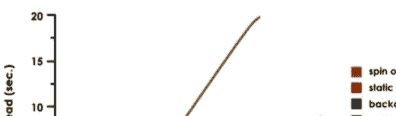
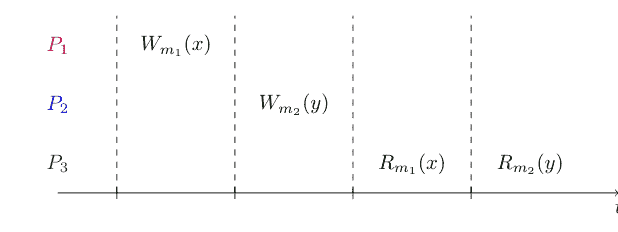
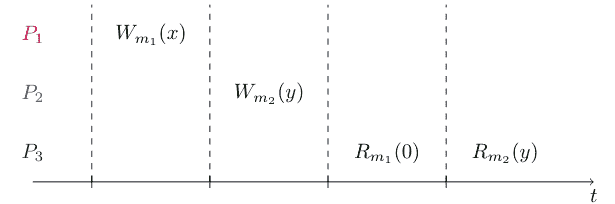
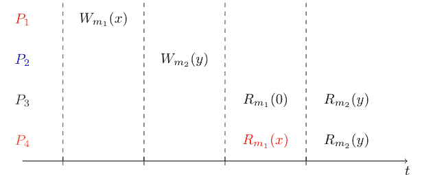

# 操作系统研究生入门指南 (CS 6200)：期末考试复习笔记

> 给入场者的警告

我只是一个曾经的学生。我认为本指南中的大部分内容都是相当正确的，但请不要将这些复习答案视为金科律。而且，如果你问我关于这些问题，我可能无法回答你，因为我已经忘记了其中 80% 的内容。

（尽管我很感谢指正）

## 第 3 部分 – 第 1 节：调度 (Scheduling)

课程视频：https://classroom.udacity.com/courses/ud923/lessons/339758762/concepts/last-view

转字稿：https://docs.google.com/document/d/1CR-2lcEdH4NG5xRIdHsqBxQQQ9T4OQIxXG-ZRJWKQ

### 指标狂热

警告：我非常确定读过这个框内容的人和我一样有共鸣。公式“推导”的目的是试图通过泛化它来更好地理解每个指标。你不需要这些公式，但你绝对应该理解每个指标包含的内容！

在进行调度时，有许多重要的指标需要记住，以便有效地比较算法。对于所有这些指标，我们定义 `$T_i$` 为任务 `i` 的完成时间，其值是根据队列顺序排列的升数值（而不是调度器定义的执行顺序）。该值要么是在执行之前（在理想世界中），要么是基于启发式估计的（在现实世界中）。我们还定义 `n` 为用于该指标的任务数量。

前三个指标假设所有任务同时同时提交。这种简单的场景不太可能出现在考试中，因此，理解这些公式是如何推导出来的可能比简单地背下它们更好。理解它们的推导过程可以更好地综合信息，以应对期末水平的题目，这类题目可能涉及更复杂的场景，如优先级、抢占和不同的到达时间。此类场景很难泛化，通过手算完成效果会更好。

- 吞吐量 (`$\tau$`) – 我们将其定义为在一段时间内可以完成的任务数。为了保持简单，“所选时间段” 应该是在给定场景下执行所有任务的总时间。

```
$\tau = \frac{n}{\sum_{i=1}^n T_i}$
```

- **平均作业完成时间 (`$c_{avg}$`)** - 这定义为任务从“队列中”到“已完成”所需的平均时间。

对于 `FCFS`（先来先行）策略，

```
$c_{avg} = \frac{nT_i + (n-1)T_{i+1} + \dots + T_n}{n} \sum_{i=1}^{n} (n-i)T_i$
```

对于 `SJF`（最短作业优先）策略，我们定义 `$C_j$` 为根据预期完成时间（升序）排序的任务*排序顺序*。`$C_1$` 是最短的，依此类推。那么，公式与 `FCFS` 相同，只是用 `$C_j$` 替换了 `$T_i$`。

- **平均作业等待时间 (`$w_{avg}$`)** - 这定义为任务从“队列”状态移动到“执行”状态所需的平均时间。

对于 `FCFS` 策略，

```
$w_{avg} = \frac{(n-1)T_1 + (n-2)T_2 + \dots + T_{n-1}}{n} \sum_{i=1}^{n} (n-i)T_i$
```

对于 `SJF` 策略，`$w_{avg}$` 的公式与 `FCFS` 镜像，用 `$C_j$` 代替了 `$T_i$`。

- **CPU 利用率 (`$\mu$`)** - 这定义为 CPU 用于执行“有用工作”（即非上下文切换）的时间百分比。通常，

```
$\mu = \frac{t_{useful}}{t_{useful} + t_{overhead}}$
```

时间片（timeslice）应该在一致的时间间隔内进行计算。使用与给定时间片相关的间隔来计算发生了多少开销，将是很有帮助的。

### 调度是如何运作的

在 CPU 上调度任务涉及哪些基本步骤和数据结构？我将调度理解为发生在任务之间的事情。作为一种内核级任务，调度算法周期性执行，并由许多原因触发，包括：

- **空闲 (Idling)** — 当 CPU 空闲时，调度器运行下一个任务以避免等待。
- **新任务** — 当新任务到达就绪队列时，调度器可能决定如何处理该任务。如果调度器请求优先级，它可能会选择中断当前任务。
- **时间片过期** — 为了确保公平，任务通常会被分配一个时间限制，在此限制内它们被允许独占 CPU。一旦时间片过期，调度器需要决定分配下一个给谁。


# 调度是如何运作的？

在 CPU 上调度任务涉及哪些基本步骤和数据结构？我将调度理解为发生在任务之间的事情。作为一种内核级任务，调度算法周期性执行，并由许多原因触发，包括：

- `空闲` — 当 CPU 空闲时，调度器运行下一个任务以避免等待。
- `新任务` — 当新任务到达就绪队列时，调度器可能决定如何处理该任务。如果调度器请求优先级，它可能会选择中断当前任务。
- `时间片过期` — 为了确保公平，任务通常会被分配一个时间限制，在此限制内它们被允许独占 CPU。一旦时间片过期，调度器需要决定分配下一个给谁。


# 调度是如何运作的？

在 CPU 上调度任务涉及哪些基本步骤和数据结构？我将调度理解为发生在任务之间的事情。作为一种内核级任务，调度算法周期性执行，并由许多原因触发，包括：

- `空闲` — 当 CPU 空闲时，调度器运行下一个任务以避免等待。
- `新任务` — 当新任务到达就绪队列时，调度器可能决定如何处理该任务。如果调度器请求优先级，它可能会选择中断当前任务。
- `时间片过期` — 为了确保公平，任务通常会被分配一个时间限制，在此限制内它们被允许独占 CPU。一旦时间片过期，调度器需要决定分配下一个给谁。


# 第 3 部分 – 第 1 节: 调度 (Scheduling)

- **新任务** — 当新任务到达就绪队列时，调度器可能决定如何处理该任务。如果调度器请求优先级，它可能会选择中断当前任务。

- **时间片过期** — 为了确保公平，任务通常会被分配一个时间限制，在此限制内它们被允许独占 CPU。一旦时间片过期，调度器需要决定分配下一个给谁。

调度是如何运作的？在 CPU 上调度任务涉及哪些基本步骤和数据结构？我将调度理解为发生在任务之间的事情。作为一种内核级任务，调度算法周期性执行，并由许多原因触发，包括：

- **空闲** — 当 CPU 空闲时，调度器运行下一个任务以避免等待。

- **新任务** — 当新任务到达就绪队列时，调度器可能决定如何处理该任务。如果调度器请求优先级，它可能会选择中断当前任务。

- **时间片过期** — 为了确保公平，任务通常会被分配一个时间限制，在此限制内它们被允许独占 CPU。一旦时间片过期，调度器需要决定分配下一个给谁。

# 操作系统研究生导论

- **平均作业完成时间 ($c_{avg}$)** - 这定义为任务从“队列中”到“已完成”所需的平均时间。

- **平均作业等待时间 ($w_{avg}$)** - 这定义为任务从“队列”状态移动到“执行”状态所需的平均时间。

- **CPU 利用率 ($\mu$)** - 这定义为 CPU 用于执行“有用工作”（即非上下文切换）的时间百分比。

调度是如何运作的？在 CPU 上调度任务涉及哪些基本步骤和数据结构？

实现：该调度器使用了两个并行的列表数组（例如 `something struct task_list[140]`）。其中一个是活跃数组（`active array`），另一个是过期数组（`expired array`）；索引对应优先级。

插入是轻而易见的 `O(1)`：它需要将任务插入到数组中，并将列表的“末尾”指针映射到新任务。选择通过使用硬件指令在位图中找到对应数组的第一个置位来实现的，位图中的置位表示该索引非空。

任务一直留在活跃数组中，直到它们过期；主动让出（`yielding`）的任务保持为“活跃”状态。过期后，任务被移动到过期数组。当活跃数组中没有更多任务时，它将与过期数组交换。请注意，高优先的任务（通常是 I/O 密集型的）频率更高，意味着如果需要，它们会被更频繁地调度。

工作负载发生了变化，变得更具交互性；如视频聊天、游戏等，这意味着长时间等待引起的抖动变得无法接受。尽管 I/O 密集型任务自然会获得更高的优先级，但移动到过期数组可能意味着在获得下一次运行机会之前需要等待。显著延迟会导致用户性能低劣。`O(1)` 调度器没有对公平性做出保证或规定：任务执行与优先级不成正比。

Linux CFS：这种调度器——“完全公平调度器”取代了它。它的实现使用了红黑树，红黑树是自平衡的，并试图确保树深度在所有节点之间相似。树按“虚拟运行时间”（`virtual runtime`）或运行时间排序。优先级与任务在 CPU 上花费的时间（纳秒级粒度）成比例，换句话说，运行时间根据在 CPU 上的实际时间进行调整，然后根据任务的优先级和“`nice`”值¹进行缩放。

实现：在每个分支中，左节点的运行时间少于右节点。因此，树中最左的节点总是被选中，因为它在 CPU 上花费的时间最少。低优先级任务的运行时间增加，将它们移向右侧；高优先级任务增加较慢，允许它们在分支的左侧停留更多时间。所有优先级都使用同一棵树；优先级通过运行时间在树的平衡中隐含包含。

算法复杂度：选择任务仍然是 `O(1)`，但插入现在是 `O(log N)`，其中 `N` 是要求中处理器的总数。

> 在 Fedora 的多处理器任务调度中，调度器计算的目标是什么？哪些性能计数器有助于识别工作负载（计算密集型 vs 内存密集型）以及调度器最大化吞吐量的能力？

Fedora 认为，理想的调度器在做出调度决策时需要待处理负载的信息。它使用理论指标 `CPI`（每次执行的周期数）作为衡量“平均指令延迟”的方法。设备密集型工作负载会花费大量时钟周期（`ticks`）等待指令完成，而 CPU 密集型工作负载可以更快地完成。

遗憾的是，`CPI` 对于许多应用来说不仅是一个理论指标，而且是一个不可靠的指标。应用程序通常不会极端偏向 CPU 密集型或 I/O 密集型，这意味着 `CPI` 的变化不足以做出可靠的调度决策。

术语解释：任务的“`nice`”值会在默认值的基础上调整其优先级。

课程视频：`https://classroom.udacity.com/courses/ud923/lessons/339975873/concepts/last-viewed`

转录文本：`https://docs.google.com/document/d/lutXUw0Sa7IRqwexJR1nG9Fit60Eqc4aHX8iRuYZTA`

以下是 Intel 处理器中 MMU 的页表项（`PTE`）。

| 31 | 9 | | | | | | | 0 |
|---|---|---|---|---|---|---|---|---||

| `PPN` | `G` | `PAT` | `D` | `PWT` | `U/S` | `R/W` | `P` |

这些标签对应以下含义：

- **D**：脏位（Dirty bit），表示自加载以来是否被写入。

- **A**：访问位（Accessed bit），表示该页是否被访问过。

- **PCD**：缓存禁用（Page Cache Disable），禁用缓存。

- **PWT**：写通（Write-through）。

- **U/S**：用户/内核（User/Supervisor），表示权限级。

- **R/W**：读写（Read/Write），表示是否可写。

- **P**：存在位（Present bit），表示页是否在物理内存中。

当页在物理内存中时，MMU 会将其放入物理内存。操作系统如何管理在磁盘上的物理内存？当请求不在物理内存中的页时，MMU 将查找其存储在磁盘上的位置，将其放入物理内存并更新页表。这种通过交换页来模拟更大地址空间的过程被称为缺页存储。

替换哪些页的选择取决于替换策略。一种策略是最近未使用算法（`LRU`）；这种策略会驱逐页表中最久未访问的页（通过访问位），为从磁盘的新页腾出空间。


图2：从虚拟地址到内存位置的演示。请注意，此图不包含 TLB 查找，使用分级页表来处理页目项。

进一步解释，单个虚拟地址被划分为一个或多个页号（`VPN`），用于页表索引。生成的页表项将 `VPN` 关联到物理页帧（`PPN`）；随后附加偏移量（`offset`）。

`TLB`（转换后备缓冲区）是页表项的缓存。由于页表本身必须存储在内存中，为了更快访问，转换在用户空间中发生。

> 你理解地址的大小、地址空间以及页的大小之间的关系吗？

让我们考虑一个具有 1MB 物理内存的 24 位架构。这对应于以下页表值：

- **地址大小**：虚拟地址和物理地址简单地遵循架构宽度。

- **地址空间**：地址空间直接连接到硬件。尽管有 1MB 物理内存，地址空间仍然包含 $2^{24}$ 个地址。超过 1MB 的部分将标记为分页；换句话说，关于可用内存的任何描述在页表计算中无关。

- **页的大小**：这是系统特定的。为了演示目的，我们假设它们为 $2^{12}$。

考虑到所有这些，让我们计算单个页表的大小。再次我们需要处理 $2^{24}$ 个地址，将其划分为 $2^{12}$ 大小的块。这意味着：

```
$\frac{2^{24}}{2^{12}} = 4096$ 页表项
```

也可以通过查看剩余位来计算。4KiB 意味着页 12 位，留下 $24 - 12 = 12$ 位用于索引，因此有 $2^{12}$ 个值。

你理解级页表的优势吗？对于给定的地址格式，你能算出不同层页表结构的大小吗？

页表是固定大小；它们包含足够的条目来映射整个地址空间，无论是否有足够的物理内存。记住，页表是进程级的数据结构。一个进程不会使用其大部分虚拟地址空间；这意味着页中有空条目。通过将表拆分为多级页表，我们可以减少这些间隙和浪费的 `PTE`（页表项）。

在处理更大的地址空间时，这种优化变得至关重要。64 位架构有太多的内存位置来存储所有 `PTE`。因此，必须将其分为若干级。

## 示例计算

假设我们有一个用于 32 位架构的 3 级分级页表：第一级为 4 位，第二级为 2 位，第三级为 6 位。前两级索引到后续更深层，而最后一层像以前一样是页表的索引。这导致了虚拟地址分块如下：

| $P_1$ | $P_2$ | $P_3$ | offset |
|---|---|---|---|

| 31 | 27 | 25 | 19 |


因此，$P_1$ 索引到第一个表，它有 $2^4 = 16$ 个条目，$P_2$ 索引到第二个表，它有 $2^2 = 4$ 个条目，$P_3$ 索引到第三个表并与偏移量结合，就像单级表一样（见图2），有 $2^6=64$ 个条目。这对地址空间有什么影响？20 位偏移量意味着 1MB。因此，单个内层页表可以访问 26 位内存（64MB）。第二层可以访问 28 位内存（256MB）。换句话说，第三层的单个条目可以访问 28 位内存。有 16 层这样的结构，因此该方案可以访问完整的 32 位内存。

与单页表相比有什么好处？假设一个进程需要 2MB 内存，因此有两个页表。使用单页表，会立即创建 $2^{12}=4096$ 个条目。使用分级页表，我们创建一个顶层表（16 条目）、二层表（4 条目）和第三层表（64 条目），总共 84 条目。即使两个页不在同一级，仍然是 $84\cdot2=168$ 条目。这在进程级内存需求上是巨大的节省。

## 第 3 部分 第 3 节：进程间通信

视频：https://classroom.udacity.com/courses/923/lessons/39733862/concepts/last-view

转录：https://docs.google.com/document/d1KfdAFTAyumB_ODQ-fikuY_wb0QBCkW105Sd

| 为了让进程共享内存，操作系统需要做什么？它们使用相同的虚拟地址访问相同的内存吗 |

为了让进程共享内存，它们请求内核创建一个共享内存段。这是一个特殊的内存，两个进程将其唯一的虚拟地址映射到同一个内存位置：


这种关联需要在内核上进行昂贵的初始化：操作系统必须创建（并跟踪）虚拟地址映射并允许多个进程使用。此后，共享完全在用户空间发生。这是相对于其他 IPC 方法（如消息队列或套接字）的巨大优势，后者依赖内核传递每条消息。

> 为了进程使用基于内存内存进行通信，仍然需要将数据从一个位置拷贝到另一个位置吗？与重映射相关的成本是什么？基于消息与基于共享内存通信的权衡是什么？

共享内存时，一个进程对内存的变化透明地反映在另一个进程中。共享内存可能会随时改变。因此，如果一个进程需要基于共享内存执行计算，它必须将其复制到本地内存。这可能涉及复制，但并非普遍如此。

| 为了让进程共享内存，操作系统需要做什么？它们使用相同的虚拟地址访问相同的内存吗 |

为了让进程共享内存，它们请求内核创建一个共享内存段。这是一个特殊的内存，两个进程将其唯一的虚拟地址映射到同一个内存位置：


这种关联需要在内核上进行昂贵的初始化：操作系统必须创建（并跟踪）虚拟地址映射并允许多个进程使用。此后，共享完全在用户空间发生。这是相对于其他 IPC 方法（如消息队列或套接字）的巨大优势，后者依赖内核传递每条消息。

| 你可以实现同步的不同方法 |

如图 3.2 所示使用管道。使用套接字允许你免费获得通信，如果你预见到进程之间会有通信。对于进程间的同步，基于内核的方法适用于命名信号量，它们本质上是文件。通过在两个进程中使用相同的名称，你可以同步操作，就像它们是自己的内存一样。共享内存信号量是完全可，尽管可以使用进程间原语。然后，它们的使用与在普通内存中完全一样。在基于套接字的方法中跨机器进行同步时，使用我们在之前的课程中讨论过的某种事件驱动架构可能是合理的，幸运的是我们不需要在项目中探索这个。


图3：管道的简洁示例。

视频：https://classroom.udacity.com/courses/923/lessons/337318994/concepts/last-view

转录：https://docs.google.com/document/d1SavqGKc7qQYDFEy1vljqWCJ8uDf4AvZs4ZQD3y_gc

| 为了实现同步机制，在最底层你需要依赖硬件指令。有些例子有哪些？ |

同步同步两个操作：对共享状态的读取，以及由（且仅一个！）进程对共享状态的写入。如果这些操作没有同时发生，可能会出现一个进程的写入与另一个进程的读取交叉的情况，导致多个进程认为自己拥有访问临界区的权限。原子的一些示例包括：

- **测试并设置 (Test & Set)** – 该指令等同于以下原子化执行的代码：

```
int test_and_set(int * value) {
  int old = *value;
  *value = BUSY;
  return old;
}
```

> 2 免责声明：我没有在项目中使用甚至研究管道。我所有的知识都是通过被动吸收 Slack 上 loan 的震惊获得的。

**读取并递加 (Read & Increment)** 这条指令对于以下代码至关重要，并以原子方式执行：

```
int read_and_inc(int value) {
    int old = *value;
    ++(*value);
    return old;
}
```

这对于本节最后一个问题描述的队列锁（queuing lock）是必要的。

不同的硬件实现不同的原子指令；某些依赖特定原子指令的同步结构并不一定具有平台无关性。

> 为什么自旋锁（spinlock）很有用？你会在当前使用互斥锁（mutex）的每个地方使用自旋锁吗？

自旋锁对于临界区用：等待临界区可用比执行上下文切换到另一个任务更高效。换句话说，当开销满足以下条件时，它是有用的：

```
context < blocking task
```

则不是如此。当没有任务时，让出 CPU 权限（然后立即运行）本质上是简单循环更廉价的版本。对于这些特定的场景，自旋锁是有用的。它们通常不应该取代现有的同步方法，例如使用互斥锁。

> 你能理解为什么拥有更强大的同步结构（如读写锁或监器）是有用的？是什么让它们比使用自旋锁或互斥锁和条件变量更强大？

高级同步结构是有益的，因为它们假设了某些使用模式。模式越通用，对如何使用模式的假设就越少。例如，读写锁即使在底层使用信号量，也选择了更好的内部设计决策，因为它们描述了更具体的用法语义。

从程序员的角度来看，高层结构更容易使用，且更不容易配置错误。当加锁和解锁等低级需求是隐式的，就很难犯这些错误。

> 你能理清 Anderson 论文中自旋锁实现的演变吗，从基本的测试并设置（test-and-set）到队列锁？你理解早期实现的问题是如何通过后续实现解决的？

首先是测试并设置（test-and-set），只需在原子指令上自旋。然后是测试-测试-并设置（test-and-test-and-set），它更好地利用了缓存值，因为如果值没有变化，测试并设置会使缓存失效。接着引入了睡眠（静态和动态），分别在内存引用之后和锁检查之前引入（以允许线程在不引起失效的情况下进入静默）。最后是队列锁，其中线程占据队列中的一个位置，每次释放锁都会触发下一个线程进行；尽管如此，这种方法需要更复杂的原子指令（或对其指令的仿真）。

### n 性能（Performance）

不同类型的自旋锁适用于不同的竞争程度和处理器数量。通常，这可以分为两类：高负载（许多竞争的处理器）和低负载（少数竞争的处理器）。后者是现代 x86 系统的更好模型，因为这些系统通常有 2-4 个核心。



**图 4**：Anderson 自旋锁实现的性能对比。

**高负载**在高负载下，队列锁是最好的实现：它随着处理器数量的增加而扩展。测试-测试-并设置性能最差，因为它引入了最高级别的竞争。静态锁在各自的类别中表现比动态睡眠更好，而在内存引用后睡眠的表现优于在锁释放时睡眠，因为避免了失效。

**低负载**在低负载下，基础自旋锁（r.a.a. 测试-测试-并设置）性能最好，因为它最简单且延迟最低。由于某种原因，动态退避（backoff-out）的表现优于静态退避，因为在看到锁到获取锁之间的延迟比静态情况要短。队列锁的性能实际上最差，因为其初始开销较大。

操作系统在典型的用户 → 内核 → 设备流之间引入了另一层：通用块层存在于内核和设备之间，为内核创建一个统一的、操作系统标准化的块接口，以便其与设备进行交互。

虚拟文件系统定义了表示在块设备上的抽象“文件”，它引入了诸许多概念，如文件（file，操作系统对文件的表示）、索引（index，文件的持久化表示）以及目录项（dentry，或 directory entry，临时表示文件的组件）。目录在虚拟文件系统中没有特殊含义；它被表示为另一个文件，但其内容是关于其他文件的细节。这是通过 dentry 实现的，dentry 不是持久的，而是在系统访问文件时动态生成的（并维护在 dentry 缓存中）。此外超级块（superblock），它包含关于文件系统布局的信息，如空闲块、数据块等。

| |

|---|---|

| 所有者 (2) |

| 时间戳 (3) |

| 大小块计数 |

| 直接块 |


# 单级间接

# 双级间接

# 三级间接

为了避免简单“索引列表”带来的局限性，我们引入了一种更复杂的结构，通过间接指针允许几乎任意的文件大小。如图 5 所示，索引现在包含了关于文件的额外元数据，以及块指针的分层结构。直接块与简单模型中一样，仅仅是块的列表。单级间接块指向另一个包含块索引列表的索引。这种模式在双级间接块和三级间接块中重复，允许非常大的文件大小。当然，随着间接层级的增加，性能会下降，因为设备必须花费更多时间在磁盘上寻道检索。


让我们考虑特定的文件系统配置。假设我们有 `1KiB` 的块，每个块 `4` 字节，索引存储 `32` 字节的元数据。在此，我们将追踪两个间接块和一个双级间接块。这样的文件最大大小是多少？在具有 `32` 字节元数据和 `12` 字节索引的情况下

$$\frac{2^{10} \cdot (32+12)}{4} = 245$$

直接块，可以追踪 $256 \cdot 2^{10} = 250,880$ 字节的数据。简单起假设根索引需要存储元数据。那么，每个单级间接块可以追踪 `256` 个直接块，$2 \cdot 2^{18} = 2^{19} = 0.5$MiB 内存。双级间接块包含 $2^8$ 个单级间接块，正如我们之前计算的，每个允许索引 $2^{18} = 256$KiB 的数据。总之，我们可以拥有大小为

$250,880 + 2^{19} + 2^{27} = 67,884,032$

字节的文件，大约 `67.9 GiB`。

> 对于虚拟系统缓存，我们提到了几种可以减少访问物理设备相关开销的优化方案。你理解当我们需要访问设备时，这些优化各是如何变化的吗？

磁盘访问是最慢的数据访问类型；我们采用了几种技术来优化磁盘访问的软件和硬件特定方面，以避免这种巨大的延迟：

**缓存** 操作系统在内存中维护一个文件缓冲区缓存。该缓存存储文件的部分内容并维护这些部分的更改。这些更改通过 `fsync()` 定期刷新。这就是为什么在不先“弹出”的情况下拔掉 USB 驱动器是危险的；数据可能仍在缓存中！此缓存是每个文件独立的，所以文件的所有查看者都能同时且立即地看到更改；在讨论更新同步时，这些被称为 UNIX 语义。

I/O 调度：由于文件本质上分散在磁盘的块中，如果我们调度磁盘头以更顺序的顺序跨越块进行读取操作，性能就可以提高。

**预取**：从磁盘读取时，相邻的块也可能是有用的！如果我们提前预取块，当需要它们时，就不需要再次读取它们了。

**日志记录**：与其写入正确的磁盘位置（这将需要大量的随机访问），我们将更新写入一个名为 `journal` 的日志中。日志包含了对要执行写入操作的描述，指定了块、偏移量和值，本质上描述了单次写入。日志定期刷新到磁盘，并且必须是系统中最可靠的部分，以防丢失数据。

> 假设你正在准备 GIOS 期末考试，你的桌上放了一些闪卡。如果访问存储在 CPU 寄存器中的数据类似于从记忆中回想闪卡，访问缓存就像从磁盘上拿取闪卡，那么访问存储在传统硬盘上的数据就像去火星拿闪卡。

讲座视频：https://classroom.udacity.com/ud923/lessons/361409322/concepts/last-viewed 转录文本：https://docs.google.com/document/d/1IwM-Me5hIDCF63FMeXc87f3JWk91e88MyAyrRhpc

> 什么是虚拟化？它的历史是什么？

虚拟化的含义随着技术的演进而变化。如今，虚拟化基本上是指一个或多个系统运行在单机器的隔离环境中，且对硬件的所有访问通常由虚拟化层管理。尽管最初，有一个严格的定义将虚拟化与 Java 虚拟机等事物区分来。

虚拟机必须是宿主机的高效、隔离的副本。“副本”这一方面是关键区别：在 Linux 宿主机上运行 Windows 虚拟机不属于虚拟化。尽管如此，在带有网络的 Linux 宿主机上运行没有网络的 Linux 虚拟机将违反这一点。“高效”方面只需要虚拟化环境的速度略有下降；“隔离”方面意味着有一个管理层对系统资源和虚拟机监控器（也称为 `hypervisor`）拥有“真正的”控制权。

> 托管虚拟化与裸金属虚拟化？什么是虚拟化，它为什么用？

虚拟化主要有两种类型：托管型和裸金属虚拟化。它们之间的主要区别在于 `hypervisor` 的位置。在托管虚拟化中，`hypervisor` 运行在主机操作系统之上。裸金属虚拟化中，`hypervisor` 直接运行在硬件上。

虚拟机必须是宿主机的高效、隔离的副本。“副本”这一方面是关键区别：在 Linux 宿主机上运行 Windows 虚拟机不属于虚拟化。尽管如此，在带有网络的 Linux 宿主机上运行没有网络的 Linux 虚拟机将违反这一点。

另一种方法是半虚拟化（`paravirtualization`），客操作系统感知到自己正被虚拟化，并使用 `hypercalls` 代替特权指令。这允许更好的性能，但需要修改客内核。

# 操作系统高级进阶复习指南 – 期末考试

## 虚拟化 x86 存在什么问题？它是如何工作的？

虚拟化中的一个重要要求是，`hypervisor` 需要并正确处理所有的系统调用。这依赖于事实

从硬件方面来说，x86——现在是最主导的架构——添加了许多功能来改进虚拟化：

- **权限**：不再使用没有为每个环定义明确目的的 4 环方法，而是简单地分为“根”`root` 模式和“非根”模式。
- **虚拟机控制结构**：来自虚拟机的指令处理得更好；硬件可以检查指令并确定是否应该捕获 `trap`。
- **设备**：引入了让设备更能感知虚拟化环境的支持。例如，多个设备具有逻辑接口，可以分别与 VMM 交互。中断的路由也更好。

## 在虚拟化中，直通（passthrough）与拆分设备模型？

I/O 设备的巨大差异意味着我们无法像 CPU 或内存那样使用更统一、标准的方法来实现虚拟化。实现虚拟化有很多模型。

**直通**：在设备虚拟化的直通模型中，VMM 确认设备允许特定的虚拟机独占直接访问。从虚拟机的角度来看非常好，因为它是性能最高且最“贪”的方法。明显的缺点是共享困难，因为这依赖于虚拟机拥有相应的设备驱动程序，这些必须匹配。当然，根据我们给出的虚拟化的严格定义，必须是这样。另一个影响虚拟机可用性的重要缺点是迁移困难：在 VMM 移动到另一台机器之前，必须仔细管理设备状态和进行中的请求。

**Hypervisor 直接模型**：在这种模型中，虚拟机完全不与硬件设备交互。VMM 拦截并模拟请求的操作。它将虚拟机请求转换为由 VMM 驱动程序服务的硬件特定请求。正如我们想象的，这为虚拟机设备操作增加了巨大的开销和延迟，并极大地复杂了

VMM 本身。它现在需要这个“仿真”层，并且需要这个驱动程序与硬件交互，而不是依赖客户端操作系统知道如何与其交互。显而易见的好处是将客户端和硬件解耦，允许对客户端进行更好的管理和迁移。

分离设备模型（Split-Device Model）：这种模型与之前的两种方法截然不同。设备请求被分散在两个组件中，其中一个是一个独立于 VMM 的服务虚拟机（service VM）。客户端有一个前端设备驱动程序（front-end device driver），该驱动程序能够感知任何硬件，并简单地将请求封装或翻译为后端设备驱动程序可以理解的格式。后端驱动程序类似于在非虚拟化操作系统中可能存在的普通驱动程序。这种技术有一个局限性：它仅限于半虚拟化（`paravirtualized`）客户端。我们消除了前一个模型中的“设备仿真”，并增加了一个管理层（服务虚拟机），使用了“纯”虚拟化并增加了客户端的复杂度。

# 第 4 部分 – 第 1 节：远程过程调用 (RPC)

讲座视频：https://classroom.academy/courses/d4923/lessons/3540238825/concepts/last-view

转录文本：https://docs.google.com/document/d/1LVTIbgtUfeOSkbngnXXTT_YJbasFacJfHNP8

| RPC 的动机是什么？在实现 RPC 运行时需要解决哪些不同的设计点（例如：绑定、进程语义、接口规范……）？有哪些可选方案以及相关的权衡？ |

| 在 Sun RPC 模型中，具体需要做什么来解决这些设计点？ | |

RPC 背后的动机是消除样板代码（`boilerplate`），隐藏跨机器的复杂性，并将通信协议与应用逻辑解耦；它为数据移动和通信定义了一个高层接口。

接口定义（Interface Definition）：接口定义语言（IDL）是一种用于定义服务器上可用调用类型的独立方法方法。它可以是一个与语言无关的定义文件，也可以是针对特定实现的。

注册表与绑定（Registry & Binding）：注册表是一个服务数据库：客户端用它来查找所需的服务器。它可以是分布式的（例如，“给我所有提供‘add’功能的 RPC 服务器”），后者是针对特定机器的，后者需要提前知道服务器的地址（必须提供某些端口号）。

Sun RPC 设计选择


# Sun RPC 实现选择

Sun 的 RPC 实现了以下选择：一个与语言无关的 ID（称为 `XDR`，使用 `rpcgen` 将 `.x` 文件转换为特定语言的实现），一个指定服务细节的每机器注册表（称为 `portmap`），以及一种失败时重试的机制，该机制尽可能包含尽可能多的细节。

> 什么是（反）序列化（un/marshalling）？RPC 如何序列化和反序列化复杂的变长大小数据结构？RPC/XDR 中具体做了哪些操作？

为了将结构体的本地表示转换为可以在网络上传输的与机器无关的表示，我们使用序列化（marshalling）。它将过程调用编码到包含其所有细节（过程名称、参数等）的连续消息缓冲区中，并准备好传输。反序列化（unmarshalling）显然是此的逆过程。这种编码过程是由 RPC 工具链根据 `IDF` 规范为特定结构自动生成的。

讲座视频：https://classroom.udacity.com/courses/ud923/lessons/ud92619282/concepts/33765

转录文本：https://docs.google.com/document/d/1LVTIbgtUfeOSkbngnXXTT_YJbasFacJfHNP8

在分布式文件系统中，维护状态（state）的权衡是什么？在分布式系统中，客户端缓存（clientside caching）的权衡是什么？

在分布式系统中，为了状态需要做了哪些设计？在 `XDR` 中，具体考虑了哪些问题？

在分布式文件系统中，有状态（stateful）还是无状态（stateless）的权衡是什么？客户端状态的，这减少了客户端的复杂性。

失败时重试的机制尽可能包含尽可能多的细节。

# VMM 与设备模型

`VMM` 本身。它现在需要这个“仿真”层，并且需要这个驱动程序与硬件交互，而不是依赖客户端操作系统知道如何与其交互。显而易见的好处是将客户端和硬件解耦，允许对客户端进行更好的管理和迁移。

分离设备模型（Split-Device Model）：这种模型与之前的两种方法截然不同。设备请求被分散在两个组件中，其中一个是一个独立于 `VMM` 的服务虚拟机（service VM）。客户端有一个前端设备驱动程序（front-end device driver），该驱动程序能够感知任何硬件，并简单地将请求封装或翻译为后端设备驱动程序可以理解的格式。后端驱动程序类似于在非虚拟化操作系统中可能存在的普通驱动程序。这种技术有一个局限性：它仅限于半虚拟化（paravirtualized）客户端。我们消除了前一个模型中的“设备仿真”，并增加了一个管理层（服务虚拟机），使用了“纯”虚拟化并增加了客户端的复杂度。

讲座视频：https://classroom.academy/courses/d4923/lessons/3540238825/concepts/last-viewed

转录文本：https://docs.google.com/document/d/1LVTIbgtUfeOSkbngnXXTT_YJbasFacJfHNP8

| RPC 的动机是什么？在实现 RPC 运行时需要解决哪些不同的设计点（例如：绑定、进程语义、接口规范……）？有哪些可选方案以及相关的权衡？ |
| 在 Sun RPC 模型中，具体需要做什么来解决这些设计点？ |

RPC 背后的动机是消除样板代码，隐藏跨机器的复杂性，并将通信协议与应用逻辑解耦；它为数据移动和通信定义了一个高层接口。

接口定义（Interface Definition）：接口定义语言（`IDL`）是一种用于定义服务器上可用调用类型的独立方法方法。它可以是一个与语言无关的定义文件，也可以是针对特定实现的。

注册表与绑定（Registry & Binding）：注册表是一个服务数据库：客户端用它来查找所需的服务器。它可以是分布式的（例如，“给我所有提供‘add’功能的 RPC 服务器”），后者是针对特定机器的，后者需要提前知道服务器的地址（必须提供某些端口号）。

失败（Failures）：由于系统的复杂性（跨机器、依赖网络等），存在许多调用可能失败的情况。有时无法确定此类失败的原因，即使是超时/重试方法也可能永远失败。正因如此，RPC 实现将定义一个错误规范，定义 RPC 调用可能失败的所有方式。此类情况会导致“错误通知”。

# 第 4 部分 – 第 2 节：分布式文件系统

讲座视频：https://classroom.udacity.com/courses/ud923/lessons/ud92619282/concepts/33765

转录文本：https://docs.google.com/document/d/1LVTIbgtUfeOSkbngnXXTT_YJbasFacJfHNP8

一致性模型有很多细微差异。以下是对它们保证的快速列举，不包含本节后续的示例和解释，仅供参考。

所有节点立即看到所有更新。

来自多个节点的更新可以以任何顺序到达，但所有节点看到的顺序必须相同。来自同一节点的更新按其发生的顺序到达。


来自多个节点的更新可以以任何顺序或在任何节点到达。来自同一节点的更新按其发生的顺序到达。当写入发生在读取之后时，该读取之前的更新和新的写入必须按照该顺序发生。

对同步边界没有保证。在进行同步时，节点保证看到从其他节点直到它们最后一次同步所发生的所有更新。

区分“更新（update）”与“操作（operation）”非常重要。这种区别将在顺序一致性部分进一步讨论。

> 尽管它们并不一定像基督教观点中的上帝那样是一个无处不在、全能且完美的观察者，但我们可以保证该观察者不会对系统上发生的事件向我们撒谎。

### 共享粒度权衡

在共享状态时，与共享粒度（sharing granularity）相关的权衡是什么？

粒度的选择与共享内存实现所在的软件栈层级相关。例如，按页（`page`）共享与操作系统紧密耦合，系统也按页管理内存。其他方法（如按对象共享）是特定于应用程序的。需要注意的是，当两个操作在共享内存区域的不同部分进行操作时，粒度会增加。例如，给定一个 KiB 的页，应用程序实例 A 可能需要前 100 字节，而实例 B 可能需要后 100 字节。这两个实例都不在乎另一个正在同一个页中操作，但由于粒度是基于页的，如果使用基于对象的粒度，一个一个可能只需要 `Object::member_a`，而另一个可能只需要 `Object::member_b`。

### 分布式共享内存的基本机制

对于分布式内存系统（考虑分布式共享内存），维护一致性需要哪些基本机制——你是否理解为什么使用“主节点（home nodes）”更好，以及为什么我们要区分用于查找主节点的全局索引结构和由主节点用于跟踪状态位置信息的本地索引结构？

在分发数据时，将特定状态与“主节点”相关起来很有帮助。在分布式共享内存的上下文中，这被称为主节点，负责维护有关状态的元数据。这包括跟踪对其内存缓存的访问和修改、权限（即特定内存位置是否可以缓存）、用于独占访问的锁定等。主节点不同于状态所有者（state owner），所有者是特定内存段的（临时）所有者和操作者。当然，主节点会跟踪当前所有者；所有由对象标识符索引的元数据本身是一个本地元数据映射。

由于主节点是内存的静态属性，内存与其相应主节点之间的映射（称为全局映射）分布并复制到系统中的每个节点上。共享地址的前缀标识其主节点，而后缀则标识副本号。结果在虚拟地址翻译下表现为：第一部分是全局节点映射的索引（页表索引），第二部分是帧号（类似于物理内存的偏移量）。

通过在共享内存地址和主节点之间添加一个层的重定向，我们可以允许主节点发生移动。不再将前缀视为节点 ID，而是将其翻译为映射到动态主节点的索引。

如果我们向系统引入显式副本——存在于已临时存在于本地缓存中的按需副本之外——我们可以实现负载均衡、热点规避和冗余。此类副本的管理可以由主节点执行，也可以由更高级的管理节点执行，后者有效地充当一个或多个备份节点的主节点。

> 你对如何实现一个分布式共享内存系统有什么想法吗？

是的：不使用缓存，每个页错误都会导致从其对应节点获取。节点获得对池的独占访问。砰，搞定。完美的一致性。（开玩笑的，我只是懒）

### 一致性模型

什么是一致性模型？我们提到的不同模型（严格性、顺序性和弱性）提供了哪些保证？你能通过一个假设的执行示例进行推导并判断该行为是否符合特定的一致性模型吗？

一致性模型是由 DSM 实现定义的一种约定；只要应用程序遵循规则，它就会对高层应用程序提供数据可用性、有效性和“时效性”的保证。有不同的一致性模型以不同的置信度保证某些内容，但最重要的部分是应用程序需要遵循该模型，这些保证才能生效。

管理一致性的两个主要操作是推送失效（（push invalidations）和拉取修改（pull modifications）。前者是一种悲观的方法，假设任何更改都会立即在其他处可见；一旦发生更改，就会主动向其他系统推送失效。后者是一种更懒的方法，具有更乐观的观点；当需要内存时，按需从其他节点响应修改信息。

#### 严格一致性（Strict Consistency）

严格一致性（Strict Consistency）是最简单的模型：每个更新都无处不在、立即发生，并完全按照其发生的顺序发生。考虑以下时间线：



在严格一致性模型下，两个写入事件都被 P3 “立即”看到，并按照它们发生的顺序，无论由于空间局部性导致任何延迟变化。例如，增量很小且 P2 物理上靠近 P1，尽管它的写入事件在 P2 的写入之前被 P1 接收，但它在 P3 的写入之前仍然不会反映在 P1 中。

这种模型完全是理论上的；在实践中，由于复杂的锁和同步，由于数据丢失和网络延迟引入的物理复杂性，仍然无法保证（或维持）这种的一的一性。

#### 顺序一致性（Sequential Consistency）

**顺序一致性（Sequential Consistency）** 这种替代模型在可实现的一致性方面是“次优选择”。我们只保证操作的任何可能顺序——换句话说，任何在常规本地共享内存系统中会执行的顺序（考虑线程之间的数据轨迹）。换句话说，以下时间线是严格一致性模型所保证的顺序的有效替代方案：



总而言之，来自不同进程的内存更新可以任意交错。但有一个陷阱，该模型必须保证这种交错在所有过程中是**相同**的。换句话说，另一个进程 P3 必须看到与 P3 相同的顺序。以下时间线将**不**被允许，因为它违反了这一原则：



该模型还有一个最终要求：来自同一进程的操作始终按照它们发出的顺序出现。区分更新的时间与*操作*（operation）非常重要。例如，在上面的图中，P4 看到 `Rm1(0)` 仍然是有效的；它可能还没有收到 y 的更新！

#### 因果一致性（Causal Consistency）

**因果一致性（Causal Consistency）** 因果一致性模型强制内存位置之间关系的一致性。例如，考虑以下时间线：

| $P_1$ | $W_{m1}(x)$ | |

| $P_2$ | | $R_{m1}(x) \rightarrow W_{m2}(y)$ |

| $P_3$ | | $R_{m1}(0) R_{m2}(y)$ |

| $P_4$ | | $R_{m1}(x) R_{m2}(0) t$ |

$P_2$ 时间线中的箭头表示 $y$ 与 $x$ 之间的依赖关系。例如，可能 $y=x^2$。因此，在不知道其成因（例如 $m_1$ 中的 $x$）的情况下读取 $y$ 的值是没有意义的。因果一致性模型（causal consistency model）感知这种依赖关系；因此，在该模型下，$P_3$ 中的 $m_2$ 读取需要在 $R_{m1}(x)$ 之后发生。

| $P_1$ | $W_{m1}(x)$ | |

| $P_2$ | | $W_{m2}(y)$ |

| $P_3$ | | $R_{m1}(0) R_{m2}(y)$ |

| $P_4$ | | $R_{m1}(x) R_{m2}(0)$ |

该模型如何定义因果关系？如果讲座和 Slack 讨论可以信赖，那么因果关系是隐式定义的：如果一个内存位置在被读取后被写入，系统假设它们实际上必须存在因果关系；在上面的示例中，可能是 $y=10$ 而不是 $x^2$，但系统仍然会由于内存访问模式而强制因果关系。这种缺乏程序员强制的真实性导致了以下模型，该模型试图实现一致性并使其变得毫不费力。

**需要注意的是，因果一致性严格弱于顺序一致性。** 换句话说，顺序一致性意味着因果一致性。这一事实在回答一个系统是否具有因果一致性和/或顺序一致性时非常有用。如果它不是因果一致的，它一定不是顺序一致的，所以你甚至不需要考虑它。

#### 弱一致性（Weak Consistency）

**弱一致性（Weak Consistency）** 该模型允许程序员定义显式的同步点来与系统创建一致性。同步点执行以下操作：

- 它强制所有内部更新现在都可以被系统中的其他处理器看到。
- 它强制同步点之前的所有外部更新最终将对执行同步的系统可见。

考虑以下带有同步点的时间线：

| $P_1$ | | $W_{m1}(x)$ | | | $W_{m2}(y)$ | $W_{m3}(z)$ |

|---|---|---|---|---|---|---|

| | $P_2$ | | $R_{m1}(x)$ | | | | $t$ |

所以，$P_1$ 在其写入后执行了同步，这**并不保证** $P_2$ 会像时间线那样执行 $R_{m1}(x)$；事实上，它执行 $R_{m1}(0)$ 也是是完全有效的。在 $P_2$ 执行*自己的同步*之前，它对系统的视图可能是过时的。当然，当它*确实*进行同步时，一致性模型保证它将被所有看到已更改内容的处理器看到。

弱模型允许程序员定义显式的同步点，这对于同步操作之间发生了什么非常重要。对于任何变量，更新可以（或不能）以任何顺序到达。模型的变体包括确保共享内存完整性的*全局同步*操作，或者基于每个处理器或每个页的细粒度同步。

讲座视频：https://classroom.udacity.com/courses/ud923/lessons/365329007/concepts/last-view

转字稿：https://docs.google.com/document/d/1Fe9eQpEbIZmEPLN6S2GWmWLkvbHKSyW-TRQ


## 在管理大规模分布式系统和服务时，采用同构环境和异构环境各的优缺点是什么？

分布式系统的功能同构方法意味着每个系统都是平等的：它执行处理请求的每一个可能的步骤。这非常像标准的“老板-工人（boss-worker）”模型，其中工人是执行特定任务中所有步骤的通用线程。或者，功能异构方法将任务隔离到某些机器或特定的请求类型。这在某种程度上类似于“流水线（pipeline）”模型，任务的单个步骤被隔离并可以根据完成这些步骤所需的时间进行扩展。

两者之间的权衡与我们在第一部分讨论的关于老板-工人和流水线模型的权衡相似，但额外增加了属于“分布式”方面的权衡。

## 你理解云计算的历史和动机吗？你了解一些云服务提供方案吗？

云计算的益处源于其伸缩性（elasticity）。不需要管理基础设施。云计算在巨大的规模上运行。除了虚拟化的明显需求外，云还需要资源供给以公平地分配、跟踪和管理。此外，大数据对于存储至关重要。大规模监控需要实时解决方案来捕捉和分析。

## 你理解规模如何变得实用吗？你理解规模如何变得不可避免吗？

数量定律使得云服务可行。不同的客户（其中许多）有不同的使用模式和峰值时间。这些因素会导致稳定的模式。遗憾的是，这种规律导致了不可避免的故障。如果某个组件的故障率——例如硬盘——每月为 0.01%（万分之一），一个足够大的数据中心可能拥有 10 万块硬盘。这意味着每个月会有 10 块硬盘故障！当然，那只是硬盘；一个特定的系统中有成百上千个个体组件。因此，个体故障发生的频率相当高。

# 额外资源

尽管有人这么说，

> George 的替代方案更加简单明了。活在时代。

关于这个主题还有其他指南，是众筹的，其他的。请查看它们，并在如果看到了它们时感谢他们！

- David：https://docs.google.com/document/d/1DWVL8J8krCsZyYtcC4CGht8dbb17RR7wXn9X
- Piazza：https://docs.google.com/document/d/1IXbYSZ27kRvXv16ht38bb2YwawTrRo5meEm0F
- Kevin：https://docs.google.com/document/d/1xA4v5jmvZ6aOarRoi2UypqOswfW2Kawg-9T166aeW
- Aja：https://docs.google.com/document/d/1-tHY3BArTvZijbba1NM-YKFFFT046o21OS4r5O

^3 点赞，Joves：https://oms6200.slack.com/archives/15348751619400
