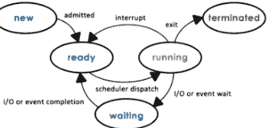
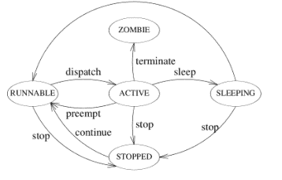
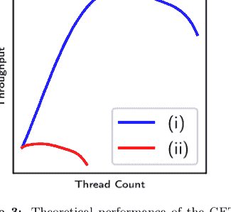

# 操作系统研究生入门 (CS 6200)：期中考试复习笔记

> 给入场者的一句警告

我只是一个曾经的学生。我认为这份指南中的大部分内容都是相当正确的，但请不要将这些复习答案视为金科玉律。而且，如果你问我任何关于这些内容的问题，我可能无法回答你，因为我已经忘记了其中 80% 的内容。

入入自负！

（尽管我非常欢迎各种指正）

# 问题：第一部分

操作系统是应用程序与系统硬件资源之间的关键中介。它为不同的硬件接口提供了通用的抽象，例如，针对硬盘和固态驱动器都提供“文件”对象。它通过虚拟内存通过进程提供安全性，并限制对硬件资源的访问。它通过任务调度算法在多个潜在不相叠的用户及其进程之间强制公平。

你能区分操作系统的抽象（abstractions）、机制（mechanisms）和策略（policies）吗？

| 用户态 | 抽象 |
| --- | --- |
| ↓ | 机制 策略 |

“机制与策略分离”原则意味着什么？

本质上，这只是系统在更低层次的进一步抽象：针对内核开发者而不是用户。

这与“关注点分离”的想法相联系。特定的机制（如调度）不应该真正关心的调度策略是什么。它应该将责任委托给策略本身，而策略应该是可轮换/可配置的。通过为策略提供通用接口，它让人们更容易定义自己的策略，而无需实际上担心其实现方式；他们可以信任机制根据他们的策略做正确的事。

> “针对常见情况优化（optimize for the common case）”原则意味着什么？

这显而易见；设计应该针对最可能被使用的方式进行优化。例如，“中断即线程”的设计对系统整体性能有益，尽管中断会产生成本，但在每次互斥/锁/操作中都节省了开销。因为后者的发生频率比前者更高（常见情况），所以这是整体的获益。

> 在用户态和内核态之间切换时会发生什么？用户态与内核态之间切换的某些原因是什么？

这种“切换”被称为系统调用（system call）。这些特殊情况是用户以特权方式与系统交互的唯一手段。以下是发生的过程，按细节粒度划分：

- 内核中设置了一个权限标志位，指示“内核模式”特权。
- 程序跳转到内核中断处理程序。（根据系统调用参数）将跳转到所请求的系统调用。
- 在内核中执行系统调用。这涉及检查参数（安全性）、从用户空间拷贝数据等操作。
- 执行请求的操作（例如告诉驱动程序读取字节并将它们放在特定的内存位置）。

主要，这些切换涉及与特权资源和硬件的交互。例如，应用程序从文件读取内容（`read()`）、请求更多空间（`map()`）、创建网络资源（`socket()`）都是需要进入内核态的动作示例。如果用户违反规则，也会发生切换。如果用户尝试访问特权内存地址（回想进程地址空间的一部分是为操作系统预留的），CPU 将触发陷阱（trap !），内核将接管控制权进行调查。

同样，边界也可以在“相反方向”被跨越，例如发生信号（signal），如果程序启用了相应的信号掩码，内核将控制权转移给其信号处理程序。

> 什么是内核陷阱（kernel trap）？它为什么发生？内核陷阱发生期间会有哪些步骤？

虽然陷阱（trap）和中断（interrupt）有时互换使用，但为了将它们与“后者作为中断”区分开来，我们认为内核陷阱是指在“异常”条件下发生的内核中断。异常情况是指遇到错误的情况。这可能类似于磁盘读取失败或用户进程尝试访问受保护的内存。

在内核陷阱期间，控制权被交给内核的中断处理程序，并带有某些参数（参数的类型等），处理程序将检查陷阱产生。如果是由用户引起的，它将采取采取；这可能意味着终止进程，或向导致陷阱的函数返回错误代码。

1 你刚刚触发了我的“陷阱牌（trap card）” 

2 例如，在你的程序中按 Ctrl+C 将触发 SIGINT。

对比单体内核（monolithic）、模块化（modular）和基于微内核（microkernel）的操作系统设计的设计决策和性能权衡。每这些设计各有一个权衡，从效率到可维护性不等。

## 单体操作系统：这些包括 FreeBSD、OpenBSD、Solaris 和 MS-DOS。

这种设计在内核级包含每一个服务/抽象。它是最早且历史性的操作系统设计：应用程序可以作为操作系统部分的每一个服务。这包括内存管理器、驱动程序、文件管理、进程/线程、调度、针对随机和顺序访问的文件系统等。

**优点：** 一切都包含在操作系统中。所有的和服务一切内容被打包在一起。这产生了**编译时优化（compile time optimizations）**的可能性。

**缺点：** 东西太多，太多难以维护的内容，调试也困难。

## 模块化操作系统：这些包括大多数现代操作系统，包括 Windows、macOS 和 Linux。

这种设计在 OS 级携带基本服务和 API；其他所有都可以作为模块添加。这种设计由于其简单性和“即插即用”的方法，相对于单体内核有了显著改进。通过这种设计，你可以自定义操作系统使用的文件系统或调度器。**OS 指定了接口**，任何模块必须实现，而不是让操作系统包含所有模块。

**优点：** 操作系统更容易维护（补丁、新模块等）和升级。更小的体积和更少资源密集型代码意味着内存可用；这可以提高性能。

**缺点：** 由于缺乏抽象和对 OS 模块层的定义，由于更大的调用栈和更多的通用代码需求，存在性能影响。我们还失去了对整个系统的内联和编译时操作（因为已经没有“整体”了）。

## 微内核操作系统：这种在历史上更多，或在嵌入式系统中。它包括内核 MINIX 3、Mach 和 QNX。

这些操作系统在 OS 级仅包含最基本的原语；这只是执行应用程序的必需品（地址空间、线程）。其他所有内容包括文件系统、设备驱动程序等，都在内核级之外。这种模型需要大量的进程交互，内核必须作为其核心之一对此提供良好的支持。

**优点：** 这些内核很小：开销更少，内核性能更好。测试是另一个优点；更容易验证其运行符合预期。因此，在某些方面比性能更关键的情况下（通常是嵌入式设备和控制系统），微内核非常有价值。

**缺点：** 可移植性存疑；内核是针对特定硬件定制的并且针对预期的用例高度专门化。因此，软件更难找到通用组件，导致了复杂性。最后，正如之前讨论的，对常见功能的缺乏会导致大量的 IPC（进程间通信）和频繁的用户态-内核态切换，这些都是昂贵的。

# 问题：第二部分

3

## 进程与线程，描述它们的区别。在进程切换和线程切换时会发生什么？

进程和线程都是执行 单元。进程代表程序执行的当前状态；程序的每次启动都会产生一个新进程。它们的主要区别在于细节存储在内核中。进程是其线程的“父级”；信息存储在进程控制块（PCB）中，包含如虚拟地址映射、信号处理器（handler）、任何打开的文件描述符等细节。另一方面，诸如寄存器状态、各自的栈指针、无法跨线程访问的线程本地存储、各个独立的信号处理器等是线程的。

在进行上下文切换时，整个当前的 PCB 会换出并替换为另一个进程的 PCB。这意味着新进程现在可以访问 CPU，而旧进程不再执行。上下文切换会清空缓存（冷启动/缓存），因此新进程在它所需的内存方面必须“从头开始”，这造成了一种性能开销。

当发生线程切换时，只有线程相关的项会被换出。访问的数据可能仍留在缓存中。地址空间映射也保持不变，因为我们仍然在 PCB 中。尽管如此，仍然有很多东西需要换出。

## 描述进程生命周期中的状态。

进程处于四种“主要”状态：运行（running）或空闲（idle）。各种操作使进程在这些状态与其他状态之间移动。

如图 1 所示，进程会经历的许多阶段。当进程最初被创建时，它处于新建状态（new）。它被放在就绪队列中。从那里，它在内核调度器上进入运行状态（running）。如果它执行“阻塞”操作（例如磁盘读取），这会导致进程等待 I/O，它会被移动到等待队列（waiting），直到该操作完成（通常通过中断）。然后，它就就绪了（ready）。即使它没有阻塞任何 I/O，当被调度器中断时，它仍然回到就绪队列，因此它不会无限期占用处理时间。当它完成后，终止状态（terminated）最终会被内核清理。



图 1：Solaris 进程生命周期。

## 描述线程的生命周期。

线程的生命周期与进程非常相似；在 Linux 中，它并不真正跟踪“进程”的内容，一切都被视为“任务”（task）或线程。

然而，如图 2 所示，有许多情况。如果线程在同步变量上阻塞，它会进入 SLEEP 状态，这类似于进程的 WAITING 状态。还有线程暂停（thread parking）的概念，这是对上下文切换的一种优化。线程暂停的“park”类似于某些内核中的“set”操作；它可以立即恢复线程，而不是进行上下文切换、检查队列等。当绑定线程阻塞时（因为其 LWP 无法再做任何事情），或者当非绑定线程阻塞且没有更多可运行（RUNNABLE）线程时（无物可切换），就会暂停。



图 2：Solaris 线程库生命周期。


## ZOMBIE 状态与线程收割

需要提到的一个重要点是 `ZOMBIE`（僵尸）状态和线程收割（`reaping`）的概念。处于 `ZOMBIE` 状态的线程被认为已死亡，但其资源尚未被回收。当线程完成任务后，它进入 `ZOMBIE` 状态，但发生的情况有两种变体：

- 分离线程（`detached thread`）退出，它在“死囚”列表上，表示它最终会被收割线程（`reaper thread`）清理。
- 当未分离的线程（`undetached thread`）退出时，在另一个 `join()` 调用它之前什么都不会发生，这会导致它被收割。

收割线程的作用是什么？“收割”是指什么？这是一种加速线程销毁和创建的优化。通过将线程放入队列，非关键清理工作会被推迟到空闲时。在收割后，其分配的栈会在空闲栈列表中；当新线程启动时，它可以使用其中一个，而不是执行请求新栈的昂贵操作。共享内存 IPC 只有在初始成本可以分摊到使用的生命周期内才会更好。

## 进程从等待状态转换到运行状态的步骤

描述进程从等待（阻塞）状态转换到运行（在 CPU 上）状态发生的所有步骤。

假设一个线程在执行某些阻塞 I/O 操作后被放在等待队列，现在该操作完成，硬件中断将触发设备驱动程序中的处理程序，这向内核指示该线程现在是可运行的。内核将将其放在就绪队列并继续后续。最终，调度器将决定该线程可以开始执行。内核将从 `PCB` 恢复状态，这些包括 CPU 寄存器内容、本地栈、处理器和内存。最后，设置内核模式权限位（重要！没有这个代码将在 CPU 上以内核权限（内核权限）执行）并设置指令指针（`pc`）指向进程的上一次执行位置；这提供了控制权。

## 基于消息的 IPC 与共享内存 IPC 的比较

基于消息的 IPC 与共享内存的 IPC 相比，优缺点是什么？

它们在功能上是相似的。在基于消息的 IPC 中，内核内存中有一个两个进程都可以访问的缓冲区；而在共享内存 IPC 中，“共享缓冲区”位于两个进程的地址空间内。

在一种情况下，进程使用内核提供的 API 跨缓冲区进行通信（某种形式的 `read()` 和 `write()`）。这种方式的优点是具有统一、标准的通信模型，但缺点是用户态与内核态切换的必要性。

在另一种种情况下，进程获得了消除操作系统管理的性能优势，但必须忍受定义通过共享缓冲区进行通信的手段的缺点。这种边界带来了巨大的性能提升，但设置此共享缓冲器的初始成本更高。因此，共享内存 IPC 只有在初始成本可以分摊到使用的生命周期内时才更好。

## 多线程的好处与开销

多线程的好处是什么？什么时候增加更多线程是有用的？什么时候线程会导致纯开销？与多线程相关的开销可能来源有哪些？

多线程允许系统始终保持忙碌，或“隐藏空闲时间”。例如，如果一个线程需要磁盘读取，它将需要很长时间。在此期间允许另一个线程执行某些操作是对时间和资源的有效利用。

线程仅在某些情况下是有利的。如果你需要按顺序处理某些内容，例如，线程将没有处。你最终得到一组互斥锁（`mutexes`），使得你的线程同步运行，并带有不断切换的额外开销。多线程允许系统始终保持忙碌，或“隐藏空闲时间”。例如，如果一个操作是高度可并行的（即可以拆分成不相关的任务），那么线程会有巨大的益处。通用的规则是线程是有益的，

```
$t_{context} < t_{blocking}$
```

这只是一个粗略的指南，没有考虑到从缓存中刷出的数据。许多线程切换会限制并损害性能。这进一步受限于可用的 CPU 数量，线程模型（`m × n` 等）。

## 主工作者 boss-worker 多线程模式

描述主工作者（`boss-worker`）多线程模式。如果你需要提高吞吐量或响应时间等性能指标，在主工作模型中你可以做什么？提高这种模式的限制因素是什么？

主工作者模式涉及使用一个任务队列，由主线程管理并在线程引用。主线程将任务加入队列并通知线程有可用工作。线程从队列中取出任务并处理它们。

任务队列的情况是每个任务都是相同的。例如，一个任务可能是响应 Web 服务器上的传入请求。每个线程花费与其他线程大约相同的时间完成任务（显然，特定任务可能需要更长时间）。此外，每个线程都独立运行。这意味着你只能通过增加更多工作线程来进行“水平”扩展。

提高吞吐量。吞吐量的定义是在给定时间内可以完成的任务数量。每个工作线程处理一个离散的任务，主工作模式的吞吐量受限于线程数量；提高吞吐量意味着增加同时线程的数量。当然，即使是高度并行的进程仍然受到限制，因为线程切换具有不可忽视的成本。

提高响应时间。执行诸如优化主线程处理请求的操作将意味着工作线程将更早开始，它会更快。遗憾的是，在任务上花费的时间远少于任务所需的总时间。因此，优化工作线程本身（即处理任务的方式），响应时间并不能真正降低。

因此，主工作者性能的限制因素是工作线程。这与流水线模型（下文讨论）形成对比，在流水线模型中，任务的部分可以被优化，且不同的阶段具有额外的资源。一个完成 `n` 个订单的重要计算是：

```
$T = t_{avg} \frac{n}{w}$
```

其中 `t_{avg}` 是完成一个任务的平均时间，`w` 是工作线程的数量（即，总任务发送给主线程）。

## 流水线多线程模式

描述流水线多线程模式。如果你需要提高性能指标如对于吞吐量或响应时间，在流水线模型中你可以做什么？使用这种模式提高性能的限制因素是什么？

流水线多线程模式将任务划分为互不相交的阶段，并为每个阶段分配工作线程。每个工作线程都拥有一个等待输入的输入队列，这些输入是上一个阶段的输出。

假设一个 2 阶段的流水线有一个第一阶段（10ms）但缓慢的第二阶段（100ms）。这意味着瓶颈在第二阶段。如果同时提交两个任务，第一阶段（`T_1`）需要 110ms，但第二阶段（`T_2`）需要 210ms才能完成：

| 时间 (ms) | 阶段 1 | 阶段 2 |
| --- | --- | --- |
| $t_0$ | $T_1$ | 阶段 1 等待：$[T_2,\dots]$ |
| $t_{10}$ | | $T_1$ |
| $t_{20}$ | $T_1$ | 阶段 2 等待：$[T_2,\dots]$ |
| $t_{110}$ | | $T_2$ |
| $t_{210}$ | | $T_2$ |

泛化此，在每个阶段单线程的简单模型中，`n` 个任务完成 `x` 阶段流水线所需的时间 `T(t)` 可以计算为：

$T = T_1 + ((n - 1)t_{max})$

其中 `T_1` 是完成第一个任务所需的时间（即整个流水线的持续时间），`t_{max}` 是完成*最长*阶段所需的时间。

**提高吞吐量。** 注意最长阶段的队列是如何堆积的，这种堆积会为流水线的其他部分积累任务延迟，并严重阻碍吞吐量。为了缓解这种延迟，可以为长的任务配备额外的工作线程！通过这种方式，每个阶段应该可用更多的线程来防止队列堆积。对于一个阶段耗时分别为 10、30 和 20ms 的 3 阶段流水线，第二阶段可以有 3 个工作线程，第三阶段有 2 个工作线程。这使得*每个*任务的时间都变为 60ms，而不是仅是第一个任务。在这种情况下（即分层阶段，使得每个阶段都能跟上上一个阶段的输出），该公式适用于最快的阶段：

$T = T_1 + ((n - 1)t_{min})$

**提高响应时间。** 这个模型有趣的之处在于，提高吞吐量也能提高响应时间！通过允许每个阶段同时处理更多请求，处理单个请求的时间会更短。同样，最长阶段会导致堆积，因此可以通过优化最慢的阶段来提高任务的响应时间。

## 防止死锁

防止死死的简单方法是什么？为什么？

防止死锁最接受的解决方案是**维护锁顺序**。这意味着无论所需的执行单元如何，所有的锁都按照相同的顺序获取。这确保了不同线程在访问不同的锁时永远不会发生冲突，因为它们需要先等待之前的锁。

这之所以有效，是因为防止了“等待图”中的循环。循环会导致死锁，而没有循环意味着死锁不会发生，因为总有一个解析顺序。

> 你能解释内核线程与用户级线程之间的关系吗？考虑通用的 `m × n` 场景（如 Solaris 论文中所述）以及当前的 Linux 模型。在这些情况下，调度、同步和信号期间会发生什么？

呼，这个问题很深。通常情况下，用户级线程（`ULTs`）与内核线程（`KTs`）的区别在于对于特权边界另一侧“朋友”的了解程度不同。

当前的 Linux 模型得益于内存的低成本和内核硬件的高速，为每个用户线程维护一个内核。这被称为一对一模型（`one-to-one model`）。

调度。Sun on Solaris 通过引入轻量级进程（`LWP`）引入了通用的 `m × n` 场景。（注：提供的原文后半部分存在大量重复的 OCR 错误，已根据要求进行清理。）

## 关于 Flash

关于 Flash？

基于事件的模型有许多优点：内存需求较低、没有上下文切换、用于数据合并的“通信”成本较低（例如请求日志或统计跟踪）。它的局限性在处理磁盘密集型请求时会显现出来；单个阻塞操作会停止整个服务器。在过去，还存在支持 I/O 的问题；并不是每个操作系统都支持它，即使支持，它们也可能做得不够正确或不够方便。讲座中提到的一个局限性是，在多 CPU 环境下，基于事件的方法存在某些开销；路由和分发方面存在复杂性。


这些局限性是为 Flash Web 服务器引入 `AMPED` 模型的全部初衷：它结合了基于事件的请求效率与 `mmap` 文件 I/O 处理的非阻塞优势。就像 `MT` 将 `MP` 甩在身后一样，我想 `AMTED` 同样会将 `AMPED` 甩在身后。论文本身指出，`AMPED` 被认为是一种具有移植性的架构。这对于 `AMTED` 来说不再是一个问题，它可能更于此。

> 演示中讨论了 Flash 论文中的几组实验结果。你是否理解每个实验的目的（要回答什么问题？）？你是否理解为什么实验是以特定的方式构建的（为什么选择这些变量进行变化、负载参数、指标……）

### 术语与模型对比

对比图有点难以跟进，我们使用的术语/缩写在这里定义。基础模型是 `AMPED` 模型（还有使用线程的 `AMTED`，但未进行对比），它与其各种变体进行对比，这些变体在用其他架构替换主模型的同时，保持了他们概述的相同性能优化。`MP` 和 `MT` 变体指的是他们专门为性能比较开发的多进程和多线程模型。`MP` 应该被认为类似于 `Apache`，而 `SPED`（`AMPED` 的辅助模型，即纯单进程模型）在设计上类似于 `Zeus`。

在说完这些话之后，让我们进入每项性能比较的总结。在所有场景中都有一个共同的现象：`Apache` 的规格相对于其他模型较低，他们试图将此温和地归因于它没有采用他们所使用的同种“激进优化”。某些 Flash（通常是 `AMPED`）几乎总是优于 `Zeus`，但在概述出的一个特殊情况下外。此外，由于该架构昂贵的进程间通信，`MT` 的性能优于 `MP`，但 `MT` 并不总是如此。

### 合成负载

客户端请求多个文件，每个请求的文件大小不一。

曲线是相同的，性能随之增加而提高。`SPED` 和 `AMPED` 难鼓相敌（记住这些都是 Flash 的变体），`SPED` 略占优势，是因为 `AMPED` 必须进行一些额外的检查，这些检查在后续负载中提供了更好的性能。

这有力地测试了缓存负载上的性能，因为在第一次请求后，（相同的）响应就在内存中。

### 基于跟踪的负载

这些负载基于两个不同系统的跟踪：`CS` 跟踪和 `Owlet` 跟踪，最新的数据集要小得多且对缓存友好。

`AMPED` 在所有方面都具有最佳吞吐量；其后的是针对 `Owlet` 的 `SPED`（缓存友好），以及针对 `CS` 跟踪的 `MT`（磁盘密集）。

### 真实世界负载

来自真实世界的日志被处理并截断到特定大小，以测试不同的数据集和工作集大小。

在超出缓存之前，`SPED` 优于 `AMPED`，`AMPED` 优于 `Zeus`。然后，在一个短范围内（约 100-110MB），`Zeus` 优于 `AMPED`，`AMPED` 优于 `SPED`。这归因于 `Zeus` 优先处理小型文档请求。之后，`AMPED` 优于 `Zeus`。结论是 `AMPED` 是他们的目标中的`通用架构`。

### Flash 优化比较

针对相同的重复请求测试了不同的优化。

他们比较的优化是`内存映射文件`（本质上在内存中缓存文件内容）、`响应头缓存`（使用预先制作的头进行响应）以及`路径翻译缓存`（通过存储在内存中避免查找和解析）。后者对其实际影响最大。*在没有任何优化的情况下*，Flash 的性能相对于开启所有优化减少了一半。

### WAN 比较

长连接在并发请求下的压力测试。

在这种情况下，`AMPED`、`SPED` 和 `MT` 非常相似。`MT` 在约 200 个客户端之前一直领先，之后 `SPED` 取得反超。一旦缓存不足，`AMPED` 的性能可能会优于 `SPED`。

> 如果你为课程项目在两种不同的跟踪下运行你的服务器：(i) 在大量大文件池中进行许多请求，你认为随着服务器线程的增加会发生什么？你能画一个假设的图吗？

对同一文件的请求将从缓存中极大获益，对各种大文件的请求将很早就会损坏磁盘。这导致了类似于[图 3]() 的趋势。

对于 (i)，即使文件大于可用缓存，请求仍经常命中热点缓存。然后，吞吐量随着线程数量的增加几乎是线性的。尽管如此，每个请求的上下文切换将比提供缓存文件的收益便宜。对于 (ii) 情况，尽管随着同时处理多个请求性能略有提高，但随着线程的增加，性能呈崖式下跌（比预期的更长）。这被称为`磁盘抖动`，它在很早就会发生。缓存被不断失效，随着线程的增加，性能迅速下降，尽管最初有所改善。



**图 3:** `GET-FILE` 库在两种不同跟踪下的理论性能。（哈哈，我知道这张图很烂，但我厌倦了尝试让 matplotlib 显示我想展示的内容……）

11
