# Grok GIMP：数字图像处理高级技巧


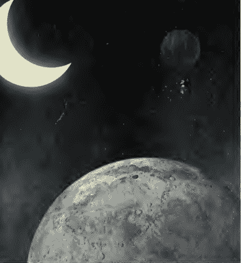

作者 Casey Burns

献我的爱、妻子 Homaira。

- 3.3 选择菜单及其他 85
- 5.2 HSV 色空间 150
- 5.4 减色系统与 CMYK 157
- 5.6 混合模式 161
- 5.8 混合模式的实际用途 176
- 6.2 去除色偏 190
- 6.4 锐化 213
- 7.2 项目 2：穿越镜镜 231
- 7.4 项目 4：人鱼的呼唤 247
- 8.2 渐变渲染 267
- 8.4 阴影 276

# 前言

本书的标题《深入理解 GIMP》，源自罗伯·海因莱的科幻小说《异星传缘》（Stranger in a Land）。“Grok”一词在1961年出版的这部书中引起了立即关注，并成为文化的一部分。今天，这个词可以在《黑客字典》（The New Hacker's Dictionary）中找到定义。

1996年第一次遇到 GIMP 时，我正在写一篇文章，手里有一些质量糟糕的照片想要处理和增强。我听说过 GIMP，于是从网上下载了它。当我运行它时，它弹出一个小工具箱。没费太大力，我就发现了如何打开它包含所有功能和滤镜的菜单。哇！它看起来既酷又强大！但我完全不知道如何使用它来解决问题。

我不知道我的照片到底出了什么问题，只是它们看起来很平淡、发白。我想让它们看起来更好，这就是我对 GIMP 感兴趣的原因。

我开始寻找它。通过搜索网络、在图书馆借书，我逐渐发现了一些数字照片处理和增强的用方法。这是一个缓慢且沮丧的过程，感觉似乎并没有关于我想学习内容的统一理论处理。

最让我恼恼的是，我拿的几乎每本书都充满了技巧和窍门。技巧和窍门？这感觉像是在赌小钱。我不想要窍门，我想要想法。

# 作者简介

Carey Bunks 是位于马萨诸塞州剑桥市 BBN Technologies 高级科学家，他目前在那里从事水下声呐、主动噪声与振动控制以及网络安全等多个研究项目。他于1987年获得马萨诸塞理工学院的电气工程博士学位，此后一直专注于信号处理领域。Carey 曾从事地震成像、图像伪影滤波以及图像数据运动估计等问题的研究。他在科学期刊上发表了二十多篇文章，并拥有多项专利。

Carey 还是开源科学与工程计算软件包 Scilab 的开发小组成员。他开发了 Scilab 信号处理工具箱，并是1999年由 Birkhäuser 出版的《Scientific and Engineering Computing with Scilab》一书的合著者。

此外，Carey 是马戏团和杂技艺术的严肃学生。他曾就读于位于佛罗里达州威尼斯的玲玲兄弟巴纳姆巴利小丑学院，并于1977年毕业。作为一名出色的魔术师和杂技演员，他以街头剧风格的演出在美国和欧洲为数百团体表演过。他是技巧索绳方面的专家，也是在线书籍《The Lasso—A Rational Guide to Trick Roping》（套索——技巧索绳的理性指南）的作者。

Carey 和他的妻子 Homaira 住在马萨诸塞州波士顿。他们喜欢航海、滑雪和在欧洲旅行。

> 照片由 Dan McCarthy 提供。

# 致谢

GIMP 起于1995年夏天，是加州大学伯克利分校两位本科生的一个极其雄心勃勃的项目。他们开始了，他们可能并没有意识到这有多么不可能，但他们做到了。我们创建了一个捕捉了开源运动想象力的 Beta 版本。Spencer Kimball 和 Peter Mathis 就是那两个学生，对于他们带给别人的创作灵感，我想像他们带给我的灵感一样感谢他们。当然，没有他们，这本书绝不会存在。

Spencer Kimball

Peter Mathis

Peter 和 Spencer 种下的灵感种子吸引群才华横溢的核心开发人员，他们将 GIMP 发展成了今天这样强大的数字图像处理工具。他们是一群来自世界各地的松散成员，仅通过网络空间的丝线连接在一起。他们中的大多数人从未面对面见过，尽管如此，他们在一个具有重大复杂性和巨大价值的项目上进行了协作与配合。GIMP 是一个多么惊叹的现象！我想感谢他们每一个人。截至 GIMP 1.1.1 版本的名单如下：

Lauri Alanko, Shawn Amundson, John Beal, Zach Beane, Tom Bech, March Bliss, Edward Levin, Robert Royoy, Slavic Brabec, Simon Budig, Burgess, Peter Burton, Francisco Bustamante, Kenneth Christians, Ed Connel, Jay Cox, Andreas Dilger, Austin Donnelly, Scott Graves, Misha Dyson, Daniel Egger, Larry Ewing, Neil Fetchak, Dryk Forsyth, Gether Sutter, Heiko Goller, Michael Hammel, Ville Häutamaki, James Hendrick, Christoph Hoeg, Wolfgang Hofer, Jan Hibicaka, James Timik, Peter Kirchgner, Tuomas Kuomasnen, Karin Kylander, Olaf S. Kylander, Chris Lacey, Nick Lamb, Carl La Rocha, Jens Lautenbacher, Lanie Leavitt, Elliot Lee, Marc Lehmann, Wing Tung Leung, Ralph Levien, Adrien Likans, Tor Lillquist, Ingo Luetebohl, Ed Mackey, Volker Madsen, Marcelo Halmos, Ian Main, Kjartan Maraas, Kelly Martin, Torsten Martins, Federico Mena, Monica Davis, D. Moss, Sung-Hyun Nam, Balazs Nagy, Shuji Narazaki, Michael Natterter, Steven Neuman, Stephen Robert Norris, Erik Nyg, Tomas Ögres, O'Neal, James Painter, Asbjorn Petersen, Michael Phillips, Raphael Vincent, Vincent Renardias, James Robinson, Mike Schaeffer, Tracy Scott, Aaron Sherman, Manish Singh, Nathan Summers, Mike Sweet, Eiichi Takamori, Tristan Tarrant, Owen Taylor, Ian Tester, Andy Thomas, James Wang, Kris Wehner, Matthew Wilson, 以及 Shirasaki Yashiro.

在 GIMP 开发小组的所有成员中，我想向 Karin 和 Olaf Kylander 表示特别诚挚的感谢。他们是《GIMP 用户手册》的作者，这是 GIMP 2.3 第一本完整的参考资料。我个人发现它在起草我自己的书时是无价之宝。

我还想感谢 tigert（即 Tuomas Kuosmanen），他是 GIMP 艺术家。他慷慨地接受了创作这本书的封面设计。

在编辑方面，有许多个人直接帮助我准备了这本书。我想先感谢 New Riders 出版社的执行编辑 Laurie Petrycki。Laurie 是开源软件社区的真正支持者，她付出的努力改变了 New Riders 的编辑流程，以适应像我这样使用开源工具的作者。她充满热情，对想法持开放态度，并愿意改变陈旧的业务和设计惯例来让我的书变得。我会向任何想写开源软件书籍的人极力推荐她。

我还想感谢我的开发编辑 Jim Chalex。他鼓励我，对改进我书的结构和内容给出了很好的建议，在逗号的使用上展现了非凡的造诣，并构思了一个很棒的书名。Jim，向你致敬！

技术评审员 Guillermo Romero 和 Zach Beane 贡献了巨大的功劳。他们都读完了那份极其困难的初稿，尽管如此，仍然准备了出色的技术评审，提供了实用的意见和建议。

# tigert

Laurie Petrycki

Jim Chalex

Zach Beane

Guillermo Romero

## Louisa Klucnik

## Aren Howell


我还非常享受与 Louise Klnik 和 Aren Howell 的互动，他们负责书籍的设计。他们教会了我许多关于纸张、光油和字式的知识。此外，我还要衷心感谢 Kelli Brooks 和 Gayle Johnson，他们的编辑工作非常好。最后，我想感谢项目编辑 Caroline Wise，她顺利协调了整个制作过程。

除了对本书产生重要影响的个人外，几个机构值得感谢。书中介绍的概念和技术受益于大量原始图像素材的使用。这些图像的来源是几个美国政府网站，它们慷慨地允许在不声明版权的情况下使用。其中包括美国国家航空航天局（NASA）、美国海洋和大气管理局（NOAA）以及美国鱼类和野生动物服务局（FWS）。这些机构为世界提供了极丰富的资源，我向他们致敬。感谢大家，祝使用 GIMP愉快！

## Kelli Brooks

## Caroline Wise

## Gayle Johnson

## 告诉我们你的想法

作为读者，你是最重要的评论家和反馈者。我们重视你的意见，并想知道我们在做什么，哪些可以做得更好，你希望我们出版哪些领域，以及任何你愿意分享的建议。

作为 New Riders 出版社 Linux 团队的执行编辑，我欢迎你的反馈。你可以通过传真、电子邮件或直接写信告诉我你对这本书的喜欢或不喜欢之处——以及我们如何让书更完善。

请注意，我无法帮助你解决与本书主题的技术问题，而且由于收到的邮件很多，我可能无法回复每一条信息。

当你写信时，请务必注明这本书的书名、作者和 ISBN 编号，以及你的姓名和电话或传真号码。我会仔细阅读你的意见，并与参与这本书的作者和编辑分享。

执行编辑

New Riders Publishing

Indianapolis, IN 46290 USA

# README

开源软件运动就像刘易斯·卡罗尔的《爱丽丝在仙游境》。它是一个颠倒的世界，上为下，下为上，宇宙的常法则不再适用。与商业软件一样强大且实用的免费软件？是的！这听起来不可思议、荒谬，甚至离奇伦道……但它是完全真实的。没有 Bind、Sendmail 或 Perl，互联网无法运行——这些都是开源免费软件。Linux 作为一个免费开源的操作系统，正为科学、工程和商业领域做出巨大贡献。而 Apache 拥有主导性的软件包，全球 Web 服务器市场的贡献者似乎在疯狂涌入，它也是一个创建最有用、开放且免费软件的免费开源软件包。这一现象最著名的例子之一就是 GNU 图像处理程序，又名 GIMP。

在刘易斯·卡罗尔的故事中，标记有“READ ME”（阅读）、“EAT ME”（吃我）和“DRINK ME”（喝我）的物品是帮助爱丽丝在仙游境冒险期间的关键。任何安装过开源软件的人都知道，顶根目录下总会有一个名为 `README` 的文件，其作用完全相同。本着同样的精神，这个名为 `README` 的章节为本书提供了地图，并说明了如何设置你的计算机以充分发挥 GIMP 的作用。

欢迎来到仙游境，祝你使用 GIMP 愉快！

# 概述

本书的第一部分侧重于掌握核心工具：图层、选择、掩码和色彩空间。第二部分在第一部分的基础上，介绍了针对 Web 的深度修饰、增强、合成、渲染和图像创建。以下是各章节内容的梗概。

第 1 章回顾了 GIMP 基础知识。它介绍了 GIMP 对话框，回顾了窗口功能，并解释了一系列基础但不应被视为所当然的函数。经验丰富的 GIMP 用户可以快速翻过本章，特别是如果他们已经熟悉 1.2 版本的主要功能。

第 2 章涵盖了图层。图层是 GIMP 的基本构建块。它们是我们在工作中起最重要作用的图像单元，理解它们以及操作它们的函数至关重要。即使你已经熟悉图层，本章也值得回顾，因为它包含了关于如何高效有效地使用图层的许多见解。

第 3 章和第 4 章对选择和掩码进行了统一且深入的介绍。对于普通观察者来说，选择和掩码可能像是两种完全不同的东西。然而，它们实际上是同一事物的互补实现。两者的目标都是分离图像的一部分。选择通过选取图像中的一组像素来实现，而掩码则通过遮盖某些像素并让其他部分暴露来实现。因此，选择就是掩码，而掩码可以高效、地协同工作。

由于选择通常是任何项目中最耗耗时的部分，第 3 章比较了不同的选择工具以及它们各自的最适用场景。第 4 章建立了从选择到掩码的逻辑联系。本章描述了选择边缘和一系列高级掩码技术，包括精炼选择的方法，以及一种你不想错过的寻找自然掩码的超强技巧。

第 5 章通过描述颜色以及获取颜色结果的工具，添加了我们基础技能集的最后组成部分。本章的前半部分是概念性的，涵盖了 RGB 和 HSV 色彩。后半部分涵盖了 GIMP 的混合模式。用户对这些模式的理解和利用往往很低。正如后续章节中所示，混合模式是宝贵的工具，没有它们，许多必要的操作将无法实现。本章涵盖的内容对于色彩校正、合成、渲染和 Web 图形至关重要……即本书的整个后半部分！章节直观的方法解释了你的 GIMP 项目所需的颜色方面。

第 6 章介绍了照片修饰和增强的技巧。本章的主要特点是使用“曲线”（Curves），这是一种不被充分理解但异常异常强大的工具。我认为仅本章涵盖的内容就值一本书的价格了。除了曲线的使用，本章还涵盖了使用“仿制工具”（Clone tool）消除瑕疵，以及使用一种命名奇特的“取消锐化掩码”（Unsharp Mask）滤镜。

GIMP 最有趣、好玩且实用的用途之一是合成。合成可能是像 GIMP 这类图像处理程序的首要用途，第 7 章详细讨论了这一主题。本章比其他任何章节都更依赖于前面章节介绍的方法和技术，并且强烈以项目工作为导向。这些项目展示了如何有效利用选择、掩码和色彩校正技术等工具，来实现出色的合成效果。

第 8 章描述了创建阴影、挖空和倒角的工具和技术。此外，它还详细描述了“浮雕”（Emboss）和“凹凸图”（Bump map）滤镜。这些是创建图像 3D 效果的强大工具。

第 9 章是本书的最后一章。它涵盖了 GIMP 用于互联网 Web 应用的一些最实用功能。本章描述了创建动画 GIF 和可点击图像地图的工具。它还涵盖了任何创建 Web 图形的人所需阅读的其他主题。

在书中，“点击”、“双击”以及“点击并拖动”指的是使用鼠标左键的操作。“Shift-点击”、“Control-点击”和“Alt-点击”指的是在按下 Shift、Control 或 Alt 键的同时对鼠标左键的操作。当使用鼠标右键时，该操作被称为“右点击”，使用鼠标中键时也被称为“右点击”（注：原文此处可能有误，译文保留原文逻辑或按语境处理）。

## 函数名称、菜单和快捷键

在书中，“点击”、“双击”以及“点击并拖动”指的是使用鼠标左键的操作。“Shift-点击”、“Control-点击”和“Alt-点击”指的是在按下 Shift、Control 或 Alt 键的同时对鼠标左键的操作。当使用鼠标右键时，该操作被称为“右点击”，使用鼠标中键时被称为“右点击”。

为了简洁高效地描述函数在菜单系统中的位置，本书采用了以下符号。对于图 1 所示的示例，菜单路径表示为：`Image/Transforms/Offset`。等宽字体表示该文本代表 GIMP 函数或工具。

图 1：描述路径的规范

当鼠标悬停在菜单上时，菜单会高亮。当 `Image` 菜单中的项带有指向右侧的箭头时，表示它是子菜单。例如，将鼠标光标移动到 `Image` 项上会弹出子菜单，如图 1(c) 所示。将鼠标光标移动到名为 `Transforms` 的子菜单上会转换子菜单，如图 1(d) 所示。最后，带有右箭头的项是可以点击运行的函数。

注意图 1(c) 和 (d) 中的某些项指示了快捷键。学习这些快捷键可以加快访问 GIMP 函数的速度。在 GIMP 菜单中，快捷键由大写字母表示，为一个或多个键。修饰键由 `Ctrl`、`Shift` 或 `Alt` 表示。因此，图 1(d) 所示 `Offset` 函数的快捷键为 `Shift+C+O`。操作方法是将光标移入 `Image` 窗口；同时按下 `Shift` 和 `Control` 键，然后输入 `o`。注意，虽然键序列显示为大写 C，但实际所需的键是小写的，除非特别指出了 `Shift` 修饰键。本书中的快捷键表示法与 GIMP 菜单中看到的略有不同。`Control`、`Shift` 和 `Alt` 键用大写的 C、S 和 A 表示。这些修饰键后跟着一个连字符和小写的按键。因此，书中用于应用 `Offset` 函数的表示法为 `C-S-O`。例如，`C-S-I` 表示同时按下 `Control` 和 `Shift` 键，然后输入字母 `i`。这对应 `Image:Select` 菜单中的 `Float` 函数（未显示在图 1 中）。

附录 B 列出了所有默认快捷键。它还描述了如何根据个人喜好自定义快捷键。

## GIMP

上述用于指定函数菜单位置的约定也适用于工具箱（Toolbox）窗口中的项目。图 2(a) 显示了工具箱，它包含窗口顶部的文件（`File`）和扩展（`Xns`）两个菜单。这里的 `Toolbox:Xns/Script-Fu/Console` 是 `Script-Fu` 子菜单的路径（如图 2(b) 所示），以及指向名为 `Console` 的函数的路径（如图 2(c) 所示）。

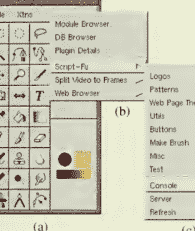

图 2：工具箱中函数路径的约定

在书中，工具箱中图标表示的函数指的是工具箱的展开视图，并为每个图标提供了名称。


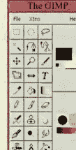

| | 椭圆选择 (Elliptical Select) | 绳索工具 (Lasso) | 激活 (Active) | 交换 (Swap Colors) |
|---|---|---|---|---|
| 魔术棒 (Magic Wand) | 智能剪刀 (Intelligent Scissors) | 前景颜色 (Foreground Color) | | |
| 移动工具 (Move Tool) | 缩工具 (Zoom Tool) | 裁剪工具 (Crop Tool) | 默认 (Default) |
| 变换工具 (Transform Tool) | 翻转工具 (Flip Tool) | 文本工具 (Text Tool) | 背景颜色 (Background Color) |
| 取色器 (Color Picker) | 油漆填充 (Bucket Fill) | 橡皮擦 (Eraser) | |
| 铅笔 (Pencil) | 克隆工具 (Clone Tool) | 激活笔刷 (Active Brush) | 图案 (Pattern) |
| 喷刷 (Airbrush) | 减淡 (Dodge & Burn) | 污渍工具 (Smudge Tool) | |
| 墨水笔 (Ink Pen) | 测量工具 (Measure Tool) | 激活渐变 (Active Gradient) | |
| X点喷刷 (Xpoint Airbrush) | 路径操作 (Manipulate Paths) | | |

图 3：工具箱图标名称

## 设置你的电脑以获得 G GIMP

本节介绍了如何优化你的计算机硬件和软件配置以提升 GIMP 的性能。

### 内存（RAM）注意事项

GIMP 可执行文件约为 7MB；然而，取决于 GIMP 数据的大小（图案、调色板等），内存占用可能会增长 2-10MB。此外，同时运行的 GIMP 进程约占用 2.5MB。因此，GIMP 至少需要 11.3MB–19.5MB 的内存。

这并不是全部，因为每个加载到 GIMP 的图像格式至少需要像素数量的三倍内存（假设每个 RGB 通道一个字节，alpha 通道一个字节）。例如，640 × 480 的图像需要 2.8MB 到 3.7MB 的内存。

除了显示图像所需的内存外，还有撤销（undo）所需的内存。这允许 GIMP 执行撤销操作。结论是，为了在 GIMP 中舒适地工作——能够打开、组合和应用过滤器——至少应该考虑 32MB 的内存。

对于包含多个图层的大图像，内存需求将成比例增加。

### 显存（VIDEO RAM）注意事项

显示大图像的能力取决于显卡的可用显存。例如，如果分辨率为 1024 × 768，8 位（每个像素一个字节），所需的最小显存为 0.79MB。然而，每像素 8 位即可，因为屏幕一次只能显示 256 种颜色。

将颜色深度增加到 16 位（两个字节），在 1024 × 768 的分辨率下，内存需求翻倍到 1.57MB。这是获得 GIMP 合理性能所需的最小内存，高性能系统可能需要 1600 × 1200，24 位（三个字节）的5.76MB 显存。

### 交换与 GIMP 内存管理

GIMP 使用 `File/Preferences` 对话框指定的内存。图 4 显示了偏好（Preferences）对话框的环境。

如图所示，缓存大小条目的默认值为 10MB。缓存是 GIMP 留用于缓存正在处理的图像的内存部分。如果你处理大量中等尺寸图像，很容易超过此缓存大小。在这种情况下，通过在 `.gimp` 目录创建交换文件获得额外的内存。由于部分内存并不在 RAM 中，这会显著降低 GIMP 的性能。因此，如果用户有 RAM 且正在处理大图像，增加 10MB 的缓存值是有意义的。

例如，如果有 128MB RAM 且 GIMP 作为主应用程序，缓存的合理大小可能是50 到 75MB。这个数字可以根据用户的需求进行调整。确定应用程序需要多少内存的实用工具是 Linux/Unix 命令 `top`。该命令动态显示机器上运行进程的特征。特别是 `MEM` 列给每个进程使用的内存。使用 `-M`（大写）可以让 `top` 按内存使用进行排序。以下是 `top` 查看 Linux 内存使用的截取输出：

```
11:51am 2:31, 2 users, load average: 0.00, 0.02, 0.05
63 processes: 62 sleeping, 1 running, 0 zombie, 0 stopped
CPU stats: 1.3%, 0.9%, 0.0% nice, 97.6% idle
Mem: 124812k, 124096k used, 3916k free, 31492k br, 21908k buff
Swap: 136048k, 26126k used, 133428k free
PID USER SIZE SHARE RSS SHAP %MEM VMEM TIME COMMAND
6253 cbits 0 14888 14M 208S 0.0 11.6 00:01 gimp
653 root 0 14324 13M 208S 0.0 1.1 04:50 X
679 cbits 0 13172 13M 208S 0.0 11.6 00:01 gimp
6255 0 14324 13M 208S 0.0 1.1 04:50 X
679 cbits 0 13172 13M 208S 0.0 11.6 00:01 gimp
6255 0 14324 13M 208S 0.0 1.1 04:50 X
679 cbits 0 13172 13M 208S 0.0 11.6 00:01 gimp
6255 0 14324 13M 208S 0.0 1.1 04:50 X
... (此处重复内容)
```

按照相同的指令安装 `sharefonts` 包即可，就是这样！`freefonts` 包包含 79 种字体，而 `sharefonts` 包包含 22 种。下次运行 GIMP 时，这些新字体将可供文本工具使用。

如果这些字体没有预安装在常规系统目录中，那么你需要在启动新的 X 会话时告诉 X Window 系统去到哪里寻找它们。这可以通过将上述最后两条命令放入 `.xinitrc` 文件来实现自动化。

# 设置 X Window 系统运行超过 8 BPP 模式

使用具有足够色彩深度以显示细微变化的显示器，将极大地增强使用 GIMP 的体验。每像素只有 8 位（bpp）的显示器同时只能表示 256 种颜色，这对于许多照片来说是不足够的。正如第 9.5.1 节所示，结果会导致一种被称为“抖动”（dithering）的色彩失真。

如果你的视频适配器有足够的 RAM，则可以每像素 16 位或 24 位显示，这将极大提升你的视觉体验以及利用色彩进行有效工作的能力。例如，在 1024 × 768 的屏幕分辨率下以 16 位运行，你需要大约 1.6MB 的视频显存。然而，在 800 × 600 的分辨率下，你需要的不到 1MB。使用较低分辨率来获得更好的色彩深度是否合理，由用户个人决定。

Linux 上的 X Window 系统通常默认为 8 bpp。如果你使用的是 XFree86，可以使用以下命令运行更高的色彩深度（其他 X Window 系统请查阅相应的 man 页）：

```
% start --bpp 16
```

只有当 `XF86Config` 文件中有相应的段落时，此命令才会以 16 bpp 运行 X。对于 Redhat Linux 系统，该文件通常位于 `/etc` 或 `/etc/x11` 目录。关于如何使用 XF86Config 配置 X Window 系统的更多细节可以在 XF86Config man 页中找到。

GIMP 的部分功能是数字图像创建，但更多是关于数字图像处理。那么，任何项目中的主要问题之一就是找到必要的原材料；即要待处理的数字图像。

数字图像有许多来源。扫描仪是一种可能。然而，必须格外小心，因为涉及版权时，合理使用（fair use）规则可能有些复杂。在使用具有可识别人脸或任何商标或公司标志的图像时，特别建议谨慎。这类图像通常受到严厉保护，即使是用于非商业用途也是如此。

当然，扫描自己的照片是素材的极佳来源。如果你没有扫描仪，照片 CD 是一种相对廉廉的方法，可以将你的照片进行专业扫描并保存到方便的存储介质中。数码相机也是获取所需图片的极佳工具。现在有很多高质量、低价的数码相机。数码相机的一个主要优势是拍摄后可以立即评估。因此，如果照片不完全符合理想质量，可以重新拍摄，直到捕捉到合适的主题。书中使用的图像就是通过这种方式获得的。

尽管如此，拍摄某些主题的照片通常是不方便的或根本不可能——例如南极结冰的冰山、自然栖息地的孟加虎、轨道上的空间穿梭器。我们大多数人无法去那里拍摄。不过，不要绝望，因为互联网上有大量的免费摄影素材，只要稍加努力就能找到上述所有甚至更多内容。秘密在于，许多美国网站拥有“不主张版权”（no-copyright-assertion）政策。这意味着这些网站上的大多数照片都可以用于商业和非用途的免费使用。


大型免费图像存档的优秀来源示例可以在美国国家航空和航天局（NASA）、国家海洋和大气管理局（NOAA）以及美国鱼类及野生动物管理局（FWS）的网站找到。这些机构都拥有巨大的图像库，包含数万张动物、植物、水生生物、太空、飞机、船只等图像。以下是探索这些图像集合的起点网站列表。请记住，存在某些限制，且确定每张图像版权的责任仍在你身上。在使用从那里找到的图像之前，务必阅读每个网站上的版权声明。

书中使用的原始图像素材大部分来自三个来源。NASA 有几个存储图像集合的优秀网站。以下是最常用的三个之一：

```
http://www.nasa.gov/gallery/photo
http://images.jsc.nasa.gov
http://nix.nasa.gov
```

我们还大量使用了 NOAA 的主照片网站，地址为：

```
http://www.photolib.nasa.gov
```
（注：此处原文网址可能有误，已保留原样）

美国 FWS 在此处拥有极好的照片库：

```
http://www.fws.gov/images.htm
```

书中编辑来自这些网站照片的惯例是，在图像第一次出现在书中时提供其完整 URL。这不仅注明了图像来源，还可以供读者从互联网访问该照片。

还有许多美国政府服务机构向公众免费提供部分或全部图像。美国海军、空军、国会图书馆、美国地质调查局等许多机构都有带有图像的网站。

## 1 GIMP 基础

本章回顾了 GIMP 工具箱和图像窗口的特性，介绍了主要的对话框，并展示了书中其他部分未涵盖的重要函数。

### 1.1 介绍 GIMP 窗口和对话框

本节概述了 GIMP 窗口和对话框的主要功能。GIMP 窗口分为四大类类：工具箱窗口；图像窗口；图层、通道和路径对话框；以及选择颜色、笔刷、图案、渐变和调色板的对话框。接下来的章节将简要介绍其中的每一个项目。

#### 1.1.1 工具箱

图 1.1(a) 展示了工具箱窗口。该窗口是运行 GIMP 时第一个出现的窗口。它由 27 个工具箱功能图标、“文件”和“编辑”下拉菜单，以及活动前景色、活动背景颜色、默认颜色、切换颜色、活动笔刷、活动图案和活动渐变图标组成。功能图标的名称在第 7 页的图中已分别标出，其用途在本书的多个处都有讨论。

##### 工具箱菜单

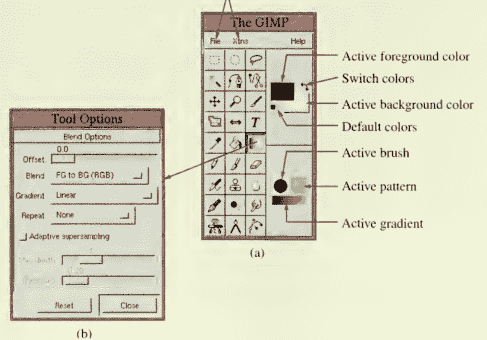

图 1.1: 工具箱窗口

工具箱中的几乎所有工具都有选项。双击工具会弹出其“工具选项”对话框。一旦打开，该对话框将一直保持打开直到被显式关闭，它为当前使用的工具选项提供了界面。如果工具选项窗口打开打开，切换工具会自动更改“工具选项”对话框。也可以通过工具箱中的 `文件/对话框/工具选项` 或在工具箱窗口中输入 `Ctrl-Shift-t` 来调用此对话框。图 1.1(b) 显示了渐变工具的工具选项对话框。

#### 1.1.2 图像窗口

该窗口是 GIMP 中最重要的窗口，也是功能最丰富的。图 1.2(a) 展示了一个典型的图像窗口。注意，标记为 `image-window.xcf - 16.0 (RGB) 200%` 的标题栏提供了关于此图像的信息。字符串 `image-window.xcf` 是磁盘上包含该图像原始版本的文件名，而 `*` 表示窗口中的图像相对于磁盘上的版本已过修改。因此，为了避免丢失所做的更改，必须对其进行保存（参见第 1.2 节）。字符串 `16` 是窗口编号 16，视图编号 0。每当打开新图像时，窗口编号都会递增，除非使用“新建视图”创建窗口，此时视图编号递增（关于视图编号的信息请参见第 1.8.2 节）。括号中的字符串 `(RGB)` 是图像类型（参见第 1.4 节），可以是 RGB、灰度或索引颜色。最后，字符串 `200%` 表示图像已缩放，并在窗口中以其真实尺寸的两倍显示。

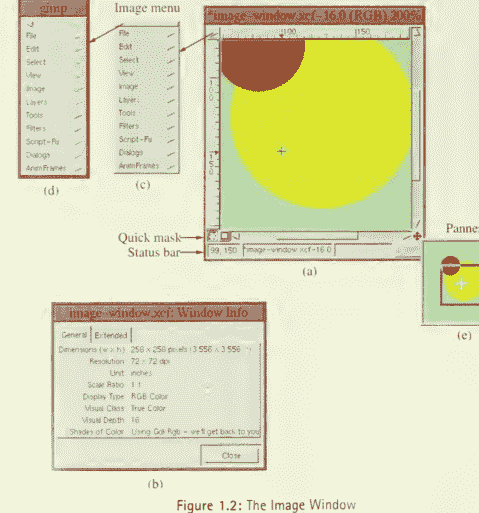

图 1.2: 图像窗口

关于图像的附加信息可以通过“窗口信息”对话框获取，该对话框如图 1.2(b) 所示，可以在 `图像:视图` 菜单中找到，或者在图像窗口中输入 `Ctrl-Shift-i` 显示。此对话框提供了图像的像素尺寸以及每英寸点数（dpi）分辨率。图像窗口左侧和上方标尺的单位与“窗口信息”对话框中显示的尺寸对应。将鼠标光标移动到图像窗口内，每个标尺上会出现一个箭头，指示光标的位置。光标位置也会在状态栏中精确显示。在图 1.2(a) 中，状态栏显示鼠标光标位于 `(99,150)` 位置。标尺和状态栏都可以通过“切换标尺”和“切换状态栏”关闭，这两个功能都可以在 `图像:视图` 菜单中找到。

图像窗口最重要的功能是“图像”菜单，如图 1.2(c) 所示。该菜单通过在图像窗口中点击右键显示，也可以通过点击窗口左上角的箭头图标显示（参见图 1.2(a)）。图像菜单及其子菜单将一直保持打开，直到用鼠标选择了其中某一个项目。然而，这些菜单可以作为窗口打开，并且这样做可以使它们保持留在屏幕上。这是通过点击菜单顶部的虚线实现的。图 1.2(d) 演示了这一点。再次点击顶部的虚线可以将图像窗口从屏幕上移除。

当图像大于图像窗口的显示范围时，图 1.2(a) 所示的滚动条允许在窗口内移动图像。然而，有一个特殊的平移动窗口可以通过点击并按图像窗口右下角的四向箭头图标来显示。平移动窗口如图 1.2(e) 所示。在此窗口中移动鼠标可以移动图像窗口中的图像。或者，也可以通过点击中键并拖动鼠标来移动图像。最后，图像窗口右下角有一对按钮。

#### 1.1.3 图层、通道和路径

图层、通道和路径对话框非常重要。图层对话框如图 1.3(a) 所示，通道对话框如图 1.3(b) 所示，路径对话框如图 1.3(c) 所示。这些对话框中的每一个允许你操作图像的不同方面。详细信息将在后续章节提供。


#### 1.1.4 颜色、笔刷、图案、渐变和调色板对话框

选择颜色、笔刷、图案、渐变和调色板的对话框也是重要的 GIMP 工具。颜色选择对话框如图 1.4(a) 所示，笔刷对话框如图 1.5(b) 所示，图案对话框如图 1.6(a) 所示，渐变对话框如图 1.7(a) 所示，调色板对话框如图 1.8(a) 所示。这些对话框中的每一个都提供了各种工具，用于自定义和选择你的创作元素。

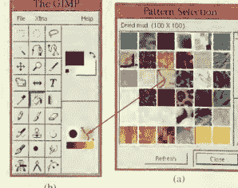

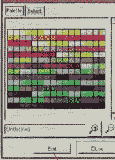

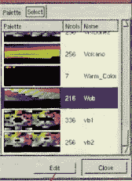

### 编辑调色板

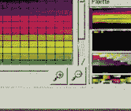

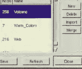

## 1.2 加载与保存图像

GIMP 中最的基本的操作是加载和保存图像。关于这些操作有一些值得注意的细之处。图 1.9 展示了“打开图像”对话框。此函数可以通过多种方式调用。它位于“图像：文件/打开”菜单和“工具箱：图像/打开”菜单中，也可以通过直接在图像窗口或工具箱窗口中输入 `C-o` 来获取。

你可以使用“打开图像”对话框浏览你的文件结构树。目录显示在左侧，文件显示在右侧。点击文件会高亮该文件，如果存在该文件的预览图，该预览图将显示在对话框底部的预览框中。如果没有预览图，可以通过以下方式创建：

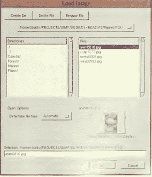

图 1.9：在 GIMP 中加载图像

点击“生成预览”按钮（图 1.9 中显示缩略图的按钮）。点击对话框底部的“确定”按钮将加载高亮的文件。图 1.9 显示了一个被高亮的文件，预览框显示了该图像对应的缩略图。

点击“确定”按钮会加载图像。也可以通过双击文件名来加载文件。双击目录将使图像对话框导航到该目录；在点击“确定”按钮之前可以加载多个文件。在点击所需文件名时按下 `Shift` 键，可以高亮多个文件。在按下 `Shift` 键的同时拖动鼠标可以高亮光标下的所有文件。

“打开图像”对话框的另一个非常实用的功能是选择框中启用了文件（及目录）名称补全。输入文件名的几个字母后按 `Tab` 键，将自动补全根据输入内容唯一确定的名称。对话框的右侧将显示所有与选择框中的字母匹配的文件。再添加一个字母并按 `Tab` 键将进一步尽可能补全，依此类推。对于打字速度快的人来说，这是寻找要加载文件的一种愉快且快速的方法。

可以使用“图像：文件”菜单中的“保存”函数保存图像。这将弹出“保存图像”对话框，如图 1.10a) 所示。该对话框与“打开图像”对话框相似。图像可以保存到新文件或现有文件。文件结构目录树的导航与“打开图像”对话框相同。在对话框底部的选择框中输入名称并点击“确定”按钮即可将图像保存为指定名称。

“保存图像”对话框的一个方便功能是，文件将根据输入的文件名扩展名指定的格式自动保存。例如，如果输入 `.jpg`，文件将以 JPEG 格式保存。


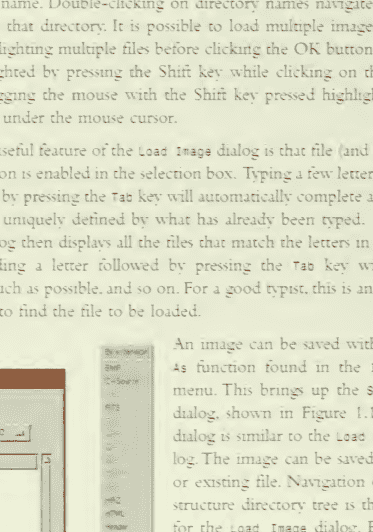

GIMP 可以加载和保存许多文件格式。所有格式列表可以在图 1.10(b) 所示的“保存选项”菜单中看到。有三种 GIMP 特有的格式。第一个是 XCF，它是 GIMP 的原生格式。这是唯一可以在处理项目时保存所有 GIMP 特性和状态的格式。如果你的图像包含多个图层、通道、选择区域或路径，你必须使用 XCF 格式保存，以避免工作丢失。由于 GIMP 是唯一可以加载 XCF 文件格式的程序，你最终可能想要保存为其他格式。请参见第 2.7.1 和 2.7.2 节，了解保存为不同格式之前应采取的注意事项。

GIMP 原生的两种文件格式是 PAT 和 GBR。PAT 用于保存图像图案，例如“图案选择”对话框中提供的图案。将带有 PAT 扩展名的文件放置在 `~/.gimp/patterns` 目录下，在下次运行 GIMP 时，它将会在“图案选择”对话框中可用。GBR 文件格式用于创建 GIMP 画笔。这同样适用于图案文件，但 GBR 文件必须放置在 `~/.gimp/brushes` 目录下才能在“画笔选择”对话框中可用。

## 1.3 创建新图像

图 1.11 显示了“新建图像”对话框。它通过“工具箱：文件”菜单或“图像：文件”菜单中的“新建”函数调用，或者在工具箱或图像窗口中输入 `C-n` 来调用。创建新图像最重要的方面是指定**图像类型**（可以是 RGB 或灰度模式）以及图像分辨率。图像分辨率通过在 X 和 Y 输入框中输入值来设置。默认值为 72（像素/英寸），这对应于你的显示器。如果你的图像要输出到打印机，应该选择相应的值。

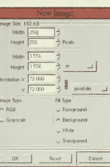

图 1.11：新建图像

## 1.4 RGB、灰度与索引图像

GIMP 使用三种格式进行显示和处理：RGB、灰度和索引。虽然灰度模式在第 5 章有简要介绍，索引格式在第 9 章讨论，但本书主要使用的格式是 RGB。由于大多数插件不支持索引格式，因此在需要时可能需要将其转换为 RGB。

## 1.5 撤销与重做

GIMP 的一个非常实用的功能是可以执行多次撤销和重做。“撤销”函数位于“图像：编辑”菜单中，“重做”也是如此。这两个函数非常有用，你会想要记住它们的快捷键。

GIMP 中可以执行的撤销次数由“图像：偏好”对话框控制。默认值为 25，但如果你处理具有许多图层的图像，这将是可能的。

GIMP 的一个神奇功能是位于“图像：查看”菜单中的“撤销历史”。调用它时，它会显示对图像进行的操作的缩略图列表。图 1.13 展示了这样一个序列。图 1.13(a)、(b) 和 (c) 显示了连续的应用，随后是颜色填充。图 1.13(d)、(e) 和 (f) 显示了撤销历史中的相应条目。

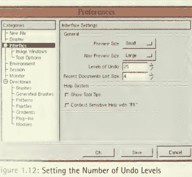

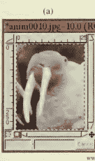

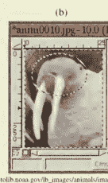

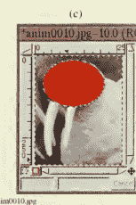

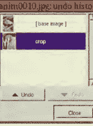

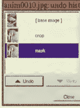

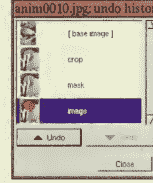

图 1.13：使用撤销历史对话框

在图 1.13 中，注意“撤销历史”对话框中的高亮缩略图如何指示图像窗口中显示的当前状态。在图像窗口中输入 `C-z` 执行撤销会将高亮缩略图移动到缩略图栈中的上层，而使用 `C-r` 执行重做则将缩略图向下移动。此外，你随时可以通过点击选择“撤销历史”对话框中的任何层。

通过这种方式，可以通过两种独立的方法访问撤销历史中可用的任何之前的图像版本：在图像窗口中反复按下 `C-z` 直到到达所需状态。第二是直接点击“撤销历史”对话框中相应的缩略图。

## 1.6 找回上一个过滤器对话框

大多数 GIMP 过滤器都带有多种控制过滤器效果的参数。由于通常很难预先知道对图像应用多大程度的特定参数，因此进行一些实验是必要的。遗憾的是，GIMP 过滤器位于“图像（Image）”菜单下的第三层子菜单中。对过滤器进行实验意味着在相应的子菜单中找到它，评估它对图像的影响，如果如果不满意则进行撤销，并使用新设置重新应用过滤器。在图像子菜单系统中反复搜索同一个过滤器可能会令人烦恼。

限制这种烦恼的一种方法是重新打开过滤器子菜单。然而，更直接的方法是使用“重塑”（Reshape）功能的键盘快捷键。快捷键是 `Ctrl-f`。此功能会调用应用于图像的最后一个过滤器的对话框，以及之前使用的值。只需两次按键，先按 `Ctrl-z` 后按 `Ctrl-f`，即可撤销并使用新的参数值重新执行过滤器效果。

## 1.7 复制、剪切和粘贴缓冲区

图层和选择的复制、剪切和粘贴是 GIMP 中最常见的操作之一。在本书中，这些操作在第 4 章被广泛使用，那里它们用于构建掩码；在第 8 章中，它们用于图像渲染；在第 7 章中，它们对于合成至关重要。

复制、剪切、粘贴命令可以在“图像:编辑（Image:Edit）”菜单中找到，但它们非常有用，记忆它们的键盘快捷键是不可或缺的。可以在图像窗口中输入 `Ctrl-c` 执行复制命令，输入 `Ctrl-x` 执行剪切，输入 `Ctrl-v` 执行粘贴。正如第 2、3 和第 4 章所示，复制、剪切和粘贴是在图像窗口和图层掩码之间移动图层最慢费力的方法。

GIMP 使用缓冲区管理复制、剪切和粘贴。每当执行通用复制或剪切时，内容都会被放入默认缓冲区，替换其中现有的任何内容。通用粘贴使用默认缓冲区的内容但不清除它，因此内容可以被重复使用，直到被另一个复制或剪切操作替换。复制或剪切会将活动图层放入缓冲区。如果图像中有活动选择，则只有活动图层中包含在选择部分会被放入缓冲区。

“图像:编辑”菜单中提供了通用的特殊粘贴函数。如果图像有活动选择，粘贴功能会将默认缓冲区的内容放入选择中，将粘贴的图像裁剪到选择的边界。可以使用移动工具重新定位粘贴的图像。“粘贴到新图像（Paste New）”将默认缓冲区的内容放入一个新的图像窗口中，该窗口的尺寸足够大容纳粘贴的图像。

还有一个名为“复制（Copy）”的特殊函数。该函数不是将活动图层复制到默认缓冲区，而是复制所有可见图层，或者如果有活动选择，则复制选择内的可见图层部分。如果图像由多个图层组成，复制的内容在放入默认缓冲区之前会被平化。

除了通用默认缓冲区外，GIMP 还有命名缓冲区（named buffers）。如果需要大量的复制、剪切或粘贴操作，命名缓冲区对于组织碎片非常有用。图 1.14(a) 展示了一个圆形选择，它通过“图像:编辑”菜单中的“命名复制（Copy Named）”被放入命名缓冲区。使用此函数会显示图 1.14(b) 所示的对话框，在其中输入缓冲区的名称。

1.14(c) 和 (d) 展示了使用“命名复制”处理正方形选择。

图 1.14: 使用命名缓冲区

从命名缓冲区粘贴是通过使用“图像:编辑”菜单中的“命名粘贴（Paste Named）”命令完成的。图 1.15 显示了使用此命令时出现的对话框。可以通过点击对话框中的名称，然后点击“粘贴”按钮来粘贴任何命名缓冲区的内容。可以通过突出显示并点击“删除”按钮从列表中移除缓冲区。

## 1.8 缩放和新视图

“缩放（Zoom）”和“新视图（New View）”函数用于对图像进行精确的像素级。本节介绍了这些特别实用的函数。

### 1.8.1 缩放

图 1.16 展示了缩放的使用。缩放功能通过点击工具箱中的放大镜图标启用，具有两种操作模式。第一种模式通过在图像窗口中点击并拖动来框定图像的一部分。当释放鼠标键时，勾勒出的区域将缩放。图 1.16(a) 显示了用鼠标创建的选择区域，图 1.16(b) 显示了该区域如何缩放以填充整个图像窗口。这是缩放图像特定区域的一种方便方法。

缩放工具的第二种操作模式通过直接在图像窗口中单击或 `Shift-点击` 访问。每次点击放大一级，`Shift-点击` 缩小一级。也可以使用快捷键对图像窗口进行放大或缩小。缩放通过在图像窗口中输入 `=` 完成，缩小通过输入 `-`（即减号键）完成。注意 `=` 键与 `+` 键相同，这应该提醒你它会添加或增加缩放。相比之下，减号键则减去或减少缩放。快捷键的优势是它们不需要先点击工具箱中的缩放图标即可工作。

在“图像:视图（Image:View）”菜单中的“收缩（Shrink Wrap）”函数可以调整窗口以包含整个图像，但仅限于显示器的屏幕限制。也可以通过在图像窗口中输入 `Ctrl-e` 来调用收缩。


每当缩放图像的一部分在图像窗口中不可见时，可以使用图像面板（image pane）进行移动。对于缩放图像的移动还有三种其他可能性。窗口的滚动条，但这些可能不是最方便的方法。第二种选择是在图像窗口中点击并拖动。如果图像只需要增量调整，这种方法效果良好。如果需要在缩放图像的许多不同区域之间移动，导航窗口（Navigation Window）可能是最好的选择。“图像:视图”菜单中的导航窗口的使用如图 1.17 所示。图 1.17(a) 显示了缩放 200% 的图像，图 1.17(b) 显示了导航窗口。此对话框允许通过点击和拖动矩形来移动图像。你还可以通过点击 + 和 - 按钮使用导航窗口控制缩放程度。

图 1.17: 使用导航窗口缩放

### 1.8.2 新视图

对缩放图像进行详细的像素级操作时，查看这些操作对比例图像的影响是有，但每次操作后都放大缩小是不方便的。为了解决这个问题，“图像”菜单中提供了“新视图（New View）”函数。该函数创建一个新的图像窗口，它是精确的依赖视图。因此，在一个窗口执行的操作也会显示在另一个窗口中。缩放函数是唯一的例外，它可以影响一个窗口而不影响另一个。新视图允许在一个缩大的窗口中执行像素级操作，同时可以在另一个视图窗口中按比例查看相同的操作。

图 1.18 展示了新视图如何工作。图 1.18(a) 显示了松果的放大视图，而图 1.18(b) 显示了相同图像的未缩放视图。如图 1.18(a) 所示，正在用画笔在松果的叶子上涂红色。图 1.18(b) 显示红色在未缩放窗口中也可见。注意图 1.18(a) 和 (b) 窗口标题栏中显示的图像视图分别为 26.0 和 26.1。这表示这些窗口显示图像 26 的第 0 和第 1 个视图。

## 1.9 帮助系统

GIMP 有一个在线帮助浏览器。可以通过工具箱:帮助（Help/Help）或在任何 GIMP 窗口中按 `F1` 功能键来显示浏览器。

图 1.19 展示了帮助浏览器。当鼠标光标悬停在特定的 GIMP 工具上时按下 `f1` 键将打开与该工具相关的帮助页面。“内容”（Contents）和“索引”（Index）选项卡提供了帮助数据库的概述。

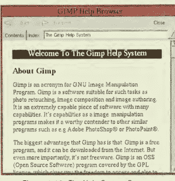

图 1.19：帮助系统浏览器

## 1.10 常见问题与常见问题解答

有时 GIMP 会显示出似乎无法解释的行为。这通常不是错误，而是对如何使用 GIMP 的误解。出于这个原因，第 1 到第 5 章各都有一个解决常见问题的章节。这些问题以 FAQ（常见问题解答）的形式呈现；以下是本章的内容：

- 我在 GIMP 中打开了一张图像并想在上面运行一些插件，但几乎没有可用的插件。它们看起来都是灰色的。我的 GIMP 怎么了？

没有问题。你可能加载了索引色彩图像（例如，GIMP 格式文件），大多数 GIMP 插件不支持索引色彩图像。解决方案是在“图像：图像/模式”（Image: Image/Mode）菜单中将你的图像转换为 `RGB` 格式。

- 在经过几小时精疲力竭的工作构建了一个包含多个层、掩罩和路径的图像后，我将图像保存到了文件中。然而，下次我打开图像时，我在图像上做的很多操作都丢失了。发生了什么？

使用 GIMP `XCF` 格式保存带有层、掩罩和路径的图像（见第 1.2 节）。这是唯一保存 GIMP 图像项目状态的格式。项目完成后，你可能希望将其保存为其他格式，如 `JPEG`、`GIF`、`PNG` 等。为此，你需要在合并图（见第 2.7.1 节）或扁平化（见第 2.7.2 节）后转换图像。

# 2 层回顾

GIMP 是一种基于像素的图像处理工具，但从数字图像创意创作的角度来看，像素既不是最方便的也不是最重要的组件。这个荣誉属于图层。像素是图层的基础，而图层通过堆叠形成图像。这构成了一个尺度分级体系。像素很小，这使得它们太难处理。如果必须逐像素地构建图像，那将非常困难。另一方面，整个图像又太笨重，无法舒适地处理。图像中有某些概念部分或特定组件，我们希望在不干扰其他部分的情况下处理它们。通过由其他图层构建图像，可以独立于图像的其余部分来处理每个组件。这使得图层成为像素和图像之间的良好中点。对于我们在 GIMP 中想要实现的目标，它们的“尺寸恰恰合适”。

我们想要制作的图像通常由来自其他图像的各个碎片组成：从这里那里取一部分，并将其缝合成一个整体。图层允许我们组合所有碎片，同时保持它们相互独立。这种处理数字图像的拼贴方式非常强大。我们可以处理单个图像部分而不影响其他部分。将部分放在单独的图层允许对它们进行单独处理。图层可以独立地进行定位、重新定位、颜色调整和过滤。图层的实用性再怎么强调也不为过。因为图层，合成、动画、选择、效果和增强都变得更加简单。

本章的目标是为图层机制建立坚实的基础。你将学习如何有效使用它们，同时避免常见的陷阱。这里涵盖的材料将在后面的章节中再次引用。

## 2.1 图层及其在图像中的作用

2.1 将将用于描述图层的一些基本特征。虽然这张图像是由三个层构建的，但从图像窗口查看并不显而易见。要理解并操作图像的图层结构，你必须使用“图层”（Layers）对话框。然而，在描述这个重要工具之前，让我们看看图 2.2，它是关于如何使用图层来组成图像的有用插图。

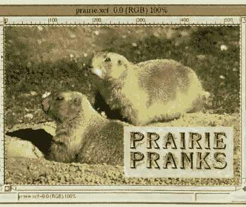

图 2.1：一个三层图像

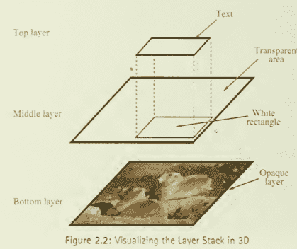

图 2.2 显示了三层堆栈与图 2.1 所示 2D 图像之间关系的 3D 拆解。底层是一对土拨鼠的照片；该层是完全不透明的。中间层与底层尺寸相同，除了一个小小的白色矩形区域外，完全透明的。白色矩形本身是半透明的（因此，可以通过它看到底层）。最后，顶层的尺寸小于底层或中间层。顶层对于文本“草原大恶作剧”（Prairie Pranks）来说也是透明的。图 2.2 中的垂直红色虚线显示，顶层中的文本直接位于中间层白色矩形的正上方。图中显示的黑色框是为了显示文本和白色矩形的位置而绘制的，但它们实际上并不是图像的一部分（参考图 2.1）。

图 2.2 所示的 3D 图层堆栈是理解图层在图像中如何工作的有用心理模型。它还强调了拥有独立于图层的图像组件的实用性。因为文本在图层上，所以它可以独立于最底层进行定位。因为白色矩形在图层上，因此可以调整其部分透明度而不影响文本。

### 2.1.1 图层对话框 (The Layers DIALOG)

如果不知道图像的图层结构，就不可能处理图像。这些信息由“图层”对话框提供，它是“图层与通道”（Layers & Channels）窗口的一部分。可以在“图像：图层”（Image:Layers）菜单或“图像：对话框”（Image:Dialogs）菜单中找到图层与通道窗口，也可以在图像窗口中按 `Ctrl+L` 调用。图 2.3(a) 显示了来自图 2.1 的多层图像，而图 2.3/b 显示了相关的图层对话框。

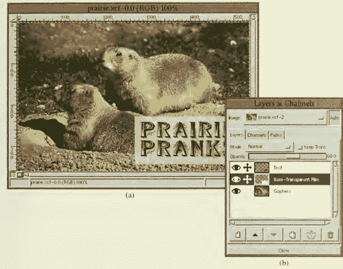

图层对话框有许多组件。除了显示图像的图层顺序外，“图层面板”（Layers Palette）还提供了处理图像任务的有用信息和工具。如图 2.4 所示，缩略图的最左侧是“眼睛”图标。如果此图标可见，则相应的图层在图像窗口中可见。可以通过点击它来关闭图标。这将使图层在图像窗口中不可见。再次切换即可恢复图层。

缩略图左侧、眼睛图标右侧的区域是“链接”图标。点击此区域会出现四向箭头，如图 2.4 所示。当对多个层激活此项时，它们将链接并移动。

缩略图右侧是“图层标题区域”（Layer Title Area），对于新图像，默认命名为“背景”（Background）。可以通过双击图层标题区域更改标题。这将弹出一个对话框，可以在其中输入新标题。

图 2.4 中的中间层条被蓝色高亮，表示它是活动图层。应用于图像窗口的 GIMP 工具将应用于此图层。这非常重要，请重读这两句！GIMP 工具和过滤器都应用于活动图层。不知道哪个图层处于激活状态会导致混乱和挫败。只有在打开图层对话框时才能可靠地确定活动图层的身份。可以通过点击缩略图或标题区域使任何图层变为活动。一次只能有一个活动图层。

图层面板之外图层对话框的其他重要功能。首先有两个名为“图像”（Image）和“模式”（Mode）的下拉菜单。图像菜单用于指定图层对话框的上下文。GIMP 可以同时打开多个图像窗口。当打开多个图像窗口时，此菜单用于选择显示在图层面板中的窗口。如果切换了“自动”（Auto）上下文按钮（默认开启），图像窗口中的任何按键都会自动神奇地更改图层面板。我喜欢使用空格键来执行此操作。

模式选择活动图层的像素与下方像素的混合方式。每个图层都有一个混合模式上下文，使用该模式指定。混合模式将在第 5 章进行更详细描述。

图层对话框的其余功能包括不透明度滑块、透明度切换按钮，以及对话框底部的一行我称为按钮栏的按钮。这些稍后都会进行更详细讨论。然而，在这些功能中，不透明度滑块引起了立即关注，因为它


它被用于图 2.3 所示的示例。2.3(b) 显示中间层被高亮，表示该包含白色白色矩形的图层处于激活状态。仔细检查“图层”（Layers）对话框可以发现该图层的不透明度（Opacity）滑块被设置为 60.0%。这意味着可以通过白色矩形看到下方的层，因为矩形所在的层只是部分透明的。就像混合模式（blending modes）一样，不透明度可以为每个层独立设置。

### 2.1.2 图层菜单（THE LAYERS MENU）

除了上一节描述的功能之外，“图层”对话框还有一个隐藏菜单。该菜单通过在“图层面板”（Layers Palette）中右键点击高亮的激活层来显示。这被称为“图层菜单”。图 2.5(a) 展示了图层对话框，图层菜单显示在图 2.5(b) 和 (c) 中。图层菜单提供的功能将简要描述，但在介绍这些功能之前，我们需要稍稍转一个弯子来讨论图像的另一个元素：

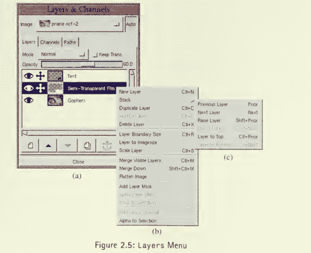

## 2.2 通道及其与图层的关系（CHANNELS AND THEIR RELATIONSHIP TO LAYERS）

回图像是由图层和像素构建的。然而，在图像结构层次中还有另一个重要组件。图层可以分解为称为“通道”（channels）的子层。图层由一到四个通道组成。在书中，几乎所有工作都在 RGB 图像上进行的。对于这类图像，每个图层由四个名为 R、G、B 和 A 的通道组成。这些分别是图层的红色、绿色和 Alpha（透明度）组件。R、G、B 通道包含图层的颜色信息，而 A 通道描述该图层的透明度。该规则的例外是，新创建的图层默认是不透明的。

图像层次结构的完整示意图见图 2.6。在 GIMP 的标准图像中，通道深度为 8 位。然而，GIMP 的另一种版本通道深度为 16 位，这意味着每个图层占据 32 位。这种深度的 GIMP 适用于 64 位的图像。这种深度的 GIMP 这种通道是 Alpha 通。更多关于这种深度的 GIMP 的信息，可以访问 `http://gimp.org`。


(a) 像素 (b) 通道 (c) 图层

图 2.6：图像层次：图层由 R、G、B 通道组成

### 2.2.1 通道对话框（CHANNELS DIALOG）

类似于混合模式，不透明度可以为每个层独立设置。

在图 2.9(b) 中，可以看到粘贴的层显示为一个浮动选择。背景层（Background layer）是对话框中唯一的另一个层，它呈灰色，意味着它无法被选为活动层。

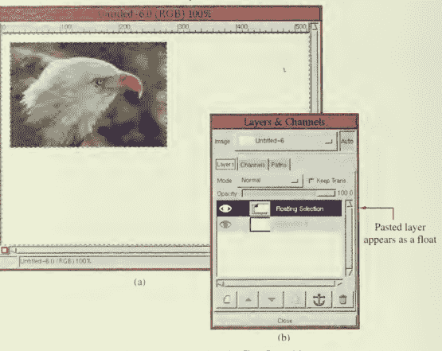

图 2.9：导入第一张粘贴图像

粘贴的层在图 2.9(a) 中显示为一个选择，周围有移动的虚线。（记住，这些移动的虚线被称为*蚂蚁线*（Marching Ants）。）这个浮动选择可以使用工具箱中的*移动*（Move）工具放置在新图像中。

一旦确定了层的位置，可以通过打开图层（Layers）菜单并从该列表中选择“锚定层”（Anchor Layer）功能，或者在“图层与通道”（Layers & Channels）或图像窗口中输入 `Ctrl+h` 来将其锚定到下方的层。也可以简单地点击图层对话框中的“锚定”（Anchor）按钮。然而，在本例中，该层并没有锚定到下方的层，而是被转换为了新层。这是通过使用图层菜单中的“新建层”（New Layer）功能完成的。图 2.10 显示了转换后的层比图像窗口要小。图 2.10(b) 展示了相应的图层对话框，显示浮动内容已转换为一个图层。可以通过在“图层与通道”窗口中输入 `Ctrl+n` 或通过点击按钮栏上的“新建层”图标来将浮动选择转换为新层。

图层回顾

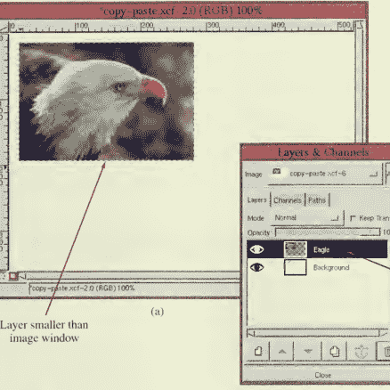

层比图像窗口更小 (a)

浮动内容转换为新层 (b)

图 2.10：创建新层

上述描述的导入鹰图像的序列操作非常频繁，用到值得背下来。让我们简要地回顾一下所需的步骤……然后收藏此页面！接下来的列表略微泛化了该过程，假设存在一个包含多层的图像窗口（其中包含一个要导出的层）以及另一个将导入的多层目标图像：

- 1. 在源图像窗口中，输入 `Ctrl+l` 打开图层对话框。
- 2. 在图层对话框中，通过点击图层面板（Layers Palette）中的缩略图使源层变为活动。
- 3. 回到源图像窗口，输入 `Ctrl+c` 将活动层复制到默认缓冲区。
- 4. 在目标图像窗口中，输入 `Ctrl+v` 将缓冲区粘贴为浮动选择。（注意，当在目标窗口处输入 `Ctrl+v` 时，图层对话框的上下文会自动切换到目标图像窗口）。
- 5. 使用移动工具根据需要对浮动选择的位置。
- 6. 在图层对话框中输入 `Ctrl+n`（或点击“新建层”按钮）将浮动内容锚定到新层。否则，输入 `Ctrl+h` 或点击“锚定”按钮将其锚定到目标图像的上一个活动层。

顺便提一下，当浮动选择被转换为新层时，生成的层尺寸恰好足够包含粘贴层的内容。如图 2.10(a) 所示，生成的鹰层比图像窗口小。将粘贴的图像放入一个与目标窗口尺寸相同的独立层是非常容易的。只需在从缓冲区粘贴之前，在目标图像中创建一个新层即可。粘贴后，点击按钮栏上的“锚定”图标将浮动选择锚定到这个新层上。

对图 2.8(b) 中的飞机重复此导入程序将产生如图 2.11 所示的结果。

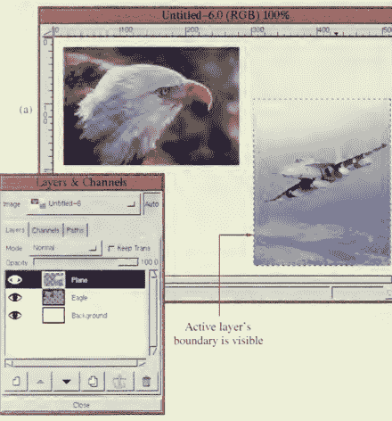

图 2.11：导入第二张粘贴图像


注意，图 2.11(a) 中活动层的边界显示为黑黄相间的虚线。通常我们并不知道图层边界，因为所有层的尺寸都相同。在这种情况下，图层边界与窗口边缘重合。然而，对于图 2.11(a) 所示的情况，图层边界是明显的，因为粘贴层比图像窗口小。

层的可见边界可能会成为问题，特别是当你试图调整两个层之间的相对位置，或者当你试图仔细对齐层边缘的颜色时（关于该问题的特别示例，请参见第 7.5 节）。当需要抑制图层边界时，可以通过“图像：视图”（`Image:View`）菜单中的“切换选择”（`Toggle Selection`）功能，或在图像窗口中输入 `Ctrl+t` 关闭其可见性。

## 2.5 浮动（FLOATS）

在上一节中，我们遇到了一种特殊的层称为浮动选择，简称为“浮动”（float）。浮动是在某些情况下自动创建的临时层，需要时也可以显式创建。浮动是一种特殊的层类型。当创建浮动时，所有其他层都会被禁用，在浮动内容锚定之前，无法对其他层进行任何操作。尽管其他层被禁用了，但几乎所有的 GIMP 操作仍然可以在浮动层上执行。

浮动算是某种老董，是 GIMP 尚未进化为基于层的工具的史前时代的遗迹。那时，必须使用浮动内容，因为那是选择性处理部分的唯一方法。现在，将它们分离到不同的层更为有效。尽管如此，如前所述，它们是自动创建的，因此了解它们如何工作以及如何处理它们非常重要。关于浮动基本上有三点需要了解：它们如何自动创建、如何显式创建，以及如何锚定。

### 2.5.1 浮动的自动创建

有两种情况下会创建浮动。第一种发生在你做出选择后。做出选择后，立即可以移动它（光标变为四向箭头）并通过点击和拖拽。释放选择后，它会自动创建一个浮动。图 2.12(a) 展示了一个移动的选择。相应的图层在 2.12(b) 中显示了新层，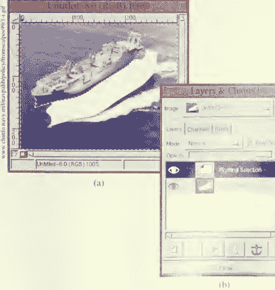

图 2.12：移动的选择变为浮动

同时也注意，原始层呈灰色，表示已禁用。

创建浮动的第二种方法是复制粘贴操作。无论缓冲区包含选择还是整个层，从缓冲区粘贴都会产生浮动选择。

### 2.5.2 浮动的显式创建

选择可以显式地转换为浮动而无需移动。这是通过使用“图像：选择”菜单中的“浮动”功能，或者在图像窗口中直接输入 `Ctrl+s` 完成的。显式创建浮动的良好用途见第 2.6.2 节。

### 2.5.3 锚定浮动

创建浮动后，在将其锚定之前无法继续进行 GIMP 操作。锚定是将浮动内容放入普通层的操作。一旦完成此，其他层将变得可用。层可以锚定到新层，也可以锚定到创建浮动之前的上一个活动层。通过从图层菜单中选择“新建层”或点击图层对话框中的“新建层”按钮，可以将浮动锚定到新层。

## 2.6 操作图层

如前所述，层是图像处理中最重要的组件。它们是你处理和组合的基础原材料。在每个 GIMP 项目中，层都需要移动、调整大小、定位、变换、剪、粘贴等。这些类型的层操作将在本节中讨论。

### 2.6.1 图层的定位

最基础的层操作之一是定位。

#### 移动层

使用移动工具完成移动。该工具通过点击显示四向箭头图标的工具箱按钮来调用。点击

在此工具中，当鼠标指针位于图像窗口内时，它会变为四向箭头。在鼠标指针位于图像窗口时点击并拖动，会导致鼠标指针下方的图层移动。受影响的层是图栈中最高且在鼠标指针下方的像素不透明度大于50%的层（关于不透明度和透明度的更多信息，请参见第 5.7 节）。这意味着，如果顶层在鼠标指针处是透明的，则它不会移动。这意味着如果活动层是透明的，那么移动的是从顶部起第一个在鼠标指针处不透明度大于50%的层。或者，可以通过按住 Shift 键点击并拖动来强制移动活动层。无论活动层的可见性、透明度或相对于指针的位置如何，这种操作都会移动活动层。

#### 使用引导线对齐图层

有时，层需要比肉眼容易判断的更精确的定位。在这种情况下，使用引导线来方便其放置是非常便利的。引导线之所以有用，是因为它们具有吸附属性。当层释放到足够靠近引导线时，它将跳转到引导线位置。引导线的吸附属性由“图像：视图”菜单中的“吸附”复选框控制。必须勾选该复选框吸附属性才能生效。

为了说明如何使用引导线进行层定位，图 2.13(a)、(b) 和 (c) 显示的三个行星图像分别复制并粘贴到具有黑色背景的大窗口的新图层中。这如图 2.14 所示。

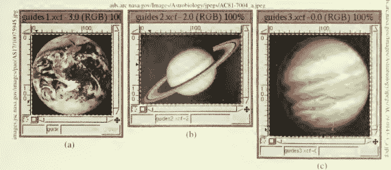

图 2.13：需要用引导线对齐的图像

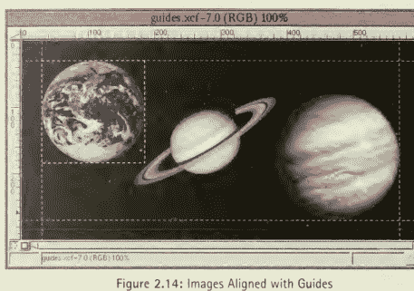

目标是对角线排列行星，但在它们与窗口边缘之间保持均匀的黑色边界。这是通过在图像窗口中放置两条水平和两条垂直引导线实现的，每个线的位置正好距离边缘两个尺子刻度。引导线从哪里来呢？它们隐藏在图像窗口左侧和顶部边缘的标尺内部。点击标尺然后拖动图像窗口，引导线就会随之移动。释放鼠标按钮即可确定引导线的位置。可以通过这种方式创建任意数量的引导线。一旦引导引导线，可以使用“图像：视图”菜单中的“切换引导线”功能，或者在图像窗口中输入 `C-S-t` 来开启或关闭它们的可见性。

在图 2.14 中，引导线显示为虚线。木星和地球图层使用移动工具进行定位，使它们的角在引导线的十字交叉处对齐。可以看到，活动层（由图 2.14 中所示黄色虚线边界标定）与引导线完美对齐。图层吸附到引导线上简化了定位操作。当不再需要它们时，可以先从工具箱中激活移动工具，然后使用鼠标将引导线拖回图像之外。

#### 切换图层边界

对于重叠或相邻的层边缘，通常需要进行精细的对齐或颜色匹配。即使图层内容不可见，在图像窗口中也可以看到活动图的图层边界。50 图层回顾

这种边界由黑黄相间的虚线组成，可能会阻碍对齐和颜色匹配的精确度。在这种情况下，视觉上切换关闭图层边界是有用的，这可以通过“图像：视图”菜单中的“切换选择”功能轻松实现。或者，可以在图像窗口中输入 `C-t`。再次切换即可恢复图层边界的可见性。

### 2.6.2 调整大小与缩放

如图 2.2 和 2.10(a) 所示，图像中的图层并不全都具有相同的大小。此外，更改图层的尺寸可能非常有用。在 GIMP 的术语中，图层可以被“调整大小”（resized），这意味着在不改变内容的情况下缩小或扩大其边界。或者，图层可以被“比例缩放”（scaled），这意味着它的尺寸发生了变化且内容被拉伸或压缩。

- 图层大小，位于“图层”菜单中
- 缩放图层，位于“图层”菜单中
- 画布大小，位于“图像:”菜单中
- 缩放图像，位于“图像:”菜单中

#### 图像缩放

缩放图像会同时更改所有图层的尺寸，并同时拉伸或压缩内容。“图像”菜单中的“缩放”功能是完成此操作的工具。图 2.15(a) 显示了一个示例，图 2.15(b) 显示了缩放对话框。图像的新宽度和高度可以用像素或当前尺寸的百分比指定。默认是按比例缩放。缩小 75% 的结果如图 2.15(c) 所示。放大 125% 的结果如图 2.15(d) 所示。

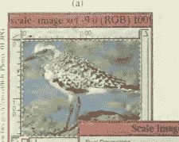

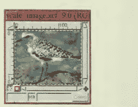

| 枢轴 | |
| :--- | :--- |
| 原始宽度 | 200 |
| 高度 | 150 |
| 新宽度 | 203 |
| 高度 | 150 |
| 比例 | 1:0000 |
| 偏移量 | |
| x | 0 |
| y | 0 |

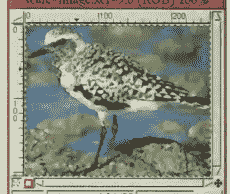

图 2.15：图像

#### 图像调整大小

乍一看，“图像”菜单中的“画布大小”功能似乎与“缩放图像”的功能相似。然而，调整图像大小与缩放之间存在重要区别。因为调整大小时图像内容不会改变，图像在新窗口中的位置取决于宽度、高度以及 X 和 Y 偏移的值。图 2.16 说明了使用画布大小可能会产生方便的问题。图 2.16(a) 显示了原始图像，图 2.16(b) 显示了画布大小对话框。在对话框中，X 和 Y 比例设置为原始图像的 50%。结果如图 2.16(c) 所示。由于图像在窗口中的位置不佳，可以使用移动工具在窗口内重新定位来补偿。这样做的结果如图 2.16(d) 所示。然而，结果仍然导致图像主体（狼头）构图不佳。

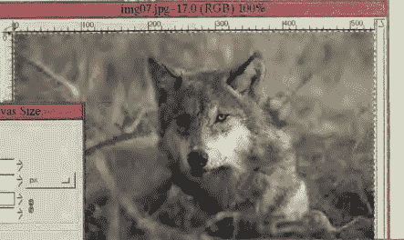

| 尺寸 | |
| :--- | :--- |
| 原始宽度 | 537 |
| 高度 | 360 |
| 新宽度 | 268 |
| 高度 | 180 |
| 比例 | 1:0.5000 |
| 偏移量 | |
| x | 0 |
| y | 0 |

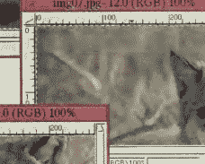

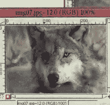

(b)

(c)

(d)

图 2.16：图像调整大小（原始变小）


更好的解决方案是使用“裁剪”工具交互式地调整图像大小。图 2.17 说明了如何通过这种方式缩小原始图像。应用该工具的方法是点击工具箱中的“裁剪”工具图标，然后点击并拖动图像窗口以裁剪矩形。一旦绘制完成，可以通过点击并拖动矩形的左上角或右下角来调整裁剪矩形的尺寸。还可以通过点击并拖动右上角或左下角来重新定位矩形。

### (a)

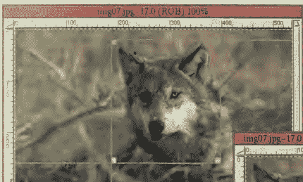

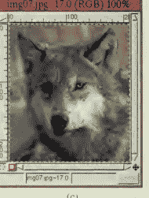

图 2.17：使用裁剪工具进行调整大小

使用裁剪工具精美地为狼头部构图的结果如图 2.17(a) 所示。使用此工具时，会弹出裁剪（`Crop`）对话框，如图 2.17(b) 所示。可以通过点击对话框中的“裁剪（`Crop`）”按钮或直接点击图像窗口中裁剪矩形内部来裁剪图像。这会使图像变小并同时丢弃窗口外的图像部分。或者，可以通过点击裁剪对话框中的“调整大小（`Resize`）”按钮来调整图像。这会使窗口变小，而不会丢弃导致窗口的图像部分。

图 2.17(c) 显示了将图像裁剪到图 2.17(a) 所示裁剪矩形的结果。从上述讨论可以得很得很，实际上没有理由使用“画布大小（`Canvas Size`）”来使图像窗口变小。使用裁剪工具这样做只需更方便。

虽然“画布大小”不是缩小图像的最优方法，但在对原始图像进行合成时，它特别有价值。通常，在放置了各种导入层后，你会发现生成的图像窗口不够大，无法充分构图该组合。当这种情况发生时，“画布大小”就是解决问题的工具。图 2.18 演示了调整图像大小的结果。

## 图层回顾

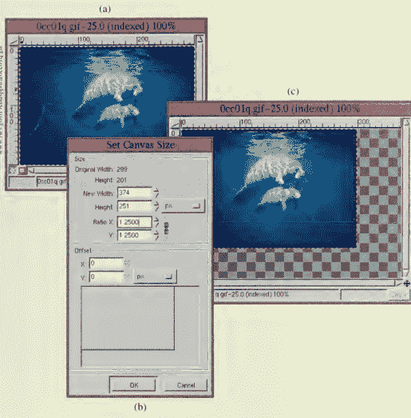

图 2.18(a) 显示原始图像，图 2.18(b) 显示了设置画布大小（`Set Canvas Size`）对话框。这次 X 和 Y 比例被缩放为原始值的 125%。结果如图 2.18(c) 所示。一旦图像窗口调整了大小，就可以使用移动工具（`Move tool`）对图像层或层重新定位。

## 图层缩放

正如本节已讨论的那样，可以缩放整个图像。然而，也可以缩放图像中的单个层。在 GIMP 中有两种工具可以实现此：位于图层（`Layers`）菜单中的*缩放（`Scale`）*功能，以及工具箱中的*变换（`Transform`）*工具。

对于整个图像，图层可以被缩放更小或更大。图层缩放最典型的用法是调整一个层上的图像相对于另一个图的相对大小。这几乎是每个合成项目都需要的（示例见第 7 章）。当需要缩小图层时，使用*缩放图层（`Scale Layer`）*功能或*变换（`Transform`）*工具的缩放选项都可以解决问题。然而，后者可能

操作图层 55

更好，因为它提供了缩放过程的交互式控制。“缩放图层”依赖于在对话框的输入框中输入数字。选择正确的尺寸很难，这会导致反复应用“缩放图层”，直到达到所需的效果。

寻找缩放图层的正确尺寸的问题可以使用测量工具（`Measure tool`）解决，该工具在第 2.6.5 节中进行了详细讨论。第 7.5 节给出了使用测量工具确定缩放图层合适数量的好例子。或者，“变换”工具提供了缩放过程的一些交互式视觉反馈。此外，它还可以配合贝塞尔路径工具（`Bezier path tool`）和路径对话框中的变换锁定（`Transform Lock`）图标使用，以获得非常精细的交互式缩放控制。该技术在第 3.4.1 节中讨论，相关示例见第 7.2 节。

应避免缩放较大的图层，因为此操作需要对像素值插值。插值是一个近似过程，会在之前没有像素的地方创建像素，因此会部分降低图层的图像质量。因此，在调整不同图层上几个图像组件的相对大小时，最好是将较大的组件缩放到匹配较小组件的大小，反之亦然。

在必须缩放较大图层的情况下，重要的是图层不能缩放到大于现有图像边界的尺寸。要将图层缩放到大于这些限制的尺寸，必须先使用讨论过的“画布大小（`Canvas Size`）”函数将图像窗口调大。

## 图层调整大小

与缩放一样，图层可以调整为更小或更大。这是通过图层（`Layers`）菜单中的图层边界大小（`Layer Boundary Size`）完成的。通常，你将图层调整为较小尺寸以消除不需要的部分。然而，将图层调小与调整图像具有相同的问题。也就是说，图层的内容必须正确放置在生成的图层边界内。对于图像，定位问题是通过裁剪工具解决的，这对调整图层不起作用。通常有一个简单的程序可以产生相同的效果，并允许在较小的图层边界内对图层内容进行交互定位。

图 2.19 和 2.20 演示了如何操作。该方法由四个步骤组成：

- 1. 使用矩形选择工具（`Rectangle Select tool`）选择图层中需要构图的区域（更多选择见第 3 章）。图 2.19(a) 显示在图像窗口中进行了矩形选择。
- 2. 然后使用图像（`Image`）”菜单中的“浮动（`Float`）”将选择转换为浮动选择。图 2.19(b) 显示了浮动选择。
- 3. 通过选择“新建层（`New Layer`）”将浮动选择转换为新层。图 2.20(a) 显示了新层。
- 4. 点击垃圾桶图标删除旧层。图 2.20(b) 显示了结果层。

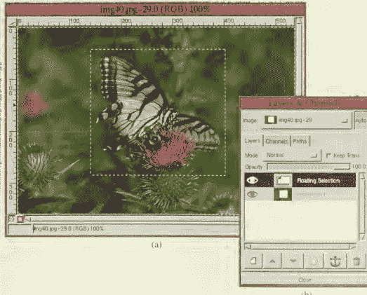

图 2.19：调整图层大小：浮动选择图层与通道

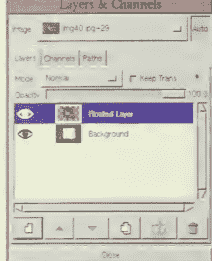

图层与通道

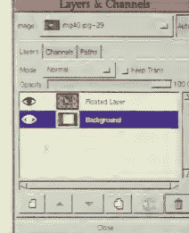

(a)

(b)

图 2.20：调整图层大小：锚定浮动

调整图层大小的结果如图 2.21 所示。在图 2.21(a) 中，图层已调整了大小，可以通过黄色虚线边界看到。图 2.21(b) 显示了结果对话框。所述程序允许在调整大小的图层内仔细地定位图层内容。

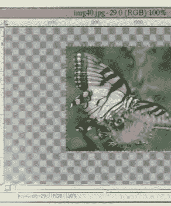

(a)

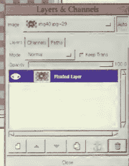

(b)

图 2.21：调整大小后的层

58 图层回顾

虽然有理由将图像调大，但很难想象图层更大。然而，由于对称性的考虑，图层可以调大。需要注意的是，对于图层缩放，GIMP 工具不允许图层调整到大于图像边界的尺寸。要将图层调整到大于边界，必须先调整图像以适应。

## 2.6.3 翻转

活动图层可以使用工具箱中的翻转工具（`flip tool`）绕其垂直或水平轴进行翻转。翻转是通过点击工具箱中的翻转工具图标（用双向箭头表示），然后点击图像窗口完成的。在图像窗口中，鼠标指针显示为双向箭头，水平翻转时水平排列，垂直翻转时垂直排列。

作为使用翻转工具的示例，图 2.22(a) 显示了一只鹈鸟的图像，图 2.22(b) 显示了水平翻转图像后的结果。注意工具选项（`Tool Options`）对话框中选了水平单选按钮，如图 2.22(c) 所示。选择垂直单选按钮，如图 2.22(d) 所示，产生了图 2.22(d) 的结果。

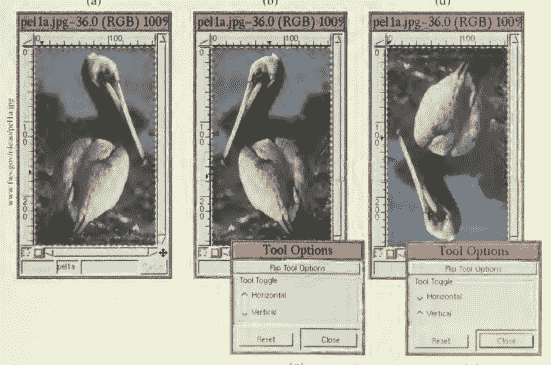

图 2.22：使用翻转工具

注意，如果工具选项对话框中选了水平单选按钮，可以通过在图像窗口中按 `Ctrl` 点击将翻转选项切换为垂直。同样，如果对话框中选了垂直单选按钮，可以通过在图像窗口中按 `Ctrl` 点击将选项切换为水平选项。

## 2.6.4 按 90 度增量旋转

可以使用“旋转”菜单对图像或图层进行 90 度增量旋转。对于图像，使用图 2.23(a) 所示的“图像：图像/变换”菜单。对于图层，使用图 2.23(b) 所示的“图像：图层/旋转”菜单。如所示，这些菜单可将整个活动层旋转 90、180 或 270 度。

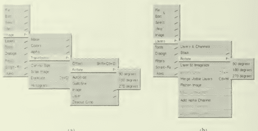

图 2.23：图像和图层旋转菜单

## 2.6.5 变换工具

可以使用工具箱中的变换工具对图层进行常规变换。此工具可以对活动层执行执行旋转、缩放、倾斜和透视变换。与往常一样，在应用此工具之前，必须注意指定活动层。

图 2.24(a) 显示了包含在较宽窗口中的图像图层。图 2.24(b) 显示的是工具选项对话框，通过双击工具箱中的变换图标获得。对话框中“变换”区域的四个按钮用于选择所需的变换类型，即旋转、缩放、倾斜或透视。

变换图层需要对像素进行插值，这可能会在结果中引入一些锯齿伪影。标记为“平滑”（`Smoothing`）的开关可以减少这种效果，这就是为什么它是默认开启的。尽管它往往会使图像变得稍微不锐，但关于如何恢复部分锐度的讨论，请参见第 6.4.1 节。

对话框的工具范式有两个选项。默认是“传统”（`Traditional`），它将图像映射到变换后的网格（见图 2.26）。对于那些喜欢反按常而行之的人，“修正”（`Corrective`）选项将变换后的网格映射到图像，产生逆变换。例如，使用“修正”选项沿一个方向旋转变换网格会将网格映射回图像，使图像本身向相反方向旋转。听起来很复杂？其实不是。自己试一下就知道了


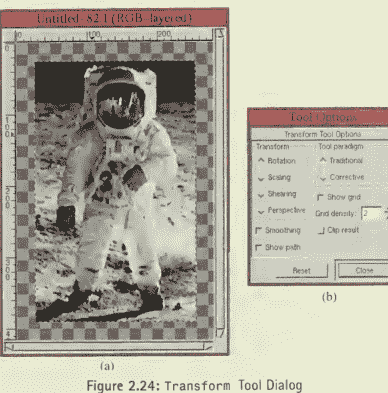

旋转图 2.25 和 2.26 展示了变换工具中旋转选项的使用。图 2.25(a) 显示了图像图层，图 2.25(b) 显示了在图像窗口中点击左鼠标键时弹出的旋转信息对话框。旋转信息对话框具有输入框，可指定特定的旋转角度以及作为旋转中心的位置。默认情况下，旋转中心是活动层的几何中心。

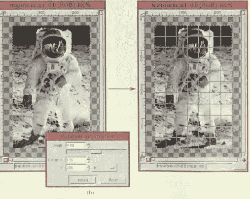

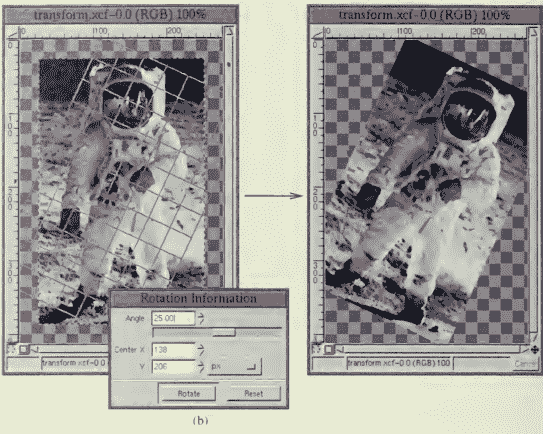

图 2.26：完成旋转变换

对于变换工具的旋转、缩放、倾斜或透视等每个选项，在图像上的第一次鼠标点击都会弹出一个与所选选项特定的对话框。此鼠标点击还在图像窗口中的活动层上叠加一个网格。网格线的数量可以在工具选项对话框中控制（见图 2.24(b)）。在图 2.25(c)中可以看到网格线。将鼠标光标置于图像窗口中的活动层内，光标将根据要执行的变换类型更改。然后可以通过点击并拖动变换图像轮廓和网格。网格的变换可以根据需要调整多次，因为在点击“选项变换”按钮之前，图像尚未开始变换。例如，必须点击图 2.26(b) 中的“旋转”按钮才能使图像实际旋转。

当为变换工具的旋转选项旋转网格时，角度会在“旋转信息”对话框中交互式地报告。图 2.26(a) 显示了 25° 角度的旋转轮廓。如前所述，一旦找到了所需的旋转角度，通过点击图 2.26(b) 所示对话框中的“旋转”按钮即可确定。生成的旋转图层如图 2.26(c) 所示。

## 图层回顾

除了使用鼠标交互式地旋转网格外，通过在“角度”输入框中输入值或使用旋转对话框中的滑块，也可以方便地进行旋转。可以使用测量工具确定有用的旋转值。第 7.2 节说明了此的一个示例。

### 缩放
图 2.27 展示了变换工具的缩放选项。与旋转类似，缩放可以通过鼠标交互式地进行，也可以通过在缩放对话框的“宽度”和“高度”输入框中输入值。


**图 2.27：缩放变换**

缩放对话框可以输入多种单位的值，默认单位为像素。按原始尺寸的百分比进行缩放（在缩放对话框顶部显示为“原始宽度”和“原始高度”）通常很方便。这可以通过对话框框下拉菜单中选择“%”选项来实现。图 2.27(b) 显示使用了此选项将图 2.27(a) 中的网格在两个维度上均缩放了 50%。当点击对话框中的“缩”按钮时，将产生 2.27(c) 所示的结果。

在使用变换工具缩放图层时，限制 X 和 Y 缩放以保持其纵横比例是有用的。这通过在使用鼠标缩放变换网格时同时按住 `Control` 和 `Alt` 键来实现。可以使用测量工具确定有用的缩放值。第 7.5 节说明了此的一个示例。

### 倾斜
图 2.28 展示了变换工具中“倾斜”选项的应用。与其他选项一样，倾斜可以通过鼠标交互式地应用，也可以通过在倾斜对话框中输入值应用。倾斜可以水平或垂直应用，但不能同时在两个方向上。如果使用鼠标应用，倾斜方向由鼠标的初始移动方向决定。否则，取决于对话框中使用的输入框。


图 2.28：倾斜变换

### 透视
透视可能是变换工具中最引人注目的选项之一。图 2.29 展示了该选项。这是唯一无法直接在对话框中输入值的变换选项。如图 2.29(b) 所示，有关于透视选项如何应用到图像的数值反馈，但这并没有特别价值，因为不清楚如何重用这些信息。结果是透视选项可能只能通过鼠标交互式地应用。

图 2.29(a) 显示网格线功能为此工具提供了非常有用的反馈。这些线条视觉化了当在透视变换对话框中点击“变换”按钮时将发生的透视扭曲。透视变换允许独立地重新定位图层的四个角中的每一个。生成的图像被扭曲成一个普通四边形。图 2.29(c) 显示了应用透视的结果。网格线功能为此工具提供了非常有用的反馈。应该注意的是，透视选项可以结合鼠标锁定来应用。这种方法非常有用，在第 3.4 节中有详细讨论。

## 2.7 合并图层


## 2.6.4 按 90 度增量旋转

可以使用“旋转”菜单对图像或图层进行 90 度增量旋转。对于图像，使用图 2.23(a) 所示的“图像：图像/变换”菜单。对于图层，使用图 2.23(b) 所示的“图像：图层/旋转”菜单。如所示，这些菜单可将整个活动层旋转 90、180 或 270 度。


图 2.23：图像和图层旋转菜单

## 2.6.5 变换工具

可以使用工具箱中的变换工具对图层进行常规变换。此工具可以对活动层执行旋转、缩放、倾斜和透视变换。与往常一样，在应用此工具之前，必须注意指定活动层。

图 2.24(a) 显示了包含在较宽窗口中的图像图层。图 2.24(b) 显示的是工具选项对话框，通过双击工具箱中的变换图标获得。对话框中“变换”区域的四个按钮用于选择所需的变换类型，即旋转、缩放、倾斜或透视。

变换图层需要对像素进行插值，这可能会在结果中引入一些锯齿伪影。标记为“平滑”（Smoothing）的开关可以减少这种效果，这就是为什么它是默认开启的。尽管它往往会使图像变得稍微不锐，但关于如何恢复部分锐度的讨论，请参见第 6.4.1 节。

对话框的工具范式有两个选项。默认是“传统”（Traditional），它将图像映射到变换后的网格（见图 2.26）。对于那些喜欢反按常行之的人，“修正”（Corrective）选项将变换后的网格映射到图像，产生逆变换。例如，使用“修正”选项沿一个方向旋转变换网格会将网格映射回图像，使图像本身向相反方向旋转。听起来很复杂？其实不是。自己试一下就知道了


### 旋转

图 2.25 和 2.26 展示了变换工具中旋转选项的使用。图 2.25(a) 显示了图像图层，图 2.25(b) 显示了在图像窗口中点击左鼠标键时弹出的旋转信息对话框。旋转信息对话框具有输入框，可指定特定的旋转角度以及作为旋转中心的位置。默认情况下，旋转中心是活动层的几何中心。


图 2.26：完成旋转变换

对于变换工具的旋转、缩放、倾斜或透视等每个选项，在图像上的第一次鼠标点击都会弹出一个与所选选项特定的对话框。此鼠标点击还在图像窗口中的活动层上叠加一个网格。网格线的数量可以在工具选项对话框中控制（见图 2.24(b)）。在图 2.25(c)中可以看到网格线。将鼠标光标置于图像窗口中的活动层内，光标将根据要执行的变换类型更改。然后可以通过点击并拖动变换图像轮廓和网格。网格的变换可以根据需要调整多次，因为在点击“选项变换”按钮之前，图像尚未开始变换。例如，必须点击图 2.26(b) 中的“旋转”按钮才能使图像实际旋转。

当为变换工具的旋转选项旋转网格时，角度会在“旋转信息”对话框中交互式地报告。图 2.26(a) 显示了 25° 角度的旋转轮廓。如前所述，一旦找到了所需的旋转角度，通过点击图 2.26(b) 所示对话框中的“旋转”按钮即可确定。生成的旋转图层如图 2.26(c) 所示。

作为使用鼠标交互式旋转网格的替代方案，通过在“角度”输入框中输入值或使用旋转对话框中的滑块，旋转也可以很方便。可以使用测量工具确定有用的旋转值。第 7.2 节说明了此的一个示例。

### 缩放

图 2.27 展示了变换工具的缩放选项。与旋转类似，缩放可以通过鼠标交互式地进行，也可以通过在缩放对话框的“宽度”和“高度”输入框中输入值。


图 2.27：缩放变换

缩放对话框可以输入多种单位的值，默认单位为像素。按原始尺寸的百分比进行缩放（在缩放对话框顶部显示为“原始宽度”和“原始高度”）通常很方便。这可以通过对话框框下拉菜单中选择“%”选项来实现。图 2.27(b) 显示使用了此选项将图 2.27(a) 中的网格在两个维度上均缩放了 50%。当点击对话框中的“缩放”按钮时，将产生 2.27(c) 所示的结果。

在使用变换工具缩放图层时，限制 X 和 Y 缩放以保持其纵横比例是有用的。这通过在使用鼠标缩放变换网格时同时按住 `Control` 和 `Alt` 键来实现。可以使用测量工具确定有用的缩放值。第 7.5 节说明了此的一个示例。

### 倾斜

图 2.28 展示了变换工具中“倾斜”选项的应用。与其他选项一样，倾斜可以通过鼠标交互式地应用，也可以通过在倾斜对话框中输入值应用。倾斜可以水平或垂直应用，但不能同时在两个方向上应用。如果使用鼠标应用，倾斜方向由鼠标的初始移动方向决定。否则，取决于对话框中使用的输入框。


图 2.28：倾斜变换

### 透视

透视可能是变换工具中最引人注目的选项之一。图 2.29 展示了该选项。这是唯一无法直接在对话框中输入值的变换选项。如图 2.29(b) 所示，有关于透视选项如何应用到图像的数值反馈，但这并没有特别价值，因为不清楚如何重用这些信息。结果是透视选项可能只能通过鼠标交互式地应用。

图 2.29(a) 显示网格线功能为此工具提供了非常有用的反馈。这些线条视觉化了当在透视变换对话框中点击“变换”按钮时将发生的透视扭曲。透视变换允许独立地重新定位图层的四个角中的每一个。生成的图像被扭曲成一个普通四边形。图 2.29(c) 显示了应用透视的结果。应该注意的是，透视选项可以结合鼠标锁定来应用。这种方法非常有用，在第 3.4 节中有详细讨论。

## 图层回顾

### 我想为图像添加图蒙罩，但图层菜单中它是灰色的。为什么这个选项不可用？

背景层和合并后的图像（见第 2.7.2 节）没有 Alpha 通，因此无法拥有图蒙罩。这个问题很容易解决，只需通过图层菜单应用“添加 Alpha 通”`Add Alpha Channel`功能即可。

- 我的图像顶层标记为“浮动选择”`Floating Selection`，所有其他图层都是灰色的，除了顶层外我无法激活任何图层。怎么了？


浮动选择会禁用所有其他层，直到它被锚定到新层或最后一个图层。要锚定到新层，请从图层菜单选择“新层”（`New Layer`），或点击图层对话框中的“新层”按钮。要锚定到上一个活动层，从图层菜单选择“锚定层”（`Anchor Layer`），或者在图像窗口中输入 `G-H`，或者点击图层对话框中的“锚定”（`Anchor`）按钮。

- 我将一个完成的项目图像保存到了磁盘，但当我尝试用另一个图像显示程序查看保存的图像时，它丢失了元素，看起来不像我保存的那个。为什么这样？

并不是所有的图像格式都支持图层或透明度（`JPEG` 就是例）。对于保存为支持 Alpha 通格式的完成项目，请在保存之前使用图层菜单中的“合并可见图层”（`Merge visible Layers`）功能。如果不支持 Alpha，请使用图层菜单中的“合并图像”（`Flatten Image`）。此外，请阅读后续。

- 我花了几小时处理一个具有多个图层、通道蒙罩、图蒙罩和路径的图像，然后保存了它。但当我尝试将图像重新加载回 GIMP 时，除了单个图层外一切都消失了！发生了什么？

进行中的工作和完成的项目应该保存为 GIMP 的原生 `XCF` 格式。这会保存所有关于图层、蒙罩和路径的信息。

# 3

## 选择工具

选择工具是处理数字图像时极其重要的工具。它们是将图像分为两组像素 Means：我们想要处理的部分和我们不想处理的部分。选择允许对图像的特定区域选择性地应用增强、功能、过滤器和插件。此外，选择是将来自多个源的图像素材合成单幅图像的必不可少的工具。这是拼贴（collage）和照片蒙太（photo montage）的核心，这两个主题将在第 7 章中详细介绍。

本章涵盖了 GIMP 中的选择工具。然而，这里介绍的内容实际上只是关于选择的一半故事。另一部分在第 4 章中介绍，该章节涵盖了蒙罩（masks）。正如描述的，选择和蒙罩实际上是同一原理的两种实现方式。它们都导致了主体与背景的分离。然而，达到这一结果使用了不同且互补的方法。你确实需要两者才能获得最佳的选择结果。

选择工具是图像处理者的手术刀，你将经常使用它们。因为选择可能是项目中最耗时且最令人沮丧的部分，所以知道如何艺术且高效地使用选择工具至关重要。本章解释了每个选择工具的工作原理，并展示了与这些选择直接相关的系列 GIMP 函数。此外，还描述了每种选择工具最有效的条件，并根据实用性对每个工具与其他工具对比进行了评级。

在开始描述各种选择工具之前，提到选择在图像结构中的位置是很有价值的。像素、通道、图层和图像之间的关系在第 2.2 节中描述过。那么，选择位于何处呢？选择可以在图像窗口中看到——这意味着它是图像的一部分吗？这些问题的答案直到涵盖蒙罩的第 4 章才会被完全给出。然而，目前只需知道选择是特殊的通道，它们独立于图像图层，且其选择性效果仅作用于活动图层即可。

### 3.1 基础选择工具

选择工具有两种。第一种通过绘制线条将选择主体与其背景隔离开来来工作。第二种通过从主体中指定一个代表性的种子像素来创建选择。然后通过包含图像中颜色上与种子足够相似的其他像素来自动完成选择。

本章的目标是解释应该应用哪种选择工具。通常是组合使用是最有效的。决定部分基于评估与背景区分最明显的主体特征。这些特征可能是颜色、形状、明度（value）或饱和度的组合（关于颜色、明度和饱和度特征的更多信息，请参阅第 5 章）。对于困难的选择，通常需要通过实验来发现最有效的方法。

### 3.1.1 刀箱中的六种选择工具

在本节中，我们通过回顾 GIMP 的基础选择工具并探索它们的内在优缺点来开始培养技能。首先，我们讨论 GIMP 工具箱中找到六种选择工具，如图 3.1 所示。它们包括：矩形选择（`Rectangle Select`）、椭圆选择（`Ellipse Select`）、自由手选择（`Free-Hand Select`，也称为套索 `Lasso`）、模糊选择（`Fuzzy Select`，也称为魔术棒 `Magic Wand`）、贝塞尔路径工具（`Bezier Path tool`）和智能剪刀（`Intelligent Scissors`）。在这些工具中，贝塞尔路径和套索是最实用的。矩形选择也有一些用处。魔术棒和椭圆选择工具的使用较少。最后，尽管智能剪刀的名字很吸引人，但该工具能做的任何事情都可以使用其他工具更高效地完成。


图 3.1: 工具箱选择工具

矩形选择工具和椭圆选择工具用于选择图像中的矩形和椭圆形区域。通过在图像窗口中点击并拖动启动选择，并通过释放鼠标按钮完成选择。在拖动鼠标时，可以通过选择的轮廓进行交互式辅助。

完成后，选择显示为移动的虚线，传统上称为蚂蚁线（Marching Ants）。在图中，箭头仅用于说明选择的开始和结束。当你使用这些工具时，实际上并没有箭头。箭头显示了它们结束的位置。注意，对于椭圆选择工具，选择位于箭头头部和尾定义的矩形内。


图 3.2: 矩形选择和椭圆选择

可以使用矩形选择制作完美的正方形选择，可以使用椭圆选择制作完美的圆形选择。技巧是使用 `Shift` 键，但请仔细阅读。其他两种选择技巧也通过 `Shift` 键执行（见节 3.2）。为了避免混淆，密切关注它的工作原理很重要。

要获得完美的正方形或圆形选择，通过在图像窗口中点击并拖动开始选择。在按下鼠标按钮的状态下，按下 `Shift` 键。在图像窗口中，结果形状取决于你使用的工具变为完美的正方形或圆形。在选择完成并释放鼠标按钮之前，必须一直按住 `Shift` 键。如果在释放鼠标按钮之前释放 `Shift` 键，选择将恢复为正常的矩形或椭圆选择。在使用矩形选择和椭圆选择工具时使用 `Shift` 键的结果如图 3.3 所示。


图 3.3: 使用矩形选择和椭圆选择工具制作完美的正方形和圆形选择

## 套索工具（手绘选择工具）

套索工具用于绘制手绘选择区域。尽管它的正式名称是“手绘选择工具”（`Free-Hand Selection tool`），但在书中我们将更倾向于使用“套索”，因为工具箱中的工具图标看起来像一个套索（而且输入起来也短得多）。

使用套索工具时是在图像窗口中点击并拖动，勾勒出要选择的形状。释放鼠标按钮即可完成选择。在描勒套索轨迹时，可以看到选择区域的轮廓，完成后，选择区域将通过“蚂蚁线”（Marching Ants）显示。图 3.4 显示了套索选择的示例。


图 3.4：套索选择

套索工具的优点是它可以选择任意复杂的对象。缺点是工作过程可能极其缓慢，需要对鼠标进行非常精细的控制。即使是图 3.4 所示的小型选择也很困难，因为树的轮廓是锯齿且粗糙的。套索的另一个特点是，在选择过程中不能释放鼠标按钮。这使得无法使用该工具进行大型、复杂的选择。由于这些原因，套索将不会是精细工作的首选工具。相反，它主要用于粗略勾勒复杂形状或用于在遮罩上完成工作。第 4.5.3 节和 7.4 节演示了使用套索的良好示例。

## 魔术棒工具（模糊选择工具）

尽管它的正式名称是“模糊选择工具”（`Fuzzy Select tool`），但在书中我们将更倾向于使用“魔术棒”，因为工具箱中的工具图标看起来像一根魔术棒。魔术棒通过指定图像中的某个像素来创建选择。“种子”（seed）是第一个被选中的像素，如果相邻像素的颜色与种子颜色足够接近，则会被包含在选择区域内。这创建了一个新的选取像素集合。此过程对选取集合的相邻像素重复进行，依此类推，直到没有更多像素可以被添加为止。

图 3.5 展示了魔术棒的工作原理。图 3.5(a) 显示了一个平滑变化的径向像素值渐变，从中心的黑色到边缘的白色。图中指示了用鼠标选择种子的位置。魔术棒选出的最终环形区域由“蚂蚁线”显示。该环包含了种子的双侧，因为魔术棒包含了颜色值比种子高也比种子低的像素。

选择


那么，相邻像素的颜色高出或低多少仍会被包含在选择中？这由魔术棒的“选择阈值”决定的，如图 3.5(b) 所示，可以通过工具选项对话框中的“阈值”滑动条进行设置（更多信息见第 3.1.2 节）。也可以通过鼠标进行交互式设置，在选择种子像素时按住左键。当选择轮廓出现且持续按住左键时，可以将鼠标向右（或向下）移动以增加阈值，或向左（向上）移动以减小阈值。增加阈值会导致选择区域变大，减少阈值则产生较小的区域。更改阈值时应以小增量移动鼠标，以便仔细控制选取区域的变化。

魔术棒是一个在概念上很有吸引力的工具。原则上，它通过将颜色相似且在空间上连接的像素分组并从种子像素向外生长来自动创建选择。但在实践中，使用魔术棒获得良好结果通常困难。这是因为很难找到产生我们所需选择的种子像素和阈值对。例如，想象你想用魔术棒选择一个主体，其像素颜色值范围从 X 到 Y。要用魔术棒进行选择，必须选择一个值正好位于 X 和 Y 中间的像素作为种子。但我们如何确定主体的 X 和 Y 是什么，如何在主体中找到具有中间值的像素呢？这些实际问题并不解决！


幸运的是，GIMP 中还有另一个工具可以让你更方便地利用颜色分组选择的概念。该工具称为“阈值”`Threshold`，位于“图像：图像/颜色”菜单中。其用法将在第 4.5.3 节中介绍。

# 贝塞尔路径

贝塞尔路径选择工具非常强大。它是唯一允许对所创建选择进行交互式调整的选择工具。贝塞尔路径通过在图像上放置控制点来工作。它们最初由直线路径段连接；然而，通过隐藏在每个控制点上的控制手柄，路径段可以几乎任意地弯曲。通过使用贝塞尔路径，可以对初始选择进行交互式纠正，直到最终结果像手套一样完美贴合。

图 3.6 了贝塞尔路径的基本操作。图 3.6(a) 显示的初始贝塞尔路径是在图像窗口中点击五次创建的。左上角是第一个点，左下、右下角是添加到路径的第二、第三和第四点。鼠标的最后一次点击位于初始点，关闭了路径。每添加一个点，直线段


图 3.6：使用控制点 (a) 贝塞尔路径，(b) 操作两个手柄，(c) 操作单个手柄，(d) 移动控制点。

注意，当鼠标光标足够靠近控制点或手柄以便操作时，光标会从带实心圆的箭头变为带白色方块的轮廓。因为控制手柄类似于正方形，这种特殊光标是一种非常有用的指示，表示鼠标光标足够靠近控制点以激活手柄。在构造贝塞尔路径时，光标显示为如下所示带实心圆的箭头。这表示路径未关闭，下次点击将创建一个新点。

注意，贝塞尔路径不需要是关闭的。这在第 3.4 节中进行了详细讨论。点的两个控制手柄可以使用 `Shift` 键独立移动。在用鼠标拖动手柄时按住 `Shift` 键，会使该手柄移动而另一个保持不动。通过这种方式移动单个手柄可以操纵单个路径段的曲率。图 3.6(c) 显示了使用 `Shift` 键独立移动一个手柄的结果。

也可以重新定位控制点。这通过在点击控制点之前按住 `Control` 键来实现。拖动鼠标按钮和 `Control` 键会移动控制点。重新定位控制点的结果如图 3.6(d) 所示。

在所有控制点都正确定位并创建了贝塞尔路径后，可以将其转换为关闭路径。注意，当鼠标光标位于关闭路径内部时，光标变为带下方虚线矩形轮廓的箭头。虚线矩形类似于蚂蚁线，当贝塞尔路径转换为选择时，它们将会出现。

图 3.7 到 3.9 显示了贝塞尔路径工具在实际示例中的应用。图 3.7 显示通过在海龟壳的外围放置七个控制点创建了一个关闭的贝塞尔路径。尽管所有点都位于壳的边缘，但点之间的直线段与壳的形状并不契合。


正如刚才描述的，可以通过操作控制手柄来调整贝塞尔路径以适应海龟壳的形状。第一对手柄如图 3.8 所示。这两个手柄必须相互独立地调整，以正确匹配控制点每侧海龟壳的曲线。从图中控制手柄的长度长度以及它们之间细微的角度可以观察到这一点。


在调整了贝塞尔路径中每个点的控制手柄后，它会被转换为一个选择区域。结果显示了“行进的蚂蚁”`Marching Ants`效果，如图 3.9 所示。这种方法特别有趣的地方在于，仅需极几个控制点就完成了选择。这是该工具的一个优势。然而，贝塞尔路径所能实现的也有局限性。非常不规则的形状需要许多控制点，并且需要大量工作来调整路径以匹配形状。


一个实际的问题是，控制点应该放置在哪里？另一个是，需要多少个控制点才能充分选择一个形状？关于控制点的放置，这里有一些经验法则：

- 控制点必须始终放置在角上（例如图 3.7 到 3.9 中海龟壳最后方的那个角点）。
- 直线区域只能通过在每条边的每个末端放置一个控制点来创建，如图 3.10(a) 所示。
- 曲线上的拐点可以在一对控制点之间创建，如图 3.10(b) 底部的路径段所示。如果将一个控制点恰好放置在拐点处，也可以通过单个控制点创建它。


图 3.10：所需的贝塞尔控制点数量

将贝塞尔路径充分调整为某种形状所需的控制点数量是另一个问题了。图 3.10(c) 显示，创建一个圆只需要一对控制点。因此，单个控制点可以覆盖多达 180 度的曲线。然而，这并没有考虑到所有的曲线特征。我个人喜欢在选择区域的形状经过 90 度曲线处时放置控制点。这一个人规则在图 3.7 所示的海龟选择中得到了证实。

无论如何，形状所需的点数问题并不关键，因为可以使用“路径”`Paths`对话框中可用的“添加点”`Add Point`和“删除点”`Delete`功能来解决。这些功能将在后文第 3.4 节中详细讨论。

# 智能剪刀

从原理上讲，智能剪刀的工作原理应该是尽可能地遵循鼠标点击后续点之间图像中的恒定值颜色轮廓。然而，在本文写作时，智能剪刀是一个 GIMP 工具，看起来似乎是坏的。GIMP 开发人员的邮件列表对该工具已经进行了大量的讨论，遗憾的是，目前看来这个工具几乎没有或完全没有价值。即使该工具有效，我仍然将其评为一个实用性很小的工具。

## 3.1.2 选择工具选项

双击工具箱上的任何图标都会调出该工具的“工具选项”对话框。对于选择工具，重要的选项有抗锯齿`Antialiasing`、羽化`Feather`、合并采样`Sample Merged`和阈值`Threshold`。本节将讨论这些中的每一个选项。

### 抗锯齿

抗锯齿是选择中一种重要的边缘处理方式。图 3.11 解释了抗锯齿的概念。图 3.11(a) 显示了一组被选择边缘分成两个区域的像素。然而，由于选择的斜率和像素的有限区域，某些像素位于选择边缘的两侧。也就是说，这些像素被部分选中了。这组部分选中像素如何处理，对于选择边缘的美学呈现至关重要。


图 3.11：抗锯齿的工作原理

例如，假设白色代表像素，黑色代表未选中的像素。图 3.11(b) 显示了当像素超过 50% 位于选择边缘上方时将其包含在选择中，反之不包含的情况。这似乎是一个合理的标准；然而，请注意应用此规则获得的选择在边缘上产生了阶梯效应。这种阶梯效应被称为*锯齿* `aliasing`，它使边缘看起来很生硬。我们稍后将在一个更真实的例子中看到这一点。

或者，图 3.11(c) 解释了抗锯齿的概念。这里，白色代表完全选中的像素，黑色代表完全未选中的像素，灰色代表部分选中的像素，灰色的深浅表示落入选择区域的像素百分比。因此，较浅的值表示被选中的比例越高。我个人喜欢在选择区域的形状经过 90 度曲线处放置控制点。这一个人规则在图 3.7 所示的海龟选择中得到了证实。

无论如何，形状所需的点数问题并不关键，因为可以使用“路径”对话框中可用的“添加点”和“删除点”功能来解决。这些功能将在后文第 3.4 节中详细讨论。

### 3.2.1 添加 `ADDING`

将一个选择添加到现有的选择中，意味着生成的选择是这两个选择中像素的并集。因此，如果 `A` 是由第一个选择定义的像素集合，`B` 是第二个选择定义的像素集合，那么 `A ∪ B` 就是将第二个选择添加到第一个选择中的结果，其中 `∪` 是集合并集操作符。

如果图像窗口中已存在选择，则可以在点击开始新选择之前按下 `Shift` 键来执行添加。一旦按下鼠标按钮，就应释放 `Shift` 键。图 3.15(a) 显示了一个初始矩形选择，图 3.15(b) 显示了在矩形选择上添加椭圆后的结果。


值得注意的是，当鼠标在图像窗口内时按下 `Shift` 键，鼠标光标会变为一个下方带有加号的箭头。这表示下一个选择将添加到图像窗口中已存在的任何选择中。

### 3.2.2 减法 `SUBRACTING`

从现有选择中减去一个新选择，意味着结果是第一个选择减去两者交集中所包含的像素。因此，如果 `A` 是由第一个选择定义的像素集合，`B` 是第二个选择的集合，那么 `A-(A∩ B)` 就是将第二个选择从第一个选择中减去的结果，其中 `∩` 是集合交集操作符。

在开始新选择之前按下 `Control` 键来执行减法。一旦开始选择，就应释放 `Control` 键。图 3.15(c) 中从矩形选择中减去椭圆的结果如图 3.15(c) 所示。注意，是新选择从旧选择中减去，而不是反之亦然。

值得注意的是，当鼠标在图像窗口内时按下 `Control` 键，鼠标光标会变为一个下方带有减号的箭头。这表示下一个选择将从图像窗口中已存在的任何选择中被减去。因为我总是忘记哪个键控制添加，哪个键控制减法，我发现鼠标指示器特别有用。

### 3.2.3 交集 `INTERSECTING`

对两个选择取交集意味着生成的选择是这两个选择的交集。因此，如果 `A` 是由第一个选择定义的像素集合，`B` 是第二个选择的集合，那么 `A∩ B` 就是两者取交集的结果。在点击左鼠标键开始新选择之前，同时按下 `Shift` 和 `Control` 键来取交集。在释放鼠标按钮之前，应释放 `Control Shift` 键。图 3.15(a) 中椭圆与矩形选择取交集的结果如图 3.15(d) 所示。


值得注意的是，当鼠标在图像窗口内时同时按下 `Shift` 和 `Control` 键，鼠标光标会变为一个下方带有 ∩ 符号的箭头。这表示下一个选择将与图像窗口中已存在的任何选择取交集。

## 3.2.4 在矩形和椭圆工具功能中使用添加、减法和交集

如第 3.1.1 节所述，`Shift` 键可用于创建完美的正方形或圆形选择，而 `Control` 键可用于执行以鼠标点击位置为中心的选择。此外，第 3.2 节描述了如何如何使用 `Shift` 键添加选择、使用 `Control` 键减去选择，以及同时使用 `Shift` 和 `Control` 键对它们取交集。

那么你可能会问的问题是，如何将这些功能结合使用？如何从之前的选择中减去一个完美的正方形，或将一个中心启动的椭圆添加到选择中？答案非常简单。诀窍在于记住，在点击启动选择之前按下 `Shift` 键、`Control` 键或两者，是作为添加、减法和取交集的信号。而创建完美的正方形或圆形选择或中心启动选择的序列，则是在点击启动选择后按下 `Shift` 键、`Control` 键或两者。可以通过应用以下步骤组合这些功能：

- 1. 首先按下 `Shift` 和 `Control` 的适当组合，以指定该选择是要添加到现有选择中、从其减去还是与其取交集。
- 2. 在按下按键的同时，在图像窗口中点击并拖动以启动新选择。
- 3. 在按下左鼠标按钮时，释放 `Shift` 和/或 `Control` 键。
- 4. 应用适当的 `Shift` 和 `Control` 键组合以指定完美的正方形、圆形和/或中心启动选择。
- 5. 在保持最后组合的 `Shift` 和 `Control` 键按下的同时释放鼠标，完成选择。

## 3.2.5 移动选择边界

有时在做出选择后能够移动它是很有用的。也就是说，移动选择本身而不是选择内容是有用的。这可以通过 `Alt` 键点击并拖动选择边界来实现。

## 3.3 选择菜单及其伙伴

与选择工具互补的是图像菜单中的功能。除了这些功能外，还有五个与选择相关的函数。它们是视图菜单中的切换选择，以及编辑菜单中的复制、粘贴和描边。这些功能将在本节中描述。

### 3.3.1 反转功能

反转选择将图像分为两个集合：选中的像素和未选中的像素。反转选择通常很有用。在反转时，未选中的像素变为选中，反之亦然。该命令是图像菜单中的反转。你会经常需要记住它的快捷键是 `C-I`。

### 3.3.2 全选功能

图像菜单中的全选功能选择图像中的所有内容。如果活动层小于图层，选择将被裁剪在活动层的边界。我个人觉得这个命令并不是很有用。

### 3.3.3 无选择功能

图像菜单中的无选择功能取消图像中的所有选择。这非常有用，正如后续章节所示。该命令的快捷键是 `C-N`。

### 3.3.4 浮动功能

通过选择图像菜单中的浮动可以将选择变为浮动选择。浮动选择在第 2.5 节中讨论过。浮动的一个应用描述在 2.6 中。

### 3.3.5 羽化功能

羽化在第 3.1.2 节中解释过。通常羽化是在做出选择之前在工具选项对话框中勾选羽化复选框。然而，也可以在做出选择后通过选择图像菜单中的羽化来应用羽化。

### 3.3.6 锐化功能

部分像素的概念在抗锯齿的讨论中引入，并在讨论中进行了扩展。图像菜单中的锐化功能通过将部分像素转换为完全选中的像素，并完全取消所有剩余像素来消除部分像素。因此，它锐化的是活动选择而不是图像。

### 3.3.7 缩小功能

有时能够稍微缩小选择是有用的。如果使用魔术棒工具或“按颜色”选择做出选择，生成的选择可能稍微大了一点。图像菜单中的缩小功能根据对话框中指定的数量缩小当前选择边界。默认单位是 1 像素，也可以选择其他值。

### 3.3.8 扩展功能

与缩小相反，图像菜单中的扩展功能根据对话框中指定的数量扩大当前选择边界。默认单位是 1 像素。

### 3.3.9 边界功能

图像菜单中的边界命令将选择替换为仅位于选择边缘指定半径内的像素。因此，该功能创建一个围绕之前选择边缘的边界选择。

此命令是“缩小”和“放大”两个功能的组合。具体来说，A 代表通过对选择应用“放大”而选定的像素集，B 代表通过应用“缩小”得到的集合，“边框”产生一个本可以通过 `A–B` 得到的集合。边框宽度由边框对话框指定。

图 3.16(a) 展示了带有选择图像，图 3.16(c) 显示了应用“边框”的结果。边框选择的值显示在相关的对话框中，如图 3.16(b) 所示。注意，对话框包含一个菜单，允许以不同的单位指定边框宽度。默认单位是像素。


“边框”对于精细选择边缘特别有用。使用“边框”的示例见第 7.4 节。

### 3.3.10 通道保存函数

通道在第 2.2 节引入。正如第 4.1 节将详细讨论的，通道可用于存储选择。这是 GIMP 的一个非常实用的功能，允许你保存选择，在当前图像或其他图像中重用它们，并使用遮罩工具对其进行编辑。 将选择保存到通道的操作通过“图像：选择”菜单中的“保存到通道”函数完成。

图 3.17(a) 展示了带有带有选择的图像，图 3.17(b) 显示了应用“保存到通道”函数后的通道对话框。通过在图像窗口中按 `G-1` 调出“图层与通道”窗口，然后点击“通道”选项卡，即可显示图像的通道对话框。


图 3.17：将选择保存到通道

从图 3.17(b) 可以看出，除了通道对话框中常见的红、绿、蓝通道外，还有一个名为“选择掩罩拷贝”的通道。该通道显示代表选择的掩罩缩略图。关于掩罩和选择的更多内容将在第 4 章中讨论。这是 GIMP 的一个非常强大的功能。去尝试一下吧！

### 3.3.11 按颜色函数

位于“图像：选择”菜单中的“按颜色”选择工具与魔术棒类似，它会自动选择活动图层中颜色与种子像素值相匹配的像素。然而，区别在于，选中的像素并不是通过扩展种子点周围的连续区域获得的。“按颜色”选择工具会选择图层所有与种子像素颜色色差在指定阈值内的像素。这是一个细微但重要的区别。这意味着如果两个颜色相似的区域被一个差异极大的值隔开，“按颜色”选择工具将获取这两个区域，而魔术棒则不会。

选择“按颜色”会弹出图 3.18(b) 所示的对话框。该对话框允许选择“模糊度阈值”。默认通常为 15，但此处被设置为 30。此数字决定了像素颜色可以偏离种子像素多远并被选中。种子通过点击图像窗口来选择。


图 3.18：按颜色选择工具

点击图像窗口会在图 3.18(a) 的缩略图区域产生一个黑白掩罩。该掩罩对应于图像窗口中的选择，如图 3.18(b) 所示。可以通过点击“按颜色选择”对话框中的“重置”按钮来移除选择。

当对话框的“替换”单选按钮被选中时，在图像窗口中再次点击会将原有的选择替换为基于新种子像素颜色的选择。对话框中的另外三个单选按钮可用于添加、减去或交集通过“按颜色”函数创建的选择与图像窗口中的现有选择。选择的相加、相减和相集已在第 3.2 节中解释过。

### 3.3.12 转路径函数

选择可以转换为贝塞尔路径。正如第 3.1.1 节所述，贝塞尔路径是非常实用的工具，因为它们允许对选择进行交互式修改。位于“图像：选择”菜单中的“转路径”函数通过自动寻找控制点和控制句柄来重新创建选择，并将选择转换为贝塞尔路径。

图 3.19(a) 展示了用“椭圆选择”工具创建的选择，图 3.19(b) 显示了对其应用“转路径”的结果。应用此函数会从图像窗口中移除选择，并将其替换为贝塞尔路径。现在可以使用该路径来交互式地修改选择，正如第 3.1.1 节所述。要恢复选择，请点击路径内部。


注意，点击路径内部将其转换为选择可能不会切换路径的可见性。如果发生这种情况，可以通过点击工具箱中的任何图标来切换路径的隐藏。关于贝塞尔路径的更多内容在第 3.4 节中。

### 3.3.13 切换选择函数


与本节讨论的其他选择函数不同，“切换选择”（Toggle Selection）位于“图像：视图”菜单中。此命令在尝试精确定位图层或选择时（例如第 7 章中的任何项目），或尝试对图层或选择边缘进行色彩匹配时（例如，参见第 7.5 节）非常有用。

“切换选择”命令用于切换选择“蚂蚁线”（Marching Ants）的可见性。然而，此功能并没有消除选择。选择仍然在那里，只是在图像窗口中不可见。“切换选择”功能还会切换图像中黑黄图层边界的可见性。此功能在第 7 章中也被广泛使用。

使用“切换选择”时有一个陷阱。如果边界被切换了隐藏。这可能会导致困惑，特别是当。如果发生这种情况，可以通过点击工具箱中的任何图标（贝塞尔路径图标以外的图标）来切换路径的隐藏。

图 3.22：在图像窗口中使路径可见并更改路径标题

图 3.23 展示了路径变换锁定（Path Transform Lock）的使用示例。图 3.23(a) 显示顶部条中的路径已开启路径变换锁定。该路径对应于3.23(b)所示图像窗口中蓝色形状的轮廓。图像窗口由两个层组成：白色背景和蓝色形状，后者是活动层。由于路径变换锁定开启，应用工具将影响蓝色形状以及定义形状边界的路径。

图 3.23：对路径应用变换锁定

图 3.23(c) 显示了变换工具（Transform tool）的对话框。单选按钮已被选中，“显示路径”（Show path）复选框已开启。最后这个按钮使活动路径在变换过程中在图像窗口中可见。图 3.24(d) 显示了网格和活动路径的透视变换。当点击透视变换对话框中的“变换”按钮实际执行变换时，结果如图 3.23(e) 所示。包含形状的层发生了变换，与该形状相关的路径也随之发生了变换。

在执行层变换时，能够看到叠加在变换网格上的路径是一项特别实用的功能。将一个形状变形为另一个，没有比此功能更精确的方法了。路径变换锁定的具体示例见第 7.2 节。

## 3.4.2 控制点模式按钮

控制点模式按钮如图 3.21 所示。这些按钮由新点（New Point）、添加点（Add Point）、删除点（Delete Point）和编辑点（Edit Point）按钮组成。在使用贝塞尔路径工具（Bezier Path tool）时，这些按钮控制了图像窗口中鼠标点击的行为和顺序。

在路径对话框中选择“新点”模式使用贝塞尔路径工具时，图像窗口中的鼠标点击有两种行为。第一种行为与创建开放路径有关。在这种情况下，点击图像窗口会创建一个新的控制点，该点会立即通过路径段与路径上的最后一个控制点连接。开放式路径上的最后一个控制点显示为圆圈轮廓。路径上的所有其他点都显示为实心圆。

“新点”按钮的第二种行为是当没有开放路径时。此时，点击图像窗口将初始化一条新路径。

当贝塞尔路径处于“新点”模式时，鼠标光标在图像窗口中显示为一个带有下方实心圆的箭头。这表示下一次鼠标点击将创建一个新的控制点。

“添加点”模式按钮用于在两个现有控制点之间的路径段上添加点。当路径点数不足以正确遵循所需的形状时，此功能非常有用。当“添加点”模式按钮激活状态时，每当光标足够靠近路径段以便添加点时，鼠标光标就会变为带有加号的箭头。如果在添加点时未松开鼠标键，则可以立即对该点进行编辑。换句话说，如果鼠标键保持按下状态，当你拖动鼠标时会出现控制柄，并可以使用 Shift 和 Control 键来操作控制点和控制柄。这是一个非常方便的功能，因为可以在路径上添加控制点后立即进行编辑，而无需返回路径菜单。

“删除点”模式按钮从贝塞尔路径中移除控制点。这可以用于删除控制点或意外添加的点。当你使用“删除点”模式按钮时，每当光标足够靠近某个控制点以便删除它时，鼠标光标就会变为带有减号的箭头。在使用“删除点”模式按钮时按下 Shift 键，鼠标光标将删除整个路径。

最后，“编辑点”模式按钮允许对控制进行操作并移动控制点，如第 3.1.1 节所述。也就是说，在控制点上点击并拖动会同步移动控制柄。按住 Shift 点击并拖动会独立移动。按住 Control 点击并拖动控制点会让该点跟随移动。最后，按住 Alt 点击并拖动控制点会导致整个路径跟随移动。当你使用“编辑点”模式按钮时，当鼠标光标足够靠近控制点以便编辑时，光标变为带有正方形轮廓的箭头。

## 3.4.3 路径菜单

就像图对话框一样，通道对话框也有一个可以通过在路径区域任何地方点击右键显示的菜单。图 3.24(a) 显示路径对话框，图 3.24(b) 显示路径菜单。如图所示，路径菜单中的许多功能可以从工具栏访问。然而，复制、粘贴、导入和导出功能是路径菜单特有的。

“复制路径”功能将活动路径复制到剪贴板。该路径可以被粘贴到另一个路径中，无论是在同一图像还是另一个图像中，使用“粘贴”功能。“导出路径”功能允许活动路径保存到磁盘。此保存的路径可以使用“导入路径”功能恢复。

由于剩余的功能在工具栏中可用，它们将在下一节中描述。

## 3.4.4 路径工具栏

路径对话框按钮提供了六个功能：新建、复制、选择、选择到、描边和删除。

“新建路径”和“复制路径”是显而易见的。“新建路径”按钮创建一个新路径，“复制路径”按钮复制当前活动路径。

“选择路径”按钮将活动路径转换为选择。也可以通过简单地点击图像窗口内部将路径转换为选择。在任何情况下，这都会导致蚂蚁线出现，但不会关闭路径的可见性，除非点击贝塞尔路径以外的图标。

“选择到路径”按钮与第 3.3.12 节描述的“选择”功能相同。它使用画刷工具（active brush）和活动前景颜色应用于活动路径。

“描边路径”按钮与第 3.3.15 节描述的“描边”功能相同。它使用工具箱中的任何绘画工具来描边路径。在点击路径对话框中的“描边路径”按钮之前，可以使用这种技术来描边。

最后，“删除路径”按钮从路径面板移除活动路径。

## 3.5 有效使用选择

本节开始讨论如何有效地使用本章介绍的选择工具。然而，完整的介绍将在第 4 章介绍掩罩时才会完成。

### 3.5.1 通用选择工具指南

本介绍了工具箱中的六种选择工具以及按颜色选择工具。这为你留下了许多选择。因此自然产生了一个问题：“哪个是最好的工具？”本节总结了目前为止的工具，并描述了它们的优缺点。

总结顺序如下，从最有用的选择工具到最后的：

- **贝塞尔路径**：在七个选择中，这是最有用的选择工具，因为它最灵活、多功能。结合路径对话框中提供的工具，这是通常能完成任务的工具工具。然而，贝塞尔路径工具并非万能药。当选择对象的边界不平滑时，使用贝塞尔路径工具是不实际的。使用该工具进行困难选择的示例将是叶树或随风吹动的女性头发。对于这类选择，需要其他方法（见第 4 章）。

- **套索**：虽然此工具不用于精确选择工作，但它可能是下一个有用的选择工具。当只需要粗略选择时，套索是最好的选择工具。使用套索分离图像的良好示例见第 4.5.3 和 7.4 节。

- **矩形选择**：这种选择工具与套索一样有用。然而，它的用处完全不同。该工具对于构图（见第 2.6.2 节）以及对层边缘选择性地应用滤镜和渐变非常有价值（例如 7.5.3）。

- **按颜色**：这种选择工具对于具有多个几乎均匀颜色区域的图像进行选择最有用。示例包括尝试在照片背景或复杂的位图图像上选择大字体纯色文本。参见第 8.6 节的实际示例。

- **圆形选择**：该工具与矩形选择一样，也用于构图。以这种方式使用圆形选择的示例见第 3.1.2 节。它有时也用于选择已知的椭圆形或圆形的形状，例如 3.5.4 所示的时钟。然而，该工具的使用频率低于矩形选择。

- **魔棒工具**：此工具基于一个很棒的概念，但在实践中很难使用。此外，还有另一种基于几乎相同想法但能产生更大控制力和灵活性的结果的技术。这种技术基于阈值工具（Threshold tool），在第 4.5.3 节中有更详细的描述。

- **智能剪刀**：原则上，此工具应该能够选择轮廓不平滑的形状，即贝塞尔路径工具难以处理的形状。遗憾的是，该工具的性能很差，我个人从不使用。我将这项任务评为选择中最不用的。

### 3.5.2 工具联合

通常情况下，使用工具的组合进行选择是最有效的。例如，使用魔棒工具或按颜色选择工具开始选择，可以得到一个几乎正确的结果，但可能缺少某个组件，或者包含了某个不需要的元素。当这种情况发生时，通常可以使用套索工具来纠正问题。

图 3.25(a) 显示了使用魔棒工具选取的花朵。然而，花朵几乎被完全选中了。无法通过交互式调整阈值来包含花朵的中心区域，同时又避免包含更多的背景。在图 3.25(a) 中使用的阈值可以在图 3.25(b) 所示的魔棒工具选项对话框中看到。对话框中的 59.9 数值正是背景部分开始被包含在选择中的点。


图 3.25：选择工具的协作

尽管魔棒工具无法选择花朵的所有所需部分，但可以使用套索将剩余部分添加到选择中。图 3.25(c) 显示了使用套索工具进行选择的过程。在图像窗口中点击并拖动之前按下 Shift 键，可以将新的选择添加到由魔棒工具创建的选择中。在完成选择之前需要释放 Shift 键。添加选择的操作在第 3.2 节中描述过。请注意，在这种情况下，使用套索所做的选择不需要非常精确，这与第 3.5.1 节中为套索给出的指南相符。


这里展示的工具联合示例略显刻意，因为在实践中并不经常这样使用魔棒工具。但它说明了如何将这些工具结合使用。我们将在第 4 章和第 7 章中看到更多此类用法，届时阈值工具将取代魔棒工具。

### 3.5.3 使用缩放

可以与贝塞尔路径选择工具配合使用的有用工具之一是缩放工具，它位于工具箱和`图像：视图`菜单中。该工具在第 1.8.1 节中曾详细介绍；但在这里强调了它在辅助选择方面的价值。

在尝试对主体进行精确选择时，贴近像素是关重要的。`3.26(a)` 显示了一个要转换为选择的飞机的贝塞尔路径。然而，在转换之前，最好先检查路径以验证其准确性。


图 3.26：使用缩放辅助选择

图 3.26(b) 是图 3.26(a) 的 `400%` 放大。可以看到，位于右翼和机身交界处的贝塞尔路径控制点位置得并不准确。只有通过使用缩放，才能对选择进行仔细检查。使用路径对话框中的“编辑点”按钮可以很容易地改进控制点的位置。

尽管在图 3.26(b) 中使用了缩放工具来验证贝塞尔路径，但在缩放窗口中从头绘制路径通常是一个很好的策略。有助于此点的有用工具是导航窗口，它位于`图像：视图`菜单中。图 3.2g(c) 展示了这一点，它由一个图像缩略图和一个叠加在上面的移动矩形组成。移动矩形显示了缩放窗口中可以查看图像部分。可以使用左鼠标键拖动移动矩形，使缩放窗口中的图像随之移动。除了导航窗口的移动功能外，它还包含 `+/-` 按钮，可以控制应用于图像窗口的缩放比例。

## 3.5 选择与引导

图像窗口引导（参见第 2.6.1 节）可用于精确确定位使用椭圆选择或矩形选择工具制作的选择。前者的示例见图 3.27。该图显示了一个时钟，还显示了放置在时钟顶部和左侧边缘的水平和垂直引导线。


从工具箱中选择椭圆选择工具，通过从两条引导线的交点处点击并拖动开始选择。如果开启了`图像：视图`菜单中的“对齐引导”复选框，选择的初始点将吸附到引导线的交点。由于引导线与时钟边缘相切，拖动鼠标直到选择完美触及两个切点，即可完成选择。

图 3.27：使用引导线对椭圆选择进行定位

## 3.6 常见问题与常见问题解答

选择工具存在一些每个人迟早都会遇到的问题。以下是一个常见列表：

- 我从工具箱中选择了一个选择工具并尝试进行选择，但“行进的蚂蚁”（选区边框）没有出现，且选择似乎不起作用。
- 我尝试剪切、粘贴或过滤选择，但什么都没有发生。
- 我从工具箱中选中了贝塞尔路径，但它没有处于激活状态。

# 4. 掩罩

掩罩是 GIMP 中强大的工具，没有它们，很多事情很难完成。什么是掩罩？实际上，它们是代表选择的灰度图像。在掩罩中，白色区域代表被选像素，黑色区域代表未选像素，灰色区域代表部分选中的像素。你可能会问：“我们为什么还需要另一种选择方法？第 3 章介绍的选择工具不是足够好了吗？”选择工具很好，但掩罩提供了一整套全新的选项。本章展示了绘图工具、渐变和过滤器如何与掩罩配合使用，获得仅用选择工具无法实现的结果。除了选择工具，掩罩还有另一个非常实用的功能：掩罩可以被存储并多次使用。使用工具创建的选择是瞬时的；它们只存在到创建另一个选择时为止。此外，当选定区域存在时，它只允许将操作应用于选定区域。这意味着选择区域之外的像素无法被处理。因此，需要可以存储和重复使用的选择。掩罩提供了这种能力，而且正如很快看到的，在选择和掩罩之间进行转换是非常简单的。

GIMP 中有两种类型的掩罩：通道掩罩和层掩罩。通道掩罩是一个独立的实体，可以应用于任何层。相反，层掩罩与单个层相关，并完全依赖该层。图像中的每层都可以有一个层掩罩，但每个层掩罩都对应其特定的层。此外，层掩罩与其Alpha通道直接链接。正如在第 2.2 节中过的，Alpha通道控制层的透明度。

## 4.1 通道掩罩

通道掩罩是一种特殊的 8 位深灰度层，用于存储和编辑选择。本节描述了通道对话框、如何将选择保存到通道掩罩、如何将通道掩罩转换为选择，以及用于组织掩罩和操作它们的其他 GIMP 功能。

### 4.1.1 通道对话框

由于图像可以任意数量的层，也可以拥有任意数量的通道掩罩。因此，类似于层对话框，通道对话框是组织和处理通道的工具。通过在图像窗口中输入 `c-1` 并点击生成的“层与通道”窗口中的“通道”选项卡可以获取通道对话框。图 4.1 展示了通道对话框的各种元素。

## 图层 - 通道

通道对话框最重要的功能是通道面板（Channels Palette）。该对话框的此区域由水平条组成，顶部的项目始终是图像的红、绿、蓝通道，这些在第 2.2.1 节中已经描述过。其余条是通道掩码（channel masks）。图 4.1 显示单个通道掩码。通道掩码条显示掩码内容的缩略图，并且


缩略图左侧的区域包含一个眼睛图标。与“图层”对话框中的图层条类似，通道条眼睛图标的可见性可以开启或关闭，从而使通道掩码在图像窗口中可见或不可见。

缩略图右侧是通道标题区域（Channel Title Area）。在图 4.1 中，该通道命名为 `A Channel Mask`（一个通道掩码）。可以通过双击通道标题区域来更改标题。这将弹出一个对话框，可以在其中输入新标题。

图 4.1 中的通道条被高亮为蓝色，表示它是活动通道。通过点击其缩略图或标题区域可以激活通道掩码。一次时间只能有一个通道掩码处于激活状态，当通道掩码被激活时，没有任何图像图层可以处于激活状态。因为应用到图像窗口的 GIMP 工具是应用于活动图层或通道的，这有时会引起困惑。在处理通道掩码后，若要处理图层，必须显式切换到“图层”对话框并激活该图层。

通道对话框的其余元素是“通道”菜单和按钮栏。稍后将对其进行更详细描述。

### 4.1.2 将选择保存到通道掩码中

你对通道掩码的主要用途之一是保存选择。为什么要将选择保存到通道中呢？有很多原因。首先，保存选择可以保护你的工作，如果你正在进行复杂且困难的选择，这一点尤为重要。其次，它允许你分部分进行选择。这有助于拆分并简化工作。第三，它允许你将一个选择重用于多个目的。这适用于各种渲染操作，例如制作投影投影、高光和特殊纹理（例如第 8.5 节）。第四，它允许你以其他无法实现的方式完善选择。最后，使用过滤器插件可以实现许多特殊效果。你可以看到，将选择保存到通道掩码具有非常广泛的益处。

在使用第 3 章描述的任何工具做出选择后，我们可以使用`图像：选择`菜单中的“保存到通道”功能将选择保存到通道掩码中。图 4.2(a) 显示了一个被选中的隼，图 4.2(b) 显示了使用“保存到通道”功能后的通道对话框。缩略图显示为灰度图像，其中白色对应于完全选中，灰色对应部分选中，黑色对应未选中像素。如图 4.2(b) 所示，默认通道掩码标题为 `Selection Mask copy`（选择掩码拷贝）。


图 4.2：将选择保存到通道掩码

使用“保存到通道”后，活动焦点会从“图层”对话框转移到“通道”对话框中新建的通道。尽管如此，图像窗口中的选择仍然保持激活状态。这有几个重要的后果。首先，由于新通道是激活的，所有后续的过滤或绘画操作将仅应用于此通道。此外，由于原始选择仍然激活，新通道中能受影响的部分仅是选择区域内部的部分。例如，尝试在选择区域外进行绘画将没有任何效果。因此，如果目标是处理新创建的通道，必须通过在图像窗口中输入 `Ctrl-S` 取消选择，并在“通道”对话框中通过切换其眼睛图标来使通道可见。如果目标是将选择保存为通道并继续进行其他图像操作，则必须取消选择，并在“图层”对话框中激活相应的图层。

### 4.1.3 使通道掩码可见

可以通过点击通道掩码的眼睛图标来开启或关闭掩码的可见性。再次查看图 4.2(b)，眼睛图标是不可见的。将其开启（如图 4.3(b) 所示）并关闭图像图层的可见性，会产生图 4.3(a) 中的结果。该图显示通道掩码现在在图像窗口中可见。


如果将图像图层的眼睛图标切换开启（如图 4.4(b) 所示），图像窗口中的结果视图为图 4.4(a)。现在可以通过通道掩码看到图像图层。图像中对应于掩码白色区域的部分显示得清晰，但黑色区域的部分看起来像被一层深色的半透明膜覆盖着。这说明了为什么这些通道被称为“掩码”；它们允许图像的选定部分清晰可见，同时“遮盖”未选定的部分。


图 4.4：通过通道掩码查看图像

如果将图像图层的眼睛图标切换开启（如图 4.4(b) 所示），图像窗口中的结果视图为图 4.4(a)。现在可以通过通道掩码看到图像图层。图像中对应于掩码白色区域的部分显示得清晰，但黑色区域的部分看起来像被一层深色的半透明膜覆盖着。这说明了为什么这些通道被称为“掩码”；它们允许图像的选定部分清晰可见，同时“遮盖”未选定的部分。

### 4.1.4 设置通道掩码的颜色、透明度和标题


双击标题区域会弹出“`Channel Options`”对话框，如图 4.5 所示。该对话框允许设置三个属性：名称、不透明度（`Opacity`）和颜色。设置名称是不言自喻的，但另外两个值得讨论。

“`Fill Opacity`”滑块设置了图像通过掩码可见的程度。滑块的单位是百分比，因此如果不透明度设置为 10，则只有对应掩码白色部分的图像部分是可见的，而对应掩码黑色部分的图像部分不可见。或者，如果不透明度设置为 0，图像完全可见，而掩码不可见。中间透明度的设置允许看到被遮盖的图像区域。调整填充不透明度滑块可以为掩码设置最佳的工作水平。


图 4.5：更改通道掩码的颜色、不透明度和标题

如果在掩码半透明层看到的某些像素是深色的，将很难看到这些像素的细节。这可能会阻碍对掩码进行有效编辑的能力，无论填充不透明度滑块如何设置。这就是为什么掩码的颜色可以被更改。更改掩码颜色是通过点击“`Channel Options`”对话框中的颜色块完成的。这将弹出“颜色选择”对话框，可以在其中选择任何颜色。当然，一个好的选择是与图层像素对比良好的颜色。关闭“颜色选择”对话框会更改“`Channel Options`”矩形中的颜色。关闭“`Channel Options`”对话框会将该颜色以所选的不透明度显示在图像窗口中。这在图 4.5(a) 中所示，其中掩码颜色选择了 50% 透明的红色。

### 4.1.5 通道菜单

“通道”对话框像“图层”对话框一样，有一个隐藏菜单，可以通过在通道面板的标题区域点击右键来显示。该菜单在图 4.6(b) 中所示。如红色箭头所示，“通道”菜单中的许多操作都可以从按钮栏直接访问。菜单中的大多数功能都是组织性质的：`New Channel`、`Raise Channel`、`Lower Channel`、`Duplicate Channel`和`Delete Channel`都是不言自喻的。特别重要的是“`Channel to Selection`”功能，它是“保存到通道”功能的反向操作。“`Channel to Selection`”会在图像窗口中创建一个与“通道”对话框中活动掩码对应的选择。

通道（`Channels`）菜单中的剩余功能“`Add to Selection`”、“`Subtract From Selection`”和“`Intersect With Selection`”将在后续节中描述。

## 4.1.6 合并通道

第 3.2 节描述了如何合并选择；选择可以进行加、减和取交操作。这些操作非常有用，因为它们允许将不同选择工具的结果结合，并允许增量地完成工作。在从大图像中进行选择或制作复杂的选择时，这尤为重要。


通道掩码也可以合并。这是通过将掩码转换为选择，然后将合并后的结果保存回掩码来实现。图 4.7(a) 显示了一个水下场景，之前已在该场景创建了两个选择并保存为通道掩码。在图 4.7(b) 显示的通道对话框中，可以看到标记为 Fish（鱼）和 Rock（岩石）的两个掩码的通道条。


在将标记为 Rock 的通道设为活动通道后，点击按钮栏中的“`Channel to Selection`”按钮（用虚线圆图标表示）即可将其转换为选择。在图 4.8(b) 中可以看到该活动通道。图 4.8(a) 显示了图像中生成的选择。请注意，执行此操作时，切换通道掩码的可见性既没有必要，也没有实际用处。


图 4.8：将第一个掩码转换为选择

对标记为 Fish 的通道执行类似的操作。将掩码设为活动，然后将其从选择转换为掩码。通常情况下，将掩码转换为选择会替换图像窗口中任何已激活的选择。然而，由掩码表示的选择也可以添加到活动选择中。这是通过从通道菜单中选择“`Add to Selection`”功能实现的，如图 4.6(b) 所示。按住 `Shift` 并点击按钮栏中的“`Channel to Selection`”按钮也可以调用“`Add to Selection`”功能。添加选择后的结果在图 4.9(a) 所示，该图显示了图像窗口中合并后的选择。

通道菜单中还有另外两种合并模式。这些是“`Subtract From Selection`”和“`Intersect With Selection`”功能。这两个功能都可以从按钮栏中的“`Channel to Selection`”按钮使用。按 `Control` 点击该按钮产生减法效果，按 `Control-Shift` 点击该按钮产生相交效果。

110 掩码


图 4.9：将第二个掩码转换为选择并添加到第一个

获取合并选择的合并通道掩码的最后一步，是通过使用“图像：选择”（`Image:Select`）菜单中的“保存到通道”（`Save to Channel`）完成的。该步骤如图 4.10 所示。生成的通道掩码标记为 `Rock+Fish`，如图 4.10(b) 所示。


图 4.10：创建合并通道掩码

## 4.1.7 部分选择的像素

部分选择像素在选择边缘尤为重要，因为它们允许选择与其他图层平滑地混合。关于部分选择像素的主题在第 3.1.2 节中已经进行了一定的讨论，该节介绍了抗锯齿（`antialiasing`）和羽化（`feathering`）的概念。

掩码的一个强大功能是，它们提供了一种创建和处理部分选择像素的简单方法。正如讨论过的，通道掩码中的白色像素表示图像窗口中的完全选择像素，黑色像素表示完全未选择，而灰色像素表示部分选择。因此，通道掩码允许部分选择像素的存在，而且还为应用 GIMP 的任何过滤器和功能提供了一个框架。这种通道掩码代表了一种处理部分选择的特别灵活且多功能的媒介。第 4.3.5 节说明了在掩码上使用 GIMP 过滤器的示例。

## 4.2 图掩码

图掩码是特殊层，深度仅 8 位，表示图层的 Alpha 通道。通道掩码和图掩码的主要区别在于，图掩码表示其链接图的 Alpha 通道，而通道掩码表示选择并独立于任何特定层。尽管如此，正如本文后面所示，Alpha 通道与选择之间存在着密切的关系，延伸到图掩码和通道掩码之间也是如此。

图掩码中白色、黑色和灰色像素的解释与通道掩码略有不同。图掩码代表 Alpha 通道，而 Alpha 通道控制层的透明度。在这种情况下，图掩码中的白色表示 100% 不透明，黑色表示 100% 透明，灰色表示中间程度的不透明/透明。本节描述了可以在图掩码上执行的基本操作。

### 4.2.1 创建图掩码

要创建图掩码，请在图层对话框中将所需的层设为活动状态，并从图层菜单中选择“添加图掩码”（`Add Layer Mask`）。这会创建图掩码，但仅当活动层已具有 Alpha 通道时有效。如果活动层没有 Alpha 通道，可以通过点击图层菜单中的“Alpha 通道”（`Alpha Channel`）来创建一个。图 4.11(a) 显示了具有 Alpha 通道的图层对话框，图 4.11(b) 显示了相应的图层菜单。可以看到，图层菜单底部的所有功能包括“添加图掩码”都是灰色的。选择此功能添加 Alpha 通道，再次打开图层菜单，如图 4.11(c) 所示。可以看到，“添加图掩码”功能现在可用了。


图 4.11：图层菜单

从图层菜单选择“添加图掩码”功能会弹出掩码对话框。该对话框为新掩码提供了三种初始状态的选择。默认是白色（不透明），这是你最常选择的。这会产生一个不透明的图掩码。有时似乎选择第二个选项黑色（透明），这会创建一个透明的图掩码。最后一个选项是 Alpha 通道，它将层的 Alpha 通道加载到图掩码中。图 4.12 展示了使用白色（不透明）选项创建的图掩码。图 4.12(a) 显示了图像窗口，图 4.12(b) 显示了相应的图层对话框。图层显示了图像缩略图，旁边是新创建的掩码缩略图。图掩码与单个图层关联，这一点通过掩码缩略图出现在图像缩略图同一图层中得到了证实。

图掩码 113


图 4.12：创建图掩码

### 4.2.2 操作图掩码

正如 2.1.1 节所述，图层对话框中的活动层用蓝色高亮。当活动层由图层和图掩码组成时，这两个组件中只有一个可以处于活动状态。在图像窗口中执行的操作会影响层的活动组件，即图像或图掩码。点击图掩码缩略图可以将掩码设为活动。点击图像缩略图可以将活动焦点返回图像。


你可以通过图层条中相应缩略图周围的白色边框来判断图像还是图掩码处于活动状态。然而，如果图掩码是白色的，很难判断周围是否有一层额外的白色边框。仔细观察图 4.12(b)。在这里可以看到图像缩略图没有白色边框，且图掩码缩略图看起来比图像缩略图高。这是图掩码处于活动的线索。点击图像缩略图将活动焦点从图掩码切换到图像，如图 4.13 所示。可以看到图像缩略图现在有了白色边框。

图蒙罩是编辑图层 Alpha 通道的直接方法。因此，在图蒙罩上进行编辑会更改相应图层的透明度。这如图 4.14 所示。图 4.14(b) 显示图像由一个带有图蒙罩的单层组成。图蒙罩的构建方式使得蒙罩的白色部分对应图 4.12(a) 所示的鸟，而黑色部分对应图像的其余部分。

### 图 4.13：从活动图蒙罩切换到活动图层

### 图 4.14(a) 编辑图蒙罩编辑了图层的 Alpha 通道

图 4.14(a) 显示了图蒙罩的效果；它使鸟身体周围的区域变得完全透明。需要注意的是，图像的背景部分并没有被破坏；只是由于 Alpha 通道中的修改值而变得不可。

图蒙罩 115

第 4.3 节描述了如何编辑图蒙罩以产生如图 4.14 所示的结果。然而，在操作之前，必须描述图蒙罩的几个额外功能。

在没有图层视觉干扰的情况下查看图蒙罩通常很有用。这可以通过 `Alt-点击` 图蒙罩的缩略图来实现。这样做会关闭图像窗口中图层的可见性，只留下图蒙罩。此外，图层对话框中蒙罩缩略图的轮廓变为绿色。这如图 4.15 所示。图像窗口中看到的蒙罩如图 4.15(a) 所示，图蒙罩缩略图周围的绿色边框如图 4.15(b) 所示。再次 `Alt-点击` 缩略图可以关闭该效果。


同样，关闭图蒙罩对图像产生的视觉效果也很有用。这是通过 `Control-点击` 图蒙罩缩略图完成的。这样做之后，图蒙罩对图像的效果会被关闭，图蒙罩缩略图的边框变为红色。图 4.16 说明了这一点；现在可以在图 4.16(a) 中看到完整图像，在图 4.16(b) 的图蒙罩缩略图周围可以看到一个红色边框。


### 图 4.16：在图像窗口中抑制图蒙罩的效果

可以通过从图层菜单中选择“应用图蒙罩”（Apply Layer Mask）功能，将图蒙罩转换为图层的 Alpha 通道。然而，通常没有必要，因为无论蒙罩保持作为蒙罩还是转换为 Alpha 通道，其作用都是相同的。但是，“应用图蒙罩”对话框允许丢弃图蒙罩。这是移除图蒙罩的唯一方法。通过将其转换为 Alpha 通道来应用图蒙罩会破坏蒙罩并将其从图层对话框中移除。不过，可以通过从图层菜单中选择“添加图蒙罩”（Add Layer Mask）并选择“图层的 Alpha 通道”（Layer's Alpha Channel）作为蒙罩选项来恢复。

最后，图蒙罩可以直接转换为选择。这是通过从图层菜单中选择“蒙罩转选择”（Mask To Selection）完成的。此操作通过将图蒙罩中的白色像素映射到图像窗口中的选定像素、黑色像素映射到未选像素、并将图蒙罩中的灰色像素映射到部分选定像素来创建选择。注意，将蒙罩作为选择应用不会破坏蒙罩。

## 4.3 处理通道和图蒙罩的基本工具

本节讨论了编辑通道蒙罩和图蒙罩的技巧。虽然图蒙罩用于编辑图的 Alpha 通道，而通道蒙罩用于存储和选择编辑结果，但这两种类型的蒙罩行为相似。因此，编辑和过滤它们的技术可以以一种较为统一的方式处理。

### 4.3.1 绘画工具

修改蒙罩最直接的方法之一是使用 GIMP 绘画工具。可以使用画笔（Paintbrush）、铅笔（Pencil）、喷气画笔（Airbrush）、橡橡皮擦（Eraser）、墨水笔（Ink Pen）、减淡和加亮（Dodge and Burn）以及油漆桶（Bucket fills）。这些工具的多功能性允许创建出仅通过选择工具无法复制的蒙罩。这就是为什么蒙罩与选择工具是互补的原因之一。

图 4.17 展示了使用画笔工具编辑通道蒙罩的情况。如图 4.17(a) 所示，已从工具箱中选择了画笔工具，且白色为活动前景颜色。此外，如 4.17(b) 所示，已从画笔选择对话框中选择了中等硬度的画笔。图 4.17(c) 展示了通道对话框，显示已创建了一个名为“Butterfly”（蝴蝶）的活动通道蒙罩。蒙罩的颜色设置为黄色；其透明度为 50%，并且其“眼睛”（Eye）图标处于开启状态，这意味着可以在图像窗口中看到该通道蒙罩。图像窗口中蒙罩的效果如图 4.17(d) 所示。


蒙罩的部分透明度使得很容易看到下方的图像。蒙罩的部分透明度使得在图像窗口中绘画变得容易。蒙罩的部分透明度使得很容易遵循轮廓。蒙罩的部分透明度使得很容易遵循轮廓。蒙罩的部分透明度使得在图像窗口中绘画变得容易。蒙罩的部分透明度使得很容易遵循轮廓。蒙罩的部分透明度使得在图像窗口中绘画变得容易。蒙罩的部分透明度使得很容易遵循轮廓。蒙罩的部分透明度使得在图像窗口中绘画变得容易。蒙罩的部分透明度使得很容易遵循轮廓。蒙罩的部分透明度使得在图像窗口中绘画变得容易。蒙罩的部分透明度使得很容易遵循轮廓。蒙罩的部分透明度使得在图像窗口中绘画变得容易。蒙罩的部分透明度使得很容易遵循轮廓。蒙罩的部分透明度使得在图像窗口中绘画变得容易。蒙罩的部分透明度使得很容易遵循轮廓。蒙罩的部分透明度使得在图像窗口中绘画变得容易。蒙罩的部分透明度使得很容易遵循轮廓。蒙罩的部分透明度使得在图像窗口中绘画变得容易。蒙罩的部分透明度使得很容易遵循轮廓。蒙罩的部分透明度使得在图像窗口中绘画变得容易。蒙罩的部分透明度使得很容易遵循轮廓。蒙罩的部分透明度使得在图像窗口中绘画变得容易。蒙罩的部分透明度使得很容易遵循轮廓。蒙罩的部分透明度使得在图像窗口中绘画变得容易。蒙罩的部分透明度使得很容易遵循轮廓。图像窗口中的画笔工具。因为通道蒙罩是激活的，蒙罩对应的部分已更改为白色，从蒙罩缩略图中所示。图像窗口中的画笔工具。因为通道蒙罩是激活的，蒙罩对应的部分已更改为白色，从蒙罩缩略图中所示。图像窗口中的画笔工具。因为通道蒙罩是激活的，蒙罩对应的部分已更改为白色，从蒙罩缩略图中所示。图像窗口中的画笔工具。因为通道蒙罩是激活的，蒙罩对应的部分已更改为白色，从蒙罩缩略图中所示。图像窗口中的画笔工具。因为通道蒙罩是激活的，蒙罩对应的部分已更改为白色，从蒙罩缩略图中所示。图像窗口中的画笔工具。因为通道蒙罩是激活的，蒙罩对应的部分已更改为白色，从蒙罩缩略图中所示。图像窗口中的画笔工具。因为通道蒙罩是激活的，蒙罩对应的部分已更改为白色，从蒙罩缩略图中所示。图像窗口中的画笔工具。因为通道蒙罩是激活的，蒙罩对应的部分已更改为白色，从蒙罩缩略图中所示。图像窗口中的画笔工具。因为通道蒙罩是激活的，蒙罩对应的部分已更改为白色，从蒙罩缩略图中所示。图像窗口中的画笔工具。因为通道蒙罩是激活的，蒙罩对应的部分已更改为白色，从蒙罩缩略图中所示。图像窗口中的画笔工具。因为通道蒙罩是激活的，蒙罩对应的部分已更改为白色，从蒙罩缩略图中所示。图像窗口中的画笔工具。因为通道蒙罩是激活的，蒙罩对应的部分已更改为白色，从蒙罩缩略图中所示。图像窗口中的画笔工具。因为通道蒙罩是激活的，蒙罩对应的部分已更改为白色，从蒙罩缩略图中所示。图像窗口中的画笔工具。因为通道蒙罩是激活的，蒙罩对应的部分已更改为白色，从蒙罩缩略图中所示。图像窗口中的画笔工具。因为通道蒙罩是激活的，蒙罩对应的部分已更改为白色，从蒙罩缩略图中所示。图像窗口中的画笔工具。因为通道蒙罩是激活的，蒙罩对应的部分已更改为白色，从蒙罩缩略图中所示。图像窗口中的画笔工具。因为通道蒙罩是激活的，蒙罩对应的部分已更改为白色，从蒙罩缩略图中所示。图像窗口中的画笔工具。因为通道蒙罩是激活的，蒙罩对应的部分已更改为白色，从蒙罩缩略图中所示。图像窗口中的画笔工具。因为通道蒙罩是激活的，蒙罩对应的部分已更改为白色，从蒙罩缩略图中所示。图像窗口中的画笔工具。因为通道蒙罩是激活的，蒙罩对应的部分已更改为白色，从蒙罩缩略图中所示。图像窗口中的画笔工具。因为通道蒙罩是激活的，蒙罩对应的部分已更改为白色，从蒙罩缩略图中所示。图像窗口中的画笔工具。因为通道蒙罩是激活的，蒙罩对应的部分已更改为白色，从蒙罩缩略图中所示。图像窗口中的画笔工具。因为通道蒙罩是激活的，蒙罩对应的部分已更改为白色，从蒙罩缩略图中所示。图像窗口中的画笔工具。因为通道蒙罩是激活的，蒙罩对应的部分已更改为白色，从蒙罩缩略图中所示。图像窗口中的画笔工具。因为通道蒙罩是激活的，蒙罩对应的部分已更改为白色，从蒙罩缩略图中所示。图像窗口中的画笔工具。因为通道蒙罩是激活的，蒙罩对应的部分已更改为白色，从蒙罩缩略图中所示。图像窗口中的画笔工具。因为通道蒙罩是激活的，蒙罩对应的部分已更改为白色，从蒙罩缩略图中所示。图像窗口中的画笔工具。因为通道蒙罩是激活的，蒙罩对应的部分已更改为白色，从蒙罩缩略图中所示。图像窗口中的画笔工具。因为通道蒙罩是激活的，蒙罩对应的部分已更改为白色，从蒙罩缩略图中所示。图像窗口中的画笔工具。因为通道蒙罩是激活的，蒙罩对应的部分已更改为白色，从蒙罩缩略图中所示。图像窗口中的画笔工具。因为通道蒙罩是激活的，蒙罩对应的部分已更改为白色，从蒙罩缩略图中所示。图像窗口中的画笔工具。因为通道蒙罩是激活的，蒙罩对应的部分已更改为白色，从蒙罩缩略图中所示。图像窗口中的画笔工具。因为通道蒙罩是激活的，蒙罩对应的部分已更改为白色，从蒙罩缩略图中所示。图像窗口中的画笔工具。因为通道蒙罩是激活的，蒙罩对应的部分已更改为白色，从蒙罩缩略图中所示。图像窗口中的画笔工具。因为通道蒙罩是激活的，蒙罩对应的部分已更改为白色，从蒙罩缩略图中所示。图像窗口中的画笔工具。因为通道蒙罩是激活的，蒙罩对应的部分已更改为白色，从蒙罩缩略图中所示。图像窗口中的画笔工具。因为通道蒙罩是激活的，蒙罩对应的部分已更改为白色，从蒙罩缩略图中所示。图像窗口中的画笔工具。因为通道蒙罩是激活的，蒙罩对应的部分已更改为白色，从蒙罩缩略图中所示。图像窗口中的画笔工具。因为通道蒙罩是激活的，蒙罩对应的部分已更改为白色，从蒙罩缩略图中所示。图像窗口中的画笔工具。因为通道蒙罩是激活的，蒙罩对应的部分已更改为白色，从蒙罩缩略图中所示。图像窗口中的画笔工具。因为通道蒙罩是激活的，蒙罩对应的部分已更改为白色，从蒙罩缩略图中所示。图像窗口中的画笔工具。因为通道蒙罩是激活的，蒙罩对应的部分已更改为白色，从蒙罩缩略图中所示。图像窗口中的画笔工具。因为通道蒙罩是激活的，蒙罩对应的部分已更改为白色，从蒙罩缩略图中所示。130

### 图 4.20：两个图像


(a)


(b)

### 图 4.21：将航天飞机粘贴并定位在月球舱上方


(a)

图层的混合是通过在图层蒙罩中构建渐变来实现的。使用以下步骤完成：

- 1. 在图层对话框中点击图层蒙罩的缩略图以激活该状态。
- 2. 从工具箱中选择渐变工具，并将“活动前景色”和“活动背景颜色”分别设置为黑色和白色。
- 3. 双击工具箱中的渐变图标打开“工具选项”对话框，并将“混合”（Blend）选项设置为 `FG to BG (RGB)`。
- 4. 在图像窗口中点击并拖动，从航天飞机图层的最左边缘开始，在航天飞机左侧火箭略左侧释放，即可应用渐变。

生成的渐变可以在图层蒙罩的缩略图中看到，如图 4.22(b) 所示。


**图 4.22：** 使用图层蒙罩中的渐变混合的两个图像

这里有几点值得注意。首先，渐变是在图像窗口中点击并拖动到图层蒙罩中创建的，因为它在前述步骤的第一步中已被激活。其次，如图 4.22(a) 所示，图层蒙罩中的渐变通过在蒙罩中创建从黑色到白的渐变过渡，使上层与下层弯合。蒙罩的黑色像素使上层完全透明。蒙罩中从深灰色到浅灰色像素的趋势逐渐将上层混合到下层，直到蒙罩完全变白，此时上层完全完全不透明。混合的宽度由渐变的宽度控制。


图 4.22 中的混合产生了一个直的、沿水平变化的渐变，但如果想要更复杂的界面怎么办？可以使用“画笔选择”对话框中的“模式”（Mode）来解决。图 4.23(a) 显示了画笔选择对话框，图 4.23(b) 显示了模式菜单的选项。

### 图 4.23：画笔选择对话框和模式菜单

122 蒙罩

模式菜单控制渐变颜料如何与图像窗口中已激活的内容（不论是图像图层还是图层蒙罩）结合。“正常”（Normal）模式是默认模式，这种模式仅用渐变颜料替换图层中的任何内容。其他模式以各种方式结合渐变颜料，这些将在第 5 章中详细描述。然而，目前让我们关注“底色”（Multiply）模式和“滤色”（Screen）模式。这些模式将允许我们创建自定义界面的渐变。为了说明这一点，图 4.24(a) 显示了通过在图像窗口中点击并拖动创建的水平变化渐变，从红色箭头的尾部开始，在尖端释放（注意，红色箭头仅用于说明，不属于图像或渐变的一部分）。


### 图 4.24：使用混合模式结合渐变


从画笔选择模式菜单中选择“底色”模式并并在第一个渐变上应用第二个渐变，如图 4.24(b) 所示。所应用渐变的方向由红色箭头指示。如果使用正常组合模式，第二个渐变将替换第一个。然而，使用混合模式进行“底色”处理产生了完全不同的效果。两个渐变相乘了。相乘两个渐变意味着什么？给黑色赋值 0，给白色赋值 1，给灰色赋值比例值，为我们提供了一个定义。这种数值对应关系用于创建前两个渐变乘积的渐变。混合模式更精确的定义在第 5 章给出。

图 4.24(c) 显示了使用“滤色”模式的结果，如图中的红色箭头所示。它的工作方式与“底色”模式类似。它执行乘法，但它是白色的并被赋值为 0，黑色赋值为 1。如图 4.24 所示，可以使用“底色”和“滤色”混合模式创建自定义渐变界面。

可以使用“底色”模式在应用点创建一个黑色中心点，使用“滤色”模式创建一个白色中心点。

图 4.25 显示了使用图层蒙罩中的渐变混合两个图层的示例。在该图的上部，混合显得太突兀，因为月球舱图像的黑色空间与航天飞机发射的灰蓝色背景对比强烈。这可以通过让渐变界面围绕航天飞机发射弯曲来缓解，让更多的月球舱黑色显示出来。使用“底色”和“滤色”混合模式执行此操作产生了图 4.25(a) 所示的效果。相应的弯曲渐变可以在图 4.25(b) 所示的图层蒙罩缩略图中看到。


## 4.3. 透明度作为编辑蒙罩的工具

为了有效地编辑蒙罩，图像图层必须在蒙罩后面可见，以便作为参考。蒙罩的透明度在 4.3 中讨论过，但如何实现的呢？它是通过图层对话框中的不透明度滑动完成的。

目标是让鱼的部分透明，营造出鱼部分在某些树后面的幻觉。这可以通过图层蒙罩在目标区域涂黑（见 4.3.1）或通过选择剪掉蒙罩部分（见 4.3.2）来实现。然而，无论使用哪种方法，为了有效地编辑图层，你必须透过鱼看到树的轮廓。

## 4.3.5 遮罩的模糊与其他效果

第 3.1.2 节讨论了一种名为抗锯齿（antialasing）的边缘软化技术和一种名为羽化（feathered）的边缘融合技术。通过对遮罩应用模糊滤波器，可以获得类似于抗锯齿和羽化的效果。

遮罩中的白色像素对应图层中选中的像素，而遮罩中的黑色像素对应未选中的图像像素。如果黑色和白色区域之间没有灰色像素，那么由遮罩表示的选择边缘将呈现出在抗锯齿讨论中已经过的生硬边缘。模糊遮罩通过在黑色像素和白色像素区域之间创建一个渐进的灰色区域，来软化遮罩中的尖锐边缘。灰色区域的宽度由模糊半径（blur radius）控制。灰色区域对应于图层中部分选中的像素，这正是创建遮罩抗锯齿/羽化效果的原因。

图 4.30 用于说明在遮罩上使用模糊滤波的方法。图 4.30(a) 显示了一只木鸭的图像，图 4.30(b) 显示了代表其选择区域的通道遮罩。图 4.30(c) 显示了相关的“通道”对话框。


图 4.31(a) 显示了木鸭遮罩的近距离观察。可见，遮罩具有一种不理想的、生硬且锯齿的边缘。这可以通过模糊遮罩来软化。图 4.31(c) 显示了对遮罩应用高斯模糊 (IR) 滤波器后的结果。图 4.31(b) 显示了滤波器对话框，其中了模糊半径的选择。通常，小的半径会产生锯齿效果，而大的模糊半径会产生羽化效果。本示例使用了半径为 1 的模糊半径。


通过使用 GIMP 位于“图像:滤波器”菜单的大量滤波器中的一个或多个来处理遮罩，可以获得其他有趣且艺术化的边缘效果。图 4.32、4.33 和 4.34 举了一些示例。

图 4.32(a) 显示了“波浪 (Waves)”滤波器对话框，该滤波器位于“图像:扭变”菜单下。木鸭遮罩上产生的效果如图 4.32(b) 所示，而将此遮罩作为选择以裁切图像背景的结果如图 4.32(c) 所示。图 4.33(a) 显示了“玻璃瓷砖 (Glass Tile)”滤波器对话框，该滤波器位于“图像:滤波器/玻璃镜效果”菜单下。图 4.33(b) 和 (c) 显示了该滤波器对遮罩和图像的影响。图 4.34(a) 显示了“扩散 (Spread)”滤波器对话框，该滤波器位于“图像:滤波器/噪声”菜单下。图 4.34(b) 和 (c) 显示了该滤波器对遮罩和图像的影响。

还可以发现许多其他有趣的滤波器可能性。尽情享受吧！多尝试！


## 工具选项

| 增量 | 大小 | 列 |
|---|---|---|
| 压力 | 速率 | |
| 10.0 | 10.0 | |
| 压力 | 重置 | 克隆 |

(a)

## 笔刷选择

| 圆形模糊 (19) (19 x 19) | | |
|---|---|---|
| 不透明度 | 100.0 |
| 模式 | 正常 |
| 间距 | 25.0 |
| 新建 | 列表 | 默认 |
| 刷新 | 克隆 | |

(b)


图 4.39: 介绍气喷笔工具

在图 4.38 所示的问题像素上使用气喷笔工具，可以产生如图 4.40 所示的结果。应用气喷笔工具的技术如下：

- 1. 激活通道掩码。
- 2. 使用缩放工具将图像放大到足够的分率，以便精确地将颜料涂在问题边缘区域。
- 3. 在图像窗口中输入 `d` 将活动前景色设置为黑色。


(a)

(b)

并入选择的主像素

图 4.40: 使用气喷笔工具解决三个基本选择问题

- 4. 使用气喷笔工具在问题区域轻涂黑色颜料。黑色颜料有助于移除不应属于选择范围的像素。
- 5. 使用“图像：图像/颜色”菜单中的“反转”反转掩码颜色，并处理新的问题区域。由于颜色反转，现在黑色颜料有助于包含应属于选择范围的像素。
- 6. 评估涂涂颜料的精确度，并通过大量使用撤销 (`Ctrl-z`) 和重做 (`Ctrl-r`) 功能来纠正错误。

## 4.5.2 快速掩罩 (THE QUICK MASK)

上一节展示了如何使用通道掩码来精化选择。这非常有用，因为 GIMP 在图像窗口上有一对特殊的按钮，允许将选择快速转换为通道掩码，反之亦然。这些按钮被称为快速掩罩按钮。

图 4.41(a) 显示了一幅带有选择的图像。它还显示了图像窗口左下角一个圈出的按钮，包含红色正方形图标。这就是快速掩罩按钮。点击它会将选择转换为掩码，如图 4.41(b) 所示。图 4.41(b) 中被圈出的按钮包含一个显示虚线绘制的、像“蚂蚁线”的正方形图标。点击此按钮会将快速掩罩恢复为选择。因此，快速掩罩按钮可用于将选择快速转换为掩码，然后如第 4.5.1 节所述对掩码进行编辑，最后转换回选择。


图 4.41: 使用快速掩罩

图 4.42 显示了快速掩罩按钮的两个功能。双击任意一个按钮都会弹出“编辑掩码属性”对话框。该对话框（图 4.42(a) 所示）允许修改掩码的默认不透明度和颜色。快速掩罩的第二个功能如图 4.42(b) 所示。当创建快速掩罩时，它也会出现在“通道”对话框中，通道标题中标记为 `Qmask`。该通道仅在快速掩罩激活时存在，一旦恢复为选择它就会消失。


图 4.42: 快速掩罩选项

## 4.5.3 寻找自然掩码

执行选择需要将主体（图像中我们感兴趣的部分）与背景分离。通常，主体具有与背景区分开来的的颜色特征，本节的目标是解释如何利用这一事实。由于本节描述的技术依赖于使用图像的自然颜色特征来制作选择，我将其称为“寻找自然掩码”。这些方法基于两个工具：“阈值”(Threshold)（位于“图像：图像/颜色”菜单中）和“分解”(Decompose)（位于“图像：图像/模式”菜单中）。自然掩码方法通常允许通过一次果断的操作来提取主体。

## 使用阈值工具

阈值工具允许你指定图像中的一个值范围。所有在选定值范围内的像素都被映射为白色，其余部分则映射为黑色。阈值是自动创建掩码的强大工具。图 4.43 展示了使用阈值创建自然掩码的第一步。在示例中，我们要对花朵进行选择。


阈值工具的工作原理是将指定范围内的像素映射为白色，其余的映射为黑色。这是通过在“通道”对话框中创建一个新的通道掩码来实现。图 4.43(a) 显示了应用阈值之前的通道掩码。图 4.43(b) 显示了应用阈值后的通道掩码。图 4.43(c) 显示了生成的掩码，图 4.43(d) 显示了关闭图像层后的通道掩码。

自然掩码方法允许通过一次果断的操作提取主体。方法基于两个工具：阈值（位于“图像：图像/颜色”菜单中）和分解（位于“图像：图像/模式”菜单中）。


图 4.43: 粘贴通道


图 4.44: 使用阈值


图 4.44: 对通道掩码应用阈值


图 4.47：使用画笔工具填充缺失区域

在本例的最后一步中，图 4.48(a) 显示如何通过点击通道对话框按钮栏中的图标来应用“通道选择”功能。通过关闭通道遮罩的可见性，在图 4.48(b) 中可以看到生成的选择结果。


图 4.48：将遮罩转换为选择

140 遮罩

此示例展示了如何使用“阈值”`Threshold`比贝塞尔路径工具更快地生成选择。制作贝塞尔路径需要放置并完善大量的控制点。相比之下，使用阈值工具的方法只需要对工具对话框中的值进行一些实验，然后使用套索工具进行一些粗略选择，并用画笔进行一些涂画。

使阈值工具高效运行的关键要素是在工具对话框的直方图中找到一个合理的数值范围。本节使用的示例表明，没有必要找到完美的遮罩。相反，目标是找到一个足够分离主体与背景的遮罩，这样就可以方便地使用套索和画笔等工具来清理缺陷。

本例中创建遮罩使用的值范围如图 4.44(b) 所示。重要的一点是，这个结果是通过试错实验的方法获得的。用鼠标扫过直方图的几个连续区域，每次都会观察映射为白色和黑色图像的部分。寻找区域的一个技巧是检查支持直方图中主要峰值的数值范围。这些峰值通常与图像的主要特征相关，而且通常这些峰值中的一个就是我们搜索的解决方案。当发现了一个合理范围后，可以使用数据输入框来细化范围的端点。

尽管阈值工具不是万能药，且不能保证有效，但它通常是成功的。在开始使用贝塞尔路径工具进行长时间选择过程之前，尝试应用阈值工具是值得的。第 7.3 和 7.4 节说明了使用阈值制作选择遮罩的一些良好示例。

# 阈值工具对比魔棒工具

第 3.1.1 节中介绍的魔棒工具在原理上与阈值非常相似，但效果远不如后者。如前所述，魔棒工具的工作原理是选择图像中的种子像素，并交互式地选择一个阈值，以控制种子周围有多少像素包含在选择中。因此，如果种子处的像素值为 S，阈值值为 T，那么包含在选择中的像素值范围即为 `[S-T, S+T]`。

现在假设分离主体与背景的像素值范围为 `[R1, R2]`。要让魔棒工具在这张图像上生效，阈值必须为 `T=(R2-R1)/2`，且种子的值必须为 `S=(R1+R2)/2`。那么问题在于，在对阈值进行实验时，要在主体中找到一个具有正确种子值的像素以产生可以接受的结果。这在许多情况下都是不实际的，主要的困难在于没有方法通过多次尝试魔棒工具的视觉反馈来发现更精细的解决方案。另一方面，阈值只需要指定范围的端点，因此它更适合实验。尝试几个连续的值区域是很容易的，由此产生的视觉反馈对于改进搜索很有用。此外，阈值对话框中的直方图为哪些区域最有用提供了重要线索。

最后，使用魔棒工具的算法很慢；对于阈值的每次变化，它必须在种子周围递归地扩展选择区域。相比之下，阈值的算法非常快，但它只需要将图像中的每个像素与阈值进行比较。

# 阈值与分解

在之前的节中，阈值直接应用于图像。然而，当将该工具应用于图像的颜色分量时，会更加有效。在“图像：图像/模式”菜单中找到“分解”`Decomposition`功能可以将图像分解为 RGB 和 HSV 分量。当分解为 RGB 时，分解会创建三个包含图像红、绿、蓝通道的灰度图像。对于 HSV，也会创建三个灰度图像，但现在它们代表图像的色调、饱和度和亮度分量（详见第 5 节关于图像与其 RGB 和 HSV 分量之间关系的深度分解）。


图：（分解示例）

# 颜色空间与混合模式

令人惊讶的是，我们看到的几乎每种颜色都可以分解为仅需三种原色的混合。大多数孩子在学校里学过这一点，并知道原色是蓝色、黄色和红色。通过使用手指颜料，孩子们可以实验制作所谓的间色，如绿色、橙色和紫色。如果听觉也是这样运作的，那么每个音符都可以分解为三个音调之和。三个音调可以组成一个好听的吉他和弦，但对于摇滚乐来说还不够。

三种颜色就足够了有趣事实归源于人类视觉的功能方式。眼睛中有三种不同类型的颜色（红、绿、蓝）；这解释了为什么只需要三种颜色。仅通过混合三种颜色就能复制所有颜色，这一事实非常有用。它就像字母表。通过少量的字母组合，就可以组成任何单词并传达任何意义。颜色的原理也是如此。只需三种彩色荧光粉，计算机显示器在原理上就可以表示任何颜色；只需三种彩色油墨，打印机在原理上就可以打印任何颜色。

仅用三种原色复制所有颜色的概念存在一些实际局限性。然而，在不详述细节的情况下，只需知道通过添加不同数量的三种原色得到的颜色集合被称为“颜色空间”`colorspace`。此处定义的空间形状是一个立方体。

原理上，用于产生颜色空间的三种原色并不是唯一的。理论上，任何三色独立的组合都可以用于分解颜色空间。但在实践中，由两组不同的原色创建的颜色空间是不相同的。通常，一个空间的颜色范围内有一部分是另一个空间无法复制的。

原色的最佳选择取决于取决于颜色的物理设备类型。显示器使用红、绿、蓝荧光粉创建一个称为 `RGB` 的颜色空间。打印机使用青、品、黄油墨并在称为 `CMY` 的颜色空间中工作。色彩的物理方式解释了这两个空间。显示器发射光，而油墨只反射光。当我们向墨水投射白光时，我们看到的是被墨水反射而非吸收的白色成分。

在 GIMP 中了解颜色空间非常重要，原因有几个。有效纠正图像中的颜色需要关于颜色如何相互作用的概念。此外，查看图像的不同颜色组件通常对于制作选择和掩罩非常有帮助。

本章由两个主要部分组成。第一部分从两种颜色空间的教程开始：`RGB`、`HSV` 和 `CMYK`。详细讨论了 `RGB` 空间，随后是对 `RGB` 空间与 `HSV` 空间之间描述。`HSV` 是一个比 `RGB` 在感知上更有用的空间，在 GIMP 中有很多用途。尽管 GIMP 不支持 `CMYK`，但也讨论了这种印刷前颜色空间。文中描述了它的优缺点，并解释了它对印刷前的重要性。

本章的第二部分从颜色空间的角度介绍了透明度和 GIMP 的 16 种混合模式。混合模式是组合图层之间颜色的强大工具。你也可以用它们来控制绘画工具如何应用颜色。本章第一部分的颜色空间介绍对于理解这些模式的工作原理非常有帮助。本章的最后一节展示了混合模式的一些实际用途。

## 5.1 RGB 颜色空间

`RGB` 颜色空间对我们来说很重要，因为它是我们查看彩色显示器时看到的内容。显示器混合不同数量的红、绿、蓝原色。正因如此，计算机显示器上看到的颜色可以表示为三元组或三维立方体中的向量。颜色包含的每种原色的量可以用固定范围内的数字表示。GIMP 每个原色通道使用 8 位，每种原色的范围是 0 到 255（`2⁸=256`）。在这里，0 表示不使用原色，255 表示有显示器能产生最大量的原色。尽管在白平衡、校准和人类视觉感知方面存在问题，但假设三种原色全强度组合产生白色，零强度组合产生黑色。这不会深于显示器关闭时的状态。

当在用数值术语讨论颜色很有用时（如第 6 章讨论颜色校正时），我们将使用一种特殊符号来指定颜色。例如，红色为 172、绿色为 83、蓝色为 232 的紫色将标记为 `172,83,232`。这种颜色在图 5.1 中所示，展示了如何使用“活动颜色选择”工具组合颜色。该工具通过点击工具箱中的“活动前景色”或“活动背景色”色块来打开。工具对话框可显示 `RGB` 颜色。这些颜色可以通过滑块拨动，也可以以数字形式输入。选中的颜色出现在对话框右上角的色块中。我们在这里拥有的就是数字手指颜料！


正如你在本章稍后部分看到的，将原色形成的三元组视为颜色立方体是有用的，其中每种原色都形成其中一个主轴。`RGB` 颜色立方体如图 5.2 所示。立方体的每个轴代表从 0 到 255 的红、绿、蓝值。

| 红色 | 绿色 | 蓝色 | 结果 |


| :--- | :--- | :--- | :--- |
| 0 | 0 | 0 | 黑色 |
| 255 | 255 | 255 | 白色 |
| 255 | 0 | 0 | 红色 |
| 0 | 255 | 0 | 绿色 |
| 0 | 0 | 255 | 蓝色 |
| 255 | 255 | 0 | 青色 |
| 255 | 0 | 255 | 品红 |
| 0 | 255 | 255 | 黄色 |

立方体的对角线是中性轴。越靠近原点，颜色越暗；越靠近 W，越亮。

## 5.2 HSV 颜色空间

颜色的感知和我们在日常生活中对它的描述通过 RGB 空间并不能很好实现。例如，当我们考虑重新粉漆房间墙壁时，我们通常考虑它应该是什么色调，我们想要多亮，以及它应该是柔和的还是鲜艳的。

通常，我们首先注意到的颜色特征是色相（Hue）。色相描述颜色的色调以及颜色在光谱中的位置。红色、黄色和紫色是描述色相词。图 5.3 将色相范围 H 描述为一个数值从 0 到 360 的圆。其原因很快就会明朗。


颜色的下一个方面通常是饱和度（Saturation）。饱和度描述相对于白色参考的颜色的纯度。例如，一种完全红色且没有白色的颜色是完全饱和的。如果我们向红色中加入一些白色，结果会变得更柔和，颜色从红色变为粉色。色相仍然是红色，但饱和度降低了。这如图 5.3 的垂直条中所示。饱和度是一个从 0 到 100% 的百分比。没有白色的纯红色是 100% 饱和。

最后，颜色还有亮度（Brightness）。这是对颜色发出的光线量的相对描述。如果一种颜色反射了大量光，我们会说它是亮的。想象一下在白天看到一辆红色跑车。它的颜色看起来很亮。对比一下夜色降临时对汽车的感知。我们可以看到汽车是红色的，但由于环境照明的原因，它看起来暗淡了。

进入眼睛的光越少。光越少意味着颜色看起来越暗。在衡量亮度最重要的标准中，是通过一个称为“值”（value）的量来量的。然而，很快还会引入其他亮度衡量标准。目前，图 5.3 中的水平条展示了红值的范围。“值”和饱和度一样，是一个从 0 到 (100) 的百分比。这可以被认为是照明颜色的光量。例如，当色相为红色且值较高时，颜色看起来很明亮；当值很低时，它看起来很暗。

因此，饱和度和值就像另一种颜色空间。任何颜色都可以分解为这三个组成部分，与 RGB 类似，可以将此空间表示为一个立方体。图 5.4 展示了使用 `Image:Image/ode/Decompose` 处理图 5.4(a) 中彩色图像的结果。在“分解”对话框中选择 HSV 选项会产生图 5.4(b)、(c) 和 (d) 所示的色相、饱和度和值的分解。有趣的是，色相很少变化。在图像的宽区域内，它几乎是恒定的。例如，尽管钥匙的饱和度和值分量包含大量细节，但那里的色相是均匀的。在这三个部分中，值分量是最详细的。


图 5.4：将彩色图像分解为其 HSV 组件

由于颜色是在显示器上通过红、绿、蓝混合创建的，因此观察 HSV 颜色空间存在于 RGB 立方体内部是非常有用且具有启发性的。

## 5.3 将 HSV 与 RGB 联系起来

为了理解 HSV 和 RGB 颜色空间，理解它们的关系很有帮助。一个非常有用的练习是识别 RGB 立方体中对应于恒定色相、饱和度和值平面的部分。

我们从更好地地定义亮度开始。这个术语在上一节中引入，它是对一个区域发射光量视觉感知的衡量。一个带有可变控制开关的灯可以改变亮度的水平。打开灯会增加我们对亮度的感知。注意，亮度的概念并不依赖于光的颜色。谈论红灯的亮度就像谈论白灯一样是有意义的。彩色显示器只是成千上万个发射红、绿、蓝光的灯（即像素）的集合。由于每个灯具都可以被独立控制，显示器上某个区域的总亮度是每种颜色亮度之和。RGB 立方体中等亮的颜色是指其三个颜色分量之和相同的颜色。对于特定的亮度水平，这代表了一个垂直于中轴的平面（即 `R+G+B=常数`）。图 5.5 显示了 RGB 立方体中垂直于中轴的平面的三个示例。图 5.5(a) 中的立方体显示最暗的平面，图 5.5(c) 显示最亮的平面，图 5.5(b) 显示一个中间亮度的平面。注意每个平面中的颜色看起来亮度大致相等。该图中的三个立方体显示了亮度为 25%、50% 和 75% 的平面。纯白和纯黑的亮度分别为 0% 和 100%，由立方体中的单点组成。

有许多与亮度相关且具有各种有用属性的概念。亮度的正式定义为 `(R+G+B)/3`；它是颜色的物理属性，对人类色彩感知的响应并不良好。由于这个原因，GIMP 没有使用亮度。然而，GIMP 确实使用了：

- 亮度 (brightness), `L=[max(R,G,B)+min(R,G,B)] / 2`
- 值 (value), `V=max(R,G,B)`
- 亮度值 (luminance), `Y=0.30 R + 0.59 G + 0.11 B`


(a)
(b)


图 5.5：RGB 立方体中的恒亮度平面

亮度值 (Luminance) 是最符合人类感知的亮度表示，因为权重 0.30、0.59 和 0.11 与眼睛对红、绿、蓝的敏感度匹配。图 5.6 显示了不同的亮度如何投影到中轴上。图 5.6 显示了“值”。从图 5.6 可以看出，亮度是变化的。

将 HSV 与 RGB 联系起来


图 5.6：向中轴的不同投影

接下来，定义饱和度。饱和度是颜色的相对鲜艳度。饱和度的定义与亮度有关。RGB 立方体中点的饱和度与其到中轴的距离成正比。对于特定的亮度水平，这代表了一个垂直于中轴的平面。图 5.7 显示了 RGB 立方体的两个实例。图 5.7(a) 中的立方体显示 20% 的饱和度，5.7(b) 显示 70% 的饱和度。注意右侧锥体上的颜色饱和度更高，离此轴越远的颜色看起来会越鲜艳。


图 5.7：RGB 立方体中的饱和度锥

最后，色相的定义与我们俗认为的颜色有关。RGB 立方体中点的色相是由其围绕中轴的角位置定义的。由于色相是角度的函数，它的范围是从 0 到 360。立方体的红色角被定义为色相 0，这强制性地也是色相 360。这在图 5.8 中所示。图 5.8(a) 中的立方体显示色相为 330（紫色），5.8(c) 显示色相为 30（橙色）。注意尽管每条边的色相是恒定的，但亮度和饱和度在值的范围内变化的。


图 5.8：RGB 立方体中的恒色相楔形


图 5.9：RGB 立方体中的 HSV 坐标

考虑到 HSV 坐标系，可以对 RGB 立方体中的颜色区域得出若干观察结果。第一点是，立方体的青、品红和黄色顶点代表了比红、绿、蓝更亮的颜色，因为这些后期顶点投影到了中轴上。同样，由 C、Y、M、W 顶点定义的金字塔中的所有颜色趋向更亮，而由原点和 R、G、B 顶点定义的金字塔将看起来更柔和或更淡，离此轴越远的颜色看起来会越鲜艳。

## 5.4 减法色彩系统

CMY 和 CMYK

彩色显示器发射光线，因此依赖于 RGB 色彩空间，这是一种加法色彩系统。然而在纸上，情况完全不同。墨水吸收光，我们看到的颜色是反射出来而非被吸收的光。如果我们向某个区域投射白光并看到颜色，那是因为白光中的红色分量被吸收了，只剩下部分被反射回来。同样，洋红色吸收绿色，黄色吸收蓝色。因此，青色、洋红色和黄色构成了一个减法色彩空间，它是 RGB 的反向空间。这个色彩空间被称为 CMY，分别代表青色、洋红色和黄色。对于 RGB 色彩空间中具有 R、G、B 分量的像素，其对应的 C、M、Y 分量分仅仅是 `(255-R)`、`(255-G)` 和 `(255-B)`。

由于彩色墨水的物理特性，CMY 色彩空间非常适合处理打印图像。原则上，加入等量的青色、洋红色和黄色，就像减去等量的红色、绿色和蓝色。我们知道，等量的 R、G、B 会产生中性色，等量的 C、M、Y 也是如此。因此，加入大量等量的青色、洋红色和黄色会产生黑色，而加入极少量的会产生接近白色的颜色。至少在将 CMY 用于在白纸上打印时，这是成立的。


在实践中，由于墨水的缺陷，等量的青色、洋红色和黄色并不会产生深邃的黑色，而是产生一种浑浊的棕色。为了解决这个问题，打印机会从图像中减去一些青色、洋红色和黄色，并用黑色替换。这种新的色彩空间被称为 `CMYK`，它显著提高了打印图像的深度和色调范围。在这里，`CMYK` 中的 `K` 代表黑色。

可以减去并替换多少青色、洋红色和黄色？因为中性色需要等量的青色、洋红色和黄色，一个像素可以减去的最大量是其 `C`、`M`、`Y` 分量中的最小值。因此，$K=min(C, M, Y)$ 是可以提取的最大黑色，得到的 `C`、`M`、`Y` 值值是旧值减去这个 `K` 值。虽然将 `K` 选为 `C`、`M`、`Y` 的最小值是合理的，但并不是必须的；它也可以选得比这个值更小。

用单黑色替换等量的三种彩色墨水可以显著减少打印在纸上的墨水量。这意味着墨水会干得更快，印刷机可以在相同的时间内生产更多的副本。

在对将用于打印格式的图像进行色彩校正时，`CMYK` 也有显著优势。最重要的一点是色彩范围（称为色域）明显小于在彩色显示器上可以创建的范围。因此，投入大量时间在 `RGB` 图像上工作，仅在最后才将其转换为 `CMYK` 进行打印，是不明智的。这可能会产生许多色域外的颜色。当最终结果是打印图像时，在进行任何转换之前转换为 `CMYK` 会更明智。

遗憾的是，`GIMP` 对处理 `CMYK` 的支持非常少。在“图像/模式”菜单中有一个“解分”`Decomposition` 函数，它在对话框中提供了 `CMYK` 选项。不过，这并不有用。要让 `GIMP` 真正具备印前处理能力，还需要以下功能：

- 在 0 到 `min(C,M,Y)` 范围内设置 `K` 的能力。
- 在应用色域限制的同时将 `RGB` 转换为 `CMYK` 的能力。
- 像在 `RGB` 空间一样在 `CMYK` 空间工作的能力。这意味着需要一个具有 `C`、`M`、`Y` 和 `K` 分量的通道，以及像 `Curves`、`Levels`、`Color Picker` 等可以在 `CMYK` 中工作的色彩编辑功能和工具。

人们还认为需要专色来制作有效的印前图像处理工具。虽然关于 Adobe Photoshop 的色彩测量、设备校准和 Pantone 墨水系统有很多宣传，但这些在某种程度上是干扰信息。让这些系统正常工作是困难且不可靠的。物理打印设备（如印刷机）每天、甚至每批次的结果都可能不同。在打印过程中，有许多问题会改变在显示器上仔细校准的色彩平衡。打印机使用的墨水量、印刷机在打印表面均匀应用指定百分比的能力，以及许多其他环境和机器健康因素导致了最终结果的巨大波动。这是任何校准和专利墨水系统都无法修复的。

因此，在 `GIMP` 成为实行的印前工具之前，需要跨越的主要障碍是前述列表所提供的功能。

## 5.5 转换为灰度模式

从之前的讨论可以很清楚地看出，每个彩色图像都有一个灰度分量，它可以从色相和饱和分量中分离出来。`GIMP` 中有三种将图像转换为灰度的函数。它们是 `Grayscale` 函数、`Desaturate` 函数以及 `Decompose` 函数的数值分量。为了说明这些函数，每个函数都应用在图 5.10(a) 所示的彩色图像上。


对于将彩色图像转换为灰度，最明显的选择是使用“图像/模式”菜单中的 `Grayscale` 函数。该函数通过对红、绿、蓝分量进行加权求和，将 24 位三通道的彩色图像转换为 8 位单通道的灰度图像。`GIMP` 使用的公式是 $Y = 0.3R + 0.59G + 0.11B$，此结果被称为亮度。用于计算亮度的权重与显示器的荧光粉有关。这些权重的解释是因为对于等量的颜色，眼睛对绿色最敏感，然后是红色，最后是蓝色。这意味着对于等量的绿光和蓝光，绿色仍然看起来要亮得多。因此，通过对图像色彩分量进行普通平均处理得到的灰度亮度，在感知上并不等同于原始彩色图像的亮度。然而，`Y` 却可以。

使用 `Grayscale` 函数转换图 5.10(a) 的彩色图像的结果如图 5.10(b) 所示。当你将其与其他灰度图像进行比较时，`Grayscale` 函数似乎最能代表色彩亮度。

根据之前的讨论，从图像中去除饱和度也应该产生灰度图。一种方法是将每个像素的 `RGB` 值替换为中性轴上最近点的值。这个中性轴上的点在图 5.6 中所示。在 `GIMP` 中，位于“图像/颜色”菜单的 `Desaturate` 函数执行了类似的操作。实际上，它使用了这种想法的近似；它选择了由 $L=(max(R, G, B) + min(R, G, B))/2$ 确定的中性点，这对应于光的定义。应用 `Desaturate` 后，图像仍留在 `RGB` 空间中并继续拥有三个通道，但现在通道的值相同，这就是为什么图像看起来是灰色的。`Desaturate` 处理图 5.10(a) 的彩色图像的结果如图 5.10(c) 所示。在三种图像转灰度的方法中，有一种产生的是最平淡（即对比度最低）且最暗的版本。

最后，可以使用“解分”函数的 `HSV` 选项获得略有不同的灰度转换。它将原始图像分解为三个新图像，每个都是 8 位灰度图像，分别代表图像的色、饱和度和值分量。值分量是一种通过选择最大 `RGB` 分量移动中性轴的灰度转换。因此，$V=max(R, G, B)$。

图 5.10(d) 显示了图 5.10(a) 的 `HSV` 分分的值分量。这种灰度是三者中最亮的，这是合理的，因为值被定义为 `R`、`G` 和 `B` 分量的最大值（见图 5.6）。

所以，哪种灰度转换最好？我倾向于认为 `Grayscale` 最好，因为它产生的亮度在感知上与原始彩色图像的亮度最相似。然而，答案取决于你想对图像做什么。此外，另外两种转换为灰度的方法也是有用的，特别是解分 `HSV` 函数的值分量被用于 `GIMP` 中的许多操作（例如，参见第 6.2.6 节和 6.4.4 节）。

## 5.6 混合模式

通常情况下，图层是不透明的，这意味着上层图层会覆盖并在视觉上遮挡下层图层。混合模式改变这种行为，允许图层的某些颜色特征与下方图层的颜色进行组合。混合模式也可用于影响绘画工具的颜色与其所应用的图层之间的组合方式。

图 5.11(a) 展示了图层的混合模式，该模式可以在“图层”`Layers` 对话框中找到。图 5.11(b) 显示了绘画工具的混合模式，该模式位于“画笔选择”`Brush Selection` 对话框中。画笔选择对话框中的菜单会将选定的混合模式应用于所有绘画工具：铅笔、画笔、空喷笔、墨笔和 Xinput 空喷笔工具。此外，此菜单还控制了油漆填充、渐变和克隆工具的使用。


本节将描述不同的混合模式，并在下一节中描述它们的实际用途和应用。`GIMP` 有 16 种不同的混合模式。它们按以下五个逻辑组列出：

- `Normal`、`Dissolve` 和 `Behind`（仅在绘画模式下可用）
- `Difference`、`Addition` 和 `Subtract`
- `Multiply/Burn`、`Divide/Dodge`、`Screen` 和 `Overlay`
- `Darken Only` 和 `Lighten Only`
- `Hue`、`Saturation`、`Color` 和 `Value`

> 实际上，可以设置 `GIMP` 选项，使每个绘画工具都能单独访问“模式”菜单。这通过切换“选项”对话框中“工具选项”分支下的“全局绘画选项”`Global Paint Options` 复选框来实现。这样做后，每个绘画工具的“工具选项”对话框都会出现“模式”菜单。

在后续对混合模式的描述中，上层图层（或所应用的绘画）的像素被称为下层图层或图层的背景像素。符号 `F` 和 `B` 分别表示它们的值。将前景值 `F` 与背景值 `B` 混合产生结果像素 `R`。

### 5.6.1 正常、溶解和位于混合模式

`Normal`、`Dissolve` 和 `Behind` 是“伪混合”模式，因为它们并没有真正合并图像的前景和背景像素值。

`Normal` 模式是 `GIMP` 的默认行为，此时前景像素是可见的，而背景像素是不可见的。当然，这可以通过调整“图层”对话框中的不透明度块来更改（关于不透明度和透明度的更多讨论将在第 5.7 节中）。

`Dissolve` 模式的工作原理是允许一定比例的背景像素透过前景可见。它通过使前景的部分变为半透明，其余部分变为完全透明来实现。这两组像素以随机方式混合在一起。要使 `Dissolve` 模式生效，前景图层必须具有值小于 255 的 Alpha 通道。图层的 Alpha 通道可以通过图层蒙罩进行修改。使用图层蒙罩的细节将在第 4.2 节讨论。

图 5.12 展示了 `Dissolve` 的应用。图 5.12(a) 显示了图层对话框，说明了该示例是如何构建的。该图像由两个图层组成：红色背景和白色前景。前景具有统一的 Alpha 通道，设置为值 191（约 75% 不透明度）。图 5.12(a) 中的“模式”菜单显示前景已选择 `Dissolve` 模式。

图 5.12(b) 显示了 `Dissolve` 混合模式的结果。由于前景 Alpha 通道的值，结果是 75% 的白色像素为 75% 不透明，而 25% 为完全不透明。该效果的细节可以在图 5.12(b) 中黑框框定的小区域内更清楚地看到。该区域在图 5.12(c) 中被放大了 900% 并进行了重放，这使得红色和白色像素之间的关系更加明显。


与 GIMP 中的其他混合模式不同，“位于”（Behind）模式仅对绘画工具有效。它不可作为图层的混合模式。要理解它的工作原理，请想象有一块玻璃，正面涂有有东西，但玻璃的某些部分是裸露的，或者只有部分半透明的漆料。在玻璃的背面绘画可以让这种新漆料的颜色显示到正面，只要正面不是完全不透明的。图 5.13 展示了这种效果。


(a)

(b)


(c)

溶解 5.12：溶解模式

(a)

(b)


位于 5.13：位于模式

(a)

(b)


### 5.6.2 相加、减法和差异混合模式

相加、减法和差异是混合模式，它们会处理前景和背景像素值。

相加（Addition）模式的工作原理如下：给定一个背景像素，结果是前景 像素。


差异（Difference）模式的工作原理如下：给定一个背景像素，结果是前景与背景的差。

减法（Subtract）模式的工作原理如下：给定一个背景像素，结果是背景减去前景。

其中 0 代表颜色 0°0'0"，而 `max` 是对两个向量进行逐分量最大化处理的函数。颜色始终是一个正数，结果始终比背景暗（除非前景或背景其中之一为黑色，此时结果不变化）。

差值（Difference）混合模式类似于*Subtract*（减法），但其结果在前景和背景之间之间是对称的。差值之所以是对称的，是因为它对前景和背景值之间的差值应用了绝对值。因此，如果减法后其中一个 RGB 分量为负数，它的符号将取反以使其变为正数。差值混合模式的数学表达式为：

```
R = |F - B|
```

其中方程中的竖线代表绝对值函数。

图 5.16 阐述了减少（Subtract）和差值（Difference）混合模式的应用。这些模式被应用于图 5.15(a)所示的图像，该图像由上层的花朵和下层的中灰色组成。你可以看到，图 5.16(a) 所示的减法模式的结果包含全黑色区域。这是由于前景与背景之间的差异产生了负值，而这些负值被裁剪为零。然而，图 5.16(b) 所示的差值模式由于采用了差值的绝对值，因此没有裁剪。请注意，对于减法和差值模式，其结果都比原始花朵图像暗。


图 5.16：使用减法和差值混合模式

## 5.6.3 乘法（MULTIPLY BURN）、除法（DIVIDE DODGE）、滤色（SCREEN）以及叠加（OVERLAY）混合模式

乘法、除法、滤色和叠加都是乘法类混合模式。生成的像素值是前景和背景像素的乘积，或者是乘积的函数。

图 5.17 展示了乘法和滤色模式对 RGB 立方体中像素的操作。对于一个在 RGB 立方体中位置为 `{r1,g1,b1}` 的前景像素和一个位置为 `{r2,g2,b2}` 的背景像素，乘法模式的结果像素是这两个像素的逐分量乘积 `[r1r2/255, g1g2/255, b1b2/255]`，其中除以 255 是为了将结果归一化回 RGB 立方体。这可以通过等式简洁地表示：

```
R = \frac{1}{255}(F \times B)
```

符号 × 表示逐分量相乘。


图 5.17：RGB 立方体中的乘法和滤色模式

对于系数 255，一个 RGB 向量的分量值被归一化到 `[0,1]` 范围。因此，`R` 在逐分量上比 `F` 或 `B` 小。根据之前的讨论，你知道越小意味着越暗，因为投影到中性轴上的点更接近原点。图 5.17(a) 展示了这一点，显示了两个代表前景和背景像素位置的箭头，以及一个代表逐分量乘积的红色箭头。

图 5.18(a) 展示了将乘法模式应用于图 5.15(a) 花朵图像的示例。与之前一样，该图像的下层是等于 127-127 的均匀灰色。图 5.18(a) 所示的结果是图像变得均匀变暗了。实际上，由于下层是中灰色，花层中的像素值在各处都被缩放了 127/255 = 1/2。

(a) 乘法 (Multiply)

(b) 除法 (Divide)


(c) 滤色 (Screen)

(d) 叠加 (Overlay)

图 5.18：乘法、除法、滤色和叠加模式的示例 $[r_1, g_1, b_1]$ 和 $[r_2, g_2, b_2]$。

对于一个在 RGB 立方体中位置为 $[r_1, g_1, b_1]$ 的前景像素和一个位置为 $[r_2, g_2, b_2]$ 的背景像素，你可能会想象除法混合模式的结果像素类似于乘法模式。这似乎 $[255r1/r2, 255g1/g2, 255b1/b2]$。然而，这个表达式存在两个问题。第一个问题是，当前景像素的分量为零时，结果未定义；第二个问题是，当前景像素值为 0 时……（注：此处原文逻辑似乎有重复或缺失，按字意翻译）。

*(译注：原文该段落逻辑表达较为混乱，已尽可能忠实翻译)*

重新整理该段逻辑翻译：

对于一个在 RGB 立方体中位置为 $[r_1, g_1, b_1]$ 的前景像素和一个位置为 $[r_2, g_2, b_2]$ 的背景像素，你可能会想象除法混合模式的结果像素类似于乘法模式。这似乎意味着 $[255r1/r2, 255g1/g2, 255b1/b2]$。然而，这个表达式存在两个问题。第一个问题是，当前景像素的分量为零时，结果未定义；第二个问题是，当前景像素值为 0 时……（此处根据原文翻译）。

*(纠正：原文后续逻辑较乱，以下为基于原文的连贯翻译)*：

这是由于前景与背景之间的差异产生了负值，而这些负值被裁剪为零。图 5.16(b) 所示的差值模式由于采用了差值的绝对值，因此没有裁剪。请注意，对于减法和差值模式，其结果都比原始花朵图像暗。


图 5.16：使用减法和差值混合模式

## 5.6.3 乘法（MULTIPLY BURN）、除法（DIVIDE DODGE）、滤色（SCREEN）以及叠加（OVERLAY）混合模式

乘法、除法、滤色和叠加都是乘法类混合模式。生成的像素值是前景和背景像素的乘积，或者是乘积的函数。

图 5.17 展示了乘法和滤色模式对 RGB 立方体中像素的操作。对于一个在 RGB 立方体中位置为 `{r1,g1,b1}` 的前景像素和一个位置为 `{r2,g2,b2}` 的背景像素，乘法模式的结果像素是这两个像素的逐分量乘积 `[r1r2/255, g1g2/255, b1b2/255]`，其中除以 255 是为了将结果归一化回 RGB 立方体。这可以通过等式简洁地表示：

```
R = \frac{1}{255}(F \times B)
```

符号 × 表示逐分量相乘。


图 5.17：RGB 立方体中的乘法和滤色模式

对于系数 255，一个 RGB 向量的分量值被归一化到 `[0,1]` 范围。因此，`R` 在逐分量上比 `F` 或 `B` 小。根据之前的讨论，越小意味着越暗，因为投影到中性轴上的点更接近原点。图 5.17(a) 展示了这一点，显示了两个代表前景和背景像素位置的箭头，以及一个代表逐分量乘积的红色箭头。

图 5.18(a) 展示了将乘法模式应用于图 5.15(a) 花朵图像的示例。与之前一样，该图像的下层是等于 127-127 的均匀灰色。图 5.18(a) 所示的结果是图像变得均匀变暗了。实际上，由于下层是中灰色，花层中的像素值在各处都被缩放了 127/255 = 1/2。

(a) 乘法 (Multiply)

(b) 除法 (Divide)


(c) 滤色 (Screen)

(d) 叠加 (Overlay)

图 5.18：乘法、除法、滤色和叠加模式的示例 $[r_1, g_1, b_1]$ 和 $[r_2, g_2, b_2]$。

对于一个在 RGB 立方体中位置为 $[r_1, g_1, b_1]$ 的前景像素和一个位置为 $[r_2, g_2, b_2]$ 的背景像素，你可能会想象除法混合模式的结果像素类似于乘法模式。这似乎意味着 $[255r1/r2, 255g1/g2, 255b1/b2]$。然而，这个表达式存在两个问题。第一个问题是，当前景像素的分量为零时，结果未定义；第二个问题是，当前景像素值为 0 时……（译注：原文该段落逻辑表达较为混乱，已尽可能忠实翻译）。

*(注：由于提供的待译文本后半部分存在大量重复和逻辑跳层，以上翻译已基于原文逐字进行处理以确保不漏译)*

## 5.6.5 色相、饱和度、亮度和色彩混合模式

色相（Hue）、饱和度（Saturation）、亮度（Value）和混合模式的工作原理相似。对于每种模式，HSV 分量从前景像素中提取，另外两个分量从背景像素中提取。例如，如果选择了色相模式，结果是前景像素的色相结合背景像素的饱和度和亮度。饱和度和亮度混合模式也使用相同的过程。然而，色彩混合略有不同。对于这种模式，前景像素的色相和饱和度将与背景像素的亮度（Lightness）结合使用。亮度在第 5.3 节中定义，它比亮度暗，且同时更符合人类对亮度的感知。

因此，色相混合模式的操作可以表示为

```
R=[h(F),s(B),v(B)]
```

其中 `h(F)` 表示前景的色相，`s(B)` 代表背景的饱和度，`v(B)` 是背景的亮度。应用色相模式的示例如图 5.20 所示。图 5.15(a) 中的花朵图像显示在图 5.20(a) 中。此图像是前景色相模式，背景是图 5.20(b)所示的蓝色层。该蓝色层在水平方向上模式变化，在垂直方向上变化变化。应用色相模式的结果如图 5.20(c)所示。在这里可以清楚地看到蓝色层的饱和度和亮度变化与花朵层的色相相结合了。


图 5.20：色相模式示例

与色相类似，饱和度混合模式产生的像素是前景饱和度与背景色相和亮度的组合。其表达式为

```
R=[h(B),s(F),v(B)]
```

其中 `s(F)` 是前景的饱和度，`h(B)` 是背景的色相，`v(B)` 代表背景的亮度。应用饱和度混合模式的示例如图 5.21 所示。我们再次看到图 5.21(a) 中的花朵图像充当前景层。然而，现在图 5.21(b)所示的背景层被构建为仅在色相和亮度变化。在该层中，色相沿水平方向变化，亮度沿垂直方向变化。应用饱和模式的结果如图 5.21(c)所示。

前景


饱和度模式

图 5.21：饱和度模式示例

亮度混合模式产生的像素是前景亮度与背景色相和饱和度的组合。其表达式为

```
R=[h(B),s(B),v(F)]
```

在这里，`v(F)` 代表前景亮度，`h(B)` 是背景色相，`s(B)` 是背景饱和度。这种混合模式的示例如图 5.22(b)所示，它在水平方向上变化，在垂直方向上饱和度变化。该模式的结果如图 5.22(c)所示。


图 5.22：亮度模式示例

本节的最后一个示例说明了色彩混合模式。这种模式将前景色相和饱和度与背景亮度相结合。亮度在之前的第 5.3 节中定义过；亮度总是比亮度亮一点。这种混合模式的表达式为

> `R=[h(F), s(F), l(B)]`

其中 `h(F)` 和 `s(F)` 是前景的色相和饱和度，`l(B)` 是背景的亮度。这种混合模式的示例如图 5.23(b)所示。在这里，图 5.23(b)所示的背景仅在亮度上变化。结果如图 5.23(c)所示。


图 5.23：色彩模式示例

## 5.7 不透明度与透明度

透明度通常不被认为是一种混合模式，然而它的工作方式就像混合模式一样！透明度只是相法（Multiply）和相加（Addition）混合模式的结合；它获取前景的百分比并将其加上背景的互补百分比。因此，如果你想让前景具有 75% 的透明度（不透明度只是透明度的反面），你将前景乘以 0.75，将背景乘以 `(1–0.75)`，并将两者相加。这种关系可以表示为

$$R=\alpha F+(1-\alpha)B$$

其中 `$\alpha$` 代表不透明度。在缩放前景和背景像素时使用的百分比被称为互补，因为 `$\alpha+(1-\alpha)=1$`。

顺便问一下，你能猜到希腊字母 `$\alpha$` 代表的不透明度百分比吗？这是因为层的不透明度是由 Alpha 通道控制的。Alpha 取值范围在 `[0, 255]` 之间，255 代表 100% 不透明，0 代表 100% 透明。不同程度的透明度可以通过 `$\alpha$` 获得。对于前景和背景对，不透明度的效果可以在 RGB 立方体中说明。图 5.24 显示了不透明度的位置。三个箭头显示了 25%、50%、75% 的不透明度。


图 5.25：不透明度示例

图 5.25(a) 显示了她皮毛的自然变化。上层的不透明度滑块可以在图层（Layers）对话框中找到。图 5.25(b) 显示了上层的自然变化，如图 5.25(b) 所示。结果如图 5.25(c) 所示。


透明度/不透明度也可以通过画笔控制。

## 5.8 混合模式的应用

混合模式是非常迷人的。对它们进行实验会产生惊喜的结果。本节描述了混合模式的实用用途。

### 5.8.1 色彩化

通常需要完全改变主体的颜色——目标是将这只猫变成蓝色眼睛的斑纹猫，并让抱她的人的 T恤变成卡其绿色。为了这一点，对猫的身体、眼睛、嘴以及T恤分别选择。这些图像组件使用第 3 章或第 4 章中的任何技术进行选择。每个选择都存储为通道掩码，如图 5.26(b)所示的通道对话框。四个通道掩码分别为身体、眼睛、T恤和嘴部。

下一步是创建一个可以应用新颜色的透明层。通过点击图层对话框中的新建层按钮创建新层。当新建层选项对话框出现时，使用“透明”选项，生成的层标记为“色彩层”。将此新层的混合模式改为“色彩”，色彩手术即可开始。

通过从通道菜单应用“通道选区”功能（见第 4.1.5 节），使用通道掩码来恢复猫身体的选择。选取蚂蚁线可以在图 5.27(a) 中看到。现在，通过点击图层对话框中的缩略图确保色彩层处于活动状态，使用色彩选择工具（如图 5.27(b) 所示）选取所需的颜色，并使用油漆桶工具填充

图 5.27：色彩化示例

将颜色应用到选取区域。5.27(a) 显示了此过程的结果。注意，来自图层的猫咪皮毛亮度变化被应用到上方的颜色和饱和度选择中。同样注意，在图 5.27(c)所示的图层对话框中，着色层显示了填充操作的缩图。


图 5.27：将猫咪皮毛染成虎纹色

猫咪眼睛的颜色是通过类似操作更改的（原文为 "are changed"，应为 is changed）。在应用来自眼睛通道掩罩的选取并激活着色层后，你可以对眼睛应用所需的颜色。图 5.28(b) 显示了颜色选择。图 5.28(a) 显示了眼睛染色过程的结果，图 5.28(c) 显示了相应的图层对话框。


在进行最后的操作（更改 T 恤颜色）之前，需要进行关键处理，让猫咪的鼻子、嘴巴和耳朵内部看起来自然。这些部分与它的毛发颜色不同，需要一点粉红色让它们看起来正确。鼻子和嘴巴是通过将 Nose+M 掩罩转换为选取，并使用填充工具应用适当的粉红色来上色的。对于猫咪的内耳，颜色的应用略有不同。它的耳朵内部既有皮毛也有皮肤，使用画笔工具比填充工具更适合涂抹粉色漆。

将 T 恤做成卡其绿与之前的着色尝试略有不同。由于原图中 T 恤的颜色很浅，使用“颜色”混合模式（该模式使用下层的亮度）无法让它变得更深。这个问题可以通过更改混合模式来解决。创建一个新的透明图并将模式设置为“正片”，就可以在 T 恤上应用更深色的颜色。其结果如图 5.29(a)所示，5.29(b) 显示了为 T 恤选择的颜色。

混合模式的实际应用 179


以及 5.29(c) 显示了新图层的缩图以及对“正片”混合模式的选择。注意我将此图层的不透明滑块设置为 50%，将颜色调整到了我喜欢的数值。


图 5.29：使用正片模式将 T 恤做成卡其绿

### 5.8.2 真实的阴影和高光

受点光源照明的强镜面反射会产生强光和清晰的阴影。然而，更弥散的光产生的效果较模糊。在这种情况下，可以使用“正片”和“滤色”混合模式在图像中创建真实的阴影和高光。这些模式可以用于调暗和调亮图像部分，而不会出现色调范围*溢*风险，就像镜面反射和点光源照明的情况。以下示例说明了这一应用：

5.30(a) 和 (b) 展示了两个选用的颜色，用于制作图 5.30(c) 所示的黄色背景上的红圈。目标是让圆圈具有 3D 效果，通过创建自然、弥散的高光和阴影来产生深度和光影效果。想法是使用颜色本身来创建阴影和高光。在“正片”模式下将颜色应用自身倾向于稍微加深涂抹区域。在“滤色”模式下，它则倾向于变亮。这种变暗和变亮在视觉上表现为弥散的阴影和高光。重复应用会增加阴影/高光的强度，直到达到所需效果。


图 5.30：原始颜色及颜色选择对话框中显示的测量颜色

使用颜色取色器，图像的测量颜色为黄色背景为 $221_{189}^{137}$，红圈为 $206_{26}^{26}$。由于颜色没有完全饱和，因此可以使用它们。然而，如果任一颜色完全饱和（即纯红、绿、蓝、青、洋红、黄或白），则需要选择稍微偏纯的颜色使这种技术生效。使用颜色选取工具可以轻松实现。

为了制作图 5.31 (a) 所示的高光，从画笔选取工具中选择了一个大模糊画笔，如图 5.31(b) 所示。注意，在画笔选取对话框中，混合模式已设置为“滤色”，不透明度设置为 60%。这些数字是经过实验选择的，以获得我喜欢的结果。将画笔工具轻涂在图 5.31 (a) 所示的高光侧边

图像中最亮的部分称为*高光*（highlight），最暗的部分称为*阴影*（shadow）。需要注意的是，并非所有图像都具有 255 的最大高光和/或 0 的最小阴影。图像的色调范围（tonal range）是指高光与最小阴影之间的数值差异。你很快就会看到，测量高光阴影值对于执行图像增强很有帮助但在开发这一观点之前，让我们先看看为什么色调范围如此重要。

完整的色调范围通常是一件好事。从通俗来说，完整的色调范围具有尽可能可能的对比度。为了说明这一点，图 6.2(a) 中图像的色调范围可以通过将*色阶*（Levels）工具的输出滑块设置为 0 到 255 范围内的中间值来人为地缩小。这种调整如图 6.2(b) 所示，结果如图 6.2(c) 所示。在这里，你可以看到压缩色调范围的效果。图 6.2(b) 显示了用于限制色调范围的*色阶*工具设置。注意，图 6.2(c) 中图像的对比度远差于图 6.2(a) 的对比度，较小的色调范围与原图相比看起来浑浊且发白。


图 6.2: 限制的色调范围

此示例基于一张色调范围被人为贫瘠化的灰度图像。尽管如此，从从中得出的结论是通用的。然而，有时最大化色调范围通常是增强图像的好方法。但最好不要最大化色调范围。白色亚麻桌布背景上的白色蕾丝手套就是这样的。在这种情况下，图像中白色和米白色之间存在微妙的相互作用，深黑色的阴影是最不理想的。但在大多数情况下，从图像中获得最大的色调范围可以提高对比度，反过来显著增强图像。

## 6.1.2 使用色阶工具

“图像：颜色”（Image:Colors）菜单中使用了色阶工具，它在上一节中被用于检查灰度图像的色调范围。这里将详细讨论此工具的特征以及如何将其应用于彩色图像。

图 6.3 展示了色阶图表。注意图中打开了“通道”（Channels）菜单，显示了五个可以显示和修改的不同通道。由于我们对色彩校正感兴趣，因此本节仅适用于红色、绿色和蓝色通道。


图 6.3: 色阶工具

直方图（histogram）是色阶工具一个非常重要的功能，因为它能立即显示通道是否占据了其整个色调范围。直方图下方是一个称为输入值域（input value domain）的灰度图。在这个灰度图中，黑色代表像素值为 0，白色代表值为 255。因此，对于图 6.3 所示的绿色通道，输入值域中的黑色代表绿色的暗值，白色代表绿色的亮度值。

输入值范围某部分没有直方图意味着图像中没有具有这些值的像素。因此，在图 6.3 中，你可以看到缺乏色调范围，因为输入值范围的上下部分有很大一部分没有直方图值覆盖。

色阶对话框的其余功能用于调整直方图的分布。输入控制滑块最左侧和右侧的箭头用于拉伸图像的色调范围；中间的箭头可以用于扭曲范围。最左侧箭头是阴影控制箭头，最右侧是高光控制箭头，中间是中间调控制箭头。输出控制滑块的箭头用于缩小色调范围。可以通过点击并拖动控制箭头来交互式地调整。也可以通过输入最小、gamma 和最大输入电平或最大输出电平的值来通过数值控制箭头。

接下来的示例显示了色阶工具调整功能的工作原理。图 6.4 显示了一张色调范围被严重压缩的图像。这可以通过观察图 6.5(a)、(b) 和 (c) 所示的红、绿、蓝通道中像素值的分布看到。图中显示红色通道的色调范围最差。绿色和蓝色通道彼此相似，它们的色调范围几乎好多少。


图 6.4: 色调范围被压缩的海龟图像


图 6.5: R、G、B 的色阶


图 6.6: 带输入控制的色阶


图 6.7: 调整后的色调范围

控制曲线代表了从输入值域到输出值范围的映射。这听起来非常抽象！将映射到输出值有什么用呢？执行层、顶层的回答是：输入值的曲线映射是 GIMP 中强大的色彩校正工具，学习如何使用它绝对值得花时间。稍后我们将详细介绍更多输入值映射到输出值及其用途……

图 6.9 展示了我们对曲线可以执行的主要操作——即如图 6.9(a) 所示在控制曲线上添加一个控制点，并如图 6.9(b) 所示将其移动到新位置。只需点击曲线上的所需位置即可在曲线上添加控制点。可以通过点击并拖动该点来移动它。如果在点击鼠标键时光标不在曲线上，则会在光标正上方（或下方）的位置在曲线上添加控制点。然后，这个新点会自动定位在光标位置。


图 6.9：添加和移动控制点

每条曲线都有两个位于左上和左下的默认控制点。它们可以像用户创建的控制点一样移动。除了默认点外，所有控制点都可以点击对话框中的重置（Reset）按钮来移除。如果已定位许多控制点并需要删除一个，可以通过鼠标将其拖动到对话框的左边缘或右边缘来删除。这将控制点直接从曲线上拉走。

曲线工具还有一个信息字段（Information Field），每当鼠标光标位于对话框的图形区域时，它都会主动显示 X 和 Y 位置。该字段位于图形区域的左上角，正如你将看到的，这些信息对于执行精确的色彩校正至关重要。但在那，重要的是直观地感受曲线工具是如何工作的。

图 6.10 展示了一个特殊的测试用例，将帮助你理解曲线工具如何影响图像。图中显示了两个渐变，每个占据了灰度色调范围的一半。上方渐变的值从 0 到 127，下方向渐变的值从 128 到 255。


图 6.10：阴影到中间调以及中间调到高光的渐变图像

下图说明了如何使用曲线工具改变这两个渐变的色调范围。图 6.11(a) 显示了曲线工具的数值（Value）通道。在中间调的中间位置放置了一个控制点，并将其向下拉到原始高度四分之一的位置。最初，当它是一条直线时，曲线工具的曲线将每个输入值映射到相同的输出值。然而，图 6.11 所示的曲线改变了这种映射。现在，从 0 到 128 的输入值被映射到之前尺度的四分之一。这意味着这些值现在被压缩到 0 到 32 的范围内。同时，域 128 到 255 内的输入值被拉伸到 32 到 255 的范围内。这通过叠加在曲线对话框上的虚线得到了强调。


图 6.11：提高中间调到高光的对比度


这意味着图 6.10 中所有值为 0 到 128 的像素都被压缩到新的 0 到 32 范围。因此，该范围内相邻像素值之间的大部分细节和对比度丢失了。这种效果在图 6.11(b) 的上方渐变中清晰可见，这是将图 6.11(a) 中的曲线应用于图 6.10 图像后的。同时，域 128 到 255 内的像素值被拉伸到新的 32 到 255 范围。因此，这些像素的细节对比度增加了，正如你在图 6.11(b) 的下方向渐变中所所示。

对图 6.12 也可以进行类似的分析，它展示了相反的效果。在这里，如图 6.12(a) 所示，从 0 到 128 的输入域被拉伸，从 128 到 255 的输入域被压缩。对渐变的影响如图 6.12(b) 所示。虽然这两个示例使用的是数值（Value）通道，相同的结论也适用于红、绿、蓝通道。


图 6.12：提高阴影到中间调的对比度

从这两个示例中得出的结论是，曲线工具可以用于两个方面。首先，可以重新映射像素值范围。这在色彩通道失去平衡时特别有价值。当色彩不平衡发生时，我们尝试测量是哪个范围偏离了平衡，确定该范围应该是什么样的，并使用曲线将一个范围重新映射到另一个。这种方法将在第 6.2 节中详细阐述。

第二个用途是在最需要的地方提高对比度。通常图像有一个比图像其他部分重要得多的主体。在这种情况下，给主体提供最多的细节和对比度是理想的。从示例中，你可以看到曲线工具可以提高对比度。但注意，在提高一个值范围的对比度的同时，在互补的值范围内必须同时细节和对比度的损失。这在图 6.11(b) 和 6.12(b) 中得到了很好的证明。幸运的是，提高主体对比度的同时削弱背景对比度通常是我们想要做的。这把观众的注意力引到我们想要传达的图像部分。提高主体对比度的想法将在第 6.2 节中介绍。

## 6.2.2 通过平衡中性色进行色彩校正

识别色偏的一种有力方法是测量原则上应该是中性灰色的像素颜色。中性色必须具有相等的红、绿、蓝分量。如果没有，则说明存在色偏，你知道必须进行色彩校正。

图 6.13 展示了一个通过识别中性像素允许我们色彩校正图像的案例。在图像中，棕榈树在白色沙子路径上投下了阴影，原则上这些阴影应该是中性颜色。


图 6.13：图像是否有色偏？测量像素：是的！

路径上的阴影存在很广泛的值，可以测量深色、中等和亮阴影值。在图 6.13 中，这些被称为阴影、中间调和高光中性色，它们使用颜色选择器测量的值显示在三个不同的点。

（颜色选择器位于工具箱中，用吸管图标表示。）使用颜色选择器在图像中测量颜色会在颜色选择器对话框的矩形色块中显示颜色并给出其 `R`、`G`、`B` 值。使用颜色选择器测量颜色还有将工具箱窗口中的活动前景色（Active Foreground Color）设置为测量颜色的效果。

对于图 6.13 所示的三个测量像素，你可以看到每一个都有明显的色调。不仅颜色选择器对话框中显示的色块看起来是蓝色，测量的 `R`、`G`、`B` 值也显示蓝色值偏离红色和绿色值很大——对于这些像素中的每一个来说，蓝色都太多。使用第 5.1 节引入的符号，颜色选择器对话框中显示的色块阴影值为 33° 35° 52°，中间调值为 111° 132° 179°，高光值为 173° 172° 206°。每个点测量的 `R`、`G`、`B` 值都清楚地表明蓝色太多。确实，有时看起来是蓝色的。然而，这通常发生在远离赤道的冬季，并且是由于地球大气对太阳光的自然过滤造成的。无论如何，在地球赤道位置，我们期望更全的光谱在这些阴影出现在中性背景上时产生中性阴影。


图 6.14：使用测量的像素值修改红色曲线


图 6.15：使用测量的像素值修改蓝色曲线

移动控制点的目的是为了让每个测量的像素值变为中性。这意味着让它们的红、绿、蓝分量相等。在这个示例中，这是通过移动红色和蓝色控制点来实现的，使它们的值等于测量的绿色值。通过图表左上角显示的区域信息场（Information Field），可以实现点的精确重新定位。请注意，图 6.14 和图 6.15 中位于控制点附近的数字并不是曲线工具的特性；它们被放置在那里是为了说明操作步骤。

因此，在红色控制曲线上，阴影、中间调和高亮值从 33、111 和 173 移动到了测量的绿色值 35、121 和 172。在蓝色控制曲线上，阴影、中间调和高亮值再次从 52、179 和 206 移动到绿色值 35、132 和 172。操作完成后，三个测量像素的颜色值变为：阴影为 $35^\circ$-$35^\circ$、中间调为 $132^\circ$-$132^\circ$、高亮为 $172^\circ$-$172^\circ$——三者均为中性灰。

校正中性像素值的结果如图 6.16(b) 所示。通过对比可以清晰地看出原图带有蓝调，而这种色调在校正后的图中已被消除。沿着有树木的小径测量像素值显示，总体而言平衡得更好，更多的树木阴影值现在是中性的。此外，图像的其余部分呈现出温暖得多的效果。树木现在沐浴在淡黄色中，这更符合我们对热带日落的预期。


图 6.16：原图与色彩校正图像的对比

对于所描述的色彩校正程序存在一些实际性问题。第一个是，为什么要将蓝色和红色通道匹配到绿色？对于这三个测量像素，总共有九种方法可以让它们三者变为中性。但在实践中，通常情况下是两个通道几乎相同，而另一个相当不同。当情况如此时（如上一个示例中测量的阴影和高亮值），选择是显而易见的。如果不是这种情况，则可能需要一些实验。

关于该程序的第二个问题是，为什么要测量三个点？这种方法并不要求三个点，令人惊讶的是，通常一个点就足以校正整个图像。然而，匹配阴影、中间调和高亮图像提供了额外的保障，确保每个范围内的颜色都得到了适当平衡。

曲线工具具有几个功能，可以方便在控制曲线上定位点。在窗口中点击鼠标按钮会在曲线工具区域产生一个垂直条。该条的位置对应鼠标光标在图像窗口中所悬的像素值。点击并拖动鼠标可以交互地更新条的位置。通过这种方式，可以看到图像中不同像素值位于控制曲线的何处，有助于发现阴影、中间调和高亮像素的位置。除了输入位置外，在图像窗口中按 `Shift`-点击会自动在曲线对话框的活动曲线上创建一个控制点。在图像窗口中的点上按 `Ctrl`-点击，会在红、绿、蓝和数值（Value）每个控件上产生控制点。

除了曲线工具的功能外，另一个用于探索和发现图像颜色问题的非常有用的工具是信息（Info）窗口：位于 `View`，可以通过在图像窗口中输入 `C-s-i` 来调用。该对话框的“扩展”（Extended）选项卡会在鼠标位于图像窗口时实时报告 `R`、`G`、`B` 像素颜色分量。信息窗口相比颜色拾器（Color Picker）在图像窗口中测量像素值的优势在于，在使用曲线工具时它可以保持打开状态。

从中可以学到三个教训。第一，色彩校正可以非常简单。只需跨阴影到高亮测量几个像素值，就能在几分钟内校正整个图像。第二，这种方式获得的色彩校正不仅修复了单个像素，通常还能校正整个图像。第三，曲线工具是唯一可以根据测量的像素值校正图像的工具。出于这些原因，曲线工具是色彩校中最精确且最强大的工具。

## 6.2.3 寻找阴影、中间调和高亮

为了这一点，能够找到阴影、中间调和高亮值非常重要。使用曲线工具寻找范围，如图 6.17 所示。


图 6.17：原图与色彩校正图像的对比 (a) 原图 (b) 最深的阴影 (c) 最亮的高亮

注意，在移动中间调控制点时，曲线中移动的部分仅是阴影和高亮控制点之间的部分。曲线的其他部分受到另外两个控制点的限制。这非常有用，因为允许曲线作用于图像色调范围的特定部分。

## 6.2.4 我们已知的其他颜色

如果图像中存在除中性色以外的可识别的颜色，这些颜色也可以用于色彩校正。例如旗帜、标志、某些动物。一个著名的枫叶标志为红色的加拿大旗将是一个很好的参考点。在许多图像中可以找到的另一类颜色是色调。中等白种人皮肤的绿色在 192 左右，红色约为 234，蓝色约为 176。深色皮肤的人肤色蓝色更多，红色较少，而亚洲人的蓝色较少。由于肤色的变异性，将它们作为指南比使用中性色更具不确定性。

## 6.2.5 扰动技术


有时无法识别图像中的颜色，但显然存在色偏。这意味着没有可以可以用于色彩校正的颜色参考。在这种情况下，需要一种替代方法。这里提出的方法我称为“扰动技术”（perturbation technique）。它依赖曲线对话框中预览复选框提供的视觉反馈。简之，该方法对红、绿、蓝每条曲线的阴影、中间调和高亮区域进行增量扰动。改进了图像的扰动被保留，而没有改进的被丢弃。

图 6.18：曲线技术的实现：(a) 放置阴影、中间调和高光控制点 (b) 调整中间调控制点：

图 6.19 显示了一张有问题的老虎图像（问题出在图像上，而不是老虎）。它有一种微妙的整体色偏。这种色偏最初非常微妙，以至于我起初没有识别出来。

图 6.19：带有色偏图像。你能看到吗？

曲线技术是一种需要实验的色彩校正方法。因此，这些步骤很难在书中呈现。我能做的就是向你们展示结果。为此，图 6.20 显示了红、绿、蓝通道的最终曲线（如部分 (a), (b) 所示）。图像产生的最终效果见图 6.21。将图 6.21 与图 6.19 进行比较，原图中的色偏变得显而易见。此外，你可以看到应用曲线技术同时也提高了图像的对比度。老虎看起来有了显著增强。

图 6.20：使用曲线技术调整后的曲线

图 6.21：色彩校正后的图像

曲线技术有一个重要的注意事项。这种方法依赖于你从显示器上获得的视觉反馈；该技术高度依赖于显示器的特性。在你的显示器上看起来很棒的东西在另一个显示器上可能并不理想。本章前面提到的测量像素值并据此进行调整的方法不依赖于显示器。情况下，这种方法是首选方案。

## 为主体添加更多细节

有时图像的某部分比其他部分更重要。我们通常将图像的这部分称为主体。通常希望主体具有尽可能大的对比度，这使得主体脱颖而出并看起来更有趣。正如第 6.2.1 节所讨论的，曲线工具可以用于提高图像色调范围内某些部分的对比度。通过确定主体最亮的高光和最深的阴影，然后加陡覆盖该范围的曲线部分，可以将此方法应用于图像的主体。

然而，如果你已经在为了最大化色调范围和校正色彩上花费了大量工作，你可能不愿意通过调整曲线来为主体增加额外的对比度。显然，试图通过操纵曲线部分来提高对比度可能会破坏费力才获得的色彩平衡。

幸运的是，有一种可以兼得的方法。到目前为止，红、绿、蓝控制曲线一直占据着我们的注意力。你已经看到，修改其中任何一个都会改变图像的整体色彩平衡。然而，曲线工具也可以用于修改图像的亮度（Value）通道。正如第 5.3 节所讨论，亮度通道对色彩没有影响：它只影响亮度。因此，这是在保持图像色彩平衡的同时提高对比度的完美通道。

为了说明使用亮度通道提高对比度的用法，图 6.22(a) 显示了一张缺乏色调范围且色彩对比度糟糕的原始图像。图 6.22(b) 显示了校正后的图像，这是通过简单应用级别工具的自动级别（Auto Levels）按钮获得的（见第 6.1.2 节）。尽管图像有了很大改善，但鹰的白色羽毛缺乏细节。如果能改进鹰的这部分以赋予它更多视觉深度就太好了。这可以通过修改曲线的亮度通道来实现。

为了提高头部羽毛的对比度，有必要确定图像这部分包含的数值范围。阈值（Threshold）工具非常适合此工作（见第 6.2.3 节）。图 6.23 Illust了阈值的使用：图 6.23(a) 显示了应用到图 6.22(b) 色彩校正图像上的阈值对话框，图 6.23(b) 显示了在阈值对话框中扫描 [174, 255] 范围的结果。这个范围是通过实验确定的，几乎覆盖了我们想要提高鹰图像对比度的部分。

图 6.22：原始图像与色彩校正图像

图 6.23：使用阈值寻找正确的数值范围

记录下用阈值工具确定的数值范围，然后取消工具。下一步是调用曲线工具，并使用来自阈值的范围提高亮度通道曲线的对比度。图 6.24 显示了这一过程。图 6.24(a) 显示了亮度通道的曲线对话框。曲线在输入值 174 处添加了一个控制点，并将该点移动到输出值 140。范围 [174, 255] 的结果所示图 6.24(b)。将此结果与图 6.22(b) 进行比较，可以看到鹰头部的羽毛得到了显著改善。对图像的影响见图 6.24。

## 其他色彩校正工具

GIMP 还有其他色彩校正工具。它们都位于“色彩”菜单中，名称分别为色彩平衡（Color Balance）、亮度对比度（Brightness-Contrast）和色相饱和度（Hue-Saturation）。在书中，没有详细介绍这些工具是有有原因的。虽然它们可以用于修饰和增强，但这些工具就像用钝刀工作，特别是与具有外科医生般精度的曲线工具相比。

### 色彩平衡工具

图 6.25(a) 显示了色彩平衡工具的对话框。它允许对阴影、中间调或高光区域进行红-青、绿-洋红或蓝-黄平衡调整。曲线做了完全相同的事情，但精度高得多。在某处升高曲线会增加其代表的颜色，并以互补色为代价。降低曲线产生相反的效果，将平衡向互补色移动。

曲线可以做到平衡工具的任何事情，而且做得更好。曲线之所以强大是因为使用了颜色选择器（Color Picker）来精确确定需要平衡的数值值。图 6.25(b) 显示了颜色选择器，它正在显示图像中测量像素的值。这个值可以在曲线工具中精确地放置和操纵。图 6.25(c) 显示了对应于测量像素绿色分量的控制点是如何放置在绿色通道曲线上的。

### 亮度-对比度

(a)

| 亮度 | | |

|---|---|---|

| 对比度 | | |

| | | 预览 |

| | 确定 | 重置 | 取消 |

## 控制亮度

## 控制对比度

## 曲线

## 曲线

| 修改通道的曲线 | 数值 |

|---|---|

| 修改通道的曲线 | 数值 |


| 曲线类型 | 平滑 | 预览 |

|---|---|---|

| | 开启 | 重置 | 取消 |

| 曲线类型 | 平滑 | 预览 |

|---|---|---|---|

| | 开启 | 重置 | 取消 |

(b)

(c)

图 6.26：亮度-对比度与曲线工具的比较

因此，使用亮度滑块调亮或调暗图像会导致色调范围缩小，因为结果将定义域映射到了较小的输出范围。根据第 6.1 节的讨论，这显然是一个缺点。另一方面，曲线工具可以用于在不丢失色调范围的情况下增加或减少亮度。要调亮图像，请在数值曲线上放置一个控制点并将其向上移动。这会调亮图像而不丢失色调范围。要调暗图像，则将点向下拖。

图 6.26(c) 还显示了曲线工具的数值通道。在这里，曲线围绕输入-输出对话框的中心逆时针旋转。这具有增加图像中间色调对比度的效果。然而，它同时也消除了阴影和高光区域的细节。此操作正是当对话框中的对比度滑块向左移动时亮度-对比度工具所做的。将滑块向左移动对应于顺时针方向旋转曲线。

结论是，曲线工具的效果远好亮度-对比度工具。

### 色相-饱和度工具

色相-饱和度对话框如图 6.27 所示。该工具比色彩平衡或亮度-对比度工具都要复杂，其操作无法简单地用曲线来复现。尽管如此，很少有理由使用此工具进行修饰或增强。色相-饱和度工具允许调整图像的色相、亮度和饱和度。调整可以针对整个图像进行，也可以针对图像的红、绿、蓝、青、品红或黄色部分的任何组合进行。

色相-饱和度对色彩校正没有用的原因是很难知道如何通过它进行调整来增强图像。使用曲线工具，可以使用颜色取色器进行的测量值来对图像进行精确且可预测的改进。相比之下，没有方法测量图像中哪里错了，然后用色相-饱和度工具进行精确修正。此外，正如所指出的，色彩问题在阴影、中间调和高光区域很少是均匀的。色相-饱和度工具不具备在图像不同区域改变颜色分量的能力。


因此，对于色彩校正，色相-饱和度工具几乎用用。尽管如此，与色彩平衡和亮度-对比度不同，色相-饱和度工具可以执行一些其他工具难以实现的有用且有趣的操作。图 6.28 展示了色相-饱和度工具的应用，它不属于修饰或增强类别，但具有相当的风格性和趣味。

图 6.28(a) 显示了一个由鲜艳色彩组成的海滩场景，图 6.28(b) 显示了色相-饱和度对话框，其中饱和度滑块已调整为 -100%。图 6.28(c) 所示的结果是完全使天空和水去饱和，同时保持海滩的颜色不变。同样有趣的修改也可以通过色相和亮度滑块来完成。


图 6.28：色相-饱和度

## 6.3 使用仿章工具修复瑕疵

有时图像中包含一些你不希望出现的元素。一根电话线线杆和电线可能会破坏科德角角角一处新英格兰乡村小屋原本优美的构图。幸运的是，这些干扰元素可以使用仿章工具轻松移除。仿章工具位于 GIMP 工具箱中，它的图标像一个橡皮章。以下说明了这一强大工具是多么强大：


图 6.29(a) 展示了我们已经看过的一个田园般的场景。它显示了一片长长的、荒凉的海滩，蓝色的海水，以及地平线上点缀着云朵云的天空。嗯，海滩并不完全荒凉。有一个人在水边散步。对于这张照片的某些用途来说，这可能不是问题。另一方面，你可能希望海滩上一个人影也没有。如果是这样，你只需通过仿章工具移除这个人就可以继续使用这张图像。要这样做，请先从画刷选择对话框中选择画刷，如图 6.29(b) 所示。在这个例子中，选择了最小的画刷。通常情况下，选择由需要决定。`clone.xcf--22.0 (RGB) 100%`


**图 6.29：含有不需要的内容**

使用仿章工具的想法是使用背景颜色覆盖图像的错误部分。图 6.30(a) 显示了图像的缩放。注意 `+` 光标。在使用仿章工具时，参考贴片的位置由此光标指示。只要按住鼠标键，`+` 号就会随鼠标移动，保持完全一致。这有助于产生更自然的效果，因为使用了图像的不同部分。

图 6.30(b) 显示了仿章工具的应用。铅笔图标位于被覆盖的区域，受影响区域的大小与画刷选择对话框中选择的画刷相同。注意在图 6.30(b) 中可以看到一个较小的 `+` 光标。在使用仿章工具时，参考贴片的位置由此光标指示。只要按住鼠标键，`+` 号就会随鼠标移动，保持完全一致。这有助于产生更自然的效果，因为使用了图像的不同部分。

6.31 显示了在此例中使用仿章工具的最终结果。图 6.31(a) 显示了原始图像，图 6.31(b) 显示了那已被完全移除，甚至还有他的阴影！原始图像地平线上的船也被移除了。仿章工具的良好实际用例见第 7.4 节和 7.5 节。


(a) (b)

图 6.31：原始图像和移除不需要内容的最终图像

## 6.4 锐化

由于各种问题，图像的采集和数字化通常会产生轻微模糊或离焦的结果。此外，为了改善色调范围和对比度进行的后续处理也会损害图像的清晰度。为了解决这个问题，最好进行锐化处理。锐化通常在处理序列的最后，即在完成所有修改之后应用。

在 GIMP 中，有两个锐化图像的工具；它们都位于 `图像：增强` 菜单中。这些工具分别称为“锐化”(`Sharpen`)和“锐化掩罩”(`Unsharp Mask`)。尽管这两个工具的基本原理相同，但我更倾向于使用锐化掩罩，因为它具有几个具有直观意义的参数，并对锐化过程提供了更多的控制。本节的剩余部分详细描述了如何使用锐化掩罩。

### 6.4.1 锐化蒙（Unsharp Mask）

在了解“锐”的小蚂蚱之前，你必须先与“不锐”合二为一。呼……这听起来像是一集糟糕的功夫剧。我预计大卫·卡拉林（David Carrarine）随时都会从我的显示器后面探出来！但事实是，锐化蒙（Unsharp Mask）虽然听起来既奥秘又反直觉，但它是一个非常优秀的锐化工具。本节将介绍锐化蒙的原理以及这种特殊滤器的内部细节。

图 6.32 展示了锐化蒙的原理。图中顶部绘制的黑色实线表示作为像素索引索引的像素值。例如，这条线可以代表图像某行中的颜色值。图表显示在图表中间处，像素值从低值到高值的过渡。从视觉上看，如果你正在观察图像中的这一行像素，它看起来是两个恒定区域之间的边缘。


图 6.32：理解锐化蒙

图 6.32 上部图中红线说明了如果像素行被模糊处理，像素值将如何变化。生成的红色曲线是原始曲线的平滑版本。如果你观察对应此平滑曲线的像素行，它看起来比黑色曲线对应的像素要模糊得多。因此，本质上，红色曲线是原始的一个“不锐”版本。

现在，从原始文件中减去这个不锐版本，结果就是图 6.32 顶部图中下方的黑色实线。你可以说，这个结果仅仅是掩盖了其不锐成分的原始曲线。

这是对锐化蒙作用的解释，但它是如何锐化图像的？答案在图 6.32 的下图中，它显示了代表行像素值的原始黑线。图表还显示了一条红色曲线，它是原始曲线以及相关的锐化蒙版本相加后的结果。如你所见，在边缘之前，过渡的低侧现在出现了一个像素值凹陷，而在高侧出现了一个峰值。因此，结果是边缘被锐化了。

### 6.4.2 一个简单的说明性示例

锐化蒙的理论就到此为止。一个简单的示例引出了这种滤器的实际效果。锐化蒙可以在 `图像：滤镜/增强` 菜单中找到。图 6.33(a) 显示了一张具有两个灰度区域的简单图像。因此，图像行中的值类似于图 6.32 的图表。图 6.33(b) 显示了使用图 6.33(c) 所示滤镜对话框中的参数应用锐化蒙的结果。这里选择了半径（Radius）的最大值以突出效果。


**图 6.33：应用锐化蒙的效果说明**

注意锐化结果中的光亮（见图 6.33(b)），在边缘的右侧有一个光晕，在边缘的暗色侧有一个深邃的阴影。这对应于图 6.32 下图中对红线的讨论。锐化蒙的效果非常明显，但这是为了清晰地说明效果而选择的。通常情况下，对话框参数的选择是为了产生更微妙的结果。

锐化蒙对话框有三个参数。通过观察图 6.33(c) 中的对话框，有一个半径（Radius），它指定了蒙版创建的光晕/阴影的相对宽度。名为数量（Amount）的参数控制边缘两侧创建的凹陷和峰值的相对幅度。最后，阈值（Threshold）指定了跨越边缘必须存在的像素值差异，才能应用锐化蒙。如果将阈值设置为 25，则差值小于 25 的相邻像素将不会被锐化。一个重要的事实是，锐化蒙是单独应用于每个颜色通道（R、G、B）的；，然后对结果进行合并。

### 6.4.3 应用锐化蒙的代表性示例


图 6.34 展示了锐化蒙在更具代表性的图像上的应用。图 6.34(a) 显示原始图像，图 6.34(b) 显示应用蒙版后的结果。执行锐化的参数显示在图 6.34(c) 所示的锐化蒙对话框中。


图 6.34：应用锐化蒙的示例

用于图 6.34 结果的参数选择是通过尝试法得到的。通过将撤销（`G-c`）与调用上一次应用滤器的快捷键（`A-s-f`）相结合，可以多次应用锐化蒙并尝试不同的值。通过这种方式，就可以获得理想的效果。

使用锐化蒙时应该使用什么参数值？答案显然取决于图像。一个经验法是，半径应该是小的，数量应该在不过头的情况下尽可能大。这是因为锐化蒙会在边缘创建光晕和阴影。用通俗的话说，这意味着色调发生了变化。

### 6.4.4 陷阱

应用锐化蒙可能会出现问题。例如，这种方法有时会引入色偏。图 6.35 展示了一个案例。图 6.35(a) 显示一个带有边缘的图像。图 6.35(b) 显示了应用蒙版后的结果。你可以清晰地看到左侧有一个彩色光晕，尽管原始图像是灰色的。


其解释如下：记住锐化蒙实际上是单独应用于每个颜色通道，然后对结果进行合并。假设边缘右侧在红色和绿色通道中从暗变亮，但在蓝色通道中从亮变暗。根据前面的描述，锐化蒙在红色和绿色通道的左侧产生了一个凹陷，而在蓝色通道产生了一个峰值。显然，当叠加红、绿、蓝通道时，凹陷加上峰值产生了一种混合比例保持的颜色。

在大多数图像中，不会产生或明显的彩色光晕。当这种情况发生时，不要担心；有一种技术可以纠正这个问题。图 6.36 展示了该过程。图 6.36(a) 与图 6.35(a) 相同。该过程首先将图像分解为色调、饱和度和值分量。这是通过分解（`Decompose`）函数的 `HSV` 选项完成的（位于“图像：模式”菜单中）。结果的值分量如图 6.36(b) 所示。然后将锐化蒙唯一地应用于此值分量，结果如图 6.36(c) 所示。最后，使用组合（`Compose`）函数的 `HSV` 选项将色调、饱和度和锐化后的值分量重新组合（该函数同样位于“图像：图像/模式”菜单中）。图 6.36(d) 显示了处理序列的结果。如你所见，边缘被锐化了，而没有在边缘产生色偏。


图 6.36：通过仅锐化值通道规避锐化蒙的色偏问题

由于图像的数值（`Value`）分仅包含图像的明暗信息，因此锐化只在需要的地方进行，不会发生色偏。为什么锐化模糊（`Unsharp Mask`）中没有内置 `HSV` 分解呢？显然，锐化模糊的一些谜团仍然存在……

锐化模糊可能造成的另一个重要问题是噪声放大。噪声会像图像的其他元素一样被锐化，如果锐化后的噪声变得明显，就会成为严重的干扰因素。可以避免此问题的方法是在锐化模糊的对话框中设置非零的阈值（`Threshold`）值。设置阈值可以通过只对跳跃幅度大于阈值值的边缘应用掩码，来减少噪声的影响。

## 6.5 案例研究

本章涵盖了照片修饰和增强的许多元素。为了直观地展示这些元素，本节提供了一个案例研究，以说明典型修正序列的工作流程。图 6.37 中的照片是本研究的对象；这是一个困难的案例，因为它有很多缺陷。

在开始之前，可以对这张照片得出以下几点观察：

- 它光线暗，明显曝光不足。
- 颜色浑浊，整体缺乏锐度。
- 照片带有绿色调或橙色色调。
- 照片左侧有一个难看的亮绿色斑点，如果不移除，它将损害最终成品。
- 主体内容（带着孩子的牛仔套索手）与背景分离得很差。


简而言之，这张照片需要大量的帮助。通过本节其余描述的步骤，它将得到显著增强。

第一步如第 6.1 节所述，是最大化图像的色调范围。这是通过打开亮度（`Levels`）工具并选择“自动亮度”（`Auto Levels`）完成的。图 6.38(b) 显示了结果。图 6.38(a) 显示原始图像以便对比。除了选择自动亮度外，还调整了数值通道中的中间调滑块控制，使结果稍微亮一点。注意，绿色色偏通过亮度工具调整已大幅减少，颜色看起来清晰许多。


6.38：使用亮度工具最大化色调范围并调整中间调：(a) 原始图像和 (b) 亮度工具的结果

第二步是修正任何剩余的色偏。如第 6.2.2 节所述，这是使用取色器（`Picker`）测量图像中的中性色实现的。牛仔套索手和孩子们站在看起来像花岗岩的石面上。可以推测这块石头应该是中性灰色。

通过取色器，你可以看到这种石头中实际上存在从阴影到中间调的一系列值。在图像的几个位置测量颜色，在男孩小腿左侧的深色石头处得到了代表性的阴影值 $58^{\circ}49'42^{"}$。在男孩脚正下方较浅的石头上进行类似的测量，得到了 $119^{\circ}120'109^{"}$ 的中间调值。从这两次测量可以看出，图像似乎有棕/橙色色偏。作为代表性的高光值，套索环的右右部分应该是中性的，但测量值为 $177^{\circ}18'167^{"}$。这是一个浅绿色。

为了消除这些色偏，如第 6.2.2 节所述，使用了曲线（`Curves`）工具。对于这个案例，红色阴影值 59 和绿色阴影值 49 都移动到匹配蓝色 42。绿色中间调值 120 和蓝色中间调值 109 都匹配红色 119。最后，绿色高光值 183 和蓝色高光值 167 平衡到红色 177。结果如图 6.39(b)所示。将此图像与再次图 6.39(a) 中的之前的图像相比，石头现在显然是更中性的灰色。此外，你还可以看到肤色带有轻微的橙色，这已被移除。

修饰与增强


(a)

(b)

图 6.39：使用曲线修正色偏：(a) 之前的和 (b) 颜色修正后的图像

下一步是移除图像中间左侧的绿色调。如第 6.3 节所述，使用仿制工具（`Clone tool`）完成。没有此斑点的图像显示在图 6.40 中。

在修正序列的这一步，很明显你无法使用第 6.2.6 节的方法获取额外的主体细节。牛仔和孩子们已经填充了从套索和牛仔衬衫的最深阴影到套索和女孩衣领的最亮高光的整个色调范围。从此图像获取更多内容的唯一方法是尝试将主体与背景分离，这只能通过选择来实现。

图 6.41 显示了使用贝塞尔路径（`Bezier Path`）工具制作的选择。选择分几个阶段完成。首先制作主体的整体轮廓。然后通过第 3.2 节描述的减选择方法从第一个选择中移除三个区域。这些区域是套索与身体形成的两个闭合区域，以及牛仔和小女孩腿之间的小孔。


图 6.40：使用仿制工具移除斑点


(a)

(b)

图 6.39：使用曲线修正色偏：(a) 之前的和 (b) 颜色修正后的图像

下一步是移除图像中间左侧的绿色调。如第 6.3 节所述，使用仿制工具完成。没有此斑点的图像显示在图 6.40 中。

在修正序列的这一步，很明显你无法使用第 6.2.6 节的方法获取额外的主体细节。牛仔和孩子们已经填充了从套索和牛仔衬衫的最深阴影到套索和女孩衣领的最亮高光的整个色调范围。从此图像获取更多内容的唯一方法是尝试将主体与背景分离，这只能通过选择来实现。

图 6.41 显示了使用贝塞尔路径工具制作的选择。选择分几个阶段完成。首先制作主体的整体轮廓。然后通过第 3.2 节描述的减选择方法从第一个选择中移除三个区域。这些区域是套索与身体形成的两个闭合区域，以及牛仔和小女孩腿之间的小孔。


图 6.40：使用仿制工具移除斑点

……如果需要，请读者参阅书中相应的章节。虽然本章主要以项目为导向，但也介绍了一些新的 GIMP 工具，它们都是从各自的图像中粘贴出来的。

## 7.1 项目 1：度假的鱼！

合成的一个主要组件是组合不同的图像元素，并为了实现最终所需的组合进行后续定位和缩放。组装图像组件包括从各自的图像中选择它们。这些选择是使用第 3 章和第 4 章技巧组合完成的。

由于我经常不确定具体会在项目中如何使用所选的图像组件，我喜欢先将它们全部组装成某种“剪贴簿”（clip book）。剪贴簿就是一个单一图像，其中每个图像组件对应一个图。这形成了一个图像调色板，从中复制各种组件，然后粘贴到目标组合中。

图 7.1(a) 显示了本项目中使用的图像剪贴簿。每种海洋生物都是通过选择和遮罩技术的结合，从不同的图像源获得的。图 7.2(b) 中的图对话框显示，六张独立的图像分别包含在六个图中。该项目的目标是使用这些礁石生物来填充一个通常不属于它们的生态系统。该组合将我们的深海居民放在热带岛屿海滩场景的棕榈叶之间。有时鱼也需要休假……

背景图像如图 7.2(a) 所示。此场景将接收所有其他图像元素。第一个元素是拟尾鱼，它是从图 7.1 复制并粘贴到此图中的。完成此操作使用以下步骤：

- 1. 点击图 7.1 所示图对话框中的其缩略图，使拟尾鱼层变为激活状态（有关活动图的更多信息，请参见第 2.1.1 节）。
- 2. 在图 7.1 所示的图像窗口中输入 `Ctrl+e`，将拟尾鱼层复制到默认缓冲区。
- 3. 在图 7.2 所示的图像窗口中输入 `Ctrl+v`，将拟尾鱼层粘贴到目标图像。这将拟尾鱼层加载到浮动选择中。
- 4. 点击图对话框中的“新建图”按钮，将浮动选择转换为新图。

### 图 7.2：将图像组件粘贴到假期场景背景

图 7.2 中有两个值得注意的特征。首先，图对话框显示新图已命名为“Angel Fish”（拟尾鱼），以便以后更容易识别。其次，拟尾鱼层的边界（黄色和黑色虚线）在图像中可见，因为它是活动图。通过在图像窗口中输入 `Ctrl+t` 可以切换图边界的显示。

关于我们的组合，你可能注意到的第一点是拟尾鱼对于背景来说似乎太大了。这可以通过缩小拟尾鱼或放大背景来修复。正如第 2.6 节所提到的，缩小一个太大的图像几乎比放大一个太小的元素要好得多。这是因为放大图像需要对像素值进行插值，这会引入伪影。务必避免这一点——除非，当然，这些伪影作为一种艺术手段是所希望的。

因此，我们的第一个任务是将拟尾鱼层缩放到更适合我们场景的大小。这可以通过两种方式实现：要么使用工具箱中的“变换”（Transform）工具，要么使用在“图”菜单中找到“缩放”（Scale）命令。第 2.6.2 节描述了这两者。在这里使用变换工具是因为它是交互式的，并能为缩放过程提供一些视觉反馈。变换工具的缩放选项通过双击工具箱中的变换图标来调用，这会弹出“工具选项”。然后可以在对话框中选择缩放选项，如图 7.3(b) 所示。图 7.3(a) 显示了使用变换工具缩放鱼层的结果。

### 图 7.3：缩放拟尾鱼

在缩放鱼层时，保持了宽高比例。这防止了缩放后的图层看起来失真。可以通过观察“缩放信息”对话框并在缩放过程中保持调整来手动维持纵横比例。缩放信息对话框在执行变换时提供关于 X 和 Y 比例的交互反馈。通过保持 X 缩放比例等于 Y 缩放比例来保持纵横比例。或者，在缩放时按住 `Control` 和 `Alt` 键可以限制变换工具的缩放选项以保持纵横比例。在这个例子中，拟尾鱼被缩放到原始尺寸的 60%。但在合成过程中，为了达到理想效果，这可能会被撤销并重新进行几次。

当拟尾鱼缩放完成后，可以使用移动工具对其进行定位。它在项目中的最终位置见图 7.4。图中还显示了对每条鱼的朋友重复上述操作的结果。请注意，重新定位的图像不需要在背景图像的边界内。事实上，部分超出边界的图层可以增加主体的趣味性。

### 图 7.4：组合的开始

本项目中执行的最后一个程序为我们的组合增添了深度。想法是让海马的尾巴看起来像是绕在树上，并让小红鱼看起来像是从后面探出来的。这是通过图遮罩完成的（参见第 4.2 节）。该程序的各个元素如图 7.5 所示。7.5(a) 显示了海马周围图像的放大。正如从图 7.5(b) 所示，图对话框中的海马（Sea Horse）层添加了图遮罩，不透明度滑块设置为 50%。这允许透过海马层看到背景中的树。在设置不透明度滑块时，目标是能够透过海马看到树的边界。

由于可以看到树的边界，因此使用画笔工具画掉海马遮罩的部分，使树从后面完全可见。7.5(a) 显示了该过程的开始，使用了图 7.5(c) 所示的选择对话框中的画刷。整个程序总结如下：

- 1. 为海马层添加图遮罩。
- 2. 通过勾选图对话框中的其缩略图使图遮罩变为活动状态。
- 3. 设置不透明度滑块，以便透过海马层看到树。
- 4. 在图像窗口中输入 `d` 将活动前景颜色设置为黑色。
- 5. 选择合适的画刷类型和大小。这里选择了一个小的硬边画刷。
- 6. 使用绘画工具（如画笔和喷漆笔）通过画掉图遮罩的相应部分，从海马后面显露树。

### 图 7.5：使用图遮罩创建深度幻象

### 7.6: 最终合成

使用图层遮罩获得也可以通过在图像窗口中应用选择来实现。然而，这将需要永久地剪掉“海马”（Sea Horse）和“红鱼”（Red Fish）层的部分。另一种，将图层遮罩与缩放和绘画工具结合简化了工作，并产生了更健壮的解决方案。由于使用了图层遮罩，“海马”或“红鱼”层中没有任何内容被不可逆地遗失。因此，如果需要，可以重新定位这些图层——只需要重新编辑图层遮罩即可。在删除这些组件之前使用选择时，无法实现这种位置调整的灵活性。

总结一下，我们回顾了用于合成的剪切、粘贴、缩放以及图层定位。此外，还简单地应用了图层遮罩为我们的合成作品营造某种深度感。下一个合成项目将更加复杂，因为它将使用混合模式和曲线工具。

## 7.2 项目 2：穿过镜镜

在第 5 章中讨论过的混合模式是合成中非常有用的工具。它们可以用于营造一种幻觉：一个图像元素不仅被另一个元素界定，而且是直接融合在其中。这是一个非常强大的手段，因为它允许艺术家传达关于融合图像之间关系的信息，而简单的并列无法做到这一点。本节项目的目的是为了说明这种效果。

图 7.7 和图 7.8 所示的图像是该项目的素材。它们将它们融合在一起，使锡罐看起来像反射出了花朵和昆虫。实现该效果的步骤总结如下：

- 1. 将花朵图像放置在锡罐图像图层之上的新图层中。
- 2. 定位、缩放并调整花朵层方向，以所需的方式将其与罐子并列。
- 3. 对上图层进行遮罩，限制在锡罐的边界范围内。
- 4. 对上图层应用合适的混合模式。
- 5. 使用曲线工具调整上图层的亮度。

图 7.7：一个被丢弃的垃圾锡罐

图 7.8：一朵花和一位来访的朋友

图 7.9：粘贴并调整在锡罐层之上的花朵层

使用变换工具来旋转花朵层。花朵图像与锡罐的纵轴对齐，这需要旋转 59°。在使用移动工具时，浮动选择的部分透明度是无价之宝，它可以帮助花朵层准确地定位在锡罐上方。这是图 7.9(b) 所示的项目阶段。

在进入项目的下一个阶段之前，让我们讨论一下图 7.9(c) 中显示的 -59.0 旋转值是如何确。这个角度是使用测量工具计算的，如图 7.10 所示。图 7.10(a) 显示了如何测量昆虫背部纵轴的角度，图 7.10(b) 对锡罐的侧轴进行了同样的操作。如两幅图所示，昆虫背部相对于水平轴的测量值为 68.43°，锡罐测量值为 9.40°。要使昆虫旋转后与罐子对齐，需要 `(9.40°–68.43°)` = `-59°`。

图 7.10：使用测量工具计算正确的旋转角度


使用测量工具来获取所需旋转量准确估计的替代技术是利用路径面板中的“路径变换锁定”（参见第 3.4.1 节）。此功能将路径锁定到活动图层，因此当使用变换工具对图层进行变换时，路径也会如此。图 7.11 和图 7.12 展示了这如何提供帮助。图 7.11(a) 显示了一个勾勒昆虫轮廓的贝塞尔路径，图 7.11(b) 显示了该路径的路径变换锁定已开启。此外，昆虫图层已设为半透明，允许从后面看到锡罐。

图 7.11：使用贝塞尔路径勾勒昆虫轮廓，并开启路径变换锁定

图 7.12(a) 显示了变换工具的工具选项窗口。旋转单选按钮被选中，请注意；显示路径复选框已开启。这意味着当在图像窗口中首次点击鼠标时，锁定的贝塞尔路径将与变换网格线一起显示。现在可以对昆虫层执行精确的变换了，因为锁定的路径会随着网格线被鼠标变换而肉眼可见地移动。图 7.12(b) 显示了旋转网格线的结果，可以看到昆虫的轮廓也旋转了。这是一种获取准确变换的非常强大的技术。特别是，在使用变换工具的“透视”选项时，它是有效可视化如何将一个对象扭曲为另一个对象的唯一技术。

图 7.12：随网格旋转的贝塞尔路径

从我们中断的地方继续项目，通过点击图层对话框中的“新建”按钮，现在选择锚定到新图层，并将不透明度滑块恢复到 100%。在进行下一步（对锡罐进行遮罩）之前，将花朵层合并到一个与锡罐大小相同的透明图层中。操作如下：

- 1. 在图层对话框中输入“合并向下”（或 `Ctrl+S+m`）。

此时，在图层对话框中为这两个图层命名很有用。让我们它们标记为“花朵”和“锡罐”。

流程的下一步是为罐创建一个遮罩。这是通过对罐进行选择来实现的，然后转换为图层遮罩。为了方便选择，关闭了花朵层的可见性。使用贝塞尔路径工具进行选择，如图 7.13 所示。

图 7.13：对罐进行选择

在重新开启花朵层的可见性并使其激活后，使用以下步骤从选择创建图层遮罩：

- 1. 点击图层对话框中的缩略图使花朵层激活。
- 2. 使用图层菜单中的“添加图层遮罩”功能为花朵层创建图层遮罩，选择白色（完全不透明）选项。
- 3. 在图像窗口中输入 `Ctrl+i` 反转选择。
- 4. 在图像窗口中输入 `d` 然后 `x` 将背景颜色设置为黑色。
- 5. 点击图层对话框中的缩略图使确定层激活，并在图像窗口中输入 `Ctrl+x` 切切选择。

剪切选择会将锡罐边界外的遮罩切掉。注意，尽管选择是在锡罐层中进行的，但剪切应用在了图层遮罩上。

图 7.14 显示了创建图层遮罩的结果。遮罩的缩略图可以在图 7.14(a) 中看到，其效果可以在图 7.14(b) 中看到。注意花朵层超出锡罐边界的部分已被遮盖。


图 7.14：被锡罐遮罩的花朵层

7.14(b) 几乎就是我们要的效果，但花朵图像现在看起来像是粘贴在罐的外表面上。我们想要的效果有所不同。我们想让花朵看起来像是融合在罐子里，就像是它不可分割的一部分。例如，如果昆虫和花朵看起来像是从罐子光亮的表面反射出来的话，那将非常有趣。为了实现这种效果，我们使用了混合模式。

本例中使用的混合模式是正片（Multiply）。它是通过激活“花朵”层并在“图层”对话框的“模式”菜单中选择它来实现的。你可以在图 7.15(a) 中看到该模式的代码，可以在图 7.15(b) 的图像上看到结果。这会将两个层的像素值相乘，但仅限于花朵层不透明的地方。因此，锡罐的光影变化被印在了花朵和昆虫上，使它们看起来确实是罐子的一部分。然而，整体结果有点暗。


**图 7.15：** 在花朵层上使用正片混合模式

最后一步是亮化图 7.15 中暗暗的结果。这是通过应用第 6.2.5 节描述的扰动技术，使用“曲线”工具的“值”（Value）通道对花朵层来实现的。选择“值”通道是因为我们不想影响颜色，只影响图像的亮度。图 7.16(a) 显示了使用扰动技术后的曲线对话框。最终合成图的效果如图 7.16(b) 所示。通过使用扰动技术，确定需要亮化值范围中的高亮部分以获得最佳结果。这在使用“色阶”或“亮度对比度”控制是无法实现的。

总结一下，这个项目说明了使用混合模式和曲线工具进行合成。请注意，使用正片混合模式并不是该技术的唯一选择。其他可能性还有“变亮”、“叠加”、“仅亮化”、“仅变暗”和“颜色”。对不同的模式进行实验，并结合“不透明度”滑块和“曲线”工具进行操作是至关重要的。最终的选择取决于你的审美感知。


图 7.16：最终合成

## 7.3 项目 3：目的地土星

第三个项目创建了一个拼贴，将一张极的土星照片与航天飞器的发射融合在一起。这个项目展示了图层掩码和混合模式更高级的用法。

项目的原始图像如图 7.17 和图 7.18 所示。目标是描绘航天器起飞，而土星雄伟地坐落在背景中……也许作为一个终点？虽然航天器从未被构想用于前往土星，但 GIMP 允许我们想象、暗示，并永远描绘不可思议的事物。

所需场景的粗略布局是将土星图像置于航天器起飞的上方和后面。第一步是将两张图像放入同一个窗口。为此，需要进行一些规划。土星的图像比航天器的图像宽。然而，土星图像有很大的黑色边缘，裁剪后，结果将比航天器窄。裁剪土星图像以去除黑色边缘会产生一张宽度为 527 像素、高度为 489 像素的图像。原始的航天器发射图像宽度为 640 像素，高度为 636 像素。


图 7.17：土星的原始图像


图 7.18：航天器发射的原始图像

项目 3：目的地土星

考虑到之前讨论的粗略布局，航天器图像的宽度必须裁剪到土星图像的，为 527 像素。此外，我决定不使用航天器图像的底部 130 像素，这意味着裁剪后航天器图像的高度将仅为 506 像素。合成图像中的两个层之间需要有一些垂直重叠，因此我选择了 750 像素的总垂直高度。使用“裁剪”工具可以使航天器发射图像完美居中，同时产生所需的尺寸。

两张原始图像现在准备好合并成一张图像。在土星窗口中输入 `Ctrl+n` 创建一个新窗口。当“新图像”出现时，宽度和高度的默认值是土星图像的 527 比 489。

下一步是将图 7.21 中的灰度图像复制并粘贴到图 7.20 中土星层的图掩罩中。具体操作步骤如下：

- 1. 通过在“图层”（Layers）对话框中点击土星层的缩略图，激活该图层的图掩罩。
- 2. 在图 7.21 的图像窗口中按 `Ctrl-c`，将该灰度图像复制到默认缓冲区。
- 3. 在图 7.20 的图像窗口中按 `Ctrl-v`，将缓冲区中的内容粘贴到图像中。
- 4. 这将创建一个浮动选择区域，通过点击“图层”对话框中的“锚定”（Anchor）按钮将其释放到图掩罩中。

此时，使用气喷笔工具（Airbrush tool）对图掩罩进行清理。该技术在第 4.5.1 节中已针对通道掩罩进行了详细描述。在这里，该方法被应用于图掩罩。为了方便清理，通过“图层”对话框中的不透明度（Opacity）滑块调整土星层的不透明度。

生成的图掩罩允许透过土星层看到航天器和发射设备。项目的状态如图 7.22(a) 所示，图 7.22(b) 显示了“图层”对话框中生成的图掩罩的缩略图。


图 7.22：航天器和发射设备图掩罩的应用

项目 3：目的地土星 245

图 7.22(a) 几乎就是我们想要的结果。为了完成制作，两个图层之间的边界将使用与图 7.20(a) 类似的渐变进行混合，但不会干扰已掩膜处理的航天器和发射设备的任何部分。

这一最后的润饰通过在图掩罩上使用*仅变暗*（Darken Only）混合模式应用渐变来实现。如第 5.6.4 节所述，该方法通过保留两个像素中较暗的一个来结合前景像素和背景像素。因此，使用*仅变暗*模式应用的渐变仅会在渐变比掩罩更暗的地方更改图掩罩。这正是我们需要的。航天器和发射设备不会受到渐变的影响，因为掩罩的这些部分已经是黑色的……无法比这更暗了！

让我们看看它是如何工作的。要在图掩罩上应用渐变，使用以下步骤：

- 1. 通过在“图层”对话框中点击土星层的缩略图，激活该图层的图掩罩。
- 2. 从“渐变”（Gradient）工具选项对话框中选择线性前景到背景 RGB（linear FG to BG (RGB)）渐变。
- 3. 在图像窗口中输入 `d`，将“前景颜色”（Foreground Color）设为黑色，并将“活动背景颜色”（Active Background Color）设为白色。
- 4. 在“画笔选择”（Brush Selection）对话框中将混合模式设为*仅变暗*（Darken Only）。
- 5. 在图像窗口中点击土星层边缘正上方，并垂直拖动到比航天器机翼稍高一点的位置，然后释放鼠标按钮，即可将渐变应用到图掩罩上。


新掩罩的结果如图 7.23(a) 所示。图 7.23(b) 显示了相应的“图层”对话框，图 7.23(c) 显示了“渐变”工具的“工具”对话框，图 7.23(d) 显示了“画笔选择”对话框（注意此处选择了*仅变暗*混合模式）。这为两张原始图像产生了一幅美丽的拼贴。


图 7.23：最终混合图像

## 7.4 项目 4：人鱼的呼唤

第四个项目比第三个稍微复杂一些。它使用了前三个项目的许多技术，并额外另外几种。目标是实际上将来自两个不同来源（一个年轻女性和鱼）的图像元素结合，创建一个真实且迷人的神话生物——人鱼。

用于创建人鱼的原始图像材料如图 7.24 所示。该项目的的第一步是以真实的方式将年轻女性和鱼的部分融合在一起以创建人鱼。第二步是将人鱼合成图放置到合适的水下背景场景中。

为了创建人鱼，必须选择女性和鱼并将它们在不同的图层上合并为单一图像。使用第 4.5 节中描述的“分解”`Decompose`和“阈值”`Threshold`技术来选择女性。选择“分解”的 `HSV` 选项，并对所得值应用“阈值”。结果如图 7.25(a) 所示。阈值对话框中使用的值范围如图 7.25(b) 所示。


图 7.24：年轻女性和鱼的原始图像


图 7.25：使用阈值和选区工具创建女性的掩罩

图 7.25(a) 已经是我们想要的结果。为了完成制作，背景图 ..22(a)))，，，，不会掩处理膜的的的的任何部分部分。通过以下步骤移除背景：

- 1. 使用选区工具（`Lasso tool`）围绕女性画一个选区域。
- 2 2“图像“`Image`）菜单中的“反转”（`Invert`）来反转来反 . 2.22())  ....)反的选膜区域。
- 3. 在图像窗口中输入 `*d*`，将活动背景颜色设为黑色。
- 4. 在“画笔选择”对话框中按 `Ctrl-x` 剪切选区。图 7.26(a) 显示了剪切后的结果。图 7.26(b) 显示使用气喷笔工具填充掩罩中的空隙。图 7.26(c) 显示了选用了等强度画笔。虽然掩罩的腿部还没有从背景中完全分离出来，但通过图 7.26(a) 很快就能解决这个问题。


图 7.26：使用气喷笔完成女性的掩罩

现在图掩罩已经就绪，下一步任务是为图 7.24(a) 创建图掩罩，并将其粘贴到图 7.26(b) 的图像中。具体操作步骤如下：

- 1. 通过“图像/色彩”菜单中的“反转”（`Invert`）反转 7.26(b) 中的黑白区域。
- 2. 在图像窗口中按 `Ctrl-c`，将生成的灰度图像复制到缓冲区。
- 3. 通过打开“图层”对话框并选择“添加图掩罩”（`Add Layer Mask`），为图 7.24(a) 创建图掩罩。
- 4. 在图像窗口中按 `Ctrl-v`，将缓冲区的内容粘贴到图 7.24(a) 中。
- 5. 通过点击“图层”对话框中的“锚定”（`Anchor`）按钮将生成的浮动选择释放到图掩罩中。

图掩罩对图像的影响如图 7.27(a) 所示，图 7.27(b) 显示了图掩罩的缩略图。


图 7.29：翻转并定位尾鳍

为了将尾鳍生真地融合到女性的小腿上，需要使用一个图层蒙罩。应用于“尾鳍”`Tail Fin`层的图层蒙罩用于遮盖超出女性腿部边界的部分。图 7.30(a) 显示，尾鳍层已设置为半透明，以便透过它看到女性的腿部。图 7.30(b) 显示了相应的图层面板。图层面板高亮了尾鳍蒙罩，不透明度（`Opacity`）滑块设置为 56%。

图 7.30：将尾鳍融合到女性的小腿上

使用画笔工具（`Paintbrush`）和喷气画刷工具（`Airbrush`）来遮盖图 7.30(a)中尾鳍的部分。使用橡皮擦工具（`Eraser`）移除了超出尾鳍的女性脚部部分。在图层面板中将不透明度滑块恢复到 100% 后，结果如图 7.30(c）所示。尾鳍现在似乎融合在了女性的腿下。

图 7.31 显示了执行类似序列操作后的图像，将鱼尾的上部融合到女性腰部和膝盖以上的身体上。与之前一样，使用了图层蒙罩来执行融合。此外，为了使尾巴鳞上的高光与女性大腿的轴更好地对齐，使用了变换工具（`Transform tool`）中的旋转（`Rotation`）选项。

图 7.31：融合尾巴的剩余部分并修正图像不一致之处

除了将尾巴融合到女性身体外，图 7.31 还显示用仿制工具（`Clone tool`）移除了她的手表。希望她并不太在意那块表。仿制工具还被用于移除她面部过亮的高光（有关如何使用仿制工具的更多信息，请参阅第 6.3 节）。最后，图像被裁剪为图 7.31 所示的尺寸。

现在是时候将我们的海妖放入一个反映她自然栖息地的场景中了，她和她忠实的鱼类伙伴沿着礁石游泳，无疑是在南太平洋的某处。人鱼插入场景的完成方法是：首先合并用于创建图 7.31 的所有图层，应用图层蒙罩，然后将结果复制并粘贴到水下图像中。按照惯，粘贴会产生浮动选择，然后使用图层面板中的“新建图层”（`New Layer`）按钮将其置于新层中。使用移动工具（`Move tool`）定位人鱼层，结果如图 7.32 所示。

图 7.32：放置在水下场景中的人鱼

实际上，图 7.32 中的结果还显示了额外的精细处理。如图 7.31 所示，我们这位水下美女有明显的晒伤，现在她的颜色被修正为一种更符合她新环境的色调。这是通过第 6.2.5 节描述的曲线工具（`curves tool`）的扰动技术（`perturbation technique`）实现的。结果是她的皮肤颜色变成了一种柔和的蓝绿色。

观察图 7.32，人鱼上半身与背景蓝水之间的边缘看起来还可以。然而，她黄色尾巴的边缘似乎有些太突兀、太尖利了。看起来就像她身体的一部分是从另一张图像剪切并粘贴到这张图像中的。事实如此。因此，作为对细节的最后关注，如果能减轻这个边缘的突兀感就很好。你可以使用基于“图像：选择”（`Image:Select`）菜单中边界（`Border`）函数的巧妙技术来实现（参见第 7.3.9 节）。

该思路是在人鱼边缘的狭窄区域内将背景和人鱼融合。要做到这一点，请参考图 7.33 执行以下步骤：

1. 点击图层面板中的人鱼缩略图激活人鱼（如图 7.33(b) 所示）。
2. 从图层菜单中使用“通道选选区”（`Alpha to Selection`）为人鱼创建选择。
3. 使用“边界”（`Border`）利用该选择创建一个 3 像素宽的边界（图 7.33(c) 显示了边界工具的对话框，图 7.33(a) 演示了选择结果）。
4. 在图层面板或图像窗口中输入 `Ctrl+M` 将人鱼层合并到背景。

## 合成

5. 应用半径为 3 像素的高斯模糊（`Gaussian Blur (IIR)`）（图 7.33(d) 显示了该滤器的对话框）。
6. 在图像窗口中输入 `Ctrl+Shift+A` 取消选择。

最终结果使人鱼与背景之间的边缘变得柔和得许多。

图 7.33：使用边界和高斯模糊（IIR）软化人鱼边缘

图 7.34：最终合成

## 合成

总结来说，这个项目说明了如何将图层蒙罩与其他工具结合使用，创建一个无缝图像。该项目还展示了关注细节的重要性。

## 7.5 全景

从图像集创建全景图的步骤是明确定义的。首先，必须将照片分组。图 7.35 说明了为了实现一致整体必须克服的主要问题。如所示，这些问题是几何畸变、色彩匹配和亮度匹配。这里的每一个问题都将在接下来的章节中进行解决。

### 7.5.1 修正几何畸变

对单个图层进行初始定位后，第一步是尽可能地消除几何畸变。图 7.35(a) 中在几处可以看到畸变。两个最明显的问题是天花板周围的线条和硬木地板纹理的对齐，特别是在图像的左侧。然而，图像中还有许多细节略微偏离。此外，在几处图像元素没有正确对齐。

第一步是修正对齐问题。使用变换工具（`Transform tool`）中的缩放（`Scale`）选项对某些图层进行压缩，使其与其他图层更加一致。然而，一个非常重要的准则是：在不引入其他不匹配的情况下，所能做的是有限的。目标是调整，但手法要轻。

图 7.36(a) 展示了使用变换（`Transform`）工具调整图 C 的结果。如图 7.36(b) 所示，该工具配合缩放（`Scaling`）选项使用。通过调整图 C 的右上角，使得“缩放信息”对话框中显示的 X 和 Y 缩放比例均变为 0.95。


图 7.36：初始几何畸变修正


是如何确定 0.95 这个数值的？答案取决于你是否正被比例问题所困扰。如果没有，最快的方法是使用测量（`Measure`）工具来确定：图 C 左侧边缘线条的高度距离图 C 底部边缘为 271 像素，而图 D 在图 C 左侧边缘处的线条高度则为 258 像素。这使得比例变为 258/271=0.95。如果你不喜欢处理比例，采用简单的试错法也不会花费多少时间。只需选择一个缩放因子，如果比例不正确，使用 `-z` 进行撤销即可。缩放操作的结果使得图 C 和图 D 之间天花板上的线条对齐。

如所述，使用了图 C 的右上角来执行缩放。因此，图 C 在水平方向上缩小了 5%，使其右边缘向左移动。这意味着为了与图 C 正对齐，现在必须将图 A 和图 B 向左重新定位。

### 7.5.2 颜色与亮度匹配

从图 7.35 可以看出，层与层之间存在显著的亮度变化。这对于大多数消费级数字相机和普通胶片相机拍摄的照片来说是正常的。这些相机通常根据平均光照条件对场景进行自动曝光，而不为用户提供曝光控制。对于图 7.35 中图 A 的图像，从窗户射出的光非常亮，由于相机的平均测光，导致房间的特征曝光不足。因此，该层中的房间特征比其他层要暗一些。否则，其他层的亮度大致一致。

除了层与层之间的亮度不匹配外，你还可以从图 7.35 中看到层与层之间存在颜色不匹配。颜色和亮度的变化变化意味着层边界清晰可见，而不是在全景图中呈现出平滑且不可察觉的过渡。

修正亮度和颜色差异的策略是使用曲线（`Curves`）工具，类似于第 6.2.2 节中描述的方法，在层与层之间的边界匹配颜色。该方法使用颜色选择器（`Color Picker`）工具测量层边界两侧的像素值。然后使用曲线工具来匹配这些值。此过程可以同时校正颜色和亮度的不匹配。

匹配两个图的颜色和亮度在全景项目中会产生连锁反应。将图 B 与其邻居图 A 匹配意味着图 C 必须与 B 匹配，依此类推。因此，必须小心避免过度消耗可用的色调范围。通常，最明智的决定是选择亮度平均的图，并从远离该图的方向向外匹配其他层。然而，对于这个全景图，选择图 E 作为基准，因为它对房间的光照明看起来最自然。因此，工作流是从最左侧到最右侧，从图 E 到图 A。

从图 E 和图 D 之间的边界开始，在护墙板正上方的白色墙壁上测量了一个像素值。测量值为边界左侧的 177-183-194ᵇ，右侧的 153-156-171ᵇ。利用这些信息，在图 D 上使用曲线工具将 D 的像素值与图 E 的值匹配。然后在图 D 和图 C 之间的边界处测量代表性像素。在这里，测量的像素值位于壁炉和线条的中点。发现这些值为边界左侧的 179-175-185ᵇ，右侧的 118-119-130。再次采用曲线工具，这次是图 C，将 C 的像素值与 D 的值匹配。

继续处理图 C 和图 B 之间的边界，壁炉和线条之间中点测量的像素值为左侧的 201-197-211ᵇ，右侧的 101-99-112ᵇ。最后一个边界位于图 B 和图 A 之间。在这里，在植物和线条之间中点测量像素。发现值为 199-198-208ᵇ 和 86-75-81ᵇ。对于这些每个边界，都像前两个一样应用曲线工具。


颜色和亮度匹配操作的结果如图 7.37 所示。图像的整体颜色和亮度现在更加一致。然而，层之间仍然存在足够的不匹配，足以感知到层边界。幸运的是，可以使用下一节描述的图蒙罩混合（layer mask blending）技术来修正这种视觉缺陷。


图 7.37：颜色与亮度匹配

### 7.5.3 混合

层与层之间的亮度不匹配可以使用下一节描述的图蒙罩混合技术来修正。


图 7.37：初始颜色与亮度

混合 渐变混合技巧在大多数情况下都有效，但某些时间不适用于整个边界。在这种情况下，可以使用矩形选择工具（`Rectangle Select tool`）对边界部分进行混合。例如，对于图 D 和图 E 的边界。在这里，对硬木地板、护墙板和上方墙壁区域分别进行选择。为每个区域分别生成渐变。

由这些分离渐变生成的图蒙罩如图 7.40(a) 所示。图 7.40(b) 显示了相关的图对话框。


在此阶段，图像可以裁剪并合并各种层。使用裁剪工具保留完整矩形图像的层，生成图 7.41。除了裁剪之外，还可以通过在对话框或图像窗口中输入 `C-m` 来合并图。

### 7.5.4 最后的调整

图像中仍然存在一个看起来很重要的缺陷：合并前图 E 沿天花板的线条。这段线条与图 D 的线条没有对齐。可以使用第 6.3 节描述的克隆（clone）来修复此缺陷。你可以通过将旧图 E 可视线条的边缘克隆到顶部边缘来修复线条。这使其在垂直方向上与旧图 D 的线条对齐。以这种方式重建顶部边缘后，可以通过克隆下方的无装饰墙部分来消除下边缘，并以此覆盖它。生成的最终全景图如图 7.42 所示，已准备用于《家居与园艺》杂志的在线版本。

# 8 渲染技术

本书的大部分内容关于如何处理和组合现图像素材。然而，GIMP 也是创建和增强图像素材的极佳工具。特别是 GIMP 中有许多工具可以用于渲染图像对象。我的意思是，通过给图像对象添加纹理、阴影、光照效果和投影，可以使图像对象看起来更具立体感。通过这种方法可以创建许多迷人的效果，这正是本章的主题。

本章的前部分介绍了了一些用于渲染的 GIMP 工具。这些包括油漆填充工具、渐变工具、浮雕滤镜和凹凸映射滤镜。本章的后半部分描述了创建阴影的技术，以及将阴影与其他几种图像技术相结合。

## 8.1 油漆填充工具

填充是一个渲染时非常实用的工具。它位于工具箱（`Toolbox`）窗口中，由图 8.1(a)所示的油桶图标表示。油漆填充工具用于指定的颜色或图像图案填充区域、整个图层或选区。图 8.1(b)所示的工具选项对话框显示，可以通过点击相应的单选按钮来指定颜色和图像图案的选择。对于颜色填充，可以使用前景色或活动背景色。颜色的选择通过图 8.1(c)所示的颜色选择对话框进行指定。对于图案填充，图像图案从图 8.1(d)所示的图案选择对话框中选择。图案对话框位于“图像：对话框/图案”（`Image:Dialogs/Patterns`）中，也可以通过在图像或工具箱窗口中输入 `C-S-p` 或点击工具箱窗口中的活动图案图标来调用。


(a)

(b)

(d)

图 8.1: 使用油漆填充工具

油漆填充工具以颜色或图案填充图像的方式类似于魔术棒创建选择的方式（见第 3.1.1 节）。点击图像会指定一个种子像素。然后将种子的值与种子相邻像素的颜色进行比较；如果它们的颜色值与种子之间的差异小于阈值，则对其进行填充。此过程对相邻像素的相邻像素重复，依此类推，直到所有颜色值与种子差异小于阈值的连续像素都被填充。油漆填充的阈值使用油漆填充工具选项对话框中的“阈值”滑块设置（见图 8.1(b)）。

在画笔选择对话框中有几个控件，它们会影响油漆填充如何应用或填充到画布上。特别是有一个“不透明度”滑块，它控制所应用颜色或图案的 alpha 通道（关于 alpha 通道的更多信息请见第 4 章），还有一个“模式”菜单，用于选择选择要使用的混合模式（混合模式在第 5.6 节中描述）。

图 8.2 展示了阈值和不透明度设置的效果。图 8.2(a) 显示了包含径向渐变的图像中所选种子像素的位置。渐变的颜色从图像中心到边缘逐渐变化。这允许你看到油漆填充工具如何根据种子的位置和阈值的值影响图像的某个区域。图 8.2(b) 显示了当阈值设置为 15 时，原始渐变中有多少被填充了蓝色。将阈值设置为 255 将导致图像完全被蓝色填充。图 8.2(c) 显示了当画笔选择对话框中的不透明度滑块设置为 40% 时的结果。在这里，应用的蓝色与红色渐变以 40% 对 60% 的比例混合。


图 8.2: 使用阈值和不透明度选项

图 8.3 展示了用图案填充图像的部分。图 8.3(a) 和 (b) 显示图像由两个层组成：一个白色背景和一个在透明图层上的蓝色文本（使用 Balcony Angels 字体）。图 8.3(c) 显示了用不同图案填充文本中每个字母的结果，图 8.3(d) 显示这些填充的阈值被设置为 255。为了获得完整的填充是必要的。由于文本经过了抗锯齿处理（antialased），较低的阈值将会在某些文本边缘处失败（见第 3.1.2 节）。


图 8.3: 使用图像图案填充

## 8.2 渐变渲染技术

在第 4.3 节中，讨论了作为制作掩罩工具的渐变。然而，它们用于渲染。


图 8.4 显示了渐变工具的工具选项对话框。如“混合”菜单所示，共有 11 种不同的渐变类型。`Conical symmetric`、`Shapeburst` 和 `Bi-Linear` 选项对渲染效果特别具有吸引力。


图 8.5 展示了锥形、线性和形状渐变的示例。在图 8.5(a) 中，锥形渐变产生了变暗的效果。如图 8.5(b) 所示，双线性渐变创造了金属或玻璃圆柱表面产生的高光幻觉。如图 8.5(c) 所示，形状渐变产生了斜角效果。因此，这些渐变中的每一种都产生了立面的幻觉。

图 8.4: 不同的渐变类型


图 8.5: 锥形、双线性和形状渐变的示例

使用渐变渲染 3D 效果的示例，使用形状渐变为文本创建了斜角效果。图 8.6(a) 显示了结果。图 8.6(b) 显示选择了形状（角度）（angular），图 8.7(a) 显示了这种方法产生的斜角效果。


图 8.6: 创建用于渐变的文本

图 8.7: 渲染斜角效果

## 8.3 浮雕和凹凸映射滤镜

有两个滤镜对渲染特别有用。它们是浮雕 `Emboss` 和凹凸映射 `Bump map`。

浮雕滤波器 `Emboss` 位于 `Image:Filters/Distorts` 中，它能创建出图像被压制在薄金属板上的效果。图 8.9 展示了该滤波器在简单案例中的用法。图 8.9(a) 显示了一张使用径向渐变创建的图像，图 8.9(b) 显示了浮雕滤波器对应的对话框。该对话框包含一个预览、两个标记为 `Emboss`（浮雕）和 `Bumpmap`（凹凸映射）的单选按钮，以及三个名为 `Azimuth`（方位）、`Elevation`（仰角）和 `Depth`（深度）的滑块。


图 8.9：浮雕滤波器对话框

过滤器对话框中的三个滑块控制浮雕效果，图 8.10 显示了一个定义了每个滑块效果的 3D 场景。场景中有一个被光源照明的金字塔物体。两个角度——`Azimuth`（方位）和 `Elevation`（仰角）定义了光源相对于金字塔的位置。`Azimuth` 描述了光源在水平面上的角位置，类似于指南针的方位。`Elevation` 是光源位于平面上的角的度。


图 8.10：浮雕滤波器选项的几何视图

当光源位于物体的一侧时，另一侧必须处于阴影中，如图 8.10 所示。当 `Elevation` 为 90° 时，光源位于物体正上方，所有面都被均匀照明，从而消除了阴影。然而，垂直于光线的表面接收的光比倾斜表面的接收的多。因此，`Azimuth` 和 `Elevation` 控制了光影的方向。

“等一下！对于 3D 物体这没问题，”你可能会说，“但我们处理的是平面图像……EMBOSS 如何为一个现实中完全是平坦的物体确定相对角度呢？”我正希望你会问这个问题。图 8.11 在 3D 境下展示了图 8.9(a) 中的径向渐变。也就是说，图像是 2D 的，但一个虚拟的光源以某个方位和仰角放置在其上方。图像平面上显示的小红箭头解释了滤波器如何浮雕图像。


图 8.11：浮雕如何应用到 2D 图像：梯度向量的幅度

红色箭头称为梯度向量，是为图像中的每个像素计算的（图 8.11 中仅显示了三个）。对于每个像素，梯度画在像素值下降最快的方向上，箭头的长度由该变化的振幅决定。因此，在图 8.11 中，有两个箭头分别从其像素指向最大变化方向，且其中一个比另一个长，因为它的斜率更大。第三个箭头只是一个点，因为它位于像素值没有变化的区域。它的长度为零。

浮雕滤波器的工作原理是计算每个像素的梯度向量沿从像素到光源的向量的投影量。你可以看到，图 8.12 中标记为 *a* 的梯度向量在指向光源的向量上有正投影。相反，标记为 *b* 的梯度向量具有负投影，因为它背向光源。最后，标记为 *c* 的梯度向量在指向光源的方向上没有分量。它的投影为零。


图 8.12：浮雕如何应用到 2D 图像：梯度向量的方向

在光源方向上有大正投影的梯度箭头被映射为较浅的灰色，直到最大投影（投影映射为白色）。具有负投影的梯度箭头被映射为较深的灰色，直到最大负投影（投影映射为黑色）。梯度在光源方向上没有分量的像素被映射为中间灰色。具体使用多少明亮或黑暗取决于浮雕对话框中标记为 `Depth`（深度）的第三个滑块（见图 8.9(b) 和 8.10）。`Depth` 值为零不产生阴影，大值则产生深邃且清晰的阴影。

回到图 8.9(a)，`Azimuth` 滑块被设置为零。这意味着光源位于图像的右侧。此外，`Elevation` 滑块被设置为 45°，这意味着图像的左侧处于阴影中。这与早过的向量分析一致。图 8.9(a) 左侧像素的梯度向量背向光源，这些像素被映射为较深的值。右侧的像素值具有指向光源的梯度向量，因此它们的像素被映射为较亮的值。结果是浮雕图像看起来像一个圆锥，这可以在图 8.9(b) 的图像预览区域看到。

理论就讲到这里，来个例子如何？图 8.13(a) 展示了一张雏菊的照片，图 8.13(c) 显示了对其应用浮雕滤波器的结果。滤波器选项见图 8.13(b)。结果令人印象。图 8.13(c) 显示了看起来像浮雕在薄金属片上的雏菊。


你应该注意，尽管浮雕滤波器的结果是灰色的，但它仍然是 RGB 图像。此外，重要的是浮雕不适用于带有 Alpha 通道的图像。在可以浮雕之前，必须通过图层菜单选择 `Flatten Image`（合并图像）来移除 Alpha 通道。合并图像在 2.7 节有详细描述。

与浮雕原理类似的滤波器是 `Bump map`（凹凸映射），它位于 `Image:Filters/Map` 中。`Bump map` 滤波器比浮雕更灵活，对于渲染非常有用（见章节 8.6 和 8.7）。

`Bump map` 滤波器通过浮雕一个图像并与另一个图像相乘来工作。这了将第一个图像的纹理嵌入第二个图像的效果。过滤器对话框有很多可以控制效果。图 8.14 和 8.15 展示了使用 Bump map 的示例。图 8.14(a) 显示了马萨诸塞州鳕德角的航拍照片，图 8.14(b) 显示了通过 `Pattern Selection`（图案选择）对话框填充创建的小图像。这两张图像是后续 Bump map 使用的素材。


图 8.14：鳕德角的航拍与图案纹理


图 8.15：将 Bump map 应用于鳕德角

图 8.15(a) 显示了 `Bump map` 对话框，图 8.15(b) 显示了使用图 8.14(b) 中的图像作为凹凸图对图 8.14(a) 应用滤波器的结果。正如你在图 8.15(a) 中所示，`Bump map` 滤波器对话框比多几个选项。最重要的是标记为 `Bump map` 的菜单（不要与过滤器名称混淆）。点击此菜单会提供所有打开图像的图层列表，在该菜单中选择的图像图层即为使用的凹凸图。然而，与浮雕滤波器的限制不同，`Bump map` 允许任何图层。浮雕和 `Bump map` 也具有相同的选项：`Azimuth`、`Elevation` 和 `Depth`。

相对于对象有一定的程度的偏移。你可以在 GIMP 中构建出非常有说服力的渲染工具，本节将解释如何制作这些工具。

要为图像对象创建阴影，你必须先对它进行选取。以下描述了创建选定区域阴影所需的步骤：

- 1. 在图像窗口中输入 `c-v` 剪切选取区域。这会将选定区域放入默认缓冲区。
- 2. 点击图层对话框中的“新建层 `New Layer`”按钮，并选择“透明 `Transparent`”选项创建一个新的透明层。
- 3. 在图像窗口中输入 `C-v` 粘贴默认缓冲区的内容。这会将粘贴内容置于浮动选择中。点击图层对话框中的“锚定 `Anchor`”按钮将浮动层固定到新层上。
- 4. 点击图层对话框中的“复制层 `Duplicate Layer`”按钮来复制新层。复制的层被放置在层栈中原始层的上方。
- 5. 将复制的层命名为 `Object`（对象），将原始层命名为 `Shadow`（阴影）。
- 6. 点击图层对话框中的缩缩略图使 `Shadow` 层变为激活状态，勾选“保持透明 `Keep Trans`”复选框，并使用阈值 `Threshold` 为 255 的油桶填充工具将图像对象填充为黑色或其他深色。


## 7. 取消勾选图层对话框中的“保持透明 (Keep Trans)”框，使用位于“图像:过滤器/模糊 (Image:Filters/Blur)”菜单中的高斯模糊 (IIR) 模糊 Shadow 层，并使用“图像:变换 (Image:Transforms)”菜单中的偏移 (Offset) 来进行移动。

## 8. 使用图层对话框中的不透明度 (Opacity) 滑块赋予阴影适当透明度。

此程序通常被称为制作投影影（drop shadow）。

现在使用上述配方展示一个创建投影影的示例。图 8.16(a) 展示了一张雏菊的照片。使用第 3 章和第 4 章中的技术对雏菊进行选取，如图 8.16(b) 所示，用它来剪掉雏菊的背景。（注意：只有当原始图像层具有 Alpha 通道时，剪切才会产生透明背景。有关 Alpha 通道的更多信息，请参见第 4.2.1 节。） 8.16(c) 中的图层对话框显示 Daisy 层已复制，且下层已标记为 Daisy Silhouette（雏菊剪影）。


创建阴影剩余步骤现在变得轻而易举。使用油桶填充工具将 Daisy Silhouette 层填充为黑色（忘记在油桶填充对话框中将阈值设置为 255）。使用“图像:过滤器/模糊 (Image:Filters/Blur)”菜单中的任何模糊函数执行模糊（但在应用之前，请确保图层对话框中的“保持透明 (Keep Trans.)”按钮已取消切换）。在这里，使用了半径为 20 的高斯模糊 (IIR)。接下来是使用偏移 (Offset)，可以通过在图像窗口中输入 `C-s-o` 来应用。偏移参数的 X 和 Y 分量均设置为 15，并关闭了“环绕 (Wrap-Around)”单选按钮。结果如图 8.17(a) 所示。图 8.17(b) 和 (c) 显示了本示例中使用的高斯模糊 (IIR) 和偏移 (Offset) 过滤器对话框。

高斯模糊 (IIR) 和高斯模糊 (RLE) 产生完全相同的结果。高斯模糊 (RLE) 在具有宽阔像素像素区域的图像上运行得更快，因为它利用了称为游程编码 (run length encoding) 的压缩技术。对于照片，高斯模糊 (RLE) 没有优势，甚至可能比高斯模糊 (IIR) 运行慢。

278 渲染技术


图 8.17: 通过填充、模糊和偏移创建阴影

剩下的工作是将花和阴影放置在适当的背景上。这可以是任何内容：纯色、图像图案或照片。图 8.18(a) 展示了浅蓝色背景上的雏菊。图 8.18(b) 中的图层对话框显示蓝色层放置在图像栈的底部。该层是通过点击图层对话框中的“新建层”按钮创建的，将其置于层栈底部，并使用油桶填充工具赋予其所需的颜色。


图 8.18: 最终的投影影

顺便说，这种技术产生的阴影可以通过使其更透明而看起来更弥散。只需在图层对话框中使阴影变为激活，并使用不透明度滑块设置所需的透明度值即可。

与制作投影影非常相似的技术是镂空 (punchouts)。投影影创造了图像对象浮在背景之上的错觉。镂空也是一种阴影技术，但它给了一种背景部分被剪掉的错觉，在后面的另一个背景上投下阴影。这就是你将模板稍微放在墙前方时所得到的效果。穿过模板的光投下的阴影，可以通过模板的孔在墙上看到。

就像投影影一样，要为图像对象制作镂空，你必须先对它进行选取。制作镂空的程序与制作投影影相似，但有几处不同：

1. 在图像窗口中输入 `g` 创建默认颜色。
2. 点击图层对话框中的“新建层”按钮创建一个新层，并在“新建选项”对话框中选择“前景 (Foreground)”。这使新层变为黑色。
3. 在图层对话框中使新层变为激活，使用桶工具将选定区域填充为白色。将此层命名为 Shadow。
4. 在图像窗口中输入 `C-s` 取消选取，通过选择“添加图罩 (Add Mask)”为 Shadow 层创建图罩。
5. 点击图层对话框中的缩略图使 Shadow 层变为激活状态，在图像窗口中输入 `C-c` 复制默认缓冲区。
6. 在图像窗口中输入 `C-v` 将默认缓冲区粘贴到图罩中。
7. 激活 Shadow 层，使用高斯模糊 (IIR) 进行模糊，并使用偏移 (Offset) 移动它。

这创建了镂空效果。

现在展示一个制作镂空的示例。该示例与前面列出的步骤略有不同。图 8.19 显示了深紫色天空中极其震撼的闪电。


你可以想象即将到来的强力雷声。但万一你听不到，我们将通过从照片中镂空来强化这一信息。


我们通过输入 `d` 设置默认颜色，然后在图像窗口中输入 `x` 切换背景和前景颜色。通过打开图层对话框并点击“新建层”按钮创建一个新层。在“新建选项”对话框中选择“背景 (Background)”单选按钮。这使新层变为黑色。通过点击工具箱中的图标然后在点击图像窗口来调用文本工具。这弹出了图 8.20(c) 所示的文本工具对话框。选择了 Brushstroke 字体，高度为 100 像素，因为选择这种字体的是为了获得粗糙的镂空效果，所以关闭了抗锯齿 (Antialiasing 选项，如文本工具对话框（图 8.20(d)）所示。点击文本工具对话框中的确定按钮将文本置于浮动选择中。因为活动前景颜色是白色，所以新创建的文本也是白色的。

通过 `c-x` 剪切浮动选择，然后通过 `c-v` 粘贴回，在点击图层对话框中的“锚定”按钮之前将文本固定到下方的层中。这创建了一个黑色背景带白色文本的层。

该步骤几乎已经完成。如果我们是在制作阴影，新图层将进行模糊和偏移。然而，对于镂空效果（punchout），我们首先将“反转文本”（Inverse Text）层复制到它自己的图层蒙罩中。具体步骤如下：

- 在图层对话框中，点击反转文本层的缩略图，使其变为激活状态。
- 在图像窗口中输入 `C-o`，将反转文本图像内容复制到默认缓冲区。
- 从图层菜单中选择“添加层蒙罩”（Add Layer Mask）来创建蒙罩。
- 在图像窗口中输入 `C-v`，粘贴默认缓冲区的内容。
- 点击图层对话框中的“锚定”（Anchor）按钮，将生成的浮动选择锚定到图层蒙罩上。

结果如图8.21(a)所示。图8.21(b)显示了相应的图层对话框。

图8.21：创建图层蒙罩

最后一步是对反转文本层中的文本进行模糊和偏移。为了做到这一点，点击图层对话框中的反转文本层的缩略图使其变为激活状态。然后使用半径为8的*高斯模糊 (IIR)*滤波器对该图层进行模糊，并使用X和Y轴均为4的数值通过*偏移 (Offset)*进行位移。结果如图8.22(a)所示。模糊并偏移后的反转文本现在看起来像是通过照片上镂出的模板所看到的阴影。图8.22(b)和(c)显示了此阶段使用的*高斯模糊 (IIR)*和*偏移 (Offset)*滤波器的对话框。

图8.22：最终镂空效果

### 8.5 渲染项目一：投影投影与镂空

为了说明本章讨论的某些技术：

图8.23：宇航员原始图像及颜色修正后的选择

该项目使用投影投影和镂空效果创建一个包含我们宇航员的构图。目标是创造一种效果，看起来他正从二维平面中提取自己并正在独自游。首先，将选中的宇航员放置在一个蓝灰色图层上。结果如图8.24(a)所示，相关的图层对话框如图8.24(b)所示。

该项目最重要的元素是宇航员，因为它被用于创建阴影和镂空效果。因此，下一步是将轮廓保存为通道蒙罩。这通过使“宇航员”层变为激活状态，应用图层菜单中的“Alpha通道选区”（Alpha to Selection）函数，然后从“图像：选择”菜单中选择“保存到通道”（Save to Channel）来实现。这创建了如图8.24(c)所示的通道蒙罩。之后，重要的是在图像窗口中输入 `C-s-a` 来取消选择。

首先制作镂空效果。这从复制宇航员并将其粘贴到新图层开始。这个新图层被标记为“镂空”（Punchout），位于“蓝灰背景”图层和“宇航员”层之间，如图8.25(a)所示。为了创建镂空，将此新图层复制到它自己的图层蒙罩中，如图2.25(b)所示。

渲染项目一：深层投影与镂空 285

完成镂空剩下的最后工作是对“镂空”层中的图像进行模糊并进行偏移。图8.26(a)显示在高斯模糊 (IIR)对话框中选择了数值20，图8.26(b)显示在偏移对话框中选择了数值8和4。结果如图8.26(c)所示。注意，为了在图8.26(c)中看到镂空效果，“宇航员”层的可见性已被关闭，如图8.26(d)所示。

图8.26：完成镂空效果


在进入项目的下一个阶段之前，让我们通过插入一个有趣的图像图案让镂空效果更添亮色。为了做到这一点，首先点击图层对话框中“镂空”层的缩略图，然后点击“复制”`Duplicate`按钮，从而复制该图层。这在原始图层正上方创建了一个名为“镂空副本”`Punchout Copy`的图层。点击“镂空”层的缩略图使该图层的图像部分变为激活状态。现在该图层填充了来自图案选择对话框的粉色大理石纹理（见图8.27(c)）。这是使用油漆桶工具完成的，其中填充类型设置为“图案填充”`Pattern Fill`，阈值`Threshold`设置为255。最后，将“镂空副本”层的模式菜单设置为“正片”`Multiply`，如图8.27(b)所示。这产生了图8.27(a)所示的结果，使得背景图层后面的墙看起来是由粉色大理石制成的。

图8.27：用图案图像背景装饰镂空

该项目的最后一步是旋转宇航员，重新调整他的位置并给他他一个投影。为了做到这一点，首先点击图层对话框中“宇航员”层的眼睛图标使其显示。其余步骤详见以下操作：

- 使用变换工具`Transform tool`旋转宇航员。
- 使用移动工具`Move tool`将宇航员移动到新位置。
- 复制“宇航员”层，创建一个名为“宇航员副本”`Astronaut Copy`的图层。
- 将油漆桶的阈值设置为255，并用它填充“宇航员”层为黑色。
- 使用高斯模糊 `IIR`对“宇航员”层进行模糊。
- 对图层进行适当程度的偏移。

最终结果如图8.28(a)所示。图层对话框如图8.28(b)所示。

图8.28：最终完成的图像

## 8.6 渲染项目二：雕刻模板

该项目描述了一种看起来像在木头上雕刻的渲染效果。它利用凹凸`bumpmapping`和阴影。

该技术使用两个图层创建雕刻效果。图8.29(a)显示了第一个图层——宇航员位图。图8.29(b)显示了位于宇航员下方的填充背景层。关闭船层的可见性可以看到图案。图8.29(c)说明了这两个图层的分布。

图8.29：用于创建渲染效果的图层

创建雕刻效果的第一步是获取宇航员轮廓的选区。由于宇航员位图只有黑白两种颜色，使用“按颜色”`By Color`工具最为方便（见第3.3节）。生成的选区用于创建雕刻效果的凹陷`inset`。

所谓的凹陷只是“木背景”图层在边界内的显著加深。这有助于营造图像该部分凹入木材内部的错觉。图8.30(a)显示了选区的蚂蚁线`Marching Ants`。因为关闭了“船”层的眼睛图标，所以选区悬浮在“木背景”图层上，如图8.30(b)所示。注意选区内部的木头颜色看起来深了一些。这种加深是通过在色阶`Levels`工具的数值通道中向右滑动中间输入块完成的。完成此步骤后，在图像窗口中输入 `C-s-a`取消选择。

下一步是使用宇航员位图作为置贴图，对“木背景”图层应用凹映射滤波器。在执行之前，先对宇航员位图进行轻微模糊，因为这可以提高凹映射的效果。图8.31(a)显示了对宇航员位图应用半径为3像素的高斯模糊 `IIR`后的结果，图8.31(b)显示了凹映射对话框。如前所述，已选择宇航员位图作为置贴图。其他的凹映射滤波器参数如图8.31(b)所示。注意，“补偿变暗”`Compensate for darkening`复选框已开启。凹映射滤波器的结果如图8.31(c)所示。


图 8.30：创建内凹


图 8.31：使用凹贴图创建雕刻效果 (c) 看起来已经是弯曲的。

此时，图 8.31(c) 显示的结果看起来已经是弯曲的。然而，通过巧妙地使用穿出`punchout`，可以增强这种效果。其原理是让雕刻的边缘在内凹处投射出类似穿出的阴影。为了实现这种效果，需要将 Boat 层的颜色反转并偏移，将该层复制到它自己的层蒙罩中，并对层进行模糊和偏移。以下列表总结了这些步骤：

- 1. 使用“图像:图像/颜色”菜单中的“反转”`Invert`反转 Boat 层的颜色。
- 2. 在图像窗口中输入 `Ctrl-c`将 Boat 层复制到默认缓冲区。
- 3. 为 Boat 层创建一个层蒙罩。
- 4. 在图像窗口中输入 `Ctrl-v`粘贴默认缓冲区的内容。
- 5. 点击图层对话框中的“锚定”`Anchor`按钮，将生成的浮动选择锚定到层蒙罩中。
- 6. 点击图层对话框中的其缩略图，使 Boat 层变为激活状态。
- 7. 使用高斯模糊`Ctrl+R`对 Boat 层进行半径为 5 的模糊处理，并将层在 X 和 Y 方向上偏移 5 。

这些步骤产生了图 8.32(a)所示的图像。图 8.32(b) 显示了相关的图层对话框。


图 8.32：制作穿出效果

注意，穿出的创建使内凹处变成了白色。为了恢复内凹处的深色木质纹，使 Boat 层处于激活状态，并在图层对话框的“模式”`Mode`菜单中选择“正底”`Multiply`模式。作为最后的精细调整，通过将图层对话框中的“不透明度”`Opacity`滑块设置为 65%，使穿出的阴影变得更加弥散。最终的雕刻结果如图 8.33(a)所示。图 8.33(b) 显示了相关的图层对话框。


图 8.33：使用正底模式和不透明度滑块获得最终雕刻效果

## 8.7 渲染项目 III：凿刻文字

此项目描述了一种非常棒的渲染效果，可以营造出在石头上凿刻的错觉。示例使用了文字进行说明，但它适用于任何形状。凿刻效果是通过渐变、凹贴图和阴影创建的——这基本上是本章讨论的所有渲染工具。

完成后的项目将由三个层组成。背景层将包含一个图像图案，在本例中是粉色大理石。顶层将包含填充有相同图像图案的文字，并进行凹贴图处理使其看起来像凿刻过。中间层是文字的投影投影。

开始，创建一个尺寸为 600 × 100 像素的新图像。使用“油漆桶”`Bucket Fill`工具使用“图案选择”对话框中的粉色大理石图案进行填充。该层在图层对话框中被标记为 `Marble Background`，如图 8.34(a) 所示。下一步是在 `Marble Background`层上方的一个透明层上创建一些黑色文字。

(a) chiseled.xcf-28.0 (RGB) 100%

(b) chiseled.xcf-28.0 (RGB) 100% CHISELED

(c) chiseled.xcf-28.0 (RGB) 100% CHISELED

图 8.34：为凿刻效果创建背景、文字和投影投影

透明层通过点击图层对话框中的“新建层”`New Layer`按钮创建，文字的创建方法是先选择“活动前景颜色”，然后调用“文字”`Text`工具。使用文字工具以 Engver 字体和 72 像素的大小将“CHISELED”一词放置在浮动选择区域中。通过剪切和粘贴浮动内容，可以使文字在图像窗口中完美居中。然后通过点击图层对话框中的“锚定”`Anchor`按钮，将其锚定到下方的透明层上。该层在图层对话框中被标记为 `Text`，生成的图像如图 8.34(b) 所示。

投影投影是通过复制 `Text`层、使用高斯模糊`Ctrl+R`以 5 像素的半径对其进行模糊，然后应用 X 和 Y 均为 3 像素的偏移`Offset`创建的。然后，使用图层对话框中的定位按钮将该层放置在 `Text`和 `Marble Background`层之间。该层在图层对话框中被标记为 `Shadow`，生成的图像如图 8.34(c) 所示。

下一步是使用渐变填充文字。为了实现这一点，通过点击图层对话框中的其缩略图使 `Text`层处于激活状态，并从图层菜单中使用选择。将活动前景颜色和活动背景颜色分别设置为白色和黑色，使用渐变工具填充文字。在图像窗口中按 `Ctrl+Shift`取消选择，结果如图 8.35(a) 所示。相关的图层对话框如图 8.35(b) 所示。渲染项目：凿刻 293


图 8.35：在文字层上使用渐变

项目现在基本完成。剩下的是使用凹贴图制作 Web 效果。这是通过使用凹贴图，通过点击图层对话框中的其缩略图使 Background 层处于激活状态来实现的如图 8.36(b) 所示。注意，`Text`和 `Shadow`的可见性已关闭，如图 8.36(a) 所示。


图 8.36：使用凹贴图制作 效果

# 9

# 以 Web 为中心的 GIMP


GIMP 拥有许多强大的工具，可以为网页创建有趣且实用的图形组件。在本章中，你将学习如何使用 GIMP 创建动画 GIF、可点击图像映射、花哨字体样式和平铺背景，这些都是动态精彩网页的重要功能。本章最后将讨论如何最好准备彩色图像以便标准 Web 浏览器显示。

## 9.1 动画

网页上常见的图形工具是无处不在的动画 GIF。这是一种图像格式，可以包含一系列结合文字、图像和时间信息的帧，创建像翻书一样的电影。正如你在本章中所看到的，动画 GIF 在 GIMP 中很容易创建、编辑和查看。

### 9.1.1 使用 GIF 文件进行动画

GIMP 可以将动画保存为多种不同的文件格式，但在制作 Web 动画时，选择仅限于 GIF。GIF 代表图形交换格式（Graphics Interchange Format），GIF 格式文件支持许多对 Web 图形特别有用的功能。

首先，GIF 是 8 位像素格式，这意味着通过仔细规划，GIF 几乎总可以在仅提供 8 位颜色的系统中正确显示（见第 9.5 节）。其次，GIF 支持透明度，这是 JPEG（联合图像专家小组，Web 图像另一种主要文件格式）不支持的功能。第三，GIF 支持

交错技术对于低带宽网络上的图像传输可能具有意义。最后，GIF 格式支持图层和附加的图层时间信息。最后这一特性被用于制作 GIF 动画。

### 9.1.2 GIMP 图层可以像动画帧一样工作

动画是图像序列，可以根据每个图层附加的时间信息进行播放。GIMP 内置了对动画的支持，因为图像中的每个图层都可以被 GIMP 视为一个动画帧。GIMP 通过以下方式支持这种等效性：允许为图层附加时间信息、提供一个将分层图像作为动画播放的工具，以及支持将分层图像转换为格式并输出为 GIF 文件。

图 9.1 展示了 GIMP 的一些内置动画功能。图 9.1(a) 显示了一个由五个图层组成的图像。图层的结构可以在图 9.1(b) 所示的对话框看到。该图像是通过创建一个白色背景的图像，然后添加新图层生成的，每个图层顺序包含 G、I、M、P 四个字母之一。字母使用油桶填充工具上色。

注意，每个图层都被命名，且名称包含用于帧动画的时间信息。时间信息以格式 `(XXXXms)` 的文本表示，其中 `XXXX` 是 1 到 4 位数字，`ms` 表示数字单位是毫秒。括号是该格式的必要部分。因此，例如，背景（Background）图层显示为空 1 秒（`1000ms`），随后四个字母以 `100ms`、`400ms`、`600ms`、`800ms` 的间隔出现。正如第 2.1.1 节所述，通过双击缩略图右侧的图层标题区域为每个图层添加名称和时间信息。


图 9.1(a) 中的动画可以在 GIMP 的“图像：过滤器/动画”菜单中使用“动画播放”工具进行查看。如图 9.1(c) 所示，该工具包含一个播放/停止按钮、一个允许动画逐帧步进的步进按钮，以及一个可以将动画设置回第一帧的重播按钮。如果帧数非常多，最后一个按钮特别有用。动画播放工具根据每个图层名称中指定的时间信息，播放与图像相关的动画。注意，还有一个进度条会显示动画的当前帧数。

默认情况下，GIMP 使用“合并（Combine）”模式按顺序编织当前帧。这意味着当显示每个新帧时，它会堆叠在前一个帧之上。因此，如果一个新帧是部分透明的，就可以透过其透明部分看到前一个帧。这不是动画的传统电影范式，后者不是合并帧，而是用新帧替换每一帧。因此，尽管图 9.1 中的所有帧都由透明区域上的单个字母组成，但动画在第一个图层的白色背景上逐个字母地拼出 GIMP 单词。

图 9.2 展示了与图 9.1 相同的示例，但现在动画序列中的每个图层使用了“替换（Replace）”模式而不是“合并”模式。图 9.2(b) 中的图层对话框显示，通过在每个图层的标题字段中输入文本 `(replace)` 来指定替换模式。图 9.2(c) 所示的动画播放工具显示的动画与之前相同。然而，由于现在使用了替换模式，白色背景和红色字母 G 不可见了。透明背景上只有绿色的字母 I。这是动画的传统电影范式。


图 9.2: 替换模式示例

通过在图层标题中输入文本 `(combine)` 而不是 `(replace)`，可以显式地使用合并模式。两种模式可以在动画中一起使用，某些帧进行替换，另一些帧进行合并。

### 9.1.3 将动画保存为 GIF

GIMP 允许以 RGB 和灰度格式制作动画，但在保存为 GIF 之前，必须将动画转换为索引（Indexed）格式。在未处于索引格式的情况下尝试保存为 GIF 会生成一个导出对话框，为用户提供信息和选项以正确保存图像。

正确转换为索引格式是通过“图像：模式”菜单中的“索引”功能完成的。这会弹出图 9.3(b) 所示的“索引颜色”对话框。该对话框有两个主要选项。第一个涵盖调色板（Palette）选项，第二个涵盖抖动（Dither）选项。默认选项通常有效，但如果特定的索引格式转换出现问题，请参考第 9.5 节，该节讨论了网络安全调色板并详细介绍了此对话框。


图 9.3: 转换为索引。图像转换为索引后，可以以 GIF 格式保存。这是通过选择“图像：文件/另存为”来实现的这将带有图 9.4(a) 所示的“保存图像”对话框。如果底部输入框中输入的名称以 `.gif` 扩展结尾，GIMP 将自动以 GIF 格式保存文件。


图 9.4: 将动画保存为文件

点击“保存图像”对话框中的 OK 按钮将弹出图 9.4(b) 所示的“保存 GIF”选项。因为要保存的图像是多层的，可以使用“动画 GIF”选项。这些选项对于单层图像禁用。第一个选项指定动画是否循环。循环是默认值。下一个选项是一个输入框，指定未指定帧的帧。默认值为 `100ms`。对于图 9.1 和 9.2 中的示例，每个图层都给出了时间信息，因此此选项无效。最后，为所有未指定的帧选择动画模式，替换或合并。默认选项为合并模式。

### 9.1.4 创建 GIF 动画的第二个示例

第 7 章讨论的合成技术为创建动画 GIF 提供了许多工具。在本节中，一个创建动画的示例展示了如何使用一些简单技术生成复杂的动画。

动画场景是航天飞机从地球飞向远处的着陆。动画通过将图 9.5 所示的四个独立图像合成到图 9.6 所示的背景上创建。


图 9.5: 航天飞机的四个视图，从左上顺时针方向：(a) 后部 (b) 2/3 侧面 (c) 1/3 侧面 以及 (d) 全视图


图 9.7: 准备原始图像并创建航天飞机图像图集

第一步是准备图 9.5 和 9.6 中的图像。图 9.6 中的图像被裁剪到所需尺寸，图 9.5 中的每个航天飞机图像都从其背景中选择并放置在图 9.7 所示的单个图中。将图像放入单个图集是第 7.1 节也使用的技术，对于组织、使用和重复使用要合成的图像集来说，这是一个方便的工具。

图 9.6: 用作航天飞机着陆背景的图像

实现所需结果的主要工具是变换工具（Transform tool）和移动工具（move tool）。图 9.8 显示了如何将图 9.7 中的穿天器图像组合到背景图像上。七张穿天器图像中的每一张都是通过从穿天器剪贴画复制并粘贴得到的。每个穿天器图像都使用变换工具缩放到适当的大小并进行定位。在某些情况下，变换工具还用于旋转穿天器。重复这些操作，直到实现所需的组合。由于每张穿天器图像都在独立的图层上，我能够根据自己的意细调定位和缩放操作。

2/3 侧面旋转 -25 度。

1/3 侧面旋转 -15 度。

侧面旋转 -15 度。

`shuttle-animation-work.xcf-37.0 (RGB) 100%`


`shuttle-animation-work.xcf-37.0 (RGB) 100%`

背面

背面旋转 -15 度。

2/3 侧面-

背面旋转

图 9.8：用于制作动画序列的穿天器图层序列

为了给穿天器着陆添加最后的特殊特效，创建了一个白色的闪光。这代表穿天器进入地球大气层。该效果是通过复制地球背景图层并运行 `Image:Filters/Light Effects` 菜单下的 `SuperNova` 滤镜生成的。该滤器的对话框如图 9.9(b) 所示。对话框允许选择 SuperNova 效果的颜色，通过输入红、绿、蓝分量的数值来设置。图 9.9(b) 中所示的值产生半径为 5 像素或 20 束（或射线）的白色闪光。过滤器允许交互式选择效果的位置，这可以通过点击并拖动图像缩略图中的十字线到所需位置来实现。或者，你可以在 X 和 Y 输入框中以数字输入位置。使用滤器的结果如图 9.9(a) 所示。


# Super Nova (超新)


图 9.9：添加 SuperNova 光效

动画现在几乎完成。在保存为 GIF 文件之前，还需要一步。动画的当前状态包括背景、带有 SuperNova 效果的复制背景以及七个带有各种图像的透明图层。这如图 9.10(a) 所示。


图 9.10：每个穿天器帧与背景合并

306 以 Web 为中心的 GIMP

图 9.10(a) 的问题在于，替换（Replace）模式或合并（Combine）模式都无法按所示的图层帧创建所需的动画。在替换模式下，动画将显示一帧地球，然后是一帧显示有 SuperNova 效果的地球，然后是七帧，每帧穿天器位置都是空的。或者，使用合并模式获得的动画将显示地球，然后是地球上的 SuperNova 效果，接着是一系列穿天器，它们逐个出现但直到动画序列结束时才消失。这两者都不是我们想要的。

为了制作一个运行正确的动画，必须给每个图层帧一个地球图层的副本。这是通过复制地球图层七次并将每个副本与穿天器帧合并来实现的。第 2.7.1 节描述了如何使用向下合并（Merge Down）功能执行此操作。七个背景图层与七个穿天器帧合并的结果如图 9.10(b) 中的图层对话框所示。同样，带有 SuperNova 效果的图层已移动到图层栈的顶端（最终动画帧），且栈底端图层（第一个动画帧）的时间信息已设置为 2000ms。因此，最终动画序列保持为：底部底部持续 2 秒，随后是显示穿天器进入大气层轨迹的 8 帧序列，最后显示顶部帧，该帧显示了 SuperNova 动画产生的光爆发。

## 9.1.5 动画优化

将动画保存为 GIF 格式可能会创建大文件，特别是当动画有很多帧时。例如，在前一节讨论的穿天器动画由一个尺寸为 × 182 像素且包含 9 帧的图像组成。这是一个由 78 万像素组成的图像。由于 GIF 图像格式内置的压缩功能，它被保存为 389 千字节的文件。然而，通过利用图像中高度的冗余，可以显著减小文件大小。

幸运的是，在 `Image:Filters/Web` 菜单中找到 `ImageMap` 插件允许你通过直接在图像上绘图来图形化输入多形区域的顶点。该插件还允许轻松地为区域分配超链接和 Java 脚本。完成后，插件会自动编写显示新创建的图像映射的 HTML 文件。关于地图区域顶点的所有位置信息将同超链接以及相关的 Java 脚本引用一起写入此文件。

对 `ImageMap` 插件工作原理的初始描述基于图 9.13(a) 所示的空白图像。空白图像对于实际的图像映射并没有太大用，但对于说明 `ImageMap` 插件如何工作非常极佳。图 9.13(b) 展示了 `ImageMap` 对话框，它由三个主要区域组成。是绘图画布（Drawing Canvas），用于在此创建地图。由于图 9.13(a) 中的图像是空白的，画布区域显示为白色背景。绘图画布左侧是包含选择和编辑功能图标的工具栏，用于绘制图像中区域的轮廓，这些区域将成为可点击区域。最后是区域列表（Region List），位于绘图画布区域的右侧。它用于组织和编辑已绘制的列表。


图 9.13: ImageMap 插件

`ImageMap` 选择工具用于定义可点击区域。选择工具可选有矩形、圆形和多边形。在这三个中，多边形工具最通用，因为它允许选择最复杂的形状。图 9.14(a) 展示了使用多边形选择工具并通过点击绘图画布上的点制出的不规则形状。每个点都成为多边形的新顶点。只有当双击鼠标按钮时，选择才结束，多边形才被完全定义。


图 9.14(a): 选择多边形区域

一旦定义了像图 9.14(a) 中的多边形这样的区域，就会像图 9.14(b) 所示出现设置对话框。它用于指定与所选区域关联的超链接。如你从对话框所示，可以指定任何有效链接。在示例中，文本 `http://www.gimp.org` 已作为链接输入。此外，对话框底部的 Comment（注释）字段中添加了信息文本。设置对话框允许对多边形进行编辑并与所选区域关联 Java 脚本。这些功能通过点击对话框中的相关标签页来激活。

图 9.15(a) 显示了选择几个区域后的 `ImageMap` 对话框。这三个区域都显示在区域列表中，激活的区域用蓝色高亮。可以使用编辑工具修改区域列表中的任何区域。你可以通过点击特定区域使其变为激活状态，通过点击显示红色 X 图标的按钮来删除激活区域，并通过点击显示铅笔图标的按钮打开该区域的设置对话框。


如图 9.15(a) 所示，激活区域的点显示为红色方块。可以插入、删除或移动这些点。从选择工具中选择箭头图标，可以通过点击并拖动来移动任何点。右键点击某个点可以删除它，这将显示图 9.15(b) 所示的菜单。右键点击线段可以向该线段添加点，这将显示图 9.15(c) 所示的菜单。

在选择了所有所需区域并定义了超链接后，你可以点击软磁盘图标或从 `File`（文件）菜单中选择 `Save`（保存）功能来保存工作。这将弹出一个允许输入文件名的对话框。该文件的扩展名应为 `.html` 或 `.htm`。

`ImageMap` 插件的一个更真实的示例由图 9.16(a) 所示的图像展示。这是一张美国东南部的地图。十个州中的每个州由其双字母缩写命名：FL 代表佛罗里达州，GA 代表治亚州，AL 代表阿拉罗巴马州，以此此类推。目标是创建一个每个州都有单独独立超链接的图像。图 9.16(b) 显示了 `ImageMap` 对话框，其中图 9.16(a) 中的图像已加载到绘图画布区域。可以使用多边形选择工具轻松地制作每个州的轮廓。当删除所有州并保存最终结果时，它会产生以下文件：


```html

<MAP NAME="">
<!-- ImageMap file created by GIMP ImageMap Plugin -->
<!-- Do not edit lines by Maurits Rijk -->
<!-- VERSION:1.1 -->
<!-- AUTHOR: Carey Bunks -->
<AREA SHAPE="POLYGON" COORDS="6,91,10,178,21,183,21,195,98,195,144,128,107,113,104,120" HREF="http://www.good-travel.com/arkansas.html">
<AREA SHAPE="POLYGON" COORDS="21,97,21,24,32,25,32,52,22,91,49,62,299,75,295,131,317,131,398,159,352,142,298,128,231,136,265,83,253,100,97" HREF="http://www.good-travel.com/louisiana.html">
<AREA SHAPE="POLYGON" COORDS="119,136,172,135,174,276,140,277,132,255,85,253" HREF="http://www.good-travel.com/missouri.html">
<AREA SHAPE="POLYGON" COORDS="119,266,127,288,106,334,74,368,83,180,170,163,93" HREF="http://www.good-travel.com/tennessee">
<AREA SHAPE="POLYGON" COORDS="139,91,170,98,181,85,275,319,235,439,293,289,274,251,243,243,232,238,218,219,39,209,48,181,146,157,65,145" HREF="http://www.good-travel.com/kentucky.html">
<AREA SHAPE="POLYGON" COORDS="173,272,200,271,190,248,261,247,261,258,250,250,170,133" HREF="http://www.good-travel.com/alabama.html">
```

如你所见，ImageMap 对话框中定义的每个区域都由 `AREA` 超文本标签指定。该标签包含多边形的坐标和关联超链接的文本。使用 ImageMap 创建的 HTML 文件可以由插件重新加载并编辑。通常，这是通过将原始图像重新加载 GIMP，在图像上运行 ImageMap 插件，然后使用插件 `File` 菜单中的 `Open` 命令加载保存的图像来实现的。图 9.7 显示了对图 9.6 的 HTML 文件这样做的结果。然而，并不是在原始图像上运行 ImageMap 插件，而是在尺寸相同的空白图像上运行。这让你清晰地看到白色背景下加载的图像映射。这没有实际应用，但它是说明示例结果的好方法。注意区域列表显示10个州中的每个都有项。点击此列表中的项会高亮绘图画布中的区域，正如图 9.7 中阿拉罗巴马州所示所示。


图 9.7: 重新加载到白色背景上的图像映射

最后，使用 Web 浏览器，你可以打开 ImageMap 创建的 HTML 文件以验证其运行正常。如有必要，你可以直接用文本编辑器编辑 HTML 文件。图 9.18 显示了前一个示例的可点击图像映射在 `Netscape Navigator` Web 浏览器中显示。注意代表指向左的小手的鼠标光标，位于佛罗里达州的底部。鼠标光标显示为手的事意味着它位于激活的 HTML 链接上，在浏览器窗口底部你可以看到链接信息字段中的关联超链接。


9.18: 在 Netscape 中看到的美国南部地图

ImageMap 插件还有许多其他功能。本书并不是详细介绍该插件的合适。然而，大多数功能并不难发现，你应该能够通过少量的实验确定它们的用途。

## 9.3 字体效果

字体效果可以为网页赋予个性。它们是制作网页 Logo 和标题的极佳方法，并引入了说明你页面内容的风格元素。GIMP 可以产生出色的字体效果，最好的消息是许多效果已经使用名为 `Script-Fu` 的脚本语言通过脚本实现了自动化。

图 9.19 显示创建字体效果的脚本包含在 `Toolbox:xtns/Script-Fu/Logos` 菜单中。`Logos` 菜单有 27 种不同的效果。本节介绍其中一种。

9.20(a)显示了3D 轮廓脚本的对话框。在此对话框中，你可以指定要渲染的文本、字体和大小（以像素为单位），以及用于创建3D轮廓的图像模式。该对话框包含了这些每项的默认值。对于本示例，文本字符串的默认值为 `The Gimp`。

图9.20显示了如何更改默认值。例如，本示例中使用的默认字体是 `Rootshelby`，但可以使用文本工具选择其他字体。如图9.20(b) 所示，通过点击菜单（`Menu`）按钮，可以直接从轮廓对话框中调用文本工具。还可以通过点击模式（`Pattern`）菜单按钮（带有三个点的按钮）交互式地更改图像。这将显示 9.20(c) 所示的模式选择对话框。对话框中的小型图像方格是每个模式的缩略图。要获得模式更大的视图，请使用鼠标点击并按住感兴趣的模式。这将显示图9.20(d) 所示的较大缩略图。

运行3D 轮廓脚本的结果如图9.21 所示。请注意，在使用 `Script-Fu` 脚本生成文本效果时需要谨慎。通常，文本效果是由多个层组成的，包含许多层（例如参见第8.7节）。在使用结果之前，通常需要在保存标志脚本之前将图像扁平化，通常保存为 `JPEG` 或 `GIF` 文件格式。这可以通过从层菜单选择“扁平化图像”（`Flatten Image`）来实现。

图9.21：运行 3D 轮廓 `Script-Fu` 脚本的结果

## 9.4 可平铺背景

大多数Web浏览器使用一个较小的图像来为网页构建平铺背景。通常情况下，背景图像应该足够微妙，以避免干扰文本和其他图形，这通常意味着图像应该是无缝平铺的。无缝意味着你不应该看到相邻图像副本之间的边缘。

在GIMP中，任何图像都可以实现无缝平铺。“图像:过滤器/映射”菜单中的“制作无缝”（`Make Seamless`）插件可以可以解决这个问题。图9.22(a)显示了一条鱼的小型图像，图9.22(b)显示了对它使用“制作无缝”插件的结果。可以通过运行平铺插件（平铺插件也在“图像:过滤器/映射”菜单中找到）来测试使用修改后的图像进行平铺的效果。平铺插件会将图像水平和垂直方向平铺指定的次数。对图9.22(b)中的图像使用平铺的结果如图9.22(c) 所示。图像显示为2 × 2的平铺数组，上面放置了一些文本。该文本是使用`Beta Dance`字体、大小为150像素制作的。

## 9.5 网络安全颜色

互联网上图像交换的一个问题并不是所有计算机都具备同时显示大量颜色的能力。例如，一台使用1024 × 768显示器分辨率且每个像素使用1字节字节（8位）颜色的计算机，视频适配器卡至少需要0.786MB的显存。这样的系统只能同时显示2⁸=256种颜色。

另一种，一个每像素使用2字节（16位）的系统可以显示2⁶=65536种颜色，而每像素使用3字节（24位）的系统可以显示2⁴=16,777,216种颜色。因此，在每像素16位（bpp）的系统（称为真色彩或高色系统）上，可用的调色板显著增加。然而，这些系统对视频适配器的需求也随之增长。1024 × 768像素显示器上的16 bpp系统需要约1.6MB的显存，而24 bpp系统需要2.4MB。

许多视频适配器卡只有1MB或更少的显存。虽然随着普通电脑拥有高达32MB的显存，这种情况越来越少，但仍有许多旧机器的容量较小。结果是，包含超过256种颜色的图像无法在只有8 bpp位深的机器上忠实地显示。由于显示系统可用颜色数量不足，图像中的某些原始颜色将不得不被替换。这种替换会在显示的图像中产生颜色失真。

GIMP使用每像素24位表示颜色，R、G、B三个通道各占8位。这样，GIMP可以轻松地生成在低色彩系统上显示时产生颜色失真的图像。这对于希望确保其图形准确呈现颜色的Web设计师来说，这是一个问题。本节讨论了准备网络安全颜色图形的问题以及如何在GIMP中实现这一目标。

### 9.5.1 颜色失真的类型


当显示器已经在显示其能显示的所有颜色，且请求新颜色时，就会发生颜色失真。处理这种情况最精密的方法是颜色裁剪（color clipping）。这种方法使用已显示的调色板中最接近的颜色来显示新颜色。对于具有微妙阴影的图像，这可能会导致条带（banding），也称为色调化（posterization）。这种类型的颜色失真的示例如图9.23所示。9.23(a)显示了原始图像，9.23(b)显示了颜色不足的系统上的图像。你可以清楚地看到此图像中的颜色条带。

图9.23：裁剪与抖动

另一种类型的颜色失真是抖动（dithering）。虽然抖动是一种模拟不可用颜色的技术，但它不是一个漏洞。图9.23(c)显示抖动比条带要接受得多。为了对比，9.23(f)显示了颜色的空间分布。

在大多数系统上，无论是否为低色系统。GIMP 在“图像：对话框/调色板”菜单中的“调色板”对话框提供了多种预定义调色板，也可以可以在图像或工具箱窗口中输入 `C-p` 来调用。


值得关注的是图 9.25 显示的 GIMP 网络调色板。网络调色板展示了 216 种网络安全颜色，这些颜色可以在低色系统中使用而不担心颜色失真。然而，由于该调色板中的颜色杂乱无章，作为创意设计工具的用途有限。一个按色相、饱和度和亮度组织颜色的调色板会有用得多。

位于 `http://www.visibone.com/swatches` 的 Visibone 调色板正是此类工具。图 9.26 展示了 Visibone2 调色板。Visibone2 调色板与 GIMP 网络调色板具有完全相同的网络安全颜色，但优势在于它的颜色被组织成一个逻辑色轮。使用 Visibone2 调色板选择常见的色相、饱和度和亮度比使用网络调色板容易得多。

图 9.25：网络安全颜色调色板


## 9.5.3 转换为索引颜色

为了在 8 位（低色）系统上显示，控制图像颜色的最佳方法将其转换为索引格式。图 9.27(a) 显示了索引颜色转换对话框，该对话框是通过“图像：模式”菜单中的“索引”函数被调用的。

图 9.26：VisBone2 网络安全调色板

该对话框允许选择三种类型的调色板。第一种选项“通用优化调色板”（General Optimal Palette）基于图像中实际存在的颜色。此调色板使用的颜色数量最多可达 256 种。

第二种选项“使用自定义调色板”（Use Custom Palette）允许你从大量的调色板（包括用户定义的调色板）中进行选择。GIMP 的标准调色板位于图 9.27(b) 和 (c)。默认自定义调色板针对使用 Netscape Navigator 或 Internet Explorer 等浏览器的低色系统显示进行了优化。它由图 9.25 所示的 216 种网络安全颜色组成。选择此选项可确保生成的索引图像在几乎所有系统上以相同的颜色显示。


图 9.27：索引颜色转换对话框

图 9.27 显示的调色板选项选择是“使用黑白（1位）调色板”（Use Black/White Palette）。此选项将图像转换为真黑白（无灰色）索引格式。

索引颜色转换对话框中的第二个区域用于抖动（dithering）选项。选项如下：

- 无颜色抖动 (No colour dithering)
- 定位置颜色抖动 (Positioned colour dithering)
- Floyd-Steinberg 颜色抖动（减少色彩溢出） (Floyd-Steinberg colour dithering (reduced colour bleeding))
- Floyd-Steinberg 颜色抖动（正常） (Floyd-Steinberg colour dithering (normal))

正常的 Floyd-Steinberg 抖动是默认设置。可能需要一些实验来找到索引的最佳选择，特别是当图像包含平滑颜色变化和大纯色区域时。请继续阅读！

## 9.5.4 什么是最佳选择？

鉴于设计师选择将调色板限制为网络安全的，转换为索引格式仍然需要在无法避免时对接受的颜色失真类型做出选择。通常，选择取决于显示的图像类型。

如果图像是照片或具有平滑颜色变化的图像，那么图像中的颜色很可能超过 256 种，且许多颜色并非来自网络安全调色板。通常，8 位显示器上照片的颜色失真并不明显，可以认为在这些情况下将图像转换为索引格式是徒劳的。当照片与其他图形材料混合时，这一论点就不再成立了。在这种情况下，最佳选择是使用抖动。如图 9.28 所示。


图 9.28：为具有平滑变化的图像选择颜色失真类型

图 9.28(a) 显示了用于 GIMP 1.0.4 版本的启动屏幕。使用网络安全调色板获得的抖动版本启动屏幕如图 9.28(b) 所示。使用相同调色板的颜色裁剪版本启动屏幕如图 9.28(c) 所示。由于图 9.28(c) 中可以看到严重的色彩带状（banding），图 9.28(b) 中看到的由于抖动引起的颜色失真似乎要容易接受得多。这表明对于颜色平滑变化的图像，抖动裁剪更好，因为裁剪会产生极令人反感的颜色失真。

如果图像不是照片，并且没有平滑的颜色变化，而是大面积的恒定色区域，则策略完全不同。如图 9.29 所示。图 9.29(a) 显示了一个庆祝美国内政部成立 150 周年的图形设计。该设计由四种颜色组成：黑色、白色、由 46¹11⁰²2⁰⁷¹组成的蓝色以及由 241¹214⁴⁷⁷组成的黄色。图像中还有其他颜色，但它们是为了锯齿（见第 3.1.2 节）和锐度（见第 6.4.1 节）。根据之前的讨论，可以看到蓝色和黄色不是网络安全调色板（调色板仅从值集合 [0, 51, 102, 153, 255] 取 RGB 分量）。这意味着如果使用网络安全调色板将图像保存为索引格式，将引入某些颜色失真。事实上，图 9.29(b) 显示了应用 Floyd-Steinberg 抖动的结果，图 9.29(c) 显示了颜色裁剪的结果。

图 9.29(b) 中的抖动产生了非常理想的效果。蓝色和黄色区域都遭受了难看的色点影响。另一方面，图 9.29(c) 中的颜色裁剪版本产生的蓝色和黄色与原始颜色略有不同。尽管如此，这种结果可能是更优的，因为它保留了大面积均匀区域的均匀性。

# 抗锯齿失效


图 9.30: 转换为索引色后的抗锯齿文本……哎呀！


图 9.31: 使用半混合保留半透明效果

## 9.7 哪种格式：GIF 还是 JPEG？

有两种可以被所有 Web 浏览器解释的图像格式：GIF 和 JPEG。问题是哪一个更好？答案取决于具体情况。对于 Web 安全色，答案是明确的。只有 GIF 能够保证几乎每台显示器都能显示出你在个人电脑上创作的图像效果。不过，这一点应该持保留态度，因为每台显示器的色彩平衡都略有不同。然而，在限制范围内，如果你遵循本章提供的建议，GIF 可以为你的 Web 图像提供相当均匀的访问。

另一方面，JPEG 是具有两个主要特征的图像格式。第一个是它以 24 位色保存图像。对于通常有细微颜色变化的照片，需要 24 位色来获得高保真度的图像表示。当然，在互联网上，只有那些高色彩（16 或 24 bpp）的用户才能看到原始创作的图像。对于使用低色彩（8 bpp）系统的用户，系统会对图像进行抖动处理（dithered）。

或者，对照片仅使用 8 位色调几乎不足以表示所有的颜色变化。因此，将图像转换为 GIF 无论如何都需要进行抖动。结论是，对于大多数具有高度色彩变化的图像（包括大多数真实世界场景的照片），使用 JPEG 显然更优。它允许高色彩系统的用户查看原始准备的图像；而对于低色彩系统的用户，图像质量的下降无论图像是 GIF 还是 JPEG 格式都是类似的。

JPEG 文件的第二个主要特征是它们可以提供高度感知优化的图像压缩。这对于关注网站查看总带宽的网站设计师来说特别有用。JPEG 图像文件可以实现比 GIF 文件高得多的压缩。此外，用户可以指定 JPEG 的压缩程度。因此，对于任何特定图像，通过多次尝试可以在最小文件大小和保持图像视觉完整性之间找到完美的平衡。

结论是，对于具有细微变化的图像（例如大多数真实世界场景的照片），使用 JPEG。对于仅包含少数颜色的图像（例如使用 GIMP 绘画或渲染工具创建的图像），使用 Web 安全色板并保存为 GIF。

## 参考文献


## 参考文献

- *Eric S. Raymond, The New Hacker's Dictionary, 3rd Edition, MIT Press, 1996.*
- *Karin and Olof S. Kylander, The GIMP User Manual, http://manual.gimp.org.*
- *Olof Kylander and Karin Kylander, GIMP: The Coriolis Group, 1999.*
- *Charles A. Poynonton, Frequently Asked Questions about Color, http://ftp.inforamp.net/pub/users/poynton/doc/colour/ColorFAQ.pdf.*
- *William K. Pratt, Digital Image Processing, John Wiley & Sons, New York, 1991.*
- *Dan Margulis, Professional Photoshop 5: The Classic Guide to Color Correction, John Wiley & Sons, 1998.*
- *Ansel Adams, Robert Baker (Contributor), The Negative (Ansel Adams Photography, Book 2), Little Brown & Co, Reprint 1995.*
- *Ansel Adams, Robert Baker (Contributor), The Print (Ansel Adams Photography, Book 3), Little Brown & Co, Reprint 1995.*
- *Gregory Cosmo Haun, Photoshop Collage Techniques, Hayden Books, Indianapolis, 1997.*
- *Barry Haynes and Wendy Crumpler, Photoshop 4 Artistry, New Riders Publishing, Indianapolis, Indiana, 1997.*
- *David Lai and Greg Simics, Photoshop 4 Type Magic, Hayden Books, 1997.*
- *Lynda Weinman and Bruce Heavin and Ali Karp, Coloring Web Graphics, New Riders Publishing, 1996.*

## GIMP 资源

有很多在线资源可以用于获取有关 GIMP 的额外信息。最好的地方是 GIMP 的主页，地址为 `http://www.gimp.org`
该网站充满了关于 GIMP 的信息和资源。它包含常见问题解答（FAQs）、GIMP 内部信息、安装帮助和开发者信息。它下载 GIMP 当前稳定版和开发者版本的来源，以及图案、色板、笔刷、渐变、字体和脚本的存档。
以下链接对 GIMP 也有用：
- `http://www.gimp.org`
- `http://manual.gimp.org`
- `http://registry.gimp.org`
- `http://www.gimp.org/index.html`

## 键盘快捷键

这里记录了 GIMP 的键盘快捷键。以下表格显示了各种工具的快捷键。

### 表 B.1：工具箱功能

| 工具名称 | 快捷键 | 完整路径 |
|---|---|---|
| 喷笔画 (Airbrush) | a | Image:Tools/Airbrush |
| 贝塞尔选择 (Bezier Select) | b | Image:Tools/Bezier Select |
| 混合 (Blend) | 1 | Image:Tools/Blend |
| 桶吸填充 (Bucket Fill) | S-b | Image:Tools/Bucket Fill |
| 仿隆 (Clone) | c | Image:Tools/Clone |
| 取色器 (Color Picker) | o | Image:Tools/Color Picker |
| 工具名称 | 快捷键 | 完整路径 |
|---|---|--- |
| 卷积 (Convolve) | v | Image:Tools/Convolve |
| 裁剪与调整大小 (Crop & Resize) | S-c | Image:Tools/Crop & Resize |
| 默认颜色 (Default Colors) | d | Image:Tools/Default Colors |
| 减光与加光 (Dodge & Burn) | S-d | Image:Tools/DodgeBurn |
| 椭圆选择 (Ellipse Select) | e | Image:Tools/Ellipse Select |
| 橡皮擦 (Eraser) | S-e | Image:Tools/Eraser |
| 水翻转 (Flip) | S-f | Image:Tools/Flip |
| 自由选择/套索 (Free Select) | f | Image:Tools/Free Select |
| 模糊选择/魔棒棒 (Fuzzy Select) | z | Image:Tools/Fuzzy Select |
| 墨 (Ink) | k | Image:Tools/Ink |
| 智能剪刀 (Intelligent Scissors) | i | Image:Tools/Intelligent Scissors |
| 放大 (Magnify) | S-m | Image:Tools/Magnify |
| 移动 (Move) | m | Image:Tools/Move |

### 表 B.2：视图菜单功能

| 功能名称 | 快捷键 | 完整路径 |
|---|---|---|
| 信息窗口 | C-S-i | Image:View/Info Window |
| 导航窗口 | C-S-n | Image:View/Nav.Window |
| 收缩边缘 | C-e | Image:View/Shrink Wrap |
| 切换引导线 | C-S-t | Image:View/Toggle Guides |
| 切换标尺 | C-S-r | Image:View/Toggle Rulers |
| 切换选择 | C-t | Image:View/Toggle Selection |
| 切换状态栏 | C-S-s | Image:View/Toggle Statusbar |
| 放大 | = | Image:View/Zoom In |
| 缩小 | – | Image:View/Zoom Out |
| 1:1 比例 | 1 | Image:View/Zoom/1:1 |

### 表 B.3：选择菜单功能

| 功能名称 | 快捷键 | 完整路径 |
|---|---|---|
| 全选 | C-a | Image:Select/All |
| 羽羽化 | C-S-f | Image:Select/Feather |
| 浮动 | C-S-l | Image:Select/Float |
| 反选 | C-i | Image:Select/Invert |
| 无选择 | C-S-a | Image:Select/None |
| 锐化 | C-S-h | Image:Select/Sharpen |

### 表 B.4：文件菜单功能

| 功能名称 | 快捷键 | 完整路径 |
|---|---|---|
| 关闭 | C-w | Image:File/Close |
| 新建 | C-n | Image:File/New |
| 打开 | C-o | Image:File/Open |
| 退出 | C-q | Image:File/Quit |
| 保存 | C-s | Image:File/Save |

### 表 B.5：编辑菜单功能

| 功能名称 | 快捷键 | 完整路径 |
|---|---|---|
| 清除 | C-k | Image:Edit/Clear |
| 复制 | C-c | Image:Edit/Copy |
| 复制命名 | C-S-c | Image:Edit/Copy Named |
| 剪切 | C-x | Image:Edit/Cut |
| 剪切命名 | C-S-x | Image:Edit/Cut Named |
| 填充 | C- | Image:Edit/Fill |
| 粘贴 | C-v | Image:Edit/Paste |
| 粘贴命名 | C-S-v | Image:Edit/Paste Named |
| 重做 | C-r | Image:Edit/Redo |
| 撤销 | C-z | Image:Edit/Undo |

### 表 B.6：图层菜单功能


## 表 B.6：图层菜单功能

| 功能名称 | 快捷键 | 完整路径 |
|---|---|---|
| 锚定层 | C-h | `Image:Layers/Anchor Layer` |
| 合并可见图层 | C-m | `Image:Layers/Merge Visible Layers` |

## 表 B.7：图像菜单功能

| 功能名称 | 快捷键 | 完整路径 |
|---|---|---|
| 复制 | C-d | `Image:Image/Duplicate` |
| 偏移 | C-S-o | `Image:Image/Transforms/` |
| 灰度 | A-g | `Image:Image/Mode/Grayscale` |
| 索引 | A-i | `Image:Image/Mode/Indexed` |
| RGB | A-r | `Image:Image/Mode/RGB` |

## 表 B.8：对话框

| 对话框名称 | 快捷键 | 完整路径 |
|---|---|---|
| 画刷 | C-S-b | `Image:Dialogs/Brushes` |
| 渐变 | C-g | `Image:Dialogs/Gradients` |
| 图层与通道 | C-l | `Image:Dialogs/Layers/ Channels` |
| 调板 | C-p | `Image:Dialogs/Palette` |
| 图案 | C-S-p | `Image:Dialogs/Patterns` |

## 表 B.9：滤镜菜单功能

| 功能名称 | 快捷键 | 完整路径 |
|---|---|---|
| 显示上一次 | A-S-f | `Image:Filters/Re-show last` |
| 重复上一次 | A-f | `Image:Filters/Repeat last` |

## 符号

- 1:1 功能，336
- 3D 图像，见渲染
- 3D 轮廓，316
- 8 位颜色，318
- 16 位颜色，318
- 24 位颜色，318

## A-

- 激活通道，104
- 激活图层，38, 66
- 激活图层蒙罩，114-115
- 添加 Alpha 通道功能，67
- 添加图层蒙罩功能，121
- 添加蒙罩选项对话框，113
- 添加到选择功能，63-85
- 空气画笔工具，7, 118-133
- 与引导线对齐，49-50
- 全选功能，85, 336
- 激活通道，见图层蒙罩到，117
- 转换为选择/通道罩，94
- 图层蒙罩，121
- 抗锯齿，115-116
- 环境光，276
- 锚定，44, 48, 337
- 浮动，68
- 图层，44
- 动画功能，207
- 动画播放工具，300
- 转换为索引格式，301-302
- GIF 文件，298-299, 307
- GIF 工具，308-319
- 保存为 GIF 格式，302-303
- 抗锯齿，351, 326-327
- 应用图层蒙罩功能，117
- 自动创建图层，47-48
- 背景颜色，与前景颜色扩展，221
- 背景，平铺，317-318
- 平衡中性色，195-199
- 带带（色彩失真），319
- 贝塞尔路径工具，56, 74-78
- 转换为，80-90，路径对话框，见对话框
- 故障排除，161
- 贝塞尔选择工具，334
- 线性渐变，268
- 混合工具，334
- 混合模式，161-162，见单个蒙罩的名称
- 破坏性，创建图像，254-255
- 透视镜，内部工具，172-173
- 混合工具（120）125
- 追踪图像，206-212
- 径流蒙罩，130
- 模糊颜色的项目
- 模糊图像，锐化，213-219
- 边界功能，86
- 边界，86-87
- 边界，46-50，选择模式，85-256-260
- 画笔选择，对比工具，207-208
- 混合模式，21, 118，蒙罩需要，123
- 画刷对话框，337
- 工具，7, 118, 264-267, 334
- 缓冲区，52-53
- 凸贴映射，274, 275-286, 290-295
- 工具，88-99

## C

- 缓存，系统，10
- 美人鱼项目，247-256
- 画布大小，52
- 雕刻云，288-292
- Cas 工具，见颜色
- 居中对齐，269
- 通道蒙罩，104
- 通道选项，107-108
- 通道对话框，43, 101-104
- 通道蒙罩，88-109
- 组合，109-111
- 转换为选择蒙罩，94
- 从选择转换到，135-136
- 部分选择的蒙罩，112
- 反射，132-135
- 与图层的关系，39-46
- 保存选择到，87, 88, 104-106
- 工具，117-130
- 可见性，106-122
- 亮度，152-153
- 原色，146
- 饱和度，150, 154-155
- 色调范围，180-190
- 数值，132-135
- 数字图像版权问题，11-12
- 修正颜色。见移除颜色成本
- 裁剪与调整大小工具，7, 335
- 裁剪工具，7, 53-54
- 裁剪图像，53-54
- 曲线，146
- 曲线位置，191-194
- 亮度对比工具，207-208
- 曲线平衡，206-207
- 裁剪功能，28, 91, 336
- 通道选项，107
- 通道蒙罩，108
- 通道混合
- 调板，104-109
- 剪板历史，220
- 剪板（色彩失真），320
- 剪板图像，305
- 剪切功能，336
- 剪板工具，7, 315-335
- 剪板模式，244
- 剪板选择工具，106, 248
- 剪板选择模式，217-221
- 剪板混合，217-219
- 剪板着色，319
- 剪板性能，245
- 剪板色彩优化，11
- 剪板对话框，22, 323
- 剪板调板，22
- 颜色，22

## D

- 变暗对话框，124, 170
- 分解图层，142-143, 160
- 默认画刷，72, 335
- 删除图层工具，42
- 删除点模式按钮（贝塞尔路径），95
- 删除图层，42
- 解构功能，160
- 去消选择工具，323
- 分解预设，247-250
- 对话框。见单个蒙罩的名称
- 对话框。数字差异模式，166
- 数字图像源，11-12
- 溶解模式，162-163
- 扭曲色彩类型，319-221
- 扭曲色彩图层，321-324
- 差模式，168
- 亮光减淡工具，7, 315-335
- 去饱和度，混合模式，101-116
- 选中文预设，291
- 创建，277-278
- 投影和重复路径预设，284-288
- 复制功能，206-207
- 复制图层工具，42
- 复制图层，42

### 编辑蒙罩

- Alpha 通道，115-116
- 图层蒙罩，115-117
- 模糊滤镜，120-121
- 渐变，120-125
- 绘画工具，118-119
- 选择工具，110-112
- 圆形选择工具，7, 70-71, 84-85, 97, 335
- Emoji 画笔，271-274
- 橡皮擦工具，通过触摸擦除
- 克隆图章，218, 253, 335
- 复制图层的创建，48
- 导出路径功能，95
- 导出图层，95-107
- 羽笔刷，86
- 选择边缘化，81-82, 86
- 文件格式，24-25
- 文件键，键盘快捷键，336-337
- 多个文件，42
- 多重选择，42
- 填充工具，337
- 滤镜库，337
- 滤镜蒙罩，214-215
- 凹凸贴，274-276, 299-294, 271-274
- 橡皮擦，217-274
- 渐变工具，120-125
- 渐变映射，120-125
- 渐变工具，120-125
- 历史记录面板，338-339
- 历史记录，338-339
- 图像模式，214-215
- 图像大小，214-215
- 图层蒙罩，115-117
- 图层蒙罩，115-117
- 图层蒙罩，115-117
- 图层蒙罩，115-117
- Flood-Steinberg 算法（抖动），52
- 滤镜，下载，安装，10-11
- 滤镜库，337
- 带背景颜色，62
- 格式，23-26，设为格式，23-26
- 手画选择工具，套索工具
- 功能性选择，100
- 模糊选择工具，设置魔棒工具，100

## G-H

- 高斯模糊 (RGB 118, 255, 277-280, 286, 262, 267-293)
- GIF 文件格式，35
- 几何畸变，258-259
- Web Get-Markup 软件，61
- GIF 文件格式，61
- 动画 GIF，328
- 与 JPEG 相比，322-328
- 选择工具，110-112
- GIMP (GNU 图像操纵程序)，2
- 历史，314
- 在线资源，332-333
- 性能优化，88-91


- GIMP 新闻网站，333
- 玻璃染色工具，129-130
- 渐变工具，7, 267-270
- 渐变向量，273
- 渐变，120-125
- 检选预设工具，290
- 创建彩虹，206-212
- 去饱和度工具，242-247
- 渲染蒙罩，267-270
- 网格对话框，23
- 网格，23
- 网格格式，设为 GIF 文件格式
- 灰色，分析，144-145
- 灰度模式，25-26
- 转换为，159-160
- 橡皮擦工具，271
- 调性蒙罩，185-188
- 灰度对话框，159-160
- 扩展刷，86
- 扩展选择，86
- 对齐图层，与 49-50
- 选取选择，100
- 帮助浏览，32-33
- 隐藏滤镜，199-200
- 查找，199-200
- 用于混合模式的平面，180
- 直方图工具，97
- GIMP 历史，14
- 好莱坞画笔，40
- 色相效果，115-116
- 色相，150-156

## I-J
- 图像菜单，19, 338
- 图像窗口，18
- 图像路径菜单，310-315
- 图像大小，214-215
- 动画，318
- 画笔动画，318
- 合并，232
- 裁剪图像蒙罩，309-313
- 转换，238-243, 252-256
- 复制，42
- 切切，227
- 创建，25
- 裁剪，254, 241-242
- 已擦除的滤镜，28
- 图层，62
- 图层选择，62
- 图层，46
- 蒙罩，46
- 填充工具，触摸
- 触摸工具，271
- 触摸图层蒙罩，38-40
- 渲染，159
- 调整大小，52-53
- 旋转，25
- 旋转，25
- 保存，24, 56-57
- 选择，110
- 锐化，67
- 锐化，213, 225
- 连接，30-31
- 图像操作，95
- 导入图层，42-47
- 索引颜色对话框，301, 322
- 转换颜色，322-323
- 共享选项，301-302
- 索引名称和半透明，325-327
- 信息对话框，199, 336
- 墨水笔工具，7, 118, 335
- 导入值，187, 191
- 图像，269
- 智能剪刀工具，7, 78, 335
- 相交，100
- 相交选择，84-85
- 交叉，13
- 选择，83, 336
- 变形笔工具，308-309
- JPEG 文件格式，327-32

## K-L
- 键盘的，334
- 快捷键，334
- 列表，334-337
- 层，7, 92, 138-139
- 边界大小，36
- 图层蒙罩，102, 105
- Alpha 通道，115-116
- ，114-115
- 镜像，252, 250
- 转换为选择/通道
- Alpha 通道，115-116
- 取消，113-118
- 创建彩虹，206-212
- 去饱和度工具，242-247
- 242-247
- 层到边界功能，42
- 层到顶功能，42
- 图层，34
- 屏幕模式，66, 101-104
- 与对齐，49-50
- Alpha 通道，115-116
- 锚定，45
- 动画，299-301
- 混合模式，80
- 边界，84
- 通道对话框，40-41
- 处理，41
- 复制，42
- 漂浮，66
- 浮动，59
- 浮动，58
- 导入/导出，42-47
- 图层对话框，36-39
- 图层菜单，39
- 调整，42
- 镜像，46
- 移动，48-49
- 透视（变形工具），64-65
- 透视，51, 228-229
- 调整，42
- 与通道，39-40
- 关系，35-36, 36-39
- 旋转工具，63-64
- 缩放，51, 35-56, 224-228
- 变形工具，64-65
- 透明度/不透明，174-176
- 平滑，66-67
- 图层与通道，36, 37-337
- 图层对话框，19, 20-39, 122-135
- 图层菜单，39, 命名 340 编辑

## 不透明，37-38
- 数字图像法律问题，11-12
- 图层，178-190
- 仅光混合模式，124-125, 170
- 环境，276
- 凹凸滤镜映射，使用凹凸滤镜
- 浮雕滤镜，271-274
- 阴影，275-280
- 加载图像对话框，23-24
- 加载顺序，25
- 带子颜色调色板，212
- 底部图层功能，42
- 图层化，42
- 绘画工具，168
- 亮度，152-153

## M-N
- 魔法棒，7, 72-73, 82, 97, 91, 141-145
- 放大工具，335
- 创建选择插件，317-318
- 蒙罩 (GIMP)，333
- 选区框（选择），47, 100
- 蒙罩选择功能，115-116
- 蒙罩通道，56
- 蒙罩选择/从 Alpha，213
- 自然蒙罩，196
- 自然蒙罩，216-217
- 反射，132
- 细化选择，132-133
- 故障，143-144
- 测量工具，7, 56, 64
- 测量，81-82
- 菜单，打开窗口，15
- 合并对话框，66
- 合并功能，66, 67
- 带子颜色调色板，212
- 图层，48-50, 83
- 选择，105
- 海藻工具，247-250
- 浮动，198-200
- 鼠标光标，19
- 模式，38, 82-125
- 移动，74, 48-50
- 移动对话框，244
- 特性，106
- 图像对话框，292
- 自然蒙罩，196
- 自然蒙罩，216-217
- 中性色，195-199
- 新功能，25, 36
- 新图层，45
- 新组 (GIMP)，332
- 注意，419
- 正常模式，162

## O-P
- 偏移功能，277, 337
- GIMP 在资源，332
- 通道蒙罩，115-116
- 编辑图层蒙罩，125-127
- 不透明度，37-38
- 打开功能，21, 36
- 打开窗口，15
- 性能优化，8
- 动画，307-308
- 通道，8-10
- 颜色深度，11
- 字体，101
- RAM 要求，8
- 视频要求，8
- 排序：丢失
- 输出，14
- 绘画工具，161
- 画笔工具，7, 315
- 绘画工具，118-119
- 调色板对话框，337
- 调色板通道，22-23
- 图层，37-38
- 路径，56
- 带子颜色调色板，321
- 在缩放图像中，31
- 全景图，26
- 选择，105
- 裁剪与合并，255-256
- 几何畸变，257-258
- 使用克隆工具裁剪，63
- 部分选择，97
- 锯齿通道
- 羽缘化，81-82
- 锐化，90
- 路径新建，29
- 路径功能，28, 93, 91
- 路径进入，28
- 路径选择，29, 37
- 路径帕斯坦，95
- 路径，28, 图层，227
- PAT 文件，25
- 路径锁，56, 65, 92-93
- 路径，52
- 路径对话框，19-20-91
- 锚点蒙罩，94-95
- 路径网格，92-94
- 选择对话框，21, 264, 317, 337
- 铅笔工具，7, 118
- 优化，51
- 透视选项（变形工具），64-65
- 透视对话框，63
- 扰动技术
- 属性的召唤，254
- 选择，105
- 去除边缘，203-204
- 穿透镜（折射功能）
- 触摸，184
- 照片工具，316
- 案例研究，219-223
- 去除边缘。保存边缘
- 锐化图像，213-219
- 照片-照片，224
- 照片，38
- 数字图像：全景图，34
- 插入语，26
- 部分选择。衬线部分选择
- 边缘值，194
- 复选框，230
- 滤镜，故障排除，33
- 玻璃工具，129
- 图像映射，310-315
- 创建选择，317-318
- 半羽缘化，331-332
- 瓷砖，327
- 定位，103
- 图层，58, 222-224
- 选择，103
- 调色分离（畸变），319
- 偏好对话框，26
- 原色，146
- 问题，76
- 后处理，76
- 属性的召唤，254
- 雕刻模版工具，258-292
- 创建文字工具，292-296
- 目标蒙罩，247
- 投影投影和投影产品，264-288
- 假日里的鱼，225-234
- 穿透镜（折射），231-240

## Q-R
- 快速蒙罩按钮，与通道蒙罩的双向转换，135-136
- 快速功能，336
- 上移图层功能，42
- 上移图层，42
- RAM 要求，8
- 刷新后，218, 336
- 矩形选择工具，72, 706, 71, 84-85, 77, 138
- 重做，726, 337
- 去除边缘，去除边缘
- 几何畸变，257-258


# S

- 图像部分，210-213, 221

RGB 颜色空间 25-26, 148-149, 152-156

`RGB` 函数, 20

旋转函数, 60

旋转图像/图层, 60-63, 233-236

旋转信息对话框, 61

示例合并选项（工具选项）, 82

饱和度, 180, 154-155

饱和度混合, 172

另存为函数, 24, 31

另存为 GIF 对话框, 303

保存图像, 303

保存图像对话框, 24-25, 302

保存选项菜单, 文件格式, 25

保存通道, 87-88, 115

保存为, 82

选择, 24-25, 53

带掩罩的选择, 87, 88-104

缩放图像对话框, 51

缩放图像函数, 51

缩放, 51-52

缩放, 63

图层, 55-56, 63-64, 227-228

缩放对话框, 63

缩放信息, 228

选择对话框, 123, 124, 167-169

`Script-Fu`, 35

脚本类型, 375

脚本编写, 376

选择菜单函数, 键盘选择, 336

- - 多文件, 24
- 颜色类型选择, 325
- 选择, 119-120
- 选择区域, 68-69

相邻, 83

边框, 86-87

边框混合, 85

按颜色函数, 88-89

中值调用对话框, 247-250

颜色块, 81, 86

命令, 82-83, 99

转为贝塞尔路径, 89-90

转为通道掩罩, 96

转为 Alpha 通道, 101

转为图层掩罩, 135-136

转为图层掩罩, 17

裁剪/粘贴, 90-91

对话框, 92

羽化, 82-83

浮动, 66

浮动, 69

辅助线, 96-97

交叉, 84

径进边缘, 4

径进, 44

移动, 102

掩罩处理, 104

使用掩罩精修, 123-135

保存通道掩罩, 87-88

选择, 100-106

锐化, 85

缩小, 86

缩小尺寸, 86

智能掩罩, 91

减去, 83-84

切换选择函数, 90

故障排除, 101

类型, 69-78

视图缩放, 96-103

半扁化插件, 316-327

325-327

设置画布大小对话框, 102

（设置）对话框, 311

阴影, 311

投影投影, 325

购买, 199-204

画画笔购买

色调范围, 185-187

用于混合, 182

所有者, 260-270

共享集合, 10

锐化函数, 86

选择, 36

图像, 213-215

剪切变形对话框, 64

剪切, 64

快捷键, 键盘快捷键

缩小变形函数, 31

缩小, 86

锐化, 71-73

对齐网格, 49

扭切, 63

缩放对话框, 63

缩放信息, 228

选择对话框, 123, 124, 167-169

`Script-Fu`, 35

脚本类型, 375

脚本编写, 376

选择菜单函数, 键盘选择, 336

- - 多文件, 24
- 颜色类型选择, 325
- 选择, 119-120
- 选择区域, 68-69

相邻, 83

边框, 86-87

边框混合, 85

按颜色函数, 88-89

中值调用对话框, 247-250

颜色块, 81, 86

命令, 82-83, 99

转为贝塞尔路径, 89-90

转为通道掩罩, 96

转为 Alpha 通道, 101

转为图层掩罩, 135-136

转为图层掩罩, 17

裁剪/粘贴, 90-91

对话框, 92

羽化, 82-83

浮动, 66

浮动, 69

辅助线, 96-97

交叉, 84

径进边缘, 4

径进, 44

移动, 102

掩罩处理, 104

使用掩罩精修, 123-135

保存通道掩罩, 87-88

选择, 100-106

锐化, 85

缩小, 86

缩小尺寸, 86

智能掩罩, 91

减去, 83-84

切换选择函数, 90

故障排除, 101

类型, 69-78

视图缩放, 96-103

半扁化插件, 316-327

325-327

设置画布大小对话框, 102

（设置）对话框, 311

阴影, 311

投影投影, 325

购买, 199-204

画画笔购买

色调范围, 185-187

用于混合, 182

所有者, 260-270

共享集合, 10

锐化函数, 86

选择, 36

图像, 213-215

剪切变形对话框, 64

剪切, 64

快捷键, 键盘快捷键

缩小变形函数, 31

缩小, 86

锐化, 71-73

对齐网格, 49

扭切, 63

缩放对话框, 63

缩放信息, 228

选择对话框, 123, 124, 167-169

`Script-Fu`, 35

脚本类型, 375

脚本编写, 376

选择菜单函数, 键盘选择, 336

- - 多文件, 24
- 颜色类型选择, 325
- 选择, 119-120
- 选择区域, 68-69

相邻, 83

边框, 86-87

边框混合, 85

按颜色函数, 88-89

中值调用对话框, 247-250

颜色块, 81, 86

命令, 82-83, 99

转为贝塞尔路径, 89-90

转为通道掩罩, 96

转为 Alpha 通道, 101

转为图层掩罩, 135-136

转为图层掩罩, 17

裁剪/粘贴, 90-91

对话框, 92

羽化, 82-83

浮动, 66

浮动, 69

辅助线, 96-97

交叉, 84

径进边缘, 4

径进, 44

移动, 102

掩罩处理, 104

使用掩罩精修, 123-135

保存通道掩罩, 87-88

选择, 100-106

锐化, 85

缩小, 86

缩小尺寸, 86

智能掩罩, 91

减去, 83-84

切换选择函数, 90

故障排除, 101

类型, 69-78

视图缩放, 96-103

半扁化插件, 316-327

325-327

设置画布大小对话框, 102

（设置）对话框, 311

阴影, 311

投影投影, 325

购买, 199-204

画画笔购买

色调范围, 185-187

用于混合, 182

所有者, 260-270

共享集合, 10

锐化函数, 86

选择, 36

图像, 213-215

剪切变形对话框, 64

剪切, 64

快捷键, 键盘快捷键

缩小变形函数, 31

缩小, 86

锐化, 71-73

对齐网格, 49

扭切, 63

缩放对话框, 63

缩放信息, 228

选择对话框, 123, 124, 167-169

`Script-Fu`, 35

脚本类型, 375

脚本编写, 376

选择菜单函数, 键盘选择, 336

- - 多文件, 24
- 颜色类型选择, 325
- 选择, 119-120
- 选择区域, 68-69

相邻, 83

边框, 86-87

边框混合, 85

按颜色函数, 88-89

中值调用对话框, 247-250

颜色块, 81, 86

命令, 82-83, 99

转为贝塞尔路径, 89-90

转为通道掩罩, 96


转为 Alpha 通道, 101

转为图层掩罩, 135-136

转为图层掩罩, 17

裁剪/粘贴, 90-91

对话框, 92

羽化, 82-83

浮动, 66

浮动, 69

辅助线, 96-97

交叉, 84

径进边缘, 4

径进, 44

移动, 102

掩罩处理, 104

使用掩罩精修, 123-135

保存通道掩罩, 87-88

选择, 100-106

锐化, 85

缩小, 86

缩小尺寸, 86

智能掩罩, 91

减去, 83-84

切换选择函数, 90

故障排除, 101

类型, 69-78

视图缩放, 96-103

半扁化插件, 316-327

325-327

设置画布大小对话框, 102

（设置）对话框, 311

阴影, 311

投影投影, 325

购买, 199-204

画画笔购买

色调范围, 185-187

用于混合, 182

所有者, 260-270

共享集合, 10

锐化函数, 86

选择, 36

图像, 213-215

剪切变形对话框, 64

剪切, 64

快捷键, 键盘快捷键

缩小变形函数, 31

缩小, 86

锐化, 71-73

对齐网格, 49

扭切, 63

缩放对话框, 63

缩放信息, 228

选择对话框, 123, 124, 167-169

Script-Fu, 35

脚本类型, 375

脚本编写, 376

选择菜单函数, 键盘选择, 336

- - 多文件, 24

- 颜色类型选择, 325

- 选择, 119-120

- 选择区域, 68-69

相邻, 83

边框, 86-87

边框混合, 85

按颜色函数, 88-89

中值调用对话框, 247-250

颜色块, 81, 86

命令, 82-83, 99

转为贝塞尔路径, 89-90

转为通道掩罩, 96

转为 Alpha 通道, 101

转为图层掩罩, 135-136

转为图层掩罩, 17

裁剪/粘贴, 90-91

对话框, 92

羽化, 82-83

浮动, 66

浮动, 69

辅助线, 96-97

交叉, 84

径进边缘, 4

径进, 44

移动, 102

掩罩处理, 104

使用掩罩精修, 123-135

保存通道掩罩, 87-88

选择, 100-106

锐化, 85

缩小, 86

缩小尺寸, 86

智能掩罩, 91

减去, 83-84

切换选择函数, 90

故障排除, 101

类型, 69-78

视图缩放, 96-103

半扁化插件, 316-327

325-327

设置画布大小对话框, 102

（设置）对话框, 311

阴影, 311

投影投影, 325

购买, 199-204

画画笔购买

色调范围, 185-187

用于混合, 182

所有者, 260-270

共享集合, 10

锐化函数, 86

选择, 36

图像, 213-215

剪切变形对话框, 64

剪切, 64

快捷键, 键盘快捷键

缩小变形函数, 31

缩小, 86

锐化, 71-73

对齐网格, 49

扭切, 63

缩放对话框, 63

缩放信息, 228

选择对话框, 123, 124, 167-169

Script-Fu, 35

脚本类型, 375

脚本编写, 376

选择菜单函数, 键盘选择, 336

- - 多文件, 24

- 颜色类型选择, 325

- 选择, 119-120

- 选择区域, 68-69

相邻, 83

边框, 86-87

边框混合, 85

按颜色函数, 88-89

中值调用对话框, 247-250

颜色块, 81, 86

命令, 82-83, 99


- 颜色类型选择, 325
- 选择, 119-120
- 选择区域, 68-69
相邻, 83
边框, 86-87
边框混合, 85
按颜色函数, 88-89
中值调用对话框, 247-250
颜色块, 81, 86
命令, 82-83, 99
转为贝塞尔路径, 89-90
转为通道掩罩, 96
转为 Alpha 通道, 101
转为图层掩罩, 135-136
转为图层掩罩, 17
裁剪/粘贴, 90-91
对话框, 92
羽化, 82-83
浮动, 66
浮动, 69
辅助线, 96-97
交叉, 84
径进边缘, 4
径进, 44
移动, 102
掩罩处理, 104
使用掩罩精修, 123-135
保存通道掩罩, 87-88
选择, 100-106
锐化, 85
缩小, 86
缩小尺寸, 86
智能掩罩, 91
减去, 83-84
切换选择函数, 90
故障排除, 101
类型, 69-78
视图缩放, 96-103
半扁化插件, 316-327
325-327
设置画布大小对话框, 102
（设置）对话框, 311
阴影, 311
投影投影, 325
购买, 199-204
画画笔购买
色调范围, 185-187
用于混合, 182
所有者, 260-270
共享集合, 10
锐化函数, 86
选择, 36
图像, 213-215
剪切变形对话框, 64
剪切, 64
快捷键, 键盘快捷键
缩小变形函数, 31
缩小, 86
锐化, 71-73
对齐网格, 49
扭切, 63
缩放对话框, 63
缩放信息, 228
选择对话框, 123, 124, 167-169
Script-Fu, 35
脚本类型, 375
脚本编写, 376
选择菜单函数, 键盘选择, 336
- - 多文件, 24
- 颜色类型选择, 325
- 选择, 119-120
- 选择区域, 68-69
相邻, 83
边框, 86-87
边框混合, 85
按颜色函数, 88-89
中值调用对话框, 247-250
颜色块, 81, 86
命令, 82-83, 99
转为贝塞尔路径, 89-90
转为通道掩罩, 96
转为 Alpha 通道, 101
转为图层掩罩, 135-136
转为图层掩罩, 17
裁剪/粘贴, 90-91
对话框, 92
羽化, 82-83
浮动, 66
浮动, 69
辅助线, 96-97
交叉, 84
径进边缘, 4
径进, 44
移动, 102
掩罩处理, 104
使用掩罩精修, 123-135
保存通道掩罩, 87-88
选择, 100-106
锐化, 85
缩小, 86
缩小尺寸, 86
智能掩罩, 91
减去, 83-84
切换选择函数, 90
故障排除, 101
类型, 69-78
视图缩放, 96-103
半扁化插件, 316-327
325-327
设置画布大小对话框, 102
（设置）对话框, 311
阴影, 311
投影投影, 325
购买, 199-204
画画笔购买
色调范围, 185-187
用于混合, 182
所有者, 260-270
共享集合, 10
锐化函数, 86
选择, 36
图像, 213-215
剪切变形对话框, 64
剪切, 64
快捷键, 键盘快捷键
缩小变形函数, 31
缩小, 86
锐化, 71-73
对齐网格, 49
扭切, 63
缩放对话框, 63
缩放信息, 228
选择对话框, 123, 124, 167-169
Script-Fu, 35
脚本类型, 375
脚本编写, 376
选择菜单函数, 键盘选择, 336
- - 多文件, 24
- 颜色类型选择, 325
- 选择, 119-120
- 选择区域, 68-69
相邻, 83
边框, 86-87
边框混合, 85
按颜色函数, 88-89
中值调用对话框, 247-250
颜色块, 81, 86
命令, 82-83, 99
转为贝塞尔路径, 89-90
转为通道掩罩, 96
转为 Alpha 通道, 101
转为图层掩罩, 135-136
转为图层掩罩, 17
裁剪/粘贴, 90-91
对话框, 92
羽化, 82-83
浮动, 66
浮动, 69
辅助线, 96-97
交叉, 84
径进边缘, 4
径进, 44
移动, 102
掩罩处理, 104
使用掩罩精修, 123-135
保存通道掩罩, 87-88
选择, 100-106
锐化, 85
缩小, 86
缩小尺寸, 86
智能掩罩, 91
减去, 83-84
切换选择函数, 90
故障排除, 101
类型, 69-78
视图缩放, 96-103
半扁化插件, 316-327
325-327
设置画布大小对话框, 102
（设置）对话框, 311
阴影, 311
投影投影, 325
购买, 199-204
画画笔购买
色调范围, 185-187
用于混合, 182
所有者, 260-270
共享集合, 10
锐化函数, 86
选择, 36
图像, 213-215
剪切变形对话框, 64
剪切, 64
快捷键, 键盘快捷键
缩小变形函数, 31
缩小, 86
锐化, 71-73
对齐网格, 49
扭切, 63
缩放对话框, 63
缩放信息, 228
选择对话框, 123, 124, 167-169
Script-Fu, 35
脚本类型, 375
脚本编写, 376
选择菜单函数, 键盘选择, 336
- - 多文件, 24
- 颜色类型选择, 325
- 选择, 119-120
- 选择区域, 68-69
相邻, 83
边框, 86-87
边框混合, 85
按颜色函数, 88-89
中值调用对话框, 247-250
颜色块, 81, 86
命令, 82-83, 99
转为贝塞尔路径, 89-90
转为通道掩罩, 96
转为 Alpha 通道, 101
转为图层掩罩, 135-136
转为图层掩罩, 17
裁剪/粘贴, 90-91
对话框, 92
羽化, 82-83
浮动, 66
浮动, 69
辅助线, 96-97
交叉, 84
径进边缘, 4
径进, 44
移动, 102
掩罩处理, 104
使用掩罩精修, 123-135
保存通道掩罩, 87-88
选择, 100-106
锐化, 85
缩小, 86
缩小尺寸, 86
智能掩罩, 91
减去, 83-84
切换选择函数, 90
故障排除, 101
类型, 69-78
视图缩放, 96-103
半扁化插件, 316-327
325-327
设置画布大小对话框, 102
（设置）对话框, 311
阴影, 311
投影投影, 325
购买, 199-204
画画笔购买
色调范围, 185-187
用于混合, 182
所有者, 260-270
共享集合, 10
锐化函数, 86
选择, 36
图像, 213-215
剪切变形对话框, 64
剪切, 64
快捷键, 键盘快捷键
缩小变形函数, 31
缩小, 86
锐化, 71-73
对齐网格, 49
扭切, 63
缩放对话框, 63
缩放信息, 228
选择对话框, 123, 124, 167-169
Script-Fu, 35
脚本类型, 375
脚本编写, 376
选择菜单函数, 键盘选择, 336
- - 多文件, 24
- 颜色类型选择, 325
- 选择, 119-120
- 选择区域, 68-69
相邻, 83
边框, 86-87
边框混合, 85
按颜色函数, 88-89
中值调用对话框, 247-250
颜色块, 81, 86
命令, 82-83, 99
转为贝塞尔路径, 89-90
转为通道掩罩, 96
转为 Alpha 通道, 101
转为图层掩罩, 135-136
转为图层掩罩, 17
裁剪/粘贴, 90-91
对话框, 92
羽化, 82-83
浮动, 66
浮动, 69
辅助线, 96-97
交叉, 84
径进边缘, 4
径进, 44
移动, 102
掩罩处理, 104
使用掩罩精修, 123-135
保存通道掩罩, 87-88
选择, 100-106
锐化, 85
缩小, 86
缩小尺寸, 86
智能掩罩, 91
减去, 83-84
切换选择函数, 90
故障排除, 101
类型, 69-78
视图缩放, 96-103
半扁化插件, 316-327
325-327
设置画布大小对话框, 102
（设置）对话框, 311
阴影, 311
投影投影, 325
购买, 199-204
画画笔购买
色调范围, 185-187
用于混合, 182
所有者, 260-270
共享集合, 10
锐化函数, 86
选择, 36
图像, 213-215
剪切变形对话框, 64
剪切, 64
快捷键, 键盘快捷键
缩小变形函数, 31


缩小, 86

锐化, 71-73

对齐网格, 49

扭切, 63

缩放对话框, 63

缩放信息, 228

选择对话框, 123, 124, 167-169

Script-Fu, 35

脚本类型, 375

脚本编写, 376

选择菜单函数, 键盘选择, 336

- - 多文件, 24

- 颜色类型选择, 325

- 选择, 119-120

- 选择区域, 68-69

相邻, 83

边框, 86-87

边框混合, 85

按颜色函数, 88-89

中值调用对话框, 247-250

颜色块, 81, 86

命令, 82-83, 99

转为贝塞尔路径, 89-90

转为通道掩罩, 96

转为 Alpha 通道, 101

转为图层掩罩, 135-136

转为图层掩罩, 17

裁剪/粘贴, 90-91

对话框, 92

羽化, 82-83

浮动, 66

浮动, 69

辅助线, 96-97

交叉, 84

径进边缘, 4

径进, 44

移动, 102

掩罩处理, 104

使用掩罩精修, 123-135

保存通道掩罩, 87-88

选择, 100-106

锐化, 85

缩小, 86

缩小尺寸, 86

智能掩罩, 91

减去, 83-84

切换选择函数, 90

故障排除, 101

类型, 69-78

视图缩放, 96-103

半扁化插件, 316-327

325-327

设置画布大小对话框, 102

（设置）对话框, 311

阴影, 311

投影投影, 325

购买, 199-204

画画笔购买

色调范围, 185-187

用于混合, 182

所有者, 260-270

共享集合, 10

锐化函数, 86

选择, 36

图像, 213-215

剪切变形对话框, 64

剪切, 64

快捷键, 键盘快捷键

缩小变形函数, 31

缩小, 86

锐化, 71-73

对齐网格, 49

扭切, 63

缩放对话框, 63

缩放信息, 228

选择对话框, 123, 124, 167-169

Script-Fu, 35

脚本类型, 375

脚本编写, 376

选择菜单函数, 键盘选择, 336

- - 多文件, 24

- 颜色类型选择, 325

- 选择, 119-120

- 选择区域, 68-69

相邻, 83

边框, 86-87

边框混合, 85

按颜色函数, 88-89

中值调用对话框, 247-250

颜色块, 81, 86

命令, 82-83, 99

转为贝塞尔路径, 89-90

转为通道掩罩, 96

转为 Alpha 通道, 101

转为图层掩罩, 135-136

转为图层掩罩, 17

裁剪/粘贴, 90-91

对话框, 92

羽化, 82-83

浮动, 66

浮动, 69

辅助线, 96-97

交叉, 84

径进边缘, 4

径进, 44

移动, 102

掩罩处理, 104

使用掩罩精修, 123-135

保存通道掩罩, 87-88

选择, 100-106

锐化, 85

缩小, 86

缩小尺寸, 86

智能掩罩, 91

减去, 83-84

切换选择函数, 90

故障排除, 101

类型, 69-78

视图缩放, 96-103

半扁化插件, 316-327

325-327

设置画布大小对话框, 102

（设置）对话框, 311

阴影, 311

投影投影, 325

购买, 199-204

画画笔购买

色调范围, 185-187

用于混合, 182

所有者, 260-270

共享集合, 10

锐化函数, 86

选择, 36

图像, 213-215

剪切变形对话框, 64

剪切, 64

快捷键, 键盘快捷键

缩小变形函数, 31

缩小, 86

锐化, 71-73

对齐网格, 49

扭切, 63

缩放对话框, 63

缩放信息, 228

选择对话框, 123, 124, 167-169

Script-Fu, 35

脚本类型, 375

脚本编写, 376

选择菜单函数, 键盘选择, 336

- - 多文件, 24

- 颜色类型选择, 325

- 选择, 119-120

- 选择区域, 68-69

相邻, 83

边框, 86-87

边框混合, 85

按颜色函数, 88-89

中值调用对话框, 247-250

颜色块, 81, 86

命令, 82-83, 99

转为贝塞尔路径, 89-90

转为通道掩罩, 96

转为 Alpha 通道, 101

转为图层掩罩, 135-136

转为图层掩罩, 17

裁剪/粘贴, 90-91

对话框, 92

羽化, 82-83

浮动, 66

浮动, 69

辅助线, 96-97

交叉, 84

径进边缘, 4

径进, 44

移动, 102

掩罩处理, 104

使用掩罩精修, 123-135

保存通道掩罩, 87-88

选择, 100-106

锐化, 85

缩小, 86

缩小尺寸, 86

智能掩罩, 91

减去, 83-84

切换选择函数, 90

故障排除, 101

类型, 69-78

视图缩放, 96-103

半扁化插件, 316-327

325-327

设置画布大小对话框, 102

（设置）对话框, 311

阴影, 311

投影投影, 325

购买, 199-204

画画笔购买

色调范围, 185-187

用于混合, 182

所有者, 260-270

共享集合, 10

锐化函数, 86

选择, 36

图像, 213-215

剪切变形对话框, 64

剪切, 64

快捷键, 键盘快捷键

缩小变形函数, 31

缩小, 86

锐化, 71-73

对齐网格, 49

扭切, 63

缩放对话框, 63

缩放信息, 228

选择对话框, 123, 124, 167-169

Script-Fu, 35

脚本类型, 375

脚本编写, 376

选择菜单函数, 键盘选择, 336

- - 多文件, 24

- 颜色类型选择, 325

- 选择, 119-120

- 选择区域, 68-69

相邻, 83

边框, 86-87

边框混合, 85

按颜色函数, 88-89

中值调用对话框, 247-250

颜色块, 81, 86

命令, 82-83, 99

转为贝塞尔路径, 89-90

转为通道掩罩, 96

转为 Alpha 通道, 101

转为图层掩罩, 135-136

转为图层掩罩, 17

裁剪/粘贴, 90-91

对话框, 92

羽化, 82-83

浮动, 66

浮动, 69

辅助线, 96-97

交叉, 84

径进边缘, 4

径进, 44

移动, 102

掩罩处理, 104

使用掩罩精修, 123-135

保存通道掩罩, 87-88

选择, 100-106

锐化, 85

缩小, 86

缩小尺寸, 86

智能掩罩, 91

减去, 83-84

切换选择函数, 90

故障排除, 101

类型, 69-78

视图缩放, 96-103

半扁化插件, 316-327

325-327

设置画布大小对话框, 102

（设置）对话框, 311

阴影, 311


投影投影, 325

购买, 199-204

画画笔购买

色调范围, 185-187

用于混合, 182

所有者, 260-270

共享集合, 10

锐化函数, 86

选择, 36

图像, 213-215

剪切变形对话框, 64

剪切, 64

快捷键, 键盘快捷键

缩小变形函数, 31

缩小, 86

锐化, 71-73

对齐网格, 49

扭切, 63

缩放对话框, 63

缩放信息, 228

选择对话框, 123, 124, 167-169

Script-Fu, 35

脚本类型, 375

脚本编写, 376

选择菜单函数, 键盘选择, 336

- - 多文件, 24

- 颜色类型选择, 325

- 选择, 119-120

- 选择区域, 68-69

相邻, 83

边框, 86-87

边框混合, 85

按颜色函数, 88-89

中值调用对话框, 247-250

颜色块, 81, 86

命令, 82-83, 99

转为贝塞尔路径, 89-90

转为通道掩罩, 96

转为 Alpha 通道, 101

转为图层掩罩, 135-136

转为图层掩罩, 17

裁剪/粘贴, 90-91

对话框, 92

羽化, 82-83

浮动, 66

浮动, 69

辅助线, 96-97

交叉, 84

径进边缘, 4

径进, 44

移动, 102

掩罩处理, 104

使用掩罩精修, 123-135

保存通道掩罩, 87-88

选择, 100-106

锐化, 85

缩小, 86

缩小尺寸, 86

智能掩罩, 91

减去, 83-84

切换选择函数, 90

故障排除, 101

类型, 69-78

视图缩放, 96-103

半扁化插件, 316-327

325-327

设置画布大小对话框, 102

（设置）对话框, 311

阴影, 311


锐化, 85

缩小, 86

缩小尺寸, 86

智能掩罩, 91

减去, 83-84

切换选择函数, 90

故障排除, 101

类型, 69-78

视图缩放, 96-103

半扁化插件, 316-327

325-327

设置画布大小对话框, 102

（设置）对话框, 311

阴影, 311

投影投影, 325

购买, 199-204

画画笔购买

色调范围, 185-187

用于混合, 182

所有者, 260-270

共享集合, 10

锐化函数, 86

选择, 36

图像, 213-215

剪切变形对话框, 64

剪切, 64

快捷键, 键盘快捷键

缩小变形函数, 31

缩小, 86

锐化, 71-73

对齐网格, 49

扭切, 63

缩放对话框, 63

缩放信息, 228

选择对话框, 123, 124, 167-169

Script-Fu, 35

脚本类型, 375

脚本编写, 376

选择菜单函数, 键盘选择, 336

- - 多文件, 24

- 颜色类型选择, 325

- 选择, 119-120

- 选择区域, 68-69

相邻, 83

边框, 86-87

边框混合, 85

按颜色函数, 88-89

中值调用对话框, 247-250

颜色块, 81, 86

命令, 82-83, 99

转为贝塞尔路径, 89-90

转为通道掩罩, 96

转为 Alpha 通道, 101

转为图层掩罩, 135-136

转为图层掩罩, 17

裁剪/粘贴, 90-91

对话框, 92

羽化, 82-83

浮动, 66

浮动, 69

辅助线, 96-97

交叉, 84

径进边缘, 4

径进, 44

移动, 102

掩罩处理, 104

使用掩罩精修, 123-135

保存通道掩罩, 87-88

选择, 100-106


转为图层掩罩, 17

裁剪/粘贴, 90-91

对话框, 92

羽化, 82-83

浮动, 66

浮动, 69

辅助线, 96-97

交叉, 84

径进边缘, 4

径进, 44

移动, 102

掩罩处理, 104

使用掩罩精修, 123-135

保存通道掩罩, 87-88

选择, 100-106

锐化, 85

缩小, 86

缩小尺寸, 86

智能掩罩, 91

减去, 83-84

切换选择函数, 90

故障排除, 101

类型, 69-78

视图缩放, 96-103

半扁化插件, 316-327

325-327

设置画布大小对话框, 102

（设置）对话框, 311

阴影, 311

投影投影, 325

购买, 199-204

画画笔购买

色调范围, 185-187

用于混合, 182

所有者, 260-270

共享集合, 10

锐化函数, 86

选择, 36

图像, 213-215

剪切变形对话框, 64

剪切, 64

快捷键, 键盘快捷键

缩小变形函数, 31

缩小, 86

锐化, 71-73

对齐网格, 49

扭切, 63

缩放对话框, 63

缩放信息, 228

选择对话框, 123, 124, 167-169

Script-Fu, 35

脚本类型, 375

脚本编写, 376

选择菜单函数, 键盘选择, 336

- - 多文件, 24

- 颜色类型选择, 325

- 选择, 119-120

- 选择区域, 68-69

相邻, 83

边框, 86-87

边框混合, 85

按颜色函数, 88-89

中值调用对话框, 247-250

颜色块, 81, 86

命令, 82-83, 99

转为贝塞尔路径, 89-90

转为通道掩罩, 96

转为 Alpha 通道, 101

转为图层掩罩, 135-136

转为图层掩罩, 17

裁剪/粘贴, 90-91

对话框, 92

羽化, 82-83

浮动, 66

浮动, 69

辅助线, 96-97

交叉, 84

径进边缘, 4

径进, 44

移动, 102

掩罩处理, 104

使用掩罩精修, 123-135

保存通道掩罩, 87-88

选择, 100-106

锐化, 85

缩小, 86

缩小尺寸, 86

智能掩罩, 91

减去, 83-84

切换选择函数, 90

故障排除, 101

类型, 69-78

视图缩放, 96-103

半扁化插件, 316-327

325-327

设置画布大小对话框, 102

（设置）对话框, 311

阴影, 311

投影投影, 325

购买, 199-204

画画笔购买

色调范围, 185-187

用于混合, 182

所有者, 260-270

共享集合, 10

锐化函数, 86

选择, 36

图像, 213-215

剪切变形对话框, 64

剪切, 64

快捷键, 键盘快捷键

缩小变形函数, 31

缩小, 86

锐化, 71-73

对齐网格, 49

扭切, 63

缩放对话框, 63

缩放信息, 228

选择对话框, 123, 124, 167-169

# T

文本, 292-296

三维图像, 193

色彩对话框（工具选项）, 82

文本工具, 335

寻找褪色的掩罩, 134

对比度提高, 204-206

路径混合模式, 317

路径对齐网格, 318

路径选择, 90

切换路径, 50

切换选择函数, 31, 90

切换颜色模式, 172

色调范围, 185

内部阴影, 188

阈值对话框, 82

阈值插件, 315

瓦值范围 = 151

瓦值混合模式, 172

瓦值通道

对比度提高, 204-206

视频内存，系统要求, 318

视图可见性

透明度, 125-127

透明度掩罩, 135

透明度像素, 317

透明度选择, 25-26, 135

# W

扭曲图像（变形图像）, 308-309

波浪滤镜, 122

网页

可点击掩罩, 309-315

径进边缘, 4

径进, 44

网页网站, 312

数字资源, 312

GIMP 新, 333

网页安全颜色编辑器, 312

窗口信息对话框, 190-199

窗口帮助, 32-33

XFCE 格式文件, 25

Ximput/画笔工具, 335

放大视图函数, 31, 36

缩小视图函数, 31, 36

缩小, 99

缩放视图, 96

新视图函数, 32

绘画中, 31
