# Linux 网络与安全指南


**高级编辑：**
William Pitkin III

**技术编辑：**
Edward Sawicki, 加速学习中心（Accelerated Learning Center）

**助理产品经理：**
Tim Gleeson

**高级编辑：**
Lisa Egan

**高级制造协调员：**
Laura Burns

**编辑助理：**
Nick Lombardi

**产品经理：**
Amy M. Lyon

**MQA 技术领袖：**
Nicole Ashton 和 John Bosco

**封面设计：**
Janet Lavine

**开发编辑：**
Deb Kaufmann

**产品营销经理：**
Jason Sakos

**文本设计：**
GEX Publishing Services

**制作编辑：**
Aimee Poirier

**排字：**
GEX Publishing Services

如需许可使用本文或材料，请通过以下方式联系我们：

电话 (800) 730-2214
传真 (800) 730-2215
www.thomsonrights.com

或在万维网上查找我们：www.course.com

序言 xi
文件安全 449
网络安全基础 479
序言 xi

# 第一章 网络基础

- 联网计算机的发展 2
- 网络类型 3
- 创建网络 6
- 网络技术 9
- 网络布线 11
- 数据如何在网络上传输 16
- 网络拓扑结构 17
- 连接多个网络 21
- 网络软件 22
  - 网络的概念模型 22
  - 流行协议 26
  - 接口协议 27
  - IP 地址划分 30
  - 传输协议 36
  - 名称服务 37
  - 应用协议 40
- 路由概念 42
- 章节总结 44
- 关键术语 46
- 复习题 52
- 动手项目 56
- 案例项目 58

# 第二章 配置基础网络

- 理解 Linux 中的网络设备 60
- 准备配置网络 63
- 添加内核模块 64
- 决定使用哪个模块 65
- 使用命令行工具配置网络 67
  - 使用 Cisco 设置网络接口 68
  - 使用 `route` 命令 70
  - 使用 `ARP` 73
- 系统网络脚本 75
- 使用图形化工具配置网络 77
  - 使用 Red Hat Linux 图形化工具 77
  - 在 CalderaLinux 中使用 `Webmin` 80
- 基础网络工具 86
  - `Telnet` 远程登录工具 86
  - 使用 `ping` 进行系统测试 88
  - 使用 `traceroute` 检查路由模式 90
- 排除网络连接故障 91
- 其他网络协议 92
  - `IPX` 与 Linux 92
  - Apple 网络与 Linux 94
- 章节总结 94
- 关键术语 96
- 复习题 98
- 动手项目 103
- 案例项目 107

# 第三章 配置客户端服务

- 设置名称解析 111
- 手动配置 DNS 解析器 113
- `hosts` 文件 115
- 图形化配置 DNS 解析器 118
- 使用 `wvdial` 拨号网络接入 120
- 使用 `ppt` 的 PPP 连接 121
- 使用 `KPPP` 的 PPP 连接 122
- 使用 `dialup` 自动化 PPP 124
- 使用 `DHCP` 125
- 理解 `LDAP` 127
- 远程运行应用程序 130
- 使用 X 用于远程图形应用程序 131
- 使用 `XDMCP` 用于远程图形终端 136
- 使用 `r-Utilities` 进行远程执行 137
- 使用 `UUCP` 进行远程访问 139
- Web 和邮件服务 140
- 流行的 Linux 浏览器 142
- 理解电子邮件 144
- 使用邮件过滤器：`Procmail` 147
- Linux 邮件客户端 150
- 章节总结 152
- 关键术语 156
- 复习题 158
- 动手项目 160
- 案例项目 164

# 第四章 使用简单网络服务

- 超级用户 167
- 使用 `xinetd` 168
- 使用 `inetd` 169
- `TCP Wrappers` 172
- 超级服务器之外的服务 174
- 探索网络测试服务 176
- 使用管理服务 178
- 使用 `iptd` 日志 180
- 使用 `lppd` 打印 182
- 使用 `NTP` 进行时间管理 184
- 理解 Linux 上的 `SNMP` 186
- 使用 `NetPerf` 进行基准测试 188
- 通过 PPP 服务器允许拨号接入 190
- 使用基础信息服务 183
  - 使用 `talk` 通信 183
  - 使用 `finger` 收集用户信息 185
  - 使用 `whos` 收集服务器信息 187
- 排除网络连接故障 189
- 使用系统服务 191
- 使用网络服务 193
- 章节总结 195
- 关键术语 197
- 复习题 199
- 动手项目 203
- 案例项目 207

# 第五章 配置文件共享服务

- 运行 FTP 服务器 214
- 使用 FTP 客户端 215
- 简介 NFS 218
- 设置 NFS 220
- 运行 NFS 守护进程 222
- 导出文件系统 226
- NetWare 文件共享 234
- 使用 Samba 客户端 236
- 设置 Samba 服务器 237
- 创建 Samba 用户 238
- 章节总结 240
- 关键术语 242
- 复习题 244
- 动手项目 248
- 案例项目 252

# 第六章 配置主要网络服务

- 动态路由协议 268
- 路由信息协议 (`RIP`) 270
- 开放路径优先 (`OSPF`) 271
- 设置 DNS 服务器 273
- 设置基础 DNS 服务器 277
- 管理 `named` 服务器 286
- 使用 `bindconf.gui` 286
- 使用命令行工具 289
- 配置基础邮件服务器 293
  - 邮件服务器 293
  - 使用转发和别名 301
  - 运行 `sendmail` 服务 302
- 创建 Linux Web 服务器 304
- 章节总结 315
- 关键术语 318
- 复习题 320
- 动手项目 324
- 案例项目 330

# 第七章 安全、伦理与隐私

- 引入计算机安全与隐私 334
- 隐私辩论 337
- 系统管理员的伦理 340
- 风险评估与安全策略 343
- 理解系统漏洞 343
- 社会安全 347
- 创建安全策略 349
- 安全的组织 350
- 升级你的 Linux 系统 351
- 安全专家 353
- 政府与计算机安全 356
- 法律与安全 356
- 政府资源 357
- 安全的 Linux 产品 358
- 章节总结 360
- 关键术语 361
- 复习题 362
- 动手项目 366
- 案例项目 370

# 第八章 确保数据安全

- 加密学与计算机安全 374
- 基础编码技术 374
- 密钥系统 375
- `DES` 376
- 对称与非对称加密 378
- `RSA` 381
- 签名与证书 382
- 指纹 384
- 在浏览器中使用加密 385
- `Kerberos` 身份验证 389
- 使用加密工具 391
  - 优选隐私 (`PGP`) 391
  - GNU 隐私卫 (`GPG`) 392
- 其他安全应用 399
  - `RPM` 安全 399
  - 加密文件系统 400
  - IP 数据包加密 400
  - 安全 Shell 401
  - 虚拟专用网络 401
- 章节总结 402
- 关键术语 403
- 复习题 406
- 实操项目 409
- 案例项目 414

# 第九章 用户安全

- 管理密码安全 416
- 选择强密码 416
- 管理 Linux 密码 419
- 使用可插认证模块 (`PAM`) 421
- 用户安全工具 428
- 控制台与屏幕安全 428
- 安全文件与实用程序 431
- 查看谁正在使用 Linux 433
- 使用 `sudo` 授予管理权限 434
- 章节总结 436
- 关键术语 438
- 复习题 439
- 实操项目 443
- 案例项目 447

# 第十章 文件安全

- 审查 Linux 文件权限 450
- 使用系统日志进行安全检查 454
- 日志文件轮转 455
- 跟踪日志文件 456
- 维护文件完整性 458
- 监控 rootkit (根内核包) 459
- 使用完整性检查器 461
- 章节总结 467
- 关键术语 469
- 复习题 470
- 实操项目 473
- 案例项目 477

# 第十一章 网络安全基础

- 审查您的网络面临的威胁 480
  - 木马程序 480
  - 病毒与蠕虫 480
  - 拒绝服务 (`DoS`) 攻击 481
  - 缓冲区溢出攻击 481
  - 欺骗与中间人攻击 482
- 使用高级路由和防火墙 484
  - 介绍 IP 链 486
  - 网络地址翻译 (`NAT`) 489
  - 透明代理 491
  - 图形化防火墙配置实用程序 494
  - 使用 `NetFilter` 和 `IPTables` 499
- 商业防火墙产品 501
- 加密网络流量 502
  - 使用安全 Shell (`SSH`) 502
  - 其他隧道协议 507
  - 创建虚拟专用网络 510
- 配置安全服务 513
- 章节总结 513
- 关键术语 515
- 复习题 516
- 实操项目 520
- 案例项目 525

# 第十二章 网络入侵检测

- 扫描器与嗅探器 528
  - 端口扫描 529
  - 数据包嗅探 534
- 使用入侵检测软件 545
- 系统安全审计 550
- 章节总结 553
- 关键术语 554
- 复习题 555
- 实操项目 559
- 案例项目 564

# 附录

- Linux 认证目标 567
- 命令总结 593

# 前言

从大型办公室和实验室的模糊起点，网络化计算机已成为工业化世界大多数人日常生活的一部分。我们与朋友分享电子邮件，通过全球金融网络使用信用卡和 `ATM` 取款机，进行在线业务，并通过十种不同的互联网服务查看最新的电影、天气和体育比分。Linux 成为互联网的一部分已有近十年，为每个互联网协议和服务提供了提供了低成本、稳定的支持。最近，随着许多第三方软件支持的增加，Linux 正被用作本地网络中的服务器，提供文件和打印服务、数据库、内网以及许多其他服务。

尽管公众对在公共网络上放置这么多信息的危险担忧日益增加，但所有的网络活动仍在发生。在全球性网络上使用计算机的匿名性以及报纸上的恐怖故事，让许多人在将财务或其他个人信息托付给这些机器之前三思而后虑。

## 前言

本书将为读者从事网络管理和网络安全管理领域更高级的教育或工作任务做好准备。每个章节都包含了“实操项目”，以逐步的方式引导读者完成各种任务。每个章节还包含“案例项目”，让读者扮演问题解决者的角色，要求他们将章节介绍的概念应用于现实工作环境中可能出现的情况。

## 章节说明

各章节讨论了以下主题：

- **第 1 章“网络基础”**：介绍了网络技术，包括网络硬件组件和基础网络理论。还介绍了 Linux 中使用的基础网络协议。
- **第 2 章“配置基础网络”**：描述了如何在 Linux 中利用网络设备，以及如何使用命令行和图形化工具来配置网络地址和基础路由。还介绍了用于测试网络的命令行工具。
- **第 3 章“配置客户端服务”**：描述了如何使用 X Window 系统设置域名解析、网络访问和远程访问。还解释了 Web 浏览器和电子邮件客户端的基本概念，并回顾了常用产品。
- **第 4 章“配置简单网络服务”**：展示了如何设置 Linux 超级服务器来处理各种入站网络服务请求。描述了某些基础服务，以及可以依赖网络的关键管理功能，如日志和打印。
- **第 5 章“配置文件共享服务”**：讨论了 Linux 支持四种文件共享技术：网络文件系统 (`NFS`)、NetWare 的 `NCP` 文件共享、文件传输协议 (`FTP`) 以及 Microsoft Windows 系统使用的服务器消息块 (`SMB`) 协议。
- **第 6 章“配置主要网络服务”**：讨论了 Linux 著名的四种网络服务：域名服务 (`DNS`)、数据包路由、使用 `sendmail` 的电子邮件服务以及使用 Apache Web 服务器的 Web 服务。
- **第 7 章“安全、伦理与隐私”**：通过描述网络安全格局及其与系统或网络管理员职业伦理之间的关系，引入了本书的后半部分内容。还讨论了作为法律问题和网络管理员关注点的个人信息隐私问题。
- **第 8 章“确保数据安全”**：讨论了数据加密技术，阐明了基本概念并描述了目前用于保护网络数据的协议。还详细介绍了一些通用的 Linux 加密工具。
- **第 9 章“用户安全”**：描述了网络管理员如何保护账户信息，并帮助终端用户明智行动以增强系统安全性。介绍了旨在辅助用户安全的软件工具和安全策略。
- **第 10 章“文件安全”**：讨论了如何跟踪重要系统文件的变化，这些变化可能意味着有人攻击了你的服务器。介绍了一些特殊的工具和加密技术来帮助你保护这些文件。
- **第 11 章“网络安全基础”**：在用户安全和文件安全的基础上，引入了网络安全，包括防火墙等概念，以及使用特殊的路由技术来保护内部网络。
- **第 12 章“网络入侵检测”**：继续讨论网络安全，重点关注攻击者的技术以及如何使用入侵检测系统和各种漏洞评估来成功克服这些攻击。
- **附录 A“Linux 认证目标”**：提供了 `SAIR/GNU` Linux 和 Linux 专业 (`LPI`) 认证计划的目标列表，并从每个目标引用本书或其配套卷中涵盖该目标内容的章节。
- **附录 B“命令总结”**：提供了一个表格，列出了书中以及关于安装和系统管理的配套卷中描述的所有 Linux 命令行工具、服务器守护进程和图形程序。

## 特性

为了帮助你充分理解网络概念，本书包含了许多旨在增强学习体验的特性。

- **章节目标**。每个章节开头都列出了该章节内需要掌握的概念详细列表。该列表既为你提供了章节内容的快速参考，也是一个实用的辅助。
- **插图与图表**。大量关于网络概念、协议布局和安全方法的插图帮助你直观地并更好地理解技术概念。此外，书中包含的图表提供了简洁的参考。
- **章节总结**。每个章节最后都对该章节介绍的内容进行了总结。这些总结为你提供了章节内容的快速参考，也是一个实用的辅助。
- **核心术语**。章节末尾收集了章节中介绍的所有术语。这些术语汇在一起有助于你复习概念。
- **复习题**。每个章节都包含一份复习题，旨在加强对介绍内容的理解。回答这些题目将确保你掌握了章节的主题。
- **实操项目**。书中包含了许多实操项目，旨在帮助你理解 Linux 系统背后的理论。这些项目通过详细的解释提供了实践经验。
- **案例项目**。每个章节末尾都有若干案例项目，旨在提供丰富的体验。在这些深度案例中，你被要求独立实施所学内容。作为网络管理员，你将面临类似的现实世界问题。

## 文本与图形表示习惯

在适当的情况下，书中添加了额外的信息和练习以帮助你理解主题。书中使用的图标说明如下：

- **备注** 图：引起你注意与主题相关的额外材料。
- **提示** 图：基于作者的经验提供了关于处理现实世界问题的额外信息。
- **注意** 图：警告你注意潜在的错误或问题，并解释如何避免它们。
- 书中的每个实操活动之前都有**实操** 图以及对该练习的描述。
- **案例项目** 图标记了更复杂的基于场景的任务。

## 教师材料

当本书在课堂环境中使用时，可以使用以下额外材料。本书的所有补充材料都以光盘形式提供给教师。

**电子版教师手册**。随书的教师手册包含：

- 辅助课堂准备的额外教学材料，包括活动建议、讨论话题和额外项目。
- 所有实操活动和章节末材料的答案。

**ExamView®**。本书配有 `ExamView`，这是一款强大的测试软件包，允许讲师创建和管理打印、计算机（基于局域网）以及互联网考试。`ExamView` 包含了许多与本文主题相关的题目，使学生能够生成带有页码引用的详细学习指南。计算机版和互联网测试组件允许学生在计算机上考试，并通过自动评分为讲师节省时间。

**PowerPoint 演示文稿**。本书提供了每个章节的 Microsoft `PowerPoint` 幻灯片。这些幻灯片作为课堂演示的辅助，可以通过网络提供给学生进行章节复习，或打印分发。讲师们请自由地为课堂介绍的其他主题添加自己的幻灯片。

**插图文件**。书中所有的插图和图表都以位图格式复制在教师资源光盘上。

# 在开始之前请阅读此处

书中的实战项目将帮助你应用所学习的 Linux 网络和安全知识。下节列出了完成本书书中所有实战项目所需的最低硬件和软件要求。除了这些要求外，学生还必须拥有工作站的管理员权限，才能完成许多项目。

尽管本书包含了一份 Red Hat Linux 7.3 出版版，但本书所追踪的 Linux 认证计划并非侧重于 Red Hat Linux。书中的信息在大多数情况下适用于所有当前版本的 Linux，例如 Caldera、SuSE、Debian、TurboLinux、Correl Linux、Mandrake 等。例外情况出现在用作示例的某些工具中，以及目录结构中某些文件的位置。在这些情况下，特别提到 Red Hat 是为了提醒读者非 Red Hat 系统可能有所不同。特别是，许多项目依赖于 Red Hat Linux。这样做可以使项目变得更加复杂，如果针对所有 Linux 版本的最低公约数，其复杂度将无法达到如此。

## 最低实验室要求

- **硬件：**
    - 每个学生工作站和每台服务器计算机至少需要 64 MB RAM、一个运行在 200 MHz 或频率的 Intel Pentium 或兼容处理器，以及硬盘上至少 1.5 GB 的可用空间。更多的硬盘空间会有用，但 1.5 GB 将允许安装所有关键网络服务。
    - 计算机还应该有一个网卡。书中假设使用以太网，但 Token Ring 等其他网络也能很好。


- 许多实战项目假设所有工作站都连接在一起。可以通过简单的以太网集线器实现。没有特定的布线系统或速度要求，只要工作站能够通信以实验网络和安全协议及工具即可。

- 若干实战项目假设学生工作站可以访问互联网以研究课题和产品。在允许工作站通过大型组织 LAN 访问互联网时，应注意不要损害安全性，因为实战项目中使用的工具和技术如果推向极端，可能会让 LAN 的管理员感到非常不悦。

本书包含一份由 Red Hat, Inc. 提供的 Red Hat® Linux® 出版版，你可以根据许可协议使用它。你可以从 Red Hat 购买官方 Red Hat Linux®，它包含了完整的 Red Hat® 发行版、Red Hat 的文档，并可能包括对 Red Hat® Linux® 的技术支持。你也可以通过公司网站（www.redhat.com）或其免费热线 1.888.REDHAT1 购买 Red Hat® Linux 技术支持。包含 Red Hat® Linux® CD-ROM 的信封顶部有一个贴纸（该贴纸也可能在书的内封上）。撕开此封，即表示你同意上述条款。

## 致谢

当有其他专家支持你的工作时，成为一个专家要容易得多。为此，我对许多让这个项目顺利进展的专家表示由衷的谢意。

该系列书籍的资深编辑是 Will Pitkin，我很高兴能与他合作，我们经常在读研究生期间一边交流关于准备书籍的苦恼（他读的是商业，我读的是法律）。至少我只需要担心我的，而不是像他那样要担心整个 Course Technology 网络系列。我没有在我的截止日期上遇到太大的麻烦，但我希望我的项目经理 Amy Lyon 仍然知道她乐观的态度和愉快的笔记我是倍加感激的。作为作者，我与开发编辑 Deb Kaufmann 的大部分互动都是与她进行的。Deb 平滑了我写作中的粗糙之处，捕捉到了那些我本不想说的点，并巧妙地协调了我所接触的每个人的工作，以减轻我的负担。这是第一百次感谢了，谢谢，Deb。

Course 的现实组成了一个伟大的团队，让每本书都达到最佳状态。我通过推荐我的老同事兼朋友 Ed Sawicki 作为此项目的技术编辑借此做出了贡献。Ed 回报了我，显著提升了这项工作的技术准确性，同时加入了他多年教学类似材料的经验中的轶事和见解。在几十处，我将他的建议和观察融入文中，并作为我自己的。对于 Course 团队的其余成员，我不求功劳，仅作为受益者。Aimee Poirier 是制作编辑，平整了最后的语法缺陷（以及我之前漏掉的废话）。QA 部门 Nicole Ashton、Chris Carver 和 Serge Palladium 仔细测试了我的所有断言和程序，希望能减少我偶尔给他们带来的麻烦。他们的工作我非常感谢。他们对高质量工作的自豪是显而易见的。

# 在开始之前请阅读此处

除了 Ed 和 Course Technology 的员工外，我的编辑还招募了几位讲师在写作过程中评审此处介绍的内容。根据我多年的课堂教学经验，我认为他们的投入对于根据学生需求定制此处介绍的内容是无价的。感谢他们每一个人：

- Denny Brown, Ozarks Technical Community College
- Rick Menking, Hardin-Simmons University
- Doug Montgomery, Madison Area Technical College
- Chris Spreiter, Vatterott College

我想向那些对本系列第一卷《Linux 安装与系统管理指南》（Guide to Linux Installation and System Administration）给予如此积极反响的讲师和读者普遍感谢。在许多人为准备每本书付出巨大之后之后，读者的反馈正是人们制作第二卷之前所需的鼓励。

但最大的感谢来自那个话最少的人，他愉快地点头倾听了深奥的网络细节和安全故事。

# 第一章 网络基础

## 网络基础

- 在读完本章并完成练习后，你将能够：
- 解释计算机网络的目的和发展
- 识别常见的网络硬件
- 描述网络软件如何运行
- 理解何时使用网络协议
- 定义网络路由

在本章中，你将学习关于网络的基本信息，这将有助于你在 Linux 操作系统中使用网络。本章介绍了网络目的和发展，然后概述了构成网络的物理组件：线缆和计算机部件。本章的后半部分用通用术语描述了网络软件，并介绍了最常用的网络协议——运行规则。尽管本章没有详细解释网络硬件和协议，但它为下一章配置 Linux 网络提供了基础。你将在本书书中学习更多关于网络协议的内容。

## 网络计算机的发展

从最广泛的意义上说，可以说计算机网络的发展是为了人类通信和快速共享信息的需求。共享信息和资源的需求对于企业和组织也是至关重要的。虽然 1940 年代和 1950 年代的早期计算机昂贵到没人担心网络，1980 年代的第一批 PC 没有网络能力，不久计算机在大公司和大学校园变得流行，对网络的需求增加了。

在局域网（LAN）中连接计算机和相关设备提供了若干优势，包括：

- 能够立即共享信息，无需转换为便携格式（如软磁盘或打印输出）
- 自动处理涉及多个计算机系统的处理任务
- 更有效地利用资源；网络允许人们从远程使用计算机、打印机或其他资源

> 本章主要关注通常用于局域网（LAN）的技术——在较小空间内，如办公室或建筑。广域网（WAN）——跨越更广泛地理位置的网络——通常使用不同的技术。广域网的细节超本书的范围，但当你学习更多 Linux 系统管理、网络和安全时，它们将变得重要。

## 网络化计算机的发展

正如你可能知道的那样，互联网是全球通过高速连接在一起的网络的集合。互联网上的通信基于特定的协议或通信规则。一旦互联网普及到让普通的商人士和学生都能访问，组织就会开始使用互联网协议在内部与员工、客户及其他人共享信息。内部局域网（Intranet）是组织内部的一个网络，它以互联网协议作为共享数据和信息的基础。在内部局域网上，员工使用 Web 浏览器（在任何计算机系统上都提供的软件）来访问组织中央 Web 服务器上的信息。这比早期的信息共享系统高效得多且更具成本效益。

## 网络类型

计算机共享信息和资源通常有三种通用配置：终端连接、客户端-服务器计算和点对点计算。接下来的章节将详细介绍其中每种类型。

### 终端将许多人连接到一台计算机上

终端连接模型是最早的计算机网络类型，尽管世界上仍有数百万用户在使用终端。终端由键盘和显示器组成，允许用户访问远程中央计算机，但其本身没有计算能力（参见图 1–1）。（由于这个原因，有时你会听到它们被称为“傻终端”。）某些终端使用图形界面；但许多并没有。图 1–1 显示了连接到单个计算机的多个终端。终端将按键发送到计算机；计算机根据它从该终端接收的按键向每个终端发送响应。从某种意义上说，把终端想象成远程计算机的一部分。


**图 1-1** 终端允许多个用户同时与一台计算机交互

除非你在使用“真实”终端（而非个人电脑）的大型公司或组织工作，否则你可能认为自己永远看不到终端的样子。

实际上，大多数个人计算机都可以仿真终端，这样你就可以在“终端”上连接到另一台计算机并为该计算机输入命令。**终端仿真**用于描述一个像终端一样让你连接到另一台计算机的程序。例如，Windows 操作系统包含一个名为 `HyperTerminal` 的程序，可以让你的个人计算机充当远程计算机的终端。Linux 提供了几种终端仿真程序。`xterm` 程序是最广泛使用的示例，它是 Linux 图形环境内的命令行窗口。命令行窗口充当终端，让你与主机的资源交互。这种程序也被称为*伪终端*（pseudo-terminal），在 Linux 设备中被称为 `pty`。例如，你打开的第一个伪终端是 `pty0`，第二个是 `pty1`，依此类推。

其他用于 Linux 的仿真程序包括 `minicom` 和 `se..`。这些程序允许你拨入远程计算机并充当该主机的终端。

### 客户端-服务器计算

现在假设终端不再是“傻”的，而是“智能”的。也就是说，终端从中央计算机接收数据，并在发送下一个请求之前有能力以某种方式对其进行处理。这就是客户端-服务器计算模型背后的思想。在客户端-服务器计算中，客户端类似于服务器，但客户端拥有 CPU 并运行它自己的程序。客户端向服务器发起请求，然后处理从服务器接收的信息。**服务器**是提供信息或服务的计算机或软件程序。**客户端**是向服务器请求信息或服务的计算机或软件程序，然后对接收的信息进行处理或采取操作。例如，当你使用 Web 浏览器时，你就在充当客户端。你向互联网上某处的 Web 服务器请求信息。服务器将该信息返回给你的客户端程序——即你的 Web 浏览器。图 1–2 显示了这种交互。

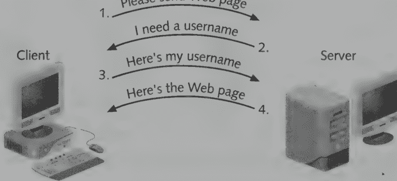

**图 1-2** 用于检索 Web 页面的客户端-服务器交互

在本书中，你会数百次看到客户端和服务器这两个词。需要记住的一个重要点是，你的 Linux 系统可以根据你选择运行的软件以及该软件的功能充当客户端或服务器。事实上，单个 Linux 系统可以同时作为某些程序的客户端和另一些程序的服务器。

Linux 系统可以既充当自己的客户端又是服务器。这是一个较难理解的概念，你将在未来的章节中经常看到它。记住 Linux 是一个多任务操作系统。假设你计算机上运行的一个任务是在后台运行的 Web 服务器，而同一台计算机上的另一个任务是 Web 浏览器。你在浏览器中输入命令，向你自己的计算机请求数据。从 Web 服务器到 Web 浏览器的数据传输是一个客户端-服务器网络事务，尽管数据从未离开你的计算机。

### 点对点网络

计算机既充当客户端又充当服务器的思想将我们引向了点对点网络的概念。今天使用的大多数操作系统（包括 Linux 和 Windows NT/2000/XP）都可以运行客户端和服务器程序；它们不依赖中心化服务器来提供数据或其他资源（如共享打印机）的访问。这种网络被称为点对点网络。网络上的每台计算机都是其他计算机的节点，并具有同时充当客户端和服务器的能力。客户端-服务器模型是中心化的，而点对点网络是去中心化的，这意味着任何主机都可以与任何主机通信。这类例子是 `NetWare`，它是一种可以充当服务器的操作系统。相反，旧版本的 Windows（如 Windows 3.1）是客户端操作系统——它们无法作为服务器有效地提供“服务”。

## 创建网络

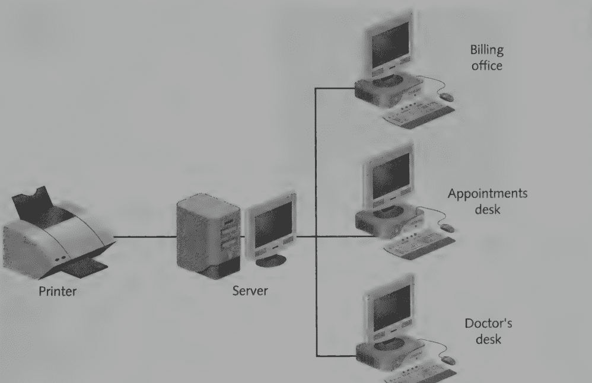

**图 1-3** 假设的小型医疗办公室网络

办公计算机联网所需的基础硬件包括**网络接口卡（NICs）**，有时称为网络适配器或网卡。图 1-4 显示了几种典型的网卡。网络上的每个节点都必须有一个网卡，并且（除非是无线网络）还有一根将网卡连接到网络的电缆。**节点（或主机）**是任何直接连接到网络的设备，例如工作站或服务器。通常情况下，网卡安装在主板的 PCI 插槽上，并有一个用于连接网络电缆的外部接口。此外，对于这个小型办公室局域网（LAN），你可能需要一个集线器或交换机来连接三台计算机和服务器。**集线器**是一个布线中心，允许将来自多台计算机的电缆合并到一个网络连接中。与其从每台计算机都引电缆到服务器，你可以将这三台计算机都连接到办公室内的集线器，然后从集线器引一根电缆到服务器房，如图 1-5 所示。集线器价格便宜，且通常不是智能的（它没有 CPU，只有几个电子元件用于将多根电缆的信号合并到单根电缆上）。你也可以使用**交换机**，它与集线器类似但更智能（它有 CPU 并且可以就是否允许网络流量通过做出决策），且更高效（它能够为网络上较少的流量做出决策）。


**图 1-4** 典型网卡

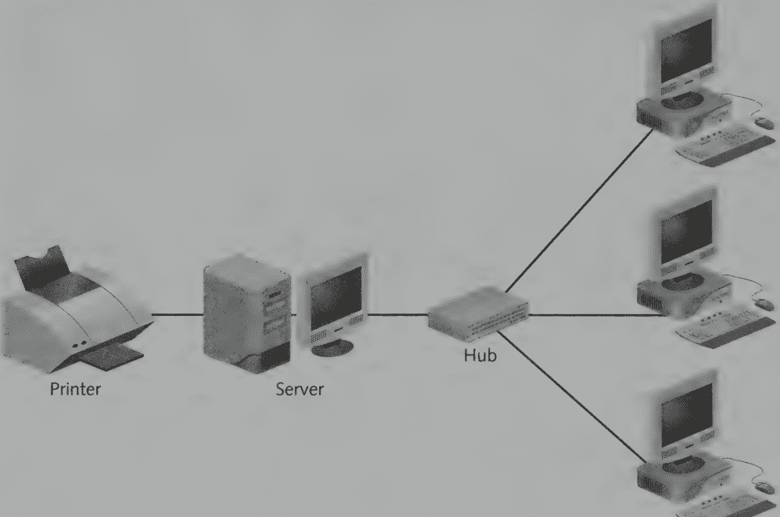

**图 1-5** 带有集线器的小型办公室网络

通过电缆和其他设备进行物理连接计算机的工作不属于 Linux 网络培训的一部分。当然，在你使用 Linux 网络之前，必须有人完成这项工作；因为 Linux 支持许多不同的技术，你很可能已经在某种安装并配置了网络硬件的组织或计算机环境中工作。为了精通网络技术，你将希望学习比本书书中涵盖的 Linux 软件更多的内容。关于网络硬件（以及本章讨论的协议）的更详细讨论，请参阅 Tamara Dean 编写、Technology Inc 出版的书籍《Network+ Guide to Networks》。

## 网络技术

在为你的医疗办公室网络购买任何网络硬件之前，你必须决定将使用何种类型的网络技术。最广泛的技术被称为以太网（Ethernet）。以太网是 20 世纪 70 年代由施乐公司（Xerox）、英特和数字设备公司（现 Compaq 公司的一部分）开发的网络标准。以太网是一个经过多次修订的国际标准。人们在谈论以太网时通常提到的版本是 802.3，因为它遵循 IEEE（电气与电子工程师学会）的 802.3 网络标准。

目前以太网有三种变体，主要区别在于速度：10 Mb/s 以太网、100 Mb/s 或快速以太网（Fast Ethernet）以及千兆以太网（Gigabit Ethernet）。网络的一个重要考虑因素是速度和带宽，即网络技术可以传输的信息量。它通常以每秒位（bps）表示。低速传输使用每秒比特（Kb/s）。1 Kb 等于 1024 位。以太网的三种变体为：

- 10 Mb/s 以太网
- 100 Mb/s 或快速以太网
- 千兆以太网

（注：原文后续部分存在大量重复句和乱码的 OCR 识别错误，此处已根据逻辑要求进行了清理处理。）

## 网络布线


**图 1-7** 网线

- **非屏蔽双绞线（UTP）**：由几对封装在塑料绝缘层中的导线组成。UTP 有六类，其中第6类（CAT 6）质量最高、速度最快。CAT 5 和 CAT 6 UTP 线在以太网中应用最广泛。即使是最快的 UTP（CAT 6）价格也相对便宜，因此可能是获取昂贵布线（如光纤）与留出合理升级路径之间的良好折中方案。例如，如果你在 10/100 以太网上安装了 CAT 5 或 CAT 6 UTP 线，以后可以将网卡升级到千兆以太网，而无需重新布线办公室。UTP 线容易受到其他电气信号的干扰，而且安全性可能较低，因为以太网（通常用于 UTP）允许人们在任何点添加计算机以查看网络上的所有流量。（我们将在书的后部分详细讨论这个主题。）

- **屏蔽双绞线（STP）**：与 UTP 非常相似，但在每对导线周围包含了一层金属屏蔽层。它可以保护网络信号免受电磁干扰的影响，但也使得 STP 线比等质量的 UTP 更贵。除非在会有其他电气或电子设备产生大量干扰的环境，否则不使用 STP；即便如此，由于行业在 UTP 上投入了更多精力，高质量电缆（如 CAT 5 和 CAT 6）以及消除干扰的滤波器的可用性意味着 STP 可能仍然是一个更好的选择。

- **光纤**：一种专门的高速解决方案，使用比电脉冲更快的光脉冲来传输数据。它具有极快的传输速度，并且对电磁干扰免疫。光纤是最安全的系统，几乎无法窃听，无疑将支持未来网络速度的增长。然而，它比其他布线类型贵得多。不仅是电缆本身，安装费用也很昂贵。光纤的弯曲、切割和连接计算机有特殊规则；光纤处理起来困难。光纤不适应许多工作类型。尽管许多类型的网络技术使用光纤——FDDI、以太网和 ATM——但并不是你可能使用的每技术都支持光纤布线。你想要使用的某些软件可能不支持光纤设备。新型塑料光纤可能会使其更容易处理且价格更便宜。

- **同轴电缆（coax）**：曾是一种流行的网络布线介质，现在已被 UTP 取代。10 Mb/s 以太网的早期实现方案 10Base5 使用厚同轴（有时称为 ThickNet）；另一种早期的 10 Mb/s 以太网实现方案 10Base2 使用较小的同轴线，称为 ThinNet。同轴线用于视频信号和电缆调制解调器。

## 选择电缆

你的第一反应可能是直接选择可用的最快、最便宜、最好的电缆。但在此类决策中必须始终权衡。你如何决定网络布线值得与你想要使用的网络技术类型分开单独分析。这是因为电缆是办公室基础设施的一部分，独立于你的计算机设备和网卡。例如，如果你在 10/100 以太网上安装了 CAT 5 或 CAT 6 UTP 线，以后可以将网卡升级到千兆以太网，而无需重新布线办公室。

除了局域网布线选项外，还有所谓的“最后一公里”连接，即你的局域网与互联网或其他高速网络的连接。这指的是从家庭或办公室开始，经过当地社区到达互联网服务提供商（ISP）或其他快速服务商的连接。构成数据传输结构的连接通常很快，但将这些高速传输线路连接家庭或办公室的最后一公里连接在速度上差异巨大。表 1-3 显示了可用的一些最后一公里连接。正如选择网络技术一样，选择介质意味着在以下各项之间进行权衡：

- 介质本身的成本
- 安装介质的成本
- 最大速度
- 对周围电气干扰的敏感性
- 随着时间扩展网络的能力
- 熟练技术人员的可用性（假设你不需要在内部完成）

### 最后一公里选项

- 如果我必须重新布线，哪些特征必须指导我的决定？
- 现有布线能否处理我未来 6 个月、2 年、5 年预测的网络流量？
- 我计划在网络上使用的计算机能否利用现有电缆？
- 决定因素是成本、传输速度、扩展性或其他？

### 表 1-3 最后一公里连接

| 传输类型 | 速度 | 典型用途/注释 |
| :--- | :--- | :--- |
| 拨号调制解调器 | 56 Kbs | 家庭 |
| 集成数字业务网络 (ISDN) | 128 Kbs | 家庭 |
| 电缆调制解调器 | 5 Mb/s to 512 Mb/s | 家庭 |
| 数字用户线路 (DSL) | 128 Kbs to 1.544 Mb/s | 家庭；较新的数字服务，在某些地区可以添加到电话线路 |


| T-1 | 1.544 Mb/s | 家庭 |
| T-3 | 44.736 Mb/s | 大公司、ISP |
| OC-1 | 52 Mb/s | ISP 到区域级 ISP |
| OC-256 | 13.271 Gb/s | 主要互联网骨干网；使用光纤 |

# 第一章 网络基础

## 数据如何在网络上传输

数据以一系列电子脉冲或光脉冲的形式跨网络传输。这些开启/关闭脉冲被解释为数字数据、位（`bits`）和字节（`bytes`）。这些位和字节被组织成数据包并在网络上传输。**包**（`packet`）是一个术语，指的是带有标识信息的数据集合，其目标是网络或来自网络。例如，一个网页可以通过许多数据包的形式发送到互联网，每个包都包含描述服务器和接收该网页的客户端的信息。数据包的大小取决于所使用的网络类型。包的最大尺寸称为**最大传输单元（MTU）**。以太网的默认 `MTU` 为 1,500 字节。`FDDI` 的 `MTU` 为 4,470 字节。数据包可以比 `MTU` 小，但不能比大。如果必须发送更多数据，则使用额外的数据包。

每个数据包由头部（`header`）和载荷（`payload`）组成。**载荷**是需要从一台计算机传输到另一台计算机的数据。**头部**是信息的集合（采用非常结构化的格式），定义了网络部分应如何处理该数据包。例如，头部会识别大型数据传输的序列号，指示应用数据的类型，并声明数据传输的大小。

以太网使用一种称为“竞争”（`contention`）的系统传输数据包。这简单意味着网络上的所有节点（具体来说是所有网卡）都在竞争访问网络权限：每个节点在需要时都会发送数据包，从而导致网络数据包之间的冲突。**冲突**（`collision`）是指两个或多个以太网数据包尝试同时使用以太网电缆。在不深入研究该技术的情况下，我们可以告诉您，以太网具有检测冲突的方法以提高网络吞吐量。如果发生过多冲突（超过网络数据包的约 15%），网络上的某个设备可能网卡配置错误，或者网络可能太忙了，导致所有网络流量显著减慢。

吞吐量（`throughput`）指的是网络上可以传输多少载荷信息。繁忙的网络可能会发送大量的系统管理数据（如数据包头部），以至于其吞吐量被阻塞。用户并不太关心带宽；用户关心的是下载文件或发送电子邮件：这才是吞吐量。

> 请记住一个字节由 8 位组成，因此 10 Mb/s 的网络每秒可以处理 1.25 兆字节（`MB`）的数据，包括正确处理正在发送的应用数据所需的所有开销。


## 网络拓扑结构

网络计算机在逻辑和物理上排列成拓扑结构。拓扑是系统之间连接的形状或顺序。使用了三种拓扑结构：

- 总线拓扑（`bus topology`），计算机沿单条线连接，如图 1-8 所示
- 星型拓扑（`star topology`），多台计算机连接到单点（通常是集线器或交换机），如图 1-9 所示
- 环形拓扑（`ring topology`），计算机连接成圆形，如图 1-10 所示


图 1-8 总线拓扑

拓扑结构在很大程度上取决于你选择的网络技术。例如，如果你选择使用令牌环网络，就不能使用总线拓扑。由于令牌（`token`）在计算机之间传递的方式，你必须使用环形或星型拓扑。另一方面，以太网通常使用总线拓扑。


图 1-9 星型拓扑


图 1-10 环形拓扑

## 创建网络

在以太网中使用集线器（`hub`）使其看起来像星型拓扑图，因为所有线缆都连接到一点。但由于集线器仅仅是一个布线集中器，以太网仍然是总线拓扑；你可以拔掉或添加计算机，而不影响网络上的其他设备。这里的重要教训是，网络的物理布局可能与逻辑布局并不完全匹配。

你可以通过将网络划分为段（`segments`），在同一网络内使用不同的技术。网段是网络的一部分，其流量已与网络的其他部分隔离，因此网段内主机产生的数据包只会被同一网段内的其他主机“看到”，除非它们的目标是网段外的主机。当一个大型网络被分成若干段时，网络每个部分（每个网段）的网络流量将大大减少。网络通常使用多个网段构建，原因有几个：

- 每个网段可以根据成本、速度、与现有设备的兼容性等因素，选择最适合其需求的网络技术。例如，如果一家制造公司已经在其办公室里安装了网络电缆，它可能会选择安装一个小型无线网络，以避免在车间区域布线。无线网络使用不同的网络技术，因此是一个独立的网段。
- 每个网段通常可以单独配置和管理，以便根据需要实现功能。例如，对于数据处理网段的互联网访问安全性可能比市场研究人员使用的网段更严格。
- 将每个网段的网络流量进行隔离，以至于整个网络不需要高带宽。例如，假设一个部门传输大量文件并希望网络快速，但另一个部门的交互较少。如果所有计算机都在一个网段上，那么需要高速网络设备的人都必须安装。
- 单个网段通常不会超过 30 到 40 台计算机。使用多个网段允许你创建更大的网络。

网络的各个部分使用不同的设备连接。你已经见过连接节点到网络的集线器和交换机。连接网络的多个网段需要更复杂的设备。例如，你不能简单地将以太网网卡和令牌环网卡的电缆连接在一起：它们使用的电子语言不同。路由器（`router`）是连接多个网段的设备，根据需要转换数据格式。例如，办公室的一部分可能拥有带有令牌环网卡的计算机，它们都连接到一个 `MAU`。为了将该网段连接到运行以太网的办公室其他部分，你需要一个能“说”以太又能令牌环的路由器。当来自令牌环网络的数据到达路由器时，它可以发送到以太网网段，反之亦然。图 1-11 展示了这种布局。

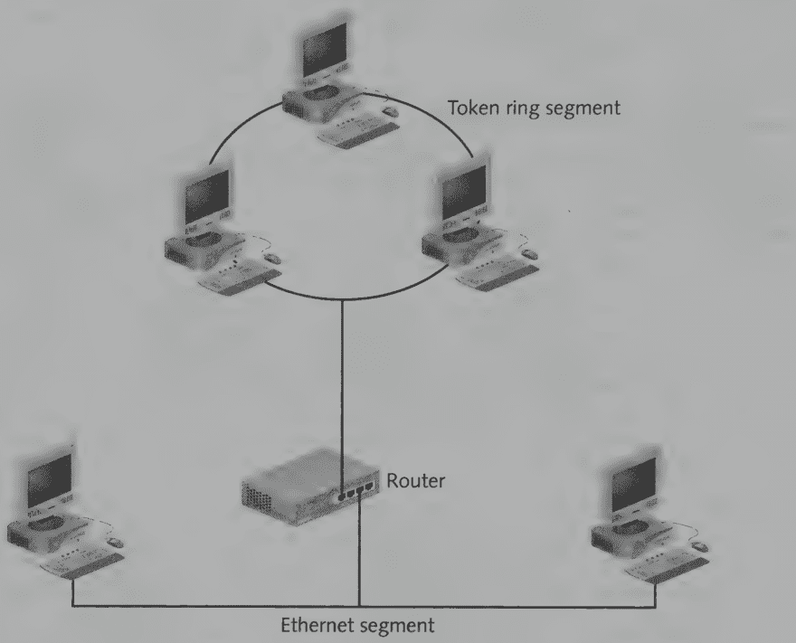

**图 1-11** 路由器连接不同的网络技术

> 注意另一种用于连接网段的网络设备是桥（`bridge`）。通过检查每个数据包的地址让网段共享数据。

此示例中的路由器有一个令牌环网卡和一个以太网网卡。路由器也可以用于连接两个相同类型的网段。记住创建独立网段的原因，例如限制每个网段内部的网络流量。你可以通过路由器连接两个大型以太网网段，以隔离这两个网段产生的网络流量。

路由器可以是一个只路由网络流量的专用设备。思科是最著名的网络路由器制造商。旨在处理巨大流量负载的路由器可能花费数万美元；你也可以花几百美元购买一个简单但稳健的路由器。然而，通常使用普通计算机用作路由器。特别是，一个 Linux 计算机是一台极好的路由器。如果你在运行 Linux 的计算机上安装两个以太网卡，然后设置路由软件（如你将在第 6 章中学到的），你就拥有了一个低成本且非常有效的路由器。

## 多重网络

几乎每个网络管理员都会面临的一个任务是连接现有网络。例如，假设你的小企业目前有两个网络。制造车间有十多台计算机使用令牌环（`token ring`）进行网络连接。办公室内有近 50 台计算机通过 `CAT 6 UTP` 电缆使用以太网（`Ethernet`）连接。各部门副总裁决定，他们希望能够在两个网络之间共享信息，以便在制造活动发生时实时更新信息和零件订单。因此，你需要连接令牌环网络和以太网网络。此外，副总裁们还希望公司里的每个人都能访问互联网。图 1-12 展示了你试图实现的最终结果。

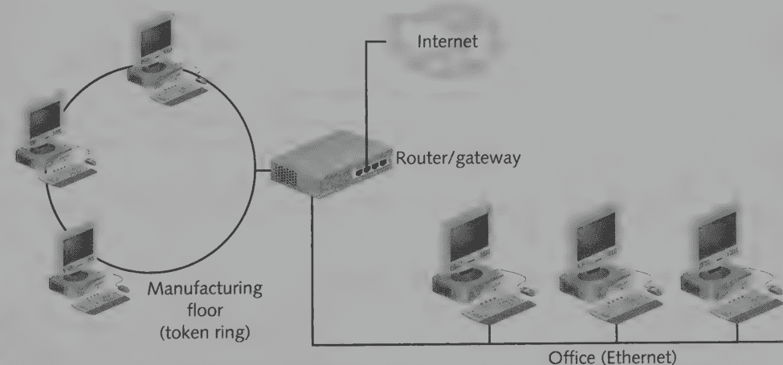

**图 1-12** 网段之间的路由器和连接互联网的外部网关

要连接办公室的两个网段，你需要使用路由器。要连接互联网，你需要使用网关。**网关**（`gateway`）类似于路由器，它可以在网段之间传输网络流量，但网关比路由器更具智能：它可以在比路由器更复杂的层面上翻译数据，而路由器只是简单地在网段之间传递数据包。

## 网络软件

你所学习的所有网络硬件，如果没有控制它们的软件以及能够将它们连接到你想在网络上使用的应用程序，它们将大派用处。这些软件始于具备网络能力的操作系统——Linux 就是一个很好的例子。该操作系统由许多执行不同网络任务的组件组成。

现代网络构建建立在这样一个理念之上：对于不同的任务需要不同的工具，且这些工具应该是模块化且可交换的。例如，开发者可能会构建一种网络软件，让一个程序完成你预期未来可能需要的所有网络操作。问题在于（暂且置之）我们不断地发明新事物。如果一个网络程序需要处理所有事情，那么每当出现新的网卡或每当需要新的通信方法时，你都会遇到麻烦——一切都必须包含在网络软件中。

相反，你很快就会看到，网络是建立在一个真正的网络工具字母表之上的。这些工具大部分是协议。协议是一套形式化的通信规则。在外交领域，来自一个国家的人会学习另一个国家应如何行动，以便与其进行通信。同样，计算机协议允许一台计算机或设备与任何使用相同协议的其它设备进行有效通信。每个协议都是为特定目的设计的——这就是为什么有这么多协议的原因。

在探索众多的协议之前，让我们后退一步，看看网络的概念模型。

## 网络概念模型

当网络最初开始开发时，计算机之间还没有通信标准。为了识别网络化所需的通信层级，ISO（国际标准化组织）开发了开放系统互连模型（`OSI 模型`）。`OSI 模型`是网络通信的理论模型。它使用七层来表示信息如何从你使用的应用程序传输到硬件，然后到达另一台计算机上的类似应用程序。图 1-13 显示了 `OSI 模型`。

| 层级 | 名称 | 功能 | 对应组件 |
| :--- | :--- | :--- | :--- |
| 第 7 层 | 应用层 (`Application layer`) | 与应用程序软件通信 | 应用 |
| 第 6 层 | 表示层 (`Presentation layer`) | 重新格式化、加密/解码、压缩/解压缩 | 应用 |
| 第 5 层 | 会话层 (`Session layer`) | 在两端建立连接 | |
| 第 4 层 | 传输层 (`Transport layer`) | 纠错 | |
| 第 3 层 | 网络层 (`Network layer`) | 分解和重组分段，寻找最佳路由 | |
| 第 2 层 | 数据链路层 (`Data Link layer`) | 分解和重组分段 | 网卡 |
| 第 1 层 | 物理层 (`Physical layer`) | 将数据传送到介质 | 布线介质 |

图 1-13 OSI 网络模型

- **物理层**（`Physical layer`）管理通过网络介质（如电缆）发送信息的传输。
- **数据链路层**（`Data link layer`）通过监控错误和管理硬件地址信息（如每个以太网卡的硬件地址）来管理物理层。
- **网络层**（`Network layer`）为在不同网络之间传输的数据包寻找最佳路由。**网络层**从物理层和数据链路层获取数据，以便在不同网络类型之间进行“翻译”。
- **传输层**（`Transport layer`）在网络中的特定计算机之间建立连接。为了实现这一点，它会监控丢失的数据，检查信息流，并对乱序的数据进行重新排序。
- **会话层**（`Session layer`）在传输层更抽象的层级管理网络连接，允许用户停止和重启网络活动。
- **表示层**（`Presentation layer`）处理数据表示问题，例如发送到网络的数据上添加的任何压缩或加密。
- **应用层**（`Application layer`）与任何希望使用网络的应用程序通信。应用层根据来自诸如 `Netscape Web` 浏览器等“真实应用程序”的请求生成要传输的数据。它利用来自底层的协议将数据跨越网络，移动到另一个能够理解所发送内容的应用程序中。

你也可以使用 `OSI 模型`来概念化数据如何在互联网上进行传输，尽管该模型的翻译并不完全对应。另一种网络参考模型——**互联网模型（或 TCP/IP 模型）**经常用于描述互联网通信。Linux 的设计侧重于互联网风格的通信，理解互联网模型对于理解 Linux 网络至关重要。互联网模型使用四层，每层都有特定的协议：

- 应用层包含用于 Web 浏览器的 `HTTP`、用于电子邮件的 `SMTP` 以及用于文件传输的 `FTP`。
- 传输层在计算机之间创建连接，本章将介绍的协议包括 `ICMP`、`TCP` 和 `UDP`。
- 网络层提供来自传输层的数据包。该层最重要的协议是 `IP`。
- 数据链路层管理硬件。它包括以太网、令牌环、`DSL` 和 `ISDN` 等协议。

图 1-14 显示了互联网模型的各层。这些协议整体被称为 `TCP/IP` 协议族，因此有了上述模型的另一种名称：`TCP/IP 模型`。图中网络层上方是应用程序；下方是用于传输数据的电缆。

在探索特定协议之前，让我们用示例演练一下这些层是如何操作的。

1. 应用程序（如 Web 浏览器）想要通过 `HTTP` 发送数据。数据由应用程序生成并传递给传输层。
2. 传输层（在本例中为 `TCP`）添加描述所发送信息的头部，并识别会话，以便 `TCP` 跟踪是否已接收。数据包被传递给网络层。
3. `IP` 栈添加头部，识别数据发送到的计算机、接收数据包后应使用的协议以及其他几个项目。数据包被传递给数据链路层。
4. 数据链路层（在本例中为以太网）定位目标计算机网卡的 `MAC` 地址和物理地址，然后添加自己的头部信息，并作为一系列电脉冲通过“线缆”发送出去。
5. Web 服务器上的数据链路层看到包指示其 `MAC` 地址为目的地，它获取以太网头部信息，然后将其传递给服务器上的网络层。
6. 网络层检查 `IP` 头部数据，注意到数据包是使用 `TCP` 发送的，将其传递给 `TCP` 栈。
7. `TCP` 栈移除 `TCP` 头部，向客户端返回数据包确认该包已正确接收，然后将数据包传递给处理所有 `HTTP` 数据包的 Web 服务器。
8. Web 服务器读取数据包的负载，对客户端请求准备响应，并再次开始整个过程。

### 协议栈与连接类型

在继续之前，有必要对层级的概念进行一些说明。

维护每个协议的软件通常被称为协议栈。协议栈是一种软件，设计用于从高层协议接收特定格式的数据，并根据低层协议的要求将其传输给低层协议。

传输层协议可以是无连接的，也可以是面向连接的。无连接传输协议在发送每个数据包时，并不考虑远程计算机是否收到了发送的其他数据包。它只是将数据包“扔过墙”并寄希望于运气。如果传输中的某部分丢失，接收数据的计算机必须请求重新发送丢失的信息。无连接的另一个名称是无状态的，因为没有维护关于正在传输的“状态”的信息。

相反，某些传输层协议是面向连接的，或者说是有状态的。在这些协议中，协议软件会维护关于哪些数据包已被目标计算机正确接收的信息。如果没有收到数据包的“是的，我收到了”确认，那么该数据包将——

## 常用协议

你将在书中学到的大多数协议与互联网紧密相关。互联网协议首先由丰富的软件开发人员或工程师提出的。这个人会编写一份名为“意见征求”（`RFC`）的文档。`RFC` 定义了协议或其他技术进展。世界各地的专家会对 `RFC` 文档中的信息进行评论，然后根据收到的建议进行多次修订以不断完善。最终，许多人将 `RFC` 视为新协议的标准定义。所有 `RFC` 文档都可以在 `www.rfc-editor.org` 网站获取（并进行搜索）。该网站包含超过 3,000 份 `RFC`。在本章末尾的一个实践项目中，你将探索这个网站。

让我们更详细地查看一些常用协议，以便你在下一章学习如何在 Linux 上配置网络时理解它们的用途。我们将从最低的层级开始：硬件。

> 请记住，本章仅提供概述和一些关键细节，足以让你入门，而不会在开始时就用新术语让你无所适从。

正如你现在可能猜到的那样，每种硬件都有自己的协议来管理与该类型其他硬件的通信。例如，令牌环网卡“说”令牌环协议，因此它可以通过电缆向其他令牌环网卡发送数据比特位。由于以太网是最广泛使用的协议，本书将重点重于以太网硬件。

在本书中，你将看到使用其他类型网络的注释，例如令牌环、`ATM` 或 `FDDI`。此外，后续章节中的特定部分将用于使用调制解调器的上行连接。

每个以太网卡都有一个由制造商分配的唯一地址，称为介质访问控制（`MAC`）地址，或简单称为硬件地址。每个制造商都被分配不同的数字范围，以确保世界上每个以太网 `MAC` 地址都是唯一的。当一个以太网网络需要与另一个主机通信时，它必须获取目标以太网卡的 `MAC` 地址。为了获取此 `MAC` 地址，主机使用地址解析协议（`ARP`）向整个网段广播消息。该消息实际上在说：“我需要 IP 地址为 `aa.bb.cc` 的计算机的 `MAC` 地址。”（我们很快会介绍 IP 地址）网段上的所有主机都会使用 `ARP` 请求；拥有请求 IP 地址的主机将直接将其 `MAC` 地址 响应给发送 `ARP` 请求的计算机（源主机）。源主机随后存储（或缓存）该 `MAC` 地址与 IP 地址之间的对应关系，这样它以后就不需要重复 `ARP` 请求了。有了正确的 `MAC` 地址后，链路层就可以从 `IP` 栈准备数据包，并通过以太网卡将其发送到网络上。

某些网络层协议使用以太网卡的硬件地址作为其地址系统的一部分（例如 `NetWare` 的 `IPX`）。这使得配置这些系统变得更容易，但也使其在适应具有各种硬件类型的全球网络时灵活性大大降低。

我们还没有查看以太网数据包的头部，因为那超出了我们目前的内容范围。但头部与 `IP` 类似，具有源地址和目的地址（我们将在本节探索更多内容）。

## 互联网协议

互联网协议（`IP`）是跨网络传输数据的基础。尽管它设计于几十年前，但它仍然运行良好。`IP` 头部如图 15 所示。头部中的每个字段都有其特定的用途。


# IP 头部字段

版本（Version）字段识别 IP 的版本（例如 IPv4 或 IPv6）。头部长度（IHL）定义了头部的字节数。服务类型（ToS）字段用于指定应如何处理数据包。存活时间（TTL）防止数据包在网络中循环。协议（Protocol）字段指示由哪种传输层协议接收 IP 数据包的有效负载。标识（Identification）字段为每个数据包提供一个唯一编号，以便对碎片进行重组。标志（Flags）字段指示是否还有更多碎片到达。分片偏移（Fragmentation Offset）标识当前碎片位于原始数据包的什么位置。

当中间网络的 MTU 比源端小时，就会发生分片。例如，假设你正在使用一个 MTU 为 1,500 字节的网络，但数据必须通过一个 MTU 为 256 字节的网络。每个 IP 数据包必须被拆分成碎片，以便在中间网络上传输。这些字段共同使用：标识、标志和分片偏移。

校验和（checksum）字段用于检查头部。图 16 显示了当中间网络 MTU 较小时发生分片的示意图。

| 字段 | 目的 |
| :--- | :--- |
| Version | 识别 IP 版本 |
| Header Length | 定义头部的字节数 |
| Type of Service | 指定应如何处理数据包 |
| Time To Live | 防止数据包循环 |
| Protocol | 指示传输层协议 |
| Identification | 提供用于重组的唯一编号 |
| Flags | 指示是否还有更多碎片 |
| Fragmentation Offset | 标识碎片所在位置 |
| Checksum | 用于检查头部 |
| Options | 用于额外信息的可选字段 |

# 第一章

## 网络基础

传输层协议：`TCP`、`UDP` 和 `ICMP`，尽管也支持几种特殊协议。

头部校验和（Header Checksum）字段用于确保头部信息的完整性。通过将此字段作为对其他字段内容的数学检查，接收数据包的系统可以判断头部中的任何数据是否已损坏。（如果有效负载的部分损坏，则必须由传输层或应用层确定；IP 层仅将有效负载传递给下一层，而不进行检查。）

源地址（Source Address）和目的地址（Destination Address）字段指示了创建数据包的计算机（源地址）和发送数据包的计算机（目的地）的 IP 地址。下一节将详细介绍 IP 地址。

选项（Options）可用于调试，但并不经常使用。填充（Padding）字段表示头部可能包含一些额外空间，因为头部的长度必须是 4 字节（32 位）的倍数。换句话说，头部必须结束在 32 位边界上。填充字段包含零。

## IP 路由

IP 通过为互联网上的每台计算机分配唯一地址来工作。通过其 IP 地址，你可以立即联系到连接到互联网或内网的任何计算机，无论其位于何处。（只要你的路由配置正确，如后文所述！）

IP 路由是一种计数方案，允许 IP 网络（如互联网或内网）上的每台计算机、打印机或其他设备拥有一个唯一的 ID 号。通过引用该 ID，你可以与互联网上的任何系统进行通信。遗憾的是，该地址方案是在互联网变成今天这样之前开发的，IP 寻址正努力跟上时代的发展。IP 寻址是一个复杂的课题，但在使用 Linux 网络时，你必须理解它。

每块网卡（NIC）都被分配了一个 IP 地址和一个 MAC 地址。IP 地址是全球性的地址，可用于任何类型的网络技术；它在互联网上传递并用于标识主机。MAC 地址属于以太网卡。它被用于在单个网络网段内定位主机。`ARP` 协议将 IP 地址映射到 MAC 地址，以便对到达目的地的数据包进行“最终交付”。

如你所知的，IP 地址是由中央互联网权威机构分配的，以确保每个网络节点都有唯一的地址。如果你只是随手选一个，你可能会让某地的某人非常生气。互联网服务提供商（ISP）被分配了大块地址，然后它们可以将其分配给客户。你的学校或组织可能也被分配了一块地址。系统管理员可以从该块地址中为你分配一个地址。当然，在与所有其他网络隔离开的实验环境中，可以使用任何你选择的 IP 地址。

## 网络软件

计算机或网络设备中的每块网卡都被分配了一个 IP 地址。IP 地址长度为 32 位，由四个用点隔开的 8 位数字组成。最大的 8 位数字是十进制的 11111111，最大的十进制 IP 地址是 255.255.255.255。你可能已经见过很多此类地址了，例如：`192.168.12.54` 是一个合法的 IP 地址。这里显示的点分四位表示法（dotted-quad notation）——四个用点隔开的数字——被广泛用于编写 IP 地址。

IP 地址分为两部分：地址的第一部分是网络 ID（network ID），最后部分是主机 ID（host ID）。互联网上的每个网络都有一个唯一的 ID，在每个网络内部，每个主机都有一个唯一的 ID。将网络设置为独立的 ID 使得在世界范围内找到计算机成为可能。一种简单的方法是将前三个数字看作网络 ID，最后一个数字看作主机 ID，因此 `192.168.12.254` 由一个网络 ID（`192.168.12.0`）和一个主机 ID（`254`）组成。每当你引用网络 ID 时，你都应该使用完整的 IP 地址（四个数字），但在 ID 部分填充零。在某种情况下，由于最后一个数字是主机 ID，在陈述网络 ID 时，你会在该位置插入一个零。由此地址命名的计算机使用 `192.168.12.34` 的完整 IP 地址；同一网段上的其他计算机将使用不同的数字。例如，可能会使用 `192.168.12.35`。

在过去（10 或 15 年前），IP 地址被分为若干类。IP 地址类是根据 IP 地址代表的规模对 IP 地址进行的分组。使用了 A、B、C 类，如表 1–4 所示（D 类和 E 类被定义用于在本引言性章节中探索之外的特殊目的）。

### 表 1-4 IP 地址 A 类到 C 类

| IP 类 | 地址范围 | 子网掩码 | 该类中的网络数量 | 该类每个网络可能的主机数量 |
| :--- | :--- | :--- | :--- | :--- |
| A | 1.0.0.0 to 126.0.0.0 | 255.0.0.0 | 126 | 16,777,214 |
| B | 128.0.0.0 to 191.255.255.255 | 255.255.0.0 | 16,384 | 65,534 |
| C | 192.0.0.0 to 223.255.255.255 | 255.255.255.0 | 2,097,152 | 254 |

*(注：原文表格中 B 类范围和 C 类范围疑似存在排版错误，此处已根据标准定义修正)*


# IP 路由与寻址

IP 路由是一种计数方案，允许 IP 网络（如互联网或内网）上的每台计算机、打印机或其他设备拥有一个唯一的 ID 号。通过引用该 ID，你可以与互联网上的任何系统进行通信。遗憾的是，该地址方案是在互联网变成今天这样之前开发的，IP 寻址正努力跟上时代的发展。IP 寻址是一个复杂的课题，但在使用 Linux 网络时，你必须理解它。

每块网卡（NIC）都被分配了一个 IP 地址和一个 MAC 地址。IP 地址是全球性的地址，可用于任何类型的网络技术；它在互联网上传递并用于标识主机。MAC 地址属于以太网卡。它被用于在单个网络网段内定位主机。ARP 协议将 IP 地址映射到 MAC 地址，以便对到达目的地的数据包进行“最终交付”。

如你所知的，IP 地址是由中央互联网权威机构分配的，以确保每个网络节点都有唯一的地址。如果你只是随手选一个，你可能会让某地的某人非常生气。互联网服务提供商（ISP）被分配了大块地址，然后它们可以将其分配给客户。你的学校或组织可能也被分配了一块地址。系统管理员可以从该块地址中为你分配一个地址。当然，在与所有其他网络隔离开的实验环境中，可以使用任何你选择的 IP 地址。

## 网络软件

计算机或网络设备中的每块网卡都被分配了一个 IP 地址。IP 地址长度为 32 位，由四个用点隔开的 8 位组成。最大的 8 位数字是十进制的 11111111，最大的十进制 IP 地址是 `255.255.255.255`。你可能已经见过很多此类地址了，例如：`192.168.12.54` 是一个合法的 IP 地址。这里显示的点分四位表示法（dotted-quad notation）——四个用点隔开的数字——被广泛用于编写 IP 地址。

IP 地址分为两部分：地址的第一部分是网络 ID（network ID），最后部分是主机 ID（host ID）。互联网上的每个网络都有一个唯一的 ID，在每个网络内部，每个主机都有一个唯一的 ID。将网络设置为独立的 ID 使得在世界范围内找到计算机成为可能。一种简单的方法是将前三个数字看作网络 ID，最后一个数字看作主机 ID，因此 `192.168.12.254` 由一个网络 ID（`192.168.12.0`）和一个主机 ID（`254`）组成。每当你引用网络 ID 时，你都应该使用完整的 IP 地址（四个数字），但在 ID 部分填充零。在某种情况下，由于最后一个数字是主机 ID，在陈述网络 ID 时，你会在该位置插入一个零。由此地址命名的计算机使用 `192.168.12.34` 的完整 IP 地址；同一网段上的其他计算机将使用不同的数字。例如，可能会使用 `192.168.12.35`。

在过去（10 或 15 年前），IP 地址被分为若干类。IP 地址类是根据 IP 地址所代表的规模对 IP 地址进行分组。使用了 A、B、C 类，如表 1-4 所示（D 类和 E 类被定义用于在本引言性章节中探索之外的特殊目的）。

### 表 1-4 IP 地址 A 类到 C 类

| IP 类 | 地址范围 | 子网掩码 | 该类中的网络数量 | 该类每个网络可能的主机数量 |
| :--- | :--- | :--- | :--- | :--- |
| A | 1.0.0.0 to 126.0.0.0 | 255.0.0.0 | 126 | 16,777,214 |
| B | 128.0.0.0 to 191.255.255 | 255.255.0.0 | 16,384 | 65,534 |
| C | 192.0.0.0 to 223.255.255 | 255.255.255.0 | 2,097,152 | 254 |

IP 寻址方案是根据 IP 地址所代表的规模对 IP 地址进行分组。使用了 A、B、C 类，如表 1-4 所示（D 类和 E 类被定义用于在本引言性章节中探索之外的特殊目的）。

大多数网络使用几种标准网络地址系统中的一种，因此你很少需要使用计算器。但你仍然必须根据 ISP（互联网服务商）分配给你的网络空间以及你希望在网络每个段中支持的主机数量，确定网络 ID（network ID）和主机 ID（host ID）的大小。此外，网络软件必须知道 IP 地址哪些部分是网络 ID，哪些部分是主机 ID。显示这种方法的有两种：

- 网络地址掩码（network address mask）是一系列数字，看起来像 IP 地址，但在网络 ID 部分包含 1，在主机 ID 部分包含 0（是的，这与基于类的子网掩码本质的，只是名称不同）。例如，网络地址掩码 `255.255.255.0` 具有 24 位 1，因此它识别出 24 位的网络 ID 和 8 位 0，即 8 位的主机 ID。在配置网络时，你必须提供网络掩码，尽管网络配置工具可能会提供默认值。

- 写在计算机 IP 地址后面的前缀长度指示器（prefix length indicator）表示网络 ID 的位数。这种前缀长度的表示方法被称为无类域间路由（CIDR）格式。例如，`192.168.12.254/24` 表示 24 位是网络 ID，其余 8 位是主机 ID。你应该熟悉这些约定，以便在看到它们时能够理解它们。

你可以使用地址格式或 CIDR 格式。你将在本书中看到这两种格式的示例。由于基于类的地址多年来一直是互联网的基础，基于它们的网络配置仍然很常见。然而，子网掩码（subnet mask）仅用于在本地网络段上计算网络 ID，而前缀长度（网络地址掩码）旨在伴随 IP 地址 移动到哪里就移动到哪里，这样地址就可以在没有基于类的默认值的情况下被正确解析。例如，每个路由器在路由每个数据包时都会检查前缀长度。为了帮助你熟悉标准网络 ID，表 1-5 显示了一些前缀长度以及相应的网络掩码。

## 表 1-5 具有不同网络前缀长度的主机 ID

| 最大主机数 | 网络前缀长度 | 对应的地址掩码 |
| :--- | :--- | :--- |
| 2 | /30 | 255.255.255.252 |
| 6 | /29 | 255.255.255.248 |
| 14 | /28 | 255.255.255.240 |
| 30 | /27 | 255.255.255.224 |
| 62 | /26 | 255.255.255.192 |
| 126 | /25 | 255.255.255.128 |
| 254 | /24 | 255.255.255.0 |
| 510 | /23 | 255.255.254.0 |
| 1,022 | /22 | 255.255.252.0 |
| 2,046 | /21 | 255.255.248.0 |

## 广播与组播地址

在上一节的特殊 IP 地址列表中，请记住主机 ID 为全 1，此时 IP 地址指的是所涉及整个网络的广播消息。这通常被称为该网络的广播地址。也就是说，如果计算机向诸如 `192.168.12.0/24` 的网络发送数据包，且主机 ID 包含全 1，则该数据包将传递给该网络上的所有主机。此示例的广播地址是 `192.168.12.255/24`。

这种类型的广播消息主要用于系统管理目的，例如告知所有人服务器即将关闭。它还被专用软件用于广播其他消息。（例如，Novell NetWare 使用这种类型的广播）。当数据包的目标地址与网络 ID 匹配时，网络上的每个主机都会抓取该数据包并将其传递给网络协议栈的更高级（IP，然后是 TCP 或 UDP 等）。通常情况下，主机只抓取目标地址为自身主机 ID 的数据包。

使用网络 ID 广播消息适用于任何网络；你可以使用具有广播功能的软件向互联网上的任何网络发送广播消息。但通常情况下，系统需要向其所属网络上的每个人发送广播消息。为了这个目的，使用了一个特殊的本地 IP 地址：`255.255.255.255`。任何带有此 IP 地址的数据包都会被网络上的每个主机拾取。它也不会路由到网络之外，否则其他网络上的每个主机都会认为那是发给它们的广播消息。

广播消息自 IP 流行以来一直被使用。另一种特殊类型的 IP 方案具有巨大的前景，但尚未被广泛使用。这是组播（multicasting），一种 IP 方案系统，一台计算机可以将一个数据包发送给多个主机。为了理解为什么这很有价值，请考虑这个例子：你创建了一份大型报告，需要分发给全球 5,000 台服务器。你不能使用广播，因为其中大多数服务器位于你组织不同部分的独立网络上。你必须向每台服务器单独发送 5,000 次传输。如果报告的容量为 22 MB，那么总共需要传输 110,000 MB，即 110 GB 的数据。但如果你能向互联网发送一份报告的副本并带上所有目标 IP 地址呢？每个路由器都将决定其网络上的主机是否根据需要接收数据包。报告将在目标服务器附近的点进行复制（双倍），而不是完全从中心源发送。这就是组播背后的思想。

真正的组播并不被整个互联网支持。它需要源计算机和目标计算机上有特殊的应用程序，需要更新的网络协议栈来处理 IP 地址，以及理解组播选项的路由器。可以构建一个专用的组播系统，但到目前，组播还没有在未来五到十年内可能那样普及。由于组播更有效地利用了网络带宽，并允许向订阅者“推送”数据（如上面的示例所示），企业和技术专家继续工作以实现组播能力的更广泛的可用。

## IPv6

当前的 IP 版本 (IPv4) 支持约 3.7 亿个唯一地址。在 IPv4 开发时，这似乎已经足够了。但由于互联网的惊人增长以及许多新类型设备的接入，IPv4 地址空间即将耗尽。为了解决这个问题以及我们尚未讨论的许多其他技术限制，一组工程师开发了新的 IP 版本。这个新版本被称为 IP 版本 6，即 IPv6。

对于大多数用户来说，IPv6 最有趣的特性是它使用 128 位，而不是 32 位。因为每增加一位，地址数量就会翻倍，IPv6 支持超过 100 涧亿个地址（那是 1 后面跟着 38 个零）。它还具有许多改进，使组播更可行，允许网络动态配置，并允许路由器做出更智能的路由决策。IPv6 并没有抛弃 IPv4；它扩展了其技术和用途。ISP 仍然会使用 IP 地址，网络主机仍然会，网络仍然会拥堵不堪。IPv6 通过升级和修复难以正确配置和运行的技术问题，为未来几年做好准备。由于 IPv6 提供了大量的动态配置和智能路由能力，它需要基础设施组件——即处理流量的大型路由器以及组织内部更简单的组件。此外，网络软件必须升级以支持 IPv6。除了 IP 本身，上层和下层栈（以太网、TCP 等）必须经过重大修订才能真正从 IPv6 中受益。这需要大量的精力。

尽管我们说的是未来的 IPv6，但实际上，IPv6 现在已经在运行。你可以阅读关于它的所有信息，在你的 Linux 系统上安装它并尝试。但你将属于少数。由于 IPv4 和 IPv6 之间的差异，IPv6 定义了若干种在 IPv4 网络上进行隧道传输的方法。隧道是指将网络层的某种类型数据包封装在相同层次的另一种类型数据包之中；在这种情况下，将一个 IPv6 数据包封装在几个 IPv4 数据包中。随着人们实验并切换到更新、更强大的协议，IPv6 正在出现。那时，互联网的主干网将保留，并通过 IPv6 进行传输。要了解更多关于 IPv6 以及你如何开始使用它，请访问网站 `www.6bone.net`。该网站还指向 Linux IPv6 站点，`www.bieringer.de/linux/ipv6/`。Linux 已经有了可以下载和安装的现工作 IPv6 工作栈，但你不会在本书中使用它们。

## 传输协议

在互联网网络模型中，网络层侧重于不同主机和网络段之间的数据包路由。IP 包含了处理数据包分片、识别源和目的主机地址以及标记数据包存活时间（TTL）的字段。

传输协议侧重于为应用程序运行提供基础。它们可能从建立会话开始。会话是两个主机之间的连接，通过该连接，目的主机期望来自源主机的数据包流。

## ICMP

大多数传输协议侧重于为应用程序提供网络机制。应用程序可以处理一组数据（如文件），并通过协议栈进行传输，并让协议栈负责如何将其跨越网络送达目的主机。

但互联网控制消息协议（ICMP）的作用略有不同。由于 IP 的设计是为了效率，它没有规定处理网络层传输传输问题的机制。ICMP 是 IP 运行中不可或缺的一部分；IP 使用该协议来描述错误消息，例如无法处理流量的拥塞路由器、网络上无法找到的主机或无法正确路由的数据包。ICMP 是一种极简协议；它提供了少量的代码来标识其所载的信息。ICMP 数据包中的数据（负载）包含了 ICMP 消息中描述的 IP 数据的前 64 字节。ICMP 数据包的头部包含以下字段，如图 1-17 所示：

- 类型（Type）和代码（Code）（各一字节），用于标识发送的消息
- 校验和（Checksum），用于验证 ICMP 数据包的完整性
- 序列号（Sequence number），用于为 ICMP 数据包排序

```
| Type | Code |
| :--- | :--- |
| Checksum | |
| Sequence number | |
| Payload | |
```

图 1-17 ICMP 数据包结构。

在不列举 ICMP 使用的所有类型和代码的情况下，几个示例包括目的不可达、路由器公告、超时、时间戳、跟踪路由（你将在书中后看到的实用程序）。如果使用了目的不可达类型，代码字段可以包含额外信息，例如网络不可达、主机不可达、协议或端口不可达、无法分片，或目的网络或主机未知。

大多数 ICMP 消息由 IP 直接处理；只有在你排除网络问题时，才会接触它们。然而，ICMP 最常用的用途是 ping——这是一种管理实用程序，它使用 ICMP 内部的回显（Echo）和回显响应（Echo Reply）消息类型来测试主机是否可达且存活（监听网络流量）。我们将在第 2 章详细探讨 ping。在包括 Linux 在内的大多数系统上，ping 命令可以包含许多参数，以测试超时、路由和数据包分片等各种问题。

## 名称服务

除了分配给计算机的 IP 数字地址外，你可能更熟悉如 `yahoo.com` 或 `amazon.com` 这样具可读性的名称。这些被称为域名。域名是计算机的集合（通常在同一网络上），可以使用通用名称（通常是基于组织所属关系的名称，如公司或学校）进行访问。

由于人类发现 `www.ibm.com` 比 `142.17.17.99` 更容易理解和记忆，因此开发了域名服务将分配给计算机组的域名映射到 IP 地址。域名服务是一种应用层软件程序，允许计算机提供名称并接收 IP 地址，或提供 IP 地址并接收名称。（此过程也称为域名解析）。域名服务器是运行域名服务软件的计算机，它可以将 IP 地址转换为名称，反之亦然。例如，当你在 Web 浏览器中输入名称 `www.bn.com` 时，Web 浏览器执行的第一件事是向域名服务器发送请求说：“www.bn.com 的 IP 地址是多少？”当域名服务器响应时，Web 浏览器可以使用该地址启动网络连接。

互联网使用的名称服务称为伯克利互联网域名服务（BIND）。你见过的更短名称是指软件或运行该软件的计算机的域名服务器；两者缩写为 DNS。为了完成网络配置以便用户能够轻松访问其他系统，除了配置网络协议及其地址外，你必须配置名称服务。第 2 章描述了如何配置 DNS 的客户端部分，使 Linux 系统能够访问另一个 DNS 服务器；第 6 章描述了如何设置使用 Linux 的 DNS 软件来构建你自己的 DNS 服务器。

## UDP

与 TCP 用于确保到目的地的可靠性连接不同，用户数据报协议（UDP）在传输层提供快速、无连接的服务。与 IP 类似，UDP 不对接收到的每个数据包提供确认，它在传输过程中可能会丢失或重复数据包，且数据包是不排序的。但 UDP 具有低开销：每个头部仅占 8 字节，而不是 40 字节，而且没有网络流量用于进行确认。UDP 提供的服务范围与 IP 相似，但增加了端口号，因此可以像 TCP 一样在特定应用程序之间发送数据。当应用程序能够判断数据包是否丢失或对其正确排序时，就会使用 UDP。

> 使用像 UDP 等无连接协议发送的数据包也称为数据报（datagrams）。

使用 UDP 的应用示例包括名称服务器（在本章稍后描述）和网络管理工具，这些工具对开销的要求很低。

UDP 头部仅包含四个字段。没有可用选项，因此不需要填充：

- 源端口：用于识别发送数据的应用程序
- 目的端口：用于识别应该接收数据的应用程序
- 消息长度：指示数据包中有多少字节
- 校验和：用于纠正网络传输错误

## 应用协议

我们目前为止学过的协议用于在不同层级上跨网络传输数据。应用协议的目的更具体地针对用户可能想要执行的操作。表 1-6 列出了你将在整个书中学习过程中需要安装和配置的许多应用协议，以及它们常用的端口号。

当然，还存在许多其他协议。但请记住，你可能听过甚至用过的许多流行协议并不一定是应用层协议，因此未包含在列表中。接下来的章节将提到其中几个。

### 表 1-6 Linux 中常用的应用协议

| 协议 | 目的 | 常用端口 |
| --- | --- | --- |
| 文件传输协议 (FTP) | 从专用的 FTP 服务器向单个远程用户传输（通常是大型的）文件 | 20（数据） 21（控制信息） |
| 网络新闻传输协议 (NNTP) | 从中心新闻服务器向其他新闻服务器和终端用户传输大量小型新闻组贴文 | 119 |
| 简单邮件传输协议 (SMTP) | 从一个服务器向另一个服务器传输（通常是较小的）邮件消息 | 25 |
| 域名服务 (DNS) | 一种特殊的网络服务，旨在为应用程序提供域名到 IP 地址及反向映射 | 53 |
| 超文本传输协议 (HTTP) | 从 Web 服务器向单个远程客户端传输通常较小文件 | 80 |
| 邮件邮局协议 3 (POP3) | 将存储在服务器上的邮件消息传输到客户端进行查看 | 110 |

当我们谈及 TCP 协议时，我们描述的是使用各种头部字段以及建立连接、终止连接、确认数据包等系统的信息传输系统。但当我们描述 HTTP——一种应用协议——时，我们定义的是浏览器和 Web 服务器可以向对方发送的命令。例如，一个常见的 HTTP 命令是 GET。一个有效的 HTTP 命令看起来如下例所示：

```
GET /index.html HTTP/1.1
```

浏览器与 Web 服务器建立网络连接，然后发送上述 HTTP 命令的有效负载。命令的文本变成 TCP 数据包，然后传递给下层网络栈。在 Web 服务器上，当数据包到达 TCP 层时，TCP 头部被移除，TCP 有效负载由 Web 服务器处理，Web 服务器会检查命令以验证 HTTP 格式是否有效并做出响应。


# 第一章 网络基础

同样，邮件协议 `SMTP` 有一套结构化的消息系统（我们稍后会看到细节），告诉支持 `SMTP` 的服务器程序如何解释邮件信息。处理应用协议的好处在于，这些命令在多程度上是人类可读的，正如 `HTTP` 中的 `GET` 示例所示。

## 路由概念

到目前为止的讨论大部分假设你在使用单个网络段。当你需要连接多个网络段时，就会出现许多新问题。为了说明连接网络段时出现的问题，请考虑图 1-19 所示的网络段。使用像 `UDP` 等无连接协议发送的数据包也称为数据报。

使用 `UDP` 的示例包括名称服务器（在本章稍后描述）和网络管理工具，这些工具对开销的要求很低。

`UDP` 头部仅包含四个字段。没有可用选项，因此不需要填充：

- 源端口：用于识别发送数据的应用程序
- 目的端口：用于识别应该接收数据的应用程序
- 消息长度：指示数据包中有多少字节
- 校验和：用于纠正网络传输错误

我们目前为止学过的协议用于在不同层级上跨网络传输数据。应用协议的目的更具体地针对用户可能想要执行的操作。表 1-6 列出了你将在整个书中学习过程中需要安装和配置的许多应用协议，以及它们常用的端口号。

当然，还存在许多其他协议。但请记住，你可能听过甚至用过的许多流行协议并不一定是应用层协议，因此未包含在列表中。接下来的章节将提到其中几个。

### 表 1-6 Linux 中常用的应用协议

| 协议 | 目的 | 常用端口 |
| --- | --- | --- |
| 文件传输协议 (FTP) | 从专用的 FTP 服务器向单个远程用户传输（通常是大型的）文件 | 20（数据） 21（控制信息） |
| 网络新闻传输协议 (NNTP) | 从中心新闻服务器向其他新闻服务器和终端用户传输大量小型新闻组贴文 | 119 |
| 简单邮件传输协议 (SMTP) | 从一个服务器向另一个服务器传输（通常是较小的）邮件消息 | 25 |
| 域名服务 (DNS) | 一种特殊的网络服务，旨在为应用程序提供域名到 IP 地址及反向映射 | 53 |
| 超文本传输协议 (HTTP) | 从 Web 服务器向单个远程客户端传输通常较小文件 | 80 |
| 邮件邮局协议 3 (POP3) | 将存储在服务器上的邮件消息传输到客户端进行查看 | 110 |

当我们谈及 `TCP` 协议时，我们描述的是使用各种头部字段以及建立连接、终止连接、确认数据包等系统的信息传输系统。但当我们描述 `HTTP`——一种应用协议——时，我们定义的是浏览器和 Web 服务器可以向对方发送的命令。例如，一个常见的 `HTTP` 命令是 `GET`。

```
GET /index.html HTTP/1.1
```

浏览器与 Web 服务器建立网络连接，然后发送上述 `HTTP` 命令的有效负载。命令的文本变成 `TCP` 数据包，然后传递给下层网络栈。在 Web 服务器上，当数据包到达 `TCP` 层时，`TCP` 头部被移除，`TCP` 有效负载由 Web 服务器处理，Web 服务器会检查命令以验证 `HTTP` 格式是否有效并做出响应。

同样，邮件协议 `SMTP` 有一套结构化的消息系统（我们稍后会看到细节），告诉支持 `SMTP` 的服务器程序如何解释邮件信息。处理应用协议的好处在于，这些命令在多程度上是人类可读的，正如 `HTTP` 中的 `GET` 示例所示。

### 路由概念

到目前为止的讨论大部分假设你在使用单个网络段。当你需要连接多个网络段时，就会出现许多新问题。为了说明连接网络段时出现的问题，请考虑图 1-19 所示的网络段。


图 1-19 具有多个网络段

在图 1-19 中，假设主机 A 想要向 B 发送数据包。路由表包含一个指向 A 所在的不同网络。由于这个，主机 A 所在的网络必须通过路由器。路由算法（也称为路由引擎）是决定如何处理发送给路由的数据包的软件。路由引擎使用路由表作为数据做出良好的路由决策。路由表通过两种方式填充（填充）：

- 手动，由系统管理员（如你）输入一个可以到达特定命名网络 ID 的路由。这在 Linux 中可以使用 `route` 命令或各种图形工具完成，我们将从第 2 章开始探索这些工具。

默认网关是一个配置在主机上的 IP 地址，当路由网络是未知的时发送到路由器（这在某些 Linux 文档中被称为默认网关）。默认路由器可能只连接到一个网络，如图 1-19 所示，或者它可以提供对整个互联网的访问。在任何情况下，来自 A 的数据包并不是目标是 A 网络，因此它必须到路由器进行进一步处理。

对于路由器本身，G 是一个上游路由器，或组织之外区域的网关。G 只连接到路由器和互联网。如果数据包到达路由器且其目标既不是 X 段也不是 Y 段，它就会被路由器发送到 G 以进一步路由到互联网，最终它将被路由到正确的目的地。


图 1-20 具有独立互联网网关的路由器

路由器使用路由表和路由算法（也称为路由引擎）来决定将数据包发送到哪里。路由表是一个包含至少三内容的列表：

- 为存储路由的网络 ID，这让路由器识别它已知的可以到达的网络 ID
- 可以通过到达网络 ID 的接口。例如，某些网络可以通过以太网到达，另一些可以通过拨号调制调器连接互联网
- 处理列表网络 ID 的上游路由器 IP 地址；此字段在多个 Linux 命令的输出中被称为网关，因为它提供了指向其他网络的网关

路由表可能包含额外信息以帮助做出最佳路由决策。路由算法或路由引擎是确定如何处理发送给路由的数据包的软件。路由引擎使用路由表作为数据做出良好的路由决策。路由表通过两种方式填充（填充项目）：

- 手动，由系统管理员（如你）输入一个可以到达特定命名网络 ID 的路由。这在 Linux 中可以使用 `route` 命令或各种图形工具完成，我们将从第 2 章开始探索这些工具。
- 自动地，通过一种专门设计的协议（用以跟踪数据包在网络中的流动情况并进行报告）——在组织内部网络中，最常用的路由协议是路由信息协议（`RIP`）和开放最短路径优先（`OSPF`）协议。路由表条目会被缓存，以便在路由后续数据包时可以使用。

在第二章中，当你为你的系统配置 Linux 网络时，你将学习如何使用 `route` 命令来设置手动路由。每个系统在某种程度上都必须充当路由器，因为它必须知道如何处理发送到本地网络之外 IP 地址的数据包。一个典型的主机有一个非常基础的路由引擎，并且只期望手动配置的路由表信息。

Linux 也可以充当自动路由器。你可能将其认为一个“真正的”路由器，因为它的目标是在网络段之间转发流量，而不仅仅是路由由单个主机生成的数据包。Linux 程序曾使用 `RIP` 来自动路由路由信息。在随后的章节中，你将学习更多关于路由协议和设置 Linux 的知识。

> 甚至可以优化为专用路由器。事实上，Linux Router 项目提供了一个在单盘磁盘上配置为路由器的完整 Linux 操作系统。（参见 www.linuxrouter.org。）

## 章节总结

- 通过计算机网络，用户可以通过即时共享数据、自动化任务以及更高效地使用昂贵的资源来提高工作效率。
- 终端简单地作为系统的远程键盘和显示器，而客户端-服务器计算假设两个系统都是智能的。尽管许多 Linux 程序使用客户端-服务器技术，但 Linux 是为了对点对点网络而设计的。
- 网络硬件使用各种技术（如以太网）通过传输介质（电缆或无线系统）发送电信号。每组数据被称为一个数据包（对于 `UDP` 等无连接协议，则称为数据报 `datagram`）。
- 各种类型的物理网络带宽范围从几 Kb/s 到几 Gb/s 不等，尽管吞吐量——远程用户接收的有用数据量——在大多数终端用户眼中是衡量网络价值的更好标准。
- 网络拓扑定义了网络的物理和逻辑布局。总线型、星型和环型网络设计是常见的选择。
- 有多种类型的传输介质可用，如 `UTP`、光纤和无线系统。

现代网络使用不同的软件层来处理管理网络连接的不同方面。处理网络任务的软件是围绕协议（或针对该任务的定义良好的通信系统）设计的。

`OSI` 模型和互联网模型是网络中两个重要的概念分层模型。

协议由 `RFC` 文档定义，这些文档由技术专家创建并发布在互联网上以供评审和评论。

网络协议可以是面向连接的（有状态的）或无连接的（无状态的）。像 `TCP` 这样的面向连接的协议提供了两个主机之间数据的可靠交付。

`IP` 侧重于通过源 IP 和目的 IP 地址进行不可靠的数据包交付。它是无连接的。

`IP` 地址可以使用或不使用地址类（A、B、C）来定义。当不使用分类类时，必须指定网络前长度。无论何种情况，`IP` 地址始终由网络 ID 和主机 ID 组成。

分片允许具有不同 `MTU` 的包跨中间网络进行路由。但分片引入了若干低效性，应尽可能避免。

`IPv6` 将在未来几年推出时提供更多地址和许多附加功能，以取代互联网现有的 `IPv4` 基础设施。

广播和多播提供了同时向多个主机发送 `IP` 包的特殊方法，尽管多播目前在互联网上的支持并不理想。

域名服务在 `IP` 地址和人类可读的域名（如 `www.whitehouse.gov`）之间进行转换。Linux 使用 `BIND` 作为其名称服务来创建 `DNS` 服务器。

`TCP`、`UDP` 和 `ICMP` 是传输层协议。`TCP` 提供可靠交付；`UDP` 是在不需要交付时的一种更快的协议；`ICMP` 为 `IP` 提供错误消息交付，以及用于测试的 `ping` 工具。

许多应用协议被用作网络感知程序的一部分，例如 Web 服务器和电子邮件服务器。这些协议是面向命令的。

路由器在网络段之间移动数据包，通过以太网头信息来路由。路由器使用路由协议（如 `RIP` 或 `OSPF`）。

## 关键术语

- **地址解析协议 (ARP)** —— 用于在网络中获取 MAC 地址。
- **ARCNet** —— 一种使用令牌的旧网络技术，现在已过时。
- **异步传输模式 (ATM)** —— 使用光纤的快速网络技术。
- **带宽 (bandwidth)** —— 以太网在传输时间内可以传输的数据量。
- **桥 (bridge)** —— 在数据链路层工作，连接网络段。
- **广播地址 (broadcast address)** —— 向整个网络发送的地址。
- **总线型 (bus)** —— 一种网络拓扑结构。
- **电缆 (cable)** —— 同轴电缆是一种传输介质。
- **客户端-服务器 (client-server)** —— 假设两个系统都是智能的的模型。
- **同轴电缆 (coax)** —— 塑料包裹的铜线。
- **无分类域间路由 (CIDR)** —— 使用斜杠表示 IP 地址的方法。
- **冲突 (collision)** —— 当两个或多个以太网同时使用网络时发生。
- **无连接 (connectionless)** —— 不管数据包是否被接收的协议。
- **面向连接的 (connection-oriented)** —— 参见有状态。
- **数据报 (datagram)** —— 无连接协议发送的包。
- **默认网关 (default gateway)** —— 参见默认路由器。
- **默认路由 (default route)** —— 当不知道将数据包发送到何处时由路由器使用。
- **默认路由器 (default router)** —— 当不知道将数据包发送到何处时使用的路由器。
- **数字用户线路 (DSL)** —— 在现有电话线上的新型数字服务。
- **域 (domain)** —— 通常位于同一网络上的计算机集合。
- **域名系统 (DNS)** —— 为计算机提供名称服务的软件。
- **点点表示法 (dotted-quad notation)** —— 用点分隔四个数字的 IP 地址。
- **哑终端 (dumb terminal)** —— 参见终端。
- **以太网 (Ethernet)** —— 70 年代由等公司开发的国际网络标准。
- **光纤分布式数据接口 (FDDI)** —— 使用双环光纤拓扑的网络技术。
- **光纤 (fiber optic)** —— 由玻璃或塑料制成的传输介质，用于传输光信号。
- **host** —— 参见注释。
- **host ID** —— IP 地址的一部分，用于指定网络中该地址所指的主机。
- **hub** —— 一种作为布线中心使用的设备，允许来自多台计算机的电缆汇聚到单个网络连接中。
- **综合业务数字网络 (ISDN)** —— 一种电话服务，提供比现代标准更高速的网络连接的数字信号。
- **Internet（互联网）** —— 全球范围内通过高速网络连接在一起的许多网络集合。
- **Internet 协议 (IP)** —— 在大多数 Linux 网络以及互联网上传输数据的基础协议。
- **intranet（局域网）** —— 组织内部的网络，使用 Internet 标准作为信息共享的基础，通常通过 Web 浏览器。
- **Internet 模型（Internet model）** —— 一种网络概念模型，根据功能将协议划分为四层。这是 Linux 使用的模型。
- **IP 地址** —— 一种编号方案，允许世界上任何想要使用互联网（或仅 IP）的每台计算机拥有一个唯一的 ID 号。
- **IP 地址类（IP address class）** —— IP 地址的分类。通常提到的 A、B、C 类，每类定义了一个最大主机数为 32 的网络集。
- **IPv6** —— IP 的新版本，使用 128 位地址代替 32 位，并增加了许多功能，包括动态配置能力、安全选项和更智能的数据包路由。使用 IPv6 需要对协议进行许多更改，并且在网络硬件和软件方面通常更加复杂。
- **Kb/s** —— 每秒比特。1 Mb/s 等于每秒 1,024 比特。
- **最后公里连接（last mile connection）** —— 家庭或办公室内的局域网与互联网或其他高速网络之间的连接。
- **局域网 (LAN)** —— 位于较小空间（如办公室或建筑内）内的网络。
- **本地广播 IP 地址（local broadcast IP address）** —— 特殊 IP 地址 255.255.255.255，用于向本地网络段上的所有主机广播数据包。
- **环回地址（loopback address）** —— 任何以 127 开头的 IP 地址（通常使用 127.0.0.1）。该地址仅用于计算机内部测试网络协议栈。任何带有 127 地址的数据包永远不会发送到本地计算机之外。
- **最大传输单元 (MTU)** —— 给定类型网络上数据包的最大尺寸。
- **Mb/s** —— 每秒兆比特。1 Mb/s 等于 1,024 Kb/s 或大约一百万比特。
- **媒体访问控制 (MAC) 地址** —— 分配给世界上每块以太网卡（并预写入其中）的唯一地址。
- **组播（multicasting）** —— 一种 IP 命名系统，一台计算机可以向多个特定的主机发送数据包地址。
- **组播访问单元 (MAU)** —— 一种在令牌识别网络中充当交换机或智能集线器的设备，在计算机之间传递令牌以促进网络流量。
- **域名解析（name resolution）** —— 将域名转换为相应 IP 地址的过程。
- **域名服务（name service）** —— 一种应用层软件程序，允许计算机提供名称并接收 IP 地址，或提供 IP 地址并接收名称。
- **域名服务器（name server）** —— 运行服务软件的计算机，可以实现 IP 地址到名称以及反之的转换。
- **网络地址掩码（network address mask）** —— 一系列看起来像 IP 地址的数字，但其地址的网络部分包含 1，而主机 ID 部分包含 0。网络地址掩码基本上是用于无类 IPing的子网掩码。
- **网络 ID（network ID）** —— IP 地址的一部分，用于指定该地址所指的网络。
- **网络接口卡 (NIC)** —— 用于将计算机连接到网络的硬件设备。
- **节点（node）** —— 网络上的设备，如工作站、服务器或打印机。
- **开放最短路径优先 (OSPF)** —— 一种自动向路由表中填充有关网络如何运行信息的协议。
- **开放系统互连 (OSI) 模型** —— 一种将网络划分为七个概念层的参考模型，每层都被分配了特定的任务。OSI 模型是许多现代网络理论和系统设计的基础。
- **数据包（packet）** —— 带有标识信息（头部）的小型数据集合，旨在发往网络或来自网络。
- **有效负载（payload）** —— 网络数据包传输的数据。数据包被分为头部和有效负载部分。
- **点对点网络（peer-to-peer networking）** —— 一种网络模型，网络上所有的计算机都是对等节点，并能够发起通信、响应信息请求以及与其他计算机系统的用户交互。
- **ping** —— 一种管理实用程序，使用 `ICMP` 中的回显（Echo）和回显应（Echo Reply）消息类型来测试主机是否可达且存活（监听网络流量）。
- **端口（port）** —— 与具有网络能力的应用程序关联的数字。
- **协议（protocol）** —— 一种形式化的通信规则系统。协议栈可以指代单一的协议能力，也可以指主机或服务器所支持的协议集合。
- **伪终端（pseudo-terminal）** —— 一种作为终端运行的命令行窗口，允许用户与主机的资源交互。这些在 Linux 内部被称为 `pty` 设备。
- **征求意见 (RFC)** —— 一份描述协议或其他技术进展的文档，由技术专家编写并发布在互联网上供评审。它随后成为其所描述的协议或标准的认可定义。
- **环形拓扑（ring topology）** —— 一种网络拓扑设计，其中多台计算机连接成一个圆形。
- **路由器（router）** —— 一种连接多个网段的设备，通过在网段之间转发数据包来根据需要转换数据格式；也是计算机上用于此目的软件程序。
- **路由算法（routing algorithm）** —— 决定如何处理发送到路由器进行转发的数据包的软件；也称为路由引擎。
- **路由引擎（routing engine）** —— 参见路由算法。
- **路由信息协议 (RIP)** —— 一种自动向路由表中填充有关如何到达网络信息的协议。
- **路由表（routing table）** —— 路由器内部的一个列表，包含网络 ID、到达该网络的接口以及数据包应发送的下一个路由器的 IP 地址。


# 网络术语表

**网段** — 网络的一部分，其流量与其他网络部分隔离，以提高整个网络的效率。除非是网段外部，否则每个网段的网络流量仅在该网段内“可见”。

**服务器** — 向客户端提供某种类型信息或服务的计算机或软件程序。

**会话** — 两个主机之间的连接，目标主机等待源主机发送的数据包流。

**屏蔽双绞线 (STP)** — 一种网络传输介质（电缆），由带有箔绝缘的双对线组成，以阻电磁辐射干扰。

**套接字** — 两个通过网络通信的应用程序之间的通信通道；使用 `TCP` 等协议创建。

**源地址和目的地址** — `IP` 数据包中的字段，指示创建数据包的计算机（源）和数据包发往的计算机（目的）的 `IP` 地址。

**星型拓扑** — 一种网络拓扑设计，其中多台计算机连接到单一中心，通常是集线器或交换机。

**有状态** — 一种面向连接的协议；维护网络状态信息以便根据需要调整或纠正行为以确保整体传输的成功。

**无状态** — 一种无连接的协议；不维护正在传输的状态，允许在每个数据包发送后对其进行跟踪。

**子网掩码** — 一组与 `IP` 地址外观相似的数字，用于指示 `IP` 地址中有多少位属于网络 `ID`；子网掩码中的任何位（`1` 而非 `0`）都是网络 `ID` 的一部分；用于类 `IP` 分类。

**超网** — 属于 B 或 C 等类别中的 `IP` 地址，其网络掩码标识其具有比相应类别更小的网络 `ID`（以及可能具有更多的主机）。

**交换机** — 一种用于将其他网络设备（如主机或打印机）连接到较大网络的设备，利用内置智能功能决定应将哪些网络数据包发送到网络的哪些部分。

**Tb/s** — 每秒太比特。1 Tb/s 等于 1,024 Gb/s 或每秒万亿位。

**TCP/IP 网络模型** — 参见 Internet 模型。

**终端** — 连接到计算机的屏幕和键盘，通常与计算机有一定距离。连接到同一台计算机的多个终端允许多个人同时访问计算机；也称为哑终端。

**终端仿真** — 允许个人计算机（或其他智能设备）在连接到另一台计算机时像终端一样的软件程序。

**吞吐量** — 可通过网络传输的有效负载信息量。

**生存时间（TTL）** — `IP` 数据包头中的一个计数器，决定数据包在被丢弃为“不可达”之前可以经过多少个跳数（路由器）。

**令牌** — 一种在计算机之间传递的电子代码，用于识别网络上哪台计算机在此时有权发送数据包。某些类型的网络作为令牌环使用它。

**令牌环** — 一种流行的网络技术，它使用令牌（一种在计算机之间传递的电子数字）来识别网络上哪台计算机在此时有权发送数据。

**拓扑** — 应用于网络上系统之间连接的形状或顺序。

**传输控制协议（TCP）** — 一种广泛使用的面向连接的传输层协议。`TCP` 是许多流行 Internet 服务（如 `FTP`、`SMTP` 和 `HTTP`（Web）流量）的传输机制。

**隧道技术** — 将给定网络层协议的数据包封装在同一层级的另一个数据包中的过程；例如，`IP` 之于 `IP` 或 `IPX` 之于 `IP`。

**服务类型** — `IP` 数据包中的一个字段，用于指定如何处理（路由）该数据包。目前较少使用。

**用户数据报协议（UDP）** — 一种快速、无连接的传输层协议。

**广域网（WAN）** — 跨越更广泛地理位置的网络。

**无线局域网（WLAN）** — 设计在中心收发器小半径内使用的无线网络。

# 复习题

## 第 1 组

1. 通过维护状态信息，该协议能够：
   a. `TCP`；通过跟踪数据包确认来保证数据包交付
   b. `ICMP`；报告 `IP` 传输中的错误
   c. `TCP`；避免使用校验和字段的需求
   d. `IP`；重传被路由过程丢弃的数据包

2. 转发数据包指的是：
   a. 将它们从其源自网段传输到其目标地址的不同网段
   b. 将数据包存储在路由器中，直到目标主机请求它们
   c. 缓存数据包 `ID` 以防止分片
   d. 配置以太网在在本地局域网段上处理多种网络数据类型

3. 每块以太网都有一个由制造商分配的编号：这被称为：
   a. `NIC` 头部校验和
   b. 以太网循环冗余检查
   c. 数据链路协议
   d. 介质访问控制（`MAC`）地址

4. 令牌环 `MAU` 等同于：
   a. `IP` 数据包中的头部校验和字段
   b. 使用光纤电以获得最佳网络性能
   c. 以太网上使用的集线器
   d. 用于识别哪台计算机可以传输数据的数字代码

5. 假设你进入了一栋新建筑，每个办公室已包含 `CAT 5 UTP` 电缆，你可能会选择哪些网络技术来建立新网络？
   a. `FDDI`，因为现有布线的成本可以从项目总成本中扣除
   b. 无线系统，以防我们需要将网络扩展到场外位置
   c. 不是以太网，因为以太网所需的星型配置无法使用 `UTP` 电缆实现
   d. 以太网，因为现有的电缆可以提供高速网络，而无需重新布线的的费用

6. 路由表中的每个条目至少包含以下三项：
   a. 网络 `ID`、校验和以及可以到达该网络的接口
   b. 本地网段的默认故障网关、正在使用的路由协议的头部以及可选标志位
   c. 网络 `ID`、网络接口和下一跳路由器的 `IP` 地址
   d. 网络 `ID`、网络接口和路由引擎

7. 下面哪一个 `IP` 地址表示具有 `CIDR` 格式网络前缀的 24 位网络 `ID`？
   a. `192.168.14.5/24`
   b. `192.168.14.8/255.255.255.250`
   c. `192.168.14.0/8`
   d. `192.168.14.24/255.255.254.0`

8. `DNS` 等名称服务用于：
   a. 在人类可读的域名和 `IP` 地址之间进行转换
   b. 在网络架构层级之间转换头部
   c. 为每个发起的会话分配数据包 `ID`
   d. 定位...上的可用服务

9. 默认路由通常在...处定义：这允许 `Linux`：
   a. 累积如 `RIP` 的路由信息
   b. 发送指向本地网段的数据包
   c. 自动响应
   d. 作为离开本地...的“网关”

10. 大局域网上的多个网段定义是为了：
    a. 不让单台主机承担所有网络流量。
    b. 网络部分可以配置安全功能。
    c. 路由器可以更高效地分片，因为网段较小。
    d. a、b 和 c
    e. 仅 a 和 c
    f. 仅 a 和 b

## 第 2 组

11. 如果 `IP` 栈没有需要通信的系统的 `MAC` 地址：
    a. 将问题数据包发送到默认路由器，该路由器具有系统的 `MAC` 地址。
    b. 查询路由表以获取正确的 `IP` 地址，该地址也包含 `MAC` 地址。
    c. 考虑分片数据包以便在不使用标准头部信息的情况下跨越网络。
    d. 使用 `ARP` 直接获取 `MAC` 地址并缓存...

12. 系统管理员常用 `ping` 命令，它是：
    a. 访问 `ICMP` 回显/响应功能的方法
    b. 用于 `Web` 服务器性能的保活选项
    c. `TCP` 连接状态信息的 `UDP` 等
    d. 由于对中间网段产生额外负载而不被建议

13. 应用层以下任何网络层的数据包由：
    a. 冲突字段和头部校验和
    b. 头部和负载
    c. 具有 `TCP` 和 `UDP` 能力
    d. 如果被 `MTU` 更小的中间网段需要，则包含分片偏移

14. 本地网络的广播 `IP` 地址是：
    a. 将数据包从一个源主机分发多个指定目标主机的方法
    b. `255.255.255.255`
    c. 取决于路由协议
    d. 主机 `ID` 设置为全零的网络前缀

15. 端口被 `TCP` 和 `UDP` 用于：
    a. 为底层 `IP` 数据包附加安全信息
    b. 自动配置 `TCP` 头部信息
    c. 通过特定的以太网硬件地址识别远程主机
    d. 为网络数据包提供应用程序到应用程序的路径

16. 某些应用程序倾向于使用 `UDP` 而不是 `TCP`，尽管 `TCP` 提供保证的数据包交付，原因在于：
    - a. `UDP` 的网络开销较低，数据包头较小，且数据包跟踪的计算较少。
    - b. `UDP` 能够与 `IP` 协议直接交互，因此比 `TCP` 提供更高的吞吐量。
    - c. `UDP` 对于互联网流量来说是一种更安全的协议。
    - d. `UDP` 通过创建更小的默认数据包供 `IP` 交给本地网段，从而防止分片。

17. `IP` 数据包中的 `TTL` 字段用于：
    - a. 保存一个“跳数计数器”，每当数据包通过路由器时，计数器就会减 1
    - b. 保存一个倒计时器；当计时器到达零时，数据包被丢弃
    - c. 以数字形式跟踪一组被分片以通过 `MTU` 较小的中间网段的数据包
    - d. 识别在剥离 `IP` 数据包头部进行处理后，载荷应该交付的哪种上层协议

18. 哑终端之所以被称为“哑”，是因为它：
    - a. 通常没有声音能力
    - b. 未连接到互联网
    - c. 无法理解自然语言查询
    - d. 没有可以处理从另一台计算机接收数据的 `CPU`

19. 在系统中提供网络协议能力的软件通俗称为：
    - a. 协议栈
    - b. 路由引擎
    - c. 路由算法
    - d. 分片偏移

20. 在以下情况下会使用无连接协议：
    - a. 不需要错误纠正。
    - b. 数据包的保证交付由应用程序而非传输层网络协议管理。
    - c. 必须为网络连接维护完整的状态信息。
    - d. 未来某个日期可能需要 `IPv6`。

## 第 3 组

21. 网络的拓扑结构定义了它的：
    - a. 逻辑和物理布局
    - b. 网络层
    - c. 应用配置
    - d. `IP` 地址

22. 局域网（`Intranet`）与互联网（`Internet`）的区别在于：
    - a. 一个基于开放标准，另一个使用开源软件。
    - b. 一个默认可以路由数据包，另一个需要专门的路由
    - c. 一个在组织内部私有使用；另一个是面向全球的公共网络。
    - d. 一个基于 `IP`，另一个使用私有协议。

23. 使用光电缆的主要优势包括：
    - a. 能够将布线升级到新技术，使 `FDDI` 过时
    - b. 有限的弯曲半径和高拉伸强度
    - c. 与 `UTP` 相比成本更低
    - d. 对电磁干扰免疫且难以窃听

24. 终端仿真可以通过以下方式在许多操作系统中可用：
    - a. 流行的软件程序，如 `Linux` 中的 `minicom` 或 `Windows` 中的 `HyperTerminal`
    - b. 如火线卡之类的硬件附加组件
    - c. 典型实验室中的哑终端
    - d. 网络协议栈

25. `CIDR` 格式的地址表示：
    - a. 信息已缓存为 `MAC` 地址。
    - b. 必须使用广播地址来访问主机。
    - c. `IP` 地址后附加了网络前缀长度。
    - d. `IP` 地址后附加了子网掩码。

# 动手实践项目

## 项目 1-1

在这个项目中，你将对本章描述的某些协议进行文档审查。要完成此项目，你需要一个连接互联网的 `Web` 浏览器。

1. 启动你的 `Web` 浏览器并指向地址 `www.rfc-editor.org`。
2. 点击链接搜索 `RFC`。
3. 搜索 `RFC` 数字 192。
4. 点击搜索返回的结果以查看 `RFC 192`。
5. 在下载 `RFC 192` 后，浏览它。根据引言中的概述，该协议的目的是什么？该协议支持多少种消息类型（查看第 36 页）？
6. 按两次浏览器的“后退”按钮返回到搜索和检索界面。
7. 在搜索字段中输入 `HTTP`。
8. 在右侧，选择：`RFC`；通过（`Contents via`）：`HTTP`；显示摘要（`Show Abstract`）：开启（`On`）。
9. 点击搜索。
10. 审查结果屏幕。选择一个看起来感兴趣的并点击其链接以阅读更多信息。`RFC 2616` 是主要的协议定义标准。

## 项目 1-2

在这个项目中，你将计算小型网络所需的地址大小。你需要铅笔和纸来完成此项目。

1. 对于此项目，假设你预期的网段大小最大为 50 个主机。使用本章给出的公式，通过查看 2 的几次方将达到或超过 50，来找到表示这么多主机所需的二进制位。
   - a. 你发现 `2^6 (2x2x2x2x2x2) = 64`。`64 - 2 = 62`。你的网段的主机 `ID` 需要是 6 位长。7 位将为 128 个主机提供空间，超过了你的需求；5 位将仅允许 `32 - 2 = 30` 个主机，不够的。
   - b. 因为主机 `ID` 需要 6 位，32 位 `IP` 地址中的 `32 - 6 = 26` 位用作网络 `ID`。因此，你将在 `IP` 地址后添加 `/26` 以指示网络前缀长度。
   - c. 假设你正在使用私有网络地址 `192.168.1.0/26`。示例地址可能是 `192.168.1.104`。通过查看最后一位数字的位值，`104` 是 `01101000`，左侧位是网络 `ID`。最后的 6 位形成主机 `ID`。
2. 参考表 1-4，确定与 26 位前缀长度对应的子网掩码。

## 项目 1-3

在这个项目中，你将在网上研究网络硬件。要完成此项目你需要一个连接互联网的 `Web` 浏览器。

1. 启动你的 `Web` 浏览器并指向地址 `www.warehouse.com`。
2. 将鼠标悬停在左侧的 `Networking` 上，点击 `Cabling Products`（布线产品）。
3. 查找 `CAT5` 以太网线。点击下方的 `More Info` 链接。（如果没有合适的尝试搜索 `CAT6` 以太网线。）
4. 查看 `Overview`（概述）页面，点击 `Specifications`（规格）链接。
5. 将鼠标移回左侧的 `Networking`，然后在弹出窗口中选择 `Networking`。
6. 选择 `Token Ring`。查看出现的列表。
7. 在网页左上角的搜索文本字段中输入 `Cisco` 并 `Go`。
8. 选择两个价格差异很大的产品。你能识别出价格差异的主要原因吗？

# 案例项目

你被邀请为一家联邦政府机构提供咨询。该机构要在你的城市开设一个新办公室，因为他们目前的办公室（也在你的城市）过度拥挤。你被告知他们将租赁标准的办公空间。该建筑已有 8 年房龄，最初使用 `UTP` 布线，但你没有得到更多关于现有布线状态的细节。

1. 这个拼图仍遗缺一些部分。在开始网络设计分析之前，你想要向机构负责人和负责的项目人员提出哪些问题？如果某些信息无法直接从他们那里获得，你将采取哪些步骤来获取做出稳健分析和创建初步设计所需的数据？
2. 根据你的客户，你对该项目会有哪些假设？这些假设将如何融入你的设计？
3. 在提交初稿后，你被告知办公室将托管一个网站，包含该机构过去 10 年左右指导的项目公开下载视频库和存档。你的网络设计需要发生什么变化？如果需要巨大变化，你可能会如何规划原始设计以适应新需求？这将迫使你做出哪些权衡？
4. 访问网站 `www.bone.com` 并查看有关 `IPv6` 的描述文档。`IPv6` 听起来适合这个项目吗？为什么或为什么不？

# 第 2 章 基础网络配置

- 在阅读本章并完成练习后，你将能够：
  - 描述网络设备与其他 `Linux` 设备的区别
  - 使用脚本和文本模式的实用程序配置 `Linux` 网络
  - 使用流行的图形化实用程序配置 `Linux` 网络
  - 有效地使用网络工具进行网络测试和网络问题故障排除
  - 理解 `IPX` 和 `AppleTalk` 协议

在本章中，你将学习第 1 章中提到的网络原理在 `Linux` 中是如何实现的，以及如何配置 `Linux` 网络。这种配置可以使用简单的命令行工具或任何几种图形化实用程序来完成；现代 `Linux` 发行版通常会包含至少一种此类工具。

在本章的第二部分，你将学习基础网络实用工具（其中大多数是命令行工具），以及如何使用这些工具对网络进行测试和故障排除。最后，你将更深入地了解 `Linux` 中偶尔用于连接到其他类型网络的其他协议。这些协议包括 `IPX` 和 `AppleTalk`。

## 理解 Linux 中的网络设备

`Linux` 操作系统的设计基于“计算机是一系列设备集合”的概念。信息存储在硬盘设备上，输出写入显卡设备，输入从键盘设备读取，以此类推。`Linux` 中的设备通常通过文件系统的 `/dev` 子目录访问，该目录列出了数百个设备名称。并不是所有设备都实际存在于你的系统中；例如，即使你没有安装此指代的 `SCSI` 设备，系统中也会包含 `/dev/sda` 设备设备名称。

如果你安装了某个设备，只要安装了知道如何与该设备通信的软件，就可以开始使用它。该软件可能是特定的设备驱动程序（例如 `Zip` 驱动器的驱动），也可能是一个更通用的程序，例如终端模拟程序，它使用一组标准命令通过串口接口与现代设备通信。

你可能认为 `Linux` 网络设备会出现在 `/dev` 目录中，并以与其他设备类似的方式进行配置。然而，`Linux` 网络设备在几个方面与其他大多数设备不同：

- 网络设备不会显示在 `/dev` 目录中，事实上，在 `Linux` 内核中安装适当的设备驱动之前，它们在系统上“不存在”。
- `Linux` 的网络直接由 `Linux` 内核处理，而不是由其他程序处理。
- `Linux` 中的网络设备可以指管理网络功能的软件。

物理网络设备很容易识别：路由器、集线器、网卡（`NIC`）等。但如果将 `Linux` 中的网络设备视为一个可以通过网络流量的命名通道，可能会对你有所帮助。某些 `Linux` 网络设备指的是物理以太卡；另一些则指的是逻辑网络通道，例如回环接口（`loopback interface`），你将在本章稍后的部分学习。整个网络配置可能包含多个层级的网络设备，就像洋葱层，或者更准确地说，像电缆的保护层！

由于网络是在 `Linux` 内核中处理的，所有的网络设备驱动程序实际上都是内核模块。内核模块可以在 `Linux` 运行时加载或卸载，但大多数系统管理员配置系统，使网络模块在系统启动时立即加载。

## 理解 Linux 中的内核网络设备

虽然网络相关的内核模块通常在启动时加载，但你也可以重新编译 `Linux` 内核，将网络模块编译到单体内核中。这并不能真正节省空间或提高性能，但有时会让故障排除某些问题或配置网络变得更容易。我们假设除非另有说明，否则你将把所有网络组件作为模块加载。


如果你需要重新编译内核，请确保已安装了内核源码（对于 Red Hat 7.3，从光盘 2 安装 `kernel-source` 软件包）。然后切换到 `/usr/src/linux` 目录，并使用 `menuconfig` 或 `xconfig` 命令开始。具体方向见 Wells 的《Guide to Linux Installation and Administration》(ISBN 0-619-00097-X) 第 4 章，或 www.linuxdocs.org 或 www.linuxhq.com 上的内核-HOWTO 文档。

表 2-1 仅是 Linux 使用的网络设备的部分列表。例如，Linux 中的 ATM 网络未被提及，因为 Linux 对 ATM 的支持是最近的进展，不太可能被广泛使用。

| 表 2-1 Linux 网络设备示例 |
| :--- |
| 设备名称 | 说明 |
| :--- | :--- |
| eth0 | 第一块以太网网卡 |
| tr0 | 第一块令牌环网网卡 |
| ppp0 | 点点协议 |
| slip | 串行链路网协议 |
| plip | 并行链路协议 |
| arc0 | ARCnet |
| fddio | FDDI 网卡 |
| dlc10 | 帧中继网卡 |
| ippp0 | 集成业务数字网络 (ISDN) 调制解调器 |

本章大部分内容提到的设备名称是 `eth0`。“eth”代表以太网；“0”是第一块以太网卡的编号；因此，`eth0` 是主机中安装的第一块以太网卡的名称。你可能在系统中安装了两个或多个以太网卡（例如路由器）。第二块以太网卡是 `eth1`，依此类推。

Linux 内核的最新版本（本文编写时的 2.4 系列）使用了一种新系统来处理所有设备，类似于一直以来处理网络设备的方式。该系统被称为设备文件系统 (DevFS)。它允许可以命名和识别的设备具有更大的灵活性（扩展性）。

## 第 2 章 基础网络配置

要在 Linux 中建立网络，安装网卡后（本书将不涵盖此）的第一步是让 Linux 识别该卡，或者意识到系统上安装了网络设备。为了做到这一点，你将相应的模块加载到 Linux 内核中。最简单的过程如下：

- 使用 `modprobe` 命令加载内核模块。
- 如果你加载了正确的模块，它将定位并识别你安装的网卡。相应的设备名称将保留在 Linux 内核中。
- 如果你加载了错误的模块，或者没有包含参数让内核定位并识别网络硬件，当模块尝试加载时你将看到错误消息。不会创建网络设备，你将从第 1 步重新尝试该过程。

正如你所料，安装网络设备可能是一个非常令人沮丧的过程。的是的是这种情况正在变得不再那么，因为 Linux 中的网络驱动模块正在不断改进，而且现代 Linux 发行版包含了可以检测你安装了哪些网络硬件并为你加载正确模块的软件。你将在本章稍后部分学习这两种方法。

让 Linux 内核识别网卡建立了网络模型的最低层。在第 1 章以及本文中讨论的 Internet 模型中，例如，如果你使用以太网卡，加载正确的以太网驱动模块意味着 Linux “知道如何”与该以太网卡通信，可以访问以太网卡的 MAC 地址，以此此类推。剩下的就是配置高层协议（包括 IP），以便应用程序可以使用它们在以太网卡上正确传输数据。

安装其他 Linux 网络设备使用相同的基本过程：找到正确的内核模块并加载它。然后，内核模块会识别其设计用于操作的硬件并在内核中创建适当的网络设备。某些示例在表 2-1 的设备名称列表中给出，并在后续进行更详细描述：

- 点点协议 (PPP)：使用此协议允许主机直接连接到一台计算机，建立两个系统的网络。PPP 可以在多种类型的硬件上运行。PPP 最常用的用法是通过调制解调器创建网络连接以访问互联网提供商 (ISP)。根据连接类型的不同，你可能是在以太网上的 PPP。例如，如果你正在使用数字用户线路 (DSL) 或来自电话有线电视公司的调制解调器（作为你的 ISP），你可能将特殊的调制解调器连接到以太网卡并创建到 ISP 的 PPP 连接。PPP 将在第 3 章详细介绍。

## 准备配置网络

- 串行链路接口协议 (SLIP)：你可以使用此协议通过串口传输网络数据，而不是使用特殊的网络线。SLIP 通过串行调制解器连接到 ISP（服务提供商），它已被 PPP 取代，但 Linux 仍然完全支持。

- 并行链路协议 (PLIP)：与 SLIP 类似，该协议是使用并行端口传输数据的网络设备的基础。PLIP 允许你使用廉价的并行线连接两台计算机，并在不使用任何额外网卡的情况下创建网络。数据吞吐率可以达到约 20 Kb/s（类似于标准调制解器连接）。

- 集成业务数字网络 (ISDN)：这是一种在欧洲和美国广泛使用的特殊电话业务，但随着 DSL 和电缆调制解器提供更快速、廉的服务，现在已不再受青睐。ISDN 提供 128 Kb/s 的带宽，而 DSL 和电缆调制解器的速度是其 10 倍以上。ISDN 卡的工作类似于调制解器，使用 PPP 类型的网络设备。Linux 对 ISDN 有强大的支持。详细信息（包括 Linux 支持的 ISDN 硬件列表）请访问 www.isdn4linux.de/faq。

- Linux 支持多种类型的高速网络连接，尽管对它们的完整解释超出了本书的范围。例如，你可以通过电话公司使用 T-1 线路连接到 ISP。T-1 提供 1.544 Mb/s 的速度，通常每月费用几百美元。T-3 线路提供 45 Mb/s 的速度，但通常每月费用数千美元。

到此为止的大部分讨论都是概念性的。让我们坐在键盘前，看看这一切是如何运作的。

## 准备配置网络

当你安装 Linux 时——无论你使用哪个版本——你可能在安装过程的一部分中输入了一些网络信息，但并不理解它们的具体含义。例如，你可能输入了 IP 地址、服务器地址和主机名。在本节中，你将从零开始，使用安装程序在你的系统中使用的命令行工具来创建网络配置。

> 你可能在 Linux 安装期间没有输入任何网络信息，因为你没有使用网络（你的系统是单机运行），或者因为你使用了动态主机配置协议 (DHCP)，它自动为你的系统分配了 IP 地址。DHCP 在第 3 章中介绍。

## 第 2 章配置基础网络

尽管你的网络可能已经运行了一段时间，或者你并不不在意在学习网络工具的细节时使其处于不可用状态。为了在本章中向你展示网络命令的具体示例，我们将虚构一个网络场景。你需要修改命令以适应你自己的网络，但该场景应该让你更容易理解网络命令实际上是如何使用的。

假设你有一个由五台计算机组成的小型网络，标记为 A 到 E。主机 A 拥有一个调制解器并将网络连接到互联网（你稍后在第 3 章将看到如何实现）。主机 B 有两块以太网卡，并充当你组织内其他网络的路由器。主机 C、D 和 E 是客户端，因为它们没有被配置为任何其他系统提供服务。图 2-1 显示了你将操作的假设网络图。

图 2-1 一个简单的网络场景

## 添加内核模块

要在 Linux 内核中创建网络设备，你必须如前所述向你的内核添加正确的模块。（注：原文此处存在大量重复内容，此处已去重处理）。

## 使用命令行工具配置网络

某些网卡要求你使用制造商提供的特殊软件来设置或查看网卡设置（通过 IRQ）。虽然这比在网卡上移动微小的跳线来配置此类设置要简单，但制造商提供的程序总是运行在 DOS 或 Windows 上。在这种情况下，你可能可以在运行操作系统的计算机上安装网卡软件，配置网卡，然后将网卡移动到运行 Linux 的系统中。或者，如果你有单磁盘版本的 DOS，你可能可以从该 DOS 软盘启动 Linux 系统，然后运行网络配置程序。请记住，这种程序通常用于旧网卡，而且 Linux 正在不断获得硬件供应商的支持。如果可能，你可以选择购买一张新的以太网卡。

要了解可能适用于你所需的模块的参数，你可以参阅 www.linux.org/kernel/v2.4/doc/networking/net-modules.txt 处的内核文档。该文档包含了 50 多个网络模块的所有有效参数列表。

一旦你确定了网络硬件需要哪个内核模块，你就会希望在每次启动系统时都加载该模块。某些 Linux 系统会自动为你完成这个过程。例如，红帽 Linux (Red Hat Linux) 会检测所需的模块是否已加载并自动为你加载。其他系统依赖于 `/etc` 中的一个配置文件，该文件列出了启动时要加载的每个模块名称。无论哪种情况，你都需要指定系统加载模块时应包含的任何模块参数（例如 IRQ）。

在红帽 Linux 中，对于每个加载时需要内核参数的内核模块，你必须在 `/etc/modules.conf` 文件中包含一条 `options` 行。（在某些 Linux 发行版中，配置文件是 `/etc/config.modules`。）`/etc/modules.conf` 中的两个示例行可能如下，具体取决于你正在使用的网络硬件：

```
alias eth0 3c59x
options 3c59x irq=15 io=0300
```

我们希望你只是快速浏览了这一节的大部分内容，因为你的 Linux 系统自动检测并安装了正确的内核模块。很可能是这样，特别是当你使用 PCI 网卡时。Linux 供应商正在努力消除硬件配置带来的头疼问题。

## 使用命令行工具配置网络

绝大多数 Linux 发行版使用一组非常相似的命令和脚本来配置网络。事实上，两个核心命令行程序在所有版本的 Linux 中都是相同的：`ifconfig` 和 `route`。

## 使用 ifconfig 设置网络接口

`ifconfig` 工具用于配置 Linux 内核中的网络接口。该命令在启动时由启动脚本调用，但如果需要，你可以手动重新配置网络。`ifconfig` 使用的参数至少包括网络接口（如 `eth0`）和接口的 IP 地址。这两条信息允许发送数据包。你使用 `ifconfig` 可以配置的额外参数包括广播地址、MTU（接口支持的最大数据包大小）以及特殊功能，如点对点连接和 IPv6 寻（你不需要担心这些）。

当你在 Linux 命令行工作时，可以使用 `ifconfig` 查看该接口的状态。通过像 `eth0` 这样的接口名称，你可以单独运行 `ifconfig`（不带任何参数）来查看系统上所有配置好的网络接口的状态。`ifconfig` 命令的输出如下：

```
eth0 encap:Ethernet HWaddr 00:10:5A:9D:6F
 inet:192.168.100.10 Bcast:192.168.100.255 Mask:255.255.0
UP BROADCAST RUNNING MULTICAST MTU:1500 Metric:1
RX packets:421 errors:0 dropped:0 overruns:0 frame:0
TX packets:219 errors:0 dropped:0 overruns:0 carrier:0
collisions:0 txuelen:0
RX bytes:49814 (48.6 Kb) TX bytes:14434 (1.4 Kb)
Interrupt:11 Base:0x1400
```

```
lo encap:Local Loopback
 inet:127.0.0.1 Mask:255.0.0.0
UP LOOPBACK RUNNING MTU:16436 Metric:1
RX packets:52 errors:0 dropped:0 overruns:0 frame:0
TX packets:52 errors:0 dropped:0 overruns:0 carrier:0
collisions:0 txuelen:0
RX bytes:3428 (3.3 Kb) TX bytes:3428 (3.3 Kb)
```

如果你没有配置任何设备，你将至少看到本地主机（localhost）或环回设备的列表，如输出最左侧列中的 `lo` 所示。（其余字段稍后解释）。

`lo` 表示法指的是环回网络设备，这是一个特殊的“逻辑”设备（它在物理上并不存在），用于在主机内部移动数据包，例如运行在同一台计算机上的客户端和服务器之间。它对于测试网络也很有用，而不需要另一台你可以真正通过网络访问的计算机。环回设备在 Linux 内核中被称为 `lo`（对比以太网卡的 `eth0`）。环回设备的典型地址是 127.0.0.1。


我们希望你只是快速浏览了这一节的大部分内容，因为你的 Linux 系统自动检测并安装了正确的内核模块。很可能是这样，特别是当你使用 PCI 网卡时。Linux 供应商正在努力消除硬件配置带来的头疼问题。

# 使用命令行工具配置网络

绝大多数 Linux 发行版使用一组非常相似的命令和脚本来配置网络。事实上，两个核心命令行程序在所有版本的 Linux 中都是相同的：`ifconfig` 和 `route`。

## 使用 ifconfig 设置网络接口

`ifconfig` 工具用于配置 Linux 内核中的网络接口。该命令在启动时由启动脚本调用，但如果需要，你可以手动重新配置网络。`ifconfig` 使用的参数至少包括网络接口（如 `eth0`）和接口的 IP 地址。这两条信息允许发送数据包。你使用 `ifconfig` 可以配置的额外参数包括广播地址、MTU（接口支持的最大数据包大小）以及特殊功能，如点对点连接和 IPv6 寻址（你不需要担心这些）。

当你在 Linux 命令行工作时，可以使用 `ifconfig` 查看该接口的状态。通过像 `eth0` 这样的接口名称，你可以单独运行 `ifconfig`（不带任何参数）来查看系统上所有配置好的网络接口的状态。`ifconfig` 命令的输出如下：

```
eth0 encap:Ethernet HWaddr 00:10:5A:9D:6F
 inet:192.168.100.10 Bcast:192.168.100.255 Mask:255.255.0
UP BROADCAST RUNNING MULTICAST MTU:1500 Metric:1
RX packets:421 errors:0 dropped:0 overruns:0 frame:0
TX packets:219 errors:0 dropped:0 overruns:0 carrier:0
collisions:0 txuelen:0
RX bytes:49814 (48.6 Kb) TX bytes:14434 (1.4 Kb)
Interrupt:11 Base:0x1400
```

```
lo encap:Local Loopback
 inet:127.0.0.1 Mask:255.0.0.0
UP LOOPBACK RUNNING MTU:16436 Metric:1
RX packets:52 errors:0 dropped:0 overruns:0 frame:0
TX packets:52 errors:0 dropped:0 overruns:0 carrier:0
collisions:0 txuelen:0
RX bytes:3428 (3.3 Kb) TX bytes:3428 (3.3 Kb)
```

如果你没有配置任何设备，你将至少看到本地主机（localhost）或环回设备的列表，如输出最左侧列中的 `lo` 所示。（其余字段稍后解释）。

`lo` 表示法指的是环回网络设备，这是一个特殊的“逻辑”设备（它在物理上并不存在），用于在主机内部移动数据包，例如运行在同一台计算机上的客户端和服务器之间。它对于测试网络也很有用，而不需要另一台你可以真正通过网络访问的计算机。环回设备在 Linux 内核中被称为 `lo`（对比以太网卡的 `eth0`）。环回设备的典型地址是 127.0.0.1。回想，这种程序通常用于旧网卡，而且 Linux 正在不断获得硬件供应商的支持。如果可能，你可以选择购买一张新的以太网卡。

# 第 2 章 配置基础网络

通过在 `ifconfig` 中指定一个如 `eth0` 这样的接口，你可以启动它（“启用”）或停止它（“关闭”）。要执行此操作，输入命令：

```
ifconfig eth0 down
```

要启动它，输入此命令：

```
ifconfig eth0 up
```

你不需要直接使用此命令（如该节所述）。`ifconfig` 的基本语法如下：

```
ifconfig device ip_address netmask address
```

一个真实的示例如下：

```
ifconfig eth0 192.168.100.1 netmask 255.255.255.0
broadcast 192.168.100.255
```

## 使用 route 命令

第二个核心网络命令是 `route`，它让你查看或配置内核中的路由表。路由表告诉 IP 栈如何发送非本地网络的数据包。事实上，它包含了本地网络，正如你所看到的。

与 `ifconfig` 类似，`route` 命令在网络初始化时由你的 Linux 系统执行。你可以随时使用它来查看或更改路由。但你不应该计划经常使用 `ifconfig` 和 `route`，除非查看当前配置的快速列表。

不带参数运行 `route` 会显示路由表。示例输出所示：

| Destination | Gateway | Genmask | Flags | Metric | Ref | Use | Interface |
|---|---|---|---|---|---|---|---|
| 192.168.100.0 | * | 255.255.255.0 | U | 0 | 0 | 0 | eth0 |
| 127.0.0.0 | * | 255.0.0.0 | U | 0 | 0 | 0 | lo |
| default | 192.168.100.5 | 0.0.0.0 | UG | 0 | 0 | 0 | eth0 |

让我们逐部分分析输出的每个部分，由工具标记为“内核路由表”。该主机的输出包含三行（列标题之后）：

- 一行定义了向 192.168.100.0 网络发送流量（这是与 `eth0` 设备 IP 地址关联的网络）
- 一行定义了将流量发送到 127.0.0.0 网络（即本地或环回网络地址）
- 另一行定义了将任何目的地址在上述两个网络以外的数据包发送出去；这些数据包必须发往网关，因为此系统不知道如何到达任何其他网络

现在来看 `route` 命令输出中的列。如果一个 IP 数据包的目的地址是某行列出的网络的一部分，则将使用该条目来路由数据包。

- **Destination（目的地）：** 路由表条目所适用的网络。
- **Gateway（网关）：** 应该接收发往指定网络数据包的计算机。由于此输出来自主机（而不是作为专用路由器的机器），`Gateway` 字段包含一个星号（`*`），表示该网络是主机所属的（不需要路由），或者包含默认网关（将所有非本地流量发送到指定的 IP 地址）。
- **Genmask（子网掩码）：** 指定网络掩码，用于识别该行所确定的目标网络中任何 IP 地址的网络 ID 部分。
- **Flags（标志）：** 九个单字母标志表示有关此路由表条目的信息。`U` 表示路由是启用的（Up）；`G` 表示该路由指向网关。其他大多数标志（你可以通过输入 `man route` 在 `route` 命令的帮助页中查看）都用于专用路由器而非单主机，并涉及使用路由守护进程（routing daemons）创建或更新路由。正如你将在第 6 章中学到的，路由守护进程是一个根据通过路由信息专用协议从网络接收的信息自动生成路由表条目的程序。
- **Metric（跃数）：** 到达指定网络所需的跳数（经过多少个路由器）。Linux 内核不使用此项。
- **Ref（引用）：** 路由软件查找此路由的次数。这粗略衡量了有多少流量正发往指定网络。
- **Iface（接口）：** 发往指定网络的数据包应该发送到的网络接口。

在线帮助页涵盖了几乎所有的 Linux 命令、配置文件和编程函数。你可以通过在任何命令行中输入 `man` 命令后跟文件名来访问它们。

与 `ifconfig` 一样，你不应该计划使用 `route` 来设置路由表；下一节中的脚本或图形化工具会为你完成工作。但为了完整性，一个添加路由的示例命令可能如下：

```
route add -net 192.168.100.0 netmask 255.255.255.0 dev eth0
```

此示例通过指定该网络的子网掩码以及到达该网络应发送数据包的设备（`eth0`），添加了到达 192.168.100.0 网络的路由。另一个示例所示。该命令添加了默认网关路由，它表示发往任何未设置路由的网络的流量都应该发送到网关系统，该系统知道该如何处理。

```
route add default gw 192.168.100.5
```

当你处理比目前为止描述的更复杂的网络时，你会发现熟悉 `route` 命令的输出是有帮助的。有时，你可能需要修改或添加路由，以便你的 Linux 系统在具有多个网关或使用网络前缀进行手动配置的更大型网络中按所需方式运行。

例如，假设你的组织有两个以太网网段。你的网段包含一个到互联网的连接，但另一个网段不允许访问互联网。你的网络是 192.168.100.0；另一个网段是 192.168.20.0。路由器主机 R 连接了这两个网段。图 2-2 显示了这种场景，具有两个网络接口：192.168.100.1 和 192.168.20.1。你坐在主机 A 前；连接通过主机 G (192.168.10.5)；你想连接到位于另一个网络主机 B：192.168.20.0。

图 2-2 具有路由问题的网络

假设你使用标准命令来设置网络连接。设置默认网关以将非本地流量路由到主机 G（互联网网关）。你的路由表将看起来像这样：

| 192.168.10.0 | * | 255.255.255.0 | U | 0 | 0 | eth0 |
| 127.0.0.0 | * | 255.255.0.0 | U | 0 | 0 | lo |
| default | 192.168.10.5 | 0.0.0.0 | UG | 0 | 0 | eth0 |

然而，这种安排对于到达主机 B 来说非常无效，实际上完全无效。发往网络 192.168.20.0 的数据包不在路由表中，因此该数据包被发送到了互联网网关。

从 ARP 获取主机 B 的 MAC 地址，并继续发送数据包，此时主机 B 的目标 IP 地址保持不变，加上主机 B 的 MAC 地址，主机 R 能够获取该地址。描述这是一个很长的过程；图 2-3 可能有助于说明这个基本的两步路由示例。

### 步骤 1

数据包目标地址

### 步骤 2

数据包目标地址

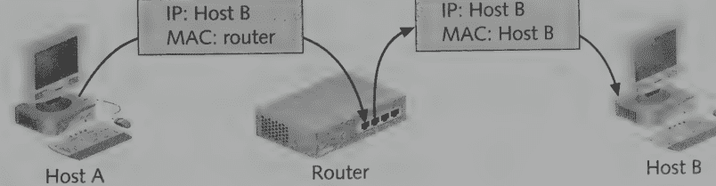

IP: Host B
MAC: router

IP: Host B
MAC: Host B

图 2-3 使用 ARP 访问路由器

## 系统网络脚本

正如我们提到的，你并不真的使用 `ifconfig` 和 `route` 来设置 Linux 网络。Linux 厂商提供了许多脚本和配置文件，使得复杂的网络设置变得更加简单，并让所有 Linux 系统的网络启动和停止更加顺畅。网络脚本遵循 UNIX 计算机上大多数系统服务的模型。你将在接下来的章节中看到更多此类脚本的示例。

简单的观点是，几乎每个 Linux 发行版的网络都由一个脚本控制或管理：`/etc/rc.d/init.d/network`。假设你已经安装了网卡，可以使用以下命令启动网络：

```
/etc/rc.d/init.d/network start
```

使用此命令停止网络：

```
/etc/rc.d/init.d/network stop
```

当你将它与 Microsoft Windows 操作系统的网络设置系统相比时，这个系统的优点显而易见。在 Linux 中，你不需要重启系统即可更改网络配置。只有在更换计算机硬件时才必须关机（对于某些系统，甚至都不需要！）。在 Linux 中，你可以对网络配置文件进行任何所需的更改，然后使用上述两个命令使其生效。如果你等不及，大多数 Linux 系统甚至支持使用此命令一次性完成：

```
/etc/rc.d/init.d/network restart
```

某些 Linux 厂商使用了略有不同的目录结构，但原理是相同的。例如，Debian Linux 使用脚本 `/etc/init.d/network`。此外，`/etc/init.d` 是 Red Hat 中作为符号链接提供的标准位置。

尽管这个宏大的网络脚本非常优雅，但它提出了一个问题：它是如何完成这一切的？答案是背后还有脚本和配置文件。所有这些都位于 `/etc/sysconfig` 目录下的 `network-scripts` 子目录以及 `networking` 文件中。

`network-scripts` 目录包含启动和停止单个网络接口的脚本。在该目录中，你会看到两个名为 `ifup` 和 `ifdown` 的主要脚本。它们用于控制 `localhost` 和以太网等更常见的接口。在该子目录中还可以找到用于 IPv6、PPP 或 ISDN 等接口的其他专用脚本。

你脑海中应该产生了一个疑问：为什么使用脚本而不是直接使用 `ifconfig` 的 `up` 和 `down` 选项？简短的回答是：脚本在处理网络接口方面要智能得多。例如，它们可以检查防火墙配置是否需要调整、是否涉及无线接口、是否必须更新默认路由等。如果你有 shell 经验，可以获取更复杂的信息：用文本编辑器打开并研究这些文件。

控制单个网络接口的脚本并不包含实际的配置数据。信息存储在 `/etc/sysconfig/network-scripts` 子目录中根据接口命名的独立文件中。你最可能看到的文件是 `/etc/sysconfig/network-scripts/ifcfg-eth0`，它包含了配置第一个以太网接口的信息。该文件的内容如下：

```
DEVICE=eth0
BOOTPROTO=static
BROADCAST=192.168.100.255
IPADDR=192.168.100.10
NETMASK=255.255.255.0
NETWORK=192.168.100.0
ONBOOT=yes
```

如果你使用 DHCP 获取 IP 地址信息，你的 `ifcfg-eth0` 文件将与此处所示的不同。

通过这个文件，你终于可以看到配置接口的数据实际上是如何存储的。如果你更改了此文件中的 IP 地址并使用 `/etc/rc.d/init.d/network restart` 命令，你系统的 IP 地址就会被更改。大多数 Linux 系统添加了图形化配置工具，让你设置 IP 地址、添加网络接口等。在后台，这些工具正在更改数据文件并使用控制网络的系统脚本。

## 使用图形化工具配置网络

为了看到该系统及其脚本和配置文件的灵活性和实用性，考虑你如何手动添加新接口。假设你需要为以太网卡分配额外的 IP 地址。这被称为 IP 别名（IP aliasing），发生在单个物理接口分配了多个 IP 的情况下——例如，这在单台机器上托管多个 Web 网站时非常有用。IP 别名通过在物理接口名称后加上数字来引用。因此，如果接口是 `eth0`，那么第一个 IP 地址将指向 `eth0:0`，第二个指向 `eth0:1`，以此类推。

要创建所需的 IP 别名，你只需在 `/etc/sysconfig/network-scripts` 目录中创建一个名为 `ifcfg-eth0:0` 的新文件。该文件的内容如下：

```
DEVICE=eth0
BOOTPROTO=static
BROADCAST=192.168.100.255
IPADDR=192.168.100.10
NETMASK=255.255.255.0
NETWORK=192.168.100.0
ONBOOT=yes
```

通过这个文件，你终于可以看到配置接口的数据实际上是如何存储的。如果你更改了此文件中的 IP 地址并使用 `/etc/rc.d/init.d/network restart` 命令，你系统的 IP 地址就会被更改。大多数 Linux 系统添加了图形化配置工具，让你设置 IP 地址、添加网络接口等。在后台，这些工具正在更改数据文件并使用控制网络的系统脚本。

## 使用图形化工具配置网络

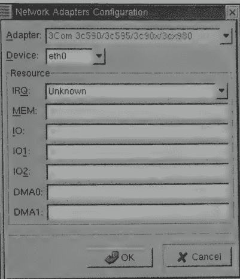

**图 2-5** 红帽网络配置工具中的网络配置对话框

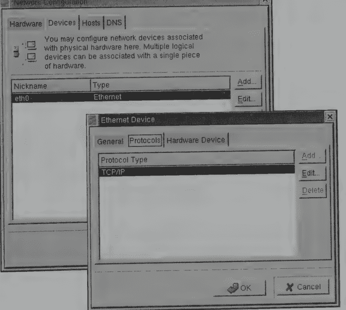

**图 2-6** 设备 (Devices) => 编辑 (Edit) 下的协议 选项卡

在该系统中，仅安装了 TCP/IP（未安装 AppleTalk、IPX 和其他协议）。由于如此，添加（Add）按钮不可用。不过，你可以通过点击编辑（Edit）按钮并在弹出的对话框中使用 TCP/IP 选项卡来编辑 TCP/IP 协议，如图 2-7 所示。你可以根据我们在第 1 章中的讨论识别出 IP 地址、子网掩码和默认网关字段。

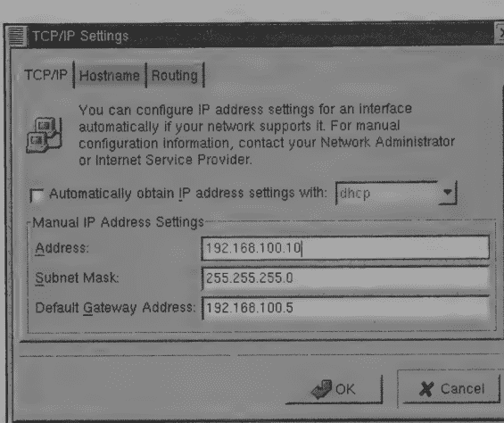

图 2-7 TCP/IP 对话框

与其他对话框一样，此对话框某些部分的讨论必须等到稍后内容。你将在本章后面以及第 3 章学习用于自动分配 IP 地址的 DHCP 以及主机名（Hostname）选项卡。路由（Routing）选项卡允许你向内核路由表添加内容。只有当你由于在具有多个网关或 Internet 节点的大型网络中工作而产生非标准路由需求时，才执行此操作。


# 第 2 章 配置基础网络

## 使用图形化工具配置网络


**图 2-5** 红帽网络配置工具中的网络配置对话框


**图 2-6** `设备 (Devices) => 编辑 (Edit)` 下的 `协议` 选项卡

在该系统中，仅安装了 TCP/IP（未安装 AppleTalk、IPX 和其他协议）。由于如此，`添加` 按钮不可用。不过，你可以通过点击 `编辑` 按钮并在弹出的对话框中使用 `TCP/IP` 选项卡来编辑 TCP/IP 协议，如图 2-7 所示。你可以根据我们在第 1 章中的讨论识别出 `IP 地址`、`子网掩码` 和 `默认网关` 字段。


**图 2-7** TCP/IP 对话框

与其他对话框一样，此对话框某些部分的讨论必须等到稍后内容。你将在本章后面以及第 3 章学习用于自动分配 IP 地址的 DHCP 以及 `主机名 (Hostname)` 选项卡。`路由 (Routing)` 选项卡允许你向内核路由表添加内容。只有当你由于在具有多个网关或 Internet 节点的大型网络中工作而产生非标准路由需求时，才执行此操作。

在 `net` 工具的对话框中进行任何更改后，使用 `OK` 按钮关闭每个对话框。然后使用 `关闭 (Close)` 按钮，并确认你想保存更改并使用你输入的新信息更新系统。

红帽 Linux 还提供了一个不那么华眼的工具。`netconfig` 程序以文本模式运行，并允许你为默认网络接口输入最基本的 IP 地址信息。你可以从任何命令行启动此工具。主数据输入界面如图 2-8 所示。

## 在 Calder OpenLinux 中使用 Webmin

多个 Linux 发行版（例如 Calder OpenLinux Desktop 2.4）使用 Webmin 来管理许多系统功能，包括网络配置。任何用户都可以通过主 KDE 图形菜单中选择 `系统 (System)`，然后选择 `Webmin` 来使用 Webmin。Webmin 在浏览器中运行。你选择想要配置的功能，查看当前设置，并在 Web 上的表单中输入任何新设置。Webmin 软件包中的脚本会更改你的系统配置文件。

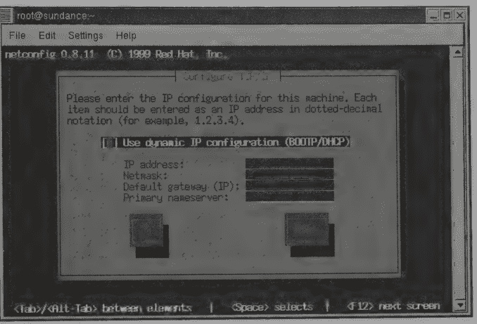

**图 2-8** 红帽 Linux 中基于文本的 `netconfig` 工具

要使用 Webmin，你必须使用用户名和密码登录。默认情况下，只有 `root` 用户可以访问 Webmin，因此请使用用户名 `root` 和你的 Linux 系统 `root` 密码登录。出现的第一个屏幕包含 Webmin 配置选项，允许你设置哪些用户可以访问 Webmin、从哪些主机连接到 Webmin，以及如颜色方案、日志标准、语言等许多其他选项。图 2-9 显示了此屏幕。


**图 2-9** Webmin 的初始屏幕

要查看网络配置设置，选择 `硬件 (Hardware)` 选项卡。从出现的 Web 页面中选择 `网络配置 (Network Configuration)`。网络配置页面会出现另外四个选项（图 2-10）。在此屏幕上，选择 `网络接口 (Network Interfaces)`。系统将显示你上所有已配置的网络接口列表。图 2-11 显示了我们系统上的网络接口列表。从此 Web 页面，你可以激活或禁用网络接口，添加或删除接口，并配置每个接口的参数。

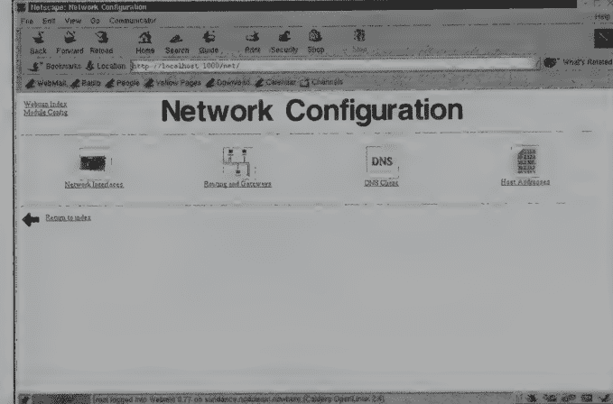

**图 2-10** Webmin 中的网络配置页面

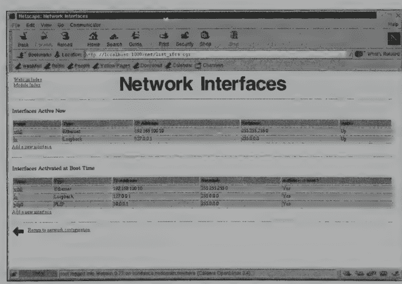

**图 2-11** Webmin 中的网络接口列表

对于红帽 Linux，由于安装过程中的自动检测，你的系统可能已经设置好了网络。你可以查看 Webmin 中的信息和功能，了解 Webmin 如何处理你学过的功能，例如 `IP 地址`、`内核设备`，甚至 `IP 别名`。你可以从 `活动接口 (Interfaces Active)` 列表中选择一个接口来更改网络接口的当前设置，这将显示图 2-12 所示的 `编辑接口 (Edit Interface)` 页面。在此页面上，你可以查看并更改 `IP 地址`、`网络掩码` 和 `广播地址` 等设置。你还可以选择 `添加 (Add)` 链接来添加你选择的另一个接口（使用之前过的 `IP 别名`）。要启动或停止所选接口，使用 `状态 (Status)` 字段中的 `向上 (Up)` 和 `向下 (Down)` 按钮。一旦你进行了任何更改，点击 `保存 (Save)` 按钮激活此接口。如果你不想执行更改，请使用 Web 页面上的 `返回 (Back)` 按钮或 `返回网络接口 (Return to network interfaces)` 链接。

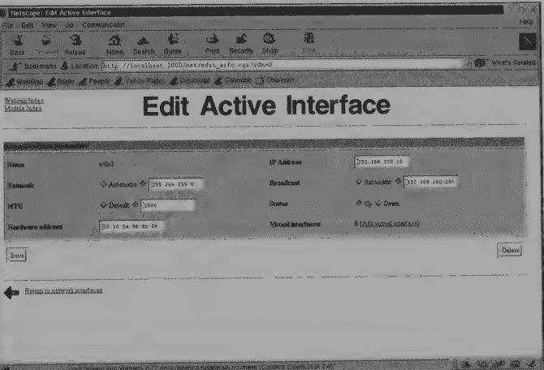

**图 2-12** 编辑接口页面


关于使用图形化工具设置 Linux 网络的最后一点：除了这里描述的两个实用工具之外，不同版本的 Linux 还有多种图形化网络工具可用。例如，SuSE Linux 使用 `YAST2` 工具；旧版本的 Red Hat 使用 `LinuxConf` 或 `netconf` 工具；旧版本的 Caldera Linux 使用 `COAS` 管理工具；Gnome 和 KDE 桌面环境也提供了各种系统配置工具。需要记住的一点是，虽然图形化工具可以帮助你配置网络，但你应该理解后台发生了什么，以及在需要进行故障排除时如何深入研究系统（这种情况下在所难免！）。请留心关注你倾向于使用的工具，并在现在你工作所处的各种网络环境中为你节省时间。

## 使用基础网络工具

当你 Linux 系统的基础网络运行顺畅后，你就可以开始探索让系统变得实用的工具和应用程序了。本节介绍了三种常用的工具，你应该熟悉它们，作为故障排除和信息查询工具。对于每种工具，都提供了简要摘要和一些示例。要学习更多信息，你应该尝试使用这些工具（本章末尾的项目是一个很好的开始），并在对如何使用它们产生疑问时查看在线 `man page` 文档。

## Telnet 远程登录工具

Telnet 是一个远程模拟程序。它允许你像坐在那台键盘前一样登录远程计算机。一旦登录，你就可以查看用户账户允许你查看任何文件。你还可以执行任何命令，包括更改或删除文件，或重启系统。

> **警告**：Telnet 是 Linux 中方便且强大的工具，但必须给出一个严正的警告：Telnet 未经过加密或编码，无法防止窃听。你在 Telnet 中进行的所有操作都可以被连接到同一网络的人看到。事实上，在第 11 章中，我们将看到如何使用 Telnet 自带的工具来实现这一点。你应该使用 `ssh`——安全外壳——工具代替 Telnet，它将在第 11 章中详细介绍。在此之前，请将 Telnet 视为临时措施并谨慎使用，因为你输入的任何信息（包括密码）都可能落入他人手中。

要使用 Telnet，你必须有一个向计算机请求连接的 Telnet 客户端，以及接受并管理该连接的 Telnet 服务器。客户端和服务器的细节将在第 4 章和第 5 章中讨论。许多 Linux 系统已经运行了 Telnet 服务器（尽管这被认为是一个安全风险）。所有 Linux 系统都安装了 Telnet 客户端，大多数 Windows 系统也是如此。

## 使用基础网络工具

Linux 中的 `telnet` 命令要求你输入想要连接的主机名或 IP 地址。如果可以建立连接——即

如果你想从 Windows 尝试 Telnet 会话，请启动某些 Windows 版本自带的 Telnet 程序，或获取一个免费的 Telnet 程序。（你可以在 `www.tucows.com` 等网站上搜索免费的 Telnet 客户端软件。）图形化的 Telnet 程序通常要求提供以下信息：

- 你想要连接的远程主机。对于此字段，你可以输入 IP 地址或主机名。
- 你想要连接的端口号。默认 Telnet 端口为 23，在你学习其他服务时，你可以选择其他端口进行测试或实验。
- 你希望软件模拟的哑终端类型。标准是 `VT100` 终端。存在数百种哑终端，但 `VT100` 是支持最广泛的。
- 用户名和密码。你可能会被要求输入用户名和密码，它们将作为登录的一部分发送到远程主机。Telnet 程序通常会请求保存这些信息，这样你每次连接到远程主机时无需再次输入。图 2-15 显示了一个 Windows 版本，程序可能与图中所示略有不同。

图 2-15 正在进行会的 Windows Telnet 程序

## 使用 ping 进行系统测试

在第 1 章中，你学习了 ICMP 协议中的 echo 消息类型。ICMP 用于发送有关 IP 连接的状态或错误消息；echo 用于发送测试数据包以检查远程主机是否可以到达。你用于发送 ICMP echo 数据包的工具称为 `ping`。

要使用 `ping`，只需包含你想要联系的主机名或地址即可。例如：

```
ping 198.60.22.20
```

此命令向 IP 地址为 `198.60.22.20` 的主机发送了一系列 64 字节的数据包。如果通过你和它之间的任何路由器可以到达主机，该主机上的 IP 栈会响应一条显示“我在这里”的消息，你的系统会在屏幕上打印一条消息显示远程主机是“存活”的。每秒会发送另一个数据包，直到你停止 `ping` 程序。

```
PING 198.60.22.20 from 64.24.90.213 : 56(84) bytes of data.
64 bytes from 198.60.22.20: icmp_seq=0 ttl=244 time=319.537 msec
64 bytes from 198.60.22.20: icmp_seq=1 ttl=244 time=319.537 msec
64 bytes from 198.60.22.20: icmp_seq=2 ttl=244 time=319.537 msec
64 bytes from 198.60.22.20: icmp_seq=3 ttl=244 time=319.537 msec
64 bytes from 198.60.22.20: icmp_seq=4 ttl=244 time=319.537 msec
64 bytes from 198.60.22.20: icmp_seq=5 ttl=244 time=319.537 msec
64 bytes from 198.60.22.20: icmp_seq=6 ttl=244 time=319.537 msec
--- 198.60.22.20 statistics ---
7 packets transmitted, 7 received, 0% packet loss
rtt min/avg/max/mdev = 319.537/319.537/319.537/0.000 ms
```

当你按下 `Ctrl+C` 结束 `ping` 程序时，它会计算统计信息。注意下方所示 `ping` 输出中的部分。它们包括：

- 数据包中发送的字节数。如果你需要，可以使用 `ping` 的参数来更改它。
- 你正在 ping 的主机名（如果你包含了一个话）和 IP 地址。
- 序列号，从 0 开始。ICMP 分配该数字并简单按顺序递增。
- ICMP 数据包的存活时间（`TTL`）。这是数据包在丢弃之前可以经过的路由器数量。这里的默认值——124——非常高，表明你确实想触达该主机。
- 从发送 ICMP 回显数据包到其返回之间所经过的时间。在例例中，你看到的时间为 280 毫秒（显示为 msecs）。在快速连接上，你通常看到低于 100 毫秒的时间；尝试在局域网内 ping，通常会看到十几毫秒的时间。注意，`ping` 在发送每个数据包之间会等待一秒，尽管响应返回的时间要短得多。
- 在你按下 `Ctrl+C` 后显示的统计信息包括获取响应的最小、最大和平均时间，未收到响应的数据包数量（如果你确实到达了主机，通常为 0 百比）。

`ping` 命令具有命令行选项，允许你设置参数，例如在自动停止之前发送的数据包数量、每个数据包之间的等待时间（默认为一秒）、要发送的数据包大小（默认为 64 字节），以及有助于调试路由问题的其他专用功能。例如，`-R` 选项会列出你的 `ping` 数据包到达目标主机所经过的所有中间路由器。（这与后面描述的 `traceroute` 命令类似。）

## 使用 traceroute 检查路由模式

当 `ping` 提供的信息不足以帮助你解决问题时，`traceroute` 是逻辑上的下一步。`traceroute` 命令会跟踪你与目标主机之间的每个路由器（每个跳数）。这让你能够清楚地看到数据包去向何处以及每一跳需要多长时间。命令 `traceroute 192.168.0.62.77` 的示例输出所示：

```
1 192.168.100.5 (192.168.100.5) 2.92 ms 9.798 ms 19.928 ms
2 wdc2-dial7.popsite.net (64.24.80.232) 219.817 ms 199.408 ms
ms 199.944 ms
3 wdc2-dial7.popsite.net (64.24.80.232) 199.930 ms 209.430 ms
ms 199.942 ms
4 wdc2-core.popsite.net (64.24.80.225) 199.995 ms 199.461 ms
ms 199.923 ms
5 wdcl1-core-pl1-0.starnetusa.net (64.24.80.1) 200.004 ms
ms 199.437 ms 189.952 ms
6 wdc3-core-pog2-0.starnetusa.net (216.126.145.122) 199.987 ms 199.401 ms 199.952 ms
7 jsay1-core-a3-0.starnetusa.net (216.126.145.105) 220.021 ms 949.325 ms 900.048 ms
8 chill1-core-s4-0.starnetusa.net (216.126.145.113) 169.974 ms
ms 3579.417 ms *
9 * sjcl-core-a3-0-2.starternusa.net (216.126.146.18)
2045.692 ms 319.424 ms
10 paol-core-p6-0.starternusa.net (216.126.145.97) 360.012
ms 319.415 ms 339.969 ms
11 xmission-pair.xmission.com (198.372.146) 289.961
ms 1049.435 ms 949.921 ms
12 xmission-pair.xmission.com (204.228.132) 819.957
ms 309.562 ms 309.941 ms
13 core-border.xmission.com (166.70.4.10) 309.973
ms 309.580 ms 309.887 ms
14 ftp.xmission.com (198.60.22.77) 309.989
ms 319.627 ms 309.934 ms
```

每行都有编号。在本例中，从我们的系统到服务器 `ftp.xmission.com` 经过了十四跳。每行都显示了沿途每个路由器的 IP 地址，以及该机器 `traceroute` 可以找到的主机名。在每个路由器的 IP 地址后会显示三次“三个数据包”。Traceroute 显示了每一跳花费的时间。如果列表中出现星号（`*`），表示路由器在五秒的默认限制时间内未做出响应。Traceroute 尝试最多 30 跳到达目标地，不过你可以使用命令行参数更改跟踪次数。

Traceroute 依赖 `ttl` 字段和 ICMP“数据包超时”消息在互联网上逐步移动，以到达我们感兴趣的主机。由于并非所有系统都遵循使用这些标准的做法，`traceroute` 输出的某些行可能只包含三个星号。但在某些情况下，`traceroute` 是诊断如下问题非常有用的工具：

- 数据包在何处停止。你尝试访问某个特定主机，但由于路由信息错误，它到达了互联网上的某个点后就不再继续前进。`traceroute` 的输出显示了数据包到达的最后一个路由器。
- 数据包在何处变慢。你到某个网段的连接似乎异常；`traceroute` 指明了从每个路由器接收响应的时间。花费异常时间响应的那个值得特别关注。（你将在后面的章节中学到）。

其他问题可能存在，但这些是 `traceroute` 的两种用途。`ping` 命令的命令行选项允许你设置参数，以及其他对调试路由问题的有用特殊功能。

## 排除网络故障

这可能让你惊讶，但你已经学习了如何使用 Linux 来排除故障。网络可能会变得非常复杂，我们尚未深入许多硬件问题（例如电缆问题）。表 2–2 列出了可以使用现有工具诊断和排除的一些常见网络问题。随着你学习更多关于网络的方面（例如第 3 章中的 DNS），我们将扩展此列表。

### 表 2–2 基础网络回顾

| 故障 | 检查事项 |
| :--- | :--- |
| 网络似乎无法正常工作 | 使用 `ifconfig` 命令查看网络是否启动；如果不是，尝试 `/etc/rc.d/init` 网络（记得检查明显的问题：电缆插在网卡上了吗？安装了网卡吗？） |
| 网络脚本似乎无效 | 使用 `lsmod` 命令查看内核是否安装了模块。如果没有，按照本章描述使用 `modprobe` 或图形化工具安装正确的内核模块 |
| 无法 ping 局域网内的其他系统 | 检查电缆；使用 `ifconfig` 查看是否已分配 IP 地址；检查路由表查看是否有本地网络的路由 |
| 无法 ping 组织内另一个网段的系统 | 检查机房或服务器房的电缆；使用 `ifconfig` 查看是否分配了有效 IP 地址以及该地址与其他网段地址对比（是否存在冲突？路由表是否包含指向中间路由器的路由？） |
| 到另一个网段的流量非常慢 | 检查路由表查看是否定义了直接路由；检查是否有系统分配了相同的 IP 地址；查看 `ifconfig` 输出查看是否发生了大量冲突——如果网络过载；检查 `ifconfig` 输出查看是否发生错误——如果网卡损坏；查看两个网段之间的分片问题是否减慢了传输；使用 `traceroute` 查看传输在何处变慢 |

## 其他网络协议

在随后的章节中，你将学习许多用于不同信息共享的各种协议；但两种低层协议在讨论 TCP/IP 和路由的相同背景下值得提及。它们是 `IPX` 和 `AppleTalk`。

## IPX 与 Linux

网间分组交换 (`IPX`) 协议由 Novell 设计，它基于一种名为 Xerox 网络系统 (`XNS`) 的旧协议。`IPX` 从 1985 年到 20 世纪 90 年代中期，一直是局域网的主导协议。

在 20 世纪 90 年代初，许多公司将 `IP` 替换为 `IPX`，因为 `IP` 是互联网协议并被认为是一种更优越的网络协议。事实上，现在的产品都增强了 Novell 的“纯 IP”能力，尽管 `IPX` 在运行较小网络时比 `IP` 具有明显优势。

Linux 对 `IPX` 的依赖性很强；大多数 Linux `IPX` 软件是由前 Novell 工程师创建的。由于缺乏需求，已经不再有大量的开发工作进行。如果你与 NetWare 服务器一起，可以使用 Linux 作为客户端与 NetWare 服务器通信，或者作为 NetWare 文件或打印服务器，或是路由 `IPX` 流量。本节介绍了 `IPX` 的基础知识；第 5 章描述了你可以使用的、用于模拟 NetWare 客户端或服务器的额外软件。有关在 Linux 上设置 `IPX` 的完整信息，请审阅 `IPX HOWTO` 文档，你可以在 `www.ibiblio.org/mdw/HOWTO/IPX-HOWTO.html` 找到它。

`IPX` 避免了 `IP` 的所有挑战，例如分配和管理 IP 地址的需求以及全球 IP 地址的短缺。它通过使用网卡的硬件地址（例如以太网卡的 `MAC` 地址）作为主机的地址（在 `IPX` 体系方案中称为节点 ID）来实现。每个网段都由 `IPX` 路由器分配一个网络 ID——该路由器通常是内置在每个 NetWare 服务器中的。每个主机由一个 IP 地址唯一标识，该地址由网络地址后跟节点 ID（主机的 `MAC` 地址）组成。这种安排缺乏 `IP` 的某些灵活性，可能不适用于全球网络，但对于几百或可能几千个系统的网络来说，管理要容易得多。

为了处理路由，`IPX` 使用了两种协议：路由信息协议 (`RIP`) 和服务公告协议 (`SAP`)。这些协议帮助基于 `IPX` 的服务器收集有关其他系统网络地址和可用服务的信息。这些协议定期广播信息，因此它们往往给拥有大量主机的网络带来压力。但再次，它们在不需要系统管理员操作的情况下完成工作。

`IPX` 主机可以通过查找从 `IP` 服务器和 `IP` 路由器广播的封包来自动“配置自己”。你可以通过这种方式让 Linux 成为具备 `IPX` 能力的客户端，也可以让 Linux 成为 `IPX` 路由器或 `IPX` 服务器。必须在 Linux 内核中启用 `IPX`，这通常意味着重新编译内核。不要期望 `IPX` 会成为你 Linux 系统的一部分，因为很少 Linux 用户需要此功能。

一旦在内核中启用 `IPX`，你可以通过查看 `/proc/net` 目录下的 IP 信息文件来查看 `IPX` 状态。有一组管理 `IPX` 的工具可用，如前述 `IPX HOWTO` 文档所述。这些工具包括：

- `ipx_configure` 通过来自同一网络上 `IP` 服务器的广播信息启用或禁用自动 `IPX` 配置。


- `ipx_interface` 允许你手动添加、删除或检查 IPX 接口，类似于 TCP/IP 的 `ifconfig` 命令。

## 第 2 章 配置基础网络

- `ipx internal_net` 帮助你建立一个内部 IPX 网络，类似于环回设备。在 IPX 网络中，它被作为路由机制的一部分，用于设置所谓的“主接口”。

- `ipx_route` 手动修改 IPX 路由表，非常像 IP 的 `route` 命令。

Linux 上的 IPX 协议非常灵活。你可以通过 PPP 连接使用 IPX；你也可以通过像互联网这样的 IP 连接连接两个 IPX 网络。

## Apple 网络与 Linux

另一个设计良好但不太流行的网络系统是 Apple Macintosh 的系统。任何使用过 Macintosh 的人可能对设置 PC 网络（运行 Windows 或 Linux）时所需的复杂菜单感到奇怪。Mac 提供了即插即用的网络。但对于 IPX，这种简单性无法扩展到全球互联网等规模，因此目前 AppleTalk 仅用于有限数量的计算机上。

AppleTalk 是 Macintosh 计算机使用的网络协议名称。在 Linux 中，你可以安装 Netatalk 软件包，允许 Macintosh 计算机识别 Linux（在 Mac 桌面上作为可用共享资源显示出来）。另一个名为 `lets` 的程序允许 Linux 用户访问 Macintosh 资源。然而，`afps` 目前没有正在开发，且不受最新版本 Linux 内核 (2.4) 的支持。

Netatalk 的自动化程度比 TCP/IP 低。与 IPX 一样，你需要重新编译 Linux 内核以包含 Netatalk 的支持。你还需要编译 Netatalk 软件并编辑几个配置文件，以设置安全性，并定义你想要与网络上的 Macintosh 用户共享的 Linux 文件系统部分。要开始操作，请仔细审阅 Netatalk HOWTO 文档并按照指示下载相应的软件。详情请见 `www.anders.com/projects/netatalk/`。

> **提示** 你可能会为你的 Linux 系统找到一个预封装的 Netatalk 版本。虽然你仍然需要更新内核，但这可以节省大量编译和配置其余 Netatalk 包的精力。可以在 `rpmfind.net` 上搜索 Netatalk，该网站列出了针对不同 Linux 发行版的几十个软件包。

## 本章总结

- 当加载支持某种网络类型的内核模块时，Linux 网络设备直接在 Linux 内核中创建。

- Linux 支持多种类型的网络，尽管标准局域网最广泛使用的是以太网。

## 章节总结

- `modprobe` 命令用于向内核添加网络模块。可以使用 `lsmod` 列出当前加载的内核模块。

- 有时安装内核模块需要包含包含参数以帮助模块定位或运行。

- `ifconfig` 命令在内核中设置网络接口，或显示所有接口的当前设置。

- `route` 命令在内核路由表中建立条目，或显示当前路由表。

- `arp` 命令允许你查看系统缓存中的硬件地址条目。这些条目被 IP 将数据包路由到最终目的地。

- 许多网络脚本用于简化 Linux 配置，使其更加灵活健壮。主网络控制脚本是 `/etc/rc.d/init.network`。

- 网络配置参数存储在 `/etc/sysconfig/network-scripts` 子目录的文件中。这些文件可以直接编辑，但通常使用某种配置工具（如 Webmin）。

- IP 别名发生在多个 IP 地址分配给同一个物理网络接口（例如单个以太网卡）时。

- Red Hat Linux 包含了强大的网络管理工具；Caldera 使用 Webmin 浏览器界面配置网络；SuSE 使用 YaST。其他 Linux 版本使用各种图形化工具进行配置。

- 启用 IP 转发允许在多个网络接口之间移动数据包，从而允许系统充当路由器。

- `telnet` 工具连接到主机就像你坐在该主机一样，`telnet` 不安全也不加密，必须谨慎使用。

- `Ping` 是一个使用 ICMP echo 命令来检查远程主机是否可用且存活的工具。`Ping` 是测试网络连接的常用工具，但互联网上某些主机因为之前的攻击而不响应 ping。

- `traceroute` 命令显示你的主机与想要联系的另一个主机之间的每个路由器。`traceroute` 提供的信息有助于诊断连接到远程主机或连接缓慢的问题。

- IPX 是一种源于 Novell 的 NetWare 操作系统的有用协议。它在 Linux 中被支持，尽管并不广泛使用。

- AppleTalk 通过 Netatalk 软件包在 Linux 中支持，你可以将其添加到 Linux 以以便 Macintosh 计算机识别并访问 Linux 资源。

## 核心术语

- `/etc/rc.d/init.d/network` — Linux 中的主网络控制脚本。此脚本的精确位置在不同的 Linux 系统中可能会有所不同，尽管这是一个标准位置。

- `/etc/sysconfig` — 存储网络配置文件和脚本的目录，具体位于 `network-scripts` 子目录和 `networking` 文件中。

- `/lib/modules` — 存储所有可用 Linux 内核模块的目录。

- `afps` — 一个允许 Linux 用户访问 Macintosh 资源的软件软件包。该软件仍可以下载，但由于目前不再进行开发，因此不支持最新的 Linux 内核（2.4）。

- `AppleTalk` — Apple Macintosh 计算机使用的网络协议。Linux 通过 `Netalk` 软件包支持 AppleTalk。

- `arp` — 一种显示或更改 ARP 缓存内容的命令。主要用于排除网络连接故障。

- `arp cache`（ARP 缓存）— ARP 维护的 IP 到硬件映射列表，用于辅助数据包路由。

- `device driver`（设备驱动程序）— Linux 内核中的软件，知道如何与物理或逻辑设备通信。逻辑网络设备用于创建任何程序均可用于联网的通信通道。

- `Device File System (DevFS，设备文件系统）` — 2.4 版本 Linux 内核处理所有设备的系统。该系统是网络设备处理方式的一个良好示例。

- `eth0` — Linux 中对主机上安装的第一块以太网卡的命名。

- `frame layer`（帧层）— 一种通过电缆提供专用高速 Internet 连接的技术。

- `ifcfg-eth0` — 位于 `/etc/sysconfig/network-scripts/` 的文件，包含配置第一个以太网接口的信息。

- `ifconfig` — 接口实用程序，用于配置 Linux 内核内的网络接口，或列出所有已配置的网络接口。

- `ifdown` — 用于关闭不需要的网络接口的脚本。通常由其他脚本作为 `/etc/rc.d/init.d/network` 调用，而不是由用户直接使用。

- `ifup` — 用于启动初始网络接口的脚本。通常由其他脚本作为 `/etc/rc.d/init.d/network` 调用，而不是由用户直接使用。

- `insmod` — 向运行中的 Linux 内核中安装模块的命令。它为正在安装的模块提供额外信息。

- `Internet Packet Exchange (IPX，网数据包交换）` — 由 Novel, Inc. 开发的协议，基于名为 Xerox Network System (XNS) 协议的旧协议。IPX 多年来一直是局域网上的主导协议，并在 Linux 中得到完全支持。它使用网络硬件地址作为主机 ID，从而简化了网络配置。

- `Inverse ARP (InARP，反向 ARP）` — 一种 ARP 方法，允许主机在已知物理地址时获取另一主机的 IP 地址。

- **IP aliasing（IP 别名）** — 一种网络功能，允许物理接口分配多个 IP 地址。

- **IP forwarding（IP 转发）** — Linux 网络的一种功能，指示 Linux 内核根据路由表确定的任何接口发送数据包。如果没有转发，到达给定网络接口的数据包只能从该接口发出。

- **kernel modules（内核模块）** — Linux 内核的一部分（如设备驱动程序），可以在 Linux 运行时通过诸如 `modprobe` 的命令进行加载或卸载。

- **LinuxConf** — Red Hat 在 7.2 版本之前用于配置网络的实用程序。尽管它仍然包含在 Red Hat 中，但现在 `neat` 更为流行。

- **lo** — 回环网络设备的设备名称。

- **localhost** — 分配给回环设备的名称，对应 IP 地址 127.0.0.1。通常与 *loopback device*（回环设备）术语通用。

- **loopback device（回环设备）** — 一种用于在主机内部移动数据包的特殊“逻辑”网络设备。回环设备的 IP 地址为 127.0.0.1。通常与 *localhost* 术语通用。

- `lsmod` — 列出当前加载到内核中的模块的命令。

- `metric`（度量/权重） — 分配给网络接口的值，用于指导动态路由决定何时使用该接口。度量越高，意味着如果有其他接口可用，该接口被使用的概率越低。

- `modprobe` — 在加载内核模块的同时自动检查并加载依赖模块的命令。

- `neat` — Red Hat 网络管理工具的命令行调用程序。

- `Netatalk` — 一个用于 Linux 的软件软件包，允许 Macintosh 计算机识别 Linux（在 Mac 桌面上显示为共享资源）。

- `Parallel Interface Protocol (PLIP，并行接口协议)` — 一种依赖并行端口传输网络数据的协议，通常用于连接简单廉价网络中的两台计算机。

- `parameters`（参数） — 加载内核模块时提供的命令行信息，帮助模块识别其设计用于运行的硬件。

- `ping` — 用于发送 ICMP 回显包进行网络测试的实用程序。

- `Point-to-Point Protocol (PPP，点对点协议）` — 一种允许直接连接单个计算机的协议，形成两个系统的网络。PPP 通常用于配合为第二台计算机提供底层物理连接的调制器。

- `proxy ARP`（代理 ARP） — ARP 的一种功能，允许主机响应对另一主机硬件地址的请求。通常情况下，主机仅在被请求自己的信息时才会响应 ARP 请求。

- `Red Hat Network Administration Tool`（Red Hat 网络管理工具） — Red Hat Linux 中提供的图形化界面，用于管理硬件设备（访问这些设备的内核模块），包括每个设备所需的参数以及与其相关的网络地址。可以使用 `neat` 从命令行启动它。

- `Reverse ARP (RARP，反向 ARP)` — 一种 ARP 方法，允许无盘工作站通过其 MAC 地址获取 IP 地址。

- `route` — 用于显示或配置内核中路由表的命令。

- `routing daemon`（路由守护进程） — 在内核中维护路由表的程序。

- `Serial Line Internet Protocol (SLIP，串行链路协议）` — 一种通过串口连接 Internet 的协议，通常通过调制器连接到 ISP。

- `Service Advertising Protocol (SAP，服务公告协议）` — 用于在 IPX 网络上发布服务的协议。

- `T-1` — 传输速率为 1.544 Mbps 的。

- `T-3` — 传输速率为 45 Mbps 的。

- `Telnet` — 一种允许用户像坐在计算机前一样登录远程计算机的终端程序。

- `traceroute` — 用于显示数据包从源主机到目标主机经过的每个跳点的命令。

- `VT100` — 最广泛使用的终端标准。

- `WebMin` — 基于浏览器的实用程序，可以管理系统功能，包括网络配置。

- `YAST2` — SuSE 中提供的工具。

## 复习题

1. IPX 相比 IP 的优势是：

   a. IPX 不需要配置主机 ID。

   b. IPv6 提供的空间更大。

   c. Linux 对 IPX 的支持更好。

   d. IPX 路由依赖 RIP 而不是 `route` 命令。

2. 网络设备与其他设备的区别在于：

   a. 网络设备使用的主从号与其它设备不同。

   b. 网络设备传输快得多。

   c. 网络设备不直接显示在 `/dev` 子目录，而在加载网络模块时动态创建。

   d. 可以仅通过脚本访问。

3. 加载模块时 `modprobe` 比 `insmod` 好是因为：

   a. `modprobe` 允许在命令行包含模块参数，而 `insmod` 不。

   b. `modprobe` 在加载请求模块之前加载依赖模块。

   c. `insmod` 不支持所有 Linux 版本，但 `modprobe` 支持。

   d. `insmod` 可能会干扰 `ifconfig` 命令的操作。

4. 在 WebMin 的 Hardware 标签中，重新配置网络接口地址的下一步是：

   a. 选择 Network Configuration 图。

   b. 选择 Network Interfaces 图。

   c. 选择要输入新 IP 地址的硬件接口。

   d. 选择修改活动接口参数还是启动接口参数。

5. 下目录最可能包含网络设备的内核模块：

   a. `/lib/modules/networking`

   b. `/etc/sysconfig/network-scripts`

   c. `/lib/modules/2.4.7-10/kernel/drivers/net`

6. 当使用 `telnet` 时，提到 VT10 是因为它：

   a. Telnet 的一种协议标识

   b. 连接到 Telnet 服务器时默认使用的端口

   c. 最常用的终端仿真标准

   d. 终端仿真器连接通常的处理速度

7. 在 Linux 中，在什么情况下最可能需要内核参数来使网卡（NIC）正常工作？

   - a. 你正在使用旧的二手 ISA 网卡，它具有允许软件中进行自动 IRQ 映射的特殊功能。

   - b. 你正在使用全新的 PCI 网卡，它与一个现有型号完全相同。

   - c. 你的新网卡文档说明提供了 Windows 软件来帮助你配置网卡。

   - d. 你想在网络上执行 IP 别名和 IP 转发。

8. 解释 `ifconfig` 输出中 TX packets（发送包）和 TX bytes（发送字节）行的区别。

9. 哪个不是有效的 `ifconfig` 命令？

   - a. `ifconfig eth0 up`

   - b. `ifconfig eth0 192.168.100.2 netmask 255.255.255.0 broadcast 255.255.255.0`

   - c. `ifconfig`

   - d. `ifconfig eth0 if-up`

10. 哪一个信息字段不是 `route` 命令输出的一部分？

    - a. 到达指定网络的网关

    - b. 用于向指定网络传输数据包的接口的 MAC 地址

    - c. 可以到达指定网络的接口

    - d. 每个路由表条目所应用的网络地址

11. 关于以下命令，哪种描述是正确的：

    `route -net 192.168.20.0 netmask 255.255.255.0 gw 192.168.10.1 dev eth0`。

    - a. 它是有效的，并定义了可以到达网络 192.168.20.0 的路由器。

    - b. 它是有效的，并为所有不是 192.168.20.0 的流量定义了默认网关。

    - c. 它是无效的，因为它没有指定要路由的数据包源的主机 IP 地址。

    - d. 格式无效，因为它在命令行选项之前缺少必要的横杠。

12. `plip` 网络设备指的是：

    - a. Protocol Layer Internet Protocol activity（协议层 IP 活动）

    - b. ProxyARP Layered Internet Protocol transmissions（代理 ARP 分层 IP 传输）

    - c. Parallel Line Internet Protocol support（并行线 IP 协议支持）

    - d. 多个并行的 SLIP 通道

## 复习题 101

13. 区分 RARP 和 InARP。

14. 你使用 `arp` 命令是为了：

    - a. 根据 ARP 协议请求向远程主机发送硬件地址

    - b. 为你的网络开启和关闭 ARP 功能

    - c. 收集本地网络上每个主机的主机名到 IP 地址的映射

    - d. 查看或修改 `arp /etc/rc.d/init.d/network` 缓存的硬件地址到 IP 地址的映射

以及相应的数据文件被用于控制网络，是因为：

    - a. 使用 `ifconfig` 和 `route` 对普通用户来说太复杂了

    - b. 仅靠 `ifconfig` 和 `route` 命令无法完成网络配置

    - c. 使用脚本可以在管理多个接口、防火墙设置和涉及 Linux 许多不同部分的外围需求时提供灵活性和强大

    - d. 通过依赖脚本，图形化工具可以创建一个更易于用户的环境，使系统管理员效率更高

16. 为第一个以太卡指定 IP 别名的正确设备标识是：

    - a. `eth0`

    - b. `eth0:0`

    - c. Ethernet II

    - d. `eth1:0`

17. 在 Red Hat 网络配置工具 (`neat`) 中，硬件选项卡包含：

    - a. 当前已安装模块的所有网络硬件列表

    - b. Red Hat Linux 中所有可用网络模块的列表

    - c. 当前安装模块的可用参数列表

    - d. 每个已安装硬件接口的 IP 地址

18. 回环设备（loopback device）被分配的 IP 地址是：

    - a. 255.255.255.0

    - b. 127.0.0.1

    - c. 127.0.0.0

    - d. 任何以 192.168 开头的 IP 地址

19. 通过哪个命令启用 IP 转发：

    - a. `ifconfig eth0 ip_forward`

    - b. `arp ip_forward`

    - c. `route add default ip_forward -net 192.168.10.0 netmask 255.255.255.0`

    - d. `echo 1 > /proc/sys/net/ipv4/ip_forward`

20. 哪种工具不能用于配置网络接口？


# 选择题与实验题

## 选择题

21. Telnet 被认为是危险的是因为：

a. 它提供了对网络栈的访问，只有 root 用户应该拥有访问权限。

b. 它在不加密的情况下传输数据（包括密码），因此网络上的任何人都可以使用特殊软件看到它们。

c. 它通过向本地网段发送广播消息增加网络流量，从而增加了以太网冲突的数量。

d. 它要求用户提供密码以访问远程系统。

22. Ping 用于通过以下方式测试网络连接：

a. 尝试联系离你的主机越远的系统，以查看是否发生任何网络问题

b. 向网络灌输流量以查看其是否有足够的带宽

c. 测试远程服务器是否配置为响应 ICMP echo 请求

d. 记录数据包在响应时所采取的路由

23. Traceroute 是一个非常有用的工具，是因为：

a. 它通过 UDP 报告到达目标时的路由，它不是加密的。

b. 它报告它通过的路由器。

c. 它报告到达目标时经过的。

d. 它通过向本地网段发送广播消息增加以太网冲突的数量。

24. 如果你的网络中 `ifconfig` 显示没有条目，可能是因为：

a. 检查你的 ARP

b. 

c. 

d. 网关的 IP 地址。

## 实验

### 实验 2-1

1. 区分 RARP 和 InARP。

2. 你使用 `arp` 命令是为了：

- a. 根据 ARP 协议请求向远程主机发送硬件地址

- b. 为你的网络开启和关闭 ARP 功能

- c. 收集本地网络上每个主机的主机名到 IP 地址的映射

- d. 查看或修改 `arp` / `etc/rc.d/init.d/network` 缓存的硬件地址到 IP 地址的映射

以及相应的数据文件被用于控制网络，是因为：

- a. 使用 `ifconfig` 和 `route` 对普通用户来说太复杂了

- b. 仅靠 `ifconfig` 和 `route` 命令无法完成网络配置

- c. 使用脚本可以在管理多个接口、防火墙设置和涉及 Linux 许多不同部分的外围需求时提供灵活性和强大

- d. 通过依赖脚本，图形化工具可以创建一个更易于用户的环境，使系统管理员效率更高

3. 为第一个以太卡指定 IP 别名的正确设备标识是：

- a. eth0

- b. eth0:0

- c. Ethernet II

- d. eth1:0

4. 在 Red Hat 网络配置工具 (neat) 中，硬件选项卡包含：

- a. 当前已安装模块的所有网络硬件列表

- b. Red Hat Linux 中所有可用网络模块的列表

- c. 当前安装模块的可用参数列表

- d. 每个已安装硬件接口的 IP 地址

5. 回环设备被分配的 IP 地址是：

- a. 255.255.255.0

- b. 127.0.0.1

- c. 127.0.0.0

- d. 任何以 192.168 开头的 IP 地址

6. 通过哪个命令启用 IP 转发：

- a. ifconfig eth0 ip_forward

- b. arp ip_forward

- c. route add default ip_forward -net 192.168.10.0 netmask 255.255.255.0

- d. echo 1 > /proc/sys/net/ipv4/ip_forward

7. 哪种工具不能用于配置网络接口？

a. YAST2

b. netconf

c. COAS

d. ping

8. Telnet 被认为是危险的是因为：

a. 它提供了对网络栈的访问，只有 root 用户应该拥有访问权限。

b. 它在不加密的情况下传输数据（包括密码），因此网络上的任何人都可以使用特殊软件看到它们。

c. 它通过向本地网段发送广播消息增加网络流量，从而增加了以太网冲突的数量。

d. 它要求用户提供密码以访问远程系统。

9. Ping 用于通过以下方式测试网络连接：

a. 尝试联系离你的主机越远的系统，以查看是否发生任何网问题

b. 向网络灌输流量以查看其是否有足够的带宽

c. 测试远程服务器是否配置为响应 ICMP echo 请求

d. 记录数据包在响应时所采取的路由

10. Traceroute 是一个非常有用的工具，是因为：

a. 它通过 UDP 报告到达目标时的路由，它不是加密的。

b. 它报告它通过的路由器。

c. 它报告到达目标时经过的。

d. 它通过向本地网段发送广播消息增加以太网冲突的数量。

11. 如果你的网络中 `ifconfig` 显示没有条目，可能是因为：

a. 检查你的 ARP

b. 

c. 

d. 网关的 IP 地址。

12. 实验。

13. 区分 RARP 和 InARP。

14. 你使用 `arp` 命令是为了：

- a. 根据 ARP 协议请求向远程主机发送硬件地址

- b. 为你的网络开启和关闭 ARP 功能

- c. 收集本地网络上每个主机的主机名到 IP 地址的映射

- d. 查看或修改 `arp` / `etc/rc.d/init.d/network` 缓存的硬件地址到 IP 地址的映射

以及相应的数据文件被用于控制网络，是因为：

- a. 使用 `ifconfig` 和 `route` 对普通用户来说太复杂了

- b. 仅靠 `ifconfig` 和 `route` 命令无法完成网络配置

- c. 使用脚本可以在管理多个接口、防火墙设置和涉及 Linux 许多不同部分的外围需求时提供灵活性和强大

- d. 通过依赖脚本，图形化工具可以创建一个更易于用户的环境，使系统管理员效率更高

15. 为第一个以太卡指定 IP 别名的正确设备标识是：

- a. eth0

- b. eth0:0

- c. Ethernet II

- d. eth1:0

16. 在 Red Hat 网络配置工具 (neat) 中，硬件选项卡包含：

- a. 当前已安装模块的所有网络硬件列表

- b. Red Hat Linux 中所有可用网络模块的列表

- c. 当前安装模块的可用参数列表

- d. 每个已安装硬件接口的 IP 地址

17. 回环设备被分配的 IP 地址是：

- a. 255.255.255.0

- b. 127.0.0.1

- c. 127.0.0.0

- d. 任何以 192.168 开头的 IP 地址

18. 通过哪个命令启用 IP 转发：

- a. ifconfig eth0 ip_forward

- b. arp ip_forward

- c. route add default ip_forward -net 192.168.10.0 netmask 255.255.255.0

- d. echo 1 > /proc/sys/net/ipv4/ip_forward

19. 哪种工具不能用于配置网络接口？

a. YAST2

b. netconf

c. COAS

d. ping

20. Telnet 被认为是危险的是因为：

a. 它提供了对网络栈的访问，只有 root 用户应该拥有访问权限。

b. 它在不加密的情况下传输数据（包括密码），因此网络上的任何人都可以使用特殊软件看到它们。

c. 它通过向本地网段发送广播消息增加网络流量，从而增加了以太网冲突的数量。

d. 它要求用户提供密码以访问远程系统。

21. Ping 用于通过以下方式测试网络连接：

a. 尝试联系离你的主机越远的系统，以查看是否发生任何网问题

b. 向网络灌输流量以查看其是否有足够的带宽

c. 测试远程服务器是否配置为响应 ICMP echo 请求

d. 记录数据包在响应时所采取的路由

22. Traceroute 是一个非常有用的工具，是因为：

a. 它通过 UDP 报告到达目标时的路由，它不是加密的。

b. 它报告它通过的路由器。

c. 它报告到达目标时经过的。

d. 它通过向本地网段发送广播消息增加以太网冲突的数量。

23. 如果你的网络中 `ifconfig` 显示没有条目，可能是因为：

a. 检查你的 ARP

b. 

c. 

d. 网关的 IP 地址。

24. 实验。

25. 实验。

## 实践项目

4. 如果你正在教室或计算机实验室工作，请向你的邻座询问他的或她的 IP 地址，然后 ping 你的主机。

5. 如果你的导师允许你继续，请确保你已以 root 身份登录。

6. 使用 `ping` 命令并配合 `-f` 选项（代表泛洪模式，flood）。这将以最快的速度发送 ping（ICMP 回显请求数据包）。在你执行此命令后，屏幕上显示的每个周期都表示有一个丢弃的数据包（因为被 ping 的主机响应速度不够快）。

7. 如果可能，让你的邻座尝试完成一项网络任务，例如打开浏览器窗口并查看一个图形密集型页面。泛洪 ping 会给网络带来沉重负载，应谨慎使用。这就是为什么系统管理员阻止 ping 的原因，也是为什么你将在第 11 章中学习如何自己做到这一点。

## 项目 2-4

对于此项目，你需要连接互联网和一个 Web 浏览器。

假设你有一个英特尔网卡（NIC），型号为 i82557（Ether Express Pro 100）。你想知道它是否与 Linux 兼容，以及如果它在安装 Linux 时没有自动配置，哪个内核模块支持此网卡。

1. 在你的 Web 浏览器中访问 `hardware.redhat.com`。

2. 选择 **Hardware Compatibility List**（硬件兼容列表）。

3. 选择 **Complete Listing**（完整列表）。你也可以选择 Certified Hardware（认证硬件），基于 Red Hat Software, Inc. 的测试，这将提供更多关于在 Linux 上使用此卡的信息，但由于你不知道该卡是否与 Linux ，最好的办法是从完整的硬件列表开始。

4. 从出现页面底部的硬件制造商下拉列表中选择 **Intel**。你不需要点击其他任何内容；选择制造商会自动跳转到下一个网页。

5. 出现一个 Intel 的类别列表，显示了 Intel 制造的所有硬件类型。选择 **Network Device/Controller**（网络设备/控制器）。

6. 在出现的 30 多个 Intel 网卡条目条目中，找到你的模型 **i82557**（Ether Express Pro 100）。确保你正在查看的是引用 x86 架构（标准 PC）的行，而不是 Alpha 架构（另一种类型的 CPU）。点击链接。

7. 该网卡支持 Linux 吗？如果是，哪个内核模块支持此网卡？在 Linux 中使用此卡会有哪些注意事项？

## 项目 2-5

对于此项目，你需要连接到以太网网络，并拥有导师的任务以及一个静态 IP 分配地址，用于创建 IP 别名（IP alias）（如果你使用 DHCP 获取主机的 IP 地址，则无法创建 IP 别名）。你必须以 root 身份登录完成此项目。

1. 运行 `ifconfig` 命令查看你已配置了 `eth0`。

2. 进入目录 `/etc/sysconfig/network-scripts`：

```
cd /etc/sysconfig/network-scripts
```

3. 复制 eth0 接口的配置文件，作为创建名为 `eth0:0` 的新接口的基础，它是同一个物理以太网卡的 IP 别名：

```
cp ifcfg-eth0 ifcfg-eth0:0
```

4. 用文本编辑器打开 `ifcfg-eth0:0` 文件。

5. 将 `DEVICE` 参数从 `eth0` 改为 `eth0:0`（注：原文此处为 read，应为原文笔误）。

6. 修改 `IPADDR` 参数以反映导师提供的 IP 地址。记住，如果你简单地选择一个随机 IP 地址，可能会给实验室或互联网上的其他人带来网络问题。

7. 通过运行带有 `start` 和 `stop` 的网络脚本来重启网络（某些 Linux 发行版为 `restart`）：

```
/etc/rc.d/init.d/network stop
/etc/rc.d/init.d/network start
```

8. 运行 `ifconfig` 命令。注意你现在有一个新接口 `eth0:0`。

9. ping `eth0` 的 IP 地址。ping `eth0:0` 的 IP 地址。在后面的章节中，你将学习如何使用 IP 别名更方便地管理多个网站。

10. 如果你离开了该目录，请返回 `/etc/sysconfig/network-scripts` 目录：

```
cd /etc/sysconfig/network-scripts
```

11. 删除你创建的文件，并在系统提示时确认删除：

```
rm ifcfg-eth0:0
```

12. 第二次重启网络：

```
/etc/rc.d/init.d/network stop
/etc/rc.d/init.d/network start
```

13. 运行 `ifconfig` 命令验证你再次只有两个网络设备：`lo` 和 `eth0`。

# 案例项目

你被位于阿拉斯加州费尔克斯（Fairbanks）的 Snow, Sleet, and Hale 事务所聘为顾问。该律已经营多年，但现在才意识到升级其信息技术基础设施的必要性。该事务所由三个办公室组成，两个在费尔克斯，一个在朱诺（Juneau）。费尔克斯总部规模最大，有 40 名律师以及法务助理、秘书、管理员和其他其他支持人员。他们被分为两组，一组负责环境事务，另一组负责能源事务。这两家公司有几位客户，并认为合并将加强他们在寻求能源法专家的客户中的地位。朱诺办公室相对较新，侧重于政府事务。它由 7 名律师和员工组成。

费尔克斯办公室位于距离总部约 2 英里处。它由 10 名同样从事能源事务的律师组成。根据你对未来四或左右流量的预测，你可以假设每台电脑都配备了 100 Mb/s 的以太网卡，办公室内布了线缆。

- 你面临的问题问题是如何设置这三个办公室以最有效地利用带宽，使每个人都能快速访问他们最需要的信息，而不需要频繁访问的信息。按照你的安排绘制网络分段图，并说明理由。在上述参数范围内，你需要规划交换机和路由器的放置，以及如何划分段。考虑以下问题：为什么你可能考虑或避免使用 IPX 作为网络格式？在确定网络之前，你会向管理合伙人询问哪些问题？根据她的回答，你可以制定哪些应急计划？此场景留下了许多未解决的问题，将在后续章节中解答。你还想到了哪些还没有足够信息回答的问题？

- 根据律所的做法，Snow, Sleet, and Hale 与位于德克萨斯州阿马里洛约（Amarillo）的 Sand & Son 事务所合并。Sand & Son 是一家主要服务于石油公司的能源法律事务所。这两家公司有几位客户，并认为合并将加强他们在寻求能源法专家的客户中的地位。Sand & Son 拥有一个相当新的办公室网络，供 10 名律师和员工使用。它运行在 4 Mb/s 的令牌环（Token Ring）上。他们没有接入互联网。假设你在德克萨斯和阿拉斯加之间建立了高速网络连接，整合该办公室将如何影响现有的网络拓扑？你需要额外的路由器吗？你需要重新配置 IP 地址吗？数据分片和办公室之间数据传输缓慢以及？令牌网络可能带来哪些其他问题？

- 一年后，管理合伙人同意了你的建议。整个公司必须接入互联网才能有效地为客户提供服务。对不同类型的连接（如现代或 T-1 线）的成本做出一些简单假设，然后考虑如下问题：如何在你的网络设计中添加互联网访问？你预计会有多少个连接点？由于你设置分段和路由的方式，会出现哪些新问题？如果你早知道会有这个需求，最初采用不同的设置会更好吗？还是说在中间的一年里那样会导致效率太低？

# 第 3 章：配置客户端服务

在阅读本章并完成练习后，你将能够：

- 配置 DNS 名称解析

- 使用 PPP 配置拨号上网网络访问

- 理解 DHCP 和 LDAP 等客户端服务

- 使用远程图形化应用程序和远程拨号认证

- 使用 Linux Web 浏览器和电子邮件客户端等常用客户端工具

在本章中，你将进入网络中更高层次的概念层面——跨越 TCP/IP 协议层级。在这里，你将使用那些依赖于你在第 1 章和第 2 章中所学的网络技术的应用程序。

本章的第一部分描述了在使用常用网络应用程序之前必须完成的任务。例如，你将学习如何设置 DNS 名称解析，以便能够使用名称而不是 IP 地址来引用网络上的主机。

在本章的第二部分，你将学习特定的 Linux 客户端服务，这些服务允许你查看 Web 页面、运行图形化应用程序、获取电子邮件或在另一台计算机上远程执行 Linux 命令。

## 设置名称解析

### 第 1 章和第 2 章

域名服务由域名服务器实现，我们将在第 6 章学习如何在 Linux 上设置它。域名的目的通过以下交互体现：客户端向 DNS 服务器发送请求，“我需要连接域名 X；对应的 IP 地址是什么？” DNS 服务器响应（如果可以的话）返回 IP 地址。客户端也会向 DNS 服务器发送 IP 地址并询问对应的域名。这是一种称为**反向 DNS**（reverse DNS）的安全功能，你将在第 6 章学习更多信息。

**域名**（domain name）一词泛指互联网上多个主机被统称为一个整体的名称，例如 ibm.com 或 utah.edu。但让我们更精确地看看 DNS 使用的术语。在第 1 章中，你学到域（domain）是一个可以使用通用名称访问的计算机集合；即主机的逻辑分组。域名有多个层次。最广为人知的顶级域名可能是 .com，它指的是美国的商业性地址。表 3–1 显示了一些顶级域名（但不是全部——超过 200 多个国家每个都有自己的顶级域名）。

**表 3-1** 顶级域名示例

| 顶级域名名称 | 示例 | 描述 |
|---|---|---|
| .com | www.ibm.com | 商业组织（业务） |
| .gov | www.state.gov | 美国联邦政府 |
| .edu | www.ucla.edu | 高等教育机构 |
| .mil | www.army.mil | 美国军 |
| .org | www.un.org | 组织、中立或非营利组织 |


| .net | www.internet.net | 网络服务 |
| .us | www.co.arlington.va.us | 与美国其他域名共存的地理域；被大多数州政府使用 |
| .jp | www.sony.jp | 日本 |
| .it | www.maserati.it | 意大利 |
| .de | www.bmw.de | 德国 |

## 设置名称解析

新的顶级域名已经争议了多年。最近添加了新的 `.biz`、`.info` 和 `.name`，其他的仍在考虑中。你可以访问 `www.rfc-editor.org` 并查阅 `RFC-1591` 和 `RFC-3071` 来查看关于顶级域名的讨论。要查看所有国家代码，请访问 `www.iso.org` 并对 `ISO-3166` 进行标准搜索。

在一个顶级域名内，组织也有它自己的域名或多个域名。例如，`IBM` 公司控制 `ibm.com` 或 `engineering.ibm`。`IBM` 还可能创建更小的（子）域，例如 `marketing.ibm.com`。你应该将域名认为大致对应于一个网络 ID 或网络 ID 的一部分，因为域名包含多个主机。（当然，许多域名也指的是多个网络。）控制域名（如 `ibm.com`）的组织决定该域内的所有子域名。

网络上的每个主机都被分配了一个名称，称为其主机名（`hostname`）。主机名是任意的，有时系统管理员会为你分配一个。许多管理员使用一系列相关的词来命名他们的服务器，例如植物、城市、行星、乐队、发明、诗人的名称等。

当你将主机名与该主机所属的域名结合起来时，你就创建了一个完全限定域名（`FQDN`）。一个常见的例子是 `www.ibm.com`。这个 `FQDN` 指的是 `ibm.com` 域名内的主机 `www`。某些 `FQDN` 可能会长得多；学校通常在学院的部门内设有实验室，因此一个 `FQDN` 可能是 `edison.tomahawk.ucc.cs.utah.edu`。第一个单词（`edison`）是主机名；其余部分是域的一部分。`FQDN` 的部分始终由点分隔。

你可以比较随意地将 `www.ibm.com` 称为服务器名称，但你应该理解上述描述的精确术语。域名是如何组织的将在第 6 章中介绍。现在，你将学习如何设置 Linux 查询 `DNS` 服务器以将域名解析为 `IP` 地址。解析（`Resolving`）是将域名转换为 `IP` 地址或反之的过程。

## 手动配置 DNS 解析器

解析器（`resolver`）是 `DNS` 的客户端部分；它向 `DNS` 服务器发送请求，以便你系统上的其他程序可以使用给定服务器的 `IP` 地址建立网络连接。网络程序（如 `Web` 浏览器）会自动使用 Linux 中的解析器将域名解析为 `IP` 地址。

如果你在安装 Linux 时包含了 `DNS` 服务器地址，那么解析器应该已经配置好了。你可以通过使用主机名而不是 `IP` 地址 `ping` 另一个系统来测试它。例如，输入 `ping www.novell.com`。

解析器由 Linux 中的单个文件配置：`/etc/resolv.conf`（注意文件名中“resolve”缺少一个“e”）。你通过在 `resolv.conf` 文件中存储一个或多个 `DNS` 服务器的 `IP` 地址，并在前面加上关键字 `nameserver` 来配置解析器。关键字仅仅是读取配置文件的程序赋予其特殊含义的词。你必须从系统管理员或维护 `DNS` 服务器的 `ISP` 获取这些地址。你可以使用互联网上任何允许你使用的 `DNS` 服务器，但服务器离你的本地网段越近，对解析器请求的响应就越快。你可以在 `resolv.conf` 中包含最多三个 `DNS` 服务器，每个单独一行。解析器会按照你列出的顺序尝试连接每个服务器，直到请求成功为止。

你还可以在 `resolv.conf` 中包含其他项目，例如你的主机所属的域名。这些信息会引导解析器确定它应该解析确切的主机名。因为 `DNS` 服务器通常包含多个域（包括你所属的域名），它可以进行多次搜索。你可以使用 `search` 关键字包含多个要搜索的域名。它们必须在同一行上，否则只会使用最后一个。大多数 Linux 系统允许你列出六个要搜索的域名。

`resolv.conf` 条目的格式非常直观，如下所示：

```
domain mission.com
nameserver 198.60.22.2
nameserver 10.21.105.1
```

你可以使用任何文本编辑器更改 `resolv.conf` 文件。此配置文件在每次查询之前都会被检查，因此如果你在 `/etc/resolv.conf` 中进行了更改，无需采取其他操作即可使更改生效。

`resolv.conf` 中的 `search` 行是可选的。如果你不包含它，解析器在尝试将问题名称转换为 `IP` 地址时将使用本地域。你也可以查阅 `resolv.conf` 的 man页来了解 `options` 关键字，你可以包含它来控制诸如解析器等待名称服务器响应的时间以及在放弃之前每个每个重试的次数。另一个选项 `rotate` 允许解析器轮流使用列出的每个名称服务器，而不是总是尝试列表中的第一个。这分散了多个名称服务器的负载，在某些设置下可能是合适的。

> 注意：这些包括 `dnsquery`、`nslookup`、`dig` 和 `host`。这些工具会从 `DNS` 服务器报告大量复杂信息，我们将在第 6 章演示过配置 `DNS` 服务器之后再描述它们。

## hosts 文件

`DNS` 解析器在将 `IP` 地址转换为域名时实际上更为复杂。更简单的方法是将 `IP` 地址和对应的域名存储在宿主机上的一个文本文件中。该文件被称为 `/etc/hosts`。默认情况下，它只包含主机名 `localhost` 和你自己的主机名（在某些 Linux 版本上）。所有可用于引用所列 `IP` 地址的可能名称都包含在同一行，用空格分隔。这里显示了一个来自 `Caldera OpenLinux` 的示例文件：

```
# 不要删除以下行，否则某些需要网络功能的
# 程序将无法运行。
127.0.0.1    sundance xmission.com localhost
```

当你拥有一个小型网络时，可以创建一个包含每个主机及其 `IP` 地址的 `hosts` 文件。通过在每个主机的 `/etc/` 目录下安装该文件，你就可以避免使用 `DNS` 服务器。每当解析器需要将域名转换为 `IP` 地址时，就不再需要依赖网络连接（网络连接要慢得多）。


> 对于某些网络，`IP` 地址是使用 `DHCP` 等协议（在本章稍后描述）动态分配的。如果一个主机没有被分配永久的 `IP` 地址，你不应该尝试使用 `/etc/hosts` 文件为主机名查找 `IP` 地址。

然而，即使你有一个小型网络并希望将所有本地主机的名称和 `IP` 地址包含在 `/etc/hosts` 文件中，你可能仍然希望通过向 `DNS` 服务器请求来获取非本地域名。你可以通过两种方式进行此配置。旧方法是设置 `/etc/host.conf` 文件，指定解析器查询资源以将主机名解析为 `IP` 地址的顺序。该文件通常包含一行：

```
hosts,bind
```

此行告诉解析器，在必须将域名解析为 `IP` 地址时首先检查 `/etc/hosts` 文件；如果 `/etc/hosts` 中没有列出该域名，解析器将使用 `resolv.conf` 中的配置来查询 `DNS` 服务器。（记住，`DNS` 服务器首先使用 `BIND` 协议；因此 `host.conf` 文件中使用了 `bind` 一词。）如果你想先检查 `DNS` 服务器，则需要交换 `/etc/host.conf` 中单词的顺序。不过，只有在测试配置时才会这样做。

在当前的 Linux 发行版中，比起使用 `/etc/host.conf`，使用的是 `/etc/nsswitch.conf` 文件。该文件的功能与 `/etc/host.conf` 非常相似，但被许多不同的程序使用，并且包含了更多获取信息的选项，而不仅仅 `/etc/hosts` 或 `DNS` 服务器。下面是 `Red Hat Linux` 的 `nsswitch.conf` 文件。该文件来自其他版本 Linux 的文件非常相似；我们使用 `Red Hat` 的示例是因为包含了注释，可以帮助你理解此文件中可能的条目。

```
## /etc/nsswitch.conf
# 一个名称服务切换配置示例。此文件
# 应该将最常用的服务放在
# 开始。
# 条目 '[NOTFOUND=return]' 意味着如果上一个条目的搜索
# 没有结果，则搜索应该停止。注意如果如果搜索由于
# 其他原因（如没有 NIS 服务器响应）而失败，
# 则将继续搜索下一个条目。
# 法定的条目有：
nisplus or nis 使用 NIS+ (NIS 版本 3)
is or yp 使用 NIS (NIS 版本 2)，也
称为 YP
dns 使用 DNS (域名解析服务)
files 使用本地文件
db 使用本地数据库 (.db)
compat 在兼容模式下使用 NIS
hesiod 使用 Hesiod 进行用户查找
[NOTFOUND=return] 如果目前未找到则停止搜索
```

```
# 要使用 db，请将 "db" 放在 "files" 之前，
# 对于你想要在数据库中首先查找的条目
# 示例：
#passwd db files nisplus nis
#shadow db files nisplus nis
#group: db files nisplus nis
```

```
passwd files nisplus
shadow: files nisplus
group: files nisplus
```

```
#hosts: db files nisplus nis dns
hosts: files nisplus dns
```

```
# 示例 - 仅为 nisplus 告诉我们的内容...
#services: nisplus [NOTFOUND=return] files
#networks: nisplus [NOTFOUND=return] files
```

```
# protocols: nisplus [NOTFOUND=return] files
# rpc: nisplus [NOTFOUND=return] files
# ethers: nisplus [NOTFOUND=return] files
# netmasks: nisplus [NOTFOUND=return] files
```

```
bootparams: nisplus [NOTFOUND=return] files

ethers: files
netmasks: files
networks: files
protocols: nisplus
rpc: files
services: files

```

group: files

autount: filesplus

alias: files


`hosts:` 行控制解析器如何将域名转换为 IP 地址。例如，它首先检查 `/etc/hosts` 文件（本地文件）；然后使用 `resolv.conf` 中的信息查询 DNS 服务器。`/etc/hosts` 默认支持网络中的主机。

> 不要随意修改主机名。该信息也存储在 DNS 服务器上。如果你更改它，其他系统可能无法访问你，你也可能无法访问它们，因为它们认为你不是你。要了解更多 NIS，请参考 Linux Docs。


## 图形化配置 DNS 解析器

在 Red Hat Linux 中，如果你想避免使用编辑器，可以使用第 2 章中提到的许多图形工具来完成此任务。通过在 Gnome 菜单中选择系统、网络配置来启动它。当主窗口打开时，选择 `Hosts` 选项卡。此选项卡你可以在 `/etc/hosts` 中添加主机。

要配置 `resolv.conf` 文件，选择 `DNS` 选项卡。三个 DNS 服务器列在 Primary、Secondary 和 Tertiary 字段中。根据需要输入 IP 地址。`resolv.conf` 中的搜索行由 Search Path 部分控制。你可以通过在 Search Domain 字段中输入域名并点击 Add 按钮添加到列表。当你列出了一个或多个搜索路径（域名）时，可以修改内容以及解析器使用它们的顺序。`resolv.conf` 中的所有选项都可以通过此屏幕添加。作为参考，图 3-1 显示了 DNS 选项卡。

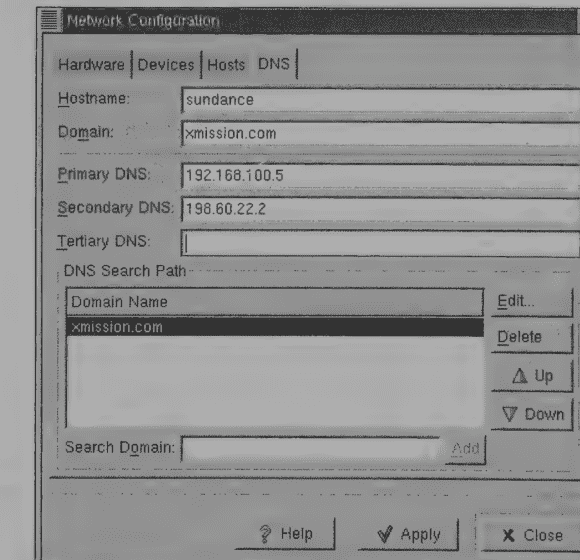

图 3-1 Red Hat 网络配置的 DNS 选项卡

> 注意：不要随意修改你的主机名或域名。该信息也存储在 DNS 服务器上。如果你更改它，其他系统可能无法访问你，你也可能无法访问它们。

## 设置名称解析

在 Webmin 中设置 `resolv.conf` 和 `hosts` 文件，在启动 Webmin 界面后选择 Hardware 选项卡。在 Hardware 选项卡显示的图标中（如图 3-2 所示），选择 Network Configuration。在所示的 Network Configuration 页面上，你可以选择 Host Addresses 或 DNS Client。如果你选择 Host Addresses，你会看到存储在 `/etc/hosts` 中的 IP 地址和关联的主机名。你可以点击地址进行编辑，或 Add 一个新主机在 `hosts` 文件中创建一个新条目。

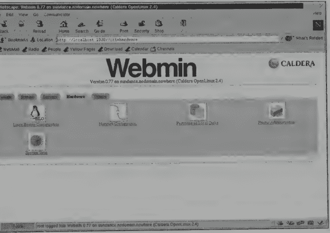

图 3-2 Webmin 中的 Hardware 选项卡

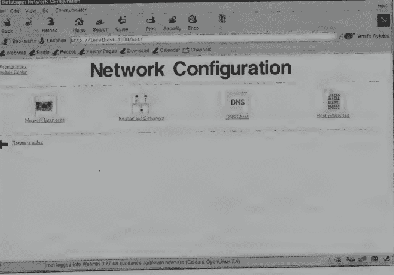

图 3-3 Webmin 中的 Network Configuration 页面

如果你选择 DNS 客户端，将看到一个列出 DNS 服务器和搜索域的 Web 页面（对应 Red Hat 工具中的搜索路径列表或 `/etc/resolv.conf` 内部搜索行）。参见图 3-4。你可以点击搜索域列表进行编辑。你还会看到一组下拉框，它们指示了解析器使用本节概述方法的顺序。默认情况下，首先使用 `/etc/hosts` 文件（在下拉框中显示为 `Hosts`），然后是 NIS，以及 `resolv.conf` 中引用的 DNS 服务器（在同一页面上配置）。这一系列下拉框中的信息对应于 `/etc/hosts.conf` 文件，或者在大多数现代 Linux 系统上对应 `/etc/nsswitch.conf` 文件。

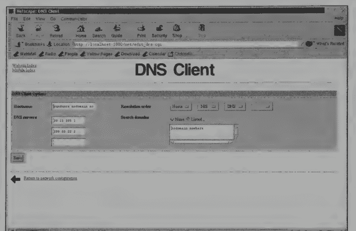

图 3-4 Webmin 中的 DNS 客户端 Web 页面

Webmin 和 Red Hat 网络管理工具等图形化工具包含某些章节，你可以在这些章节中为 `/etc/hosts` 文件定义条目，并指定解析域名的尝试顺序。你还可以找到许多其他工具，如 LinuxConf 和 YaST2，它们可以帮助你配置解析器。尽管 `/etc/resolv.conf` 文件足够简单，但由于许多版本的 Linux 使用 `/etc/nsswitch`，在你熟悉你发行版的设置之前，使用图形化实用程序可能是配置解析器更安全的方法。

## 使用 PPP 进行拨号网络访问

在第 2 章中，你学习了 PPP（点对点协议），这是在两个主机之间建立网络连接的一种方法。由于 PPP 广泛用于连接到调制调器，它应该被特别关注。幸运的是，Linux 供应商也对其给予了关注，并提供了许多易用的图形化工具来设置 PPP 连接。

### 使用 PPP 的拨号网络访问

PPP 与传统的拨号到终端连接不同。当你使用 `minicom` 等终端模拟器程序调用远程计算机时，该程序简单地通过调制调器发送字符，由远程计算机上的 Telnet 服务器解释。相比之下，PPP 建立了一个低层网络协议，其他程序可以独立地与远程计算机进行通信。PPP 包含了许多特性，使其比终端模拟设置更安全、更灵活、更可靠。当然，这正是你使用 PPP 的原因；它允许你的计算机下载文件、同时运行多个网络程序、运行图形化程序，并且通常像网络上的一个独立节点，而不是指向远程 CPU 的终端。

设置 PPP 曾是一项挑战。它涉及以下步骤：

- 识别你的调制调器串口端口并确保某些功能正常，可能需要使用如 `minicom` 等程序调用远程计算机并测试调制调器。
- 设置 `ppp-options` 文件，以指示 PPP 守护进程（PPP 服务器）如何运行。
- 为 `chat` 程序创建一个脚本。`chat` 程序使用此脚本向调制调器发送命令。脚本告诉 `chat` 监听从调制调器传入的如 "password" 的文本。这表明远程计算机正在请求密码，`chat` 应该做出响应。
- 让脚本使用正确的选项文件和命令行参数启动 PPP 服务器程序 `pppd`。

在理想情况下，使用 `chat` 脚本和 PPP 选项文件被认为是具有挑战性的。故障排除非常困难，而且多个组件（调制调器、`chat`、`pppd`、远程计算机的登录程序以及远程计算机的 `pppd`）之间的交互使得这对 Linux 新手来说通常是一项令人不快的任务。

此外，标准 PPP 是安全的，因为连接到远程计算机所需的用户名和密码存储在 `chat` 脚本中，然后通过调制调器传递给远程计算机。两项进展提高了 PPP 的安全性。一种是密码验证协议 (PAP)，它将用户名密码对存储在一个文件（`/etc/ppp/pap-secrets`）中，只有 root 用户可以访问。更高级的方法（其他人可能能够窃听）是挑战握手认证协议 (CHAP)。CHAP 永远不会跨远程计算机发送你的密码。相反，远程计算机选择一个随机字符串，用用户的密码对其进行加密并发送给尝试进行 PPP 验证的主机。主机使用存储在 CHAP 文件（`/etc/ppp/chap-secrets`）中的密码并返回该随机字符串。通过展示它可以解码该字符串，证明了它拥有该用户的正确密码。

大多数 ISP 都提供 PPP 连接，几乎所有的这些 ISP 都使用 PAP 或 CHAP，而不是旧式的脚本。

### 使用 wvdial 的 PPP 连接

针对 PPP 的困难性，最近出现了几个新项目，可以方便地使用 PPP 进行连接。其中之一是一个名为 `wvdial` 的文本模式工具。该程序检测如何配置调制调器以及如何响应远程服务器的查询，以根据你提供的基本信息（如 ISP 的电话号码、用户名和相应的密码）建立连接。你可以访问 http://open.net.ca/ 的 Project Info 列表了解更多关于 Wvdial 项目的信息。`wvdial` 在大多数版本的 Red Hat Linux 上默认安装，使用 `locate` 命令查看你的系统是否安装了 `wvdial`。

（注：由于提供的 OCR 文本包含大量重复内容，已根据提供的唯一内容进行清理和翻译。）

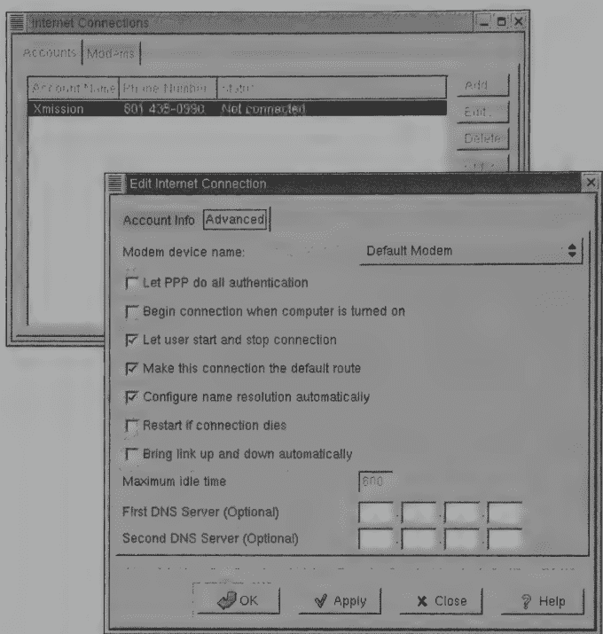

**图 3-5** rp3-config 中的高级账户配置

一旦你使用 rp3-config 设置好一个账户，就可以在任何命令行中输入 `rp3`，或者在 Gnome 的程序菜单中选择 RH PPP Dialer 来使用该账户进行连接。你将看到一个较小的窗口，其中列出了所有网络接口列表，包括用于本地的环回接口（loopback）和用于以太网的 eth0（如果你安装了以太网卡）。你在 rp3-config 中配置的账户名称包含列表中。选择你想要激活的账户名称，并选择 OK 拨号该 ISP 并激活网络连接。rp3-program 管理这些连接，包括发送数据包到互联网的正确路由。

> 作为一个实验，在通过拨号账户连接后，在命令行运行 `ifconfig account`。注意 ppp0 网络接口和分配给该接口的 IP 地址。（该 IP 地址可能是由 ISP 服务器随机分配的）。

### 使用 KPPP 的 PPP 连接

大多数 Linux 发行版（红帽除外）依赖 KDE 作为图形化环境。KDE 包含一个名为 KPPP 的实用程序，它可以配置 ISP 账户并使用 PPP 连接它们。之前的 KPPP 版本使用单个多标签页对话框来设置账户并启动连接。

但由于某些任务需要 root 账户的安全考量，导致 KPPP 最新版本的设计者采用了与红帽 rp3 相同的模型：你先创建一个账户，然后通过 KPPP 拨号器使用该账户启动连接。

例如，在 Calder OpenLinux 中，使用 KDE 控制中心内的 COAS 管理工具来定义 ISP 账户。操作方法是在屏幕顶部的拨号网络框中选择 COAS、Network（网络）、Internet Provider（互联网提供商），然后从提供者列表中选择 User defined（用户定义）并点击 Details（详细）按钮。在出现的对话框中，在 Name（名称）字段输入账户名称。你可以使用 ISP 的名称。接下来，输入连接 ISP 的电话号码作为其提供的 DNS 服务器信息——如果你不输入，正如本章所述，它在 PPP 连接建立时通过 DHCP 自动配置。关闭对话框。你输入的账户名称没有出现在任何地方，但它已被保存。最后，如果你是此主机的唯一用户，或者所有用户都能启动拨号连接，请勾选 Save authentication information（保存认证信息）框并输入你定义的 ISP 账户用户名和密码。

定义账户后，可以通过选择 KDE 中 Internet 子菜单下的 Kpp 来启动 KPPP 程序。KPPP 窗口显示 Connect to（连接到）字段，列出了你输入的账户名称。确保选择了该名称，然后选择 Connect（连接）按钮建立拨号连接。你也可以选择 Show Stats（显示统计）按钮查看有关连接的网络统计数据。图 3-6 显示了 KDE 控制中心的 Internet Provider 页面，KPPP 窗口位于控制中心的左侧。Show Stats 窗口位于主 KPPP 窗口下方。

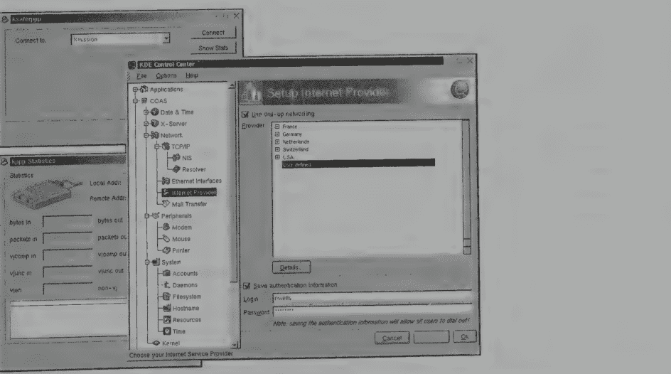

图 3-6 OpenLinux 中使用 KPPP 设置账户和启动连接的对话框

### 使用 dial 自动化 PPP

许多依赖调制调器进行拨号连接的用户必须在平衡启动和停止连接的麻烦（即使使用像 rp3 或脚本这样方便的程序）与降低 ISP 费用或为其他用户留空家庭电话的需求之间取得平衡。此外，当使用调制调器将局域网上的多个用户连接到单一互联网连接时，这些用户可能不知道如何建立连接或访问位于调制调器所在计算机。

**dial** 程序允许拨号连接在需要时保持激活状态，在指定一段时间无活动后断开连接，并在有人请求访问网站时自动重新连接。虽然这是一组非常有用的功能，但该程序的稳定性仅足够在生产系统中使用，因此你不会在大多数 Linux 发行版中找到它。你可以通过访问 `dial.sourceforge.net` 了解更多信息。然而，“稳定”并不意味着易用。**dial** 竞争“最晦涩配置”的称号（尽管正如在本章后面的部分看到的，Procmail 可能获胜）。

dial 的工作原理是将一个“伪”网络接口（代理接口）设置为默认网关。每当网络流量路由到该接口时，**dial** 就会建立 PPP 连接并将默认网关更改为该网络接口。**dial** 监控进入代理接口的数据包，以判断它们是否想要启动拨号连接。你可以设置配置参数，例如连接在没有任何活动的情况下应保持激活状态多久，或者当网络流量看起来有必要时不应建立连接。

使用 **dial** 的困难之处在于它依赖于“旧式”的 PPP 配置方法：使用登录脚本、chat 脚本和手动配置的安全文件（如 `/etc/ppp/chap-secrets`）。此外，dial 使用了许多复杂的文本文件来设置其运行参数。该程序既灵活又强大，除非你对第 1 章和第 2 章讨论的所有主题以及 PPP 拨号脚本了如指掌，否则设置起来将具有挑战性。

设置 dial 最简单的方法是找到适用于你版本 Linux 版本的 RPM 或 Debian 格式包（检查 rpm.net）。该包包含了配置文件。

## 使用 DHCP

动态主机配置协议（DHCP）允许你配置一种自动向客户端分发 IP 地址的服务。DHCP 与 BOOTP 系统兼容，后者长期以来一直被工作站用于获取网络配置。使用 DHCP 可以大幅减少网络的管理需求，尽管它并不适用于所有网络。Linux 通过多个软件包对 DHCP 提供良好的支持，既作为服务器也作为客户端。最流行的 Linux DHCP 客户端是 dhcpcd daemon、dhcpcd 和 dhclient。

```
subnet 192.168.1.0 netmask 255.255.255.0 {

  range 192.168.1.10 192.168.1.100;

  range 192.168.1.150 192.168.1.200;

}
```

此文件定义了 192.168.1.0 网络内的两个地址范围。在这些范围内，IP 地址会随机分配给任何请求地址的客户端。你可以使用该主机以太网的 MAC 地址将特定的 IP 地址绑定到特定的主机上。配置文件的部分内容如下：

```
host haagen

hardware ethernet 08:00:6b:3a:29:7f;

fixed-address 192.168.1.150;
```

dhcpd 支持许多额外选项。你可以参考手册页（man page）来获取这些选项的列表。一旦配置好 DHCP 服务器，你就可以使用 `/etc/rc.d/init.d` 中的标准脚本启动它。

DHCP 客户端可以运行任何操作系统。只要它能“通” DHCP 协议，就能从 Linux 服务器获取 IP 地址。然而，Windows 客户端并不遵循 DHCP 标准，需要你添加路由，以便它们可以使用 DHCP 服务器根据需要匹配你的网络设置：

```
route add -host 255.255.255.255 eth0
```


配置 DHCP 客户端非常简单。大多数 Linux 发行版默认安装了一个 DHCP 客户端，并包含了用于配置它的图形化工具，或者依赖修改 `/etc/sysconfig/network/ifcfg-eth0` 文件。在 Red Hat 中，你可以使用网络配置工具将接口配置为 DHCP。从中选择 Devices（设备）选项卡，然后选择要配置的设备，例如 `eth0`。当以太网对话框出现时，选择 Protocols（协议）选项卡，从列表中选择 TCP/IP 并点击 Edit（编辑）按钮。在出现的对话框中，你会看到一个字段列表。这些字段上方有一个标记为“Automatically obtain IP settings”（自动获取设置）的复选框，后面是一个下拉列表。从此列表中选择 dhcp，关闭所有对话框，并确认要保存更改。DHCP 现在已激活。

图 3-7 显示了 Red Hat 中用于配置 DHCP 的对话框。Webmin、YaST 和其他配置实用程序使用了类似的流程。配置好 DHCP 后，DHCP 客户端可能需要一或两分钟来获取 IP 地址并激活网络接口。如果你对 `eth0` 执行 `ifconfig`，等待片刻，查看是否显示了有效的 IP 地址。

## 理解 LDAP

在单机主机上，你可以轻松地查看系统。在较大的网络，知道“那里有什么”可能会变成一个真正的问题。系统管理员和用户通常需要比显而易见的更多的网络资源信息。这些资源可能包括用户（用户账户）、服务、打印机等许多其他。

信息不足的解决方案是创建一个目录服务：这是一个关于网络资源（或其他资源）的信息数据库，人们可以通过网络访问它。已经出现了若干创建此类目录的国际标准。其中之一是 X.500。一种流行的商业目录是 Novell Directory Services (NDS) 和 eDirectory。另一个类似的模型是轻量级目录协议（LDAP），你可以在此处访问它。虽然 LDAP 是一个无法深入探讨的大课题，但对其概念进行回顾可以让你准备好检索 LDAP 文档并开始使用该系统。Linux 通常使用 OpenLDAP 服务器。你可以通过访问 www.ldap.org 了解该服务器以及通用 LDAP。

X.500 和 LDAP 等目录被组织成信息树。树的每一层由对象或节点组成。在树的底部，对象是叶子对象；在较高的位置，它们是容器对象，包含其他对象（位于树下方的对象）。图 3-8 展示了这些对象类型如何在 Novell Directory Services 树中使用的。每个对象都根据一个类创建；类定义了对象所代表的资源类型，例如打印机、用户或公司。每个类都有一个定义，包含了指定该类型对象信息的属性。树中的每个叶子对象都有一个名称，称为通用名称。架构是目录支持的所有可能的类及其属性的集合。目录本身包含使用这些类和属性映射的数据。

**图 3-8** Novell Directory Services 树中的容器对象和叶子对象

要使用目录，你的客户端软件（`ud` 是 Linux 中的文本模式 LDAP 客户端）需要遍历树，在数据库中查找你所需的信息。例如，树的顶部有一个标签；就你的目的而言称其为 Top。下面是许多其他对象，每个代表一个国家；这些类为 country（国家）的对象。每个国家对象都有有用的属性来定义国家，例如名称、主要语言、国际电话代码等。当你看到 Latvia（拉脱维亚）对象名称时，你可以使用 LDAP 客户端查询该国家对象的属性。

此外，你将继续向下移动树。每个国家对象都是包含许多组织对象的容器。组织对象具有某些属性，包括名称，并且是一个可能包含用户、打印机对象、组成员对象以及许多其他类对象的容器。

你不被允许读取全球 LDAP 树的所有部分，但通过访问其部分，你可以以结构化的方式收集信息。你还可以添加自己的信息供自己使用，或供你想提供信息的人访问。

你使用一组格式化的标识符来引用目录树中的对象。例如，一个名为 user 的用户。DN（目录名称）是通过它的完整路径：`cn` 代表通用名称，`o` 代表组织，`c` 代表国家。一旦你配置好 DHCP 服务器，你就可以使用 `/etc/rc.d/init.d` 中的标准脚本启动它。

## 远程运行应用程序

### 使用 X 运行图形化应用程序

Linux 图形环境的灵活性——X Window 系统（或简称 X）——一直是 Linux 安装的阿喀琉斯之踵。然而，X 提供了一个少数系统能够模拟的功能：它将程序的计算部分与收集按键和显示程序输出的部分隔离开来。这允许你在一台主机上运行程序，但在另一台计算机上收集输入（键盘和鼠标）并显示输出。这与第 1 章描述的终端概念非常相似，区别在于程序是图形化的（而且整个系统要复杂得多！）。

例如，假设你在主机 `paris` 上安装了一个程序，但你正在主机 `rome` 上工作。你不想在 `rome` 上安装该程序，但你需要使用它。X 允许你登录到 `paris` 并通过额外的指令启动程序：“在 `rome` 上显示程序并从 `rome` 获取输入”。然后，程序在 `paris` 上运行，但显示在 `rome` 的屏幕上。如果计算机性能足够，几十个用户可以登录到 `paris` 并启动显示在网络各处计算机上的程序。这种设置如图 3-10 所示。

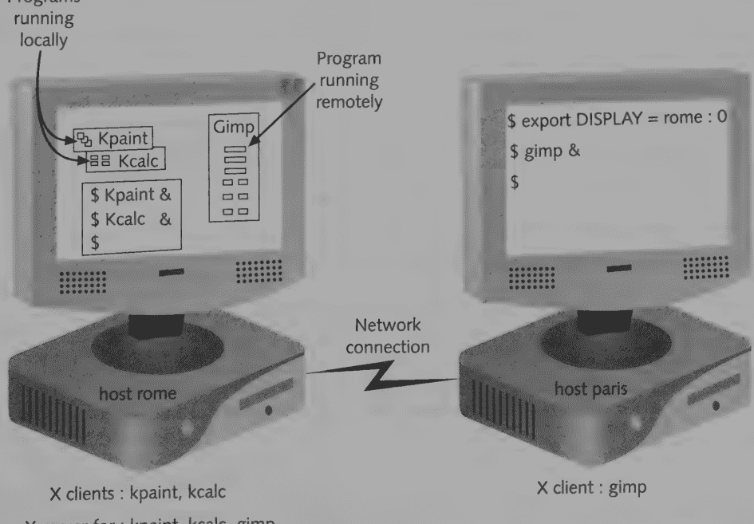

图 3-10 在一个主机上执行图形程序并在另一个主机上显示

### 第 3 章 配置客户端服务

开始使用远程 X 执行，你必须学习两个可能违反直觉的术语：

- 运行在主机上的程序是 X 客户端。
- 远程显示程序的系统的屏幕、键盘和鼠标是 X 服务器。

每个系统使用一个名为 `DISPLAY` 的环境变量，其中包含主机名和屏幕编号，用于定义每个 X 客户端应该在哪里显示窗口以及从哪里收集输入。通常，你的 `DISPLAY` 变量只包含一个序列号和一个屏幕编号（均为 0），并且默认运行在本地主机上的 X 程序。（系统可能有多个显示器，在这种情况下，服务器将不会用于本地主机。）使用 `echo` 命令显示变量值的结果指示了这一点（这里只显示了序列号；你的系统可能用 `:0.0` 同时显示序列号和屏幕号）。

```bash
echo $DISPLAY
```

你可以手动更改 `DISPLAY` 变量。假设你使用 Telnet 等程序登录到 `rome`，然后输入以下命令（在默认的 Linux bash shell 中）：

```bash
DISPLAY=rome.mynet.com:0.0
export DISPLAY
```

现在，每个图形程序都显示在 `rome` 上，而不是 `paris` 上。你也可以在启动图形程序时在命令行中包含显示信息。此选项的格式对于所有图形程序都是相同的。例如，而不是以这种方式启动 `gimp` 图形程序：

```bash
gimp &
# 使用 --display rome.mynet.com:0.0 & 启动它
```

`--display` 选项会覆盖 `DISPLAY` 环境变量。

> 系统上的每个用户都有一组不同的环境变量，因此所有用户都可以登录并让程序在不同的远程主机上运行显示。

在 X 客户端能够在远程主机上显示其窗口之前，远程主机必须配置为允许其他计算机使用其 X 服务器。你可以通过两种方式实现这一点：一种简单但不安全，另一种虽然更困难但更安全。

### xhost 身份验证

简便的方法是在你想让 X 客户端显示输出的主机上使用 `xhost` 程序，指定允许使用本地 X 服务器的主机。要使用 `xhost`，你需要包含想要允许显示的计算机的主机名。例如，如果你登录到主机 `rome` 并允许来自主机 `paris` 的 X 客户端使用 `rome` 作为 X 服务器（在 `rome` 上显示并从 `rome` 获取输入），此命令将设置：

```bash
xhost +paris.mynet.com
```

当你完成程序操作后，可以使用此命令从授权主机列表中移除 `paris`：

```bash
xhost -paris.mynet.com
```

你经常看到在不带主机名的情况下使用 `xhost`，因为 `xhost +` 允许任何主机使用你的系统作为 X 服务器。这是极度不安全的，允许任何人启动程序并让其显示在你的屏幕上。它还允许聪明的用户捕获你在工作时输入的按键记录。请使用 `xhost -` 禁用所有访问，然后使用特定的主机名添加你想要使用你的系统作为 X 服务器的主机。


这些步骤总结了远程执行图形程序的流程：

1. 在你的主机上打开命令行窗口。
2. 输入带有运行 X 客户端的主机名的 `xhost` 命令。
3. 登录到远程主机。
4. 使用指向你主机的 `--display` 命令行选项启动程序（如果你打算运行多个程序，则设置 `DISPLAY` 环境变量）。
5. X 客户端程序出现在你的本地屏幕上。

你会很快发现 X 协议消耗大量的网络带宽。各种压缩方法可以缓解此问题，但要注意，远程运行图形应用程序消耗的带宽比远程运行文本应用程序多得多。


### xauth 身份验证

即使有了主机名，`xhost` 命令并不十分安全，因为 `xauth` 通过要求 X 客户端向 X 服务器呈现特定的令牌来防止这种情况。这种数字令牌的通用术语是“cookie”，`xauth` 工作原理如下：

1. 假设你在 `paris` 上启动一个程序并显示在 `rome` 上。X 服务器在它的 `.authority` 文件中查找对应 `paris` 的令牌。
2. 假设令牌可用（你必须将其放入其中，我们稍后会展示），通过网络协议发送到 `rome`，X 服务器检查 `.authority` 文件。
3. 如果找到了，则允许连接继续。如果没有，则 `paris` 程序将被拒绝。

其中提到的 `.authority` 文件存储在用户的家目录中。因此，每个用户都必须拥有另一个服务器所需的令牌。最常见的情况是你有两个系统的账户，并在家目录之间拷贝令牌，以便可以在访问的任何系统上运行并显示程序。在任何情况下，`xauth` 设计用于用户对用户的安全系统，而不是主机对主机的安全系统。

> 要使用 `xauth` 安全方法，你必须在启动 X 窗口系统时带有 `auth` 标志和要使用的授权文件名为 `$HOME/.xauthority`。这是 Linux 系统的默认授权文件，但如果你使用不同的授权文件，你应该检查通常用于启动 X 的命令。或者，如果你运行图形登录，你需要修改的配置在显示管理器文件中。例如，Red Hat Linux 在 `/etc/X11/xdm/gdm.conf` 中指定了 `.Xauthority` 文件。

你可以使用 `ls -a` 命令在家目录下看到 `.Xauthority` 文件（是一个隐藏文件）。要查看或更改文件内容，你需要使用 `xauth` 程序，它会提示你输入命令来管理存储在 X 服务器上的令牌。一些有用的命令包括 `help` 显示所有 `xauth` 命令，`list` 列出当前存储的所有令牌，以及 `add` 将令牌放入授权文件供远程主机使用。

授权文件还应该包含你工作所在主机的令牌。每当你登录 X 时，都会生成一个新令牌。如果你的文件中已经包含了本地主机的令牌，请在 `xauth` 内部使用 `generate` 命令创建一个。如下，你看到启动了 `xauth`，接着是 `list` 命令，显示所有已知的令牌：

```bash
[root@rome root]# xauth
Using authority file /root/.Xauthority

xauth> list
rome.xmission.com/unix:0  MIT-MAGIC-COOKIE-1  6da29c0a7399aa1790cba394266dd5f
rome.xmission.com:0       MIT-MAGIC-COOKIE-1  6da29c0a7399aa1790cba394266dd5f

xauth>
```

如果你有这样的文件，并想将 `paris` 用作 X 服务器使用（即在上面显示程序），你必须将此文件中的信息获取到 `paris` 上的 `.authority` 文件中。一旦完成了这一步，`paris` 就拥有了一个有效的令牌，可以发送给 `rome`，从而允许 `paris` 连接进行远程程序显示。

你可以通过多种方式实现这一点，从在纸上写下信息（很少这样做），到使用 `telnet`、`login`（在本章稍后描述）或 `ssh`（在第 11 节描述）等程序坐在另一台机器上登录，然后在两个窗口之间复制并粘贴信息。例如，你可以遵循以下步骤：

1. 在 X 服务器主机的图形化环境中打开两个 Xterm 窗口（你想要显示程序的宿主机——在上一个例子是 `rome`）。
2. 在第一个窗口中，启动 `xauth` 并使用 `list` 显示已知的令牌。
3. 切换到另一个窗口并登录到你将运行 X 程序的远程主机（上一个例子是 `paris`）。
4. 在远程系统上启动 `xauth`。
5. 在第一个窗口中，点击并拖动包含 X 服务器主机令牌的行。
6. 切换到第二个窗口，输入 `add`，然后从 Xterm 窗口的编辑（Edit）菜单中选择粘贴。令牌文本将被粘贴在包含 `add` 命令的行上。
7. 确保 `add` 命令的格式正确，然后按回车键。使用 `list` 确保令牌已正确包含。
8. 在两个窗口中输入 `exit` 以关闭 `xauth` 程序。

> 作为对你已学习内容的复习，想一下为什么即使你没有图形程序显示的权限，也可以作为上述步骤 3 的一部分登录。这两者之间有什么区别？

所涉及的 `add` 命令看起来像这样（令牌从你自己的文件中获取）：

```bash
add rome.xmission.com:0 MIT-MAGIC-COOKIE-1 6da29c0a7399aa1790cba394266dd5f
```


# 第 3 章 配置客户端服务

不要对图形应用程序的远程显示在第一次尝试时没有正常工作感到惊讶。X 的许多组件可能使其配置变得困难。如果你遇到问题，请确保你的 `DISPLAY` 变量已正确设置。咨询系统管理员查看 X 启动时是否带有 `-nolisten tcp` 参数，该参数会停止监听远程连接。确保你命名的主机名在网络上是可达的（例如尝试 `ping`）。再次检查 `.authority` 文件中的令牌是否匹配，以及是否有诸如令牌过期等问题干扰了你的工作。最后，查看与 X 相关的主页（针对 X、auth 等）和 HOWTO 文档，以查看什么可能阻止了你的设置无法按预期运行。

## 使用 XDCP 远程图形终端

许多 Linux 系统现在在安装期间就被配置为自动使用图形登录界面，因此用户永远不会看到文本模式。图形登录界面由显示管理器（display manager）提供。常用的程序有 `xdm`、`qdm` 和 `kdm`（分别用于通用、Gnome 和 KDE）。你通常可以在 `/etc/X11` 的子目录中找到这些程序的配置文件。这些文件告诉显示管理器应该显示哪个登录界面、如何响应关机命令以及许多其他选项。

显示管理器的一个功能是它能够在远程计算机上显示登录界面，这样你就不需要先登录 Telnet 或其他基于文本的程序启动 Linux 程序。显示管理器呈现一个登录界面，用户登录后，Linux 桌面（Gnome、KDE 或另一个界面）就会出现，准备好让用户图形化地启动程序。当你在非 Linux 计算机上运行 X 服务器软件时，这种功能特别有用。例如，许多运行 Windows 的用户拥有如 X-Win32 或 Hummingbird Exceed 等 X 服务器程序。该程序允许运行在远程 Linux 系统上的程序（X 客户端）显示在 Windows 桌面上，并从该系统收集其键盘和鼠标输入。

为了在 X 服务器上出现图形登录界面，你必须配置显示管理器控制协议 XDCP。XDCP 不是一个安全协议，因此在 Linux 发行版中默认关闭。要启用它，你必须更改配置，使 X 和显示管理器的组件利用网络连接。这并不困难，但过程随 Linux 版本而异，因为每个版本设置 X 配置的方式略有不同。以下步骤概述了如何在 Red Hat Linux 7.3 上启用 XDCP。我们还包含了可能指导你使用其他 Linux 版本的注释，但由于我们在这里投入到 XDCP 的时间有限，如果你在实现此过程遇到困难，建议你查看 XDCP、XDM 和 X 的 HOWTO 文档。

1. 让 X 字体服务器 `xfs` 利用网络连接。打开文件 `/etc/x11/fs/config`。注释掉 `no-listen tcp` 行，并添加行 `port=7100`。在其他系统上，你可能需要修改 `/etc/rc.conf`。
2. 允许主机与显示管理器通信。打开文件 `/etc/X11/xaccess`，取消以 `*` 开头的 `any` 注释。
3. 在显示管理器中启用 XDCP 协议。打开文件 `/etc/X11/xdm.conf`，找到 `Enable XDCP` 部分，并将其从 `False` 改为 `True`。
4. 确保 `/etc/X11/xdm/xauth` 权限为 `755`。
5. 确保 `/etc/X11/xdm/config` 权限为 `755`。
6. 重启 X 服务器。
7. 使用 X 客户端连接到远程服务器。

## 使用 r- 进行远程执行

r 工具依赖于过程调用（rpc），你将在第 5 章作为文件系统的部分了解更多。要使用 r 工具，你必须安装 rpc 和 `portmapper` 应用程序。几个例子说明了它是如何工作的。假设你在 stockholm 上有一个用户 `nwells`，在 oslo 上有一个用户 `nicholas`（你可以使用域名名访问不同网段的主机，但考虑到这些工具的安全风险，让我们保持接近）。r 工具的网络支持（rpc）已启用，并且两个系统都安装了 r 工具包。例如，一个名为 `login` 的守护进程监听来自 `login` 工具的 l 连接。每当你登录 stockholm 时，都可以输入 `login` 命令并使用 `-l` 指定你想使用的 oslo 账户名。会提示输入该账户的密码。初始交互如下：

```
[nwells@stockholm nwells login -l nicholas oslo

password:

nicholas@oslo nicholas]
```

登录 oslo 后，你可以输入命令就像坐在 oslo 面前一样。你输入 `exit` 命令来终止会话。

当你需要在远程主机上运行交互式程序时，`login` 非常有用，但你可以使用 `rsh` 命令在不登录的情况下执行程序，或使用 `scp` 在两个主机之间复制文件。

你可以继续使用 `-l` 并在每次命令时输入密码，但这些工具提供了便利——以及风险。你可以在 oslo 上设置一个配置文件允许你在无需输入密码的情况下运行 `rsh` 和 `scp`。如果你对 os 有 root 权限，可以创建一个 `/etc/hosts.equiv` 文件，其中包含允许使用 r 工具访问此系统的主机和用户名。

### 表 3-2 常用 r 工具

| 工具名称 | 描述 |
| :--- | :--- |
| rwho | 列出所有主机上登录的用户 |
| uptime | 列出系统运行时间 |
| rlogin | 登录到远程主机；与 telnet 非常相似 |
| rsh | 在不登录的情况下在远程主机上执行命令 |
| rcp | 在两个主机之间复制一个或多个文件 |

## 远程运行应用程序

单个用户可以在你的主目录下创建一个名为 `.rhosts` 的隐藏文件，其中包含一份主机名和用户名列表，允许这些用户无需密码即可访问你的账户。oslo 上的 `.rhosts` 文件示例可能如下：

```
stockholm nwells

helsinki wells
```

配置此文件后，让我们回顾几个示例，展示你可以使用 `rsh` 和 `rcp` 命令可以的操作。在登录 stockholm 的情况下，你可以使用此命令无需“登录” oslo 即可显示 oslo 上运行的进程列表：

```
rsh oslo ps aux
```

该命令的输出将显示在你的 stockholm 屏幕上。如果你想将结果存储在 oslo 上的文件中，命令将包含一个在引号内的重定向运算符，这样你的本地 shell 就不会解释它并在 oslo 上创建文件：

```
rsh oslo ps aux '>' processlist
```

`rcp` 命令允许在两个运行 r-实用程序的计算机之间复制文件。例如，在登录 stockholm 的情况下，你可以使用此命令从 oslo 复制名为 `processlist` 的文件到 stockholm：

```
rcp oslo:processlist /home/nwells/
```

你也可以在两台其他计算机（不是你所在的这台）之间进行复制。例如，在登录 stockholm 的情况下，你可以使用此命令从 oslo 复制文件到 helsinki（假设 helsinki 上的 `.rhosts` 文件配置了你的 stockholm 信息）：

```
rcp oslo:processlist helsinki:/temp/processlist_backup
```

要了解更多关于 r-实用程序的信息，请从查看 `rlogin` 和 `rshd` 的 man 页开始。

## 使用 UUCP 进行远程访问

在互联网建立且（相对）安全之前，系统管理员需要一种简单但可靠的方法，通过调制解调器在站点之间传输电子邮件。Unix 拷贝协议（UUCP）系统是为了满足这一需求而设计的。UUCP 是一个旧协议，但它实际上在某些方面正重新受到关注，因为它可以在多个电子邮件服务器之间通过调制解调器提供非常廉价的传输，且没有目前互联网面临的安全性担忧。如果你的电子邮件服务器上有任何大量数据，请考虑坚持使用互联网并实施后续章节中详细说明的安全措施。然而，UUCP 仍然是 Linux 的组成部分，某些用户可能会发现它的价值。

UUCP 通过几个子协议实现，每个协议被分配一个代码字母。不同的协议设计用于不同的传输介质（调制解调器、以太网等），因此具有不同的特性。例如，为以太网设计的版本（UUCP “i”）使用 TCP 作为传输协议且没有错误纠正；为基于调制解调器的传输设计的版本（UUCP “g”）实现了自己的错误纠正方案。UUCP 传输通过一组结构化命令处理，这些命令调节数据传输以及两个主机处理传出和传入数据的能力。

许多命令是 UUCP 软件包的一部分。其中一个命令被称为 `uucp`，它允许用户在两个具备 UUCP 能力的主机之间复制任何文件，而无需依赖 UUCP 定期发生的自动传输电子邮件文件。然而，大多数 UUCP 命令都包含在脚本中，用于控制依赖 UUCP 传输电子邮件的系统上的邮件处理。像 `sendmail` 这样流行的电子邮件服务器是“具备 UUCP 能力的”，尽管默认没有配置为使用它。新闻组发布也可能排除这一解决方案。Linux 中的 UUCP 通常不默认安装，许多现代系统管理员也不理解它。如果你对使用这种旧备方案感兴趣，请查看 www.linuxdocs.org 上的 HOWTO 文档。它提供了使用 UUCP 软件包的指导，这是最流行的 Linux 版本的以太网或调制解调器连接，用于传输电子邮件和新闻组发布。

## Web 和邮件客户端

大多数计算机用户对万维网（Web）和电子邮件（email）都有一定经验。本节描述了 Linux 中可用于这两项服务的客户端程序。

### 流行的 Linux 浏览器

图形化 Web 浏览器 NCSA Mosaic 在 20 世纪 90 年代初出现并不是一个非常复杂的程序。Mosaic 插入字体、图形并显示生成的免费使用的 Web 页面，它的代码成为了从 America Online 到 Netscape Communicator 再到 Microsoft Internet Explorer 所有现代浏览器的基础。然而，随着格式选项的扩展、多媒体插件的开发以及安全考因素的演变，事情很快变得复杂得多。几乎每个浏览器都作为其制造公司的一种手段免费提供。Linux 有几十种浏览器可用。例如，KDE 和 Gnome 桌面环境中的浏览应用程序也可以浏览 Web 文档。

遗憾的是，Web 浏览器的复杂性已经超过了大多数软件跟进的能力。更有问题的是缺乏对视频剪辑或多媒体产品等插件模块的供应商的支持。当在某些其他浏览器（如 Linux 或 Windows 上的 Netscape Navigator）中查看这些页面时，你通常会看到空白屏幕。`Lynx` 是一个支持表单的文本浏览器，但对于面向文本的 Linux 用户来说，它仍然是一个很棒的工具，部分是因为非常快，部分是因为你在搜索 Web 页面寻找所需信息时不会受到任何广告骚扰。`Lynx` 在许多 Linux 发行版中默认安装。与这两个浏览器相比，它是一个很小的程序，可以从任何命令行窗口运行。

图 3-11 Lynx 文本 Web 浏览器

启动 `Lynx`，在任何命令行输入 `lynx`，后跟 Web 页面地址。例如：

```
lynx www.yahoo.com

or lynx http://www.yahoo.com
```


使用上、下方向键在 Web 页面上的链接间移动。当选中你想跳转的链接时，使用右方向键跳转（类似于在图形浏览器中点击）。使用左方向键，类似于图形浏览器中的后退键。要在不引用链接的情况下移动文本屏幕，使用 `Page Up` 和 `Page Down` 键。许多其他浏览器功能显示在 Lynx 屏幕底部。退出 Lynx 使用 `q` 键（然后按 `y` 确认）或直接按 `Ctrl+C`。

Netscape Communicator 浏览器包含在许多 Linux 发行版中，包括 Caldera Open Linux 和 Red Linux（Mozilla 是默认的；与 Windows 上的版本号不同）。Linux 版 Netscape 包含一个电子邮件客户端（下一节介绍）、新闻组查看器、复杂的配置选项（编辑菜单、设置项目）、电子商务安全选项以及对 Flash、Adobe Acrobat 和各种视频格式插件的支持。

Mozilla 浏览器最初是 Netscape Navigator 的开源版本，后来经过了重新设计。Red Hot Linux 在 Gnome 桌面上默认包含 Mozilla。Mozilla 与你可能使用的其他图形浏览器类似。

除了 Gnome 和 KDE 环境的基础浏览器外，Linux 的许多其他浏览器还包括以下。这些取自 www.linuxapps.com 网站上的 Web 长列表。

- **Opera**：由商业集团创建的非常流行的图形 Linux 浏览器（带广告）。
- **dillo**：基于 GTK+ 图形库构建的微型图形浏览器（Gnome 兼容）。不支持帧、Java 等，但只有 200K。
- **Galeon**：基于 Mozilla 引擎构建的全功能 Gnome 兼容浏览器。
- **SkipStone**：基于 GTK+ 图形库和 Mozilla 代码构建的图形浏览器，对其他系统库的依赖较少。

## 理解电子邮件

电子邮件是世界上广泛使用的互联网服务之一，是一个庞大的学习课题。在第 6 章中，你将学习如何在 Linux 中建立基础电子邮件服务器。在本节中，我们将介绍一些基本概念，并向你介绍 Linux 上的一些邮件阅读程序。

在互联网上传输电子邮件的协议被称为简单邮件传输协议 (`SMTP`)。它默认使用 TCP 端口 25。与相关的程序分为三类：

- **邮件传输代理 (`MTA`)**：一种将电子邮件消息从互联网上的一个服务器移动到另一台服务器的程序。当我们使用“邮件服务器”一词时，通常指的是 `MTA`。
- **邮件投递代理 (`MDA`)**：将电子邮件放置在用户收件箱中以便其读取的程序。
- **邮件用户代理 (`MUA`)**：为用户显示并管理电子邮件消息的程序。

发送和接收电子邮件的过程如下：

1. 你使用 `MUA`（邮件用户代理——类似于我们在下文中将描述的电子邮件客户端）创建一条电子邮件消息。
2. `MUA` 将消息交给 `MTA`（邮件传输代理）。
3. 第一台 `MTA` 联系消息收件者的 `MTA`。（这是通过 `DNS` 完成，正如我们在第 6 章所示）。消息使用 `SMTP` 在各个 `MTA` 之间传输。
4. 收件者将消息交给 `MDA`（邮件投递代理），`MDA` 使用一组规则将消息投递到收件用户的邮箱中。在很多情况下，`MTA` 充当 `MDA` 的角色，将消息直接存放在邮箱中。
5. 当用户准备好阅读邮件时，他或她启动 `MUA`，`MUA` 邮箱并显示已接收的消息。

这一过程背后的假设是邮件服务器始终可用——始终处于开启状态。用户根据自己的意愿来去，但服务器始终可以接受可能来自另一个服务器发送的消息。

在 Linux 系统上，如果你有一个账户，你就拥有一个电子邮件账户。你的电子邮件被存放在 `/var/spool/mail` 目录下一个与你的用户名对应的文件中。如果你的账户是 `nwells`，那么你的电子邮件收件箱文件就是 `/var/spool/mail/nwells`。将消息放入此文件是由正在使用的任何 `MDA` 或 `MUA` 完成的。在 Linux 上让电子邮件“正常工作”不需要特殊操作。事实上，如果你没有运行任何服务器，许多系统管理程序会通过直接向邮箱文件 `/var/spool/mail/root` 写入向 `root` 用户“发送”消息。你可以使用任何文本编辑器打开此文件以查看互联网电子邮件消息的原始格式。一旦消息存储在该文件中，用户就可以使用 `MUA` 来读取消息。

## 第 3 章 配置客户端服务

当你创建额外的电子邮件文件夹（默认收件箱之外）时，它们是你家目录下的独立文件。这些文件夹中的消息存储在 `/var/spool/mail` 中。

> **注意**
> 我们中的许多人不会一直开启电脑，而是依靠远程服务器来接收消息。这可能是组织的中央邮件服务器，也可能是 ISP（互联网服务提供商）点的服务器。当我们想看邮件时，打开电脑并使用 `MUA`（电子邮件客户端）检索我们的电子邮件消息。我们通常通过以下三种方式之一这样做：
>
> - 通过 `POP3` 服务器（充当 `MDA`）使用邮局协议第 3 版本 (`POP3`) 将所有消息下载到你自个的计算机上。
> - 使用互联网邮件访问协议 (`IMAP`)（再次使用充当 `MDA` 的 `IMAP` 服务器）查看远程服务器上的消息，从不将它们存储在你的本地计算机上。
> - 使用 Web 浏览器查看、删除和创建存储在远程服务器上的消息。

当你使用 `POP3` 将消息下载到自己的主机上时，你可以指定是应该保存还是删除消息，以便它们继续占用邮件服务器上的空间。如果你正在一个通常不用于处理邮件的系统上工作，你可能会选择不在服务器上删除它们。

一旦电子邮件消息被下载，你就可以任何时候读取它们（无需网络连接）、提取附件文件、将消息备份到另一个位置或或删除它们。

当你使用 `IMAP` 查看远程服务器上的电子邮件消息时，本地计算机不需要存储空间，消息可以由系统管理员为该服务器上所有拥有邮件的用户进行备份或其他管理。这样做的好处是，人们不太可能“删除收件箱”并丢失所有消息，因为它们始终受系统管理员的控制。用户可以轻松下载消息带的附件，或在需要时将消息打印在纸上。

然而，`IMAP` 的缺点是，如果系统管理员遇到技术问题，将会丢失所有人的邮件，而不仅仅是一个人的！此外，当用户保留大量旧消息时，用户的本地磁盘空间会耗尽（因为消息从未被下载到本地硬盘），使用 `IMAP` 会给系统管理员带来负担，当服务器磁盘空间开始不足时，管理员需要鼓励人们清理收件箱。

然而，`IMAP` 的这种缺点必须与组织关于电子邮件的策略相平衡。例如，公司可能有一项明确政策，允许管理层审查员工使用公司设备发送或接收的任何电子邮件。`IMAP` 使这种策略的实施变得非常简单。

## Web 和邮件客户端

许多用户现在依赖于通过 Web 浏览器访问的电子邮件，这种概念类似于 `IMAP` 模型。邮件服务器上的 Web Mail 程序构建 Web 页面，显示邮件消息列表、所选消息的文本等。用户点击链接，导致 Web 浏览器向邮件服务器发送请求，例如“发送消息标题列表”、“显示第 127 号消息”或“发送第 73 号消息带的附件”。这些就是 `IMAP` 客户端发送给 `IMAP` 服务器的类型的消息。

你不需要 `POP3` 或 `IMAP` 也可以查看电子邮件。如果你直接或使用 `telnet`、`ssh` 等登录存储消息的主机（即 `MDA` 放置消息的地方），你就可以使用读取 `/var/spool/mail` 邮箱的邮件客户端。在本节的后后文中，你将学习这种方式的邮件客户端。

### 使用邮件过滤器：Procmail

你应该了解的一种特殊 `MDA` 是 Procmail。`POP3` 和 `IMAP` 服务器只是根据客户端的请求传递邮件，而 Procmail 则充当过滤器，通常与 `MTA` 协同工作，尽管它可以独立作用于已经满的邮箱。Procmail 根据你定义的特征处理电子邮件。通常，它用于自动删除不想要的消息或将特定类型的邮件存储在不同的文件夹中。Procmail 配置起来很，但如果你有大量的入站邮件，它是删除垃圾邮件和整理邮箱的好方法。

许多 Linux 系统默认安装了 Procmail，并且可以通过 `rpm` 包获取。Procmail 可以启动，但更常见的做法是将其配置为同一系统上邮件服务器的一部分，在消息放入你的收件箱时对其进行过滤。Procmail 会检查系统级配置文件 `/etc/procmailrc` 和存储在用户目录下的用户配置文件 `.procmailrc`。这些文件都可以包含配方（recipes），即检查邮件消息并在匹配标准时采取行动的公式。在许多配置（如 Red Hat Linux）中，一旦创建了 `.procmail` 文件，Procmail 就会开始工作。这意味着在你完成所有想要使用的配方并仔细检查它们之前，你不应该在家目录下创建该名称的文件，可以先以其他名称保存工作，直到准备好激活它们。

> 许多用户为每个配方创建一个独立的文件，并在 `.procmailrc` 中使用 `INCLUDEDIR` 指令引用它们。这允许你快速、独立地禁用或修改每个配方，而无需检查整个 `.procmailrc`。

`.procmailrc` 的第一部分包含环境变量，以指导 Procmail 的工作。例如，你可能会包含 `MAILDIR` 变量来为 Procmail 指定工作目录；那么 `.procmailrc` 文件中的所有非绝对路径都指向该目录。

Procmail 配方的格式初看之下可能令人望畏，但在使用该程序时并不需要复杂。每个配方的语法如下：

```
:0<flags>: <lockfile>
* <condition-character> <condition-1>
* <condition-character> <condition-2>
* <condition-character> <condition-N>
* <action-character><action >
```

每个配方以冒号开头，后面跟着一个数字。标志位可能表示某种特殊类型的配方。第二个冒号告诉 Procmail “锁定”消息，以防止多个进程同时尝试修改它。除非你指定了，否则将使用默认的锁文件。在繁忙的系统中，锁定是一个很好的预防措施，但当你有许多配方或大量消息需要 Procmail 处理时，它会带来相当相当大的开销。

在配方内部，列出了一个或多个条件，每个条件都以星号开头。如果没有列出条件，则所有消息都将“匹配”并应用该配方。如果列出了多个条件，则消息必须匹配所有条件才能应用配方。在检查条件后，匹配的消息将根据操作字符和操作进行处理。该行通常只是应该存储消息的文件名（如果应该丢弃消息，则使用 `/dev/null`）。如果操作将消息投递到另一个用户或邮箱文件，则不会再对该消息检查其他配方。如果操作未投递，则将检查剩余配方与该消息的匹配，直到有一个配方接收到该消息。

文件夹或收件箱无非是一个包含电子邮件消息的文本文件。创建新的电子邮件文件夹时不需要进行任何特殊操作；只需使用一个新文件名即可。

`procmailrc` 页面列出了十多个可能的标志位，但基础配方不需要任何标志。同样，你不需要在条件中使用很多字符。条件允许你执行诸如检查消息大小（字节）或否定条件（如果条件不匹配该行的描述，则满足该条件）。条件本身使用正则表达式来匹配消息中的所有文本。为了有效使用 Procmail，你应该非常熟悉正则表达式。例如，假设你不断收到来自 `getrichquick.com` 域的垃圾邮件。为了匹配任何 `From:` 标头中包含 `getrichquick` 单词的电子邮件，你可以使用此条件行：

```
* ^From: *getrichquick*
```

`^` 将 "From" 文本连接到行首。你可以检查多个标头的地址：

```
* ^(To|Cc|From) *caldera.com
```

在紧随一个或多个条件之后，你指定了对匹配消息执行的操作。如果未指定操作字符，电子邮件将保存到给定的文件名。你可以添加一个 `!` 要将消息发送到指定的电子邮件地址，或者使用 `|` 将消息文本通过管道传输到另一个程序。你还可以使用 `{ }` 来包围用于后续处理的额外配方。

要非常小心不要简单地将发送消息到 `/dev/null` 作为你的操作。相反，将垃圾邮件写入文件并检查几次，以查看良好的邮件是否因为配方不准确而被丢弃。一旦你确定邮件是可靠的，你可以将其更改为使用 `/dev/null` 而不是文件名来手动删除消息。

下面显示了一个简单的 `.procmailrc` 文件示例，基于 Red Hat 文档。它为存储垃圾邮件的文件设置了一个变量（如果在垃圾邮件网页过滤器中没有捕获到好邮件，则对其进行检查和删除）。这组配方捕获了三类型的消息：没有有效 `To:` 标头的、具有超过 15 个接收者的、以及没有有效 `Message-ID` 标头的。当然，你可能需要删除垃圾邮件，可以创建更具体的过滤器来捕获你收到的垃圾邮件类型，既可以基于 `From:` 标头、`Subject:` 标头，或其他你在垃圾邮件中注意到的特征。

```
SPAM=discard

0:
* To??^\$
$SPAM

0:
* (To|CC):.*,.*,.*,.*,.*,.*,.*,.*,.*,.*,.*,.*,.*,*
$SPAM

0:
* Message-Id:.*<[@]*>
$SPAM
```

## Linux 电子邮件客户端

最基础的电子邮件客户端 (`MUA`) 使用 `mail`。你可以使用 `mail` 程序从命令行发送电子邮件消息，或读取存储在本地邮箱箱中的所有消息。`mail` 只读取本地文件；它不使用 `POP3` 或 `IMAP`。

要使用 `mail` 从命令行发送消息，请使用 `-s` 选项指定主题，随后是跟收接收者的电子邮件地址。例如，输入如下命令：

```
mail -s "Question about your schedule" tom@mail.house.gov
```


然后你根据需要多行输入消息文本，并在完成后按 `Ctrl+D`。如果你在输入命令后没有带上任何内容，`mail` 程序将显示你电子邮件收件箱中的所有消息并启动其交互模式。你可以输入 `?` 来查看命令列表。

另外两个已经存在多年的文本电子邮件客户端是 `pine` 和 `elm`。这两者都运行在本地存储的邮箱文件上，但如果你不依赖于查看附件图形，它们对于管理电子邮件来说非常快速且强大。偏好使用命令行界面的系统管理员使用 `mail`、`pine` 或 `elm` 来处理电子邮件。这些程序在大多数系统上默认不安装，但你可以根据需要进行安装，既可以基于 `From:` 标头、`Subject:` 标头，或其他你在垃圾邮件中注意到的特征。

## Web 和邮件客户端

尽管 `elm` 有许多优势，但大多数 Linux 用户更倾向于使用 Netscape Communicator 或 Mozilla 等程序来图形化查看和管理电子邮件。你正在使用的这两个程序都使用 `POP3` 或 `IMAP` 来检索存储在远程邮件服务器上的消息。在每个程序中，你必须首先设置想要访问的邮件账户。在 Netscape Communicator 中，你从“编辑”菜单中选择“偏好”，然后在“邮件与新闻组”类别下选择“邮件服务器”。图 3-13 显示此配置屏幕。

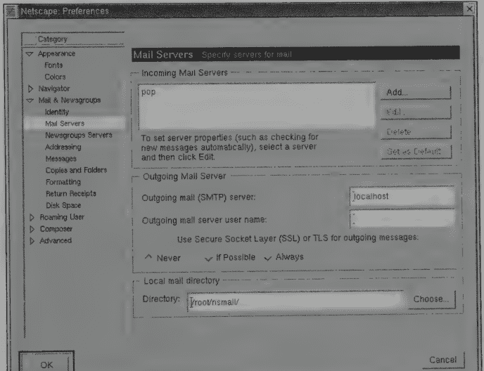

**图 3-13** 在 Netscape Communicator 中设置邮件账户

在 Netscape Communicator 中，你可以通过提供 Netscape 连接服务器所需的服务器信息（主机名以及你的账户用户名和密码）来设置单个 `POP3` 账户或多个 `IMAP` 账户。你还可以指定发送新消息的其他细节，无论是通过远程邮件服务器还是服务（例如 `sendmail` 的本地副本）。如果你正在使用远程 `POP3` 服务器，除非你已经熟悉在本地设置邮件服务器，否则通常使用它发送消息更为方便（见第 6 章）。

一旦配置好账户，你可以在 Netscape 的“Communicator”菜单中选择“消息者”。这会打开一个吸引人的三部分窗口，列出信箱（你可以添加额外的邮箱）、消息列表以及所选消息的正文。Netscape 将电子邮件消息本地存储在 `~/nsmail` 子目录下。

Netscape 邮件系统与 Mozilla 模型类似，尽管 Mozilla 在你第一次打开“邮件”窗口时（通过从“任务”菜单中选择“邮件”）会提供一个“账户设置向导”。该向导让你填写有关邮件账户的信息。

## 第 3 章 配置客户端服务

例如类型（`POP3` 或 `IMAP`）、用户名和密码，以及 Mozilla 应该查询以检查邮件和发送新消息的服务器。

Linux 还有其他图形化程序可用。两个示例是带有 Gnome 的 `Balsa` 程序和 KDE 包含的 `Kmail` 程序（这两者都默认包含在“Internet”子菜单下，分别名为 Balsa 和 Mail client）。这些程序非常漂亮且功能强大，但 Netscape 和 Mozilla 提供了与流行浏览器集成的功能丰富的邮件系统，大多数倾向于使用图形化邮件程序的用户选择了 Netscape 或 Mozilla。


你可能已经注意到 `elm` 和 `pine` 不用于 `POP3` 和 `IMAP` 账户；花哨的图形化程序主要用于 `POP3` 和 `IMAP` 账户。然而，其他更简单的程序适用于 `POP3` 和 `IMAP`。`fetchmail` 程序就是一个多年来深受 Linux 用户欢迎的示例。它在大多数系统中并非默认安装，但可以广泛获得。

## 章总结

- 域名服务（DNS）的客户端部分是解析器。它通过在 `/etc/resolv.conf` 文件中放置服务器的 IP 地址来配置。有几种图形化实用程序可以帮助配置。
- 完全限定域名（FQDN）由主机名和一个该主机所属的域名组成。“域名”一词也非正式地指代 FQDN。
- `/etc/hosts` 文件也可以用于解析域名与 IP 地址之间的关系。`/etc/host.conf` 或 `/etc/nsswitch.conf` 文件决定了解析器查找各种来源解析 IP 地址的顺序。
- PPP 是使用现代调制解调器建立网络连接的流行方法。现在可以使用各种图形化实用程序（如 `rp3-config` 和 `KPPP`）轻松地配置 PPP 连接。
- PPP 安全性通常由密码认证协议（PAP）或挑战握手认证协议（CHAP）提供。
- `wvdial` 工具可以在命令行配置并管理 PPP 连接。
- `diald` 程序自动执行带 PPP 的拨号连接，在网络流量需要连接时自动连接，并在结束后断开连接。
- 动态主机配置协议（DHCP）允许客户端通过从 DHCP 服务器接收网络地址信息来自动配置 IP 网络，DHCP 服务器向网络上的客户端分发（租赁）地址。

## 章总结

- 大多数 Linux 版本都包含 DHCP 服务器和至少三个常用 DHCP 客户端之一：`pump`、`dhcpcd` 和 `dhclient`。DHCP 客户端通常使用图形界面配置，如 SUSE Linux 中的 YaST 或 Red Hat 网络管理工具。
- 轻量级目录访问协议（LDAP）提供了一种目录服务，用户查询全球数据库以获取资源（公司和个人）的信息。分级 LDAP 数据库中的每个对象都由属性组成，这些属性描述了其所代表资源的特征。
- 大多数 Linux 发行版都提供了 OpenLDAP 服务器。`ldap` 程序是一个文本模式的 LDAP 客户端。
- X 可以通过 `DISPLAY` 变量或 `--display` 命令行选项远程执行图形程序。验证用户的两种方法是使用 `xhost` 和 `xauth` 远程显示应用程序，后者要安全得多。
- 远程服务器上的 XDMCP 用户可以获得图形化登录界面，并在无需先使用 Telnet 等程序登录 Linux 的情况下使用 Linux 上的 X 客户端。
- 在信任的网络环境中工作时，`r-utilities` 提供了一种在主机上执行命令、在主机之间复制文件的方便方法。`/etc/hosts.equiv` 和 `.hosts` 文件控制使用 `r-utilities` 对主机的访问。
- Unix 到 Unix 复制（UUCP）协议的设计目的是在互联网连接广泛普及之前，方便服务器之间廉价地传输电子邮件。许多 Web 浏览器适用于 Linux。最流行的是文本模式浏览器 `Lynx` 以及 Netscape。
- 互联网依赖于邮件传输代理（MTA），通常称为邮件服务器，用于移动消息。邮件投递代理（MDA）可能会处理 `/var/spool/mail` 邮箱文件。邮件用户代理（MUA）可以使用 `POP3` 或 `IMAP` 协议从中心服务器获取邮件。
- 邮件文件夹的配方。许多其他 Linux 邮件客户端包括 `elm` 和 `pine`；`fetchmail`；`Balsa` 是一个图形化邮件客户端（MUA），由某些 Gnome 桌面版本提供。

## 术语

- `.procmailrc` —— 个人 Procmail 的配置文件。参见 `/etc/procmailrc`。
- `.hosts` —— 存储在用户目录下的文件，用于通过 `rsh` 和 `rcp` 等 `r-utilities` 命令访问主机。
- `.Xauthority` —— 包含 `xauth` 安全系统使用的令牌（cookie）的文件。
- `/etc/host.conf` —— 指定解析器查询顺序以解析主机名 IP 地址的文件。
- `/etc/hosts` —— 用于存储 IP 地址及其对应域名的文件，通常是本地网络中频繁访问的主机。
- `/etc/hosts.equiv` —— 允许使用 `r-utilities` 访问主机的远程主机和用户名数据库。参见 `.hosts`。
- `/etc/nsswitch.conf` —— 定义解析器及其他程序使用各种本地或网络资源获取配置的顺序的文件。
- `/etc/procmailrc` —— Procmail 的系统级配置文件。参见 `.procmailrc`。
- `/etc/resolv.conf` —— 配置 Linux 解析器的文件。
- `/var/spool/mail` —— 大多数 Linux 系统的默认邮箱目录。
- `attribute` —— LDAP 目录数据库中对象的离散数据元素。
- `Balsa` —— 某些 Gnome 桌面版本提供的图形化邮件客户端（MUA）。
- `BOOTP` —— 在 DHCP 可用之前无盘工作站使用的协议，允许它们获取网络配置指令。
- `Challenge Handshake Authentication Protocol (CHAP)` —— PPP 使用的安全方法，在本地维护用户名和密码数据，从不发送到远程计算机。
- `class` —— LDAP 目录数据库中对象类型的定义。类定义了对象由哪些属性组成以及其在目录服务树中的位置。
- `common name` —— LDAP 目录数据库中叶子对象分配的名称。
- `container object` —— 在 LDAP 目录数据库中，在数据结构中拥有一个或多个子对象“下方”的对象。参见 `leaf object`。

## 核心术语

**cookie** — 一个令牌或长数字，被 Web 浏览器和 `xauth` 窗口安全程序用作标识。

**dhclient** — 最广泛使用的 Linux DHCP 进程之一。

**dhcpcd** — 最广泛使用的 Linux DHCP 客户端进程之一。

**dhcpd** — 最广泛使用的 Linux DHCP 服务进程。

**diald** — 一个管理 PPP 拨号连接的程序，在网络流量需要时发起连接，在连接不再需要时断开。

**directory service**（目录服务）——关于网络资源信息的数据库，可以通过整个网络进行访问。

**display** — 所有图形程序都支持的选项，用于定义程序输出显示并从其收集输入的 X 服务器。它会覆盖 `DISPLAY` 环境变量。

**DISPLAY** — 控制 X 中图形程序显示的环境变量。

**distinguished name (DN)** —— 目录树中对象的完整路径，遍历（并命名）该对象之上的所有容器对象。

**domain name**（域名）——应用于互联网上多个主机的名称，统称为域名，例如 `ibm.com` 或 `utah.edu`。

**Dynamic Host Configuration Protocol (DHCP)**（动态主机配置协议）——一种允许服务器向网络上的客户端自动分发 IP 地址的协议。

**elm** — 一个用于读取本地邮件文件夹的强大文本界面邮件代理 (MUA)。

**fetchmail** — 一个用于 Linux 的基础 `POP3` 客户端。

**fully qualified domain name (FQDN)**（完全限定域名）——网络主机的完整或官方名称，包括该主机所属域名称。更通俗地说就是域名。

**hostname**（主机名）——分配给网络主机的名称。

**Internet Mail Access Protocol (IMAP)**（互联网邮件访问协议）——一种用于与存储在远程服务器上的用户邮件交互的协议，类似于许多允许通过浏览器访问邮件的流行门户。

**Kmail** — 作为 KDE 图形环境的一部分提供的图形邮件客户端 (MUA)。

**KPPP** — KDE 中的一个工具，允许用户使用 PPP 图形化连接到 ISP。

**leaf object**（叶节点对象）—— LDAP 等目录服务数据库中的对象。

**lease**（租约）—— DHCP 服务器在特定长度内向客户端分配 IP 地址的行为。

**Lightweight Directory Access Protocol (LDAP)**（轻量级目录访问协议）——访问轻量级目录服务的协议。

## 第 3 章 配置客户端服务

**Lynx** — 一个文本 Web 浏览器。

**mail** — 一个用于 Linux 的非常基础的文本模式邮件客户端 (MUA)。

**Mail Delivery Agent (MDA)**（邮件投递代理）——将邮件放入用户邮箱以便其读取的程序。此功能通常被 MTA 包含。

**Mail Transfer Agent (MTA)**（邮件传输代理）——将邮件从一个服务器移动到另一个服务器的程序。也称为邮件服务器。

**Mail User Agent (MUA)**（邮件用户代理）——为用户显示和管理邮件消息的程序。

**minicom** — 终端模拟器程序，用于通过调制解调器连接计算机。

**MIT Magic Cookie** — `xauth` 程序用于 X 显示认证的 cookie 名称。

**Mozilla** — 一种流行的 Linux Web 浏览器，最初是 Netscape Navigator 的开源版本。

**Network Information System (NIS)**（网络信息系统）——一种允许主机跨网络共享信息的协议，因此许多主机仅需支持一个配置文件。另见 NIS+。

**NIS+** — NIS 协议的更高级版本。见 NIS。

**node**（节点）—— LDAP 等目录服务数据库中的数据元素。也称为 `object`。

**object**（对象）—— LDAP 等目录服务数据库中的数据元素。也称为 `node`。

**OpenLDAP** — Linux 系统上最广泛使用的 LDAP 服务器。

**Password Authentication Protocol (PAP)**（密码认证协议）——与 PPP 配合的安全方法。PAP 在本地文件中存储用户名和密码对，并将其传输到互联网供 ISP 审核。

**pine** — 一个用于读取本地存储邮件文件夹的强大文本邮件客户端 (MUA)。

**plugins**（插件）——为 Web 浏览器添加功能的编程模块，通常具有处理多媒体格式的能力。

**Post Office Protocol version 3 (POP3)**（邮局协议第三版）——一种用于下载存储在远程服务器上的单个用户邮件的协议。

**Procmail** — 一种过滤邮件消息的特殊 MDA（邮件投递代理）。

**pump** — 最常用的 DHCP 客户端之一。

**rcp** — 一个允许用户在两个主机之间拷贝文件的工具。一个或两个主机可以是执行 `rcp` 的主机的远程。

**recipe**（配方）—— Procmail 用于过滤或检查邮件消息的公式，并在匹配标准时采取操作。

**resolver**（解析器）——DNS 客户端，向 DNS 服务器发送请求，以便主机上的其他程序使用命名服务器的 IP 地址建立网络连接。

## 核心术语

**resolving**（解析）——将域名转换为 IP 地址或反之的过程。

**reverse DNS**（反向 DNS）——一种 DNS 的方法，客户端向 DNS 服务器发送 IP 地址并请求对应的域名。

**rlogin**（登录）——一个允许用户登录另一个主机的工具，类似于 `telnet` 命令。

**rp3-config** — 一个用于配置 PPP 连接的图形化工具。

**rsh** — 一个允许用户登录另一个主机并执行命令的工具，类似于 `telnet` 命令。

**recipe**（配方）—— Procmail 用于过滤或检查邮件消息的公式，并在匹配标准时采取操作。

**resolver**（解析器）——DNS 客户端，向 DNS 服务器发送请求，以便主机上的其他程序使用命名服务器的 IP 地址建立网络连接。

---

6. 在启动 `ppp` 或 `KPPP` 拨号连接之前，你必须：
+   a. 创建一个有效的 chat 脚本。
+   b. 创建所有必要的拨号配置文件。
+   c. 使用 `rp3-config` 或 KDE 工具定义账户。
+   d. 使用 `wvdial` 检查 `ppp0` 的 `ifconfig` 设置。

7. 常用的 Linux DHCP 客户端包括：
+   a. `dhcp`, `pump`, 和 `dhclient`
+   b. `dhcp.conf`, `dhclient`, 和 `fetchmail`
+   c. `dhcpd`, `pump`, 和 `bootp`
+   d. `dhcpd`, `dhclient`, 和 `pump`

8. 哪个陈述是正确的？
+   A. DHCP 租约可以根据 MAC 地址分配 IP 地址。
+   B. DHCP 服务器需要一个有效的 Linux DHCP 客户端来请求 IP 地址。
+   C. DHCP 与 Windows 客户端不兼容。
+   D. DHCP 分配的地址仅包含 IP 地址和子网掩码。

9. 如果你正在使用 LDAP 数据库，以下内容最适合描述为：`cn=Tomas_Trevino,o=Ferrari,c=Italy`。
+   a. 一个 FQDN
+   b. 一个对象类
+   c. 对象的通用名称 (common name)
+   d. 对象的特异名称 (distinguished name)

10. 描述使用 `xauth` 代替 `xhost` 的至少一个优点和一个缺点。

11. `DISPLAY` 环境变量：
+   a. 被 `xhost` 使用，而不是 `xauth` 使用
+   b. 必须与 `--display` 命令行选项配合使用
+   c. 仅在通过 Telnet 或 ssh 连接时使用
+   d. 通常包含带有主机的屏幕编号和序列号

12. 如果你安装并配置了 `r-utilities`，在 `.hosts` 文件中包含主机名和用户名允许在另一台主机上使用 `rcp` 命令的人：
+   a. 无需密码即可向或从你的主目录复制文件
+   b. 无需输入密码即可使用 `rlogin`
+   c. 如果 `/etc/hosts.equiv` 也列出了远程主机，则执行命令
+   d. 查看 `rlogind` 守护程序的输出

13. 对于 PPP 来说，CHAP 相比 PAP 的优势是：
+   a. 在慢速调制解调器连接上，CHAP 比 PAP 快得多。
+   b. CHAP 永远不会在网络上传输密码，但 PAP 会。
+   c. CHAP 可以图形化配置，但 PAP 不能。
+   d. CHAP 仅对 `minicom` 等终端程序有用，对 PPP 无用。

14. `diald` 命令的功能是：
+   a. 自动启动和停止拨号连接以匹配网络流量。
+   b. 自动检测并配置用于拨号连接的调制解调器和账户设置。
+   c. 自动设置远程（ISP）主机提供的路由和 IP 地址。
+   d. 创建一个允许 UUCP 运行的安全拨号环境。

15. 只有在以下情况下，在联系 DNS 服务器之前才会检查 `/etc/hosts` 文件：
+   a. `/etc/host.conf` 或 `/etc/nsswitch.conf` 文件说明先使用 `/etc/hosts`。
+   b. 无法连接 DNS 服务器。
+   c. `/etc/resolv.conf` 中的搜索关键字指示了一个本地域名。
+   d. 使用图形化工具配置了 `/etc/resolv.conf` 和 `/etc/hosts`。

16. 哪种浏览器是基于文本而非图形的？
+   a. Mozilla
+   b. Opera
+   c. Galeon
+   d. Lynx

17. 使用哪种协议在两个 MTA 之间传输消息？
+   a. SMTP
+   b. POP
+   c. IMAP
+   d. PPP

18. Netscape Communicator 可以用作：
+   a. MTA
+   b. MUA
+   c. MDA
+   d. MTU

# 复习题

19. 为 Linux 用户设置电子邮件账户需要：
a. 无需操作；所有用户在 `/var/spool/mail` 中自动拥有邮箱信箱
b. 设置一个带有本地信箱文件的有效 MUA
c. 配置 MTA 以识别系统上的每个用户
d. 使用 `POP3` 或 `IMAP` 从远程服务器下载消息

20. `POP3` 和 `IMAP` 之间的关键区别是：
a. `POP3` 可以用于支持 DHCP 的系统，但 `IMAP` 不应该使用
b. `POP3` 下载所有消息，但 `IMAP` 不下载
c. Netscape 支持 `POP3`，但不支持 `IMAP`
d. `POP3` 被认为是安全的；`IMAP` 不安全

21. `Procmail` 程序使用配方脚本来：
a. 定义哪些用户可以使用 `POP3` 远程访问电子邮件。
b. 使用 `POP3` 或 `IMAP` 自动下载消息。
c. 根据内容对消息采取行动（过滤）。
d. 配置基本的 MTA 功能。

22. LDAP 目录数据库中的每个对象：
a. 基于一个类（class），该类定义了该对象的属性
b. 必须是叶子节点才能具有有效属性
c. 包含组织和国家代码
d. 使用 FQDN 或更常见的域名进行引用

23. 描述使用 X 远程显示程序时 X Client 和 X Server 术语之间的区别。

24. 在 Webmin 中输入 DNS 服务器的 IP 地址，使用什么？
a. 网络配置页面内的 DNS Client 图标
b. 网络配置页面内的 Host Addresses 图标
c. 你无法配置 DNS
d. Webmin 中的详细信息

25. 三种基于文本的电子邮件客户端：
a. `mail`, `pine`
b. `mail`, `procmail`
c. `elm`, `kmail`
d. `POP3`, `IMAP`

## 练习项目

## 项目 3-1

完成此项目需要一个运行良好的 Linux 系统并安装了 `Lynx` 浏览器（某些系统默认未安装）。你还需要 Internet 访问权限以及写入文件的权限。

1. 登录 Linux 并打开命令行窗口。
2. 输入以下命令发送邮件到你的用户账户（替换用户名）：
```
mail -s "Test Message" username < /dev/null
```


mail -s "An test" username

```
3. 执行上述命令后，没有看到新的提示符。相反，在空白行输入消息文本，需要时按回车。完成消息输入后按 Ctrl+D。
4. 使用你喜欢的任何电子邮件客户端查看刚刚发送的消息。
5. 使用 Page Up 和 Page Down 键翻阅文档。
6. 按 / 键启动搜索。输入单词。
7. 按右箭头键跳转到选定的链接。
8. 按左箭头键返回上一页。
9. 按 Ctrl+C 退出 Lynx。
```

lynx -dump http://www.linuxapps.com > linuxapps.html

lynx | grep Webmin

## 项目 3-2

完成此项目需要一个运行良好的 Linux 系统。

1. 登录 Linux 并打开命令行窗口。
2. 输入以下命令发送邮件到你的用户账户：

```
mail -s "An test" username
```

3. 执行上述命令后，没有看到新的提示符。相反，在空白行输入消息文本，需要时按回车。完成消息输入后按 Ctrl+D。
4. 使用你偏好的任何电子邮件客户端查看你发送的消息。
5. 你可以使用单条命令发送成千上万封邮件。假设你有一个名为 `namelist` 的文件，每行一个电子邮件地址，另一个名为 `message_file` 的文件包含要发送给每个地址的消息文本。以下命令使用反引号内的 `cat` 命令，有效地将 `namelist` 的所有内容作为 `mail` 命令指定接收者的参数：
（等待下面的命令）

## 项目 3-3

完成此项目需要一个可以访问 Internet 的 浏览器。此项目重点关注如何进一步学习本章的主题，以 LDAP 为例。

1. 打开浏览器并访问网站 www.rfc-editor.org。
2. 选择顶部的 RFC Search 链接。
3. 输入 LDAP 并选择 RFC 作为搜索区域。列表出现后，查看标题。选择任何感兴趣的标题并查看。
4. 访问页面 www.linuxdocs.org。
5. 输入 LDAP 作为搜索词。
6. 从出现的结果中选择 LDAP Linux HOWTO 文档。
7. 你能找到描述如何将 LDAP 用于 Netscape 地址录的章节吗？
9. 检查显示的文章标题。选择一个看起来像是包含 LDAP 介绍的文章。点击链接并查看该文章。
10. 最后，访问 www.openldap.org 页面并查看内容。你是否看到了这里列出的 Linux OpenLDAP 器的不同组件？


## 项目 3-4

要完成此项目，你需要一个可以访问互联网的 Linux 系统 root 权限。对于项目中描述的每个 `ping` 命令，你只需要在按下 Ctrl+C 中断 ping 并继续下一步之前，让它显示两或三行 ping 响应即可。

1. 打开命令行窗口。
2. 选择一个允许你 ping 的站点，并执行 `ping` 命令以查看其是否处于存活状态。我们以犹他大学为例：

```
ping www.utah.edu
```

3. 当 ping 数据包返回时，注意每行中网站域名和相应的 IP 地址是如何显示的。记下 IP 地址。
4. 在文本编辑器中打开 `/etc/hosts` 文件，并在文件末尾添加一行类似于图形界面的行。保存文件。（如果你愿意，可以使用你在步骤 2 和步骤 3 中使用的域名和 IP 地址。）

```
155.99.1.2        www.utah.edu
```

5. 再次 ping 该站点。这次 IP 地址是来自 `/etc/hosts` 而不是 DNS 获取的。你知道为什么吗？

```
ping www.utah.edu
```

6. 打开 `/etc/hosts` 并更改你在步骤 4 中输入的 IP 地址。保存文件。例如，将该行更改为如下内容：

```
155.255.255        www.utah.edu
```

7. 第三次 ping 该站点。这次它不起作用了，向你显示引用的是 hosts 文件而不是 DNS 服务器。
8. 最后一次打开 `/etc/hosts` 并删除你添加的那行。
9. 最后一次 ping 该站点。因为 `/etc/hosts` 中不再包含该站点的引用，解析器必须使用 DNS 服务器获取 IP 地址，所以 ping 再次正常工作了。

```
ping www.utah.edu
```


## 项目 3-5

要完成此项目，你需要一个带有图形 (X) 显示的运行 Linux 系统，并且你的教室或实验室里有一位拥有类似系统的朋友。你们将以团队形式完成此项目。

## 动手项目 163

1. 登录 Linux。不要像章节文本描述的那样交互式地使用 `xauth` 命令，而是使用命令行选项。从 list 选项（不带横杠）开始，将存储在 `.Xauthority` 文件中的 cookie 储到屏幕上。

```
xauth list
```

2. 现在使用 extract 选项在 `cookielist` 文件中创建输出，该输出可以合并到另一个 `.Xauthority` 文件中。你必须包含正在提取 cookie 的显示器，在大多数系统上它应该是 `:0`。

```
xauth extract cookielist :0
```

3. 将此交给你的朋友（通过电子邮件发送、使用 FTP、拷贝到磁盘或任何你喜欢的手段）。
4. 移动到你朋友的电脑上，将你系统中包含 cookie 的文件复制到朋友的家目录下。（如果你还没有设置好所有网络服务，传输文件最简单的方法是使用 `mcopy` 命令将文件传输到磁盘，然后从磁盘传输到另一个主机。）
5. 在你朋友的电脑上，执行此命令，插入包含你系统中 cookie 的文件文件名。此命令将指定文件中的 `xauth` cookie 合并到你朋友系统上的 `.Xauthority` 文件。

```
xauth merge cookielist
```

6. 在你朋友的系统上，执行此命令启动一个图形程序。你可以使用任何已安装的图形程序，但当命令说 `hostname` 时，确保将其替换为你自己的主机名。（如果未安装 `kpaint`，你可以尝试 `xcalc` 或 `netscape`。）

```
kpaint --display hostname:0.0
```

7. 你和你朋友应该能看到程序出现在你的系统上。
8. 回到你的系统并执行此命令，如果你在步骤 6 中使用了不同的程序，请替换程序名。

```
ps aux|grep kpaint
```

9. 我们看到出现在你系统屏幕上的程序并没有运行在你的系统上；它运行在你朋友的系统上。
10. 在你朋友的系统上按 Ctrl+C 或从屏幕上的文件菜单中选择 Exit 来关闭程序。
11. 尽管你信任你的朋友，当你下次注销并重新登录时，会自动生成一个新的 `xauth` cookie，因此除非你再次交付 cookie，否则你朋友将无法将你的系统作为 X 服务器。

## 案例项目

你仍在为阿拉斯加的 Snow、Sleet 和 Hale 律师事务所提供咨询。该事务所经营良好，员工流动率很低。由于网络信息的静态性，你正在考虑一些减轻管理员负担的措施。

1. 你会考虑依赖 `/etc/hosts` 文件而不是 DNS 服务器吗？针对某一个办公室？这样做有什么优缺点？
2. 你会考虑使用 DHCP 而不是静态分配 IP 地址吗？会在整个范围内这样做？如果是，会在每个办公室使用独立的 DHCP 服务器吗？在决策时必须考虑哪些权衡？
3. 事务所一直使用静态 IP，但正在考虑其他方案。正如你在章节中学到的，如何构建一个安全的网络？

## 第3章 配置客户端服务

## 第4章 使用网络服务

## 简单服务

阅读本章并完成练习后，你将能够：
- 配置网络服务
- 使用简单服务
- 理解基础协议

服务的映射是通过 `/etc/services` 文件实现的。你使用的大多数服务已经包含在 `/etc/services` 中，但如果需要，可以使用任何文本编辑器添加一行。

# 超级服务器

在提供许多服务的 Linux 系统上，同时运行 30 个不同的服务可能会浪费系统内存，因为每个服务的客户端请求不太可能定期到达。解决方案是使用超级服务器（也称为元服务器），它监听多个网络端口，并在当客户端连接到某个端口时，它会启动相应的服务。最广泛使用的超级服务器程序称为 `inetd`，即 Internet 守护进程。另一个日益受欢迎的超级服务器是 `xinetd`，即扩展的 Internet 守护进程。Red Hat Linux 默认使用 `xinetd`。

`inetd` 和 `xinetd` 均使用 `/etc` 下的文本文件进行配置。该文件指示了超级服务器应该监听的端口，以及当数据包到达其中一个端口时，超级服务器应该启动哪个程序。`xinetd` 拥有更完善的配置模型和更好的安全性，尽管在与你很快将学习的某些安全措施结合使用时，`inetd` 也是完全够用的。

## 使用 xinetd

`xinetd` 程序是 `inetd` 的修订版本，侧重于创建一个更安全的环境，而且恰好在配置架构上也更加合理。Red Hat Linux 带的 `xinetd`（不包含 `inetd`）包含一个配置文件 `/etc/xinetd.conf`，该文件引用了 `/etc/xinetd.d` 目录的内容。在该目录下，每个服务都由单独的文件进行配置。这里显示了一个示例文件 `/etc/xinetd.d/wu-ftpd`：

```
# default: on

# description: The wu-ftpd FTP server serves FTP

# connections. It uses \

#   normal, unencrypted usernames and passwords for

# authentication.

service ftp {

    socket_type = stream

    wait = no

    user = root

    server = /usr/sbin/in.ftpd

    server_args = -1 -a

    log_on_success += DURATION USERID

    log_on_failure += USERID

    nice = 10

    disable = yes

}
```

`/etc/xinetd.d` 中每个文件的格式都指定了一个服务名称，如上面的 `service` 行所示。大括号括起了适用于该服务的选项。其中某些选项与下一节中为 `inetd.conf` 文件描述的选项匹配，例如 `socket_type`、`user` 和 `server`。其他几个选项扩展了 `xinetd` 超过旧版 `inetd` 程序的功能。例如，提供了各种日志记录选项，用于确定在尝试连接时 `inetd` 写入系统日志的内容，并提供了若干安全选项来控制对服务的访问。例如，`only_from`、`no_access`、`access_time` 和 `deny_time` 参数决定了哪些主机可以访问服务以及何时可以访问。

`inetd` 详尽的手页描述了它的可用选项。其中一个特殊的选项是 `disable` 选项。Red Hat Linux 中的几个服务已完全配置，但被禁用了，因此不接受任何连接。你可以通过将相应配置文件中的行改为 `disable=no` 来启用它们。

在对 `/etc/xinetd.d` 内部的配置文件（或对 `/etc/xinetd.conf` 本身）进行任何更改后，你应该重启 `xinetd`。你可以使用 `/etc/rc.d/init.d` 中的脚本或 `kill` 命令，但要小心确保发送了正确的信号且不要停止超级用户进程。`xinetd` 的作者担心入侵者更改访问设置并使用标准的 `SIGHUP` 重启 `xinetd`。相反，要重启 `xinetd`，你必须发送 `SIGUSR2` 信号。以下示例命令均可实现此操作：

```
kill -SIGUSR2 `cat /var/run/xinetd.pid`

killall -USR2 xinetd
```

## 使用 inetd

`inetd` 程序使用 `/etc/inetd.conf` 配置。这里显示了来自 Caldera OpenLinux 的该文件的几个示例。每行的六个字段描述如下：

```
ftp stream tcp nowait root /usr/sbin/tcpd in.ftpd -l -a

telnet stream tcp nowait root /usr/sbin/tcpd in.telnet *

pop3 stream tcp nowait root /usr/sbin/tcpd ipop3d

imap stream tcp nowait root /usr/sbin/tcpd imapd

telnet stream tcp nowait root /usr/sbin/tcpd in.telnetd
```

- 最左侧是服务名，它必须与 `/etc/services` 中的服务名对应。服务名告诉 `inetd` 应该监听哪个端口。
- 下一个字段在所有示例行中都是 `stream`。这表示所建立的连接类型。另一个选项是 `dgram`，用于数据报。你会发现 TCP 连接是 `stream`，而 UDP 连接是 `dgram`。
- 下一个字段在所有示例行中都是 `tcp`。大多数服务使用 TCP 作为传输协议，但你也会在 `inetd.conf` 中看到某些使用 `udp` 的服务（例如第 5 章中描述的 NFS）。
- 第四个字段是 `wait` 或 `nowait`。当数据包到达监听的端口时，该字段决定了 `inetd` 是等待数据包处理完后再再次监听该端口，还是立即将数据包交给服务器并返回监听该端口更多的数据包。`nowait` 值在这里是典型的，因为它允许在更短的时间内处理更多的客户端请求。
- 下一个字段指示了 `inetd` 在启动服务器程序处理传入的数据包时应该使用的用户 ID。
- 最后一个字段是程序路径以及传递给它的任何参数。

## 访问控制

TCP Wrappers 支持 `hosts.allow` 和 `hosts.deny` 文件中的用户特定条目，以及高级选项，例如向发起连接的客户端返回消息。要了解这些选项，请使用以下命令仔细查看 `hosts.allow` 和 `hosts.deny` 的 man 页：

```
man 5 hosts_access
```

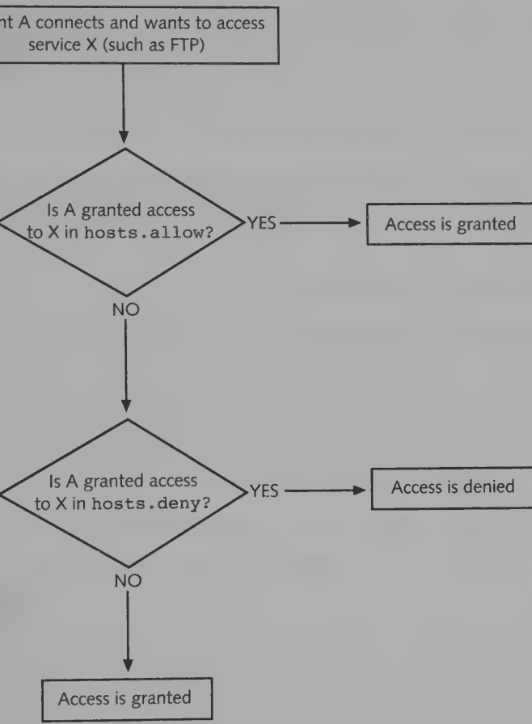

**图 4-2** 通过 hosts.allow 和 hosts.deny 控制访问。

每当你修改 `inetd.conf` 文件时，都必须使用系统脚本通过类似下面的命令来重启 `inetd` 程序：

```
/etc/rc.d/init.d/inetd restart
```

你也可以使用 `kill` 或 `killall` 命令向守护进程发送重新初始化信号，导致其重新读取配置文件。这里显示了每个命令的示例：

```
kill -HUP `cat /var/run/inetd.pid`

killall -HUP inetd
```


# 第 4 章 使用简单网络服务

## 超用户之外的服务

本章及后续章节描述的许多服务并不依赖超级用户机制；它们被设计为独立运行。

较新版本的 Apache 不再支持 `inetd`。它们仅以独立模式运行。

在其他情况下，像 SMTP 或 FTP 这样可以使用 `inetd` 或 `xinetd` 的服务器以独立模式运行，因为它们运行在专门用于该任务的服务器上，或者运行在接收大量此类流量的服务器上。如果你预计会有大量流量，持续使用 FTP 服务器比使用超级服务器来管理入站请求更高效。单个程序中的安全机制让你在大多数方面都能复制 TCP Wrappers 的功能。

关于 Linux 的 `inetd` 程序的另一个重要点是，许多系统的默认配置是监控许多端口。更安全的配置是禁用 `inetd` 提供的所有服务（即注释掉 `/etc/inetd.conf` 中的每一行）。一旦你的系统运行平稳，就可以根据需要通过删除 `/etc/inetd.conf` 中的注释字符来逐个添加服务。请在配置了任何必要的安全设置并检查了 `inetd` 启动的服务器软件的稳定性之后执行此操作。（此讨论涉及此书的第二个主题——安全，但由于 `inetd` 在使许多 Linux 系统变得不安全方面扮演的角色，这一点值得提及。）

默认情况下，Red Hat Linux 中位于 `/etc/xinetd.d/` 下的配置文件包含 `disable=yes` 行，这意味着在你手动更改此默认设置之前，该服务处于非活动状态（对客户端不可用）。

## 探索网络测试服务

`inetd` 和 `xinetd` 服务器支持几种超级服务器内部的网络服务——也就是说，不会启动其他程序服务。这些服务用于测试网络和超级服务器的操作，包括使用不会产生太大威胁的服务来实验安全设置。（尽管如此，生产环境通常会关闭这些服务以避免任何可能的安全漏洞。）这些服务通常默认是禁用的；要使用它们，你必须将 `/etc/xinetd.d` 相应文件中的 `disable=yes` 行改为 `disable=no`，或者删除 `/etc/xinetd.conf` 中相应行开头的注释字符。

这里描述了五种测试服务。你可以通过 `telnet` 连接到指定的端口来使用其中任何一种（在启用后）。你可以在本地执行此操作以探索这些功能的工作原理，也可以连接到任何授予了服务访问权的远程主机。例如，此命令启动了本地主机上的 `chargen` 服务：

```
telnet localhost 19
```

如果你的系统配置为阻止访问不必要的服务，当你使用上述 `telnet` 命令测试 `chargen` 时将收到错误。

此处描述的某些服务将在章末的一个实操项目中进行探索。

- `echo` 服务会重复你输入的任何内容。这向你展示了远程主机正确接收了你输入的信息。不需要密码，不对文本进行任何处理；它只是将其报告给你。`echo` 服务使用端口 7。
- `chargen` 服务（字符生成器）返回一个字符字符串（标准字符集，按数字排序）。`chargen` 会持续发布此流，直到你结束 Telnet 会话。`chargen` 使用端口 19。
- `discard` 服务类似于 `/dev/null`。发送到端口的任何内容都会被丢弃而不经过任何处理。`discard` 使用端口 9。
- `time` 服务返回一个对应当前时间的数字并关闭连接。该数字以程序可读的格式返回，如果你从命令行提示符使用此服务，它将显示为不可读的字符；这在程序内部从另一个主机收集时间可能很有用。

## 使用 lpd 打印

许多操作系统都带有一个版本的 lpd 打印服务器。Linux 可以直接打印到 UNIX、Windows 或运行 lpd 的其他主机。另一方面，Windows 默认包含另一种打印共享协议：服务器消息块（SMB），该协议在第 5 章中进行了描述。通常情况下，使用 SMB 打印到 Windows 主机会更好。

为了让此打印定义能够成功打印，你必须指定一个在远程主机上有效的打印队列。你还必须获得在远程主机上打印的权限，尽管默认情况下，对谁可以进行远程打印没有任何限制。（权限在 lpd 中通过 `/etc/lpd.conf` 和 `/etc/lpd.perms` 文件进行配置。）在你设置好打印机定义后，它将出现在 `printtool` 程序的主窗口中。

使用此图形化工具生成的打印定义在此处显示，显示其在 `/etc/printcap` 文件中的样子。幸运的是，我们大多数人都是使用图形化工具，而不是在文本编辑器中创建文件。相关行以 `:rm` 开头，定义要打印的远程主机，并以 `:rp` 开头，定义要使用的远程打印队列。如果你在创建此打印定义时不定义远程打印队列，lpd 将使用远程系统上的默认打印队列。

```
hplj4:
  :sh:
  :ml=0:
  :mx=0:
  :sd=/var/spool/lpd/hplj4:
  :af=/var/spool/lpd/hplj4.acct:
  :rm=london.myplace.net:
  :rp=hplj4-4
  :lpd-bounce=true:
  :if=/usr/share/printconf/util/mf_wrapper:
```

在你定义打印机后，lpd 打印服务器接受作业（要打印的文件），并将它们一个一个发送到物理打印机。如 `lpr`、`lpd` 和 `lpc` 等打印程序与 lpd 打印服务器交互。

每当 lpd 发现作业目标是远程打印机时，它会使用端口 515 连接到运行在该远程主机上的 lpd 打印服务。假设没有防火墙拦截通信，且 lpd 在远程主机上运行正常，远程 lpd 副本将接受连接，处理正在发送的作业，并将其缓存到本地文件中。

lpd 守护进程使用 `/etc/rc.d/init.d` 中的标准脚本控制。请注意，如果基础网络配置不正确，某些用户可能会遇到 lpd 的问题。例如，如果 `localhost` 接口没有有效设置（如 `ifconfig` 的输出所示），打印可能无法正常工作。

## 使用 NTP 进行时间管理

在许多网络中，保持所有主机之间的时间一致对于网络上使用的程序的正常运行或使用这些程序的用户至关重要。例如，如果许多用户运行一个管理金钱或处理时间敏感注册系统的公共程序，让所有主机对时间达成一致是非常重要的。

解决这一潜在问题的方案是在一个系统上使用时间服务器守护进程，以便网络上的所有主机都能从同一个地方获取时间并保持同步。Linux 中的时间使用网络时间协议（NTP）进行管理。`ntpd` 守护进程实现了该协议。如果你接触 NTP，会很快发现时间计时是一件严肃的事情。多层时间服务器（每一层称为一个 stratum，即层）为较低级的主机提供时间。顶层（stratum 1）由全球数百台服务器组成，它们使用原子钟、卫星或无线连接的输入来同步它们的计算机时钟。这些服务器位于美国标准与技术研究院（NIST）和美国海军天文台（USNO）等场所。

stratum 2 服务器通过查询 stratum-1 服务器接收正确时间；stratum 3 通过查询 stratum-2 服务器接收，依此类推。所谓的 NTP 客户端与任何运行 NTP 的其他主机没有区别，区别在于没有其他主机向它查询正确时间。图 4-5 展示了 NTP 层的基本结构。其设计旨在将时间误差保持在几毫秒内。NTP 协议的设计精度为 $2^{32}$ 皮秒，但大多数计算机都无法维持那种精度。当时间确实至关重要时，NTP 的详尽文档描述了如何配置冗余系统和带有加密认证的多个网络路径，以确保所有系统都能通过已知且可靠的时间服务器接收正确时间。

**图 4-5** NTP 时间服务器层的结构

尽管 NTP 协议和 `ntpd` 守护进程具有强大的功能，但设置主机将其时间同步到另一个主机的时间是非常容易的。大多数 Linux 系统默认安装了 `ntpd` 程序，或者可以作为预构建包提供。它通常由 `/etc/rc.d/init.d` 中的脚本控制。在你使用 `ntpd` 之前，你必须创建一个配置文件 `/etc/ntp.conf`。该文件应至少包含以下行：

```
server time.com
driftfile /etc/ntp.drift
```

`server` 选项指定 `ntpd` 应该查询正确时间的服务器。它会定期执行此查询并相应地重置系统时钟。如果 `ntpd` 被关闭或重启，它会将信息保存在漂移文件中，以便启动时进行同步。命令行支持许多选项；某些 Linux 版本提供了与 `ntpd` 一起的一套实用程序。例如 `ntpq` 可以让你看到时间是否运行正常。如果你的硬件中存储的时间与 `ntpd` 确定的“真实”时间有很大差异，则可能存在问题。

## 允许通过 PPP 服务器进行拨入访问

在第 3 章中，你学习了如何设置 Linux 客户端以使用 PPP 连接到远程主机，通常是通过调制解调器连接。这个故事的另一端是一个服务器，它必须接受想要通过 PPP 连接的拨入用户。在本节中，你将学习在 Linux 上设置此类服务的基础知识。`pppd` 同一个程序被用于 PPP 连接的客户端和服务器端；唯一的区别在于是谁拨号给谁，以及如何配置 `pppd`。

配置拨入式 PPP 服务器（特别是供多个调制解调器使用）是一项复杂的任务。当你设置此内容时，你的电脑基本上就变成了一个 ISP（互联网服务提供商）。本节中的信息可以帮你入门。

`getty` 程序由 `init` 管理，`init` 是 Linux 内核在系统启动后启动的主控制程序。`init` 程序的配置位于 `/etc/inittab`。该文件的一部分包含了每个虚拟终端的配置行。这里显示了 `/etc/inittab` 中的示例行：

```
12345:respawn:/sbin/mingetty tty
```

要设置 PPP 拨入，你必须有一个监控调制解调器的 `getty` 类型程序；通常使用 `mgetty` 是因为它在设计时就考虑了调制解调器。当有人通过调制解调器发送登录信息时，`mgetty` 会验证其有效性，然后使用初始化有效网络设备的参数启动 `pppd`。例如，如果你在 Linux 系统上安装了 `mgetty`，可以在 `/etc/inittab` 的末尾添加如下行，让 `mgetty` 监控第一个串口（设备 `ttyS0`）上的来电：

```
12345:respawn:/sbin/mgetty -x 3 -s 57600 -D ttyS0
```

进行此更改后，你可以使用此命令重启 `init` 程序：

```
kill -1 1
```

或者使用此命令：

```
init 6
```

当另一个主机拨打你串口上的调制解调器时，`mgetty` 会检查远程主机发送的字符。如果主机请求 PPP 连接，`mgetty` 就会启动 `pppd`。为了实现这一点，你必须通过确保此行出现在 `/etc/mgetty+sendfax/login.config` 中（此命令对大小写敏感）来配置 `mgetty` 使用 `AutoPPP` 命令：

```
/AutoPPP/ - a_pppd /usr/sbin/pppd -detach
```

你可以在 `pppd` 命令中包含其他选项，但它们通常存储在 `/etc/ppp/options` 文件中。该选项文件包含了适用于服务器上运行的每个 `pppd` 副本的配置参数。每个单独的设备也可能有一个自己的配置文件，其参数仅在 `pppd` 用于该设备时生效。例如，连接到第一个串口的调制解调器将使用 `/etc/ppp/options.ttyS0` 文件。如果你使用多端口串口卡将多个调制解调器连接到你的 Linux 系统，你可以为每个调制解调器设备创建多个选项文件。在主文件 `/etc/ppp/options` 中为每个拨入的客户端指定使用的 IP 地址可能如下：

- `name sundance` # 我的服务器名称
- `require-pap` # 要求 PPP 认证
- `refuse-chap` # 不允许 CHAP 认证
- `proxyarp` # 让客户端使用代理 ARP
- `login` # 通过本地 `/etc/passwd` 文件认证拨入用户
- `netmask 255.255.255.0` # 将此网络子掩码发送给拨入客户端
- `idle 600` # 此调制解调器空闲 600 秒后断开连接
- `asyncmap 200a0000` # 转换特殊字符 XON, XOFF, 和 ^ ]
- `crtscts` # 使用硬件流控
- `modem` # 使用标准调制解调器控制信号

如果 Windows 客户端拨入你的 Linux PPP 服务器，某些额外选项会很有用。更多信息请参阅 `pppd` 手册。要为拨入客户端分配 IP 地址，`/etc/ppp/options.ttyS0` 文件包含如下所示行（请记得只使用从你的上游 ISP 分配的 IP 地址）。你的“范围”会导致地址 192.168.150.1 分配给任何拨入 `ttyS0` 调制解调器的客户端。

```
192.168.150.0:192.168.150.1
```

> 注意：PPP 在你的主机和拨入主机之间创建一个单点对点连接。为了让任何数据到达网络的其他部分，你必须在主机上启用 IP 转发，如第 2 章所述。

如果此基础配置对你不起作用，请检查 `pppd` 和 `mgetty` 的日志文件（例如 `/var/log/mgetty.ttyS0`），并查阅 `pppd` 文档或 www.linuxdocs.org 上的 PPP HOWTO 文档。PPP 是复杂的，但为许多中小型网络提供了非常有用的服务。

## 使用基本信息服务

在本节中，你将学习一些提供简单网络信息或通信能力的额外服务。正如后文所示，在标准 Linux 安装后，这些许多服务默认是不启用的，因为它们是不安全的。

### 与 talk 通信

要使用 talk 功能，你想要联系的用户必须登录。

### 使用 finger 收集信息

`finger` 程序提供了一种快速方法来判断是否为这种情况。`finger` 程序通过 `in.fingerd` 守护进程使用 finger 协议。`finger` 还提供了有关用户登录时长以及用户全名的信息。一旦在 `/etc/inetd.conf` 或 `/etc/xinetd.d/finger` 中启用了 finger，超级服务器就会监控端口 79 上的入站 finger 查询，并将其发送给 `in.fingerd` 守护进程。

你可以在命令行发起 finger 查询，使用你想要了解的人的用户名；如果该用户账户不在你所在的同一主机上，则需要指定主机名。例如，如果你想了解在同一台主机上登录的 jthomas，可以使用此命令：

```
finger jthomas
```

`finger` 程序（通过 `in.fingerd` 守护进程）的输出结果如下：

```
Login: jthomas Name: Juan Thomas
Directory: /home/jthomas Shell: /bin/bash
On once Wed Apr 3 19:41 (EST) on tty 12 minutes 52 seconds idle
On once Wed Apr 3 19:37 (EST) on pts/0 from :0 56 minutes 44 seconds idle
On once Wed Apr 3 19:39 (EST) on pts/1 from :0
Mail last read Wed Apr 3 19:42 2002 (EST)
No Plan.
```

如果 jthomas 位于另一个主机上，请以“用户@主机”格式包含主机名，类似于以下示例之一，取决于你是在同一域内查询账户还是跨域查询：

```
finger jthomas@sophia
finger jthomas@sophia.myplace.net
```


# 第 4 章 使用简单网络服务

在任何情况下，都必须启用 `finger` 协议，并且任何中间防火墙必须允许端口 79 的流量。`finger` 协议现在较少使用，因为我们有其他方法通过互联网互相了解，而且部分 `finger` 在过去几年中暴露了几个巨大的安全漏洞。尽管如此，当你发现它能提供超出显示之外的信息时，`finger` 的实际用途是显而易见的。

在支持 `finger` 的系统中，任何用户都可以在主目录下创建一个名为 `.plan` 的隐藏文件。使用 `finger` 时，它除了发送账户信息外，还会发送 `.plan` 文件的内容。这允许用户通过 `finger` 提供邮件地址等信息。另外两个文件 `.project` 和 `.pgp` 的内容也会响应任何 `finger` 请求而被发送。`.project` 文件限制为一行，但 `.plan` 文件可以任意长。`.pgp` 文件包含查询账户的加密密钥（如第 8 章所述）。包含 `.plan` 文件的示例 `finger` 输出如下：

```
Login: jthomas Name: Juan Thomas

Directory: /home/jthomas Shell: /bin/bash

On once Wed Apr 3 19:41 (EST) on tty2 13 minutes 2 seconds idle

No mail.

Plan:

123 Elm Street

Washington, DC 20023
```

如果你的系统管理员喜欢 `finger`，但你倾向于让别人使用它来获取你的账户信息，可以在主目录下创建一个 `.nofinger` 文件并使其对 `finger` 守护进程可见。这样，`finger` 程序将不会报告任何关于你的信息，包括你作为系统上有效用户的存在。以下命令可以完成该设置，在主机上启用了 `finger` 的情况下，在依赖它保护隐私之前请进行测试：

```
touch ~/.nofinger

chmod o+x ~

chmod 644 ~/.nofinger
```

`.nofinger` 文件仅适用于阻止来自其他系统的 `finger` 查询。

与 `talk` 类似，你可以使用图形化客户端执行 `finger` 查询。KDE 的 `kfinger` 程序包含了 `finger` 和 `talk` 功能，`kfinger` 是 `kdenetwork` 软件包的一部分，应该在任何安装了 KDE 的系统中安装。图 4-6 显示了 `kfinger` 的主窗口。

图 4-6 kfinger 的主窗口

## 使用 whois 收集服务器信息

接下来，我们暂时回到 DNS 服务器的世界。如前面的章节所述，为了在计算机世界维持某种秩序，所有的域名都经过了注册。以前，由单一实体处理所有注册，但现在许多公司都注册域名。有关每个域名的信息存储在域名注册商维护的数据库中。`whois` 工具查询该数据库以获取特定域名的信息。

了解域名通常是一个两步过程。首先，你对感兴趣的域名使用 `whois` 命令。这会导致 `whois` 查询名为 `internic.net` 的域名 `whois`。查询结果将告诉你哪个注册商拥有关于你感兴趣域名的更详细信息。例如，假设你想了解布莱翰杨大学的域名 `byu.edu`。你从查询 `internic.net` 服务器的命令开始（所示）：

```
$ whois byu.edu

Domain Name: byu.edu

Registrar: GoDaddy

Updated Date: 14-Dec-2001

Created Date: 19-Jan-1987

Registrant: Brigham Young University

Address: 5500 N Campus

Provo, UT 84602

USA

Email: dnsmaster@byu.edu

Administrative Contact: Brigham Young University

Address: 5500 N Campus

Provo, UT 84602

USA

Email: kcm@byu.edu

Technical Contact: Brigham Young University

Address: 5500 N Campus

Provo, UT 84602

USA

Email: dnsmaster@byu.edu

Name Servers:

NS1.BYU.EDU

NS2.BYU.EDU

NS1.WESTNET.NET
```

## Linux 电话

Linux 可以管理的一种特殊类型的“信息服务”是你的电话系统。电话术（telephony）一词通常是指计算机与电话交互，使其能够作为应答器、路由和跟踪通话、作为语音录音器等。公司每年花费数百万美元建立电话系统，以跟踪入来电话并管理员工对交换机的使用。Linux 支持特殊的硬件卡，允许你将电话线路直接连接到计算机，然后使用 Linux 软件管理和跟踪通话。

探索 Linux 世界中这一新兴主题的最佳地点是 www.linuxelephony.org。该网站面向软件开发者，但它提供了与电话相关的硬件和软件列表，帮助新用户熟悉可用技术。选择“链接”可以获得一份关于 Linux 电话术和通用电话术非常有用的资源列表。表 4-2 列出了一些与电话相关的 Linux 软件包。图 4-7 显示了 `gPhoneMan` 的屏幕，作为示例的电话软件可以提供的信息。你可以在 www.pvp.org/~skjelten 了解更多关于该程序的信息并下载副本。

### 表 4-2 Linux 相关的电话软件

| 软件包名称 | 描述 |
| --- | --- |
| KmsgModem | 从 U.S. Robotics (USR) 调制调器检索消息和传真 |
| KAlcatel | 管理 Alcatel 56 和 70x 手机 |
| Voxpak | 用于播放、编辑及管理语音和传真消息 |
| KMLOVoice | 处理使用 ELSAM MicroLinkTM Office调制调器收到的语音消息 |
| KAM2 | 用于 ISDN 电话的自动应答器 |
| gPhoneMan | 用于跟踪通话的通用电话管理器（仍处于开发早期阶段） |

### 图 4-7 gPhoneMan 跟踪入站和出站通话

互联网有时被归类为电话的一个相关但不同的话题，是将 IP 作为长途电话的协议和传输介质。这一过程通常被称为 IP 语音（Voice-over-IP，简称 VoIP）。其核心思想是：互联网连接允许本地电话通话，但通过构成互联网骨干的路由器将你连接到全球的服务器，而无需额外费用。通过麦克风将声音数字化并将其作为 IP 包流发送到目标主机，你可以有效地与世界各地的人“通话”，而无需拨打长途电话。互联网包路由并非为这种实时传输设计，正如许多 VoIP 产品的音质所示。然而，现在已经有了许多产品，包括插入标准电话插座的独立网络电话，它们实际上是调用本地 ISP 来完成长途通话。这项技术不断进化和改进，特别是随着互联网骨干速度的提高（某些地方已达到 600+ Gb/s）以及使用 DSL、电缆调制调器和其他宽带技术实现的更好的家庭连接。此外，重新调整互联网基础设施以使用 IPv6 的需求为 VoIP 等新协议在旧的、更稳定的系统中占据一席提供了机会。

用于 VoIP 的 Linux 软件包括 `Kphone` 和 `linphone` 软件包。

## 理解邮件列表和新闻服务器

在本节中，你将学习更多如何与其他用户共享信息，无论是在本地网络还是全球范围内。与大群体共享信息的两种流行方法是邮件列表或新闻组。正如你将看到的，每种方法的组织是为了实现不同的目的。

邮件列表允许一组用户通过电子邮件持续地共享信息。邮件列表通常是有方向性的。有些被设计用于向列表成员发送公告，例如关于 Linux 安全问题、新博物馆展览或课程表变动。另一些被设计为允许邮件列表的所有成员互相发送消息，例如包含新软件项目所有开发人员的列表，或者大家族成员的列表。邮件列表背后的概念是：当你向邮件列表发送电子邮件消息（发布消息）时，邮件列表管理器（MLM）会将你的消息发送给列表上的所有用户。单个 MLM 可以在 Linux 服务器上管理订阅了数百个不同列表的成千上万用户。

你通过“订阅”来成为邮件列表的成员。当你订阅时，列表软件会将你的地址添加到列表中。如果你以后决定不再接收此类消息，可以随时取消订阅。接下来的关于特定邮件列表软件包的章节将描述如何订阅和取消订阅。

邮件列表软件的优势在于它可以自动处理订阅、取消订阅和发送所有消息，因此个人就不需要花费时间来管理（有时巨大的）用户列表。相反，某些电子邮件列表是经过审核的。审核列表是指：如果管理列表的人员（列表管理员）批准你的订阅，你就可以加入；或者发布到列表的每条消息必须经过管理员批准或源自管理员。例如，`Caldera-Security-Announcements` 邮件列表，只有 Caldera 管理员可以向全列表发布消息。

> **警告提示**：当你只想向邮件列表的管理员或列表的单个成员发送消息时，不要向邮件列表的所有成员发送消息。在发送之前检查消息的收件人 (To:) 和 CC: 行！

大多数 MLM 软件包允许列表所有者（被指定为列表管理员的用户）创建摘要（digests）——一天或一周内发布在列表上的所有消息摘要。用户可以选择接收摘要而不是所有的单独电子邮件消息。系统还提供了存档选项，以及帮助用户控制接收内容的命令，例如在度假期间挂起消息传递。

新闻组与邮件列表有几点不同。首先，它们不是电子邮件消息，因此不由电子邮件服务器 SMTP 处理。相反，新闻组消息（发布）使用网络传输协议（NNTP）进行传输。新闻组发布更像是一个巨大的公告板；你不是订阅，而是向新闻客户端提供新闻组服务器的名称（如后文章节所述）。新闻组比邮件列表更加自由——会联想到“无政府”一词。虽然少数针对特定主题的新闻组经过审核，但大多数新闻组除了用户之间的“对喷”（贬低性发布）外，实际上没有其他控制。

互联网新闻组也被称为 Usenet 新闻或直接称为 Usenet。

## 使用 majordomo 管理邮件列表

被广泛使用的 MLM 软件包之一名为 `majordomo`。`majordomo` 是 Perl 脚本的集合，通过与 `sendmail` 交互来创建邮件列表。`majordomo` 配置的一部分包括在 `sendmail` 中为为你创建的邮件列表设置别名（aliases）。这允许互联网上的任何人通过普通电子邮件向列表名称发送消息，并能让 `sendmail` 正确地将消息路由到 `majordomo`。例如，假设你在主机 `rome.myplace.net` 上创建一个名为 `linux-security` 的邮件列表。世界上的用户可以通过向 `linux-security@rome.myplace.net` 或 `linux-security-owner@rome.myplace.net` 发送消息与该列表交互。

如果用户熟悉电子邮件服务器，发送 `majordomo@rome.myplace.net` 正文为 `help` 的消息将显示用户可以与 `majordomo` 交互的格式和命令。同样，向 `majordomo@rome.myplace.net` 发送正文为 `list` 的电子邮件会导致 `majordomo` 返回该服务器上托管的所有邮件列表，以便用户知道可以使用哪些地址订阅理想的邮件列表。

配置 `majordomo` 的说明在文档目录中（例如 `/usr/doc/majordomo`）。由于 `majordomo` 配置可能很复杂，你应该考虑使用 `Webmin` 进行设置。启动 `Webmin` 后，选择 Servers（服务器）选项卡，然后选择 `majordomo`。当你第一次使用此页面时，必须在 Owner email address 字段中输入电子邮件地址以指定由哪个用户管理 `majordomo`。然后你可以使用 Add a mailing list（添加邮件列表）链接开始创建列表。图 4-8 显示了添加邮件列表的页面。

图 4-8 添加邮件列表页面

每个邮件列表必须有一个作为管理用户（也称为列表所有者）。当 `majordomo` 必须报告问题，或者用户向“列表所有者”（使用 `listname-owner` 的电子邮件地址）发送内容时，消息将发送到该字段指定的名称。你提供一个密码，以便只有指定的维护者可以更改列表配置。你还可以选择对列表进行审核，并指定列表维护者或其他用户作为审核员。

> 某些 MLM 要求命令出现在电子邮件的主题中；而另一些（如 `majordomo`）则在电子邮件的正文中查找命令文本。

一旦设置了邮件列表，列表所有者/维护者就可以通过电子邮件消息与 `majordomo` 交互。例如，维护者可以使用如下命令来批准新成员加入列表：

```
approve maintainer-password subscribe linux-security

abutler@usnetworks.org
```

某些命令只能由列表维护者或版主发布（因此需要包含密码）。另一些是用户命令，例如下所示的：

```
subscribe linux-security abutler@usnetworks.org
```


如果命令中没有包含电子邮件地址，majordomo 将假设发送者的电子邮件地址（从邮件头信息中获取）应该订阅到指定的邮件列表。

## 使用其他邮件列表管理器

尽管 majordomo 被广泛使用（且免费提供），但 Linux 也支持其他邮件列表管理器（MLM）：这些包括：

- **LISTSERV** 是世界上最广泛使用的 MLM，服务了超过百万订阅者。LISTSERV 是由 L-Soft (www.soft.com) 提供的商业产品。LISTSERV 购买费用昂贵，但也提供功能精的试用版。LISTSERV 的优势包括对海量邮件列表（数千个用户或数百万封邮件）的可扩展性、灵活的安全功能，以及基于 Web 的配置和维护界面。对于订阅者来说，LISTSERV 与上述描述的 majordomo 功能类似。例如，你发送包含命令 `SUBSCRIBE linux-security` 的邮件消息。
- **ListProc** 是另一个商业 MLM，其具有图形化配置工具、安全增强（如密码保护的帖子）、摘要和存档，以及删除无效电子邮件地址等特殊功能。你可以通过访问 ListProc 主页 www.listproc.net 了解更多关于 ListProc 的信息。
- **SmartList** 是一个免费的 MLM，与 `procmail`（第 3 章描述）和 `sendmail`（第 6 章描述）配合工作。SmartList 包含了远端列表维护、存档和邮件摘要等功能。
- **Mailman** 是一个免费的 MLM，具有许多标准的列表管理功能。它通过 Web 浏览器界面进行管理。

## 理解邮件列表和新闻服务器

大多数 MLM 都设计了减少垃圾邮件发生率的功能——垃圾邮件是指发送给大量接收者的非自愿广告（即邮件列表的所有成员）。这是列表管理的重要部分；群发邮件者总是试图找到触达更多接收者的方法，但过量的垃圾邮件是得罪列表订阅者并使邮件列表失效的最佳方式。

## 理解 Linux 新闻服务器

新闻组帖子通过 `NNTP` 在互联网上传输。当你设置一个新闻服务器时，它通过从另一个新闻服务器（通常是大型 ISP）获取馈来接收新闻帖子。你的新闻服务器下载 ISP 新闻服务器的所有消息，并上传由你所在地用户生成的消息。你可能知道，有成千上万个新闻组。每个组都可以单独或按类别包含或排除在你的新闻服务器中。例如，许多新闻组帖子包含程序文件或图片。你可以排除发布这些内容的新闻组，以减少新闻服务器所需的资源。

最广泛的新闻服务器软件是 `INN`（新闻服务器守护进程本身是 `innd`）。对于大多数网络来说，设置专门的新闻服务器是不值得的。除非有许多用户（几十或数百个）需要新闻帖子，否则解决方案是访问你 ISP 的新闻服务器。作为参考，拥有自己的新闻服务器的一些潜在问题包括：

- 你需要大量的网络带宽和存储空间。完整的新闻馈流每天可能会消耗 250 GB 的存储空间。排除二进制文件和图片的馈流每天消耗消耗 2-3 GB。（消息通常存储 10 天）。
- 配置非常困难，包括持续的调优需求以保持服务器高效运行（并避免资源耗尽导致的停机）。
- 你可能面临有关如何在组织内部使用新闻组的策略问题，包括如新闻组是否可以被访问，或者作为新闻服务器管理员对于返回给你的帖子的正确礼仪等。

如果你觉得你的组织应该拥有自己的新闻服务器，好消息是，某些 Linux 发行版（特别是 Red Hat）包含了互联网新闻服务器 (`INN`)，并已完成大部分基础配置。这包括为你创建了用户账户（“news”）；设置了必要的配置和暂存目录（如下文所示）；以及设置了 cron 脚本来自动管理新闻服务器的一些基本方面，例如每小时上传一次新创建的帖子。从你的基础开始，设置新闻服务器的第一步是：

- 检查系统中是否安装了 `cleanfeed` 两个包。（如果你使用的是 Red Hat、Caldera、Mandrake 或基于 rpm 的系统，请使用 `rpm -q` 命令。）如果没有安装，请安装它们。
- 联系你的 ISP 讨论他们的新闻服务器作为新闻馈流。
- 规划你的新闻服务器，重点考虑可能创建哪些新闻组（仅供组织内部使用），以及如何存储文章（存储多久以及以什么格式，如下文所示）。
- 考虑你想要遵循的策略以及如何告知他们这些策略（必要时监控或惩罚违规活动）。

`INN` 的配置文件存储在 `/etc/news` 中。你可以查阅 `INN` 文档（在 Red Hat 中）中的配置文件，例如 `/usr/share/doc/inn-2.3.2/`。新闻组帖子存储在 spool 目录中，通常为 `/var/spool/news`。

即使是像 Red Linux 这样许多工作已为你完成的系统，你需要在 `/etc/news/inn.conf` 文件中设置一些信息。例如，你必须定义参数，如作为新闻馈流的服务器地址、你的服务器地址以及你的组织名称。支持的参数完整列表包含 `inn.conf` 页面中。

# 第 4 章 使用简单网络服务

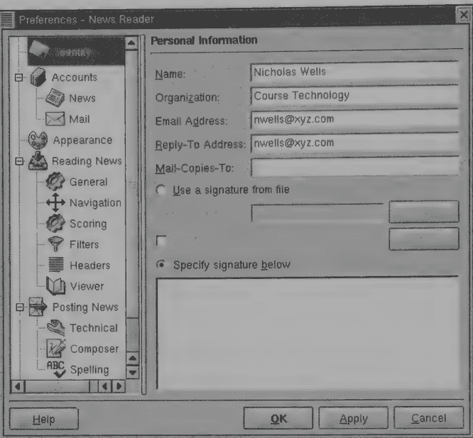

**图 4-9** Knode新闻阅读器的初始配置界面

## 本章总结

- 超用户 `inetd` 和 `xinetd` 监听许多网络端口，并在需要时启动网络服务以响应传入的客户端请求。
- `inetd` 通过 `TCP Wrappers`（即 `tcpd` 程序）提供应用级安全保护。`tcpd` 使用 `hosts.allow` 和 `hosts.deny` 作为配置文件来控制对服务的访问。`inetd` 的配置文件也包含了与 `tcpd` 类似的功能。
- 端口通过 `/etc/services` 文件映射到服务名。
- 某些网络服务（如 Apache Web 服务器和 `innd` 新闻服务器）并非设计为由超级用户运行，而应始终独立运行。
- `inetd` 提供了如 `chargen` 和 `echo` 等网络测试服务。
- 可以通过启用另一个主机接收跨网络的 `syslog` 消息，并在 `/etc/syslog.conf` 中指定主机，从而使用 `syslogd` 进行远程系统日志。

# 本章总结

- Linux 可以使用 `lpd` 进行跨网络打印。指定远程主机的打印机定义会导致本地 `lpd` 接触远程主机上运行的 `lpd`，并将打印作业转发到该主机。
- Linux 中的时间管理由 `NTP` 和 `ntp` 守护进程提供。虽然可以复杂的复杂的，但简单的双行配置文件允许主机从时间服务器获取时间同步数据。
- `SNMP` 提供有关网络上主机运行的详细信息。管理员配置 `SNMP` 代理来收集信息，然后由 `SNMP` 控制台请求这些信息，并为管理员处理和显示数据。
- `NetPerf` 提供基准测试服务，帮助你确定你的网络硬件与其它系统相比的吞吐量。
- 若要将 Linux 配置为 `PPP` 服务器，请使用 `mgetty` 或类似的程序监听入入电话。`mgetty` 会启动 `pppd`，后者使用其配置文件来确定如何与拨号连接通信。
- `talk` 系统允许用户在两个主机之间进行实时通信。`talk` 通常用于文本模式，但也提供图形图表。
- Linux 支持多种聊天式消息服务，如 Yahoo! Chat、美国在线即时通讯 (`AIM`) 和微软网络消息。
- `finger` 程序提供简短的账户摘要。如果用户创建了 `.plan` 文件，`finger` 命令也会返回该文件的内容。
- `whois` 命令允许你通过全球域名注册商维护的网络信息数据库获取有关域名的信息。
- Linux 电话是一个日益增长的领域，允许你的计算机与语音电话系统交互，充当应答机并跟踪或发起通话。
- 基于 IP 的语音 (`VoIP`) 是一种技术，允许你通过将语音转换为通过互联网传输的数字化数据包来拨打长途电话。
- 邮件列表管理 (`MLM`) 软件提供潜在大量用户之间消息投递的自动化管理。流行的邮件包包括 `majordomo`、`LISTSERV` 和 `ListProc`。
- 在 Linux 中建立新闻服务器是可能的，但维护此类服务器可能涉及大量工作和系统资源。一种通用的替代方案是使用 ISP 作为新闻服务器。某些 Linux 版本包含了预设了大多数配置选项的 `INN` 新闻服务器。
- 许多网络浏览器都包含新闻阅读功能。Linux 还支持许多图形和文本的新闻客户端，如用于 KDE 的 `krn` 和文本新闻阅读器 `trn`。

## 关键术语

- `.nofinger` — 当在用户主目录下创建此文件时，会导致 `finger` 程序不显示关于该用户的任何信息。
- `.plan` — 用户主目录下的隐藏文件，`finger` 程序在查询时会显示该文件的内容。
- `/etc/hosts.allow` — 定义应被 `TCP Wrappers` 允许的服务和主机的配置文件。
- `/etc/hosts.deny` — 定义应被 `TCP Wrappers` 拒绝的服务和主机的配置文件。
- `/etc/services` — 将服务名映射到端口数的配置文件。被包括 `inetd` 和 `xinetd` 超用户在内的许多程序使用。
- `agent` — 运行在主机上的 `SNMP` 感知程序。客户端使用其他 `SNMP` 软件收集数据用于分析和传输。
- `benchmarking` — 通过对执行相同任务的其他系统进行性能评估，来比较性能的过程。
- `C News` — 一种为具有新闻组流量的小网络设计的 Linux 新闻服务器程序。
- `chargen` — `inetd` 在端口 19 上提供的网络测试服务。每当被查询时，`chargen` 返回字符流（标准字符集，按数字排序）。
- 紧凑视图文件系统 (`cvfs`) — 在 `INN` 中存储新闻组帖子的方法，使用单个文件作为缓冲区来存放多个单独的帖子。
- `console` — 从网络上的 `SNMP` 代理收集并分析数据的 `SNMP` 程序。
- `daytime` — `inetd` 在端口 13 上提供的网络测试服务。返回人类可读格式的当前日期时间。
- `discard` — `inetd` 在端口 9 上提供的网络测试服务。`discard` 的作用类似于 `/dev/null`。发送到服务的任何内容都会被丢弃而不处理。
- `echo` — `inetd` 在端口 7 上提供的网络测试服务。`echo` 回显它收到的任何内容。
- `finger` — 一个提供关于用户简短信息的程序。
- `getty` — 一个监控终端活动的程序（也是一种程序类型）。
- `in.finger` — 一个提供关于用户简短信息的程序。
- `mesg` — 禁用命令行窗口访问的命令，防止其他程序中断会话。
- `metaserver` — 适配调制的 `getty` 版本。
- `mgetty` — `getty` 的精简版本。
- `mingetty` — 分析网络性能的基准测试工具。
- `Network News Transport Protocol (NNTP)` — 用于传输新闻组帖子的协议。
- `Network Time Protocol (NTP)` — Linux 使用的时间管理和同步协议。由 `ntpd` 守护进程实现。
- `ntpd` — 实现 `NTP` 协议的守护进程。
- `printtool` — Red Hat Linux 提供的图形配置工具。
- `Simple Network Management Protocol (SNMP)` — 用于提供网络组件运行状态反馈的协议。
- `SmartList` — 一个与 `procmail` 和 `sendmail` 配合工作的免费邮件列表管理器。
- `spam` — 发送到大量电子邮件或新闻组接收者的垃圾广告。
- `standalone mode` — 在没有 `inetd` 超用户支持的情况下使用网络程序。
- `stratum` — `NTP` 服务器结构中的一个层。
- `superserver` — 监听多个网络端口并在连接到该端口时启动相应网络服务守护进程的程序。也称为 `metaserver`。最常用的超用户程序是 `inetd`。
- `INN` — 最常用的新闻服务器软件。由 `innd` 守护进程实现。
- `kfinger` — 用于 KDE 的图形化 `finger`（包含 `talk` 功能）。
- `Knode` — 用于 KDE 的新闻阅读器。
- `LeafNode` — 为具有新闻组流量的小网络设计的新闻服务器。
- `ListProc` — 邮件列表管理器 (`MLM`)。见 www.listproc.net。
- `LISTSERV` — 世界最常用的 `MLM`。来自 L-Soft (www.soft.com) 的商业产品。
- `lpd` — 标准 Linux 打印服务器。
- `mailing list` — 通过电子邮件共享信息的用户组。
- `mailing list managers (MLM)` — 用于创建和管理邮件列表、收集用户信息和发送消息的软件包。
- `majordomo` — 最常用的 `MLM` 包之一。一个由与 `sendmail` 邮件服务器交互的 Perl 脚本组成的免费软件包。
- `Pan` — 用于 Gnome 的新闻阅读器。

## 第 4 章 使用简单的网络服务

- `syslog` — 系统日志守护进程，可以使用端口 514 与另一个系统上的 `syslog` 通信，以提供远程日志功能。
- `talk` — 一个与 `talkd` 守护进程配合使用的程序，用于与其他用户启动并管理实时打字对话。
- `talkd` — 实现 `talk` 通信系统的守护进程。
- `tcpd (TCP Wrappers)` — 一种应用级访问控制（安全）程序，当受到超级服务器（`superserver`）的请求时，它会检查入站的网络连接，然后将连接详情与配置文件进行比较，以确定是否允许该连接。
- `telephony` — 一种让计算机与电话交互的技术，使其能够作为应答机、通话路由器、语音录音机等。
- `time` — 由 `inetd` 在端口 37 上提供的网络测试服务。它返回一个以程序可读格式表示的当前时间的数字，该数字在屏幕上显示为不可读的字符。
- `trn` — 线程化新闻阅读器，可能是 Linux 上最广泛使用的文本模式新闻阅读器。
- `Usenet news` — 互联网新闻组的另一个名称。
- `IP 语音 (VoIP)` — 使用 `IP` 协议作为数字化语音包的传输，通常作为通过互联网进行长途电话的媒介。
- `whois` — 一种查询互联网数据库以了解管理特定域的人员工具。
- `xinetd` — 一个具有扩展配置选项的超级服务器。在 Red Hat Linux 上是标准，而不是通常的 `inetd` 程序。
- `xntpd` — 在某些 Linux 系统上用于实现 `NTP` 协议的守护进程。参见 `ntpd`。

## 复习题

1. 哪一行会出现在 `/etc/services` 文件中？
   a. `telnet 23/tcp`
   b. `telnet stream tcp nowait /usr/sbin/tcpd in.telnetd`
   c. `in.telnetd *.myapp.net EXCEPT ns.myapp.net`
   d. `telnet localhost 19`

2. Linux 留给系统服务和用户使用的端口包括：
   a. 直到 65535 的所有端口
   b. 仅在 `/etc/services` 中指定
   c. 1024 以下的端口
   d. 由互联网机构分配的端口

3. `inetd` 超级服务器通常启动：
   a. `TCP Wrappers`
   b. 互联网服务守护进程，如 `in.ftpd`
   c. `pppd`
   d. 如 Web 服务器之类的独立服务

4. `inetd` 或 `xinetd` 配置中的 `nowait` 选项表示：
   a. `ICMP` 数据包不应响应 `ping` 数据包
   b. 可以在不等待当前副本完成处理的情况下启动服务守护进程的额外副本
   c. 应该使用 `TCP Wrappers` 处理客户端请求
   d. 客户端请求应使用 `UDP` 传输协议

5. `TCP Wrappers` 使用以下文件配置：
   a. `/etc/hosts`
   b. `/etc/inetd.conf`
   c. `/etc/hosts.allow` 和 `/etc/hosts.deny`
   d. `/etc/services`

6. 选择 `/etc/hosts.allow` 中 `in.telnetd 192.168.0.0` 行的含义：
   a. 拒绝所有以 192.168.0 开头的任何网络 ID 主机访问 Telnet 服务。
   b. 允许所有以 192.168.0 开头的任何网络 ID 主机访问 Telnet 服务。
   c. 拒绝除以 192.168.0 开头的任何网络 ID 主机以外的所有主机访问 Telnet 服务。
   d. 允许除以 192.168.0 开头的任何网络 ID 主机以外的所有主机访问 Telnet 服务。

7. 要使用 `syslogd` 启用远程日志，必须：
   a. 启动 `syslogd` 时使用 `-r` 选项。
   b. 在 `/etc/services` 中包含端口 514 并允许流量通过防火墙。
   c. 在 `/etc/syslog.conf` 中使用 `@hostname` 标记。
   d. 仅 a 和 b
   e. 答案 a、b 和 c

8. `lpd` 程序允许 Linux：
   a. 管理远程打印服务器上的打印队列
   b. 在 `/etc/printcap` 中正确定义时打印到远程打印机
   c. 使用调制解调调器连接到远程主机
   d. 访问管理协议层（如 `NTP`）使用的访问控制代理。

9. 描述 `NTP` 中多层级（`strata`）时间服务器的安排。

10. `SNMP` 代理提供：
    a. 向 `SNMP` 控制台提供详细的事件信息
    b. 对范围主机的多个事件进行分析
    c. 通过图形界面访问 `SNMP` 控制台
    d. 通过 Gnome 或 KDE 提供配置能力

11. 描述基准测试（`benchmarking`）的目的。

12. 使用哪个程序来监听调制解调器连接并在需要时启动 `pppd`？
    a. `init`
    b. `SNMP`
    c. `mgetty`
    d. `majordomo`

13. `IP` 地址通常通过以下方式分配给连接到拨号 `PPP` 服务器的多个调制解调器：
    a. `/etc/ppp/options` 文件
    b. `/etc/mgetty+sendfax` 配置中的信息
    c. 包含在 `/etc/inittab` 中的参数
    d. 为每个设备（如 `ttyS0`）命名的单独 `/etc/ppp/options` 文件

14. 为了防止 `talkd` 中断工作会话，你：
    a. 在家目录中创建一个 `.nofinger` 文件。
    b. 执行 `mesg n` 命令。
    c. 使用 `mesg` 命令。
    d. 使用 `talk` 会话。

15. 写出三个 Linux 支持的聊天式消息服务。

16. 哪个信息不是 `finger` 显示的内容？
    a. 家目录
    b. 用户
    c. 登录时间
    d. `.plan` 文件

17. `whois` 主（main）指的是：
    a. 是...中的唯一地方
    b. 靠近
    c. 是家目录
    d. 是家目录

18. 简要解释 `majordomo` 和 `LISTSERV` 之间的区别。

19. 必须作为 `standalone mode` 完成？
    a. `majordomo` list.
    b. `SmartList`
    c. `LISTSERV`
    d. `innd`

20. 一个 `LeafNode` 的列表：
    a. 仅接受新闻组
    b. 是关于小网络的
    c. 已配置为
    d. `innd` group

21. 时间服务器包括：
    a. `trn`、`chargen` 和 `date`
    b. `INN`、`chargen` 和 `SNMP`
    c. `trn`、`chargen` 和 `elm`
    d. `INN`、`chargen` 和 `echo`

22. 由 `inetd` 提供的网络服务：
    a. `chargen` 和 `echo`
    b. `INN` 和 `SNMP`
    c. `chargen` 和 `date`
    d. `INN` 和 `getty`

23. 使用 `standalone mode` 模式指的是：
    a. 在 `/etc/services` 中以便
    b. 是关于...
    c. 指向 `localhost`
    d. 用于安全的 `TCP Wrappers`

24. 必须作为 `standalone mode` 完成？
    a. 创建一个文件。
    b. 监控入站。
    c. 启动 `innd`。
    d. 身份验证文件。

25. 该术语指的是？

## 实践项目

### 项目 4-1

在这个项目中，你将使用 `NTP` 建立一个服务器。完成此项目需要系统的 `root` 权限和互联网连接。

1. 以 `root` 身份登录并打开命令行窗口。
2. 确保系统已安装 `NTP` 服务器软件。你可以通过查看 `/etc/rc.d/init` 目录下的 `ntp` 或 `xntpd` 或相应的 Linux 版本系统启动脚本来实现。或者，你可以在基于 `rpm` 的 Linux 版本上搜索软件包：

```
rpm -q ntp
```


`rpm -qa | grep ntp`

```
3. 打开网页浏览器访问 www.ntp.org。
4. 选择公共 NTP 链接。
5. 点击 Public NTP Secondary (stratum 2) Time Servers 打开二级时间服务器列表。服务器列表按字母顺序组织，首先是双字母代码，然后是州或省代码。找到你所在州的时间服务器。仔细查看区域内每个条目的访问策略字段，选择一个可以使用的。
6. 复制你所选服务器的信息。（写下来或粘贴到你可以保存的文档中）。关键信息是服务器的 IP 地址和管理员的电子邮件地址，大多数情况下，你想向他们发送电子邮件告知他们你打算使用他们的时间服务器。
7. 现在配置你的 NTP 守护进程。查看是否已安装 `/etc/ntp.conf` 文件（Red Hat 和 Caldera 版本的 Linux 通常都有）。如果有，打开它并找到 server 行（通常是文件中第一个非注释行——如果没有找到请添加）。将时间服务器的 IP 地址放在 server 关键字之后。例如：
```bash
server 140.162.8.3
```

8. 如果你没有 `ntp.conf` 文件，请打开文本编辑器并使用以下两行创建一个文件，替换为你在上方找到的服务器 IP 地址。
```
server 140.162.8.3
driftfile /etc/ntp.drift
```
然后使用此命令创建漂移文件：
```
touch /etc/ntp.drift
```

9. 配置好 NTP 后，你就可以重启 `ntppd` 或 `xntpd` 守护进程。使用如下命令组进行操作：
```
/etc/rc.d/init.d/ntpd stop
/etc/rc.d/init.d/ntpd start
```

10. 等待一会儿让服务器尝试连接时间服务器，然后使用 `ntpq` 程序查询时间服务器。
```
ntpq
```

11. 你可以在 `ntpq` 提示符处使用 `help` 命令来查看 ntp 命令列表。然后使用 `help command_name` 查看任何命令的单行描述。在 `ntpq` 命令内部，使用 `poll` 命令查询时间服务器：
```
poll 1
```

## 项目 4-2

在这个项目中，你将使用 `whos` 来查找域名的信息。完成此项目你需要一个可以运行的 Linux 系统和互联网连接。

在这个项目中，你正在帮助位于北弗吉尼亚尼亚的亚历山德里亚高中（Alexandria High School）建立新的计算机实验室。由于这是一个小型实验室，你希望准备几个备份 DNS 服务器，以便在必须停止本地 DNS 服务器进行维护时，将它们包含在配置中。你决定北弗吉尼亚州社区学院（NVCC）可能并不介意你将他们的网站作为你的二级和三级 DNS 服务器。

- 1. 你看到了 NVCC 网站的两个不同的 URL。尝试在 `whos` 查询中输入第一个：`llc.vcs.edu`。你看到了什么结果？
- 2. 如果不起作用，你可能需要引用针对 `.edu` 域的 whos 服务器。如果你在第 1 步没有这样做，请使用 `whos.edu.net` 并再次查询 `llc.vcs.edu`。
- 3. 如果仍然无效，考虑该地址本身。它显然指的是某个更大单元 `vccs` 内部的 NVCC——可能是弗吉尼亚州社区学院系统，或类似的机构。带着这个理论，尝试对 Educause whos 服务器进行查询，仅使用 `vcs.edu`。你看到了什么结果？

## 第 4 章 使用简单的网络服务

4. 你担心 VCCS 的人员可能对 NVCC 服务器没有直接管理权，因此你决定尝试另一个 NVCC 地址，看看是否能在该学校找到某人。查询 `nvcc.va.us`（你可能想先在 Web 浏览器中查看 `www.nvcc.va.us` `edu` 以检查它们是否是有效域名）。你在哪里查询了 `nvcc.va.us`？你得到了什么结果？为什么得到那个结果？

5. 担心你没能找到 NVCC 的联系人，你决定尝试弗吉尼亚大学的州域名 `uva.edu`。向 `whois.internic.net` 发起此查询会直接连接到 `edu.net` 的 whos 服务器。其他情况下，你可能需要指定 `edu.net` 作为你的 whos 服务器。

6. 从列出的信息中获取 DNS 服务器的 IP 地址，以及联系人的姓名、电话和电子邮件地址。在引用他们的 DNS 服务器之前，你应该出于礼貌与联系人确认。

## 项目 4-3

在这个项目中，你将实验 `finger` 协议。完成此项目你需要安装了 Red Linux 7.3 并拥有系统的 root 权限。

- 1. 登录并打开命令行窗口。
- 2. 使用此命令验证是否安装了 `finger-server` 软件包：
```
rpm -q finger-server
```
- 3. 通过修改 `/etc/xinetd.d/finger` 中的 `disable` 行，在 xinetd 中启用 `finger-server` 配置。
- 4. 同时通过修改 `/etc/xinetd.d/daytime` 和 `/etc/xinetd.d/charger` 中的 `disable` 行，来启用 daytime 和 charger 服务。
- 5. 重启 `xinetd` 使你的更改生效。
- 6. 向 daytime 端口发送 `telnet` 命令来实验 daytime 服务。为什么你可能想使用这项网络服务：
```
telnet 127.0.0.1 13
```
- 7. 通过向 charger 端口发送 `telnet` 命令来实验 charger 服务。为什么在测试你的网络时这可能有用？
```
telnet 127.0.0.1 19
```
- 8. 使用文本编辑器在你普通用户账户的家目录下创建一个 `.plan` 文件。在文件中包含信息，例如你喜欢的格言或你的课程列表。
- 9. 使用 `chmod` 将 `.plan` 文本文件的权限设置为 644。
- 10. 在保持 root 登录状态的情况下，对你的普通用户账户执行 `finger` 查询。
- 11. 在教室里找一个朋友并对他执行 `finger` 查询。你看到了什么结果？

## 项目 4-4

在这个项目中你探索 `xinetd`。完成此项目你需要安装了 Red Linux 7.3 并拥有系统的 root 权限。Stallion 和 Sangoma 多年来一直支持其硬件的 Linux 用户。

- 1. 如果已安装 `finger-server` 软件包，使用此命令：
```
rpm -q finger-server
```
- 2. 使用此命令验证 `finger-server` 软件包已安装：
- 3. 通过修改 `/etc/xinetd.d/finger` 中的 `disable` 行，在 xinetd 中启用 `finger-server` 配置。
- 4. 通过修改 `/etc/xinetd.d/daytime` 和 `/etc/xinetd.d/charger` 中的 `disable` 行，启用 daytime 和 charger 服务。
- 5. 重启 `xinetd` 使你的更改生效。
- 6. 向 daytime 端口发送 `telnet` 命令来实验 daytime 服务。为什么你可能想使用这项网络服务：
```
telnet 127.0.0.1 13
```
- 7. 向 charger 端口发送 `telnet` 命令来实验 charger 服务。为什么在测试你的网络时这可能有用？
```
telnet 127.0.0.1 19
```
- 8. 使用文本编辑器在你普通用户账户的家目录下创建一个 `.plan` 文件。在文件中包含信息，例如你喜欢的格言或你的课程列表。
- 9. 使用 `chmod` 将 `.plan` 文本文件的权限设置为 644。
- 10. 在保持 root 登录状态的情况下，对你的普通用户账户执行 `finger` 查询。
- 11. 在教室里找一个朋友并对他执行 `finger` 查询。你看到了什么结果？


- 8. 使用文本编辑器在你普通用户账户的家目录下创建一个 `.plan` 文件。在文件中包含信息，例如你喜欢的格言或你的课程列表。
- 9. 使用 `chmod` 将 `.plan` 文本文件的权限设置为 644。
- 10. 在保持 root 登录状态的情况下，对你的普通用户账户执行 `finger` 查询。
- 11. 在教室里找一个朋友并对他执行 `finger` 查询。你看到了什么结果？

## 案例项目

再次回到 Snow、Sleet 和 Hale 律师事务所，你今天正在思考该律事务所可能需要的服务。

- 1. 在本章中学习到的基础网络服务（`finger`、`talk`、`charger`、`echo`、`daytime`、`discard`）中，哪些服务（如果有的话）可能对律师事务所网络的用户有用？你为什么选择了这些服务？
- 2. 律师需要使用大量的纸张——即使是专门从事环境工作的律师也是如此。尽管如此，为什么你可能不会选择 `lpd` 作为这些办公室主要的远程打印机制？（提示：考虑一下正在打印的客户端/设备。）
- 3. PPP 拨号服务器对这些办公室有所用吗？无论是对于在家里办公的员工，还是作为不同办公室之间的连接？对于使用 PPP 拨号服务器进行这两种用途，你会有哪些担忧？如果你认为 PPP 服务器是有用的，那么在搭建好 PPP 服务器和拨号客户端后，如果公司规模扩大一倍，你会有哪些担忧？
- 4. 有几位律师询问过使用邮件列表来分享有关法律主题和事务所当前客户的信息。这听起来确实很有用。请考虑以下问题并说明你的理由：你可能会使用哪种 MLM（邮件列表管理器）？你会在哪里托管邮件列表？你会指定谁作为各个列表的维护者？这些列表会引起哪些担忧？考虑到你对律师事务所规模以及你认为他们产生的消息数量的了解，新闻组是否是邮件列表更好的选择？

# 第 5 章
## 配置文件共享服务

在阅读本章并完成练习题后，你将能够：
- 为匿名或普通用户配置 FTP 服务器
- 在 Linux 和 UNIX 系统之间建立 NFS 文件共享
- 理解基于 NCP 的 NetWare 文件共享
- 使用 SMB 与基于 Windows 的 PC 共享文件和打印机

在本章中，你将探索不同的文件共享技术，这些技术允许你与运行 Linux 以及许多其他操作系统的计算机交换信息。

本章描述的每种文件共享方法都有优缺点；你将学会根据你所使用的操作系统和网络的不同需求决定使用哪种技术。

## 运行 FTP 服务器

文件传输协议（FTP）几十年来一直用于在网络计算机系统之间共享文件。它是 20 世纪 60 年代 UNIX 的一部分。随后，几乎所有平台都开发了实现 FTP 文件共享的客户端和服务器程序。FTP 的大部分价值源于在任何两台计算机之间共享文件的能力。FTP 持续流行的另一个原因是它被集成在现代 Web 浏览器中。你可能曾在浏览器中从 FTP 服务器下载过信息，而甚至没有意识到。

回想第 1 章关于网络协议的讨论，不同的协议是为了满足不同的需求而设计的。这里列出了 FTP 的一些设计特征：

- FTP 设计用于高效地将单个文件分发给多个远程客户端。
- FTP 实时运行，因此当你完成 FTP 的使用时，你已经在本地计算机上下载了一个或多个文件。（将其与电子邮件进行对比；当你按下“发送”时，你创建的电子邮件消息不会立即传递给收件者。）
- FTP 设计用于供公众使用。这被称为**匿名 FTP**，因为任何用户都可以以身份登录（无需在 FTP 服务器上拥有预定义的用户账户）并下载文件。
- FTP 是传输大文件的有效协议。相比之下，HTTP 和 SMTP 都是为小文件设计的。尽管电子邮件和 Web 浏览非常流行，FTP 流量仍然占了互联网传输数据包很大比例。
- FTP 设计并不是用于作为“共享本地磁盘”。也就是说，许多协议（如本章后述的 NFS、NCP 和 SMB）在设计时预想你会将一个本地目录分配给网络驱动器，这样当你查看某个本地目录的内容时，你实际上是在看一个网络资源——一个通过文件共享协议提供的硬盘。而 FTP 的设计则不同：你登录、下载、然后注销。

FTP 服务器对匿名用户来说非常受欢迎：当你有想要让任何人获取的文件时，FTP 是首选协议。互联网上的许多服务器专门用于 FTP 流量，提供可下载的 Linux 程序、NASA 图像、政府文件等的存储库。尽管 FTP 中已经发现（并修复）了安全漏洞，但它在设计时就考虑了匿名用户。你也可以建立一个仅供“已知”用户使用的 FTP 服务器，或者同时支持已知用户和匿名用户的服务器。

## 使用 FTP 客户端

访问 FTP 站点需要 FTP 客户端。Linux 包含一个文本模式 FTP 客户端，你可以从任何命令行使用它。FTP 客户端会话以 `ftp` 命令和你想要联系的服务器名称开始：

```
ftp ftp.ibiblio.org
```

`ncftp` 程序是一个较新且更精炼的文本模式 ftp 程序。它在许多 Linux 系统（包括 Red Hat Linux）上默认安装，但 `ftp` 程序仍然是老备方案。在学习 `ftp` 之后，你可以自己尝试 `ncftp`；它们的命令非常相似。

如果你的系统可以连接到 FTP 服务器（解析主机名等），系统会提示输入用户名和密码。一旦登录，你通常会看到一条欢迎消息，然后是 `ftp>`。

### 表 5-1 文本模式客户端中的常用命令

| 命令名称 | 描述 |
| :--- | :--- |
| open | 启动与服务器的连接 |
| close | 结束 FTP 连接 |
| ls | 列出当前目录的内容 |
| pwd | 显示你当前正在工作的目录 |
| cd | 切换到新目录（服务器上） |
| get | 下载文件 |
| mget | 下载一组文件 |
| put | 上传文件到服务器 |
| bye | 退出 |

### 表 5-1 文本模式客户端中的常用命令续

| 命令名称 | 描述 |
| :--- | :--- |
| mput | 从你的系统上传多个文件到服务器 |
| lcd | 更改你在本地系统上正在工作的目录 |
| prompt | 关闭或开启下载或上传多个文件的提示 |
| binary | 将传输模式设置为 8 位 |
| ascii | 将传输模式设置为 7 位文本 |
| bye | 退出 FTP 客户端 |

如果你更喜欢在图形化环境中工作，可以使用 Web 浏览器访问 FTP 站点。例如，将你的浏览器指向 `ftp://ftp.hq.nasa.gov`。Web 浏览器将使用匿名和你的电子邮件地址登录服务器并显示主目录。浏览器还会在你切换目录时从 FTP 服务器的文件列表动态创建 HTML “Web”页面。根据你浏览器的不同，你可以通过点击文件并在对话框中输入保存位置来轻松下载文件。图 5-1 显示了如何使用浏览器访问 NASA FTP 站点。

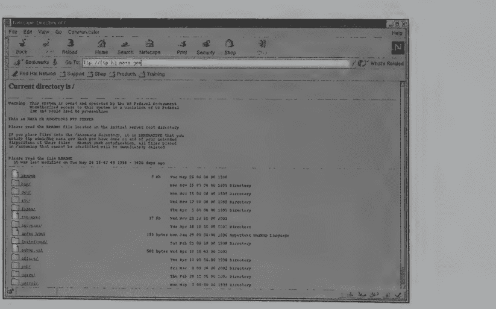

**图 5-1** 使用浏览器访问公共 FTP 站点

可以使用真实用户账户访问 FTP 站点。请使用格式 `ftp://user-name@ftp.server.com/`。建立连接后，浏览器会提示你输入密码。注意：与任何 FTP 客户端一样，你的用户名和密码在网络中是以未加密的形式传输的。

到目前为止，你仅使用匿名用户访问公共 FTP 站点。如果你在远程服务器上有一个用户账户，且该服务器运行着 FTP 服务器软件，你也可以用你的用户账户登录，并在你与拥有账户的主机之间传输文件。匿名 FTP 服务器出于安全考虑限制了你的访问权限，但当你使用 FTP 客户端登录到你拥有普通用户账户的服务器时，你可以访问系统的所有部分、更改文件名、上传、下载——凡是你使用相同用户名登录到远程主机时所可以做的一切。当然，出于安全考虑，FTP 管理员可能会限制你可以在远程执行的操作。你很快就会学到这一点。

使用浏览器 FTP 客户端会限制你只能访问基本目录和下载文件，但几个图形化客户端提供了更完整的 FTP 功能。一个很好的例子是 `gFTP` 程序，如图 5-2 所示。你在窗口顶部的字段中输入想要连接的主机，以及你的用户名和密码。`gFTP` 可以通过 FTP、HTTP 或 SSH（在第 8 节描述）传输文件。`gFTP` 并不是专门为匿名 FTP 用户设计的——它为在多个 Linux 系统上访问账户的普通用户提供了许多选项。书签菜单列出了许多与 Linux 相关的 FTP 站点，以便即时访问。Red Hat Linux 默认安装了 `gFTP`，在其他平台上也广泛可用。

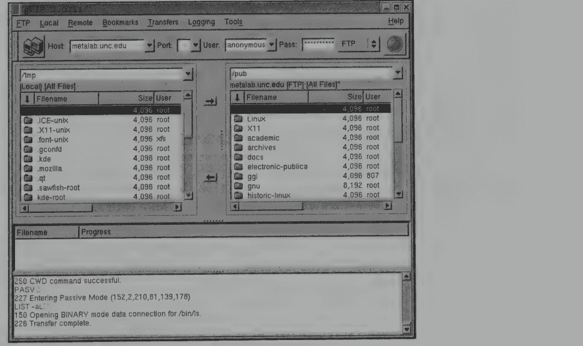

**图 5-2** gFTP 程序

另一个流行的图形化 FTP 客户端是 `IglooFTP`，你可以免费从 `www.iglooftp.com` 下载。

## 介绍 FTP 服务器

Linux 上使用最广泛的 FTP 服务器是华盛顿大学 FTP 服务器 `wu-ftp`。（守护进程的名称为 `in.ftpd`。）在许多 Linux 系统上，FTP 服务器默认已安装并进行了最少的配置。在 Red Hat Linux 上，该服务器位于 `wu-ftpd` 包中。你可以使用此命令检查安装了哪些 FTP 相关的包：

```
rpm -qa | grep ftp
```

Red Hat Linux 还使用一个名为 `anonftp` 的独立包为匿名用户设置 `/var/ftp` 目录。其他发行版在安装 FTP 服务器软件时，会在 `/var/ftp` 或 `/home/ftp` 配置匿名目录。

> 一种与 FTP 类似的协议是简单文件传输协议 (TFTP)。该协议由服务器 `in.tftpd` 和各种 FTP 客户端支持。它为特殊用途计算环境提供基本的类 FTP 服务，在这些情况下，完整的 FTP 配置会占用过多的内存或磁盘空间。一个例子是工作站在启动过程中需要从服务器下载其操作系统。TFTP 为工作站提供了下载所需文件的功能。

设置 FTP 服务器是通过许多配置文件来完成的。（你是否开始发现某种模式了？）表 5-2 列出了 FTP 服务器配置文件。默认情况下，所有这些文件都已安装。接下来的章节将逐一介绍不同的文件以及你可能如何设置你的 FTP 服务器。

除了这些配置文件之外，每当你匿名登录 FTP 服务器时，你都不被允许查看远程计算机的整个文件系统。相反，你被限制在一个子目录下——其中存储了所有公共下载的文件。在大多数现代 Linux 版本中，此目录是 `/home/ftp` 或 `/var/ftp`。对于本章，我们假设你正在使用 Red Hat Linux，它最近更改为使用 `/var/ftp`，以避免将匿名 FTP 信息放在与普通用户相同的目录结构 (`/home`) 中。

当你探索 `/var/ftp` 时，你将看到许多目录，例如 `/bin`、`/etc` 和 `/lib`。这些类似于你的文件系统根目录，尽管这些子目录包含了 FTP 服务器继续运行所需的无需查看 `/var/ftp` 目录之外的文件。从技术角度来说，当你以匿名身份登录时，服务器执行了“更改根”（change-root）操作。

### 表 5-2 FTP 服务器配置文件

| FTP 配置文件 | 说明 |
| :--- | :--- |
| `/etc/ftpaccess` | 主 FTP 配置文件；要使用此文件，启动 FTP 服务器时必须带有 `-a` 选项（这在大多数 Linux 发行版中是默认的） |
| `/etc/ftpusers` | 不允许登录 FTP 的用户账户列表。该文件默认包含管理账户（如 `bin`、`daemon`、`news`、`mail` 等）。你可以添加任何你想要阻止 FTP 访问的普通用户账户 |
| `/etc/hosts.allow` 和 `/etc/hosts.deny` | 因为 FTP 服务器通常通过 `inetd` 超级服务器启动，如果你使用 `inetd`（回想第 4 节的 TCP），你应该在这些文件中为 FTP 设置特定于主机或域的访问控制 |
| `/etc/inetd.conf` | 如果你使用 `inetd` 超级服务器，通过删除 FTP 服务对应行前的 `#` 号来在此文件中启用 ftp |
| `/etc/xinetd.d/wu-ftpd` | 对于 `xinetd` 超级服务器，在此文件中设置特定于主机和域的访问控制。还通过将 `disable=yes` 更改为 `disable=no` 并添加任何你想使用的日志属性来启用该服务 |

## 在 FTP 服务器上运行

除了为了 FTP 目的将系统用户定义为访客之外

```
class office      real,guest,anonymous  192.168.100.0/24
class other       real,guest,anonymous  *
```


你很快将使用这些类来定义特定的访问权限。然而，请考虑你希望在 FTP 会话的不同阶段在他们的屏幕上显示的消息。你可以定义几个不同的消息文件，这些文件会在 FTP 服务器的不同点自动显示。表 5-3 总结了这些文件。你可以使用其中任何一个，或者一个都不使用。大多数 FTP 配置中默认定义了几个。

## 表 5-3 ftpaccess 中定义的消息文件

| 配置关键字 | 描述 | 示例 |
|---|---|---|
| `banner` | 在提示用户输入和密码之前显示指定文件的内容；你必须以纯文本创建该文件 | `banner /etc/ftpbanner.msg` |
| `readme` | 打印一条消息告诉用户阅读与给定模式匹配的文件内容。示例将导致如果根目录 (`/var/ftp`) 下存在任何匹配 `README*` 的文件，FTP 将打印一条显示“请阅读文件名”的消息。如果用户使用 `cd` 命令切换到的任何目录存在匹配名为 `README*` 的文件，第二个示例将提供相同类型的通知消息。（不显示指定文件的内容；用户必须打开文件才能查看。） | `readme README* login`<br>`readme README* cwd=*` |
| `greeting` | 设置首次连接到 FTP 服务器时显示的信息量（例如数据、时间和 FTP 服务器软件的版本）；此关键字的选项包括 `full`（完整）、`brief`（简）或 `terse`（简洁） | `greeting terse` |
| `message` | 用户登录（使用 `login`，第一个示例）或进入目录（`cwd=`，第二个示例）时显示指定文件的内容 | `message /etc/ftpwelcome.msg`<br>`message .message cwd=*` |

## 第 5 章 配置文件共享服务

你可以使用一组指令来控制 FTP 用户允许执行的文件操作，这些指令通过文件操作命名，后跟 `yes` 或 `no`，并根据适用于指令的用户类进行。你可以使用预定义的类（`real`、`guest` 或 `anonymous`），也可以使用你定义的类，例如之前示例中的 `office` 和 `other`。表 5-4 显示了如何使用这些指令。

## 表 5-4 ftpaccess 中的文件操作指令

| 命令关键字 | 描述 | 示例 |
|---|---|---|
| `chmod` | 控制用户是否可以更改 FTP 服务器上文件的文件权限 | `chmod no anonymous` |
| `delete` | 控制用户是否可以删除/移除 FTP 服务器上的文件 | `delete yes class=office` |
| `overwrite` | 控制用户是否可以覆盖现有文件 | `overwrite no anonymous,guest` |
| `rename` | 控制用户是否可以更改文件名称 | `rename no anonymous,guest` |
| `umask` | 控制用户是否可以发布 `umask` 命令来设置分配给文件的默认权限 | `umask yes class=office` |
| `compress` | 控制用户是否可以压缩文件大小传输；通常，允许所有用户执行此操作 | `compress yes all` |
| `tar` | 控制用户是否可以一起进行 tar 包以便更方便的多文件传输；通常，允许所有用户执行此操作 | `tar yes all` |

使用表 5-4 中的指令为不同的组设置多行权限是正常的。除了这些与文件相关的指令外，`upload`、`noretrieve` 和 `allow-retrieve` 控制用户如何下载和上传文件。这些指令的语法比表 5-4 中指令的语法更复杂。对于 `upload` 指令，格式如下：

```
upload root-directory upload-directory permission user-ID group-ID umask directory-rights
```

这里是一个示例：

```
upload /var/ftp /incoming yes ftp ftp 0666 nodirs
```

此示例允许用户在 `/incoming` 目录中上传文件。该目录名称相对于 `/var/ftp` 目录，因此它实际上是 `/var/ftp/incoming`。`yes` 表示允许上传（你可以有多个针对不同子目录设置 `yes` 和 `no` 权限的 `upload` 指令）。上传到目录的文件被分配了 `user-ID` 为 `ftp`，`group-ID` 为 `ftp`，权限为 `0666`。此模式为所有用户提供读取和写入权限，显示为 `rw-rw-rw-`，并使用此命令完成：`chmod a+rw filename`。最后不能创建目录（你可以替换 `dirs` 关键字来允许创建目录）。

你可以使用 `nretrieve` 和 `allow-retrieve` 指令来控制下载。这些指令具有可选的格式，因此查看几个示例是查看如何使用的最佳方法。作为参考，`nretrieve` 的语法如下（方括号中的项目是可选的——`allow-retrieve` 的语法类似所示）：

```
nretrieve [absolute] [user-class] directory
```

以下示例提供了一个绝对路径的目录名（以 Linux 文件系统的真实根开头）。它禁止任何匿名用户下载 `/etc/` 子目录下的任何文件。

```
nretrieve guest,anonymous /etc
```

接下来的示例仅包含文件名列表。不允许用户下载任何与此处给出的名称之一匹配的文件。

```
nretrieve core stocks
```

你可以使用 `allow-retrieve` 指令有效地覆盖 `nretrieve` 指令。它使用非常相似的语法，如此示例行所示：

```
allow-retrieve relative class=office /pub
```

此指令会导致无论什么类型的用户，都记录上传和下载。统计信息由 FTP 服务器记录，通常在 `/var/log/messages` 中。检查这些让你知道是否有人尝试入侵你的系统。最后几个选项不属于目前涵盖的类别，但属于几乎每个 `ftppass` 文件。`email` 指令指定了 FTP 服务器在出现问题或需要通知管理员发送消息的地方。典型的行如下：

```
email root@myapp.net
```

与限制指令相关，`loginfails` 定义了用户在连接被断开之前可以输入多少错误的用户名和密码组合。这放慢了尝试使用 FTP 侵入的人。典型值为：

```
loginfails 5
```

所有 `ftppass` 文件末尾包含的最后一个指令是 `password-check`，它定义了 FTP 服务器对匿名用户输入的密码关注得有多仔细。该指令可以是 `none`（忽略密码）、`trivial`（检查第一个参数是否包含 "@" 字符）和 `rfc822`（检查格式正确的电子邮件地址）。第二个参数定义了当第一个参数（如果是 `trivial` 或 `rfc822`）不满足时采取的行动。它可以是 `warn`（仅告诉用户密码格式不正确），也可以是 `enforce`（由于未输入有效的电子邮件地址而注销用户登录）。典型的行如下：

```
passwd-check rfc822 warn
```

你可以在 `/usr/share/doc/wu-ftpd-2.6.1` 中查看 `wu-ftpd` 的文档。在 `examples` 文件夹中你可以找到比下面更复杂的 `ftppass` 文件。一个名为 `wuftpd` 的图形界面工具可以创建 `ftppass` 文件，但除非你理解对话框中提供的选项，否则它并没有帮助。

`ftppass` 的 man 页包含了本节所介绍指令的更多详细信息，以及几十个其他晦门的指令。`ftppass` 文件通常位于作为 FTP 服务器包的一部分进行安装。Red Hat Linux 7.3 包含的文件部分如下所示；你应该能够识别此文件中包含的所有指令。

```
email root@localhost

# 允许 5 次输入错误的密码
loginfails 5

# 在登录和切换到不同目录时
# 通知用户 README 文件的存在
readme README* login
readme README* cwd=

# 显示给用户的消息
message /welcome.msg login
message .message cwd=*

# 允许实时压缩和创建 tar 包
compress yes all
tar yes all

# 防止匿名用户（以及部分游客用户）
# 执行危险命令
chmod no guest,anonymous
delete no anonymous
overwrite no anonymous
rename no anonymous

# 开启到 /var/log/xferlog 的日志记录
log transfers anonymous,guest,real inbound

# 如果 /etc/shutmsg 存在，则不允许登录
# 参见 ftpsetup 手页
shutdown /etc/shutmsg

# 要求用户使用其电子邮件地址作为匿名
# 密码
passwd-check rfc822 warn
```

# 使用 NFS 进行文件共享

网络文件系统（NFS）的出现几乎与 FTP 一样悠久，但其目的不同。NFS 是 Sun Microsystems 一项更大努力的一部分，旨在让多个 UNIX 系统看起来像一个单一的大系统。也就是说，位于整个局域网（甚至是远程网络）的硬盘看起来就像是本地目录结构的一部分一样。例如，当你执行 `ls /data/aircraft` 这样的命令时，你实际上可能正在查看位于隔壁或另一个县的主机上的 `/parts/data/reports/aircraft` 目录的内容。

系统管理员经常挂载文件系统，使额外的硬盘分区看起来就像是本地文件系统的一部分。例如，此命令将第二块硬盘上的 Windows 分区内容挂载为 Linux 上的目录 `/mnt/windows`：

```
mount -t vfat /dev/hdb1 /mnt/windows
```

NFS 可以以相同的方式使用。它是为永久、长期连接设计的，允许你将远程文件系统作为你常规用户环境的一部分进行访问。组织有时使用 NFS 来诸如在主服务器上维护集中的 `/home` 目录，并在用户登录时使用 NFS 自动挂载每个用户的家目录。这种对所有用户数据的系统管理和备份通常与之前提到的网络信息系统（NIS）以及 r-utilities 配合使用。NIS 允许单个用户信息数据库为多个主机提供登录信息。你可以想象 NFS、NIS 和 r-utilities 如何协同工作，让一个主机上的用户可以像网络资源是无缝整体的一部分一样运行。

然而，导致人们未使用 r-utilities 的安全疑虑类型也适用于 NFS。NFS 在设计时考虑了信任网络，而现在已没有人敢对自己的网络那样绝对信任了。（NFS 安全将在本节稍后讨论。）NFS 对其广泛应用也有其他缺陷。首先，除非配置良好，否则 Linux 上的 NFS 可能会缓慢。最新版本在程度上改进了性能，但仍然是一个问题。NFS 的运行机制有时也会让用户感到恼火；如果你通过 NFS 连接的服务器不可用，NFS 只会等待、等待、再等待。这对于好奇幕后发生了什么的用户来说会很快变得令人沮丧。

NFS 的最后一个忧虑是其以 UNIX 为中心的本质。你可以将 NFS 添加到 Windows 服务器或 NetWare 服务器上，但性能通常令人失望。此外，你必须付费购买 Windows 或 NetWare 的 NFS 软件，因为它不包含在操作系统中。你可以通过为 Linux 添加 Windows 或 NetWare 能力（免费）来获得更好的结果。

在考虑到这些限制的情况下，请意识到 NFS 并不难使用，并且作为一种传输机制非常有用，特别是当你与多个 Linux 系统一起工作时。事实上，NFS 的流行用途之一是通过网络连接安装许多 Linux 服务器，这比穿梭于每个工作站并更换 CD-ROM 光盘要容易得多、快得多。（我们在本书中没有描述基于 NFS 的 Linux 安装，但有几个 Linux 发行版支持它，包括 Red Hat Linux。Red Hat 光盘附带的文档描述了这一过程。）

NFS 是局域网内共享常用目录的好方法。例如，你可以使用 NFS 共享 `/home` 目录、`/var/log` 目录或 `/var/spool/mail` 目录。通过将这些目录的信息集中在一个位置，可以简化管理（如备份）和安全管理。只需确保你有足够的网络带宽，让网络上的所有用户对这些远程文件系统的性能满意即可。

## 运行 NFS 守护进程

NFS 协议由几个守护进程实现，每个进程处理一组不同的任务。这些守护进程在 Linux 中默认不启动。只有在你按照本节所述配置了 NFS 系统后，才应该启动它们并将它们设置为自动启动。

NFS 通信建立在远程过程调用（rpc）系统之上。该系统几乎就像一个超级服务器：程序被分配一个 rpc 数字。一个名为 `portmap` 的程序处理来自 NFS 守护进程等程序的 rpc 请求，将其映射到网络的 TCP 或 UDP 端口。如果你对 `/etc/rpc` 中的 rpc 数字映射感兴趣，`portmap` 在你的 Linux 系统上默认启动，以处理来自 NFS 守护进程等程序的任何请求。如果 `portmap` 守护进程未运行，NFS 将无法工作。

`/etc/hosts.allow` 和 `/etc/hosts.deny` 中的 r-utilities 允许你在没有密码的情况下访问远程机器，这是一项方便的功能，但也带来了安全风险。你应该使用 `/etc/hosts.allow` 和 `/etc/hosts.deny` 文件来控制。

## 访问远程文件系统

作为 NFS 服务器的客户端非常简单：你像处理任何本地分区一样使用 `mount` 命令。唯一的区别在于你指定的文件系统类型——加上你可以添加的各种选项。

你应该已经熟悉 `mount` 命令以及使用 `/etc/fstab` 定义自动挂载的文件系统。如果不熟悉，这些 NFS 示例将对你有帮助。`/etc/fstab` 配置的基本格式为：

```
host:directory      mountpoint nfs options      0 0
```

你必须创建挂载点（Linux 系统上的目录），并且主机必须允许挂载该目录（我们将介绍如何操作）。选项是有趣的部分。`mount` 列出了约 20 个针对 NFS 文件系统的选项，此外许多适用于所有系统类型的选项。这里是一些特别有用的选项：

- `rsize=8192,wsize=8192`：结合使用这些选项更改 NFS 传输的默认缓冲区大小。使用这些选项可以避免 Linux 上有时会出现的速度问题。
- `ro` 和 `rw`：你可以将文件系统挂载为只读 (`ro`) 或读写 (`rw`)。
- `hard` 或 `soft`：你可以挂载硬 NFS 挂载，这意味着你的程序无限制地等待 NFS 服务器响应。如果远程服务器宕机稍后恢复，你的程序将顺畅继续运行。或者，你可以软挂载 NFS 文件系统，这意味着 NFS 会等待一段时间后放弃。文档建议除非你使用的 NFS 服务器非常不可靠，否则不要使用 `soft` 选项。
- `noauto`：此选项导致 NFS 文件系统在启动时不自动挂载。

当然，你可以在 `/etc/fstab` 中包含许多不同的 NFS 文件系统，每个系统单独占一行。与其他类型的文件系统一样，一旦你在 `/etc/fstab` 中定义了这些信息，你就可以对远程目录或本地挂载点使用 `mount` 命令和 `umount` 命令。`/etc/fstab` 中的所有信息都会被应用到命令中。例如，如果你的系统中包含了上述信息，你可以执行此命令来挂载 NFS 文件系统。

```
mount /mnt/rome
```

# 使用 NFS 导出你的文件系统

为了让其他系统能够通过网络访问你文件系统的部分内容，你必须确保 NFS 守护进程运行（如前所述），并且必须允许 NFS 流量在两个主机之间通过（且没有防火墙拦截）。除了这些要求外，你必须设置 `/etc/exports` 文件，以定义你希望哪些本地目录允许远程用户访问（即哪些目录被导出）以及每个目录如何被使用。

一旦你仔细设置了 `/etc/exports`，运行 `exportfs` 命令来激活 `/etc/exports` 的内容，然后使用 `/etc/rc.d/init.d` 中的脚本启动 NFS 守护进程。

`/etc/exports` 中每一行的语法在此所示。你可以为同一个目录包含多个 `hostname(options)` 设置，每个设置之间用空格分隔。

```
/directory-path hostname(option,option,...)
```

主机名可以通过多种方式定义。你可以使用完整的主机名来定义特定主机；可以使用域名来定义域内的所有主机；或者可以使用 IP 地址，针对单个主机，也可以针对整个网络或部分网络。`exports` 的帮助页列出了所有可能的组合。

一个 `/etc/exports` 文件可以简单到如下：

```
/projects
```


此 `/etc/exports` 文件允许任何通过 NFS 访问你主机的用户挂载 `/projects` 目录，因为没有指定主机名或访问选项。嗯，这几乎是真的。当你使用 NFS 客户端访问远程文件系统时，NFS 服务器决定将你视为哪个用户，因为在你在使用 NFS 客户端时，你永远不需要“登录”或提供密码（正如你在之前对 `mount` 命令的讨论中看到的）。默认操作是 `mount` 命令发送你在客户端上的用户 ID（UID）和组 ID（GID），然后 NFS 服务器在服务器系统上使用相同的用户 ID 和组 ID。你的文件权限将与用户和组的匹配。这种设计用于单个用户在多个系统上拥有账户，且每个系统上具有相同用户 ID 和组 ID 的情况。

这种安排并不总是容易实现的，也不总是恰当的。因此，通常会在 `/etc/exports` 中包含选项，在 NFS 服务器上映射传入的客户端 ID 和组 ID。

NFS 使用了一种名为 `squashing`（压缩）的安全概念，以防止用户仅因为在 NFS 客户端上具有相同的 ID 就获得 NFS 服务器上用户账户的访问权限。这种机制最重要的用法是对 root 账户进行压缩：你不应该仅仅因为在 NFS 客户端上拥有 root 权限，就能够在 NFS 服务器上也拥有 root 权限！除非你使用 `no_root_squash` 选项，否则 root 账户的压缩是自动完成的。压缩客户端用户 ID 的一种方法是定义一个匿名用户账户，并告诉 NFS 将所有入站用户映射到该账户。因此，所有 NFS 客户端只能访问你专门授予此“匿名”用户的区域。通过查看几个示例应该让该系统的用途一目了然。

```
/scout(rw,no_root_squash)
```

这一行显示了一个非常信任的主机 `scout`，对它没有使用压缩（记住，`root_squash` 是默认操作）。root 用户可以访问 NFS 服务器上的 `/` 目录。这种类型的条目适用于受信任的网络，在该网络中，单一系统管理员希望通过 NFS 完全访问多个主机的文件系统。

下一个示例假设在 `commonplace.net` 域上有一个用户账户，在 NFS 服务器上具有匹配的用户 ID。他们都被允许访问 `/projects` 目录，并读写 NFS 服务器上 `/projects` 内的文件权限允许。

```
/projects *.myplace.net(rw)
```

在接下来的示例中，`/pub` 目录对所有主机可用（不命名任何主机等同于使用 `*` 作为主机名），但主机只能以只读模式挂载 `/pub`。`all_squash` 选项会导致客户端系统上的所有用户都被映射到 NFS 服务器上的“nobody”用户。这意味着即使他们通过某种方式在 NFS 服务器上创建了文件（通过某种安全漏洞），该文件的用户 ID 也会是“nobody”，比有效用户创建的文件危害更小。

```
/pub (ro,all_squash)
```

在最后一个示例中，`train01` 用户访问 NFS 服务器上的 `/home/testing`，但 `train01` 所有用户都被映射到用户 ID 150 和组 ID 100，你需要在运行 NFS 服务器的主机的 `/etc/passwd` 和 `/etc/group` 中定义这些 ID。所有用户都具有读写权限，但只能以指定用户的身份操作，为他们实际被允许的操作提供了良好的安全保障。

```
/home/testing train01(rw,all_squash,anonuid=150,anongid=100)
```

# 第 5 章 配置文件共享服务

## 作为客户端访问 NetWare 服务器

`ncpfs` 软件包实现了 NCP 并提供了许多客户端实用工具，帮助你登录、传输文件、打印等。`ncpfs` 软件包默认不安装，但它包含在 Red Linux 的 CD 2 中，并适用于大多数其他 Linux 系统。在 Red Hat Linux 上，你需要在安装 `ncpfs` 之前先安装 `iputils` 软件包；其他版本的 Linux 可能在不同的软件包中包含所需的 IPX 工具。在安装 `ncpfs` 时，`rpm` 命令会通知你依赖关系。

`ncpfs` 实用工具允许你为要连接的服务器指定命令行参数。然后系统会提示你输入要使用的用户名和密码。或者，你也可以在家目录下创建一个 `.nwclient` 文件，其中包含默认设置，例如你经常连接的 NetWare 服务器以及用于服务器的用户名和密码。例如，一个简单的 `.nwclient` 文件可能包含以下行，对应网络中三个 NetWare 服务器中的每一个：

```
mktg_server/nwells marketingpassword
eng_server/nwells engineeringpassword
print_server/guest -
```

你应该将 `.nwclient` 文件的权限设置为 0600，以便其他用户和组无法读取它们（使用 `chmod 0600 .nwclient`）。任何获得 `.nwclient` 中用户名和密码的人都可以以你的身份登录 NetWare。

表 5-5 概述了 `ncpfs` 软件包包含的主要实用工具。这些实用工具在很大程度上镜像了 Novell 为运行在 DOS 和 Windows 客户端上的旧版本 NetWare 提供的客户端实用工具。这里的描述指的是之前概述的 NetWare 基本功能，但你应该查看你打算经常使用的每个实用工具的帮助页面（man pages）。要使用这些实用工具中的许多，你必须以管理员超级用户 `SUPERVISOR` 或在 NetWare 较后版本中的 `Admin`（这些等同于 `root`）的身份登录。

如果你已经在 NetWare 上拥有账户，并且只需要访问 NetWare 服务器上的文件，请关注两个命令：`nwauth`（用于“登录”）和 `mount`（用于将 NetWare 卷作为你 Linux 文件系统的一部分进行访问）。记住，如果你没有包含所有预期的参数，这些实用工具会尝试从 `.nwclient` 文件获取信息。

## 将 Linux 变成 NetWare 服务器

大多数发行版都包含一个允许你的计算机模拟 NetWare 服务器的软件包。Martin Stovers NetWare 模拟器软件包 (`mars-nwe`) 提供了几种 NetWare 特有的协议，并允许任何支持 NetWare 的客户端（包括 Windows NetWare 客户端）像访问 NetWare 服务器一样访问 Linux 系统。除了 NCP 传输协议外，`mars-nwe` 还提供了 NetWare 路由信息协议 (RIP) 和服务广告协议 (SAP)，让 Linux 可以与其他 NetWare 服务器作为对等节点，并让 NetWare 客户端定位 Linux/NetWare 服务器。

## NetWare 文件和打印机共享

表 5-5 ncpfs 中的 NetWare 客户端实用工具

| 实用工具名称 | 描述 |
| :--- | :--- |
| nsend | 通过 NetWare 服务器向另一个用户的工作站发送弹出消息；在 Linux 中使用 `talk` 实现这很简单，但它是单向的 |
| nwauth | 通过提供有效的用户名和密码登录特定的 NetWare 服务器（验证你的身份） |
| nwbol | 列出 NetWare 服务器上的 bindery（目录服务库）对象 |
| nwboprops | 列出 bindery 对象的属性 |
| nwebpset | 为 bindery 对象中的特定属性设置值 |
| nwfsinfo | 显示 NetWare 服务器的信息；你可以在不身份验证（使用 `nwauth`）的情况下使用此命令 |
| nwppasswd | 修改你的 NetWare 密码（更改 bindery 中用户对象的密码属性） |
| nwpurge | 从目录中清除已删除的文件；清除后它们可以恢复 |
| nwright | 显示你的用户对给定文件或目录的权限 |
| nwfind | 通过名称搜索特定的 NetWare 服务器，并获取在网络上访问该服务器的信息 |
| nwtrustee | 列出文件或目录的所有受托人分配（文件权限） |
| newUserlist | 列出所有当前登录到指定服务器的用户 |
| nwvolinfo | 显示 NetWare 服务器上指定卷的信息 |
| slist | 列出网络上可访问的所有 NetWare 服务器 |
| ncpount | 在 Linux 文件系统中挂载 NetWare 卷 |
| ncpmount | 卸载之前挂载的 NetWare 卷 |
| nwcreate | 在 NetWare 服务器的 bindery 中创建一个新对象 |
| nwborn | 从文件系统中的 NetWare 服务器的 bindery 中删除对象 |
| nwfsctrl | 就 NetWare 服务器上的文件系统发布控制命令 |
| nwgrant | 为特定用户授予特定文件或目录的访问权限 |
| nwmsg | 向所有登录到 NetWare 服务器的用户发送广播消息 |
| nwrevoke | 撤销受托人分配；即撤销用户对给定文件或目录的权限。 |

`mars-nwe` 软件包包含在 Red Hat Linux CD 2 中。你可以使用标准的 `rpm` 命令安装它；它默认是不安装的。在 Red Hat 上，你需要在安装 `mars-nwe` 之前安装 `iputils` 软件包。其他发行版可能在不同的软件包中包含所需的 IPX 工具，但当你尝试安装 `mars-nwe` 时，`rpm` 命令应该会通知你任何依赖关系。配置服务器后，你可以使用 `/etc/rc.d/init.d` 中的脚本启动它。要让 `mars-nwe` 在每次启动 Linux 时运行，请编辑你的运行级别（run-level）目录，如 `/etc/rc.d/rc3`。

## 第 5 章 配置共享服务

`mars-nwe` 软件包实际上包含了多个守护进程，包括 `nwserv`、`nwconn`、`nwpserv` 和 `nwbind`。然而，所有这些都是通过 `/etc/rc.d/init.d` 中的 `mars-new` 控制的。注意软件包名称和脚本名称使用连字符 `mars-new`，但软件包中的几个文件使用了下划线 `mars_new`。务必注意这些以避免挫败！

你使用 `/etc/nwserv.conf` 配置 `mars-new` 的功能。启动服务器并不复杂，`/etc/nwserv.conf` 中的选项初看起来可能令人望而生畏。该文件按节组织。在使用 `mars-new` 时不需要检查每一行配置，但你应该定义 SYS 卷（存储 NetWare 操作系统的地方）、分配服务器名称和网络数字，并指定登录你的 NetWare 服务器的用户账户。

`/usr/share/doc/mars_new-0.99p120` 中的文档提供了设置 `/etc/nwserv.conf` 的完整信息。如果你已经熟悉 NetWare，最好的开始地点是随软件包安装的默认 `/etc/nwserv.conf` 文件。该文件在最新版本中包含 881 行，大部分是关于如何设置该文件的解释。事实上，只有 40 行是注释。在这些注释中，只有 20 行是你在运行自己的 `mars-new` 服务器之前需要检查并可能更新的选项。其余的是通常保持不变的调试或冷门选项。

# Windows 与 Samba

## 与 Samba 集成 Windows 文件和打印机

在本章之前的几节中，你学习了源自 UNIX 和 Novell NetWare 的文件共享协议。NetWare 使用一种名为服务器消息块 (SMB) 的文件共享协议。微软后来的产品使用通用互联网文件系统 (CIFS) 作为该协议的命名。SMB/CIFS 构建在 NetBIOS 命名服务之上。正如 DNS 是互联网的命名服务一样，NetBIOS 是 Windows 系统的命名服务。当然，NetBIOS 使用的方法与 DNS 使用的方法不同，但识别网络上众多系统的原理是相同的。Windows 2000 之前的 Windows 系统可以使用 WINS（Windows 网上命名服务）服务器来相互定位，该服务器就像是 Windows 网络上的 DNS 服务器。（也就是说，WINS 实现了 NetBIOS 协议的“搜索与查找”功能）。较新版本的 Windows 使用 DNS。

为了在 Linux 中实现 Samba、CIFS 和 NetBIOS，我们选择了 Samba 程序包（“Samba”），因为该名称与 SMB 相似，但避免了使用微软的商标协议。Samba 的服务器部分允许 Linux 系统在 Windows 网络（特别是 Windows 桌面）中显示，就像是另一个 Windows 系统一样。Samba 的客户端部分也允许 Linux 访问配置了共享资源的系统。打印机也可以双向共享。

要使用 Samba，请确保在 Red Hat Linux 或其他版本的 Linux 中安装了 `samba-common`、`samba-client` 和 `samba-swat` 包。例如，在 Caldera OpenLinux 中，请查找 `samba-doc`、`smbfs` 和 `swat` 这四个包。对于使用 rpm 包的系统，检查 Samba 最简单的方法是使用以下两个命令（在某些系统中包以协议命名，在某些以程序包命名）：

```
rpm -qa | grep smb
rpm -qa | grep samba
```

> 严格来说，`samba-swat` 或 `swat` 包是可选的。SWAT 是本节后面介绍的 Samba 配置工具，但如果你是 Samba 新手，它是学习 Samba 能力的最佳方式。

Samba 软件包包含许多实用程序；本章将介绍主要工具。

Samba 的历史是一个迷人的故事，由澳大利亚的少数软件开发者（由 Andrew Turnbull 领导）对微软的网络系统进行了反向工程；他们最初并没有打算创建一个让全球 UNIX 和 Linux 用户与 Windows 系统交互的软件。你可以在 www.samba.org 阅读完整故事。

# 使用 Samba 实现 Windows 文件与打印机集成

## 使用 Samba 客户端工具

两个主要的 Samba 客户端工具允许你像另一台基于 Windows 的计算机一样访问共享 Windows 资源。基于 Windows 的计算机无法判断出你运行的是 Linux。

`smbclient` 工具的操作方式类似于 FTP 客户端。它是一个命令行工具，允许你登录到 Windows 主机并使用一系列类似于 FTP 命令的命令进行交互。

# 第 5 章 配置文件共享服务

要使用 `smbclient` 命令，你需要了解三件事：

- 你想要连接的 Windows 系统的主机名或 IP 地址。配合 `-L` 选项使用。
- 你在该主机上的用户名。配合 `-U` 选项使用。
- 主机所属的工作组（命令可以在不包含此项的情况下运行，但在大型网络中包含它可以提高成功几率）。配合 `-W` 选项使用。

所使用的命令格式所示。注意，选项是大小写敏感的。Windows 通常引用工作组名称，因此如果你也这样做，可能可以避免潜在问题：

```
smbclient -L hostname -U username -W WORKGROUP
```

输入此命令后，你可能需要等待一分钟让 `smbclient` 寻找 Windows 系统。即使在非常小的网络上可能需要等待，如果你最近启动了其中一台或两台计算机，或者在较大的网络上工作，等待时间可能会更长。无论如何，一分钟后，系统会提示输入密码（输入时密码不会显示在屏幕上）。`smbclient` 程序列出你所指定的服务器报告的所有资源。示例输出如下：

```
add interface ip=192.168.100.10 bcast=192.168.100.255 mask=255.255.255.0
Got a positive name query response from 192.168.100.6 ( 192.168.100.6 )
Password: ********
Domain=[WELLS] OS=[Windows NT 4.0] Server=[NT LAN Manager 4.0]
```

| Server | 注释 |
|---|---|
| LONDON | |
| SUNDANCE | Samba 服务器 |

| 工作组 | 主 |
|---|---|
| WELLS | LONDON |

每个版本的 Windows 都有不同之处，但在 Windows 中创建共享资源的基本方法是在 Windows 中找到该资源（例如，从“我的电脑”或 Windows 资源管理器中），然后右键点击该项目（硬盘、子目录、打印机等）并选择“属性”。在属性对话框中，选择“共享”选项卡，并设置适当的字段来命名共享并选择谁可以访问。请查看你的 Windows 文档（或在线帮助）获取更多信息。

网络上可用的每个 Windows 资源被称为“共享”。一旦你确定了想要连接的共享，你可能需要等待一分钟让 `smbclient` 寻找 Windows 系统。

# Windows 与 Samba 文件和打印集成

图 5-4 在 Red Hat 打印机配置工具中选择 Windows 作为打印机类型

图 5-5 输入信息允许打印到 Windows 打印机

如果您已经具有 Linux 打印的经验，您可能会好奇这在幕后是如何实现的。打印机配置工具会在 `/etc/printcap` 中创建一个如下所示的定义。注意 `lp` 行如何将打印作业管道到 `smprint` 命令。有关此文件中显示的其他项目的详细信息，请参阅 `printcap` 帮助页：

```
# /etc/printcap
#
# 不要编辑！手动更改将丢失！
# 此文件由 printconf-backend 在
# nlpd init 期间自动生成。
#
# 手动编辑的更改可以放在 /etc/printcap.local 中，
# 并被包含。
```


HPLJ:\n:sh=0:\n:ml=0:\n:mx=0:\n:sd=/var/spool/lpd/HPLJ:\af=/var/spool/lpd/HPLJ/HPLJ.acct:\n:lp=/usr/share/printconf/util/smprint:\n:lpd_bounce=true:\n:if=/usr/share/printconf/util/mf_wrapper:

作为打印定义的标准，一旦创建此定义，任何打印机工具都可以管理打印队列。例如，KDE 包含一个打印作业管理程序。在 Red Hat Linux 中，通过在工具菜单中选择 `KLpq` 可以使用该程序；在 Caldera OpenLinux 中，它显示为系统菜单上的 `Printer Queue`。您也可以从命令行使用 `klpq` 命令启动它。该程序如图 5-6 所示。图中选择了一个用于打印到 Windows 的打印队列。

图 5-6 KDE 打印作业管理工具

我们已经涵盖了主要的 Samba 客户端工具，但您可以使用命令 `rpm -ql samba-client` 来查看 Samba-client 包中包含的所有程序列表，从而了解更多信息。检查哪些是程序文件，哪些是您可以阅读以获取更多信息的页面。

# 设置 Samba 服务器

Samba 软件包包含两个服务器守护进程：`nmbd`（它实现了 NetBIOS 名称服务）和 `smbd`（它实现了 SMB 文件和打印共享）。这两个守护进程都必须运行才能实现 Samba 服务器，并且都使用 `/etc/rc/init.d` 中的单个脚本进行管理。在某些系统（包括 Red Hat）上，脚本名为 `smb`；在其他系统（包括 Calder）上，它名为 `samba`。一旦按照本节所述配置了 Samba，就可以使用此脚本启动服务器，并使用 `chconfig` 让它在启动 Linux 时自动启动。

Samba 配置文件通常存储在 `/etc/samba`，尽管在不同的 Linux 发行版中可能会有所。主配置文件是 `smb.conf`。提供默认的 `smb.conf` 文件。在运行 Samba 服务器之前，您需要检查此文件并添加自己的设置。这里显示了一个基本的 `smb.conf` 文件，尽管您系统上的示例文件充满了解释许多选项的注释。

```
[global]
workgroup = MYPLACE
netbios name = sundance
server string = Samba on Linux posing as Windows 2000
hosts allow = 192.168.100.
printcap name = /etc/printcap
load printers = yes
printing = 1prng
log file = /var/log/samba.log
max log size = 0
security = user
encrypt passwords = yes
smb password file = /etc/samba/smbpasswd
socket options = TCP_NODELAY SO_RCBUF=8192 SO_SNDBUF=8192
dns proxy = no
```

```
[homes]
comment = User home directories
browseable = no
writable = yes
```

```
[printers]
comment = Linux printers
path = /var/spool/samba
browseable = no
guest ok = no
printable = yes
```

`smb.conf` 文件分为多个部分。`[global]` 部分定义了服务器的整体操作。其他部分定义了服务器如何处理共享资源；打印机或文件系统“共享”（您想要共享的目录）。`[homes]` 和 `[printers]` 部分是标准名称，分别指每个登录用户的家目录和 Linux 打印机。您可以创建其他部分来定义其他共享。极简 `smb.conf` 示例文件中的每一行在上方已进行了解释：

- `workgroup = MYPLACE`：您的 Samba 服务器的工作组部分。
- `netbios name = sundance`：您的 Samba 服务器主机名。这与您的 Linux 主机名不同，尽管它们不必相同，因为 NetBIOS 和 WINS 服务器独立于 DNS 运行。如果它们不同，则……
- `server string = Samba on Linux posing as Windows 2000`：这是当您访问服务器时显示的注释。
- `hosts allow = 192.168.100.`：允许哪些主机访问。
- `printcap name = /etc/printcap`：定义了打印机定义所在的位置。
- `load printers = yes`：启用打印功能。
- `printing = 1prng`：使用的打印系统。
- `log file = /var/log/samba.log`：Samba 将消息发送到文件。
- `max log size = 0`：最大日志设置为 0。
- `security = user`：要求每个用户提供用户名和密码。
- `encrypt passwords = yes`：用户密码必须加密。
- `smb password file = /etc/samba/smbpasswd`：Samba 应该引用的账户列表。
- `socket options = TCP_NODELAY SO_RCBUF=8192 SO_SNDBUF=8192`：用于加速传输的选项。
- `dns proxy = no`：不使用 DNS 解析名称。

- `[homes]`：指向家目录的共享。
- `comment = User home directories`：共享的内容。
- `browseable = no`：无法通过浏览找到该共享。
- `writable = yes`：用户可以创建或更新文件。

- `[printers]`：Samba 的打印管理部分。
- `comment = Linux printers`：此共享的内容。
- `path = /var/spool/samba`：打印作业缓存的路径。
- `browseable = no`：打印机不可浏览。
- `guest ok = no`：游客不能打印，只有登录的用户可以。
- `printable = yes`：是的，用户可以打印！

# 创建 Samba 用户

安全模型要求每个用户在使用 Samba 服务器上的共享之前必须使用有效的用户名和密码登录。通常允许所有具有 Linux 用户账户的用户通过 Samba 登录。Samba 自带的实用工具使得这种实现变得简单。假设您已经创建了所有的 Linux 账户，以下命令为所有的 Linux 用户创建一个 Samba 密码文件：

```bash
cat /etc/passwd | smbpasswd.sh > /etc/samba/smbpasswd
```

在此过程中没有密码传输；您必须使用 `smbpasswd` 命令为每个用户输入两次密码。例如，此命令允许您为 smbpasswd 文件中的用户 well 设置 Samba 密码：

```bash
smbpasswd nwells
```

用户 nwells 随后可以使用该密码从 Windows 系统登录。

如果您在设置 Samba 之后向系统添加了 Linux 用户，可以使用 `smadduser` 命令将他们添加到 smbpasswd 文件中。该命令获取 Linux 用户名和所需的 Samba 用户名作为参数。（它们彼此相同是正常现象。）例如：

```
smbadduser butler:butler
```

在新用户可以登录之前，你必须使用 `smbpasswd` 为其设置密码。如果你不倾向于使用目前为止描述的用户模型，可以考虑在 `security =` 设置中值以下值之一。

- `security=share` 意味着所有登录你的 Samba 服务器的用户都具有相同的访问权限，这种权限是由你在配置中定义的。通常，你将所有 Samba 用户分配给 Linux 的 `nobody` 用户或其他具有少数权限的类似用户账户。这种安全模式适用于作为打印机服务器的 Samba 服务器。
- `security=server` 与 `security=user` 相同，不同之处你定义了另一个验证用户名和密码的服务器。对于客户端来说，该系统与 `security=user` 相同，但如果没有必要，你就可以避免在每个服务器上设置独立的密码文件。
- `security=domain` 允许你依赖 Windows NT 域服务器进行身份验证。然而，在使用此选项之前，你仍然需要设置 Linux 账户。

# 使用 SWAT 配置 SMB

之前描述的 `smb.conf` 配置文件仅包含了 Samba 支持的数百个选项中的一部分。探索所有选项可能是一项挑战，特别是如果你是 Windows 网络的新手。一些图形化工具可以帮助你配置 Samba（例如检查 www.kde.org 或 www.gnome.org），但首选的方法取决于 Samba 开发者提供的 SWAT 工具。SWAT 是一个基于浏览器的图形界面，用于设置设置 `smb.conf` 文件、重启 Samba 服务器，并提供有关服务器如何利用的一些信息。

SWAT 作为由超级用户管理的网络服务运行。要使用 SWAT，必须将 SWAT 服务包含在你的 `/etc/services` 文件中（在大多数现代 Linux 系统上都存在）。`/etc/services` 中的行应该像下面所示：

```
swat 901/tcp
```


你还必须在超级用户配置中启用 SWAT。检查 `/etc/inetd.conf` 或 `/etc/inetd.d/` 以确保该服务已启用；当请求从你的浏览器到达时，超级用户可以启动 SWAT。你可以从任何系统使用浏览器访问 SWAT 并管理你的 Samba 服务器。但是，SWAT 传输不是加密的，除非你使用 SWAT 管理同一台机器上的 Samba，否则会导致你的根密码暴露给网络中窥探的人。

一旦你配置了网络能力，要访问 SWAT，请启动 Web 浏览器并输入 URL `http://localhost:901/`（假设你正在自己的机器上配置 SWAT）。系统会提示输入用户名和密码。你必须输入用户名 `root` 和你主机的根密码。随后会出现初始 SWAT 页面，如图 5-7 所示。

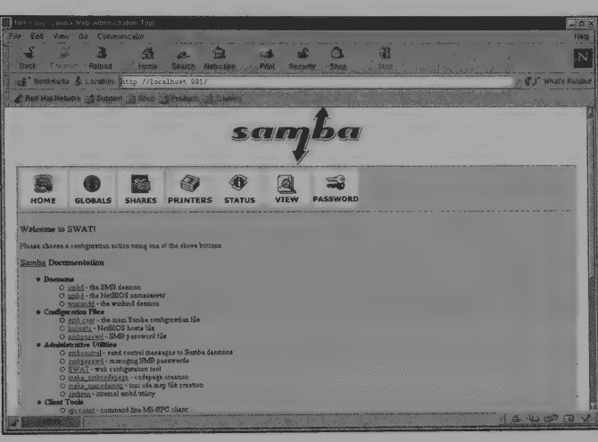

图 5-7 SWAT 的打开页面

> SWAT 会修改你的 `/etc/smb.conf`。它可能会删除你输入的注释行，或重新排列文件中的配置行。如果你曾手动编辑过 `/etc/smb.conf`，在使用 SWAT 之前，请以不同的名称为其创建一个备份副本。

SWAT 的巨大优势在于，你可以在配置的同时了解 Samba。如果你还没有这样做，你至少应该使用 SWAT 来检查（并可能修改）之前在小型示例 `smb.conf` 文件中列出的设置。除此之外，你可以查看 SWAT 页面以查看可用选项。通过选择页面顶部的按钮之一开始使用 SWAT。例如，你可以选择 `Globals`（全局）来更改全局服务器配置，或选择 `Home`（主目录）来设置主目录共享。会出现一个充满选项的页面。图 5-8 显示了全局选项页面。

## 第 5 章 配置文件共享服务

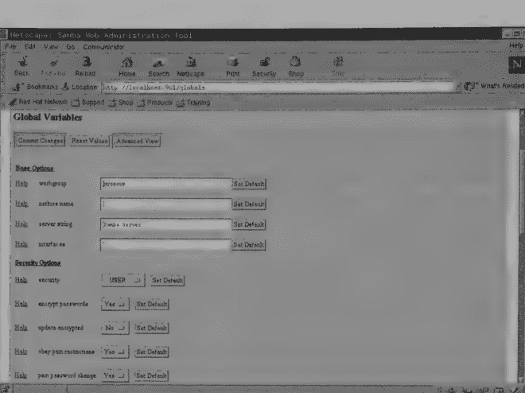

图 5-8 Samba 全局选项页面

你可以选择任何选项左侧的 `Help` 链接查看如何使用。每个 Samba 初始都包含了在典型配置中最可能需要的选项。检查所有这些选项，考虑你可能需要为服务器配置什么内容。在做出更改后，使用每个屏幕顶部的 `Commit Changes`（提交更改）按钮。当你准备好更深入地探索时，点击页面顶部的 `Advanced View`（高级视图）按钮（每个部分都有一个）以展开页面，列出可用选项，包括许多你可能永远不需要的选项。但通过查看它们，你可以学到很多知识！

你可以选择任何选项左侧的 `Help` 链接查看如何使用。每个 Samba 初始都包含了在典型配置中最可能需要的选项。检查所有这些选项，考虑你可能需要为服务器配置什么内容。在做出更改后，使用每个屏幕顶部的 `Commit Changes` 按钮。当你准备好更深入地探索时，点击页面顶部的 `Advanced View` 按钮（每个部分都有一个）以展开页面，列出可用选项，包括许多你可能永远不需要的选项。但通过查看它们，你可以学到很多知识！

> 提示 如果你好奇，可以探索 Global 部分高级视图中包含的 195 个选项中的一些。

在 SWAT 中，你通过页面顶部的 `Shares` 按钮创建新共享（你希望让客户端访问的目录）。`Status` 页面显示 `smbd` 和 `nmbd` 的状态。图 5-9 显示了此。

## Windows 文件与打印机的 Samba 集成

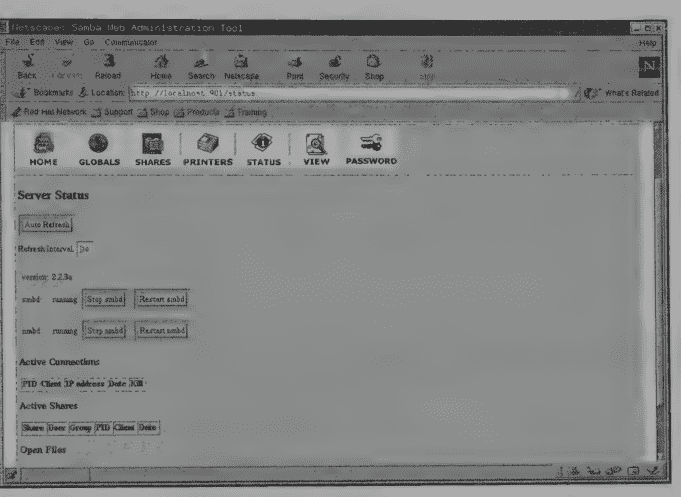

图 5-9 状态页面

`smbs` 命令让你查看某些状态。一个有用的练习是查看 Samba 包含的文件。

## 从 Windows 访问 Samba

一旦 Samba 服务器启动并运行，你就可以从 Windows 访问 Linux 文件和打印机。你需要正确的 Windows 配置以及有效的用户名和密码。尽管 Windows 网络可以使用各种协议（如 TCP/IP、IPX 等），但 Samba 使用 TCP/IP。要访问 Samba 服务器，你应该确保：

- 网络适配器：Windows 应该识别你的网卡以及有效的驱动程序。网卡列在配置框中。
- TCP/IP：你应该配置 TCP/IP 以获得有效的 IP 地址。
- NetBEUI：NetBEUI 协议在 Windows 上实现了 NetBIOS 功能。此协议和 TCP/IP 都可以通过 `Add` 按钮添加（在 Windows 中查看协议选项卡）。
- 必须安装 Microsoft 网络。同样，如果没有，你可以添加它。

从 Windows 桌面，你可以通过打开“网络邻域”（或“我的网络”）图标来访问 Samba 服务器。例如，在 Windows NT 4 中，你可能需要选择“查找”，然后在 Windows 菜单中搜索 Samba 服务器的名称，甚至是其 IP 地址，Windows 才能找到该服务器（这在你刚启动 Samba 时特别真实）。一旦有了服务器的图标，你可以双击它查看共享列表（在输入用户名和密码后）。然后双击共享以查看其内容。图 5-10 显示了在 Windows NT 上使用 Samba 服务器时的桌面。

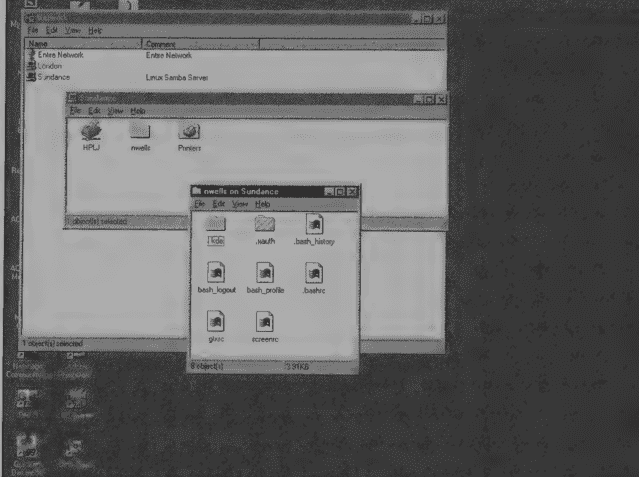

图 5-10 从 Windows 查看 Samba 服务器

## 章总结

- FTP 是一种广泛使用的 Internet 协议，设计用于从服务器向多个地地的客户端高效传输文件（包括大文件）。
- FTP 的匿名功能使其在公共下载存档非常受欢迎。可以配置匿名功能的许多特性来控制对 FTP 服务器的访问。
- 要访问 FTP 服务器，你可以使用文本模式客户端 `ftp`、图形化客户端（如 gFTP 或 IglooFTP）或 Web 浏览器。

## 第 251 章总结

- 你可以在 `ftpaccess` 中配置用户类，然后分配执行不同操作的权限，或者使用这些用户类定义其他类型的访问限制。
- 网络文件系统 (NFS) 允许你通过 `mount` 命令连接 NFS 服务器，将远程文件系统作为本地目录结构的一部分进行访问。许多选项可以控制客户端如何挂载 NFS 文件；这些选项通常放置在 `/etc/fstab` 文件中，以简化挂载和卸载操作。
- 一个 NFS 服务器由几个可能的守护进程组成；至少需要 `nfsd` 和 `rpc.mountd`。NFS 不由超级用户管理，而是使用 `mount` 程序配合远程过程调用 (rpc) 系统。
- NFS 服务器使用 `/etc/exports` 文件进行配置，该文件定义了哪些本地目录可供远程客户端挂载。`/etc/exports` 中的每一行还定义了哪些主机可以挂载该目录，以及服务器应如何配置它们的访问。这包括用户映射以及只读与读写访问等选项。
- NFS 容易出现安全漏洞，但它依赖于多层安全机制，包括客户端 `mount` 命令、`/etc/exports` 的配置，以及在 `/etc/hosts.allow` 和 `/etc/hosts.deny` 文件中使用 `portmap` 守护进程名称进行的任何限制。
- NetWare 网络操作系统可以在 Linux 上模拟为强大的文件和打印服务器。`mars_nwe` 包提供了这种能力，但仅支持旧的 NetWare 绑定，不支持较新的 N。
- `mars_nwe` NetWare 模拟器使用 `/etc/nwserv.conf` 文件进行配置。在使用此程序之前，你必须设置服务器名称和 `SYS` 卷等基本信息。
- Linux 可以通过 `npcs` 包作为客户端访问 NetWare 服务器，该包提供了许多命令行工具来管理和访问 NetWare 服务器，包括 `ncmount` 命令允许 NetWare 卷成为本地 Linux 目录结构的一部分。
- 使用 NetBIOS 和 SMB（也称为 CIFS）协议的 Windows 网络，这两者均在 Linux 的 Samba 套件中实现。
- 使用 Samba 客户端工具 `smbclient` 并挂载 `smbfs` 类型的 Windows 文件系统可以方便地访问共享资源。大多数现代 Linux 打印机管理工具还允许你使用 `smprint` 工具自动打印到 Windows 打印机。
- `smb.conf` 中的简单 Samba 服务器配置涉及定义服务器名称、基本安全选项以及共享。Samba 共享在 Windows 中就像任何 Windows 服务器一样被查看。

## 第 5 章 配置文件共享服务

- SWAT 为 Samba 提供了图形化配置和管理功能。尽管在跨网络使用时并不安全，但 SWAT 让人们更容易通过在线帮助了解更多 Samba 并列出所有可用选项。
- 支持多种 Samba 安全模型，包括 Windows NT 域和来宾账户，后者通常将 Samba 作为专用打印服务器。

## 关键术语

**nwclient** — 由 `nepfs` 包用于客户端访问 NetWare 服务器的配置文件。

**anonymous FTP (匿名 FTP)** —— 使用 FTP 通过通用用户名进行公共访问，而无需在 FTP 服务器上有特定的用户账户。

**anonymous user home directory (匿名用户主目录)** —— Linux 上匿名 FTP 用户下载或上传文件的目录。通常为 `/var/ftp` 或 `/home ftp`。

**anonymous users (匿名用户)** —— 登录 FTP 服务器但没有普通 Linux 用户账户的用户，被限制在文件系统的特定区域。见匿名 FTP。

**bindery** — 存储在 NetWare 服务器上的系统资源数据库。NetWare 3 之后的版本使用较新的 Novell Directory Service (NDS)。见 Bindery Emulation。

**Bindery Emulation (bindery 模拟)** — NetWare 4 及以上版本使用的一种系统，当操作系统实际上使用 NDS 时用于模拟 bindery。

**classes of users (用户类)** — 在 FTP 服务器配置中定义潜在 FTP 客户端组的做法，以辅助服务器配置。

**Common Internet File System (CIFS)(通用互联网文件系统)** —— SMB 协议的最新扩展版本，被近期的微软操作系统使用，并通过 Samba 套件提供给 Linux。

**exportsfs** — 用于激活 `/etc/exports`内容的命令。

**exports** — `/etc/exports` 配置文件，定义了 NFS 可以向其他主机提供的文件系统。

**File Transfer Protocol (FTP)(文件传输协议)** —— 一种用于在网络计算机系统之间共享文件的协议。

**ftp** — 访问 FTP 服务器最常用的文本客户端程序。

**ftpasspass** — 局域 FTP 服务器主配置文件。

**ftpshut** — 导致 FTP 服务器停止允许连接的命令。

**ftpusers** — FTP 服务器配置文件，列出了不允许通过 FTP 登录的用户账户。

**gFTP** — 一种图形化 FTP 客户端。在许多 Linux 系统上默认安装。

**guest users (来宾用户)** — 登录 FTP 服务器并拥有普通 Linux 用户账户但在登录 FTP 期间的操作受限的用户。

## 关键术语 253

**hard mount (硬挂载)** — 挂载 NFS 文件系统的方法，会导致 NFS 无限等待 NFS 服务器的响应。

**IglooFTP** — 一个流行的图形化 FTP 客户端。

**map** — 在 NFS 客户端上的用户 ID 与 NFS 服务器上的用户权限之间建立对应关系。

**mars-nwe** — Martin Stovers NetWare 模拟器包；为 Linux 提供的提供 NetWare 服务器功能的软件。

**ncftp** — 一种与 `ftp` 类似的文本 FTP 客户端程序，但更更新、更精炼。

**ncpfs** — 一个实现 NCP 的 Linux 软件包，并提供了许多 NetWare 客户端工具。

**NetBEUI** — 一种用于局域网的网络层协议。

**NetBIOS** — Windows 系统的名称解析服务，功能类似于 DNS 服务器。Samba 套件可以作为 NetBIOS 服务器或客户端。

**NetWare** — Novell 的一种操作系统，提供文件和打印服务。

**Network File System (NFS)(网络文件系统)** — 一种用于网络共享文件系统的协议。

**NetWare Core Protocol (NCP)(NetWare 核心协议)** — NetWare 用于传输的协议。

**Novell Directory Service (NDS)** — NetWare 使用资源目录。

**portmap** — 监听 r 能力的程序。

**remote procedure call (rpc)(远程过程调用)** — 允许程序在网络上进行通信的系统。

**rpc.mountd** — NFS 的一部分守护进程。

**Samba** — 用于 Linux 和许多 UNIX 系统的程序包，支持 SMB、CIFS 和 NetBIOS 等协议。

**Server Message Block (SMB)** — Windows 系统用于文件和打印的传输协议。

**share** — 网络共享资源。

**smbclient** — 提供访问 Windows 主机或 Samba 服务器的工具。Samba 套件的一部分。

**smbd** — Samba 套件中为 Linux 提供 SMB 能力的守护进程。

**smbfs** — 使用 `mount` 命令挂载 Windows 共享的文件系统标识。

**smprint** — Samba 套件中的命令，允许打印到 Windows 打印机。

**soft mount (软挂载)** — 挂载 NFS 文件系统的方法，会导致 NFS 在等待指定时间后放弃操作。

**squashing** — NFS 服务器的一种安全概念，防止用户仅通过在 NFS 客户端具有相同的用户 ID 就获得访问服务器文件系统的权限。

**SWAT** — 用于设置和管理 SMB 服务器的基于浏览器的图形化配置界面。

**swery** — （见上）

**volume** — NetWare 中的存储单位，等同于 Linux 中的文件系统。

**WINS** — Windows 命名服务的缩写，Windows 系统的主机定位服务，功能类似于 DNS 服务器。Samba 套件可以作为 WINS 服务器或客户端。

## 第 5 章 配置文件共享服务

## 复习题

1. 描述 FTP 的目的与 HTTP 和 SMTP 目的的区别。
2. 哪一个不是 FTP 客户端程序？
   a. gftp
   b. ftp
   c. wu-ftpd
   d. ncftp

## 复习题 255

3. 在标准 FTP 客户端程序中，你使用 `prompt` 命令是为了：
   a. 在使用 `mget` 下载一组文件之前防止系统出现确认提示
   b. 当你即将超过时间限制或下载大小限制时，让服务器向你发出提示
   c. 关闭对新用户的帮助屏幕提示
   d. 更改工具内部默认命令行提示符的格式

4. 哪一个是是格式正确的 URL，用于标准 Web 浏览器中访问 FTP 站点？
   a. http://nwells@ftp.my.place/
   b. ftp://nwells@ftp.in_ftp/
   c. ftp://nwells@ftp.my.place/
   d. http://ftp.my.place/

5. 假设 FTP 服务器运行在独立模式下，哪一个文件列出了不允许访问 FTP 服务器的用户账户？
   a. /etc/ftpusers
   b. /etc/hosts.deny
   c. /etc/shutdown.msg
   d. /var/ftp/pub/ftpusers

6. 描述在配置 FTP 服务器时真实用户（real user）与访客用户（guest user）之间的区别。

7. 在 /etc/ftpaccess 的 `banner` 指令后给出文件名将：
   a. 让 FTP 服务器在登录后提醒用户该文件的存在
   b. 在登录前向客户端显示文件内容
   c. 在登录后向客户端显示文件内容
   d. 在进入 /etc 目录时向客户端显示文件内容

8. 哪一个不使用 rpc？
   a. NFS
   b. r-utilities
   c. portmap
   d. FTP

9. Linux 上的两个主要的 NFS 守护进程是：

10. 哪一个是 `fstab` 中有效的行，用于配置在 rome 上挂载 NFS 文件系统？
    a. rome:/home/public /mnt/rome rsize=8192,wsize=8192,rw,noauto 0 0
    b. rome:/home/public /nfs/rome rsize=8192,wsize=8192,rw,noauto 0 0
    c. rome:/home/public /mnt/rome rpc rsize=8192,wsize=8192,nfs 0 0
    d. rome:/home/public /mnt/rome nfs rsize=8192,wsize=8192,rw,noauto 0 0
    e. nfs:/home/public /mnt/rome nfs rsize=8192,wsize=8192,rw,noauto 0 0

11. 为什么 root squashing（root 压缩）是 NFS 服务器上的默认操作？

12. 哪一个是 /etc/exports 中格式有效的配置行？
    a. (ro,all_squash) /pub
    b. portmap o=ro,all_squash
    c. /pub host1(ro,all_squash)
    d. /pub host1=ro,all_squash

13. 如何配置 inetd 或 xinetd 来管理哪些主机可以访问 NFS 服务器？
    a. 不是这样的。NFS 使用的是 portmap 而不是超服务器（superserver），尽管 /etc/hosts.allow 和 /etc/hosts.deny 仍然会被检查。
    b. 不是这样的。NFS 使用 /etc/fstab 特定主机配置来控制主机访问。
    c. 通过在 /etc/hosts.allow 和 /etc/hosts.deny 中为 nfsd 守护进程设置适当的主机定义。
    d. 通过 /etc/xinetd.d 中 nfs 文件中的 xinetd 参数。

14. NetWare 服务器使用的传输协议是哪一个？
    a. mars-nwe
    b. NCP
    c. NetBEUI
    d. NDS

15. Linux 中的 NetWare 客户端和服务器功能分别由 ____________________ 提供。
    a. mars-nwe, ncpfs
    b. ncpfs, mars-nwe
    c. ndsfs, mars-nwe
    d. RIP, SAP

16. Linux 上的 NetWare 服务器模拟器配置在文件中：
    a. nwserv.conf
    b. nwbind.conf
    c. ncp.conf
    d. nds.conf

17. Samba 套件可以在 Windows 网络上充当 WINS 服务器，这对于仅限 Linux 的网络大致相当于 ____________________ 服务器。
    a. SMB
    b. NetBEUI
    c. FTP
    d. DNS

18. 哪个选项仅包含 Samba 套件支持的协议？
    a. CIFS, SMB, NetBIOS
    b. CIFS, SMB, DNS
    c. SMBD, NMBD
    d. SMB, SWAT, NCP

19. smbclient 程序与本章中的哪一个程序最相似？
    a. exportfs
    b. ftpshut
    c. ftp
    d. gFTP

20. 要查看 SMB 服务器上可用的文件和打印机共享列表，你需要在命令的 ____________________ 参数中包含该服务器名。
    a. -S, smbfs
    b. -L, smclient
    c. -S, smbclient
    d. -W, smbprint

## 第 5 章 配置文件共享服务

21. 要将 Windows 共享挂载为 Linux 文件系统的一部分，你：
    a. 使用 `mount` 命令并将 `-t` 参数设置为 smbfs。
    b. 依赖图形化工具进行方便的访问。
    c. 使用 smbclient 下载所需的文件。
    d. 确保 smbpasswd 文件已正确配置。

22. SMB 服务器中哪种安全模型与 FTP 最相似？
    a. server
    b. share
    c. user
    d. domain

23. 使用 Samba 跨网络配置时主要关注的问题是什么？

24. 从 Samba 的哪一页可以重启 smbd 和 nmbd 守护进程？
    a. Global
    b. Shares
    c. Home
    d. Status

25. 哪个选项正确列出了运行在 Linux 上的 Samba 服务器时必须安装的组件？
    a. Client for Microsoft Networks, NetBEUI, TCP/IP
    b. Client for Microsoft Networks, NetBIOS, SMB
    c. NetBEUI, SMB, TCP/IP
    d. SMB, TCP/IP, WINS

## 实验

### 项目 5-1

在这个项目中你将实验 ftp 客户端。步骤描述了 Red Hat Linux 7.3 的操作，但对于任何使用 wu-ftp 作为 FTP 服务器的 Linux 发行版都是类似的。ftp 程序在不同发行版间有所不同。注意，如果在安装 Linux 时使用了高安全设置或设置了防火墙，该操作可能无效。如果你在一个安全的实验环境中，可以以 root 身份执行以下命令删除系统上的所有防火墙规则，并将所有防火墙策略设置为 ACCEPT：

```


# 第 5 章：配置文件共享服务

## 项目 5-1

```bash
iptables -F
iptables -P input ACCEPT
iptables -P forward ACCEPT
iptables -P output ACCEPT
```

对于此项目你应该协作进行；一台 Linux 指定为 FTP 服务器，另一台作为 FTP 客户端。你应该拥有 FTP 服务器系统的 root 权限。

1. 在服务器上，使用此命令为匿名 FTP 创建目录：`cp -r /usr/share/doc/ftp/* /var/ftp/pub`
2. 在服务器上，使用文本编辑器打开 `/etc/ftpaccess` 文件，并将 `passwd-check` 指令从 `warn` 改为 `enforce`。它看起来应该是这样的：
   `passwd-check enforce`
3. 通过编辑 `/etc/inetd.conf` 启用 FTP 服务器（如果你使用的是使用 inetd 的 Linux 版本，请编辑 `/etc/inetd.conf` 中的 service 行）。
4. 需要重启某些内容才能生效吗？为什么？
5. 在客户端 Linux 系统上，使用 `ftp` 命令使用服务器名称登录。当提示用户名时输入 `ftp`。
6. 当提示密码时，再次输入你的用户名，而不是邮箱地址。
7. 描述发生了什么。
8. 使用 `quit` 命令退出 FTP 客户端，然后按照第 5 步再次启动。
9. 此时使用用户名 `anonymous`（相当于用户名 `ftp`）。
10. 提示时，输入你的邮箱地址作为密码。
11. 输入 `help` 命令查看 ftp 命令列表。你在之前的 Linux 命令行工作中识别出哪些？
12. 选择一个你以前没过的命令并使用 `help` 命令查看描述。例如，如果你想学习 `mdelete` 命令，输入：`help mdelete`
13. 进入服务器上的 `/pub/txt` 目录（假设你已经从第 1 步的 ftp 目录复制了文件）：`cd pub/txt`
14. 列出目录中的文件。
15. 选择一个文件并使用 `rename` 命令重命名。
16. 为什么你不能？如何让匿名用户能够这样做？重试。
17. 退出客户端。
18. 在服务器上，使用 `tail` 命令查看传输日志的最后几行。看到了什么？
19. 同样在服务器上，使用 `tail` 命令查看系统日志 `/var/log/messages` 的最后几行。看到了什么？这与你完成的步骤有什么关系？

## 项目 5-2

在这个项目中你继续实验 FTP。步骤描述了 Red Hat Linux 7.3 的操作，但对于任何使用 wu-ftp 作为 FTP 服务器的 Linux 发行版都是类似的。要完成此项目，你应该已经安装了 FTP 服务器和客户端程序，并完成了项目 5-1，使得 `/var/ftp/pub` 目录下有一组文件。注意，如果在安装 Linux 时使用了高安全设置或设置了防火墙，该操作可能无效。如果你在一个安全的实验环境中，可以以 root 身份执行以下命令删除系统上的所有防火墙规则，并将所有防火墙策略设置为 ACCEPT：

```bash
iptables -F
iptables -P input ACCEPT
iptables -P forward ACCEPT
iptables -P output ACCEPT
```

此项目你应该协作进行；一台 Linux 指定为 FTP 服务器，另一台作为 FTP 客户端。你应该拥有 FTP 服务器系统的 root 权限。

1. 在服务器上，在 ftppass 文件中添加以下行：
   `data-limit raw total 10000`
2. 搜索 ftppass 的主页以确定指令后 `raw` 关键字的含义。
3. 保存 ftppass 文件。需要重启某些内容才能生效吗？
4. 在客户端上，创建一个临时目录并进入其中：
   ```bash
   mkdir ~temp
   cd ~temp
   ```
5. 使用匿名用户登录 FTP 服务器。
6. 进入服务器上的 `/pub/txt` 目录。
7. 使用 `prompt` 和 `mget` 命令下载 txt 目录的所有内容。你成功了吗？

设计一个测试，以确定一旦你开始传输文件，如果该传输超过了 FTP 服务器上的数据限制设置，你是否仍能完成传输。你可以决定从服务器的某处复制一个较大的文件到 `/var/ftp/pup` 目录以进行此实验。

假设你注意到匿名 FTP 用户同时登录多次，以便同时从你的 FTP 服务器下载许多 Linux 文件。这意味着某个人正在使用你允许的有限数量连接中的几个连接，并正在“占用带宽”。查阅手册页（man page），找到限制每个主机仅允许单个并发连接（或指定数量的连接）到你的 FTP 服务器的指令。

## 项目 5-3

在这个项目中，你将对 NFS 协议进行实验。步骤描述了 Red Hat Linux 7.3 的操作，但对于任何 Linux 发行版，这些步骤也基本相同。要完成此项目，你应该已经安装了 NFS 守护进程。请注意，如果你在安装 Linux 时使用了高安全设置，或者其他设置了防火墙，该步骤可能无法运行。如果你处于安全的实验室环境中，可以执行以下命令删除系统上的所有防火墙规则，并将所有默认策略设置为 ACCEPT：

```bash
ipchains -F
ipchains -P input ACCEPT
ipchains -P forward ACCEPT
ipchains -P output ACCEPT
```

对于此项目，你应该以团队形式工作；一台 Linux 系统应指定为 NFS 服务器，另一个指定为 NFS 客户端。你应该拥有这两个系统的 root 权限。

1. 在服务器上，编辑 `/etc/exports` 文件并添加以下行，将 `client_host` 替换为你客户端系统的主机：
   > `/usr/share/doc client_host(all_squash,rw)`
2. 同样在服务器上，编辑 `/etc/hosts.deny` 文件并添加此行：
   > `portmap client_host`
3. 需要采取哪些步骤来激活这两个更改？（例如：portmap, TCP Wrappers, nfsd, nfslock, xinetd...）
4. 在客户端上，以 root 身份登录并为 NFS 服务器创建一个挂载点目录。示例下：
   ```bash
   mkdir /mnt/server_hostname
   ```
5. 在客户端上编辑 `/etc/fstab` 文件并添加此行：
   > `server_hostname:/usr/share/doc /mnt/server_hostname nfs o=ro, rsize=8192,wsize=8192 0 0`

### 配置文件共享服务

1. 在客户端上使用 `mount` 命令挂载导出的 NFS 文件系统：
   ```bash
   mount /mnt/server_hostname
   ```
2. 为什么不起作用？
3. 在服务器上，编辑 `/etc/hosts.deny` 并删除你添加的内容。
4. 在客户端上再次尝试 `mount` 命令。
5. 切换到你创建的挂载点目录。
6. 注意该目录在服务器上是以 rw 导出的，在该目录下创建一个新目录：
   ```bash
   mkdir mydocs
   ```
7. 说出三个不起作用的理由。

## 项目 5-4

在这个项目中，你将尝试使用 Samba 进行打印实验。步骤描述了 Red Hat Linux 7.3 的操作，但对于任何安装了标准 Linux 发行版的系统，这些步骤也基本相同。要完成此项目，你应该已经安装并运行了 lpd，按照章节正文描述安装了 Samba 软件包，并且足够熟悉章节材料以让 Samba 作为服务器运行。

对于此项目，你以团队形式工作；一台 Linux 系统应指定为 Samba 服务器，另一个指定为 Samba 客户端。你的团队应该拥有这两个系统的 root 权限。

1. 在服务器上，使用打印机配置工具设置本地 Linux 打印机定义。简单的方法是使用 `printconf-gui` 程序，选择 New，选择 LOCAL 打印机类型，并输入名称 `printer1` 以识别该打印机。即使你的 Linux 系统上可能没有连接物理打印机，也请完成此步骤。
2. 同样在服务器上，停止 lpd 尝试将队列到新打印机定义作业发送到物理打印机（以防不存在）。使用 `lpc` 命令，如下：
   ```bash
   lpc stop printer1
   ```
3. 在服务器上，使用章节正文中所示的基础 Samba 配置文件或类似的设置，让 Samba 服务器运行起来。确保你有一个 `[sections]`。为此项目至少创建一个用户账户并分配一个密码。如果你倾向于手动编辑文件，可以使用 SWAT。
4. 在客户端系统上，使用 `printconf-gui` 实用程序定义一个 SMB 打印机。将 SMB 打印机定义名为 `printer2`。指定 `printer1` 为 Samba 服务器上的远程打印机名称；使用你运行 Samba 服务器时使用的用户名、密码、工作组等。
5. 在客户端系统上，使用 `lpr` 命令将文本文件打印到你定义的 `printer2` SMB 服务器上。如果你愿意，可以使用带有打印功能的图形化工具，但许多 Linux 图形程序不会列出可用的打印机，因此使用如下命令从命令行打印可能更简单：
   ```bash
   lpr -P printer2 /etc/termcap
   ```
6. 回到服务器，使用 `lpq` 命令查看你定义的 `printer1` 队列内容。命令如下：
   ```bash
   lpq -P printer1
   ```
7. 如果队列不为空，使用命令删除作业。

## 项目 5-5

在这个项目中，你将对 Samba 进行实验。步骤描述了 Red Hat Linux 7.3 的操作，但对于任何安装了标准 Linux 发行版的系统，这些步骤也基本相同。要完成此项目，你应该已经安装并运行了 lpd，按照章节正文描述安装了 Samba 软件包，并且足够熟悉章节材料以让 Samba 作为服务器运行。

对于此项目，你以团队形式工作；一台 Linux 系统应指定为 Samba 服务器，另一个指定为 Samba 客户端。你的团队应该拥有这两个系统的 root 权限。

1. 他们根据当前的连接性和安全考虑，提供了以下设置 FTP 服务器的规则：
   a. 报告较小，但他们认为不应允许在一个会话中下载超过 10 MB。
   b. 匿名访问应限制为会话 30 分钟。
   c. 他们一直面临来自 no.law.org 域的用户，你应该阻止对该域的所有访问。

   编写实现这些服务的 ftpaccess 行。你需要参考 `ftpaccess` 手册页以获取正确的指令和格式。不要包含整个 ftpaccess 文件，仅包含你需要的行。

   ```bash
   file-limit out 10 all
   data-limit out 1000000 all
   limit-time anonymous 30
   deny no.law.org /etc/deny.msg
   ```

2. Island Associates 还希望所有 15 名员工都能访问发布在 FTP 服务器上的报告。他们应该能够作为本地文件系统的一部分查看它们，而不是通过 FTP 下载。这防止了每个报告有 15 份副本，以免在报告更新时个人拥有不同的版本。办公室包括一台托管 FTP 服务器的中央 Linux 服务器和几个网络。服务器是 island.net。办公室每个用户的桌子上都有一台 Windows PC。假设这些 Windows PC 之前的配置具有 NFS 客户端功能。编写 `/etc/exports` 配置行，允许用户挂载/访问 Linux 服务器上的报告。鉴于报告位于用于匿名 FTP 访问的同一服务器，还要编写 `/etc/hosts.allow` 和 `/etc/hosts.deny` 的配置以限制对服务器的 NFS 访问。你是否将所有报告放在同一个目录中？你是否使用了与匿名 FTP 下载相同的目录？

   为什么？你认为如果 Windows 客户端没有预装 NFS 客户端，你会使用 NFS 吗？为什么？如果不会，你会用什么来代替？

3. Island Associates 还请求你帮助他们建立一个小型 FTP 服务器，用于处理来自其库克群岛拉罗塔加（Rarotonga）办事处的报告。由于这是一个资源有限的小型服务器，你决定对拉罗塔加服务器进行审查。你正在考虑一种可能结合多种协议的方案，并可能使用 Java 或类似技术提供服务器的远程管理（因为库克群岛距离你的办公室有很长的路程）。在 www.sourceforge.net 或你喜欢的其他 Linux 资源网站上查找 FTP 服务器，并写一份简短报告（1/2 到 1 页），介绍三个提供 FTP 服务器功能且值得作为该项目选择进行审查的程序。包括每个程序的优点和风险。

# 第 6 章
## 配置主要网络服务

阅读完本章并完成练习后，你将能够：
- 扩展你的 Linux 服务器的路由能力
- 设置你自己的 DNS 域名服务器
- 配置基础电子邮件服务器
- 理解 Linux 如何作为 Web 服务器表现出色

在本章中，你继续探索 Linux 系统上常用的网络服务。上一章侧重于文件共享服务。本章的重点是经常使用专用 Linux 服务器的服务：路由、DNS、电子邮件和 Web。

在章的第一部分，你将学习如何创建一个带有动态路由表的 Linux 路由器，这是基于你在第 1 章和第 2 章中学到的概念。你还将学习在 Linux 上设置 DNS 服务器，这样你无需求助于互联网上的其他 DNS 服务器即可解析域名。

本章的第二部分致力于电子邮件服务器和 Web 服务器的配置。电子邮件服务器没有 Web 服务器普及，但它是互联网信息共享的关键部分；这里的讨论将帮助你完成基础配置。Linux 作为 Web 服务器平台有着悠久的传统；你将学习如何设置基础 Web 服务器，并探索用于扩展 Linux 上 Web 服务器功能的许多其他可用技术。

## 使用路由协议实现动态路由

在第 2 章中，你学习了如何使用 `route` 命令在 Linux 内核中配置路由。你了解到路由表中的每个条目都包含以下元素：

- 路由表条目适用于目标网络或主机；即通过该条目中的信息可以到达的网络或主机。
- 计算目标地址时使用的网络掩码。
- 下一跳路由器的地址，或更简单地说，发往目标网络或主机的数据包发送到的系统。（“跳”指的是通过路由器到达最终目的地。）
- 将数据包发送到目标网络或主机的网络接口。例如，如果安装了三块以太网和一个拨号连接，路由条目的这部分将为路由表中的每个条目指定这些接口之一。

运行在特定主机上的 Linux 内核在数据包到达主机的 MAC 地址（网卡的物理地址）但属于另一个主机的 IP 地址时会使用路由表中的信息。只要启用转发，Linux 就会将数据包路由到下一跳路由器，直到它们到达目的地。

为止描述的路由是静态路由。你 Linux 内核中的路由表是由启动脚本中的条目汇总的，或者通过 `route` 命令更新或修改路由表来完成的。这对于小型、可靠的网络是简单且有效的，但对于较大的网络和有时不可靠的连接，静态路由不是最佳选择。在大多数路由情况下，都会使用动态路由。

动态路由是通过专门的路由协议，根据路由器共享的信息在网络中自动构建和修改路由表的过程，而不需要持续的人工干预。

为了理解动态路由的价值，考虑图 6-1 所示的网络配置。主机 Abe 想要访问主机 Bill。如果使用静态路由，路由器 1 将有一个条目，指示直接连接路由器 2 的以太网卡是到达主机 Bill 的正确路径。然而，如果路由器 1 和路由器 2 之间的网络连接发生故障——例如电话连接断了，或有人在机房里拔掉了错误的网线——主机 Abe 将无法访问主机 Bill，即使通过路由器 3 和路由器 4 可以到达主机 Bill。使用静态路由，路由器 1 无法发现这一点；系统管理员需要检查线路，确定备用路由并在命令行中输入信息。稍后，当问题解决后，则需要在路由器 1 的路由表中重新输入直接指向路由器 2 的原始路由，以保持网络尽可能高效地运行。

### 使用路由协议的动态路由

主机 Abe
主机 Bill
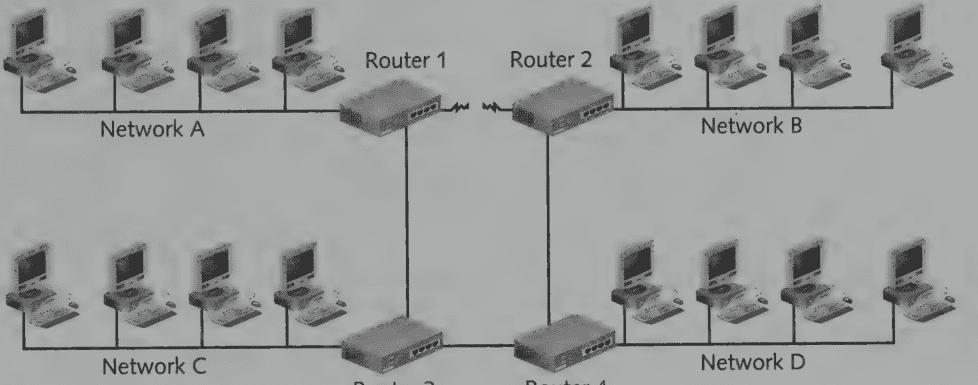

路由器 1
路由器 2
网络 A
网络 B
网络 C
路由器 3
路由器 4
网络 D

图 6-1 动态路由的性

另一方面，如果图 6-1 中的所有四个路由器都使用路由协议，它们将经常交换关于它们能够到达的网络信息。在不到一分钟内，路由器 3 就会通知路由器 1，发往网络 A 的包应该发送给它，通过路由器 4 然后到达路由器 1。即使在网络内部，也使用动态路由来适应变化。

动态路由协议分为两种：内部和外部。

- **内部路由协议**用于单个自治系统（AS）内部。
- **外部路由协议**用于不同自治系统之间的路由。

最常见的内部路由协议是最短路径优先（OSPF）。最常见的外部路由协议是边界网关协议（BGP）。

### 路由信息协议（RIP）和 routed

RIP 是一种内部路由协议，仍在使用的最古老路由协议。它的用途限于小型网络或不复杂的路由。除了 RIP 版本 2 外，RIP 不支持无类地址，并且只能处理 15 跳。

RIP 将最佳路由定义为到目的地的跳数最少的路由。当 RIP 在主机上（我们称之为路由器 1）启动时，它会广播路由请求。任何接收广播并运行 RIP 的路由器都会通过将其路由表中的所有条目发送给路由器 1 来响应。路由器 1 使用一系列简单规则填充路由表：

- 如果条目指向的网络不在表中，则添加该路由。
- 如果到达某个网络的成本（跳数）小于另一个路由，路由器 1 将丢弃现有路由并替换为新收到的路由。（路由成本是衡量效率的指标；在相等的情况下，应始终选择成本最低的。）
- 如果路由器 1 收到成本为 15 的路由，则假设该路由不可用并从路由器 1 的路由表中删除。

RIP 在 Linux 中通过 `routed` 守护进程实现，大多数 Linux 发行版都包含它。Red Hat Linux 7.3 中默认不安装，但你可以从 CD 3 找到 routed 包。安装包后，使用 `/etc/rc.d/init.d` 中的脚本启动 `routed`，或直接使用命令启动：

```bash
/usr/sbin/routed
```


`routed` 进程立即开始广播路由请求并汇总路由表条目。`Routed` 需要命令行参数，不需要配置文件。如果你选择，可以创建一个 `/etc/gateways` 文件。

## 使用路由协议进行动态路由

这为 `routed` 进程提供了初始设置。文件中的每一行都包含一个路由表条目，如下例所示：

```
net 192.160.14.0 gateway 172.14.88 metric 1 passive
```

`net` 和 `gateway` 指用于访问该网络的网络 ID 和网关。`metric` 是该路由的初始“跳数”值。最后一个单词表示此处命名为 `172.14.88.12` 的路由器不参与 RIP 交换，这可能是因为它正在运行不同的路由协议。如果你指的是另一个基于 RIP 的路由器，你应该使用单词 `active` 来替它。

`routed` 守护进程很容易配置，然而，对于大多数在 Linux 网络上维护路由器的网络管理员来说，由于 RIP 的局限性，它对于较大的网络来说并不是一个强力的解决方案。如上文 `/gateways` 示例所示，甚至没有提供网络掩码，因此使用无类 IP 寻址（这非常常见）来正确路由路由信息是不常见的。使用 RIP 版本 2 解决了这个问题，但更大的答案在于使用其他路由协议。

## 开放最短路径优先协议 (OSPF) 和 gated

开放最短路径优先 (OSPF) 协议是一种内部路由协议，设计用于在大型网络中也能有效工作。OSPF 使用了一种名为“泛洪”的技术。OSPF 路由器定期向网络泛洪它关于其邻居的所有信息。其他 OSPF 路由器看到来自其他路由器的信息，并使用这些数据在路由器内部智能地构建一张“图表”，定义到达各种网络的最佳路径，就像 OSPF 试图让每个路由器都了解远端网络的脉搏，以便 OSPF 决定使用哪条路由来实现从 A 点到 B 点的最有效连接。为了构建虚拟连接图，OSPF 使用了一种名为 Dijkstra 最短路径优先算法的数学技术。OSPF 是一个开放协议（所有人都可以使用），它使用了最短路径优先算法，这也是该路由协议的由来。

OSPF 和 RIP 一样使用指标（metric），但在 OSPF 中，指标指的是通往同一网络的其他路由。OSPF 对数据包到达目的地之前可以经过多少路由器没有预定义的限制。OSPF 还允许你定义身份验证参数以控制接受哪些路由器的路由数据，并允许根据能力对你网络上的不同路由器分配优先级（这意味着你可以将最多的数据包发送到可用最快连接上最强大的路由器）。很少有 Linux 网络管理员需要使用 OSPF。OSPF 的大型全国网络通常在专用硬件（如思科系统）上生成。尽管如此，Linux 确实通过 `gated` 守护进程支持 OSPF，它包含在许多 Linux 发行版中，包括 Red Hat 7.3（在 CD 2 上）。它不是默认安装的，因为它并不经常需要。

`gated` 守护进程是一个强大的工具，支持多种路由协议，并结合这些协议提供的路由信息做出最智能的路由决策。`gated` 守护进程的主页是 www.gateway.org。在安装它的 rpm 后，你可以通过查看 `/usr/share/doc/gated-3.6` 提供的文档了解更多关于 `gated` 的信息。`gated` 支持 RIP（包括 RIP 版本 2）、OSPF（如上所述）以及外部路由协议边界网关协议 (BGP)。

BGP 设计用于主要国家网络之间的路由。BGP 的初始配置并不难——也就是说，配置文件并不长——但在这一层，管理数据包路由变得非常复杂。事实上，一些最专业（且薪水最高）的互联网焦点人员有时会专注于维护路由器高效运行这种枯燥的任务上。

> 对于 BGP，你必须有一个自治系统编号（AS Number）来向与你交换信息的其他人标识你的组织。这个数字包含在 `gated` 的配置文件中。从互联网分配名称机构 (IANA) 获取此数字。要了解更多信息，请访问 www.iana.org，选择协议编号分配服务，并向下滚动到自治系统编号部分，该部分标记为“AS Numbers (RFC 1930)”。

你使用 `/etc/gated.conf` 配置 `gated`。其格式与其他配置文件类似，每个节用于你想要支持的每种协议，并用大括号包含该协议的选项。要让 `gated` 只运行 RIP（而不运行 OSPF 或 BGP），请使用类似如下示例的简单 `/etc/gated.conf` 配置文件：

```
rip yes {
    broadcast;
    interface 192.168.10.3
    version 2
    multicast
    authentication simple "noSecrets";
}
```

此文件导致 `gated` 使用 RIP 版本 2，它支持无类 IP 地址。`broadcast` 关键字表示路由器应该主动广播它所知的路由——它应该与网络上其他具有 RIP 能力的路由器参与传播 RIP 信息。`interface` 行使用该接口的 IP 地址定义网络接口。对于该接口，`multicast` 指如何将信息发回请求信息的其他 RIP 路由器。`simple authentication` 行定义了识别公共网络上路由器的基本方案。完整的 `gated` 文档提供了许多其他示例和提示。

### 表 6-1 常用路由协议

| 协议 | 守护进程 | 注释 |
| --- | --- | --- |
| 路由信息协议 (RIP) | `routed` 或 `gated` | 最基本的内部路由协议；由于不支持类 IP 地址，用途有限 |
| 路由信息协议 (RIP) 版本 2 | `routed` 或 `gated` | 小网络的常用路由协议；支持类 IP 地址但扩展性不佳（对于大型网络） |
| 开放最短路径优先协议 (OSPF) | `gated` | 内部路由的最佳选择；可扩展；通过泛洪分发信息 |
| 边界网关协议 (BGP) | `gated` | 广泛使用的外部路由协议，用于组织之间的路由 |

## 设置 DNS 服务器

在第 3 章中你将学习如何设置 DNS 服务器。DNS 对互联网至关重要。每当人在 Web 浏览器中输入 URL 时，DNS 系统会将名称转换为 IP 地址。理解 DNS 功能并设置你自己的 DNS 服务器 DNS 中的信息可以被视为倒层次树，如图 6-2 所示。树的最顶端是根，由点表示。更常见的是你会看到顶级域名如 `.org`、`.com`、`.edu` 和 `.net`。

### 图 6-2 DNS 的结构

以下步骤概述了主机上的解析器如何将域名转换为 IP 地址。注意每个 DNS 服务器都会缓存或存储它学到的每个域名到 IP 地址的解析。在本例中，我们将解析域名 `alpha.nasa.gov`。

1. 客户端上的解析器查询 `/etc/resolv.conf` 文件配置的 DNS 服务器（称之为 DNS 服务器 A）。如果客户端无法访问 `/etc/resolv.conf` 中列出的任何名称服务器，客户端将放弃且无法解析名称。
2. DNS 服务器 A 接收来自客户端的查询并检查其数据库（存储在 DNS 服务器上，你很快就会看到）以及它之前并缓存在内存中的域名。在任何地方找到请求的域名，它查看其根服务器列表（存储在内存中，但来自下面的 DNS 服务器配置文件）并向其中一个发送查询。
3. 根服务器接收查询并检查其缓存。发现它没有请求的域名，它对 DNS 服务器 A 说，类似于：“我不知道 `alpha.nasa.gov` 的 IP 地址，但我知道 `.gov` 域的 DNS 服务器。去那里问吧”
4. DNS 服务器 A 然后向 `.gov` DNS 服务器提相同的问题。`.gov` DNS 服务器回答道，类似于：“我不知道 `alpha.nasa.gov` 的 IP 地址，但我知道 `nasa.gov` 域的 DNS 服务器。去那里问吧”
5. DNS 服务器 A 询问 `nasa.gov` 的 DNS 服务器，后者检查其 DNS 记录数据库并回答道：“当然，`alpha.nasa.gov` 的 IP 地址是 `192.168.1.45`。”

### 图 6-3 使用 DNS 解析域名到 IP 地址

“alpha.nasa.gov 在哪里？”

1. 查询根名称服务器：未知，但这里是 `.gov`
2. 查询 `.gov` 名称服务器：未知，但这里是 `nasa.gov`
3. 查询 `nasa.gov` 名称服务器：未知，但这里是 `alpha.nasa.gov`
4. 查询 `alpha.nasa.gov`：这里就是答案

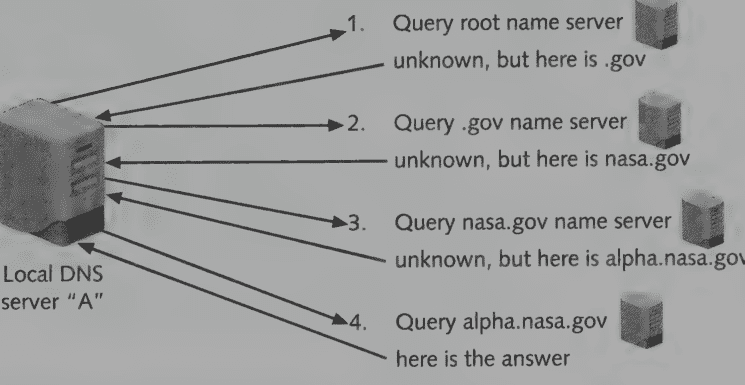

幸运的是，这个过程很少如此繁琐，你应该理解向下树查询的步骤，以便在 DNS 数据库中找到所需信息。对于本示例，更正常的过程会缩短，因为 DNS A 可能已经缓存了 `.gov` 域的 DNS 服务器地址（在你第一次通过网络请求解析 `.` 结尾的地址后，它就会缓存）。`nasa.gov` DNS 服务器也可能在缓存中积累了 `nasa.gov` 域内的大多数系统，即使它们没有永久地存储在你所查询的 DNS 服务器上。最后，如果你的示例是一个网站或其他经常访问的位置，当下一次针对相同域名的查询到达时，DNS A 将立即用它首次收集的缓存信息做出响应。

从这个过程中得到的一个教训是，即使你没有自己的域名需要维护，也可以通过建立缓存 DNS 名称服务器来为网络上的用户加速。当 DNS 查询存储在你网络内部的机器上时，每个 DNS 查询所需的平均时间可以大幅下降。

从上面给出的示例步骤中你可以意识到，特定的服务器被指定提供有关该域的答案。根 DNS 服务器由互联网工程任务组 (IETF) 运行，但像 `ibm.com` 这样的商业域名由 IBM 公司管理和控制。同样，如果你获取了你的域名 `mysbusiness.com`，你就负责维护该域的主 DNS 服务器。如果你不维护这样的服务器，将没有人能够找到你的主机，你的域名对你来说将几乎毫无价值。一个域的主 DNS 服务器（master DNS server）是能够提供有关该域的官方或权威信息的 DNS 服务器。尽管许多其他 DNS 服务器可能缓存了你所需的信息，但互联网上的一个服务器是每个域的主服务器。

主 DNS 服务器包含数据库文件，为管理员希望 DNS 客户端能够访问的该域内的每个主机提供 IP 地址。

对于小型域，通常会将 ISP 的 DNS 信息作为你的 DNS 服务器；对于一个良好的 ISP 来说，只需存储另一个的 DNS 数据库文件非常容易。唯一的缺点是，每当你更改网络主机名或 IP 地址时，必须让你的 ISP 更新这些文件。

除了主 DNS 服务器，每个域还应该至少有一个从用（slave） DNS 服务器。从用 DNS 服务器也包含域内所有主机的数据库文件，但在发生硬件或软件问题时，它作为主 DNS 服务器的备份。一位专家建议域的从用 DNS 服务器与主 DNS 服务器物理距离尽可能远——如果可能的话，在另一个国家。更现实的做法是，在你 ISP 的服务器或你组织的另一个办公室创建一个从用 DNS 服务器，那里可能位于不同的城市。


> 对于 DNS 服务器，`primary`（主）和 `master`（主）术语通常一起使用或互换：主主服务器、主服务器或 `master` 服务器都指的是同一件事。同样，`secondary`（从）、`slave`（从）服务器和 `secondary` 服务器也可以互换。然而，配置文件文件中使用的关键字是 `master` 和 `slave`。

许多高级用户理解 DNS 用于将主机名转换为 IP 地址，这也称为正向查找。DNS 的一个不那么熟悉的功能是反向 DNS：通过 DNS 获取与 IP 地址对应的主机名（也称为反向查找）。随着反向 DNS 成为互联网的一种安全措施，它变得越来越重要。通常来说，反向 DNS 试图避免的问题被称为欺骗（spoofing）：当恶意用户伪装成他人联系服务器时。这是通过使用在 IP 或 TCP 数据包中放置错误信息的程序，或者通过拦截他人的网络包并替换为不同的信息以便结果到达你自己的系统来实现的。

反向 DNS 是防止此类问题的方法之一。它的工作原理是：来自互联网客户端的每个请求都包含该客户端的 IP 地址作为网络包的一部分。接收查询的服务器调用 DNS 服务器询问“与此 IP 地址对应的主机名是什么？”如果请求中提供的主机名与客户端请求中提供的主机名不匹配，或者 DNS 服务器响应“我找不到该地址的任何主机名”，则该请求被忽略。反向 DNS 也用于记录请求信息。例如，在本章后面的部分，你将学习 Web 服务器日志。这些日志可以存储请求 Web 页面的每个主机的 IP 地址，或者可以使用反向 DNS 存储每个请求的主机名。

反向 DNS 的运行方式与普通 DNS 相同，但它将 IP 地址组件包含在域名。数字也是反序的，并在结尾有一个特殊代码表示反向 DNS 查询。例如，假设你的 ISP 分配给你的网络地址 `192.168.24.0`。除了作为你域名的主 DNS 服务器外，你的计算机还必须作为域 `24.168.192-in-addr.arpa` 的 DNS 服务器。这只是你的网络 ID（带-0，即主机 ID 部分）加上 `in-addr.arpa`。与普通域一样，DNS 服务器将从根名称服务器开始定位此地址，根服务器将提供 `.arpa` 名称服务器的地址，依此类推，最后到达作为你网络地址服务器的 DNS 服务器。

历史上，一些系统管理员不会理会反向 DNS，因为这多了一个需要更新的配置文件。然而，现在在你的 DNS 服务器上提供准确的 DNS 记录是关键的。如果你不这样做，你网络上的主机将无法连接某些外部服务器，因为那些服务器无法通过反向 DNS 查询验证主机的身份。

## 设置基础名称服务器

实现 DNS 服务器的程序称为 `named`，即名称守护进程（daemon）。在大多数 Linux 系统的 BIND 包中可以找到此程序。BIND（Berkeley Internet Name Domains）是实现 DNS 协议的程序集合。如果你在安装 Red Hat Linux 时选择名称服务器组件，你还拥有：`bind-conf`——它提供了一个图形化配置工具，将在本节稍后部分对其进行描述；`bind-utils`——包含一组用于查询服务器的命令行工具；以及 `caching-nameserver`，一组使 `named` 准备好运行的简单配置文件。

你可以通过 `bind` 软件包识别出 BIND 版本 4，但也因为它使用了 `/etc/named.boot` 配置文件。随后 `bind` 包跳到了版本 8，而现在有了版本 9。Red Hat Linux 7.3 使用的是 BIND 9.2.0；你应该使用此版本或更高版本。


由于 BIND 被广泛使用，且配置起来可能非常复杂，DNS 服务器经常受到试图入侵和/或破坏你网络的人的攻击。使用最新软件是减少麻烦可能的一种简单方法。较新版本的 BIND 使用 `/etc/named.conf` 配置文件。

由 Red Hat `caching-nameserver` 软件包提供的基础 `/etc/named.conf` 文件是一个很好的开始。它的内容如下所示：

```
// generated by named-bootconf.pl

options {
    directory "/var/named";

    /*
     * 如果你与想要通信的名称服务器之间存在防火墙，
     * 你可能需要取消下面 query-source
     * 指令的注释。之前的 BIND 版本总是使用端口 53
     * 提问，但 BIND 8.1 默认使用非特权
     * 端口。
    */

    // query-source address * port 53;
}

// 仅缓存名称服务器配置

controls {
    inet 127.0.0.1 allow { localhost; } keys
    rndckey; };
}

zone "." IN {
    type hint;
    file "named.ca";
}

zone "localhost" IN {
    type master;
    file "localhost.zone";
    allow-update { none; };
};

zone "0.0.127.in-addr.arpa" IN {
    type master;
    file "named.local";
    allow-update { none; };
}

include "/etc/rndc.key";
```

该文件分为五个部分：`options`、`controls`、三个不同的 `zone` 以及一个 `include` 行，后者引用了 `rndc` 安全密钥文件（下文将讨论）。`options` 部分中唯一的非注释行是 `directory` 行，它标识了所有 `named` 文件的存储位置。`named.conf` 中引用的每个文件名都是相对于 `/var/named` 目录的。你可以在此部分中包含许多其他选项，但目前只有 `directory` 行是至关重要的。

`controls` 部分定义了谁可以使用 `rndc` 控制协议来控制运行中的名称服务器。虽然你可以使用 `/etc/rc.d/init.d` 中的脚本启动和停止名称服务器，但 `rndc` 控制协议是初始化名称服务器和处理其他管理任务的首选方法。你很快就会看到如何使用它。`rndc` 可以远程控制名称服务器，但 `controls` 部分仅允许 `localhost` 控制名称服务器。为了使用 `rndc`，需要使用 `rndc` 密钥。`controls` 部分引用此密钥，该密钥在文件的 `key` 部分中被具体命名（通过末尾的 `include` 行）。


# 配置 DNS 密钥与转发

## rndc 密钥配置

```text
key "rndckey" {
    algorithm hmac-md5;
    secret "LufzfpileaDIuyqzThROgnuADtyOvuOvFbaHXPUsizqgnQEAJpIIOUUK";
};
```

为了使用 `rndc`，连接的客户端和服务器端必须存在相同的密钥。由于此配置仅允许 `localhost` 计算机使用 `rndc`，因此这没有问题。服务器的 `rndc` 密钥存储在上述的 `/etc/rndc.key` 文件中；客户端使用的密钥存储在 `/etc/rndc.conf` 文件中。

## DNS 转发配置

缓存名称服务器在概念上与转发名称服务器是相同的，后者将查询转发到任何名称服务器进行处理。这允许管理员将来自多个 DNS 服务器的查询集中到少数几个服务器上，利用这些服务器上的缓存条目来缩短响应时间并减轻网络负载。可以通过 `named.conf` 文件的 `options` 部分通过指定查询应该转发到的 DNS 服务器，来实现转发功能：

```text
forward first;
forwarders {
    10.0.5.1;
    10.0.4.1;
};
```

# 第 6 章 配置主要网络服务

## Zone 配置详解

`named.conf` 文件的其余部分定义了三个 `zone`。`zone` 是 DNS 域名树的一部分，DNS 服务器有权提供该部分的信息。在 `named.conf` 中包含 `zone` 表示服务器上的文件提供了有关该 `zone` 的信息。其他 `zone` 以之前描述的方式访问，结果存储在内存中。`zone` 的部分可能会委托给另一个名称服务器，例如，如果名称服务器 B 是 `ibm.com` 的权威服务器，如果 `research.com` 域名不在名称服务器 B 的区域权限范围内，它可能会引导你到另一个名称服务器以进行查询。每个 `zone` 部分的格式显示在此：

```text
zone "domain-name" IN {
    various options
};
```

`IN` 关键字表示这指的是一个 Internet 类型的区域。虽然存在其他类型的区域，但你不太可能看到它们。你在上面 `named.conf` 中看到的配置行是 `type`、`file` 和 `allow-update`。`type` 行定义了为该 `named` 区域提供什么类型的信息。对于根区域，提供了一个 `hints` 文件。`file` 行给出的 `hints` 文件包含了根服务器的列表。我们稍后将转向 `named.conf` 中引用的文件。这些被称为区域文件，因为它们包含了每个 `zone` 的详细信息：DNS 查询所请求的内容。

### 根区域文件示例

首先是 `named.ca`，它是包含根服务器的列表。该文件的前几个非注释行在 Red Hat 7.3 中所示：

```text
.                       360000  IN  NS  A.ROOT-SERVERS.NET.
A.ROOT-SERVERS.NET.     360000  IN  A   198.41.0.4
.                       360000  IN  NS  B.ROOT-SERVERS.NET.
B.ROOT-SERVERS.NET.     360000  IN  A   128.9.0.107
.                       360000  IN  NS  C.ROOT-SERVERS.NET.
C.ROOT-SERVERS.NET.     360000  IN  A   192.33.4.12
.                       360000  IN  NS  D.ROOT-SERVERS.NET.
D.ROOT-SERVERS.NET.     360000  IN  A   128.8.10.90
.                       360000  IN  NS  E.ROOT-SERVERS.NET.
E.ROOT-SERVERS.NET.     360000  IN  A   192.203.230.10
.                       360000  IN  NS  F.ROOT-SERVERS.NET.
F.ROOT-SERVERS.NET.     360000  IN  A   192.5.5.241
.                       360000  IN  NS  G.ROOT-SERVERS.NET.
G.ROOT-SERVERS.NET.     360000  IN  A   192.112.36.64
```

这些 `zone` 包含了你想要直接访问的任何主机。`allow-update` 行定义了哪些主机可以对其进行动态更改。在 `named.conf` 中列出的 `zone` 区域是 `master` 类型的，如下：

```text
zone "myplace" IN {
    type master;
    file "myplace.zone";
    allow-update { none; };
};

zone "24.168.192.in-addr.arpa" IN {
    type master;
    file "named.local";
    allow-update { none; };
};
```

## 资源记录详解

为了解释这些区域信息文件的内容，让我们重述一下 DNS 服务器的作用：DNS 服务器响应来自任何 DNS 服务器或客户端解析器的查询返回资源记录。资源记录是一行信息，定义了关于 DNS 服务器已知的网络主机的信息。每个资源记录都有以下通用格式：

| 描述的项目 | 缓存时间 | 记录类型 | 所需信息 |
| :--- | :--- | :--- | :--- |

在上述的 `named.ca` 文件使用了两种资源记录：`NS` 记录和 `A` 记录。`NS` 记录定义了给定域的权威名称服务器。`A` 记录定义了给定域的 IP 地址。因此，取文件的前两行，根域 `.` 的权威名称服务器是 `A.ROOT-SERVERS.NET`，而 `A.ROOT-SERVERS.NET` 的 IP 地址为 `198.41.0.4`。一旦缓存，这两条信息都应保留 3,600,000 秒，即大约一个半月。（开头处的 `IN` 关键字表示 Internet 地址类型；随后在文件的其余部分中假定为该类型。）

根名称服务器的 IP 地址会随时间变化，因此您应该定期更新此文件（通常每季度更新一次即可）。使用命令行工具 `dig` 向 DNS 服务器查询资源记录。获取根名称服务器更新列表的最简单方法是使用此命令，并将生成的文件复制以替换您的根服务器列表：

```bash
dig @root-servers.net ns > /var/named/new.rootservers
```

域名可以包含英语字母表的所有字母、0 到 9 以及连字符 (`-`)。在使用域名时，大小写没有区别（这与 Linux 中不同）。因此，请求 `ibm.com` 是请求 `IBM.COM` 的理想方式。

### 主区域文件示例：localhost.zone

接下来我们来看一个主区域文件 `localhost.zone`：

```text
$TTL 86400
$ORIGIN localhost.
@   IN  SOA @ root (
        42      ; serial (days)
        3H      ; refresh
        15M     ; retry
        1W      ; expire
        1D )    ; minimum
    IN  NS  @
    IN  A   127.0.0.1
```

理解区域文件可能具有挑战性。您可以在 `/usr/share/doc/bind-9.2.0/arm` 目录下（管理员资源手册）查看关于 BIND 的全面文档。即使是一个位置错误的字符也可能导致主机名无法解析。这里的前两行是指令。`$TTL` 指示此处所有资源记录的默认生存时间（存储在缓存中）为 86,400 秒：即 24 小时。这通过三个资源记录中每个“一天”的 `1D` 项也体现出来。`$ORIGIN` 指令提供了要添加到任何未完成记录中的域名。

#### SOA 记录详解

`SOA` 记录（起始权威记录）描述了如何使用为此区域提供的信息。区域信息文件中使用的 `@` 符号表示区域的根；在这种情况下，这意味着 `localhost`。`@` 符号在 `SOA` 关键字之后再次使用，后紧跟 `root`。这里的 `root` 单词表示将有关此 DNS 区域的问题发送到的电子邮件地址。电子邮件地址的格式在此处，因为 `@` 已经用于其他地方。`root` 指向本地账户，但如果您需要完整的电子邮件地址，例如 `hostmaster@myplace.net`，则应将其写为 `hostmaster.myplace.net`。

括号之间（跨越几行）是数字，表示此文件中的信息如何传输到分配给 DNS 信息的从服务器。这种信息的交换被称为区域传输。`refresh` 间隔（3 小时）定义了从服务器检查主服务器是否已更新的频率。如果该检查失败，从服务器将根据 `retry` 间隔（每 15 分钟）重试，直到 `expire` 间隔通过（此处为一周）。到那时，从服务器将停止作为该区域的次级源。

最后一个数字在注释中标记为 `minimum`，是此文件中信息的最小生存时间 (TTL)。第一个数字在注释中标记为 `serial`，用于指示文件是否已更改并需要参与区域传输。守护进程会检查序列号，查看它是否比上次检查时的数字大。如果是，则重新读取。因此，每当您对区域信息文件进行更改时，都必须更新序列号；否则服务器将忽略更新。

`localhost` 文件可能不会更改，但为了方便普通域的服务器维护，管理员通常使用如下的数字：

`2003042300`

该数字格式为年-月-日-00。每天您可以在文件中进行最多 100 次更改，每次增加最后两个数字。如果您在第二天进行更改，则日期字段将改变，您并将计数器重置为 00。这也能帮助您查看最后一次更新文件的时间。

`NS` 和 `A` 记录的第一个字段中没有任何内容，因此 `ORIGIN` 指令在该字段中提供 `"localhost."`。定义了一个名称服务器（`@` 指向运行名称服务器的系统），并给出了 `localhost` 接口的 IP 地址。

### 反向查找区域文件示例：named.local

接下来，让我们简要回顾 DNS 文件 `named.local`：

```text
$TTL 86400
@   IN  SOA localhost. root.localhost. (
        1997022700 ; Serial
        28800      ; Refresh
        14400      ; Retry
        3600000    ; Expire
        86400 )    ; Minimum
    IN  NS  localhost.
1   IN  PTR localhost.
```

此文件也使用了 `$TTL` 指令。它具有序列号的标准格式，并引入了一个新的资源类型：`PTR`，用于“指针”。`PTR` 记录“指向”分配给 IP 地址的主机名；这被用于反向查找。在当前区域 `127.0.0` 内，IP 地址为 `"1"` 的主机指向分配给 IP 地址的主机名。

## 常见资源记录类型示例

### A 记录示例

以下是示例网络中的几条 `A` 记录：

| 主机名 | 类型 | 值 |
| :--- | :--- | :--- |
| localhost. | A | 192.168.1.1 |
| localhost. | A | 192.168.1.2 |
| localhost. | A | 192.168.1.3 |
| localhost. | A | 192.168.1.4 |
| localhost. | A | 192.168.1.5 |

### MX 记录示例

以下是示例网络中的几条 `MX` 记录：

| 主机名 | 类型 | 偏好 |
| :--- | :--- | :--- |
| localhost. | MX | 10 |
| localhost. | MX | 20 |
| localhost. | MX | 30 |
| localhost. | MX | 40 |
| localhost. | MX | 50 |

### PTR 记录示例（反向查找）

反向查找文件示例如下：

| IP | 类型 | 目标 |
| :--- | :--- | :--- |
| 1.0.0.127.in-addr.arpa | PTR | localhost. |
| 2.0.0.127.in-addr.arpa | PTR | localhost. |
| 3.0.0.127.in-addr.arpa | PTR | localhost. |
| 4.0.0.127.in-addr.arpa | PTR | localhost. |
| 5.0.0.127.in-addr.arpa | PTR | localhost. |

### CNAME 记录示例

另一种常用的资源类型是 `CNAME` 记录（别名），用于为主机名创建别名。例如，假设您的网络中有一台运行 FTP 服务器、电子邮件服务器和 Web 服务器的单一服务器。您希望为这些目的使用主机名。如下所示：

| 主机名 | 类型 | 目标 |
| :--- | :--- | :--- |
| main.myplace.com. | A | 192.168.1.1 |
| ftp.myplace.com. | CNAME | main.myplace.com. |
| mail.myplace.com. | CNAME | main.myplace.com. |
| www.myplace.com. | CNAME | main.myplace.com. |

注意，在这些行中，使用的是完整名而不是仅主机名。也就是说，使用 `ftp.myplace.com.` 而不是 `ftp`。您可以使用任何格式；关键点是完整名结尾包含一个点。因此，如果您指定 `www.myplace.com` 而不是 `www.myplace.com.`，`named` 将尝试附加域名，导致主机名无法解析。

### 多 A 记录实现负载均衡

假设您有多个包含相同信息的 Web 服务器，旨在处理大量的网络流量。您可以为单个主机名包含多个 IP 地址。`named` 以轮询方式响应第一个、第二个，以此类推。这些行说明了这样的配置：

| 主机名 | 类型 | IP 地址 |
| :--- | :--- | :--- |
| www.myplace.com. | A | 192.168.1.5 |
| www.myplace.com. | A | 192.168.1.6 |
| www.myplace.com. | A | 192.168.1.7 |
| www.myplace.com. | A | 192.168.1.8 |

## 表 6-2 常见的 DNS 资源记录类型

| 资源记录类型 | 定义 |
|---|---|
| A | 为命名主机提供 IP 地址 |
| CNAME | 主机名的别名，指向 A 记录中定义的名称 |
| NS | 给定域的权威名称服务器 |
| PTR | 用于反向 DNS 查询，与网络地址一部分的某个数字关联的主机名 |
| SOA | 该文件具有权威性的区域，包含区域传输参数和区域管理员的电子邮件地址 |
| MX | 邮件交换器：运行电子邮件服务器的主机，被指定用于接收该命名主机的电子邮件 |

# 管理命名服务器

一旦你配置了 `/etc/named.conf` 配置文件并在 `/var/named` 中设置了适当的区域文件，就可以通过输入 `/usr/sbin/named` 来启动 `named` 守护进程。更有可能的是，你会想要使用 `/etc/rc.d/init.d` 中的脚本。如果你对文件进行了更改，也可以使用相同的脚本重启服务器。

之前提到的 `rndc` 实用程序随 `bind` 包提供，用于从命令行控制它而无需重新加载。`rndc` 可以通过网络连接操作，但默认情况下仅在本地使用。

你使用 `rndc` 命令来重新加载配置文件、写入状态文件或执行手册页描述的其他任务。你可能常用的命令是 `reload`，用于重新加载 `/etc/named.conf` 配置和所有区域信息：

```bash
rndc reload
```


## 使用 bindconf.gui

已经开发了一些图形化实用程序来帮助你配置本节介绍的文件。其中最简洁的是 `bindconf`，它包含在 Red Hat Linux 的软件包中。你可以通过选择 Gnome 主菜单上的“System”（系统），然后“DNS Configuration”（DNS 配置）来启动此程序。或者，在命令行输入 `bindconf`。`bindconf` 的主窗口如图 6–4 所示。它包含每个区域信息文件的行。

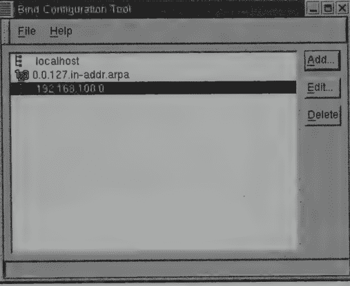

从此窗口，你可以通过选择“Add”（添加）来创建一个新的区域信息文件。在弹出的窗口中，你选择创建常规（正向）DNS 主区域、反向 DNS 主区域还是从区域（slave）。图 6-5 显示了此对话框。

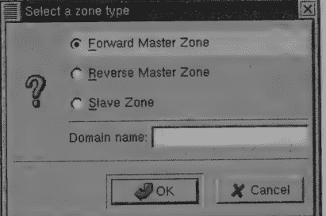

你可以通过在主窗口中选择任何现有区域文件并选择“Edit”（编辑）来编辑它。主编辑对话框如图 6-6 所示。对于正向 DNS 区域，此对话框标记为“Name to IP Translations”（名称到 IP ）。对话框顶部的字段包括 SOA 记录信息，但如果你进行了更改，必须手动更改序列号。区域传输的刷新数字通过“Time Settings”（时间设置）按钮访问。

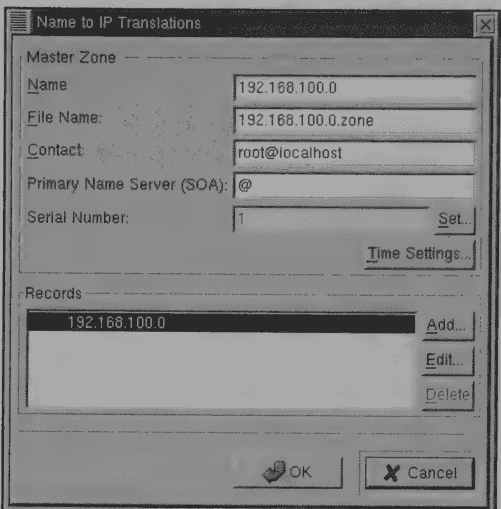

对话框的底部列出了文件中配置的主机。你可以选择“Add”（添加）以包含另一个主机的信息（见图 6–7），或选择“Edit”（编辑）来更改所选主机的信息。

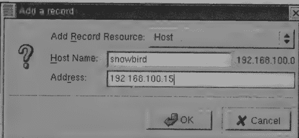

如果你在 bindconf 的主窗口中选择反向 DNS 文件然后选择“Edit”，会出现一个不同的对话框，如图 6–8 所示。此处的信息与用于正向 DNS 文件的信息类似。SOA 信息位于对话框顶部；网络 ID 内的 IP 地址及其对应的主机名位于文件底部。

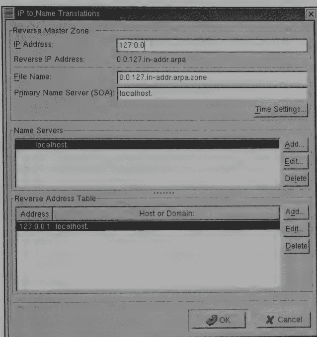

在使用 bindconf 进行任何更改后，选择“File”菜单上的“Apply”（应用）以将你的更改写入适当的区域信息文件。

虽然这是一个编辑区域信息的方便工具，并避免了微小的拼写错误导致你的 DNS 服务器出现大麻烦的现实问题，但你也应该意识到，如果不先了解 DNS，否则该工具将毫无用处。此外，此实用程序不让你能够编辑主 DNS 配置文件 `named.conf`。

## 使用命令行实用程序

一旦你的 DNS 服务器启动并运行，你通常希望看到它对查询有符合预期的响应。这里描述的实用程序可以帮助你测试你自己的 DNS 服务器；它们还可以帮助你了解互联网上的其他 DNS 服务器。

> 如果你的名称服务器似乎没有正常工作，一种技术方法是重新启动它，然后查看系统日志中的消息：`/var/log/messages`。当问题发生时，named 守护进程会写入大量的信息。

三个命令行实用程序非常相似：`host`、`nslookup` 和 `dig`。`host` 命令是这三个中最简单的。它用于查找主机名的 IP 地址。例如：

```
host google.com
```

输出将显示该主机的 IP 地址。`nslookup` 命令更强大，可用于查询各种类型的 DNS 记录。例如：

```
nslookup google.com
```

输出将显示更多信息，包括 MX、CNAME 和其他记录类型。`dig` 命令是这三个中最强大的，可用于查询任何类型的 DNS 记录。例如：

```
dig google.com any
```

`dig` 的输出最详细，包含了头文件、问题、答案、权威和附加部分。

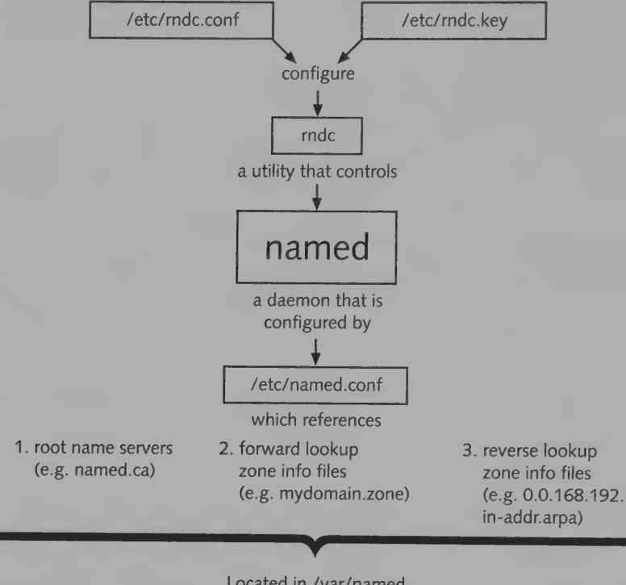

**图 6-9** DNS 配置文件

| 工具名称 | 说明 |
|---|---|
| host | 将主机名解析为 IP 地址 |
| dig | 推荐用于 DNS 故障排除或复杂的 DNS 查找；包含许多用于指定所需 DNS 记录以及处理服务器响应的选项 |
| nslookup | 功能与 dig 类似，但可以使用命令行选项或交互模式使用 |
| nsupdate | 允许系统管理员远程（通过网络连接）更新区域文件 |
| rndc | 使用命令行参数控制 named 守护进程 |
| named-checkconf | 检查 named.conf 配置文件的有效性 |

## 配置基础邮件服务器

在第 3 章中，你学习了互联网上的邮件传输是如何结构的：邮件传输代理（MTA）在服务器之间移动邮件；MTA 通常称为邮件服务器。邮件投递代理（MDA）如 procmail 负责检查消息并将其投递到用户的邮箱文件（例如 `/var/spool/mail/nwells`）。邮件用户代理（MUA）如 Netscape、Kmail 或 pine 查看存储在邮箱中的消息，并创建新消息交由 MTA 投递给收件者。

在本章的早期阶段，你学习了邮件服务器运行的一个关键组件：它们使用 DNS 来请求收件者的邮件交换器（MX）。例如，如果你向 quell@teranet.com 发送邮件，你所在地的邮件服务器（或者如果你没有运行自己的邮件服务器，则是你的 ISP）必须以某种方式找到哪个邮件服务器应该接收发往 teranet.com 的邮件。这是通过对 teranet.com 进行 DNS 查询来实现的，但一旦找到了该域的权威 DNS 服务器，邮件服务器就会请求 MX 记录而不是 A 记录。这两个记录可能指向同一台服务器，但更多情况下，组织会将邮件接收集中在单一服务器上。从那里，邮件服务器的配置可能会分发消息以供大组织内部访问。

一旦使用 DNS 找到正确的邮件交换器，你的邮件服务器就可以使用 SMTP 协议发起连接，并开始发送发往由该邮件交换器处理的所有域的邮件。

> SMTP 协议自最初引入以来已经过扩展，因此你可能会看到对扩展简单邮件传输协议（ESSMTP）的引用。大多数管理员直接称之为 SMTP。

### 邮件服务器

Linux 提供了多种邮件服务器。这里列出了最流行的几种：

- **sendmail**: 世界上广为人知的邮件服务器；估计 sendmail 仍然传输着全球大部分的邮件。sendmail 已经存在了近 20 年，但几年前，成立了一家公司销售商业版本，该版本带有图形化开发工具、技术支持和其他插件。你可以在 www.sendmail.com 了解相关信息。然而，免费版本包含在每个 Linux 发行版中：你可以在 www.sendmail.com（或通过 Linux 附带的文档）了解免费版本。
- **Qmail**: 这款邮件服务器在 Linux 用户中也相当流行。由于过去十年中 sendmail 出现了一些安全问题，Qmail 专注于安全性。你可以在 www.qmail.org/top.html 了解 Qmail。
- **Postfix**: 这款邮件服务器也专注于安全性。它被组织为离散程序的集合，每个程序执行一个单独的任务，且在主机上没有权限。你可以在 www.postfix.org 了解更多关于 Postfix 的信息。
- **Sendmail**: 这是一个较小的邮件服务器，基于 sendmail 但缺少许多功能，旨在更易配置并使用更少的资源。

Red Hat Linux 通过三个独立的软件包安装了 sendmail 程序。`sendmail` 包包含 sendmail 守护进程，它是使用 `sendmail-cf` 唯一必需的包（`sendmail-cf` 包含配置示例和辅助程序），以及 `sendmail-doc`（包含服务器的文档）。如果你打算运行 sendmail，应该安装所有包。`sendmail-doc` 包不会自动安装；它位于 Red Hat CD 3 上。

sendmail 使用 `/etc/rc.d` 中的标准脚本启动。你可以使用 `start`、`restart` 和 `status` 命令来控制守护进程。sendmail 的启动参数由存储在 `/etc/sysconfig/sendmail` 文件中的信息控制。例如，参数 `QUEUE=1h` 告诉 sendmail 每小时尝试发送一次存储的消息。

> 启动 sendmail 需要几秒钟。如果启动脚本在启动 sendmail 之前延迟，请检查 `/etc/hosts` 中是否正确定义了主机名。默认情况下，sendmail 使用此信息来确定它运行的主机，这是它必须具备的信息。

sendmail 的运行是通过 `/etc/sendmail.cf` 文件进行配置的。你应该在文本编辑器中简要查看此文件，小心不要更改其内容。`sendmail.cf` 被广泛认为是最难掌握的配置。你可以通过研究该文件的注释和 sendmail 的文档来学习该文件是如何组织和运行的；某些管理任务可能需要你直接编辑此文件。`README.cf` 文件充当 `sendmail.cf` 的手册。它包含超过 3,000 行。在 Red Linux 中，它位于 `/usr/share/sendmail`。安装了 `sendmail-doc` 包后，大多数管理员倾向于依靠 `m4` 来配置 sendmail。要创建新的 `sendmail.cf`，请执行命令：

```
m4 /etc/sendmail.mc /etc/sendmail.cf
```

`sendmail.mc` 的内容如下所示。这里的每一行都进行了编号，以便后续讨论；文件本身没有编号。

```
1. divert(-1)
2. 这是 sendmail 宏文件。每一行都代表“删除”以及文件的结束。
3. 你需要安装 sendmail-cf 然后生成
4. m4 /etc/sendmail.mc /etc/sendmail.cf
5.
6.
7.
8. include('/usr/share/sendmail-cf/m4')
9. OSTYPE('linux') 用于 Red Linux
10. VERSION('linux')
11. define('CONFDEF_USER', '8')
12. undefine('UUCP_RELAY')
13. undefine('BITNET_RELAY')
14. define('CONAUTO_REBUILD')
15. define('CONTO_CONNECT', 'lm')
16. define('CONFRY_NULL MX',true)
17. define('CONDFONT_PROBE_INTERFACES',true)
18. define('PROCMAIL_MAILER_PATH','/usr/bin/procmail')
19. define('ALIAS_FILE', '/etc/aliases')
20. define('STATUS_FILE', '/etc/mail/statistics')
21. define('UUCP_MAILER_MAX', '2000000')
22. define('CONFUSERDB_SPEC', '/etc/userdb.db')
23. define('CONFPRIVACY_FLAGS','authvarnings,noverpy,noepn,restrictqrun')
24. define('CONFAUTH_OPTIONS', 'A')
25. TRUST_AUTH_MECH(DIGEST-MD5 CRAM-MD5 LOGIN PLUGIN)
26. define('CONFAUTH_MECHANISMS', 'DIGEST-MD5 CRAM-MD5 LOGIN PLUGIN')
27. define('CONFTO_QUEUEWARN', '4h')
28. define('CONFTO_QUEUETURN', '5d')
29. define('CONFQUEUE_LA', '12d')
30. define('CONFREFUSE LA', '18')
37. FEATURE(always_add_domain)dnl
38. FEATURE(use_cw_file)dnl
39. FEATURE(use_ct_file)dnl
40. FEATURE(local_procmail,'',procmail -t -Y -a $h -d $u')dnl
41. FEATURE('access_db','hash -o /etc/mail/access.db')dnl
42. FEATURE('blacklist_recipients')dnl
43. EXPOSED_USER('root')dnl
44. dnl 这使得 sendmail 仅监听回环设备 127.0.0.1
45. dnl 而不是在任何其他网络设备上监听。如果你希望
46. dnl 通过网络接受电子邮件，请注释掉此行。
47. DAEMON_OPTIONS('Port=smtp,Addr=127.0.0.1, Name=MTA-')
48. dnl 注意：将 IPv4 和 IPv6 守护进程限制到同一个端口需要
49. dnl 内核补丁
50. dnl DAEMON_OPTIONS('port=smtp,Addr::, Name=MTA-v6, Family=inet6')
51. dnl 如果你想保护自己免受垃圾邮件侵害，我们强烈建议注释掉此行。
52. dnl 然而，笔记本电脑和计算机上的用户并不需要 24x7 的 DNS 服务。
53. FEATURE('accept unsolvable_domains')dnl
54. dnl 屏蔽 FEATURE('relay_based_on_MX')dnl
55. MAILER(smtp)dnl
56. MAILER(procmail)dnl
57. Cwlocalhost.localdomain
```

Red Hat Linux 提供的默认配置提供了一个工作的 sendmail 服务器环境，但要将其作为互联网电子邮件服务器使用，必须进行一些更改。本节的其余部分描述了这些建议的更改，以及 sendmail 中实现的电子邮件服务器的一些通用特性。

设置 sendmail.mc 文件在 `/usr/share/doc/sendmail` 的 README.cf 文件中也有描述。

设置 sendmail 配置文件非常困难，但由于互联网和电子邮件的本质，管理任何电子邮件服务器都是一项持续的挑战。电子邮件服务器的配置必须应对此类等问题：

- 许多类型主机上的许多不同程序正在创建电子邮件消息。所有这些消息必须在某种程度上进行标准化，以便世界各地的电子邮件服务器能够理解其内容并将其正确投递。这在部分通过所谓的“重写规则”处理，这些规则是每个 sendmail.cf 文件的默认部分。
- 一个组织可能包含许多基于 SMTP 的电子邮件服务器，特别是当许多用户运行 Linux 时！然而，大多数组织都希望有一个单一点（单一地址）来管理电子邮件，以避免命名冲突并向公众呈现连贯的形象。
- 所有用户都希望无限制地发送和接收电子邮件，垃圾邮件（未经索求的广告相关邮件）不仅是用户的问题，也是电子邮件服务器的问题。如果管理员不采取措施来修复，垃圾邮件可能会堵塞电子邮件服务器并让用户感到沮丧。
- 用户希望在创建和阅读电子邮件方面具有灵活性。他们希望从各种主机访问邮件，他们希望创建的消息能被快速投递，并且他们希望在程序不理想时使用自己选择的程序进行工作，而且考虑到电子邮件服务器管理员面临的其他问题，某些情况下可能需要额外的工作。

在我们讨论 sendmail.mc 文件中的特定选项之前，请考虑以下场景。假设你为一家科技公司管理网络，该公司有 50 名员工，其中大多数人精通技术，并在桌面上运行着 Linux 系统。许多用户选择运行 sendmail，因为这提供了强大的用户配置。所有用户都从此服务器接收电子邮件，要么通过 Netscape 等电子邮件程序使用 POP3 下载，要么通过其他某种方式将邮件传输到他们的系统（如稍后描述）。图 6-10 描述了这一场景。

现在，让我们回顾一下 sendmail.mc 文件中可能与此场景相关的关键部分。默认设置允许 sendmail 仅接受来自本地（localhost）的电子邮件。这通过上方文件中第 47 行的 `DAEMON_OPTIONS` 指令控制。首先，为了让 sendmail 作为一个真正的互联网电子邮件服务器运行，你必须在该行开头插入 `dnl`，以便其他服务器可以连接到你的 sendmail副本。如果你仅为图 6-10 中的主机 A 配置电子邮件，你可能会选择配置 sendmail 仅接受来自主服务器的邮件，使用如下设置：

```
DAEMON_OPTIONS('Port=smtp,Addr=192.168.1.1,Name=MTA')
```


> 注意：在 sendmail.mc 中进行的任何更改都不会生效，直到你保存文件、运行 `m4` 创建一个新的 sendmail.mc 文件，并重启 sendmail。在审阅本节中的所有信息之前，请勿执行此操作，特别是当你连接到互联网时。

文件中的第 58 行表示 sendmail 接受的接收方域名。你可以通过向此处添加名称来列出多个域名。例如，如果第 58 行如下，你将列出这些域名：

```
Cwmyplace.net myplace.com linuxfest.org
```


# 配置基础电子邮件服务器

如果你托管了多个域名，可以在 `sendmail.mc` 中包含以下行：

```
FEATURE('use_cw_file')dnl
```

## 第 6 章 配置主要网络服务

域名，即使消息正从你网络内的其他主机中继。这会导致所有回复该消息的人都使用中央电子邮件服务器的名称，以便所有消息都返回同一个点。为了实现这一点，你需要在 `sendmail.mc` 文件中添加以下行：

```
MASQUERADE_AS('myplace.net')
FEATURE('masquerade_envelope')
```

除了控制中继之外，防止垃圾邮件的进一步保护措施是 sendmail 的访问数据库。该数据库定义了如何处理来自各种地址的邮件。你可以指定直接丢弃消息而不进行后续操作、将其转发给目标用户、拒绝并向发送者发回消息，或者采取其他几种选项。

要使用访问数据库，请在 `/etc/mail/access` 文件中放置想要特殊处理的条目。默认情况下，该文件包含一个列表，指示来自 localhost 的邮件应该被中继（如果你之前使用了中继设置，sendmail 的整体设置将优先于此）。你可以包含在访问文件中的其他示例在此：

- `spammers.net DISCARD`
- `unbelievableoffer.com REJECT`

第一行表示任何来自 `spammers.net` 的消息都会被丢弃而不进行后续操作。第二行防止来自命名主机的邮件被投递，但会向发送者返回一条消息说明邮件未投递。还有其他几种选项。你还可以在此文件中包含特定用户。例如，如果不需要的邮件来自特定的用户帐户，你可以用此行丢弃该邮件：

```
reduceyourmortageddebt@aol.com DISCARD
```

在你对访问文件进行更改后，必须将其转换为 sendmail 可以使用的数据库。以下命令将 `/etc/mail/access` 文本转换为 sendmail 可以使用的 `/etc/mail/access.db` 文件：

```
makemap /etc/mail/access < /etc/mail/access
```

随着垃圾邮件成为一个日益严重的问题，电子邮件服务器管理员采取了更强硬的措施来保护用户免受不需要的邮件广告。许多邮件服务使用实时黑名单（Realtime Blacklist List）。这是一个已知垃圾邮件来源站点列表。你可以通过访问 mail-abuse.org 订阅这些服务之一。一旦订阅，你就在 `sendmail.mc` 中包含以下行，以便丢弃来自列表中所有域的邮件：

```
FEATURE('dnsbl')dnl
```

黑名单是非常严格的。某些产生非垃圾邮件的域名也被列入其中，这意味着你不会收到来自这些域的任何消息。虽然在面对垃圾邮件猛攻时，黑洞列表是减少浪费时间和混乱的有效方法，但这些列表必须仔细维护，否则会变得危险，拦截你想要接收的邮件。大多数电子邮件服务器还支持白名单。来自白名单上站点的邮件会被接收，即使该站点也包含在黑洞列表中。这允许你覆盖一个你并不维护的黑洞列表。

## 使用转发和别名

与之前描述的访问数据库相结合，sendmail 维护着一个转发数据库。这允许你设置处理用户邮件的规则。转发指令表存储在 `/etc/mail/virtusertable` 文件中。该表对于接受多个不同域邮件的站点非常有用。例如，假设你同意为域名为 `sslug.org` 的用户组担任电子邮件服务器。你希望发往 `sslug.org` 的邮件重定向到该组织的领导者处，他在你的系统中有一个个人帐户。你可以向 `virtusertable` 文件添加以下行来设置此：

```
sslug.org jfreman
```

假设发给支持帐户 `sslug.org` 的邮件都应该交给 `jfreman`，但他有主邮件帐户在另一个服务器上。你同意暂时维护他的邮件服务。以下行将所有发往 `support@sslug.org` 的邮件转发到 `jfreman` 的新邮件地址，该地址不由你的邮件服务器处理：

```
support@sslug.org jfreman@mission.com
```

在你对 `virtusertable` 文件进行更改后，你必须使用以下命令更新数据库并重启 sendmail：

```
makemap hash /etc/mail/virtusertable < /etc/mail/virtusertable
```

依赖于单一域名的转发也可以通过另外两种技术实现。第一种是别名文件（aliases file）。电子邮件别名是将邮件消息投递给用户的另一个名称。该文件包含邮件可能指向的备用名称或电子邮件地址列表。文件中的每个电子邮件别名后面都跟着定义 sendmail 应该如何处理此类邮件的文本。例如，假设你的电子邮件地址是 `kcarver@myplace.net`。由于不同的公司对你的地址使用特定的格式，你还想使用 `kim.carver@myplace.net`、`kim_carver@myplace.net` 和 `kimc@myplace.net` 邮件地址接收邮件。使用别名允许通过在 `/etc/aliases` 中包含以下行来实现此目标：

```
kim.carver: kcarver
kim_carver: kcarver
kimc: kcarver
```

在大型公司中，你需要对使用的格式非常小心，因为名字相似的人可能需要使用你创建的别名作为真实的电子邮件地址。别名也常用于将主题邮件分配给特定个人。例如，你可以定义一个 Web 管理别名，将邮件发送给 Kim Carver 和 Thomas Jennings 的帐户，他们在一家管理你 Web 服务器的公司：

```
webmaster: kcarver, tjennings@webstuff.com
```

你可以在 `/etc/aliases` 中包含用户名列表，可以将消息管道到程序，可以包含包含电子邮件地址的文件，并且通过更改 `/etc/aliases` 中的行格式直接将消息存储到文件中。别名可以是递归的，也就是说可以相互构建。例如，如果你定义了一个包含用户帐户的经理别名，你可以包含其他帐户。别名是创建不经常更改的小列表的正确工具。对于经常变化的列表，请使用邮件列表管理器 majordomo（见第 4 章）。

每当你更改 `/etc/aliases` 时，都会运行 `newaliases` 来创建一个 sendmail 可以使用的别名数据库。这在 sendmail 启动时自动完成，你随时可以使用 `newaliases` 重新构建数据库。

个人用户无法更改 `/etc/aliases` 文件，但他们可以在家目录下创建转发文件（forward file）。如果 sendmail 在用户家目录下发现转发文件，该用户的邮件将根据 `.forward` 中的文本进行处理，而不是发送到 `/var/spool/mail` 中的用户标准收件箱。`.forward` 的常见包括转发到另一个系统（这种方法要求你在邮件服务器上有一个用户帐户）或通过邮件过滤器（如 Procmail，见第 3 章）处理你的消息。如果你在一家子公司出差一个月，你可以在你的 `.forward` 中包含以下行：

```
kcarver@myplace_India.net
```

所有本应投递到你的信箱的邮件将会被转发到给定的电子邮件地址。如果在图 6-10 中的中央服务器上有一个用户帐户，在该目录下使用此文件并使用 sendmail 自身的转发功能呢？sendmail 转发功能会将邮件从中央服务器转发到你的桌面系统，然后到达你的本地用户帐户；所有邮件都会到达你的桌面，然后到达你在印度。

## 观察 sendmail 工作

sendmail 守护进程会创建其操作的日志。每条收到的邮件和发出的邮件都会记录，以及关于服务器配置、启动和停止等特定的进程消息。这些消息根据 `/etc/syslog.conf` 中的配置写入标准系统日志程序 syslogd。在许多 Linux 系统中，这些消息默认被写入 `/var/log/messages`，其中还包含许多其他程序的日志消息。如果你运行 sendmail 服务器，你还需要修改 `/etc/syslog.conf` 的配置，以便将来自邮件设施（mail facility）的存储存储在单独的文件。例如，Red Hat 7.3 的默认设置是将来自任何邮件服务器的消息存储在 `/var/log/mailog` 中。

你还可以使用 sendmail 的 `-d` 命令行选项在日志中生成较多或较少的调试数据。请查看 `sendmail` 的手册页以了解更多信息（`sendmail.cf` 和 `sendmail.mc` 没有手册页，但 `sendmail` 本身有）。本文仅描述了守护进程的启动选项。

除了通过查看日志文件了解 sendmail 的活动外，你还可以使用其他几个程序来了解邮件服务器的状态，例如：

- `hoststat`：显示最近向你的 sendmail 守护进程发送邮件的主机状态。默认情况下，一个主机的信息会保留 30 分钟。
- `mailq`：显示队列中等待发送的消息列表。当你在未连接互联网时发送时，消息会在队列中等待；当 sendmail 等待域名解析，或者消息未被远程邮件服务器接收（默认情况下，sendmail 会后重试）。
- `mailstats`：显示 sendmail 处理的邮件流量摘要。`mailstats` 输出中的字段包括接收的消息、接收的字节、发送的消息、发送的字节、拒绝和丢弃的消息。

### 表 6-4 sendmail 配置文件和工具

| 文件或工具 | 描述 |
| :--- | :--- |
| `sendmail.mc` | 配置文件，包含供 `m4` 程序使用的宏定义，用于创建 `sendmail.cf` 文件 |
| `m4` | 将 `sendmail.mc` 文件转换为 `sendmail.cf` 文件的转换工具 |
| `sendmail.cf` | 定义 sendmail 操作的配置文件 |
| `sendmail.cw` | 额外的配置文件，定义了 sendmail 将接受邮件消息的域名 |
| `/etc/sysconfig/sendmail` | 系统配置文件，定义了 sendmail 的启动参数；由 `/etc/rc.d/init.d` 中的启动脚本使用 |
| `sendmail` | sendmail 守护进程或邮件服务器 (MTA) |
| `access` | 可选的配置文件，定义了 sendmail 如何处理来自文件中列出的域的邮件；必须使用 `makemap` 工具转换为 `access.db` 文件 |
| `virtusertable` | 可选的配置文件，定义了 sendmail 如何处理指向文件中列出的用户帐户的地址；必须使用 `makemap` 工具转换为 `virtusertable.db` 文件 |
| `makemap` | 将 `access` 和 `virtusertable` 等文本文件转换为 sendmail 可以处理的数据库格式文件的工具 |
| `aliases` | 列出别名以及向每个地址发送的消息应投递的实际用户账户或文件名 |
| `newaliases` | 将 `aliases` 文件转换为 sendmail 可以处理的数据库的工具；在对 `aliases` 文件进行任何更改后必须执行它 |

## 创建 Linux Web 服务器

我们在本章中讨论的最后一个网络主题可能是你最熟悉的那个题：万维网。位于法瑞边界欧洲核子研究组织（CERN）实验室的蒂姆·伯纳斯-李（Tim Berners-Lee）开发了 Web，作为帮助科学家以各种格式交换数据的方法。他所关注的超文本传输协议（HTTP）允许在服务器和大量客户端之间实时交换较小文件。当时，许多数据格式被广泛用于存储在互联网服务器上的信息。HTML 文档描述语言提供了一种通过支持 HTTP 的服务创建交换基础超链接文档的方法。

尽管 Web 引起了科学们的青睐，但 Web 的爆炸式增长始于国家超级计算机应用中心（www.ncsa.umisc.edu）开发的 Mosaic 程序。正如第 3 章所描述的，Mosaic 是首个广为人知的图形化浏览器。NCSA 还创建了最早的 Web 服务器之一；CERN 也创建了另一个。如今，全球有数以百万计的网站在运行。如需查看更多关于 Web 的统计数据，请访问 web.oclc.org，或访问 www.w3.org 并搜索 statistics。

在 Linux 术语中，Web 服务器是一个通过 HTTP 接受请求并响应请求文件的守护进程。一个基础的 Web 服务器设计可以非常简单：它接受一个请求文件的 HTTP 命令，然后将其发送给请求者。正如你学习过的其他互联网服务一样，复杂性在你开始添加安全功能、灵活配置、对多种类型数据的支持以及许多其他特性时，这些特性导致了如今稳健且复杂的 Web 服务器。

尽管 CERN 和 NCSA 的 Web 服务器仍然可用，但今天世界上最广泛使用的 Web 服务器是 Apache。Apache 包含在每个标准的 Linux 版本中，并在大多数版本中默认安装，通常是因为它被用于提供某些系统文档。Linux 许多其他 Web 服务器可用，有些很基础，有些非常复杂。这里列出了几个：

- **Boa** 是一个小型、免费的 Web 服务器，设计旨在高效，且没有像 Apache 那种服务器的所有开销（和功能）（参见 www.boa.org）。

## httpd.conf 配置详解

`httpd.conf` 第一部分的指令影响 Apache 的全局运行。大多数指令使用默认值即可维持良好运行，但这里有少数指令值得在此处提及并加以说明，以解释 Apache 配置中的重要概念。在每个情况下，配置文件中指令旁的所有注释都已删除。

与 Web 网站的连接与传输的文件是相互独立的。Apache 在发送文件后可以保持连接活跃（存活），其理论是：请求一个文件的客户端很可能请求其他几个文件。通过使用这种 `keepalive`（长存连接）功能，客户端可以节省请求额外文件的时间，而 Apache 也不需要为每个文件重新创建连接。整体性能会提高。以下指令控制如何保持连接存活：

```
KeepAlive Off
MaxAliveRequests 100
KeepAliveTimeout 15
```

如果您打算运行一个公共可访问的 Web 服务器，应该将 `KeepAlive` 指令改为 `On`。`MaxAliveRequests` 指客户端在单次连接中可以发出的请求数；数值越高性能越好。然而，如果由于服务器过载导致连接数有限，此指令可能会阻止某些用户连接到您的站点。`KeepAliveTimeout` 指令表示连接在没有活动的情况下维持的秒数。您可以根据您认为访问者在查看一个页面和点击链接进入下一页之间的切换时间进行调整。您可以在客户端角度的性能与与 Web 服务器保持空闲连接之间取得平衡。

Apache 使用一个主服务器来产生额外的服务器来处理客户端请求，但有一系列指令控制其实现方式。通常情况下，Apache 会记录等待处理的客户端数量。如果它认为需要更多 Apache 副本，它首先启动一个副本，第二个启动两个、四个、八个，以此类推，直到每秒启动 32 个额外的服务器。这一过程将持续直到满足需求。为了控制这一过程，使用了以下指令：

```
MinSpareServers 5
MaxSpareServers 20
StartWorkers 8
MaxClients 150
MaxRequestsPerChild 1000
```


> 当家谱网站 family.org 首次发布时，组织者预计每天访问量少于 100 万次。网站开放时的实际每日流量接近 800 万次，导致性能缓慢运行了数几天，直到网站管理员能够升级硬件来处理开站之即刻涌入的流量。

`LoadModule` 指令定义共享对象的文件名，作为模块的程序函数名。`AddModule` 指令定义模块的代码文件。`AddModule` 指令出现的顺序非常重要，因为它指示了模块被加载到 Apache 中的顺序。如果您希望以不同于默认 Apache 配置的方式使用模块，请注释或取消默认 `httpd.conf` 文件中的 `LoadModule` 和 `AddModule` 指令。

您可以访问 modules.apache.org 了解更多关于所有可用 Apache 模块的信息。该站点列出了数百个可以下载的以为 Apache 添加功能的模块。其中一些最重要的模块是 `mod_perl` 和 `mod_php`，它们允许 Apache 运行 Perl 和 PHP 脚本，而无需加载单独的 Perl 或 PHP 解释器。这些功能的文档非常详尽，您会在主站 www.apache.org 上看到专门区分这些功能网站的说明行。然而，添加 Perl 或 PHP 模块确实会让 Apache 变得大得多。

这里还描述了其他几个控制 Apache 全局运行的指令。

- `User` 和 `Group` 指令定义由哪个用户和组 ID 账户运行。虽然 Apache 的主副本以 `root` 身份运行，但其他副本以 `apache`、`nobody` 或类似的用户账户运行。这样，即使浏览器请求由于某种原因允许了对系统的非预期访问，该访问也被局限于命名用户（而非 `root` 用户）的权限范围。
- `ServerAdmin` 指令定义了联系人的电子邮件地址，该地址应列在 Apache 生成的 Web 页面底部。（例如，当用户请求的 Web 页面不存在时看到的服务器错误消息页面。）
- `ServerName` 指令定义了 Apache 在虚拟主机之间（在本节稍后描述）发送请求时使用的域名。在响应请求时，该域名也会被报告给浏览器。这使得您的站点具有一致的视觉体验，尽管多个域名可能解析到同一个 IP 地址。
- `DocumentRoot` 指令定义了 Web 服务器文档的存储位置。在 Red Linux 上，默认情况下该目录为 `/var/www/html`。

`httpd.conf` 文件的大部分内容被组织在容器（containers）中。容器是一种特殊的指令，它只有在满足条件或在特定上下文中才会激活其他指令。`httpd.conf` 中多次出现的容器示例是 `<directory>` 容器。每个 `<directory>` 容器以 `<Directory>` 行开头，以 `</Directory>` 行结束，类似于某些 HTML 标签。该容器定义了 Apache 如何处理命名目录中的文件。标准的 "/var/www/html"> 如下

```
<Directory "/var/www/html">

  Options Indexes FollowSymLinks

  AllowOverride None

  Order allow,deny

  Allow from all

</Directory>
```

## 第 6 章 配置主要网络服务

`Options` 行定义了在该目录下可以访问哪些类型的文件。

- `Indexes` 意味着如果没有 `index.html` 文件，Apache 将生成一个列出目录内容的 Web 页面。（`DirectoryIndex` 指令定义了默认文件名 `index.html`，您可以对其进行添加或更改。）
- `FollowSymLinks` 允许 Apache 遵循该目录下指向另一个目录的符号链接。
- `Includes` 允许 Apache 处理该目录文件文本中的特殊语句。这些被称为服务器解析文档，并允许 Apache 动态地（在被请求时）修改文档。此功能会显著增加 Web 服务器的负载。（正如列出的许多功能一样防止了安全问题。）
- `ExecCGI` 允许 Apache 在此目录中运行脚本并向请求浏览器返回输出。
- 您也可以在 `Options` 之后使用 `None` 或 `All` 关键字来使用上述所有（非常开放的访问）或不使用上述（非常严格的访问）。

`AllowOverride` 行定义了此容器中目录访问信息的哪些部分可以通过名为 `.htaccess`（默认情况下如此，您可以更改它）的文件进行更改。使用 `.htaccess` 允许多个用户控制 Web 站点自己的子目录，但 `AllowOverride` 可以限制他们选择可能危及站点其他设置。`AllowOverride` 可以使用的关键词：

- `FileInfo`：定义如何处理不同的数据类型。
- `Options`：如上述 `Options` 指令所述。
- `AuthConfig`：控制用户在访问文件之前提供用户名和密码的认证选项。
- `Limit`：这是一个独立的容器，可以包含在 `<directory>` 内限制一组主机或 IP 地址对文件的访问。
- `None` 或 `All` 提供涵盖性的答案，使 `.htaccess` 无法更改配置或使其完全不同。

`Order`、`Allow` 和 `Deny` 指令（上述未显示 `Deny`）定义了哪些主机可以访问此目录中的文件。`Order` 定义了先处理 `Allow` 指令还是 `Deny` 指令。这与您学过的 `/etc/hosts.allow` 和 `/etc/hosts.deny` 文件类似。例如，以下行仅允许 192.168.0.0 网络上的主机访问：

```
Order deny,allow
Allow from 192.168.
Deny from all
```

以下几行允许除 trouble.net 域的客户端以外的所有用户访问：

```
Order allow,deny
Allow from all
Deny from trouble.net
```

在设置访问控制语句时，请仔细考虑你想要实现的目标，并记住 Apache 并不由超级服务器（superserver）控制，也不依赖 TCP Wrappers。除了 `http.conf` 之外，你的 Web 服务器唯一的访问控制机制是可以在网络层面拦截数据包的防火墙（如本书的第二部分所述）。

在 `httpd.conf` 中，你将看到其他 `<directory>` 容器、`<limit>` 容器和其他容器的示例，以帮助你理解这些是如何使用的。`<directory>` 容器中的信息适用于命名目录的所有子目录，除非另一个 `<directory>` 容器为该子目录定义了不同的设置。

上述 `Options` 字段提到了 Apache 可以执行的服务器端和脚本，并将脚本的输出作为文档返回给浏览器。传统上，脚本保存在具有 `ExecC` 选项的独立目录中。现在更常用的是使用 `AddHandler` 指令，它允许你根据文件扩展名指定 Apache 如何处理某个文件。例如，以下两个指令将任何以 `.cgi` 结尾的文件定义为脚本，将任何以 `.shtml` 结尾的文件定义为服务器端包含。Apache 会相应地处理这些文件，无论它们出现在目录结构的什么位置。

```
AddHandler cgi-script .cgi
AddHandler server-parsed .shtml
```

当然，其他因素也可能很重要。例如，如果脚本文件没有为运行 Apache 的用户类别（执行该文件的用户、组或其他成员）设置可执行文件权限（即 `x` 位），则 Apache 无法执行该脚本。同样，可以使用更高级的指令来限制 Apache 处理的服务器端包含类型，而不仅仅是告诉 Apache 处理 `.shtml` 文件。

> Red Hat Linux 附带 Apache 版本包含了数十个用于安全套接层 (SSL) 操作的指令，这些指令默认是不激活状态的。SSL 允许 Web 服务器与浏览器进行安全通信，用于电子商务或类似的应用程序。有关有关 SSL 特性的更多信息，请访问 www.apache.org。

虚拟主机（Virtual hosting）是 Apache 服务器为多个 Web 站点（多个域名）提供文档的功能。例如，如果你为一个学校联盟运行服务器，你可以托管所有这些学校的 Web 站点。每个 Web 站点的文档存储在服务器上独立的子目录中。虚拟主机可以是基于名称或基于 IP 的虚拟主机，Apache 依赖于客户端浏览器请求的服务器名称。少数浏览器可能不会在请求中提供此信息，当此类浏览器接收文档时，基于名称的虚拟主机无法工作——它们会收到来自 Web 服务器意之外的“默认”值。

基于 IP 或基于地址的虚拟主机使用 IP 地址来确定客户端浏览器尝试访问的 Web 站点。这是一个更简洁的解决方案，适用于所有浏览器，但你必须为单台机器分配多个 IP 地址——这是一种稀缺资源。

要成功实现基于名称的虚拟主机，你必须设置 DNS 服务器，将所有涉及的域名指向你的 Web 服务器的 IP 地址。资源记录如下：

```
www.college_a.edu.  IN A  192.168.12.1
www.college_b.edu.  IN A  192.168.12.1
www.college_c.edu.  IN A  192.168.12.1
www.college_d.edu.  IN A  192.168.12.1
```

在 `httpd.conf` 中，你随后使用用于虚拟主机的 IP 地址指定 `NameVirtualHost` 指令。Apache 会检查发送到该 IP 地址的任何请求，以查看请求的是哪个域名。然后，为你想要的每个 Web 站点指定如下的容器：

```
<virtualhost 192.168.12.1>
  ServerName www.college_a.edu
  ...此虚拟主机的其他指令 ...
</virtualhost>
```

任何你需要的指令都可以放在 `<virtualhost>` 容器中。项目 6-4 显示了一个示例，使用最少指令集即可使虚拟站点对于在浏览器中工作的用户看起来是独立且配置良好的。当到达一个带有定义信息的请求时，Apache 会尽力确定应该使用哪个虚拟主机名，是列表中的第一个，还是存在于任何 `<virtualhost>` 容器之外的默认 `DocumentRoot`。

要使用基于 IP 的虚拟主机，你必须设置服务器上的网络接口以支持多个 IP 地址。如果你有多个以太网网卡（NIC），每个网卡都有一个独立的 IP 地址，但每个以太网网卡还可以使用别名拥有多个 IP 地址，如项目 2-5 所示。一旦你设置了所有需要的 IP 地址，DNS 应该将每个 Web 站点名称指向正确的 IP 地址，与基于名称的虚拟主机一样，这次的 Web 地址将是：

```
www.college_a.edu.  IN A  192.168.12.1
www.college_b.edu.  IN A  192.168.12.2
www.college_c.edu.  IN A  192.168.12.3
www.college_d.edu.  IN A  192.168.12.4
```

## 第6 章 配置主要网络服务

## 创建 Linux Web 服务器 313

`NameVirtualHost` 指令不用于基于 IP 的托管。相反，只需将 IP 地址包含在 `<virtualhost>` 容器中即可：

```
<virtualhost 192.168.12.1>
  ServerName www.college_a.edu
  ...此虚拟主机的其他指令 ...
</virtualhost>
```

对于任何类型的托管，你都可以设置 Apache 在响应请求后是否保持连接。Apache 的另一个功能是充当代理，它可以拦截请求并将其转发到服务器。要设置代理服务器，必须编辑 `httpd.conf` 文件包含以下内容：

```
LoadModule proxy_module modules/libproxy.so
AddModule mod_proxy.c
ProxyRequests On
```

通过指令指定存储文档的目录和 Apache 使用的空间来启用缓存：

```
CacheRoot "/var/httpd"
CacheSize 5
```


在 Netscape Communicator 中，可以通过编辑菜单下的首选项对话框设置代理。在左侧的高级项目下选择代理，选择手动代理配置，然后会出现一个可以输入连接详细信息的对话框。如果你使用 Apache 作为代理，将在 HTTP 字段输入服务器 IP 地址，端口字段输入 80。

Apache 支持许多本章未讨论的指令。所有指令都放在主配置文件 `httpd.conf` 中。表 6-5 列出并描述了本章包含的指令。

# 表 6-5 Apache 指令选取

| Apache 指令（示例值） | 描述 |
|---|---|
| `KeepAlive Off` | 设置 Apache 在响应请求后是否保持连接 |
| `MaxKeepAliveRequests 100` | 设置通过单个连接从客户端发送的最大请求数 |
| `KeepAliveTimeout 15` | 设置在没有请求的情况下与客户端保持连接的时间（秒） |
| `MinSpareServers 5` | 设置用于处理传入请求的空闲 Apache 副本最小数量 |
| `MaxSpareServers 20` | 设置用于处理传入请求的空闲 Apache 副本最大数量 |
| `StartServers 8` | 设置在 Apache 启动后立即启动的副本数量 |
| `MaxClients 150` | 设置同时连接 Apache 的最大客户端数量 |
| `MaxRequestsPerChild 1000` | 设置单个 Apache 副本在关闭之前可以响应的最大客户端请求数（以防止内存泄漏） |
| `LoadModule proxy_module modules/libproxy.so` | 加载共享 Apache 模块的代码 |
| `AddModule mod_proxy.c` | 将加载的共享模块代码添加到服务器 |
| `User apache` | 设置运行 Apache 副本的用户名 |
| `Group apache` | 设置运行 Apache 副本的组名 |
| `ServerAdmin webmaster@mydomain.com` | 设置添加到 Apache 生成的 Web 页面上的电子邮件地址 |

## 表格 6-5 Apache 指令选取（续）

| Apache 指令（斜体为示例值） | 描述 |
|---|---|
| `ServerName www.mydomain.com` | 设置 Apache 与一组文档内的 Web 页面关联的服务器名称 |
| `DocumentRoot "/var/www/html"` | 设置页面所在的目录。所有客户端请求都相对于此目录 |
| `<Directory "/var/www/html">` | 定义仅适用于命名目录或其子目录中包含文件的特性/指令 |
| `Options Indexes FollowSymLinks` | 设置适用于 Web 页面的访问选项；用于 `<Directory>` 容器内，该容器可以被位于子目录中的配置文件覆盖 |
| `AllowOverride None` | 定义了 Allow 和 Deny 指令的处理顺序 |
| `Allow from 192.168.0.10` | 设置允许访问的域名或 IP 地址 |
| `Deny from trouble.net` | 设置不允许访问的域名或 IP 地址 |
| `DirectoryIndex` | 定义当客户端请求目录而非文件名时，Apache 搜索作为默认文档的文件名 |
| `AddHandler cgi-script .cgi` | 设置对 Apache 有特殊含义的文件扩展名，例如可执行脚本 |
| `NameVirtualHost` | 设置查询必须在匹配的 `<VirtualHost>` 容器中设置的 IP 地址 |
| `<VirtualHost 192.168.12.1>` | 设置虚拟主机，`<VirtualHost>` 容器中的所有指令仅适用于该主机的请求 |
| `ProxyRequests On` | 启用 Apache 代理服务器功能 |
| `CacheRoot "/var/cache/httpd"` | 定义 Apache 用作代理服务器时，存储缓存文档的目录 |
| `CacheSize 5` | 定义 Apache 用作代理服务器时，文档缓存的大小（以 MB 为单位） |

## 章节总结

- 路由表引导 Linux 内核将数据包发送到远端网络的最终目的地。这些表可以手动构建，也可以在路由协议的帮助下动态构建。
- 内部路由协议用于组织内部，使用数学算法确定如何路由数据包。RIP 和 OSPF 是流行的内部路由协议的示例。
- 外部路由协议用于组织之间的数据包路由，基于对信任哪些特定路由信息源以及信任多少的策略决策。BGP 是外部路由协议的一个示例。
- `routed` 守护进程在 Linux 上实现了 RIP。RIP 仅适用于小型网络，但 `routed` 易于使用且没有强制配置设置。
- OSPF 是一种非常高效的内部路由协议。它建立了一个其已知的所有路由器状态表，根据复杂的数学算法确定最佳路由。
- `gated` 守护进程在 Linux 上支持带分类地址的 RIP 版本 2、OSPF 和 BGP。它必须仔细配置，但为专用的 Linux 路由器提供了强大的协议路由引擎。
- DNS 是一个全球范围的信息层次结构，用于解析主机到 IP 地址的匹配（称为正向查询）以及 IP 地址到主机名的匹配（称为反向查询或反向 DNS）。
- 对给定主机名的查询从互联网的一个 DNS 服务器开始，除非发起查询的主机已经缓存了部分此类信息（例如 `.com` 域名的权威 DNS 服务器的位置）。
- 区域是域名的一部分，特定的 DNS 服务器授权提供该区域的信息。大多数 DNS 服务器提供多个区域的信息；每个区域应至少有一个主 DNS 服务器和一个从 DNS 服务器作为备份。从服务器通过区域传输从主服务器接收更新的信息。
- 反向 DNS 提供了一种安全机制，广泛用于防止未经授权的用户完成各种网络服务的查询。如果反向 DNS 查询失败，许多服务器将不接受连接。
- 设置一个简单的缓存服务器将 DNS 查询转发到另一个服务器，可以为小型网络有效利用网络带宽。
- 域名服务 (DNS) 协议在 Linux 中通过 `named` 守护进程实现，它是 BIND 程序包的一部分。`named` 守护进程通过 `/etc/named.conf` 文件配置，该文件引用了通常存储在 `/var/named` 中的数据文件。
- 资源记录持有关于区域内主机的信息，客户端可以通过查询接收这些信息。资源记录包括用于 IP 地址的 A 记录、用于别名（备用名）到主机规范名的 CNAME 记录、用于将 IP 地址映射到主机的反向 DNS“指针” PTR 记录、用于主机邮件交换器的 MX 记录、SOA 权威起始记录，以及许多其他记录。
- 权威起始记录 (SOA) 记录定义了区域的 DNS 管理员如何工作。它还包含一个用于跟踪区域信息的序列号，以及几个控制该区域传输的参数。
- 一旦你理解了区域信息的配置选项和结构，`bindconf.gui` 是你配置 `named` 的许多工具之一。
- `host`、`nslookup` 和 `dig` 命令允许你从命令行使用许多选项查询 DNS 服务器，以确切了解 DNS 服务器是如何配置的以及默认查询是如何工作的。
- 如果在 `/etc/named.conf` 中正确配置了此功能，`nsupdate` 工具允许你在网络上动态更新 DNS 信息文件。
- 流行的邮件服务器使用 sendmail、Qmail、PostFix 和 smail。sendmail 是目前最广泛使用的邮件服务器，作为免费软件和商业产品提供。
- sendmail 的启动选项通过 `/etc/sysconfig/sendmail` 配置，但 sendmail 经常通过 `/etc/sendmail` 进行配置。

# 关键术语

主 DNS 服务器 — 区域的权威名称服务器，通常包含数据库文件，用于提供该区域内主机的 IP 地址。

MX 记录 — DNS 区域信息文件中的某行（记录），用于定义命名主机的邮件交换器。邮件传输代理（MTA）使用 MX 记录以便在向收件者投递邮件时找到要联系的正确电子邮件服务器。

`named` — 一个实现 DNS 协议以创建 DNS 服务器的 Linux 程序；是 BIND 程序集的一部分。

NS 记录 — DNS 区域信息文件中的某行（记录），用于定义给定域名的权威名称服务器。

`nslookup` — 一种用于查询 DNS 服务器资源记录的工具。

`nsupdate` — 一种用于在命令行动态更新区域信息文件的工具。

主主服务器 — 参见主 DNS 服务器。

主服务器 — 参见主 DNS 服务器。

代理服务器 — 拦截来自 Web 客户端的请求并将其转发的软件，伪装成这些请求来自代理服务器而非原始客户端。当收到响应时，代理服务器将其返回给客户端。

PTR 记录 — DNS 区域信息文件中的某行（记录），指向分配给 IP 地址的主机名；用于反向 DNS 查询。

实时黑洞列表 — 一个已知的主要垃圾邮件源的 IP 地址列表，其邮件会被 sendmail 等邮件服务器自动拦截。

中继 — 电子邮件服务器投递并非源自该服务器运行主机的邮件。

资源记录 — DNS 服务器可以提供以回答查询的主机信息。资源记录示例包括：关联 IP 地址和主机名的 A 记录、定义主机邮件交换器的 MX 记录，以及用于反向 DNS 查询时关联主机名与 IP 地址的 PTR 记录。

反向 DNS — 使用 DNS 获取与 IP 地址对应的主机名。

反向查询 — 参见反向 DNS。

`rndc` — 一种用于管理 `named` 守护进程的控制程序。

根服务器 — 作为 DNS 查询起点的 DNS 服务器。

`routed` — 一个实现路由信息协议（RIP）的 Linux 程序。

从服务器 — 参见从 DNS 服务器。

从备用服务器 — 参见从 DNS 服务器。

安全套接层（SSL） — 一种允许 Web 服务器与浏览器进行安全通信的协议，适用于电子商务或类似应用。

服务器解析文档 — 参见服务器端包含（server-side-includes）。

# 第 6 章 配置主要网络服务

服务器端包含 (server-side-includes) — 文本文件中的语句，当请求文档时由 Web 服务器实时处理。

从 DNS 服务器 — 主 DNS 服务器的备份，包含与主服务器相同的数据库文件。

SOA 记录 — DNS 区域信息文件的第一行（记录）。定义文件中信息的权限起始（SOA），描述了该区域提供的信息详情，包括用于更新的序列号以及向从 DNS 服务器传输的周期。

垃圾邮件 (spam) — 未请求的广告相关电子邮件。

欺骗 (spoofing) — 恶意用户伪装他人联系服务器的技术。

静态路由 — 通过启动脚本中的条目或手动输入路由命令来构建路由表。

虚拟主机 — Apache Web 服务器的一项功能，允许单个 Apache 服务器副本为多个网站（多个域名）提供文档。

Web 服务器 — 一个通过 HTTP 接受请求并响应请求文件的守护进程。

区域 — DNS 域树的一部分，特定的 DNS 服务器有权提供该部分的信息。

区域信息文件 — `named.conf` 中引用的文件，包含特定区域的详细信息：即 DNS 查询所寻求的信息。

区域传输 — 主 DNS 服务器与从 DNS 服务器之间交换信息。

## 复习题

1. 路由协议的目的是：
   a. 在多个网络段之间路由数据包。
   b. 促进路由器之间路由表条目的交换。
   c. 使在多个主机上配置静态路由变得更容易。
   d. 避免在大型网络中使用 DNS。

2. 外部路由协议使用 ________________ 决定如何路由数据包。
   a. 数学算法
   b. DNS 根服务器
   c. BGP
   d. 可能基于提供路由数据的主机所信任的策略

3. 将 RIP 作为内部路由协议用于大型组织网络的一个主要缺点是 RIP：
   a. 在源和目的之间最多只能允许 15 个跳数
   b. 依赖基于类的网络掩码，即使在版本 2 中也是如此
   c. 作为一种稳定协议，没有长久的历史
   d. 不如 OSPF 流行

4. 解释 OSPF 和 RIP 之间的度量有什么不同。

5. gated 支持哪些协议？
   a. RIP, OSPF, DNS
   b. BGP, RIP, OSPF
   c. SMTP, OSPF, RIP
   d. BGP, OSPF

6. 哪种陈述最准确地描述了 DNS 域名的解析？
   a. 通过从根服务器开始的递归树遍历算法
   b. 依靠存储在多个 DNS 服务器中的缓存信息
   c. 因为权威区域信息文件的主/备备份关系
   d. 得于转发查询的常见做法，以使本地 DNS 服务器更高效

7. 区域信息文件使用 ________________ 从主服务器传输到从服务器：
   a. 反向查询
   b. 欺骗
   c. 缓存
   d. 区域传输

8. 哪是该网络格式有效的 DNS 域名？
   a. 反向查询
   b. 欺骗
   c. 缓存
   d. 区域传输

9. 使用 DNS 的优势是什么？

10. 描述 A 记录和 CNAME 记录之间的区别。

11. 不更新 SOA 记录中的序列号的结果是什么？
    a. `named` 重启时将无法识别
    b. DNS 查询无法产生结果
    c. `rndc` 命令无法工作
    d. 区域传输无法更新

12. 区域文件中的 `$TTL` 指令定义了：
    a. 缓存默认生存时间
    b. SOA 记录
    c. 查询的生存时间
    d. `named.conf`

13. 分配给主机名的多个 MX 记录表示：
    a. 可以访问多个 IP 地址
    b. 邮件服务器能够接收信息
    c. 权威名称服务器定义错误
    d. CNAME

14. ________________ 工具是查询服务器的首选工具。
    a. `nslookup`
    b. `bindconf`
    c. `dig`
    d. `host`

15. 使用 `dig` 工具时

16. sendmail 使用配置文件：
    a. `/usr/share/doc/sendmail-9.1/README.cf`
    b. `/etc/mail/access.db`
    c. `/etc/sendmail.cf`
    d. `/etc/mail/sendmail.cw`

17. 主配置文件中的功能通过 ________________ 程序转换为 sendmail 使用的文件。
    a. `m4`
    b. `dnl`
    c. `procmail`
    d. `newaliases`

18. 描述邮件中继。

19. 描述丢弃邮件和拒绝邮件的区别。

20. 模块允许 Apache Web 服务器：
    a. 与 Linux 内核整洁交互
    b. 通过重新编译 Apache 来加载和卸载功能
    c. 使用 `LoadModule` 和 `AddModule` 指令使新功能成为 Apache 的一部分
    d. 使用 `LoadModule` 指定在用户请求文档时加载程序

21. Apache 可以与客户端保持网络连接，预期：
    a. 通过轮询 DNS 进行负载均衡
    b. KeepAlive 功能
    c. 基于主机的身份验证
    d. 虚拟连接

22. 服务器解析文档是：
    a. 存储在 Web 服务器上、Apache 在客户端请求时处理的文档
    b. Apache 启动时处理的模块信息文件
    c. Apache 可以预加载到内存中以加速浏览器查询的文档文件
    d. 虚拟托管的名称

23. 使用基于 IP 的虚拟主机要求：
    a. 在你的 Apache 副本中加载额外的模块
    b. 在 `/etc/hosts` 中包含所有相关的虚拟主机主机名
    c. 定义哪个远程服务器持有每个托管的文档树
    d. 配置 DNS 将每个域名指向在你的主机上配置的相应 IP 地址

24. 请列出一种有助于管理繁忙 Web 服务器流量负载的 Apache 指令。

25. Apache 的电子商务应用使用哪种协议？

## 实践项目

### 项目 6-1

在该项目中，你将使用 Red Hat Linux 7.3 提供的标准软件包设置并测试一个缓存、转发名称服务器。要完成此项目，你应该已经安装了 Red Hat 7.3，建立了网络连接，拥有系统的 root 权限并连接了互联网。


1. 以 root 身份登录并打开命令行窗口。
2. 检查是否安装了以下软件包：

```
bind
bind-utils
caching-nameserver
```

3. 使用 `/etc/rc.d/init.d` 中的 `named` 脚本启动查询时间。
4. 使用此命令查询域名。由于你没有修改 `/etc/resolv.conf` 文件，因此仍将使用你之前配置的 DNS 服务器。

```
dig www.sony.com
```

5. 注意 `dig` 输出最后部分的 `Query time` 和 `SERVER:` 行。
6. 现在，尝试此命令测试你的缓存名称服务器：

```
dig @localhost www.sony.com
```

7. 注意输出末尾相同的两行。它们有什么不同？
8. 为什么当响应已经在你预配置的名称服务器中缓存时，时间并没有更快？
9. 用文本编辑器打开 `/etc/named.conf` 文件。
10. 在文件顶部附近的 `options` 部分，在 `directory "var/named"` 这一行之后，插入以下内容。请用你 ISP 的主 DNS 名称服务器的 IP 地址替换此处所示的 IP 地址：

```
forward first;

forwarders {

    198.60.22.2;

};
```


- 11. 保存文件并退出编辑器。
- 12. 运行 `named-checkconf` 命令，查看在编辑配置文件时是否引入了任何语法错误。如果有，请纠正它们。
- 13. 使用此命令重新加载配置（你可能会看到关于名称密钥的警告信息，在该项目中你可以安全地忽略它）：
```
rndc reload
```
- 14. 选择另一个域名进行测试。你应该选择一个你班级其他同学没有选择过且你预计不会经常访问的域名；对于此测试，一个较冷门的域名更好。使用 `dig` 配合本地主机查询你选择的域名：
```
dig @localhost www.cern.org
```
- 15. 注意 `dig` 响应末尾附近给出的查询时间有多长。
- 16. 再次执行相同的查询。查询时间有何不同？信息从哪里获取？与仅仅使用缓存服务器相比，转发的优势是什么？
- 17. 如果你愿意，可以更改本地系统的 `/etc/resolv.conf` 设置以指向 `127.0.0.1`，这样将始终使用本地 DNS 服务器进行解析。如果你选择这样做，请使用以下命令使 named 在每次系统启动时启动：
```
chkconfig --level 35 named on
```

## 项目 6-2


在该项目中，你将使用 `dig` 命令检查远程名称服务器的内容。要完成此项目，你应该已经安装了 Linux（任何包含 `dig` 工具的版本），建立了网络连接并连接了互联网。

有时，从名称解析得到的结果可能乎意之外。这可能由多个问题引起，例如配置不当的 DNS 服务器、没有从服务器临时宕机的 DNS 服务器，或者 DNS 文件更改传播缓慢。在此项目中，逐步查询多个服务器以获取完整的名称解析。此项目使用了示例域名 `ftp.hw.nasa.gov`，一旦你理解了图示的过程，可以对你选择的任何域名进行实验。

- 1. 以 root 身份登录并打开命令行窗口。
- 2. 查询你的 DNS 服务器关于你正在搜索的地址。“向下树搜索”，但为了让它只提供其拥有的第一条信息，使用“norecurse”选项（停止递归）到达请求的域名。
```
dig ftp.hw.nasa.gov NS +norecurse
```
- 3. 结果是 .gov 域名的权威 DNS 服务器的地址，除非你查询的服务器恰好也缓存了 nasa.gov 的权威服务器。在这种情况下，你可能选择使用此命令专门获取 .gov NS 记录：
```
dig gov NS +norecurse
```
- 4. 从 .gov 服务器列表中选择三个。
- 5. 对这三个名称服务器中的每一个执行以下查询，以检查域名的下部分。用实际服务器名称替换 `gov-ns-server`。
```
dig @gov-ns-server nasa.gov NS +norecurse
```
- 6. 这是 .gov 域名的权威 DNS 服务器地址，除非你查询的服务器恰好也缓存了 nasa.gov 的权威服务器。在这种情况下，你可能选择使用此命令专门获取 .gov NS 记录：
```
dig gov NS +norecurse
```
- 7. 从 .gov 服务器列表中选择三个。
- 8. 对这三个名称服务器中的每一个执行以下查询，以检查域名的下部分。用实际服务器名称替换 `gov-ns-server`。
```
dig @gov-ns-server nasa.gov NS +norecurse
```
- 9. 这是 .gov 域名的权威 DNS 服务器地址，除非你查询的服务器恰好也缓存了 nasa.gov 的权威服务器。在这种情况下，你可能选择使用此命令专门获取 .gov NS 记录：
```
dig gov NS +norecurse
```
- 10. 这是 .gov 域名的权威 DNS 服务器地址，除非你查询的服务器恰好也缓存了 nasa.gov 的权威服务器。在这种情况下，你可能选择使用此命令专门获取 .gov NS 记录：
- 11. 对这三个名称服务器中的每一个执行以下查询，以检查域名的下部分。用实际服务器名称替换 `gov-ns-server`。
```
dig @gov-ns-server nasa.gov NS +norecurse
```
- 12. 这是 .gov 域名的权威 DNS 服务器地址，除非你查询的服务器恰好也缓存了 nasa.gov 的权威服务器。在这种情况下，你可能选择使用此命令专门获取 .gov NS 记录：
```
dig gov NS +norecurse
```
- 13. 这是 .gov 域名的权威 DNS 服务器地址，除非你查询的服务器恰好也缓存了 nasa.gov 的权威服务器。在这种情况下，你可能选择使用此命令专门获取 .gov NS 记录：
- 14. 从 .gov 服务器列表中选择三个。
- 15. 对这三个名称服务器中的每一个执行以下查询，以检查域名的下部分。用实际服务器名称替换 `gov-ns-server`。
```
dig @gov-ns-server nasa.gov NS +norecurse
```
- 16. 这是 .gov 域名的权威 DNS 服务器地址，除非你查询的服务器恰好也缓存了 nasa.gov 的权威服务器。在这种情况下，你可能选择使用此命令专门获取 .gov NS 记录：
```
dig gov NS +norecurse
```
- 17. 这是 .gov 域名的权威 DNS 服务器地址，除非你查询的服务器恰好也缓存了 nasa.gov 的权威服务器。在这种情况下，你可能选择使用此命令专门获取 .gov NS 记录：
```
dig gov NS +norecurse
```
- 18. 结果是 .gov 域名的权威 DNS 服务器地址，除非你查询的服务器恰好也缓存了 nasa.gov 的权威服务器。在这种情况下，你可能选择使用此命令专门获取 .gov NS 记录：
```
dig gov NS +norecurse
```
- 19. 从 .gov 服务器列表中选择三个。
- 20. 对这三个名称服务器中的每一个执行以下查询，以检查域名的下部分。用实际服务器名称替换 `gov-ns-server`。
```
dig @gov-ns-server nasa.gov NS +norecurse
```
- 21. 这是 .gov 域名的权威 DNS 服务器地址，除非你查询的服务器恰好也缓存了 nasa.gov 的权威服务器。在这种情况下，你可能选择使用此命令专门获取 .gov NS 记录：
```
dig gov NS +norecurse
```
- 22. 这是 .gov 域名的权威 DNS 服务器地址，除非你查询的服务器恰好也缓存了 nasa.gov 的权威服务器。在这种情况下，你可能选择使用此命令专门获取 .gov NS 记录：
```
dig gov NS +norecurse
```
- 23. 这是 .gov 域名的权威 DNS 服务器地址，除非你查询的服务器恰好也缓存了 nasa.gov 的权威服务器。在这种情况下，你可能选择使用此命令专门获取 .gov NS 记录：
```
dig gov NS +norecurse
```
- 24. 结果是 .gov 域名的权威 DNS 服务器地址，除非你查询的服务器恰好也缓存了 nasa.gov 的权威服务器。在这种情况下，你可能选择使用此命令专门获取 .gov NS 记录：
```
dig gov NS +norecurse
```
- 25. 从 .gov 服务器列表中选择三个。
- 26. 对这三个名称服务器中的每一个执行以下查询，以检查域名的下部分。用实际服务器名称替换 `gov-ns-server`。
```
dig @gov-ns-server nasa.gov NS +norecurse
```
- 27. 这是 .gov 域名的权威 DNS 服务器地址，除非你查询的服务器恰好也缓存了 nasa.gov 的权威服务器。在这种情况下，你可能选择使用此命令专门获取 .gov NS 记录：
```
dig gov NS +norecurse
```
- 28. 这是 .gov 域名的权威 DNS 服务器地址，除非你查询的服务器恰好也缓存了 nasa.gov 的权威服务器。在这种情况下，你可能选择使用此命令专门获取 .gov NS 记录：
```
dig gov NS +norecurse
```
- 29. 结果是 .gov 域名的权威 DNS 服务器地址，除非你查询的服务器恰好也缓存了 nasa.gov 的权威服务器。在这种情况下，你可能选择使用此命令专门获取 .gov NS 记录：
```
dig gov NS +norecurse
```
- 30. 从 .gov 服务器列表中选择三个。
- 31. 对这三个名称服务器中的每一个执行以下查询，以检查域名的下部分。用实际服务器名称替换 `gov-ns-server`。
```
dig @gov-ns-server nasa.gov NS +norecurse
```
- 32. 这是 .gov 域名的权威 DNS 服务器地址，除非你查询的服务器恰好也缓存了 nasa.gov 的权威服务器。在这种情况下，你可能选择使用此命令专门获取 .gov NS 记录：
```
dig gov NS +norecurse
```
- 33. 这是 .gov 域名的权威 DNS 服务器地址，除非你查询的服务器恰好也缓存了 nasa.gov 的权威服务器。在这种情况下，你可能选择使用此命令专门获取 .gov NS 记录：
```
dig gov NS +norecurse
```
- 34. 结果是 .gov 域名的权威 DNS 服务器地址，除非你查询的服务器恰好也缓存了 nasa.gov 的权威服务器。在这种情况下，你可能选择使用此命令专门获取 .gov NS 记录：
```
dig gov NS +norecurse
```
- 35. 这是 .gov 域名的权威 DNS 服务器地址，除非你查询的服务器恰好也缓存了 nasa.gov 的权威服务器。在这种情况下，你可能选择使用此命令专门获取 .gov NS 记录：
```
dig gov NS +norecurse
```
- 36. 这是 .gov 域名的权威 DNS 服务器地址，除非你查询的服务器恰好也缓存了 nasa.gov 的权威服务器。在这种情况下，你可能选择使用此命令专门获取 .gov NS 记录：
```
dig gov NS +norecurse
```
- 37. 这是 .gov 域名的权威 DNS 服务器地址，除非你查询的服务器恰好也缓存了 nasa.gov 的权威服务器。在这种情况下，你可能选择使用此命令专门获取 .gov NS 记录：
```
dig gov NS +norecurse
```
- 38. 结果是 .gov 域名的权威 DNS 服务器地址，除非你查询的服务器恰好也缓存了 nasa.gov 的权威服务器。在这种情况下，你可能选择使用此命令专门获取 .gov NS 记录：
```
dig gov NS +norecurse
```
- 39. 这是 .gov 域名的权威 DNS 服务器地址，除非你查询的服务器恰好也缓存了 nasa.gov 的权威服务器。在这种情况下，你可能选择使用此命令专门获取 .gov NS 记录：
```
dig gov NS +norecurse
```
- 40. 这是 .gov 域名的权威 DNS 服务器地址，除非你查询的服务器恰好也缓存了 nasa.gov 的权威服务器。在这种情况下，你可能选择使用此命令专门获取 .gov NS 记录：
```
dig gov NS +norecurse
```
- 41. 这是 .gov 域名的权威 DNS 服务器地址，除非你查询的服务器恰好也缓存了 nasa.gov 的权威服务器。在这种情况下，你可能选择使用此命令专门获取 .gov NS 记录：
```
dig gov NS +norecurse
```

## 项目 6-3

在该项目中你将实验电子邮件别名和 sendmail。要完成此项目，你应该已经安装了 Linux，拥有系统的 root 权限。为了简单起见，引用的目录是 Red Hat 发行版，但大多数发行版应使用相同的 named 文件位置。

- 1. 以 root 身份登录并打开命令行窗口。
- 2. 使用此命令查看邮件日志。将在整个项目期间占据此窗口：
```
tail -f /var/log/mail
```
- 3. 用文本编辑器在 `/etc/aliases` 文件的末尾添加以下行：
```
root: root

spam: /tmp/spam
```
- 4. 保存文件，然后执行以下命令：
```
aliases
```
- 5. 使用邮件程序向 root 发送消息。以下命令是实现此操作的一种方法，将文本文件的内容作为消息正文发送：
```
mail -s "testing aliases" root < /etc/aliases.conf
```
- 6. 查看显示邮件日志的窗口。

当你看到某一行指示你的消息已送达时，打开邮件阅读程序，查看发送给 supervisor 的消息是否已送达给 root。

向 spam 发送另一封邮件。执行此操作的示例命令所示：
```
mail -s "still testing aliases" spam /etc/syslog.conf
```

观察邮件日志显示窗口，查看 sendmail 何时送达了该消息。

检查 `/tmp` 目录，查看是否创建了 spamcan 文件。

输入命令 `mailstats` 查看你的 sendmail 服务器的活动摘要。是否有任何消息被丢弃（查看 `msgsdis` 列）？如果没有，发送给 spam 的消息发生了什么情况？

## 第 6 章 配置主要网络服务

## 项目 6-4

在这个项目中，你将使用 Apache 创建一个虚拟网站。要完成此项目，你应该已经安装了 Linux，并拥有对系统的 root 权限。虽然文中提到的目录名称特定于 Red Hat Linux 7.3 发行版，但大多数其他发行版对同名文件也使用类似的位置。

- 以 root 身份登录。
- 打开 Netscape 或 Mozilla 等浏览器。
- 输入 URL `http://localhost` 以查看 Apache 提供的默认页面。
- 从菜单中选择 File -> Open Page，选择文件 `/var/www/html/index.html`。查看此文件与步骤 3 中的查看方式有什么不同？

创建以下目录，这些目录将用于存储为你创建的虚拟主机文档：www.virtualhome.com。
```
mkdir /var/virtualhome
mkdir /var/virtualhome/html
mkdir /var/virtualhome/logs
```

将一些示例 HTML 文件复制到你的文档树中。（如果你没有安装 bindconf 包，可以使用任何 HTML 文件。）
```
cp -r /usr/share/doc/bindconf-1.6.3/* /var/www/html/
```

通过向 `/etc/httpd/conf/httpd.conf` 文件的末尾添加以下行来更改你的 Web 服务器的配置。将第一行替换为你自己的主机的 IP 地址。
```
NameVirtualHost 192.168.100.10

<VirtualHost www.virtualhome.com>

ServerAdmin webmaster@virtualhome.com
DocumentRoot /var/www/virtualhome/html
ServerName www.virtualhome.com
ErrorLog /var/www/virtualhome/logs/error_log
CustomLog /var/www/virtualhome/logs/access_log common

</VirtualHost>
```

- 8. 如果 `/etc/rc.d/init.d` 中的脚本没有运行，请启动你的 Web 服务器。如果它正在运行，使用以下命令重新读取配置文件（务必在所示处使用单引号）：
```
kill -HUP 'cat /var/run/httpd.pid'
```
- 9. 进入浏览器并加载以下 URL：
```
www.virtualhome.com
```
- 10. 为什么这不起作用？
- 11. 编辑 `/etc/hosts` 文件。添加以下行，用你自己的 IP 地址替换该地址：
```
192.168.1.100 www.virtualhome.com
```
- 12. 回到 Web 浏览器再次尝试该 URL。为什么现在在不重启 Web 服务器的情况下可以起作用了？
- 13. 在文本编辑器中打开以下文件，查看你在新虚拟网站上的浏览记录：`/var/www/virtualhome/logs/access_log`。

## 项目 6-5

在这个项目中，你将 Apache 设置为缓存代理服务器。要完成此项目，你应该已经安装了 Linux，并拥有对系统的 root 权限以及互联网连接。虽然文中提到的目录名称特定于 Red Hat Linux 7.3 发行版，但绝大多数其他发行版对同名文件也使用类似的位置。

在这个项目中，你将与另一个人协作工作。指定其中一台主机作为代理服务器。另一台主机仅作为客户端。你需要知道两个系统的 IP 地址。

1. 在服务器上以 root 身份登录。
2. 用文本编辑器打开 `/etc/httpd/httpd.conf`。搜索以下行并删除其前面的注释符号 (#)：
```
LoadModule proxy_module modules/libproxy.so
```
3. 搜索以下行并删除其前面的注释符号 (#)：
```
AddModule mod_proxy.c
```
4. 将以下行添加到文件末尾。务必使用服务器的 IP 地址而不是示例地址。
```
<IfModule mod_proxy>

  ProxyRequests

  <Directory proxy:*>

    Order deny,allow

    Allow from 192.168.100.100

  </Directory>

  ProxyVia On
```


```
CacheRoot "/var/cache/httpd"

CacheSize 5

</IfModule>
```


- 5. 在服务器上，客户端打开浏览器并将代理设置为自己的 IP 地址。在 Netscape 或 Mozilla 中，选择 Preferences，然后选择 Proxies。选择 Manual，然后点击 OK。
- 6. 访问同一个网站。为什么不起作用？
- 7. 使用此命令重启 Apache：
  `kill -HUP 'cat /var/run/httpd.pid'`
- 8. 如果 `/etc/rc.d/init.d` 中的脚本没有运行，请启动你的 Web 服务器。
- 9. 进入浏览器并加载以下 URL：
  `www.virtualhome.com`
- 10. 为什么这不起作用？
- 11. 编辑 `/etc/hosts` 文件。添加以下行，用你自己的 IP 地址替换该地址：
    `192.168.1.100 www.virtualhome.com`
- 12. 回到 Web 浏览器再次尝试该 URL。为什么现在在不重启 Web 服务器的情况下可以起作用了？
- 13. 在文本编辑器中打开以下文件，查看你在新虚拟网站上的浏览记录：`/var/www/virtualhome/logs/access_log`。

## 案例项目

一个新客户加入了协会。他们希望为每个参与的业务托管一个独立的网站。他们希望能够处理入站邮件、提供 Web 站点，并作为 50 个成员的主 DNS。描述你预见在单台服务器上托管 50 个域名时会遇到的配置问题。

## 计算机安全与隐私简介

为了介绍计算机安全和隐私主题，请考虑以下几条新闻报道：

- 1988年11月3日，全美系统管理员发现他们的系统运行速度异常缓慢。最终，他们意识到有人向互联网释放了一个蠕虫。蠕虫是一种病毒。它是一种自我复制的程序，会入侵系统、复制自己，然后尝试连接感染其他系统。这一特定事件被称为“莫里斯蠕虫”（Morris worm），其命名源于它的创建者罗伯特·莫里斯二世（Robert Morris, Jr.），他当时是康奈尔大学的学生。这是第一个影响整个互联网的重大安全事件，它惊吓了很多人，因为没有人知道如何停止它。莫里斯并没有恶意伤害，但一个漏洞导致他的蠕虫复制速度比预期快得多，导致全国的互联网系统陷入了爬行状态。莫里斯匿名发送了一封邮件描述了如何停止该蠕虫，但最终被捕，被判处三年缓刑并处以巨额罚金。

- 1998年，在印度和巴基斯坦（两国均拥有核武器）局势最紧张的时刻之一，一组15到18岁的青少年入侵了印度巴巴哈原子研究中心（Bhabha Atomic Research Center）的计算机系统，并拦截了在那里工作的物理学家之间的电子邮件。他们本打算对巴基斯坦的一个类似设施进行同样的操作。第二天，同一小组又入侵了土耳其的一处核设施。

- 2000年初，一系列试图关闭最流行网站——Yahoo!、eBay、微软网络（MSN）等——的攻击潮让技术界处于高度紧张状态。在几周的时间里，安全专家忙于应对一种新类型的安全问题：拒绝服务（DoS）攻击，其设计目的是通过大量请求淹没网站来关闭对网站的访问（你将在本章稍后的部分学习更多关于这种攻击的知识）。

- 在同年晚些的一系列事件中，几个知名网站被篡改（首页上的文本或图像被修改）。这些网站包括美国国家航空航天局（NASA）、美国司法部、中央情报局（CIA）和白宫。

- 凯文·米特尼克（Kevin Mitnik）在1994年因网络攻击行为被判禁六年后曾引发一段时间的新闻，他未经授权访问了军事网站（包括北美航天防御司令部）、金融机构和众多科技公司。

- 1997年，瑞典的一名程序员访问了佛罗里达州的911紧急响应系统，导致11个县的紧急访问失效。类似的事件在美国其他州也发生过。

- 卡洛·菲利佩·萨尔加多二世（Carlos Felipe Salgado Jr.）使用一种名为“嗅探”（在第11章中介绍）的常用系统管理技术，从在线商处收集了超过10万个信用卡号。他在1997年6月试图将这些号码卖给FBI卧底时被捕。

## 计算机安全与隐私

尽管存在这些危险，Linux系统管理和网络仍然引人入胜的话题。通过Linux，你有数以千计令人兴奋的程序可以探索，完成任务。你拥有一个全球的热心支持者社区，可以与他们学习并分享经验；你拥有操作系统的源代码，这让你在研究现代操作系统的奥秘机制时具有无限的灵活性。使用Linux可以激发智力并非常有趣。

但当讨论转向安全时，语调可能不会轻松。正如有关未经授权访问计算机——计算机犯罪的新闻报道生动所示的那样，计算机安全是一件严肃的事情。它突然将你在Linux服务器上的工作与整个世界联系在一起，而这个世界上有太多的人会利用你的资源来实现他们自己的目的。

计算机安全是一个大型且专业的领域，在许多方面与网络服务器的日常运行是分离的。安全专家必须关注计算机之外的世界，就像他们关注他们试图保护的技术和数据一样。遗憾的是，安全似乎要求你对这个巨大的世界保持警惕，或者正如你可能从某个曾经很流行的电视节目中想起的那样，“不要信任任何人”。原因非常简单：计算机的网络化程度越广泛，被访问的潜在机会就越大，如果不进行妥善控制，这种访问可能会变得更加匿名。广泛的——甚至是匿名的——访问代表了网络计算机的力量，它也为那些怀有恶意的人提供了机会。

有两个术语常用来指入侵计算机系统的人：`hacker`（黑客）和 `cracker`（破解者）。对于Linux爱好者和许多其他技术精明的人来说，“hacker”一词仅指喜欢学习计算机系统和软件复杂之处的高级技术专家。“hacker”一词是一个褒词，对于那些在特定技术领域拥有渊博知识的人来说，当出现挑战性的新项目时，他们是无价之顾问、高效的故障排除者和有效的程序员。

`cracker` 是指通过未经授权访问计算机系统而违反法律或伦理标准的人。某些 `cracker` 具有恶意，试图破坏或关闭硬件、损坏软件程序，或损坏或破坏数据。另一些 `cracker` 并没有恶意，他们只想通过探索他们未被授权进入的区域来测试自己的技能；他们并没有故意破坏系统或数据，但他们仍然违反了规则。这些是书中使用的定义。当然，你可以发现这些含义的细微差别。有些人坚持认为 `cracker` 必须具有恶意；对于另一些来说，`hacker` 一词仍与犯罪恶作剧同义。

`cracker` 形成了一个互联网地下社区。他们使用化名而非真实姓名，并为了达成共同目标而结群，或者仅仅是为了在别人身上获得乐趣。很多 `cracker` 很年轻（15到18岁）。年龄较大的 `cracker`（20多或30多岁）更倾向于独立工作。即使没有恶意，这些活动也会产生 `cracker` 可能无法料到的后果：人们被解雇；从破解漏洞中恢复损失了数十亿美元；参与者可能面临指控、留下犯罪记录或入狱。事实上，随着破解活动的国际范围扩大以及恐怖主义威胁，当 `cracker` 开始操纵政府和军事网站时，生命将面临威胁。美国国会的研究机构审计署报告说，120个国家拥有信息战计划。这些计划的目的是利用计算机安全漏洞作为战争工具。1998年2月由以色列人埃胡德·滕鲍姆（Ehud Tenbaum）策划对五角大楼数百个非密服务器的成功攻击表明，安全漏洞的损害并不分边界。

准确估计计算机犯罪造成的损失很难计算，尽管有一些可用的统计（例如参见 `www.trou.org/survey/` 和 `www.goci.com/prelea/1.htm`）。安全研究所的计算机犯罪与安全调查统计之所以困难，有几个原因。首先，计算机入侵并不总是报告，要么没有被发现，要么是在入侵发生很久后才被发现，导致起诉困难。其次，被入侵的公司可能不想通过报告该事件而承担负面声誉；至少他们希望避免被纳入任何与受害情况相关的统计数据中。最后，正如美国司法部的报告所示，计算机犯罪是使用多种法律进行起诉的；将犯罪与法律相匹配非常困难。即使是定义计算机犯罪本身也是一项困难的任务。你认为哪些行为是计算机犯罪？

## 介绍计算机安全与隐私

- 侵入银行计算机系统，并将资金从大公司的账户转移到你在另一个国家的个人银行账户
- 侵入银行计算机系统，查询你雇主银行账户的余额
- 侵入银行的 Web 服务器，并在网页首页底部添加一条匿名备注
- 侵入政府或军事服务器，向系统管理员发送电子邮件，解释你是如何进入的
- 侵入你学校的服务器并修改你的期中考试成绩
- 侵入朋友的电脑，将她的音乐文件复制到你的系统中（且不损坏她系统中的文件）

虽然在这些例子中起诉的可能性各异，但如果被你侵入系统的所有者决定追究到底，其中的每一项都可以被视为犯罪。简单来说，*计算机犯罪*是指对计算机系统的未经授权访问。

## 隐私争论

你可能会奇怪，为什么在本章中隐私和伦理与安全归为一起（在 SAIR/GNU Linux 认证考试也是如此）。隐私使安全变成了一个个人关注的问题。存储在计算机上的任何个人信息都会受到破解其存储系统的人的威胁。

许多书籍描述了这个国家几乎每个个体都存储的海量个人数据（安全专家 Simon Garinkle 编写的《数据库国家》*Database Nation* 就是一个很好的例子）。政府自然是主要的参与者：国税局拥有财务数据；驾照上有关于你的信息；重要记录处拥有出生和婚姻记录等信息。其中部分数据是公开可见的，但并非全部。公司也维护着庞大的信息数据库以帮助他们更有效地营销产品。邮件列表每年花费数十亿美元来追踪你的消费习惯和偏好。例如，你可以联系一家邮件列表公司，购买一份邮政编码为 22046、年收入至少 80,000 美元、拥有住房、至少两辆车、两份工作（政府部门）且拥有大学学历的计算机专业人士的姓名地址列表。如果你愿意支付更多，你获得的信息可以比这详细得多。

大量的个人信息存储在计算机中是为了让政府和企业高效运行——如果他们停止这样做，我们会对结果感到苦恼。然而，因为有这么多关于我们的信息存储在计算机上，我们对足够有效的安全措施存有个人利益，以防止他人窃取我们的信用卡号、医疗文件或军事记录。

## 第 7 章 安全、伦理与隐私

持续的争论使隐私倡导者与主张信息自由流动或需要在政府或商业数据库中维护个人信息的人对立。谁应该有权获取你的信用报告（列出所有的信用卡、余额、任何付款、申请的贷款、抵押贷款等）？谁应该被允许无论是否有许可都获取你的医疗记录？谁应该被允许查看你的税单复印件？收集你信息的公司如何使用这些信息？

> 监管隐私问题的某些法律包括《电子通信法案》（美国法典第 18 卷，第 2701 节）和《电子信息自由法案》。要查看这些法律，你可以访问 `www.law.cornell.edu/uscode` 并使用搜索功能，或使用页面中间的标题/章节事实。

法律和政府法规对于你如何访问自己的信用记录有话可说，但当公司参与时，答案是不确定的。公司可以向你索要关于自己的信息；一旦他们获得了这些信息，是归你所有还是归他们？你可以告诉他们不要将其用于营销目的吗？你可以告诉他们不要卖给其他公司吗？

> 有些人乐意通过电子或普通邮件分享关于自己的基本信息、偏好和习惯。他们喜欢收到带有他们感兴趣的产品的目录，也喜欢获得券和特殊优惠。公司收集和交易个人数据主要出于这个原因：将他们的产品送到最需要的人手中。

然而，随着 Web 的增长，许多人开始担心他们的个人信息是如何被使用或转售的。一家在 Web 上产品销量不大的公司可以通过向其他公司出售其客户信息来赚取丰厚利润。每个良好的网站都有一个链接——无论是首页还是用户输入个人信息的页面（如购物车页面）—指向公司的隐私政策。隐私政策是公司的一份自愿声明，说明他们将如何以及如何使用从用户或客户那里收集的数据。图 7-1 显示了 `www.consumerreports.org` 网站的一个隐私政策示例。该示例措辞清晰，并包含一个指向该网站公共政策的链接（该链接出现在隐私政策底部，图中未显示）。

## 介绍计算机安全与隐私


### 图 7-1 隐私政策

隐私政策对作为系统管理员的你很重要，因为确保这些条款得到执行可能是你的责任。隐私政策通常很长，但其内容总和通常类似于以下之一：

- 我们不收集或保存任何关于我们网站访问者的信息。我们仅记录了你的 IP 地址，该地址仅用于维护可行的 Web 网站的统计目的。
- 我们收集信息是为了完成销售或注册用户，但我们不会与第三方共享这些信息。我们使用这些数据来改进我们的服务并提供更好的支持。
- 我们收集你的信息是为了提供个性化推荐，但我们不会将你的数据卖给广告公司。你可以随时退出营销信息。
- 我们收集信息是为了确保我们网站的安全并防止欺诈活动。这些数据仅用于保护目的，不公开。

# 计算机安全与隐私简介

考虑到网站上使用的隐私政策、它们保护的信息以及上述提到的安全考量。被托付管理这些所有企业和政府运营关键组件“隐喻钥匙”的人就是系统管理员。请记住，信任与权力是并存的。系统管理员必然受到信任，因为没有其他人拥有他们的能力。同样，这个职位掌握着巨大的权力——这种权力与其薪水或地位往往不成比例。这是因为系统管理员控制着信息。系统管理员，请非常认真对待雇主的信任。你随着时间的推移越能证明这种信任，就会获得工作的满足感，并获得相应的回报。回报的形式包括权威或权力的增加、更多的金钱、感激之情，或者根据雇主认为你的贡献所应获得的形式。

极少数人的初衷是不合道德的——即违反那些可能导致尴尬、失去职位甚至面临刑事起诉的行为准则。然而，时间压力和冲突的目标会导致人们做出遗憾的决定。伦理准则的制定是为了定义系统管理员在组织中的角色，并提高该职业的声誉和行为标准。毕竟，在压力之前做决定总是容易的。当你审查系统管理员和其他技术岗位的伦理准则时，你应该思考可能出现的困难处境以及你将如何应对。当挑战出现时，你已经推演出了应对方案，不会受到诱惑做出让你日后后悔的决定。

其他组织并非 Linux 特有。系统管理员最大的专业团体是系统管理员公会（SAGE）。SAGE 是高级计算系统协会的一部分，该协会名为 USENIX（参见 `www.usenix.org` 和 `usenix.org`）。SAGE 拥有数千成员，并定期赞助举办专门的技术性会议（附带小型产品贸易展会），议题涵盖各种操作系统上的当前系统管理话题（SAGE 和 USENIX 普遍都是 Linux 和 Unix 的忠实粉丝）。名为 LISA 的主会每年都会到一个不同的城市。上述的 SAGE 网站提供了即将举行的会议的详细信息。

SAGE 网站包含由 Lee Damon 创建的《SAGE 伦理准则》，以及关于 SAGE 伦理工作组的信息。SAGE 成员被要求遵守准则中的十项内容，准则重印在下方（你可以在 `www.usenix.org/sage/publications/code_of_ethics_newdraft.html` 在线找到它）。

作为国际系统管理员社区的一员，我将遵循以下原则：

- 1. 公平对待：我将公平地对待每个人。我不会因为年龄、残疾、性别、性取向、宗教、种族、国籍或其他任何非业务问题对任何人歧视。
- 2. 隐私：只有在履行职责必要时，我才会访问计算机系统上的私人信息。无论我获取这些信息的方法，我都将维护并保护我接触到的任何信息的机密性。我承认并将遵守所有管理信息隐私的相关法律。
- 3. 沟通：我会让用户了解可能影响他们的计算事务——例如可接受的使用、公共资源的共享、安全维护、系统监控情况以及任何相关的法律义务。
- 4. 系统完整性：我将努力确保我所负责的系统的完整性，使用所有适当手段——例如定期维护软件和硬件；分析系统性能和活动水平；并尽可能防止未经授权的访问或使用。
- 5. 合作：我将合作支持我的计算领域专业人士。我承认社区责任对于本地、国家和国际网络及计算资源的完整性至关重要。
- 6. 诚实：我将对自己的能力保持诚实并在必要时寻求帮助。当征求我的专业建议时，我将保持公正。我将避免利益冲突；如果确实发生，我将申报它们并在必要时拒绝参与。
- 7. 教育：我将通过培训、学习以及与其他专业人士分享信息和经验，不断更新和增强我的技术知识和其他工作相关技能。在我的技能和经验允许范围内，我将帮助他人提高技能和理解。
- 8. 社会责任：我将继续扩大对与计算环境相关的社会法律问题的理解。在适当的情况下，我会把这种理解传给他人，并鼓励编写和采用符合这些伦理原则的计算机系统政策和法律。
- 9. 质量：我将对错误的发生和影响保持诚实，在可能和适当的情况下我将尝试纠正它们。我将努力实现并维持一个安全、健康且高效的工作环境。
- 10. 伦理责任：我将以身作则，在所有工作中保持始终的高伦理标准和专业水平。

# 风险评估与安全策略

拥有伦理准则的其他组织还包括两个工程团体：计算机学会（ACM，位于 `www.acm.org`）和电气电子工程师学会（IEEE，位于 `www.ieee.org`）。这些组织更侧重于更新和管理现有系统，但它们的网站包含大量有价值信息。伦理准则通常链接在首页。

熟悉专门针对系统管理员的伦理准则的一个优势是，它能帮助你预判作为系统管理员工作中最可能发生的情况，而不是更多地倾向于通用商业实践。

关于伦理准则主题的最后意见：将它们视为在不易监管的领域的最低行为标准。在思考这些准则后，决定你想要产生的个人影响以及如何实现你的目标。

## 风险评估与安全策略

计算机安全呈现出一个悖论：系统越安全，越难用。除非系统完全不可用，否则没有系统是绝对安全的；如果有人可以获得访问权限，那么在信息正确的情况下，错误的人也可以获得。诀窍在于让系统既可用又足够安全，且不对授权的系统用户造成过度的困扰。

从一开始就必须消除一种安全方法：所谓的“通过隐藏来实现安全”。这种方法认为，如果没有人知道你的服务器、你的 IP 地址或你正在运行什么软件，你就是安全的。然而，你无法在互联网上躲起来。计算机运行太快，软件使用得太广泛，有些黑客实在太聪明了。良好安全的关键不是希望没人发现你系统的安全漏洞，而是消除这些漏洞。

并非所有黑客都是明明的；有些攻击是由熟练黑客创建的预装软件“套件”或脚本。这些脚本让即使是新手也能入侵未采取基本安全措施的系统。这样的黑客被称为“脚本小子”（`script-kiddies`）。他们很容易被击败，尽管许多系统对他们的标准化攻击仍然很脆弱。

## 理解系统漏洞

黑客可以攻击网络化计算机系统的不同部分：

- 硬件组件
- 软件程序
- 软件程序使用的数据

在这些威胁中，最严重的是数据。硬件可以更换，软件可以重新安装，但数据是许多组织的生命线。即使制定了良好的备份策略并编写了应急响应计划，黑客攻击导致的数据丢失仍可能造成数百万美元的损失，因为数据是实时生成的，可能在一天结束之前都不会被备份。如果你没有通过定期备份数据来采取最小的预防措施，恶意的或粗心的黑客可能在几分钟内摧毁几年的工作成果。

黑客在入侵系统时有不同的目标：

- *黑客可能会窃取数据以供自己使用，通常会试图规避检测。这可能意味着客户销售数据、个人信息、贸易秘密或类似的材料。工业间谍活动——尽管并未被广泛采用——会使用这种攻击。被盗的信用卡号是另一个例子。*

- *黑客可能会破坏数据，可能是在探索系统文件时无意为之，也可能是有意为之以影响组织的变化，或损害组织的信誉或效率。数据损坏可能是显而易见的，例如网页被篡改；也可能是隐藏的，例如银行账户数字被修改，在事后进行审计之前不太可能被发现。*

- *黑客可能会尝试阻止对系统的访问，例如拒绝服务（DoS）攻击。在这样的攻击中，普通用户无法访问你的网站，因为该网站被试图瘫痪你系统的黑客发送的 Web页面请求所淹没。*

大多数安全事件源于组织网络内部用户的行为，而非外部攻击。这些用户可能是试图制造破坏的怀不满现任员工，也可能是试图探索授权范围之外的内容但最终被捕获的技术人员。

正如你在关于系统备份程序和高可用计算的讨论中所学到的，每当计算机系统无法按预期使用时，它实际上就处于“宕机”状态。如果 DoS 攻击或数据损坏导致服务器不可用，黑客就达到了他的目的。

> 不要将高可用性或备份程序与系统安全混淆。安全侧重于防止未经授权的访问，这可能导致也可能导致系统宕机。（例如，被盗的数据不会关闭你的服务器）。高可用硬件和维护良好的备份有助于在安全泄露导致宕机时进行恢复，但它们也用于硬件故障或自然灾害（与安全问题无关）导致系统崩溃的情况。

## 风险评估与安全策略

与高可用和备份程序一样，安全应该从对你试图保护的资产及其价值进行仔细分析开始。例如，考虑以下反映不同安全关注点的假设性陈述：

- 一位银行经理说：“我们作为电子业务安全场所的声誉对我们的未来至关重要。如果公众看到新闻报道说我们的服务器被入侵了，对我们来说将是一场灾难。”
- 一位非营利基金会经理说：“我们的网站是一个公共信息服务。它不收集任何用户数据。”
- 一家大型保险公司的总裁说：“我们的服务器连接了数百名员工与总部。如果这些服务器不可用……”
- 一家电商公司的创始人说：“我们只通过互联网开展业务。如果我们无法访问，平均每小时会损失 100 万美元，而且我们鼓励人们去其他地方购物，因为我们无法提供服务：我们的声誉和未来正面临危险。”

没有人希望自己的系统被入侵，但如果你了解你正在保护的资产（无论它们是收入、产量、秘密数据或其他因素），你就能更好地判断在安全措施上投入适当的精力。通过隐蔽来实现安全是不明智的；组织根据他们决定的警惕程度会进行不同的投资。例如，上述示例中的非营利基金会可能会决定将 Web 服务器放置在 ISP 的办公室（这被称为 Web 服务器的机房托管），并依赖 ISP 的安全措施来保护该 Web 服务器。然而，银行经理——其安全关注点在于保持系统运行和保护客户的私有数据——可能永远不会选择在标准的 ISP 处托管服务器。

无论计算机位于何处，都容易受到几种标准技术的攻击，你应该了解这些技术，以考虑你如何防御每种攻击：

- 密码破解是一种黑客获取用户密码的技术，既可以使用一个检查数百万个密码直到找到正确密码的程序，也可以根据对用户的个人知识进行猜想（千万不要用你宠物的名字作为密码）。在拿到有效密码后，黑客可以在不留任何可疑迹象的情况下登录你的系统。第 9 章详细描述了密码安全。

- 木马攻击发生在你运行一个你从不可信来源获取的程序，或者黑客在你不知情的情况下安装在你的机器上的程序时。该程序看起来运行正常，但实际上在执行隐藏的任务，导致你的系统变得不安全并允许黑客获得访问。电子邮件病毒是木马程序进入计算机系统的常见方式，尽管由于 Linux 的运行方式，这些病毒本身对 Linux 服务器很少成为问题。在 Linux 服务器上更常见的是以 root 权限运行的木马，它们看起来像是有效的系统工具。

## 第 7 章 安全、伦理与隐私

如果你不熟悉“木马”这个术语，它指的是很久以前当希腊人围攻特洛伊时，他们建造了一匹巨大的木马。他们将最精锐的士兵躲在里面，并将马作为礼物送给特洛伊人。特洛伊人将马拉进了堡垒，随后被这个诡计击败了。这个故事在荷马的《伊利亚特》中有所记载，也是“提防礼物”这句谚语的基础。

- 缓冲区溢出攻击依赖于程序设计中的缺陷。这些缺陷通常很难发现，因为它们是大型程序（如 DNS 服务器）内部复杂的逻辑。然而，一旦被老练的黑客发现，缓冲区溢出通常并不难利用，黑客完全可能通知其他人该问题。黑客必须找到一系列步骤，或给程序特定的输入，使程序产生混乱并尝试不当地使用计算机内存。缓冲区（内存空间）溢出了程序的一部分。结果可能是系统数据损坏、服务器崩溃，甚至获得直接的 root 权限，这些都可能是黑客的目标。

- 前述提到的拒绝服务（DoS）攻击会淹没你的系统，导致合法用户无法访问。这通常是通过破解多个不安全的系统，并同时使用所有这些系统向一台服务器发送请求来实现的。像 DNS 和 Web 等服务是最容易受到此类攻击的服务。由于服务器被设计为接受任何入站连接，这类攻击可能很难预测和防止，尽管现代路由器的功能和新协议使得 IPv6 变得更简单。

- 物理安全涉及对你的 Linux 服务器的物理访问。这个主题在书中会有进一步讨论，但它是计算机安全的重要初始步骤。对服务器的物理访问允许黑客使用他们设计的软盘重启服务器、实际上移除硬盘，或者可能访问一个具有 root 权限的开放命令行窗口。服务器应该被锁起来，只有系统管理员才能访问计算机。

## 风险评估与安全策略

- 用户安全，或密码安全（在第 9 章中介绍），意味着确保使用特定用户登录的确实是获得授权使用该账户的人。用户安全还涉及对授权用户活动实施恰当的限制。例如，用户可能只被允许在上午 9 点到下午 5 点之间登录。

- 文件安全（在第 10 章中介绍）意味着只有获得授权使用文件的人才能访问这些文件，并且系统文件的更改并不意味着发生了安全泄露。（例如，被修改过的系统实用程序文件可能意味着系统中已被添加了木马程序，以替换某个有效性校验[value]。）

- 网络安全（在第 11 章和第 12 章中介绍）是最广泛的安全议题，因为它涉及数十种网络服务，其中任何一种服务都可能带来安全挑战。由于许多网络服务拥有 Linux 的 root 权限，不安全的配置可能允许外部用户通过网络服务访问服务器。你已经学习过网络协议栈中的层级；网络安全也可以在不同的层运行。例如，可以使用防火墙（见第 11 章）阻止或允许 IP 数据包，可以使用 TCP Wrappers（在第 4 章中描述）控制 TCP 数据包，单个应用程序也可能有它们自己的安全机制，如 Apache Web 服务器中的访问控制机制所示。

## 社交安全

从某种意义上说，计算机安全实际上是关于人的，关于了解人们为什么会那样行动以及应该信任谁。无论从系统管理员还是黑客的角度来看，这都是事实。

系统管理员必须仔细关注她从哪里或通过什么方式获取操作系统以及运行其上的程序。尽管 Linux 具有许多安全功能（在接下来的章节中详细介绍），但 Linux 包含完整源代码这一事实意味着，从互联网下载的随机 Linux 内核副本可能被黑客修改过，允许通过源代码中特殊的“后门”进行访问。

后门是一种访问程序或计算机系统的方法，其创建者对此已知，但其他用户并不知道。它是未记录的且对所有人隐藏——除了创建者之外。例如，如果黑客禁用了标准的 root 账户，系统管理员可能会创建一个具有 root 权限的第二个账户。或者，黑客可能会发送一个系统管理实用程序，通过网络发送特殊代码来允许对主机进行广泛访问。

Linux 内核源代码的官方网站是 `www.kernel.org`。全球维护着许多镜像站点。你可以在该网站或其镜像站点下载最新版本的 Linux 或任何补丁（如下一节所述）。大多数用户倾向于从他们购买（或下载）Linux 副本的供应商处获取更新。这种做法的优势是可以让你与供应商的安全公告保持联系，并确保内核中设置的选项与你已经使用的选项紧密相似。

尽管 Linux 内核在流行的操作系统中因其提供完整源代码而是独一无二的，但对于你任何打算运行的服务，了解你的程序来源都是明智之举。作为一个警示案例，请考虑几年前有人侵入了荷兰一个流行的 FTP 服务器程序的主下载归档，并上传了一个损坏的 FTP 服务器软件版本。在这一行为被察觉之前，有许多人下载了该受损的软件（这本允许黑客访问任何安装了 FTP 服务器的系统）。

这是一个非常不寻常的事件。通常情况下，从主站或主归档站上列出的镜像站点下载服务器软件是获取所需内容的一种非常安全的方法。有些人认为诸如 SuSE、Red Hat Software 或 Caldera International 这样的 Linux 供应商是更好的途径，因为这些公司在将产品刻录到 CD 并发货之前会对其进行测试。理论上，当他们通过 Web 发布更新的软件时，他们的网站仍然容易受到类似的攻击，但显然还没有此类攻击成功过。

无论如何，重点在于对你运行的软件来源保持警惕。意识到黑客可以修改开源软件。如果他们能够诱导或欺骗你安装它，他们就打开了通往你系统的大门。

在下一章中，你将学习加密技术。其中一种技术允许 rpm 包格式的程序使用特殊的数字密钥进行数字签名。软件作者或公司（如 Red Hat 或 Caldera）会对其分发的 rpm 文件进行数字“签名”。你可以使用第 8 章描述的加密软件来检查给定的 rpm 文件是否具有有效签名，确保它没有被你认为的组织或个人所修改。

从社会角度来看，计算机安全的另一个方面是黑客操纵他人以提取系统所需信息的态度。社交工程。一个具体的（且经常发生的）社交工程示例是：黑客获取了系统中某个用户的姓名，然后给该用户打了电话。对话可能如下：

> 黑客：“你好，我是系统工程部的约翰。你有没有注意到今天早上系统运行变慢了一些？”（因为在许多网络上，系统可能会偶尔变慢，所以这是一条相当安全的开场白。）
>
> 用户：“呃，是的，我想是慢了一点。怎么了？”
>
> 黑客：“我们正在升级服务器软件，你账户中的某些信息似乎被删除了，我想如果我用你的普通用户名登录，我就能恢复它。”
>
> 用户：“用我的 thomaswas 账户吗？”
>
> 黑客：“没错。你能把密码的字母拼给我听吗，以确保我没记错？”

除非另有指示，否则许多用户都是乐于助人且信任别人的，并会向电话中任何胆敢使用这种诡计的陌生人提供密码。其他常见的社交工程方法如此简单，以至于已经在几部电影中出现过：在办公室里走一圈就能从把密码写在纸条上贴在桌子上防忘的人那里获得密码。人们还使用孩子的名字或配偶的生日作为密码。通过了解目标，黑客可能无需使用任何技术就能获得服务器的权限。

一旦黑客使用有效的用户账户访问系统，获取系统的 root 权限就会容易得多。黑客可以在没有太大时间压力的情况下工作，所有的操作都会被记录（正如 Web 或 FTP 服务器所做的那样），而且通常不需要担心会被发现，除非黑客很愚蠢（例如，他在半夜登录）或者系统管理员非常警觉（即，她使用专用工具仔细检查日志）。

第 9 章深入讨论了密码安全，但它始于教育用户并指示他们为安全承担某些责任。任何系统管理员都不应该向用户索要密码。这是没有必要的。从伦理角度来说，系统管理员不应该知道任何用户的密码，因为有许多用户（愚蠢地）在工作电脑、家里电脑、银行账户以及许多其他地方使用相同或相似的密码。

社交工程让黑客能够利用用户的无知、恐惧或信任来获取访问计算机系统所需的信息。这些信息可能包括密码、拨号调制器号码、数字访问代码或账户用户名。

## 创建安全策略

1998 年，咨询公司 Ernst & Young 对 4000 多名信息经理（功能类似于系统管理员的经理）进行了调查。调查显示，受访者中超过 60% 的人没有处理安全“事件”（入侵）的书面计划。作为任何机构的系统管理员，你的首要步骤之一就是如果还没有的话，要创建一个稳固的安全策略。

与备份、灾难恢复、隐私等策略一样，创建安全策略迫使你在危机发生之前思考棘手的问题和艰难的决策。它还能帮助你尽可能彻底地准备系统和终端用户，以避免此类危机。安全策略是一份书面文件，可以执行一项或全部操作：

- 分析哪些资产面临风险并需要通过计算机安全仔细保护。
- 向终端用户提供有关连接互联网风险的统计数据。这些信息也可以作为提供资金的依据。

## 第 7 章 安全、伦理、隐私

- 在安全软件、安全顾问等方面的资金（安永的调查提供了一些示例。请参阅 `www.ey.com/publicate.`）
- 描述应遵循的程序，以保持操作系统和网络软件更新到最新的安全补丁。
- 概述访问级别，指定哪些类型的员工或外部人员（如独立承包商）被允许访问组织信息系统的每个部分。
- 列出使系统安全需要完成的特定任务，例如需要安装的特定硬件或软件，以及完成这些任务的时间表。
- 汇编重启后使系统安全的特定操作。如果某些操作不是自动化的，则应包括必须运行的脚本、谁拥有重新启动系统的密码等。
- 描述所有终端用户都应该遵循的程序，以确保组织计算机系统和数据的完整性。这包括密码更改策略等项目（例如：最小长度、更改频率以及为确保合规性而采取的任何步骤）。
- 概述在检测到黑客入侵时应遵循的程序。应该通知谁？如何处理可能受损坏或被窃的系统数据？
- 将安全策略与灾难恢复计划相结合，以防黑客导致大规模故障。

正如优秀的系统管理员会创建或熟悉的其他书面计划一样，安全策略让管理人员注意到组织面临的危险。它为确保信息系统安全而通常所需的昂贵步骤提供了财务合理性。它还为系统管理员和用户做了心理准备，以应对在除最小的网络之外任何网络中都是不可避免的：有人会尝试破入。目睹入侵发生或看到入侵已经发生，对于一个没有做好计划的组织来说，可能是瘫痪的。反应范围从“关闭所有设备”到“让我们忽略他，并希望他在里面时不要做太多”。这两条路线都不应该成为你的安全策略文档的一部分。相反，要为可能发生的情况你的系统和你自己做好准备，看看如何有效应对，然后跟进并执行你创建的计划。

## 关注安全的组织

除了 SAGE 等系统管理员的专业组织外，专门从事安全的组织也可以帮助你学习更多知识并实施所学内容。它们提供近期安全信息的汇集中心。定期访问这些信息，可以减少黑客利用新发现的安全漏洞来利用你的 Linux 服务器弱点的机会。

## 升级你的 Linux 系统

你的首要目标应该是，每当发现安全问题时，都利用来自安全组织的信息保持你的系统更新状态。Linux 内核和运行在 Linux 上的程序可能会出现问题。并不是每个升级公告都与系统安全有关；许多只影响特定的硬件设备，或仅仅是为现有程序添加新功能或文档。特别是，Linux 内核的升级很少是为了安全原因。如果你管理的 Linux 系统运行良好，除非发布了关于内核的特定安全公告，否则你不应该觉得需要升级内核。

大多数针对安全问题的软件升级以补丁（Patch）的形式出现。补丁不会改变程序的任何功能；它只是修复一个允许黑客访问你系统的编程错误。

获取升级和补丁更新信息的最佳方法是订阅信誉良好的 Linux 供应商（如 Red Hat Software 或 Caldera International）的安全通知服务。每当出现安全问题时，你都会收到电子邮件，描述该问题、影响了哪些特定的程序版本以及如何解决该问题。问题通常通过你可以立即下载的补丁来修复。这里显示了 Caldera International 在 2001 年 12 月向所有安全列表订阅者发送的安全警告邮件的第一部分。

## Caldera International, Inc. 安全公告

主题：Linux - OpenSSH 中的本地漏洞
公告编号：CSSA-2001-042.1
发布日期：2001年12月14日
交叉引用：CSSA-2001-042.0

- 1. 问题描述
这是针对 'UseLogin' 漏洞的修订公告。
原始公告将该漏洞声明为远程漏洞，事实并非如此。该漏洞要求攻击者拥有本地账户，使其成为一个本地漏洞。

OpenSSH 团队报告了 OpenSSH 服务器中的一个漏洞，如果服务器启用了 UseLogin 选项，本地用户可以获得 root 权限。该选项在 OpenLinux 上默认关闭的，因此默认安装不受漏洞影响。

尽管如此，我们仍建议客户升级到修复后的包。

## 第 7 章 安全、伦理与隐私

| 易受版本 | 软件包 |
| :--- | --- |
| OpenLinux 2.3 | 不受影响 |
| OpenLinux eServer 2.3.1 和 OpenLinux eBuilder | openssh-2.9p2-4 之前的所有包 |
| OpenLinux desktop 2.4 | openssh-2.9p2-4 之前的所有包 |
| OpenLinux Server 3.1 | openssh-2.9p2-4 之前的所有包 |
| OpenLinux Workstation 3.1 | openssh-2.9p2-4 之前的所有包 |

- 2. 解决方案

确保你没有启用 UseLogin 选项。在 `/etc/ssh/sshd_config` 中，UseLogin 选项应该被注释掉，或者设置为 "no"。正确的解决方案是升级到最新的软件包。

如果你收到了这封电子邮件通知，你将按照提供的指令操作……Linux 内核补丁在某些守护进程并不罕见，但它们不在内核中。Linux 供应商并没有忽视这些补丁的重要性。

## 关注安全的组织

有人建议 Linux 因为源代码是公开分发的，是一个安全性较低的操作系统。这与事实完全相反。由于 Linux（以及数百其他程序）提供源代码，修复新发现漏洞的补丁通常在发现后几小时内即可可用。相比之下，某些软件公司在确定补丁时所做的拖延和借口，让客户除了关闭服务器或希望黑客在补丁（可能是几周后）发布之前发现他们的漏洞外别无选择。

## 安全专家

有两个组织被认为是计算机安全信息的堡垒：CERT 协调中心和系统管理、网络与安全（SANS）学院。CERT 协调中心 (CERT/CC) 是由卡内基梅隆大学运营的受联邦资助的软件工程学院。它以前被称为计算机应急响应小组，专注于处理计算机安全事件；安全专家仍以此术语来称它。CERT/CC 的网站 `www.cert.org` 维护安全漏洞列表、警报、事件报告，图 7-2 显示了 CERT/CC 的首页并说明了其提供的信息类型。

## 第 7 章 安全、伦理与隐私

系统管理、网络与安全（SANS）学院（简称 SANS）是一家声誉卓著且受尊敬的教育与研究机构。其成员包括该国大多数领先的计算机安全专家。

为了利用 SANS 的信息，请先访问 `www.sans.org` 网站。主页如图 7-3 所示。你可以订阅各种平台的安全警报邮件列表。你还可以在 `www.incidents.org` 查看有关 SANS 暴风暴中心的信息。这是对全球 60 多个国家、3000 多个防火墙上正在发生的攻击的统计总结。通过分析这些攻击，SANS 安全专家能够在这些攻击泛滥之前为其他网络管理员提供指导。

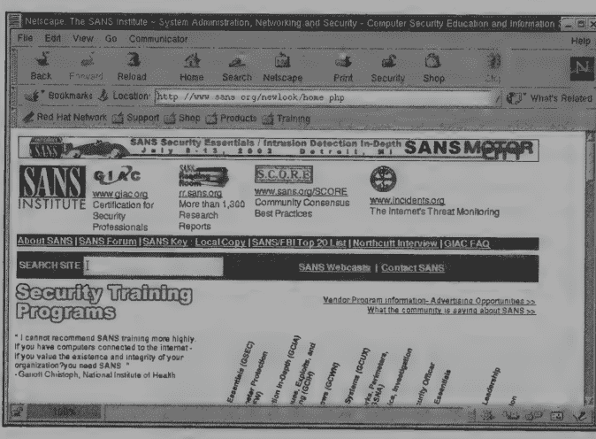

图 7-3 SANS 首页

SANS 还与联邦调查局（FBI）合作，提供一份攻击计算机系统最广泛策略的前 20 名列表。你可以查看此列表以确保你的系统受到保护。对于这 20 个安全问题中的每一个，列表都提供了：

- 安全问题的描述
- 受问题影响或可能受影响的系统列表
- 确定你的系统是否受影响的程序
- 通过消除漏洞保护你的系统的步骤

列表前几项是任何网络管理员都应该避免的潜在问题：避免使用弱密码或不存在密码的账户，确保你有良好的系统备份，并检查安装在系统中的具有网络功能的程序的默认配置。你还可以在列表中找到更多有趣的项目。这里显示了列表的摘要，即针对 Windows 操作系统的特定项目。列表随时间变化，此处内容截至 2002 年中旬。

- 1. 操作系统和应用程序的默认安装提供的安全性很少或没有安全性
- 2. 无密码或弱密码的账户
- 3. 不存在或不完整的备份
- 4. 拥有大量开放的网络端口（未被防火墙拦截）
- 5. 未过滤 IP 数据包以确保正确的入站和出口 IP 地址（这被称为 IP 欺骗，在第 11 和第 12 章中描述）
- 6. 系统活动记录不存在或不完整
- 7. Web 服务器上脆弱的 CGI 脚本程序
- 8. UNIX RPC 服务中的缓冲区溢出错误
- 9. Sendmail 漏洞
- 10. BIND 的缺陷（在 Linux 中通过 named `daemon` 实现）
- 11. R 命令（login, rsh, 和 rcp）的缺陷
- 12. LPR 打印机守护进程的问题
- 13. `Sadmin` 和 `mountd`（此处提到的 `sadmin` 程序在 Linux 中未使用，因此不适用于你的 Linux 服务器）
- 14. SNMP 网络管理软件中的默认设置，这些设置会让黑客了解网络上的系统

SANS 网站上的信息不断更新，并包含许多针对 Linux 的特定安全资源。此外，SANS 还为安全专业人士维护了一项备受推崇的实战认证计划：全球信息保证认证（GIAC）计划。与之相关，SANS 投入了大量精力在世界各城市举办技术会议。这些是非常精彩的会议，顶级安全专家为每天面临安全威胁的网络管理员教授实战课程。近期提供的课程示例包括：

- 安全基础知识的多日系列
- 事件调查（入侵）
- 安全领域中的管理和法律问题
- 网络流量分析
- 黑客使用的技术
- 使用防火墙保护你的网络边界


SANS 会议非常昂贵（每人超过 2000 美元），但 SANS 运营了一个志愿者计划，你可以通过帮助制作会议来免费参加会议课程。详情请查看网站。

除了 CERT/CC 和 SANS，你还应该查看 `www.securityfocus.com` 和 `www.securitymanagement.com` 网站。每个网站包含许多额外的安全资源。


# 美国政府与计算机安全

由于计算机安全日益被视为国家安全的一部分，美国联邦政府继续增加对计算机安全行业的参与。政府正在扮演的新角色有两个例子：计算机犯罪的检察官，以及鼓励良好安全实践的信息清理中心。

## 安全与法律

当黑客开始在毫无防备的世界上施展他们的手段时，执法机构没有法律可以阻止他们。FBI 试图依靠欺诈法（法条）或其他与黑客造成的损害相关的法规（例如通过侵入银行计算机偷取金钱），而不是未经授权访问计算机的特定行为。

当国会通过了 1986 年的《计算机欺诈和滥用法》时，情况发生了变化。该法律规定，未经授权访问计算机（无论是为了财务利益还是为了破坏美国政府网站）都是犯罪。违反该法案的惩罚是各种罚款和监禁。在最近几年中还通过了更多法律，以向 FBI 和其他执法机构提供额外工具来阻止黑客造成的破坏。这些法律包括：

- 1987 年《计算机安全法》
- 1996 年《国家信息保护法》（关于此法的良好讨论，请参见 `www.usdo.gov/cyber/1030_html`）
- 2002 年《爱国者法》

起诉黑客与起诉其他犯罪不同。调查犯罪的检察官可能对技术没有初步了解，可能无法意识到发生了什么；尽管如此，立法者在跟上技术方面可能会很困难。

这里列出了某些可以了解更多这些主题的资源：

- `thomas.loc.gov`（美国国会图书馆的立法信息）
- `law.cornell.edu/uscode`（法律代码库）
- `www.findlaw.com`（全能搜索引擎）
- `www.senate.gov` 和 `www.house.gov`（美国国会的两个网站）
- `www.gsa.gov`（联邦律师的参考网站）

## 政府机构资源

美国州和联邦政府的许多部门都关注信息安全，尽管这些政府其他部分的安全工作严重缺失，正如许多广泛报道的网站安全泄露事件所示。

以下列表描述了有关政府参与计算机安全和计算机犯罪的关键资源。

- FBI 在 1991 年创建了国家犯罪小组，专门处理涉及黑客（他们使用这个词）的案件。FBI 维护有关计算机犯罪的丰富在线资源。参见 `www.fbi.gov`。
- 美国司法部刑事司包括一个致力于计算机犯罪和知识产权的部门。该部门与 FBI 合作起诉黑客。参见 `www.usdo.gov`。
- FBI 还负责国家基础设施保护中心（NIPC），这是一个安全信息、报告、分析和法律数据的清理中心。参见 `www.nipc.gov`。NIPC 由美国司法检察长于 1998 年 2 月成立，旨在保护关键国家基础设施（如互联网骨干和电信网络）不受国内外黑客的攻击。该中心为入侵调查、情报任务（涉及外国公民）以及政府和私营部门调查人员和安全专家培训提供支持。NIPC 的员工来自 FBI 的计算机调查与基础设施威胁中心（CIITAS）。
- 财政部运行特勤局，负责打击伪造币和洗钱。它还运营一个专门防止金融欺诈（现在通常通过计算机进行）的组织。该机构是金融犯罪执法网络，简称 FinCEN，你可以通过 `www.treas.gov/fincen` 或美国财政部首页 `www.ustreas.gov` 了解它。

## 融合安全性的 Linux 产品

Linux 的普及、其免费获取的源代码以及对日益安全的网络的需求，促成了多个侧重于安全性的 Linux 版本的开发。这些版本同样是开源的，但它们为 Linux 添加了特殊功能，使其更类似于中央情报局（CIA）和某些军事设施等使用的高级安全 UNIX 版本。

> 这里的智者应该有一句忠言：不要从字面上接受公司对其产品安全性的宣称。安全是一个复杂的话题，它产生的骗子数量与它产生的实际安全成果不相上下。即使是意图良好的公司，可能也没有意识到他们所说的“坚如磐石、不可破解的安全”等声明的局限性。请保持敏锐的怀疑精神，并准备好彻底调查。

作为一个例子，考虑微软的经历。他们的点对点隧道协议（PPTP）用于在不同的公司办公室之间创建安全网络，曾受到广泛赞誉并获得奖项。后来，安全专家对其进行了检查，发现其设计中存在五个独立的缺陷，并将其技术称为“幼儿园级加密”。同样，在 1999 年夏天，微软在网上发布了一个运行其 Web 服务器 Internet Information Server (IIS) 的服务器，并挑战人们破解它，以此作为其高质量、安全产品的演示。结果它持续了不到三小时。许多公司在安全性方面的声誉高于微软，但请保持警惕，并尽可能测试供应商的声明。

信息安全领域毫无疑问的领导者之一是美国国家安全局（NSA），该机构几十年来一直关注计算机安全（取决于目标，是为了防止安全问题还是促进安全）。NSA 近期的一项进展是发布了 NSA 安全增强型 Linux（SELinux），这是 Linux 的实验性版本，为 Linux 内核添加了新的安全级别。安全增强型 Linux 目前并不是生产级操作系统，而是一个研究项目。它在另一个内核（称为微内核）之上运行 Linux 内核，这允许 Linux 中的每个进程都能被隔离地控制和处理。这意味着如果像 Web 服务器之类的单个程序被安全漏洞入侵，用户将无法访问系统上的任何其他程序或数据。安全增强型 Linux 没有 root 用户，通过基于角色的访问控制确保每个程序都仅限于访问其所需的内容。

你可以通过访问 `www.nsa.gov/selinux/` 了解更多关于安全增强型 Linux 并下载源代码。该程序以补丁的形式提供给标准的 Red Hat Linux 内核，并对实用程序进行了一些额外的升级。当你安装该程序时，它会修改 Linux 硬盘上未使用的区域，但保持与 Linux 程序的兼容性。NSA 网站包含了完整的文档。

## 专注于安全的 Linux 产品

另一个侧重于安全的 Linux 版本是 Trustix Secure Linux（Trustix 使用标准的 Linux 内核，该内核经过彻底配置，作为一个具有严格安全性的服务器）。它不包含图形界面，且默认不启用网络服务。由于它通常假设您会将服务器连接到互联网，因此某种程度的偏执是有必要的。Trustix 的许多预防措施和默认设置现在被 Red Hat Linux 等产品使用，这些产品选择类型安装并指定高水平的防火墙保护安装。Trustix 本身由于其设计重点在于安全性而值得探索。

虽然 Trustix 仅被一少数具有安全意识的程序员使用，但 Red Hat 有资源向你更新任何出现的安全问题。在尝试不同的系统后，你必须根据网络需求以及你对不同网络和安全工具的熟练程度，判断哪种最充分利用你的时间。

另一个提供更具安全意识的 Linux 产品是 Bastille 加固包（加固系统就是使其能够防御破解者）。Bastille 是一组脚本，可以在 Red Hat 和 Mandrake Linux 发行版上运行（针对 Debian、TurboLinux 和 SuSE 的脚本正在开发中）。Bastille 脚本检查你安装的 Linux 系统，检查防止安全隐患的配置。Bastille 脚本中的逻辑取自 SANS 网站和若干本专门研究 Linux 安全的信誉书籍。图 7-4 显示了 Bastille 程序在检查 Linux 系统时的屏幕界面，它向用户提供反馈并按照指示修改系统。

### 图 7-4 Bastille Linux 加固工具

使用 Bastille Linux 加固你的 Linux 系统也可以帮助你学习安全知识，因为在审查系统和更改配置文件时，Bastille 脚本会指导你正在被采纳的安全措施。要了解更多关于 Bastille Linux 并下载脚本，请访问 `www.bastille-linux.org`。

## 章节总结

- 数量惊人且种类繁样的未经授权计算机访问事件继续影响着全球的网络服务器。
- 计算机安全是一个严肃的领域，它让破解者与寻求保护雇主信息资产的管理员对抗。它与一般的系统和网络管理不同之处在于它要求管理员假设计算机用户是恶意的。
- 计算机犯罪统计数据很难收集，但每年花费数十亿美元从未经授权的访问中恢复；人们因犯计算机犯罪而入狱。
- 隐私问题使计算机安全成为任何使用互联网的人的个人问题。大多数网站都发布了隐私政策，并最初通过系统管理员的作为或不作为来实施。
- 系统管理员由于他们所控制的信息，处于极大的信任和权力地位。
- 伦理规范帮助系统管理员理解职业预期，这可以帮助他们建立事业并有效地为内部和外部客户服务。
- 关于安全的决策应该通过咨询专家做出。
- 像 SANS 这样的组织可以帮助系统管理员学习更多安全知识。
- 积极的安全方法而非“通过隐蔽实现安全”会产生最佳结果。
- 硬件、软件和数据都是攻击的对象。
- 社会工程学是破解者的潜在工具，他们通过联系用户来获取信息。
- 你必须保持你的 Linux 系统更新以防止攻击。

## 关键术语

**后门 (back door)**：一种创建者已知但用户未知的访问程序或计算机的方法。它是未记录且隐藏的。

**缓冲区溢出攻击 (buffer overflow attack)**：通过利用程序设计中的缺陷来获取计算机系统的技术。当破解者遵循特定序列或提供特定输入时，程序变得混乱并尝试不当使用内存。作为程序部分的内存空间溢出。结果可能是系统数据损坏、服务器崩溃或获得直接 root 权限。

**CERT 协调中心 (CERT/CC)**：一个联邦资助的软件工程机构，专注于计算机安全并向全球专业人士提供信息；由卡内基梅隆大学运营。

**托管 (co-locating)**：组织将其 Web 服务器放置在 ISP 的办公室，通常依靠 ISP 的安全措施来保护组织的服务器。

**计算机犯罪 (computer crime)**：未经授权访问计算机系统。

**破解者 (cracker)**：在违反法律或伦理规则的情况下访问计算机系统的人；某些人称为 hacker。某些破解者带有恶意，只想通过探索未经许可的区域来测试自己的技能。参见 hacker。

**加固 (harden)**：使计算机系统更加安全以防御破解者的攻击。

**国家基础设施保护中心 (NIPC)**：一个关于这些主题的安全信息、报告、分析和法律数据的汇总中心。由美国政府运营；由 FBI 派遣。

**加入 (opt-in)**：一种营销计划，除非用户明确请求加入接收者列表，否则他们不会收到广告。

**退出机制 (opt-out)**：一种营销方案，用户会自动接收广告，除非他（她）要求将其从接收者列表中删除。

**密码破解 (password cracking)**：破解者的一种活动，通过这种活动获取有效用户账户的密码，方法可能是使用一个程序检查数百万个密码直到找到正确的那个为止，或者根据对用户的个人了解进行猜测。

**隐私政策 (privacy policy)**：组织发布的一份自愿声明，说明其将如何使用以及不使用其收集的用户或客户数据，通常通过网站发布。

**脚本小子 (script-kiddies)**：缺乏技能的破解者，他们使用由熟练破解者创建的重新封装软件“工具包”或脚本来攻入未采取基本安全措施的系统。

**社会工程学 (social engineering)**：通过操纵他人来获取有关计算机系统所需的信息。

**系统管理、网络与安全学院 (SANS)**：一个声誉卓著、备受尊敬的教育和研究机构，其成员包括该国大多数领先的计算机安全专家。简称为 SANS。

**特洛伊木马攻击 (Trojan horse attack)**：一种获取计算机系统访问的技术，通过让系统管理员执行一个看似正常的程序，该程序实际上为破解者创建了安全漏洞，或破坏其运行的宿主机上的数据。

**蠕虫 (worm)**：一种能自我复制并入侵网络计算机系统的程序。与病毒类似，但持续传播所需的人工干预较少。

## 复习题

- 1. 网页篡改（Defacing a Web site）指的是：
  a. 修改其首页上的文本或图形
  b. 尝试破解它
  c. 向网页管理员发送贬性电子邮件
  d. 阻止合法用户访问该网站

- 2. 描述 1988 年底发生的一个事件，该事件导致许多互联网服务器的系统管理员开始认真考虑安全问题。

- 3. 破解系统（Cracking a system）指的是：
  a. 获取计算机系统未经授权的访问权限，通常是远程的
  b. 为另一个用户提供系统的密码
  c. 计算机方面的技术知识
  d. 关闭系统

- 4. 哪一项解释了计算机犯罪准确统计数据难以收集的原因？
  a. 破解者在获得系统访问后无法擦除踪迹。
  b. 组织渴望公众知道他们的系统被入侵了。
  c. 跟踪用于起诉破解者的多种法律可能非常有挑战性。
  d. 许多不同的小组正在尝试收集这些统计。

- 5. 恶意意图是：
  a. 破解者定义的一部分
  b. 未经授权访问计算机系统构成犯罪并不一定需要恶意意图
  c. 仅限于受攻击公司之外的人员
  d. 可能限于老牌破解者

- 6. 商家通常以电子方式维护个人信息是为了：
  a. 防止破解者窃取这些数据
  b. 获取新客户并服务现有客户
  c. 避免维护隐私政策的需求
  d. 防止政府访问这些数据

- 7. 描述隐私政策的目的。

- 8. 订阅机制（opt-in scheme）意味着：
  a. 用户必须请求包含在营销列表中。
  b. 用户必须要求从列表中排除。
  c. 用户必须阅读公司的隐私政策才能生效。
  d. 政府官员打算参加安全计划。

- 9. 伦理准则是：
  a. 现在在许多州被作为法律维护
  b. 完全自愿且具有裁量权
  c. 专业团体成员并不广为人知
  d. 属于专业组织的专业人士的预期

- 10. 列举三个系统管理和安全的专业组织。

- 11. 脚本小子（script-kiddie）指的是一种破解者：
  a. 年轻
  b. 只使用由更熟练的破解者创建的预定义脚本
  c. 获取未经授权的访问但没有恶意
  d. 在没有任何理性动机的情况下攻击网站（例如政治动机或对某些公司的不满）

- 12. 破解者对以下哪项构成了最大的威胁？
  a. 数据
  b. 硬件组件
  c. 软件程序
  d. 网络连接性

- 13. 描述拒绝服务 (DoS) 攻击。

- 14. 描述特洛伊木马攻击。

- 15. 描述缓冲区溢出攻击。

- 16. 假设在获得计算机的未经授权访问后，破解者创建了一个只有他知道的特殊用户账户，这样如果被发现，他以后可以使用该特殊用户账户登录。这是一个……的例子：
  a. 社会工程学
  b. 后门
  c. 拒绝服务攻击
  d. 防火墙

- 17. 安全策略文档可能*不*包含：
  a. 关于安全松散的危险性的细节
  b. 发现入侵时应遵循的程序
  c. 所有用户对使用密码的预期
  d. 用于起诉破解者的法律描述

- 18. 安全公告（Security advisories）：
  a. 由政府机构根据《计算机欺诈和滥用法》的权限创建
  b. 由 Linux 供应商和安全组织提供，以帮助系统管理员了解何时以及如何更新系统以防止入侵
  c. 经常是破解者寻求创建后门或特洛伊木马的工具
  d. 在安全策略文档修订并包含它们之前不应采取行动

- 19. 写出由 SANS 学院开发的安全认证计划。

- 20. 订阅机制（opt-in scheme）意味着……

- 21. 基础设施保护（Infrastructure Protection）是：
  a. 安全公告的集合
  b. 一项保护计算机的法律
  c. 财政部的一个部门
  d. 一个通知系统管理员的组织

- 22. 哪一个美国政府机构主要负责未经授权的访问？
  a. FBI
  b. NSA
  c. 财政部
  d. 特勤局

- 23. 哪一个美国政府机构发布了公开的安全信息？
  a. FBI
  b. NSA
  c. CIA
  d. 司法部

- 24. Linux 加固脚本（Linux hardening scripts）：
  a. 由政府机构根据《计算机欺诈和滥用法》的权限创建
  b. 由 Linux 供应商和安全组织提供，以帮助系统管理员了解何时以及如何更新系统以防止入侵
  c. 经常是破解者用来创建后门或特洛伊木马的工具
  d. 在安全策略文档修订并包含它们之前不应采取行动

- 25. 计算机安全通常分为四个领域：
  a. 物理、用户、文件和网络
  b. 网络、防火墙和隧道
  c. 物理、用户、入侵
  d. 特洛伊木马、缓冲区溢出和社会工程学

## 项目

### 项目 7-1

在这个项目中，你将学习如何更新发现漏洞的软件包。要完成此项目，你应该安装了 Red Hat 7.3，建立了网络，拥有系统的 root 权限，并有互联网连接。（本项目显示了如果你没有红帽网络服务将如何操作。）

1. 以 root 身份登录并打开命令行窗口。
2. 打开浏览器并指向 `www.redhat.com`。
3. 选择 `Support` 和 `Docs` 链接，然后选择 `Errata` 链接。
4. 点击 **Red Hat Linux 7.3 (Valhalla)**。
5. 在 Red Hat Linux 7.3 下选择 **Security Alerts**。此时你应该位于 `rhn.redhat.com/errata/hi73-errata.html`。
6. 查看自 Red Hat 7.3 发布以来的安全公告。找到 RHSA-2002:105，日期为 2002-06-04，标记为 **Updated binary packages denial service attack**。点击该链接。
7. 在页面顶部 Details 部分阅读有关该漏洞的信息。
8. 在 Red Hat Linux 7.3 (i386) 下注意三个软件包：bind、bind-devel 和 bind-utils。依次点击这些链接并将每个 rpm 文件下载到你 Linux 系统的临时目录（如你的主目录或 /tmp）。
9. 回到命令行并进入三个 rpm 文件所在的目录。
10. 使用此命令将系统升级到新的、安全的 bind 包：
```
rpm -Uvh bind-*.rpm bind-devel-*.rpm bind-utils-*.rpm
```


rpm -Uvh bind*

## 项目 7-2

在这个项目中，你将学习在内核发现漏洞时如何更新 Linux 内核。要完成此项目，你应该安装了 Red Hat 7.3，建立了网络，拥有系统的 root 权限，并有互联网连接。此项目假设你使用的是 Red Hat Linux，这意味着红帽提供的 rpm 文件可以提供新的预编译内核。如果你不是在使用红帽 Linux 或其他流行的基于包的 Linux 发行版，可能需要从 `www.kernel.org` 下载内核源码并重新编译新内核。本项目的最后一部分建立在 `www.redhat.com/support/docs/howto/kernel-upgrade/` 的信息之上，你可能也会发现有用。

- 1. 以 root 身份登录并打开命令行窗口。
- 2. 打开浏览器并导航到 www.redhat.com。
- 3. 选择 **Support**（支持）和 **Docs**（文档）链接，然后选择 Red Hat Linux 7.3 的 **Errata**（错误列表）链接。你现在应该位于 `rhn.redhat.com/errata/rh73-errata.html`。
- 4. 找到日期为 2002-05-09、编号 RHBA-2002:085、标记为 **Kernel panic on SMP systems with ext3 file systems is now fixed** 的公告，并点击该链接。
- 5. 阅读该内核升级修复的安全漏洞详情，滚动到标记为 Red Hat Linux 7.3 i386 的部分。
- 6. 在第 1 步中打开的命令行窗口，使用以下命令查看你正在使用的内核（这取决于你的处理器以及你在安装期间选择的选项）：

```
rpm -qa | grep kernel
```

- 7. 将上述 rpm 命令的输出与网站上列出的过时软件包进行比较。注意你系统中受此安全漏洞影响的过时包。
- 8. 使用以下命令查看你系统中安装的这些包的版本。这些包与内核的操作密切相关：

```
rpm -q mkinitrd SysVinit initscripts
```

- 9. 访问 FTP 站点 `ftp://updates.redhat.com` 并选择与 Red Hat Linux 7.3 相关的链接。你将在 `/7.3/en/os/i386` 目录（或你安装的处理器的目录）中看到内核 rpm 文件。
- 10. 下载前述步骤指示的更新系统所需的 rpm 文件（包括内核和内核支持包，如 `initscripts`）。如果你需要下载大文件，使用 FTP 客户端可能比使用 Web 浏览器更方便。（如果你正在使用缓慢的互联网连接，且实际上没有在维护网络服务器，你可能想要按照此操作，因为内核 rpm 文件很大。）

```
rpm -K --nopgp *rpm
```

- 11. 在下载内核文件的目录中，使用以下命令检查下载是否正确。下载的损坏内核 rpm 可能会导致系统无法启动：
- 12. 你应该看到下载的每个 rpm 名称，后面跟着 `md5 OK`，表示下载成功。
- 13. 除非你工作在一个系统崩溃会导致数据丢失的实验环境中，否则请创建一个救援软盘，以便在内核升级出现问题时可以使用它启动系统。使用以下命令创建它：

```
mkbootdisk --device /dev/fd0 2.4.18-3
```

- 14. 在下载文件的目录中，从升级内核支持包开始：

```
rpm -Uvh mkinitrd*rpm SysVinit*rpm initscripts*rpm
```

# 第 7 章 安全、伦理、隐私

- 15. 接下来，升级内核包：

```
rpm -Uvh kernel*rpm
```

- 16. 在此项目的开始阶段，你正在将预编译的内核添加到你的系统中；你并没有在编译新的源代码。要进行此操作，你应该参考 Linux 供应商提供的更详细的说明。
- 17. 如果你在安装 Red Hat Linux 时选择了 GRUB 引导加载程序，那么你已经准备好重启系统了（这是默认选择）。如果你在安装期间选择了 LILO 引导加载程序，你必须使用此命令为新内核更新它：

```
lilo
```

- 18. 你现在可以重启系统。新内核将启动。（你可以使用 `uname -r` 命令查看活动内核的版本号。）

## 项目 7-3

在这个项目中，你将研究《计算机欺诈和滥用法》的某些方面。要完成此项目，你需要一个连接了互联网的浏览器。

- 1. 打开浏览器并导航到 www.law.cornell.edu/uscode。
- 2. 向下滚动首页，直到找到标题为“Find US Code by Title and Section”（按标题和章节查找美国法典）的部分。
- 3. 在 Title（标题）字段中输入 18，在 Section（章节）字段中输入 1030。然后点击 Go to title and section（跳转到标题和章节）。
- 4. 法条并不容易阅读，但请滚动到 (c) 小节，并查看黑客在被判定犯计算机犯罪时面临的一些惩罚。提到的某些最长刑期有哪些？
- 5. 法律在决定惩罚时还考虑了哪些情况？（例如查看 1030(c)(2)(i) 部分。）
- 6. 滚动到 (e) 小节，查看该法律是如何定义“超出授权访问”（exceeds authorized access）的。
- 7. 回到页面开头，注意法律适用于未经授权访问计算机或访问超出授权范围的个人。
- 8. 注意 (a)(2) 小节，法律提到涉及州际通信的计算机。这是因为美国宪法限制了国会可以通过法律的主题（尽管这些限制被广泛解释）。你能想出任何与州际贸易没有任何关联的计算机的例子吗？
- 9. 访问网站 www.findlaw.com。
- 10. 输入搜索字符串“Computer Fraud and Abuse Act”（计算机欺诈和滥用法）。
- 11. 审查结果列表，并选择一两个听起来有趣的进行探索。

## 项目 7-4

在这个项目中，你研究 SANS 的某些方面。要完成此项目，你需要一个连接了互联网的浏览器。

- 1. 打开浏览器并导航到 www.sans.org。
- 2. 浏览网站，查找关于安全策略模板、安全清单或前 20 个关键漏洞的信息。
- 3. 总结 SANS 为安全专业人员提供的主要资源类型。

## 项目 7-5

在这个项目中你研究 CERT/CC 的公告。要完成此项目，你需要一个连接了互联网的浏览器。

- 1. 打开浏览器并导航到 www.cert.org。
- 2. 在 CERT/CC 首页找到搜索框并输入 bind，然后选择列表中的项。
- 3. 注意页面涉及 bind 的大量公告。浏览几个公告，了解漏洞类型和受影响版本。

# 案例项目

## 生活目标

为了使用此功能，用户必须提供姓名和电子邮件地址进行注册。用户输入的所有信息都将被存储，以便他或她返回网站并更改信息以探索新的退休方案。

根据你为该功能收集的信息、使用该功能的用户的期望、公司营销金融产品和服务的需求以及你可能认为重要的其他因素，描述你拟提给管理层批准的隐私政策。你可能会决定访问几家公司的网站，查看它们的隐私政策以获取灵感。（金融服务公司包括 www.etrade.com, www.fidelity.com 和 www.wellsfargo.com）。

- 3. 你今天早上来到 Safety First 上，检查了系统日志，结果发现一名黑客在夜间入侵了退休计算器网站，并根据你所能推断，下载了大约 400 名客户的注册详情和退休计划摘要（客户为了尝试免费退休计算器而输入的）。你今天打算做什么？

# 第 8 章 确保数据安全

> 在阅读本章并完成练习后，你将能够：
>
> * 解释常用的加密系统
> * 理解数字证书和证书颁发机构
> * 使用 PGP 和 GPG 数据加密工具
> * 描述加密应用于提高计算机系统安全性的不同方法

在本章中，你将学习如何使用各种编码技术来保护信息，防止未经授权的用户访问。类似的技术也用于验证用户身份——以确保访问系统或系统资源的用户确实是他们所声称的。

你还将学习实现这些技术的应用程序，可以是直接通过你的命令对数据进行编码，也可以间接通过创建一个安全通信通道，通过该通道可以发送许多类型的数据。

## 加密与计算机安全

计算机安全是关于确保访问给定资源（如文件或网站）的人只有你想要允许访问的人。这并不是一个新类型的问题。两千多年前，亚历山大帝在尝试向帝国内的指挥官发送有关作战的消息时，也有同样的担忧。在过去的一百年里，许多军事、外交和政治斗争都集中在如何在群体成员之间传输信息而不被截获或伪造。对数据进行编码使其在没有特殊知识或工具的情况下无法读取的科学被称为加密。

加密是许多在计算机网络上运行的应用的关键部分，尽管它通常是隐藏的。网络通过建筑内部或建筑之间的电线或通过无线电波传输数据；这些可能被未经授权的人访问。具有技术技能的人可以接入网络连接并看到正在传输的数据。这被称为网络嗅探，如图 8-1 所示。用于执行此项的程序——称为嗅探器——被许多系统管理员用于排查棘手的网络问题。虽然黑客使用嗅探器从网络数据包中收集信息，但如果这些数据包的负载已加密，这将变得困难得多。

> 入侵者连接到网络以嗅探包
>
> 
>
> 图 8-1 嗅探网络连接

## 基本编码技术

加密的过程是非常直观的。你从想要发送给另一个人的消息开始，称为明文。然后你应用一种称为密码（cipher）的技术或规则来修改明文，使其看起来不像明文。这个过程被称为加密，结果是密文：即加密的消息。

加密最基本的例子是字母替换。你用字母表中的不同字母替换消息中的每个字母。假设你需要编码的消息是：

ONE IF BY LAND TWO BY SEA

你创建了以下替换系统——你的密码：

替换字母表中紧随其后的每个字母

使用此密码对上述明文进行编码的结果得到以下密文：

POF JG CZ MBOE UXP CZ TFB

虽然一眼看上去完全无法读，但在不知道其创建规则的情况下，这是一种很容易被破解（解码）的密码。要破译（解码）一个英文明文的字母替换密码，你会假设出现频率最高的字母是元音的替换。重复出现的组合（如上述示例中的 JG 和 CZ）代表常见的英语双字母单词。你可以开发更复杂的字母替换规则，但对于经验丰富的破译者来说，都是易读的。尽管如此，这种简单的技术说明了加密如何让不知道数据如何加密的人也能访问数据。

> 如果你好奇并想尝试字母替换密码，可以从英语中最常用的字母（从最常用到最少用）ETAONRISHD 开始。破译者使用字母和单词频率列表数据库。你可以利用加密文本中的出现频率来确定哪些字母被替换成了其他字母。

要使用字母替换，接收密文的人必须知道加密消息时使用的规则，或者必须通过试错、数学或其他技术将其推导。

## 密钥系统

字母替换技术依赖于将明文转换为密文的规则或一组规则，这被称为算法。任何知道你使用字母替换编码消息时使用的算法的人都可以解码该消息。你还可以为算法增加复杂性：

替换字母表中紧随其后的每个字母


# 密码学与计算机安全

## 一次性填充

另一种加密方法是**一次性填充**。这种方法和字母替换一样简单，但被认为是不可破解的。在一次性填充方法中，消息创建者和消息接收者拥有相同的随机数字列表。随机数字就是密钥。使用一次性填充加密消息，是将消息转换为数字（例如，`A=1, B=2` 等），然后将随机数字加上第一个数字，第二个随机数字加上第二个数字，以此类推。一次性填充的主要问题是向消息创建者和接收者都提供随机数字列表。在电子世界中，没有高效且安全的方法向消息接收者提供随机数字列表。如果你通过电子发送随机数字，它们会像消息本身一样容易被截获。

了解加密消息使用的算法——密码——不应该让任何人读取它。良好的安全确保窃听者不知道密码；密钥必须保密。

## DES

使用计算机进行加密允许你处理大量的数字作为加密的一部分。第一个被广泛接受的加密标准是由 IBM 和美国国家标准技术研究院在 70 年代开发的（`NIST`，见 `www.nist.gov`）。该标准称为**数据加密标准（DES）**。它使用 56 位密钥通过对明文进行各种数学更改来加密数据。56 位密钥意味着密钥由 56 位数字组成，每位都是 0 或 1。一个 DES 密钥看起来如下：

```
110111010100110101001001000011111101010110101010000
```

由于每个位可以是 1 或 0，56 位提供了 $2^{56}$ 种可能的密钥——大约是 7200 亿。尽管 DES 是世界上经过最充分且使用最广泛的加密技术，但在 1998 年，John Gilmore 和 Paul Kochman 使用一台花费 250,000 美元构建的、带有 Intel CPU 的自制计算机，在 56 小时内破译了一个 DES 密钥。他们的努力得到了第 7 章中提到的电子前沿基金会（`www.eff`）以及美国政府的资助，旨在改进加密方法（因为 DES 已经有近 30 年的历史了）。两位获胜者获得了 10,000 美元奖金。自 1998 年以来，破解 DES 密钥所需的时间已下降到 20 小时以下。

向消息接收者传输 DES 密钥仍然是一个问题。这将在后续关于非对称加密的章节中进行讨论。

DES 正在被淘汰，但在某些交易中仍被广泛使用。这是出于几个原因：

- 拥有破解 DES 密钥的设备和耐心的人相对较少。
- 在某些情况下，20 小时是一个相当长的时间。许多交易要求信息在极短时间内保持未知状态。一个典型的网站（电子商务交易）或银行电汇只需要数据保持安全几分钟。此之后，密钥就没意义了，因为每笔交易都会创建一个新密钥。
- DES 是一项广泛实施的美国政府标准——惯性使其在某些情况下得以留存。

## Skipjack 和 三重 DES (Triple DES)

针对 DES 被破解出现了几种应对方案。其中一种方案是将 DES 密钥增加到 1,024 位，这使得破解变得困难得多。另一种方案是创建了一种名为 **Skipjack** 的完全不同的算法，它使用 80 位密钥，比 DES 更安全。它也是一项政府批准的标准。但在最近发生变化之前，使用密钥长度超过 64 位的产品不能由任何美国公司出口，这限制了 Skipjack 的实用性。此外，尽管 Skipjack 算法看起来很有前景，但它并没有像 DES 算法那样经过了多年的测试。

另一种方法是**三重 DES**。这种方法已美国政府批准，它仍然依赖于 DES，但使用三个不同的密钥对每条消息进行三次编码。接收者必须拥有所有三个 DES 密钥，并按照正确的顺序解密三次消息以获得原始消息。

三重 DES 非常安全，使用目前的技术和可用计算能力被认为是不可破解的。然而，它并不是理想的解决方案，因为加密和解密消息既耗时又费资源。对于每一块文本（几行），三重 DES 都要求计算机执行一系列复杂的数学函数三次。消息接收者必须执行相同的函数来读取消息。

## 联邦信息处理标准 (FIPS)

一种经政府批准的信息处理标准（如加密算法）被称为**联邦信息处理标准（FIPS）**。网站 `https://www.nist.gov/encryption/` 包含了所有 FIPS 的信息，包括本章中描述的内容。

## 高级加密标准 (AES)

由于三重 DES 是计算密集型的，**AES** 可以使用不同的密钥长度：128 位、192 位或 256 位。256 位提供了大约 $10^{77}$ 种可能的密钥，`NIST` 预计 AES 至少能保持 20 年的安全。AES 由美国政府机构于 2002 年 5 月 26 日批准。政府的批准意味着许多其他组织也将放心地使用 AES，你可以预计在未来几年看到支持 AES 的安全产品。AES 没有早期那种影响大于 64 位算法的出口限制。美国商务部负责加密技术的出口事务。要了解更多关于 AES 的信息，请访问 `www.nist.gov/encryption`。

其他几种良好的密码也常用在加密软件。它们各有优点，例如解密所需的计算能力很小或没有专利（因此任何人都可以使用）；缺点，例如加密后消息会变得长得多，或者加密消息需要大量的计算能力（从而需要时间）。你可能听过的某些密码包括 `IDEA`、`Blowfish`、`Twofish`、`RC4` 和 `El Galal`。

## 对称与非对称加密

到目前描述的所有流行加密算法——`DES`、`Triple DES`、`AES`、`IDEA`、`Blowfish`、`El Galal`——都使用单一数字密钥来加密和解密消息。它们都是**对称加密算法**，这意味着相同的密钥和相同的算法同时用于加密和解密消息（解密时算法反转）。用于对称加密算法的密钥称为**私钥**，为了确保消息安全，必须保持秘密。由于原因，这些算法也称为**私钥加密技术**。

**非对称加密**使用一个密钥来加密消息；需要另一个密钥来解密。这就像是你将消息放入一个你用它锁上的盒子里，但没有另一个密钥你就无法打开盒子。非对称加密的优点是你可以告诉所有人如何加密他们发送给你的消息，但只有你自己知道如何解密。因为你可以公开的密钥是**公钥**，而你必须保留的是**私钥**，所以非对称加密被称为**公钥加密**。

## 公钥密码学的三个场景

为了理解公钥密码学的用处，请考虑以下三个场景：

1. 如果有人想向你发送消息，使用你的**公钥**来加密消息。你已经在你的网站或其他公开访问的位置广泛提供了你的公钥。你是唯一可以使用**私钥**解密消息的人，而只有你才能访问该私钥。因此，发送消息的人知道你是唯一一个能读取它的人。这如图 8-2 所示。不幸的是，你无法知道是谁在给你发送消息，因为每个人都可以访问你的公钥。尽管你可能知道她是 Sally，但也可能是 Brutus。

   

2. 为了解决这个问题，某人可以使用她的**私钥**向你发送加密消息。这样你就可以确定该消息确实来自她，因为只有她的**公钥**（你可以在她的网站或其他地方找到）才能解密该消息，如图 8-3 所示。当然，其他其他人也可以解密她发送给你的消息。

   

3. 为了向你发送一个只有你才能解密、且你确定来自自称发送者的人的加密消息，某人会采取以下步骤：首先，该人使用你的**公钥**对消息进行加密。然后，该人使用她的**私钥**再次进行加密。当你收到消息时，首先使用发送者的**公钥**对其进行解密。这让你确信消息确实来自那个声称发送它的人。然后，你使用自己的**私钥**进行第二次解密并阅读，如图 8-4 所示。任何人都可以使用发送者的公钥并看到消息只可能来自她，但只有你能够完成第二步并读取其内容。

   

## RSA

最著名的公钥加密示例是 **RSA 算法**，由 Ronald Rivest、Adi Shamir 和 Len Adleman 开发。RSA 是某安全产品公司的基础（参见 `www.rsacurity.com`）。然而，RSA 技术的专利已于 2000 年 9 月过期，因此其他公司现在可以在其软件中使用相同的技术。（例如下一节中描述的 `PGP`。）

RSA 技术用于许多供应商的众多产品中。`RSA Security Inc.` 将其用于 Web 服务器、虚拟专用网络（`VPN`）软件（如第 11 章所述）以及许多其他需要高安全的场景。RSA 技术被包括 Netscape 和 Microsoft Internet Explorer 在内的流行浏览器使用，以确保互联网交易的安全。这是与 `DES` 等对称加密方法结合实现的。

使用 `Triple DES` 和其他其他对称密码时，使用公钥加密算法加密消息需要大量的计算能力。正因如此，大多数系统依赖于**混合加密**；它们结合了对称密钥密码和公钥密码。公钥技术（如 `RSA`）用于加密用于对称密码的密钥，以便接收者获取该密钥并解密消息的剩余部分。只有对称密钥需要公钥加密那种更消耗 CPU 的操作。这就是浏览器处理安全 Web 交易的方式，如图 8-5 所示。

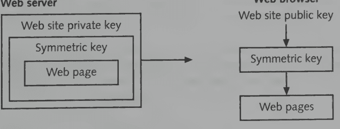

## 签名与证书

使用公钥密码学交换消息存在一个潜在的缺陷，你可能已经想到了：你如何知道你拥有的某个个人的公钥真的是属于那个个人的？涉及到密码学时，你真的不能认为理所当然，但公钥密码学也让你验证个人或组织公钥的完整性。这是通过身份验证过程实现的，使用了签名和证书。

**身份验证**向计算机系统或他人证明你确实是你所说的人的过程。在现实生活中，你通常使用照片身份证（如驾照）来验证自己的身份。签名让你验证公钥。

你用自己的**私钥**对另一个人的**公钥**进行**签名**，以验证它确实属于那个人。获取该密钥的其他其他人可以看到你信任它，因此他们可能决定信任它，或者他们可能会自己验证其正确性，通过用自己的私钥对公钥签名来添加自己的签名。一个带有多个你所信任的人签名的公钥，很可能被信赖为该密钥所有者的有效公钥。如图 8–6 所示。

| 密钥本身 |
| :--- |
| Amy 的签名 |
| Ed 的签名 |
| Quang 的签名 |

**图 8–6** 对公钥进行签名以表示你信任其准确性

> 如果你确定自己认识某人的声音，可以通过电话联系该人来验证密钥。技术会议经常举办签名聚会，你可以在那里见到面并让他们验证公钥，以便与他们进行安全通信。（下文描述的“指纹”提供了一种引用公钥的简便方法。）

你与同事之间的个人联系、你信任的签名以及对彼此签名的依赖，形成了一个**信任网**。你必须努力扩展这个网络，以便本章后面描述的软件（它们实现了后文讨论的加密算法）对你真正有用。

### 数字签名与证书

一个关系较远的概念使用了非常相似的术语：**数字签名**是电子交易的一部分，它使交易具有你用笔签署的文件那样的法律约束力。此类签名并不常用，因为控制它们的法律在许多州尚未定型。有一天，你可能可以在离开家或办公室的情况下获得抵押贷款或结婚证。

**证书**提供了类似的验证，但通常用于参与电子商务的组织。证书是一个用于识别组织的代码。证书不是加密，它只是分配给你的数字，类似于社会安全号码或驾照号码。证书由验证过组织信息的**证书颁发机构（CA）**签名。要从颁发机构获取证书，你必须向颁发机构证明你就是你所称的人，如下场景所示。

`XYZ Corp.` 想要在互联网上开展业务。他们联系了证书颁发机构 `VeriSign`（`www.verisign.com`）并申请证书。`VeriSign` 要求 `XYZ Corp.` 提供文件，可能公司章程、高管姓名、各种地址和电话号码、公证的公司抬头等。一旦 `VeriSign` 确定 `XYZ Corp.` 是一家真实的公司，就会颁发证书，`XYZ Corp.` 将其安装在网站上。当你尝试完成购买时，`XYZ Web` 服务器向你提供证书。证书包含了关于是谁颁发它的说明。看到证书是由 `VeriSign` 发的，你就信任你正在访问（并可能提供信用卡号）的网站是由合规公司运行的。你对证书颁发机构越信任，就越能确定提供证书的组织正如其所称的。

证书与公钥密码学结合使用以防止证书伪造。假设某个用户曾与 `XYZ` 做过交易并拥有其证书的副本。理论上，该用户可以使用网站冒充 `XYZ Corp.`。如果证书是用 `XYZ Corp.` 的**私钥**加密的，且你使用 `XYZ Corp.` 的**公钥**进行解密，那么你就可以确定只有 `XYZ Corp.` 发出了该证书。图 8–7 展示了带有证书的安全 Web 交易。

`VeriSign` 根据你证明身份的强度出售不同类型的证书。产品价格从数百美元到数千美元不等，并包括 `VeriSign` 证书出现问题时的商业保险。


该系统的一个实际问题是证书颁发机构的身份。`VeriSign` 发布证书的时间比几乎任何其他公司都长，但它是否应该对每个电子商务参与者都必须使用的服务拥有垄断呢？如果不是，消费者该如何处理 500 个证书颁发机构？哪一个值得信任？用户又如何知道？这些问题尚未解决，使得目前的证书世界变得有些混乱。

## 指纹

公钥和证书的长度可能长达数百位。**指纹**是从公钥派生的一个较小数字，且很难被伪造。指纹通过对密钥或证书进行**哈希**产生。哈希是数学函数（粗略称为**哈希函数**）的结果，它以可预测的方式将大数字转换为小数字。如果大数字发生了变化，较小数字（哈希）也会随之改变。因此，你可以比较公钥的两个哈希值来检查密钥是否被修改。这种哈希在计算机安全中也被称为 `MD5` 和 `SHA-1`。

**消息摘要哈希（称为 MD5）**将任何长度的数字（包括大型计算机文件）转换为一个 128 位的数字，称为**校验和**。（更通俗地说，校验和是一个计算值，有助于验证文件或传输内容没有被损坏。）由于 128 位仅对应 32 个十六进制数字，因此将密钥或文件的 `MD5` 哈希与预期值进行比较非常容易。`MD5` 这种哈希的性质意味着，如果文件或密钥被更改，生成的哈希也会发生变化。然而，通过研究哈希，无法提取或导出原始数据（密钥或文件）。

简单的 Linux 实用工具 `md5sum` 可以从任何文件创建 `MD5` 哈希。该工具的 `-c` 选项允许你检查现有 `MD5` 校验和列表与文件，以查看是否有匹配的。要使用此工具检查文件的 `MD5` 哈希，请在命令后包含文件名：

```
md5sum filename
```

该工具以十六进制格式打印 128 位的 `MD5` 校验和，如例输出所示：

```
15e10987f891132dc13790ba8e71c3a2 timesheet.doc
```

许多 Linux 供应商使用 `MD5` 来帮助用户确保 `rpm` 文件没有被损坏（被破解者或因下载错误损坏）。你也可以选择 `MD5` 作为密码保护机制（例如，在 `Red Hat Linux` 中使用 `authconfig`）。要对已下载或在 CD-ROM 上的 `rpm` 文件执行此操作，请运行带有 `--checksig --noppg` 选项的 `rpm` 命令（我们稍后会查看 `GPG` 工具）。例如，假设你下载了 `bind` 包的安全更新包。以下命令将报告作为 `rpm` 文件一部分存储的 `MD5` 校验和是否显示文件完整性：

```
rpm --checksig --noppg bind-9.1.3-6.i386.rpm
```

如果包是完整的，命令的输出如下：

```
bind-9.1.3-6.i386: md5 OK
```


另一种比 MD5 更安全的哈希类型是安全哈希算法 (`SHA-1`)。`SHA-1` 为任何文件或密钥提供 160 位的哈希，借此检查消息或密钥在传输过程中是否损坏。使用这种哈希的指纹用于在本章描述的公钥加密工具中。当你传输或接收加密块时，会使用像 `MD5` 或 `SHA-1` 这样的哈希。哈希与公钥结合创建传输签名。数字签名算法 (`DSA`) 是执行此操作的常用标准。

> 网页 `redhat.com/solutions/security/news/publickey.html` 包含了 Red Hat Software 的公钥以及该密钥的指纹。


# 在浏览器中使用密码学

本章描述的技术将在本章及后续章节中使用。然而，在你的计算机上观察密码学发挥作用的最简单方法是打开像 Netscape Communicator 这样的浏览器。因为浏览器必须处理来自你访问的任何商业网站的加密安全信息，它们拥有完善且可配置的密码学功能。

# 第 8 章 确保数据安全

当你访问通过加密传输到你计算机的网页时，会在浏览器窗口左下角看到一个小锁或钥匙。未加密的页面会显示此钥匙图标断成两截，或显示锁处于未解锁状态，如图 8-8 所示。大多数加密的 Web 页面（如订单输入屏幕、购物车、账户查看页及类似数据）的 URL 以 `https` 开头，这表示 Web 服务器使用了加密协议传输网页。网页的加密协议是安全套接层 (`SSL`)，在第 6 章中介绍。

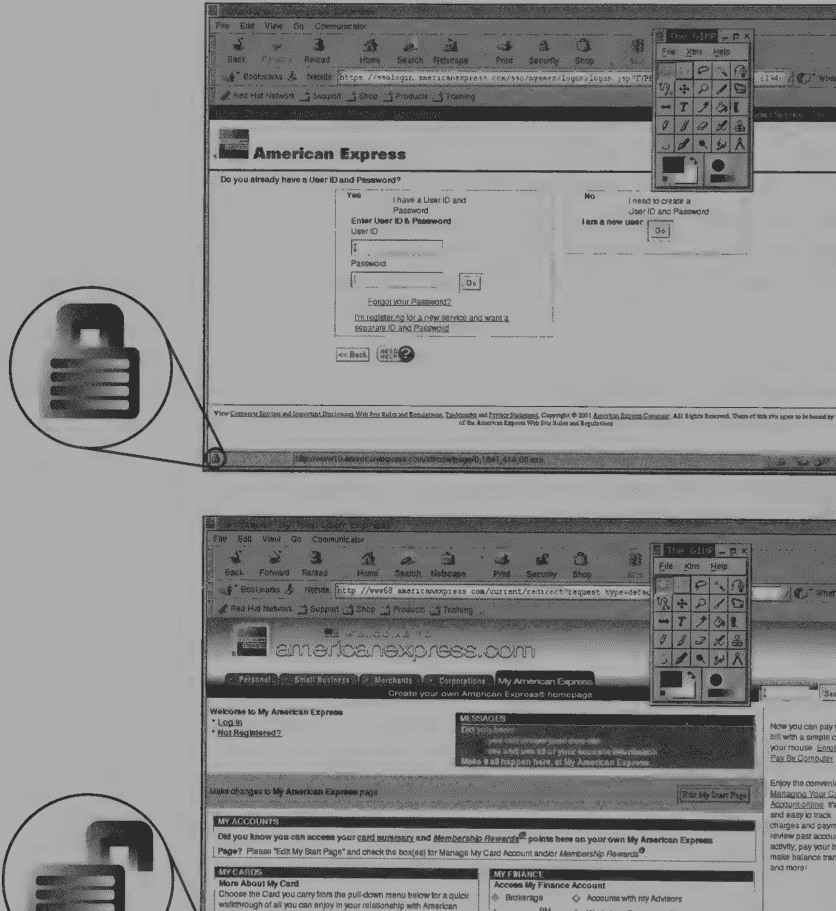

**图 8-8** Netscape 中的安全 Web 图标

用户访问。这是对图 8-12 所示过程的简化，说明了为什么 Kerberos 既被认为一种非常有价值的安全工具，也是一个安装和维护耗费力的系统。

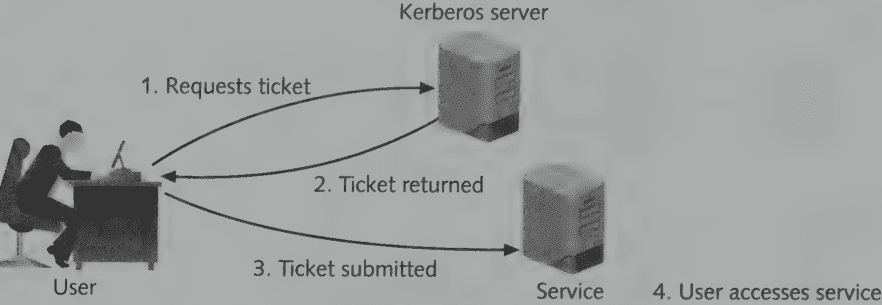

**图 8-12** Kerberos 票据过程

Linux 支持 Kerberos，包括你可能需要的所有常用服务，如打印、NFS、FTP、r-utilities 等许多其他。如果你已经在 Kerberos 领域（realm）中运行，在安装某些版本的 Linux（包括 Red Hat Linux 7.3）时，你可以选择 Kerberos 作为选项。在 Red Hat Linux 中安装后设置 Kerberos，请使用图 8-13 所示的 `authconfig` 文本实用程序。该实用程序有一个图形版本，你可以在 Red Hat Linux 中打开 Gnome 主菜单并选择“程序”（Programs），然后是“系统”（System），最后是“身份配置”（Authentication Configuration）（见图 8-14）。你可以使用命令 `authconfig-gtk` 运行此图形实用程序。

你将在 `authconfig` 和 `authconfig-gtk` 中看到书中解释的许多选项。

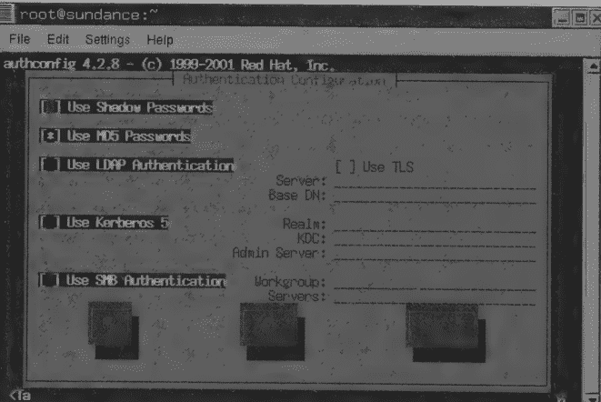

**图 8-13** Red Hat Linux 中的 authconfig 实用程序

# 使用加密工具

391

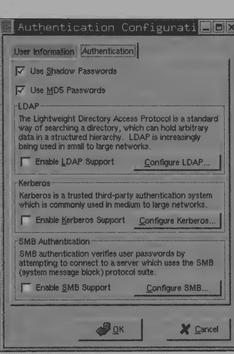

**图 8-14** Red Hat Linux 中的图形化身份配置实用程序

关于 Kerberos 的更多信息，请访问 `www.kerberos.net`。该网站上的常见问题（FAQ）假设你已经熟悉 Kerberos 的大部分内容。一个很好的起点是 `http://web.mit.edu/kerberos/www/dialogue.html`，它提供了 Kerberos 票据过程的概念大纲。

## 使用加密工具

你在浏览安全网站时会使用公钥加密，但你也可以在将电子邮件或文档发送给他人之前对其进行加密。

## 良好的隐私 (PGP)

第一个为各个角落提供公钥加密的实用程序是 Phil Zimmermann 创建的 **Pretty Good Privacy (PGP)** 程序。PGP 通过让每个人都能使用“军用级”加密技术（被政府归类为武器的加密技术）引起了轰动。Zimmermann 先生因为希望通过免费软件让每个人都能使用强加密（以及隐私）而接受了为期三年的政府调查。

自 Zimmermann 先生的公司卖给 Network Associates 以来，PGP 一直不再免费。你可以访问 `www.pgp.com` 了解更多关于他们提供的产品。另一个链接到许多全球 PGP 相关资源的网站是 `www.gpg.net`。

虽然 PGP 软件以前包含在每个 Linux 发行版中，但它已被另一个目标相似的程序所取代：Gnu Privacy Guard (GPG) 程序。

在下一节学习 GPG 的时候，请考虑你在使用任何形式的加密时所做出的权衡。你在保护文档上投入的精力越多，窃听者拦截和读取你的消息所花费的精力就越多。某些消息并不值得费力使用强加密技术，要么是因为它们的内容是无害的（例如购物清单），要么是因为其价值时间很短（例如必须在几秒内完成的金融交易，否则加密密钥将失效）。你必须创建并维护安全通信所需的关系，以便在需要时它们能有效工作——你必须建立一个适合你自身情况的信任网。

一些工作在金融服务业、政府情报部门，或对个人隐私高度关注的用户，将乐意投入精力遵循安全专家的所有建议，保护他们的私钥、签署他人的公钥，并其他保护其安全措施的有效性。其他人则没有需要保护的关键信息。他们可能假设，不太有人会花大量时间尝试解密他们的消息。你必须决定自己的安全需求处于什么水平。然而，所有用户都应该具有安全意识，并采取措施（例如使用安全的 Internet ）来保护个人数据，是因为有大量的黑客正在寻找身份盗窃、信用卡欺诈和类似活动的目标。

## Gnu Privacy Guard (GPG)

**Gnu Privacy Guard (GPG)** 是一种公共加密实用程序，在许多方面与 PGP 兼容，包括使用由 PGP 生成的公钥。PGP 使用专利 IDEA 加密，而 GPG 使用 El Gamal 和非专利算法。GPG 包默认安装在 Red Linux 7.3 上，并适用于所有 Linux 系统。对于许多系统，你可以下载 rpm 或 deb 格式的软件包（见 `rpmfind.net`）。在 Red 中的包名为 `gnupg`。关于 GPG 的完整信息可以在 `www.gnupg.org` 网站获得。GPG 通过命令行操作，尽管本节后文描述了图形界面。你执行 `gpg` 后面跟命令或选项参数。GPG 的第一步是为你创建一个密钥对。密钥对是一个可以分发给他人的公钥和一个留在你系统中的私钥或秘密密钥——其他人看不到。你使用以下命令在 GPG 中创建密钥对：

```
gpg --gen-key
```

公钥加密；从密钥用于对称加密。GPG 将使用此过程对文件进行加密：

- 使用你的对称密钥加密文件
- 使用消息接收者的公钥对你的对称密钥进行加密
- 使用你的公钥对的私钥/密钥对结果密文进行签名，以便接收者验证该消息可能仅由你发送

你可以使用 GPG 中的 `--export` 命令导出你的公钥，以便其他人可以使用它。这会创建一个二进制文件，你可以将其交给他人，然后使用 `--import` 命令将该密钥添加到他们的系统中，允许他们向你发送加密消息。你存储在系统上的公钥集合被称为“密钥环”（keyring）——它是系统上的一个文件，包含了 GPG 可以直接访问的所有密钥。

通常使用 `-a` 选项（或长格式下的 `--armor`）来让 GPG 将输出转换为可读字符，这允许你将密钥包含在电子邮件或打印文档中。

例如，假设你想与朋友交换密钥。你使用以下命令导出你的公钥，使用你的用户 ID 来标识你想要导出的密钥。你可以使用名称或电子邮件地址，GPG 将它们与你密钥环中的密钥进行匹配。`-o` 选项指示存储密钥的输出文件：

```
gpg -o export nwells@us.net
```

然后你从朋友那里接收密钥并使用以下命令导入你的密钥环：

```bash
gpg --import thomas.key
```

现在，当你使用 `--list-keys` 命令列出密钥时，新密钥已在列表中，你能够为该用户加密消息。

假设另一个用户在发送给你的电子邮件消息中包含了一个密钥。她使用此命令创建要粘贴到其消息中的文本：

```bash
gpg -a -o gutowinski.key --export pgutowski@xmission.com
```

该文本看起来如下：

```
----
mQGB3z5HrMRBACT1vx3G7v6bBEY0QChnll15FGXItwNCPrc5/BOD+jW880q
qVAVuSfn/Y+0axG2plyputWf2S80Au3Peyll91nt0S3AuBp+7PT7IT7+Wl2Jua2
waFR737ahn4P4Be8BV0duRff88CmoA2tekl1y57PTV05PKps4lessXKIWzCwCgj
hHO2RIlq2o/wQHJQOE678D/I16kb6vy2NsAsq2KDY8WSM9V4+RCAYSZm
duK3mWte0gYfJr4dVt5rAP164a2anzqNl1fUVOki/itqitgp5MTWw30Os5lklJGTXdXisRYRRRCRMDwoE2jHlqS02b5i99mdnUJXAbUSGDWWTA/97/h65obSam/JDWec33AL/WChnoBAAWJ99PqXXa6uX/4EpCyc4n9e28FM0M3Yve4ER4Hp4W33VIH5l27t53b8ps57X/4015bgb601UrccEEhbnaAtty0YllOHkN7i4ml6J/8k5M2L5qJ0QNUGV0E21X3b0d3a2zkpbHND3ub4rB3cl25v1jb59ibE20FECEBCA3Afz3fRMCkWADQfQMCAXYXIQAG68R5/f1XYUBAJ92Pruf06u0Y988XPZENCEaIGaCCDAFBME44fX9E21l66555OETkrcXEAAMMSDMJgYrtVHe+bS02IAi88gduY9s33hNnVIwIn06xS1/f55HEQZ72UTCQT7qqZ-ppe-beYLgG86Y0tYk23jlvzf6f66I/jUCGRocM893D044lykyW516l7RI3XhbpYfJvXkl333*kppvYHI99fHMABFCAJzTY96BBAH44YkbBTeagQT60+n46kdDBSVJxlndNKI333JfJfbBocRYJ99Pma*Hn-XESk223e3Y9344476471/lmWRhQGubJ48b1P1My0d7EQQ52KV51D2CU2629JUsfJkz334p3048b75uz+ucN8+U2WqESUE+2J3lITJHRBBRAG66A8A3A6OELJFT/L44/2IhojkoG01... (原始源中截断的损坏数据)
```

# 398 第 8 章 制作安全数据

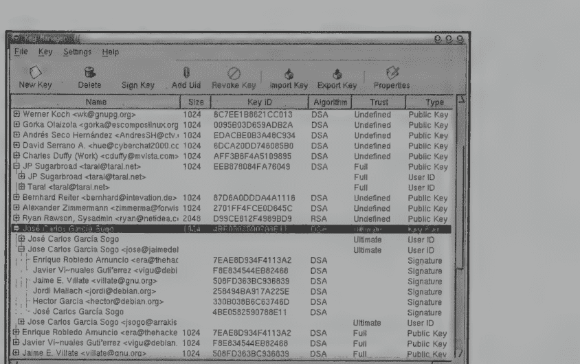

**图 8-15** Seahorse 的 GPG 图形界面

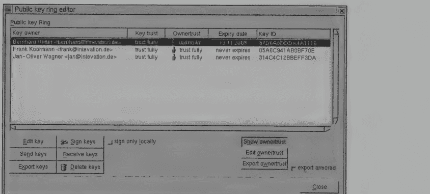

**图 8-16** Gnu 隐私助手

许多程序的设计旨在自动与 GPG 功能交互。例如，pine、elm 和 Kmail 等几个邮件读取器可以配置为后台使用 GPG，根据发送者或收件者的电子邮件地址自动加密和解密邮件。同样，也可以向 Mozilla 浏览器中添加模块，以相同的方式增强电子邮件功能。

# 其他安全应用

GPG 是一个强大的工具，因为它允许你使用许多专用命令来管理密钥环，并让你能够对任何想要安全传输的文件应用公钥加密。你可以通过不安全的网络将经过 GPG 加密的文件发送给接收者，而不必担心有人嗅探网络并读取你的信息。但请记住，GPG 只是 Linux 用户可用的许多加密工具之一。许多其他协议和实用程序使用了在本章中学到的加密技术，在不同的上下文中提供计算机安全。

这些安全相关的实用工具中某些更为专业。例如，`rpm` 命令包含一个 GPG 签名，你可以通过验证该签名来检查软件包是否来自 Red Hat Software, Inc. 且未被破解者修改。其他工具更具通用性，目标是保护两个主机或网络之间的所有通信，而无需运行像 GPG 这样的工具来加密文件。

如果没有本节简要描述的实用工具，网络对于企业和个人来说将变得危险得多，因为可用技术可以到达其他用户的数据包在穿越网络时被访问。然而，使用此类工具使校园网络或小型企业网络安全变得像美国情报网络一样安全——前提是网络管理员和网络上的用户都愿意按照适当的步骤创建和维护安全的网络环境。

每当你规划网络安全时，请尝试把自己放在破解者的角度考虑几分钟。弱点在哪里？你将如何获取或伪造密钥以便读取网络用户发送的消息？例如，如果一个网络是建立在所有用户都致力于使用的公钥加密系统之上的，破解者不太可能尝试破解密钥。相反，他会尝试伪造密钥、盗取包含秘密密钥的笔记本电脑，或者找到一个对他想要的文件有访问权限的不满员工。通过思考你网络的弱点（技术上的或人的），你可以预先决定如何阻止利用这些弱点的尝试。

# RPM 安全

在本章前面的部分，你读了关于使用 `rpm` 命令检查 rpm 包的 MD5 签名以验证其完整性的内容。这验证了 rpm 包在下载过程中没有被损坏，但并没有说明它是由谁创建的。要做到这一点，你必须从 `www.redhat.com/security/news/publickey.html` 添加 Red Hat Software 的公钥，然后检查 rpm 包的公钥签名，以验证该 rpm 确实来自 Red Hat。其他公司可能也使用类似的技术；你可以以相同的方法获取它们的公钥并检查签名。

假设你从一个认为是官方 Red Hat 包镜像站的网站下载了一个 rpm 包。使用 `rpm -qi` 命令进行的检查列出打包者（Packager）为 Red Hat Software。该包是 IP Chains 的更新，IP Chains 用于在 Linux 中创建防火墙（如第 11 章所述）。精明的破解者可能会通过篡改 IP Chains 对你的安全造成破坏，因此你使用此命令验证该包是由 Red Hat Software 创建的：

```
# rpm --checksig ipichains-1.3.10-15.i386.rpm
ipichains-1.3.10-15.i386.rpm: md5 gpg OK
```


第二行上的 `OK` 输出显示文件未损坏（MD5 校验和已通过验证），且该文件已由 Red Hat Software 私钥进行签名（gpg 密钥已通过验证）。

# 加密文件系统

在第 5 章中，你学习了网络文件系统（NFS）。虽然这对于用户和系统管理员来说可能是一个巨大的便利，但 NFS 假设了一个所有用户都是可信赖的环境。加密文件系统（CFS）放弃了这一假设，对在网络上共享文件的所有用户强制执行加密身份验证。另一组人员通过使 TCFS 原始开发者（Matt Blaze）的工作更加增强，使其对网络上的客户端用户透明运行。他们将项目重命名为透明加密文件系统（TCFS）。TCFS 仍在开发中；要了解更多信息，请访问 `http://zaphod.redwave.net/linux/tfs/` 和 `www.tcffs.it`。

# IP 数据包加密

加密可以发生在网络传输的不同点。例如，用户可以在将文件附加到邮件消息之前使用 GPG 加密文件。数据从客户端看到它的一刻起就被加密了。相反，邮件服务器 `sendmail` 可以实现一种安全措施，即与互联网上的另一个 `sendmail` 服务器交换密钥，并在传输任何消息之前建立安全连接。

除了 Web（使用之前描述的 HTTP 和 SSL），很少有应用程序协议具有标准化的加密机制。例如，POP3、SMTP、FTP 和 NFS 并没有打算这样做。相反，开发者在 IP 层创建了加密选项。

IPsec（用于安全 IP）是 IP 数据包加密的一个相当新的行业标准。IPsec 在 Linux 中得到了支持，但作为一个标准，它尚未完全定型（问题待解决）。当 IPv6 广泛使用时，它将完全支持 IPsec。更多信息请访问 `rfc-editor.org` 并搜索 RFC 2401。

一个不那么广泛的尝试是加密 IP 封装（CIPE），它将 IP 包封装在加密的 UDP 包中。CIPE 特别关注立即可用（等待 IPsec 相关复杂问题的解决）以及与复杂网络中路由技术的兼容性。有关 CIPE 的详情请访问 `http://sites.inka.de/sites/bredig/cipe.html`。

# Secure Shell

Secure Shell（SSH）协议在更广泛可能被称为 GPG。SSH 最简单的描述是 Telnet 的加密版本——它允许你访问远程主机就像 Telnet 一样，但嗅探网络的程序看不到你传输的内容。然而，这种简单的解释往往忽略了 SSH 的强大；与 Telnet 不同，SSH 设计允许其他协议运行在其之上（取决于你的比喻）。

例如，FTP 等协议和 X 系统的会话是完全不安全的。然而，你可以启动 SSH 会话并将 FTP 或 X 会话绑定上面，这样 FTP 或 X 会话的所有流量都通过 SSH 传输——是完全加密的。

与其他互联网服务一样，SSH 包括一个客户端工具（`ssh`）和一个服务器守护进程（`sshd`）。此外，SSH 包包含了生成密钥的工具，`scp` 程序像 `rcp` 一样，允许你在网络上的任何两台计算机之间复制文件，并具有完全加密。SSH 作为商业产品提供——参见 `www.ssh.com`。Linux 发行版依赖 SSH 的免费版本，称为 OpenSSH——参见 `OpenSSH` 在许多 Linux 系统上默认安装。SSH 在第 11 章中有更详细的描述。

# 虚拟专用网络

许多加密产品和协议系统管理员的目标是创建一个虚拟专用网络（VPN）。VPN 是一种使用不安全的公共网络（如互联网）进行通信的安全组织网络。VPN 利用了互联网连接的高速度和相对廉的成本，同时向连接到互联网的其他人隐藏了敏感数据。见图 8-17。

VPN 通常是借助专门设计的软件创建的，这些软件将许多网络功能与加密协议以及系统管理软件集成在一起。第 11 章将更详细讨论 VPN 软件。

某些国家以各种方式限制加密技术的使用。例如，法国公民在没有特殊许可的情况下不允许公钥加密。如果你打算将加密产品跨越国界，你应该研究适用的规则。OpenSSH 等软件包的网站包含有关使用该软件包的法律说明。

## 章节总结

- 密码学是研究数据编码的科学，通常使用密钥，使得没有密钥的人无法读取数据。密码学使用密码算法将明文加密为密文。
- 密码学保护计算机网络免受嗅探器（sniffers）的攻击，嗅探器允许黑客查看网络中传输的数据。
- 许多算法被用于加密数据。这些算法是对称的（使用单一密钥进行加密和解密），要么是非对称的（使用两个不同的密钥进行加密和解密）。非对称算法的使用通常被称为公钥加密。
- DES 是一种流行的标准加密算法。Triple DES 和 AES 在许多情况下已取代了它——两者都是 FIPS（美国联邦政府工作批准的标准）。其他密码算法如 El Gamal、IDEA 和 Blowfish 也很流行。
- 公钥加密不需要你与加密消息的接收者公开交换秘密密钥，这消除了在计算机网络上使用加密的一个主要缺点。公钥加密用于安全地传输用于加密文档的对称密钥。
- RSA 是最熟悉的公钥算法。
- 文档上的签名表明发送者是唯一可能发送该文档的人；GPG 中公钥上的签名表示该密钥受签名者的信赖。
- 证书由 VeriSign 等证书颁发机构发布并签名，以证明持有证书的机构的身份。
- 哈希值（Hash）是一种数学函数，它可以从一个非常大的数字创建一个较小的数字。流行的哈希算法有 MD5 和 SHA-1。用于创建指纹的哈希值允许使用户快速验证公钥或其他大数字文件的完整性。
- 如 Netscape 和 Mozilla 等浏览器通过安全套接层（SSL）协议使用密码学，以允许安全的电子商务交易。

# 关键术语

- Kerberos 提供了一种全网络范围的用户和服务身份验证方案，将网络访问限制在授权用户，但它在配置和维护上需要投入大量时间。
- PGP 是第一个免费获取的公钥加密软件。它由 Phil Zimmermann 创建，现在归 Network Associates, Inc. 所有。PGP 仍然是 PGP 所基于的行业标准。
- Gnu Privacy Guard (GPG) 是一种免费的密钥加密实用，允许你管理密钥并对文档进行加密、签名和解密。图形化工具可以更方便地操作 GPG。许多如 pine、elm 和 Kmail 等工具可以集成对 GPG 的访问以发送和接收消息。
- 只有在确定提供密钥的人员身份后，才对密钥进行签名。
- `rpm` 可以检查任何软件包上的公钥签名，以验证其是否来自声称创建该软件包的人或组织。
- 其他基于与 GPG 相同密码学原理构建的安全协议包括 IPsec、CIPE、CFS 和 TCFS。许多网络管理员使用这些或专门定制的软件为跨越多个办公室的机构创建虚拟专用网络（VPN）。
- Secure Shell (SSH) 通过一个类似于 Telnet 的实用程序提供加密远程访问。SSH 还允许其他协议协同工作，为许多目的创建安全连接。SSH 的商业版和开源版本可用。

## 关键术语

**Advanced Encryption Standard (AES)** — DES 的替代方案。下一代政府批准加密标准。使用 Rijndael 算法（发音为 "Rain Doll"）。

**algorithm（算法）** — 一组规则，遵循这些规则会产生预测的结果。

**asymmetric encryption（非对称加密）** — 一种使用不同密钥来加密和解密消息的加密算法。一个保密，一个公开发布。通常被称为公钥加密。

**authentication（身份验证）** — 向计算机系统或他人证明你确实是你所说的那个人的过程。

**Blowfish** — 一种对称密码。

**checksum（校验和）** — 一个计算值，有助于验证文件或传输没有被损坏。

**cipher（密码算法）** — 一种将明文转换为密文的密码学技术或规则。

**ciphertext（密文）** — 使用密码算法编码的消息，使其不再可读。明文加密的终点。

**Cryptographic File System (CFS)** — Linux 支持的一种文件系统驱动程序，为类似 NFS 的共享模型添加了加密功能。

**Cryptographic IP Encapsulation (CIPE)** — 一种 IP 数据包加密协议。它缺乏 IPsec 的某些功能，但已经完全实现（而 IPsec 还没有）。CIPE 通过在加密的 UDP 包中隧道化 IP 包来运行。

**cryptography（密码学）** — 使用特殊知识或工具对变得不可读的数据进行编码——并尝试解码的科学。

**Data Encryption Standard (DES)** — 第一个被广泛接受的加密标准，由 IBM 和美国国家标准技术研究院在 20 世纪 70 年代开发。

**digital signature（数字签名）** — 电子交易的一部分，具有与……相同的法律约束力。

**Digital Signature Algorithm (DSA)** — 电子交易的一部分，具有与……相同的法律约束力。

**El Gamal** — 一种用于公钥加密的流行密码。

**Federal Information Processing Standard (FIPS)** — 一种处理标准。

**fingerprint（指纹）** — 用于创建指纹的哈希值，允许使用户快速验证公钥或其他大数字文件的完整性。

**encryption（加密）** — 使用密码算法对明文进行编码，使其不再可读。明文加密的终点。

**GPG** — 一种免费的密钥加密实用程序，允许你管理密钥并对文档进行加密、签名和解密。

**hash（哈希）** — 一种从大数字创建一个小数字的数学函数。

**IPsec** — 一种 IP 数据包加密协议。

**IDEA** — 一种流行的密码算法。

**MD5** — 流行的哈希算法。

**Netscape** — 浏览器之一。

**Mozilla** — 浏览器之一。

**OpenSSH**

**public-key encryption（公钥加密）** — 见非对称加密。

**PGP** — 第一个免费获取的公钥加密软件。

**Phil Zimmermann** — PGP 的创建者。

**SHA-1** — 流行的哈希算法。

**SSL（安全套接层）** — 一种协议。

**symmetric（对称的）** — 使用单一密钥的加密。

**SSH（Secure Shell）** — 提供加密远程访问的工具。

**Telnet** — 类似于 SSH 的实用程序。

**VPN** — 虚拟专用网络。

**VeriSign** — 证书颁发机构。

# 第 8 章 确保数据安全

**ticket（票据）** — 服务提供的一组信息。Kerberos 服务器向用户或服务授予用户使用该服务的权限。票据包含以下组件：`{sessionkey:username:address:servicename:lifespan:timestamp}`

**透明加密文件系统 (TCFS)** — 对加密文件系统 (CFS) 的增强，允许其对网络上的客户端用户透明地运行。

**三重 DES (Triple DES)** — 一种经美国政府批准的加密算法，它连续使用三个 DES 密钥应用三次 DES 算法。

**Twofish** — 一种对称密码算法。

**虚拟私有网络 (VPN)** — 一种使用不安全的公共网络（如互联网）进行通信的安全性组织网络。

**信任网 (web of trust)** — 一组同事之间的个人连接，他们交换了密钥、对其进行了签名，并继续信任彼此的签名。

## 复习题

1. 定义加密学。

2. 使用嗅探器（sniffer）的人将受益于：
   a. 网络上的用户运行未加密的 Telnet 会话
   b. VPN
   c. DES 密器的 56 位密钥长度
   d. GPG 和 PGP

3. 哪种描述是准确？
   a. 平文和密文的区别仅在于它们的传输特性。
   b. 加密学发展于 20 世纪 70 年，是计算机科学的一部分。
   c. 密码用于加密明文产生密文。
   d. 算法如果要保持安全，不能使用密钥。

4. 为了使对称密码有用：
   a. 算法可以是公开的，但密钥必须保密。
   b. 算法和密钥都必须保密。
   c. 密钥必须大于 128 位。
   d. 政府必须已作为 FIPS 批准它。

5. DES 不再被广泛使用是因为：
   a. 其他密器经过了更好的测试。
   b. DES 现在可以出口，因此被认为是不安全的武器。
   c. 专利使其在大范围内实施的成本太高。
   d. 它的密钥尺寸太小，允许特种计算机在较短的时间内破解 DES 密钥。

6. 列出文中提到的 DES 的三种替代方案。

7. 三重 DES 不被认为是良好的长期密码选择，是因为：
   a. 算法的创建者不是政府工作人员。
   b. 非对称密码正在取代旧的对称密码。
   c. Skipjack 安全得多。
   d. 它顺序使用三个 DES 密钥的使用需要过多的计算能力。

8. AES 使用哪种密码算法？
   a. Rijndael
   b. Skipjack
   c. Blowfish
   d. El Gamal

9. AES 支持哪些标准密钥长度？
   a. 128、192 和 256 位
   b. 1,024 和 2,048 位
   c. 56 位，重复三次
   d. 64 位

10. GPG 中公钥的标准密钥长度是多少？
    a. 56 位
    b. 128 位
    c. 1,024 位
    d. 2,048 位

11. 列出五种对称密码算法。

12. 定义“质数”（prime number）一词。

13. 文档通常会被加密并签名：
    a. 以便解密需要双倍的计算力
    b. 仅当发送者不知道接收者时
    c. 除非接收者没有发送者的私钥
    d. 以便只有接收者可以解密，且接收者知道是命名的发送者发送的

14. 最广为人知的非对称加密算法是：
    a. RSA
    b. DES
    c. 三重 DES
    d. GPG

15. 证书机构 (CA)：
    a. 发布密钥对，然后将其导入 GPG 等程序中
    b. 可以读取用其颁发的证书加密的消息
    c. 发布一个由 CA 加密签名的证书，表明 CA 对证书持有者身份的验证
    d. 使用其公钥对每个 Web 交易签名

16. 公钥的哈希值和指纹：
    a. 永远不会被同时使用
    b. 它们实际上是同一件事——公钥的哈希值称为其指纹，允许易于验证其完整性
    c. 除了 GPG 程序外无法验证
    d. 为对称加密提供

17. 两种流行的哈希算法。

18. 在 Kerberos 中，Kerberos 服务器向用户授予 ————— 以访问服务。
    a. 领域 (realm), 票据 (tickets)
    b. 网络, 密钥
    c. 程序, 密器
    d. 密码, 哈希值

19. 在 GPG 中，每次 GPG：你都必须输入密码：
    a. 根据存储在你密钥环中的同事公钥解密未签名的文档
    b. 联系密钥服务器
    c. 访问你的私钥以加密或签名内容
    d. 仅在你最初创建密钥对时

20. GPG 中的密钥环是：
    a. GPG 用于加密或解密的可访问所有密钥集合。
    b. 你的秘密/私钥与公钥的组合。
    c. 当你签名另一个公钥以验证你信任它时创建的哈希值。
    d. 仅通过 GPG 程序访问。

# 动手项目

2. 输入 URL `www.americanexpress.com`。

3. 从首页右侧的下拉列表中选择“My American Express”链接，然后点击“Go”（前往）。

4. 在 My American Express 页面上，选择“Log In”（登录）链接。你可能需要响应浏览器弹出的一个或多个对话框，这些框会告知安全问题，例如传输到另一个 Web 服务器或从不安全的文档移动到安全文档（在其他情况下则反之）。为什么浏览器会通知你这些？

5. 注意到 URL 已经变为使用 https 而不是 http。窗口左下角的小锁图标现在也处于关闭状态。

6. 在“查看”（View）菜单中选择“页面信息”（Page Info）。

7. 在出现的页面底部，注意安全信息。你能在页面上找到以下任何内容吗？
   - 指纹（fingerprint）
   - 证书颁发机构？
   - 证书？
   - 证书所有者？
   - 密码学算法名称？
   - 密钥长度？

## 项目 8-4

在这个项目中，你将使用 `gpg` 工具创建密钥对并使用它加密文件。要完成此项目，你应该已安装 Red Hat Linux 7.3 并安装了 `gpg` 工具（默认已安装）。在此项目中，你将与一个伙伴合作共享加密信息。由于你可能在实验室环境中工作，请不要将在此处创建的密钥视为分发给教室外朋友的“真实”密钥。完成项目后应删除这些密钥；之后你可以在个人或办公室电脑上创建真实的密钥。

1. 登录 Linux。

2. 第一次不带任何参数运行 `gpg` 命令。程序会创建所需的目录。

```


# GPG 密钥管理与 RPM 签名验证

## 项目 8-4：GPG 密钥生成与加密通信

### 3. 生成密钥对
再次运行 `gpg` 为你的用户账户生成密钥对。对算法、密钥长度和无过期使用默认值。在提示时，输入你的姓名和电子邮件地址，并决定一个简单的口令来保护你的私钥。

```
gpg --gen-key
```

### 4. 查看公钥
使用 `--list-keys` 命令查看你的公钥。

```
gpg --list-keys
```

### 1. 导出公钥
以二进制格式导出你的公钥副本。使用你的电子邮件地址作为用户 ID 来指定你想导出的密钥（尽管目前你的密钥环中只有一个密钥）：

```
gpg -o your_name.key --export your_email_address
```

### 2. 交换公钥
将上一步中创建的 `.key` 文件交给你的伙伴以进行练习，可以通过软磁盘或网络连接（例如，你可以通过电子邮件发送给她）。

### 3. 导入伙伴公钥
你和你的伙伴应该已经交换包含公钥的文件。将伙伴的密钥导入到你的密钥环中：

```
gpg --import partner_key_file
```

### 4. 验证导入
因为密钥的用户 ID 被编码为密钥的一部分，所以只需要文件名，不需要用户名。再次检查密钥环上的密钥列表，确认导入功能已生效。

```
gpg --list-keys
```

### 5. 显示指纹
显示你伙伴密钥的指纹/校验和：

```
gpg --fingerprint partner_email_address
```

### 6. 验证指纹
给你的伙伴打电话或面对面谈。让她查看她自己密钥的指纹（通过使用 `--fingerprint` 命令指定她的用户 ID）。检查你伙伴密钥的指纹以确保它是有效的。

### 7. 签名伙伴密钥
使用 `edit-key` 命令以及 `sign` 命令对伙伴的密钥进行签名。从这里开始，在指示处替换为你伙伴的电子邮件地址：

```
gpg --edit-key partner_email_address
```

当出现命令提示符时，输入：

```
sign
```

在“Really sign?”（确定签名吗？）提示处，输入 `y`，然后按回车。

系统提示你输入第 3 步中输入的口令，随后伙伴的密钥即被签名。

### 8. 加密文档
你和伙伴现在都拥有一个了自己的密钥和对方公钥的密钥环。你可以使用此处使用的 `/etc` 目录下的文本文件作为示例，也可以创建或使用你选择的任何文件。使用 `--encrypt` 命令加密文档发送给伙伴：

```
gpg -a message.gpg -r partner_email_address --sign --encrypt [路径]
```

### 9. 交换加密文件
通过 FTP、电子邮件、软磁盘或你选择的任何方式与伙伴交换加密文件。

### 10. 解密文件
解密并查看从伙伴那里收到的文件：

```
gpg --decrypt message.gpg
```

## 项目 8-5：RPM 包签名验证

在这个项目中，你将使用 `rpm` 命令验证 rpm 包上的签名。要完成此项目，你应该已安装 Red Hat Linux 7.3，拥有 Linux 系统的 root 权限并连接了互联网。你还应该已经完成了项目 8-4，以便 GPG 已安装且你有一个活跃的 GPG 密钥环。

1. 登录 Linux。
2. 打开浏览器并访问 `www.redhat.com/solutions/security/news/pubblickey.html`。
3. 从 Red Hat 页面复制公钥。
4. 打开文本编辑器并将复制的文本粘贴到编辑器窗口中。将文件保存为 `redhat.key`。
5. 使用 GPG 的 `--import` 命令导入 Red Hat 软件公钥：

```
gpg --import redhat.key
```

6. 通过列出密钥环上的所有密钥来验证导入操作：

```
gpg --list-keys
```

7. 获取一个由 Red Hat 创建的 rpm 副本。你可以通过访问站点 `http://redhat.com/errata/bugfixes` 并点击更新包的链接来实现。
8. 切换到 rpm 所在的目录。
9. 运行 `rpm` 命令验证签名：

```
rpm -V filename
```

# 密码安全管理

密码通常是用户刻意提供的，因为该用户正试图帮助同事使用自己的账户完成某些任务。另一个人可能会在任何方便的时候在没有特定授权的情况下继续使用该密码。这个人对保持密码保密的程度可能没有密码所有者那样谨慎。应该教导用户永远不要告诉任何人他们的密码，你作为系统管理员，必须努力使系统运行方式不再鼓励人们泄露密码。例如，每个人都需要访问足够的硬件和软件，以便及时完成工作。

当用户提供其或她的密码时，他（或她）就违反了密码的设原则：即只有特定的个人可以使用特定的用户 ID 和密码访问服务器。泄露该密码还会让密码所有者对使用其账户的人所采取的行为承担法律责任。帮助用户理解这一事实将减少他们共享密码的意愿。

当破解者无法让别人把密码直接送到嘴边时，他们可能会求助于根据对账户所有者的了解来猜测密码。重点从教用户如何处理他们的密码转变为他们使用什么种类的密码。一个熟练的破解者有一份用户经常依赖的密码列表，而安全性并不是他们考虑的范围。这些包括：

- 孩子、宠物或配偶的名字
- 与其工作相关的公司、行业或产品
- 用户或孩子/配偶的生日组合
- 常用的弱密码，如 `password`、`secret` 或用户名本身

对于这些中的每一项，破解者都会通过词汇、数字的组合、反转或删除字母，以及尝试相似的修改来尝试破解。当用户依赖此类项目作为其密码的基础时，对于破解者来说，猜出正确的并不需要很长时间。应该指示用户使用不要源于易于获取的个人信息的密码；用户也不应该使用在字典中可以找到的单词。事实上，最好的密码是由随机的字母、数字和符号组成的，但如果不把它们写下来，这些将很难记忆。以下是为 Linux 用户账户创建良好密码的一些建议：

- 密码必须足够长；在大多数情况下，至少八个字符就足够了。例如，四个字母的密码很容易被破解，无论它们多么聪明。
- 它应该包含至少一个数字（数字位）或一个符号（如 `@#$%&*`），最好有几个。
- 它可以包含由一个或多个符号或数字隔开的两个或三个单词，例如 `red1!meat` 或 `bud234what`。
- 使用多个单词时，如果这些单词是外语或修改过的，使其不在字典中，效果会更好。例如，`r3d*m3at` 或 `rud*muut`。
- 使用一系列数字或修改后的字母模式可以使你的密码更容易记忆。当你频繁选择新密码并决定对后续密码遵循所选的模式时，这特别有用。只需确保该模式对于获取你某个旧密码的人来说显而易见即可。

## 暴力攻击与密码强度

当你使用此类强密码并避免成为社交工程的目标时，破解者必须诉诸暴力攻击来进入你的用户账户。**暴力攻击意味着**尝试所有可能的组合，直到某一次成功猜出密码为止。如果破解者可以在 Linux 服务器上存储你密码的加密版本，他可能会花费大量时间进行暴力破解。如果他必须在每次尝试密码时都实际尝试登录，那么暴力攻击就是不可行的，任何系统管理员都会注意到有人尝试登录失败多次！暴力攻击可以通过尝试基于单词列表的密码，或通过尝试字母、数字和符号的所有可能组合来进行。

密码破解工具的一个示例是 `nutcracker`。你可以在 `linux.tucows.com` 下载此程序。该程序是用 Perl 脚本编写的，因此与 C 语言编写的程序相比较慢，但让你看到密码破解器是如何工作的。某些系统管理员使用密码破解程序随机测试他们所管理的系统中用户密码的强度，可能会向密码容易被破解的用户发送警告电子邮件。

> **警告**：以这种方式使用密码破解程序时要非常小心！获得你主管的书面批准；这并不会违反关于员工隐私的公司政策；提前通知用户哪些密码将接受审查。避免表现出一个试图窥探个人文件的破解者的形象，即使你拥有 root 权限访问这些文件！

暴力攻击的可能性指出了频繁更改密码的必要性。每 30 天更改一次是一种常见的安全做法，尽管有些组织要求每周更改。它还说明了为什么在每个 Linux 系统上必须保护密码的加密文本，正如下一节关于影子密码的描述的那样。最后，当长密码包含所使用的数字和符号时，暴力攻击成功的概率要小得多。

要了解为什么此类密码在抵抗暴力攻击方面更有效，你必须复习一下数学。如果你有一个仅由 26 个字母组成的四字符密码，你会有 $26 \times 26 \times 26 \times 26$ 个可能的密码：457,000。一台快速计算机可以快速测试许多可能的密码以“破解”未知密码。但一个长度为六字符且可能包括 26 个大写字母和 26 个小写字母（Linux 密码是区分大小写的），加上 32 个符号（如 `@#$%`）和 10 个数字的用户呢？这意味着密码的每个字符都有 $26+26+32+10=94$ 种可能的值。使用六个字符会产生 $94^6$ 个可能的密码：大约 690 亿。使用密码破解工具来猜密码，对于这么多可能的密码来说是非常耗时的。在这种情况下，暴力攻击对于像国家安全局（NSA）这样的组织是可能的。

# Linux 密码管理机制

Linux 包含了多种管理密码的机制，可以让你强制安全措施，如最小长度、密码使用的最长时间以及其他特征。

当你使用 `adduser` 或 `useradd` 命令（或图形界面工具）设置新用户账户时，会在 `/etc/passwd` 文件中添加一行。该条目看起来如下：

```
nwells:x:500:500:Nicholas Wells:/home/nwells:/bin/bash
```

该行的字段由冒号分隔。第一个字段是用户名，第二个字段以前包含加密密码。现在这些只包含一个占位符 `x`。因为 `/etc/passwd` 文件必须被许多程序访问，因此让所有用户访问密码被认为是不安全的；破解密码变得太容易了。相反，加密密码被移动到了只有 root 用户才能访问的文件 `/etc/shadow` 中。该文件的每一行对应一个用户账户，但字段与该账户的密码管理有关。具体来说，影子密码文件 `/etc/shadow` 控制：

- 用户
- 加密密码数据
- 上次更改密码的日期
- 用户下次更改密码的天数（防止频繁更改密码可以防止某些破解攻击，也能防止用户忘记密码）
- 必须更改密码的天数（此时据说定期更新密码是极好的安全做法，尽管大多数用户都讨厌它）
- 在密码过期前多少天 Linux 将警告用户即将过期并需要选择新密码
- 密码过期后多少天账户将被视为非活动状态，需要系统管理员激活账户后用户才能登录
- 账户过期日期，由系统管理员显式指定，也可以从上次更改密码计算得出，以及密码的最长时间

## /etc/shadow 示例

这里显示了 `/etc/shadow` 中的一个示例行：

```
nwells:$1$LLkrzanmA$/DtzgUGpJa2cTM8M5WbH1:11844:0:99999:::
```

在 Red Hat Linux 上，第二个字段中的密码数据使用 MD5 编码。如果你需要，可以使用 `authconf` 工具对其进行修改，以防使用了 DES 而非 MD5 来编码存储的密码。

## passwd 命令

每个用户都可以使用 `passwd` 工具更改自己的密码。当你输入此命令名称时，系统会提示你输入当前密码（除非你是以 root 身份操作），因此你必须输入两次新密码。输入新密码时屏幕上不会显示任何字符，因此输入两次可以帮你验证输入的内容是否与你想的一致。普通用户运行 `passwd` 程序时不需要指定用户名。当你以 root 身份登录时，可以在 `passwd` 命令后添加用户名来更改任何用户的密码，然后在提示时输入两次新密码：

```
passwd nwells
```


# 第 9 章 用户安全

`passwd` 工具将根据下一节描述的 Linux PAM 模块配置对你输入的密码进行基本检查。然而，`passwd` 无法阻止你使用弱密码。

> Root 可以访问 `/etc/passwd` 和 `/etc/shadow` 文件，你不应该在文本编辑器中直接编辑这些文件。风险太大，你可能会因为拼写错误而禁用账户（更糟糕的是导致安全漏洞）。相反，请使用下面描述的工具来编辑密码数据。

如果由于文件损坏而必须编辑 `/etc/passwd`，请使用 `vipw` 命令。该命令在启动 vi 文本编辑器之前锁定 `/etc/passwd` 文件，防止多个系统管理员之间的编辑冲突。

与 `vipw` 类似，`vigr` 命令允许你编辑 `/etc/group` 文件，Linux 上所有的组组成数据都存储在这里。在使用 `vigr` 编辑 `/etc/group` 文件后，你可能希望运行 `grep` 命令来验证所有组用户都是有效账户，并且你的编辑没有引入语法错误。

位于 `/etc/shadow` 的影子密码系统在所有主流 Linux 发行版中默认使用。如果你需要，可以在 Red Hat 的 `authconfig` 工具中进行修改。密码控制信息通过 `useradd` 或 `passwd` 命令设置。表 9-1 显示了 `passwd` 命令的相关选项，表 9-2 显示了你可以在 `usermod` 命令中使用的密码选项。

## 使用可插拔认证模块 (PAM)

### 表 9-1 passwd 的命令行选项

| 命令选项 | 描述 |
| :--- | :--- |
| -l | 锁定账户，使用户无法使用该用户名登录。与 -u 选项配合使用。 |
| -u | 解锁之前使用 -l 选项锁定的账户。该账户的密码保持完好。 |
| -d | 禁用账户。必须由 root 用户设置新密码来启用账户。 |
| -n days | 设置用户在更改密码之前必须等待的最少天数。 |
| -x days | 当前密码在必须更改之前可以使用的最大天数。 |
| -w days | 设置在过期日期前多少天警告用户（登录时）必须更改密码，以防止账户被锁定。 |
| -i days | 设置账户被锁定多少天后将被禁用（并删除其密码）。 |

### 表 9-2 用于密码控制的 useradd 命令行选项

| 命令选项 | 描述 |
| :--- | :--- |
| -e date | 为账户设置过期日期。到那时，密码将被删除且账户将被实际禁用，尽管用户的文件保持完好。 |
| -f inactive_days | 设置账户被锁定多少天后将变为禁用（并删除其密码）。 |

一个特殊系统的示例是 Bell Communications Research 设计的单次使用密码套件。该套件 S/Key 要求用户每次登录系统时都输入密码。它的设计使得用户不需要每次都想一个新密码，而是使用系统生成的密码结合用户选择的较长口令短语。S/Key 在 Linux 上不可用，但基于 S/Key 的程序“万处使用一次性密码”（OPIE）可以为 Linux 编译。这套工具程序是由美国海军研究实验室基于 S/Key 程序创建的。你可以访问 `www.nas.nasa.gov/Groups/Security/OPIE/` 下载兼容 UNIX 的源码并对 OPIE 进行实验。

## 使用可插拔认证模块

上一节描述的基础 UNIX/Linux 密码架构包含了对于许多站点来说足够健壮的安全性。然而，它对于所有站点来说并不健壮，也不允许其他操作系统长期以来提供的许多配置灵活性。此外，将 Linux 添加到其他系统（如 Windows NT）的网络中可能会给系统管理员带来沉重负担，他们必须维护两套包含用户信息的配置文件，而不是只有一套。

可插拔认证模块 (PAM) 架构由 Sun Microsystems 开发。它现在用于几乎每个 Linux 系统，以提供用户级安全、用户身份验证管理的灵活性，以及 Linux 配置数据与存储在其他系统的用户信息之间更平滑的集成。PAM 是一种架构和一组库，允许程序员创建一个模块来执行特定功能。当执行兼容 PAM 的程序（如 `login` 或 `passwd`）时，它会检查为给定任务配置了哪些适用模块。例如，当用户首次登录时，`login` 将控制权交给 PAM，PAM 运行列出的所有模块（上述示例中的第 2、3、4 行）。当模块类型列出多个模块时，模块是堆叠的。除非 `control_flag` 另有规定，否则 PAM 将按照顺序执行栈中的所有模块，并根据结果返回“允许”或“拒绝”的结果。

`control_flag` 元素决定了 PAM 如何处理堆栈模块。`control_flag` 有两种形式；较旧且更简单的语法仍在使用大多数配置文件中。它支持四种可能的值：

-   **required**: 模块必须成功，最终结果才能是“允许访问”（Access Permitted）。由于堆栈中的后续模块也会执行，因此用户无法判断是哪个模块失败了，但如果任何 required 模块失败，最终结果将是“拒绝”（Denied）。
-   **requisite**: 模块必须成功，最终结果才能是“允许访问”（Access Permitted）。如果 requisite 模块失败，堆栈中剩余的模块将不再执行；如果 requisite 模块成功，则剩余模块也将执行。
-   **sufficient**: 即使此模块失败，最终结果也可以是“允许访问”，但如果此模块成功，则足以获得“允许访问”的结果。如果一个 sufficient 模块成功，则不再执行其他模块；如果堆栈中之前的强制 (required) 模块没有失败，PAM 将立即返回“允许访问”的结果。如果一个 sufficient 模块失败，将在不考虑该模块结果的情况下执行后续模块。
-   **optional**: 可选 (optional) 模块的结果不影响模块堆栈的最终结果。可选模块用于执行如日志之类的任务，这些任务不是决定访问，但对系统管理或满足用户需求很有帮助。

图 9-1 显示了这些控制标志如何共同工作，以确定处理模块堆栈后的最终结果。

仿佛这个系统还不够复杂一样，PAM 还为 `control_flag` 元素支持另一种语法。你可以在格式中包含一组或多组（用空格分隔）格式为 `test=action` 的指令。`test` 是 30 个代码之一，例如 `user_unknown` 或 `acct_expired`。`action` 可以是六个代码之一，也可以是一个表示应跳过堆栈中后续多少个模块的数字。使用这种格式，`control_flag` 允许你创建一个复杂的 PAM 模块堆栈，并根据之前模块的结果控制它们的执行方式。标准 Linux 系统在默认配置文件中没有实现这种复杂系统，但你可以在 PAM 文档中阅读相关内容。

PAM 配置文件的最后两个元素是 `module_path` 和 `arguments`。`module_path` 是要执行的模块的完整路径和模块名称。`arguments` 是执行该模块时应传递给它的信息。上一页示例文件中的第 2、4 和 8 行是不带任何参数的示例。其他行（除第 1 行注释行外）为 `pam_stack` 模块有一个参数：`service=system-auth`。

### 使用可插拔认证模块

**图 9-1** PAM 控制标志处理

| 模块堆栈标志 | 模块结果 | 堆栈结果 |
| :--- | :--- | :--- |
| 1. 无关；模块失败 | required $\rightarrow$ fail $\rightarrow$ fail required $\rightarrow$ succeed required $\rightarrow$ succeed | |
| 2. 如果 sufficient 成功，结束堆栈执行 | required $\rightarrow$ succeed requisite $\rightarrow$ succeed sufficient $\rightarrow$ succeed required $\rightarrow$ not executed | |
| 3. 如果 requisite 失败，结束堆栈执行 | required $\rightarrow$ succeed requisite $\rightarrow$ fail sufficient $\rightarrow$ not executed required $\rightarrow$ not executed | |
| 4. 始终堆栈结果无关 | optional $\rightarrow$ fail sufficient $\rightarrow$ succeed required $\rightarrow$ not executed required $\rightarrow$ not executed | |
| 5. 如果 sufficient 失败则继续执行 | optional $\rightarrow$ succeed sufficient $\rightarrow$ fail required $\rightarrow$ succeed required $\rightarrow$ succeed | |

`pam_stack` 是一个类似于“包含”（include）文件的特殊模块。`pam_stack` 模块之后列出的 `service` 指的是 `/etc/pam.d` 中的另一个配置文件。命名配置文件中列出的所有模块都将在该点执行。例如，考虑上述 PAM 登录配置文件的行（再次说明，行号不是文件的一部分）：

```
2 auth required /lib/security/pam_security.so
3 auth required /lib/security/pam_stack.so service=system-auth
4 auth required /lib/security/pam_nologin.so
```

`/etc/pam.d/system-auth` 文件包含这些模块配置行，这些行是由 `authconfig` 工具根据你选择的安全措施自动生成的：

```
auth required                /lib/security/pam-env.so
auth sufficient              /lib/security/pam_unix.so likehash nullok
auth required                /lib/security/pam-deny.so
account required               /lib/security/pam_unix.so
password required               /lib/security/pam_cracklib.so
password required               retry=3 type=
pass sufficient              /lib/security/pam_unix.so nullock use_authtok md5 shadow
password required              /lib/security/pam-deny.so
session required               /lib/security/pam_limits.so
session required               /lib/security/pam_unix.so
```

给定这两个文件，`login` 命令将作为登录过程（auth 堆栈）的一部分按此顺序执行这些模块：

-   `pam_security.so` (来自 `/etc/pam.d/login`)
-   `stack.so` (来自 `/etc/pam.d/login`—此模块只启动后续三个)
-   `pam_env.so` (来自 `/etc/pam.d/system-auth`)
-   `pam_unix.so` (来自 `/etc/pam.d/system-auth`)
-   `pam_deny.so` (来自 `/etc/pam.d/system-auth`)
-   `pam_nologin.so` (来自 `/etc/pam.d/login`)

`pam_security.so` 如果登录用户是 root，检查 `/etc/security` 文件是否包含了用户登录的终端，否则将拒绝。

### 表 9-3 常用 PAM 模块

| 模块 | 描述 |
| :--- | :--- |
| pam_xauth | 在 X 客户端和服务器之间转发 xauth 令牌以允许图形程序运行。 |
| pam_deny | 拒绝访问。 |
| pam_permit | 允许访问。 |
| pam_ftp | 检查用户是否为 ftp 或匿名；如果是，则提示输入密码。 |
| pam_group | 授予扩展组权限。 |
| pam_time | 设置程序的使用限制。在使用 login 时，此模块限制用户登录的时间段。 |
| pam_nologin | 允许 root 访问，但仅当系统不存在 nologin 文件时允许其他用户。root 可以创建此文件在完成系统管理工作时阻止用户登录。 |
| pam_security | 如果登录用户是 root，检查 `/etc/security` 文件是否包含了用户登录的终端，否则将拒绝。 |
| pam_limits | 限制用户可以访问资源。此模块需要额外的配置，但允许你限制用户的 CPU 时间、打开的文件数、内存量以及许多资源。 |
| pam_env | 在身份验证过程中设置环境变量。 |
| pam_warn | 在身份验证过程中记录信息。 |
| pam_cracklib | 检查密码质量，例如，如果密码太短、以前使用过、字典单词或是对上一个密码的微调，则拒绝。MD5 密码哈希和影子密码通过此模块实现。 |
| pam_unix | 执行 UNIX 风格的密码登录验证。支持许多选项。 |
| pam_stack | 使用另一个配置文件中的模块的特殊模块，如前所述。 |

```bash
auth      sufficient /lib/security/pam_rootok.so
auth      required /lib/security/pam_console.so
account   required /lib/security/pam_permit.so
```


PAM 模块的 auth 栈包含了 `rootok` 和 `console`。这些模块的工作机制如下：

1. `rootok` 模块检查用户是否正在正常执行 `halt` 命令（通过检查用户标识 ID 是否为 0 来实现）。如果是，PAM 将检查该条件是否足够并立即返回“允许访问”的结果，因此 root 用户可以执行 `halt`。
2. 如果用户不是 root，`console` 模块将检查用户是否在控制台前操作（而不是通过某种远程连接登录，例如通过网络或调制解调器）。如果用户在控制台，用户就可以执行 `halt`。否则，PAM 将拒绝访问，且命令将无法执行。

假设其他用户坐在你 Linux 系统的控制台前，但他们没有以 root 身份登录。你不希望他们运行 `halt` 命令。由于 PAM 的默认操作是在如果没有特定模块明确允许访问的情况下拒绝访问，因此你可以通过删除或注释掉示例文件中的第二行，使得只有 root 可以运行 `halt`。那么，如果 `rootok` 模块失败（用户不是 root），则无法运行 `halt` 命令。将不会进行其他检查。

可用的 PAM 模块比这里列出的要多，还有额外的模块正在开发中。例如，如果你在 Red Hat Linux 中配置 Samba 允许用户使用 `authconfig` 登录 Linux，就会使用支持 Kerberos 身份验证的 PAM 模块；与 Samba 绑定的模块允许用户通过验证 Windows NT 服务器上的现有用户账户来登录 Linux；多个数据库模块允许用户在 SQL 数据库的用户表上进行身份验证；OPI 由一个正在开发中的 PAM 模块支持。有关这些信息，请参阅 PAM 文档中的模块列表。

## 用户安全工具

本节介绍了系统管理员和用户应该注意的一系列工具和相关文件。其中某些由 PAM 模块控制并默认可用；另一些则是独立的包，你需要在使用之前对它们进行安装和配置。

## 控制台和屏幕安全

用户同时运行多个浏览器窗口、一个文字处理程序、一个邮件阅读器、一个音频播放器，可能还有一两个其他程序，这并不罕见。系统管理员可能还会运行一组管理工具，例如进程监控器、文本编辑器和网络分析工具（除了 Web 和 CD 播放器之外）。Linux 很好地处理了这一切。每次离开座位几分钟都要关闭所有这些程序并注销将是无聊且低效的。但这恰恰是你保护系统时应该做的事情。否则，办公室里任何希望（或正等着你离开片刻）的员工或访客都可以查看你的文件、删除内容、给自己发送一封包含你文件的电子邮件，或者其他方式破坏你系统的安全性。大多数安全问题源于其他同事，而不是恶意的外部人员。

这种困境的解决方案——浪费时间注销或让系统面临风险——是使用屏幕锁定程序。屏幕锁定程序会显示键盘输入并清除或隐藏屏幕，这样任何私密信息都不会被路人看到。如果你在文本控制台（字符模式）下工作，可以使用 `vlock` 程序在操作所有虚拟控制台（通常为 Alt+F1 到 Alt+F6）时锁定屏幕。Red Hat Linux 默认没有安装 `vlock` 程序，但它包含在 CD 3 的 `vlock` 包中，并适用于其他 Linux 版本。

安装该包后，你可以使用此命令随时锁定当前控制台：

```bash
vlock
```

要锁定所有控制台（实际上冻结整个系统），请使用此命令：

```bash
vlock -a
```

然后你可以输入你当前登录用户的密码或 root 密码。在此之前，你无法在控制台上执行任何其他任务。

> 请确保你的屏幕顶部不包含任何敏感信息；执行 `vlock` 时，它不会清除屏幕。

更有可能的是，你是在图形环境中工作，而不是文本模式控制台。`vlock` 程序已经存在多年，为 X Windows 提供相同类型的屏幕锁定。Red Hat Linux 默认没有安装 `vlock` 程序，但它包含在 CD 3 的 `vlock` 包中，并适用于其他 Linux 版本。

## 第 9 章 用户安全

许多具有 UID 的文件是一个巨大的安全风险，因为系统上的任何用户都可以轻松访问它们。你可以使用 `find` 命令来搜索带有 UID 的文件，并查看它们看起来是否可疑。

Linux 文件系统（包括标准的 ext2 格式和 Red Hat 等其他系统使用的较新的 ext3 格式）支持许多属性，你可以对选择的任何文件设置这些属性。要列出文件的所有属性，请配合文件名使用 `lsattr` 命令：

```bash
lsattr filename
```

要更改文件的属性，请使用 `chattr` 命令，并配合 `+` 或 `-`，后跟你想要从文件中添加或删除的属性代码。例如，要使 `report.txt` 文件变为不可变（不可更改），请使用以下命令：

```bash
chattr +i report.txt
```

`chattr` 手册页中列出了一些与安全相关的属性，但请注意，一些最有趣的属性并不受 Linux 内核支持——你可以使用 `chattr` 设置它们，它们在 `lsattr` 时会显示，但它们对文件的处理方式没有影响。表 9-4 列出了一些对系统安全感兴趣的属性，并注明了哪些未由 Linux 内核实现。

> 属性是对大小敏感的。例如，`A` 和 `a` 是两个不同的属性。

### 表 9-4 安全相关文件属性

| 属性 | 说明 |
| --- | --- |
| a | 仅可追加——文件不能更改，只能添加内容。 |
| c | 压缩——文件在写入磁盘时被压缩，每次从磁盘读取时都会解压缩。*此属性不受支持。* |
| i | 不可变——文件不能以任何方式更改（包括其文件权限），直到 root 用户移除不可变属性。 |
| j | 日志记录——文件的更改会被特别记录，以便如果 Linux 系统在更改过程中关闭，文件将不会损坏。此属性仅由 ext3 文件系统支持，并且仅在文件系统使用特定选项挂载时才可用——详情请参 `chattr` 手册页。 |
| s | 安全删除——当使用 `rm` 命令删除文件时，整个文件将用零覆盖，因此磁盘上不会留下任何内容。*此属性不受支持。*不过，你可以使用名为 `shred` 的工具来达到相同效果的删除效果。 |
| u | 取消删除——当使用 `rm` 命令删除文件时，内容会被特别标记，以便取消删除工具可以恢复它（直到磁盘空间不足或满足其他条件）。*此属性不受支持。* |

## 用户安全工具

你可以配合登录程序使用 PAM 模块 `pam_time` 来限制用户登录 Linux 的时间。其他方式也实施了类似的时间限制。如果你运行的是 Linux 的标准 shell——bash，你可以使用以下命令设置环境变量，指定控制台在自动注销前可以空闲的秒数。在这个示例中，数字 600 意味着 10 分钟未活动将导致控制台注销：

```bash
export TMOUT=600
```

这只有在你在字符模式控制台中工作时才有价值，但作为备份是有用的，以防你突然被叫离开座位并忘记使用 `vlock` 或注销。

如果你正在使用 `tsh` shell，实现相同功能的环境变量如示例所示。请注意，这里的数字指的是空闲时间的分钟，而不是秒：

```bash
set autologout = 10
```

无论你使用哪种 shell，都应该在 `/root/.profile` 中包含适当的命令，以便在每次登录时执行它。

## 查看谁正在使用 Linux

Linux 包含了许多非常基础的工具，通过它们了解或控制系统上的用户活动。表 9-5 列出了每个系统管理员都应该学会如何使用的工具。

### 表 9-5 用户账户基本安全工具

| 命令 | 说明 |
| --- | --- |
| mesg | 启用或禁用其他用户使用 `write`、`talk` 或（所有）命令向你的屏幕发送消息的能力。单独使用 `mesg` 显示当前状态，带有 `yes` 或 `no` 参数的 `mesg` 分别启用或允许访问。 |
| dmesg | （默认）将内核环缓冲区的内容打印到标准输出。内核环缓冲区是一个存储内核生成的消息的内存区域。当缓冲区满时，每生成新消息就会丢弃最旧的消息。在启动 Linux 后立即运行 `dmesg` 是查看内核生成的所有硬件相关消息的好方法。任何用户都可以运行 `dmesg`。 |
| who | 列出当前登录系统的所有用户。会列出用户名和终端。`-i` 选项添加用户空闲的时长；`-q` 选项在单行打印登录的用户名，随后是登录用户数。`who` 的常见用法是使用 `who am i` 命令查看你是以什么身份登录的。 |

## 第 9 章

基于“按需告知”原则。sudo 的特殊风险在于，聪明或恶意的用户会尝试利用对单个命令的访问权限来获取其他命令的访问权限。例如，假设你在 `/etc/sudoers` 中包含了此行，允许用户编辑打印配置文件：

```bash
james ALL=vi /etc/printcap
```

一旦 james 进入了 vi 并且以 root 权限进行编辑，他只需输入：`!bash` 即可运行一个具有 root 权限的 bash 壳。这被称为从程序中“调用外部 shell（shelling out）”。许多程序支持调用外部 shell，或者至少具有从原始程序执行其他程序的有限能力。sudo 程序无法预测或控制这一切；系统管理员必须谨慎地分配 sudo 权限。

考虑另一个例子：系统管理员 Sarah 拥有一个需要 root 权限的简单 Web 服务器子目录。系统管理员创建了指向 Sarah 需要运行的命令的符号链接，并将用户 `www` 设置为这些符号链接的所有者。通过 `/etc/sudoers`，以下行允许 Sarah 以用户 `www` 的身份在本地机器上运行该目录下的任何命令：

```bash
sarah myhost = (www) /usr/local/webcommands
```


# 第9章 用户安全

单行配置可以为多个命令分配访问权限，每个权限对应一个不同的用户。默认情况下，用户在 `sudo` 执行请求的命令之前必须输入密码来验证其身份。然而，可以在 `/etc/sudoers` 中针对一个或多个特定命令覆盖此设置。几十个其他选项允许你精确控制用户可以执行哪些任务以及用户如何执行这些任务。

## 本章总结

- 用户账户提供的 Linux 系统访问权限比像 Web 服务器这样的网络服务要充分得多。网络服务以权限受限的用户身份运行，无法按照网络客户端的选择执行任意命令。
- Linux 可插式认证模块（Linux PAM）允许管理员在验证用户身份和授权访问的方法之间进行选择。可以配置模块以独立控制大多数相关的 Linux 工具，如登录（`login`）、`sudo` 和停机（`halt`）。
- PAM 模块支持四种控制类型：用于身份认证的 `auth`、用于账户管理的 `account`、用于启动或结束程序使用的 `session`，以及用于更改身份验证令牌（如密码）的 `passwd`。
- PAM 控制标志决定了 PAM 如何处理由多个模块组成的栈，以得出允许或拒绝访问的最终判定。标准控制标志包括 `required`（必须）、`requisite`（需要）、`sufficient`（足够）和 `optional`（可选）。
- 另一种指定 PAM 控制标志的方法允许你测试 30 个不同参数之一或多个的值，并根据结果处理栈中的其他 PAM 模块。
- Linux 文本模式终端可以使用 `vlock` 命令在你离开显示器片刻时锁定。`xlock` 命令在图形环境中提供了类似的功能。
- 如 KDE 和 Gnome 自带的屏幕保护程序程序提供屏幕锁定功能，但如果不让屏幕保护程序所需的时间过期，就无法激活它。
- 安全文件列出了 root 用户可以登录的地方；如果存在 `/etc/nologin` 文件，则会阻止 root 以外的所有用户登录。
- 文件安全包括监控 Set UID 位，并审查使用文件属性（如不可变位 `immutable`）保护文件免受篡改的可能性。
- 当 shell 中的环境变量被设置时，用户在无活动一段时间后可以自动登出。
- 如 `w`、`last` 和 `lastcom` 等简单实用允许用户查看 Linux 系统上用户的详细信息，包括他们如何使用该系统。
- `sudo` 程序允许系统管理员允许特定用户以另一个用户（包括 root）的身份执行特定命令。
- `sudo` 的使用通过 `/etc/sudoers` 文本文件配置，该文件必须使用 `/usr/sbin/visudo` 工具进行编辑。
- `sudo` 的配置可能非常复杂。`visudo` 会检查语法，但其他潜在的安全问题意味着管理员应该非常仔细地设置和测试 `sudo`。

## 关键术语

- `/etc/nologin` — 一个文件，其存在会阻止 root 以外的所有用户登录。普通用户尝试登录时会看到 `/etc/nologin` 的内容（如果有的话）。
- `/etc/passwd` — 存储基本用户账户配置数据的文件。
- `/etc/security` — 列出 root 可以登录的所有终端的文件。
- `/etc/shadow` — 存储用户加密密码和密码控制数据的文件。
- `/etc/sudoers` — 决定哪些用户可以使用 `sudo` 命令执行任务的配置文件。
- **brute force attack**（暴力攻击） — 一种通过尝试所有可能的组合直到猜中密码来获取系统访问的方法。
- `chattr` — 更改文件属性的工具。
- `control_flag`（控制标志） — PAM 模块配置中的元素，决定 PAM 如何处理单个栈中的模块（例如 `auth` 栈）。
- `dmesg` — 将内核缓冲区的内容打印到标准输出（默认是屏幕）的工具。在 Linux 启动后立即使用 `dmesg` 是查看内核生成的所有硬件相关消息的好方法。
- `grpck` — 验证所有组组成均为有效用户账户，且 `/etc/group` 文件中不存在语法错误的工具。
- **kernel ring buffer**（内核环形缓冲区） — 存储内核生成的消息的内存区域。当缓冲区满时，每生成一个新消息，最旧的消息就会丢弃。
- **Linux Pluggable Authentication Module (PAM)**（Linux 可插式认证模块） — 一种旨在提高 Linux 用户级安全性、增加用户访问配置的灵活性，并允许 Linux 与存储在其他系统上的用户信息无缝集的安全架构。
- `lsattr` — 列出文件所有属性的工具。
- `mesg` — 启用或禁用其他用户使用 `write`、`talk` 或 `wall`（写入所有）命令向你的屏幕发送消息的工具。
- `module_type`（模块类型） — 程序活动的描述，决定 PAM 如何处理单个栈中的模块（例如 `auth` 栈）。
- **nutcracker**（破解器） — 许多密码工具之一。
- `passwd` — 用于更改密码或设置 `/etc/shadow` 中的选项。
- **One-time Password In (OPIE)**（一次性密码登录） — 由美国海军实验室设计的单用户密码系统。
- **screen locking**（屏幕锁定） — 一种禁用键盘输入并通常清除屏幕的程序。
- **Set UID bit**（设置 UID 位） — 一种特殊的文件权限，导致可执行文件（程序）使用文件所有者的权限而不是执行者的权限。也称为 SUID。
- **shelling out**（调用外部 shell） — 从另一个程序启动 shell，有效地挂起该程序。
- **stack**（栈） — 为了执行安全检查而顺序访问的多个模块。
- `sudo` — 一种允许系统管理员赋予任何用户账户权限，用户可以使用 `sudo` 配置运行程序的工具。
- SUID — 用于编辑 `/etc/group` 文件的特殊 vi 编辑器。
- `vipw` — 在直接编辑 `/etc/passwd` 时应使用的特殊 vi 编辑器（而不是使用 `passwd` 或 `useradd` 等工具）。
- `visudo` — 用于编辑 `/etc/sudoers` 文件的文本编辑器；它可以防止多个打开的文件之间的冲突，并在退出时检查 `/etc/sudoers` 配置的语法。
- `vlock` — 锁定文本终端屏幕的工具。
- `w` — 列出所有在线用户及其用户名、终端以及额外的系统信息的工具。
- `who` — 列出系统中当前登录的所有用户的工具。
- `xlock` — 锁定图形屏幕的工具。

## 复习题

1. 描述使用用户账户登录系统与通过 Web 服务器连接的区别。

2. 下列哪项是获取密码的社会工程方法？
   a. 在办公室里寻找贴在显示器上的密码
   b. 使用良好的字典猜密码
   c. 使用类似破解器的程序
   d. 凭借知识和运气突破防火墙

3. 哪种操作有助于创建一个字典中易于拼写的单单词？
   a. 将密码设置为单个单词
   b. 将密码告诉密友、配偶或主管以防忘记
   c. 将两个外国或修改过的单词通过数字或符号组合
   d. 包含一个与用户密切相关的单词（如宠物的名字），以便记忆

4. 使用暴力破解攻击获取密码需要：
   a. 获得你目标用户的许可
   b. 你知道用于加密密码的算法
   c. 花比社会工程学方法更短的时间
   d. 大量的计算机处理时间

5. 在 Linux 上，哪两个文件包含用户账户和加密密码数据？
   a. `/etc/passwd` / `/etc/group`
   b. `/etc/passwd` / `/etc/shadow`
   c. `/etc/shadow` / `/etc/pam.conf`
   d. `/etc/passwd` / `/etc/vipw`

6. 锁定和禁用账户的区别是：
   a. 锁定是暂时的并保留账户密码；禁用需要设置新密码。
   b. 禁用是暂时的并保留账户密码；锁定需要设置新密码。
   c. 锁定通过命令行工具完成；禁用使用图形界面。
   d. 禁用会在破解者可能获取密码时留下未加密的密码；锁定会完全删除密码，安全得多。

7. 哪个模块执行基本的密码质量检查，例如禁止短密码和字典词汇？
   a. `pam_cracklib`
   b. `pam_limits`
   c. `pam_deny`
   d. `pam_unix_auth`

8. PAM 配置文件中的 `auth` key 指：
   a. 指示命名模块如何被使用的模块类型
   b. 定义模块与调用程序交互的控制标志位
   c. 传递给模块的参数
   d. 用户必须经过授权才能执行 PAM 模块

9. 堆栈 PAM 模块指的是：
   a. 按顺序执行同一种类型的多个模块
   b. 给定 PAM 配置文件中列出的所有类型模块的集合
   c. 将 PAM 数据放置在固定内存位置，以便其他程序可以访问
   d. 用户决定 PAM 模块的执行顺序以自定义登录安全

10. `required`（强制）和 `requisite`（必要）控制标志位的区别是什么？

11. 两个屏幕锁屏工具是：
    a. `w` 和 `who`
    b. `vlock` 和 `xlock`
    c. `mesg` 和 `dmesg`
    d. `xlock` 和 `xlockmore`

12. 使用屏幕保护程序锁定屏幕可能是一个安全问题，因为：
    a. 某些屏幕保护程序允许使用随机密码破解锁定。
    b. 当屏幕锁定时，Xauth 令牌可能无法从远程系统正确处理。
    c. 屏幕保护程序使用的 CPU 时间可能会减慢安全机制。
    d. 屏幕保护程序在你离开系统无人看管一段时间后才开始工作。

13. `/etc/security` 的目的是什么？

14. `/etc/nologin` 的目的是什么？

15. 当程序文件设置了 SUID 位时，Linux：
    a. 在 root 移除该位之前，使文件完全保持不变
    b. 仅允许程序所有者执行该文件
    c. 以程序文件所有者的权限执行程序
    d. 允许仅使用 root 权限运行该程序

16. 用于管理设置的文件属性的两个命令是：
    a. `w` 和 `who`
    b. `attrib` 和 `chmod`
    c. `lsattr` 和 `chattr`
    d. `mesg` 和 `dmesg`

17. 设置了不可变属性（`immutable attribute`）的文件：
    a. 在 root 移除该属性之前，使文件完全保持不变
    b. 仅允许程序所有者执行该文件
    c. 不在交换分区上存储该程序的任何代码或数据
    d. 允许使用 root 权限运行该程序

18. 为了让命令 shell 在你的命令行长时间未活动时自动注销你：
    a. 你设置一个环境变量，指定允许的空闲分钟或秒数。
    b. 你在离开控制台之前启动 `vlock` `xlock` 程序。
    c. 你编写一个小型脚本，定期检查活动，并在需要时执行 `exit` 命令。
    d. 你在 `/etc/sysconfig` 中设置相应的配置文件。

19. `w` 命令列出关于以下的信息：
    a. 所有当前登录的用户，以及他们的用户名和有关活动的额外信息
    b. 谁正在运行作为命令行参数传递给 `w` 的指定程序
    c. 来自相应域名注册商的 DNS 条目信息
    d. 所有记录的打印活动

20. 使用哪个命令查看内核环缓冲区（`kernel ring buffer`）的内容？
    a. `dmesg`
    b. `mesg`
    c. `klogd`
    d. `lastcomm`

21. 哪个命令显示部分重启的列表？
    a. `lastcomm --reboot`
    b. `who reboot`
    c. `reboot --history`
    d. `last`

22. `sudo` 的操作由哪个文件控制：
    a. `/etc/sudo.conf`
    b. `/etc/visudo`
    c. `/etc/sudoers`
    d. `/etc/sudo/visudoers.conf`

23. `visudo` 程序：
    a. 为普通用户执行 `sudo` 创建默认配置
    b. 让你安全地编辑 `sudo` 配置文件
    c. 每个想要访问 `sudo` 的用户都必须进行配置
    d. 在没有先设置 `/etc/sudoers.conf` 的情况下无法访问

24. 列出 `sudo` 的至少一个危险。

25. 设置 PAM 控制标志的两种方法中较复杂的一种方法允许你：
    a. 根据 30 个不同的可测试参数的之一跳过模块
    b. 让用户动态控制执行哪些模块
    c. 从 Gnome 桌面系统菜单的图形界面中配置 PAM
    d. 将所有四种模块合并到单个可编程堆栈

## 动手项目

### 项目 9-1

在这个项目中，你将为用户账户设置密码控制信息。要完成此项目，你应该已经安装了 Red Hat Linux，并拥有 root 权限，且至少创建了一个普通用户账户。这些步骤在大多数 Linux 系统上都有效，某些系统可能需要与本项目所示不同的命令来配置用户账户和密码。

1. 使用你的普通用户账户登录，确认其运行正常。
2. 以 root 权限登录。
3. 查看 `/etc/shadow` 文件中你的普通用户账户条目。注意加密密码的第一个字符（该行第一个冒号后的第一个字符）。
4. 锁定你的普通用户账户。
   ```
   passwd -l username
   ```
5. 注销并尝试使用你的普通用户账户登录。
6. 以 root 身份登录并再次查看加密密码的第一个字符。“!!” 修改了加密并使你输入的登录密码无效。
7. 解锁账户。
   ```
   passwd -u username
   ```
8. 再次检查 `/etc/shadow` 文件，确认 `!!` 已经消失。你现在可以使用原始密码登录了。
9. 如果你在实验室环境中，使用 `-d` 选项禁用你的普通账户，然后再次查看 `/etc/shadow`。
   ```
   passwd -d username
   ```
10. 设置账户在更改密码前所需的最小天数为 100（这只是实验；通常我们会设置为 1 或 2 天，最大 60 天）。
    ```
    passwd -n 100 username
    ```
11. 在 `/etc/shadow` 中找到该字段？
12. 注销并使用你的普通账户登录。尝试更改密码。
13. 注销，再次以 root 身份登录并将最小天数改回 0，允许你随时更改密码。

### 项目 9-2

在这个项目中，你通过更改实用 PAM 配置的控制标志来配置 PAM。要完成此项目，你应该安装了 Red Hat Linux 并拥有 root 权限。

1. 以 root 权限登录并打开文件 `/etc/pam.d/system-auth`。
2. 找到引用 `pam_cracklib` 的行。
3. 将 `retry` 参数改为 5，`type` 参数改为 `THE`，并添加一个值为 12 的 `min` 参数。该行看起来应该是：
   ```
   password required /lib/security/pam_cracklib.so retry=5 type=THE min=12
   ```
   （注意，当密码包含符号、大小写字母和数字时，最小长度会有“优惠”。一个良好的密码不需要12位。）
4. 找到第二个 `pam_unix` 模块（类型为 `password`）。添加参数 `remember=15`。这会导致系统记录用户之前的15个密码。
5. 注销并使用你的普通账户登录。
6. 尝试使用不同长度和重复的密码，观察这些设置如何影响你的操作。

### 项目 9-3

在这个项目中，你通过更改工具 PAM 配置的控制标志来继续操作 PAM。你应该安装了 Red Hat Linux 并拥有 root 权限，且刚刚完成了项目 9-2。只有在你不担心系统安全的实验室环境中才应尝试完成此项目。此外，注意错误的 PAM 设置可能会让你完全无法登录系统。请仔细按照步骤操作，并在注销主会话之前，按照描述使用虚拟控制台检查你的工作。（如果你被锁定了，重启系统并在启动提示符处按“a”，然后在启动提示符处按“S”进入单用户模式。编辑 PAM 文件恢复原始状态并正常重启。）

1. 以 root 身份登录。
2. 编辑文件 `/etc/pam.d/login`。将 `pam_securitytty` 行控制标志从 `required` 改为 `sufficient`。
3. 保存文件。
4. 注销并重新以 root 身份登录。发生了什么？为什么？
5. 回到 `/etc/pam.d/login` 并将 `sufficient` 改回 `required`。
6. 现在编辑 `/etc/pam.d/system-auth` 文件。
7. 在以 `password` 开头的行上方插入此行：
   ```
   password optional /lib/security/pam_issue.so
   issue=/etc/printcap
   ```
   （你可以引用任何你选择的简短文本文件来代替 `/etc/printcap` 文件；此文件仅作为示例。）保存你的更改并退出文本编辑器。
8. 切换到一个空闲的虚拟控制台（例如，按下 `Ctrl+Alt+F5`）。
9. 登录。你看到任何不同了吗？
10. 再次用文本编辑器打开 `/etc/pam.d/system-auth` 文件。
11. 在以 `auth` 开头的行上方插入此行，然后保存更改并退出文本编辑器。
    ```
    auth optional /lib/security/pam_issue.so
    issue=/etc/printcap
    ```


## 13. 切换到一个空闲的虚拟控制台

例如，按下 `Ctrl+Alt+F5`。

## 14. 再次输入用户名登录，但输入错误的密码。

## 15. 你看到了什么？

## 16. 切换回图形界面或你之前的虚拟控制台。

## 17. 再次编辑 `/etc/pam.d/system-auth` 文件，删除你为此项目添加的两个额外行。

## 18. 为什么第一行额外代码没有起作用？

查看该模块的文档以获取答案。

## 19. 为什么 `optimal` 控制标志在这里是合适的？

---

## 项目 9-4

在这个项目中，你将尝试屏幕锁定程序。要完成此项目，你应该已经安装了 Linux 并拥有 root 权限，且有一份 `xlockmore` 包（可以在 Red Hat Linux 7.3 的 CD 3 中找到，也可以从 rpmfind.net 等网站下载）。

1. 以 root 权限登录。
2. 通过 Red Hat 7.3 CD 3 或从下载地址（如 rpmfind.net）安装 `xlockmore` 包。

```bash
rpm -Uhv xlockmore-4.17.2-5.i386.rpm
```

3. 花一分钟查看 `xlock` 手册页，看看程序提供了哪些选项。

```bash
man xlock
```

4. 注意到当 `xlock` 激活时，不允许新的网络连接。这是为什么的呢？
5. 启动 `xlock`。显示一个随机选择的屏幕保护程序。
6. 按任意键查看密码提示。点击图标以继续锁定屏幕。
7. 按 `Alt+Ctrl+F3` 切换到另一个虚拟控制台。
8. 使用你在图形界面使用的相同用户名登录该控制台。
9. 使用 `ps` 命令查看 `xlock` 是否列在系统进程列表中。

```bash
ps aux | grep xlock
```

10. 使用 `killall` 命令结束 `xlock` 程序。

```bash
killall -9 xlock
```

11. 按 `Alt+F7` 切换回图形界面。
12. 为什么通过这种方式杀掉 `xlock` 不被认为是安全隐患？

---

## 项目 9-5

在这个项目中，你将实验属性和登录控制文件。要完成此项目，你应该已经安装了 Linux 并拥有 root 权限。

1. 以 root 权限登录。
2. 在文本编辑器中创建 `/etc/nologin` 文件，并在其中写入以下文本：
   > System locked down for maintenance. Please try again in 15 minutes.
3. 保存文件。
4. 为文件设置不可变属性：

```bash
chattr +i /etc/nologin
```

5. 注销。
6. 现在尝试使用普通用户账户登录。发生了什么？
7. 登录并删除你创建的文件：

```bash
rm /etc/nologin
```

8. 发生了什么？
9. 取消不可变属性：

```bash
chattr -i /etc/nologin
```

---

## 案例项目

10. 删除文件：

```bash
rm /etc/nologin
```

11. 对于一个只有 root 有权限修改的文件设置不可变属性有什么意义？这难道不是增加了一个 root 必须完成的另一个额外步骤吗？

---

## 案例项目

Snow, Sleet, and Hale 律师事务所的管理合伙人刚刚参加了一个关于“律师事务所的计算机安全”的特别会议，由于客户合理的担忧，你的咨询工作量将会增加。

1. 一个日益受欢迎的安全系统——Kerberos——在安全会议上被重点提及。虽然在关于 PAM 模块的章节中没有提到 Kerberos，但 Linux PAM 实际上对 Kerberos 有非常好的支持。查看此功能的文档，位于此处...
3. 管理合伙人要求你准备一份关于最佳实践的简要演示稿。

---

## 回复习 Linux 文件权限

然而，当使用得当时，Linux 文件权限可以为未经授权的文件访问提供足够的屏障。

对于任何文件或目录，标准的 Linux 文件权限包括读取（由 `r` 表示）、写入（由 `w` 表示）和执行（由 `x` 表示）。这些权限都可以分配给文件或目录的所有者（由 `u` 表示，即用户）、`/etc/group` 中定义的组（由 `g` 表示），以及所有登录系统但不是所有者或组成员的其他用户（由 `o` 表示）。这些构成了你使用 `ls -l` 命令时看到的标准九种权限。

使用这九种权限可能会比看起来要复杂。重要的是，你需要通过仔细研究或在设置后进行显式测试来理解你所分配的文件权限的含义。否则，你可能会面临创建一组无法按你预想阻止访问的文件权限的风险。

例如，假设你在工作目录中有两个文件。第一个文件仅限用户使用——没有向组或其他用户授予任何权限。第二个文件应由你创建的 `managers` 组中的其他用户读取，因此它的组权限设置为读取（`r`）。由于其他经理有时会在该工作目录中创建文件，该目录为组设置了执行（`x`）权限，允许该组的任何成员在目录中创建文件。使用 `ls -l` 命令列出这两个文件的列表显示如下：

```text
-rw------ 1 nwells users 23411 Jun 22 21:40 private_report
-rw-r--r-- 1 nwells users 21390 Jun 22 21:40 public_report
```

目录的列表显示如下（使用 `ls -ld` 命令）：

```text
drwxr-xr-x 2 nwells users 4096 Jun 22 21:40 reports
```

现在，假设 `managers` 组的另一个成员尝试使用以下命令读取 `private_report` 文件：

```bash
less private_report
```

她不能读取，因为她没有读取权限；只有文件所有者拥有该权限。假设她尝试使用此命令复制文件：

```bash
cp public_report private_report
```

系统再次报告不允许这样做，这次是因为她没有对 `private_report` 的写入权限，而使用 `copy` 覆盖文件需要该权限。然而，假设她像这样使用 `mv` 命令：

```bash
mv public_report private_report
```

这一次，系统会检查她是否有权限在该目录中创建或重命名文件，这由父目录的执行权限控制。在这种情况下，另一位经理属于被授予执行权限的组，其中包括在目录中创建新文件的能力。由于该权限也允许重命名文件，因此该操作是被允许的。她没能读取 `private_report`，但她删除了它。你无法设置一个让组内所有成员都能创建和共享文件的目录而不产生这种可能性，但你需要理解这种可能性的存在。

若干 Linux 发行版（包括 Red Hat）使用了一种名为“用户私有组”的技术来增强基于文件的安全性。其核心思想是：由于每个文件和目录都分配了用户（所有者）和一个组，并具有独立的权限，因此可以保护一个仅有一个成员的组，然后将其设置为该用户创建的所有文件的默认组。要查看此操作效果，请使用 `useradd` 命令创建一个新用户，使用 `cat` 命令或文本编辑器查看 `/etc/group` 文件。你会看到一个与用户同名的组。该组没有列出任何成员，但与用户名称对应的组 ID 在 `/etc/passwd` 中被列为该用户的主组。因此，每当你创建一个文件时，私有组（即没有成员的组）就会被分配为该文件的组。这一过程将在本章结束的项目中回顾。

后续章节描述了两种组相关的技术，帮助你管理文件安全。

记住，**设置用户 ID (SUID)** 位（在文件所有者的执行位上显示为 `s`）会导致执行程序的用户承担文件所有者的权限。SUID 位对于某些类型的程序（如 `su` 实用程序）是必要的。不幸的是，它构成了真正的安全隐患：如果破解者能够为其他系统文件设置 SUID 位，他们可能通过简单运行常用的系统实用程序获取系统的 root 权限。

> SUID 在脚本文件中被认为是危险的——因为它们在任何文本编辑器中都极易修改——所以 Linux 内核不会尊重设置在脚本文件上的 SUID 位。

你还可以为文件或目录添加**设置组 ID (SGID)** 权限。这让执行程序的人在执行程序时拥有文件组的权限。显然，这作用并不大，你很少听到在程序文件上使用 SGID。然而，在目录上添加 SGID 确实有特殊用途。

首先考虑，当用户创建一个新文件时，分配给该文件的组通常是该用户的主组（定义在 `/etc/passwd` 中）。例如，在使用上文描述的用户私有组系统的 Linux 系统上，文件列出的用户和组具有相同的名称，如下例所示：

```text
-rw-rw-r--  1 nwells nwells  3971 Jan 22 21:44 test1
```

你可以尝试使用 `touch` 命令创建一个空文件，然后使用 `-l` 选项查看。

---

## 第 10 章 文件安全

现在，假设 `managers` 组的另一个成员尝试使用以下命令读取 `private_report` 文件：

```bash
less private_report
```

她不能读取，因为她没有读取权限；只有文件所有者拥有该权限。假设她尝试使用此命令复制文件：

```bash
cp public_report private_report
```

系统再次报告不允许这样做，这次是因为她没有对 `private_report` 的写入权限，而使用 `copy` 覆盖文件需要该权限。然而，假设她像这样使用 `mv` 命令：

```bash
mv public_report private_report
```

这一次，系统会检查她是否有权限在该目录中创建或重命名文件，这由父目录的执行权限控制。在这种情况下，另一位经理属于被授予执行权限的组，其中包括在目录中创建新文件的能力。由于该权限也允许重命名文件，因此该操作是被允许的。她没能读取 `private_report`，但她删除了它。你无法设置一个让组内所有成员都能创建和共享文件的目录而不产生这种可能性，但你需要理解这种可能性的存在。

若干 Linux 发行版（包括 Red Hat）使用名为用户私有组的技术来增强基于文件的安全性。其思想是：由于每个文件和目录都分配了用户（所有者）和一个组，并具有独立的权限，因此可以保护一个仅有一个成员的组，然后将其设置为该用户创建的所有文件的默认组。要查看此操作效果，请使用 `useradd` 命令创建一个新用户，使用 `cat` 命令或文本编辑器查看 `/etc/group` 文件。你会看到一个与用户同名的组。该组没有列出任何成员，但与用户名称对应的组 ID 在 `/etc/passwd` 中被列为该用户的主组。因此，每当你创建一个文件时，私有组（即没有成员的组）就会被分配为该文件的组。这一过程将在本章结束的项目中回顾。

---

## 使用系统日志进行安全

系统日志文件是你系统中最重要的文件之一，因为它们可能揭示安全问题。这些文件记录了登录、FTP 服务器等许多程序的活动。在 Linux 系统上，系统日志通常存储在 `/var/log/messages` 文件中，但你可以查看 `/etc/syslog.conf` 来确切了解日志进程使用了哪些日志文件。（例如，你的邮件服务器的消息可能存储在 `/var/log/maillog` 中）。此处所示的 `syslog.conf` 示例行取决于生成它们的程序类型。每行配置末尾的文件名指示了消息存储的位置（列表中已删除某些行，但 `syslog.conf` 手册页描述了该文件中使用的格式和选项）。

```text
.info;mail.none;news.none;authpriv.none;cron.none /var/log/messages
authpriv.* /var/log/secure
mail.* /var/log/maillog
cron.* /var/log/cron
uucp,news.crit /var/log/spool
local7.* /var/log/boot.log
news=.crit /var/log/news.crit
news=.err /var/log/news.err
news.notice /var/log/news.notice
```

系统日志中的消息很重要，因为它们可以留下痕迹，让你可以看到破解者尝试入侵你系统的证据，甚至是入侵后执行的操作证据。熟练的破解者会修改日志文件以隐藏其活动痕迹。下一节将描述如何防止这种情况。

作为日志文件如何警示你即将降临的安全危机的例子，考虑如果你在 `/var/log/messages` 中连续发现 400 次以下消息，你会怎么想：

```text
Jun 21 19:42:13 sundance login[1208]: FAILED LOGIN 1 FROM (null) FOR nwells, Authentication failure
```

很可能有人正在尝试数百个不同的密码来获取系统。诚然，这表明有一个非常有风格的黑客，但这类人是你更倾向于处理的类型。在他们制造麻烦之前，他们更容易被发现。

> 在第 4 章中，你学习了如何让日志守护进程将条目存储在远程计算机上。

许多工具可以帮助你监控指示潜在安全违规的日志消息。并非所有的日志消息都来自黑客；有些来自正在尝试系统或不知道如何使用某个程序的有效用户。然而，拥有一个能够引起你注意这些情况的工具，可以让你在尝试入侵成功之前保护你的系统，或者在入侵已经发生时更快地发现并修复问题。

---

## 日志文件轮转

日志文件是系统维护和安全的重要部分，但它们需要定期关注，因为它们可能会变得非常大，而且旧的日志信息没有最近的信息有价值。`logrotate` 命令帮助自动化压缩和归档日志文件的过程，以免日志无谓地变大，并将旧日志数据存储在另一个位置——例如可写的 CD 盘或备份磁带——而不是占用磁盘空间。该命令在 Red Hat Linux 7.3 上配置为每天自动运行。每周一次，`logrotate` 会获取当前日志文件并将其复制到另一个文件名。它会保存四周的消息。当创建新消息时，最旧的消息会被丢弃。当你在 `/var/log/` 中看到这些时，例如，如果你的系统运行了几个周，你将看到 `messages`（当前活动日志文件）、`messages.1`、`messages.2` 和 `messages.3`（前三周的消息）。

`logrotate` 命令通过存储在 `/etc/cron.daily` 中的 cron 任务项执行。该工具本身由 `/etc/logrotate.conf` 和 `/etc/logrotate.d` 中的单独文件配置。例如，处理 Apache 日志文件的配置包含在 `/etc/logrotate.d/apache` 中。`logrotate` 配置支持几十种选项。例如，你可以让日志文件压缩、通过电子邮件发送给某人或在达到特定大小时进行轮转。

如果你的系统没有可用的 `logrotate`，你可以创建一个脚本来执行日志轮转。但注意，当你更改文件名时，写入该文件的程序会继续写入它，即使使用了新名称。你必须发送一个 `HUP` 信号来重新初始化程序，以便它检查日志文件名并启动一个新的日志文件。例如，以下命令启动一个新的 Apache 日志文件：

```bash
mv /var/log/http/access_log /var/log/http/access_log.1
touch /var/log/http/access_log
kill -HUP $(cat /var/run/httpd.pid)
```

---

## 跟踪日志文件

运行在你的 Linux 系统上的程序不断向其日志文件添加内容。因此，你通常不会将日志文件加载到文本编辑器中进行查看，尽管你可以这样做。查看日志文件最简单的方法是使用 `grep` 等命令对其进行搜索，或者使用 `tail` 程序在这些消息被添加时查看新消息。`grep` 命令将在系统日志文件中对单词“FAILED”进行简单搜索：

```bash
grep "FAILED" /var/log/messages
```

`tail` 程序显示任何文本文件的最后 10 行。你可以使用 `-n` 选项更改显示的行数。要查看系统日志的最后 20 行，并在新行被添加到文件时显示在屏幕上（通过 `-f` 选项指定），使用此命令：

```bash
tail -fn 20 /var/log/messages
```


如果你运行的是带有图形桌面的 Linux，你可以使用 `xlogmaster` 程序查看若干项系统资源。这个简单的程序不是大多数 Linux 发行版的一部分，但你可以从 rpmfind 下载它。使用命令 `xlogmaster` 启动程序（有多个命令行选项可用，如 man 页所述）。图 10-1 显示了主界面。你可以选择右侧的一个按钮来切换显示窗口以显示不同的系统信息。

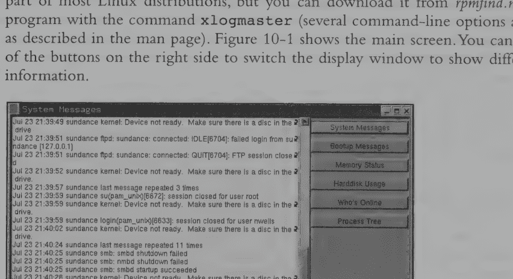

图 10-1 xlogmaster 工具

在显示窗口内的行上点击右键可以打开菜单，你可以在其中选择“Custom Entries”（自定义条目）来设置查看日志消息以显示系统数据的方式。自定义对话框如图 10-2 所示。

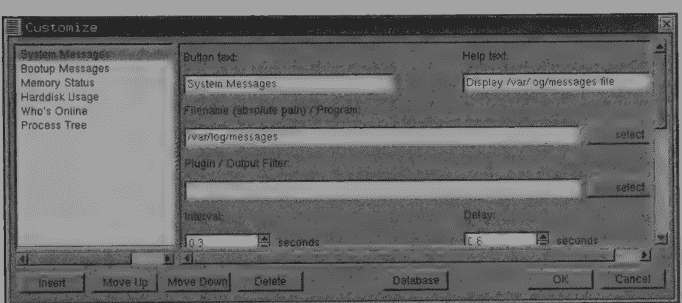

图 10-2 自定义日志消息显示

`logcheck` 包不仅仅是显示日志条目。它每小时检查一次疑条目。如果是，这些条目将发送给 root 用户（或你选择的任何账户）。`logcheck` 包不是任何 Linux 系统的一部分，但在 rpmfind.net 等其他上可用。当你安装 `logcheck` rpm 时，一个 cron 任务文件会被放在 `/etc/cron.hourly` 中使其运行。脚本本身是 `/usr/bin/logcheck`。（将行 `SYSADMIN=root` 修改为邮件发送的位置。）

一旦安装了 `logcheck` 包，你不需要对它做任何操作。然而，查阅 `/etc/logcheck` 的内容可能会帮助你更好地理解 logcheck 监控的攻击类型。以下列表列出了 logcheck 监控的某些单词：

- root REFUSED
- rlogind.*: Connection from * illegal port
- rshd.*: Connection from * illegal port
- sendmail.*: user * attempted to run daemon
- uucico.*: refused connect from *
- tftpd.*: refused connect from *
- login.*: ..LOGIN FAILURE. ..root
- login.*: ..LOGIN FAILURE ..guest
- kernel: Oversized packet received from
- FAILURE
- ILLEGAL
- LOGIN FAILURE
- LOGIN REFUSED
- RETR passwd
- RETR pwd.db
- ROOT LOGIN
- debug
- denied
- deny
- deny host

> logcheck 工具最初源于 Trusted Information Systems, Inc. 的 Gauntlet 防火墙。

尽管你可以在多个下载网站找到 logcheck，但它已被正式吸收到 Psionic Technologies 作为一个商业产品并更名为 LogSentry。该程序的最新版本具有扩展功能，并与 Psionic 的其他入侵检测产品（如 PortSentry 和 HostSentry）交互。更多信息请参见 www.psionic.com。

另一个与 logcheck/LogSentry 功能类似的包是 Swatch。Swatch 包不是大多数 Linux 发行版的一部分，但你可以从 rpmfind 下载。但预先警告，安装 Swatch 可能会具有挑战性。Swatch 是一个 Perl 脚本，需要你安装许多默认可能未安装的额外 Perl 模块；还需要你设置一个配置文件来指定哪些日志消息应该触发工具的响应。（相比之下，使用 logcheck，你只需编辑默认配置文件而不是创建自己的。）

## 维护文件完整性

尽管日志维护和日志分析工具可以帮助你发现潜在的入侵者，但它们并不是万无一失的技术。有时，老练的黑客会获得足够的对系统的访问和日志可能不会指示问题。要看到这种更复杂的攻击的证据，你需要跟踪系统上重要文件的状态，以发现任何意外的更改。

例如，一个破解者能够访问你的系统，并将你的 `inetd` 超级服务器守护进程替换为一个版本，该版本允许任何通过 telnet 连接到特定端口并输入特定密码的人获得完全访问权限。你不会在配置文件中看到任何此类攻击的证据——因为它会被直接构建在 `inetd` 程序中。或者，假设破解者替换了你的 `ls` 工具为一个新版本，该版本无法列出任何以特定代码词开头的文件。这将允许破解者在硬盘上存储他用于破坏你系统所需的配置文件，而你无法看到它们。

## 监控根内核（rootkits）

一旦破解者在你的系统上获得了 root 权限，他就会想维持这种访问权限。破解者通常会使用 rootkit 添加此类程序以允许持续访问，即使你发现了最初的入侵行为。例如，你可能会发现自己一直在使用一个过时的 DNS 名称服务器版本，该版本允许破解者获取 root 权限。你升级了 DNS 服务器，因此访问被切断了。然而，如果破解者在你升级 DNS 服务器之前安装了 rootkit，破解者将拥有几个更多的访问点，这些点被专门设计为更难发现。其中一个 rootkit `lrk4` 包含了对表 10-3 所示程序的修改。

### 表 10-3 rootkit 修改程序的示例

| 程序 | 修改方式 |
|--- | :--- |
| crontab | 从其输出中隐藏计划任务 |
| du | 在报告磁盘使用信息时不包含隐藏文件的大小 |
| find | 不列出隐藏文件 |
| ifconfig | 不显示可能会泄露破解者活动的网络信息 |
| inetd | 允许在某些网络端口上自动访问（通常使用 31337） |
| killall | 不杀死破解者用于维持访问权限的进程 |
| login | 允许在无密码的情况下远程登录到 root 用户 |
| ls | 不列出隐藏文件 |
| ps | 不显示破解者使用的某些进程 |

几十种 rootkit 被开发出来，并通过破解者经常访问的互联网站点分发。术语中的“脚本小子”（script-kiddies，见第 7 章）是指那些利用如 `sendmail` 等程序中记录良好的安全漏洞的破解者，然后安装预包 rootkit 以维持对服务器的未经授权的访问。

你可以使用 `chkrootkit` 软件包来检查你的系统是否存在 rootkit 的证据。该包包含一个脚本，其工作原理类似于病毒扫描器，尽管它可以报告 rootkit 的存在，但它无法从你的系统中消除它。它通过检查二进制文件来检测约 30 种不同 rootkit 的证据。`chkrootkit` 包未包含在所有的 Linux 发行版中，但你可以通过 `rpmfind.net` 下载它。然而，更有用的可能是访问 www.chkrootkit.org，下载该包并查看一些资源链接，以了解破解者如何利用 rootkit 维持对你系统的未经授权的访问。

`chkrootkit` 包包含了几个编程组件，如果你愿意，可以将它们添加到你自己的软件中。这些包括 `chklastlog` 和 `chkwtmp`，它们分别检查 `lastlog` 和 `wtmp` 系统文件的修改。这些文件维护了每个用户登录的历史和当前数据。rootkit 修改这些文件以隐藏他们的登录活动。`chkrootkit` 的另一个组件 `chkproc` 帮助你检查作为 rootkit 一被安装的 Linux 内核模块。这些模块被破解者称为 LKMs，提供了对你 Linux 系统的完全访问权限，并且非常难以发现，因为你不需要执行任何其他程序，它们就能产生所需的效果。

如果你在你的 Linux 系统上发现了 rootkit，请考虑以下步骤：

- 如果可能，在清理问题之前，关闭服务器的网络连接。在许多系统上，这是不可行的。
- 备份整个系统，包括所有的操作系统文件和你所有的数据文件。你可以在稍后检查这些内容，以追踪破解者并进行起诉。
- 重建系统，可以通过更新受损的特定包，或者在必要时重新安装整个操作系统来实现。

你可以使用 `rpm` 命令来验证包中文件的完整性。例如，`ls` 命令是 Red Hat Linux 7.3 上 `fileutils-4.1-10` 包的一部分。如果你有原始的 Red Hat CD 1，你可以挂载它并使用此命令来验证 `ls` 命令的完整性：

```
rpm -Vvp /mnt/cdrom/RedHat/RPMS/fileutils-4.1-10.i386.rpm
```

你可能会看到列出的缺失文件，但如果你看到如下的内容，请知道你系统上的 `ls` 程序与安装时的 `ls` 程序不匹配。`rpm` 手页描述了 `-V` 选项的细节；每个非空白字符表示包文件与系统上程序之间的属性不匹配。

```
S.... /bin/ls
```

```
rpm -Uvh /mnt/cdrom/RedHat/RPMS/fileutils-4.1-10.i386.rpm
```


# 维护文件完整性

在某些情况下，如果你重新安装整个操作系统并在之后只复制数据文件，可能会让你对混乱的局面感觉好一些。这通常起初比逐个检查工具要快，但请记住，在安装后你可能有大量的额外工作来配置程序。由于你需要警惕从你正在修复的“旧”系统中复制文件，请仔细考虑重装整个系统还是修复单个包是更好的选择。

当你阅读上述使用 `rpm` 命令的内容时，你可能会问：“如果 `rpm` 也损坏了怎么办？”完全可能 rootkit 会包含一个新版本的 `rpm`，它实际上拒绝复制任何被 rootkit 修改过的程序。

使用单盘版 Linux 或一组微型 Linux 工具是为应急系统分析准备的好方法，而无需重新编译软件。Tom's Single Disk Linux 是可以拷贝到光盘上的软件包，提供了一套完整的标准系统工具。见 `wwwutils.net/rh`。`busybox` 工具是一个单一程序，执行了 60 多种标准工具（如 `ls` 和 `ps`）的简化版本。（它不支持像功能齐全工具那些命令行选项，但 `busybox` 非常小。）见 `www.busybox.net` 或从 `rpmfind.net` 下载。

# 使用检查器

虽然在怀疑有人破坏了系统安全时检查 rootkit 是一个好主意，但更广泛且持续的方法是监控系统文件的完整性。

最著名的完整性检查器是 Tripwire。该程序提供免费版本并包含在许多 Linux 发行版的 Red Hat Linux 7.3 中（见 `www.tripwire.org`）；`www.tripwire.com` 提供商业版本（见图 10-3）。Linux 版本的 Tripwire 是开源的，遵循 GNU 通用许可证，与 Linux 内核一样。

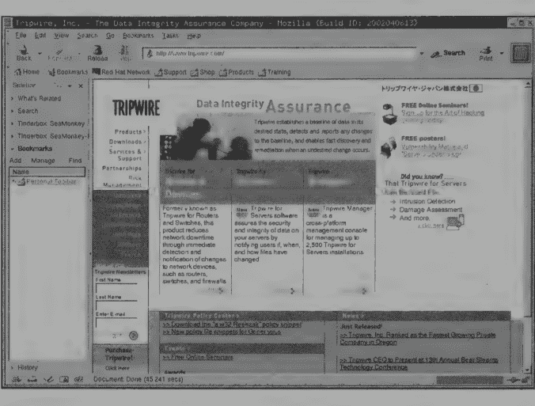

使用 Tripwire 时，需要一个你信任其未被篡改的系统——理想情况下是你刚从 CD 安装的、且尚未连接到任何网络的系统。Tripwire 会根据你可以配置的策略为你的关键系统文件创建一个基准或“快照”（文中提供了一些策略配置示例以帮助你入门）。一旦建立了基准，请定期运行 Tripwire 以查看系统状态是否发生了变化。在某些情况下，这些变化是预期之中的——例如，因为有新员工入职部门，你可能更新了 `/etc/passwd`。当变化是预期之中时，你可以更新 Tripwire 中的基准，而不会产生潜在问题。然而，如果发生了意外变化，你可以立即看到哪些文件受到了影响并采取纠正措施。在这种情况下，Tripwire 提供的信息可以显示基准与当前系统之间的差异。这可以帮助你判断遭受了多少损害，以及恢复系统的最佳方法是什么。

Tripwire 配置文件受基于你在初始设置时提供的密码的加密签名的保护。该加密防止入侵者能够修改你的 Tripwire 策略、配置，或隐藏他们的活动。

如果你丢失了 Tripwire 密码，你必须重新初始化 Tripwire 以建立新的基准。没有密码，Tripwire 文件将无法使用或恢复。

要设置 Tripwire，请按照以下步骤操作。对于许多默认安装了 Tripwire 的系统（如 Red Hat Linux 7.3），前两个步骤不是必需的。

1. 从 `www.tripwire.org`、`rpmfind.net` 或其他知名下载站点下载 Tripwire rpm。
2. 使用如下类似的命令安装 Tripwire rpm：
   ```
   rpm -Uvh tripwire-2.3.1-10.1386.rpm
   ```
3. 使用任何文本编辑器编辑 Tripwire 策略文件，以反映你的 Linux 安装需求。该文件为 `/etc/tripwire/twpol.txt`。在 Red Hat Linux 7.3 中，此文件包含 Red Hat 完整安装的标准配置。如果你在没有安装所有 Red Hat 组件的情况下使用此文件，预计会看到一些警告，因为某些文件未安装在你的系统上。当你查看策略文档时，你会看到列出的数百个配置文件、命令和系统设备，并且每个项目都有一个警告级别。策略文档使用了复杂的语法。你可以通过查看示例文件中的许多注释以及阅读 `twpolicy` man 页来学习它。（输入 `man twpolicy`。）
4. 检查 `/etc/tripwire/twcfg.txt` 的内容，查看你是否想使用 Tripwire 使用的编辑器和邮件服务器更新任何基本配置设置，以及 Tripwire 查找各种系统组件的目录。
5. 运行配置脚本，将你编辑的策略文档转换为 Tripwire 实际用于检查系统的加密规则数据库。配置脚本还允许选择密码并对 Tripwire 文件签名。运行脚本的命令是：
   ```
   /etc/tripwire/twinstall.sh
   ```
6. 提示时，输入站点密钥文件的密码（两次）。将生成一个密钥。站点密钥对配置和策略文件进行签名。
7. 提示时，输入本地密钥文件的密码（两次）。将生成一个密钥。本地密钥对 Tripwire 为你的系统生成的数据库文件和报告进行签名。
8. 提示时，输入站点密码以便 Tripwire 使用它对配置文件进行签名。
9. 提示时，输入站点密码以便 Tripwire 使用它对策略文件进行签名。创建二进制文件 `/etc/tripwire/tw.pol`。
10. 如果你需要更新策略文件，请在 `/etc/tripwire/twpol.txt` 中修改，然后使用以下命令更新 Tripwire 实际使用的二进制 `tw.pol` 策略文件。（你必须输入站点密码来完成此命令。）
    ```
    twadmin -m P /etc/tripwire/twpol.txt
    ```
11. Tripwire 文档建议在使用 `twinstall.sh` 脚本配置 Tripwire 后删除配置文件 `/etc/tripwire/twcfg.txt`。这可以保护你的安全，防止入侵者看到 Tripwire 是如何设置的（尽管此文件中包含的信息相对很少）。如果你决定删除此文件，可以从 Tripwire rpm 中恢复一个新的默认副本。
12. 使用此命令初始化 Tripwire 数据库（创建系统的基准镜像）。你必须输入本地密码来执行此命令：
    ```
    tripwire --init
    ```

如果你没有安装 Red Hat CD 上的每个包并使用默认的 Tripwire 配置，你将看到“没有此类文件或目录”的消息，因为 Tripwire 正在寻找你未安装的文件。在本示例中，你可以忽略这些消息。如果你正在运行生产服务器，你将希望编辑配置文件或安装配置文件引用的文件和目录。


取决于你的系统速度和软件包数量，初始完整性检查可能需要一些时间。运行检查后，你可能想查看结果。

| 扫描对象 | 总计 | 新增 | 删除 | 更改 |
| :--- | :---: | :---: | :---: | :---: |
| 关键实用程序符号链接 | 100 | 0 | 0 | 0 |
| Shell 二进制文件 | 100 | 0 | 0 | 0 |
| 系统启动更改 | 100 | 0 | 0 | 0 |
| OS 可执行文件和库 | 100 | 0 | 0 | 0 |
| 安全控制 | 100 | 0 | 0 | 0 |
| 登录脚本 | 100 | 0 | 0 | 0 |
| Root 配置文件 | 15752 | 0 | 0 | 0 |
| **扫描对象总数** | **15752** | **0** | **0** | **0** |
| **发现违规总数** | **3** | | | |

与许多安全工具一样，有效地使用 Tripwire 需要一些研究和实践。Tripwire 的 `twprint`、`twadmin` 和 `twpolicy` 的主页面是一个很好的起点。Tripwire 软件包包含有限的文档。（在 Red Hat Linux 7.3 上位于 `/usr/share/doc/tripwire-2.3.1/`）你也可以咨询 `tripwire.org` 和 `tripwire.com` 网站获取更多信息。Tripwire 被广泛使用，你可以在安全会议上（例如系统管理、网络和安全研究所 ANS）找到在线讨论组和实践培训。

第二个文件完整性检查器是 Samhain（以爱尔兰节日命名，发音为“sown”）。尽管 Samhain 与 Tripwire 相似，但它具有几个潜在优势，使 Samhain 成为文件完整性检查器、日志文件检查器和网络监控器的结合。主要功能包括：

- 作为守护进程而非 cron 作业运行，因此可以立即记录文件更改和登录/注销事件
- 可以检测作为 rootkit 部分加载的内核模块
- 在客户端/服务器环境中运行，以便从一个位置对多个系统进行集中监控。网络连接使用 192 位 AES 加密。
- 支持报告和审计日志。
- 对数据库和配置文件进行签名，以防止入侵者修改它们。
- 运行在多个 UNIX 和 Linux 平台上，你可以在多个不同的系统中使用它
- 一个 HTML 状态页显示受监控的任何客户端系统的信息

Samhain 可以从 `http://la-samhain.de/samhain/` 和 `freshmeat.net` 获取。它运行在许多版本的 Linux 和 UNIX 上，因此你可能需要安装源代码而不是直接使用 rpm。

关于文件完整性的最后一个提示，请考虑安装 `binutils` 软件包。该软件包在许多 Linux 发行版中默认不安装（它位于 Red Hat Linux 7.3 的 CD 2 上）。它包含了十多个用于探索文件内容的有用实用程序。例如，`objdump` 命令允许你逐字节检查文件的内容。`strings` 命令列出任何二进制文件中所有的文本字符串，包括系统实用程序和共享库。要查看 `strings` 如何工作，请在安装 `binutils` 软件包后尝试此命令：

```
strings /bin/ls
```


该命令的输出列出了所有作为 `ls` 命令存储的文本，例如，所有的帮助信息、错误消息以及许多你从未在命令行上看到打印的内部项目。

## 章节总结

- 破解系统的黑客通常想要查看或修改该系统上的文件，要么为了他们自己使用，要么为了给运行服务器的组织制造麻烦。
- Linux 文件权限不允许某些其他操作系统那样的精细控制，因为只允许向文件所有者、分配给文件的单个组以及系统上的所有其他用户分配权限。
- 用户专用组（User Private Groups）通过为每个新用户账户创建一个组来增强安全性。当你创建文件时，没有其他组成员将能够访问它们。
- 除非你熟悉其确切后果，否则使用文件可能会可能会意外的结果。目录的执行权限、SGID 位以及在阻止某组访问的同时允许其他用户访问是使用组权限的三种技术。
- 日志文件对系统安全至关重要，因为它们可能包含黑客尝试破解系统的证据，或者系统上运行的程序的操作记录，这些操作指示了其他潜在的安全问题。
- 日志轮转（Rotating logs）将日志保持在可管理的范围内，并通过日期将日志分组以便于备份。
- 将 `logrotate` 命令作为 cron 作业运行使日志轮转变得简单。该实用程序使用配置文件设置日志轮转功能。如果没有 `logrotate`，简单的脚本也可以执行基本的日志轮转。
- 系统服务不断向日志文件添加行。它们通常不使用文本编辑器，而是使用 `grep` 搜索工具或 `tail` 程序进行检查，后者显示任何文本文件的最后几行。
- `xlogmanager` 程序在图形窗口中显示日志和其他系统数据。
- `logcheck` 实用程序包监控日志文件中特定的单词和短语，这些词汇可能指示已尝试或成功了安全漏洞。可以通过更改配置文件中列出的监控单词对该实用程序进行自定义。

`logcheck` 的商业版本称为 LogSentry，由 Psionic Technologies 提供。LogSentry 与公司的其他安全产品一起工作，如 PortSentry 和 HostSentry。

黑客可以通过替换版本的系统实用程序来隐藏其活动，这些版本旨在忽略特殊的黑客相关文件，或防止黑客的进程、网络连接和类似信息。

rootkit 帮助黑客在受侵害的系统中轻松安装许多程序，即使在初始安全漏洞被发现并修复后也能允许 root 访问。有很多 rootkit 可用。`chkrootkit` 软件包可以检测许多此类工具。

## 关键术语

- `busybox`: 提供许多标准 Unix 实用程序的软件包。
- `chrootkit`: 使用 chroot 监狱机制隐藏行迹的 rootkit。
- `execute (x)`: 标准 Linux 文件权限，在实用程序中表示为，允许执行文件。
- `LKM`: 可加载内核模块，可以从内核加载或卸载。
- `logcheck`: 监控日志文件中特定单词和短语的实用程序。
- `logrotate`: 用于自动压缩、轮转和归档日志文件的实用程序。
- `LogSentry`: logcheck 的商业版本，由 Psionic Technologies 提供。
- `objdump`: 用于打印各种格式文件信息的命令。
- `read (r)`: 标准 Linux 文件权限，在实用程序中表示为，允许读取文件内容。
- `rootkit`: 旨在允许黑客持续访问受侵害系统并隐藏行迹的程序和脚本集。
- `Samhain`: 作为守护进程运行并支持客户端/服务器配置的文件完整性检查器。
- `statically linked`: 一种编程技术，二进制程序是自包含的，不依赖共享系统组件。
- `strings`: 列出任何二进制文件中所有文本字符串的命令。
- `swatch`: 执行日志监控的实用程序，类似于 logcheck。
- `tail`: 显示任何文本文件最后几行的程序。
- `Tom's Disk Linux`: 在单磁盘上提供整套标准实用程序的软件软件包。
- `Tripwire`: 最广为人且应用广泛的文件完整性检查器。
- `User Groups`: 一种为系统上的每个用户创建一个空组的安全系统。
- `write (w)`: 标准 Linux 文件权限，在实用程序中表示为 w，允许修改文件。
- `xlogmaster`: 在图形窗口中显示多种系统资源（包括日志文件）的程序。

## 复习习题

1. 文件权限根据以下用户账户控制访问，这些账户是：
   a. 定义在 `/etc/passwd` 中的
   b. 列在 TCP Wrappers 文件或类似的安全配置文件中的
   c. 对于所有网络服务请求，属于 `/etc/services` 的一部分
   d. 在访问数据前不需要登录

2. 写出三种基本的 Linux 权限，以及文件或目录可以将其分配给哪三种身份。

3. 一个没有成员但被分配为单个用户主组的组，正在实现一种安全功能，称为：
   a. 文件完整性检查
   b. 使用文件权限拒绝组访问
   c. 用户私有组 (User Private Groups)
   d. 文件属性

4. 哪一项从未在 `ls -1` 的输出中作为文件权限显示？
   a. x
   b. s
   c. w
   d. u

5. 哪一项控制了在目录内重命名文件的权限：
   a. 被重命名文件的执行权限
   b. 包含该文件的目录的执行权限
   c. 包含该文件的目录的写权限
   d. 被重命名文件的写权限

6. 在 shell 脚本文件上设置 SUID 位：
   a. 只能以 root 身份登录时进行
   b. 等同于在该 shell 脚本父目录上设置 SGID 位
   c. 除非为拥有脚本文件的用户存在用户私有组，否则无法进行
   d. 将始终被 Linux 内核忽略，因为这是一个巨大的安全隐患

7. __________ 文件配置系统日志；系统消息通常存储在 ________ 中。
   a. `/etc/syslog.conf`; `/var/log/messages`
   b. `/etc/message.conf`; `/etc/syslog`
   c. `/etc/log/syslog`; `/var/log/sysog.messages`
   d. `/etc/rc.d/init.d/syslog`; `/var/log`

8. 在系统日志中看到数百条 FAILED LOGIN（登录失败）消息可能表明：
   a. 某一个用户忘记了他的密码
   b. 破解者正尝试通过暴力攻击获取你的系统访问
   c. 系统日志守护进程配置错误
   d. 登录 PAM 模块配置错误

9. 因为日志文件可能在短时间内变得非常大，你应该定期：
   a. 轮转日志文件，以便将旧的日志数据移动到存储设备或将其删除。
   b. 每隔几天删除日志文件并从头开始。
   c. 配置 `/etc/syslog.conf` 仅存储最关键的日志消息。
   d. 使用 logcheck 等程序通知你日志文件过大的情况。

10. 写出 logcheck 程序在默认配置中监控的三种类型的消息。

11. logcheck 程序以以下商业形式提供：
    a. LogSentry
    b. HostSentry
    c. LogDaemon
    d. Samhain

12. 当使用自己的脚本而不是 `logrotate` 命令轮转日志文件时，你必须：
    a. 保留轮转的详细记录，以防某些文件被删除。
    b. 发送 HUP 信号使日志守护进程开始使用新文件。
    c. 避免压缩日志文件，因为这使得它们极易被破解者破坏。
    d. 配置 `/etc/syslog.conf` 以接受你的日志轮转。

13. 列出 rootkit（根内核程序）可能会修改五个文件，并泛括描述每个文件如何被修改以保护破解者。

14. rootkit 通常通过以下途径分发：
    a. 商业 Linux 供应商，可以对 rootkit 包进行签名以验证其完整性。
    b. 流行的 Linux 下载网站，如 rmfind.net
    c. 开发者站点，如 freshmeat.net
    d. 不公开广告的破解者站点

15. 如果以下情况下，可以使用 `rpm` 命令验证程序文件的完整性：
    a. 归档的 rpm 文件的 md5 指纹与程序文件的 md5 指纹匹配。
    b. 你有一个 CD 或经过验证的下载 rpm 副本，可与程序文件进行比较。
    c. 你将 rpm 数据库备份到了单独目录。
    d. rpm 命令是 rootkit 的一部分。

16. 要检查系统中是否安装了 rootkit 的迹象，你可以：
    a. 加载一个监控所有网络流量的内核模块。
    b. 在怀疑有 rootkit 后使用 Tripwire 创建基准数据库。
    c. 使用 logcheck 查看是否有大量下载的程序文件被修改。
    d. 使用 chkrootkit 寻找程序文件被更改的迹象以及 rootkit 的其他指示。

17. 关于 rootkit，LKM 指的是：
    a. Loadable Cracker-Man（可加载破解者），一个创建许多 rootkit 包的著名破解者
    b. 记录的 KDE 未授权访问远程系统的方法
    c. Lame Kode Machine，指运行着旧版本流行软件（如 bind 或 sendmail）的 Linux 系统的缩写，这些软件允许破解者轻松访问
    d. 一种用于破解目的的 Linux 内核模块

18. 哪个命令为 Tripwire 创建系统文件的初始数据库？
    a. `tripwire --init`
    b. `tripwire --check`
    c. `twadmin --init`
    d. `twinstall.sh`

20. Tom's Single Disk Linux 在以下情况下可以帮助系统管理员：
    a. Logcheck 表明破解者已尝试使用错误的密码多次登录。
    b. LogSentry 表明破解者已尝试使用未经授权的网络服务登录。
    c. rootkit 损坏了基础系统工具。
    d. 文件权限允许用户意外地修改了文件。

21. 哪个命令配合适当的选项可以显示来自 Tripwire 完整性检查的格式化报告？
    a. `twadmin`
    b. `twprint`
    c. `tripwire`
    d. `twrfile`

22. 通过安全网络连接同时管理多个系统的能力是以下工具的优势：
    a. 基于 Tom's Single Disk Linux 的 chchrokit
    b. 相比 Samhain 的 Tripwire
    c. 相比其他常用工具的 logcheck
    d. 相比 Tripwire 的 Samhain

23. 要查看任何二进制程序文件内存储的所有文本消息，可以使用
    a. dmesg
    b. strings
    c. bin
    d. LogSentry

24. 在目录上使用 SGID 位会导致：
    a. 在该目录下运行程序的的用户具有该目录所属组的组权限
    b. 权限没有可见变化，因为 SGID 位在 Linux 中极少使用
    c. 当任何不是目录所属组的员尝试访问该目录内的文件时，访问将被拒绝
    d. 在目录中创建的所有文件都被分配与目录相同的组

25. 描述破解者如何尝试破解诸如 logcheck 的程序。

## 动手项目

### 项目 10-1

在本项目中，你将探索用户私有组（User Private Groups）如何影响新创建文件的权限。要完成此项目，你需要一个 Linux 系统的 root 权限，且该系统还会有两个普通用户账户。（你可以使用 `useradd` 命令创建这些账户）。此项目假设你的 Linux 版本实现了用户私有组。

1. 以 root 身份登录并打开命令行窗口。
2. 使用 `su` 切换其中一个普通用户账户。

```
su - username
```

3. 在该用户的家目录下创建一个文件。你可以使用类似下面的命令来复制另一个文本文件的内容代替：
```
cat /
```

4. 使用 `chown` 修改新文件的所有组和组权限。

5. 将你的新文件拷贝到 /tmp 目录。
```
cp ~/file1 /tmp
```

6. 退出回到 root 身份。

7. 使用 `su` 切换到第二个用户账户。

8. 进入 /tmp 目录并找到你在第 3 步中拷贝的文件。使用 `ls -l` 查看文件。

9. 你读取该文件（例如使用 `more`）吗？为什么？

10. 你的用户需要哪个组才能对文件拥有写权限？

11. 退出 `su` 回到 root 身份。

12. 查看 `/etc/group` 以查看哪个 ID 对应第一个用户账户的组。列出了哪些？

13. 使用 `vipw` 命令查看第一个账户的主组 ID：
```
vipw /etc/passwd
```
这个数字与 `/etc/group` 文件中的数字匹配吗？

14. 使用什么命令可以更改创建新文件时分配的组权限？

### 项目 10-2

在本项目中，你将探索 `logrotate` 命令的配置以及守护进程如何访问日志文件。要完成此项目，你的 Linux 系统必须安装了 `logrotate` 命令。此项目基于 Red Hat 7.3 文件位置。

1. 以 root 身份登录并打开命令行窗口。

2. 列出 /var/log 中的消息文件并记录它们的名称：
```
ls /var/log/mess*
```

3. 使用编辑器打开 `/etc/logrotate.conf` 文件。

4. 修改你的系统配置，每天轮转一次日志，并保存七天的日志而不是默认的四天。（如果你不确定这些更改使用哪些关键词，可以查阅 logrotate 的页面。）

5. 保存你的更改并退出文本编辑器。

6. 明天你在 /var/log 文件中会看到什么？

7. 为什么你可能想更频繁地轮转日志并保存更多的旧日志？

8. 切换到 `/etc/logrotate.d` 目录。

9. 注意其他具有特定日志轮配置的守护进程。打开其中一个或两个并简要研究其内容。

10. 切换到 `/var/log` 目录：
```
cd /var/log
```

11. 如果你的系统已经运行了几周，你在第 2 步看到了类似 messages.1 的文件，这些是较旧的已轮过的日志文件。

12. 如果你的系统在实验室运行，没有人依赖它提供服务，请继续后续步骤：

13. 修改系统日志文件的名称：
```
mv /var/log/messages /var/log/my_message_file
```

14. 开始持续查看此文件的最后 10 行：
```
tail -f /var/log/my_message_file
```

15. 打开另一个窗口，登录或使用 su 命令。

16. 在第二个窗口中，登录或使用 su 命令。

17. 注意到第一个窗口中出现了一条消息。为什么系统日志是写入 `/var/log/my_message_file` 而不是 `/var/log/messages`？

18. 通过向其发送 HUP（重启）信号，切换回第一个守护进程：
```
kill -HUP 'cat /var/run/syslogd.pid'
```


（对于某些守护进程，你可能需要使用 `touch` 命令创建一个空日志文件。系统日志守护进程会在你执行任何操作的情况下创建一个新的 `/var/log/messages` 文件。）

## 项目 10-3

在这个项目中，你将在 Linux 服务器上设置 Tripwire 完整性检查程序。然而，此项目并不涉及策略文件的配置，因此不应被视为为生产服务器进行持续完整性维护的准备。

要完成此项目，你应该已安装 Red Hat Linux 7.3，包括 Tripwire 包（使用 `rpm -q tripwire` 进行检查）。你必须拥有 root 权限并在非生产（实验室）系统上工作。由于此项目包含了几个运行时间需要 5 到 30 分钟的命令，你可能想团队合作或将此项目的步骤分在几天完成。每个步骤创建的文件将保留以供第二天继续使用。


## 第 10 章文件安全

1. 检查 `/etc/tripwire/twpol.txt` 中的 Tripwire 策略文本文件。
2. 检查 `/etc/tripwire/twcfg.txt` 中的 Tripwire 配置文本文件。
3. 运行 Tripwire 配置脚本：
   ```
   /etc/tripwire/twinstall.sh
   ```
4. 提示时输入站点口令（site passphrase）。
5. 提示时输入本地密码口令（local passphrase）。
6. 根据提示输入密码口令。
7. 根据你在第 1 步中检查的策略文档，为你的系统初始化 Tripwire 数据库。（此命令运行需要几分钟；在提示时输入本地密码。）
   ```
   tripwire --init
   ```
8. 通过添加新用户来更改你的系统配置文件（从而更改了 `/etc/passwd`，这是一个关键的配置文件）。
   ```
   useradd my_user
   ```
9. 运行 Tripwire 完整性检查。（这需要几分钟。）将检查的输出重定向到文件。（你也可以在之后使用 `twprint` 命令创建报告。）
   ```
   tripwire --check > /tw_data.txt
   ```
10. 用文本编辑器打开数据结果。
11. 你能找到 `/etc/passwd` 文件中的修改处吗？除非在第 1 步中的策略文档或在安装 Red Hat Linux 时选择了“Everything”（全部），否则报告可能会显示你修改的许多其他文件。

## 项目 10-4


在这个项目中，你将使用下载的文件创建一个单盘版本的 Linux。此磁盘在许多情况下被用作救援磁盘，正如章节文字关于 rootkit 特别描述的那样。要完成此项目，你应该拥有访问互联网的 Linux 系统的 root 权限。你还应该有一个空白的软盘。

1. 打开浏览器并指向 `www.toms.net/rb`。
2. 点击 **Download tomsrtbt here**，然后从下载站点列表中点击 **ibilio**，将单盘 Linux 归包副本下载到 `/tmp` 目录。
3. 在出现的文件列表中，找到名为 **tmsrtbt** 的文件，后面跟着版本号（每月都会变化），然后是文件扩展名 `.tar.gz`。
4. 点击该文件，并在提示时将其保存到 `/tmp`。

## 案例项目

5. 下载完成后，切换到 `/tmp` 文件并使用此命令解压你下载的归包（替换为准确文件名；版本会随时间变化）：
   ```
   tar xzvf tomsrtbt-version.tar.gz
   ```
6. 切换到名为 `tomsrtbt-version` 的目录。
7. 将高质量的软盘插入软盘驱动器。
8. 运行程序：
   ```
   ./install
   ```
9. 重启系统。
10. 使用 `ls` 命令探索。
11. 你可以如何使用这个磁盘？
12. 哪些工具可用的？


## 案例项目

1. 哪些安全措施？
2. 你面临哪些危险？
3. 你将采取哪些步骤？
4. 你担心哪些安全措施？
5. 哪些工具？
6. 你将使用哪些安全措施？

第499 页

第500 页

## 第 11 章：网络安全基础

在阅读本章并完成练习后，你能够：

- 总结攻击者尝试的安全入侵类型
- 如何使用特殊路由保护网络流量
- 配置基础防火墙
- 使用加密网络加密

在本章中，你开始学习保护网络的工具和方法。在回顾攻击者攻击你的 Linux 系统的方式后，你将学习路由方法和防火墙。本章的最后部分介绍了如何通过 SSH 等工具加密网络流量。

本章介绍的主要网络安全功能——IP 链和表是每个内核的一部分。你将学习如何设置这些功能，以及如何使用图形化工具。你还学习了多种防火墙产品。

第501 页

## 审查网络威胁

之前的章节描述了你的网络面临的许多安全威胁，包括来自组织内部和外部的威胁。这里提供了这些威胁的总结。

## 木马

木马是隐藏在其他程序中的程序，是你故意下载或安装到系统的，通常来自可靠来源。然而，一旦安装，托管木马的程序看起来在做一件事（例如在执行时列出文件），但实际上在做另一件事或额外工作（例如在特定端口接受任何网络连接或配置文件）。除非使用 Tripwire 或 Samhain（第10章描述）等文件完整性程序，否则很难在造成损害之前发现木马。你可以通过仅从 Linux 供应商或知名程序的官方下载网站安装程序，并在安装前检查加密签名来防止木马的侵害。

### 病毒和蠕虫

病毒和蠕虫是在安装后旨在自我复制的相关威胁。病毒通常作为其他程序的一部分进行复制（例如

蠕虫比病毒威胁更大，因为它们是独立的程序，没有附于其他程序或宏。蠕虫就像自动攻击者：如果你通过定期更新 sendmail 和 DNS 等服务来保护系统免受攻击，蠕虫很难在你的系统中立脚。当然，另一种有效选择是使用 qmail 或 Postfix（对于邮件服务器而言）代替 sendmail，因为 sendmail 有安全问题历史。）

## 拒绝服务 (DoS) 攻击

拒绝服务 (DoS) 攻击发生在黑客试图使你的系统崩溃，导致系统关机或仅仅让合法用户无法访问。这可以通过多种方式实现。两种常见的方法是使用流量淹没网络连接，以及执行会填满服务器硬盘的请求。由于单台机器不太可能有能力淹没大型商用服务器，黑客现在依赖于分布式拒绝服务 (DDoS) 攻击。在 DDoS 攻击中，黑客入侵许多系统（数百个或数千个），并在这些系统中安装一个程序，该程序将对指定的目标执行 DoS 攻击。受影响系统的管理员可能甚至没有意识到他们的系统中被安装了黑客程序，因为该程序在安装时并没有尝试执行任何操作。相反，由于许多系统已被入侵，黑客向所有系统发送一个信号，让它们同时开始 DoS 攻击。随着来自世界各地的成百上千台机器参与攻击，服务器将很难判断哪些数据包属于攻击，哪些又来自合法用户。

DDoS 攻击很难计划和防御。你的系统上没有任何内容被篡改，在攻击开始之前，你完全不知道问题的到来。那时，你不能简单地拒绝来自特定计算机的数据包（就像你处理非分布式 DDoS 攻击那样），因为攻击是同时从数千个地方发生的。IPV6 协议包含了使 DDoS 攻击更容易防御的能力，但在其广泛使用之前，DDoS 攻击仍然是商业 Web 服务提供商的一个大问题。

## 缓冲区溢出攻击

缓冲区溢出攻击是指任何利用编程漏洞导致网络服务关闭、数据损坏或为系统提供意外的（因此是非授权的）访问权限的黑客攻击。假设像 FTP 服务器之类的程序会分配一块内存来存储通过网络连接到达的命令。该命令通常由换行符结束。然而，如果黑客发送的命令没有以换行符结束，而是持续持续了数千个字符，那么 FTP 服务器软件（如果设计得不当）将一直继续读取该命令。当命令超过了在内存中分配给它的空间时，FTP 服务器就会崩溃。在某些情况下，熟练的黑客可能在超长命令中包含信息，这些信息将被写入内存的某些部分，从而为黑客提供未经授权的访问。

缓冲区溢出攻击很难预测。显然，如果系统管理员知道潜在的缓冲区溢出，他们会立即修复它。当有人发现如何创建缓冲区溢出时，想要利用它来攻击系统的黑客与想要获取补丁（即更新）来修复问题的系统管理员之间就会展开一场竞速。

## 第 11 章：网络安全基础

良好的系统管理员不会给黑客留太多机会；他们会在更新发布的当天就安装更新，这通常在像 SANS 或 CERT/CC 等组织发现问题后的两天内。不注意安全的管理员旧版本网络守护进程（daemons）继续运行。这样，黑客就可以自由地使用已知的缓冲区溢出攻击来针对他们。

其他类型的编程攻击可能会导致服务器崩溃或允许未经授权的访问。缓冲区溢出是允许攻击的一种编程错误类型，还存在许多其他错误。例如，针对旧版本 DNS 的一种攻击会导致 `named` 守护进程在收到特定请求时立即关闭。

## 伪装与中间人攻击

伪装是对地址的造/伪造。黑客使用 IP 伪装和 DNS 伪装。在 IP 伪装中，黑客修改 IP 数据包上的源地址或目的地址。例如，如果黑客获知了你的内部 IP 地址，他可能会从外部服务器向你的防火墙发送数据包，但源 IP 地址设为你的内部网络。他希望你的防火墙会根据源 IP 地址允许数据包通过。设计良好的防火墙不会被欺骗（例如，所有内部流量通过一个以太网卡，所有外部流量通过第二个以太网卡.）。然而，IP 伪装可能会混淆某些程序，在规划防火墙规则和路由器设计时应考虑这一点。

DNS 伪装是伪装请求来自某个特定主机而不是其真实主机。例如，如果安全性是基于域名的，黑客可能通过 DNS 伪装破坏安全设置：数据包携载着受授权域名的伪造地址。使用反向 DNS 查询可以帮助避免这个问题，因为黑客很难实际修改权威 DNS 服务器上的所有信息文件。回想项目 6-2，你可以使用 `dig` 查询一系列 DNS 服务器，以确定用于正向或反向 DNS 查询的权威信息。

另一种用于 DNS 的攻击是缓存投毒攻击。黑客试图通过向 DNS 服务器的缓存中上传错误信息，来阻止他人对你网站的访问或阻止你对其他网站的访问。仔细配置你的 `/etc/named.conf` 文件，使得只有授权的系统才能向你的 DNS 服务器传输区域信息，可能就足够防止缓存投毒攻击。

## 审查你的网络面临的威胁

与伪装攻击类似，**中间人攻击**是指黑客截获通信、读取或篡改通信，并让数据包的发送者认为预期的接收者已收到该数据包。图 11-1 显示了如果黑客获取了你的私钥副本并用它拦截你和同事之间的所有流量，这可能是如何运行的

“中间人”

1. 使用 Sally 的公钥加密消息
2. 使用 Joe 的私钥对消息签名
1. 拦截消息
2. 使用 Joe 的公钥移除签名
3. 使用 Sally 的私钥解密
4. 读取消息
5. 使用 Sally 的公钥加密
6. 使用 Joe 的私钥签名
1. 使用 Joe 的公钥移除签名
2. 使用 Sally 的私钥解密
3. 读取（已篡改的）消息

图 11-1 使用私钥的中间人攻击。

另一种中间人攻击是 **Web 伪装**。在这种攻击中，黑客截获通信，读取或篡改它，并欺骗发送者认为预期的接收者已收到它。黑客的服务器可以拦截指向网客站点的请求，而用户认为正在链接到黑客站点。这种类型的攻击在 Java 广泛使用时不太可能成功，因为 Java 不依赖于易于篡改的简单链接。尽管如此，Web 伪装仍然是一个问题。

在各种安全问题的讨论中，你会看到对中间人攻击的引用。这指的是持续的问题：能够拦截流量的黑客不应该能够修改或重定向流量，以欺骗发送者认为接收者已收到。例如，某些网络加密技术包含了校验和——头部的加密指纹。如果头部在发送者和接收者之间被修改，指纹将不匹配，数据包会被丢弃。当然，这使得无法使用下一节描述的高级路由技术。

# 使用高级路由和防火墙

你已经学习了许多控制系统访问以防止黑客的方法。例如，你知道许多服务通过 TCP Wrappers 使用 `inetd`。你可以通过配置 `/etc/hosts.allow` 和 `/etc/hosts.deny` 文件来控制对服务的访问。特定的网络程序具有访问控制机制。例如，`wu-ftpd` 服务器在 `/etc/ftpaccess` 中支持多个安全指令；Apache 在 `httpd.conf` 配置中支持类似的指令。这些指令允许你指定哪些主机可以访问 Web 服务器；你可以精确到允许特定主机访问单个文件。Samba 和 NFS 配置文件也支持访问控制机制。

使用任何这些服务配置文件都可以保护你的计算机免受试图访问该服务的入侵者。你可以认为这些是特定的应用程序防火墙。然而，该术语通常描述在协议栈较低层次控制网络流量。回想你在第 1 章中学过的 OSI 和 Internet 网络模型，它们如图 11-2 所示。图中中间显示了不同的访问控制机制如何保护网络服务。防火墙通常指的是数据包过滤器——在工作栈的最底层运行的访问控制。当数据包到达协议栈的高层时，它获得未经授权访问的可能性大得多，无论是由于编程错误还是配置错误。数据包过滤器可以在数据包“攻击”应用程序之前检查并丢弃来自未经授权系统的数据包。

## 使用高级路由与防火墙

## 485

## OSI 模型
### 安全方法
## 互联网模型

传统的防火墙依赖于规则。**规则**是一种配置设置，它定义了 IP 数据包的某些特征，以及对任何具有这些特征的数据包所要采取的操作。一个示例规则可以有效地表示为：“如果数据包包含目标为端口 25 的 TCP 数据，且它来自 192.168.125.0/24 以外的任何地址，则丢弃该数据包。”保护网络服务和局域网（LAN）客户端的另一种方法是使用高级路由技术。这些技术可以有效地从互联网上的黑客面前“隐藏”局域网客户端，尽管客户端仍然可以访问互联网。

Linux 网络栈包含在内核中。这使得 Linux 能够控制网络包管理，并意味着对于某些网络来说，一个配置适当的 Linux 防火墙或路由器就足够了。当需要控制对许多不同低级协议（如 IPX、SNA 和 AppleTalk）的访问， own当你希望专用路由器为繁忙的局域网提供足够的容量时，就会出现例外。

高级路由和防火墙是通过相同的 Linux 工具实现的。在 Linux 2.2 内核（用于 Red Hat 7.0 以及 2000 年末或 2001 年发布的其他 Linux 发版）中，Linux 防火墙系统被称为 IP Chains。在 Linux 2.4 内核（用于 Red Hat 7.3 以及 2002 年以后发布的发行版）中，防火墙系统被称为 NetFilter 和 IP Tables。2.4 内也支持 IP Chains，但这两个系统不能同时使用。在 Red Hat 7.3 中，默认使用 IP Chains 系统，因为它配置更简单。下面的章节描述了 IP Chains 和 NetFilter/IP Tables。

在 IP Chains 之前，Linux 使用名为 `ipfwadm` 的命令（用于 IP 防火墙管理）。`ipfwadm` 命令看起来类似于简单的 `ipchains` 命令。你偶尔会在关于 Linux 防火墙软件的文档中看到对 `ipfwadm` 的引用。

## 介绍 IP Chains

Linux 的 IP Chains 功能允许你设置一个链：一个关于如何处理包的规则列表。默认情况下，Linux 内核包含三个链：
- Input（输入）：来自执行规则的系统外部的数据包
- Forward（转发）：来自执行规则的系统外部且需要路由到另一台计算机的数据包
- Output（输出）：来自执行规则的系统内部且目标为其他系统的数据包

IP Chain 的基本操作如图 11-3 所示。链中的每个规则都指定了一个或多个参数。如果数据包匹配这些参数，则根据 `ipchains` 命令末尾的指令（`-j` 选项，表示“跳转到”）对数据包进行处理。如果数据包不匹配参数，则尝试下一条规则。如果没有规则匹配规则，则由默认策略定义对数据包的处理方式。

你使用 `ipchains` 命令在这些链中创建和管理规则。规则可以是简单的也可以是复杂的。一个简单的规则可能指示 Input 链的默认策略为 DENY（拒绝），这意味着如果传入的数据包没有被链中的某条规则处理，则应该被拒绝，且不向发送者发送任何响应。该规则所示：
```
ipchains -P input DENY
```

IP Chain 中的规则可以对数据包采取以下任何一种基本操作：Accept（接受）、Deny（拒绝）、Reject（拒绝）和 Masquerade（伪装，下文将描述）。Deny 和 Reject 的区别在于，Reject 会通知发送者数据包被拒绝（它使用 ICMP 发送“端口不可达”消息）。Deny 仅仅是忽略数据包，而不向发送者提供任何反馈。

比示例复杂的复杂的规则很常见。看这个例子：
```
ipchains -A input -s 0/0 -d 0/0 :67 -p udp -i eth0 -j ACCEPT
```
该命令向 input 链添加了一条规则，表示如果数据包是 UDP、来自 eth0 接口，并且源地址和目的地址都使用每个端口，则接受来自任何源地址且目标为任何地址的数据包。

你可以使用命令 `ipchains -L` 选项列出所有链中的规则（`-n` 选项告诉命令如果无法通过 DNS 解析 IP 地址则继续执行）：
```
ipchains -n -L
```

规则按照你将它们放入链中的顺序执行。例如，假设你有以下两条条规则。第一条接受来自单个网络的数据包，第二条拒绝所有网络的数据包。
```
ipchains -A input -s 192.168.10.0/0 -j ACCEPT

ipchains -A input -j DENY
```


# 第 11 章 网络安全基础

与你过的其他配置文件一样，规则的顺序非常重要。如果你反转这两条规则，来自 `192.168.10.0` 网络的数据包将在被更具体的规则允许访问之前被拒绝。

> 总的来说，防火墙规则应该从最具体的开始，最后以更通用的规则结束，并在最最后放置“捕获所有”的规则，以确保没有会被意外通过。

为了让 IP Chains 能够有效防止黑客访问你的服务器，它们应该在你的 Linux 系统激活网络之前就绪。否则，黑客在网络激活到 IP Chains 规则激活之间将有一个短暂的机会窗口。在 Red Linux 上，通过在 `/etc/sysconfig/ipchains` 文件中包含所有的 `ipchains` 命令，并使用 `/etc/rc.d/init.d` 中名为 `ipchains` 的脚本来执行这些命令，可以产生最大的保护。如果你查看运行级别目录中的执行顺序（例如，`/etc/rc.d/init.d`），你会发现 `ipchains` 脚本在任何人通过网络访问你的系统之前执行。

在 Red Hat Linux 安装期间，你会回答一个关于想要实现的防火墙保护级别的问题。你选择的级别（低、中、高）决定了每次启动 Linux 系统时执行哪些 `ipchains` 命令。不连接互联网的组织可能会使用数百条 `ipchains` 命令来设置其网络访问。

表 11-1 列出了 `ipchains` 命令最常用的选项。所有选项均区分大小写。通过此表中的信息，你应该能够在默认安装中找到 `ipchains` 命令，并在你的网络上练习新配置。参考 `ipchains` 的帮助页面以获取完整的列表。

### 表 11-1 ipchains 命令常用选项

| 选项 | 说明 |
| :--- | :--- |
| `-A chain` | 在命名链的末尾添加规则 |
| `-D chain index` | 从命名链中删除规则索引 |
| `-F chain` | 清空（删除）命名链中的所有规则，如果没有命名链则删除所有链 |
| `-L chain` | 列出所有链的规则，如果提供了命名链则列出该链的规则 |
| `-P chain policy` | 将命名链的默认策略设置为指定的策略 |
| `-s address port` | 定义用于比较数据包的源 IP 地址；在地址后包含端口号 |
| `-d address port` | 定义用于比较数据包的目的 IP 地址；端口号随 `-s` 选项 |
| `-i interface` | 指定数据包必须使用的网络接口（如 `eth0`） |
| `-p protocol` | 指明匹配规则的 IP 地址协议字段；协议可以是 `tcp`、`udp` 或 `icmp`（协议规范不区分大小写） |
| `-j target` | 为匹配规格（如 `-p` 和 `-s` 选项）的数据定义操作；目标可以是 `ACCEPT`、`DENY`、`REJECT`、`MASQ` 以及其他 |

## 网络地址翻译

Linux 内核中的 IP Chains 功能还提供了路由功能。网络地址翻译（NAT）是一种修改数据包地址或其他标头信息的路由技术。NAT 的一种流行类型是 IP 伪装，这种网络地址翻译将局域网内许多计算机的数据包进行修改，使其看起来像是来自单台计算机。这种技术对于连接到互联网的组织或家庭网络非常有用，如下例所示。

- 局域网（LAN）上的客户端发送一个指向远端 Web 服务器（图中的 Server X）的数据包。
- 数据包通过的路由器/防火墙（图中的“Fire”）会移除客户端的源 IP 地址和 MAC 地址，并替换为路由器的 IP 地址和 MAC 地址，然后发送数据包。
- Web 服务器接收到的请求就像是来自路由器一样，因为源 IP 地址是路由器的。
- Web 服务器将响应发送到路由器的 IP 地址。
- 路由器接收响应，将目标 IP 和 MAC 地址替换为客户端的 IP 和 MAC 地址，并将数据包路由到内部网络。
- 客户端从 Web 服务器接收数据包，完全没有任何数据包被路由器拦截和“伪装”的迹象。

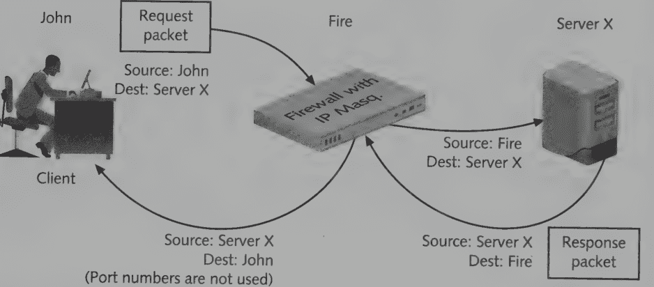

**图 11-4** IP 伪装（IP masquerading）

IP 伪装通常通过使用如 `192.168.0.0` 的私有 IP 地址来实现。与每个客户端使用其独立 IP 地址访问远程站点相比，使用伪装地址具有以下几个优势：

- 使用 IP 伪装，单个 IP 地址就可以允许整个局域网连接到互联网或更大的组织网络。如果有更多组织使用 IP 伪装，互联网的 IP 地址可能永远不会耗尽；在目前需要成百个 IP 地址的地方，一个 IP 地址就足够了。在 IP 伪装服务器之后（后方），每个局域网都可以使用相同的私有 IP 地址。
- 因为实际上只有一个系统在向远程网络（或互联网）发送数据包，因此只需要一个连接。如果您的 ISP 对 IP 地址或按账户收取费用，NAT 将为您节省金钱；您的 ISP 只会看到来自一个 IP 地址（因此对应一个用户）的数据包。某些 ISP 可能会有关于在您的网络上使用 IP 伪装的规则，因为局域网客户端创建该单一服务器会产生更多通过网络连接的流量。然而，如果你没有超过时间和带宽的连接限制，ISP 就不应该担心。
- IP 伪装的作用就像防火墙；远程计算机无法连接到伪装局域网内的客户端。如果你仔细配置路由器，IP 伪装可以有效隐藏你的整个网络。

在具有 IP 伪装优势的同时，它也有一个显著的缺点。虽然它可以“隐藏”你的局域网客户端，但这可能导致某些网络连接无法工作。例如，某些网络服务如 FTP、IRC 和流媒体音频在网络协议的高层中包含了低层数据。IP 伪装的设计并不是为了“伪装”这些不预期包含 IP 和 TCP 信息的更高层级协议。要让这些协议通过伪装服务器工作，你必须为想要让 IP 伪装支持的特定协议安装额外的内核模块。这不是一种优雅的解决方案，但它运行得良好。

要查看哪些旧版本的 IP 伪装（NetFilter 之前）通过 Linux 内核模块支持，请查看例如 Red Linux 7.0 中 `/lib/modules/2.2.16-22/ipv4` 目录下的模块列表，或者类似的目录，通常在 `/lib/modules` 子目录下。（在 Linux 2 内核中的处理方式有所不同，如需文所述）。

设置 IP 伪装非常简单；它只需要一条规则，其实含义是：“任何来自此网络的网络流量都应该被伪装。”假设你有一个网络地址为 `192.168.100.0` 的局域网，你通过拨号调制解调器连接互联网。在服务器上使用以下命令会导致来自内部网络的所有网络流量被伪装；局域网上的所有客户端都能访问互联网（尽管 ISP 会看到所有流量都来自网关系统）。指定转发链（forward chain）是因为只有目标不是本地网络上服务器的流量才应该被伪装。

```
ipchains -A Forward -s 192.168.100.0/24 -j MASQ
```

## 透明代理（Transparent Proxying）

在第 6 章中，你学习了如何使用 Apache 代理服务器“收集”来自局域网的所有指向 Web 服务器的客户端请求：代理服务器代替单个客户端，向它们想要联系的 Web 服务器发送请求，并将结果返回给客户端。使用代理服务器与 IP 伪装非常相似（见图 11–5），但代理工作在应用层，而不是 IP 层。请注意，代理服务使用了端口号，但在 IP 伪装中没有使用。

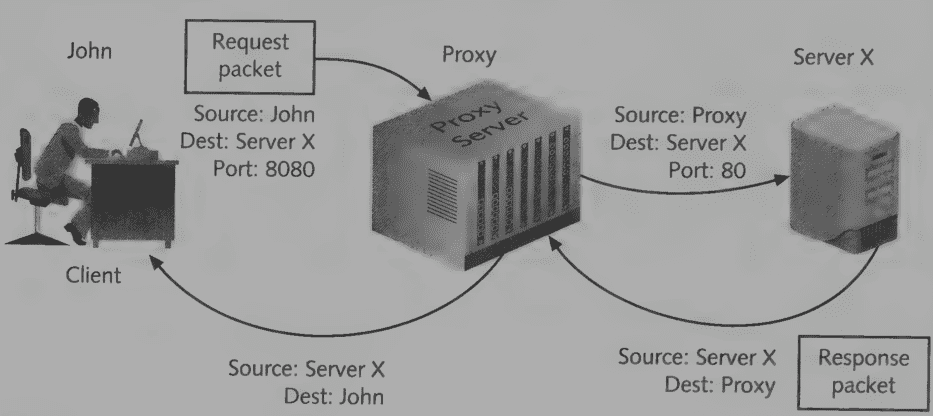

图 11-5 代理服务

代理服务器通过隔离客户端提供了防止外部攻击者的安全性；它们不需要从外部可访问的 IP 地址。代理还允许你控制客户端允许的 Web 访问。某些 Web 地址列表（如 `www.espn.com`）可以被轻易屏蔽，使得网络上的任何人无法访问这些站点。最后，代理可以缓存 Web 服务器访问的结果，以提高本地网络上所有用户的性能。

Apache 可以作为代理服务器，但最广泛使用的 Linux 代理是 Squid。你将在后续章节中学习更多关于 Squid 的知识。回顾第 6 章，为了使用 Web 代理，你必须配置客户端使其“知道”它正在使用代理。在许多情况下（尽管第 6 章中没有），你会指定默认端口或你选择的任何端口。

这种工作的替代方案是使用 IP Chains 和 IP Tables 的透明代理功能。透明代理允许你将数据包重定向到目标端口（见图 11–6）。假设你在 Linux 上运行一个如 Squid 的代理服务器，局域网上的浏览器向远端服务器发送请求。你没有配置浏览器使用代理，但请求必须通过网关到达互联网。在该路由器内部，你在输入链（Input chain）上配置了一条 IP 规则：“如果任何数据包来自其他主机、使用 TCP 协议并目标是本地系统的端口，将其重定向到端口。”这导致数据包到达运行在路由器上的代理服务器，尽管客户端没有配置代理，代理软件也没有获取数据包采取任何特定操作。相反，是“内核引导”了数据包。此操作对于客户端和代理软件都是透明的。因此，Linux 内核中的透明代理配置类似于内部 IP 伪装功能。


**图 11-6** 使用透明代理

透明代理服务器检索请求的 Web 页面并尝试将其返回给客户端。透明代理规则拦截包并重定向到发起请求的客户端端口。

一旦设置好代理服务器，要设置简单的透明代理，你可以使用如下 `ipchains` 命令：

```
ipchains -A input -p tcp -d 0.0.0.0/0 -j REDIRECT 8080
```

上述命令在输入链中插入了一条规则，导致任何数据包被重定向到本地系统（即执行 `ipchains` 命令的系统）的端口 8080。

由于某些协议需要客户端和服务器之间的直接连接，透明代理具有与 IP 伪装类似的局限。此外，你可能希望使用透明代理规则和 Squid 等服务器重定向多个不同的协议或端口。这需要额外的 `ipchains` 命令和仔细的测试。

Squid 服务器正式称为“互联网对象缓存”。这意味着它是 Web 请求和其他互联网协议的缓存代理服务器。Web 请求的代理支持与第 6 章描述的 Apache 代理功能类似。Squid 设计用于非常大的服务器。它在 Red Hat Linux 上默认安装。你可以通过在 Web 浏览器中读取 `/usr/share/doc/squid-2.4.STABLE6/FAQ.html` 文件来了解这个大型且复杂的程序。Squid 网站为 `www.squid-cache.org`。该网站包含了指向文档、相关软件、基于 Squid 构建的硬件产品等的链接。

## 图形化防火墙配置工具

本章到目前为止展示的 `ipchains` 命令示例说明了防火墙和 NAT 配置的基本思想，但在生产环境 Linux 服务器上建立一个健壮的防火墙是一项具有挑战性的任务。每个网络的配置都将不同，尽管 `ipchains` 命令的语法看起来可能晦涩；但一旦你熟悉了表 11-1 中列出的选项，并学会了阅读时如何理解复杂的 `ipchains` 命令，这并不困难。学会这些操作是 Linux 网络管理员的一项关键技能。

尽管如此，Linux 支持几种你可以使用的图形化工具来设置防火墙。与其他许多图形化实用程序相比，这些 Linux 工具有些优于其他；没有一个工具能提供对 `ipchains` 功能的完全访问；而且在使用图形化实用程序之前，你需要理解 IP 的工作原理才能进行许多实用的工作。

> 有几个用于探索 Linux 相关软件的优秀在线资源。其中一个是 `www.linuxaps.com`。点击主页上的“Security（安全）”并查看列出的几十种安全工具——根据上次统计大约有 75 个。（这些工具中的许多工具与第 12 章涵盖的主题更相关，但也列出了数据包过滤和防火墙工具）。另一个是 `www.linux-firewall-tools.com/linux/`。该网站列出了数十个下载软件和学习安全主题的来源（包括针对 Linux 的和更通用的网络安全）。

Red Hat Linux 像许多其他 Linux 发行版一样，包含了基本的防火墙配置，帮助新用户为系统提供某种程度的保护。当你安装 Red Hat Linux 时，你会回答有关网络安全的基本问题。这些问题是使用 `lokkit` 程序提出的，你可以随时从命令行执行该程序。使用此命令：

```
lokkit
```

图 11-7 和 11-8 显示了构成该文本模式程序的两个屏幕。`lokkit` 不会询问你“规则”，而是设置合理的规则来规定如何保护你的系统，以便允许任何你想要更开放的特定协议。（记住，如果你在一个像测试实验室这样的受信环境中，“更安全”意味着“更难用”，因为在那个环境中，你想要运行许多网络服务，而无需为每个服务都重新配置防火墙）。

对于更有抱负的网络管理员来说，Red Hat Linux 7.3 上还提供了 **firewall-config** 程序。你可以使用这个图形化程序来设置像本章描述那样的复杂防火墙规则。除非你已经对 **ipchains** 和 **iptables** 命令感到熟悉，否则在该程序上不会取得太大成功，但使用图形用户界面可以帮助你记住可用选项，并跟踪已包含在链或表中的规则。该程序确实有少量的在线帮助，但 `ipchains` 或 `iptables` 的 man 页是更好的资源。要启动该程序，输入此命令：

```
firewall-config
```

你也可以在 Gnome 的主菜单上选择“Programs（程序）”，然后是“System（系统）”，最后是“Firewall Configuration（防火墙配置）”。程序的主窗口如图 11-9 所示。该窗口列出了你创建的所有规则。你可以根据需要激活或禁用。（禁用的规则会被保存以备后用，尽管它们不是内核配置的一部分。）


图 11-9 firewall-config 程序的主窗口

要在 `firewall-config` 中创建新规则，选择 New（新建）按钮。会弹出一个 Rule Editor（规则编辑器）对话框（标题仍为 firewall-config）。在图 11-10 所示的对话框中，你定义了想要通过正在创建的规则控制的网络接口、IP 地址、端口和协议。你也可以选择任何现有规则并点击 Edit（编辑）按钮，使用相同的对话框来修改该规则。


图 11-10 在 firewall-config 程序中编辑规则

Linux 还有其他防火墙配置工具可用。Gnome 程序 Firestarter 就是一个很好的例子。它包含防火墙创建向导，帮助你设置基础防火墙。然后你可以根据需要修改这些基本规则。你还可以查看实时监控，以查看数据包何时匹配特定规则。图 11-11 显示了 Firestarter 的示例屏幕。你可以通过 `firestarter.sourceforge.net` 上的下载链接找到此程序。


图 11-11 Firestarter


## 使用 GNOME 防火墙配置工具

你也可以在 GNOME 的主菜单上选择“Programs（程序）”，然后是“System（系统）”，最后是“Firewall Configuration（防火墙配置）”。程序的主窗口如图 11-9 所示。该窗口列出了你创建的所有规则。你可以根据需要激活或禁用。（禁用的规则会被保存以备后用，尽管它们不是内核配置的一部分。）

要在 `firewall-config` 中创建新规则，选择 New（新建）按钮。会弹出一个 Rule Editor（规则编辑器）对话框（标题仍为 firewall-config）。在图 11-10 所示的对话框中，你定义了想要通过正在创建的规则控制的网络接口、IP 地址、端口和协议。你也可以选择任何现有规则并点击 Edit（编辑）按钮，使用相同的对话框来修改该规则。

## 其他防火墙配置工具

Linux 还有其他防火墙配置工具可用。GNOME 程序 Firestarter 就是一个很好的例子。它包含防火墙创建向导，帮助你设置基础防火墙。然后你可以根据需要修改这些基本规则。你还可以查看实时监控，以查看数据包何时匹配特定规则。图 11-11 显示了 Firestarter 的示例屏幕。你可以通过 firestarter.sourceforge.net 上的下载链接找到此程序。

## NetFilter 与 IP Tables

现在你已经熟悉了使用 IP Chains 进行防火墙、伪装和透明代理，准备好学习实现防火墙的最新系统。最新的内核版本 2.4 包含了一个完全重写的数据包过滤系统，称为 NetFilter。NetFilter 的架构与 IP Chains 不同，尽管它包含 IP Chains 兼容系统；你仍然可以使用你学到的所有信息（记住 Red Hat 默认使用 IP 规则）。NetFilter 通过在数据包处理的不同点提供“钩（hooks）”，为数据路由提供了更大的力和灵活性。钩这个术语指的是将另一个程序或命令列表连接到该点的能力。因此，对于每个钩，你都可以设置一组在数据包处理该点执行的规则。与钩关联的规则列表功能与 IP Chain 非常相似，被称为 IP Tables。它们包含了内核用于检查数据包并决定如何处理它们的规则列表。

在 Linux 文档和讨论组中，你会看到 NetFilter 和 IP Tables 交替使用。不要困惑，只需记住 NetFilter 是系统而 IP Tables 是你在系统内应用的规则。IP Tables 提供的功能比 IP Chains 多。以下列表总结了 IP Tables 和 NetFilter 提供的最重要的额外功能：

- 你可以根据数据包的状态进行操作。这类似于你在第 1 章中学过的 TCP 协议的“状态化”方面。数据包是更大连接的一部分；如果你能跟踪有关该连接的信息，你就能更好地决定如何处理数据包。
- 你可以检查并修改数据包的几乎任何头部字段。这被称为包篡改（packet mangling）。
- 你可以根据任何头部字段的值来选择需要记录的数据包。
- 你可以将数据包传递给标准的 Linux 程序，以便在 Linux 内核之外进行进一步处理。
- 你可以根据服务质量（QoS）特性实现智能路由。QoS 是一种网络功能，允许你为用户或某些程序保证带宽。具有 QoS 能力的 Linux 路由器可以使用 IP 协议中的服务类型（Type of Service）位，或者使用你选择的任何 `iptables` 检查的数据包其他部分来实现。

## 使用 iptables 命令

使用 `iptables` 命令设置规则与使用链（chains）类似。例如，在具有专用互联网连接（如 DSL 或电缆调制解调器）的家庭计算机上使用以下命令，可以让你系统上的任何连接请求都会被忽略（“丢弃”）。

```bash
iptables -A INPUT -p tcp --syn -j DROP
```

现在你想允许 SSH 流量（如下文所述）到达你的计算机。这将允许你从远程站点安全地登录到家中的计算机。以下行仅允许 SSH 流量——它为单个协议在防火墙上“打了一个洞”。

```bash
iptables -A INPUT -p tcp --syn --destination-port 22 -j ACCEPT
```

你可能想同时包含上述两个例子。首先，使用第二个命令允许 SSH 流量，然后添加第一条命令以便所有其他流量都被丢弃。记住，特定规则应该放在通用规则之前；最后的规则实际上改变了类似于“拒绝我在此之前未显式允许的任何内容”。

`iptables` 支持的选项与 `iptchains` 使用的选项相似，但某些是新的。手册页（man page）提供了详细信息，在你更熟悉 `iptables` 之前，你可能希望将其报告给你的 Linux 2.4 内核的 IP chains 模式（Red Hat Linux 7.3 的默认设置）。你可能还想使用如 `GuardDog` 这样的程序来帮助你配置 NetFilter 防火墙。

## 检查内核模块

要确定你的 Linux 系统当前使用的是 IP chains 模式还是较新的 `iptables`，请加载了哪些内核模块。如果加载了 `iptchains` 模块，说明你正在使用 IP chains 功能：

```bash
lsmod | grep iptchains
```

如果上述命令没有返回内容，但搜索 `iptables` 成功，那么你正在使用较新的 `iptables` 能力。如果你使用像 `GuardDog` 这样的图形工具，它将从你的 Linux 发行版配置的默认方法开始。

```bash
lsmod | grep iptables
```

## 商业防火墙产品

之前的章节描述了许多你可以为 Linux 服务器下载的安全程序。除了免费软件外，许多公司还创建了为 Linux 构建的安全产品。这些产品中的某些将帮助你保护现有的 Linux 服务器；另一些则是作为完整的网络防火墙，且恰好构建在 Linux 之上。有些是软件，但也是独立的硬件设备，你可以像添加路由器一样将其添加到网络中。专门销售用于实现一个目的或一组相关目的（例如防火墙、路由器或本章稍后描述的 VPN）的硬件设备有时被称为设备/电器（appliance）。

当像防火墙这样的设备构建在 Linux 之上时，它通常使用标准的 Linux 内核。尽管与 Debian、Red Hat Linux 或 SuSE 等标准 Linux 发行版相比，该设备从根本上只是在运行 Linux。制造商通过预配置 Linux 防火墙功能（如 `iptables`）或网络分析工具（其中一些在第 12 章中描述）来增加价值。接几段提到了几种支持或基于 Linux 的商业产品。

Astaro Security Linux 是一种防火墙产品，支持状态数据包检测过滤、内容过滤、用户身份验证、病毒扫描、带 IPS 和 PPTP 的 VPN 等。你可以识别出列表中的许多功能直接来自 NetFilter 能力列表。Astaro 产品包含一个基于 Web 界面的管理工具。虽然这是一个商业产品，但 Astaro 也提供了一个供非商业用途的免费下载版本。Astaro 还通过几个构建硬件系统的合作伙伴提供防火墙设备。访问 www.astaro.com 获取更多信息。

另一个构建在 Linux 之上的硬件解决方案是 NetMAX VPN 服务器套件。有关该产品的信息，请访问 www.netmax.com。一些较大的防火墙公司也支持 Linux。在你喜爱的门户网站上搜索在线防火墙产品，并研究你找到的网站，以识别那些提到 Linux 为产品基础或作为受支持平台的产品。

## 加密网络流量

上一节描述的路由技术可以通过将局域网内的客户端与互联网隔离开来保护你的客户端网络。尽管如此，通过互联网发送的每个数据包的内容（实际上是你局域网发送的每个数据包的内容）可能是未加密的明文。这意味着使用网络分析工具（嗅探器）查看本地网络段上所有数据包的人，可以查看你发送的每个数据包中的数据。这对于诊断顽固的问题有时很有用；第 12 章描述了一些可以让你执行此项操作的常用管理程序。黑客可以使用相同的程序寻找信息，以帮助他们未经授权访问你的服务器。

本书中反复出现的主题是，假设你在本地网络或互联网上可能读取的每条未加密消息，都可能被未经授权的用户读取。之前的几个章节已经提到过 Secure Shell (SSH) 是一种加密网络流量的方法。在这里我们将更详细地探讨该程序，并描述其他加密网络流量的方法，所有这些方法都旨在让从你的网络收集数据包的人难以提取出关于你或你组织的任何有用信息。

除了介绍 Secure Shell 之外，第 8 章还描述了 IPsec 和加密 IP 封装 (CIPE)，它们都通过加密通过网络的所有流量来提供安全网络连接。对于下述 SSH 使用无法解决安全问题的情况，请考虑使用 IPsec 或 CIPE。

## 使用 Secure Shell

Secure Shell (SSH) 软件包是一种类似于 Telnet 的客户端服务器协议。SSH 应用包含一个名为 `ssh` 的客户端程序和一个名为 `sshd` 的服务器守护进程。一个名为 `login` 的程序也起作用；就像 `ssh` 一样。`scp` 程序用于在网络上的两台机器之间复制一个或多个文件。所有这些程序都使用了我们在第 8 章学习 GPG 程序时学到的加密技术；它们交换非对称密钥以建立请求连接的用户身份并安全地传递对称会话密钥。然后使用该对称密钥来加密通过安全 shell 连接的所有流量。

OpenSSH 的 SSH 实现用于大多数 Linux 发行版。在 Red Hat Linux 7.3 中，它默认安装为五个独立的包：openssh、openssh-clients、openssh-server、openssh-askpass 和 gnome。你可以使用 `rpm` 命令验证这些包是否已安装。OpenSSH 网站有源代码、页面和多种类型的文档。在 Red Hat Linux 上，OpenSSH 文档位于 `/usr/share/doc/openssh-3.1`，这可能帮助你通过包名确定它。OpenSSH 程序还有很长的手册页，描述了程序的技术以及每个程序支持的选项。特别地，`ssh` 和 `sshd` 管理器非常有用。

OpenSSH 最初是为 OpenBSD 操作系统编写的，现在适用于许多 UNIX 变体、Linux、Windows、Macintosh、Java、PalmOS 等。

总的来说，SSH 协议特别是 OpenSSH 的实现支持两个版本。SSH 协议版本 1 (SSH1) 使用公钥加密系统来验证每个连接，但不支持对后续网络流量进行加密。OpenSSH 的当前版本为了向后兼容支持版本 1。此前，SSH2 的许可条款比 SSH1 严格，但 SSH2 可以作为 OpenSSH 的一部分自由分发。SSH 协议版本 2 (SSH2) 使用更健壮的验证协议，并支持对所有网络流量进行加密。目前支持的算法包括 AES（128、192 位或 256 位）、3DES、Blowfish、CAST128 和 Arcfour。你可能还从第 8 章的讨论中记得，3DES 是安全的但速度慢，Blowfish 是一个经过良好测试的加密算法，比 3DES 快得多，而 192 位或 256 位 AES 是一种高度安全的政府标准算法。

## SSH 认证方式

SSH 可以通过多种方式验证连接。最不安全（此处不讨论）是使用 r-utilities 文件，例如 `/etc/hosts.equiv` 和 `~/.hosts`。（除非你配置了 r-utilities，否则你看不到这些文件）。SSH 文档建议使用 r-utilities 方法。另一种替代方案是依赖密码。虽然使用密码比 rhosts 方法或未加密的 Telnet 会话好得多，但它仍然不能提供服务器密钥验证。

### 密码认证

要使用 SSH 密码认证，请确保要连接的系统上运行着 ssh 守护进程。ssh 守护进程在 `/etc/ssh/sshd_config` 中配置。Red Hat Linux 7.3 的默认配置可以正常启动。SSH 协议连接默认使用端口 22。该端口列在 `/etc/services` 中，由于 ssh 以独立模式运行，你不会在 `/etc/xinetd.d` 中找到任何关于 sshd 的引用（在某些 Linux 发行版中可能需要检查 `/etc/inetd.conf` 是否启用了 sshd 行）。要检查 sshd 守护进程的状态，使用以下命令：

```bash
/etc/rc.init.d/sshd status
```

如果守护进程正在运行，且没有防火墙阻挡客户端和服务器计算机之间端口 22 的流量，你应该能够在客户端上使用以下命令连接到服务器上的 sshd：

```bash
ssh -l username server
```

`-l` 选项表示你想要连接的服务器上的账户（“l”代表“login name”）。由于服务器此时对客户端一无所知，你会收到一个警告，提示服务器没有该客户端的主机密钥。如果你并不过度担心复杂的加密，这不应该令你担心；你可以输入单词 "yes" 继续。然后系统会提示你输入在服务器上输入的用户名的密码。此时刻，你就已经登录到了远程系统（运行 sshd 的系统）。

### 公钥认证

要在 OpenSSH 中使用公钥认证，你必须设置密钥对，就像你在第 8 章使用 GPG 时做的那样。sshd 服务器在 `/etc/ssh` 中存储有一个服务器密钥对。例如，`ssh_host_rsa_key.pub` 包含一个 RSA 格式的公钥。Red Hat Linux 7.3 默认生成 RSA 和 DSA 密钥。要为你的用户账户创建密钥对，你必须使用 `ssh-keygen` 程序并使用 `-t` 选项指定 RSA 或 DSA 密钥类型。默认密钥长度为 1024 位，但你稍可以使用 `-b` 选项更改长度（支持许多其他选项——请查看 `ssh-keygen` 的帮助页）。示例命令如下：

```bash
ssh-keygen -t rsa -b 2048
```

几分钟后，密钥对生成完毕，系统会提示你保存密钥对的文件路径。如果你按回车接受默认值，你的私钥将存储在 `~/.ssh/id_rsa` 中，公钥存储在 `~/.ssh/id_rsa.pub` 中。你还必须输入密码（两次）来保护此密钥。你可以选择不按回车以使密钥对不受密码保护；这样你就可以创建使用 ssh 而无需暂停请求密码的脚本。这一决定取决于谁在使用你的电脑，以及你打算用 ssh 访问远程系统达到什么目的。

> 你为 OpenSSH 生成的密钥对是为了帮助你连接到你有登录账户的远程计算机。你为 GPG 生成的密钥是为了签名文件并通过电子邮件或其他 GPG 兼容程序与其他用户通信。

一旦你在一个账户上生成了密钥对，就应该将公钥放在你每个想要通过 ssh 登录的系统上的 `authorized_keys` 文件中。例如，假设你在主电脑（称为 system1）上有一个名为 alvarez 的账户。你还在第二台计算机（称为 system2）上有一个名为 sarah 的账户，你希望通过 ssh 安全地访问该账户。你可以遵循以下两个步骤来实现：在以 alvarez 身份登录 system1 时，使用 `ssh-keygen` 生成密钥对；然后使用你选择的任何方法（scp、FTP/rpc、电子邮件或软盘），将 system1 上的 `/home/alvarez/.ssh/id_rsa.pub` 文件复制到 system2 上的 `/home/sarah/.ssh/authorized_keys` 文件。

## SSH 高级功能

OpenSSH 除了 telnet 和 rlogin 之外还支持许多非常有用的功能。如前面的章节所述，你可以使用 ssh 加密网络流量。这允许你为本身不安全的协议创建安全连接。一个示例是用于图形应用程序服务的 X 协议，正如你在第 3 章中学到的。当在 ssh 命令中添加 `-X` 选项时，在远程系统启动的图形程序（X 客户端）会自动显示在你所在的系统上。ssh 守护进程会自动处理 `DISPLAY` 变量、基于 `.xauthority` 的身份验证以及通过加密连接传输所有 X 协议数据。要使用此功能，请遵循以下步骤：

- 在你的客户端系统上启动图形环境；称为 system1。
- 使用 ssh 登录到远程服务器；称为 system2。下例示例使用 `-X` 选项在 ssh 连接上启用 X 协议转发，正如所述。你还可以配置此功能以便在某些主机上自动使用。在此使用的 `-c` 选项按优先级顺序指示你更倾向于使用的算法（注意算法列表中没有空格）。服务器将选择它支持的列表中的第一个算法。

```bash
ssh -X -l nwells -c aes192-cbc,blowfish-cbc,3des-cbc system2
```

- 一旦你在 system2 上有了命令提示符，输入你想要在 system2 上运行但在 system1 上显示的图形程序的命令名称。不要包含任何 `DISPLAY` 变量信息；ssh 和 sshd 程序会处理这些。

```bash
gimp &
```

- 你启动的程序稍后会出现在 system1 上。你在程序中交换的任何数据都是加密的。例如，如果你在 System 2 上执行了一个显示在 System 1 的文字处理程序，你在 System 1 上看到的所有文档数据在 X 协议从 System 2 传递到 System 1 时都经过了加密。


1. 使用 SSH 登录系统 2
2. 启动示例 X 应用程序
3. SSHD 将协议数据发送到 SSH
4. 此处出现图形 X 应用程序

*图 11-13 使用 SSH 加密远程 X 应用程序*

SSH 的另一个重要特性是端口转发功能。这是一种路由技术，允许你通过 SSH 连接对许多协议进行加密，例如你可以加密 X 协议以便在跨网络使用图形化应用程序。考虑以下简单示例。

假设你有一个包含许多 Samba 服务器的大型局域网（LAN），你想通过 SWAT 从一个名为 client1 的单一位置管理所有这些服务器。然而，你担心在浏览器中使用 SWAT，因为没有任何流量（包括你访问 SWAT 时必须输入的密码）是经过加密的。在这种情况下，你可以使用 SSH，并指定 client1 上到达端口 12345 的任何流量（你可以选择任何高位端口，因为它不太可能被占用）将通过 SSH 转发到远程服务器（server1）上的端口 901（SWAT 端口）。以下命令启动该连接：

```bash
ssh -L 12345:server1:901 user@client1
```


```bash
ssh -l nwells server1 -L 12345:server1:901
```

在执行此命令建立安全通信通道后，你可以启动浏览器并输入 `client1` 和 URL `http://client1:12345`。SSH 程序捕获该请求并将其转发到 `server1` 上的 `901` 端口，SWAT 正在该端口等待连接。你正在通过 SSH 加密的连接与 SWAT 通信。图 11-14 展示了端口转发。`-R` 选项提供了与此示例类似的功能，但它将远程端口（例如在 `server1` 上）转发到本地端口（例如在 `client1` 上）。

端口转发允许你安全地使用选择的几乎任何协议，包括 `SMTP`、`FTP` 或 `POP3`。通过更复杂的配置，你甚至可以实现 SSH 隧道从远程系统穿过防火墙到达仅允许内部客户端连接的内部服务器。

## 加密网络流量 507

客户端 1 1. 用户将浏览器指向本地主机，端口 12345 服务器 1


*图 11-14 使用 SSH 进行端口转发*

## 其他隧道协议

SSH 端口转发的原理是你可以将不安全的协议封装在安全协议内部。图 11-15 展示了这一想法。安全的加密协议提供了受保护的传输；即使是截获数据包的人无法读取其内容。


*图 11-15 在安全协议中封装不安全协议*

Linux 上还使用了其他几种隧道策略。其中两种是点对点隧道协议 (`PPTP`) 和 `stunnel`。

## 使用 PPTP

点对点隧道协议 (`PPTP`) 是创建虚拟专用网络（`VPN`——见本章后后部分）的标准。微软创建了 `PPTP`，许多安全专家对其作为安全协议的可行性表示严重担忧。（例如，参见 `www.counterpane.com/pptp.html`）。Linux 支持 `PPTP`，尽管 Red Hat Linux 默认没有安装它。

`PPTP` 在客户端和服务器之间使用两个通信通道。第一个是控制通道；第二个传输数据并可以加密。数据通道简单来说 `PPP` 通道，在通道建立时，会根据客户端和服务器系统的能力协商压缩和加密等选项。

`PPTP` 的客户端部分可以在 `http://ppclient.sourceforge.net/` 下载。`PPTP` 服务器称为 `Popopt`，位于 `www.popopt.org`。`Popopt` 项目的开发进展比客户端项目更远。你可以使用 `Popopt` 创建一个基于 Linux 的 `PPTP` 服务器，Windows 客户端可以连接到它，就好像运行 Windows 95、98、NT 和 2000 的 Windows 系统已知与 `Popopt` 兼容工作。

## 使用 stunnel

安全套接层 (`SSL`) 协议用于几乎所有的 Linux Web 浏览器，以为电子商务提供 Web 数据的安全传输。(只要每当你在 URL 开头使用“https”时，就会使用该协议)。该协议通过 `openssl` 包支持。`stunnel` 包允许你将 `SSL` 作为其他网络流量的传输协议，而不仅仅是 `HTTP` (Web) 流量。`openssl` 和 `stunnel` 在 Red Hat Linux 7.3 中都是默认安装的。如果你还没有它们，可以在 `rpmfind` 中搜索这些 rpm 文件。以下协议是你可以使用 `stunnel` 加密的协议示例：

- `POP3`
- `IMAP`
- `NNTP` (新闻)
- `SMTP` (邮件)
- `PPP`

`stunnel` 的 man 页面描述了 `stunnel` 支持的各种命令行选项，但其基本操作非常直观。你可以从 `inetd.conf` 程序内部启动 `stunnel`，让超级服务器启动带有 `stunnel` 加密通信的服务。`inetd` 配置行最后一个字段的示例命令为：

```bash
stunnel -d 993 -l /usr/sbin/imapd
```

## 加密网络流量 509

如果你正在使用 `inetd`，可以为 `pop3` 设置一个单独的配置。`server_args` 字段包含以下行：

```ini
service pop3 {
    disable = yes
    socket_type = stream
    wait = no
    user = root
    server = /usr/sbin/stunnel
    server_args = -c pop3s-example.com
    log_on_success +=
    log_on_failure +=
}
```

最后一个示例展示了如何启动一个独立程序并对其加密：

```bash
stunnel -d 2020 -L /usr/sbin/pppd -ppp local
```


# 第11章 网络安全基础

在本章中，你学习了将一种协议封装在另一种协议中创建安全通道的方法。例如，你可以：

- 使用 `stunnel` 加密 PPP 和 IMAP 等服务
- 使用 `PPTP` 加密标准的 PPP 通道
- 使用 `SSH` 加密其他协议，如 X、FTP 或 SMTP

这些是很有用的选项，许多 Linux 用户在某个时刻可能会用到它们。然而，以这种方式堆叠协议可能被视为补救方案。更好的主意是采用不需要这种堆叠更广泛的网络设计。`IPSec` 和加密 IP 封装 (`CIPE`) 等技术可以在不产生堆叠协议带来的开销的情况下加密流量。

堆叠协议会产生更多的网络流量，这是因为 TCP 使用了维持稳定连接的技术。TCP 传输的每个数据包都必须得到接收方的确认。发送端计算机上的 TCP 栈会根据收到的确认调整其传输方式。例如，如果确认返回时间很久，发送端传输数据的速度就不会那么快。这防止了丢包并更好地利用了带宽。然而，当一个基于 TCP 的协议被封装在另一个基于 TCP 的协议中时，内层 TCP 连接的重传机制会与外层 TCP 连接的流量控制发生冲突，导致性能下降。

## 场景示例：连接四个办公室

- 你需要将四个办公室连接到同一个网络。流量量很小，但连接必须免受窃听。你在每个办公室设置了一个与互联网有专用拨号连接的服务器。该服务器运行 `IPSec` 或 `CIPE`，并包含防火墙规则（使用 `IP Chains` 或 `IP Tables`），不允许任何流量（四个办公室之外的）进入每个办公室的局域网。所有离开局域网的流量都经过 `IPSec` 或 `CIPE` 加密，并且必须是另一个办公室的网络地址。图 11-18 展示了这种配置。（注意，根据描述的路由和防火墙，这四个办公室中的任何人都无法发送或接收电子邮件、浏览网页或以其他方式访问互联网。）


**图 11-18** 使用加密的 IP 通信

要了解更多关于在 Linux 上设置 VPN 的信息，请咨询 `www.linuxdocs.org`、`www.linuxhq.com` 或其他 Linux 下载站点上关于高级路由和 VPN 风险的 Linux 文档。你可以在这些网站上找到有用资源示例，包括：

- VPN HOWTO
- VPN Masquerading HOWTO
- Advanced Routing HOWTO
- Linux 2.4 Packet Filtering HOWTO
- Linux Cipe+Masquerading mini-HOWTO

创建 VPN 可能是复杂的，而且错误比在局域网（LAN）内部的错误更为严重。使用 VPN，错误可能意味着组织的敏感数据突然对互联网上任何知道从何处查找的人可见。除了使用标准的 Linux 软件创建 VPN 外，还有几十种商业 VPN 产品可以提供帮助。其中一些是软件产品，但大多数是硬件产品。硬件解决方案（通常称为 VPN 路由器）就像一个专用防火墙，仅连接到公共网络连接另一端的另一个（通常相同的）VPN 路由器。参见图 11-19。VPN 路由器上的软件会加密来自其所保护的局域网的所有流量，并在网络的两个或多个部分之间路由流量，就像它们是单个网段或密切联盟网络的一部分一样。


## 章总结


## 配置安全服务

基于浏览器的 `Webmin` 界面用于配置安全服务，并在 `Caldera OpenLinux` 以及其他 Linux 发行版中默认使用。在之前的章节中，你已经看到如何使用 `Webmin` 配置网卡、DNS 和其他功能。`Webmin` 网站 (`www.webmin.com`) 列出了所有可用 `Webmin` 模块。你可以下载这些模块并将它们添加到你的 `Webmin` 安装中。侧重安全的 `Webmin` 模块列在表 11-2 中。除了列出的安全模块外，支持特定网络服务的其他 `Webmin` 模块（例如 `Apache`、`NFS`、`sendmail`、`Qmail`、`Postfix`）也将安全选项作为其配置工具的一部分。

### 表 11-2 用于安全管理的 Webmin 模块

| Webmin 模块 | 描述 |
|---|---|
| Security Sentries | 配置 `portsentry`、`hostentry` 和 `logcheck` 工具（前两个在第 12 章中描述） |
| SSL Tunnels | 建立 SSL 隧道 (`stunnels`) 以加密 POP3 和 IMAP 等邮件服务 |
| SSH Server | 配置 SSH 服务器 (`sshd`) |
| Squid Proxy Server | 配置 `Squid` 代理服务器，包括缓存选项、用户列表和访问控制列表（谁可以使用哪些服务） |
| Change Passwords | 以图形化方式更改系统上任何用户的密码 |

## 章总结（要点）

- 木马程序看起来很正常，但会执行损害系统安全的意料之外的动作。
- 病毒和蠕虫是自我传播的安全问题。病毒通常附着在数据文件上；蠕虫则独立于其他程序运行。
- 拒绝服务 (`DoS`) 攻击试图阻止合法用户的访问。分布式拒绝服务 (`DDoS`) 攻击使用许多机器攻击目标，非常难以击败。
- 缓冲区溢出攻击依赖于编程上的疏忽，通过向网络服务发送意外数据来损坏数据或获得未经授权的访问。
- 欺骗攻击伪装数据包来自不准确的源或位置。当有人可能拦截并读取网络流量时，中间人攻击就是一个关注的问题。
- 防火墙根据数据包的源、目的、协议或其他数据包的组成部分过滤数据包。Linux 防火墙通过 Linux 内核控制，内核管理所有进入或离开系统的 IP 数据包。
- Linux 防火墙使用 `IP Chains` 或 `IP Tables`（属于 `Netfilter` 架构的一部分）创建。系统管理员添加规则来控制哪些数据包被接受或处理，哪些数据包被丢弃。
- 防火墙使用的规则定义了 IP 数据包的特征以及如何处理匹配的数据包。规则始终按照它们在链或表中指定的顺序执行。高级规则包括伪装（masquerading）和重定向数据包等特殊操作。
- IP 伪装是网络地址转换的一种，它允许多个用户通过单个系统访问外部网络（如互联网），就像是你生成了所有流量一样。
- `tunnel` 包使用 SSL 加密 POP3 和 IMAP 等其他协议，`tunnel` 可以从超级服务器或直接在链路上使用。
- 在另一个协议中隧道化基于 TCP 的协议会导致延迟和连接断开，这是因为 TCP 管理连接的方式导致的。
- Linux 安全功能可以用于创建虚拟专用网络 (`VPN`)。许多公司销售专用 VPN 设备。
- 许多 `Webmin` 模块可用于帮助配置 Linux 安全服务。

## 关键术语

- **appliance (设备)**: 专门用于实现一个或一组相关目的的硬件设备，例如防火墙、路由器或 VPN。
- **chain (链)**: Linux 内核中控制如何路由或处理数据包的规则列表。
- **拒绝服务 (DDoS)**: 一种特殊的拒绝服务攻击，黑客入侵许多系统并安装程序，根据黑客的命令对指定目标执行 DDoS 攻击。
- **DNS 欺骗**: 伪装请求来自一个并非真实的源主机。
- **firewall (防火墙)**: 根据一组规则过滤（拦截）IP 数据包的程序。
- **firewall-config**: 用于配置基于 `IP Chains` 和 `IP Tables` 的防火墙的图形程序。
- **hook (钩子)**: 编程术语，指在执行特定点连接另一个程序或命令列表的能力。
- **IP Chains**: 内核版本 2.4 之前的 Linux 防火墙架构；在 2.4 内核中通过兼容模式支持。
- **IP masquerading (IP 伪装)**: 一种地址转换，局域网内多台计算机的数据包被修改，看起来像是来自单台计算机。
- **IP spoofing (IP 欺骗)**: 黑客攻击，使用特殊的低级软件在 IP 包上放置黑客选择的任何地址作为源或目的。
- **IP Tables**: 与 `NetFilter` 架构提供的编程钩子之一相关的规则列表。
- **ipchains**: 在 `IP Chains` 防火墙架构中管理规则的命令。
- **ipfwadm**: Linux 内核 2.0 之前版本的防火墙配置工具。
- **lokkit**: 一个文本模式程序，根据所需的安全保护级别设置基本的防火墙规则。
- **mangling（篡改）**: 根据数据包的任何特征修改数据包任何方面的能力。这是 Linux 2.4 内核中 `NetFilter` 的特性。
- **中间人攻击（man-in-the-middle attack）**: 一种安全攻击的通术，其中黑客拦截或更改通信，并让发送者认为信息已被目标接收者接收。
- **NetFilter**: Linux 2.4 内核中的数据包过滤和高级路由架构。
- **地址转换 (NAT)**: 一种路由技术，在路由过程中修改数据包中的地址或其他头部信息。
- **点对点隧道协议 (PPTP)**: 由微软创建的一种用于建立虚拟专用网络 (`VPN`) 的标准。`PPTP` 使用两个连接，一个用于控制信息，一个用于数据。
- **缓存中毒攻击（poison cache attack）**: 一种黑客攻击，黑客试图通过向 DNS 服务器缓存中上传错误信息来阻止对某个网站的访问。
- **端口转发（port forwarding）**: 一种使用 `SSH` 的路由技术，通过将另一个服务的端口连接到 `SSH` 端口，可以在 `SSH` 连接对许多其他协议进行加密。
- **服务质量 (QoS)**: 一种为某些用户或某些程序保证带宽的网络框架。
- **规则（rule）**: 一种配置设置，定义了 IP 数据包的特征以及对任何具有这些特征的数据包要采取的操作。
- **Squid**: 最广泛使用的 Linux 代理服务器。
- **ssh-agent**: `SSH` 套件的一部分，有助于在多个支持 `SSH` 的系统之间管理密钥对和身份验证。
- **stunnel**: 一个使用 SSL 作为传输协议来加密 POP3 和 IMAP 等其他网络协议的程序。
- **透明代理（transparent proxy）**: `IP Chains` 和 `IP Tables` 的一种功能，将数据包重定向到不同的端口。
- **VPN 路由器**: 一种具有 VPN 能力并作为专用防火墙的硬件设备。
- **Web 欺骗（Web spoofing）**: 一种中间人攻击，黑客欺骗用户使其认为正在连接到另一个网站。黑客的服务器拦截用户发出的每个 Web 请求，并更改响应，将所有未来的请求重新指向黑客的网站。

## 复习题

1. 像 `TripWire` 这样的文件完整性程序可以通过以下方式防止木马攻击：
   a. 自动删除木马程序
   b. 帮助你捕获系统工具文件的意外变化，这些变化可能表明该文件已被木马替换
   c. 拒绝由木马程序生成的数据包
   d. 使用编程钩子通知内核木马行为

2. 描述 `DoS` 攻击和 `DDoS` 攻击之间的区别。

3. 在缓存中毒攻击中：
   a. `Squid` 或 `Apache` 代理服务器易受到缓冲区溢出攻击。
   b. 内存中的信息被病毒或蠕虫损坏。
   c. DNS 服务器的缓存中包含错误的 DNS 条目。
   d. `NetFilter` 必须使用 `IP Chains` 来拒绝缓存的数据包。

4. `Web` 欺骗是以下例子：
   a. 中间人攻击，因为用户认为她正在访问目标 Web 网站，但实际上并非如此
   b. 木马攻击，因为用户的浏览器并没有尝试访问请求的网站
   c. 蠕虫，因为 Web 服务器上的程序试图通过浏览器渗透客户端站点
   d. 通过运行在 Web 服务器上运行的脚本程序进行缓冲区溢出攻击

5. Linux 防火墙由 ________________ 组成，并组织成 ________________ 或 ________________
   a. 命令、数据包、数据报
   b. 工具、安全的、不安全的
   c. 链、协议、过滤器
   d. 规则、链、表

6. 在引入 `IP Chains` 架构之前，Linux 使用 ________________ 命令进行防火墙配置。
   a. `ipfwadm`
   b. `netfilter`
   c. `ifconfig`
   d. `stunnel`

7. `IP Chains` 使用的三个默认链是：
   a. `INPUT`, `FORWARDING`, `OUTPUT`
   b. `INPUT`, `FORWARD`, `OUP`
   c. `DENY`, `REJECT`, `ACCEPT`
   d. `NETFILTER`, `IPTABLES`, `SSH`

8. 定义以下 `ipchains` 选项的用途：`-d`, `-s`, `-p`, `-i`

9. `REJECT` 和 `DENY` 之间的区别是：
   a. `DENY` 通知发送者数据包已被丢弃；`REJECT` 不向发送者提供任何反馈。
   b. `REJECT` 跳到链中的下一条规则；`DENY` 立即丢弃问题数据包。
   c. `DENY` 通知发送者数据包已被丢弃；`REJECT` 在 `/var/log/messages` 中记录该数据包。
   d. `REJECT` 通知发送者数据包已被丢弃；`DENY` 不向发送者提供任何反馈。

10. IP 伪装（`IP masquerading`）是以下常见例子：
    a. 网络地址转换
    b. 透明代理
    c. 通过 TCP 隧道化 TCP
    d. `NetFilter` 引入 Linux 的新功能

11. IP 伪装是使用 `ipchains` 命令中的哪个选项配置的？
    a. `-j MASQ`
    b. `-j REDIRECT`
    c. `-i MASQ`
    d. `-A FORWARD`

12. 通过使用透明代理配置，系统管理员可以：
    a. 使用各种加密算法在互联网上安全地传输数据包。
    b. 向通过局域网发送数据包的用户隐藏日志和其他安全功能。
    c. 将指向远程系统指定端口的数据包重定向到路由器上的不同端口。
    d. 在路由器中缓存数据包，为局域网上的所有用户提供更高的性能。

13. 写出 Red Hat 自带的四个代理工具。

14. 哪个是 `NetFilter` 包含的一个新功能？
    a. 服务质量
    b. 透明代理
    c. 伪装

15. Linux 防火墙通常是设计为 VPN 的硬件设备。对还是错？

16. 描述 `SSH1` 和 `SSH2` 之间的差异。

17. 使用 `stunnel` 建立加密通道，必须：
    a. 在主机上生成密钥对。
    b. 配置浏览器的 SSL 功能。
    c. 先使用 `SSH` 建立隧道。
    d. 从命令行执行 `stunnel`。

18. 创建密钥对的命令是：
    a. `gpg`
    b. `sshpass`
    c. `sshkeygen`
    d. `ssh-agent`

19. `SSH` 端口转发允许你：
    a. 使用 `SSH` 加密
    b. 缓存数据包
    c. 在未通信过的主机之间通信
    d. 使用配置文件

20. `PPTP` 是一种：
    a. 由微软开发的、独立的控制和数据通道
    b. 被认为优于 `IPsec`
    c. 与 `stunnel` 相同
    d. 模拟硬件功能

21. 为了建立加密通道，必须：
    a. 在本地和远程系统上生成并存储密钥对。
    b. 使用 `stunnel` 身份验证。
    c. 使用 `SSH` 工具。
    d. 在配置文件中使用隧道。

22. 详细描述一种利用 Linux 能力创建 VPN 的方法。

23. 一些专家建议使用 ________ 代替 ________：
    a. `IPsec`, `CPE`
    b. `tunnel`, `SSH`
    c. `PPTP`, `IPsec`
    d. `ipfwadm`, `NetFilter`

24. 列出最新版本的 `OpenSSH` 支持的四个加密算法。

25. 服务质量功能允许路由器：
    a. 控制繁忙网络上某些用户或程序的带宽。
    b. 记录有关路由器处理负载情况的信息。
    c. 监控何时发送匹配防火墙中特定规则的数据包。
    d. 重置位

## 实践项目

> **注意**：此处介绍的项目假设你在实验室环境中工作。如果你在生产服务器或包含敏感数据的服务器上工作，请勿尝试以下项目。

### 项目 11-1

在此项目中，你将探索 `Lokkit` 防火墙配置工具如何为 `IP Chains` 设置规则。完成此项目，你需要安装 `Red Hat Linux 7.3` 并拥有 `root` 权限。

1. 以 `root` 登录并启动命令行窗口。
2. 为你的 `ipchains` 配置文件备份。
   ```
   cp /etc/sysconfig/ipchains /etc/sysconfig/ipchains.save
   ```
3. 启动 `Lokkit` 程序。
   ```
   lokkit
   ```
4. 在出现的第一个屏幕上，使用 `Tab` 键高亮“Medium”（中）安全级别，然后按空格键选择。
5. 使用 `Tab` 键高亮“Customize”（自定义），然后按回车键选择。
6. 使用 `Tab` 键和空格键高亮并选择字段，使屏幕看起来像图 11-20 所示。

   

7. `Tab` 选中 `OK` 按钮并按回车键。第一个屏幕再次出现。`Tab` 选中 `OK` 并按回车键保存您的配置并使用 `Lokkit`。
8. 使用文本编辑器打开配置文件 `/etc/sysconfig/ipchains`，或使用以下命令查看它：
   ```
   cat /etc/sysconfig/ipchains
   ```
9. 注意开头附近以 `ACCEPT` 结尾的行。你能通过观察作为 `-d` 字段一部分端口号来识别这些行实现的功能吗？在防火墙配置文件中，注释似乎有多重要？
10. 注意结尾附近以 `REJECT` 结尾的行。这些行起什么作用？（注意，表示为 `0:1023` 意味着“0 到 1023 之间的所有端口”）
11. 退出文本编辑器或 `less` 命令。
12. 再次启动 `lokkit` 程序。
13. 使用 `Tab` 键和空格键选择高安全级别。然后选择 `OK` 并按回车键关闭 `lokkit` 并保存您的配置。
14. 查看 `/etc/sysconfig/ipchains` 文件。你注意到什么区别？哪个服务被允许通过防火墙？（在 `/etc/services` 中查找端口号。）哪个接口被允许广泛访问？
15. 恢复原始的 `ipchains` 配置文件：
   ```
   cp /etc/sysconfig/ipchains.save /etc/sysconfig/ipchains
   ```


# 第 11 章 网络安全基础

```bash
cp -f /etc/sysconfig/ipchains.save /etc/sysconfig/ipchains
```

你对 `ipchains` 配置文件的任何任何更改尚未生效，因为您在更改文件后没有重新运行 `/etc/rc.d/init.d/ipchains` 脚本。

## 项目 11-2

在这个项目中，你将使用 `ipchains` 命令阻止系统上的 Ping。对于此项目，你应该与另一位学生或同事合作完成。步骤中提到的两种方法指的是你的系统和你伙伴的系统。要完成此项目，你应该拥有两个具有 root 权限的 Linux 系统。这里描述的文件取自 Red Hat Linux 7.3，但适用于大多数版本的 Linux。

1. 从第一个系统 ping 第二个系统（用第二个系统的 IP 地址替换 `192.168.100.6`）：

   ```bash
   ping 192.168.100.6
   ```

   在完成以下步骤时，让 `ping` 命令继续运行。

2. 在第二个系统上，使用此命令查看哪些防火墙规则处于生效状态：

   ```bash
   ipchains -L -n
   ```

3. 在第二个系统上执行此命令，以阻止 ICMP 数据包（这是 Ping 的工作方式）：

   ```bash
   ipchains -A input -p icmp -j REJECT
   ```

4. 注意第一个系统上发生了什么。

5. 在第二个系统上，使用此命令从内核中删除所有 `ipchains` 规则：

   ```bash
   ipchains -F
   ```

6. 注意运行在第一个系统上的 Ping 响应如何。（如果 Ping 超时并停止工作，请使用步骤 1 中的命令重启它。）

7. 使用此命令再次阻止 ICMP 数据包。在显示的 IP 地址处，包含第一个系统的 IP 地址：

   ```bash
   ipchains -A input -l -s 192.168.100.5 -p icmp -j DENY
   ```

8. 第一个系统上的 `ping` 命令响应如何？

9. 查看 `ipchains` 的 man 手页，查看规则定义中 `-l` 选项的作用。

10. 使用此命令查看系统日志文件：

    ```bash
    tail /var/log/messages
    ```

11. 尝试从第二个系统 ping 第二个系统（打开第二个命令行窗口）。为什么此条命令成功了？

12. 使用此命令重新初始化你的 `ipchains` 配置：

    ```bash
    /etc/rc.d/init.d/ipchains restart
    ```

## 项目 11-3

在这个项目中，你将尝试 `firewall-config` 图形化工具。要完成此项目，你应该安装了具有 root 权限的 Red Hat Linux 7.3。

1. 以 root 身份登录并从 Gnome 菜单或命令行启动 `firewall-config` 程序：

   ```bash
   firewall-config &
   ```

2. 点击 New 按钮定义新的防火墙规则。

3. 在弹出的对话框中设置这些参数：
   a. 在 Source 部分的 Src IP 字段中，点击并输入本地网络的网络 ID，例如 `192.168.100.0/24`。
   b. 在 Src IP 字段右侧，点击“!” 旁的复选框。这表示任何不是网络 `192.168.100.0/24`（在本例中）的 IP 将匹配该规则。
   c. 在 Destination 部分的 Dst Ports 中，输入 `53`（DNS 端口）。
   d. 在 Action 下拉列表中选择 DENY。
   e. 确保选中了 Input chain。

4. 选择 OK 保存此规则并关闭对话框。

5. 你可以通过选择主对话框中的 Activate 按钮来激活此规则。如果你这样做，将删除所有现有的 IP 规则，并替换为在 `firewall-config` 程序中定义的规则。

6. 你在这个项目中创建的规则效果是什么？

## 项目 11-4

在这个项目中，你配置了一个密钥对并使用 `ssh` 命令。你应该与另一位学生或同事合作完成。步骤中提到的两个系统是你的系统和你伙伴的系统。要完成此项目，你应该拥有两个安装了 SSH 软件包的 Linux 系统（这些在 Red Hat Linux 7.3 中默认安装）。

1. 在第一个系统上以普通用户登录。
2. 确保已安装必要的 SSH 软件包（你应该有 `ssh`、`sshd` 和 `ssh-keygen` 程序）。
3. 为你的普通账户生成一个密钥对：

   ```bash
   ssh-keygen -t rsa -b 2048
   ```

4. 将你刚刚生成的公钥复制到你合作的另一个用户的授权密钥列表中：

   ```bash
   scp ~/.ssh/id_rsa.pub user2@system2:/home/user2/.ssh/authorized_keys
   ```

   你必须输入 `user2` 的密码以完成此命令。

   如果 `user2` 已经在 `authorized_keys` 文件中列出了密钥，此命令将覆盖它们。在这种情况下，将密钥复制到 `system2` 上的一个单独文件中（例如，你可以将它们保存为名为 `saved_key` 的文件）。然后使用此命令将该追加到 `authorized_keys` 文件：

   ```bash
   cat saved_key >> /home/user2/.ssh/authorized_keys
   ```

   现在尝试使用 `ssh` 命令从 `system1` 登录 `system2`：

   ```bash
   ssh system2
   ```

   为什么这不起作用？

   尝试使用此命令登录：

   ```bash
   ssh -l user2 system2
   ```

   假设你不想总是输入登录名（如果你在跟踪多个系统），查看 `ssh` 的主页以确定如何设置 `~/.ssh/config`，这样你就不需要使用 `-l` 参数。

   

## 项目 11-5

在这个项目中，你基于项目 11-4 使用 SSH 构建一个图形化程序。你应该继续与另一位学生或同事合作。步骤提到的两个系统是你的系统和你伙伴的系统。要完成此项目，你应该拥有两个安装了 OpenSSH 软件包的 Linux 系统。第一个系统应该运行 XWindow 系统（通常为 Gnome 或 KDE）。

1. 以普通用户身份登录 `system1`。你应该处于图形环境。
2. 在 `system2` 上启动图形化程序，例如 `gedit`：

   ```bash
   ssh -X system2 gedit &
   ```

3. 在 `system1` 打开第二个命令行窗口并以 root 身份登录。
4. 运行 `ps` 命令查看 `gedit` 程序未在 `system1` 上运行：

   ```bash
   ps aux | grep gedit
   ```

5. 阅读下一章后，你可以再次尝试此项目，使用嗅探器查看你打开的文件在传输时是加密的。

## 案例项目

1. 列出你想在 Snow、Sleet 和 Hale 主服务器上实现的防火墙规则。你可以将它们编写描述而不是 `ipchains` 命令。例如，“允许组织内网络访问我们的内部服务器。”
2. 选取你在案例中创建的规则，将其编写 `ipchains` 命令。查看 IP Chains 和 IP Tables 的文档，查看如何改进你的首次尝试。例如，日志或其他监控如何有所帮助？哪些功能对你似乎有用？
3. 尽管 Snow、Sleet 和 Hale 的技术委员会成员（一组伙伴）对你的技术能力印象深刻，但他们担心你工作太多，要监督所有的其他系统管理员、实施互联网连接，现在还要担心安全配置。他们建议，与其配置所有现有服务器，你只需购买一个预配置的设备作为 VPN 或防火墙。这可能允许你安全地连接公司不同的办公室，并避免设置 IP Chains 或 IP Tables 规则的枯燥工作。在线搜索相应的关键词研究这些设备。许多设备基于 Linux，但并非全部如此。根据你的研究，给技术委员会写一份备忘录，概述你为什么可能选择或避免此类设备。提供两种方案的理由，让他们知道你考虑了这些问题。对于这家律师事务所来说，在新的技术上花钱不是问题，但他们希望明智决策，不要浪费在无法提高生产力的设备上。你对这些设备的最终决定是什么？

# 第 12 章 网络入侵检测

## 学习目标

在阅读本章并完成练习后，你将能够：

- 使用网络扫描和数据包嗅探工具
- 理解基础入侵检测系统
- 对你的 Linux 系统执行自动化安全审计

在本章中，你将学习黑客用来攻击 Linux 系统的更高级的技术，以及你如何利用这些相同的技术来准备并防止入侵。其中某些技术涉及特殊的工具，这些工具会提醒你黑客活动的迹象。

防止黑客入侵的另一种方法是使用安全工具审计在黑客发现之前找到你系统中的漏洞。安全策略是安全审计的一部分，但策略应该由安全审计工具进行补充，你将在本章中学习其中几种工具。

## 扫描器和嗅探器

之前的许多讨论已经展示了黑客如何尝试访问你的 Linux 系统。在本节中，你将学习黑客用来实现此目的另外两种特定技术：

- **端口扫描**：你向主机发送数据包，并从响应中获取有关主机的信息。端口扫描通常涉及向许多端口发送数据包，或发送畸形数据包（下文所述），以获取主机并非有意共享的知识。
- **数据包嗅探**（也称为网络流量分析）：你检查网络上每个数据包包含的头部和数据，而不仅仅是发往你自己的主机的数据包。

网络管理员对这两种网络活动的合法用途存在分歧。关注公司网络可能存在安全漏洞的管理员可能会使用端口扫描来检查安全隐患。数据包嗅探可能具有相同的目的，并在出现困难的故障排除任务时无疑非常有价值。例如，如果网络吞吐量显著降低且无人确定原因，最有效的解决方案是检查网络流量，以查看在“线路上”实际上到底发生了什么。

那么，什么情况下端口扫描或数据包嗅探被视为安全审计或故障排除工具？什么情况下它们被视为攻击？什么情况下它们仅仅是对网络进行无害的探索？答案取决于你是谁，以及你正在扫描或嗅探哪种网络。下一个小节描述的工具之一的文档提到了网络管理员或“好奇的人”对其进行使用。这些人中的许多人认为对公共访问网络（如互联网）上的任何系统没有问题；另一些人则只在检查其雇主网络上的流量时有这种感觉。尽管这些活动不被视为非法（至少有一个人仅因为端口扫描或嗅探被起诉），但如果你在没有先通知管理员的情况下被发现运行了扫描器系统，或者被发现在某个你不是网络管理员的网络上嗅探数据包，那么你将面临被解雇或被开除的严重风险。

结论是：如果你是负责特定网络安全的网络管理员，请随时使用本章中的工具来了解你网络的弱环节并提高你的安全性。对于其他网络，在采取行动之前要小心。

关于本章后部分的防御工具，源自你站点的端口扫描可能会导致你的站点完全被阻止访问扫描的目标。这可能足以避免对其他网络进行端口扫描的理由。

对这些活动的讨论是有意义的，因为你作为网络管理员，必须实际使用这些工具。如果你不这样做，你在保护网络方面将处于非常不利的劣势，因为这些是黑客每天使用的相同工具。为了防止他们成功，你必须堵住这些工具定位的漏洞。

> 本章中描述的软件适用于许多平台。事实上，一家大型安全咨询公司最近的一项调查显示，63% 的针对大型企业网络的攻击源自 Windows 计算机。

## 端口扫描

端口扫描始于一个假设：攻击者不知道你系统上的漏洞在哪里。端口扫描使攻击者能够识别你运行的操作系统类型，以及任何可能通过更有针对性的攻击提供访问的网络服务。你可以将端口扫描认为是一种定位马马甲缝隙的工具。

> 在此语境下，使用“攻击者”（attacker）而不是“黑客”（cracker），因为你可能会对自己的系统进行端口扫描以测试系统漏洞。

端口扫描通常发送带有 ICMP、UDP 或 TCP 协议的数据包。TCP 是最受欢迎，因为 TCP 数据包头部包含一个专门用于标志（flags）的部分，这些标志是建立和跟踪 TCP 连接的数值状态指示。

| 32 位宽 | |
| :--- | :--- |
| 源端口 | 目的端口 |
| 序列号 | |
| ACK | TCP 头部长度 |
| 标志 | 窗口 |
| 校验和 | 紧急指针 |
| 选项 | 填充 |

**图 12-1** TCP 数据包头部

例如，当你的 Web 浏览器连接 Web 服务器时，会建立一个 TCP 连接。建立 TCP 连接的三步曲如下：

1. 客户端发送一个带有 `SYN` 标志的数据包。（`SYN` 代表同步 synchronize）
2. 如果服务器可以接受 TCP 连接，它向客户端返回一个带有 `SYN` 和 `ACK` 标志的数据包。（`ACK` 代表确认 acknowledgement）
3. 客户端向服务器发送另一个带有 `ACK` 标志的数据包（但不带 `SYN` 标志）。

此时，TCP 连接已建立，客户端或服务器均向另一方发送数据并按井井有序的方式对其进行处理。在基础端口扫描中，端口扫描工具向目标主机的一系列范围端口发送带有 `SYN` 标志的数据包（通常称为 `SYN` 数据包）。如果主机用 `SYN+ACK` 数据包响应，端口扫描器就知道响应端口可以接受连接。当然，这并不意味着客户端实际上可以连接并执行任何任务；那可能需要客户端来自特定的网络地址，或者它拥有一个密码。端口扫描已经识别了目标主机正在监听网络连接的地方。

如果客户端在建立连接之前发送一个带有 `ACK` 标志的数据包会发生什么？或者一次性发送所有标志？如果向主机发送 `SYN` 数据包的结果不是来自主机的 `SYN+ACK` 数据包，而是一个说明服务不可用的 ICMP 包呢？这对于攻击者来说也是有用的信息。

> 发送带有所有 TCP 标志的数据包被称为 **X-Mas扫描**。该名称将标志比作独立的灯光。当所有标志都“点亮”时，该数据包看起来就像圣诞树一样。

一个有趣的点是，每个操作系统（通常是操作系统的每个版本）对这些非标准网络活动的响应都不同。例如，如果客户端在建立连接之前发送 `ACK` 数据包，目标主机可能会简单地忽略它，或者返回一个错误信息包。返回数据包上设置的标志随操作系统而异。尽管 IP 和 TCP 的网络标准文档规定了“正确响应”，但许多操作系统（特别是微软操作系统）并没有遵循这些标准化规则。结果是，端口扫描经常被用于识别目标主机的操作系统。这种识别过程被称为 **指纹识别**（fingerprinting）。

主机指纹识别对于黑客来说很重要，因为它告诉他在你的攻击中使用什么技术。例如，如果他知道你正在运行特定版本的 Linux 内核，他也会知道如果你没有应用某个升级补丁，你的系统就会受到特定类型攻击。同样，如果他想利用 BIND 名称服务器的某个漏洞，他知道自己可能只有一次尝试。如果他确切知道你在运行什么软件，攻击可能会成功（如果你已经升级软件以修复安全漏洞）；如果他不知道你在运行

## 扫描器与嗅探器

当你正在运行运行时，他可能会尝试一种失败的攻击，但会提醒你他的努力，这样你就可以使用本章稍后描述的 `PortEntry` 等软件阻止进一步的尝试。

端口扫描有时会使用 ICMP 和 UDP 数据包。它们提供的信息没有 TCP 扫描那么多，但在某些情况下，当 TCP 扫描无法提供任何信息时，它们可能会提供信息。一个勤奋的破解者会尝试许多策略来寻找你网络的弱点。

来自端口扫描器的数据包通常具有某种“特征”，因为它们是畸形的；它们包含了意外之外的标志位或头部选项字段。这些数据包通常指向没有活动等待连接的端口，因为攻击者正在检查数千个端口以寻找弱点。本章稍后描述的工具可以通过“监听”系统上的所有端口来监控端口扫描。如果它们检测到似乎来自端口扫描器的数据包，可能会实时更新防火墙，以阻塞来自扫描客户端的所有访问。（你可以配置或禁用此类响应。）

更高级的端口扫描软件尝试以随机顺序随机化端口。这可能使得扫描很容易被识别，并防止触发防火墙对扫描站的更新。专用工具将扫描分布在许多“无人”客户端之间，每个客户端扫描一小范围的端口。因为数据包来自大量站点而不是单个扫描客户端，监控端口扫描的软件就不可能识别出正在发生的情况。所有分布式端口扫描的结果将关联起来，形成关于主机漏洞的更大蓝图。

## 使用 nmap

最广泛使用的端口扫描工具是 `nmap`，即网络映射器。`nmap` 是一个强大的命令行工具，可以使用多种不同的扫描方法。它还使用许多非常的技术对主机进行指纹识别。`nmap` 包含在 Red Hat Linux 中，并在许多配置中默认安装。你可以检查 `nmap` 包或从 Red Hat 的 CD 2 安装它。

要使用 `nmap`，你需要指定要执行的扫描类型（即你想发送的数据包类型）、要扫描的主机组以及在这些主机上扫描的端口范围。你可以使用单独的选项对每个主机进行指纹识别，提供更详细的输出，并配置诸如计时策略（更不稳定的计时策略会让检测扫描变得困难得多）。

`nmap` 工具的主页为 `www.insecure.org/nmap`，你可以在那里找到许多非常有趣的安全相关的文章。其中最有价值之一是根据数百名网络管理员的调查列出的 50 种常用安全工具。你可以在 `www.insecure.org/tools.html` 找到此列表。这里展示了几个 `nmap` 的示例：

```bash
nmap -s www.myplace.net
```

此示例使用 `SYN` 数据包（通过 `-sS` 选项）对 `host.myplace.net` 进行端口扫描。

```bash
nmap -sS -O www.myplace.net/24
```

此示例对 `www.myplace.net` 所在的整个网络进行 `SYN` 数据包端口扫描。`24` 用于从 `www.myplace.net` 的 IP 地址识别网络 ID。`-O` 选项还会尝试对该网络上的每个主机进行操作系统指纹识别。

```bash
nmap -sP 192.129.34-74.*
```


此示例执行 Ping 扫描，它会报告任何可达 ICMP 回显数据包（用于“ping”主机）的主机。目标是任何以 `192.129` 开头且第三字节在 `34` 到 `74` 之间的 IP 地址。这将尝试访问 `40` 个子网（`74–34`），每个子网有 `256` 个主机，总计超过 `10,000` 个主机。`nmap` 命令的主要选项列在表 12-1 中。

### 表 12-1 nmap 常用命令行选项

| nmap 选项 | 说明 |
|---|---|
| `-st` | 尝试通过 TCP 连接扫描 |
| `-ss` | 通过发送 SYN 数据包扫描，但不随后的连接尝试 |
| `-su` | 使用 UDP 代替 TCP 扫描端口 |
| `-sp` | 使用 Ping (ICMP) 扫描端口 |
| `-sf` | 在 TCP 数据包中使用 FIN 标志扫描端口（圣诞树扫描） |
| `-sx` | 在 TCP 数据包中使用所有标志位扫描端口（空扫描） |
| `-sn` | 在 TCP 数据包中使用无标志位扫描端口 |
| `-O` | 尝试对每个主机进行指纹识别，报告主机运行的操作系统（包括版本，如果已知，如 Linux 内核版本或 Windows 服务包级别） |
| `-p <range>` | 定义要扫描的端口范围 |
| `-P0` | 不作为扫描的一部分 ping 主机 |
| `-T <policy>` | 定义计时策略；`<policy>` 的六种可能值为 Paranoid（偏执）、Sneaky（狡猾）、Polite（礼貌）、Normal（正常）、Aggressive（激进）和 Insane（疯狂） |

## 使用 nmap 图形前端

尽管 `nmap` 并不难使用，但 `nmap-frontend` 提供了一个良好的界面，当你学习使用该工具以及你预期收集大量在图形环境中更易查看的数据时，它本身非常有用。`nmap-frontend` 在 Red Hat Linux 7.3 的许多配置中默认安装，或者你可以从 CD 2 手动安装。`nmap` 和 `nmap-frontend` 都可以从 `rpmfind.net` 适用于许多 Linux 版本。

## 扫描器与嗅探器

被称为混杂模式（`promiscuous mode`）。你必须以 `root` 登录才能使用此模式，因此所有数据包嗅探器都需要 `root` 权限。然而，在办公环境中任何人都可以将个人笔记本插入墙上的以太网插座并查看整个“流”，看到该分段上所有的网络包。

如果你使用了前面章节中描述的加密技术（包括 `SSH`、`GPG` 和隧道），那么你网络中的数据是非常安全的。但如果你使用的是不支持加密的工具（这类工具有很多），流经你网络的数据对任何恰好“插进来”的人都是完全脆弱的。更糟糕，如果这些数据中的任何部分到达互联网，对于任何可以访问你的 `ISP` 或通往互联网路径上中间点的数据包用户来说，仍然是完全开放的。

Linux 有几十种数据包嗅探器和流量分析器可用。这里介绍了三个流行的工具，但你可以通过探索 Linux 下载网站找到许多其他工具。

## IPTraf

`IPTraf` 程序是一个用于查看局域网网络活动的流行工具。它不显示数据包的内容（负载），但会显示单个网络连接，并带有每个连接的协议和其他数据。它还按协议、主机名或 IP 地址显示统计。你可以设置它仅跟踪某些协议、某些主机名或某些 IP 地址。`IPTraf` 的主页是 `http://ebru.mozcm.com/riker/iptraf/`，但它包含在 Red Hat Linux 7.3 的 CD 2 以及许多 Linux 下载网站中。


如果你为非 Red Hat Linux 系统下载并安装 `IPTraf`，`IPTraf` 界面可能尚未构建。你还需要安装构建 `IPTraf` 界面所需的 `ncurses` 包。`ncurses` 包是一个编程库，帮助程序员轻松地创建基于文本模式的菜单界面。你可以在 Red Hat Linux 的 `authconfig` 等程序中看到这种界面。

Red Hat Linux 默认不安装 `IPTraf`。在通过以下 `rpm` 命令安装后，你可以如所示从任何命令行窗口启动它。（不要在命令名后加 ampersand `&`，程序需要接管启动它的命令行窗口。）由于 `IPTraf` 不是图形化程序，你可以在文本模式控制台上使用它而无需运行。

```
# rpm -Uvh iptraf-2.5.0-3.1386.rpm

# iptraf
```

按下任意键后将显示 `IPTraf` 的主菜单，如图 12-4 所示。从此菜单，你可以选择查看总体统计或连接和数据包的实时报告。默认情况下，`IPTraf` 使用非混杂模式，因此只有源自运行 `IPTraf` 的主机的流量会被包含在报告中。这当 `IPTraf` 运行在服务器、网关或路由器上运行时是完美的。你还可以在主菜单上选择局域网站监器（LAN station monitor），以查看局域网主机之间流量的摘要。这让你在网络突然变慢时，看到哪些用户消耗了所有带宽。


图 12-4 IPTraf 的主菜单

通过选择主菜单上的 Configure（配置），你可以为 `IPTraf` 处理和显示网络信息设置若干选项。图 12-5 显示了此配置屏幕。General statistics 页面按 IP 和非 IP 类别细分数据包统计。Detailed interface statistics 页面列出了基于 IP 内部较高层协议的数据包量。例如，显示了 `TCP`、`UDP` 和 `ICMP` 数据包的数量和字节数，包括入站和出站流量。所有统计数据每几秒更新一次。


图 12-5 IPTraf 配置屏幕

主菜单上的 IP traffic monitor 选择显示随发生的连接列表，显示协议、用于建立连接的标志（回想前面讨论端口扫描时提到的 `TCP` 标志）以及其他细节。图 12-6 显示了此屏幕。


**图 12-6** IPTraf 中的 IP 流量监控屏幕

## tcpdump

**tcpdump** 命令行工具提供了与 `IPTraf` 程序类似的功能，但它包含更多关于你网络上数据包的详细信息。使用 **tcpdump** 你可以检查每个数据包的头部并将信息保存到文件中以便稍后分析。你还可以将数据包保存到文件中，让 **tcpdump** 作为网络嗅探器。

你可以从任何命令行执行 **tcpdump**。它支持二十多个参数来控制捕获什么信息以及如何处理。下面是最简单的示例：此命令向屏幕（`STDOUT`）打印所有源或目的 IP 地址匹配 `www.myplace.net` 的数据包的头部信息：

```
tcpdump host www.myplace.net
```

你可以添加以下功能来精炼 **tcpdump** 动作：

- 使用 `-c` 选项仅捕获指定数量的数据包。
- 使用命令行上定义的密钥解密数据包（在捕获时支持这种功能，但在命令行上使用这种方式是不安全的）。
- 使用 `-w` 选项将原始数据写入文件。
- 使用 `-r` 选项读取并处理之前保存的文件。
- 使用 `-T` 选项限制处理特定的协议（如 `RPC` 或 `SNMP`）。
- 将捕获的数据包限制为特定的协议、主机或网络。

`tcpdump` 命令的末尾可以包含描述要捕获数据包特征的简单或复杂的表达式。使用关键字 `host`、`src`、`dst` 和 `net` 以及特定值。例如，如果你在 `tcpdump` 命令末尾包含 `dst net 192.168.100.0 port POP3`。

`tcpdump` 文档描述了许多其他选项。随着对 `TCP` 和相关互联网协议理解的加深，像 `tcpdump` 这样的工具对你排除故障或检查安全漏洞就越有用。

## Ethereal

如果你觉得使用 `tcpdump` 不舒服，那么你很快就会喜欢 `Ethereal`，这是一个图形化流量分析工具。虽然 Red Hat Linux 默认不安装，但你可以通过安装以下两个包将其添加到系统：

- `ethereal`
- `ethereal-gnome`

第一个包包含文档；第二个包包含实际的程序以及 Gnome 图形桌面的安装说明。如果你运行其他版本的 Linux，可能也可以找到适用于你系统的软件包二进制文件。访问 `Ethereal` 主页 `www.ethereal.com` 或你喜爱的 Linux 下载站（如 `rpmfind.net` 或 `freshmeat.net`）。要启动程序，从任何命令行窗口执行此命令：

```
ethereal
```

`Ethereal` 包还包含一个名为 `ethereal` 的文本版本。图形版本是讨论的重点。在 `Ethereal` 中处理网络流量之前，你可以配置系统仅处理你感兴趣的数据包，并以对你最有用的方式显示它们。大型局域网分段每秒可能有大量数据通过。通过关注分析，你可以节省大量时间。`Ethereal` 包含多个配置屏幕。在 Edit 菜单下，选择 Preferences 打开一个对话框，你可以在其中设置若干显示选项，并为 `Ethereal` 可以处理的每种协议选择特定功能。图 12-7 显示了该屏幕，对不同类型的 `TCP` 流量进行颜色编码，帮助你在全屏信息中立即识别它们。


图 12-7 在 Ethereal 中为 TCP 包设置颜色选项

## 第 12 章 网络入侵检测

通过“编辑”（Edit）菜单可以进入另一个配置界面。此对话框（如图 12-8 所示）允许你选择或取消 `Ethereal` 能够处理的任何协议。如果你通过取消此对话框中相应的协议按钮来取消某个协议，就可以节省处理这些数据包的时间，并节省查看不需要的结果的时间。当你看到 `Ethereal` 支持多少种协议时，你就能理解在网络上所有可用流量中选择你想要搜索的内容的价值。


图 12-8 在 Ethereal 中选择要监控的协议

你可能还想查看“显示”（Display）菜单上的“选项”（Options）项。当你设置好捕获数据及其显示方式的偏好后，选择“开始捕获”（Start the Capture）菜单。会出现一个对话框，你在其中可以设置当前捕获会话的运行方式。一个捕获会话可以收集大量数据；此“开始捕获”对话框（如图 12-9 所示）中的选项将帮助你确定如何开始捕获。如果你正在尝试 `Ethereal`，可能想要勾选“实时更新数据包列表”（Update list of packets in real time）框，以查看时刻发生的情况。


图 12-9 在 Ethereal 中开始捕获

一旦开始捕获，你会立即看到数据填充 `ethereal` 主窗口。图 12-10 显示了正在进行的示例捕获。窗口被分为三个主要部分。顶部部分列出了数据包。如果你在混杂模式下运行捕获，这些数据包可能在网络上的任意两台计算机之间传输。顶部窗口的数据行描述了数据包的协议、发送时间、数据包上的源地址和目的地址，以及 `ethereal` 告知你关于该数据包的任何额外字段。


如果你不使用按协议或按主机的过滤器，数据包列表几秒就会增长到数千行。

你可以右键点击窗口顶部部分的任何链接，以查看处理所选数据包的选项列表。例如，你可以根据内容标记数据包以备日后审查，或在单独的窗口中打开一个数据包。

当你选择 `ethereal` 窗口顶部部分的一个数据包时，中间部分包含所选数据包的头部。此部分包含了数据包的所有头部。例如，你可以点击此部分中“Ethernet II”项目旁的小加号来查看以太网头部。标记为“网协议”（Internet Protocol）的行包含了数据包的源地址和目的地址；如果你点击该行左侧的加号，就可以看到数据包的所有其他 IP 头部信息。如果你正在查看 `TCP` 数据包，还会看到标记为“传输控制协议”（Transmission Control Protocol）的项，它包含了数据包使用的端口和其他相关信息。通过点击行旁的加号，你可以看到所有的 `TCP` 头部信息，包括数据包内每个标志的状态。图 12-11 显示了展开后的头部部分。（你可以点击并拖动以太网分析器中部分之间的条，根据需要调整每个部分的大小。）


图 12-11 在 Ethereal 中查看数据包头部信息

`Ethernet` 窗口底部包含数据包内部的数据——有效负载。数据包数据以数字（十六进制）和字符格式显示。如果人们没有使用安全协议，这里就是你看到别人的秘密在屏幕上流过的地方。本章末尾的项目涵盖了此类示例。图 12-4 显示了正在进行的 `FTP` 连接数据包。注意，用户使用的文本在数据包中清晰可见。


图 12-12 在 Ethereal 中捕获的数据包数据

> **Telnet** 协议是实验数据包嗅探器的热门选择。如果你尝试这样做，请注意 `Telnet` 会将用户输入的每个字符作为一个独立的数据包发送。要看到用户输入的密码，你需要从一系列数据包中重组数据。

如果你愿意，可以选择将 `Ethereal` 捕获的数据保存到文件。你可以在“开始捕获”对话框中指定此项。然后你可以使用“文件”（File）菜单上的项，如“打开”（Open）、“关闭”（Close）、“另存为”（Save As），来管理包含之前捕获存储的数据包数据的文件。`Ethereal` 还包含了几个类似于 `IPTraf` 提供的统计工具。例如，你可以查看按时间单位捕获的数据包图表，或查看按协议划分的数据包占比。后者的功能如图 12-13 所示。在这里，`100%` 的数据包都被捕获了。


*(注：原文后半部分存在大量重复，已根据要求去重，仅翻译核心差异内容)*

## 使用入侵检测软件

下载 `LIDS` 后，访问 `sourceforge.net` 并搜索 `LIDS` 即可看到源代码链接。`LIDS` 包含一个内核补丁和一组存储在 `/etc/lids` 中的配置文件。（当 `LIDS` 运行时，这些文件会被完全隐藏。）

安装和使用 `LIDS` 需要对 Linux 内核有深入且深入的了解。你可以通过查阅 `LIDS` 项目的文档来了解其功能和运行机制，但只有有经验的 Linux 用户才能够有效使用 `LIDS`。由于 `LIDS` 的复杂性，在生产环境服务器上运行之前，你应该仔细测试 `LIDS` 软件。

一旦安装了 `LIDS`，你可以通过在 `LILO` 或 `GRUB` 提示符中添加 `security=0` 作为内核启动参数，在不使用 `LIDS` 的情况下启动它。

安装 `LIDS` 后，你通过为目录定义 `ACL`（访问控制列表）以及进程允许的能力（`capabilities`）来配置它。能力是 Linux 内核允许程序运行的任务。`LIDS` 定义了默认 Linux 内核使用的数十种能力（能力概念是 Linux 内核术语的一部分）。能力的示例包括向网络发送广播包的能力以及使用重启命令的能力。`LIDS` 还添加了一些非标准能力。要为文件或目录定义 `ACL` 或为进程定义能力，你需要使用 `lidsadm` 命令进行“LIDS 管理”。该命令的格式与你之前使用的 `ipchains` 命令类似。通过 `ipchains` 命令，你通常通过在 Linux 启动文件中包含多个 `lidsadm` 命令（例如在 `/etc/rc.local` 中）来配置 `LIDS` 系统。在加载过程最后，包含以下命令来锁定内核。一旦 `LIDS` 锁定了内核，`LIDS` 配置就会生效。此时，任何程序都无法执行你的 `LIDS` 配置未允许的动作。

```
lidsadm -I
```

流行的系统可能依赖多种能力和其他程序来执行其功能。因此，仔细阅读 `LIDS` 文档并在尝试在生产服务器上运行 `LIDS` 之前对自己的配置进行实验至关重要。

内核被锁定后，你仍然可以通过启动 `LIDS` 释放会话（`LIDS-Free Session`，简称 `LFS`）更改 `ACL` 和能力的配置。这是一个没有 `LIDS` 限制的命令行会话，因此你可以进行任何操作，就像在安装 `LIDS` 之前 `root` 用户所做的一样。使用此命令：

```
lidsadm -S off
```


你必须输入初始 LIDS 配置期间定义的 LIDS 密码才能进入 LIDS 释放会话。进入 LFS 在概念上类似于在标准 Linux 系统上使用 `su` 命令获取 root 用户权限。与 LIDS 的区别在于，你必须同时拥有 root 密码和 LIDS 密码才能访问被 LIDS 限制的资源。

## 第 12 章 网络入侵检测

Big Brother 是一个提供不同层次入侵检测的综合程序。Big Brother 在某些方面与前面的章节中描述的简单网络管理协议（SNMP）类似。Big Brother 包含一个服务器，可以从你网络中每个主机上的客户端收集数据。你可以定义冗余组件，以确保在系统某部分发生故障时网络状态信息仍然可用。

每个客户端的结果由服务器收集并以 Web 页面的形式显示。彩色标记点识别了每个 26 台主机上每个服务的状态。这让你能够立即看到哪里需要关注。Big Brother 管理的 26 种标准服务包括：

- DNS
- FTP
- HTTP
- POP3
- SSH
- Telnet

除了这些服务外，系统资源如磁盘空间、内存使用和交换空间也会被跟踪。你可以使用插件体系结构开发新模块，帮助你远程监控需要跟踪的系统任何部分。例如，如果你运行着数据库应用程序，或者需要监控向远程系统传输数据的仪器，你可以编写一个 Big Brother 模块，帮助你通过主服务器上的 Big Brother Web 页面来监控该服务。

图 12-14 显示了 Big Brother 网站（www.bb4.com）的演示 Web 页。你可以免费下载 Linux 及其他平台的 Big Brother 源代码。商业用户需要购买许可证（价格的 10% 将捐给慈善机构）。可以与 Big Brother 服务器交互的客户端适用于许多平台，包括 UNIX、Windows 2000、NetWare、Macintosh、AS/400 和 OpenVMS。

## 使用入侵检测软件


图 12-14 Big Brother 资源管理 Web 页示例

安装 Big Brother 不像 LIDS 那样具有侵入性——你不需要重新编译内核。但需要一两个小时来审阅文档并正确安装服务器和几个客户端。Big Brother 不像 LIDS 或 PortSentry 那样检测入侵者。相反，如果你的某个服务不再运行或需要关注，Big Brother 会通知你（例如，如果远程系统的磁盘几乎满）。Big Brother 作为一组入侵检测工具的一部分使用效果最好。例如：

- 在配置系统后，使用 `nmap` 仔细扫描你的系统，查看是否发现了安全漏洞。
- 在完成 `nmap` 测试后，使用 `PortSentry` 观察外部主机尝试对你的服务器进行端口扫描。使用 `IP Chains` 阻止这些主机。
- 你的防火墙没有阻止几个黑客导向型软件常用的不必要端口的访问。
- 使用 `LIDS` 安全你的文件系统和进程，防止任何人获得授权的访问。

## 系统安全审计


当黑客 2002 年 7 月破坏 *Today* 杂志的网页时，关于军事攻击的虚假新闻在线了 15 分钟才有人通知网络管理员。在进行修复和必要的升级期间，该网站关闭了三个小时。（该网站运行在 Windows 2000 上的 Internet Server。）

在使用本章目前为止的一个或多个工具后，你可能对系统的安全性感到信心。测试这种信心的最佳方法是进行安全审计，即对系统真实有多安全以及需要做什么进行审查或测试。这种审计可以有许多形式。例如，如果你在一个拥有良好安全策略的组织工作，一种审计就是对该策略进行仔细审查，查看系统、系统管理员、管理团队或终端用户在实施该策略方面的不足之处。这有助于识别可能导致安全的程序问题。例如，如果管理层没有充分支持安全相关的培训计划，或者系统管理员没有安装策略中要求的软件，这些问题在发生严重的安全漏洞之前就可以得到解决。

另一种类型的安全审计由特殊的安全审计软件提供。这些程序使用大量的已知安全漏洞、黑客技术和网络知识来探测你网络系统的每一个角落。你会收到一份关于发现问题的详细报告。基本上，安全审计会对你的服务器或服务器进行系统化的攻击，让你知道弱点在哪里。报告可能会描述如下：

- 你没有将 DNS 服务器升级到最新软件。你正在使用的版本受到多种已知攻击。
- 你没有关闭邮件中继，这会导致垃圾邮件从你的系统弹出。
- 你的防火墙没有阻止几个黑客导向型软件常用的不必要端口的访问。
- 你提供了 Telnet 服务，这被认为是不安全的远程访问协议。
- 使用 r-工具尝试允许了对你系统中某些文件的未经授权访问。
- 你允许任何主机连接并使用你的 X 服务器进行远程应用程序显示。
- 匿名用户可以在你的 FTP 目录上传文件。
- 文件系统一直在使用 NFS，但没有对安全参数进行限制。
- CERT 最近的一项建议尚未在系统中实施。

其中一个安全审计程序被称为网络分析安全管理员工具（Security Administrator Tool for Analyzing Networks, SATAN）。正如许多其他程序名称一样，你可以确定该缩写是先选定的，然后才是对应的全称，但这个名字确实起到了作用：它在新闻中引起了轰动，并帮助宣传了对此类工具的需求。你可以在 www.porcupine.org/satan/ 查看该项目，但它已不再开发中，并被一个更强大的程序所取代：安全管理员集成网络工具（Security Administrator's Integrated Network Tool, SAINT）。

SAINT 是一个使用 Web 接口来管理对网络进行“攻击”并报告发现的漏洞的工具。它类似于使用端口扫描器定位可能开放的网络端口；SAINT 使用的方法与 `nmap` 工具不同，其寻找的漏洞也不同。图 12-15 显示了在使用 SAINT 开始进行安全扫描之前可以设置的一些配置。


在对你指定的系统进行审计（扫描）后，SAINT 会报告现有或潜在安全问题的级别。这些问题用红色、黄色或绿色进行颜色标记。SAINT 报告的结果与之前讨论的 SANS 和 FBI 前 20 漏洞列表相关。图 12-16 和 12-17 显示了 SAINT 在形成安全审计后报告的带有摘要类别和更详细结果的示例 Web 页面。


**图 12-16** 使用 SAINT 进行安全审计的数据类别


**图 12-17** 使用 SAINT 进行安全审计的详细结果

SAINT 曾是一个免费项目，但正如书中介绍的许多工具一样，它在某种程度上已经商业化了。在 SAINT 的情况下，你必须在获取软件之前购买许可证。该网站包含满意客户的引言、文档摘录以及展示产品功能的演示。要了解更多关于 SAINT 的信息，请访问 www.saintcorporation.com 首页。

使用 SAINT 或 `nmap` 这样流行产品的优点之一是，你可以确定有数百名安全专家正关注这些工具并使其变得更好。任何尚未通过 `nmap` 或 SAINT 测试过的新安全问题很快就会被测试。

## 本章总结

还有许多其他安全审计工具可用。有些是免费的，例如 Tiger 和 SARA 项目（见 freshmeat.net）。另一些是昂贵的商业工具，配有咨询服务，并在发现新漏洞时提供实时更新。这些商业产品中的几个在 www.insecure.org/tools.html 的安全产品列表中被提及。

- 端口扫描软件让任何人都能了解任何连接到网络的计算机上可能存在漏洞的网络访问点。端口扫描可以使用许多技术进行，但目标始终是了解被扫描的主机，例如哪些程序正在中心编号端口上监听流量。
- 端口扫描器使用 TCP 标志、UDP 数据包和 Ping 的各种组合来诱发响应，从而让扫描器了解目标主机上运行的服务。响应的一部分还允许良好的端口扫描器检测到运行在目标上的操作系统类型。
- 当主机检测到有人正在使用端口扫描器时，像 Portentry 这样的软件可以采取行动防止端口扫描完成，并阻止执行扫描的主机的所有访问。
- 最常用的端口扫描软件是 `nmap`。有图形化工具可以作为 `nmap` 的前端。还有许多其他端口扫描器可用。
- 数据包嗅探器使用网卡（NIC）的混杂模式捕获通过网络该节点的所有数据，包括所有头部和载荷（数据包数据）。Ethereal（现 Wireshark）是一个强大且流行的图形化包嗅探器。
- 数据包嗅探只是网络流量分析的一种类型——最全面的。其他程序如 `IPTraf` 可以帮助根据协议、源点或目的地等因素对网络分析流量模式。
- `tcpdump` 程序是一个非常流行的网络流量分析程序，它可以捕获有关网络数据包的详细信息。
- 入侵检测系统（IDS）是现代网络安全的重要部分。这些软件产品监控入侵者尝试访问你服务器的迹象，并帮助你做出适当反应。
- Portentry 是 IDS 软件之一，可以检测来自 `nmap` 等程序的端口扫描。更全面的 IDS 软件包是 LIDS，它修改了 Linux 内核，使得即使是 root 用户无法完全访问文件和进程。因此，如果入侵者获得了 root 权限，他或她无法控制服务器。
- Big Brother 是一种简单的 IDS，通过 Web 页面界面监控多台服务器上网络服务的状态。
- 使用安全策略或专用软件进行安全审计可以帮助网络管理员发现潜在的安全问题，并在别人发现之前修复它们。
- 一个流行的安全审计软件工具是 SAINT。还有许多其他工具可用。

## 关键术语

**访问控制列表 (ACL)** — 一种定义单个目录和单个程序允许访问权限的数据结构。

**Big Brother** — 一种入侵检测程序，它使用客户端/服务器模型从网络上的许多主机收集网络和服务和主机资源数据，并在基于浏览器的界面中报告这些数据。

**能力 (capability)** — 一项任务。

**Ethereal** —— 一种强大且流行的图形化包嗅探器。

**指纹识别 (fingerprinting)** —— 使用端口扫描的结果识别目标操作系统。

**标志 (flags)** — 存储在数据包中的数值指示器。

**入侵检测 (intrusion detection)** —— 注意到有人试图进入系统的过程。

**入侵检测系统 (IDS)** — 一种帮助网络的软件。

**IPTraf** —— 一种包嗅探程序。

**libpcap** — 用于捕获网络数据包的编程库。

**Linux 入侵检测系统 (LIDS)** — 修改 Linux 内核，使得即使是 root 用户无法完全访问文件和进程。

**网络流量分析** —— 见数据包嗅探。

**nmap** —— 最常用的端口扫描工具。

**空扫描 (null scan)** —— 不设置任何标志的端口扫描方法。

**SYN 数据包** —— 端口扫描器发送的带有 SYN 标志的 TCP 数据包。

**tcpdump** —— 一个提供网络数据包详细信息的命令行工具。

**大杂扫描 (X-Mas scan)** —— 在 TCP 头部中开启所有标志的端口扫描方法。

## 复习题

**Ping 扫描** —— 使用 ICMP 回显数据包（用于“ping”）的端口扫描方法。

**端口扫描 (port scanning)** —— 一种分析发送到主机的数据包以了解它的活动。

**Portentry** —— 监控网络端口以看似扫描的数据包，然后根据配置文件采取行动。

**混杂模式 (promiscuous mode)** —— 网卡的一种工作模式，其中可见的所有数据包都会被捕获和处理，而不只是发送给网卡的包。

**随机化 (randomization)** —— 以随机顺序访问多个端口以减少怀疑的扫描方法。

**网络分析安全管理员工具 (SATAN)** —— 最著名的安全审计程序之一。

**安全管理员集成网络工具 (SAINT)** —— 取代 SATAN 程序的流行的安全审计程序。

**安全审计 (security audit)** —— 对系统真实情况以及需要做什么来改进安全的审查或测试。

**隐身扫描 (stealth scan)** —— 使用意外标志组合的端口扫描，包括 SYN、FIN、无（空扫描）和全（大杂扫描）标志。

1. 哪种说法是正确的？
   a. 除非主机响应 SYN 数据包，否则端口扫描器无法获得有效知识。
   b. 当主机向端口扫描器返回 SYN+ACK 数据包时，这表明发送的数据包可以很容易用于访问目标系统。
   c. 即使完全没有收到响应，也会告知扫描器目标主机如何处理指向特定端口的数据包。
   d. 在 Linux 系统上应使用空扫描。

2. 定义什么是大杂扫描。

3. 操作系统指纹识别之所以是可能的，是因为：
   a. 大多数操作系统没有严格遵守网络协议的详细标准。
   b. 所有的操作系统都要求在它们传播的网络数据包中报告某些信息。
   c. 极少数网络本质上像网络管理员认为的那样安全。
   d. 大多数操作系统无法检测端口扫描，因此响应了指纹识别所需的信息。

4. 操作系统指纹识别对破解者有帮助，是因为：
   a. 它精确定义了你安装了哪些软件。
   b. 它根据端口开放情况开启了一个安全延迟窗口。
   c. 它告知破解者他可能在你的系统上利用哪些漏洞。
   d. 它不依赖于为修复现有安全漏洞而实施的补丁。

5. 防御端口扫描器的程序会尝试：
   a. 实时更新防火墙规则，以防止端口扫描完成。
   b. 向端口扫描器发送虚假数据。
   c. 限制扫描系统仅对可用端口的访问。
   d. 记录违规行为并建议使用安全审计工具。

6. 分布式端口扫描的工作原理是：
   a. 针对一系列 TCP 端口使用拒绝服务软件
   b. 让多台计算机各扫描少量端口，然后对结果进行关联
   c. 由每个分布式扫描客户端拦截对目标主机的访问
   d. 由目标主机拦截对扫描客户端的访问

7. 包含主机规范 `192.129.34-35` 的 `nmap` 命令将扫描多少个不同的主机？
   a. 512
   b. 2
   c. 256
   d. 超过 10,000

8. 列出三个配合 `nmap` 使用的图形化工具。

9. `nmap` 程序的一个特殊之处是它：
   a. 与命令行工具相比，它只包含非常有限的功能集
   b. 使用与 Ethereal 相同的图形界面
   c. 可以在无需额外软件的情况下用于 Gnome 和 KDE 桌面
   d. 包含一行文字，说明了与你在图形界面中的选择相对应的命令行参数

10. 以下哪项不是使用数据嗅包器的有效理由？
    a. 排除顽固的网络问题
    b. 创建关于你网络上使用的协议的统计数据
    c. 在管理层对安全程序进行审计
    d. 研究网络的容量和带宽以进行升级做计划

11. 在 Linux 中使用数据嗅包器需要 root 权限，是因为：
    a. 只有 root 应该看到其他用户数据包的负载。
    b. 只有 root 才能以混杂模式操作网卡。
    c. 网络电缆上的任何数据包都需要 root 密码才能访问。
    d. `nmap` 和 Ethereal 等工具始终以 SetUID 身份运行。

12. 下列哪项可以保护用户数据免受数据嗅包软件的攻击，即使在内部网络中？
    a. `nmap` 和 `tcpdump`
    b. SARA 或 SAINT
    c. `IPTraf` 或 PAM
    d. SSH 和 GPG

13. 如果网络显著变慢，有助于帮助诊断哪个用户消耗了大量的网络带宽？
    a. Ethereal 主窗口的数据包负载部分
    b. `nmap` 中的计时选项
    c. 任何安全审计工具，特别是像 SAINT 这样强大的商业工具
    d. `IPTraf` 中的 LAN 站监控项

14. 哪个 `tcpdump` 选项允许你使用之前保存的包含数据包的文件，而不是查看网络上的新数据包？
    a. -r
    b. -o
    c. --old
    d. -c

15. 使用过滤器或配置设置限制 Ethereal 捕获的数据包通常是一个好主意，因为：
    a. 没有适当的过滤器，防火墙规则可能会阻塞流量分析中最用的数据包。
    b. 繁忙的网络每秒可以产生数千个数据包，数据可能太多，难以找到你想要的内容。
    c. 只有包含在过滤器中的数据包才会显示在屏幕上；因此，如果没有配置过滤器，分析所需的流量可能会丢失。
    d. `nmap` 和 `tcpdump` 等其他工具依赖 Ethereal 使用的过滤器来控制它们与网络管理员的交互。

16. Ethereal 中间部分显示的头部信息包括：
    a. TCP 标志
    b. IP 源和目的地址加 TCP 标志
    c. 特定于应用的协议头部加 UDP 头部
    d. 数据包包含的每个协议的完整头部信息

17. 描述在数据嗅包器中查看 Telnet 数据包时可能的问题。

18. 解释 IDS 的含义。

19. 描述 LIDS 与 PAM 在实现基于时间的登录限制方面的不同。

20. LFS 与使用 `su` 命令获取 root 权限有什么不同？

21. 哪项不是安全审计的一部分？
    a. 使用 SAINT 这样的程序
    b. 检查终端用户是否遵守安全策略
    c. 查看 CERT/CC 上的旧安全公告
    d. 确定网络的容量和带宽

## 动手项目

22. 使用 SAINT 的重要益处是：
    a. 补充端口扫描
    b. 识别正在运行的服务
    c. 找到开放的端口
    d. 保护网络

23. 如果你担心默认扫描可能会引起注意，你想尝试：
    a. 空扫描 (null scan)
    b. SYN 扫描
    c. FIN 扫描
    d. Xmas 扫描

24. 描述 `nmap` 的功能。

## 动手项目 1

1. 使用 Ping 扫描确定网络上哪些主机正在“监听”。

```
bash
nmap -sP target.edu/24
```


## 2. 使用以下命令对其中一个主机进行操作系统指纹识别（将地址替换为你自己的）：

```bash
nmap -O 192.168.100.45
```

## 3. 你想要尝试更隐蔽的扫描，例如：

```bash
nmap -sN target.edu
```

## 4. 假设 DNS 的一个漏洞，但不知道网络上哪些主机正在运行域名服务器。可以使用以下命令扫描局域网内所有系统的 DNS 端口：

```bash
nmap -sS -p 53 target.edu/24
```

## 5. 你决定随机顺序扫描局域网内的主机，因此改用此命令：

```bash
nmap --randomize-hosts -sS -p 53 target.edu/24
```

## 6. 因为你担心运行 PortSentry 的人可能会阻止你的扫描，你决定减慢扫描速度使其无法被检测。使用此命令：

```bash
nmap --randomize-hosts -T 0 -sS -p 53 target.edu/24
```

`nmapfe` 中的命令可能与步骤 1 到 7 中的命令略有不同。

## 项目 12-2

在本项目中，你将研究章节文中描述的两种商业安全工具的能力。此项目要求你成功完成（并理解）之前的项目 12-1，并且你拥有一个可以访问互联网的浏览器。

1. 回顾你在项目 12-1 中执行的扫描类型。
2. 访问 `www.psionic.com` 上的 Psionic 网站，查看 `PortSentry` 程序的功能列表以及你能找到的任何文档。
3. `PortSentry` 能检测出你执行的所有类型的扫描吗？
4. 章节文中提到的哪种类型的扫描是 `PortSentry` 无法检测的？
5. 可以如何设计一个程序来检测此类端口扫描？
6. 访问 `www.saintcorporation.com` 上的 SAINT 网页。查看 SAINT 审计程序的功能列表、漏洞列表和其他信息。
7. SAINT 能端口扫描吗？
8. SAINT 能模拟端口扫描吗？

## 项目 12-3

在这个项目中，你将使用 `IPTraf` 程序查看网络流量统计数据。你应当与伙伴合作完成此项目。你将与第二个系统建立网络连接，但所有工作都在一个系统中完成。（你和你的伙伴都可以坐在自己的电脑前执行这些步骤，只要你们允许按照描述建立连接。）要完成此项目，你应该已安装 Linux 并拥有 root 权限。你建立连接的第二个系统应允许 ping 和 FTP 或 Web 连接（这些 Red Hat Linux 的默认设置）。其他 Linux 系统也应支持此项目，但你必须找到并安装 `IPTraf` 软件包。如果有几个人同时进行网络操作，这个项目会变得更有趣，因为可以看到多个连接。

1. 以 root 身份登录，如果尚未安装，请从 Red Hat Linux CD 2 安装 `IPTraf` 软件包。
2. 在任何命令行窗口中启动 `IPTraf` 程序：

```bash
iptraf
```

3. 按任意键进入 `IPTraf` 主菜单。
4. 在 `IP traffic monitor`（IP 流量监控器）菜单项上按回车。
5. 再次按回车选择 `All interfaces`（所有接口）。
6. 打开第二个命令行窗口。

## 第 12 章 网络入侵检测

7. 使用 `ftp` 客户端命令与你伙伴的系统建立匿名 FTP 连接：

```bash
ftp partner.lab.edu
```

使用用户名 `ftp` 和你的电子邮件地址登录，以便获得 `ftp>` 提示符。

8. 打开第三个命令行窗口并输入命令 ping 你伙伴的系统。

```bash
ping partner.lab.edu
```

9. 启动 Web 浏览器并指向你伙伴的系统或你选择的任何网站。

10. 当你完成上述三个步骤时，你注意到 `IPTraf` 中有显示动作吗？

11. 按 `X` 退出 IP 流量监控屏幕。在主菜单上选择 `Detailed interface statistics`（详细接口统计数据）。选择你一直操作的网络接口（可能是 `eth0`）。
12. 在查看摘要统计数据时，切换到你正在运行的其他程序，下载另一个网页或像在 FTP 客户端那样输入命令。ping 命令应该仍在运行。注意数字如何根据新的网络流量每秒更新一次。
13. 按 `X` 返回主菜单。在主菜单上选择 `LAN station monitor`（局域网工作站监控），选择 `All interfaces`（所有接口），并留意哪些系统正在发送网络数据。
14. 按 `X` 返回主菜单。选择 `Exit`（退出）关闭 `IPTraf`。

## 项目 12-4

在这个项目中，你将尝试 `Ethereal` 数据包嗅探程序。这里的步骤不需要你与伙伴合作。然而，如果计算机实验室里的其他人也在做项目，你会发现自己单独实验 `Ethereal` 会更有趣，因为这会让 `Ethereal` 看到各种网络流量。要完成这一点，你需要一个拥有 root 权限并安装了 `Ethereal` 的 Linux 系统。以下步骤假设你正在使用 Red Hat Linux 7.3，一旦安装了 `Ethereal`，许多 Linux 版本的步骤都是相同的。

1. 以 root 身份登录并确保来自 Red Hat CD 2 的两个 `Ethereal` 软件包已安装：

```bash
ethereal
ethereal-gnome
```

2. 执行生成持续网络流量的命令。你可以 ping 局域网上的另一个主机，启动一个大型网页下载，建立 PPP 连接或启动另一种连接（如 FTP 或 SSH）。当你建立连接时，网络流量并不是持续流动的，因此你可能想切换到建立连接的窗口并输入命令，以生成一些有趣的流量进行分析。


3. 在运行图形环境的同时，从任何命令行启动 `Ethereal` 程序。

```bash
ethereal &
```


4. 从 Capture（捕获）菜单选择 Start（开始）。
5. 确保对话框顶部的字段选择了正确的接口（通常你会选择 `eth0` 接口）。
6. 在 Display options（显示选项）部分，选择 Update list of packets in real time（实时更新数据包列表），以便你在工作时可以在屏幕上看到新的网络流量。
7. 点击 OK 开始捕获，然后最小化 Ethereal Capture 窗口。
8. 在查看摘要统计数据时，切换到你正在运行的其他程序，下载另一个网页或像在 FTP 客户端那样输入命令。`ping` 命令应该仍在运行。注意数字如何根据新的网络流量每秒更新一次。
9. 按 X 返回主菜单。在主菜单上选择 LAN station monitor（局域网工作站监控），选择 All interfaces（所有接口），并留意哪些系统正在发送网络数据。
10. 按 X 返回主菜单。选择 Exit（退出）关闭 IPTraf。

## 实践项目 563

## 案例项目

1. Snow, Sleet and Hale 最大的客户之一是一家在阿拉斯加荒野地区经营管道的能源公司。最近，一群全球化抗议者穿越国到达管道的一个偏远地区并对其进行了破坏，导致了大规模溢油。与此同时，Snow, Sleet and Hale 正在提起刑事诉讼并处理公关危机。由于该公司的参与和曝光，来自各地的全球化抗议者开始攻击系统。你刚刚发现了这些活动。

你认为抗议者的目标是什么？你对哪些可能的攻击或漏洞最担心？哪些最不担心？你在网络配置、服务或日常实践方面可以采取什么行动来应对这次攻击？你会保持“围攻模式”多久？（考虑对你系统管理员、公司以及网络终端用户的利弊影响。）

2. 事实证明，在费城办公室工作的一名法律秘书是全球化抗议小组的秘密支持者。尽管由于担心丢工作而不参加游行，但他认为可以通过增加网络脆弱性来为事业做出贡献。

你设计的安全策略中哪些部分可以保护你的网络免受其侵害？如果他从公司内部攻击网络，你的防御措施能检测并防御吗？你如何在保护网络免受内部攻击者侵害的同时，不过度降低大家的易用性，并不会创建一个过度焦虑而没人想在公司工作的环境？

3. 尘埃落定后，抗议者离开了，诉讼正在进行，你处理这一困难局面的成功通过计算机贸易杂志引起了许多人的注意。结果，你被邀请加入一个与国家基础设施保护中心和 SANS 学院合作的总统委员会。该委员会将研究网络安全的现状以及影响全球网络使用增加的企业和政府风险的未来趋势。

作为行业领袖，你的首要任务是为议院情报特别委员会的听证会准备简要发言。

特别委员会希望听取以下意见：(a) 根据当前技术，你认为企业和政府机构面临的最大网络安全关注点是什么；(b) 有哪些新的安全相关技术正在筹备中，它们对企业和政府的安全工作可能产生什么影响；(c) 标准化安全协议和加强加密技术的国际努力将如何影响美国情报机构（例如 CIA）的工作；以及(d) 为了让未来的计算机网络更加安全，你建议采取哪些政府行动（如果有的话）。（你可能希望审阅国家信息安全委员会 NIPC 向国会提交的声明列表。请参见 `www.nipc.gov/pressroom/pressroom2.htm`。）

# 附录
## LINUX 认证目标

本附录包含了创建本书及其配套书籍《Linux 安装与系统管理指南》（Guide to Linux Installation and System Administration）时使用的两个 Linux 认证计划的官方测试目标。

- SAIR/GNU 认证管理员（参见 `www.linuxpg.com`）
- Linux 专业协会 1 级认证（参见 `www.lpi.org`）

其他 Linux 认证计划也，包括上述两个机构提供的更高级别的认证、CompTIA 的 Linux+ 认证（参见 `www.comptia.com`）以及红帽认证工程师计划（RHCE，参见 `www.redhat.com`）。本书和《Linux 安装与系统管理指南》中的材料虽然没有对应这些考试的目标，但将为获得其他认证可能所需的任何额外学习和实践奠坚实的基础。

在随后的描述中，*Book 1* 指 Course Technology 出版的《Linux 安装与系统管理指南》第1版（ISBN 0-619-00097-X），*Book 2* 指本书即《Linux 网络与安全指南》（Guide to Linux Networking and Security，ISBN 0-619-00094-5）。

主要参考资料已**粗体**标记。

## SAIR/GNU Linux 认证管理员 (LCA) 目标

在编写时，SAIR/GNU 的目标似乎处于过渡阶段。然而，鉴于目前目标的全面性，本书的读者应做好充分准备以通过 SAIR/GNU 考试。请检查 SAIR/GNU 网站 `www.linuxcertification.com`。

对于下面的每个目标，请参考本书以及 *Book 1*（《Linux 安装与系统管理指南》）的目录和索引以帮助查找所需信息。当一个目标提供多个参考内容时，如果其中一个对主题有更详细或更精确的处理，标题将以粗体显示。

## 考试 1：Linux 的安装与配置

## 工作原理

| 目标 | 书籍/章节/节 |
| :--- | :--- |
| 阐述自由软件的定义、起源、成本和权衡。 | Book 1, 第 1 章，Linux 的精神与 Linux 的力量 |
| 比较专有软件与开源许可证。 | Book 1, 第 1 章，Linux 的精神 |
| 列出 GNU 公用许可证 (GPL) 原则。 | Book 1, 第 1 章，Linux 的精神 |
| 描述如何销售自由软件。 | Book 1, 第 1 章，Linux 的精神 |
| 描述 Linux 的结构性组件。 | Book 1, 第 1 章，Linux 的力量；Book 1, 第 4 章，全文 |
| 对比多用户、单执行文件与多任务处理。 | Book 1, 第 1 章，理解操作系统 |
| 对比命令行解释器与图形用户界面及其权衡。 | Book 1, 第 5 章，学习 X 窗口系统；Book 1, 第 6 章，理解 Shell |
| 列出 PC 系统架构配置问题。 | Book 1, 第 2 章，准备安装 Linux |
| 描述硬盘分区策略。 | Book 1, 第 2 章，准备你的硬盘 |
| 对比视频适配器与显示器的功能。 | Book 1, 第 5 章，运行 X 窗口系统 |
| 列出网络配置参数。 | Book 1, 第 2 章，准备安装 Linux |

## SAIR/GNU Linux 认证管理员 (LCA) 目标

## 基础系统

| 目标 | 书籍/章节/节 |
| :--- | :--- |
| 列出并给出安装介的权衡。 | Book 1, 第 3 章，理解安装 |
| 解释 Linux 设备驱动程序的滞后性并举例。 | Book 1, 第 3 章，安装过程 |
| 列出所有发行版通用的安装步骤。 | Book 1, 第 3 章，安装过程 |
| 对比高流量 Linux 发行版并给出权衡。 | Book 1, 第 1 章，Linux 的精神 |
| 安装四个发行版。 | Book 1, 第 3 章，安装过程和项目 3-2 |
| 描述配置工具 COAS、Linuxconf 和 Yast。 | Book 1, 第 7 章，使用基础系统管理工具 |
| 列出启动序列、登录序列和关机序列。 | Book 1, 第 4 章，初始化过程 |
| 定义“包”（package）并描述如何使用。 | Book 1, 第 4 章，包管理 |
| 描述基本系统原理。 | Book 1, 第 4 章，Linux 内核 |
| 解释用于可移动介质的挂载用法。 | Book 1, 第 8 章，文件系统 |
| 列出并描述常见目录。 | Book 1, 第 4 章，处理文件和目录 |
| 列出并描述 `ps`、`w` 等命令的使用。 | Book 1, 第 8 章，任务管理 |
| 描述超级用户（superuser）的使用。 | Book 1, 第 10 章，用户 |
| 列出创建用户的步骤。 | Book 1, 第 8 章，用户 |
| 安装、配置并导航 X11 管理器。 | Book 1, 第 5 章，桌面界面 |

## Shell 与命令

| 目标 | 书籍/章节/节 |
| :--- | :--- |
| 描述 Shell 配置。 | Book 1, 第 6 章，理解 Shell |
| 比较并对比环境变量。 | Book 1, 第 6 章，自定义 Shell |
| 使用在程序间传递特殊字符的命令。 | Book 1, 第 7 章，使用管理工具 |
| 使用允许程序进行通信的命令。 | Book 1, 第 7 章，处理文件和目录 |
| 操作文件和目录。 | Book 1, 第 4 章，处理文件和目录；Book 1, 第 6 章，文本处理 |
| 使用 Shell 进行多任务。描述常用编辑命令。 | Book 1, 第 8 章，任务管理；Book 1, 第 6 章，自定义 Shell |
| 独立或组合使用以下命令：`ls`、`cd`、`more`、`less`、`cp`、`mv`、`mkdir`、`rmdir`、`ln`、`head`、`tail`、`file`、`grep`、`du`。 | Book 1, 第 4 章，处理文件和目录；Book 1, 第 7 章，使用管理工具 |
| 使用以下命令 `vi`、`zz`、`w`、`ql`、`dd`、`x`、`D` 以及。 | Book 1, 第 6 章，文本编辑器 |

## 系统服务

| 目标 | 书籍/章节/节 |
| :--- | :--- |
| 列出并描述提供其他工具信息的七工具。 | Book 1, 第 1 章，深入 Linux；Book 1, 第 7 章，使用管理工具 |
| 描述并使用 LILO。 | Book 1, 第 4 章，初始化过程 |
| 安装运行时设备驱动。配置打印机能力文件和过滤器。 | Book 1, 第 13 章，设置打印 |
| 使用 `lpr`、`lpq`、`lprm` 和 `lpc` 控制文件打印。 | Book 1, 第 13 章，管理打印 |
| 列出 X 服务器配置文件的节。 | Book 1, 第 5 章，运行 X 窗口系统 |
| 配置 X 服务器视频硬件。 | Book 1, 第 5 章，运行 X 窗口系统 |
| 对比 `Xf86config`、`XF86Setup`、`Xconfig` 和 `SaX`。 | Book 1, 第 5 章，运行 X 窗口系统 |
| 描述 X 窗口系统架构的五个组件。 | Book 1, 第 5 章，学习 X 窗口系统 |
| 列出并给出 Afterstep、KDE、Window of Maker、FVWM95、Enlightenment 和 Blackbox 的权衡。 | Book 1, 第 5 章，桌面界面 |

## SAIR/GNU Linux 认证管理员 (LCA) 目标 571

## 应用

| 目标 | 书籍/章节/节 |
| :--- | :--- |
| 描述 X11 桌面的通用控制。 | 第1本书，第5章，使用桌面界面 |
| 描述 Netscape 功能、FTP 功能、Telnet 功能和邮件功能。 | 第2本书，第1章，网络软件<br>第2本书，第5章，运行 FTP 服务器<br>第2本书，第3章，Web 和电子邮件客户端<br>第2本书，第2章，使用基础网络实用程序 |
| 对比 WYSIWYG 与标记语言处理。 | 第1本书，第66章，使用文本编辑器 |

## 故障排除

| 目标 | 书籍/章节/节 |
| :--- | :--- |
| 描述读取错误的原因和解决方案。 | 第1本书，第3章，理解安装问题 |
| 解释为什么 FTP 在群组传输中经常丢失文件。 | 第2本书，第5章，运行 FTP 服务器 |
| 解释当 LILO 显示 LI 时的问题和解决方案。 | 第1本书，第3章，新安装的故障排除 |
| 定义救援光盘并描述使用它的三个原因。 | 第1本书，第9章，应急准备工作 |
| 解释如何处理卡死的程序。 | 第1本书，第10章，进程管理 |
| 列出解决打印机无响应八个步骤。 | 第1本书，第13章，打印管理 |
| 解释为什么 Linux 可能会报告错误的时间以及如何修复问题。 | 第2本书，第4章，使用管理服务 |
| 描述如何重置控制台屏幕、键盘重复率和数字锁定键。 | 第1本书，第5章，运行 X Window系统 |
| 描述系统日志的作用以及如何使用它进行故障排除。 | 第1本书，第11章，简介系统日志 |

## 考试 2：Linux 系统管理

## 运行原理

| 目标 | 书籍/章节/节 |
| :--- | :--- |
| 学生将理解文件系统结构和层次结构。 | 第1本书，第4章，处理 Linux 文件和目录 |
| 学生将理解文件备份和 cron。 | 第1本书，第14章，备份策略<br>第1本书，第12章，使用 crontab 自动化任务 |

## 运行原理（续）

| 目标 | 书籍/章节/节 |
| :--- | :--- |
| 学生将理解打印和系统调优。 | 第1本书，第9章，检查文件系统完整性<br>第1本书，第10章，内存管理<br>第1本书，第13章，理解 Linux 打印 |
| 学生将理解故障排除和应急程序。 | 第1本书，第9章，应急准备工作 |
| 学生将理解系统资源。 | 第1本书，第10章，进程管理与内存管理 |
| 学生将理解用户配置文件。 | 第1本书，第8章，用户账户管理 |
| 学生将理解 RAID。 | 第1本书，第9章，理解冗余磁盘系统 |

## 基础系统

| 目标 | 书籍/章节/节 |
| :--- | :--- |
| 学生将理解添加和删除用户。 | 第1本书，第8章，用户账户管理 |
| 学生将理解运行级别 (run levels)。 | 第1本书，第4章，初始化过程 |
| 学生将理解 fstab 和卷重新挂载。 | 第1本书，第8章，维护文件系统 |
| 学生将理解重新编译内核。 | 第1本书，第4章，Linux 内核 |
| 学生将理解性能分析和硬盘分析。 | 第1本书，第8章，维护文件系统<br>第1本书，第9章，检查文件系统完整性 |
| 学生将理解系统关机技术。 | 第1本书，第4章，初始化过程 |

## Shell 与命令

| 目标 | 书籍/章节/节 |
| :--- | :--- |
| 学生将理解超级用户的作用。 | 第1本书，第8章，用户账户管理 |
| 学生将理解 motd 及其存在的问题。 | 第1本书，第4章，初始化过程 |
| 学生将理解 MS-DOS 工具。 | 第1本书，第4章，处理 Linux 文件和目录 |
| 学生将理解 ARP/路由优先级。 | 第2本书，第2章，使用命令行工具配置网络 |
| 学生将理解 Bootp 和 DHCP。 | 第1本书，第3章，理解安装问题<br>第2本书，第3章，使用 DHCP |
| 学生将理解 `make` 和 `touch`。 | 第1本书，第7章，使用基础系统管理工具 |
| 学生将理解 CGI 脚本。 | 第1本书，第12章，编写 Shell 脚本 |
| 学生将理解系统状态、系统消息日志和性能分析。 | 第1本书，第10章，进程管理与内存管理<br>第1本书，第11章，简介系统日志 |

## 系统服务

| 目标 | 书籍/章节/节 |
| :--- | :--- |
| 学生将理解基础“用户”命令。 | 第1本书，第7章，使用基础系统管理工具 |
| 学生将理解归档 (archive)。 | 第1本书，第14章，备份工具 |
| 学生将理解 `fsck` 原因。 | 第1本书，第9章，检查文件系统完整性 |
| 学生将理解进程管理。 | 第1本书，第10章，进程管理 |
| 学生将理解打印机设置和重启。 | 第1本书，第13章，打印管理 |
| 学生将理解系统软件包。 | 第1本书，第4章，Linux 内核 |
| 学生将理解 AMANDA、VNC、新闻和 Apache 服务器。 | 第1本书，第14章，备份工具<br>第2本书，第3章，Web 和电子邮件客户端<br>第2本书，第6章，创建 Linux Web 服务器 |
| 学生将理解 X 桌面。 | 第1本书，第5章，运行 X Window系统 |
| 学生将理解基准测试 (benchmarks)。 | 第1本书，第10章，进程管理 |

## 附录 A Linux 认证目标 573

## 考试 4：Linux 安全、伦理与隐私

## 运行原理

| 目标 | 书籍/章节/节 |
| :--- | :--- |
| 学生将理解作为超级用户的守护进程以及缓冲区溢出问题。 | 第 2 本，第 11 章，回顾网络威胁 |
| 学生将理解保护方案。 | 第 2 本，第 7 章，计算机安全与隐私简介 |
| 学生将理解访问控制列表。 | 第 2 卷，第 12 章，使用入侵检测软件 |
| 学生将理解木马马、密码弱点和 IP 筛选。 | 第 2 本，第 11 章，回顾网络威胁 |
| 学生将理解 CERT 建议、每日系统检查和隐藏文件名。 | 第 2 卷，第 7 章，关注安全的组织 |
| 学生将理解 `cert.org` 和 `rootshell.com`。 | 第 2 卷，第 7 章，关注安全的组织 |
| 学生将理解入侵者的检测与移除。 | 第 2 卷，第 12 章，使用入侵检测软件 |
| 学生将理解用户态病毒和蠕虫。 | 第 2 本，第 11 章，回顾网络威胁 |
| 学生将理解 Ken Thompson 关于“信任信任”的思想。 | 第 2 卷，第 7 章，计算机安全与隐私简介 |

## 基础系统

| 目标 | 书籍/章节/节 |
| :--- | :--- |
| 学生将理解如何从 shell 脚本设置超级用户状态。 | 第 1 本，第 6 章，理解 Shell |
| 学生将理解用户、组和所有人分类重要性。 | 第 1 本，第 8 章，用户账户管理 |
| 学生将理解 UMASK。 | 第 1 本，第 4 章，处理 Linux 文件和目录 |
| 学生将理解影子密码、`host.allow` 和 `host.deny`。 | 第 1 本，第 8 章，用户账户管理；第 2 本，第 4 章，超级用户 |
| 学生将理解用于超级用户登录、超级用户文件传输、打印机配置和系统日志的文件具有重要性。 | 第 2 卷，第 10 章，回顾 Linux 文件权限；第 1 本，第 11 章，系统日志简介；第 1 本，第 13 章，打印管理 |

## Linux 职业协会 (LPI) 认证目标

## Shell 与命令

| 目标 | 书籍/章节/节 |
| :--- | :--- |
| 学生将理解访问控制列表和仿真。 | 第 2 卷，第 10 章，回顾 Linux 文件权限 |

## 系统服务

| 目标 | 书籍/章节/节 |
| :--- | :--- |
| 学生将理解 `checksecurity`、`rotatelog`、`quotaan`、`quotacheck` 等。 | 第 2 卷，第 10 章，使用系统日志进行安全检查 |
| 学生将理解可插拔认证模块 (PAM)。 | 第 2 本，第 9 章，使用可插拔认证模块 |
| 学生将理解 TCP/UDP Wrapper。 | 第 2 本，第 4 章，超级服务 |
| 学生将了解 `find` 及其开关、重要命令及其意义。 | 第 1 本，第 7 章，使用基本系统管理工具 |
| 学生将理解每日 cron 检查的重要性。 | 第 1 本，第 12 章，使用 cron 和 crontab 自动化任务 |

## 应用

| 目标 | 书籍/章节/节 |
| :--- | :--- |
| 学生将理解隐藏日志文件备份。 | 第 2 卷，第 12 章，使用系统日志进行安全检查 |

## 排除

| 目标 | 书籍/章节/节 |
| :--- | :--- |
| 学生将理解为什么 setuid shell 脚本不起作用。 | 第 2 卷，第 10 章，回顾 Linux 文件权限 |

## Linux 职业协会 (LPI) 认证考试目标

此处涵盖的目标适用于 LPI 1 级认证，包含两部分考试：

- 101，通用 Linux，部分 1
- 102，通用 Linux，部分 2

## 附录 A Linux 认证目标

LPI 201 级认证包含另外两门额外考试：

- 201 高级 Linux 管理
- 202 Linux 网络管理

虽然第 2 级考试的目标在此未列出，也不是本书（或第 1 本）的重点，但你会发现第 2 级考试中涉及许多主题在第 1 本或本书中都有。请访问 `www.lpi.org` 了解更多关于 2 级认证的信息。

由于自 LPI 计划成立以来的变化，这些目标相关的数字并不是连续的。每个目标都分配了一个权重。权重范围从 1 到 10 不等；权重越高表示该主题涵盖的考试题目越多。`www.lpi.org` 网站包含 LPI 认证计划的详细信息。在随后的章节中，第 1 本是指 Course Technology 的《Linux 安装与系统管理指南》第 1 版（ISBN 0-619-00097-X），第 2 本是指本卷《Linux 网络与安全指南》（ISBN 0-619-00094-5）。请参阅每卷的目录和索引以获取更精确的信息。由于本关于网络和安全的书籍假设已具备 Linux 系统管理的预览知识，此处列出的大部分 LPI 目标均指第 1 本。

## 考试 101，通用 Linux，部分 1 目标

### 主题 1.3.GNU 和 Unix 命令

### 目标 1. 在命令行上高效工作

目标权重：4

使用命令行与 shell 和命令进行交互。包括简单和高级规范；定义环境变量；导出变量；使用路径中的命令；以及将命令递归应用到目录树中。

第 1 本，第 6 章，理解 Shell

### 目标 2. 处理文本数据

目标权重：7

使用标准实用程序筛选器，如 `sort`、`cut`、`expand`、`fmt`、`head`、`join`、`nl`、`od`、`pr`、`split`、`tac`、`tail`、`tr` 和 `wc`。

第 1 本，第 6 章，文本处理

### 目标 3. 执行基础文件管理

目标权重：2

使用基本的 Unix 命令复制和移动文件。执行符合通配符模式的高级文件管理操作。

第 1 本，第 4 章，处理 Linux 文件和目录

### 目标 4. 使用 Unix 流、管道和重定向

目标权重：3

重定向标准输入、标准输出和标准错误；将一个命令的输出通过管道作为另一个命令的输入（使用 `xargs`）；并将输出发送到文件（使用 `tee`）。

### 目标 5. 创建、监控和杀死进程

目标权重：5

在前台和后台运行作业；将作业从后台调至前台反之亦然；监控活动进程；向进程发送信号；使用 `ps`、`top` 和 `jobs` 杀死进程。

第 1 本，第 10 章，进程管理

### 目标 6. 修改进程执行优先级

目标权重：2

以较高或较低的优先级运行程序；确定进程的优先级；更改运行进程的优先级。包括 `nice` 命令。

### 目标 7. 使用正则表达式搜索文件

目标权重：3

包括创建简单的正则表达式并使用 `grep` 等工具进行搜索。

第 1 本，第 7 章，使用基本系统管理工具

### 主题 2.4：设备、Linux 文件系统、文件系统标准

### 目标 1. 创建分区和文件系统

目标权重：3

使用 `fdisk` 创建分区；使用 `mkfs` 创建硬盘和其他媒体文件系统。

第 1 本，第 2 章，准备你的硬盘

### 目标 2. 维护文件系统的完整性

目标权重：5

验证文件系统的完整性；监控可用空间和节点；修复简单的文件系统问题。包括 `fsck`、`df` 命令。

第 1 本，第 8 章，维护文件系统
第 1 本，第 9 章，检查文件完整性

### 目标 3. 控制文件系统的挂载和卸载

第 1 本，第 8 章，维护文件系统

### 目标 4. 设置和查看磁盘配额

目标权重：1

为文件系统设置磁盘配额；编辑用户配额；检查用户配额；生成用户配额报告。包括 `quota`、`edquota`、`repquota` 和 `quotaon` 命令。

第 1 本，第 8 章，维护文件系统

### 目标 5. 使用文件权限控制文件访问

目标权重：3

设置文件、目录和特殊文件的权限；使用特殊权限模式如 suid 和粘性位；使用组字段授予组访问；以及更改默认文件创建模式。包括 `chmod` 和 `umask` 命令。

第 1 本，第 4 章，处理 Linux 文件和目录

## 101 考试目标，通用 Linux，部分 1 581

## 目标 6：管理文件所有权

目标权重：2

更改文件的所有者或组，控制在目录中创建新文件时分配的组。包括 `chown` 和 `chgrp` 命令。

第 1 卷，第 4 章，处理 Linux 文件和目录

## 目标 7：创建和更改硬链接和符号链接

目标权重：2

创建硬链接和符号链接，识别文件的硬链接，通过遵循或不跟随符号链接来复制文件，使用硬链接和符号链接进行高效的系统管理。

第 1 卷，第 4 章，处理 Linux 文件和目录

## 目标 8：查找系统文件并将文件放置在正确位置

目标权重：2

理解文件系统层次结构标准 (FHS)，了解标准文件位置，了解各种系统目录的用途，查找命令和文件。涉及使用命令：`find`、`locate`、`which` 和 `updatedb`。涉及编辑文件：`/etc/updatedb.conf`。

第 1 卷，第 7 章，使用基础系统管理工具

## 话题 2.6：启动、初始化、关机、运行级别

### 目标 1：启动系统

目标权重：3

引导系统通过启动过程，包括在启动时为内核提供选项，并检查日志文件中的条目。涉及使用命令：`dmesg` (lilo)。涉及查看文件：`/var/log/messages`、`/etc/lilo.conf`、`/etc/conf.modules` | `/etc/modules.conf`。

第 1 卷，第 4 章，初始化过程

## 目标 2：更改运行级别并关机或重启系统

目标权重：3

安全地更改系统的运行级别，特别是进入单用户模式、停止（关机）或重启。确保提前通知用户并妥善终止进程。涉及使用命令：`shutdown` 和 `init`。

第 1 卷，第 4 章，初始化过程

## 话题 1.8：文档

### 目标 1：使用和管理本地系统文档

目标权重：5

使用和管理 `man` 工具以及 `/usr/doc/` 中的材料。包括相关页面、搜索 `man` 章节、查找与相关的命令和 `man` 页面、配置对 `man` 源和系统的访问、使用存储在 `/usr/doc/` 及相关位置的系统文档，确定在 `/usr/doc` 中保留哪些文档。

第 1 卷，第 1 章，学习 Linux

### 目标 2：在互联网上查找 Linux 文档

目标权重：2

在 Linux 文档项目 (Linux Documentation Project)、供应商和第三方网站、新闻组、新闻组存档和邮件列表等源查找并使用 Linux 文档。

第 1 卷，第 1 章，学习 Linux

### 目标 3：编写系统文档

目标权重：1

为本地约定、程序、配置及配置更改、文件位置、应用程序和 shell 脚本编写文档并维护日志。

第 1 卷，第 1 章，学习 Linux

### 目标 4：提供用户支持

目标权重：1

通过电话、电子邮件和个人接触为用户提供技术协助。

第 1 卷，第 1-14 章

## 话题 2.11：管理任务

### 目标 1：管理用户和组账户以及相关系统文件

目标权重：7

添加、删除、挂起用户账户；添加和删除组；更改 `passwd/group` 数据库中的用户/组信息；创建特殊目的和限制账户。包括命令 `useradd`、`userdel`、`groupadd`、`gpasswd`、`passwd` 以及文件 `passwd`、`group`、`shadow` 和 `gshadow`。

第 1 卷，第 8 章，管理用户账户

## 102 考试目标，通用 Linux，部分 2 583

## 目标 2：调整用户环境和系统环境变量

目标权重：4

修改全局和用户配置文件设置环境变量，为新用户账户维护 `skel` 目录，在路径中放置正确的命令。涉及编辑 `/etc/profile` 和 `/etc/skel/`。

第 1 卷，第 6 章，自定义 Shell

第 1 卷，第 8 章，管理用户账户

## 目标 3：配置和使用系统日志文件以满足管理和安全需求

目标权重：3

配置记录的信息类型和级别，手动扫描日志文件以发现显著活动，安排日志的自动轮转和存档，追踪日志中记录的问题。涉及编辑 `/etc/syslog.conf`。

第 1 卷，第 11 章，全文

## 目标 4：通过调度未来运行的任务实现系统管理自动化

目标权重：4

使用 `cron` 定期运行任务，使用 `at` 在特定时间运行任务，管理 `cron` 和任务，配置用户对 `cron` 和 `at` 服务的访问。

第 1 卷，第 12 章，使用 crontab 和 at 自动化任务

## 目标 5：维护有效的数据备份策略

目标权重：3

计划备份策略，自动备份文件系统到各种媒体，执行部分备份，验证备份文件的完整性，部分或完全恢复备份。

第 1 卷，第 14 章，备份策略

## 102 考试目标，通用 Linux，部分2

## 话题 1.1：硬件与架构

### 目标 1：配置基础系统硬件

目标权重：3

证明对重要 BIOS 设置的正确理解，识别文件的硬链接，通过遵循或不跟随符号链接来复制文件，使用硬链接和符号链接进行高效的系统管理。

第 1 卷，第 4 章，处理 Linux 文件和目录

## 目标 8：查找系统文件并将文件放置在正确位置

目标权重：2

理解文件系统层次结构标准 (FHS)，了解标准文件位置，了解各种系统目录的用途，查找命令和文件。涉及使用命令：`find`、`locate`、`which` 和 `updatedb`。涉及编辑文件：`/etc/updatedb.conf`。

第 1 卷，第 7 章，使用基础系统管理工具

## 话题 2.6：启动、初始化、关机、运行级别

### 目标 1：启动系统

目标权重：3

引导系统通过启动过程，包括在启动时为内核提供选项，并检查日志文件中的条目。涉及使用命令：`dmesg` (lilo)。涉及查看文件：`/var/log/messages`、`/etc/lilo.conf`、`/etc/conf.modules` | `/etc/modules.conf`。

第 1 卷，第 4 章，初始化过程

## 目标 2：更改运行级别并关机或重启系统

目标权重：3

安全地更改系统的运行级别，特别是进入单用户模式、停止（关机）或重启。确保提前通知用户并妥善终止进程。涉及使用命令：`shutdown` 和 `init`。

第 1 卷，第 4 章，初始化过程

## 话题 1.8：文档

### 目标 1：使用和管理本地系统文档

目标权重：5

使用和管理 `man` 工具以及 `/usr/doc/` 中的材料。包括相关页面、搜索 `man` 章节、查找与相关的命令和 `man` 页面、配置对 `man` 源和系统的访问、使用存储在 `/usr/doc/` 及相关位置的系统文档，确定在 `/usr/doc` 中保留哪些文档。

第 1 卷，第 1 章，学习 Linux

### 目标 2：在互联网上查找 Linux 文档

目标权重：2

在 Linux 文档项目 (Linux Documentation Project)、供应商和第三方网站、新闻组、新闻组存档和邮件列表等源查找并使用 Linux 文档。

第 1 卷，第 1 章，学习 Linux

### 目标 3：编写系统文档

目标权重：1

为本地约定、程序、配置及配置更改、文件位置、应用程序和 shell 脚本编写文档并维护日志。

第 1 卷，第 1 章，学习 Linux

### 目标 4：提供用户支持

目标权重：1

通过电话、电子邮件和个人接触为用户提供技术协助。

第 1 卷，第 1-14 章

## 话题 2.11：管理任务

### 目标 1：管理用户和组账户以及相关系统文件

目标权重：7

添加、删除、挂起用户账户；添加和删除组；更改 `passwd/group` 数据库中的用户/组信息；创建特殊目的和限制账户。包括命令 `useradd`、`userdel`、`groupadd`、`gpasswd`、`passwd` 以及文件 `passwd`、`group`、`shadow` 和 `gshadow`。

第 1 卷，第 8 章，管理用户账户

## 102 考试目标，通用 Linux，部分 2 583

## 目标 2：调整用户环境和系统环境变量

目标权重：4

修改全局和用户配置文件设置环境变量，为新用户账户维护 `skel` 目录，在路径中放置正确的命令。涉及编辑 `/etc/profile` 和 `/etc/skel/`。

第 1 卷，第 6 章，自定义 Shell

第 1 卷，第 8 章，管理用户账户

## 目标 3：配置和使用系统日志文件以满足管理和安全需求

目标权重：3

配置记录的信息类型和级别，手动扫描日志文件以发现显著活动，安排日志的自动轮转和存档，追踪日志中记录的问题。涉及编辑 `/etc/syslog.conf`。

第 1 卷，第 11 章，全文

## 目标 4：通过调度未来运行的任务实现系统管理自动化

目标权重：4

使用 `cron` 定期运行任务，使用 `at` 在特定时间运行任务，管理 `cron` 和任务，配置用户对 `cron` 和 `at` 服务的访问。

第 1 卷，第 12 章，使用 crontab 和 at 自动化任务

## 目标 5：维护有效的数据备份策略

目标权重：3

计划备份策略，自动备份文件系统到各种媒体，执行部分备份，验证备份文件的完整性，部分或完全恢复备份。

第 1 卷，第 14 章，备份策略

## 102 考试目标，通用 Linux，部分2

## 话题 1.1：硬件与架构

### 目标 1：配置基础系统硬件

目标权重：3

证明对重要 BIOS 设置的正确理解，识别文件的硬链接，通过遵循或不跟随符号链接来复制文件，使用硬链接和符号链接进行高效的系统管理。

第 1 卷，第 4 章，处理 Linux 文件和目录

## 话题 2.2：Linux 安装与包管理

### 目标 1：设计磁盘布局

目标权重：2

设计 Linux 分区方案，取决于硬件和系统（磁盘数量、挂载点、内核位置、交换空间）。

第 1 卷，第 2 章，准备你的硬盘

## 目标 3：安装启动管理器

目标权重：3

在适当磁盘位置选择、安装并配置引导程序。提供备用和备份选项（如引导磁盘）。涉及使用命令：`install`。

### 目标 4：管理共享库

目标权重：3

确定可执行程序对共享库的依赖关系，并在必要时安装。涉及使用命令：`ldd`、`ldconfig`。涉及编辑文件：`/etc/ld.so.conf`。

### 安装过程

### 目标 3：从源码编译安装程序

目标权重：5

管理文件的压缩存档（解压 tar 包），特别是 GNU 源软件包。在你的系统中安装并配置这些。必要时对 Makefile 进行简单手动自定义（如路径、排除目录）并安装可执行文件。涉及使用命令：`gunzip`、`tar`、`./configure`、`make`、`install`。涉及编辑文件：Makefile。

第12 章：编写 Shell 脚本

### 目标 5：使用 Debian 包管理

目标权重：5

从命令行 (dpkg) 和交互工具 (dselect) 使用 Debian 包管理系统。能够找到特定文件或软件的软件包；从存档中选择并检索它们；安装、升级或卸载它们；获取版本、内容、依赖关系、完整性和安装状态等信息；确定安装了哪些软件包以及特定文件来自哪个软件包。能够在能够在 Debian 系统上安装非 Debian 软件包。涉及使用命令和程序：`dpkg`、`dselect`、`apt-get` 和 `alien`。查看或编辑文件和目录：`/var/lib/dpkg/*`。

## 目标 6：使用 Red Hat 包管理器 (rpm)

目标权重：6

从命令行使用 rpm。熟悉这些任务：安装软件包、卸载软件包、确定软件包的版本和软件包的

# 586 附录 A Linux 认证目标

包含软件，列出包中的文件，列出包中的文档文件，列出包中安装或卸载脚本的配置文件，确定某个文件是从哪个包安装的，确定系统中安装了哪些包（所有包或子集），确定某个程序或文件可以在哪个包找到，验证包的完整性，验证包的 PGP 或 GPG 签名，升级包。涉及使用的命令和程序：`rpm` 和 `grep`。

- 第 1 卷第 4 章 管理软件包
- 第 2 卷第 7 章 其他安全应用程序

## 主题 1.5：内核

### 目标 1：在运行时管理内核模块

目标权重：3

学习通过可加载内核模块可以使用哪些功能，并根据需要手动加载和卸载模块。涉及使用的命令：`lsmod`、`insmod`、`rmmod`、`modinfo` 和 `modprobe`。涉及查看的文件：`/etc/modules.conf`、`/etc/conf.modules` (* 取决于发行版 *)、`/lib/modules/{kernel-version}/modules.dep`。

- 第 1 卷第 4 章 Linux 内核

### 目标 2：重新配置、编译并安装自定义内核和模块

目标权重：4

获取并安装已批准的内核源码和头文件（来自本地仓库、CD、kernel.org 或您的供应商）；自定义内核配置（即在需要时从现有的 .conf 文件重新配置内核，使用 `oldconfig`、`menuconfig` 或 `xconfig`）；制作新的 Linux 内核和模块；将新内核和模块安装在适当的位置；重新配置并运行 lilo。注意：这不需要将内核升级到新版本（全源码补丁）。需要命令：`make` (deep, clean, menuconfig, bzimage, modules, modules_install), `depmod` 和 `lilo`。需要查看或编辑的文件：`/usr/src/linux/.conf`、`/usr/src/linux/Makefile`、`/lib/modules/{kernel-version}/modules.dep`、`/etc/conf.modules`、`/etc/lilo.conf`。

- 第 1 卷第 4 章 Linux 内核

## 主题 1.7：文本编辑、处理、打印

### 目标 1：使用 vi 执行基础文件编辑操作

目标权重：2

使用 vi 编辑文本文件。包括 vi 导航、基本模式、插入、编辑和删除、查找文本以及复制文本。

- 第 1 卷第 6 章 使用文本编辑器

### 目标 2：管理打印机和打印队列

目标权重：2

监控和管理打印队列以及用户打印作业，排查一般的打印问题。涉及命令：`lpc`、`lpq`、`lprm` 和 `lpr`。涉及的文件：`/etc/printcap`。

- 第 1 卷第 13 章 管理打印

### 目标 3：打印文件

目标权重：1

将作业提交到打印队列并将文本文件转换为 postscript 以进行打印。包括 `lpr` 命令。

- 第 1 卷第 13 章 设置打印机

### 目标 4：安装和配置本地和远程打印机

目标权重：3

安装打印守护进程，安装并配置打印过滤器（例如 apsfilter 和 magicfilter）。使 Linux 系统能够访问本地和远程打印机，包括 postscript、非 postscript 和 Samba 打印。涉及守护进程：`lpd`。涉及编辑或查看目录：`/etc/printcap`、`/etc/apsfilterrc`、`/usr/lib/apsfilter/filter/*`、`/etc/magicfilter/*`、`/var/spool/lpd/*`。

- 第 1 卷第 13 章 远程打印
- 第 2 卷第 4 章 使用管理服务 [lpd]

## 主题 1.9：Shell、脚本、编程、编译

### 目标 1：自定义和使用 Shell 环境

目标权重：4

自定义你的 shell 环境：在登录时或产生新 shell 时设置环境变量（例如 `PATH`）；并为频繁使用的命令序列编写 bash 函数。涉及编辑你家目录下的这些文件：`.bash_profile` | `.bash_login` | `.profile`；`.bashrc`；`.bash_logout`；`.inputrc`。

- 第 1 卷第 6 章 自定义 Shell

### 目标 2：自定义或编写简单脚本

目标权重：5

自定义现有脚本（如任何语言脚本中的路径），或编写能够执行某些任务的新简单脚本：(bash)脚本。除了使用 sh 语法（如循环和测试）、命令替换和命令返回值的测试、文件状态测试以及针对超级用户的条件制作。确保在第一行 (#!) 调用了正确的解释器，并考虑脚本的位置、所有权和执行权限。

- **第 1 卷**第 12 章 编写 Shell 脚本

## 主题 2.10：X

### 目标 1：安装和配置 XFree86

目标权重：4

验证 服务器支持显卡和显示器，安装正确的 X 服务器，配置 X 服务器，安装 X 字体服务器，为 X 安装所需的字体（可能需要手动编辑“Files”部分中的 `/etc/X11/XF86Config`），为显卡和显示器自定义并调优 X。命令：`XF86Config`。文件：`/etc/X11/XF86Config` 和 `.resources`。

- 第 1 卷第 5 章 运行 X 系统

### 目标 2：设置 XDM

目标权重：1

开启和关闭 XDM，更改默认 XDM，为工作站配置 XDM。

- 第 1 卷第 5 章 运行 X 系统

### 目标 3：识别并终止 X 应用程序

目标权重：1

识别会话后未退出的 X 应用程序。例如：`netscape`、`tk`。

- 第 1 卷第 10 章 管理进程

### 目标 4：安装和自定义管理器环境

目标权重：4

选择并自定义系统默认窗口管理器，选择并配置 X终端（`xterm`、`rxvt` 等），验证并解决 X 应用程序的依赖问题，将 X 显示到客户端。命令：`.xinitrc`、`.Xdefs` 以及各种 `.rc` 文件。

- 第 2 卷第 3 章 使用桌面接口

## 主题 1.12：网络基础

### 目标 1：TCP/IP 基础

目标权重：4

理解列出、配置和验证网络接口状态的技术，查看或配置路由表；检查错误的默认路由，手动添加/启动/重启/重新配置网络接口；并将 Linux 作为 DHCP 客户端和 TCP/IP 主机并解决相关问题。涉及查看以下文件或目录：`/etc/HOSTNAME` | `/etc/hostname`、`/etc/hosts`、`/etc/networks`、`/etc/host.conf`、`/etc/resolv.conf` 以及其他发行版的网络配置文件。`hostname` (domainname 和 dnsdomainname), `ifconfig`, `netstat`, `ping`, `route`, `traceroute` 以及网络命令：`dhcpd`, `hostname` 以及系统初始化期间运行的网络脚本。

- 第 2 卷第 1 章 网络软件
- 第 2 卷第 2 章 使用命令行配置网络
- 第 2 卷第 2 章 使用基础网络工具

### 目标 2：（已废）

### 目标 3：TCP/IP 故障排除和配置

目标权重：10

理解列出、配置和验证网络接口状态的技术，查看或配置路由表；检查错误的默认路由，手动添加/启动/重启/重新配置网络接口；并将 Linux 作为 DHCP 客户端和 TCP/IP 主机并解决相关问题。涉及查看以下文件或目录：`/etc/HOSTNAME` | `/etc/hostname`、`/etc/hosts`、`/etc/networks`、`/etc/host.conf`、`/etc/resolv.conf` 以及其他发行版的网络配置文件。

- 第 2 卷第 2 章 使用命令行配置网络

### 目标 4：配置和使用 PPP
目标权重：4

定义连接的会话序列（给定一个登录示例），设置在 PPP 连接建立时自动运行的命令，启动或终止 PPP 连接，启动或终止 ISDN 连接，并设置 PPP 在断开连接时自动重连。

*第 2 卷第 3 章，使用 PPP 的拨号网络访问*

## 主题 1.13：网络服务

### 目标 1：配置和管理 inetd 及相关服务

*目标权重：5*

配置通过 inetd 提供的服务，使用 tcpwrappers 按主机允许或拒绝服务，手动启动、停止和重启 Internet 服务，配置包括 telnet 和 ftp 在在基础基础网络服务。包括对 `inetd.conf`、`hosts.allow` 和 `hosts.deny` 的管理。

*第 2 卷第 4 章，超级服务器 (The Supersvers)*

### 目标 2：操作并执行 sendmail 的基本配置

*目标权重：5*

修改 sendmail 配置文件中的简单参数（必要时修改“智能主机”Smart Host），创建邮件别名，管理邮件队列，启动和停止 sendmail，配置邮件转发 (.forward)，并对 sendmail 进行基础故障排除。不包括 sendmail 的高级自定义配置。包括命令：`mailq`、`sendmail` 和 `newailises`。包括别名和 `mail/` 配置文件。

### 目标 3：操作并执行 Apache 的基本配置

*目标权重：3*

修改 Apache 配置文件中的简单参数；启动、停止和重启 httpd；安排 httpd 在启动时自动重启。不包括 Apache 的高级自定义配置。包括管理 httpd `conf` 文件。

*第 2 卷第 6 章，创建 Linux Web 服务器*

### 目标 4：妥善管理 NFS、smb 和 nmb 守护进程

*目标权重：4*

使用 NFS 挂载远程文件系统，配置 NFS 导出本地文件系统，启动、停止和重启 NFS 服务器。使用内置的 GUI 工具或直接编辑 `/etc/smb.conf` 文件安装并配置 Samba。（注意：此处特意排除了加入 NT 域，但包含了家目录和打印机共享，以及正确正确设置 nmbd 为 WINS 客户端。）

考试 102 目标，通用 Linux，第 2 部分 591

第 2 卷第 5 章，使用 NFS 进行文件共享 [NFS]

第 2 卷第 5 章，使用 Samba 进行 Windows 文件和打印集成 [smb and nmb]

### 目标 5：设置和配置基础 DNS 服务

目标权重：3

通过维护 `/etc/hosts`、`/etc/resolv.conf`、`/etc/host.conf` 和 `/etc/nsswitch.conf` 文件来配置主机查找，排除本地缓存名称服务器的问题。需要理解域名注册和 DNS 翻译过程。需要理解 bind 4 和 bind 8 配置文件之间的关键差异。包括命令 `nslookup` 和 `config`。文件：`named.boot` (v.4) 或 `named.conf` (v.8)。

第 2 卷第 3 章，设置名称解析 [client]

第 2 卷第 6 章，设置 DNS 名称服务器 [server]

## 主题 1.14：安全

### 目标 1：执行安全管理任务

目标权重：4

配置并使用 TCP Wrappers 锁定系统，列出所有设置了 SUID 位的文件，确定任何包（.rpm 或 .deb）是否损坏，在安装前验证新包，在目录上使用 segid 以保持组所有权一致，更改用户密码，设置用户密码过期日期，获取、安装并配置 ssh。

第 2 卷第 10 章，回顾 Linux 文件权限

第 2 卷第 4 章，超级服务器 (The Supersvers)

### 目标 2：设置主机安全

目标权重：4

实现影子密码 (shadow)，关闭 inetd 中不必要的网络服务，为 root 设置正确的别名并设置 syslog，监控 CERT 和 BUGTRAQ，在发现安全问题时立即更新二进制文件。

第 1 卷第 4 章，超级服务器 (The Supersvers)

第 1 卷第 11 章，系统日志

### 目标 3：设置用户级安全

目标权重：2

对用户登录、进程和内存使用设置限制。

第 2 卷第 9 章，使用可插拔模块 (PAM)

# 附录

# B

# 命令摘要

本附录按字母顺序列出了本书以及配套卷《Linux 安装与系统管理指南》中提到的所有命令。下表包括：

- 标准命令行工具。
- 服务器守护进程。
- 章节正描述的软件软件包中包含的许多专用工具（例如 Samba 套件包含的工具）。
- 图形化工具（使用其程序名称，如从图形命令行启动时所示）。有关任何配置文件的信息未包含在此表中。要使用服务器守护进程或命令行工具，请使用 `man` 或 `info` 命令后跟程序名称。（在某些情况下，`man` 命令会引导您查看 `info` 命令以获取完整信息。）大多数图形程序没有 man 页面。对于图形化程序以及许多专用命令行工具，您可以通过查看随工具附的文档来获取更多信息。例如，在 Red Hat Linux 中，每个包的文档存储在 `/usr/share/doc` 内的子目录中。

# 594 附录 B 命令摘要

| 表 B-1 命令工具、服务器守护进程和图形化程序 |
| 命令名称 | 描述 |
|---|---|
| dhcp | DHCP 服务器。 |
| dhcpcd | DHCP 客户端；用于从 DHCP 服务器租赁地址。 |
| authconfig | 用于设置认证选项的文本菜单工具。 |
| authconfig-gtk | 用于设置认证的图形工具。 |
| balsa | 图形邮件客户端。 |
| bash | 默认 Shell。 |
| batch | 将带有指定执行时间的脚本提交给 cron 守护进程。 |
| bg | 将进程在当前 Shell 中放入后台。 |
| bindconf | 用于设置区域信息的图形工具。 |
| busybox | 数十标准工具的微型版本。 |
| cat | 打印文件内容。 |
| cd | 更改当前目录。 |
| chattr | 修改文件的属性。 |
| chgrp | 修改分配给文件的组。 |
| chkconfig | 在特定的运行级别开启或关闭服务。 |
| chkrootkit | 检查系统的 rootkit 迹象，类似于病毒扫描器。 |
| chmod | 修改文件的权限。 |
| chown | 修改分配给文件的用户（所有者）。 |
| clear | 清屏。 |
| cp | 从一个位置复制文件或目录到另一个位置。 |
| cpio | 备份工具，类似于 tar。 |
| crontab | 查看提交给 cron 的作业列表。 |
| date | 显示系统日期和当前时间。 |
| df | 显示所有挂载系统的文件系统信息（不交换交换）。 |
| du | 显示目录的大小使用信息。 |
| dump | 备份文件系统数据。 |
| echo | 将文本输出到 STDOUT。 |
| elm | 基于文本的简单邮件客户端。 |
| emacs | 强大的文本编辑器。 |
| exit | 退出会话或窗口。 |
| export | 使环境变量可用。 |
| fetchmail | 一个简单的 POP3 邮件客户端。 |
| fg | 将进程移至前台。 |
| file | 显示文件的内容和类型。 |
| find | 在具有特定特征的文件、组或输入流中搜索。 |
| finger | 通过在提供基本状态信息的服务。fingerd 守护任何用户。 |
| firewall-config | 图形防火墙工具。 |
| free | 显示空内存和交换空间的使用。 |
| ftp | 文本模式 FTP 客户端。 |
| ftpshut | 在指定时间后停止 FTP 守护接受新连接。 |
| gated | 支持 RIP、RIP 2、OSPF 和 BGP 的动态路由守护。 |
| gftp | Red Hat Linux 中的图形化 FTP。 |
| gpg | 管理公钥加密，包括生成和管理密钥对以及解密文件。 |
| grep | 在文件、组或输入流中使用正则表达式搜索模式。 |
| grpck | 检查 /etc/group 文件，确保组成员指向有效的用户帐户。 |

## 附录 B 命令摘要

表 B-1 命令行工具、服务器守护进程和图形化配置程序（续上）

| 命令名称 | 描述 |
| :--- | :--- |
| gunzip | 解压使用 gzip 压缩的文件 |
| gzip | 压缩文件。 |
| halt | 停止所有进程并挂起系统以便关闭。 |
| head | 显示文件的前 15 行。 |
| history | 显示 shell 中最近使用过的命令。 |
| host | 报告有关主名的基本 DNS 信息，例如其 IP 地址。 |
| hostname | 显示系统的主机名。 |
| httpd | Apache Web 服务器守护进程；更泛指，用于 Web 服务器守护进程的通用名称。 |
| ifconfig | 不带参数使用时，可显示 Linux 内核中配置的所有网络接口的信息；带有接口、子掩码和 IP 地址作为参数使用时，用于配置新接口。系统启动脚本通常用于配置接口，而不是直接调用 ifconfig。 |
| ifdown | 以有序方式停用网络接口的脚本。 |
| ifup | 以有序方式激活网络接口的脚本。 |
| IglooFTP | 图形化 FTP 客户端。 |
| in.fingerd | finger 网络服务的服务器守护进程。 |
| in.ftpd | 标准 FTP 服务器守护进程。 |
| in.telnetd | 标准 Telnet 服务器守护进程。 |
| in.tftpd | Trivial FTP 协议的服务器守护进程。 |
| inetd | 超级服务器；用于监听多个网络端口并根据需要启动相应的网络服务。 |
| init | Linux 中的主控制程序；由内核启动。所有程序都由 init 或其子进程启动。 |
| innd | 标准 Linux 服务器守护进程。 |
| ipchains | 用于 Linux 2.2 内核的防火墙配置工具；在较新的内核中为了向后兼容也支持。 |
| ipfwadm | 旧版 Linux 系统中的防火墙配置工具。 |
| iptables | Linux 2.4 内核中的防火墙配置工具。 |
| iptraf | 基于文本模式菜单的 IP 流量分析和统计工具。（不是数据包发生器）。 |
| ipx_configure | 启用或禁用通过同一网络 IP 服务器的广播信息进行自动配置。 |
| ipx_interface | 添加、删除或检查 IPX 配置信息（类似于 IP 的 ifconfig 命令）。 |
| ipx_internal_net | 配置内部 IPX 网络（类似于 IP 的环回设备）。 |
| ipx_route | 手动修改 IPX 路由表（类似于 IP 的 route 命令）。 |

## 表 B-1 命令行工具、服务器守护进程和图形化配置程序（续上）

| 命令名称 | 描述 |
| :--- | :--- |
| joe | 一种全屏文本模式编辑器。 |
| kfinger | 用于 KDE 桌面的图形化客户端。 |
| kill | 向进程发送信号；通常用于结束进程。 |
| killall | 向所有与给定参数匹配的进程发送 SIGKILL 信号。 |
| kmail | 用于 KDE 桌面的图形化邮件客户端（消息阅读器）。 |
| knode | 用于 KDE 桌面的图形化新闻阅读客户端。 |
| kppp | 用于配置和运行 PPP 拨号连接的图形化工具。 |
| last | 列系统上每个用户的最后登录时间。 |
| lastb | 列出系统上每个用户输入的错误登录列表。 |
| less | 一页页显示 STDIN（或文件）。 |
| lidsadm | 管理 LIDS 侵入检测系统的管理工具。 |
| ln | 从一个文件或目录创建到另一个的链接（可以创建符号链接和硬链接）。 |
| locate | 在文件系统的内部索引中搜索匹配字符串的任何文件或目录。 |
| logcheck | 以 root 身份自动监控日志文件中可疑活动，并在需要时采取行动。 |
| login | 使用用户名和密码登录系统。 |
| logout | 结束登录会话。 |
| logrotate | 通过 crontab 自动轮转日志。 |
| lokkit | 基于文本菜单的简单防火墙配置工具。 |
| lpc | 控制 lpd 打印守护进程，为所有定义的打印机设置队列和打印选项。 |
| lpd | 打印守护进程；处理作业，包括使用 /etc/printcap 配置将作业传输到远程主机。 |
| lpq | 显示打印队列中的打印作业。 |
| lpr | 打印文件。 |
| lprm | 从打印队列中删除打印作业。 |
| ls | 列出目录内容。 |
| lsattr | 列出一个或多个文件的属性。 |
| lsmod | 列出属于当前内核的所有模块。 |
| lynx | 基于文本的 Web 浏览器。 |
| m4 | 该工具可将 sendmail.mc 文件的宏语言转换为标准格式文件 (sendmail.cf)，用于 sendmail 邮件服务器。 |
| mail | 基于文本的命令行邮件客户端。 |
| make | 使用 Makefile 作为指令，编译或将程序的源代码汇成可运行的二进制文件。 |

## 表 B-1 命令行工具、服务器守护进程和图形化配置程序（续上）

| 命令名称 | 描述 |
| :--- | :--- |
| makemap | 将文本文件转换为哈希数据库文件供 sendmail 邮件服务器使用；与 access 和 virtualtable 文件配合使用。 |
| makewhatis | 创建手册页数据库 |
| man | 显示手册页。 |
| map | 在文件中搜索模式。 |
| mcopy | 从远程主机拷贝文件。 |
| md5sum | 生成文件的 MD5 哈希。 |
| mdel | 删除文件。 |
| mdir | 列出目录内容。 |
| mesg | 启用或禁用消息。 |
| mget | 从远程主机获取文件。 |
| minicom | 终端仿真器。 |
| mkdir | 创建新目录。 |
| mk2fs | 格式 ext2 文件系统。 |
| mkfs | 格式文件系统。 |
| mksfs | 创建文件系统。 |
| mkswap | 创建交换空间。 |
| modprobe | 加载或移除内核模块。 |
| more | 一页页显示 STDIN（或文件）。 |
| mount | 挂载文件系统。 |
| mozilla | 浏览器。 |
| mv | 重命名或移动文件。 |
| named | DNS 服务器守护进程。 |
| named-checkzone | 检查区域文件的语法。 |
| netconfig | 图形界面配置工具。 |
| netconfig | 基于文本的网络配置工具。 |
| netscape | 浏览器。 |
| newaliases | 重建别名哈希数据库。 |
| nfsd | 管理 NFS 请求的守护进程。 |
| nmap | 端口扫描工具。 |
| nmapfe | nmap 的图形化前端。 |

## 表 B-1 命令行工具、服务器守护进程和图形化配置程序（续上）

| 命令名称 | 描述 |
| :--- | :--- |
| nslookup | 查询名称服务器。 |
| nupdate | 动态更新区域文件。 |
| ntpd | NTP 时间服务器。 |
| objdump | 以任何底层格式显示文件内容。 |
| pan | 图形化阅读器。 |
| passwd | 为用户账户设置或重置密码。 |
| passwd | 更改用户密码。 |
| pico | 一种全屏字符模式文本编辑器。 |
| pine | 基于文本的邮件客户端。 |
| ping | 发送 ICMP Echo 包查看远程是否可以连接。 |
| portmap | 基于 RPC 系统管理网络连接。 |
| pppd | PPP 守护进程；用于拨号网络。 |
| printconf-gui | 图形打印机配置工具。 |
| printtool | 配置打印机。 |
| procmail | 邮件过滤工具。 |
| ps | 显示运行进程的信息。 |
| pump | DHCP 客户端守护进程；用于租用网络地址。 |
| pwd | 显示当前目录。 |
| rcp | 在网络上的两台计算机之间拷贝文件。 |
| rlogin | 登录远程主机。 |
| rm | 删除一个或多个文件或目录。 |
| rmdir | 删除空目录。 |
| rndc | 管理名称服务器守护进程。 |
| route | 使用参数显示内核路由表。 |
| routed | 支持 RIP 和 RIP 2 的动态路由守护进程。 |
| rp3 | 用于建立拨号连接的图形工具。 |
| rp3-config | 用于配置和建立拨号 PPP 连接的图形化工具。 |
| rpc.mountd | 管理挂载远程 NFS 文件系统的守护进程。 |

## 附录 B 命令摘要

表 B-1 命令行工具、服务器守护进程和图形配置程序（续）

| 命令名称 | 描述 |
| :--- | :--- |
| rpc.quotad | 用于管理挂载了 NFS 文件系统的用户磁盘存储限制（配额）的守护进程 |
| rpc.rstatd | 为 NFS 文件系统提供统计数据的守护进程 |
| rpm | 管理软件包，包括安装新软件包和验证软件包的完整性 |
| rsh | 在不登录且不显示 shell 提示符的情况下，在远程计算机上执行命令 |
| ruptime | 列出网络上支持 r-工具的各个主机运行时间 |
| rwho | 列出本地网络中已登录的用户。（仅列出支持 r-工具的用户。） |
| sed | 使用模式和命令编辑文件或 STDIN 输入 |
| sendmail | 进的 MTA（邮件服务器） |
| shutdown | 关闭系统，可选地为正在系统工作的用户提供消息或延迟 |
| smbadduser | 向 /etc/samba/smbpasswd Samba 用户配置文件添加用户 |
| smbclient | 用于访问支持 SMB 的服务器（包括 Microsoft Windows 服务器）的文本模式客户端 |
| smbd | SMB 服务器守护进程；作为 Samba 套件的一部分与 Windows 系统交互 |
| smbpasswd | 更新 Samba 用户的密码，密码通常存储在配置文件 /etc/samba/smbpasswd 中 |
| smbprint | 用于向支持 SMB 的服务器（包括 Microsoft Windows 服务器）打印的文本模式客户端 |
| sort | 根据各种选项对文件中的行进行排序 |
| ssh | 用于与另一主机建立安全外壳连接的客户端工具 |
| ssh-agent | 为在多个系统中使用 SSH 的用户管理密钥对 |
| ssh-keygen | 生成用于 ssh 工具的密钥对 |
| sshd | ssh 工具可以建立加密连接的服务器守护进程 |
| strings | 显示任何文件（包括二进制文件）中的可读字符串 |
| stunnel | 允许使用 浏览器使用的 OpenSSL 包对多种不同协议（例如 POP3 和 IMAP）进行安全网络连接 |
| su | 切换到新用户账户 |
| sudo | 以 root 权限执行命令；使用 visudo 编辑权限配置 |
| SWAT | Samba 套件的基于浏览器的配置程序 |
| swatch | 日志监控工具 |
| syslogd | 系统日志守护进程；按照 /etc/syslog.conf 配置运行 |
| tail | 将文件的最后 15 行显示到 STDOUT |

| 命令名称 | 描述 |
| :--- | :--- |
| talk | 使用 talk 协议的文本聊天客户端。依赖 talkd 服务器守护进程。 |
| talkd | 用于 talk 文本聊天会话的服务器守护进程，可选对全部进行压缩 |
| tar | 创建包含一个或多个文件或目录的存档文件，可选对其进行压缩 |
| tcpd | TCP Wrapper 守护进程；通常从 inetd 超服务器调用；通过 /etc/hosts.allow 和 /etc/hosts.deny 配置 |
| tcpdump | 用于分析网络流量的命令行工具 |
| telnet | 与系统建立远程连接 |
| ethereal | Ethereal 网络流量分析器的文本模式版本 |
| top | 显示系统上运行的进程，并按 CPU 密集型的任务排在前进行排序 |
| touch | 更新文件的最后访问时间，如果文件不存在则创建一个空文件 |
| traceroute | 确定数据包到达目标主机时经过了哪些路由器 |
| tripwire | 文件完整性检查程序 |
| trn | 文本模式新闻阅读器 |
| ttysnoop | 捕获任何 tty 的输出，适用于教学场景或监视 |
| ud | 文本模式 LDAP 客户端 |
| umount | 卸载当前作为 Linux 目录结构一部分挂载的文件系统 |
| unzip | 解压使用 zip 命令创建的文件 |
| updatedb | 为 locate 命令创建整个文件系统的索引 |
| useradd | 向系统添加新用户或修改与用户账户关联的参数 |
| uucp | 使用 UUCP 协议通过拨号连接传输文件 |
| vi | 强大的全屏编辑器 |
| vigr | 编辑 /etc/group 文件；当多个管理员可能同时尝试访问该文件时使用。锁定文件以防止冲突编辑 |
| vipw | 编辑 /etc/passwd 文件；当多个管理员可能同时尝试访问该文件时使用。锁定文件以防止冲突编辑 |
| visudo | 编辑控制 sudo 命令使用的配置文件 |
| vlock | 锁定文本模式虚拟控制台，在输入使用 vlock 员的密码之前无法使用屏幕 |
| vmstat | 显示虚拟内存（交换空间）统计 |
| w | 列出登录系统的用户 |
| wc | 显示文件或 STDIN 输入流中的字符数、单词数和行数 |

| 命令名称 | 描述 |
| :--- | :--- |
| who | 列出登录系统的用户 |
| whois | 显示来自 whois 域名数据库的信息。 |
| w | 列出登录系统的用户 |
| xhost | 控制来自网络客户端对 X 服务器的访问 |
| xload | 显示系统负载平均值 |
| xlock | 在输入密码前锁定屏幕 |
| xmaster | 控制 X 服务器属性 |
| xmessage | 在所有根窗口显示消息 |
| xprint | 向当前窗口打印文本 |
| xargs | 从标准输入构建并执行命令 |
| xterm | X 窗口终端模拟器 |
| yast | SUSE Linux 的配置工具 |
| zip | 将一个或多个文件压缩为一个存档 |

## 术语表

- **display**: 所有程序支持的指定输出设备的选项
- **hosts**: 用于存储 IP 地址和对应主机域名的文件，也包括本地网络中频繁访问的主机
- **nologin**: 该文件的存在防止 root 以外的所有用户登录
- **passwd**: 存储用户信息的文件
- **shadow**: 存储用户加密密码和密码控制数据的文件
- **sudoers**: 哪些用户可以使用 sudo 命令执行哪些任务的配置文件。参阅 visudo。
- **resolv.conf**: 配置 Linux 解析器的文件
- **securetty**: 列出 root 用户可以登录的所有终端列表
- **host.conf**: 指定解析器解析主机名到 IP 地址时应查询资源顺序的文件
- **services**: 映射服务名称到端口号的配置文件。许多程序（包括 inetd 和 xinetd 超服务器）均使用它
- **xauthority**: 包含 xauth 安全系统显示图形化程序的令牌（cookie）的文件

# 604 术语表

/lib/modules — 存储所有可用 Linux 内核的目录。

/var/spool/mail — 大多数 Linux 系统邮件收件箱的默认目录。

访问控制列表 (ACL) — 一种定义单个目录和程序访问权限的数据结构。

地址解析协议 (ARP) — 一种向整个网段广播消息以获取主机 MAC 地址的协议。

高级加密标准 (AES) —— DES 的替代方案。下一代政府批准的加密标准。使用 Rijndael 算法（读音为“Rain-do-ll”）。

afps — 一种允许用户访问 Minrost 的软件。该软件提供下载，但由于目前正在开发中，因此不支持最新的 Linux 内核 (2.4)。

代理 (agent) —— 运行在主机上的 SNMP 程序。用于收集数据，以便通过其他 SNMP 软件进行分析和传输的客户端。

算法 (algorithm) —— 一组规则或状态，遵循这些规则可以产生可预测的结果。

匿名 FTP (anonymous FTP) —— 使用通用用户名通过 FTP 进行公共访问，而 FTP 服务器上没有特定用户的账户。

匿名主目录 (anonymous home directory) — Linux 上匿名 FTP 用户用于下载或上传文件的目录。通常为 /var/ftp 或 /home/ftp。

匿名用户 (anonymous users) — 登录 FTP 服务器但没有普通 Linux 账户，且被信任访问文件系统特定区域的用户。参见匿名 FTP。

Apache 模块 (Apache module) —— Apache Web 服务器的功能，可以作为共享对象独立地动态加载。

AppleTalk — 苹果计算机使用的网络协议。Linux 通过 Netatalk 包支持 AppleTalk。

设备 (appliance) —— 专门为实现一个目的或一组相关目的而销售的硬件设备，例如防火墙、路由器或 VPN。

ARCNet — 一种旧的令牌传递网络，已经失去了大部分人气。ARCNet 是可靠的，但比令牌环路或以太网等更现代的网络技术慢。

A 记录 (A record) — DNS 区域信息文件中的行，为给定的主机提供 IP 地址。

arp — 一个用于显示 arp 缓存内容的命令。主要用于网络连接的故障排除。

ARP 缓存 (arp cache) — 由 ARP 协议维护的 IP 地址到硬件的映射列表，用于辅助数据包路由。

非对称加密算法 (asymmetric encryption algorithm) — 一种使用不同密钥加密和解密消息的加密算法。一个保密，另一个公开。通常称为公钥加密。

异步传输模式 (ATM) — 一种用于互联网骨干或其他高速网络的技术。它非常快（155 Mb/s，622 Mb/s 正在开发中），但价格也昂贵。

属性 (attribute) — 如 LDAP 等目录数据库中对象的一部分的离散数据元素。

身份验证 (authentication) — 向计算机系统或他人证明你就是你所称身份的过程。

后门 (back door) — 一种创建者已知但系统其他用户未知的访问计算机系统的方法。它是未记录的且隐藏的。

Balsa — 某些 Gnome 桌面版本提供的图形化电子邮件客户端 (MUA)。

带宽 (bandwidth) — 网络连接可以传输的信息量；通常以每秒比特 (b/s) 为单位。

基准测试 (benchmarking) — 通过通过与执行相同任务的其他对象进行评估，来比较性能的过程。

缓冲区 (buffer) —— 变得混乱并尝试不当地使用内存。为程序部分保留的缓冲区（或内存空间）溢出。结果可能是系统数据损坏、服务器崩溃，甚至直接获得 root 权限。

伯克利互联网域名 (BIND) — 互联网使用的服务名称。

总线拓扑 (bus topology) — 一种计算机连接到单根电缆的网络拓扑结构。

老大哥 (Big Brother) — 一种入侵检测程序，使用客户端/服务器模型从网络上的许多主机收集网络数据，并在基于浏览器的界面中报告数据。

busybox — 一种实用程序，执行了 60 多个标准系统维护程序（如 lsb 和 ps）的简化版本。

bindconf — 用于配置区域文件的图形化工具。

C News — 一种为组流量较低的小网络设计的 Linux 服务器程序。

bindery — 存储在 NetWare 服务器上的系统资源数据库。版本使用新目录服务 (NDS)。也参见 Bind 仿真 (Bind Emulation)。

电缆调制解调器 (cable modem) — 一种通过电缆公司作为 ISP 的电缆连接支持高速网络连接设备。

二进制仿真 (Binary Emulation) — 使用 NetWare 4 及以上版本来模拟 bindery 的系统，当操作系统使用 NDS 时。

缓存域名服务器 (caching name server) — 一种没有预配置域名（除本地外）的 DNS 服务器，它只是查询其他 DNS 服务器并缓存结果。

蝴蝶鱼 (Blowfish) — 一种对称密码。

缓存代理服务器 (caching proxy server) — 在将每个 Web 文档传递给原始请求的客户端之前保存其副本的代理服务器。

BOOP — 磁盘工作站（在 DHCP 出现之前）使用的协议，允许获取网络配置指令。

能力 (capability) — Linux 内核允许程序执行的任务，例如向网络发送广播包的能力以及使用 reboot 命令的能力。

边界网关协议 (BGP) — 一种广泛使用的外部路由协议。

CERT 认证中心 (CERT/CC) — 由联邦资助的软件工程学院，专注于关注安全问题，并为全球的安全和系统管理人员提供信息；由卡内基梅隆大学运营。

网桥 (bridge) — 一种连接网段的网络设备，使其共享数据。网桥工作在 OSI 数据链路层，通过处理每个数据包的地址来促进网络通信。

证书 (certificate) — 用于识别组织的数字代码。

广播攻击 (broadcast attack) — 一种 IP 地址，其主机 ID 会导致数据包发送到网络上的每个主机。

证书颁发机构 (CA) — 发行证书的组织。

暴力攻击 (brute force attack) — 一种通过尝试所有组合获取访问的方法。

缓冲区溢出 (buffer overflow) —— 变得混乱并尝试不当地使用内存。为程序部分保留的缓冲区（或内存空间）溢出。结果可能是系统数据损坏、服务器崩溃，甚至直接获得 root 权限。

面向连接 (connection-oriented) — 一种跟踪已由目标计算机正确接收包的协议。

无连接 (connectionless) — 一种不考虑包是否被目标计算机接收的协议。IP 和 UDP 也是无连接。

挑战握手认证协议 (CHAP) —— PPP 使用的一种安全方法。CHAP 维护用户名和密码。查询时，响应字符流。

更改属性 (chattr) — 用于更改文件属性的工具。

校验和 (checksum) — 用于验证文件或传输未被损坏的计算值。

密码 (cipher) — 一种加密技术或规则，将明文转换为密文。

密文 (ciphertext) — 使用密码加密后不再可读的消息。加密明文的结果。

类 (class) — 目录数据库中对象类型的定义。类定义了对象的属性以及其在目录树中的位置。

用户类 (classes of users) — 在服务器配置中定义用户组的实践。

无分类域间路由 (CIDR) — 一种通过斜杠标识网络前缀长度的方法，例如 162.168.1.4/25。

客户端 (client) — 从服务器请求信息或服务并处理或根据该信息的计算机或软件程序。

客户端-服务器 (client-server) — 一种通过多个客户端向服务器请求信息来共享计算的模型。

CNAME 记录 (CNAME record) — DNS 信息文件中的行，为给主机定义规范名称。实际上，此记录为主机创建了别名，允许多个名称解析到相同的 IP 地址。

同轴电缆 (coaxial cable / coax) — 一种由封装在塑料和箔层绝缘中的单根粗线的网络传输介质（电缆）。它主要用于视频信号，但许多人通过电缆调制解调器使用同轴接入互联网。

冲突 (collision) — 当两个或多个数据包尝试同时使用以太网线时。

托管 (colocation) — 当组织将其 Web 服务器放置在其 ISP 的办公室时，依赖于 ISP 的安全措施来保护组织的 Web。

通用互联网文件系统 (CIFS) — SMB 协议的最新扩展版本，用于 微软操作系统，并在 Linux 中通过 Samba 套件实现。

通用名称 (common name) — 目录服务数据库中叶子对象分配的名称。

紧凑新闻文件系统 (cnfs) — 一种在 INN 中使用单个文件作为处理多个人的缓冲区来存储新闻组帖子的方法。

## 术语表 607

- container（容器）——一种特殊的 Apache 配置，仅在满足特定条件或在特定上下文中激活其他指令。
- datagram（数据报）——一种通过 UDP 等无连接协议发送的网络数据包。
- container object（容器对象）——在 LDAP 等目录数据库中，在数据结构中其“下方”拥有一个或多个子对象的对象。参见 leaf object（叶子对象）。
- daytime（时间服务）——由 inet 在端口 13 上提供的网络测试服务。以人类可读的格式返回当前日期时间。
- deface（篡改）——修改 Web 首页上的文本或图像。
- control_flag（控制标记）——PAM 模块配置中的元素，决定 PAM 如何处理单个堆栈中的多个模块（例如身份验证堆栈）。
- default gateway（默认网关）——参见 default router（默认路由器）。
- default route（默认路由）——配置在主机计算机上的 IP 地址，用于当主机未知数据包的网络时，识别数据包应发往的路由器。
- cookie（Cookie）——一种令牌或长数字，被 Web 浏览器或 xauth Windows 系统程序用作标识。
- default router（默认路由器）——如果数据包没有其他地方可以发送，则将其发送的路由器。也称为默认网关。
- cost（代价）——衡量网络路由效率的指标。在其他条件相同的情况下应始终选择代价最低的路由。
- Denial-of-Service (DoS) attack（拒绝服务攻击）——一种黑客活动，通过大量流量占用受攻击服务器或特定程序，使其无法响应有效请求。
- cracker（破解者）——未经授权访问计算机系统的人；也被人称为 hacker。某些破解者具有恶意意图，另一些只想通过探索未授权进入的区域来测试自己的技能。
- device driver（设备驱动程序）——安装在 Linux 内核中的软件，用于如何与物理或逻辑设备通信。逻辑网络设备用于创建任何程序均可用于网络的通信通道。
- Cryptographic File System (CFS)（加密文件系统）——Linux 支持的文件系统驱动程序，为类似于 NFS 的共享模型增加了加密功能。
- Device File System (DevFS)（设备文件系统）——从 2.4 版本开始处理 Linux 内核中所有设备的系统。这是网络设备处理的一个良好示例。
- Cryptographic Encapsulation (CIPE)（加密封装）——一种 IP 数据包加密协议。它缺乏 IPsec 的功能，但已完全实现（而 IPsec 尚未）。CIPE 通过在加密的 UDP 包中隧道 IP 数据包来运行。
- dhcpclient（DHCP 客户端）——最常用的 Linux DHCP 守护进程之一。
- dhcpd——最常用的 Linux DHCP守护进程之一。
- cryptography（密码学）——数据编码和解码的科学，在不使用特殊知识或工具的情况下数据保持不可读状态。
- dhcp——最广泛使用的 DHCP 服务器守护进程。
- Data Encryption Standard (DES)（数据加密标准）——由 IBM 和美国国家标准与技术研究所于 20 世纪 70 年代开发的第一个被广泛接受的加密标准。
- dial（拨号）——一个管理 PPP 拨号连接的程序，仅在网络流量需要时启动连接，并在连接不再需要时断开连接。
- dig（查询）——一种用于查询 DNS 服务器资源记录的实用。

## 608 术语表

- digital signature（数字签名）——电子交易的一部分，使交易具有与墨笔签名文件相同的法律约束力。
- Domain Name Server or Domain Name Service (DNS)（域名服务器或域名服务）——为连接网络的计算机提供名称服务的软件或运行该软件的计算机。在 Linux 中，DNS 服务器运行 BIND。
- Digital Signature Algorithm (DSA)（数字签名算法）——一种用于签名加密文件以验证其来源的流行算法。
- dotted-quad notation（点表示法）——一种使用点分隔四个数字的 IP 地址的方法。
- Digital Subscriber Line (DSL)（数字用户线路）——一种较新的数字电话服务，可以添加到某些地区的电话线上，以实现较快的互联网连接。
- dumb terminal（哑终端）——参见 terminal（终端）。
- directory service（目录服务）——关于网络资源（或其他资源）信息的数据库，网络中的人员可以访问它。
- Dynamic Host Configuration Protocol (DHCP)（动态主机配置协议）——一种允许服务器自动向网络上的客户端分配 IP 地址的协议。
- discard（丢弃）——由 inet 在端口 9 上提供的网络测试服务。discard 的作用类似于 /dev/null。发送到服务的任何内容都会被丢弃，不进行任何处理。
- dynamic routing（动态路由）——使用路由协议自动收集和更新路由表。
- echo（回显）——由 inet 在端口 7 上提供的网络测试服务。echo 会原样返回它接收的内容。
- DISPLAY——一种控制 X 中图形化程序显示的环境变量。
- distinguished name (DN)（区分名）——目录树中对象的完整路径，遍历了（并命名了）上方的所有容器对象。
- El GPG——GPG 使用的对称加密。一个用于读取本地存储邮件文件夹的强大基于文本的客户端 (MUA)。
- encryption（加密）——使用密码算法将明文转换为密文的过程。
- Distributed Denial-of-Service (DDoS)（分布式拒绝服务攻击）——一种特殊的拒绝攻击，黑客通过填充许多系统并安装一个程序，根据黑客的命令对目标执行 DDoS 攻击。
- eth0——Linux 中安装在主机上的第一块以太网卡的设备名称。
- Ethereal——一种强大的图形网络分析工具。
- Ethernet（以太网）——20 世纪 70 年由施普罗、英特尔和数字设备公司（Compaq Comp.）开发的国际网络标准。
- dmesg——一种将内核环缓冲区内容打印到标准输出（默认情况下）的实用。在启动 Linux 后立即使用 dmesg 是查看内核生成的所有硬件相关消息的好方法。
- execute (x)（执行）——标准的 Linux 权限——在工具中用 x 表示——允许执行文件或更改文件。
- DNS spoofing（DNS 欺骗）——来自主机的请求。
- exports——定义 NFS 可用系统的 /exports 文件。
- domain（域）——通常位于同一网络的计算机集合。
- domain name（域名）——应用于多个主机的名称，例如 ibm.com 或 utah.edu。

## 609 术语表

- exports——配置文件。
- firewall-config——用于配置 iptables 防火墙的图形程序。
- exterior routing protocols（外部路由协议）——基于策略的网络间路由协议。
- fixed wireless（固定无线）——一种依赖安装在建筑上的收发器的无线技术。
- flags（标记）——存储在数据包中的数值指示，用于建立和跟踪。
- Federal Information Processing Standard (FIPS)（联邦信息处理标准）——由政府机构批准的信息处理标准（如加密算法）。
- forward（转发）——将数据包发送到不同的网络。
- fetchmail——一种基础的 POP3 客户端。
- forward lookup（正向解析）——使用 DNS 将域名转换为 IP 地址。
- Distributed Data Interface (FDDI)（光纤数据接口）——一种使用光纤双环拓扑的网络技术。它非常可靠，但现在使用不多，因为它较慢且昂贵。
- forwarding name server（转发域名服务器）——将所有查询转发给任何名称服务器的 DNS 服务器。
- fiber optic（光纤）——由玻璃或塑料传输光信号的网络传输介质（电缆）。具有极快的传输速度，不受电磁干扰且安全性很高，但也非常贵。
- fragmentation（分片）——将 IP 数据包分成较小包以便在不同类型的网络上传输的过程。
- frame layer（帧层）——通过电话线提供专用高速连接的技术。
- ftp——访问 FTP 服务器的最常用文本客户端程序。
- File Transfer Protocol (FTP)（文件传输协议）——用于在网络计算机系统之间共享文件的协议。
- ftpaccess——主配置文件。
- ftshutdown——导致 FTP 服务器停止允许连接的命令。
- finger——一个提供用户信息的程序。
- ftpusers——标识不允许通过 FTP 登录的用户账户的 FTP 服务器列表。
- fingerprint（指纹）——使用哈希从数字（如公钥）派生的较小数字。指纹提供了测试数字完整性的便利方法。
- fully qualified domain name (FQDN)（完全限定域名）——网络主机的完整或官方名称，包括主机所属域的名称。通称为域名。
- fingerprinting（指纹识别）——利用端口扫描结果识别目标主机的操作系统。
- firewall（防火墙）——根据一组规则过滤（拦截）IP 数据包的程序。
- gated——实现 OSPF、BGP 和 RIP v2（带无类域址）的 Linux 程序。

gateway — 网关 — 通常指一个可以将数据包转发到其他网络网段的路由器。此外，默认路由器充当访问本地网段以外网络的“网关”或出口点。从更技术的角度来说，它是一种可以在网络的传输层和应用层之间翻译协议的系统。

hardware address — 硬件地址 — 参见介质访问控制（MAC）地址。

hash — 哈希 — 数学函数的结果，以一种可预测的方式将大数转换为较小数。

Gb/s — 每秒千比特。1 Gb/s 等于 1,024 Mb/s 或大约每秒十亿位。

header — 报头 — 数据包中高度结构化的信息，定义了网络栈应该如何处理它。

getty — 一种程序（也是一种程序类型），用于监控终端活动并对其进行处理，通常允许用户登录。

header checksum — 报头校验和 — IP 数据包中的一个数值代码，用于确保报头信息的完整性。

gFTP — 一种图形化 FTP 客户端。许多 Linux 系统默认已安装。

hook — 钩子 — 一个编程术语，指在程序的特定点连接另一个程序或命令列表的能力。

Gigabit Ethernet — 千兆以太网 — 一种以 1 Gb/s 或 10 Gb/s 传输数据的以太网技术。

hop — 跳 — 经过路由器的过程。

Global Information Assurance Certification (GIAC) — 全球信息保证认证 — 由 SANS 学院运行的一种实操认证计划。

host — 一种查询特定 DNS 服务器获取资源记录的工具。

host — 参见 node（节点）。

Gnu Privacy Guard (GPG) — GNU 隐私卫 — 一种命令行公钥加密工具，在许多方面与 PGP 兼容。

host ID — 主机 ID — IP 地址的部，用于指定网络内该地址指向的主机。

grpck — 一种工具，用于验证所有组成员是否为有效用户账户，并检查 /etc/group 文件是否存在语法错误。

hostname — 主机名 — 分配给网络上主机的名称。

guest users — 客客用户 — 登录 FTP 服务器的用户，他们拥有普通的 Linux 用户账户，但在使用 FTP 登录时其操作受到限制。

https — 网页 URL 中的一个代码，表示该页面通过加密连接传输。

hub — 集线器 — 一种用作布线中心的设备，将多台计算机的电缆汇聚到一个网络连接中。

hacker — 黑客 — 一位喜欢学习计算机系统和软件原理的高级技术专家。在某些人的理解中，是指恶意攻击他人计算机系统的技术专家。参见 cracker（破解者）。

IDEA — 一种专利对称加密算法。

ifcfg-eth0 — 位于 /etc/sysconfig/network-scripts/ 下的一个文件，包含配置第一个以太网接口的信息。

hard mount — 硬挂载 — 一种挂载 NFS 文件系统的方法，会导致 NFS 无期等待服务器响应。

ifconfig — 接口配置工具，用于配置 Linux 内核中的网络接口，或列出所有当前已配置的接口。

harden — 加固 — 使计算机系统更加安全，以防止破解者的攻击。

# 词汇表 611

ifdown — 用于关闭单个网络接口的脚本。通常由其他脚本作为 /etc/rc.init/network 调用，而不是直接由用户使用。

Internet model — 互联网模型 — 一种网络概念的概念性模型，根据其功能将协议分为四层。Linux 使用的就是这种模型。

ifup — 用于启动使用的网络接口的脚本。通常由其他脚本作为 /etc/rc.init/network 调用，而不是直接由用户使用。

Internet Protocol (IP) — 互联网协议 — 跨越大多数网络以及互联网传输数据的基础协议。

IglooFTP — 流行的图形化 FTP 客户端。

in.fingerd — 实现 finger 协议的守护进程（使用端口 79）。

Internetwork Packet Exchange (IPX) — 网络数据包交换协议 — 由 Novell 公司 设计的协议，基于名为 Xerox Network System (XNS) 协议的旧协议。IPX 多来一直是局域网中的主导协议，Linux 完全支持它。它使用网络地址作为主机 ID，从而简化了网络配置。

inetd — 使用最广泛的守护程序。参见 xinetd。

intranet — 局域网 — 组织内部的网络，以互联网标准为基础通过 Web 浏览器共享信息。

init — Linux 内核在系统启动后立即启动的主控制程序。

intrusion detection — 入侵检测 — 察觉有人试图入侵系统或已经入侵的过程。

INN — Linux 使用最广泛的服务器软件。由 innd 守护进程实现。

intrusion detection systems (IDS) — 一种辅助入侵检测的软件。

insmod — 向运行中的内核安装模块的命令。它可能包含为正在安装的模块提供额外信息的参数。

Inverse ARP (InARP) — 一种使用 ARP 的方法，允许主机在已知物理地址时获取另一个主机的 IP 地址。

Integrated Services Digital Network (ISDN) — 数字数字业务网络 — 一种电话服务，为标准调制解调器提供高速网络连接的数字信号。

IP class — IP 类 — IP 地址分组。通常称为 A、B、C 类，了具有特定最大主机数的网络集。

routing protocols — 路由协议 — 用于在单一组织控制的网络之间路由数据包的协议；数据包根据方法进行路由。

IP addressing — IP  — 一种编号方案，允许世界上任何想使用互联网（或仅 IP）的每台计算机都拥有唯一的 ID 号。

Internet — 互联网 — 通过高速连接在一起的全球众多网络。

IP aliasing — IP 别名 — 一种网络功能，允许单个物理接口分配多个 IP 地址。

Internet Control Message Protocol (ICMP) — 一种传输有关 IP 流量控制和错误数据的协议。最广为人知的是 ping 工具，它使用 ICMP Echo-request 命令。

IP aliasing — IP 别名 — 一种网络功能，允许单个物理接口分配多个 IP 地址。

Internet Control Message Protocol (ICMP) — 一种传输有关 IP 流量控制和错误数据的协议。最广为人知的是 ping 工具，它使用 ICMP Echo-request 命令。

Internet Mail Protocol (IMAP) — 一种允许客户端访问并管理邮件的协议。

Simple Transfer Protocol (SMTP) — 传输邮件的协议。

IP forwarding — 路由器转发数据包的过程。

IP tunneling — 一种将协议包封装在另一个协议中的方法。

Internet — 通过高速连接在一起的全球众多网络。

IP aliasing — IP 别名 — 一种网络功能，允许单个物理接口分配多个 IP 地址。

Internet Control Message Protocol (ICMP) — 一种传输有关 IP 流量控制和错误数据的协议。最广为人知的是 ping 工具，它使用 ICMP Echo-request 命令。

Internet Mail Protocol (IMAP) — 一种允许客户端访问并管理邮件的协议。

Simple Transfer Protocol (SMTP) — 传输邮件的协议。

IP forwarding — 路由器转发数据包的过程。

IP subnetting — 将将网络划分为更小的网络。

IPv6 — IP 的新版本，使用 128 位代替 32 位，并增加了许多功能，包括动态配置能力、更好的安全选项和更智能的数据路由。

leaf object — 在 LDAP 等目录数据库中，在数据结构“下方”包含子对象的对象。参见 contain object。

Leaf Node — 一种为低新闻组流量设计的 Linux 服务器程序。

keepalive — 在发送文件后保持活动连接，基于请求过文件的客户端可能再次请求另一个文件的理论。

lease — DHCP 服务器为客户端分配特定时间长度的 IP 地址。

Kerberos — 组织网络的一种特殊身份验证。

libpcap — 用于捕获网络包的编程库，许多网络流量分析工具都需要它。

## 术语表 613

LIDS-Free Session (LFS) — 在运行 LIDS 的系统上的一种命令行会话，在其中 LIDS 不会影响允许的操作。

logrotate — 一种自动化压缩、轮转和归档日志文件的命令，以确保日志不会增长到不必要的巨大，并可以将旧的日志数据存储在另一个位置（例如可写光盘或备份磁带），从而不占用硬盘空间。

Lidsadm — 用于控制 LIDS 入侵检测系统（IDS）的管理命令。

LogEntry — logcheck 工具的商业版本，由 Psionic Technologies 使用。

轻量级目录访问协议 (LDAP) — 一种访问轻量级目录服务的协议。

lokkit — 一个文本模式程序，可根据所需的安全保护级别设置防火墙规则。

LIDS 入侵检测系统 (LIDS) — 一个复杂且难以入侵的检测系统——它通过修改 Linux 内核来移除 root 用户对 Linux 系统的全面访问权限。

回环地址 — 任何以 127 开头的 IP 地址（通常为 127.0.0.1）。该地址仅用于测试网络栈的计算机。带有 127 地址的数据包不会发送到本地计算机。

Linux 可插身份模块 (PAM) — 一种安全架构，旨在提高 Linux 用户级安全性、用户访问配置的灵活性，并允许 Linux 与存储在其他系统上的用户信息无缝集成。

回环设备 — 一种用于在单个主机内部移动数据包的特殊“逻辑”网络。回环设备的 IP 地址为 127.0.0.1。通常与 localhost 术语互用。

LinuxConf — Red Hat 7.2 版本之前用于配置网络的的工具。尽管它仍然包含在 Red Hat 中，但现在有更流行的工具。

lpd — 标准的 Linux 打印服务器。

lsattr — 一个列出文件所有属性的工具。

ListProc — 一种商业邮件列表管理器 (MLM)。见 www.listproc.net。

lsmod — 用于列出当前内核加载的模块的命令。

LISTERV — 世界上最广泛使用的邮件列表管理器。由 L-Soft (www.lsoft.com) 提供的商业产品。

Lynx — 将文本文件配置参数连接成完整的 sendmail.cf 文件的程序。

LKM — 已作为 rootkit 安装的 Linux 内核模块。

mail — 一种用于 Linux 的非常基础的文本电子邮件客户端 (MUA)。

10 — 回环网络的设备名称。

局域网 (LAN) — 位于较小空间（如办公室或建筑）内的网络。

邮件投递代理 (MDA) — 将电子邮件放入用户邮箱中以便其读取的程序。此功能通常由 MTA 提交。

本地广播地址 — 特殊 IP 地址 255.255.255.255，用于向本地网络段上的所有主机广播数据包。

邮件传输代理 (MTA) — 将电子邮件消息从一个服务器移动到互联网上的另一台服务器的程序。也称为电子邮件服务器。

localhost — 分配回环设备的名称，对应 IP 地址 127.0.0.1。通常与回环设备术语互用。

邮件用户代理 (MUA) — 一个为用户显示和管理电子邮件消息的程序。

logcheck — 每小时检查一次日志文件是否存在任何可疑条目的工具。

## 术语表

**邮件列表** — 一组通过特殊管理软件通过电子邮件持续共享信息的用户。

**邮件列表管理器 (MLM)** — 用于创建和管理邮件列表的软件包，包括用户信息集合和用户发送的消息。

**majordomno** — 最广泛使用的 MLM 包之一。一个由 Perl 脚本组成的免费软件包，这些脚本与 **sendmail** 电子邮件服务器交互。

**数据包处理 (mangling)** — 通过数据包的任何功能更改数据包几乎任何方面的能力。Linux 2.4 内核中 NetFilter 的特性。

**中间人攻击** — 通用术语，指黑客拦截通信、篡改通信或引导发送者认为信息已被预期接收者收到的任何攻击行为。

**map** — 在 DNS 服务器上的用户 ID 与 NFS 服务器上的用户权限之间建立对应关系。

**mars-nee** — Martin Stevens NetWare 仿真器包；为 Linux 提供的提供 NetWare 服务器功能的软件。

**主 DNS 服务器** — 区域的权威服务器，通常包含为该区域内主机提供 IP 地址的数据库文件。

**最大传输单元 (MTU)** — 给定类型网络上数据包允许的最大尺寸。

**Mb/s** — 每秒兆比特。1 Mb/s 等于 1,024 Kb/s 或大约每秒百万比特。

**介质访问控制 (MAC) 地址** — 分配给世界上每个以太网卡（编程输入）的唯一地址。

**mesg** — 一个启用或禁用其他用户使用 write、talk 或 wall (all) 命令向你的屏幕发送消息能力的工具。

**消息摘要哈希值 (MD5)** — 一种将任何长度的数字（包括大型计算机文件）转换为 128 位（32 位十六进制数字）数字校验和的哈希算法。

**metaser** — 见 superserver。

**指标 (metric)** — 分配给路由的值，用于在存在指向同一目的多个路由时决定采取哪条路径。

**miner** — 用于串口连接的终端模拟器。

**modprobe** — 用于从 Linux 内核中添加或删除模块的命令。

**MIT** — 一种安全框架和身份验证协议。

**network ID** — 回环网络的设备名称。

**ncftp** — 一种类似于 ftp 的文本模式 客户端。

**Network Information System (NIS)** — 允许跨网络共享信息的系统。

**ncpfs** — 一个实现 NCP 并提供 NetWare 客户端的 Linux 软件包。

**network interface card (NIC)** — 用于连接计算机的硬件设备。

**neat** — Red Hat 管理工具中的命令行。

**Network News Transport Protocol (NNTP)** — 用于传输新闻组帖的协议。

**Netatalk** — 允许 Mac 识别 Linux 并将其显示为可用资源的 Linux 软件包。

**Network Time Protocol (NTP)** — 用于 Linux 的时间管理和同步协议。

**NetBEUI** — Windows 计算机中实现 NetBIOS 功能的协议。

**network traffic analysis** — 流量分析。

**NetFilter** — Linux 2.4 内核中的数据包过滤和高级路由架构。

**nmap** — 最广泛使用的端口扫描工具。

**nmapfe** — 作为 nmap 命令图形界面的工具；需要 Gnome 桌面。

**NetWare** — 由 Novell 开发的操作系统，早期的市场领导者，仍以卓越的文件和打印共享服务而闻名。

**nmbd** — Samba 套件中为 Linux 提供 NetBIOS 能力的守护进程。

# 术语表

(1) 目录数据库（如 LDAP）中的一个数据元素。也称为对象（object）。

(2) 网络上的设备，如工作站、服务器或打印机。

Novell Directory Service (NDS) — 一种网络资源目录，NetWare 的后续版本支持，但与 NetWare 相关的 Linux 节点不支持。

NS record — DNS 域名信息文件中的行（记录），定义了域名的权威名称服务器。

nslookup — 用于查询 DNS 服务器资源记录的工具。

nsupdate — 用于在命令行动态更新区域信息文件的工具。

ntpd — 实现 NTP 协议的守护进程。也称为 xntpd。

null scan — 一种端口扫描方法，通过发送未设置任何标志位的 TCP 包来实现。

nutcracker — 许多密码破解工具之一。

nwver.conf — 用于设置 mars-mwe NetWare 仿真器的配置文件。

objdump — 用于逐字节显示文件内容的的命令。

object — 目录服务数据库（如 LDAP）中的一个数据元素。也称为节点（node）。

one-time pad — 一种加密方法，将消息转换为数字，然后将列表中的随机数加到消息的每个部分。接收者必须拥有随机数列表才能解密。假设没有人拥有该随机数列表，则加密消息被认为是不可破解的。

One-time Password In Everything (OPIE) — 一种用于 Linux 的单用户密码系统。OPIE 由美国国家实验室通过 S/Key 程序创建。

Open Shortest Path First (OSPF) — 一种自动向表中填充如何到达网络信息的协议。

Open Systems Interconnect (OSI) 模型 — 一种参考模型，将网络划分为七层，每层都分配了特定的任务。OSI 模型是许多现代网络理论和设计的基础。

OpenLDAP — Linux 系统上广泛使用的 LDAP 服务器。

OpenSSH — 大多数发行版中包含的 SSH 免费版本。

opt-in — 一种营销方案，除非用户专门请求加入接收者列表，否则他们不会收到广告。

opt-out — 一种营销方案，除非用户要求从接收者列表中删除，否则他们会自动接收广告。

packet — 一组小型数据集合，包含发往或来自网络的信息（报头）。

packet sniffing — 一种网络活动，捕获并检查所有数据包的报头和有效负载（也称为流量分析）。

Pan — 用于 Gnome 的新闻阅读器。

Parallel Line Internet Protocol (PLIP) — 一种依赖并行端口传输网络数据的协议，通常用于连接简单、廉价网络中的两台计算机。

parameters — 加载内核模块时提供的命令行信息，帮助该模块定位并识别其设计用于工作的硬件。

passphrase — 长密码。

passwd — 用于更改密码或设置存储在 /etc/shadow 中的密码控制的工具（例如每个密码的最大期限）。

Password Authentication Protocol (PAP) — 一种与 PPP 一起使用的安全方法。PAP 在本地文件中存储用户名和密码对，并将其通过互联网传输供 ISP（互联网服务提供商）审核。

password cracking — 一种破解活动，破解者通过以下方式获取有效用户账户的密码：使用程序检查数百万个密码直到找到正确密码为止，或者根据对用户的个人知识进行猜测，向 DNS 服务器的缓存中上传错误信息。

port — 与具有网络能力的应用程序关联的数字。

payload — 数据包携带的数据。数据包分为报头和有效负载部分。

port forwarding — 一种路由技术，SSH 通过将另一个服务器的端口连接到 SSH 端口，可以在 SSH 连接上加密任何其他协议。

peer-to-peer networking — 一种点等网络模型，网络上的所有计算机都是对等节点，能够发起通信、响应信息请求并独立于其他计算机系统与用户交互。

port scanning — 一种网络活动，向主机发送数据包并对其进行分析以了解该主机的情况。

pine — 一个强大的基于文本的电子邮件客户端（MUA），用于读取本地存储的邮件文件夹。

portmap — 提供 RPC 程序号到端口映射的程序。

ping — 用于通过发送 ICMP 回显请求并等待回显回复测试主机是否可用的工具。它也用于测量连接的延迟。

Pan — 用于 Gnome 的新闻阅读器。

Parallel Line Internet Protocol (PLIP) — 一种依赖并行端口传输网络数据的协议，通常用于连接简单、廉价网络中的两台计算机。

parameters — 加载内核模块时提供的命令行信息，帮助该模块定位并识别其设计用于工作的硬件。

passphrase — 长密码。

passwd — 用于更改密码或设置存储在 /etc/shadow 中的密码控制的工具（例如每个密码的最大期限）。

Password Authentication Protocol (PAP) — 一种与 PPP 一起使用的安全方法。PAP 在本地文件中存储用户名和密码对，并将其通过互联网传输供 ISP 审核。

password cracking — 一种破解活动，破解者通过以下方式获取有效用户账户的密码：使用程序检查数百万个密码直到找到正确密码为止，或者根据对用户的个人知识进行猜测，向 DNS 服务器的缓存中上传错误信息。

port — 与具有网络能力的应用程序关联的数字。

payload — 数据包携带的数据。数据包分为报头和有效负载。

port forwarding — 一种路由技术，SSH 通过将另一个服务器的端口连接到 SSH 端口，可以在 SSH 连接上加密任何其他协议。

peer-to-peer networking — 一种点等网络模型，网络上的所有计算机都是对等节点，能够发起通信、响应信息请求并独立于其他计算机系统与用户交互。

port scanning — 一种网络活动，向主机发送数据包并对其进行分析以了解该主机的情况。

pine — 一个强大的基于文本的电子邮件客户端（MUA），用于读取本地存储的邮件文件夹。

portmap — 提供 RPC 程序号到端口映射的程序。

ping — 用于通过发送 ICMP 回显请求并等待回显回复测试主机是否可用的工具。它也用于测量连接的延迟。

Pan — 用于 Gnome 的新闻阅读器。

Parallel Line Internet Protocol (PLIP) — 一种依赖并行端口传输网络数据的协议，通常用于连接简单、廉价网络中的两台计算机。[注：以下章节根据提供的 文本进行了重构和合并]

promiscuous mode — 一种运行模式，网卡（NIC）会捕获网络上的所有数据包，而不只是发给它的数据包。

protocol — 网络设备之间通信的格式化规则集。

protocol stack — 操作系统使用的协议集合。

proxy server — 拦截客户端请求并将其转发得伪像是来自代理服务器本身的服务器。

pseudo-terminal (pty) — 一种像终端的软件设备。

PTR record — DNS 区域文件中的行（记录），将 IP 地址指向主机名。

public-key encryption — 使用非对称算法的加密。

pump — 最常用的 DHCP 守护进程之一。

Quality of Service (QoS) — 为某些用户或程序保证带宽的功能。

randomization — 一种端口扫描方法，按随机连接端口以减少怀疑。

RC2 — 一种对称加密。

RC4 — 一种对称加密。

rpc — 允许用户在主机之间拷贝文件的工具。两台主机都可以远程到执行 rpc 的主机。

read (r) — 一种 Linux 文件权限，允许读取文件内容或列出目录中的行。

real users — 登录 FTP 服务器并拥有普通账户的用户。

realm — 在启用 Kerberos 的网络中，存储在 Kerberos 服务器上的密钥的用户。

Realtime Blacklist — 已知的垃圾邮件 IP 地址列表，这些信息会被 sendmail 自动拦截。

recipe — 一种使用 Procmail 过滤或检查邮件的公式，如果匹配标准则采取行动。

Red Hot Network Administration Tool — 在 Red Linux 中提供的图形界面，用于管理硬件设备（访问设备所需的内核模块），包括每个设备的参数以及与之相关的网络地址。可以使用 neat 启动。

relaying — 一种邮件服务器，交付并非来自运行邮件服务器的同一主机的邮件。

remote procedure call (rpc) — 一种允许程序在网络上通信的协议。rpc 作为超级服务器，监控来自具有 rpc 能力程序的网络请求并将其传输到适当传输协议（如 TCP 或 UDP）。

Request For Comments (RFC) — 一种描述协议或其他进展的文档，由技术专家编写并发布在互联网上供评审。它随后成为所描述的协议或标准的接受定义。

resolver — DNS 的客户端部分，向 DNS 服务器发送请求，以便主机上的其他程序可以使用命名服务器的 IP 地址建立网络连接。

## 术语表 619

resolving（解析） — 将域名转换为 IP 地址或反之的过程。

routing algorithm（路由算法） — 决定如何处理发送到路由器进行转发的数据包的软件；也称为路由引擎。

resource record（资源记录） — DNS 服务器可以提供以回答查询的主机信息。资源记录示例包括用于关联 IP 地址和主机名的 A 记录，用于定义主机邮件交换器的 MX 记录，以及用于关联主机和 IP 地址以进行反向 DNS 查询的 PTR 记录。

routing daemon（路由守护进程） — 根据通过网络接收到的信息自动生成路由表的程序。

routing engine（路由引擎） — 参见 algorithm。

Reverse ARP (ARP) — 使用 ARP 的方法，允许主机（通常是没有本地存储的主机，如无磁盘工作站）通过发送自己的硬件地址来检索其 IP 地址。

Routing Information Protocol (RIP) — 一种在表中填充有关如何到达网络信息的协议。

routing table（路由表） — 路由器内部的列表，包含网络 ID、数据包到达该网络的网络接口以及数据包应该到的下一个路由器的 IP 地址。

Reverse DNS（反向 DNS） — 使用 DNS 的方法，客户端将 IP 地址发送到 DNS 服务器并请求域名。

rp3 — （针对 Red Hat PPP）Red Hat Linux 中的一个实用程序，用于图形化显示使用 PPP 的拨接连接。

reverse lookup（反向查找） — 参见 DNS。

rp3-config — Red Hat Linux 中的图形化配置工具，允许用户轻松设置拨接账户。通常与 rp3 配合使用。

ring topology（环形拓扑） — 一种将多个计算机连接成圆形的网络设计。

rlogin（登录） — 允许用户登录另一个主机工具，类似于 telnet 命令。

rpc.mountd — 一个守护进程，允许 NFS 的部分建立新连接，在检查权限查看是否已挂载后挂载远程文件系统。

rndnc — 用于管理 named 守护进程的控制程序。

RSA — 广为人知的密钥加密算法。由 Ronald Rivest、Adi Shamir 和 Len Adleman 开发。

root name servers（根域名服务器） — 被指定为 DNS 查询起点的 DNS 服务器。

ssh — 允许用户在不登录远程主机的情况下直接在其上执行命令的工具。

rootkit（根内核工具包） — 一系列程序和脚本，旨在允许破解者即使在允许访问的原始安全漏洞被发现并关闭后，也能继续访问受侵害的系统。

rule（规则） — 配置设置，定义了 IP 数据包的特征以及对任何具有这些特征的数据包采取的操作。

route — 用于显示或配置 Linux 内核中路由表的命令。

routed — 实现路由信息协议 (RIP) 的 Linux 程序。

r-utilities — （“远程实用程序”）允许用户在信任网络内访问远程主机以运行程序、传输文件或执行其他功能的程序。

router（路由器） — 连接多个网段的设备，通过在网段之间转发数据包按需要转换数据格式；也指计算机上用于此目的软件程序。

Samba — Linux 和许多 UNIX 系统的程序包，允许这些系统支持 SMB、CIFS 和 NetBIOS 等 Windows 协议。

Security Administrator Tool for Analyzing Networks (SATAN) — 广为人知的安全审计程序之一。

Samhain — 文件完整性检查器，作为守护进程运行并支持客户端/服务器配置。

Security Administrator's Integrated Network Tool (SAINT) — 一种取代 SATAN 程序的流行安全审计程序。

saucer — 用于 Linux 的客户端软件，用于浏览 LDAP 目录服务树。

security audit（安全审计） — 对系统的安全性以及需要做什么来提高其安全性进行审查或测试。

schema（架构） — 目录服务支持的所有可能的对象类及其属性的集合。

segment（段） — 网络的一部分，其流量与网络其他部分隔离，以提高整个网络的效率。每个段的流量仅在该段内“可见”，除非是发往段外之外的主机。

screen locking program（屏幕锁定程序） — 禁用键盘输入并清晰隐藏屏幕的程序，以便任何隐私信息不会对他人可见。

sequence number（序列号） — 显示图形化程序的屏幕的顺序号。用作远程运行图形化程序的 DISPLAY 环境的一部分。在多显示器系统上，其值由 `:0` 标识。

screen number（屏幕编号） — 用于远程运行图形化程序的 DISPLAY 环境的数字。大多数系统只有一个 X 窗口系统，称为屏幕编号 0。标准格式中的第二个数字（如果是序列号的话）是 `:0`。

Serial Internet Protocol (SLIP) — 一种依赖串口作为底层物理连接来传输网络数据的协议，通常通过调制解调器传输到 ISP。

skitt-kies — 使用熟练破解者创建的软件包“工具包”或脚本来入侵未采取基本安全措施系统的无技能破解者。

server（服务器） — 向客户端提供某种类型信息或服务的计算机或软件程序。

secondary server（辅助服务器） — 参见 DNS server。

Secure Hash Algorithm (SHA-1) — 一哈希算法，比 MD5 更安全，它可以为任何文件创建 160 位的哈希值，或帮助检查文件在传输过程中是否被篡改或意外损坏。

Server Message Block (SMB) — Windows 系统和 Samba 套用于文件和打印的传输协议。

server-parsed documents（服务器解析文档） — 参见 server-side-includes。

Secure Shell (SSH) — 一种提供等同于 Telnet 加密版本的网络连接的协议，并提供了允许对其他协议进行加密的额外支持。

server-side-includes（服务器包含） — 文本文件中的语句，由 Web 服务器在文档运行时即时处理。

Service Advertising Protocol (SAP) — 一种在 IPX 网络上用于发布可用信息的协议。

Secure Socket Layer (SSL) — 一种允许 Web 服务器安全通信的协议。

session（会话） — 两个主机之间的连接，目标主机期望一个流。

smbd — Samba 中的守护进程，提供 SMB 能力。

Set UID bit（设置 UID 位） — 一种特殊文件权限，导致可执行文件（程序）使用所有者的权限。

smbfs — 设计用于挂载 Windows 共享的文件系统。

share（共享） — 网络上的 Windows 资源。

smbprint — Samba 套件中的命令，启用打印到。

shell out（调用 shell） — 在另一个程序启动命令。

sniff（嗅探） — 接入网络连接以读取数据包。

sniffer（嗅探器） — 用于嗅探网络的软件包。

shielded twisted pair (STP)（屏蔽绞对） — 一种网络传输介质（电缆），由对层线组成以屏蔽电磁辐射。

SOA（起始区域） — DNS 信息文件中的第一行。定义了文件的起始权威，包括序列号和到辅助服务器的刷新周期。

sign（签名） — 将你的私钥附加到文件中，以便该文件仅来自你。此外，将你的私钥附加到别人的公钥上，表示你信任该密钥的有效性。

social engineering（社会工程学） — 通过操纵他人获取计算机系统的信息。

Simple Mail Transport Protocol (SMTP)（简单邮件传输协议） — 电子邮件传输到互联网的协议。

socket（套接字） — 通过网络通信两个应用程序；使用 TCP 等协议。

Simple Network Management Protocol (SNMP)（简单网络管理协议） — 一种旨在提供网络组件工作反馈的协议。

soft mount（软挂载） — 使用 NFS 文件系统的一种方法，会导致 NFS 在等待指定时间后放弃操作。

S/Key — 由贝尔电信公司设计的特殊单次密码系统。

source and destination addresses（源地址和目的地址） — IP 数据包中的字段，包括创建数据包的计算机 IP 地址（源）和发送到的计算机 IP 地址（目的）。

skipjack — 一种使用 80 位密钥的政府批准加密算法。

spam（垃圾邮件） — 向大量电子邮件或新闻组接收者发送的不受欢迎广告。

slave DNS server（辅助 DNS 服务器） — 主 DNS 服务器的备份，包含与主服务器相同的数据库文件。

spoofing（欺骗） — 恶意用户在连接服务器时伪装成他人的技术。

SmartList — 一种与 procmail 和 sendmail 配合工作的免费邮件列表。

squashing（压缩） — NFS 服务器的一种安全概念，防止用户通过在 NFS 客户端具有相同的用户 ID 来获取访问 NFS 服务器上文件系统的权限。

smbient — 提供对 Windows 主机或 Samba 服务器访问的实用程序。Samba 套件的一部分。

Squid — 最广泛使用的 Linux 代理服务器。

## 术语表

ssh-agent — SSH 套件的一部分，有助于在多个支持 SSH 的系统之间管理密钥和认证。

sudo — 一种实用，允许系统管理员为任何用户账户分配权限，使用户能够根据 sudo 配置执行程序。

stack — 连续访问多个 PAM 模块以执行安全检查。

SUID — 参见 UID 位。

standalone mode — 独立模式，指在没有系统 inetd 支持的情况下运行网络程序。

supernet — 超网，指属于 B 类或 C 类的 IP 地址，其子网掩码标识其网络 ID 比相应的类别更小（因此可能拥有更多主机）。

star topology — 星型拓扑结构，一种网络拓扑设计，其中多个计算机连接到单个中心点（通常是集线器或交换机）。

superserver — 超服务器，一种监听网络端口的程序，当客户端连接到该端口时，会启动相应的服务守护进程。也称为元服务器。广泛使用的 superserver 程序是 inetd。

stateful — 有状态的；面向连接的协议；维护网络传输状态的信息，以便调整或纠正其行为以确保整体传输的成功。

SWAT — 一种基于浏览器的图形化配置界面，用于设置和管理 SMB 服务器。

stateless — 无状态的；无连接的协议；不维护正在传输的信息，允许在每个数据包发送后进行封装。

Swatch — 一个软件包，执行监控功能，类似于 logcheck 和 LogSentry。

static routing — 静态路由，通过启动脚本中的条目或手动输入的路由命令组合路由表。

switch — 交换机，一种用于将其他网络设备（如主机或打印机）连接到更大网络的设备，使用内置智能判断应将网络数据包发送到哪些部分。

statically linked — 静态链接，一种编程技术，其中二进制文件是自包含的，而不依赖系统组件即可运行。

symmetric encryption algorithm — 对称加密算法，使用相同的密钥对消息进行加密和解密（解密时反转算法）。也称为私钥加密。

stealth scan — 隐蔽扫描，使用意外 TCP 标志组合的端口扫描，包括 SYN、FIN、NULL（空扫描）和 all（X-Max）扫描。

SYN — 从设置了 SYN 标志的端口发送的 TCP 数据包。

stratum — NTP 时间服务器结构中的一层。

syslog — 系统日志守护进程，可以使用端口 514 与另一个系统上的 syslog 通信，以提供远程日志功能。

strings — 一个列出任何二进制文件中文本字符串的命令。

stunnel — 隧道，一种使用 SSL 作为协议来加密 POP3 和 IMAP 等其他网络协议的程序。

System Administration, Networking, and Security (SANS) Institute — 一所久名的教育和研究机构，其成员包括该国大多数领先计算机安全专家。也简单称为 SANS。

subnet mask — 子网掩码，一组外观与 IP 地址相似的数字，用于表示 IP 地址中有多少位属于网络 ID；子网掩码中的任何置位（1 非 0）都用于基于类的 IP 地址划分。

## 术语表 623

T-1 — 一种高速传输格式（1.544 Mb/s），通过当地电信公司提供，通常每月数百美元。

throughput — 吞吐量，网络上可以传输的有效负载信息量。

T-3 — 一种高速传输格式（45 Mb/s），通过本地电信公司提供，通常每月费用数千美元。

ticket — 票据，由 Kerberos 服务器向用户或服务提供的组信息，授予用户使用该服务的权限。票据包含以下组件：{sessionkey:username:address:servicename:timestamp}

tail — 一个显示任何文本文件最后 10 行（可配置）的程序。

time — 由 inet 在端口 37 提供的网络测试服务。返回一个与程序中当前时间对应的数字，该数字在屏幕上显示为不可读的字符。

talk — 一种使用 talk 守护进程与另一个用户建立并管理实时对话的程序。

talkd — 实现 talk 通信系统的守护进程。

Time To Live (TTL) — 存活时间，IP 数据包头部一个计数器，决定数据包在作为“目标不可到达”丢弃之前可以通过多少跳（路由器）。

Tb/s — 每秒太比特。1 Tb/s 等于 1,024 Gb/s，或大约每秒万亿比特。

token — 令牌，一种在计算机之间传递的电子代码，用于识别哪个计算机在此时刻有权发送数据包。某些类型的网络将其称为令牌环。

TCP/IP networking model — 参见 Internet model。

tcpd (TCP Wrappers) — 一种应用级访问控制（安全）程序，检查 superserver 请求的传入网络连接，并将连接详情与配置文件对比以确定是否允许连接。

token ring — 令牌环，一种流行的网络技术，使用令牌（在计算机之间传递的电子数字）来识别哪个计算机在此时有权发送数据。

tcpdump — 一个命令行工具，提供有关网络数据包的详细信息。

telephony — 电话技术，允许计算机与电话交互，使其可以充当答录机、通话路由器、录音机等。

Tom's Simple Disk Linux — 一个在软盘上提供全套标准工具的软件包。

Telnet — 一种网络仿真程序，允许用户登录远程计算机，就像坐在该计算机的键盘前一样。

terminal — 终端，连接到计算机的屏幕和键盘，通常距离计算机有一定的距离。连接到同一台计算机的多个终端允许多人访问。

topology — 拓扑结构，一种网络拓扑设计，其中多个计算机连接到单个中心点（通常是集线器或交换机）。

route — 一个用于查看和修改路由表的命令。

Transmission Control Protocol (TCP) — 传输控制协议；面向连接的协议；维护网络传输状态的信息，以便调整或纠正其行为以确保整体传输的成功。

User Datagram Protocol (UDP) — 用户数据报协议；无连接协议；不维护正在传输的信息，允许在每个数据包发送后进行封装。

SWAT — 一种基于浏览器的图形化配置界面，用于设置和管理 SMB 服务器。

Swatch — 一个软件包，执行监控功能，类似于 logcheck 和 LogSentry。

static routing — 静态路由，通过启动脚本中的条目或手动输入的路由命令组合路由表。

switch — 交换机，一种用于将其他网络设备（如主机或打印机）连接到更大网络的设备，使用内置智能判断应将网络数据包发送到哪些部分。

## 术语表 625

- Web欺骗 (Web spoofing) — 一种中间人攻击，黑客在用户链接到另一个站点时，欺骗用户链接到黑客的站点。黑客服务器拦截用户的每个请求，并将后续所有请求的响应更改为黑客的站点。
- X 服务器 (X server) — 远程显示图形化程序的屏幕（系统的键盘和鼠标）。参见 X 客户端 (X client)。
- X 节扫描 (X-Mas scan) — 端口扫描方法，其中 TCP 头部中的所有标志位都被开启（设置）。
- Webmin — 一个基于浏览器的实用，可以管理许多系统功能，包括网络配置。由 Caldera Linux 产品定义。
- X.500 — 一种广泛使用的目录服务标准。
- xauth — 一种安全系统，通过共享一个名为 cookie 的唯一令牌来管理远程计算机上的图形化程序；Linux 中用于管理此系统以及与之相关的数字 cookie 的程序。
- who — 当前登录系统的所有用户列表。
- XDMCP — 一种允许远程主机使用 Linux 系统上的 X 提供图形化登录显示的的协议。
- whois — 一种查询 Internet 数据库以了解特定域名管理者的实用程序。
- xhost — 一个可以控制 X 客户端访问 X 系统显示图形化程序的程序，xhost 并不是一个安全的系统。
- 广域网 (WAN) — 跨越广泛地理位置的网络。
- xinetd — 一个具有扩展配置选项的超级服务器。在 Red Hat Linux 上是标准程序，而不是常用的 inetd 程序。
- WINS — Windows Internet Naming 的缩写，一种用于 Windows 系统的主机列表服务，功能类似于 DNS 服务器。Samba 软件包集可以充当 WINS 服务器或客户端。
- xlock — 用于锁定图形化会话的实用程序。
- 无线局域网 (WLAN) — 设计在中心遍历小半径范围内使用的无线网络。
- slog — 一个在图形窗口中显示所有系统资源（包括系统日志文件）的程序。
- 蠕虫 (worm) — 一种自我复制并入侵网络计算机程序的。与病毒类似，但持续运行所需的人工干预较少。
- ntpd — 用于在 Linux 系统上实现 NTP 协议的守护进程。参见 ntp。
- write — 一种标准的 Linux 文件实用——允许修改文件或在目录中创建新文件（当分配给该目录时）。
- YAST2 — SuSE 提供的包含网络配置工具实用程序。
- wu-ftp — 华盛顿大学 FTP 服务器。守护进程名称在 in.ftpd 中。
- wdial — 一种文本模式实用程序，允许用户使用 PPP 配置并启动拨号连接。
- 区域信息文件 (zone information files) — named.conf 中引的文件包含有关特定区域的详细信息：DNS 查询所寻求的信息。
- 区域传输 (zone transfer) — 在主 DNS 服务器和从用 DNS 服务器之间交换信息。
- X 客户端 (X client) — 运行在主机上的图形化程序。参见 X 服务器 (X server)。

# 索引

注意
* 页码后跟 def 定义及附带描述。
* 页码后跟 prj 表示项目。
* 页码后跟 tbl 表示表格。

### 符号

| 符号 | 描述 |
| :--- | :--- |
| & (&) | 命令行字符，535 |
| * (星号) | Proclaim 菜谱符号，146 traceroute 输出符号，95 |
| @ (@符号) | 远程主机指示符，175 |
| \| (\|) | Proclaim 菜谱符号，146–147 |
| {} ({大括号}) | Proclaim 菜谱符号，146–147 |
| ^ (*脱字符符号) | Proclaim 菜谱符号，146 (DIRECTIVE 主区域), 282 $ (TTL 主区域), 282 |
| ! (!感叹号) | Proclaim 菜谱符号，146–147 |
| @ (proxy) | DNS 名字符号，272 |
| network, 186, 200 |
| nclient, 234, 252 |
| pgp, 185–186 |
| plan, 185, 204–208 |
| proclailre, 145, 147, 152 |
| project, 185 |
| rostoms, 139, 152 |
| authority, 134, 152 ((dash); share 符号, 239) |
| dev/ 查询, 60 |
| dev/null | Proclaim 菜谱动作，146, 147 |
| etc/aliases, 301–302, 304 |
| etc/dhcp.conf, 125–126 |
| etc/exports, 252, 配置, 230–231 |
| etc/fstab, 435, 配置行, 229 |
| etc/gated.conf, 272 |
| etc/group 文件, 231 编辑, 420 |
| etc/host.conf, 113, 118, 152def |
| etc/hosts 文件. 参见 hosts |
| etc/hosts.allow 文件, 170–172, 200_def, 219 |
| etc/hosts.deny.conf, 170–172, 200_def, 219 |
| etc/hosts.equiv 文件, 138–139 |
| etc/httpd.conf, 522thttpd.conf |
| etc/inetd.conf, 167, 168–219 |
| etc/inittab, 181 |
| etc/inn.conf, 196 |
| etc/mail/access 文件, 300, 304 |
| etc/master.routetable, 301–304 |
| etc/named.conf, 277–281, 292 446–447 |
| etc/nsswitch.conf, 113–115, 118 |
| etc/pam.d/ 目录, 179–206 |
| etc/wsp.conf, 236 |
| etc/pdadm.sam 文件, 359 |
| etc/pdadm.halt 命令. 参见 halt |
| etc/pdadm/login 文件, 422, 423, 45 |
| etc/system-auth 文件, 426, 444 |
| etc/passwd 文件, 231, 419, 438 |
| etc/ppp/options 文件, 182 |
| etc/procmailrc 文件, 146–147, 152 |
| etc/rc.d/init.d/httpd 脚本, 306 |
| etc/rc.d/init.d/network 脚本, 75, 96 |
| etc/resolv.conf 文件. 参见 resolv.conf |
| etc/samba/smb.conf 文件, 参见 smb.conf |
| etc/security 文件, 431, 438 |
| etc/services 文件, 166, 200_def |
| etc/shadow 文件, 419–420, 438 |
| etc/sudoers 文件, 334–436, 438 |
| etc/sysconfig/ 目录, 76, 96 |
| etc/sysconfig/sendmail 文件, 294, 303_def |
| etc/syslog.conf, 454 |
| etc/wvdial.conf, 120–121 |
| etc/xinetd.conf, 167–168 |
| etc/xinetd.d/wu-ftpd 文件, 219/lib/modules目录, 64, 96 |
| proc/usr/bin/logcache.sh 文件, 457 |
| var/ 目录, 218–219 |
| var/spool/mail , 143, 152 |

### 数字

- 3DES (Triple DES), 377, 406, 503
- 20 安全问题列表, 355–356
- 50 使用方法列表, 531
- 911 系统禁用事件, 334

### A

- 文件属性, 432tbl
- A 记录 (资源), 282, 283, 286tbl, 318
- 访问（到）系统访问列表 (ACLs), 546, 554def
- 途径), 416
- 后门方法, 347, 361
- 端口扫描系统的拦截, 546
- 拨号访问, 181–183, 219
- 拨号访问, 118–125 组成员, 452–454
- 理想访问, 435–436
- 主主机, 94
- root. root 权限（在 Linux 服务器上）
- 分级访问 (Kerberos), 389–390
- 未授权的破解（计算机系统）（入侵）
- 访问访问权限访问控制列表 (ACLs), 554def 定义, 547
- 访问方法：在网络工作模型, 485
- 访问文件 (sendmail), 300, 304
- 访问权限 Apache Web 服务器控制, 308, 309, 310–311

### 索引

- 在 FTP, 222-224
- 在 NetWare, 223
- sendmail 服务器访问文件, 300
- 确认号 (ACK) TCP 数据包头部), 380
- ACLs. 访问控制列表 ACM（计算机学术协会）：伦理, 343
- add 命令 (kauth), 135
- 添加服务链接 (webhook) 实用程序, 84-85
- allow-retrieive 指令 (ftpaccess), 222, 223
- AllowOverride 指令 (httpd.conf), 310, 315this
- amand (&command); 当字符出现时调用, 335
- 匿名 FTP, 214, 252def
- 登录名 (用户名), 215, 216
- 用户主目录, 218–219, 252
- 匿名用户 (FTP), 214, 250
- ARP (地址解析协议), 27def, 46, 73-75 Internet 层, 25 版本
- ARP 缓存, 73, 74, 96def
- ARP 命令, 73, 74, 96def
- ARP 表, 74
- 计算机学术协会 (ACM)：伦理, 343
- Atlas 安全 Linux, 501
- 星号 (*) 管理权限: 出口, 306
- AddType 指令 (httpd.conf), 310, 315this
- 地址解析协议. 参见 ARP
- 添加地址; IP 地址, 125
- 回答命令, 594
- 回答实用程序, 192
- 特定应用程序功能, 484
- 应用层 (Internet), 302, 24, 25
- 应用层 (OSI), 23, 24
- 选项协议, 40, 411
- 加密选项, 400
- AppleTalk 协议, 94, 96def
- (应用程序防火墙设备), 501, 515def
- 属性（树对象）， 参见文件属性
- authconfig 实用程序, 385, 390-391, 426, 594
- authconfig-gtk 实用程序
- 身份验证, 382-385, 403def
- 文档, 383
- Kerberos 系统, 389-391, 404
- 公钥, 382-384, 385, 504-505
- 用户. 参见密码控制;
- X, 客户端, 133
- 权限文件: 默认权限文件, 134
- authorized_keys 文件 (SSH), 504
- 匿名系统编号用于
- BGP), 272

# B
- 后门访问方法, 371, 361def
- 紧急备份, 461
- 巴尔松木 (Balsa), 150, 252def, 594def
- 带宽, 9def, 462def
- 横幅消息文件 (ftpaccess), bannerat (): Promail 配方系统, 146–147
- 基线（用于系统日志）
  - 创建/更新, 462–464
  - 审查, 466–438
- bash shell, 594
- Bastille Linux 硬件包装, 359
- 批处理命令, 5984def
- 基准测试, 180, 200def
- 网络连接, 180
- 伯克利互联网域名。参见 Bind
- Beer-Lee, 301
- bbg 命令, 594def
- BGP (边界网关协议), 272, 273def, 316def
- Big Biv 介绍程序, 548, 544–559
- 二进制命令, 216def
- BIND (伯克利互联网域名), 376def
  - 安全风险, 278, 参见 DNS (域名服务)
- bindconf 软件包, 277
- bind-utils 软件包, 277
- bindconf 程序, 286–289, 318def, 594def
- 二进制 (在 Word 中), 223, 252def
- 二进制嵌入 (在 Word 中), 253def
- nbitilla 软件包, 466–497
- 黑洞列表（站点）, 300–331
- 锁定 root 权限, 546
- 阻塞扫描系统, 546
- 鱼花形算法, 378, 403def
- Boa Web 服务器, 305
- 启动时间
  - 配置网络接口
  - 加载内核模块, 67
- BOOTP 系统, 125, 152def
- 边界网关协议 (BGP), 272
- 大括号 ({}): Procmail 配方系统, 146–147
- 侵入。参见（计算机系统）
- 桥接（网络系统）, 20, 46def
- 广播地址 (IP), 34, 46def
  - 本地广播地址, 32, 48def
- 广播约定, 272
- 浏览。参见 Web
- 暴力破解（密码破解）, 418–419, 438def
- 缓冲区溢出攻击, 346, 361def, 481–482
- 证书（组织 ID）, 383def, 403def
- 认证文件, 383–384
  - 文件的哈希值。参见指纹
- 获取, 389
- 认证：针对系统管理员。参见系统管理员下
- 认证文件, 383–384
- CPS (加密文件系统), 404def
- 链（内核）, 486, 515def 参见 IP Chain
- 挑战性身份验证协议 (CHAP), 119, 152def
- 修改密码模块 (Webmin), 513def
- char-root 操作（目录）, 219
- 身份验证协议), 119, 152def
- CHAP 挑战握手收费服务测试, 173, 200def, 208def 参见 talk program
- php 字符, 419
- 聊天会话, 183–184
- 总线拓扑, 17, 46def
- busybox 实用程序, 461, 4954def
- by 命令, 216def

# C
- c属性, 432
- C 新闻合并, 197, 200def
- 线缆, 11
  - 选择, 13–14
  - 互联网模型位置, 25
  - 类型, 13 参见链路连接
- 线缆模式, 465def
- 评分, 155
- Cacheroot (httpd.conf).
- Cachesize 指令 (httpd.conf), 313, 315def
- 缓存域名服务器, 275, 277def
  - 设置与测试, 324–325def
- 缓存代理服务器, 313, 318def, 329–390, 453
- caching-nameserver 软件包, 277, 278
- Caldera Limion
  - COAS 管理实用程序, 86, 123
  - 不支持的功能, 120
  - 内核模块目录, 64
  - 网络配置实用程序, 80, 86
  - 打印作业管理软件包, 242
  - samba 软件包, 237
  - superver, 166–189
- 能力（程序任务权限）, 547, 554def
- 插入符 (*): Procmail 配方, 146 参见证书
- cat 命令, 452, 594def
- CD-ROM; 挂载, 435
- CERN 库, 304
- CERT 配置中心 (CERT/CC), 353, 361def
  - 顾问, 353, 369–370def
- 证书机构 (CAS), 383def, 403def
- 身份问题, 384, inencap, 377–389
- 密算法。加密 IP, 400, 402def
  - 使用其隧道数据包, 400, 509, 510, 512
- cep 加密算法, 374, 404def
- 基于类的 IP 地址划分, 31–32
- 无类域路由 (CIDR), 格式, 36, 49
- 无类 IP 地址划分, 32–33
- 客户端操作系统, 127–128, 152def
- 客户端, 27–126, 132, 152def
- 关闭, 215
- 闭源：不可靠, 353
- cnfs (配置类型系统), 196, 200def
- 同轴 coax (端口), 12, 46def
- 托管 Web 服务器, 345, 361def
- 命令行实用程序: 使用 man 帮助, 71
- 注释指示 (in sendmail.mc), 294–295
- 个人 sendmail.mc 数据库, 294–295
- 常见名称（目录树）, 128, 152def
- 通信服务: 聊天会话, 183–184
- 通信通道（应用程序之间）, 38, 50def
- 压缩直接 (ftpasswd), 222
- 压缩文件属性, 432def
- 压缩与加密, 376
- 压缩, 334–337, 361def

# 索引 631

DHCP (动态主机配置协议)

- DirectoryIndex 指令 (httpd.conf), 310, 315df
- 丢测试, 177, 200df
- dns 共享本地磁盘, 214
- DISPLAY 环境变量 (X), 132, 153df
- 管理器（图形化登录界面）, 166
- 选项 (X), 132, 153df
- 目录树对象的限定名称 (DNS), 129
- 分布式服务攻击 (DoS 攻击), 481, 515df
- dmsq 查询, 433, 438, 595df
- dnl text: email.mc 中的内容命令终止符, 294
- DNS 域名的限定名称，参见 DNS (Domain Name, 376)
- 41th, 428, 110, 273–275, 288
- 文档, 285
- 正向转发, 276, 318df
- 实现包, 277
- 软件包缓存, 482, 516df
- 反向 dns (查找), 110, 156–277, 319df
- 反向 dns 文件, 283–228, 289, 292
- dns 服务器
- 欺骗, 276, 482
- 结构, 273, 274
- 另见 BIND (Berkeley Internet) 名称: 资源
- dns 客户端网页工具, 118
- dns 域树, 273, 274, 查询中的区域（dns 域树的区域）, 185, 219, 281, 325–377
- 转发, 279–280
- 意外结果, 325
- 工具
- dns 解析器, 111–115, 154df
- 手动配置, 115–118
- 测试配置文件, 172
- dns 服务器, 37, 476, 110–273
- 缓存。参见缓存名称服务器
- 设置（设置）, 277–292
- 转发。参见转发名称服务器
- 功能, 281
- 主服务器, 275–276, 319df
- 查询密钥。查询 dns

# 索引

E.
电子邮件
- echo 命令 (XMP), 592def
- echo 消息 (ICMP 协议), 37, 88
- echo 数据包。参见 ICMP 数据包
- echo 测试服务 (inetd), 73, 200def
- 编辑位图界面页面 (Webmin 工具), 83–84def
- edit-key 命令 (GPG), 396
- 第 11 章, 378, 404def
- 电子基金会, 377 网站, 340
- 电子信息中心网站, 360
- elm 程序 (电子邮件), 148, 150, 595def
- GPG 和, 398
- emacs 编辑器, 595def
- 邮件, 142–150
- 仅接受主服务器的邮件, 297
- 默认列表, 列表项目。参见列表组
- 消息。参见电子邮件消息
- 网络场景, 297, 298
- 程序类型, 143
- 协议。参见 SMTP
- 服务器。参见 MDAs; MTAs
- 伪造的, 392
- Web 程序, 145
- 邮件账户: 目录位置, 143
- 邮件地址 格式: SOA 记录, 283
- 邮件别名, 302–327def
- 邮件客户端 (MUAs), 143, 137–150, 154def
- 邮件投递 (FTP), 225
- 邮件消息, 143
- 直接回复邮件服务器 299–300
- 目录位置, 143
- 加密, 398
- 过滤, 145–307
- 文件夹（箱）, 146
- 转发, 301–302
- 接收, 143, 293
- 中继, 299, 319def
- 检索选项, 144–145
- 发送, 143, 161prj, 293
- 通过调制解调器传输, 139–140
- 电子邮件服务器,
- 配置, 296–297。参见 sendmail.cfg; 文件 sendmail.md 文件
- Linux 支持的服务器, 293–294
- 垃圾邮件问题, 297 服务器
- 邮件病毒: 或 MTAs; sendmail 和木马程序, 346
- 紧急, 备份准备, 461
- 文件完整性检查器, 461–467
- 编码. 加密
- -encrypt 命令 (GPG), 396–397
- 加密文件
- 解密, 397
- 签名, 397
- 加密电子邮件消息, 398
- 加密文件, 394, 396–411–412
- 签名选项, 462
- 签名公钥, 382, 396, 405
- 加密网络流量, 502–513
- 加密, 374–381, 374def, 404
- (cipher)
-  选项, 400
- 基础编码, 374–375
- 混合技术, 381
- IP 数据包加密, 400
- 私钥。参见私钥
- 权衡, 392
- 非对称加密 (cipher), 374def, 375, 404
- 非对称加密
- GPG 选项, 392
- Netscape 选项, 387
- 对称。参见对称加密
- 密钥。参见加密, 391–402
- 图形界面, 397–
- 环境变量: DISPLAY (X), 132, 153def
- 错误消息 协议, 36–37
- ESMTP (扩展简单传输协议), 293
- /etc/ 目录; 符号
- 配置文件, 76, 96
- 设备名称, 61, 96
- 流量分析工具, 538–545, 554def, 562–463, 595
- 安装, 538
- 主窗口, 524–545
- 显示选项, 539
- 保存捕获的数据, 544
- 开始捕获, 441
- 日志数据, 545
- 分配选项到, 72
- 检查, 89
- MAC 地址, 27
- 数据包嗅探器, 533–554
- 混杂模式, 535–555 参见 echo; NICs（网卡）
- 以太网数据包头, 27
- 以太网协议, 26–27
- 以太网技术, 9def, 476–12
- 冲突在, 16, 462
- 互联网邮件模型, 24–25
- MTU (默�), 16
- 速度变化, 9
- 拓扑, 17
- 规则（用于加密组）, 343
- 规则（用于系统管理员）, 340–343
- 优势, 341, 343
- 规则, 341–342
- ettercap 数据包嗅探器, 545
- 加密 (!): 符号, 146–147
- 可执行文件: 设置 UID 权限, 431–432
- 可执行权限 (x), 450, 451, 469def
- export 命令, 595def
- export 命令 (GPG), 394def
- 导出 230, 232, 252def
- 导出公钥, 394–395
- 导出文件系统, 230–232
- 导出 .etc/exports 文件
- 外部路由协议, 269, 318def 参见文件完整性; 权限;
- 系统: 远程文件系统 参见文件共享服务
- 文件传输协议: FTP
- 文件限制 (FTP), 224def
- 文件共享服务和 CFS 和 TFS, 400
- NetWare 服务, 223, 234–236
- 防火墙规则, 485, 516, 525def
- IP 链: 参见 IP 链规则
- IP 表规则 (IP Table), 500, 525def 参见 IP 链防火墙配置程序 (firewall-config), 495–516, 523def
- 防火墙, 484–491, 515def
- 允许 UDP 流量, 500,
- 应用程序防火墙, 484
- 商业产品, 501
- 硬件设备, 501, 529def
- 在网络模型中, 485
- 过滤系统选项, 486
- 使用的确定性选项, 500–501. 参见 IP 链; 表: NetFilter 防火墙规则
- 不足, 485

F
- 文件税, 189,001
- FBI (联邦调查局) 计算机犯罪斗争, 357
- 顶部顶级安全列表, 335–354-def 参见站点, 357
- FFDI. 联邦分布式数据特征 (FFDI) 技术
- 功能事件 (sendmail.com), 299, 300
- 联邦信息处理标准 (FIPS), 378, 404def
- fetchmail 程序, 150, 153def
- fg 命令, 595def
- 联邦分布式数据 (FFDI) 技术, 102
- 设备名称, 61
- 互联网模型, 25
- 光纤电缆, 12, 437
- 文件属性 (安全), 347–449
- 文件属性, 432, 432, 466
- 属性。参见属性
- 配置: 参见配置文件
- 创建项, 452
- 解密文件, 455–457
- 解密, 397
- 下载。下载文件
- 写入, 394–397, 411–412
- 逐字节写入, 467
- 可执行文件执行, 431
- 文件权限选项, 在 450, 451–452
- 完整性.参见文件完整性
- 密钥文件 (SSH), 504
- 日志.参见日志 (文件系统)
- 登录控制文件, 431, 446–447def
- 权限.参见文件权限
- 远程系统.参见远程文件
- 系统, 283–285, 288–292
- rpm.参见 rpm 文件
- 系统.参见日志文件
- 通过介质传输, 139–140
- 验证。参见验证文件 参见文档
- 过滤电子邮件消息, 145–147,300
- 金融执法网络 (FinCEN), 357
- FinCEN (金融犯罪)执法网络, 357

# 索引

- 指令, 222–225
- 加密选项, 400, 401, 506
- 网络模型层, 24, 25
- IP 掩码和, 491
- 消息文件, 221–228
- 服务器：FTP 服务器
    - 传输机制, 37–38
    - 用户：FTP 服务器
- FTP 客户端, 215–218
    - 浏览器, 216–217
    - 命令行界面。见 *ftp program*
    - 图形图表, 217–218
- fftp 程序, 252–255, 258–260
    - 命令, 215–216
- FTP 服务器, 214–216
    - 配置文件, 218, 219。见 *ftppass configuration*
    - 配置, 218, 220–226, 264–265
    - 禁用连接, 219–220
    - 从中下载文件, 216, 223
    - 登录：匿名, 215–226
    - 使用账户, 217, 224, 225
    - 记录传输, 225
    - 独立模式, 172
    - 超级服务器, 162, 219, 227
    - 上传文件到, 222–223
- FTP 用户类, 221–223, 252–255
    - 默认 FTP 访问, 227–222
    - 访问权限: 222–259
        - 匿名用户, 221, 224, 252
        - 类：FTP 用户类
        - 类型, 225, 252
- *ftppass configuration*, 219, 220, 225–226, 252
    - 指令, 222–225
    - man 手页帮助, 225
    - 消息文件, 221–228
- fftpput 命令, 219–220, 252–595
    - fftpput 用户, 219, 221
- 完全限定域名 (FQDNs), 111, 153
    - 另见：*hostnames*
- 编程：函数：man 页
- 帮助, 71
- gated_config.file, 272
- 网关文件（内核路由表）, 71
- 网关, 21, 43, 47
    - 默认路由器/网关, 42, 47
- get-key 命令 (GPS), 392
- Genemark 字段（内核路由表）, 71
- get 命令, 218
    - get 主体, 189, 208
- ggftp 程序 (gftp), 217, 252, 595
- GIAC（全球信息安全认证）程序, 355, 361
- Gibberish 以太网, 974
    - 评分, 318
- 全球信息安全认证 (GIAC) 程序, 355, 361
- gnome 桌面 (Linux), 68
    - 浏览器, 140
    - 邮件协议, 150
- 防火墙工具, 497
    - nmap 图形界面, 532–533
    - 屏幕保护, 229–430
- Gnu 隐私助手 (GPA), 397, 398
- Gnu 隐私卫。见 *GPA*
- GPA (Gnu 隐私助手), 397, 398
- GPG (Gnu 隐私卫) 实用, 392–398, 399, 404, 595
    - 算法选项, 392
    - 命令选项, 397
    - 解密列表, 397
    - 文档, 397
    - 加密文件, 394, 396–411–412
    - 密钥对, 392
    - 以及网络安全, 414
- 图形应用
    - 使用配置网络, 77–86。另见：*Admin*
- 管理工具：Webmin 实用
    - 文档, 397
    - 邮件程序, 149–150
    - 防火墙列表, 494–499
    - FTP 客户端, 217–218
    - mmap 前端, 532–534
    - 打印机工具。见 *print tool*
- 配置工具
    - printtool 程序, 175–176, 201
    - 远程运行, 131–137, 162–139
    - 安全, 505–506, 524
    - 图形登录界面, 136
- 欢迎消息文件 (ftpaccess), 221
- grep 命令, 455, 596
- Group 指令 (httpd.conf), 309, 314
- Group 文件 /.sec/gtc
- 组
    - 死亡的访问, 453–454
    - 允许访问, 452–453
    - 组身份：验证, 420
- 组（用户）
    - 文件权限, 450, 451
    - 单成员类, 452
    - grep 命令, 420, 438, 595
- Guard 实用, 319
    - 客客用户 (FTP), 220, 252
    - 指令 (FTP), 220
- gunzip 命令, 596
- 黑客, 335, 361
- 停止 命令, 427, 596
- 限制访问, 428
- PAM 配置, 427–428
- 硬化事件, 229, 253
- 硬化系统, 359, 361
- 硬化包 (Linux), 399
- 硬件地址 (MAC 地址), 27, 30, 48
    - 添加到 ARP 表, 76
    - 激活, 27–73
    - 以及路由表, 74–75
    - 创建, 384, 385, 404
    - 硬化命令, 596
- 头部命令, 28, 30, 39, 78–84
- 头部包
    - 帮助：man, 301, 79, 593
    - 提示文件（名称服务器文件）, 280, 281–282
    - 钩子 (NetFilter), 499, 515
    - 跳跃数（用户之间）, 268, 318
    - 攻击, 396
    - 长度指示, 31, 32, 33
    - host 实用, 112, 290, 292, 596
- host.conf 文件, 111, 118, 152
    - hostname 命令, 596
    - 文件权限用户, 450, 451
- Gale (浏览器), 142
- 门控域, 271–272, 273, 318, 595
    - 配置, 272
- 主机名, 111, 153
    - 在 /etc/hosts 文件, 230
    - 显示, 596
    - 以及 sendmail, 294
- 主机（网络配置）（节点）, 7
    - 配置服务器, 181–183, 210, 125, 181, 183
    - 连接到主机, 510, 511, 512
    - 打印, 530–531
- IPX 主机, 93
    - 本地, 97, 113
    - 最大数量, 32, 33
- 远程。主机
    - 资源记录, 282
    - 安全。安全设置
    - 术语, 96, 50
    - 时间同步, 178–179
- 另见 Linux 计算机；
- 主机, 113–115, 152
    - 配置, 113, 115
- hosts（网络配置）实用, 115
    - hosts.allow, 170–172, 200, 219, 229
- hosts.deny 文件, 209, 219
- hosts.equiv 文件, 138–139, 152
    - hostentry 配置模块, 512
- HTTP (超文本传输协议), 41, 404
    - 加密协议。SSL 4
    - 网络层, 24, 25
    - 传输机制, 37–38
- httpd 守护进程脚本 (Apache), 306
- httpd.conf 文件 (Apache), 306–315
    - 指令, 306, 306, 314–315
    - 文档, 306
    - 重载, 306
- https 代码（在 URL 中）, 386, 404, 508
- 集线器, 7, 48
    - 以太网拓扑, 19
- 令牌环 MA, 105
- HUP 信号: 155–456
- HyperTerminal 程序, 4
- 超文本传输协议。见 HTTP
    - 文件文章, 432
- ICMP (互联网控制消息协议), 36–37, 48
    - 网络层, 24, 25
    - 作为端口扫描协议, 351
- ICMP 数据包头, 36
- ICMP 包（回声 echo）, 36, 530, 532
- IDEA 密码, 378, 402
    - 控制台上的空闲时间限制, 433
- IDS 入侵检测系统
- IEEE（电气电子工程师学会）；代码, 343
- IETF（互联网工程任务组）, 275
- if 字段（内核路由）, 471
- ifcfg-eth0 配置, 76
    - ifconfig 实用, 68–90, 126
    - 停止脚本, 76, 96
    - 语法选项, 70
    - vs 选项 (ifconfig 实用), 76
    - 默认配置, 172
    - rootkit 攻击, 49
    - 安全配置, 172
    - 安全机制, 167–179
    - 隧道内部, 508–509
- inetd.conf 文件, 167–168, 219
    - info 命令, 593
    - 会话, 183–184
    - 域名查询, 187–189, 207–208
    - 用户信息, 185–186
    - 程程, 181, 204, 526
    - 服务器, 195, 200
    - 配置, 196
    - 守护进程, 596
- 输入链 (IP 通道), 486
- 电子工程师学会 (IEEE) 代码, 343
    - 完整性检查（文件完整性）, 461–467
    - 接口卡。NICs（网卡）见 网络接口
    - 内部路由协议, 269, 318
    - 接口, 221
    - 连接, 89
    - 启动脚本, 76, 96
    - vs 选项 (ifconfig 实用), 76
    - IP 程序, 218, 253
    - IHL 字段, IP 长度 (IHL)
    - 可变属性, 432
    - 导入密钥 (GP), 394, 395
    - 关键字, 280
    - fingered 守护进程, 185, 200
    - 守护进程, 596
    - telnet 守护进程, 596
    - tftpd 守护进程, 396
    - ARP (逆向 ARP), 77
    - 超用户, 167–168–200, 596
    - 备份, 461
- 互联网守护进程。见 inetd
- 互联网信息服务器 (IIS) (Microsoft), 358, 550
    - 网络层（模型）, 24, 25, 2, 36
- 互联网邮件访问协议 (IMAP), 144, 153
- 互联网营销。见 邮件列表（营销数据库）
- 网络模型, 24–25, 48
    - 访问控制机制, 485
    - 协议, 24
- 互联网协议 (TCP/IP 协议族), 24, 25
    - 添加到 Windows主机, 24
    - 定义新协议, 26
    - 编辑, 80
- 基础。IP (互联网协议) 工作。TCP (传输控制协议)
    - IP 分配协议；传输协议；以及其他特定
- 互联网服务器。网站。
- 互联网站点。网站。
- 网络数据包交换。IPX
    - 内内网, 38
    - 入侵检测, 527–553, 554, 550
    - 见 入侵检测；包嗅探；安全审计
    - 入侵检测系统 (IDS) 550–550, 554
- Big Brother, 548–549
- 复合层, 549
- LSDA, 548–549, 554
- 可移植性, 531, 537, 546–549, 556
- 逆向 ARP (ARP), 77
- IP (互联网协议), 27–30
    - 网络模型层, 24, 25
- IPv4 (当前), 35
- IPv6 (新), 35, 38, 49
- VoIP (IP 语音), 31
- IP 地址类, 31, 48
    - 分配, 30–31; 113
    - 地址, 77, 83
    - 分配给 PPP 客户端, 182
    - 广播地址, 34–66, 48, 32, 34, 48
    - 更改, 76
    - 类。IP 地址类
    - 转换为域名/域名。见
    - 目标地址, 30, 51
    - 结束, 125, 126, 153
    - 本地广播地址, 30, 34
    - 回环地址, 32, 34
    - 硬件地址的映射, 77, 83, 285
    - 多个: 77, 83, 285
    - 服务, 31, 54
    - 大小, 31, 54
    - 源地址, 30, 54
    - 子网掩码, 31, 54
    - 欺骗, 482, 484, 515
    - 统计数据, 31, 54
    - 流量, 31, 54
    - 使用, 31, 54
    - 隧道, 31, 54

# 索引

## 637

- KeepAliveTimeout (httpd.conf), 307, 314b
- Kerberos (认证软件), 389-391, 404d
- MPAM 池, 427,488
  - 设置, 390-391
  - 计时进程, 389-391
  - 票, 389,406d
  - 网站资源, 391
- Kernel (linux), 60, 268
  - 块, 516,547; Selo IP Chap
  - 在其中配置接口, 68, 70, 78-82
  - 识别主机, 530-531
  - 信息字节, 85
  - 在其中初始化网络设备, 62, 64-67-78
  - LIDS 和 SOCK, 547
  - 列出当前配置, 70
- 日志合并, 174
- 模块. 内核模块
  - 单体内核, 61
  - 程序任务（能力), 547, 554d
  - 重新编译, 61
  - 路由表。参见路由表, L
  - 增强型 LIDS, 358
  - 源码分类, 347-348
  - 启动程序, 181
  - 显示, 394-392, 356-368b
- 内核 IP 路由表. 内核
  -内核消息日志, 174
  - 打印, 433dll
  - 内核模块, 60, 97
    - 选择, 65, 66
    - 目录位置, 64
    - 列出的模块, 65
    - 加载, 62, 64-65; 启动时，程序, 65-66
    - rootkit 安装 (LKMs), 460
  - 内核环形缓冲区, 432a,438d
  - 打印其中的消息, 433d,438
  - 内核路由表, 70-
    - 配置/添加到, 70-72-73, 80, 81
    - 输出, 71-72
- 密钥（在动态 Web页面中), 406
  - 密钥对, 392def,404d
    - 创建, 392-393, 411-412, 504, 522-524d
    - 显示, 392-394
    - 在 OpenSSH 中配合, GPS, 390
- 密钥环, 394def, 404def
- 密钥 (加密/解密代码), 375, 404d
  - 另见密钥对；私钥；
- 密钥文件 (SSH), 504
- 关键词, 112def
- kfinger 程序, 186, 201def,597
- kill 命令, 597
  - 阻塞, 546
  - 启动到 ldap.conf, 306
  - 恢复 xineted, 168
- kill111 命令, 597
- klog 进程消息, 124
- Kmail 主体 (kmal), 150, 153def,597d
  - PGD 和, 398
- MyKernel Programming, 496
- Kmap 数字, 533
- Knode 新闻阅读器 (knode), 197, 198, 201def,597
- KPPY 统一, 122-123def
- krn 程序, 597def
- knuffle 数据包嗅探器, 545
- knpool 工具, 225
- ANS. 参见局域网
  - 最后连接, 14-18, 48def
  - 设备/系统, 168
  - T-1 连接, 63, 98def
  - T-3 连接, 63, 98def
  - 最后实用程序, 434def, 597
  - lastlog 文件系统: 434def,597
  - 最后检查, 460
  - 非计算机机器, 356; 研究, 368jb; 网站资源, 350, 367
  - ion 隐私问题使用这些资源, 33
- lead 命令, 216def
- LDAP (轻量级目录访问协议), 170, 135def
  - LDAP 目录服务, 127-130
    - 客户端, 130
    - OpenLDAP 服务器, 127, 129, 154
    - 无需启动, 128-129, 161-162def
  - (目录树)的叶节点对象, 127,
  - 叶子, 135
- LeafNode 新闻服务器, 197, 201def
- 租赁 IP 地址, 125, 126, 153def
- less 命令, 597
- 字母提交方法, 375, 409-410
- LFS (Lids-Free Systems), 547-554, 547-554
  - /lib/modules 指令, 64
  - 库, 554
- LIDS-LIDS (Linux 入侵检测系统), 546-549, 549
  - 无需启动, 547-548
- LIDS-Free 会话 (LFS), 547-554
  - Lidsam 命令, 547, 554, 597
- 轻量级目录访问协议 (LDAP), 127-130, 153def
  - (FTP), 222-235
  - 时间 (FTP), 224
- 链路层 (Internet), 24, 25
- Linux (操作系统)
  - 客户端/服务器, 5
  - 设计, 60
  - 加固, 359
  - IPX 支持, 63
- Linux Caldera. Debian
  - 开发者, 140-142
  - 硬件支持, 63
  - Kerberos 设置, 90,
  - NetWare 资源, 93, 232-233
  - 网络模型, 24, 48
  - 软件包格式, 352
  - 补丁, 351-352
  - 端口, 168
- Red Hat. Red Hat Linux
  - 增强型 LIDS (NSA), 358
  - 安全强制版本, 358-359
  - 单磁盘版本, 461, 476-477
  - 源码分类, 347-348
  - 无需 LIDS 启动, 547-548
  - 启动程序, 181
  - SuSE Linux, 86
    - 升级, 347-348, 351-351, 366-368
    - 开发者, 351
    - 病毒和, 480
    - 与 Windows, 7, 45-551
- Linux (系统)
  - 访问；在 Linux 系统上的访问；在 Linux 服务器上的 root 访问
  - 图形登录, 136
  - 登录, 01, 186; 限制, 431–433, 446-447
  - 作为 NetWare, 234–236
  - 路由器, 20-21, 48-55
  - 作为 NetWare (计算机) 支持,
  - Linux 文件: 文件结构
- Linux 入侵检测. Linux 内核.
  - Linux 可编程架构; Linux 专业协会 (LPI), 341,
  - 认证, 577-599
- Linux 路由器, 44
  - root 访问；在 Linux 服务器上的 root 访问
- LinuxConf, 77, 86, 97, 118
  - 列表签名命令 (GPG), 390
- ListProc MLM, 194, 2021
- LISTVERY MLM, 194, 201
  - 安装（包括模块）, 469
  - 到设备名称, 68
- LoadModule 模块 (httpd.conf), 308–309, 313–314
  - 局域网 (LANs), 248
  - 地址, 247–248
  - 隐藏, 485
- 主列表, 15–18
- 本地地址格式 (IP), 32, 34
  - localhost, 68, 97
  - localhost.zone, 282–283
  - 锁定系统,(控制台)锁屏程序
- 日志文件 (系统), 454–458
  - 识别文件系统，使用
  - 排序, 454–456, 474–479
  - 跟踪, (256)–458, 460–54
  - 基线, 462–466
- 日志消息, 456–467
  - 显示；记录日志消息
  - ROOT LOGIN 消息响应, 477
  - 嫌疑消息, 454–455, 457–458, 477
- lockcheck 工具, 457–458, 469, 597d
- figuration模块, 513lb
- logcheck.sh, 如 477
- 日志消息进程, 174–175
- 记录 FTP 传输, 225
  - 到 FTP 传输：匿名, 215,
  - 与用户, 216; 224, 225
  - 在系统上, 181, 416;
  - 限制, 431–433, 446–447
  - 远程主机, 86;
  - 237
  - 日志消息, 456
  - 基础选项, 174
  - 默认, 174
  - 远程主机, 175–
  - 来自 mail 服务器, 302–303
  - 日志控制文件, 441–446
  - 日志 PAM 配置, 422, 423, 425
  - 日志程序, 422, 423, 527, 退出, 597
  - logrotate 命令, 455–456, 474–475, 597, 598
  - logentry 包, 458, 469
  - lockit 程序, 494–495, 515, 597
  - 回溯地址, 432, 438, 设备, 342, 468, 设备, 68, 97, 服务器, 597, 598
  - 配置, 175–177
    - 命令, 251, 597
    - 备份, 461
    - 记录, 467
    - rootkit: 459
    - 验证完整性, 460
    - 使用, 294, 303, 318, 597
  - MAC 地址. 这里
  - MacOS 计算机：Linux 访问, 94
- 邮件代理. MDAs
  - 交换, 174, 154
  - 发送邮件, 161
- 邮件传输代理. MTAs
  - 邮件用户代理 (MUAs), 191, 20, 201
  - Linux 支持, 192, 194
  - 列表（用户组）, 191, 193, 201
  - 列表在: 144, 199
  - 检查, 192–213
  - Mailman, 194
  - maillists 程序, 303
  - 命令, 193
  - 交互, 193
  - make 命令, 597
  - menconfig 命令, 61
  - xconfig 命令, 61
  - makecmap 工具, 303, 301, 304, 598
  - makecommand, 598
  - man 命令（手册）, 71, 593, 598
  - man-the-attacks, 483–484
  - panning（数据包混乱）, 500, 516
  - 映射 ID 到服务器 ID, 233, 251
  - mars-now 包, 234, 253, 597
  - 配置, 235–236
  - 掩码（IP 地址）。参见网络
  - 子网掩码
- Mason 防火墙工具, 498
- MASQUERADE-AS (sendmail.mc), 300
- 主 DNS 服务器, 275-276, 319
- 主区域文件, 282-283, 292
- 主区域（DNS 域名树）, 260-281, 102, 494
- 最大传输单元 (MTU) 软件包（包的）, 168
- Maxkeepalive 请求服务 (httpd.conf), 307, 308, 314
- MaxSparseServers 服务 (httpd.conf), 307, 308, 314
- Mb/s, 498
- mcopy 命令, 598
- MD5 (消息密度哈希), 484
  - 缓存, 384-385, 419
  - md5sum 工具, 384-385, 598
- MDAs (邮件传递代理), 144, 154
  - Procmail, 147-154
  - model 命令, 598
  - mdir 命令, 598
  - md5 工具, 438,439
- 消息摘要哈希。参见 MD5s
- 消息文件 (FTP), 221, 222
- 消息文件 (压缩), 221
- 消息错误, 315
- 消息打印, 433
- 消息路由, 70
- 消息表, L
- 消息类型, 5, 166
- 消息模型, 24, 48
- 消息格式, 352
- 消息端口, 168
- 消息补丁, 351-352
- 消息启动, 427
- 消息单磁盘版本, 461, 476-477
- 消息源码分类, 347-348
- 消息无需 LIDS 启动, 547-548
- 消息启动程序, 181
- 消息升级, 347-348, 351-351, 366-368
- 消息厂商, 351
- 消息病毒和, 480
- 消息与 Windows, 7, 45-551

# 索引

- NCSA (国家超级计算机应用中心), 304
- NDS (Novell 目录), 127, 233, 253
- NEAT. 网络管理工具 (阅读) neat 战斗, 77, 97, 298
- Netalk 软件包, 94, 97
- Netbios 协议, 249, 253
- Netbios 服务, 226, 253
  - 在 Linux 中实现, 237
- netconfig 实用程序 (红帽), 80, 81, 598
- Netfilter 系统管理员, 486, 499–501, 615
- NetMAP VPN 服务器, 501
- Netperf Pro, 180, 201
- Netscape Communicator (netscape), 598
- 新到货, 192, 199
- 新参考文章, 387–389
- 加密特性, 385–389
- 已启用程序, 149, 150
  - 加密算法选项, 387
- ldap 目录服务, 330
  - 代理服务器访问, 313–334
  - 使用 LDAP 目录服务, 129
- 网页. 在网页中 (未定义)
- NetWare 核心协议. se NCP
- NetWare 操作系统 (Novell), 5, 232, 233, 254
- NetWare 服务
  - 模拟器软件包. The mar–new
  - 文件共享服务, 233, 234–236
  - 访问文件, 024
  - 作为 Linux 计算机系统, 234–236
  - 对 Linux 的支持, 99, 232–235, 234
- 网络地址, 333, 349
- 网络地址转换 (NAT), 489, 516
- 名称. 是伪装的
- 网络管理工具 (红帽), 77, 98
  - 配置实用程序. 见网络配置实用程序
  - , 77
- 网络分析工具. 见数据包嗅探器
- 网卡. 见 NICs (网络接口卡)
- 网络配置页面 (Web unity), 82, 84, 117
- 网络配置实用程序 (红帽), 77–80
  - 配置 DNS 服务器, 115–116
  - 配置网络, 77–80
  - DHCP 接口, 126–127
    - 设备标签页, 78–80
    - DNS 标签页, 116
    - 硬件, 78
    - Hosts 标签页, 115
- 网络连接
  - 基准测试, 180
  - 检查, 89
  - 线路, 11
  - 最后一里连接, 14–15, 158
  - 会话, 364
  - 套接字, 384, 502
  - Switch机, 71
  - TCP 连接, 529–530
  - 故障排除, 91–92, 981
  - 隧道传输通过. 见隧道包
- 网络控制脚本, 75, 96
- 网络设备. 见网络化设备
- 网络文件系统 (NFS). 见网络硬件
  - 组件, 6–9
  - 防火墙设备, 501, 512, 555
  - 性能监控, 180
  - 资源, 59
  - 小型办公绑定, 8, 15
  - 工作 ID, 31, 49
  - 索引列表, 31, 32
  - 另见调用; 网络化设备
- 网络接口卡. 见 NICs
- 网络接口. 见网络化
- 网络层 (OSI 模型), 23
- 网络新闻传输协议 (NNTP), 417, 192, 201
- 网络前缀长度. 见地址掩码
- 网络资源: 搜索直接服务
- 网络安全, 347, 564–565
  - 基础, 479–513
  - GPG, 以及, 414
  - 不信任检测, 527–553
  - 另见高级路由;防火墙;入侵检测系统;嗅探;端口扫描;安全审计;系统攻击
- 网络服务
  - 管理. 行政目录服务, 127, 153
  - 所有 LDAP 目录服务
  - 文件共享服务, 带有信息. 见信息
  - 入侵检测服务, 用于 548, 549
  - IP 伪装和,, 491
  - 通过 Linux 访问, 416; root, 347
  - 名称. 见名称
  - 请求监控器. 见监视器
  - 独立模式, 171, 201
  - 服务器市场, 173–174
  - 传输协议, 166
  - 另见网络时间协议 (NTP), 177–179, 201
- 网络流量
  - 通过防火墙允许 UDP/SSH 流量, 175, 500
  - 流量分析. 见数据包嗅探
  - 编码, 502–513
  - 类型, 3–6,
    - 客户端-服务器模型, 4–5,
    - 点对点模型, 5–6,
    - 第 6 代, 49
  - 终端工具, 31–34, 64
  - 网络脚本目录 (etc/sysconfig, 76)
  - 确定. 见配置网络
  - 连接. 见网络连接
  - 基础, 1–4
  - 模型. 见网络模型
  - 启动/重启, 75
  - 停止, 75
  - 测试. 见网络测试
  - 故障排除. 见故障排除
  - 网卡. 见 NICs (网络接口卡)
  - 网络配置实用程序 LinuxConf, 77, 86, 97
  - Linux 版本, 86
  - 网络设备, 60–63, 61
  - 在 Linux 内核初始化, 62, 64–78
  - eth: eth0, eth1, 96
  - 添加, 77, 80–82, 84
  - 启动时间, 83, 84
  - 用于 DHCP, 68
  - 模型, 22–25
  - Internet 模型, 24, 25, 48
  - OSI 模型, 22–24, 24, 39
  - 目录, 76
  - 技术, 9–11
  - Internet 层, 24, 25
  - 异步传输 (ATM) 技术: 以太网技术; 纤分数据接口 (FDI) 技术; 帧中继技术; 76
  - ping. Ping 工具, 00–91, 98
  - 另见网络配置实用程序; SSH (Secure Shell) 协议
  - 系统的攻击. attacks.
  - 数据传输机制, 16, 14, 58, 21
  - 历史发展, 2
  - 硬件. 服务, 330–331
  - 接口. NICs. 32; 容量计算, 55
  - 多路网络: 连接, 21
  - 多网络系统技术.
  - 拓扑, 17–21, 17, 51
  - 流量类型, 26
  - 虚拟. 专用网络
  - 广域网 (WANs), 240, 25
  - 新案例, 302, 304
  - 报告, 197–198
  - 服务器, 195–197
  - 配置, 195, 200
  - 本地数据库, 195
  - 示例方法, 196
  - 组, 192
  - 新闻器, 197–198
  - 设置, 196
- NFS (网络文件系统) 226–232, 235, 226
  - 加密替代方案, 到 400
  - 选项, 400
  - 服务器 ID, 231, 253
  - 映射 NFS 图到 IDS
  - 源, 226–227
  - 目的, 227
  - rpc 网络, 以及 228
  - 安全概念 (压缩), 231, 254
  - 安全层, 232
  - 安全风险 (关注), 227
  - r-实用程序, 227
  - NFS 服务器, 228–229
  - root 访问: 说话, 230
  - 计数, 228, 253, 598
- NICs (网络接口卡), 7, 48, 94
  - 地址到, 30
  - 检查, 89
  - 配置, 66. 另见网络接口。
  - 初始化 Linux 内核, 62, 64–78
  - 接口. 见网络接口
  - 名称: eth0, 96
- NIPC (国家基础设施保护中心), 357, 361
- NIS (网络信息系统), 115, 154
  - 与 NS 使用, 227
- NIS+, 115, 154
  - mapf 网络, 531–532, 549, 559, 568
  - 命令行选项, 532–534
  - 图形条目, 532–534, 554
  - mapfe 实用程序, 560
  - nbd 服务器, 240, 248, 253, 568
- NNTP (网络新闻传输协议), 411, 192, 201
  - no_squash 选项 (NFS), 231
  - 节点. Hosts (网络计算机); 186
  - 登录, 431, 446–447
  - 网络级目录 (目录树)
- Novell 目录服务 (NDS), 127, 233, 253
- NTP (网络时间协议), 177–179, 201
  - ntpd 守护进程 (服务器), 177, 201, 599
  - PAM (身份验证) 模块, 421, 438
    - 配置, 222–438
    - 文件, 222–438
    - 栈, 233–438
    - 模块, 227, 438
    - 启动, 247, 438
    - 停止, 247, 438
    - 检查, 227, 438
    - 故障排除, 227, 438
    - 测试, 227, 438
    - 基础, 227, 438
    - 模型, 227, 438
    - 目录, 227, 438
    - 技术, 227, 438
    - 接口, 227, 438
    - 数据库, 227, 438
    - 示例方法, 227, 438
    - 组, 227, 438
    - 新闻器, 227, 438
    - 设置, 227, 438

# 索引 643

passwd, 420, 423, 438, 599def
命令行选项, 221tbl
passwd-check 指令 (FTP), 225
密码认证协议 (PAP), 119, 120, 154def
passwd 控制/认证, 419–421, 443–447def,
带有 PAM 模块, 421–428
在 PAM 模型之之后
PP 协议, 270
在 Samba 服务器上, 245–246
在 SSH 中, 503

passwd 计数, 346, 352def
暴力破解攻击, 418–439def
工具, 418
passwd 控制, 372, 461–417def
用户的责任, 349
另见控制/认证;
密码理论, 348–349, 416
密码破解工具, 418
基本思想, 417

修改密码, 513def
频繁更改, 416
常用密码, 351–352
破解, 345, 362def, 417–418–419
编辑密码数据, 420
FTP 检查, 225
指南, 417–418
长时间会话, 365
管理. 见密码控制/认证
PP 协议. 见 PAP
PP 协议
保护机制, 385
适用于 Samba 用户, 245–246
安全. 见密码 
选择, 416
使用用户套件, 421
理论, 348–349, 416
密码（Linux 中）, 352
时间可用性, 353

载荷（数据包）, 268, 394def
吞吐量, 104def, 351def
pear 库, 356
点对点通信, 5–6,
elpe, 308def
性能监控（网络）, 180
period (): DNS 域名树根
符号, 273

个人信息
隐私问题. 见隐私问题
查询用户信息, 185–386
PGP (优美隐私实用程序), 391, 402def
- ppg 文件 (finger 指纹程序), 185
PHP 模块 (Apache), 309
物理层 (OSI) 模型, 22
安全损坏, 347
peditor, 599
ppto (邮件), 148, 150, 154defdef

与 GPG, 398
pinfo 命令, 172
p 命令, 37, 88, 592def
阻塞, 522def
命令行选项, 90
输出, 384
挂起, 289

Ping 扫描, 532, 555–569def
ping utdel, 37, 88–90, 972
开始/结束, 88
网络工作情况, 889
另见 ping 命令; ping 主机名
互联网站点, 862, 532
故障排除, 321
明文, 345def
- plan 文件 (finger 指纹程序), 185–186, 202def
PLIP (公用线路互联网协议), 63, 97def
设备名称, 661
plg-ins (用于括号), 141def
可插拔认证模块. 见 PAM
点对点. 见 572
点对点隧道协议. 见 PPTP
毒性蛋糕攻击, 482def
POP3 (邮局协议版本 3), 114, 154def
加密选项, 400, 506–508
Internet 模型层, 25
PPTP pop 服务器, 598
端口扫描数据包: 外观, 531
端口扫描, 528–529, 534, 555–569def, 560def
对 528, 531 的阻塞访问响应
阻塞扫描系统, 546
分布式部分调用, 531
合法使用, 528
空包扫描, 544, 560def

Ping 扫描, 532, 555–569def
所用协议, 529–530, 531
随机调用, 531, 555def 560def
隐身扫描, 546, 555def
TCP 连接, 529–530
实用程序, 331–534
X-Max 案例, 530, 555def
端口程序, 138, 229, 253def, 599def
端口 (ports), 388, 49def
默认邮件调用, 143
默认 Web 服务器, 386
服务映射: 位置, 166
预先处理请求, 416
另见并行; 系列
入口 (ports), 545–546, 555, 561def
配置模块, 513
邮局协议版本 3. 见 PP (点对点协议), 627
自动化工具, 124–125
配置主机, 181–183, 201
配置主机, 118–120
加密选项, 508–509
用户终端命令, 119
程序, 182, 594
PPTP (点对点协议 (微软)), 358, 508, 511
PP 连接, 510, 558
安全风险, 558
表示层 (OSI), 模型, 24
优美隐私 (PGP) 实用程序, 391, 392, 405
主服务器. 见 MD
质数, 379, 405
作业管理, 242
管理, 176–177, 242
打印队列, 175–177, 240
打印服务器. 见 printconf-gui. Red Hat, 240, 599
打印定义, 175–177, 240–242
开始, 240
到远程打印机, 175–177
指纹, 396
内核消息, 433
到远程打印机, 175–177, 240–242
程序, 175–201

Post-fix 邮件服务器, 294
服务器, 188–181, 202
设备名称, 661
与 diff, 119
用户账户, 434–436
用户账户执行权限, 434–436
程序消息: 见日志
编程功能: man 页面, 71
程序: 见应用程序 (网络能力),
.project 文件 (finger 指纹程序), 185
混杂模式 (以太网卡), 534–555
prompt 命令, 216
破解者, 356–357
协议字段 (IP 数据包标头), 29–30
协议栈 (网络栈), 25, 26def, 394–395
开销, 509–510
使用另一种方法测试, 68 见隧道协议
面向连接 (有状态) 协议, 462def
连接 (无状态) 协议, 26def, 460def
用于数据报, 40
用于错误消息, 36
用于 Macintosh 计算机, 94
用于网络设备, 62–63
池, 44, 268–273
堆叠隧道协议, 506, 507–510
Windows 文件共享协议, 236–def

代理 ARP, 74
弱代理栈, 313, 319def, 491–492
优势, 缓存代理服务器, 313, 318def, 329–339def
网络模型代理, 485
Squid. Squid 服务器透明配置, 492–494, 516def
代理请求 (http conf.), 312, 315def
向上运行, 599
备份, 461
伪终端, 4, 492def
PTR 记录, 284, 286def, 319def
第三方密钥, 49
公钥, 382, 396def
列出, 396
私钥, DES 密钥, 376
加密技术, 私钥辅助的公钥. 见密钥对
公钥加密, 381
Skipjack 密钥, 377
私钥加密, 378, 378def
问题, 私钥混合, 381
软件产品, 378, 实用程序
/proe 文件, Procmail MDA (promail), 144–147, 154def
promail 文件, 145, 146, 152def
专业组织: 针对管理员, 341
RSA 产品, 381, 455
国家级, 402
ssh 加密选项, 503
radical 可能代表, 555, 560def
RARP (ARP 辨), 74
Internet 模型层, 25
RC2 密码, 378, 405
RC4 密码, 378, 405
RC4 密码, 138, 139, 154def
读文件权限 (root), 450
用户 (FTP), 220, 253
真实 (Kerberos), 389, 405
远程系统获取协助, 463
230–232
高级算法. 见路由
基本概念, 42–44
复杂字节, 84
守护进程, 97
动态, 206
IP 数据包字段, 29–30
路由栈, 44, 268–273
静态, 268
双步路由, 74
模式, 90
最短路径算法, 271
路由网关, 71
路由引擎, 43
路由页面, 84
守护进程, 97
信息. 见 RIP
运行方法, 130, 162, 505
SAGE 系统管理员指南, 341
代码守则, 341
SAINT (安全分析工具), 551, 552, 555
GNU 配置, 341
Linux 目标, 568–569
SNS (系统管理员、网络与行业安全), 354–356, 362
攻击跟踪中心, 354
安全专业认证计划, 355–356; 技术会议, 369
...
Samba 协议栈, 237–250
客户端实体, 233–250
组件部分, 270
发展故事, 了解, 237–247
学习 Windows 主机, 237–238
挂载共享目录, 239–240
网络协议, 240
PAM 服务器, 248
打印到打印机, 240
Samba 用户: Samba 文件完整性检查器, 466–469
Sangamos 技术, 210
SNS (系统管理员、网络与行业安全), 354–356, 362

# 索引 647

- 策略, 349–350, 564
- 主要关注点, 344
- 隐私问题和, 337–340
- 安全风险
- 社会保障, 347–349
- 前 20 个安全问题列表, 355–355
- 作为信任, 374

参见根权限访问 (root access); 系统漏洞

- Security_underset (Webmin), 513
- 通过正统方法实现安全, 343, 353
- 安全工具, 428–434
- 50 个最常用列表，多处出现。参见多个网络分段
- 发送邮件, 143, 161, 293
- sendmail 文件, 294, 303
- sendmail 服务器, 140, 192, 294–304, 304
- 仅接受来自主服务器的邮件？
- 网络分析安全管理员工具 (SATAN), 551
- 安全管理员集成网络工具 (SAINT), 552–555, 555, 561
- 安全警报, 351–352, 353
- 安全审计, 503–550, 555
- 参见-审计程序（入侵），计算机系统破解
- 安全检查, 454–458
- 安全信息对话框（网络通信）, 387
- 访问文件, 300, 304
- 别名文件, 301–302, 304
- 配置, 294–304；作为互联网服务器, 297
- 控制命令, 294
- 将回复重定向到主服务器, 299–300
- 从多个域名托管，日志消息, 302–303
- 启动资产分析, 345
- Web 服务共址, 345, 361
- 迁移程序, 461–461
- 第一步, 349
- inetwerks supermaster, 167, 169–172
- 安全审计, 550–553, 555
- 安全检查, 454–458
- 通过正统方法实现安全, 343, 358
- 状态信息, 303
- virtuoso 文件, 301–302, 304
- sendmail.ef, 294, 303
- 生成文件。参见 sendmail.mc
- 编写规则, 296
- sendmail.mc 文件, 294–296
- 创建 sendmail.cf, 来自 ndrives, 298–301
- 登录控制文件, 341, 446
- 嗅探器包, 375, 504, 533–535
- 密码实用程序。参见 password utility
- 调整邮件系统, 531–554
- rootkit 检查器, 460
- rpm 命令。参见 rpm command
- 屏幕记录程序, 429, 435–446
- screens-versary, 431
- 安全审计程序, 551–553
- 专注于关注的 Linux 版本, 358–359
- 单磁盘 Linux 版本, 461, 476–477
- TCP Wrappers 保护安全, 169–172, 202
- 针对账户, 433–434
- 针对用户, 428–434
- Web 服务器, 444
- Webmin 模块, 513, 513
- 安全审计程程, 551–553
- SAINT, 552–555, 561
- SATIN, 551
- 安全通知服务, 351, alistis, 352
- 安全策略, 349–350, 564
- 安全风险
- 攻击。参见系统攻击
- 在 BIND 中, 278
- 关键实用程序, 461
- 在 DNS 中, 276
- 在 NFS 中, 227
- PPTB, 358, 508
- 在 r-utilities 中, 130, 177
- 设置 ID 标识, 431–452
- 在 Telnet 中, 86
- 网站资源, 353
- 安全增强 Linux (NSA), 358
- 专注于关注的 Linux 版本, 358–359
- 专注于关注的组织, 350–357
- 专家, 353–356
- 政府机构, 351–353
- Linux 版本, 351–353
- 网站资源, 354, 356
- 3 个段（网络）, 192, 502
- 桥器, 206, 444

- Server Message Block。参见 SMB
- 服务器解析文档. 552
- 服务器端包含
- 服务器端包含 (Apache), 310, 311, 320
- ServerAdmin 目录 (httpd.conf), 309, 314
- servername (httpd.conf), 315
- 服务器, 424, 502
- Apache。参见 Apache
- 配置。参见配置
- DHCP 服务器, 125–126
- DNS。参见 DNS
- 邮件。参见 email
- FTP。参见 FTP
- Linux。参见 Linux
- 信息查询, 207–208
- 打印服务器, 175–177, 201
- 名称服务器, 37, 49
- NetWare 服务器
- OpenLDAP 服务器, 127, 129, 134, 性能监控, 180,
- samba, 204–245, 246
- 独立模式, 171, 202
- sendmail 服务器。参见 email
- super master, 167
- superusers。参见 superusers
- Telnet 服务器, 186
- 版本, 177–179
- Web。参见 Web
- X。参见 X
- 服务文件, 166, 203
- 会话层 (OSI) 模型, 23, 24
- 会话（主机之间）, 36, 60
- Group ID 权限, 452–453
- 设置 ID (SUID), 431–432, 439, 452
- 安全风险, 431–452
- SGID (Group ID 权限), 452–453
- SHA-1. 哈希算法, 88, 405
- shadow 文件。参见 /etc/shadow
- 共享库, 461
- 共享本地磁盘, 214
- 共享资源（共享）。参见 Windows shares
- shell 退出（操作）, 406, 439
- 共享对 (SPT) 表格, 12, 135
- shred 实用程序, 432
- shutdown 命令, 427, 600
- shut 文件, 220
- 关机, 427
- 签名
- 数字签名, 383, 404
- 密钥签名, 382, 396, 405
- 签名配置文件, 462
- 加密文件, 397
- 公钥, 382, 396, 405
- 邮件传输协议。参见 SMTP
- 简单网络管理协议 (SNMP), 180, 201
- 单链路版本, 461
- 创建, 461–476
- 跳密算法, 377, 405
- SkipStone (浏览器), 142
- 斜杠, /
- 符号, 239
- 从用 DNS 服务器, 320
- SLIP (串行链路协议), 63, 96
- 时间设备, 661
- 登录程序, 352
- 小型服务器, 294
- 小型办公网络：硬件配置, 15, 194, 201
- (Windows), 176, 236, 253
- 在 Linux 中实现, 237
- smb.conf_file, 243–245, 246
- smbadduser 命令, 245–246, 600
- smbclient 命令, 238, 239, 命令格式, 233
- 命令, 238–239
- smbclient 实用程序, 237–239, 254
- smb 服务器守护进程, 243, 248, 254, 600
- smb 文件系统类型, 239, 254
- smbpassword 命令, 245, 246, 600
- smbprint 命令, 240, 254
- smbstatus 命令, 249
- MTP (邮件传输协议), 411, 155
- 加密选项, 400, 56, 508–509
- 扩展版本 (ESMTP), 293
- 互联网模型层, 24, 25
- 传输机制, 37–38
- MTP 服务器：独立模式, 172
- 嗅探器。参见嗅探包
- 嗅探包。参见嗅探包
- SNMP (简单网络管理协议), 180, 201
- soa 记录, 285, 286, 320
- 社会工程学（盗密码）， 348–349, 362, 416
- 社会保障, 347–349
- 套接字（通信通道）, 38, 502
- 参见 (安全套接字) 协议
- 软挂载, 229, 254
- 软件云源软件, 353
- 软件发布实践 (Linux) 格式, 352
- 补丁。参见 patches
- sort 命令, 348, 385, 399–400, 419
- 源地址 (IP 数据包头), 38
- 源端口 (TCP 数据包头), 38
- 黑洞列表（网站）, 300–301
- 过滤出, 145–147, 300
- 针对邮件系统, 297
- 继继, 239
- 类型, 482, 483
- 压缩（在 UFS 中）, 231, 254
- Squid 模型 (Web), 531
- Squid 服务器, 492–494, 456
- SSH (安全 Shell) 协议 (ssh), 401, 405, 502
- OpenSSH 实现, 401, 405, 502, 506, 507, 510, 507
- SSH 模型 (Web), 531
- rootkit 攻击, 459, 460–461
- 模拟, 550–553
- 欺骗, 276, 320, 483, 480–484, 528
- 配置模块, 513
- 执行顺序, 426–425
- SSL (安全层), 311, 319, 386
- STUN Tunnel (Webmin), 513
- 封包模块, 423, 429
- 堆栈对协议。堆叠栈
- 木马攻击, 345–346, 362, 480
- 病毒, 486
- 虫, 334, 362, 480
- 系统文件：参见日志文件
- 系统消息：控制消息协议（服务）, 172, 201
- 独立（针对网络）
- 星型拓扑, 17, 18, 500
- Start-Of-Authority Records。参见 SOA
- 启动, 75
- Starservers (httpd.conf), 307, 308, 314
- 状态保持协议（面向连接）
- 无状态协议（面向连接）
- 参见紧急准备；系统攻击
- 系统认证 PAM 配置文件, 426
- 静态路由, 268, 320
- 统计链接副本（的）
- 战术功能, 461, 499
- 隐形摄像头, 456, 555
- 停止网络, 75
- SIP (双绞线协议), 42, 61, 93, 982
- 层（系统）, 177–178, 201, 378
- 流媒体音频：IP 消息包, 467, 469, 600
- strings 命令 (binutils) : 63, 982
- Stronghold Web 服务器, 505, 508–519, 560
- sntunnel 程序, 561
- tall 程序, 456, 469, 600, 601
- talk 程序, 183–184, 202, 601
- su 实用程序, 341, 446
- ssh 守护进程, 401, 502, 503, 600
- superadmin, 管理 (NetWare), 234
- SuSE Linux, 86
- 标准技术, 345–346, 480–484, 528
- 系统管理、网络与安全。参见 SAS
- 系统漏洞, 343–344
- 网站资源, 353

# 索引 649

- 系统管理、网络与安全。参见 SAS
- 认证对象, 567–591
- 认证程序, 355, 567
- 认证代码, 340–343
- 和策略, 339, 340, 341, 370–371
- 权限授予, 434–436
- 职业组织, 341, 354–355
- 奖励, 34, 341
- 安全策略，和 349–550
- 系统管理员 (SAGE)
- 道德准则, 341–342
- 系统管理员
- 备份, 461
- 文件完整性检查器, 461–467
- 系统攻击, 564
- 后门访问方法, 347, 361
- 缓冲区溢出攻击, 346, 361, 481–482
- 机器内部攻击, 483–484, 516
- 密码破解, 345, 362, 471, 418–419
- ping 命令攻击, 89
- 节点缓存垃圾, 482, 516
- TCP 连接, 529–530
- TCP 头长度字段 (TCP 数据包头), 39
- TCP 数据包头字段, 38–39
- 标志, 529, 25
- TCP 栈, 25
- TCP Wrappers 安全程序 (cpd), 197–202, 229, 601
- 配置, 170–172
- 在网络模型中, 485

# 索引 670

- TCP/IP 协议站点。参见 Internet protocols
- TCP/IP 设置对话话框，80
- tecpd 程序。参见 TCP Wrappers
- tepdump 工具，537–538, 555def, 601def
- 控制台上的 tsh 空闲时间限制，433
- 电话（电话管理），189–191, 202def
  - 互联网电话通话技术，190–191
  - 工具，189, 191bl
  - 网站存储库，189
- Telnet 服务器，86
- Telnet 工具 (telnet), 86–87, 98def
  - 命令格式，87
  - 登录信息请求，87
  - 使用其运行数据包，544
  - 安全环境。参见 security risk，86
  - 软件存储库，87
- 系统机制，37–38
- Tenenbaum, Edhuk, 336
- 终端连接模块，3–4, 661
- 终端发射程序，51def
  - 与相比，119
- Telet, 86–87def
- 终端（控制台）（转转储隧道），3–4, 51def
  - 空闲时间限制，433
  - 锁定，429
  - 虚拟。参见 terminals (consolos)
- TIU Virtual, 87def
- dns 测试解析器，111
- tns DNS 服务器，289–292, 324–325def
- tnetworking, 带有 819bl
  -  er 测试服务，173–174def
  - 测试服务，173–174def
- tetwork 网络分析工具，601def
- 文本文件
  - 转换为数据库，305, 301, 302, 304def
  - 显示过滤后的行，456
  - 显示最后几行，456
- 文本字符串（在二进制文件中）：列出，467
- 文本程序
  - 邮件，147–148
  - 运行协议，137–139
  - 参见 命令行工具；以及特定程序
- FTFP (TFTP)，218, 254def
- 吞吐量，102, 16def, 561def
- 据（在 Kerberos 中），389, 406def
- 计时过程，389–390ntime
- 控制台上的空闲时间限制，433
  - 查询，179, 207
  - 时间管理，177–179
  - 时间服务器，177–179
    - 列表，179
    - 查询服务器，179, 207
  - 结构（分层），177–178, 201def
    - 参见相关提及
  - 时间测试服务，173, 202def
- 生存时间（TTL）计数器
  - ICMP 数据包，90
  - IP 数据包，25def
  - 令牌环注册表，9–10, 521def
  - 设备设备，661def
  - 互联网模型层，24–25
  - 拓扑，17
- 令牌（cookies），92, 51def, 153def
  - xauth 系统服务。参见 MIT Magic Cookies
- Tom's Simple Disk List,469
- 前 20 安全列表，354–355
- 顶级域名，110–111, 110bl, 273def
- 拓扑结构（网络），17–21, 172, 51def
- tOS 字段。参见 Type of Service (TOS) field
  - 外部命令，452, 601
- teroute，98, 601def
  - 命令行选项，91
- 跟踪日志文件（系统文件），458–460, 456
  - 基线，466def
- trer 路由器跳数，90–91
- 跟踪活动，433–434def
- 传输控制协议。参见 TCP
- 透明加密文件系统 (TCFS)，400, 606def
  - 传输代理配置，492–494, 516def
- 传输层（互联网模型），24, 25
  - 传输。参见 传输协议
- 传输层（OSI 模型），23, 23
  - 传输协议，25–29, 30–
  - 重点，36
    - 参见 ICNP; TCP; UDP
- 财政部 (U)：财务欺诈检测，357
- 三重 DES (DES)，377, 406def
- tripwire 树完整性检查 (tripairs)，461–466, 460def
  - 配置，476–477pn
  - 文档，464, 466
- TFTP (TFTP)，218, 254def
- tner 服务器，192, 207
- 特洛伊马攻击，345–346, 362def, 380
  - 防御，80
- 网络故障排除，91–92, 926def
    - 参见 数据包嗅探
- 计算机安全作为，347
- 信任网，382, 390
- 受托人（在 NetWare 中），233, 254
- Trust Security Linux 树（在 NetWare 中），233
- 生存时间（TTL）计数器
  - tnoop 工具，434, 51def
  - 隧道包，351def
  - 使用 CIPE，500, 509, 512
  - 使用 PPTP，508, 510
  - 使用 SSH，506, 507, 511
  - 使用 stratum，509
  - 参见 VPNs (虚拟网络)
  - 隧道协议，506–507
  - 分栈协议开销，509–510
- 双鱼加密算法，378, 406
- 服务类型 (TOS) 字段（IP 数据包头），28, 51def
  - 文件属性，432def
  - 字符，450, 451
  - 指定，美国政府.，128, 63
- UDP（用户数据报协议），40, 51, 52def
  - 互联网模型层，24–25
  - 使用，183, 400
  - 在后扫描协议下，531
  - UDP 数据包字段：40
  - 允许通过防火墙的流量，175
- umask (ftpass)，222
- 恢复命令，601def
- 恢复文件属性，432
- UNIX（操作系统）：
  - 远程文件系统，226–227
  - Unix 拷贝协议 (UCP)，139–140, 15
  - 非屏蔽双线 (UTP) 表，12–13
  - 使用 `ifconfig`，70
  - 更新命令，601
  - 升级 Linux，347–348, 351, 366
  - 加固系统，358–359
  - 上传目录 (ftpass)，222–223
  - 用户，389
  - 登录用户，433–434
  - 权限，450
  - 跟踪活动，433–434
  - 破解者，参见

本书旨在随两张 CD-ROM 销售。如果书中没有包含两张 CD-ROM，您将无法购买的全部价值。

如果书中的 CD-ROM 缺失或包含这些光盘的包装已打开，则本书无法退货。通过打开并破坏此包装的封条，您同意受以下协议的约束：

本产品包含的软件可能受版权保护，在这种情况下，所有权利归相应的版权所有所有。您被许可在单台计算机上使用受出版商版权的软件及其许可。您可以根据需要复制和修改软件，以便于在单台计算机上使用。出于任何其他目的制作软件副本都将违反美国版权法。

本软件按“现状”出售，不提供任何形式的保证，无论是明确还是暗示，包括但不限于对商销性和特定用途适用性的暗示保证。出版商及其销售商或分销商均对使用本程序而引起的任何声称或实际损害不承担责任。（某些州不允许免除暗示保证，因此该排除可能不适用于您。）

# Linux 网络与安全指南

《Linux 网络与安全指南》是一本实操性的实用型指南，可用于掌握 Linux 网络和安全，为 Linux 认证考试做准备。本书首先介绍技术和协议，然后介绍使用各种命令行和图形界面配置 Linux 网络。书的后半部分讨论了保护业务资产和用户隐私背景下的安全问题；网络安全讨论了防火墙、VPN 以及如 nmap、ethereal 和 SAINT 分析工具等实用程序。贯始终，书中提供了示例命令和输出示例，并打印了相关图形工具的截图。

《Linux 网络与安全指南》的主要特点：

-   为用户准备 2000 SAAR Linux 和 GNU  Linux 管理员认证的第 3 和第 4 考试
-   与《Linux 安装与管理指南》结合使用，为用户准备 Linux 专业协会 (LPI I 级) 认证的第 101 和第 102 考试
-   包含一份 Red Hat® Linux® 7.3 出版版
- 提供了大量的截图和图表，以说明重要的步骤和概念
- 具有丰富的学习工具，包括每章末尾的复习题、实操项目和案例项目，允许用户在学习技能的同时进行练习

《Linux 安装与管理指南》
ISBN: 0-619-00097-X
作者：Nicholas Wells

《UNIX Linux 指南第二版》
ISBN: 0-619-12147-5
作者：Michael Palmer, Jack Dent 和 Tony Gaddis

《Linux+ 认证指南》
ISBN: 0-619-13004-0
作者：Jason Eckert 和 John Schitka

# 关于作者

Nicholas Wells 撰写并贡献了十余部关于 Linux 和互联网的书籍，包括《Linux 安装与管理指南》。他曾是 Novell 的技术作家和 Linux 供应商 Caldera Systems 的营销总监，拥有工商管理硕士学位和语言学学位。他曾培训过全球数以千计的 Linux 用户。

Course Technology 是 Thomson Learning 集团的一部分——致力于提供终身学习的创新方法。Thomson 正在学习。

访问 www.course.com/networking 了解在线 Course Technology
您的学习需求，请访问 www.thomsonlearning.com
