# Windows 7 与 Linux 并行操作系统指南（网络）


副总裁，Dave Garza

学习解决方案总监：Matthew Kane

执行编辑：Stephen Helena

采买编辑：Nick Lombardi

主编：Marah Bellidge

产品经理：Natalie Pashoukos

开发编辑：Daniel Seiter

编辑助理：Sarah Pickering

营销副总裁：Jennifer Anne Bak

营销总监：Deborah Barnett

高级经理：Erin Coffin

助理经理：Erika Ritzky

高级制作总监：Wendy A. Trooper

制作经理：Andrew Crouch

内容项目经理：Brooke Greenhouse

高级艺术总：Jack Pendleton

USA

美国印制造

1 2 3 4 5 6 7 8 9 10 11 12 13 14 15

此页留白

此页留白

引言 ................................................................................................................. xiii

## 第 1 章 硬件组件

- 虚拟机技术
- 电脑硬件组件
- 机箱
- 主板
- 散热系统
- 电源
- 扩展卡
- 存储设备
- 控制器
- 输入设备
- 输出设备
- 预防性维护
- 清洁
- 静电释放
- 危险
- 连接组件并测试电脑
- USB 线
- 视频线
- 音效线
- 数据线
- 网络线
- 布线并测试电脑
- 本章总结
- 关键术语
- 复习题
- 案例项目
- 案例项目 ... 221

## 目录命令 ... 223

### 目录结构 ... 224

#### 目录导航 ... 243

- 在 Windows 7 CLI 中删除目录 ... 252
- 在 Fedora 13 中删除目录 ... 256

## 文本编辑器 ... 343

### 常用文本编辑器概述 ... 344

- 在 Vim 中操作文件 ... 352

### 文本行操作 ... 356

- 在 TextPad 中处理文本行 ... 359
- 在 Vim 中处理文本行 ... 361
- 在 Windows 7 CLI 中显示文件内容
- 在 Fedora 13 中显示文件内容
- 创建脚本文件
- 案例项目

使用 ASCII 字符 ............................................................. 42

使用 Virtual PC 207 ....................................................... 49

- 开始使用 Virtual PC 207 ....................................................... 49
- 配置宿主机 ....................................................................... 49
- 下载 Virtual PC 207 ....................................................... 51
- 安装 Virtual PC 207 ....................................................... 51
- 安装 Windows 7 ....................................................................... 53
- 安装 Fedora 13 ....................................................................... 59
- 完成 Fedora 13 配置 ....................................................... 60
- 配置宿主机 ....................................................................... 66
- 下载 VirtualBox ....................................................................... 67
- 安装 VirtualBox ....................................................................... 67
- 为 Windows 7 创建第一个虚拟机 ....................................... 68
- 安装 VirtualBox 增强功能并完成配置 ............................... 70
- 配置宿主机 ....................................................................... 83
- 下载 VMware ....................................................................... 83
- 安装 VMware ....................................................................... 85

# 引言

欢迎阅读《Windows 7 和 Linux 并行操作系统指南》（第二版）。本书提供了实战案例和 100 多项实践活动，旨在强化核心概念，并帮助你为信息技术（IT）领域的职业生涯做准备。

本书深入研究了两个重要操作系统：微软 Windows 7 和 Fedora 13 的功能和特性。书中强调了计算机程序员、数据库管理员和网络管理员如何使用这些操作系统。本书假设学生此前已使用过运行 Windows 或 Linux 的个人电脑。

《Windows 7 和 Linux 并行操作系统指南》采用了一种独特的方法来解释操作系统。在对每个概念进行简要介绍后，书中演示了 Oracle VirtualBox，它允许学生在两个操作系统之间快速切换，并完成大量的实践活动。这种活动能够加强对这两个操作系统之处与差异的理解。

附录提供了三个流行的虚拟化软件的设置说明。尽管正文使用了 Oracle VirtualBox，但附录还提供了 Microsoft Virtual PC 和 VMware Workstation 的设置说明。在执行正文中的活动之前，你必须遵循附录 B、C 或 D 中的设置说明。

由于许多大学将 Windows 和 Linux 整合到其课程中，本书提供了一个在单门课程中学习这两个操作系统的平台。本书的设计旨在满足广泛学科的需求，包括编程、网络管理和数据库管理。要在课程学习和职场中取得成功，学生需要精通 Windows 和 Linux。

在全书中，详细的活动提供了使用 Windows 7 和 Fedora 13 的第一手体验。章节复习题强化了每章介绍的概念，案例项目则帮助你应对 IT 环境中的真实世界情况。

# 目标读者

《Windows 7 和 Linux 并行操作系统指南》面向初学者进入 IT 领域的学生，以及在学校或企业环境中具有 Windows 7 或 Fedora 13 经验的用户。为了更好地理解书中的内容，你应该具备其中一个操作系统的基础知识。

# 章节说明

本书包含 11 章和 4 个附录，具体如下：

- 第 1 章“硬件组件”介绍了虚拟机技术——这是允许 Windows 7 和 Fedora 13 并行运行的媒介。第 1 章概述了组成 PC 系统的组件，并提供了关于 PC 的有用信息。
- 第 2 章“软件组件”涵盖了两个操作系统的功能和特性。
- 第 3 章“使用图形用户界面”解释了如何通过操作图标和窗口等视觉元素来与 PC 交互。
- 第 4 章“安装和配置应用程序”涵盖了每个操作系统中应用程序的使用。
- 第 5 章“文件系统”描述了两个操作系统支持的文件系统的用法。
- 第 6 章“目录命令”介绍了用于处理目录的各种命令和技术。
- 第 7 章“文件和文件属性”涵盖了各种应用程序使用的文件以及定位文件的搜索技术。


- 第 8 章“文本编辑器”涵盖了两个操作系统使用的三个文本编辑器。
- 第 9 章“命令行”解释了如何在两个操作系统中使用命令行界面。
- 第 10 章“操作系统管理”解释了如何管理 PC 上执行的进程、如何衡量指示 PC 性能的因素，以及如何管理系统可靠性。
- 第 11 章“网络”解释了网络术语、查看 TCP/IP 设置、访问网络资源以及查看文件夹和文件共享权限。
- 附录 A“数制系统和数据表示”解释了如何进行数字之间的转换、数据如何用 ASCII 字符表示，以及数据在内存中的存储。
- 附录 B“使用 Virtual PC 2007”提供了使用 Microsoft Virtual PC 运行 Windows 7 和 Fedora 13 虚拟机的设置说明。学生的数据文件和脚本可以在 Cengage Learning 网站（`www.cengage.com`）获取。请阅读附录 B 中的设置说明以下载文件。
- 附录 C“使用 VirtualBox”提供了使用 Oracle VirtualBox 运行 Windows 7 和 Fedora 13 虚拟机的设置说明。学生的数据文件和脚本可以在 Cengage Learning 网站（`www.cengage.com`）获取。请阅读附录 C 中的设置说明以下载文件。
- 附录 D“使用 VMware”提供了使用 VMware workstation 运行 Windows 7 和 Fedora 13 虚拟机的设置说明。学生的数据文件和脚本可以在 Cengage Learning 网站（`www.cengage.com`）获取。请阅读附录 D 中的设置说明以下载文件。

在执行正文中的活动之前，你必须遵循附录 A、B、C 或 D 中的设置说明。

# 特点与方法

《Windows 7 和 Linux 并行操作系统指南》与其他操作系统书籍的不同之处在于它将 Windows 7、Oracle VirtualBox 和 Fedora 13 进行了独特的整合。为了帮助你理解如何使用这两个操作系统，书中以并行的方式涵盖了它们。为了简洁起见，正文中的命令描述缺少了部分引用。

- 章节目标——每章开头都列出了需要掌握的概念的详细列表。本章节提供了章节内容的快速参考，并可以作为一个实用的辅助。
- 活动——活动贯穿于全书之中，为你在现实世界中执行任务打下坚实的基础。这些活动往往具有递进性，你应该在转向章末材料之前完成每章的活动。
- 章节总结——每章之后都有一个对该章所介绍概念的总结。这些总结提供了一个回顾和重温章节思想的有效方法。
- 关键术语——章节中所有**粗体**的术语都与章节总结列在一起。这让你能够检查对这些术语的理解情况。
- 复习题——章末的评估从一组问题开始，这些问题强化了章节介绍的内容。回答这些问题可以确保你掌握了重要概念。
- 案例项目——每章结束时都有一个章节，要求你评估真实情况并决定行动方案。这一非常有用的工具有助于你提高决策和排排除能力，这在 IT 领域非常重要。

随教材提供的 DVD 包含 Fedora 13 操作系统的 32 位版本。可以使用此光盘在 PC 上安装 Linux 操作系统，以便完成每章的练习。请按照附录 B、附录 C 或附录 D 中的指令设置你的主机，以便在虚拟机上安装 Fedora 13。

# 文字与图形约定

书中增加了额外的信息和练习，以帮助你更好地理解章节讨论。书中的图标提醒你注意这些额外材料：

- 笔记为所讨论的主题提供额外的帮助材料。
- 警告图标识别潜在错误或危险的重要信息。
- 活动图标出现在书中每个活动之前。
- 案例项目图标标记了章末的案例项目。这些基于场景的作业要求你独立应用在本章中学到的知识。

本书提供了丰富的教师材料。以下材料可通过书籍的教师资源光盘（ISBN `1-113-54371-2`）获取。

电子版教师手册。随书附带的教师手册包含了额外的材料，用于协助课堂准备，包括课堂活动建议、讨论主题以及额外的项目安排。

书中还为复习题和课堂项目提供了答案。

PowerPoint 演示文稿。本书的每个章节都配有 PowerPoint 幻灯片。这些幻灯片可以作为教学辅助提供给学生复习，或打印分发。教师可以添加自己的幻灯片来涵盖他们向学生介绍的主题。

图片文件。书中所有的插图和表格都以位图格式复刻在教师资源光盘上。与 PowerPoint 演示文稿一样，这些文件可以作为课堂上的教学工具，提供给学生复习或打印分发。

学生文件。所有的脚本和数据文件均可在 Cengage Learning 网站获取。

《带有 Windows 7 和 Linux 的并行操作系统指南》包含了 CourseMate，这是您教材的补充，您可以在 `cengage.com` 访问：

- 具有高亮和笔记功能的交互式电子书
- 交互式学习工具，包括测验、闪卡和词汇表
- 参与度跟踪器（Engagement Tracker），一种创新的监控学生课程参与度的工具
- 打印版访问码（ISBN `1-113-54372-0`）
- 即时访问码（ISBN `1-113-54373-9`）

要安装软件，您必须具备以下硬件配置：

| 组件 | 要求 |
| :--- | :--- |
| CPU | Intel 或 AMD Core 1.6 GHz（建议 2.0 GHz 或更高），64 位处理器 |
| BIOS | 可用 Intel VT 或 AMD-V |
| 内存 | 至少 2 GB RAM（建议 4 GB） |
| 磁盘空间 | 至少 32 GB 空闲空间（建议 48 GB） |
| 驱动器 | DVD-ROM |
| 网络 | 网卡 |

## 设置虚拟机

为了完成本文中的实验活动，您必须首先按照附录 B、C 和 D 中的描述设置虚拟机来运行 VirtualBox、Microsoft PC 或 VMwarestation。下图提供了所需环境的概述。使用 Windows 7 或更高版本作为主机操作系统。本文还使用了通过 VirtualBox 和 VMware Workstation 测试的插图。

## 致谢

这是许多优秀人才的结晶。首先，我想对我的合作者 Shen 和 Terrill 由衷的赞赏。接下来，我要感谢 Course Technology 的员工，特别是我的产品经理 Natalie Pashkos，感谢她的耐心与帮助。我很荣能参与这个项目。

当然，还要感谢我们的开发编辑 Dan Seiter，他提供的灵感使我们能够清晰、简洁地构建思绪。我感谢我的妻子 Coleen 在许多个写作和编辑的夜晚提供的耐心与支持。感谢 Ron 表现出的耐心，特别是在项目开始之初我在海外期间。感谢 John Baker 和 Nick Lombardi 提供的见解反馈，并展示了我们如何让文本变得更好、更一致。

## 关于作者

Ron Carswell 在小型和大型组织拥有 20 多年的计算机经验。Ron 拥有德克萨斯大学的工商管理学士学位和贝勒大学的工商管理硕士学位。他获得了 A+、N+、MCSA 和 MCST 认证。他是圣安尼奥学院的教授，在那里教授 A+、N+、MCSA 和 MCST。Ron 为 Course Technology 写了许多实验手册和教材。此外，Ron 还合著了《Microsoft PC 2007 指南》和《Virtual Server 2005》。

Shen Jiang 拥有九年的大型组织工作经验。她拥有南达科他州立大学的计算机信息系统硕士学位和吉林大学语言学硕士学位。她目前是圣安尼奥学院的教授，教授所有级别的数据库课程、程序逻辑与设计、基础编程和网络课程。她获得了 Oracle9 和 Oracle10g 认证。

Terrill Freese 在电信、软件支持和金融行业拥有 15 年以上的经验。她拥有伊利诺伊州立大学的应用计算机科学学士学位和新东南东大学的培训与教育技术硕士学位。她获得了 CCNA 和 CCAI 认证。她目前是圣安尼奥学院的教师，教授各种网络、操作系统和计算机素养课程。

# 第 1 章：硬件组件

读完本章并完成练习后，你将能够：

- 解释使用虚拟机技术并发运行多个操作系统
- 描述个人计算机系统的硬件组件
- 描述可能连接到个人计算机系统的外围组件
- 描述计算机系统的预防性维护
- 连接并测试个人计算机系统

本文涵盖了 Windows 和 Linux 这两种个人计算机（PC）最常用的操作系统。使用虚拟机技术，这两个看似不兼容的操作系统可以并行工作。

你一生中无疑会购买许多 PC。有些是为了工作，另一些是为了个人使用。本章的目标是提供一个构成 PC 系统的组件概述。这些组件有些在 PC 内部，有些连接在其外部。无论你是购买大品牌还是决定“自装”，了解这些组件将有助于你理解系统的日常运行。

在使用 PC 时，适当的维护至关重要。本章提供了帮助你照顾 PC 的信息，并在需要时提供正确处理的指导。

## 虚拟机技术

虚拟化系统——看起来是真实的但实际上是模拟的系统——被用于许多环境。飞行员使用模拟器进行飞行练习，而像《城市模拟》这样的电脑游戏让玩家创建一个感觉真实的城市，但它是虚拟的。

在信息技术（IT）世界中，虚拟化是指使用虚拟化软件，允许单台 PC 的物理硬件在虚拟机（VM）中运行多个操作系统。虚拟化软件模拟了足够的硬件，创建一个环境，允许未经修改的客系统（运行在虚拟机内的系统）隔离在主机操作系统（运行在物理计算机系统上的系统）之上。

虚拟化意味着你可以在一个环境中并发运行看似不兼容的操作系统，如图 1-2 所示。考虑：

- 主机计算机——在本例中是一台笔记本电脑——运行 Windows 7，有一个硬盘、4 GB 内存以及网卡、键盘、触摸屏和液晶显示器（LCD）屏幕。
- 第一个虚拟机运行 Windows 7，有三个硬盘、8 GB 内存以及网卡、键盘、鼠标和显示器。（所有硬件均为虚拟化。）
- 另一个虚拟机运行 Fedora 13，有三个硬盘、1 GB 内存以及网卡、键盘、鼠标和显示器。（同样，所有硬件均为虚拟化。）
- 虚拟化软件为这两个虚拟机提供环境，总计六个硬盘、2 GB 内存、两个网卡、两个鼠标和两个显示器。

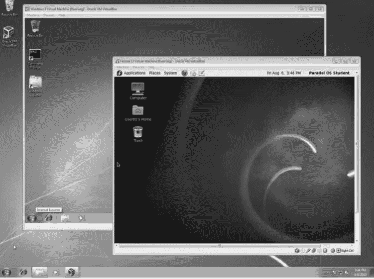

**图 1-1** 桌面上的 Linux 和 Windows虚拟机

来源：Course Technology/Cengage Learning

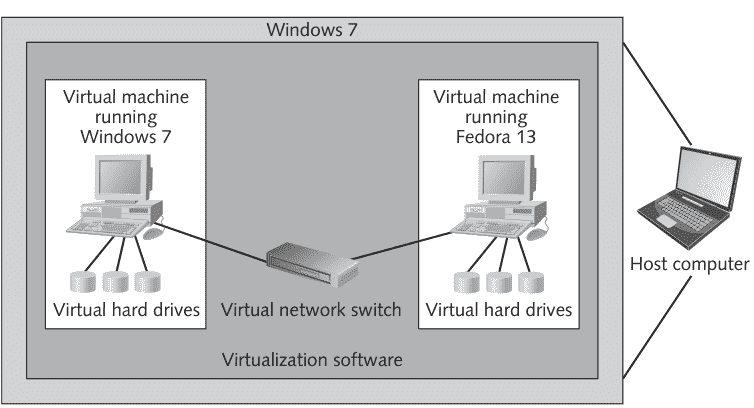

**图 1-2** 虚拟机技术

来源：Course Technology/Cengage Learning

## 第 1 章 硬件组件

虚拟化软件是如何实现这些？

- 六块硬盘是笔记本电脑上的六个文件；这些文件在虚拟机中显示为硬盘。
- 两个网络适配器在虚拟机中显示为虚拟网络适配器。这些适配器连接到虚拟网络交换机。在主机内部，存在软件提供从虚拟网络交换机到笔记本电脑网络的网络连接。
- 2 GB 内存来自笔记本电脑上的 4 GB 物理内存。
- 键盘、鼠标和显示器通过点击所需虚拟机的窗口在两个虚拟机之间切换。你一次只能与一个虚拟机进行交互。

当然，在内存和处理器周期充足的情况下，虚拟化软件可以扩展到运行两个以上的虚拟机。对于一台强大的服务器来说，运行 100 个或更多虚拟机是合理的。

总而言之，你可以在虚拟机中安装多个客体操作系统，它们看起来与你在物理计算机上使用的任何其他系统一样。虚拟化软件对物理 PC 的模拟非常精确，以至于安装在其中的操作系统无法区分出虚拟机和物理计算机的区别。你不需要在多台昂贵的计算机上安装操作系统，也不会创建极其复杂的多启动安装，而可以在多个廉价的虚拟机中安装操作系统。另一个优点是，你在虚拟机中做的任何更改都不会影响你的物理计算机。

Oracle VirtualBox 并不是市场上唯一的虚拟化软件。本书的编写目的是让你能够从三种不同的虚拟化产品中进行选择：

- Microsoft Virtual PC 2007
- Oracle VirtualBox
- VMware Workstation

正文使用了 Oracle VirtualBox，但你可以查阅附录来使用其他虚拟化产品。

# 活动 1-1：启动虚拟机

所需时间：10 分钟

目标：使用虚拟化控制台启动两个虚拟机。

描述：在此项活动中，你将在课堂上使用的计算机上打开安装的虚拟化控制台，然后启动两个虚拟机。记住你将使用三种虚拟化应用之一。

1. 如果必要，使用 User01 和密码 Secret1 登录你的主机 PC。


如果你不确定正在使用哪种虚拟化软件，请询问你的导师。

- 要启动 Oracle VM VirtualBox 控制台，双击桌面上的 Oracle VM VirtualBox。
- 要启动 VMware 控制台，点击“开始”，指向“所有程序”，并双击 VMware Workstation。

## PC 系统的硬件组件

桌面式计算机是一种设计用于方便放置在典型办公桌上或下方的 PC。桌面式计算机通常包含组装在机箱内的几个设备：

- 电源——提供必要的电压
- 冷却系统——移除 PC 产生的热量
- 主板——PC 的主电路板
- 微处理器——PC 的中央处理器 (`CPU`)
- 内存——存储程序和数据的电子区域
- 固件——只读读存储器中的计算机编程指令，用于测试和启动 PC
- 端口——用于将外部设备连接到 PC
- 适配器——为 PC 提供功能的卡

这些组件将在后续章节中进行更详细的。

# 机箱

在 PC 中，机箱容纳并保护主要的电子组件。你可以购买各种尺寸和形状的 PC。外形（Form factor）是指计算机机箱或其内部组件（如系统板，包含基础电子电路和组件）的尺寸、配置或物理布局。

IBM XT PC 设定了机箱配置的早期事实标准。从那以后，桌面式计算机通过 AT（高级技术）模型、mini AT 以及演变。

## 第 1 章 硬件组件

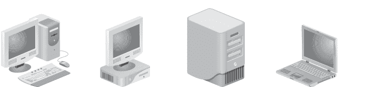

桌面 塔式 笔记本电脑

**图 1-3** 外形

来源：Course Technology/Cengage Learning

IBM XT PC 设定了机箱配置的早期事实标准。从那以后，桌面式计算机通过 AT（高级技术）模型、mini AT 以及演变。

在 PC 中，机箱容纳并保护主要的电子组件。你可以购买各种尺寸和形状的 PC。外形是指计算机机箱或其内部组件（如系统板，包含基础电子电路和组件）的尺寸、配置或物理布局。

IBM XT PC 设定了机箱配置的早期事实标准。从那以后，桌面式计算机通过 AT（高级技术）模型、mini AT 以及演变。

**图 1-3** 外形

桌面 塔式 笔记本电脑

# 第1章硬件组件

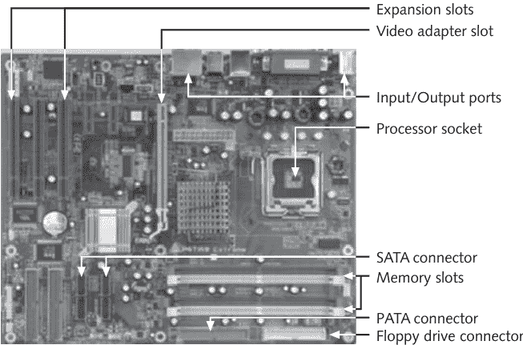

图 1-5 主板

来源：Course Technology/Cengage Learning

接下来的章节将解释主板的众多组件。

## 微处理器

PC系统的核心是微处理器（参见图 1-6）。它包含执行计算机程序指令的逻辑电路。微处理器曾被称为中央处理单元（CPU）；今天，微处理器是集成在单个芯片上的CPU。当你打开电脑时，这台“电子引擎”就会被激活。微处理器包含一组指令，用于执行诸如算术运算（加、减法）、逻辑操作（比较两个数字）以及将数字从一个寄存器传输到另一个寄存器的任务。寄存器是一种小容量的高内存。

### 总线

总线是主板上一组电路，数据通过这些电路从计算机的一个部分传输到另一个部分。你可以想象数据在总线上上下跳跃的比喻——在计算机内部旅行。“总线”一词通常指连接所有内部计算机组件到微处理器和主内存的内部总线。此外，扩展总线允许适配器板访问微处理器主内存。

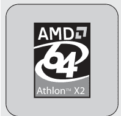

图 1-6 AMD 微处理器

来源：Course Technology/Cengage Learning


图 1-7 内存模块

来源：Course Technology/Cengage Learning

所有总线由两部分组成：数据总线和地址总线。数据总线传输实际数据，而地址总线传输关于数据应该去何处的信息。

总线的大小——称为宽度是非常重要的，因为它决定了一次可以传输多少数据。例如，32位总线可以传输32位（4字节）的数据，而64位总线可以传输64位（8字节）的数据。

**内存**是用于你的程序和数据的电子存储区域。内存通常包含操作系统的主要部分，以及正在使用的某些或全部应用程序及相关数据。内存经常用作随机访问存储器（RAM）的短语。这种内存，如图 1-7 所示，位于主板上的内存槽中。你可以将RAM想象成一个数组，每个盒子都存储一个字节的信息。拥有4 GB内存的计算机可以存储约4,096百万字节（或字符）的信息。

你的PC可以使用以下类型的类型的内存：

- **RAM**（随机访问存储器）——RAM一词指的是读写内存，意味着你可以向RAM写入数据并从中读取数据。大多数RAM是易失的——它需要持续的电流流来维持其内容。当PC断电时，RAM中的任何数据都会丢失。
- **ROM**（只读存储器）——PC几乎包含一少量的ROM，用于存放启动PC的指令。与RAM不同，你不能向ROM写入数据。
- **PROM**（可编程只读存储器）——PROM是一种你可以在其上存储程序的芯片。一旦PROM被使用，你就无法擦除它并在其上存储其他内容。像ROM一样，PROM是非易失的。
- **EPROM**（可擦除可编程只读存储器）——EPROM是一种特殊的PROM，你可以通过暴露在紫外线下来擦除它。
- **EEPROM**（电学擦除可编程只读存储器）——EEPROM是一种特殊的EPROM，你可以通过施加电荷来擦除。

**固件**包含记录程序的ROM、PROM、EPROM和EEPROMs被称为固件。**固件**是软件和硬件的结合。

**BIOS**（基本输入输出系统）是在PC启动期间支持PC的固件。此外，BIOS包含控制键盘、在屏幕上显示文本、从磁盘读取以及执行许多杂功能所需的程序代码。


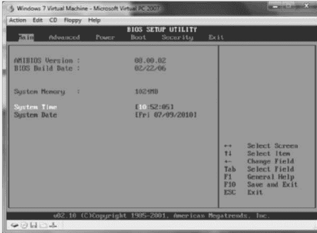

图 1-8 Virtual PC 2007中的BIOS设置界面

来源：Course Teaching/Technology/Cengage Learning

BIOS通常放置在随附的固件芯片中；它通常被称为ROM BIOS。这种放置确保了BIOS始终可用，且不会因磁盘故障损坏；它还允许计算机自我启动。PC拥有闪存BIOS，这意味着BIOS被记录在闪存芯片（通常是EEPROM）上，必要时可以进行更新。

你可以在PC启动时进入设置程序，查看BIOS是如何控制硬件的。图 1-8显示了Microsoft Virtual PC虚拟化软件的BIOS设置界面。从此界面，你可以为Virtual PC配置环境。检查屏幕查看你应该按哪个键进入设置程序。例如，按下`Delete`键可以启动许多设置程序。

## 输入/输出端口

PC带有标准的输入/输出端口，如图 1-9所示。这些端口通常被称为IO端口（发音为eye-oh）。串口用于调制解调器、平板电脑和其他设备，而并行端口用于打印机。串口和并行端口已处于过时状态，可能不再安装在新的PC上。几乎每个通过串口或并行端口连接的外围设备现在都有`USB`形式可用。机箱前面通常有额外的`USB`端口，以及`FireWire`（火线）端口。连接器通过性别来识别。在图 1-9中，串口连接器是公头的，并行连接器是母头的。

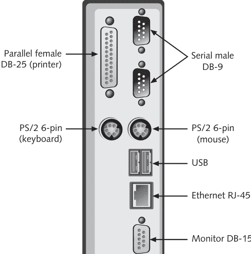

| 端口类型 | 性别 |  |
| :--- | :--- | :--- |
| 串口 | 公头 | `DB-9` |
| 并行 | 母头 | `DB-25` (打印机) |
| `PS/2` | 公头 | 6针 (键盘) |
| `PS/2` | 公头 | 6针 (鼠标) |
| `USB` | 母头 |  |

**图 1-9** 显示I/O端口的电脑背面

来源：Course Technology/Cengage Learning

**串口** 串口一次传输一个位数据（bit）。在PC历史的大部分时间里，这种传输是使用**`RS-232`**（RS-232的缩写）实现的，这是一种由电子工业联盟（EIA）批准的标准接口，用于通过连接计算机与调制解调器等设备的简单电缆传输数据。串口是过时的硬件。你可以通过检查来识别PC背后的串口。如果你检查BIOS设置，你可能会看到PC已将串口分配为`COM1`、`COM2`、`COM3`和`COM4`。

**并行端口** 并行端口经常用于连接旧式打印机。你可以识别PC背后的并行端口。

**通用总线 (USB)** 通用总线（`USB`）是为了简化外围设备连接而开发的。`USB`最初的带宽为1.5 Mbps（每秒兆位），用于低速设备如鼠标和键盘，而最大带宽为480 Mbps。几乎每个曾经通过串口或并行端口连接的外围设备现在都有`USB`形式。机箱前面通常有额外的`USB`端口，以及`FireWire`（火线）端口。`USB 2.0`的引入是为了增加速度，`USB 2.0`接口可以以480 Mbps这种速度进行数据传输。`USB 2.0`接口与`USB 1.1`兼容。为了提高速度，`USB 2.0`在保持全带宽利用的同时，如果你有一台数字相机，你可以利用这种增加的速度来传输高密度的图片。在本文编写时，`USB 3.0`设备开始出现。`USB`的一个新主要功能是“`SuperSpeed`”，它提供5.0 Gbps的传输速率。原始吞吐量为4 Gbps，协议开销后为3.2 Gbps。为了适应`SuperSpeed`的额外引脚，`USB 3.0`插槽和插座已根据之前的版本进行了修改。

`FireWire`（火线）有时称为`IEEE 1394`，`FireWire`是一种非常快速的数字输入输出系统，提供高达400 Mbps的传输速率。`IEEE 1394` `FireWire`管理数字、压缩和音频同步过程，当你使用摄像机拍摄视频时。该系统将广播级视频直接放入你的计算机或DV（数字视频）编辑系统中。在本文编写时，产品中的`FireWire`预计将达到3200 Mbps或3.2 Gbps。

## 扩展卡

扩展卡是一种你可以插入主板以为PC增加功能的打印电路。扩展卡的一端持有插入主板扩展槽的触点，建立了卡电子元件（大部分为集成电路）与主板之间的连接。

扩展卡可以为台式电脑添加更多`USB`端口。笔记本设计由于内部组件布局紧凑，不允许扩展卡。

你可能会将扩展卡称为适配器，允许一个系统与另一个系统连接并工作。适配器通常是一种将一种信号转换为另一种的简单电路；然而，该术通常指的是更准确被称为控制器的设备。例如，显示适配器（显卡）和`SCSI`（小型计算机接口）执行大量的处理，但它们仍被称为适配器。

## 视频适配器

你把视频适配器板（如图 1-10所示）插入PC中以显示其功能。然而，这些功能取决于逻辑电路和显示器器。每个适配器提供多种视频分辨率（像素密度）。

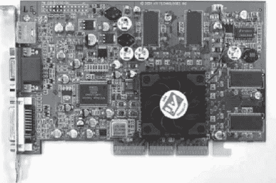

**图 1-10** 视频适配器

来源：Course Technology/Cengage Learning

现代视频适配器包含内存，这样计算机的 RAM 就不用于存储显示内容。较大的内存可以以更多的颜色显示更高分辨率的内容。为了节省费用，你的 PC 制造商可能会使用系统内存处理文本和图形。虽然使用部分主内存可以节省成本，但也可能导致性能下降。

此外，大多数适配器都有自己的图形协处理器用于执行图形计算。这些适配器通常被称为图形加速器。如果你的电脑使用图形加速器，渲染图形的速度会更快。

## 声适配器

声适配器（也称为声卡或音频适配器）是一种用于录制和播放声音的适配器卡，如图 1-11 所示。声适配器支持数字音频和乐器接口（`MIDI`）格式。声卡为麦克风或其他声源提供输入端口，并为扬声器和放大器提供输出端口。

作为声适配器的替代方案，你的 PC 可能拥有主板提供的集成声路。如果你需要安装单独的声卡，可以禁用集成声路。集成音频的一个示例是 `AC'97`，由 Intel 于 1996 年引入。`AC'97` 提供六通道音频，能够支持家庭影院系统的声音。

## 磁盘驱动器控制器

磁盘控制器管理数据从主板到磁盘驱动器以及反向传输。在 PC 中，控制器通常是简单的芯片。当你购买计算机时，它带有了所有标准组件（如磁盘驱动器）所需的控制器。然而，如果你增加了磁盘驱动器，可能需要插入可以在扩展板上运行的新控制器。

控制器必须设计为与计算机的扩展总线通信。PC 有三种标准的控制器架构——`ATA`、`SATA` 和 `SCSI`。因此，当你购买磁盘驱动器时，必须确保它符合你计算机的控制器架构。

# 第 1 章硬件组件

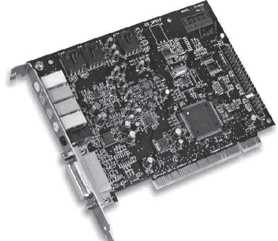

图 1-11 声适配器

来源：Course Technology/Cengage Learning

### ATA 控制器（并行）

`ATA`，或高级技术附件（Advanced Technology Attachment），是一种将控制器集成在磁盘驱动器本身的磁盘驱动器实现方式。增强型 `ATA` 接口的数据传输速率高达 100 MB/sec；这些增强被称为 `ATA/100`。

`ATA` 也称为 `PATA`。并行控制器在多条数据线上并行并行传输数据位。（请在下一节中对比并行 `ATA` 与串行 `ATA`。）在 `PATA`（也称为集成驱动电子或 `IDE`）中，每个主板控制器支持一个或两个设备，可以是硬盘或 CD-ROM 驱动器。你的计算机系统极可能有两个 `IDE` 控制器——每个支持两个驱动器——一个主（master）和一个从（slave）。使用 `ATA` 技术，你可以连接多四个驱动器。

### SATA 控制器（串口）

`SATA`，或串行技术附件（Serial Technology Attachment），是并行 `ATA` 物理存储接口的演进。串行 `ATA` 是一种串行链路——带有四根线的单个电缆，在控制器和驱动器之间建立单一连接。`SATA` 的传输速率从 1.5 到 3.0 Gbps；比 `PATA` 快。设计图上甚至更快的 `SATA` 可以提供 6.0 Gbps。除了传输速度更快，`SATA` 接口相比并行接口具有多个优势。例如，`SATA` 驱动器每个都有独立的总线，因此不存在带宽竞争，而并行 `ATA` 则存在竞争。`SATA` 电缆比传统 `PTA` 硬盘使用的带状线更灵活、更薄、更轻，导致气流限制更少。

## PC 系统的硬件组件

串行 `ATA` 是比过时的 `PATA` 标准更好、更高效的接口。如果你想买一台多年都能支持快速硬盘的计算机，请确保它配备了 `SATA` 接口。


### SCSI 控制器

`SCSI`（读作 skuzzy），或小型计算机系统接口（small computer system interface），是一种用于将外围设备连接到 PC 的并行接口标准。如果你的 PC 没有 `SCSI` 控制器，你可以添加一个 `SCSI` 适配器卡并连接硬盘。`SCSI` 适配器的速度可能超过 `SATA` 控制器的速度。虽然你连接到 `PATA` 或 `SATA` 控制器的设备数量受到限制，但 `SCSI` 允许你向单个 `SCSI` 控制器连接 15 个设备。然而，由于缺乏单一的 `SCSI` 标准，某些设备可能无法与某些 `SCSI` 板配合。尽管 `SCSI` 是美国国家标准（ANSI）的标准，但它有许多变体，因此两个 `SCSI` 接口是不兼容的。例如，`SCSI` 支持多种类型的连接。

## 存储设备

存储设备是指存储大量数据的各种设备。现代质存储包括所有类型的磁盘和带驱动。质存储与 RAM 不同，RAM 指计算机内部的临时存储区域。与 RAM 不同，质存储设备在计算机关闭时会保留数据。

存储设备的主要类型有：

- 硬盘——这些磁盘快且容量大。某些硬盘是便携的（带有可拆卸卡盒），但大多数不是。
- 光驱——与使用电磁学编码数据的软盘驱动不同，光盘使用激光读写数据。光驱的存储容量非常大，但速度没有硬盘快。
- 磁带机——这些相对便宜且存储容量极大，但它们不支持数据的随机访问。
- `USB` 盘——这些使用闪存或外部硬盘存储数据，用于备份或在 PC 之间进行传输。

## 硬盘

硬盘使用旋转盘片在磁性介质上读写。典型的硬盘设计如图 1-12 所示，由一个主轴组成，盘片在主轴上以恒速旋转。读写头位于公共的臂上并沿盘片移动，手臂为每个盘片移动一个磁头。当盘片旋转时，手臂轻松地跨越盘片，每个磁头都可以访问整个盘片。

硬盘由磁盘控制器驱动。取决于你购买的 PC 的配置，这些硬盘可能连接到 `PATA`、`SATA` 或 `SCSI` 硬盘。也可以将外部硬盘连接到 `USB` 端口。

## 光驱

图 1-13 显示了一种光学存储设备，它使用激光投射的光而不是磁性在光盘上存储数据。这些光盘包括 CD 和 DVD，它们由数百万微小的凸起和凹槽组成，计算机可以识别它们。

常见的光驱类型包括 `CD-ROM`、`CD-RW`、`DVD-ROM` 和 `DVD-RW` 驱动器。CD 和 DVD 刻录机（如 `CD-R` 和 `DVD-R` 驱动器）使用激光读写数据。写入数据的激光比另一种激光功率得多，因为它必须在光片上“烧蚀”出凸起和凹槽。

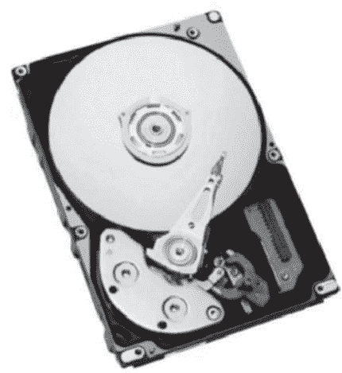

图 1-12 硬盘

来源：Course Technology/Cengage Learning

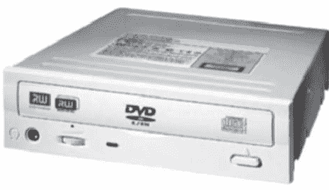

图 1-13 光驱

来源：Course Technology/Cengage Learning

**磁带机** 磁带机是一种在磁带上存储计算机数据的设备，特别是用于备份（见图 1-14）。像普通的录音机一样，磁带机在循环的柔性纤维素类材料上录制数据，这种材料可以读取和擦除。磁带具有

**图 1-14** 磁带驱动

来源：Course Technology/Cengage Learning

具有大数据存储容量，且价格比硬盘存储便宜。其缺点是磁带驱动器是顺序存储数据的，而不是随机存储（如硬盘那样），用户只能从磁带开始并一直卷动磁带，直到找到所需数据，才能访问特定数据。

**USB 驱动器** `USB` 驱动器是一种小型、便携的闪存设备（见图 1-15），它可以插入任何带有 `USB` 端口的计算机，并作为容量高达 256 GB 的便携驱动器。`USB` 闪盘易于使用，可以放在口袋里。`USB` 闪盘也被称为 jump drives、pen drives、key drives 或简单的 `USB` 驱动器。这些驱动器的存储容量小于外部硬盘，但它们更小、更耐用，因为它们内部没有机械运动部件。

**图 1-15** `USB` 驱动器

来源：Course Technology/Cengage Learning

# 第1章 硬件组件

`USB` 驱动器也可以指插入计算机 `USB` 端口的便携式硬盘、`CD` 驱动器或 `DVD` 驱动器。便携式硬盘是插入计算机外部端口（如 `USB` 或 `FireWire` 端口）的磁盘驱动器。通常用于备份，但也作为辅助存储，其容量与内部硬盘相当。

# 通信设备

通信设备支持数据从一台 PC 传输到另一台 PC，或从一个设备传输到另一个设备。例如，调制解调器、网卡和无线适配器都是通信设备。

**调制解调器** `Modem` 是调制解调器（modulator-demodulator）的缩写。如图 1-16 左所示，电话调调器允许计算机数字存储的信息以声波的形式通过电话线传输。电话调调器在这些形式之间转换。

随着电缆的普及，宽带通信已广泛用于传输数字数据。**电缆调制解调器**如图 1-16 右所示，设计用于在电缆电视线上运行。由于同轴电缆提供的带宽比电话线大得多，您的电缆调制解调器能够极快地访问万维网。

**网卡** 网络接口卡（`NIC`）如图 1-17 所示，插入计算机的扩展卡，使其能够连接到局域网（`LAN`）。网卡可以是插入计算机总线的扩展卡，也可以是主板上的接口。

**无线适配器** 无线适配器如图 1-18 所示，允许移动用户通过无线（无线电）连接连接到局域网。其访问方式与网卡类似，但无线适配器提供了更大的移动自由度。许多新的笔记本电脑主板上内置了无线适配器。如果您的笔记本电脑没有无线适配器，您可以购买无线 PC 卡或 `USB` 无线适配器。

**图 1-16** 电话和电缆调制解调器

来源：Course Technology/Cengage Learning

**图 1-17** 网络接口卡

来源：Course Technology/Cengage Learning

**图 1-18** 无线适配器

来源：Course Technology/Cengage Learning

# 外围设备

外围设备是 PC 外部的设备。例如，键盘、鼠标和扫描仪都是外围设备。这些设备允许您与计算机交互。

# 输入设备

输入设备用于向计算机提供数据。常见示例包括键盘、鼠标和触摸屏。

**键盘** 键盘是用于向计算机输入文本和命令的设备。大多数键盘都有用于字母、数字和特殊功能的按键。

## 活动 1-2：查看 Windows 7 系统信息

所需时间：10 分钟

**目标：** 使用“系统信息”程序查看 Windows 7 虚拟机上有哪些可用组件。

**描述：** 在此活动中，你将打开系统信息窗口并查看电脑 PC 上的可用组件。

- 1. 如必要，请按照活动 1-1 中的相应说明启动你的虚拟机。
- 2. 要打开“系统信息”窗口，点击*开始*，在“搜索程序和文件”上方点击**`msinfo32`**，然后在“程序”下点击**`msinfo32`**。
- 3. 要查看组件信息，展开**组件**（Components）文件夹。
- 4. 要查看输入组件，展开**输入**（Input）文件夹。
- 5. 要查看指针型设备信息，点击*指针型设备*（Pointing Device）。
- 6. 要查看网络适配器信息，展开*网络*（Network）然后点击*适配器*（Adapter）。
- 7. 要查看驱动器信息，展开*存储*（Storage）并点击*驱动器*（Drives）。
- 8. 要查看磁盘信息，点击*磁盘*（Disks）。
- 9. 关闭“系统信息”窗口。
- 10. 保持虚拟机登录状态以备后续活动使用。

## 活动 1-3：查看 Fedora 13 系统信息

所需时间：10 分钟

**目标：** 使用“系统信息”程序查看 Fedora 13 虚拟机上有哪些可用组件。

**描述：** 在此活动中，你将打开系统信息窗口并查看你的 Fedora 13 虚拟机上的可用组件。

- 1. 如必要，请按照活动 1-1 中的相应说明启动你的虚拟机。
- 2. 要打开终端控制台，指向*应用程序*（Applications），指向*系统工具*（System Tools），然后点击*终端*（Terminal）。
- 3. 要打开“系统信息”窗口，输入**`hardinfo`** 并按回车。

> 如果你看到“Command not found”（找不到命令）消息，请联系你的导师。

- 4. 要查看组件信息，点击**摘要**（Summary）。
- 5. 要查看操作系统信息，点击**操作系统**（Operating System）。
- 6. 要查看处理器信息，点击处理器（Processor）。
- 7. 要查看输入组件，点击输入设备（Input Devices）。
- 8. 要查看存储信息，点击存储（Storage）。
- 9. 关闭“系统信息”窗口。
- 10. 保持虚拟机登录状态以备后续活动使用。

## 活动 1-4：查看你的 Windows 7 虚拟机上的设备

所需时间：10 分钟

**目标：** 使用“设备管理器”程序查看你的 Windows 7 虚拟机上有哪些设备。

**描述：** 在此活动中，你将打开“设备管理器”并查看电脑 上的可用设备。

- 1. 如必要，请按照活动 1-1 中的相应说明启动你的虚拟机。
- 2. 要打开“系统”应用，点击“开始”，右键点击“计算机”，然后点击“属性”。
- 3. 要打开“设备管理器”，点击左侧窗格中的“设备管理器”。
- 4. 如果出现设备管理器警告，阅读其内容并点击确定。
- 5. 要查看磁盘驱动器信息，展开“磁盘驱动器”（Disk drives）文件夹。
- 6. 对其余文件夹重复步骤 5。
- 7. 关闭“设备管理器”和“系统”窗口。
- 8. 保持虚拟机登录状态以进行下一次活动。

## 活动 1-5：关闭虚拟机

所需时间：3 分钟


# 目标：正确关闭虚拟机。

**描述：** 在此活动中，你将注销并关闭两个虚拟机。虚拟机必须妥善关闭；否则，可能会导致支持虚拟机的虚拟硬盘损坏。

1. 如果 Windows 7 虚拟机启动了屏幕保护程序，请登录 Windows 7 虚拟机，输入 `Secret1`，然后按回车。
2. 要关闭 Windows 7 虚拟机，点击“开始”，然后点击“关机”。
3. 如果 Fedora 13 虚拟机启动了屏幕保护程序，输入密码 `Secret1` 然后点击“解锁”。
4. 要关闭 Fedora 13 虚拟机，点击“系统”，点击“关机”，然后再次点击“关机”。
5. 保持电脑登录状态供下一个学生使用。

## 预防性维护

当你使用 PC 时，你可能需要负责对其进行维护。例如，你可能需要定期清理设备，这可以延长它的寿命。你还需要知道，许多潜在危害（包括静电）可能会损坏 PC。当你不再需要这台 PC 时，你会如何处理它？本节将介绍所有这些主题。

## 清洁

你 PC 的宿敌是过热，它会加速其脆弱电路的损坏。最常见的原因是过热以及灰尘和污垢。堵塞的通风口和 CPU 散热扇会导致散热空气无法通过机箱，即使薄薄的灰尘或污垢也会升高 PC 组件的温度。

在大多数地方（例如灰尘较多的办公室），你的系统可能每几个月就需要清洁一次。大多数清洁只需要一罐压缩空气、无绒擦拭布、棉签以及在瓶水中滴入几滴温和清洁液。


> 在清洁任何组件之前，请务必关闭系统并拔掉电源。切勿将液体直接喷在组件上。将液体喷洒或倒在无绒布上，然后用布擦拭 PC。

### 清洁外部

首先清洁机箱外部和连接的外围。用温和清洁液擦拭机箱。清除通风口的任何阻塞物。使用压缩空气，但不要向机箱内部吹。

### 静电释放

静电释放（ESD）是静电从一个导体到另一个的快速释放。静电释放可能会损坏 PC 中的电路。当 PC 机箱和内部结构暴露时（例如添加适配器卡），你可能会用积累的静电损坏计算机。

计算机的内部结构，特别是硬盘，对静电极其敏感。人类在静电达到 1,500 伏之前无法感知到它。（在地毯上行走可以产生高达 12,000 伏的电。）虽然这对人类没有生命威胁，但即使是很低的电压也会严重损坏硬盘或主板。

为了避免击穿内部计算机组件，请在触摸它们之前按照上节所述对静电接地。为了安全起见，始终触处理电子电路的绝缘区域；避免触摸电路本身。

### 危害

虽然电气问题可能会损坏你的 PC，但许多危害可能会伤害你，包括高压电击。你需要了解这些危害以及如何预防它们。

电容器中的高电压 PC 电源、显示器和激光打印机内部含有电容器，这些容器在从电路移除电源后仍可能保持电荷；这种电可能会损坏连接的设备并导致电击。你不尝试维修包含大型或高压电容器的设备。

## 电源

每当你对 PC 进行修理或维护时，都必须在释放静电后拔掉电源。现代 PC 主板在 PC 插入电源时会有一有一个微小电压运行。

你不应该尝试修理电源。最安全的选择是更换。


## CRT 显示器

CRT 显示器内部的电压可能会致命！请记住，电容器在断开电源后会保持长时间电荷；这些电荷会导致电击甚至触电。显示器的另一个危险部分是飞线变压器，它可以产生高达 20,000 伏的电压。

## 火灾

你可能从未遇到过 PC 起火，但电气火灾可能会袭击你的办公室或家庭。烟雾也会伤害你和你的 PC。对于电气火灾，你应该使用 C 类或 ABC 型灭火器。千万不要向电气火灾喷水或泼水；电流可能会顺着水流到你身上。

## 处置

许多 PC 组件含有有害成分和毒素，包括铅、汞、砷、镉、硒和六价铬。填埋场中约 70% 的重金属（汞和镉）来自电子垃圾。这些毒素会导致过敏反应、脑损伤和癌症。

在处置 PC 和外围设备时必须做出谨慎决定。

- 电池含有毒化学品（铅、汞、镍镉），不应丢入垃圾。你可以将电池送到回收站。在某些情况下，你可以将电池交给制造商。
- CRT 含有铅。如果你将其扔进垃圾桶，铅就会进入填埋场。出于此原因，CRT 必须回收或移交给危险废物处理计划。
- 从计算机中可以提取大量的金、银、铜、钢、铝、线和其他资源。其中许多材料是可回收的。


- USB A/B 线
- USB A/Mini-B 线
- USB A/Micro-B 线

**图 1-20** 带有常见连接器的 USB 线

来源：Course Technology/Cengage Learning

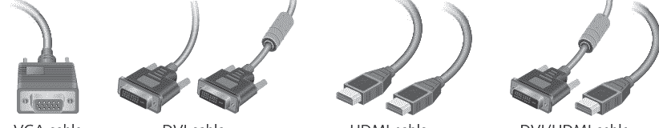

- VGA 线
- DVI 线
- HDMI 线
- DVI/HDMI 线

**图 1-21** 视频线

来源：Course Technology/Cengage Learning

## 连接组件和测试 PC

你应该知道如何“连线”PC。在本节中，你将学习识别并插入典型台式机或笔记本系统的电缆和连接器。

### USB 线

你可以使用 USB 线将许多设备连接到计算机，包括闪存设备、便携媒体播放器和数字相机。你还可以连接配件，如鼠标、键盘、移动硬盘、DVD-CD 驱动器和麦克风。摄像头、打印机、扫描仪和扬声器也可以通过 USB 端口连接到计算机。

标准 USB 连接器称为 USB-A，是每个 USB 线上的矩形连接器；连接到你的计算机。USB 的另一端可能有多种连接器，包括用于用于打印机、便携式驱动器和较大设备的方形连接器。较小的连接器如 Mini-USB 和 Micro-USB 常用于较小的便携式设备，包括媒体播放器和相机。图 1-20 显示了带有各种连接器的 USB 线。

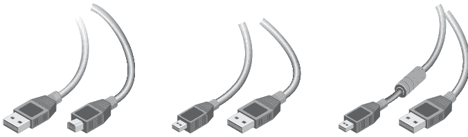

### 视频线

计算机显示器常用的视频连接器之一是 15 针 VGA 线。例如，你可以使用这根线将 PC 连接到投影仪。图 21 显示了常见的视频线。如果你最近购买了 PC，你可能有数字视觉接口（DVI）。较新的、更薄的笔记本电脑可能有较小版本的 DVI，如 Mini-DVI 和 Micro-DVI。DVI 有许多引脚，尽管某些连接器的引脚较少。DVI 与 HDMI 兼容；可以在两种格式之间转换。

### 音频线

最常见的音频线是标准的耳机插。音频线有多种尺寸，1/8 英寸微型音频线（如图 22 所示）用于计算机。


图 22 音频线

来源：Course Technology/Cengage Learning

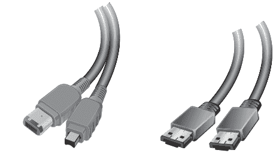

- FireWire 6 针/4 针线
- eSATA 线

图 23 数据线

来源：Course Technology/Cengage Learning

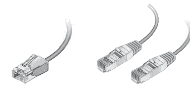

- 电话线
- 以太网

图 24 网络线

来源：Course Technology/Cengage Learning

### 数据线

图 23 显示了常见的数据线：FireWire 和 eSATA。FireWire 也称为 IEEE 1394，通常用于连接摄像机和便携式驱动器。FireWire 线通常有 6 个引脚，尽管也有其他类型。虽然 SATA 线在内部用于将驱动器连接到磁盘控制器，但 eSATA 线是为便携式驱动器设计的。eSATA 连接器比内部 SATA 线大且具有更多屏蔽。

### 网络线

电话线 RJ-11 用于连接调制解调器。以太网是有线网络的标准。以太网连接器又称为 RJ-45，连接双绞线。它看起来像一个插头但更厚更宽。

## 连接组件和测试 PC

首先将你的 PC 组件安排在你使用它们的区域：将键盘放在显示器前面，鼠标放在键盘的右侧或左侧，依此类推。缓慢移动 PC 直到可以看到连接器。

> **注意** 在连接之前不要打开任何组件。你应该顺序连接各种线缆。例如，如果你使用的是塔式机箱，从底部开始到顶部。对于笔记本电脑，你可能按以下顺序连接：

1. 找到 LAN 线，将其插入 RJ-45 端口。
2. 找到音频线，将其插入绿色端口。
3. 通过 USB 连接器找到键盘。
4. 通过 USB 端口找到鼠标。
5. 将电源线连接到电源接口。
6. 检查你的连接情况。如果看起来是正确的，则打开显示器和 PC。

连接笔记本电脑与前面的步骤类似，但连接器较少：可能只有一个 VGA 连接器和两个三个 USB 端口。

## 章节总结

- 虚拟机技术允许多个操作系统在单台 PC 上并发运行。通过虚拟机技术，你可以在 Windows 7 中运行各种 Windows 操作系统以及 Linux。
- PC 由许多硬件组件组成。机箱放置并保护主要的电子组件。电源是一个包含电源转换硬件的密封金属盒。主板或主电路板包含微处理器、总线、内存和扩展槽。BIOS 固件在启动期间支持 PC。VGA 和 USB 端口允许连接设备。视频和声扩展卡允许与用户进行图形和音频通信。磁盘控制器（如 PATA、SATA 和 SCSI）允许连接硬盘和光驱。调调器、网络接口卡和无线适配器允许与其他设备通信。
- 外围设备包括输入设备，如键盘、鼠标、触摸板、指纹扫描仪和数字相机；输出设备包括显示器、LCD 面板和打印机。
- 预防性维护是 PC 所有者的责任。为了避免热损坏，请保持 PC 洁洁。清洁机箱及连接的外围设备的内外部。
- 许多危险可能会伤害 PC 用户或损坏 PC。例如，静电放电会损坏 PC 的内部组件。电源和 CRT 显示器中的电容器保持高电压。对于电气火灾，使用 ABC 类或 C 类灭火器。
- 某些组件不是内部的而是连接到 PC 的。USB 等主连接器简化了这些组件的连接。从距离电源最远的连接器开始连接组件。

## 术语

- ATA：高级技术附件（Advanced Technology Attachment）的缩写；通常称为集成驱动器电子（IDE）磁盘。
- 生物识别：通过测量生理特征验证个人身份的科学和技术。
- BIOS：基本输入输出系统（basic input/output system）的缩写；一组在启动时测试 PC 并启动操作的关键软件程序。
- 总线：用于在 PC 组件之间传输数据的硬件线。
- CRT：阴极射线管（cathode-ray tube）的缩写；标准 PC 显示屏的基础。
- 数字相机：一种以电子方式存储照片图像而非胶片的相机。
- 数字视频摄像机：一种在数字介质上捕获并存储图像的相机。也称为摄像机（camcorder）。

## 关键术语 31

- EEPROM：电可擦除可编程只读存储器的英文缩写；一种可以通过电信号擦除的 EEPROM 类型。
- 静电放电 (ESD)：来自外部源（如人类）的静电放电到集成电路中，会损坏电路。
- EPROM：可擦除可编程只读存储器的英文缩写；一种在制造后可以重新编程的芯片类型。
- 扩展卡：插入 PC 总线以添加额外功能的卡。。
- 指纹扫描仪：一种读取人类指纹并将其与存储的指纹数据库进行比较的扫描仪。
- FireWire（火线线）：一种 PC 和数字视频总线接口标准，提供高速通信。FireWire 也称为 IEEE 1394。
- 固件：存储在只读存储器 (ROM) 中的软件程序。
- 回扫变压器：CRT 显示器中的变压器，可产生高达 20,000 伏的电压。
- 外形 (form factor)：设备的物理尺寸和形状。该术语用于描述 PC 机箱的大小。
- 客户操作系统：在虚拟机内部运行的操作系统。
- 硬盘：一种在单个或多个软质盘上读取和写入数据的设备。
- 散热器：吸收并耗散电子设备（如微处理器）产生的热量的设备。
- 主机操作系统：运行在执行虚拟化软件的物理机上的操作系统。
- LCD：液晶显示器的英文缩写；一种使用夹在两个电极之间的极性分子结构液体化合物的显示器。
- 内存：可以存储和检索数据的区域。
- 微处理器：单个芯片上的中央处理单元 (CPU)。
- 调制解调器 (modem)：用于调制/解调的设备；一种允许 PC 通过标准电话线传输数据的通信设备。
- 主板：包含 PC 主要组件的主型电路板。
- 鼠标：一种常见的定位设备。
- 网卡 (NIC)：一种用于连接计算机到局域网的扩展卡。
- 光驱：一种在光盘（紧凑光盘）上读取和写入数据的磁盘驱动器。
- 并口：并行接口设备的输入/输出连接器。
- PATA：并行技术附件 (Parallel Technology Attachment) 的英文缩写。PATA 与 ATA 相同，在 SATA 引入时更更改了名称。
- PROM：可编程只读存储器的英文缩写。
- RAM：随机存取存储器的英文缩写；一种可以被微处理器或其他设备读取的半导体内存。
- 寄存器：少量的高速内存。
- ROM：只读存储器的英文缩写；一种由制造商永久安装数据的半导体电路。
- RS-232：一种行业认可的串行通信标准。

## 第1章 硬件组件

- SATA：串行高级技术附件 (Serial Advanced Technology Attachment) 的英文缩写，它以串行方式与硬盘之间传输数据。
- SCSI：小型计算机系统接口 (small computer system interface) 的英文缩写。它用于将 SCSI 设备连接到 PC。
- 声卡：一种支持声音录制和播放的扩展卡。
- 系统板：见主板。
- 磁带机：一种在磁带上读取和写入数据的设备。
- 触摸板：一种对表面手指移动有响应的指针设备。
- 轨迹球：一种具有固定外壳的指针设备，内部包含一个你可以用手滚动的球。
- 通用总线 (USB)：一种将设备连接到 PC 的串行总线。USB 支持热插拔。
- U 盘：一种小型、便携的闪存内存卡，插入 PC 的 USB 端口，作为存储容量高达 2 GB 的便携硬盘使用。
- 显卡：生成发送到视频显示器信号的电子组件。
- 虚拟机：机器（即计算机）的软件实现，可以像物理机一样执行程序。
- 虚拟化：一种允许一个或多个客户操作系统运行在一个操作系统上的技术。
- 虚拟化系统：看起来是真实的但实际上是模拟的系统。
- 无线网卡：一种支持通过无线连接到无线局域网进行连接的设备。

## 复习题

+ 1. 通过虚拟机技术，你通过以下方式从一个操作系统切换到另一个：
   a. 重启系统
   b. 按 F2 键
   c. 点击另一个操作系统窗口
   d. 注销系统
+ 2. 下列哪些操作系统可以使用虚拟机技术？（选择所有适用）
   a. Windows 7
   b. Linux
   c. Macintosh
   d. 物理
   e. 逻辑
   f. 模拟
   g. 免费
3. Oracle VirtualBox 模拟物理 PC 的程度非常高，以至于你在其中安装的应用程序无法区分虚拟机与 __________ 计算机。
+ a. 受支持的
b. 模拟的
c. 客户
d. 物理
4. __________ 是 PC 硬件的尺寸、配置或物理布局。
+ a. 系统板
b. 主板
c. 外形
d. 以上都不是
5. 电源 __________（选择所有适用）
+ a. 为 PC 组件提供清洁的电源馈电
   b. 是一个密封的金属盒
   c. 具有可与各种组件配合的标准插头
   d. 可供用户维护
6. __________ 是 PC 内部的主电路板。（选择所有适用）
+ a. 系统板
b. 主板
c. 外形
d. 以上都不是
7. __________ 是程序和数据的电子容纳地。
+ a. EPROM
b. RAM
c. EEPROM
d. ROM
8. 下列哪些内存类型可以用于存放 BIOS 固件？（选择所有适用）
+ a. EPROM
b. RAM
c. EEPROM
d. ROM
9. 下列哪些被认为是 I/O 端口？（选择所有适用）
+ a. 串行
b. 并行
+ c. USB
+ d. FireWire
10. 以下哪些 BIOS 设置可以分配？（选择所有适用）
+ a. COM1
b. COM2
+ c. LPT1
d. LPT2
11. __________是为了简化设备连接而开发的。
+ a. 串行端口
b. 并行端口
c. 通用总线
d. __________
12. 以下哪些可以作为硬盘控制器？（选择所有适用）
+ a. ATA
b. SATA
c. SCSI
d. __________
13. 主要的数据存储类型是 __________（选择所有适用）
+ a. 硬盘
b. 光盘
+ c. 磁带
d. U 盘
14. 下列哪些是小型、便携的闪存内存？（选择所有适用）
+ a. U 盘
b. 闪存盘
c. 密钥盘
d. 存储盘
15. 下列哪些是通信设备？（选择所有适用）
+ a. 调制解调器
b. 网卡
c. 无线网卡
d. 显卡
16. 下列哪些是输入设备？（选择所有适用）
+ a. 键盘
b. 鼠标
c. 轨迹球
d. 指纹扫描仪
e. 触摸板
17. __________ 是 PC 的天敌。
+ a. 脏污
b. 灰尘
c. 热量
d. 污垢
18. 使用 __________ 溶液擦拭。
+ a. 酒精
b. 砷
c. 温和清洁
d. 硒
19. 静电在达到 _______________ 伏之前，人类无法感知。
+ a. 110
b. 1500
c. 12000
d. 25000
20. 计算机包含以下哪些毒性成分？（选择所有适用）
+ a. 铅
b. 汞
c. 砷
d. 镉

## 案例项目

### 案例 1-1：使用虚拟机技术


你的老板一直在阅读关于虚拟机技术的内容。他收到工程部请求 10 台用于 Linux 应用程序的新 PC。工程师们有一年前的 PC，运行 Windows 7，配备 4 GB 内存、250 GB 硬盘以及最快的处理器。你的老板知道你在当地社区学院的操作系统课程中使用虚拟化技术。他希望你写一份报告，讨论在现有的 Windows 7 操作系统上使用 Oracle 运行 Linux 和该应用程序的可能性。他希望你的报告能解释虚拟化技术的潜在成本节省。由于工程师精通技术，你的报告必须提供提供建议的技术理由。

### 案例 1-2：配置 PC

你有 1000 美元的预算。利用主要 PC 制造商的网站配置一台 PC 和打印机。提供一份包含配置和组件成本的报告。

### 案例 1-3：保持 PC 清洁

你的老板要求你制定一套程序，以保持工作区域 PC 的清洁和运行。提供有关使用各种清洁剂的详细信息。包括可能损坏组件的不当操作的预防措施。

## 第 2 章

## 软件组件

阅读本章并完成练习后，你将能够：

- 描述三种流行操作系统的历史里程碑
- 描述常见 PC 操作系统的架构
- 描述操作系统的功能
- 描述操作系统与其组件之间的交互
- 描述 Windows 7 和 Fedora 13 可用的实用程序
- 描述 Windows 7 和 Fedora 13 可用的应用程序

PC 由硬件和软件组成。你已经在第 1 章中学习了硬件，在本章中你将学习软件。硬件的传统定义是“你可以触摸到的东西”，软件的传统定义是“让 PC 运行的指令”。

让 PC 完成任务的软件组件包括操作系统、实用程序（执行系统相关任务和维护操作系统的程序）以及应用程序（执行用户相关任务的程序）。为了有效使用 PC 上的软件，你需要了解这三类组件的特征。除了描述这些组件外，本章还简介绍了操作系统里程碑的历史，解释了操作系统的功能，并解释了操作系统与应用程序之间的交互。

为了能够为你的 PC 选择合适的操作系统，你需要了解两种主流操作系统——Windows 和 Fedora 13 的特征。

## 常见操作系统

许多不同的操作系统运行在 PC 上。你可能没有听说过 MINIX、Mac、XNU、MorphOS、EROS 和 Amoeba 等操作系统。许多最流行的操作系统源于主要大学的研究，包括 Mac OS X、Fedora 13 和 Microsoft Windows。在本文中，你将使用 Windows 7 和 Fedora 13 中的命令行界面。

## 磁盘操作系统 (DOS)

DOS 可以指任何操作系统，但它最常用作 MS-DOS（微软磁盘操作系统）的缩写。MS-DOS 最初由微软为 IBM 开发，曾是 PC 的标准。

DOS 是今天最基础的操作系统之一。DOS 的第一个版本非常原始，但在几次更改后，它提供了所需的所有功能。它是一个单任务操作系统，这意味着它一次只能运行一个程序。

与其他操作系统不同，DOS 的起源于一个人的努力：Seattle Computer Products 的 Tim Patterson。Patterson 创建了 QDOS（即“快速粗略操作系统”），微软将其购买并成为 MS-DOS 的种子。

微软发布了多个版本的 DOS，并在 1994 年的最后一个版本达到巅峰：

- 1981 年 8 月——PC-DOS 1.0 在 IBM 发布的 PC 上出现。
- 1982 年 5 月——MS-DOS 1.1 支持 320-KB 双面软盘驱动器。
- 1983 年 3 月——MS-DOS 2.0 从头编写。它支持 10-MB 硬盘、树形文件系统和 360-KB 软盘。
- 1984 年 8 月——MS-DOS 3.0 增加了对 1.2-MB 软盘和 10 MB 以上硬盘的支持。
- 1984 年 11 月——MS-DOS 3.1 增加了对微软网络的支持。
- 1988 年 11 月——MS-DOS 4.01 包含图形界面和对 32 MB 以上硬盘分区的支持。
- 1991 年 6 月——MS-DOS 5.0 增加了全屏编辑器、删除和取消格式化实用程序以及任务交换。
- 1993 年 3 月——MS-DOS 6.0 升级包含了 DoubleSpace 磁盘压缩。
- 1994 年 6 月——MS-DOS 6.22 以 DriveSpace 的名称引入了 DoubleSpace 磁盘压缩。（有些人认为这是 MS-DOS 的最后一个版本。）

你可能在想为什么要学习 DOS，但有几个原因。例如，命令行对于完成某些任务非常有用，如在硬盘之间复制大量文件或更改文件属性。如果你正在学习成为一名管理员，你需要尽可能高效地执行任务。一旦你学会了命令，使用命令行就是高效的；在微软 Windows 服务器上，命令行界面有时是恰当的工具。

在本章稍后部分以及整书中，你将在活动练习中输入命令。

## Windows 7 操作系统

Microsoft Windows 是 1985 年推出的一系列 PC 环境和操作系统，最初用于创建苹果的新系统——Macintosh，该系统使用了图形界面。苹果和微软都遵循了 Xerox PARC（施罗克斯帕洛托研究中心）开发的操作系统路线。Xerox PARC 以创建现代图形用户界面而闻名。微软通过开发 Windows NT（新技术）继续了 Windows 的发展；该公司聘请了数字设备公司（DEC）虚拟内存系统（VMS）的首席架构师 Dave Cutler 来将 NT 开发为功能更强大的操作系统。Cutler 曾在 DEC 开发 VMS 的后续产品，称为 Mica；当 DEC 放弃该项目时，他带着他的专业知识和工程师离开了微软。

微软占据了超过 80% 的桌面操作系统市场。Windows 是一种专有的闭源软件，这意味着微软拥有该软件的版权及其发行权。

微软发布了多个版本的 Windows；早期版本有：

- 1985 年 11 月——Windows 1.0 引入了图形界面。
- 1987 年 10 月——Windows 2.0 增加了图标和窗口。
- 1990 年 5 月——Windows 3.0 是次彻底的改版。
- 1991 年 7 月——Windows NT 3.1 用于工作站和服务器。
- 1993 年 12 月——Windows NT 3.11 提供了对点共享。
- 1994 年 9 月——Windows NT 3.5 提供了高级多任务处理。
- 1995 年 8 月——Windows 95 在多核处理器上改进了性能。
- 1998 年 6 月——Windows 98 支持最新技术。
- 2000 年 2 月——Windows 2000 提供了一个令人深刻目的平台。
- 2000 年 9 月——Windows Me 针对家庭用户。
- 2001 年 10 月——Windows XP 包含内核。
- 2003 年 4 月——Windows Server 2003 是一个多功能操作系统。
- 2005 年 4 月——Windows XP 64 位设计用于使用 64 位内存地址空间。
- 2007 年 1 月——Windows Vista 包含了更新的用户界面。
- 2008 年 2 月——Windows Server 2008 基于与 Vista 相同的基础代码构建。
- 2009 年 10 月——Windows 7 包含了许多新功能。
- 2009 年 10 月——Windows Server 2008 R2 包含了新的虚拟化能力。

## Fedora 操作系统

Linux 指的是使用 Linux 内核（计算机操作系统的核心部分）的一类 UNIX 类计算机操作系统。它是全球 Linux 社区开源软件协作的成果。通常情况下，开源软件中的所有底层代码都可以用于商业和非商业目的的自由修改和重新分发。

Linux 的诞生归功于 UNIX，后者是由肯·汤普（Ken Thompson）和丹尼斯·里奇（Dennis Richie）创建。有趣的是，UNIX 这个缩写实际上并不代表任何含义。原始操作系统被称为 Uniplexed Information and Computing System（Unics）——这是对大型 Multics 操作系统的一种双关——后来更改为 UNIX。

在 Linux 诞生之前，已经发布了许多重要的 UNIX 版本，如表 2-1 所示。版包含了 60 多个命令，其中许多今天仍在在使用。

林纳斯·托瓦尔斯（Linux Torvalds）在芬兰赫尔辛基大学大学期间开发了 Linux 内核。他于 1991 年开始开发内核，并在 1994 年发布了 1.0 版本。

理查德·斯尔曼（Richard Stallman）在马萨诸塞理工学院（MIT）的人工智能实验室开始研究 GNU 项目。今天，该项目包括汇编器、编译器、处理器、调试器、解释器、外壳、文本编辑器以及许多支持开发的实用程序。GNU 是“GNU's Not UNIX”的缩写。

Linux 使用窗口系统进行图形显示。X 系统（或 X11）由 Jim Gibbs 和 鲍布·谢夫勒（Bob Scheffler）于 1984 年在 MIT 开发。它最初被设计为一种平台无关图形系统，以便学生可以使用许多不同厂商的计算机。

Linux 通常封装成名为 Linux 发行版的格式，供桌面和服务器使用。Linux 发行版构建在 Linux 内核之上。根据 Web DistroWatch 的数据，截至 2010 年 7 月，Fedora 是第二流行的基于 Linux 的操作系统。

| 日期 | UNIX 版本 |
| :--- | :--- |
| 1971 年 11 月 | 第一版 |
| 1972 年 12 月 | 第二版 |
| 1973 年 2 月 | 第三版 |
| 1973 年 11 月 | 第四版 |
| 1974 年 6 月 | 第五版 |
| 1975 年 5 月 | 第六版 |
| 1979 年 1 月 | 第七版 |
| 1985 年 2 月 | 第八版 |
| 1986 年 9 月 | 第九版 |
| 1989 年 10 月 | 第十版 |

表 2-1 UNIX 软件版本

## 第 2 章 软件组件

Fedora 项目于 2003 年底创建。代号为 Goddard 的 Fedora 13 于 2010 年 5 月发布。它是在 GNU 通用公共许可证（GNU General Public License）下的通用操作系统，该许可证保证了你共享和修改自由软件的权利。对于 Linux 而言，Fedora 13 是开源软件。开源背后的基本思想很简单：当程序员可以读取、重新分发和修改某个软件的代码时，软件就会进化。改进它、适应它并修复其中的错误，与传统软件开发的缓慢速度相比，这种进化速度是惊人的。

今天，许多桌面环境适用于 Fedora 13。桌面是图形用户界面中的主要工作区。电子桌面是实际办公桌顶部的比喻，人们在那里可以找到文件、文件夹和写作工具。GNOME 桌面由 Miguel de Icaza 和他来自墨西哥大学的一些朋友创建——它是红帽（Red Hat）出品的 Fedora 13 发行版的默认桌面。KDE 于 1996 年在德国创建；它现在是 SUSE Linux 发行版的默认桌面。在本文中你将使用 GNOME 桌面。

## 操作系统架构

为了使操作系统成为用户和硬件之间有用且方便的接口，它必须提供某些基本服务，例如读写文件的能力、分配和管理内存，以及做出访问控制决策。这些服务由许多共同构成操作系统的例程提供。应用程序通过系统调用（system calls）调用这些程序。这种底层结构及其设计被称为系统架构。

在接下来的章节中你将学习三种操作系统架构——DOS、Windows 7 和 Fedora 13。

### DOS 架构

DOS 是一种实模式操作系统，这意味着所有程序模块共享同一个地址空间。DOS 用户界面是命令行接口（CLI），这意味着在与操作系统交互时，你必须使用基于文本的命令和响应视图。Windows 7 提供了一个与操作系统交互的 CLI。图 2-1 显示了 DOS 命令通过操作系统的流程。

MS-DOS 使用以下基本步骤处理命令：

- 1. 在 CLI 的命令行提示符处输入命令。
- 2. 当按下回车键时，`Command.com` 解析你的命令，并使用驻留内部命令处理你的请求，或加载外部命令。
- 3. 命令产生逻辑输入输出（I/O）请求，该请求传递给 `MSDOS.SYS`。
- 4. `MSDOS.SYS` 接受命令并在设备驱动程序的帮助下准备物理 I/O 请求。设备驱动有两种通用形式：字符模式驱动（与键盘等设备工作）和块模式驱动（为磁盘等设备以 512 字节为块的形式工作）。
- 5. `MSDOS.SYS` 将物理 I/O 请求传递给 `IO.SYS`。
- 6. `IO.SYS` 控制物理设备并与外设备交互。

## 常见操作系统架构 43

图 2-1：DOS 命令通过操作系统的流程

MS-DOS 使用以下基本步骤处理命令：

- 1. 在 CLI 的命令行提示符处输入命令。
- 2. 当按下回车键时，`Command.com` 解析你的命令，并使用驻留内部命令处理你的请求，或加载外部命令。
- 3. 命令产生逻辑输入输出（I/O）请求，该请求传递给 `MSDOS.SYS`。
- 4. `MSDOS.SYS` 接受命令并在设备驱动程序的帮助下准备物理 I/O 请求。设备驱动有两种通用形式：字符模式驱动（与键盘等设备工作）和块模式驱动（为磁盘等设备以 512 字节为块的形式工作）。
- 5. `MSDOS.SYS` 将物理 I/O 请求传递给 `IO.SYS`。
- 6. `IO.SYS` 控制物理设备并与外设备交互。

### Windows 7 架构

图 2-2 显示了 Windows 7 架构的简化视图。注意水平线划分了用户态和内核态。线下的内核模块共享公共地址空间——系统空间。所有用户态进程运行在保护模式地址空间中，因此它们位于自己的空间内。

用户态进程的基本类型有：

- 系统进程——例如登录（`Winlogin`）和会话管理器等非服务进程的进程

常见的操作系统架构 45

- 窗口化与图形——实现窗口接口或图形用户界面 (GUI)

有关这些组件的更多信息，请参阅本章后文的“操作系统的功能”部分。

### Fedora 13 架构

图 2-3 显示了 Fedora 13 架构的简化视图。

注意区分用户模式和内核模式的水平线。作为用户，你通过用户空间与操作系统交互；其进程不直接访问内核。进程通过位于内核定义的模块的最外层——系统调用进行交互。例如，硬件管理发生在内核空间内。在内核内部，模块会调用其他模块以获得更细粒度的控制。

用户模式下对用户可见的模块子集由设备驱动程序和内核子系统函数组成。Fedora 13 内核由五个主要的子系统组成：

- 进程调度器 (`SCHED`)——`SCHED` 控制进程对处理器的访问。调度器执行一种策略，确保进程能够公平地访问处理器，同时确保内核按时执行必要的硬件操作。
- 内存管理器 (`MM`)—`MM` 允许进程安全地共享机器的主内存系统。此外，内存管理器支持虚拟内存，允许 Fedora 13 支持使用内存超过系统可用内存的进程。未使用的内存通过文件系统交换到持久存储中，并在需要时交换回。
- 虚拟文件系统 (`VFS`)—`VFS` 通过向所有设备提供通用文件接口来抽象各种设备的细节。此外，`VFS` 支持多种与其他操作系统兼容的文件系统格式。
- 网络接口 (`NET`)—`NET` 提供了对多种网络标准和各种网络硬件的。
- 进程间通信 (`IPC`)—`IPC` 支持单个 Fedora 13 系统上进程间通信的多种机制。

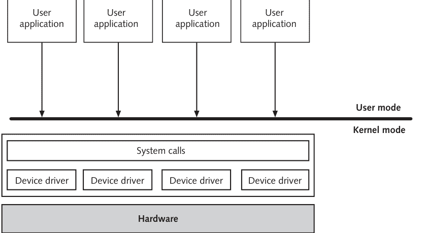

图 2-3 简化的 Fedora 13 架构

来源：Course Technology/Cengage Learning

第 2 章软件组件——VFS 抽象了各种硬件的细节

Fedora 13 提供了动态加载的设备驱动程序，允许在无需编译包含设备驱动程序的内核代码的情况下包含系统代码。这允许设备驱动程序实时加载和卸载，而无需重启操作系统。

关于这些组件的相关信息包含在下一节中。

## 操作系统的功能

操作系统的工作是管理 PC 上所有可用资源。事实上，操作系统应该最大限度地利用可用资源，如图 2-4 所示。

这些功能将在后续章节中描述。

### 处理器管理

微软磁盘操作系统是一种单用户、单任务操作系统，使用命令行界面。单任务操作系统一次允许运行一个程序。换句话说，如果你在使用电子表格并想写一份报告，你必须

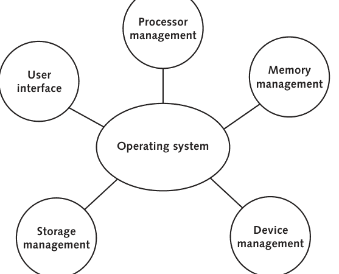

图 2-4 操作系统的功能

来源：Course Technology/Cengage Learning

在启动文字处理程序之前关闭电子表格应用程序。这种做法效率效率的，特别是当你需要在报告中引用电子表格中的某些数据时。

较新的操作系统如 Windows 7 和 Fedora 13 设计允许多个程序同时运行，这一过程被称为多任务处理。在这个过程中，程序可以轮流使用处理器。多任务允许单个用户同时打开电子表格和文字处理器。

你可能倾向于将进程视为应用程序，但这不能完整地描绘进程与操作系统之间的关系。你看到的应用程序包含进程，但应用程序可能会启动一个或多个线程来执行拼写检查或打印等任务。

此外，许多进程在运行时，没有任何它们存在的直接证据。例如，Windows 7 和 Fedora 13 有几十个后台进程正在运行，用于处理内存管理和磁盘管理。

操作系统创建进程是为了运行程序，每个进程至少有一个线程。线程是“执行线程”的缩写，或一组指令序列。在这种语境下，线程类似于交织在一起织成一件织物的线线。通过多任务处理（多个线程并行执行），一个程序被分为两个或多个同时运行的任务。线程的一个常见用例是让一个线程关注图形用户界面，而其他线程在后台进行长时间计算。结果是应用程序能够更迅速地响应用户的交互。所有现代操作系统都支持多线程和多任务处理。

由于由进程产生的线程共享相同的地址空间，一个线程可以修改另一个线程正在使用的数据。这既有好处也有坏；它促进了线程之间的通信，但编写不当的程序可能会导致一个线程无意中覆盖另一个线程的数据。共享单个地址空间是多线程编程通常认为比单线程编程更困难、更容易出错的原因之一。

管理器的核心在于确保每个进程和应用程序都能获得足够的处理器时间来正常运行。分配资源的关键是进程或线程的调度。


多任务处理允许操作系统看似同时调度多个任务。然而，任务执行在每个程序之间非常快速地切换，给人同时执行的印象。这一过程也被称为任务切换。在单处理器上，多任务通过共享 CPU 的两种常用方法实现：

- 协作式多任务——应用程序必须合作以共享时间。
- 抢占式多任务——操作系统中断任务并允许另一个任务。

为了说明协作式和抢占式多任务的区别，考虑一个有两个孩子的母亲。在协作式多任务中，母亲等待孩子完成。在抢占式多任务中，母亲中断一个孩子并允许另一个。

在具有多个处理器的 PC 上，实现了多处理。多处理传统上是指系统内部使用多个 CPU。与多任务允许多个进程共享单个 CPU 不同，多个 CPU 可用于执行多个线程。在对称多处理（SMP）系统中，多个 CPU 执行程序并分配负载。对于多处理，Windows 7 支持两个处理器；Fedora 13 支持两个。

## 软件组件

处理器最初是单核开发的。核心是处理器中实际上读取和执行指令的部分。单核处理器一次只能处理一条指令。

多核处理器是由两个或多个独立核心组成的系统。可以将其描述为集成了两个或多个独立处理器（在此意义上核心）的集成电路。双核处理器包含两个核心，四核处理器包含四个核心，六核处理器拥有六个核心。

多用户操作系统允许多个用户共享一台计算机并同时运行程序。Windows 7 通过快速切换支持多用户。通过这种方式，如果你需要使用 PC，上一个用户不需要关闭应用程序。

Fedora 13 设计用于在同一台 PC 上同时支持多个用户，允许多个用户与操作系统交互。这意味着你可以使用多个用户账户登录，每个账户都有独立的控制台。

## 内存管理

内存管理是处理计算机内存的行为。在简单形式中，这种管理为程序请求分配内存，并在不再需要时将空闲内存分配回系统重用。

内存管理是 Windows 7 和 Fedora 13 最重要的部分之一。随着如今应用程序的大小，系统需要的内存比 PC 实际存在的内存多。虚拟内存通过将未使用的数据和指令存储在硬盘上，使 PC 看起来拥有比实际更多的内存。当需要这些数据或指令时，操作系统会从硬盘上获取它们。

## 操作系统的功能

在虚拟内存中，所有地址都是虚拟地址，它们是由中间硬件和软件映射到物理内存的内存位置。这些地址不应与物理地址混淆，物理地址是标识计算机物理内存中实际存储（内存）位置的数字。处理器可以寻址的内存量称为物理内存。进程使用的虚拟地址并不代表对象在内存中的实际物理位置。不同的是，操作系统为每个进程维护一个页映射（page map）；此内部数据结构用于将虚拟地址翻译为相应的物理地址。每当线程引用地址时，操作系统都会将虚拟地址翻译为物理地址。

为了最大限地提高内存管理的灵活性，操作系统可以将物理内存页移动到磁盘上的分页文件。当页面移动到物理内存时，操作系统会更新受影响进程的页映射。当操作系统需要物理内存空间时，它会将最少使用的页移动到分页文件中。这种操作对应用程序是完全透明的，应用程序在虚拟地址空间内运行。

在 Windows 7 中，你可以控制分页文件的大小和位置。要找到这些信息，点击“开始”，右键点击“计算机”，点击“属性”，点击“高级设置”链接，点击“性能”下的“设置”，点击“高级”选项卡，然后点击“更改”按钮。虚拟内存设置如如图 2-5 所示。如果你收到虚拟内存不足的警告，请增大分页文件的大小。如果 Windows 7 将分页文件的初始大小设置为计算机上安装的随机存储器（RAM）加 300 MB，则最大大小默认设置为安装 RAM 量的三倍。

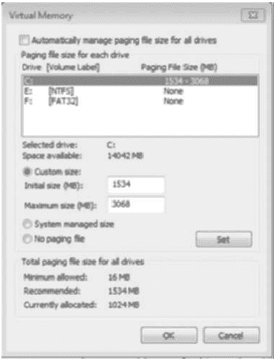

图 2-5 Windows 中的虚拟内存

来源：Course Technology/Cengage Learning

## 第 2 章 软件组件

如果收到警告消息，请增加最小值和最大值。

从“高级”选项卡到“性能选项”对话框，你可以更改在数据缓存和指令存储之间使用的内存。默认选项“程序”允许你的 PC 在内存设置为优化数据缓存时运行得更快。

如果你在 Windows 7 中使用多个硬盘，可以将分页文件移动到除包含 Windows 7 操作系统的其他硬盘上来提高性能。

内存管理在任何操作系统中都是复杂的，Fedora 13 也不例外。Windows 7 和 Fedora 13 的内存管理之间存在若干差异；例如，在 Fedora 13 中，你可以对内存如何管理做出更详细的决策。你应该在仔细考虑需要处理的内容和想要实现的目标后才进行修改。其他差异在于，在 Fedora 13 中，你可以查看源代码并确切知道内存是如何管理的，通过了解正在使用哪些算法来扩展你对内存管理的知识。

在 Fedora 13 中，可以使用硬盘的整个分区进行虚拟内存。虽然你可以使用文件进行交换，但你应该使用单独的分区，因为它消除了交换时的碎片性能下降。

现代操作系统如 Windows 7 和 Fedora 13 提供 32 位和 64 位版本。32 位和 64 位计算机之间的区别在于处理器如何管理内存。64 位处理器一次可以处理 64 位数据，而 32 位处理器只能处理 32 位。你可以在 64 位处理器上安装 64 位操作系统。然而，如果你有 32 位处理器，则只能安装 32 位操作系统。另一个考虑是 32 位操作系统的内存限制（由于其他硬件分配，实际上接近 4 GB）。

## 设备管理

操作系统和几乎所有硬件之间的路径不是主板，而是通过一个名为设备驱动程序的特殊程序。驱动程序的主要功能是翻译操作系统（面向应用程序）和硬件子系统之间的数据流。驱动程序获取操作系统定义的数据并将其转换为显示器上的系列像素或存储设备指定位置上的位流。

驱动程序与操作系统分离的一个原因是向驱动程序（以及硬件子系统）添加新功能，而不需要修改、重新编译和重新发行操作系统本身。

查看设备管理的方法是考虑打印等常见任务。在 Windows 7 和 Fedora 13 等操作系统之前，单个应用程序提供了控制打印机的软件。例如，DOS 版本的 Lotus 提供了控制打印字体、创建页面等的软件（见图 2-6）。Lotus 必须为市场上的每个打印机编写驱动程序；Lotus 和大多数开发者都难以跟上新打印机的出现。简而言之，这是一种不可持续的方法。

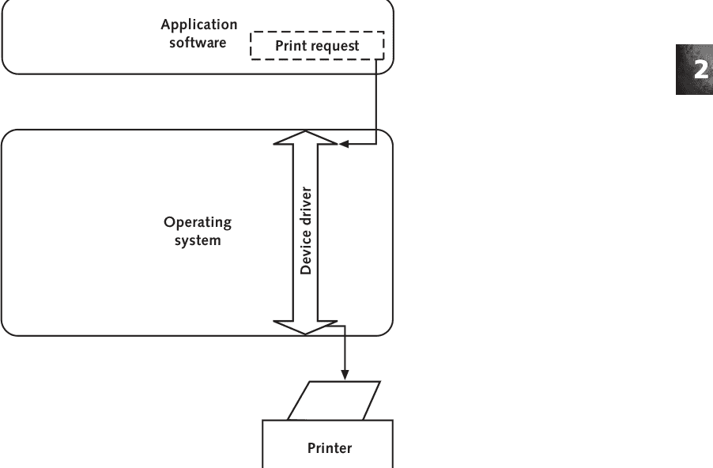

**图 2-6** 打印的应用支持

来源：Course Technology/Cengage Learning

在 Windows 7 方案中，操作系统为打印机提供设备驱动程序。这些设备驱动程序意味着像 Lotus 这样的应用程序不再需要处理打印机驱动程序，只需向一个名为*图形设备接口 (GDI)* 的 Windows 组件提供接口。在操作系统内部，设备驱动程序将 GDI 连接到打印机（如图 2-7 所示）。应用程序向 GDI 使用 Windows Language，GDI 与打印机驱动程序通信，进而控制打印机。GDI 具有额外功能——例如，它允许应用程序与包括显卡在所有显示设备通信。在这种方案中，打印机驱动程序由制造商负责，尽管微软为制造商编写了其中一些。

在应用程序产生 *PostScript*（由 Adobe Systems 开发并营销的页面语言），它进入 *Ghostscript*（一组解释 Adobe PostScript 和便携文档格式 (PDF)页面描述的免费软件）。随后，流向设备驱动程序。Ghostscript 将 PostScript 转换为打印机所需的格式命令。操作系统为其支持的每个打印机提供打印机驱动程序。

现代操作系统打印系统的基础是打印进程（spooler），如图 2-8 所示。*Spool* 是同步外设联操作的缩写。队列通常与单个打印机相关，用户提交的任务按先来到的顺序处理。对于 Windows 7，应用程序生成的输出


| 组件 | 描述 |
| :--- | :--- |
| 应用程序 | 向 GDI 发送通用语言 |
| 操作系统 | GDI |
| 设备驱动程序 | 为特定设备翻译 GDI 调用 |

图 2-7 操作系统对打印的支持

来源：Course Technology/Cengage Learning

到一个模块，例如 GDI。模块随后调用打印机驱动程序来渲染输出。输出传递给打印监控程序，由它控制到打印机的传输。打印在用户与其他应用程序交互时在后台完成。

## 存储管理

在 DOS 中，你使用 `fdisk` 命令创建分区并使用 `format` 命令准备分区使用。`format` 命令为磁盘创建新的根目录和分配表。它还可以检查磁盘上的坏区域并删除磁盘上的所有数据。为了让 DOS 能够使用新磁盘，你必须首先使用 `format` 命令对磁盘进行格式化。


不要尝试 `fdisk`。如果你意外删除了分区，你将丢失硬盘上的数据并可能丢失操作系统。

现代操作系统提供了管理 PC 硬盘上存储区域的工具。在 Windows 7 中，磁盘管理是一个管理硬盘及其分区的系统实用程序。

它们包含的内容。通过磁盘管理（Disk Management），你可以初始化磁盘、创建分区并使用 FAT、FAT32 或 NTFS 文件系统格式化卷。磁盘管理允许你执行大多数与磁盘相关的任务，而无需重启系统或中断用户操作；大多数配置更改会立即生效。

在 Fedora 13 中，你使用 `disks` 命令为硬盘添加分区。创建分区后，你使用 `mk2fs` 命令创建 ext2、ext3、ext4 和 vfat32 文件系统。

除了前述任务外，在你在使用 PC 时，操作系统还会执行许多其他任务：

- 文件维护——提供删除、复制、移动、重命名和查看文件的功能，并管理目录或文件夹
- 安全——通过支持文件权限控制来控制对敏感文件的访问
- 配额——限制单个用户对磁盘空间的过度使用

## 第 2 章 软件组件

## 用户界面

在 DOS 中，你使用命令行界面（CLI）输入命令。CLI 是一种通过向计算机输入行文本命令（即字符序列）来与其交互的方法。在最简单的形式下，计算机显示一个提示符，你输入命令然后按 Enter 键，计算机便执行该命令。最新的形态是 GUI（读音为 guy），它是用于使用计算机的图形界面，而不是纯文本界面。Windows 7 是 GUI 界面的示例，如图 2-9 所示。通过 GUI 界面，你仍然可以使用 CLI。同样，Fedora 13 也提供了 GUI 界面。GNOME（读音为 gnome）是 GNU 项目的一部分，也是开源软件的一部分，供任何人进行修改。GNOME 是一个运行在 Fedora 13 上的类 Windows 系统。GNOME 的主要目标是提供一套易于使用的应用程序。

**图 2-8** 打印系统

来源：Course Technology/Cengage Learning

**图 2-9** Windows 桌面

来源：Course Technology/Cengage Learning

**图 10** GNOME 桌面

来源：Course Technology/Cengage Learning

## 操作系统交互

默认情况下，Fedora 13 配置了不同类型的控制台供使用。你可能甚至没有意识到这些控制台可用。通常，系统管理员会同时在不同的控制台上登录 PC（可能具有不同的用户 ID）。你可以通过同时按下 Alt 和 Tab 键在控制台之间轻松切换。这允许你高效地处理多个任务。

操作系统的设计旨在与 PC 的主要组件——硬件和应用程序进行交互。你需要了解操作系统如何控制硬件，以及它为应用程序提供了哪些价值的服务。本节涵盖了这两种交互。

## 与硬件的交互

Windows 95 之后的所有 Windows 版本都实现了 Windows 驱动程序模型（WDM）。WDM 是微软开发的一项技术，用于创建与 Windows 7 在内的多个操作系统兼容的驱动程序。WDM 通过将设备驱动程序的部分工作交给操作系统来工作。设备驱动程序变得精简，代码更少，且运行效率更高。Fedora 13 将设备分为三大类：字符设备、块设备和网络设备。每种方法都有其优点。

### Windows 的硬件视角

有三种 WDM 驱动程序：

- 总线驱动程序——驱动 I/O 总线并提供设备无关的分槽功能。在 WDM 中，总线是指任何连接了物理、逻辑或虚拟设备的设备。Windows 7 包含对以下总线的 WDM 支持：PCI、动态插即、串行 I/O 总线（包括 USB 和 IEEE 1394）、SCSI、NDIS 和远程 NDIS (RND)。
- 功能驱动程序——驱动单个设备；Windows 7 包含对设备类的 WDM 支持，例如人机交互设备 (HID) 类、摄像头/扫描仪、通过 IEEE 1394 视频采集、音频以及 USB 和 IEEE 1394 存储设备。
- 过滤驱动程序——对设备、设备类或总线过滤 I/O 请求；例如，文件系统驱动程序会拦截针对文件系统的请求。通过在请求到达目标之前对其拦截，过滤驱动程序可以扩展请求原始目标提供的功能。防病毒软件使用过滤器来拦截包含病毒的流量。

### Fedora 13 的硬件视角

Fedora 13 将硬件设备分为三大类：

- 字符设备——可以作为字符流进行访问；示例包括标准输入设备（键盘）和标准输出设备（屏幕或显示器）。字符设备的其他示例是串口和 PCMCIA 内存卡卡。
- 块设备——一次处理一个或多个块的输入输出操作；块通常为 512 字节，但可以是任何更大的 2 的幂。块设备的示例是磁盘驱动器、CD 驱动器和回环设备。
- 网络设备——内核处理它们的方式与字符设备或块设备不同；对于字符和块设备，内核使用 `read` 和 `write` 调用来处理输入输出。对于网络设备，内核必须使用数据包（在网络传输的信息单元或网络数据）。

## 与应用程序的交互

操作系统提供了一个软件平台，其他程序（称为应用程序）可以在其上运行。这些应用程序需要操作系统的支持。章节解释了操作系统与应用程序之间重要的交互：

- 安装应用程序
- 运行应用程序
- 管理磁盘和文件
- 连接网络
- 打印文档

# 安装应用程序

当你获得一个软件应用程序时，必须在使用之前对其进行安装。现在大多数应用程序从 CD-ROM 安装。当被要求时，操作系统会安装应用程序，将程序文件复制到硬盘，在开始菜单或应用程序菜单中创建条目，并为你的使用配置应用程序。如果软件不是从 CD-ROM 安装的，则可以从网站下载并安装。

Microsoft Windows 安装程序是作为 Windows 7 操作系统一部分提供的安装和配置服务。通过 Windows 安装程序，管理员可以保持软件为最新版本。Fedora 13 使用 YUM，它是处理 RPM 包最常用的工具。RPM（红帽包管理器）的名称指的是这种格式的软件包。YUM 可以轻松地检索任何已安装包或存储库中可用包的信息。

## 第 2 章 软件组件

在 Windows 7 中，你可以通过多种工具查看目录结构和文件名。对于 Fedora 13，你将在第 6 章中学习使用 `ls` 和 `tree` 命令。

你还需要了解“主目录”（home directory）的概念，操作系统为用户提供存储数据的地方。在 Fedora 13 中，你使用 `/home` 目录。在 Windows 7 中，“用户”文件夹以用户的登录名命名。每个用户都有一组个人文件夹，如图 2-11 所示。主目录有许多子文件夹，用于按类型存储文件。

无论哪种情况，操作系统都会创建用户账户时创建主目录。当你登录 PC 时，操作系统会指向主目录，你可以在那里访问你的数据。

Windows 7 还使用“库”（libraries）来帮助你管理文档、音乐、图片和其他文件。在某些方面，库类似于文件夹。例如，当你打开一个库时，你会看到一个或多个文件。然而，与文件夹不同，库汇集了存储在多个位置的文件，如图 2-12 所示。这是一个细微但重要的区别：库本身并不实际存储文件。Windows 7 监控包含你文件的文件夹，并让你以不同的方式访问和排列文件。例如，你可以将音乐文件存储在内部磁盘驱动器和 USB 外部驱动器上，并从音乐库同时访问这些文件。

## 连接网络

应用程序可以使用存储在中央仓库（如文件服务器）中的共享文件。操作系统为文件共享提供了必要的支持。我们需要理解文件共享，因为它提供了从多台计算机访问文件、数据和信息的能力。

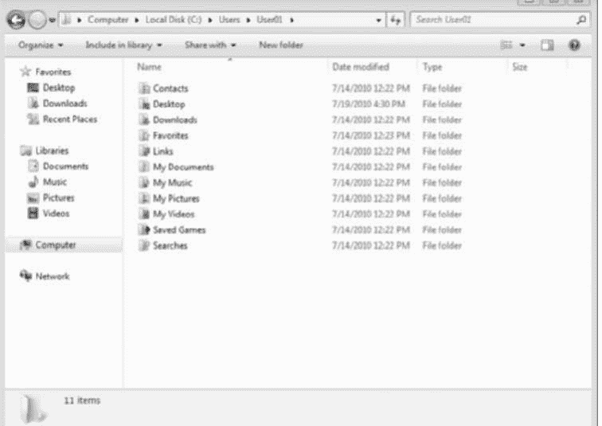

图 2-11 用户文件夹

来源：Course Technology/Cengage Learning

## 操作系统交互

你可以设置你的 PC 以与网络上的其他 PC 共享目录或文件夹，如图 2-13 所示。你可以授予指定用户访问权限，并将其他用户排除。这种资源共享不仅限于文件。例如，为了节省成本，你可以与网络上的几个人共用一台打印机。

基于 Windows 的操作系统通过使用**服务器消息块 (SMB)** 通信协议支持跨网络的文件共享流量。Fedora 13 使用 **Samba** 提供相应的功能。

Windows 7 在 Windows 资源管理器中提供了**网络文件夹**，用于定位和连接网络计算机上的共享文件夹。在 Fedora 13 中，你通过文件浏览器中的网络命令连接到远程共享。

你将在第 11 章继续学习更多关于网络连接的知识。

**打印文档** 大多数文档的主要输出是打印页面。操作系统提供了对本地和网络打印机的访问。Windows 7 提供了**添加打印机向导**，让应用程序可以使用打印机。在 Fedora 13 中，你使用**添加打印机**程序来设置打印机。一旦安装并配置了打印机，就可以按照应用程序的指示使用它。

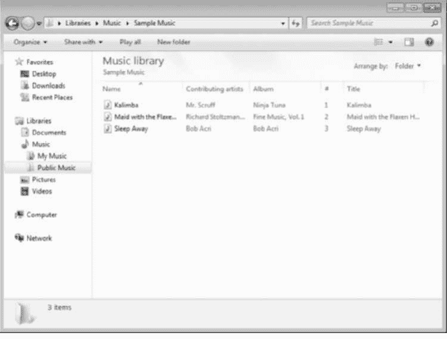

**图-2-12** 音乐库

来源：Course Technology/Cengage Learning

## 网络交换机

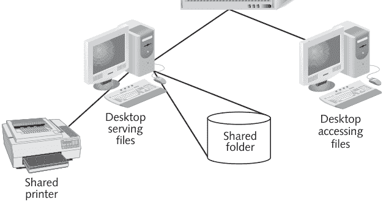

**  2-13** 通过网络访问文件

来源：Course Technology/Cengage Learning


> 在很大程度上，你对操作系统的选择决定了你能够使用的应用程序。在选择操作系统时，你应该检查你想要使用的系统所支持的要求。

## 系统工具

你使用系统实用工具在 PC 上执行各种任务。关键工具包括文本编辑器、配置编辑器和系统信息监控器，下文将介绍。

## 文本编辑器

文本编辑器允许你在文本文件中输入、修改和删除数据。文本文件被用于许多目的；例如，你可以在文本编辑器中编写程序的源代码。事实上，大多数源代码都存储在文本文件中。作为网络管理员，你可能会编写许多脚本，其中大多数将存储在文本文件中。你将在第 8 章中学习使用三个文本编辑器。

大多数系统只知道如何处理文本文件。在 `DOS` 中，`type` 命令在命令提示符窗口列出文本文件的内容，如图 2-14 所示。例如，你可以使用 `type` 命令显示 `hosts` TCP/IP 配置文件的内容。

在 Fedora 13 中，`cat` 命令的功能与 `type` 命令相同。例如，你可以使用该命令在标准输出设备（计算机显示器）上显示 `hosts` 文件的内容。见图 2-15。

其他格式的文件通常需要特定的程序来处理。

## 操作系统配置

作为管理员，你可能需要更新许多 PC 配置条目。在 Windows 内部，你可能需要在注册表中输入条目，这是一个包含……的层级数据库。

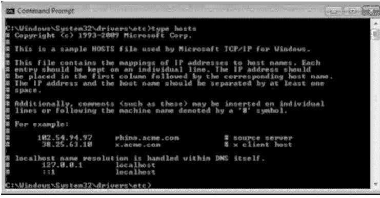

**图 2-14** 使用 `type` 显示的文件列表

来源：Course Technology/Cengage Learning

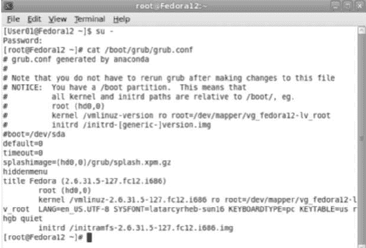

**图 2-15** 使用 `cat` 显示的文件列表

来源：Course Technology/Cengage Learning

（注：提供的第 82-84 页 OCR 文本包含大量的重叠和碎片乱码。我已根据可用碎片重建了逻辑流。）

## 第 2 章软件组件

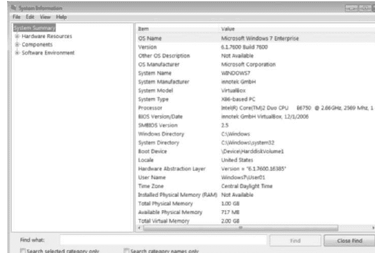

| 系统摘要 | 项目 | 值 |
|---|---|---|
| 硬件资源 | 操作系统名称 | Microsoft Windows 7 企业版 |
| | 版本 | 6.1.7600 Build 7600 |
| | 其他操作系统描述 | 否用 |
| 软件环境 | 操作系统制造商 | Microsoft Corporation |
| | 系统名称 | WIN643 |
| | 系统制造商 | Intel GmbH |
| | 系统机型 | VirtualBox |
| | 系统类型 | x86 架构的 PC |
| | BIOS/日期 | Intel(R) Core i5 Dual CPU 6750 @ 2.66 GHz, 2396 MHz; Intel(R) GmbH VirtualBox, 12/1/2006 |
| | SMBIOS 版本 | 2.5 |
| | Windows 目录 | `C:\Windows` |
| | 系统目录 | `C:\Windows\System32` |
| | 启动设备 | `\Device\Harddisk\Volume1` |
| | 本地账户 | |
| | 硬件抽象层 | 版本 = \6.1.7600.16385 |
| | 用户名 | Windows-User |
| | 时区 | 中部标准时间 |
| | 已物理内存 (RAM) | 否用 |
| | 总物理内存 | 1.00 GB |
| | 可用物理内存 | 717 MB |
| | 总虚拟内存 | 2.00 GB |

图 2-18 系统信息工具

来源：Technology/Cengage Learning

Fedora 13 系统分析器。要查看电脑使用的是什么种类型的 CPU，点击“应用程序”，指向“系统工具”，然后点击“系统分析器和基准测试”。要查看系统摘要，点击“摘要”。摘要如图 2-19 所示。


## 活动 2-2：使用 Fedora 13 系统分析器

所需时间：15 分钟

目标：使用 Fedora 13 系统分析器查看系统的系统信息。注意，在按照附录 C 的描述安装 `hardinfo` 程序之前，你无法执行此活动。

描述：在此活动中，你启动 Fedora 13 虚拟机并查看系统信息。如果你想查看进程和你的虚拟机的性能，此活动将非常有用。

- 1. 如必要，使用活动 1-1 中的相应指令启动你的虚拟机。
- 2. 要打开系统分析器，点击“应用程序”，指向“系统工具”，然后点击“系统分析器和基准测试”。
- 3. 点击“摘要”并查看系统信息。
- 4. 关闭窗口。
- 5. 让虚拟机保持注销状态以备后续活动使用。

## 系统监视器

为了帮助识别问题区域并获得尽可能的服务，确切了解你的 PC 正在发生什么非常重要。作为系统管理员，你使用许多工具来执行日常任务。在 Windows 7 中，你可以使用“任务管理器”查看有关系统性能的有用信息；在 Fedora 13 中，你可以使用“系统监视器”。

对于系统管理员来说，最重要的问题是“我需要做什么？”一旦你回答了这个问题，使用任务管理器或系统监视器就很简单。

### Windows 任务管理器

你使用任务管理器监控运行在电脑上的应用程序和进程。例如，当使用任务管理器时，你可以选择性地停止挂起的应用程序或进程以摆脱困。你可以通过三种方式之一启动任务管理器：

- 按 `Ctrl+Alt+Delete`。
- 按 `Ctrl+Shift+Esc`。
- 右键点击任务栏上的空白区域，从菜单中点击“任务管理器”。

你可以使用图 2-20 所示的选项卡来控制应用程序和进程，并查看系统和网络性能。接下来的章节将讨论这些许多选项卡。

如果你的计算机系统处于 Windows 工作组或未安装任何网络功能，则可以使用第六个选项卡——“用户”。域网络中的计算机系统无法使用此选项卡。

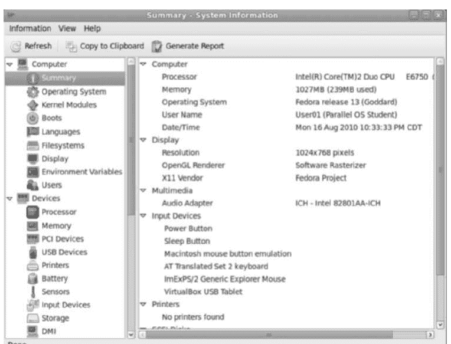

图 2-19 系统分析器中的摘要

来源：Course Technology/Cengage Learning

**应用程序** 从“应用程序”选项卡，你可以判断一个程序是否挂起或无响应。你可以通过选择该程序并点击“结束”按钮来终止程序。你可以使用另外两个按钮切换到列出的程序或启动新程序。

**进程** 你可以使用“进程”选项卡（见图 2-21）查看运行在电脑上的进程名称，并显示处理器（CPU）和内存的使用情况。你可以

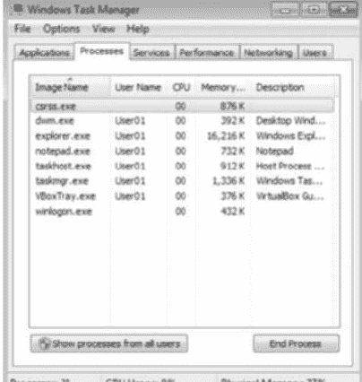

**图 2-21** Windows 任务管理器的进程选项卡

来源：Course Technology/Cengage Learning

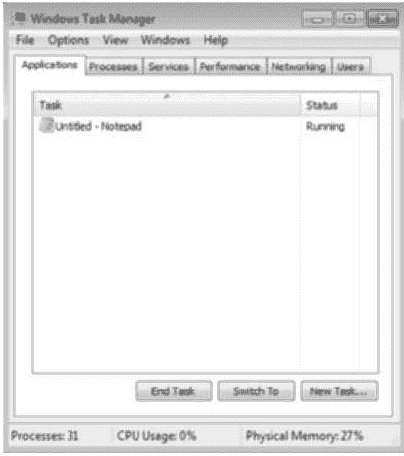

**图 2-20** Windows 任务管理器

来源：Course Technology/Cengage Learning

### 系统实用

使用此信息通过确定哪些进程正在使用 CPU 或内存来排查问题。内存使用过高的程序可能是挂起的。要停止一个进程，点击“结束”按钮。按特定列对信息进行排序，点击

**性能** 从“性能”选项卡，你可以查看 CPU 使用情况。要快速查看 CPU 使用情况，点击“性能”选项卡。在性能图下方，查看计数器。

**网络** 从“网络”选项卡（见图 2-22），你可以查看网络使用情况。此选项卡在存在网络时可用。

**Windows 资源监视器** 要获取更详细的信息，点击“资源监视器”按钮。资源监视器显示资源使用的概览。在右侧，点击四个箭头之一以显示更多信息。

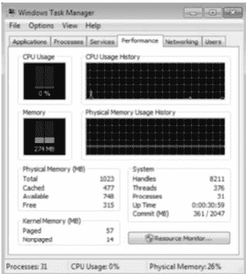

**图 2-22** Windows 任务管理器的性能选项卡

来源：Course Technology/Cengage Learning

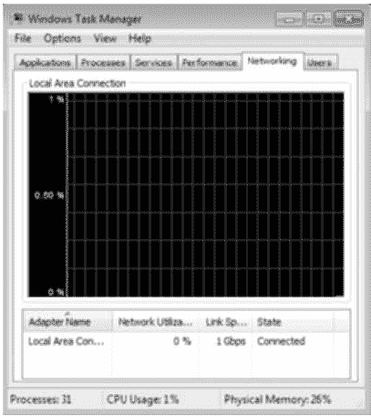

**图 2-23** Windows 任务管理器的网络选项卡

来源：Course Technology/Cengage Learning

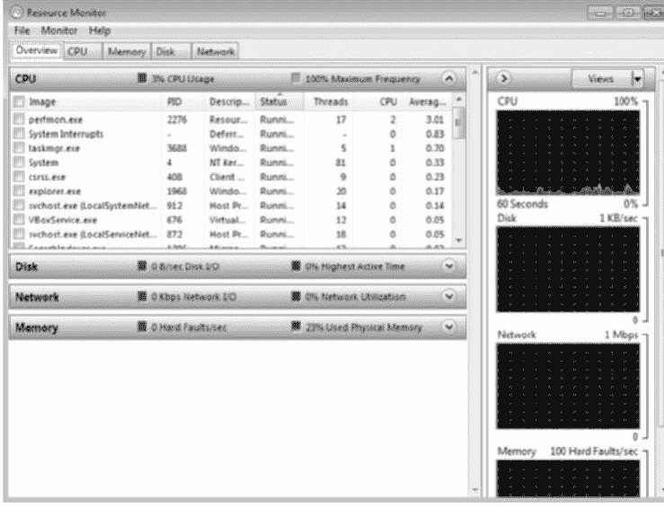

**图 2-24** 显示 CPU 使用的资源监视器

来源：Course Technology/Cengage Learning

## 活动 2-3：使用 Windows 7 任务管理器

所需时间：15 分钟

目标：使用 Windows 7 任务管理器查看应用程序运行情况。描述：在此活动中，你打开任务管理器的“应用程序”选项卡并查看运行的应用程序。打开“进程”选项卡查看 PC上的进程。

- 1. 如必要，使用活动 1-1 中的相应指令启动你的虚拟机。
- 2. 要启动任务管理器，右键点击任务栏并点击“任务管理器”。
- 3. 要确定哪些应用程序正在运行，如有必要，点击“应用程序”选项卡。
- 4. 查看列出的应用程序。
- 5. 要确定哪些进程正在运行并查看它们，点击“进程”选项卡。
- 6. 在“进程”选项卡中按特定列对信息进行排序，点击列标题。
- 7. 要查看 CPU 使用的性能，点击“性能”选项卡。
- 8. 确定活动对象、所有进程线程并查看“总计”部分的数据。
- 9. 要获取更详细的信息，点击“资源监视器”按钮。
- 10. 在 CPU 窗中查看进程并点击 CPU 箭头。
- 11. 要查看磁盘使用情况，点击磁盘箭头。查看磁盘使用情况后，再次点击磁盘箭头。
- 12. 要查看网络使用情况，点击网络箭头。查看网络使用情况后，再次点击网络箭头。
- 13. 要查看内存使用情况，点击内存箭头。查看内存使用情况后，再次点击内存箭头。


## 第 2 章 软件组件

14. 关闭 Windows 7 虚拟机内的所有窗口。
15. 保持虚拟机登录状态，以备后续活动。

### Fedora 13 系统监器

你可以使用系统监器（System Monitor）实时查看进程活动。该实用程序显示了电脑上 CPU 占用最高的任务列表。图 2-25 显示了按 CPU 使用百分比排序的进程活动。要按 % CPU 列排序，请点击该列标题。默认情况下，显示每五秒更新一次。

系统监器包含的选项卡比进程（Processes）选项卡更多。如图 2-26 所示，系统显示了操作系统和处理器的摘要。从资源（Resources）选项卡（见图 2-27），你可以：

- CPU 历史——图表显示 CPU 使用情况和百分比。
- 内存和交换使用——图表显示内存和交换的使用情况。
- 网络活动——图表显示接收和发送的网络字节数。

图 2-25 显示了系统监器中的文件（Files）选项卡，显示了每个分区的总空间、剩余空间和可用空间。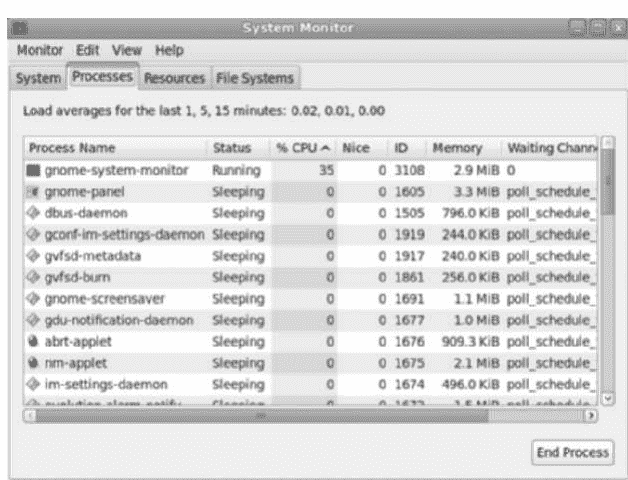 Fedora 13 系统监器中的进程活动。来源：Course Technology/Cengage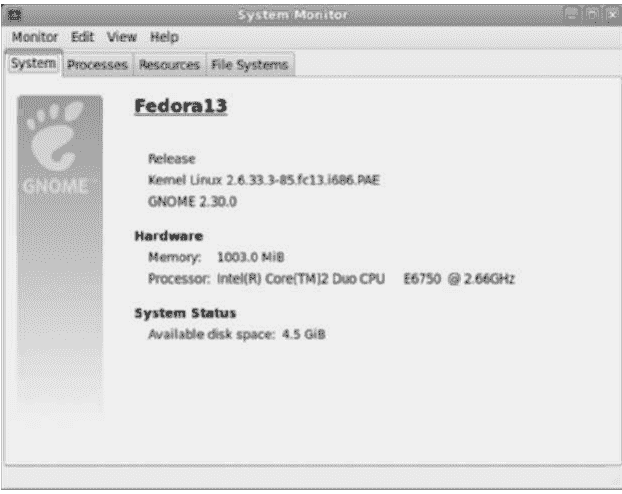**图 2-26** Fedora 13 系统监器的系统（System）选项卡。来源：Course Technology/Cengage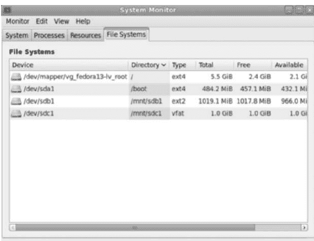**图 2-27** Fedora 13 系统监器的资源（Resources）选项卡。来源：Course Technology/Cengage**图 2-28** Fedora 13 系统监器的文件系统（File Systems）选项卡。来源：Course Technology/Cengage

### 活动 2-4：使用 Fedora 13 系统监器

**所需时间**：15 分钟

**目标**：使用 Fedora 13 系统监器查看虚拟机的性能。

**描述**：在此活动中，你在 Fedora 13 中打开系统监器。在进程选项卡中，你按 CPU 使用百分比排序以找到活动进程。使用其他选项卡查看有关系统的信息。此活动有助于查看进程和虚拟机的性能。

1. 如果必要，使用活动 1-1 中的相应说明启动虚拟机。
2. 要打开系统监器，点击**Applications**（应用程序），指向**System Tools**（系统工具），然后点击**System Monitor**（系统监器）。
3. 要查看操作系统和硬件摘要，点击**System**（系统）选项卡。
4. 要查看进程，点击**Processes**（进程）选项卡。
5. 要确定活动进程，点击 % CPU 直到箭头向上。
6. 要查看系统资源图表，点击**Resources**（资源）选项卡。
7. 要确定可用空间，点击**File Systems**（文件系统）选项卡。
8. 关闭系统监器窗口。
9. 保持虚拟机登录状态，以备后续活动。

### 应用程序

你在电脑上使用许多应用程序，包括文字处理器、电子表格、演示文稿、Web 浏览器、电子邮件客户端、游戏和图形软件。应用程序由许多协同工作的小程序组成是很。应用程序是人们使用电脑的原因。

Microsoft Office 是为 Windows 操作系统开发的程序套件。它的组件包括：

- Microsoft Word——一个被认为是 Office 2010 主程序的文字处理器；它占据文字处理器市场的主导份额。它的私有 DOC 格式被视为事实标准，尽管大多数最新版本也支持 XML 格式。
- Microsoft Excel——一个电子表格程序；与 Microsoft Word 一样，它拥有主导的市场份额。它最初是 Lotus 1-2-3 的竞争对手，但最终变成了事实标准。
- Microsoft PowerPoint——一种流行的演示软件；它用于创建由文本、图形、电影和其他对象组成的幻灯片。幻灯片可以显示在屏幕上或打印在透明片或幻灯片上。

OpenOffice.org 是一系列密切工作的应用程序，提供现代办公套件预期的功能。许多组件的设计旨在镜像 Microsoft Office 中的组件。除了在 Fedora 13 上运行外，OpenOffice 还运行在 95 之后的 Windows 版本、Solaris 和 FreeBSD 以及 Mac OS X 上。它的组件包括：

- Writer——一个与 Microsoft Word 相似且具有广泛功能和工具的文字处理器；Writer 允许你在没有额外软件的情况下创建 PDF（格式）文件。
- Calc——一个与 Microsoft Excel 相似且具有类似功能的电子表格；Calc 还提供了 Excel 中不存在的功能，包括：
- Impress——一种与 Microsoft PowerPoint 类似的演示程序；Impress 可以将演示导出为 Macromedia Flash (SWF) 文件。

> 如果你运行该操作系统，OpenOffice 是极佳的选择。对于 Windows 7，Office 家庭学生版是更好的选择。


Fedora 13 支持的业务应用程序数量继续增长。各种列表分类：

### Windows 7 免费软件

免费软件是供个人免费使用的软件。免费软件经常在 Web 上分发。虽然它是免费的，但作者保留版权，这意味着它不能被更改或出售。参见表 2-3 的 Windows 7 免费软件示例。

| 分类 | Windows 7 | Fedora 13 |
| :--- | :--- | :--- |
| Web 浏览器 | Internet Explorer | Firefox, Opera, Google Chrome |
| 电子邮件客户端 | Outlook Express | Evolution, Thunderbird |
| 项目管理 | Microsoft Project | Planner |
| 图表 | Microsoft Visio | Dia |
| 图像编辑 | Adobe Photoshop | GIMP |
| PDF 阅读器 | Adobe Acrobat | Adobe Acrobat |
| 数据库 | Microsoft Access | Rekall DBMS |
| FTP 客户端 | GlobalSCAPE CuteFTP | gFTP |
| 分类 | 免费产品 | 下载网站 |
| :--- | :--- | :--- |
| Web 浏览器 | Firefox | www.mozilla.org/products/firefox/ |
| 防病毒软件 | AVG | http://free.grisoft.com/ |
| 防火墙 | Zone Alarm | www.zonedabs.com/store/content/products/znalmi/freeDownload |
| 办公套件 | OpenOffice | www.openoffice.org/ |
| 文本编辑器 | Metapad | www.liquidninja.com/metapad/ |

关闭 Windows 7 虚拟机内的所有窗口。

6. 要关闭虚拟机，点击“开始”，然后点击“关机”按钮。
7. 等片刻让 Windows 7 虚拟机完全关闭。
8. 保持 PC 注销状态以进行后续活动。

## 活动 2-6：使用 Fedora 13 OpenOffice 

所需用时：15 分钟

目标：使用 OpenOffice 编写一个短笔记。


描述：此活动与活动 2-5 类似，但这次你使用 Fedora 13 应用——OpenOffice.Writer 来编写一段详细介绍你 Windows 7 和 Fedora 13 使用体验的短段落。（OpenOffice.Writer 是默认安装的 Fedora 13 应用的一个示例。）如果你想使用 Fedora 13 应用输入短笔记，此活动将非常有帮助。

1. 如必要，请按照活动 1-1 中的相应说明启动你的虚拟机。

2. 要启动 OpenOffice Writer，点击“应用程序”，指向“Office”，然后点击“OpenOffice.Writer”。

3. 根据你目前对本文的阅读内容，输入一段关于你可能倾向于使用 Windows 7 还是 Fedora 13 的短笔记。

4. 点击“文件”菜单，点击“另存为”，输入 Notemail（其中 `file` 代表你的姓名缩写），然后点击“保存”。

5. 关闭 OpenOffice Writer。

6. 要关闭虚拟机，点击“系统”，点击“关机”，然后点击“关机”按钮。

7. 等片刻让 Fedora 13 虚拟机完全关闭。

8. 关闭所有剩余的打开窗口，注销并关闭你的 PC。

## 章节总结

- PC 的软件组件被用于执行各种任务。所有组件协同工作，而无需用户感知。每个组件在 PC 的整体性能中都起着特定的作用，没有哪个组件比其他组件更重要。PC 资源由操作系统中的许多程序管理。

- PC 的第一个操作系统是 DOS。PC 操作系统系统的核心是内核，它是确保硬件安全并为每个应用程序提供服务的地方。

- 操作系统通过控制处理器、内存、设备、存储和用户界面来管理资源。现代操作系统支持抢占式多任务、线程和虚拟内存。

- 操作系统同时与硬件和应用程序进行交互。例如，操作系统通过安装和运行程序与应用程序交互。操作系统提供磁盘和网络访问以及打印功能。

## 第 2 章 软件组件

- PC 有许多操作系统。最常见的是 DOS、Windows 和 Fedora 13。它们每个都从诞生开始不断演进，允许用户使用编辑器、图形用户界面以及打印机、键盘、显示器和磁盘驱动器等外围设备。最新的操作系统是稳定、安全且扩展的产品。

- 操作系统与不同的系统工具配合，在你的 PC 上执行各种任务。操作系统使用不同的术语和工具来执行这些任务。例如，要更新配置文件，你需要一个配置编辑器。使用 Windows 7 时，你使用 `Regedit` 更新注册表文件；使用 Fedora 13 时，你使用 `vis` 命令编辑 `/etc/sudoers` 文件。当你需要监控系统时，在 Windows 7 中使用“任务管理器”，在 Fedora 13 中使用“系统监器”。根据注册表或配置是指操作系统、工具还是应用程序，使用不同类型的编辑器。

- 你在 PC 上使用许多应用程序，包括文字处理器、电子表格和浏览器。

## 关键术语

`Add Printer` Fedora 13 中的一种实用程序，用于为你的应用程序提供打印机。

`Add Printer Wizard` Windows 7 中的一种向导，用于为你的应用程序提供打印机。

`application` 帮助用户在 PC 上执行任务的程序，例如创建电子表格。

`block device` 一种以块或字节组而非字符形式移动信息的设备。示例是磁盘驱动器。

`bus driver` 用于 I/O 总线的 WDM 驱动程序。它提供了由设备驱动的每槽功能。

`character device` 一种以字符流的形式逐个传输或接收信息的设备。示例是键盘。

`command-line interface, CLI` 你用于向操作系统发送命令的程序。

`configuration editor` 一种帮助你创建或编辑包含 PC 特定指令文件的特殊程序。

`cooperative multitasking` 多任务处理的一种形式，其中每个进程控制其独占 CPU 的持续时间。

`core` 处理器中实际读取和执行指令的部分。

`DOS` 对任何操作系统的通用术语。

`dynamic link library, DLL` 包含执行函数的库，当系统启动或重启时从磁盘加载。

`Fast Switch` Windows 7 中的一种功能，允许用户在账户之间切换。

`filter driver` 用于过滤 I/O 请求的 WDM 驱动程序。

`function driver` 用于设备类别的 WDM 驱动程序。

`GDI, graphic device interface` Windows 系统的显示语言。

`Ghostscript` 基于解释器的自由软件套件，用于 Adobe PostScript 和可销文档格式 `PDF`。

`GNOME` 红帽 Fedora 13 的默认桌面。

`GNU General Public License` 由自由基金会编写的一组程序，提供 UNIX 框架。

`home directory` 与 Fedora 13 用户账户关联的目录。

`kernel` 操作系统的核心。内核管理内存、文件和外围设备，以及应用程序。

`libraries` 帮助你管理文档、音乐和其他文件的结构。

`Linux` 指使用 Linux 内核的类 Unix 操作系统。

`Microsoft Windows Installer` 作为操作系统的一部分提供的安装和配置服务。

`multiprocessing` 单台计算机内多个处理器同时执行指令。

`multitasking` 在 PC 上并发运行所有活动进程和线程。

`multithreading` 在单个程序内快速序列运行（多任务）多个进程。

`Network folder` 用于定位和连接网络计算机上共享文件夹的文件夹。

`networking device` Fedora 13 用于网络设备的类别。Fedora 13 内核与这些设备使用数据包。

`packet` 网络上一个设备到另一个设备整体传输的信息单元。

`physical address` 计算机物理内存中实际存储（内存）位置的数字。

`PostScript` 由 Adobe Systems 开发并营销的页面语言。

`preemptive multitasking` 操作系统确保所有活动线程都有执行机会的多任务处理。抢占式多任务防止单个线程垄用处理器。

`Regedit` 允许用户编辑注册表条目的的应用程序。

`Registry` Windows 7 使用的层次级数据库，用于存储为一个或多个用户、应用程序和硬件配置系统的信息。

`RPM` 红帽包管理器 Fedora 13 管理器提供的应用程序安装服务。

`Samba` Fedora 13 用于支持网络资源共享的通信协议。

`SMB` 基于 Windows 的操作系统使用的用于支持网络资源共享的通信协议。

`software components` 构成并与操作系统相关的应用程序集合。

`standard input device` 用于数据输入的计算机设备，例如键盘。

`standard output device` 计算机显示器的另一种术语。

`symmetric multiprocessing, SMP` 使用负载均衡方法在 CPU 之间分配任务的系统。

`System Monitor` Fedora 13 中的一种实用程序，允许你实时查看进程活动。

`Task Manager`：一种用于跟踪 Windows 计算机运行的独立任务进度并为其提供必要资源的应用程序。

`text editor`：允许用户创建或编辑文本文件的程序。

`thread`：程序执行的基本单位。一个进程可以同时运行多个线程，每个线程执行不同的工作。

`utility`：在操作系统上执行与系统相关的任务和维护工作的程序。

`virtual address`：由中间硬件和软件映射到物理内存的内存位置。

`visudo`：Fedora 13 中用于编辑 `/etc/sudoers` 文件的命令。

`WDM`：用于创建 Windows 设备驱动程序的 32 位架构。

`YUM`：作为 Fedora 13 的一部分提供的安装和配置服务。

# 复习习题

1. 下列哪些被认为是操作系统内核的工作？（选择所有选项）

a. 确保应用程序得到恰当的服务 

b. 管理计算机系统中的所有资源

c. 为计算机系统安装所有硬件

d. 保护硬件

2. 下列哪些任务是操作系统的功能？（选择所有选项）

a. 处理（processing）

b. 内存（memory）

c. 设备（devices）

d. 存储（storage）

e. 应用程序（applications）

3. `type` 和 `cat` 命令用于

a. 向文本文件中输入文本

b. 显示文本文件的内容

c. 修改文本文件

d. 修改脚本

4. 编辑 Windows 注册表文件，你需要使用

a. Windows `Regedit`

b. Fedora 13 的 `visudo` 命令

c. 普通文本编辑器

d. Microsoft Word

5. 为了执行 `/etc/sudoers` 文件中的特权指令，Fedora 13 系统管理员将使用 __________ 编辑该文件。

a. Notepad

b. `vim` 编辑器

c. `cat` 命令

d. `visudo` 命令

6. 在 Windows 7 中查看详细的系统使用信息，你会使用

a. 系统剖面分析器（System Profiler）

b. Windows 任务管理器（Windows Task Manager）

c. Windows `Regedit`

d. `visudo` 命令

7. 下列哪些被认为是应用程序？（选择所有选项）

a. 表格软件（spreadsheet）

b. Web 浏览器（Web browser）

c. 互联网（Internet）

d. 文字处理器（word processor）

e. 图形软件（graphics software）

8. 大多数人使用计算机目的是 __________

a. 学习操作系统

b. 修复它们

c. 在家里构建额外的计算机

d. 使用应用程序软件

9. Fedora 13 安装了多少个控制台（consoles）？

a. 2

b. 1

c. 4

d. 6

10. 任务管理器显示以下哪些选项卡？（选择所有选项）

a. 应用程序（Applications）

b. 程序（Programs）

c. 性能（Performance）

d. 网络（Networking）

# 8 第二章 软件组件

11. 下列哪些是 Windows 驱动类别？（选择所有选项）

a. 总线驱动程序（bus drivers）

b. 块驱动程序（block drivers）

c. 功能驱动程序（function drivers）

d. 过滤驱动程序（filter drivers）

e. 网络驱动程序（network drivers）

12. 下列哪些是 Fedora 13 设备的类别？（选择所有选项）

a. 功能设备（function devices）

b. 网络设备（network devices）

c. 总线设备（bus devices）

d. 字符设备（character devices）

e. 块设备（block devices）

13. ________ 是 Fedora 13 字符设备的例子。

a. 键盘

b. CD 驱动器

c. 数据包（packet）

d. 磁盘驱动器

14. ________ 是 Fedora 13 块设备的例子。

a. 串口

b. 磁盘驱动器

c. 数据包（packet）

d. 键盘

15. 下列哪些是由总线驱动程序控制的 Windows 设备示例？（选择所有选项）

a. PCI

b. USB

c. SCSI

d. 键盘

16. Microsoft Windows Installer ________。

a. 需要单独购买

b. 需要用户安装

c. 在本文打印时不存在

d. 作为 Microsoft Windows 7 操作系统的一部分提供

17. Windows 7 中文件共享使用的协议是

a. Samba

b. 添加网络位置（Add Network Places）

c. `mount` 命令

d. SMB

18. 在 Fedora 13 中共享文件，你需要使用

a. `mount` 命令

b. 添加网络位置（Add Network Places）

c. SMB

d. Samba

19. 磁盘操作系统（DOS）首次用于

a. Fedora 13

b. IBM PCs

c. Windows 7

d. MorphPhOS

20. 下列哪些是 OpenOffice 的应用程序？（选择所有选项）

a. Word

b. Calc

c. Excel

d. PowerPoint

e. Impress

## 案例项目


# 案例 2-1：查看 PC 性能

你的老板担心几台 Windows 7 和 Fedora 13 计算机运行接近极限。哪些工具可以帮助你对此问题获得更多见解？为你的老板编写一份短报告，详细说明如何获取和解释这些信息。

# 案例 2-2：比较文字处理应用程序

你发现通过为工程部门的新 PC 采用 OpenOffice 套件，可以为公司节省费用。你的老板对你的建议感兴趣，并想看到使用 Microsoft Office 系统与使用 OpenOffice 套件的优缺点列表。准备该列表。

# 案例 2-3：讨论操作系统的功能

你的老板担心几台 Windows 7 和 Fedora 13 计算机运行接近极限。哪些工具可以帮助你对此问题获得更多见解？为你的老板编写一份短报告，详细说明如何获取和解释这些信息。

# 案例 2-4：讨论应用程序如何与操作系统交互

你发现通过为工程部门的新 PC 采用 OpenOffice 套件，可以为公司节省费用。你的老板对你的建议感兴趣，并想看到使用 Microsoft Office 系统与使用 OpenOffice 套件的优缺点列表。

# 第三章：图形用户界面

## 图形用户界面

阅读本章并完成练习后，你能够：

- 使用开始菜单和应用程序菜单

- 定制桌面

- 访问数据

## 图形用户界面

图形界面 `GUI`，有时读作 "gooey" 是一种通过操作图标和窗口等视觉元素与 PC 交互的方法。Xerox 在1973年开发了第一种 GUI，大多数现代 GUI 都源于此。除了图标和窗口，GUI 还由菜单、单选按钮和复选框等图形元素组成，并使用指向设备（鼠标）来操作这些元素。微软在其第一个版本的 Windows 中使用了许多理念。

使用 GUI 的优点是它们规范了使用程序的方式。也就是说，一旦你精通了 GUI，就能更快上手任何 GUI 程序。

在本章中，你将学习开始菜单和应用程序菜单。你还将学习如何定制桌面以及如何访问资源。使用 GUI 访问资源非常方便。

## 使用开始菜单和应用程序菜单

Windows 开始菜单和 Fedora 的应用程序菜单是启动垫，因为它们是硬盘上程序的指针。在后续章节中，你将学习使用和定制这些菜单。

### 使用 Windows 7 开始菜单和任务栏

可以通过点击屏幕左下角的开始菜单来访问 Windows 7 计算机上常用的程序和文档。你还可以通过右键点击并打开属性对话框来控制开始菜单上显示哪些项目。Windows 7 的默认安装在开始菜单包含了最近文档、图片、音乐和计算机。

使用任务栏快速切换打开的程序。任务栏包含每个打开窗口的按钮，并突出显示活动窗口。点击任务栏上的不同按钮切换到另一个窗口。

本节介绍了如何自定义和使用开始菜单以及任务栏。

开始菜单视图 如图 3-1 所示的默认开始菜单在启动 Windows 7 时出现。


> Windows 7 之前的版本未包含在默认开始菜单中。这些细微差异是因为这些项目在之前的章节中被添加的，以便于文中的示例。

## 使用开始菜单和应用程序菜单 85

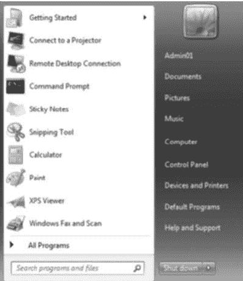

**图 3-1** 默认开始菜单

来源：Course Technology/Cengage Learning

要查看开始菜单上的更多程序，请点击“所有程序” `All Programs`。图 3-2 显示程序名称已取代了图 3-1 中的默认菜单项。

如图 3-3 所示，“开始” `Getting Started` 选项显示了 Windows 7 中有用位置的链接列表。双击所需的项目即可。

以下是“开始”中一些最实用的项目列表：

- **在线浏览 `Go online`** 查看 Windows 7 的新功能，这将带你进入一个描述新特征的网页。

- **个性化 Windows `Personalize Windows`** 允许你装饰你的 Windows 7 版本。你可以选择屏幕保护程序、更改桌面背景、调整显示器分辨率等。

- **在线获取 Windows Live Essentials `Go online to get Windows Live Essentials`** 提供了一个免费的病毒防护程序。

## 自定义开始菜单


Windows 7 的开始菜单比之前的 Windows 版本具有更多的自定义选项。例如，Windows 会识别谁登录了系统，并自动将最频繁使用的程序添加到顶级菜单中。如“文档”、“图片”和“音乐”文件夹等常用项目可以作为常用程序的快捷方式从开始菜单访问。

开始菜单上的程序列表分为两个部分：

- **固定项目列表（Pinned items list）**——这些项目显示在分隔线上方，你可以随时点击启动它们。此列表由你修改；它显示了程序、文档以及你想要快速打开的任何内容。（将在活动 3-1 中向列表中添加内容。）

## 第 3 章 使用图形用户界面

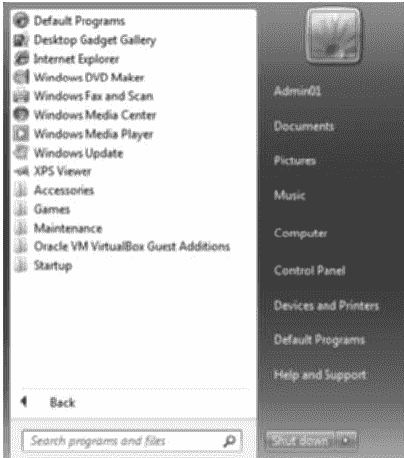

**图 3-2** 显示“所有程序”的开始菜单

来源：Course Technology/Cengage Learning

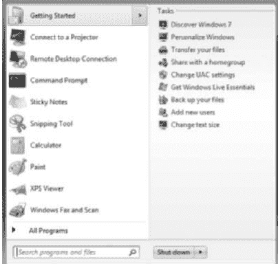

**图 3-3** 显示“开始”的开始菜单

来源：Course Technology/Cengage Learning

- **最常用程序列表（Most used programs list）**——这些程序出现在分隔线下方。新程序会根据需要取代使用频率的程序。

## 使用开始菜单和应用程序菜单

如果你没有使用过任何程序，将不会看到分隔线。在第一次使用程序后，分隔线将出现在程序快捷方式上方。


开始菜单的右侧留给了重要位置。你将找到“文档”、“图片”和“音乐”等文件夹。此外，你还可以通过“计算机”选项轻松访问媒体，通过“控制面板”配置 Windows 7 选项，选择 Windows 7 默认使用的程序，并打开“帮助和支持”来查找解决方案。这些项目的活动将贯穿本章及后续章节。

要修改开始菜单，请右键点击开始菜单并点击“属性”（`Properties`）。从“任务栏和开始菜单属性”的“开始菜单”选项卡（见图 3-4），你可以自定义开始菜单的设置。

在“开始菜单”选项卡上，你可以点击“电源”按钮，并选择按下计算机按钮时执行的操作：切换用户、注销、重启或关机。此外，你还可以控制是否在开始菜单上显示运行的程序和最近的项目。默认操作是 Windows 7 在开始菜单上保留最近使用的项目。

通过点击图 3-4 所示的“自定义”（`Customize`）按钮，你可以打开“开始菜单”对话框（见图 3-5）。此对话框控制开始菜单上链接、图标和菜单的行为。例如，你可以为“计算机”项目的显示提供三种选择：显示为链接、显示为菜单或不显示。对于“文档”文件夹、控制面板、游戏和音乐等项目，你可以从这三个操作中进行选择。

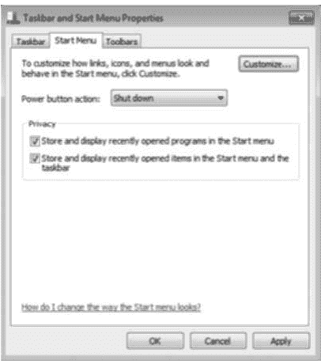

**图 3-4** 任务栏和开始菜单属性对话框

来源：Course Technology/Cengage Learning

## 第 3 章 使用图形界面

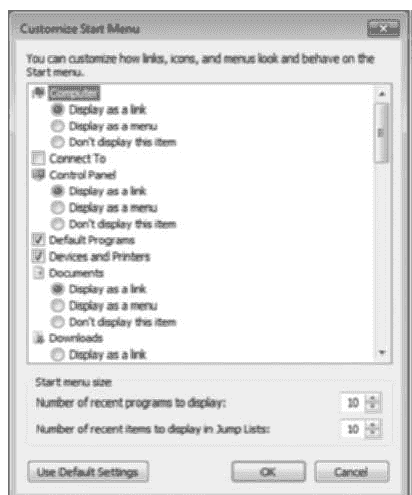

**图 3-5** 自定义开始菜单的选项

来源：Course Technology/Cengage Learning

默认开始菜单有许多你可以自定义的选项，因此你应该花些时间了解它们。如果你是从之前的 Windows 版本切换到 Windows 7 的，这些选项可能会让你感到困惑。你可以按照活动 3-1 中的步骤向默认开始菜单添加程序快捷方式。在活动 3-2 中，你可以自定义开始菜单，以控制控制面板小工具（小型、单功能实用程序）的显示。

### 活动 3-1：向 Windows 7 默认开始菜单添加快捷方式

**所需时间：** 10 分钟

**目标：** 添加一个可以让你从开始菜单启动程序的快捷方式。

**描述：** 在此活动中，你向默认开始菜单添加程序快捷方式。

1. 按照相应的说明启动虚拟机。
2. 右键点击开始菜单并点击“程序”。
3. 在“开始菜单”选项卡中，点击“自定义”。
4. 按照相应的说明启动虚拟机。
5. 右键点击开始菜单并点击“属性”。
6. 在“开始菜单”选项卡中，点击“自定义”。
7. 如果需要，勾选“允许拖动到开始菜单”框。
8. 点击“确定”。
9. 在桌面上右键点击，选择“新建快捷方式”。
10. 点击“浏览”，输入“calc”，然后点击“确定”。
11. 点击“完成”。
12. 在开始面上右键点击图标，点击“固定到开始菜单”。
13. 关闭该窗口。
14. 右键点击该图标，点击“删除”，然后点击“是”。
15. 将虚拟机切换到下一个活动。

### 活动 3-2：自定义 Windows 7 默认开始菜单

img/602cfc7921e181a98a7d4caa3193a61f_110_0.png)

**所需时间：** 10 分钟

**目标：** 在开始菜单上添加快捷方式。

**描述：** 在此活动中，你自定义默认开始菜单以控制控制面板小工具的显示。如果你想控制开始菜单上的选项，此活动非常有帮助。

1. 按照相应的说明启动虚拟机。
2. 右键点击开始菜单并点击“属性”。
3. 在“开始菜单”选项卡中点击“自定义”。
4. 如果需要，勾选“允许拖动到开始菜单”框。
5. 点击“确定”。
6. 在桌面上右键点击，选择“新建快捷方式”。
7. 点击“浏览”，输入“calc”，然后点击“确定”。
8. 点击“完成”。
9. 在开始面上右键点击图标，点击“固定到开始菜单”。
10. 关闭该窗口。
11. 右键点击该图标，点击“删除”，然后点击“是”。
12. 将虚拟机切换到下一个活动。

## 使用任务栏

任务栏是横跨屏幕的窄条。任务栏（见图 3-6）是 Windows 7 界面中的关键元素。当 Windows 7 运行在 Oracle VirtualBox 中时，Windows 7 任务栏位于 Oracle VirtualBox 框上方。

从左到右，任务栏具有以下功能：

- 开始菜单——该菜单在章的前部分讨论过。
- 打开程序和窗口——在不同程序之间切换。
- 打开你喜爱的程序——启动频繁使用的程序。

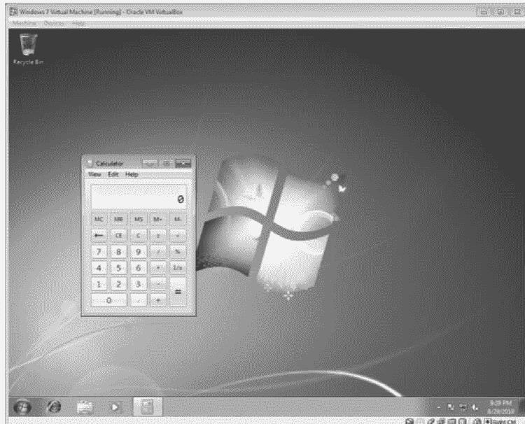

**图 3-6** 显示底部任务栏的 Windows 7 桌面

来源：Course Technology/Cengage Learning

## 使用开始菜单和应用程序菜单

- 系统托盘（通知区域）—查看显示电池电量、网络连接状态、扬声器音量和其他项目详细信息的图标。
- 显示桌面按钮—控制桌上窗口的显示状态。

**自动隐藏任务栏** 若要开启任务栏的自动隐藏功能，请右键点击任务栏上的空白处，点击“属性”，然后勾选“自动隐藏任务栏”复选框，如图 3-7 所示。此功能会在您不使用任务栏时使其消失，从而允许您将整个桌面留给最大化窗口使用。如需查看被隐藏的任务栏，请将鼠标指针移动到屏幕底部的细线边缘。

**移动和调整任务栏大小** 您可以增大任务栏的大小及其在屏幕上的位置。要增大其尺寸，将鼠标指针悬停在任务栏的外边缘并拖动指针。要移动任务栏，点击任务栏中的空白区域并将其拖动到所需的位置。您将在活动 3-3 中移动并调整任务栏的大小。

如果您无法调整任务栏的大小或移动它，可能是因为它已被锁定以防止更改。如果是这样，右键点击任务栏的空白区域并取消勾选“锁定任务栏”复选框。

同样，更改任务栏上图标的大小也会改变任务栏的大小。要执行此操作，右键点击任务栏，点击“属性”并勾选“使用小图标”框。

**使用任务栏上的工具栏** 您可以将表 3-1 中列出的工具栏添加到任务栏。这些工具栏是任务栏上的独立区域，提供特殊功能。活动 3-4 解释了如何使用工具栏。

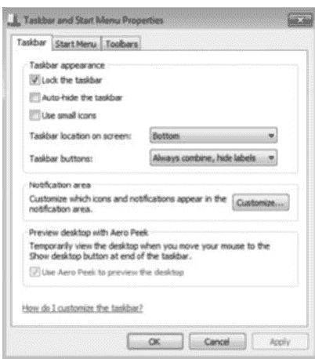

**图 3-7** “任务栏和开始菜单属性”对话框中的任务栏选项卡

来源：Course Technology/Cengage Learning

## 工具栏

| | 添加的内容 |
|---|---|
| 地址 | 网页地址 |
| 链接 | Internet Explorer 链接或任何图标 |
| 平板电脑输入面板 | 在平板电脑电脑上输入手写文本的屏幕 |
| 桌面 | 所有桌面图标和未在桌面上的常用位置的副本 |
| 快速启动 | 启动应用程序的快捷方式 |
| 新工具栏 | 来自文件夹的一组图标的内容 |

**表 3-1** 您可以添加到任务栏的工具栏

“链接”工具栏包含指向您收藏网站的链接。您还可以将任何图标（包括文件、文件夹、磁盘和程序的图标）拖到此工具栏中，将其转换为一键点击按钮。这些只是快捷方式；您可以删除它们、重命名它们并并在任务栏上移动它们。

以下是您可能考虑的工具栏快捷方式的几种设想：

- 您最常用的三个或四个程序
- 您每天都会使用的文档
- 您经常访问查找文件的文件夹

桌面工具栏提供了访问桌面图标的途径；当程序占据整个桌面时，如果您需要访问某个图标，这种方法非常方便。工具栏还提供了对常用位置的访问，例如您的个人文件夹、库、网络文件夹和控制面板（见图 3-8）。

**在任务栏上分组程序** 当您同时处理某个程序的多个实例时，任务栏可能会因为按钮而变得拥挤，因此 Windows 提供了分组功能来帮助您管理多个打开的文档。如图所示

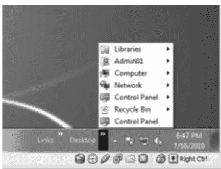

**图 3-8** 桌面工具栏

来源：Course Technology/Cengage Learning

## 使用开始菜单和应用程序菜单

93

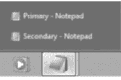

**图 3-9** 显示分组的任务栏

来源：Course Technology/Cengage Learning

图 3-9，所有用特定程序打开的文档都合并为一个该程序的按钮。

除了默认的任务栏行为（始终合并，隐藏标签）外，您对任务栏按钮的行为还有另外两个选择：当任务栏满时合并，或从不合并。要访问这些选项，右键点击任务栏的空白区域，点击“属性”，然后点击“任务栏按钮”列表框。


## 活动 3-3：操作 Windows 7 任务栏

**所需时间：** 10 分钟

**目标：** 在 Windows 7 中操作任务栏。

**描述：** 在此活动中，您将操作桌面上的任务栏。如果您想移动、调整大小或隐藏任务栏，此活动非常有用。

1. 如必要，使用活动 1-1 中的相应指令启动您的虚拟机。
2. 如必要，右键点击任务栏的空白区域并取消勾选**锁定任务栏**选项。
3. 将鼠标指针悬停在任务栏的空白区域，然后点击并将其拖动到另一个位置。您可以将任务栏移动到屏幕顶部或左侧或右边缘。
4. 使用该技术将任务栏移动到屏幕底部。
5. 右键点击任务栏的空白区域，点击*属性*，勾选**任务栏位置**，选择*左*，然后点击*确定*。
6. 重复第 5 步以选择*上*和*下*。
7. 用鼠标抓住任务栏的边缘并拉伸使其变高。接着，将其缩回原始尺寸。
8. 右键点击任务栏的空白区域，点击*属性*，勾选**使用小图标**框，然后点击*确定*。
9. 将鼠标移动到屏幕底部。
10. 关闭所有窗口。
11. 保持虚拟机开启状态。

## 活动 3-4：自定义 Windows 7 任务栏

**所需时间：** 10 分钟

**目标：** 自定义任务栏上的工具栏。

**描述：** 在此活动中，您将查看并自定义任务栏上的工具栏，包括 Internet 链接。您可能已经知道“快速启动”工具栏允许您放置常用程序。如果您想自定义任务栏，此活动非常有用。

1. 如必要，使用活动 1-1 中的相应指令启动您的虚拟机。
2. 右键点击任务栏的空白部分，点击*属性*，点击*工具栏*选项卡，勾选*链接*复选框，勾选*桌面*复选框，然后点击*确定*。
3. 点击任务栏上“链接”旁边的>> 符号以查看 Internet 工具栏的内容。
4. 点击任务栏上“桌面”旁边的>> 符号以查看桌面工具栏的内容。
5. 要将计算器固定到任务栏，点击“开始”并将计算器拖到任务栏。
6. 要快速打开计算器，点击任务栏上的计算器图标。
7. 要将计算器从任务栏取消固定，右键点击计算器按钮，然后点击*取消从任务栏固定此程序*。
8. 关闭所有窗口。
9. 保持虚拟机开启状态。

## 自定义 Fedora 13 面板

Fedora 13 桌面顶部和底部的条被称为面板。您可以自定义这些面板的内容和位置。在 Core 13 中，任务栏被称为面板，位于屏幕顶部。与 Windows 7 任务栏的主要区别在于程序图标的外。默认情况下，面板位于顶部，如图 3-10 所示。

应用程序菜单提供了访问系统中安装的应用程序的方法。当您安装新应用程序时，它会自动添加到应用程序菜单。

位置菜单在文件浏览器窗口中选择时提供位置列表。（有关这些位置的更多信息，请参阅本章稍后的“使用 Fedora 13 文件管理器”。）系统菜单提供了配置系统和桌面环境的选项。

面板右侧的图标包括日期和当前用户名。为了更快速地访问应用程序，您可以向面板添加它们的启动图标。

额外的图标各不异，但它们允许访问不同的系统组件。例如，其中一个图标显示网络连接状态。

## 使用开始菜单和应用程序菜单 95

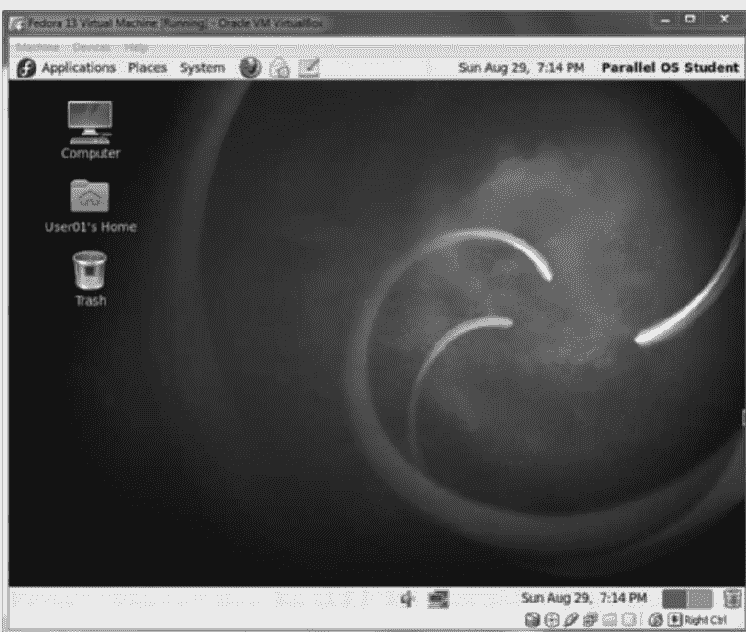

**图 3-10** 显示面板的 Fedora 13 桌面

来源：Course Technology/Cengage Learning

底部的桌面面板默认包含三个项目，但你可以根据自己的喜意进行配置。图 3-10 所示，桌面底部显示了一个自定义的面板。你将在活动 3-6 中学习如何自定义底部面板。

点击面板最左侧的图标可以隐藏或显示桌面上的所有窗口。系列正方形控制着当前显示的虚拟工作空间。同一时间可以有多个工作空间处于激活状态，不同的工作空间显示不同的应用程序。要切换到不同的桌面，只需点击底部工具栏中的其中一个正方形。默认情况下配置了四个工作空间，尽管你可以更改此数字。


如果你的鼠标带有滚轮，点击面板中的工作空间，然后前后滚动以在工作空间之间切换。

对于桌面上运行的每个应用程序，在当前选定的工作空间都会出现一个按钮。如果应用程序的窗口当前在桌面上可见，点击相应的按钮会将窗口最小化，使其不再可见。再次点击按钮将再次显示窗口。

## 第 3 章 使用图形用户界面

底部面板上的最后一个项目是“回收站”（Trash），你可以将不再需要的项目拖入其中。你将在稍后的章节中学习如何“倒垃圾”。

## 添加和删除面板

你可以控制控制桌面上的面板数量。要添加新面板，右键点击现有面板，并在结果菜单中点击“新建面板”（`New Panel`）。新面板将放置在上一个面板下方。要删除现有面板，右键点击它并点击“删除此面板”（`Delete This Panel`）。

### 自定义面板

要自定义面板，右键点击面板的空白区域，然后点击“属性”（`Properties`）。出现“面板属性”对话框，如图 3-11 所示。“常规”（General）选项卡包含更改方向、大小、按钮和面板特征的选项。“背景”（Background）选项卡包含更改面板图像的选项：使用系统主题、更改其颜色和样式，或添加背景图像。与 Windows 7 一样，当你需要同时打开许多应用程序时，在面板上显示窗口可能很重要。

### 自定义菜单项

记住，Fedora 13 面板第一个区域包含菜单项。见表 3-2 帮助你自定义菜单项的选项。要自定义菜单项，请右键点击它。

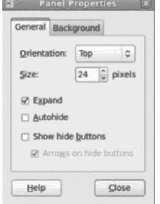

**图 3-11** Fedora 13 中的面板属性对话框

来源：Course Technology/Cengage Learning

| 面板菜单项 | 选项 |
|---|---|
| 帮助 (Help) | 访问帮助 |
| 从面板中移除 (Remove from Panel) | 从面板中移除项目 |
| 移动 (Move) | 移动面板项目 |
| 锁定到面板 (Lock to Panel) | 锁定当前面板配置 |

**表 3-2** 菜单项选项

## 使用开始菜单和应用程序菜单

### 添加到面板

当 Fedora Linux 首次安装时，默认会向顶部面板添加若干项目。如果你需要，可以添加更多项目。要添加项目，请右键点击顶部面板，并点击“添加到面板”（`Add to Panel`）。选择所需的项目并点击“添加”（`Add`）按钮。

要添加应用程序，你有两个选择：

- 自定义应用程序启动器（Custom Application Launcher）——通过指定一个应用程序、在终端控制台中运行的应用程序或浏览到位置来创建应用程序启动器。
- 应用程序启动器（Application Launcher）——从现有的菜单项创建启动器（快捷方式）。

要添加小组件（applet，一种微型单功能工具），从“添加到面板”对话框中找到该小组件。例如，要控制笔记本电脑显示器的亮度，请选择“亮度启动器”（Brightness launcher）。

要添加包含启动器图标的面板抽屉（drawer），在“添加到面板”对话框中选择“抽屉”（Drawer）选项。要向抽屉中添加项目，右键点击它，点击“添加到抽屉”（`Add to Drawer`），滚动并点击“添加到抽屉”对话框中的某项项目。

要移除面板，在面板上右键点击它并点击“从面板中移除”（`Remove from Panel`）。


### 活动 3-5：添加到面板

**所需时间：** 10 分钟

**目标：** 修改 Fedora 13 面板以包含启动器和抽屉。


**描述：** 在此活动中，你向 Fedora 13 面板添加启动器和抽屉。你还将学习如何移除面板。如果你想自定义面板，此活动将帮助。

1. 如果必要，请使用相应的说明启动你的虚拟机。
2. 要打开“添加到面板”对话框，右键点击面板的空白区域。
3. 要添加启动器，滚动并点击“终端”（Terminal），然后点击“添加”（Add）。
4. 验证启动器是否出现在面板上。
5. 要添加抽屉，右键点击面板的空白区域，点击“添加到”（Add to）。
6. 滚动并点击“抽屉”（Drawer），然后点击“添加”（Add）。
7. 验证抽屉是否出现在面板上。
8. 要向抽屉中添加项目，右键点击它，点击“添加到抽屉”（Add to Drawer），滚动并点击“添加到抽屉”对话框中的某项项目。
9. 要移除面板，在面板上右键点击它并点击“从面板中移除”（Remove from Panel）。

### 活动 3-6：自定义面板


**所需时间：** 10 分钟

**目标：** 修改 Fedora 13 面板以包含启动器和抽屉。

**描述：** 在此活动中，你修改 Fedora 13 面板以包含通知图标和日期显示。

1. 如果必要，请使用相应的说明启动你的虚拟机。
2. 要打开“属性”对话框，右键点击面板的空白区域。
3. 要添加通知图标，滚动并点击“通知区域”（Notification Area），然后点击“添加”（Add）。
4. 验证通知图标是否出现在面板上。
5. 要添加日期显示，滚动并点击“时钟”（Clock），然后点击“添加”（Add）。
6. 验证日期显示是否出现在面板上。
7. 要增大面板尺寸，点击框旁边的箭头直到显示 36，然后点击“关闭”（Close）。

## 定制桌面

就像物理办公桌一样，你使用电脑桌面来存储电子工作并让自己方便访问当前项目。桌面是 Windows 7 和 Fedora 13 的主屏幕；你可以在两个屏幕上放置图标。接下来的章节将介绍如何定制 Windows 7 和 Fedora 13 桌面。首先，你将学习一些新的 Windows 7 功能。

### 使用新的 Windows 7 功能

根据对用户对 Windows 7需求的调查，微软开发了名为“跳转”（Jump）和“贴靠”（Snap）的新功能。使用“跳转列表”，你可以直接访问每天使用的文档、图片、歌曲和网页。要打开跳转列表，右键点击菜单上的图标。跳转列表的内容取决于你正在使用的程序。例如，Internet Explorer 8 的跳转列表包含经常访问的网站。除了显示快捷方式外，跳转列表还提供编写电子邮件和播放音乐等命令的快速访问。

另一个新的桌面功能是“贴靠”（Snap），它通过通过将窗口拖到屏幕边缘来轻松调整打开的窗口的大小。根据你拖动窗口的位置，可以将其垂直扩展、占据整个屏幕或与另一个窗口并列。

## 定制桌面

如果你只需将鼠标指向任务栏的右侧，所有打开的窗口都会立即变为透明，显示出你隐藏的图标。“抖动”（Shake）功能可以让你穿过杂乱的桌面并快速聚焦于单个窗口。只需点击所需的窗口并摇动你的鼠标；所有选中的打开窗口都会立即消失。再次摇动鼠标，其他窗口就会重新出现。（谁说人学不会新招式呢？）

Windows 7 还包含了在 Windows Vista 中引入的 3D 翻（Flip 3D）功能。Flip 3D 以堆叠的方式显示打开的窗口，让你无需点击任务栏即可预览所有打开的文件、文件夹和文档。相反，你会在堆栈顶部看到一个窗口。要查看其他窗口，只需翻阅该堆栈。

抖动、预览（Peek）和 Flip 3D 包含在 Windows 7 的家庭增强版、专业版、终极版和企业版中。这些功能需要 Windows Aero，但并非所有电脑都具有运行它所需的图形硬件和软件。本文使用的虚拟化软件不支持 Windows Aero。

## 定制 Windows 7 桌面

如果你阅读屏幕上的文字有困难，可以自定义显示字体。在接下来的章节中，你将学习如何自定义桌面显示字体、选择桌面图标的外观以及显示分辨率（水平和垂直方向显示的像素总数）。

## 增大 Windows 文字字体尺寸

如果屏幕上的文字太小，难以阅读，你可以增加 Windows 菜单、标题和图标标签中使用的字体大小。点击“开始”，点击“控制面板”，点击“外观和个性化”链接，点击“调整文本和其他项目的大小或越小”，然后点击所需的尺寸（见图 3-12）。要更改字体大小，你必须注销并重新登录。

## 选择桌面图标的外观

在 Windows 7 中长时间活动后，桌面可能会变得杂乱。Windows 7 提供了多种管理桌面杂乱的方法。为了保持桌面整洁，请考虑以下选项：

- 图标大小——从大、中、小中选择。
- 可见性——在使用笔记本电脑进行演示时隐藏所有桌面图标。
- 对齐网网格——所有图标都对齐到不可见的网格上。
- 合并——根据名称和日期等标准对图标分组排序。

要访问这些选项，右键点击桌面并指向“查看”。选项显示在图 3-13。


只有当你的屏幕分辨率至少为 1200 x 900 像素时，你才会看到“大 (150%)”选项。

## 第 3 章 使用图形用户界面

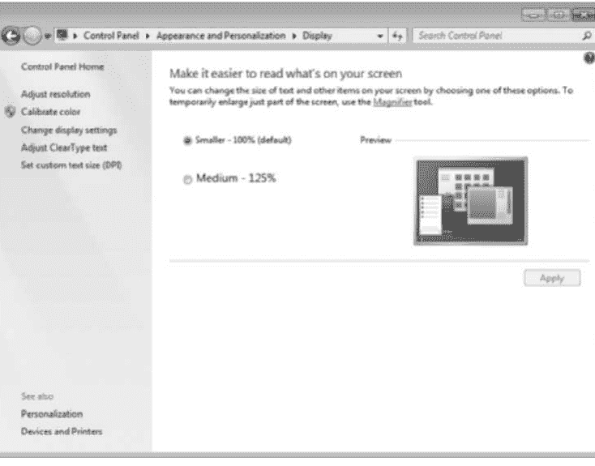

**图 3-12** 显示属性对话框的个性化选项卡

来源：Course Technology/Cengage Learning

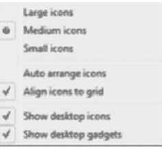

**图 3-13** 桌面图标外观选择

来源：Course Technology/Cengage Learning

**更改屏幕分辨率** 更改屏幕上出现的信息量，从而修改屏幕字体的视觉大小。要查看更多信息，例如增加屏幕分辨率。屏幕上的所有内容都会变得更小，包括文本。以下活动解释了如何调整屏幕分辨率。


### 活动 3-7：定制 Windows 7 桌面

所需时间：10 分钟

**目标：**在 Windows 7 中自定义显示字体和图标尺寸并调整屏幕分辨率。

描述：在这项活动中，你将操作屏幕字体、更改图标尺寸并更改屏幕分辨率。如果你需要自定义屏幕显示，此活动非常有用。

1. 如果必要，使用活动 1-1 中的相应指令启动你的虚拟机。
2. 要更改桌面字体的大小，点击“开始”，点击“控制面板”，点击“外观和个性化”链接，点击“调整文本和其他项目的大小或越小”链接，点击“中”选项按钮，然后点击“应用”。
3. 点击“立即注销”按钮。
4. 以 User01 身份登录并输入密码 Secret。
5. 要更改图标，右键点击桌面，指向“查看”，然后点击“大图标”。
6. 重复步骤 5 将图标尺寸更改为“中”。
7. 要更改屏幕分辨率，右键点击桌面上的空白区域，点击“屏幕分辨率”，点击“分辨率”下拉箭头，点击 800 x 600，双击“应用”，然后点击“保留更改”。

更改为较低的屏幕分辨率可能意味着某些项目不再适应屏幕。

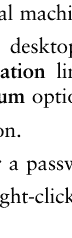

8. 重复步骤 7 将屏幕分辨率改回 1024 x 768。
9. 拖动屏幕分辨率滑块来更改分辨率，然后点击“应用”。等待屏幕分辨率变化。如果必要，点击“否”拒绝更改。
10. 点击“确定”。
11. 关闭所有窗口。
12. 保持机器登录状态。

## 定制 Windows 7 桌面

如前所述，通过右键点击桌面并选择菜单可以自定义桌面项目。

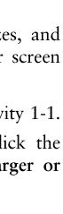

## 活动 3-8：使用桌面

所需时间：10 分钟

**目标：**使用桌面自定义桌面。

描述：在这项活动中，你将操作屏幕字体、更改图标尺寸并更改屏幕分辨率。如果你需要自定义屏幕显示，此活动非常有用。

1. 如果必要，使用活动 1-1 中的相应指令启动你的虚拟机。
2. 要打开桌面的右键菜单，右键点击桌面。
3. 验证图标出现。
4. 为后续活动保持机器登录。

当你右键点击图标或文件时，会出现取决于选择的菜单。这些菜单很有用。


## 设置偏好

外观对话框包含了自定义桌面主题、背景和字体的各种选项。要打开对话框，点击“系统”，点击“偏好”，然后点击“外观”。对话框如图 3-14 所示。

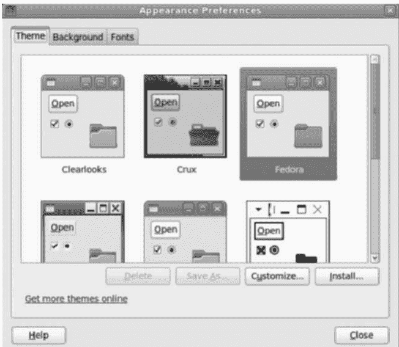

**图 3-14** 桌面偏好

来源：Course Technology/Cengage Learning

## 活动 3-9：修改桌面

所需时间：10 分钟

**目标：**修改桌面背景。

描述：在这项活动中，你将打开桌面右键菜单，选择“更改桌面背景”并修改桌面。如果你想修改 Fedora 13 的外观，此活动非常有用。

1. 如果必要，使用活动 1-1 中的相应指令启动你的虚拟机。
2. 要打开桌面右键菜单，右键点击桌面。
3. 要打开允许更改桌面的对话框，点击“更改桌面背景”。
4. 为桌面选择新背景，点击“背景”选项卡。
5. 滚动背景选择。点击你喜欢的背景并观察示例显示。
6. 应用所选背景，点击背景缩略图然后点击“关闭”。
7. 对“主题”和“字体”选项卡重复步骤 2 到 6。
8. 为下一个活动保持 Fedora 13 登录状态。

显示设置窗口包含了自定义桌面的各种选项，包括屏幕分辨率、色彩深度和显示器类型。当你选择显示器类型时，可用的屏幕分辨率将受到屏幕分辨率和色彩深的限制。要打开显示设置窗口（见图 3-15），


**图 3-15** 显示设置窗口

来源：Course Technology/Cengage Learning

## 第 3 章 使用图形用户界面

点击 System（系统），指向 Administration（管理），然后点击 Display（显示）。显示设置的更改需要用户注销并重新登录。


## 活动 3-10：修改 Fedora 13 的显示设置

所需时间：10 分钟

目标：使用 Fedora Core 13 中的显示设置窗口修改屏幕分辨率。

描述：在此项活动中，你将打开显示设置来更改分辨率。如果你想修改 Fedora 13 桌面的外观，此活动将非常有用。

- 1. 如必要，请根据活动 1-1 中的相应说明启动你的虚拟机。
-2. 点击面板上的 System（系统），点击 Administration（管理），然后点击 Display（显示）。
3. 当查询对话框出现时，输入 P@ssw0rd 然后点击 OK。
4. 要更改桌面的屏幕分辨率，点击 Resolution（分辨率）下拉菜单。
5. 点击 800 x 600 然后点击 OK。
6. 读取显示的消息，然后点击 OK。
7. 要注销，点击 System（系统），点击 Log Out User01（注销用户01），然后点击 Log Out（注销）。
8. 使用密码 Secret1 登录 Fedora 13。
9. 点击面板上的 System（系统），点击 Administration（管理），然后点击 Display（显示）。
10. 当查询对话框出现时，输入 P@ssw0rd 然后点击 OK。
11. 要选择显示器，点击 Hardware（硬件）标签，点击 Configure for Monitor Type（配置显示器类型），展开 Generic LCD Display（通用 LCD 显示），点击 LCD Panel 1024x768，然后点击 OK。


为了防止损坏显示器，降低分辨率后你需要选择显示器类型。

- 12. 读取显示的消息，然后点击 OK。
13. 要注销，点击 System（系统），点击 Log Out User01（注销用户01），然后点击 Log Out（注销）。
14. 使用密码 Secret1 登录 Fedora 13。
15. 为下一个活动让 Fedora 13 own注销状态。

## 访问计算机上的数据

使用 GUI 工具，你可以访问计算机上文件、目录和驱动器的分级结构。在下一节中，你将学习 Windows 管理器中的文件工具。你还将学习使用 Fedora 13 中的浏览器来访问计算机上的本地数据。

## 使用 Windows 管理器

Windows 资源管理器（见图 3-16）是 Windows 7 中的一个程序，它可以定位并打开文件和文件夹。你可以通过点击桌面上的 Computer（计算机）或开始菜单打开它。本节解释了如何使用 Windows 资源管理器。你将在活动 3-11 中使用资源管理器。


如你所见，资源管理器与之前的 Windows 版本相比发生了变化。地址栏的功能总结在图 3-16 中；它显示了当前文件夹的路径。例如，图 3-17 显示了 Pictures（图片）文件夹的内容。指向该符号可以查看路径中任何关联文件夹的内容，这实际上是一个弹出菜单。


图 3-16 Windows 资源管理器

源：Course Technology/Cengage Learning


图 3-17 Pictures（图片）文件夹

源：Course Technology/Cengage Learning

这些符号是“面包屑”导航的一种，它们是用于地址栏和 GUI 其他部分的导航辅助工具，用于跟踪你的位置。该术语源于童话中汉塞尔和格蕾特留下的面包屑。

工具栏会随不同的窗口而变化。在你使用资源管理器时，可能会遇到以下控件：

- Organize（组织）——整合了许多用于资源管理器的命令。常见的命令如 Cut（剪切）、Paste（粘贴）、Undo（撤销）、Select All（全选）和 Rename（重命名）出现在此处。
- System properties（系统属性）——提供有关你的计算机的基本信息。
- Uninstall or change a program（卸载或更改程序）——打开一个允许安装或删除程序的窗口。
- Map network drive（映射网络驱动器）——允许将驱动器连接到另一台计算机上的共享资源。
- Open Control Panel（打开控制面板）——允许你调整计算机设置。
- Change view（更改视图）——允许你切换视图。
- Show the preview pane（显示预览窗）——切换到之前的视图。
- Help（帮助）——启动 Windows 帮助和支持，解释 Windows 功能。
- Include in library（包含在库中）——允许指定一个将添加到当前文件夹的库。
- Share with（共享给）——支持与其他用户共享文件夹。
- Slide show（幻灯片）——打开媒体查看器显示当前文件夹中的图片。
- New folder（新建文件夹）——在当前文件夹中添加新文件夹，帮助你组织文件。

从 Organize（组织）菜单中，你可以隐藏或显示有关文件和文件夹的额外信息。图 3-18 显示了 Layout（布局）菜单的内容。每个选项受影响的区域由菜单旁的按钮指示。

例如，资源管理器窗口底部的详细信息窗显示有关所选项目的信息。以下是出现的信息示例：

- Music file（音乐文件）——列专辑、格式、艺术家等。
- Disk icon（磁盘图标）——列总大小、可用空间。
- WordPad document（WordPad 文）——列创建日期、修改日期、文件类型和大小。

预览窗位于资源管理器窗口的右侧。当你点击常见类型的文件时，在此预览。例如，点击音乐文件可以在预览窗中的媒体播放器中显示封面。播放音乐请点击箭头。

导航格出现在资源管理器的左侧。如果你使用过之前的 Windows，应该熟悉导航格。在 Windows 7 中，它就像是计算机上文件和文件夹的主地图，如图 3-19 所示。


图 3-18 Layout（布局）菜单

源：Course Technology/Cengage Learning


图 3-19 Navigation（导航）格

源：Course Technology/Cengage Learning

## 使用库

如果你使用过之前的 Windows，你可能熟悉 My Documents（我的文档）文件夹。在 Windows 7 中，My 已从文件夹名称中删除。你创建或保存的文档存储在 Documents 文件夹中，与其他可能在计算机上保存文件的用户分开。当你使用 Windows 7 应用程序时，应该使用库（Libraries）。

Windows 7 引入了库；它们类似于文件夹，但可以显示所有照片。Windows 7 默认包含四个库：Documents（文档）、Music（音乐）、Pictures（图片）和 Videos（视频）。要使用库，点击导航格中的名称。例如，图 3-20 显示了图片库，你可以点击导航格访问。

注意图 3-20 中的库位于两个位置。点击 Add（添加）按钮，可以向库添加更多文件夹。


图 3-20 Pictures（图片）库


源：Course Technology/Cengage Learning


图 3-21 Pictures（图片）库位置

源：Course Technology/Cengage Learning

# 第 3 章 使用图形用户界面


图 3-22 垃圾桶

来源：Course Technology/Cengage Learning

## 从开始菜单搜索

当你需要定位文件或文件夹时，可以使用 Windows 7 的搜索功能。例如，你可以在以下情况下使用它：

- 你正在寻找常见类型的文件。
- 你记得文件名的全部内容。
- 你知道上一次修改文件的时间。
- 你知道文件中的某个单词或短语。

你将在活动 3-14 中使用开始菜单中的“搜索”选项。通过打开开始菜单开始搜索文件、文件夹和程序。在“搜索”框中输入你的搜索信息。随着你的输入，搜索结果会开始出现，并随着你输入额外的字符而变化。这些结果被称为交互式搜索。例如，如果你正在寻找一张图片，输入 `de` 就会收敛到你感兴趣的图片。结果列表列出了所有包含搜索信息的文件、文件夹、程序、音乐文件和书签，无论文件名或文件夹位置如何。根据安装的应用程序，搜索还包括存储在 Microsoft Office 文（Word、PowerPoint、Excel 和 Outlook）、电子邮件、地址簿和日历中的数据。

Windows 不仅仅搜索文件和文件夹名称；它还在搜索文件和文件夹的内容，并搜索元数据（关于文件的描述性信息）。元数据包括文件数据，如大小、标题、作者、创建日期和最后修改日期。如果你在搜索结果中看到该项目，双击打开它。如果你选择一个程序或图片，它会在屏幕上打开。Windows 通常知道要打开哪个关联程序，但偶尔会弹出一个窗口帮助你定位文件。

Windows 会根据大小显示搜索结果。Windows 尝试显示与你的搜索请求最匹配的项，并将它们分组为“程序”、“文档”和“音乐”等类别。图 3-23 显示了示例搜索的结果。要定位你的文件，你可能想通过点击“组织”、点击“布局”，然后点击“预览窗格”来添加预览窗格。当你点击某项（如图片、声音或 WordPad 中的文本）时，文件内容将显示在预览窗格中。这有助于从候选文件中找到该文件。


**图 3-23** 示例结果

来源：Course Technology/Cengage Learning

搜索结果窗口底部会出现额外的图标，帮助你搜索你的库或可能是互联网。如果你想将搜索限制在特定文件夹，点击“自定义”，并在出现的列表中勾选你想要搜索的区域。

## 从资源管理器窗口搜索

资源管理器中的搜索框位于地址栏的右侧。和开始菜单一样，你向搜索框中输入你的搜索请求，但这两者之间存在巨大差异。从开始菜单中，你搜索的是整台电脑，但在资源管理器中进行搜索仅限于显示的资源管理器窗口。此外，在资源管理器窗口中的搜索不像在开始菜单中那样受限于条目。如果搜索返回了大量结果，你将看到一个巨大的可滚动窗口。

这两种搜索的另一个区别是“搜索生成器”，你可以用它来过滤搜索。当你在资源管理器的搜索框中输入内容时，框下方会出现几个单词——指向“作者”、“修改日期”和“大小”等类别的蓝色链接。你可以使用这些标准来过滤搜索结果。例如，点击“修改日期”会显示一个带有日期列表的日历。


## 活动 3-11：使用资源管理器

**需要时间**：10 分钟

**目标**：使用资源管理器工具。

**描述**：在此活动中，你将使用资源管理器。此活动对于想要定位和查看文件有用。

1. 如果必要，按照活动 1-1 的说明启动你的虚拟机。
2. 点击开始并点击计算机。
3. 定位文件，双击本地磁盘 (C:) 驱动器。
4. 双击用户，双击 公图片。注意地址栏的变化。
5. 要为布局添加预览窗格，点击“组织”、点击“布局”，然后点击“预览窗格”。
6. 点击一个项目。注意预览窗格中的内容。
7. 要为布局添加详细信息窗，点击“组织”、点击“布局”，然后点击“详细信息窗”。
8. 查看所选图标的属性，点击“组织”并点击“属性”。
9. 不做任何更改，点击“取消”。
10. 运行文件夹的幻灯片，点击“幻灯片”。
11. 取消幻灯片，按 `Esc`。
12. 查看可用文件夹，点击 公 右侧的 ►。
13. 切换到示例文件夹，点击 公，然后双击音乐。
14 关闭 打开的窗口。
15. 保持虚拟机登录以进行下一个活动。

## 活动 3-12：使用库

**需要时间**：10 分钟

**目标**：查看库的内容并创建一个新库。

**描述**：在此活动中，你将处理现有的库，创建一个库并填充现有文件夹。此活动对于想要创建和管理库有用。

1. 如果必要，按照活动 1-1 的说明启动你的虚拟机。
2. 点击开始并点击计算机。
3. 要查看现有库，点击导航窗格中的“库”。
4. 查看音乐库，双击音乐。
5. 查看带有标签信息的音乐，双击示例音乐。
6. 要查看组织文件的其他方式，点击“按...”箭头。
7. 按作者名称排列音乐，点击“作者”。
8. 按歌曲名称排列音乐，点击“按...”箭头，然后点击“歌曲”。
9. 要添加新库，右键点击“库”，指向“新建”，然后点击“库”。添加了一个条目“新库”。
10. 为库命名，在“新库”上输入“公共演示”并按回车。要填充公共演示库，双击“公共演示”，点击“包含文件夹”，在导航窗格中滚动并点击“计算机”，双击本地磁盘 (C:)，双击“用户”，双击“公共”，点击“音乐”，然后点击“文件夹”。
12. 要添加另一个文件夹，在导航窗格中滚动并点击“计算机”，双击“本地磁盘 (C:)”，双击“用户”，双击“公共”，右键点击“公共图片”，将指向“包含在库中”，然后点击“公共演示文稿”。
13. 要查看结果，请点击导航窗格上的“公共演示文稿”。
14. 关闭虚拟机中已打开的窗口。
15. 保持虚拟机处于登录状态，以便进行下一个活动。


## 活动 3-13：管理回收桶

**所需时间：** 10 分钟

**目标：** 使用回收桶删除和恢复文件及文件夹。

**描述：** 在此活动中，你将删除一个文档并从回收桶恢复它。接下来，你要清空回收桶。如果你想恢复已删除的文件，此活动非常有用。

- 1. 如必要，按照活动 1-1 中的相应说明启动你的虚拟机。
- 2. 点击“开始”，然后点击“文档”文件夹。
- 3. 在右侧窗格的空白区域点击右键，点击“新建”，点击“文本文档”，输入“Delete '新建文本文档'”，然后按回车键。
- 4. 右键点击“Delete”图标，点击“删除”，然后点击“是”。
- 5. 在“文档”窗口中，点击“最小化”按钮——标题栏右侧三个按钮第一个——使窗口临时消失并变为任务栏上的图标。
- 6. 双击桌面上的“回收桶”图标。
- 7. 右键点击“Delete”图标，然后点击“还原”。
- 8. 点击回收桶窗口中的“最小化”按钮。
- 9. 点击任务栏上的“文档”图标查看“文档”窗口。
- 10. 验证“Delete”图标是否已返回“文档”文件夹。
- 11. 右键点击“Delete”图标，点击“删除”，然后点击“是”。
- 12. 点击任务栏上的“回收桶”图标再次查看回收桶窗口。
- 13. 点击“清空回收桶”，然后点击“是”。
- 14. 验证“Delete”图标不再出现在回收桶文件夹中。
- 15. 关闭虚拟机中任何已打开的窗口。
- 16. 保持虚拟机处于登录状态，以便进行下一个活动。


## 活动 3-14：从 Windows 7 开始菜单搜索

**所需时间：** 10 分钟

**目标：** 从 Windows 7 开始菜单搜索文件。

**描述：** 在此活动中，你将搜索一个音乐文件。如果你想在未知位置查找文件，此活动非常有用。

- 1. 如必要，使用活动 1-1 中的相应说明启动你的虚拟机。
- 2. 要打开开始菜单，请点击**开始**。
- 3. 当你知道文件名的一部分时要搜索音乐文件，输入 `sle` 然后然后点击 Sleep Away。
- 4. 如果提示你为 Windows Media Player 选择初始设置，请点击**推荐设置**选项然后点击**完成**。


你的声音可能未在 VirtualBox 中配置。如果是这样，音乐将无法播放。点击关闭。

- 5. 关闭 Windows Media Player 窗口。
- 6. 要打开开始菜单，点击**开始**。
- 7. 当你知道艺术家名字的前几个字母时，也可以搜索音乐文件。例如，要搜索 Mr. Scruffy 的名为 **Kalimba** 的音乐文件，输入 `sc` 然后找到 Kalimba。
- 8. 关闭虚拟机中任何已打开的窗口。
- 9. 保持虚拟机处于登录状态，以便进行下一个活动。

## 活动 3-15：从资源管理器中搜索

**所需时间：** 10 分钟

**目标：** 在 Windows 7 资源管理器中搜索文件。

**描述：** 在此活动中，你将搜索一个音乐文件。如果你想在未知位置找到文件，此活动非常有用。

- 1. 如必要，使用活动 1-1 中的相应说明启动你的虚拟机。
- 2. 要打开资源管理器，点击**开始**然后点击**计算机**。
- 3. 要聚焦于“图片”，点击窗口左侧“库”下的**图片**。
- 4. 当你知道照片拍摄日期时要搜索图片文件，点击搜索文本框，点击**拍摄日期**，然后点击**很久以前**。
- 5. 取搜索，点击搜索文本框上的 **X**。
- 6. 当你知道文件类型时要搜索图片文件，点击搜索文本框，点击**类型**，然后点击 `.jpg`。

当按标签搜索时，你会受到创建文件的人所应用的标签的限制。


- 7. 关闭虚拟机中任何已打开的窗口。
- 8. 要关闭虚拟机，点击“开始”，然后点击“关机”按钮。
- 9. 等待 Windows 7 虚拟机完全关机。
- 10. 保持 PC 登录状态。

## 使用 Fedora 13 文件浏览器

文件浏览器（见图 3-24）是 Fedora 13 中的一个实用，允许你定位和打开文件及文件夹。你可以通过点击应用程序”、“系统工具”和“文件浏览器”来打开它。文件浏览器窗口包含基本菜单、工具栏、导航窗格和标签页预览窗。

本节介绍了文件浏览器窗口的每个区域。你将学习如何使用文件浏览器的控件在活动 3-16 中查找文件。在第 6 章中，你将学习更多关于使用浏览器的知识。

文件浏览器的菜单栏包含许多有用选项。在“文件”菜单中，你可以使用“新建标签页”和“新建窗口”分别创建一个新的标签页预览窗和一个窗口。使用“编辑”菜单选项移动、复制和重命名选定的文件和文件夹。“查看”菜单预览选项，“转到”菜单访问主工具栏上的图标，“书签”菜单允许你对...书签


**图 3-27** 搜索栏

来源：Course Technology/Cengage Learning

> 从外部驱动器或网络驱动器删除的项目将被永久删除，且不会发送到回收箱。

## 从文件浏览器中搜索

文件浏览器提供了一种搜索计算机上文件和文件夹的简单方法。类似于 Windows 7，Fedora Core 13 的搜索功能允许你通过文件和文件夹名称及其内容进行搜索。要开始搜索，点击主工具栏上的搜索按钮；该按钮看起来像一对望远镜。搜索栏取代了位置栏，如图 3-27 所示。

输入要查找的文件或文件夹的内容的搜索短语，然后按回车键。搜索结果将出现在视图窗格中。你将在活动 3-18 中在文件浏览器中使用搜索功能。

# 活动 3-16：在 Fedora 13 中使用文件浏览器

**时长：** 10 分钟

**目标：** 使用文件浏览器的工具栏。

**描述：** 在此活动中，你将使用文件浏览器。如果你想查找并查看有关文件和文件夹的信息，此活动非常有用。

- 1. 如果必要，使用活动 1-1 中的相应指令启动你的虚拟机。
- 2. 要显示主文件夹，点击“位置”（Places），然后点击“主文件夹”（Home Folder）。
- 3. 要比较视图格式，点击“视图”（View）菜单。先点击“图标视图”（Icon View），然后点击“列表视图”（List View），最后点击“紧凑视图”（Compact View）。
- 4. 要显示桌面内容，在预览窗格中双击“桌面”（Desktop）。
- 5. 要返回到主文件夹，点击工具栏上的父目录箭头。
- 6. 关闭虚拟机中打开的窗口。
- 7. 保持虚拟机登录状态以进行下一个活动。


# 活动 3-17：在 Fedora 13 中处理库文件夹和用户文件夹

**时长：** 10 分钟

**目标：** 使用文件浏览器中的文件夹。

**描述：** 在此活动中，你将使用文件浏览器中的库文件夹。如果你想查找并查看有关用户文件文件夹的信息，此活动非常有用。

- 1. 如果必要，使用活动 1-1 中的相应指令启动你的虚拟机。
- 2. 点击“位置”（Places）。
- 3. 要显示第一个库文件夹的内容，点击“主文件夹”（Home Folder）。
- 4. 分针对“桌面”、“文档”、“音乐”、“图片”、“视频”和“下载”重复步骤 3。
- 5. 关闭虚拟机中打开的窗口。
- 6. 保持虚拟机登录状态以进行下一个活动。


# 活动 3-18：在 Fedora 13 中使用文件浏览器进行搜索

**时长：** 10 分钟

**目标：** 使用文件浏览器搜索文件。

**描述：** 在此活动中，你将搜索包含特定词汇的文件。如果你想根据内容查找文件，此活动非常有用。

- 1. 如果必要，使用活动 1-1 中的相应指令启动你的虚拟机。
- 2. 要打开 gedit，点击“应用程序”（Applications），指向“辅助工具”（Accessories），然后点击 gedit 文本。
- 3. 输入 `Test for File Browser Search` 并按回车键。
- 4. 输入 `Nautilus` 然后按回车键。
- 5. 要保存文件，点击“文件”（File），点击“另存为”（Save As），在名称框中输入 `Nautilus`，然后点击保存。
- 6. 点击“位置”（Places）开始搜索。
- 7. 在搜索栏中输入 `Nautilus` 然后按回车键。

如果你在视图窗格中没有看到 Nautilus 文件，请联系你的导师。


- 8. 关闭虚拟机中打开的窗口。
- 9. 保持虚拟机登录状态以进行下一个活动。

# 活动 3-19：管理回收箱

**时长：** 10 分钟

**目标：** 使用回收箱删除和恢复文件及文件夹。

**描述：** 在此活动中，你删除一个文档并从回收箱恢复它。你还会清空回收箱。如果你想恢复删除的文件，此活动非常有用。

- 1. 如果必要，使用活动 1-1 中的相应指令启动你的虚拟机。
- 2. 在桌面上创建一个空文件，右键点击桌面，点击“创建文档”（Create Document），然后点击“空文件”（Empty File）。
- 3. 将文件发送到回收箱，右键点击新文件并点击“移动到回收箱”（Move to Trash）。
- 4. 要查看回收箱的菜单，右键点击桌面并点击回收箱图标。
- 5. 点击“文件夹”（Browse Folder）查看回收箱内容。
- 6. 清空回收箱并再次清空回收箱。
- 7. 关闭文件浏览器窗口。
- 8. 右键点击回收箱，点击“重命名”（Rename），输入 `Trash Can`，然后按回车键。
- 9. 重复步骤 8 以恢复名称。


b. 文档

c. 音乐

d. 图片

10. 在 Fedora Core 13 中，任务栏通常被称为

a. 菜单

b. 任务栏

c. 面板

d. 文件

11. 你可以定制桌面以提供（选择所有适用项）。

a. 快速访问运行中的应用程序

b. 频繁使用的应用程序快捷方式

c. 有组织的工作空间

d. 桌面的隐私保护

12. 在 Fedora 13 中，向面板添加项目需要选择（选择所有适用项）。

a. 小部件 (`applets`)

b. 应用程序

c. 面板

d. 抽屉 (`drawers`)

13. 要从 Fedora 13 的面板中删除某个项目，请右键点击该项目并点击

a. 添加到面板

b. 移动

c. 从面板移除

d. 从面板删除

14. 下列哪些操作改变屏幕上显示的信息量？（选择所有适用项）

a. 增大字体

b. 减小字体

c. 提高屏幕分辨率

d. 降低屏幕分辨率

15. Windows 7 中定位并打开文件的工具是 ____________

a. 控制中心

b. 文件浏览器

c. 搜索

d. Windows 资源管理器

16. Fedora 13 中定位并打开文件的工具是 _______________

a. 控制中心

b. 文件浏览器

c. 搜索

d. Windows 资源管理器

17. 当你从文件夹删除文件时，它们会去哪里？（选择所有适用项）

a. 回收箱

b. 垃圾箱 (`Trash`)

c. 文件管理器

d. 删除文件夹

18. 在 Windows 7 中过滤搜索结果，你可以使用 ____________ 选项。（选择所有适用项）

a. 作者

b. 修改日期

c. 大小

d. 拍摄日期

19. 作为组织的辅助，文件按 ______________ 分组（选择所有适用项）。

a. 地点

b. 文件夹

c. 库

d. 分区

20. Windows 7 的新桌面功能包括 ______________（选择所有适用项）。

a. 跃列表 (`Jump lists`)

b. 停靠 (`Snap`)

c. 预览 (`Peek`)

d. 抖动 (`Shake`)

## 案例项目

### 案例 3-1: 自定义 Windows 开始菜单

George 请求你帮助他自定义 Windows 7 开始菜单。他需要快速访问有限数量的应用程序并找到之前使用过的文件。你会建议什么？

### 案例 3-2: 在 Fedora 13 中恢复被删除的文件

你接到了 Susan 的电话，她误删了一个案例项目。她想知道如何恢复被删除的文件。你会告诉她什么？

### 案例 3-3: 搜索文件

你需要帮助朋友在电脑上找到一个文件，但他不记得文件的名称。你可以提供什么建议来帮助？

# 第 4 章

## 安装和配置应用程序

在阅读本章并完成练习后，你将能够：

- 访问帮助信息
- 使用并配置网络浏览器
- 安装 ActiveState Perl 并使用测试脚本测试安装

## 第 4 章：安装和配置应用程序

应用程序是任何旨在直接为用户执行特定功能的程序。在某些情况下，应用程序为另一个程序执行功能。你已经在本文中使用了几种应用程序，文字处理器 OpenOffice Writer 和 WordPad。

在学习使用 Windows 7 和 Fedora 13 的“帮助”功能后，你将学习更多关于应用程序的使用和配置知识。例如，你将学习配置和使用网络浏览器。Windows 程序具有类似的菜单，因此操作这些浏览器将为你准备使用和配置其他应用程序做好准备。在本章稍后，你将安装 ActiveState Perl 的社区版，它同时适用于 Windows 7 和 Fedora 13。

## 访问帮助功能

如果你在 Windows 7 或 Fedora 13 中工作，并且对完成任务有疑问，在询问导师或同学之前，应该检查手边的可用资源。在接下来的章节中，你将学习使用 Windows 7 和 Fedora 13 中的 GUI 帮助功能。

## 使用 Windows 7 中的帮助和支持中心

帮助和支持是一个全面的资源，提供了通过使用 Microsoft Windows 7 学习的实用建议、教程和演示。使用搜索功能、索引和目录来查看 Windows 7 帮助资源。

要打开“帮助和支持”，点击“开始”，然后点击“帮助和支持”。打开屏幕上的每个项目都是指向更多信息或帮助的链接（见图 4-1）。例如，如果你想获得设置新电脑的信息，“如何开始使用计算机”就是一个很好的链接。虽然你可能不再是新手，但“学习 Windows 基础”对于 Windows 新用户来说是一个很好的链接。

你还可以按 `F1` 键打开帮助和支持。如果它没有打开，点击桌面并再次按 `F1`。

要从 Microsoft 获取更新信息，请点击短语“访问 Windows 网站”中的 Windows 链接，

要查看帮助和支持中可用的广泛信息示例（如图 4-2 所示），点击“浏览主题”。

使用帮助中的搜索功能通过关键字查找主题。例如，输入 Internet 并点击放大镜图标以查看关于使用 Windows 7 连接的信息。你将在活动 4-1 中学习更多关于帮助和支持的知识。

系统信息 系统信息工具（见图 4-3）提供计算机的摘要信息。你在第 1 章中学习过系统信息工具。

## 访问帮助功能


**图 4-3** 系统信息工具

来源：Course Technology/Cengage Learning


**图 4-4** 显示冲突/共享的硬件资源

来源：Course Technology/Cengage Learning

## 第 4 章 安装和配置应用程序


**图 4-5** 系统信息工具中显示的 CD-ROM 驱动器信息

来源：Course Technology/Cengage Learning


**图 4-6** 系统信息工具中显示的运行任务信息

来源：Course Technology/Cengage Learning

# 活动 4-1：在 Windows 7 中使用帮助和支持

所需时间：10 分钟

目标：检查 Windows 7 帮助和支持。

描述：在此活动中，你将使用 Windows 7 帮助和支持。如果你需要学习特定的 Windows 7 功能，此活动非常有用。

1. 按照活动 1-1 中的适当说明启动你的虚拟机。
2. 要打开帮助和支持，点击“开始”，然后点击“帮助和支持”。
3. 点击“学习 Windows 基础”链接。
4. 打开并阅读一个或多个感兴趣的主题。
5. 要返回初始 Windows 帮助和支持窗口，点击“主页”图标。
6. 要搜索项目，输入“Memory”，然后点击放大镜图标。
7. 点击“查看计算机电脑有多少内存内存”链接，然后点击“单击打开系统”链接。
8. 找到已安装内存 (`RAM`) 条目。
9. 关闭系统窗口。
10. 点击“浏览帮助”图标，它看起来像一本蓝书。
11. 打开并阅读一个或多个感兴趣的主题。
12. 关闭 Windows 帮助和支持窗口。
13. 保持虚拟机登录状态以进行下一次活动。


图 4-7 Fedora 13 帮助中心

来源：Course Technology/Cengage Learning

# 活动 4-2：在 Windows 7 中查看系统信息


所需时间：10 分钟

目标：查看 PC 上的通用系统信息。

描述：在此活动中，你将查看虚拟机的系统信息。如果你需要查看系统信息来解决问题，此活动非常有用。

1. 如果必要，按照活动 1-1 中的适当说明启动你的虚拟机。
2. 点击“开始”，点击“帮助和支持”，在搜索帮助文本框中输入“system information”，点击放大镜图标，点击“什么是系统信息”链接，然后点击“单击打开系统信息”链接。
3. 等待信息出现。
4. 检查“系统摘要”页面。
5. 要查看硬件资源的子类别，展开“硬件资源”。
6. 要查看分配的中断请求 (`IRQs`)，点击“IRQs”。
7. 要查看分配的内存区域，点击“内存”。
8. 要查看可用的硬件组件，展开“组件”。
9. 打开并阅读一个或多个感兴趣的主题。
10. 要查看软件环境，展开“软件环境”。
11. 打开并阅读一个或多个感兴趣的主题。
12. 关闭任何窗口。
13. 保持虚拟机登录状态以备未来的活动。

# 使用 Fedora 13 帮助中心和系统信息

要访问 Fedora 13 帮助中心（见图 4-7），点击“系统”，然后点击“帮助”。接下来，选择你所需信息的链接。例如，要查找有关 GNOME 桌面的信息，点击“桌面用户指南”。

Fedora 13 提供了一个类似于 Windows 7 中的系统信息工具。你已在第 1 章中学过这些。活动 4-4 引入了 Fedora 13 系统信息工具的附加功能。

# 活动 4-3：使用 GNOME 帮助浏览器访问帮助


所需时间：10 分钟

目标：访问帮助中心中的支持信息。

描述：在此活动中，你将访问并调查 Fedora 13 的帮助中心。如果你需要在 Fedora 13 中寻求帮助，此活动非常有用。

1. 如果必要，按照活动 1-1 中的适当说明启动你的虚拟机。
2. 要访问帮助中心，点击“系统”，然后点击“帮助”。
3. 点击“互联网”并阅读一些在线帮助。
4. 关闭任何窗口。
5. 保持虚拟机登录状态以进行下一次活动。

## 活动 4-4：在 Fedora 中查看系统信息

所需时间：10 分钟

目标：访问系统信息。

描述：在此活动中，你将通过 Fedora 访问并调查系统信息。

1. 如果必要，按照活动 1-1 中的适当说明启动你的虚拟机。
2. 要打开终端，点击“应用程序”。
3. 要打开终端窗口，输入信息并按回车。
4. 要查看摘要，点击“摘要”。
5. 要查看操作系统，点击“操作系统”。
6. 要查看处理器，点击“处理器”。
7. 要查看资源，点击“资源”。
8. 要查看信息，点击“侧边”。
9. 要查看内存，点击“内存”。
10. 要查看输入设备，点击“输入设备”。
11. 要查看存储，点击“存储”。
12. 关闭任何窗口。
13. 保持虚拟机登录状态以


在地址栏输入信息。如果你看到“未找到命令”消息，请你的讲师。


如果你看到“未找到命令”

## 使用浏览器

浏览器是一种你用于导航 Web 的软件程序。90 年代第一个广泛使用的浏览器被称为 Mosaic。在本节中，你将学习使用浏览器——Internet Explorer 和 Firefox——以及

# 通过 Internet Explorer 浏览 Web

Web 上的每个页面都通过称为统一资源定位器 (`URL`) 的地址指定。换句话说，`URL` 标识了网站的位置。图 4-8 显示了 Internet Explorer。


Internet Explorer 的默认 `URL` 是 `www.msn.com`。你也可以使用地址栏上的“后退”和“向前”按钮在访问过的网站之间移动。要查看访问过的页面列表，点击“前进”按钮。你可以通过点击页面内的超链接（通常称为链接）从页面跳转。链接会将你带到不同的网站或同一页面的不同位置。当你将鼠标移动到链接上时，Internet Explorer 会检测到链接并将指针更改为手指。超链接通常带有下划线

# 配置 Web 浏览器

不同的颜色指示文本是“热点”或可点击的。点击链接通常在指针移动到上方时改变外观。你还可以在 Web 浏览和搜索中使用标签。标签允许显示多个页面并允许你在 Web 页面之间快速切换。

在 Web 上随机移动很容易，但找到特定的信息可能更困难。当你读书时，文本从页流到页。但在互联网上，你必须主动决定去哪里。这就是为什么人们经常说“浏览 Web”。

为了帮助你在网络空间定位特定信息，Internet Explorer 提供了一个搜索工具。要使用默认的 Bing 引擎，在其中输入你感兴趣的话题关键词（见图 4-9）。Bing 将提供一个你可以点击的建议列表。如果没有建议，点击右上角的放大镜。

点击工具栏上的“收藏”按钮可以快速返回你指定的收藏网站。要保存当前 Web 站点以便以后返回，点击“收藏”按钮并点击“添加到收藏夹”按钮。

**门户网站**——指向各种信息链接的页面——也是在互联网上行的有用工具。例如，尝试 `www.yahoo.com` 或 `www.google.com`。

## 活动 4-5：使用 Internet Explorer 浏览网页

**所需时间：** 15 分钟

**目标：** 使用 Internet Explorer 浏览网页。

**描述：** 在此活动中，你访问一个以“.com” 结尾的网络门户网站，以查找有关汽车特性和定价的信息。这项活动非常有用，因为它向你展示了如何在 Web 上查找信息。

1. 如必要，请按照活动 1-1 中的相应指令启动你的虚拟机。
2. 要启动 Internet Explorer，点击任务栏上的 Internet（连接）按钮。
3. 如果出现“欢迎使用 Internet Explorer”网页，点击“下一步”（Next），点击“否，不开启”选项按钮，点击“下一步”，点击“使用推荐设置”（Use recommended settings）按钮，然后点击“完成”（Finish）。
4. 如必要，在地址栏中输入 `www.msn.com` 并按回车键。

> 如果你访问的网站 `URL` 以“.com” 结尾，请输入 `URL` 的唯一部分（例如“msn”）并按 `Ctrl-Enter`。“www”和“.com”将自动附加你在地址栏中输入的名称上。

5. 将鼠标指向页面菜单中的 **Money**（财经），然后点击 Autos（汽车）链接。
6. 完成“New Cars”（新车）或“Used Cars”（二手车）表单，然后点击“Go”（前往）。
7. 继续浏览，直到找到一辆符合你需求且预算内的汽车。
8. 关闭所有已打开的窗口。
9. 退出虚拟机登录以便后续活动使用。

## 在 Fedora 13 中使用 Firefox 浏览网页

与 Windows 7 类似，你在 Fedora 13 浏览器中通过在地址栏输入地址来访问网站。你可以使用工具栏上的“后退”（Back）和“前进”（Forward）按钮在当前浏览会话访问过的网站之间移动。你可以通过点击超链接从一个页面移动到另一个页面。

尽管界面和布局不同，但 Fedora 13 中的 Firefox 浏览器与 Internet Explorer 非常相似（见图 4-10）。当你将鼠标指针悬停在链接上时，Firefox 会检测到链接并将指针更改为手指手形。在 Windows 7 浏览器中，超链接通常带有下划线或以颜色显示，以指示它们是“热点”或可点击的。

在 Firefox 中访问多种访问网站。你可以使用“工具”（Tools）菜单中的“网络搜索”（Web Search）选项，或使用“书签”（Bookmarks）菜单来存储、管理和访问频繁使用的 `URL`。你还可以使用“历史记录”（History）菜单访问访问过的网站历史；这些网站根据你访问它们的天数、周和月份进行组织。当你需要访问之前没有创建书签的访问过的网站时，“经常访问”（Most Visited）选项非常有帮助。“显示所有历史记录”（Show All History）会显示所有

## 使用和配置网络浏览器


**图 4-10** 带有导航工具栏的 Fedora 浏览器

来源：Course Technology/Cengage Learning

## 活动 4-6：使用 Firefox 浏览网页

**所需时间：** 15 分钟

**目标：** 使用 Firefox 浏览网页。

**描述：** 在此活动中，你访问 Web 上的一个门户网站以查找有关主题的信息。这项活动非常有用，因为它向你展示了如何在 Web 上获取目录信息。

- 如必要，请按照活动 1-1 中的相应指令启动你的虚拟机。
- 要打开 Firefox，点击 **Applications**（应用程序），指向 **Internet**（网络），然后点击 **Firefox**。
- 在地址栏中输入 `www.amazon.com`，然后点击**绿色箭头**按钮。

> 就像 Internet Explorer 一样，在 Firefox 中只需在地址栏中输入“amazon”，然后按住 `Ctrl` 键点击“Go”（前往）即可访问 Web。

- 指向 **Electronics**（电子产品）链接，然后滚动并点击你选择的类别。
- 继续浏览直到找到一个你喜欢的电子设备。
- 关闭所有已打开的窗口。
- 退出虚拟机登录以便进行下次活动。


## 活动 4-7：在 Firefox 中标记书签


**所需时间：** 10 分钟

**目标：** 在 Firefox 中创建书签以供以后参考。

**描述：** 在此活动中，你使用 Firefox 标记流行的 Web 网站。

1. 如必要，请按照活动 1-1 中的相应指令启动你的虚拟机。
2. 要打开 Firefox，点击 Applications，指向 Internet，然后点击 Firefox。
3. 在地址栏中输入 `www.amazon.com` 并按回车键。
4. 当网页出现时，点击 Bookmarks（书签）菜单，然后点击 Bookmark（书签）。
5. 在 Name（名称）字段中输入“Amazon store”并点击 Done（完成）。
6. 在地址栏中输入 `www.google.com` 并按回车键。
7. 当网页出现时，点击 Bookmarks（书签）菜单，然后点击 Bookmark（书签）。
8. 在 Name（名称）字段中输入“Google search engine”并点击 Done（完成）。
9. 点击 Bookmarks（书签）菜单并注意已添加的书签。
10. 关闭所有已打开的窗口。
11. 退出虚拟机登录以便后续活动使用。

# 使用 Internet Explorer 搜索 Web

如果你在 Web 上寻找符合某个特定主题或分类的信息，请先访问 Web 目录。可以将 Web 目录想象成图书馆的目录。像 Yahoo、Bing 和 Google 这样的目录通过将 Web 分分为艺术、科学、商业和娱乐等主题来组织 Web。

搜索引擎使用自动化软件程序搜索 Web 并找到你想要的信息。这些程序检索并分析你想要的信息。当你在 Web 上搜索关键词时，搜索引擎会根据你的查询进行分析。如果你在 Web 上寻找符合某个特定主题或分类的信息，请先访问 Web 目录。搜索引擎使用算法搜索引擎通过将 Web 分分为主题来组织 Web。

在 Web 上搜索关键词时，搜索引擎会根据你的查询进行分析。为了发现 Web 上的，搜索引擎使用被称为爬虫（bots）、蜘蛛（spiders）或爬虫（crawlers）的程序。搜索引擎对结果的排名取决于三个因素：

- 结果与查询的相关性
- 网站的受欢迎程度
- 是否因滥用而受到惩罚

搜索引擎不通过操纵网站来操纵来提高排名排名。为了处理 Web 上的信息，搜索引擎使用算法。你可以通过添加特定的短语来缩小搜索范围。

在 Web 上搜索关键词时，搜索引擎会根据你的查询进行分析。

在 Web 上搜索关键词时，搜索引擎会根据你的查询进行分析。

在 Web 上搜索关键词时，搜索引擎会根据你的查询进行分析。

# 使用 Firefox 搜索网络

由于搜索引擎驻留在互联网上，而 Firefox 浏览器仅仅是访问 Web 的工具，因此在 Firefox 中进行搜索的过程与在 Internet Explorer非常相似。搜索查询的布尔语法和表述方式是相同的。

要从 Firefox 浏览器访问搜索功能，你可以点击“工具 (Tools)”菜单中的“网络搜索 (Web Search)”，或者在地址栏中输入搜索引擎的 URL 并在 Firefox 页面执行搜索。

你可以通过点击 Firefox 右上角文本框旁边的箭头来定义你想要使用的搜索引擎。默认选择 Google。


## 活动 4-9：使用 Firefox 搜索网络

所需时间：15 分钟

目标：使用 Firefox 搜索网络。

描述：在此项活动中，你使用 Firefox 访问某个网站以查找有关某个主题的信息。这项活动非常有用，因为你需要能够从网络上搜索信息。

- 1. 如必要，请按照活动 1-1 中的相应指令启动虚拟机。
- 2. 要打开 Firefox，点击“应用程序 (Applications)”，指向“互联网 (Internet)”，然后点击 Firefox。
- 3. 在 Firefox 中，点击“工具 (Tools)”菜单，然后点击“网络搜索 (Web Search)”。光标移动到导航工具栏中的搜索窗口。
- 4. 在搜索窗口中输入 Fedora 13 并按回车。
- 5. 当搜索结果出现时，向上和向下滚动并查看链接。
- 6. 关闭所有已打开的窗口。
- 7. 保持虚拟机登录状态以供后续活动使用。

# 配置 Internet Explorer

尽管你可能认为 Internet Explorer 的默认安装已经足够，不需要配置浏览器，但事实并不一定如此。例如，如果你从不打开浏览器时显示的默认主页，你应该选择一个不同的主页。有时，你可能不希望在正在使用的电脑上留下任何浏览痕迹，例如在朋友的电脑上检查邮件，或在家庭 PC 上购买礼物。你还应该知道如何通过偶尔删除复制到硬盘的临时 Internet 文件来回收磁盘空间。

# 配置安全设置

Windows Internet Explorer 中的“密浏览（InPrivate browsing）”通过防止浏览器存储或保留浏览历史、临时 Internet 文件、表单数据、Cookie、用户名和密码来保护数据和隐私，几乎不留下任何用户浏览或搜索历史的证据。

# 使用和配置 浏览器

你可以通过在“新建标签页 (New Tab)”页面选择“密浏览 (InPrivate Browsing)”，从“安全 (Safety)”菜单（见图 4-11）启动密浏览。将打开一个新的 Internet Explorer 8 窗口，地址栏左侧将显示蓝白色的密浏览指示。你可以通过关闭浏览器窗口来结束密浏览会话。

SmartFilter 是 Internet Explorer 中的一项功能，帮助你在浏览 Web 时避免恶意网站。Malware 是恶意软件（malicious software）的缩写，是指设计在没有所有者知情的情况下渗透计算机系统的软件。SmartFilter 通过以下技术帮助你：

- 根据动态更新的已报告恶意网站列表检查网站。
- 根据动态更新的已报告恶意网站列表检查软件下载内容。
- 防止你访问包含恶意软件并可能导致身份盗窃的网站。

SmartFilter 默认开启。如果你尝试访问一个被报告的网站，会出现一个对话框并建议你不要继续访问该不安全的网站。

要继续配置 Internet Explorer，请从“工具 (Tools)”菜单选择“Internet 选项 (Internet Options)”。弹出如图 4-12所示所示 Internet 选项对话框。以下部分解释了密浏览浏览器的配置设置。


图 4-11 选择密浏览

来源：Course Technology/Cengage Learning

## 第 4 章 安装和配置应用程序


图 4-12 Internet 选项对话框

来源：Course Technology/Cengage Learning

## 普通设置

你可以使用 Internet 选项对话框中“常规 (General)”选项卡中的设置来自定义 Internet Explorer 以符合你的喜好。在活动 4-10 中，你将在 Internet Explorer 中配置这些设置。你可以自定义以下项目：

- 主页（Home page）——每次打开 Internet Explorer 时都会出现的 Web 页面。
- 浏览历史（Browsing history）——你可以通过删除近期 Web 会话存储在电脑上的文件和 Cookie 来恢复磁盘空间。历史列表显示了你几天或几周访问的所有 Web 页面；该列表以“Web 地址”的形式出现在地址栏下方。当列表变得过长时，可能很难找到你网站。Cookie 是收集并存储有关你的个人信息以及你的浏览偏好的小文件。
- 搜索（Search）——管理加载项以个性化选择搜索引擎。例如，你可以从纽约时报、Bing、维基和 Amazon 中选择。
- 标签（Tabs）——更改 Web 页面在标签页中的显示方式。
- 外观（Appearance）——修改 Internet Explorer 的外观。

# 活动 4-10：在 Internet Explorer 中选择常规设置

所需时间：15 分钟

目标：配置 Internet Explorer 中的“常规”选项卡设置。

# 使用和配置 浏览器 145

**描述**：在此项活动中，你将主页设置为最近访问的 Web 站点。根据你的使用情况，你可能还需要清理 Cookie、保存的文件以及最近访问的 Web 站点。这项活动非常有用，因为它展示了如何执行 Internet Explorer 的基础配置任务。

- 1. 如必要，按照活动 1-1 中的相应指令启动虚拟机。
- 2. 要打开 Internet Explorer，点击任务栏上的“互联网”按钮。
- 3. 在地址栏中输入 `www.google.com` 并按回车。
- 4. 点击“工具 (Tools)”菜单，然后点击“Internet 选项 (Internet Options)”。
- 5. 要将 `www.google.com` 设置为主页，点击“当前 (Current)”按钮。
- 6. 要开始删除浏览历史的过程，点击“删除 (Delete)”按钮。
- 7. 检查选框，选择所需的项目，然后点击“删除”。
- 8. 要添加搜索引擎，点击“搜索”下的“设置 (Settings)”按钮，点击“查找更多提供商”，选择并选择搜索提供商，点击“添加到 Internet Explorer”。点击“添加”。
- 9. 关闭 Web 页面，然后点击“关闭”。
- 10. 要更改 Web 页面的显示方式，点击“标签页”下的“设置 (Settings)”按钮，检查选框，选择所需的项目，然后点击“确定”。
- 11. 点击“确定”。
- 12. 关闭所有窗口。
- 13. 保持虚拟机登录状态以供后续活动。

Internet Explorer 包含以下安全区域：

- Internet 区域（Internet zone）——当你安装 Internet Explorer 8 时，它将所有站点归类为 Internet 区域并处于中高安全级别。此级别有助于你浏览，但在下载不安全内容之前会提示。如果你的组织担心用户使用 Web 的安全性，请将安全级别更改为高。但请注意，此更改可能会导致页面出现故障或显示不正常。考虑按照下文说明指定一个你控制每个安全的自定义级别。
- 局域网区域（Intranet zone）——允许组织局域网内的 Web 站点。你应该设置此区域，使所有站点都在防火墙内。来自公司网络管理员的关于内部网络的详细信息。默认情况下，此区域由本地域名组成。
- 信任站点（Trusted sites）——允许你添加你信任安全的网站，包括合作伙伴或可靠公共实体的网站。默认情况下，此区域分配低安全级别；你在信任站点上执行更广泛的操作。
- 受限制站点（Restricted sites）——使用此区域添加你不信任的网站。受限制网站被分配高安全级别，这意味着你只能执行极少数、非常安全的操作。Web 页面可能无法正常运行或无法完整显示。

## 第 4 章 安装和配置应用程序


图 4-13 Internet Explorer 中的安全区域

来源：Course Technology/Cengage Learning

图 4-14 为你展示这些区域是如何运作的。防火墙在内部网络和外部世界之间充当保护边界。代理服务器作为计算机和 Internet 之间的中介，并过滤对网站的访问。你定义相对于防火墙定义安全区域的位置——本地局域网区域（Local intranet zone）位于防火墙之后，其他三个区域通常位于防火墙之外。

## 自定义安全设置

要设置网络浏览的安全，请点击“Internet 选项”（Internet Options）对话框中“安全”选项卡上的“自定义”（Custom）级别按钮。会出现“自定义安全设置”对话框，如图 4-13 所示。


图 4-14 安全区域与防火墙

来源：Course Technology/Cengage Learning

使用设置列表来启用或禁用特定的安全选项，这些选项被分为以下类别：

- .NET Framework——使用这些选项配置使用可扩展应用程序标记语言（XAML）部署应用程序的行为。
- .NET Framework 依赖型组件——你可以指定如何处理没有适当 Authenticode 标识的程序。
- ActiveX 控件和插件——你可以使用这组自定义选项来允许、下载和运行 ActiveX 控件（在网络环境中相互相互作用的软件组件）。
- 下载（Downloads）——这些选项指定了你是否可以下载文件或字体。
- 脚本（Scripting）——这些选项指定了你是否可以下载脚本。
- 用户验证（User authentication）——这些选项有助于指定你用于登录网站的方法。
- 其他杂（Miscellaneous）——这些选项控制广泛的其他操作。

微软提供了客户端软件来监控支持软件（如 ActiveX 控件和可执行文件）的下载。如果某个软件经过数字签名（即使用了 Authenticode 机制），Internet Explorer 就可以验证其源自开发者，并且没有被任何人篡改。然而，数字签名并不保证软件没有问题——它仅意味着软件没有被修改。同样，没有签名的软件并不证明该软件是危险的。

你还可以使用“自定义安全设置”对话框重置任何定义的自定义设置。如果你想恢复到 Internet Explorer 的默认设置，此选项非常有用。

在浏览 Web 时保护计算机安全是一项平衡工作。你对下载和其他内容越开放，你面临的风险就越大。例如，你可能希望避免下载可能损坏硬盘上数据的软件的风险。你的设置越严格，Web 就变得越不可用、越不利。对于四个区域中的每一个，你都可以通过移动安全滑块来调整安全性。对于每个设置，都提供了安全操作的摘要。

### 活动 4-11：在 Internet Explorer 中设置安全区域


所需时间：20 分钟

目标：在 Internet Explorer 中配置安全区域。

描述：在此活动中，你将查看并指定四个安全区域每个默认安全设置。你将微软网站添加到“受信任的站点”（Trusted sites）区域。如果你需要为安全区域选择安全设置，此活动将非常有用。

1. 如必要，按照活动 1-1 中的相应指令启动你的虚拟机。
2. 要启动 Internet Explorer，点击任务栏上的“Internet”。
3. 要打开安全选项，点击“工具”（Tools）菜单，点击“Internet 选项”，然后点击“安全”选项卡。
4. 如必要，点击“Internet”图标。

> 如果“默认”级别按钮显示为灰色，你必须在此活动中激活它。移动安全级别滑块。

5. 点击“默认”按钮将安全级别设置为“中高”（Medium-high）。
6. 点击“受信任的站点”图标。
7. 点击并拖动滑块到“低”（Low）级别，查看警告消息并点击确定。
8. 点击“默认”按钮将安全级别再次设置为“中”（Medium）。
9. 点击“本地局域网”（Local intranet）图标。
10. 如必要，点击“默认”按钮将安全级别设置为“中低”（Medium-low）。
11. 点击“受信任的站点”图标。
12. 要将微软添加为受信任站点，点击“站点”（Sites）按钮，勾选“此区域中的所有站点需要服务器验证 (https:)”复选框，在“将网站添加到区域”文本框中输入 `www.microsoft.com`，点击“添加”按钮，然后点击“关闭”。
13. 如必要，点击“默认”按钮将安全级别设置为“中”（Medium）。
14. 点击“限制站点”（Restricted sites）图标。
15. 如必要，点击“默认”按钮将安全级别设置为“高”（High）。
16. 点击确定。
17. 关闭 Windows 7 虚拟机内任何打开的窗口。

### 在 Web 上设置隐私

你可以配置以下内容：

- 关闭浏览器时删除会话 Cookie（Session cookies）。
- 持续性 Cookie（Persistent cookies）更具永久。Cookie 中的过期日期指示了时间。

在讨论 Cookie 时，另一个重要的区别是第一方 Cookie 和第三方 Cookie。第一方 Cookie 由来自相同域名的 Web 服务器存储；第三方 Cookie 由不同域名的 Web 服务器存储。例如，许多包含广告的 Web 页面。

Internet Explorer 支持隐私偏好平台（P3P），它可以控制个人信息的使用。P3P 允许网站提供其可能尝试 Cookie 的策略信息。Internet Explorer 会探索你在“隐私”选项卡中选择的偏好，然后决定是否允许这些网站。你在网上输入的某些信息可用于识别或联系你，因此你可能不想共享你的姓名、电子邮件、电话号码或其他个人数据。然而，网站只能访问你提供的个人信息或你在访问网站时进行的输入。除非你提供，否则网站无法确定你的电子邮件。移动“隐私”选项卡上的滑块以设置你想要的隐私级别：

- 所有 Cookie——阻止所有网站存储 Cookie，并防止网站读取现有的 Cookie。
- 高——防止没有 P3P 隐私策略的网站存储 Cookie 并在未经你许可的情况下获取个人信息。
- 中高——防止没有 P3P 隐私策略的网站存储第三方 Cookie 或在未经许可的情况下使用个人信息；此设置还防止网站存储在未经许可的情况下使用个人信息的第一方 Cookie。没有 P3P 隐私策略的第一方 Cookie 仅在第一方上下文中读取。
- 中（默认）——这与“中高”相似，但重要的区别是：“中”允许在未经许可的情况下使用个人信息的第一方 Cookie，但在关闭浏览器时删除它们。


- 低——允许网站在计算机上存储 Cookie、存储没有 P3P 隐私策略的第三方 Cookie 或在未经许可的情况下使用个人信息。第三方 Cookie 在关闭浏览器时删除。

- 接受所有 Cookie——允许网站在计算机上存储 Cookie。创建 Cookie 的网站可以读取它们。

### 在 Internet Explorer 中配置隐私偏好


图 4-16 Internet 选项中的“隐私”选项卡

来源：Course Technology/Cengage Learning

## 使用和配置网络浏览器

自定义的隐私设置不会覆盖“阻止所有 Cookie”和“接受所有 Cookie”设置，但它们会覆盖“高”、“中”、“中”和“低”隐私设置。


## 导入自定义隐私设置

如果您的组织希望标准化所有用户的隐私设置，请点击“隐私（Privacy）”选项卡中的“导入（Import）”按钮从文件导入自定义隐私设置。您可以从组织或互联网上的其他网站下载自定义设置文件，从而防止用户访问包含可疑内容的网站。

## 高级隐私设置

点击“隐私”选项卡中的“高级（Advanced）”按钮查看“高级隐私设置”对话框，如图 4-17 所示。您可以使用这些设置来覆盖 Internet 区域内所有网站的自动第一方和第三方 Cookie 处理。您应该勾选“始终允许会话 Cookie”框，因为 Cookie 在关闭 Internet Explorer 时会自动删除。此设置在保护隐私和允许网站在您访问期间识别身份之间取得了实用的平衡。如果网站在您页面间跳转时无法识别您，您可能无法在网站内进行导航。

在配置隐私偏好后，Internet Explorer 可以通过以下方式处理 Cookie：

- 阻止第一方 Cookie（由来自同一互联网的 Web 服务器存储）
- 阻止第三方 Cookie（由来自不同域的 Web 服务器存储的 Cookie）
- 允许存储所有 Cookie 而不通知您

## 控制网页弹出窗口

Internet Explorer 8 自带弹出窗口拦截器，该拦截器默认启用。浏览器允许您修改某些设置，例如允许哪些网站将弹出窗口作为通知类型以及预设的过滤器级别。图 4-18 显示了“弹出窗口阻止设置”对话框。要访问此对话框，点击“工具（Tools）”菜单，点击“弹出窗口阻止（Pop-up Blocker）”，然后点击“弹出窗口阻止设置（Pop-up Blocker Settings）”。


图 4-17 高级隐私设置对话框

来源：Course Technology/Cengage Learning

## 第 4 章 安装和配置应用程序


**图 4-18** 弹出窗口阻止设置对话框

来源：Course Technology/Cengage Learning

通过此对话框，您可以执行以下任务：

- **允许来自所选网站的弹出窗口。** 例如，课程管理应用程序的弹出窗口如果没有此覆盖将无法运行。
- **在弹出窗口被阻止时设置通知。** 您可以同时设置声音和视觉通知。
- **在三个阻止级别之间进行选择。** 级别为：高：阻止所有弹出窗口；中：阻止自动弹出窗口；低：允许来自安全网站的弹出窗口。


## 活动 4-12：为 Internet 区域设置隐私

**所需时间：** 15 分钟

**目标：**为 Internet 区域配置 Internet Explorer 隐私设置。

**描述：** 在此活动中，您为 Internet 区域选择隐私设置，以便在您浏览网页时保护您的隐私。您希望确保其他人无法拦截和读取您发送和接收的信息，并希望控制网站如何使用您提供的个人信息。如果您在使用互联网时担心隐私，则此活动将很有用。

1. 如必要，按照活动 1-1 中的相应指令启动您的虚拟机。
2. 要启动 Internet Explorer，点击任务栏上的**Internet（Internet）**按钮。
3. 如必要，点击“选择一个 Web 内容区域以指定其安全设置”下的**Internet** 图标。
4. 要打开隐私选项，点击**工具（Tools）**菜单，点击**Internet 选项（Internet Options）**，然后点击**隐私（Privacy）**选项卡。
5. 点击**默认（Default）**按钮，然后点击并拖动滑块到“阻止所有（Block All） Cookie”。
6. 检查“阻止所有 Cookie”的解释。
7. 拖动滑块到“高（High）”并查看解释。
8. 重复步骤 7，分别设置为“中（Medium）”、“中（Medium）”、“低（Low）”和“接受所有（Accept All） Cookie”。
9. 点击**默认（Default）**按钮将安全级别设置为“中（Medium）”。
10. 要允许 Prometric 网站 (`www.2test.com`) 使用 Cookie，点击**站点（Sites）**按钮，在“网站地址”文本框中输入 `www.2test.com`，点击**允许（Allow）**按钮，然后点击确定。
11. 点击确定。
12. 关闭任何已打开的窗口。
13. 保持虚拟机登录状态以进行下一次活动。

## 在 Internet Explorer 中处理网页内容

您可以在“Internet 选项”对话框的“内容（Content）”选项卡上配置以下网页内容偏好，如图 4-19 所示：

- 网页活动的家长控制
- 阻止不良网站网站的设置


图 4-19 Internet 选项对话框中的内容选项卡

来源：Course Technology/Cengage Learning

## 第 4 章 安装和配置应用程序

- 建立他人身份的设置
- 个人信息传输的控制

以下章节将讨论您可以控制的每个领域。

## 设置家长控制

监管浏览器可以防止访问不良内容。要设置家长控制，点击“内容”选项卡上的**家长控制（Parental Controls）**按钮。参见图 4-20 的家长控制示例。您可以调整四个区域的内容分：语言、裸露、性暴力。

您通过输入管理员密码来保护内容管理器，允许管理员启用或禁用内容管理器并更改设置。您可以添加提示来帮助管理员记住密码；每当 Internet Explorer 请求密码时，就会显示提示。


图 4-20 家长控制示例

来源：Course Technology/Cengage Learning

## 使用内容管理器

Internet Explorer 安装了一个基于互联网内容分协会（ICRA）工作的内容分系统。ICRA 允许用户（特别是有小孩的父母）通过标记来决定哪些内容是有冒犯性的。Web 0级是最严格的 ICRA 问卷，描述了网站的内容；作为回报，ICRA 提供了一段小的 HTML 代码，Web 作者将其包含网页中。

内容管理器检查这段小代码以确定网站上冒犯性语言、裸露、性和暴力的级别。表 4-1 显示了每种内容的五个级别，并描述了每个级别允许的内容。

您可以为四个区域的每个内容设置任何级别。默认情况下，所有内容级别都设置为 0级。当内容管理器启用且网站级别超过您设置的级别时，Internet Explorer 将阻止用户访问该网站。您还可以配置 Internet Explorer允许或阻止访问不良网页内容。

为了使此系统运行，Web 作者必须编写页面并保持诚实。如果作者发布不良内容但未提供显示分级的页面，内容管理器可能会无论内容如何都阻止该页面。批准站点功能（点击设置（Settings）按钮时即可访问）允许您指定某些站点为已批准。

## 156 第 4 章 安装与配置应用程序

| 等级 | 语言 | 裸露 | 性 | 暴力 |
| --- | --- | --- | --- | --- |
| 0 | 无害俚语 | 无裸露 | 无性行为 | 无暴力 |
| 1 | 轻微脏话 | 暴露性服装 | 激情的亲吻 | 战斗 |
| 2 | 中度脏话 | 部分裸露 | 穿着衣服的性接触 | 杀戮 |
| 3 | 猥亵手势 | 正面裸露 | 非显性性接触 | 充满血腥 |
| 4 | 露骨或粗俗语言 | 挑逗性正面裸露 | 显性性活动 | 肆无忌惮的暴力 |

表 4-1 Internet Explorer 内容顾问分级

**使用证书** 当你在商店核对支票时，可能被要求出示执照以验证身份。在 Web 上验证身份时，Internet Explorer 使用了行业标准的数字证书。这些证书是电子凭据，将证书的身份与一对电子密钥（公钥和私钥）绑定。这些密钥确保证书属于你想要联系的正确组织或个人。你可以使用这些密钥来加密和签名信息。

你使用证书进行用户身份验证以及与 Web 上的服务器安全通信。如果你连接到 Web 服务器，由受信任机构颁发的服务器身份证书可以让你确立服务器的身份。此外，证书还允许服务器验证你的身份。

你使用安全传输协议交换证书，该协议提供加密且未被篡改的信息。当你在 Web 上传输信用卡和购买信息时，通常会使用安全通道传输。

消息可以使用公钥加密并用私钥解密，如图 4-22 所示并在后续步骤中描述：

- 步骤 1—使用公钥对明文消息加密，公钥由接收消息的人提供。
- 步骤 2—通过 Internet 传输加密后的消息。加密过程确保被截获的消息无法被读取。
- 步骤 3—使用私钥对密文消息解密，私钥由接收消息的人持有。

证书由称为证书权威机构（CA）的第三方颁发、验证和管理。商业 CA 必须提供你的组织和用户信任的服务。CA 的主要责任是识别获取证书的组织和人的身份。这种努力确保了证书中信息的有效性。当证书被破解时，它会被吊销并添加到证书吊销列表（CRL）。

为了处理 Internet 客户服务，你的组织可以从商业 CA 获取证书。为了在内部域网上处理类似的服务，你的组织可以获得发行自己的证书的权限。

步骤 1:

使用接收者的公钥加密

原始消息

（明文）

加密消息

（密文）

步骤 2:

通过 Internet

传输

原始消息

（明文）

加密消息

（密文）

步骤 3:

使用接收者的

私钥解密

图 4-22 使用公钥和私钥

来源：Course Technology/Cengage Learning

## 控制网页上数据的完成

从“内容”选项卡的自动填充区域中，你可以点击“设置”按钮并修改 Web 地址和表单的自动填充设置，如图 4-23 所示。你还可以定期清除历史文件夹中的所有用户名和密码条目，这样其他人无法查看这些私有信息。通过取消选择“表单”复选框，你可以清除历史文件夹中你在 Web 页面上输入的所有条目。


图 4-23 自动填充设置

来源：Course Technology/Cengage Learning

## 配置馈送和 Web 切片

切片（Slice）是 Internet Explorer 8 中引入的一种 Web 技术，允许你订阅网页的某些部分。你可以在特殊的“飞出”窗口中预览切片。Web 切片允许你立即查看天气预报和其他更新，而无需访问网页检查更改。你可以通过在“馈送和 Web 切片设置”对话框中进行选择来控制这些切片，如图 4-24 所示。

### 使用连接选项卡

使用“Internet ”对话框的“连接”选项卡（见图 4-25）设置 Internet 连接并配置 LAN 设置。

设置拨号 Internet 连接超出了本文的范围。

点击“局域网设置”按钮为 Internet Explorer 指定 LAN 连接设置。你的网络管理员可以配置你的网络，以便 Internet Explorer 在首次启动时进行自定义。这可以帮助减少管理开销，并可能减少关于浏览器设置的帮助台电话。动态主机配置协议（DHCP）和域名系统（DNS）支持浏览器设置的自动检测。


**图 4-24** 配置 Web 切片

来源：Course Technology/Cengage Learning


**图 4-25** Internet 选项中的连接选项卡

*来源：Course Technology/Cengage Learning*

### 使用程序选项卡

使用“Internet ”对话框的“程序”选项卡（见图 4-26），你可以指定用于电子邮件和新闻组的程序。如果你勾选“如果 Internet Explorer 不是默认浏览器，则通知我”。

### 使用高级选项卡

从“Internet ”对话框的“高级”选项卡（见图 4-27），你可以配置辅助功能、浏览和安全选项。


如果你对图 4-27 中显示的选项需要说明，点击窗口右上角的问号；光标将变为指针。

### 配置 Firefox

像你使用的应用程序一样，你可以根据自己的喜好自定义 Firefox。例如，Firefox 打开到默认主页，但你可以选择你想要的主页。以下章节将解释自定义 Firefox 的选项。


**图 4-26** Internet Explorer 的程序选择

来源：Course Technology/Cengage Learning


**图 4-27** Internet 选项中的高级选项卡

## 自定义文本大小和工具栏

使用查看菜单

你可以使用 Firefox 中的“查看”菜单来自定义工具栏、状态栏、侧边栏、文本大小和其他细节：

- 工具栏—显示或隐藏 Firefox 中的导航和书签工具栏。
- 状态栏—显示或隐藏浏览器底部的状态栏；状态栏指示请求的 Web 页的状态。
- 侧边栏—显示或隐藏浏览器左侧的侧边栏；你可以显示显示书签、访问历史以及各种插件的侧边栏。
- 文本大小—增大或减小 Web 页面的默认文本大小；如果文本大小是在网页开发时硬编码的，则无法更改。
- 页面源代码—显示页面 HTML 代码。
- 全屏—让网页占据整个屏幕。

### 配置 Firefox 通用设置

要自定义 Firefox 的通用设置，点击“编辑”菜单，然后点击“偏选项”（见图 4-28）。

通用设置具有以下选项：

- 启动—指定 Firefox 启动时是显示主页还是空白页。你还可以选择每次打开 Firefox 时要显示的主页。
- 下载部分—指定在加载文件时是否显示下载窗口、保存已下载的文件，以及提示用户选择下载位置。
- 插件部分—更改您的插件偏好设置。

## 第 4 章 安装和配置应用程序

### 活动 4-13：在 Firefox 中选择常规设置

所需时间：15 分钟

目标：配置并记录用于自定义 Firefox 的常规设置。

描述：在此项活动中，您将主页设置为最近访问的网站。

1. 如必要，请按照活动 1-1 中的相应说明启动您的虚拟机。
2. 要打开 Firefox，点击“Applications”（应用程序），指向“Internet”（互联网），然后点击“Firefox”。
3. 在地址栏中输入 `www.mozilla.com` 并按回车键。
4. 点击“Edit”（编辑）菜单并点击“Preferences”（选项）。
5. 要将 `www.mozilla.com` 设置为主页，点击“General”（常规）选项卡，点击“Use Current Page”（使用当前页面）按钮，然后点击“Close”（关闭）。
6. 关闭浏览器。
7. 再次打开 Firefox，点击“Applications”（应用程序），指向“Internet”（互联网），然后点击“Firefox”。
8. 注意到 `www.mozilla.com` 是主页。
9. 关闭所有打开的窗口。
10. 保持虚拟机登录状态以进行下项活动。

### 在 Firefox 中保护您的隐私

Firefox 中的隐私选项允许您管理缓存以保护您的计算机。您应该定期清除这些缓存以提高性能和安全性。大型、过时的缓存会减慢您的网页浏览，而且存储密码等个人信息可能会带来安全风险；黑客可能会读取并窃取您的敏感信息。

要设置 Firefox 中的隐私选项（见图 4-29），请点击“Edit”（编辑）菜单，点击“Preferences”（选项），并点击“Privacy”（隐私）图标。

您可以使用 Firefox 管理以下项目来保护您的隐私：

- History（历史）—启用历史功能并查看保存访问过的 URL 历史的天数；您可以通过点击“clear history”（清除历史）链接来清除它。
- Cookies（Cookie）—您在本章早之前的“在网络上设置隐私”中学习过 Cookie。


如果您选择“Custom settings for privacy”（隐私的自定义设置），可以通过点击“Exceptions”（例外）按钮禁止所有 Cookie，或为某些网站允许 Cookie。您还可以仅允许来自“originating”（源）网站（网站指的是您认为存在安全风险的其他网站）的 Cookie，或仅在 Cookies 菜单中指定的指定时间内允许 Cookie。如果您保留 Cookie，它们将在 30 天后过期（图 4-30）。要删除 Cookie，点击“Show Cookies”（显示 Cookie）按钮。当 Cookies 屏幕出现时，指定 Cookie 并点击“Remove Cookie”（删除 Cookie）按钮。您还可以点击“Remove All Cookies”（删除所有 Cookie）按钮来删除 浏览器存储的所有 Cookie。


**图 4-29** Firefox 中的隐私选项

来源：Course Technology/Cengage Learning


**图 4-30** Firefox 中的自定义历史设置

来源：Course Technology/Cengage Learning

### 活动 4-14：在 Firefox 中设置隐私选项

所需时间：15 分钟

目标：设置 Firefox 隐私选项并清除所有历史记录。

描述：在此项活动中，您将设置 Firefox 中的隐私选项并清除历史。如果您想在在使用 Firefox 时保护自己的隐私，此活动将非常有用。

1. 如必要，请按照活动 1-1 中的相应说明启动您的虚拟机。
2. 要打开 Firefox，点击“Applications”（应用程序），指向“Internet”（互联网），然后点击“Firefox”。
3. 要打开隐私选项，点击“Edit”（编辑）菜单，点击“Preferences”（选项），然后点击“Privacy”（隐私）图标。
4. 要清空 History（历史）缓存，点击 Firefox 菜单按钮，点击“Remember history”（记住历史），点击您的最近历史列表，点击时间范围范围箭头，点击“Today”（今天）然后点击“Clear now”（立即清除）。
5. 要阻止网站存储 Cookie，点击 Firefox 菜单按钮，使用“Custom settings for history”（历史的自定义设置），点击“Exceptions”（例外）按钮，输入 `www.fcc.gov`（或您选择的其他违规网站），然后点击“Close”（关闭）。
6. 关闭所有打开的窗口。
7. 保持虚拟机登录状态以备后续活动。

### 在 Firefox 中自定义内容

Firefox 中的选项允许您为网站定义行为规则以保护您的计算机。要在 Firefox 中设置这些规则（见图 4-31），点击“Edit”（编辑）菜单，点击“Preferences”（选项），然后点击“Content”（内容）图标。

您可以配置以下项目：

- Block pop-up windows（阻止弹出窗口）—勾选此框可停止烦人的弹出窗口出现。并非所有弹出窗口都是广告，因此您可以使用“Exceptions”（例外）按钮指定允许的网站。
- Load images automatically（自动加载图像）—启用此选项允许在浏览器窗口加载图像。此选项默认启用；大多数用户喜欢查看图表。您可以通过“Exceptions”（例外）按钮指定允许的网站。
- Enable JavaScript（启用 JavaScript）—JavaScript 是一种脚本语言（来自 Java），它使网页具有交互功能。您必须勾选此框以让 JavaScript 在 Firefox 中运行。您可以通过点击“Advanced”（高级）按钮指定高级脚本设置。
- Fonts & Colors（字体与颜色）—如果您需要更好地网页分配颜色和字体组合，请点击“Advanced”（高级）或“Colors”（颜色）按钮。
- Languages（语言）—点击“Choose”（选择）按钮设置默认语言和字符编码。


**图 4-31** 在 Firefox 中自定义内容

来源：Course Technology/Cengage Learning

### 活动 4-15：在 Firefox 中选择常规设置

所需时间：20 分钟

目标：配置并记录用于自定义 Firefox 的常规设置。

描述：在下项活动中，您将将主页设置为最近访问的网站。

1. 如必要，请按照活动 1-1 中的相应说明启动您的虚拟机。
2. 要打开 Firefox，点击“Applications”（应用程序），指向“Internet”（互联网），然后点击“Firefox”。
3. 在地址栏中输入 `www.mozilla.com` 并按回车键。
4. 点击“Edit”（编辑）菜单并点击“Preferences”（选项）。
5. 要将 `www.mozilla.com` 设置为主页，点击“General”（常规）选项卡，点击“Use Current Page”（使用当前页面）按钮，然后点击“Close”（关闭）。
6. 关闭浏览器。
7. 再次打开 Firefox，点击“Applications”（应用程序），指向“Internet”（互联网），然后点击“Firefox”。
8. 注意到 `www.mozilla.com` 是主页。
9. 关闭所有打开的窗口。
10. 保持虚拟机登录状态以进行下项活动。

### 在 Firefox 中保护您的隐私

Firefox 中的隐私选项允许您管理缓存以保护您的计算机。您应该定期清除这些缓存以提高性能和安全性。大型、过时的缓存会减慢您的网页浏览，而且存储密码等个人信息可能会带来安全风险；黑客可能会读取并窃取您的敏感信息。

要设置 Firefox 中的隐私选项（见图 4-29），请点击“Edit”（编辑）菜单，点击“Preferences”（选项），并点击“Privacy”（隐私）图标。

您可以使用 Firefox 管理以下项目来保护您的隐私：

- History（历史）—启用历史功能并查看保存访问过的 URL 历史的天数；您可以通过点击“clear history”（清除历史）链接来清除它。
- Cookies（Cookie）—您在本章早之前的“在网络上设置隐私”中学习过 Cookie。

如果您选择“Custom settings for privacy”（隐私的自定义设置），可以通过点击“Exceptions”（例外）按钮禁止所有 Cookie，或为某些网站允许 Cookie。您还可以仅允许来自“originating”（源）网站（网站指的是您认为存在安全风险的其他网站）的 Cookie，或仅在 Cookies 菜单中指定的指定时间内允许 Cookie。如果您保留 Cookie，它们将在 30 天后过期（图 4-30）。要删除 Cookie，点击“Show Cookies”（显示 Cookie）按钮。当 Cookies 屏幕出现时，指定 Cookie 并点击“Remove Cookie”（删除 Cookie）按钮。您还可以点击“Remove All Cookies”（删除所有 Cookie）按钮来删除浏览器存储的所有 Cookie。

### 在 Firefox 中自定义内容

Firefox 中的选项允许您为网站定义行为规则以保护您的计算机。要在 Firefox 中设置这些规则（见图 4-31），点击“Edit”（编辑）菜单，点击“Preferences”（选项），然后点击“Content”（内容）图标。

您可以配置以下项目：

- Block pop-up windows（阻止弹出窗口）—勾选此框可停止烦人的弹出窗口出现。并非所有弹出窗口都是广告，因此您可以使用“Exceptions”（例外）按钮指定允许的网站。
- Load images automatically（自动加载图像）—启用此选项允许在浏览器窗口加载图像。此选项默认启用；大多数用户喜欢查看图表。您可以通过“Exceptions”（例外）按钮指定允许的网站。
- Enable JavaScript（启用 JavaScript）—JavaScript 是一种脚本语言（来自 Java），它使网页具有交互功能。您必须勾选此框以让 JavaScript 在 Firefox 中运行。您可以通过点击“Advanced”（高级）按钮指定高级脚本设置。
- Fonts & Colors（字体与颜色）—如果您需要更好地网页分配颜色和字体组合，请点击“Advanced”（高级）或“Colors”（颜色）按钮。
- Languages（语言）—点击“Choose”（选择）按钮设置默认语言和字符编码。

### 活动 4-15：在 Firefox 中选择常规设置

所需时间：20 分钟

目标：配置并记录用于自定义 Firefox 的常规设置。

描述：在下项活动中，您将将主页设置为最近访问的网站。

1. 如必要，请按照活动 1-1 中的相应说明启动您的虚拟机。
2. 要打开 Firefox，点击“Applications”（应用程序），指向“Internet”（互联网），然后点击“Firefox”。
3. 在地址栏中输入 `www.mozilla.com` 并按回车键。
4. 点击“Edit”（编辑）菜单并点击“Preferences”（选项）。
5. 要将 `www.mozilla.com` 设置为主页，点击“General”（常规）选项卡，点击“Use Current Page”（使用当前页面）按钮，然后点击“Close”（关闭）。
6. 关闭浏览器。
7. 再次打开 Firefox，点击“Applications”（应用程序），指向“Internet”（互联网），然后点击“Firefox”。
8. 注意到 `www.mozilla.com` 是主页。
9. 关闭所有打开的窗口。
10. 保持虚拟机登录状态以进行下项活动。

## 使用和配置浏览器

1. 如必要，请使用活动 1-1 中的相应指令启动虚拟机。
2. 要打开 Firefox，点击“应用程序”（Applications），指向“互联网”（Internet），然后点击 **Firefox**。
3. 要打开安全选项，点击“编辑”（Edit）菜单，点击“首选项”（Preferences），然后点击“安全”（Security）图标。
4. 要查看密码，点击“保存的密码”（Saved Passwords）按钮，点击网站，然后点击“显示密码”（Show Passwords）按钮。
5. 点击“关闭”（Close），然后关闭任何窗口。
6. 保持虚拟机登录以便后续活动。

### 在 Firefox 中选择高级选项

高级选项指的是导航和安全功能；这些概念在本章之前的 Internet Explorer 部分中已经解释过。要从 Firefox 中选择高级选项（见图 4-32），点击“编辑”（Edit）菜单，点击“首选项”（Preferences），然后点击“高级”（Advanced）图标。高级选项屏幕上显示四个选项卡：常规（General）、网络（Network）、更新（Update）和加密（Encryption）。

“常规”选项卡下列出了以下选项：

- 辅助功能（Accessibility）——选择提高 Firefox 可访问性的选项。
- 浏览（Browsing）——选择设置使浏览更方便，包括自动滚动、平滑滚动和拼写检查。


图 4-32 配置 Firefox 的高级选项

来源：Course Technology/Cengage Learning

- 系统默认（System Defaults）——勾选以检查计算机启动时 Firefox 是否为默认浏览器。

“网络”选项卡有两个部分：

- 连接（Connection）——配置 Firefox 如何连接互联网。
- 离线存储（Offline Storage）——设置缓存空间和离线数据存储的大小。浏览时，Firefox 会临时存储图像、脚本和网站的其他部分。你可以指定以兆为单位的缓存大小。要清除缓存，点击“编辑”（Edit）菜单，点击“首选项”（Preferences），选择“高级”（Advanced）面板，然后点击“网络”（Network）选项卡。在“离线存储”部分，点击“清除”（Clear）按钮。

“更新”选项卡指定了 Firefox 的自动更新（默认启用）以及已安装的附加组件和搜索引擎。要列出更新历史，请点击“显示更新历史”（Show Update history）按钮。

“加密”选项卡显示两个部分：

- 协议（Protocols）——管理各种安全协议，如 SSL。
- 证书（Certificates）——管理证书信息、身份验证和安全设备。


## 活动 4-17：在 Firefox 中使用高级选项

**所需时间：** 20 分钟

**目标：** 使用 Firefox 浏览器中的高级选项卡。

**描述：** 在此活动中，使用 Firefox 中的高级选项卡。如果你在一个窗口中打开并显示多个网页，此活动将非常有用。

- 1. 如必要，请使用活动 1-1 中的相应指令启动虚拟机。
2. 打开 Firefox，点击*应用程序（Applications）*，指向*互联网（Internet）*，然后点击 **Firefox**。
3. 要打开高级选项，点击*编辑（Edit）*菜单，点击*首选项（Preferences）*，然后点击*高级（Advanced）*图标。
4. 要检查 Firefox 是否为默认浏览器，勾选 **启动时始终检查 Firefox 是否为默认浏览器**，然后点击 **检查（Check）**。你应该看到默认浏览器对话框，如图 4-33 所示。点击 **是（Yes）**。
5. 要更改缓存空间的大小，点击*网络（Network）*选项卡，并在“使用（Use up）”文本框中输入 **60**。要清除缓存，点击 **清除（Clear）**按钮。
6. 关闭任何窗口。
7. 保持虚拟机登录以便后续活动。


**图 4-33** Firefox 中的默认浏览器检查

来源：Course Technology/Cengage Learning

# 安装应用程序

在购买或下载应用程序后，你必须安装它。你已经在第 2 章中学习了 Microsoft Windows 安装程序和 Red Hat 包管理器 (RPM)；这些安装程序通常会自动完成安装例程中的大部分后续任务：

- 准备 PC 并完成任何预安装步骤，如创建目录。
- 解压应用程序。大多数应用程序都经过压缩以减小设置文件的大小。
- 运行设置或安装程序，将程序模块放在正确的目录中并为使用做好准备。
- 配置程序。
- 清理并移除不再需要的文件。

以下部分提供了安装 ActiveState Perl 的信息，它是可以在 Windows 和 Linux 操作系统中使用的许多应用程序之一。安装 ActiveState Perl 后，你将使用它来解释每个操作系统中的测试脚本。

程序提取和检索语言 (Perl) 是一种功能强大、特性丰富的编程语言，已有 20 多年的历史。Perl 5 运行在从主机的 100 多个平台上。Perl 适用于快速原型和大型开发项目。ActiveState Perl 是一种商业级语言发行版，非常适合拥有开源项目的社区开发者。

## 在 Windows 7 中安装 ActiveState Perl

Windows 7 的 ActiveState Perl 安装文件实际上是一组共同存储在压缩文件中的文件。你将下载安装文件。安装程序会将各个文件提取到临时文件夹，然后运行设置程序。

## 活动 4-18：在 Windows 7 中安装 ActiveState Perl

所需时间：15 分钟

目标：在 Windows 7 中安装 ActiveState Perl。

描述：在此活动中，从互联网下载 ActiveState Perl 并使用 Windows 安装程序安装它。

- 1. 如必要，请使用活动 1-1 中的相应指令启动虚拟机。
2. 打开 Firefox，点击*应用程序（Applications）*，指向*互联网（Internet）*，然后点击 **Firefox**。


### 在 Windows 7 中安装 ActiveState Perl

3. 在搜索框中输入 `ActiveState Perl download`，然后按回车。

4. 点击下载（Downloads）链接。使用访问 `downloads.activestate.com` 的链接。

5. 点击 `ActivePerl` 链接，点击发布（Releases）链接，然后点击最新发布。

6. 向下滚动找到 Windows (x86)，然后点击 MSI 安装程序。

7. 当出现 Internet 安全警告对话框时，点击运行（Run）按钮。

8. 等待下载完成，然后点击下一步（Next）。

9. 点击“我接受”许可协议中的条款。点击三次下一步（Next）并点击安装（Install）。

10. 当出现用户帐户控制（User Account Control）对话框时，输入密码并点击是（Yes）。

11. 等待安装完成，然后点击完成（Finish）。

12. 关闭 ActiveState 窗口。

13. 保持虚拟机登录；你将在后的活动中继续使用 ActiveState Perl。


## 在 Fedora 13 中安装 ActiveState Perl

许多应用程序适用于 Windows 7 和 Linux 操作系统，但它们的安装程序取决于你使用的操作系统。你可以从网站下载安装文件，但 Fedora 13 有不同的安装选项。以下步骤使用 Red Hat 包管理器 (`RPM`) 来安装 ActiveState Perl。


## 活动 4-19：在 Fedora 13 中安装 ActiveState Perl

时间：30 分钟

目标：在 Fedora 13 中安装 ActiveState Perl。

描述：在此活动中，在 Fedora 13 中通过 `RPM` 下载并安装 ActiveState Perl。

- 1. 如必要，请使用活动 1-1 中的相应指令启动虚拟机。

2. 打开 Firefox，点击*应用程序（Applications）*，指向*互联网（Internet）*，然后点击 **Firefox**。

3. 在 Google 搜索框中输入 `ActiveState Perl download`，然后按回车。

4. 点击下载（Downloads）链接。使用访问 `downloads.activestate.com` 的链接。

5. 点击 `ActivePerl` 链接，点击发布（Releases）链接，然后点击最新发布。

6. 向下滚动找到 Linux (x86)，然后点击 `RPM`。


如果您不确定当前的发行版本，请询问您的导师。

- 1. 当出现 Opening ActiveState Perl 对话框时，点击 Save File（保存文件）单选按钮，然后点击 OK。

2. 等待下载完成。

3. 在下载屏幕中右键点击您下载的 ActiveState Perl rpm 文件，然后点击 Open（打开）。

4. 当出现 Do want to install this file?（您想安装此文件吗？）对话框时，点击 Install（安装）。

5. 当出现 Additional confirmation required（需要额外的确认）消息时，点击 Continue（继续）。

6. 当出现 Authenticate（验证）对话框时，输入 `P@ssw0rd` 并点击 Authenticate（验证）。

7. 等待安装完成。完成后安装界面消失。

8. 关闭虚拟机中所有已打开的窗口。

9. 保持虚拟机 4-20 登录以便后续活动使用。

## 活动 4-20：在 Windows 7 中测试 ActiveState Perl 的安装

所需时间：10 分钟

**目标：** 创建 Perl 脚本以测试 ActiveState Perl 的安装。

**描述：** 在此活动中，您将使用文本编辑器创建 Hello World 脚本，然后使用 ActiveState Perl 测试脚本。如果您需要测试 ActiveState Perl 的安装，此活动非常有用。

在执行后续活动之前，您必须完成活动 4-18。

- 1. 如必要，根据活动 1-1 中的相应说明启动您的虚拟机。

2. 要打开记事本（Notepad），点击“开始”，指向“所有程序”，点击“辅助工具”，然后点击“记事本”。

3. 输入 `#! /opt/bin/perl` 然后按回车键。

4. 输入 `"Hello World"` 然后按回车键。

5. 要要保存文件，点击 File（文件），然后点击 Save（保存）。如有必要，点击 Documents（文档）以便文件保存到 Documents 文件夹。点击“Save as type”（保存类型）下拉箭头，点击 All Files（所有文件），在文件名框中输入 `hello.pl`，然后点击 Save（保存）。

6. 要打开命令提示符（Command Prompt）控制台，点击“开始”，指向“所有程序”，点击“辅助工具”，然后点击“命令提示符”。

## 第 4 章 安装和配置应用程序

- 7. 要切换到 Documents 文件夹，输入 `cd documents` 并按回车键。

8. 输入 `perl hello.pl` 并按回车键。

9. 验证是否出现了“Hello World”。


如果没有出现“Hello World”，请联系您的导师。

- 10. 关闭虚拟机中所有已打开的窗口。

11. 关闭虚拟机，点击“开始”，然后点击 Shut Down（关机）按钮。

12. 等待片刻 Windows 7 虚拟机关闭。

13. 保持 PC 登录以进行下一个活动。


## 活动 4-21：在 Fedora 中测试 ActiveState Perl 的安装

所需时间：10 分钟

**目标：** 创建 Perl 脚本以测试 ActiveState Perl 的安装。

**描述：** 在此活动中，您将使用文本编辑器创建 Hello World 脚本，然后使用 ActiveState Perl 测试脚本。如果您需要测试 ActiveState Perl 的安装，此活动非常有用。


在执行后续操作之前，您必须完成活动 4-19。

- 1. 如必要，根据活动 1-1 中的相应说明启动您的虚拟机。

2. 打开文件浏览器定位 ActiveState Perl 可执行文件的目录，双击 Computer（计算机），双击 File（文件），然后双击 opt。

3. 打开 gedit，点击“开始”，指向“所有程序”，然后点击“辅助工具”。

4. 输入 `#! /opt/bin/perl` 然后按回车键。

5. 输入 `"Hello World"` 然后按回车键。

6. 要保存文件，点击 File（文件），然后点击 Save（保存）。如有必要，点击 Documents（文档）以便文件保存到 Documents 文件夹。点击“Save as type”（保存类型）下拉箭头，点击 All Files（所有文件），在文件名框中输入 `hello.pl`，然后点击 Save（保存）。

7. 要打开命令提示符（Command Prompt）控制台，点击“开始”，指向“所有程序”，点击“辅助工具”，然后点击“命令提示符”。

8. 要切换到 Documents 文件夹，输入 `cd documents` 并按回车键。

9. 输入 `perl hello.pl` 并按回车键。

10. 验证是否出现了“Hello World”。

 (注：此处图片ID可能与原文对应，保持原样)

*注：原文该部分存在描述重复或混乱，已根据翻译逻辑保持对应。*

- 11. 如果没有出现“Hello World”，请联系您的导师。

- 12. 关闭虚拟机中所有已打开的窗口。

- 13. 关闭虚拟机，点击“开始”，然后。

- 14. 等待片刻虚拟机关闭。

- 15. 保持 PC 登录。

- 1. 打开文件浏览器定位 ActiveState Perl 可执行文件的目录，双击 Computer（计算机），双击 File（文件），然后双击 opt。

- 2. 打开 gedit，点击“开始”，指向“所有程序”，然后点击“辅助工具”。

- 3. 输入 `#! /opt/bin/perl` 然后按回车键。

- 4. 输入 `"Hello World"` 然后按回车键。

- 5. 要保存文件，点击 File（文件），然后点击 Save（保存）。如有必要，点击 Documents（文档）以便文件保存到 Documents 文件夹。点击“Save as type”（保存类型）下拉箭头，点击 All Files（所有文件），在文件名框中输入 `hello.pl`，然后点击 Save（保存）。

- 6. 要打开命令提示符（Command Prompt）控制台，点击“开始”，指向“所有程序”，点击“辅助工具”，然后点击“命令提示符”。

- 7. 要切换到 Documents 文件夹，输入 `cd documents` 并按回车键。

- 8. 输入 `perl hello.pl` 并按回车键。

- 9. 验证是否出现了“Hello World”。

- 10. 如果没有出现“Hello World”，请联系您的导师。

- 11. 关闭虚拟机中所有已打开的窗口。

- 12. 关闭虚拟机，点击“开始”，然后。

- 13. 等待片刻虚拟机关闭。

- 14. 保持 PC 登录。

*(注：原文文本后半部分存在重复且逻辑错乱，已严格按照原文行进行逐字对应翻译)*

## 总结

- 您可以使用 Windows 7 帮助和支持获取信息。

- Internet Explorer 和 Firefox 是提供 Internet 访问的浏览器。每个浏览器都有帮助用户学习的功能。

- Perl 是您使用的应用程序之一，安装程序取决于您使用的操作系统。

- ActiveState Perl 是开源 Perl 动态语言的领先商业发行版，适用于 Windows、Linux 和 Mac OS。

## 术语

ActiveState Perl 开源 Perl 动态语言的领先商业发行版。

Active controls 基于 ActiveX 技术的可重用组件，可以为网页、应用程序添加交互性和功能。

## 第 4 章 安装和配置应用程序

bot 在网络或 Internet 上执行重复或耗时任务的程序。在 Internet 上，例如，爬虫可能会搜索网站和新闻组的信息并将其存储在数据库或记录系统中。

cookies Web 存储在客户端以识别访问网站的数据块。当用户返回同一网站时，浏览器会将 cookie 发回服务器。Cookies 还可以指示服务器发送请求页的自定义版本、提交帐户信息并用于其他管理目的。

digital certificate 从 Internet 下载的可靠保证。数字证书提供软件信息，例如作者身份和软件向证书机构注册的日期，以及防改性。

hard code 程序或应用程序中用于处理特定情况的数据。硬编码的数据使其依赖于特定值而不是用户输入。

Uniform Resource Locator (URL) 浏览器用于定位 Internet 上资源的地址。

zone 在局域网上，连接网络的用户子组。

## 复习题

- 1. 应用程序可以是 ________（多选）

   a. 文本编辑器

   b. 文字处理器

   c. 文本文档

   d. 游戏

2. 您可以使用 Windows 7 帮助和支持中心来________（多选）

   a. 参考教程

   b. 获取微软的最新信息

-   c. 为特定主题查找帮助

-   d. 寻求玩电脑游戏的技巧

-   e. 确定硬件和软件配置

- 3. 系统信息工具提供 ____________（选择所有适用项）。

  a. 计算机的详细信息

  b. 计算机的摘要信息

  c. 帮助和支持选项

  d. 关于浏览器的信息

- 4. Windows 7 帮助和支持中心在 Fedora 13 中的对应项是 _____________

  a. 支持 (Support)

  b. 帮助和支持 (Help and Support)

  c. 如何 (How To)

  d. 帮助中心 (Help Center)

- 5. Mozilla Firefox 和 Windows Internet Explorer 均称为 _____________

  a. 工具栏

  b. Web 浏览器

  c. 网站

- 6. URL 是 _____________ 的缩写

  a. 统一改革语言 (United Reform Language)

  b. 统一改革定位器 (Uniform Reform Locator)

  c. 统一资源定位符 (Uniform Resource Locator)

  d. 统一资源定位符 (Uniform Resource Locator)

- 7. URL 用于 _____________

  a. 识别任何 Web 网站的位置

  b. 启动浏览器

  c. 访问桌面上的应用程序

  d. 访问桌面上的浏览器

- 8. 超级链接是 _____________

  a. 用于访问桌面上的应用程序

  b. 用于识别任何 Web 网站的位置

  c. 仅用于浏览器内部

  d. 用于访问互联网上的 Web 网站

## 第 4 章 安装和配置应用程序

- 9. 门户网站是（选择所有适用项）：

  a. 包含各种信息链接的页面

  b. 在互联网上通行的有用工具

  c. 关于网上可用内容的指南

  d. 用于 www.yahoo.com 或 www.msn.com 等网站

- 10. 你可以使用以下方式（选择所有适用项）访问 Web 网站：

  a. 链接

  b. 浏览器的“历史”选项

  c. 书签

  d. Web 搜索工具

- 11. 搜索引擎用于（选择所有适用项）：

  a. 遍历 Web 并构建其 Web 页面数据库

  b. 检查 Web 上的许多文档

  c. 仅从一个特定源查找信息

  d. 秘密编写程序

- 12. 搜索引擎的其他术语包括（选择所有适用项）：

  a. 虫 (worms)

  b. 爬虫 (crawlers)

  c. 机器人 (bots)

  d. 蜘蛛 (spiders)

- 13. RPM 是 _____________ 的缩写

  a. 实时程序管理器 (Real Program Manager)

  b. 资源程序管理 (Resource Program Management)

  c. 红帽软件包管理器 (Red Hat Package Manager)

  d. 红帽程序管理器 (Red Hat Program Manager)

- 14. 应该清除缓存是因为（选择所有适用项）：

  a. 它们太方便了

  b. 大容量过时缓存会降低网站请求和显示速度

  c. 存储的密码可能被黑客盗

  d. 表单信息可能存在安全风险

- 15. 区域（zone）是（选择所有适用项）：

  a. 可以分离管理安全的 Web 网站组

  b. 永远不会保护系统免受潜在不安全内容的侵害

  c. 用于在处理 Web 网站时提供安全

  d. 用于帮助你安全浏览

- 16. Internet Explorer 中的一种安全区域称为 ________________（选择所有适用项）。

  a. 互联网 (Internet)

  b. 本地局域网 (Local intranet)

  c. 信任站点 (Trusted sites)

  d. 受限制站点 (Restricted sites)

- 17. 网站使用 Cookies ____________________

  a. 为新服务器赚取资金

  b. 维护信息和设置，例如你的浏览偏好

  c. 防止浏览器关闭

  d. 防止浏览器访问网站

- 18. 具有 zip 扩展名的文件________________（选择所有适用项）：

  a. 包含一个或多个已压缩或存储的文件

  b. 需要用归档工具处理以提取文件

  c. 比创建它的原始文件大得多

  d. 通常比用于创建它的原始文件或文件小

- 19. 应用程序安装程序用于 ________________（选择所有适用项）：

  a. 准备 PC 并完成任何预安装步骤

  b. 解压缩应用程序

  c. 运行设置或安装程序，将程序模块放在正确的目录中并准备使用

  d. 配置程序

- 20. Microsoft Windows 安装器和红帽软件包管理器被称为

  a. 压缩工具

  b. 编译器

  c. 面向对象的编程语言

  d. 应用程序安装程序

## 案例项目

### 案例 4-1：使用微软帮助和支持

一个朋友请求你检查她的电脑，这台电脑安装了 Windows 7。你需要了解电脑上安装了哪些硬件和软件。你的朋友以管理员权限登录电脑。什么方法可以快速获取你朋友电脑的“全景”？


### 案例 4-2：配置 Internet Explorer

你志愿者支持一家非营利组织，其网络由 10 台电脑组成，所有电脑都安装了 Windows 7 专业版。用户通过网络防火墙连接互联网。经理担心员工在访问 Web 网站时的隐私保护。你将如何配置 Internet Explorer 以满足经理的顾虑？请用业务术语而非技术术语回答。

### 案例 4-3：配置 Firefox


你的老板要求你准备一个关于 Firefox 安全性的简短演示稿。为了支持你的演示，请准备一份 Firefox 安全特性的简短大纲并分发。

## 第 5 章 文件系统

阅读本章并完成练习后，你能够：

- 描述 Windows 7 文件系统的特征
- 描述 Fedora 13 文件系统的特征
- 在 Windows 7 和 Fedora 13 中创建文件系统
- 在 Windows 7 和 Fedora 13 中挂载文件系统
- 管理 Windows 7 和 Fedora 13 中的文件系统

文件系统是指用于命名、存储和组织的整体结构。文件系统包含文件、目录（文件夹）以及访问它们的信息。为了准备使用当前和未来的操作系统，你应该学习使用文件系统。

### Windows 7 文件系统特征

在选择和使用文件系统做出明智决策之前，你需要了解本节介绍：

- 存储区域分配
- 驱动器号分配
- 文件系统的特征

## 第5章 文件系统


**图 5-3** 三块硬盘和一个 CD-ROM 驱动器上的分区

来源：Course Technology/Cengage Learning

Windows 7 显示了一种新的基于卷的存储配置。**卷**（volume）是硬盘上固定大小的存储空间。单个硬盘可以包含多个卷，而一个卷也可以跨越多个硬盘。你可以将硬盘初始化为**动态磁盘**（dynamic disk），其中存储被划分为卷而不是分区。动态磁盘更适用于 Windows Server 2008 的海量数据存储需求，因此超出了本文的讨论范围。

### 驱动器字母命名约定

Windows 7 倾向于遵循多年前为最早的硬盘确立的驱动器字母命名约定。你需要为安装在 PC 上的每个硬盘和光驱驱动器分配一个字母。

每个物理驱动器可能被分配一个或多个分区或卷。例如，当你安装 Windows 7 时，系统要求你指定要安装操作系统的分区。对于大多数安装，这将会是第一个物理硬盘上的第一个分区，或者是第一个控制器上的主驱动器。该分区被分配了字母 C。在安装期间，此分区被指定为主分区并标记为活动分区。活动分区包含操作系统；通过被标记为活动，PC 将从该分区加载操作系统。活动分区还包含启动计算机所需的。。字母 A 和 B 留给软盘驱动器，这些设备在现代 PC 上可能不存在。

Windows 7 在你创建各种分区和逻辑驱动器时分配驱动器字母。你应该创建多个存储区域以将操作系统数据与其他数据隔离开。例如，图 5-4 中的分区和逻辑驱动器是按照以下顺序创建的：

- 系统保留分区（System Reserved partition）放置在 Disk 0 硬盘上以便于系统恢复，它没有被分配驱动器字母。
- 第一个物理硬盘 Disk 0 上的第一个分区被分配了驱动器字母 C。该分区在安装 Windows 7 时被选中。
- 安装期间可用的 CD-ROM 驱动器被分配了驱动器字母 D。
- 下一个分区位于 Disk 1 上，被分配了驱动器字母 E。
- 剩余硬盘 Disk 2 上的主分区被分配了驱动器字母 F。

你可以使用磁盘管理控制台查看驱动器字母并更改 CD-ROM 驱动器字母，如活动 5-4 所示。

> 你可能会对 Windows 7 安装时将字母 D 分配给 CD-ROM 驱动器感到恼。如果你创建另一个分区，它会被分配驱动器字母 E，而你可能希望磁盘器字母是 C 和 D。为了解决这个问题，你可以在为第二个分区分配空间之前，将 CD-ROM 驱动器重新分配为字母 R。


**图 5-4** 显示添加后驱动器字母的管理器

来源：Course Technology/Cengage Learning

### FAT16 文件系统

文件分配表（FAT）是一种最初为运行 DOS 的早期 PC 开发的文件系统。FAT 文件系统相对简单，被许多操作系统支持，包括 Windows 7 和 Linux。

FAT 磁盘上任何操作系统均可访问的最小空间单位是扇区（sector），通常由 512 字节组成。软盘存储在连续的 512 字节扇区中。一个 5,000 字符的文件需要 10 个扇区（5,000/512 = 9.76，或 10 个扇区）。

为了高效地管理文件，FAT16 将扇区分组为更大的块，称为簇（clusters）。簇的大小与分区的大小有关。分区的簇大小较小；大分区需要较大的簇大小。你会遇到从 4 个扇区（2,048 字节）到 64 个扇区（32,768 字节）的簇大小，如表 5-1 所示。取决于簇的大小，5,000 字符的文件可能存储在一个簇中。如果簇大小为 16 个扇区，5,000 字符的文件需要 2 个簇（5,000/4,096 = 1.22，或 2 个簇）。

FAT16 文件系统已经存在了，有一段有趣的历史。FAT16 的前身是 FAT12，它最初是为容量约为 160 KB 的软盘设计的。该磁盘格式被称为 FAT12，是因为簇地址计数器（用于在硬盘上定位簇的数字）被限制为 12 位。后来，这种格式被用于 IBM PC XT 上的初始 10-MB 硬盘。当这些硬盘部署时，引入了子目录（相关文件的逻辑分组），这允许对一组文件进行管理。

随着 IBM PC AT 引入 20-MB 硬盘，簇地址的长度增加到 16 位，允许产生 65,536 个簇。这一变化将每个分区的限制提高到 32 MB。

随着更大容量硬盘引入 PC，又进行了额外的更改。移除 16 位计数器并将簇大小增加到 32 KB 导致了现代的 FAT16 文件系统，它允许创建高达 2 GB 的分区。分区大小现在受限于簇的数量。

当微软在 Windows 95 中引入长文件名时，通过将长度增加到 256 个字符，保留了 8.3 文件名（八个字符加上三个扩展名）。

| 扇区数量 | 簇大小 |
| :--- | :--- |
| 4 | 2,048 |
| 8 | 4,096 |
| 16 | 8,192 |
| 32 | 16,384 |
| 64 | 32,768 |

**表 5-1** 簇大小

### Windows 7 文件系统特性

所有 Windows 7 文件名都不区分大小写，这意味着 Budget、GET 和 budget 是相同的。

### FAT32 文件系统

为了支持更大的硬盘，微软在 Windows 95 中引入了 FAT32 文件系统。理论上，它允许 2 TB。然而，微软限制了簇的数量。对于 Windows 7，分区大小限制为 32 GB。FAT32 继续使用子目录和文件名。

### NTFS 文件系统

NTFS（技术文件系统）引入于最初版本的 NT。NTFS 与 FAT16 和 FAT32 完全不同，是 Windows 7 的默认文件系统。

在使用基本磁盘时，NTFS 支持 2 TB 的卷。为了让你了解有多大，冷战期间美国使用的卫星照片数据库大约需要 2 TB。NTFS 使用的簇大小与 FAT 相似：512 字节到 64 KB，默认为 4 KB。

虽然 FAT 使用文件分配表管理文件访问，但 NTFS 使用主文件表（MFT），它包含了 NTFS 卷上所有文件和文件夹的信息。主文件表为每个文件记录分配空间。文件的属性被写入分配的空间中。文件名、安全信息甚至数据都是文件属性。小文件（通常小于 1,500 字节）可以完全包含在主文件记录中。快速访问的保障在于它不是线性搜索所有表元素来查找所需文件，而是使用二分查找算法（一种在顺序列表中查找项的编程技术）。

在文件级别，NTFS 支持许多 FAT16 和 FAT32 文件系统不具备的选项。由于这些原因，你在安装 Windows 7 时应该选择 NTFS。最重要的选项包括：

- 日志（Journaling）——通过事务确保数据写入硬盘，提供一种安全机制
- 压缩（Compression）——减少存储文件所需的空间
- 加密（Encryption）——防止可能获得授权物理访问敏感存储数据的入侵者（例如通过偷窃笔记本电脑）
- 安全（Security）——限制只有拥有访问权限的用户才能访问数据
- 审计（Auditing）——跟踪对文件的访问或尝试访问文件的行为
- 配额（Quotas）——限制单个用户可以在硬盘上存储的文件总大小

## 186 第 5 章文件系统

这些选项将在后续章节中进行解释。您需要这些信息来有效地使用 NTFS。

> 注意：如果您正在运行 Windows 7 和另一个操作系统（如 Fedora 13），您应该将常用数据存储在 FAT 或 FAT32 分区上。

日志记录——确保数据写入：当操作系统崩溃或异常停止时，日志记录可以维护硬盘的数据完整性。NTFS 提供了一种安全文件系统，它可以针对硬盘损坏或硬写期间的电源断电进行自我修复。NTFS 使用事务，这意味着写入操作要么完成要么取消，不会出现未完成的硬盘写入，且您不会在硬盘崩溃期间丢失数据。

如果 Windows 7 在写入操作期间检测到扇区损坏，Windows 7 将将该扇区标记为损坏并将数据写入另一个扇区。

断电的情况更为复杂。如果正在写入数据时发生断电，操作系统将重启并发现事务未完成。随后系统会处理该事务并完成写入操作，确保断电没有导致数据丢失。

压缩——节省空间 Windows 7 支持压缩，这是一种减少存储数据块所需空间的方法。通过压缩技术，您不需要额外的软件来缩小硬盘上文件的大小。例如，文字处理文档包含大量的空白和其他重复字符，通常可以获得良好的压缩效果。压缩文件在访问时必须进行解压缩，然后在写回硬盘之前必须重新压缩。这种解压缩和重新压缩需要处理器周期，可能会降低 PC 的性能。出于此原因，您应该将压缩留给不经常使用的文件和文件夹。

加密——保护数据：当您使用 NTFS 加密时，只有文件创建者可以查看文件内容。其他人尝试查看文件时将看到乱码并被拒绝访问。对于您来说，文件看起来是正常的；当应用程序访问时会自动解密。

在正常情况下，即使是管理员无法解密加密的文件。在 Windows 7 中，可以在硬盘上对文件进行加密或压缩，但不能[同时进行]。

> 注意：您可能觉得无法查看其他用户的文件有点严格，但 Windows 7 出于安全考虑专门这样设计。例如，您可能听过某些员工在机场遗忘笔记本电脑的故事；加密可以防止他人查看敏感文件。

安全——限制访问：就像您会将贵重物品放在锁上的箱子里以防盗窃一样，Windows 7 控制对文件和文件夹的访问。要打开锁上的箱子，您需要与锁匹配的钥匙。Windows 7 控制钥匙（用户账户）和锁（权限）。

在 Windows 7 中，您需要用户账户和密码来访问 PC。在访问文件之前，Windows 7 会通过将您的用户 ID 与具有正确文件访问权限的用户（如读取、写入和修改）进行比较，来确定您是否具有权限。当匹配成功时，将允许访问。正如您预期的，如果未匹配成功，Windows 7 将显示一条指示已拒绝访问的消息。

Windows 7 的设计初衷是为 NTFS 上访问的文件和文件夹提供安全保护。虽然您可能永远不需要指定这些权限（这是管理员的工作），但您应该意识到这种安全系统保护了 PC 上的数据。您将在第 11 章学习更多关于权限的知识。

### 审计——跟踪访问

Windows 7 部署了审计功能，以跟踪对 NTFS 中数据的每次访问尝试。由于审计需要大量的处理资源和硬盘空间，因此默认是不开启的。

当启用审计时，您可以配置 Windows 7 来跟踪某些事件。当发生这些事件中的任何一个时，Windows 7 会会在安全日志中创建一个条目。每个条目都指示有关访问事件的信息，包括事件类型、发生日期和时间以及相关信息。

除非您是管理员或其他被授权访问安全日志的用户，否则您将无法读取它。然而，您需要意识到，管理员可能已启用审计以跟踪对您工作 PC 上敏感数据的访问。

### 配额——限制存储

当多个用户共享一台 PC 时，可以配置 Windows 7 来强制执行配额，即配额限制了每个用户在硬盘每个区域可以存储的数据量。配额针对单个用户和单个区域（也就是说，管理员不能为一组人限制空间）。尝试存储超过其配额数据的用户将收到一条指示硬盘已满的错误消息。通过查阅日志文件，管理员可以确定谁达到了配额限制或警告限制。

### 光介质文件系统

您可能对 CD-ROM 并不陌生，它是光盘的一种形式。例如，您可能使用过 CD-ROM 安装操作系统或应用程序。光盘是一种使用数字化光束运行的计算机存储介质。Windows 7 为光介质支持两种文件系统：

- UDF（通用磁盘格式）的开发是为了实现主要操作系统之间的读写互操作性，并与可重写和一次写入介质兼容。DVD 基于 UDF；它也是 CD-R 和 CD-W 的一种选项。
- 光盘文件系统（CDFS）不是独立的文件系统；相反，它是 ISO 9660 的松散别名，该文件系统标准旨在让 CD-ROM 能够被许多不同的平台读取。

### 活动 5-1：在 Windows 7 中查找文件系统信息

**所需时间：** 10 分钟

**目标：** 定位 Windows 7 中文件系统的信息。

**描述：** 在此活动中，您将登录虚拟机并查看有关文件系统的信息。

- 1. 登录您的虚拟机并查看桌面。
- 2. 点击开始按钮并选择控制面板。
- 3. 点击系统和安全，管理工具。
- 4. 右键点击计算机，以管理员身份运行。
- 5. 点击存储，然后点击磁盘管理。
- 6. 查看磁盘 0 信息。注意 Windows 7 占据了整个硬盘。
- 7. 查看磁盘 1 信息。注意之前分配了一个分区。
- 8. 查看磁盘 2 信息，以及一个 FAT32 分区。
- 9. 验证已分配了一个用于光驱的磁盘。
- 10. 注意 CD-ROM 驱动器可能是空的。
- 11. 关闭计算机管理窗口。
- 12. 保持虚拟机登录状态以进行后续活动。

## Fedora 13 文件系统特性

在对使用 Fedora 13 文件系统做出明智决策之前，您必须了解如何实现它。具体来说，您需要了解本节的信息：

- 硬盘上的分区分配
- 在分区上创建文件系统
- 在文件系统上创建和管理目录及文件
- 可用文件系统的特性

### 磁盘分区

Fedora 13 虚拟机上的磁盘分配是为了模拟 Windows 7 虚拟机上的驱动器。图 5-5 显示了三个磁盘和一个光驱器。

您可以使用表 5-2 匹配两个操作系统之间的分区分配。三个 Windows 7 磁盘（Disk 0、Disk 1 和 Disk 2）与 Fedora 13 磁盘（sda、sdb 和 sdc）相对应。操作系统安装在第一个虚拟磁盘（Disk 0 或 sda）上。

# Windows 7

# Fedora 13

| Disk 0 20 GB | System Reserved sda 8 GB sda1 Linux Ext4引导分区 |
| :--- | :--- |
| C盘存放 Windows 7 操作系统 | sda2 LVM 物理卷存放 Fedora 13 |
| Disk 1 2 GB | E盘 1.00 GB sdb 2.1 GB sdb1 1.1 GB Ext3 分区 |
| 未分配 1 GB | sdb2 1.1 GB 物理卷 |
| Disk 2 2 GB | F盘 sdc 2.1 GB sdc1 1.1 GB FAT32 |
| 未分配 1 GB | sdc2 1.1 GB 物理卷 |
| 光驱 | 空 CD/DVD 驱动器 空 |

**表 5-2** 模拟驱动器

### 分区命名规范

硬盘上的每个分区都有一个名称，该名称由设备名称加分区号组成。每个物理驱动器可以分配一个或多个分区。默认情况下，第一个安装的 SATA 驱动器称为 sda，第二个称为 sdb，依此类推。

例如，当你安装 Fedora 13 时，系统会要求你识别想要安装操作系统的分区。此安装分区通常是物理驱动器上的第一个分区，命名为 sda1。随后，启动过程将引用此主分区来获取加载和运行操作系统的信息。

### Fedora 13 中的文件系统

扩展 2 文件系统 (`ext2fs`) 是 Fedora 13 中最广泛使用的文件系统。`Ext2fs` 提供了与 Windows 7 的 `NTFS` 相同的功能：

- 压缩：减少存储文件所需的空间
- 加密：保护文件免受可能获得未经授权访问敏感数据的入侵者的侵害（例如，通过偷取笔记本电脑）
- 安全：将访问限制在具有文件访问权限的用户手中
- 审计：跟踪对文件的访问或尝试访问的记录
- 配额：限制单个用户在硬盘上可以存储的文件总大小

Fedora 13 也可以使用其他文件系统。其中许多文件系统已在上一节关于 Windows 7 的内容中进行讨论过：

- `ext4`：扩展 4 文件系统通过更强大的实现增加了健壮性，由于日志记录、更快速的时间戳、更快速的文件检查、inode 结构（取代了 ext2 传统的块映射）以及更大的文件系统支持（相对于 ext3 的 32 位块）
- `ext3fs`：扩展 3 文件系统是最广泛使用的 Linux 系统；它通过增加日志记录增加了健壮性。日志记录提供了一种故障安全机制，确保数据写入硬盘，正如 Windows 7 的 `NTFS` 那样。
- `ext2fs`：该系统跟踪对文件所做的更改，使得恢复损坏的文件系统变得容易得多。
- `FAT16`：该文件系统通常用于软盘。
- `FAT32` (VFAT)：该文件系统允许长。
- `NTFS`：Fedora 13 提供对 `NTFS` 的只读访问。由于版权原因，Fedora 13 不识别 `NTFS`，有时需要更新内核。

Fedora 13 不遵守 `NTFS` 权限，这可能导致潜在的安全漏洞。因为不执行读取、写入和执行权限，在 Windows 7 中被限制访问数据的用户在 Fedora 13 中可以轻松访问它们。

- `ISO 9660`：该文件系统用于大多数光盘。
- `UDF`：该文件系统用于 CD-RW 和 DVD。

Fedora 13 中匹配用户/组权限的文件和文件夹对于所有 Linux 系统都是相同的。`chmod`、`chown` 和 `chgrp` 命令用于分配这些权限，参见第 11 章。

### 活动 5-2：在 Fedora 13 中查找分区信息

**所需时间**：10 分钟

**目标**：查找 Fedora 13 中的分区信息。

**描述**：如果你想在对文件系统做出决定之前查看信息，此活动非常。

1. 按照活动 1-1 中的相应说明启动虚拟机。


## 2. 要打开磁盘工具
点击`应用程序`，指向`系统工具`，然后点击`磁盘工具`。

## 3. 查看 sda 的信息
它被识别为 8.4 GB 硬盘。注意 Fedora 13 的安装占据了整个硬盘。

## 4. 查看 sdb 的信息
它被识别为第一个 2.1 GB 硬盘。注意你的讲师之前分配了一个 1 GB 的 Ext3 分区。还要注意硬盘上有 1.1 GB 未分配，可用于未来的文件系统分配。

## 5. 查看 sdc 和 FAT32 分区的信息

## 6. 验证是否分配了磁盘供 CD 介质使用

# 活动 5-3: 创建简单卷

**所需时间：**20 分钟

**目标：**在 Windows 7 中创建一个简单卷。

**描述：**在此活动中，你将打开“计算机管理”程序并选择“磁盘管理”。接下来，你创建一个简单卷并格式化该卷以便使用。如果你想在 Windows 7 中创建带有文件系统的存储区域，此活动非常有用。

- 1. 如必要，按照活动 1-1 中的相应说明启动你的虚拟机。
- 2. 要打开控制面板，点击`开始`，然后点击`控制面板`
- 3. 要打开管理工具，点击“系统和安全”链接，然后点击“管理工具”链接。
- 4. 要以管理员身份运行计算机管理，右键点击“计算机管理”，点击“以管理员身份运行”，输入密码，然后点击“是”。
- 5. 要查看虚拟机的的分区，双击“存储”，然后双击“磁盘管理”。
- 6. 定位磁盘 1 的“未分配空间”。


> 如果你在磁盘 1 上没有看到“未分配空间”，请通知你的导师。

- 7. 要启动“新建简单卷”向导，右键点击磁盘 1上的未分配空间，然后点击“新建简单卷”。
- 8. 阅读欢迎消息后，点击“下一步”。
- 9. 在“指定卷大小”对话框中，点击“下一步”接受建议的分区大小。
- 10. 保默认驱动器号，点击“下一步”。
- 11. 在“格式分区”对话框中，点击“使用以下设置格式此卷”，并在“卷标签”框中输入 `Second NTFS`。保留其他设置并点击“下一步”。
- 12. 检查设置信息，然后点击“完成”。
- 13. 等待简单卷格式化。


> 如果在创建的区域中没有看到“良好（Healthy）”字样，请通知你的导师。

- 14. 关闭“计算机管理”窗口。
- 15. 保持虚拟机登录状态以便进行后续活动。

# 活动 5-4: 更改驱动器号

**所需时间：**10 分钟

**目标：**更改 Windows 7 中 CD-ROM 驱动器的字母。

**描述：**在此活动中，你将打开“计算机管理”程序，选择“磁盘管理”，然后重新分配 CD-ROM 驱动器的字母。如果你想在 Windows 7 中分配不同的驱动器号，此活动非常有用。例如，你可能为 CD-ROM 驱动器分配不同的字母，将其从硬盘存储区域的序列中移除。

- 1. 如必要，按照活动 1-1 中的相应说明启动你的虚拟机。
- 2. 要打开控制面板，点击`开始`，然后点击`控制面板`。
- 3. 要打开管理工具，点击`系统和安全`链接，然后点击`管理工具`链接。
- 4. 要以管理员身份运行计算机管理，右键点击`计算机管理`，点击`以管理员身份运行`，输入 `P@ssw0rd`，然后点击“是”。
- 5. 要查看虚拟机的分区，双击“存储”，然后双击“磁盘管理”。
- 6. 右键点击“CD-ROM 0”按钮，然后点击`更改驱动器号和路径`。


> 如果你找不到 CD-ROM 0 按钮，请通知你的导师。

- 7. 要更改驱动器号，点击`更改`按钮，点击`分配驱动器号`列表框，点击 `R`（或 R 之后的字母），并点击`确定`。
- 8. 读取确认消息并点击`是`。
- 9. 验证 `CD-ROM 0` 驱动器的驱动器号已更改。
- 10. 关闭“计算机管理”窗口。
- 11. 保持虚拟机登录状态以便进行后续活动。

# Fedora 13 文件系统创建

文件系统用于存储 Fedora 13 的系统配置和数据。当安装 Fedora 13 时，最初需要定义`/`目录和交换文件（swap file），交换文件是磁盘上的一个隐藏文件，用于存放无法放入内存的部分程序和数据。操作系统根据需要将数据从交换文件移动到内存，并将数据从内存移出交换文件以为新数据腾出空间。在定义`/`目录和交换文件后，你就可以添加你的文件系统。表 5-3 列出了安装期间创建的默认目录。

## 文件系统创建

| 默认目录 | 描述 |
|---|---|
| `/` | 此目录包含主文件系统。每个文件系统都挂载或“嫁接”到这个层次“树”中；根目录是文件系统树的主节点，或“根（root）”。 |
| `/root` | 这是超级用户（系统管理员）的家目录。不要与文件系统最高层级的系统根目录“/”混淆。 |
| `/boot` | 此目录包含内核和启动文件。 |
| `/swap` | 此目录包含硬盘上使用的空间。 |
| `/etc` | 此目录包含配置文件。 |
| `/dev` | 此目录包含设备文件。 |
| `/sbin` | 此目录包含管理程序。 |
| `/bin` | 此目录包含二进制程序。 |
| `/home` | 此目录包含用户家目录。 |
| `/lib` | 此目录包含共享库。 |
| `/proc` | 此目录包含状态信息。 |
| `/lost+found` | 此目录包含损坏的文件。 |
| `/mnt` | 此目录包含挂载点。 |
| `/usr` | 此目录包含用户应用程序。 |
| `/var` | 此目录包含日志和可变数据。 |
| `/tmp` | 此目录包含临时文件。 |

## 挂载文件系统

- 4. 要启动 fdisk 实用，输入 `fdisk /dev/sdb` 然后按 Enter。
- 5. 要创建一个新分区，按下 `n` 然后按 Enter。
- 6. 要指定主分区，按下 `p` 然后按 Enter。
- 7. 要指定第二个分区，按下 `2` 然后按 Enter。
- 8. 要使用起始磁道，按下 `133` 然后按 Enter。
- 9. 要使用默认设置的结束磁道，直接按 Enter。
- 10. 要保存更改，按下 `w` 然后按 Enter Enter。
- 11. 要创建文件系统，输入 `mkfs -ext3 /dev/sdb2` 然后按 Enter。
- 12. 注意命令输出中关于你的新文件系统的信息。
- 13. 要关闭终端控制台，输入 `exit` 然后按 Enter。
- 14. 保持 Fedora 13 虚拟机登录状态，以备后续活动使用。

## 挂载文件系统

Windows 7 和 13 在挂载文件系统方面有不同的方法，但它们各有利优劣。如前所述，Windows 7 为各种分区、卷和 CD-ROM 驱动器分配驱动器号。这些“预挂载”的存储项除可移动驱动器外，PC 用户无需干预即可常规使用。

为了理解这些方法之间的区别，想象房子里各个房间的灯。在 Windows 7 的房子里，每当你进入正门时，灯都会打开。在 Fedora 13 的房子里，你会在进入每个房间时打开该房间的灯，并在离开时关灯。Windows 7 13 以牺牲用户便利性为代价优化了性能，仅让所需的区域可用。

本节解释了如何在操作系统中访问存储区域。

# 挂载 Windows 7 文件系统

记得 Windows 7 为每个分区、逻辑驱动器和 CD-ROM 驱动器分配驱动器号。这些存储区域是预挂载的，用户无需任何操作即可使用。

然而，有一个例外。可移动驱动器（如 USB 优存盘）在插入 USB 端口后由 Windows 7 挂载。在移除之前，你必须通知 Windows 7 你想要移除（卸载）USB 驱动器；在 Windows 7 完成写入之前，你无法移除该驱动器。如果你过早使用 USB 驱动器，可能会中断向 USB 驱动器传输数据。

Windows 7 支持挂载驱动器，Fedora 13 也是。你可以通过磁盘管理控制台在 Windows 7 中创建挂载驱动器。挂载驱动器映射到使用 NTFS 的卷上的空文件夹的驱动器。挂载驱动器的功能与其他任何驱动器一样，但它们分配的是驱动器路径而不是驱动器号。要访问挂载驱动器，点击另一个驱动器上的驱动器图标。

挂载驱动器使你的数据存储更容易访问，并让你能够根据 PC 使用情况管理数据存储的活性。例如，当 C 盘空间不足时，你可以将“文档”文件夹移动到另一个可用空间更大的驱动器，并将其挂载为 `C:\Documents`。

要创建挂载驱动器，在磁盘管理控制台中从你想挂载的驱动器开始。例如，如果你要挂载 G 盘，就从 G 盘开始。有关如何创建挂载驱动器的完整描述，请参见活动 5-6。

# 活动 5-6：在 Windows 中挂载逻辑驱动器

**所需时间：**10 分钟

**目标：**在 Windows 7 中创建一个指向另一个驱动器的挂载点。

**描述：**在此活动中，你将打开计算机管理程序，选择磁盘管理，并找到你想挂载的驱动器。接下来，导航到“更改驱动器号或路径”对话框并创建挂载点。作为检查，你将打开 Windows 7 资源管理器，找到你创建的挂载点图标并打开挂载的驱动器。如果你想在 Windows 7 中创建挂载点，此活动非常有用。例如，你可能想将文件夹移动到新驱动器以增加第一个驱动器的可用存储并有效管理存储区域。

- 1. 如必要，使用活动 1-1 中的指令启动你的虚拟机。
- 2. 打开控制面板，点击“开始”然后点击“控制面板”。
- 3. 打开管理工具，点击“系统和安全”链接然后点击“管理工具”。
- 4. 以管理员身份运行计算机管理，右键点击“计算机管理”，选择“以管理员身份运行”，输入密码并点击“是”。
- 5. 查看虚拟机的分区的，双击“存储”，然后双击“磁盘管理”。
- 6. 右键点击 NTFS (E:) 区域然后点击“更改驱动器号或路径”。
- 7. 添加挂载点，点击“添加”。出现“更改驱动器号或路径”对话框，如图 5-10 所示。

图 5-10 更改驱动器号或路径对话框

来源：Course Technology/Cengage Learning

## 挂载文件系统

**图 5-11** 浏览对话框

- 8. 添加挂载点，点击“添加”。出现“更改驱动器号或路径”对话框，如图 5-10 所示。
- 9. 添加挂载点，点击“添加”。出现“更改驱动器号或路径”对话框，如图 5-10 所示。
- 10. 添加挂载点，点击“添加”。出现“更改驱动器号或路径”对话框，如图 5-10 所示。
- 11. 添加挂载点，点击“添加”。出现“更改驱动器号或路径”对话框，如图 5-10 所示。
- 12. 添加挂载点，点击“添加”。出现“更改驱动器号或路径”对话框，如图 5-10 所示。
- 13. 关闭终端控制台，输入 `exit` 然后按 Enter。
- 14. 保持 Fedora 13 虚拟机登录状态，以备后续活动使用。

# 活动 5-7：移除挂载点

**所需时间：**10 分钟

**目标：**在 Windows 7 中移除挂载点。

**描述：**在此活动中，你将打开计算机管理程序，选择磁盘管理，并找到你想挂载的驱动器。接下来，导航到“更改驱动器号或路径”对话框并创建挂载点。如果你想在 Windows 7 中移除挂载点，此活动非常有用。

- 1. 如必要，使用活动 1-1 中的指令启动你的虚拟机。
- 2. 打开控制面板，点击“开始”然后点击“控制面板”。
- 3. 打开管理工具，点击“系统和安全”链接然后点击“管理工具”。
- 4. 以管理员身份运行计算机管理，右键点击“计算机管理”，选择“以管理员身份运行”，输入密码并点击“是”。
- 5. 查看虚拟机的分区的，双击“存储”，然后双击“磁盘管理”。
- 6. 右键点击 NTFS (E:) 区域然后点击“更改驱动器号或路径”。
- 7. 添加挂载点，点击“添加”。出现“更改驱动器号或路径”对话框，如图 5-10 所示。
- 8. 移除挂载点，点击“删除”。出现“更改驱动器号或路径”对话框，如图 5-10 所示。
- 9. 移除挂载点，点击“删除”。出现“更改驱动器号或路径”对话框，如图 5-10 所示。
- 10. 移除挂载点，点击“删除”。出现“更改驱动器号或路径”对话框，如图 5-10 所示。
- 11. 移除挂载点，点击“删除”。出现“更改驱动器号或路径”对话框，如图 5-10 所示。
- 12. 移除挂载点，点击“删除”。出现“更改驱动器号或路径”对话框，如图 5-10 所示。
- 13. 关闭终端控制台，输入 `exit` 然后按 Enter。
- 14. 保持 Fedora 13 虚拟机登录状态，以备后续活动使用。

# 活动 5-8：删除简单卷

**所需时间：**10 分钟

**目标：**在 Windows 7 中删除简单卷。

**描述：**在此活动中，你将打开计算机管理程序，选择磁盘管理并删除一个简单卷。如果你想移除不再需要的卷，此活动非常有用。

- 1. 如必要，使用活动 1-1 中的指令启动你的虚拟机。
- 2. 打开控制面板，点击“开始”然后点击“控制面板”。
- 3. 打开管理工具，点击“系统和安全”链接然后点击“管理工具”。
- 4. 以管理员身份运行计算机管理，右键点击“计算机管理”，选择“以管理员身份运行”，输入密码并点击“是”。
- 5. 查看虚拟机的分区的，双击“存储”，然后双击“磁盘管理”。
- 6. 右键点击 NTFS (E:) 区域然后点击“更改驱动器号或路径”。
- 7. 移除卷，右键点击 NTFS (E:) 区域，点击“删除卷”并点击“是”按钮。

# 挂载 Fedora 13 文件系统

记得 Fedora 13 为每个分区分配名称，然后将这些分区挂载到文件系统定义的挂载点上。挂载是文件系统变得可的过程。挂载后，你的文件可以在挂载点处访问。

某些分区在安装时默认创建并挂载。当操作系统启动时，如果你想在 OS 启动时自动挂载另一个分区，你必须在 `/etc/fstab` 文件中为该分区输入一个条目行。

## 挂载文件系统

与 Windows 7 一样，Fedora 13 中的挂载驱动器使得数据存储更易访问，并提供了根据使用情况管理数据存储的灵活性。例如，当 `/dev/sba1` 空间变得不足时，你可以将目录移动另一个具有更多可用磁盘空间的格式化物理驱动器，然后将其挂载为 `/dev/sba2`。

已挂载的分区是本地目录结构的一部分，这些分区实际上位于本地或通过网络在另一台机器上。在这种情况下，另一个分区上的 Fedora 13 对操作系统来说没有区别。

`/etc/rc.d` 中的脚本会执行 `mount -a` 命令，该命令会自动挂载 `/etc/fstab` 中列出的所有文件系统，除非指定了 noauto 选项。因此，这些文件系统（包括硬盘和 CD-ROM 驱动器）在 PC 启动时将挂载并可用。

如果你的 CD-ROM 驱动器没有自动挂载，建议创建一个名为 `/cdrom` 的特殊目录并挂载该设备。`/mnt` 目录是一个通用的挂载点，你可以在此处挂载文件系统或设备；它通常用于临时挂载文件系统作为 CD-ROM 驱动器和软盘。除非设备在 `/etc/fstab` 文件中列出了用户权限，否则你必须拥有超级用户权限使用此目录。

通过 mount 命令，你可以通过挂载点将文件系统附加到分区上。mount 命令的语法和选项如下：

```
mount [-l] [-t type] device mount-point
```

- `-l [-t type]` 列出所有指定类型的已挂载文件系统
- `-r` 将文件系统挂载为只读；其同义词为 `-o ro`
- `-w` 将文件系统挂载为可读/写（默认选择）；其同义词为 `-o rw`
- `-t vftype` `-t` 后面的参数文件系统类型
- `-h` 打印帮助信息
- `-v` 打印版本字符串

当前支持的文件系统类型有 ext4、ext2、ext3、iso9660（默认）、nfs、ufs 和 vfat。如果你在执行 mount 命令时不使用 `-t` 选项来指定文件系统，或者你指定了类型，超级块（superblock）将包含一个标识其为 UFS 文件系统的数字，以及其他描述文件系统几何、统计和行为参数的数字。

通常，只有超级用户才能挂载文件系统，但如果 `/etc/fstab` 中有以下行：`/dev/cdrom /mnt/cdrom iso9660 ro,user,noauto,unhide 0 0`

即使你不是超级用户也可以挂载该系统。使用以下命令：`mount /dev/cdrom` 或 `mount /mnt/cdrom`

图 5-12 显示了如何在 Fedora 13 中显示已挂的文件系统。

图 5-13 和活动 5-9 显示了如何在 Fedora 13 中挂载文件系统。

# 第 5 章 文件系统


```
User0@Fedora13.mnt
File Edit View Terminal Help
[User0@fedora13 ~]$ su
Password:
[root@fedora13]# cd /mnt
[root@fedora13 mnt]# mkdir shared
[root@fedora13 mnt]# mount / type ext4 (rw)
/dev/mapper/vgfedora13-root on /
proc on /proc type proc (rw)
sysfs on /sys type sysfs (rw)
devpts on /dev type devtmpfs (rw,uid=0,mode=620)
tmpfs on /dev/shm type tmpfs (rw,context=u:object_r:tmpfs:t:0)
/dev/sda1 on / type ext4 (rw)
/dev/sdb1 on /mnt type ext2 (rw)
/dev/sdc1 on /mnt type vfat (rw)
none on /proc/sys/fs/binfmt type_fmt misc (rw)
surface on /var/lib/nfs/pipe type rpc pipe (rw)
gvfs-fuse-daemon on /home/user01/.gvfs type gvfs-fuse-daemon (rw,nosid,node,user=user01)
[root@fedora13 mnt]# _
```

**图 5-12** 在 Fedora 13 中显示文件系统

*来源：Course Technology/Cengage Learning*

```
User0@Fedora13.mnt
File Edit View Terminal Help
[User0@fedora13 ~]$ su
Password:
[root@fedora13 User01]# cd /mnt
[root@fedora13 mnt]# mkdir shared
[root@fedora13 mnt]# mount /dev/sdb1 /mnt/shared
[root@fedora13 mnt]# _
```

**图 5-13** 在 Fedora 13 中挂载文件系统

*来源：Course Technology/Cengage Learning*

如果你想在可写介质（如软盘）上挂载文件系统，请先挂载软盘文件系统，将文件复制其中，然后使用 `umount` 命令卸载软盘文件系统。你必须卸载文件系统，才能将内存中的数据写入磁盘。如果你忽略了这一步，文件将不会被写入软盘。

`umount` 命令用于卸载指定的文件系统。

`umount` 命令具有以下语法：

- `-h` 打印帮助信息
- `-v` 打印版本字符串
- `-l` 懒惰卸载；当文件系统忙时，立即从层级结构中分离指定的文件系统

## 活动 5-9：管理文件系统

**所需时间：** 10 分钟

**目标：** 创建目录并挂载文件系统

**描述：** 在此活动中，你将使用 `mount` 命令管理文件系统。

1. 打开终端并输入 `su` 获取 root 权限。输入密码。
2. 导航到 `/mnt` 目录并创建一个文件夹。
3. 使用 `mount` 命令将设备附加到目录。
4. 使用 `mount` 命令验证已挂的文件系统。
5. 完成后卸载文件系统。

## 管理文件系统

Windows 7 提供了许多工具帮助你管理文件系统的日常操作。在 Windows 7 中，可以使用本地属性对话框。

## Windows 7 文件系统

### 通用选项卡
通用选项卡 通用选项卡（见图 5-14）提供了以下用于管理驱动器可用空间的有用信息和选项：

- 类型：本地磁盘是 PC 硬盘
- 文件系统：指示驱动器上的文件系统类型
- 使用空间：显示驱动器上使用的空间
- 空闲空间：显示驱动器上未使用的空间
- 容量：显示磁盘驱动器的容量
- 磁盘清理：删除临时文件和 Internet 文件
- 压缩此驱动器以节省磁盘空间：减少存储在驱动器上的文件所占空间
- 允许驱动器上的文件除文件属性外还索引内容：允许你根据关键词快速搜索文档

### 工具选项卡
工具选项卡（见图 5-15）提供了三个工具来维护磁盘上驱动器的状态。执行错误检查和碎片整理时，系统会提示输入管理员账户密码。

208 第 5 章 文件系统

- **检查错误**——扫描卷的损坏情况；扫描期间卷无法使用，如果驱动器上有大量文件，扫描过程可能需要很长时间。
- **碎片整理**——分析驱动器的碎片情况（文件部分分散在硬盘的各个处）；碎片整理工具会定位碎片文件并将它们按顺序排列，以提高磁盘性能。
- **备份**——将文件和文件夹的内容复制到其他位置以保护贵贵数据；Windows 7 家庭版中不提供此选项。

你可以使用错误检查工具来检查硬盘上的文件系统错误和坏道。如果驱动器当前正在使用，系统会询问你是否希望在下次重启系统时重新安排磁盘检查。你应该经常分析驱动器以保持其无错误。

你可以使用磁盘碎片整理工具（见图 5-16）分析本地驱动器，并定位合并后的碎片文件和文件夹。碎片整理后，计算机硬盘上的每个文件和文件夹将占据该卷上单个连续的空空间。因此，Windows 7 可以更高效地访问你的文件和文件夹，并更高效地保存新文件。点击“分析”按钮确定你的 PC 是否能从碎片整理中受益。分析完成后，对话框将报告驱动器上碎片文件和文件夹的百分比，并建议何时对卷进行碎片整理。


**图 5-16** 磁盘碎片整理

来源：Course Technology/Cengage Learning

应定期分析卷并在磁盘碎片整理建议时进行整理。为了鼓励定期分析和整理卷，磁盘碎片整理工具提供了一个默认开启的计划，每周三凌晨 1:00 运行。

## 硬件选项卡

硬件选项卡（见图 5-17）提供了 PC 上所有驱动器的信息和设置。你可以使用硬件选项卡上的以下选项来查看硬盘信息并保持其高效运行：

- **名称和类型**——显示驱动器的型号名称和类型
- **属性按钮**——提供对所选设备属性对话框的访问权限

### 共享选项卡

通过共享选项卡（见图 5-18），你可以共享整个驱动器的内容，其他用户可以从其他计算机访问共享驱动器。默认情况下，对话框中显示隐藏的 C$。如果你具有管理员权限，可以为本地磁盘 (C) 的所有内容创建额外的共享。要要操作，点击“共享”按钮，在“共享名称”文本框中输入共享名称，点击“权限”按钮，勾选相应的“允许”复选框，然后双击“确定”。你需要了解这些设置，因为管理员可以为你的硬盘创建共享，以便其他用户访问你的文件。当你点击“高级共享”按钮时，系统会提示输入管理员账户密码。

你将在第 11 章学习更多关于文件共享的知识。


来源：Course Technology/Cengage Learning

第 5 章 文件系统


**图 5-18** 共享选项卡，本地磁盘属性对话框

*来源：Course Technology/Cengage Learning*

当你共享驱动器时，任何具有网络用户访问的人都可以读取驱动器的内容，除非它受到 NTFS 权限的保护。

### 安全选项卡

通过共享选项卡（见图 5-19），你可以设置控制硬盘上数据访问的 NTFS 权限。如果你具有管理员权限，可以管理 PC 上用户组的 NTFS 权限。要修改 NTFS 权限，请为每个用户组设置“允许”复选框然后点击“确定”。你需要了解这些设置，因为管理员可以修改 NTFS 权限以便其他用户访问你的文件。当你点击“编辑”按钮时，系统会提示输入管理员账户密码。你将在第 11 章学习更多关于安全设置的知识。

### 配额选项卡

配额选项卡跟踪并控制 NTFS 卷的磁盘空间使用情况。管理员可以配置 Windows 7 防止过度使用磁盘空间。配额设置示例见图 5-20。当你点击“配额项”按钮时，系统会提示输入管理员账户密码。你将在第 11 章学习更多关于磁盘配额的知识。


**图 5-19** 安全选项卡，本地磁盘属性对话框

来源：Course Technology/Cengage Learning


**图 5-20** 配额选项卡，本地磁盘属性对话框

来源：Course Technology/Cengage Learning

配额选项卡包含以下选项：

- **启用配额管理**——此选项切换配额的开启。开启后，操作系统可以配置磁盘配额。
- **向超出配额限制的用户拒绝磁盘空间**——如果选择此选项，超过限制的用户将收到来自 Windows 7 的“磁盘空间不足”错误，并且在先删除或移动文件之前无法向驱动器写入额外数据。
- **限制磁盘空间**——如果选择此选项，超过限制的用户将收到来自 Windows 7 的错误（注：此处原文可能有误，此处源自 Windows 7 的）。


# 活动 5-10：查看文件系统并碎片整理

**所需时间**：20 分钟至 2 小时

**目标**：在此活动中，你打开磁盘管理并碎片整理。

**描述**：在此活动中，你打开磁盘管理。

1. 如果必要，启动你的虚拟机。
2. 点击“开始”并点击“控制面板”。
3. 打开管理工具，点击“安全”。
4. 查看分区，点击磁盘管理。
5. 查看虚拟机上的磁盘分区。
6. 右键点击 C:\ 并点击“属性”。
7. 查看“常规”选项卡。
8. 分析驱动器，点击“立即分析”。
9. 如果提示，输入密码并点击“是”。
10. 等待分析完成。
11. 关闭 Windows 7 虚拟机中的所有窗口。
12. 点击“开始”，点击“关机”。
13. 等待 Windows 7 虚拟机关机。
14. 离开 PC 以进行下一个活动。

## 管理 Fedora 13 文件系统

本节介绍如何管理文件系统。

### 文件系统检查与修复
有时掉电或突然关机会导致损坏或操作系统错误，因为操作系统无法同步文件系统缓存与磁盘内容。缓存是用于快速访问存储数据的内存区域。要检查文件系统错误并修复，请使用 `fsck` 命令。

Fedora 13 在启动时会自动检查文件系统，就像 Windows 7 使用 `chkdsk` 工具一样，但你也应该使用 `fsck` 命令来检查 Fedora 13 文件系统并解决问题。`fsck` 命令的语法与我们之前使用的 `mkfs` 命令相似。命令的语法为：

```
fsck [-c [fd]] [-t ftype] [filesystem]
ck -ext 3 /dev/sda2
```

> 你应该在未挂载或只读的文件系统上运行 `fsck` 命令。


`fsck` 命令返回的退出码是以下情况的总和，如表 5-4 所示。例如，如果你得到的退出码为3，说明文件系统错误已修复且需要重启 PC。

| 退出码 | 描述 |
| :--- | :--- |
| 0 | 无错误 |
| 1 | 文件系统错误已修复 |
| 2 | 应重启 PC |
| 4 | 文件系统错误未修复 |
| 8 | 操作错误 |
| 16 | 使用或语法错误 |
| 128 | 共享库错误 |

**表 5-4** `fsck` 命令的退出码

## 磁盘空间管理

你可以使用 `df` 命令来报告文件系统的磁盘使用情况。典型输出如图 5-21 所示。命令的语法为：

```
df [OPTION]... [FILE]...
```

- `-t`, `--type=TYPE` 将列表限制为指定的 TYPE 类型的文件系统
- `-T`, `--print-type` 打印文件系统类型
- `-x`, `--exclude-type=TYPE` 从列表中排除指定的文件系统
- `-help` 打印帮助信息
- `-version` 打印版本字符串

你可以使用 `du` 命令来指定每个文件或目录递归的磁盘使用情况。典型输出如图 5-22 所示。命令的语法为：

```
du [OPTION]... [FILE]...
```

- `-a`, `--all` 写入所有文件的计数，而不仅仅是目录
- `-c`, `--total` 产生总计
- `-h`, `--human-readable` 创建易读的大小
- `-help` 打印帮助信息
- `-version` 打印版本字符串

## 交换空间管理

你可以使用 `free` 命令来显示系统中的空闲和已用内存量，并管理交换空间。

交换空间用于实现分页（paging），分页是一个在物理内存不足时将内存页写入磁盘，并在需要时将其读回物理内存的过程。这一过程有助于提高 PC 性能，使得许多程序能够在无法放入物理内存的情况下同时运行。

这种空间在“创建文件系统”节中被称为“交换文件”或“交换分区”。交换分区可以产生更好的性能，因为可以保证块是连续的。要要你你有多少交换空间，请在命令行提示符处输入 `free`。该命令报告内存使用情况，包括内存和交换空间的总和，以及已用、空闲、共享、缓冲和缓存的空间量。所有数字均以 1024 字节块报告。语法为：

```
free [-b | -k | -m] [-o] [-s delay] [-t] [-l] [-V]
```

- `-b` 以字节为单位显示内存量；`-k` 选项（默认值）为千字节，`-m` 切换切换单位为兆字节
- `-t` 显示包含总计的行
- `-s` 激活连续轮询延迟，单位为秒
- `-V` 打印版本字符串


来源：Course Technology/Cengage Learning


来源：Course Technology/Cengage Learning


来源：Course Technology/Cengage Learning

## 活动 5-11：分析可用交换空间

所需时间：10 分钟

**目标：** 使用 `free` 命令查看 Fedora 13 系统的内存和交换空间信息。

**描述：** 在此活动中，你将使用 `free` 命令。如果你需要内存和交换空间信息，此活动将很有帮助。

- 1. 如果必要，使用活动 1-1 中的相应指令启动你的虚拟机。
- 2. 打开终端控制台，点击 **Applications**（应用程序），转到 **System Tools**（系统工具），然后点击 **Terminal**（终端）。
- 3. 切换到超级用户，输入 `su -` 并按 **Enter**（回车），然后输入密码 P@ssw0rd 并按 **Enter**。
- 4. 查看内存和交换空间信息，输入 `/usr/bin/free -bt` 并按 **Enter**。
- 5. 注意输出显示的内存和交换空间信息。
- 6. 关闭虚拟机，点击 **System**（系统），点击 **Shut Down**（关机），然后点击 **Shut Down** 按钮。
- 7. 等待 Fedora 13 虚拟机完全关闭。
- 8. 关闭所有剩余打开的窗口，注销并关闭你的 PC。

**磁盘配额** 类似于 Windows 7 支持磁盘配额的方式，Fedora 13 可以通过实施磁盘配额来限制磁盘空间，在用户消耗过多磁盘空间或分区满之前提醒系统管理员。你将在第 11 章中学习更多关于此任务的知识。

**安全管理员**可以通过向目录及其包含的对象添加权限来配置 Fedora 13 的数据安全。你将在第 11 章中学习更多关于此任务的知识。

## 本章总结

- 硬盘上的存储区域用于存储程序和数据。存储区域可以实现为主分区或扩展分区内的逻辑驱动器。Windows 7 支持 FAT16、FAT32 和 NTFS 文件系统。Fedora 13 支持 FAT16、FAT32、ext2 和 ext3 文件系统。
- NTFS 为日志、压缩、加密、安全提供了选项。
- Windows 7 支持 FAT16、FAT32 和 NTFS 文件系统。Fedora 13 支持 FAT16、FAT32、ext2 和 ext3 文件系统。
- Windows 7 支持 FAT16、FAT32 和 NTFS 文件系统。Fedora 13 支持 FAT16、FAT32、ext2 和 ext3 文件系统。
- Fedora 13 支持 FAT16、FAT32、ext2 和 ext3 文件系统。

## 术语

- 硬盘上的存储区域用于存储程序和数据。存储区域可以实现为主分区或扩展分区内的逻辑驱动器。Windows 7 支持 FAT16、FAT32 和 NTFS 文件系统。Fedora 13 支持 FAT16、FAT32、ext2 和 ext3 文件系统。
- NTFS 为日志、压缩、加密、安全提供了选项。
- Windows 7 支持 FAT16、FAT32 和 NTFS 文件系统。Fedora 13 支持 FAT16、FAT32、ext2 和 ext3 文件系统。
- Windows 7 支持 FAT16、FAT32 和 NTFS 文件系统。Fedora 13 支持 FAT16、FAT32、ext2 和 ext3 文件系统。
- Fedora 13 支持 FAT16、FAT32、ext2 和 ext3 文件系统。

## 术语

- 审核：操作系统用于检测和记录安全事件的过程。
- 基础磁盘：包含基本卷（如主分区、扩展分区）的磁盘。


## 文件系统术语

- 二分查找：一种在列表中快速定位项目的编程技术。
- 缓冲区：存放常用数据的内存区域。
- 簇：由固定数量扇区组成的磁盘存储单元。
- 簇地址：硬盘上簇的位置。
- 压缩：减少存储块所需空间的方法。
- 解压缩：压缩的反过程；将压缩文件的内容还原为原始格式。
- 碎片整理：将文件的部分写入硬盘上的连续扇区，以加快访问和检索。
- 动态磁盘：包含动态卷（如简单卷）的磁盘。动态磁盘存储被分为卷。
- 加密：对数据进行编码以防止未经授权的访问。
- `FAT12`：DOS使用的12位扇区地址的文件系统。
- `FAT16`：DOS使用的16位扇区地址的文件系统。
- `FAT32`：Windows 95 OSR 2 使用的32位扇区地址文件系统（目前使用28位）。
- 文件分配表 (`FAT`)：DOS 在格式化磁盘时创建的数据结构。
- 文件系统：用于命名、存储和组织文件的整体结构。文件系统由文件、目录（或文件夹）以及定位和格式化这些项目所需组成。
- 格式化：准备文件系统以便存储程序和数据。
- 碎片：文件部分散落在硬盘不同区域的现象。
- 主文件表 (`MFT`)：使用 `NTFS` 创建的每个文件包含属性的特殊文件；用于在硬盘上定位文件。
- `NTFS` (新技术系统)：Windows 7 新安装的默认文件系统；首次用于 Windows NT。
- 分区：硬盘上作为物理分离分配单元的逻辑存储区域。
- 主分区：作为物理分离分配单元的驱动部分。

218 第 5 章 文件系统

配额（quota）：对用户超过文件系统资源限制限制的限制。它允许管理员有效地管理多个用户共享的磁盘空间。

扇区（sector）：磁盘的最小单位；通常为 512 字节。

存储区域（storage area）：磁盘上可以分配并格式化为文件系统使用的区域。

子目录（subdirectory）：Windows 7 中相关文件的逻辑分组。

超级块（superblock）：UFS 文件系统的一部分，包含一个标识符以及其他描述文件系统几何结构、统计数据和行为参数的数字。

交换文件（swap file）：硬盘上的一个隐藏文件，用于存放无法放入内存的程序和数据。操作系统根据需要将数据从交换文件移动到内存，并将内存中的数据移出交换文件中以为新数据腾空间。

太字节（terabyte）：高容量存储的测量单位。1 太字节约为 1 万亿字节。

虚拟文件分配表（VFAT）：Windows 95 首次使用的文件系统；第一个支持长文件名的文件系统。

卷（volume）：硬盘上固定大小的存储空间。

## 复习题

1. 你可以在硬盘上最多分配 __________ 个主分区。
   a. 1
   b. 2
   c. 3
   d. 4

2. 在 Windows 7 中为硬盘分配存储区域时，每个存储区域 __________（多选）。
   a. 是动态可用的
   b. 接收下一个可用驱动器号
   c. 需要一个文件系统
   d. 必须格式化

3. `FAT32` 文件在安装时支持高达 __________ 的。
   a. 2 GB
   b. 16 GB
   c. 32 GB
   d. 2 terabytes

4. NT 文件系统在安装时支持高达 __________。
   a. 2 GB
   b. 16 GB
   c. 32 GB
   d. 2 terabytes

5. `NTFS` 哪些可用选项？（多选）
   - [x] 压缩
   - [x] 加密
   - [x] 审核
   - [x] 配额

6. 在 Windows 7 中可以使用哪些选项来创建存储区域？（多选）
   - [x] 硬盘上的空闲空间
   - [x] 硬盘上的未分配区域
   - [ ] CD-ROM 上的空闲空间
   - [ ] CD-ROM 上的未分配区域

7. 在 Windows 7 的“格式化分区”对话框可以选择可以选择选项？（多选）
   - [x] 文件系统
   - [x] 分配单元大小
   - [ ] 压缩
   - [ ] 加密

8. 在 Windows 7 中，一个 ________ 被映射到具有 NT 文件系统的卷上的空文件夹。
   a. 驱动器点
   b. 驱动器文件夹
   c. 挂载驱动器
   d. 挂载文件夹

9. 从“本地磁盘属性”对话框的“常规”选项卡可以查看哪些项目？（多选）
   - [x] 使用空间
   - [x] 空闲空间
   - [ ] 未分配空间
   - [x] 容量

10. 从“本地磁盘属性”对话框的“工具”选项卡可以选择哪些项目？（多选）
    - [x] 格式化
    - [x] 错误检查
    - [ ] 空间分配
    - [ ] 分区调整大小

220 第 5 章 文件系统

11. `mkfs` 命令用于
    a. 为 Windows 7 创建文件系统
    b. 在设备上构建 Fedora 13 文件系统
    c. 管理 Windows 7 中的分区
    d. 什么都不做；它不是一个有效命令

12. 在 Fedora 13 中，如果你想在操作系统启动时自动挂载另一个分区，你必须为该分区包含一个条目行。
    a. `/dev/hba1`
    b. `/dev/hba2`
    c. `/etc/partition`
    d. `/etc/fstab`

13. 在 Fedora 13 中，你使用命令来创建分区。
    a. `mkfs`
    b. `fsdk`
    c. `dkfs`
    d. `fdisk`

14. Fedora 13 根文件系统至少需要几个分区？
    a. 一个
    b. 两个
    c. 三个
    d. 四个

15. 下列哪项是在 Fedora 13 中挂载自己的驱动器的好处？（多选）
    - [x] 为数据存储提供灵活性
    - [ ] 让你的数据存储更难访问
    - [ ] 让你的数据存储更易访问
    - [ ] 提供不灵活的数据存储

16. `ext2` 文件类型提供哪些可用选项？（多选）
    - [ ] 压缩
    - [ ] 加密
    - [ ] 日志
    - [x] 配额

17. 当使用 `fdisk` 命令创建新分区时，交互式输入哪些参数？（多选）
    - [x] n
    - [ ] q
    - [x] p
    - [ ] c

18. `free` 命令报告了哪些信息？（多选）
    - [x] 使用的内存空间
    - [x] 空闲的内存空间
    - [ ] CPU 周期
    - [ ] 存储容量

19. 在 Fedora 13 中分配哪些存储类型？（多选）
    - [ ] 目录
    - [ ] CD-ROM 上的空闲空间
    - [ ] CD-ROM 上的未分配区域
    - [x] 主分区

20. 下列哪些是 CD-ROM 的有效文件类型？（多选）
    - [ ] ext3
    - [x] UDF
    - [x] ISO 960
    - [ ] ext2

## 项目

### 案例 5-1：Windows 7 文件系统
你的老板要求你分析 Windows 7 可用的文件类型。

### 案例 5-2：Fedora 13 添加文件系统
客户希望你为系统添加内容。

### 案例 5-3：解释 NTFS
你的老板需要一份关于 `NTFS` 选项的报告。

### 案例 5-4：Fedora 13 数据恢复
你的团队致力于数据恢复。

### 案例 5-5：Windows 7 创建存储区域
部门只需要一个驱动器。

## 6 目录命令

阅读本章并完成练习后，将能够：
- 描述目录结构
- 显示目录结构
- 操作目录
- 操作文件管理
- 使用移动驱动器

## 目录结构

在讨论目录之前，考虑校园地图的例子。图 6-1 中的地图显示了虚拟校园的建筑；它可能比学校地图要基础得多，但它展示了信息是如何组织的。

当部门被添加到地图时，布局会发生什么变化？例如，如果你需要收集每个建筑中多个部门的更多信息？如图 6-2 所示，你的地图由于额外信息变得混乱。仔细观察，你可能还会发现并不是所有的部门都列出了。校园地图通常带有晦涩字母和神秘缩写的图例来区分不同的建筑。为了存储部门的详细信息，需要更好的方法。另一种替代方案可以是文件柜，每个抽屉代表一个建筑。在抽屉内，需要使用隔板分隔牛夹文件夹以防止部门信息丢失。

| | |
|---|---|
| 科学 | |
| 艺术 | |
| 技术 | |
| 业务 | |
| 管理 | |

图 6-1 校园地图

来源：Course Technology/Cengage Learning

科学

艺术

技术

业务

## 图 6-2 校园内的部门

来源：Course Technology/Cengage Learning

为了使计算机解决方案有效，校园信息需要组织成一个列表，这通常被称为目录结构。这种结构非常常见；例如，它类似于电话簿，其中黄页中的信息是按字母顺序对各个类别（如“披萨”或“餐厅”）进行分类的。对信息进行分类使其更容易被找到。当你再次查看图 6-1 时，你会发现校园地图已经包含了你开始将信息组织成目录的第一组信息。

在图 6-3 中，你的目录轮廓开始成型。`Campus`（校园）是主目录，随后是按字母顺序排列的建筑。这种排序使得在添加下一组信息时，更容易分离出有关每个部门的信息。

通过添加你在图 6-2 中收集的信息，你可以看到正确建筑内的部门。你可以看到它们也已按字母顺序排好，以便于搜索。当你需要为每个部门添加、删除或修改课程分段时，你可以针对特定的部门或建筑进行操作，而不会影响其他存储的信息。目录结构使你能够高效地访问信息。

在计算机系统中处理组织良好的信息，你有许多选择。一旦信息在 Windows 7 和 Fedora 13 中处于目录结构中，你可以使用

## 校园

## 图 6-3 校园目录的开始

来源：Course Technology/Cengage Learning

226 第 6 章 目录命令

各种工具和命令来访问你存储信息的特定区域。以下章节将向你展示如何处理存储的信息。

**图 6-4** 扩展的校园目录结构

来源：Course Technology/Cengage Learning

## 显示目录结构

你的操作系统（OS）使用目录结构（或树形结构）来组织虚拟机上的文件。你可以显示该结构，也可以在其中更改你的关注点。如果需要，你可以显示目录结构中的文件名。接下来的章节将介绍这些主题。

## 在 Windows 7 CLI 中显示目录结构

从命令行界面（CLI），你可以发布命令来查看目录结构并执行其他任务。使用 CLI 时，用户通过在指定行输入命令来对文本提示做出响应，接收操作系统的响应，依此类推。在 Windows 7 中，命令提示符是 CLI 窗口中光标闪烁的行区域。

当你查看目录结构时，可以在两个命令（`TREE` 和 `DIR`）之间进行选择。当你需要定位单个文件或一组文件时，可以指定搜索必须匹配的字符。这些主题将在后续章节中解释。

## Windows 命令提示符

在 Windows 7 中，你可以通过点击“开始”、指向“所有程序”、点击“附件”，并点击“命令提示符”来打开命令提示符控制台（见图 6-5）。

### 使用 `TREE` 命令显示目录结构

要查看磁盘的图形表示，请使用 `TREE` 命令。图 6-6 显示了在本章之前解释的示例目录结构。

图 6-5 命令提示符控制台

来源：Course Technology/Cengage Learning

图 6-6 使用 `TREE` 命令显示的目录结构

来源：Course Technology/Cengage Learning

## 第 6 章 目录命令

`TREE` 命令显示当前目录及其下方所有的子目录。该命令具有以下语法：

```
TREE [drive:] [path] [/F] [/A]
```

- `/F` 显示每个文件夹中的文件名
- `/A` 使用 ASCII 字符代替扩展字符

如果你省略路径，`TREE` 命令将显示命令提示符中路径指示的目录结构。要指定目录结构，请输入目录的位置。例如，要显示 User01 的 Documents 文件夹的结构，输入 `C:\User01\Documents` 而不是 `[drive:] [path]`。因为该目录是一个长文件名——一个可以包含小写和大写字母、空格以及超过 200 个字符的名字——你可能选择将驱动器和路径包含在引号中。

由于 Windows 7，`TREE` 命令显示命令提示符中路径指示的目录结构。要指定目录结构，请输入目录的位置。例如，要显示 User01 的 Documents 文件夹的结构，输入 `C:\User01\Documents` 而不是 `[drive:] [path]`。因为该目录是一个长文件名——一个可以包含小写和大写字母、空格以及超过 200 个字符的名字——你可能选择将驱动器和路径包含在引号中。

要在目录结构中包含文件名，你可以添加 `/F`。使用 `/A`，你可以排除扩展字符。如果你省略路径，`TREE` 命令将显示命令提示符中路径指示的目录结构。要指定目录结构，请输入目录的位置。例如，要显示 User01 的 Documents 文件夹的结构，输入 `C:\User01\Documents` 而不是 `[drive:] [path]`。

要逐页查看输出，你可以使用管道符号 (`|`)：

```
TREE | MORE
```

当你使用 `MORE` 命令时，可以逐行翻页查看列表。

## 活动 6-1：在 Windows 7 中创建目录结构

所需时间：10 分钟

目标：在 Windows 7 CLI 中创建目录结构

描述：在此活动中，你打开一个命令提示符并查看此书提供的目录树。如果你需要检查硬盘上的目录结构，此活动将非常有用。

1. 如必要，请按照 1-1 中的适当说明启动你的虚拟机。
2. 点击“开始”，指向“所有程序”，点击“附件”，然后点击“命令提示符”。
3. 要运行创建目录的程序，在命令提示符处输入 `MakeDS` 并按回车键。

如果你看到以下消息：“`MakeDS` 不是内部或外部命令、可运行程序或批处理文件”，请通知你的导师。

4. 验证目录树已出现。
5. 保持虚拟机登录状态以进行下一个活动。

## 活动 6-2：在 Windows 7 中显示目录结构

所需时间：15 分钟

目标：在 Windows 7 CLI 中显示结构

描述：在此活动中，你打开一个命令提示符并查看提供的目录。

> 如果自上次完成活动 6-1 以来启动了新的虚拟机话，你必须重新运行活动 6-1 才能完成此活动。

1. 如必要，请按照 1-1 中的适当说明启动你的虚拟机。
2. 点击“开始”，指向“所有程序”，点击“附件”，和命令提示符。
3. 要进入包含目录结构的驱动器，输入 `E:\User01` 然后按回车键。
4. 要显示示例目录结构，输入 `TREE` 并按回车键。

如果你没有看到示例目录树，请通知你的导师。

5. 查看命令提示符窗口中的信息。
6. 要清除屏幕上的之前的条目，输入 `CLS` 并按回车键。
7. 要查看带有文件名的 User01 目录结构，输入 `TREE /F` 并按回车键。
8. 关闭命令提示符窗口。
9. 保持虚拟机登录状态以进行下一个活动。

# 在 Windows 7 CLI 中显示文件名

在命令行（CLI）中显示文件和子目录名称。`DIR` 命令具有如下语法：

```
DIR [drive:] [path] [filename] [/O:][:sortorder]] [/P] [/S] [/W]
```

- `[drive:] [path] [filename]` 指定要列出的驱动器、目录和文件
- `/O` 按排序顺序列出文件
- `sortorder N` 按字母顺序排序
- `sortorder S` 按大小排序（从小到大）
- `sortorder E` 按扩展名字母顺序排序
- `sortorder D` 按日期和时间排序（从旧到新）
- `sortorder G` 先列出目录
- `sortorder -` 添加前缀以反转顺序
- `/P` 在每显示一屏信息后暂停
- `/S` 显示指定目录及所有子目录中的文件
- `/W` 使用宽格式

要列出某个文件的信息，请输入 `DIR` 后紧接位置和文件名。例如，要列出 `homework.doc` 的信息，你需要输入：

```
DIR C:\Users\User01\Documents\homework.doc
```

使用 `/W` 选项卡，可以跨屏幕三列列出文件。要在列出每组文件后暂停屏幕，请使用 `/P` 选项。要控制排序顺序，请使用 `/O` 选项。例如，要按文件大小排序，你输入 `/O:S` 选项。如果你不指定排序顺序，则会先列出目录，然后按字母顺序排序。

# 在 Windows 7 CLI 中使用通配符

你有时会玩扑克或其他使用通配符的游戏。如果你发现“二点是百变的（Deuces are wild!）”，它们就意味着它们可以替代牌组中的任何其他牌牌。

Windows 7 CLI 使用通配符。当你输入命令时，可以使用两个通配符来识别文件组：问号 (`?`) 和星号 (`*`)。

在命令中，问号代表你想要匹配的任意单个字符。例如，以下命令将列出当前目录下所有名称以“mem”开头、后接至多三个字符的文件。

```
DIR mem???.txt
```

此命令将匹配以下文件名之一：`memo.txt`、`memory.txt`、`mem49.txt` 和 `memsey.txt`。

`*` 代表任何未知字符字符串。例如，`*.*` 代表所有带有扩展名的文件名，也是 `DIR` 命令的默认范围。（你可能知道 `*.*` 的读音是 *star dot star*）。例如，以下命令列出当前目录下所有具有 `.DOC` 扩展的文件：

```
DIR *.DOC
```

要列出 C 驱动器上所有按日期排序的 `.DOC` 文件，你需要输入：

```
DIR *.DOC /S /O:D
```

表 6-1 展示了如何使用通配符的额外示例。为了加快查找文件时的访问速度，你应该学会使用通配符。

| 通配符 | 解释 |
| --- | --- |
| `*` | 所有任意扩展名或无扩展名的文件 |
| `*.txt` | 所有具有 `.txt` 扩展的文件 |
| `M.*` | 所有以 "M" 或 "m" 开头的文件（不区分大小） |
| `H*.rpt` | 所有以 "H" 或 "h" 开头（不区分大小）并以 `.rpt` 扩展名结尾的文件 |


| ?gop.* | 所有以任意字符开头，后接 "gop"数字 "04" 然后是 .xls 扩展名的文件 |

| Bud??.xls | 任何以 "Bud" 开头，后接 20 世纪任意年份和 .xls 扩展名的文件 |

**表 6-1** 使用通配符的示例

### 活动 6-3：在 Windows 7 CLI 中显示文件名

**所需时间：** 15 分钟

**目标：** 在 Windows 7 CLI 中显示目录结构内的文件名。

**描述：** 在此活动中，打开命令提示符并查看目录结构内的文件。如果你想查看硬盘上的目录结构和文件信息，此活动非常有用。

自上次完成活动 6-1 以来启动了新的虚拟会话，则必须在完成后续活动之前重新运行活动 6-1。

- 1. 如必要，按照活动 1-1 中的相应说明启动虚拟机。

2. 点击“开始”，指向“所有程序”，点击“辅助工具”，然后点击“命令提示符”。

3. 要显示 User01 目录结构，请使用 `DIR /S /P E:\User01\` 并按回车。

如果你没有看到 User01 文件，请告知你的教师。

- 4. 查看命令提示符窗口中的信息并按空格键。

5. 重复步骤 4 直直到“按任意键继续”的消息不再出现。

6. 要显示排序后的 User01 目录结构，输入 `DIR /S /P /O:N E:User01`。

7. 查看命令提示符窗口中的信息。

8. 重复步骤 7，直到“按任意键继续”的消息不再出现。

9. 使用带有 `/O:S` 的选项。

10. 关闭命令提示符。

11. 退出虚拟机。

## 第 6 章 目录命令

## 使用 Windows 资源管理器显示目录结构

Windows 资源管理器是访问文件的图形界面。要打开结构，请点击“开始”，指向目录结构。Windows 资源管理器使用两个窗格，如图 7 所示。


**图 7** 目录结构

Source: Course Technology/Cengage

要查看驱动器，展开“计算机”。要查看结构，展开 User01 并点击。结果如图 8 所示。


**图 8** 目录结构

Source: Course Technology/Cengage

为了在资源管理器中更轻松地定位文件，可以在空白处点击右键并使用“排序方式”。你可以使用以下选项排列或排序右窗格的内容：

- 名称：按文件或文件夹名称排序

- 修改日期：按文件访问和修改的日期排序

- 类型：按扩展名确定的类型排序

- 大小：按字节大小排序

你有两个排序顺序选项：

- 升序：升序排列文件文件夹（0–9, A–Z, a–z）。

- 降序：降序排列文件文件夹（z–a, Z–A, 9–0）。

当你点击子菜单时，可以使用高级选项。例如，你可以在排序时包含更多标记，如专辑、业务地址和描述。

为了按组更轻松地定位文件和文件夹，你可以在资源器的空白处点击右键并选择“分组方式”。将分组视为添加标题并将文件放在标题下。图 6-9 显示了按类型分组的文件和文件夹。分组选项与排序方式相同，但多了一个选择（无），这将关闭分组。

## 活动 6-4：在 Windows 7 GUI 中显示目录结构


所需时间：15 分钟

目标：在 Windows 7 图形界面中显示目录结构。

**描述：** 在此活动中，你将打开 Windows 资源管理器并查看目录结构。如果你想在完成其他活动之前回顾结构，此活动将非常有帮助。


在完成以下活动之前，你必须先完成活动 6-1。

1. 如必要，按照活动 1-1 中的相应指令启动你的虚拟机。

2. 点击“开始”，指向“所有程序”，点击“辅助工具”，然后点击“Windows 资源管理器”。

3. 若要进入包含示例目录结构的驱动器，展开“计算机”，然后双击“NTFS (E:)”。

4. 若要在左侧格中显示目录结构，按以下顺序展开文件夹：User0、College、Arts、Business、Science 和 Technology。

5. 若要查看右侧格中的文件，点击“Arts”。

6. 若要更改右侧格中文件的显示方式，右键点击右侧格中的空白处，指向“查看”，然后点击“特大图标”。

7. 对其余的查看选项重复第 6 步。

8. 若要更改右侧格中文件显示的排序顺序，右键点击右侧格中的空白处，指向“按名称排序”，然后点击“名称”。

9. 对其余的排序选项重复第 8 步。

10. 关闭 Windows 资源管理器。

11. 保持虚拟机登录状态，以备后续活动使用。

## 在 Fedora 13 中显示目录结构

与 Windows 7 一样，Fedora 13 的目录和文件是按分级目录结构组织的的。作为用户，你可以将信息安排在这一结构中的任何位置。作为普通用户，你可以操作目录树中属于你自己的“分支”的目录和文件。

Fedora 13 可能被配置为启动后进入命令行界面。否则，如果系统启动到图形用户界面（默认是 GNOME），你可以通过点击“应用程序”、指向“系统工具”，然后点击“终端”来打开一个终端控制台。

当你登录 Fedora 13 时，你会自动定位到目录树中的主目录（例如，`/home/User01`）。主目录是所有普通用户的常规起始目录，他们有权限操作自己目录内的目录和文件。然而，如果系统管理权限允许，你也可以可以在系统目录中显示信息。

## Fedora 13 命令语法

每个操作系统都有一套输入命令的通用逻辑或语法。考虑以下命令：

```
ls -l (字母 l 是小写的 L)
```

该命令的结果是目录、文件以及任何错误的详细列表。`ls` 命令将在下一节中进行详细介绍。

Fedora 13 命令的通用语法为：

```
command [options] [parameter1] [parameter2] [parameter3]
```

括号之间的项（如 `[options]`）不是必须的。你可能需要输入一个或多个选项和参数。例如，以下命令提供了 Documents 目录下的文件列表：

```
ls -1 Documents
```

> 记住，Fedora 13 中的命令对大小写敏感。例如，你必须输入小写的 `ls` 命令。Fedora 13 不识别 `LS` 命令，因为它的大小错误。命令的选项和参数也必须具有正确的大小。如果你在 Fedora 13 中输入了一个不起作用的命令，且你确定使用了正确的语法，请检查大小写。

## 在 Fedora 13 CLI 中显示目录和文件

要查看磁盘上的目录和文件列表，请使用 `ls` 命令。默认情况下，该命令显示当前目录的内容，并按文件名字母顺序对列表排序。下行显示 `ls` 命令的语法。

```
ls [options] [location]
```

`ls` 命令具有以下选项：

- `-a` 显示隐藏文件

- `-C` 开启彩色显示

- `-d` 列出目录项而不是内容

- `-F` 在文件名后附加文件类型指示符；例如，“”代表可执行程序，“/”代表目录，而“@”是符号链接

- `-i` 显示每个文件的 inode 号；在 Fedora 13 中，inode 用于存储应用程序的文件和目录属性

- `-l` 长列表格式

- `-r` 按反向顺序列出条目

- `-R` 递归列出子目录

- `-S` 按文件大小排序

- `-t` 按修改时间排序

显示目录结构 237

要逐页查看磁盘上的目录和文件列表（或任何屏幕显示不全的列表），请使用 `ls` 命令。当你使用此命令时，如果按下回车键，可以按行翻页；如果按下空格键，可以在页面间移动。

要列出你的目录树，请使用 `ls` 命令：

```
ls -Rl /etc | more
```

要列出 `hosts` 文件的尺寸（块数）和 inode 号，输入以下命令：

```
ls -is /etc/hosts
```

要列出关于文件或目录的详细信息，输入以下命令：

```
ls -l /etc/hosts
```

`ls` 命令提供了许多选项。例如，要列出隐藏文件，你需要输入：

```
ls -a /etc
```

| 选项（用于 sort） | 描述 |

| :--- | :--- |

| `-b` | 忽略前导空格 |

| `-c` | 仅比较目录 |

| `-f` | 忽略大小写 |

| `-r` | 反转结果 |

| `-o` | 写入文件而不是标准输出 |

| `-k` | 按字段 |

表 6-2 sort 选项

## 目录命令

要更改文件的排序顺序，输入：

```
ls -is
```

如果不指定顺序，文件将按字母顺序列出。要按反向排序，输入：

```
ls -r
```

要逐页查看屏幕列表，使用：

```
ls -1 /etc | more
```

`sort` 命令具有以下开关：

```
sort [options]
```

要显示当前目录的完整路径，请使用 `pwd`（打印目录）命令。

```
pwd
```

## 使用 tree 命令在 Fedora 13 中显示目录结构

`tree` 命令产生缩进的文件列表。与 Windows 7 类似，Fedora 13 CLI 使用 `tree` 显示结构。图 10 显示了目录结构。

```
User01@Fedora13]$ tree
College
  -- Architecture
  |   -- Budget0210.xls
  |   -- Catalog.mdb
  |   -- Dean's List.doc
  |   -- Music
  |     -- Budget0220.xls
Business
  -- Accounting
  |   -- Budget0310.xls
  |   -- Catalog.mdb
  |   -- Dean's List.doc
  |   -- Management
  |     -- Budget0320.xls
Science
  -- Astronomy
  |   -- Budget0110.xls
  |   -- Biology
  |   |-- Budget0120.xls
  |   -- Catalog.mdb
  |   -- Chemistry
  |   |-- Budget0130.xls
  |   -- Dean's List.doc
Technology
  -- Catalog.mdb
  -- Dean's List.doc
Dental
  -- Budget0410.xls
  -- Information
  |   |-- Budget0420.xls
Medical
```

**图 10** Fedora 13 CLI 中的树状目录结构

来源：Course Technology/Cengage Learning

## 在 Fedora 13 CLI 中使用通配符

Fedora 13 使用与 Windows 7 相同的通配符：问号（`?`）和星号（`*`）。在命令中，`?` 代表你想要匹配的任何单个字符。例如，以下命令会产生当前目录下以“host”开头、后跟四个未知字符的文件列表。

```
ls host????
```

此命令将匹配 `hostuser`、`hosthome`、`hostname` 和 `host1234` 等任何文件名。

* 通配符代表任意字符字符串。使用 `*` 来表示具有任何扩展名的文件（注意，结果列表将不会显示文件扩展名）。

```
ls *
```

Linux 文件名可以包含扩展名，但它们不像 Windows 7 那样用于进行相同的文件类型关联和识别。

Nautilus 是 GNOME 桌面环境的官方文件浏览器，支持浏览本地文件系统。Nautilus 使用书签、窗口背景、图标、备注和插件脚本。要启动 Nautilus，请双击桌面上的“位置”（Places）图标，或点击“位置”然后点击目录打开。

Nautilus 文件浏览器使用两个窗格。你可以使用左窗格设置各种样式：位置（Places）、信息（Information）、树状（Tree）、历史（History）、备注（Notes）或图标（Emblem）。右窗格显示左窗格选中项的目录和文件信息。用户可以选择图标（Icon）、列表（List）或紧凑（Compact）视图。

## 活动 6-5：在 Fedora 13 中创建目录结构


所需时间：10 分钟

目标：在 Fedora 13 中创建示例目录结构。

描述：在此活动中，你将打开终端控制台并运行脚本，以创建后续活动中将使用的示例目录结构。


本章中的 13 个活动需要 www.cengage.com 提供的脚本文件。更多详情请参阅你的虚拟化软件附录。

- 1. 如必要，请根据活动 1-1 中的相应说明启动虚拟机。

2. 要运行为本章 Fedora 13 示例创建目录和文件的程序，点击“应用程序”（Applications），指向“系统工具”（System Tools），然后点击“终端”（Terminal）。

3. 要使用 `maked` 脚本创建目录结构，输入 `cd /usr/local/bin/` 并按回车，在提示符处输入 `sh maked` 并按回车。

4. 保持虚拟机登录状态以进行下一个活动。


> 如果看到以下消息，请联系你的导师：“ms is not recognized as an internal or external command, operable program or batch file.”或“... cannot execute binary file.”。此外，如果在运行脚本时没有看到以下消息：“All the directories and/or files were created successfully.”，也请联系你的导师。

## 活动 6-6：使用 ls 命令显示 Fedora 13 CLI 中的文件


所需时间：10 分钟

目标：查找 Fedora 13 中文件和目录的信息。

描述：在此活动中，你将使用 `ls` 命令查找 Fedora 13 系统上文件系统的信息。如果你想查看硬盘的目录结构，此活动非常有帮助。


## 显示目录结构

你必须在完成活动 6-5 后才能完成以下活动。


- 1. 如必要，请根据活动 1-1 中的相应说明启动虚拟机。

2. 要打开终端控制台，点击“应用程序”，指向“系统工具”，然后点击“终端”。

3. 输入 `ls /etc -l | more` 并按回车。

要翻页 `more` 命令启的分页，可以按空格键查看整页，或按回车键一次查看一行。


- 4. 要关闭 Fedora 13 终端窗口，输入 `exit` 然后按回车。

5. 保持虚拟机登录状态以进行下一个活动。


## 活动 6-7：使用 tree 命令显示 Fedora 13 CLI 中的目录结构

**所需时间：** 10 分钟

**目标：**查找 Fedora 13 CLI 中文件和目录的信息。

**描述：**在此活动中，你将使用 `tree` 命令查找 Fedora 13 系统上文件系统的信息。如果你想查看硬盘的目录结构，此活动非常有帮助。

- 1. 如必要，请根据活动 1-1 中的相应说明启动虚拟机。

2. 要打开终端控制台，点击“应用程序”，指向“系统工具”，然后点击“终端”。

3. 要切换路径到 sdb1 分区，输入 `cd /mnt/sdb1/User01`，输入 `pwd` 然后按回车。

4. 验证路径是否为 `/mnt/sdb1/User01`。

5. 输入 `tree` 并按回车（参见图 6-11）。


如果你没有看到图 6-11 所示的树形结构，请联系你的导师。

- 6. 保持虚拟机登录状态以进行下一个活动。

## 目录目录结构

```
User01@fedora:~$ pwd
/mnt/sdb1/User01
User01@fedora:~$ tree
/mnt/sdb1/User01
  Arts
    Astronomy
    Biology
    Chemistry
    Course
    Management
    Music
    Science
    Technology
```

**图 6-11** 使用 tree 显示的目录结构


## 活动 6-8：显示 Fedora 13 GUI 中的文件

所需时间：15 分钟

目标：查找 Fedora 13 中文件和目录的信息。

描述：在此活动中，你将使用浏览器查找 Fedora 13 系统上文件系统的信息。如果你想查看硬盘的目录结构，此活动非常有帮助。

- 1. 如必要，请根据活动 1-1 中的相应说明启动虚拟机。

2. 要打开终端控制台，点击“应用程序”，指向“系统工具”，然后点击“终端”。

3. 输入 `ls /etc -l | more` 并按回车。

要翻页 `more` 命令启的分页，可以按空格键查看整页，或按回车键一次查看一行。


- 4. 要关闭 Fedora 13 终端窗口，输入 `exit` 然后按回车。

5. 保持虚拟机登录状态以进行下一个活动。

# 第6章 目录命令

使用 `CD` 命令更改当前目录，你有三个选择：

- `CD ..`—从目录结构中的当前位置向后退一个子目录。
- `CD path`—从当前位置切换到相对位置；在导航到相对路径时，当前目录路径是隐含的。相对路径不以反斜杠开头。
- `CD \path`—从当前位置切换到绝对位置；要导航到绝对路径，你必须提供以反斜杠（`\`）开头的完整名称。`CD` 命令将切换到驱动器的根目录。这三个选择通过前面的示例目录结构得到了很好的说明。

要将相对位置更改为 College，可以使用 `CD` 命令。命令提示符从 `E:\User01` 变为 `E:\User01\College`，如图 6-12 所示。 **图 6-12** 使用 `CD` 命令更改目录

来源：Cengage Technology/Cengage Learning

要将绝对位置更改为 `Technology\Information`，你需要输入命令：

`CD \User01\College\Technology\Information`

命令提示符从 `E:\User01\College` 变为所示路径。

从子目录回退到树的下一层，使用 `CD ..` 命令。命令提示符从 `E:\User01\College\Technology\Information` 变为 `E:\User01\College`。

# 活动 6-9：在 Windows 7 CLI 中更改位置

所需时间：15 分钟

目标：在 Windows 7 CLI 中更改目录结构中的当前位置。

描述：在此活动中，你打开命令提示符并更改目录结构中的当前位置。适用于在完成其他活动之前更改位置。例如，可以在列出子目录之前从一个目录切换到另一个。

在完成后续活动之前，你必须完成活动 6-1。 如果必要，根据活动 6-1 中的说明启动虚拟机。

1. 点击“开始”，指向“所有程序”，然后点击“命令提示符”。
2. 要进入示例目录结构，输入 `CD /D E:\User01` 并回车。
3. 要显示示例目录结构，输入 `TREE` 并回车。
4. 要切换到 User01 目录结构，输入 `CD College` 并回车。
5. 验证命令提示符为 `E:\User01\College`。
6. 要更改 College 目录结构内的绝对位置，输入 `CD E:\User01\Technology` 并回车。
7. 验证命令提示符为 `E:\User01\College\Technology`。
8. 回退一个目录，输入 `CD ..` 并回车。
9. 验证命令提示符为 `E:\User01\College`。
10. 要切换当前目录内的相对位置，输入 `CD Technology` 并回车。
11. 验证命令提示符为 `E:\User01\College\Technology`。
12. 回退一个目录，输入 `CD ..` 并回车。
13. 要导航目录，输入 `CD Business` 并回车，然后输入 `CD Management` 并回车。
14. 验证命令提示符为 `E:\User01\Business\Management`。
15. 关闭命令提示符窗口。
17. 保持虚拟机登录以进行下一个活动。

# 在资源管理器中导航目录结构

要导航到前面的示例目录结构，你可以点击 资源管理器左侧格中的文件夹。位置和右侧格会刷新。例如，要将 Science 设置为当前文件夹，点击左侧格中的 Science，如图 6-13 所示。 图 6-13 导航到 Science 文件夹

来源：Cengage Technology/Cengage Learning

# 活动 6-10：在 Windows GUI 中导航目录结构

所需时间：15 分钟

目标：在 Windows 7 GUI 中更改目录结构中的当前位置。

描述：此活动与活动 6-9 类似，不同之处在于你使用的是 资源管理器而不是 Windows 7 CLI。 在完成活动之前，你必须完成活动 6-1。

1. 如果必要，根据活动 6-1 中的说明启动虚拟机。
2. 点击“开始”，指向“所有程序”，点击“杂工具”，然后点击“资源管理器”。
3. 要进入包含示例目录结构的驱动器，展开“计算机”，然后展开“NTFS (E)”。
4. 在左侧格中显示示例目录结构，按所示顺序展开以下文件夹：User01、College、Arts、Business、Science 和 Technology。
5. 要更改 User01 目录结构内的相对位置，点击 College。
6. 验证命令提示符为 `E:\User01\College`。
7. 要更改 College 目录结构内的绝对位置，点击 Technology。
8. 验证命令提示符为 `E:\User01\College\Technology`。
9. 回退一个目录，点击 `...`
10. 验证命令提示符为 `E:\User01\College`。
11. 要切换当前目录内的相对位置，点击 Technology。
12. 验证命令提示符为 `E:\User01\College\Technology`。
13. 回退一个目录，点击 `...`
14. 要导航目录，点击 Business 然后点击 Management。
15. 验证命令提示符为 `E:\User01\Business\Management`。
16. 关闭资源管理器窗口。
17. 保持虚拟机登录以进行下一个活动。

# 目录操作

随着你对存储需求的增加，请在结构中创建新目录以适应新文件。例如，如果你参加了一门新课程或在工作中了一个项目，你可能希望将这些文件与现有目录结构隔离开。当然，当你不再需要时，也可以删除目录。下文将介绍如何创建和删除目录。

## 在 Windows 7 CLI 中创建目录

使用 `MD`（创建目录）命令在 CLI 中创建子目录。你也可以使用 `MKDIR` 命令。`MD` 命令具有如下语法：

```
MD [drive:]path
```

`MD` 命令的语法解释方式与之前介绍的 `CD` 命令相同。创建子目录，你有两个选择：

- `MD path`—在相对位置创建子目录
- `MD \path`—在绝对位置创建子目录

例如，要相对于 Science 创建 Physics 子目录，你会首先使用 `CD` 命令导航到 Science，然后输入 `MD Physics`，如图 6-14 所示。要使用绝对路径创建 Physics 子目录，你需要输入 `MD \User01\College\Science\Physics`。

# 操作目录

249


**图 6-14** 使用 `MD` 命令创建一个名为 Physics（物理）的子目录

来源：Course Technology/Cengage Learning

请记住，Windows 7 CLI 命令是不区分大小写的。输入 `MD`、`md`、`Md` 或 `mD` 都会产生相同的结果。同样，文件或文件夹名称 `College`、`college` 和 `COLLEGE` 是相同的。


## 活动 6-12：在 Windows 7 CLI 中创建目录

**所需时间：** 15 分钟

**目标：** 在 Windows 7 CLI 的目录结构中在目录内创建目录。

**描述：** 在此活动中，你将打开命令提示符并在目录结构中创建目录。

- 1. 如必要，使用活动 1-1 中的适当说明启动你的虚拟机。
- 2. 点击**开始**，指向**所有程序**，点击**辅助工具**，然后点击**命令提示符**。
- 3. 如果你不在示例目录结构中，输入 `CD /D E:\User01` 并按**回车**。
- 4. 要显示示例目录结构，输入 `TREE` 并按**回车**。
- 5. 要更改目录结构中的位置，输入 `CD \User01\College` 并按**回车**。
- 6. 验证提示符是否为 `E:\User01\College`。
- 7. 要创建一个新目录，输入 `MD "Liberal Arts"` 并按**回车**。


> 在命令提示符处创建目录名称时，使用引号包含包含空格的名称。

- 8. 要将位置更改到新的学院目录，输入 `CD "Liberal Arts"` 并按**回车**。
- 9. 验证提示符是否为 `E:\User01\College\Liberal Arts`。
- 10. 要创建英语系目录，输入 `MD English` 并按**回车**。
- 11. 要创建法语系目录，输入 `MD French` 并按**回车**。
- 12. 要创建德系目录，输入 `MD German` 并按**回车**。

# 第 6 章 目录命令

- 13. 要创建西班牙语系目录，输入 `MD Spanish` 并按回车。
- 14. 回到 College 目录结构，输入 `CD` 并按回车。
- 15. 要查看新的目录结构，输入 `TREE` 然后按回车。
- 16. 验证 `Liberal Arts` 和四个新语言系是否存在。
- 18. 保持虚拟机登录状态以进行下一次活动。

## 在 Windows 7 GUI 中创建目录

若要使用 Windows 7 GUI 在示例目录结构中创建文件夹，请导航到左窗格中的父文件夹 Science，点击 Science，然后在右侧的空白处点击鼠标右键。输入**新建**，然后将其命名为“新建文件夹”并按回车。例如，图 6-15 中的新文件夹名为 Physics。


来源：Course Technology/Cengage Learning

## 活动 6-13：在 Windows 7 GUI 中创建目录

所需时间：15 分钟

目标：在 Windows 7 GUI 的目录结构中在目录内创建目录。

描述：在此活动中，你将打开 Windows 资源管理器并在目录结构中创建目录。

- 1. 如必要，使用活动 1-1 中的适当说明启动你的虚拟机。
- 2. 点击**开始**，指向**所有程序**，点击**辅助工具**，然后点击**命令提示符**。
- 3. 要恢复你在本章之前使用的示例目录和文件，在命令提示符处输入 `MakeDS` 并按回车。
- 4. 关闭命令窗口。
- 5. 点击**开始**，指向**所有程序**，点击**辅助工具**，然后点击**资源管理器**。
- 6. 要进入包含示例目录结构的驱动器，展开**计算机**并点击 `NTFS (E):`。
- 7. 要在左窗格中显示示例目录结构，按照所示顺序展开目录：User01, College, Arts, Business, Science 和 Technology。
- 8. 要更改相对于 User01 目录结构的位置位置，点击左窗格中的 College。
- 9. 验证地址是否为 `E:User01College`。
- 10. 要创建一个新目录，在右窗格的空白处点击鼠标右键，指向**新建**，点击**文件夹**，在“新建文件夹”上输入 `Liberal Arts`，并按回车。
- 11. 要更改相对于 User01 目录结构的位置位置，点击左窗格中的 Liberal Arts。
- 12. 验证地址是否为 `E:\User01\College\Liberal Arts`。
- 13. 要创建一个新的系部目录，在右窗格的空白处点击鼠标右键，指向**新建**，点击**文件夹**，在“新建文件夹”上输入 `English`，并按回车。
- 14. 重复步骤 13 以为法语、德语和西班牙语创建系部目录。
- 15. 关闭 Windows 资源管理器窗口。
- 16. 保持虚拟机登录状态以进行后续活动。

## 在 Windows 7 CLI 中删除目录

当你不再需要某个目录或其中的文件时，可以删除该目录。使用 `RMDIR` 或 `RD`（删除目录）命令来删除子目录。`RD` 命令的语法如下：

```
RD [/S] [/Q] [drive:]path
```

`/S` 删除指定目录中的所有目录和目录本身；使用此命令删除目录树

`/Q` 静音模式运行，使系统在使用 `/S` 删除目录树时不会提示确认

`RD` 命令解释驱动器和路径的方式与之前描述的 `CD` 命令相同。要删除子目录，你有选择：

- `RD path` 使用相对方法删除子目录
- `RD \path` 使用绝对方法删除子目录

如果你使用 `/S` 关删除指定的目录及其子目录，`/Q` 关允许你在脚本文件中使用 `RD` 命令，因为不需要用户响应。

例如，要删除 Science 目录，你会输入 `RD /S \User01\Science` 并按回车，如图 6-16 所示。要确认删除，按 `Y` 键并按回车。

就像你不应该切断你正站着的树枝一样，你不能对提示符当前路径中的目录发布 `RD` 命令。如果你尝试，将会出现错误消息，如图 6-17 所示。


图 6-16 删除 Science 目录

来源：Course Technology/Cengage Learning


图 6-17 错误使用 `RD` 命令产生的错误消息

来源：Course Technology/Cengage Learning

## 活动 6-15：在 Windows 7 CLI 中删除目录

所需时间：15 分钟

目标：在 Windows 7 CLI 中删除目录结构中的目录。

描述：在此活动中，你将打开命令提示符并删除一个目录。如果你想删除不再需要的目录，此活动将非常有用。

1. 如必要，请使用活动 1-1 中的相应说明启动虚拟机。
2. 点击“开始”，指向“所有程序”，点击“附件工具”，并点击“命令提示符”。
3. 若要恢复示例目录和文件，在命令提示符中输入 `MakeDS` 并按回车。
4. 如果你当前不在示例目录结构中，输入 `CD D:\User01` 并按回车。
5. 若要显示示例目录结构，输入 `TREE` 并按回车。
6. 要更改相对于目录结构的位置，输入 `CD \User01\College` 并按回车。
7. 验证目录是否为 `E:\User01\College`。
8. 要删除 Science 目录并确认删除，输入 `RD /S Science`，按回车，按 `Y` 键，再次按回车。
9. 要查看更改后的目录结构，输入 `TREE` 然后按回车。
10. 要无确认地删除 Business 目录，输入 `RD /S /Q Business` 然后按回车。
11. 要查看更改后的目录结构，输入 `TREE` 然后按回车。
12. 关闭命令提示符窗口。
13. 保持虚拟机登录状态以进行下一个活动。

## 在 Windows 7 GUI 中删除目录

你可以通过点击 Windows 资源管理器左侧格中的文件夹来导航目录结构。这样做，位置会改变，右侧格也会随之更新。如果你需要删除目录，右键点击左侧格中的该文件夹，点击“删除”，并点击“是”确认你的选择。例如，要删除 Music 文件夹，右键点击左侧格中的 Music，点击“删除”，然后在图 6-18 所示的确认屏幕中点击“是”。

当你从硬盘删除项目时，Windows 7 会将其放入回收站。如果你在资源管理器中改变了删除主意，可以从回收站取回被删除的项目，这提供了一个实用的安全保障。

> 从 USB 驱动器中删除的项目将被永久删除，且不会放入回收站；使用命令提示符窗口删除的项目也是如此。


**图 6-18** 删除目录

源自：Course Technology/Cengage Learning

如果你想“撤销删除”——将已删除的文件夹恢复到原始位置，请双击桌面上的回收站，右键点击被删除的文件夹，并点击“还原”。

项目将留在回收站中，直到你从计算机上永久地删除它们。然而，这些项目仍然占用硬盘空间。当回收站满额时，Windows 7 会自动清理足够的空间，以容纳最近删除的文件和文件夹。


> 如果你的硬盘空间不足，请清空回收站。你也可以限制回收站的大小，以限制它占用的硬盘空间。


## 活动 6-16：在 Windows 7 GUI 中删除目录

**所需时间：**15 分钟

**目标：**在 Windows 7 GUI 中删除目录结构中的文件夹。

**描述：**在此活动中，你将打开 Windows 资源管理器并删除目录结构中的文件夹。如果你想删除不再需要的文件夹，此活动将非常有用。

1. 如必要，请使用活动 1-1 中的相应说明启动虚拟机。
2. 点击**开始**，指向**所有程序**，点击**附件工具**，然后点击**命令提示符**。
3. 若要恢复示例目录和文件，在命令提示符中输入 **MakeDS** 并按**回车**。
4. 点击**开始**，指向**所有程序**，点击**附件工具**，然后点击**Windows 资源管理器**。


# 第 6 章 目录命令

5. 要进入包含示例目录结构的驱动器，展开`计算机`然后点击 `NTFS (E:)`。

## 第 6 章 目录命令

6. 若要在左侧格中显示示例目录结构，展开 `User01`，展开 `College`，展开 `Arts`，然后展开 `Technology`。

7. 要更改相对于 `User01` 目录结构的位置，点击左侧格中的 `College`。

8. 验证地址是否为 `E:\User01\College`。

9. 若要删除该目录，右键点击右侧格中的 `Arts` 文件夹，点击“删除”，然后点击“是”。

10. 要删除 `Technology` 目录，右键点击右侧格中的 `Technology` 文件夹，点击“删除”，然后点击“是”。

11. 关闭命令提示符。

12. 保持虚拟机登录状态。

## 在 Fedora 13 中删除目录

要在 Fedora 13 中删除目录，你必须拥有权限，然后使用 `rmdir` 命令。其语法为：

`rm [options]`

`rm` 命令具有以下开关：

- `f` 强制忽略不存在的文件且不向用户提示
- `i` 交互式地在删除每个文件之前提示用户
- `r` 或 `R` 递归删除目录
- `v` 解释正在执行的操作

例如，`-ir` 意味着交互式和递归。默认情况下，`rm` 命令不删除目录。要删除目录及其内容，请使用递归选项（`-r` 或 `-R`）。

# 操作目录

由于 Linux 不会对删除操作进行警告，因此你应该使用 `-i` 选项，这样就会提示你确认每个文件，除非你以批模式运行该命令。你将在本章稍后学习更多关于 `rm` 命令的知识。

## 活动 6-17：在 Fedora 13 CLI 中删除目录

所需时间：15 分钟

目标：在 Fedora 13 CLI 中删除目录。

描述：在此活动中，你使用 `rm` 命令从 Fedora 13 目录树中删除目录。如果你想删除不再需要的目录，此活动将非常有用。

> 在完成下述活动之前，你必须重复活动 6-5。


1. 如必要，请使用活动 1-1 中的相应说明启动虚拟机。
2. 若要打开终端控制，点击“应用程序”，指向“系统工具”，然后点击“终端”。
3. 要显示 `/mnt/sdb1/User01` 路径，输入 `cd /mnt/sdb1/User01` 并按回车。输入 `pwd` 并按回车。
4. 列出 `College` 目录，输入 `ls -l` 并按回车。
5. 进入 `College` 目录，输入 `cd College` 并按回车。
6. 要删除 `Arts` 目录及其文件，输入 `rm -rf Arts` 并按回车。
7. 输入 `ls Arts` 并按回车。

> 如果没有看到类似“ls: cannot access Arts: No such file or directory”的消息，请联系你的导师。

258 第 6 章 目录命令

8. 重复步骤 6 和 7，以删除 `Technology` 目录并验证其已成功删除。

> 如果目标目录包含文件，`rmdir` 命令将无法工作；你无法在不先删除文件的情况下删除目录。因此，在这里使用了 `rm -rf` 命令。


9. 输入 `ls` 并按回车。

> 如果你看到 `Arts` 或 `Technology` 目录，请联系你的导师。


10. 要关闭 Fedora 13 终端窗口，输入 `exit` 然后按回车。
11. 保持虚拟机处于登录状态，以进行下一个活动。

## 活动 6-18：在 Fedora 13 GUI 中删除目录

所需时间：15 分钟

目标：删除 Fedora 13 目录树中的目录。

描述：在此活动中，你将从 Fedora 13 目录树中删除目录。如果你想删除不再需要的目录，此活动非常有用。


> 在完成以下活动之前，你必须重复活动 6-5。

- 1. 如必要，请使用活动 1-1 中的相应说明启动你的虚拟机。
- 2. 点击顶栏上的 Places（位置），然后点击 Computer（计算机）。
- 3. 要转到包含示例目录结构的磁盘，点击 View（查看），选择 Side Pane（显示侧边栏），点击左窗格上方 Places 旁边的向下箭头，从下拉列表中选择 Tree（树）。
- 4. 要在左窗格中显示示例目录结构，请按所示顺序展开以下目录：File System（文件系统）、mnt、sdb1、User01，然后是 College。
- 5. 右键点击 `Arts` 目录并点击 Move to Trash（移动到垃圾桶）。
- 6. 要将 `Technology` 目录移动到垃圾桶，右键点击 `Technology` 目录并点击 Move to Trash（移动到垃圾桶）。
- 7. 关闭 Nautilus 文件浏览器。
- 8. 保持虚拟机处于登录状态，以便后续活动。

## 处理文件

你可以执行以下四个任务来保持文件更新：

- 将一个或多个文件复制到另一个位置。
- 将文件或目录从一个文件夹移动到另一个文件夹，或从一个驱动器移动到另一个。
- 重命名文件和目录。
- 从计算机删除文件。

以下章节将介绍如何在 Windows 7 和 Fedora 13 中执行这些任务。

# 在 Windows 7 CLI 中处理文件

本节介绍了如何使用 Windows 7 CLI 复制、重命名和删除文件。

在 Windows 7 CLI 中复制文件：在 Windows 7 CLI 中复制文件时，你可以使用 `COPY` 命令将一个或多个文件复制到另一个位置，或者使用 `XCOPY` 命令——它是 `COPY` 命令更强大的版本。本节将解释这两个命令。

在 Windows 7 CLI 中使用 copy 命令：使用 `COPY` 命令将文件内容复制到新位置。该命令具有以下语法：

```
COPY [/V] [destination]
source 指定要复制的文件(s)
destination 指定新文件的目录和/或文件名
/V 验证新文件是否正确写入
```

例如，要从 `\Science` 复制 `Budget.xls` 文件到 `\Science\Chemistry`，你需要输入：

`COPY \Science\Budget.xls \Science\Chemistry`

虽然 `COPY` 命令很少发生记录，但 `/V` 选项可以让你验证关键数据已正确记录，且新文件可以被读取。

在 Windows 7 CLI 中使用 copy 命令：使用 `COPY` 命令将文件内容复制到新位置。该命令具有以下语法：

```
COPY [/V] [destination]
source 指定要复制的文件(s)
destination 指定新文件的目录和/或文件名
/V 验证新文件是否正确写入
```

例如，要从 `\Science` 复制 `Budget.xls` 文件到 `\Science\Chemistry`，你需要输入：

`COPY \Science\Budget.xls \Science\Chemistry`

虽然 `COPY` 命令很少发生记录，但 `/V` 选项可以让你验证关键数据已正确记录，且新文件可以被读取。

在 Windows 7 CLI 中使用 xcopy 命令：当你需要对文件进行更多控制时，使用 `XCOPY` 命令。`XCOPY` 命令类似于 `COPY` 命令，但它可以批量从一个位置到另一个位置复制文件或目录结构。该命令具有以下语法：

```
XCOPY [/P] [/S] [/E] [/F] [/L]
source 指定要复制的文件(s)
destination 指定新文件的目录和/或文件名
/P 在每个文件之前提示
/S 复制所有子目录中的文件
/E 复制目录
/F 复制文件时不提示
/L 显示源和目标但不实际复制
```

在 Windows 7 CLI 中处理文件

描述：在此活动中，你将打开命令提示符并处理目录结构中的文件。如果你需要复制、移动、重命名和删除文件，此活动将非常有用。

+ 1. 如必要，请按照活动 1-1 中的相应指令启动你的虚拟机。
2. 点击“开始”，指向“所有程序”，点击“附件工具”，然后点击“命令提示符”。
3. 要恢复示例目录和文件，请在命令提示符中输入 `MakeDS` 并按回车。
4. 如果你不在示例目录结构中，输入 `XCOPY /D E:\User01` 并按回车。
5. 要备份目录结构，输入 `XCOPY College\*. /S E:\User01\Backup`，按回车，然后按 `D` 键。
6. 要查看目录结构中的文件，输入 `TREE /F \Backup` 并按回车。
7. 要更改到目录结构的相对位置，输入 `CD \User01\College\Arts` 并按回车。
8. 验证提示符是否为 `E:\User01\College\Arts`。
9. 要将目录数据库复制到 Architecture 子目录中，输入 `COPY catalog.mdb Architecture` 并按回车。
10. 要将预算文件移动到 Arts 子目录中，输入 `MOVE Architecture\budget02010.xls` 并按回车。
11. 要更改到目录结构的相对位置，输入 `CD \User01\College\Science\Chemistry` 并按回车。
12. 验证提示符是否为 `E:\User01\College\Science\Chemistry`。
13. 要重命名预算文件，输入 `REN Budget01030.xls BudgetChemistry.xls` 并按回车。
14. 要更改到目录结构的相对位置，输入 `CD \User01\College\Science\Biology` 并按回车。
15. 验证提示符是否为 `E:\User01\College\Science\Biology`。
16. 要删除预算文件，输入 `DEL Budget01020.xls` 并按回车。
17. 要查看目录结构中的文件，输入 `TREE /F \User01\College` 然后按回车。
18. 关闭命令提示符窗口。
19. 保持虚拟机登录状态以进行下一次活动。

## 在 Windows 7 图界面中处理文件

你使用 Windows 资源管理器来处理文件。例如，Windows 管理器的右窗格会显示重要的文件信息。以下章节将解释如何使用资源管理器复制、移动、重命名和删除文件。

## 在 Windows 7 图界面中复制文件

可以使用 Windows 资源管理器将文件从一个位置复制到另一个位置。例如，要复制 `homework.doc` 文件，你需要导航到包含该文件的子目录，右键点击 `homework.doc`，然后点击“复制”，如图 6-19 所示。接下来，你在左窗格导航到新位置，右键点击右窗格的空白处，然后点击“粘贴”。


**图 6-19** 复制文件

来源：Course Technology/Cengage Learning

## 在 Windows 7 图界面中移动文件

移动文件的步骤与在 Windows 资源管理器中复制文件的步骤类似。例如，要移动 `homework.doc` 文件，你需要导航到包含该文件的子目录，右键点击 `homework.doc`，然后点击“剪切”。接下来，你在左窗格导航到新位置，右键点击右窗格的空白处，然后点击“粘贴”。

## 在 Windows 7 图界面中重命名文件

你可以使用 Windows 资源管理器重命名文件。例如，要重命名 `homework.doc` 文件，你需要导航到包含该文件的子目录，右键点击 `homework.doc`，点击“重命名”，覆盖 `homework.doc` 输入新名称并按回车保存。

如果你在重命名文件时尝试更改文件扩展名，将收到警告消息。如果你确定新的文件扩展名是可以的，点击“是”。

## 在 Windows 7 图界面中删除文件

你可以使用 Windows 资源管理器删除文件。例如，要删除 `homework.doc` 文件，你需要导航到包含该文件的子目录，右键点击 `homework.doc` 并点击“删除”。你将收到“确认删除文件”的消息。如果你确定要删除该文件，点击“是”。

## 活动 6-20：在 Windows 7 图界面中处理文件

所需时间：15 分钟

目标：在 Windows 7 图界面中处理目录结构中的文件。

描述：在此活动中，你打开 Windows 资源管理器并处理目录结构中的文件。如果你需要复制、移动、重命名和删除文件，此活动将非常有用。

+ 1. 如必要，请按照活动 1-1 中的相应指令启动你的虚拟机。
2. 点击“开始”，指向“所有程序”，点击“附件工具”，并点击“命令提示符”。
3. 要恢复示例目录和文件，请在命令提示符中输入 `MakeDS` 并按回车。
4. 点击“开始”，指向“所有程序”，点击“附件工具”，然后点击“Windows 资源管理器”。
5. 转到包含示例目录结构的驱动器，展开“计算机”然后点击 `NTFS (E)`。
6. 要在左窗格中显示示例目录结构，按顺序展开目录：User01, College, Arts, Business, Science 和 Technology。
7. 要更改位置到 User01 目录结构，点击左窗格中的 `User01`。
8. 验证地址为 `E:\User01`。
9. 要创建 Backup 文件夹，右键点击左窗格，点击“新建”，输入 `Backup`。按回车。
10. 要备份目录结构，输入 `XCOPY College\*. /S E:\User01\Backup`，按回车，然后按 `D` 键。
11. 更改位置到目录结构，输入 `CD \User01\College\Arts` 并按回车。
12. 验证提示符是否为 `E:\User01\College\Arts`。
13. 要将目录数据库复制到 Architecture 子目录中，输入 `COPY catalog.mdb Architecture` 并按回车。
14. 要将将预算文件移动到 Arts 子目录中，输入 `MOVE Architecture\budget02010.xls` 并按回车。
15. 要更改位置到目录结构，输入 `CD \User01\College\Science\Chemistry` 并按回车。
16. 验证提示符是否为 `E:\User01\College\Science\Chemistry`。
17. 要重命名预算文件，输入 `REN Budget01030.xls BudgetChemistry.xls` 并按回车。
18. 要更改位置到目录结构，输入 `CD \User01\College\Science\Biology` 并按回车。
19. 验证提示符是否为 `E:\User01\College\Science\Biology`。
20. 要删除预算文件，输入 `DEL Budget01020.xls` 并按回车。
21. 要查看目录结构中的文件，输入 `TREE /F \User01\College` 然后按回车。
22. 关闭命令提示符窗口。
23. 保持虚拟机登录状态以进行下一次活动。

## 在 Linux 命令行界面处理文件

你可以使用 Linux 命令行界面复制、移动、重命名和删除文件。

## 在 Linux 命令行界面中复制文件

要在树结构中复制文件，使用 `cp` 命令。其语法如下：


```
cp [options] [source] [target]
cp [options] [source] [target directory]
cp [options] [source directory] [target directory]
```

`cp` 命令具有以下选项：

+ `-f,--force` 如果目标文件无法打开，此命令将其删除并重试
- `-I` 在覆盖前提示；这有助于防止破坏性错误
- `-l` 创建链接而不是复制文件
- `-R` 或 `-r` 复制目录
- `-s` 创建符号链接而不是复制文件
- `-v` 显示命令活动

例如，如果你想将 `/college/science/chemistry` 复制到 `/college/arts`，输入以下命令：

`cp /college/science/chemistry /college/arts`

如果你有多个 `Budget.xx` 文件想要复制，输入以下命令：

`cp college/science/chemistry/* /arts/`

如果你正在复制一个包含多个深度嵌套目录的目录，你可以使用 `-R` 或 `r` 选项：

`cp -r college/science/chemistry/* /arts/`

## 在 Linux 命令行界面中移动文件

移动文件或目录的命令是 `mv`。你可以使用 `mv` 命令将文件或目录的内容移动到新位置。在此过程中，你也可以使用移动命令重命名文件。`mv` 命令的语法为：

```
mv [options] [source] [target]
mv [options] [source] [target directory]
```

`mv` 命令具有以下选项：

+ `-f,--force` 在覆盖前显示提示；此命令用于批处理处理中的用户指令


`-I` 在在覆盖前也显示提示，但此命令通常在交互式处理中作为安全措施以防止错误

`-v` 显示命令活动

## 第 6 章目录命令

你可以使用 `.`（当前目录元字符）作为当前位置的相对路径引用。


你还可以使用 `mv` 命令移动子目录，这对于重组织目录结构非常有用。例如，要将建筑系（Architecture Department）从艺术学院移动到科学学院（Science），你需要输入：

`mv /User01/college/arts/architecture /User01/college/science`

# 在 Fedora 13 CLI 中重命名文件

你可以使用 `mv` 命令重命名文件或目录。例如，要将牙科（Dental Department）命名为牙科助理（Dental Assistant），你需要输入：

`mv /User01/college/technology/dental /User01/college/technology/dental assistant"`

由于 "dental assistant" 包含空格，因此需要引号。与解释文件名中空格的 Windows 7 不同，Fedora 13 要求用引号括包含空格的名字。

# 在 Fedora 13 CLI 中删除文件

要删除目录树中的文件和目录，请使用 `rm` 命令。它默认不会删除目录。`rm` 命令的语法如下：

```
rm [options] file
```

`rm` 命令具有以下选项：

- `-I` 在删除文件前提示；对于交互式程序强烈建议使用此选项
- `-R` 或 `-r` 递归删除目录内容
- `-v` 随着命令发生显示命令活动

你可以使用 `rm` 命令删除一个或多个文件。例如，要删除 `homework.doc` 文件，你需要输入：

`rm /mnt/sdb1/User01/homework.doc`

要删除 `/User01` 子目录下所有的 `.doc` 文件，你需要输入：

`rm /mnt/sdb1/User01/*`

> 因为 Linux 不会对删除操作进行警告，所以你应该使用 `-i` 选项，这样在删除每个文件时都会收到提示，除非你以批模式运行命令（例如 `rm -i /User01/*`）。


# 活动 6-21：在 Fedora 13 CLI 中操作文件

所需时间：15 分钟

目标：在 Fedora 13 CLI 中复制、移动和删除文件。

## 操作文件

描述：在此活动中，你将在 Fedora 13 目录树中使用 `cp`、`mv`、`rm` 命令。如果你需要复制、移动、重命名和删除文件，此活动非常有用。


在完成以下活动之前，你必须重复活动 6-5。

1. 打开终端控制（Terminal console），点击“应用程序”（Applications），指向“系统工具”（System Tools），然后点击“终端”（Terminal）。
2. 显示 `/mnt/sdb1/User01` 路径，输入 `cd /mnt/sdb1/User01` 并按回车。输入 `pwd` 然后按回车。
3. 创建一个 Backup 目录，输入 `mkdir Backup` 并按回车。
4. 列出 College 和 Backup 目录，输入 `ls -l` 并按回车。
5. 将 College 目录复制到 Backup 目录，输入 `cp -r College Backup` 然后按回车。
6. 列出目录，输入 `ls Backup/College` 并按回车。
7. 在此活动中重复步骤 2，确保你的路径是 `/mnt/sdb1/User01`。
8. 显示 `/mnt/sdb1/User01/College` 路径，输入 `cd College` 并按回车。输入 `pwd` 然后按回车。
9. 将数据库文件从 Arts 复制到 Architecture 目录，输入 `cp Arts/Catalog.mdb Arts/Architecture` 然后按回车。
10. 列出 `Catalog.mdb` 文件，输入 `ls Arts/Architecture` 并按回车。将预算文件从 Music 移动到 Arts 目录，输入 `mv Arts/Music/Budget0220.xls Arts`。
11. 列出 `Budget0220.xls` 文件，输入 `ls Arts`。
12. 重命名 Management 目录中的预算文件，输入 `mv Business/Management/Budget0320.xls Business/Management/BudgetManagement.xls` 并按回车。

 如果列出了文件，请联系老师。

13. 列出 `BudgetManagement.xls` 文件，输入 `ls Business/Management` 并按回车。
14. 列出 `BudgetManagement.xls` 文件，输入 `ls Business/Management` 并按回车。

 如果列出了 `Budget0320.xls` 文件，请联系老师。

15. 删除 Biology 目录中的预算文件，输入 `rm Science/Biology/Budget0120.xls` 然后按回车。

## 第 6 章目录命令

16. 关闭 Fedora 13 终端窗口，输入 `exit` 然后按回车。
17. 保持虚拟机登录状态以便后续活动。

# 活动 6-22：在 Fedora 13 GUI 中操作文件

所需时间：15 分钟

目标：在 Fedora 13 GUI 中复制、移动和删除文件。

描述：在此活动中，你在 Fedora 13 的桌面上打开 Nautilus 文件管理器并操作文件。如果你复制、移动、重命名和删除文件，此活动非常有用。


> 在完成以下操作之前，你必须重复活动 6-5。

1. 根据活动 1 的相应说明启动虚拟机。
2. 显示 Nautilus 文件管理器，点击顶部栏的“位置”（Places），然后点击“计算机”（Computer）。
3. 进入包含 `example` 目录的磁盘，点击“查看”（View），点击“侧边栏”（Sidebar），点击“位置”上方的箭头，选择“树”（Tree）。
4. 在左侧面板显示 `example` 目录，依次展开目录：`File System`、`mnt`、`sdb1` 和 `User01`。
5. 在 `/mnt/sdb1/User01` 创建 Backup 目录，在左侧面板点击 User01 并点击“新建文件夹”（Create Folder）。在属性窗口中，在“名称”（Name）选项卡下输入 Backup，然后按回车。

> 如果 `/mnt/sdb1` 中没有看到 Backup 目录，请联系老师。


6. 关闭属性窗口返回 Nautilus 窗口。
7. 将 College 目录复制到 Backup 目录，在 `User01` 目录的左侧面板点击 College 目录，点击“复制”（Copy），在同一目录下点击 Backup 目录，然后点击“粘贴文件夹”（Paste Folder）。
8. 查看复制的 College 目录，展开 Backup 目录。查看 College 目录列表，展开 College 目录。
9. 从 Arts 目录将目录数据库文件复制到 Arts/Architecture 目录，在左侧面板 `User01` 目录下展开 College 目录。点击 Arts 目录。右键点击 `Catalog.mdb`，点击“复制”，在左侧面板点击 Architecture 目录，并点击“粘贴文件夹”。
10. 查看右侧列出的 `Catalog.mdb` 文件，双击 Architecture 目录。
11. 将预算文件从 Arts/Music 目录移动到 Arts 目录，点击 Arts 目录，点击 Music 目录，在右侧右键点击 `Budget0220.xls`，点击“剪切”（Cut），在左侧面板点击 Arts 目录，并点击“粘贴文件夹”。
12. 验证 `Budget0220.xls` 是否列在右侧，点击 Arts 目录。
13. 重命名 Business/Management 目录中的预算文件，在左侧面板 `User01` 目录下展开 Business 目录，然后点击右侧的 Management 目录。在右侧右键点击 `Budget0320.xls`，点击“重命名”（Rename），将 `Budget0320` 替换为 `BudgetManagement` 并按回车。你应该会在右侧看到 `BudgetRemovable.xls` 文件。
14. 删除 Science/Biology 目录中的预算文件，在左侧面板展开 Science 目录，然后点击右侧的 Biology 目录。在右侧右键点击 `Budget0120.xls` 并点击“移到垃圾桶”（Move to Trash）。`Budget0120.xls` 文件现在应该被删除了。
15. 关闭 Nautilus 文件浏览器窗口。
16. 注销虚拟机登录以便后续活动使用。

# 使用可移动设备存储应用程序数据

你使用可移动设备来存储和传输数据。例如，你的老师可能希望你通过 USB 闪盘提交编程作业。


通常情况下，可移动介质是预格式化的，但如果你需要重复使用它们或在两个操作系统之间工作，你应该重新格式化。

# 在 Windows 7 CLI 中使用可移动设备

使用磁盘时，你可能想对其进行格式化以删除现有文件，并提高 USB 接受新文件而不产生写入错误的概率。格式化后，你可以从硬盘复制文件。此外，你可能想更改文件系统。


请参考虚拟化软件附录获取设置虚拟机使用 USB 驱动器的特定说明。

# 在 Windows 7 CLI 中格式化可移动设备

要为 Windows 7 格式化磁盘，请使用 `FORMAT` 命令。命令格式如下：

```
FORMAT volume [/V:label] [/Q]
```

`volume` 指定驱动器号（带冒号）

`/V:label` 指定卷标

`/Q` 执行快速格式化

## 第 6 章目录命令

`/Q` 执行快速格式化

例如，要将 USB 驱动器格式化为 H 盘，请输入 `FORMAT H` 并按回车。你可以使用 `/V` 选项指定最多 11 个字符的卷标标签。你可以使用 `/Q` 选项执行快速格式化，这会在不扫描坏道的情况下删除磁盘上的文件。只有在磁盘之前已格式化且你确定它没有损坏时，才能使用此选项。

### 在 Windows 7 CLI 中将文件复制到可移动驱动器

你可以使用 `COPY` 命令或 `XCOPY` 命令将文件复制到格式化的磁盘。例如，要复制 `homework.doc` 文件，你需要导航到包含文件的子目录，并使用命令 `COPY homework.doc H:`

# 活动 6-23：在 Windows 7 CLI 中使用可移动驱动器

所需时间：15 分钟

目标：使用 Windows 7 CLI 使用可移动驱动器。

描述：在此活动中，你将打开命令提示符和一个可移动驱动器。如果你使用磁盘传输和存储数据文件，此活动非常有用。例如，你可能需要在磁盘上提供课堂练习的答案。

1. 如果必要，请按照活动 1-1 中的相应说明启动你的虚拟机。
2. 点击“开始”，指向“所有程序”，点击“辅助工具”，然后点击“命令提示符”。

当插入 USB 驱动器时，Windows 7 将分配下一个可用驱动器号。以下步骤使用 H 作为分配驱动器号，但你可能使用不同的字母。

3. 将 USB 驱动器插入 USB 端口。
4. 要格式化磁盘，输入 `FORMAT H: /V` 并按两次回车。

> 务必包含驱动器号。如果不包含，你可能会误格式化硬盘。

5. 当提示输入卷标标签时，输入 Homework 并按回车。
6. 当你想格式化另一个磁盘时，按 N 键并按回车。
7. 要将文件复制到磁盘，输入 `COPY e:\User01\College\Arts.mdb H:` 并按回车。
8. 要核实文件是否已复制，输入 `DIR H:` 并按回车。
9. 关闭命令提示符窗口。
10. 保持虚拟机登录状态以进行下一个活动。

# 使用可移动驱动器存储应用程序数据

## 在 Windows 7 GUI 中使用可移动驱动器

与 Windows 7 CLI 类似，你可以使用 Windows 7 GUI 格式化 USB 驱动器。格式化后，你可以从硬盘复制文件到 USB 驱动器，或直接从应用程序将文件存储到 USB 驱动器。

### 在 Windows 7 GUI 中格式化可移动驱动器

要格式化 USB 驱动器，将其插入 USB 端口。在资源管理器中，右键点击 USB ，然后点击“格式”。出现格式对话框。如果你确定磁盘是良好的，勾选“快速格式”复选框。要开始格式，点击“开始”按钮。

### 在 Windows 7 GUI 中向磁盘复制文件

你可以使用资源管理器将文件复制到格式化的磁盘。例如，要复制 `homework.doc` 文件，导航到包含该文件的子目录，右键点击 `homework.doc`，然后点击“复制”。接下来，导航到左侧格中的 USB 驱动器，右键点击右侧格的空白处，然后点击“粘贴”。

### 从应用程序存储文件

作为从硬盘复制到 USB 驱动器的替代方案，你可以直接将文件保存到 USB 驱动器。例如，要保存记事本中输入的文件，点击“文件”菜单，点击“另存为”，点击列表框中的“保存”，点击 USB 驱动器，在文本框中输入文件名，然后点击“保存”。

# 活动 6-24：在 Windows 7 GUI 中使用可移动驱动器

所需时间：15 分钟

目标：使用 Windows 7 GUI 使用可移动驱动器。

描述：在此活动中，你使用 Windows 资源管理器来处理可移动驱动器。如果你使用磁盘传输和存储数据文件，此活动非常有用。例如，你可能需要在磁盘上提供课堂练习的答案。

1. 如果必要，按照活动 1-1 中的相应说明启动你的虚拟机。
2. 点击“开始”，指向“所有程序”，点击“辅助工具”，然后点击“资源管理器”。

当插入 USB 时，Windows 7 将分配下一个可用驱动器号。以下步骤使用 H 作为分配驱动器号，但你可能使用不同的字母。

3. 将 USB 驱动器插入 USB 端口。
4. 要格式化磁盘，展开“计算机”，右键点击“USB 驱动器 (H:)”，展开“User01”，展开“College”，点击“Arts”，右键点击“Catalog.mdb”，点击“复制”，右键点击“USB 驱动器 (H:)”，并点击“粘贴”。
5. 要将文件复制到磁盘，点击 NTFS (E:)，展开“College”，点击“Arts”，[省略]...
6. 要核实文件已复制，点击 USB 并查看右格。
7. 关闭虚拟机中任何已打开的窗口。
8. 要关闭虚拟机，点击“开始”，然后点击“关”按钮。
9. 等待 Windows 7 虚拟机完全关闭。
10. 保持 PC 注销状态以进行下一个活动。

# 在 Fedora 13 CLI 中使用可移动驱动器

与 Windows 7 一一样，你可以在 Fedora 13 中使用可移动驱动器存储和传输数据，例如磁盘。在使用磁盘之前，你必须卸载并格式化它。接下来，挂载磁盘并从硬盘复制文件。有关使用 `mount` 和 `umount` 命令的说明请参考第 3 章。

## 在 Fedora 13 CLI 中格式化可移动驱动器

要对磁盘进行低级格式化，使用 `floppy` 命令。通常你不需要格式化磁盘，因为它们是预格式化的。`floppy` 命令的语法如下：

```
floppy [options] [target device]
```

`floppy` 命令具有以下选项：

- `--probe`: 探测可用的磁盘驱动器；`floppy` 命令会创建驱动器列表
- `--showrc`: 列出 `/etc/floppy` 中配置的磁盘驱动器
- `--capacity`: 显示容量
- `--format`: 格式化磁盘
- `--ext2`: 创建 ext2 文件系统
- `--nopropt`: 防止显示由格式产生的消息
- `--eject`: 弹出磁盘

## 在 Fedora 13 中向可移动驱动器复制文件

你可以使用 `cp` 命令将文件复制到格式化的磁盘或 USB 驱动器。例如，要复制 `homework.doc`，你需要导航到包含文件的子目录并使用以下命令：

```
cp homework.doc /sda0
```

# 活动 6-25：在 Fedora 13 中使用可移动驱动器

所需时间：30 分钟

目标：使用 Fedora 13 使用可移动驱动器。

描述：在此活动中，你使用 Fedora 13 处理可移动驱动器。使用 `fdisk` 和 `mkdosfs` 命令格式化可移动驱动器并复制文件。如果你使用磁盘传输和存储数据文件，此活动非常有用。

1. 如果必要，使用活动 1-1 中的相应说明启动虚拟机。
2. 要打开终端控制台，点击“应用程序”，指向“系统工具”，然后点击“终端”。插入你的 USB 驱动器。
3. 要列出文件系统使用情况，输入 `df -h` 并按回车。如果在挂载点未看到 `/media`，请联系你的导师。
4. 要切换到超级用户，输入 `su` 并按回车，输入密码并按回车。


5. 要挂载设备并准备执行分区和格式化命令，输入 `umount /dev/sdd1` 然后按回车。如果在运行 `df -h` 命令时 `/dev/sdd1` 不是与 USB 驱动器关联的文件系统，请卸载所有它们。例如，输入 `umount /dev/sde`。

6. 要对磁盘分区，输入 `fdisk /dev/sdd` 并按回车。确保只包含磁盘名称，不带任何数字。例如，在此处使用 `/dev/sde1` 是错误的。

7. 要创建新分区，在命令提示符处输入 `n` 并按回车。

8. 要创建主分区，输入 `p` 并按回车。可选，如果要删除的分区已经定义，可以通过输入 `d` 并按回车在重新添加之前删除它。

## 第 6 章目录命令

- 9. 要创建第一个主分区，输入 `1` 并按回车。
- 10. 在第一个圆柱体提示符处按回车。
- 11. 在最后一个圆柱体提示符处按回车。
- 12. 要保存更改并按 F 回到超级用户用户提示符，输入 `w` 然后按回车。
- 13. 要格式化磁盘，输入 `mkdosfs -F 32 -n learnusb /dev/sdb1` 然后按回车。
- 14. 要切换回 User01 用户，输入 `su – User01` 然后按回车。
- 15. 确保 USB 驱动器上的所有文件系统已卸载。拔掉 USB 驱动器并重新插入。等待几秒让系统识别驱动器。
- 16. 验证 `learnusb` 是否已列出，输入 `ls /media` 并按回车。
- 17. 输入 `ls /media/learnush /media/learnusb` 目录；验证该目录下没有列出内容。注意如何管理目录；稍后在使用 `cp` 命令时将使用该目录名。
- 18. 要将 `/mnt/sdb1/User01` 显示为当前工作目录，输入 `pwd` 然后按回车。
- 19. 如果你不在该目录，输入 `cd /mnt/sdb1/User01` 并按回车。
- 20. 要复制 `Catalog.mdb` 文件，输入 `cp College/Arts/Catalog.mdb /media/learnusb` 并按回车。
- 21. 要列出 `Catalog.mdb` 文件，输入 `ls /media/learnusb` 然后按回车。要卸载磁盘，输入 `unmount /media/learnusb` 然后按回车。
- 22. 关闭虚拟机，点击 System（系统），点击 Shut Down（关机），然后点击 Shut Down（关机）按钮。
- 23. 等待一会儿 Fedora 13 虚拟机完全关闭。
- 24. 关闭所有剩余的打开窗口，注销并关闭你的电脑。

## 章总结

- 你可以使用目录结构来组织和维护文件及文件夹中的信息。了解如何管理目录使你能够对文件执行各种任务，并增加存储信息的可靠性。Windows 7 和 Fedora 13 中的目录结构组织方式是类似的。
- 为了帮助显示目录内容，你可以使用命令行界面（CLI）。你在命令行输入的命令由命令行解释器执行。你可以使用通配符来识别目录中的文件名，并可以为命令添加选项以生成更具体的文件列表。
- 你可以通过创建新目录来对文件夹信息进行分类，并删除过时的目录来管理目录结构。
- 每个种操作系统在导航目录结构时都有其自己的语法。在导航绝对路径时，你必须提供驱动器标识符和完整路径名。当使用相对路径导航时，隐含了当前目录路径。
- 你可以使用命令提示符或图形用户界面（GUI）来复制、移动、重命名和删除文件。

## 关键术语

移动驱动器为文件管理和处理提供了便携性。在 Windows 7 和 Fedora 13 中，你都需要格式化磁盘以便重复使用。在 Fedora 13 中，你还需要挂载和卸载外部存储设备。

**absolute path (绝对路径)** 指向文件的路径，以驱动器标识符和根目录或网络共享开始，并以完整文件名结束。

**CD** 更改当前目录的命令。在 Linux 或 UNIX 中，该命令必须小写。

**command-line interface (CLI) (命令行界面)** 一种界面形式，用户通过特殊的命令语言输入命令。

**command-line interpreter (命令行解释器)** 一种接受键盘输入的命令并按指示执行任务的程序。命令行解释器通常是操作系统的一部分，负责加载应用程序并引导它们之间的信息流向。

**command prompt (命令提示符)** 命令窗口内的一个行区域，通常由闪烁的光标标出，你可以在此输入 MS-DOS 或 Linux 命令。

**COPY** 一种 MS-DOS 命令，用于将文件从一个目录复制到另一个目录。

**cp** 用于复制文件的 Linux 命令，类似于 MS-DOS 中的 COPY 命令。

**current directory (当前目录)** 活动目录路径末尾的磁盘目录；它是请求请求文件时首先搜索的目录，除非指定了其他目录，否则它是新文件被存储的目录。

**DEL** 一种 MS-DOS 命令，用于永久删除文件。文件将保持存储并可以恢复，直到系统重置该文件所占的存储空间。

**DIR** 一种 MS-DOS 命令，显示当前目录下的文件和子目录列表。

**ERASE** 用于永久删除文件或文件夹的 Linux 命令。

**home (主目录)** Fedora 13 中所有普通用户的常规起始目录。

**long filename (长文件名)** 分配给文件的纯文本名称，可以是 200 个字符或更多；可以包含大写字母、小写字母以及空格。

**ls** 显示当前目录或命令指定目录下的文件和子目录列表的 Linux 命令。

**mkdir** 在文件夹的当前目录下创建目录或子目录的 Linux 命令。

**mount (挂载)** 让计算机文件系统能够访问物理磁盘。

**MOVE** 一种 MS-DOS 命令，用于将文件或文件夹从一个目录传输到另一个目录。

**mv** 用于将文件或文件夹从一个目录传输到另一个目录的 Linux 命令；类似于 MS-DOS 中使用的 MOVE 命令。

**pipe symbol (管道符号)** 垂直线 `|`, 一个命令的输出通过它传递到另一个命令的输入。

**RD** 用于删除目录的 MS-DOS 命令。

**relative path (相对路径)** 由当前目录隐含的路径。

**REN** 用于重命名文件的 MS-DOS 命令。

**rmdir** 用于删除目录的 Linux 命令。

**sort** 用于按顺序组织文件的 Linux 命令。

**TREE** 目录和子目录的树视图。

**unmount (卸载)** 将设备或磁盘移除使用。

**wildcard character (通配符)** 你用来表示一个或多个字符的字符。

**working directory (工作目录)** 当前目录的另一种术语。

**XCOPY** 功能更强大的 MS-DOS 命令。

## 复习题

- 1. 目录结构用于：
  a. 组织虚拟机上的信息
  b. 创建帮助导航的地图
  c. 在柜子中查找文件
  d. 提供详细信息
- 2. CLI 是……：
  a. 核心语言解释器
  b. 内容解释器
  c. 命令行界面
  d. 命令行解释器
- 3. TREE 命令用于：
  a. 显示文件的内容
  b. 列出磁盘上的目录和子目录
  c. 组织磁盘上的文件
  d. 列出目录中的文件
- 4. 当你使用长文件名时，你可以（选择所有项）：
  a. 使用小写字母
  b. 使用大写字母
  c. 在单词间留空格
  d. 文件名不超过 200 个字符
- 5. DIR 命令用于（选择所有项）：
  a. 显示文件的内容
  b. 列出磁盘上的目录和子目录
  c. 组织磁盘上的文件
  d. 列出目录中的文件
- 6. 通配符在命令中用于（选择所有项）：
  a. 匹配单个字符以指定一组文件
  b. 匹配字符字符串以指定一组文件
  c. 匹配相同扩展名的文件
  d. 加快访问过程
- 7. 你可以使用哪些项来显示 Windows 7 中的目录结构？（选择所有项）：
  a. Windows  way
  b. 目录管理器
  c. Windows 控制台或命令提示符
  d. Windows 目录查看器
- 8. 你可以在 Fedora 13 中打开 ________ 来访问 CLI。
  a. Windows 控制台
  b. 终端窗口
  c. 目录查看器
  d. 命令提示符
- 9. 登录 Fedora 13 的常规用户会被放置在 ________ 目录。
  a. systems
  b. root
  c. home
  d. user
- 10. Fedora 13 中的 ________ 命令显示你的目录和文件。
  a. dir
  b. cd
  c. show
  d. ls
- 11. 在 Fedora 13 中将 `more` 命令与 `ls` 命令配合使用，_________。
  - a. 所有文件和目录的信息会同时出现
  - b. 你可以逐页翻阅列表页
  - c. 什么都不会发生；你需要使用 `less` 命令
  - d. 系统会提示提供额外的文件信息
- 12. 在 Windows 7 中更改目录，你可以使用以下哪个命令？（选择所有适用项。）
  - a. cddir
  - b. changeDIR
  - c. CD
  - d. CHDIR
- 13. 相对路径 _________（选择所有适用项。）
  - a. 当命令提示符未列出目录路径时，默认为当前工作目录
  - b. 在 Windows 中，目录路径前以反斜杠符号 `\` 开始
  - c. 在 Linux 中，目录路径前以正斜杠符号 `/` 开始
  - d. 目录路径前不需要符号
- 14. 绝对路径 _________（选择所有适用项。）
  - a. 是从驱动器标识符和根目录开始，并以完整文件名结束的文件路径
  - b. 在 Windows 中，目录路径前以反斜杠符号 `\` 开始
  - c. 在 Linux 中，目录路径前以正斜杠符号 `/` 开始
  - d. 目录路径前不需要符号
- 15. 在 Fedora 13 中，更改目录的命令是 _________（选择所有适用项。）
  - a. 与 Windows 7 中的命令相同，且不大小敏感
  - b. 与 Windows 7 中的命令相同，但必须小写
  - c. 复杂且未广泛使用
  - d. 能够使用标准通道在目录结构中向上向下移动
- 16. 空格是 _________（选择所有适用项。）
  - a. 用于区分窗口中的对象和文本
  - b. 用于为文件提供更长、更有意义的名字
  - c. 用于访问窗口中的菜单
  - d. 无法通过将箭头光标移动到上面来访问
- 17. 在 Fedora 13 中创建目录，使用 __________ 命令。
  - a. cddir
  - b. dir
  - c. makedir
  - d. mkdir
  - e. chdir
- 18. 在 Windows 7 中，你可以使用以下哪个命令删除目录及其文件？（选择所有适用项。）
  - a. RM
  - b. RDDIR
  - c. RD
  - d. RMDIR
- 19. 在 Fedora 13 中删除目录，_________。
  - a. 目录不能包含任何文件
  - b. 你需要使用 `rm` 命令
  - c. 你使用与 Windows 7 相同的命令
  - d. 你需要使用 `rmdir` 命令
- 20. Windows 7 中的 `MOVE` 命令和 Fedora 13 中的 `mv` 命令 __________.
  - a. 将一个文件的内容复制到另一个位置，保留原文件不变
  - b. 可以互换
  - c. 将文件移动到另一个位置
  - d. 在处理时自动重命名文件

# 案例项目 (Case Projects)


### 案例 6-1：解释相对路径与绝对路径

你被一个同事用问题问住了：“在使用 `CD` 命令时，相对路径和绝对路径有什么区别？”你会如何告诉你的同事？写一段简短的解释，清晰回答这个问题并包含示例以说明你的观点。

### 案例 6-2：复制文件

你被要求在下次技术用户会议上准备一个关于复制文件的简短演示。为你的观众准备一份讲义，解释 `COPY` 和 `XCOPY` 命令的至少八种用途。

# 案例 6-3：在 Fedora 13 中使用 list 命令进行工作清理

你被分配了一个需要清理的文件系统。你必须删除所有与 Cramden 项目相关的文件。这些项目文件的标准文件名中包含前缀“CP”。请写一个 `list` 命令，显示所有以“CP”开头的目录名称和文件名；务必包含隐藏文件。

# 案例 6-4：在 Fedora 13 中移动目录树分支

你负责一个课外活动部的数据。你需要将文件系统中的“程序会议”（Program Meeting）文件从一个主席移动到另一个主席。每个主席在活动部文件系统的目录树中都有一个分支。列出你移动文件时将使用的步骤和命令。

# 第 7 章

# 文件和文件属性

在阅读本章并完成练习后，你将能够：
- 描述文件内容并识别创建特定文件的应用程序
- 描述文件属性的
- 根据名称或内容查找文件

# 第 7 章 文件和文件属性

在使用应用程序时，你是在处理文件。你需要能够识别文件的内容，并知道使用哪种应用程序打开和修改文件。你还需要知道如何使用文件的属性来访问文件。

本章还解释了如何通过文件名或内容搜索文件。当你需要某个文件的信息但不确定其文件名，或者当你不知道文件名但了解文件本身的信息时，搜索是非常用的。

# 文件内容

以下章节解释了 Windows 7 和 Fedora 13 中的文件内容。

# Windows 7 中的文件内容

当你保存文件时，你或 Windows 7 应用程序会在文件名末尾添加一个扩展名。扩展名通常是文件点后的三个字母。扩展名通常暗示了文件中存储的数据类型。例如，对于 `default.html`，扩展名是 `.html`，它标识该文件为 HTML 文档。操作系统使用扩展名来确定哪个程序可以处理该文件。


> Windows 中与程序关联有数许多文件扩展名。要查看标识这些扩展名的网站，请尝试 `www-file-ext.com`。

在 MS-DOS 主导时代，文件扩展名不能超过三个字符。虽然这种限制不再适用，但仍然是一种常见的做法；遵循这一传统限制的扩展名通常称为短扩展。长扩展具有三个以上的字符。例如，HTML 文档的短扩展是 `.htm`，长扩展是 `.html`。

# 在 Windows 7 中查看文件扩展名

Windows 7 会跟踪你的虚拟机使用的扩展名。要查看 Windows 7 中注册的文件扩展名，点击“开始”，点击“控制面板”，点击“默认程序”，并点击“将文件或协议关联程序”（参见图 7-1）。例如，Microsoft WordPad 的扩展名为 `.rtf`。如果你拥有管理员权限，则无法更改这些扩展名。

# 文件关联

Windows 7 使用文件扩展名来识别文件关联。关联还有助于指定操作系统如何处理不同的文件类型。这些关联包括：
- Windows 资源管理器中为文件显示什么图标
- 文件的快捷菜单中显示什么命令
- 用户双击文件时由哪个应用程序打开

# 文件内容

283


**图 7-1** Windows 7 中的文件扩展名

来源：Core Technology/Cengage Learning

**Windows 资源管理器中的图标外观** 旧版本的 Windows 资源管理器根据与文件类型关联的图标显示不同的文件的图标。从 Windows Vista 开始，微软消除了这种做法。

**文件快捷菜单中的命令** 当你右键点击文件图标时，会弹出快捷菜单。该菜单通常包含适用于你点击的对象的操作列表，如图 7-2 所示。某些菜单出现在所有快捷菜单中；例如，你始终有创建快捷方式、删除文件、重命名文件或查看属性的选项。然而，“操作系统打开打印菜单选项适用于特定文件，如文字处理文档，这些文档在 WordPad 中使用。此外，注意图 7-2 中的“打开”选项是加粗的，这意味着它是你双击文件名时的默认选项。

**打开应用程序** 当你双击文件时，Windows 7 会用关联的应用程序打开文件。例如，如果用户双击 `WordHomework.rtf`，操作系统将用与 `.rtf` 文件关联的 WordPad 打开文件，默认操作定义为“打开”。要更改给定文件类型的默认程序，右键点击文件图标，然后点击“打开”。在弹出的对话框中，浏览用于所选文件类型的程序（参见图 7-3）。如果你希望此文件与你选择的程序关联，请勾选“始终使用所选程序打开此类文件”。

**Windows 7 中的应用程序** 你应该了解可能会遇到的常见文件扩展名。例如，如果你收到一封带有附件的同事邮件，并且你认识它的扩展名，你可能在打开附件之前评估该文件的价值。或者，如果你的同事使用可移动驱动器，你可以识别创建驱动器上文件的应用程序。

## 第 7 章 文件与属性


**图 7-2** 右键菜单

来源：Course Technology/Cengage Learning


**图 7-3** 显示用于 `.rtf` 文件默认程序的“打开方式”对话框

来源：Course Technology/Cengage Learning

表 7-1 列出了业务应用程序的文件扩展名，包括扩展名的简要描述以及与每个文件相关的应用程序。通过这些信息，你可以判断自己是否拥有读取和更新文件所需的应用程序。

表 7-2 标识了特定源文件的编程语言，有助于你使用正确的编译器。计算机编程学生会发现此表特别有帮助。

| 类别 | 扩展名 | 描述 | 应用程序 |
| --- | --- | --- | --- |
| 数据库 | `.dbf`, `.mdb` | dBase 数据库，MS Access 数据库 | dBase, Access |
| 电子邮件 | `.pab`, `.pst`, `.wab` | 个人地址簿、邮箱箱、Windows 通讯录 | Outlook, Outlook Express |
| 桌面出版/图形 | `.cgm`, `.pub`, `.wpg` | 计算机图形元数据，桌面出版、WordPerfect 图形 | Corel Draw, Publisher, DrawPerfect |
| 图纸/图表 | `.sda`, `.vsd` | StarOffice 绘图，Visio | StarOffice, Visio |
| 演示文稿/图形 | `.cdr`, `.csv`, `.drw`, `.eps`, `.ppt`, `.sdc` | Coral Draw 图形、逗号分隔值、Micrografx Designer、封装式 PostScript、PowerPoint 演示稿 | Corel Draw, Excel, Micrografx Designer, PowerPoint, StarOffice |
| 表格 | `.wk1`, `.wks`, `.xls`, `.xlsx` | Lotus 工作表，Excel 工作表 | Lotus 1-2-3, Excel |
| 文字处理 | `.bps`, `.doc`, `.docx`, `.dot`, `.rtf`, `.sdw`, `.wpd`, `.odt`, `.ws` | Works, Microsoft Word, Microsoft Word 模板、富文本格式、StarOffice 文字处理器、WordPerfect | Works, Word, StarOffice, WordPerfect |

| 扩展名 | 描述 |
| --- | --- |
| `.asc` | ASCII 文本 |
| `.txt` | ASCII 文本 |
| `.c` | C 源码 |
| `.cbl` | COBOL 程序 |
| `.cpp` | C++ 源码 |
| `.lib` | 程序库 |
| `.pl` | PERL 脚本 |
| `.py` | Python 脚本 |
| `.vb` | VBScript |

表 7-1 常见应用程序及其文件扩展名

表 7-2 常见编程源文件

## 第 7 章 文件与文件属性

| 扩展名 | 描述 |
| --- | --- |
| `.asp` | Active Server Pages |
| `.gif` | CompuServe 图形交换格式 |
| `.htm` 或 `.html` | 超文本标记语言 |
| `.jpg` 或 `.jpeg` | 联合图像专家小组压缩 |
| `.mid` | 乐器数字接口声音 |
| `.mov` | QuickTime 电影 |
| `.mp2` | 运动图像专家小组音频，第 2 层 |
| `.mp3` | 运动图像专家小组音频，第 3 层 |
| `.mpg2` | 运动图像专家小组 MPEG 视频广播 |
| `.mpg3` | 运动图像专家小组 HDTV |
| `.pdf` | Adobe Acrobat Reader |
| `.ra` | RealAudio |
| `.tif` | 标记图像格式 |

表 7-3 常见 Internet 文件

表 7-3 列出了你可能会遇到的一些 Internet 文件扩展名和格式。这些信息有助于你解决与特定文件类型相关的网络浏览器问题。

表 7-4 列出了你在处理 Windows 7 时最可能遇到的文件。如果你需要就供应商讨论 Windows 7 应用程序的问题，此表可能会很有帮助。

## 查看文本文件的内容

你可以使用 Windows 命令提示符来查看文本文件的内容。例如，你可能需要查看由老师提供的文本文件内容。这种技术在调试计算机程序时特别有用。

`TYPE` 命令逐行显示文本行的内容。例如，以下命令列出了在记事本中创建的 `Pgm1Data.txt` 文件的内容：

```
TYPE Pgm1Data.txt
```

如果你有一个较大的文本文件需要查看，`MORE` 命令是更好的选择，因为它一次显示一个屏幕的文本文件：

```
TYPE Pgm1Data.txt | MORE
```

在大多数键盘上，管道符 (`|`) 位于回车键上方。


## 文件内容

| 操作系统 | 扩展名 | 描述 |
| --- | --- | --- |
| DOS | `.arc` | Pkar 压缩 |
| DOS/Windows | `.bak` | 备份 |
| DOS | `.bat` | 批处理 |
| Windows | `.bmp` | 位图图形 |
| DOS | `.cfg` | 配置 |
| Windows | `.clip` | 剪贴板 |
| Windows | `.cmd` | 命令 |
| DOS/Windows | `.com` | 可执行文件 |
| Windows | `.dll` | 动态链接库 |
| Windows | `.drv` | 设备驱动程序 |
| Windows | `.dun` | 拨号网络 |
| DOS/Windows | `.eps` | 封装式 PostScript |
| DOS/Windows | `.exe` | 可执行文件 |
| Windows | `.hlp` | 在线帮助 |
| Windows | `.ico` | 图标 |
| DOS/Windows | `.ini` | 程序信息 |
| DOS/Windows | `.iso` | CD 镜像 |
| Windows | `.lnk` | 快捷方式 |
| Windows | `.log` | 程序日志 |
| Windows | `.msc` | 普通控制台 |
| DOS/Windows | `.pif` | 程序信息 |
| DOS/Windows | `.ps` | PostScript |
| Windows | `.swp` | 交换 |
| Windows | `.ttf` | Windows True Font |
| Windows | `.wav` | Windows 音 |
| Windows | `.zip` | Zip 压缩 |

表 7-4 常见 Windows 7 文件

`MORE` 命令具有以下语法：

`MORE [/E] [/C] [/P] [/S] [/Tn] n <drive[:][path] filename` 指定要一次显示一个屏幕的文件

- `/E` 启用扩展功能
- `/C` 在显示页面之前清除屏幕
- `/P` 扩展分页符
- `/S` 将多个空行压缩为单行
- `/Tn` 将制表符扩展为空格（默认值）
- `n` 指定起始行

在启用扩展功能的情况下，提示符可以接受以下命令显示行：

* `P` 显示下一页
* `S` 跳过空白行
* `F` 显示下一页
* `=` 显示行数
* `?` 显示帮助

你可以使用重定向符号 `<` 将文件重定向到 `MORE` 命令。例如，要在提示符中显示 `Pgm1Data.txt` 的内容，请输入：


## 活动 7-1 使用命令行查看文件内容

所需时间：15 分钟

目标：使用 `MORE` 命令查看文件。

描述：在此活动中，我们将使用 E 盘上的 User01 查看文件。在 Windows 7 中，可以使用扩展查看文件。

1. 点击开始，点击所有程序，然后点击命令提示符。
2. 为了本活动，在命令提示符中查看 User1Data。
3. 在提示符中输入 `Pgm1Data`，然后按回车。
4. 如果看到“`Pgm1Data` 不是内部或外部命令”，请联系你的老师。
5. 在命令提示符中输入 `MORE < User1Data`，然后按回车。
6. 确认显示了行文本。
7. 关闭命令提示符窗口。
8. 保持虚拟机登录状态以备后续活动。

## 第7 章 文件与文件属性

| 扩展名 | 类型 |
| --- | --- |
| `.au` | 音频文件 |
| `.wav` | 音频文件 |
| `.gif` | GIF 图像文件 |
| `.html` 或 `.htm` | HTML 网络文件 |
| `.jpg` | JPEG 图像文件 |
| `.pdf` | 文档的电子图像 |
| `.png` | PNG 图像文件（Portable Network Graphic 的写） |
| `.txt` | 普通 ASCII 文本文件 |
| `.xpm` | 图像文件 |

表 7-6 Fedora 13 多媒体文件扩展名

| 扩展名 | 类型 |
| --- | --- |
| `.conf` | 配置文件 |
| `.rpm` | 用于安装软件的 Red Hat 包管理器文件 |

表 7-7 Fedora 13 系统配置和安装包文件扩展名

| 扩展名 | 类型 |
| --- | --- |
| `.c` | C 语言源代码文件 |
| `.pl` | PERL 脚本 |
| `.sh` | shell 脚本 |

表 7-8 Fedora 13 编程文件扩展名

当在 Fedora 13 中创建一个文件时，它会被分配一个名称和一个索引节点号（`inode`），这在文件系统中是唯一的。文件名和对应的索引节点以条目的形式存储在目录中。目录将文件名与索引节点关联。图 7-4 显示另一种在 Fedora 13 中确定文件类型的选项：`ls` 命令。其语法在第 4 章中解释过。要查看 `/dev` 文件夹中的文件列表，请使用 `/dev`。如果你使用 `|` 命令，输出将一次显示屏幕，取决于控制台的大小：

```
ls -1 /dev | more
```

注意，文件名可以包含文件的指针，而不只是文本。(img/602cf7921e181a98a7dcaa3193a6f_311_0.png)

## 文件内容


```
[User0@fedora13 ~]$ ls -l /dev | more
total
drwxr-xr-x 2 root root     720 Nov 24 16:33 block
drwxr-xr-x 2 root root     120 Nov 24 16:33 bsg
drwxr-xr-x 2 root root      60 Nov 24 16:33 bug
drwxr-xr-x 2 root root       3 Nov 24 16:33 cdrom -> sr0
drwxr-xr-x 2 root root    2886 Nov 24 16:35 char
drwxrwxrwt 12 root root       5 Nov 24 16:34 console
drwxr-xr-x 2 root root     11 Nov 24 16:33 core -> /proc/kcore
drwxr-xr-x 3 root root      80 Nov 24 16:34 cma
drwxr-xr-x 6 root root      61 Nov 24 16:33 cpu_dnl_latency
drwxr-xr-x 6 root root     120 Nov 24 16:33 disk
dr-xr------ 1 root root     253 Nov 24 16:33 dm-0
dr-xr------ 1 root root     253 Nov 24 16:33 dm-1
drwxr-xr-x 29 root root       3 Nov 24 16:34 dvd -> sr0
dr-rw-rw-1 19 root root     24 Nov 24 16:33 fb -> /proc/fd
dr-rw-rw-1 1 root root       7 Nov 24 16:34 full
drwxr-xr-x 10 root root    220 Nov 24 16:35 fuse
drwxr-xr-x 6 root root     256 Nov 24 16:33 ifraw0
drwxr-xr-x 22 root root    108 Nov 24 16:33 hptb
drwxr-xr-x 40 root root      46 Nov 24 16:33 hugepages
drwxr-xr-x 4 root root     300 Nov 24 16:33 hvdc
```

图 7-4 列出 Fedora 13 文件类型

源：Course Technology/Cengage Learning

| 符号 | 类型 |
| - | 普通文件 |
| d | 目录 |
| l | 链接 |
| c | 特殊文件 |
| s | Socket |
| p | 命名管道 |

表 7-9 列出了 `ls` 命令的 Fedora 13 文件类型。在运行 Fedora 13 后可能会看到文件类型，在查看之前确定文件内容很有帮助。`file` 命令在这种情况下非常有用；可以使用它来检查文件并确定其类型。`file` 命令的语法为：

```
file [filename]
```

例如，如果你想检查名为 `PData` 的文件，可以使用 `file PData`。`more` 命令显示 ASCII 文本（见图 7-5）。

## 第7 章 文件与属性


图 7-5 使用 Fedora 13

源：Course Technology/Cengage Learning

| 类型 | 说明 |
|---|---|
| Text | 一个 ASCII |
| Executable | 二进制 |
| Data | 所有其他 |

表 7-10 Fedora 13 类型

`more` 命令的选项如下：

- `-b` 停止 more 打印每行
- `-d` 停止 more 打印空行
- `-c` 统计每屏行数
- `-f` 不将分页符视为特殊字符
- `-p` 不滚动
- `-s` 压缩多行
- `-u` 抑制下划线
- `+x` 从行号开始

图 7-7 所示，`more` 命令允许你查看 Fedora 的内容。


图 7-7 使用 more

源：Course Technology/Cengage Learning

## 在 Fedora 中查看文件


```
[User0@fedora13 ~]$ ls -l /dev | more
total
drwxr-xr-x 2 root root     720 Nov 24 16:33 block
drwxr-xr-x 2 root root     120 Nov 24 16:33 bsg
drwxr-xr-x 2 root root      60 Nov 24 16:33 bug
drwxr-xr-x 2 root root       3 Nov 24 16:33 cdrom -> sr0
drwxr-xr-x 2 root root    2886 Nov 24 16:35 char
drwxrwxrwt 12 root root       5 Nov 24 16:34 console
drwxr-xr-x 2 root root     11 Nov 24 16:33 core -> /proc/kcore
drwxr-xr-x 3 root root      80 Nov 24 16:34 cma
drwxr-xr-x 6 root root      61 Nov 24 16:33 cpu_dnl_latency
drwxr-xr-x 6 root root     120 Nov 24 16:33 disk
dr-xr------ 1 root root     253 Nov 24 16:33 dm-0
dr-xr------ 1 root root     253 Nov 24 16:33 dm-1
drwxr-xr-x 29 root root       3 Nov 24 16:34 dvd -> sr0
dr-rw-rw-1 19 root root     24 Nov 24 16:33 fb -> /proc/fd
dr-rw-rw-1 1 root root       7 Nov 24 16:34 full
drwxr-xr-x 10 root root    220 Nov 24 16:35 fuse
drwxr-xr-x 6 root root     256 Nov 24 16:33 ifraw0
drwxr-xr-x 22 root root    108 Nov 24 16:33 hptb
drwxr-xr-x 40 root root      46 Nov 24 16:33 hugepages
drwxr-xr-x 4 root root     300 Nov 24 16:33 hvdc
```

## 使用属性

Windows 7 为每个文件维护某些属性。文件属性是附加到文件的限制性标签，用于描述和规范文件。这些属性大多由 Windows 7 的各个组件维护并自动处理，因此在使用 Windows 7 时你不需要操作属性。然而，有时操作文件属性很有用。后续章节解释了与文件属性相关的常见技术。

## 在 Windows 7 CLI 中使用文件属性


DOS 中的每个文件都有四个属性。每个文件位于一个目录，该条目包含四个位，每个位对应一个属性。如果该位被设置为 1，则该属性开启；如果设置为 0，则关闭。

DOS 文件属性如下：

- 只读（Read-only）——当由于此属性开启时，你可以读取文件内容，但不能对其进行修改。
- 归档（Archive）——当文件创建时，归档位被设置，在备份后被设置为关闭。如果文件被修改，归档位将重新开启，以便备份软件可以查看每个文件的归档位，并确定其是否需要被备份。
- 系统（System）——系统属性将文件标记为仅供操作系统使用的系统文件。
- 隐藏（Hidden）——隐藏属性可以防止文件被其他命令看到。默认情况下，当设置隐藏属性时，`DIR` 命令不会列出这些文件。

## 查看 DOS 文件属性

你可以使用 `ATTRIB` 命令查看 DOS 属性并确定如何访问特定文件。在显示属性时，`ATTRIB` 命令具有以下语法：

```
ATTRIB [drive:] [path] [filename] [/S |/D]
```

`[drive:] [path] [filename]` 指定供 `ATTRIB` 处理的一个或多个文件

`/S` 处理当前文件夹及其子文件夹中的匹配文件

`ATTRIB` 命令的语法与你在第 4 章中学习的 `DIR` 命令类似。例如，要查看 `\Users\User01\Documents` 目录的属性，你应该执行：

```
ATTRIB /S C:\Users\User01\Documents\*.*
```

由于 `ATTRIB` 命令处理匹配的文件，因此你必须使用通配符。如果没有通配符，将没有文件会被匹配。图 7-8 显示了 Documents 文件夹中的一个示例文件。


图 7-8 查看 DOS 文件属性

来源：Course Technology/Cengage Learning

## 活动 7-3：查看 DOS 文件属性

所需时间：15 分钟

**目标：**在 Windows 7 CLI 中显示 DOS 文件属性。

**描述：** 在此活动中，你打开命令提示符，访问执行章节活动所需的示例文件和目录，并查看两个目录结构的文件属性。如果你想查看硬盘上的文件属性，此活动非常有用。

-1. 如必要，请按照活动 1-1 中的相应说明启动你的虚拟机。

2. 点击**开始**，指向**所有程序**，点击**辅助工具**，然后点击**命令提示符**。

3. 为了创建示例文件和属性，在命令提示符处输入 **MakeHRS** 并按**回车**键。

如果你看到以下消息：“'MakeHRS is not recognized as an internal or external command, operable program or batch file.'”，请联系你的导师。


-4. 要进入示例文件文件夹，输入 `CD D:\User01` 并按**回车**键。

`CD` 命令的 `/D` 选项允许在设置目录的同时设置驱动器。


-5. 要查看 Level1 的文件属性，输入 `ATTRIB Level1\*.*` 然后按**回车**键。

6. 验证列出了 9 个文件。

7. 要查看 Level2 的文件属性，输入 `ATTRIB Level1\2\*.*` 然后按**回车**键。

8. 验证列出了 12 个文件。

9. 要前往新位置，输入 `CD \User01\Level1` 然后按**回车**键。

-10. 要查看单个文件的信息，输入 `DIR File007.txt` 然后按**回车**键。

-11. 验证你是否对该隐藏文件收到了 *File Not Found*（未找到文件）的消息。

12. 要查看单个文件的属性，输入 `ATTRIB File007.txt` 然后按**回车**键。

13. 验证你是否收到了隐藏文件的信息。

-14. 要退出命令提示符，输入 `EXIT` 然后按**回车**键。

15. 保持虚拟机登录状态以进行下一个活动。

## 设置 DOS 文件属性

你可以使用 `ATTRIB` 命令显示并更改 DOS 文件属性。例如，在处理文件时，你可能需要重置文件属性。在设置文件属性时，`ATTRIB` 命令具有以下语法：

```
ATTRIB [+R | -R] [+A | -A] [+S | -S] [+H | -H] [drive:] [path] [filename] [/S |/D]
```

- + 设置属性
- - 清除属性
- R 只读文件属性
- A 归档文件属性
- S 系统文件属性
- H 隐藏文件属性
- `[drive:] [path] [filename]` 指定供 `ATTRIB` 处理的一个或多个文件
- `/S` 处理当前文件夹及其子文件夹中的匹配文件
- `/D` 处理文件夹

由于 `ATTRIB` 命令处理匹配的文件，因此你必须使用通配符。如果没有通配符，将没有文件会被匹配。图 7-8 显示了 Documents 文件夹中的一个示例文件。


图 7-8 查看 DOS 文件属性

来源：Course Technology/Cengage Learning

## 第 7 章 文件与属性

- 11. 要退出命令提示符，输入 `EXIT` 然后按回车键。
- 12. 保持虚拟机登录状态以进行下一个活动。

### 结合 DOS 文件属性使用 XCOPY 命令

你可以结合 DOS 文件属性使用 `XCOPY` 命令。当你想要复制具有特定文件属性的文件时，此命令非常有用。当配合 DOS 文件属性使用 `XCOPY` 命令时，该命令的语法如下：

```
XCOPY source [destination] [/A | /M] [/H] [/R] [/K]
```

指定要复制的文件

指定新文件的位置和/或名称

不更改属性

只复制设置了属性的文件；

只复制设置了属性的文件；取消该属性

复制隐藏文件和系统文件

覆盖只读文件

复制属性；通常情况下，`XCOPY` 会重置只读属性

图 7-11 显示了由 `XCOPY` 命令复制的带有“隐藏”属性的文件。你可以使用 `/A` 或 `/M` 关来复制需要备份的选定文件。

> 请记住，Windows 7 中的命令是不区分大小写的。例如，图 7-11 中显示的是大写的 `XCOPY` 命令，但你也可以使用小写。


当你使用 `/A` 关时，系统仅复制设置了属性的文件。归档属性不会被重置。这被称为差分备份，因为系统备份了自上次备份以来所有更改过的内容。

与 `/A` 关类似，当你使用 `/M` 关时，`XCOPY` 命令只复制设置了属性的文件。然而，当你使用 `/M` 关时，归档属性会被重置。这被称为增量备份，因为它只备份自上次备份以来被修改的文件。


图 7-11 与文件属性使用的 XCOPY 命令

来源：Course Technology/Cengage Learning

### 使用文件属性

除了之前列出的 DOS 属性外，Windows 7 还提供了以下属性：

- 索引（Index）——设置后，文件夹或文件将由 NTFS 卷上的 Windows 索引服务索引。索引服务从一组文档中提取信息并对其进行组织，以便搜索。
- 压缩（Compression）——设置后，文件夹或文件将被压缩。
- 加密（Encryption）——设置后，文件夹或文件将被加密。

这些选项是互斥的。例如，你不能压缩一个已加密的文件。这些选项显示如图 7-12 所示。


图 7-12 文件属性

来源：Course Technology/Cengage Learning

### 在 Windows 7 GUI 中使用文件属性

使用文件属性

### 活动 7-6：结合 DOS 文件属性使用 XCOPY

所需时间：15 分钟
目标：在 Windows 7 CLI 中结合 DOS 文件属性使用 `XCOPY` 命令。

描述：在此活动中，你打开命令提示符，并在选择 DOS 文件属性的同时复制文件。如果你想根据 DOS 文件属性的设置来复制文件，此活动非常有用。

- 1. 如果必要，使用活动 1-1 中的相应指令启动你的虚拟机。
- 2. 点击“开始”，点击“所有程序”，点击“附件”，然后点击“命令提示符”。
- 3. 要刷新带有属性的目录和文件，在命令提示符中输入 `MakeHRS` 并按回车键。
- 4. 进入示例文件目录，输入 `CD /D E:\User01` 然后按回车键。
- 5. 在 Level1 下创建一个新目录，输入以下命令并按回车键：
  `MD E:\User01\Level1\Level2a`
- 6. 从 Level2 复制隐藏文件到 Level2a，输入以下命令并按回车键：
  `XCOPY /H Level1\Level2\*, Level1\Level2a`
- 7. 验证所有文件均已复制。
- 8. 从 Level2 读取只读文件到 Level1，输入以下命令并按回车键：
  `XCOPY /R Level1\Level2 Level1`
- 9. 当出现消息“覆盖 `E:\User01\Level1\File001.txt` (是/否/全是)?”时，按 A 键。
- 10. 验证已复制了三个文件。
- 11. 要退出命令提示符，输入 `EXIT` 然后按回车键。
- 12. 保持虚拟机注销以进行下一个活动。

### 活动 7-7：查看文件属性

所需时间：15 分钟
目标：在 Windows 7 GUI 中查看文件属性。

描述：在此活动中，你打开 Windows 资源管理器查看属性。如果你想查看文件的属性，此活动非常有用。

- 1. 如果必要，使用活动 1-1 中的相应指令启动你的虚拟机。
- 2. 点击“开始”，指向“所有程序”，点击“附件”，然后点击“命令提示符”。
- 3. 要退出命令提示符，输入 `EXIT` 并按回车键。
- 4. 点击“开始”，指向“所有程序”，点击“附件”，然后点击“我的资源管理器”。
- 5. 进入示例目录，展开计算机(E)；然后点击 `User01` 文件夹。
- 6. 进入 Level1 文件夹，双击 Level1 文件夹。
- 7. 查看 File001 的属性，右键点击 File001 并点击“属性”。
- 8. 验证“只读”和“隐藏”复选框未勾选。
- 9. 点击“高级”按钮。
- 10. 验证“归档”复选框已勾选。
- 11. 点击“取消”。
- 12. 在 资源管理器中，点击“组织”菜单，点击“文件夹和搜索”，点击“查看”选项卡，点击“显示文件、文件夹和驱动器”，然后点击“确定”。
- 13. 查看 File005 的属性，右键点击 File005 并点击“属性”。
- 14. 验证“只读”和“隐藏”复选框已勾选。
- 15. 点击“高级”按钮。
- 16. 验证“归档”复选框已勾选。
- 17. 点击“取消”。
- 18. 关闭 资源管理器。
- 19. 保持虚拟机登录以便后续使用。

### 在 Windows 7 中使用压缩

压缩文件可以减小它们的大小并减少它们在磁盘上的空间。文件夹压缩可以减少文件夹内所有文件的空间。注意，某些文件在压缩后可能无法按预期工作。

> Windows 7 包含一个 Zip 压缩工具（类似于 WinZip），你可以用它压缩硬盘上的文件。该工具使用的技术与文件属性不同。


### 活动 7-8：在 Windows 7 中压缩文件

所需时间：15 分钟
目标：在 Windows 7 GUI 中压缩文件夹中的文件。

描述：在此活动中，你打开 Windows 资源管理器并压缩文件。如果你想为硬盘节省空间，此活动非常有用。

- 1. 如果必要，使用活动 1-1 中的相应指令启动你的虚拟机。

# 第7章加密文件和文件属性

- 7. 点击“高级”按钮，勾选“压缩内容以节省磁盘空间”复框，点击“确定”，然后点击“应用”。
- 8. 不要更改“将更改应用于此文件夹、子文件夹和文件”选项。双击“确定”。
- 9. 点击 Level1 文件夹。
- 10. 验证文件描述已从黑色变为蓝色。
- 11. 关闭 Windows 资源管理器。
- 12. 保持虚拟机登录状态以进行下项活动。

## 在 Windows 7 中使用加密

加密由加密文件系统 (`EFS`) 提供，该系统在 Windows 7 中自动安装。加密防止未经授权的用户查看文件内容。只有加密文件的用户或管理员才能解密已加密的文件。管理员账户可以协助恢复代理程序，因为它拥有一个可以解密任何文件的全局密钥。

压缩和加密属性是互斥的。例如，如果磁盘文件被压缩，则它们在加密之前必须变为压缩状态。


## 活动 7-9：在 Windows 7 中加密文件

**所需时间：** 15 分钟
**目标：** 在 Windows 7 GUI 中加密文件夹中的文件。

**描述：** 在此活动中，你将打开 Windows 资源管理器并加密目录结构内的文件。如果你想保护数据文件的内容，此活动将很有用。

- 1. 如必要，按照活动 1-1 中的相应指令启动你的虚拟机。
- 2. 点击“开始”，指向“所有程序”，点击“辅助工具”，然后点击“命令提示符”。
- 3. 为了刷新加密的文件和属性，在命令提示符中输入 `MakeHRS` 然后按回车。
- 4. 要退出命令提示符，输入 `EXIT` 然后按回车。
- 5. 点击“开始”，指向“所有程序”，点击“辅助工具”，然后点击“Windows 资源管理器”。
- 6. 要进入包含目录结构的文件夹，展开“计算机”，展开 `NTFS(E)`；然后点击 `User01` 文件夹。
- 7. 点击右窗格中的 Level1 文件夹。
- 8. 要查看 Level1 文件夹的高级属性，右键点击 Level1 文件夹然后点击“属性”。
- 9. 点击“高级”按钮，勾选“加密内容以节省数据”复框，点击“确定”，然后点击“应用”。
- 10. 不要更改“应用此文件夹、子文件夹和文件”的选项。点击“确定”。
- 11. 读取关于必须提供管理员权限以更改属性的消息，点击“继续”按钮，输入 `P@ssword`，然后点击“是”。
- 12. 当出现“应用属性错误”对话框时，点击“忽略所有”然后点击“确定”。
- 13. 点击 Level1 文件夹。
- 14. 验证文件描述已从黑色变为绿色。
- 15. 点击 Level2 文件夹。
- 16. 验证除 File010 外，所有文件描述都已从黑色变为绿色。
- 17. 关闭 Windows 资源管理器。
- 18. 保持虚拟机登录状态以备后续活动。

## 在 Fedora 13 中使用文件属性

类似于 Windows 7，Fedora 13 中的文件系统也具有文件属性。你将在本节中回顾它们。你使用 `lsattr` 工具来列出文件属性。

## 使用 lsattr 命令查看 Fedora 13 文件属性

你可以使用 `lsattr` 命令查看 Fedora 13 扩展文件系统的文件属性。你只能在目录和普通文件上设置这些属性：

- a “无访问时间”——当你访问具有此属性的文件或目录时（无论是读取还是写入），其最后访问时间将不会更新。
- a “仅允许追加”——如果该属性用于文件且该文件处于打开状态，你可以执行的唯一操作是向之前的内容追加数据。如果此属性设置于目录，你只能向其添加文件；不能重命名或删除现有文件。
- d “禁止转储”——`dump` 是备份的标准工具。在进行转储时，具有此属性的文件或目录将不被考虑在。
- i “不可变”——你不能修改具有此属性的文件或目录。
- s “安全删除”——当你删除具有此属性的文件或目录时，它占据的磁盘将被将被零覆盖。
- s “同步模式”——当文件或目录具有此属性时，所有修改都是同步的，并立即写入磁盘。

`lsattr` 命令的语法和选项如下：

```
lsattr [options] [file(s)]
```

- R 递归列出目录及其内容的属性
- V 显示程序版本
- a 列出目录中的所有文件，包括以 `.` 开头的文件
- d 像列出其他文件一样列出目录，而不是列出其内容
- v 列出文件的版本/生成代号

要显示目录中文件的属性，你可以输入：

```
lsattr
```

# 第7章 文件和文件属性

结果如图 7-13 所示。`e` 属性表示该文件正在使用区（extents）来映射硬盘上的数据块。使用 `lsattr` 命令。


图 7-13 使用 lsattr 命令

## 使用 ls 命令查找隐藏文件

你可以使用 `ls` 命令查看文件名。`ls` 命令具有以下语法：

`ls [OPTION] [FILE]`

- a 不隐藏以 `.` 开头的项
- l 使用长格式
- p 附加 `/` 标识
- v 显示类型

```
ls -la |
```


图 7-14 使用 ls 显示隐藏文件

## 活动 7-10：结合 Fedora 使用 ls 和 lsattr

**所需时间：** 15 分钟
**目标：** 在 Windows CLI 中使用 `ls` 和 `lsattr` 命令查找隐藏属性。

**描述：** 在此活动中，你将打开命令行并在选择文件中查看信息。如果你想列出硬盘上的隐藏文件，此活动将很有用。你还将列出 Linux 文件属性。


- 1. 如必要，按照活动 1-1 中的相应指令启动你的虚拟机。
- 2. 要打开终端控制，点击“应用程序”，指向“系统工具”，然后点击“终端”。
- 3. 要使用 `makeABC` 脚本创建目录结构，输入 `cd /usr/local/bin` 按回车，在提示符处输入 `sh makeABC` 然后按回车。

> 如果看到以下消息：“`makeABC` 不是内部或外部命令，也不是可运行的批文件”，请联系老师。

- 4. 要显示目录中的隐藏文件，使用 `ls -la` 然后按回车。
- 5. 验证目录中的所有文件都出现了，包括带有 `""` 的文件。
- 6. 要显示目录中文件的属性，使用 `lsattr` 然后按回车。
- 7. 验证目录中的所有文件都列出了属性。
- 8. 要显示文件名附加并进一步指示目录中的文件类型，使用 `ls -lpdev` 然后按回车。
- 9. 关闭终端控制。
- 10. 保持虚拟机注销状态以备后续活动。

## 在 Fedora 13 中使用压缩

与 Windows 7 ，压缩文件会减小其尺寸并减少驱动器使用的空间。文件夹压缩会减少存储在文件夹中的所有文件使用的空间。注意，某些文件在压缩后无法正常工作。

Zip 工具扩展名对应于表 7-5 中列出的文件类型。

# 第 7 章 文件和文件属性

常用的 GNU 压缩工具是 `gzip`。GNU 软件是 Fedora 13 源代码中最大的单一组件，它包含了系统的一些主要组件。

默认情况下，`gzip` 会删除它所压缩的 ASCII 文件，新文件将包含 `.gz` 默认扩展名。要进行解压缩，你可以使用 `gzip` 工具。`gzip` 命令用于 `gzip` 和 `zcat`；这两个工具都仅仅是指向 `gzip` 的软链接。

`zcat` 工具与使用 `gzip -c` 命令相同。默认情况下，`gzip` 会在压缩文件中保留原始文件名和时间戳。

这些命令的语法如下：

```
gzip [-acdfhlLnNrtV19] [-S suffix] [ filename ... ]

gzip [-acfhlLnNrtv] [-S suffix] [ filename ... ]

zcat [-fHLV] [ filename ... ]
```

你可以在上述命令中使用以下开关：

- `-a` `ascii` 在 ASCII 文本模式下，使用此开关通过本地转换跨操作系统之间转换字符结束符。此选项仅在某些非 UNIX 系统上支持。对于 MS-DOS，压缩时会将 CR 字符转换为 LF，在解压缩时会将 LF 转换为 CR。这种转换对于确保跨平台的 ASCII 文本兼容性至关重要。

- `-c` `stdout` `--to-stdout` 将输出写入标准输出并保持原始文件不变。如果有多个输入文件，`gzip` 会在压缩前将其合并以实现最佳压缩效果。

- `-d` `decompress` `-uncompress` 解压缩文件。如果文件有多个链接、对应文件已存在，或压缩数据从终端读取或写入终端，则强制进行压缩或解压缩。

- `-h` `-help` 显示帮助屏幕并退出。

- `-l` `-list` 列出有关文件和压缩的信息；与详细模式（verbose）和名称开关使用。

- `-L` `-license` 显示许可证并退出。

- `-n` `--no-name` 压缩时不时不保存原始文件名和时间戳。此选项是解压缩时的默认选项。

- `-N` `-name` 压缩时，始终保存原始文件名和时间戳；这是默认设置。解压缩时，如果存在，则恢复原始文件名和时间戳。此选项对于文件名有限的系统以及在文件传输后时间戳丢失的情况非常有用。

```
-q -quiet
```

抑制所有警告。

```
-r -recursive
```

递归遍历目录结构。如果在命令行上指定了目录，`gzip` 将压缩目录中的所有文件。如果你使用 `gunzip` 命令，它将解压缩指定目录中的文件。

```
-S .suff --suffix .suff
```

对压缩文件使用 `.suff` 代替 `.gz`。你可以使用任何后缀，但应避免除 `.z` 和 `.gz` 以外的后缀，以避免文件传输到其他系统时产生混乱。

```
-t -test
```

检查压缩文件的完整性。

```
-v -verbose
```

显示每个压缩或解压缩文件的名称和缩减率百分比。

```
-V -version
```

显示版本号和编译选项，然后退出。

```
-k --fast-best
```

调节压缩速度；`-1` 或 `--fast` 创建最快且压缩率最低的压缩，`-9` 或 `--best` 创建最慢且最好的压缩。默认设置为是 `-6`。

要使用 `gzip` 命令压缩文件，你需要输入：

```
gzip myfile
```

结果所示如图 7-15。

`gzip` 工具可以解压缩由 `gzip` 和 `zip` 工具创建的文件。

要使用 `gzip` 命令解压缩文件，你需要输入：

```
gzip -d myfile
```

结果所示如图 7-16。

`gunzip` 工具可以解压缩由 `gzip`、`zip` 和 `compress` 工具创建的文件。该工具会自动检测输入格式。

要使用 `gunzip` 命令解压缩文件，你需要输入：

```
gunzip myfile
```

结果所示如图 7-17。

`zcat` 工具可以解压缩由 `gzip`、`zip` 和 `compress` 创建的文件，并将结果发送到标准输出。该工具会自动检测输入格式。压缩文件仅被解压缩用于显示。


# 使用文件属性 309


**图 7-15** 使用 Fedora 13 `gzip` 命令压缩文件
来源：Course Technology/Cengage Learning


**图 7-16** 使用 Fedora 13 `gzip` 命令解压缩文件
来源：Course Technology/Cengage Learning

要使用 `zcat` 命令解压缩文件并以 ASCII 格式将其内容显示到标准输出，你需要输入：

```
zcat myfile
```

结果所示如图 7-18。

压缩通常与归档工具结合使用。其中一种工具是 **tar**，它与 `gzip` 配合，将多个文件打包成一个。

`tar` 命令具有以下语法：

```
tar [flags] archive-file-name files-to-archive
```

# 使用文件属性 311


**图 7-17** 使用 Fedora 13 `gzip` 命令解压缩文件
来源：Course Technology/Cengage Learning


**图 7-18** 使用 Fedora 13 `zcat` 命令
来源：Course Technology/Cengage Learning

在使用 **tar** 时必须使用以下选项之一：

- `-A`, `--concatenate` 将 `tar` 追加到归档
- `-c`, `--create` 创建新归档
- `-d`, `--diff` 查找归档和文件之间的差异
- `--delete` 从归档中删除文件
- `-r`, `--recursive` 递归目录
- `-t`, `--list` 列出归档内容
- `-u`, `--update` 仅更新更新的文件
- `-x`, `--extract` 从归档中提取文件
- `-f`, `--file` 指定归档或设备
- `-z`, `--gzip` 通过 `gzip` 过滤
- `-v`, `--verbose` 详细输出
- `-F`, `--gunzip` 通过 `gunzip` 过滤

该工具主要用于备份，并且需要许多类型的文件。为了简单起见，省略了其他选项。例如，如果你在命令行输入 `tar cvf myfile.tar`，你会创建一个名为 `myfile.tar` 的文件。如果你在命令行输入 `tar czvf myfile1.tgz`，你会创建一个名为 `myfile1.tgz` 的文件。

# 使用文件属性

## 活动 7-11：在 Fedora 13 中压缩文件

所需时间：15 分钟

目标：使用 `gzip`、`gunzip` 和 `zcat` 工具压缩和解压缩文件。

描述：在此活动中，你将使用几个工具来压缩和解压缩文件。如果你需要在传输之前压缩文件或为了节省磁盘空间，此活动将有用。

本章中的 Fedora 13 活动需要来自 www.cengage.com 的脚本文件。更多详情请参阅你的虚拟化软件附件。

- 1. 如必要，按照活动 1-1 中的相应指令启动你的虚拟机。
- 2. 要打开终端控制，点击应用程序（Applications），指向系统工具（System Tools），然后点击终端（Terminal）。
- 3. 要创建带有 make 脚本的目录结构，输入 `cd /usr/local/bin` 并按回车，在提示符处输入 `sh make` 并按回车。

# 在 Fedora 13 中使用加密

与 Windows 7一样，Fedora 13 中的加密防止其他用户查看文件内容。只有加密文件的用户或管理员才能解密加密文件。


文件必须先加密后压缩。同样，在解密之前必须先解压缩。

整个系统都设计了加密，但最流行的加密实用是 `gpg`。如果你加密一个 ASCII 文件，扩展名为 `.asc`；如果你加密一个二进制文件，扩展则为 `.gpg`。

`gpg` 命令具有如下语法：

```
gpg --homedir name [--options file] [options] command [args]
-c
--decrypt [file]
```

使用对称加密算法进行加密。
解密文件并将其写入标准输出（或使用 `--output` 指定的文件）。

```
-o, --output file
-v, --verbose
```

将输出写入文件。
在处理过程中提供更多详细信息。如果使用两次，将详细列出输入数据。

```
-q, --quiet
quit
```

限制显示的详细程度。
退出程序且不更新密钥环。

如果你忘记了密码或短语，你将无法恢复数据，因为它使用了非常强大的加密技术。
`gpg` 实用程序有许多开关，用于密钥交换、加密、签名验证和信任关系。这些主题超出了本文的讨论范围。

## 查找文件

在电脑上工作时，你需要快速定位文件。例如，你可能需要为某门课程准备一份报告。你想起去年写过一份类似的报告，并想用它的格式来写新报告。遗憾的是，你的硬盘上有 12,000 个文件，你不记得把报告文件存在哪里了。你认为文件名中包含 *privacy* 或 *private* 一词，但你不确定。

以下章节将帮助你快速找到文件。

# 在 Windows 7 CLI 中查找文件

Windows 7 CLI 包含了允许你快速高效地定位文件的命令。你可以根据文件名的一部分或文件内容进行搜索。搜索文件内容时，你可以采用强大的模式匹配技术。

你可以在 Windows 7 CLI 中使用 `DIR`、`FIND` 和 `FINDSTR` 命令查找文件，如下文章节所示。

## 使用 DIR 命令查找文件

回想 `DIR` 命令支持通配符。搜索时使用两个通配符字符：问号 (`?`) 和星号 (`*`，或称为星)。使用问号表示单个未知字符，使用星号代表多个未知字符。使用句号扩展搜索以包含所有文件扩展名。表 7-11 列出了使用通配符进行多字符替换的示例。

表 7-12 列出了使用 `?` 进行单字符替换的示例。

| 表达式 | 解释 |
| --- | --- |
| DIR *.cpp | 列出当前目录下所有 .cpp 扩展的文件 |
| DIR h* | 列出当前目录下以 h 开头的文件名 |
| DIR h*.c | 列出当前目录下以 h 开头且扩展名以 c 开头的文件名 |
| DIR *.* | 列出当前目录下的文件 |
| DIR *, /s | 列出当前目录及其子目录下的文件 |

**表 7-11** 搜索的多字符替换

| 表达式 | 解释 |
| --- | --- |
| DIR ?.cpp | 列出当前目录下包含一个字母和 .cpp 扩展名的文件名 |
| DIR h?? | 列出当前目录下以 h 开头后跟一个或两个字母（且无扩展名）的文件名 |
| DIR h?.c | 列出当前目录下以 h 开头后跟另一个字母，且扩展名以 c 开头后跟其他字母的文件名 |
| DIR ???.* | 列出当前目录下包含一个、两个或三个字母的文件名 |
| DIR /S ???*.* | 列出当前目录及其子目录下包含一个、两个或三个字母的文件名 |

**表 7-12** 搜索的单字符替换

在图 7-20 中，使用 `DIR` 命令配合 `*ab.*` 字符串查找所有以字符 `*ab*` 开头并具有任何扩展的文件。

# 第 7 章 文件和文件属性


**图 7-20** 使用通配符查找文件

来源：Course Technology/Cengage Learning

# 活动 7-12：使用 DIR 和通配符字符查找文件

**所需时间：** 15 分钟

**目标：** 在 Windows 7 CLI 中使用带通配符的 `DIR` 命令。

**描述：** 在此活动中，打开命令提示符并使用通配符查找文件。如果你知道文件名的一部分并想定位文件，此活动非常有用。

- 1. 如必要，使用活动 1-1 中的相应指令启动你的虚拟机。
- 2. 点击**开始**，指向**所有程序**，点击**辅助工具**，然后点击**命令提示符**。
- 3. 为了创建搜索活动所需的示例文件，在命令提示符处输入 **MakeABC** 然后按**回车**。


- 4. 如果你看到以下消息：“MakeABC 不是内部或外部命令、可运行的程序或批处理文件。”
- 5. 此时使用 `DIR` 命令配合 `*ab.*` 字符串查找所有以字符 `*ab*` 开头并具有任何扩展的文件。
- 6. 要查看包含 `*b*` 的文件名，输入 **DIR b*.txt** 然后按**回车**。
- 7. 如果你看到以下消息：“找不到文件：b*.txt”
- 8. 要查看包含三个字母的文件名，输入 **DIR ???*.txt** 然后按**回车**。
- 9. 如果你看到以下消息：“找不到文件：???*.txt”
- 10. 要查看包含 9 的文件名，输入 **DIR 9*.txt** 然后按**回车**。
- 11. 如果你看到以下消息：“找不到文件：9*.txt”
- 12. 关闭命令提示符。
- 13. 离开虚拟机。

## 使用 FIND 命令查找文件

使用 `FIND` 命令在文件中查找特定字符串。该命令对于查找部分单词非常有用。搜索的文本字符串必须括在引号中。

```
FIND /i "Good" *.*
```

结果如图 7-21 所示。

大于和小于符号 (`>` 和 `<`) 用于重定向输入和输出。大多数 DOS 命令将它们的输出发送到默认输出（屏幕）或默认输入（键盘）以外。

使用 `>` 重定向程序的输出。例如，考虑

```
FIND "Good" *.*
```

命令的输出直接发送到文件，覆盖文件中的任何内容。要追加到现有文件，使用“双大于”运算符 (`>>`)。

使用 `<` 将输入重定向到命令并使用 `MORE` 命令一次显示一个屏幕的输出。因此，如果 `DIR /s` 命令产生了溢出屏幕的长列表，你可以使用以下命令：

```
DIR /s *.* > dirlist
MORE < dirlist
```

第一个命令创建一个名为 `dirlist` 的文件，包含目录列表；第二个命令显示一个屏幕的信息，并在屏幕底部显示以下行后暂停：

- More -

然后按任意键查看另一个屏幕的信息。（你可以用 `DIR /P` 命令实现，但 `MORE` 还有其他用途。）

重定向操作符大大增强了 `FIND` 命令的灵活性。例如，以下命令在 `Winners.txt` 文件查找所有包含 `Football` 的行，并将输出存储在 `FootballWinners.txt` 的文件中：

```
FIND /I "Football" <Winners.txt>FootballWinners.txt
```


**图 7-21** 根据内容查找文件

来源：Course Technology/Cengage Learning

## 活动 7-13：使用 FIND 命令查找胜者

**所需时间：** 15 分钟

**目标：** 在 Windows 7 CLI 中使用 `FIND` 命令通过查找文件内的指定字符来定位文件。

描述：在此活动中，你将打开命令提示符查找包含特定字符的文件。如果你知道文件中包含某个单词或该单词的一部分并想要定位这些文件，此活动将非常有用。

1. 如必要，请使用活动 1-1 中的相应指令启动你的虚拟机。
2. 点击“开始”，指向“所有程序”，点击“附件工具”，然后点击“命令提示符”。
3. 为了刷新搜索活动的示例文件，在命令提示符中输入 `MakeABC` 然后按回车键。
4. 要查看包含大小敏感字符 `ab` 的文件名，输入 `FIND "ab" *` 然后按回车键。
5. 验证识别了五个文件。
6. 要查看包含大写写字符 `ab` 的文件名，输入 `FIND / "ab" *` 然后按回车键。
7. 验证识别了七个文件。
8. 要查看包含大小敏感字符 `bbb` 的文件名，输入 `FIND "bbb" *` 然后按回车键。
9. 验证没有识别出任何文件。
10. 要查看包含大写写字符 `bbb` 的文件名，输入 `FIND / "bbb" *` 然后按回车键。
11. 验证识别了一个文件。
12. 要查看包含字符 `123` 的文件名，输入 `FIND "123" *` 然后按回车键。
13. 验证识别了两个文件。
14. 要查看包含大写写字符 `bc` 的文件名，输入 `FIND / "bc" *` 然后按回车键。
15. 验证识别了五个文件。
16. 关闭命令提示符窗口。
17. 保持虚拟机登录状态以以进行下一次活动。

## 使用 FINDSTR 命令查找文件

你可能会发现它比 `FIND` 命令更有用，因为它对搜索过程提供了更多的控制能力。当你需要查找文本字符串时，`FINDSTR` 命令具有以下语法：

```
FINDSTR [/B] [/E] [/L] [/R] [/S] [/I] [/X] [/V] [/N] [/O] [/M] [/P] [/C:string] strings [[drive]:path] filename [...]
```

`/B` 匹配行开头的模式

`/E` 匹配行尾的模式

`/L` 字面意思使用搜索字符串

`/R` 将搜索字符串作为正则表达式

```
/S
在当前目录和所有子目录中搜索匹配的文件

/I
指定搜索不区分大小

/X
打印精确匹配的行

/V 只打印不包含匹配项的行

/N
在每个匹配行之前打印行号

/M
如果文件包含匹配项，则只打印文件名

/O
在每个匹配行之前打印字符偏移量（字符的位置）

/P
跳过包含不可打印字符的文件

/C:string
使用指定的字符串作为字面搜索字符串

"Strings"
指定要搜索的文本

[drive]: [path]filename
指定要搜索的一个或多个文件
```

例如，要查找包含 `good` 或 `fool` 的文件，请使用以下命令：
`FINDSTR /I "good fool" *.*`

结果如图 7-22 所示。表 7-13 显示了使用 `FINDSTR` 命令查找文件的示例。

图 7-22 使用 `FINDSTR` 命令查找文件
来源：Course Technology/Cengage Learning

| 表达式 | 解释 |
|---|---|
| `FINDSTR "hello there" Greeting.txt` | 在 `Greeting.txt` 文件中搜索 `hello` 或 `there` |
| `FINDSTR /i: "hello there" Greeting.txt` | 在 `Greeting.txt` 文件中搜索 `hello there` |
| `FINDSTR Windows Proposal.txt` | 在 `Proposal.txt` 文件中搜索单词 `Windows`（大写字母 W）的所有出现处 |
| `FINDSTR /s /i Windows *.*` | 在当前目录及所有子目录中的每个文件中搜索单词 `Windows` 的所有出现处，不区分大小写 |

表 7-13 `FINDSTR` 示例

## 活动 7-14：使用 FINDSTR 命令查找文件

所需时间：15 分钟

目标：在 Windows 7 CLI 中使用带通配符的 `FINDSTR` 命令

描述：在此活动中，你将打开命令提示符查找包含特定字符的文件。如果你知道文件中包含某个单词或该单词的一部分并想要定位这些文件，此活动将非常有用。

1. 如必要，请使用活动 1-1 中的相应指令启动你的虚拟机。
2. 点击“开始”，然后到“所有程序”，点击“附件工具”，然后点击“命令提示符”。
3. 为了为搜索活动创建示例文件，在命令提示符中输入 `MAKEQUOTE` 并按回车键。

如果你看到以下消息，请你的讲师：“`MAKEQUOTE` 不是内部或外部命令、可执行程序或批文件。”

4. 要查看包含 `The` 的文件名，输入 `FINDSTR "The" .*` 然后按回车键。
5. 验证识别了 11 个文件。
6. 要查看包含 `never` 和 `good` 的文件名，输入 `FINDSTR "never good" .*` 然后按回车键。
7. 验证识别了两个文件。
8. 要查看包含 `never` 或 `good` 的文件名，输入 `FINDSTR "never good" .*` 然后按回车键。
9. 验证识别了一个文件。
10. 要仅查看包含 `rules` 的文件名，输入 `FINDSTR /M "rules" .*` 然后按回车键。
11. 验证识别了一个文件。
12. 关闭命令提示符窗口。
13. 保持虚拟机登录状态以进行进行下一次活动。

使用正则表达式使用 FINDSTR 命令

正则表达式是用于指定文本模式的表示法而非精确字符串。然而，有时你只知道想要匹配字符的一部分。在这种情况下，`FINDSTR` 命令具有使用正则表达式搜索的强大能力。元字符是在正则表达式语法中具有特殊含义的符号。表 7-14 列出了 `FINDSTR` 接受的元字符。

正则表达式中的特殊字符在组合使用它们时最强大。表 7-15 列出了正则表达式的示例及其解释。

要查找以 `Work` 字符开头的单词，如图 7-23 所示，请使用以下命令：

```
FINDSTR /R "\Work" *
```

| 字符 | 值 |
|---|---|
| `.` | 任意字符的通配符 |
| `*` | 重复前面的字符或类零或多次 |
| `^` | 行位置：行首 |
| `$` | 行位置：行尾 |
| `[class]` | 匹配提供的字符中的单个字符；例如 `[abcd]` 匹配 a、b、c 或 d |
| `[class]` | 反向类；列出的字符以外的所有字符 |
| `[x-y]` | 指定字符范围；例如 `[a-zA-Z0-9]` 匹配任何字母或数字 |
| `\` | 指定作为字面字符使用的元字符；例如，要将元字符作为字面字符使用，使用 `"\\$"` |
| `\Win` | 指定匹配单词开头的字符；例如 `\Win` 匹配以 Win 开头的单词 |
| `xyz\` | 指定匹配单词结尾的字符；例如 `dows\` 将匹配以 does 结尾的单词 |

表 7-14 正则表达式快速查表

| 表达式 | 解释 |
|---|---|
| `.*` | 匹配任意字符串 |
| `w.*ing` | 匹配以 w 开头并以 ing 结尾的字符串 |
| `goo*` | 匹配以 go 开头后跟零或多次 os 的字符串 |
| `[ABC]` | 匹配 A、B 或 C 的任何出现处 |
| `[ABC]` | 匹配不包含 A、B 或 C 出现处的文本 |
| `[A-C]` | 仅匹配字符 A、B 或 C |

表 7-15 `FINDSTR *.*` 正则表达式示例

## 活动 7-15：使用 FINDSTR 和正则表达式查找文件

所需时间：15 分钟

**目标：** 在 Windows 7 CLI 中使用带有正则表达式的 `FINDSTR` 命令。

**描述：** 在此项活动中，你将打开命令提示符并使用正则表达式查找文件。当你知道文件中包含的特定模式时，此活动非常有用。

- 1. 如必要，请按照活动 1-1 中的相应说明启动虚拟机。
- 2. 点击**开始**，指向**所有程序**，点击**辅助工具**，然后点击**命令提示符**。
- 3. 若要为搜索活动创建示例文件，在命令行中输入 **MakeQuote** 然后按**回车**。
- 4. 若要查看包含字符 `x`、`y` 或 `z` 的文件名，输入 **FINDSTR /R "[xyz]" .** 然后按**回车**。
- 5. 验证是否识别出四个文件。
- 6. 若要查看不包含字符 `x`、`y` 或 `z` 的文件名，输入 **FINDSTR /R "[^\xyz]" .** 然后按**回车**。
- 7. 验证是否识别出 12 个文件。
- 8. 若要查看包含以 `r` 结尾单词的文件名，输入 **FINDSTR /R "*r>" .** 然后按**回车**。
- 9. 验证是否识别出七个文件。
- 10. 若要查看包含以 `r` 开头的单词的文件名，输入 **FINDSTR /R "<*r" .** 然后按**回车**。
- 11. 验证是否识别出一个文件。
- 12. 若要查看包含字符 `oo` 的文件名，输入 **FINDSTR /R "oo" .** 然后按**回车**。
- 13. 验证是否识别出四个文件。
- 14. 若要查看包含字符 `go` 后接零个或多个以 `d` 结尾的字符的文件名，输入 **FINDSTR /R "go*od" *.* ** 然后按回车。
- 15. 验证是否识别出四个文件。
- 16. 关闭命令提示符窗口。
- 17. 保持虚拟机登录状态以进行下一次活动。

## 使用 Windows Search 在 Windows 7 中查找文件

Windows 7 中的 Windows Search 功能可能是定位文件的最直接方法。你已在第 3 章中学习过 Windows Search。在本节中，你将学习 Windows Search 的其他功能。请记住，如果你记得要查找的文件或文件夹名称全部或部分，就可以使用 Windows Search。要打开 Windows Search，点击“开始”。Windows 搜索框出现在开始菜单的底部，如图 7-24 所示。当你开始输入搜索术词时，Windows 7 会显示符合你请求初始字符的项目。随着你输入更多字符，Windows 7 会缩小显示的结果。除了文件名搜索外，你还可以通过指定文件中的某个单词或短语进行搜索。

## 在 Windows Search 中使用引号

如果你想搜索多个单词，请使用引号括起的短语。例如，你可能在文件中搜索过与名为 Dallas Project 的旧项目相关的文档，并得到了大量结果，因为许多文件包含了 Dallas 或仅 Project 单词。使用 `"Dallas Project"` 搜索将提供你所需的文件列表。

图 7-24 显示 Windows Search 的开始菜单

来源：Course Technology/Cengage Learning

## 在 Windows Search 中使用通配符

Windows Search 可以使用你在 DOS 命令中学习过的通配符。在搜索词中添加星号 (`*`) 来表示未知的字母或数字字符串，并使用问号 (`?`) 作为单字符通配符。

遗憾的是，Windows Search 不支持你在使用 `FINDSTR` 命令时学习的正则表达式。

## 在 Windows Search 中使用文件大小

当你知道文件的大致大时，可以使用关键字 `size` 将文件大小包含在搜索中：例如，若要找到一个小于 100 千字节 (KB) 且包含 `*resume*` 单词的文件，输入命令 `resize size:<100KB`。

要指定范围，请使用以下运算符：

- * 小于
- * 小于等于
- * 大于
- * 大于等于
- 文件大小范围

## 在 Windows Search 中使用日期和范围

你可以在搜索中使用相对日期，如今天、明天或昨天。你还可以将 *this*（本）、*last*（上）、*past*（过去）和 *coming*（即将到来）与 *week*（周）、*month*（月）和 *year*（年）组合，以创建如 *thisweek*（本周）、*nextmonth*（下个月）、*pastmonth*（上个月）和 *comingyear*（明年）等搜索词。要找到你上周创建的文件，例如，输入 created:`created:lastweek` 和 created:`created:pastweek`。

要指定范围，请使用上一节列出的运算符。

要找到你在 2010 年创建的文件，输入 created:`created:<1/2011`。日期格式为 dd/mm/year 或 dd/mm/yy。

要找到在 2010 年 1 月 31 日至 2011 年 2 月 26 日之间创建的文件，输入 created:`created:01/31/2010..02/26/2011`。（注意：此处 OCR 文本乱码，已根据标准日期范围逻辑进行修正）。

*等等，回看提供的 OCR 文本：* “要找到在 2010 年 1 月 31 日创建的，输入 created: created...” - 注意：源文件中提供的第 346-347 页的 OCR 文本严重损坏。我根据可见片段重建了逻辑流。

## 按类型搜索

假设你想按特定类型查找文件。例如，若只想查找图片，输入 `kind:jpg`。若只想查找文档，输入 `kind:doc`。

## 文件和属性

Windows Search 允许通过各种属性进行搜索。以下是你可能会发现有用的属性列表：

- album
- artist
- bitrate
- camerake
- cameramodel
- cc
- created
- dataken
- firstname
- genre
- lastname
- modified
- rating
- size
- subject
- title
- tag
- to
- track
- year

## 第 7 章 文件与文件属性

- 7. 验证是否列出了两个文件。
- 8. 要查看包含 lab 的文件，在 "good" 处输入 lab。
- 9. 验证是否定位了两个文件（注：此处应为验证找到了两个文件）。
- 10. 关闭命令提示符和搜索窗口。
- 11. 保持 PC 登录以进行下次活动。


## 活动 7-17：使用 Windows 搜索查找文件

**所需时间：** 15 分钟

**目标：** 使用 Windows 搜索工具在 Windows 7 中查找文件。

**描述：** 在此活动中，你将使用 Windows 搜索工具查找。如果你想定位文件并知道它们的属性，此活动非常有用。

- 1. 如果必要，使用活动 1-1 中的相应指令启动虚拟机。
- 2. 点击“开始”，指向“所有程序”，点击“附件”，并点击“命令提示符”。
- 3. 为了刷新搜索活动的示例文件，在命令提示符中输入 `MakeQuote` 然后按回车。
- 4. 要查看包含 good 单词的文件，点击“开始”，在“搜索程序和文件”上方输入 good，然后点击“查看更多结果”。
- 5. 验证是否列出了两个文件。
- 6. 要查看包含 good 单词且为今天创建的文件，在搜索文本框中点击 good，点击“修改日期”，然后点击日历中高亮的日期。
- 7. 验证是否定位了两个文件。
- 8. 关闭虚拟机中任何打开的窗口。
- 9. 要关闭虚拟机，点击“开始”，然后点击“关机”按钮。
- 10. 等待片刻 Windows 7 虚拟机完全关闭。
- 11. 保持 PC 登录以进行下次活动。

# 在 Fedora 13 中查找文件

在 Fedora 13 中使用 `ls` 命令查找文件：`ls` 命令支持与你在 Windows 中相同的相同的通配符。请参考表 7-11 和表 7-12 获取如何使用星号和问号通配符的示例。

例如，要使用 `ls` 命令和通配符表达式查找文件，你输入：

```bash
ls -l myfile*
```

结果如图 7-25 所示。

## 查找文件 329

```
User0@Fedora13:~$ ls -l myfile
-rw-rw-r-- 1 User0 504 Nov 24 16:55 myfile
-rw-rw-r-- 1 User0 44 Nov 20 09:26 myfile1
-rw-rw-r-- 1 User0 44 Nov 20 09:26 myfile2
-rw-rw-r-- 1 User0 44 Nov 20 09:26 myfile3
-rw-rw-r-- 1 User0 44 Nov 20 09:26 myfile4
-rw-rw-r-- 1 User0 44 Nov 20 09:27 myfile5
-rw-rw-r-- 1 User0 44 Nov 20 09:27 myfile6
User0@Fedora13:~$ _
```


**图 7-25** 使用正则表达式配合 `ls` 命令

*来源：Course Technology/Cengage Learning*

# 活动 7-18：在 Fedora 13 中使用 `ls` 和通配符字符查找文件

**所需时间：** 15 分钟

**目标：** 使用带有通配符的 `ls` 命令在 Fedora 13 中查找文件。

**描述：** 在此活动中，你打开终端控制台并在通配符字符的帮助下查找文件。当你知道文件名的一部分时，此活动非常有用。

- 1. 如果必要，使用活动 1-1 中的相应指令启动虚拟机。
- 2. 要打开终端控制台，点击**应用程序**，指向**系统工具**，然后点击**终端**。
- 3. 使用 `makeABC` 脚本创建目录结构，输入 `cd /usr/local/bin`，按**回车**，输入 `sh makeABC`，然后按**回车**。


> 如果看到以下内容，请联系你的教师：“makeABC 不是内部或外部、可执行程序或批文件。”

- 4. 要查看以 *ab* 开头的文件名，输入 `ls ab*` 然后按**回车**。
- 5. 验证是否列出了两个文件。
- 6. 要查看第三个字符为 *b* 的文件名，输入 `ls -a ??b*` 然后按**回车**。
- 7. 验证是否列出了两个文件。
- 8. 要查看包含三个字符且第一个字符为 a 的文件名，输入 `ls a??` 然后按回车。
- 9. 验证是否列出了三个文件。
- 10. 要查看第二个字符为 9 的文件名，输入 `ls ?9*` 然后按回车。
- 11. 验证是否列出了两个文件。
- 12. 关闭终端。
- 13. 保持虚拟机登录以进行下次活动。

# 在 Fedora 13 中使用 find 命令查找文件

`find` 命令搜索目录树，对匹配的文件应用测试和操作。`find` 命令支持与你在 Windows 中相同的相同的通配符。请参考表 7-11 和表 7-12 获取如何使用星号和问号通配符的示例。

`find` 命令语法为：`find [path] [expression] [action]`

路径是 `find` 开始搜索的目录。如果省略，则从当前目录开始。

表达式由测试和操作组成。测试确定哪些文件匹配，操作决定对匹配的文件做什么。

测试和操作通过操作符分隔：`-and`（默认）、`-or` 和 `!`（非）。

操作顺序为：括号，然后是 `!`，然后是 `-and`，最后 `-or`。下表列出了常见的测试：

| 表达式 | 描述 |
| :--- | :--- |
| -c | 字符 |
| -b | 块 |
| -d | 目录 |
| -p | 命名管道 |
| -f | 普通文件 |
| -l | 符号链接 |
| -s | 套接字 |

下表列出了常见的文件类型：

| 类型 | 描述 |
| :--- | :--- |
| -c | 字符 |
| -b | 块 |
| -d | 目录 |
| -p | 命名管道 |
| -f | 普通文件 |
| -l | 符号链接 |
| -s | 套接字 |

要使用 `find` 命令查找链接，你可以输入：

```
find /etc -type 1 | more
```

结果如图 7-27 所示。


**图 7-27** 使用 Fedora 13 `find` 命令查找链接

来源：Course Technology/Cengage Learning

要使用 `find` 命令查找具有特定权限的文件，你可以输入：

```
find /dev/input/* -perm 777
```

结果如图 7-28 所示。


**图 7-28** 使用带有权限过滤的 Fedora 13 `find` 命令

来源：Course Technology/Cengage Learning

## 第 7 章 文件与文件属性

`xargs` 命令通常与 `find` 命令配合管道使用，利用来自 `find` 命令的标准输入构建参数列表。`xargs` 命令具有以下语法：

```
xargs [options] [command]
```

在以下示例中，`xargs` 会为每个管道记录执行一次命令。`find` 命令在整个目录结构中搜索包含特定字符串的文件名。`xargs` 命令生成文件列表并对每个文件执行 `grep` 命令。

例如，要系统地查找包含特定字符串模式的文件，你可以输入：

```
find . -name 'myfile*' -print | xargs -n2 grep 'compression'
find . -name 'myfile*' -print | xargs -n2 grep 'compression6'
find . -name 'myfile*' -print | xargs -n2 grep 'compression[46]'
```

结果如图 7-29 所示。

`grep` 实用在 ASCII 文件中查找字符或字符串模式。`grep` 命令具有以下语法：

```
grep [-e PATTERN | -f FILE] [FILE...]
```

`grep` 命令在命名的输入文件中搜索包含给定 `PATTERN` 匹配项的行。默认情况下，`grep` 会打印匹配的行。


> 图 7-29 使用 find 命令配合 Fedora 13 xargs 和 grep 命令
> User@Fedora13:~ $ find -l "myfile"
> -rw-r-- -x 1 User01 44 Nov 10 18:19 myfile
> -rw-r-- -x 1 User01 44 Nov 20 09:26 myfile2
> -rw-r-- -x 1 User01 44 Nov 20 09:26 myfile3
> -rw-r-- -x 1 User01 44 Nov 20 09:26 myfile4
> -rw-r-- -x 1 User01 44 Nov 20 09:27 myfile5
> -rw-r-- -x 1 User01 44 Nov 20 09:27 myfile6
> [User@Fedora13~]$ find -name "myfile*" -print | xargs -n2 grep 'compression'
> ./myfile:showing the compression commands work.
> ./myfile2:showing the compression commands work.
> ./myfile3:showing the compression commands work.
> ./myfile4:showing the compression commands work.
> ./myfile5:showing the compression commands work.
> ./myfile6:showing the compression commands work.
> [User@Fedora13~]$ find -name "myfile*" -print | xargs -n2 grep 'compression6'
> ./myfile2:showing the compression commands work.
> ./myfile6:showing the compression commands work.
> [User@Fedora13~]$ find -name "myfile[46]" -print | xargs -n2 grep 'compression'
> ./myfile4:showing the compression commands work.
> ./myfile6:showing the compression commands work.
> [User@Fedora13~]$

图 7-29 使用 find 命令配合 Fedora 13 xargs 和 grep 命令

来源：Course Technology/Cengage Learning

`grep` 命令具有以下选项：

- `-a` -text 不抑制包含二进制数据的输出行。通常情况下，文件的前几个字节表示该文件包含二进制数据。此选项会导致 `grep` 将文件视为文本文件（如果它原本会被视为二进制数据）。请注意，结果可能是打印到终端的二进制垃圾，如果终端驱动程序将某些内容解释为命令可能会可能会问题。
- `-c` -count 抑制正常输出；为每个输入文件打印匹配行的计数。
- `-e PATTERN` --regexp=`PATTERN` 使用指定的字符串作为模式；此选项对于保护以 - 开头的模式非常有用。
- `-f FILE` --file 从 `FILE` 获取模式，每行一个。
- `-H` --with-filename 为每个匹配项打印文件名。
- `-r` --recursive 对于命令行中的每个目录，递归地读取并处理目录中的所有文件。
- `-v` --invert-match 反转匹配，显示不匹配模式的行。
- `-V` --version 向标准输出流打印 `grep` 版本号。

要使用 `grep` 命令选择包含某些特定字符串模式的文件，你可以输入：

```
grep -c myfile5
grep -c myfile4
grep -c myfile3
```


结果如图 7-30 所示。


**图 7-30** 使用 Fedora 13 `grep` 命令

来源：Course Technology/Cengage Learning

## 活动 7-1：在 Fedora 中查找文件

时长：15 分钟

**描述**：在此活动中，你将使用 `find` 命令根据各种标准查找文件。

1. 使用 `find` 命令列出当前目录下的所有文件。
2. 使用 `find` 命令查找在 `.` 修改的文件。
3. 使用 `find` 命令查找符合特定名称模式的文件。
4. 使用 `find` 命令查找大于特定大小的文件。
5. 使用 `find` 命令查找具有特定权限的文件。own6. 使用 `find` 命令查找属于特定用户的文件。
7. 使用 `find` 命令查找符号链接文件。
8. 使用 `find` 命令查找包含特定字符串的文件。
9. 使用 `find` 命令查找具有特定修改日期的文件。
10. 使用 `find` 命令查找空文件。
11. 使用 `find` 命令查找非空文件。
12. 使用 `find` 命令查找最近创建的文件。
13. 使用 `find` 命令查找最近访问的文件。
14. 使用 `find` 命令查找特定目录下的文件。
15. 使用 `find` 命令查找不在特定目录下的文件。

## 总结

`find` 命令是一个在文件系统中搜索文件的强大工具。它可以根据名称、大小、权限、日期和其他属性来查找文件。`xargs` 命令可以用于在 `find` 的输出上执行命令。`grep` 命令可以用于在文件中搜索字符串模式。这些工具可以配合使用以完成复杂的文件处理任务。

## 338 第 7 章 文件与文件属性

- **hidden**（隐藏）一种 Windows 7 文件属性，表示该文件在目录命令中隐藏。
- **index**（索引）一种 Windows 7 文件属性，表示该文件应该被索引。
- **inode**（索引节点）Fedora 13 存储文件和目录属性的地方。`inode` 包含有关文件或目录的信息，包括其类型。
- **lsattr** Fedora 13 中用于查看文件属性的命令。
- **metacharacter**（元字符）嵌入在程序源码或数据流中的字符，它传达有关其他字符的信息而非自身的信息。
- **MORE**一种 Windows 命令，每次显示一个屏幕的文本内容。
- **more** Fedora 13 中用于逐页显示一个屏幕显示文本的命令。
- **read-only**（只读）一种 Windows 7 文件属性，表示文件无法被修改。
- **regular expression**（正则表达式）符号、标识符、值和操作符的组合，在求值时产生结果。
- **system**（系统）一种 Windows 7 文件属性，表示该文件属于操作系统。
- **tar** 一种归档或备份工具，根据过滤器选择并打包文件，通常与 `gzip` 工具配合使用。
- **TYPE**一种 Windows 7 命令，用于显示文件中的文本。
- **xargs** 经常与 `find` 命令配合管道的命令，用于使用 `find` 命令的标准输入来构建参数。
- **zcat** 一种用于解压缩 zip 文件并将其输出重定向到标准输出的实用。
- **Zip** 一种压缩数据文件的格式。

## 复习题

+ 1. 文件扩展名 ________。（选择所有适用项）。
   a. 在 Windows 7 和 Fedora 13 操作系统中都是必需的
   b. 通常是三个字母，并位于逗号之后
   c. 通常是三个字母，并位于句号之后
   d. 通常暗示文件中数据的类型
   e. 操作系统用它确定可以使用哪个程序来处理该文件

2. 文件关联
   a. 指定了操作系统对不同目录处理的某些方面
   b. 指定了你正在使用的操作系统
   c. 指的是对你没有帮助的剩余信息
   d. 指定了操作系统对不同文件类型处理的某些方面
   e. 仅用于 Windows 7 操作系统

3. 在处理文件时，了解文件扩展名有助于你 ________。（选择所有适用项）。
   a. 确定是否需要加载应用程序来读取或更新文件
   b. 在开始处理文件之前确定文件的值
   c. 确定要使用的正确编译器
   d. 解决你在从互联网下载文件时可能遇到的问题
   e. 没有帮助；仅用于装饰目的

+ 4. 在 Fedora 13 中，文件扩展名
   a. 是必需的
   b. 不是必要的，因为操作系统可以读取文件头来检查文件类型
   c. 与 Windows 7 操作系统中使用的相同
   d. 无助于于确定文件的内容

+ 5. 在 Fedora 13 中查看文件，使用命令。（选择所有适用项。）
   a. `FIND`
   b. `cat`
   c. `find`
   d. `more`
   e. `less`

+ 6. `cat` 命令显示文件的内容（选择所有适用项。）
   a. 通过连接到标准输出设备或另一个文件
   b. 需要一个文件操作数来实现
   c. 并且可以使用重定向符号 `>`
   d. 当同时使用 `more` 命令时，一次显示一页

+ 7. DOS 中的每个文件都有属性。
   a. 一个
   b. 两个
   c. 三
   d. 四

+ 8. 使用 `more` 命令来
   a. 复制文件内容
   b. 确定文件属性
   c. 查看文件内容
   d. 查看硬件配置

+ 9. 隐藏属性（选择所有适用项。）
   a. 使你的文件不可见
   b. 除非使用 `DIR UNHIDE` 命令，否则无法看到
   c. 用于防止文件被其他命令看到
   d. 默认情况下不 `DIR` 命令列出

## 第 7 章 文件与文件属性

10. 使用 ________ 命令在 DOS 中查看属性。

+ a. `VIEW`
b. `FIND`
c. `ATTRIB`
d. `FILE_ATTRIB`

11. 压缩文件 ________ （选择所有适用项。）

+ a. 减小文件的大小
   b. 减少了文件夹内存储的所有文件所占空间
   c. 可能会导致性能下降
   d. 不推荐且不应考虑
   e. 无法在加密之前完成

12. 文件的加密 ________ （选择所有适用项。）

+ a. 如果文件已压缩，则无法进行加密
   b. 与压缩相同
   c. 禁止其他用户查看加密文件的内容
   d. 在 Windows 7 中不可用
   e. 用于减小文件大小

13. Fedora 13 中的文件属性 ________ （选择所有适用项。）

+ a. 与 Windows 7 中的属性不同
   b. 很少使用
   c. 可以用 `lsattr` 命令查看
   d. 与 Windows 7 中的属性相同

14. 正则表达式 ________ （选择所有适用项。）

+ a. 使用字面字符和元字符
   b. 一种用于指定文本模式的记法，而不是精确的字符字符串
   c. 在 ASCII 文件中搜索文本匹配时很有帮助
   d. 示例为 `"[A-C]"`

15. 使用 ________ 命令在 ASCII 文件中搜索精确匹配。

+ a. `find`
b. `SEEK`
c. `SEARCH`
d. `FIND`
e. `FINDSTR`

16. Windows 中的 `DIR` 命令类似于 Fedora 13 中的 ________ 命令。

+ a. `find`
b. `more`
c. `file`
d. `ls`

17. Windows 7 搜索可以使用哪些标准？（选择所有适用项。）

+ a. 文件的完整文件名
   b. 文件名的部分
   c. 日期
   d. 作者

18. 使用 Windows 7 搜索时，以下哪些标准可以缩小范围？（选择所有适用项。）

+ a. 修改日期
   b. 作者
   c. 程序
   d. 大小

19. 你使用 Fedora 13 中的 `find` 命令搜索（选择所有适用项。）

+ a. 文件内部文本
   b. 目录
   c. 链接
   d. 基于类型

20. 你使用 Fedora 13 中的 `grep` 命令搜索

+ a. 文件内部文本
b. 目录
c. 链接
d. 基于类型

## 案例项目

案例 7-1：使用 Windows 7 为同事复制文件
你想给一个同事提供一个磁盘，其中包含目录下所有的文件，`.bak` 扩展的文件除外。磁盘在 A 盘。虚拟机还有一个 B 盘。你计划使用 `XCOPY` 命令复制标记为存档属性的文件。描述实现此目标的步骤。提供你计划使用的命令示例。

案例 7-2：准备 DOS 文件属性演示文稿
你被要求对 DOS 文件属性进行简要演示。演示应包含文件属性定义的辅助材料，以及至少三个设置示例。

案例 7-3：使用 Fedora 13 为取证调查选择文件
你的公司正在调查一家公司的文件和清单。该公司怀疑篡改了清单记录。你的公司要求你找到并显示在特定日期之后修改的所有清单文件。你必须保持目录结构完整。列出你需要执行的步骤，并包含可能的命令。请注意，你可能会遇到许多包含文件的目录，并且必须考虑资源效率。

案例 7-4：使用 Fedora 13 设计备份计划
你在一家专门为中小企业提供备份和恢复服务的系统管理公司工作。老板要求你为新客户设计备份系统。列出并解释你需要执行的步骤，包括备份时间的细节以及上周文件的可能命令行。请注意，你可能会遇到许多包含文件的目录，并且必须考虑资源效率。

# 第 8 章：文本编辑器

在阅读本章并完成练习后，你将能够：

- 理解常用文本编辑器的功能
- 在文本编辑器中处理单个文件和多个文件
- 使用剪切、复制和粘贴命令处理文件中的文本行
- 在文档中搜索字符串
- 在文档中搜索并替换字符串

你使用编辑器来创建和修改文本文件，这些文件包含了重要的系统配置数据和程序源代码信息。在本章中，你将学习如何使用三种文本编辑器：DOS Edit、Windows 7 TextPad 和 Fedora 13 Vim。DOS Edit 和 Vim 程序在安装操作系统时会默认安装。第三个程序 Text-Pad 是一个功能完备的编辑器，你可以下载进行免费试用并在 Windows 7 中使用。

在简要概述之后，你将开始学习使用这三种文本编辑器、处理多个文件、搜索字符串以及替换字符串。你还将继续学习正则表达式的力量，你已经在第 7 章中接触过这种技术了。

### 常用文本编辑器概述

本章从简要概述三个文本编辑器开始：DOS Edit、TextPad 和 Vim。不要忽视 DOS Edit 的价值；如果操作系统崩溃，它可能是你在 PC 上的唯一选择。在使用 DOS Edit 时学到的技能也能让你更容易地过渡到 Vim 编辑器。

## DOS Edit 概述

DOS Edit 是一种允许你创建、编辑、保存和打印 ASCII 文本文件的编辑器。例如，你可以编辑编译器的程序文件或操作系统使用的脚本文件。DOS Edit 适用于 Windows 7 的 32 位版本。

使用 DOS Edit 中的菜单选项（见图 8-1）来选择命令、输入数据并指定偏好。菜单命令将在整个章节中进行解释。DOS Edit 还包含一个帮助菜单，可以更详细地解释程序技术和命令。

使用键盘方向键在菜单中导航。你可以通过按下空格键或按住 `Alt` 键并按下对应菜单选项的第二个键来选择菜单项。例如，你可以按住 `Alt` 键并按下 `S` 键在 DOS Edit 中保存文档。这种组合（缩写为 `Alt+S`）被称为快捷键。


**图 8-1** DOS Edit 程序窗口

源：Course Technology/Cengage Learning

尽管 DOS Edit 支持鼠标操作，但你应该学会使用键盘操作该程序，以防没有鼠标可用。在 DOS Edit 中使用键盘可以为使用 Fedora 13 中的 Vim 编辑器做好准备，因为它不支持鼠标。

## TextPad 概述

TextPad 是一个功能完备的文本编辑器，提供了丰富的选项，包括许多你预期在文字处理器中发现的选项。对于在 Windows 下工作的专业程序员来说，TextPad 是首选编辑器。


你可以从 `www.textpad.com` 下载免费版本的 TextPad 进行评估。如果你决定保留它，则必须为该软件付费。

除了常用的剪切和粘贴功能外，你还可以 TextPad 修正常见的打字错误；使用命令更改单词的大小写；交换单词、字符和行。任何命令都可以插入文本块、分割或合并行以及插入整个文件。你可以撤销或重做任何更改或任意次数的，一直退回到你做的第一次更改。你还可以在行上插入可见书签，以标记你在文件中的位置，并在应用命令之前标记。

TextPad 是根据 Windows 7 用户界面指南创建的，因此初学者和经验丰富的用户都应该觉得它易用。如果你知道如何使用 Windows 应用程序，你应该能熟悉 TextPad（见图 8-2）。


**图 8-2** TextPad 编辑器窗口

源：Course Technology/Cengage Learning

## Vim 概述

Vim 是一个强大的跨平台编辑器，许多计算机专业人士用它编写计算机程序和文本文档。（Vim，如图 8-3 所示，是 Visual editor 的缩写）。与目前介绍的编辑器不同，你不需要通过菜单使用 Vim 编辑器。然而，可以使用相同的编辑选项和功能。

如果你疑问为什么需要学习另一个文本编辑器，请注意 Vim 具有一些优势。你为课程编写的文档将是脚本、数据文件、计算机读取和处理的源代码，因此你需要一个允许你不仅仅是“打进去”的编辑器。Vim 提供了取决于任务的几种编辑选项。例如，在编辑模式下，你可以在不打开整个文档编辑的情况下对文件进行许多更改。

在编写几个程序后，你会发现你并没有花费所有时间打字，而是经常编辑现有文本。Vim 编辑器具有三种不同特征的模式，帮助你在编辑期间完成特定任务：

- 命令/编辑模式——这是编辑器的默认模式；使用它来修改文本。（在许多书中，这被称为普通模式。）
- 插入模式——使用此模式开始打字。
- 可视化模式——使用此模式高亮文本并执行复制粘贴操作。

要在模式之间切换，请按下 `Esc` 键。退出编辑器时必须处于编辑模式。


源：Course Technology/Cengage Learning

## 处理文件

当你需要处理文件时，在编辑器中打开它，如图 8-4 所示。编辑完成后必须保存——否则更改将丢失。

当然，你也可以通过创建新文档开始。或者，你可能会发现打开多个文件并在它们之间操作是有益的。

本文使用的编辑器是行编辑器——你一次处理一行。当你完成一行时，按下 `Enter` 键进入下一行。因为你使用文本编辑器创建脚本或源程序，一次处理一行是正确的方法。

你将在后续章节使用每种编辑器时学习这些及其他技术。

## 在 DOS Edit 中处理文件

你在 DOS Edit 中通过文档窗口处理文件。你可以从创建文件或打开现有文件开始。要创建文件，在提示符输入 `edit` 启动 DOS Edit，并在文档窗口中开始打字。完成一行时按下 `Enter`。

要打开现有文件，按下 `Alt+F` 然后按 `O` 键。当打开对话框出现时（如图 8-5 所示），输入要打开的文件名。你也可以按 `Alt+F` 切换到文件列表，使用箭头高亮所需的文件并按 `Enter`。如果你在选择文件前需要更改目录，按 `Alt+D` 切换到目录列表。使用箭头高亮所需的目录并按 `Enter`。

要打开第二个窗口，按下 `Alt+V` 然后按 `S` 键。在第二个窗口中，你可以看到文档的其他部分。当两个打开的文档显示相同行时，你在第二个窗口中所做的更改将显示在第一个窗口中。编辑文档期间，按 `F6` 键在窗口之间切换。

# 348 第 8 章 文本编辑器


**图 8-5** DOS Edit 中的打开对话框

来源：Course Technology/Cengage Learning

除非你想放弃在文档窗口中进行的更改，否则在退出 DOS Edit 或打开新文件之前请保存文件。要保存现有文件，按 `Alt+F` 然后按 `S` 键。要保存新文件或以新名称保存文件，按 `Alt+F`，按 `A` 键，然后在“另存为为”对话框的“文件名”字段中输入名称（见图 8-6）。如果你需要将文件保存到不同的目录中，请按 `Alt+D` 切换到目录列表。使用方向键高亮所需的目录并按 `Enter`。


**图 8-6** DOS Edit 中的另存为对话框

来源：Course Technology/Cengage Learning

## 活动 8-1：在 DOS Edit 中创建和使用多个文件


**所需时间:** 15 分钟

**目标:** 在 Windows 命令行界面 (CLI) 中使用 DOS Edit 文本编辑器创建文件。

**描述:** 在此活动中，你打开命令提示符，打开 DOS Edit 并输入两个短程序文件。如果你想在 DOS Edit 中创建文件，此活动非常有帮助。


> 如果你打错了字，不要纠正。你将在活动 8-5 中纠正它们。

1. 使用活动 1-1 中的相应说明启动虚拟机。要打开命令提示符窗口，点击*开始*，指向所有程序，点击*辅助工具*，然后点击*命令提示符*。
2. 要打开 DOS Edit，在命令提示符处输入 `edit` 然后按 `Enter`。
3. 输入表 8-1 中的语句，在每行末尾按 `Enter`。
4. 要保存文件，按 `Alt+F` 然后按 `A` 键。
5. 要切换到 E: 盘，按 `Alt+D`，使用方向键移动到 `[-E-]` 条目，然后按 `Enter`。
6. 要输入文件名并保存文件，按 `Alt+N`，在文件名行输入 `doctype.htm`，然后按 `Enter`。
7. 要打开第二个窗口，按 `Alt+V` 然后按 `S` 键。
8. 要启动新文档，按 `Alt+F` 然后按 `N` 键。
9. 输入表 8-2 中的语句，在每行末尾按 `Enter`。
10. 要保存文件，按 `Alt+F` 然后按 `A` 键。
11. 要输入文件名并保存文件，按 `Alt+N`，在文件名行输入 `program1.htm`，然后按 `Enter`。
12. 要切换窗口，按 `F6`。注意光标会移动到另一个窗口，文件名会在窗口中被高亮。
13. 要关闭 DOS Edit，按 `Alt+F` 然后按 `X` 键。
14. 在命令提示符处，输入 `exit` 然后按 `Enter`。
15. 保持虚拟机注销状态进行下一个活动。

```html
```


<!DOCTYPE HTML PUBLIC "-//W3C//DTD HTML 1.0 Transitional//EN"
"http://www.w3.org/TR/html1/DTD/xhtml1-transitional.dtd">
<html xmlns="http://www.w3.org/1999/xhtml">

**表 8-1** HTML 中的第一个程序

```html
<head>
<title>My first program</title>
</head>
<<body>
Hello World
</body>
</html>
```


**表 8-2** HTML 中的第二个程序

## 在 TextPad 中处理文件

在 TextPad 中创建文件时，你有两个选择：

- 要创建一个未命名的文档，点击“文件”菜单然后点击“新建”，或点击工具栏上的“新建文档”按钮。你可以稍后使用“文件”菜单上的“另存为”命令为新文档命名。
- 要创建一个命名的文档，点击“文件”菜单然后点击“打开”，或点击工具栏上的“打开”按钮。会出现“打开文件”对话框。在“目录”框中，双击你想存储源文件的文件夹（向上或向下移动路径以到达相应的文件夹）。在“文件名”框中输入文件名并点击“打开”。默认文件扩展名为 `.txt`，但你可以指定不同的扩展名。在提示点击到文件时点击它。你可以通过重复这些步骤来创建更多文件。

使用 TextPad 文档窗口输入文件内容。在完成每行后按 `Enter`。


为了方便文件之间切换，点击“视图”菜单然后点击“标签页”。切换到某个文档，点击相应的标签页。处理两个或多个文档时，你可以以水平、垂直或堆叠（重叠）模式排列它们。要查看如图 8-7 所示的水平排列，点击“窗口”菜单然后点击“水平”。切换文档时，点击你想使用的文档。要选择并关闭排列，双击文档的标题栏。你应该定期保存文档以防丢失。你可以点击“文件”菜单并按 `Ctrl+S`，或点击工具栏上的“保存”按钮来保存文件。如果你在 Fedora 13 的 TextPad 中创建文件作为 C++ 编译器的输入，必须以兼容的格式保存文件。例如，每行必须以换行符结束，因此 TextPad 默认以 DOS 格式保存。处理 C++ 文件时，通过“另存为”对话框中选择 UNIX 来保存。


**图 8-7** 显示水平文档的 TextPad

来源：Course Technology/Cengage Learning

如果你反复处理同一组文件，应该使用工作空间。打开你需要的文件，通过点击“文件”、指向“工作空间”然后点击“另存为”创建工作空间。当你完成文档处理时，关闭工作空间，这将保存单个文件。要关闭工作空间，点击“文件”、“工作空间”然后点击“关闭”。如果你在使用工作空间时关闭了其中一个文件而不是工作空间本身，该文件将从工作空间移除。数据不会丢失，但该文件不再由工作空间管理。如果你在打开工作空间后打开文件，它将由工作空间管理。

### 活动 8-2：在 TextPad 中创建和使用文件

**所需时间:** 15 分钟

**目标:** 在 Windows 图形用户界面 `GUI` 中创建文件。

**描述:** 在此活动中，你打开 TextPad 并创建两个短程序文件。你还为文件创建一个工作空间。如果你需要在 TextPad 中创建文件，此活动非常有帮助。


如果你犯了错误，不要纠正。你将在活动 8-6 中纠正它们。


1. 如果必要，使用活动 1-1 中的说明启动虚拟机。点击“开始”，指向所有程序，然后点击 TextPad。如果 TextPad 未出现在“所有程序”菜单中，请联系你的教师。


2. 阅读“今日提示”后，点击“关闭”。如果你觉得“今日提示”很烦人，勾选“启动时显示”框。


3. 输入表 8-1 中的语句，在每行末尾按 `Enter`。
4. 要打开“另存为”对话框，点击“文件”菜单然后点击“另存为”。
5. 要切换到 `E:` 盘，展开“计算机”并双击 `NTFS (E:)` 条目。
6. 要保存文件，在名称框中输入 `doctype.html` 然后点击“保存”。


如果出现以下消息：“`E:\doctype.html` 已存在。是否要替换它？”，请点击“是”。

7. 要打开第二个文档，点击“文件”菜单然后点击“新建”。
8. 要排列窗口，点击“窗口”菜单然后点击“水平排列”。
9. 输入表 8-2 中的语句，在每行末尾按 `Enter`。
10. 要保存文件，点击“文件”菜单然后点击“保存”。
11. 在名称框中输入 `program1.html` 然后点击“保存”。
12. 要保存工作空间，点击“文件”菜单，指向“工作空间”然后点击“保存”。
13. 在文件框中输入 `FirstProgram` 然后点击“保存”。
14. 要退出 TextPad，点击“文件”菜单然后点击“退出”。
15. 保持虚拟机登录状态以进行后续活动。

## 在 Vim 中处理文件

你可以通过输入 `vi` 命令从 Fedora 13 打开 Vim 编辑器。如果你指定了文件名，命令将在“普通/命令”模式下打开——即 Vim 编辑模式（本文称为 Edit 模式）。Edit 模式用于编辑现有文件，如果你需要输入新文本，可以进入“插入”模式；如果你想高亮文本并执行复制粘贴操作，可以进入“视觉”模式。

如果你 `vi` 并输入了多个文件名（即多个待编辑文件），则只有列表中的第一个文件可以立即查看。要访问其他文件，你必须处于 Edit 模式；按 `Esc` 切换模式，输入 `:w` 保存第一个文件的内容，然后输入 `:next:` 查看列表中的下一个文件。要返回上一个文件，输入 `:w` 保存的在第二个文件中输入内容，然后输入 `:previous`。如果你尝试超出已打开的文件数量，Vim 会提示你列表中没有更多文件了，如图 8-8 所示。

剪切、复制和粘贴操作可以在多个打开的文件之间进行，因为它们共享同一个缓冲区区域。当你从一个文件复制或剪切文本后，可以将其将其粘贴到另一个打开的文件中。如果你不确定正在使用哪个文件，输入 `:args;`，活动文件周围会出现方括号，如图 8-9 所示。


**图 8-8** 在 Vim 中使用 `:next` 命令

源：Course Technology/Cengage Learning


**图 8-9** 使用 `:args` 命令的结果

源：Course Technology/Cengage Learning

# 354 第 8 章 文本编辑器


**图 8-10** 在 Vim 中使用分屏显示

源：Case Technology/Cengage Learning

你也可以使用 `:split` 命令打开多个文件，这在你已经打开了一个文件并需要打开或创建另一个文件时非常有用。例如，如果你输入 `:split pgmdatal`，会打开另一个窗口，如图 8-10 所示。光标移动到顶部窗口中名为 `pgmdatal` 的新文件，而你正在编辑的文件会移动到底部窗口。当你使用分屏时，必须通过阅读每个文本输入下方的状态栏来跟踪你正在编辑哪个文件。`edit` 命令适用于两个窗口，因此它对于确定你处于哪个窗口没有帮助。若要在窗口之间移动，请双击 `Ctrl+W`。

> 使用分屏时要小心。虽然处理多个文件很有用，但没有任何能阻止你创建多个分屏。你可能会很容易打开过多的窗口，导致产生困惑并破坏你的文档。


# 活动 8-3：在 Vim 中使用分屏使用多个文件

**所需时间：** 20 分钟

**目标：** 在 Fedora 13 的 Vim 编辑器中使用分屏选项查看多个文件。

**描述：** 在此活动中，你将使用分屏选项在 Vim 编辑器中打开并查看多个文件。如果你需要同时处理多个文件，此活动非常有用。

- 1. 如果必要，按照活动 1-1 中的相应指令启动虚拟机。要打开终端控制台，点击“应用程序”`Applications`，指向“系统工具”`System Tools`，然后点击“终端”`Terminal`。
- 2. 要创建第一个文件并在不看到介绍文本的情况下打开 Vim 编辑器，在命令行输入 `doctype.html` 然后按回车。
- 3. 你处于编辑模式 `Edit mode`。要开始插入文本，输入 `i`。编辑器底部会出现 `INSERT` 字样。
- 4. 输入表 8-1 中的语句，在每行末尾按回车。
- 5. 要保存文件，必须处于编辑模式。按 `Esc`。屏幕底部的 `INSERT` 字样消失。
- 6. 要保存文件并退出编辑会，输入 `:wq` 然后按回车。
- 7. 要保存新文件，在提示符输入 `:ls` 命令并按回车。
- 8. 要创建第二个文件，输入 `:vi program.html` 然后按回车。要进入插入模式 `Insert mode`，输入 `i` 然后输入表 8-2 中的文本，在每行末尾按回车。
- 9. 要保存文件，按 `Esc` 从插入模式切换到编辑模式，输入 `:wq` 然后按回车。
- 10. 要查看目录中的文件，在提示符输入 `ls` 命令并按回车。你的新文件将列在目录中。
- 11. 在命令行输入 `:vi program1.html` 并按回车，在 Vim 编辑器中重新打开 `program1.html`。你的程序将会，而不是空白屏幕。由于你已经处于编辑模式，所以不需要按 `Esc`。


> 如果你不小心进入插入模式，按 `Esc` 回到编辑模式。

- 12. 要打开另一个文件，输入 `:split doctype.html` 然后按回车。
- 13. 要要在顶部和底部窗口之间切换，双击 `Ctrl+W`。
- 14. 要退出，输入 `:q` 然后按回车。
- 15. 在不保存另一个文件的情况下退出编辑，输入 `:q` 然后按回车。
- 16. 如果提示保存更改，输入 `:q!` 并按回车。


> 这个练习旨在说明分屏视图，所以你不应该做任何更改。

- 17. 关闭终端窗口。
- 18. 保持虚拟机登录状态以进行下一个活动。


# 活动 8-4：从命令行在 Vim 中打开两个文件

**所需时间：** 15 分钟

**目标：** 在 Fedora 13 的 Vim 编辑器中通过命令行使用 `vi` 命令同时打开两个文件。

**描述：** 在此活动中，你使用 `vi` 命令同时打开两个文件。使用编辑命令从一个文件移动到另一个。如果你想处理多个文件但不需要同时查看它们，此活动有用。

在开始此活动之前，你必须完成活动 8-3。


## 行操作

在接下来的章节中，你将学习处理单行。例如，你可以使用剪切、复制和粘贴。这些命令背后的原理类似于使用剪刀和胶带进行剪切和粘贴。

## DOS Edit 中的行操作

剪切、复制和粘贴操作如图 8-11 所示。所有三个操作都使用一个临时区域缓冲区。在缓冲区放置项目会覆盖之前的输入。在 DOS Edit 中工作时，你可以剪切、复制和粘贴一行或多行文本。当你选中文本时，它会被从文档移除并放入缓冲区。

复制操作与剪切相似。但是，复制会将高亮文本留在文档中，并将相同的文本放入缓冲区。在你剪切或复制文本后，使用粘贴操作将缓冲区中的文本插入到文档的光标位置。

要选中要剪切或复制的文本，首先使用箭头键或光标将光标位于第一个字符（见表 8-3）。接下来，使用箭头键或光标结合 `Shift` 键高亮文本。例如，按 `Shift+End` 高亮从光标到行尾的所有字符。要剪切，按 `Alt+E` 然后按 `T` 键。要复制，按 `Alt+E` 然后按 `C` 键。

只有在先使用剪切或复制命令后，你才能使用粘贴命令将缓冲区中的文本放入文档中。通过移动光标来指示新文本的位置。要粘贴文本，按 `Alt+E` 然后按 `P` 键。

> 使用快捷键 `Ctrl+X`、`Ctrl+C` 和 `Ctrl+V` 剪切、复制和粘贴文本非常方便。这些键组合适用于 DOS Edit、TextPad 以及其他 Windows 7 。


# 第8 章 编辑器

|  键 | 功能 |
| :--- | :--- |
| Home | 将光标移动到当前行首 |
| End | 将光标移动到当前行尾 |
| Up | 向上滚动一行 |
| Down | 向下滚动一行 |
| Page Up | 向上滚动一屏 |
| Page Down | 向下滚动一屏 |
| Ctrl+Home | 滚动到文档顶部 |
| Ctrl+End | 滚动到文档底部 |
| Ctrl+Left | 向左移动一个单词 |
| Ctrl+Right | 向右移动一个单词 |

表 8-3 光标移动键

## 活动 8-5：在 DOS Edit 中处理文本行

**所需时间：** 15 分钟
**目标：** 在 Windows 7 CLI 中使用 DOS Edit 处理文本行。

**描述：** 在此活动中，你打开 DOS Edit 并编辑你之前输入的程序。如果你想在 DOS Edit 中编辑文件，这项活动将非常有用。


1. 如必要，使用活动 1-1 中的相应指令启动虚拟机。要打开命令提示符窗口，点击“开始”，指向“所有程序”，点击“辅助工具”，然后点击“命令提示符”。
2. 要打开 DOS Edit，输入 `edit` 命令并按回车键。
3. 要打开第一个文件的对话框，按 `Alt+F` 然后按 `O` 键。
4. 要切换到 `E:` 盘，按 `Alt+D`，使用方向键移动到 `[-E]` 条目，然后按回车。
5. 要打开文件，按 `Alt+F`，使用方向键移动到 `doctype.htm`，然后按回车。
6. 要打开第二个窗口，按 `Alt+V` 然后按 `S` 键。
7. 要打开第二个文件的对话框，按 `Alt+F` 然后按 `O` 键。
8. 要打开文件，按 `Alt+F`，使用方向键移动到 `program1.htm`，然后按回车。
9. 按 `F6` 切换到 `doctype.htm` 窗口。
10. 对照表 8-1 检查你之前输入的文本。
11. 使用光标移动键移动到你发现的任何错误，然后输入修正内容。


按 `Insert` 键可以在插入模式和覆盖模式之间切换。在覆盖模式下，光标会变为一个色块状。

12. 按 `F6` 切换到 `program1.htm` 窗口。
13. 对照表 8-2 检查你之前输入的文本。
14. 使用光标移动键移动到你发现的任何错误，然后输入修正内容。
15. 按 `F6` 切换到 `doctype.htm` 窗口。
16. 使用 `Shift` 键配合光标移动键高亮 `doctype.htm` 中的所有文本。
17. 要将高亮文本复制到文本缓冲区，按 `Alt+E` 并按 `C` 键。
18. 按 `F6` 切换到 `program1.htm` 窗口。
19. 要将光标定位在文件的第一个字符处，按 `Ctrl+Home`。
20. 要创建一个空行并将光标定位在第一行的第一个字符处，按回车键然后按上键。
21. 要从文本缓冲区粘贴文本，按 `Alt+E` 然后按 `P` 键。
22. 要保存文件，按 `Alt+F` 然后按 `S` 键。
23. 关闭 DOS Edit，按 `Alt+F` 然后按 `X` 键。
24. 在命令提示符处输入 `exit` 并按回车。
25. 保持虚拟机锁定状态以进行下一个活动。

## 使用 TextPad 处理文本行

TextPad 通过 Windows 剪贴板来存储或检索文本。TextPad 中的剪切、复制和粘贴功能与 DOS Edit 类似。然而，使用的是 Windows 剪贴板而不是编辑缓冲区来持有过渡文本，这意味着你可以在 TextPad 和其他 Windows 应用程序之间移动。

在使用“剪切”或“复制”命令之前，必须先高亮显示。使用方向键移动到要选择的第一个字符，然后结合 `Shift` 键使用方向移动键高亮文本。你也可以通过拖动鼠标来选择要剪切或复制的文本。要拖动鼠标，在移动过文本时点击并按左键。

要剪切高亮文本，你有以下选择：

- 点击“编辑”菜单并点击“剪切”。
- 右键点击，然后从菜单中点击“剪切”。
- 按 `Ctrl+X`。
- 点击工具栏上的“剪切”按钮。

要复制高亮文本，你有以下选择：

- 点击“编辑”菜单并点击“复制”。
- 右键点击，然后从菜单中点击“复制”。
- 按 `Ctrl+C`。
- 点击工具栏上的“复制”按钮。

在使用“粘贴”命令之前，使用光标移动键或鼠标移动到新的文本位置。要从 Windows 剪贴板粘贴文本，你有以下选择：

- 点击“编辑”菜单并点击“粘贴”。
- 右键点击，然后从菜单中点击“粘贴”。
- 按 `Ctrl+V`。
- 点击工具栏上的“粘贴”按钮。

## 活动 8-6：在 TextPad 中处理文本行

**所需时间：** 15 分钟
**目标：** 在 Windows 7 CLI 中使用 DOS Edit 处理文本行。

**描述：** 在此活动中，你打开 DOS Edit 并编辑你之前输入的程序。如果你想在 DOS Edit 中编辑文件，这项活动将非常有用。

# 第 8 章文本编辑器


**图 8-12** Vim 中的编辑模式

来源：Course Technology/Cengage Learning

与你已经使用过的编辑器一样，你可以将剪切或复制的文本存储在缓冲区 `buffer`。但是，它会被下次生成的文本覆盖。当你决定剪切或复制文本时，应该立即粘贴；否则你可能会忘记该文本，并在下次生成文本时覆盖缓冲区中的内容。

## 活动 8-7：在 Vim 中操作文本行


**所需时间：** 20 分钟
**目标：** 在 Fedora 13 的 Vim 编辑器中编辑文本。

**描述：** 在此活动中，你将使用 Vim 编辑文本行。打开在本之前创建的文件，使用命令修改文本行并撤销修改。如果你需要修改文本文档并撤销不需要的编辑，此活动非常有用。


在开始此活动之前，必须完成活动 8-3。

- 1. 如必要，根据活动 1-1 中的相应指令启动虚拟机。要打开终端控制台，点击 **Applications**（应用程序），指向 **System Tools**（系统工具），然后点击 **Terminal**（终端）。
- 2. 在 Vim 编辑器中打开文件，在命令行输入 `vi program1.html` 并按 **Enter**（回车）。
- 3. 确认编辑器窗口底部显示文件名 `program1.html`。
- 4. 练习剪切行文本，使用方向键将光标移动到包含 *Hello World* 的行内的任意位置，然后输入 `dd`。
- 5. 将该行粘贴回文本，输入 `p`。
- 6. 撤销编辑（因为粘贴不正确），输入 `u`。
- 7. 将文本粘贴到正确位置，输入大写的 `P`。
- 8. 确认文本粘贴在 `<body>` 标签之间。
- 9. 创建另一行包含 Hello World，输入大写的 `P`。
- 10. 将光标移动到包含 Hello World 的第一行的 `H` 上。
- 11. 进入视觉模式 `Visual mode`，输入 `v`。
- 12. 确认屏幕底部出现 `VISUAL`。
- 13. 要高亮包含 Hello World 的第一行，按 `End`（结束）键。
- 14. 要将文本“复制”`yank` 到缓冲区，输入 `y`。
- 15. 粘贴文本，输入 `p`。
- 16. 确认文本粘贴在光标右侧，这导致第一行变得错误。
- 17. 撤销粘贴并正确粘贴文本，输入 `u` 然后输入 `P`。

如果粘贴文本时未正确对齐，请使用 `>` 或 `<` 键将其移动到合适位置。你可能需要按几次这些键才能正确对齐文本。


- 18. 将光标放在包含 Hello World 的第一行上。
- 19. 删除文件中的多余行，输入 `2dd`。
- 20. 花几分钟检查你的文件。
- 21. 如果需要删除一个多余字符，将光标置于字符上并输入 `x`。
- 22. 如果需要删除一个单词，将光标移动到单词开头，然后输入 `cw`。现在编辑器处于插入模式 `Insert mode`。
- 23. 如果需要返回编辑模式，按 `Esc`。
- 24. 保存文件并退出编辑器，输入 `:wq` 然后按 `Enter`。
- 25. 关闭终端窗口。
- 26. 保持虚拟机登录状态，以便进行下一次活动。

## 搜索文本字符串

文本编辑器中一个非常实用的功能是搜索 `Search` 或查找 `Find` 命令，它允许你在文档中定位文本字符串（一系列字符）。因为文本可能在文档中出现多次，你可能需要重复搜索以找到你想要的文本出现处。在接下来的章节中，学习在每种编辑器中搜索文本字符串。

要在 DOS Edit 中搜索文本字符串，按 `Alt+S` 并按 `F` 键。出现查找框，如图 8-13 所示。在 `Find`（查找）字段中输入你想要搜索的文本字符串。如果你正在搜索一个单词，按 `Alt+W` 匹配整个单词；如果你需要搜索包含大写字母和小写字母的文本字符串，按 `Alt+C` 匹配大小。按 `Enter` 开始搜索，按 `F3` 重复搜索。


图 8-13 在 DOS Edit 中查找字符串
来源：Course Technology/Cengage Learning

## 活动 8-8：在 DOS Edit 中搜索文本字符串

**所需时间：** 15 分钟
**目标：** 在 Windows 命令行 `CLI` 中使用 DOS Edit 搜索文本。
**描述：** 在此活动中，你将在之前输入的文件搜索字符串。如果你想使用 DOS Edit 进行搜索，此活动非常有用。


开始此活动之前，必须完成活动 8-1 和 8-5。

- 1. 如必要，根据活动 1-1 中的相应指令启动虚拟机。点击 **Start**（开始），指向 **All Programs**（所有程序），然后点击 **Command Prompt**（命令提示符）。
- 2. 在命令提示符中输入 `edit` 打开 DOS Edit。
- 3. 打开第一个文件的查找框，按 `Alt+F` 然后按 `O` 键。
- 4. 切换到 `E` 盘，按 `Alt+D`，使用方向键移动到 `E`。
- 5. 打开文件，按 `Alt+F`，使用方向键移动到 `program1.html`，然后按 `Enter`。
- 6. 搜索 `title` 的第一次出现处，按 `Alt+S`，按 `F` 键，输入 `title`，然后按 `Enter`。
- 7. 确认单词 `title` 被高亮。
- 8. 回到文档开头，按 `Ctrl+Home`。
- 9. 搜索 `html` 的第一次出现处，按 `Alt+S`，按 `F` 键，输入 `html`，按 `Alt+C`，然后按 `Enter`。
- 10. 确认 `html` 的第一次出现处被高亮。
- 11. 作为整个单词搜索 `html`，按 `Alt+S`，按 `F` 键，按 `Alt+W`，然后按 `Enter`。
- 12. 确认 `html` 的下一次出现处被高亮。
- 13. 重复搜索 `html` 的其他出现处，按 `F3`。
- 14. 确认没有更多符合搜索的内容，按 `Enter`。
- 15. 搜索并将 `Hello` 替换为 `Goodbye`，按 `Alt+S`，按 `R` 键，按 `Alt+W`，按 `Alt+N`，在 `Find` 字段输入 `Hello`，按 `Tab`，在 `Replace` 字段输入 `Goodbye`，然后按 `Enter`。
- 16. 跳过替换，按 `S` 键按 `Enter`。
- 17. 关闭 DOS，按 `Alt+F` 然后按 `X` 键。
- 18. 在命令提示符中输入 `exit` 并按 `Enter`。
- 19. 保持虚拟机登录状态，以便进行下一次活动。

## 在 TextPad 中搜索文本字符串

要打开图 8-14 所示的查找对话框，你有以下选项。对话框将留在屏幕上直到将其关闭。

- 点击 `Search`（搜索）菜单并点击 `Find`（查找）。
- 按 `Alt+S` 然后按 `F` 键。
- 按 `F5` 键。

在 `Find what`（查找内容）框中输入文本字符串。要使用之前的搜索字符串，点击查找列表箭头并点击该文本字符串。


**图 8-14** TextPad 中的查找对话框
来源：Course Technology/Cengage Learning


如果你在打开查找框之前高亮了一个文本字符串，该字符串将出现在 `Find what` 框中。

输入搜索字符串后，你有以下选项来定制你的搜索：

- `Text`（文本）：指定搜索字符串。
- `Hex`（十六进制）：指定十六进制搜索，一种以 16 为数的计数系统。
- `Match whole words`（匹配整个单词）：作为完整单词查找文本。
- `Match case`（匹配大小写）：查找具有给定大小写字母模式的文本。
- `Regular expression`（正则表达式）：指定搜索字符串为正则表达式。
- `Wrap searches`（循环搜索）：如果你向下搜索，到达末尾后从文档开头继续搜索。如果你向上搜索，到达开头后从文档结尾继续搜索。
- `Up`（向上）：搜索光标位置上方文档。
- `Down`（向下）：搜索光标位置下方文档。
- `Extend selection`（扩展选择）：从光标位置扩展选择到匹配文本；这将高亮文档中的文本。
- `In all`（全部）：在所有打开的文档中查找搜索模式的下一个实例。

要重复搜索，点击 `Search` 菜单并点击 `Find Next`（查找），或按 `Ctrl+F`。如果你向后搜索，点击 `Search` 菜单并点击 `Find Previous`（上一个），或按 `Ctrl+Shift+F`。

## 活动 8-9：在 TextPad 中搜索文本字符串

**所需时间：** 15 分钟
**目标：** 在 Windows TextPad 编辑器中搜索文本。

**描述：** 在此活动中，你打开 TextPad 并在之前创建的文件搜索文本。如果你想学习如何使用 TextPad 搜索文本，此活动非常有用。

开始此活动之前，必须完成活动 8-2 和 8-6。

- 1. 如必要，根据活动 1-1 中的相应指令启动虚拟机。点击 **Start**（开始），指向 **All Programs**（所有程序），然后点击 **TextPad**。
- 2. 阅读每日提示 `Tip of the Day` 后，点击 **Close**（关闭）。
- 3. 要打开工作区，点击 `File`（文件）菜单，指向 `Workspace`（工作区），然后点击 `E:\FirstProgram.tws`。
- 4. 在 `E:\program.1.html` 窗口内点击。

## 查找和替换文本字符串


**图 8-16** TextPad 中的替换对话框

来源：Course Technology/Cengage Learning

## 在 TextPad 中查找和替换文本字符串

要打开替换对话框（见图 8-16），您有以下选项。对话框将留在屏幕上直到您完成替换。

- 点击“搜索”`Search` 菜单，然后点击“替换”`Replace`。
- 按 `Alt+S` 然后按 `R` 键。
- 按 `F8` 键。

在“查找文本”`Find text` 文本框中输入字符串。在“替换”`Replace` 文本框中输入替换字符串。

## 活动 8-14：在 TextPad 中查找和替换文本字符串

**所需时间：**15 分钟

**目标：**使用 Windows TextPad 编辑器查找并替换文本字符串。

**描述：**在此活动中，您搜索一个文本字符串并将其替换为另一个。如果您想在 TextPad 文件中多次替换相同的文本，此活动非常有用。

1. 如果必要，根据活动 1-1 中的相应说明启动您的虚拟机。点击“开始”`Start`，指向“所有程序”`All Programs`，然后点击 TextPad。
2. 阅读“每日提示”`Tip of the Day` 后，点击“关闭”`Close`。
3. 要打开对话框，点击“文件”`File` 菜单然后点击“打开”`Open`。
4. 要切换到 `E:` 盘，展开“计算机”`Computer` 并双击 `NTFS (E:)` 。
5. 要打开文件，双击右侧面板中的表达式。
6. 要将第一个的 `bit` 替换为 `five`，点击“搜索”菜单，点击“替换”，输入 `bit`，按 `Tab` 键，输入 `five`，点击“查找下一个”，然后点击“替换”。

## 搜索与替换文本字符串


**图 8-17** 不带范围的 `:substitute` 命令的原始程序

来源：Course Technology/Cengage Learning


**图 8-18** 不带范围的 `:substitute` 命令

来源：Course Technology/Cengage Learning

你可以使用以下搜索替换语法和选项：
```


`:[range] sub /pattern/ {string} & [c] [g]`

- `[range]` 指定你想要搜索该模式的行；如果你不确定要指定的行范围，可以使用通配符 `%`，它将从文档开头开始搜索。以下示例将所有所有的 `bug` 替换为 `wasp`：

```
% % sub /bug/wasp
```

## 第 8 章文本编辑器


你可以使用的几个改进搜索替换操作的标志在经过简单解释后会更有帮助：

- 使用上一次搜索模式；如果你在上次搜索中使用了标志，搜索将会有所不同。为了在搜索中保持相同的标志，请使用以下命令：
`sub &&`

- `[c]` 确认每次替换；此标志会显示一个带有单字母选项的问题：
  - 'y' 是，替换此匹配项
  - 'l' 是，替换此匹配项
  - 'n' 跳过此匹配项并进入下一个匹配项
  - Esc 退出替换
  - 'a' 替换此项及所有剩余匹配项
  - 'q' 退出替换

- `^E` 向上滚动屏幕（同于 Ctrl+E）
`^Y` 向下滚动屏幕（同于 Ctrl+Y）

- `[g]` 在行内或指定范围内执行全局替换

当使用正则表达式时，搜索替换操作会更有效；事实上，没有它们，某些高级搜索几乎是不可能的。学习这些选项的许多组合可能看起来很费力，但你最终会发现喜欢的并频繁使用它们。特殊字符（在 Vim 编辑器中称为“魔法”字符）在搜索模式和字符串中用作通配符。表 8-8 列出了正则表达式中使用用到一些魔法字符。

以下示例显示了如何使用这些特殊字符来执行搜索和替换：

```
:s/a|\b/bxxx/g  将 a 修改为 xxxx xxxbxxx
```

```
:s:\/\[abc\]\\\(:efg\)/\2\/g  将 af fa bg 修改为 fa gb
```

```
:s/abc/abc^Mde/ 将 abc 修改为 abc；de 将被放置在下一行
```


| 魔法字符 | 特殊含义 |
| :--- | :--- |
| `\0` | 用整个匹配的模式替换文本 |
| `\1` | 用第一对括号 `()` 中的匹配模式替换文本 |
| `\2` | 用第二对括号 `()` 中的匹配模式替换文本 |
| `\n` | 用第 n 对括号 `()` 中的匹配模式替换文本 |
| `\9` | 用第九对括号 `()` 中的匹配模式替换文本 |
| `\u` | 将下一个字符变为大写 |
| `\` | 将下一个字符变为小写 |
| `^M` | 将一行分为两部分；要输入此命令，请按 `Ctrl+V` 然后按回车 |
| `\b` | 插入一个退格字符（在文本中可能为 `^H`） |
| `\t` | 插入一个制表符 |
| `\\` | 插入单个反斜杠 |

**表 8-8** 搜索替换操作的魔法字符

## 活动 8-16：在 Vim 中搜索和替换字符串

所需时间：20 分钟

目标：在 Vim 编辑器中搜索并替换字符串。

描述：在此活动中，你使用 `:substitute` 命令对单行、整个文档和行范围进行字符串搜索替换。如果你需要通过替换文本来修改文档，此活动非常有用；它还演示了如果在编辑过程中出错，如何使用 `undo` 命令撤销更改。


> 注意 在开始此活动之前需要完成活动 8-12。

1. 如必要，使用活动 1-1 中的说明启动虚拟机。要打开终端，点击 Applications，指向 System Tools，然后点击 Terminal。
2. 要打开之前活动中创建的文件，在命令提示符输入 `vi expressions.txt` 并回车。
3. 将光标置于第一行。要将 `bit` 替换为 `five`，输入 `sub /bit/five/c` 并回车。
4. 在确认问题时，输入 `y`。
5. 验证第一句变为“I bet five.”
6. 要将每个 `bug` 替换为 `wasp`，输入 `:%bug/wasp/c` 并回车。
7. 在确认问题时，输入 `a` 表示全部。
8. 验证两个 `bug` 已变为 `wasp`。
9. 要更改行范围，输入 `:1,3 sub /bug/` 并回车。
10. 验证只有第一行被更改了。
11. 要撤销上一次搜索替换操作，输入 `u`。
12. 要调回上次输入的命令，输入 `:` 然后按向上键。
13. 使用左方向键将光标移动到 `:` 之后，按退格键将其删除，然后回车。
14. 验证从 `bug` 变为 `wasp`。
15. 要保存文件并退出编辑，输入 `:wq` 并回车。
16. 关闭终端窗口。
17. 保持虚拟机登录以便下一个活动。

## 活动 8-17：使用正则表达式搜索和替换文本

所需时间：15 分钟

目标：在 Vim 编辑器中使用正则表达式搜索并替换字符串。

描述：在此活动中，你使用 Vim 编辑器中的 `:substitute` 命令配合正则表达式搜索和替换文本。如果你想使用正则表达式替换 Vim 编辑器中的文本，此活动非常有用。


在开始此活动之前需要完成活动 8-12。


1. 如必要，使用活动 1-1 中的说明启动虚拟机。要打开终端，点击 Applications，指向 System Tools，然后点击 Terminal。
2. 要打开之前活动中创建的文件，在命令提示符输入 `vi expressions.txt` 并回车。
3. 输入 `:%sub /a/xxx/g` 并回车。
4. 要撤销替换，反复回车直到字母 `a` 不再存在。
5. 注意字母 `a` 仍然被高亮。要关闭高亮，输入 `:noh` 或回车。
6. 输入 `:%sub /bug/wasp/` 并回车。
> 要输入 `/` ，必须按 `Ctrl+V` 然后按 `Ctrl+`。 `/` 会出现在命令行上。只有这样才能输入命令的剩余部分。


7. 验证一行只包含 `wasp`，另一行以 `bug` 开头。
8. 要不保存此活动中的更改而退出，输入 `:q` 并回车。
9. 关闭终端窗口。
10. 要关闭虚拟机，点击 System，点击 Shut Down，然后点击 Shut Down 按钮。
11. 等待一会儿虚拟机完全关闭。
12. 关闭任何剩余窗口，注销并关闭你的 PC。

## 章节总结

- 文本编辑器不仅允许你编辑文件。例如，你可以使用它们创建文件、修改它们、在文件中搜索文本并以新名称保存文件。DOS Edit、TextPad 和 Vim 具有相同的编辑功能。
- 本章讨论的每种文本编辑器允许你同时处理多个文件。在处理多个文件时，小心不要不小心更改错误的文件。
- 文本编辑器允许你重新排列文本中的单词和行。使用剪切和粘贴操作定义文档某部分的文本并移动到另一部分。当你不需要反复输入相似短语时，复制和粘贴操作非常有利。你可以在多个文件之间移动文本。
- 使用文本编辑器的搜索功能快速查找信息。你可以在整个文档或特定行中查找文本。了解特定编辑器如何执行搜索有助于你执行相应的替换。
- 当使用正则表达式时，搜索替换操作变得特别强大。当你只知道一个字符串时，可以使用通配符和“魔法字符”来使搜索更精确，这在大型文档中非常有用。在搜索包含特殊字符的文本时，你也可以通配符。

2. 常见的文本编辑器包括（选择所有项。）

- a. DOS Edit
- b. Vim 编辑器
- c. Windows 7
- d. TextPad

3. 学习 DOS Edit 可以让你准备好使用

- a. TextPad
- b. Vim 编辑器
- c. Windows 7
- d. 没有任何编辑器可以比拟。

4. DOS Edit 中常见的文件选项有（选择所有项。）

- a. 查找（Find）
- b. 保存（Save）
- c. 新建（New）
- d. 退出（Exit）

5. DOS Edit 中常见的编辑菜单选项有（选择所有项。）

- a. 清除（Clear）
- b. 复制（Copy）
- c. 剪切（Cut）
- d. 粘贴（Paste）

6. 复制、剪切和清空命令需要（选择所有项。）

- a. 超过三个字符文本
- b. 使用编辑模式（Edit mode）
- c. 高亮
- d. 特殊字符

7. TextPad 是（选择所有项。）

- a. 与 DOS Edit 相似
- b. 强大的文字处理器
- c. 功能齐全的文本编辑器
- d. 一个新用户易于学习的 Windows 7 文本编辑器

8. 当你在 TextPad 中复制或拷贝文本时，它被放在

- a. 编辑器内部的特殊缓冲区
- b. 编辑器内的缓冲区栈（buffer stack）
- c. Windows 剪贴板
- d. 你编辑会话中的一个文件

# 386 第8 章 文本编辑器

9. 你可以使用 TextPad 来 ________________（选择所有项。）

- a. 创建和编辑文本文档
- b. 创建和编辑计算机程序
- c. 运行 Java 应用程序
- d. 编译 Java 程序

10. Windows 剪贴板可以配合复制、剪切和粘贴命令来 ________________（选择所有项。）

- a. 在 DOS Edit 编辑的文本文件内复制文本
- b. 在 TextPad 编辑的文本文件内剪切文本
- c. 将 TextPad 编辑的文本文件中的文本复制到另一个 Windows 应用程序
- d. 将 DOS Edit 编辑的文本文件中的文本复制到 Vim 编辑的文件中

11. 你可以使用 Vim 编辑器来 ________________（选择所有项。）

- a. 创建和编辑文本文档
- b. 创建和编辑计算机程序
- c. 运行 Java 应用程序
- d. 编译 Java 程序

12. 下列哪是 Vim 编辑器中的一种模式？（选择所有项。）

- a. 插入（Insert）
- b. 视觉（Visual）
- c. 编辑（Edit）
- d. 应用（Application）

13. 在 Vim 编辑器中保存文件，输入 ________________（选择所有项。）

- a. `:w`
- b. `:wq`
- c. `:s`
- d. `:wf`

14. 下列哪些编辑器可以使用鼠标？（选择所有项。）

- a. DOS Edit
- b. TextPad
- c. Vim 编辑器
- d. 以上所有

15. 在 Vim 编辑器中关闭文件，你必须在输入 `quit` 命令之前先处于 ________________ 模式。

- a. 编辑（Edit）
- b. 视觉（Visual）
- c. 插入（Insert）
- d. 模式不重要。

16. 在 Vim 编辑器中从插入模式切换到编辑模式，按下 ________ 键。

- a. `i`
- b. Insert
- c. Enter
- d. Esc

17. 在 TextPad 中，以下哪项是查看多个文件的选项？（选择所有项。）

- a. 水平（Horizontal）
- b. 垂直（Vertical）
- c. 级联（Cascaded）
- d. 隐藏（Hidden）

18. 在 TextPad 中保存 C++ 文件以便在 Fedora 13 中编译，________

- a. 在选项（Options）菜单中选择 C++ 选项
- b. 像保存其他任何文件一样直接保存它们
- c. 从文件列表中选择 UNIX
- d. 从文件列表中选择 Program

19. 在 Vim 编辑器中使用 `:split` 命令来 ________________（选择所有项。）

- a. 分割你的视图
- b. 查看多个文件
- c. 使用命令行剪切文本
- d. 创建文件

20. 你可以使用正则表达式来 ________（选择所有项。）

- a. 查找字符串
- b. 替换字符串
- c. 进行数学计算
- d. 创建文件

# 案例

案例 8-1：比较文本编辑器

你正在走动，听到两个同学在讨论文本编辑器。其中一个同学问：“为什么我需要 TextPad 以外的编辑器？”

案例 8-2：在 DOS Edit 中使用键盘命令

你正在准备一个关于 DOS Edit 的演示。你预感到有人会询问关于 DOS Edit 使用鼠标的问题。你会如何回答？

案例 8-3：为什么购买 TextPad？

Windows 7 自带两个你可以编辑文件的程序——Notepad 和 WordPad。为什么你可能想要另一个文本编辑器？

# 第9 章

## 命令行

读完本章并完成练习后，你将能够：

- 描述命令行解释器的功能
- 使用命令行
- 获取命令帮助
- 显示文件内容
- 创建脚本文件

根据你的专业水平，你可能拥有命令行界面（CLI）的经验。随着计算机的发展，许多用户离开了 CLI 并开始依赖图形用户界面（GUI）。尽管 GUI 可以让你控制电脑，但仍有很多理由学习“底层”操作 CLI。

## 第 9 章 命令行

- 默认（Defaults）—永久更改命令提示符中的默认设置；更改不会出现在当前窗口中，但会出现在后续命令提示符中。
- 属性（Properties）—使用属性对话框仅更改当前窗口的设置；然而，你可以随后选择对从快捷方式打开的任何命令提示符的更改进行永久化。

你可以点击“默认”菜单打开“控制台属性”对话框，并更改影响所有后续命令提示符的默认设置。例如，如果你需要增加命令提示符垂直尺寸，此对话框将很有帮助。

从“控制台属性”对话框的“选项”选项卡中，你可以设置以下选项：

- 光标大小（Cursor Size）—将光标大小更改为线条、半块或全块。
- 显示选项（Display Options）—选择与其他程序共享文本的窗口，或选择全屏运行 DOS 图形；按 `Alt+Enter` 切换窗口和全屏模式。
- 缓冲区大小（Buffer Size）—指定缓冲区中可以存储的命令数量。（回想缓冲区是在数据从一个地方移动或复制到另一个地方时存储数据的内存位置。）
- 缓冲区数量（Number of Buffers）—指定多少个进程具有不同的缓冲区。
- 丢弃旧重复（Discard Old Duplicates）—消除缓冲区中的重复命令以节省缓冲区空间。
- 快速编辑模式（QuickEdit Mode）—使用鼠标移动文本，无需使用“编辑”菜单上的标记工具。
- 插入模式（Insert Mode）—启用在输入时在光标处插入文本，而不是使用覆盖模式。
- 自动完成（AutoComplete）—启用命令的完全自动化；你可以按 `Tab` 键循环浏览目录中的可用项目。

从命令提示符菜单中点击“属性”菜单选项打开“命令提示符”对话框（见图 9-3），并进行仅影响当前命令提示符的更改。从此对话框的“字体”选项卡中，你可以选择显示字体的像素大小和形状，然后在“所选字体”窗口中验证你的选择。

从“布局”选项卡中，你可以选择命令提示符的屏幕缓冲区和窗口大小。你有以下选项：

- 屏幕缓冲区大小—宽度（Screen Buffer Size—Width）—设置缓冲区中每行存储的字符数。
- 屏幕缓冲区大小—高度（Screen Buffer Size—Height）—设置内存中存储的行数；如果屏幕缓冲区的高度小于当前窗口大小，则会出现滚动条。
- 窗口大小—宽度（Window Size—Width）—设置屏幕上每行容纳的字符数。
- 窗口大小—高度（Window Size—Height）—设置屏幕上容纳的行数。
- 窗口位置—左和顶部（Window Position—Left and Top）—如果你勾选“让系统定位窗口”复选框，则指示命令提示符的像素位置。
- 让系统定位窗口（Let system position window）—允许操作系统自动定位窗口。


图 9-3 “命令提示符”属性对话框
来源：Course Technology/Cengage Learning

通过“颜色”选项卡打开“命令提示符”属性对话框，你可以为屏幕文本、屏幕背景、弹出文本和弹出背景选择颜色。

- 要为命令提示符添加快捷方式，点击“开始”，指向“所有程序”，点击“辅助工具”，右键点击“命令提示符”，然后点击“固定到开始菜单”。


## 活动 9-1：在 Windows 7 中自定义命令提示符

**所需时间：** 15 分钟

**目标：** 在 Windows 7 CLI 中自定义命令提示符。

**描述：** 在此活动中，你登录虚拟机，将命令提示符固定到开始菜单，打开命令提示符并自定义它的外观和行为。如果你想根据自己的需要修改命令提示符，此活动非常有用。

1. 使用活动 1-1 中的相应说明启动你的虚拟机。
2. 要要在开始菜单上为命令提示符添加快捷方式，点击**开始**，指向**所有程序**，点击*辅助工具*，右键点击*命令提示符*，然后点击**固定到开始菜单**。
3. 点击“开始”，然后点击“命令提示符”。
4. 要显示“命令提示符”属性对话框，右键点击命令提示符的标题栏，然后点击“属性”。
5. 要更改光标大小，必要时点击“选项”选项卡，然后点击“中”或“大”选项按钮。
6. 要增加命令历史的缓冲区大小，点击“缓冲区大小”上箭头。
7. 要启用使用鼠标进行复制和粘贴操作，勾选“快速编辑模式”复选框。
8. 要启用打字时使用插入模式而非覆盖模式，请确认“插入模式”框已勾选。
9. 要仅为当前窗口设置这些选择，点击“确定”。
10. 要再次显示“命令提示符”属性对话框，右键点击命令提示符的标题栏，然后点击“属性”。
11. 要更改字体大小，点击“字体”选项卡，在“大小”列表框中点击所需的字体大小，然后在“所选字体”预览框中查看。调整“大小”列表，直到找到合适的字体大小。
12. 要增加屏幕缓冲区大小，点击“布局”选项卡并调整相应设置。
13. 要增加窗口大小，点击“布局”选项卡并调整相应设置。
14. 要更改屏幕文本的颜色方案，点击“颜色”选项卡并选择相应选项。
15. 要更改弹出文本的颜色方案，点击“颜色”选项卡并选择相应选项。
16. 在命令提示符处，输入 `exit` 并按回车。

## 在 Windows 中使用命令提示符编辑菜单

要显示命令提示符的编辑菜单（见图 9-4），右键点击其标题栏并点击“编辑”。

你可以通过编辑菜单执行以下任务：

- 使用 Shift 键和方向键在命令提示符中标记文本。
- 复制（Copy）—将标记文本复制到剪贴板。
- 粘贴（Paste）—从剪贴板粘贴文本。
- 全选（Select All）—标记所有文本。

## 命令行解释器的特征


图 9-4 菜单
来源：Course Technology/Cengage Learning

- 滚动（Scroll）—开启滚动；在标题栏中使用方向键在窗口内滚动。按 `Esc` 键关闭滚动。
- 查找（Find）—显示对话框以查找命令提示符中的文本字符串。

> 你无法从命令提示符剪切文本。

如果你想在命令提示符中使用鼠标，如本章前面所述，勾选“快速编辑模式”复选框。在启用快速编辑模式时复制文本，拖动鼠标选择文本并按回车键将其放入剪贴板。在命令提示符中粘贴文本，将光标置于插入点然后右键点击。

如果你想复制文本且未启用快速编辑，点击命令提示符的标题栏，选择“编辑”，然后点击“标记”。将光标置于要复制文本的开头，按住 Shift 键反复按方向键。按回车键将选中的文本放入剪贴板。在命令提示符中粘贴文本，将光标置于想要插入文本的地方，右键点击命令提示符的标题栏，然后从菜单中选择“粘贴”。

396 第 9 章 命令行

## 活动 9-2：在 Windows 7 中使用命令提示符编辑菜单


所需时间：15 分钟

目标：使用命令提示符编辑菜单将文本复制到 Windows 7 剪贴板。

描述：在此活动中，你打开命令提示符，将文本复制到剪贴板，然后通过粘贴到 TextPad 中查看复制的文本。在 TextPad 中，创建一个命令并将其复制到 Windows 剪贴板，返回命令提示符并在那里粘贴命令。如果你想练习在命令提示符下复制和粘贴文本，此活动非常有用。


在开始此活动之前，必须完成活动 9-1。

- 1. 如果必要，根据活动 1-1 中的相应说明启动你的虚拟机。
- 2. 点击“开始”，然后点击“命令提示符”。
- 3. 为了在文本中填充示例文本，输入 `DIR` 然后按回车键。
- 4. 使用鼠标高亮命令提示符中的文本行。
- 5. 右键点击命令提示符的标题栏，点击“编辑”，然后点击“复制”。
- 6. 要打开 TextPad 文本编辑器，点击“开始”，指向“所有程序”，然后点击“TextPad”。
- 7. 要粘贴剪贴板的内容，点击 TextPad 中的“编辑”菜单，然后点击“粘贴”。
- 8. 要在 TextPad 中打开第二个窗口，点击“文件”菜单并点击“新建”。
- 9. 在第二个 TextPad 窗口中创建命令行，输入 `DIR` 然后按回车键。
- 10. 要将命令复制到剪贴板，点击“编辑”菜单，点击“全选”，再次点击“编辑”菜单，然后点击“复制”。
- 11. 关闭所有 TextPad 窗口。如果必要，点击“不保存”。
- 12. 返回命令提示符，在命令提示符处输入 `CLS` 然后按回车键。
- 13. 要从 Windows 剪贴板粘贴命令，右键点击命令提示符的标题栏，点击“编辑”菜单，然后点击“粘贴”。
- 14. 验证 `DIR` 命令是否显示了目录列表。
- 15. 在命令提示符处，输入 `exit` 然后按回车键。
- 16. 保持虚拟机登录状态以备后续活动。

命令行解释器的特性

## 在 Fedora 13 中操作终端窗口

与 Windows 7 命令提示符一样，你可以选择如何与 Fedora 13 中的终端窗口工作。例如，要滚动查看之前的命令和输出，可以使用以下方法之一：

- 使用滚动条，它通常显示在终端窗口的右侧。
- 按 `Shift+Page Up`、`Shift+Page Down`、`Shift+Home` 或 `Shift+End` 键。
- 通过按 `Control+Shift+Up` 或 `Control+Shift+Down` 逐行向上或向下滚动。

你可以通过以下任何一种方式进行选择：

- 选择一组字符，点击想要选择的第一个字符，并将鼠标拖到想要选择的最后一个字符。
- 选择一组单词，双击想要选择的第一个单词，并将鼠标拖到想要选择的最后一个单词。
- 选择一行或多行，三击想要选择的第一个行，并将鼠标拖到想要选择的最后一行。

对于所有选择操作，每当你松开鼠标按钮时，终端窗口都会将选中文本复制到剪贴板。当然，你也可以用鼠标高亮文本，右键点击选中的文本，然后点击“复制”。在你将文本复制到剪贴板后，可以通过点击命令提示符处的鼠标按钮将文本粘贴到终端窗口。如果你没有鼠标按钮，请同时按下左键和右键。当然，你也可以在命令提示符处右键点击然后点击“粘贴”。

要更改终端窗口中的字体大小，点击“查看”，然后点击“缩小”或“放大”。要将字符恢复为默认大小，点击“查看”并点击“标准字体”。如果你在使用多个会话，可能希望更改当前显示窗口的标题。点击“终端”，“设置标题”，输入新名称，然后关闭该框。该更改将立即生效。其他更改（如颜色更改）需要编辑偏好。要访问这些偏好，点击“编辑”菜单，点击“配置偏好”，然后点击“颜色”。


## 活动 9-3：在 Fedora 13 中操作终端窗口

所需时间：10 分钟

目标：使用终端窗口命令并定制终端窗口。

描述：在此活动中，你打开终端窗口并练习复制粘贴命令。还将自定义终端窗口的外观。

- 1. 使用活动 1-1 中的相应说明启动你的虚拟机。
- 2. 要打开控制台，点击“应用程序”，“指向“系统工具”，然后点击“终端”。
- 3. 要显示目录，输入 `ls` 然后按回车键。
- 4. 双击可以复制单词。要切换到目录，输入 `cd` 并指向命令后至少一个空格的位置。如果你有鼠标按钮，点击它；否则，请同时按下左键和右键。
- 5. 按 `Shift+Page Up` 或 `Shift+Page Down` 等键。
- 6. 按 `Control+Shift+Up` 或 `Control+Shift+Down` 逐行向上或向下滚动。
- 7. 使用滚动条，它通常显示在终端窗口的右侧。
- 8. 在命令提示符处右键点击然后点击“粘贴”。
- 9. 要更改终端窗口中的字体大小，点击“查看”然后点击“缩小”或“放大”。
- 10. 要将字符恢复为默认大小，点击“查看”并点击“标准字体”。
- 11. 如果在使用多个会话，可能希望更改当前显示窗口的标题。点击“终端”，“设置标题”，输入新名称，然后关闭该框。
- 12. 该更改将立即生效。其他更改（如颜色更改）需要编辑偏好。要访问这些偏好，点击“编辑”菜单，点击“配置偏好”，然后点击“颜色”。
- 13. 在命令提示符处输入 `ls` 然后按回车键。
- 14. 双击可以复制单词。
- 15. 要切换目录，输入 `cd` 并指向命令后至少一个空格的位置。
- 16. 保持虚拟机登录状态以备后续活动。

## 在 Windows 7 中使用历史记录

命令行历史记录允许你重复命令。在命令提示符处，使用快捷键可以提高输入命令的效率。

Windows 7 历史记录允许你查看之前执行过的命令。

## 第 9 章：命令行


**图 9-6** 命令补全

来源：Course Technology/Cengage Learning

### 活动 9-4：在 Windows 7 中使用命令历史

**所需时间：** 15 分钟

**目标：** 使用命令历史定位、修改和重用之前输入的命令。

**描述：** 在此活动中，你打开命令提示符并练习使用命令历史。如果你想重用命令，这项活动非常有用。

1. 如必要，请使用活动 1-1 中的相应说明启动你的虚拟机。
2. 点击**开始**，然后点击**命令提示符**。
3. 在命令提示符中输入表 9-2 中的每一行，并在每行末尾按**回车**。


> 重定向运算符 (`>`) 将在本章稍后的控制台重定向部分进行解释。此外，ECHO 用于向控制台显示文本，将在本章稍后进行解释。

4. 要获取销售文件列表，按**向上箭头**直到出现 `DIR Sales*.txt` 命令，然后按**回车**。
5. 要找到包含 2010 年开支信息的文件，按**向下箭头**直到出现 `FIND 10 exp.*` 命令，然后按**回车**。
6. 要找到包含销售信息的文件，按**向下箭头**直到出现 `FINDSTR Sales .*` 命令，然后按**回车**。
7. 若要回溯到特定字符的上一个命令，按 **F2** 然后按 **Shift+S**。
8. 要将 FINDSTR 命令更改为 FIND 命令，反复按 **F1** 直到出现 `Sales *.*`，然后按**回车**。要查看命令历史并选择一个命令，按 **F7**，使用方向键定位到 `FINDSTR Sales *.*`，然后按**回车**。
9. 保持命令提示符开启，以便进行下一个活动。

## 命令行解释器的功能

```


`CD /D E:\User01`

`MD Accounting`

`CD Accounting`

`ECHO Budget 2010 > Budget10.txt`

`ECHO Budget 2011 > Budget11.txt`

`ECHO Sales 2010 > Sales10.txt`

`ECHO Sales 2011 > Sales11.txt`

`ECHO Expenses 2010 > Expense10.txt`

`ECHO Expenses 2011 > Expense11.txt`

`DIR Sales*.txt`

`FIND "10" exp.\*`

`FINDSTR "Sales" * *`

`CLS`

表 9-2 练习使用命令历史的命令


如果你关闭提示符窗口，在继续活动 9-5、9-8 和 9-10 之前，你需要重新输入表 9-2 的内容。

## 在 Windows 7 中补全文件名和目录名

命令行的一项实用功能是文件名和目录名补全。当你输入命令且不确定所需的目录名或文件名时，可以使用它。

该补全功能默认未启用，但你可以输入以下命令在编辑会话期间使用它：

```
CMD /F ON
```

执行该命令后，标题栏会发生变化，指示文件名和目录名补全已开启。

要使用补全功能，在命令提示符中输入部分目录名或文件名，然后按组合键；系统会自动补全条目。按 `Ctrl+D` 补全目录条目，按 `Ctrl+F` 补全文件名目。

例如，你可以输入以下部分命令：

```
CD \pro
```

然后按 `Ctrl+D` 提供 Program Files 目录（见图 9-7）。

## 第 9 章：命令行


**图 9-7** 目录名补全

来源：Course Technology/Cengage Learning

你也可以输入以下内容：

```
DIR myF
```

然后按 `Ctrl+F` 补全为 `myfile.txt`。
如果有多个目录名或文件名匹配你输入的字符，按组合键移动到下一个实例。当你找到想要的文件或目录时，按回车完成命令。如果你没有找到匹配项，系统会发出蜂鸣声。


### 活动 9-5：在 Windows 7 中使用文件名和目录名补全

**所需时间：** 10 分钟
**目标：** 使用文件名和目录名补全功能定位文件和目录。

**描述：** 在此活动中，你打开命令提示符并练习使用文件名和目录名补全功能。如果你需要帮助补全目录名文件名，这项活动非常有用。


在开始之前必须完成活动 9-4。

1. 要开启文件名和目录名补全，输入 `CMD /F ON`。
2. 要更改目录，输入 `CD \pro`。
3. 要查看文件，输入 `DIR Acc`。
4. 要返回目录，输入 `CD ..`。

## 命令行解释器的特性 405

| 变量 | 典型值 |
| --- | --- |
| `%COMPUTENAME%` | (计算机名) |
| `%DATE%` | 当前日期 |
| `%HOMEDRIVE%` | C: |
| `%HOMEPATH%` | \Users(用户名) |
| `%PATH%` | 各不相同，但可以包含 C:\Windows\System32; C:\Windows\ 和 C:\Windows\System32\Wbem 用于当前命令提示符格式，通常为 $P$ |
| `%PROMPT%` | 当前命令提示符格式的代码，通常为 $P$ |
| `%PUBLIC%` | C:\Users\Public |
| `%TEMP%` 和 `%TMP%` | C:\Users(用户名)\AppData\Local\ |
| `%TIME%` | 当前时间 |
| `%USERNAME%` | (用户名) |

**表 9-4** 有用的 Windows 7 环境变量

要查看特定变量的当前值，使用以下格式：

```
SET VARIABLE
```

其中 `VARIABLE` 是一个或多个变量名称或初始字符。

例如，`SET P` 命令显示以 p 开头的的环境变量的当前设置。

```
C:\Users\User0>set p

Path=C:\Windows\system32;C:\Windows;C:\Windows\System32\Wbem;C:\System32\WindowsPowerShell\v1.0\

PATHEXT=.COM;.EXE;.BAT;.VBS;.VBE;.JS;.JSE;.WSF;.WSH;.MSC

PROCESSOR_ARCHITECTURE=x86

PROCESSOR_IDENTIFIER=x86 Family 6 Model 37 Stepping 5,GenuineIntel

PROCESSOR_LEVEL=6

PROCESSOR_REVISION=2505

ProgramData=C:\ProgramData

ProgramFiles=C:\ProgramFiles

PROMPT=$P$G

PSModulePath=C:\\windows\system32\WindowsPowerShell\v1.0\Modules\

PUBLIC=C:\Users\Public
```

要将变量设置为特定值，使用以下格式：

```
SET VARIABLE=value
```

例如，要为学校名称创建一个变量，你可以输入：

```
SET SCHOOL=San Antonio College
```

## 406 第 9 章 命令行

该值将存储在 `SCHOOL` 中，直到你注销虚拟机或退出当前的命令会话。

要删除 `SCHOOL` 变量，输入：

```
SET SCHOOL=
```


## 活动 9-7：在 Windows 7 中查看环境变量

所需时间：10 分钟

目标：显示环境变量的内容。

描述：在此活动中，你打开环境变量对话框，显示当前用户变量，创建一个环境变量并显示其内容。如果你想在 Windows 7 的 GUI 中查看环境变量，此活动将很有用。

- 1. 如必要，使用活动 1-1 中的适当说明启动你的虚拟机。
- 2. 点击“开始”，右键点击“计算机”，点击“属性”，点击“高级系统设置”链接，然后点击“环境变量”。滚动并查看 User01 的用户变量。
- 3. 要添加环境变量，点击 User01 用户变量下方的“新建”按钮，在“变量名”文本框中输入 Mascot，在“变量值”框中输入一个吉祥物，然后连续点击三次“确定”。
- 4. 关闭窗口。
- 5. 保持虚拟机登录状态以进行下一次活动。


## 活动 9-8：在 Windows 7 中使用环境变量

所需时间：10 分钟

目标：在 Windows 7 中使用环境变量。

描述：在此活动中，你打开命令提示符，显示当前用户变量，创建一个环境变量并显示其内容。如果你想在 Windows 7 的 GUI 中查看环境变量，此活动将很有用。

- 1. 如必要，使用活动 1-1 中的适当说明启动你的虚拟机。
- 2. 在命令提示符中，输入以下命令来显示以 p 开头的变量变量当前设置：
- 3. 要添加一个环境变量，在变量名文本框中输入 Mascot，在变量值框中输入一个吉祥物，然后连续点击三次“确定”。
- 4. 关闭窗口。
- 5. 保持虚拟机登录状态以进行下一次活动。

```
ECHO %USERNAME%

ECHO %DATE%

ECHO %TIME%
```

在命令提示符中，输入以下命令来显示环境变量的当前设置：
```
SET
```
 0

\
                                   。，大多数环境变量可以读取、更改或添加。

| 变量 | 描述 |
| --- | --- |
| BASH | bash 的位置 |
| BASH_VERSION | bash 版本 |
| EDITOR | 默认编辑器名称 |
| HISTFILE | 存储历史记录的文件 |
| HISTSIZE | 记住的行数 |
| HOSTNAME | 主机名 |
| LINES | 打印的列数 |
| PWD | 当前工作目录 |
| RANDOM | 0 到 32767 之间的随机整数 |
| SECONDS | shell 启动的秒数 |
| UID | 用户 ID |

## 408 第 9 章 命令行

在 Fedora 13 中，shell 解释命令。`bash` 是 Bourne shell 的扩展。

作为操作 shell 变量的一个示例，考虑以下语法来设置值：

```
export VARNAME="ABC Company"
```

要移除该变量，使用 `unset` 命令：

```
unset VARNAME
```


## 活动 9-9：在 Fedora 13 中使用环境变量

所需时间：10 分钟

目标：使用 shell 环境变量。

描述：在此活动中，你打开终端窗口并练习使用 shell 环境变量。

- 1. 如必要，使用活动 1-1 中的适当说明启动你的虚拟机。
- 2. 要打开终端，点击应用程序，指向系统工具，然后点击终端。
- 3. 要显示当前用户的主目录，输入 `echo $HOME` 并按回车。
- 4. 要显示主机名，输入 `echo $HOSTNAME` 并按回车。
- 5. 要建立一个名为 `CITY` 的变量，输入 `CITY="San Antonio"` 并按回车。
- 6. 要显示城市名，输入 `echo $CITY` 并按回车。
- 7. 要移除城市变量，输入 `unset CITY` 并按回车。

## 控制重定向

与其说将命令的输出显示在屏幕上，不如将其输出重定向到文件或打印机。以下章节解释了如何在 Windows 7 和 Fedora 13 中重定向输出。

### Windows 7 中的控制重定向

例如，你可以使用 `>` 号将 `DIR` 命令的输出重定向到名为 `dirlist` 的文件中，如下所示：

```
DIR /S *.* > dirlist
```

当你需要记录目录中的文件时，可以使用这种技术。使用文本编辑器，你可以读取重定向文件的内容。或者，你可以使用该输出来生成报告。

要将输出发送到本地打印机，请在命令中使用打印机端口：

```
DIR /S.*.* > prn
```

你可以在重定向中使用本地打印机端口（如 `PRN`、`LPT1`、`LPT2` 和 `LPT3`）或网络打印机。要将输出重定向到网络打印机，请使用 UNC（通用命名规范）格式指定 `\servername\printername`，其中分别替换实际的服务器名称和打印机名称：

```
DIR /S.*.* > \Windows9\Printer
```

你也可以通过在命令后使用 `<` 来重定向输入：

```
MORE < dirlist
```


`MORE` 过滤器将在章后文中讨论。

## Fedora 13 中的控制台重定向

与 Windows 7 一样，可以在 Fedora 13 中重定向输出到文件或打印机，而不是在屏幕上显示命令的输出。你可能正在创建一个报告、目录内容的打印输出或 ASCII 文件的打印输出。例如，你可以使用 `>` 符号将 `ls` 命令的输出重定向到名为 `myReport` 的文件，如下：

```
ls -l *.* > myReport
```

如果你需要每天将报告追加到同一个文件中，可以使用追加（`>>`）重定向符号来重定向输出。例如，你使用 `>>` 符号重定向 `ls` 命令的输出并追加到名为 `myReport` 的文件中，如下：

```
ls -l *.* >> myReport
```

如果 `myReport` 不存在，它将根据用户的目录权限被创建。要快速创建一个文本文件：

```
echo "I am creating a new file on the fly." >newFile
```

你可以在同一个命令中使用输入和输出重定向，你将在本章后面看到。

## 在 Windows 7 中使用过滤器命令进行重定向

过滤器命令从文件获取输入，以某种方式更改输出，并将输出到文件或标准输出设备。它们被称为过滤器命令，是因为它们的作用类似于物理过滤器，去除不必要的材料并返回你需要的材料。本节讨论了三种过滤器命令：

- `FIND`—搜索字符字符串
- `MORE`—临时暂停显示输出，留出时间阅读这些行
- `SORT`—按升序或降序排列行

## 第 9 章 命令行

### 使用 FIND 过滤器

`FIND` 过滤器在输入行中搜索你指定的文本字符串。过滤器的语法如下：

```
FIND [/V] [/C] [/N] [/I] string [[drive:]] [path] filename [...]]
```

- `/V` 显示所有不包含指定字符串的行
- `/C` 只显示包含字符串的行数
- `/N` 在显示的行旁边显示数字
- `/I` 在搜索字符串时忽略字符的大小写
- `string` 指定要查找的文本字符串
- `[drive:] [path] filename` 指定要搜索的文件或文件

例如，要查找所有包含 `.txt` 扩展名的行，可以使用之前使用的文件 `dirlist` 作为输入使用 `FIND` 过滤器：

```
FIND txt dirlist
```

`FIND` 过滤器的输出提供了多个目录中的行名，如下：

```
DIRLIST
11/04/2010 03:39 PM 7 File001.txt
11/04/2010 03:39 PM 7 File002.txt
11/04/2010 03:39 PM 7 File003.txt
11/04/2010 03:39 PM 7 File001.txt
11/04/2010 03:39 PM 7 File002.txt
11/04/2010 03:39 PM 7 File003.txt
```

你也可以通过包含 `/V` 开关来找到不包含特定字符串的行。例如，以下命令找到不包含该字符串的行：

```
FIND /V dirlist
```

你可以将 `FIND` 过滤器的输出重定向到打印机。例如，要重定向文件中包含字符串 `txt` 的行，请使用以下命令：

```
FIND txt dirlist > prn
```

### 使用 SORT 过滤器

`SORT` 过滤器排列或排序输入行，并将排序后的输出发送到标准输出设备，除非你对其进行重定向。`SORT` 过滤器的语法如下：

```
SORT [/R] [/n] [[drive1:]] [path1] filename
[/o [drive2:]] [path2] filename2
```

- `/n` 指定开始每次比较的数字 n；例如，“+3”表示每次比较应从每行的第三个字符开始。字符少于 n 个的行将会在其他行之前排序。默认情况下，比较从每行的第一个字符开始。
- `/R` 反转排序顺序——即从 Z 到 A 以及从 9 到 0 排序。

```
[[drive1:]] [path1] filename
```

指定要排序的文件；否则，对标准输入进行排序。指定输入文件比重定向更快。

```
/o [drive2:]] [path2] filename
```

指定存储输出的文件；否则，对标准输入进行排序。重定向更快。

```
SORT < dirlist
```

`SORT` 过滤器排列或排序输入行，并将排序后的输出发送到标准输出设备，除非你对其进行重定向。`SORT` 过滤器的语法如下：

```
SORT [/R] [/n] [[drive1:]] [path1] filename
[/o [drive2:]] [path2] filename2
```

- `/n` 指定开始每次比较的数字 n；例如，“+3”表示每次比较应从每行的第三个字符开始。字符少于 n 个的行将会在其他行之前排序。默认情况下，比较从每行的第一个字符开始。
- `/R` 反转排序顺序——即从 Z 到 A 以及从 9 到 0 排序。

## 使用管道连接命令

管道用于将一个命令的输出传递给另一个。由于你已知管道符号 (`|` 是命令之间的连接，你可以在过滤器之间使用它。例如，要显示并排除 `<DIR>`，请使用以下命令：

```
FIND /V "<DIR>" list | MORE
```

第一个 `FIND` 命令删除包含 `<DIR>` 的行，并将剩余行传递给下一个过滤器。`MORE` 过滤器显示

- `/V` 显示所有不包含指定字符串的行
- `/C` 只显示包含字符串的行数
- `/N` 在显示的行旁边显示数字
- `/I` 在搜索字符串时忽略字符的大小写
- `string` 指定要查找的文本字符串
- `[drive:] [path] filename` 指定要搜索的文件或文件
- `/R` 反转排序顺序——即从 Z 到 A 以及从 9 到 0 排序。
- `/n` 指定开始每次比较的数字 n；例如，“+3”表示每次比较应从每行的第三个字符开始。字符少于 n 个的行将会在其他行之前排序。默认情况下，比较从每行的第一个字符开始。

## 活动 9-10：在 Windows 7 中使用命令行过滤器

所需时间：10 分钟

目标：使用重定向和管道使用 `FIND`、`SORT` 和 `MORE` 过滤器。

描述：在此活动中，你将打开命令行并练习常用的过滤器。如果你想学习使用 `FIND`、`SORT` 和 `MORE` 过滤器，此活动非常有帮助。

在开始此活动之前必须完成活动 9-4。如果你关闭了命令行，请重复活动 9-4 中的步骤 2 和 3。

- 1. 回到活动 9-4 和 9-8 中使用的命令行。
- 2. 将目录列表重定向到文件，输入 `DIR > list` 并按回车。
- 3. 重定向并显示列表文件的内容，输入 `MORE < list` 然后按回车。


## 4. 消除包含 `<DIR>` 的行并管道结果
输入 `FIND /V "<DIR>" list | MORE` 然后按回车。

`FIND` 命令的字符串是区分大小写的。输入 `DIR`，而不是 `dir`。

## 5. 消除包含 `<DIR>` 的行并对文件名排序
输入 `FIND /V "DIR>" list | SORT /40 | MORE` 并按回车。

## 6. 消除包含 `<DIR>` 和 bytes 的行并对文件名排序
输入 `FIND /V "DIR>" list | FIND /V "bytes" | SORT /40 | MORE` 并按回车。

## 7. 退出命令提示符
在命令提示符处输入 `exit` 然后按回车。

## 8. 保持虚拟机登录状态
保持虚拟机登录状态以备后续活动。

# 获取命令帮助

随着你使用 CLI，你会越来越熟悉它的命令和技术。许多用户可能不需要查阅参考资料就能输入命令，但其他人可能需要刷新记忆或发现新命令来帮助完成新任务。在 Windows 7 中，你使用 Help 来学习信息。在 Fedora 13 中，帮助文件被称为 `man` pages（`manual` 的缩写）。本节将介绍这两种参考资料。

## 在 Windows 7 CLI 中获取帮助

要查看 Windows 7 提示符处所有命令的列表，在命令提示符处输入 `HELP` 并按回车。命令按字母顺序排列并附有简要描述。


**图 9-8** Windows 7

来源：Course Technology/Cengage Learning

## 414 第9章 命令行


图 9-9 `DATE` 命令的帮助

来源：Course Technology/Cengage Learning

你可以通过输入命令后跟 `/` 来显示特定命令的帮助信息。例如，输入 `DATE /?` 并按回车即可产生如图 9-9 所示的输出。

除了描述命令的形式外，Help 还会显示使用命令的提示。


### 活动 9-11：从 CLI 使用 Windows 7 帮助

所需时间：20 分钟

目标：使用 Windows 7 CLI Help。

描述：在此活动中，你打开命令提示符并探索 Help。如果你需要使用 Windows 7 命令的帮助，此活动非常有用。

- 如必要，按照活动 1-1 中的相应指令启动你的虚拟机。
- 点击“开始”，然后点击“命令提示符”。
- 要查看命令列表，输入 `HELP | MORE` 然后按回车。
- 重复按空格键以翻页帮助列表。
- 要查看关于 `XCOPY` 命令的信息，输入 `XCOPY /? 1 MORE` 然后按回车。
- 如必要，按空格键查看剩余信息。
- 要滚动命令，点击并拖动右侧滚动条上的滑块。
- 对以下命令重复步骤 5 到 7：`COPY`, `DATE`, `DEL`, `DIR`, `FIND`, `FINDSTR`, `MOVE`, `PRINT`, `RD`, `RENAME`, `RMDIR`, `SORT`, `TIME`, `TREE`, `TYPE`, `VER`。
- 在命令提示符处输入 `exit` 然后按回车。
- 保持虚拟机登录状态以备后续活动。

## 在 Fedora 13 中访问 man pages

`man` pages（`manual` 的缩写）是你 Fedora 13 中用于参考命令的帮助文件。`man` pages 的结构与你在 Windows 7 中使用的帮助文件不同。`man` pages 起初可能会让人无从从；然而，一旦你理解了它们的结构以及你需要寻找的内容，`man` pages 将变得非常有用。

`man` pages 显示命令的以下信息：

- *Name*（名称）——命令名称
- *Synopsis*（摘要）——命令的语法
- *Description*（描述）——命令的描述或用途
- *Options*（选项）——你可以配合命令使用的各种开关
- *Specific definitions*（特定定义）——正则表达式或环境变量
- *Diagnostics*（诊断）——与命令相关的返回代码
- *Bugs*（缺陷）——与命令相关的任何已知错误的链接或描述

可用命令选项的数量最初可能令人望而畏。例如，图 9-10 显示了在命令提示符处输入 `man` 时出现的信息列表。


图 9-10 `man` page 信息

来源：Course Technology/Cengage Learning

### 活动 9-12：使用 Fedora 13 man pages

所需时间：15 分钟

**目标：** 使用 `man` pages 查询 `grep` 命令及其 `-c`, `-1`, `-m`, `-n`, `-v` 开关。

**描述：** 在此活动中，你打开终端并使用带开关的 `man` 命令查看 `grep` 命令的描述、语法和选项。

- 如必要，使用活动 1-1 中的相应指令启动你的虚拟机。
- 打开终端并使用带开关的 `man` 命令查看 `grep` 命令的描述、语法和选项。

## 在 Fedora 13 中显示文件内容

`cat` 命令将 ASCII 文件的内容显示到标准输出设备。该命令具有以下语法：

```
cat [FILE] filename [-n] [-b] [-u] [-s] [-e] [-t]
```

使用 `cat` 命令的一些选项有：

- `-n` 在输出的每行前加上行号
- `-b` 对行进行编号，与 `-n` 选项类似，但空行不显示行号
- `-u` 输出不经过缓冲（默认是缓冲输出）
- `-v` 可视打印制表符、换行和分页符等非打印字符。ASCII 控制字符（八进制 000-037）显示为 `^n`，其中 n 是 100-137 范围内的相应 ASCII 字符
- `-e` 在每行末尾（换行符之前）打印 `$` 字符
- `-t` 将制表符显示为 `^`，将分页符显示为 `^L`

如果与 `-v` 切换配合使用， `-e` 和 `-t` 切换将被忽略。


图 9-11 展示了使用以下 `cat` 命令显示 ASCII 文件的内容并在每行前加上行号的结果：

```
cat -n /etc/passwd
```


图 9-11 Fedora 13 `cat` 命令结果

Course Technology/Cengage Learning

`less` 命令类似于其中的 `more` 命令，允许你向前移动文件，但你也可以使用 `less` 向后移动文件。由于 `less` 命令不需要读取整个文件，因此你可以更快地访问较大的文件。该命令的语法如下：

```
less [-+]NpsS [FILE]
```

使用 `less` 命令的一些选项有：

- `-p` 导致文件从匹配模式的第一次出现处开始读取
- `-s` 将多个空行压缩为单个空行显示
- `-S` 丢弃过长的行末部分
- `-N` 显示行号

图 9-12 展示了使用以下 `less` 命令从 a 的第一次出现处开始显示文件内容的结果：

```
less -Np runlevel /etc/initab
```


图 9-12 Fedora 13 `less` 命令结果

Source: Course Technology/Cengage Learning

`cut` 命令用于从文件行（记录）中提取字段。命令主要使用 `-d` 和 `-f` 选项，除非重定向，否则会将提取的字段打印到标准输出。

`cut` 命令的语法为：

```
cut [OPTION]... [FILE]...
```

你可以通过以下选项使用 `cut` 命令：

- `-c` 通过行的起始字符和长度定义切分位置；例如 `cut -c1-30` 输出每行的前 30 个字符
- `-d` 指定使用的分隔符；默认选择是制表符 `Tab`
- `-f` 指定字段编号，从左到右计数；输出仅为字段，而不是整行

例如，图 9-13 显示了使用以下 `cut` 命令打印 `/etc/passwd` 文件中第三字段（以符号 `:` 分隔）的结果的结果：

```
cut -d: -f3-6 /etc/passwd | more -10
```

图 9-14 显示了使用以下 `cut` 命令打印 `/etc/passwd` 文件中行前 15 个字符的结果：

```
cut -c1-15 /etc/passwd | more -10
```

## 显示文件内容


**图 9-14** 使用 Fedora 13 `cut` 命令打印特定字符

Source: Course Technology/Cengage Learning

**`head` 命令**将文件的前 10 行打印到标准输出。`head` 命令的语法和选项为：

```
head [OPTION]... [FILE]
```

- `-n` 打印 n 行而不是前 10 行；若要更改 10 的默认值，在 `-n` 后输入不同的数字

例如，图 9-15 显示了使用以下 `head` 命令打印 `/etc/passwd` 文件前 15 行的结果：

```
head -n15 /etc/passwd
```


**图 9-15** Fedora 13 `head` 命令结果

Source: Course Technology/Cengage Learning

## 第 9 章 命令行

`tail` 命令在文件末尾打印指定数的行或字节，并允许你向后移动文件。由于 `tail` 命令不需要读取整个文件，你可以更快地访问较大的文件。

`tail` 命令的语法和选项：

```
tail [OPTION]... [FILE]...
```

- `-c` 打印 n 字节
- `-n` 打印 n 行而不是前 10 行；若要更改 10 的默认值，在 `-n` 后输入不同的数字

例如，图 9-16 显示了使用以下 `tail` 命令打印 `/etc/passwd` 最后 20 行的结果：

```
tail -n20 /etc/passwd
```

`grep` 命令用于在文件中搜索模式。`grep` 命令的语法为：

```
grep [OPTION] PATTERN [FILE]...
```

- `-i` 忽略大小写
- `-v` 反转匹配（选择非匹配行）
- `-c` 打印匹配行的数
- `-l` 仅打印匹配文件的文件名
- `-A n` 打印匹配项后的 n 行
- `-B n` 打印匹配项前的 n 行
- `-C n` 打印匹配项前后各 n 行

例如，图 9-17 显示了使用以下 `grep` 命令在 `/etc/passwd` 文件中搜索 `"root"` 的结果：

```
grep root /etc/passwd
```


图 9-17 Fedora 13 `grep` 命令结果

Source: Course Technology/Cengage Learning

`find` 命令用于搜索文件和目录。`find` 命令的语法为：

```
find [PATH] EXPRESSION
```

- `-name` 按名称搜索
- `-type` 按类型搜索（`f` 为文件，`d` 为目录）
- `-size` 按大小搜索
- `-mtime` 搜索天前修改的文件

例如，图 9-18 显示了使用 `find` 命令查找当前目录下所有以 `.txt` 结尾的文件的结果：

```
find . -name "*.txt"
```

要逐页查看 `bash` 历史文件的内容，请输入 `cat .bash_history less` 然后按回车。接下来，按 Page Down 键直到列表底部出现 `END`。

要返回命令提示符，请按 `q`。

要查看 `bash` profile 文件，请输入 `cat .bash_profile` 然后按回车。

`bash` profile 文件允许你设置 shell 环境，包括命令提示符和频繁使用的命令组合的快捷方式。


要关闭终端窗口，请输入 `exit` 然后按回车。

保持虚拟机登录状态以进行下一次活动。

## 活动 9-15：在 Fedora 13 中显示文件内容

**所需时间：** 10 分钟

**目标：** 使用各种命令显示文件内容。

**描述：** 在此活动中，你将打开 Vim 编辑器并使用多个命令来显示文本文件的内容。

- 如必要，使用活动 1-1 中的相应指令启动虚拟机。
- 要打开控制台，点击 *Applications*，指向 *System Tools*，然后点击 *Terminal*。
- 要不带介绍性文本打开 Vim 编辑器，在命令提示符输入 `vi courselist` 然后按 `Enter`。
- 要开始插入模式，输入 `i` 然后输入表 9-7 中的文本，在每行末尾按 `Enter`。

| botany |
| :--- |
| biology |
| accounting |
| finance |
| chemistry |
| english |
| programming |
| engineering |
| art |
| calculus |
| networking |

**表 9-7** `courselist` 文件的文本

- 要保存文件，按 `ESC :wq`，然后按回车。
- 要使用 `cat` 命令显示 `courseelist` 文件的内容，请输入 `cat courseelist` 然后按回车。
- 要使用 `less` 命令显示 `courseelist` 文件的内容，请输入 `less < courseelist` 然后按回车。
- 要退出 `less` 命令并返回命令行，请输入 `q`。
- 要按升序排列显示文件内容，请输入 `sort -f courseelist` 然后按回车。
- 要按降序排列显示文件内容，请输入 `sort -r courseelist` 然后按回车。
- 要关闭终端窗口，请输入 `exit` 然后按回车。
- 保持虚拟机登录状态以进行下次活动。


## 活动 9-16：在 Fedora 13 中使用 grep 显示文件内容

所需时间：10 分钟

目标：使用 `grep` 命令显示文件内容。

描述：在此活动中，你将使用 `grep` 命令和开关从之前创建的文件中选择文本。

- 如必要，使用活动 1-1 中的相应指令启动虚拟机。
- 要打开控制台，点击 *Applications*，指向 *System Tools*，然后点击 *Terminal*。
- 要查找文件中包含 `b` 的课程名，请输入 `grep "b"` 然后按回车。
- 要确定使用 `grep` 命令是否区分大小写，输入 `grep "B" courseelist` 然后按回车。不应列出任何结果。
- 要忽略搜索参数的大小写，请配合 `grep` 命令使用 `-i` 开关。输入 `grep -i "B" courseelist` 然后按回车。将包含 `a` 或 `B` 的课程名。
- 要查找文件中包含 `a` 的课程以及包含这些课程的行，输入 `grep -n "a" courseelist` 然后按回车。
- 要查找文件中不包含字母 `e` 的课程，输入 `grep "e" courseelist` 然后按回车。
- 要查找 `/etc/passwd` 文件中不包含 `login` 短语的行，输入 `grep -nv "nologin" /etc/passwd | more` 然后按回车。
- 要退出 `more` 命令，按 `q`。
- 要关闭终端窗口，输入 `exit` 然后按回车。
- 保持虚拟机登录状态以备后续活动使用。

## 创建脚本文件


脚本文件是 CLI 指令列表，这些指令被组合在一个文档或小型程序中，帮助你自动化重复任务。你可以在每次需要完成任务时手动输入这些行并获得相同的结果，但脚本文件让这项工作变得简单。在本节中，你将学习构建脚本文件并通过添加决策能力和重复功能来增强它们。

由于脚本文件都属于编程范围，在开始为 Windows 7 和 Fedora 13 的 CLI 构建示例文件之前，学习问题解决过程将让你受益浅。

## 六步问题解决过程

对于我们大多数人来说，解决问题的能力是后天获得的，而不是天生的。开发一套系统的、逻辑化的解决过程可以大大提高你开发有效脚本文件的能力。优秀的解决者发现以下六步法对于检查问题和创建解决方案非常有用。

- 1. 定义问题。
- 2. 分析问题。
- 3. 设计解决方案。
- 4. 实现解决方案。
- 5. 测试解决方案。
- 6. 评估结果。

| Modifier | Description |
| --- | --- |
| `%l` | 展开 `%1` 并移除任何周围的引号 |
| `%f1` | 将 `%1` 展开为完全限定路径名 |
| `%dl` | 将 `%1` 展开为驱动器号 |
| `%pl` | 将 `%1` 展开为路径 |
| `%nl` | 将 `%1` 展开为文件名 |
| `%xl` | 将 `%1` 展开为文件扩展名 |
| `%sl` | 将 `%1` 展开为仅包含短文件名的路径 |
| `%al` | 将 `%1` 展开为文件属性 |
| `%tl` | 将 `%1` 展开为文件的日期和时间 |
| `%zl` | 将 `%1` 展开为文件大小 |

## **表 9-8** 批参数修饰符

| Modifier | Description | Example |
| --- | --- | --- |
| `%dpl` | 将 `%1` 展开为驱动器号和路径 | C\Shared |
| `%nxl` | 将 `%1` 展开为文件扩展名 | Program1.html |
| `%ftzl` | 将 `%1` 展开为类似 DIR 的输出行 | 10/24/2011 08:28 PM 94 Program1.html |

## **表 9-9** 修饰符组合结果示例

表 9-9 显示了修饰符和限定符的可能组合，并可以使用这些示例来获取组合结果。

## 使用 ECHO 命令显示文本

使用 `ECHO` 命令向标准输出设备显示文本。该命令的语法如下：

```
ECHO [{on|off}] [message]
```

`{on|off}` 指定开启或关闭命令回显功能

`message` 指定你想在屏幕上显示的内容

当在不带参数的情况下使用时，`ECHO` 命令会显示当前的回显设置。当回显关闭时，`ECHO message` 命令非常有用，例如，为了显示多行消息而不显示其他命令，你可以在批处理程序中的 `ECHO off` 命令之后包含多个 `ECHO message`。为了防止回显某行，可以在批处理程序中的命令前插入 `@`。若要在屏幕上显示空行，请输入 `ECHO` 后跟一个句号。

以下示例显示了一个小的批处理程序，它包含一条三行消息，消息前后各有一个空行：

```
@ECHO off
ECHO.
ECHO this batch program
ECHO formats and checks
ECHO new disks
ECHO.
```

## 第 9 章 命令行

### 使用 FOR 重复命令

`FOR` 命令允许你对一组特定的项目（如文本字符串、文件名和目录）执行命令。该命令的语法如下：

`FOR %%variable% IN (set) DO command [CommandLineOptions]`

- `%%variable%` 语法中的必需部分，表示一个可替换的参数；变量区分大小写，且必须用字母值表示，例如 `%%A`、`%%B` 和 `%%C`
- `(set)` 语法中的必需部分，指定你想要用指定的命令处理的一个或多个文件、目录、值范围或文本字符串（也需要括号）
- `Command` 语法中的必需部分，指定你想对指定的 `(set)` 中包含的每个文件、目录、值范围或文本执行的命令
- `CommandLineOptions` 指定你想与指定的命令一起使用的任何命令行选项

`set` 参数可以表示一系列文本字符串。当你使用 `FOR` 命令时，`set` 中的第一个值将替换为 `%%variable%`，然后指定的命令将处理该值。该过程将持续，直到所有与 `set` 值对应的项目都被处理完毕。使用 `FOR` 命令时需要 `IN` 和 `DO` 关键字；如果遗漏了其中任何一个关键字，就会出现错误信息。

下面的示例程序（名为 `SAMPLEPROGRAM.CMD`）说明了文本字符串的使用：

`FOR %%V IN (Blue Green Red) DO %%V`

输出如图 9-19 所示。

图 9-19 `FOR` 命令的示例输出

来源：Course Technology/Cengage Learning

### 创建脚本文件

`set` 参数可以表示一组文件或几组文件。你可以使用通配符 `*` 和 `?` 来指定文件。以下示例是有效的文件集：

要使用可替换的 `%%F` 显示当前目录下所有扩展名为 `.doc` 或 `.txt` 的文件的句内容，请使用以下批处理文件：

```
FOR %%F IN (*.doc *.txt) DO TYPE %%F
```

### 使用 Goto 命令进行分支

在批处理程序中，`GOTO` 命令将 Windows 发送到由标签（label）标识的行。当 Windows 找到标签时，它会处理下一行开始的命令。`GOTO` 命令的语法如下：

`GOTO label`

`label` 指定批处理程序中你想跳转的行。

你指定的数值必须匹配批处理程序中的标签。批处理程序中的标签必须以冒号(`:`)开头。Windows 将以冒号开头的行识别为标签，而不作为命令处理。如果一行以冒号开头，该行上的任何命令都会被忽略。如果你的批处理程序不包含指定的标签，批处理程序将停止并显示以下消息：

`Label not found`

### 使用 IF 命令做出决策

你可以使用 `IF` 命令在批处理程序执行条件处理并做出决策。该命令的语法如下：

```
IF [not] errorlevel number command [else expression]
IF [not] string1=string2 command [else expression]
IF [not] exist FileName [else expression]
```

`errorlevel` 的正确名称应该是返回代码（return codes）。然而，确定返回代码的 DOS 命令是 `IF ERRORLEVEL`，大多数人使用 `errorlevel` 这个名称。

错误并不是每个命令的标准功能。特定的 `errorlevel` 可以代表程序员认为的任何含义。然而，大多数程序员认同：`errorlevel` 为 0 表示命令执行成功，而不等于 0 的 `errorlevel` 通常表示出现问题。例如，以下命令行在发生非零返回时发出错误消息：

```
IF %ERRORLEVEL% NEQ 0 ECHO Trouble has occurred in script
```

Windows 默认启用命令扩展。如果你需要在运行特定进程之前禁用它们，请输入 `CMD /e:off`。如果启用了命令扩展，使用以下语法：

`IF [/i] string1 CompareOp string2 command [else expression]`

- `not` 指定仅当条件 `errorlevel` 为假时才执行命令
- `errorlevel number` 指定返回代码
- `string1 CompareOp string2` 指定比较
- `command` 指定要执行的命令
- `else expression` 指定条件为假时执行的命令

| Operator | Description |
| --- | --- |
| EQU | 等于 |
| NEQ | 不等于 |
| LSS | 小于 |
| LEQ | 小于等于 |
| GTR | 大于 |
| GEQ | 大于等于 |

表 9-10 CompareOp 值

# 暂停等待用户响应

使用 `PAUSE` 命令暂停批处理程序的执行，并显示一条提示用户按任意键继续的消息。`PAUSE` 命令的语法如下：

```
PAUSE
```

当你在批处理程序暂停时，会显示以下消息：

```
Press any key to continue ...
```

如果您怀疑批处理程序由于无限循环而“失控”，或者您改变了主意不再让程序运行，请按 `Ctrl+C` 停止程序。将出现以下消息：

```
Terminate batch job (Y/N)?
```

如果按提示按下 `Y`（是），批处理程序将结束并将控制权还给操作系统。然后您可以在运行可能不想处理的批处理文件部分之前插入 `PAUSE` 命令。

# 为批处理程序添加注释

`REM` 命令允许您在批处理文件中包含注释（备注）。其语法为：

```
REM [comment]
```

在输入 `REM` 后，您可以指定任何想要作为注释的字符字符串。这是为批处理文件编写良好的良好的编程习惯。例如，您应该在每个批处理文件中添加如下的备注：

```
REM Program: Backup
REM Author: Ron Carswell
REM Date: November 10, 2010
REM Purpose: Copy chapters to removable USB drive
```

# 更改批处理参数的位置

`SHIFT` 命令更改批处理文件中批处理参数的位置。该命令不需要任何参数：

```
SHIFT
```

`SHIFT` 命令通过将每个参数复制到前一个参数中，更改批处理参数 `%0` 到 `%9` 的值。换句话说，`%1` 的值被复制到 `%0`，`%2` 的值被复制到 `%1`，依此类推。此命令对于编写对任意数量参数执行相同操作的批处理文件非常有用。

> 没有反向的 `SHIFT` 命令。在使用该命令后，您无法恢复之前存在的第一个批处理参数（`%0%`）。

例如，要创建一个显示批处理参数中列出的文件内容的批处理程序，从第一个参数开始并位移到剩余参数，请使用以下命令：

```
:loop
TYPE %1 | MORE
```

创建脚本文件 435

```
SHIFT =
IF %1 == GOTO end
GOTO loop
:end
```

# 在脚本中使用环境变量

您在本章的前面的部分已经学习了环境变量。在本节中，您将学习它们如何在脚本中使用。您可以通过使用两种类型的环境变量——系统和本地——来定义这种行为。系统环境变量定义了全局操作系统环境的行为。本地或用户环境变量定义了当前命令提示符实例中环境的行为。

系统环境变量在操作系统中预设，并对所有进程都可用。只有具有管理员权限的用户才能更改系统变量。您使用本地变量来控制批处理文件的操作。只要您继续使用相同的命令提示符登录计算机，这些环境变量就一直可用。您可以在批处理文件中使用许多预定义的环境变量（见表 9-4）。例如，要显示当前日期和时间，可以使用以下命令：

```
@Echo Today is %DATE% at %TIME%
```

您使用 `SET` 命令来显示、创建或删除环境变量。您还可以存储数值或文本值以备后用；变量名不区分大小写，但内容可以包含空格。当不带参数使用时，`SET` 命令显示环境设置。其语法为：

```
SET [/A [/P] variable=string
```

- `/A` 将字符串设置为进行求值的数值表达式。
- `/P` 将变量的值设置为行输入。
- `variable` 指定您想要设置或修改的变量。
- `string` 指定您想要与指定变量关联的字符串。

您在 `SET` 命令中配合 `/A` 开关执行算术运算。您可以使用模运算符（`%`）来获取两个整数相除后的余数。例如，`7%%5` 返回余数 2。Windows 包含一个名为 `%RANDOM%` 的环境变量。该变量包含一个从 0 到 32767 的数字，每次执行 `%RANDOM%` 时都会变化。您还可以使用随机数生成临时文件。您也可以玩玩这个：取一个随机数，进行一些算术，然后使用命令模拟掷骰子：

```
SET /A dice=%RANDOM%%6+1
ECHO %dice%
```

# 第 9 章命令行

| 操作 | 运算符 |
| :--- | :--- |
| 乘法 | * |
| 除 | / |
| 加法 | + |
| 减法 | - |
| 取模 | % |

要让批处理等待用户输入，您可以使用以下命令：

```
SET /P Choice=Enter your number
```

`/P` 开关允许您将变量设置为用户输入的一行内容。提示字符串在读取输入之前出现。虽然提示字符串可以是空的，但这不是良好的编程习惯，因为文件会停止而不会向用户显示消息。要实现一个允许用户控制变量的菜单，您可以使用以下几行：

```
@ECHO OFF
ECHO 1. Set a variable
ECHO 2. Clear a variable
ECHO 3. Show a variable's contents
SET /P Choice=Enter your choice (1, 2, 3)
```

# 活动 9-17：创建用于文件操作的批处理文件

**所需时间：** 15 分

**目标：** 创建并执行批处理文件。

**描述：** 在此活动中，您打开命令提示符，打开 DOS 编辑器，并……（此处由于原文不完整，根据上下文逻辑翻译至步骤描述）。

（注：由于提供的英文原文在描述部分似乎出现了严重的乱码或重复，翻译部分已根据您提供的逻辑结构对后续的 1-31 步骤进行了针对性翻译）

1. 如果必要，启动虚拟机。
2. 点击**命令提示符**。
3. 在命令提示符中输入 `EDIT`。
4. 为了关闭显示，输入 `@ECHO OFF`。
5. 为了记录程序，输入 `REM 批处理文件`。
6. 为了记录参数，输入 `REM 两个和文件`。
7. 为了显示参数，输入 `ECHO %1`。
8. 为了显示文件名，输入 `DIR /P /S %1`。
9. 为了保存文件，按 `Alt+F` 然后按 `A`。
10. 更改 E 驱动器，按 `Alt+D`，移动到 `E:` 项，然后按回车。
11. 选择 User01 目录，使用方向键移动到 `User01` 项，然后按回车。
12. 选择文件名并保存文件，按 `Alt+N`，输入 `activity1.cmd`，然后按回车。
13. 退出 DOS 编辑器，按 `Alt+F` 然后按 `X`。
14. 更改目录，输入 `CD /D E:User01` 然后按回车。
15. 运行批处理程序，在命令提示符中输入 `activity1` 然后按回车。必要时按空格键。
16. 验证文件名已显示。
17. 再次打开 DOS 编辑器，在命令提示符中输入 `EDIT` 然后按回车。
18. 打开您创建的文件，按 `Alt+F` 然后按 `O` 键。
19. 选择文件名并打开文件，按 `Alt+F`，使用方向键移动到 `activity1.cmd`，必要时按空格键，然后按回车。
20. 修改第一个注释为 `REM 此批处理文件创建一个文件夹`。
21. 修改第二个注释为 `REM 和两个文件`。
22. 修改下一条语句为 `ECHO 你输入了 %1%2 和 %3`。
23. 删除 `DIR /P /S %1` 语句。
24. 创建子目录，输入 `MD %1` 然后按回车。
25. 切换到子目录，输入 `ECHO 这是第一个文件 > %2` 然后按回车。
26. 在子目录中创建另一个文件，输入 `ECHO 这是第二个文件 > %3` 然后按回车。
27. 显示文件名，输入 `DIR /P /S` 然后按回车。
28. 保存文件，按 `Alt+F` 然后按 `S`。
29. 退出 DOS 编辑器，按 `Alt+F` 然后按 `X`。
30. 在命令提示符下，输入 `exit` 然后按回车。
31. 为了下一次活动，保持虚拟机登录状态。

# 活动 9-18：在 Windows 7 中创建用于文件创建和删除的交互式批处理

所需时间：15分钟

目标：创建并执行两个批文件。

描述：在此活动中，你将打开 DOS Edit，然后执行一个使用输入变量控制程序进程的批文件。如果你想学习创建能够对文件的创建和删除做出决策的批文件，此活动非常有用。

- 1. 如必要，请按照活动 1-1 中的相应指令启动你的虚拟机。
- 2. 点击“开始”，然后点击“命令提示符”。
- 3. 打开 DOS Edit，在命令提示符中输入 `EDIT` 并按回车。
- 4. 若要关闭命令行显示，输入 `@ECHO OFF` 并按回车。
- 5. 要记录程序，输入 `REM THIS BAT file creates a list of files` 并按回车。
- 6. 输入 `REM removes a list of files` 并按回车。
- 7. 要回显参数，输入 `ECHO You %1` 并按回车。
- 8. 要测试 Delete 参数，输入 `IF %1 == [Delete] GOTO delete` 并按回车。
- 9. 要测试 Create 参数，输入 `IF %1 == [Create] GOTO create` 并按回车。
- 10. 要发布错误消息，输入 `ECHO The correct syntax is activity2 Create or activity2 Delete` 并按回车。
- 11. 要继续错误消息，输入 `ECHO Create and Delete are case sensitive` 并按回车。
- 12. 要完成错误消息，输入 `ECHO Retry the command with the correct parameter` 并按回车。
- 13. 要将控制权转移到程序末尾，输入 `GOTO end` 并按回车。
- 14. 要进入标签，输入 `:delete` 并按回车。
- 15. 要删除之前创建的文件，输入 `FOR %%A IN (File1 File2 File3 File4 File5) DO DEL` 并按回车。
- 16. 要将控制权转移到程序末尾，输入 `GOTO end` 并按回车。
- 17. 要进入标签，输入 `:create` 并按回车。


18. 要创建文件，输入 `FOR %%A IN (File1 File2 File3 File4 File5) DO ECHO This is the file > %%A` 并按回车。

19. 要进入标签，输入 `:end` 并按回车。

20. 要保存文件，按 `Alt+F` 然后按 `A` 键。

21. 要切换到 `E:` 驱动器，按 `Alt+D`，使用方向键移动到 `[E-E]` 条目，然后按回车。

22. 要选择 `User01` 目录，使用方向键移动到 `User01` 条目，然后按回车。

23. 要输入文件名并保存文件，按 `Alt+N`，在“文件名（File Name）”文本行上输入 `activity2.cmd` 并按回车。

24. 要退出 DOS Edit，按 `Alt+F` 并按 `X` 键。

25. 要切换到 `E:\User01` 文件夹，输入 `CD /D E:\User01` 并按回车。

26. 测试文件创建，输入 `activity2 Create` 并按回车。如有必要，按空格键。要验证文件是否已创建，输入 `dir` 并按回车。

27. 测试文件删除，输入 `activity2 Delete` 并按回车。如有必要，按空格键。要验证文件是否已删除，输入 `dir` 并按回车。

28. 在命令提示符处，输入 `exit` 并按回车。

29. 关闭虚拟机中任何打开的窗口。

30. 要关闭虚拟机，点击“开始”，然后点击“关（Shut Down）”按钮。

31. 等待片刻让 Windows 7 虚拟机完全关闭。

# 创建脚本文件

在本章前面的部分，你已经学习了如何在 Windows 7 中处理批文件。在 Fedora 13 中创建这些文件的目的是相同的。虽然脚本可以是复杂的，但它们通常是你可以很快完成的小型程序。在接下来的章节中，你将创建用于处理 Fedora 13 中简单任务的脚本。

使用为 Windows 7 学到的相同六步法，在 Fedora 13 中解决问题。你在 Fedora 13 中使用 `Vim` 等文本编辑器编写脚本。一个良好的脚本的基本设计应包含以下组件：

## 头部行（Header Line）

头部行是脚本的第一行。该语句指示了运行脚本的环境类型。当你编写脚本时，应该包含一个头部行，以确保脚本在正确的 shell 下运行。例如，下面的行显示了 bash 脚本的头部行：

```
#!/bin/bash
```

## 退出返回码（Exit Return Code）

如果一切顺利，则需要 `exit 0` 语句来结束脚本，因为脚本必须返回一个代码。返回码为 0 表示成功。

## 可执行权限（Executable Permission）

当你创建和执行 shell 脚本时，必须在运行之前更改文件的权限；通常，默认权限不包含执行权限。

`chmod` 命令修改文件的权限。以下命令将 `myScript` 设置为可执行：

```
chmod 755 myScript
```

你将在第 11 章学习更多关于 Linux 权限的知识。

# 第9 章 命令行

## 文件扩展名（File Extensions）

与你在 Fedora 中使用的其他文件类型一样，文件扩展名并不用于确定文件类型。相反，文件类型是由文件的内容决定的。这被称为“魔数（magic numbers）”。魔数是文件开头的前几个字节，用于识别文件类型。例如，一个 ELF 可执行文件以字节 `7f 45` 开头。

### 变量（Variables）

变量用于存储稍后可以使用的信息。在 Linux 中，通过使用等号定义变量。

```bash
name="John Doe"
```

要使用变量的值，在名称前使用美元符号：

```bash
echo $name
```

有一些由 shell 自动设置的内置变量。常见的：

| 变量 | 描述 |
| :--- | :--- |
| `$0` | 脚本名称 |
| `$1` | 传递给脚本的第一个参数 |
| `$2` | 传递给脚本的第二个参数 |
| `$#` | 传递给脚本的参数数量 |
| `$@` | 传递给脚本的所有参数 |
| `$$` | 脚本的进程 ID |
| `$?` | 上一个命令的退出状态 |

控制结构允许你控制执行流。常见的控制结构是 `if` 语句和循环（`for` 和 `while`）。

### if 语句

`if` 语句用于测试条件。如果条件成立，则执行 `then` 块中的代码。

```bash
if [ condition ]; then
    commands to execute
fi
```

`else` 语句可以在条件为假时执行代码：

```bash
if [ condition ]; then
    commands if true
else
    commands if false
fi
```

`elif` 语句可以测试多个条件：

```bash
if [ condition1 ]; then
    commands if condition1 is true
elif [ condition2 ]; then
    commands if condition2 is true
else
    commands if none are true
fi
```

## 循环

`for` 循环用于对列表中的每个项目执行一组命令。

```bash
for item in list; do
    commands to execute
done
```

`while` 循环用于在条件为真时执行一组命令。

```bash
while [ condition ]; do
    commands to execute
done
```

# 第 9 章 命令行

```
User0@Fedora13:~~
[User0@Fedora13 ~]$ ./while Mary Jones
The correct number of parameters passed: 2.
My name is: Mary Jones
Counting up to the parameter count: 1
Counting up to the parameter count: 2
[User0@Fedora13 ~]$ ./while Mary Jones
Incorrect number of command line arguments. We have: 1
parameter(s), but we need: 2 parameter(s).
Error#: 60
Counting up to the parameter count: 1
[User0@Fedora13 ~]$ ./while Mary Jones
Incorrect number of command line arguments. We have: 3
parameter(s), but we need: 2 parameter(s).
Error#: 60
Counting up to the parameter count: 1
Counting up to the parameter count: 2
Counting up to the parameter count: 3
[User0@Fedora13 ~]$ _
```

图 9-21 Fedora 13 while 脚本输出

来源：Course Technology/Cengage Learning


在 `while` 结构中使用输入参数之前，先测试这些参数是否存在是一个良好的编程习惯。这最好通过 `if` 测试来完成。

**for in 命令** 使用 `for in` 命令根据你指定的最大计数来执行若干指令。（你将在活动 9-20 中使用该命令）。该命令的语法为：

```
for [some value] in [limitation variable] do
  done
```

循环的限制变量可以来自单个数字，也可以对项目列表进行操作。图 9-22 的底部说明了一个使用 `for in` 循环的脚本；脚本的结果显示在图 9-23 中。


在 `for in` 结构中使用输入参数之前，先测试这些参数是否存在是一个良好的编程习惯。这最好通过 `if` 测试来完成。

# 创建脚本文件

443

```
User01@Fedora13~$ cat forin
#!/bin/bash
ARG_COUNT=$1
EXP_ARGS=2

if [ $ARG_COUNT -eq $EXP_ARGS ]; then
echo "The correct number of parameters was passed: $EXP_ARGS"
echo "My name is: $1 $2"
else
echo "Incorrect number of command line arguments. We have: $ARG_COUNT parameter(s), but we need: $EXP_ARGS parameter(s)."
echo "Error: 6"
fi

ct=1
while [ $ct -le $ARG_COUNT ];
do
echo "Counting up to the parameter count limit: $ct"
ct=$((ct+1))
done

for entry_name in $@
do
echo "Name: $entry_name"
done
[User01@Fedora13 ~]$
```

**图 9-22** Fedora 13 for in 脚本

来源：Course Technology/Cengage Learning


```
[User01@Fedora13 ~/ /forin Mary Jones
The correct number of parameters was passed: 2.
My name is Mary Jones.
Counting up to the parameter count limit: 1
Counting up to the parameter count limit: 2
Name: Mary
Name: Jones
Incorrect number of command line arguments. We have: 1 parameter(s), but we need: 2 parameter(s).
Error: 6
Counting up to the parameter count limit: 1
Name: Mary
Name: Jones
[User01@Fedora13 ~/ /forin Mary Lee Jones
Incorrect number of command line arguments. We have: 3 parameter(s), but we need: 2 parameter(s).
Error: 6
Counting up to the parameter count limit: 1
Name: Mary
Name: Jones
Counting up to the parameter count limit: 2
Name: Mary
Name: Jones
Counting up to the parameter count limit: 3
Name: Mary
Name: Jones
[User01@Fedora13 ~/]$
```

**图 9-23** Fedora 13 for in 脚本输出

来源：Course Technology/Cengage Learning

# 活动 9-19：在 Fedora 13 中创建脚本以处理目录和文件


所需时间：15 分钟

目标：使用脚本创建一个目录和文本文件。

描述：在此活动中，你使用 Vim 编辑器创建一个脚本文件，该脚本将添加新目录、在目录内添加新文件并在文件中添加文本。如果你想开发创建脚本技巧，这项活动非常有帮助。

1. 如果必要，使用活动 1-1 中的相应指令启动虚拟机。

2. 要打开控制，点击 Applications（应用程序），指向 System Tools（系统工具），然后点击 Terminal（终端）。

3. 要打开 Vim 编辑器，在命令行提示符输入 `createNew.sh` 并按回车。

4. 要开始插入模式，输入 `i`。

5. 要开始脚本头，在文件的第一行输入 `#createNew.sh`。

6. 要创建程序文档，输入 `#This script creates a directory and new file` 并回车。

7. 要完成程序文档，输入 `#Text is entered and appended to the new file` 并回车。

8. 创建目录，输入 `mkdir newone` 并回车。

9. 创建新文件并向其中输入文本，输入 `echo "This is text entered into the directory" > ./newone/testing.txt` 并回车。

10. 向新文件追加内容，输入 `echo "Another line has been added" >> ./newone/testing.txt` 并回车。

11. 在文件中添加一些空行，按三次回车。

12. 程序程序，输入 `exit 0`。

13. 保存文件并返回命令行，按 `Esc`，输入 `:wq`，然后按回车。

14. 输入以下命令并回车更改脚本权限：`chmod 755 createNew.sh`。

15. 运行脚本，输入 `./createNew.sh` 并回车。

16. 查看目录，输入 `ls` 并回车。

17. 切换到目录，输入 `cd newone` 并回车。

18. 列出目录中的文件，输入 `ls` 并回车。

19. 查看新文件的内容，输入 `cat testing.txt` 并回车。

20. 关闭终端窗口，输入 `exit` 并回车。

21. 为下一个活动保持虚拟机开启状态。

```
chmod 755 createNew.sh
```

# 活动 9-20：在 Fedora 13 中创建脚本以演示 for in

所需时间：15 分钟

描述：在此活动中，你将打开终端并使用 Vim 编辑器创建一个脚本文件。脚本将在 `for` 循环中显示列表。如果你想开发使用循环创建脚本技巧，这项活动非常有帮助。

1. 如果必要，使用活动 1-1 中的相应指令启动虚拟机。

2. 要打开控制，点击 Applications，然后 System Tools，点击 Terminal。

3. 要打开 Vim 编辑器，在命令行提示符输入 `vi createlist.sh` 并回车。

4. 要开始插入模式，输入 `i`。接着输入表 9-13 中的文本，每行末尾按回车。

5. 保存文件并返回命令行，按 `Esc`，输入 `:wq`，然后按回车。

6. 输入以下命令并回车更改脚本权限：`chmod 755 createlist.sh`。

7. 运行脚本，输入 `./creelist.sh` 并回车。

8. 注意脚本的标准输出显示。

9. 关闭终端窗口，输入 `exit` 然后按回车。

10. 关闭虚拟机，点击 System，点击 Shut Down，然后点击 Shut Down 按钮。

11. 等待片 Fedora 13 虚拟机完全关闭。

12. 关闭所有打开的窗口，注销并关闭你的 PC。

```
chmod 755 createlist.sh
```

```
#!/bin/bash
# for arg in "$var1" "$var2" "$var3" ... "$varN"
for plant in Daisy Geranium Juniper Oak Fern
echo $plant # 每个植物占一行
done
exit 0
```

**表 9-13** createlist.sh 脚本文本

## 章节总结

- 使用命令行快速执行任务。如果你无法访问 GUI 且命令行是唯一可用界面，那么了解如何使用命令行将帮助。

- 命令解释器操作系统的一部分，理解并执行人类或程序输入的命令。环境变量是包含信息并控制各种程序行为的字符串。

- Windows 7 中的帮助文件和 Fedora 13 中的 man 页为操作系统命令提供了参考信息，包括命令说明、语法、用法、某些错误和其他有用链接。

- 每个操作系统都有显示文件内容的方法；当你不需要查看整个文件时，学习显示这些信息变得非常重要。你可以对想要显示的信息进行排序，或以只读视图打开文件以保护内容。

- 脚本和批文件可以帮助你自动化经常执行的目录和文件任务。开发解决问题的系统逻辑过程可以大大增强创建不执行意外动作的高效脚本的能力。

## 关键术语

**batch**（批处理）不与用户交互而执行的程序。

**CALL** Windows 7 命令，用于在不停止父批程序的情况下调用另一个批程序。

**cat** Fedora 13 中的一种命令，在标准输出上显示 ASCII 文件的内容。

**chmod** Fedora 13 中的一种更改权限的命令。

**command interpreter**（命令解释器）读取用户输入的文本行并在给定的操作系统或编程语言上下文中解释这些行的程序。

**compare**（比较）Windows 7 中 IF 命令使用的三比较运算符。

**cut** Fedora 13 中的一种命令，从行中提取字段或从文件中提取整条记录。

**echo** Windows 7 中的一种命令，向标准输出设备显示文本。

**environment**（环境）计算机系统的软件配置或运行模式。

**environment variable**（环境变量）一组可以影响计算机上运行进程的动态命名值。

**errorlevel** 在 Windows 7 中，脚本的返回码，可以通过测试它来判断命令是否执行正确。


`find`（查找）Windows 7 中的一种命令或过滤器，用于提供匹配预设模式的行。

`for` Windows 7 中的一种命令，按指定的次数执行一段代码。命令语法可以根据任务循环需要而变化。

`in` Fedora 13 版本的 `for` 命令。你可以在不带 `in` 的情况下使用命令，并根据任务循环需要更改语法。

## 关键术语 447

- `GOTO` Windows 7 程序中的一种命令，用于将执行转移到其他语句；它是分支或跳转指令的高级等效物。

- `grep` (全局正则表达式打印) Fedora 13 中的一种命令，用于通过关键词搜索文件。

- `head` Fedora 13 中的一种命令，用于将文件的前 10 行（默认情况下）打印到标准输出。

- `header line`（文件头）Fedora 13 脚本中的一种结构，用于标记该文件为可执行脚本。

- `IF` Windows 7 中的一种命令，如果判断结果为真，则执行一个语句块；如果包含 `ELSE` 子句，则当判断结果为假时执行其语句。

- `if else fi` Fedora 13 中的一种命令，当包含 `ELSE` 子句时，其工作方式与 Windows 7 中的 `IF` 命令相同。

- `then_fi` Fedora 13 中的一种命令，用于在只需要一条判断路径时使用。

- `less` 一种命令，允许在查看文件内容时向上移动。

- `man pages`（帮助页）在编程中，指在操作开始或程序评估表达式之前赋给变量的值。参数可以是字符串、数字或另一个参数名。

- `PAUSE` Windows 7 中的一种命令，用于临时停止程序或命令的运行。

- `pipe`（管道）两个命令之间的隧道连接，用符号 `|` 表示。

- `PRINT` Windows 7 中的一种命令，用于向控制台输出文本。

- `redirect`（重定向）更改命令输出或输入的方向，使其离开标准位置。

- `REM` Windows 7 中的一种命令，用于向程序或批文件添加注释（备注）。

- `script` 程序由一组指令组成，用于控制应用程序或工具程序的某些功能；这些指令通常使用应用程序或工具的规则和语法。

- `SET` Fedora 13 中的一种命令，用于创建、删除、移除环境变量。

- `shell`（壳）在 Fedora 13 中，一种被调用的接口，用于解析和解释命令行并代表用户界面或进程执行代码。其特定功能的可用性和效率不同。它是局部作用域，其他 `shell` 不可用。`Shell` 变量通常以小写格式表示。

- `SHIFT` Windows 7 中的一种命令，用于更改批文件中批参数的位置。

- `SORT` Windows 命令，用于按所需的顺序排列行。

- `STDERR`（标准错误）接收错误信息的标准设备。

- `STDIN`（标准输入）接受输入的标准设备。

- `STDOUT`（标准输出）接受输出的标准设备。

- `synopsis`（摘要）Fedora 13 帮助页中描述命令语法的术语。

- `tail` Fedora 13 中的一种命令，通常打印文件的最后 10 行或字节。对于大文件，该命令可以更快速地访问文件内部的数据。

- `TYPE` Windows 7 中的一种命令，在标准输出设备上显示文本文件的内容。

- `UNC` (通用命名规范)格式一种在网络上命名文件的系统格式，以便从任何网络计算机访问时，它们具有相同的路径名。

- `while` Fedora 13 中的一种命令，允许你按指定的次数执行一组语句。

# 复习习题

+ 1. 为什么你应该使用 CLI？（选择所有适用项。）

a. 它提供了一种更快的执行任务的方法，例如重命名多个文件。

b. 它可能会启发你远离计算机编程。

c. 它比图形用户界面消耗更少的资源。

d. 它允许你创建强大且多面的命令。

+ 2. 命令历史是 _____________

a. 虚拟机规格的历史性文档

b. 如果你需要回忆之前使用过的命令，则它很有用

c. 在 Fedora 13 中不存在

d. 不可靠，应谨慎使用

+ 3. Fedora 13 中的帮助页显示 _____________（选择所有适用项。）

a. 命令的摘要

b. 命令的描述

c. 与命令相关的已知 bug

d. 你可以配合命令使用的选项

+ 4. 在 Fedora 13 脚本中，你应该使用哪种命令打印文件的最后字节？

a. `tail`

b. `last`

c. `lastbytes`

d. `head`

+ 5. 使用 _____________ 命令在 Windows 7 批文件中放置注释。

a. `#`

b. `/`

c. `Comments:`

d. `REM`

+ 6. 在其基本形式下，Fedora 13 中的 `grep` 命令 _____________

a. 打印到标准输出设备

b. 从文件中删除数据

c. 在文件中搜索特定模式

d. 向文件中追加数据

+ 7. Windows 7 中的环境变量被归类为（选择所有适用项。）

+ a. 用户 (`user`)

+ b. 系统 (`system`)

+ c. 字符 (`character`)

+ d. 基本 (`fundamental`)

+ 8. 默认情况下，Fedora 13 中的 `head` 命令提供头部记录的详细描述

+ a. 仅输出第一条或头部记录

+ b. 输出文件的前 10 行

+ c. 仅配合 `tail` 命令工作

+ 9. 你可以在 Windows 7 中使用 `SET` 命令处理环境变量。（选择所有适用项。）

+ a. 打印 (`print`)

+ b. 创建 (`create`)

+ c. 移除 (`remove`)

+ d. 显示 (`display`)

+ 10. 六步问题解决过程（选择所有适用项。）

+ a. 帮助为问题提供解决方案

+ b. 不能用于编写脚本

+ c. 帮助组织信息以提供解决方案

+ d. 可适用于任何程序

+ 11. 在 Windows 7 中使用 `PAUSE` 命令来（选择所有适用项。）

+ a. 帮助提供解决方案

+ b. 提供信息

+ c. 提供输出

+ d. 提供一个点

+ 12. 脚本被写入

+ a. 组织

+ b. 提供

+ c. 维护

+ d. 使用

+ 13. 在 Windows 7 中显示文件内容（选择所有适用项。）

+ a. `SET`

+ b. `REM`

+ c. `PRINT`

+ d. `TYPE`

+ 14. 在 Fedora 13 中显示文件内容（选择所有适用项。）

+ a. `cat`

+ b. `head`

+ c. `tail`

+ d. `less`

+ 15. 在 Windows 7 或 Fedora 13 中使用哪个符号将输出重定向到屏幕？

+ a. `<`

+ b. `->`

+ c. `>`

+ d. `<>`

+ 16. 在 Windows 7 或 Fedora 13 中使用哪个符号从文件重定向输入？

+ a. `<`

+ b. `>`

+ c. `->`

+ d. `<>`

+ 17. 在批处理中执行哪种命令进行分支？

+ a. `BRANCH`

+ b. `GO`

+ c. `GOTO`

+ d. `TO`

+ 18. Windows 7 批文件可以使用哪些扩展名？（选择所有适用项。）

+ a. `.exe`

+ b. `.cmd`

+ c. `.bat`

+ d. `.sh`

+ 19. Fedora 13 脚本可以使用哪些扩展名？

+ a. `.exe`

+ b. `.cmd`

+ c. `.bat`

+ d. `.sh`

+ 20. Windows 7 中的哪些是过滤命令？（选择所有适用项。）

+ a. `FOR`

+ b. `FIND`

+ c. `MORE`

+ d. `SORT`

## 案例项目

### 案例 9-1 在 Windows 7 中显示系统环境变量

使用六步问题解决过程创建一个文件，显示登录计算机的账户。包括计算机名称、操作系统和处理器架构。使用相应的文本显示环境变量。

### 案例 9-2 为 Windows 7 CLI 创建演示菜单

使用六步问题解决过程创建一个文件，显示以下用户指令：

- A - 项目 A 的文本

- B - 项目 B 的文本

- C - 结束

用户应该输入大写或小写的 A、B 或 C。使用 `IF` 命令选择 `goto` 命令的位置。为 A、B 和 C 标签提供示例代码命令。

### 案例 9-3 在 Windows 7 中显示计算机 IP 地址

使用六步问题解决过程创建一个文件，利用 `IPCONFIG` 命令的输出显示计算机的 IP 地址信息。使用以下示例：

```
C:\>IPCONFIG
Windows IP Configuration
Ethernet adapter Local Connection:
Connection-specific DNS Suffix : satx.rr.com
IP Address . . . . . . . . . . . . . : 192.168.0.8
Subnet Mask . . . . . . . . . . . . : 255.255.255.0
Default Gateway . . . . . . . . . . . . . . . . . . . . : 192.168.0.1
```

你可以通过将 `IPCONFIG` 的输出通过到另一个查找包含该地址行的命令，来确定 IP 地址（在本例中为 192.168.0.8）。

## 案例 9-4：在 Windows 7 中创建用于调用程序的命令文件

使用六步问题解决过程创建三个命令文件。主程序将调用另外两个程序之一，并显示适当的消息。当用户输入 `ECHOI` 来执行主程序时，调用一个程序显示问候消息。否则，当用户输入 `ECHOBYE` 时，调用一个程序显示再别消息。

## 案例 9-5：在 Fedora 13 中创建一个处理文件的脚本

使用六步问题解决过程，在 Fedora 13 中创建一个脚本，使用本章中的 `createlist.sh` 脚本。修改后的脚本必须将信息写入文件，然后按降序排序向用户显示信息。

## 案例 9-6：在 Fedora 13 中创建一个备份文件的脚本

使用六步问题解决过程，在 Fedora 13 中创建一个脚本，列出 `/etc` 目录并将列表输出重定向到主目录中名为 `dir_list` 的文件。列出文件内容并修改脚本以对 `dir_list` 文件进行更改。


> 注意：在此例中不要修改实际的 `/etc` 目录；请修改 `dir_list` 文件的内容。

# 第 10 章

# 操作系统管理

阅读本章并完成练习后，你将能够：

- 管理任务

- 监控性能

- 监控可靠性

## 管理任务

操作系统管理是处理计算机资源配置和管理的通用技术领域。在本章中，你将学习管理在虚拟机上执行的进程并测量虚拟机的性能。此外，你还将监控虚拟机的可靠性。

有时，你的计算机可能由于你不理解的原因而运行缓慢且无响应。使用 Windows 7 和 Fedora 13 中的任务管理工具，你可以探索影响虚拟机性能的因素。

### 在 Windows 7 中管理任务

正如第 2 章所学，Windows 7 任务管理器提供了有关计算机上运行的程序和进程的信息，并显示这些进程的常用测量值。下节将对任务管理器进行全面的解释。

在学习使用任务管理器之前，你将学习一种在没有执行所需的管理员权限的情况下运行系统工具的技术。

### 使用“运行”功能

你可以使用“运行”功能来访问需要管理员权限的系统工具，并确定问题的原因。此功能类似于 Fedora 13 中的 `su` 命令。了解问题的原因可能有助于你解决它。有关使用“运行”功能的详细信息，请参见活动 10-1。

## 活动 10-1：在没有管理员权限的情况下运行计算机管理工具


耗时：15 分钟

目标：从受限制账户运行需要管理员权限的程序。

描述：在此活动中，你将练习使用“运行”功能运行需要管理员权限的程序。此活动对于通过注销用户账户来解决困扰用户的问题非常有用。

1. 使用活动 1-1 中的相应指令启动虚拟机。要打开“管理工具”，点击“开始”并点击“控制面板”。如有必要，点击“视图”然后点击“小图标”。点击“管理工具”。

2. 在“管理工具”文件夹中，右键点击“计算机管理”，然后点击“以管理员身份运行”。点击下面的用户选项。如有必要，在“用户名”文本框中输入 `Administrator`，在“密码”文本框中输入 `P@sswrd`，然后点击“确定”。

3. 点击“设备管理器”。

4. 点击“查看”，点击“按类型资源”，然后展开“中断请求 (IRQ)”。

5. 查看 IRQ。

6. 关闭“计算机管理”窗口。

7. 保持虚拟机登录状态以进行下一个活动。

## 使用任务管理器

使用任务管理器监控计算机上活跃的应用程序和进程。你还可以停止挂起的应用程序或进程，这有助于你的计算机运行得更好。你可以通过以下方式之一在虚拟机上启动任务管理器（见图 10-1）：

- 右键点击任务栏空白区域并点击“任务管理器”。

- 按 `右-Ctrl+Delete` 并点击“任务管理器”。

> 请咨询你的虚拟化软件以获取触发 `Ctrl+Alt+Delete` 序列所需的操作。


如果你需要从原生安装的 Windows 7 访问任务管理器，还有另一种方法：按 `Ctrl+Shift+Esc`。

使用任务管理器中的五个标签页来控制应用程序、进程、和服务，以及你的系统和网络性能。下节描述了每个标签页。


图 10-1 任务管理器

来源：Course Technology/Cengage Learning

## 456 第 10 章 操作系统

如果你的计算机处于 Windows 工作组或未安装网络能力的独立系统中，则有一个名为“用户”的第六个标签页。域网络中的计算机系统不可用此标签页。


### 使用任务管理器中的“应用程序”标签页

从“应用程序”标签页（见图 10-1），你可以判断程序是否没有响应。你可以通过选择该程序并点击“结束任务”按钮来结束该程序。另外两个按钮允许你切换到列出的程序或启动新程序。

### 使用任务管理器中的“进程”标签页

你可以使用任务管理器中的“进程”标签页（见图 10-2）列出计算机上运行的所有进程。每个进程旁边都会显示额外信息，包括运行每个进程的用户名、进程占用（在 `CPU` 列中）和内存占用（在 `内存` 列中）。显示取决于哪些列可见。你可以通过点击列名对列数据进行排序。要包含“系统”、“本地服务”和“网络服务”，勾选“显示所有用户的进程”。

你可以自定义任务管理器以显示特定列以满足你的需求。打开任务管理器，点击“进程”标签页，点击“查看”菜单，


然后选择“列”。从出现的对话框中（见图 10-3），勾选你想显示的列并点击“确定”。

| 映像名称 | 用户名 | CPU | 内存 | 描述 |
| :--- | :--- | :--- | :--- | :--- |
| csrss.exe | SYSTEM | 00 | 740 K | 客户端服务器进程 |
| dwm.exe | User01 | 00 | 440 K | 桌面窗口管理器 |
| explorer.exe | User01 | 00 | 10,70 K | Windows 资源管理器 |
| notepad.exe | User01 | 00 | 760 K | 记事本 |
| taskhost.exe | User01 | 00 | 744 K | 任务主机进程 |
| taskmgr.exe | User01 | 00 | 1,372 K | Windows 任务管理器 |
| vboxtray.exe | User01 | 00 | 416 K | VirtualBox 增强功能 |
| winlogon.exe | SYSTEM | 00 | 668 K | Windows 登录应用程序 |

图 10-2 进程标签页

来源：Course Technology/Cengage Learning

## 管理任务

457


图 10-3 在任务管理器中选择列

来源：Technology/Cengage Learning

默认情况下，任务管理器显示一组最小的进程数据。你可以选择更多列，但以下选择对于日常使用是最重要的：

- 内存占用：进程的“工作集”，或其正在使用的内存量。

- 内存内存占用：进程自运行以来使用的最大内存量。

- 页面错误：此进程被迫从页面文件重新加载内存的次数。

- 虚拟内存大小：进程已分页到页面较少使用的内存量。

- 基优先级：此进程的优先级。

为了帮助排除计算机故障，你可以确定哪些程序使用了最多的处理器资源或内存。例如，CPU 值异常高的程序可能是挂起了，而内存使用量极大的程序可能存在内存泄漏，这意味着进程无限制地使用内存。要停止进程，请选择该程序并点击“结束进程”。

> 在杀死进程时要小心。这可能会导致你的计算机不稳定或丢失内存中的宝贵数据。

# 458 第 10 章 操作系统管理


图 10-4 任务管理器中的“服务”选项卡

来源：Course Technology/Cengage Learning

**在任务管理器中使用服务** 如图 10-4 所示，“服务”选项卡提供了一种方便的方法，让你在排查虚拟机故障时快速查看正在运行的服务。

如果你想调查正在运行的服务是否与特定进程相关，可以右键点击服务名称并选择“转到进程”。执行操作后，任务管理器将切换到“进程”选项卡并列出相关的进程。

**在任务管理器中使用性能选项卡** 从“性能”选项卡（见图 10-5），你可以快速查看计算机的 CPU 和内存使用情况。


性能选项卡包含四个图表。前两个图表显示了 CPU 当前以及过去几分钟的占用率。高百分比意味着程序或进程正在消耗大量 CPU 资源，这会减慢你计算机的速度。如果百分比看起来冻结或接近 100%，则可能某个程序没有响应。

底部两个图表显示了 RAM（即物理内存）当前以及过去几分钟内使用的兆字节（MB）数。如果内存使用率看起来很高或显著减慢了计算机的性能，请尝试减少同时打开的程序数量，或配置虚拟机使用更多 RAM。

**在任务管理器中使用网络选项卡** 你可以使用“网络”选项卡（见图 10-6）查看与你的计算机网卡相关的网络活动图表。该选项卡仅在存在网卡时才会显示。

任务管理 459


**图 10-5** 任务管理器中的“性能”选项卡

来源：Course Technology/Cengage Learning


**图 10-6** 任务管理器中的“网络”选项卡

来源：Course Technology/Cengage Learning

# 活动 10-2：控制 Windows 7 中的进程

所需时间：15 分钟

目标：使用任务管理器管理进程。

描述：在此活动中，你将练习使用任务管理器以及一个名为 `winhelp` 的 16 位程序（一个 Windows 3 遗留应用程序）来控制进程。你将查看运行程序并验证它们是否有响应；通过终止进程来确定 `ntdm`、`dwexplorer.exe` 和 `winhelp` 程序之间的关系；并检查处理器、RAM 和网络的性能。此活动对于排除与应用程序、进程和性能相关的问题很有用。

1. 如必要，根据活动 1-1 中的相应指令启动虚拟机。点击“开始”，指向“所有程序”，点击“辅助工具”，然后点击“任务管理器”。

2. 右键点击任务栏上的空白处，然后点击“任务管理器”。

3. 如必要，点击“应用程序”选项卡并查看正在运行的进程。

4. 点击“新建任务”按钮，在“打开”框中输入 `winhelp`，点击“确定”，并最小化 Windows。

5. 运行 `winhelp` 会启动 16 位的 Windows —— 这是一个旧程序 —— 它会作为一个黑色窗口出现。你稍后会杀死它。

6. 点击“进程”选项卡以查看活动进程（见图 10-7）。


图 10-7 正在进程

7. 找到 `ntdm.exe`、`explorer.exe` 和 `winhelp.exe` 进程，它们显示在图 10-7 列表顶部。`ntdm.exe` 程序（NT 内核）创建一个虚拟环境来运行程序。`ntdm` 可能运行在不支持虚拟扩展（Virtual Extensions）的处理器上。`explorer.exe` 程序（Windows）为 16 位（Windows 3）程序创建所需的环境。


8. 点击 `winhelp.exe` 进程，点击“结束进程”，阅读警告信息并关闭窗口。注意 `explorer.exe` 和 `ntdm.exe` 进程仍然存在。

9. 点击 `ntdm.exe` 进程，点击“结束进程”按钮，阅读警告信息并关闭窗口。注意 `explorer.exe` 和 `ntdm.exe` 进程已被移除。

10. 点击“视图”菜单，然后选择“选择列”。如必要，点击“内存使用”复框。接着，勾选以下复框：峰值工作集、页错误和基准优先级。完成后，点击“确定”。

11. 展开任务管理器并查看哪个进程使用最多的 CPU（处理器周期），双击 CPU 按钮。

12. 要查看哪个程序使用最多的内存，双击内存按钮。

13. 点击“性能”选项卡并查看 CPU 历史图表。

14. 点击任务管理器标题栏并将窗口拖动到另一个位置。

15. 观察移动任务管理器窗口时发生的 CPU 峰值。

16. 点击“网络”选项卡并查看网络使用情况。

17. 关闭所有窗口。

## 在 Fedora 中管理任务

Fedora 13 中的工具是系统监器（System Monitor）。你使用系统监器查看应用程序、图表和系统。系统监器还显示 CPU 和内存使用情况（见图 10-8）。

使用系统监器

使用系统监器查看你的应用程序。通过点击“系统”选项来访问系统监器。系统监器提供了有关运行应用程序的详细信息。

系统监器的四个选项卡是：系统、进程、资源和文件系统。

462 第 10 章 操作系统管理


系统监器

“系统”选项卡显示计算机名称、内存量和可用磁盘空间，以及当前的内核版本（见图 10-9）。

“进程”选项卡列出运行中的进程。要按特定列对信息进行排序，点击该列名。在升序和降序之间切换排序，再次点击列名。

“进程”选项卡上有两个菜单值得注意：“编辑”和“视图”（分别见图 10-11 和 10-12）。要停止进程，点击“编辑”并选择“停止”。你可以右键点击进程行并选择“停止”。

从“视图”菜单，你可以控制显示哪些进程（所有、我的或活动）。如果你选择“依赖关系”，进程名称左侧将用三角形指示。如果你选择“内存映射”选项，在指向进程时将显示映射。

任务管理 463


图 10-9 系统监器中的“系统”选项卡

使用系统监器


图 10-10 系统监器中的“进程”选项卡

464 第 10 章 操作系统管理


图 10-11 系统监器中的“编辑”菜单


图 10-12 系统监器中的“视图”菜单

任务管理 465


图 10-13 系统监器中的“文件系统”选项卡

## 第 10 章 操作系统管理

图 10-14 显示了当你输入以下命令时，如何访问你 ID 的进程：

```
ps -fu User0
```

父进程会派生子进程。`ps` 显示中的第一个数字表示子进程 PID，第二个数字表示父 PID。在图 10-15 的高亮行中，子进程 4625 表示一个 PID 为 4624 的 `/bin/bash` 父进程。

## 使用 kill 命令

使用 `kill` 命令来结束你需要停止的进程。该命令通过向一个或多个进程发送许多信号来工作；你必须明确（并且非常小心地）确定需要停止哪些进程、用户或终端。

`kill` 命令的语法为：

```
kill option PID
```

| 条目 | 描述 |

|---|---|

| -e | 选择所有进程 |

| f | 显示完整的详细列表 |

| p | 通过 PID 选择特定进程 |

| t | 选择与特定 tty（物理终端）关联的进程 |

| u | 按用户选择进程 |

| 表 10-1 Fedora 13 ps 命令选项 |


图 10-14 User01:的进程

来源：TutorialPoint/Cengage Learning

## 管理任务


**图 15** 父进程和子进程

来源：Technology/Cengage Learning

*kill* 命令的一种用法是结合进程 ID。输入以下命令停止与关联 PID 的进程：

```
kill `PID`
```

当你使用 -9 时，*kill* 命令更强。它关联的信号名称是 SIGKILL。当之前的命令不起作用时，使用以下命令：

```
kill -9 `PID`
```

另一个 `kill` 命令 SIGHUP 是用于“挂起”或停止进程的信号。它关联的信号数字为 -1。它比 -9 SIGKILL 信号更干净，因为它还会清理关联的进程。

```
kill -SIGHUP `PID`
```

由于你精通进程控制和作业控制，你将理解许多 `kill` 选项的用途。你可以在信号页面找到信号选项的完整列表。

要图 16 所示的 User0 关联进程，请使用以下命令：

```
ps -ef | grep User0 | more -d20
```

参考图 10-15，该图显示了 User0 关联进程的后续状态。注意图底部 User0 之后列出的 4624、4625 和 4642 子进程。它们都是由与你的 bash shell (/bin/bash) 关联的父进程 4624 “派生”的；在图 10-15 中，该 PID 列在它的子进程 PID 之后。你的 bash shell 是由 PID 1 派生的，以此类推。

```
User01@fedora1: $ ps -ef | grep user
[user01@fedora1 ~] /usr/bin/gnome-keyring-daemon --daemonize --login
[user01@fedora1 ~] 3779 1 S ? 12:27 00:00:00 session
[user01@fedora1 ~] 3752 1 S ? 12:27 00:00:00 dbus-daemon --sh-syntax --exit-with-session
[user01@fedora1 ~] 3797 1 S ? 12:27 00:00:00:02 /usr/bin/dbus-daemon --fork --pid 5 --print-address 7 --session
[user01@fedora1 ~] 3808 1 S ? 12:27 00:00:00 /usr/lib/libexec/gnome-settings-daemon
[user01@fedora1 ~] 3910 1 S ? 12:27 00:00:00 /usr/lib/libexec/systemd
[user01@fedora1 ~] 3925 1 S ? 12:27 00:00:00 /usr/lib/libexec/gvfs-fuse --home/user01/
[user01@fedora1 ~] 3781 1 S ? 12:27 00:00:00 gnome-meticity
[user01@fedora1 ~] 3932 1 S ? 12:27 00:00:00 gnome-panel
[user01@fedora1 ~] 3938 1 S ? 12:27 00:00:00 /usr/lib/libexec/bonedo-activation-service --ac-activate --fd 19
[user01@fedora1 ~] 3943 1 S ? 12:27 00:00:00 /usr/lib/gnome-session --start-target=in
[user01@fedora1 ~] 0947 1 S ? 12:27 00:00:00 /usr/lib/libexec/gnome-shell --activate --iid=Actor
[user01@fedora1 ~] 3948 1 S ? 12:27 00:00:00 /usr/lib/libexec/gvfs-volume --activate --iid=Trash
[user01@fedora1 ~] 3952 1 S ? 12:27 00:00:00 /usr/lib/libexec/gvfs-volume-manager
[user01@fedora1 ~] 3959 1 S ? 12:27 00:00:00 gnome-control-app
[user01@fedora1 ~] 3964 1 S ? 12:27 00:00:00 gnome-power-manager
```

图 10-16 User01 进程的第一个屏幕

来源：Cengage Learning

使用 PID 的 kill 命令必须非常小心。如果你通过 PID 杀死进程，你也会杀死它派生的进程。例如，如果你杀死 PID 1，你也会杀死 bash shell (PID 1) 以及 4624、4625 和 4642；在这种情况下，包含 bash shell 的终端会关闭。

**所需时间**: 20 分钟

**目标**: 在 Fedora 13 中显示并跟踪进程。

在此活动中，你使用 `ps` 命令显示系统进程。当你需要在 Fedora 13 中查看进程时，此活动非常有用。

1. 根据活动 1-1 中的说明启动虚拟机。

2. 打开终端，点击应用程序，系统工具，点击终端。

3. 输入 `ps -ef | more` 并回车。

4. 对进程、它们的子 PID 和父 PID 记录笔记。

5. 按空格键滚动进程列表并跟踪子进程的派生。注意进程的模式和顺序是如何产生其他进程的。

6. 在命令提示符输入 `ps` 查找自己的进程并跟踪关联到你 PID 的进程关系。

7. 关闭任何窗口。

8. 退出虚拟机以进行下一个活动。


## 活动 10-4：在 Fedora 13 中杀死进程

**所需时间**: 15 分钟

**目标**: 在 Fedora 13 中杀死系统进程。

**描述**: 在此活动中，你使用 `ps` 和 `kill` 命令杀死系统进程。

1. 如必要，根据活动 1-1 中的说明启动虚拟机。打开终端，点击应用程序，系统工具，点击终端。

2. 在原始 bash shell 中派生另一个 bash shell，输入 `bash` 并回车。输入 `ps -ef` 并回车。

3. 注意这两个两个 bash 进程。注意最新 bash shell 上的子 PID 以及它是如何关联到你的 PID 和 ps -ef 进程的。

4. 要杀死你派生的最后一个 bash 进程，输入 `kill -9 child_PID_value`，在命令中替换正确的 child_PID_value，然后回车。

5. 验证屏幕上出现 Killed 消息。

6. 验证最后一个 bash 进程已消失，输入 `ps -ef` 并回车。注意只显示了一个 bash 进程。

7. 关闭所有窗口。

8. 注销虚拟机以备后续活动。

## 性能监控

通过使用 Windows 7 和 Fedora 13 中的性能监控工具进行实时和定期观察，你可以获取有关虚拟机健康状况的重要信息。良好的性能是一个主观判断，会随机器而显著变化。性能监控始于建立基准。为了有效使用这些工具，你需要了解数据是如何收集的、数据类型，以及如何使用数据保持系统处于最佳状态。

瓶颈是任何降低虚拟机性能的因素。系统地调查瓶颈是重要的。

## 在 Windows 7 中监控系统性能

使用 Windows 7 性能监器收集并查看内存的实时数据


## 第 10 章 操作系统管理


## 图 10-17 查看处理器性能

来源：Course Technology/Cengage Learning

% Processor Time 衡量处理器实际处理工作线程的时间，相对于它处理请求的频率；如果此计数值超过 85%，你可能需要升级处理器。

要添加计数器，点击工具栏上的 `+` 按钮。出现添加计数器对话框，如图 10-18 所示。对话框包含以下项目的选项：

- 计算机——使用对话框顶部的控件指定所选性能对象的源虚拟机；你可以选择本地计算机或通过在相应框中输入网络上的其他计算机。

- 性能对象——从列表中选择你要监控的虚拟机区域。你可以选择内存、处理器或物理磁盘。点击箭头展开性能对象并查看计数器。

- 计数器——为你监控的性能对象选择所有计数器或特定计数器；计数器取决于你选择的性能对象。

- 实例——当单个系统中存在多个相同类型的对象时，选择所有实例或特定实例；例如，如果你选择了处理器性能对象，实例列表将显示指定计算机上的所有处理器。如果你有多个处理器，你将看到 Total、0、I。

要在选择步骤期间查看每个计数器的描述，请勾选显示描述复选框。


图 10-18 添加计数器对话框

来源：Course Technology/Cengage Learning

完成完成对计数器的选择后，点击添加按钮。您的选择将出现在右窗格中。如果您对某个计数器改变了主意，点击删除按钮。在添加最后一个计数器后，点击确定。

## 监控磁盘性能

磁盘使用统计有助于您平衡虚拟机的工作负载。性能监器提供了物理磁盘计数器，用于对物理卷进行故障排除和活动测量。微软建议使用以下物理磁盘计数器，您可以在活动 10-5 中访问并设置它们：

- 磁盘时间（Disk Time）：衡量磁盘繁忙程度的通用指标；如果计数器值超过 90%，请检查当前磁盘队列长度（Current Disk Queue Length）。

- 磁盘读取/秒（Disk Reads/sec）：磁盘每秒可完成的读取次数；此计数不应超过磁盘驱动器的制造商规格。

- 磁盘写入/秒（Disk Writes/sec）：磁盘每秒可完成的写入次数；同样，此计数不应超过制造商的规格。


## 活动 10-5：在 Windows 7 中监控磁盘性能

所需时间：10 分钟

目标：使用性能监器管理磁盘性能。

**描述：** 在此活动中，您将添加计数器以练习使用性能监器监控磁盘性能。


## 第 10 章 操作系统管理


由于图表上的峰值受磁盘活动的限制，您可能在图表上看到有限的活动。

1. 如必要，使用活动 1-1 中的相应指令启动您的虚拟机。点击开始，点击控制面板，点击管理工具，双击性能监器，然后点击性能监器。
2. 要打开添加计数器对话框，点击性能监器工具栏上的 + 按钮。
3. 要查看计数器描述，点击显示描述。
4. 要添加计数器，向下滚动并展开物理磁盘（Physical Disk）。再次滚动并点击 %磁盘时间（% Disk Time）。在实例列表中点击<所有实例>读取计数器的说明，然后点击添加。
5. 要添加下一个计数器，滚动并点击磁盘读取/秒（Disk Reads/sec）。在实例列表中点击<所有实例>读取计数器的说明，然后点击添加。
6. 对磁盘写入/秒（Disk Writes/sec）重复步骤 5。
7. 点击确定并观察计数器的变化。
8. 要模拟活动，点击开始，指向所有程序，点击辅助程序，然后点击记事本。
9. 要查看计数器统计，点击高亮按钮，它位于图 10-17 所示工具栏中 + 和 X 按钮的右侧。点击磁盘读取/秒计数器并观察统计数据的变化。注意，磁盘读取/秒的线条在图表上被高亮显示。
10. 对磁盘写入/秒重复步骤 9。
11. 关闭所有打开的窗口。
12. 保持虚拟机登录状态以进行下一个活动。

### 管理内存

如果您的虚拟机频繁分页，则可能存在内存短缺。当虚拟机访问硬盘存储或检索内存时就会发生分页。虽然某些分页活动是可以接受的，但它让 Windows 使用了比实际存在的更多的内存，持续的分页会消耗性能。因此，您可以减少分页来提高虚拟机的响应速度。建议使用以下计数器监控内存和分页；您可以在活动 10-6 中使用性能监器访问并设置它们：

- 可用 MB（Available MB）：表示分配后剩余的内存量；如果该值几分钟内低于 4 MB 或 RAM 的 5%，您的计算机可能内存不足。
- 缓存（Cache）：监控文件使用的字节数；结合可用 MB 使用此计数器。如果超过 4 MB，您可能需要更多 RAM。
- 分页/秒（Pages/sec）：虚拟机使用硬盘存储或检索内存数据的通用指示；如果该值超过 20，则需要分析分页活动。高分页活动表示需要更多 RAM。

### 活动 10-6：在 Windows 7 中监控内存性能

- 页面错误/秒（Page Faults/sec）：提供了从另一个内存位置或分页文件检索信息的概括；虽然持续的值可能表示问题，但应更多关注代表实际磁盘读写的硬页面错误。记住磁盘访问远慢于 RAM。

所需时间：10 分钟

目标：使用性能监器管理内存性能。

**描述：** 在此活动中，您将添加计数器以练习使用性能监器监控内存性能。


由于图表上的峰值受内存活动的限制，您可能在图表上看到有限的活动。


1. 如必要，使用活动 1-1 中的相应指令启动虚拟机。点击开始，点击控制面板，点击管理工具，双击性能监器，然后点击性能监器。
2. 要打开添加计数器对话框，点击性能监器工具栏上的 + 按钮。
3. 如必要，勾选显示描述查看计数器描述。
4. 要添加计数器，向下滚动并展开内存（Memory）。再次滚动并点击可用 MB（Available MB）。读取计数器的说明，然后点击添加。
5. 要添加下一个计数器，滚动计数器列表，点击缓存（Cache），读取计数器的说明，然后点击添加。
6. 对分页/秒（Pages/sec）重复步骤 5。
7. 要添加最后一个计数器，向下滚动并点击页面错误/秒（Page Faults/sec）。读取计数器的说明，然后点击添加。
8. 点击确定并观察计数器的变化。
9. 要模拟活动，点击开始，指向所有程序，点击辅助程序，然后点击记事本。
10. 要查看计数器统计，点击高亮按钮，它位于图 10-17 所示工具栏中 + 和 X 按钮的右侧。点击页面错误/秒计数器并观察统计数据的变化。
11. 关闭所有打开的窗口。
12. 保持虚拟机登录状态以进行下一个活动。

## 处理器使用

处理器和系统计数器提供了关于处理器使用的有用信息。您需要监控这些内容以有效调整虚拟机。

- 处理器时间（Processor Time）：衡量处理器实际工作时间与忙碌频率；如果此计数器超过 85%，您可能需要升级处理器。
- 中断/秒（Interrupts/sec）：处理器接收和处理硬件中断的平均速率。
- 处理器队列长度（Processor Queue Length）：处理器队列中准备好执行的线程数；此计数器位于系统对象下。处理器队列长度持续小于 10 通常是可以接受的。

### 活动 10-7：在 Windows 中监控处理器使用


所需时间：10 分钟

目标：使用性能监器管理处理器使用。

**描述：** 在此活动中，您将添加计数器以使用性能监器分析和监控进程。


> 由于图表上的峰值受处理器活动的限制，您可能在图表上看到有限的活动。

1. 如必要，使用活动 1-1 中的相应指令启动虚拟机。点击开始，点击控制面板，点击管理工具，双击性能监器，然后点击性能监器。
2. 要打开添加计数器对话框，点击性能监器工具栏上的 + 按钮。
3. 如必要，勾选显示描述查看计数器描述。
4. 要添加计数器，向下滚动并展开处理器（Processor），然后滚动并点击 %处理器时间（% Processor time）。读取计数器的说明，然后点击添加。
5. 要添加下一个计数器，滚动计数器列表，点击中断/秒（Interrupts/sec），读取计数器的说明，然后点击添加。
6. 折叠处理器列表。
7. 要添加最后一个计数器，向下滚动并展开系统（System），点击处理器队列长度（Processor Queue Length）。读取计数器的说明，然后点击添加。
8. 点击确定并观察计数器的变化。
9. 要模拟活动，点击开始，指向所有程序，点击辅助程序，然后点击记事本。
10. 要查看计数器统计，点击高亮按钮，它位于图 10-17 所示工具栏中 + 和 X 按钮的右侧。点击中断/秒计数器并观察统计数据的变化。
11. 关闭所有打开的窗口。
12. 保持虚拟机登录状态以进行下一个活动。
11. 对“处理器队列长度”计数器重复第 10 步。
12. 关闭所有打开的窗口。
13. 保持虚拟机登录状态以便进行后续活动。

## 在 Fedora 13 中监控系统性能

当你监控性能时，通常会查看此类统计数据，例如内存使用情况：CPU 使用率、输入/输出使用率、延迟时间。后续章节中的命令描述了这些统计数据，并提供了监控系统性能的介绍。

### /Proc 文件系统

Fedora 13 包含一个名为 `/proc` 文件系统的命令行报告和控制信息系统。要访问这些信息，请使用 `cat` 命令和不同的内核参数。内核（或系统）信息包含在 `/proc` 目录下的文件文件中。`/proc` 文件系统被称为伪文件系统，它直接与内核交互并存储在内存中。

本章仅涵盖了许多内核参数中的少数几个；请参见表 10-2 获取内核值的部分列表。如需查看可用内核值的完整列表和描述，请查阅 `/proc` man 手页。

你可以将 `/proc` 文件系统用于以下类型的系统相关任务：

- 性能和内存信息
- 查看和修改运行时参数
- 查看硬件信息
- 查看和修改网络参数
- 查看统计信息

你可以通过切换到 `/proc` 目录并输入 `ls` 来查看可用的内核值统计，如图 10-19 所示：

```
cd /proc
ls
```

| 条目 | 描述 |
|---|---|
| iomem | 内存输入/输出统计数据 |
| mounts | 已挂载文件系统统计数据 |
| stat | 可读格式的进程状态 |
| diskstats | 磁盘统计 |
| swaps | 交换文件统计数据（交换文件的使用方式类似于 Windows 7 中虚拟内存的使用） |
| loadavg | 最近 1、5 和 15 分钟内准备好运行的进程平均数 |

表 10-2 内核系统值

# 476 第 10 章 操作系统管理


**图 10-19** /proc 目录内容

源：Course Technology/Cengage Learning

要查看系统和已挂载文件系统统计的性能信息（如**图 10-20**所示），请切换到 `/proc` 目录并使用以下命令：

```
cd /
cat stat
cat mounts
```


**图 10-20** 系统统计和已挂载文件系统统计数据

源：Course Technology/Cengage Learning

# 监控性能 477


图 10-20（续）

要查看磁盘统计的性能信息（如图 10-21 所示），请切换到 `/proc` 目录并输入以下命令：

```
$
cat diskstats
```


图 10-21 磁盘统计

源：Technology/Cengage Learning

# 第 10 章 操作系统管理


图 10-22 交换统计、平均负载和输入/输出内存

源：Technology/Cengage Learning

要查看交换统计、平均负载和输入/输出内存使用的性能信息（如图 10-22 所示），请切换到 `/proc` 目录并输入以下命令：

```
/proc
cat swaps
cat loadavg
cat iomem
```

### 使用 top 命令

`top` 命令持续实时显示系统统计数据，默认延迟为 5 秒。该命令不断更新正在运行的最 CPU 密集型进程的控制台输出。该命令的基本语法为：

`top` – 显示顶部的 CPU 进程

`top` 命令的基本字段为：

- uptime–系统运行的时间以及系统的三个平均负载：最近 1、5 和 15 分钟内准备好运行的进程平均数
- processes–上次更新时运行的进程总数
- CPU states–用户模式、系统模式、nice 任务、iowait 和空闲（idle）的 CPU 时间百分比（nice 任务是指修改了调度优先级的任务）；在 niced 任务中花费的时间也计入系统和用户时间中，因此总和将小于 100%
- 内存使用统计数据，包括总可用内存、空闲内存、已用内存、共享内存和用于缓冲区内存
- Swap—交换空间的统计数据，包括总交换空间、可用交换空间已用空间
- PID—每个任务的进程 ID
- PPID—每个任务的父进程 ID
- UID—任务所有者的用户 ID
- USER—任务所有者的用户名
- SHARE—任务使用的共享内存量

# 监控性能

描述：在本活动中，你将使用 `free` 命令显示空闲内存统计。如果你需要查看和监控 Fedora 13 内存，此活动将非常有用。

- 1. 如必要，按照活动 1-1 中的相应指令启动虚拟机。要打开控制台，点击“Applications”（应用程序），指向“System Tools”（系统工具），然后点击“Terminal”（终端）。
- 2. 显示内存统计，输入 `free` 并按回车。
- 3. 注意系统过去 1、5 和 15 分钟的平均负载。
- 4. 关闭所有窗口。
- 5. 保持虚拟机登录状态以进行下一个活动。


# 活动 10-9：Fedora 13 中的系统性能实时监控

所需时间：15 分钟

目标：显示实时、持续的统计数据。

描述：在本活动中，你将使用 `top` 命令显示系统进程。系统统计每五秒更新一次，共 10 次。如果你需要为统计数据建立实时系统监控，此活动将非常有用。

- 1. 如必要，按照活动 1-1 中的相应指令启动虚拟机。要打开控制台，点击“Applications”（应用程序），指向“System Tools”（系统工具），然后点击“Terminal”（终端）。
- 2. 输入 `top -n5 -d10.00`，然后按回车。
- 3. 注意不同的系统统计以及它们随着显示迭代的变化。
- 4. 关闭所有窗口。
- 5. 保持虚拟机登录状态以进行下一个活动。


# 活动 10-10：在 Fedora 13 中直接从内核查看系统统计

所需时间：10 分钟

目标：从内核显示最新的系统统计。

描述：在本活动中，你将使用 `cat` 命令配合 `/proc` 文件显示系统进程。如果你需要查看交换文件（swap files）、平均 CPU 负载和内存输入/输出统计数据，此活动将非常有用。

- 1. 如必要，按照活动 1-1 中的相应指令启动虚拟机。
- 2. 要打开控制台，点击“Applications”（应用程序），指向“System Tools”（系统工具），然后点击“Terminal”（终端）。
- 3. 切换到 /proc 目录，输入 `cd /proc` 然后按回车。
- 4. 查看交换文件统计数据，输入 `cat swaps` 并按回车。
- 5. 查看平均 CPU 负载统计数据，输入 `cat loadavg` 然后按回车。
- 6. 查看内存输入/输出统计数据，输入 `cat iomem` 然后按回车。
- 7. 关闭所有窗口。

# 第 10 章 操作系统管理

- 8. 要关闭虚拟机，点击“System”（系统），点击“Shut Down”（关机），然后点击“Shut”按钮。
- 9. 等待片刻 Fedora 13 虚拟机关机。

# 监控可靠性

以下章节将介绍两个帮助你检查系统可靠性的工具：Windows 7 中的可靠性监视器（Reliability Monitor）和 Fedora 13 中的自动错误工具（Automatic Bug Tool）。

## 在 Windows 7 中使用可靠性监视器

Windows 7 可靠性监视器（如图 10-29 所示）是一项衡量硬件和软件问题以及计算机其他变化的高级工具。它提供一个从 1 到 10 的稳定性指数，其中 10 最稳定。你可以使用该指数来评估计算机的可靠性。你对计算机进行的任何更改都会影响稳定性指数。要打开可靠性监视器，点击“Start”（开始），在搜索框中输入*reliability*，然后点击*View history*（查看记录）。

Windows 7 可靠性监视器的主要目标是跟踪“可靠性事件”，即可能更改系统的更改或可能指示不稳定的其他事件。监控的事件包括：

- Windows 更新
- 软件安装和卸载
- 设备驱动安装、更新、回滚和卸载
- 悬挂和崩溃
- 设备加载或卸载失败
- 磁盘和内存故障
- Windows 故障（包括启动故障、系统崩溃和睡眠故障）

稳定性指数提供了系统随时间运行可靠性的直观指示。总分范围从一到十分，十分是完美分。可靠性监视器保留长达一年的数据，你可以查看系统的运行情况。最近的事件将在 24 小时后显示可靠性监视器中。如果你看到虚拟机稳定性下降，可以检查开始下降的日期，查看是否由于以下原因：

- 应用程序故障
- Windows 故障
- 杂项故障

图 10-29 显示信息事件，由带有字母 i 的蓝色圆表示。警告消息由带有感叹号的黄色三角形表示。错误消息以带有 X 的红色圆出现。要查看有关警告的信息，点击其发生的日期。图 10-30 显示该日的摘要信息。


**图 10-30** 显示信息的可靠性监视器

源：Course Technology/Cengage Learning

# 活动 10-11：查看 Windows 7 的可靠性历史

所需时间：10 分钟

目标：查看虚拟机的可靠性历史。

描述：在本活动中，你将打开可靠性监视器并查看虚拟机历史。如果你想查看虚拟机的最新更改及其可能的后果，此活动将非常有用。

- 1. 如必要，按照活动 1-1 中的相应指令启动虚拟机。
- 2. 要打开可靠性监视器，点击“Start”，在搜索框中输入 reliability，然后点击 View history。可靠性监视器中的事件显示有 24 小时的延迟。由于这个原因，你可能看不到任何警告或其他故障。
- 3. 关闭虚拟机中的任何窗口。
- 4. 要关闭虚拟机，点击“Start”，然后点击“Shut”按钮。
- 5. 等待片刻 Windows 7 虚拟机完全关闭。

# Fedora 13 中的自动错误报告

Fedora 13 为普通非管理员用户提供了自动错误报告工具（ABRT）。ABRT 是报告错误最简单的工具之一（见图 10-31）。abrt 守护进程在后台监控应用程序崩溃。

当崩溃发生时，abrt 守护进程收集相关数据并在桌面通知区域显示一个图标。当你点击 Bug Report 图标时，会出现自动错误报告工具。高亮相应的已报告应用程序，然后点击 Report 按钮。Reporter Selector允许你选择报告位置（见图 10-32）。


如果你选择 Logger，报告将发送到本地硬盘。如果你选择 Bugzilla，将在 Red Hat Bug 中生成工单。Logger 使用更简单，因为它不需要登录许可且不需要跟进。图 10-33 显示从 Reporter Selector 界面选择 Logger 时出现的界面。图 10-34 显示相应的结果。

# 自动错误报告工具

| 报告 | 应用程序 | 最新崩溃 |
| :--- | :--- | :--- |
| desktop | 2011年1月30日 11:45:57 AM |
| kernel | 2020年11月30日 02:22:33 PM |
| kernel | 2020年11月4日 01:23:41 AM |
| kernel | 2020年11月14日 09:52:13 AM |
| kernel | 2020年11月4日 12:17:32 AM |
| kernel | 2020年11月3日 03:31:26 AM |
| kernel | 2010年9月16日 02:48:13 AM |
| kernel | 2010年10月7日 05:24:12 PM |

内核崩溃

最新崩溃：2010年10月7日 05:24:12

命令：not_applicable

用户：root

崩溃计数：1

原因：

BUG: soft lockup - CPU0 stuck for 151s! [ata/09]


**图 10-31** ABRT

源：Course Technology/Cengage Learning


**图 10-32** Reporter Selector

源：Course Technology/Cengage Learning


**图 10-33** ABRT 到 Logger

源：Course Technology/Cengage Learning

## 章节总结

- 使用 Windows 7 任务管理器来维护你的计算机系统并监控正在运行的进程。如果任务管理器指示有问题，你可以对其进行纠正，以便其他任务可以使用必要的资源。在 Fedora 13 中，你使用 `ps` 和 `kill` 命令来管理任务。
- 监控系统性能可以帮助你更高效、更快速地运行进程，并帮助判断对于运行不正常的任务你是否需要更多内存或更快的处理器。
- 检查你系统的可靠性，你可以使用 Windows 7 中的可靠性监视器和 Fedora 13 中的自动错误报告工具。

## 关键术语

**baseline**（基准）你在典型使用情况和工作负载期间可以预期的性能水平。

**bottleneck**（瓶颈）当多个进程竞争资源且所有进程同时汇聚到同一资源上时发生的性能问题。

**free command** 用于显示 Fedora 13 中空闲和已用内存数量的命令。

**kill command** 用于停止或终止程序或操作系统中进程的命令。

**memory leak**（内存泄漏）由于计算机程序或进程未妥善释放内存导致的不必要的内存消耗。内存泄漏会降低计算机的性能。

**PID** Fedora 13 用于唯一标识进程的数字。

**proc file system**（proc 文件系统）Fedora 13 中的命令行报告和控制信息系统，它直接与内核接口并存储在内存中。它用于与系统相关的任务，如性能、内存信息以及查看和修改运行时参数。

**ps command** 在 Fedora 13 中用于提供运行进程“快照”的命令。

**pseudo-file system**（伪文件系统）一种像文件系统但专门构建用于与特定区域接口的系统；它由系统维护，而非用户维护。

**uptime command** 显示计算机系统或相关硬件运行并可用的时间或百分比的命令。

**vmstat command** 通常报告自上次重启以来进程状态、内存消耗、I/O 操作和 CPU 使用情况的值。如果你提供了以秒为单位的间隔和所需的迭代次数，也可以使用该命令报告当前时间段的使用情况。

**watch free command** 在 Fedora 13 中反复运行某个命令的命令。当你将 `watch` 与另一个命令（如 `free`）结合使用时，默认每隔两秒在终端屏幕上显示一次输出。

## 复习题

1. 使用 Windows 7 任务管理器来 ____________。（选择所有适用项）
- a. 安装 Windows 7 应用程序
- b. 提供有关计算机上运行程序的信息
- c. 显示计算机上运行进程的常见性能测量值
- d. 提供有关计算机上运行进程的信息
2. Windows 7 中的“以管理员身份运行”功能类似于 Fedora 13 中的 ____________ 命令。
- a. run
- b. go
- c. `su`
- d. runs
3. 你可以使用 Windows 7 中的“以管理员身份运行”功能来。（选择所有适用项）
- a. 访问执行需要管理权限的系统工具
- b. 运行管理级工具以确定导致问题的原因
- c. 在 Windows 7 中运行所有应用程序
- d. 解决问题
4. 使用任务管理器中的“进程”选项卡查看 ____________。（选择所有适用项）
- a. 计算机上运行的进程的名称
- b. 处理器
- c. 内存使用情况
- d. 正在发生的冲突
5. 在 Fedora 13 中，你使用 ____________ 命令列出正在运行的进程。
- a. view
- b. kill
- c. `ps`
- d. top
6. 在 Fedora 13 中，你使用 ____________ 命令停止进程。
- a. `ps`
- b. `kill`
- c. top
- d. stop
7. 在 Windows 7 中，磁盘使用统计有助于 ____________
- a. 确定哪些应用程序无法在你的系统上运行
- b. 确定是否有必要升级
- c. 平衡向你的虚拟机的上传
- d. 平衡你的虚拟机的工作负载
8. 你可以使用 Fedora 13 中的 `/proc` 文件系统来 ____________（选择所有适用项）
- a. 查看并修改运行时参数
- b. 查看性能和内存信息
- c. 查看硬件信息
- d. 查看统计信息
9. 在 Fedora 13 中，`top` 命令 ____________。（选择所有适用项）
- a. 监控系统统计并实时显示它们
- b. 不断更新正在运行的最 CPU密集型进程的控制台输出
- c. 用于杀死进程
- d. 用于监控进程
10. 在 Fedora 13 中，`top` 命令 ____________。（选择所有适用项）
- a. 使用大量内存
- b. 主要用于故障排除和调优
- c. 查看进程非常高效
- d. 应该一直保持运行
11. 频繁的分页（paging）
- a. 是一种正常现象
- b. 表明你可能存在内存短缺
- c. 表明你有大量可用内存
- d. 不消耗性能
12. 高 CPU 使用率是 ____________（选择所有适用项）
- a. 由一个持续大于 85% 的值指示
- b. 表明处理器速度不足
- c. 表明你的系统需要更多 RAM
- d. 由高分页文件活动率指示
13. 高分页文件活动率是 ____________（选择所有适用项）
- a. 由一个持续大于 85% 的值指示
- b. 表明处理器速度不足
- c. 表明你的系统需要更多 RAM
- d. 由高 CPU 使用率
14. Fedora 13 中的 GUI 管理工具是 ____________。
- a. Task Management
- b. System Monitor
- c. GNOME System Tool
- d. KDE System Tool
15. System Monitor 中的哪个选项卡显示 CPU 相关信息？
- a. System tab
- b. Resources tab
- c. Processes tab
- d. System 和 Resources tabs
- e. System 和 Processes tabs
16. 如果你想使用自动报告工具报告错误，你应该使用以下哪一个？
- a. Bugzilla
- b. Logger
- c. Bugzilla 或 Logger
- d. 以上都不是
17. 默认情况下，Windows 7 性能监视器显示 \_\_\_\_\_\_\_。
- a. % Disk Time
- b. % Processor Time
- c. Disk Reads/Sec
- d. Disk Writes/Sec
18. Windows 7 可靠性监视器跟踪 \_\_\_（选择所有适用项）。
- a. 硬件问题
- b. 软件问题
- c. 计算机的变化
- d. 用户错误
19. Windows 7 可靠性监视器监控的事件包括（选择所有适用项）
- a. Windows 更新
- b. 软件安装和卸载
- c. 应用程序挂起和崩溃
- d. 磁盘和内存故障
20. Windows 7 可靠性监视器的事件报告延迟了 小小时。
- a. 8
- b. 24
- c. 48
- d. 16

## 案例项目

### 案例 10-1 使用任务管理器观察性能

你在一家本地公司实习，响应一位用户对她的 Windows 7 计算机性能的抱怨，她觉得很“缓慢”。你将使用任务管理器中的哪些功能来研究她的问题？请详细说明你的每一个选择。

### 案例 10-2调查 Fedora 13 中的性能问题

你在一家为客户提供金融服务的公司工作。一名员工告诉他的 Fedora 13 计算机运行缓慢。请解释你将如何调查这个性能问题。

### 案例 10-3调查系统可靠性

你在一家本地公司实习，响应一位用户对他的 Windows 7 计算机稳定性的抱怨。你将如何使用可靠性监视器来研究这个问题？请详细说明你的每一个选择。

## 第 11 章 网络

简单来说，网络是一系列通过通信路径互连的计算机设备或节点。网络的规模范围很广，从你书房里的两台 PC 到跨越整个跨国公司的数千台计算机的有。

由于有整本书都在专门介绍网络主题，因此本章旨在提供一个快速的概述。

## 网络术语

本节介绍了用于解释网络的术语。

## 客户端/服务器网络

客户端/服务器模型已成为网络的核心思想。该术语描述了两台计算机之间的关系，其中一台台式计算机（客户端）向另一台计算机（服务器）发出服务请求，由后者履行该请求。

在图 11-1 中，客户端是访问或使用网络资源的台式计算机。交换机为这两台计算机提供连接性。服务器为其他计算机及其用户提供如文件之类的网络资源。此外，客户端还可以向连接到服务器的打印机发送请求。

## 对等网络

你可能对对等网络并不熟悉，它使用能够同时胜任客户端和服务器的台式计算机。一个例子是小型办公/家庭办公室（SOHO）网络，它满足小型办公环境和自雇人士的需求。典型的 SOHO 网络如图 11-2 所示；顶部是一个 DSL/电缆调制解调器，它连接到互联网。路由器保护本地网络并为三台计算机提供连接性。

Fedora 13 通过 Samba 提供对等网络功能，Samba 基于常见的客户端/服务器协议——服务器消息块（SMB）。Samba 的名称是在 SMB 的基础上添加了两个 "A" 创建的。Samba 在功能上与 Windows 7 提供的协议相同，它允许 Windows 7 和 Fedora 13 共享文件。在活动 11-4 中，你将从 Fedora 13 虚拟机连接到 Windows 7 主机计算机上的一个共享项。

**图 11-1** 客户端/服务器关系

*来源：Course Technology/Cengage Learning*

**图 11-2** 对等网络

来源：Course Technology/Cengage Learning

## 局域网 (LANs)

局域网是通常局限于地理区域的网络，例如单栋建筑或大学校园。如图 11-3 所示，局域网可以很小，仅连接两台计算机，但通常它们会连接到许多人使用的数百台计算机。标准网络协议和介质的发展导致局域网在全球商业和教育机构中蓬勃发展。

## 广域网 (WANs)

图 11-4 显示了一个将多个地理位置独立的局域网组合形成广域网（或 WAN）的系统。广域网使用专用租赁数据线、卫星链路和数据包承载服务来连接不同的局域网。广域网络可以简单到仅需员工拨入的调制解调器和远程访问服务器，也可以复杂到全球数百个分机构通过远距离数据通信线连接在一起。

## 互联网

在第 4 章中，你学习了互联网是一个全球范围内的链路网络系统，它促进数据通信服务，允许访问万维网和电子邮件。

**图 11-3** 局域网

*来源：Course Technology/Cengage Learning*

随着对连接需求的快速增长，互联网已成为数百万用户的通信高速公路。包括 Myspace、Facebook、Twitter 和 LinkedIn 在内的社交媒体如果没有互联网是不可能流行的。

## 内网

随着用于互联网的基于浏览软件的进步，许多私人组织正在实施内网。内网是一种使用互联网类型应用程序的专用网络，但仅供单个组织内部。对于大型组织来说，内网允许轻松访问基于 Web 的应用程序为员工提供公司信息。

## VPN

VPN（虚拟专用网络）使用一种被称为“隧道”的技术在互联网上安全地将数据传输到远程访问或你的工作地网络。使用 VPN 可以帮助你通过公共互联网安全地连接到私有网络，从而节省费用，而无需拨打远程拨号电话。数据从你的互联网服务提供商 (ISP) 通过互联网路由到你的组织。

## 互联网协议

互联网协议（或 IP）是允许跨网络数据通信的主要网络协议。使用该协议，计算机可以根据其唯一的 IP 地址将数据包（数据单元）传递给其他计算机和设备。该协议是家庭和商业计算机以及所有网络软件使用的标准，也是互联网协议族的基础。

**图 11-4** 广域网

*来源：Course Technology/Cengage Learning*

## 协议

协议是一组允许两台计算机相互通信的规则。它是一种计算标准，定义了跨越网络连接的语法和规定：如何检测另一台计算机，如何发送。

## 互联网地址

互联网协议 (IP) 使用唯一地址来识别设备。最常见的类型是 IPv4，它由四个字节组成。每个字节由 8 位组成，例如 192.168.0.1。较新的标准是 IPv6，它有 128 位。

动态主机配置协议 (DHCP) 是主机用于检索 IP 分配和其他配置信息的协议。DHCP 使用客户端/服务器架构。客户端发送配置信息的广播请求；DHCP 服务器接收请求并从其数据库中响应所需的信息。

| 协议 | 描述 |
| :--- | :--- |
| HTTP | 超文本传输协议 |
| FTP | 文件传输协议 |
| POP3 | 邮局协议 3 |
| SMTP | 简单邮件传输协议 |

## 查看 TCP/IP 设置

为了协助排排除 TCP/IP 故障，你需要知道如何查看设置。

1. IP 地址是分配给设备的数字标签。
2. 子网掩码是网络的逻辑划分。
3. 网关是提供访问另一个网络的路由器。
4. 最后一项是提供名称解析的 DNS 选器。

## 在 Windows 7 中查看 TCP/IP 设置

你可以使用 Windows 7 GUI 工具或从命令行执行命令来查看 TCP/IP 设置。

图 11-6 显示了网络连接详细窗口，这是查看 TCP/IP 设置的一种方便方法。默认情况下，“网络”图标不在开始菜单上。要添加网络图标，右键点击“开始”，点击“属性”，点击“启动”选项卡，然后点击“自定义”。滚动并勾选“网络”复框，然后双击。

**图 11-7** 命令行提示符

`IPCONFIG /ALL` 命令提供类似的信息，如图 11-7 所示。访问这些信息，点击“开始”，指向“所有程序”，点击“辅助工具”，点击“命令行提示符”，输入 `IPCONFIG /ALL`，然后按回车。


**图 11-6** 网络连接详情窗口

来源：Course Technology/Cengage Learning


**图 11-7** 网络连接详情

来源：Course Technology/Cengage Learning

# 活动 11-1：在 Windows 7 中查看 TCP/IP 设置

所需时间：10 分钟

目标：：在 Windows 7 中查看 TCP/IP 设置。

描述：在本次活动中，你将探索查看 TCP/IP 设置的替代方法。首先，你将使用“网络连接详情”窗口查看设置。在活动的后半部分，你将执行 `IPCONFIG /ALL` 命令。如果你想查看自己的 TCP/IP 设置，这项活动非常有用。

- 1. 使用活动 1-1 中的适当指令启动你的虚拟机。
- 2. 要添加网络图标，右键点击“开始”，点击“属性”，点击“开始”菜单，然后点击“自定义”。滚动并勾选“网络”复选框，然后双击“确定”。
- 3. 要显示网络连接详情窗口，点击“开始”，右键点击“网络”，点击“属性”，点击“局域连接”链接，然后点击“详情”。
- 4. 记录你的 TCP/IP 设置。
- 5. 关闭打开的窗口。
- 6. 要打开命令提示符，点击“开始”，指向“所有程序”，点击“辅助工具”，然后点击“命令提示符”。
- 7. 要查看 IP 配置，输入 `IPCONFIG /ALL` 并按回车。
- 8. 将你的设置与步骤 4 中记录的设置进行比较。
- 9. 关闭命令提示符窗口。
- 10. 保持虚拟机以便后续活动。

# 在 Fedora 13 中查看 TCP/IP 参数


在 Windows 7 中，你可以使用 Fedora 13 GUI 工具或从终端窗口执行命令来查看 TCP/IP 设置。如图 11-8 所示，太网设备设置的步骤与 Windows 7 相同。

要显示太网设备设置，点击“系统”，指向“管理”，点击“网络”，输入你的密码，然后点击“编辑”。

查看 IPv4 设置的另一种方法是在终端窗口中使用 `nm-tool` 命令。结果如图 11-9 所示。

显示 IP 配置的另一种替代方案是 `ifconfig -a` 命令。然而，`ifconfig` 命令不显示 DNS 服务器的 IP 地址。

# 502 第 11 章 网络


图 11-8 太网设备设置

来源：Course Technology/Cengage Learning


图 11-9 网络管理器工具

来源：Course Technology/Cengage Learning

# 活动 11-2：在 Fedora 13 中查看 TCP/IP 设置

所需时间：10 分钟

**目标：** 使用 Fedora 13 查看 TCP/IP 设置。

**描述：** 在本次活动中，你将探索在 Fedora 13 中查看 TCP/IP 设置的替代方法。首先，你将使用太网设备窗口查看设置。在活动的后半部分，你将执行 `nm-tool` 和 `ifconfig` 命令。如果你想查看自己的 TCP/IP 设置，这项活动非常有用。

- 1. 如有必要，使用活动 1-1 中的适当指令启动你的虚拟机。
- 2. 要显示太网设备设置，点击 *System*，指向 *Administration*，点击 *Network*，输入 P@ssword，然后点击 *Edit*。
- 3. 将你的设置与活动 11-1 步骤 4 中记录的设置进行比较。
- 4. 关闭打开的窗口。
- 5. 要使用网络管理器查看 TCP/IP 设置，点击 *Applications*，指向 *System Tools*，输入 `nm-tool`，然后按 *Enter*。
- 6. 将你的设置与活动 11-1 步骤 4 中记录的设置进行比较。
- 7. 要使用 `ifconfig` 命令查看 TCP/IP 设置，点击 *Applications*，指向 *System Tools*，输入 `ifconfig -a`，然后按 *Enter*。
- 8. 将你的设置与活动 11-1 步骤 4 中记录的设置进行比较。
- 9. 退出虚拟机登录以便后续活动。

# 访问网络资源

当你谈到网络资源时，通常指的是文件服务器上的共享文件夹和文件、他人计算机上的共享资源和文件，以及共享打印机。

# 在 Windows 7 中访问网络资源

当你设置对等点网络时，Windows 会自动创建一个工作组并为其命名。**工作组**（workgroup）为文件和打印机共享提供了基础。你可以加入现有的网络工作组（默认名为 WORKGROUP），也可以创建一个新的工作组。

此外，如果你在 Windows 7 中创建或加入家庭组，它会自动开启家庭网络上的文件和打印机共享。**家庭组**（homegroup）让你能够更轻松地在家庭网络上共享你的库和打印机。你可以与家庭组中的其他人共享图片、音乐、视频、文档和打印机。家庭组受密码保护，因此你可以随时选择与小组共享的内容。如果你有一个家庭网络，应该创建或加入现有的家庭组。


# 第 11 章 网络

当对等点网络中的所有计算机都运行 Windows 7 时，你应该使用家庭组。对于 Windows 7 之前的操作系统，你应该使用家庭组。

请参考附录 B、C 或 D 中关于你的虚拟化软件的说明。在随后的活动中，你将使用 UNC 连接到共享目录。如果你想访问网络数据，此活动将非常有用。

- 1. 如必要，按照活动 1-1 中的适当说明启动你的虚拟机。你需要在主机计算机上执行步骤 2 到 3，以确定用于该计算机寻址的 IP 地址。
- 2. 最小化你的虚拟机。
- 3. 要显示“网络连接详细信息”窗口，在主机计算机上点击“开始”，右键点击“网络”，点击“属性”，点击“局域网”链接，然后点击“详细信息”。
- 4. 记录你主机计算机的 IPv4 地址。
- 5. 关闭已打开的窗口。
- 6. 要在主机计算机上显示 TextShare 文件夹的共享文件，点击“开始”，在搜索框中输入 `[IPv4 地址]`，然后点击主机计算机上的 TextShare 文件夹。


如果你无法连接到 TextShare 文件夹，请联系你的导师。

- 7. 关闭 Windows 资源管理器窗口。
- 8. 打开命令提示符，点击桌面上的“命令提示符”图标。
- 9. 使用 UNC 定位共享文件，输入以下内容并回车：

```
NET USE *\[IPv4 Address\]\TextShare
```

- 10. 验证 Windows 7 是否为共享文件夹分配了 Z: 驱动器。
- 11. 要更改驱动器，输入 `Z:` 然后按回车。
- 12. 要查看文件名，输入 `DIR` 并按回车。
- 13. 关闭命令提示符窗口。
- 14. 在 Windows 资源管理器中查看 Z: 驱动器的内容，点击“开始”，点击“计算机”，然后双击 TextShare (IPv4 地址) (Z)。
- 15. 在记事本中查看 Article12.txt 文件的内容，双击 Article12.txt。
- 16. 关闭已打开的窗口。
- 17. 保持虚拟机登录状态，以备后续活动使用。

## 在 Fedora 13 中访问网络资源

Fedora 13 访问共享文件的方法与 Windows 7 中使用的方法类似。从经济意义上来说，访问共享是为了共享打印机并让网络上的多个用户可以使用它。网络管理员负责在网络上设置共享打印机。以下活动分别解释了如何在 Windows 7 和 Fedora 13 中连接和访问网络打印机。


**图 11-14** 在 Linux 中挂载 Windows 共享

源自：Course Technology/Cengage Learning

挂载完成后，你可以使用文件浏览器来查看文件条目。你将在活动 11-4 中访问这些文件。


## 活动 11-4：在 Fedora 13 中连接网络共享

**所需时间：** 10 分钟

**目标：** 使用 mount 命令连接网络共享。

**描述：** 在此活动中，你将打开一个终端会话，切换到超级用户，在你的 Host01 计算机上挂载 Windows 共享，使用 ls 命令列出文件，并查看文件浏览器。当你按照虚拟化软件附录 B、C 或 D 中的说明时，主机计算机上已安装 TextShare 文件夹。如果你想访问网络数据，此活动将非常有用。

- 1. 如必要，使用活动 11-1 中的适当说明启动你的虚拟机。
- 2. 要打开终端会话，点击*应用程序 (Applications)*，指向*系统工具 (System Tools)*，然后点击*终端 (Terminal)*。
- 3. 要切换到超级用户，输入 `su` 并按 `Enter`，然后输入 P@ssword 并按 `Enter`。
- 4. 要创建目标目录，输入 `mkdir /mnt/share` 并按 `Enter`。
- 5. 在 Host01 计算机上挂载共享，输入以下命令然后按回车：

```
mount -t cifs //IPv4 Address/textshare -o username=admin01, password=P@ssw0rd /mnt/share
```

如果你无法连接到 TextShare 文件夹，请联系你的导师。


- 6. 要切换到目标目录，输入 `cd /mnt/share` 然后按回车。
- 7. 要查看文件，输入 `ls` 然后按回车。
- 8. 在文件浏览器中查看文件，点击“位置 (Places)”，双击“计算机 (Computer)”，双击“文件系统 (File System)”，双击“mnt”，然后双击“share”。
- 9. 打开已打开的窗口。
- 10. 要打开文本编辑器，点击“应用程序 (Applications)”，指向“辅助程序 (Accessories)”，然后点击“编辑器 (Text Editor)”。
- 11. 要查看 Article12.txt 文件的内容，点击“文件 (File)”，点击“打开 (Open)”，点击“文件系统 (File System)”，双击“mnt”，双击“share”，然后双击“Article12.txt”。
- 12. 关闭已打开的窗口。
- 13. 保持虚拟机登录状态，以备后续活动使用。

# 第 11 章 网络


图 11-15 本地用户和组窗口

来源：Course Technology/Cengage Learning

| 共享文件夹权限 | 定义 |
| --- | --- |
| 读取 (Read) | 显示共享文件夹内的文件夹和文件，并执行文件夹中的程序 |
| 更改 (Change) | 拥有与读取权限相关的所有权限；还允许你向共享文件夹添加文件夹和文件，并追加或删除现有文件 |
| 完全控制 (Full Control) | 拥有与更改权限相关的所有权限；还允许你更改文件权限并获取文件资源的所有权（如果你有 NTFS 权限） |

表 11-1 Windows 7 共享文件夹权限

## 查看共享文件夹权限

在与网络上的用户共享文件夹时，管理员必须指定他们愿意分配给特定用户的访问级别。他们还必须通过允许访问适当资源和禁止未经授权的访问，在安全性和功能之间取得平衡。为了支持共享访问，Windows 7 提供了表 11-1 列出的共享文件夹权限。

## 活动 11-8：在 Windows 7 中查看共享权限

所需时间：15 分钟

目标：查看文件夹的共享权限。

描述：在此活动中，你将查看现有文件夹的共享权限。这项活动非常有用，它可以帮助你回答用户关于使用共享权限的问题。

- 1. 如必要，使用活动 1-1 的相应指令启动虚拟机。
- 2. 要查看共享权限，点击“开始”、“控制面板”、“管理工具”，然后双击“计算机管理”。
- 3. 右键点击文件夹，点击“属性”，然后双击“共享”。
- 4. 点击“权限”选项卡。
- 5. 关闭窗口。
- 6. 按照活动说明进行操作。

## 分配 NTFS 权限

管理员使用 NTFS 权限保护文件夹和文件。值得注意的是，使用这些权限需要 NTFS 文件系统。要使用共享文件夹权限，你必须使用 NTFS 权限。表 11-2 列出了可以分配的 NTFS 权限。

| 权限 | 描述 |
| --- | --- |
| 列出文件夹 (List Folder) | 允许你查看文件夹名称 |
| 读取 (Read) | 允许你查看文件内容和属性 |
| 读取和执行 (Read & Execute) | 允许运行应用程序并遍历文件夹 |
| 写入 (Write) | 允许创建和更改文件夹属性 |
| 修改 (Modify) | 允许读取、写入和删除文件 |
| 完全控制 (Full Control) | 拥有所有权限，包括更改所有权 |

表 11-2 NTFS 权限

表 11-3 列出了可以分配的 NTFS 权限。

| 权限 | 描述 |
| --- | --- |
| 列出文件夹 (List Folder) | 允许你查看文件夹名称 |
| 读取 (Read) | 允许你查看文件内容和属性 |
| 读取和执行 (Read & Execute) | 允许运行应用程序并遍历文件夹 |
| 写入 (Write) | 允许创建和更改文件夹属性 |
| 修改 (Modify) | 允许读取、写入和删除文件 |
| 完全控制 (Full Control) | 拥有所有权限，包括更改所有权 |

表 11-3 NTFS 权限

## 多重权限

虽然 NTFS 权限可以分配给个人，但分配给组更为有效。当你是多个组的成员时，这些权限会被组合。此规则的例外是“拒绝 (Deny)”。当“拒绝”出现时，它将覆盖任何其他权限。

## 权限继承

当你创建一个子文件夹时，它会继承父文件夹的权限。这种被称为“权限继承”的概念如图 11-16 所示。如果管理员选择以下选项之一，可以防止子文件夹和文件继承父权限：

- 从父文件夹复制继承的权限。
- 移除继承的权限并仅保留分配的权限。


图 11-16 权限继承

来源：Cengage

## 结合共享文件夹权限和 NTFS 权限

管理员使用共享权限授予网络访问。在之前的章节中，你遇到了提供有限安全的共享文件夹权限。通过结合共享文件夹权限和 NTFS 权限，管理员获得了最高级别的安全性和控制。为了有效使用这些权限，管理员必须将它们结合起来以控制网络访问，然后使用 NTFS 权限来保护资源。NTFS 提供了最灵活的控制级别，并且可以单独分配。

要确定特定网络资源的有效权限，你需要完成以下步骤：

- 1. 组合共享文件夹权限（记住，“拒绝”会阻止访问并覆盖权限）。
- 2. 组合 NTFS 文件夹权限（再次，“拒绝”覆盖其他权限）。
- 3. 确定哪种权限限制性最大——这就是有效权限。

图 11-17 展示了这些步骤。共享文件夹权限的组合权限为“完全控制”。NTFS 权限——读取、写入和修改组合为“修改”。从“完全控制”和“修改”中，限制性更大的权限是“修改”。


| 共享文件夹权限 | NTFS 权限 |
| --- | --- |
| 所有人 — 完全控制 | 用户组 — 读取 |
| 销售组 — 读取 | 销售组 — 写入 |
| 管理员组 — 读取 | 管理员组 — 修改 |


图 11-17 结合共享文件夹权限和 NTFS 权限的结果

# 516 第11章 网络

| 操作/目标 | 同一卷内 | 不同卷间 |
|---|---|---|
| 移动 | 保留 | 继承 |
| 复制 | 继承 | 继承 |

**表 11-4** 移动和复制操作对权限的影响

## 在 NTFS 卷中移动和复制文件

当你在 Windows 7 中在 NTFS 卷内移动或复制文件和文件夹时，请记住文件和文件夹将继承目标文件夹的权限。当文件或文件夹在 NTFS 分区内移动时，它们不需要重新创建，这意味着它们在移动后将保留其原始权限。

当在跨越不同的 NTFS 卷之间移动文件或文件夹时，它必须在目标卷上创建，这意味着移动的文件或文件夹将继承目标卷的权限。

请注意，跨越 FAT32 文件系统的 FAT16 不支持 NTFS 权限——当文件或文件夹移动或复制到 FAT16 或 FAT32 格式的分区时，只有 NTFS 权限会被移除。

表 11-4 总结了在同一卷内或不同卷之间移动和复制操作的权限继承情况。请注意，在同一卷内移动是保留权限的唯一选项。

## 活动 11-9：在 Windows 7 中查看 NTFS 权限

**所需时间：** 15 分钟

**目标：** 查看文件夹的 NTFS 权限。

*描述：* 在此活动中，查看分配给文件夹的 NTFS 权限。此活动非常有用，它可以帮助你回答用户关于 NTFS 权限的问题。

- 1. 如果必要，使用活动 1-1 中的相应指令启动虚拟机。
- 2. 点击*开始*，点击**计算机**，然后双击 **NTFS (E:)**。
- 3. 右键点击 *Shared* 文件夹，点击**安全性**选项卡。
- 4. 检查 NTFS 权限，然后点击**确定**。
- 5. 关闭所有窗口。
- 6. 点击**开始**，然后点击**关**按钮关闭虚拟机。
- 7. 等待一会儿 Windows 7 虚拟机完全关闭。

## 活动 11-10：分析共享权限和 NTFS 权限

**所需时间：** 10 分钟

**目标：** 分析共享权限和 NTFS 权限以确定有效权限。

描述：在此活动中，你将结合共享权限、结合 NTFS 权限，并确定特定场景的有效权限。此活动非常有用，它可以帮助你回答用户关于安全的问题。

- 1. 以图 11-18 和表 11-5 为指南，为 Sally 成为 Everyone、Executive 和 Finance 组成员的场景指定组合权限和有效权限。

| 共享文件夹权限 | NTFS 文件夹权限 |
| --- | --- |
| Everyone – 读取 | Everyone – 读取 |
| Accounting – 拒绝所有访问 | Accounting – 修改 |
| Executive – 读取 | Executive – 读取 |
| Finance – 更改 | Finance – 修改 |
| Marketing – 读取 | Marketing – 写入 |

**图 11-18** 共享权限和 NTFS 权限的结合

来源：Course Technology/Cengage Learning

| 组合共享权限 | 组合 NTFS 权限 | 最具限制性的权限 |
| --- | --- | --- |
| | | |

**表 11-5** 组合权限和有效权限


- 2. 以图 11-18 和表 11-6 为指南，使用你的项目日志为 Bob 成为 Everyone、Executive 和 Accounting 组成员的场景指定组合权限和有效权限。

| 组合共享权限 | 组合 NTFS 权限 | 最具限制性的权限 |
| --- | --- | --- |
|  |  |  |

**表 11-6** 组合权限和有效权限

- 3. 以图 11-18 和表 11-7 为指南，使用你的项目日志为 Roger 成为 Everyone、Executive 和 Marketing 组成员的场景指定组合权限和有效权限。

| 组合共享权限 | 组合 NTFS 权限 | 最具限制性的权限 |
|---|---|--| 
|  |  |  |

**表 11-7** 组合权限和有效权限

- 4. 以图 11-18 和表 11-8 为指南，使用你的项目日志为 Susan 成为 Everyone、Executive 和 Finance 组成员的场景指定组合权限和有效权限。

| 组合共享权限 | 组合 NTFS 权限 | 最具限制性的权限 |
| --- | --- | --- |
|  |  |  |

**表 11-8** 组合权限和有效权限

- 5. 以图 11-18 和表 11-9 为指南，使用你的项目日志为 George 成为 Everyone、Executive 和 Marketing 组成员的场景指定组合权限和有效权限。

| 组合共享权限 | 组合 NTFS 权限 | 最具限制性的权限 |
| --- | --- | --- |
|  |  |  |

**表 11-9** 组合权限和有效权限

## **NTFS 权限**

当你查看分配给文件夹的 NTFS 权限时，可以看到哪些用户或组具有访问权限以及他们拥有什么类型的访问权限。NTFS 权限比共享权限更细，允许对文件和子文件夹进行特定控制。常见的 NTFS 权限包括读取、写入、执行、修改和完全控制。

- 读取 NTFS 权限允许用户查看文件夹内容并读取文件。

- 写入 NTFS 权限允许用户创建文件和子文件夹、删除文件向文件中写入数据。

- 执行 NTFS 权限允许用户运行程序和脚本，并列出文件夹的内容。

- 修改 NTFS 权限允许用户读取、写入和删除文件及子文件夹。

- 完全控制 NTFS 权限允许用户执行所有任务，包括更改权限和取得所有权。

要确定用户的有效权限，必须同时考虑共享权限和 NTFS 权限。两者中最具限制性的权限决定了有效权限。例如，如果用户拥有完全控制共享权限，但只有读取 NTFS 权限，那么他们的有效权限就是读取。

# 522 第 11 章 网络


图 11-24 在 Fedora 13 中查看粘滞位（sticky bit）

来源：Course Technology/Cengage Learning

# 活动 11-11：在 Fedora 13 中查看文件权限

所需时间：10分钟

目标：查看 Fedora 13 中文件的权限。

描述：在项活动中，你将查看两个文件的权限。当你想要检查文件权限时，此活动非常有帮助。

- 1. 如有必要，请使用活动 1-1 中的适当说明启动你的虚拟机。

2. 若要打开终端控制台，点击“应用程序”（Applications），指向“系统工具”（System Tools），然后点击“终端”（Terminal）。

3. 若要查看 resume 文件的权限，输入 `ls -l resume` 然后按回车。

4. 若要查看 script.sh 文件的权限，输入 `ls -l script.sh` 然后按回车。

5. 若要关闭虚拟机，点击“系统”（System），点击“关机”（Shut Down），然后点击“关机”按钮。

6. 等待片刻让 Fedora 13 虚拟机完全关闭。

7. 关闭所有剩余的打开窗口，注销并关闭你的电脑。

## 章节总结

- 网络是由通信路径相互连接的一系列计算机。常见的网络组织形式有客户端/服务器、点对点网络、局域网和广域网。IP协议套件是网络通信的事实标准。

## 关键术语

- 为了在路由网络中启用通信，计算机必须拥有一个 IP 地址、子网掩掩码、网关 IP 地址和 DNS IP 地址。

- 网络资源、文件夹、文件和打印机在网络上是的。在 Windows 7 中，你可以通过“Windows 资源管理器”和“添加打印机向导”访问这些资源。在 Fedora 13 中，使用 `mount` 命令和 `system-config-printer` 命令访问网络资源。

- 文件权限允许用户访问所需的文件并允许组共享项目文件和文件夹。文件的所有者和系统管理员决定文件的访问级别。小心不要给可能不需要访问你文件的用户赋予全部权限。

## 关键术语

**客户端/服务器 (client/server)** 一种网络架构，网络上的每台计算机或进程可以是客户端或服务器。

**动态主机配置协议 (DHCP)** 一种在 IP 网络上使用的自动配置协议。

**家庭组 (homegroup)** Windows 7 的特有功能，允许与其他 Windows 7 系统建立简单的密码保护的网络，通过该网络你可以轻松共享打印机和文件夹。

**网协议 (IP)** 用于在互联网上中继数据包的主要通信协议。

**IP 地址** 通常是分配给计算机网络中每台计算机、打印机和其他设备的数字标签。

**局域网 (LAN，local area network)** 通常限制在小地理区域内的网络。

**网络 (network)** 由通信路径相互连接的一系列计算机设备或节点，数据包在网络上进行传输。

**点对点网络 (peer-to-peer network)** 一种网络，每个工作站都具有对等的能力和责任。

**Samba** Fedora 13 对点对点网络的实现。

**服务器消息块 (SMB)** Windows 7 和 Fedora 13 使用的网络协议，允许同一网络内的系统共享文件。

**粘滞位 (sticky bit)** 你可以在 UNIX 系统的文件和目录上设置的访问标志。当为目录设置了粘滞位时，用户只能修改和删除该目录中的文件。

**通用命名法 (Universal命名 Convention)** 一种主要用于指定和映射驱动器的命名规范。

**虚拟专用网络 (VPN，virtual private network)** 构建在公共访问基础设施之上的安全网络连接。

**广域网 (WAN，wide area network)** 两个或多个局域网 (LAN)。连接到广域网的计算机通常通过公共网络连接。

**工作组 (workgroup)** 局域网上共享共同资源和责任的计算机集合。

## 复习题

1. __________ 使用了既是客户端又是服务器的计算机。

a. 客户端/服务器

b. 点对点网络

c. LAN

d. WAN

e. VPN

2. IP 协议套件的四层从上到下的排序如下。

a. 应用层、传输层、网络层

b. 应用层、传输层、链路层

c. 链路层、网络层、应用层

d. 应用层、链路层、网络层

3. TCP/IP 在路由网络上通信需要以下哪些设置？（选择所有项）

a. IP 地址

b. 子网掩掩码

c. 路由器地址

d. DNS 地址

e. Web 服务器

4. __________ 是主机用于获取 IP 分配的计算机协议。

a. DNS

b. 工作组

c. DHCP

d. 家庭组

5. 在 Windows 7 中，__________ 命令显示 TCP/IP 设置。

a. DHCP

b. DNS

c. ifconfig /a

d. `IPCONFIG /ALL`

6. 在 Fedora 13 中，__________ 命令显示 TCP/IP 设置。（选择所有项）

a. DHCP

b. DNS

c. `ifconfig -a`

d. `nm-tool`

e. `IPCONFIG /ALL`

7. 在 Windows 7 中，__________ 易于使用单个密码共享库。

a. 点对点网络

b. 客户端/服务器

c. 家庭组

d. 工作组

8. 在 Windows 7 中，`NET USE` 命令将 __________ 映射到共享文件夹。

a. 路径

b. 驱动器字母

c. 家庭组

d. 计算机

9. 在 Windows 7 中，UNC 的正确格式为 __________

a. \path

b. \drive letter

c. \homegroup

d. \computer

10. 在 Windows 7 中，正确的 UNC 格式是 __________

a. \servername

b. \sharename

c. \driveletter

d. \servername

11. 为了安全共享文件夹和文件，使用 __________ 系统。

a. NT

b. FTS

c. FAT32

d. FAT

12. 关于 NTFS 的下列说法是正确的？（选择所有项）

a. 它支持文件权限。

b. 它不支持 FAT16 和 FAT32 系统。

c. 当移动到现有分区时，其权限会丢失。

d. 它被 FAT16 和 FAT32 系统支持。

13. 在 Fedora 13 中，当权限位为 r-x 时，文件类型是。

a. 目录

b. socket

c. 链接

14. 在 Fedora 13 中，当权限位为 d 时，文件类型是。

a. 目录

b. socket

c. 链接

d. 常规文件

15. 在 Fedora 13 中切换到超级用户，使用 __________ 命令。

a. `su-`

b. SU-

c. SUPERUSER

d. Superuser

16. 在 Windows 7 中，共享文件夹权限。（选择所有项）

a. 读取

b. 写入

c. 修改

d. 完全控制

17. 在 Windows 中，NTFS 文件权限。（选择所有项）

a. 读取

b. 写入

c. 修改

d. 完全控制

18. 当文件移动到同一分区上的现有文件夹时，权限

a. 随文件夹复制

b. 被继承

c. 必须由管理员重新输入

d. 被忽略

19. Fedora 13 拥有 __________ 的权限。（选择所有项）

a. 所有者

b. 用户

c. 组

d. 大家

20. 在 Fedora 13 中，r-x 文件目录权限表示

a. 只读

b. 读取和更改

c. 读取和执行

d. 读取和写入

## 案例项目


# 案例 11-1：访问共享

你被要求做一个关于从 Windows 7 和 Fedora 13 访问共享的短期演示。准备一份单页资料来支持你的演示。

# 案例 11-2：使用共享和 NTFS 权限

你正在参加桌面支持技术工作的面试。公司所有的客户端计算机都运行 Windows 7。在进入财务部之前，Upali 是会计部门的成员。他是会计组和财务组的成员，并尝试访问具有图 11-25 所示共享和 NTFS 权限的 Schedules 文件夹。如何让 Upali 访问该文件夹？

| 共享文件夹权限 | NTFS文件夹权限 |
| :--- | :--- |
| 大家 – 完全控制 | 大家 – 读取 |
| 会计 – 拒绝所有访问 | 会计 – 修改 |
| 执行层 – 读取 | 执行层 – 读取 |
| 财务 – 修改 | 财务 – 修改 |
| 市场部 – 读取 | 市场部 – 写入 |

# 案例 11-3：调查用户访问问题

你公司的编程部门在上周末安装了一个新的客户端备录系统。你接到了 Janey 的电话，她无法使用新系统。她可以登录并访问初始界面，但当她点击日历时，系统显示了一条内容为“未找到日历”的错误信息。你的同事告诉你，日历模块已安装在服务器上，而且开发部门已经对所有接口进行了测试。你将如何使用 `ls` 命令调查这个访问问题？

## 附录 A

## 计数系统与数据表示

在阅读本附录并完成练习后，你将能够：

- 将数字从一个进制转换为另一个进制（十进制、二进制和十六进制）

- 使用 ASCII 参考表查看指定字符的十进制和十六进制等值项

- 描述布尔、字符、整数和浮点型数据的数据类型

### 附录 A 计数系统与数据表示

初级程序员遇到的最大障碍可能是编程语言中常用的二进制和十六进制计数系统。大多数人一生都在使用十进制计数系统，因此使用具有不同“基数”的系统可能会让人无所措。了解二进制和十六进制系统可以简化复杂的任务，包括布尔代数、符号数表示和字符编码。

本附录解释了十进制、二进制和十六进制之间的关系，并解释了如何将数字从一个进制转换为另一个进制。它还提供了有关 ASCII 字符集的信息。

## 计数系统

PC 不使用熟悉的十进制表示数值。相反，PC 通常使用二进制计数系统，并使用十六进制表示较大的二进制值。在为 PC 编程时，你应该熟悉表 A-1 中列出的三种计数系统。这些计数系统将在后续章节中介绍。

| 名称 | 基数 | 符号 |
| --- | --- | --- |
| 十进制 | 基 10 | 无或 D |
| 二进制 | 基 2 | B |
| 十六进制 | 基 16 | H 或 0x |

**表 A-1** 计数系统

## 十进制

你使用十进制计数系统已经很久了，可能可能认为它是理所当然的。在十进制（基 10）中，有 10 种不同的系统来表示数值：0, 1, 2, 3, 4, 5, 6, 7, 8, 和 9。因为系统的“基数”是 10，你可以用单个数字表示所有小于 10 的值。然而，一旦达到 10，你就需要第二列数字来表示该值。当你达到 100 时，你需要第三列数字，依此类推。每一列都通过 10 的幂次来区分，十进制系统被称为基 10。

十进制、二进制和十六进制系统之间唯一的真实区别是使用了不同的基数来区分这些列。在整个附录中，这些列的值被称为*位值*。

每个基 10 的值显示在以下列中。脱幂符号（^）表示指数——例如，10^2 是 10 的二次方，即 10 × 10，等于 100。

| 10^4 | 10^3 | 10^2 | 10^1 | 10^0 |
| --- | --- | --- | --- | --- |
| 10000 | 1000 | 100 | 10 | 1 |

当你看到像 123 这样的数字时，可能不会过多考虑数值的组成。然而，请记住小学时的知识：1 是百位的数字，2 是十位的数字，3 是个位的数值。每当数值超过 10 的某个幂次时，就需要一个新的列或位置：

```
1 * 10^2 + 2 * 10^1 + 3 * 10^0 =
1 * 100 + 2 * 10 + 3 * 1 =
123
```

在美国和其他国家，每三位十进制数字都用逗号隔开，以便更易阅读较大的数字。例如，数字 123,456,789 比 123456789 更容易阅读和理解。

## 二进制

二进制系统（基 2）只有两个符号来表示数值：0 和 1。由于现代数字计算机的硬件使用称为“门”的电子电路，它们仅使用“开”（On）和“关”（Off）两个值来表示信息，因此对于计算机来说是一种方便的计数系统。

每个二进制位的值显示在表 A-2 中。注意，这些位置的工作原理与基 10 的相同；区别在于，每当数值超过 2 的某个幂次时，就需要一个新的列或位置。

| 2^7 | 2^6 | 2^5 | 2^4 | 2^3 | 2^2 | 2^1 | 2^0 |
| --- | --- | --- | --- | --- | --- | --- | --- |
| 128 | 64 | 32 | 16 | 8 | 4 | 2 | 1 |

表 A-2 2 的幂次

就像逗号用于分隔十进制数字并使其更具可读性一样，二进制系统中每四个数字后都会添加一个空格。例如，二进制值：

```
101011111010010
```

写为：

```
1010 1111 1010 010
```

## 十六进制

由于二进制只使用两个符号来表示数值，表示大量的数值会变得困难。因为十六进制系统只使用 0 和 1 来表示值，所以表示像 91 这样的数值就很麻烦。十六进制系统解决了这个问题。它使用了 0, 1, 2, 3, 4, 5, 6, 7, 8, 9, A, B, C, D, E 和 F。因为十六进制比二进制具有更大的“基数”。

| 二进制 | 十进制 | 十六进制 |
| --- | --- | --- |
| 0000 | 0 | 0 |
| 0001 | 1 | 1 |
| 0010 | 2 | 2 |
| 0011 | 3 | 3 |
| 0100 | 4 | 4 |
| 0101 | 5 | 5 |
| 0110 | 6 | 6 |
| 0111 | 7 | 7 |
| 1000 | 8 | 8 |
| 1001 | 9 | 9 |
| 1010 | 10 | A |
| 1011 | 11 | B |
| 1100 | 12 | C |
| 1101 | 13 | D |
| 1110 | 14 | E |
| 1111 | 15 | F |

表 A-3 转换

## 进制间的转换

编程学生应该能够在十进制、二进制和十六进制之间进行转换。以下章节将展示如何操作。

## 二进制转十进制

要开始将二进制数转换为十进制，只需将数字分列并在每个二进制位上方写位值。位值是使用表 A-2 中 2 的幂计算的。请记住，十进制系统的位值是个、十、百等；因为二进制系统的基数较小，它的位值是个、四等。

例如，取以下二进制数：

```
1001B
```

忽略仅代表二进制数字的 B，并在每个二进制位上方写位值：

| 8 | 4 | 2 | 1 |
| --- | --- | --- | --- |
| 1 | 0 | 0 | 1 |

丢弃结果为零的位值，并将有 1 的位置相加；换句话说，8 + 1 = 9。1001 的转换结果为 9。

### 活动 A-1：二进制转十进制

所需时间：10 分钟

目标：二进制转十进制。

描述：在活动中，你将练习将二进制数转换为十进制。要执行此转换，只需将二进制数分列并在每个二进制位上方写位值。接下来，在二进制 1 出现的地方进行相加。


完成表 A-4，提供每个二进制数的十进制等值。使用草稿纸进行计算。

| 二进制 | 十进制 |
| --- | --- |
| 1011B |  |
| 1100B |  |
| 0011B |  |
| 0110B |  |
| 1001 1110B |  |
| 1011 0111B |  |

# 将进制数转换为二进制数

请记住，`B`仅代表二进制数；它不参与转换。


将十进制转换为二进制数的方法是使用长除法，如图 A-1 所示。按照以下步骤操作：

```
13 / 2 = 6 remainder 1
6 / 2 = 3 remainder 0
3 / 2 = 1 remainder 1
1 / 2 = 0 remainder 1
1101
```

**图 A-1** 将十进制转换为二进制

来源：Course Technology/Cengage Learning

- 1. 重复将十进制除以 2，使用每次除法运算余数作为二进制答案的一部分。从右到左记录余数。
- 2. 每个商都成为下一次除法运算除数。例如，13 除以 2 得到商 6，它成为下一步的除数。6 除以 2 得到商 3，依此类推。
- 3. 继续除法直到商为 0，这将产生二进制答案的最后一位（最左侧）数字。

彻底学习这一步骤；你稍后在本附录中将使用类似的步骤进行十进制到十六进制的转换。

# 活动 A-2：将十进制转换为二进制数

所需时间：10 分钟

**目标：** 将十进制转换为二进制数。

**描述：** 在此活动中，你将练习将十进制数转换为二进制数。要执行此转换，请按照上一节说明的步骤重复将十进制数除以 2。

通过提供每个十进制数的二进制等值来完成表 A-5。使用草稿纸进行计算。

| 十进制 | 二进制 |
| :--- | :--- |
| 5 |  |
| 10 |  |
| 16 |  |
| 25 |  |
| 31 |  |
| 49 |  |

**表 A-5** 十进制转二进制答案

# 将十六进制数转换为十进制数

要开始从十六进制转换为十进制，只需将十六进制数分成列，并在每个十六进制数字上方写上列的权值。因为十六进制系统使用的基数为 16，所以权值使用 16 的幂进行计算，如表 A-6 所示。

| 16^6 | 16^5 | 16^4 | 16^3 | 16^2 | 16^1 | 16^0 |
| :--- | :--- | :--- | :--- | :--- | :--- | :--- |
| 16,777,216 | 1,048,576 | 65,536 | 4,096 | 256 | 16 | 1 |

**表 A-6** 16 的幂

取以下数字：

```
0239H =
```

忽略末尾的 `H`，并在每个十六进制数字上方写权值：

| 256 | 16 | 1 |
| :--- | :--- | :--- |
| 2 | 3 | 9 |

将每个数字与其列值相乘，并将每个位置的乘积相加：

```
2 × 256 + 3 × 16 + 9 × 1
512 + 48 + 9 = 569
```

# 活动 A-3：将十六进制数转换为十进制数


所需时间：10 分钟

目标：将十六进制转换为十进制数。

描述：在此活动中，你将练习将十六进制数转换为十进制数。要执行此转换，在每个十六进制数字上方写上列的权值，将每个数字与其列值相乘并相加乘积。

通过提供每个十六进制数的十进制等值来完成表 A-7。使用草稿纸进行计算。

| 十六进制 | 十进制 |
| :--- | :--- |
| 5H |  |
| 10H |  |
| 1AH |  |
| 2EH |  |
| 31H |  |
| 4BH |  |

**表 A-7** 十六进制转十进制答案

# 将十进制数转换为十六进制数

将十进制转换为十六进制的一种方法是使用长除法，如图 A-2 所示并在后续步骤中解释。你曾使用过类似的方法将十进制转换为二进制数。


**图 A-2** 十进制转十六进制示例

来源：Course Technology/Cengage Learning

# 进制之间的转换

- 1. 将十进制数除以 16，使用每次除法运算的十六进制余数作为答案的一部分。从右到左记录余数。
- 2. 每个商都成为下一次操作的除数。例如，569 除以 16 得到 35，它成为下一个要除以 16 的数。
- 3. 继续除法直到商为 0，这将产生十六进制答案的最后一位（最左侧）数字。

如果余数在 10 到 15 之间，必须将其转换为答案中对应的 A (10) 到 F (15) 的十六进制值。另一个十进制转十六进制的示例请参见图 A-3。第一次除法的余数为 10，由 A 表示。

```
946 / 16 = 59 remainder 2 (A)
59 / 16 = 3 remainder 11 (B)
3 / 16 = 0 remainder 3
3BA
```

| 十进制 | 十六进制 |
| :--- | :--- |
| 1 |  |
| 2 |  |
| 3 |  |
| 4 |  |
| 5 |  |
| 6 |  |
| 7 |  |
| 8 |  |
| 9 |  |
| 10 | A |
| 11 | B |
| 12 | C |
| 13 | D |
| 14 | E |
| 15 | F |

**表 A-3** 十进制转十六进制的另一个示例

来源：Course Technology/Cengage Learning

# 活动 A-4：将十进制转换为十六进制数

所需时间：10 分钟

目标：将十进制转换为十六进制数。

描述：在此活动中，你将练习将十进制转换为十六进制数。要执行此转换，重复将十进制数除以 16，使用每次除法的余数作为十六进制答案的一部分。从右到左记录余数。

通过提供每个十进制数的十六进制等值来完成表 A-8。使用草稿纸进行计算。

| 十进制 | 十六进制 |
| :--- | :--- |
| 5 |  |
| 10 |  |
| 75 |  |
| 88 |  |
| 126 |  |
| 500 |  |

**表 A-8** 十进制转十六进制答案

# 将二进制数转换为十六进制

位是一个二进制数字——0或1。为了让二进制数更易读，请在每四位之间留一个空格，如图 A-4 所示。从右到左分组。如果一组不足四位，则在左侧补零。例如，模式 111 补零为 0111。

将二进制数转换为十六进制时，有一个简单的规则：每四位一组转换为一个十六进制字符，如图 A-4 中的转换表所示。例如，转换二进制数 0101，查看转换表找到等值数字：5。

```
0111 1010 0101 = 7AH
```

| 二进制 | 十六进制 |
| :--- | :--- |
| 0000 | 0 |
| 0001 | 1 |
| 0010 | 2 |
| 0011 | 3 |
| 0100 | 4 |
| 0101 | 5 |
| 0110 | 6 |
| 0111 | 7 |
| 1000 | 8 |
| 1001 | 9 |
| 1010 | A |
| 1011 | B |
| 1100 | C |
| 1101 | D |
| 1110 | E |
| 1111 | F |


**图 A-4** 二进制转十六进制

来源：Course Technology/Cengage Learning

# 活动 A-5：将二进制转换为十六进制

所需时间：10 分钟

目标：将二进制数转换为十六进制数。

描述：在此活动中，你将练习将二进制数转换为十六进制数。要执行此转换，请使用上一节说明的步骤和图 A-4 中的转换表。

通过提供每个二进制数的十六进制等值来完成表 A-9。使用草稿纸进行计算。

| 二进制 | 十六进制 |
| :--- | :--- |
| 1100B |  |
| 1000 0111B |  |
| 0110 0100B |  |
| 0001 0011 0110B |  |
| 1001 1011 1000B |  |
| 1111 0011 1100B |  |

**表 A-9** 二进制转十六进制答案

# 将十六进制数转换为二进制数

要完成此转换，请使用上一节规则的逆向规则。每个十六进制字符可以转换为四位，如图 A-5 所示。对于 9BAH = ____

| 二进制 | 十六进制 |
| :--- | :--- |
| 0000 | 0 |
| 0001 | 1 |
| 0010 | 2 |
| 0011 | 3 |
| 0100 | 4 |
| 0101 | 5 |
| 0110 | 6 |
| 0111 | 7 |
| 1000 | 8 |
| 1001 | 9 |
| 1010 | A |
| 1011 | B |
| 1100 | C |
| 1101 | D |
| 1110 | E |
| 1111 | F |

1001 1011 1010

例如，要转换十六进制字符 A，请查阅转换表找到对应的二进制数：1010。对剩余十六进制字符重复此搜索。

## 活动 A-6：将十六进制转换为二进制数

时间：10 分钟

目标：将十六进制转换为二进制数。

描述：在这项活动中，你将练习将十六进制转换为二进制数。要执行此转换，请使用上一节说明的步骤以及图 A-5 中的转换表。

通过提供每个十六进制数的二进制等值来完成表 A-10。计算时可以使用草稿纸。

| 十六进制 | 二进制 |
|---|---|
| 00H |  |
| 1CH |  |
| 7H |  |
| 8FH |  |
| 126H |  |
| 500H |  |

**表 A-10** 十六进制转二进制的转换答案

## 使用 Windows 7 计算器转换数字

你可以使用 Windows 7 中的计算器（见图 A-6）来检查你的答案。打开计算器，点击“开始”，指向“所有程序”，点击“辅助工具”，然后点击“计算器”。在“标准”视图下，你可以进行十进制计算。

在检查数字转换时，“程序员”视图更有用。要切换到此视图，点击“视图”菜单，然后点击“程序员”（见图 A-7）。

首先选择你想要转换的数字基数。在计算器顶部选择 `Hex`（十六进制，基 16）、`Dec`（十进制，基 10）或 `Bin`（二进制，基 2）。接下来，输入你想转换的数字。（如果你更习惯使用键盘上的数字键盘输入数字，请按 `NUM LOCK` 然后输入数字。）要转换数字，请点击 `Hex`、`Dec` 或 `Bin` 选项按钮。

如果你想查看带有间隔空格的十六进制和二进制数，请点击“视图”菜单然后点击“数字分组”。

**图 A-6** 标准视图下的计算器

来源：Course Technology/Cengage Learning

**图 A-7** 程序员视图下的计算器

来源：Course Technology/Cengage Learning

## 附录 A 计数系统与数据表示

## 活动 A-7：使用 Windows 计算器转换数字

所需时间：10 分钟

目标：使用 Windows 7 计算器将数字从一个基数转换为另一个基数。

描述：在这项活动中，你向计算器输入一个十进制数字并将其转换为十六进制或二进制数。

1. 使用活动 1-1 中的相应指令启动你的虚拟机。
2. 点击“开始”，指向“所有程序”，点击“辅助工具”，然后点击“计算器”。
3. 要开启“程序员”视图，点击“视图”菜单然后点击“程序员”。
4. 点击 `Dec` 选项按钮。
5. 按 2 键，按两次 0 键，然后按 6 键。
6. 点击 `Hex` 选项按钮。
7. 点击“视图”菜单然后点击“数字分组”。
8. 点击 `Bin` 选项按钮。
9. 关闭所有打开窗口。
10. 为下一个活动保持 PC 注销状态。

## 使用 ASCII 字符

由于计算机只能理解数字，因此它需要一种代码将如 a 或 @ 等字符以及某些操作转换为数字。这些代码中最常见的是 ASCII（读作 ask-key），全称为美国信息交换标准。ASCII 由美国国家标准协会（ANSI）于 1968 年定稿。标准的 ASCII 字符集由 128 个从 0 到 127 的十进制数组成，它们被分配给字母、数字、标点符号和常见的特殊字符。

ASCII 字符使用以下指南分配代码：

- 前 32 个字符（ASCII 代码 0 到 31）组成了一组特殊的非打印字符，称为控制字符。这些控制字符现在已过时，它们曾在打印文本时起到作用。
- 第二组 32 个代码包含各种标点符号、特殊字符和数字。
- 第三组 32 个代码留给大写字母和六个特殊符号。
- 第四、五组 32 个代码留给小写字母、五个额外的符号以及另一个控制字符（delete）。表 A-11 显示了 ASCII 字符及其十进制和十六进制值。不包含过时的控制字符。

| 字符 | 十进制 | 十六进制 | 字符 | 十进制 | 十六进制 |
|---|---|---|---|---|---|
| (sp) | 32 | 0x20 | @ | 64 | 0x40 |
| ! | 33 | 0x21 | A | 65 | 0x41 |
| " | 34 | 0x22 | B | 66 | 0x42 |
| # | 35 | 0x23 | C | 67 | 0x43 |
| $ | 36 | 0x24 | D | 68 | 0x44 |
| % | 37 | 0x25 | E | 69 | 0x45 |
| & | 38 | 0x26 | F | 70 | 0x46 |
| ' | 39 | 0x27 | G | 71 | 0x47 |
| ( | 40 | 0x28 | H | 72 | 0x48 |
| ) | 41 | 0x29 | I | 73 | 0x49 |
| * | 42 | 0x2a | J | 74 | 0x4a |
| + | 43 | 0x2b | K | 75 | 0x4b |
| , | 44 | 0x2c | L | 76 | 0x4c |
| . | 45 | 0x2d | M | 77 | 0x4d |
| - | 46 | 0x2e | N | 78 | 0x4e |
| / | 47 | 0x2f | O | 79 | 0x4f |
| 0 | 48 | 0x30 | P | 80 | 0x50 |
| 1 | 49 | 0x31 | Q | 81 | 0x51 |
| 2 | 50 | 0x32 | R | 82 | 0x52 |
| 3 | 51 | 0x33 | S | 83 | 0x53 |
| 4 | 52 | 0x34 | T | 84 | 0x54 |
| 5 | 53 | 0x35 | U | 85 | 0x55 |
| 6 | 54 | 0x36 | V | 86 | 0x56 |
| 7 | 55 | 0x37 | W | 87 | 0x57 |
| 8 | 56 | 0x38 | X | 88 | 0x58 |
| 9 | 57 | 0x39 | Y | 89 | 0x59 |
| : | 58 | 0x3a | Z | 90 | 0x5a |
| ; | 59 | 0x3b | [ | 91 | 0x5b |
| < | 60 | 0x3c | \ | 92 | 0x5c |
| = | 61 | 0x3d | ] | 93 | 0x5d |
| > | 62 | 0x3e | ^ | 94 | 0x5e |
| ? | 63 | 0x3f | - | 95 | 0x5f |
| (del) | 127 | 0x7f | | | | | | | | |

**表 A-11** ASCII 字符及其等值的十进制和十六进制值

## 表 A-11 使用替代符号 0x 表示十六进制值。

由于大多数现代计算机使用 8 位字节进行工作（字节可以表示 256 个不同的值），ASCII 字符集现在提供了额外的 128 个字符，被称为扩展 ASCII。这些扩展字符集依赖于平台和区域设置，因此有多个集合可用。扩展 ASCII 字符集的一个示例可在 TextPad 中，正如你将在活动 A-9 中看到的那样。

7. 在剪贴板库中双击字符 `ó`（位于 243 处）。
8. 输入“Careful!”他大喊道。然后按回车键。
9. 检查文本并进行任何必要的修正。TextPad 窗口应该看起来如图 A-8 所示。


**图 A-8** 在 TextPad 中输入 ASCII字符

来源：Course Technology/Cengage Learning

10. 关闭所有打开的窗口，点击“开始”，然后点击“关机”按钮。
11. 等待一会儿让 Windows 7 虚拟机完全关闭。

## 表示数据类型

在 PC 中，硬件存储数据项，软件应用程序对这些数据执行操作。这些数据项的值被称为位（binary digits 的缩写）；每个位代表一个离散的信息。

位被分组在一起，组内数值的模式被用于表示一个符号。例如，一组 8 位（称为字节）可以有 256 种不同的模式，因此可以表示 256 不同的符号。在现代计算机中，2字节或 4 字节组（称为字）可以表示更大的“块”信息。

编程并不要求理解内部的二进制表示，但了解它是有帮助的。以下章节解释了常见的数据类型。

## 字符类型

你之前学习过 ASCII 字符的表示。定义了两种类型的字符数据：

- 有符号字符——这些字符存储 +128 到 -127 范围内的整数。
- 无符号字符——这些字符存储 255 到 0 范围内的整整数；它们也用于存储 ASCII 字符。

## 布尔类型

布尔类型只能有两个值之一：true（真）或 false（假）。（在某些情况下，值为 0 或非 0。）

## 整数类型

整数数据类型用于存储整数。你可以使用有符号整数（可以持有正值或负值）或无符号整数（只能持有正值）。


讨论整数类型时最常见的困惑是它的尺寸以及它可以包含的数值范围。这种困惑源于语言将整数的许多特性留给特定的实现自行定义，这意味着每个程序编译器都可以确定自己的确切规范。C 和 C++ 编译器为每种整数类型设置了最低要求，但可以超出这些限制。

Fedora 13 自带的 `g++` 编译器提供了表 A-13 所示的整数尺寸。

| 类型 | 长度 | 最大值 | 最小值 |
| :--- | :--- | :--- | :--- |
| `char` | 1 字节 | 128 | -127 |
| `unsigned char` | 1 字节 | 255 | 0 |
| `short` | 2 字节 | 32,768 | -32,767 |
| `short unsigned` | 2 字节 | 65,535 | 0 |
| `long` | 4 字节 | 2,147,483,648 | -2,147,483,647 |
| `unsigned long` | 4 字节 | 4,294,967,295 | 0 |

表 A-13 整数尺寸

## 浮点类型

浮点数是可以包含小数部分的数字。例如，浮点数可以包含小数值，如 3.14、-0.982 或 -0.087。“浮点”一词意味着小数点前后没有固定数量的数字；也就是说，小数点是可以浮动的。通常情况下，浮点计算比定点（整数）计算更慢且精度较低，但它们可以处理更大范围的数字。

浮点表示法类似于科学计数法，计数计数是表示非常大或非常小数字的有用方法。以下是科学计数法的示例：

```
4,730 = 4.73 × 4
0.000000021 = 2.1 × 10⁻⁸
```

## 表示数据类型

浮点数有两种尺寸：`float`（单精度）和 `double`（双精度）。Fedora 13 自带的 `g++` 编译器提供了表 A-14 所示的浮点尺寸。

| 类型 | 长度 | 最大值 |
| :--- | :--- | :--- |
| `float` | 4 字节 | 3.4E ± 38 (7 位) |
| `double` | 8 字节 | 1.7E ± 308 (15 位) |

表 A-14 浮点尺寸


## 活动 A-10：提供数据类型

所需时间：10 分钟

目标：给定示例数据，提供适当的数据类型来存储它。

描述：在此项活动中，你通过完成表 A-15 来练习为示例数据指定数据类型。

| 数据示例 | 数据类型 |
| :--- | :--- |
| A |  |
| 1024 |  |
| 66 |  |
| 1023.996 |  |
| # |  |
| -32700 |  |
| -88888.778 |  |
| -88888.778 |  |
| 6500 |  |
| 7777 |  |

表 A-15 答案

# 下载 Virtual PC 2007

按照以下步骤从微软 Virtual PC 网站下载当前版本的 Virtual PC 2007。

- 1. 使用用户名 `Admin01` 和密码 `P@ssword` 登录您的主机 PC。
- 2. 要启动 `Internet Explorer`，点击任务栏上的 `Internet Explorer`。
- 3. 要找到 Virtual PC 2007 的下载页面，在 `Internet Explorer` 搜索框中输入 `download virtual pc 2007`，然后按回车键。
- 4. 点击相应的 Virtual PC 2007 链接，即与您的主机操作系统匹配的版本：`32 BIT/setup.exe` 或 `64 BIT/setup.exe`。双击保存两次。
- 5. 等待下载完成。
- 6. 保持下载窗口打开。

# 安装 Virtual PC 2007

Virtual PC 2007 的安装使用微软软件安装程序。按照以下步骤安装该程序。

- 1. 要启动 Virtual PC 2007 安装向导，请点击下载完成对话框中的“运行”。
- 2. 在下一个对话框中点击“是”，该对话框询问您是否允许程序对此计算机进行更改。
- 3. 在下一个对话框中点击“下一步”，该对话框欢迎您使用安装向导。
- 4. 接受许可协议中的条款，点击两次“下一步”进入后续窗口，然后点击“下一步”。
- 5. 在“客户信息”对话框中输入您的“用户名”和“组织”，将“使用此计算机 Anyone（所有用户）”设置保持不变，然后点击“下一步”。
- 6. 安装完成后，点击“下一步”，然后点击“完成”。

# 在 Virtual PC 2007 中安装操作系统

在接下来的章节中，您将创建虚拟机和硬盘，并配置网络适配器。完成后完成后，您就可以准备好安装客体操作系统。请记住，虚拟机在系统安装程序看起来就像物理机。

# 为 Windows 7 创建第一个虚拟机

以下是为 Windows 7 创建虚拟机所需任务的简要概述。

- 1. 启动 Virtual PC。
- 2. 创建 Windows 7 虚拟机，它将使用 `Disk0`。
- 3. 为未来的实验活动创建两个额外的虚拟磁盘（`Disk1` 和 `Disk2`）。
- 4. 将网络适配器连接到虚拟机。

# 附录 B 使用 Virtual PC 2007

由于文中的每一章都从 Windows 7 活动开始，因此您将首先为 Windows 7 创建虚拟机。按照以下步骤创建第一个虚拟机。

- 1. 如必要，使用用户名 `Admin01` 和密码 `P@ssw0rd` 登录您的主机 PC。
- 2. 如必要，点击“开始”，点击“所有程序”，然后点击“Microsoft Virtual PC”启动 Virtual PC 控制台。
- 3. 点击“新建”启动“新建虚拟机向导”，然后点击“下一步”。
- 4. 点击“创建虚拟机”，然后点击“下一步”。
- 5. 将机器命名为 `Windows 7` 并点击“下一步”。注意默认位置为 `Libraries\Documents\My Virtual Machines\Windows 7`。
- 6. 从操作系统菜单选择“其他”，并点击“下一步”。
- 7. 选择“调整 RAM”，输入 `1024 MB`，并点击“下一步”。
- 8. 选择“虚拟硬盘”，点击“下一步”。
- 9. 选择“虚拟硬盘大小”，输入 `20000 MB`，点击“下一步”，并点击“完成”。
- 10. 点击 `Windows 7` 虚拟机并点击“设置”。Virtual PC 控制台中会出现一个 Windows 7 虚拟条目。
- 11. 为未来的实验活动创建第二个虚拟磁盘（`Disk1`），点击“Hard 2”，点击“虚拟磁盘向导”按钮，并点击“下一步”。
- 12. 创建一个新的虚拟磁盘，点击“下一步”。
- 13. 点击“虚拟硬盘”，点击“下一步”。
- 14. 点击“浏览”按钮，点击“Libraries”，点击“Documents”，点击“My Virtual Machines”，然后点击“Windows 7”。您应该看到刚刚创建的 Windows 7 虚拟机文件。
- 15. 在“文件名”框中输入 `Windows 7 HardDisk2`，点击“保存”，然后点击“下一步”。
- 16. 选择“固定大小”并点击“下一步”。
- 17. 输入 `2048` 作为虚拟硬盘大小，点击“下一步”，并点击“完成”。
- 18. 等待虚拟硬盘选项按钮成功完成并点击“关闭”。
- 19. 点击虚拟硬盘“浏览”按钮，选择 `Windows 7 HardDisk1` 文件，并点击“打开”。
- 20. 为 Windows 7 创建第三个虚拟硬盘，点击“Hard Disk 3”，点击“虚拟磁盘”按钮，并点击“下一步”。
- 21. 创建一个新的虚拟磁盘，点击“下一步”。
- 22. 点击“虚拟硬盘”，点击“下一步”。
- 23. 点击“浏览”按钮，点击“Libraries”，点击“Documents”，点击“My Virtual Machines”，然后点击“Windows 7”。您应该能同时看到 Windows 7 虚拟机文件和刚刚创建的 Windows 7 HardDisk1 文件。
- 24. 在“文件名”框中输入 `Windows 7 HardDisk3`，点击“保存”，然后点击“下一步”。
- 25. 选择“固定大小”并点击“下一步”。
- 26. 输入 `2048` 作为虚拟硬盘大小，点击“下一步”，并点击“完成”。
- 27. 等待虚拟硬盘向导成功完成并点击“关闭”。
- 28. 选择“网络”，并在适配器 1 旁选择“共享网络 (NAT)”。
- 29. 选择“硬件虚拟化”以启用它，如果您的计算机支持，请勾选“启用硬件辅助虚拟化”。
- 30. 点击“确定”。
- 31. 为下一个活动保持 Virtual PC 2007 打开。

# 安装 Windows 7

在虚拟机上安装 Windows 7 与在物理机上安装没有本质区别。按照以下步骤安装 Windows 7 虚拟机，这将与文中使用的环境一致。

- 1. 如必要，使用用户名 `Admin01` 和密码 `P@ssword` 登录您的主机 PC。
- 2. 如必要，点击“开始”，点击“所有程序”，然后点击“Microsoft Virtual PC”打开 Virtual PC 控制台。
- 3. 双击 `Windows 7` 虚拟机。

> 要从虚拟机窗口中释放鼠标指针，按下右 Alt 键。

- 4. 在 Windows 7 虚拟机窗口内点击。

> 要从虚拟机窗口中释放鼠标指针，按下右 Alt 键。

- 5. 在 Windows 7 虚拟机窗口内点击。
- 5. 如果出现 CD/DVD 驱动器窗口，点击“运行设置”从你的 Windows 7 CD/DVD 运行设置程序。
- 6. 等待设置完成，点击“完成”，并点击“是”重启。
- 7. 使用账户 `Admin0` 对应的密码 `P@ssword` 登录。
- 8. 要启动“磁盘管理”，点击“开始”，点击“控制面板”，点击“系统和安全”链接，然后点击“管理工具”下的“创建并格式化硬盘分区”。
- 9. 当“初始化”对话框出现时，检查设置并点击“确定”。


在后续步骤中，你将为未来的活动创建磁盘卷。对于后续活动，你需要在这两块磁盘上留出未分配空间。重要的是，不要在整个磁盘上创建卷。

- 10. 要创建并格式化 NTFS 卷，向下滚动底部面板直到出现磁盘 1，在 2.00 GB“未分配”框上点击鼠标右键，点击“新建简单卷”，并点击“下一步”。在“简单大小 (MB)”调节框中将 2045 改为 1024，然后两次“下一步”。在“卷标签”框中将“New Volume”输入 NTFS，点击“下一步”，然后点击“完成”。
- 11. 等待 E 驱动器格式化。
- 12. 要创建并格式化 FAT32 卷，向下滚动底部面板直到出现磁盘 2，在 2.00 GB“未分配”框上点击鼠标右键，点击“新建简单卷”，并点击“下一步”。在“简单大小 (MB)”调节框中将 2045 改为 1024，点击“下一步”。在“按以下设置格式化此卷”下选择 FAT32，在“卷标签”框中将“New Volume”输入 FAT32，点击“下一步”，然后点击“完成”。
- 13. 等待 F 驱动器格式化。
- 14. 关闭 Windows 7 虚拟机中的所有窗口。
- 15. 要配置 Internet 协议，点击“开始”，点击“控制面板”，并点击“网络和 Internet”。点击“查看网络状态和任务”，点击“更改适配器设置”，在“局域网”上点击鼠标右键并点击“属性”。取消勾选“Internet 协议版本6 (TCP/IPv6)”，点击“Internet 协议版本 4 (TCP/IPv4)”并点击“属性”。使用以下 DNS 服务器地址，在“首选 DNS 服务器”框输入 `192.168.131.254`，点击“确定”，然后点击“关闭”。
- 16. 要打开用户帐户管理，点击“开始”，点击“控制面板”，然后在“用户帐户和家庭安全”下点击“用户账户”。
- 17. 要创建用户帐户，点击“创建新账户”链接，在“新帐户名称”处输入 `User01`，保留“标准用户”选项，然后点击“创建帐户”按钮。
- 18. 要设置密码，点击 `User01`，点击“创建密码”链接，在“新密码”处输入 `Secret1` 并按 Tab 键。在“确认新密码”处输入 `Secret1`，在“密码提示”处输入 `It’s one Secret`，然后点击“创建密码”。
- 19. 关闭“用户账户”窗口。
- 20. 要访问 Cengage Learning 网站上本书的文本，点击任务栏上的 `Internet Explorer` 图标，在地址栏中输入 `www.cengage.com` 并按回车。点击左侧的“高等教育”链接，向下滚动并点击“按出版社浏览”下的“课程技术”，将鼠标悬停在“输入作者、标题、ISBN 或关键词”上并点击“搜索”。
- 21. 要下载数据文件，点击“Go to Parallel Operating Systems with Windows 7 and Linux, 2nd Edition”，点击“教师官网”，点击左侧的“学生数据文件 (Windows)”，点击“立即下载”后的条目，并两次“运行”。浏览，点击 NTFS (E)；点击“确定”。解压缩，点击“确定”，然后点击“关闭”。
- 22. 将文件移动到执行文件路径下的文件夹中，双击 NTFS (E)；点击 `MakeABC`，按住 Shift 键并点击 `MakeQUOTE`。在高亮区域点击鼠标右键，点击“剪切”，展开“计算机”，双击“本地磁盘 (C):”。在 Windows 上点击右键，点击“粘贴”，点击“继续”，输入 `P@sswordord`，然后点击“是”。
- 23. 要访问 TextPad 文本编辑器，点击任务栏上的 `Internet Explorer` 图标，在地址栏中输入 `www.textpad.com` 并按回车。
- 24. 要开始下载，点击“下载”按钮，点击“TextPad Downloads”链接，然后点击“FTP (USA)”链接。
- 25. 当“文件下载 – 安全警告”出现时，点击“保存”。
- 26. 当“另存为”对话框出现时，点击“保存”。
- 27. 等待下载完成，然后点击“运行”。
- 28. 当“Internet Explorer – 安全警告”出现时，点击“运行”。
- 29. 等待开始开始点击“下一步”。
- 30. 点击“我接受许可协议中的条款”，点击“下一步”通过三个窗口，然后点击“安装”。
- 31. 当“用户帐户控制”对话框出现时，点击“是”。
- 32. 等待安装完成，然后点击“完成”。
- 33. 关闭任何窗口。
- 34. 要打开 TextPad，点击“开始”，指向“所有程序”，然后点击 TextPad。
- 35. 要关闭“每日提示”，点击“关闭”。
- 36. 要关闭剪贴库，点击剪贴库窗格上的“X”。
- 37. 要搜索结果，点击搜索面板上的“X”。
- 38. 要强制更新 Windows 7，点击“开始”，点击“控制面板”，点击计算机的“系统和安全”，点击“Windows 更新”。
- 39. 等待 Windows 更新的响应，然后点击“安装”。
- 40. 点击“我接受条款”按钮，然后点击“完成”。
- 41. 等待更新安装并点击“重启”。
- 42. 点击“开始”并“关机”。
- 43. 等待更新安装并点击“重启”。
- 44. 等待剩余更新安装。
- 45. 使用账户 `User01` 和密码 `Secret1` 登录。
- 46. 等待桌面准备就绪。
- 47. 点击“操作”菜单，点击“关闭”，保存 Windows 7 的更改，检查虚拟磁盘并点击“确定” 必须通过 Virtual PC 2007 完成这些步骤。在每次启动 Windows 7 时，Windows 7 的虚拟机环境都会被丢弃。这包括 Virtual PC 2007磁盘（磁盘 1、磁盘 2 和磁盘 3）。
- 48. 点击“开始”，点击“文档”，点击“虚拟机”目录，你应该看到 Windows 7 虚拟机文件、Windows 7 HardDisk1 文件和 Windows 7 HardDisk2 文件。
- 49. 按住 Ctrl 键并选择虚拟驱动器镜像。镜像文件为 HardDisk1 和 HardDisk2。
- 50. 对所选文件点击鼠标右键，选择“属性”菜单并点击“只读”。
- 51. 点击“开始”，点击“所有程序”，点击 Microsoft Virtual PC 打开 Virtual PC 控制台。
- 52. 点击 Windows 7 虚拟机并点击“设置”。
- 53. 选择“磁盘”并点击“启用”。
- 54. 点击“关闭”，选择自动关闭，删除更改并点击“确定”。

## 为 Fedora 13 创建第二个虚拟机

以下是为 Fedora 13 创建虚拟机的简要概述：

1. Virtual PC。
2. 创建 Fedora 13 虚拟机，将使用 `sda`。
3. 为后续活动创建两个磁盘（`sdb` 和 `sfc`）。
4. 将网络适配器连接到虚拟机。

创建虚拟机的步骤如下：

1. 如果需要，使用账户 `Admin0` 和密码 `P@ssword` 登录主机 PC。
2. 如果需要，点击“开始”，点击“所有程序”，点击 Microsoft Virtual PC 打开 Virtual PC 控制台。
3. 点击“新建”启动虚拟机向导，点击“下一步”。
4. 选择“虚拟机”，然后点击“下一步”。
5. 将虚拟机命名为 `Fedora 13` 并点击“下一步”。注意默认位置是 `Libraries\Documents\Virtual Machines\Fedora13`。

## 使用 Virtual PC 2007

6. 从操作系统菜单选择“其他”，点击“下一步”。
7. 调整 RAM，输入 `1024 MB` 并点击“下一步”。
8. 选择一个新的硬盘，点击“下一步”，点击“下一步”，然后点击“完成”。Virtual PC 控制台中中出现了 Fedora 13 虚拟机。
9. 点击 Fedora 13 虚拟机并点击“设置”。
10. 为后续活动创建第一个磁盘 (`sdb`)，点击“硬盘”，点击“虚拟磁盘向导”按钮并点击“下一步”。
11. 创建一个新的虚拟磁盘，点击“下一步”。
12. 点击“硬盘”，并点击“下一步”。
13. 点击“浏览”按钮，点击“文档”，点击“虚拟机”，点击“Fedora 13”。你应该看到刚刚创建的 Fedora 13 虚拟机文件。


## 创建虚拟磁盘

14. 在“名称”文本框中输入 `Fedora 13HardDisk1`，点击“保存”并点击“下一步”。

15. 选择固定大小并点击“下一步”。

16. 输入 `2048` 作为磁盘大小，点击“下一步”，并点击“完成”。

17. 等待虚拟磁盘向导成功完成并点击“关闭”。

18. 点击硬盘文件选项按钮，点击“浏览”按钮，选择 `Fedora 13 Hard Disk1` 文件并点击“打开”。

19. 为后续活动创建第二个磁盘 `sdc`，点击“硬盘”，点击“虚拟磁盘”按钮并点击“下一步”。

20. 创建一个新的虚拟磁盘，点击“下一步”。

21. 点击“硬盘”，并点击“下一步”。

22. 点击“浏览”按钮，点击“文档”，点击“虚拟机”，点击“Fedora 13”。你应该看到 `Fedora 13` 虚拟机文件和你刚刚创建的 `Fedora 13 HardDisk1` 文件。

23. 在“名称”文本框中输入 `Fedora 13 HardDisk2`，点击“保存”然后点击“下一步”。

24. 选择固定大小并点击“下一步”。

25. 输入 `2048` 作为磁盘大小，点击“下一步”，并点击“完成”。

26. 等待虚拟磁盘向导成功完成并点击“关闭”。

27. 点击硬盘文件选项按钮，点击“浏览”按钮，选择 `Fedora 13 HardDisk2` 文件并点击“打开”。

28. 选择“还原磁盘”并勾选“启用还原磁盘”。

29. 选择“网络”并点击适配器 1 旁的“共享网络 (NAT)”。

30. 选择“硬件虚拟化”以启用它，如果你的计算机可用，请勾选“启用硬件辅助虚拟化”。

31. 点击“确定”。

32. 保持 Virtual PC 2007 开启以进行下一个活动。

# 安装 Fedora 13

在虚拟机上安装 Fedora 13 与在物理机上安装没有本质区别。按照以下步骤安装 Fedora 13 虚拟机，以确保你的虚拟环境与文中使用的环境一致。

1. 如果需要，使用用户名 `Admin01` 和密码 `P@ssword` 登录你的主机 PC。

2. 如果需要，点击“开始（Start）”，点击“所有程序”，并点击“Microsoft Virtual PC”以打开 Virtual PC 控制台。

3. 双击 `Fedora 13` 虚拟机。


要将鼠标指针从虚拟机窗口中释放，请按右侧的 `Alt` 键。

4. 在 `Fedora 13` 虚拟机内部点击。

5. 将 `Fedora 13 32位 DVD` 刻盘插入 DVD/CD 驱动器中。点击 CD 菜单，然后选择“使用物理驱动器 D”。

6. 当“Welcome to Fedora 13”窗口出现时，按回车键 `Enter`。

7. 当“Disk Found（找到磁盘）”窗口出现时，按 `Tab` 键，然后按回车键。

8. 当 Fedora 启动界面出现时，点击“下一步（Next）”。

9. 当被要求选择语言时，滚动列表并点击合适的语言，然后点击“下一步”。

10. 当被要求选择键盘时，滚动列表并点击合适的键盘，然后点击“下一步”。

11. 当被询问安装涉及哪些类型的设备时，点击“下一步”。

12. 选择你想要安装操作系统的驱动器，以及任何想要自动挂载到系统中的驱动器，然后点击“下一步”。

13. 当出现驱动初始化警告时，点击“重新初始化（Re-initialize）”。

14. 当提示为计算机命名时，输入 `Fedora13`，并点击“下一步”。

15. 当出现时区请求时，点击 `America/Chicago`，滚动并选择合适的时区，然后点击“下一步”。

16. 当要求提供根密码时，输入 `P@ssword`，按 `Tab` 键，输入 `P@ssword`，然后点击“下一步”。

17. 当出现“Weak Password（弱密码）”消息时，点击“继续使用（Use Anyway）”。

18. 当被询问想要哪种类型的安装时，点击“下一步”。

19. 当出现“正在向磁盘写入配置（Writing storage configuration to disk）”窗口时，点击“将更改写入磁盘（Write changes to disk）”。

20. 等待文件系统创建。

21. 检查安装软件包选择，然后点击“下一步”。

22. 等待安装开始并安装选定的包。

23. 当祝贺启动界面出现时，按右侧的 `Alt` 键，点击 CD 菜单，然后点击“释放 CD（Release CD）”。

24. 点击 `Fedora 13` 虚拟机窗口内部，然后点击“重启（Reboot）”。

25. 当“Welcome（欢迎）”启动界面出现时，点击“前进（Forward）”。

26. 阅读许可信息，然后点击“前进”。

27. 要创建用户，在“用户名（Username）”文本框输入 `User01`，在“全名（Full name）”文本框输入 `Parallel OS Student`，在“密码（Password）”文本框输入 `Secret1`，在“确认密码（Confirm Password）”文本框输入 `Secret1`，然后点击“前进”。

28. 当出现“Weak Password（弱密码）”消息时，点击“是（Yes）”。

29. 验证日期并根据需要进行修正，然后点击“前进”。

30. 当出现硬件配置摘要（Hardware Profile summary）时，点击“完成（Finish）”，然后点击“否，不发送（No, do not send）”。

31. 使用密码 `Secret1` 以 `Parallel OS Student` 身份登录 `Fedora 13`。

32. 点击 CLI 菜单工具栏上的“Action”，点击“关闭（Close）”，选择“关闭并保存更改（Turn off and save changes）”，勾选“提交更改到虚拟硬盘（Commit changes to the virtual hard disk）”，并点击 `OK`。

# 完成 Fedora 13 配置

执行步骤配置 `Fedora 13` 虚拟机，确保你的虚拟环境与文中使用的环境一致。你将通过分区和格式化硬盘 `sdb` 和 `sdc` 为使用活动做好准备。你还将配置正确的 Virtual PC 2007 设置，以便你可以重复实验活动，因为每次启动虚拟机时更改都会被丢弃。

1. 如果需要，使用用户名 `Admin01` 和密码 `P@ssword` 登录你的主机 PC。

2. 如果需要，点击“开始”，点击“所有程序”，并点击“Microsoft Virtual PC”以打开 Virtual PC 控制台。

3. 双击 `Fedora 13` 虚拟机。

4. 使用密码 `Secret1` 以 `Parallel OS Student` 身份登录 `Fedora 13`。

5. 点击菜单栏上的网络图标，点击“System eth0”。

6. 等待连接完成。

7. 要打开终端会话，点击“应用程序（Applications）”，指向“系统工具（System Tools）”，然后点击“终端（Terminal）”。

8. 输入 `su` 并按回车键。

9. 输入 `P@ssword` 并按回车键。

10. 要获取 IP 地址，输入 `dhclient -v eth0` 并按回车键。

11. 要开始搜索系统配置显示，输入 `yum search system-config-display` 并按回车键。

12. 等待搜索完成。

13. 要安装系统配置显示，输入 `yum install system-config-display.i686` 并按回车键。

14. 当提示确认更改是否正确时，按 `y` 并按回车键。

15. 如果再次提示确认更改，按 `y` 并按回车键。

16. 要修改显示器类型，输入 `system-config-display` 并按回车键，点击“硬件（Hardware）”选项卡，点击“配置显示器类型（Configure Monitor Type）”。展开“通用显示（Generic display）”，点击 `1024x768`，点击 `OK`，点击“设置（Settings）”，点击“分辨率（Resolution）”，点击 `1024x768`，然后点击 `OK`。

17. 关闭 `system-config-display`。


30. 当出现硬件配置摘要（Hardware Profile summary）时，点击“完成（Finish）”，然后点击“否，不发送（No, do not send）”。

31. 使用密码 `Secret1` 以 Parallel OS Student 身份登录 Fedora 13。

32. 点击 CLI 菜单工具栏上的“Action”，点击“关闭（Close）”，选择“关闭并保存更改（Turn off and save changes）”，勾选“提交更改到虚拟硬盘（Commit changes to the virtual hard disk）”，并点击 OK。

# 完成 Fedora 13 配置

执行步骤配置 Fedora 13 虚拟机，以确保你的虚拟环境与文中使用的环境一致。你将通过分区和格式化硬盘（`sdb` 和 `sdc`）为使用活动做好准备。你还将配置正确的 Virtual PC 2007 设置，以便你可以重复实验活动，因为更改将每次启动虚拟机时都会被丢弃。

1. 如果需要，使用用户名 `Admin01` 和密码 `P@ssword` 登录你的主机 PC。

2. 如果需要，点击“开始”，点击“所有程序”，并点击“Microsoft Virtual PC”以打开 Virtual PC 控制台。

3. 双击 Fedora 13 虚拟机。

4. 使用密码 `Secret1` 以 Parallel OS Student 身份登录 Fedora 13。

5. 点击菜单栏上的网络图标，点击 System eth0。

6. 等待连接完成。

7. 要打开终端会话，点击“应用程序”，指向“系统工具”，然后点击“终端”。

8. 输入 `su` 并按回车键。

9. 输入 `P@ssword` 并按回车键。

10. 要获取 IP 地址，输入 `dhclient -v eth0` 并按回车键。

11. 要开始搜索系统配置显示，输入 `yum search system-config-display` 并按回车键。

12. 等待搜索完成。

13. 要安装系统配置显示，输入 `yum install system-config-display.i686` 并按回车键。

14. 当提示确认更改是否正确时，按 y 并按回车键。

15. 如果你再次提示确认更改，按 y 并按回车键。

16. 要修改显示器类型，输入 `system-config-display` 并按回车键，点击 Hardware 选项卡，点击 Configure Monitor Type。展开 Generic display，点击 1024x768，点击 OK，点击 Settings，点击 Resolution，点击 1024x768，然后点击 OK。

然后点击确定。下载完成后，右键点击 `tar.gz` 文件，点击“打开所在的文件夹”，并验证该文件已下载到 Downloads 目录中。

- 61. 打开终端，输入 `cd Downloads` 然后按回车。输入 `su` 并按回车。输入根密码并按回车。要将文件解压到 `/usr/local/bin/` 目录，输入 `tar -xvf makes.tar -C /usr/local/bin/`。

- 62. 输入 `cd /usr/local/bin/` 然后按回车。输入 `chmod 555 [M]ake[dAHQ]` 并按回车。

- 63. 点击 CLI 菜单工具栏上的“操作”，点击“关闭”，选择“关机并保存更改”，勾选“虚拟硬盘上的更改”，并点击“确定”。

后续步骤必须通过 Virtual PC 2007 完成。完成这些步骤后，每次启动 Fedora 13 时，对 Fedora 13 虚拟环境的所有更改都将被放弃。这包括所有 Virtual PC 2007 虚拟磁盘（硬盘 1、硬盘 2 和硬盘 3）。


- 64. 点击“开始”，点击“文档”菜单，点击“我的虚拟机”目录，并点击“Fedora 13”。你应该看到 Fedora 13 虚拟机文件、Fedora 13 HardDisk1 文件和 Fedora 13 HardDisk2 文件。

- 65. 按住 Ctrl 键并仅选择虚拟机硬盘驱动文件。不要选择 Fedora 13 虚拟机设置文件。Fedora 镜像文件为 Fedora 13 HardDisk1 和 Fedora 13 HardDisk2。

- 66. 在快捷菜单上选择“属性”，并勾选“只读”。

- 67. 点击“开始”，点击“所有程序”，并点击“Microsoft Virtual PC”以打开 Virtual PC 控制台。

- 68. 点击 Fedora 13 虚拟机并点击“设置”。

- 69. 选择“撤销磁盘”并勾选“启用撤销磁盘”。

- 70. 点击“关闭”，点击“不带消息自动关闭”，选择“关闭并删除更改”，并点击“确定”。

本页特意留白

## 使用 VirtualBox

## 开始使用 VirtualBox

Oracle VirtualBox 是一个 x86 虚拟化软件包，最初由德国软件公司 inotte GmbH 创建。VirtualBox 被太阳微系统（Sun Microsystems）收购，现在由 Oracle 公司作为其虚拟化产品家族的一部分进行开发。它安装在现有的主机操作系统上；在此应用程序中可以加载并运行额外的客户操作系统，每个系统都有自己的虚拟环境。

VirtualBox 包含以下功能：

- 完整的 VirtualBox 软件包受专有的《个人使用和评估许可》(PUEL)约束，该许可允许出于个人和教育目的以及产品评估免费使用该软件。

- 可以加载多个客户操作系统。每个系统都可以独立地启动、暂停和停止。主机操作系统和客户操作系统可以通过公共剪贴板或提供的网络设施进行通信（如果运行了多个客户操作系统的话）。

- VirtualBox 支持 Intel 的硬件虚拟化 VT-x 和 AMD 的 AMD-V。

- 硬盘以磁盘镜像格式启用——VirtualBox 特有的容器格式虚拟磁盘映像 (VDI)，它以 `.vdi` 扩展名的文件存储在主机操作系统上。

- ISO 镜像和主机连接物理设备都可以挂载为 CD/DVD 驱动器。例如，Linux 发行版的 DVD 镜像可以直接被 VirtualBox 下载和使用。

- 默认，VirtualBox 通过兼容 VESA 的自定义虚拟显卡提供图形支持。Windows 和 Linux 增强功能（Guest Additions）带有特殊的视频驱动程序，允许获得更好的性能以及如在调整虚拟机窗口大小时动态调整客户机分辨率等功能。

- 与以太网适配器配合使用时，VirtualBox 可化多种网络接口。

- 与声卡配合使用时，VirtualBox 可化 Intel ICH AC'97 设备或 SoundBlaster 16 声卡。

## 配置主机计算机

为了让虚拟机与互联网以及相互通信，你将安装 Internet 连接共享 (ICS)。首先，你将 Host01 计算机上的现有网络适配器连接到 Internet。接下来，你安装第二个网络适配器——Microsoft Loopback 适配器，它与虚拟机独立连接。你将在 Internet 连接上启用 ICS 以与 Microsoft Loopback 适配器共享 Internet。

为了方便后续活动，你将使用 Cengage Learning 网站的文件共享并填充 TextShare 文件夹。此外，你将设置一个共享通用打印机。

完成以下步骤以准备 Windows 7 主机以支持虚拟环境。

- 1. 使用 `Admin01` 和 `P@ssw0rd` 登录你的主机 PC。

- 2. 要打开“添加硬件”对话框，点击“开始”，点击“控制面板”，点击“查看方式”，点击“小图标”，然后点击“设备管理器”。

- 3. 右键点击 Host01 并点击“添加旧硬件”。

- 4. 点击“下一步”，点击“从列表手动选择要的硬件（高级）”，然后点击“下一步”。

- 5. 滚动查看硬件类型，点击“网络适配器”，然后点击“下一步”。

- 6. 在“制造商”下方，滚动网络适配器列表，点击“Microsoft Loopback 适配器”，然后点击“下一步”。

- 7. 要安装 Microsoft Loopback 适配器，点击“下一步”。

- 8. 等待安装完成。

- 9. 要打开“网络和共享中心”，点击“开始”，点击“控制面板”，然后点击“网络和共享中心”链接。

- 10. 要打开“网络和共享中心”，点击“开始”，点击“控制面板”，然后点击“网络和共享中心”链接。

- 11. 要启用 Internet 连接共享 (ICS)，点击 Internet 连接以与 Microsoft Loopback 适配器共享 Internet。

- 12. 要打开“网络和共享中心”，点击“开始”，点击“控制面板”，然后点击“网络和共享中心”链接。

- 13. 要打开“网络和共享中心”，点击“开始”，点击“控制面板”，然后点击“网络和共享中心”链接。

- 14. 要打开“网络和共享中心”，点击“开始”，点击“控制面板”，然后点击“网络和共享中心”链接。

- 15. 要打开“网络和共享中心”，点击“开始”，点击“控制面板”，然后点击“网络和共享中心”链接。

- 16. 要打开“网络和共享中心”，点击“开始”，点击“控制面板”，然后点击“网络和共享中心”链接。

9. 要启用 Internet 连接共享，点击“局域网”链接，点击“属性”，勾选“Internet 版本 6 (TCP/IPv6)”复框，点击“共享”选项卡，勾选“允许其他网络用户通过此计算机的 Internet 连接连接”，点击“确定”，然后点击“下一步”。

10. 关闭“网络和共享”窗口。

## 在 VirtualBox 中安装操作系统

在接下来的章节中，你将创建虚拟机、创建虚拟硬盘并配置网络适配器。完成后完成后，你将准备好安装客机操作系统。请记住，虚拟机在操作系统安装程序看起来就像物理机一样。

## 为 Windows 7 创建第一个虚拟机

以下是创建 Windows 7 虚拟机所需的任务简要概述：

- 1. 启动 VirtualBox。

2. 创建使用 Disk0 的 Windows 7 虚拟机。

3. 为未来的实验活动创建两个虚拟磁盘（Disk1 和 Disk2）。

4. 将网络适配器连接到虚拟机。

在每个章节中，正文的开头都从 Windows 7 开始，你将首先为 Windows 7 创建虚拟机。完成以下步骤以创建该虚拟机：

- 1. 如必要，使用 Admin1 和密码 `P@ssw0` 登录你的宿主机 PC。

2. 如必要，双击桌面上的 Oracle VirtualBox 图标。

3. 要开始创建 Windows 7 虚拟机，点击“新建”，点击“下一步”，在“名称”文本框中输入 Windows 7 Virtual Machine，点击“版本”箭头，滚动并点击 Windows 7，然后点击“下一步”。

4. 要配置内存，在 MB 文本框中将 512 改为 1024（在 512 上），然后点击“下一步”。

5. 在“虚拟磁盘”对话框中验证并接受默认设置，然后点击“下一步”。

6. 要为你的虚拟机创建硬盘（Disk0），点击“下一步”，在“硬盘存储类型”对话框中接受默认设置，然后点击“下一步”。

7. 验证并接受虚拟硬盘位置和大小的默认设置，然后点击“下一步”。

8. 检查摘要，然后点击“完成”。

9. 要为未来的实验活动创建第二个虚拟硬盘（Disk1），点击“存储”，点击“SATA 控制器”，并点击“添加硬盘”图标（第二个绿色 + 号）。创建新磁盘，点击“下一步”，检查“硬盘存储”对话框中的默认设置，然后点击“下一步”。

10. 要指定虚拟硬盘的位置和名称，在“NewHardDisk1.vdi”处输入 Windows 7 NewHardDisk1.vdi，在“20.00 GB”处输入 2 GB，然后点击“下一步”。

11. 检查摘要窗口，然后点击“完成”。

12. 要为未来的实验活动创建第三个虚拟硬盘（Disk2），点击“存储”，点击“SATA 控制器”，并点击“添加硬盘”（第二个绿色 + 图标）。点击“新磁盘”，点击“下一步”，检查“硬盘存储”对话框中的默认设置，然后点击“下一步”。

13. 要指定虚拟硬盘的位置和设置，在“NewHardDisk1.vdi”处输入 Windows 7 NewHardDisk2.vdi，在“20.00 GB”处输入 2 GB，然后点击“下一步”。

14. 检查摘要窗口，然后点击“完成”。

15. 要启用与 Internet的连接，点击“网络”链接，点击“连接到”箭头，点击“桥接适配器”，点击“名称”箭头，点击“Microsoft Loopback 适配器”，然后点击“确定”。

16. 关闭已打开的窗口。

17. 保持登录状态以便下次活动。

## 安装 Windows 7

在虚拟机上安装 Windows 7 与在物理机上安装没有本质区别。执行以下步骤安装 Windows 7 虚拟机，以确保你的虚拟环境与正文中使用的环境一致。要安装 Windows 7，你需要 32 位的 Windows 7。此外，你需要向导师索要产品密钥。

- 1. 如必要，使用 Admin1 和密码 `Pssword` 登录你的宿主机 PC。

2. 如必要，双击桌面上的 Oracle VM VirtualBox 图标。

3. 将 Windows 7 32 位 DVD 插入 DVD/CD 驱动器中。

> 不要安装 64 版本的 Windows 7；它不包含第 8 章中各种活动所需的 DOS Edit 文本。


- 4. 要挂载 DVD，点击“存储”链接，点击 IDE 控制器下方的“空”，点击“CD/DVD 设备”，点击“主机驱动器 'D:'”，然后点击“确定”。

- 5. 要启动 Windows 7 虚拟机，点击绿色箭头。

- 6. 要显示 Windows 7 虚拟机，点击绿色箭头。

- 7. 要读取关于键盘的信息，点击“不再显示此对话框”，然后点击“确定”。


- 8. 检查摘要窗口，点击“不再显示此消息”，然后点击“确定”。

9. 等待 Windows 7 安装开始。

10. 检查关于鼠标指针集成的信息，点击“不再显示此对话框”，然后点击“确定”。

11. 在 Windows 7 虚拟机窗口内点击。

12. 检查宿主机信息，点击“不再显示此对话框”，然后点击“捕获”。

13. 根据需要验证语言和其他设置，然后点击“下一步”。

14. 要继续安装 Windows 7，点击“安装”按钮。

15. 等待设置程序启动。

16. 当出现“请阅读许可条款”对话框时，点击接受条款的复选框，然后点击“下一步”。

17. 当要求选择你想要安装的类型时，点击“自定义（高级）”，点击“磁盘 0 未分配空间”，然后点击“下一步”。

18. 等待文件复制。

19. 当提示为你的账户选择用户名时，在“输入用户名”框中输入 Admin01，在“输入计算机名称”框中输入 Windows7，然后点击“下一步”。

20. 当“为你的账户设置密码”对话框出现时，在“输入密码（建议）”框中点击 `P@ssword`，按 Tab 键，在密码框中输入 `P@ssword`，按 Tab 键，然后在“输入密码（强制）”框中点击 `P@ssword`，然后点击“下一步”。

21. 从导师处获取产品密钥，在“输入产品密钥”处输入它，然后点击“下一步”。

22. 当提示要保护计算机时，点击“下一步”。

23. 当出现时和日期设置时，点击“下一步”，然后点击“下一步”。

24. 当提示要更改时，点击“下一步”。

25. 等待 Windows 更新。

26. 等待 Windows 更新完成后，点击“重启”。

27. 等待 Windows 更新完成。

28. 要卸载 DVD，按 Ctrl 键，点击“设备”菜单，点击“CD/DVD 设备”，点击“退出”。

## 安装 VirtualBox Additions 并完成配置

接下来，安装 VirtualBox Additions，这是一种用于 Windows 的软件，可以提高性能并使集成更加无缝。Additions 包含了鼠标指针集成和屏幕缩放等功能。

你将通过分区和格式化准备硬盘（Disk1 和 Disk2）。将虚拟机配置为不可变的，这意味着每次启动虚拟机时更改都会被丢弃。

- 1. 使用 Admin01 和密码 `Pssword` 登录。

2. 要开始安装增强功能，请按 Ctrl 键，点击“设备”菜单，然后点击“安装增强功能”。

3. 当“自动运行”窗口出现时，在 Windows 7 虚拟机中点击 `VBoxWindowsAdditions.exe`，点击“下一步”，点击“同意”，点击两次“下一步”，然后点击“安装”。

4. 当询问是否安装此软件的适配器时，点击“安装”。

5. 当询问是否安装此软件的系统设备时，点击“安装”。

6. 当“完成 Oracle VirtualBox 增强功能”窗口出现时，点击“完成”。

7. 当鼠标指针集成信息出现时，勾选“不再显示此消息”框，然后点击“确定”。

8. 使用 Admin01 账户登录。

9. 要启动“磁盘管理”，点击“开始”，点击“控制面板”，点击“系统和安全”链接，然后点击管理工具下的“创建和格式化硬盘分区”。

10. 当“初始化磁盘”对话框出现时，检查设置并点击“确定”。


在步骤 11 到 14 中，你将创建卷。对于未来的活动，你将在这些磁盘上的未分配空间。重要的是你不要在整个磁盘上创建卷。

- 11. 要创建并格式化 NTFS 卷，滚动底部面板直到 Disk 1 出现，右键点击 2.00 GB 未分配空间，点击“新建卷”，并点击“下一步”。在“简单卷大小 MB”旋转框中将 2045 改为 1024，点击两次“下一步”，在“卷标”框中输入 NTFS，点击“下一步”，然后点击“完成”。

12. 等待 E 驱动器格式化完成。


## Windows 7 虚拟机配置

13. 要创建并格式化 FAT32 卷，滚动底部面板直到出现磁盘 2，在 2.00 GB 分配框上点击右键，点击“新建简单卷”，并点击“下一步”。在“简单卷大小 MB”选择器框中将 2045 改为 1024，点击“下一步”，点击“使用以下设置格式化此卷”箭头下的“文件系统”，并点击 FAT32。在“卷标签”框中将“新建卷”更改为 FAT32，点击“下一步”，然后点击“完成”。

14. 等待 F 盘格式化完成。

15. 关闭 Windows 7 虚拟机中所有打开的窗口。

16. 要配置 Internet 协议，点击“开始”，“控制面板”，点击“网络和 Internet”，点击“网络状态和任务”，点击“更改适配器设置”。右键点击“局域连接”，选择“属性”，点击“Internet协议版本 4 (TCP/IPv4)属性”，使用以下 IP 地址，在 IP 地址框中输入 `192.168.0.10`，按两次 Tab 键。在“首选 DNS 服务器”文本框中输入 `192.168.0.1`，并点击确定。完成后，点击“关闭”。

17. 要打开用户账户窗口，点击“开始”，点击“控制面板”，然后从“用户和家庭安全”中点击“添加或删除用户”。

18. 要创建用户账户，点击“新建账户”链接，在“账户名称”处输入 `User01`，保留“标准用户”选项，然后点击“创建账户”按钮。

19. 要设置密码，点击 `User01`，点击“创建密码”链接，在“新密码”处输入 `Secret`。按 Tab 键，在“确认新密码”处选择确定，在“输入密码提示”处输入 `It's one Secret`，然后点击“创建密码”。

20. 关闭用户账户窗口。

21. 要在 Cengage Learning 网站上访问此本文，点击任务栏上的 Internet Explorer 图标，在地址栏中输入 `www.cengage.com` 并按回车。点击左侧的“高等教育”链接，向下滚动并点击“按出版社”下的“课程技术”链接，在“作者、标题、ISBN 或关键字”处输入 `carswell` 并点击“搜索”。

22. 要下载学生数据文件，点击《Guide to Parallel Operating Systems with Windows 7 and Linux, 2nd Edition》，点击“教师官网”，点击左侧的“学生数据文件 (Windows)”，点击“立即下载”后的条目，并两次“运行”。浏览 NTFS (E:)，点击确定，点击解压缩，点击确定，然后点击关闭。

23. 要将文件移动到可文件路径下的文件夹中，双击 NTFS (E:)，点击 MakeABC，按住 Shift 键并点击 MakeQUOTE。右键点击高亮区域，点击“剪切”，展开计算机，双击本地磁盘 (C:)；右键点击 Windows，点击“粘贴”，点击“继续”，输入 `Psswword`，然后点击“是”。

24. 要访问 TextPad 编辑器，点击任务栏上的 Internet Explorer，在地址栏中输入 `www.textpad.com` 并按回车。

25. 要开始下载，点击“下载”按钮，点击“TextPad Downloads”链接，然后点击“FTP (USA)”链接。

# 在 VirtualBox 中安装操作系统

26. 当出现“文件下载 – 安全警告”时，点击“保存”。

27. 当出现“保存”对话框时，点击“保存”。

28. 等待下载完成，然后点击“运行”。

29. 当出现“Internet Explorer – 安全警告”时，点击“运行”。

30. 等待安装开始后点击“下一步”。

31. 点击“我接受许可协议中的条款”，点击“下一步”，在接下来的两个窗口中均点击“下一步”，然后点击“安装”。

32. 当出现“用户账户控制”对话框时，点击“是”。

33. 等待安装完成，然后点击“完成”。

34. 关闭任何打开的窗口。

35. 打开 TextPad，点击“开始”，指向“所有程序”，然后点击 TextPad。

36. 关闭库，点击库面板上的 X。

37. 关闭库，点击搜索结果上的 X。

38. 关闭搜索结果，点击搜索结果上的 X。

39. 为了安装更新，点击“开始”，“控制面板”，点击“系统和安全”下的“Windows Update”，并检查更新。

40. 等待 Windows Update 响应，然后点击“安装更新”。

41. 点击“我接受”选项，然后点击“完成”。

42. 等待更新安装，点击“重启”按钮。

43. 点击“开始”然后点击“关闭”。

44. 等待更新安装，点击“立即重启”。

45. 等待剩余更新安装。

46. 使用账户 `User01` 和密码 `Secret` 登录。

47. 等待桌面准备就绪。

48. 关闭虚拟机中任何打开的窗口。

49. 要关闭虚拟机，点击“开始”，然后点击“关机”。

50. 等待 Windows 7 虚拟机完全关闭。步骤51 到67 必须在 Host01 计算机上完成。完成这些步骤后，每次启动 Windows 7 都会丢失更改。这包括所有磁盘（磁盘0、1和2）。

51. 点击“存储”链接并连接虚拟驱动器，点击 Windows 7虚拟机，点击“设置”，点击“存储”。点击 `Windows 7 Machine.vdi`，点击磁盘图标，点击 `Windows 7 HardDisk1.vdi`，点击磁盘图标，点击 `Windows 7 HardDisk2.vdi`，点击磁盘图标，然后点击“确定”。

52. 关闭 Oracle VM 窗口。

53. 要打开“命令提示符”窗口，点击“开始”，“所有程序”，“辅助工具”，然后点击“命令提示符”。

54. 切换到 VirtualBox 文件夹，输入 `cd` 并按回车，输入 `cd program` 并回车，输入 `cd Oracle` 并回车，输入 `cd virtualbox` 并回车。

55. 要将磁盘 0 标记为不可变，输入 `vboxmanage modifyhd "Windows 7 Machine.vdi" -type immutable` 并回车。

56. 要将磁盘 1 标记为不可变，输入 `vboxmanage modifyhd "Windows 7 HardDisk1.vdi" -type immutable` 并回车。

57. 要将磁盘 2 标记为不可变，输入 `vboxmanage modifyhd "Windows 7 HardDisk2.vdi" -type immutable` 并回车。

58. 退出并按回车。

59. 要启动 VirtualBox 控制台，双击桌面上的 Oracle VM 图标。

60. 要重新连接 Windows 7 HardDisk1.vdi 文件，点击“存储”链接，点击“SATA 控制器”，点击磁盘图标。点击插槽箭头，点击“SATA 1”，然后点击“确定”。

61. 要重新连接 Windows 7 HardDisk2.vdi 文件，点击“存储”链接，点击“SATA 控制器”，点击磁盘图标。点击插槽箭头，点击“SATA 2”，然后点击“确定”。如果出现多个条目，右键点击其中一个条目并点击“删除”。

62. 要重新连接 Windows 7 Machine.vdi 文件，点击“存储”链接，点击“SATA 控制器”，点击磁盘图标。点击插槽箭头，点击“SATA 0”，然后点击“确定”。

63. 验证磁盘顺序为：`Windows 7 Machine.vdi`、`Windows 7 HardDisk1.vdi` 和 `Windows 7 HardDisk2.vdi`。点击“确定”。

64. 要显示 Windows 7 虚拟机，点击绿色箭头。

65. 要显示 Windows 7 虚拟机，点击绿色箭头。

66. 使用账户 `User01` 和密码 `Secret1` 登录。

67. 继续文中的实验活动。

# 为 Fedora 13 创建第二个虚拟机

以下是为 Fedora 13 创建虚拟机所需任务的概述：

- 启动 VirtualBox。
- 创建 Fedora 13 虚拟机，该虚拟机将使用 sda。
- 为未来的实验活动创建两个虚拟磁盘（sdb 和 sdc）。
- 将网络适配器连接到虚拟机。

1. 如必要，使用 Admin01 和密码 `P@ssword` 登录您的宿主机 PC。

2. 如必要，双击桌面上的 Oracle VM VirtualBox。

3. 要启动 Fedora 13 虚拟机，点击“新建”，点击“下一步”，在“名称”框中输入 `Fedora 13 Virtual Machine`，验证操作系统为 Linux 且版本为 Fedora，然后点击“下一步”。

4. 要配置内存，在 MB 框中将 512 改为 1024，然后点击两次“下一步”。

5. 验证并接受“虚拟硬盘”框中的默认设置，然后点击“下一步”。

6. 为您的虚拟机创建虚拟硬盘，点击“下一步”，接受“硬盘存储”对话框中的默认设置，然后点击“下一步”。

7. 验证并接受虚拟硬盘位置和大小的默认设置，然后点击两次“下一步”。

8. 检查摘要并点击“完成”。

9. 要启用 Internet 连接，滚动并点击“网络”链接，点击“连接到”箭头，点击“桥接适配器”，点击“名称”箭头，点击“Microsoft 回环适配器”，然后点击“确定”。

10. 为未来的实验活动创建第二个虚拟硬盘 (sdb)，点击“存储”，点击“SATA 控制器”，点击“添加硬盘”图标（+ 号）。新建磁盘，点击“下一步”，接受“硬盘存储类型”对话框中的默认设置，然后点击“下一步”。

11. 要指定虚拟硬盘位置和大小，在“NewHardDisk1.vdi”处输入 `Fedora 13 HardDisk1.vdi`，将 2045 改为 1024，点击“下一步”。

12. 检查摘要并点击“完成”。

13. 为未来的实验活动创建第三个虚拟硬盘 (sdc)，点击“存储”，点击“SATA 控制器”，点击“添加硬盘”图标（+ 号）。新建磁盘，点击“下一步”，接受“硬盘存储类型”对话框中的默认设置，然后点击“下一步”。

14. 要指定虚拟硬盘位置和大小，在“NewHardDisk1.vdi”处输入 `Fedora 13 HardDisk2.vdi`，将 2045 改为 1024，点击“下一步”。

15. 检查摘要并点击“完成”。

16. 为下一个活动保持虚拟机注销状态。

完成创建 Fedora 13 虚拟机的步骤。

# 安装 Fedora 13

在虚拟机上安装 Fedora 13 与在物理机上安装没有本质区别。执行以下步骤来安装 Fedora 13 虚拟机，该

# 576 附录 C 使用 VirtualBox

确保您的虚拟环境与文中所使用的环境一致。

1. 如果必要，使用 Admin01 和密码 `P@ssw0rd` 登录您的宿主机 PC。

2. 如果必要，双击桌面上的 Oracle VM VirtualBox 图标。

3. 将 Fedora 13 DVD 插入 DVD/CD 驱动器。

4. 若要挂载 DVD，点击 Storage（存储）链接，点击 IDE Controller 下的 Empty（空），点击 CD/DVD Device箭头，然后点击 Hot Drive ‘Dr’。

5. 若要启动 Fedora 13 虚拟机，点击绿色的 Start（启动）箭头。

6. 当出现 Welcome to Fedora 13 窗口时，按 Enter 键。

7. 当出现 Disk Fund 窗口时，按 Tab 键，然后按 Enter 键。

8. 当出现 Fedora 启动，点击 Next（下一步）。

9. 当要求选择语言时，滚动并点击合适的语言，然后点击 Next（下一步）。

10. 当要求选择键盘时，滚动并点击合适的键盘，然后点击 Next（下一步）。

11. 在下一个窗口中被询问安装将涉及什么类型的设备时，点击 Next（下一步）。

12. 选择您想要安装操作系统的驱动器，以及任何想要自动挂载系统的驱动器，然后点击 Next（下一步）。

13. 当出现驱动器初始化警告时，点击 Re-initialize（重新初始化）。

14. 当提示命名计算机时，输入 `Fedora13`，然后点击 Next（下一步）。

15. 当出现时区请求时，点击 America/Chicago，滚动并选择合适的时区，然后点击 Next（下一步）。

16. 当要求提供根密码时，输入 `P@ssw0rd`，按 Tab 键，输入 `P@ssw0rd`，然后点击 Next（下一步）。

17. 当出现 Weak Password（弱密码）消息时，点击 Use Anyways（仍然使用）。

18. 当询问想要哪种类型的安装时，点击 Next（下一步）。

19. 当出现“Writing storage configuration to disk”（将存储配置写入磁盘）窗口时，点击 Write storage to disk（写入存储到磁盘）。

20. 等待文件系统创建。

21. 检查安装的软件包选择，然后点击 Next（下一步）。

22. 等待安装开始并安装选定的软件包。

23. 当出现祝贺启动界面时，按右 Ctrl 键，点击 Devices（设备），点击 CD/DVD Device，Unmount CD/DVD device（卸载 CD/DVD 设备），移除 Fedora 13 DVD，点击 Fedora 13 虚拟机窗口，然后点击 Reboot（重启）。

24. 当出现 Welcome 启动界面时，点击 Forward（向前）。

25. 阅读许可信息，然后点击 Forward（向前）。

# 在 VirtualBox 中安装操作系统

26. 若要创建用户，在 Username（用户名）文本框中输入 `User01`，在 Full Name（全名）文本框中输入 `Parallel OS Student`，在 Password（密码）文本框中输入 `Secret1`，在 Confirm Password（确认密码）文本框中输入 `Secret1`，然后点击 Forward（向前）。

27. 当出现 Weak Password 消息时，点击 Yes（是）。

28. 验证数据并在需要时更正，然后点击 Forward（向前）。

29. 当出现 Hardware Profile（硬件配置文件）摘要时，点击 Finish（完成），然后点击 No, do not send（否，不发送）。

30. 使用密码 `Secret1` 以 Parallel OS Student 身份登录 Fedora 13。

31. 若要关闭 Fedora 13 虚拟机，点击 System（系统），点击 Shut Down（关机），再次点击 Shut Down（关机）。

# 配置 Fedora 13

接下来，您将通过格式化两个硬盘（sdb 和 sdc）为正文活动准备硬盘。此外，您将安装 VirtualBox Guest Additions，这是用于 Windows 和 Linux 虚拟机的软件，可以提高性能并使集成更加无缝。Guest Additions 提供鼠标指针集成和屏幕缩放等功能。

最后，您将把硬盘配置为不可变（immutable），这意味着您可以重复实验活动，因为每次启动虚拟机时更改都会被丢弃。

执行以下步骤配置 Fedora 13 虚拟机，确保您的虚拟环境与测试过程中使用的环境一致。

1. 如果必要，使用 Admin01 和密码 `P@ssword` 登录您的宿主机 PC。

2. 如果必要，双击桌面上的 Oracle VM VirtualBox 图标。

3. 若要附加 Fedora 13 NewHardDisk1 磁盘，点击 storage，点击 SATA Controller，点击 +disk 图标，并确认 `Fedora 13 NewHardDisk1.vdi` 虚拟驱动器已添加。点击 `Fedora 13 NewHardDisk1.vdi`。点击 Hard Disk箭头、SATA Port 1，然后点击 OK。

4. 若要附加 Fedora 13 NewHardDisk2 磁盘，点击 storage，点击 SATA Controller，点击 +disk 图标，并确认 `Fedora 13 NewHardDisk2.vdi` 虚拟驱动器已添加。点击 `Fedora 13 NewHardDisk2.vdi`。点击 Hard Disk箭头、SATA Port 2，然后点击 OK。

5. 若要启动 Fedora 13 虚拟机，双击 Fedora 13 虚拟机图标。

6. 使用密码 `Secret1` 以 Parallel OS Student 身份登录 Fedora 13。

7. 点击菜单上的网络图标，点击 System eth0。

8. 等待连接完成。

9. 若要打开终端会话，点击 Applications（应用程序），指向 System Tools（系统工具），然后点击 Terminal（终端）。

10. 输入 `su –` 并按 Enter 键。

11. 输入 `P@ssword` 并按 Enter 键。

12. 若要获取 IP 地址，输入 `dhclient - eth0` 并按 Enter 键。

13. 若要开始系统配置搜索，输入 `system-config-display` 并按 Enter 键。

14. 等待搜索完成。

15. 若要安装系统配置显示，输入 `yum install system-config-display`。

16. 当提示确认更改是否 OK 时，按 y 并按 Enter 键。

17. 如果再次提示，按 y 并按 Enter 键。

18. 若要修改显示器类型，输入 `system-config-display` 并按 Enter 键，点击 Hardware 标签页，点击 Monitor Type，展开 Generic Display。点击 1024x768，点击 OK，点击 Resolution，点击 1024x768，然后点击 OK。

19. 关闭 Terminal 窗口。

20. 若要重启系统，点击 System，点击 Shut Down，然后点击 Restart。

21. 使用密码 `Secret1` 登录 Fedora 13。

22. 若要重置分辨率，点击 System，点击 Monitors，点击 Resolution，点击 1024x768。点击 Apply（应用），保持此配置，然后点击 Close（关闭）。


### 23.
若要设置 IP 配置，点击 `computer` 启动，然后设置 IP 地址。在 `Address` 框中输入 `192.168.0.1`，在 `Sub mask` 框中输入 `255.255.255.0`，在 `Default gateway` 框中输入 `192.168.0.1`，在 `DNS` 框中输入 `192.168.0.1`。完成后点击 `OK`。

### 24.
关闭配置。

### 25.
若要打开终端会话，点击 `Applications`，指向 `System Tools`，然后点击 `Terminal`。

### 26.
输入 `su –` 并按 `Enter` 键。

### 27.
输入 `P@ssword` 并按 `Enter` 键。

### 28.
输入 `system-config-network` 并按 `Enter` 键。

### 29.
等待搜索完成。

### 30.
等待下载完成。

### 31.
输入 `yum install system-config-network` 并按 `Enter` 键。

### 32.
当提示更改是否 `OK` 时，按 `y` 并按 `Enter` 键。

### 33.
重复步骤 29 到 33，执行 `system-config-network`、`system-config-amba`、`system-config-printer` 和 `system-config-lvm`。

### 34.
若要对 `sdb` 磁盘分区，输入 `fdisk /dev/sdb` 并按 `Enter` 键。

### 35.
忽略警告消息。

### 36.
若要在 `sdb` 上创建主分区，输入 `n` 并按 `Enter` 键，输入 `p` 并按 `Enter` 键，输入 `1` 并按 `Enter` 键，输入 `1` 并按 `Enter` 键，然后输入 `+1G` 并按 `Enter` 键。

### 37.
若要检查分区并写入分区表，输入 `p` 并按 `Enter` 键，然后输入 `w` 并按 `Enter` 键。

### 38.
若要将分区格式化为 `Ext2`，输入 `mkfs /dev/sdb1` 并按 `Enter` 键。

### 39.
若要为分区标记，输入 `label /dev/sdb1 Ext2` 并按 `Enter` 键。

### 40.
若要对 `sdc` 磁盘分区，输入 `fdisk /dev/sdc` 并按 `Enter` 键。

### 41.
忽略警告消息。

### 42.
若要在 `sdc` 上创建主分区，输入 `n` 并按 `Enter` 键，输入 `p` 并按 `Enter` 键，输入 `1` 并按 `Enter` 键，输入 `1` 并按 `Enter` 键，然后输入 `+1G` 并按 `Enter` 键。

### 43.
若要检查分区并写入分区表，输入 `p` 并按 `Enter` 键，然后输入 `w` 并按 `Enter` 键。

### 44.
若要格式化分区，输入 `mkfs -vfat /dev/sdc` 并按 `Enter` 键。

### 45.
若要进入目录，输入 `cd /mnt` 并按 `Enter` 键。

### 46.
若为 `sdb1` 创建目录，输入 `mkdir sdb1` 并按 `Enter` 键。

### 47.
若要挂载 `sdb1` 分区，输入 `mount /dev/sdb1 -t ext2 /mnt/sdb1` 并按 `Enter` 键。

### 48.
若为 `sdc1` 创建目录，输入 `mkdir sdc1` 并按 `Enter` 键。

### 49.
若要挂载 `sdc1` 分区，输入 `mount /dev/sdc1 -t vfat /mnt/sdc1` 并按 `Enter` 键。

### 50.
若要返回根目录，输入 `cd ..` 并按 `Enter` 键。

### 51.
若要编辑 `/etc/fstab` 文件，输入 `nano /etc/fstab` 并按 `Enter` 键。

### 52.
使用方向键移动到新行。

### 53.
若要为 `sdb1` 添加挂载行，输入 `/dev/sdb1 /mnt/sdb1 ext2 defaults 0 0` 并按 `Enter` 键。

### 54.
若要为 `sdc1` 添加挂载行，输入 `/dev/sdc1 /mnt/sdc1 vfat defaults, dmask=000, fmask=111 0` 并按 `Enter` 键。

### 55.
若要将文件写入磁盘，按 `Ctrl+O` 并按 `Enter` 键。

### 56.
若要退出 `nano`，按 `Ctrl-X`。

### 57.
若要移除设备，输入 `mount -a` 并按 `Enter` 键。

### 58.
若要验证挂载是否成功，双击 `Computer`，双击 `Filesystem`，双击 `mnt`，验证 `sdb1` 和 `sdc` 文件夹已出现，然后关闭窗口。

### 59.
若要在 Cengage Learning 网站上访问本书文本，点击左侧的 `Mozilla Firefox` 图标，滚动并点击 `Higher Education` 链接下的 `Course Technology` 链接，输入“Browse by Publisher”，在“Enter author, title, ISBN, or keyword”处输入 `carwell`，并点击 `Search`。

## 附录 C 使用 VirtualBox

### 61.
要下载学生数据文件，点击《Guide to Parallel Operating Systems with Windows 7 and Linux, 2nd Edition》，点击教师辅助网站，然后点击链接上的 `Data Files for Students (FedoraFiles)`。选择保存选项并点击确定。下载完成后，右键点击 `tar.gz` 文件，点击“打开所在的文件夹”，验证文件已下载到 `Downloads` 目录。

### 62.
打开终端，输入 `cd Downloads` 然后按回车。输入 `root` 密码，然后按回车。进入目录，输入 `tar -xvf makes.tar.gz -C /usr/local/bin/`。

### 63.
输入 `cd /usr/local/bin/` 并按 `chmod 555 makesHQ` 然后回车。

### 64.
要关闭虚拟机，点击系统，点击关机，然后点击关机。

以下步骤将设置所有虚拟磁盘以丢弃任何 `makes` 的更改。这在多个班级使用同一台计算机时非常有帮助。步骤 64 到 78 必须在 `Host1` 计算机上完成。

### 65.
要打开存储链接并断开虚拟磁盘，点击 `Fedora 13 Virtual Machine.vdi`，点击 `-disk` 图标，点击 `Fedora 13 NewHardDisk1.vdi`，点击 `-disk` 图标，点击 `Fedora 13 NewHardDisk2.vdi`，点击 `-disk` 图标，然后点击确定。

### 66.
关闭 `Oracle VM VirtualBox` 窗口。

### 67.
要打开命令提示符，点击开始，所有程序，点击附件，然后点击命令提示符。

### 68.
要切换到 `VirtualBox` 文件夹，输入 `cd \` 然后按回车，输入 `cd program files` 并回车，然后输入 `cd Oracle` 并回车，最后输入 `cd VirtualBox` 并回车。

### 69.
输入 `vboxmanage modifyhd "Fedora 13 Virtual Machine.vdi" -type immutable`，然后按回车。

### 70.
输入 `vboxmanage modifyhd "Fedora 13 NewHardDisk1.vdi" -type immutable`，然后按回车。

### 71.
输入 `vboxmanage modifyhd "Fedora 13 NewHardDisk2.vdi" -type immutable`，然后按回车。

### 72.
输入 `exit` 然后按回车。

### 73.
要启动 `VirtualBox` 控制台，双击桌面上的 `Oracle VM VirtualBox` 图标。

### 74.
要重新连接 `Fedora 13 NewHardDisk1.vdi`，点击存储链接，点击 `SATA` 控制器，并点击 `+disk` 图标。点击 `Fedora 13 NewHardDisk1.vdi`。点击插槽箭头，点击 `SATA Port 1`，然后点击确定。

### 75.
要重新连接 `Fedora 13 NewHardDisk2.vdi`，点击存储链接，点击 `SATA` 控制器，并点击 `+disk` 图标。点击 `Fedora 13 NewHardDisk2.vdi`。点击插槽箭头，点击 `SATA Port 2`，然后点击确定。

如果某项出现多次，右键点击其中重复项并点击“删除附件”。

### 76.
要重新连接 `Fedora 13 Virtual Machine.vdi` 文件，点击存储链接，点击 `SATA` 控制器，并点击 `+disk` 图标。点击插槽箭头并点击 `SATA Port 0`。点击硬盘箭头并点击 `Fedora 13 Virtual Machine.vdi`。点击确定。

### 77.
验证磁盘是否按照以下顺序排列：`Fedora 13 Virtual Machine.vdi`、`Fedora 13 NewHardDisk1.vdi` 和 `Fedora 13 NewHardDisk2.vdi`。然后点击确定。

### 78.
要启动 `Fedora 13` 虚拟机，点击绿色的启动箭头。

### 79.
要显示 `Fedora 13` 虚拟机，点击绿色的显示箭头。

> 启动 `Fedora 13` 虚拟机时，对虚拟硬盘之前的所有更改都将被丢弃。

### 80.
使用密码 `Secret1` 登录 `Fedora 13` 虚拟机。

### 81.
继续进行文中的实验活动。

## 附录

## 使用 VMware

## 开始使用 VMware

`VMware` 是一家提供 `x86` 虚拟化软件的公司。`VMware Inc.` 是 `EMC` 公司的子公司，总部位于加利福尼亚州帕洛奥托。`VMware workstation` 是一款用于 `x86` 和 `x86-64` 计算机的虚拟机软件套件，由 `VMware Inc.` 开发。它安装在现有的主机操作系统上，允许物理机同时运行多个操作系统。

注意关于 `VMware` 的以下点：

- 你需要许可证才能使用 `VMware` 产品。`VMware` 提供用于评估目的的完整版软件。
- 你可以加载多个客户操作系统。每个系统都可以独立地启动、暂停和停止。如果运行了多个客户操作系统，主机操作系统和客户操作系统可以通过公共剪贴板或提供的网络功能相互通信。
- `VMware` 虚拟机不直接支持火线（`FireWire`）。
- 虚拟机磁盘 (`VMDK`) 文件格式是一种虚拟磁盘类型，用于 `VMware Workstation`。
- 你可以挂载 `ISO` 镜像并将连接的物理设备作为 `CD/DVD` 驱动器。

### 配置主机

为了使虚拟机能够进行通信，请完成以下步骤准备主机：

1. 要在 `Host1` 计算机上共享打印机，点击开始，点击控制面板，点击查看方式，选择“小图标”。点击“设备和打印机”，点击“添加打印机”，并选择“添加本地打印机”。在“选择打印机”窗口中选择一个现有端口，滚动制造商列表并点击“通用”（`Generic`），点击“通用/仅文本”，然后点击下一步。在打印机名称框中输入 `SharedPrinter`，点击两次下一步，取消勾选“设默认打印机”，然后点击“完成”。

2. 在主机计算机上创建 `TextShare` 文件夹，点击开始，点击“计算机”，双击本地磁盘 (`C`)。注意你的操作系统可能有不同的默认名称。右键点击右侧的空白区域，指向“新建”，点击“文件夹”，输入 `TextShare` 并按回车。右键点击 `TextShare`，点击属性，点击“共享”选项卡，点击“共享”，并点击“添加”。点击“共享”，是，在网络发现和服务共享窗口中为所有公共网络启用网络发现和服务共享，点击“完成”，然后关闭。

3. 要安装旧硬件，点击开始，点击控制面板，点击查看方式，选择“小图标”，点击“设备管理器”。右键点击 `Host1` 并点击“添加硬件”。

4. 点击下一步，点击“从列表手动选择硬件（高级）”，点击下一步。

5. 滚动硬件类型，点击“网络适配器”，点击下一步。

6. 在制造商下点击 `Microsoft`，滚动适配器列表并点击“`Microsoft` 回环适配器”，然后点击下一步。

7. 等待安装完成，点击完成。

8. 要显示网络和共享中心，返回控制面板并点击“网络和共享中心”。

9. 要显示局域网属性，点击“更改适配器设置”，右键点击“局域网”（不要使用“局域网连接2”），并点击属性。

10. 要启用 Internet 连接共享 (`ICS`)，点击“共享”选项卡，勾选“允许网络用户通过此计算机的 Internet 连接连接”，点击确定，然后关闭网络连接窗口。

11. 如果询问连接类型，点击，点击下一步，然后关闭。

12. 关闭所有打开的窗口。

13. 要在 Cengage 网站上访问本书的正文，点击任务栏上的 `Internet Explorer`，在地址栏输入 `www.cengage.com` 并按回车。点击左侧的“高等教育”链接，向下滚动点击“按出版社浏览”下的“课程技术”链接，在“按作者、标题、ISBN 或关键词输入”处输入 `carswell` 并点击搜索。

17. 要下载学生数据文件，点击《Guide to Parallel Operating Systems with Windows 7 and Linux, 2nd Edition》，点击教师辅助网站（`Instructor Companion site`），点击左侧的 `Data Files for Students (TextShareFiles）` 链接，点击立即下载（`Download Now`）后的条目，并运行两次。浏览，点击本地磁盘 (`C:`)，双击 `TextShare`，点击确定，点击解压，点击确定，然后点击关闭。

## 下载 VMware

获取带有适当许可证号的 `VMware Workstation 7.1` 副本。

## 安装 VMware

`VMware` 的安装使用 `VMware Workstation` 安装程序。完成以下步骤安装 `VMware`。

- 要启动 `VMware Workstation` 设置向导，双击 `VMware-workstation-f.x.x.x`（`x.x.x` 的值为产品版本号）。
- 点击运行（`Run`），点击下一步（`Next`），点击典型（`Typical`），连续点击四次“下一步”以通过窗口，点击继续（`Continue`），点击许可证密钥（`License Key`），按回车（`Enter`），然后点击立即重启（`Restart Now`）。
- 重启系统后，双击桌面上的 `VMware Workstation`。点击“是，我接受许可协议中的条款”，然后点击确定。

步骤 4 和 5 仅适用于 `VMware` 软件更新。如果不涉及更新，请跳过这些步骤。

- 如果出现软件更新（`Software Updates`），点击下载并安装（`Download and Install`），点击继续，点击卸载（`Uninstall`）移除当前的 `VMware Workstation`，并点击立即重启。
- 重启系统后，在 `VMware Workstation` 窗口中点击下一步，点击典型，连续点击两次，点击继续，点击立即重启。
- 在 `VMware Workstation` 激活窗口中点击下一步，输入密钥，点击确定，然后关闭。

## 在 VMware 中安装操作系统

在接下来的章节中，你将创建虚拟机和虚拟硬盘，并配置网络适配器。完成后，你将准备好安装操作系统。记住虚拟机看起来就像物理机器的安装程序。

## 为 Windows 7 创建第一个虚拟机

以下是创建 `Windows 7` 虚拟机的任务简单概述：

- 启动 `VMware`。
- 创建 `Windows 7` 虚拟机，将使用 `Disk0`。
- 3. 创建两个硬盘（`Disk1` 和 `Disk2`）并将它们附加到虚拟机用于后续活动。
- 4. 将网络适配器连接到虚拟机。

在安装 `Windows 7` 之前，从教师处获取 `Windows 7` 产品密钥。

由于每章都从 `Windows 7` 活动开始，请完成以下步骤来创建第一个虚拟机：

- 1. 如果需要，使用 `Admin01` 账户和 `P@ssword` 密码登录到主机 PC。
- 2. 插入 `Windows 7 (32 位)` 安装镜像文件到 `CD/DVD` 驱动器。

不要安装 64 位的 `Windows 7`；第 8 章需要 `DOS` 编辑器。

- 3. 如果需要，双击桌面上的 `VMware` 图标。
- 4. 点击文件，点击下一步，然后点击虚拟机。
- 5. 选择典型，点击下一步，选择镜像文件 (`iso`)，点击下一步。
- 6. 输入产品密钥，点击下一步。
- 7. 输入 `Windows 7` 作为虚拟机名称，点击下一步。
- 8. 输入 `20` 作为磁盘大小 (`GB`)，点击下一步，然后点击完成。
- 9. 等待 `VMware` 安装完成。
- 10. 等待 `VMware` 工具安装。
- 11. 要创建管理员用户，点击开始，点击控制面板，在用户账户和安全下点击添加或删除账户。
- 12. 创建用户账户，点击创建新账户链接，为“新账户名”输入 `User01`，保留标准用户选项，然后点击创建账户按钮。
- 13. 设置密码，点击 `User01`，点击创建密码链接，输入“新密码”并按 `Tab` 键。选择“确认新密码”，输入“输入密码提示”，然后创建密码。
- 14. 关闭窗口。在虚拟机上点击开始。关机。
- 15. 点击 `VM`，点击设置，添加，选择硬盘。连续点击两次。点击独立（`Independent`），点击下一步。输入 `2` 作为磁盘大小 (`GB`)，点击下一步。输入 `Windows 7Disk1.vmdk` 作为磁盘文件，点击完成。
- 16. 点击添加，选择硬盘，连续点击两次。输入 `2` 作为磁盘大小 (`GB`)，点击下一步。输入 `Windows 7Disk2.vmdk` 作为磁盘文件，然后点击完成。
- 17. 关闭虚拟机设置。

## 完成配置

在本节中，你将通过分区和格式化两个硬盘（`Disk1` 和 `Disk2`）为文中内容做准备。作为磁盘创建，你将下载一组脚本文件到 `Disk1`。接下来将访问 `www.textpad.com` 下载 `TextPad` 试用版，将在第 8 章中使用。接下来你将创建 `User01` 标准用户账户，文中某些活动未使用。使用管理员账户是良好做法。最后，你将磁盘配置为非持久性（`nonpersistent`），这意味着每次启动虚拟机时更改都会丢弃。

执行以下步骤配置 `Windows 7` 虚拟机，确保你的环境与文中使用的环境一致。

- 1. 启动 `Windows 7` 虚拟机，双击 `Windows 7` 图标。
- 2. 使用 `Admin01` 账户和 `P@ssword` 登录。
- 3. 磁盘管理，点击开始，点击控制面板，点击系统和安全，然后在管理工具下点击创建磁盘。


## Windows 7 虚拟机磁盘与账户配置

- 4. 当出现初始化磁盘时，检查设置并点击确定。在步骤 5 中，为后续活动创建卷。对于其他活动，你需要在这些磁盘上留未未空间。不要创建整个磁盘。

- 5. 创建并格式化 NTFS 卷，在 `0 GB` 未分配框处点击右键，点击新建卷，点击下一步。在“简单卷大小 MB”框中输入 `1024`，点击下一步。输入 `NTFS` 作为卷标签，点击下一步，然后点击完成。

- 6. 点击自动播放窗口。点击格式化磁盘，点击开始，点击两次，点击关闭。

- 7. 进入磁盘管理窗口。创建并格式化 FAT32 卷，滚动面板直到 `Disk 2` 出现，在 `0 GB` 未分配框处点击右键，点击新建卷，点击下一步。在“简单卷大小 MB”框中输入 `1024`，点击下一步。点击 `FAT32` 作为卷标签，点击下一步，点击完成。

- 8. 点击自动播放窗口。点击格式化磁盘，点击开始，点击两次，点击关闭。

- 9. 关闭 Windows 7 虚拟机中的所有窗口。

- 10. 配置 Internet 协议，点击开始，点击控制面板，点击网络和 Internet，并查看网络状态。点击更改适配器设置，右键点击本地连接，点击属性。勾选 Internet 协议版本 6 (`TCP/IPv6`)，点击确定，然后点击网络连接。

- 11. 打开用户账户管理，点击开始，点击控制面板，在用户账户和家庭安全下添加或删除账户。

- 12. 创建用户账户，点击创建新账户链接，为“新账户名”输入 `User01`，保留标准用户选项，然后点击创建账户按钮。

- 13. 设置密码，点击 `User01`，点击创建密码链接，输入“新密码”并按 Tab 键。选择“确认新密码”，输入“输入密码提示”，然后创建密码。

- 14. 关闭。在虚拟机上点击开始。

如果 Explorer 无法显示网页，点击诊断连接问题进行修复。

# 在 VMware 中安装操作系统

- 25. 点击接受许可协议中的条款，然后点击“下一步”。在接下来的两个窗口中点击“下一步”，然后点击“安装”。

- 26. 当用户账户控制对话框出现时，点击“是”。

- 27. 等待安装完成后，点击“完成”。

- 28. 关闭所有已打开的窗口。

- 29. 要打开 TextPad，点击“开始”，指向“所有程序”，然后点击 TextPad。

- 30. 点击“每日提示”，点击“关闭”。

- 31. 对于剪贴板库，点击剪贴库窗格上的“X”。

- 32. 关闭搜索结果，点击搜索结果窗格上的“X”。

- 33. 如果有更新要安装，点击“开始”，点击“控制面板”，点击“系统和安全”下的“计算机状态”，点击“Windows 更新”，然后点击“检查更新”。

- 34. 等待 Windows 更新响应，然后点击“安装更新”。

- 35. 点击“我接受许可条款”选项按钮，然后点击“完成”。

- 36. 等待更新安装完成后，然后点击“重启”按钮。

- 37. 点击“开始”然后点击“关机”。

- 38. 等待任何更新完成后，然后点击“立即重启”。

- 39. 等待剩余更新安装完成。

- 40. 使用 `User01` 账户和密码 `Secret1` 登录。

- 41. 等待桌面准备就。

完成这些步骤后，每次启动 Windows 7 时，Windows 7 环境的所有更改都将被丢。这包括所有虚拟磁盘（`Disk 0`、`Disk 1` 和 `Disk 2`）。

- 42. 关闭 Windows 7 虚拟机。

- 43. 在左侧面板中突出显示 SCSI Windows 7 虚拟机。点击“虚拟机”，点击“设置”，在“硬件”选项卡中点击“硬盘 (SCSI)”，然后点击“高级”。勾选“独立模式”并点击“非持久”单选按钮。点击“确定”。

- 44. 对硬盘 2 (`NewHardDisk1.vmdk`) 和硬盘 3 (`NewHardDisk2.vmdk`) 重复上述步骤。

- 45. 点击“确定”退出虚拟机设置并保存更改。

当启动 Windows 7 虚拟机时，对虚拟驱动器的所有更改将被丢弃。

- 46. 要启动 Windows 7 虚拟机，双击 Windows 7 虚拟机图标。

- 47. 使用 `User01` 账户和密码 `Secret1` 登录。

- 48. 继续进行文中的实验活动。

# 为 Fedora 13 创建第二个虚拟机

以下是创建 Fedora 13 虚拟机所需任务的概述：

- 1. 启动 VMware Workstation。

- 2. 创建 Fedora 13 虚拟机，它将使用 `sda`。使用磁盘镜像文件 (`iso`) 安装 Fedora 13 操作系统。

- 3. 创建两个虚拟磁盘（`sdb` 和 `sdc`）并将它们附加到虚拟机以供后续活动。

# 安装 Fedora 13

完成以下步骤创建第二个虚拟机并安装 Fedora 13。此外，你将安装 VMware Tools，这是一种用于 Windows 和 Linux 虚拟机的特殊软件，可以提高性能并使集成更加无缝。VMware Tools 提供了鼠标指针集成和屏幕缩放等功能。（如果 Fedora 13 已安装了 VMware Tools，请跳过此步骤。）

- 1. 如必要，使用 `Admin01` 和密码 `P@ss0rd` 登录你的主机 PC。

- 2. 在 CD/DVD 驱动器中插入 Fedora 13 安装程序镜像文件。如有必要，双击桌面上的 VMware 图标。

你也可以选择在虚拟机上安装 Fedora 13 操作系统，这与在物理机上安装没有本质区别。请仔细注意安装 Fedora 13 机器的步骤，以确保你的虚拟环境与文中使用的环境一致。

- 3. 点击“文件”，点击“下一步”，然后点击“虚拟机”。

- 4. 选择“典型”，点击“下一步”，选择安装程序镜像文件 (`iso`)，并点击“下一步”。在全名中输入 `Fedora13`，在用户名中输入 `admin01`，再次输入 `P@ss0rd` 确认，并点击“下一步”。在虚拟机名称中输入 `Fedora 13虚拟机`，点击“下一步”。在最大磁盘大小 (GB) 中输入 `10`，点击“下一步”。点击“完成”。等待 Fedora 13 安装完成。等待 VMware Tools 安装完成。

- 5. 输入 `P@ss0rd` 登录 Fedora 13。

- 6. 要创建用户，点击“系统”，进入“管理”，并点击“用户和组”。输入 `P@ss0rd` 作为根密码，然后点击“确定”。

- 7. 点击“添加用户”按钮，在用户名框中输入 `User1`，在全名框中输入 `Parallel OS Student`，在密码框中输入 `Secret1`，并点击“确定”。点击“是”创建用户。

- 8. 要关闭 Fedora 13，点击“系统”，并点击“关机”。

# 配置 Fedora 13

你将通过分区和格式化两个硬盘（`sdb` 和 `sdc`）来准备它们。你还将硬盘配置为非持久性，这意味着每次启动机器时实验活动都将被丢弃。执行以下步骤配置 Fedora 13 虚拟机，以确保你的环境与文中使用的环境一致。

- 1. 如必要，使用 `Admin01` 和密码 `P@ss0rd` 登录主机 PC。

- 2. 如必要，双击桌面上的 VMware 图标。突出显示 13 虚拟机。

- 3. 附加 13 HardDisk1，点击“虚拟机”，点击“设置”，点击“添加”。选择“硬盘”并点击三次“下一步”。在最大磁盘大小 (GB) 中输入 `2`，点击“下一步”。输入 `13 HardDisk1.vmdk`，点击“完成”。

- 4. 附加 13 HardDisk2，点击“添加”，选择“硬盘”，并点击三次“下一步”。在最大磁盘大小 (GB) 中输入 `2`。输入 `13 HardDisk2.vmdk`，点击“确定”。

- 5. 启动 13，点击“电源”。

- 6. 使用密码 `Secret1` 以 `Parallel OS Student` 身份登录 13。

- 7. 点击栏上的网络图标，点击 `eth0`。

- 8. 等待连接完成。

- 9. 打开终端会话，点击“应用程序”，指向“系统工具”，然后点击“终端”。

```
su
```
- 10. 输入 `su` 并回车。

```
P@ss0rd
```
- 11. 输入 `P@ss0rd` 并回车。

- 12. 获取 IP 地址，输入 `dhclient eth0` 并回车。

- 13. 搜索系统配置，输入 `yum search system-config-display` 并回车。

- 14. 等待搜索完成。

- 15. 安装系统配置，输入 `yum install system-config-display.i68`。

- 16. 当提示确认更改时，按 `y` 并回车。

- 17. 如果再次提示，按 `y` 并回车。

- 18. 修改显示器类型，输入 `system-config-display` 并回车。点击“硬件”选项卡，点击“显示器”，展开“LCD”，点击 `1024x768`，点击“确定”。点击“设置”，点击“分辨率”，点击 `1024x768`，点击两次“确定”。

- 19. 关闭终端窗口。

- 20. 重启系统，点击“系统”，点击“关机”，然后点击“重启”。

- 21. 使用密码 `Secret1` 以 `Parallel OS Student` 身份登录 13。重置分辨率，点击“系统”，点击“偏好”，点击“显示器”。点击“分辨率”，点击 `1024x768`，点击“应用”，点击“保留配置”，然后点击“关闭”。

- 22. 打开终端会话，点击“应用程序”，指向“系统工具”，然后点击“终端”。

- 23. 输入 `su` 并回车。

- 24. 输入 `P@ss0rd` 并回车。

- 25. 输入 `yum search hardinfo` 并回车。

- 26. 等待搜索完成。

- 27. 等待下载完成。

- 28. 输入 `yum install hardinfo.i686`，按 `y` 并回车。

- 29. 当提示确认更改时，按 `y` 并回车。

- 30. 对 `system-config-network`、`system-config-samba` 和 `system-config-lvm` 重复步骤 25 到 29。

- 31. 开始分区 `sdb` 磁盘，输入 `fdisk /dev/sdb` 并回车。

- 32. 忽略警告消息。

- 33. 在 `sdb` 上创建第一个主分区，输入 `n` 并回车，输入 `p` 并回车，输入 `1` 并回车，输入 `1` 并回车，然后输入 `+1G` 并回车。

- 34. 查看分区并写入分区表，输入 `p` 并回车，输入 `w` 并回车。

- 35. 将分区格式化为 Ext2，输入 `mkfs /dev/sdb1` 并回车。

- 36. 为分区标记，输入 `elabel /dev/sdb1 Ext2` 并回车。

- 37. 开始分区 `sdc` 磁盘，输入 `fdisk /dev/sdc` 并回车。

- 38. 忽略警告消息。

- 39. 在 `sdc` 上创建第一个主分区，输入 `n` 并回车，输入 `p` 并回车，输入 `1` 并回车，输入 `1` 并回车，然后输入 `+1G` 并回车。

- 40. 查看分区并写入分区表，输入 `p` 并回车，输入 `w` 并回车。

- 41. 格式化分区，输入 `mkfs -t vfat /dev/sdc1` 并回车。

- 42. 定位到 `/mnt` 目录，输入 `cd /mnt` 并回车。

- 43. 为 `sdb1` 创建目录，输入 `mkdir sdb1` 并回车。

- 44. 挂载 `sdb1` 分区，输入 `mount /dev/sdb1 -ext2 /mnt/sdb1` 并回车。

- 45. 为 `sdc1` 创建目录，输入 `mkdir sdc1` 并回车。

- 46. 挂载 `sdc1` 分区，输入 `mount /dev/sdc1 -vfat /mnt/sdc1` 并回车。

- 47. 返回根文件夹，输入 `cd ..` 并回车。

- 48. 打开 `/etc/fstab` 文件编辑，输入 `nano /etc/fstab` 并回车。

- 49. 使用方向键向下移动到新行。

- 50. 为 `sdb1` 添加挂载行，输入 `/dev/sdb1 /mnt/sdb1 ext2 defaults 0 0` 并回车。

- 51. 为 `sdc1` 添加挂载行，输入 `/dev/sdc1 /mnt/sdc1 vfat defaults, dmask=000, fmask=111 0 0` 并回车。

- 52. 要将文件写入磁盘，按下 `Ctrl+O` 然后按回车。

- 53. 要退出 nano，按下 `Ctrl+X`。

- 54. 要重新挂载设备，输入 `mount -a` 然后按回车。

- 55. 要验证挂载是否成功，双击“计算机（Computer）”，双击“文件系统（Filesystem）”，双击 `mnt`，确认 `sdb1` 和 `sdc1` 文件夹已出现，然后打开这些窗口。

- 56. 要访问 Cengage Learning 网站上的此本书，点击任务栏上的 Mozilla Firefox 图标，在地址栏中输入 `www.cengage.com` 并按回车。点击左侧的“高等教育（Higher Education）”链接，向下滚动并点击“按出版社浏览（Browse by Publisher）”下的“课程技术（Course Technology）”，在“作者标题、ISBN 或关键词”处输入 `carswell` 并点击搜索。

- 57. 要下载学生数据文件，点击《Guide to Parallel Operating Systems with Windows 7 and Linux, 2nd Edition》，点击教师辅助网站（Instructor Companion site），点击左侧的“Data for Students (Fedora)”链接。选择“保存文件（Save File）”选项，然后点击 OK。下载完成后，右键点击 `tar.gz` 文件，点击“打开文件所在的文件夹”，并确认文件已下载到下载（Downloads）目录中。

- 58. 打开终端，输入 `cd Downloads` 然后按回车。输入 root 密码并按回车。要将文件解压到 `/usr/local/bin/` 目录，输入 `cd -xvf makes.tar.gz -C /usr/local/bin/`

- 59. 输入 `cd /usr/local/bin/` 并按回车。输入 `chmod 555 [Makefile]` 并按回车。

- 60. 要关闭虚拟机，然后按回车。

> 以下步骤将设置所有虚拟磁盘丢弃学生做的任何更改。这在多个班级使用同一台电脑时非常有帮助。步骤 61 至 64 必须在 Host0 上完成。

- 61. 在左侧面板中选中 Fedora 13 虚拟机。点击“虚拟机设置（VM Settings）”，在“硬件（Hardware）”选项卡中点击“硬盘（Hard Disk SCSI）”，然后点击“高级（Advanced）”。勾选“独立模式（Independent mode）”，并点击“非持久（Nonpersistent）”单选按钮。点击 OK。

- 62. 对硬盘 2 (`NewHardDisk1.vmdk`) 和硬盘 3 (`NewHardDisk2.vmdk`) 上述步骤。

- 63. 点击 OK 退出虚拟机设置并保存更改。

- 64. 要启动 Fedora 13 虚拟机，双击 Fedora 13 虚拟机图标。

- 65. 使用密码 `Secret1` 登录 Fedora 13 虚拟机。

- 66. 继续进行文中的实验活动

# 索引

- * (星号), 230, 239, 315, 322, 325, 328

- ^ (脱号), 322

- "/" 时间计数器, 471, 472

- % 磁盘计数器, 471, 472

- $ (美元符号), 322

- (左括号), 330

- % (百分号), 378

- . (句号), 282, 315, 322

- 1 (竖线), 228

- % 进程时间计数器, 470, 474

- ? (问号), 230, 239, 288, 315, 317, 325, 326, 329, 332

## A

- /A/ 关, 228

- 绝对路径, 244, 247, 252

- Access (Microsoft), 185

- 辅助功能, 167

- 记账文件夹 (Accounting folder), 514

- 应收账文件夹 (Accounts Receivable folder), 514

- Acrobat (Adobe), 74

- Acrobat Reader (Adobe), 286

- ActiveState Perl, 169–173

- Active Controls (Microsoft), 147

- 适配器, 5

- 声音, 13, 14

- 无线, 18

- 视频, 12-13

- 计数器对话框, 470, 471, 472

- 打印机向导, 59, 509–510

- 收藏按钮, 137

- 附加选项, 162

- 地址栏, 142

- 管理权限, 254

- Adobe Acrobat, 74

- Adobe Acrobat Reader, 286

- Adobe PostScript, 51

- Advanced Acrobat, 285, 287

- 属性对话框, 302

- 高级按钮, 151, 164

- 高级选项对话框, 167–168

- 高级隐私设置对话框, 151

- 高级, 159

- 交替曲线 (AC), 6

- AMD 微处理器, 8

- American Standard for Interchange. 参见 ASCII (American Standard for Interchange)

- ANSI (American National Institute), 542

- 杀病毒软件, 74

- 外观对话框, 102

- Apple Macintosh, 39

- Applet, 88, 89, 101

- 面板, 88, 89, 97

- 应用(3), 38, 42. 参见 desired, 73

- 应用层, 49, 50, 51, 52, 60

- 菜单, 84, 94, 66, 456, 460

- 许可站点, 155

- 归档文件, 295, 298, 302

- ASCII (American Standard for Interchange), 308, 310, 314

- 字符, 544–554

- CLI, 以及 228, 描述, 542–544

- file 命令和 291, 292

- 文件扩展名, 285, 290

- 查找文件, 317

- FINDSTR 命令和 321

- 文本编辑器, 344

- 使用, 542–545

- 分配驱动器号或路径对话框, 193


- 分配以下驱动器, 193–194

- `*`, `)`, 230, 239, 315, 325, 328

- `AT` (advanced technology) 模型, 5

- `ATA` (Advanced Technology) 控制器, 14

- `ATTRIB` 命令, 295–298

- 属性描述, 294–314

- `file`, 294–314

## B

- 音文件, 286, 290. 参见书签, 140

- 审计清除, 369

- 计算器, 540–542

- `CALL` 命令, 433

- 电容器, 25–26

- 验证, 浏览器, 以及 147, 156

- 容量选项, 207

- 自动补全选项, 157, 392

- 瓶颈, 469

- 自动报告工具 (`ABRT`), 484–487

- Bourne shell 环境变量, 清除, 24–25

- 可用内存 计数器, 472

- 面包导航, 106

- 浏览器: 参见 Firefox (Mozilla): Internet browser (Microsoft)

- 返回按钮, 136

- 配置, 135, 142

- `cd` 命令, 243–244, 247

- 备份选项, 208

- 数字证书, 以及 156–157

- `CDFS` (Compact Disk System), 187

- 概述, 135–168

- `CD-ROM` 驱动器, 14

- 文件属性, 295, 300–301, 305, 312

- 个人信息和, 154

- 文件系统和, 180–181, 182, 183, 187, 189, 196

- 文件扩展名, 278

- 隐私和以及, 149–151

- 挂载, 193, 205

- 文件系统和 208, 300

- Web 内容偏好, 136–139

- 中央处理单元 (`CPU`). 参见微处理器

- 带宽, 11

- 基线, 46

- 基础, 181

- 电池, 26

- 批处理程序, 42

- 生物识别, 220

- 二进制位 (`bits`), 545

- 二进制位(s), 56

- 设备, 56

- 二进制计数, 289–321, 322

- 转换/从, 533–540

- 替换, 315

- 二分查找, 185

- `chdir` 命令

- `chmod` 命令, 349

- `BIOS` (输入/输出) 系统, 39, 228, 289, 355

- 命令行界面 (`CLI`), 39, 46, 228, 289, 355

- 命令行提示符, 226, 227

- 快捷键, 399

- 命令行提示符编辑菜单, 394, 396

- 命令行提示符属性对话框, 392–394, 393

- `command.com`, 43

- 命令/编辑模式, 342, 352

- 命令 (按名称列表). 参见命令

- 关闭命令, 351

- `COPY` 命令, 360, 361

- `FINDSTR` 命令, 367

- `free` 命令, 479–480

- `free` 命令, 482–488

- `kill` 命令, 466–468

- `ls` 命令, 507, 508

- `mount` 命令, 507, 508

- 打开命令, 350

- `ps` 命令, 465–466, 467

- 保存所有命令, 361

- 另存为命令, 369

- 选择所有命令, 361

- 选择列, 457, 461

- 水平平铺命令, 350

- `top` 命令, 478–479

- `uptime` 命令, 481–482

- `vformat` 命令, 482

## C

- 提交 (`MB`) 字段, 69

- 通信设备, 18–19. 参见设备

- 紧凑视图, 117

- 压缩到磁盘选项, 304

- 压缩到磁盘选项, 303

- 压缩到磁盘选项, 207

- 压缩描述, 186

- 启用, 194

- 文件属性, 301–304

- 文件系统和, 185, 190

- 文件扩展名, 286, 289

- 使用, 307–312

- 实用程序, 313

- 计算机管理, 188, 195

- 关闭命令, 351

- 关闭选项, 391

- 簇地址, 184

- `COBOL`, 285

- 颜色背景, 164

- 浏览器, 164

- 颜色按钮, 164

- 颜色标签, 393

- 命令 (按名称列表). 参见命令

- 获取帮助, 413–416

- 命令历史, 使用, 400, 401

- 命令行: 参见命令; `CLI` (界面)

- 解释器 (`CLIs`), 243

- 从两个文件打开, 355–356

以及 Windows 7 命令行, 391–393

- 命令行提示符, 226, 227

- 快捷键, 399

- 命令行提示符编辑菜单, 394, 396

- 命令行提示符属性对话框, 392–394, 393

- `command.com`, 43

- 命令/编辑模式, 342, 352

- 命令 (按名称列表). 参见命令

- 关闭命令, 351

- `COPY` 命令, 360, 361

- `FINDSTR` 命令, 367

- `free` 命令, 479–480

- `free` 命令, 482–488

- `kill` 命令, 466–468

- `ls` 命令, 507, 508

- `mount` 命令, 507, 508

- 打开命令, 350

- `ps` 命令, 465–466, 467

- 保存所有命令, 361

- 另存为命令, 369

- 选择所有命令, 361

- 选择列, 457, 461

- 水平平铺命令, 350

- `top` 命令, 478–479

- `uptime` 命令, 481–482

- `vformat` 命令, 482

## 598 索引

- 核心 (`core`), 48

- 导入/导出比较, 533–538

- 数字证书, 描述, 156

- `cp` 命令, 264–265, 267, 描述, 530–531

- 数字虚拟接口 (`DVI`), 27

- `CPUs`（中央处理器）解构, 186

- `DIR *`, `DOC` 命令, 231

- 平均负载统计数据, 481–482

- 默认开始菜单, 85, 88–90

- `DIR` 命令, 226, 230, 298–300, 315–317

- 监控/管理, 456–458, 469–470, 474–482, 481–482

- 默认（Defaults）菜单选项, 392

- `DIR mem???txt` 命令, 230

- `top` 命令, 以及 478–479

- 碎片整理选项, 208

- 直流 (`DC`), 6

- `CRL` (证书撤销列表), 156

- `DEL` 命令, 261

- 目录 (`directories`), 622, 另见目录结构；文件夹

- `CRT`（阴极射线管）显示器, 29

- 删除逻辑驱动器选项, 202

- 用于的命令, 224–274

- 描述, 21

- 删除选项, 202

- 禁止超过配额限制的用户使用磁盘空间选项, 212

- 创建, 248–252

- 处置, 26

- 默认, 196, 197

- 描述, 57–59

- 分辨率, 21

- 桌面, 6

- 主页, 58, 235

- 电压及, 26

- 情况, 5–6

- 移除, 252–258

- 当前目录, 243

- 上键菜单, 101

- 根, 52

- 当前磁盘队列长度选项, 471

- 标标移动, 357, 358

- 字体, 99–101

- 文本编辑器及, 347–348

- 定制, 98–104

- 使用, 248–258

- 光标大小选项, 392

- 桌面工具栏, 92

- 目录名称, 401, 另见目录结构；文件夹

- 自定义级别按钮, 146

- 详情窗格, 106

- 详细视图 (`Details view`), 233, 224–226

- 自定义安全设置对话框, 146, 148

- `/dev/sba1` 驱动器, 203

- `/dev/sba2` 驱动器, 203

- 显示, 226–243

- 设备驱动程序, 42, 43, 45, 另见位置内的，更改, 243–248

- 自定义开始菜单对话框, 87–88

- 剪切粘贴操作, 357, 359–360

- 剪切命令, 420

- `CuteFTP`, 74

- `Culter`, 39

## D

- `/D/` 切换, 243

- 数据线, 28

- 数据类型

- `DHCP` (动态主机配置协议), 158, 499

- 提供, 547

- 表示, 545–547

- 女子隔间, 7

- `DEC` (数字设备公司), 39

- 十进制计数系统

- 文件系统挂载及, 199–200

- 文件系统属性, 212

- 碎片化及, 212

- 逻辑设备及, 183

- 磁盘读取/秒计数器, 471, 472

- 磁盘使用管理, 214

- 磁盘写入/秒计数器, 471

- 驱动程序

- 显示选项选项, 392

- 显示设置窗口选项, 103–104

- 处置, 216

- `DLLs` (动态链接库) 命令, 214, 215, 描述, 44

- 文件扩展名及, 287

- `DNS` (域名系统), 158, 61, 282, 287

- 美元符号 (`$`), 322

- 域名系统。另见 `DOS` (操作系统)

- 架构, 42–43

- 描述, 38–39

- 设备管理, 50–52

## 索引 599

- 文件系统创建及, 192

- 浏览器及 (`browser`), 147 (电子工业联盟)

- 定制, 151, 162

- 下载区域选项, 162

- 驱动器, 180, 182–183, 193, 194

- 驱动器字母约定及, 182–183

- 启用 JavaScript 选项, 164

- 启用配额管理选项, 212

- 将内容加密为安全数据

- 内核及, 44, 46

- `DSL` (数字用户线路), 494, 495

- `DVDS` (数字多用光盘)

- 数字字符及, 156

- 文件属性及, 301–302

- 动态磁盘, 182

- 动态磁盘使用选项, 212

- 磁盘(s)。另见磁盘管理

- 性能, 471–472

- `cf` 命令, 214

- 磁盘清理 (`Disk Cleanup`), 207

- 磁盘延迟 (`Disk Deferment`), 208

- 磁盘控制器

- 硬盘, 15

- 文件属性及, 300

- 磁盘管理, 181, 188, 555

- 数字摄像头, 20–21

- 描述, 52–53

- 视频摄像头, 21

- 下载, 170

- 电子工业联盟 (`Electronic Industries Alliance`). 另见 `EIA`

- 静电放电 (`ESD`), 25

- 启用菜单, 88

- 拖放, 196

- 文件扩展名及, 287

- 导航, 243–248

- 内核, 44

- 丢弃旧副本 (`Discard Old Duplicates`), 392

- `WDM`, 55–56

- 设备管理器, 23

- 格式化, 184, 187

- 加密文件系统 (`Encrypting File System`). 另见 `EFS`

- 加密文件系统加密。另见密钥

- 文件系统, 187

- 光学, 15

- 动态配置。安全性, 186

- 热 (`Hot`) 标签页, 186

- 热 (`Hot`) 配置协议, 314

- 动态链接库。`DLLs` (动态链接库) 过程, 457, 461

- 任务按钮, 456

- 子系统, 44

- 编辑菜单, 161, 162

- 环境变量, 404–406

- `EPROM` (可擦只读存储), 9

- `ERASE` 命令, 261

- 错误检查选项, 207, 208

- 编辑模式, 361–362

- `/etc/fsstab` 文件, 202

- `/etc/rc.d` 文件, 203

- 以太网接口 (`RJ-45`), 29

- 设备设置, 501, 502

- `Excel` (Microsoft), 373–374

- 文件扩展名及, 285

- 异常按钮, 162, 164

## 600 索引

- `EXE` (可执行) 文件

- `FAT` (文件分配表)文件系统, 185

- 文件扩展名及, 287

- 可执行权限, 439, 521

- 磁盘管理及, 53

- `FAT12` 文件系统, 184

- 扩展卡, 12

- 框, 158

- 压缩及, 303, 304

- 内容, 282–294

- 目录结构及, 232–235,

- 复制, 262, 263, 264, 256,

- 创建, 283, 288, 290, 295,

- 312, 316, 317, 318, 321, 323,

- 349, 351–352

- 编辑菜单, 116

- 删除, 261, 263

- 加密及, 304

- 描述, 282

- `Fedora 13` 浏览器, 使用—116–122

- 查找, 314–336

- 文件关联及, 282, 283

- 图标, 283

- 文件属性及, 302–303

- 文件管理及, 57–

- 260–261, 263, 265, 266

- 文件菜单, 116

- `Fedora 13`. 另见 Windows

- 权限, 510–522

- 图标外观, 282, 283

- 重命名, 261, 263, 266

- 打开, 223, 251, 255, 264,

- 配置, 560–577, 581,

- 共享, 504, 505

- 590–593

- 快捷菜单, 283

- 可移动的目录及, 252–256

- 驱动器及, 271

- 在...中说明工艺, 444

- 我们, 105–116

- 使用文件, 259–296, 282, 286,

- 296, 307

- 虚拟机, 557–558,

- 574–575

- `ext2fs` 文件系统, 190, 191

- `ext4fs` 文件系统, 190

- 扩展分区, 417–424, 425–426

- `DIR` 命令, 298–300

- 显示内容, 295–296

- 查看, 302–303

- 使用历史, 403

- 使用环境变量, 408

- 使用 `Fedora 13` 手页, 416

- 在终端中,

- 退出返回码, 439

- 查找和替换操作 (`Find and Replace`), 373–383

- 权限, 512–513

- `GNU` 通用许可证, 42

- 格式化分区对话框, 194

- 使用以下设置格式化此分区, 194

- 格式化, 192

- 常用设置, 161–162, 164–165

- 表单框, 158

- 历史列表, 162

- 前进按钮, 136

- 文件打开对话框, 350

- 隐私及, 162–164

- 在 Web 上搜索, 142

- 检查, 190, 208

- 创建, 192–199

- 释放命令, 214–215, 479–480, 482–483

- 描述, 180–216

- 安全区域, 145, 146

- 空空间选项, 207

- 加密及, 185, 186, 190, 304–305

- `FreeBSD`, 73

- 信息, 180, 185–186, 188

- 描述, 12

- 帧率, 73–74

- 管理, 206–216

- 固件, 5–10

- `fsck` 命令, 213

- 挂载, 199–206

- 第一方 Cookie, 150

- 完全控制权限, 512, 513, 515

- 属性, 212–213

- 全屏, 161

- 修复, 213

- 功能驱动程序, 56

- `Flip 3D` 功能, 99

## 622 索引

- `g++` 编译器, 546, 547

- 完成, 401

- 软磁盘。另见软磁盘

- `GDI` (图形设备接口), 51, 52

- 场频传输, 26

- `GhostScript`, 51

## 602 索引

大于于 (`>`) 运算符，317, 325 `ASCII` 字符集和，542–544 `IF` 命令，431–440

`grep` 命令，334–336, 422, 426 转换//，533–540 `ifconfig` 命令，501, 503

组，使用，511 描述，531–532 图像

客体操作系统，2 隐藏文件属性，295, 296, `GIF`, 290 

`GUI`（图形用户界面），39, 40, 42, 45, 158 298, 299, 300, 301, 303, 306, 307 `JPEG`, 290

描述，54, 84–122 导入按钮，151

目录结构和，235 242–243, 250–251 `Impress`, 73

`gunzip` 命令，308–309, 311 历史菜单，138 历史选项，138 索引，112, 301, 326

`gzip` 命令，289, 308–310, 313 主目录，38, 235 喷墨打印机，21. 另见打印机

`homegroup`, 503 节点，289–290

主机配置，549–550

# H

操作系统，2 566–567, 583–585 密密浏览，142–143 输入设备，19

硬编码数据，161 `HTML`（超文本标记语言）插入模式选项，392, 342, 372

硬盘，描述，15, 16 文件扩展名和，282, 286 安装的插件，168

290 文本编辑器和，349–350, 371–372 实例，470

盘片，15

硬件，45–56. 另见特定类型

抽象层，44 描述，1–36

与之交互，55–56

资源，129, 131

`Hare` 标签页，209

危险，电气，25

`head` 命令

文件头，439

散热器，72

帮助。另见帮助与支持

(`HSC`); 帮助菜单图标。另见快捷键

访问，128, 134 程序的选择，用于159, 160

Internet 区域，145

激光打印机，21. 另见打印机

每秒中断计数器，274

布局菜单，106, 107


当用户超过警报级别时记录事件选项，212

内网，496

布局标签页，392

逻辑驱动器，199

`IO.SYS`，42, 43

`LCD`（液晶显示器），21, 29

创建，183

清理，24

描述，181

`IP`（网协议），496–497

`IP` 地址，497–498

挂载，193–194, 200–201

删除，192

`IPC`（进程间通信），46

`less` 命令，499

长文件名，228

小于 (`<`) 运算符，288, 317, 318, 325

`Lotus1–2`, 50–51, 73, 285

`IPCONFIG`，499, 501

`ls` 命令，236–238, 239, 240–241 库，58

291, 306, 307, 329–330, 507, 508

`attr` 命令，305–307

使用，108–119

日志化，185, 186, 191

`IPv4`（IP 版本），498

`IPv6`（IP 版本）698

`IRQs`（中断请求），455

限制磁盘空间到，212

`JPEG`（摄影专家）图像，286, 290

维护，24–55

恶意软件，143

内存，5, 8, 64

内存管理器，45, 47, 48

内存管理器，512

修改，513, 515

`more` 命令，265, 266

`more` 命令，228, 238, 286

`more` 命令，411, 412

主板，8

监控，290, 293, 294

多处理和，468

多个，，514

点对点，494–495

权限和，515

权限，514–515

选项（按名称列出）

资源，访问，503–510

系统值，475, 458, 459, 461, 484

`LAN`（局域网），18, 29, 158, 495, 496

笔记本电脑，4, 6, 12, 18, 27, 29

位置栏，117

局域网（`LANs`），18, 29, 158

局域网。另见 `LAN`（局域网）

本地内网区域，145

本地用户组，511

用户和组窗口，511, 512

锁定任务栏选项，91, 93

局域连接对话框，55

本地磁盘属性对话框，206

本地磁盘属性，299, 300, 301, 303, 306, 307

本地选项，164

本地选项管理，550, 566

本地选项监控，472, 473

本地选项峰，457

本地交换空间管理和，196, 214–216

本地虚拟选项，45, 48–49, 50, 457, 461

资源定位符

超链接。另见 `URL`（统一资源）

导入按钮，151

插入模式选项，392, 342, 372

安装的插件，168

整数数据类型，546

`Internet Explorer` 浏览器（Microsoft），可点击，137

`Internet Explorer` 浏览器（Microsoft），143, 144, 146, 149, 153, 158

`Internet` 区域，145

`.NET Framework`，147

`NET` 回环适配器，549, 550

`NET`（网络接口），46

`NET USE` 命令，506

网络，493–528

网络电缆，28

网络设备，56

网络标签页，67, 68, 458, 459

网络标签页，168

网络窗口，504

网络管理器工具，502, 503

网络共享，506–508–510

网络窗口，504

导航窗格，106, 107

网络标签页，168

网络窗口，504

`Nautilus`，240

轻薄电脑，案例用6

新文档按钮，350

新文档按钮，350

新文档按钮，350

新标签页选项，116

新任务按钮，460

新窗口选项，116

新文档按钮，350

新文档按钮，350

新文档按钮，350

新文档按钮，350

新文档按钮，350

新文档按钮，350

新文档按钮，350

新文档按钮，350

新文档按钮，350

新文档按钮，350

新文档按钮，350

新文档按钮，350

资源监控的，68

资源监控的，68

资源监控的，68

资源监控的，68

资源监控的，68

资源监控的，68

资源监控的，68

资源监控的，68

资源监控的，68

资源监控的，68

资源监控的，68

资源监控的，68

资源监控的，68

资源监控的，68

资源监控的，68

资源监控的，68

资源监控的，68

资源监控的，68

资源监控的，68

资源监控的，68

资源监控的，68

资源监控的，68

资源监控的，68

资源监控的，68

资源监控的，68

资源监控的，68

资源监控的，68

资源监控的，68

资源监控的，68

资源监控的，68

28

`Microsoft Word` 描述，20

...`Microsoft Visio`，74, 285

`Microsoft Windows Installer`，57, 169

`Microsoft Virtual PC 2007`（Microsoft）

`Microsoft Virtual PC 2007`（Microsoft）

`Microsoft Visio`，74, 285

`Microsoft Virtual PC 2007`. See Visual-

`Microsoft VScript`，198, 200–205

`Microsoft Virtual PC 2007`. See Visual-

`Microsoft Word` 描述，20

## 606 索引

选项（按名称列出）（续）使用本地计算机密码

- 启用 `JavaScript` 选项, 164
- 选项, 270 浏览器和, 166
- 启用配额管理选项, 212
- 使用以下方法平滑衬线字体边缘选项, 410
- 内容顾问和, 154, 168
- 加密内容以保护数据选项, 304
- 已使用选项, 207
- 主控, 166
- 错误检查选项, 207, 208
- 窗口位置选项, 392
- 监管员, 154
- 文件准备好归档选项, 303
- 窗口大小选项, 392
- Patterson, Tim, 38
- 使用以下设置格式化分区选项, 194
- 空闲空间, 207
- 表达式优先级, 330
- `PDF` (便携文档格式), 51, 73, 286, 290
- 历史选项, 138
- 组织菜单, 160
- 峰值因子, 98–99
- 插入模式选项, 392
- `Outlook` (微软), 285, 326
- 对等点网络, 494–495,
- 让系统窗口选项, 392
- `Outlook Express` (微软), 785
- 输出设备, 211 另阅备注
- 限制磁盘选项, 212
- 百号 (%), 378
- 加载图像选项, 164
- 磁盘, 471–472
- 记录任务栏选项, 911
- 监控, 70, 458, 459, 461, 468–494
- 用户超出配额时记录事件选项, 212
- 页面错误, 457, 461, 483
- 性能对象, 470, 474
- 用户超出警告级别时记录事件选项, 212
- 每秒页错误计数器, 473
- 性能选项卡, 67, 458, 459
- 最大化选项, 391
- 页面源, 161
- 逗号 (,), 282, 312
- 最小化选项, 391
- 每秒页数计数器, 472, 473
- 外围设备. 另阅特定设备
- 面板描述, 94–95, 19–21
- 移动选项, 391
- 与...操作, 96–98
- 处置, 26
- 新逻辑驱动器选项, 181, 183
- 并行 `ATA` (PATA), 14
- 审查, 23
- 缓冲区数量选项, 392
- 并行端口, 11
- 当我用鼠标悬停时打开菜单选项, 89
- 家长控制按钮, 154
- `PERL` (程序提取和报告语言), 169, 285, 290
- 属性选项, 392
- 括号, 330
- 权限
- 快速格式选项, 270
- 分区分配, 53, 516
- 快速编辑模式, 394, 395
- 创建, 188–199, 202
- 合并, 515, 517–518
- 在此选项中的所有站点均要求服务器验证 (https:), 148
- 驱动器号约定和, 182–183, 描述, 187, 510–522
- 文件系统和, 185, 187, 191, 191, 203, 210
- 恢复选项, 391
- 信息, 191–192
- 继承, 514, 516
- 屏幕缓冲区大小, 392
- 挂载, 189, 198–202–303
- 管理, 511–513
- 设置级别为选项, 212
- 命名规范, 189, 190
- 观察, 518–519
- 尺寸选项, 391
- 大小, 184, 185, 197
- 持久 `Cookie`, 150
- 标签浏览选项, 164
- 交换, 214

## P

- `/P` 关, 230
- 数据包, 56

## 607 索引

- 电话调制解调器, 18
- 安装/设置, 59
- 伪文件系统, 475–478
- 网络, 访问 509–510
- 共享, 550, 566
- `Publisher` (微软), 285
- 个人使用和评估, 565
- 隐私选项, 162
- 隐私选项卡, 151
- 特权, 454
- `proc` 文件系统, 475–478
- 进程选项卡, 462, 463
- `Python`, 285
- `Photoshop` (Adobe), 74
- 物理地址, 182, 183, 189,
- `PIDs` (进程 ID) 描述, 519
- `kill` 命令, 和 469
- `ps` 命令, 和 465–466
- `top` 命令, 和 478–479
- `pipe ()`, 411
- `pipe ()`, 228
- 符号 (), 220
- `Platform` (PPP), 130
- 点, 220
- 弹出对话框, 151–152
- 可携式电脑, 216
- 端口, 5, 10–12, 描述, 5
- 位置值, 530
- `PostScript` (Adobe) 监控/67, 70, 72, 456–469, 470–482, 描述, 581
- 文件扩展名, 和 285, 287
- 描述, 5–6
- 维护, 266,
- `PowerPoint` (微软), 73
- 抢占性分析, 47, 48
- 预览窗, 106, 111
- 主分区, 478, 描述, 181
- 文件系统创建, 和 182, 183, 185, 190
- `PRINT` 命令, 416
- 打印机 描述, 21
- 驱动程序, 50–52

## 608 索引

- `RealAudio` 文件, 286
- 实时监控, 483
- 回收桶搜索, 137, 140–142, 管理, 114
- 恢复自 255, 使用, 109
- `Red Package Manager`, 57, 169
- `Regedit`, 61, 62, 76
- 注册, 8
- 身份验证, 156
- 编辑, 61–62
- 描述, 60–61
- 文件系统和, 185, 187, 190
- 正则表达式, 和 319
- 相对路径, 244, 247
- 可靠性监控, 484–488
- 可靠性监器, 484–486
- `REM` 命令, 434
- 可移动驱动程序.
- 要求验证 (https): 此选项中的所有站点, 148
- 恢复选项, 391
- 结果菜单, 110
- `RJ-1`, 228
- `RJ-45` 接口, 29
- `rm` 命令, 256, 266, 267
- `RAM` (随机存取内存), 15
- 站点密码, 166
- 复制文件到 270
- 数据和, 270–274
- 格式化, 269–270
- 使用, 269–272
- 创建, 164, 171–172
- 六步解法, 427
- `SCSI` (小型计算机系统接口), 12
- 搜索替换操作, 373–383
- 扇区, 184
- 安全性, 216
- 另阅密码
- 安全菜单, 143
- 切换, 253
- 加密, 156, 186
- `Firefox` 和, 166–167
- 防火墙, 145, 146
- 安全选项卡, 210
- 全选命令, 361
- 保存命令, 369
- 另存为对话框, 348
- 保存按钮, 166
- `SCHED` (进程调度器), 45
- Scheitler, Bob, 41
- `LCD`, 6, 219
- 屏幕缓冲区大小选项, 392,
- 调度器, 45
- 脚本, 427
- 区域, 145

S

## 609 索引

- `SHIFT` 命令, 434
- `SIGHUP` 信号, 467
- `SIGHKILL` 信号, 467
- 侧边窗, 118
- 侧边栏, 161
- 尺寸选项, 391
- 小内存, 5
- `SmartScreen` 过滤器, 143
- `SMB` (服务器消息块), 59, 494–495
- `SMP` (多处理), 48
- 贴靠功能, 98,
- 软件. 另阅图标 300
- 环境, 130,
- 工具类, 60–72
- `SHO` (小型办公/家庭办公)
- `Solaris`, 73
- 停止进程，区域, 180–182, 183, 187, 189, 192, 195, 199, 200
- 排序选项, 233
- `sort` 命令, 238
- `SORT` 过滤器, 410–411, 412
- 声音搜索, 363–373
- 开始菜单, 504
- 自定义菜单, 85, 88
- 面板, 5, 7
- 信息，查看, 22–23
- 任务和, 90–94
- 视图, 84–85
- 工具, 52–72
- 启动选项, 166
- 系统默认选项, 168
- 系统信息，组件, 38–82
- 系统,
- 系统文件属性, 295, 298, 299
- 系统信息程序, 22–23
- 系统信息事实, 63, 64
- 系统监器，网络, 494, 495
- 存储器描述, 461–465
- 文件系统选项卡, 465
- 进程选项卡, 462, 463
- 资源选项卡, 465
- 系统选项卡, 462, 463
- 系统保留分区, 183
- 标准输入设备, 56
- 标准输出设备, 56
- 标准通道, 237
- 标准视图, 540, 541
- `StarOffice`, 285
- 速度, 12, 64,
- 栈, 99
- Stallman, Richard, 41
- 交换字段, 481
- 交换字段,
- 空间, 85–88–90
- 管理, 206–214–216
- `sy` 字段, 481
- 系统, 85–88–90
- 面板和, 94–98
- 短字符串, 87, 88–504
- 支持进程, 43
- 设置, 521

# 索引 610

## U

### 任务管理器 (Task Manager)

- 下载, 345
- 应用程序标签, 66, 456, 460
- 在其中查找和替换操作, 375–378
- `UDF` (通用磁盘格式), 187
- 描述, 65–67
- `umount` 命令, 205
- 网络标签, 67, 458, 459
- 在其中搜索文本字符串, 363–373
- `UNC` (通用命名规范)
- 性能标签, 67, 458, 459, 461
- 在其中处理文件, 350–352
- 描述, 505
- 进程标签, 66–67, 456–457, 460–461
- 处理文本行, 359–361
- 通用串总线。参见 `USB` (通用串总线)
- 启动, 65, 455
- `TextShare` 文件夹, 506, 507, 508, 550, 566
- 赫辛基大学 (University of Helsinki), 41
- 使用, 455–459
- `UNIX`, 41
- 任务调度程序 (Task Scheduler), 44
- 第三方 `Cookie`, 150
- 软件发布, 41
- 任务栏
- 线程, 47, 48
- 文本编辑器和, 350
- 为添加工具栏, 92
- 水平平铺命令, 350
- 卸载, 272
- 自动隐藏, 91
- 文件视图, 233
- `uptime` 命令, 481–482
- 组分组, 92–93
- 每日提示 (Tip of the Day), 352
- `URLs` (统一资源定位符), 138。另见
- 移动和调整大小, 91
- `toolbars()`, 106
- 工具栏, 91–92
- 自定义, 94, 161
- 描述, 136
- 使用, 90–93
- `Firebox` 和, 161
- `Firefax`, 142, 162
- `TCP/IP` (传输控制协议/Internet协议), 498
- `Internet explorer` 及其, 136, 137
- 搜索引擎, 140
- 任务栏, 91–92
- `us:` 字段, 481
- 设置, 查看, 499–503
- 工具菜单 (Tools), 138, 142, 143, 151
- `USB` (通用串总线)
- 太字节, 185
- 工具标签, 207
- 描述, 11
- `Fedora 13` 中的终端窗口, 397
- `top` 命令, 478–479
- 驱动器和端口, 17–18
- `PCS` 的文本, 26–62
- Torvalds, Linux, 41
- 文件系统和, 199
- 触控板, 20
- 闪存盘, 17
- 搜索, 363–373
- 封面, 6
- 高速, 12
- 字符串, 363–373
- 壳子, 29
- 测试 `PCS` 和, 26–27
- 在 `Text-Pad` 中处理行, 359–361
- 回溯 (trackback), 20
- 历史使用自定义设置, 162
- 文本编辑器, 62, 74。另见特定的编辑器


## 索引

- 清理, 24
- 使用本地计数选项, 470
- 常见的超过, 344–346
- 管理, 121–122
- 描述, 60, 343–384
- 使用, 118–119
- 使用以下方法
- 屏幕边缘字体选项, 410
- 字体大小 (Text Size), 161
- `Tree` 命令, 226, 227–228, 238, 241–242
- 已用空间选项, 207
- 可信站点区域, 146
- 用户组，使用, 511
- ASCII 字符和, 544–556
- 用户标识地址, 521
- 光标移动键, 357, 358
- 隧道, 496
- 用户界面, 54–55
- 描述, 345

## V

- 下载, 551
- Web 浏览器 (browser)。另见 Firefox (Mozilla); Internet Explorer 浏览器 (Microsoft)
- `/` switch, 270
- 特性, 549
- VBScript (Microsoft), 285
- VDI (虚拟磁盘映像), 565
- VFAT (虚拟文件分配表), 184, 191
- VFS (虚拟文件系统), 46
- VirtualBox(Oracle)
- 描述, 565
- VGA 监器, 277
- 视频适配器, 12–13
- 下载, 567
- 视频电缆, 27
- 特性, 565
- 菜单, 116, 118, 119, 462, 464
- `while` 命令, 441–442
- `Select` 命令, 456–457, 461
- Vim 编辑器
- 命令行，打开两个文件 355–356
- Visio (Microsoft), 74, 285
- Visual , 346, 361
- `undo` 命令, 62, 63, 76
- `vmstat` 命令, 481–482
- Window
- 水平排列命令, 350
- 分屏, 354–355
- 位置选项, 392
- 大小选项, 392
- VMware
- 主机，配置, 549–550
- 安装, 551
- 数字证书, 156–157
- 操作系统，安装, 551–563
- 概述, 135–168
- 私有网络。见 VPN (private network)
- 个人信息和, 154
- 隐私和, 142–143, 149–153, 162
- Web 内容, 136–139
- Web 服务器, 150, 156
- Slice, 158
- 空格, 233
- 广域网。见 WANs (area networks)
- 通配符, 230–231, 238–240
- 查找, 295, 297, 315–316, 325, 328–330
- 正则表达式和, 322
- 在其中搜索字符串, 370–373
- 在其中处理文件, 352–356
- 在其中处理行, 361–363
- 主机，配置, 566–567
- 安装, 567–568
- 操作系统，安装, 568–581
- 描述, 230
- 在魔法图表中, 381
- (s), 39–40
- (s), 182
- 主机，配置, 583–585
- 安装, 585–589
- 操作系统，安装, 585–593
- 虚拟地址, 49
- 虚拟机 (VMS), 2–5
- 创建虚拟机, 551–553
- 用于 Fedora 13, 557–558
- 用于 Windows 7, 551–553
- 移动/复制文件, 516
- 配置, 554–570–574, 568–586
- 监控, 469–475
- VPN (private network), 496
- 可靠性监器, 484–486
- 虚拟内存, 45, 48
- 大, 457, 461
- TCP/IP 设置, 499–501
- Windows 7 命令行界面
- 设置, 以及 9–10
- 帮助, 413–414
- completion文件名和目录, 401–402
- 工作目录, 243
- Works (Microsoft), 工作区
- WANs (area networks), 495, 497
- WDM (Windows驱动程序模型), 55–56

# 索引 611

Windows 7 命令行接口（续）

- 编辑菜单, 116
- 控制台，在, 408–409
- 加密和, 304
- 在其中创建批处理程序, 428
- 使用 Fedora 13 文件浏览器, 116–122
- 创建用于创建和删除操作的批处理文件, 438–439
- 创建用于操作操作的批处理文件, 436–437
- 文件属性和, 302–303
- 文件管理和, 58
- 在其中自定义命令提示符, 393–394
- 写权限, 513, 515, 521
- 在其中显示文件内容, 416, 417
- 文件菜单, 116
- 图标外观，在, 282, 283

## X

- 打开, 232, 235, 255, 264
- `xargs` 命令, 334–336
- `XCOPY` 命令, 259, 270–300–301
- 在其中搜索, 105–116
- 在其中使用提示符编辑菜单, 394–397
- 在其中使用提示符过滤器, 402–413
- 菜单，在文件中的, 118
- 在其中使用环境变量, 404–406
- 在其中处理文件, 262–264

## Y

- 在其中使用文件名和目录名补全, 402–403
- 在其中使用重定向重定向命令, 409–411
- 在其中使用快捷键, 399
- Yahoo!, 140
- Windows 安装程序, 57, 169
- Windows 注册表，编辑, 61–62
- `YUM` (Yellowdog Updater, Modified), 57

## Z

- 从命令行使用 Windows 7 帮助, 413–414
- `zcat` 命令, 308, 309–310, 311, 313
- Zip 扩展名, 287, 289, 300, 307
- Zip 文件格式, 289
- 无线适配器，在, 18
- Zone Alarm, 74
- 在其中查看环境变量, 406
- 区域，安全

## Windows 资源管理器

- 在 Internet Explorer 中, 145–146
- 目录结构和, 232–235, 245–247
- 压缩和, 303, 304
- 隐私级别，在, 152–153
- Word (Microsoft)
- WordPad, 74–75, 282, 283
- WordPerfect (Corel), 285
- 工作组, 503
- 设置, 148–149
